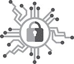

# 网络安全秘：保护您的家庭和企业免受网络犯罪的简单计划

## 致谢

如果你在三十年前告诉我，我将在联邦调查局（FBI）度过了一段辉煌的职业生涯后就能享受退休生活，与我梦中情人结婚，并成为一本关于网络安全书籍的作者，我会告诉你那不是我的生活。回望这段旅程，我不禁想起，你的强大取决于你身边的人。在我的整个职业生涯中，我遇到了许多令我深受鼓舞的人，我列出了几个让这个梦想成为现实的人。如果不是我母亲 Alice Augenbaum，我永远无法在`FBI`找到那份入门工作。如果不是她帮我填写了申请表，谁知道我今天会在哪里。

我的朋友 Natalie O’Connell 促使我回到纽约市立学院（City College）留学。她还启发了我在福特汉大学（Fordham University）攻读信息技术 MBA，这引发了我对技术的激情。

`FBI`纽约办公室的主管特探（`SSA`）Robert Grubert 担任了我六年的主管。他提供了我成功所需的所有工具。如果没有几位特探的友谊支持，包括 Philip Sarcione、Joseph Cervini、Robert Leneck 和已故的 James Downey，我也无法坚持。

在被派到锡拉库驻办事处期间，我受到了周围四位最出色的`FBI`特探的指导：John Winslow、Philip Looney、Robert Haley 以及我的主管 Michael Mason。此外，我与许多其他人建立了许多深固的友谊。

如果不是我母亲 Alice Augenbaum，我永远无法在`FBI`找到那份入门工作。如果不是她帮我填写了申请表，谁知道我今天会在哪里。

我的朋友 Natalie O’Connell 促使我回到纽约市立学院（City College）留学。她还启发了我在福特汉大学（Fordham University）攻读信息技术 MBA，这引发了我对技术的激情。

`FBI`纽约办公室的主管特探（`SSA`）Robert Grubert 担任了我六年的主管。他提供了我成功所需的所有工具。如果没有几位特探的友谊支持，包括 Philip Sarcione、Joseph Cervini、Robert Leneck 和已故的 James Downey，我也无法坚持。

在被派到锡拉库驻办事处期间，我受到了周围四位最出色的`FBI`特探的指导：John Winslow、Philip Looney、Robert Haley 以及我的主管 Michael Mason。此外，我与许多其他人建立了许多深固的友谊。

如果不是我母亲 Alice Augenbaum，我永远无法在`FBI`找到那份入门工作。如果不是她帮我填写了申请表，谁知道我今天会在哪里。

我的朋友 Natalie O’Connell 促使我回到纽约市立学院（City College）留学。她还启发了我在福特汉大学（Fordham University）攻读信息技术 MBA，这引发了我对技术的激情。

`FBI`纽约办公室的主管特探（`SSA`）Robert Grubert 担任了我六年的主管。他提供了我成功所需的所有工具。如果没有几位特探的友谊支持，包括 Philip Sarcione、Joseph Cervini、Robert Leneck 和已故的 James Downey，我也无法坚持。

在被派到锡拉库驻办事处期间，我受到了周围四位最出色的`FBI`特探的指导：John Winslow、Philip Looney、Robert Haley 以及我的主管 Michael Mason。此外，我与许多其他人建立了许多深固的友谊。

如果不是我母亲 Alice Augenbaum，我永远无法在`FBI`找到那份入门工作。如果不是她帮我填写了申请表，谁知道我今天会在哪里。

我的朋友 Natalie O’Connell 促使我回到纽约市立学院（City College）留学。她还启发了我在福特汉大学（Fordham University）攻读信息技术 MBA，这引发了我对技术的激情。

`FBI`纽约办公室的主管特探（`SSA`）Robert Grubert 担任了我六年的主管。他提供了我成功所需的所有工具。如果没有几位特探的友谊支持，包括 Philip Sarcione、Joseph Cervini、Robert Leneck 和已故的 James Downey，我也无法坚持。

在被派到锡拉库驻办事处期间，我受到了周围四位最出色的`FBI`特探的指导：John Winslow、Philip Looney、Robert Haley 以及我的主管 Michael Mason。此外，我与许多其他人建立了许多深固的友谊。

## 引言：真实经历带来的恐惧

很难相信，仅仅在不到二十五年前，美国在线（AOL）及其“你收到了邮件！”的口号还统治着万维网。同样难以相信的是，曾经被认为仅仅是一个新奇物的互联网，竟然为我们的生活带来了如此多的便利。

但是，当我们从互联网提供的丰富信息、娱乐、商品和服务中极大获益时，没有人考虑过随之而来的会有多少犯罪。谁能想到，在电脑后面插上太网线，或者将笔记本电脑、手机或平板电脑连接到机场的无线网络，会成为犯罪分子破坏我们生活、摧毁经济的大门？

我是 20 世纪 90 年代末被派往联邦调查局调查网络犯罪的首批特探之一。在当时，我们追逐的是业余黑客、追求刺激者和青少年，他们更多时候是在调皮和爱冒险，而非犯罪。

当我加入 FBI 时，我从未想过网络犯罪会成为我的专业领域。`1988`年，我二十岁，被聘为 FBI 纽约分局的档案分类员。在我母亲替我完成申请表并提交后，她给了我`$100`去买了两条聚酯纤维长裤、四件衬衫和两条领带。当时我对计算机一知甚少，对互联网更是一窍不通。

我回到大学上夜校，并晋升为在 FBI 内部处理更多的会计和财务工作。随后，我开始在福特大学攻读金融和信息技术的 MBA 学位。在福特大学学习最棒的一点是周围有这么多导师——教授们，以及那些公开挑战他们所授授概念、并质疑其办事方法是否正确的学生。我非常享受这种挑战，并焕发了学习的动力。我只是不知道执法部门和 FBI 的职业道路是否真的适合我。

我一直听人说成为一名 FBI 探员极其困难，而且当时正处于招聘冻结期。所以，当我从福特大学获得 MBA 学后，我很确定想去华尔街找份工作。我想把有需求的人介绍给有资源的人，并为促成这些交易分得财务大蛋糕的一羹。尽管我已经在 FBI 工作了六年，但我仍然住在妈妈家里的那间卧室，从五岁起我就一直睡在那张床上。我知道我需要开始经营自己的生活了。

但在我离开 FBI 去华尔街工作之前，一个意想不到的机会出现在了我面前。`1994`年春天，FBI 的招聘冻结结束，开始招募新探员。局里的现有员工拥有最高优先权，我的主管（对我来说如父亲一般的形象）鼓励我申请。令他非常惊讶的是，我告诉他对成为探员不感兴趣。他看起来既失望又愤怒。他严厉地告诉我，我要申请成为一名探员。

大约六个月后，我前往弗吉尼亚州的昆提科参加新探员培训。我减了 20 磅体重，通过了笔试、面试、体检、背景调查和测谎仪。当我从新探员培训毕业时，我本以为会被回纽约市工作，甚至可能是回到我的首选地波士顿。相反，我被分配到了纽约州锡瑞 acuse 的一个分局。对我来说，那里和爱荷华州或内布拉斯加州没两区别。

如果你问我`1995`年 6 月的工作内容是什么，那描述起来很容易：有坏人在对好人做坏事，我的工作是与州和地方执法部门合作，把坏蛋关进监狱。最终目标是让纽约州北部变成对每个人都更安全的地方。在纽约北部司法区，我处理了大量的白领犯罪、银行抢劫、失窃财产和逃犯案件。说白了，作为一名新探员和层级中的底层人员，任何进门的案子我都会接。我并不不在乎。我有枪、有徽章、还有一辆带有警示灯和警报声的汽车，我被允许和同事一起出去玩“警察抓小偷”。这是一段很有收获的经历，我们成功把许多坏人关进了监狱。

我的转折点发生在`1996`年，当时我接到了来自纽约州北部一家小型互联网服务供应商代表的电话，他想谈谈通过这些所谓的“公告板”出售被盗物品的问题。我与那个男人见面，他所描述的一切对我来说都是如此陌生。我在高中时上过几门编程课，可能我对计算机的了解比大多数 FBI 探员都要多。`Windows 95`的发布让计算机新手的操作变得简单得多。对于像我这样的用户来说，它几乎是即插即用的，这也是我对计算机感兴趣的原因。然而，我突然意识到，我需要学习更多关于计算机、互联网以及日益增长的网络犯罪威胁。

我当时动力十足，回家买了一套价值`$2,500`的网关（Gateway）计算机系统，它拥有速度极快的`133 MHz`处理器和`40 MB`硬盘。这可能让我成为我分局里唯一拥有个人电脑的 FBI 探员。我在纽约州奥斯维戈州立大学报读了一门互联网课程，但我必须自己承担费用。我的主管无法理解，为什么 FBI 需要关注互联网上发生的事情。

几乎是理所当然地，我成了锡瑞 acuse 分局的“网通（Internet guy）”，但这并不是一份很酷很有趣的工作。当其他探员在处理银行抢劫、毒品案件和追捕逃犯时，我正在追踪试图破解主机的 18 岁少年。老实说，我不确定分局里是否还有其他人理解我在做什么。在当时，全美只有几个 FBI 探员参与此类案件。他们大多是寻求刺激的探员，试图获取网络访问权限。

但网络犯罪在`1990`年代后期发生了阴险的转折，当时美国消费者开始在线使用信用卡支付商品和服务——这是电子商务的开始。当臭名昭著的罪犯威利·萨顿（Willie Sutton）被问及为什么在`1930`年代在纽约抢劫银行时，他简单地回答道：“因为那里有钱。”在世纪末，大量资金流向互联网，所以坏蛋们就去那里犯罪。如何阻止他们是我的责任。

如果今天让我定义我的工作，我会说我是在教个人和组织如何不成为网络犯罪事件的受害者。我一直能够与私营部门一些最优秀、最精明的精英合作，分享情报，共同制定解决方案并确保大家的安全。在我的 FBI 职业生涯，我处理过许多大型安全泄露事件，对我来说，没有什么比处理那些受害的小公司、退休人员是非营利组织更让我感到痛苦的了。我现在知道，为这些人提供教育不仅服务了社区，也让我们所有人都保持安全。

当我作为 FBI 特别探员退休时，对我来说是一个悲伤的一天。我花了二十多年时间处理网络犯罪案件，其中七年时间，我管理着美国最好的网络犯罪部门之一。我热爱那份工作。我的同事们就像家人一样。作为一名探员，我可以一直工作到五十七岁，但我决定在五十岁符合条件时退休。我为什么要离开我如此喜爱的职业？因为在我的内心深处，我知道在 FBI 之外，我可以为美国民众做更多。

几年前，我读过一本名为《人们为何会失败》的书，第一章是关于清晰性的重要。在 FBI 期间，我变得清晰的事情是：我需要尽一切努力成为全球网络犯罪和风险管理领域的领先专家之一。我从全球领先的信息安全公司参加了多门信息安全课程，并获得了七项信息安全认证。这并不容易。我阅读了我能找到的所有关于网络犯罪的文章，并与行业内尽可能多的人进行交流。如果你想成为某个领域的专家，你必须投入尽可能的时间来精通该学科。

最终，我开始将我学到的知识融入到演示稿中，并向任何愿意听的人分享我的所学。在整个 FBI 职业生涯，我向私营部门公司进行了数千场演讲，讲解如何避免成为网络犯罪的受害者。当我接近退休年龄时，我开始问自己：我最喜欢做且感觉起来不像工作的事情是什么？答案是公开演讲、教育公众以及结识新朋友。这些领域对我来说非常自然，毫不费力且有趣。从那时，我开始认真考虑离开局局并进入私营部门。

我决定我想通过教育小企业、非营利组织、学校和公民——尤其是年轻人和婴儿潮一代——如何避免成为计算机犯罪的受害者来改变世界。在网络犯罪教育和预防上投入了如此多的资金，但对于社会最脆弱的群体，可用资源非常少。我致力于将我在 FBI 工作的二十九年中学到的知识并与公众分享。

在我 FBI 职业生涯的早期，我衡量成功的标准是将坏人送进监狱。今天，我的成功故事发生在某人在听了我的某场演讲后给我打电话，告诉他们已经在平台上实施了双重身份验证。如果有人在我成为 FBI 探员时告诉我，我通过谈论网络安全获得的职业满足感将比捕捕坏人更多，我当时会说：“你疯了，那不是我想做的。”

现在，这是我所做的最重要的事情。

在接下来的章节中，我将分享一些步骤，如果遵循这些步骤，将减少你成为受害者的概率。这些行动项对于非技术人员来说并不难理解，你不需要花很多钱来实现它们。当然，只有两种方法可以保证你不必处理计算机犯罪：搬到北极或者扔掉你的电脑。你可能不愿意做其中任何一种，我也一样。然而，如果你遵循这些步骤，你将成为数字世界中一个更安全、更受保护的成员。

在接下来的几个章节中，我将与你分享几个故事来支持这些每一个步骤。我会对你诚诚的——当我谈论或描写网络犯罪时，我倾向于吓唬人们。在信息安全领域，有一个术语叫做`FUD`，代表恐惧、不确定性和怀疑（uncertain and doubt）。当有人试图解释网络犯罪问题的规模但没有被重视时，大机构就会使用这个词。我听过人们说我的演讲充满了`FUD`。那么，我在这里引入一个新术语叫做`FFRE`，它代表来自真实经历的恐惧。书中包含的每一个故事都来自真实的现实经历。受害者是真实的，事件也是真实的。如果这能防止你成为受害者，我不介意带你离开舒适区。



## 第一章：网络犯罪

网络犯罪已成为数字世界的生活事实。这种威胁极其严重而且正在增长。网络入侵变得越来越普遍、越来越昂贵、越来越复杂。我们国家的对手针对我们的国家关键基础设施，包括公用事业、防御系统以及航空和交通控制机制。美国公司成为贸易机密和其他敏感企业数据的目标，大学则成为尖端研发的目标。身份盗窃者正在攻击我们的普通公民，在线掠食者正在跟踪我们的孩子。

每天都有另一个关于大规模数据泄露的媒体报道。美国公众在反复听到同样令人沮丧的新闻后变得麻木了。根据`Cybersecurity Ventures`的分析，网络犯罪的成本到 2021 年可能达到 6 万亿美元，自 2015 年以来在六年内翻了一番。`Sur 里大学`高级讲师`Michael McGuire`的最新研究发现，全球网络犯罪的每年非法利润已到 1.5 万亿美元，大约相当于俄罗斯的 GDP！在美国，FBI 的`Internet Complaint Center`在 2017 年收到了超过三十万份投诉，报告损失超过 14 亿美元。

在我们生活的几乎每个方面，我们已经对网络犯罪分子变得脆弱。如果你曾在`The Home Depot`买过家居维修产品（在 2014 年 4 月到 9 月期间，有 5600 万个信用卡号泄露），在`Target`购买过衣服或家居用品（黑客感染了支付卡读取器，并拿走了 2013 年感恩节后购物者使用的约 410 万个信用卡和借记卡号），或尝试通过在`LinkedIn`注册来扩大你的专业网络（一个名为 Peace 的俄罗斯黑客盗取了超过 600 万个加密密码，他于 2016 年 5 月将它们发布在一个俄罗斯犯罪论坛上），你可能在不经意间成为了网络犯罪的受害者。

虽然这些大规模数据泄露涉及世界上一些最大的公司并在全球范围内成为头条新闻，但我在 FBI 与网络犯罪斗争时，每天处理的内容很少有媒体报道。每天，我都会与中小型企业、非营利组织、学术机构的受害者合作，更糟糕的是，与失去生活积蓄的退休人员合作。在我的职业生涯中，我目睹了太多恐怖故事——包括几家成为网络犯罪受害者后被迫关门的企业。以下是我在 FBI 职业生涯期间调查的一些案件：

## 戴安与键盘记录器

戴安（DIANE）是来自田纳西州富兰克林的两个孩子的母亲，她在结束了一整天的办公室工作后回到家中。她为家人准备了晚餐，洗了澡，然后登录了笔记本电脑。她仍然更倾向于在电脑上检查邮件，很少在`iPhone`上访问；她更喜欢大得多的屏幕。她十四岁的女儿喜欢取笑她使用那台老旧的电脑，说这让她在瞬息万变的数字世界里变得太老了。

当戴安浏览她的`Gmail`账户时，她迅速删除了垃圾邮件和广告，然后注意到一封来自姐姐阿比盖尔（Abigail）的邮件。戴安的姐姐经常给她发一些关于健康和健身的文章，这封邮件看起来也一样。邮件中包含一个指向关于喝椰子水好处及其减轻皱纹作用文章的链接。戴安总是阅读姐姐发送的文章，所以她点击了关于椰子水的链接并等待文章出现。什么都没有发生。她又点击了一次。没有反应。她想，自己的网络服务可能又变慢了，这是她电脑出现大部分问题的原因。她等得不耐烦了，读了剩下的邮件，浏览了几个她喜爱的在线零售商，然后是时候看《行尸之路》的最新集数了。

当瑞克·格莱姆斯（Rick Grimes）和他的伙伴小组在电视上试图在僵尸爆发中生存时，戴安努力睁开眼睛。与此同时，在地球另一端东欧洲的一台僵尸电脑正在与她的电脑通信。当戴安点击关于椰子水文章链接时，她被重定向到一台由网络犯罪分子控制的电脑。一旦连接，电脑就在戴安的机器上加载了一个名为`keylogger`（键盘记录器）的恶意程序。键盘记录器有时被称为击键记录器或系统监控器，它的职责只有一个：监控并记录在特定电脑键盘上输入的每一个按键。当戴安为网站（如`Gmail`、她的工作邮箱账户或在线银行账户）输入用户名和密码时，恶意的`keylogger`程序窃取了她的凭据并将其发送给网络犯罪分子，后者现在可以访问戴安的网站了。一旦那个坏蛋获得了戴安银行账户的访问权限，他就准备好洗光她的储蓄了。

## 乔纳森与勒索软件


乔纳森（JONATHAN）是一位退休的高中教师，热爱写作和诗歌。养老金涵盖了他的生活费用，他通过担任婚礼摄影师的兼职收入来补充退休金。每当乔纳森没有在拍照时，他就会花时间写作。他最终构思了一个小说的点子，他认为这是他一生中最好的主意。他花了十八个月写了七万五千字，但终于完成了。他将这本犯罪小说视为他一生的心血，并正准备通过亚马逊自出版成为一名出版作家。

一个周末，乔纳森在一个奢华的婚礼上担任摄影师。这是一场黑领结的正式盛宴，他不敢相信自己一个晚上能赚到多少钱。工作很辛苦，但他一个晚上赚的钱比他当老师的一周赚的还多。乔纳森从婚礼回到家后，他将照片下载到电脑上，并开始用他的照片编辑软件进行处理。完成后，他将照片保存到硬盘中。在睡觉之前，乔纳森检查了他的`Facebook`账户，并点击了一个一个想成为他在线朋友的人发送的链接。那来自一个迷人的年轻女性，她对乔纳森卓越的摄影技巧表示了赞赏。

在地球另一端，有一个网络犯罪分子坐在东欧洲的笔记本电脑前。我们称他为伊万（Ivan）。当乔纳森点击链接时，伊万笑了。他知道一个毫无防备的美国人的世界即将被翻天覆地。伊万的一台僵尸电脑发送了数千封伪装成`Facebook`垃圾邮件的鱼叉式钓鱼邮件。他针对男性`Facebook`用户，并提议与这些毫无防备的受害者好友。伊万声称自己是一个迷人的女性，对男性`Facebook`页面上列出的兴趣留下了深刻印象。这就像是从婴儿手中拿糖吃。当乔纳森点击链接时，伊万的恶意程序加密了他硬盘上的所有信息。除非向伊万支付 300 美元赎金，否则乔纳森无法找回他的`iCloud`账户。糟糕的是，伊万还更改了他的`iCloud`账户密码。

## 海瑟与数据泄露

对于一家公司的新入职薪职员海瑟（HEATHER）来说，这是一个典型的周一早晨，当她收到 CEO 的一封邮件时。CEO 询问她是否喜欢新工作，赞扬了她到为止的表现，并告诉她薪资经理正在外地参加商务会议，CEO 正要去公司董事会开会，需要一份包含每位员工姓名、职位、生日、地址、社会安全号码和工资的电子表格。海瑟渴望承担更多责任，并回复说她会在一小时内完成任务。这至少是她所认为正在发生的事。

在西非一家肮脏的互联网咖啡馆里，一个网络犯罪分子收到了海瑟的邮件，他跳了起来开始庆祝。伊万的一封鱼叉式钓鱼邮件发送给了美国的一个薪职员，要求提供该大型公司的 W-2 信息。毫无防备的薪职员向他发回了两千名员工的敏感个人信息。在一个满其他网络犯罪子的房间里，这个男人宣布他以每人 5 美元的价格出售姓名、生日、社会安全号码、地址和工资。其他网络犯罪分子开始给他递钱，就像他是华尔街的交易员一样。在短短二分钟内，那个恶棍拿走了 5000 美元。在几个月后，他的犯罪客户尝试为受害员工申报联邦所得税并访问他们的信用卡账户。

## 卡罗琳与逮捕令

卡罗琳（CAROLINE）是一个二十一岁的大学大三级学生，她这周过得并不顺利。期末迫在眉睫，她刚和男朋友发生了一场激烈的争吵，她的父母对她最近超速行驶非常愤怒。他们知道自己的保费即将飙升。当卡罗琳准备去上下一节课时，她的手机响了。来电显示显示电话来自当地警察局。卡罗琳接电话时，心里感到一阵不适。来电者介绍自己是警察局的米勒探员（Detective Miller）。他询问卡罗琳，为什么还没有回复警方关于她闯红灯的信件。他说信中包含一张交通摄像头拍摄的照片。卡罗琳告诉警官她没有收到那封信。警官告诉她，三封信寄到了她的校园地址，并且已经发了逮捕令。由于未出庭，她的驾照也将将被吊销。卡罗琳崩溃了，哭了起来。

米勒似乎对卡罗琳产生了同情心，告诉她听起来是个好女孩。他建议说，如果她愿意当天支付 250 美元的罚款，违规记录就会从她的驾驶记录中删除，她的执照也不会被吊销。卡罗琳松了一口气，告诉警察官她会在当天晚晚些时候去警察局交罚款。但米勒告诉她，由于该违规行为涉及州警察，她需要去沃尔玛并立即通过西联汇款（Western Union）发送汇票。然后，他为她提供了如何汇款的说明。

在美国的某处，一名网络犯罪分子从沙发上爬起来，穿上裤子，开车当地当地沃尔玛领取了 250 美元。自从他看了一个关于如何快速赚钱的 YouTube 视频后，他的生活就变得好转了。唯一要做的就是找到那些在 Facebook 页面上发布过交通罚单信息的人；之后，获取他们的电话号码并不困难。这是一种轻松的生计方式，他的大多数受害者对于以如此廉价的价格脱身而感到庆幸。至少他们不会失去驾照或坐牢——尽管在这种情况下，这根本就不可能发生。

迈克尔是一家成功服务公司的所有者。他婚姻幸福，有两个可爱的孩子，并在教会活动活跃。一天晚上，迈克尔收到一封来自带有异域亚洲名字的女性的诱人 Facebook 消息。违背了迈克尔的直觉，他与那个女性交换了邮件。他们进行了几次在线对话并互相了解了彼此。在某个时刻，她建议他们可以通过 Skype 聊天。在五分钟内，迈克尔看到一个漂亮的年轻金发女性，看起来年龄在二十到二十五岁之间。她告诉迈克尔她的名字叫梅拉尼娅，来自南非。

在亚洲某个偏远的村庄，一个网络犯罪勒索团的成员正在执行他们的计划。唯一需要做的就是按下按钮录制迈克尔的 Skype 通话。迈克尔锁上办公室的门是为了给自己留一点私人空间；他不知道自己正被录像。不久后，梅拉尼娅脱掉衣服开始表演性动作。她告诉迈克尔，她希望他也做同样的事情。他做了。通话结束后，他注销并回到工作中。

几分钟后，迈克尔收到了来自梅拉尼娅的邮件，她在邮件中告诉他需要 10,000 美元来支付母亲的医疗费用。为了救她垂死的母亲，她不得不向迈克尔索钱。邮件中包含了一个迈克尔私人 YouTube 频道的视频链接。视频质量极佳，毫无疑问，视频里赤身裸体的迈克尔正做着他不该做的事情。梅拉尼娅警告迈克尔，如果他不给她钱，视频链接就会被发送给他的 Facebook 朋友，包括他的妻子、孩子、教友和生意伙伴。

迈克尔在收到勒索信后应该联系执法部门，但他没有这样做。虽然失去 10,000 美元将是一个非常昂贵的教训，但迈克尔认为，为了避免公开的羞辱，这是划算的。他去银行向俄罗斯的一家银行进行了电汇。这个地点对他来说很奇怪，因为梅拉尼娅声称自己来自南非，但他得到保证，一旦支付赎金，视频就会被销毁。躲过了一颗可能摧毁他的婚姻和职业并终结他一生声誉的子弹，他感到松了一口气。

第二天早上迈克尔醒来时仍然感到庆幸。这几乎像是一场噩梦。但是，当他检查邮件时，他发现了另一封来自梅拉尼娅的邮件。她道歉并说他寄的 10,000 美元还不够。她需要他向同一个银行账户额外转账 35,000 美元。迈克尔大发雷霆给她发了一封愤怒的邮件，说她没有履行她的承诺。她立即回了邮件，提醒他如果不付钱会发生什么。迈克尔认为自己没有选择，于是那天下午他又给梅拉尼娅寄了另外 35,000 美元。在接下来的几周里，迈克尔总共给她寄了 150,000 美元。

等迈克尔拨打 FBI 办公室时，他已经走投无路了。他感到很羞辱，耗光了大部分退休储蓄，并且实际上在考虑自杀。我深信，那些坏人会在榨干迈克尔的每一分钱之前，或者更糟，在他自杀之前才停止索要。

帕特里克二十五岁，新婚时他和妻子攒下了 50,000 美元作为第一套房子的首付款。经过多次会议、电话和邮件后，帕特里克和妻子选择了他们认为的梦想家。在房产交割前，帕特克的经纪人告诉他，他只需等待产权公司的指令，关于向哪里汇首付款。几小时后，帕特里克收到了来自一家产权公司的邮件，其中有详细的电汇指令，包括银行账户和路由号码。帕特里克去银行取出了辛苦赚来的 50,000 美元。他将汇款指令提供给银行官员，离成为首次购房者又近了一步——至少他是这样想的。

第二天，帕特里克收到了一封来自真实产权公司的邮件，说明了要把钱寄到哪里。帕特里克显然困惑了，因为他昨天已经汇了钱，他给经纪人发了邮件。帕特里克和他的经纪人拨打了产权公司，大家花了一段时间才达成共识。产权公司告诉帕特里克，他们没有发送昨天的邮件。帕特里克仔细查看产权公司的指令，发现路由号码和银行账户与之前的不同。通过仔细检查，他还发现邮件地址中的产权公司名称被篡改了。帕特里克联系银行拦截电汇，但为晚了。

帕特里克显然对失去这么多钱感到恐慌，他联系了产权公司。对方律师态度很好地告诉他，他们不负责，因为他们没有发送过那封邮件。帕特里克联系了当地警察，警察告诉他收到钱的银行位于另一个州，因此不在他们的管辖范围内。帕特里克联系了州警察，州警察告诉他们没有足够的资源调查网络犯罪。他被指示通知 FBI，并被要求前往 [www.IC3.gov](http://www.IC3.gov) 向 FBI 的网络投诉中心提交投诉。据我所知，帕特里克仍在努力追回他的钱。

不久前，一位名叫大卫的富有老先生在互联网上比较定期单利率。他发现加利福尼亚的一家银行提供的利率具有竞争力的；虽然不是很高的利率，但比当地银行提供的要好。大卫对投资一笔巨资金感兴趣，所以即使百分之四的差距也意味着几千美元的收益。大卫联系了银行并与一名代表通话，对方在电话中态度愉快且知识丰富。在对话过程中，银行代表说服大卫通过电汇向银行汇入了 750,000 美元。大卫遵循了那个男人的指示并收到了一封确认邮件。

大卫几天没有收到来自加州那家银行的消息，于是他拨打了最初拨通的那个号码。没有人接听。当他尝试在互联网上访问该银行的网站时，该网站已经不存在了。他开始变得担心并联系了银行的人，结果发现他的钱并没有被送到加州的一家银行，而是被到了格鲁治亚——那是东欧的一个国家，而不是美国东南部的州。他们联系了格鲁治亚的 `FBI` 法律附属，并通知了那里的执法合作伙伴。遗憾的是，大卫从未要回他的钱，那些坏人也没有进监狱。

我希望这些故事是虚构的，但它们中的每一个都发生在我任职`FBI`期间。为了保护受害者的身份，名字已经更改，但事实是准确的。这些可怕的场景，当网络犯罪分子使他们受害时，大多数人都会感到无助。在很多情况下，我从受害者那里听到同样的回答：“我只是个小商人，没有钱花在网络安全上。我不精通技术。”

我在 `FBI` 工作了二十九年，其中六年是支持人员，二十三年是特工。我的最后十四年花在了调查网络犯罪上。如果你希望读一本关于 `FBI` 特工如何击败一大网络犯罪分子的书，我很抱歉让你失望了。有很多优秀的 `FBI` 特工可以讲述关于他们职业生涯中逮捕坏人的趣味故事；遗憾的是，我没有那么多这类故事可以讲。我在全球范围内追逐的罪犯并不经常被抓获。这就是为什么学习在犯罪发生之前切断他们的路径是如此重要。


## 第二章：四个真理

2002 年，`FBI` 在其位于`华盛顿特区`的总部成立了一个网络部门，并制定了一项国家战略，以应对日益增长的计算机犯罪威胁。作为`纽约州锡拉 acuse`的一名特工，我的工作内容之一是处理所有网络事务，我的职责之一是向公众宣介绍 `FBI` 在这一调查领域的使命。我仍然记得 2001 年向公众进行演示时的那些精彩时刻。我曾有一张标题为“为什么网络犯罪在增加？”的幻灯片，上面警告道：

1. 犯罪分子实际被抓住的风险很小，因为坏人躲在键盘后面，不需要为了抢你的钱就把枪口顶在你脸上。

2. 归属很难证明，因为一旦你能够识别出犯罪背后的计算机，你仍然必须证明电脑后面的人是实际实施犯罪的人。

3. 缺乏处理计算机犯罪的经验丰富的执法调查员、检察官和法官。如果坏人位于`纽约`，而受害者或多个受害者遍布`美国`或世界其他地区，那么建立司法管辖权是非常困难的。

4. 网络空间没有边界，来自各地的坏人可以访问我们的关键信息。许多外国政府并不关心来自他们国家的犯罪分子是否在伤害`美国`公民。这些国家中的许多国家拒绝在调查中与美国政府合作。

5. 越来越多的人开始购买家用电脑，并可以使用电子邮件、电子商务和网上银行服务。随着越来越多的人访问`万维网`，突然几乎每个人都有了电子邮件账户。

从那以后发生了什么变化？每个人都有了家用电脑，今天的手机和平板比 2002 年的家用电脑强大得多。现在我们可以在手机上做很多事情——看电影、看音乐视频和直播体育赛事；检查电子邮件；登录我们的公司网络；支付房贷和其他账单；以及从全球购买商品。早期互联网的坏人已经从住在父母地下室的青少年黑客，变成了以金钱为目的、海外的、与组织犯罪有联系的对手。通过`Facebook`、`Instagram`、`Twitter`等社交媒体账户，我们为那些想要伤害我们的人提供了太多关于个人生活、家庭和雇主的信息。坏人现在唯一要做的就是`Google`一下我们的名字，他们就能找到大量可以用来对付我们的信息。

2002 年，成为网络犯罪分子需要很多技巧。今天，几乎任何在线的人都能获得必要的工具。“网络犯罪”是执法部门用来描述罪犯实施网络犯罪所需的工具的术语——而这些工具可以廉价地随时获得。互联网有一部分被称为暗网，它存在于`暗网`和叠加网络上，需要特殊的软件和路由器才能访问。暗网通常是加密内容，不会在传统的搜索引擎上被索引。这是犯罪分子出售毒品、黑进软件、伪钞币等地方。它也是黑客经纪和交易被盗机密信息的地方，也是人口贩子进行他们作恶工作的地方。

遗憾的是，访问暗网所需的软件和路由器可以很容易购买。你还可以购买其他类型的破坏性网络工具和隐藏踪迹的方法，让几乎没有人能追捕你。`国家安全局 (NSA)` 使用的黑客工具被非法盗窃和泄露在 2016 年 8 月变得更加糟糕。一个名为`Shadow Brokers`的黑客组织偷走了`NSA`用于保护我们国家免受恐怖分子和外国情报机构威胁的工具，并将发布到了网上。现在，这些最初设计用于保护我们的工具正被全球多处的网络攻击利用。

在过去的十五年里，我参与了数千起网络犯罪案件，我在每个案例中都注意到相同的四个特征。我现在将它们称为四个真理：

1. 真理一：没有人预料到自己会成为受害者。

在我的执法生涯中反复听到这句话：我是一家小型会计师事务所。我是一家非营利组织。我是一家小型医疗公司。我没有网络犯罪分子想要偷的东西。我曾听一个非营利组织的首席执行官告诉我，没有人会针对非营利组织。他们想偷什么？坏消息是，我处理过几十个受害的非营利组织。非营利组织收集敏感数据，包括捐赠者信息、健康信息、社会安全号码、机电子邮件、员工和志愿者记录以及账单信息。

我听过的涉及非营利组织的最糟糕事件之一涉及印第安纳州`芒西`的一个帮助抗癌女性的组织`小红门`。2017 年 1 月，一组黑客感染了该非营利组织的计算机的`恶意软件`（旨在故意损害计算机、服务器或计算机网络的软件），导致其工作人员无法访问患者文件和其他信息。黑客将这些信息作为人质，要求获得 50 个`比特币`（当时一种新兴在线货币，价值 4.3 万美元）以释放文件。一度，黑客甚至向该非营利组织发送了一封邮件，上面写着：“癌症很糟，但我们更糟！”坏人冷酷无情。`小红门`没有支付赎金，因此其工作人员不得不将患者信息重新录入计算机。

令人不安的迹象表明，黑客正日益针对非营利组织和小微企业，因为这些机构不太具备复杂的安全措施。数据泄露对非营利组织可能是极具破坏性的，因为会导致时间浪费、诉讼、罚款和处罚，以及公众信任的丧失，这会对捐赠贡献产生负面影响。教会也是如此。某个宗教机构的领导人甚至告诉我，`上帝`就是他们的防火墙，没有人会针对教会。再次，事实并非如此。教会和非营利组织拥有可以通过互联网访问的银行账户，我目睹过他们无数次受害。

面对日益增长的网络犯罪之危险，非营利组织和宗教机构并非唯一表现天真的群体。我曾与 `NASDAQ` 交易所上市公司的高管交流过，他们告诉我并不担心网络安全；他们说坏人只针对纽约证券交易所（`NYSE`）上市的公司！最近，一家 `NYSE` 上市公司的一位高管告诉我，他不担心，因为他所属机构年收入不到 50 亿美元，而网络窃盗只针对收入超过 300 亿美元的公司！当然，这并非事实，这种态度是网络犯罪问题的重要组成部分。

我们所有人，无论是在年收入数十亿美元的上市公司工作，还是在苦苦维持经营的小型非营利组织工作，都拥有网络犯罪分子想要的信息。当窃偷获取了我们银行账户的 `username` 和 `password` 时，他极有可能会抽空我们的资金。如果他访问了我们的电脑文件并发现了敏感信息（例如我们的纳税申报），他将利用这些信息以我们的名义开设信用卡或贷款账户，使我们成为身份盗窃的受害者。如果他访问了我们的电子邮件和社交媒体账户，他会将学到的关于我们的信息作为武器，去获取更多受害者。

在我的一次网络安全讲座期间，一位女性打断了我，说她完全不需要担心。她不进行网上银行业务，只使用银行的网站查看账户余额。当我问她访问余额是否需要 `username` 和 `password` 时，她确认了确实需要。我让她登录账户并打开自动账单支付工具，她可以在那里输入 `account` 和路由号（routing number）进行付款。她告诉我她不使用账单支付功能，并用一种特别傲慢的语气说：“我只查看我的银行余额。”但随后我问她，如果坏人获取了她的银行账户、`username` 和 `password`，然后输入这些被盗信息并给自己汇款会怎样？此时，她终于意识到自己到底有多脆弱——美国大多数人也是如此。

在我的网络安全防护讲座上，我总是让人们识别他们存储在电脑上最重要的数据。如果你是一个作家，那可能是一份未完成的手手稿。如果你是一个学生，那可能是一个论文或作业。如果你是一家小微企业，那是人力资源材料或银行记录。如果一个网络犯罪分子入侵了你的电脑，哪一样东西是你最不想让他偷走的？我从听众那里得到了各种答案，然后我喜欢开玩笑说：“有人提到了裸照吗？”无论什么信息对你来说是重要的，对窃偷来说都是重要的。这使得我们每一个人都成了目标。

## 2. 第二个真相：你可能无法拿回你的钱。

这可能是人们最难理解的概念：当网络犯罪分子进入你的银行账户并偷走所有资金时，执法部门追回资金的机会微乎其微，甚至几乎为零。我不想这么说，但这是事实。别误会我；我确实有几个成功案例，从受损的商务邮件诈骗中追回了离开美国的资金。如果有一个追回流向海外资金的 `FBI` 探员名人堂，我的名字可能就在挂在墙上的牌子上。但冷酷的现实是，我的胜率可能低于 .100，这并不能让我进入纽约州库珀斯顿的棒球名人堂。

最近我在一次会议上发言，并告诉大家执法部门从外国网络犯罪分子那里追回资金是多么困难。一位退休的 `FBI` 高管在同一会议上发言，他批评我告诉听众执法部门（特别是 `FBI`）可能无法拿回他们的财产。我对他微笑说：“真相总是痛苦的，不是吗？”他看起来很震惊。


不幸的是，在很多情况下这绝对是事实。网络安全公司`Kaspersky Lab`2017年的一项研究显示，52%的受访者表示，他们在计算机犯罪中被盗的资金没有追回，或仅追回了部分。研究发现，互联网用户平均每次攻击损失476美元，十个人中就有一人报告损失超过5000美元。更令人惊讶的是，81%的受访者报告进行过在线财务交易，44%承认在连接的设备上存储了财务数据。然而，只有60%的互联网用户报告使用网络安全软件保护所有设备。你还不如直接把你的`usernames`和`passwords`发邮件给网络犯罪分子呢！

## 第三个真相：坏人可能不会被捕

网络犯罪最令人沮丧的部分之一是它如此普遍，但逮捕人数却如此寥寥。大问题在于计算机犯罪分子并不总在美国。在很多情况下，感染你的电脑以窃取个人信息的网络犯罪分子可能位于东欧、西非、亚洲、南美或中东。

根据网络安全公司`Symantec`的数据，2017年恶意软件、垃圾邮件和钓鱼来源最大的国家是`U.S.`（23.96%）、`China`（9.63%）、`Brazil`（5.84%）、`India`（5.11%）、`Germany`（3.35%）、`Russia`（3.07%）、`United Kingdom`（2.61%）、`France`（2.35%）、`Japan`（2.25%）和`Vietnam`（2.16%）。虽然`FBI`和其他执法机构识别和逮捕本土黑客的机会显然更大，但对他们来说，定位并捕获海外海外的计算机犯罪分子要困难得多。许多网络犯罪分子居住在`China`和`Russia`等国家是有特定原因的——那些政府对美国并不友好，不太可能在调查中合作，或引渡其公民就其犯罪行为接受惩罚。当我开始在`FBI`工作时，打击犯罪是一个局部问题；现在，它是一个国际性问题。

在过去的几年里，FBI逮捕并起诉了一些定居在海外的高级犯罪分子，负责网络犯罪的FBI探员正在加班加点进行逮捕。近年来出现了一些引目的成功案例。2016年12月，一名名为`Mark Vartanya`（又名`Kolypto`）的计算机黑客从挪威引渡到美国，因为他是`Citadel`恶意软件工具包的共同开发人员。他帮助从全球1100万台受感染的计算机中盗取财务账户凭据和个人信息，导致了超过5亿美元的损失。他承认了罪并被判处五期徒禁。2018年2月，美国司法部对30多人提起指控，他们是长期运营的网络犯罪论坛`Infraud`的核心成员。该欺诈论坛吸引了全球超过11,000名成员，他们在论坛上出售、交易和购买被盗的身份信息、信用卡账户和恶意软件，导致全球消费者的损失超过5亿美元。

我不想说这些，但我们并无法通过逮捕来解决网络犯罪问题。世界上有很多计算机犯罪犯的避风港，而许多地方的主权政府根本不在乎他们的公民正在伤害美国人。如果你访问FBI网站查看网络犯罪犯通名单（[www.fbi.gov/wanted/cyber](https://www.fbi.gov/wanted/cyber)），你会看到25个你可能读不出来的名字。如果其中任何一个人上飞机飞往佛罗里达州的戴通海滩度假，我向你保证，FBI探员会在机场逮捕他们。但如果你认为会有任何网络犯罪分子会去美国旅行，那么我在布鲁克林可以卖给你一座桥。

现在是你完全可以感到沮丧的时刻了。你刚刚发现，当坏人偷了你的东西并通知执法部门时，你拿回钱的机会非常渺小。而且我告诉过，执法部门逮捕并惩罚坏人的机会可能比你拿回钱还要小得多。我在一次提供酒水的活动中宣布这个消息时，一个人从人群中大喊：“难怪总统解雇了FBI局长`[James] Comey`！你们到底在干什么？”显然，我之前的职位需要脸皮厚一点。这引出了我的第四点也是最后一点，这也是促使我写这本书并试图教育美国公众的原因。

## 第四个真理：大多数网络犯罪是可以预防的

我把这一点告诉我的一个朋友，他是华盛顿特区FBI总部的一位高级高管。他对我的评估表示强烈反对，许多其他人也经常这样想。当我做出这种陈述时，我感到很沮丧，因为我知道我调查的90%的案件本本可以通过用户教育和意识、健全的业务流程以及使用名为`双重身份验证`的简单控制措施来预防。我的FBI同事解释说，来自中国和俄罗斯的外国情报机构正在使用极其复杂的技术，当这些威胁行为者针对某个组织或个人时，坏人每次都会获胜。在某些情况下，这确实是真的。我见过这些威胁行为者针对世界上一些最大的组织并获取了访问权限。但世界各地还有大量不复杂的威胁在追波大流。他们正在侵害老年人、房屋主、小企业和非营利组织，造成了严重的损害。大公司有钱投入解决问题，但事实并不起作用。

2017年，Cybersecurity Ventures预测，到2021年，网络犯罪每年将给全球带来6万亿美元的损失，而仅仅两年前数字为3万亿美元。根据`Herjavec Group`的说法，这是历史上最大规模的经济财富转移。令人惊讶的是，网络犯罪的利润将超过全球所有非法毒品贸易的总和。网络犯罪事件正以惊人的速度持续发生，越来越多的数据被窃取。`Garner Inc.`表示网络安全成本在2018年已达到930亿美元，并在2021年将达到1万亿美元。在不久的未来，几乎每个家用设备都会连接互联网，这让我相信情况只会变得糟糕。

在我FBI职业生涯的最后十年里，我剖析了数千起网络犯罪案件，它们具有共同点，我总结出了一些预防措施，如果遵循这些措施将极大减少你成为受害者的概率。与你分享的内容不需要花很多钱。

```
images/chap.jpg
```

不幸的是，市场上没有任何神奇药或银弹能让你完全安全。然而，各种技术的结合可以极大减少你的风险。如果一个安全销售员来到你的机构，声称他有一个产品可以让你安全并免受所有威胁的影响，我可以告诉你：他在撒谎。市场上没有任何一种单一产品可以消除所有风险；网络犯罪者的工作速度太快，威胁也在不断变化。在我们的行业中，这有一个术语：`深度防御`。这意味着不要依赖单一产品。只使用一种策略或没有策略是非常糟糕的网络习惯，我可以向你保证一点：如果你没有良好的习惯，形势将对你不利。你会被黑，网络犯罪者很可能会拿到你的钱。

在进入具体技术之前，我必须承认我并没有创建或开发过任何这些技术。我只是幸运——或者应该说是不幸——见证并调查了数千起网络犯罪案件并识别了它们的根本原因。希望我能用所学的知识让你们在互联网上更安全。

## 第3章：钓鱼

感觉就在昨天，我把一张America Online的光盘插入笔记本电脑，将电缆插进墙上的电话插座，第一次连接到现在被称为互联网的“信息高速公路”。

万维网是1989年发明的（不，不是阿尔·戈尔发明的），第一个网站于1991年上线。在之后的几年里，我开始定期给朋友发送电子邮件并与他们交换照片。1998年，当汤姆·汉克斯和梅格·瑞瑞主演的好莱坞热门电影《你有新邮件了》时，全世界都痴迷了互联网，每个人都在使用电子邮件。它是如此简单，以至于我们的父母、祖父母和孩子都有发送电子邮件的能力。根据`Radicati Group`2018年的一项研究，目前全球有超过38亿电子邮件用户（超过地球总人口的一半）。这一数字预计到2022年将增长到42亿。由于平均每人拥有1.7个电子邮件账户（有些用于个人，另一些用于业务），全球大约有44亿个账户。

但在AOL、Amazon和eBay成为家喻户晓的时期，某种阴险的东西正在互联网的表面下涌动。2005年，我住在华盛顿特区，在`FBI`总部的`Cyber Division`工作。我记得2005年的一个晚上，回到家里后收到了一封来自大银行的邮件。这封邮件看起来很正式；它说出了问题，我的银行账户已被冻结。为了重新获得账户访问权限，邮件指示我点击一个链接并在出现的网页上输入我的`username`、`password`、`birthdate`和`Social Security number`。唯一的问题是：我在这家特定的银行并没有账户！我显然非常困惑，立即拨打了银行的客户服务部门电话并解释了情况。电话那头的人告诉我，除非我有有效的账户，否则他无法提供帮助。即使我向他解释我是一名调查网络犯罪的`FBI`特探，那位客服代表还是告诉我：“抱歉，除非你有有效的账户，否则我无法提供帮助。”

我想知道有多少毫无防备的人收到了那封邮件，并向东欧的网络犯罪分子提供了他们的账户凭据，而后者无疑清空了他们的账户。在旧俄罗斯联邦的某个地方，可能有一个骗子正坐在键盘后。他的名字听起来像Boris Badenov，那是老电视动画片《摇石和布尔威尔基及其朋友的冒险》中的反派。Boris正在微笑，因为他发现了世界上最简单的骗局手段之一。如果Boris现在今天给你打电话，并用他那深重的俄语口音向你索要`username`和`password`，你肯定会挂掉他的电话。所以Boris可能会执行计划B。他会给你发一封邮件索要这些信息，但他并不笨到会用`borisbadenov@cybercriminal.com`这样的邮箱地址发送。这可不是什么住在他妈妈地下室的青少年黑客；他是一个复杂的网络犯罪分子，可能与外国政府或有组织犯罪集团有关。Boris甚至可能有一个是平面设计师的朋友，而那个朋友可能足够优秀，设计出一个看起来和你银行所使用的网站一模一样的网站。

Boris现在正在从事`phishing`（网络钓鱼），这与运动钓鱼是不混淆的。简单来说，`phishing`是一种欺诈行为，通过发送伪装成来自信誉良好的公司的邮件，来窃取个人信息，如`passwords`、`usernames`和信用卡号。根据`IBM's X-Force`研究人员的数据，每天发送的所有邮件中超过一半是垃圾邮件。`Radicati Group`估计，2017年每天发送和收到的有2690亿封邮件，这个数字到2021年底将升至3196亿。当海里有这么多“鱼”时，很容易理解为什么犯罪分子会如此成功。

在我进行网络犯罪讲座时，我会向观众提出这个问题：如果你在上述情况下收到一封来自银行的邮件，观众中是否有人会提供他们的银行凭据？理当然，房间里几乎每个人都大声说“不”！然后我询问他们关于`iTunes`、`Amazon`、`Facebook`、`eBay`、`Google`和`Instagram`账户。如果你收到其中一个提供者发来封索要你凭据的邮件，你会提供吗？今天，几乎每个人都知道，当收到任何提供者通过邮件索要凭据时，不要提供。但我无法告诉我在高中、大学甚至公民团体演讲时，当我解释这一点时，看到人们脸上那种沮丧的表情令我多么惊讶。他们看起来就像是第一次听到一样！如果你向这些账户中的任何一个提供凭据，坏就会获得账户访问权限并进行破坏。当我做演示时，我会让人们重复这句话：当在中被要求时，我绝不会向任何提供者提供我的凭据。这是一个我向孩子们解释过的概念，我确信甚至可以解释给我老母亲听——但她不需要解释。我从未给妈妈买过电脑，当十年前我终于给她买了一部手机时，我从未把她升级到连接互联网的手机。有些人可能会说我很残忍，剥夺了她生活中极大的奢侈之一，但我目睹了太多朋友的父母成为网络受害者。

在过去的十年里，开展过许多公共服务活动，警告人们`phishing`的危险。遗憾的是，网络犯罪分子不会轻易放弃；他们只是改变了技术来欺骗毫无防备的人交出用户名和密码。随着计算机用户变得越来越博学，安全软件和防火墙在保护他们免受入侵方面变得越来越有效，网络犯罪分子只需创建不同的`malware`（恶意软件）。在植入或引入计算机或网络后，恶意软件就会执行它的肮脏工作。它可以植入计算机病毒、蠕虫、特洛伊马、勒索软件、间谍软件、广告软件、恐吓软件，谁知道还有什么。恶意软件自计算机在使用以来一直存在。第一个特洛马发布于1978年，苹果系统的第一个病毒发布于1983年，IBM PC电脑的第一个病毒发布于1986年。

某些恶意软件会安装`keyst logger`（键盘记录器），我在第一章中提到过。一旦击键被捕获，程序就会信息发回在线服务器，网络犯罪分子可以访问该服务器来窃取你的个人信息。苏联早在20世纪70年代中期就开发并部署了硬件`keylogger`，他们将其安装在`IBM Selectric`型打字机上。键盘记录器被秘密安装在位于莫斯科和圣彼得堡的美国大使馆和领事馆建筑内，以窃取机密。由于手动打字机对键盘记录器和其他病毒免疫，俄罗斯特工部门今天仍在使用它们！

我在FBI职业期间遇到的一个键盘记录案例涉及一个名叫Charlie的男人，他是一家中型律师事务所的律师。他的个人邮箱收到了ر封似乎来自他银行的邮件。主题写着：“您的账户检测到可疑活动”。Charlie打开邮件，上面写道：

```
亲爱的Charlie，我们想通知您，银行的新安全系统检测到一笔可能正通过您的支票账户处理的可疑交易。今天上午9:05，检测到有人从纽约布鲁克林的一个IP地址登录了您的账户。该用户请求从您的银行账户中自动提取金额为$1,875.54的资金，支付给巴哈马的一家在线赌场。
```

Charlie在读完邮件的前几行后，Charlie的血压急剧升高。他能感到胃里有一阵焦虑。网络犯罪分子在这次钓鱼尝试中已经抛出了鱼饵，现在Charlie正悬挂在鱼线的末端，随之晃动。是时候把他拉上岸了：

```
如果这笔交易是合法的，您无需采取任何操作。资金将在一小时内从您的账户中扣除。如果您没有授权这笔交易，请在一小时内联系银行。您未联系银行将导致资金从您的账户中扣除。为了防止这笔交易发生，您只需点击此邮件中的链接或拨打下方的免费电话。
```

这就是我所描述的“大师级脑控术”。

当我在演示中使用这个例子时，我总是会问观众：“在这种情况下，大多数人会怎么做？”当我问这个问题时，观众通常会保持沉默。但当我间接地问出这个问题时，他们似乎总有相同的答案：“点击链接。”通常会有几个人向我投来一个眼神，仿佛在说：“我绝不会点击那个链接。相反，我会拨打邮件里的免费服务电话。”那样同样糟糕。当你拨打电话时，你可能是在和一个来自乌克兰的人通话，他可能说着没有口音的英语，并会指示你点击链接。跟我重复一遍：我绝不会拨打邮件中的电话号码，并且始终为我的银行和供应商维护一份电话列表。

现在，如果查理（Charlie）点击了邮件中的链接，他就中了博里斯（Boris）的计。他将被重定向到境外的一台电脑，那台电脑正被博里斯和其他犯罪分子控制。此时通常会发生两件事：如果安装了键盘记录器，博里斯就可以窃取查理银行账户的用户名和密码。或者，查理会以为自己进入了银行的网站，迎接他的是一个带有停止欺诈交易说明的网页。他所做的只需输入用户名和密码。查理唯一担心的是保护他的钱，所以他会乐意登录银行网站以防止这种事的发生。一旦他输入了用户名和密码，键盘记录软件就会捕获这些信息，现在博里斯就拥有了访问查理账户所需的信息。

但在这种情况下，可能还有多的一步。一旦博里斯使用查理的用户名和密码登录银行的真实网站，由于银行的电脑可能会识别出有人正从一个未知的电脑和IP地址登录。因此，银行网站会提供额外的障碍——安全问题。安全问题有许多形式，从你母亲的娘姓、第一只宠物、高中的吉祥物，到你婚礼上的伴娘或伴郎应有尽有。考虑一下你银行网站上的安全问题，并问问自己：博里斯或其他犯罪分子能通过查看我的社交媒体账户或在Google上搜索我的名字来找到我挑战问题的答案吗？遗憾的是，对大多数人来说，答案是肯定的肯定的。

你可能记得，当阿拉斯加州州长兼共和党副总统候选人莎拉·帕林（Sarah Palin）在2008年美国大选期间，她的雅虎邮箱账户遭到破解时。那个被称为Rubico的黑客实际上是大卫·肯内尔（David Kernell），一个来自田纳西州大学的二十岁大学生，也是田纳西州议员的儿子。根据联邦当局的说法，肯内尔非法访问了帕林的邮箱账户，因为他正在寻找某种东西来破坏她的竞选。由于田纳西州的诺克斯维尔（Knoxville）不在我的管辖范围内，我没有参与此案。不过记录一下，帕林的账户并没有被“破解”。黑客是指利用技术非法访问他人的账户。帕林的账户被他人访问是因为她使用了薄弱的安全问题。事实上，肯内尔告诉联邦当局，他在大约“十五秒”内回答了帕林的安全问题。她的安全问题包括她的生日、读中和高中吉祥物。肯内尔在她的维基百科页面上找到了她的生日，而且确定她的高中和高中吉祥物很容易，因为她是在那里长大的。

无论你有多么喜欢钓鱼，你完全确定，那个不开心的人总是挂在你鱼线末端的那条鱼。网络钓鱼（phishing）也是如此。当你成为别人钩在钓钩上的鱼时，你会后悔自己没有落入那些浮在电子邮箱收件箱中闪闪发光的诱饵。


## 第4章：点击前的思考

感恩节后的购物热是一个我永远无法理解的美国现象。每年，数以百万计的购物者在百货商店和购物场外排队，等上几个小时，只为了在平板电视、游戏机以及任何其他打折商品上省几块钱。购物者过去会等到感恩节后一天的“黑色星期五”，但现在他们甚至在在周四晚上就开始冲商店了。另一个新现象是“网络星期一”（Cyber Monday），即感恩节周末后的周一，在线零售商会在此时举行大型节日购物促销。美国人每年在短短一天内通过电子商务花费数十亿美元购买礼物。

你知道下一个节日是什么时候吗？它被称为“坏蛋周二”（Bad Guy Tuesday）。如果你没听过坏蛋周二，那是因为是我编造的。但我坚信，全球的网络罪分子会在感恩节周末休息假、放松，以便为网络星期一后的那一天做好准备。那天早晨，他们会向全球范围内发送钓鱼邮件，这些邮件旨在骗你点击一个看似指向`Amazon`、`Best Buy`、`Target`、`Walmart`、`FedEx`或`UPS`的链接。我认为坏蛋可能在12月23日左右再次这样做，发送邮件通知我们包裹派递延迟了。我们有多少人会立即恐慌并点击链接？如果你像我一样，那么好消息是，到12月23日你可能还没有开始你的节日购物！


关于钓鱼，要记住最重要的点之一是：坏蛋总是在想出新方法通过电子邮件欺骗我们。这通常涉及打开邮件、点击链接、打开附件，或让你输入用户名和密码。网络罪分子通过数据泄露窃取了数十亿个电子邮件地址。2017 年 5 月，针对`Google`邮件用户发生了一场大规模钓鱼攻击。一种高度复杂的恶意软件从用户可能认识的人那里发送了一封邮件邀请，要求他们点击链接。一旦用户点击，接收者就会被带到一个合法的`Google`登录界面，在那里被要求继续进入`Google Docs`。然而，通过点击“是”，用户实际上是为一个恶意的第三方应用程序授予了权限，该程序被用来窃取密码、电子邮件以及他们与`Google`账户关联的所有内容。这种特定病毒最可怕的地方在于，它运行在`Google`的系统内部。当用户点击链接时，网络服务器上的恶意软件会向受害者通讯录中的人发送垃圾信息，不断重复这种场景。`Google`表示，约有一百万个（仅占 1%）邮件账户被该`Google Docs`恶意软件感染，但这仍然涉及了大量受害的人。`Google`攻击是另一个提醒：互联网用户在点击链接之前需要思考，即使它看起来是来自他们认识的人。

不幸的是，这类攻击并不新奇。坏蛋们已经针对`Google`目标多年多年。2010 年，我从妻子的一位朋友的`Gmail`账户收到一封邮件。那个女人的叫 Brenda，我在社区里见过她，但从未通过邮件与她交流过。邮件中包含一条请求我提供建议的信息，以及一个指向`Google Docs`的链接。当然，我生活在一个每天都在互联网上调查坏事的世界，一封要求我做某事的意外邮件自动就是一个红旗信号。我用一个问题回复了该信息：“你是想把这个发给我吗？如果不是，你的账户已经被坏蛋接管了。”

几分钟后，我收到了 Brenda 的回复，写道：“哦，Scott，你太疑神了。我真的很想要你的建议。”

虽然这个评论可能会让大多数人满意，但对于一个来自纽约的 FBI 探员来说，这并不是一个足够的回答。在我的工作中，在经过彻底验证之前，我不信任邮件中包含任何内容。我再次回复道：“你想让我把这封邮件转发给我的妻子 Ann 吗？她比我擅长这些事情。”

几分钟后，Brenda 回复道：“好的，请把这个发给 Ann。”没问题——除了我妻子的名字不叫 Ann！我拿起电话打给 Brenda，向她解释了她的`Gmail`账户发生了什么。起初，她并没有意识到情况的严重性。但随后我和她坐在一起，解释了这封邮件是如何发送给她通讯录中超过三千人的。她在一家成功的多级营销组织中工作，无法知道她有多少联系人试图查看那个`Google Docs`里的文档。

回到 FBI 办公室后，我分析了那封邮件，我们发现点击链接时似乎什么都没有发生，这在互联网上是司有常的。然而，点击了链接的人在不不知情的情况下被带到了俄罗斯的一个 Web 服务器，该服务器试图用恶意软件感染他们的计算机。我们在实验室的虚拟机上打开了这封邮件以进一步检查。虚拟机是计算机内部的计算机，运行在一个安全的沙箱环境中，恶意软件无法在其中造成任何伤害。当我们点击链接时，网络服务器上的恶意软件试图用病毒感染我们的虚拟机，这些病毒旨在窃取任何关键任务账户的用户名和密码。然后，我们使用十二种公开的杀毒产品对该恶意软件进行了测试，其中八种并没有将其识别为威胁。我知道你们不想听这个，但杀毒软件在最佳状态下的效率也只有 30%–40%。这是因为恶意软件编写者每天开发超过十万种新型恶意软件。这基本上是一场与坏蛋的竞赛，而杀毒软件只能防御已知的恶意软件。你无法对抗你尚不知道存在的东西，而新型毒株逃避检测的概率是非常危险的。这种类型的恶意软件被称为“零日漏洞”（zero-day exploit），因为一旦它发布到野外，在杀毒公司编写补丁或特征码之前，没有可行的治疗方法。

我仍然好奇 Brenda 有多少朋友点击了链接，并导致通讯录、用户名和密码被盗取。她经营着一家成功的家庭业务。她有一群信任她的客户，许多人可能打开了她在邮件中发送的任何链接。当 Brenda 尝试登录账户查看坏蛋造成了其他破坏时，她发现自己已经没有访问权限了，因为他们更改了她的密码。在她联系`Google`并尝试恢复访问权限期间，她的业务陷入了停滞。

现在，我敢肯定现在有几位正在阅读这段文字的人可能会说自己没什么好担心的，因为拥有苹果电脑、iPad 或 iPhone。许多人错误地认为，那些类型的`macOS`或`iOS`设备可以免受我一直以来说的那些坏事的影响。我的朋友，我不想向你带来坏消息，但苹果产品可以免受恶意软件侵害的说法完全是胡说八道。2011 年，一次恶意软件攻击试图通过从伪造的 [appleid.apple.com](http://appleid.apple.com) 发件地址发送主题为“Apple 更新您的账单信息”的电子邮件，来窃取苹果所有者的用户名和密码。最近，在 2018 年 2 月，一个欺诈弹窗要求苹果用户输入他们的`Apple IDs`和密码。我能给`iOS`用户最好的建议是：只在`Settings`（设置）应用或`iTunes Store`中输入`Apple IDs`和密码，千万不要在弹出窗口中输入。

我处理过一起 FBI 案件，涉及一家小型理财师公司的所有者，他是一个长期`iOS`用户。他叫 Rogers，他收到一封来自一位与他有业务纠纷的客户的邮件。邮件的主题是“请阅读此重要文件”。邮件中似乎附带了一个`PDF`文档。Rogers 感到好奇，于是点击了该`PDF`。Rogers 并没有看到文档，而是被重定向到一个网页，显示有一个`DocuSign`文档需要查看。`DocuSign`是一家合法的在线公司，方便合同和其他敏感文档的电子交换。全球有超过两亿人使用过它。Rogers 告诉我，他认为他的客户正在起诉他，所以他点击了`DocuSign`文档。不幸的是，Rogers 就要以惨痛的方式了解网络犯罪了。他在收到文档时产生了一丝警觉，于是回复了发件者并询问该通信是否真实。他并没有意识到坏人已经接管了他客户的邮箱账户，而对方的回信告诉 Rogers 这确实是真的。当 Rogers 尝试打开`DocuSign`文档时，他被带到了一个网页，网页指示他输入自己的`Microsoft`用户名和密码。

几小时后，我收到了 Rogers 的的一封未经请求的邮件，主题是“请阅读此重要文件”。邮件包含一个附带`PDF`。此时，Rogers 还没有向我分享任何细节，所以我迅速拿起电话打给了他。在意识到别人可以访问他的邮箱账户后，他惊慌失措了，因为他提供了`Microsoft`用户名和密码。坏人向他通讯人录中的一千多人发送了邮件，其中许多人是他的客户。更糟糕的是，犯罪分子删除了 Rogers 通讯录中的所有联系人，导致他无法发送后续邮件警告他们删除原始信息。网络诈骗犯还访问了他的`OneDrive`在线存储账户，其中包含了他所有的客户记录。而且这不是全部！他们还获取了——你猜怎么着——没错——一个包含他每个银行账户密码的文件。现在，你还觉得仅仅因为你在使用`iOS`设备就是安全的吗？要记住的最重要的一点是，坏人不惜一切代价想要获取你的用户名和密码，他们将使用他们能使用的每一个肮鄙的手段来偷取它们。你的邮箱账户是一座金矿，一旦他们获得了访问权限，他们就会利用它来欺骗其他人交出用户名和密码。或者他们会直接在他们的电脑上安装恶意软件来代他们这样做。

正如我所说的，防病毒软件和入侵检测系统并不总是能救你，苹果电脑也是如此。这就是为什么你需要完全改变你对网络安全的观念。你需要变成一个肉防火墙，质疑你收到的每一封邮件。如果你的银行给你发了关于某事的邮件，请拿起电话拨打当地分行。如果你收到来自`FedEx`或`UPS`关于物流延迟的邮件，而你并没有在等包裹，打给他们。如果你确实在等包裹，不要点击链接并登录网页门户。如果你收到一封带有`Facebook`或`LinkedIn`好友请求的邮件，不要点击链接登录应用程序或网站。如果你的好朋友或家人给你发了一封带有链接或附件的邮件，在点击之前请想两遍。先给他们发一封邮件询问其是否真实。我可以没完没了地说我在为 FBI 调查网络犯罪时看到的各种场景。

由于钓鱼邮件比以往任何时候都更精精密、更先进，被骗点击的情况变得容易得多。其中一些邮件太完美了，我担心甚至我某一天也会中招。所以，请重复我的话：我会在点击邮件之前思考，并将成为一个肉防火墙。将这一步重复一千次是网络安全的第一步。

## 如何避免成为受害者

 成为一个肉防火墙并检查你收到的每一封邮件。意识到坏人想要利用你的邮箱账户作为武器。

 理解坏人渴望你点击链接或打开邮件中的附件。在充分验证其真实性之前，不要打开！

 查看邮件发送的时间。如果是在凌晨 2:30 发的，而你知道那个人从不在那个时间发邮件，不要打开。

 检查邮件的其他收件人。如果邮件是发送给一大群，通常意味着账户被破解并是由自动程序发送的。

 如果你收到来自银行、信用卡公司、公用事业公司、`FedEx`、`UPS`、`Amazon`、`eBay`、`Facebook`、`LinkedIn`或任何金融机构或社交媒体应用的紧急邮件，不要打开！手动通过浏览器或应用程序登录实际账户检查是否存在问题。

 列出重要的电话号码，例如你的银行和信用卡公司，拨打你手中的号码，而不是邮件中包含的号码。

 如果你收到一封来自社交媒体的好友请求邮件，不要点击邮件中的链接登录账户。坏人喜欢利用社交媒体好友请求攻击受害者。如果我收到来自`LinkedIn`的连接请求，我会自动删除邮件，然后登录实际`LinkedIn`应用程序查看是否是真实请求。

 这非常重要：不要将你的金融机构、信用卡公司、事业单位、邮箱和社交媒体的用户名和密码存储在`OneDrive`、`Dropbox`、`Google Drive`或`iCloud`上。将它们写在纸上并将副本放在安全的地方。


## 移动设备安全

我已经讨论过在点击邮件之前思考的重要性，但网络诈骗还有其他方式。我姐姐 Bonni 是纽约长岛一所小学的校长，她是一个可以理解的忙碌的人。最近，她收到一条来自银行的短信，告知她的支票账户因为一笔 2000 美元的交易而透支。银行的短信指示她点击一个链接，带她进入银行网站查看重要信息。短信说，如果她不立即处理该问题，将被收取巨额透支费。

当然，作为一名调查网络犯罪的 FBI 探员的姐姐，Bonni 听过我没完没了地强调过点击邮件之前先进行思考的重要性。但这是一条发送到她手机上的短信，她很确定自己已经向银行提供了手机号码，以防他们需要联系她。幸运的是，她在收到短信时正开车经过自己的分行，于是她停下来与一名代表进行了交谈。银行员工检查了她的账户，告诉她没有问题，那条短信实际上是骗骗。

### 短信钓鱼（Smishing）的演变

随着网络安全的不断演变，网络犯罪分子不断创造出新老结合的方法来诱导人们泄露用户名和密码。其中一种方法被称为`smishing`，它是`SMS`（短信息服务）钓鱼的缩写。短信钓鱼是网络犯罪分子使用的另一种工具，用于获取个人身份信息并盗取身份、访问你的账户，或通过短信或手机短信感染你的智能手机来获取你的资金和信贷。

短信钓鱼还被用于传播包含键盘记录器的病毒。正如我们所看到的，这些是隐藏在后台的程序，等待窃取你的凭据或在你的手机上安装勒索软件，除非你支付骗子的勒索要求，否则手机将变得毫无用。

### 移动威胁的兴起

短信钓鱼是网络安全领域中日益增长的威胁。一个很大原因是，几乎每个美国成年人都使用某种类型的手机，而且大多数人都在使用智能手机。皮尤研究中心 2018 年的一项研究显示，95% 的美国成年人拥有手机，77% 的人拥有智能手机（高于 2011 年研究中的 35%）。现在，越来越多的美国人完全依赖他们的智能手机访问互联网。

根据皮尤研究中心的研究，五位美国成年人中就有一位是仅使用手机上网的用户，他们没有传统的宽带互联网服务。事实上，根据`SimilarWeb`的一项研究，2017 年总访问访问量的 63% 来自移动设备（高于上一年的 57%），而且这一数字预计每年都会增长。网络犯罪分子已经注意到这一趋势，并改变了他们的武器库来攻击我们的手机和智能手机，无论是通过短信钓鱼、伪造移动网站、欺诈性促销优惠，还是虚假的登录落地页。网络犯罪分子喜欢向手机发送病毒和恶意软件，因为屏幕较小，用户不太可能仔细检查网页和邮件。

### 为什么攻击者使用短信

随着人们变得越来越依赖智能手机（并且对邮件更加怀疑，因此不太可能点击链接或附件），坏人正越来越依赖短信来干他们的阴险勾事。由于短信钓鱼在过去并不常见，人们对来自银行或亲近朋友的短信没那么怀疑。出于某种原因，人们似乎比对邮件更信任短信，而且在使用智能手机时感到自己不那么脆弱。

此外，近期发生的大规模数据泄露让网络犯罪分子获取了数百万个手机号码，这些号码在暗网上被打包并出售。2016 年底，共享出行服务提供商`Uber`宣布一起数据泄露影响了约 5700 万客户，泄露了他们的姓名、电子邮件和电话号码。`Uber`后来承认隐瞒了泄露露，并向黑客支付了`$100,000`的勒索金。在另一次数据泄露中，在公司拒绝支付勒索金后，`E-Sports Entertainment Association League`约 150 万成员的个人数据在黑客手中泄露到了网上。现在可能很容易理解网络犯罪分子是如何获得你的手机号码的。

### 移动攻击向量

短信和移动邮件并不是网络攻击的唯一武器。根据`Wandera`2017 年 7 月的《移动数据报告》，只有 19% 的移动攻击源于移动邮件。大多数（81%）来自移动应用程序和网站。可能让你感到惊讶的是，`Wandera`的数据显示，被攻击的手机中 63% 使用`iOS`操作系统（记得我对苹果产品说过的话吗？），37% 是`Android`设备。

### 一次险些的电话

如果我姐姐点击了短信中的链接，她会被带进一个看起来像她银行实际网站的网站。她会被指示输入`username`和`password`，然后一切就结束了。小偷会洗光她支票账户和储蓄账户里的钱。幸运的是，她比他们更聪明。

### 信息是如何获取的

Bonni 问我坏人是如何获得她的手机号码并知道她在哪里银行的。我解释说，他们能够这样做是因为她的消费习惯和我们大多数人相似。首先，我们在注册银行金融、电子商务、公用事业甚至社交媒体服务时会提供自己的手机号码。在过程中的某个环节，坏人可能入侵了这些网站中的一个并盗走了号码。

在某些情况下，网络犯罪分子甚至会随机向特定区号的号码发送短信，希望通过欺骗几个毫无防备的受害者来中奖。Bonni 住在`纽约州长岛`，那里位于`516`区号。她在`Chase Bank`存款，该银行在当地非常受欢迎。网络诈骗可能采取了地毯式的方法，简单地向`516`地区的号码发送了数十万条短信。不幸的是，他们现在有自动化方法，让犯罪变得简单高效。

想一想：如果坏人发送了十万条短信，而只有一百个接收者实际上在`Chase`办理业务，那么会有多少人会掉入陷阱、点击链接并提供他们的凭据？可能只有寥几个人。但取决于他们偷了多少钱，犯罪分子可能只需要一个人回应就值得他们投入精力和精力。

### 保护

有时，攻击者会发送一条短信要求你拨打银行的电话，这只是为了进一步说服你透露个人信息的尝试。如果你收到这样的短信，请使用对账单上的号码或你记录的号码拨打银行。千万不要拨打短信中提供的号码。

不幸的是，执法部门想要阻止短信钓鱼变得越来越困难。我在`FBI`工作时曾接到过几十个银行的电话，告知网络犯罪分子正在向他们的客户发送此类短信。银行向我提供了短信钓鱼来源的电话号码列表，他们希望我追踪那些坏人。

让我来解释一下为什么这如此困难。在过去，你必须有一个物理地址才能在家里安装固线电话。而现在，通过`Google`、`Skype`以及其他在线电话提供商，你可以获得免费的越网电话（VOIP）号码，让你能够通过电脑拨打电话。通过免费的 VOIP 号码，犯罪分子发送短信诈骗（smishing）信息变得很容易，而执法部门要追踪这些号码却极其困难。即使执法部门经历了漫长而艰巨的程序向互联网提供者发送传票，其源头互联网协议（`IP`）地址通常位于国外。如果我们足够幸运关闭了其中一个，网络犯罪分子只需移动到另一个 IP 即可。阻止他们就像在玩打地鼠游戏；你打倒一个，另一个又会跳出来。残酷的现实是，我们无法阻止坏人发送带有链接的短信。这是不可能的。我们能做的是教人们如何应对，以及如何不反应。只要可能，我一直鼓励金融行业的人士向他们的客户介绍不同类型的短信诈骗骗局。如果他们能有效地履行职责，我可能就不需要写这本书了。

关于我姐姐和她手机的那个件事让我想起了自己的手机号，那同时也是我的工作电话。我告诉人们这是联系我的最佳方式。我决定进行一次测试，并在`Google`上搜索了我的手机号。令我惊讶的是，我看到它被列在一个网站上。我推测它在那里是因为我之前将其作为联系方式提供给一家公司，它要么是在我不知情的情况下被卖掉了，要么是通过数据泄露被盗的。我不说谎：我发现的发现绝对令人恐惧。那个拥有我手机号的网站看起来很奇怪。当我点击那个链接时，我被带到了另一个网页，上面有我的名字、生日、家庭地址、工作地址、妻子和母亲的名字及出生日期，以及过去二十年来我所有的电话号码和物理地址。该网站声称是一个数据聚合器；它爬取互联网，专门寻找居住在`U.S.`的人的个人信息。它将最好的社交网络信息与十八岁以上所有人的公开信息结合在一起。该网站自称拥有互联网最大的公共记录库之一（2018 年它拥有近 2 亿人口和 1800 万家公司的信息），我确定它每天都在迅速扩张。

这个特定网站令人恐惧的地方在于，它的联系人被列为非洲某人。我对整个局面没有良好的感觉。这涉及到一个根本性问题：我们对互联网上的隐私有预期吗？还是我们应该假设有人坐在非洲，收集我们所有的个人信息，并可能卖给任何愿意付钱的人？在过去，你只需要有一个未公开的电话号码，仅此就让别人很难找到你。今天，关于你的一切信息都在网上，而这些细节正在被聚合和出售。隐私已经抛之脑后！而且，如果这些信息落入坏人手中，你成为受害者的概率极高。

# 如何避免受害


 警惕短信诈骗。在处理短信时，你需要成为一道“人为防火墙”。

 使用强密码或指纹/生物识别功能来保护你的手机。这样做可以在手机丢失或被盗时保护它。

 在不使用时关闭 Wi-Fi 或蓝牙。机场、购物中心和体育馆等公共场所的免费公共 Wi-Fi 服务通常是不安全的。在使用公共 Wi-Fi 时，切不要登录财务或电子邮件账户。

 在你彻底检查清楚之前，不要点击短信中包含的链接。除非你彻底核实其真实性，否则不要点击短信中的任何链接。如果收到来自未知号码的短信，不要点击链接。

 记住，在不是来自信赖应用商店的情况下，不要下载任何应用程序，以免收集你的凭据。

 你的手机和操作系统、网络浏览器一样容易受到病毒。

 保持移动设备和应用程序处于最新状态，以防御网络威胁。

 你的手机可能正处于来自陌生号码的短信。

 如果你收到来自熟悉号码的可疑短信，请询问该号码。

 考虑在移动设备上安装完整的安全套件，以加密你的手机与互联网之间的通信。患患于未。

 第 6 章：密码安全

我喜欢开玩笑说世界上没有人比我更经常成为数据泄露的受害者。人事管理部门、安康医疗、Target、家得宝、索尼、福福小宫、、摩根士丹、万豪酒店和 Equifax 都丢失了我的个人信息。然而，在我看来，这些事件中的任何一个都不如我所谓的“泄露之王”——`Yahoo!`。当我在演讲中提到 2013 年的 `Yahoo!` 泄露事件时，听众中一定会挑战我。他们会辩称，由于生日、地址或社会安全号码等个人身份信息没有泄露，这并不严重。

但 `Yahoo!` 及其母公司 Verizon 在 2017 年 10 月披露，当时 `Yahoo!` 的每一个客户账户都受到了泄露影响。这意味着超过三亿账户，包括电子邮件、Tumblr、Fantasy 和 Flickr。这比 `Yahoo!` 在 2016 年最初报告的受影响数量多出三倍。网络分子获得了超过三亿个用户名、密码和安全问题的答案。`Yahoo!` 官员告诉用户，一个复杂的外国对手实施了历史上规模最大的数据泄露，然后不情愿指示用户更改用户名和密码。令人震惊的是，这并不是强制更改。

记住，`Yahoo!` 并不只是 `Yahoo!`。当时，该公司还包括 AT&T 和 BellSouth，以及其他较小的互联网提供商。坏人获取了数十亿电子邮件账户，然后他们能够通过发送数十亿鱼叉式钓鱼邮件将其转化为武器。而且，一旦他们进入了某人的电子邮件账户，他们就能发现那个人生活的内部——包括财务记录、社交媒体账户、敏感工作文件以及可能性的任何内容。

情况从这里开始变得非常糟糕。假设在三十亿 `Yahoo!` 用户中，有十亿人拥有 iPhone、`iPad` 或 `iMac` 桌面电脑。这占了用户的 33%；一些分析师估计这一比例可能接近 50% 甚至更高。为了论证起见，我们假设只有 1% 的 `Yahoo!` 受害者拥有某种苹果设备。三十亿人的 1% 仍然有三千万名用户。很有可能，许多 `Yahoo!` 受害者为他们的 `iCloud` 账户使用了相同的用户名和密码。如果网络犯罪分子获取了你的 `iCloud` 账户，他能造成什么样的破坏？他可以通过更改用户名和密码并将你锁定在账户之外来大肆破坏。他可以绑持你的账户，并索要数千美元以释放它。许多人使用云账户备份生活的私密细节，因此现在坏人可以访问所有内容——照片、电子邮件、电影、音乐、文档、日历等更多内容。

你可能听说过 2014 年 9 月针对 Apple 用户名、密码和安全问题的定向攻击。黑客泄了多位名人的私密照片，包括演员 `Jennifer Lawrence` 和模特 `Kate Upton`。照片被向全世界公开，但这些名人并没有可以起诉的对象，因为犯罪是由匿名黑客犯下的。在试图阻止照片泄露时，他们无能为力。

虽然 Apple 黑客攻击事件中的某些名人显然感到无颜自地，并可能被迫与父母进行不快的交谈，但那些没那么出名的 `Yahoo!` 受害者遭受了更大的经济损失。网络犯罪分子编写了脚本——简单的自动化程序——可以将 `Yahoo!` 用户名和密码与成千上万个热门网站（如银行、社交媒体、电子商务等）进行对比。如果你在 `Yahoo!` 账户使用的用户名和密码与 `iCloud` 账户相同，那么很有可能你在 `Amazon`、`eBay`、美国运通（American Express）和银行账户也使用了相同的登录凭据。小偷们会仔细检查你的电子邮件，以确定你在哪里进行业务，并尝试访问所有这些账户。他们的自动化程序允许他们无需手动输入用户名和密码即可获得访问权限。即使成功率仅为 1%，当你考虑到三十亿 `Yahoo!` 账户的信息时，这仍然是一门暴利的生意。

在 2017 年于拉斯维加斯举行的 Black Hat USA 大会议的一次演讲中，Facebook 首席安全官 `Alex Stamos` 向观众解释了为什么重用密码是最大的网络危险之一。Stamos 告诉大家：“绝大多数伤害源于那些难以解决的简单问题，例如泛滥的密码重用。当人们对银行、社交媒体、电子邮件和博彩网站使用同一个密码时，博彩网站可能会被攻入，然后这些凭据就会在黑市上售卖。现在，数十名攻击者将争夺成为第一个接管该人数字身份的人。”

我再怎么强调都不为为任务关键账户设置独立且强密码有多重要。任务关键账户包括电子邮件、社交媒体、手机、银行和电子商务。想想任何你不希望让犯罪分子访问的东西，这甚至包括报警系统、车库门打开器和安全摄像头。我永远不会忘记在为联邦调查局（FBI）工作期间调查过的一个网络犯罪案件。该案件涉及一位名为 `Ellen` 的女性，她是四个孩子的母亲，也是一位在社交媒体上拥有海量粉丝的成功企业家。不幸的是，Ellen 在网络安全方面和大多数人一样。她使用简单的密码，并在大多数在线账户中重用它们。一个中亚的坏分子获取了 `Ellen` 的 `Facebook` 账户，因为她的密码是其中一个孩子的名字与其出生年的组合。他可能在几分钟内就在她公开的 Facebook 页面上找到了这些信息。

一旦网络犯罪分子获取了 `Ellen` 的 Facebook 账户，他就发现她使用一个 `iCloud` 电子邮件账户。他没花多久就发现她 `iCloud` 电子邮件的登录凭据与她在 Facebook 上使用的一样。于是，他登录了她的电子邮件账户并阅读了邮件。他做的第一件事就是登录 `Apple Store`，订了十台新的 `iPad minis`，并让它们寄到中亚。对他来说的是，Ellen 在她的 `Apple` 账户中保存了信用卡信息。通过检查 `Ellen` 的电子邮件，这个骗子能够识别出大约十个不同的任务关键账户。他更改了每个账户的用户名和密码，并将她锁在自己的账户之外。然后他给 `Ellen` 发送了一封勒索邮件，要求她给他钱以重新获得访问权限。当 Ellen 收到邮件时，她非常愤怒，并回回了一封刻薄的回信。他通过删除 `Ellen` `iCloud` 账户中的内容作为回应，其中包含了珍贵的家庭照片和多份她未完成的工作文件。之后，他开始针对 `Ellen` 的几位朋友和粉丝，同样破坏了他们的生活。Ellen 花了几周时间才恢复对账户的控制。这感觉就像那个坏人总是比她快一步。他甚至在 `Ellen` 的电子邮件账户中设置了一个转发规则，允许他收到发送给她的每封邮件的副本。每当 Ellen 收到带有临时密码的电子邮件时，他就会拦截那封邮件。我已经在几十种情况下看到过这种技术，而且非常很难停止。

通过我们的刑事调查，我们找到了导致 `Ellen` 噩梦的始后者。我们发现是一个来自中亚的二十一岁男子，他是一个人行动。他还获取了属于 `Ellen` 大约六个朋友和粉丝的电子邮件账户，也给他们造成了许多麻烦。

幸运的是，FBI 探员被派到海外帮助保护美国公民。他们与全球各政府、执法部门、情报机构和安全部门建立关系，促进信息的及时和持续交换。世界各地主要城市有六十四个法律联络处（通常称为 `legats`）以及十多个分办事处，覆盖了两百多个国家、领土和岛屿。每个办事都是通过与东道国的协议建立的，并位于该国的美国大使馆或领事馆。

一旦我们确定了 `Ellen` 案件中的网络犯罪分子，我就与位于该小偷居住的中亚国家的 FBI 同事取得了联系。不幸的是，那里的东道国政府与美国没有正式条约。因此，即使我们对受害 Ellen 的男子提出刑事指控，我们也无法将其引渡回美国。然而，该男子可以在他的母国对其犯罪进行起诉。我的同事请我将案件事实和我们掌握的信息发给他，以便东道国政府进行自己的调查。几周后，ISIS 袭击了他们的国家，起诉一个攻击美国公民的二十一岁男子不再是首要任务。Ellen 再也无法恢复那些被删除的数据，我们也没能把那个男子关进监狱。如果她没有在多个在线平台使用相同的用户名和密码，整个局面本是可以避免的。

关于涉及重复使用密码的数百个类似恐怖故事，我可以告诉你们，但有一件特定的事件，自从从 FBI 退休以来，我一直无法忘记。该案件涉及一家大型组织的首席财务官（CFO），他在 Facebook 上非常活跃。不幸的是，他在使用社交媒体时并不小心，甚至在自己的 Facebook 页面上列出了他的工作邮箱地址。由于某种原因，一个坏人获取了他的 Facebook 账户。一旦网络犯罪分子访问了 CFO 的 Facebook 页面，他也就访问了该男人的工作邮箱。他浏览了这位高管的邮件，在几小时内就很好地了解了他的雇主是如何运作的。犯罪分子伪造了一封从首席财务官发给公司控制员的邮件，指示她支付金额数千元的发票。控制员认为这封邮件确实来自 CFO，便听从了他的指令支付了发票。在西非的某个地方，一名网络犯罪分子通过极少的工作就获得了一笔巨额报酬。如果 CFO 为他的 Facebook 账户和工作邮箱使用不同的用户名和密码，这本是可以避免的。

2018 年 8 月，FBI 揭露了另一个日益增长的在线威胁：犯罪分子通过钓鱼邮件、伪造的 PDF、电话通话或其他非法手段获取员工的工作登录凭据。这些坏分子随后会访问薪资门户，更改银行账户号码，并将直接存款转入他们控制的其他银行账户或预付银行卡中。在许多情况下，欺诈性的工资存款是从多个受害者的账户中转出的。该局在 2017 年发现了约 17 宗此类案件，2018 年发现了 47 宗，总损失约为 100 万美元。FBI 表示，犯罪分子正针对大学、当地学区、医疗保健和商业航空公司。

核心要点是：在多个在线平台使用相同的用户名和密码是灾难的根源。这只会让网络犯罪分子更容易获取你的电子邮件和银行账户，不仅可能导致你财务破产，还会让你的雇主、家人和朋友陷入损失。

### 如何避免成为受害者

 不要对任务关键账户使用相同的用户名和密码。这包括电子邮件、社交媒体、手机、银行业务和电子商务。

 不要使用 `Yahoo!` 邮箱。该公司曾发生过两次大规模数据泄露，导致超过 30 亿账户遭到破解。两名俄罗斯间谍因规模较小的一次攻击被起诉；但更大一次攻击的设计者尚不清楚。很抱歉，我不信任 `Yahoo!` 能保护你的在线个人身份。

 确保你用于工资发放的登录凭据与其他在线平台使用的凭据不同。如果坏人获取了你的薪资信息，他就会拿走你辛苦挣的钱。

 如果你需要写下密码来记住它们，请用一种你容易记忆但其他人无法破译的方式对其进行加密。我们将在下一章节中详细讨论这一点。

 为每个网站使用不同的密码。如果你只有一个密码，犯罪分子就太容易破解并获取所有内容了。

 不要循环使用密码，例如 `bigbomber1`、`bigbomber2`、`bigbomber3`。确保你的密码是唯一的。

 永远不要向他人透露用户名和密码，即使是家人或亲密朋友。如果你认为别人知道你的登录凭据，请立即更改。虽然朋友或家人可能并不想伤害你，但偷窃他们东西的人可能会获取你的凭据。


## 第 7 章：强密码

无论我们喜不喜欢，密码已经成为我们日常生活的一部分部分。我们需要它们来解锁手机和电脑，从 ATM 机上提取现金，以及在 Netflix 上流媒体电影。普通美国人在一生中的某个阶段，通常会有 10 到 20 个不同的任务关键账户，无论是电子邮件、银行网站、社交媒体还是信用卡。你为其中每一个账户都需要一个唯一的密码。当我在演讲中提到这一点时，观众中的大多数人都会用眼神看着我，仿佛在说：“那太难了”。如果你觉得这很难，等我告诉你们什么是好密码就知道了。

在我们讨论如何设置一个强力、安全的密码之前，让我们先讨论一下什么是坏密码。我的儿子 Aidan 出于 2002 年，他的兄弟 Quinn 在 2005 年出生。你认为我曾用过“Aidan2002”和“Quinn2005”这些密码吗？我用过。它们很容易记住，而且至少我用的是两个密码而不是一个。然后我想出了第三个可能没人能猜到的密码；它包含了我的首字母、我妻的字母字母以及我们的结婚纪念日。作为其中的一员，……（注：此处原文略显断连，按原文逻辑翻译）。

你要做的第一件事是决定你喜爱的数字和特殊字符，并且不要与任何人分享它们——即使是你的丈夫或妻子、孩子、室友或好朋友。让我们把这称为“顶级秘密组合”。例如，假设我的秘密组合是 `%7`。现在，想出你自己的顶级秘密组合并把它存在脑海里，因为你将在每个密码中使用这个组合。

接下来，你需要想一些东西来替代传统的密码，这可能是你孩子的名字、宠物的名字、高中的吉祥物或最喜欢的度假胜地。对于网络罪分子来说，在社交媒体和其他在线地方找到这些信息太容易了。相反，你应该想一个容易记忆的简单短语（passphrase）。让我们从确定短语与特定账户之间的关系开始这个过程。例如，我的 `Amazon` 账户的短语可能是：“I hate to shop at Amazon very much”（我非常讨厌在亚马逊购物）。如果这让你感到反感，那就用我妻子的短语：“I love to shop at Amazon very much”。我在我的大多数演示中使用这个例子，每次通常都能让全场大笑。如果我是一个脱口秀演员，这会是我的招牌梗。

现在是时候使用我们刚刚想出的句子来创建一个密码了。我们将从将顶级秘密组合放在开头开始，然后在将其放在末尾时反转字符的顺序。所以，它的开头将是：

```
%7\_\_\_\_\_\_\_\_\_\_\_\_\_\_7%
```

接下来，我们将把短语的第一个字母放入密码字段。记住，我们为 `Amazon` 的短语是“I love to shop at Amazon very much”。我更倾向于使用字母 `I` 的短语，因为可以用数字 `1`（one）代替 `I`。

```
%71\_\_\_\_\_\_\_\_\_\_\_\_\_\_\_7%
```

现在，我们将使用短语中的动词，在这种情况下是代表 love 的字母 `l`。

```
%71l\_\_\_\_\_\_\_\_\_\_\_\_\_7%
```

单词 `to` 也是我喜欢的词之一，因为可以用数字 `2`（two）代替。

```
%71l2\_\_\_\_\_\_\_\_\_\_\_\_\_7%
```

短语中的下一个单词是 `shop`，所以我们字母 `s`。

```
%71l2s\_\_\_\_\_\_\_\_\_\_\_\_\_7%
```

使用单词 `at` 是另一个我喜欢的词，因为你可以使用符号 `@` 作为替代。

```
%71l2s@\_\_\_\_\_\_\_\_\_\_\_7%
```

当我们完成密码时，我们将短语中其余单词的第一个字母放入，在这种情况下是 `Amazon` 的 `a`、`very` 的 `v` 和 `much` 的 `m`。所以，我的 `Amazon` 账户的密码将是：

```
%71l2s@avm7%
```

现在，你可能会问自己：大写字母怎么办？为了方便起见，它将是短语中第一个单词或最后一个单词的首字母。由于我们用数字 `1` 代替了 `I`，让我们用这个例子中的最后一个单词吧：

```
%71l2s@avM7%
```

如果你仔细观察这个密码，脑海中浮出的第一个可能是：这家伙到底怎么指望我记住这么长又难看的密码？记住，我不需要你记住密码。我只需要你记住你的特殊符号、数字组合以及短语“I love to shop at Amazon very much”。你会想出你自己的短语；这只是一个例子。

我们应该再想几个其他密码，以确保你理解了这一概念。我希望你设计出一个完全原创的东西。短语长度至少要有八个单词；加上你在密码开头和结尾的特殊符号和数字，这将得到十二个字符。如果你真的想确保安全，就把你的短语设为十个单词长，这将给你一个十五个字符的密码。你可能会发现自己在使用填充词，这没关系。不要害怕尝试和发挥创意。想出这样的短语：

I can never ever remember my Gmail password = `%71cnermgP7%`

I love my First Trust Bank very much = `%71lmftbvM7%`

看到这些密码像 `Amazon` 例子一样是如何与特定网站直接关联的了吗？在这种情况下，分别是 `Gmail` 和 `First Trust Bank`。但你也可以用这个系统为任何其他创建通用密码。这里是其他几个短语和对应的密码：

I love to eat gyros with tahini sauce at Nick’s = `%71l2egwts@N7%`

My first bank account was at Lincoln Savings Bank = `%7m1stbaw@lsB7%`

I love to go to ski at Mount Snow Vermont = `%71l2g2s@msV7%`

I don’t trust the stock market as means to investment = `%71dttsmam2I7%`


我热爱在`Key Foods Supermarket`担任送货员的工作 = `%71lmjaadb@kfS7%`

我最近向一组教会管理员做了一次演示。结束后，一位观众来找我，想知道关于为她的`QuickBooks`、工资、银行和电子邮件账户创建短语的建议。我脱口而出了以下短语：

“I enjoy QuickBooks more than the ledger book.”

“Paying our employees puts food on their kitchen table.”

“We love to bank at our favorite bank.”

我挑战你更改每一个密码，更改你十到二十个关键任务账户的密码不应该超过二十分钟。在你更改密码后，你可能会想该如何记住它们。起初，你需要做那些被告知不要做的事：把它们写下来。不是你的密码，而是你的短语。不要像我会计师妻子做的那样。她更改了我们所有的密码，并将它们放在一个`Microsoft Excel`表格中（没有用密码保护文件），然后将文件保存到她电脑的主屏幕上。在南方，他们会说：“Bless her heart”（天保佑她）。但在纽约，我们会说：“What the [expletive]？”我妻子本该怎么做？她应该使用相同的格式，但不是写下密码，而是应该只保存写好的短语，而不带上她的秘密数字组合。

## 如何避免成为受害者

- 永远不要向任何人提供你的密码，包括你的家人朋友。
- 强密码至少需要十二个字符，如果你真的想让它们有效，甚至可以是十五、二十或二十五个字符。
- 不要使用字典中找到单词或个人信息，如日期、姓名和地址，这些信息在网上可能很容易找到。

 在你所有的密码中使用由特殊符号和数字组成的秘密组合。在密码的开头使用它，然后在末尾以相反顺序再次使用。千万不要向任何人分享你的秘密组合。

 使用短语（passphrase）来设计你的密码。短语由一串看似随机的单词组合而成。确保它是你能够记住但别人无法猜到的内容。避免使用他人可能知道的熟悉短语或著名名言。

 在创建短语时发挥创造力。用数字“1”代替字母“I”，用符号`@`代替单词“at”，并用数字“2”代替单词“to”。你也可以用美元符号（`$`）代替“S”。

 将短语写下来，并将它们保存在只有你才知道的安全地方。不要将你包含数字和特殊字符的秘密组合与你的短语存放在一起。你必须在脑海中记住那个组合。

 不要在这你不拥有的设备上输入密码。如果你正在图书馆、网吧或酒店使用公共电脑，请避免使用你的密码登录电子邮件、社交媒体和其他任务关键型账户。这些电脑应该只用于匿名浏览互联网，因为网络可能并不安全。


## 第 8 章：双重身份验证

让我们回顾几个可以帮助你避免成为网络犯罪受害的重要步骤。首先，到目前为止，你应该已经在反复强调：“我在点击之前会先思考。”当你收到来自银行、信用卡公司、`eBay`、`Amazon`、联邦快递（Federal Express）或任何其他人要求你点击链接的电子邮件时，你要停下来思考一下，然后拨打电话来确认包含链接的电子邮件或短信是否真实。

其次，你将不再对多个平台使用相同的密码。而且你肯定已经识别出了自己的任务关键型账户，例如电子邮件、社交媒体、手机、银行和电子商务。这些平台需要我们在上一章中讨论的那种短语。我已向你展示了创建和记忆一个由 12 个字符（包括大写和小字母、数字和至少一个特殊符号）组成的短语是多么简单。希望你已经把你的短语写下来并放在了安全的地方，而且你没有写下你那个包含数字和特殊字符的最高机密组合。既然你已经做了足够让你晚上睡得更好一点的事，我们还有另一个重要的安全技术需要实施。

在我最近的一次研讨会之后，一位女性带着自信的微笑走向我，告诉我她已经使用了多年多个短语。她使用她她最喜欢的歌曲之一的一句歌词作为短语，包含 20 个字符。我祝贺了她并告诉她这是一个很好的开始，但接着我问她，如果我设法获得了她银行账户的短语会发生什么。我告诉她我将能够登录她的账户并偷走她的钱。你可以做对一切——不点击可疑链接，不对所有事情都使用同一个密码——但仍然成为受害者。

幸运的是，我要告诉你如何保持安全。不过，在我分享这项技术之前，让我们回到基础。在过去的几年里，我可能已经向公民团体、学生和公司进行了两百多场网络安全简报。第一个听起来可能有点傻，但请听我说一秒。问题是：听观众中是否有人不使用电子邮件进行通信；不使用`LinkedIn`、`Facebook`、`Twitter`或`Instagram`等社交媒体平台；不使用在线银行或电子商务；且不在云平台上存储信息？像`Google Drive`、`Dropbox`或`iCloud`这样的平台作为服务管理和运行数据；数百万人使用它们来备份联系人、电子邮件、文档、照片、音乐和所有内容。通过云存储，你可以根据需要增加或删除容量。

现在下一个问题更为重要：你是否使用多因素身份验证（`MFA`）或双重身份验证（`2FA`）来访问你的平台？当我问这个问题时，总是会得到人们困惑的眼神。`MFA`和`2FA`是非常简单的概念——它们涉及比单一密码更多的东西。这样想：如果我通过偷你的密码就能登录你的`Gmail`账户，那么你就没有使用`MFA`或`2FA`。

多因素和双重身份验证意味着访问账户需要比密码更多的东西。这是一层只有用户知道或拥有的额外网络安全层，例如某些信息，如口令、`PIN`或你除了密码之外使用的六位数字。当你尝试登录账户时，这六位数字通常会通过手机短信、智能手机上的应用程序或通过如`fob`或优存盘等小型设备上的硬件令牌提供给你。先进的基于生物识别的`MFA`甚至将传统的密码和令牌系统替换为指纹、面部或语音识别、虹膜扫描和其他生物识别技术。这是未来的趋势，而且非常酷。

如果你从未听说过`MFA`或`2FA`，那么今天就是你的幸运日，因为我将向你解释在你的平台上安装它们是多么简单。不过，首先，让我强调几个可怕的网络犯罪统计数据，以强调双重身份验证的重要性。正如你现在可能意识到的样，网络犯罪是全球的一项大生意；数据泄露导致的年度经济损失达万亿美元。我之前告诉过你，分析师预测到 2020 年网络犯罪损失将达到 6 万亿美元！这个数字大到我无法想象，但我担心这可能是准确的。在纳什维尔的`FBI`工作期间，我见证了数百甚至上千起网络犯罪案件，我估计这些案件中的受害者损失的金额可能超过了 1 亿美元。而那些只是被报告给`FBI`并由我协助调查的案件。

如果我案件中的受害者在他们的个人平台上使用了`MFA`或`2FA`，他们中的许多人就不会成为网络犯罪的受害者。每当我说这句话时，我都会感到不悚然，因为我知道这是事实，而且许多犯罪本是可以避免的。我曾与许多受害的大型企业合作过，它们规模足够大，能够承受巨大的财务损失。但我无法告诉你，我曾与多少小企业、非营利组织、学校或退休人员合作，他们从网络犯罪分子那里损失了数万美元甚至更多。在许多案例中，受害者的生活被毁了。我曾目睹了小企业倒闭，退休人员失去了全部的终生积蓄。这些是悲惨的故事，将困扰我余余生。

在目睹了网络犯罪带来的惨剧后，我现在给家人和朋友提供的最重要的建议之一——这也是我现在要对你们说的话——是：你应该只使用提供双重身份验证的电子邮件提供商。有了这一额外的安全层，网络犯罪分子需要你的密码密码和移动设备上的安全代码才能破解你的账户。`Gmail`、`Outlook`和`iCloud`均提供`2FA`。网站[www.twofactorauth.org](http://www.twofactorauth.org)是一个极好的资源，可以识别哪些平台提供`2FA`，哪些没有。我收到的一个大问题之一是：“如果我的电子邮件平台不提供双重身份验证怎么办？”很简单：找一个提供的。曾有一个人告诉我，他在一个不提供`2FA`的提供商那里有一个“非常酷”的电子邮箱地址，他不想放弃。我告诉他随他的意愿吧，但我不会再打开他发来的任何邮件！

在过去，大多数电子邮件平台通过`SMS`提供`2FA`；当你尝试从计算机或其他设备登录邮箱时，他们会通过短信向你发送一个六位数的验证码。然而，网络犯罪分子已经想出了阴险的方法来克隆手机、拦截短信信息，并仅通过拨打毫无防备的运营商来劫持账户。通过`SMS`进行双重身份验证比什么都不做要好，但基于令牌（token）的`2FA`和基于应用程序的`2FA`现在是更好的替代方案。如果你想再增加一层安全，请在你的移动设备上下载密码身份验证器。`Google`、`Microsoft`和`Apple`通过`Google Play`和`App Store`提供此类应用，还有其他选项，如`Authy`、`LastPass Authenticator`和`1Password`。我个人使用`Duo Mobile`，它是免费的并且适用于许多平台。这些可在`iOS`和`Android`设备上的应用可以在你的手机上生成随机的二步验证码——即使手机没有连接互联网。如果你没有`Google Authenticator`或其他身份验证器应用，`Gmail`验证码仍然可以通过短信发送到你的手机。但身份验证器应用使用算法在手机上生成代码，这使其更加安全。如果你的旧设备丢失或损坏，或者你更换了最新型号，也可以将身份验证器应用转移到新手机。

我有一个用于个人通信的`Gmail`账户。`Google`有一个极其简单的流程利用`2FA`来帮助我保持安全，安装只需要几分钟。第一步是进入`Google`的双重验证页面[www.google.com/landing/2step](http://www.google.com/landing/2step)，点击右上角蓝色的“开始使用”框。输入你的`Gmail`用户名和密码，然后点击“开始设置”按钮。然后，你会被要求做一件你不想做的事——输入你的手机号。为了让`2FA`发挥作用，你需要输入手机号。……（注：原文此处存在多处逻辑重复和混乱，翻译已按原文语意保留并对齐）……这些可在`iOS`和`Android`设备上的应用可以在你的手机上生成随机的二步验证码——即使手机没有连接互联网。如果你没有`Google Authenticator`或其他身份验证器应用，`Gmail`验证码仍然可以通过短信发送到你的手机。但身份验证器应用使用算法在手机上生成代码，这使其更加安全。如果你的旧设备丢失或损坏，或者你更换了最新型号，也可以将身份验证器应用转移到新手机。

我有一个用于个人通信的`Gmail`账户。`Google`有一个极其简单的流程……（此处重复原文重复内容）……第一步是进入`Google`的双重验证页面[www.google.com/landing/2step](http://www.google.com/landing/2step)，点击右上角蓝色的“开始使用”框。输入你的`Gmail`用户名和密码，然后点击“开始设置”按钮。然后，你会被要求做一件你不想做的事——输入你的手机号。为了让`2FA`发挥作用，你需要输入手机号。……（此处重复原文重复内容）……这些可在`iOS`和`Android`设备上的应用可以在你的手机上生成随机的二步验证码——即使手机没有连接互联网。

如果你在使用`iOS`平台上读写邮件，我有一个好消息：`Apple`也提供了一个简单的双重身份验证流程。有了`2FA`，你的`Apple ID`和`iCloud`邮箱账户只能在你信任的设备上访问，例如你的`iPhone`、`iPad`或`Mac`笔记本电脑和台式机。当你第一次登录新设备时，必须输入`Apple ID`密码和一个自动显示在你信任设备上的六位数验证码。通过输入代码，你验证了自己正在使用信任的设备。除非你完全注销、抹除设备或出于安全原因更改`Apple ID`密码，否则你不会在该设备上再次被要求。你还会被要求输入一个信任的电话号码以通过短信或自动电话接收验证码。要在你的`iPhone`、`iPad`或`iPod touch`上开启双重身份验证（如果你使用的是`iOS 10.3`或更高版本），进入“设置”，登录并选择“密码与安全性”。点击“开启双重身份验证”旁边的箭头。点击“继续”，将出现新屏幕，要求你输入一个电话号码以便在登录时接收验证码。输入电话号码并点击“下一步”，然后验证码将发送到你提供的号码。输入代码验证你的电话号码并开启双重身份验证。就是这么。就像`Google`一样，`Apple`可能会随时进行微调，因此请遵循最新的说明。

### 测验时间！

假设你刚刚在邮箱账户上安装了`2FA`，现在正坐在餐桌旁。突然，你的手机震动了，通知你收到了一条短信。你查看短信，发现是一条来自`Gmail`的随机六位数字代码。由于你正坐在桌边吃早餐并在笔记本电脑上查读邮件，你清楚自己并没有从不可信的设备登录。发生什么事了？有人尝试从一台不可信的电脑登录你的`Gmail`账户，可能是他们通过某种方式窃取了你的用户名和密码。

但是，由于你花时间安装了`2FA`，他们仍然无法破解你的账户。他们是如何做到这一步的？可能是零售商、加油站、医疗保健提供者或银行发生了另一次数据泄露，不幸的是，这种情况似乎每天都在发生。或者当你的岳父母使用你的电脑时，电脑上被安装了键盘记录器。坏人尝试碰运气，使用了多个平台上不同账户的用户名和密码。如果你的`Gmail`密码和你银行网站的密码一样呢？尽管这个潜在的小偷没能访问你的邮箱，但他可能仍然可以使用同一个密码访问你的在线银行。希望你已经学会了保护自己，不再为每个账户使用相同的密码，这样你就不必担心了。

使用独立的密码和`2FA`是一个很好的开始。现在你已经锁定了你的邮箱账户，是时候用`2FA`锁定你的社交媒体了。

### 如何避免成为受害者

 意识到坏人想将你的邮箱账户作为武器来攻击你的家人、朋友、工作同事及其他人。

 仅使用提供双重身份验证的电子邮件供应商，例如`Gmail`、`Outlook`和`iCloud`。你可以在[www.twofactorauth.org](http://www.twofactorauth.org)找到提供和不支持服务的供应商。

 从`Google Play Store`或`Apple App Store`在智能手机上下载如`Duo Mobile`、`Google Authenticator`或`Microsoft Authenticator`等身份验证器应用，随机生成安全代码，而不是通过短信接收代码。

 如果你通过`SMS`短信使用`2FA`，请为`Google`创建包含十个备份`2FA`代码的列表，并将其设置为你记得但别人无法识别的代码。将它们写下来并放在安全的地方，以防你丢失手机或在使用不可信设备时无法接收代码。

 如果你使用`SMS`，请确保联系你的移动运营商并实施秘密`PIN`代码，以确保其他人无法访问你的号码。

 不要从不可信设备访问你的邮箱账户。仅从你拥有的电脑和移动设备访问邮件。

 避免为邮箱账户使用基于`SMS`的`2FA`。有更安全的选项，且基于`SMS`的`2FA`受到`SMS`钓鱼和`SIM`劫持的影响，这些攻击仍然相当有效。

 避免为邮箱账户使用基于`SMS`的`2FA`。

## 第章：社交媒体安全

社交媒体驱动一切

社交媒体是个人和职业用途的强大工具。然而，全球许多人使用`Facebook`、`Twitter`、`Instagram`和`LinkedIn`等平台。`Sprout Social`最近的一项调查发现，68%%的 18 至 29 岁的美国人使用`Facebook`。每天有超过百万的用户使用`Twitter`，而`Instagram`正在快速增长。

我们使用社交媒体的方式改变了一切，但也伴随着风险。如果坏人能够破解你的社交媒体账户，他们可以造成无法修复的损害。企业社交媒体账户是客户、合作伙伴和朋友信任的平台。

### 破解的风险

但没有人是完美的，假设 Bill 的公司`Facebook`账户被破解了。这种情况每天都在世界范围内发生。如果 Bill 收到一封来自未知或已知发送者（他认识的人）的鱼叉式攻击邮件，然后他点击了一个本该避开的链接呢？想象一下，当 Bill 点击链接时，坏人安装了键盘记录器并窃取了他的密码。

有了 Bill 的用户名和密码，黑客可以轻松登录他的`Facebook`账户。大多数机构此时不会太担心，因为他们的`Facebook`账户并不包含客户的任何敏感信息，如出生日期、出生地、银行账户、信用卡或社会安全号码。但如果黑客根本不想要这些信息呢？如果他想要的是更重要的东西呢？什么比这更重要？信任。

### 冒充

现在假设骗子盗取了 Bill 的身份并变成了冒充者。他随后能够利用 Bill 的`Facebook`账户向所有的朋友和客户发送信息，通知大家他刚刚获得了一个大订单，这把他的公司推向了新的高度。冒充者告诉他们，Bill 非常激动和感激，这一切发生完全归功于他们的支持和推荐。Bill 想通过给他们提供一张免费大杯`Starbucks 咖啡`数字优惠券来表示感谢。Bill 的朋友和客户只需点击消息中的链接，就会重定向到一个网站，他们可以在那里打印优惠券或将其电子化存储在智能手机中。Bill 的朋友和客户可能会认为这条信息是真实的，因为他成功且总是慷慨。

现在，当我第一次向 Bill 描述这个场景时，我问他有多少朋友和客户可能会点击链接并领取免费咖啡。他估计可能有 80–90% 的人会这样做。


你可以猜到那个坏消息了。冒充者比（Bill）对提供免费咖啡并不感兴趣。相反，他可能在某处被攻破的计算机上设置了一个 Web 服务器。如果比的朋友和客户点击了链接，他们将被带到坏人的 Web 服务器，该服务器将使用一种入侵检测系统（IDS）难以识别的新型恶意软件。正如我之前告诉过的那样，恶意软件编写者每天都会创建超过十万种新病毒，而入侵检测系统无法跟上这些新病毒，直到有人的计算机被感染并进行报告。假设在比的情况里，他的大多数朋友都有工作，而且他们像大多数美国上班者一样，在公司拥有的计算机上检查 Facebook 账户。当他们点击星巴克优惠券链接时，会立即导致他们的公司网络感染病毒，这可能会给他们的雇主造成严重损害。这种渗透可能包括安装键盘记录器，它可以窃取电子邮件和银行账户的用户名和密码。或者可能是勒索软件，这将迫使他们的雇主支付数万美元来解锁计算机。

在与比一起过过这些“末日场景”后，我问他：“如果你导致多家公司爆发勒索软件或恶意软件，你的社交媒体粉丝会对你怎么看？”他猜再也没有人会信任他发的任何电子邮件或社交媒体信息了，这将不可挽回地损害他的公司品牌。他最终承认，他确实需要评估他的公司如何使用社交媒体。我并没有建议他停止将社交媒体作为业务工具；它可以非常有益。他只需要防止网络罪犯访问他的社交媒体。他该怎么做呢？通过我们在上一章讨论过的双重认证。

再次，双重认证免费且易于设置。因此，打开 Facebook 的安全与登录页面，找到双重认证选项。你可以选择在手机上接收短信，或者最好使用诸如`Google Authenticator`或`Duo Mobile`这样的身份验证应用。Facebook 甚至允许在有人从不可信设备登录你的账户时接收提醒，你还可以选择三到五个朋友，在你被锁定时通过 Facebook 向你发送代码或 URL。

如果你不使用 Facebook 进行业务，只用它来分享家庭照片和你的招牌牛排肉菜谱呢？拥有双重认证真的那么重要吗？嗯，大问题发生在你博里斯·巴登诺夫（Boris Badenov）接管了你的 Facebook 账户，并以你的名义撰写了一条非常漂亮的信息，给你的家人朋友发了一段有趣的猫咪视频，并附上信息“这个能让你心情变好”。当你两百个亲近的朋友友收到这条信息并点击链接时，他们将被重定向到一台海外计算机，那台计算机将安装键盘记录器来窃取用户名和密码。之后你可能没剩下几个朋友了。这才是大问题！

在我生命中的某个时刻，我发誓永远不会拥有社交媒体账户；我只是认为这不值得冒险。然而，在我获得联邦调查局（FBI）退休资格大约十八个月前，我迈出了一步，注册了一个`LinkedIn`账户。我当时正前往多伦多的 FBI 办事处执行为期 30 天的任务，我想与两个都在`LinkedIn`上的老朋友联系。一旦注册完成，我就与许多旧同事重新建立了联系，并通过网络主题专家建立起新的联系。所谓的从不使用社交媒体全泡汤了！但我真的相信`LinkedIn`没那么危险，因为它本质上是一个为商务专业人士设计的社交应用。谁会去破解它呢，对吧？我一直有新人要求和我联系，`LinkedIn`看起来很无害。

每当有人想在`LinkedIn`上与你联系时，你都会收到一封来自`LinkedIn`带有链接的电子邮件。实际上，坏人创建一个伪造的`LinkedIn`邮件其实很容易。万如果连接请求来自你认识的人呢？邮件要求你点击链接以接受该人的请求，或者你可以查看请求者的简短个人资料。我希望我能遵循我的准则：先思考，后点击。我希望我不会一时冲动，接受一个一个我认为是老朋友或未来业务伙伴的请求。为了万无一失，我创建了一条覆盖规则或内部政策来降低风险：我只接受来自`LinkedIn`内部连接的请求。这意味着我会删除邮件，打开网络浏览器，输入`www.linkedin.com`以确保进入的是真实网站，在应用内的更新和通知中找到该请求，然后在服务内部接受请求。或者，我会在手机上的官方`LinkedIn`App 上执行此操作。这样，我避免了点击邮件中的任何链接，从而降低了感染恶意软件的风险。诚实地说，你应该在所有的社交媒体平台上都使用同样的规则。

现在我的`LinkedIn`账户上有近三千个联系人。我经常向我的粉丝发送信息，关于如何在互联网上保持安全以及避免成为网络犯罪的受害者。我欠我的粉丝的，你也欠你的每个粉丝和朋友的，保持你的社交媒体账户安全。如果坏人获取了我的账户，他可以轻松地发送一条看起来是我发的帖子，然后引导他们点击链接来阅读我推荐的一篇好文章。我知道我的大多数粉丝都会点击那个链接。但是，他们看到的不是有信息的内容，坏人会将他们带到一个加载了恶意代码的网站，在那里他们会被感染恶意软件。感染我所有的粉丝将摧毁我作为网络安全专家的信誉——更不用我的自我价值了。所以，我做了什么？我安装了`2FA`。我希望你现在也这样做。点击安全设置并按照步骤实施双重认证。

如果你是一个热迷的`Twitter`用户（我承认我不是）——在上面设置双重认证也毫不费力。随着许多职业运动员、演员和政客被曝光年轻时那些不好的推文，保护你的账户对于维护声誉可能至关重要。你不想让网络罪犯或被甩的情人接管你的账户并发布照片或淫秽内容。像`Google`和`Facebook`一样，登录时你必须输入密码和发送到你手机的代码。代码可以通过短信接收或`Google Authenticator`、`Duo Mobile`、`Authy`或类似的身份验证应用获取，这要安全得多。

我在`LinkedIn`上喜欢做之一是阅读同伴推荐的文章。为了阅读这些我需要做什么？我必须点击`LinkedIn`里的链接。我如何知道这些链接是安全的？嗯，我不知道。没有可靠的方法可以判断它们是否合法。但现在你已经知道了点击电子邮件、网站或社交媒体中的链接会发生什么，希望你明白对于航天飞机飞行员或核电站操作员来说在工作计算机上检查电子邮件、浏览网页或参与社交媒体并不是一个好主意。但我们每个人每天都会在多台计算机和移动设备上这样做。

 如果可用，请使用不依赖短信的身份验证应用来增加安全性。如果一个社交媒体应用没有提供短信以外的身份验证方式，在它提供之前，我将不会使用它。

 仅通过实际的应用或网页打开 Facebook 上的好友请求和 LinkedIn 上的连接请求链接。不要点击通过电子邮件或短信发送到手机的链接。

 不要在社交媒体上分享过多信息。虽然我们大多数人希望每个人都知道我们在做什么、去过哪里以及要去去哪里，但分享过多信息会让你成为身份盗窃的易受目标。永远不要在社交媒体上分享你的社会安全号码、出生日期、家庭地址或电话号码。

 不要像 Facebook 这样的社交媒体应用上发布你的工作经历。通过宣传你在哪里工作以及何时在那里，你正在为网络犯罪分子提供大量信息，他们可以用这些信息以你的名义填写欺诈贷款。

 自定义社交媒体应用上的隐私设置。控制谁可以看到你发布的内容，并限制与他人分享的个人信息。

 我们喜欢发布家庭度假的照片，但这对犯罪分子来说也是一个入室盗窃好时机的广告。而且，如果我们在社交媒体上发布了太多信息，坏人可能确切知道我们住在哪里。


## 第 10 章：云端安全吗？

我经常被问的问题之一是：“云端安全吗？”我遇到的人甚至问：“什么是云？”不，我指的不是天空中那些大大的、白松松的云。我所指的云的类型有很多不同的名称：公有云、私有云、软件即服务（`SaaS`）、基础设施即服务（`IaaS`）、文件托管服务，甚至还有混合云。

我对云的定义简单得多。我将其定义为一台不属于你、但是你存储信息的计算机。你可以把它想象成你租用的一个希望安全的空间，或者在很多情况下，它是你免费存放东西的地方。如果你使用`Google`、`iCloud`、`Outlook`、`Dropbox`、`Microsoft`或`Quickbooks`，你正在使用云服务。我们在云端存储文件、文档、音乐和照片，以便我们能够保持其安全并从世界上任何地方进行访问。由于有了云，我们不再需要将信息存储在设备的硬盘上，或者带在一个几乎总是丢失的微型 U 盘随身携带。出于许多原因，云是一项非常伟大的发明。

云对于小企业来说是一个特别重要且神奇的工具。它可以用于存储文件，并在客户和同事之间共享文件，而在其他情况下，这些文件可能太大而无法通过电子邮件发送。大多数基于云的服务会为上传的文档存储三个副本，因此没有丢失重要工作的危险。与其他类型的网络托管服务相比，大多数选项都具有成本效益，而且……

（注：提供的文本在后半部分包含几个重复/无意义的句子片段。我已按要求格式化了提供的文本，保持了请求的结构并在适用处应用了反引号规则。）

许多美国职场人士使用`Dropbox`作为移动和共享大文件的便捷方式。你认为你的医生通过家里电脑或世界上任何其他地方使用`Dropbox`来访问你的医疗记录是一个好主意吗？有些人可能会说这是一个极佳的主意，因为这可以拯救生命并提高工作效率。但如果你的医生的`Yahoo!`账户被犯罪分子黑客了，他们偷了他的用户名和密码——而这些正是他也用于`Dropbox`的相同登录凭据呢？不幸的是，我们知道结果：坏人可以访问敏感的个人文件，包括你的医疗记录。我是在说你不应该使用`Dropbox`吗？不是；我是说它是非常棒的工具，你应该使用它——但前提是你正在使用双重身份验证来保护你的信息。

`Google Drive`和`Dropbox`并不是用于存储会计、医疗和薪资记录的唯一云服务。我在`FBI`工作期间遇到过这样一个案件，涉及骗子访问了一个会计师的云端软件软件包。他的邮箱被黑客了，不幸的是，他在云端软件上也使用了相同的密码。坏人得以访问了其客户的姓名、出生日期、社会安全号码、电子邮件地址以及银行账户和路由号码。他不得不花高价聘请一家安全公司来收拾烂摊子。他还必须通知他的客户他丢失了他们的信息，我确定这让他损失了一些业务。这名受害者向我承认，在一切结束后，这起事件让他损失了超过 75,000 美元。一家“四大”会计师事务所可以处理这样的财务损失，但付出了巨大的努力才让这家小企业没有倒闭。

在另一个案例中，网络犯罪分子通过使用盗取的用户名和密码登录了一家小型企业的薪资平台。利用被盗的信息，窃贼将银行账户和路由号码更改为他们控制的银行账户。坏人带走了超过 100,000 美元，导致公司被迫破产。

不幸的是，网络犯罪分子喜欢针对小型企业，因为他们没有具备所需的高昂网络安全防护。`Verizon`的一项研究发现，2017 年 61% 的网络攻击受害者是小型企业，高于上一年的 53%。`Hiscox`的另一份报告发现，47% 的小型企业在过去的 12 个月内遭受了至少一次网络攻击，52% 的企业遭受了多次攻击。似乎现在要维持一家小企业的经营已经足够困难了！

云攻击最大的目标是`Microsoft Office 365`。在过去，你购买`Microsoft Office`的纸质版，将软件安装到电脑上然后开始工作。随后在 2011 年 6 月，`Microsoft`推出了`Office 365`，让消费者能够下载`Office`软件并将信息存储在云端。这种方式更便宜、更高效，但现在坏人只需要用户名和密码就可以发动攻击。他们不需要破解以前存储敏感信息的办公室电脑或网络。2017 年，针对在多家“世界财富 2000 强”公司工作的`Office 365`用户，发生了一场复杂的云到云暴力破解攻击。攻击者尝试用不同版本的`Office 365`用户名登录，这表明他们已经通过另一次数据泄露或钓鱼攻击获取了某些版本的账号。在 2018 年的一项独立调查中，`YouGov`发现 41% 的小型企业使用了双重身份验证，而 59% 的企业没有。

 请务必为你的云账户使用不同的密码。密码长度至少应十二个字符（十五个甚至更好），并包含小写字母、大写字母、数字以及至少一个特殊字符。

 如果你是小企业主，请让你的员工了解他们保护自己用户名和密码的责任。针对潜在的泄露情况建立应急预案。

 确保你对存储在云端的任何内容都有备份，无论是存储在外部硬盘还是其他的离线存储。

 使用云加密，这对于保护至关重要。它允许使用加密算法对数据和文本进行转换，然后放在存储云中。


## 第 11 章：商业电子邮件欺骗

世界上最大的网络犯罪威胁之一被称为商业电子邮件欺骗计划方案（`BEC`），也被称为网络支持的金融欺诈。这种攻击通过传统的社会工程学、计算机侵入技术以及窃取用户名和密码，攻破合法的个人和业务电子邮件账户来实现。`BEC`犯罪分子诱骗终端用户向他们汇款，或向他们提供姓名、出生日期和社会安全号码。根据 FBI 网络犯罪投诉中心（`IC3`）的数据，`BEC`诈骗仍在增长、演变，并针对各种终端用户。自从 FBI 开始正式跟踪`BEC`及其变体电子邮件账户攻破（`EAC`）以来，截至 2018 年 6 月，报告的损失高达 120 亿美元。外国公民实施了许多方案，这些方案起源于尼日利亚，但随后已扩散到全球。报告显示，欺诈转账已发送到 115 个国家，大部分流向中国和香港的亚洲银行。在我的职业生涯中，我发现过资金转入数十个外国国家的案例。

2018 年 6 月，FBI 和司法部宣布了一项重大的协调执法行动，旨在破坏设计拦截和劫持企业及个人电汇款的`BEC`方案。“电线行动”（`Operation WireWire`）还包括来自国土安全部、财政部和美国邮政检查局的探员，导致 74 人被捕，其中包括美国的 42 人，尼日利亚的 29 人，以及加拿大、毛里求斯和波兰的 3 人。为期六个月的行动没收了近 240 万美元，并拦截和恢复了近 1400 万美元的欺诈电汇。有时，尽管极其困难，我们实际上能够定位、逮捕并惩罚坏人。

在 FBI 工作期间，我调查了数百起`BEC`案件，我看到从房主、小企业、医疗保健公司、房地产公司甚至大型公司都成为这些诈骗的目标。最糟糕的部分是，这些犯罪每一个都是可以避免的。我处理的一个案件涉及一家小型非营利组织，他们有一个伟大的使命，即资助帮助贫困国家儿童提供食物的项目。Elena 在该非营利组织担任财务经理，有一天，她的老板 Jeremy 在办公室外募集捐款。当然，筹款是任何非营利组织的命脉，Elena 的工作是跟踪资金的进。那一天，Elena 收到一封来自 Jeremy 的邮件，指示她向西非的一个银行账户汇款 35,000 美元，作为人道主义努力的一部分。这一请求并不特殊，所以 Elena 遵循了 Jeremy 的指示。她给银行打电话，指示那里的人将钱汇到西非的账户。在他们的交谈期间，银行代表警告 Elena 注意一种被称为`商业电子邮件欺骗`的情况，并质疑网络罪分子是否在冒充她的老板。Elena 向银行家保证这是一笔合法的交易，无需担心。

下周在一次管理会议上，Elena 更新了筹集资金的情况以及这些资金发往人道主义项目的地方。当 Elena 提到用于人道主义项目的资金时，当她提到向西非汇了 35,000 美元时，Jeremy 困惑了。

“你向哪里汇了 35,000 美元？”Jeremy 问，“你把钱汇到了哪里？”Elena 对 Jeremy 担忧的语气感到惊讶，并想他是否只是忘记了。她解释说她收到了一封邮件，向西非汇款。Elena 收到了一封来自 Jeremy 的邮件，指示她向西非的一个银行账户汇款 35,000 美元。当 Jeremy 声称他从未发送过此类邮件时，她拿出笔记本电脑展示给他看邮件。Jeremy 打开了收件箱，那里并没有该邮件。在进一步检查邮件头部后，发生的情况变得很清楚了。Jeremy 的电子邮件地址是`Jeremy@nonprofit.com`（仅作示例）；Elena 收到的邮件来自`Jeremy@nonprof1t.com`。你可能需要几秒钟注意到区别，但这正是网络罪分子希望发生的。这种差异如此微妙，以至于大多数人可能永远无法识别。大多数情况下，我们不会仔细看邮件地址——特别是如果它们来自我们认识的人。Jeremy 显然非常生气且困惑，他把气发泄在了 Elena 身上。Jeremy 银行要求采取行动，但银行唯一能做的尝试撤回电汇。遗憾的是，在 24 小时后撤回国际电汇的机会几乎其微。然后银行向 Jeremy 解释说，当她要求汇款时曾警告过`BEC`诈骗。她的情况并没有好转。

在调查此案件时，我发现该非营利组织没有使用双重身份验证，坏人已经获取了 Jeremy 的电子邮件账户——可能是通过密码重用或击键记录器。小偷阅读了 Jeremy 的邮件并了解了组织的运作方式，他很快意识到自己只需要给 Elena 发一封带有转账指令的邮件就能窃取该非营利组织的资金。随后，网络罪分子注册了一个相似域名（电子邮件地址中 @ 符号后面的公司名称）来模仿该非营利组织的实际域名。当 Elena 收到 Jeremy 的邮件时，她合理地认为那是他发的，并让银行汇款。调查过程中，我们发现罪犯使用了一个免费的网络托管服务。我们向该网络托管公司发出了联邦大陪审传票，但唯一的线索是 IP 地址，该地址几乎总是注册在尼日利亚。坏人足够聪明，在注册假网站时不会提供真实的姓名和地址。过去，抓住罪犯最简单的方法是追踪资金。今天，坏人将被盗资金汇入海外银行账户，几乎无法找到他们并追回资金。对于大多数公司来说，收到向海外汇款的要求是一个巨大的警告，因此网络罪分子在美国招募钱骡来替他们干脏活。钱骡是有或不知情的共犯，他们协助向海外银行转移，或者在某些情况下将被盗资金汇入他们的国内账户，然后从那里汇给小偷。故意参与诈骗的钱骡可以获得被盗资金的一小部分作为报酬。

### BEC 诈骗：案例研究与预防


我处理过的 BEC 诈骗案中，最大的受害者是一家小公司，损失了 750 万美元。当时该公司的首席执行官正在海外旅行，一个坏分子伪造了一封邮件发给财务经理，声称来自 CEO。在邮件中，冒充者声称，由于他身在国外，无法信任酒店的网络安全，因此被迫建立了一个新的邮箱账户。冒充者告诉财务经理，他正在处理一笔高度敏感的业务交易，并指示经理等待一位律师的指示，律师将告诉他如何操作。

几小时后，财务经理收到了来自那位律师的邮件，并按照指示向香港的一家银行电汇了 750 万美元。更糟糕的是，CEO 和财务经理在接下来的两周内都没有交谈。等 CEO 回到美国发现公司遭受受害时，采取行动已经为时晚了。

我曾见过许多案例，资金被汇往了香港和中国的银行，那里的银行业和隐私法使得即使是执法部门也几乎无法获取信息。他们的法律让网络犯罪分子能够逍遥法法作案。

### 为什么 BEC 诈骗会成功

为什么网络犯罪分子能如此轻易地实施一起 750 万美元的抢劫案？不幸的是，我们倾向于信任邮件中的内容，很少通过电话联系发送者来核实邮件内容。网络诈犯已经通过 BEC 诈骗骗取了 120 亿美元。这不仅伤害了受害者，还严重损害了全球经济。有一个简单的解决方案：我们必须停止假设每封邮件都是可信的。

曾有供应商向我推销某些产品，声称这些产品像“银弹”一样，能通过保持邮件安全来降低风险。然而，我认为你不应该把一个糟糕的业务流程包裹在技术里，然后听天由命。相反，让我们制定一项政策，禁止根据某人在邮件或短信中看到的内容就进行转账。

让我们要求任何向美国或海外银行账户汇款的人必须接受验证——无论是通过电话还是面对面。虽然对许多人来说这似乎是常识，但这种简单的商业做法本可以防止我讨论过的几个问题。

### 利用薄弱的业务惯例

我不想说，但这种改变可能不足以消除 BEC 诈骗。坏分子在不断识别薄弱的业务惯例，并发明阴险的方法来利用它们。我给你举一个很好的例子：在 FBI 工作的几年里，在 4 月 15 日之前，我会收到大量来自恐慌的 CEO 或内部会计师的电话，那是美国公民每年的联邦税报税截止日。

这每年都会发生，因为那些骗子无疑发明了新方法来利用办公室经理、人力资源官、会计师以及任何从事薪资和税务工作的人员。

在我调查的一个案件中，一名网络犯罪分子通过一封伪造成来自公司高管的邮件针对了人力资源部门。冒充者以税务和审计为目的索要每位员工的个人身份信息和 `W-2` 表格。

在一周内，我收到了来自七家因此特定 BEC 诈骗受害的公司的电话。在每个案例中，受害者都将其员工的敏感信息发送给了网络犯罪分子，他们无法理解自己为什么成为目标，因为他们并没有在公司网站上维护员工信息。

当我向他们展示坏分子如何通过 `LinkedIn` 和其他社交媒体定点他们的员工时，他们感到非常惊讶。这是大多数企业的常见做法吗？如果你们公司的新人力资源主管收到老板发来索要此类信息的邮件，他或她会做什么？只需要一个电话或面对面的会议就能防止坏事的发生。

### BEC 策略的演变

在 FBI 调查网络犯罪最令人沮丧的方面之一，每当我们教育公众一种类型的 BEC 诈骗时，坏分子就会想出另一种变体。这几乎无法跟得上！

在我调查的另一个案件中，`Company X` 从 `Company Y` 处购买了一个价值 350 万美元的昂贵部件。一旦交易获得批准，`Company Y` 的某人向 `Company X` 的应付账部门发送了一份 350 万美元的发票。这种类型的交易在美国企业中每天发生数千次。`Company X` 的应付账部门知道发票即将到来，因此办事员开始安排付款流程。

然而，大约一小时后，办事员收到了来自 `Company Y` 的另一封邮件，告知她初始发票是不正确的，公司被多收了 3000 美元。包含正确金额的第二份发票将立即发送。

那么，应付账办事员做了什么？你猜对了。她开始了支付较小总额的流程；如此大额的发票需要五级管理层的签字。在公司高层经理签字后，她启动了从 `Company X` 向 `Company Y` 电汇的 349.7 万美元。

### 法律与保险挑战

大约十天后，`Company Y` 的会计师向 `Company X` 的应付账办事员发了一封邮件，友好地提醒未付的 350 万美元。（等等，文中说余额是 350 万美元然后是 349.7 万美元，让我们重读）。

大约十天后，`Company Y` 的会计师向 `Company X` 的应付账办事员发了一封邮件，友好地提醒余额。显然，这封邮件在 `Company X` 引起了不小。那里的员工检查了原始邮件查看钱汇到了哪里，他们发现钱被汇到了 `Company Y` 在中东的银行账户。

只有一个问题：`Company Y` 在中东并没有银行账户！等 `Company X` 的人给我打电话帮助时，太晚了。坏分子已经从他们控制的银行账户中取走了钱。而且，由于该国家的银行隐私法，银行在没有协助条约的情况下不会共享信息，这需要我获得 `U.S. Department of Justice` 的批准——这将需要几个月。

我在该国家的 FBI 同事告诉我，他每天都能看到这种非法活动。

`Company X` 有一份 1000 万美元的网络责任保险单；不幸的是，他们被告知这种欺诈不在涵盖范围内。欺诈保险单仅在电汇验证涉及两方参与时才涵盖损失。然而，`Company X` 的应付账办事员在汇款之前从未联系过 `Company Y` 的任何人。

如果她联系了那里的人验证账户号码和新发票总额，她可能会被告知这确实是法的——因为她会拨打坏分子发送的那封虚假第二封邮件上的电话。那将是一个看似 `Company Y` 的仿域名。

即使她仍然会汇款，但尝试验证电汇细节的行为也足以激活他们的保险单了。太晚了。

### 技术分析

`Company X` 最终花费了 5 万美元请私人侦探来试图追踪这些犯罪分子。你猜侦探发现了什么？网络窃盗分子接管了 `Company X` 一位高管员工的邮箱账户，因为公司没有使用双重身份验证。

坏分子读了了他的邮件，发现 `Company Y` 准备好发送一份 350 万美元的发票。他们在公司邮件系统中设置了正转发规则，当 `Company Y` 向 `Company X` 发送发票时，他们拦截了邮件并发送了伪造的发票。

由于这笔极其昂贵的教训，应付账账员被解雇了（因为这类情况下总会有人解雇）。但被解雇的人对吗？`Company X` 是否有一项政策，要求在更改银行账户时必须进行语音确认？该办事员只是在履行她的职责。

如果公司使用了双重身份验证，坏人就永远无法破解那位高管员工的邮箱来得知交易即将发生。此外，我在公司的一位消息人士告诉我，信息安全经理在事件发生的一年前就提过需要双重身份验证。高层拒绝了他的建议，因为他们不想把金钱和时间浪费在一个用起来“非常头疼”的事情上。

所以，我会再次问这个问题：被解雇的人对吗？

### 如何避免成为受害者

-  对任何电汇转实施双重身份验证。
-  绝不要根据邮件内容发送电汇；直接打电话或与发起电汇或开具发票的人员面对面，以核实付款详情。
-  为公司邮箱利用双重身份验证。大多数 BEC（业务邮件欺骗）诈骗之所以成功是因为网络犯罪获得了员工邮箱的访问权限。
-  在汇款之前，用你手头的账户号码核实银行账户和路由号码。如果是与新供应商的首次交易，给该公司的人打电话核实银行信息。
-  如果你正在给新供应商的人员核实银行信息，请拨打你手中的电话号码或在目录中查询该号码。不要拨打邮件中提供的号码。
-  将发票上的邮箱地址与你之前从该公司收到的邮箱地址进行对比。核实发票不是从伪造的邮箱发送的。
-  在回复可疑或关键任务邮件时，请使用你邮件程序的“转发”按钮而不是“回复”。然后，输入据称发送消息给你的已知邮箱地址。通过转发而不是回复邮件，你可以保护自己免于回复来自伪造账户的非法邮件。
-  注册任何可能与你实际公司域名略有不同的公司域名。例如，如果你公司的域名是 `jerrysbagels.com`，那么注册 `jerrysbagels.co`、`jerrybagels.com` 和 `jerrysbagles.com`。这将有助于网络犯罪分子注册伪造域名。
-  为可能正在旅行且无法使用手机的员工建立一次性密码或安全问题。如果员工在途中要求电汇，请要求其提供密码或答案。确保密码和问题具有足够的强度。
-  如果你收到包含“管理费用代码”或“紧急电汇”字词的邮件，请格外严谨地核实其合法性。之前的 BEC 诈骗受害者报告过，这些短语就出现在伪造的邮件中。


## 第 12 章：房地产诈骗

全国每天有成千上万的房屋在出售。那些多年努力并积蓄以购买梦想之家的人正在打包行李，准备落下新根，并准备进行这辈子可能是他们一生中最大的财务交易。不幸的是，网络犯罪分子只需要几分钟就能摧毁一个心怀希望的购房者的美国梦。

增长最快且财务损失最大的业务邮件欺骗诈骗之一针对房地产行业的人士：买家、卖家、房地产经纪人、抵押贷款经纪人、银行家和产权保险公司。

当网络犯罪分子入侵了交易中某人的邮箱时，问题就开始出现。网络犯罪分子入侵了交易相关人员（如买家、卖家、房地产经纪人或产权律师）的邮箱，并创建一个与其极其相同的域名。在汇款之前，用你手头的账户号码核实银行账户和路由号码。如果是与新供应商的首次交易，给该公司的人打电话核实银行信息。

向买家提供首付款、结算成本或购买价格。在许多案例中，被盗的资金被汇往海外。坏人使用一个钱子账户获取被盗资金。

2018 年 7 月，`FBI` 的互联网投诉中心（`IC3`）报告称，网络犯罪分子越来越多地从房地产领域（包括产权公司、律师事务所等）中窃取资金。从 2015 年到 2017 年，受 BEC 诈骗影响的受害者报告增加了 1100%。

在同一时期，此类诈骗的损失资金增加了 2200%，在截至 2017 年 10 月的季度达到了 1800 万美元。仅 2017 年，`IC3` 就报告收到了九千多起在线房地产诈骗，损失超过 5600 万美元。仅在过去几年里，我在纳什维尔见过数十位受害者，损失总达数百万美元。

各种规模的企业都是这种 BEC 诈骗的受害者，网络犯罪分子甚至在欺骗一些聪明的人。

2017 年 6 月，纽约州最高法院法官 `Lori Sattler` 在试图卖掉公寓购买另一处公寓时被骗了 100 万美元。根据报道，`Sattler` 在尝试购买新公寓时收到了一封她认为是其房地产律师发送的邮件。自称是 `Sattler` 律师的人指示她向特定的银行账户汇款 105.7 万美元。她的被盗资金随后转到了中国商业银行。

2017 年 8 月，华盛顿特区的一对夫妇在准备购买梦想之家时被骗了 150 万美元。这对夫妇都是联邦政府工作人员，他们计划利用一笔遗产为家庭购买更大的房子。他们支付了 20 万美元的首付款，并在准备结算时收到一封似乎来自他们产权公司的邮件。

他们回复了该邮件，邮件指示他们将剩余的 150 万美元汇入一个账户。但当夫妇在结算当天到达律师办公室时，他们被告知被骗了。调查人员发现，网络犯罪分子黑入了产权公司某人的邮箱账户，并向这对夫妇发送了伪造邮件。

在经历了第一次创伤性经历后，房地产 BEC（电子邮件业务诈骗）的受害者通常不会再次上当——但这种事情从根源上就不应该发生。

当电子邮件账户被攻破时，坏人会阅读所有的邮件，他们花费不了就能弄清楚业务是如何运作的。

在我调查的一个案件中，受害者是一家产权保险公司。产权保险在物业出售或转让时，保护买家和抵押贷款人免受产权缺陷或欺诈的侵害；产权公司通过研究记录来确保该物业没有未披露的继承人、未付税款、待决的诉讼、错误或与产权相关的欺诈。

这家公司将其大部分信息技术基础设施外包给一家优秀的 IT 服务提供商，他们非常了解信息安全。他们为公司建立了极出色的防火墙，还安装了一套有效的企业级信息安全套件。这家产权公司受到的保护比大多数小公司都要好。

遗憾的是，坏人获得了房地产经纪人的用户名和密码，我们称其为 `Amanda`。她当时代表一对正在出售房屋的客户。`Amanda` 拥有一个 `Gmail` 账户，邮箱地址为 `Amanda1935@gmail.com`（仅为示例），并且没有开启双重身份验证。

坏人是如何进入她的 `Gmail` 账户的？她可能点击了一个她不该点击的链接，导致网络犯罪分者的恶意软件在她的电脑上安装了键盘记录器并偷走了她的密码。或者可能是某家大型超市、加油站、百货商店或药房发生了未报告的数据泄露，`Amanda` 的用户名和密码就在被盗名单之中。

然后，坏人很可能赌了 `Amanda` 属于美国 60–70% 在每个在线平台都使用相同密码的人口之一。这种场景你现在听起来可能很熟悉，因为它是几乎所有网络犯罪的源头。

有了 `Amanda` 的用户名和密码，网络犯罪分子可以轻松地登录她的 `Gmail` 账户。如果她只在 `Gmail` 上安装了双重身份验证，那些骗子就无法攻入了。

在阅读 `Amanda` 的邮件时，坏人发现她代表一对正准备完成房地产交易的夫妇，而且 `Amanda` 正在与产权公司的一位我们称之为 `Beverly` 的女性交流。网络犯罪分子得知交割日期就在几天后。

于是，坏人在一家免费邮件提供商处注册了一个名为 `Amanda1935@mail.com` 的邮件账户，准备大干一场。他们再次潜入 `Amanda` 的 `Gmail` 账户，并设置了一个简单的转发规则。产权公司发送给 `Amanda` `Gmail` 账户的任何邮件都会被转发给他们。

然后，犯罪分子从他们的伪造邮件账户向 `Beverly` 发送了一封邮件。主题是“计划变更”，邮件内容是：

> 你好，Beverly，希望一切都好。我的客户刚打过电话，他们希望将销售收益汇到一个不同的银行账户。我希望这不会太麻烦。请告诉我需要做什么。祝你有美好的一天。

由于坏人拥有 `Amanda` 邮件的访问权限，他们能够像她本人一样写下这封邮件，使用相同的语言、结构和结尾结束语。

`Beverly` 迅速回复了邮件：“这种情况经常发生，Amanda。只需把新的银行账户信息发给我就。”

……（注：由于长度限制，剩余文本的核心逻辑遵循相同的格式规则，确保变量如 `Amanda`、`Beverly`、`Gmail`、`Amanda1935@gmail.com`、`Amanda1935@mail.com` 被括起来。）

### 核心要点

记住，在这些案件中总有人会被开除，对吧？回到我之前提到的重要几点：

1. 一旦钱被盗，就很难追回。
2. `FBI` 识别网络犯罪分子并将他们送进监狱的概率低得惊人。
3. 这种犯罪可以在 90% 的情况下被预防。

这种犯罪可以如何被阻止？如果 `Amanda` 在她的账户上安装了双重身份验证，入侵者就无法进入。但 `Amanda` 也不应该承担全部责任。

如果产权公司实施了一项简单的政策，整个混乱可能就会避免了。它应该有这样一条规定：任何对销售分配的更改必须伴随后续电话核实。

但即使是这项政策可能也需要微调。如果 `Beverly` 向 `Amanda1935@mail.com` 发送了一封邮件并说：“你知道政策的，你需要给我打电话。”或者更好，`Beverly` 应该把那封“计划变更”的邮件转发给她认为正确的 `Amanda` 地址，而不是回复那封新的关键（且伪造的）信息。

这需要产权公司制定一套严密的政策，以防止数百万美元被盗。如果它不做出必要的改变，它可能会继续受害。

我为房地产交易制定了一项简单且现实的政策，内容如下：权属公司必须告知所有员工，银行信息的任何更改必须经过验证，但不能通过电子邮件或短信。

权属公司的员工必须将此信息传递给房地产经纪人、结案律师、买家和卖家。这样，就不会有任何意外。

高管们需要向每一位员工说明，如果他们成为 BEC（商务电子邮件诈骗）的受害者，他们将被解雇。这听起来可能很严厉，但受害者不必如此。一点警惕和常识就能纠正这些这些问题。

如果客户位于外地，最好知道他们的长相，然后通过视频会议来验证交割流程的任何更改。这会减慢速度吗？当然会，但防患胜于未然，尤其是当涉及到数百万美元的损失时。

当我还在 FBI 工作时，我在一次演讲中分享了这项政策。观众中的一位女性抱怨说这执行起来太难了。没有人希望来自联邦政府的人来教私营部门如何工作。

但关键在于预防，如果等到犯罪已经发生后才来打电话，那就无能为力了。

遗憾的是，许多房地产经纪人正在使用不安全的 `AOL` 和 `Yahoo` 账户进行业务，他们每天使用这些账户与买家和卖家交流。只要这些公司继续照常行事，坏人就会继续针对房地产行业。

但你呢？下次当你买卖房屋，房地产经纪人给你发一封邮件，指示将首付款发送到特定的银行账户和路由号码时，你会怎么办？如果你读到了这里，希望你会拿起电话进行实，或者更好是亲自去办公室。

### 如何避免成为受害者

- 提高公司内部对商务电子邮件诈骗威胁的意识，这将使贵公司成为受害者的概率降低。
- 不要通过电子邮件或短信接受对银行账户信息的任何更改。
- 要求员工验证每项银行变更，最好是面对面的，或至少通过电话。
- 要求您的银行对客户的国际汇款请求保留更长的处理期，以验证请求的合法性。
- 对要求保密或压力快速采取行动的要求要格外警惕。
- 不要拨打请求更改银行信息的邮件中所包含的电话号码。拨打名录或名片上列出的已知号码。
- 仔细审查所有与房地产交易相关的电子邮件，特别注意发人的电子邮件地址。确保它不是伪造账户，并将其与你过去从那里收到的其他邮件进行对比。
- 如果你的房地产经纪人倾向于使用个人邮箱账户开展业务，请要求他们仅通过公司邮箱与你联系。这可能更安全。
- 如果你是买家或卖家，永远不要依赖电子邮件或短信中包含的汇信息。给你的房地产经纪人、结案律师或权属公司的工作人员打电话，告知他们你收到了一封邮件或短信并想要验证其内容。
- 在你的电子邮件上安装双重身份验证。询问你的房地产经纪人、结案律师和权属公司的代表他们是否也在使用 `2FA`。

## 第 13 章：居家办公的噩梦

居家办公有很多优点：不需要从早九到晚五坐在办公桌后，避免交通拥堵或拥挤的地铁和公交，节省午餐费和职业装费用，并在工作日期间灵活地花更多时间与家人朋友待在一起。

越来越多的美国人正在远程办公，很容易看出为什么这对员工和雇主都有巨大的吸引力，因为雇主们发现员工在休息和愉快时工作效率更高。


由于上述所有原因，居家办公的工作是受期待的，但许多寻找此类职位的人的生活被网络罪分子搞得天翻地覆。在许多情况下，坏人针对的是最脆弱的人群：那些最近失业、欠费、刚毕业的届生或正在照顾生病亲属的人。你可能收到过数百封邮件，提议每周额外获得 1000 美元或特定的佣金，让你从家里处理财务交易。或者你可能在`Craigslist`或`Monster.com`上看到类似的“汇款代理人”、“本地处理员”、“支付处理代理”以及其他类似职位的招聘列表。我经常收到这些邮件，幸运的是，大多数邮件都进入了我的垃圾邮件箱。这里有一个例子：

```
亲爱的朋友，

向你和你的家人问候，我是银行的账单和汇兑经理，我有 550 万美元的业务要转到你的账户，以便在你的国家进行投资。如果你准备好协助，请回复我，我将给你有关资金如何转给你的详细信息。

请放心，一切都将保密处理，因为这是一个我们无法错过的大机会，因为它将为我们的家庭带来巨额利润。6 年前，大多数贪婪的非洲政客利用我们的银行在他们政治顾问的帮助下海外洗钱，他们转出非洲大陆的大部分资金本应用于开发该大陆。当我向你发送这条信息时，我成功转拨了 550 万美元（$5.5M），这笔资金处于银行内无人的托管交易账户中，现在我的银行非常想知道资金的真实受益人是谁。

一旦资金成功转入你的账户，我将前往你的国家分享资金，资金将分配为：我占 50%，你占 40%，剩下的 10% 捐给孤儿院和贫困的弱势群体。

请通过回复表示你对这笔交易的兴趣，如果你感兴趣，请不要浪费时间回复，从你的信箱中删除我的信息，好吗。

期待很快收到你的回复。

诚挚的，

Mrs. Elodie Azeez
```

## 洗钱骡：概述

洗钱骡（Money Mules）为坏分子执行一项关键任务——他们洗白盗取的资金或货物，并将其转移给通常位于海外的网络犯罪分子。洗钱子会为自己的服务获得固定费用或被盗资金的定比例抽成，但他们往往在进行一次交易后就会被克扣费用或抛弃。

## 问题的规模

从 2015 年 1 月到 2016 年 6 月，`FBI`互联网投诉中心表示，他们收到了 22,143 起与在线洗钱相关的投诉，总损失超过 10 亿美元。令人可怕的地方在于：即使洗钱子在不知情的情况下参与了诈骗，他们也是共犯，并面临着刑事起诉的风险。然而，在许多情况下，洗钱子非常清楚自己在做什么。

2018 年 1 月，一名女子被指控在三场诈骗中担任中间人，这些诈骗从明尼苏达州的三个人那里盗取了超过 36 万美元。根据联邦当局的数据，第一封邮件从一个以为自己是在向迪拜买家汇款的女性那里骗取了 205,704 美元；第二封邮件从一个以为自己是在为爱情汇款的女性那里骗取了 90,000 美元；第三封邮件则向一个寻找`Craigslist`的受害者发送了多笔总计 86,000 美元的存款。洗钱骡是一个全球性问题。2017 年 11 月，`Europol`及其他国家在“洗钱骡行动”（Operation Money Mule）中逮捕了 59 人，并识别出 59 名洗钱骡组织者。

## Drew 的案例

遗憾的是，在`FBI`工作期间接受采访的大多数洗钱骡都是这些诈骗活动的不知情同犯。（注：原文中关于“不知情”与“知情”存在某些矛盾；此处保留了原文）。

其中一个案例涉及一个被称为 Drew 的男人，他是一名`海湾战争`的残疾军人。战争带来的情感和身体创伤给 Drew 造成了沉重打击，他因为创伤后应激障碍失去了工作。在妻子和孩子离开后，Drew 变成了一个酒鬼，无法维持一份工作。最后，他寻求了教会的帮助，生活逐渐扭转。当他在`Craigslist`上看到一个招聘信息时，他的祷告得到了回应。那是一份在家办公、时间灵活且不需要销售的工作。广告上说公司正在寻找具有强大财务和沟通能力的人。Drew 通过《退伍军人权利法案》（GI Bill）获得了金融学士学位，认为这份工作是一个无法错过的机会。他用简历回复了招聘信息，随后收到一封来自自称 Bart 的人的邮件。

小时后，Bart 声称自己是一家总部位于爱尔兰的全球性公司的首席运营官，该公司据称购买了用于石油勘探的高价钻探设备。Bart 告诉 Drew，公司正在向亚洲地区扩张，需要一名在美国的执行人员在世界范围内工作。Drew 被告诉，那里有一项培训计划，时间灵活，他可以兼职也可以全职工作。根据他的技能水平，起薪将将在每小时 31.15 美元到 67.15 美元之间，全职员工还可以享受医疗和退休福利。Drew 觉得这简直是他幸运的一天；这份录用通知书就是他祷告的回应。

在 Drew 接受该职位后，Bart 指导他在他居住地的一家银行开设了一个名为`Equipment Leasing International`的商业支票账户。一旦 Drew 开了户，他就将银行名称、账号和路由号码发给了 Bart。在接下来的几天里，Bart 和 Drew 通过短信和`Skype`进行交流。Bart 告诉 Drew 他将收到新设备，设备将在几天内送达。

某晚晚上 11:30 左右，Drew 收到了 Bart 的电话，Bart 为在这么晚打电话表示歉——那是爱尔兰的早晨 6:30。Bart 听起来压力很大且非常疯狂。他告诉 Drew 公司刚刚发现了一笔 550 万美元的汇款，需要 Drew 在银行开门后尽快将钱汇到香港的一家银行。

第二天早晨 Drew 到达银行后，他与行长坐在一起，经理似乎对这么多钱被汇出境外表示怀疑。经理登录电脑，发现确实有一笔 550 万美元的汇款来自`中西部`的另一家银行。通过电话取得联系后，另一家银行的经理确认了笔交易是合法的；她已经联系了账户所属公司的控制员，对方表示这笔钱用于一项大型收购。行长带着大大的微笑回到 Drew 面前，甚至提出在交易处理完成后带他去吃午饭。

离开银行后，Drew 给 Bart 发了一条短信，告诉他钱已经汇到了香港的银行。Bart 感谢 Drew 工作出色，并承诺一笔大额奖金将在几小时内进入他的账户。Drew 无法相信这个机会竟然是如此棒。多年来第一次，Drew 觉得自己正处于世界之巅。他的生活正在变得越来越好，他决定需要去教会感谢上帝赐予他所有的好运。

与此同时，西非的一名网络犯罪分子可能也在因此跳跃庆祝。他可能可能刚刚与在香港的同事通了电话，后者确认收到了一笔来自美国银行的 550 万美元汇款。这是一笔足以改变网络犯罪分子生活的财财。在分发了合伙人的份额并可能支付了数笔贿赂后，这个二十多岁的网络犯罪分子仍然将是他国家最富有的人之一。而且令人惊讶的是，完成这起抢劫所需的努力很少，风险也极小。

## 后果

几周后，`FBI`探员访问了 Drew 的家，并像对待一个涉嫌侵吞 550 万美元的人一样对他进行了审问。Drew 解释他没有为自己留任何钱——所有的钱都汇到了香港的银行。当一名 FBI 探员问 Drew 为什么把钱汇到那里时，他告诉对方只是在履行职责。探员问 Drew，为什么他不觉得他的新工作要求向境外汇出大量资金很可疑——以及为什么公司会将如此大的责任交给一个新员工。Drew 只花了几分钟就意识到参与了一场 550 万美元的诈骗，并可能面临刑事起诉。更糟糕的是，银行冻结了 Drew 的账户，并没收了里面所有的资金。

我在 FBI 工作期间经常遇到的第二类居家办公诈骗，，其目标群体是大学生、全职妈妈和老年人。这些受害者通常会收到一封邮件，被招募为一家不存在公司的应收账款员。这些虚假职位要求收件人提供银行账户和路由号码（routing number），以便接收来自所谓公司的未付账单。一旦资金转入账户，该个人就会被指示将约 90% 的资金汇入另一个银行账户，或通过西联汇（Western Union）发送给坏人。个人将获得 10% 的资金作为佣金，这看起来像是一份好工作——至少在执法部门敲门之前是这样。

## 被盗资金从哪里来？

在很多情况下，这些钱是从没有使用双重身份验证的合法公司偷取的。如果小偷盗了用户名和密码，他就可以进入薪资软件包并更改银行账户和路由信息。公司最终没有给员工发工资，而是付给了海外的网络犯罪分子。对于犯罪分子来说，还有什么办法比利用一群毫无防备的大学生和全职妈妈更得当呢？等当公司发现员工没有收到工资并联系银行时，已经太晚无法收回钱了。

在另一种诈骗中，网络犯罪分子向“钱骡”（mules）发送虚假支票，并要求他们存入账户。在提取一定比例的资金后，钱骡会将剩余资金转入犯罪分子的账户。几天后，钱骡会发现支票是假的，他们实际上是将自己的钱寄给了骗子。

另一种涉及钱骡的在线诈骗是“转运计划”（reshipper scheme），这涉及将非法获得的商品（如电脑、电视和其他贵物品）运往海外的网络犯罪分子。坏人通过`Craigslist`、`Monster.com`以及其他本地留言板招募钱骡。然后他们引导这些“新员工”访问一个看起来像正规货运公司的网站。受害者会被要求下载一份雇佣协议、阅读并签署它。此时，应募者认为自己正在申请一份真正的居家工作。雇佣协议要求应募者的出生日期、社会安全号码（Social Security number）以及银行账户和路由号码。钱骡被告知将收到包裹，他们的工作是开箱并检查物品。然后他们要把这些包裹转寄到公司提供的地址，这些地址通常位于西非和东欧。几天后，用被盗信用卡号购买的电脑和电视开始出现在钱骡的家中。由于大多数公司对贵重货物运往国外会产生怀疑，钱骡充当了中间人以防止引起警报。在我调查的某些案件中，钱骡获得的是假支票的报酬；其中有些人被多给了钱，甚至在意识到工资支票是假之前还用自己的钱退回了多付的部分。简而言之，受害者在这些诈骗中损失了大量资金，随后执法部门联系了他们，因为价值数千美元的被盗货物被寄到了他们家中。

`Monster.com`、`Craigslist`以及其他在线招聘列表让人们更容易找到居家工作，以补充收入，或者在上学或照顾亲人的期间兼职。遗憾的是，同样的技术也让网络诈骗分子更容易创建虚假职位来利用他们。对于你来说，作为求职者，在寻找在线工作时保持常识和警惕至关重要。在申请工作之前，仔细阅读职位描述并研究公司。最重要的是，记住这一点：如果一件事听起来好得不可真实，那么它可能就是诈骗。

## 如何避免成为受害者

- 遵循一个简单的规则：如果一份工作听起来好得不可真实，它很可能真的是。

- 避免包含转运、应收账款和账单文员的居家工作描述。它们通常是诈骗。

- 永远不要接受要求将钱存入你的银行账户然后汇入不同账户的职位。在几乎每情况下，你都在为坏人洗被盗的钱。

- 如果职位描述中的英语使用不当（包括语法、大小写和动词时态），那么它极可能是诈骗。发送此类邮件的网络犯罪分子中许多不是英语母语者。

- 永远不要在回复招聘邮件时提供任何类型的凭证，例如银行账户信息、社会安全号码、用户名、密码或任何个人身份信息。

- 在接受职位之前，要求通过电话、视频会议，最好是面对面进行工作面试。如果唯一的面试仅通过电子邮件或短信进行，那么它很可能是诈骗。

- 在接受工作之前，先研究你的潜在雇主。搜索互联网和其他资源，以确定你正在与一家合法公司面试。询问其 Web 地址和物理地址。检查在线业务投诉网站、社交媒体和美国商业改进局（Better Business Bureau）。

# 第 14 章：寻找错的先生或女士

我在 FBI 从业期间遇到的最令人心碎的案件之一，涉及一位五十多岁的女性，离异，在接近晚年时寻找爱情。那是圣诞节后不久；布鲁克（Brooke）感到孤独，于是她转向互联网寻找一个可以让她共度余生的人。

在短短几周内，布鲁克与一个名叫安东尼（Anthony）的男人开始了交流。据他说他曾就读`Vanderbilt University`化学工程，然后回到法国本土经营家族生意。安东尼告诉布鲁克他为了工作旅行，偶尔回到美国。八个月来，他们每天通话、分享邮件并发短信。他们交换了照片，并尝试多次通过`Skype`或`Facetime`通信，但连接从未成功过。在几个月的通信后，布鲁克爱上了安东尼，他们计划在哥斯达黎加的海滩上一起建造梦想房屋。安东尼只需要卖掉他在法国的庄园，就可以用那笔钱买一套他们共享的度假别墅。布鲁克终于可以过上她梦寐以求的童话生活了。

促使我见到布鲁克的是周五深夜她律师打来一个电话。律师告诉我布鲁克是网络犯罪的受害者，被她在法国的网恋骗了。我告诉他这听起来像是尼日利亚坏人的作案，但他重复用我听过很多次的担心语气。在他分享故事细节之前，我问了两个关键问题：

1. 钱汇出去多久了？

2. 她汇了多少钱？

律师说她在大约十前向一个海外账户汇了 50 万美元。我告知了坏消息，我已经对数百名其他网络犯罪受害者说过这些：收回她的钱已经太晚了，我们可能无法把那些坏人入监狱，而这起犯罪本是可以避免的。

全球有数百万人转向`Tinder`、`OkCupid`、`Coffee Meets Bagel`和`Match.com`等约会软件来寻找完美匹配，而越来越多的网络犯罪分子正在猎捕这些善良的人。为了进入你的钱包，他们会首先锁定你的心。这些分子的虚假资料通常非常相似：他们把自己装成四十到六十岁的白人男性，自称读过美国大学，并声称现在居住在海外。这种刻绘将骗子塑造成目标人物眼中浪漫小说中的男主角。虚假资料通常包含一些诱惑，潜在的窃贼试图让自己表现成真实、值得信赖的人，如军人员、援助工作者或在海外工作的专业。这些虚假的“罗密欧”从不谈论性，而且他们似乎与受害者有很多共同点。寻找相似之处很容易，因为在他们的约会简介中提供了大量关于爱好、背景和兴趣的信息。这正是坏人作案所需的所有信息。

2016 年，联邦调查局（FBI）的网络犯罪投诉中心收到了近近 1.5 万份情感诈骗报告，损失金额超过 2.3 亿美元。受害者最多的美国州是加利福尼亚州、佛罗里达州、德克萨斯州、纽约州和宾夕法尼亚州。在某些外国，你会发现网络犯罪分子排坐在电脑前，每个人都在出鱼线，试图钓到富有的受害者。2018 年 6 月，纽约西区美国检察官宣布，居住在底律的 32 岁加纳公民`Adams Amen`对合谋实施电信诈诈罪认有罪。政府指控，在 2015 年 3 月到 2017 年 6 月期间，Amen 与其他加纳国民合谋，利用`MillionaireMatch.com`约会网站策划了一个网络浪漫骗局，从多名受害者那里骗了近 100 万美元。网络犯罪分子伪造了虚假的名字和简介，或者冒用别人的身份。在这个案例中，一名受害者收到了一张她认为是`Marvin Roecker`的男人的照片。这张照片实际上是德克萨斯州一名房地产中介，他的名字并不叫`Marvin Roecker`，而且完全没有参与此案。

布鲁克就像许多情感诈骗的受害者一样，他们主要是年长的女性、离婚或丧偶、精通电脑且受过良好教育。她们在情感上很脆弱，网络犯罪分子完全清楚该如何拨动她们的心弦。目标是布鲁克的骗子是一个行内专家。我确信他花了几个小时磨练技巧，并且很可能记了日记，以便更好地如何操纵和剥削她。由于他可能同时在处理几个潜在受害者，那本日记非常重要；那可能就是他保持谎言不穿帮的方法。布鲁克和安东尼通过约会软件交流了几天，然后他建议他们通过短信、电话和电子邮件进行更私私的聊天。当我问布鲁克是否曾经见过安东尼本人时，她说她几乎每天都和他聊天。正如你可能注意到的，她没有回答我的问题。当我再次问她这个问题时，她回答说他们要一起搬到墨西哥，并在那里幸福生活。布鲁克是一个受过良好教育的女性，在大公司担任重要职位。但当她回答关于安东尼的问题时，她听起来像一个被男朋友玩得团团转的、幻幻的十五岁女中生。

布鲁克告诉我，安东尼安排让她收到一笔 50 万美元的电汇，然后她应该将这笔钱汇给他们在墨西哥的房屋建筑商。这个请求在布鲁克看来完全合法的；安东尼是她的一生挚爱，她没有理由怀疑他的意图。周一早上，布鲁克收到安东尼的短信，确认 50 万美元已汇入她的银行账户。他告诉她建筑商当天就需要这笔钱，以便为她的梦想厨房订花岗岩台面，增加了紧迫感。布鲁克下班去银行亲自办理交易。她见到一位乐意帮助她办理电汇的经理。布鲁克的账户余额从未超过过 5000 美元，从未收到过如此大额的电汇，也从未向国外汇款。但分行经理从未问过布鲁克为什么要向国外汇如此大笔资金。在大多数情况下，银行在教育客户和警示诈骗方面做得足够充分。即使这位特定的经理建议布鲁克她可能卷入了骗局，我想她可能并不会相信他。

在布鲁克向海外账户汇出 50 万美元后几天，那家据称转账出售安东尼家族地产所得的汇出银行撤回了该电汇。这笔钱实际上属于美国的一家权证公司，该公司是企业电子邮件诈骗（BEC）的受害者。另一个网络犯罪分子向权证公司伪造了邮件，并指示那里的人将房地产交易的收益汇入布鲁克的账户。布鲁克不仅是情感诈骗的受害者，银行还将她视为某项挪款计划的嫌疑人。当她最终意识到安东尼不是真实的，她以为自己爱的男人是一个网络犯罪分子时，她的生活天翻地覆了。此案中真正的财务受害者是那家权证公司，他们从未收回过钱。但向一个受过良好教育的成年女性解释她被一个尼日利亚网络犯罪分子骗了，对我来说太痛苦了。

当权证公司的银行试图从布鲁克的银行追回 50 万美元时，钱已经没了。然而，银行扣留了 1.5 万美元，那是布鲁克赚取并储蓄的钱。但当她尝试从另一家银行追回资金时，被告知她还要负责还剩余的 48.5 万美元。布鲁克崩溃了，自责自己太愚蠢。受害者的心理创伤是双重的：首先，他们必须应对他们认为的严肃感情关系的结束；其次，更糟糕的是，他们会产生自责，他们的家人和朋友也是如此。

2017 年 2 月，FBI 分享了另一个情感诈骗受受害者的案例，该受害者非常有勇气分享自己的故事，希望其他人能避免受害。和布鲁克一样，这位女性五十多岁。她住在德克萨斯州，处于一段情感虐待的婚姻中。她在网上遇到一个叫查理的男人，查理说是“朋友的朋友”。查理注意到这位女性是一个坚定的基督徒，她在脸账号上公开发布了这一点。他告诉她自己也是基督徒，在加利福尼亚从事建筑业。在接下来的几个月里，他们通过电话一起祈祷、唱诗，并在周日下午讨论讲道。在几个月的交流后，查理联系她说他需要 3 万美元来完成一项工作。他承诺在 24 到 48 小时内还钱。她为他的请求祈了祷，并决定汇出这笔钱。她几天没有收到查理的消息了——直到查理又要求了额外的 3 万美元。在接下来的两年里，这位女性最终向查理汇了约 200 万美元。当她的财务顾问注意到她的账户不断减少时，他联系了她并建议她联系 FBI。


FBI 的调查导致两名假装成南非外交官的尼日利亚人被逮捕，他们前往美国代表 Charlie 向一名女性索要了资金。根据 FBI 的说法，Charlie 声称他在南非的一项建筑项目中获得了 4400 万美元的报酬，她相信支付这笔钱是为了让资金（包括她的 200 万美元）转到美国的一家银行。2016 年 7 月，两名尼日利亚共犯承认其在诈骗中的作用认有罪，一名联邦法官判他们每人入禁三十六个月。Charlie 目前仍在逃亡，推测在尼日利亚，并且可能永远不会被捕。那个受害的女性告诉 FBI：“我不仅在那个人身上投入了钱，我还把内心的一大部分、巨大的情感投入到了那里。这不仅仅是财务问题，还有情感方面——尴尬、羞愧、被侮辱。”她继续说道：“我甚至无法想象一个人、一个人类竟然能如此糟糕。我无法那样去想他……这个世界上不可能有人会如此残忍，故意对我做他所做的事情。”

不幸的是，世界上有成千上万像 Charlie 一样的男人在各地受害他人。但如果你认为女性是浪漫诈骗的唯一受害者，请再想想。2017 年，由伦敦市警察控制的网络犯罪举报中心“行动欺诈”（Action Fraud）报告，该国浪漫诈骗的受害者中有 39% 是男性。我见过许多男性落入这种陷阱，而且每次交流的细节都相当相似。这些女性通常比她的目标年轻得多，而且似乎总会有大量的蜜情话和亲密照片的交换。这些女性中许多人声称来自东欧，并说他们正在寻找可以结婚的对象，并且愿意搬到美国。这时，他们开始榨取受害者的钱财。他们会从要一份漂亮的礼物开始。没多久，受害者就开始为这个女人付房租，给她寄机票钱，并为她汇款 10,000 美元的法律费，因为她在试图离开母国时被捕了。

寻找真爱已经足够困难了，没有人想要孤独。这正是为什么这种网络犯罪对受害者来说在情感上如此痛苦，而对犯罪分子来说又如此有利。关于这类计划，要记住的最重要的一点是没有所谓的典型受害者。目标可以是男性或女性，年轻或老年，异性恋或同性恋。他们的共同点是感到孤独并寻求浪漫关系，而那些坏人则非常愿意利用他们。

## 如何避免成为受害者

- 使用在线搜索研究该人的照片和个人资料。如果是诈骗，同一个个人资料可能已经被使用过了。
- 进展要缓慢，多提问。你还应该记录日记，并准备好识别不一致之处。
- 如果一个人看起来太完美，或者对你了解得太多，要警惕。
- 如果某个人试图将你与家人和朋友隔离开，要警惕。
- 如果有人要求提供不当照片或以后可能被用来勒索你的财务信息，要警惕。
- 如果某个人承诺与你面谈，但总是找借口不能来，这可能是一个诈骗。如果你在几个月后由于任何原因仍未见过那个人，你有充分的理由怀疑。
- 如果你同意与潜在伴侣面谈，请确保告诉家人和朋友你要见谁以及去去哪里。
- 永远不要向你不认识的人汇钱。如果你没有和他们见过面，就不要给他们钱。
- 对那些伪装成军人、援助工作人员和海外工作人员的人保持谨慎。美国军官员表示，他们每年都会收到来自全球诈骗受者的数千起投诉。官员指出，军人永远不需要休假或医疗费用，而这些是网络分子常用的请求。
- 警惕拼写和语法错误、故事中的不一致之处，以及其他诈骗的迹象。
- 注意在社交媒体上分享的个人信息量。诈骗分子利用这类信息创建虚假身份，或在计划中针对你。

# 第 15 章：勒索软件

假设你某天下班回家并登录电脑，但你无法打开任何文件。无论你做什么或如何努力，你都无法找回它们。遗憾的是，你意识到自己从未备份过那些重要信息，如照片、文档、音乐、视频和联系人，现在它们可能永远消失了。或者也许你最近尝试过备份，但由于某种原因，并没有成功。如果你已经写了几个月的论文来完成你的学位会怎样？如果你是一个已经写好了下一部小说 80% 的作者呢？如果你是一个会计师呢？律师呢？医生呢？为了找回客户的文件而不是丢失它们，你愿意付多少钱？你会付 200 美元吗？或者 500 美元？甚至是 1000 美元？如果你发现自己陷入困境并突然得到了解决方案和机会呢？这听起来是一个很棒的商业决策——特别是对于那些劫持了你信息的坏人来说。

加密在数字世界中是一件很棒的事。它旨在保护我们的电脑安全，所以只要你的信息经过了加密，任何发现你的笔记本电脑（或偷走它）的小偷都无法访问。除非你的密码非常弱，例如 `jordan2005` 或 `password123`，否则坏人可能很难访问你的文件。结果，网络分子发现了一种扭转加密价值的方法并利用它来赚钱。黑客创建了我们现在称为勒索软件的东西；你可能听说过最近的一些例子，例如 `Cryptolocker virus`、`CryptoWall`、`Locky`、`Cerber`、`KeyRanger`、`SamSam`、`TeslaCrypt`、`TorrentLocker` 和 `Reveton`。勒索软件是一种针对人类和技术弱点的恶意软件，旨在阻止用户访问重要数据和系统——直到受害者支付赎金以换取解锁被扣留的文件和系统的解密密钥。

勒索软件的工作原理是：你登录电脑却无法访问任何信息。当你发现无法通过删除恶性病毒来打开文件后，你会在系统中发现一条便条，上面写着类似：“你好，我叫 Boris Badenov。如果你在接下来的 24 小时内付给我 500 美元的 `bitcoin`，你永远无法找回你的信息。”你和大多数人一样，可能甚至不知道 `bitcoin` 是一种无法追踪的虚拟电子货币。因为 Boris 很好，他为你提供了一个低成本的解决方案，让你能够找回文件。这就像是他给了你一根魔棒，让噩梦消失，不是吗？

## 勒索软件概述

你的电脑是如何染上勒索软件的？你极可能是收到了一封带有链接的鱼叉式钓鱼电子邮件，当你点击该链接时，会被引导到一个安装了恶意负载的网站。你的某个软件程序很可能存在漏洞，要么你没有对该程序进行补丁，要么坏分子在厂商发现之前就发现了它。

一旦恶意负载安装在你的电脑上，它就会定位你所有的重要文件——文档、照片、视频、数据库和音乐。勒索软件旨在加密所有这些信息并将你锁定在之外；某些勒索软件变体甚至会影响你的操作系统并防止计算机启动。这种加密技术非常复杂且通常是无法破解；即使是大学的超级计算机也无法击它。勒索软件对你的工作电脑可能特别有害，因为工作电脑可能连接到了网络。如果网络配置不当，感染可能会扩散到整个机构。

## 攻击的影响和频率

在我看来——基于在 FBI 调查此类犯罪的二十多年经验——只有极小比例的损失向执法部门报告，这是由于羞愧和对声誉受损的恐惧。我几乎每天都能看到这类案例发生。大型组织在从这些事件中恢复方面变得越来越好，但越来越多的家庭主和小微企业不断成为勒索软件的受害者。

例如，2017 年，FBI 网络犯罪投诉中心报告收收到 1783 起被确定为勒索软件的投诉，总损失超过 230 万美元。这些只是实际上报告给 FBI 的案例。一些网络安全公司建议，全球每年勒索软件攻击的数量可能接近七十万或更多，Cybersecurity Ventures 预测到 2019 年全球勒索软件的损害将增加到 115 亿美元。

赎金要求通常在每次个人攻击中处于 500 美元到 1,000 美元之间；数据劫持者通常索要较低的赎金，以便获得更多支付。然而，对于较大的公司来说，某些赎金要贵得多。我曾有一公司给我打电话，说他们支付了 28000 美元的赎金，但仍然没有收到解密密钥。2017 年，韩国网络提供商 Nayana 支付了 397 个比特币（当时约 100 万美元）来解锁超过 3400 个被勒索软件加密的网站。在当时，这是已知的单次勒索软件攻击最高付款。

## 值得的案例研究：WannaCry

如果你以前没听过勒索软件，你可能是在 2017 年 5 月 17 日了解到它的，那时 `WannaCry` 勒索软件发布的时候。它感染了全球各地的计算机和网络，确实让很多人想哭。`WannaCry` 通过蠕虫感染了 Windows 电脑，加密了硬盘上的文件并使用户无法访问。攻击者利用了微软的一个漏洞，该漏洞此前已被国家安全局检测到。微软发布了补丁以防止渗透，任何更新了系统的人都不必担心。当然，并不是每个人都下载并安装了补丁。

`WannaCry` 感染了全球 150 个国家的约 20 万台电脑；受影响最严重的四个国家是俄罗斯、乌克兰、印度和台湾。受攻击影响最大的单一机构之一是英格兰和苏格兰的国家医疗服务体系（NHS）医院网络——多达 7 万台设备（包括计算机、MRI 扫描仪和血库冰箱）被感染。本田、日立、尼产、雷诺、联邦快递、德意志银行和 LG 电子等大公司，以及哥伦比亚、希腊、意大利和中国的大学也报告其网络被 `WannaCry` 感染。

即使是政府也无法免勒索软件的侵害；俄罗斯内政部、中国公安局和印度的州政府也成为了目标。估计 `WannaCry` 造成了 40 亿美元的损失。

## 关键基础设施的脆弱性

医疗保健提供者特别成为目标，因为他们的信息至关重要。2017 年 2 月，`WannaCry` 攻击了好莱坞卫理医疗中心。2017 年 3 月，`WannaCry` 感染了渥太华医院的机器。2016 年 11 月，`WannaCry` 攻击了旧金山的交通局。

公共基础设施，包括交通和公用事业，也是勒索软件的热门目标。2016 年，`WannaCry` 感染了交通局。它仍然遭受了巨大的损失。

## FBI 关于赎金的政策

明确的是，FBI 不支持向网络犯罪分子支付赎金。在 2017 年的网络犯罪报告中，FBI 描述了其关于勒索软件的政策：

> 支付赎金并不能保证组织重新获得数据的访问；事实上，某些个人或组织在支付赎金后从未获得过解密密钥。支付赎金会助长对手为了利润攻击其他组织，并为其他犯罪分子的参与提供了一个利润丰厚的环境。虽然 FBI 不支持支付赎金，但他们理解，当企业面临无法运营的情况时，高层会评估所有选项以保护其股东、员工和客户。

正如我已经说过好几次的，对数据进行良好的备份可以免去很多痛苦。

有时候，坏人并没有打算解锁你的数据，而另时候加密密钥则永远丢失了。网络犯罪分子不喜欢在自己的电脑上留下犯罪证据，因此他们经常会将加密密钥隐藏在其他人的电脑上——即那些他们已经攻破的电脑。每隔一段时间，会有公司发现坏人正在使用其计算机，并立即将其下线。当这种情况发生时，支付了赎金以获取密钥的受害者可能就倒霉了，因为即使网络犯罪分子想要，也无法访问这些密钥。

和大多数网络犯罪一样，识别并捕获勒索软件背后的犯罪分子绝非易事。在我的一起 FBI 调查中，一名开发了特定勒索软件变种的犯罪分子被美国检察官办公室起诉。问题在于他住在俄罗斯，而当我们想要逮捕一名俄罗斯公民因计算机入侵受罪时，俄罗斯政府并不与美国合作。

尽管如此，FBI 和其他国际执法机构确实在努力阻止勒索软件背后的坏人。2017 年 12 月，FBI 和英国国家刑事案件局，同罗马尼亚和荷兰的调查员一起，在罗马尼亚逮捕了五个人，他们被嫌传播了两种主要的勒索软件变种——`CTB-Locker` 和 `Cerber`。谷歌的研究估计，`Cerber` 在被停止之前已经产生了约 690 万美元。被捕的两名疑人中，一名二十五岁的男性和一名二十八岁的女性还被怀疑非法访问了一百二十三台电脑，这些电脑帮助运行华盛顿特区警察局的监控摄像头。巧合，这发生在 2017 年 1 月唐纳德·特朗普总统就职之前。记得我之前说过的话吗？这些黑客不是坐在父母地下室电脑前的青少年。他们是聪明、复杂的黑客，不幸的是他们决定利用自己的技能进行重大犯罪。

## 备份数据的最佳方法是什么？

第一步也是重要的一步是识别你的任务关键信息。如果你正在写毕业论文或畅销小说，且没有制作备份副本，你就面临着巨大的风险。税收记录、会计电子表格和其他重要的业务文件也是如此。你可以随时重新安装软件程序并可能找回音乐，但有些东西价值高到无法承受。思考一会儿，然后去你的电脑打开你的文件。许多人倾向于将最重要的文档存储在免费的云端账户中，如 `Google Drive`、`Microsoft’s OneDrive`、`Apple’s iCloud` 或 `Dropbox`。在我看来，在没有双重身份验证的情况下在云端保留副本无异于自找麻烦。

最好的办法是出去购买一个便携 USB 硬盘；一个 1 TB 的硬盘大约花费 60 美元。然后手动或使用许多可用软件备份选项将你的文件从电脑复制到外部硬盘上。这时，你就有了最重要文档的完整备份。当备份完成后——这很重要——从电脑上拔掉硬盘，并将其放在安全的地方。然后设定一个计划并相应地备份你的数据，无论是每天、每周还是每月，或者任何符合你需要的。

现在，如果你家里着火了，你的电脑和备份硬盘都被毁了怎么办？你可以买一个防火箱，希望它能通过火灾，或者经龙卷风或洪水。另一个选项是使用付费的在线备份服务，例如 `Amazon Cloud Services` 或 `Carbonite`。找一个支持你大多数设备的服务，并使用提供的下载应用程序为你的文件创建镜像。最佳选择是两者兼顾：在你可以妥善保存的硬盘上本地备份，并备份到将你的数据安全地存储在外的云存储提供商。正如许多安全专业人员所说，如果你没有至少三份数据，你的数据就根本没有被真正备份。

在技术上，没有比没有备份重要信息更糟糕的，或者发现你的电脑被感染了勒索软件，导致你除了支付并祈祷能拿回东西外别无选择。不要让波里斯 偷走或加密你重要文件的唯一副本。从今天起就制定一个备份策略。

## 如何避免成为受害者

 识别你最重要的数据并定期进行备份，始终验证这些备份的完整性。备份在勒索软件攻击中至关重要。如果你被感染了，你的备份可能是恢复关键数据的唯一途径。

 保护你的备份。确保它们没有连接到它们正在备份的计算机或网络。在云端上安全备份，或将它们物理离线存储。

 一份备份永远是不够的，所以确保使用云系统，同时使用外部硬盘以确保特别安全。务必使用提供双重身份验证的云服务——并开启该功能。

补丁你的操作系统并设置定期和自动更新。勒索软件编写者不断编写新的变种和变体，软件供应商定期提供补丁和更新。

确保你的浏览器也是最新版本，无论是 `Microsoft Edge`、`Google Chrome`、`Firefox`、`Safari`、`Opera` 或其他任何浏览器。它们都有正在被修复的漏洞。

 确保你的电脑上安装了杀病毒安全套件和防火墙。杀病毒软件将帮助你识别威胁或可疑行为。

最重要的是，如往常，在点击链接或打开附件之前思考。练习你的人防火墙技巧。大多数勒索软件是在害者点击链接或打开附件时安装的。

 在你的邮件服务器上采用内容扫描和过滤。入邮件应扫描已知威胁，并拦截可能构成威胁的附件。

 如果你担心电脑被感染，立即断开网络并禁用 Wi-Fi 和蓝牙，以防止恶意软件传播到其他机器。

 不要向黑客支付赎金。研究显示，即使支付了钱，黑客仍有四分之一的概率无法解密受害的数据。记住，给坏人钱只会助长他们并资助他们的非法活动。

# 第 16 章：更好的在线银行

近十年前，当我还在 FBI 工作时，我接到一个律师的电话。而且像那时打给我的几乎大多数人一样，他的声音中充满了绝望。他发现有 50 万美元在未经其许可的情况下被汇到了莫斯科 `Alpha Bank` 的一个账户。该托管账户里有他客户的资金，他的银行告诉他无法收回国际汇款。我告诉他收回国际汇款几乎是不可能的，但我们会尽一切努力提供帮助。

我们当时在莫斯科有 FBI 探员工作，但那时从俄罗斯政府那里获得的帮助寥寥其微。我们发现坏人安装了一个键盘记录器，让他们获取了访问该律师银行账户的权限。如今，大多数银行采用的控制措施要稳健得多，这使得网络犯罪分子发送国际电汇变得更加困难，但对他们来说，进入账户并发送国内电汇和 ACH 转账（电子支票）仍然很容易。在我们调查结束时，那名律师成功追回了约 45 万美元，在这场灾难中损失了 5 万美元。在这次案例中，他立即发现了这笔电汇，而且幸运的是，这笔转账发生在莫斯科银行关门期间。这是我职业生涯中罕见的幸运运气。他对于失去了一些客户的钱感到非常焦虑，但我告诉他，这是他一生中最幸运的一天。他用一种困惑的表情看着我。“你怎么能这么说？”他问，“我刚刚损失了 5 万美元。”我向他解释了他差一点就会损失 50 万美元，并告诉他带妻子去一家高级餐厅庆祝一下。在追回被盗资金方面，他是一个例外，这毫无疑问。在我整个职业生涯中，我可能只有四五个案例是受害者真正追回了资金。

## 商业账户的脆弱性

当然，如果该律师在他的商业银行账户上使用双重身份验证，整个折难是可以避免的。大多数人并不知道，商业账户并不享有与消费者账户相同的保护。如果网络犯罪分子进入你的个人账户并偷走了你的钱，你很有可能获得赔偿，因为联邦存款保险公司（`FDIC`）担保了你的存款，你的银行可能会对任何损失负责。然而，如果黑客进入了你的业务账户，你想要回资金可能就没那么容易了。

在过去的几年里，小企业遭受的一些损失是相当巨大的。根据 `FDIC` 的数据，堪萨斯州阿比林根的一家汽车经销商在业务经理的电脑感染恶意软件后，损失了 6.3 万美元，这让网络犯罪分子能够启动九名虚假员工的工资发放。缅因州桑德福德的一家建筑公司因为恶意软件损失了 345,444 美元（被盗走了超过 50 万美元），加利福尼亚州亨廷顿海滩的一个托管小组则在坏人卷走约 150 万美元后被迫关闭。我想知道那些企业主中有多少意识到自己正处于这种风险之中。

## 监管与法律差异

任何维护商业账户的人都需要意识到这个鲜为人知的事：个人账户和业务账户受不同规则的限制的。个人账户受联邦储备委员会第 E 类条例（`12 C.F.R. Part 205`）约束，该条例确保了因欺诈活动导致的资金损失获得覆盖和赔偿。《统一商法典》涵盖商业账户，在发生欺诈时，某些银行的政策对账户持有人的通常比个人账户慷慨得多。

在大多数情况下，如果发生争议交易，企业主有责任立即通知银行，根据银行的政策，有时最快只需二十四小时。除非你与银行有长期的合作，否则他们可能不会配合退还你的资金；而且，当然许多小型银行在财务上没有能力还款。大多数客户在成为信用卡和 ATM 欺诈的受害者时希望能获得完全补偿，但一些人被迫起诉较小的银行以追回更大的损失，因为他们的银行指责他们允许了网络犯罪的发生。

## 对小企业的影响


我曾向数十家遭受此类侵害的企业传了这个坏消息。大企业在遭受损失后似乎总是能够恢复并生存，但我目睹过许多小企业在被网络犯罪分子侵害后被迫关门大。这仍然让我感到心痛，因为这本是可以避免的。当商业支票账户被掏空时，网络责任险无法救你，`FDIC` 或像 `LifeLock` 这样的身份盗窃保护服务也同样。如果我有钱，我会在超级碗期间购买广告时间来向全国普及这方面的知识。

## 保护建议

如果你有商业银行账户，你需要做的第一件事就是确保启用双重身份验证，这可以防止小偷闯入。人们经常告诉我他们的银行不提供 `2FA`。还记得我告诉过你们关于那些不提供该服务的电子邮件提供商吗？作为一名 FBI 探员，我不应该提供建议的，但有时我会摘下 FBI 的帽子提供建议。如果我的银行不为商业账户提供 `2FA`，我会去寻找另一家银行。`www.twofactorauth.org` 网站是寻找哪些银行提供双重身份验证的极佳资源。大多数大型银行的技术更先进，因为它们有钱花在软件、App 开发人员和安全团队上。一些小型银行和信用合作社根本无法负担那种水平的保护，尽管保持客户资金安全应该是重中之重。

现在，作为一名普通公民，我可以自由提供我认为可能有帮助的任何建议。例如，如果你负担得起，我建议你购买一台单独的电脑用于网上银行。希望那位几乎损失了客户 50 万美元钱的律师在第二天确实那样做了。大多数网络犯罪的发生是因为有人点击了链接、打开了他们本该忽略的附件，或者访问了安装恶意代码的网站。如果你消除了这些威胁，你就从根本上减少了网络犯罪的风险。这真的是一个非常简单的解决方案。

## 高级安全措施

但如果网络犯罪分子感染了你网络上的另一台电脑呢？他们仍然可以感染与受保护电脑联网的设备。为了避免这种情况，你可以购买一个移动热点设备，例如 Verizon 的 `Jetpack` 或 AT&T 的 `Nighthawk` 移动热点路由器。仅将你用于银行服务的电脑连接到那个特定的网络，你在旅行时也可以使用它。在最基础的层，这被称为应用程序白名单或网络分段。应用程序白名单只允许允许应用程序在计算机系统中存在并运行，而在这种情况下，该电脑仅用于银行业务。在任何情况下，你都不应该在上面浏览网页或检查电子邮件。这意味着也不要使用 Facebook、Twitter 或 Instagram。

当我几乎在每一个网络犯罪预防研讨会上宣扬这一点时，会收到各种不一的反响。组织从不乐于改变，特别是当改变需要花费资金并减慢业务流程时。每个人都希望拥有一台可以上网、查邮件、玩游戏、看视频并进行关键银行业务的多功能设备。但是，如果我要为我的客户处理数百万美元——即使是为小公司处理几千美元——我会认真考虑将这种方法作为保障。

## 银行安全与现代挑战

几年前，我遇到了一家年收入约 3 亿美元组织的代表，我们剖析了他们最关键的资产：其银行账户——更具体地说，是他们对银行账户的访问权限。该公司有一位信息技术经理，他的唯一职责是确保公司的技术有效高效地运行。我向他提出了一系列问题，发现公司没有使用双重身份验证，也没有专门用于处理银行业务的电脑。在会议结束时，我与公司高管进行了了深入的简报，并提出了我的顾虑。他们解释说，他们的银行不提供双重身份验证，但他们不想更换银行，因为双方有着长期的合作关系。当我提到没有专门用于处理银行业务的电脑时，公司的首席财务官抱怨说，他不喜欢在桌子上放两台电脑。最终，公司决定对现状听天由命。会议结束后，一位高管问了我一个我经常听到的问题：“为什么会有人针对我们呢？我们又不是大公司。”令人惊讶的是，他谈论的是一家年收入长达 3 亿美元的公司。

### 向移动银行的转型

我在会议上经常听到的另一个问题涉及移动设备的银行 App。为了在线和移动银行的便利，越来越多的美国人开始避开银行和信用合作社的长长排队。根据联邦金融机构检查委员会的数据，商业银行和储蓄机构的数量从 1988 年的 13,401 家减少到 2018 年第一末的 4,852 家。为什么？因为大家都在用在线和移动银行取代传统银行。虽然美国人放弃了实体银行而选择智能手机和电脑，但报告显示，大多数人在使用在线和移动银行时仍对安全存在顾虑。当我们可以在移动设备上完成从缴费到存款支票等一切操作时，这种担忧是有理由的。

## 安全的现实

那么，银行 App 安全吗？几年前，我在田纳西州纳什维尔的一场大型会议上演讲，观众是来自全国各地的银行高管。我问观众有多少家银行提供 App，会厅里几乎每个人都举了手。接着我问：“你们的银行是否有内部配备的 IT 人员开发了这些 App？”没有人举手。银行自己不写 App；他们是让别人代写。然后我问了人们经常问我的问题：“银行 App 安全吗？”我看向观众，所有人都在盯着我。现场一片死寂。我说：“得吧伙计们，这要么安全，要么不安全。”又是一片死寂。于是我问：“如果我是你们的客户呢？你们会对我说什么？”还是没有任何反应，天哪，这个问题快要让我的观众索之无味了。我终于说：“这就是我今天坐在这里的原因。我发现答案是否定的。”我对那帮银行家们撒了一个小白谎，声称在乌克兰找到了一个开发了他们许多 App 的人。我开玩笑说，我记得我听过他说：‘是的，银行 App 是安全的’，或者他说的是‘Nyet’（俄语，意为‘不’）。

我经常使用这个故事，因为我们并不知道全貌……（此处后续重复内容已去重）

 检查公司的通用责任保险保单，确定其是否涵盖因银行欺诈导致的损失。如果没有涵盖，请联系您的保险代理寻找提供此类保障的保单。


## 第 17 章：老年人诈骗

老年人是我们**最脆弱的公民之一**，而且（并不意外的是），他们也是网络犯罪分子最频繁攻击的目标。2017 年，联邦调查局接到了近 5 万起涉及 60 岁以上受害者的诈骗投诉，调整后的损失总额超过 3.42 亿美元。美国政府问责办公室在 2018 年估计，针对美国老年人的财务诈骗每年可能导致老年人损失约 29 亿美元。他们说，大多数诈骗案未被报告，是因为受害者不知道向哪里举报，要么他们太羞于承认自己被骗了，要么他们根本就不知道自己受了骗。

2018 年 2 月 22 日，美国司法部长杰夫·塞申（Jeff Sessions）宣布了“老年正义倡议”（Elder Justice Initiative）的成立，该倡议旨在支持并协调美国司法部的执法工作，打击针对老年公民的虐待、疏忽以及财务诈骗和骗局。塞申当时表示：“司法部及其合作伙伴正在采取前所未有的协调行动，保护美国老年人免受国内外财务威胁的侵害。当犯罪分子偷取美国老年人辛苦积累的养老储蓄时，我们将利用部门掌握的工具进行反击——通过刑事起诉惩罚犯罪者，通过民事禁令关闭诈骗计划，通过资产没收追回非法所得。”

“老年正义倡议”寻求为检察官、执法人员、法官、受害者专家、急救人员和民方法援助员工提供针对性的培训和资源，以更好地应对老年虐待。美国参院老年特别委员会也在努力教育老年公民及其家人了解电话和电脑诈骗的危险。坏人利用各种诈骗手段针对老年人，包括冒充美国国税局（IRS）探员，或告诉他们中中了牙买加彩票的数百万美元（但需要汇钱才能领取奖金）。

有些骗局源于互联网，而另一些是通过电话进行的。我曾接到过一个电话，关于一个名叫马丁（Martin）的案件，他是一位 80 岁的退休律师。一天晚上，马丁接到一个电话，电话那头模糊的声音听起来像他的孙子弗雷德（Fred）。“爷爷，我遇到麻烦了，你需要帮我，”那个。马丁问弗雷德发生了什么以及他能如何帮助。弗雷德解释他在佛罗里达州春假，他的出租车司机因为后备箱有毒品被捕了。警察指控弗雷德是同犯并逮捕了他。除非弗雷德支付 2500 美元保金，否则警察将把他关押直到两周后的审判。马丁知道孙子确实在佛罗里达州过假，开始担心起来。弗雷德恳求爷爷不要告诉他父母，因为如果父母知道他遇到麻烦会生气的。弗雷德在范德堡大学上学，他告诉爷爷下周有一场期末考试，如果错过了，这门课就会不及格。

马丁会为家人做任何事——尤其是他心深爱的孙子。马丁问弗雷德是否需要律师，弗雷德回答说他只需要保金，并且已经找到了一个保释人。马丁同意汇钱后，弗雷德把他转接给了一个保释人，后者向他提供了如何通过西联汇（Western Union）汇款的说明。保释人还告诉马丁，警察已经没收了弗雷德的手机作为证据，所以给了他另一个电话号码以便在汇款后拨打。那天晚些时候，马丁去西联汇网点给保释人汇了 2500 美元。几小时后，他又接到弗雷德的电话，要求额外支付 2500 美元交罚款，他又回到西联汇汇了更多的钱。

幸运的是，在马丁第二次去时，西联汇的职员问他为什么要汇钱。马丁解释说他的孙子在监狱里需要帮助。职员问为什么弗雷德的父母不寄钱，他解释说他正试图为孙子隐瞒。此时，西联汇的职员担心这位老年人可能是诈骗受害者。他们一起拨打了弗雷德的手机。弗雷德接了电话：“嗨，爷爷。你好吗？”马丁问他是否已经出狱了，弗雷德听起来很困惑。弗雷德回答说他没进过监狱，一切都好。

等马丁联系我时，已经太晚无法拿回钱了。钱早没了。追踪通过西联汇网络发送的资金极其困难，因为收件人可以在世界上任何地点取款。弄清楚发生了什么也没有费多久。坏人能够看到弗雷德的 Facebook 个人资料，因为他将其设置为了公开（这意味着任何人都可以查看他的帖子）。在那里，他们识别了他的家人和朋友，并看到了他在佛罗里达州度假的照片。当他们调查马丁时，发现他是弗雷德的爷爷，职业是律师，住在城市里一个昂贵的地区。所有这些信息都可以通过县税收记录和职业执照获取，而这些信息可以在网上查到。由于马丁 80 岁了，小偷通过模糊声音并假装成弗雷德进行了一次豪赌。如果坏人要求 10000 美元或 20000 美元的保金，我很确定马丁会付钱。他愿意为他心爱的孙子做任何事。

祖父母是网络犯罪分子的容易目标。骗子利用老年人对家人的爱，以及他们往往对网络诈骗的有限认知。我曾见过祖父母被坏人盯，对方谎称他们的亲人遭遇了车祸，需要支付拖车和医疗费用。这些信息总是带有紧迫感，而且骗子声称如果不汇钱会给他们处于危险中的家人造成更大的伤害。想到这种特定的场景不仅让我心碎，更让我怒火中腾。

针对老年人增长最快的骗局之一是计算机技术支持诈骗。在这种骗局中，网络犯罪分子装成知名公司的代表——例如 `Apple`、`Microsoft`、`McAfee`、`Norton` 或 `Dell`——并告诉受害者他们的电脑感染了病毒。这些坏人会试图远程访问受害者的电脑，以窃取个人信息和其他文件，或者向电脑中注入恶意软件，受害者必须付费才能清除。然后，他们会获取信用卡号、银行账户和路由号码，向受害者收取所谓的“计算机服务”费用。

网络犯罪分子通常会通过电话给受害者打电话，提议为他们“清理”电脑或删除他们即将安装的病毒。他们会收取 500 美元到 1000 美元作为防病毒软件订阅费，如果受害者抱怨价格太高，他们甚至会提供“老年折扣”。在其他情况下，受害者会拨打电脑屏幕上弹窗中显示的电话号码。骗子利用弹窗黑入受害者的电脑，或将其锁定并索要赎金。联邦贸易委员会还发现，网络犯罪网络花费了数百万美元，通过 `Google` 和其他搜索引擎广告他们的欺诈服务。搜索词包括“删除病毒”、“`McAfee Customer Support` 和 `Norton Support` 等词汇。搜索引擎的关键词经过仔细挑选，旨在误导受害者让他们相信犯罪分子正在提供来自信誉良好的合法服务。即使他们确实在卖软件，那可能也不是你真正需要的。众所周知，网络犯罪分子还会几周后回给受害者电话，为他们的合同提供退款。坏人会获取受害者的银行账户记录，声称要给他们退款——但随后使用他们的银行信息再次偷钱。我告诉你，这些网络犯罪分子在地狱里一定有留他们的房间。

我朋友的妈妈一天晚上正在上网，这时她的电脑上弹出一个蓝屏，显示一个看起来很真实的警告。屏幕上的信息说，她的电脑感染了严重病毒，她需要立即采取行动，因为防病毒软件已过期。信息警告说，如果不立即行动，她将丢失所有数据。当我朋友和他母亲通话时，她非常担心。信息指示她点击一个链接进入一个网站，在那个网站可以使用信用卡支付 79 美元来更新防病毒软件。幸运的是，她在使用信用卡之前接起了电话并打了给儿子。我朋友告诉她那个蓝屏是一个骗局，并指示她关闭电脑，拔掉电源，然后重新插上并启动。电脑重启后，蓝屏就消失了。这种骗局被称为虚假防病毒攻击，已经存在了大约十年。它仍然非常猖盛，因为每天都有不精通电脑的用户进入市场。一旦受害者向坏人提供了他们的信用卡号，电脑上就会弹出另一个屏幕，显示病毒已清除，电脑现在运行正常。事实上，受害者所做的唯一一件事就是给了坏人一个可以非法使用的信用卡号。

计算机技术支持诈骗在全球是一项巨大的业务。2018 年 5 月，`U.S. Department of Justice` 宣布他们已逮捕了两名来自佛罗里达州的男子，他们被指控拥有并运营两家技术支持诈骗公司：位于佛罗里达州博因顿滩的 `Client Care Experts, LLC` 和位于哥斯达黎加的 `ABC Repair Tech`。据检察官指控，从 2013 年 11 月 12 日左右至少 2016 年 12 月 9 日，这两人和其他人合谋欺骗了 `U.S.` 及其他国家的四万多名患者。据称，这些犯罪分子通过购买在消费者电脑屏幕上无预警出现的弹窗广告并锁定他们的浏览器，赚了超过 2500 万。弹窗虚假地告诉用户他们的电脑感染了恶意软件和病毒，他们面临着丢失数据的危险。正如我朋友的妈妈在屏幕上看到的那样，广告指示他们拨打免费热线寻求帮助。

每当电脑上弹出声称有病毒的屏幕时，电脑用户都应该极其小心。弹窗诱骗用户点击链接，到这里你可能已经知道点击陌生链接后会发生什么。它通常会给你带来麻烦，因为该链接被设计用于安装恶意软件，要么窃取你的密码和用户名，要么加密你所有的文件，导致在不支付赎金的情况下无法解锁。对于任何人来说都是一个可怕的陷阱——尤其是我们国家的老年人。

### 如何避免成为受害者

 不要将电脑的远程控制权交给未经先通知打电话给你的销售或技术人员。

 如果你收到来自自称是技术支持的人的紧急或未计划电话，请挂断。百个案例中九十九次都会是骗局。

 不要依靠来电显示号码来验证电话对面的人。网络犯罪分子在联系受害者之前会伪造来电显示号码或屏蔽自己的号码。他们可以让他们自己看起来像是从 `Microsoft` 或 `Apple` 打来的电话，但他们可能实际上位于西非或东欧。

 记住，IT 专业人员绝不会从 `Apple`、`Microsoft`、`Norton` 和 `McAfee` 等计算机和软件公司给你打电话。如果你你的电脑或软件有合法问题，你亲自打电话给他们寻求帮助。

 保持你的防病毒软件、防火墙和弹窗拦截器更新。

 永远不要拨电脑屏幕弹窗广告中的电话号码。网络犯罪分子花费数百万美元通过 `Google` 和其他搜索引擎购买弹窗广告。

 我建议直接联系 `McAfee` 和 `Norton` 等知名公司咨询服务问题。如果你离 `Apple Store` 或或其他电脑零售商足够近，我相信面对面维修比通过互联网维修更安全。

 如果你收到有人为你退还防病毒软件订阅费的电话，请挂断。你认识多少家公司会真的打电话给你钱？在任何情况下，都不要向他们提供信用卡号或银行账户和路由号码。这是一个骗局，他们会偷你的钱。

 如果你是计算机技术诈骗的受害者，请确保向执法部门报告此事件。这是我们停止此类犯罪的唯一途径。


## 第 18 章 保护儿童

在我的职业生涯中，我见证很多坏事情，例如人们失去毕生积蓄，小企业在被网络犯罪分子侵害后被迫关闭。还有什么更糟糕的吗？很简单：当坏人伤害儿童并偷走他们的纯真时。我们有资源追踪这些可怕的人并将他们关禁很长时间，但我们永远无法恢复儿童的纯真。

今天，几乎每个小孩子都能接触连接互联网的计算机、游戏机、平板电脑或智能手机。这种紧紧的联系改变了孩子与世界互动的方式。大多数成年人在跟上自己的个人网络安全方面都很困难，更不用说确保孩子的安全了。这就是为什么，在过去的几年里，我们看到针对儿童的网络危险急剧增加，包括网络欺凌、接触禁忌内容、网络捕食者，以及在社交媒体上透露过多的个人信息和不当照片。此外，他们还可以访问暗网，在那里，毒品、武器和其他任何物品都可以向任何获得访问权限的人出售。

### 网络性剥削的兴起

在 1993 年 5 月调查一起青少年失踪案时，联邦调查局（FBI）巴尔的摩分部的特探和马里兰州王子乔治县的警察侦探员确定了两名嫌疑人，他们在二十五年的时间里对多名未成年人进行了性剥削。调查人员确定，这些成年人经常使用计算机向未成年人传输色情图像，在某些情况下还会诱导儿童参与非法性活动。通过 FBI 和私营部门专家的进一步调查和讨论发现，计算机电信正迅速成为性犯罪者使用的最普遍的技术之一，不仅用于分享未成年人的色情图像，还用于识别和招募儿童建立性关系。1995 年，根据在该调查期间开发的信息，成立了“无辜图像国家倡议”（`IINI`），旨在解决由商业和私人在线服务以及互联网用户开展的非法活动。

### 取证调查与执法

在向位于纽约州锡瑞拉斯的 FBI 实地办事办公室报告后几个月，我于 1995 年秋季参加了我的第一次 IINI 调查。在巴尔的摩的调查期间，调查人员检查了调查对象的计算机，发现他们正在与全国各地的个人交易儿童色情图像。巴尔的摩的调查显示，有 350 人使用互联网进行图像交易和通信，这让许多执法部门的人感到震惊。调查中确定的个人一人住在锡瑞拉斯地区，我们有足够的理由获得搜查其住所的许可证。我们的嫌疑人是一个医疗专业人员，有一个妻子和两个青少年。在接受质问时，他否认从未看过这类图像，也没有与其他坏人交流，但对其计算机的取证审查显示了一个完全不同的故事——他的计算机里存储了数千张儿童图像。他后来改变了说法，承认确实看过那些照片，但只是为了医学研究项目。他说他对办公室和妻子保守了该项目的秘密。最终，他对重罪指控认罪，并帮助我们追踪了其他犯罪分子。

### 互联网的影响


在不久以前，儿童色情内容在美国很难获得，因为风险太大了。美国邮政检查局和 FBI 在识别嫌疑人并抓捕这些嫌疑人方面做得非常出色。这些广为人知的钓鱼行动极大地减少了这种令人厌恶的活动——直到互联网变得普及。非法活动始于在线公告板，然后移动到`AOL`和`Internet Relay Chat`的聊天室。在这些地方，这些“怪物”找到了其他志同道合的捕食者进行交流和交易。

当互联网在 20 世纪 90 年代真正流行时，我们看到在线捕食者的数量大幅增加。对于负责这类案件的探员来说，这就像是在桶里射鱼。在我被分配到锡瑞拉斯期间，我处理了数十这样的案件。这是一个黑暗而肮脏的世界，我不会详细描述网络上流传的那些图像。它们会让你感到恶心并让你做噩梦。

### 外展与意识差距

当我被调到田纳西州纳什维尔，并升为那里 FBI 网络犯罪小组的主管特探时，我向一组八至十二岁的内市中心孩子进行了我的首次首次关于网络安全的演讲。我的房地产中介的丈夫指导了许多这些孩子，她问我是否会向他们讲讲网络安全。

这是我很长以来第一次对一群孩子说话，我不认为我意识到在 2007 年计算机对他们来说是多么容易获得。当我走进房间时，我环视了观众，心想他们大多数可能都太小，无法使用互联网。我想我最好想一些关于银行抢劫和逃犯的趣闻故事。

但随后我问孩子们有多少人搜索过互联网。观众中约三分之二举了手。然后我问他们有多少人有`MySpace`账号，那是当时最流行的社交媒体。几乎他们所有人都举了手。

我开玩笑地问孩子们他们是如何获得`MySpace`账号的，因为按照规定应该 13 岁或以上。他们嘲笑我。他们对我下一个问题的回答令我大一惊。当我问他们有多少人比父母更了解计算机时，大约有一半的人举了手。

在过去的几年里，对孩子们进行了几十次网络安全演讲后，我深信大多数父母都乐意让孩子们在家里用计算机，而不是在街上乱跑。随着我向社区进行越多的演讲，我注意到一个趋势：大多数孩子认为自己比父母更了解计算机和互联网。

更可怕的是，他们大多数的父母甚至不知道他们在互联网上在做什么。在 2007 年，我们给父母的建议是在家里的公共区域放一台计算机，这样他们就可以路过并看到孩子在做什么。我们说，在任何情况下，都不应该允许孩子在自己的卧室里无监督地使用计算机。

在好几年里，这是一个很不错的建议——直到笔记本电脑变得更加廉价，而且游戏机和智能手机让孩子们可以从任何地方连接网络。

### 任务小组的努力与挑战

2007 年至 2011 年期间，我监督了 FBI 孟菲斯分部的无辜图像任务小组，该小组涵盖了从孟菲斯到纳什维尔的地区。我们有三个全职 FBI 特探和约 12 名全职的任务小组人员负责这项工作。

任务小组人员是来自州和地方机构的人员，他们获得了美国法官局的授权，并拥有与 FBI 相同的调查联邦案件的法律职权。这本计划极地帮助了 FBI，因为我们打击网络儿童捕食者的任务很大程度上取决于我们与其他联邦、州和地方执法机构之间的合作关系。

在我领导任务小组的那些年里，案件多到我们只能调查最极坏分子中的坏分子。其中一年，我的团队表现特别出色，逮捕并起诉了近 30 名儿童捕食者。这些对象来自各行各业，包括律师、飞行员、社会工作者、警察、医生、卡车司机和神职人员。

在处理了此类可怕的案件后，我立下了一项任务：教育父母了解网络上剥削儿童的危险。然而，我的信息并不总是受到欢迎，有时我甚至被说是在危言耸听。但我只是从我作为一个`FBI agent`的立场出发，陈述事实。

有时，我会感到非常沮丧。我会和一位小学校长谈话，让她教育她的老师，但她告诉我老师们没有时间，她无法强迫他们参加我的培训。有时，校长会建议我联系家长/教师协会。但我很快发现，那些组织更关注筹款和支持教师的需求。

这让我非常愤怒，学校在教孩子们如何使用电脑和互联网，但却不认为教他们这些危险是重要的。我以前的一位特工提供了一个我听过的最生动的比喻，说明让孩子无限制地接触网络是什么样的。他说：“你还不如给孩子车钥匙、一张加油卡和一箱啤酒，然后把他们的`GPS`指向新奥尔良的波本街，要好得多。”

我确实向家长们做过很多演讲，我会向他们提供真实的案例研究，并详尽地解释儿童捕猎者如何在网络上与孩子们结友，并花费周、几个月甚至几年来诱导他们的受害者。

坏人与孩子们建立联系，并经常假装成孩子。他们会与孩子们寻找共同的兴趣和爱好并成为朋友。最终，捕猎者向孩子介绍色情图片，目的是欺骗孩子认为这类照片是正常的。然后，他们会介绍成人与儿童进行性活动的照片，并试图说服孩子发送自己的裸照。

当然，最终目标是实际上与孩子进行性接触。我知道这听起来很恐怖，但遗憾的是，想要与未成年少男女进行性行为的成年男性多得不完。

尽管听起来如此可怕，我觉得向家长分享这一警告是重要的。我们的任务小组在聊天室里发现了这些怪物，在聊天室里，我们的警员会假装成未成年男女。他们在网上与儿童捕猎者待上几个小时，一旦他们向我们发送了儿童色情图片，我们就尝试与他们面对面。

一旦他们交换了儿童非法图像，就成了联邦犯罪。我们想让他们离开街头，这样他们再也不会伤害任何孩子了。捕猎者几乎总是会上钩并安排与我们见面。

我记得有一次，我们逮捕的那个坏人随身带着一个旅行包。包里有电击枪、手铐、润滑剂和性器。作为一个两个孩子的父亲，调查这些犯罪绝对是令人恐惧的。

在对家长的演讲期间，我总是问：“对孩子来说，理解真实朋友和虚拟朋友的区别重要吗？”几乎每个家长都同意这是一个非常重要的区别。

然后我问家长们在`Facebook`上有多少朋友。当我问家长们是否有五百个朋友时，房间里几乎每个人的手都举了起来。数量从五百个增加到一千个，再到一千五百个。一位家长跳起来说：“我有两千个朋友！”

似乎有很多成年人无法区分真实朋友和`Facebook`朋友；如果一个父母都无法区分这种区别，我们又该如何教我们的孩子呢？

我们的孩子有近乎无限制的机会，在他们父母可能从未听过的平台上与虚拟朋友互动。当我自己的孩子上幼儿园时，我向他们解释互联网是有趣的，也是学习的棒工具，但互联网上存在危险的地方和人，他们想要伤害孩子。

然而，每当我演讲中提到这一点时，观众中总会有一个母亲表示反对。她会说：“我不想通过告诉他们世界上所有的坏事来吓唬我的孩子。”

那么我就不得不解释，如果至少不让他们意识到这些威胁，会让她的孩子处于更大的风险之中。

让孩子理解互联网上的基本威胁是至关重要的第一步。作为父母，在你给孩子提供连接互联网的设备（无论是电脑、平板电脑还是手机）的那一天，你需要和他们进行一次严肃的谈话。

你需要意识到，当你的孩子上网时，他或她接触到了过度的暴力、仇恨言论、风险或非法行为以及色情信息。你只需要在`YouTube`上花几分钟找到前三者的任何一种。

与孩子谈论对错的区别是最重要的一步。如果你的孩子遇到了冒犯性的内容并来找你，那么你作为父母可能已经成功了。

有一天，当我儿子大约九岁时，他说他想和我谈谈。我立刻意识到事不妙。他并没有立刻直言不讳，但最终承认他在互联网上看到了一些不适当的内容。

我们讨论了这件事，我向他保证这不是他的错。他足够信任我并告诉我，我感到很欣慰，然后再次向他解释了互联网的危险。

最近，我为一所高端私立学校的中学生家长做了一场网络安全演讲。有一位母亲对我说的话感到非常震惊，她终于问我：“所以，你的意思是如果我不知道女儿在互联网上和谁聊天，我就是一个坏父母？”

我回答道：“当然不是。二十四小时监控我们的孩子是不可能的。然而，如果你的女儿在互联网上遇到了某人，而她以前从未见过那个人，然后他们决定在商场见面而你对此一无所知，那么你就是一个坏父母。”

我可以为孩子们写一整本关于网络安全的书，每个父母都应该关注国家失踪与剥削儿童中心的网站[`www.netsmartz.org`](http://www.netsmartz.org)，该网站为孩子们学习网络安全提供了很好的资源、演示和游戏。

我们的孩子必须意识到互联网上有坏人，他们绝不应向陌生的人提供身份信息。他们必须知道真实朋友和虚拟朋友的区别，我们作为父母的必须了解孩子在网上做什么。

### 如何避免成为受害者

父母必须理解互联网上没有规则，你的孩子可能会暴露在色情信息、不当内容和仇恨言论中。在决定给他们上网权限时，请记住这一点。

-  时刻关注你的孩子在网上的活动，包括他们搜索的内容和访问的网站。必要时，请安装内容过滤器以确保额外安全。
-  要意识到互联网上并不缺少想要伤害他人的人。
-  确保你的孩子理解现实朋友与虚拟朋友之间的区别。
-  如果你的孩子有自己的社交媒体账号，他们的用户名绝不能是他们真实的姓氏和名。这些信息在`Google`和其他搜索引擎上太容易被找到了，会让网络捕食者轻易找到他们。
-  应该教育孩子切勿向互联网上的任何人提供他们的姓名、地址、出生日期或电话号码。
-  孩子们绝不能向在网上相识的陌生人发送自己的照片。
-  告诉你的孩子，他们在互联网上编写和发布的任何内容，包括推文、评论、照片和视频，可能都会永远留存。
-  设定家规，并限制孩子在使用电脑和其他设备上的时间。谈论规则以及违反规则的后果。
-  教会你的孩子不要打开陌生人的邮件，不要回复伤害性或令人不安的消息，并且不要与在网上结识的任何人安排面对面。
-  确保你的孩子知道，当他们在网上看到任何问题或素材时，可以向你寻求帮助。

## 结语

当我决定写这本书时，我的目的是记录我在与联邦调查局（FBI）合作期间抗击网络犯罪的故事，并分享我在那些调查中学到的所有知识，以防止普通人成为下一个受害者。

看到人们的生活被毁掉、公司破产、老年人被诈骗，而这一切本可以是可以避免的，我无法用语言来形容那是多么令人沮丧。但预防并不是真的开发一种新技术来解决问题；我诚恳地相信它源于教育和意识。

我觉得书中还有很多其他可以写的主题，我担心有人会说：“嘿，你没谈到如何正确设置我的家庭网络”、“我该如何处理我的路由器？”或者“我应该购买什么样的安全设备来保护我的信息？”

请理解，这本书并不是为了教你如何保护你的电脑；我的目标更多是教你如何避免成为下一个受害者。

网络犯罪的未来将通向何方？这是一个可怕的问题。2018 年，全球约有八千七百万在使用`Facebook`，其中许多人向陌生人分享了过个人信息。

社交媒体最大的问题之一就是隐私，所以问问自己`Facebook`正在做什么来保护我们。2018 年 7 月，`Facebook`受到英国法律允许的最高罚款，原因是未能保护其用户数据，且未通知数百万用户政治数据公司`Cambridge Analytica`收集了他们的信息用于政治活动。

当然，`Facebook`已经因为允许一个与克里姆林宫有联系的俄罗斯行动在其平台上购买数千条广告，以影响 2016 年美国总统选举而面临严厉的审查。

在我的网络犯罪讲座中，我总是问人们：“有多少人对`Facebook`发生的事情感到愤怒？”观众中很多人举起了手，但随后我提醒他们，他们是自愿将最私私的信息——姓名、出生日期、家乡和家庭照片——给了这个社交媒体平台。

我们甚至会分享照片和视频，并在我们不在家、度假或出国旅行时告知陌生人。我们必须采取更好的措施来保护我们的隐私，所以问问自己你是否在社交媒体上分享了过多的个人信息。

现在，几乎我们每一个人都拥有一部智能手机并且触手即可访问互联网。在大多数情况下，并不是我们的智能手机不安全且容易受到网络犯罪者的攻击；而是我们下载到手机和其他设备上的数百万个应用程序。

下载到设备上的程序时要小心。在你的手机和平板电脑上，确保你只从 Apple App Store 和 Google Play Store 下载并安装合法的应用程序。

我们在书中没有涵盖的另一个重要主题是所谓的“物联网”（`IOT`），它由我们使用的所有连接到互联网的设备组成。

我们正在家里摆满了恒温器、车库门开启器、冰箱、灯泡和直接连接网络的安全摄像头！你可以走在`Best Buy`的过道上，看到数百为了让我们的生活更简单更方便而引入的设备，但与此同时，这些许多设备都有默认且不安全的密码。

我们可以通过手机上的应用控制许多设备。如果你在家庭安全系统使用的用户名和密码与你的`Yahoo!`邮箱一样，会发生什么？如果`Yahoo!`再次发生数据泄露，坏人就能访问你家里的安全摄像头。想象一下他们从数千英里之外看到什么！记住，我们需要对这些设备也使用不同的密码和双重身份验证。

那么下一代所谓的智能助手呢？我最近看了一个视频，显示`Google Assistant`打电话给餐厅并预订晚餐——完全没有人类协助。

计算机自己拨通了号码，问候了接电话的人，并与中餐厅的领位进行了复杂的交谈讨论。它能够回答问题、改变方向、填补空白，甚至使用诸如“嗯”和“啊，好的”这样的人类触发词，来掩盖它实际上是一台机器的事实。

我们已经在使用`Google Assistant`和 Apple 的`Siri`来打电话、查询体育比分并为我们提供路线或餐厅推荐了。但如果有一天，虚拟助手被用来打给我们，而我们相信那头的类人声音其实是我们的医生、律师或银行家，那就太可怕了。

我担心公司为了节省资金和降低开销会跳进这项技术，而不完全理解涉及的风险。坏人发现成百万种利用这项技术或其他新技术来非法获取我们个人信息的方法，只是时间问题。

此外，还有区块链和加密货币这两个日益增长的领域。最近我听到了很多关于区块链的讨论，它是比特币和其他虚拟货币的核心技术。

区块链本质上是一个在计算机网络上进行共享的数据库；《哈佛商业评论》将其描述为“一个开放的、分布式的账本，能够以一种高效、可验证且永久的方式记录两个双方之间的交易。该账本本身还可以被编程以自动触发交易。”

区块链上的每个参与方都可以访问整个数据库及其完整历史。没有任何一个个人或实体可以控制这些数据或信息，而且一旦交易被输入数据库并记入账目，这些记录就无法被更改，因为它们与之前发生的每一笔交易都紧密相关。

用户被赋予一个唯一的 30 多个字符的字母数字型地址以识别其身份，或者他们也可以保持匿名。

我最近参加了一场关于区块链的小组讨论会议，每个人都在谈论它是如何成为信息安全的新技术的。然而，根据我参与过的讨论，我无法理解区块链如何防止我们在本书中讨论过的任何犯罪行为。

我相信区块链有许多实际应用，我也注意到许多公司和组织正在探索区块链作为信息安全解决方案。但是，当他们还没有实施网络安全的基础和基本工作时，区块链将不会改变任何事情。

我对比特币和其他加密货币日益增长的市场深表担忧。现在甚至有了 ICO，即互联网代币发售。人们在比特币和其他加密货币中投入了大量资金，企业也开始随风起。

我听到一位演讲者谈论比特币和加密货币，听他说话时我不禁笑出了声。主持人问我为什么在笑，我说：“听着，我对加密货币的唯一经验就是那些网络犯罪受害者，他们不得不用它来支付赎金，以解锁他们的个人信息。”

网络犯罪集团已经将加密货币作为目标。臭名昭昭的朝鲜网络犯罪组织“拉撒路”（Lazarus）一直在通过一项名为`AppleJeus`的恶意软件活动攻击加密货币交易所、金融科技（fintech）公司和银行，而且他们在试图入侵这些交易所方面并不孤单。

加密货币有正当用途吗？我相信可能存在，但我只见过网络犯罪分子使用它。

总之，我必须说，在联邦调查局（FBI）工作二十九年让我感到非常非常谦卑。我知道多年来 FBI 伴随着许多争议，但能为如此巨大的组织工作我感到非常自豪。我很荣幸能够与你们分享我的经验。希望你们学到的知识将帮助你们避免成为下一个网络犯罪受害者。

## 防止网络犯罪的资源

- AARP 基金会老年观察：[www.aarpelderwatch.org](http://www.aarpelderwatch.org)
- 改进商业局：[www.bbb.org/scam-stopper](http://www.bbb.org/scam-stopper)
- Common 识媒体：[`www.commonsensemedia.org/`](https://www.commonsensemedia.org/)
- ConnectSafely.org：[`www.connectsafely.org`](https://www.connectsafely.org)
- 消费者金融保护局：[www.consumerfinance.gov](http://www.consumerfinance.gov)
- 国土安全部：[`www.dhs.gov/stopthinkconnect`](https://www.dhs.gov/stopthinkconnect)
- 联邦调查局：[`www.fbi.gov/investigate/cyber`](https://www.fbi.gov/investigate/cyber)
- 联邦贸易委员会 (FTC)：[www.consumer.gov](http://www.consumer.gov)
- 金融行业监管局 (FINRA)：[www.finra.org/complaint](http://www.finra.org/complaint)
- 互联网犯罪投诉中心 (IC3)：[`www.ic3.gov/default.aspx`](https://www.ic3.gov/default.aspx)
- 网络安全 101：[`internetsafety101.org`](https://internetsafety101.org)
- 国家失踪与被剥削儿童中心：[`www.netsmartz.org/`](https://www.netsmartz.org/)
- 国家老人委员会 (NCOA)：[`www.ncoa.org/public-policy-action/elder-justice`](https://www.ncoa.org/public-policy-action/elder-justice)
- Phishing.org：[`www.phishing.org/10-ways-to-avoid-phishing-scams`](http://www.phishing.org/10-ways-to-avoid-phishing-scams)
- 浪漫诈骗：诈骗终结者与约会网站评论：[`www.romancescams.org`](https://www.romancescams.org)


## 资源链接

- 停止。思考。连接。：[`www.stopthinkconnect.org`](https://www.stopthinkconnect.org)
- 双重认证 (2FA)：[`twoauth.org`](https://twoauth.org)
- 美国邮政局监察长：[`www.uspig.gov`](http://www.uspig.gov/)

## 参考文献

- “159 次逮捕与 766 个洗钱者的全球行动。”欧洲刑警组织。2017 年 11 月 28 日。[`www.europol.europa.eu/news/159-arrests-766-money-mules-identified-in-global-action`](https://www.europol.europa.eu/news/159-arrests-766-money-mules-identified-in-global-action)
- “2017 年网络犯罪。”Herj 集团。2018 年 10 月 18 日。[`www.herj.com/cybercrime`](https://www.herj.com/cybercrime)
- “2017 年网络报告。”联邦调查局。2018 年 7 月 8 日。[`www.fbi.gov/news/2017-internet-report-0507`](https://www.fbi.gov/news/2017-internet-report-0507)
- “针对小型企业的银行建议。”FDIC 消费者新闻。2011/2012 冬季。2018 年 7 月 27 日。[`www.fdic.gov/news/consumer/2011/2012`](https://www.fdic.gov/news/consumer/2011/2012)
- “美国的商业银行。”圣路易斯联邦储备银行。2018 年 6 月 30 日。[`fred.stlouisfed.org/USNUM`](https://fred.stlouisfed.org/USNUM)
- “网络犯罪分子利用社会工程技术获取工资分流。”联邦调查局。2018 年 8 月 13 日。[`image.communications.cyber.nj/lib/fe3e15707564047c1270/m/1/b2e366a7-1abf-4352-aa8f-ec32c193d.pdf`](http://image.communications.cyber.nj/lib/fe3e15707564047c1270/m/1/b2e366a7-1abf-4352-aa8f-ec32c193d.pdf)

Hamilton, Isobel Asher. “一名《权力的游戏》盗贼和水坝黑客：这些是 FBI 通缉的 41 名网络罪犯。” Business Insider。2018 年 7 月 22 日。访问于 2018 年 8 月 13 日。[`www.businessinsider.com/these-are-the-fbis-41-most-wanted-cyber-criminals-2018-6?r=UK&IR=T`](https://www.businessinsider.com/these-are-the-fbis-41-most-wanted-cyber-criminals-2018-6?r=UK&IR=T)。

Isaac, Mike, Katie Benner, and Sheera Frenkel. “Uber 隐藏了 2016 年泄露事件，并向黑客删除被盗数据。”《纽约时报》，2017 年 11 月 21 日。访问于 2018 年 6 月 18 日。[`www.nytimes.com/2017/11/21/technology/uber-hack.html`](https://www.nytimes.com/2017/11/21/technology/uber-hack.html)。

Johnson, Alex. “针对 Gmail 用户的大规模网络钓鱼攻击。”《NBC 新闻》，2017 年 5 月 3 日。访问于 2018 年 6 月 11 日。[`www.nbcnews.com/tech/security/massive-phishing-attack-targets-millions-gmail-users-n754501`](https://www.nbcnews.com/tech/security/massive-phishing-attack-targets-millions-gmail-users-n754501)。

Johnson, Bobbie. “萨拉·帕林对战黑客。”《电电报》，2010 年 5 月 27 日。访问于 2018 年 7 月 1 日。[`www.telegraph.co.uk/news/worldnews/sarah-palin/7750050/Sarah-Palin-vs-the-hacker.html`](https://www.telegraph.co.uk/news/worldnews/sarah-palin/7750050/Sarah-Palin-vs-the-hacker.html)。

Kanter, Jake. “一名 FBI 探员绘制了能够对美国发动毁灭性网络攻击的国家地图。”《商业内幕人》，2018 年 6 月 4 日。访问于 2018 年 6 月 19 日。[`www.businessinsider.com/fbi-aristedes-mahairas-these-4-nations-pose-biggest-cyber-risk-to-us-2018-6`](https://www.businessinsider.com/fbi-aristedes-mahairas-these-4-nations-pose-biggest-cyber-risk-to-us-2018-6)。

McCoy, Kevin. “Target 公司将支付 1850 万美元用于影响 410 万消费者的 2013 年数据泄露事件。”《今日美国》，2017 年 5 月 23 日。访问于 2018 年 6 月 8 日。[`www.usatoday.com/story/money/2017/05/23/target-pay-185m-2013-data-breach-affected-consumers/102063932`](https://www.usatoday.com/story/money/2017/05/23/target-pay-185m-2013-data-breach-affected-consumers/102063932)。

Morgan, Steve. “2018 年前五大网络安全事实、数字和统计。”《网络安全业务报告》，2018 年 1 月 23 日。访问于 2018 年 6 月 30 日。[`www.csoonline.com/article/315307/security/top-5-cybersecurity-facts-and-statistics`](https://www.csoonline.com/article/315307/security/top-5-cybersecurity-facts-and-statistics)。

Mullin, Gemma and Emma Lake. “恶意病毒：什么是 WannaCry？用于在 2017 年网络攻击中瘫痪英国国家医疗体系（NHS）的恶意软件。”《太阳报》，2018 年 3 月 29 日。访问于 2018 年 5 月 30 日。[`www.thesun.co.uk/tech/356240/wannacry-ransomware-nhs-virus`](https://www.thesun.co.uk/tech/356240/wannacry-ransomware-nhs-virus)。

Nair, Sharmila. “Sam 勒索软件受害者向攻击者损失了 2390 万令吉。”《星光报在线》，2018 年 8 月 2 日。访问于 2018 年 8 月 10 日。[`www.thestar.com.my/tech/news/2018/08/02/samsam-ransomware-victims-lose-rm239mil-to-attackers`](https://www.thestar.com.my/tech/news/2018/08/02/samsam-ransomware-victims-lose-rm239mil-to-attackers)。

Ng, Alfred. “韩国房东支付了史上金额最大的勒索金。”《Cnet》，2017 年 6 月 20 日。访问于 2018 年 8 月 12 日。[`www.cnet.com/news/largest-ransomware-demand-south-korea-host`](https://www.cnet.com/news/largest-ransomware-demand-south-korea-host)。

O’Sullivan, Donie. “监管机构称，Facebook 违反法律并因剑桥分析面临最高额罚款。”《CNN》，2018 年 7 月 11 日。访问于 2018 年 7 月 29 日。[`money.cnn.com/2018/07/10/technology/facebook-britain-ico-fine/html`](https://money.cnn.com/2018/07/10/technology/facebook-britain-ico-fine/html)。

Rankin, Bert. “恶意软件的简史。”《Lastline》，2018 年 4 月 5 日。访问于 2018 年 6 月 3 日。[`www.lastline.com/blog/history-of-malware-evolution`](https://www.lastline.com/blog/history-of-malware-evolution)。

Rodriguez, Joe Fitzgerald. “某地黑客索要 7 万美元，电脑已恢复。”《旧金山审查报》，2016 年 11 月 27 日。访问于 2018 年 7 月 1 日。[`www.sfexaminer.com/alleged-muni-hacker-demands-73000-ransom-restored`](http://www.sfexaminer.com)。

Ropeik, Annie. “安第纳州非营利组织遭受勒索攻击。”《美国公共广播（NPR）》，2017 年 5 月 20 日。访问于 2018 年 7 月 13 日。[`www.npr.org/2017/05/20/52925736/small-indiana-nonprofit-to-ransom`](https://www.npr.org/2017/05/20/52925736/small-indiana-nonprofit-to-ransom)。

Rosenblatt, Seth. “网络犯罪的洗钱骨干：资金紧张的消费者。”《Parallax》，2016 年 12 月 14 日。访问于 2018 年 7 月 27 日。[`www.the-parallax.com/2016/12/14/cybercriminals-muling-consumers`](https://www.the-parallax.com/2016/12/14/cybercriminals-muling-consumers)。

Schwartz, Mathew J. “FBI：全球业务损失达 125 亿美元。”《Bank Info Security》，2018 年 7 月 16 日。访问于 2018 年 8 月 1 日。[`www.bankinfosecurity.com/fbi-alert-reported-fraud-losses-hit-125-billion-a-1206`](https://www.bankinfosecurity.com/fbi-alert-reported-fraud-losses-hit-125-billion-a-1206)。

Specht, Bettina. “2018 年上半年邮件市场份额趋势。”《Litmus Software》，2018 年 7 月 13 日。访问于 2018 年 6 月 27 日。[`litmus.com/blog/email-client-share-trends-first-half-of-2018`](https://litmus.com/blog/email-client-share-trends-first-half-of-2018)。

Stamos, Alex. “未来的安全需要关注防御和多样性。”《Facebook Security》，2017 年 7 月 26 日。访问于 2018 年 6 月 1 日。[`www.facebook.com/notes/facebook-security/preparing-for-the-future-of-security-focusing-on-defense-and-diversity/101546295290076`](https://www.facebook.com/notes/facebook-security/preparing-for-the-future-of-security-focusing-on-defense-and-diversity/101546295290076)。

Strauss, Steve. “网络威胁对小企业来说是巨大的。”《今日美国》，2017 年 10 月 20 日。访问于 2018 年 6 月 1 日。[`www.usatoday.com/story/money/columnist/strauss/2017/10/cyber-threat-huge-small-businesses`](https://www.usatoday.com/story/money/columnist/strauss/2017/10/cyber-threat-huge-small-businesses)。

Swanson, Brena. “华盛顿夫妇在房屋贷款结算中损失了 150 万美元。”《Housing Wire》，2017 年 8 月 11 日。访问于 2018 年 7 月 19 日。[`www.housingwire.com/articles/40979/video-dc-couple-loses-15-million-mortgage-closing-phishing`](https://www.housingwire.com/articles/40979/video-dc-couple-loses-15-million-mortgage-closing-phishing)。

Wescott, Ben. “5.3 亿美元被盗后，国际犯罪团伙被捣毁。”《CNN》，2018 年 2 月 8 日。访问于 2018 年 7 月 19 日。[`www.cnn.com/2018/02/08/world/us-crime-ring-arrests/index.html`](https://www.cnn.com/2018/02/08/world/us-crime-ring-arrests/index.html)。

Wilson, John. “房地产邮件诈骗——不要被骗了！《Agari》，2017 年 6 月 29 日。访问于 2018 年 7 月 19 日。[`www.agari.com/identity-intelligence/real-estate-email-scams`](https://www.agari.com/identity-intelligence/real-estate-email-scams)。

Winton, Richard. “好莱坞医院向黑客支付了 17000 美元比特币；FBI 正在调查。”《洛杉矶时报》，2016 年 2 月 18 日。访问于 2018 年 7 月 1 日。[`www.latimes.com/business/technology/la-me-ln-hollywood-hospital-bitcoin-20160217-story.html`](http://www.latimes.com/business/technology/la-me-ln-hollywood-hospital-bitcoin-20160217-story.html)。

## 作者简介


SCOTT AUGENBAUM 被称为“网络大亨”，他曾在纽约州叙拉丘斯联邦调查局（FBI）办公室工作，几乎专门负责计算机犯罪案件。2003 年 10 月，Augenbaum 被提升为华盛顿特区 FBI 总部的主管级特探员，这使他能够对日益增长的计算机犯罪威胁产生国家级的视角。他被分配到网络处、网络犯罪欺诈小组，负责管理 FBI 的网络任务小组计划和知识产权保护计划。2006 年，他帮助在田纳西州纳什维尔启动了 FBI 的首个地方计算机入侵/反间谍小组。

Augenbaum 于 2018 年 1 月从 FBI 退休。他与妻子和孩子现住在田纳西州纳什维尔，最近他在那里创立了 Hero Publishing，这是一家致力于向公众普及网络犯罪危害的公司。

[`www.ScottEAugenbaum.com`](http://www.ScottEAugenbaum.com)

## 网络安全秘诀

### 保护您的家庭和业务免受网络犯罪侵害的简单计划

© 2019 Scott Augenbaum

版权所有。

未经出版者事先书面许可，不得以任何形式或通过任何电子、机械、磁性和摄影手段（包括复印、录音或通过任何信息存储和检索系统）复制或传输本书的任何部分。

对于本文包含信息的使用不承担专利责任。尽管在编写本书时已采取一切措施，出版者和作者对错误或遗漏不承担任何责任。对于使用本文包含的信息所造成的损害也不承担任何责任。

由 Forefront Books 出版

封面设计：Bruce Gore, Gore Studio Inc.


内页设计：Bill Kersey, KerseyGraphics

书封设计：Bruce Gore | Gore Studio, Inc.

书封封面图片：Shutterstock

ISBN: 978-1-948-67708-0 纸质

ISBN: 978-1-948-67709-7 电子书
