# 数据的形状：R 中的网络科学、基于几何的机器学习与拓扑数据分析

## 目录

- [关于作者](#)
- [前言](#)

# 在 R 中分析诗歌数据集

## 总结

- 图 2-3：城镇连通性和连接城镇间里程数的图
- 图 6-11：城镇连接性、相通城镇间的里程数以及每个城镇内资源的图
- 图 6-13：直线与曲线
- 图 6-14：曲线与椭圆相交的图
- 图 6-15：凸物体
- 图 6-16：非凸物体
- 图 6-17：相对于其他选择对三个选择进行排名的示意图
- 图 6-18：在偏好数据中增加另一个活动的图
- 图 6-19：四种活动的不完整偏好图
- 图 6-20：不完整且不一致的排名偏好数据示例
- 图 6-21：无一致偏好的不完整偏好数据图
- 图 6-22：通过 Hodge–Helmholtz 分解分解流的图
- 图 7-1：第一组教育经验数据的持久性图
- 图 7-2：模拟数据的聚树图
- 图 7-3：模拟数据的另一个持久性图，这次使用了不同的参数来模拟数据
- 图 7-4：由阴影梯度定义的 Morse 函数的多色调物体
- 图 7-5：通过阴影梯度对图 7-4 进行分箱的结果
- 图 7-6：通过对图 7-4 的结果分箱定义的聚类
- 图 7-7：Quora 样本分析中发现的类的网络图
- 图 7-8：使用不同参数定义重叠的 ora 样本结果网络图
- 图 8-1：高尔夫球场球洞的长路径（左侧）变形为通往球洞的短路径（右侧）
- 图 8-2：环面赛道（甜甜圈）上具有相同起点和终点的两条路径，在不切断或移除内部孔洞的情况下无法相互变换
- 图 8-3：一个包含从起点到终点导航的多种解决方案的障碍赛道示例
- 图 8-4：蒙眼的人通过障碍赛道
- 图 8-5：在引导绳帮助下，蒙眼的人通过障碍赛道
- 图 8-6：三维数据的散点图，即具有许多局部最优值的函数
- 图 9-1：按诗歌类型分类的特征 t-SNE 图，用圆圈或三角形表示类型（`perplexity=5`）
- 图 9-2：按诗歌类型分类的持久性图
- 图 9-3：t-SNE 嵌入图，分别用圆圈和三角形表示严肃型或幽默型诗歌（`perplexity=5`）
- 图 10-1：机器学习流水线中三个部分的映射
- 图 10-2：比较比特与量子子的图
- 图 10-3：中洲和南美费尔花园的炮球树
- 图 10-4：南非克鲁格国家公园路上的大象
- 图 10-5：费尔花园的基因工程物种照片

## 代码列表

1. 列表 2-1：从边列表生成图 2-2(b) 的脚本
2. 列表 2-2：从邻接矩阵生成图 2-2(b) 的脚本
3. 列表 2-3：生成图 2-3 中的城镇网络并进行绘图
4. 列表 2-4：加载社交网络数据集，转换为图对象并进行绘图
5. 列表 2-5：为费尔社交网络的每种中心性创建气泡图网络图
6. 列表 2-6：将费尔社交网络转换为有向网络，然后绘制生成的中心性和权威性得分
7. 列表 2-7：创建费尔社交网络少数顶点中心性得分表格的脚本
8. 列表 2-8：计算并绘制费尔社交网络 Forman–Ricci 曲率的脚本
9. 列表 2-9：计算网络 `g` 的图拉普拉斯，从中提取连通分量数量和代数连接性
10. 列表 3-1：导入进一步分析的相关 `.csv` 文件的脚本
11. 列表 3-2：计算泊松回归并分析结果的脚本
12. 列表 3-3：对顶点指标使用 `k-means` 将图 3-1 中的顶点聚类为 `k = 3` 组
13. 列表 3-4：在费尔社交网络上运行之前讨论的四种顶点聚类算法，绘制结果并计算每个算法的模块化得分
14. 列表 5-5：从二维圆盘中采样以检查 Gromov–Hausdorff 距离的脚本
15. 列表 5-6：通过具有不同距离量和五个邻居的 `k`-NN 分类生成并分类样本的脚本
16. 列表 5-7：生成示例数据集并从数据计算距离矩阵的脚本
17. 列表 5-8：加载模拟的 DJIA（道琼指数）收价数据，计算收价的分形维度和范围，并运行相关性测试以确定分形维度与收价范围之间的关系的脚本
18. 列表 6-1：加载 Quora 数据集的脚本
19. 列表 6-2：使用 `dgLARS` 和交叉验证 `dgLARS` 算法加载、处理并分析 UCI 信用违约数据集的脚本
20. 列表 6-3：生成连接城镇的示例图、绘制图形、为每个城镇添加资源、可视化这些资源并分析相互连接的城镇资源的脚本
21. 列表 7-1：加载教育数据集并将其分为两组以用持久同调进行探索的脚本
22. 列表 7-2：加载并处理数据以获取距离矩阵的脚本
23. 列表 8-1：创建一个具有全局最小、极大以及许多其他局部最优值的二变量函数
24. 列表 8-2：加载并分析 Quora IQ 样本的脚本
25. 列表 9-1：读取处理后的诗歌数据的脚本
26. 列表 9-2：加载严肃和幽默诗的 BERT 数据，使用 `t-SNE` 对数据进行嵌入并绘制结果的脚本
27. 列表 9-3：加载严肃和幽默诗的 BERT 数据，将数据分为训练集和测试集，使用同伦连续拟合构建 Lasso 模型，并显示测试数据的预测值和实际值的脚本
28. 列表 10-1：在第 4 章首次出现的图 1 上运行 `maxcut` 算法，共 10 次
29. 列表 10-2：寻找 12 和 20 的最大公约数
30. 列表 10-3：训练一个量子分类器来识别数字 0

## 指南

1. [封面]
2. [前言]
3. [献辞]
4. [前序]
5. [引言]
6. [第 1 章：数据的几何结构]
7. [开始阅读]
8. [第 2 章：网络的几何结构]
9. [第 3 章：网络分析]
10. [第 4 章：网络过滤]
11. [第 5 章：数据科学中的几何学]
12. [第 6 章：几何在机器学习中的新应用]
13. [第 7 章：拓扑数据分析工具]
14. [第 8 章：同伦算法]
15. [第 9 章：最终项目：文本数据分析]
16. [第 10 章：多核计算与量子计算]
17. [参考文献]
18. [索引]

## 页码

- i
- iii
- iv
- v
- vii
- xv
- xvi
- xvii
- xviii
- xix
- xx
- xxi
- xii
- xiii
- 1
- 2
- 3
- 4
- 5
- 6
- 7
- 8
- 9
- 10
- 11
- 12
- 13
- 14
- 15
- 16
- 17
- 18
- 19
- 20
- 21
- 23
- 24
- 25
- 26
- 27
- 28
- 29
- 30
- 31
- 32
- 33
- 34
- 35
- 36
- 37
- 38
- 39
- 40
- 41
- 42
- 43
- 44
- 45
- 46
- 47
- 48
- 49
- 50
- 51
- 52
- 53
- 54
- 55
- 56
- 57
- 58
- 59
- 60
- 61
- 62
- 63
- 64
- 65
- 66
- 67
- 68
- 69
- 70
- 71
- 72
- 73
- 74
- 75
- 76
- 77
- 78
- 79
- 80
- 81
- 82
- 83
- 84
- 85
- 86
- 87
- 88
- 89
- 90
- 91
- 92
- 93
- 94
- 95
- 96
- 97
- 98
- 99
- 100
- 101
- 102
- 103
- 104
- 105
- 106
- 107
- 108
- 109
- 110
- 111
- 112
- 113
- 114
- 115
- 116
- 117
- 118
- 119
- 120
- 121
- 122
- 123
- 124
- 125
- 126
- 127
- 128
- 129
- 131
- 132
- 133
- 134
- 135
- 136
- 137
- 138
- 139
- 140
- 141
- 142
- 143
- 144
- 145
- 146
- 147
- 148
- 149
- 150
- 151
- 152
- 153
- 155
- 156
- 157
- 158
- 159
- 160
- 161
- 162
- 163
- 164
- 165
- 166
- 167
- 168
- 169
- 170
- 171
- 172
- 173
- 174
- 175
- 176
- 177
- 179
- 180
- 181
- 182
- 183
- 184
- 185
- 186
- 187
- 188
- 189
- 190
- 191
- 193
- 194
- 195
- 196
- 197
- 198
- 199
- 200
- 201
- 202
- 203
- 204
- 205
- 207
- 208
- 209
- 210
- 211
- 212
- 213
- 214
- 215
- 216
- 217
- 218
- 219
- 221
- 222
- 223
- 224
- 225
- 226
- 227
- 228
- 229
- 230
- 231
- 232
- 233
- 234
- 235
- 236
- 237
- 238
- 239
- 240

# 对《数据的形状》的赞誉

> “书名说明了一切。数据被复杂的关系所约束，这些关系在充满电子表格的二维世界中很难体现。《数据的形状》带你领略了更丰富的视角，并展示了如何付诸实践。”
>
> ——Stephanie Thompson，数据科学家、演讲师

> “《数据的形状》是几何学应用于机器学习的一项新颖视角和卓越成就。它的涵盖范围广泛，包含了大量的具体示例和编码技巧，还有极其清晰的文字来拆解这些概念。即使作为一名在行业多年的多年的资深数据科学家，读完这本书后，我对该领域有了更深层的联系和新的理解。”
>
> ——Kurt Schuefer，博士，麦当劳公司

> “《数据的形状》是数据科学中应用拓扑学和几何学的绝佳来源。拓扑学和几何推动了机器学习领域的发展，而《数据的形状》很好地向新读者介绍了这个主题。”
>
> ——Uchenna “Ike”，高级开发者

- **室内设计：** Octopod Studios
- **技术评审：** Franck Kalala Mutombo
- **文字编辑：** Kim Wimpsett
- **排字：** Jeff Lytle, Happenstance Type-Rama
- **校对：** Scout Festa
- **索引：** BIM Creatives, LLC

No Starch Press 和 No Starch 标志是 No Starch Press, Inc. 的注册商标。此处提到的其他产品和公司名称可能是其各自所有者的商标。我们并非每次出现商标名称时都使用商标符号，而是以编辑方式并为了商标所有者的利益使用这些名称，无意侵犯商标。

致 Jeff Sanders，我称他为“学术之父”的人。

—Yaé Ulrich Gaba

## 关于作者

`Colleen M. Farrelly` 是一位高级数据科学家，她的学术和工业研究重点关注拓扑数据分析、量子机器学习、基于几何的机器学习、网络科学、分层建模和自然语言处理。从迈阿密大学获得生物统计学硕士学位后，Colleen 曾在多个行业担任数据科学家，包括医疗保健、消费包装品、生物技术、核能工程、营销和教育。Colleen 经常在各类技术会议上演讲，包括 PyData、SAS Global、WiDS、Data Science Africa 和 DataScience SALON。在不工作时，可以发现她在创作俳逸/俳（haibun/haiga）或游泳。

`Yaé Ulrich Gaba` 在开普敦大学（UCT，南非）完成博士学业，专攻拓扑学，目前是 Quantum Leap Africa（QLA，卢旺达）的研究助理。他的研究兴趣包括计算几何、应用代数拓扑学（拓扑数据分析）和几何机器学习（图和点云表示学习）。他目前的重点是数据分析中的几何方法，其工作旨在利用几何和拓扑理念及方法，为数据和形状分析开发有效且具有理论依据的算法。

## 关于技术评审

`Franck Kalala Mutombo` 是卢班巴希大学的数学教授，曾任 AIMS 塞内加尔学术总监。他曾在斯特拉斯克莱德大学担任研究职位，并在 AIMS 南非与开普敦大学共同任职。他在英国苏格兰的格拉斯哥的斯特拉斯克莱德大学获得数学科学博士学位。他是复杂网络结构及其应用研究的专家。他最近的研究考虑了网络结构对远程相互作用的影响，并应用于流行病、扩散和对象聚类。他的其他研究兴趣还包括流形的微分几何、偏微分方程的有限元法以及数据科学。

# 前言

`Colleen M. Farrelly` 和 `Yaé Ulrich Gaba` 著作《数据之形状》（*The Shape of Data*）的标题，正如作者邀请我们体验的旅程一样贴切且美丽，当我们发现那些描绘出我们分析数据洞察深层含义的几何形状时。

通过利用拓扑和几何数据分析，启用并结合常用的机器学习、数据科学和统计解决方案（包括监督/无监督或深度学习方法的组合），为底层数据问题提供了新的见解。它提醒了我们作为数据科学家的责任：在使用任何算法方法时，特定的数据偏差可能会极大扭曲我们的预期结果。例如，数据科学家需要很好地理解底层数据背景，以避免在底层数据需要考虑三维细微差别时进行基于二维欧几里得的距离分析，就像环球旅行时的路由分析所需要的那样。

在本书的数学数据分析之旅中，我们遇到了结构化数据数据分析的起源，以及许多可以转换为结构化数据的看似非结构化的数据场景，使得标准的机器学习算法能够执行预测性和规范性分析洞察。当我们穿过数据山谷和山峰时，我们学会了沿路收集特征，这些特征成为其他数据层的关键输入，形成了包括网络数据、图像和文本数据在内的各种非结构化数据源的几何解释。此外，`Farrelly` 和 `Gaba` 精地详细介绍了由 `R` 和 `Python` 中定义的示例所支持的基础和高级概念，这些示例可以从书的网页下载。

在过去的几年里，通过与 `Farrelly` 和 `Gaba` 合作几个令人兴奋的项目，我一直希望能出现这样一本书，能够像《数据之形状》这样清晰且雄辩地解释从拓扑数据分析空间演变到利用分布式和量子计算解决方案的整个过程。

在我担任 `Cypher Genomics` 的 CTO 期间，`Farrelly` 领导着我们的基因组数据分析倡议。她对如何最好地建立疾病本体与症状本体之间相关性的敏锐理解立即启发了我，同时她还利用模拟来理解图谱中缺失链接的影响。`Farrelly` 的务实方法帮助我们通过创建一种跨越基因、症状和疾病本体的算法，根据基因或症状数据预测疾病，从而成功解决了关键问题。她对用于诊断的基于拓扑的网络挖掘的关注，帮助我们使用图摘要和统计检验定义了底层的数据网络形状、属性和链路分布。我们在本体映射（ontology mapping）、基于图的预测以及网络挖掘和分解方面的共同努力，导致了与代谢组学、蛋白质组、基因调节网络、患者相似性网络和变量相关网络的关键数据网络发现。

从我们共同开展基因组及相关生命科学分析的日子，到我们最近的量子计算倡议，`Farrelly` 和 `Gaba` 一直表现出对所有相关复杂性的热情和独特理解，以及如何将他们的见解应用于多个日常问题。加入他们的数据之形状之旅，将是一段宝贵的时光，因为你将开启一场精心编写的 `R` 和 `Python` 算法冒险，利用几何模式来解决机器学习和数据分析中的通用或小众问题，从而帮助塑造出预期的结果。

这本书对于初学者和资深专家来说都具有意义且迷人。初次旅行者可以轻松进入用于分析数据的算法示例，包括社交网络和地理网络，以及局部和全局指标，以理解网络结构和个人在网络中的作用。讨论涵盖了用于网络数据的聚类方法、用于建议网络新边的链路预测算法，以及理解例如过程或流行病如何在网络中传播的工具。

高级读者会发现探索最近开发的话题非常有趣，例如在机器学习算法中使用线性代数代替线性代数，以及使用外积分来量化灾害规划的需求。《数据之形状》让我想要卷起袖子面对许多新挑战，因为有了 `Farrelly` 巨大的宝藏地图和深刻的洞察探索工作，我感觉自己就像《古墓丽战士》中的劳拉·克罗特一样装备良好。他们之间是否存在某种隐藏的纽带或“隐藏层”？

`Michael Giske`

技术执行官，`B-ON` 全球信息官，`Inomo Technologies` 主席

# 致谢

我 `Colleen` 感谢我的父母 `John` 和 `Nancy` 以及我的奶奶 `Irene` 在我写这本书期间的支持，并在我年轻时鼓励我玩数学。


我在这一领域的职业生涯以及这本书的出版，如果没有教育期间 Cynthia DeJong、John Pustejovsky、Kathleen Karrer、Dan Feaster、Willie Prado、Richard Schoen 和 Ken Baker 的支持，特别是我在医学院期间从医学/社会科学向数学的转型，是不可能实现的。我感谢职业生涯中 Jay Wigdale 和 Michael Giske 的支持，也感谢许多朋友和同事的支持，包括 Peter Wittek、Diana Kachan、Recinda Sherman、Natashia Lewis、Louis Fendji、Luke Robinson、Joseph Fustero、Uchenna Chukwu、Jay 和 Jenny Rooney，以及 Christine 和 Junwen Lin。

如果没有我们的编辑 Alex Freed、执行编辑 Jill Franklin 以及我们的技术审核员 Franck Kalala Mutombo，这本书将是不可能完成。我们还想感谢 Bastian Rieck 和 Noah Giansiracusa 的贡献。我们感谢 No Starch Press 营销团队的支持，特别是 Briana Blackwell 在宣传我们演讲活动方面的努力。

我们还感谢 `R`，它提供了开源软件包和通过代码生成的图形；此外感谢 Microsoft PowerPoint，我们获得许可用于生成书中的额外图像。我们还要感谢 NightCafe 提供生成图像的平台，并授予创作者完全权利。

生活中的任何成就离不开许多为人知或不知个人的帮助。我，Yaé，只想感谢几位让这项工作成为可能的人。

感谢我的妻子 Owolabi，感谢你无如一的支持。感谢 Colleen Farrelly，她发起了这项事业并带上了我。感谢我的高级同事兼朋友 Franck Kalala，感谢他卓越的审核技巧。

感谢我的朋友和同事：Collins A. Agyingi、David S. Attipoe、Rock S. Koffi、Evans D. Ocansey、Michael Kateregga、Mamana Mbiyavanga、Jordan F. Masakuna 和 Gershom Buri 的照顾。感谢 Jan Groenewald 和整个 AIMS-NEI 大家。

感谢我的精神父亲和导师 Pst Dieudonné Kantu 和整个 SONRISE 庭、Pst Daniel Mukanya 以及 Pst Magloire N. Kunantu，他们的领导力启发了我自己。

# 引言


我 Colleen 第一次面对对数学的犹豫，是因为几何学为我面临的一个艺术课问题提供了解决方案：将一幅平面的画画到弯曲的花瓶上。我朋友画布上的直线在弯曲的花瓶上表现并不相同。绘画中点与点之间的距离随着曲率而增大或缩小。我们偶然发现了课堂上学到的几何学（其中几何表现得像画布绘画一样）与花瓶等现实世界对象的几何学之间的差异。现实世界数据的行为往往更像花瓶而不是画布绘画。作为一名行业数据科学家，我与许多非数据科学专业的人士合作过，他们想学习新的数据科学方法，但要么在职业生涯中没有遇到过多的数学或编码，要么由于之前的教育经历对数学有挥之不去的恐惧。没有代码示例的数学密集型论文往往限制了其他专业人士在自己领域解决重要问题时的工具箱。

数学仅仅是理解我们周围世界的另一种语言；就像任何语言一样，它是可以学习的。这本书侧重于几何，但它并不是一本数学教科书。我们避免证明，很少使用方程，并尝试尽可能简化算法背后的数学原理。

# 第 10 章：多核与量子计算

深入分布式计算解决方案和量子算法，包括一个量子网络科学示例和一个量子图像分析算法。

## 下载与安装 R

在书中我们将使用 `R` 编程语言。`R` 易于安装，并兼容 macOS、Linux 和 Windows 操作系统。你可以在 [`cloud.r-project.org`](https://cloud.r-project.org) 为你的系统选择下载版本。系统可能会提示你点击某个地理位置的链接。

# 第 1 章：数据的几何结构


你可能会疑惑，既然传统数据科学方法已经如此流行且强大，为什么还需要基于拓扑和几何的数据科学方法？这个问题的答案包含两个部分。

首先，今天的数据格式多种多样，比普通的电子表格要奇得多，例如社交网络或文本文档。虽然这类奇特数据以前被称为非结构化数据，但我们现在意识到它们通常是有结构的，只是其几何结构比关系型数据库中的电子表格要复杂。拓扑和几何数据科学允许我们直接在这些奇特领域工作，并将其转换为熟悉的表格领域。

其次，最近的一个发现表明，几何甚至隐藏在电子表格结构化的数据之后。通过拓扑和几何数据科学，我们可以利用这种隐藏几何的力量。

本章将从快速回顾传统机器学习中的主要概念开始，讨论数据的“结构化”意味着什么，以及机器学习算法通常如何使用这些数据。接着，我们将从几何角度回顾监督学习、过拟合和维度灾难。随后，我们将预告几种其他常见类型的数据——网络数据、图像数据和文本数据——并简要介绍我们如何使用它们的几何特性。

如果你已经熟悉传统的机器学习以及将其应用于现代形式数据所面临的挑战，欢迎直接跳到第 2 章，技术内容将从该章节正式开始。无论如何，你可能都会发现本章提供的传统机器学习主题的几何视角很有趣。

## 机器学习分类

存在许多类型的机器学习算法，而且每天都有新算法出现。要跟踪所有最新进展可能很困难，但将机器学习算法归为几类基本类别是有帮助的。

### 监督学习

监督学习算法通常旨在预测某些内容，例如在新医院方案下的治疗效果，或者客户在未来六个月内流失的概率。我们预测的变量被称为`因变量`（dependent variable）或`目标变量`（target），而用于预测它的变量则被称为`自变量`（independent variables）或`预测变量`（predictors）。

当我们预测一个数值变量（如症状严重程度量表）时，这被称为`回归`；当我们预测一个分类变量（如存活或死亡类别）时，这被称为`分类`。

一些最流行的监督学习算法包括 `k`-最近邻（`k`-NN）、朴素贝叶斯分类器、支持向量机、随机森林、梯度提升和神经网络。阅读本书不需要了解其中任何一个主题，但熟悉至少一种回归方法和一种分类方法（例如线性回归和逻辑回归）将是有帮助的。

每个监督学习算法都是一种特定类型的函数，其输入变量的数量与数据中自变量的数量相同。我们将这个函数看作是对于自变量的任何取值组合，预测因变量的值（参见图 1-1）。对于自变量为 `x[1]`、`x[2]`、`. . .`、`x[n]` 的线性回归，这是一个线性函数：

`f(x[1], x[2], . . . , x[n]) = a[1]x[1] + a[2] * x[2] + . . . + []`

对于其他方法，它是一个复杂的非线性函数。对于许多方法，该函数是非参数的，这意味着我们可以通过算法计算它，但无法用公式将它写出来。


图 1-1：自变量的流向、监督机器学习算法（视为函数）以及因变量的预测

使用监督学习算法通常涉及将数据分为两组。有一组是`训练`数据（training data），算法在此尝试调整函数中的参数，使得预测值尽可能接近真实值。在之前的线性回归示例中，参数是系数 `a[i]`。

还有一组是`测试`数据（testing data），我们在此衡量算法的效果如何。`超参数`（hyperparameter）是用户必须指定的任何参数（与训练过程中直接从数据中学习的参数不同）。`k`-NN 中指定最近邻数量的 `k` 就是超参数的一个示例。

在监督学习算法训练完成后，我们可以使用它来做出新预测，并估计每个自变量对因变量的影响（称为`特征重要性`（feature importance））。特征重要性对于做出干预决策很有帮助。例如，知道哪些因素最影响患者死于疾病，可以在疫苗供应有限的情况下为接种策略提供参考。

### 无监督学习

无监督学习算法倾向于关注数据探索——例如，减少数据集的维度以便更好地可视化、发现数据点之间的关系，或检测异常数据点。

在无监督学习中，没有因变量——只有自变量。因此，我们不将数据分为训练集和测试集；我们把无监督方法应用于所有数据。无监督学习的应用包括市场细分和基于数百万遗传标记的祖谱可视化。

无监督学习算法的示例包括 `k` 均值聚类、层次聚类和主成分分析（`PCA`）。无监督学习和监督学习可以有效结合。例如，你可能会使用无监督学习来发现关于数据的新问题，并使用监督学习来回答这些问题。你可能将无监督学习作为降维的预处理步骤，以提高监督学习算法的性能。

### 匹配算法与其他机器学习

机器学习的另一个常见应用涉及`匹配算法`（matching algorithms），它通过计算点之间的距离来寻找数据集中的相似个体。

这些算法通常用于向用户推荐产品；它们也被用于数据完整性检查，以确保在允许机器学习算法创建模型之前，某些群体中存在足够的数据。

随着机器学习和人工智能的兴起，数据完整性变得越来越重要。如果人口中的重要子群体在数据中没有被很好地捕捉，算法将向多数群体倾斜。

例如，如果语言识别系统没有足够的非洲或亚洲语言组数据，系统将很难学习这些语言组特有的人声，例如科桑语的点击声或普通话声调。

匹配算法还用于在无法进行随机对照试验的情况下从经验证据中推导出因果关系，因为它们允许我们对相似的参与者，就像他们被分配到治疗组和安慰剂组一样。

我们可以提到许多其他类型的算法。在实践中，算法类别之间往往存在重叠。例如，YouTube 的推荐算法以监督和无监督的方式使用了`深度学习`（涉及基于多个“隐藏层”神经网络的机器学习），还使用了匹配算法以及机器学习的另一个支柱——`强化学习`（算法通过探索真实或模拟环境自主开发策略——这超出了本书的涉及范围）。

然而，之前提供的机器学习基础路线图将指导我们本书。接下来，让我们仔细观察这些算法所期望的数据格式。

## 结构化数据

机器学习算法，以及更广泛的数据科学和统计方法，通常运行在`structured data`（也称为`tabular data`，表格数据）上。

这意味着一种电子表格类型的对象（数据帧或矩阵），其中列是变量，行是`data points`（也称为`instances` 或`observations`）。这些数据通常与其他结构化数据一起存储在关系型数据库中。

表格化结构使我们能够讨论自变量、因变量和数据点。本书的一个大重点是如何处理并非以这种整齐格式呈现的数据。但即使对于表格化数据，几何视角也可能有用。

首先，让我们深入一个示例，该示例将展示几何学如何帮助我们更好地理解和处理结构化数据中的分类变量。

### 虚拟变量的几何结构

图 1-2 显示了作为 Microsoft Excel 工作簿存储的电子表格的一部分。这里的最后一列是 `Outcome`（结果），因此我们将其视为因变量；其他三列是自变量。

如果我们使用这些数据进行监督学习算法，它将是一个回归任务（因为因变量是数值型的）。第一个自变量是二值数值型（值为 0 和 1），第二个自变量是离散数值型（取整数值），第三个自变量是分类型（有三个性别类别）。

某些算法接受分类变量，而另一些则要求所有变量都是数值型。除非类别是有序的（例如带有“非常不满意”、“不满意”、“满意”和“非常满意”等值的调查数据），否则将分类变量转换为数值型的方法是将其替换为一组二值`dummy variables`（虚拟变量），这些虚拟变量用值 `1` 和 `0` 表示的“是/否”格式编码每个类别。在图 1-3 中，我们用两个虚拟变量列替换了性别变量列。


图 1-2：Microsoft Excel 工作簿中的结构化数据示例

即使是对于这种常见且简单的过程，几何意义的考虑也有助于阐明正在发生的情况。

如果分类变量的值是有序的，那么我们就可以通过在一维轴上放置这些值，并以反映这些值的顺序的方式，将它们转换为单个数值变量。例如，调查值“满意”、“非常满意”和“极其满意”可以被编码为 `1`、`2` 和 `3`；或者如果你想让“满意”和“非常满意”之间的差异小于“非常满意”和“极其满意”之间的差异，那么你可以将这些编码为例如 `1`、`2` 和 `4`。

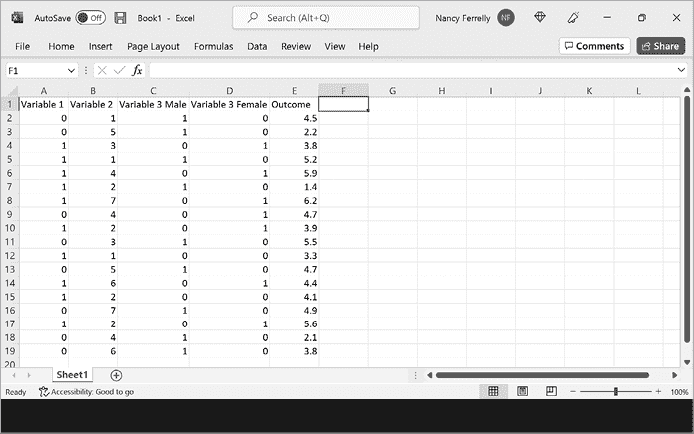

图 1-3：转换后的结构化数据集，其中分类变量已被替换为两个二值虚拟变量

如果类别无序——例如男性、女性和非二元性别——我们就不希望将它们强行放入一个维度中，因为那样会人为地给它们施加顺序，并使其中某些类别比其他类别更接近（参见图 1-4）。

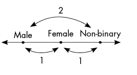

图 1-4：将分类变量的值放在单维度中会导致某些值比其他值更接近。

从几何角度来看，当我们创建虚拟变量时，是在为不同的类别创建新的轴。这样做有两种方法。有时，你会看到人们为分类变量的每个值使用一个虚拟变量；另一些时候，你会看到人们对除一个值以外的所有值使用虚拟变量（正如我们在图 1-3 中所做的那样）。

为了理解其中的区别，让我们来看看三分类性别变量。

使用三个虚拟变量将类别放置在等边三角形的顶点上：男性坐标为 `(1,0,0)`，女性坐标为 `(0,1,0)`，非二元性别坐标为 `(0,0,1)`。这确保了所有类别之间的距离都相等。

仅使用两个虚拟变量意味着男性的坐标为 `(1,0)`，女性的坐标为 `(0,1)`，非二元性别的坐标为 `(0,0)`。这把我们在三维空间中的等边三角形投影到二维平面上的直角三角形，并在过程中扭曲了距离。

现在，男性和女性离非二元性别比它们彼此更近，因为在这个边长为 `1` 的等腰直角三角形中，它们被长度为 `√2 ≈ 1.4` 的斜边分开（参见图 1-5）。因此，某些机器学习算法会错误地认为男性和女性类别与非二元性别类别的相似性高于它们彼此之间。

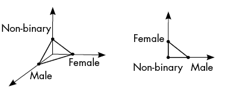

图 1-5：创建性别虚拟变量的两种方法。左侧，为每个类别提供一个轴，确保类别等距。右侧，我们只使用两个轴，导致某些类别比其他类别更接近。

我们可以将数值表格看作是描述了一个点集（每行一个点），位于*欧几里得向量空间* `R^(*d*)` 中。这个几何空间在二维下看起来像一张平的纸，在三维下像一个实心砖，但它在所有方向上无限延伸，可以是任何维度。

在这里，`d` 是列数，也是该空间的维度。数值数据集中的每一列都代表该空间中的一个轴。具体而言，每个数据点的 `d` 维坐标就是该行中的值。

当 `d` = 1 时，这个欧几里得向量空间 `R^(*d*)` 是一条直线。当 `d` = 2 时，它是一个平面。当 `d` = 3 时，它是我们习惯思考的普通三维空间。

虽然人类无法真正视觉化三个以上的垂直轴，但无论如何，都可以用数学和计算工具对高维几何进行分析。这里重要的一点是，正如在平面之外还有许多二维形状（例如球体表面或甜甜圈表面，甚至是更奇特的莫比乌斯环）一样，在熟悉的欧几里得空间之外，也有许多三维几何空间，如三维空间的球体内部或四维空间的球体表面。对于高维空间也是如此。

处理结构化数据传统上意味着从 `R^(*d*)` 的视角观察数据，而不是其他任何类型的几何空间。

`R^(*d*)` 的欧几里得向量空间结构是强大的；它允许我们计算各种有用信息。我们可以计算任意两个数据点之间的距离，这对于许多机器学习算法都是必要的。

我们可以计算连接任意两点的线段，用于合成少数类过采样技术（`SMOTE`）利用此来调整类别不平衡的训练样本。我们可以计算数据中每个坐标的平均值，这有助于*填补*缺失值（即根据已知数据对真实值进行最佳猜测以填充缺失值）。

然而，这种优良的欧几里得向量空间结构也具有特定性和刚性。幸运的是，我们可以在更通用的设置下（在这些设置中没有全局欧几里得坐标）计算点之间的距离、连接点的最短路径以及各种形式的插值，包括*流形*（如球体之类的几何对象，放大后看起来像普通的欧几里得空间，但在全局范围内可以具有更有趣的形状和结构——参见第 5 章）和*网络*（在第 2 章中正式引入的关系型结构）。


作为一个具体的例子，假设你正在处理大规模地理数据，例如基于邮政编码的犯罪统计。你如何对数据点进行聚类或建立任何预测模型？最直接的方法是将纬度和经度作为变量来传递数据的地理特征。但问题很快出现了，因为这种方法将圆形的地球投影到平面上，会极大地扭曲距离。例如，经度范围从 –180° 到 +180°，因此主子午线两侧的两个点在英里上可能非常接近，但在经度上可能极其遥远（参见图 1-6）。拥有一种不需要将数据映射到平面表面即可在球面数据上工作的机器学习算法是有帮助的。

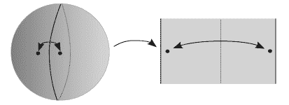

图 1-6: 使用纬度和经度（左）作为地理数据的变量会扭曲数据点之间的距离。图中所示，主子午线两侧非常接近的点在经纬平面上（右）被表示为非常相远的点。

逻辑回归产生线性决策边界。（尽管通过向模型中添加高阶项，你也可以实现非线性决策边界。）决策树通过用单个不等式划分自变量来构建的，这导致决策边界由水平和垂直线段组成。在高维空间中，我们拥有的不是水平和垂直线，而是与坐标轴对齐的平面。随机森林是决策树的集成，它们仍然产生这种形式的决策边界，但它们往往涉及更多的片段，产生看起来像曲线的形状，但实际上是由许多微小的水平和垂直线段组成的。`k`-NN 分类器产生多边形决策边界，因为它们根据有限训练数据点的远近程度来划分空间。神经网络可以产生复杂的、弯曲的决策边界；这种高度的灵活性既是祝福也是诅咒，因为如果不小心，它会导致过拟合（我们稍后会讨论过拟合）。

学习不同分类器算法产生的决策边界可以帮助你更好地理解每个算法的工作原理；它还可以帮助你根据数据特征来选择使用哪种算法（对于 `d` > 2 的高维数据，你可以通过绘制不同的变量对来获取数据的二维快照）。只需记住，这涉及到许多选择——使用哪些变量、是否包含高阶项、为超参数设置什么值等等——所有这些选择都影响了可能的决策边界类型。每当你遇到一个尚不熟悉的分类算法时，培养直觉的最佳方法之一就是画出它产生的决策边界，并观察它们随着你调整超参数是如何变化的。

### 回归

监督回归也可以从几何角度来看，尽管它稍微更难直观化。回归算法不是根据类别预测将空间划分为有限的区域，而是为空间中的每个点分配一个数值；当 `d` = 2 时，这可以绘制成热力图或三维表面。图 1-8 显示了这样一个示例，其中，我们首先创建了 10 个具有随机因变量值的随机点（在顶部的图中，用圆圈的大小表示该值），然后我们对密集的点网格进行预测值进行 3D 散点图，最后在使用 `k` = 3 的 `k`-NN（左下）和随机森林（右下）时根据高度进行着色。

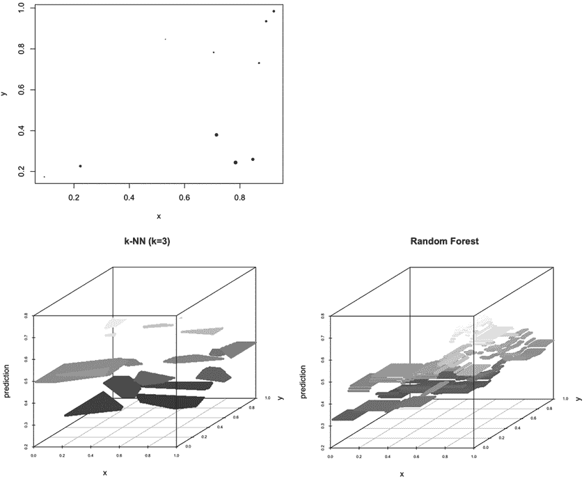

图 1-8：训练数据通过圆圈大小指示因变量值（顶部图），以及两种非线性回归算法的三维预测表面：3-NN（左下）和随机森林（右下）

线性回归的预测表面（此处未显示）是一个巨大的倾斜平面，而对于这里所示的两种方法，表面是有限个预测值保持不变的平面区域集合。注意，这些区域对于 `k`-NN 是多边形，而对于随机森林是矩形；情况将始终如此。此外，对于本示例中使用的特定超参数选择，随机森林的区域比 `k`-NN 的小。换句话说，与 `k`-NN 算法相比，这里的随机森林以手术般的精度切割了数据空间；后者则更像是用菜刀刻南瓜。但情况并非总是如此——这种粗糙程度的比较取决于随机森林中使用的树的数量以及 `k`-NN 中使用的邻居数量。重要的是，回归中更细的划分就像分类中更灵活的决策边界：它通常在训练数据上表现良好，但对新数据的泛化能力很差。这引出了我们的下一个主题。

### 过拟合

回到图 1-7 中的决策边界图。初看起来，边界越灵活，算法性能就越好。在考虑训练数据时这是真的，但真正重要的是算法在测试数据上的表现。预测分析中一个众为人知的问题是过拟合，即预测算法过于灵活，以至于学习了训练数据的特定细节，从而最终导致在未见过的新数据上表现更差。

在图 1-7 中，逻辑回归算法错误分类了最左侧的圆圈，而决策树创建了一个长长的条形区域来正确分类那个单独的点。如果圆圈倾向于落在左侧而加号倾向于落在右侧，那么在使用新数据时，创建这个条形区域很可能会损害整体分类性能——如果是这样，这就是决策树过拟合训练数据的例子。

通常情况下，随着预测算法灵活性的增加，训练误差倾向于持续下降直到最终稳定，而测试误差倾向于首先下降，然后达到最小值最后增加（参见图 1-9）。我们想要测试误差曲线的底部：那是我们能够实现的最佳预测性能。它发生在算法足够灵活以拟合数据分布的真实形状，但又足够僵硬，至于不会学习特定于训练数据的虚假细节。


图 1-9：以预测算法的灵活性为函数的训练误差与测试误差的散点图，说明了过拟合的概念

在图 1-9 中所示的通用行为通常在改变超参数时发生：随着神经网络中神经元数量的增加，分类器的决策边界变得更加灵活；随着 `k`-NN 中邻居数量 `k` 的减少；随着决策树中分支数量的增加，依此类推。

# 维度灾难

有时，将图 1-9 中的 x 轴视为复杂度而非灵活性会有帮助。更灵活的算法往往更复杂，反之亦然。算法复杂度最简单但最重要的标准之一是它使用的自变量数量。这被称为数据的维度。如果自变量的数量为 `d`，那么我们可以认为算法输入的是 `d` 维欧几里得向量空间 `R^d` 中的点。对于固定数量的数据点，使用过少的自变量倾向于导致欠拟合，而使用过多的则倾向于导致过拟合。因此，图 1-9 也可以被解释为显示了在不增加数据集大小的情况下，随着数据维度增加，预测算法误差得分发生的情况。

随着维度的增加，测试误差最终会增加，这是被称为`维度灾难`的通用现象的一种实例。在处理列数相对于行数较大的结构化数据（这在基因组学等领域是一个常见情况）时，预测算法很容易发生过拟合，而且驱动许多机器学习方法的数值线性代数也会失效。这是一个巨大的问题，人们已经开发了许多技术来帮助应对——其中一些技术将在本书后面部分介绍。现在，让我们看看几何如何为维度灾难提供一些启示。

## 理解欧几里距离

理解维度灾难的一种方法是将欧几里距离理解为在存在任意数量维度的空间中“鸟飞直达”的直线距离。想象在正方形纸上画了两对点，其中一组点彼此靠近，而另一组点彼此很远，如图 1-10 所示。


图 1-10: 二维空间中两对点的图

让我们通过添加一些高斯噪声来稍微扰动这些点；也就是说，我们将从二元正态分布中抽取四个向量，并将添加到四个点的坐标中。这样做会让点在随机方向上略微移动。让我们多次这样做，每次都记录扰动后左侧点对之间的欧几里距离，以及右侧点对之间的欧几里距离。如果扰动足够大，我们可能会导致左侧点之间的距离比右侧点更远，但总的来说，左侧扰动的欧几里距离将比右侧扰动的距离小，正如我们在图 1-11 的直方图中所示。

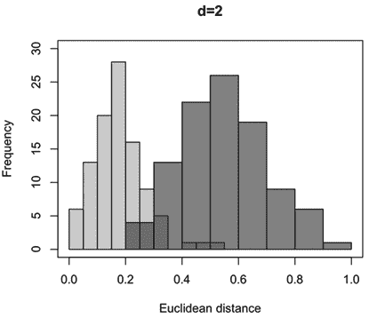

图 1-11: 图 1-10 左侧临近点（浅灰色显示）和右侧远端点（深灰色显示）在随机微小扰动后的欧几里距离直方图

## 嵌入高维

接下来，我们将我们的正方形纸作为一个二维平面嵌入高维欧几里空间 `R^d` 中，然后重复扰动点并计算距离的实验。在高维中，这些扰动发生在更多的方向上。具体来说，你可以将其理解为为点的 `x` 和 `y` 坐标填充 `d-2` 个零，然后对这 `d` 个坐标中的每一个坐标添加少量的噪声。图 1-12 显示了当 `d = 10` 和 `d = 100` 时执行此过程得到的欧几里距离直方图。

如今存在的大多数数据并非自然地以电子表格的形式存在。示例包括文本数据、网络数据、图像数据，甚至是视频或音频片段数据。每种格式都有其独特的几何结构和分析挑战。让我们开始探索其中的一些非结构化数据类型，看看几何结构如何帮助我们理解和建模这些数据。

## 网络数据

在下一章中，你将学习与网络相关的正式定义，但你在处理社交媒体时可能已经对网络有了初步认识。Facebook 好友关系构成了一个无向网络（节点是 Facebook 用户，边是他们之间的好友关系），而 Twitter 账户构成了一个有向网络（有向边是因为你既有关注者，也有你关注的账号）。网络数据本质上并没有任何欧几里得特征或电子表格的结构。近年来，深度学习已从常用的欧几里得电子表格设置扩展到了更通用的 `Riemannian manifolds`（黎曼流形，我们将在第 5 章）。


图 1-14：克鲁格国家公园的一只象（左）和一只母狮子（右）

动物显示在自然环境中，那里的叶子、树枝和光线各不相同。它们的分辨率不同。每只动物的颜色也不同。与动物以及动物周围其他物体相关的形状也不同。手动推导出有意义的独立变量来对这些图像进行分类是非常困难的。幸运的是，CNN 的设计是为了处理此类图像数据并自动创建有用的独立变量。

基本思想是将每幅图像视为一个数学表面（见图 1-15），然后走过这个表面，创建其显著特征的地图——峰、谷，然后输入到下一层，依此类推。最后，CNN 将图像转换为一系列层次编码图像内容的地图，而底层是实际用于分类的地图。对于这些动物图像，第一张地图可能会识别图像中的高对比区域。下一张地图可能会将这些区域组合成轮廓。随后的地图可能会指示哪些形状是动物。

CNN 构建这些地图的精确方式是通过训练过程内部学习的：随着算法被输入标记数据，每层神经元之间的连接会形成、断开并重新形成，直到最后层尽可能有利于分类任务。我们将在第 10 章进一步探讨 CNN 及其量子版本。

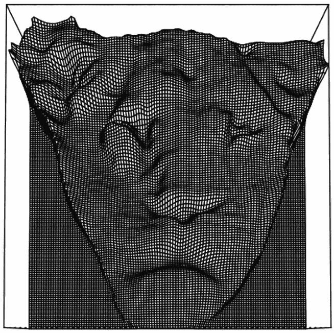

图 1-15：从几何角度看作是 3D 数学表面的图 1-14 中的母狮头部

使用计算几何方法量化峰和谷的应用不仅限于识别和分类。科学家可能想理解科学现象的动态过程或结构，例如物体上的水流或光流。物体的峰、谷和轮廓影响光照在物体上的散射方式，也会决定液体如何在物体上流动。我们将在书中后面介绍如何挖掘数据的峰、谷和轮廓。

## 文本数据

近年来流行的另一种“非结构化”数据形式是文本数据。在这里，随数据存在的结构并不像图像那样具有空间性；而是语言性的。尖端文本处理（例如，Google 处理搜索词，以及 Facebook 和 Twitter 检测违反平台政策的帖子）利用深度学习创建所谓的 `vector embeddings`（向量嵌入），它将文本转换为 `R^d`，其中每个单词或句子都表示为欧几里得向量空间中的点。每个单词或句子的坐标通过阅读大量文本从数据中学习，深度学习算法选择这些坐标的方式本质上是将语言意义转化为几何意义。我们将在第 9 章探讨深度学习文本嵌入。

例如，我们可能想要可视化与文本文档的不同变量集。由于这些变量构成了一个高维空间，我们无法以人类可以可视化的方式对其绘图。在随后的章节中，我们将学习如何通过几何方法将高维数据映射到低维空间，以便在图表中轻松地可视化数据。我们可以根据文档类型或其他相关的文档属性，用颜色或不同的形状对这些图表进行装饰。如果相似的文档在这些图表中聚集在一起，那么涉及的某些变量很可能帮助我们区分不同的文档。对于具有未知属性但这些变量具有已测量值的新文档，则可以通过分类算法进行分组。我们将在第 9 章中进一步探讨这一点。

## 总结

本章对传统机器学习的主要概念进行了简要回顾，但为这些概念引入了几何视角，这对于大多数读者来说可能是新颖的。在这一回顾中，还穿插了关于数据“结构化”意味着什么的讨论。主要的结论是，基本上所有数据都具有意义的结构，但这种结构通常是几何性质的，需要几何工具来将数据转化为更传统的电子表格格式。这是我们在贯本书中将深入探讨的主题。本章还暗示了电子表格数据中隐藏的一些重要的几何结构。本书的主要目标之一是展示如何利用这种隐藏的几何结构来提高机器学习的性能。

我们将在第 2 和 3 章开始深入研究用于分析网络数据的算法，包括社交网络和地理网络。这包括理解网络结构和个人在网络中作用的局部和全局指标、为网络数据开发的聚类方法、用于建议网络中新边缘的链路预测算法，以及理解过程或流行病如何在网络中传播的工具。

# 2 网络的几何结构


我们在第 1 章中简单接触过网络，它们在我们的生活中扮演着日益重要的角色；相应的，网络数据在数据科学中发挥着日益重要的作用。我们如何衡量用户在社交媒体上的影响力？或者如何判断计算机网络应对黑客的健壮性？或者识别桥接不同社会群体的人？这些都是关于网络几何结构的问题，并且都是我们在本章中将探索的概念示例。

我们将从一个简短的激励章节开始，论证为什么网络数据是现代数据科学中的一个重要课题，并且从几何推理中极大受益。随后我们将介绍网络理论中的基本概念和定义，网络理论植根于图论的数学语言。本章的大部分将是对网络及其顶点相关数量的引导式之旅。我们将通过查看几种不同类型的随机网络作为结束，这些网络在文献中已被广泛研究，并且在 `R` 语言中容易生成。

## 网络科学引论

网络科学通过实体之间的相互关系研究实体，是一门重要的跨学科学科，自社交网络兴起以来，它在数据科学中获得了巨大的动力。正如我们在第 1 章中所示，网络数据在通常意义上是“非结构化的”，但在其他方面它们是高度结构化的。从数学上说，网络植根于称为图论的学科，它将实体和关系提炼为它们的抽象本质。网络在几何上是丰富的，但它们的几何结构与通常的角度和直线的欧几里得几何不同。为了从网络中提取洞察，我们必须离开电子表格的欧几里得世界，拥抱更奇异的几何世界，在那里，球体看起来不像我们习惯看到的圆形物体。

让我们考虑一个社交媒体的例子。Facebook 等平台上的用户形成一个网络，距离可以由连接两个人的最小友谊数量来定义。这种距离的概念支撑了衡量用户在网络中中心性的几种方法，我们可以用它以各种方式量化“影响力”。例如，我们可以统计直接连接的朋友的数量，以此来量化各种方式的“影响力领袖”。我们可以统计直接连接到用户的朋友数量，我们可以统计有多少朋友的朋友。换句话说，一个用户可能没有许多直接连接，但可能拥有巨大的影响力范围。网络的几何结构允许我们通过衡量用户网络与其他网络相比的概率来检测异常值；这有助于社交媒体平台自动检测虚假账号。

一个基于网络的异常检测的迷人应用出现在最近一起关于选区划分州法院诉讼中。2018 年之前宾夕法尼亚州的一张选区地图被广泛认为是有利于共和党的党派选区划分的结果，但直到一个专家团队引入了网络科学，法院才被说服。他们展示了可以将选区地图视为网络，通过在地图空间中进行随机游走并在统计上探测这些网络的几何结构，他们发现宾夕法尼亚州的地图距离平均值几个标准差。当时考虑的新地图正处于正态曲线的中心。他们得出结论，旧地图极不可能自然产生；它是如此异常，以至于是地图绘制者（他们受控于当时的共和党人）故意设计的，以增加共和党的席位数量。相比之下，新地图要典型得多（且是公平的）。法院被这种网络分析说服了，并在 2018 年废弃了旧地图，采用了新地图。

即使在表面上看起来不是关于网络的场景中，有时也有一种将数据视为网络数据的方法——这样做可以利用一组源自网络卓越几何结构的丰富工具。

本章侧重于网络的几何结构以及如何利用它来定义一系列指标，以量化网络形状和结构的各个方面。在下一章中，我们将应用这些指标来探索网络数据上的机器学习和其他形式的数据分析。让我们正式开始旅程。

## 网络理论基础

网络传达了实体（可以是个人、物体、项目等）之间的两两关系。实体由顶点（也称为节点）表示，而一对实体之间的关系由连接这对顶点的边表示。以下是作为网络研究的一些实体和关系的示例：人与人之间的电话和短信、生物通路中相互作用的蛋白质、通过道路连接的城镇、通过页面链接连接的网站、在同一任务期间激活的大脑部分、语言中词汇或词性之间的连接——这只是流行示例的一个冰角。

在绘制网络时，顶点被描绘为点，有时会装饰有符号以便我们识别哪个顶点是哪个；边通常是直线线段，但有时（例如为了避免人为的边相交）将某些边画为圆弧是有帮助的。所有重要的是顶点集合以及它们之间的边——而不是边在图中的长度、它们之间的角度，或顶点的位置。事实上，如图 2-1 所示，同一个网络可以用相当不同的方式进行绘制。

它们具有相同的顶点和连接顶点的相同边，但这些关系的绘制方式各不相同。无论我们如何视觉化这些关系，它们的底层结构都不会改变。

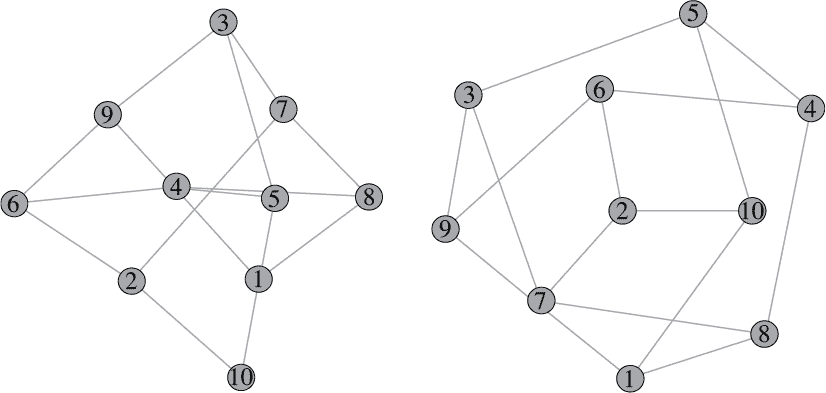

图 2-1: 同一个网络的两种不同绘图。它们具有相同的顶点和连接顶点的相同边，但这些关系的绘制方式各不相同。无论我们如何视觉化这些关系，它们的底层结构都不会改变。

### 有向网络

如果边代表单向关系（意味着它们从一个称为 `source` 的顶点指向另一个称为 `target` 的顶点），则网络是 `directed`（有向的）；否则，边表示相互关系，网络是 `undirected`（无向的）。例如，对于电话对话，我们可以为任何两个通过电话的人创建一个带边的无向网络，或者我们可以创建一个有向网络，用边表示从源点人到目标人的拨出电话。

具体来说，假设我们有三个同事：Sadako、Pedro 和 Georg。Sadako 是项目负责人，因此她给 Pedro 和 Georg 打了电话。Pedro 就项目工程方面的问题给 Georg 打了电话，但 Georg 没有给 Pedro 或 Sadako 打电话。Pedro 没有给 Sadako 打电话，因为当她给他打电话时，他已经收到了指令。图 2-2(a)显示了这些同事的无向网络，而图 2-2(b)显示了有向网络。

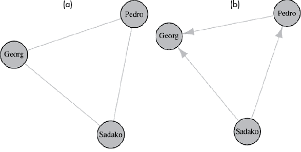

图 2-2: 三个同事之间的电话网络，(a)无向的，(b)有向的


有向网络的示例包括旅行路线、机器和社会过程、追踪疫情的针头共享以及生物过程模型。从数学上说，Facebook 和 Twitter 之间最大的区别是 Facebook 是无向网络（好友是相互的），而 Twitter 是有向网络（用户既有粉丝，也有被关注的账号）。

## R 中的网络

在计算机中表示网络有两种主要方法。`edge list`（边列表）以任意顺序列出网络中所有的边，命名每条边的两个顶点（如果网络是有向的，则第一个顶点被视为源，第二个顶点视为目标）。在 R 中处理网络数据的有用包是 `igraph` 库（它在 Python 中也存在，具有相似的命令和语法）。要从边列表创建图 2-2(b) 中的有向网络，你可以使用列表 2-1 中的代码。

```r
library(igraph)
edges<-rbind(c("Sadako","Pedro"),c("Sadako","Georg"),c("Pedro","Georg"))
g_colleagues<-graph.edge(edges,directed=T)
```

列表 2-1：从边列表生成图 2-2(b) 中有向网络的脚本

网络的另一种表示方法是电子表格。如果一个网络有 `n` 个顶点，其 `adjacency matrix`（邻接矩阵）是一个 `n`×`n` 矩阵，其行和列由顶点索引，其中 `(i, j)` 中的 `0` 表示从顶点 `i` 到顶点 `j` 没有边，而该项中的 `1` 表示存在这样的边。如果网络是无向的，则邻接矩阵是对称的（等于其转置，意味着交换行和列时它保持不变），因为在这种情况下，从顶点 `i` 到顶点 `j` 有边等同于从顶点 `j` 到顶点 `i` 有边。列表 2-2 提供了从邻接矩阵而非边列表构建上述有向网络的 R 代码。

```r
library(igraph)
adjmat<-matrix(c(0,0,0,1,0,0,1,1,0),nrow=3)
rownames(adjmat)<-c("Sadako","Pedro","Georg")
colnames(adjmat)<-c("Sadako","Pedro","Georg")
g_colleagues<-graph_from_adjacency_matrix(adjmat,mode="directed",weighted=T)
```

列表 2-2：从邻接矩阵生成图 2-2(b) 中有向网络的脚本

邻接矩阵方法的一个主要优势是它将网络置于线性代数的框架中，在那里可以使用许多强大的工具。例如，我们可以使用邻接矩阵的谱理论（特征值和特征向量）来衡量网络中的中心性。邻接矩阵还可以推广到 `weighted networks`（加权网络）；通过允许任意数字作为条目（而不只是目前讨论的二进制 0 和 1），我们可以为每条边分配一个实数权重。在实践中，这可以表示许多不同的概念：同事之间的通话量、交通网络中的距离。

## 网络中的路径和距离

如果两个顶点由边连接，则称为 `neighbors`（邻居）。网络中的两条边如果有一个公共顶点，则它们是 `adjacent`（相邻的）。网络中的 `path`（路径）是相邻边的序列。如果网络是有向的，则路径中的所有边必须方向一致。例如，在图 2-2(b) 中，我们有一条从 Sadako 到 Pedro 再到 Georg 的双边路径，以及一条从 Pedro 到 Georg 的单边路径，但从 Pedro 到 Sadako 再到 Georg 不是路径，因为边的方向并不是这样的。

路径的 `length`（长度）有两种含义，取决于网络是加权的还是无权的。在无权网络中，路径的长度是路径中边的数量；在加权网络中，长度是路径中边的权重和。两个顶点之间的 `network distance`（网络距离）是连接它们的最小路径的长度，假设从一个点到另一个点有路径（如果没有路径，则网络距离未定义）。人们（包括在我们内）通常说“最短”路径而不是“最小长度”路径，因为听起来更自然。这对于加权网络来说有些误导性，因为最小长度路径实际上是权重最低的路径，它在边数意义上可能并不是最短。

作为一个例子，让我们考虑图 2-3 中的加权无向网络，它代表四个城镇以及它们之间道路的长度（英里）。

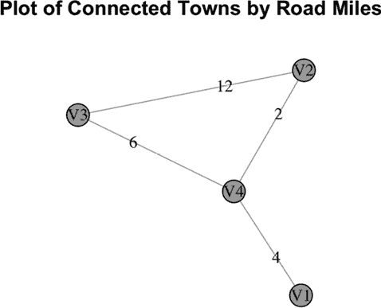

图 2-3：城镇连通性和连接城镇的道路里程

`V2` 与 `V3` 之间的最短路径是经过 `V4` 的 8 英里路径，而不是直接连接这两个城镇的 12 英里路。因此，`V2` 和 `V3` 之间的网络距离是 8 英里，而不是 12 英里。请注意，此图中边和路径的物理长度在任何意义上都不代表由权重定义的长度；换句话说，网络图中的欧几里得距离与网络距离毫无关系！由 `igraph` 绘制的网络图中，顶点的位置是基于美学考虑选择的（例如，为了尽可能减少边交叉次数），而不是为了反映边权重。这在刚开始可能很难适应，但随着时间的推移，会开始变得很自然。列表 2-3 提供了创建和绘制此示例中网络的 R 代码。

```r
# 创建城镇之间连接关系及每个城镇之间里数的对称矩阵
towns<-matrix(c(0,0,0,4,0,0,12,2,0,12,0,6,4,2,6,0),nrow=4)

# 为行和列标记，以便城镇拥有名称
rownames(towns)<-c("V1","V2","V3","V4")
colnames(towns)<-c("V1","V2","V3","V4")

# 从此邻接矩阵创建一个加权无向网络
library(igraph)
g_towns<-graph_from_adjacency_matrix(towns,mode="undirected",weighted=T)

# 绘制城镇图，并用权重标记边
plot(g_towns,edge.label=E(g_towns)$weight,main="按路里程连接的城镇图",vertex.color=2,vertex.size=20)
```

列表 2-3：一个从图 2-3 生成并绘制连接城镇网络的脚本

网络距离在现实世界问题中可能起着重要作用。在 2018 年刚果民主共和国东爆发埃拉病毒疫情期间，城镇之间有限的物理路线影响了疫情传播、移动医疗物资和人员的供应链物流，以及受影响城镇与当时没有活跃病例的城镇之间的人口混合。

关于加权网络的一点警告：我们倾向于将彼此靠近（由网络距离定义）的顶点认为彼此关系最紧密或连接最强。这意味着边的权重越小，它所代表的关系就越强。由于这个原因，在设置网络权重时，你通常希望使用倒数。例如，在一个加权电话网络中，与其将 A 人和 B 人之间的权重设为他们之间的通话次数 `c[AB]`，不如将其设置为倒数 `1/c[AB]`，这样通话得更频繁的人在加权网络中彼此更近（而不是更远）。在第 3 章中，我们将重新回顾图 2-3 中的城镇网络，并对权重取倒数，使其代表邻近性而非距离。

为了开始探索由网络距离建立的几何结构，我们现在转向网络中的中心性概念（也可以被视为重要性或影响力）。由于我们在整个章节中将依赖 `igraph`，我们以后不再在代码段中包含 `library(igraph)`；因此，在运行以下任何代码示例之前，请务必加载此库。

## 网络中心性指标

衡量网络中每个顶点的中心性（`centrality`）或重要性可以让你手动分析网络的结构和功能行为。它也经常被用于特征提取，因为中心性指标提供了数值特征，可以输入到传统的监督和无监督机器学习算法中，正如我们在[第 3 章]中所看到的。

## 顶点的紧密性（Closeness）

如何确定一个顶点位于网络中心附近还是边缘区域？顶点的 `closeness`（紧密性）定义为该顶点与网络中其他每个顶点之间距离之和的倒数，其设计目的是捕捉这种区别。靠近网络中心的顶点到网络中其他顶点的距离相对较小，而边缘顶点到某些顶点的距离较小，但到网络“对侧”顶点的距离则很大。这意味着中心顶点的距离之和小于边缘顶点的距离之和；对这个总和取倒数就会反转过来，使得中心顶点的紧密性得分高于边缘顶点。

在图 2-3 中，你可能会直观地判断 `V4` 是最中心的，`V2` 和 `V3` 居中，而 `V1` 是最外边缘的。事实上，如果我们忽略边权重并作为无权网络计算紧密性得分，我们得到 `V1`、`V2`、`V3` 和 `V4` 的紧密性得分分别为 0.20、0.25、0.25 和 0.33。例如，`V2` 的紧密性为 `1/(1 + 1 + 2)`。当使用边权重时，我们得到的紧密性得分为 0.05、0.06、0.04 和 0.08，因此 `V4` 仍然是最中心的，但现在 `V3` 变成了最边缘的；这是因为边权重使得 `V3` 与其他顶点之间的网络距离相对较大。

## 顶点的介数（Betweenness）

顶点的 `betweenness`（介数）通过计算网络中有多少条路径通过该顶点来衡量中心性；更准确地说，它是网络中所有其他顶点对之间，通过该顶点的最短路径占该对最短路径总比例的和。当将图 2-3 视为无权网络时，`V1` 的介数为 0，因为其余顶点之间没有最短路径通过 `V1`。`V2` 和 `V3` 的情况也是如此。然而，`V4` 的介数为 `2 = 1 + 1 + 0`，因为 `V1` 和 `V2` 之间有一条通过 `V4` 的最短路径，`V1` 和 `V3` 之间有一条通过 `V4` 的最短路径，而 `V2` 和 `V3` 之间的最短路径不通过 `V4`。

在图 2-4 中，每个顶点的介数得分均为 0.5。例如，对于 `V1`，`V2` 和 `V4` 之间的单边路径不通过 `V1`，`V3` 和 `V4` 之间的单边路径不通过 `V1`，而 `V2` 和 `V3` 之间有两条最短路径，其中一条通过 `V1`，组合得出 `0 + 0 + 1/2` 的介数得分。

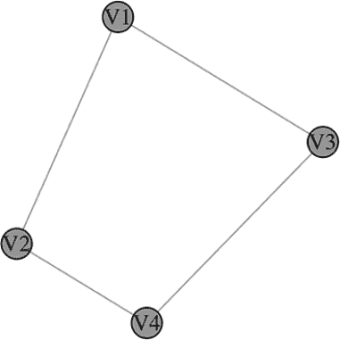

图 2-4：以正方形连接的四个顶点的网络

## 特征向量中心性（Eigenvector Centrality）

基于邻接矩阵的中心性旨在捕捉一个基本思想：顶点的重要性由与其连接的顶点的重要性决定。这就是之前提到的网络深度概念所在。例如，在社交媒体上，重要的不仅是你的粉丝数量，还有你的粉丝数量。

让我们让这个想法精确化。假设我们要为每个顶点 `i` 分配一个重要性得分 `x[i]`。一个简单的模型是假设每个顶点的重要性与其相邻顶点的加权和成正比：

`x[i] = c∑()a[ij]x[j]`

其中求和针对的是顶点 `i` 的邻顶点 `j`，`a[ij]` 是顶点 `i` 与顶点 `j` 之间边的权重，`c` 是比例常数（我们假设它与 `i` 无关）。该公式可以表示为矩阵方程：

`xoverrightarrow = cAxoverrightarrow`

其中 `A` 是网络的邻接矩阵。你可能从线性代数中记得，该方程规定顶点的重要性向量 `xoverrightarrow` 是邻接矩阵的特征向量，而 `1/c` 是对应的特征值。当把矩阵视为线性变换时，特征向量是那些被拉伸但没有旋转的方向，而特征值衡量了这些方向被拉伸了多少。

在图 2-3 中，当被视为无权网络时，`V1`、`V2`、`V3` 和 `V4` 的特征向量中心性得分（四舍五入到百分位）分别为 0.46、0.85、0.85 和 1。这符合我们的直觉，即 `V4` 是最中心的，而 `V1` 最不中心。当使用图中所示的权重作为加权网络计算时，得分则变为 0.16、0.91、1 和 0.59。因此，在加权网络中，`V1` 仍然是最不中心的，但最中心的是 `V3`。

特征向量中心性的核心点在于：对于邻具有较高特征向量中心性得分的顶点，其中心性更高。在社交网络术语中，这意味着你的重要性取决于你朋友的重要性。

我们可以通过随机游走的角度更精确地解释特征向量中心性。想象你从一个随机顶点开始，通过随机选择当前顶点连接的一条边来重复移动。如果网络是无权的，那么你以等概率选择这些边；而如果网络是加权的，则选择边的概率与边的权重成正比。特征向量中心性得分与你在进行这些随机游走时在每个顶点上花费的时间成正比。例如，如果网络代表全球维网（顶点是网站，边是链接），那么特征向量中心性就传达了用户仅随机点击链接时，每个网站获得的流量大小。

特征向量中心性的缺点是，如果没有路径连接两个不同的部分，随机游者永远无法在网络的两个部分之间旅行。换句话说，每个随机游者都受限于它起始所在的“岛屿”（或者用更数学化的术语，即`连通分量`）。这对于有向网络尤其特别有问题，因为边只能沿着一个方向遍历：如果随机游者到达死胡同，它将永远被困在那里。帮助随机游者越过岛屿和死胡同的一种方法是允许他们随机跳转到网络中的不同位置。这是我们将看到的下一个指标的核心思想。

## PageRank 中心性

Google 的 `PageRank 中心性` 只是特征向量中心性的微小修改；它在计算特征向量之前，将邻接矩阵替换为缩放后的版本。在图 2-3 中，作为无权网络计算的 `V1`、`V2`、`V3` 和 `V4` 的 PageRank 得分分别为 0.13、0.25、0.25 和 0.37。

理解 PageRank 的最佳方法是基于随机游走概率。我们和计算特征向量中心性时玩同样的游戏，但现在每一步有两种可能：随机游者要么像以前一样跨越连接的一条边，要么直接跳转到网络中的一个随机顶点。在全球维网的例子中，这意味着人们可以点击链接，也可以直接在网络浏览器中输入 URL。这种跳转的能力帮助随机游者探索网络的更大范围，与特征向量中心性相比，这有助于增加该中心性得分捕获的信息。

### Katz 中心性

另一个同样从网络邻接矩阵的光谱理论计算出的有用中心性指标是 `Katz 中心性`。

### 枢纽与权威性

泛化特征向量中心性的另一种方法是为每个顶点提供两个独立的得分而不是一个。从概念上讲，`权威中心性（authority centrality）` 衡量它接收了多少知识，而 `枢纽中心性（hub centrality）` 衡量一个顶点了解多少知识。

## 在示例社交网络中衡量中心性

为了更好地理解所有中心性指标，考虑一个比我们目前考虑过的更有趣的例子会有帮助。列表 2-4 中的脚本加载并绘制了来自此作者之一的网络。你可以在书的网页上找到数据集以及其他文件：`https://nostarch.com/shapeofdata`。

```python
#load data including no header
mydata<-as.matrix(read.csv("SocialNetwork.csv",header=F))

#convert data to graph
g_social<-graph_from_adjacency_matrix(mydata,mode="undirected",weighted=T)

#plot graph
plot(g_social,main="Farrelly's Social Network",vertex.size=15,vertex.label.cex=0.5,vertex.color=2)
```

列表 2-4：一个脚本加载社交网络数据集，将其转换为图对象，然后绘制它。


图 2-5 显示了生成的网络图（每次运行此脚本时，看起来都略有不同）。

```python
# 中介性
plot(g_social,vertex.size=20*betweenness(g_social)/max(betweenness(g_social)),vertex.label.cex=0.8,vertex.color=2)

# 接近性
plot(g_social,vertex.size=20*closeness(g_social)/max(closeness(g_social)),vertex.label.cex=0.8,vertex.color=2)

# 特征向量中心性
plot(g_social,vertex.size=20*eigen_centrality(g_social)$vector,vertex.label.cex=0.8,vertex.color=2)

# PageRank 中心性
plot(g_social,vertex.size=20*page_rank(g_social)$vector/max(page_rank(g_social)$vector),vertex.label.cex=0.8,vertex.color=2)

# Katz 中心性（alpha 参数设置为 0.2）
plot(g_social,vertex.size=20*alpha_centrality(g_social,alpha=0.2)/max(alpha_centrality(g_social,alpha=0.2)),vertex.label.cex=0.8,vertex.color=2)
```

列表 2-5：一个为 Farrelly 社交网络数据集上的每种中心性度量创建气泡图网络图的脚本

让我们从接近性和中介性开始，如图 2-6 所示。

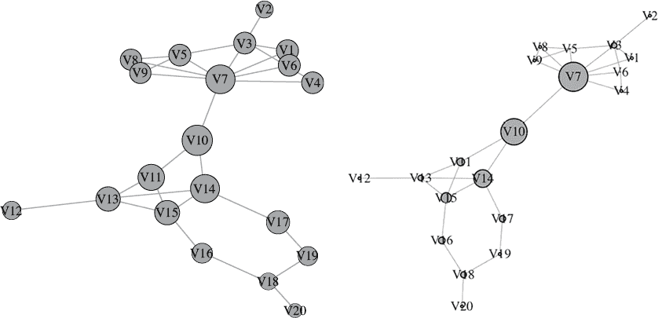

图 2-6：Farrelly 社交网络数据上接近性中心性（左）和中介性中心性（右）的气泡图

这里的接近性评分似乎捕捉到了我们希望看到的内容。位于网络越中心位置的顶点越大，而越靠边缘的顶点越小。请注意，这种中心性概念是基于网络的全局几何形状的。例如，`V10` 具有最高的接近性中心性评分，因为它在整个网络中处于中心，尽管在两个主要簇（医学院朋友和退伍军人朋友）中的每一个簇都处于边缘。

中介中心性（正如你所记得的，其目的是捕捉那些移除后会对跨越网络的流造成最大破坏的位置）为 `V7` 和 `V10` 提供了比所有其他顶点大得多的评分——这两个顶点是连接该网络中两个主要簇的。`V14` 也有一个较小但仍然相对较大的中介性评分，表明在两个主要簇之间的许多（但不是所有）最短路径都通过了该顶点。

接下来，让我们看看图 2-7 所示的特征向量中心性和 PageRank 中心性评分。

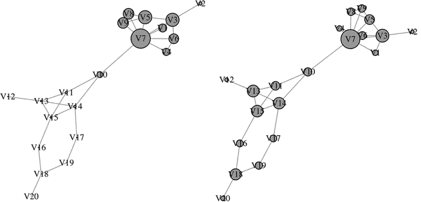

图 2-7：Farrelly 社交网络数据上特征向量中心性（左）和 PageRank 中心性（右）的气泡图

对于这两个度量，`V7`（代表 Farrelly 本人）具有最高值，且这些值在医学院簇中的分布方式——至少从直觉上看——似乎捕捉到了中心性或重要性的概念。此图中最引人注目的也许是这两个紧密相关的基于特征向量的度量之间的对比。对于特征向量中心性，医学院簇中的值完全压倒了退伍军人组织簇的值，而 PageRank 中心性似乎能更好地反映每个簇内部单独的中心性和重要性。这种差异的原因是，在随机游走中，人们仅仅以相等的概率选择邻居顶点进行遍历，倾向于在高度互密的医学院簇周围徘徊，并且采取那条通往该簇之外（从 `V7` 到 `V10`）的概率很低。而使用 PageRank 中心性时，随机游走包含了跳转到网络中任何位置的固定概率，这有助于它们到达退伍军人组簇。

在图 2-8 中我们有 Katz 中心性，正如你所记得的，它是度的一种高阶版本，不仅考虑邻居的数量，还考虑邻居的邻居的数量，以此类推。我们通过指定来自高阶连接影响的衰减率，计算了两个不同衰减参数 `alpha` 下的值。

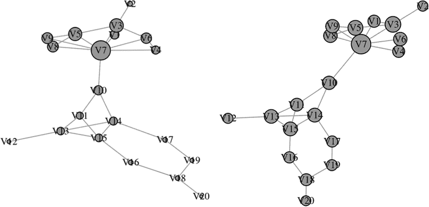

图 2-8：Farrelly 社交网络数据上衰减参数 alpha = 0.2（左）和 alpha = 0.1（右）的 Katz 中心性气泡图

事实证明该网络的谱半径约为 4，因此我们需要选择小于 0.25 的 `alpha` 值（这里是 `0.2` 和 `0.1`）。我们在这里看到，两种选择都将 Farrelly 的 `V7` 识别为中心顶点，但对于这两个 `alpha` 参数中较高的一个（左图），评分在 `V7` 附近仍保持较高水平，然后迅速消散。对于较小的 `alpha`（右），消散得不那么快。Katz 中心性在整个网络中更有效地捕捉了我们通常认为的中心性或重要性，并且通常建议选择一个接近谱半径倒数的 `alpha` 值。在无向网络中，这两个度量是重合的，所以让我们首先将网络转换为有向网络。正如你所看到的，对于网络中的每条边，例如 `i` 和 `j`，以三分之一的概率将其转换为单向边从 `i` 到 `j`；以三分之一的概率将其转换为单向边从 `j` 到 `i`；以三分之一的概率保持为双向边。

```python
# 随机移除接接矩阵中的某些项
mydata_directed<-mydata
for (i in 1:20){
  for (j in i:20){
      rand<-runif(1)
      if(rand < 0.33){mydata_directed[i,j]<-0}
      if( >= >= 0333 rand rand < 0.6){mydata_directed[jjii<-0}
  }
}

# 使用此接接矩阵创建有向网络
g_directed<-graph_from_adjacency_matrix(mydata_directed,mode="directed",weighted=T)

# 绘制该网络的枢心性和权威性
plot(g_directed,vertex.size=20*hub_score(g_directed)$vector,vertex.label.cex=0.8,vertex.color=2,edge.arrow.size=0.4)
plot(g_directed,vertex.size=20*authority_score(g_directed)$vector,vertex.label.cex=0.8,vertex.color=2,edge.arrow.size=0.4)
```

（上述代码对应的是列表 2-6：一个将 Farrelly 社交网络转换为有向网络并然后绘制结果枢心性和权威性的脚本）

*注：由于原文代码块存在部分逻辑混乱/重复（如 `if( >= >= 0333 rand rand rand < 0.6)`），在翻译时遵循“代码块不需要翻译”的原则，保留了其原样。*

现在我们已经通过视觉化探索了所有的中心性指标，让我们用其中几个指标对 Farrelly 社交网络中的顶点进行排名和比较（回到原始的无图版本）。Listing 2-7 中的代码可以添加到 Listing 2-4 的代码中，以生成包含某些中心性指标的数据集。

```python
#create dataset of a few centrality measures on Farrelly's social network
data_social<-cbind(page_rank(g_social)$vector,degree(g_social),hub_score(g_social)$vector,betweenness(g_social))
colnames(data_social)<-c("PageRank","Degree","Hub Score","Betweenness")
```

Listing 2-7：创建一个 Farrelly 社交网络中若干顶点中心性得分表格的脚本

Table 2-1 显示了这些顶点得分，每列中最高的两个条目已加粗显示。

表 2-1：Farrelly 社交网络顶点的中心性指标评分

| 顶点 | PageRank | Degree | Hub score | Betweenness |
| --- | --- | --- | --- | --- |
| V1 | 0.032 | 2 | 0.414 | 0 |
| V2 | 0.020 | 1 | 0.168 | 0 |
| V3 | **0.075** | **5** | 0.682 | 19.500 |
| V4 | 0.032 | 2 | 0.370 | 0 |
| V5 | 0.057 | 4 | **0.685** | 2.000 |
| V6 | 0.046 | 3 | 0.505 | 1.000 |
| V7 | **0.111** | **8** | **1.000** | **100.500** |
| V8 | 0.044 | 3 | 0.550 | 0 |
| V9 | 0.044 | 3 | 0.550 | 0 |
| V10 | 0.048 | 3 | 0.306 | **90.917** |
| V11 | 0.050 | 3 | 0.118 | 26.667 |
| V12 | 0.022 | 1 | 0.021 | 0 |
| V13 | 0.069 | 4 | 0.087 | 18.917 |
| V14 | 0.067 | 4 | 0.127 | 61.083 |
| V15 | 0.068 | 4 | 0.088 | 36.000 |
| V16 | 0.040 | 2 | 0.024 | 23.083 |
| V17 | 0.040 | 2 | 0.034 | 21.917 |
| V18 | 0.065 | 3 | 0.009 | 20.250 |
| V19 | 0.043 | 2 | 0.011 | 10.167 |
| V20 | 0.026 | 1 | 0.002 | 0 |

优势非常明显，`betweenness`（介数中心性）识别出 `V7` 和 `V10` 是连接网络最重要的顶点。然而，`V10` 的其他中心性得分要低得多，这表明它主要充当社区之间的桥梁，而不是网络中真正的中心。这是合理的，因为 `V10` 在退伍军人群体中似乎并不突出。它恰好连接了 Farrelly 的 `V7`，从而通过她连接到了医学院社区。相比之下，Farrelly 的 `V7` 许多邻居（如 `degree` 所示），并且在 Hub score 和 `PageRank` 方面都是排名第一——这与我们对该网络的概念性理解是一致的，即该网络包含了 Farrelly 所参与的两个独立社区。

`V3` 在 `degree` 和 `PageRank` 方面的排名位居第二；此人似乎处于医学院社区的社交中心。`V5` 拥有第二高的 hub score，表明它靠近医学院社区的重要成员。Hub score（在此处由于网络是无图的，与权威性得分 `authority` 吻合）也区分了 `V12` 和 `V20`。这两者都是退伍军人社区边缘的度为 1 的顶点，且 `PageRank` 低且 `betweenness` 为 0。然而，`V12` 的 hub score 较高，因为它靠近一个连接非常紧密的微子社区。

## 网络的其他数量

网络几何提供的不仅仅是顶点的中心性指标。在本节中，我们将引入与网络顶点相关的其他一些感兴趣的数量。例如包括衡量朋友之间相互性的传递性得分（transitivity scores）、衡量效率的效率得分（efficiency scores）以及衡量曲率的（curvature scores）。

### 顶点的多样性

虽然 hub 和 authority 关注的是有向网络，但与顶点相关的另一个指标是 `diversity`（多样性）。顶点的 `diversity` 是权重香农熵（一种比例量）的缩放版本。在加权网络中，当权重相等时最大，并随着权重多样化而减少。

### 三元闭合

网络理论中一个很有用的概念是三角闭合（triadic closure），即朋友之间形成三角形的倾向。考虑图 2-10 所示的朋友网络。在这里，Justin 和 Jason 是朋友，Justin 和 Mick 也是。问题是 Jason 和 Mick 是否也是。这种情况被称为以 Justin 为中心的三角形。如果 Jason 和 Mick 不是朋友，则被称为*开*三角形（open triangle），而如果他们是朋友，则被称为*闭*三角形（closed triangle）。大多数闭三角形的网络具有高度的凝聚力。在社交网络中，这意味着有共同朋友的人可能彼此认识。相反，具有许多开三角形的网络可能表明凝聚力不强，但也表明数据不完整：人们可能没有在社交媒体上添加所有现实中的朋友，情报数据可能不包含恐怖分子小组之间的所有通信形式，等等。在任何现实环境中，都可能存在尚未被记录的关系。

量化三元闭合的一种方法是通过传递性（transitivity），它为每个顶点分配以其为中心的三角形中闭三角形的比例。在社交网络中，你的传递性是你的两个朋友彼此认识的概率。让我们将以下添加到 Listing 2-6 的绘图集中：

```python
#compute and plot transitivity for each vertex in Farrelly's social network
plot(g_social,vertex.size=20*transitivity(g_social,type="local",isolates="zero"),vertex.label.cex=0.8,vertex.color=2)
```

将参数 `type` 设置为 `local` 让 igraph 计算每个顶点周围的传递性，并将参数 `isolates` 设置为 `zero` 强制度为 1 的顶点得分为 0（否则将为 NaN，因为度为 1 的顶点没有以其中心的三角形）。图 2-11 显示了生成的图。

这从另一个角度显示，医学院社区比退伍军人社区更具凝聚力、联系更紧密。在同一课程中参加同类课外活动的医学生可能彼此认识并交流。然而，请注意，Farrelly 的 `V7` 在医学院人员中的传递性得分较低，这意味着尽管该群体整体关系紧密，但 Farrelly 的几位医学院朋友之间并不互相认识。（`V7` 的传递性还因为 Farrelly 的医学院朋友中没有与退伍军人组的朋友 `V10` 认识而被降低。）

### 顶点的效率与离心率

回想我们过的两个中心性指标——紧密性（closeness）和中介性（betweenness），是根据网络中最短路径（或 `geodesics`）的长度定义的。另一个基于最短路径的有趣指标称为效率（efficiency），它对每个顶点的定义如下：移除目标顶点，然后计算该顶点所有邻居节点之间产生的网络距离。然后，取这些距离的倒数的平均值。移除顶点就像制造了一个路障，而邻居节点之间的距离衡量了由于路障而必须绕行的额外路程长度。这些距离的倒数意味着路程越长，效率越低，反之亦然。效率衡量了流量绕过网络中每个顶点的难易程度。

效率是探测网络局部几何结构的一种有用方法。这里的“局部”（local）一词意味着我们正在探索每个顶点附近的网络几何结构；这与紧密性和中介性不同，后者更具全局性，因为它们涉及跨越整个网络的路径。我们将效率的计算添加到 Listing 2-6 中。我们需要一个额外的库来完成此操作：

```python
# 加载 igraph 的 brainGraph 库
library(brainGraph)

# 计算 Farrelly 社会网络中每个顶点的效率
efficiency(g_social,type="local")
```

我们没有展示此图的气泡图，因为它看起来与图 2-11 中的传递性图极其相似。事实上，该网络传递性得分与效率得分之间的相关性为 0.96。在其他网络中，尤其是更大、更复杂的网络，情况可能如此。需要注意的是，传递性是一个极局部的指标，因为它只考虑邻居顶点以及它们之间的边。相比之下，效率在本质上是局部的，但它可以访问网络较大的部分，因为路障造成的绕行可能会延伸到直接邻居集合之外。

另一个基于路径的顶点指标——像紧密性和中介性一样能看到网络的全局几何结构——离心率（eccentricity），它为每个顶点分配从该顶点到网络中任何其他顶点的最大距离。这衡量了每个顶点的边缘性，因此较低的离心率得分通常表示顶点更中心。我们稍后会回到这个指标。

### Forman–Ricci 曲率

里奇曲率（Ricci curvature）是几何学中的一个概念，用于衡量曲面上表面直线的畸变程度以及这种畸变增长或收缩的速率。你可以将其想象为某种力，将直线扭曲成弯曲路径（就像在湿纸巾上压一个小手力器）。请参见图 2-12，图中展示了图中从左到右里奇曲率增加的概念性插图。

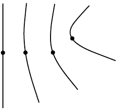

图 2-12: 直线的中点通过通过里奇曲率增加的空间（从左到右）滑动而发生变形

该概念从连续几何到网络领域的一种适配被称为 Forman–Ricci 曲率。计算 Forman–Ricci 曲率的第一步是为网络中的每条边分配一个数字，衡量该边紧邻区域内网络的离散程度。使用的数字是 2 减去连接该边的两个顶点的度之和；这是与该边相邻的边的负数。例如，在 Farrelly 的社会网络（图 2-5）中，`V7` 和 `V10` 之间的边 Forman–Ricci 曲率为 –8（源于 `V7` 的六个非 `V10` 邻居和 `V10` 的两个非 `V7` 邻居）。


接下来，我们使用这些边得分为顶点分配得分，如下：顶点的 Forman–Ricci 曲率是连接到该顶点的边的 Forman–Ricci 曲率之和。Forman–Ricci 曲率几乎负的，因此在可视化时，我们通常使用它的相反数。在 Listing 2-8 中，我们计算了 Farrelly 社会网络的 Forman–Ricci 曲率，并使用其相反数作为顶点大小和边宽进行绘图。

```python
# 计算所有顶点的度
d<-degree(g_social)

# 计算边并初始化曲率值向量
l<-length(E(g_social))
frc<-rep(NA,l)

# 循环计算并存储 Forman-Ricci 边曲率
for (I in 1:l){
  w<-as.vector(ends(g_social,E(g_social)[i],names=F))
  frc[i]<-2-d[w]]
}
```

最简单的全局指标是网络中的顶点数和边数。与这些指标密切相关（但通常更有用）的是`density`（密度），它是网络中的边数除以该顶点集上可能出现的最大边数。一个具有`n`个顶点的无向网络最多有

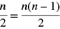

条边（不允许有自环或重边），而有向网络的最大边数是该数量的两倍。密度提供了一个衡量网络互连程度的粗略度量；它在 igraph 中通过`edge_density()`函数进行计算。图 2-14 展示了具有不同密度的某些网络。

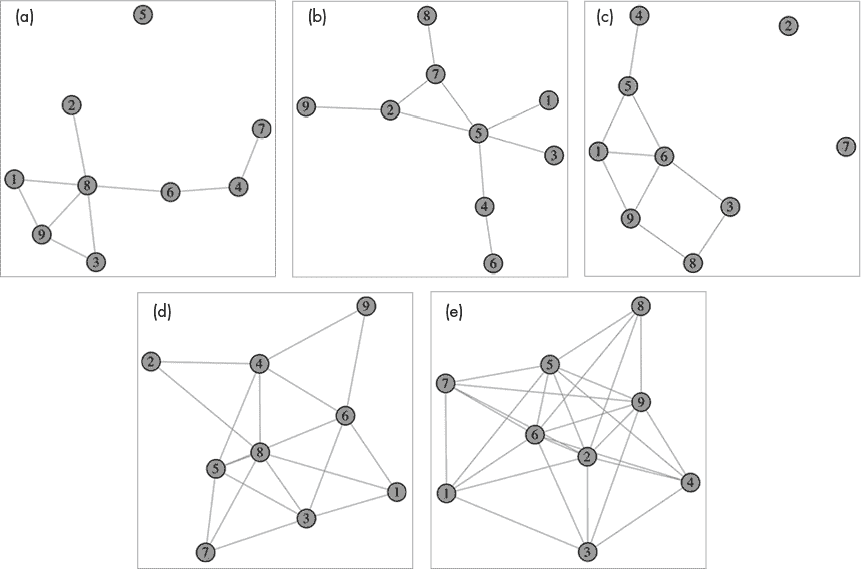

图 2-14：顶行的三个网络密度均为 25%，而左下角和右角的网络密度分别为 50% 和 75%。

网络中的平均度（average degree）也可以是一个非常有用的全局指标，但它包含与密度完全相同的信息，并与之完全相关。事实上，平均度是所有顶点度之和除以顶点数，而所有顶点度之和始终是边数的两倍。因此，平均度和边密度之间的差异取决于一个仅取决于网络中顶点数量的常数。因此，你可以使用其中一种指标，但同时使用两者并不会获得额外收益。

在前节中讨论的传递性（transitivity）概念（量化三元闭合）也有其全局对应概念。在 igraph 的`transitivity()`函数中将`type`参数设置为`global`时，会计算出一个数值，表示网络中闭合三角形的比例。这提供了另一种不同于边密度的方法，来衡量网络的整体互连性。

### 网络上的传播过程

更分散的网络的行为往往与更紧凑的网络不同。例如，考虑三个朋友——Amara、Imani 和 Taraji，她们在午餐桌上互相分享新闻。我们预想这些女孩在桌子上交换信息会比她们在不同的教室里互相发短信或在走廊里相遇时聊天要容易。让我们来看几种量化网络传播的不同方法。

在 igraph 的`efficiency()`函数中将`type`参数设置为`global`，可以得到该指标的全局版本，它计算网络中所有顶点对之间距离的倒数的平均值。这种效率的全局变体不涉及任何道路阻碍。高度互连的网络往往具有较高的全局效率，因为高互连性意味着顶点之间有许多直接路径，但从总的来说，最好将全局效率视为衡量网络紧凑性的度量。网络越分散，其全局效率就越低。

我们还可以计算网络的`diameter`（直径）。`diameter`是网络中任意两个顶点之间最短路径长度的最大值。可以在 igraph 中使用`distances()`函数计算`diameter`。

### 网络的谱度量

我们已经看到邻接矩阵的特征向量在连接性中起着重要作用。谱度量（spectral measures）基于邻接矩阵的特征值。令`lambda_1`、`lambda_2`、...、`lambda_n`为非递减排序的邻接矩阵特征值。由于 igraph 的`spectrum()`函数可选地返回邻接矩阵的所有特征值和特征向量，“谱隙”（spectral gap，即最大特征值`lambda_1`与`lambda_2`之差）控制了网络上某些算法和随机过程的收敛时间。其他有谱度量基于邻接矩阵的变体，称为`graph Laplacian`（图拉普拉斯），通过对邻接矩阵取反并将每个顶点的度添加到相应的对角元素中得到。图拉普拉斯特征值 0 的重数是连通分量的数量。图拉普拉斯最小非零特征值被称为`algebraic connectivity`（代数连接性）；这是网络连接性的度量，反映了将网络碎片成更小片段的难度。Farrelly 的社交网络代数连接性较低，因为删除一个顶点就会将网络分为退军人组和医学院组。

列表 2-9 显示了如何计算图拉普拉斯矩阵并从中提取连通分量的数量和代数连接性。

```r
#计算网络 g 的图拉普拉斯矩阵
lap<-laplacian_matrix(g)

#计算特征值并四舍五入以避免数值问题
evals<-round(eigen(lap)$values,digits=5)

#计算连通分量的数量
sum(evals == 0)

#计算代数连接性
unique(evals)length(unique(evals))-1
```

列表 2-9：计算网络`g`图拉普拉斯矩阵并从中提取连通分量数量和代数连接性的脚本。

例如，在图 2-15 所示的两个网络上运行此代码，可以得到七个连通分量，左侧网络的代数连接性为 0.062，右侧网络的代数连接性为 0.09。

如果你想比较不同规模网络之间的得分，最好使用归一化拉普拉斯矩阵；要做到这一点，只需在列表 2-9 第一行计算图拉普拉斯矩阵时设置`normalized=T`即可。

## 真实世界行为的网络模型

有几种类型的网络是真实世界行为的重要模型；这些模型为比较真实世界网络和数据提供了有用的基准。让我们从构建最简单的一种类型开始。

### Erdös–Renyi 图

`Erdös–Renyi graphs`（Erdös–Renyi 图）是根据顶点对集合均匀分布随机生成边的网络。这些网络在`igraph`中通过`sample_gnp()`函数创建。图 2-15 中的两个网络都是通过使用`sample_gnp(50,0.05)`生成的，它创建了一个具有 50 个顶点和 5% 边概率的网络。通过这种方式创建的图密度将接近指定的边概率，但不一定等于它——就像反复抛掷均匀硬币并不总是得到恰好的一半正面和一半反面一样。图 2-14 中的网络也是用`sample_gnp()`创建的。

Erdös–Renyi 图提供非常有用的零假设。如果你认为你的网络高度结构化，那么它的边应该非常远离均匀分布，因此网络看起来或表现起来不像`Erdös–Renyi`网络。在接下来的两个章节中，我们将看到如何实现这一想法。Erdös–Renyi 图在自然界并不常见，特别是在社会驱动的环境中。真实网络总是比这种纯随机边的网络更具结构性。

### 无标度图

`scale-free graph`（无标度图）是指度分布渐近遵循幂律的网络，这意味着存在一个常数`c`，使得度为`2*d`的顶点比例是度为`d`的顶点比例的`1/2^(*c*)`倍（至少近似如此，且近似值随着`d`的增加变得越来越准确）。常数`c`（称为`power`）通常位于 2 和 3 之间。这种幂律特性导致存在许多顶点的度远高于网络中的平均度。因此，无标度网络通常具有松散连接的枢纽组成的“辐辐”形状，就像连接中央安检口的机场航楼楼。网络中的枢纽倾向于缩短顶点之间的距离，赋予这些网络某些“小世界”属性。

这些网络拥有迷人的历史和完善的理论，我们没有空间深入探讨。该领域一个有趣的争论是，许多自然产生的网络是否是无标度的——包括互联网页面、社交网络、生物网络，甚至航空旅行网络——如果是的话，原因可能是什么。

生成无标度网络有多种方法；其中比较流行的选项是在`igraph`中通过`sample_pa()`函数方便地实现。它依赖于著名的 Barabási–Albert 模型。

### Watts–Strogatz 图

`Watts–Strogatz graphs`（Watts–Strogatz 图）是由 1998 年引入的一种随机图模型生成的网络，它倾向于比无标度图产生更多的小世界特性，例如紧密连接的社区和许多顶点之间较小的网络距离。这些网络经常包含由冗余和替代路线强化的路径。它们在生物学和社会过程中很常见。例如，神经元水平和功能区域层面的大脑连接网络、选民网络、社交媒体平台上的影响者网络以及食物网通常形成 Watts–Strogatz 网络。

由于我们已经看到了一些 Erdös–Renyi 图的示例（见图 2-14 和图 2-15），让我们创建一些其他类型的网络。在图 2-16 中，我们使用`sample_pa(100,power=2.5,directed=F)`生成了无标度网络，并使用`sample_smallworld(1,100,2,0.05)`生成了两个 Watts–Strogatz 网络。我们留给感兴趣的读者查阅`igraph`文档来学习后一个函数的参数选择。

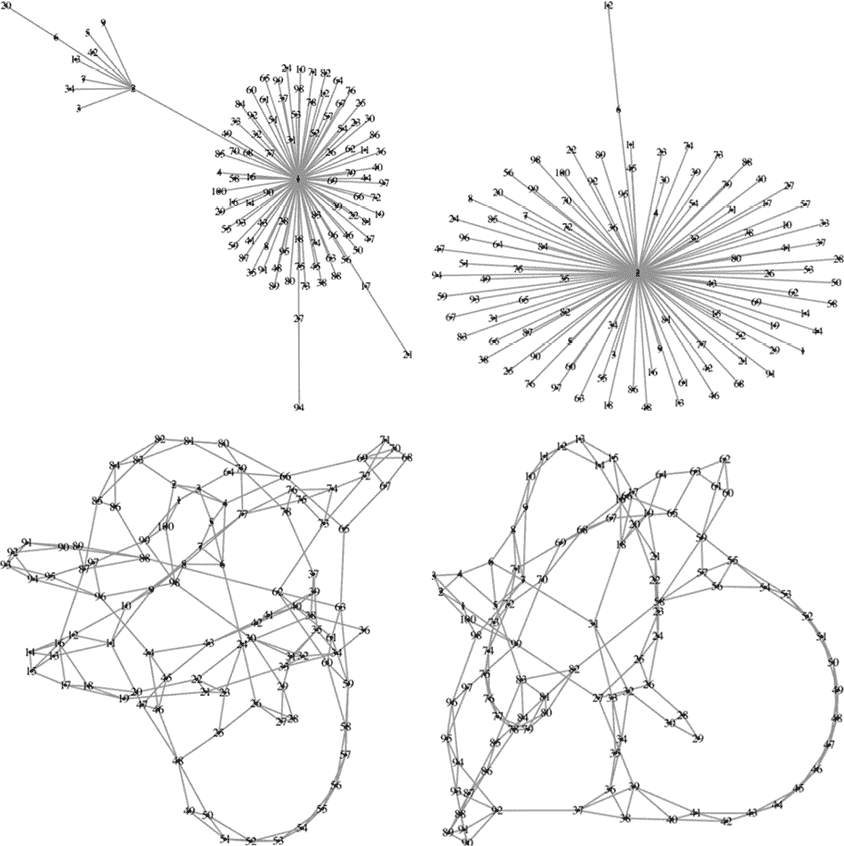

图 2-16：两个无标度网络（顶部）和两个 Watts–Strogatz 网络（底部）

第一行的无标度网络每个都有一个显著的枢纽，左侧的网络还有一个不那么明显的次级枢纽。想象这些是电网连接，那么摧毁主枢纽的风暴对无标度网络影响的客户将远比对 Watts–Strogatz 网络的影响得多。这就是为什么许多计划中的真实网络符合富冗余的结构。Watts–Strogatz 网络没有像无标度图那样的强枢纽，但它们具有纯随机 Erdös–Renyi 图中未看到的结构。例如，之前提到的长强化路径结构在这些底部图中很容易。

## 总结

本章以一个简短的章节开头，解释了数据科学中对网络的需求以及网络科学中对几何的需求。接下来，我们介绍了网络以及涉及其中的对象——顶点、边、路径等。然后，我们定义并探索了一系列用于量化网络和顶点各种属性的指标。本章以几个常用的随机图模型结束，这些模型用于生成合成网络数据，以便与真实网络数据进行比较。

# 3 网络分析


在第 2 章中，我们考虑了一些网络几何指标；在本章中，我们将使用它们。首先，我们将解释顶点指标如何允许你在网络内进行监督学习，即预测与顶点相关的值以及预测网络中的新边；我们还将查看顶点指标如何使你对网络中的顶点进行聚类。然后，我们将讨论一些直接在网络几何结构中运行的聚类算法。接下来，我们将解释如何使用全局网络指标对由网络组成的数据集进行机器学习和统计分析。随后，我们将探索流行病学中易感、感染和康复（SIR）模型的网络变体。通过这个模型，我们可以看到实体（从疾病到虚假信息）是如何通过网络传播的，以及网络几何如何影响这种传播。最后，我们将研究如何使用顶点指标来制定针对性策略以破坏这种传播。

## 使用网络数据进行监督学习

网络数据通常伴随着一个传统的结构化数据集，其中行与网络中的顶点对应。例如，你可能有一个社交网络数据集，它由个人列表（顶点）、他们之间的朋友关系（网络中的边）以及一个或多个数值或类别列组成，提供每个人的额外的非网络信息——例如年龄、性别或薪水。我们可能想将此视为一个监督学习问题，即训练机器学习算法来预测其中一个数据列。这种的方法是使用顶点指标作为自变量（连同任何其他数据列），这让算法在做出预测时考虑每个顶点的网络角色。让我们尝试一下。

### 使用社交媒体网络指标进行预测

让我们回到 Farrelly 的社交网络，我们在上一章节中分析了该网络，用以说明不同的顶点中心性衡量标准。网络不同部分之间的桥梁，或紧密连接几位医学院朋友的枢纽，如何影响 Farrelly 在医学院第一学期在日记中提到这些人的频率？让我们来看看网络指标如何与该社交网络中的日记提及相关。

我们将选择几个顶点中心性指标，并将 Farrelly 的日记数据作为集合中的因变量。让我们加载数据，并参考列表 3-1 检查因变量的分布。

```r
#import dataset
g<-read.csv("SocialNetworkModel.csv")

#create a histogram of the data
hist(g$Diary.Entries,main="Diary Entry Histogram",xlab="Diary Entries")
```

列表 3-1：用于进一步分析导入相关`*.csv`文件的脚本

图 3-1 显示了因变量分布的直方图（泊松分布）。

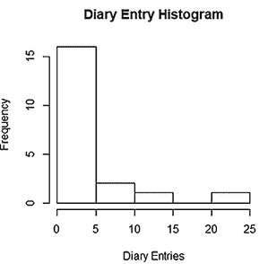

图 3-1：Farrelly 社交网络日记条数据的直方图

通常，计数变量（如符合泊松分布的变量）包含大量的零和接近零的值，以及一些大值。我们可以从图 3-1 看出这种结果符合泊松分布。泊松分布变量可能会给机器学习算法带来问题，因为它们涉及大量的零和一些离群值，例如涉及`V10`的日记条目）。这表明与其他机器学习算法相比，广义线性模型（泊松回归）作为监督学习模型可能更合适。网络中的大多数人在整个学期内被提到的次数很少（如果根本没有被提到）。然而，存在少数离群值，包括 Farrelly 和她在网络中最密切的朋友（`V3`、`V10`和`V14`）。让我们深入研究，看看中心性衡量标准如何预测日记提及情况。在列表 3-2 中，我们对 Farrelly 社交网络的感兴趣指标进行采样，并将其作为泊松回归模型中的独立变量。

```r
#create a training sample from Farrelly's social network metrics
n<-dim(g)[1]
set.seed(10)
train.index=sample(1:n,15)
train<-g[train.index,]

#build a Poisson regression model
gl<-glm(Diary.Entries~.,data=train,family="poisson")

#examine performance with a model summary and Chi-squared test
summary(gl)

1-pchisq(summary(gl)$deviance,summary(gl)$df[2])
```

列表 3-2：计算泊松回归并分析其结果的脚本

你的结果可能会取决于 R 版本的随机种子设置，但在我们使用该数据集和其他种子进行建模的 10 次随机划分中的 9 次）的样本中，摘要函数显示，介数中心性在模型中似乎具有较大的系数值，并且在通过回归函数建模的 Farrelly 社交网络数据子集中，它是日记条目提及最一致的预测因子。我们样本中的卡方检验值范围从`p` < 0.01 到`p` = 0.25。当我们检查与线性回归相关的图表时，可以看到大多数样本都很好地拟合了回归方程。图 3-2 显示了列表 3-2 生成的两个图表（包括`V3`、`V7`和`V13`作为离群值）。

样本量较小可能是样本间差异产生，但总的来说，我们有一个良好的预测模型。事实上，这反映了 Farrelly 自己的直觉：她网络中的桥梁往往协调记忆深刻的事件和活动，这些活动在该学期将她网络的各个部分聚集在一起。我们将在第 6 章和第 8 章中讨论带有离群值的小样本量下回归模型的不稳定性，并介绍你可以用于这些情况的更稳定的模型，以获得一致的模型结果。

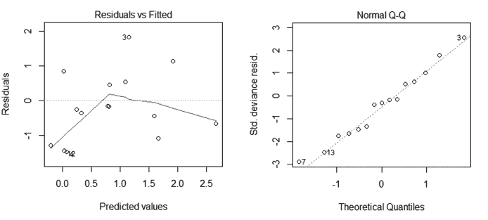

图 3-2：列表 3-2 中运行的泊松回归的残差图和分位数图

因变量与个人社交网络联系更紧密的较大网络（如政治观点强度、锻炼习惯等）在此类分析中往往效果更好。在生物网络中，中心性衡量标准可以用于预测疾病的严重程度、对临床试验药物反应的可能性，或在基于社交网络的行为健康干预六个月后的疾病风险。分析网络的几何结构通常为预测与顶点相关的某些属性产生实用的独立变量。

### 预测社交媒体中的链接

网络中另一种重要的监督学习形式是`链接预测`（link prediction），即从网络结构或元数据中推断潜在的新边。预测链接的一种是利用网络的先验增长模式来预测哪些边最可能出现。这有许多现实应用，其中最著名的是社交媒体。每当 Facebook 或另一个平台向你推荐添加好友时，算法已在后台对其网络运行了链接预测，并为你与这位潜在朋友之间的缺失边赋予了高分。执行链接预测有许多复杂的方法，但一种通用的通用策略是将问题转换为传统的监督学习任务。让我们以 Farrelly 的社交网络为例，从概念上进行探索。

想象这个网络随时间演变，并用二值指示器表示自上一个时期以来形成的边。如果我们能根据网络在过去时间段的几何形状来预测某段时间内的边形成，那不是很酷吗？或者如果我们可以使用顶点标签（如课程表或志愿者日）来预测下一个时期的边形成，那又会怎样？

对于独立变量，我们可以使用任何与两个顶点相关的特征集合。这些特征可以是基于网络的内部特征，也可以是外部特征（例如社交网络中的用户人口统计数据）。基于网络的预测器有两种类型。我们可以通过选择一个函数将每对中两个顶点的分聚合为单个数字来使用顶点指标（常用选择包括`sum`、`max`、`mean`和差值的绝对值）。例如，我们可以计算每对中两个顶点的 PageRank 分数，然后取这两个分数的平均值来分配给该顶点对。

另一类基于网络的特征使用两个顶点之间网络关系的度量；这里最自然的选择是两个顶点之间的网络距离，尽管你可以尝试其他选项，例如两个顶点之间的最短路径数量，或者随机游走从一个到另一个花费的平均时间。所有这些基于网络的预测器都应该针对当前版本的网络计算，而不是之前的快照，并且这些基于网络的预测器可以与任何非网络特征集合相结合。（在实践中，大多数非网络特征是附加到单个顶点而非对的，因此仍然必须聚合它们以获得每个顶点对的单个分数。）

一旦为感兴趣的时间段计算出独立预测变量，并且该时间段存在一个指示变量，就可以使用监督分类器来预测感兴趣时间段内的边形成。边形成的概率得分越高，这种关系在下一个时间段内存在的可能性就越大。在 Farrelly 的社交网络中，介数中心性可能是主要的基于网络的预测指标，社交活动数据或医学院第一学期的日记条目也可能可能是预测指标。在那个学期结束时，她原始社交网络中的每个人都与她相连（且大多数人彼此之间也相连）。

## 使用网络数据进行无监督学习


正如我们可以使用第 2 章中的顶点指标作为监督学习任务的预测变量一样，我们也可以将它们作为无监督学习任务中的特征。在聚类情况下，这会将顶点划分为网络中具有相似功能的顶点集合（枢纽、桥梁等）。在网络科学中，顶点聚类被称为`社区挖掘`（community mining），因此，当使用顶点指标来实现此目的时，我们获得由它们在网络中所处的结构性角色定义的社区。

### 将聚类应用于社交媒体数据集

在列表 3-3 中，我们将 `k-means` 聚类应用于 Farrelly 的社交网络数据集，该数据集是我们第 2 章中的主要运行示例。

```python
#重新缩放顶点指标矩阵并应用 k=3 的 k-means
clust<-kmeans(scale(vertdata),3)

#用顶点颜色和标签表示聚类绘制网络
plot(g,vertex.size=6,vertex.color=clust$cluster,vertex.label=clust$cluster)
```

列表 3-3：一个使用 `k-means` 对顶点指标将图 3-1 中网络中的顶点聚分为 `k = 3` 组的脚本。

使用 `k = 3` 的 `k-means`，并将 PageRank、度、枢纽中心性、介数传递性作为我们的特征（我们首先对其进行了重新缩放），我们得到了表 3-1 所示的聚类均值和大小，这些值是从原始未预缩放值计算得出的。

表 3-1：对 Farrelly 社交网络的少量顶点指标运行 `k-Means` 聚类（`k = 3`）的聚类均值和大小

| 聚类 (Cluster) | PageRank | 度 (Degree) | 枢纽得分 (Hub score) | 介数 (Betweenness) | 传递性 (Transitivity) | 聚类大小 (Cluster size) |
| --- | --- | --- | --- | --- | --- | --- |
| 1 | 0.05 | 3.14 | 0.54 | 3.21 | 0.80 | 7 |
| 2 | 0.11 | 8.00 | 1.00 | 100.50 | 0.25 | 1 |
| 3 | 0.05 | 2.50 | 0.08 | 25.75 | 0.097 | 12 |

由于 `k-means` 涉及初始化，你每次尝试时可能会得到不同的聚类结果。对于这种特定的聚类，我们看到一个顶点被分配了自己的单独聚类（Farrelly 的顶点，`V7`）；该顶点除传递性以外的所有得分都异常高，因此它在许多指标上都是离群值。所有剩余顶点被分在另外两个聚类中，这两个聚类的主要区别在于，其中一个聚类具有较高的枢纽和传递性得分，而另一个聚类具有较高的介数。让我们按聚类标记顶点并绘制此网络（这样做是对列表 3-3 的延续）。

图 3-3：Farrelly 的社交网络，根据表 3-1 总结的 `k-means` 聚类进行着色和标记。

我们看到 Farrelly 确实是一个单独的聚类，而且非常显著，聚类 1 几乎是剩下的医学院人员，而聚类 2 是退军人群体。有趣的是，有一个医学院的人被放在聚类 3 中，因为他们是孤立的（传递性分零），并且不是医学院人员主要枢纽的一部分。

### 网络中的社区挖掘

到目前为止，我们利用网络几何结构来提取特征，然后在它们上运行了传统的欧几里得机器学习聚类算法。在网络中聚类顶点的另一种方法（称为`社区挖掘`）是直接依赖网络的几何结构。我们将简要介绍实现此点的几种方法。

#### 使用随机游走探索网络

`walktrap algorithm` 使用随机游走来探索网络并寻找随机游走被“困住”的社区。如果随机游走频繁留在某个顶点集合中，那么该集合就是聚类的良好候选。例如，在 Farrelly 的社交网络中，从医学院人员中开始的随机游走很有概率留在他们中很多步之后，因为唯一的出口是跨越 Farrelly 顶点的桥梁。事实上，要离开随机游走必须到达 Farrelly 的顶点，然后我们才会选择那座桥作为下一步（这在该顶点发生的概率只有八分之一）。同样，从退军人群体中开始的随机游走很有概率留在他们中。通过这种方式，`walktrap algorithm` 擅长发现被桥梁隔开的社区。这种方法的缺点是这样探索大型网络计算量巨大。

#### 评估聚类结果质量

在传统的欧几里得聚类中，评估聚类结果质量的典型方法是比较每个聚类内部的距离与其他聚类之间的距离。这种想法有一个广泛使用的网络变体适用于顶点聚类：顶点聚类的`模块性`（modularity）是随机选择的连接到同一聚类中两个顶点的概率减去网络中的边随机分布时这种情况发生的概率。直观地说，这比较了社区内部边与社区间边的数量。它是一种“提升”衡量标准，因为它比较了聚类（在边留在类内的意义上）比随机基准好出多少。在前一章介绍的 Watts–Strogatz 网络的重要小世界属性之一是，它们倾向于具有高模块性。

模块性还允许你将顶点聚类视为一个优化问题：我们寻找模块性得分最高的聚类划分。尝试所有可能的聚类划分是不切实际的，因此引入了各种算法来尝试寻找高模块性的聚类，但不保证能找到全局最优解。解决问题的两种流行方法是`贪心算法`（greedy algorithms），贪心意味着在每一步中都向最大增加模块性的方向移动，而不是在短期内采取次优步骤以在长期获得更大的值。

`Louvain clustering` 是这类贪心算法之一。它最初将每个顶点视为自己的一个簇，然后每当合并相邻簇能够增加模块度（modularity）时，就迭代地进行合并。一旦这个迭代局部优化过程终止，算法将通过合并所有分配到同一个簇的顶点创建一个新的、更小的网络。这产生了一个网络，其中每个顶点都是自己的一个簇，因此可以在这个较小的图上再次运行相同的迭代局部优化过程。该算法在实践中非常快，且通常表现良好，但在寻找大型网络中的较小社区时往往很吃力。通常常用一种更快的贪心算法，方便称为`fast greedy clustering`，但它往往无法达到更高的模块度分数。

### 理解自旋玻璃聚类（Spinglass Clustering）

另一种聚类方法不涉及随机游走或局部优化。相反，它源于统计力学——物理学中研究粒子相互作用的分支。`Spinglass algorithms` 基于粒子系统（正负荷）内部的磁耦合；它们试图优化电荷跨整个系统的对齐方式。这可以应用于顶点聚类，被称为`spinglass clustering`。

基本思想是定义一个与聚类相关的能量，然后尝试最小化这种能量。这种能量最小化过程通常通过`simulated annealing`（模拟退火）完成，这是一种优化算法方法，其根源也同样统计力学。在模拟退火中，并不是总是朝着能量减少最多的方向移动（正如贪心算法所做的那样，后者有陷入局部最优的风险），而是有一个温度参数来决定向相反的“错误”方向移动的概率。随着算法的进行，温度会逐渐降低。这有助于算法在后期稳定下来并锁定特定解决方案之前，探索能量景观的大部分区域。它模拟了冶金术中金属净化的冷却过程。

### 在社交网络上运行聚类算法

让我们尝试在 Farrelly 的社交网络上运行这四种顶点聚类算法。列表 3-4 执行了这一操作，然后绘制了结果并计算了模块度分数（要运行此操作，请确保你已经像列表 2-4 所示加载了该网络数据）。

```r
#run walktrap, louvain, fast greedy, and spinglass clustering algorithms
cw<-cluster_walktrap(g_social)
modularity(cw) #0.505
plot(cw,g_social,vertex.size=15,vertex.label.cex=0.6,main="Walktrap")

lo<-cluster_louvain(g_social)
modularity(lo) #0.476
plot(lo,g_social,vertex.size=15,vertex.label.cex=0.6,main="Louvain")

fg<-cluster_fast_greedy(g_social)
modularity(fg) #0.467
plot(fg,g_social,vertex.size=15,vertex.label.cex=0.6,main="Fast Greedy")

sg<-cluster_spinglass(g_social)
modularity(sg) #0.505
plot(sg,g_social,vertex.size=15,vertex.label.cex=0.6,main="Spinglass")
```

列表 3-4：一个在 Farrelly 的社交网络上运行之前讨论的四种顶点聚类算法、绘制结果并为每个算法计算模块度分数的脚本。

图 3-4 显示了生成的图表。

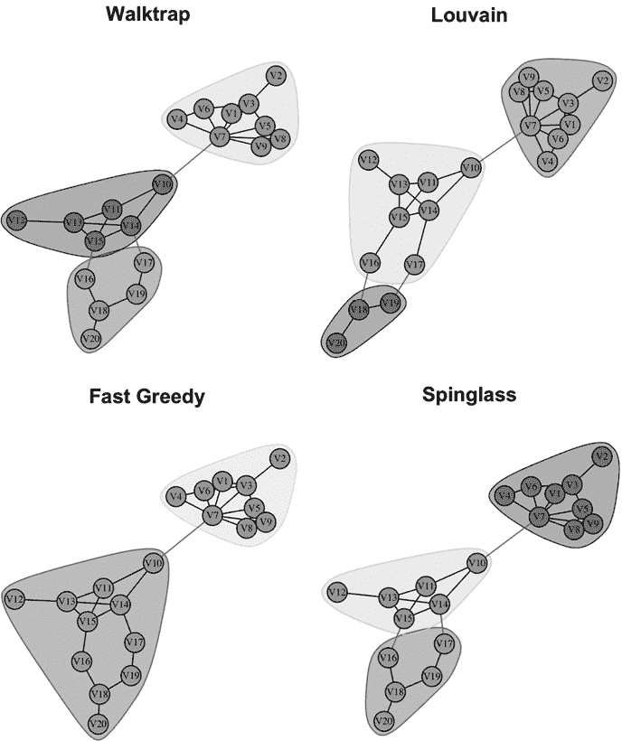

图 3-4：四种不同算法提供的 Farrelly 社交网络聚类。

请注意，对于所有这些函数，簇的数量并不是像 `k-means` 那样由用户指定的。这些算法在寻找最优解的过程中作为一部分确定了簇的数量。在这个例子中，`walktrap` 和 `spinglass` 找到了相同的三个簇，即医学院的个人（包括 Farrelly 的顶点 `V7`）以及将退伍军人组分为两部分。这种三路聚类在这些算法找到的解决方案产生了最高的模块度分数。

Louvain 找到了次优分，结果与上一个相似，但它以略有不同的方式划分了退伍军人组（将两个顶点从一个簇重新分配到另一个）。模块度分数略低于此，fast greedy 算法最终只得到了两个簇（包含 Farrelly 的医学院社区和退伍军人社区）。显然，该算法中的贪婪性阻止了它发现通过划分退伍军人社区可以获得更高的模块度。尽管如此，由 fast greedy 算法找到的这个双簇解决方案描述了数据的原始背景，即 Farrelly 将她的两个独立社区合并在了一起。

如果你感兴趣，可以探索 `igraph` 中实现的其他几种顶点聚类算法。例如，`cluster_edge_betweenness()` 函数使用介数性指标（betweenness metric）不是作为特征，而是以一种更直接的方式。介数性分数高的顶点被视为`bridges`（桥梁），该函数发现的社区是那些被这些桥隔开的社区。另一个有趣的方法由 `cluster_infomap()` 函数提供，它利用信息论寻找信息流流畅的社区；这也可以从网络上随机游走的行为来解释。

到目前为止，我们讨论了单个网络内顶点之间的有监督和无监督学习。现在，让我们考虑比较网络的情况。

## 比较网络

有时，一个网络并不是整个数据集。它只是包含许多网络的数据集中的单个实例。例如，在社交媒体平台上检测机器人账户通常涉及有监督分类，即将真实用户的朋友或粉丝网络与虚假用户进行比较。在第 2 章中提到的宾夕法尼亚州杰利螈案中，选区地图被转换为网络，旧地图被显示为网络分布中可疑的离群值。神经科学提供了另一个需要比较网络的重要例子。事实上，通常将功能磁共振成像（fMRI）和正子发射断层扫描（PET）数据转换为网络结构，顶点代表大脑的不同区域，边基于活动模式（例如一个区域的顺序激活，或在某个任务期间多个区域的协同激活）。通常需要比较两组患者——健康患者与患特定神经或心理疾病的患者，或者两个不同的疾病组。翻译成数据科学，这意味着我们正在查看一个二分类网络数据集，以查看两类之间是否存在统计学上的显著差异（以理解结构差异）。我们可能还会训练一个监督分类器，根据网络结构预测类别。

为了生成一些合成数据，让我们为第 2 章末尾描述的每种类型创建 100 个网络：Erdös–Renyi、无标度（scale-free）和 Watts–Strogatz。在列表 3-5 中，我们执行了这一操作，并绘制了网络直径的直方图，以观察它在不同类型网络内部以及之间的变化。

```r
#initiate vectors/lists
n<-100
er<-list()
sf<-list()
ws<-list()
er_d<-rep(NA,n)
sf_d<-rep(NA,n)
ws_d<-rep(NA,n)

#loop to create and store random graphs and compute their diameters
for (i in 1:n){
  er[[i]]<-sample_gnp(100,0.02)
  sf[[i]]<-sample_pa(100,power=2.5,directed=F)
  ws[[i]]<-sample_smallworld(1,100,1,0.1)
  er_d[i]<-diameter(er[[i]])
  sf_d[i]<-diameter(sf[[i]])
  ws_d[i]<-diameter(ws[[i]])
}

#plot combined histogram
hist(er_d,col=rgb(0,0,1,0.2),xlim=c(0,max(max(ws_d),max(ws_d),max(ws_d))),ylim=c(0,40),xlab="Diameter",main="")
hist(sf_d, col=rgb(0,0,1,0.5), add=T)
hist(ws_d, col=rgb(0,0,1,0.8), add=T)
box()
```

列表 3-5：该脚本生成了 `300` 个网络并将其平均分为三种不同类型；计算它们的网络直径；然后为每种类型的网络绘制直方图：Erdös–Renyi 网络、无标度网络和 Watts–Strogatz 网络。

此处选择的参数是为了确保所有随机网络具有相同数量的顶点（任意选择为 100）以及大致相同的边密度（约 2%）；这确保了网络结构是区分这三组的因素，而不是顶点或边的数量等更简单的因素。图 3-5 显示了生成的直方图结果。

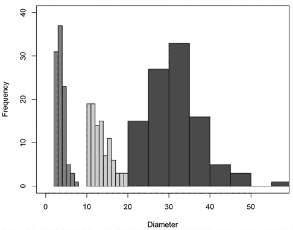

图 3-5：三种不同类型随机网络直径的直方图：Erdös–Renyi（浅灰色）、无标度（中灰色）和 Watts–Strogatz（深灰色）。

我们看到这三个直方图是不相交的。Erdös–Renyi 网络具有中等直径。无标度网络的直径值较小。Watts–Strogatz 网络具有较大的直径。如果你感兴趣，可以尝试修改列表 3-5 来计算第 2 章中讨论的其他全局网络指标（如效率、传递系数和谱半径），以观察它们在不同类型的随机图结构中的表现。

利用到目前为止开发的工具，你现在可以在网络数据集上执行许多机器学习任务。对于分类（例如，根据其朋友网络将社交媒体账户标记为机器人还是真实用户）或回归（例如，根据引文网络预测学术出版物的期刊排名），你可以计算一组全局网络指标，然后将其作为传统监督学习算法的特征。同样，为了将一组网络聚类为不同的类型（例如，根据个人的 fMRI 脑网络结构对个人进行分组），你可以计算全局网络指标并将其输入传统的聚类算法。你还可以进行统计分析，例如离群值检测和置信区间估计。事实上，通过用全局网络指标值的向量来表示每个网络，你“结构化”了你的网络数据，并为我们在数据科学中传统依赖的所有统计和机器学习方法打开了大门。

## 分析网络中的传播

网络分析的另一个重要主题是各种实体在网络中的传播（或`propagation`）。这在现实世界中有许多实例，包括接触网络中的传染病和社交媒体网络中的病毒式内容。理解网络的几何结构有助于预测实体在网络中传播的方式，我们可以利用这一见解改变网络的几何结构，从而影响传播。

### 跟踪城镇间的疾病传播

让我们回到上一章图 2-3 中包含四个城镇的加权网络。我们将取列表 2-3 中的邻接矩阵，并用它创建一个加权网络，其边权重是原始距离的倒数；这把距离转换为接近性评分，其中较短道路的边权重比长路更大。列表 3-6（它依赖于首先运行列表 2-3，`function(x) 1/x`）：

```r
townprox[which(townprox == Inf)]<-0

#从这个新邻接矩阵创建加权网络

g_townprox<-graph_from_adjacency_matrix(townprox,mode="undirected",weighted=T)

# 绘制由权重标记边的网络

plot(g_townprox,edge.label=round(E(g_townprox)$weight,3),vertex.color=2,vertex.size=15,vertex.label.cex=0.8)
```


列表 3-6：该脚本创建并绘制了来自第 2 章的四个城镇网络，但边权重由距离的倒数给出。图 3-6 显示了结果图。

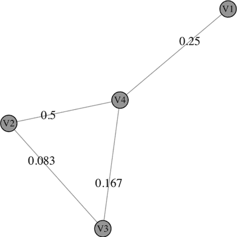

图 3-6：城镇之间的接近性（距离倒数）

让我们考虑一个跨网络中传播疾病的简单流行病模型，其中疾病从感染城镇传播到每个邻近城镇的概率由边接近性给出。如果疾病从城镇 `V1` 开始，那么它有 25% 的概率传播到 `V4`。如果发生了，它会有 16.7% 的概率进一步从 `V4` 传播到 `V3`。但这两个概率相乘（约 4.2%）并不是疾病从 `V1` 传播到 `V3` 的概率；它只是沿着传播路径 `V1→V4→V3` 传播的概率。另一个传播路径是 `V1→V4→V2→V3`，其发生的概率为 1%。

对于较大的网络，基于网络路径的潜在传播路径计算所有条件概率显然太难以通过手动完成，因此我们需要这些计算是自动化。此外，这个流行病模型太简单了，没有太大实用价值；我们在这里讨论它只是为了让加权网络结构如何影响各种实体（疾病、信息等）跨越顶点的传播，并引导我们转向下一个更复杂的流行病模型。

`SIR 模型`，或`易感-感染-抵抗模型`（另一种说是`易感-感染-恢复模型`），是一种通过假设每个个人处于三种疾病状态之一的模型来预测疾病在人群中的传播：易感（可能被感染）、感染（患病并可以传播）或恢复或抵抗（对疾病具有免疫力）。该模型有许多变体，包括易感-感染-易感模型、易感-感染-恢复-易感模型、包含部分免疫的模型、个体在流行病期间出生或死亡的模型，以及人口混合速率不同的分区域模型或地理模型。所有这些模型的基础都是偏微分方程组，其参数与人口混合（如接触率或时间）以及疾病特征（单个感染者预计产生的新感染数）有关。通常这些微分方程难以显式求解，因此我们运行计算机模拟来量化不同可能结果的范围和概率。

为了考虑到群体中个体之间的社会交互，`SIR` 模型已被引入到网络中。这为疾病可能如何传播提供了更详细的预测，并帮助人们找到减轻这种传播的方法：我们可以运行模型来查看删除节点或边、或者以其他方式重构网络对疾病传播的影响。

来自第 2 章的许多网络几何概念在这里起了作用。枢纽节点（Hubs）是高传播区域，可能需要关闭或缩小规模；桥梁（bridges）和具有高中介中心评分（betweenness scores）的节点暗示了切断疾病主要传播途径的针对方法；而高中心性评分（centrality scores）的节点可能指示了最需要接种或隔离的个体。此外，网络上的 `SIR` 模型以及用于探索它们的计算机模拟技术，应用范围远超流行病学，因为它们为研究网络结构与网络传播之间更一般的复杂关系提供了一种强大的实证方法。例如，社交媒体上虚假信息的传播是近期引起广泛关注的问题，并驱动了对更好地理解网络结构如何影响社交媒体病毒式传播的需求——而 `SIR` 型模型已证明在该领域非常有价值。

### 跟踪风浪板运动员之间的疾病传播

让我们直接进入一个示例。列表 3-7 加载了一个流行的网络数据集——`KONECT Windsurfer Network`。这是一个加权网络，代表了 1986 年秋季南加州 43 名风浪板运动员及其交互水平。邻接矩阵中几乎所有的非角线元素均为非零——这意味着网络中几乎所有可能的边都存在——所以真正重要的是权重。这使得网络可视化变得困难，因此让我们创建两个密度较低的网络版本：一个是删除所有权重不在前四分数的边，另一个是删除低于中位的边。（这是过滤加权网络的一种简单形式，我们将在第 4 章中深入讨论这一概念）。列表 3-7 执行了此操作并绘制了结果。

```r
# 加载数据集，计算四分位数，并转换为加权网络

wind <- as.matrix(read.csv("beachdata.csv", header = F))

q <- quantile(wind, prob = c(.25, .5, .75))

g_wind <- graph_from_adjacency_matrix(wind, mode = "undirected", weighted = T)

# 新网络，仅保留权重在前两个和四分位数的边

wind_top <- wind

wind_top[which(wind < q[3])] <- 0

g_wind_top <- graph_from_adjacency_matrix(wind_top, mode = "undirected", weighted = T)

wind_mid <- wind

wind_mid[which(wind < q[2])] <- 0

g_wind_mid <- graph_from_adjacency_matrix(wind_mid, mode = "undirected", weighted = T)

# 使用权重²作为边宽绘制这两个稀疏的网络

#（对权重平方只是为了增加视觉区分）
plot(g_wind_top, vertex.size = 10, vertex.label.cex = 0.4, vertex.color = 2, edge.width = E(g_wind_top)$weight²)

plot(g_wind_mid, vertex.size = 10, vertex.label.cex = 0.4, vertex.color = 2, edge.width = E(g_wind_mid)$weight²)
```

列表 3-7：一个加载 `KONECT Windsurfer Network` 数据集并通过删除权重不在前一个或两个四分位数的边来创建其两个低密度版本的脚本，然后绘制结果。

使用 `edge_density()` 函数，我们发现原始网络的密度为 99.3%，前四分位数的网络密度为 25.8%，而中位数以上的网络密度为 51.4%。图 3-7 中的图表展示了风浪板运动员网络的这两个稀疏版本。边的厚度代表边的权重，但为了增加它们之间的视觉视觉区分度，我们将厚度设置为边权重的平方。

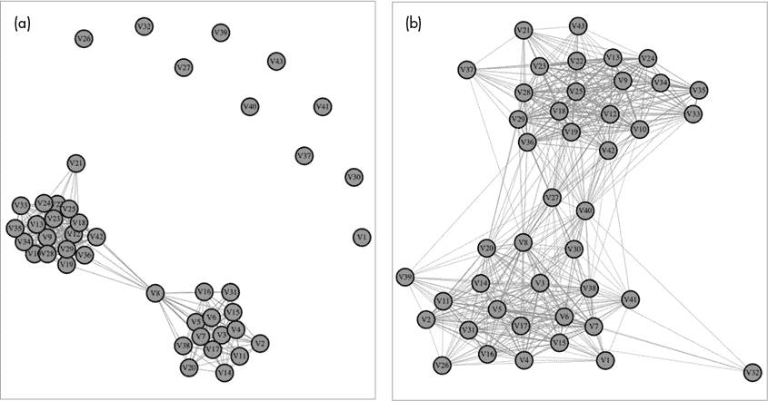

图 3-7：风浪板网络的两个稀疏版本，其中删除了所有权重不在前四分之一（左侧）或前两个四分之一（右侧）的边。

在 R 中运行 `SIR` 模拟非常简单。使用 `igraph` 的 `sir()` 函数，你只需要指定网络、感染率（称为 `beta`）和恢复率（称为 `gamma`），然后（可选地）指定要执行的模拟试验次数（默认值为 100）。感染率决定了每个时间步中易感节点被受感染邻居感染的概率（传染性越强的疾病速率越高）；有两个受感染邻居会使感染的几率增加一倍。恢复率决定了感染持续时间的概率分布；较高的恢复率意味着每个时间步感染节点转移到恢复状态的概率更高。较高的恢复率表明感染持续时间较短。

在绘制 `sir()` 的结果时，你会看到活动感染人数以及中位数值。对 `sir()` 的输出应用 `median()` 函数可以提供三个时间序列：易感人数的中位数、感染人数的中位数和康复人数的中位数。让我们试一下。在列表 3-8 中，我们在完整数据集集上模拟了一种疾病，感染率为 3，恢复率为 2。

```r
# 在风浪板网络上进行 SIR 模拟

sim <- sir(g_wind, beta = 3, gamma = 2)

# 绘制结果

plot(sim, main = "Number of Infected Over Time, Including Confidence Intervals")

# 显示每个桶的感染人数中位数

median(sim)$NI
```

列表 3-8：一个脚本在 `KONECT Windsurfer Network` 上运行 100 次 `SIR` 模型的模拟试验，感染率为 `beta=3`，恢复率为 `gamma=2`，然后绘制结果并显示随时间变化的感染人数中位数。

图 3-8 显示了生成的图。

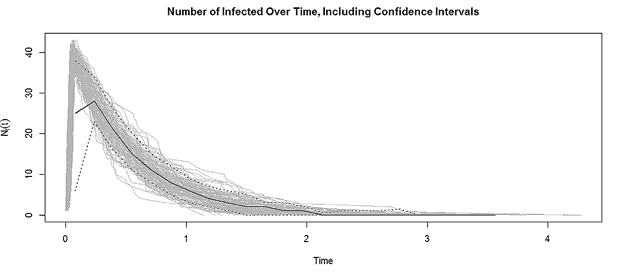

图 3-8：在原始 KONECT Windsurfer Network 上进行 SIR 模拟（100 次），显示了随时间变化的感染人数（包含平均值和置信区间），感染率为 3，恢复率为 2 的疾病。

在峰值时期，感染人数的中位数为 28 人——这是整个网络的 65%。这是一种在稠密网络中传播的高传染性疾病。运行与列表 3-4 相同的代码，但将感染率降低到 `beta=1` 并将恢复率提高到 `gamma=10`，即可图 3-9 中的图。

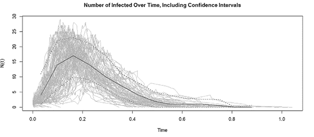

图 3-9：在原始 KONECT Windsurfer Network 数据集上进行 SIR 模拟（包含置信水平），现在感染率为 1，恢复率为 10。

不出所料，这次新的疫情模拟显示在更短的时间内，感染的人数更少。现在，活跃感染人数的中位数峰值为 17，而这次疫情的持续时间仅为之前参数四分之一。在利用 `SIR` 模型研究现实世界的疫情时，如果感染率和恢复率参数已知的，流行病学家会从科学文献中查阅这些参数；如果未知，则可以根据疾病到目前为止传播的数据进行估算。通常，此类估计会涉及某种程度的不确定性，因此我们可以在一系列参数上运行 `SIR` 模拟，以观察可能的结果范围。

### 中断通信与疾病传播

顶点福曼-瑞西曲率（vertex Forman–Ricci curvature）的一个有趣提议用途是对顶点进行排序并将其移除，以中断网络上的通信和疾病传播。在通信网络中，中断通信可能涉及针对特定的基站或隔离网络中的某个重要节点。在 2020 年，我们看到通过社交距离和隔离来隔离 COVID 感染者或接触者，如何帮助阻止 COVID 在大城市中的传播。回想作者网络中的顶点 `7` 具有较大的福曼-瑞西曲率。让我们在包含和不包含顶点 `7` 的作者网络上运行 `SIR` 模型以比较结果：

```r
# 在完整的作者网络上运行并绘制 SIR 疫情

sim1 <- sir(g_social, beta = 3, gamma = 2)

plot(sim1, main = "Epidemic on Full Author's Network")

# 从作者网络中删除顶点 7 并重新运行 SIR 疫情

g2 <- delete_vertices(g_social, v = 7)

sim2 <- sir(g2, beta = 3, gamma = 2)

plot(sim2, main = "Epidemic on Author's Network with Vertex 7 Removed")
```

该脚本在原始网络和删除了顶点 `7` 的修改后网络上运行疫情，以比较模拟疫情的严重程度。这应该产生一个与图 3-10 相似的初始图，显示疫情在整个网络中传播。

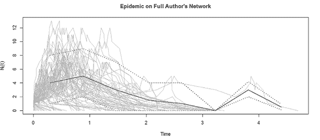

图 3-10：作者完整网络上的 SIR 疫情

图 3-10 显示了 `SIR` 疫情导致了五个时间周期的感染传播，感染人数的中位数为 `5`。某些模拟表明，在最初 `2` 个时间周期内，可能同时有高达 12 人感染。这是一场相当严重的疫情，预计在感染耗尽所有易感人群之前，一次会影响超过 25% 的人口。

让我们看看当顶点 `7` 被移除时会发生什么，如图图 3-11 所示。

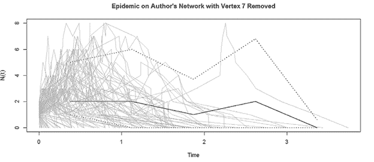

图 3-11：作者编辑后网络上的 SIR 疫情（已删除顶点 7）

图 3-11 显示了在较短时间范围内较轻微的疫情。只有四个时期发生了感染，疫情高峰期感染人数的中位数仅为 `2`，最大估计值为 `8`。虽然疫情仍然影响了人口，但它被限制在较少的人群并很快结束。到第二个时间周期结束时，大多数模型表明疫情已经结束。

存在许多允许我们针对目标顶点以中断网络的应用。我们不仅可以通过移除网络部分来缓解潜在的疫情，还可以通过移除具有高度负值福曼-瑞西曲率的目标，来中断恐怖分子细胞或敌对政府内部的通信，或者通过移除生物网络骨干中的蛋白质或基因来中断疾病过程。福曼-瑞西曲率随网络演化的变化也有助于网络相关的分析能力。

*福曼-瑞西流*（*Forman–Ricci flow*）是一种与网络上曲率随时间变化相关的几何流（微分方程），类似于热量从定义的起始点在整个网络中消散。跟踪曲率的变化可以识别网络内的变化区域。福曼-瑞西流提供了一种量化网络内部连接增长或收缩区域的方法，例如恐怖细胞成员的快速扩张、癌症基因网络中突变的积累，或疫情中疾病传播风险的增加。例如，在 COVID 隔离期间，某些地区大型聚会或活动的增加，导致了该地区社交网络内 COVID 传播的增加。图像数据集上的福曼-瑞西流还提供将医学图像数据从原始文件映射到标准表面（如平面、球体甚至是煎锅）的方法，以便结果可以在患者组内及组之间汇总和比较。

## 总结

在本章中，我们首先看到了第 2 章中涵盖的顶点指标如何作为网络内监督学习的预测器（包括链路预测）以及顶点聚类（即社区挖掘）的特征。这种机器学习方法将网络转换回结构化数据集，并应用欧几里得机器学习算法。然后，我们研究了一些直接在网络内运行的社区挖掘算法。接下来，我们从分析网络内的数据转向分析每个数据点本身都是网络的数据集。与我们之前在之前的设置中使用顶点指标类似，在这里我们使用了全局网络指标作为预测器或特征。最后，在本章的最后一节中，我们探索了 `SIR` 疾病传播模型。这里的重点是网络几何与传播的交汇；特别是，我们讨论了基于网络几何的针对性中断策略。

# 4 网络过滤


我们探索了通过测量几何属性来分析网络数据的许多方法。在本章中，我们将引入加权网络过滤，它通过施加在网络上的阈值来跟踪几何属性和网络指标。然后我们将研究如何将网络数据转换为称为*单纯复形*的高维拓扑对象，并探索我们之前考虑的网络指标的高维版本。从这里开始，我们将使用与过滤相关的拓扑工具进行图比较。

## 图过滤

在之前的章节中，我们回顾了不同的网络指标，包括不同的中心性度量、熵、谱半径、直径等。理解加权网络拓扑属性的一种有趣方法是*图过滤*，这通过迭代移除低于特定阈值的边来创建一系列加权网络的方法（例如，移除所有权重低于 `0.2`、`0.4` 或 `0.6` 的边）。

为了进一步探讨这一点，假设我们正在根据青少年在社区内的友谊或非正式社交关系，研究其长期教育或风险行为结果。假设我们有加权社交网络，每个顶点都有较高的度指标（degree metrics），边的权重根据正常一周内与朋友相处的小时决定。第一组朋友可能在周末在一起踢几小时足球。第二组朋友可能每周一起学习一次或两次，并在课上见面。第三组朋友可能经常一起运动，晚餐后或早晨上学前一起做作业，并经常在对方家里留宿。当我们过滤共处的小时时，网络中前两组朋友的度指标将随之下降。最后一组在过滤过程中将保持保持较高的度指标，因为他们待在一起的时间更长。这种度的持续性可能会揭示我们在研究中正在考察的任何社交纽带的强度。

让我们通过分解和探索两个小型示例社交网络——`Graph 1` 和 `Graph 2`——来观察如何实现图过滤（graph filtrations）。首先，我们将这两个网络加载到 `R` 中，并使用列表 4-1 中的脚本探索完整网络的结构。

```r
# 在 R 中加载两个网络

mydata1 <- as.matrix(read.csv("Graph1w.csv", header = F))

mydata2 <- as.matrix(read.csv("Graph2w.csv", header = F))

# 加载 igraph 并转换为图对象

library(igraph)

g1 <- graph_from_adjacency_matrix(mydata1, mode = "undirected", weighted = T)

g2 <- graph_from_adjacency_matrix(mydata2, mode = "undirected", weighted = T)

# 绘制两个图

plot(g1, edge.label = E(g1)$weight, main = "Graph 1")

plot(g2, edge.label = E(g2)$weight, main = "Graph 2")
```

列表 4-1：用于过滤的两个不同网络结构的脚本

列表 4-1 中的脚本应该加载两个不同的网络——`Graph 1` 和 `Graph 2`，它们具有不同的连接模式，但顶点数量相同。它还应该绘制这两个网络，并在图中给出边权重。让我们比较图 4-1 所示的网络。

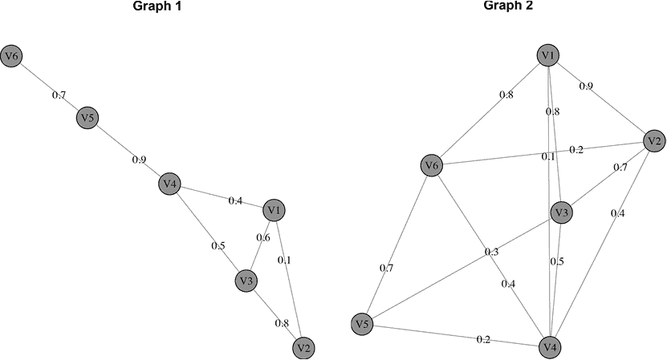

图 4-1：两个示例网络的图

图 4-1 表明 `Graph 1` 是一个稀疏连接的网络，具有大部分较大的边权重（可能是同班学生在周末参加某项服务活动的样本），而 `Graph 2` 是一个密集连接的网络，混合了不同的边权重（可能是运动队内部的友谊网络）。我们预计 `Graph 2` 中会有更高的中心得分（hub scores）和其他中心性指标，但过滤可能会这些指标可能会比我们预期的在 `Graph 1` 中的变化更快。

让我们为网络创建过滤；这将允许我们探索这些网络上的一些中心性指标。我们可以通过向列表 4-1 中的脚本中添加以下代码来实现：

```r
# 过滤 Graph 1

mydata1[mydata1 < 0.2] <- 0

g12 <- graph_from_adjacency_matrix(mydata1, mode = "undirected", weighted = T)

mydata1[mydata1 < 0.4] <- 0

g14 <- graph_from_adjacency_matrix(mydata1, mode = "undirected", weighted = T)

mydata1[mydata1 < 0.6] <- 0

g16 <- graph_from_adjacency_matrix(mydata1, mode = "undirected", weighted = T)

mydata1[mydata1 < 0.8] <- 0

g18 <- graph_from_adjacency_matrix(mydata1, mode = "undirected", weighted = T)

# 过滤 Graph 2
```


```r
mydata2[mydata2 < 0.2] <- 0

g22 <- graph_from_adjacency_matrix(mydata2, mode = "undirected", weighted = T)

mydata2[mydata2 < 0.4] <- 0

g24 <- graph_from_adjacency_matrix(mydata2, mode = "undirected", weighted = T)

mydata2[mydata2 < 0.6] <- 0

g26 <- graph_from_adjacency_matrix(mydata2, mode = "undirected", weighted = T)

mydata2[mydata2 < 0.8] <- 0

g28 <- graph_from_adjacency_matrix(mydata2, mode = "undirected", weighted = T)
```

之前的代码通过 0.2 的递增间隔按边权重过滤了 `Graph 1` 和 `Graph 2`。这在每个图过滤中产生了一系列五个网络，通过对每个过滤后的图序列应用网络指标可以进一步检查。

让我们通过向脚本中添加以下内容，检查 `Graph 1` 过滤过程中每个顶点的度中心性（degree centrality）：

```r
# 计算 Graph 1 过滤序列的度中心性

d1 <- degree(g1)

d12 <- degree(g12)

d14 <- degree(g14)

d16 <- degree(g16)

d18 <- degree(g18)

# 创建一个一个跟踪度中心性的数据集

g1deg <- cbind(d1, d12, d14, d16, d18)
```

此代码计算 `Graph 1` 过滤的度中心性，应产生包含 Table 4-1 信息的数据集。

表 4-1：过滤的度中心性

| Column1 | d1 | d12 | d14 | d16 | d18 |
| --- | --- | --- | --- | --- | --- |
| V1 | 3 | 2 | 2 | 1 | 0 |
| V2 | 2 | 1 | 1 | 1 | 0 |
| V3 | 3 | 3 | 3 | 2 | 1 |
| V4 | 3 | 3 | 3 | 2 | 1 |
| V5 | 3 | 3 | 2 | 2 | 1 |
| V6 | 1 | 1 | 1 | 1 | 0 |

Table 4-1 显示顶点 `1`、`3` 和 `4` 具有较高的中心性；然而，过滤开始后模式发生了变化。现在，让我们添加一些代码来计算 `Graph 2` 的度中心性：

```r
# 计算 Graph 2 过滤序列的度中心性

d2 <- degree(g2)

d22 <- degree(g22)

d24 <- degree(g24)

d26 <- degree(g26)

d28 <- degree(g28)

# 创建一个跟踪度中心性的数据集

g2deg <- cbind(d2, d22, d24, d26, d28)
```

此代码计算 `Graph 2` 过滤的度中心性，产生与 `Graph 1` 类似的表格。Table 4-2 总结了来自 `Graph 2` 的结果。

表 4-2：过滤的度中心性

| Column1 | d2 | d22 | d24 | d26 | d28 |
| --- | --- | --- | --- | --- | --- |
| V1 | 4 | 3 | 3 | 3 | 3 |
| V2 | 4 | 4 | 3 | 2 | 1 |
| V3 | 4 | 4 | 3 | 2 | 1 |
| V4 | 5 | 4 | 3 | 0 | 0 |
| V5 | 3 | 3 | 1 | 1 | 0 |
| V6 | 4 | 4 | 3 | 2 | 1 |

度中心性只是我们可以在过滤过程中计算的指标的一个示例；我们还可以计算其他局部指标，如中介中心性（betweenness centrality）或三元闭合（triadic closure）。此外，我们还可以在过滤过程中计算全局指标，例如谱半径或欧拉示数。让我们向 Listing 4-1 中添加以下内容，以计算 `Graph 1` 每次过滤的直径：

```r
# 计算 Graph 1 过滤的图直径

di1 <- diameter(g1)

di12 <- diameter(g12)

di14 <- diameter(g14)

di16 <- diameter(g16)

di18 <- diameter(g18)
```

通过此代码对图 1 进行过滤时计算出的直径序列为 2.1, 2.9, 2.9, 1.6 和 0.9。让我们计算图 2 过滤过程的直径：

```bash
# calculate graph diameter of Graph 2's filtration

di2 <- diameter(g2)

di22 <- diameter(g22)

di24 <- diameter(g24)

di26 <- diameter(g26)

di28 <- diameter(g28)
```

通过此代码对图 2 进行过滤时计算出的直径序列为 0.9, 1.2, 1.6, 2.4 和 1.7。这与图 1 的直径序列不同，表明在过滤序列的后期，其直径通常是较小的。该指标的过滤可能有助于评估社区非正式社会关系的整体水平和深度，这是衡量为有需要的的居民所提供的可用社区资源的一项指标。图 4-2 显示了两次过滤过程中的直径图，以比较这两个网络。

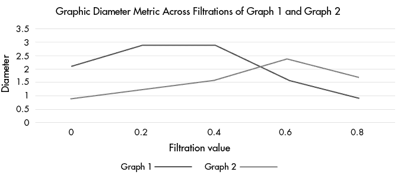

图 4-2: 图 1 和图 2 过滤的图直径指标图

正如我们在图 4-2 中所示，图 1 在过滤早期的图直径大于图 2，但在过滤值达到 0.4 之后这种关系发生了反转。这表明图 1 在过滤早期具有更大的离心性，而图 2 在过滤后期具有更大的离心性。请记住，离心性是网络中从一点到另一点的最大距离。

我们在图 4-2 中绘制的图过滤跟踪有助于区分具有不同连接模式或权重的相似图。权重随时间变化的动态网络可以是图过滤的一个用用例。此外，它们在比较具有相同顶点但权重可能不同的网络（例如脑成像研究中的患者组）时非常有用；事实上，脑成像研究是开发图过滤的应用之一。较高的离心值意味着中继神经信号的路径较长；更边缘权重代表大脑两个区域之间的连接较强。低离心性的强边表明在执行成像的患者组所被特定任务中激活了功能模块。

尽管图过滤是一个相对新的概念，但它主要仍局限于生物网络数据，包括基于脑成像研究的网络。然而，图过滤方法广泛适用于加权网络数据，其工具集也适用于其他领域的进一步开发。如果你想更深入地探索这个主题，请查看此书末尾的参考文献，并在他们自己的数据上尝试图过滤。现在，让我们关注图的拓扑视图，它允许我们将图中捕获的关系扩展到人与事物之间其他类型的相互作用。

## 从图到单纯复形

图可以被视为具有定义全局属性的拓扑对象，我们可以在分析中利用这些属性，而且通过考虑图中个人和顶点之间的三方、四方和 `n` 方交互，可以将图转换为图的高维版本，称为 `simplicial complex`（单纯复形）。让我们考虑三位经常合作学术论文、但从未以三个人共同名义发表过论文的同事。我们将为这三位同事创建一个简单的图，所示于图 4-3。

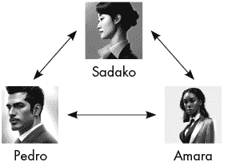

图 4-3: 显示三位同事之间双向交互的单纯复形

现在让我们想象一篇三位同事都参与且名字都在上面的上的论文。这是一个三方交互，而不是三次双向交互，我们将得到一个填充的三角形，而不是三组双向箭头，如图 4-4 所示。

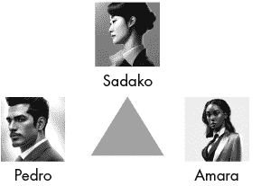

图 4-4: 显示三位同事之间三方交互的单纯复形

图 4-4 使用三角形来代表同事之间的三方连接，就像两个同事之间的箭头代表双向连接一样。这可以推广到代表四方交互的四面体以及代表更高阶 `n` 方交互的更奇特的形状。数字 `n` 的大小没有限制，但当我们向单纯复形中的 `n` 方交互迈进时，某些将会会出现计算问题。涉及邮件链、论文共同作者或会议电话的分析是常见的应用，它们将社交网络分析和图扩展到了单纯复形分析。取决于网络的大小和 `n` 方交互的大小，个人及其相互作用的单纯复形表示在不同的 `n` 值可能会变得非常复杂。分析这些结构可能涉及大量的计算力和扩展网络指标的工具。然而，由于图是拓扑对象，拓扑学的许多定理和工具可以成功应用于它们。这反过来允许数学的其他领域（包括偏微分方程和概率论）在图上应用和发展。

正如我们可以过滤加权图一样，也可以过滤单纯复形。单纯复形的过滤过程取决于单纯复形构建的方式。在大多数拓扑数据分析算法中，我们从可以定义距离度量的空间内的数据云开始。如果点之间共享相互的 `n` 方重叠集（`Čech complex`）或成对重叠集（`Vietoris–Rips complex`），则将这些点包含在单纯复形中。通过增加或减少距离度量的值，我们得到了单纯复形的过滤。在实践中，Vietoris–Rips 复形更容易计算，并且许多拓扑数据分析包的基础。这引导我们进入网络分析中一个非常新且新兴的部分：网络工具向单纯复形的扩展。

在前几章中引入的许多工具都有单纯复形的对应物，包括离心性、最短路径算法、中心性指标（K 中心性、特征向量中心性、紧密中心性等）、三元闭合等。通常，网络数据的单纯复形是通过计算网络内部的极大团（maximal cliques）来构建的（尽管也可以定义距离度量并应用上段定义的流程从网络数据构建单纯复形）。网络中的 `maximal cliques` 包含了顶点组之间最高级的 `n` 方相互边。这些极大团对应于 (`n` – 1) 单纯复形。图的 `flag complex`（标记复形）涉及通过计算图的最大团来构建图的单纯复形。从复形中，可以在每个单纯复形层级定义量，并将它们组合成跨层级的总指标。这意味着我们可以从单纯复形不同层级中获取关于网络整体结构及其组件的更多信息。

让我们回到之前章节介绍的 Farrelly 社交网络，查看度中心性的一种扩展，被称为 `topological dimension`（拓扑维度）。我们可以将拓扑维度定义为加权度中心性，通过每个顶点所属的团（cliques）的维度对其进行加权，这涉及到对顶点不同维度的团进行求和。例如，网络中一个位于最大二元团和一个最大三元团中的顶点，其拓扑维度为 5。一个位于最大五元团且不属于其他团的顶点，其拓扑维度也为 5。然而，前者的度可能为 3，连接到二元团中的另一个顶点和三元团中的两个顶点；后者的度为 4，连接到五元团中的其他四个顶点。

在 Listing 4-2 中，我们有一个脚本可以计算 Farrelly 社交网络中最大团和顶点的拓扑维度。

```r
# load the author's network

g_social <- read.csv("SocialNetwork.csv")

# create the graph

library(igraph)

g1 <- graph_from_adjacency_matrix(g_social, mode = "undirected", weighted = F)

# compute the maximal cliques in the author's network data

cl <- maximal.cliques(g1)

# create array

cl <- as.array(cl)

# get clique size from maximal clique array

d <- dim(cl)

l <- rep(NA, d)

for (i in 1:d) {
  l[i] <- length(as.vector(cl[[i]]))
}

# create matrix of vertices in maximal cliques

av <- matrix(rep(NA, d * 20), 20)

for (i in 1:20) {
  for (j in 1:d) {
    av[i, j] <- i %in% cl[[j]]
  }
}

# convert to binary indicators

avind <- ifelse(av == TRUE, 1, 0)

# multiply out to calculate each vertex's topological dimension

topmat <- t(avind) * l

topdim <- colSums(topmat)
```

Listing 4-2: 计算 Farrelly 社交网络中顶点拓扑维度的脚本

该脚本根据图的标志复形（flag complex）计算拓扑维度。它首先从最大团计算标志复形；然后存储每个团的信息，以便我们可以遍历每个团以查看哪些顶点属于每个团。将这些信息转换为二值指示矩阵，允许我们将团的维度与指示矩阵相乘，得到一个包含每个顶点拓扑维度的向量。Table 4-3 显示了作者网络数据集中每个顶点的拓扑维度度和。

表 4-3: Farrelly 社交网络中顶点拓扑维度与度的汇总

| 顶点 | 度 | 拓扑维度 |
| --- | --- | --- |
| 1 | 2 | 3 |
| 2 | 1 | 2 |
| 3 | 5 | 11 |
| 4 | 2 | 3 |
| 5 | 4 | 7 |
| 6 | 3 | 6 |
| 7 | 8 | 18 |
| 8 | 3 | 4 |
| 9 | 3 | 4 |
| 10 | 3 | 6 |
| 11 | 3 | 5 |
| 12 | 1 | 2 |
| 13 | 4 | 8 |
| 14 | 4 | 7 |
| 15 | 4 | 8 |
| 16 | 2 | 4 |
| 17 | 2 | 4 |
| 18 | 3 | 6 |
| 19 | 2 | 4 |
| 20 | 1 | 2 |

Table 4-3 显示了度（其计算中仅包含作者网络中的顶点和边）与拓扑维度（包含高阶相互作用）之间的显著差异。例如，顶点 9 和 10 的度均为 3，但它们的拓扑维度分别为 4 和 6。

从拓扑角度来看，它们是完全不同的。这两个球在二阶 Betti 数（second Betti numbers）上有所不同，该数值统计对象中的三维空洞。Betti 数向量是一个无限数字序列，表示每个维度中洞的数量，从零阶位置的连通分量开始，移动到圆（第一阶位置）、空洞（二阶位置）以及更高维空洞（从第三个位置开始到无限位置）。

在实践中，大多数数据集在第一阶 Betti 数之后不会有很多洞，因此我们可以用零填充向量的其余部分。空心的篮球在第一阶 Betti 数之后有一个洞，因为它包含一个空洞，这给出的 Betti 数向量为 `(1, 0, 1, 0)`；而实心的棒球在任何维形维度上都没有洞，对应的 Betti 数向量为 `(1, 0, 0, 0)`。

某些对象在给定的维度上具有多个洞。例如，想象在图 4-5 所示的篮球的外表面上粘上第二个篮球。这个对象显然会有另一个空洞，产生 Betti 数向量为 `(1, 0, 2, 0)`。甜甜圈（或 `torus`）的向量为 `(1, 2, 1, 0)`，因为它有两个定义管状末端的开口圆，当它们在末端连接时会形成一个空洞。图 4-6 展示了从一张纸片构造环面的经典方法。

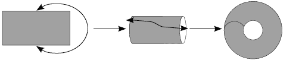

图 4-6：从在边缘连接的纸片中构造环面的方法便于分类那些在三维中易于可视化的对象和空间。然而，工业中使用的许多数据集涉及三个以上的维度，对这些对象的比较需要能够识别与这些对象相关的 Betti 数的算法；其中包括基因组数据集和多变量时间序列。

### 欧拉性数 (Euler Characteristic)

一种基于拓扑的指标同时出现在网络分析及其高维单纯复形中，并且它回到了之前章节引入的曲率概念。欧拉性数通常记作 `χ`，提供了一个单一数值来总结拓扑空间，并且是一个拓扑不变性，这意味着所计算的拓扑量不会随着空间的连续变形（拉伸、扭曲或在不撕裂空间的情况下进行其他操作）而改变。

欧拉性数可以使用 Betti 数来定义；从技术上讲，计算欧拉性数涉及 Betti 数的交错和（零阶 Betti 数 - 第一阶 Betti 数 + 第二阶 Betti 数 - 三阶 Betti 数 + 四阶 Betti 数 ... 直到存在的最高 Betti 数）。欧拉性数也可以通过单纯复形的维度来定义（顶点数 - 边数 + 三角形数 - 四元交互数 + ...）。然而，包含在边中的顶点是不被计入的。构成交互部分的三角形也不会被计入。

然而，有一种简单的方法，可以使用与极大团相关的 `igraph` 函数（如前所述）获取网络或其高维单纯复形的最大部分。极大 `k` 团表示并计算了从网络派出的完整单纯复形的 `k` 单纯形。它们是构建完整单纯复形并跟踪每个 `n` 路交互中涉及部分的方便方法。让我们添加列表 4-2 中的脚本，以统计作者网络中的极大团：

```r
# 创建一个表格，统计单纯复形中 k+1 单纯形的数量

summ <- as.numeric(summary(cl)[, 1])

jjj <- table(summ)
```


这段代码创建了一个总结网络中极大团的表格。我们之前计算了网络中的极大团。结果应该产生 1 个四元交互（一元单纯形）、6 个边（二元单纯形）和 1 个三角形（三元单纯形）。我们可以将这些值代入欧拉性数公式：

`χ = 0 顶点 - 1 边 + 6 三角形 - 1 四面体`

这得到的 `χ` 为 `-6`。最近的研究表明，大多数真实世界网络倾向于负欧拉性数。这是一个非常有趣的现象，与网络曲率有关。图中负曲率与网络的鲁棒性有关；具有高度负曲率的网络可以承受部分功能的损失而不会对生物产生不利影响。

高斯-波内特定理（Gauss–Bonnet theorem）将通过同调定义的欧拉性数与对象的曲率（包括流形的曲率和边界的曲率）联系起来。最近有一些尝试将网络分析工具如同调和福曼 Ricci 曲率（Forman–Ricci curvature）联系起来，以深入研究网络属性。这是微分几何分支的一个深度结果，它将对象的局部几何与其全局拓扑连接起来，它是网络科学的一个新领域。现在我们知道网络拓扑和几何是相互相关的，让我们来看看一种名为持续同调的拓扑工具。

### 持续同调（Persistent Homology）

今天数据分析中最常用的基于拓扑的算法之一是持续同调，它应用于基因组学、医疗、经济、能量、心理测量等许多领域。从本质上说，持续同调算法是从数据构建点云，根据数据的不同阈值（类似于 MRI）将其过滤为一系列单纯复形，并跟踪每个切片中出现和消失的拓扑特征（如洞或空洞）。

例如，考虑图 4-7 中的三块奶酪，每个都有圆形的洞；这些圆影响了数据集的第一阶 Betti 数。

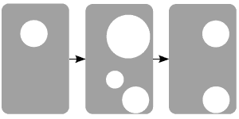

图 4-7：在不同位置有洞的奶酪片

在图 4-7 中，一个洞出现在三个切片中，另一个洞只出现在中间切片中，还有一个洞出现在两个切片中。假设我们要比较两个数据集，以查看它们是否来自相同的分布或形状。这在匹配图像数据时很常见。虽然图像数据很少带有奶酪洞，但圆经常眼睛的形式出现在图像数据中。让我们揭开这种直觉。

从技术上讲，通过改变用于从点云数据（或过滤后的数据）构建单纯复形 get 距离，你可以在过滤过程中跟踪各种 Betti 数，并为数据中的每个空洞分配一个重要性评分，重要的特征会持续更长的过滤距离（用持续同态术语来说称为更长的 `persistence`）。在图 4-7 中，出现在三个切片中的空洞被认为是最重要的特征，而仅出现在第二个切片中的空洞可能是数据噪声的结果。这些特征可以绘制在 `barcode`（条形图）或 `persistence diagram`（持续图）上，用于跟踪特征的寿命（它们在过滤中存在的距离尺度）。我们将在接下来的示例分析中探索条形图和持续图。

在实践中，由于计算问题，数据集通常只检查低维空洞和特征，除非你在显式计算高维形状数据，否则最常用的是零阶（连通分量）和一阶（环）Betti 数。图 4-7 中的示例在所有三个切片中都是连通的，因此它在所有切片中的零 Betti 数均为 1。然而，环在过滤过程中出现又消失，产生了一个类似于图 4-8 的条形图。

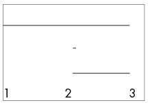

图 4-8：绘制图 4-7 框内捕获的特征（空洞）持续性的图。

条形图显示了特征出现和消失的时间。例如，在图 4-8 中，我们可以看到一个特征在时间 2 出现并在时间 3 消失（这是我们在图 4-7 中底部的奶酪块空洞）。跨越数据切片的连通分量序列与另一种机器学习方法——单链层次聚类具有奇妙的关系，在那种方法中，每个高度层上的簇对应于特定切片上的连通分量。当两种技术使用相同的距离度量时，结果实际上是相同的；然而，关于数据结构，持续同态方法提供的信息比单链层次聚类的聚类图（dendrogram）更多。这意味着机器学习从业者可以选择最适合问题的技术，因为这两个选项都有它们自己的图表和统计检验。例如，对于非技术观众，单链层次聚类可能更合意，因为聚类图和热图对生物学家或社会科学家来说更为熟悉。

## 使用持续同态对网络进行比较

在网络分析领域，持续同态可以是一种比较网络结构的有用方法，以查看不同网络是否具有相同的几何结构。让我们通过对模拟网络进行应用来进一步探索。在神经科学中，将 fMRI 或 PET 数据转换为网络结构是常见的，其中大脑的不同区域被转换为顶点，并根据活动模式（例如，一个区域的顺序激活，或在一项任务期间多个区域的共同激活）与大脑的其他区域连接。通常，感兴趣的结果涉及比较患者组，例如健康患者与患有特定神经或心理疾病的患者组，或者两个疾病组之间，以理解跨疾病的大脑激活模式的差异。

我们将探索使用持续同态比较此类两个网络。由于 fMRI 数据无法以开源形式轻松获取，我们将在 `igraph` 中模拟与大脑成像网络规模相近的网络；这将演示如何将这种方法应用于已转换为网络数据的成像数据。

`igraph` 包允许你模拟许多类型的网络数据，包括 Erdös–Renyi 图、无标度图和 Watts–Strogatz 图。我们将使用列表 4-3 中的脚本创建这些每种图。

```r
#simulate three graphs using the igraph package for further comparison

library(igraph)

#create an Erdos-Renyi graph
g1<-erdos.renyi.game(30,0.3)

#create a scale-free graph
g2<-sample_pa(30,power=2.5,directed=F)

#create a Watts-Strogatz graph
g3<-sample_smallworld(2,5,3,0.3)

#plot the three graphs created
plot(g1,main="Erdos-Renyi Graph")
plot(g2,main="Scale-Free Graph")
plot(g3,main="Watts-Strogatz Graph")
```

列表 4-3：用于统计比较的三种不同类型网络结构的脚本

列表 4-3 创建了三种不同类型的网络，稍后可以通过持续同态进行比较；它还可视化了网络，这应该产生与图 4-9 相似（但可能不完全相同）的结果。

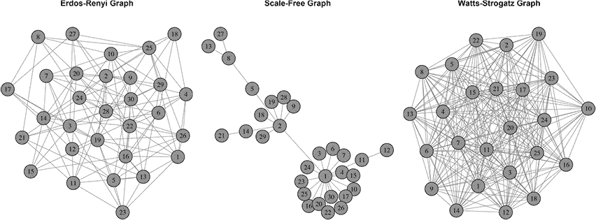

图 4-9：三种模拟网络类型的绘图。

图 4-9 显示了非常不同类型的图。中间的无标度图包含一个枢纽，许多顶点与该枢纽连接但不与其他顶点连接。左侧的 Erdös–Renyi 图和右侧的 Watts–Strogatz 图有更多的相互连接，但 Watts–Strogatz 模型似乎具有更多将顶点连接成团的结构，而不是随机连接顶点。

让我们将持续同态应用于这些网络，并通过向列表 4-3 中添加以下内容来比较这些网络之间持续图的距离；再次，由于每个网络的仿真，你的结果可能会有所不同：

```r
#load TDA package
library(TDA)

#get adjacency matrices
m1<-as.matrix(get.adjacency(g1))
m2<-as.matrix(get.adjacency(g2))
m3<-as.matrix(get.adjacency(g3))

#compute persistent homology
d1<-calculate_homology(m1,dim=2,format="cloud")
d2<-calculate_homology(m2,dim=2,format="cloud")
d3<-calculate_homology(m3,dim=2,format="cloud")

#plot persistence diagrams
plot_persist(d1)
plot_persist(d2)
plot_persist(d3)

#compute distances among graphs
w1<-phom.dist(d1,d2,limit.num=0)
w2<-phom.dist(d1,d3,limit.num=0)
w3<-phom.dist(d2,d3,limit.num=0)
```

此添加从每个模拟图派生邻接矩阵并从该邻接矩阵计算持续图，然后通过零阶同调群之间的距离进行比较。此脚本应该产生类似于图 4-10 的三个持续图（注意它们不会相同，因为每次运行都会产生略有不同的结果）。

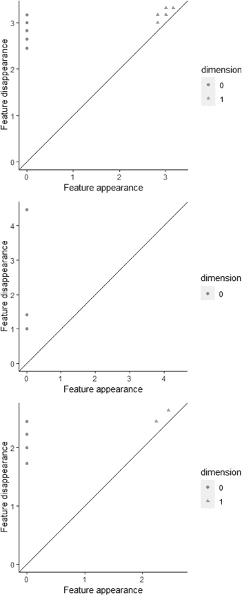

图 4-10：三种模拟网络类型的持续图绘制（从上到下：Erdös–Renyi、无标度和 Watts–Strogatz）。

图 4-10 显示了每种网络类型中发现的不同拓扑特征。Watts–Strogatz 网络和 Erdös–Renyi 图都产生了许多较大的零阶同调特征（点），而无标度图具有各种尺寸的零阶同调特征。无标度图没有高阶同调特征，而另外两幅图具有一阶同调特征（三角形），尽管它们非常接近对角线（这表明它们可能是噪声）。直接位于对角线上的点是仅出现在数据切片中的特征；点离对角线越远，它在数据中存在的时间越长。对于我们的这三个模拟网络，仅通过持久性图很难判断无标度图和 Watts–Strogatz 图与 Erdös–Renyi 图是否存在显著差异。

我们可以向脚本中添加内容，为 Erdös–Renyi 持久性图推出一个零分布，并使用特殊的距离度量 `Wasserstein distance`，对 Erdös–Renyi 持久性图与无标度图、以及 Watts–Strogatz 持久性图之间的结构差异进行统计检验：

```r
#get Wasserstein distance between random graphs with the same structure
ww<-rep(NA,100)

for (i in 1:100){
  g1<-erdos.renyi.game(30,0.3)
  g2<-erdos.renyi.game(30,0.3)
  m1<-as.matrix(get.adjacency(g1))
  m2<-as.matrix(get.adjacency(g2))
  d1<-calculate_homology(m1,dim=2,format="cloud")
  d2<-calculate_homology(m2,dim=2,format="cloud")
  ww[i]<-phom.dist(d1,d2,limit.num=0)
}

#compute 95% confidence intervals from the simulated null distribution
quantile(ww,c(0.025,0.975))
```

该脚本从构建原始持久性图的相同分布创建了 Erdös–Renyi 持久性图的零分布；由于模拟部分的随机性，你的结果可能会有所不同。我们零分布的分位数提供了 `(0.91, 8.36)` 的置信区间，这包含了许多小于 Erdös–Renyi 图与 Watts–Strogatz 图持久性图之间距离（`23.59`）以及 Erdös–Renyi 图与无标度图持久性图之间距离（`39.78`）的距离。因此，我们可以得出 Watts–Strogatz 图和无标度图的结构不是随机的。每个图中都存在显著的结构成分。

这种类型的模拟在测试来自 fMRI 和 PET 研究的脑网络持久性图之间的差异时非常有用，而且在 `R` 中很容易实现。这种方法也适用于具有假设底层结构的其他网络，例如社交网络或电网。许多其他类型的网络分析工具也可用于比较图结构，例如局部和全局指标（包括图半径和直径、度分布、聚类图系数等），而其中许多比较目前尚未被充分探索。

## 总结

在本章中，我们过滤了加权网络，以理解网络指标如何根据权重的删除而发生变化。然后，我们从网络数据构建了单纯复形，以利用多种拓扑工具，包括度指标的扩展、欧拉示数以及一种名为持久同调的基于过滤的算法，它可以比较网络。在下一章中，我们将从网络科学转向距离几何，探索不同的测量选择如何影响监督和无监督学习算法。

# 5 数据科学中的几何


在本章中，我们将探索几何的几种工具：我们将研究距离度量及其在 `k`-最近邻算法中的应用；我们将讨论将高维数据映射到可能弯曲的低维流形的流形学习算法；我们还将看到将分形几何应用于股市数据。本章的动机之一源于 `流形假设`，该假设认为真实数据的自然维度低于采集数据的维度。也就是说，一个具有 20 个变量的数据集（即具有 20 个变量）。

## 数据中的距离度量简介

许多机器学习算法依赖距离度量，正如我们之后将看到的。`距离度量`提供了点或对象之间的测量。在平整的纸上使用尺子这相对简单，如图 5-1 所示。

```text
(Figure 5-1: A plot of points on a sheet of paper)
```

然而，在其他情况下，两点之间的距离要复杂一些。考虑在社区中从一栋房子走到另一栋房子，如图 5-2 所示。

```text
(Figure 5-2: A plot of points on a sphere)
```

除非能够穿过邻居房屋而不遇到外墙和内墙（更不用说不满的邻居了），否则无法在房屋之间绘制给出直接路线的直线或测地线，如你在图 5-3 中所示。

```text
(Figure 5-3: A plot of houses in a neighborhood, where one is walking between two houses)
```

相反，更实际的做法是沿着人道道（图 5-5）。

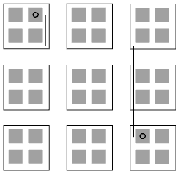

图 5-5：社区中房屋的图，人们在房屋之间的人行道上行走

距离通常是离散的，而不是连续的，或者位于具有曲率的流形上。理解数据点所处空间的几何结构，可以很好地指示何种距离度量适用于这些数据。在下一节中，我们将介绍机器学习中一些常见的距离度量，然后在随后的章节中，将这些距离应用于 `k`-NN 算法和降维算法。

## 常见距离度量

考虑到测量距离的细微差别，理解机器学习中用到的一些常用距离度量是非常重要的，包括我们在第 4 章中简要遇到的一种（Wasserstein 距离，用于比较持续同调结果）。距离度量有无限多个，且某些距离度量带有参数可以产生无限种变体。因此，我们无法涵盖机器学习中可能遇到的所有距离度量。我们省略了一些在推荐系统中很有用的度量（例如余弦距离），因为它们在拓扑数据分析或网络分析应用中是不常见的指标。我们将探索一些更常用的指标；如果你感兴趣进一步探索，建议你研究 `度量几何`（metric geometry）领域。

### 模拟小型数据集

在开始探索常见距离度量之前，让我们通过列表 5-1 模拟一些数据。

```r
#创建数据
a<-rbinom(5,4,0.2)
b<-rbinom(5,1,0.5)
c<-rbinom(5,2,0.1)
mydata<-as.data.frame(cbind(a,b,c))

#创建绘图
library(scatterplot3d)
scatterplot3d(a,b,c,main="Scatterplot of 3-Dimensional Data")
```

列表 5-1：模拟并绘制小型数据集的脚本

该脚本创建一个包含三个变量的数据集，并在三维空间中绘制点。这应该产生一个点位于三个轴上的图（图 5-6）。

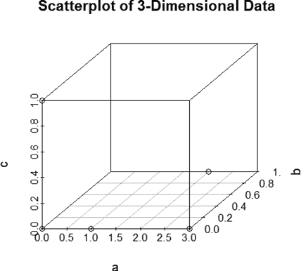

图 5-6：五个点的图，所有点都在变量 `a`、`b` 和 `c` 定义的轴上

该数据集包含了列表 5-2 所示的点，我们将用它们来计算点之间的距离。

```text
> mydata
  a b c
1 2 1 0
2 0 0 1
3 1 0 0
4 0 0 0
5 3 0 0
```

列表 5-2：模拟数据集中五个点的矩阵，带有随机变量 `a`、`b` 和 `c`

现在我们已经生成了一个数据集，让我们来看看一些可以用于数据集中点对之间距离的标准距离度量。R 自带了一个实用的包，称为 `stats`（随 R 基础安装提供），可以通过 `dist()` 函数计算用于数据的一些常用距离度量。

### 使用基于范数的距离度量

我们将考虑的第一类距离是相关的。函数或向量的 `范数`（norm）是该函数或向量“长度”的测量。范数涉及将距离差进行幂，然后对结果应用该幂的根。。例如，对于点之间的 `欧几里得距离`（Euclidean distance），在对结果取平方根之前会对差异的平方求和。对于单个向量（即单个数据点），范数是到原点的加权距离，其中轴相互交叉。你可以将其想为从原点到被测点的直线的长度。回到我们的点散点图，这可能会像图 5-7 所示绘制。

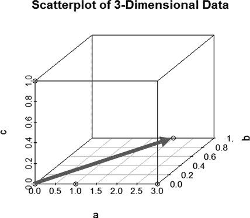

图 5-7：五个点的图，有一条直线指向集合中的一个点

用于测量点之间度量距离的最常用的范数可能是前面提到的欧几里得距离，由 L² 范数给出，定义为点之间平方距离的平方根，其中 `L` 是向量（或向量）的占位符，指数是范数的幂（此处为 2）。这是高中几何课上通常的距离，也被称为 `勾股距离`（Pythagorean distance）。我们在图 5-4 中见过它，它显示了房屋之间最短距离的直线（像鸟在房屋上方飞行）。统计学家在回归算法中计算平方误差时通常使用欧几里得距离度量的平方；由于我们在这里不深入探讨的原因，使用欧几里得距离的平方是非常自然的。

与 L² 范数相关的是 L¹ 范数或 `曼哈顿距离`（Manhattan distance）。曼哈顿距离的计算与图 5-5 所示的社区示例非常相似。曼哈顿距离定义为沿轴点差异之和。假设我们有两个点 (0, 1) 和 (1, 0)，这可能代表患者在疾病模型中感兴趣的基因中是否存在突变。曼哈顿距离是 (0 + 1) + (1 + 0)，即所有轴点差异的总和。在这个例子中，我们发现曼哈顿距离为 2。

这种度量在处理计数数据或其他离散数据格式时非常有用，例如本节早些生成的数据集。图 5-5 展示了这种距离计算，其中人需要沿着南北和东西方向的街道行走。


曼哈顿距离和 `L¹` 范数经常出现在 Lasso 和弹性网回归的应用中，它被用于将位于原点一定距离内的系数设置为 0，从而执行变量选择并创建稀疏模型。这在独立变量集维度很高的情况下（例如基因组数据）非常有用。

`L¹` 范数和 `L²` 范数的推广是闵可夫斯距离（Minkowski distance），它将范数从 `L³` 范数推广到 `L∞` 范数。`L∞` 范数是基于范数的距离另一个特例，被称为切比雪夫距离（Chebyshev distance）。在数学上，切比雪夫距离是沿任何轴的最大距离。它通常用于涉及机械或自主系统（如无人机）规划移动的问题。

随着范数维度的增加，闵可夫斯距离值通常减少并稳定。因此，高维范数的闵可夫斯距离可以作为距离平滑器，限制曼哈顿或欧几里得距离计算中出现的异常或巨大的距离计算。闵可夫斯距离确实实施了几个条件，包括零向量的长度为零、对向量应用正标量不会改变向量的方向，以及两点之间的最短距离是直线（称为三角形不等式条件）。在 R 的 `dist()` 函数中，范数的维度由参数 `p` 给出，其中 `p=1` 对应曼哈顿距离，`p=2` 对应欧几里得距离，以此类推。

曼顿距离的一种特殊扩展是 Canberra distance，它是 `L¹` 范数的加权和。从技术上说，Canberra 距离的计算方法是：找到点对之间距离的绝对值，并除以该点对绝对值之和，然后对所有点对的结果进行求和。在处理离群值、入侵检测或混合类型预测变量（连续和离散测量值）时，它可以是一个非常有用的距离度量标准。图 5-7 中的示例点可能不是统计学上的离群值，但它确实位于数据空间中与其他模拟点不同的部分。

让我们运行这些距离计算，并在我们在本节早些模拟的数据集上比较结果；将以下内容添加到代码列表 5-1 中的代码中：

```R
#run distance metrics on example dataset
d1<-dist(mydata,"euclidean",upper=T,diag=T)
d2<-dist(mydata,"manhattan",upper=T,diag=T)
d3<-dist(mydata,"canberra",upper=T,diag=T)
d4<-dist(mydata,"minkowski",p=1,upper=T,diag=T)
d5<-dist(mydata,"minkowski",p=2,upper=T,diag=T)
d6<-dist(mydata,"minkowski",p=10,upper=T,diag=T)
```

这段代码为我们的示例数据集计算了欧几里得距离、曼顿距离、Canberra 距离和 Minkowski 距离的指标。观察表 5-1 所示模拟数据集中点对之间的欧几里得测量值，由于计算欧几里得距离涉及平方根，我们看到许多点对的值具有许多小数位。

表 5-1：代码列表 5-2 矩阵中点对之间的欧几里得距离计算

| Euclidean | 1 | 2 | 3 | 4 | 5 |
| --- | --- | --- | --- | --- | --- |
| 1 | 0 | 2.44949 | 1.414214 | 2.236068 | 1.414214 |
| 2 | 2.44949 | 0 | 1.414214 | 1 | 3.162278 |
| 3 | 1.414214 | 1.414214 | 0 | 1 | 2 |
| 4 | 2.236068 | 1 | 1 | 0 | 3 |
| 5 | 1.414214 | 3.162278 | 2 | 3 | 0 |

转向曼顿距离（表 5-2），点对之间的距离变成了整数，因为计算涉及沿分离点之间每个轴的离散步长。

表 5-2：代码列表 5-2 矩阵中点对之间的曼顿距离计算

| Manhattan | 1 | 2 | 3 | 4 | 5 |
| --- | --- | --- | --- | --- | --- |
| 1 | 0 | 4 | 2 | 3 | 2 |
| 2 | 4 | 0 | 2 | 1 | 4 |
| 3 | 2 | 2 | 0 | 1 | 2 |
| 4 | 3 | 1 | 1 | 0 | 3 |
| 5 | 2 | 4 | 2 | 3 | 0 |

正如预期的，Minkowski 距离计算在 `p=1` 时匹配曼顿距离，在 `p=2` 时匹配欧几里得距离。在表 5-3 中，你可以看到 `p=1` 的 Minkowski 距离。

表 5-3：代码列表 5-2 矩阵中点对之间的 Minkowski 距离计算

| Minkowski `p=1` | 1 | 2 | 3 | 4 | 5 |
| --- | --- | --- | --- | --- | --- |
| 1 | 0 | 4 | 2 | 3 | 2 |
| 2 | 4 | 0 | 2 | 1 | 4 |
| 3 | 2 | 2 | 0 | 1 | 2 |
| 4 | 3 | 1 | 1 | 0 | 3 |
| 5 | 2 | 4 | 2 | 3 | 0 |

Canberra 距离与曼顿距离产生了一些相似且重叠的值。然而，由于表 5-4 所示，由于距离计算中的加权部分，某些距离是不同的（特别是涉及点 2 或点 3 的点对）。

表 5-4：代码列表 5-2 矩阵中点对之间的 Canberra 距离计算

| Canberra | 1 | 2 | 3 | 4 | 5 |
| --- | --- | --- | --- | --- | --- |
| 1 | 0 | 4 | 2 | 3 | 2 |
| 2 | 4 | 0 | 2 | 1 | 4 |
| 3 | 2 | 2 | 0 | 1 | 2 |
| 4 | 3 | 1 | 1 | 0 | 3 |
| 5 | 2 | 4 | 2 | 3 | 0 |

这段代码将列平均值点添加到原始数据集中，以检查数据的“中间”在三维空间中应该位于哪里；代码生成的图应与图 5-8 类似。

检查图 5-8 并将其与图 5-6 进行比较，我们可以看到有一个点被放置在轴之外，该点似乎在五个点中占据了中心位置。寻找数据集的中心位置有助于许多数据科学任务，包括寻找隐性离群值（即在任何单个变量上没有极端值，但距离多变量数据集中大多数点的离群值）以及计算多变量统计量。正如我们的马拉诺比（Mahalanobis）结果所示，某些点比其他点更接近这个中心位置；这些是我们数据集中的第 3 点和第 4 点，它们距离原点较近。

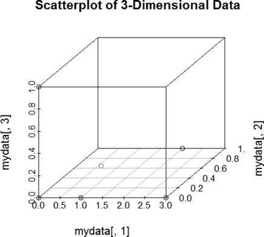

图 5-8: 列表 5-2 矩阵中单个点以列平均值为中心点的马拉诺比距离图，其中列平均值点显示在轴外

这些距离差异出现在许多机器学习应用中，我们将在本章稍后部分通过将这些距离应用于 `k`-最近邻问题，来看看距离是如何影响机器学习的性能和结果的。性能可能会随着度量指标选择的不同而发生巨大变化，使用错误的指标可能会误导模型结果和解释。

## 比较图表、形状和概率分布

基于范数的距离度量不是机器学习中可能的一类度量。正如我们在第 4 章中看到的，可以计算点以外的对象之间的距离，例如持久性图。简而言之，这些类型的度量衡量的是概率分布之间的差异。我们已经简要地使用了其中一种，即沃瑟斯坦距离（Wasserstein distance），来比较持久性图分布。现在让我们仔细观察。

### 沃瑟斯坦距离

通俗来说，Wasserstein distance 比较堆叠在两个分布中的概率权重堆。它通常被称为“推土距离”（earth-mover distance），因为沃瑟斯坦距离衡量了将一个分布的概率堆移动以转换为比较分布所需的成本和努力。对于具有更高数学水平的读者，`p` 次沃瑟斯坦距离可以通过对联合分布的边际分布的 `p` 次方取期望值、在这些随机变量的所有联合概率分布中寻找下界，并对结果开 `p` 次方来计算。然而，这些细节超出了读者的预期，我们在探索这一指标时将坚持使用推土距离的直觉。让我们可视化两个土堆的分布，以建立关于这一指标背后的直觉（图 5-9）。

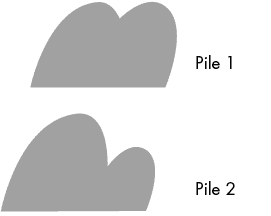

图 5-9: 两个土堆的分布，类似于可以使用沃瑟斯坦距离度量比较的概率密度函数类型

图 5-9 中的堆 1 在左侧有一大堆土，如果我们想把堆 1 的土堆分布转换为堆 2，就需要将这些土铲到右侧的土堆中。我们的推土机必须移动大量的土才能将堆 1 转换为堆 2。然而，如果我们的堆 2 的土堆分布更接近堆 1，如图 5-10 所示，我们的推土机将堆 1 转换为堆 2 所需的工作将会更少。

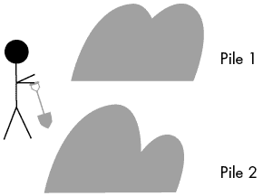

图 5-10: 两个土堆的分布，类似于可以使用沃瑟斯坦距离度量比较的概率密度函数类型，衡量了我们的推土机将堆 1 转换为堆 2 所需的工作量

从分布 1 到分布 2，你可以想象有人在铲土。铲土的量对应于沃瑟斯坦距离。非常相似的概率密度函数将具有较小的沃瑟斯坦距离；非常不相似的将具有较大的沃瑟斯坦距离。

因此，沃瑟斯坦距离可以是比较概率分布的一个很好的指标——比较理论分布与样本分布以查看它们是否匹配，比较多个样本分布以查看它们是否匹配。虽然我们不会在这里深入，但某些分布——包括计数数据、是/否数据甚至是机器学习输出的结构——可以通过其他度量进行比较。现在，让我们看看另一种比较概率分布的方法，这次是针对离散分布。

### 熵

一类常见的距离度量涉及一种被称为 `entropy` 的属性。信息熵由概率密度函数的负对数定义，衡量了每个点的非随机性。通过理解分布每个值包含多少信息，可以比较分布之间的差异。这对于比较概率函数或机器学习算法的输出是一个实用的工具，还可以推导出非参数统计检验。

二项分布经常出现在数据科学中。我们可能认为随机客户对两个界面设计没有偏好（在 A/B 测试中 50% 偏好 A，50% 偏好 B）。我们可以估计有多少 10 个、20 个或 1 万客户偏好 A，并将其与提供反馈的实际客户进行比较。一种假设可能是我们有不同的客户群体，其中一个非常小。当然，在实践中，我们不知道客户群体的实际偏好分布，并且可能没有足够的数据通过比例检验来比较分布。利用指标有助于推检验。

为了更直观地理解这一点，让我们用列表 5-3 中的代码模拟两个二项概率分布。

```r
# 从不同的二项概率分布中采样
a<-rbinom(1000,5,0.1)
b<-rbinom(1000,5,0.4)

# 创建概率密度图
plot(density(b),ylim=c(0,2),main="概率分布比较")
lines(density(a),col="blue")
```

列表 5-3: 模拟不同二项概率分布的脚本

图 5-11 显示这些二项分布具有非常不同的密度函数，信息存储在分布的不同部分。

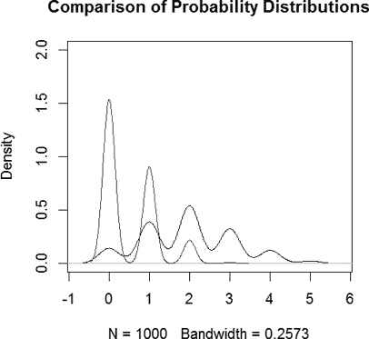

图 5-11: 两个二项分布的密度图

黑色曲线分布 `b` 相比于分布 `a` 在更多数值上包含了更广泛的信息，而分布 `a` 将其信息集中在接近零的地方（浅灰色曲线）。基于熵的指标可以量化分布 `a` 和 `b` 之间信息存储的差异。R 提供了许多工具和包，用于量化和比较信息熵。让我们进一步探索。

R 中的 `philentropy` 包包含 46 种用于比较概率分布的不同指标，其中包含许多基于熵的指标。最流行的熵指标之一是 Kullback–Leibler divergence（Kullback-Leibler 散度），它衡量两个概率分布之间的相对熵。从技术上说，Kullback–Leibler divergence 衡量的是两个概率分布之间对数差异的期望（离散分布为求和，连续分布为积分）。因此，它是信息增益或损失的度量。这允许我们把信息熵转换为分布比较工具，当我们尝试比较未知或复杂的概率分布之间的差异时（而这些分布可能不适用于常用的统计工具），这种方法非常有用。

让我们通过回到两个二项分布 `a` 和 `b` 来培养直觉。我们将向 Listing 5-3 中添加以下内容，以计算两个分布之间的 Kullback–Leibler divergence：

```r
#load package
library(philentropy)

#calculate Kullback-Leibler divergence
kullback_leibler_distance(P=a,Q=b,testNA=T,unit="log2",epsilon=1e-05)
```

此代码计算了 Listing 5-3 中生成的两个二项分布样本的 Kullback–Leibler divergence。在这组模拟数据中，Kullback–Leibler divergence 为 398.5428；这些分布的另一个模拟可能会产生不同的散度。然而，通过非参数检验，可以将此散度值与一个分布的随机误差进行比较，以查看分布 `a` 和 `b` 之间是否存在统计学显著差异。我们可以向脚本中添加以下内容，使用熵差异创建非参数检验：

```r
#create a nonparametric test
#create a vector to hold results from the simulation
test<-rep(NA,1000)

#loop to draw from one of the binomial distributions to generate
#a null distribution for one of our samples
for (i in 1:1000){
  new<-rbinom(1000,5,0.1)
  test[i]<-kullback_leibler_distance(P=a,Q=new,testNA=T,unit="log2",epsilon=1e-05)
}

#obtain the cut-off score for 95% confidence intervals, corresponding
#to values above/below which a sample would be considered
#different than the null distribution
quantile(test,c(0.025,0.975))
```

该测试的置信区间为 427–475，这是预期的，因为分布 `a` 和 `b` 具有不同的值和范围。绘制 Figure 5-12 中的最后一个分布显示，新分布与 `a` 的匹配度远高于 `b`。

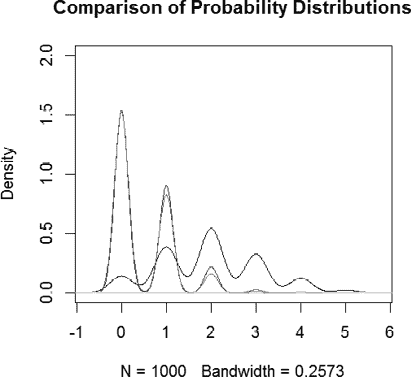

Figure 5-12: Three binomial distributions’ density functions plotted for comparison, with two coming from samples of the same distribution 使用 Kullback–Leibler divergence，我们确定 `a` 和 `b` 在统计上是不同的。如果我们看到的置信范围包含 422，我们将认为 `a` 和 `b` 可能来自同一个总体分布。实践中存在比例检验等统计检验来比较二项分布，但某些离散分布或样本没有简单的比较方法（例如卷积神经网络分类器的预测分布比较）。

### 形状比较

正如我们在 Chapter 4 中所示，点集和形状（如持久性图）可能是重要的。接下来的将处理这个问题。让我们从 Figure 5-13 中的示例开始。


Figure 5-13: Two circles with radii

现在，让我们想象一下公园里的这两条路径；你可以在 Figure 5-14 中看到。


Figure 5-14: Dog following a path

在某些点，主人和狗很近，一根短绳足以连接他们。然而，随着他们逆时针移动，主人和狗之间的距离在增大；你可以在 Figure 5-15 中看到这一点。


Figure 5-15: Dog and owner with increasing leash

比较形状点之间距离的历史性重要指标是 Fréchet distance（Fréchet 距离）。从多边形构建网格图，并计算 minmax 路径以找到两条路径可能之间的最大距离。最严格的要求产生了所谓的 `homotopic` Fréchet distance，它在许多机器人问题中都有应用。我们将在 Chapter 8 中回到同调理论。

目前，用更通俗的话来说，Fréchet distance 被称为“遛狗距离”，它在分析中有许多用途。它不仅可以用于测量曲线上点之间的最大距离，还可以用于测量形状点之间的总距离。许多 R 包包含了计算 Fréchet 距离现有版本的函数，包括在以下示例中使用的 `TSdist` 时间序列包。在这个包中，两个时间序列由 `ARMA(3, 2)` 分布生成，其中 Series 3 包含 100 个时间点，Series 4 包含 120 个时间点。时间序列对于追踪患者组的疾病进展、跟踪股市随时间的变化以及跟踪买家行为非常重要。


让我们使用 Listing 5-4 中的代码加载这些由包生成的时间序列并绘制它们，以可视化潜在的差异。

```r
#load package and time series contained in the TSdist package
library(TSdist)
data(example.series4)
data(example.series3)
my1<-example.series4
my2<-example.series3

#plot both time series
plot(my1,main="Time Series Plots of Series 4")
plot(my2,main="Time Series Plots of Series 3")
```

Listing 5-4: A script that loads and examines two time-series datasets

Figure 5-16 显示了两个随时间变化的具有明显高低点的时间序列。

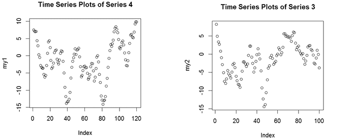

Figure 5-16: Plots of the two example time series

注意时间序列之间的重叠并不完美，我们预计比较结果会显示这些时间序列之间存在某些差异。通过 `Fréchet` 距离，可以测量时间序列之间的最大/最小偏差（最大/最小引线长度）以及整个比较集上的偏差总和。我们将通过在脚本中添加以下代码，对序列 3 和序列 4 检查这两项指标：

```r
#calculate Frechet distance
dis1<-FrechetDistance(my1,my2,FrechetSumOrMax="sum")
dis2<-FrechetDistance(my1,my2,FrechetSumOrMax="min")
dis3<-FrechetDistance(my1,my2,FrechetSumOrMax="max")
```

这段代码计算了时间序列之间 Fréchet 距离的最小值、最大值总和。对于时间序列曲线之间的距离之和，结果应该是 402.0；时间序列曲线点之间的最大距离为 13.7；时间序列曲线点之间的最小距离为 0.03。这表明时间序列在某些比较点上的值大致相同，而在另一些点上的值差异巨大。时间序列曲线之间的距离之和将收敛于跨越序列的连续时间积分；这种计算可以作为使用离散且相当快速近似计算函数之间面积的良好工具。

然而，除了 `Fréchet` 距离外，还有其他比较形状的方法，这些方法有时更好。让我们再次回到那两个圆，移动它们使其相交，如图 5-17 所示。

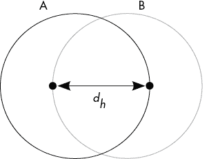

图 5-17：两个相交圆的绘图

我们可以考虑每个圆上的点，就像我们测量 `Fréchet` 距离那样。考虑圆 B 上的一个点以及它在圆 A 上最近的点（如图 5-17 所示）。圆 B 上的每个点在圆 A 上都有一个最近的点，这些点构成了一个最近点集。在图 5-17 中选中的点是一组特殊的点。它们是我们最近点集中距离最远的任意两个点。这意味着我们从一个圆跳到另一个圆时需要经过的最远距离就发生在这两个点上。这种距离被称为 `Hausdorff distance`（豪斯夫距离），在早期计算机视觉和图像匹配任务中有许多应用。如今，它主要用于序列匹配、图匹配和其他离散对象匹配任务。

然而，`Hausdorff distance` 的局限性之一是被比较的集合必须存在相同的度量空间中。因此，虽然我们可以比较圆上的点，但无法直接用 `Hausdorff` 距离比较圆上的点与球面上的点，或者比较欧几里得平面上的点与正曲率球面上的点。被比较的两个对象必须处于同一个度量空间中。

幸运的是，这种难题有一个解决方案。当两个度量空间映射到单个度量空间，同时保留每个空间内点之间的原始距离（称为 `等距嵌入`）时，我们可以简单测量这两个度量空间的最远最短距离。因此，我们可以球面及其点投影到切空间，以便与其他欧几里得空间进行比较。或者我们可以将两个对象嵌入到高维空间，类似于内核应用中的做法。这种 `Hausdorff distance` 的扩展被称为 `Gromov–Hausdorff distance`（格罗莫-豪斯夫距离）。

让我们对这种度量建立一些直觉。假设我们有一个三角形和一个四面体，如图 5-18 所示。

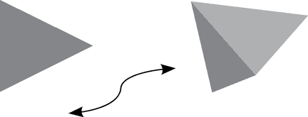

图 5-18：存在不同维度欧几里得空间中的三角形和四面体

图 5-18 中描述的问题的一个解决方案是将三角形带入三维欧几里得空间，并计算三维欧几里得空间中对象之间的距离。当三角形嵌入三维空间时，它的部分可能与四面体重叠，如图 5-19 所示。


图 5-19：三角形和四面体都映射到三维欧几里得空间

现在我们可以计算这两个对象最近点集中的最远点集，在这个例子中，这可能发生在三角形或四面体的一个远端。

R 有一个很好的包用于计算 `Gromov–Hausdorff distances`（`gromovlab`），因此我们可以轻松地在 R 中实现这种距离度量。首先，让我们用列表 5-5 中的代码从二维圆盘模拟一个小样本。

```r
#create two-dimensional disc sample
a<-runif(100,min=-1,max=1)
b<-runif(100,min=-1,max=1)

#create two-dimensional disc sample
a<-runif(100,min=-1,max=1)
b<-runif(100,min=-1,max=1)

#create two-dimensional disc sample
a<-runif(100,min=-1,max=1)
b<-runif(100,min=-1,max=1)

#create two-dimensional disc sample
a<-runif(100,min=-1,max=1)
b<-runif(100,min=-1,max=1)

#create two-dimensional disc sample
a<-runif(100,min=-1,max=1)
b<-runif(100,min=-1,max=1)

#create two-dimensional disc sample
a<-runif(100,min=-1,max=1)
b<-runif(100,min=-1,max=1)

#create circle from uniform distribution and restrict points within the#circle
d<-a²+b²
w<-which(d>1)
mydata<-cbind(a,b)
mydata<-mydata[-w]

#plot sample
plot(mydata,main="2-Dimensional Disc",ylab="y",xlab="x")
```

列表 5-5：从二维圆盘以检查 Gromov–Hausdorff 距离的脚本

这在绘图时应该给出一个大致的圆形状；查看图 5-20。

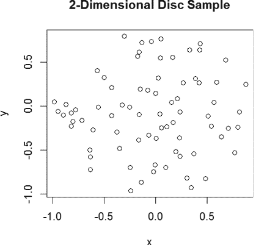

图 5-20：取二维圆的样本

现在，让我们向列表 5-5 添加代码，从生成我们二维圆盘的相同分布中模拟一个相同大小的样本：

```r
#create a uniform sample from a line segment
x<-sort(runif(dim(as.data.frame(mydata))[[1]],min=-1,max=1))
```

我们添加的代码提供了一个线段。这给了我们两个不同维度的欧几里得空间。现在，我们可以计算每个样本原生空间中点之间的距离（圆的二维欧几里得空间，线的一维欧几里得空间）。然后，通过添加以下代码，我们可以计算样本之间的 `Gromov–Hausdorff distance`：

```r
#load the package and calculate the distance matrices for use in calculations
library(gromovlab)
m1<-dist(as.matrix(mydata))
m2<-dist(as.matrix(x))

#calculate distance metric and compare distances with Gromov-Hausdorff
gromovdist(m1,m2,"lp",p=2)
```

这段代码允许我们比较样本点之间的距离矩阵。对于这个随机样本，`Gromov–Hausdorff distance` 为 5.8。我们可以像列表 5-3 所示，基于我们的度量模拟非参数检验，以帮助我们判断圆和线的嵌入在统计学上是否相同。改变度量可能会可能会嵌入之间的显著差异或嵌入的质量，正如我们在本章早期比较 `Canberra`、`Manhattan` 和 `Euclidean` 距离时看到的。感兴趣的读者鼓励尝试调整参数，建立自己的非参数检验，并观察圆和线样本的 `Gromov–Hausdorff distances` 结果的变化。

`lp` 参数允许人们使用在本节之前检查的基于范数的指标。对于这次特定的比较，我们使用了欧几里得范数，因为两个样本都位于欧几里得空间，且摄入的距离矩阵是由欧几里得范数定义的。其他范数（如曼哈顿或切比雪夫范数）也是可能的，并且对于其他问题可能更好，该包能够处理图、树以及距离矩阵。关于此软件包需要注意的一点是算法会搜索所有可能的等距嵌入，因此对于某些问题，所需的计算时间和内存可能很大。

### 度量几何与 `k`-最近邻

度量几何出现在许多算法中，包括 `k`-最近邻（`k`-`NN`）分析，该分析根据附近对象的分类来对观测值进行分类。理解这种方法的一种是考虑一个拥有不同学生圈子的高中食堂，如图 5-21 所示。

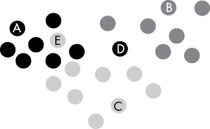

图 5-21：具有三个不同学生圈子的高中食堂

在图 5-21 所示的食堂中，存在三个学生圈子：深灰色圈子、灰色圈子和浅灰色圈子。学生倾向于留在朋友附近，正如学生 A、B 和 C 所示。这些学生被他们的朋友围绕着，如果根据距离度量（如欧几里得距离或学生之间的地板砖数量）使用任意数量的离他们最近的学生对他们进行分类，将很准确地划分成学生圈子。

然而，有少数学生（例如学生 D 和 E）位于其他圈子附近或处于三个圈子之间。学生 E 可能是人气圈子（底部中央）的一部分，也是校队运动员圈子（左上）的一部分，而学生 D 可能是人气、校队运动员以及数学小组成员（右上）。取决于在将他们归类为圈子时考虑了多少位于 D 和 E 附近的学生，他们可能属于自己的主圈子，也被错误地重新分配到一个新圈子（他们可能符合该圈子，但没有考虑到他们的主圈子）。例如，最近的 10 个学生可能会将学生 E 正确分配到人气组，而最近的 2 个学生则不会。

因此，`k`-`NN` 方法依赖于邻域大小（在本例中，距离目标学生最近的学生数量）和定义哪些学生离目标学生最近的距离度量。让我们更仔细地观察距离度量如何影响 `k`-`NN` 分类的准确性。在一个具有三个影响分类的变量和三个噪声变量的模拟数据集（见列表 5-6

```r
install_local("~/Downloads/knnGarden.tar")

#创建数据

a<-rbinom(500,4,0.2)

b<-rbinom(500,1,0.5)

c<-rbinom(500,2,0.1)

d<-rbinom(500,2,0.2)

e<-rbinom(500,1,0.3)

f<-rbinom(500,1,0.8)

class<-a+e-d-rbinom(500,2,0.3)

class[class>=0]<-1

class[class<0]<-0

mydata<-as.data.frame(cbind(a,b,c,d,e,f,class))

#将数据划分为训练集和测试集（60%训练，40%测试）

s<-sample(1:500,300)

train<-mydata[s,]

test<-mydata[-s,]

#使用不同的距离和五个最近邻创建 KNN 模型

library(knnGarden)

# 欧几里得

ke<-knnVCN(TrnX=train[,-7],OrigTrnG=train[,7],TstX=test[,-7],

K=5,method="euclidean")

accke<-length(which(ke==test[,7]))/length(test[,7])

# 加伯拉

kc<-knnVCN(TrnX=train[,-7],OrigTrnG=train[,7],TstX=test[,-7],

K=5,method="canberra")

acckc<-length(which(kc==test[,7]))/length(test[,7])

# 曼哈顿

km<-knnVCN(TrnX=train[,-7],OrigTrnG=train[,7],TstX=test[,-7],

K=5,method="manhattan")

acckm<-length(which(km==test[,7]))/length(test[,7])
```

列表 5-6：一个通过不同距离指标和五个邻居通过 `k`-`NN` 分类生成并分类样本的脚本

列表 5-6 创建了一个样本，然后通过不同的距离度量运行 `k`-`NN` 算法对点进行分类，包括曼哈顿、欧几里得和加伯拉距离。在这个特定的模拟中，所有距离都产生了相似的准确率（欧几里得距离 81%，曼哈顿距离 81%，加伯拉距离 82%）。我们可以通过修改列表 5-6 包含 20 个最近邻居来扩大邻域：

```bash
#使用不同的距离指标和五个最近邻创建 KNN 模型

# 欧几里得

ke<-knnVCN(TrnX=train[,-7],OrigTrnG=train[,7],TstX=test[,-7],

K=20,method="euclidean")

accke<-length(which(ke==test[,7]))/length(test[,7])

# 加伯拉

kc<-knnVCN(TrnX=train[,-7],OrigTrnG=train[,7],TstX=test[,-7],

K=20,method="canberra")

acckc<-length(which(kc==test[,7]))/length(test[,7])

# 曼哈顿

km<-knnVCN(TrnX=train[,-7],OrigTrnG=train[,7],TstX=test[,-7],

K=20,method="manhattan")

acckm<-length(which(km==test[,7]))/length(test[,7])
```

此脚本修改了计算 `k`-`NN` 模型的函数，更改部分已加粗；我们将参数更改为 `K=20`。在这个特定的模拟数据集中，考虑 20 个最近邻时，分类准确率存在巨大差异。欧几里得和曼哈顿距离的准确率略低为 78.5%，而加伯拉距离的准确率远为 57%。邻域大小对加伯拉距离的准确率影响很大，但对欧几里得和曼哈顿距离的影响较小。通常情况下，使用较大的邻居数量会平滑数据，类似于加权平均。然而，我们的曼哈顿和欧几里得运行并没有显示出这种平滑效应，并保持了原始的高性能。正如我们的示例所示，距离指标的选择对算法性能可能有很大影响，也可能影响很小。

`k`-`NN` 模型是与度量几何和邻域关系最紧密的模型之一，尽管许多其他方法依赖于距离指标或邻域大小。许多近期论文建议算法邻域定义的多尺度方法可以提高算法性能，包括在 `k`-`NN` 回归、深度学习图像分类以及持久图和单纯形算法（包括持久同调）中的应用，这一新兴领域近年来增长很大。

# 流形学习

许多降维算法也涉及距离度量和 `k`-`NN` 计算。最常见的降维算法之一是 `主成分分析`（`PCA`），它通过原始高维空间与低维目标空间之间的线性映射，帮助将高维数据处理到低维空间中。本质上，`PCA` 寻找一组理想的线性基，以最少量的线性基来解释最大的方差（即尽可能包含与我们数据相关的大部分相关信息）；这允许我们丢弃数据空间中许多不包含太多相关信息的基。这有助于我们可视化存在于三维以上的数据；还能消除输入到模型中的预测变量之间的相关性。

然而，如前所述，`PCA` 假设数据存在于几何平坦的空间中并被映射到低维平坦空间。正如我们看到的，情况并非总是如此，`Euclidean` 度量得出的距离结果可能与其他距离度量不同。最近，许多尝试放宽假设并将降维推广到流形的尝试提供了一类新的降维技术，被称为 `流形学习（`manifold learning`）`。`流形学习` 允许映射到可能是弯曲的低维空间，并将 `PCA` 推广到包含除 `Euclidean` 距离以外的其他度量。`流形（`manifold`）` 是一个局部欧几里得的空间，`Euclidean` 空间是流形的一个例子，因此一些人将 `流形学习` 称为这种更通用框架的伞括。

### 使用多尺度分析

较老的流形学习算法之一是 `多尺度分析`（`MDS`）。`MDS` 考虑将点嵌入 `Euclidean` 空间中，使得点与点之间的距离（可以是 `Euclidean` 距离）尽可能地保持不变；这是通过最小化用户定义的代价函数来实现的。通过 `Euclidean` 定义距离和代价函数产生的结果与 `PCA` 相同。然而，在使用 `MDS` 时没有必要将自己限制在 `Euclidean` 距离上，许多其他度量可能更适合特定问题。让我们通过一个小型数据集和不同的距离矩阵作为我们 `MDS` 算法的输入来进一步探索此；请查看 Listing 5-7 中的代码。

```r
#create data

a<-rbinom(100,4,0.2)

b<-rbinom(100,1,0.5)

c<-rbinom(100,2,0.1)

d<-rbinom(100,2,0.2)

e<-rbinom(100,1,0.3)

f<-rbinom(100,1,0.8)

mydata<-as.data.frame(cbind(a,b,c,d,e,f))
```


# 使用不同距离度量创建距离矩阵

`m1 <- dist(mydata, upper = T, diag = T)`

`m2 <- dist(mydata, "minkowski", p = 10, upper = T, diag = T)`

`m3 <- dist(mydata, "manhattan", upper = T, diag = T)`

```
Listing 5-7: 一个生成示例数据集并从数据计算距离矩阵的脚本
```

现在我们已经生成了一些数据并计算了三种不同的距离度量，让我们看看距离度量的选择如何影响 `MDS` 嵌入。让我们计算 `MDS` 嵌入并通过向 Listing 5-7 中添加内容来绘制结果。

```
#reduce dimensionality with MDS to two dimensions
c1 <- cmdscale(m1, k = 2)
c2 <- cmdscale(m2, k = 2)
c3 <- cmdscale(m3, k = 2)

#plot results
plot(c1, xlab = "Coordinate 1", ylab = "Coordinate 2",
     main = "Euclidean Distance MDS Results")
plot(c2, xlab = "Coordinate 1", ylab = "Coordinate 2",
     main = "Minkowski p=10 Distance MDS Results")
plot(c3, xlab = "Coordinate 1", ylab = "Coordinate 2",
     main = "Manhattan Distance MDS Results")
```

我们对 Listing 5-7 的添加应该产生彼此看起来不同的图。在这个例子中，图表（显示在 Figure 5-22 中）根据所使用的度量发生了剧烈变化，表明不同的距离度量会导致嵌入到不同的空间。


Figure 5-22: MDS 结果并视图，随所选的距离度量而变化

Figure 5-22 中的图结果表明，`Minkowski` 距离产生的结果与 `Euclidean` 或 `Manhattan` 距离截然不同；许多点在 `Minkowski` 的 `MDS` 结果中聚集在一起，这表明它可能不像其他度量那样能区分点对。然而，`Euclidean` 和 `Manhattan` 距离 `MDS` 结果之间的差异不那么显著，点分布得比我们的 `Minkowski` 距离情况分散得多。

## 使用 Isomap 扩展多尺度分析

某些流形学习算法将 `MDS` 扩展到其他类型的空间和距离计算。`Isomap` 通过将距离矩阵替换为点之间的地线距离（geodesic distances）之一来扩展 `MDS`。这种用地线距离替换距离计算的方法允许使用除 `Euclidean` 距离以外的度量，并将 `PCA` 推广到允许可能是弯曲的低维空间。`流形`是一个局部欧几里得的空间，`Euclidean` 空间是流形的一个例子，因此一些人将`流形学习`称为这种更通用框架的伞括。

为了理解邻域的大小，我们将创建 5、10 和 20 个邻域：

```
#create Isomap projections of the data in 5-6
library(vegan)
i1 <- scores(isomap(dist(mydata), ndim = 2, k = 5))
i2 <- scores(isomap(dist(mydata), ndim = 2, k = 10))
i3 <- scores(isomap(dist(mydata), ndim = 2, k = 20))

#plot results
plot(i1, xlab = "Coordinate 1", ylab = "Coordinate 2", main = "K=5 Isomap Results")
plot(i2, xlab = "Coordinate 1", ylab = "Coordinate 2", main = "K=10 Isomap Results")
plot(i3, xlab = "Coordinate 1", ylab = "Coordinate 2", main = "K=20 Isomap Results")
```

这段代码片段对 Listing 5-7 中的生成数据使用 `Euclidean` 距离应用 `Isomap`。可以使用其他距离度量并可能产生不同的结果，如 `MDS` 分析所示。`Isomap` 分析的结果表明，邻域的大小对决定结果起的作用很大，如 Figure 5-23 中每个坐标的刻度所示。


Figure 5-23: Isomap 结果并视图，随所选的邻域数量而变化

`Locally linear embedding` (`LLE`) 是这种局部流形学习算法之一，也是最常用的流形学习算法之一。粗略来说，`LLE` 从一个最近邻图开始，然后根据每个点的最近邻为每个点创建权重集。从那里开始，算法根据代价函数以及每个点最近邻权重集的保持性来计算映射。这使其能够保留数据中重要的几何信息，而这些信息存在于流形上相互相邻的点之间。

回到我们在 Listing 5-7 中的代码，让我们扩展代码并探索在不同邻居数量的情况下将 `LLE` 映射到二维空间。对于此包，你需要下载该包（[`mran.microsoft.com/snapshot/2016-08-05/web/packages/TDAmapper/README.html`](https://mran.microsoft.com/snapshot/2016-08-05/web/packages/TDAmapper/README.html)）并本地安装它：

```
#install package
library(devtools)
install_local("~/Downloads/lle.tar")

#create LLE projections of the data generated in Listing 5-6
library(lle)
l1 <- lle(mydata, m = 2, k = 5)
l2 <- lle(mydata, m = 2, k = 10)
l3 <- lle(mydata, m = 2, k = 20)

#plot results
plot(l1$Y, xlab = "Coordinate 1", ylab = "Coordinate 2", main = "K=5 LLE Results")
plot(l2$Y, xlab = "Coordinate 1", ylab = "Coordinate 2", main = "K=10 LLE Results")
plot(l3$Y, xlab = "Coordinate 1", ylab = "Coordinate 2", main = "K=20 LLE Results")
```

这段代码将 `LLE` 算法应用于我们的数据集，并改变了算法计算中考虑的最近邻数量。让我们查看此数据集的图表，以理解最近邻在这个局部算法中的作用（Figure 5-24）。


图 5-24: LLE 结果的并排视图，随最近邻数量的变化而变化

如图 Figure 5-24 所示，邻域大小极大地影响了 `LLE` 的结果以及新二维空间中点的分布。鉴于最近邻的数量影响了所保留邻域的大小，较高的值会导致局部性较低的 `LLE` 版本，将算法转换为更类似于全局类型的流形学习算法。在 `K=20` 时似乎出现了良好的分离，这比 `K=5` 的局部性小，但对于具有 100 个点的数据集来说，仍然是一个相当小的邻域。如果我们将 `K` 设置为 100，则存在一个完全全局算法，给出一个具有良好分离且点在整个新空间中分布的二维图；你可以在 Figure 5-25 中看到这一点。


图 5-25: 使用整个样本作为最近邻的 LLE 结果图

其他局部流形学习算法也存在，其中一些允许像 `LLE` 的邻域大小那样的比例参数。如果你感兴趣，可以探索拉普拉斯特征映射（Laplacian eigenmaps）、Hessian `LLE` 和局部切空间分析（local tangent space analysis）。

## 使用 t 分布随机邻嵌入进行可视化

我们现在看到了局部算法如何通过定义邻域大小来捕捉全局属性。存在一些显式捕捉局部和全局属性的流形学习算法。其中最著名的算法之一是名为 `t-distributed stochastic neighbor embedding` (`t-SNE`) 的可视化工具。该算法有两个主要阶段：在高维空间点上创建概率分布，然后通过最小化两组分布之间的 Kullback–Leibler 散度，将这些分布与低维空间中的分布匹配。因此，该算法不是从点与之间的距离计算开始，而是侧重于匹配分布距离以找到最优空间。

`t-SNE` 并不是通过点的 `k` 个最近邻来定义邻域，而是通过内核对数据的带宽来定义邻域；这产生了一个名为 `perplexity`（困惑度）的参数，也可以改变它来理解邻域大小的作用。让我们回到 Listing 5-7 中生成的数据，看看它在实践中如何运作。添加以下代码：

```
#create t-SNE projections of the data generated in Listing 5-7
library(Rtsne)
library(dimRed)
t1 <- getDimRedData(embed(mydata, "tSNE", ndim = 2, perplexity = 5))
t2 <- getDimRedData(embed(mydata, "tSNE", ndim = 2, perplexity = 15))
t3 <- getDimRedData(embed(mydata, "tSNE", ndim = 2, perplexity = 25))

#plot results
plot(as.data.frame(t1), xlab = "Coordinate 1", ylab = "Coordinate2",
     main = "Perplexity=5 t-SNE Results")
plot(as.data.frame(t2), xlab = "Coordinate 1", ylab = "Coordinate2",
     main = "Perplexity=15 t-SNE Results")
plot(as.data.frame(t3), xlab = "Coordinate 1", ylab = "Coordinate2",
     main = "Perplexity=25 t-SNE Results")
```

这段代码在数据集上运行 `t-SNE`，并改变 `perplexity` 参数。图表应该产生类似于 Figure 5-26 所示的结果，显示在低维空间中有更明显的聚集。


图 5-26: LLE 结果的并排视图，随数量的变化而变化

困惑度为 15 和 25 的图看起来非常相似，随着我们增加困惑度，低维空间中坐标的范围下降。在某些项目中，数据的更分散分布可能是很有用的。

总结，本章中的距离度量在机器学习应用中经常出现。特别是流形学习，可能涉及不同的度量选择、邻域大小以及数据映射到的空间类型。目前有许多优秀的教科书和论文详细涵盖了这些算法以及其他算法。然而，我们希望你已经对降维方法有了一个概述——特别是那些与度量几何紧密相关的方法。在继续之前，让我们考虑度量几何的最后一个用途。

## 分形

另一种与度量几何相关的工具涉及几何对象中的一种自相似性，称为 `fractals`（分形）。本质上，分形在相同模式内具有相同模式内的模式，以此类推。Figure 5-27 提供了一个示例。


图 5-27: 分形的一个示例。注意不同尺度下模式的自相似性。

分形经常出现在自然和人造系统中。例如，海岸线、血管、音乐尺度、封闭空间内的流行传播、股市行为以及词频和排名，在不同尺度上都具有自相似属性。能够测量分形维允许我们更好地理解这些现象的自相似程度。现在有很多分形维估计器，但大多数依赖于通过某种迭代方法比较相邻点集的面积，来测量分形曲线下方面积的变化。

回到 Figure 5-27 中的分形，我们可以考虑添加方框来找到每次迭代曲线下的面积，然后比较所考虑尺度的相对值，如 Figure 5-28 所示。


图 5-28: 在尺度下测量一系列分形曲线下方面积的示例

既然我们已经对分形有了直观的理解，让我们考虑分形维度指标的应用。股票市场以在一段时间内表现出某种程度的自相似性而闻名。理解市场波动性是明智投资的一个重要方面，而预测未来市场反转点（如崩盘）的方法之一就是观察自相似性的变化。琼斯工业平均指数（美国股市指数之一）或 `DJIA` 的收盘价可以免费下载。在这里，我们将考虑 2019 年 6 月至 2020 年 5 月期间的模拟每日收盘价（例如 `DJIA` 数据），这段期间正发生了新冠疫情的跌落。图 5-29 显示了该期间的收盘价图表。


图 5-29：2019 年 6 月至 2020 年 5 月模拟 DJIA 收盘价图。注意从 2020 年 2 月底开始的大幅跌落，此时新冠已成为全球性问题。

如果我们正在预测未来的市场行为，我们将希望使用时间序列数据分析的工具进行分形分析，这超出了本书的范围。然而，通过将数据解析为每月序列并计算每个每月序列的分形维度，我们可以轻松地感受自相似性的变化。从那里，我们可以检查分形维度如何与其他波动性指标（如一个月内的收盘价范围）相关；我们应该能看到正相关性。列表 5-8 加载数据、解析数据、计算分形维度、计算收盘价范围，并运行分形维度与范围之间的相关性测试。

```R
#load and parse stock market data
stocks <- read.csv("Example_Stock_Data.csv")
June2019 <- stocks[stocks$Month == "June",]
July2019 <- stocks[stocks$Month == "July",]
August2019 <- stocks[stocks$Month == "August",]
September2019 <- stocks[stocks$Month == "September",]
October2019 <- stocks[stocks$Month == "October",]
November2019 <- stocks[stocks$Month == "November",]
December2019 <- stocks[stocks$Month == "December",]
January2020 <- stocks[stocks$Month == "January",]
February2020 <- stocks[stocks$Month == "February",]
March2020 <- stocks[stocks$Month == "March",]
April2020 <- stocks[stocks$Month == "April",]
May2020 <- stocks[stocks$Month == "May",]

#calculate fractal dimension for each series
library(fractaldim)
junedim <- fd.estimate(June2019[,2], methods = "hallwood")$fd
julydim <- fd.estimate(July2019[,2], methods = "hallwood")$fd
augustdim <- fd.estimate(August2019[,2], methods = "hallwood")$fd
Septemberdim <- fd.estimate(September2019[,2], methods = "hallwood")$fd
Octoberdim <- fd.estimate(October2019[,2], methods = "hallwood")$fd
Novemberdim <- fd.estimate(November2019[,2], methods = "hallwood")$fd
Decemberdim <- fd.estimate(December2019[,2], methods = "hallwood")$fd
Januarydim <- fd.estimate(January2020[,2], methods = "hallwood")$fd
Februarydim <- fd.estimate(February2020[,2], methods = "hallwood")$fd
Marchdim <- fd.estimate(March2020[,2], methods = "hallwood")$fd
Aprildim <- fd.estimate(April2020[,2], methods = "hallwood")$fd
```


```r
Maydim <- fd.estimate(May2020[, 2], methods = "hallwood")$fd

# Combine fractal dimension results into a vector

monthlyfd <- c(
  junedim, julydim, augustdim, Septemberdim, Octoberdim,
  Novemberdim, Decemberdim, Januarydim, Februarydim, Marchdim,
  Aprildim, Maydim
)

# Examine correlation between fractal dimension and range

monthlyrange <- c(
  range(June2019[, 2]), range(July2019[, 2]), range(August2019[, 2]),
  range(September2019[, 2]), range(October2019[, 2]), range(November2019[, 2]),
  range(December2019[, 2]), range(January2020[, 2]), range(February2020[, 2]),
  range(March2020[, 2]), range(April2020[, 2]), range(May2020[, 2])
)

# Run correlation test between fractal dimension and range

cor(monthlyfd, monthlyrange)
```

这种切线在二维空间中效果良好。然而，尝试定义曲面上一点的切线会变得复杂，因为许多（无限多条）直线都可以切于给定点（参见图 6-2）。

图 6-2：通过 A 点且有多个可能切线的椭圆

事实上，图 6-2 中的直线形成了一个切于 A 点的二维切平面，类似于一张在 A 点接触椭圆的纸。我们可以做的是如图 6-3 所示，将这个`tangent plane`胶在 A 点上。


图 6-3：包含 A 点以及与 A 点相关的切平面的椭圆，切线扩展到切平面和切切空间

对于高维对象，切空间可能会增长到涉及更多维度（它可以是 3 维、100 维，甚至是无限维的立方）。这些切空间与线性代数有很好的联系。记住，向量空间可以由一组收集成矩阵的独立向量来定义，这被称为空间的`basis`，技术上称为`Hamel basis`。事实上，对象在某一点的切空间的`basis`实际上是该点偏导数的集合。如前提到的，在一维空间中，这恰好就是切线的斜率。这为流形上的每个点都提供了一个良好的欧几里得空间，可用于推导点之间的单位距离、提供从流形到欧几里得空间的映射，并理解多共线性。

多共线性发生在变量之间强相关时，会导致矩阵的列或行相同或几乎相同（导致奇异矩阵）。多共线性对于基于回归的算法是一个问题，因为它会导致冗余的预测因子和奇异矩阵。方差完全重叠的变量（高度共线的预测因子）具有相同的切空间，或至少共享一些重叠的切空间。

### 引入 `dgLARS`

基于切空间的实用机器学习算法是`dgLARS`算法（`dgLARS`代表“微分几何最小角回归”）。`dgLARS`将传统的最小角回归（`LARS`）扩展为一种拟合给定模型误差切空间的算法。`LARS`算法通常从回归模型中的每个系数设为 0 开始，根据预测因子与结果的相关性高低逐步添加预测因子；通过最小二乘计算调整系数，直到具有更高相关性的因子进入模型。当多个预测因子进入模型时，系数在联合最小二乘方向上增加。

`dgLARS`考虑了模型的切空间，缩放了用于优化系数的得分函数。模型的每次更新都使用一种名为`conditional Fisher information`的工具的平方根完成。条件 Fisher 信息粗略地衡量了给定变量相对于目标（如结果变量）所包含的信息量。对于对技术感兴趣的读者，参数的 Fisher 信息是该参数得分的方差，该得分是该参数对似然函数自然对数的偏导数。

让我们通过一个例子来将其具体化。假设我们正在创建一个模型，以理解影响青少年风险行为的因素，如药物使用或轻微犯罪。我们可能已经测量了许多已知因素（如家庭社会经济地位、中学成绩以及之前的学校或法律事件记录）。然而，我们想将我们设计的用于衡量青少年风险倾向的问卷指数（索引 1）与衡量成年人风险行为的已知指数（索引 2）进行比较。两项调查都可能捕捉到不同类型的信息，以及相对于我们风险结果的不同水平的相关信息（图 6-4）。


图 6-4：载入到风险指数的问题数量对比

在图 6-5 的示例中，调查 1 的索引包含更多的信息。然而，调查 2 的索引中变量之间可能存在某些重叠或无关信息，如果有一个能够捕捉此类信息的测量就太好了。也许每项调查中问的问题之间也存在某些信息重叠和一些无关信息。让我们考虑每个风险倾向调查中包含的独有且相关的信息（图 6-5）。


图 6-5：索引问题中捕捉到的两种相关信息的调整测量

从图 6-5 中，我们看到索引 1 和索引 2 包含一些无关信息和重叠信息。索引 1 包含的信息似乎比索引 2 多一点，如果我们必须选择选择对更大规模的风险青少年群体进行哪项调查，那么从索引 1 开始会比较好。

这就是 Fisher 信息和变量选择在`dgLARS`中发生的方式。技术上，通过模型似然函数的偏导数计算`score`，而该得分的方差就是 Fisher 信息，它可以进入矩阵以捕捉跨越模型偏导数的信息。有趣的是，这个矩阵也可以推导为相对熵（Kullback–Leiber 散度）的海森矩阵，在这种情况下，Fisher 信息提供了相对熵的曲率。在不那么技术层面，用于选择变量的 Fisher 信息与统计度量（对数似然函数）以及所考虑自变量的信息几何有关。

对于广义线性模型，Fisher 信息矩阵可以用于推导出称为`conditional Rao score`的得分，它可以测试给定变量的系数在统计上是否显著于 0。如果得分在统计上不显著，则从模型中删除该变量。在`dgLARS`算法中，这些计算是通过在模型误差切空间中搜索系数向量完成的，从零模型开始。

`dgLARS`在处理预测变量多于观测值的问题上取得了成功，关于该算法的许多论文都关注基因组学应用，在这些应用中，患者数量可能只有 300，而基因序列的数量可能达到 1,000,000 级。R 提供了一个名为`dglars`的包，为广义线性模型实现了该算法，包括逻辑回归、泊松回归、线性回归和 Gamma 回归的链接函数。对于不熟悉广义线性回归的人，`link function`（链接函数）本质上是因变量的一种特殊变换，它使得回归分析在数学上适用于计数变量、二分类变量和其他类型的非正态分布因变量（但对分布的几何形状有某些限制）。

既然我们已经涵盖了一些理论，现在让我们付诸实践。

## 使用 `dgLARS` 预测抑郁症

我们想根据学校问题和`IQ`来预测自述的抑郁情况。我们将使用的数据是来自自选极高天赋 Quora 用户（`IQ`在 155 以上）样本的自述学校问题，包括七个主要的学校问题（欺凌、教师敌意、无聊、抑郁、缺乏动力、校外学习、被安排补习课程）。这些数据来自 22 个个人的报告，他们提供了极高天赋范围内的评分，并讨论了学校系统中的至少一个感兴趣的问题，且偏向于美国的用户。该数据集从该平台收集并经过手动处理，获得了一个包含符合`IQ`标准的贴帖者学校问题类别的最终数据集。你可以在书的文件中找到该数据集。让我们先用 Listing 6-1 中的代码加载数据。

```r
# Load data

mydata <- read.csv("QuoraSample.csv")

set.seed(1)
```

Listing 6-1: 加载 Quora 数据集的脚本

Listing 6-1 中的代码加载了一个研究教育干预和自尊心理指标的数据集。现在，让我们修改脚本在数据集上运行`dgLARS`算法。该 R 包为我们提供了交叉验证或在不进行交叉验证的情况下运行算法的选择。让我们修改 Listing 6-1 以运行两种模型选项：

```r
# Run analysis

library(dglars)

dg <- dglars(
  factor(Depression) ~ .,
  data = mydata,
  family = "binomial"
)

dg1 <- cvdglars(
  factor(Depression) ~ .,
  data = mydata,
  family = "binomial",
  control = list(nfold = 2)
)
```

这在全学生数据上运行了交叉验证和非交叉验证的`dgLARS`算法。交叉验证版本在预测变量稀疏的小数据集上表现并不好，因此如果你遇到错误，请尝试运行交叉验证版本，因为某些分区可能会产生与划分以及对划分进行拟合模型相关的错误。两个`dgLARS`算法的输出在许多预测变量上应该是一致的，尽管由于数据是随机划分的，算法的交叉划分版本可能会有不同。让我们添加脚本来查看第一个模型的摘要：

```r
# Examine results of non-cross-validated model

> summary(dg)

Summary of the Selected Model

    Formula: factor(Depression) ~ 1

     Family: 'binomial'

       Link: 'logit'

Coefficients:

     Estimate

Int.  -1.5041

---

                 g: 1.265

     Null deviance: 20.86

 Residual deviance: 20.86

               AIC: 22.86

Algorithm 'pc' (method='dgLASSO')
```

该模型没有因素被选为重要预测变量。模型没有选择因素有几个主要原因，包括存在相反效应的亚群体（它们“抵消”了亚群体的角度）、存在扭曲几何形状的离群值，或者预测变量存在真实的零效应。模型拟合合理，赤池信息准则（`AIC`）为 20.86，且在模型未添加任何项的情况下，残差离差远小于零离差。离散参数告诉我们数据与二项分布拟合得良好（看`g`如何接近 1），没有出现真实世界数据中偶尔出现的分布问题。

现在让我们在脚本中添加以查看交叉验证试验的结果：

```r
# Examine cross-validated model

> summary(dg1)

Call:  cvdglars(formula = factor(Depression) ~ ., family = "binomial",
    data = mydata, control = list(nfold = 2))

Coefficients:

                       Estimate

Int.                    -1.6768

Bullying                 0.3066

Put.in.Remedial.Course   0.2292

dispersion parameter for binomial family taken to be 1

Details:

   number of non-zero estimates: 3

      cross-validation deviance: 12.33

                              g: 0.9838

                        n. fold: 2

Algorithm 'pc' (method='dgLASSO')
```

交叉验证模型的结果与非交叉验证模型略有不同，表明模型发现了一些一致性，但在折叠之间并没有完全重叠。在交叉验证模型中，被安排补习课程的极高天赋儿童倾向于有更高的抑郁率。

## 使用 `dgLARS` 预测信用卡违约

为了理解`dgLARS`在具有更多观测值和变量的二分类数据集上如何工作，让我们考虑另一个数据集。UCI 违约数据集包含 30,000 个台湾案例（2005 年）以及 23 个违约预测变量，包括人口统计学（年龄、婚姻状况、教育状况和性别）、信用额度以及之前的使用和支付信息。我们的分析目标是确定哪些预测变量与违约有关，并评估`dgLARS`模型的拟合情况。让我们用 Listing 6-2 中的代码开始。

```r
# Load data

mydata <- read.csv("UCIDefaultData.csv")

# Load library

library(dglars)

# Run analysis, scaling the predictors such that big numbers
# result in large differences in coefficient values

# Scale the predictor data

mydata1 <- scale(mydata[, -c(1, 25)])

mydata1 <- cbind(mydata1, mydata$default.payment.next.month)

colnames(mydata1)[24] <- "default.payment.next.month"

# Run the dglars function with and without cross-validation

dg <- dglars(
  factor(default.payment.next.month) ~ .,
  data = as.data.frame(mydata1),
  family = "binomial"
)

dg1 <- cvdglars(
  factor(default.payment.next.month) ~ .,
  data = as.data.frame(mydata1),
  family = "binomial"
)

summary(dg)
summary(dg1)
```

Listing 6-2: 使用`dgLARS`和交叉验证`dgLARS`加载、处理并分析 UCI 违约数据集脚本

这应该产生具有大多数预测变量系数的模型。第一个模型是非交叉验证模型版本（`DG`），第二个模型是交叉验证版本（`DG1`）。表 6-1 显示了我们运行代码的结果。

表 6-1: UCI 违约`dgLARS`模型中的项系数

| Column1 | DG estimate | DG1 estimate |
| --- | ---: | ---: |
| Int. | –1.47 | –1.45 |
| LIMIT_BAL | –0.10 | –0.09 |
| SEX | –0.05 | –0.04 |
| EDUCATION | –0.08 | –0.07 |
| MARRIAGE | –0.08 | –0.07 |
| AGE | 0.07 | 0.06 |
| PAY_0 | 0.65 | 0.65 |
| PAY_2 | 0.10 | 0.09 |
| PAY_3 | 0.09 | 0.09 |
| PAY_4 | 0.03 | 0.03 |
| PAY_5 | 0.04 | 0.04 |
| PAY_6 | 0.01 | 0.01 |
| BILL_AMT1 | –0.39 | –0.15 |
| BILL_AMT2 | 0.16 | 0.02 |
| BILL_AMT3 | 0.09 | 0.02 |
| BILL_AMT5 | 0.03 | 0.00 |
| BILL_AMT6 | 0.02 | 0.00 |
| PAY_AMT1 | –0.22 | –0.17 |
| PAY_AMT2 | –0.22 | –0.19 |
| PAY_AMT3 | –0.05 | –0.05 |
| PAY_AMT4 | –0.06 | –0.06 |
| PAY_AMT5 | –0.05 | –0.05 |
| PAY_AMT6 | –0.04 | –0.03 |

违约最大的预测因素之一包括上月的账单和还款历史。使用量较低（`BILL_AMT1`）、还款金额较低（`PAY_AMT1`）以及按时还款（`PAY_0`）的人，下个月发生违约的可能性较低。这非常合理，因为大多数贷款指标都优先向债务负担低且有按时还款记录的人群提供最优利率的贷款。

交叉验证的`dgLARS`模型对上月使用量和还款总额惩罚比非交叉验证模型小，这表明上月的按时还款比具体的数字更重要。第一个模型的`AIC`分数相当大（27,924），但它比空模型的`AIC`分数（31,705）要小得多，表明即使包含了几个预测变量，其拟合效果也优于空模型。

现在让我们将此模型与逻辑回归进行比较，并比较 AIC 拟合统计量，在我们的脚本中添加以下内容：

```r
# Run logistic regression

gl <- glm(
  factor(default.payment.next.month) ~ .,
  data = as.data.frame(mydata1),
  family = "binomial"(link = "logit")
)

# Calculate AIC of the model

AIC(gl)
```


这段代码在数据集上运行逻辑回归并计算模型的 `AIC`。在这个示例中，`AIC` 应该在 27,925 左右，与 `dgLARS` 模型几乎完全一致。这表明逻辑回归与 `dgLARS` 算法是收敛的；在如此大的样本量下，这种结果是预期的。逻辑回归是处理大样本量的典型工具，在这种情况下我们似乎没有通过使用 `dgLARS` 获得收益。然而，考虑到在大样本量上的收敛性，`dgLARS` 很可能在较小样本量上提供逻辑回归无法处理的高质量结果。

## 应用离散外微分

微分几何产生的另一个有用工具是离散外微分。离散外微分涉及从低维形状构建离散形状。离散外微分涉及从低维形状构建离散形状。在之前的章节中，我们检查了同调，这在技术上是通过识别边界完成的。例如，考虑[的形 6](https://wiki.example.org/figure_6) 的边界。

我们可以更进一步，将[边界的形 7](https://wiki.example.org/figure_7) 拆解为线。

正如我们可以通过识别边界来拆解形状，也可以通过组合那些边界从低维边界来构建形状，例如在[边界的形 8](https://wiki.example.org/figure_8) 中所示的连接方式。技术上，这被称为上同调，是离散外积分的领域。

对于更具技术背景的读者，我们正在观察微分形式的离散版本，即单纯形形复链。这些微分形式与其相关的场。然后我们可以定义算子来改变这些场、组合它们，或者计算形链内部的内容。这允许我们处理某些类型的数据，以理解电网中的资源能力或社交网络中的疾病负担（甚至是计算机屏幕上像素组的渲染）。

这种情况可以持续到任意维度，从线到三角形，三角形到四面体。我们也可以通过离散外微分跳跃级别，从点到三角形或四面体。因此，离散数据（如像素数据或工程数据）可以进行分组和连接以供进一步研究。

## 列表 6-3：一个生成连通城镇示例图、绘制该图、为每个城镇添加资源、将这些资源可视化，并分析相互连通城镇的资源的脚本

`列表 6-3` 创建了一个由道路连接的城镇矩阵，然后将其转换为加权图。一旦变成图的形式，我们就可以添加有关每个城镇可用资源的信息，并绘制一张包含这些信息的图片，同时包含由道路连接的城镇之间的距离。然后，我们可以计算城镇之间的互通资源，以及从给定城镇到另一个城镇的最小旅行距离。这将帮助我们评估灾害期间的可用资源以及派遣物资的最佳路线。

`列表 6-3` 的第一个图表应该输出一个显示哪些城镇相互连通以及城镇之间英数的图，如 `图 6-10` 所示。


图 6-10: 城镇连通性图及连通城镇之间的道路里程数

`图 6-10` 显示城镇 2、3 和 4 通过多条道路相连，因此如果某条路被封锁，仍然可以通过绕道另一个城镇到达该城镇。然而，尽管城镇 1 距离最近的城镇只有 4 英里，但它仍然相对孤立。连接城镇 2 和 3 的道路非常长（这可能是一条穿过茂密森林或绕过几条运河的乡路）。

`列表 6-3` 中的第二个 `plot` 应该输出一个为每个城镇添加了总资源的图，如 `图 6-11` 所示。


图 6-11: 城镇连通性图、连通城镇之间的道路里程数以及每个城镇内的资源图

`图 6-11`让我们对四个城镇之间的连通性和潜在的共享资源有了更深入的理解。注意，城镇 1 为灾害储备的水相对较少（每位居民 10 升）。然而，如果城镇 1 和 4 之间的道路在灾害期间保持完好，很容易从城镇 4（每位居民 200 升）移动一些水到城镇 1，使得城镇 1 有足够的水。只要直接连接这些城镇的道路在灾害中保持完好，在城镇 4 和城镇 2（储备每位居民 500 升）之间移动水也很容易。

极大团计算得出了相互连通的城镇（具有相互 `n` 路连接的城镇）。这建立了城镇 1 和 4 之间（通过单条道路）以及城镇 2、3 和 4 之间的连接，它们是相互连通的。根据这些信息，如果城镇之间的道路保持完好，我们可以计算每个城镇可支配的资源。城镇 1 和 4 相互包含 210 居民-升；三元团（城镇 2、3 和 4）包含 780 居民-升。

使用最短路径算法，我们可以计算任何两个城镇之间的最短路线，以理解当某个城镇物资短缺且道路未受灾害损坏时，物资可以多快地在城镇之间传输。`表 6-2` 给出了在这种情况下城镇之间需要行驶的英数。

表 6-2：城镇对之间的最短距离

|   | 城镇 1 | 城镇 2 | 城镇 3 | 城镇 4 |
| --- | --- | --- | --- | --- |
| 城镇 1 | 0 | 6 | 10 | 4 |
| 城镇 2 | 6 | 0 | 8 | 2 |
| 城镇 3 | 10 | 8 | 0 | 6 |
| 城镇 4 | 4 | 2 | 6 | 0 |

在这种情况下最长的路线（10 英里）是城镇 1 缺水时尝试从城镇 3 向城镇 1 运物资。注意，绕过最长路在城镇 2 和 3 之间传输物资反而更短（8 英里对比 12 英里）。

我们可以通过向 `列表 6-3` 中添加移除连接城镇道路的操作，来检查灾害中一条或多条道路损坏的情况，并重新检查互通物资和最短路径：

```R
#删除顶点 2 和 4 之间的链接，提供高效的物资
#传输路线

g2 <- delete_edges(g1, edges = "2|4")

V(g2)$number <- c(10, 500, 80, 200)

plot(
  g2,
  edge.label = E(g2)$weight,
  vertex.label = V(g2)$number,
  vertex.size = 40,
  main = "Situation 2"
)

#寻找极大团
mc2 <- max_cliques(g2)

#寻找城镇间的资源
c1 <- V(g2)$number[mc2[1]] + V(g2)$number[mc2[2]]

c2 <- V(g2)$number[mc2[1]] + V(g2)$number[mc2[3]]

c3 <- V(g2)$number[mc2[2]] + V(g2)$number[mc2[3]]

#使用最短路径检查传输所需时间
dis2 <- distances(
  g2,
  v = V(g2),
  mode = "all",
  weights = E(g2),
  algorithm = "dijkstra"
)
```


此脚本删除了城镇 2 和 4 之间的链接，重新计算指标以帮助我们评估城镇 2 和 4 道路阻塞后局势发生的变化。这将产生一个类似于`图 6-12`的图。


图 6-12: 道路损坏后的城镇 1 修改图

正如`图 6-12`所示，这种情况打破了情况 1 中的三角形，使城镇 2 孤立。如果城镇 1 的水供应不足，则必须在城镇 1 和 2 之间共享水。

如果我们观察团，可以看到城镇之间的双向连接，互通物资比情况 1 更分散。此外，旅行所需的英数增加了，正如我们在`表 6-3`中所示所示。

表 6-3：城镇对之间的最短距离

|    | **城镇 1** | **城镇 2** | **城镇 3** | **城镇 4** |
| --- | --- | --- | --- | --- |
| **城镇 1** | 0 | 22 | 10 | 4 |
| **城镇 2** | 22 | 0 | 12 | 18 |
| **城镇 3** | 10 | 12 | 0 | 6 |
| **城镇 4** | 4 | 18 | 6 | 0 |

离散外微分还有其他应用。图形渲染和工程问题一直是离散外微分（以及广义的离散外积分）中特别感兴趣的领域。工程中一些常见的应用是离散对象上的通量和流计算，或过程的计算机建模。在图形渲染中，图通常被网格取代。

在某些情况下，使用上调研究点云比使用持续同调更容易，因为最终结果会发现相同的边界和对象。然而，在开发将离散外微分应用于数据的显式 R 软件包方面进展有限，且代码必须像`列表 6-3`那样组合解析。自动化和对象操作代码将有助于离散外微分在数据科学及其他领域的采用。

机器学习中几何领域的另一个引人入胜的近期进展是机器学习算法中的`nonlinear algebra`（非线性代数）概念。许多机器学习算法严重依赖线性代数来计算梯度、最小二法估计器等。然而，在非平坦或不涉及直线的关系和空间中，线性代数只能为计算出的数值提供近似值。请看图 6-13，它显示了一条直线（线性代数工具，如回归中所使用的工具所假设的）和一条曲线（可能会导致线性代数工具产生估算问题）。


图 6-13: 直线和曲线

当使用线性工具估算曲线和非线性空间时，非线性会为算法的计算和最终结果引入误差。想象用尺子测量图 6-13 中下方的线条。很难获得该线相对于上方直线的精确长度。如果这条线的长度是算法需要最小化或最大化的数值，那么这种测量可能会找到一个非全局解，或者扭曲数值以至于导致预测准确性或模型拟合统计量（如平方误差或贝叶斯信息准则）出现问题。

机器学习算法中线性代数计算的一种替代方案是使用`numerical algebraic geometry`（数值代数几何），这是处理曲线交点的非线性代数分支。例如，考虑被一维曲线交叉的二维椭圆，如图 6-14 所示。


图 6-14: 曲线交叉椭圆的图

可以使用不同类型的矩阵和矩阵操作，类似于线性代数求解线性组的方法求解非线性系统；矩阵中的数字只需替换为多项式方程。其中一些曲线交点问题是非凸问题，它们通常会对机器学习算法及其支撑的线性代数产生问题。

`Convex optimization problems`（凸优化问题）是指优化函数创建一个区域，在该区域中，通过该区域的直线连续位于区域内（而不是穿过对象内的多个区域和非区域），如图 6-15 所示。


图 6-15: 凸对象

然而，如果区域包含空洞或凹陷，情况就不再如此，该区域被定义为`nonconvex`（非凸），如图 6-16 所示，区域内部的空洞将内部集分为区域内的集和空洞内的集。


图 6-16: 非凸对象

优化算法通常对优化函数中的非凸函数和区域感到困扰，因为通常用于解决这些问题的线性规划并不适用于非凸优化问题，而且步进法可能会陷入区域内空洞或凹陷周围的局部最优。遗憾的是，许多真实世界数据集以及用于它们的优化函数涉及非凸区域。数值代数几何为非凸优化问题提供了准确的解决方案，这类问题在现实数据情况下经常出现。一旦以矩阵形式建立多项式组，许多软件平台和程序可以计算，包括`Bertini`和`Macauley`软件，它们可以连接到`R`和`Python`。这使得求解器能够在非凸优化问题中良好运行。

数值代数几何的近期出版和工作坊表明，非线性代数是其他可能是凸问题的当前算法机制的可行替代方案，它可以放宽数学假设并提高准确性。最近的一篇论文（Evans, 2018）发现，对于许多类型的统计模型（包括`Lasso`、用于时间序列数据的`ARIMA`模型和贝叶斯网络），许多可能解的局部几何重叠的。这意味着算法无法很好地区分模型空间中的潜在预测集或参数值，特别是对于这些问题常用和建议的样本量而言。人们可以通过在切空间中拟合模型（正如我们在上一节中看到的），或者使用数值代数几何代替线性代数进行优化来解决这个问题。这表明数值代数几何和其他非线性方法在机器学习算法中有直接应用，以提高算法性能和模型拟合效果。

遗憾的是，目前`R`中不存在实现这些算法的包，因此我们不会在示例中进一步探讨此。

## 与 HodgeRank 比较选择排名

在客户群体中辨别选择偏好是一项常见的机器学习任务。例如，公司可能希望客户对软件潜在新功能列表上的项目进行比较，以便安排工程团队在未来一年中的工作优先级。比较选择排名也有助于公司向现有用户推销新产品和服务，并为可能在现有客户中畅销的项目开发新的营销活动。

让我们来看一个关于海滩一天活动偏好排名的简单例子。也许我们正在查看酒店从近期住客收集的数据，关于他们在入住期间偏好哪些活动；这将允许他们优先考虑海滩的使用和员工招聘，以满足对主要活动的需求。这里我们有三个选择（海滩、游泳或冲浪），其中一种偏好是明确的（冲浪）。图 6-17

图 6-17: 曲线交叉椭圆的图

我们可以通过增加一个优于其他三个项目的潜在活动：风浪板来增加这个问题。排名仍然相对容易计算，因为所有活动都优于海滩，一个活动仅优于海滩（游泳），一个活动优于除风浪板以外的所有（冲浪），一个活动优于其他三个（风浪板），如图 6-18 所示。


图 6-18: 在偏好数据中增加另一个活动

所有信息都在图中，这个特定个人完成了与其他项目之间的所有选择。这在真实世界的数据中很少见，如图 6-19 所示。


图 6-19: 非凸对象（上下文）

然而，这些信息仍然显示了对风浪板的强烈偏好，所有风浪板对都有排名，且所有成对排名都指向风浪板作为最受喜的活动。在真实世界的数据中，不仅会有信息缺失，数据中经常会出现偏好环，例如图 6-20 所示，其中冲浪优于游泳，而风浪板优于冲浪但并不优于游泳。


图 6-20: 不完整且不一致的排名偏好示例

这导致了局部不一致性，即在有其他选项的情况下，风浪板和游泳的相对排名可能会发生变化。然而，冲浪和风浪板优于另外两项活动，表明它们的排名处于所有可能选项的前端，而风浪板又优于冲浪（这形成了一种平局机制）。

当全局不存在一致的偏好时，情况会变得更加模糊，每项活动都优于另一项活动，如图 6-21 所示。


图 6-21: 无一致偏好的不完整偏好数据图

在图 6-21 的情况下，无法判断哪项活动优于其他活动，分析结果将是不确定的。这在客户被要求对金融应用中的功能进行排名，或者客人被要求对偏好活动进行排名时非常常见。大多数客户存在于具有独特需求的子群体中，而这些需求可能是另一个重要客户子群体的相反。为开发功能进行优先级排序或为客人提供尽可能满足大多数客户的选择是一项挑战。

存在许多算法可以进行两两排名比较，以获得相互相关的偏好排名列表（`SVMRank`、`PageRank` 等）；然而，通常情况下，它们不提供关于排名中局部和全局不一致性的信息，而这些信息可能会影响某项或选择相对于其他项的位置。代数几何最近在两两排名算法集中增加了一个工具，它可以分解排名结果，以包含关于项目局部和全局不一致性的信息；那就是`HodgeRank`，它可以通过利用工程中常用的基于代数几何的定理：Hodge–Helmholtz 分解来推导出这些信息。

`Hodge–Helmholtz decomposition`将向量流（或图上的流）划分为三个不同的部分，如图图 6-22 所示：局部和全局均一致的`gradient flow`（梯度流）；局部一致但全局不一致的`curl flow`（旋度流）；以及局部不一致但全局一致的`harmonic flow`（调和流）。


图 6-22: 显示由 Hodge–Helmholtz 分解分解的流图

在海滩示例中，图 6-20 包含一个涉及游泳、冲浪和风浪板的旋度流（如果此处未排名另一活动，则也是调和流）。图 6-21 是全局调和流的示例（也是局部旋度流）。

`HodgeRank`算法本质是将`PageRank`扩展到两两排名问题；其数学原理归结为图数据上的最小二乘问题，从而允许对全局排名和局部排名一致性进行评估。因此，可以标记可疑排名以便人工分析师审查。该算法还允许原始两两排名集中存在大量缺失数据，使其能够广泛应用于现实世界排名问题中经常不完整的数据（用户不会去点击三百万个视频选项来将它们与其他所有选项进行排名！）。虽然 R 语言中没有相应的包，因此我们不会演示示例，但在 Matlab 中已经存在实现，鼓励对该算法感兴趣的熟悉 Matlab 的读者使用列出的`HodgeRank`资源。

## 总结

在本章中，我们学习了源自微分几何和代数几何的新型算法，并探索了在数据分析问题中同时使用`dgLARS`和离散外微积分（discrete exterior calculus）的方法，包括 Quora 赠送样本、信贷贷款样本和灾害规划场景。许多更多算法正在开发中，我们概述了非线性代数和 Hodge 理论近年来对机器学习的贡献，这些贡献影响了重要的行业问题类型（例如偏好排名和参数化模型估计）。

在下一章中，我们将回到持续同调，并检查另一种代数拓扑学工具，即`Mapper`算法。这两个工具都将用于在本章中介绍的学生样本。

# 7 拓扑数据分析工具


在本章中，我们将探索以拓扑学为直接基础的算法，并利用它们来理解第 6 章中遇到的自报告教育数据数据集。包含基于拓扑的算法的机器学习分支被称为`拓扑数据分析 (TDA)`。你已经在第 4 章中见过一些 TDA，在其中我们使用持续同调来探索网络差异。持续同调最近在机器学习社区引起了大量关注，并被用于心理测量数据验证、图像比较分析、卷积神经网络的池化步骤以及小样本数据的比较。在本章中，我们将重新审视持续同调并查看`Mapper`算法（现由 Ayasdi 商业化）。

## 寻找具有独特行为的区分性群体

之前，我们使用持续同调来区分不同类型的图。回想第 4 章，持续同调从点云数据创建单纯复形，对这些单纯复形应用一系列阈值，并计算与每个单纯复形内部特征相关的数字。为了比较对象，我们可以使用 Wasserstein 距离。

持续同调在今天的行业中有许多用途。`子群体挖掘`（即寻找具有独特行为的群体）是其中的主要用途。特别是，我们经常寻找零阶同调分量，即在几何上连接的群体（例如层次聚类中的类）。例如，在心理调查验证中，子群体挖掘允许我们发现调查中的不同群体，例如抑郁的不同亚型。

让我们通过一个与社交网站自报告教育数据相关的持续同调子群体挖掘示例。我们将模拟数据，并使用 R 中的`TDAstats`包比较持续同调结果，使用 R 中的`hclust()`函数进行单链层次聚类（见列表 7-1）。我们将回到第 6 章中 Quora 用户自报告学校经历的示例数据集（参见该数据集的文件）。在示例中，我们将样本分成 11 个人一组，以便通过统计学方法比较持续同调结果，以确保我们的测量在样本之间没有变化。这为我们的测量在人群中具有一致性提供了验证。

```r
# 加载数据并设置种子
mydata<-read.csv("QuoraSample.csv")
set.seed(1)

# 采样数据以分为两个数据集；移除 IQ 分
s<-sample(1:22,11)
set1<-mydata[s,-1]
set2<-mydata[-s,-1]
```

列表 7-1: 加载教育数据集并将其分为两个用于用于持续同调探索的脚本

现在我们已经有了数据集，可以应用持续同调（persistent homology）来理解聚类。具体而言，我们正在观察第 0 阶 Betti 数（对应于连通组）以及数据的其他拓扑特征——复习内容请参阅第 4 章。

首先，我们需要计算社交网络中每个学生之间的曼哈顿距离（Manhattan distances）；我们将用它们来定义过滤（filtration）。曼哈顿距离通常是离散数据的常用距离量。在你的脚本中添加以下内容：

```r
#calculate 得分对之间的曼哈顿距离
mm1<-dist(set1,"manhattan",diag=T,upper=T)
```

接下来，我们希望对基于距离的数据应用持续同调算法，以揭示持续特征。使用`TDAstats`包，我们可以添加代码来计算该数据集的第 0 阶和第 1 阶 Betti 数，并将较低过滤设置作为近似的最大尺度（这将给我们更大的聚类）。最后，我们可以在持续性图（persistence diagram）和层次聚类图中绘制这些结果：

```r
#创建 Vietoris-Rips 复形（将数据转换为单纯复形）
library(TDAstats)
d1<-calculate_homology(mm1,dim=1,format="cloud")

#绘制持续性图，其中圆=连通分量，三角形=环
plot_persist(d1)

#层次聚类
plot(hclust(mm1),main="Hierarchical Clustering Results, Distance Data")
```

`calculate_homology()`函数将距离数据集中的点云数据转换为单纯复形；然后我们可以应用过滤来识别在过滤过程中出现和消失的拓扑特征。其他方法也可以从数据创建单纯复形，但此包中的 Rips 复形是最容易计算的方法之一。

使用之前的代码，我们绘制了两个图。调用`plot_persist()`应该会产生类似于图 7-1 的结果。你可以看到那里存在一个主组，在较低的过滤水平下可能还有一个或两个子组；然而，由于子组接近对角线，它可能是一个显著特征。


图 7-1: 第一组教育经验数据的持续性图

在使用层次聚类结果（图 7-2）时，很容易看到一个主组以及在较小距离阈值下的几次分裂。


图 7-2: 模拟数据的聚类图

如果你在高度 5 处切割聚类，聚类图的结果存在两个主子组。让我们通过向列表 7-1 添加内容，根据层次聚类发现的两个主类来划分`set1`数据，首先检查较小的类，然后检查较大的类：

```r
#较小的聚类
mydata[c(1,9,10,17),]
```

这应该输出以下内容：

```r
> mydata[c(1,9,10,17),]
    IQ      Bullying Teacher.Hostility Boredom Depression Lack.of.Motivation
1  187             0                 1       0          0                  1
9  182             1                 1       0          0                  1
10 161             0                 0       1          0                  1
17 170             1                 0       0          0                  0
   Outside.Learning Put.in.Remedial.Course
1                 0                      0
9                 0                      1
10                0                      0
17                0                      0
```

在这个个人聚类中，没有报告抑郁症或校外学习。一些个人报告了校园欺凌、教师敌意、无聊、补习课程或缺乏动力。让我们将其与聚类图中发现的较大类进行对比：

```r
#较大的聚类
mydata[c(3,4,6,8,12,16,18),]
```

这应该输出类似所示的内容：

```r
> mydata[c(3,4,6,8,12,16,18),]
    IQ Bullying Teacher.Hostility Boredom Depression Lack.of.Motivation
3  155        0                 0       0          0                  0
4  155        0                 0       0          0                  0
6  174        0                 0       1          1                  1
```


```text
8  170        0                 0       0          0                  0

12 175        0                 1       0          0                  0

16 160        0                 1       0          0                  0

18 185        0                 0       0          0                  1
```

`Outside.Learning` `Put.in.Remedial.Course`

```text
3                 1                      0

4                 1                      0

6                 1                      1

8                 0                      1

12                1                      1

16                1                      1

18                1                      0
```

与第一个聚类相比，这些人个人大多报告了校外学习且没有欺凌。这似乎区分了学校内的学习经历。在校外学习和不处理欺凌可能与学生的学习成果和整体学校体验有关。

```python
#compute Manhattan distance for set 2

mm2<-dist(set2,"manhattan",diag=T,upper=T)

#create the Vietoris-Rips complex

d2<-calculate_homology(mm2,dim=1,format="cloud")

#plot persistence diagrams—circles=connected components, triangles=loops

plot_persist(d2)
```

请注意，我们已经将分析的数据集更改为完整样本中的第二组个体。这创建了一个在理论上应属于同一人群的比较集；在例例中，分析中得出了更多潜在的子群体。图表看起来类似于图 7-3 所示。


图 7-3：模拟数据的另一个持久性图，这次使用了不同的参数来模拟数据

在图 7-3 中，我们看到了几个与图 7-1 样本相似的独特群体。我们还看到了一些对应于 Betti 数 1 的点；然而，考虑到它们离线条非常近，这些点很可能是噪声。点离对角线越远，它越是数据集中的真实特征的可能性就越大。这些新的 Betti 数特征与我们之前的样本不同，但可能不是真实特征。

使用 `TDAstats` 包计算图与图之间的距离很容易。将以下几行添加到你的脚本中：

```python
#calculate distance between diagrams

w<-phom.dist(d1,d2,limit.num=0)

w
```

这计算了图 7-1 和图 7-3 所示的 0 阶和 1 阶同调持久性图之间的距离，得到的距离约为 10.73（0 阶调）和 0.44（1 阶调），尽管这些值可能会根据你使用的 `R` 版本而变化。现在可以计算从原始样本中抽取的随机样本之间的距离了。`TDAstats` 包提供了一种方便的方法在函数内部进行计算，这样我们不需要自己编写整个测试。让我们把这些部分添加到脚本中：

```python
#compute permutation test and examine p-values from output

permutation_test(d1,d2,iterations=25)
```

该脚本现在将在两个样本的特征之间进行置换检验，为每个计算出的同调层产生测试统计量和 `p` 值。正如预期的那样，我们的 0 阶同调差异在 95% 的置信水平下显著（`p` = 0.08）。鉴于我们的第一个样本中没有任何 1 阶同调特征，我们确实看到样本之间的 1 阶同调差异存在显著性；然而，统计量本身为 0，这表明这是一个人为的结果。

虽然这个例子涉及一个没有进行实际问调查的便利样本，但它确实与跨人群样本实施的真实心理测量工具如何通过持久同调进行验证有关。我们也可以使用这种方法来比较差异。

## 使用 Mapper 算法进行子群体挖掘

在数据科学中，我们经常面临数据具有极端值的聚类问题。`Mapper` 算法——将持久同调、分箱和聚类的某些概念结合起来生成图或单纯复——是子群体挖掘的另一个有用工具。

### 逐步理解 Mapper 算法

`Mapper` 算法的基本步骤涉及使用标量值函数过滤点云；然后我们将数据分离到重叠的箱（bins），在每个箱内进行聚类，并将簇连接成一个图。为了可视化这一点，让我们考虑一个简单的点云。查看图 7-4 中的结果。


图 7-4：一个由梯度定义的 Morse 函数的多态对象

现在，这个形状可以被分成重叠的箱。这允许我们看到函数值略有不同的区域之间潜在的有趣关系，这些关系在我们应用聚类算法时（如图 7-5 所示）将变得相关。


图 7-5：通过梯度对图 7-4 进行分箱的结果

现在我们对函数进行了分箱（图 7-5），我们可以开始聚类。跨箱的聚类可能会比简单应用聚类算法复杂一点。这种聚类是为了定义复形以及跨箱簇的重叠。在每个箱中进行聚类并结合结果以理解跨箱簇的连接性将给出最终结果。`Mapper` 算法的优势是结果可以很容易地可视化为图或单纯形；我们示例的最终结果可能会输出类似于图 7-6，两个两个群体从一个连接它们的点演化出来。


图 7-6：通过对图 7-4](#c07.xhtml#figure7-4) 的结果进行分箱定义的簇

`Mapper` 算法相比其他聚类方法具有若干优势，而拓扑数据分析（TDA）相比于其他方法也具有优势。对数据中微小扰动（噪声）的不不变性使得 `Mapper` 比 `k-means` 更健健性，后者对不同的起始种子非常敏感，且每次运行可能会产生截然不同的结果。（注意：`Mapper` 对参数变化敏感，但对添加噪声的重复运行相当健壮）。结果的压缩或可视化使得高维数据的聚类结果变得易于可视化。由于不依赖于坐标系，我们能够比较来自不同标度或从不同平台收集的数据。此外，`Mapper` 可以处理聚类重叠，这给 `k-means` 算法及其变体带来了巨大挑战。最后，`Mapper` 处理稀疏性和离群值的能力使其优于 `DBSCAN`。这使得它非常适用于小型数据集、预测变量可能多于观测值的数据集或可能包含大量噪声的杂乱数据。

### 使用 TDAmapper 寻找数据中的聚类结构

`TDAmapper` R 包提供了 `Mapper` 算法的实现，可以处理许多类型的处理后数据。在本示例中，我们将再次回到来自天赋型 Quora 用户样本的自报告教育数据集。该数据集包含七个主要的学校问题（欺凌、教师敌意、无聊、抑郁、缺乏动力、课外学习、参加补习课程），涵盖了 22 个人，这些个人在天赋范围内评分，并讨论了至少一个感兴趣的问题。目标是理解该样本内部问题之间的关系（类似于在测量中创建子量表）。这是二值数据，因此我们将使用反向汉明距离（inverse Hamming distance）来获取距离矩阵。`Hamming distance` 通过衡量二进制字符串的逐位差异来获取不相似性测量。其他距离也可以用于二值数据，但 `Hamming distance` 能够地比较在二值变量上评分的个体之间的整体差异。

让我们在 Listing 7-2 中加载数据并做好分析准备：

```r
# 加载数据并清洗

mydata<-read.csv("QuoraSample.csv")

mydata<-mydata[,-1]

# 加载 Mapper, igraph 和距离包

library(TDAmapper)

library(igraph)

library(e1071)

# 处理数据以转换为距离矩阵

df<-data.frame()

for (j in 1:7){

  for (i in 1:7){

    df[i,j]<-1/(hamming.distance(mydata[,i],mydata[,j]))

  }

}

df[df>1]<-1
```

Listing 7-2：加载并处理数据以获取距离矩阵的脚本

Listing 7-2 中的代码加载了我们的数据集以及分析所需的包，然后处理数据以获得距离矩阵，以输入 `Mapper` 算法。其他距离也可以用于二值数据，但 `Hamming distance` 能够很好地比较在二值变量上评分的个体之间的整体差异。

现在让我们应用 `Mapper` 算法。我们将 `Mapper` 设置为使用具有 70% 重叠率的三个区间来处理距离矩阵，并设置三个箱（bins）进行聚类。在小型数据集上，较高的重叠参数会促进跨箱的聚类之间的连通性；在实践中，30% 到 70% 之间的设置通常会产生良好的结果。此外，区间和箱的小数量对应于该数据集中待聚类实例的大半，这在实践中通常效果良好。通常，使用不同的参数设置是有用的，因为结果会取决于起始参数；最近的几篇论文表明，使用固定参数的 `Mapper` 算法在结果方面并不完全稳定。我们还将根据最小和最大汉明距离设置 `Filter` 值。我们可以通过在 Listing 7-2 的脚本中添加这些行来实现这两点：

```r
## 应用 mapper

j<-mapper1D(as.matrix(df),num_intervals=3,percent_overlap=70, num_bins_when_clustering=3,

filter_values=c(0.025,0.05,0.075,0.1,0.125,0.15,0.2))

summary(j)

j$points_in_vertex
```

此代码按照之前设置参数在数据上运行 `Mapper` 算法。`summary` 给出了 `Mapper` 对象中关于结果的对象列表。顶点（vertex）内点的摘要为我们提供了这些变量如何分离成聚类的信息。

探索 `Mapper` 对象可以让我们对哪些问题聚类在一起产生洞察。我们可以从 `Mapper` 对象中收集大量信息，但这种探索将限于理解数据集中的哪些点最终进入 `Mapper` 对象中的哪个聚类（顶点）。让我们查看我们向 Listing 7-2 中最后添加的内容的输出：

```text
$points_in_vertex

$points_in_vertex [[1]]

[1] 1

$points_in_vertex [[2]]

[1] 2

$points_in_vertex [[3]]

[1] 3

$points_in_vertex [[4]]

[1] 4

$points_in_vertex [[5]]

[1] 5

$points_in_vertex [[6]]

[1] 3 4 5 6

$points_in_vertex [[7]]

[1] 4 5
```

通过探索 `Mapper` 对象可以让我们对哪些问题聚类在一起产生洞察。我们可以从 `Mapper` 对象中收集大量信息，但这种探索将限于理解数据集中的哪些点最终进入 `Mapper` 对象中的哪个聚类（顶点）。让我们查看我们向 Listing 7-2 中最后添加的内容的输出：

（注：此处原文最后一行有截断，已按逻辑对齐）

## 介绍同伦相关算法

在本章中，我们将探索与同伦（homotopy）相关的算法，同伦是一种基于物体周围路径类型对拓扑对象进行分类的方法，包括基于同伦的回归参数计算。局部最小值和极大值经常困扰数据集：它们为在局部范围内探索解空间的算法提供了次优的停止点。在接下来的几页中，我们将看到同伦如何解决这个问题。

## 介绍同伦

如果两条路径或函数可以在感兴趣的空间内连续地变形为彼此，那么它们就是相互同伦的（homotopic）。想象一个高尔夫球场和两个高尔夫球员，其中人的推杆比另更好。球可以通过许多不同的路径到达球洞。想象用绳子在果岭上勒出每一杆球的路径。一条路径可能非常直接；另一条在找到球洞之前可能会绕很多圈，特别是当果岭有起伏时。糟糕的高尔夫球员可能需要击多次，导致一条长而曲折的路径。但无论有多少个丘，或者高尔夫球进入球洞需要多少杆，我们都可以通过变形绳子来缩短这些路径中的每一条，如图 8-1 所示。


图 8-1：高尔夫球场通往球洞的长路径（左）变形为通往球洞的短路径（右）

让我们稍微扩大一下类比，想象高尔夫球场出现了一个洞。带有洞的拓扑对象和空间会使这种变形过程复杂化，导致从一点到一点产生许多可能的路径。路径可以连接对象上的两点。根据对象的属性，这些路径有时可以足够“波动”到与另一条路径重叠，而无需将路径切断来绕过障碍（通常是洞）。绕过洞的路径为一条路径向另一条路径的连续变形带来了问题。路径无法绕过洞旋转或波动，以至于点与之间的路径必然与另一条路径重叠。随着洞以及洞周围路径的增加，不同类型的路径开始出现。一条路径在连接两点之前可能只绕洞转了一圈；另一条在连接两点之前可能绕洞转了好几圈。再次想象打高尔夫。假设果岭中间有一个障碍物（如岩石或水障），形成了一个环绕着复杂丘陵的圆环，这可能迫使糟糕的击球需要绕过岩石才能回到球洞，如图 8-2 所示。


图 8-2：环形球场（甜甜圈）上具有相同起点和终点的两条路径，在不切断或不移除内部洞的情况下无法相互变形

在这种情况下，我们无法无法在不切断线条或不移除洞的情况下将路径变形为彼此。随着更多洞或更高维度洞的增加，更多等价路径类开始出现，等价路径绕过一个或多个洞的圈数相同。二维球场的发球台到球洞的可能路径比三维球场少，因为球场中可能的障碍和洞的类型较少。在许多不同维度上具有许多洞或障碍的空间提供了许多路径可以绕过的障碍。这意味着该空间存在许多独特的路径。

鉴于数据集通常包含不同维度的洞，数据中可能存在许多不同类的路径。在贝叶斯分析和机器人导航路径查找任务中常见的数据随机游走可能是不等价的。这在导航问题中可能是一个优势，允许系统从一组具有与长度、资源分配和移动易用性相关的不同代价权重路径中进行选择。例如，在图 8-3 的路径查找中，可能障碍物 2 有尖锐端，如果系统靠得太可能会损坏，使得左侧的路径成为系统采取的理想路径。


图 8-3：一个障碍赛示例，包含从起点到终点的导航，具有多个可能的解决方案

图 8-3 显示了三条路径，其中没有任何路径可以在不移动障碍物或切断路径的情况下变形为其他路径。这些是空间中的唯一路径。通过计算唯一路径的总数，我们可以从拓扑上对空间进行分类。

## 介绍基于同伦的回归

如所述，数据集通常包含局部最优形式的障碍，即局部极大值最小值。梯度下降算法和其他逐步优化算法可能会卡在那里。你可以将这视为山山山谷的高维版本（鞍点，即高维拐点，也会带来优化问题）。卡在局部最优中为优化问题提供了不理想的解。

基于同伦的算法有助于估计包含许多局部最优值的高维数据中的参数，在这些情况下，梯度下降等许多常用算法可能会遇到困难。为了提供更深入的见解，考虑一个蒙眼的人试图通过图 8-4。在没有绳的情况下，他们一定会撞到障碍物，并在被一个较大的障碍物挡住时可能认为自己已经击中了目标。


图 8-4：蒙眼的人在障碍赛中导航

然而，如果给他们一根连接起点和终点的绳子，他们可以在点之间导航得好一点，并知道他们遇到的任何障碍都可能不是真正的终点。连接起点和终点有许多方法。图 8-5 显示了种可能的绳子配置。


图 8-5：带有引导绳的蒙眼的人在障碍赛中导航

蒙眼的人努力避免物理障碍类似于机器学习算法避免局部最优。例如，让我们考虑一个列表 8-1 中导出的具有全局最小值和极大值但许多其他局部最优值的二变量函数。

```r
#load plot library and create the function

library(scatterplot3d)

x<-seq(-10,10,0.01)

y<-seq(-10,10,0.01)

z<-2*sin(y)-cos(x)

which(z==min(z))

which(z==max(z))

scatterplot3d(x,y,z,main="Scatterplot of 3-Dimensional Data")
```


列表 8-1：创建一个具有全局最小值和极大值但许多其他局部最优值的二变量脚本

列表 8-1 中的代码产生了图 8-6 中的图，从图中我们可以许多许多和极大值。其他的最优值是局部最优，其中一些非常接近全局最小值或极大值。


# 图 8-6：三维数据的散点图，即一个具有多个局部最优值的函数

试图优化此函数的算法可能会陷入其中一个局部最优值中，因为局部最优值附近的值相对于该最优值在增加或减少。某些已知在处理此类优化时存在困难的算法包括 `gradient descent` 和 `expectation-maximization (EM)` 算法等。诸如 `evolutionary algorithms` 等优化策略也可能需要很长时间才能找到全局解决方案，使得它们对于这类数据来说并不理想。

基于同伦（Homotopy-based）的计算为局部最优陷阱问题提供了一个有效的解决方案；使用同伦计算的算法可以在局部最优值周围移动或跳出局部最优。本质上，这些算法从一个不存在局部最优值的简单优化问题开始，根据数据集及其几何结构缓慢地变形解，在变形过程中避开局部最优值。

如今机器学习中常用的基于同伦的优化方法包括支持向量机、`Lasso` 甚至神经网络。`R` 语言的 `lasso2` 包是实现基于同伦模型的包之一；在这种情况下，`lasso2` 为 `Lasso` 算法实现了一个基于同伦的模型。让我们首先探索列表 8-1 中生成的数据的模型拟合和解，其中结果具有许多局部最优值，且预测因子共线性，这是许多机器学习算法面临的问题。在列表 8-1 的代码中添加以下内容：

```r
#partition into training and test samples

mydata<-as.data.frame(cbind(x,y,z))

set.seed(10)

s<-sample(1:2001,0.7*2001)

train<-mydata[s,]

test<-mydata[-s,]
```

现在，模型已准备好构建和测试。我们关注的结果（我们的变量 `z`）不符合正态分布，但高斯分布是模型可用的最接近的分布。在列表 8-1 脚本的后续部分，在开始模型迭代之前需要将 `etastart` 参数设置为 `null`，并且需要设置一个边界来引导同伦参数搜索。通常情况下，设置较低值最好：

```r
#load package and create model

library(lasso2)

etastart<-NULL

las1<-gl1ce(z~.,train,family=gaussian(),bound=0.5,standardize=F)

lpred1<-predict(las1,test)

sum((lpred1-test$z)²)/601
```

该脚本现在对训练数据拟合基于同伦的 `Lasso` 模型，然后根据该模型预测测试数据结果，从而允许我们评估模型拟合情况。最后一行计算的该样本均方误差应接近 2.30。（再次，结果可能随 `R` 版本而异，因为种子设定和采样算法发生了变化。）模型结果表明一项主导了函数的行为：

```r
> las1

Call:

gl1ce(formula=z ~ .,data=train,family=gaussian(),standardize=F,

    bound=0.5)

Coefficients:

(Intercept)           x           y

 0.05068903  0.04355682  0.00000000

Family:

Family: gaussian

Link function: identity

The absolute L1 bound was       :  0.5

The Lagrangian for the bound is :  1.305622e-13
```

这些结果（对于不同版本 `R` 的读者来说可能会不同）显示只有一个变量被选为模型的重要变量。根据我们的模型，`x` 对 `z` 预测的贡献比 `y` 更大。鉴于 `x` 或 `y` 与 `z` 之间存在非线性关系，线性回归并不是处理此问题的理想工具，但它确实在关系中发现了一些一致性。

为了与另一种方法进行比较，让我们创建一个线性回归模型并添加到列表 8-1 中：

```r
#create linear model

l<-lm(z~.,train)

summary(l)

lpred<-predict(l,test)

sum((lpred1-test$z)²)/601
```

最后一行计算的该样本均方误差应接近 2.30。（再次，结果可能随 `R` 版本而异，因为种子设定和采样算法发生了变化。）模型结果表明一项主导了函数的行为：

```r
> las1

Call:

gl1ce(formula=z ~ .,data=train,family=gaussian(),standardize=F,

    bound=0.5)

Coefficients:

(Intercept)           x           y

 0.05068903  0.04355682  0.00000000

Family:

Family: gaussian

Link function: identity

The absolute L1 bound was       :  0.5

The Lagrangian for the bound is :  1.305622e-13
```

这些结果（对于不同版本 `R` 的读者来说可能会不同）显示只有一个变量被选为模型的重要变量。根据我们的模型，`x` 对 `z` 预测的贡献比 `y` 更大。鉴于 `x` 或 `y` 与 `z` 之间存在非线性关系，线性回归并不是处理此问题的理想工具，但它确实在关系中发现了一些一致性。

## 样本结果比较

让我们回到教育数据集，探索学校、IQ 和自报告抑郁之间的关系。由于我们不知道这些预测因子与抑郁之间的函数应该是怎样的，因此不知道可能存在什么样的局部最优值。然而，我们知道具有 7 个预测因子和 16 个人（数据的 70%）的数据集是稀疏的，局部最优可能是个问题。让我们创建列表 8-2 并数据划分为训练集和测试集。

```r
#load data and set seed

mydata<-read.csv("QuoraSample.csv")

set.seed(1)

#sample data to split into two datasets with stratified sampling

#ensure more balance in the training set with respect to depression

m1<-mydata[mydata$Depression==1,]

m2<-mydata[mydata$Depression==0,]

s1<-sample(1:4,3)

s2<-sample(1:18,6)

train<-rbind(m1[s1,],m2[s2,])

test<-rbind(m1[-s1,],m2[-s2,])
```

现在，让我们运行同伦 Lasso 模型和逻辑回归模型，以比较这个小型真实世界数据集的结果：

```r
#run the homotopy-based Lasso model

las1<-gl1ce(factor(Depression)~.,train,family=binomial(),bound=2,standardize=F)

lpred1<-round(predict(las1,test,type="response"))

length(which(lpred1==test$Depression))/length(test)

#run the logistic regression model

gl<-glm(factor(Depression)~.,train,family=binomial(link="logit"))

glpred<-round(predict(gl,test,type="response"))

length(which(glpred==test$Depression))/length(test)
```

通过运行之前脚本中添加的模型，我们应该看到基于同调连续（homotopy）的 Lasso 模型准确率（~85%）高于逻辑回归（~70%）；此外，逻辑回归模型输出了一条关于拟合概率出现 0 或 1 的警告信息。这意味着数据被明显分成了几组，这在与结果有强关联的小型数据被拆分时可能会发生。取决于你使用的 `R` 版本或 GUI，你可能会得到不同的样本，从而导致略有不同的拟合统计数据和结果。由于初始样本量较小，你得到的可能会可能与此处展示的略有不同。某些样本在集中可能不包含给定预测变量的实例。更大的样本可以在跨样本的情况下创建更稳定的模型。

让我们更仔细地观察基于同调连续的 Lasso 模型及其系数：

```r
> las1

Call:

gl1ce(formula=factor(Depression) ~ .,data=train,family=binomial(),

    standardize=F,bound=2)

Coefficients:

           (Intercept)                     IQ               Bullying

           -8.31322182             0.04551602             0.00000000

     Teacher.Hostility                Boredom     Lack.of.Motivation

            0.00000000             0.51213722             0.00000000

      Outside.Learning Put.in.Remedial.Course

           -1.01281345             0.42953330

Family:

Family: binomial

Link function: logit

The absolute L1 bound was       :  2

The Lagrangian for the bound is :  0.4815216
```

从之前的输出中我们可以看到，对于这个样本，较高的 IQ、产生无聊感以及被安排补习班增加了自述抑郁的概率。然而，校外学习具有很强的保护作用。事实上，校外学习可以完全抵消无聊和进入补习班带来的风险。这表明，对于经历学校问题的资赋儿童的父母，可以通过提供校外学习机会（例如晚间大学课程、校外辅导或其他学习机会）来缓解一些潜在的负面结果，如抑郁。

校外学习机会的作用在资赋文献中已在程度上得到了探索，结果相似，但关于这个主题还需要更多的研究。

现在，让我们这些结果与逻辑回归模型的结果进行比较：

```r
> summary(gl)

CALL:

glm(formula=factor(Depression) ~ .,family=binomial(link="logit"),

    data=train)

Deviance Residuals:

        20          21           6          16          18           4

 3.971e-06   1.060e-05    -3.971e-06  -3.971e-06  -2.110e-08

        11           2          19

-8.521e-06  -1.060e-05  -1.060e-05

Coefficients:

                         Estimate Std. Error z value Pr(>|z|)

(Intercept)            -7.297e+02  1.229e+06  -0.001        1

IQ                      3.934e+00  6.742e+03   0.001        1

Bullying               -1.421e+01  5.193e+05   0.000        1

Teacher.Hostility       2.798e+01  3.424e+05   0.000        1

Boredom                -1.967e+01  8.765e+04   0.000        1

Lack.of.Motivation      4.174e+01  2.496e+05   0.000        1

Outside.Learning       -6.535e+01  2.765e+05   0.000        1

Put.in.Remedial.Course  1.121e+02  2.712e+05   0.000        1

(Dispersion parameter for binomial family taken to be 1)

    Null deviance: 1.1457e+01  on 8  degrees of freedom

Residual deviance: 5.6954e-10  on 1  degrees of freedom

AIC: 16

Number of Fisher Scoring iterations: 24
```


检查之前的输出，似乎逻辑回归模型无法处理该数据集，产生了错误并输出了非常大的系数。这可能与数据量较小有关，导致线性系统是欠定的；然而，这并不是预测变量数量超过样本人数的情况，因此这可能是数据本身属性，而非仅仅是样本量的问题。

注意，模型未能找到任何自述抑郁的显著预测变量。线性回归无法很好地处理该数据集，结果不可靠。对于某些样本，某些变量在线性回归模型中可能无法计算。基于同调连续的模型（以及其他类型的模型）在小数据集上通常效果更好。

## 总结

在本章中，我们概述了同调连续及其在机器学习中的应用，包括一个在模拟问题和真实数据集上的应用示例。同调连续可以帮助回归算法避免局部最优。同调连续在人工智能领域的其他用途还包括导航问题。例如，自动小车可能需要通过加权从当前位置到目的地的路径来导航医院的走廊和障碍。也可以设置边界以避免生成明显不可或不希望的路径（例如通过手术室）。拓扑数据分析这一分支在未来几年可能会增长，我们鼓励你探索同调连续在机器学习、机器人、微分方程和工程中的其他用途。

# 9 最终项目：分析文本数据


在本章中，我们将通过一个与语言学和心理学相关的项目，整合之前章节开发的工具。今天许多重要的数据项目涉及文本数据，从文本匹配到机器人、客户情感分析以及作者鉴别和语言分析。我们将查看一个来自不同创意写作样本的语言特征小型数据集，观察语言使用如何随体裁变化；某些体裁鼓励不同的写作过程，反映了不同的作者心态，例如写随笔与随手创作俳句。

具体来说，我们将使用 `k-NN` 和我们选择的距离量来观察类重叠，然后通过减少数据集的维度来可视化特征空间，接着使用 `dgLARS` 创建根据特征区分诗类型的交叉验证模型，最后检查基于语言嵌入的预测模型。通过完成整个项目，我们将看到这些工具如何结合以从数据中得出见解。

## 构建自然语言处理流水线

在第 1 章中，我们简要讨论了文本数据的重要性以及自然语言处理（NLP）流水线如何将文本数据转换为适合监督学习方法的模型特征。这是我们即将项目采取的方法。我们将使用 `Python` 将文本数据转换为特征，然后使用 `R` 分析这些特征。

第一步是 `parse` 数据；我们必须将文本块分解为更易管理的单元——无论是段落内的句子，还是句子内的单词和标点符号。这允许我们分析短文本片段，并将结果组合成句子、文档，甚至一组文档。例如，在本章中，你可能想 `parse` 每个章节，然后每个段落，最后每个段落中的每个单词，以理解语言用法在介绍材料和应用示例之间是如何变化的。

有时，你想要提取标点、某些类型的填充词或词根的后缀。`Root words` 排除如 `ing` 等结尾，这些结尾会改变动词态或将一个词性转换为另一个。考虑一下篮球练习中 `dribble`、`dribbled` 和 `dribbling` 之间的区别。如果控卫正在 `dribbling` 球，这个动作正在发生。如果他们已经 `dribbled` 了整场比赛，他们可能已经累了并把球放回了架上。然而，控卫的动作无论是过去还是现在都是相同的。他们现在正在做还是昨天做的并不重要。`Stemming` 和 `lemmatizing` 是两种将单词分解为词根的方法：`stemming` 通过将单词还原为词根（无论该词根是否仍是一个单词）来实现；而 `lemmatizing` 则以确保词根仍然单词的方式将单词还原为词根。

一旦文本 `parsed` 到你特定应用所需的程度，你就可以开始分析每个片段。`Sentiment analysis` 旨在理解给定文本中单词和短语背后的情感。例如，与“某些用户可能不喜欢该产品的气味”相比，“terrible product!!! never buy”的语调相当负面。情感分析通过统计文本中每种情绪的总数来量化文本中的情感，使每种情绪得到一个分数，并根据需要汇总成最终得分。

解析完成后，我们就可以应用 `named entity recognition`，它将单词与重要人物、地点或某个领域感兴趣的术语列表进行匹配。例如，在处理与患者出院和结果相关的医疗记录时，你可能想将单词与诊断列表进行匹配。

在其他应用中，标记词性（包括代词、动词、介词、形容词等）可能非常重要。有些人使用某些词性的频率可能比其他人更高，理解这些模式可以洞察文本来源的个性、临时心情，甚至是真实性。对于某些 NLP 应用，可以将这些因素加载到给定的结果或一组结果中，从文本数据中创建完全全新的指标。

这些分析类型的每一种都可以集成到关系数据库中，作为下游模型的额外特征。例如，正如我们在章稍后部分看到的，我们可以标记词性，根据特定文档的长度对其进行归一化，并将这些特征输入模型。你还可以对文档或一组文档中存在的单词进行向量化，以计算给定文档在文档集中存在的每个单词的频率。这通常出现在 NLP 应用中的深度学习模型和可视化方法之前。

再次，由于 `R` 与 `Python` 相比其 NLP 能力有限，我们在 `Python` 中完成了这第一步——将文本数据解析为特征——并在书中的文件中提供了结果数据。随后我们将使用 `R` 进行分析。我们使用 `Python` 的 `NLTK` 工具包来解析文本数据，虽然这些步骤超出了本书的范围，但我们已将脚本包含在 Python 下载仓库（`https://nostarch.com/download/ShapeofData_PythonCode.zip`）中，并鼓励你利用提供的原始数据，看看是否可以构建出类似的 NLP 流水线。

## 项目：分析诗歌中的语言

现代诗歌包含许多类型的诗，具有不同的结构、文学修辞和主题。例如，格律诗（如十四行诗或村庄歌曲）每行都有固定的重音节和总音节数，并有定义的韵脚。这些类型的诗歌通常大量使用其他文学手法，如典用（allusion）、奇喻（conceit，通过并置思想引用其他作品）、头韵或押韵（特定声音的重复）或格律（诗行中重音音节的模式）。这是一个格律诗（首十四行诗）的示例：

> Ever After  
> Her glass slipper turns to his M-16,  
> her elegant dress to faded fatigues.  
> He’s a shell of the man from their intrigues,  
> served five months patrol away from his queen.  
> Cinders to palace, her dreams now rubble,  
> she watches her carriage morph to Abrams tank,  
> as if her fairy tale were some cruel prank.  
> He shouts, “Hurry, men! March on the double!”  
> Her clock strikes twelve, his tank an IED,  
> and widower’s daughter is left widow.  
> She has but memories, now as shadows,  
> to comfort her dark days of misery.  
> Her ever after has no tomorrow,  
> leaving Cinderella grief and sorrow.

相比之下，自由诗的每行结尾没有定义的韵脚，行长可能不一（或者保持一致的长、短或中等），并且倾向于使用格律或韵脚等文学手法来强调特定篇目。这是一个短句自由诗的示例：

> Anya  
> Gaunt,  
> made-up,  
> wobbling in heels  
> too big for tiny feet,  
> heels  
> that sparkle and clack  
> against cold concrete  
> as wind  
> whips her teased hair  
> like a lasso  
> roping a steer  
> as snow  
> binds to tight jeans  
> like the shackles  
> she wore on the ship to Shangri La  
> as streetlight  
> catches a gleam in her eyes,  
> a glimpse as she stares into  
> tonight  
> her fifteenth birthday.

有些诗歌并不整齐地归入自由诗或格律诗，例如散文诗（没有换行）或俳句文（一种将散文诗与不同类型的俳句相结合的日本形式）。现代俳句及其相关形式通过转折（如破折号）并置两个图像或思想，从而连接它们。通常，现代俳句不符合日语的音节数规定，但它们通常包含对季节和自然的引用（对于相关形式川柳，则是对人性的引用）。俳句文通过诗歌标题、俳句和散文部分将故事编织在一起。这是一个现代俳句的示例：

> shooting stars—  
> the dash between  
> born and died

在开始可视化之前，让我们先深入了解一下数据集。数据集中包含了八首俳句（haiku）、八首俳文（haibun）、八首自由诗和八首格律诗。我们将它们分为基于俳句的诗和其他诗，以便根据诗歌典型的生成方式（自由联想与人工创作）来简化分析。我们将考虑的特征包括标点符号比例、名词比例、动词比例、人称代词比例、形容词比例、副词比例以及介词/连词比例。考虑到每种诗歌类型的构造方式，这些因素可能会有所不同。如果有更大的诗歌样本，你可以使用其他词性或将动词等类别拆分为各个具体的组成部分。

我们将在 `Python` 中完成这些步骤，因此我们只概述用到的步骤，而不深入探讨代码。你可以在本书的文件中找到处理后的数据。

### 文本数据分词

处理诗歌以分析的第一步是对文本数据进行分词（`tokenizing`），这意味着我们需要将诗歌解析为单个单词和标点符号。`Treebank tokenizer` 使用正则表达式解析句子中的单词，处理缩写以及单词与标点的其他组合，并拼接引号。这些是解析诗歌文本数据的重要步骤，因为标点符号在单词和短语中出现频率较高。特别是俳句，往往使用标点符号在诗中创建一个“切”（cut），以连接两个不同的图像或思想。

由于 `Treebank tokenizer` 经常拆分缩写和其他与其他标点连接的单词，使用 `regex tokenizer` 来统计文本中实际单词的数量并将其解析为包含标点的单词，是很有用的。鉴于某些诗歌非常短，我们希望确保不会夸大词数。`regex tokenizer` 的结果为我们提供了准确的词数，用于归一化词性或标点符号的比例。

获取分词结果的长度后，我们可以从标记（tokens）数量减去单词数量，从而得出文本中标点的长度。这允许我们比较不同诗歌类型的单词比例和标点符号比例，这可能随诗歌类型而异（根据之前对作者文本语言差异的研究，也可能取决于作者）。

### 词性标注

为了标记相关的词性，我们将使用 `averaged perceptron tagger`，这是一种监督学习算法，在不同文本类型上通常具有很好的率，并且已经为 `NLTK` 包进行了预训练。虽然它在处理大量文本时速度较慢，但我们的文本样本相当小，允许该程序在不需要过多处理能力的情况下标记单词。通过我们将在下一章中考虑的大数据技术，将 `NLTK` 的平均感知器标注器应用扩展到非常大的数据集是可能的。

我们将解析出名词、动词、人称代词、副词、形容词以及介词和连词，并统计每个文本样本中每个类别的数量。

名词包括单数、复数、普通名词和专有名词组合。动词包括所有类型和时态组合。人称代词包括代词和物主代词。副词和形容词包括副词和形容词的比较级和最高级。介词和并连也被标记并计数。

`averaged perceptron tagger` 中还存在其他标记词性，其他标注器可能包含更细的词性划分。如果你想探索如何使用词性来区分文本类型、作者或文本作者的人口统计特征，你可能希望使用另一个标注器，或者将名词、动词等拆分为其各个组成部分。然而，这将导致数据集中的列更多，因此如果你正在对文本属性和词性分析进行此类细致分析，我们建议你收集更多样本。

### 向量归一化

由于我们的文本样本根据诗歌类型包含一些短样本和长样本，我们在处理数据之前想要对词性计数进行标准化。我们的方法包括通过标记计数（标点和单词总数）对标点进行归一化，以及通过单词数对词性计数进行归一化，总结在本章的文件。这应该提供足够的特征来展示诗歌类型的差异，并允许通过良好的降维结果来可视化我们的数据集。

对于一种解析动词、名词等类型的更细致的方法，你可以推导出词性类别的比例，或拆分词性内部的比例，为你的分析构建更详细的特征。如果你熟悉 `Python`，我们鼓励你尝试 `NLP pipeline` 并自定义你的分析，以便对诗歌类型的语言差异有更深的见解。

现在，让我们进入 `R` 分析。

# 在 R 中分析诗歌数据集

我们将从加载处理后的诗歌数据集开始，使用 `Listing 9-1` 中的代码探索我们派生的特征。

```r
# 加载诗歌数据并设置会话种子

mydata<-read.csv("PoemData.csv")

summary(mydata)
```

Listing 9-1：读取处理后诗歌数据的脚本。

副词往往是代表性最低的特征，仅占任何给定诗歌中所用单词的 0–10.5%。名词往往是这组诗歌中出现频率最高的单词，占某首诗歌中单词的 12.5–53.5%。人称代词很罕见，超过四分之一的诗歌不包含人称代词（可能是由于俳句，它们倾向于不使用这些）。标点符号的使用差异很大，从俳句中没有任何表示到自由诗中近一半的内容由标点组成（一首关于医院医疗诊断的列表诗）。鉴于这种变化，我们很可能拥有良好的特征用于我们的分析中。

让我们为分析设置种子，并使用 `t-SNE` 可视化词性特征，使用每个可视化点的形状作为诗歌类型的指定；将以下代码添加到 `Listing 9-1`。

```r
# 提取相关数据片段

mydata1<-mydata[,-1]

haiku<-which(mydata1$Type=="haiku")

mydata1$Type[haiku]<-1

mydata1$Type[-haiku]<-2

set.seed(1)

# 创建并绘制诗歌数据的 t-SNE 投影

library(dimRed)

t1<-getDimData(embed(mydata1[,-1],"tSNE",ndim=2,perplexity=5))

plot(as.data.frame(t1),xlab="Coordinate 1",ylab="Coordinate 2",main="Perplexity=5 t-SNE Results",pch=ifelse(mydata1$Type==1,1,2))
```


图 9-1：不同诗歌类型的特征 t-SNE 图，用圆圈或三角形表示（`perplexity=5`）。

从图 9-1 的图中，我们可以看到我们的诗歌倾向于聚类，其中大多数点属于同一类型。这意味着基于内核的模型或最近邻模型可能足够通过特征对诗歌类型进行分类。

考虑到点在特征上存在分离，我们很可能应用算法对数据进行聚类，并使用监督学习来理解俳句类诗与其他诗之间的差异。

让我们样本划分为训练和测试部分，然后应用基于欧几里距离的 `k-NN` 算法，根据诗歌的五个最近邻来分类诗歌类型，在我们目前的代码基础上添加：

```r
# 创建不同距离和五个最近邻居的 Canberra KNN 模型

library(knnGarden)

s<-sample(1:32,24)

train<-mydata1[s,]

test<-mydata1[-s,]

kc<-knnVCN(TrnX=train[,-1],OrigTrnG=train[,1],TstX=test[,-1],

K=5,method="euclidean")
```

由于我们的 t-SNE 图（图 9-1）显示出某些分离，且点通常位于相似类型的诗歌附近，该模型可能运行良好。让我们通过在代码中添加以下内容，查看 `k`-NN 模型在测试集上的预测标签和真实标签：

```r
#examine performance

which(kc==test$Type)

> 1, 2, 3, 4, 5, 6, 7, 8
```

看起来该模型正确分类了所有测试诗歌，这说明这是一个高质量的模型，可以根据特征区分不同类型的诗歌。

我们将通过在代码中增加一个步骤，使用 10 折交叉验证的 `dgLARS` 模型进一步通过特征检查这些潜在的类型差异：

```r
#create a cross-validated dgLARS model

library(dglars)

dg1<-cvdglars(factor(Type)~.,data=mydata1,

family="binomial",control=list(nfold=10))

dg1
```

由于我们处理的是较小的数据集，可能会一个一个或多个折出现问题，导致产生的结果与此处显示的模型略有不同：

```r
#examine the dgLARS model

> dg1

Call:  cvdglars(formula=factor(Type) ~ .,family="binomial",data=mydata1,

    control=list(nfold=10))

Coefficients:

                   Estimate

Int.                -1.4782

Punctuation_Length   0.3113

Adverb_Count        -0.2767

dispersion parameter for binomial family taken to be 1

Details:

   number of non-zero estimates: 3

      cross-validation deviance: 2.687

                              g: 0.4573

                        n. fold: 10
```


你的模型应该显示出标点符号比例和副词比例的差异。自由诗和格律诗的标点使用率较高。考虑到这类诗歌更有可能使用完整句子而非连接的短语，标点使用的差异与预期差异一致。

副词比例的差异并不符合预期。然而，副词的使用与许多不同的瞬态和固定人格特征有关。俳句可能触及不同的瞬态情绪或特征，从而产生反映在副词使用上的风格差异。主题也可能影响这种差异。

重要的是，这项分析表明，在同一作者的同一类型写作（诗歌）的样本中，词性和标点符号模式是存在差异的。鉴于之前的研究表明，某些这些输入特征可用于识别文本的可能作者，因此，基于词性分析重新思考作者预测可能是明智的。不同的主题、不同的写作类型以及作者不同的生活阶段都可能影响词汇选择、句式结构和标点符号的使用。

为了观察诗歌如何在每种诗歌类型内部聚集，让我们通过添加以下代码来可视化每种诗歌类型的持续图：

```r
#create the Vietoris-Rips complexes

library(TDAstats)

set1<-mydata1[mydata1$Type==1,-1]

set2<-mydata1[mydata1$Type==2,-1]
```

# 列表 9-2：一个加载严肃和幽默诗歌 BERT 数据、使用 t-SNE 进行数据嵌入并绘制结果的脚本

图 9-3 显示了嵌入情况，这表明诗歌按类型分成了不同的簇。这与我们在图 9-1 中看到的俳句与非俳句诗的结果相似，在那里，我们在 `t-SNE` 嵌入中看到特征按类型分离。再次，这表明机器学习分类器在我们的数据集上可能会表现。


图 9-3：`t-SNE` 嵌入结果图，其中严肃或幽默类型的诗歌分别用圆和三角形表示（`perplexity=5`）

既然我们已经知道机器学习模型在这些数据的分类上可能表现，让我们通过添加列表 9-3 使用同调延续拟合 `Lasso` 模型来处理小样本量：

```r
#获取划分后的训练数据

set.seed(1)

s<-sample(1:25,0.85*25)

train<-mydata[s,]

test<-mydata[-s,]

#构建 Lasso 模型

library(lasso2)

etastart<-NULL

las1<-gl1ce(factor(Type)~.,train,family=binomial(link=probit),bound=5,standardize=F)

lpred1<-round(predict(las1,test,type="response"))

#检查结果

lpred1

> 1 1 1 0 1

test$Type

> [1] serious serious humor serious
```

列表 9-3：一个加载严肃和幽默诗歌 BERT 数据、将数据划分为训练集和测试集、使用同调延续拟合构建 `Lasso` 模型，并显示测试数据预测值和实际值的脚本

该数据集包含来自嵌入 `BERT` 模型的 384 个分量和 25 首诗歌。你的 `R` 版本可能会不同的划分数据和拟合模型，但在我们的 `R` 版本中，测试数据有三首严肃诗歌，接着是一首幽默诗歌，最后是一首严肃诗歌。模型预测为一首严肃、一首严肃、一首严肃、一首幽默和一首严肃（给出模型准确率为 100%）。考虑到该训练集与输入我们模型的 384 个预测变量相比如此之，这种性能是非常出色的。请注意，所选特征在语义上意义不大，因为它们仅仅是嵌入。将基于拓扑的方法整合到流水线中以处理和建模小型数据集，可以在其他模型完全失效的地方提供不错的预测。

## 总结

在本章中，我们应用了书中概述的几种方法来解决一个涉及语言学的问题，该问题涉及一个源自经 `NLP` 处理诗歌的特征数据集；我们还对数据进行了嵌入，并创建了一个模型来预测诗歌集中语调的差异。

对于第一个问题，我们降低了数据集的维度以可视化分组差异，应用了两个监督学习模型来理解分类准确率和区分诗歌类型的重要特征，并可视化了于两组诗歌中的拓扑特征。这告诉我们语言的使用（特别是标点符号）在不同诗歌类型之间存在差异。

我们查看了上下文嵌入，并使用基于拓扑的嵌入方法和基于拓扑的分类模型预测诗集的语调，这表明我们可以通过 384 个嵌入分量和 21 首诗歌的训练集构建模型，获得相当准确的预测。

在下一章中，我们将通过研究分布式和量子计算方法扩展拓扑数据分析算法的方法来结束本书。

# 10 多核与量子计算


在之前的章节中，我们概述了许多来自几何和拓扑学领域的工具。我们看到了这些算法如何影响网络分析、自然语言处理、监督学习、时间序列分析、可视化和无监督学习。存在更多根于拓扑的算法，包括改进现有模型（如卷积或循环神经网络）的混合算法，该领域具有向机器学习领域贡献数千算法的潜力。

然而，拓扑和几何机器学习算法开发和应用所面临的主要问题之一是计算成本。虽然大多数情况下不会，但某些网络指标的计算可能会随网络规模而扩展。存在更多根于拓扑的算法，包括改进现有模型（如卷积或循环神经网络）的混合算法，该领域具有向机器学习领域贡献数千算法的潜力。

然而，拓扑和几何机器学习算法开发和应用所面临的主要问题之一是计算成本。虽然大多数情况下不会，但某些网络指标的计算可能会随网络规模而扩展。存在更多根于拓扑的算法，包括改进现有模型（如卷积或循环神经网络）的混合算法，该领域具有向机器学习领域贡献数千算法的潜力。

然而，拓扑和几何机器学习算法开发和应用所面临的主要问题之一是计算成本。虽然大多数情况下不会，但某些网络指标的计算可能会随网络规模而扩展。

## 拓扑分析的多核方法

算法缩放的一种方法是将数据片段映射到不同的核心上，在每个核心上计算所需的数量，并在所有核心计算完解决方案后重新组装。例如，假设我们要计算每个顶的介数中心性。即使这是一个稀疏网络，每个介数中心性的计算也将花费很长时间。然而，如果我们能够访问百万个核心，我们可以将网络映射到每个核心并计算一个顶的介数中心性。虽然计算时间可能仍然很，但计算所有顶点介数中心性的总时间将远少于循环中逐一个计算介数中心性所需（我们在之前的章节中针对较小网络是这样做的）。虽然大多数组织无法实现百万级核心，但 10 个或 30 个核心带来的时间节省是巨大的。

还可以将数据集的一部分映射到每个核心上以计算某种指标。例如，假设我们有一个包含 30 万名完成在线调查的人的数据集。计算所有 30 万个人响应之间的距离将消耗大量的计算资源。然而，距离矩阵在许多流学习和拓扑数据分析算法中是必要的；最好有一种更快的方法来计算它。我们可以将不同的数据映射到不同的核心以计算较小的距离矩阵，在核心计算完每个部分后将其组装成完整的 30 万乘 30 万的距离矩阵。再次，我们将看到巨大的时间节省。

总的来说，这些多核方法属于分布式计算的范畴，利用多个核心来计算问题的一部分，并在所有核心计算完解决方案后进行组装。大多数云计算资源将支持分布式计算，某些可以在云端运行的 `R` 和 `Python` 包也支持分布式计算选项。然而，通常由机器学习工程师或数据工程师将分布式计算步骤定义到所使用的算法中。

图 10-1：将数据的三个部分映射到三个核心，这些核心将在机器学习流水线中执行数学或算法步骤


在图 10-1 中，我们将数据集解析为三部分，映射到三个将计算我们所需数值的核心上。在简单的大数据案例中，这可能涉及计算数据集每列中找到最小值和最大值。然后我们计算跨核心的最小值和最大值，保存该值，并从完整数据集中输出每列的最小值和最大值。如果数据集只有几百万行，这可能帮助意义不大，但如果我们处理的是数万行数据，这将极大地加快计算过程。

多核方法适用于网络算法，例如在第 2 到第 4 章节中遇到的算法，并且它们在持续同调（persistent homology）和离散外微分几何方面取得了一些成功。只要问题本质上是局部的，或者在某些步骤可以分解为更小的部分，多核方法就是行的。例如，在机器人路径规划的同伦类算法中，我们可以分解障碍周围的潜在路径，并为每条路径计算某些最优性。

遗憾的是，目前 `R` 或 `Python` 中很少有书中这些算法的多核版本。然而，这是一个研究领域正在积极探索的领域，如果你熟悉大数据平台上的多核框架，鼓励你尝试将这种方法应用于持续同调、流形学习或其他基于几何的算法。

## 量子计算方法

扩展基于几何算法的另一种方法是将它们实现在一种可以原生利用分布式计算的不同类型的计算机上。`Quantum computing` 是最近的流行词，即使在数据科学和软件工程领域，该领域仍然环绕着许多谜和神话。进展比预期快，但该技术仍处于早期阶段，目前的系统具有明显的局限性，公司正在向硬件研发投入大量资金。然而，一些人质疑网络算法已经存在，而网络科学是机器学习中可能从量子计算中受益最大的领域之一。在本节中，我们将介绍量子计算的基本知识，并列出截至 2023 年存在的一些与图论和网络科学相关的量子算法。

首先，量子计算硬件可以采取几种不同的形式，每种形式都有其优缺点。计算机电路的类型决定了机器上可以开发何种算法，某些类型的电路更适用于网络分析。如今两种类型的硬件似乎是大多数研究开发的重点，它们也将是我们讨论的重点。

目前的系统具有许多局限性，包括需要冷却电路、量子尺度产生的影响（穿过能量垒、相互作用粒子产生的场等）以及量子比特（qubits）固有的随机误差。尽管如此，研究人员已经能够通过现有的量子计算机和 `Python` 中的模拟包探索潜在的新算法以及现有算法的量子版本。特别是图论和网络算法似乎非常适合量子计算，而且通过量子比特同时搜索组合解决方案的能力表明，当量子计算扩展到更大的电路时，网络科学将得到提升。

### 使用基于比特的模型

我们将从最像经典计算机的量子硬件版本开始：`qubit-based model`，它用量子版本的比特——`qubits` 替换了经典比特，量子比特是经典电路基础的 0 和 1 比特的量子版本。量子比特在给定时间内不是只取 0 或 1 的值，而是同时存在于 1 和 0 状态中，直到量子比特被观测到（此时它将坍缩为 0 或 1 状态），它们还可以通过计算门旋转以获取分数值。这意味着量子比特可以存在许多不同的状态，并通过量子门演化为最终的、优化状态。这使得它们非常灵活。图 10-2 显示了比特和量子比特之间的区别。


图 10-2：经典比特与量子比特的对比图

让我们快速浏览使用量子比特的两种主要硬件。如果你不理解这里的每一个术语，不要担心；只需记住高级思想。有两种类型的芯片组使用量子比特。它们都依赖量子比特的量子原理（如叠加）来加速计算并提高准确性。第一种 `gate-based circuit`，类似于经典硬件，其中门操作作用于量子比特状态（例如旋转门）。基于门的电路是最常见的，一些示例包括 IBM 的机器和 Rigetti 的机器；通常情况下，基于门的算法可以加速算法并提供易于算法的基准测试。另一种选择（目前 D-Wave 在其机器上使用）依赖于量子退火（通过改变磁场的物理加热和冷却过程）作用于量子比特状态，而不是通过门操作量子比特。通常，这种类型的系统性能和准确性保证或边界没有基于门的量子硬件那么多。

### 使用基于量子模式的模型

除了量子比特模型，另一种主导模型是基于 `qumodes` 的电路模型，这是由加拿大公司 Xanadu 开发的基于光子的电路。目前，基于光子计算（使用光子代替量子比特）的软件和算法只是机器的模拟，但这种模拟允许开发一些有趣的应用程序。这种类型的电路使用波函数（即连续分布）来代替量子比特（量子比特在测量时会坍缩为 1 或 0）。波函数然后可以进行压缩、映射，或通过其他类型的函数几何变换对其进行操作，而不会坍缩为 1 或 0。这种计算机还不存在，但 `Python` 中已经存在模拟程序（截至 2023 年），类似于适用于比特电路的模拟程序。

### 使用量子网络算法

存在几种与图的属性相关的量子网络科学算法。团发现算法在网络科学中特别有用，量子团发现算法已经存在。极大团算法在它们所测试的极小问题上似乎享有加速。

量子算法的一个重要警告是它们的概率性质。量子算法不是在输出中得到（例如）团列表，而是会运行多次，创建团列表数组，这些数组可以组合成网络中团存在的概率评分。这对于项目的其他部分优先考虑团，或者在非常大的网络中锁定最感兴趣的团非常有帮助，尽管后者需要比现在大得多的电路。

使用 R 软件包 `QuantumOps` 确实存在基础量子最大流和最小切算法，尽管该功能仅限于小规模稀疏图。使用量子比特方法，问题首先被转换为 `量子近似优化算法`，或 `QAOA`。`QAOA` 这种建模是一种组合算法，它依赖于量子比特态的叠加和被称为 `酉算子` 的算子来解决优化问题。酉算子是一种线性代数算子，具有特殊属性，与量子比特电路的底层量子力学非常契合。由于解决方案的概率性质，最好多次运行算法以获得更准确的答案。在这种情况下，让我们运行算法 10 次（一个足够大的任意数字，足以通过概率解生成可用结果），并使用列表 10-1 中的脚本更深入地探索此函数，该脚本重新加载了来自列表 4-1 的图 1。

```r
#load QuantumOps package

library(QuantumOps)

#transform Graph 1 from Listing 4-1 to unweighted graph

mydata1<-as.matrix(read.csv("Graph1w.csv",header=F))

mydata1[mydata1>0]<-1

#run the quantum approximation optimization algorithm maximum cut algorithm

q<-QAOA_maxcut(mydata1,p=10)

#explore the results

q
```

列表 10-1：在图 1 上运行最大切算法（首次见于第 4 章），运行 10 次

注意，该算法的输出包含 2⁷ 个项，而我们的原始图包含六个顶点。通常情况下，这种版本的量子最大切算法在输出中将包含 `2^((*n*+1))` 项，且问题会扩展到更大的图。该算法的输出也是原始格式，留给用户将输出翻译为最可能的切分。现有的几个 Python 包提供了更具实用性的输出，但此软件包提供了一种在 R 中探索某些基于量子比特的计算模拟的方法。

除了最大流和最小切算法外，还有随机游走算法的量子版本，并且可以使用它们构建社区发现算法或 PageRank 类型的算法。事实上，过去几年里已经提出了一些量子 PageRank 算法并对其进行了理论研究。然而，到目前这类应用在实践中尚未得到充分探索。它为未来网络科学的进一步研究和潜在应用提供了一条途径。

其他与图论而非网络科学更密切相关的例子还包括图着色算法和专注于测试图属性（如同构和连通性）的算法。图上的量子查询以及 Dijkstra 算法或其他最短路径算法的量子版本仍处于起步阶段，但它们在量子图论算法和量子网络科学算法的未来中展现了前景。

尽管量子计算是一项新兴技术，但图论和网络科学已经看到了量子算法带来的潜在收益，未来可能会开发出更多算法。目前现有算法通常在 Python 中运行，但随着更多公司开发量子计算机并向研究人员提供访问，未来可能会存在量子计算机的新接口。

### 使用量子计算加速算法

大多数算法还没有可用的量子计算或模拟量子计算软件包。但是，可以利用量子计算和模拟量子计算软件包中已存在的基础数学工具，逐步组装如书中的这些算法。R 软件包 `QuantumOps` 提供了其中一些工具供我们探索，让我们深入一个量子系统上基础数学计算的示例。请注意，此软件包仅模拟将在量子计算机上运行的算法，因此在你经典笔记本电脑上的速度提升将不是你在真实量子计算机上看到的。然而，接下来的示例将展示量子算法如何被开发以运行在量子计算机上，以便随着复杂性的增长，为需要大量计算能力的问题加速计算。

有很多算法可以找到两个数之间的最大公约数，可以在量子计算框架内实现这一点。`最大公约数` 指的是能够整除两个目标数字的最大数字；例如，同时整除 12 和 20 的最大数字是 4。我们可以将 12 分解为它的因数（1, 2, 3, 4, 6, 12），并将 20 分解为它的因数（1, 2, 4, 5, 10, 20）。然后我们可以看到 4 是两组因子共同出现的最大数字。对于数字较小的情况，这是我们手动完成的简单问题；然而在许多加密应用中，需要分解或确定为质数的数字可能涉及 12 位或更多位。分解这些数字需要计算机。

`QuantumOps` 中的 `gcd()` 函数以在量子计算机上寻找的方式找到两个数之间的最大公约数。让我们用 12 和 20 作为输入数字尝试示例，看看 `gcd()` 函数如何工作；参见列表 10-2。

```r
#load QuantumOps package

library(QuantumOps)

gcd(12,20)
```

列表 10-2：寻找 12 和 20 的最大公约数

你应该能从列表 10-2 的代码中看到 `4` 的输出，这对应于我们手动找到的 12 和 20 的最大公约数。该函数可以计算大数字的公约数，而数字手动计算是不可能的。让我们输入两个新的较大的数字（例如 14267 和 11345），通过修改列表 10-2 中的 `gcd()` 函数，使用该函数找到它们的最大公约数：

```r
gcd(14267,11345)
```


根据我们的输出，这两个数字之间的最大公约数是 1。这两个数字都不是质数，但它们没有共同的因子。该算法对于如此大的数字运行速度很快，如果你对分解算法的网络安全应用感兴趣，鼓励你尝试在应用程序中使用规模更大的数字以进一步探索此函数及其功能。在量子系统中，可以在合理的计算时间内为更大的数字运行此算法。这意味着，一旦量子计算在研究环境之外变得更加普及，基于分解的安全算法将表现不佳。

`QuantumOps` 软件包尚未包含构建算法的一些更高级数学工具，但可以定义对于距离度量设计重要的点积、范数和其他线性代数工具，也可以定义常见机器学习任务底层的线性代数工具。在真实的量子计算机上，我们能够比目前考虑的问题更快地针对更大规模的问题运行算法。然而，`QuantumOps` 软件包允许我们探索一些在量子计算机上进行的量子算法研究中的内容。

### 在量子计算机上使用图像分类器

今天机器学习领域的热门话题之一是`image classification`（图像分类），其中机器学习被用于根据给定的类别标签对输入图像进行分类。通常，你会有一组关联了类别标签的图像，这些图像可以用于训练机器学习算法，以识别某些特征（如颜色、线条、圆形或更复杂的模式），这些特征标志着图像属于某一类。例如，考虑根据图片对某些类型的植物或动物进行标记的问题，这些图片可能包含也可能不包含我们希望自动标记的某个或多个类别。请看图 10-3，它描绘了火弹树的花部分。


图 10-3: 费尔尔德热带花园一棵盛开的火弹树（原产于中美和南洲）

现在看图 10-4，它描绘了一只大象。


图 10-4: 南非克鲁格国家公园一只在道路上行走的大象

对像这样的图像进行分类面临着许多挑战。例如，在图 10-3 中，我们没有在图像中看到整棵树（这使得很难将其识别为树而不是灌木或藤蔓），而且树正处于花期（这意味着火弹树的其他照片中可能没有花）。在图 10-4 中，大象正在远离摄像头（这意味着没有动物的脸部），图像应用了镜镜滤镜（改变了自然颜色），并且图像包含了其他类型的物体（植物、道路等）。大多数现实世界的图像集并不包含只有感兴趣类别的完整图像，且它们在相同的色调下清晰可见（想一下当你在 Google 图片搜索中搜索猫时出现的所有关于猫的图像）。一个良好的分类器需要泛化到许多不同光照下、图像中包含其他物体的许多类型的猫。

我们可能还会面临用于训练算法的图像集中的类别不平衡问题。我们可能有很多兰花、郁金香、美洲豹袋鼠的照片，但关于黑蝙蝠花、加蓬蝰或非洲矮矮锯鲨的照片可能较少。例如，我们可能拥有一种在大自然中完全不存在的新植物，或者一种没有许多图像的稀有植物或花，如图 10-5 所示的杂交种。


图 10-5: 费尔尔德热带花园一株基因工程新物种植物

通常，图像分类算法涉及预训练或自定义的卷积神经网络，这些在第 1 章中讨论过。为了快速回顾，卷积神经网络（`CNNs`）作为深度学习算法的一种，通过优化从输入图像层到一系列不同类型的层再到包含类别标签的输出层的映射来寻找相关特征。在`CNN`架构中，某些层在图像类别中寻找显著特征，这些特征在其他层中进行池化，以从先层找到最佳特征集并将其馈到下一层特征。

Listing 10-3 创建了一个目标类别设置为数字 0（即将 0 与任何其他数字进行分类）的图像样本，学习参数为 1，每次迭代学习率不衰减，低偏置（允许其他参数更新得更快），以及一次训练迭代。根据你的机器配置，运行可能可能需要一段时间，因为该算法正在模拟一个量子系统；它甚至可能需要计算能力更强的机器。如果使用 CNN，我们需要更多与网络相关的参数（更不用说还需要针对隐藏层的数量和类型对架构进行调优）、更长的训练时间以及更多的计算能力。通过这段代码，我们优化了 33 个量子门，并找到了整个优化后的分类器电路的矩阵。这代表了将解析 0 与其他所有数字的手写数字的量子架构。我们可以重复这一过程，直到找到 MNIST 中每个数字类别的量子分类器。在真实的量子计算机上，这种实现将要快得多，因为任何电路都不需要将在经典电路上进行模拟。

虽然存在其他形式的量子神经网络，但大多数还没有开源实现。我们鼓励你探索现有的论文，并在现有的量子系统上尝试量子神经网络的可能实现。大多数量子计算公司都为学术界和工业界的研究人员提供了合作机会，以加速量子算法的设计。如果你可以使用量子计算机，你可以在真实的量子计算机上运行本章的算法（以及其他模拟包），以利用计算速度的提升。

## Summary

在本章中，我们探索了用于扩展算法的分布式计算解决方案，例如我们计算密集型和 TDA 算法。我们还引入了量子计算框架，模拟了寻找最小流和最大切解的量子图算法，运行了量子最大公约数算法的模拟，并以 CNN 的精神探索了模拟量子分类器，以探索量子的潜力。随着量子计算机规模的扩大以及研究人员和工业数据科学家可用性的提高，未来你可能会访问量子计算机，并在真实系统中实现此类算法，其性能将优于经典算法。

考虑到目前电路的设计速度，未来可能会开发其他解决方案，帮助扩展书中在当前计算基础设施下处理大数据较为困难的算法，我们希望扩展算法的工具将有助于几何和拓扑学领域新工具的开发。拓扑数据分析领域正在快速增长。该领域的更多研究可能会带来新颖算法，解决机器学习和数据分析中的通用或特定问题。

# References

## Chapter 1

Ahmed, Zo, Bertie Vidgen, and Scott A. Hale. “解决在线仇恨检测中的种族偏见：通过几何深度学习公平准确地检测仇恨用户。” *EPJ Data Science* 11, no. 1 (2022): 8.

Alloghani, Mohamed, et al. “用于数据科学的监督和无监督机器学习算法系统性述。” *Supervised and Unsupervised Learning for Data Science* (2020): 3–21.

Draper, Norman R., and Harry Smith. “‘虚拟’变量。” *Applied Regression Analysis* (1998): 299–325.

Feuerriegel, Stefan, Mateusz Dolata, and Gerhard Schwabe. “公平 AI。” *Business & Information Systems Engineering* 62, no. 4 (2020): 379–384.

Hridayami, Praba, I. Ketut Gede Darma Putra, and Kadek Suar Wibawa. “使用 VGG16 深度卷积神经网络进行鱼类识别。” *Journal of Computing Science and Engineering* 13, no. 3 (2019): 124–130.

Khattak, Faiza Khan, et al. “临床文本词嵌入综述。” *Journal of Biomedical Informatics* 100 (2019): 100057.

Köppen, Mario. “维度之咒。” 收于*第 5 届工业应用软计算在线世界会议 (WSC5) 论文集*，4–8。Vol. 1. 世界软计算联合会, 2000.

LeCun, Yann, Yoshua Bengio, and Geoffrey Hinton. “深度学习。” *Nature* 521, no. 7553 (2015): 436–444.

Mitchell, J. Clyde. “社交网络。” *Annual Review of Anthropology* 3 (1974): 279–299.

Nelder, John Ashworth, and Robert W.M. Wedderburn. “广义线性模型。” *Journal of the Royal Statistical Society: Series A (General)* 135, no. 3 (1972): 370–384.

Orimoloye, Israel R., et al. “湿地动态的地地理空间分析：南非 Isimangaliso 湿地的枯竭与生物多样性保护。” *Journal of King Saud University - Science* 32, no. 1 (2020): 90–96.

Patrick, Edward A., and Frederic P. Fischer III. “广义 `k`-最近邻居规则。” *Information and Control* 16, no. 2 (1970): 128–152.

Rao, J., et al. “在短文本相似性建模中缩小相关性匹配与语义匹配之间的鸿沟。” 收于*2019 年自然语言处理经验方法和第 9 届国际自然处理联合会议 (IJLP) 论文集*，由 Sebastian Padó 和 Ruihong 编。

Tumer, Kagan, and Joydeep Ghosh. “线性分类器中决策边界的分析。” *Pattern Recognition* 29, no. 2 (1996): 341–348.

van der Aalst, Wil M., et al. “流程挖掘：解决欠拟合和过拟合的两步法。” *Software & Modeling* 9, no. 1 (2010): 87–111.

Wang, Juan, et al. “使用 SMOTE 进行不平衡数据分类。” *Applied Sciences* 10, no. 19 (2020): 6866.

## Chapter 2

Barabási, Albert-L., and Réka Albert. “随机网络中尺度特性的涌现。” *Science* 286, no. 5439 (1999): 509–512.

Csardi, G., and Nepusz, T. (2006). “用于复杂网络研究的 igraph 软件包。” *InterJournal, Complex Systems*, no. 1695 (2006): 1–9.

Erdős, Paul, and Alfréd Rényi. “随机图的演化。” *Publication of the Mathematical Institute of the Hungarian Academy of Sciences* 5, no. 1 (1960): 17–60.

Estrada, Ernesto, Franck Kalala-Mutombo, and Alba Valverde-Coliro. “非随机远程网络中的疾病传播。” *Physical Review E* 84, no. 3 (2011): 036110.

Fiedler, Miroslav. “图的代数连通性。” *Czechoslovak Mathematical Journal* 23, no. 2 (1973): 298–305.

Fountsop, Arnauld Nzegha, Jean Louis Ebong Kedieng Fendji, and Marcellin Atemkeng. “农业植物的模型压缩。” *Applied Sciences* 10, no. 19 (2020): 6866.

Giansiracusa, Noah, and Cameron Ricciardi. “法庭几何。” *The American Mathematical Monthly* 125, no. 10 (2018): 867–877.

Jalili, Mahdi, and Xinghuo Yu. “通过增加社区间链接增强社区结构同步性。” *IEEE Transactions on Network Science and Engineering* 3, no. 2 (2016): 106–116.

Leonard, Rosemary, Debbie Horsfall, and Kerrie Noonan. “使用社交网络分析识别临终关护者支持网络的变化。” *BMJ Supportive & Palliative Care* 5, no. 2 (2015): 153–159.

Li, Lun, et al. “走向尺度自由图理论：定义、属性和影响。” *Internet Mathematics* 2, no. 4 (2005): 431–523.

Lou, Tiancheng, et al. “学习预测社交网络中的互惠关系和三元闭合。” *ACM Transactions on Knowledge Discovery from Data (TKDD)* 7, no. 2 (2013): 1–25.

Moore, Christine, John Grewar, and Graeme S. Cumming. “量化网络韧性：重大扰动前后的比较显示了网络指标的优势与局限性。” *应用生态学杂志* 53, no. 3 (2016): 636–645。

Page, Lawrence, et al. *PageRank 引用排名：为网络带来秩序。* 技术报告。Stanford InfoLab, 1999.

Saucan, Emil, et al. “离散曲率与网络分析。” *数学与计算机化学中的数学通讯* 80, no. 3 (2018)。

Seshadhri, Comandur, Tamara G. Kolda, and Ali Pinar. “Erdős-Rényi 图像的社区结构与无尺度集合。” *物理评论 E* 85, no. 5 (2012): 056109。

Sparrow, Malcolm K. “网络分析在犯罪情报中的应用：前景评估。” *社会网络* 13, no. 3 (1991): 251–274。

Struweg, Ilse. “Twitter 社交网络分析：南非医疗保险法案案例。” 于 *电子商务、电子服务与电子社会会议*，120–132. 瑞士 Cham: Springer, Cham, 2020。

Valente, Thomas W. “创新扩散中的社交网络阈值。” *社会网络* 18, no. 1 (1996): 69–89。

Wasserman, Stanley, and Katherine Faust. *社交网络分析：方法与应用。* 剑桥：剑桥大学出版社, 1994.

Watts, Duncan J., and Steven H. Strogatz. “‘小世界’网络的集体动力学。” *自然杂志* 393, no. 6684 (1998): 440–442。

Weber, Melanie, Emil Saucan, and Jürgen Jost. “用 Forman-Ricci 曲率和相关几何流刻画复杂网络。” *复杂网络杂志* 5, no. 4 (2017): 527–550。

## 第 3 章

Abueldahab, Sheima M.E., and Franck Kalala Mutombo. “开洛姆的 SIR 模型与 HIV/艾滋病。” *开放获取库杂志* 8, no. 4 (2021): 1–10。

Al Hasan, Mohammad, et al. “使用监督学习进行链路预测。” *SDM06: 链接分析、反恐与安全工作讨会* 30 (2006): 798–805。

de Souza, Danillo Barros, et al. “利用离散 Ricci 曲率推断 COVID-19 流行病网络脆弱性和系统性风险。” *统计力学杂志：理论与实验* 2021, no. 5 (2021): 053501。

Emmons, Scott, et al. “大规模下网络聚类算法与聚类质量指标的分析。” *PLOS One* 11, no. 7 (2016): e0159161。

Estrada, Ernesto, Franck Kalala-Mutombo, and Alba Valverde-Colmeiro. “具有非随机远距离相互作用网络中的疾病传播。” *物理评论 E* 84, no. 3 (2011): 036110。

Jamal, Wasifa, et al. “使用从同步态提取的脑连接测量量的监督学习对自闭症谱系进行分类。” *神经工程杂志* 11, no. 4 (2014): 046019。

Kunegis, Jérôme. “Konect: Koblenz 网络集合。” 于 *第 22 届国际万维网会议论文集*，1343–1350. 纽约：计算机协会，2013 年 5 月。

Lichtenwalter, Ryan N., Jake T. Lussier, and Nitesh V. Chawla. “链路预测的新视角与方法。” 于 *第 16 届 ACM SIGKDD 知识发现与数据挖掘国际会议论文集*，243–252. 纽约：计算机协会，2010 年 7 月。

Liu, Renming, et al. “监督学习是基于网络的基因分类的准确方法。” *生物信息学* 36, no. 11 (2020): 3457–3465。

Reichardt, Jörg, and Stefan Bornholdt. “社区检测的统计力学。” *物理评论 E* 74, no. 1 (2006): 016110。

Sanchez-Oro, Jesus, and Abraham Duarte. “用于社交网络中社区检测的迭代贪婪算法。” *未来代际计算机系统* 88 (2018): 785–791。

Sieranoja, Sami, and Pasi Fränti. “将 k-means 适用于图聚类。” *知识与信息系统* 64, no. 1 (2022): 115–142。

Souabi, Sonia, et al. “一种基于社交学习网络内社区检测和事件关联的推荐方法。” 于 *欧洲、中东及北非支持学习的信息系统与技术国际会议*，65–74. 瑞士 Cham: Springer, Cham。

Yang, Zhao, Algesheimer, and Tessone. “一种社区检测的比较分析。” *科学报告* 6, 2016。

## 第 4 章

Akkoyunlu, Abdurim. “极大团的计数。” *SIAM 计算杂志* 2, no. 1 (1973)。

Dika, Sandra, and John. “弱连接的强度。” *教育研究杂志* 72, no. 1 (2002)。

Edelsbrunner, Herbert, and Morozov. “持久性同调：理论与实践。” *欧洲数学大会* 31–50. 赫尔辛基。

Ghrist, Robert. “码。” *美国数学杂志* 45 (2008)。

Hauser, Gottfried, and Tappe. “随机区域。” *单纯复* 31.

Jonsson, Jakob. “关于随机图。” arXiv:1112.5749 (2011)。

Lee, Hyekyoung, et al. “脑网络的判别性持久性同调。” *2011 IEEE 生物医学影像讨会* 841–844. 纽约。

Lee, Hyekyoung, et al. “加权脑网络。” *NIPS 代数拓扑与机器学习专题* Vol. 3. 圣地亚哥。

Lütgemann, Daniel, et al. “计算单纯复形的持久性同调。” *算法* 13, no. 1 (2020)。

Nziku, Modestus, and Joseph. “非洲的女性创业：弱连接缓解代理问题。” *小型企业发展杂志* 25, no. 3 (2018): 349–367。

Weber, Melanie, Emil Saucan, and Jürgen Jost. “能看到网络的形状吗？” arXiv:1608.0738 (2016)。

Zomorodian, Afra, and Gunnar Carlsson. “计算持久性同调。” 于 *第二十届计算几何会议*，347–356. 纽约：2004。

## 第 5 章

Alt, Helmut, and Michael Godau. “计算两条多边形曲线之间的 Fréchet 距离。” *计算几何与应用杂志* 5, no. 1, part 2 (1995): 75–91。

Anowar, Farzana, Samira Sadaoui, and Bassant Selim. “降维算法（PCA, KPCA, LDA, MDS, SVD, LLE, ISOMAP, LE, ICA, t-SNE）的概念与经验比较。” *计算机科学评论* 40 (2021): 100378。

Arowolo, Micheal Olaolu, et al. “用于 KNN 分类器的疟虫媒介优化混合调查降维方法。” *大数据杂志* 8, no. 1 (2021): 1–14。

Balasubramanian, Mukund, and Eric L. Schwartz. “Isomap 算法与拓扑稳定性。” *科学杂志* 295, no. 5552 (2002): 7。

De Maesschalck, Roy, Delphine Jouan-Rimbaud, and Désiré L. Massart. “马哈拉纳距离。” *化学计量与智能实验室系统* 50, no. 1 (2000): 1–18。

Diedrich, Holger, and Markus Abel. `lle` (Version 1.1). Package. 2012 年 3 月 21 日. `http://cran.nexr.com/web/packages/lle/index.html`。

Drost, Hajk-Georg. “Philentropy: 基于 R 的信息论与距离量化。” *Journal of Open Source Software* 3, no. 26 (2018): 765.

Faisal, M., and E.M. Zamzami. “使用欧几里得距离、坎贝尔距离和曼哈顿距离的质心 K-Means 性能对比分析。” *Journal of Physics: Conference Series* 1566, no. 1 (2020): 012112.

Ghorbani, Hamid. “马哈拉诺比距离及其在多元异常值检测中的应用。” *Facta Universitatis, Series Mathematics and Informatics* 34, no. 3 (2019): 583–595.

Gower, John Clifford. “欧几里得与非欧几里得距离矩阵属性。” *Linear Algebra and Its Applications* 67 (1985): 81–97.

Higuchi, Tomoyuki. “基于分形理论的不规则时间序列方法。” *Physica D: Nonlinear Phenomena* 31, no. 2 (1988): 277–283.

Huttenlocher, Daniel P., Gregory A. Klanderman, and William J. Rucklidge. “使用豪斯道距离进行图像比较。” *IEEE Transactions on Pattern Analysis and Machine Intelligence* 15, no. 9 (1993): 850–863。

Jongbo, Olayinka Ayodele, et al. “慢性肾病诊断的集成方法开发。” *Scientific African* 8 (2020): e00456。

Kraemer, Guido, and Maintainer Guido Kraemer. `dimred` (Version 0.2.6). Package. July 11, 2022. [`cran.r-project.org/web/packages/dimRed`](https://cran.r-project.org/web/packages/dimRed)。

Liebscher, Volkmar. “Gromov 会遇系统发育学——树空间上生物计算指标动物园的新物种。” arXiv preprint arXiv:1504.05795 (2015)。

Mautner, F.I. “对称黎曼空间上的测地线流。” *Annals of Mathematics* (1957): 416–431.

Mémoli, Facundo. “欧几里得空间中的 Gromov-Hausdorff 距离。” In *2008 IEEE Computer Society Conference on Computer Vision and Pattern Recognition Workshops*, 1–8. New York: Institute of Electrical and Electronics Engineers, 2008.

Mohibullah, Md, Md Zakir Hossain, and Mahmudul Hasan. “使用 k-质点的欧几里得距离函数与曼哈顿距离函数的比较。” *International Journal of Computer Science and Information Security* 13, no. 10 (2015): 61.

Mori, Usue, et al. `TSdist` (Version 3.7.1). Package. August 31, 2022. [`cran.r-project.org/web/packages/TSdist`](https://cran.r-project.org/web/packages/TSdist)。

Oksanen, Jari, et al. `vegan`: 群落生态学包 (Version 2.6-4). October 11, 2022. [`cran.r-project.org/web/packages/vegan`](https://cran.r-project.org/web/packages/vegan)。

Rényi, Alfréd. “关于概率分布的维度与熵。” *Acta Mathematica Scientiarum Hungarica* 10, no. 1 (1959): 193–215.

Ringnér, Markus. “什么是主成分分析？” *Nature Biotechnology* 26, no. 3 (2008): 303–304.

Rodrigues, Érick. “结合闵可夫斯距离与切比雪夫距离的 `k-nearest` 分类器。” *Pattern Recognition Letters* 110.

Roweis, Sam T., and Lawrence K. Saul. “局部线性嵌入非线性降维。” *Science* 290, no. 5 (2000): 2323–2326.

Sevcikova, Hana, et al. `fractaldim` (Version 0.8-5). Package. October 7, 2021. [`cran.r-project.org/web/packages/fractaldim`](https://cran.r-project.org/web/packages/fractaldim)。

Theiler, James. “估计分形维度。” *Journal of the Optical Society of America* 7, no. 6 (1990): 1055–1073.

Torgerson, Warren S. “多尺度：I。” *Psychometrika* 17, no. 4 (1952): 401–419.

Vallender, S. “线上概率分布的 Wasserstein 距离计算。” *Theory of Probability & Applications* 18, no. 4 (1974): 784–786.

Van der Maaten, Laurens, and Geoffrey Hinton. “使用 t-SNE 可视化数据。” *Journal of Machine Learning* 9 (2008).

Wei, Boxian, et al. `knnGarden` (Version 1.0.1). Package. July 13, 2012. [`cran.microsoft.com/snapshot/2019-03-14/web/knnGarden`](https://cran.microsoft.com/snapshot/2019-03-14/web/knnGarden)。

Wolpert, Scott A. “测地线长度函数与 Nielsen 问题。” *Journal of Differential Geometry* 25, no. 2 (1987): 275–296.

## 第 6 章

Auguigaro, Luigi, Angelo Mineo, and Ernst C. Wit. `dglars`: 用于稀疏线性模型的 R 包。 *Journal of Statistical Software* 59 (2014): 1–40.

Auguigaro, Luigi, Angelo Mineo, and Ernst C. Wit. “通过循环下降法的微分几何 LARS。” *International Conference on Computational Statistics (COMPSTAT 2012)*, 67–79. The Hague, Netherlands: International Statistical Institute/International Association for Statistical Computing, 2012.

Babatunde, Seye, Richard Oloruntoba, and Kingsley Agho. “非洲紧急医疗物资：物流模型、建议模型与研究议程。” *Journal of Humanitarian Logistics and Supply Chain Management* (2020).

Desbrun, Mathieu, et al. “离散外微积分。” arXiv preprint math/0508341 (2005).

Gebhart, T., X. Fu, and R.J. Funk. “顺流？利用 Hodge 理论对美国医疗网络进行大规模分析。” *2021 IEEE International Conference on Big Data (Big Data)*, 3812–3823. New York: Institute of Electrical and Electronics Engineers, 2021.

Hale, Trevor, and Christopher R. Moberg. “改进供应链防灾准备：安全选址的决策过程。” *International Journal of Physical Distribution & Logistics Management* 35, no. 3 (2005): 195–207.

Hirani, Anil Nirmal. “离散外微积分。” 博士论文，加州理工学院，2003.

Ngwenya, Ngonidzahe K., and Micheline J.A. Naude. “供应链管理最佳实践：南部非洲的人道主义援助。” *Journal of Transport and Supply Chain Management* 10, no. 1 (2016): 1–9.

Sommese, Andrew J., Jan Verschelde, and Charles W. Wampler. “数值代数几何引论。” In *Solving Polynomial Equations*，Manuel Bronstein 等编辑，301–337. Berlin: Springer, 2005.

Xu, Qianqian, et al. “用于主观视频质量的随机图 HodgeRank。” *IEEE Transactions on Multimedia* 14, no. 3 (2012): 844–857.

Yeh, I-Cheng, and Che-hui Lien. “用于信用卡客户违约概率预测准确性的数据挖掘技术比较。” *Expert Systems with Applications* 36, no. 2 (2009): 2473–2480.

## 第 7 章

Edelsbrunner, Herbert, and John Harer. “持续同调——综述。” *Contemporary Mathematics* 453 (2008): 257–282.

Farrelly, Colleen M., et al. “通过层次聚类分析桥接构念：在身份的应用。” *Journal of Research in Personality* 70 (2017): 93–106.

Gross, Miraca U.M. *极具天赋的孩子。* New York: Routledge, 2002.

Pearson, P., D. Muellner, and G. Singh. `Tdamapper`: 使用 mapper 进行拓扑数据分析。2015, [`mran.microsoft.com/snapshot/2016-08-05/web/packages/TDAmapper/README.html`](https://mran.microsoft.com/snapshot/2016-08-05/web/packages/TDAmapper/README.html)。

Singh, Gurjeet, Facundo Mémoli, and Gunnar E. Carlsson. “高维数据集分析和 3D 目标识别的拓扑方法。” *PBG@ Eurographics* 2 (2007).

Wadhwa, Raoul R., et al. `TDAstats`: 用于计算拓扑数据分析持续同调的 R 流水。 *Journal of Open Source Software* 3, no. 28 (2018): 860.

## 第 8 章

Alexander, J.C., and James A. Yorke. “同伦延续法：数值可实现的拓扑程序。” *Transactions of the American Mathematical Society* 242 (1978): 271–284.

Fendji, Jean Louis Ebongue Kedieng, et al. “农场监视任务无人机路径规划中充电站的成本效益放置。” *Symmetry* 12, no. 10 (2020): 1661.

Hernandez, Emili, Marc Carreras, and Pere Ridao. “机器人应用中的同伦路径规划算法对比。” *Robotics and Autonomous Systems* 64 (2015): 44–58.

Lokhorst, Justin, et al. `lasso2` (版本 1.2-19). 软件包。2014 年 5 月 31 日。[`cran.nexr.com/web/packages/lasso2/index.html`](http://cran.nexr.com/web/packages/lasso2/index.html)。

Tsukurimichi, Toshiaki, et al. “基于分段线性同调延续的稳健回归与离群检测条件选择性推理。” *Annals of the Institute of Statistical Mathematics* (2022): 1–32.

Velez-Lopez, Gerardo C., et al. “平面机器人的新型无碰撞同调路径规划。” *Sensors* 22, no. 11 (2022): 4022.

## 第 9 章

Abbott, Jade, and Laura Martinus. “针对南部非洲语言的神经机器翻译基准测试。”在 *2019 年拓宽 NLP 讨会论文集*，98–101。Stroudsburg, PA: 计算语言协会，2019 年。

Adelani, David Ifeoluwa, et al. “MasakhaNER：非洲语言的命名实体识别。” *Transactions of the Association for Computational Linguistics* 9 (2021): 1116–1131.

Agirrezabal, Manex, Inaki Alegria, and Mans Hulden. “用于英语诗歌格律分析的机器学习。”在 *COLING 2016：第 26 届国际计算语言会议技术论文集*，772–781。Stroudsburg, PA: 计算语言协会，2016 年。

Beyers, Chris. *自由诗史。* Fayetteville: 阿肯肯斯州大学出版社，2001 年。

Bird, Steven. “NLTK：自然语言工具包。”在 *COLING/ACL 2006 交互演示会议论文集*，69–72。Stroudsburg, PA: 计算语言协会，2006 年。

Devine, Peter, Yun Sing Koh, and Kelly Blincoe. “软件用户反馈中的无监督文本嵌入评估。”在 *2021 年 IEEE 第 29 届国际需求工程会议研讨会 (REW)*，87–95。纽约: 电气电子工程师学会，2021 年。

Devlin, Jacob, et al. “Bert：用于语言理解的深度双向 Transformer 预训练。”arXiv 预印 arXiv:1810.04805 (2018)。

Eiselen, Roald, and Martin Puttkammer. “为十种南非语言开发文本资源。”在 *第九届国际语言资源与评估会议 (LREC’14)*，3698–3703。卢森堡: 欧洲语言资源协会，2014 年。

Jivani, Anjali Ganesh. “词干提取算法的比较研究。” *International Journal of Computer Applications in Technology* 2, no. 6 (2011): 1930–1938。

Medhat, Walaa, Ahmed Hassan, and Hoda Korashy. “情感分析算法与应用：综述。” *Ain Shams Engineering Journal* 5, no. 4 (2014): 1093–1113。

Nadeau, David, and Satoshi Sekine. “命名实体识别与分类综述。” *Lingvisticae Investigationes* 30, no. 1 (2007): 3–26。

Pennebaker, James W. “代词的秘密生活。” *New Scientist* 211, no. 2828 (2011): 42–45。

Plisson, Joël, Nada Lavrac, and Dunja Mladenic. “基于规则的词形还原方法。”斯洛文尼亚，卢布雅雅：Jožef Stefan Institute，2004 年。

Reif, Emily, et al. “BERT 几何结构的可视化与测量。” *Advances in Neural Information Processing Systems* 32 (2019)。

Ross, Bruce, ed. *内部之旅：美国版本的俳句。* Clarendon, VT: Tuttle，1998 年。

Visser, Ruan, and Marcel Dunaiski. “使用 BERT 进行文中引用的情感与意分类。”在 *第 43 届南非计算机科学家和信息专家会议论文集* 中，Aurona Gerber 编辑，129–145。第 85 卷。南非计算机科学家和信息专家，2022 年。

Webster, Jonathan J., and Chunyu Kit. “分词作为 NLP 的初始阶段。”在 *COLING 1992 第 4 卷：第 14 届国际计算语言会议*。Stroudsburg, PA: 计算语言协会，1992 年。

Yasuda, Kenneth. *日本俳句：其本质与历史。* Clarendon, VT: Tuttle，2011 年。

## 第 10 章

Bauer, U., Kerber, M., and Reininghaus, J. “持续同调的分布式计算。”在 *2014 年算法工程与实验会议 (ALENEX)*，31–38。费城: 工业与应用数学学会，2014 年。

Birman, Kenneth P. “可靠分布式计算的过程组方法。” *Communications of the ACM* 36, no. 12 (1993): 37–53.

Cui, Shawn X., et al. “量子最大流/最小切。” *Journal of Mathematical Physics* 57, no. 6 (2016): 062206.

Farhi, Edward, Jeffrey Goldstone, and Sam Gutmann. “量子近似优化算法。”arXiv 预印 arXiv:1411.4028 (2014)。

Farrelly, Colleen M., and Uchenna Chukwu. “量子算法基准测试。” *Digitale Welt* 3, no. 2 (2019): 38–41.

Fountsop, Arnauld Nzegha, Jean Louis Ebongue Kedieng Fendji, and Marcellin Atemkeng. “农业植物的深度学习模型压缩。” *Applied Sciences* 10, no. 19 (2020): 68.

Fukushima, Kunihiko, and Sei Miyake. “Neocitron：用于模式识别的神经网络模型。”在 *COLING 2016：第 26 届国际计算语言会议技术论文集*，772–781。Stroudsburg, PA: 计算语言协会，2016 年。

17. “Anya”发表于 *Vine Leaves Literary Journal*，第 10 期  
18. “Overtown Store Front”发表于 *StepAway*，2013  
19. “After War”发表于 *Cacti Fur*，2017 年 3 月  
20. “Jackson ER”发表于 *POND*，第 38 卷  
21. “Consuming Fire”发表于 *Four and Twenty*，第 4:11  
22. *Four and Twenty*，第 6:8  
23. “Moonlit Night”发表于 *The Marquette Journal*，2005 年秋  
24. “Do You See Me Sleeping Over There”发表于 *Lake City Lights*，2012  
25. “Reminder Notes in a Trash Can”发表于 *The Casserole*，2014  
26. “Calvin Today”发表于 *The Casserole*，2014  
27. “Slick City Streets”发表于 *The MacGuffin*，第 36:3  
28. “Teachings of a Street Prophet”发表于 *The Recusant*，2012  
29. “Blue Eyes”发表于 *River*，2013  
30. “Ever After”发表于 *The Transnational*，第 1 卷  
31. “Saturday Night Fire”发表于 *Vine Leaves Literary Journal*，第 4 期  
32. “Forgotten”发表于 *Lake City Lights*，2012

# 索引

请注意索引链接指向每个内容的大致位置。

## A

- 邻接矩阵
- 中心性，`27`、`30`、`33`–`35`
- 有向和无向网络，`27`
- 疾病传播追踪，`67`、`69`
- 持续同调，`91`–`92`
- 谱理论，`49`–`50`
- 加权网络，`27`
- 赤池信息准则（`AIC`），`137`、`140`
- 代数连通性，`50`、`51`
- alpha（衰减参数），`35`、`39`
- alpha 中心性。见 Katz 中心性
- 权威中心性
  - 定义，`35`
  - 在社交网络中的测量，`39`–`41`
- 平均感知器打标记器，`183`–`184`

## B

- Barabási-Albert 模型，`52`
- 基（Hamel 基础），`133`
- BERT（基于 Transformer 的双向编码器表示），`189`–`190`
- beta，`70`
- Betti 数，`85`–`86`
  - 定义，`85`
  - 欧拉特征数，`87`
  - 示例，`85`–`86`
  - 持续同调，`88`–`89`
- 子群挖掘，`156`–`157`
- 验证测量工具，`161`
- 顶点介数中心性
  - 应用，`32`–`33`
  - 桥，`64`
  - 社区挖掘，`60`
  - 疾病传播追踪，`68`
  - 图过滤，`79`
  - 在社交网络中的测量，`37`、`38`、`41`、`42`
  - 概述，`32`–`33`
  - 使用社交媒体网络指标进行预测，`57`、`59`
  - 拓扑数据分析，`194`
- 基于 Transformer 的双向编码器表示（BERT），`189`–`190`

## 二项分布

- 离散度，`137`
- 熵，`107`–`110`
- Bonacich 中心性。见 Katz 中心性

## 桥

- 介数，`38`、`64`、`68`
- 疾病传播追踪，`68`
- 使用社交媒体网络指标进行预测，`56`–`57`
- 游走算法，`61`
- `browseVignettes()`，`xx`

## C

- `calculate_homology()`，`157`
- 堪培拉距离，`101`–`102`、`103`、`118`
- Čech 复形，`82`
- 中心性，`29`–`42`
  - 应用，`30`
  - 对社交媒体数据集进行聚类，`60`
  - 权威中心性，`35`
  - 顶点介数，`32`–`33`
  - 顶点紧密性，`31`
  - 定义，`30`
  - 顶点度，`30`–`31`
  - 疾病传播追踪，`68`
  - 距离与，`24`
  - 特征向量中心性，`33`–`34`
  - 图过滤，`77`–`79`
  - 枢纽中心性，`35`
  - Katz 中心性，`35`
  - 在示例社交网络中的测量，`36`–`42`
  - PageRank 中心性，`34`–`35`
  - 使用社交媒体网络指标进行预测，`56`–`59`
  - 谱理论，`27`、`49`
  - 拓扑数据分析，`194`
- 拓扑维度，`82`
- 切比雪夫距离，`101`、`116`
- 选择排名，`149`–`152`
  - HodgeRank，`152`
  - 缺失信息，`150`–`151`
  - 无一致偏好，`151`
  - 概述，`149`–`150`
  - 偏好环，`150`–`151`
- 以电路中心的量子分类器，`203`–`204`

## 分类与分类器

- 机器人账号检测，`64`、`66`
- 卷积神经网络分类器，`110`
- 维灾，`16`–`17`
- 决策边界，`10`–`11`
- 定义，`2`
- 同调，`85`–`86`
- 同伦，`167`、`169`
- 图像分类，`18`
- 逻辑回归，`16`–`17`
- 度量几何，`116`–`119`
- 过拟合与欠拟合，`13`
- 诗歌分析，`186`、`189`–`190`
- 预测边形成，`59`
- 量子分类器，`203`–`204`
- 监督分类器，`59`、`65`
- 支持向量机分类器，`103`
- 闭三角形，`43`、`49`
- CNNs（卷积神经网络），`18`–`19`

## 紧密性

- 顶点紧密性
  - 在社交网络中的测量，`37`、`38`
  - 概述，`31`

## 上同调

- 上同调，`141`、`146`
- 社区挖掘（顶点聚类），`59`–`64`
  - 评估聚类结果质量，`61`–`62`
  - 通过随机游走探索网络，`61`
  - 概述，`59`–`60`
  - 运行聚类算法，`62`–`64`
  - 自旋玻璃聚类，`62`

## D

- 数据几何，`1`–`21`
  - 机器学习，`2`–`4`
  - 匹配算法，`4`
  - 监督学习，`2`–`3`
  - 无监督学习，`3`
  - 结构化数据，`4`–`17`
  - 虚拟变量，`5`–`7`
  - 数字电子表格，`8`–`10`
  - 监督学习，`10`–`17`
  - 非结构化数据，`17`–`21`
  - 图像数据，`18`–`20`
  - 网络数据，`17`–`18`
  - 文本数据，`20`–`21`
- 数据完整性，`4`
- 数据点
  - 在结构化数据中，`4`、`7`–`9`
  - 监督学习，`9`、`11`、`14`、`17`
  - 无监督学习，`3`
- 数据科学几何，`95`–`129`
  - 距离度量，`96`–`116`
  - 熵，`107`–`110`
  - 基于范数的距离度量，`99`–`105`
  - 形状比较，`110`–`116`
  - 小数据集模拟，`98`–`99`
  - Wasserstein 距离，`105`–`107`
  - 分形，`125`–`129`
  - 带度量的 `k`-最近邻域，`116`–`119`
  - 流形学习，`119`–`125`
  - Isomap，`121`–`122`
  - 局部线性嵌入，`122`–`124`
  - 多维尺度，`120`–`122`
  - t-分布随机嵌入，`124`–`125`
- 决策边界
  - 分类，`10`–`11`
  - 过拟合，`13`
- 决策树
  - 决策边界，`10`、`11`
  - 过拟合，`13`
- 深度学习
  - 卷积神经网络，`18`、`202`–`203`
  - 定义，`2`
  - 几何的，`18`
  - 黎曼流形，`18`
  - 向量嵌入，`20`–`21`
- 网络度，`48`–`49`
  - 顶点度（度中心性）。参见 Katz 中心性
  - 应用，`31`
  - 社区挖掘，`60`
  - Forman–Ricci 曲率，`46`
  - 图过滤，`76`、`78`–`79`
  - 图拉普拉斯矩阵，`50`
  - 入度和出度，`30`
  - k-means 聚类，`60`、`61`
  - 局限性，`31`
  - 在社交网络中的测量，`41`
  - 概述，`30`–`31`
  - 无标度图，`52`
  - 拓扑维度，`82`–`84`
  - 三元闭合，`43`
  - 树图，`89`、`107`、`158`–`160`
- 网络密度
  - 疾病传播追踪，`69`、`71`
  - 图过滤，`77`
  - 概述，`48`–`49`
- 因变量
  - 定义，`2`
  - 虚拟变量，`5`
  - 图像分类，`203`
  - 链接函数，`135`
  - 回归，`11`、`12`
  - 监督学习，`2`
- 顶点度量，`56`、`58`
  - 图方法，`33`–`40`
  - 信用，`38`–`40`
  - 交叉验证与非验证，`36`–`40`
  - 抑郁，`36`–`40`
  - 概述，`35`–`40`
  - 风险，`34`–`40`
  - 诗歌，`35`–`40`
- 图方法，`34`、`40`
  - 图过滤，`76`、`80`
  - 网络，`65`、`66`
  - 概述，`49`
- 微分几何，`88`
- `Dijkstra` 算法，`199`
- 维度
  - 维度之咒，`7`、`14`、`95`
  - 定义，`4`
  - 降维，`95`、`119`、`184`
  - 无监督学习，`3`
- 有向网络，`19`
  - 应用，`26`
  - 转换为无向，`39`–`40`
  - 定义，`26`
  - 顶点度，`30`
  - 边，`28`
  - 特征向量中心性，`34`
  - 节点中心性，`39`–`40`
  - 网络的互通性，`48`
  - 在 R 中的网络，`26`–`27`
  - PageRank 算法，`33`
  - Twitter，`17`、`26`
- 灾后物流规划，`142`–`146`
  - 离散外导数，`140`–`146`
  - 上同调，`141`、`146`
  - 微分形式，`141`
  - 工程问题，`146`
  - 概述，`140`、`141`
- social network analysis, `141`–`142`
- `dist()`, `99`、`101`、`104`
- distance metrics, `96`–`116`
- entropy, `107`–`110`
- norm-based distance metrics, `99`–`105`
- overview of, `96`–`98`
- shape comparison, `110`–`116`
- small dataset simulation, `98`–`99`
- Wasserstein distance, `105`–`107`
- distributed computing, `194`–`195`
- diversity of vertices, `42`
- Dow Jones Industrial Average (DJIA), `127`–`128`
- dummy variables, `5`–`7`
  - categorical variables, `5`–`6`
  - geometry of, `5`–`7`
  - multicollinearity, `7`
- D-Wave, `197`

## E

- Ebola outbreak, `29`
- eccentricity of vertices
  - diameter and, `49`
  - graph filtration, `80`
  - overview of, `45`
  - radius and, `49`
- edge lists, `26`–`27`
- edges
  - adjacent, `28`
  - closeness of vertices, `31`
  - degree of vertices, `30`
  - density of networks, `48`–`49`
  - diction of, `25`
  - directed and undirected networks, `17`、`26`
  - disease spread tracking, `67`–`69`、`70`
  - diversity of vertices, `42`
  - Erdős-Rényi graphs, `51`–`52`
  - Euler characteristic, `87`
  - Forman–Ricci curvature, `46`–`47`
  - graph filtration, `76`–`80`
  - intracommunity and intercommunity edges, `61`
  - link prediction in social media, `58`–`59`
  - network comparison, `65`
  - overview of, `25`
  - path length, `28`
  - weighted and unweighted networks, `28`–`29`
- efficiency of networks, `49`
- efficiency of vertices, `44`–`45`
- `eigen()`, `50`
- eigenvalues, `33`、`49`
- eigenvectors, `33`、`49`
- eigenvector centrality, `33`–`39`
  - authority and hubness, `35`
  - Katz centrality and, `36`
  - measuring in social networks, `38`–`39`
  - overview of, `33`–`34`
  - PageRank centrality and, `34`–`35`
- elastic net regression, `101`
- EM algorithm, `171`
- entities
  - named entity recognition, `180`
  - spread of, `66`–`68`
  - vertices and edges, `25`
- entropy, `107`–`110`
  - diversity of vertices, `42`
  - relative, `135`
  - Shannon entropy, `42`
- epidemiology
  - centrality, `30`
  - disease spread tracking, `67`–`74`
  - spectral radius, `50`
- Erdős-Rényi graphs, `51`–`52`
- network comparison, `65`–`66`
- persistent homology, `90`–`93`
- Euclidean distance
  - curse of dimensionality, `14`、`16`
  - `k`-nearest neighbors, `118`–`119`、`186`
  - multidimensional scaling, `121`、`122`
  - network distance and, `29`
  - norm-based distance metrics, `99`–`103`
  - spreadsheet geometry, `9`
- Euclidean vector space
  - curse of dimensionality, `15`、`16`
  - defined, `8`
  - manifolds, `119`
  - multidimensional scaling, `120`–`122`
  - shape comparison, `13`–`16`
  - spreadsheet geometry, `8`
  - tangent spaces, `133`
  - vector embeddings, `21`
- Euler characteristic, `87`–`88`
  - Betti numbers, `87`
  - Gauss-Bonnet theorem, `88`
  - maximal cliques, `87`
  - negative, `87`
  - simplicial complexes, `87`
- expectation-maximization (EM) algorithm, `172`

## F

- Facebook
  - bot account, `18`、`24`
  - degree of vertices, `30`
  - global network metrics, `47`
  - link prediction, `58`
  - network distance, `24`
  - text search, `20`
  - undirected networks, `17`、`26`
- fast greedy clustering, `61`–`64`
- feature importance, `3`
- filtration
  - graph filtration, `76`–`81`
  - network filtration, `75`–`94`
- Fisher information, `134`–`135`
- flag complexes, `82`–`83`
- fMRI. *See* functional resonance imaging
- Forman–Ricci curvature
  - differential geometry, `88`
  - disrupting communication and disease spread, `72`–`73`
  - overview of, `45`–`47`
  - stock market change point detection, `129`
- Forman–Ricci flow, `73`–`74`
- fractals, `125`–`129`
- Fréchet distance, `111`–`112`
- functional magnetic resonance imaging
  - network comparison, `64`、`66`
  - persistent homology, `90`–`93`

## G

- gamma, `70`
- gate-based circuits, `196`–`197`
- Gauss-Bonnet theorem, `88`
- Gaussian distribution, `172`–`173`
- Gaussian noise, `14`
- `gcd()`, `199`–`200`
- genomics, `17`、`88`、`136`
  - datasets, `86`、`101`、`119`
- geodesics, `33`、`44`、`121`
  - tangent spaces and, `96`–`97`
- geometric deep learning, `18`
- geospatial data, `8`–`9`
- gerrymandering, `24`
- global network metrics, `47`–`51`
- graph filtration, `76`–`81`
- 网络的连通性，`48`–`49`
- 网络比较，`93`
- 网络的谱测量，`49`–`51`
- 网络上的传播过程，`49`

## Google

- 图像搜索，`202`–`203`
- PageRank 算法，`33`
- PageRank 中心性，`34`–`35`
- 文本搜索，`20`

- GPT-3，`189`
- 梯度下降，`169`–`171`
- 梯度流，`152`
- 图直径，`79`–`80`
- 图过滤，`76`–`81`
- 脑成像研究，`80`
- 度中心性，`78`–`79`
- 图拉普拉斯矩阵，`50`–`51`
- 图论，`24`、`195`、`198`–`199`
- 最大公约数，`199`–`200`
- 贪心算法，`61`–`64`
- Gromov-Hausdorff 距离，`113`–`116`、`160`
- gromovlab 包，`114`

## H

- Hamel 基，`133`
- 汉明距离，`163`–`164`
- 调和流，`152`
- Hausdorff 距离，`113`、`160`
- `hclust()`, `156`
- 热力图，`11`、`89`
- `help()`, `xx`
- 分层聚类，`3`、`89`、`156`–`158`、`163`
- Hodge-Helmholtz 分解，`152`
- HodgeRank，`152`
- 同调论，`85`–`94`
  - Betti 数，`85`–`86`
  - 上同调，`140`–`146`
  - 微分几何，`88`
  - 欧拉特征数，`87`–`88`
  - 持久性同调，`88`、`29`、`159`、`195`
  - 测量验证，`160`–`161`
  - 网络比较，`89`–`94`、`155`–`156`
  - 子群挖掘，`156`–`157`、`159`、`162`
  - 同调 Fréchet 距离，`111`
  - 同调算法，`167`–`177`
    - 比较，`173`
    - 同调回归，`169`–`174`
    - 逻辑回归 vs. 同调回归，`174`–`176`
    - 概述，`167`–`168`、`169`
- 枢纽中心性挖掘，`60`
  - 定义，`35`
  - 图过滤，`77`
  - 社交网络中的测量，`39`–`42`
  - 监督学习，`60`
- 超参数分类，`11`
  - 定义，`3`
  - 过拟合，`13`
  - 回归，`12`

## I

- IBM，`197`
- igraph 库，`27`、`29`–`30`、`35`、`43`、`52`、`85`、`87`、`90`、`165`
- `cluster_edge_betweenness()`, `64`
- 默认值，`39`
- `eccentricity()`, `49`
- `edge_density()`, `48`、`69`
- `efficiency()`, `49`
- `sample_gnp()`, `51`
- `sample_pa()`, `52`
- `sample_smallworld()`, `52`
- `sir()`, `70`
- `spectrum()`, `50`
- `transitivity()`, `49`

## 图像分类

- 卷积神经网络，`18`–`20`
- 量子计算方法，`200`–`204`

## 图像数据

- 卷积神经网络，`18`–`19`、`20`
- Forman–Ricci 流，`73`
- 概述，`167`–`168`
- 持久性同调，`88`、`89`
- 独立度，`30`
- 决策树，`1`
  - 定义，`1`
- dgLARS 算法，`135`
- 维度，`14`、`101`
- 虚拟变量，`7`
- 几何学习，`18`
- 图像分类，`19`、`203`
- 多共线性，`7`
- 监督学习，`3`
- 无监督学习，`60`
- 顶点指标，`57`、`58`
- 实例，`40`、`44`、`47`、`52`
- 逆距离，`164`
- Isomap，`121`、`122`
- 等距嵌入，`113`、`116`
- 特征向量中心性，`35`
- 在社交网络中的测量，`39`
- k-means 聚类，`3`
- 社区挖掘，`59`、`60`
- Mapper，`161`、`163`
- k-最近邻（k-NN），`2`–`3`
- 决策边界，`10`、`11`
- 虚拟变量，`7`
- 几何，`116`、`119`
- 过拟合，`13`
- 诗歌分析项目，`186`
- 回归，`11`–`12`
- knnGarden 包，`117`
- KONECT 浪者网络，`69`–`71`
- Kullback-Leibler 散度
  - dgLARS 算法，`135`
  - 熵，`108`–`110`
  - t-分布随机邻域嵌入，`124`

## 多重共线性

- `7`

## 监督回归

- `12`

## 基于同调的回归

- `173`–`174`、`176`

## 链接函数

- `136`

## 链接预测

- `58`–`59`

## 局部线性嵌入（LLE）

- `122`–`124`

## 局部最优解

- `169`–`172`、`174`、`176`

## 逻辑回归

- `2`

## 维数灾难

- `16`

## 决策边界

- `10`、`11`

## dgLARS 算法

- `140`

## 多重共线性

- `7`

## 过拟合

- `13`

## 基于同调的回归

- `174`–`176`

## Louvain 聚类

- `62`–`64`

# M

## 机器学习分类

- `2`–`4`

## 匹配算法

- `4`

## 监督学习

- `2`–`3`

## 无监督学习

- `3`

## `mahalanobis()`

- `103`

## 马哈拉诺比距离

- `103`–`104`、`105`

## 曼哈顿距离

- `100`–`102`

## `k`-最近邻

- `116`、`118`–`119`

## 多维尺度分析

- `121`、`122`

## 子群挖掘

- `156`–`157`

## 流形假设

- `95`

## 流形学习

- `119`–`125`
  - Isomap，`121`–`122`
  - 局部线性嵌入，`122`–`124`
  - 多维尺度分析，`120`–`122`
  - 与主成分分析，`119`
  - t-分布随机嵌入，`124`–`125`

## 流形定义

- `8`

## 距离度量

- `96`、`98`、`194`

## Gauss-Bonnet 定理

- `88`

## 同调

- `85`、`88`

## 黎曼流形

- `18`

## 切空间

- `132`–`133`

## Mapper 算法

- `161`–`166`
  - 逐步执行，`162`–`163`
  - 使用 TDAmapper 寻找数据中的聚类结构，`163`–`166`

## Matlab

- `152`

## 最大团

- `82`–`84`

## 灾害物流规划

- `144`

## 欧拉特征数

- `87`

## 量子网络算法

- `197`

## MDS（多维尺度分析）

- `120`–`122`

## `median()`

- `70`

## 测量几何

- `98`

## 分形

- `125`–`129`

## 闵可夫斯基距离

- `101`–`102`、`121`

## MNIST 数据集

- `204`

## 模型拟合

- dgLARS 算法，`137`–`138`
- 基于同调的回归，`172`
- 非线性，`147`、`149`

## 模块性

- `61`–`64`

## Morse 函数

- `162`

## 多重共线性

- `7`、`133`

## 多核方法

- `193`–`195`

## 多维尺度分析（MDS）

- `120`–`122`

# N

## 实体识别

- `180`

## 自然语言处理流水线

- `180`–`181`

## 拓扑工具

- `188`–`191`

## 网络分析

- `55`–`74`

## 传播分析

- `66`–`74`

## 城镇间的疾病传播

- `67`–`69`

## 冲浪者间的疾病传播

- `69`–`72`

## 干扰通信与疾病传播

- `72`–`74`

## 监督学习

- `56`–`59`
  - 社交媒体中的日记，`56`–`58`
  - 社交媒体中的链接预测，`58`–`59`

## 无监督学习

- `59`–`64`
  - 将聚类应用到社交媒体数据集，`59`–`60`
  - 社区挖掘，`61`–`64`
  - 网络比较，`64`–`66`

## 网络深度

- `31`、`33`

## 网络距离

- `28`–`29`
  - 应用，`24`、`28`–`29`
  - 定义，`28`
  - 社交媒体中的链接预测，`59`

## 持久同调

- `91`–`93`

## 加权与无权网络

- `28`

## 网络过滤

- `75`–`94`
  - 图过滤，`76`–`81`
  - 同调，`85`–`94`
  - Betti 数，`85`–`86`
  - 欧拉性数，`87`–`88`
  - 持久同调，`88`–`89`
  - 与……比较，`90`–`94`
  - 单纯复形，`81`–`85`

## 网络几何

- `23`–`54`
  - 有向与无向网络，`18`
  - 全局网络指标，`47`–`51`
  - 连通性，`48`–`49`
  - 网络的谱度量，`49`–`51`
  - 网络上的传播过程，`49`
  - 真实行为模型，`51`–`53`
  - Erdős–Rényi 图，`51`–`52`
  - 无标度图，`51`–`52`
  - Watts–Strogatz 图，`52`–`53`

## 网络科学

- `24`–`25`

## 网络理论

- `25`–`29`
  - 有向网络，`26`
  - R 中的网络，`26`–`27`
  - 路径与网络距离，`28`–`29`

- Forman–Ricci 曲率，`45`–`47`
- 三元闭合，`43`–`44`
- 网络，定义，`8`
- 神经网络，`2`
- 卷积，`18`–`19`、`202`–`204`
- 基于同伦的优化，`172`
- 量子，`203`–`204`
- 基于拓扑的 NLP 工具，`189`

## 神经科学与脑影像

- 图过滤，`80`
- 网络比较，`64`
- 持续同调，`90`–`93`

- NLP。参见自然语言处理
- NLTK 工具包，`181`、`183`–`184`
- 节点。参见顶点
- 非凸对象，`147`–`148`
- 非线性代数，`146`–`149`
  - 凸优化问题，`148`
  - 非凸对象，`147`–`148`
  - 数值代数几何，`147`–`149`
  - 与线性代数的对比，`146`–`147`
- 非线性空间，`132`–`140`
  - dgLARS 算法，`133`–`140`
  - 信用违约预测，`138`–`140`
  - 抑郁预测，`136`–`138`
  - 概述，`133`–`136`
  - 切空间，`132`–`133`、`135`
  - 未选定的预测变量，`135`
- 范数，定义，`99`
- 数值代数几何，`147`–`149`
- 数值电子表格。参见电子表格

## O

- 观测。参见数据点
- 开放三角形，`43`
- 出度，`30`
- 离群点检测，`24`
- 网络比较，`66`
- 隐形离群点，`104`
- 子群挖掘，`159`

### 过拟合

- 维度灾难，`14`、`16`
- 概述，`13`

## P

- PageRank 算法，`33`、`198`
- PageRank 中心性，`34`–`35`
- 社区挖掘，`60`
- 社交媒体中的链接预测，`59`
- 社会网络中的测量，`38`–`39`、`41`、`42`
- 路径，定义，`28`
- PCA（主成分分析），`3`、`119`
- 困惑度，`124`–`125`
- Perron-Frobenius 定理，`34`
- 持续图
  - 测量工具验证，`159`–`161`
  - 持续同调，`89`、`91`–`93`
  - 诗歌分析项目，`187`–`188`
  - 形状比较，`110`
  - 子群挖掘，`157`
  - 持续同调，`88`、`155`–`159`
  - 测量工具验证，`160`–`162`
  - 多核方法，`195`
  - 网络比较，`90`–`94`
  - 离群点检测，`159`
  - 概述，`88`–`89`
- 股市变点检测，`129`
- 子群挖掘，`156`–`159`
- PET（正电子发射断层），`64`、`90`–`93`
- 慈善熵，`64`、`90`–`93`
- 持续同调，`89`、`91`–`93`
- 持续包，`108`
- `plot()`, `157`
- 诗歌分析项目，`187`–`188`
- R 中的分析，`184`–`188`
- 自然语言处理，`180`–`188`
- 形式，`181`–`182`
- 文本分词，`183`–`184`
- 数据分词，`183`–`184`
- 基于拓扑的 NLP 工具，`189`
- 点云，`82`、`89`、`146`、`156`、`162`
- 下载，`xxi`–`xxii`
- 帮助资源，`xxii`
- 安装，`xxii`
- 安装包，`xxii`
- 插图，`xxii`–`xxiii`
- 网络半径，`35`、`49`–`50`
- 随机森林，`2`
- 决策边界，`11`
- 回归，`11`–`12`
- 随机游走算法
  - 顶点多样性，`42`
  - 特征向量中心性，`34`、`38`
  - 链接预测，`59`
  - 网络映射，`24`
  - PageRank 中心性，`35`、`38`–`39`
  - 量子算法，`198`
  - walktrap 算法，`61`–`64`
- 冗余预测因子，`133`、`135`
- 正则分词器，`183`

### 回归

- 定义，`2`
- 虚拟变量，`5`–`6`
- 弹性网回归，`101`
- 基于同调的回归，`169`–`176`
- 期刊排名，`66`
- 线性回归，`2`–`3`、`12`
- dgLARS 算法，`136`、`138`
- 利用社交媒体网络指标进行预测，`57`
- 多重共线性，`7`
- 对比基于同调的回归，`173`–`174`、`176`
- 逻辑回归，`2`
- 维度灾难，`16`
- 决策边界，`10`、`11`
- dgLARS 算法，`140`
- 链接函数，`136`
- 多重共线性，`7`
- 过拟合，`13`
- 对比基于同调的回归，`174`–`176`
- 概述，`11`–`12`
- 泊松回归，`57`、`58`
- 强化学习，`4`
- Ricci 曲率，`45`。另见 Forman–Ricci 曲率
- 黎曼流形，`18`
- Rigetti，`197`
- RStudio，`xxii`

## S

- SBERT（基于句的双向编码器表示），`189`
- 无标度图，`52`–`53`
- 网络对比，`65`–`66`
- 持久同调，`90`–`93`
- 散点图，`11`、`100`、`119`、`171`
- 选定的预测因子，`135`
- 香农熵，`42`
- 形状对比，`110`–`116`
  - Fréchet 距离，`111`–`112`
  - Gromov-Hausdorff 距离，`113`–`116`
  - Hausdorff 距离，`113`
- 单纯复形，`81`–`85`
  - Čech 复形，`82`
  - 链，`141`
  - 欧拉性数，`87`
  - 过滤，`82`
  - 标记复形，`82`–`83`
  - Mapper 算法，`162`
  - 最大团，`82`–`84`
  - 概述，`81`–`82`
  - 持久同调，`88`–`89`、`156`–`157`
  - 拓扑维度，`82`–`84`
  - Vietoris-Rips 复形，`82`
- 模拟退火，`62`
- 单链聚类，`89`、`156`、`163`
- SMOTE（合成少数类过采样），`8`
- 社交网络
  - 代数连通性，`50`
  - 账号检测，`18`、`24`、`64`、`66`
  - 中心性，`30`–`42`
  - 顶点聚类，`59`–`64`
  - 日记预测，`56`–`58`
  - 有向和无向网络，`17`–`18`
  - 离散外导，`141`–`142`
  - Forman–Ricci 曲率，`46`、`47`
  - 图过滤，`76`–`80`
  - 影响力，`24`、`30`–`31`
  - 链接预测，`58`–`59`
  - 网络深度，`33`
  - 单纯复形，`82`–`83`、`84`
  - 虚假信息传播，`9`、`66`–`67`
  - 子群挖掘，`156`–`157`
  - 传递性，`43`、`44`
  - 三元闭合，`43`
  - Watts-Strogatz 图，`52`
  - 谱间隙，`50`
  - 网络谱，`49`–`51`
  - 谱半径，`35`、`49`–`50`、`79`
  - 持久性算法，`62`
  - 持久性聚类，`62`–`64`
  - 分析，`66`–`74`
  - 疾病传播，`67`–`69`
  - 冲浪者之间，`69`–`72`
  - 干扰通信传播，`72`–`74`
  - 在网络上的传播
- 电子表格
  - 邻接矩阵，`27`
  - 分类，`10`
  - 虚拟变量，`5`–`7`
  - 欧几里得空间，`8`–`10`
  - 地理空间数据，`8`–`9`
  - 结构化数据，`4`
- stats 包，`99`
- 股市变化点，`127`–`129`
- 顶点的强度（权重度），`30`、`82`
- 结构化数据，`4`–`17`
  - 定义，`4`
  - 虚拟变量，`5`–`7`
  - 数值电子表格，`8`–`10`
  - 监督学习，`10`–`17`
  - 分类，`10`–`11`
  - 维度灾难，`14`–`17`
  - 过拟合，`13`

## 子群挖掘

- Mapper 算法，`161`–`166`
- 持久同调，`156`–`159`

### 监督学习

- `10`–`17`
- 视为函数的算法，`2`–`3`
- 分类，`10`–`11`
- 与无监督学习结合，`3`
- 维度灾难，`14`–`17`
- 过拟合，`13`
- 概述，`2`–`3`

## 预测

- 社交媒体中的日记预测，`56`–`58`
- 社交媒体中的链接预测，`58`–`59`
- 回归，`11`–`12`
- 训练数据和测试数据，`3`
- 支持向量机，`2`、`172`

## 易感-感染-抗性模型（SIR）

- 定义，`68`

## 疾病传播追踪

- 城镇之间，`67`–`69`
- 冲浪板者，`69`–`72`
- 打断通信和疾病传播，`72`–`74`

## 合成少数类过采样（SMOTE）

- `8`

# T

- 表格数据。参见结构化数据
- 切线，`96`、`132`–`133`
- 切平面，`96`、`132`、`133`
- 切空间与，`96`、`124`、`131`–`135`、`149`
- 欧几里得空间与，`113`
- 测地线与，`96`
- 线性代数与，`133`
- 未选预测变量，`135`
- 冗余预测变量，`135`
- 已选预测变量，`135`
- 目标。参见因变量
- TDA。参见拓扑数据分析
- TDAmapper 包，`163`–`166`
- TDAstats 包，`156`–`157`、`161`
- t-分布随机邻域嵌入（t-SNE），`124`–`125`、`185`–`186`、`189`–`190`

# 测试误差

- 维度灾难，`14`
- 过拟合，`13`

## 测试数据

- 定义，`3`
- 过拟合，`13`

## 文本数据

- 概述，`20`–`21`
- 诗歌分析项目，`179`–`191`
- 向量嵌入，`20`–`21`
- 拓扑数据分析，`159`–`166`
- 图形过滤，`76`
- Mapper 算法，`161`–`166`
- 测量工具，`159`–`161`
- 多核方法，`194`–`195`
- 持续同调，`155`–`159`
- 子群挖掘，`156`–`159`
- 拓扑维度，`82`–`85`
- 三形，`86`、`168`
- 训练数据，定义，`3`
- 训练误差，`13`

## 传递性

- 社区挖掘，`60`
- 全局网络指标，`49`
- 顶点指标，`43`–`45`
- Treebank 分词器，`183`
- 三元闭合，`43`–`44`
- 三角不等式，`101`
- TSdist 包，`111`
- t-SNE（t-分布随机邻域嵌入），`124`–`125`、`185`–`186`、`189`–`190`
- Twitter，`17`–`18`、`26`、`30`–`31`

# U

- UCI 贷违数据集，`138`–`139`
- 欠拟合，`13`–`14`
- 无向网络，`19`
  - 转换为有向，`39`–`40`
  - 定义，`26`
  - Facebook，`17`、`26`
  - 网络的连通性，`48`
  - R 中的网络，`27`
- 非结构化数据，`17`–`21`
  - 图像数据，`18`–`20`
  - 网络数据，`17`–`18`
  - 文本数据，`20`–`21`
- 无监督学习，`59`
  - 顶点聚类，`59`–`64`
  - 聚类质量结果评估，`61`–`62`
  - 使用随机游走探索网络，`61`
  - 概述，`59`–`60`
  - 运行聚类算法，`62`–`64`
  - splass 聚类，`62`
  - 与监督学习结合，`3`
  - 概述，`3`
- 无权网络，`27`–`28`、`30`–`32`、`34`

# V

- 向量嵌入，`20`–`21`
- 顶点指标，`30`–`47`
  - 中心性，`30`–`42`
  - 权威中心性，`35`
  - 顶点介数，`32`–`33`
  - 顶点紧密性，`31`
  - 顶点度，`30`–`31`
  - 特征向量中心性，`33`–`34`
  - 枢纽中心性，`35`
  - Katz 中心性，`35`
  - 示例网络中的中心性，`36`–`42`
  - PageRank 中心性，`34`–`35`
  - 社区挖掘，`59`–`60`
  - 定义，`47`
  - 顶点多样性，`42`
  - 顶点离心率，`45`
  - 顶点效率，`44`–`45`
  - Forman–Ricci 曲率，`45`–`47`

## 预测

- 社交媒体中的日记预测，`56`–`58`
- 社交媒体中的链接预测，`58`–`59`
- 三元闭合，`43`–`44`

## 顶点

- 顶点介数，`32`–`33`、`64`
- 顶点紧密性，`31`
- 社区挖掘，`59`–`64`
- 顶点度，`30`–`31`
- 描绘，`25`
- 有向和无向网络，`26`
- 之间的距离，`28`
- 顶点多样性，`42`
- 顶点离心率，`45`、`49`
- 顶点效率，`44`–`45`
- 邻居，`28`
- 概述，`25`
- 强度，`30`

# W

- walktrap 算法，`61`–`64`
- Wasserstein 距离，`93`、`105`–`107`
- Watts-Strogatz 图，`52`–`53`、`61`
- 网络比较，`65`–`66`
- 持续同调，`90`–`93`
- 波函数，`197`
- 顶点的加权度（强度），`30`、`82`

## 加权网络

- 邻接矩阵，`27`
- 顶点度，`30`
- 疾病传播追踪，`67`–`69`
- 顶点的多样性，`42`
- 特征向量中心性，`34`
- 图过滤，`76`–`81`、`84`–`85`
- PageRank 中心性，`35`
- 路径与网络距离，`28`–`29`
- 单纯复形，`84`–`85`
- 顶点的强度，`30`

## X

- Xanadu，`197`

## Y

- YouTube，`4`
