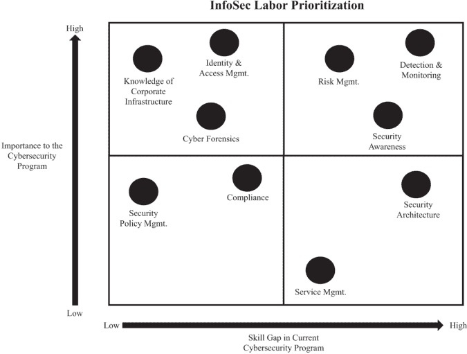
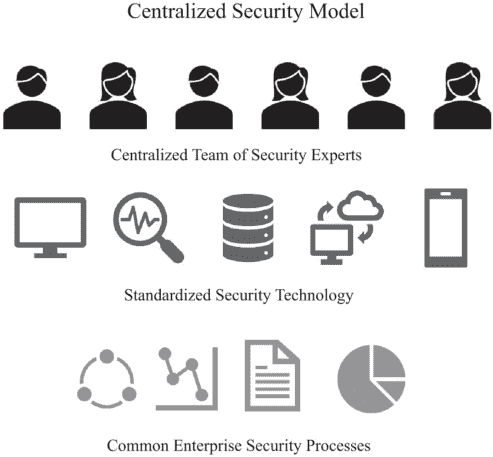
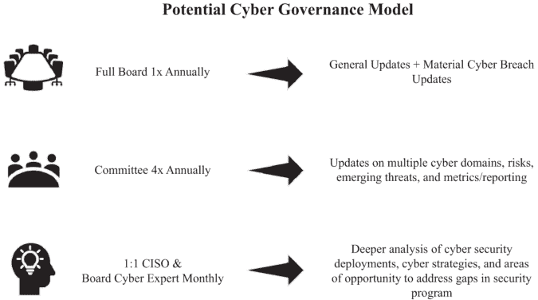

# 最短的一小时：网络安全董事会治理的应用方法

# 关于作者

李·帕里什（Lee Parrish）是一位屡获殊荣的技术高管，拥有二十多年将网络安全专业知识与核心业务能力相结合的独特经验。作为首席信息安全官，他为全球财富500强企业定制了网络安全战略，并领导了针对网络事件的实际事件响应。李曾担任多个董事会的网络安全信任顾问，这些董事会成员包括首席执行官、前白宫幕僚长、退休的高级军官以及一位前美国总统候选人。

李拥有两个研究生学位，并同时获得“董事会合格技术专家”和“认证信息系统安全专家”的认证。他在行业期刊上发表了大量文章，参与撰写了一本畅销的信息安全书籍，并创作了一本关于网络安全的儿童读物。他经常在国际安全会议上发表演讲，并做客多个播客节目。

李是美国海军陆战队的战斗老兵。

# 前言

我相信，我们是所有先于我们的人和经历的总和，每一个都为我们的生活提供输入，共同构成了我们是谁，再加上一点点我们自己的个性。一本书也与此非常相似，我认为。我只是一个讲述者，讲述那些影响了我生活并促成本书内容的种种输入。无论是与大型企业中出色的队友们长达二十年的合作，与最高层公司治理机构的合作，还是在机场与一位有趣的陌生人进行的一场影响深远的两分钟对话，每一次互动都帮助塑造了我对众多不同主题的思考。就我们此处而言，我的思考聚焦于企业网络安全项目的管理与监督。

本书不是一本技术指南；这是本书的一个重要主题：网络安全不是技术问题。它是一个商业问题，值得企业高管给予极大的关注。当然，技术在网络安全中扮演着至关重要的角色，但仅仅作为一种工具，一种通往更大目标的部分手段。这非常像一个对手，使用恶意软件（malware）作为机制来实现比技术更深刻的东西，一个处于问题核心的东西：他们的恶意意图与犯罪行为相结合。正如你将在后续章节中读到的，我认为网络安全在董事会上应该如何演进应当有一个转变。我希望这本书能激发变革，并为信息安全监督可能的发展方向描绘一个愿景。

**李·帕里什**  
*2023年12月*

有关本书的反馈与咨询及/或演讲邀请请求，请访问以下网站联系作者：`www.novelsecurity.com`

# 引言

商业是一门动态的学科，不断演变，要求公司董事就各种旨在积极影响顶层收入增长和提高底层效率的主题提供建议，同时也要关注公司的监管和法律事务。每位董事都深度参与多项举措，从短期行动延伸到长期增长。每年都会引入新的学科和监管要求，这些都需要关注，而不会从董事的职责范围中移除传统类别。

当特殊事件发生时，例如破产、合并、收购和剥离，董事的注意力转向这些事件是现实的，但也不能忽视其他基线性职责。所有这些都是在作为股东价值守护者的角色下完成的。这不是一个被动的角色，需要对多个领域进行大量的考量。

本书强化了一门需要董事以比以往任何时候都更高的关注度来对待的学科：*网络安全*。我写这本书的目标不是让读者成为网络安全的专家。相反，它是提供有价值的提示和信息，以便董事能够向其企业领导团队提出恰当的问题*并*理解提供给他们的答案，以确保其网络安全项目处于最佳状态并准备好应对业务中断。本书适合你，无论是新任命的董事，还是正在接触董事会新兴议题——网络安全的资深董事会成员。

本书也可以成为希望以易于理解的格式了解网络安全的C级高管的有价值资源。随着董事们对网络安全这一学科的了解更加深入，你将需要运用自己的网络知识来回答他们的问题并做出明智的决策。你的首席信息安全官（CISO）可以帮助你填补从这些页面中学到的细节，然后帮助你将其应用于你的组织。

最后，我网络安全行业的同行可能会出于各种原因利用本书。也许对于那些想担任CISO角色的人，我希望我从二十多年与董事会合作中获得的见解能让你了解该职位需要面对什么。对于我的资深同行，你们无疑熟悉即将读到的概念，但希望会有一些新的技巧可以添加到你们的安全项目中。

当我们共同探索在企业管理结构中增强网络安全的新方法时，一些行业出版物、书籍和社交媒体帖子已经涌现，它们为这个话题提供了很好的讨论点。许多内容有效地强调了在董事会层面更频繁地讨论网络安全的必要性，提高董事会成员的网络素养，以及改善（或不改善）董事会内对话的影响。此外，我还看到已发布的指南中列出了一系列董事可以就其公司网络安全向CISO提出的问题。我所想要的，可能也是你阅读这些页面原因，是一个信息来源，它不仅提供解决网络安全常见关切的问题，还提供对这些主题的非常基本的理解，以便你能够理解提供给你的答案，从而提供明智的业务指导。

在某些方面，可能会觉得我涉及的内容有点深入，但广泛的基础是重要的，以便你能够理解你的问题的答案。我对你的承诺是，我只详细讲解足以让你掌握概念的内容，不会更多。如果你愿意，你的CISO可以更深入地探讨这个主题。如果读者之前没有听说过，重要的是在此指出，当涉及网络入侵时，问题不是“是否会发生”，而是“何时会发生”。网络安全背景、理解一个主题及其对公司的影响的重要性，从未如此关键。

正如你们中那些在多个董事会任职的人可以证明的那样，并非所有信息安全项目都是相同的。基于公司面临的独特风险、其企业战略、运营模式、财务状况以及一系列其他特征，每家公司拥有一个定制的安全项目是自然的（也是必要的），该项目对其有效，但可能对其他公司无效。尽管一些咨询公司可能吹嘘，没有单一的策略，也没有一种放之四海而皆准的安全模型可以应用于多家公司。每个安全策略都如同指纹般独特，但策略的基础和根基却如同手指一般普遍。在解决网络安全问题上，并没有太多情况存在绝对正确或绝对错误的方式。通常情况下，有许多细微的考量需要对问题进行更深入的分析。我的目标是帮助读者识别核心基础，同时就每种独特策略中应关注的内容提供想法。

在我二十三年信息安全高管职业生涯中，我有幸与多个行业的多位多元且优秀的董事会合作：航空航天/国防、金融服务、技术、制造、零售、消费品、工程和数据营销。除一个外，我所合作的董事会都在数百个国家负有国际责任；其中一个董事会尤其采用了非美国本土的治理结构。每个董事会，就像每家公司一样，都有其个性：一种独特的决策者与挑战的组合，使其与众不同。

我很幸运，因为与每个董事会互动的层次极为多样。当然，有传统的CISO与委员会（通常是审计委员会，稍后详述）的接触，大多数CISO在其中互动。此外，我经常就战略安全规划事项或在重大事件响应后向全体董事会进行简报。当新董事入职时，我会针对他们即将加入的公司进行一对一的关于信息安全状况的简报。而且，有时我会与董事或委员会主席会面，代表他们开展特殊项目。所有这些互动使我对他们每个人最关心的问题有了第一手的了解，也让我看到了在网络安全事务上增强企业治理的机会所在。

我所合作的董事会成员同样多元，他们来自不同的背景，为整个团队做出了独特贡献。无论是美国总统候选人、白宫幕僚长、退役的军方高级将领，还是《财富》500强公司的首席执行官，每位董事都为我提供了独特的机会，让我在与董事会合作方面提升能力。如果不是他们每个人以及他们提供给我的机会，这本书就不可能问世。

# 第1章：威胁态势

针对组织的网络威胁，以及利用这些威胁的恶意行为者，都在不断演变。以至于当你读完这本书时，网络威胁可能已经发生了实质性变化，或者至少会有不少企业遭到入侵。然而，仍有一些基础性威胁持续存在，威胁着我们的企业基础设施；这些正是本章将重点介绍的威胁。这样一来，本章为任何接入互联网的组织每天面临的情况提供了良好的基础。此外，众所周知，我们对网络安全的认知水平各不相同，因此从基础概念入手有助于所有技能水平的读者理解信息安全行业在日常工作中试图实现的目标。

## 我们都是目标

在我担任信息安全高管的职业生涯中，我听过许多高管告诉我，他们的组织并非那种会成为对手攻击目标的行业或公司。“我们只是一家小公司，不是大型航空航天和国防企业；为什么会有人想要攻击我们？”

虽然这在历史上可能确实如此，但近年来，对手已经为其攻击模型增加了新能力，以至于敏感数据不再是他们唯一的利用目标。数据具有价值，但这种价值的保质期往往随时间推移而缩短。历史上，犯罪分子会窃取数据在暗网¹上出售以获取金钱利益。但随着数据停留在互联网最黑暗的角落，消费者会更换信用卡号或采取其他行动，使数据随时间而过时。我们的对手意识到了这一点，虽然窃取数据在行业中仍然非常普遍，尤其是针对商业机密、个人身份信息、访问凭据和其他敏感企业数据，但他们已将勒索软件加入了他们的网络武器库。

勒索软件使得所有行业在成为攻击目标方面变得平等。无论公司处于哪个行业，威胁行为者都会利用这种策略攻击几乎所有目标。名为勒索软件的恶意软件会加密系统，使其在没有解密密钥的情况下无法使用，而密钥掌握在攻击者手中。威胁行为者承诺，只要支付费用（赎金），就会交出密钥，使系统恢复使用。如果受害者不支付，系统将保持锁定，对手还可能威胁公开其数据。利用这种技术意味着攻击者（若收到赎金）每次攻击都能实现100%的攻击经济价值；不存在像窃取数据并在暗网出售那样可能出现的价值稀释。

近年来，我们看到了勒索软件的一种变体，它像之前详细描述的那样利用受害公司，但增加了一种恶意转折：如果确实支付赎金以解锁系统，攻击者随后会威胁称，若不支付*另一笔*赎金（双重勒索技术），就会公开数据。是否支付赎金的决定是企业董事会中的重大辩论，也是我在本书后面将更详细讨论的话题。

恶意行为者往往受经济利益驱动，这使得破坏电厂、救死扶伤的医疗保健、金融服务或公共交通等行业和公司对他们具有吸引力——他们希望获得大额赔付以维持关键服务的运转。同时，这些行业通常拥有比其他公司更强大的网络安全计划；并非不可渗透，但可能更难绕过。攻击可能没有像关键基础设施那样强大安全计划的中小型公司，对攻击者来说同样有利可图。与此同时，所有受害公司，无论规模或行业，都会因入侵而在制造、产品开发和服务交付能力方面受到类似的影响。

随着对手不断演变，他们的攻击面已扩大到历史上被视为关键基础设施的特定行业之外。所有公司、组织或任何在线上开展业务的实体都是可行的目标。

## 边界已死

传统上，企业使用的网络具有边界，安全控制措施层层部署在边界周围，其理念是恶意和未授权人员位于该边界之外，而受信任的员工位于边界之内。这种环境为安全提供了一些优势，但并未产生绝对的保护。两家公司或项目通过合同要求在两个区域之间安装防火墙是现实的，但如果该防火墙被配置为允许网络流量不受过滤地自由进出，那么就没有提供适当的安全保障，但合同的精神是

有人会破坏系统或窃取公司数据，与竞争对手分享或出售。一些员工可能在离职时下载大量公司数据，且无意出售给竞争对手，但该行为仍等同于有意且未经授权的行为。最后，员工可能在无意造成伤害或实施未授权行为的情况下，造成破坏或数据泄露。相反，员工的意外行为，例如点击钓鱼电子邮件中的链接，可能导致公司遭受严重损害。

正如企业投入时间经营其业务模式一样，我们的对手也在这样做，利用巨大的非法市场机会开展业务。董事需要理解的重要一点是，许多威胁行为者团体并非松散组织；它们拥有强大的业务模式，通过访问经纪商提供未授权访问来获得收入分成机会。

企业正在以新方式开展业务，以增加营收增长并提高利润效率。过时的边界安全模式正在瓦解，以适应更紧密的合作伙伴关系。与此同时，我们的对手正在增强其能力和战术，以对任何易受攻击的企业发起攻击。网络保险费率正攀升至历史高位，且越来越难以获得。所有这些因素完美结合，将网络安全提升到任何企业高管的首要关注点。毫不奇怪，网络安全通常被列为公司企业风险管理计划中的首要威胁之一。

本节为企业描绘了一幅黯淡的画面，而我的目的不是让读者充满恐惧、不确定性和怀疑。相反，是要提供对威胁态势的现实看法，而本书其余部分将深入探讨您可以在企业信息安全计划中进行调查的领域，以降低在线风险。

## 注释

- 1. 暗网 – 互联网的深层部分以及聊天室，犯罪分子在此进行交易和交换恶意内容。

- 2. 拒绝服务攻击是一种攻击方式，对手用系统流量淹没目标系统/网络，直到目标系统/网络无法响应每个请求并崩溃，使合法用户无法使用该系统。

# 第2章：首席信息安全官角色

面对第1章概述的众多威胁变量，企业如今迫切需要专门资源来跨多个安全领域组织和应对这些威胁。首席信息安全官（CISO）一职（以某种形式）已存在数十年，但仍被许多人视为相对较新的角色。它通常是企业中专门负责网络安全的最高职位，负责信息安全计划。由于该职位不断演变，加上公众对持续不断的网络攻击的认知，这对许多人来说确实感觉像一个年轻角色。事实上，虽然CISO的任命数量持续增长，但并非所有公司都设有CISO职位。因此，我们正处于行业中的一个激动人心时刻，因为我们有幸亲眼目睹这一独特高管职位的演变——甚至可能亲手推动其演变。

在某些情况下，该角色多年前就已出现，当时入侵事件不断增加，监管问题不断涌现，因此需要一位领导者牵头负责信息安全。合乎逻辑的选择是任命一位深入了解网络安全并参与该计划的人。结果，许多可能不具备工商管理核心能力、但拥有深厚网络安全技术知识的技术人员被委以重任。这个新角色当时通常向首席信息官（CIO）汇报，CIO是一个成熟的高管职位，兼顾技术与商业头脑，并能代表CISO向高级管理层解释技术风险。虽然CISO的汇报结构多年来不断演变，但仍然是安全行业激烈争论的话题。

在考虑您的CISO的汇报结构时，对标行业趋势或其他公司的做法可能不会非常有效，因为不同公司的结构差异巨大。有些CISO向董事会汇报，有些向首席执行官（CEO）、总法律顾问、首席财务官（CFO）、首席运营官（COO），或如前所述的首席信息官（CIO）。关于该职位应向谁汇报的直接答案是“视情况而定。”对某些公司有效的做法可能并不适用于其他公司。传统上，该职位向CIO汇报，但近年来我们看到许多CISO从IT部门脱离，部分原因是他们认为与负责建立开放且支持业务的技术、同时也领导保护这些技术职能的负责人存在利益冲突。可能存在这样一种情况：CIO的激励来自于为公司创造技术能力，因此他们会优先资助此类技术，而不是增加安全预算，因为安全预算不像生产力投资那样具有立即可见的价值。此外，网络安全领域在过去十年中显著扩大；CIO在保持其核心能力以理解和交付众多业务技术解决方案的同时，要跟上安全领域的发展变得越来越困难。

业内一些人说，将CISO设为直接向CEO汇报，表明公司对信息安全项目的投入和支持。通过将安全与企业最高领导层对齐，向员工传递的信息是：信息安全对公司至关重要；需要CEO的直接监督才能与其进展保持一致。

无论业内当前关于汇报结构的争论如何，决定在组织架构中把CISO放在何处的简单驱动因素，仅围绕*与领导层的接触渠道*。如果CISO能够就基于风险的关切接触高级领导，并能定期向你（董事）汇报，那么汇报结构可能就无关紧要了。

在我的职业生涯中，我曾向CFO、CIO、总法律顾问、CEO以及共享服务执行副总裁汇报。没有任何一个案例表明，安全项目因为我的汇报结构而更加有效。让项目成功的是我能够在无偏见、无过滤的论坛上传达重要的安全事务，供企业最高领导层做出基于风险的决策。然而，有必要确保CISO在公司内部组织上地位稳固，使其被视为领导其他重要职能的其他高级管理层的同侪。

由于网络安全的重要性及其对公司的影响，CISO的角色应提升至公司高级管理层的级别，而这要求CISO具备深厚的业务专长才能在该职位上表现出色。

要了解CISO角色有时是如何被看待的，一个有趣的基准是浏览公司或招聘机构发布的CISO招聘信息（你可以自己上网查看）。以下是我在过去一年中发现的几个CISO职位的实际招聘要求：

-   具备以下方面的扎实实践和动手知识：
    -   数据包分析工具，如 `tcpdump`、`Wireshark` 和 `ngrep`
    -   数据库结构和查询
    -   Cisco 或 Palo Alto 防火墙/IPS 管理

-   精通 UNIX、Linux、Windows 操作系统

-   具备使用计算机取证调查工具收集、分析和保存电子证据的实践经验。

-   对安全产品（本地部署和云端）有工作知识并能实际应用，包括防火墙、漏洞检测、网络设备、终端保护、应用测试等。

-   网络安全架构开发

-   拥有软件开发/编程学位

诸如此类的CISO要求几乎无助于将该角色提升为企业的同级高管，反而固化了长期以来的趋势，即有效的领导者需要具备各项措施、战略安全规划*以及*所有上述业务要求。其中一些技能，例如事件响应或技术专长，在需要于特殊情况下加以利用之前都处于休眠状态。但核心的业务和领导能力始终显露在外，每天都在使用。

在网络安全行业至少十年里，我读到或听到过这样的说法：在与公司董事会讨论时，CISO需要“在桌边有一席之地”。这是一个常年讨论的话题，迫切需要实质内容，而非仅仅是一句口号。这场辩论所缺乏的是CISO*如何*获得这一席位的具体例子。许多人会说这一情况已积极发展，许多CISO现在每年多次向董事会汇报，因此已经取得了进展——这对我们的角色和行业来说确实是一个积极趋势。但别搞错，虽然有许多公司主动邀请CISO进入董事会会议室，但很多公司并非因为所有CISO在与网络安全的业务层面对话方面发生了某种变革性演进才这样做。实际上，只是因为监管要求或行业因入侵事件层出不穷而产生的压力，迫使我们出现在那里。如果没有这些迫使董事会层面讨论网络安全的外部压力，许多CISO可能仍然与董事会会议室无缘。现在（早已）是时候让CISO主动改变我们的命运了：少一点关于该角色*为何*应在桌边占有一席之地的争论，多一点展示我们*如何*能够被纳入董事会会议室的核心能力，而不是靠监管或压力才得以列席。

将网络安全更广泛地纳入业务的压力带来的一个积极成果，就是对该主题本身的认知提升。在我的职业生涯中，我从未见过如此多的人对了解我们行业以及影响我们所有人的威胁抱有如此大的兴趣或热情。要利用这一机会，需要的不仅仅是网络安全知识；如果我们只需复述常见风险和潜在对策，这将是一个多么简单的角色。高效CISO的与众不同之处在于，他们能够理解这些常见风险和潜在对策，并将其融入该CISO所服务的业务环境。要做到这一点，需要深入了解其所在的业务，而要实现这种理解，则需要全面掌握所有业务领域的知识。而整个过程需要时间。在组织的一年任期内几乎不可能做到这一点，不幸的是，许多CISO的任期并不像其他高管那样长。

许多因素导致了CISO角色中一些较高的离职率。这是一个高压职位，高管必须随时准备在接到通知的瞬间采取行动，这意味着几乎没有休息时间。在他们的工作中，

对手只需成功一次，而首席信息安全官（CISO）及其团队则需要每次都做到正确。相较于我们对手所处的进攻位置，保持持续的网络安全防御态势要困难得多。网络安全领域内部分支众多，迫使首席信息安全官必须关注广泛范围内的多项举措。在某些情况下，鉴于新公司的文化，他们可能会觉得自己无力推动变革以降低风险。所有这些因素都可能导致职业倦怠，并可能对许多首席信息安全官的任期短暂产生影响。

要找到真正高效的首席信息安全官，值得关注每位候选人过往担任`CISO`职位的平均任期。成功的`CISO`在任职过的公司中通常拥有数年的平均任期。职业发展取决于多种因素，候选人的某次`CISO`任期仅有短短一年，而其他角色任期数年，这种情况也并不少见。例如，某位`CISO`可能曾在一家公司任职，但发现该公司对安全举措的支持程度不及预期。或者，新任高管在入职后发现公司的财务状况并未如预期那般强劲。`CISO`应在面试过程中通过直接询问与信息安全相关的企业文化问题，或更深入地研究公司的年度报告和`10-K`报告，以获取关于自由经营现金流、债务及其他财务指标的信息，从而缓解部分这类风险。但无论如何，即使经过有力的招聘前调查，`CISO`仍可能遇到自身无法控制的状况，迫使其在任职仅一年后便离开。因此，高层领导必须审视整体平均任期，并强烈考虑那些平均成功年限较高的候选人进入后续选拔流程。

那些总是只任职一年便不断跳槽的`CISO`，可能具备强大的安全战略制定技能，但会缺乏长期执行战略计划的关键能力。没有实施经验，没有体会过应用战略时的挣扎，也没有经历过解决冲突的过程，这样的候选人不会像其同行那样成功。优秀的`CISO`拥有从以往执行经验中留下的“伤疤”。

考察`CISO`候选人的执行经验，也是了解其如何分阶段实施计划的好方法。在资金分批到位的情况下，候选人是努力以更少资源完成更多工作，还是会等到资金全额到位后再执行计划？对这些问题的回答，可能预示着候选人在资金紧张时期的成功表现。

## CISO 选项

另一个流行的趋势是将`CISO`角色外包给提供虚拟首席信息安全官（`vCISO`）服务的安全公司。`vCISO`类似于顾问，向公司提供部分或兼职的安全领导服务，这样客户就可以避免全职等效（`FTE`）`CISO`的成本。除了节约成本外，这项服务的卖点可能是`vCISO`能够深入了解多个客户和行业面临的风险，并将这些知识融入贵公司的安全战略中。您应与公司高层领导一起，仔细评估采用`vCISO`服务是否是正确的业务选择。

随着监管日益严格，网络入侵事件不断增多，将如此关键的角色外包可能会带来问题。即使贵公司规模很小，也无法消除入侵风险（请记住，勒索软件已经拉平了各种规模和行业企业的威胁竞争环境）。此外，`vCISO`对其他客户在安全方面做法的广泛了解，不太可能适用于每家公司，因为每家公司都有独特的需求和风险态势。

虽然许多`vCISO`公司提供优质服务，但对整个`vCISO`行业进行调查不难发现，不少`vCISO`几乎没有或根本没有`CISO`经验。一些渴望进入`CISO`角色的人可能会花几百美元创办一家有限责任公司（`LLC`），向客户提供`vCISO`服务，但他们缺乏在企业实际担任专职`CISO`的亲身经验。总的来说，将安全服务外包并非负面策略；在本书后续部分，我们将探讨一些外包安全服务目录中其他部分可能具有良好经济效益的例子。就像决定将业务的关键部分外包给外部一样，必须进行深入分析，以确保这是公司正确的战略规划。

## CISO 选拔流程

由于这一角色至关重要，董事会成员应参与制定`CISO`职位的标准以及选拔流程。参与的深度由各个董事会自行决定。在我职业生涯中的一家公司，董事会帮助确定了`CISO`应具备的差异化能力。在其他情况下，第三方审计师协助董事会为该职位制定选拔标准，而我也因此被聘用。还有一家公司，我的最后一轮面试中有一位是董事会技术委员会主席。我们各自飞往一个中心机场，在航空公司俱乐部会议室里谈了三个小时。虽然这种程度的参与并不常见，但它让我初步近距离了解了董事会的安全文化，同时也让委员会主席了解了我处理安全问题的方式。此外，它迅速拉近了关系，这在我任职期间很有价值。

`CISO`候选人应具备几项核心能力和特质，需要加以考察。最重要的是，对新的`CISO`的信任是建立有效关系的关键要素。众所周知，信任在面试过程中不易显现，需要时间来建立，但它是`CISO`成功与否的关键区分因素。董事们可以通过早期频繁与候选人接触来更好地衡量信任，这可以从面试过程开始。

商业管理技能的重要性已在上一节中论述，但鉴于这些技能对`CISO`有效履行职责的关键作用，仍有必要重申。`CISO`候选人在面试过程中应能讨论各种与业务相关的主题，这些主题涉及所应聘公司财务状况的具体基础。候选人若能深刻理解公司构成、领导层、主要创收业务部门以及企业当前面临的挑战，这向你传递了一个良好信号：该候选人能够理解公司的业务层面。此外，能够将贵公司特定业务知识与网络安全影响相结合的候选人，可能是非常可行的人选。仅凭外部数据他们不可能做到百分之百准确，但候选人的思考过程是潜在成功的重要指标。

为应聘者提供能够突显其风险管理观点的业务场景。这些场景应基于需要复杂决策、且没有明显正确或错误答案的问题。一个糟糕的示例是让候选人描述对以下两种选择的看法：公司修补系统漏洞，还是为了不干扰业务而在长时间内允许系统不打补丁，只要对其进行记录。相反，应选择那些两个选项看起来都不尽如人意的场景。在候选人的回答中，需要关注的关键点不仅在于讨论高风险及其对业务的潜在影响。一位优秀的、以业务为导向的

`CISO`候选人还应在所有决策中审视风险发生的可能性。在商业战略中，通常是风险发生的可能性决定了决策是推进一项计划还是将其搁置。

情商对所有高管来说都是重要的特质，而对于`CISO`而言，情商对于这位站在公司与对手之间的领导者来说可能至关重要。该职位最重要的特质之一是在多种场景下保持冷静。作为安全高管，在一天的工作中，无论遇到快乐还是挑战，识别并调节自身（以及他人）情绪的能力，有助于`CISO`发挥最大效能。当`CISO`冷静而自信时，他们能更好地理解他人的感受，做出更有同理心的决策。他们理解利益相关者和团队不同需求的能力，将帮助`CISO`全面考虑问题，从而做出更有影响力的决策。这样一来，`CISO`就能做出坚实的决策，而不会让个人需求或情绪影响判断。

在事件响应过程中，你需要知道`CISO`是稳定、冷静并专注于响应的。一个情绪激动、感情用事的`CISO`可能将这些特质传染给团队。我曾听人称之为“保持平稳心率”。无论用什么说法，在风暴中保持冷静的`CISO`会让响应人员相信，他们的领导者是专注的，一切最终都会好起来。

与团队一样，对手也在密切观察，但其意图是寻找响应的线索。`CISO`是否会做出膝跳反射式的应激反应？如果会，这可能向对手暴露底牌，对手将不可避免地收摊转移，在网络中另寻他处，从而给响应增加延误。安全高管最好遵循正常流程，同时制定冷静而有分寸的响应方案。

无论是极度兴奋和欣喜，还是强烈挫败的时刻，真正的安全领导者都会努力识别和控制自己的情绪，以发挥最大效能，并向团队传递信心。你应该寻找方法来理解和衡量`CISO`候选人的情商。

虽然你下一任`CISO`需要许多理想资质，但我要强调的最后一项是沟通能力。能够将复杂技术和安全术语转化为易于理解的概念、从而帮助做出有效商业决策的候选人，不再是一种“锦上添花”的特质，而是基本要求。我们对不同话题的理解程度各不相同，网络安全也不例外。无论董事会的网络安全素养如何，你的搜寻都应自始至终聚焦于那些能够简洁有效为董事会提供建议的`CISO`候选人。

我的本科学位是哲学，对伦理学感兴趣。该学科的一个领域是沟通伦理，它超越了诸如说真话和保密之类的显而易见的内容。这一学科强调我们作为沟通者和倾听者的责任。沟通由信息的发出者和接收者组成。清晰有效沟通、确保受众理解信息的责任在于发出者。该学科指出，用模糊不清的沟通浪费接收者的时间和精力是不道德的。

杰出的`CISO`候选人会展现出这样一种能力：以让各种技能水平的听众都能轻松做出坚实商业决策的方式传达信息。换言之，他们明白清晰沟通的责任完全在于自己。我向高管团队传达安全策略的方法涉及多次对话。如果我知道不久后要向`CEO`呈现我的提案，我会制作多个版本的战略计划，并与`CEO`的直接下属的不同成员进行对话。

我会与首席人力资源官会面，讨论计划中的人力方面，概述安全团队所需的关键技能组合、我们的技能差距，以及执行计划所需的`FTE`（全职等效员工）数量。我们讨论培训、我将安排员工的地理区域，以及为什么选择这些区域能为战略带来价值。我们还会谈到行业内在高素质安全专家方面的缺口，以及我计划如何应对。也许我们会讨论实习项目，或者可能对来自不同部门的员工进行网络安全学科的交叉培训。会议结束时，`CHRO`完全理解了安全计划中的人力资源要素。

接下来，我会与`CFO`进行一对一的讨论，讨论我的战略中财务方面。我们关注哪些计划可以资本化，哪些属于运营费用。同样重要的是，每项计划在财政年度中何时纳入预算，以及哪些可以延迟。我会强调人力成本和技术成本，并说明计划外包哪些部分，以及哪些将在内部构建。

最后阶段的一场对话是与`CIO`进行的，我们会讨论战略的技术属性。如何利用现有的技术合作伙伴关系？需要增加哪些能力来填补空白？我们探讨我提议的技术将如何与当前部署的`IT`技术交互，或者在其之上增加安全技术可能对系统产生的潜在延迟影响。

由于这些预先讨论，当我向`CEO`及其直接下属进行战略演示时，`CEO`的团队会频频点头表示认同。他们说：“是的，我看过这个计划，我觉得没问题。”结果是，`CEO`能够更好地做出决策，因为决策过程对他们来说变得容易了。无论候选人在面试对话中使用什么流程举例，你都应当寻找相同的细节，只不过财务影响并不重大。这就引出了几个问题。

按照这种逻辑，什么是财务阈值？具体是哪一个财务数字，能说明任何财务损失影响低于该数字的高管是安全的，而财务影响高于该金额的高管则被解雇？不存在这样的财务阈值，也不应该有。

再稍微沿用这个例子，我认为应该评估责任的范围。在制造业的例子中，并非每个员工都能进入制造车间，而能够造成中断的服务技术人员就更少了。在金融业的例子中，并非每个员工都能接触到资金或金融系统，从而拥有高于常人的盗窃机会。但在网络安全方面，能够造成中断的员工数量并没有那么有限——每个拥有电脑和电子邮件账户的员工都可能收到钓鱼邮件、在电话中遭受社交工程攻击、将受感染的`U盘`插入工作电脑，或者陷入任何数量的风险。此外，员工可能在非工作时间的个人设备/账户上被攻破，这种风险可能会蔓延到企业基础设施中。

一个项目的真正有效性在于所实施的预防性控制措施、发现潜在问题的能力，以及问题发生后响应能力的稳健程度，从而使业务恢复正常运营。如果这样的项目已经到位并完成了尽职调查，那么该高管就已经履行了应有的谨慎义务。

接下来，一位有效的`CISO`会将风险呈报给领导层，并就缓解这些风险的建议策略提供咨询。通过高管决策，或者通过由公司高管组成的信息安全指导委员会，`CISO`最终并不是独自决定是否投资于风险缓解流程/技术。高级管理人员是预算的审批者，并负责在公司范围内分配资金。有效的安全是一项团队协作，每个人都扮演着至关重要的角色。

最后，在发生数据泄露后解雇`CISO`可能是短视的。我一年会参加多场信息安全会议；这是向行业同行和服务提供商学习如何抵御最新威胁的宝贵机会。主旨演讲结束后，与会者会前往不同的分组会议，每个分会场聚焦一个不同主题。讨论常见风险的分会场通常是与会者能轻松找到座位坐下聆听演讲者的地方。而在谈论`CISO`成功部署的具体方法论的分会场，找到座位就稍微困难一些。但那些由`CISO`演讲者概述近期重大泄露事件经验教训的分会场总是挤得水泄不通。每个人都想了解更多这些宝贵的信息点滴，以便带回公司并融入自己的安全计划。

为什么要解雇这位拥有如此丰富的现实事件响应知识的`CISO`，然后眼睁睁看着他们去另一家公司应用这些经验教训呢？

学到了吗？此外，公司还要花钱去招聘、入职培训并让新的替代`CISO`适应环境，而这位新`CISO`必须从外部视角了解此次泄露事件，并重新制定自己的策略。同样值得注意的是，安全行业是一个紧密的圈子，一家公司在泄露后解雇`CISO`的消息会被广泛流传。如果一家公司有着在泄露后解雇安全高管的名声，那么它可能很难找到一位优秀的`CISO`来替代前任。

当然，如果`CISO`从事不道德、欺诈、非法或其他表现出对其职责漠不关心的活动，那么上述所有考虑都毫无意义。

## 放弃CISO角色

就在我撰写本文时，已有一些行业文章讨论需要重新评估`CISO`角色，因为它被认为已经失败。其演进和规划上的失败，在转变为被视作同级高管方面的失败，以及未能将其关注点扩展到纯运营举措之外的失败。这些文章的许多作者都提到，很难找到既拥有丰富业务经验又具备所需网络安全专业知识的`CISO`。高压力、任期短暂以及泄露事件发生后`CISO`的问责问题也被提及——这些主题都是我们本章前面共同探讨过的。为了缓解这些担忧，一些人认为行业应该承认`CISO`角色已经失败，并寻找替代方案来应对企业中的网络风险。在很大程度上，我同意所有这些作者关于`CISO`角色成熟过程中所出现的历史和问题的看法。成长中的阵痛是自然的事。我们意见不同的地方在于应该如何处理这一问题。与其在监管要求和泄露事件增多的同时呼吁这个角色消亡——我的重点是通过认知、反馈循环，并创造一个能让该角色增加更多价值的环境来提升这一角色。

支持将`CISO`角色下调几个组织层级并重新聚焦于技术问题的人，可能会建议提升另一个角色进入高管团队：首席安全官（`CSO`）、首席风险官（`CRO`）或类似职位。这个角色将领导一个跨职能团队，涵盖网络安全、物理（企业）安全、风险管理、业务连续性，或许还包括隐私。在这种模式下，这位高管需要负责的计划比`CISO`还要多，预期是监督更多项目会在某种程度上让高管团队更容易接受这个角色。但我看到的恰恰相反：增加更多职能反而稀释了对网络安全的关注。网络安全对我们的公司来说太过重要，不能将其在组织架构中下移。我曾担任过两家公司的`CSO`；此外，我也看到许多其他公司如何处理网络安全、企业安全、业务连续性和隐私等专业领域。虽然它们都是业务中非常重要的领域，当然应该相互协作，但网络安全通常是其中风险速度最高的。对于较小的公司，物理安全（非网络安全）职能通常由总监和经理层级的人专业领导。

在大型组织中，网络安全、企业安全和隐私的角色可能由三位高管（通常是副总裁级别）分别负责，因为每项工作都极其复杂。如何组织所有安全相关职能，其最终底线取决于该公司每个领域的性质和关键程度。但我从未见过有建设性的建议认为缩小`CISO`角色范围能为组织提升网络安全重要性提供解决方案。

作为科技行业，我们也看到过其他角色被预言消亡。十多年前，不少咨询机构曾讨论过`CIO`（首席信息官）角色的消亡——`CIO`是负责信息技术计划的高管——并提议用其他角色取代。十年后，`CIO`角色在行政领导团队中仍然是重要角色。

填补像`CISO`这样关键的角色需要管理团队和董事会的深度参与，并可能借助外部专业服务提供商的一些协助。投入时间在候选人库中研究和提炼`CISO`所需特质，将带来巨大回报。有一句我百听不厌的名言：“今天总要为你未来的自己做一些值得感谢的事。”

# 第3章：安全与合规

在本章开头，我觉得有必要申明，遵守监管要求至关重要，我绝不会认为对这些要求的遵循是白费力气。话虽如此，我相信合规与安全之间存在巨大差异，并且有很多机会可以改善公司治理董事会对合规的看法，尤其是合规与网络安全的关系。更确切地说，只需看看通常负责讨论安全的董事会委员会——传统上是审计委员会（稍后将详述）。安全常常被视为合规或审计问题，而不是一个具有深厚技术基础、本可以也应当被视为业务风险的问题。

乍一看，将信息安全纳入合规似乎合理，毕竟它们的主题领域通常相似。例如，外部审计员对用户访问审查有效性的检查，确实与安全中的身份和访问管理领域相关。将两者结合在一起的另一个原因是，在审计整改方面，将安全包装成合规要容易得多。如果我把一个商业案例提交给管理层审批，并附加一句“这将解决我们的一项审计项”，审批过程通常会更容易。部分原因是，审计项涉及一个有开始、中间和结束的项目。人们可以看到并衡量对某一特定发现项的遵循情况直至完成。而信息安全往往没有这样清晰的过程；即使部署了安全技术或流程的项目实施后，泄露仍可能发生。在本书所有内容中，这是最值得记住的关键陈述：信息安全不是一个项目，而是一个需要不断培育和调整才能发挥作用的计划——它没有完成日期。

例如，可能有一项审计发现指出，公司应该部署一种安全控制措施，比如数据防泄露（`DLP`）技术。该审计项目始于一项发现：公司内部没有用于防止敏感数据泄露的`DLP`解决方案。

报告提供了失败详情，并建议管理层部署`DLP`解决方案，同时给出实施日期和责任方。这个项目有开始、中间和结束，团队每月开会讨论审计发现的整改进展。一旦`DLP`解决方案安装完成，审计发现的精神就算达到了，审计项也随之关闭。要是网络安全也能这么简单就好了。

现在假设部署同一个`DLP`解决方案，只是简单地确定了市场上最好的`DLP`平台，与一家技术供应商合作，获得批准（因为这是审计问题，所以更容易获得），走完采购流程，然后安装`DLP`技术。部署解决方案时没有进行任何配置；它仅仅报告发生的数据泄露事件数量，但并不阻止这些传输。公司没有建立数据分类计划，也没有对敏感数据的存在位置和类型进行清点。公司只是安装了默认设置的`DLP`解决方案。审计要求满足了，但与未经授权数据传输相关的核心安全问题仍然存在。

再举一个例子，假设一个用户可以访问企业的企业资源计划（`ERP`）解决方案，但该员工离开了公司。外部审计员发现，该员工即使离开后仍然保留了对`ERP`解决方案的访问权限。经过进一步调查，他们意识到，网络访问以及远程访问功能确实已及时有效地从该用户那里移除。审计员可能会说，由于该员工无法访问网络并进入仍有剩余访问权限的`ERP`解决方案，因此没有审计发现。然而，随着公司转向更多软件即服务（`SaaS`）解决方案，这些方案可能不需要公司网络访问，能够登录这些`SaaS`解决方案仍然在应用层面构成安全问题。这两种情况都凸显了合规与安全之间的区别，而这些都是我在职业生涯中经常看到的真实场景。良好的合规并不等于良好的安全，但良好的安全有助于展示良好的合规。

2019年，我为`Todd Fitzgerald`所著的`《CISO指南》`一书贡献了内容。^1 其中，我的一篇题为“网络安全的结肠镜检查”的文章，通过一个人寿保险的例子进一步详细阐述了网络安全与合规之间的差异。将保险公司进行的有限体检与我的主治医生为我完成的全面体检进行比较，我得出结论：两种体检都旨在达到同样的目的：判断我的健康状况。但两者这样做的原因却截然不同。合规与安全也是如此，两者都旨在识别安全态势，但尝试达到这一目的的原因不同。

## 合规的成本

到目前为止，本章重点讨论了将合规与信息安全捆绑在一起所面临的理论挑战，但同时也存在运营和财务方面的考量。在处理合规问题（这再次强调是至关重要的）时，整改工作主要集中于清除行政审计发现本身，可能无助于解决安全领域中引发该发现的根本原因。大量资源和注意力被投入到审计整改中，组建一个庞大的跨部门团队来投入大量时间处理重大发现的情况并不少见。这个团队中并不缺少首席信息安全官（CISO）及其安全组织的许多团队成员。显然，CISO及其安全团队的贡献对于解决合规问题是必要的。然而，CISO在解决审计发现整改中是否存在过多的低价值参与，尤其是那些不需要大量网络安全专业知识的活动？

当CISO深度参与合规活动时，他们会被从网络安全计划中抽离出来，甚至可能包括那些未来能够防止类似审计发现再次发生的计划。一些具有安全影响的常见审计发现可能涉及用户访问审查，以及未获得管理者以文档化批准形式证明其允许团队成员中的一名（或多名）员工访问特定应用程序的证据。解决一个现有发现需要多次去找管理者，要求他们批准或出示批准访问的证据，每次尝试都是通过电子邮件请求或亲自前往管理者处请求批准。可能存在的问题是，管理者不理解平台中用于说明在特定访问级别授予哪些权限的技术术语。如果是这种情况，CISO和安全团队需要向管理者提供关于不同访问级别的教育。跟踪和追查批准或手动澄清各种访问级别等行政任务，现在由网络安全专业人员完成，而公司为他们支付高额报酬，是为了在资源有限的行业中提供专业安全服务。但在这种情况下，他们并没有履行这些专业服务，而是以更高的薪酬从事更耗时的行政类工作。

由于合规和信息安全是两个不同的学科，再加上整改特定合规发现可能不利于解决问题的根源，因此企业领导团队和董事们应当认真考虑将安全和合规活动捆绑到一个组织中是否对公司具有商业意义。通过对CISO参与整改活动的时间以及CISO及其团队从事合规工作的人力成本进行详细的需求管理调查，领导层可能会得出结论：将这两个学科结合起来对于其特定公司来说可能不是最优有效的，也不一定能增加财务价值。可能会确定由项目经理、IT分析师或类似角色来促进审计发现整改的行政工作，为安全团队腾出必要时间专注于有助于防止未来类似审计发现的对策。在其他情况下，财务影响可能被证明是不重要的。无论如何，合规成本可以而且应该被评估和控制，以实现最大效率。

合规只是企业成功的一个关键组成部分，需要董事会和/或董事会委员会的深度监督。在第4章中，我们将审查与网络安全相关的董事会结构，以更详细地了解增强其效能的机会。

## 注

1. Todd Fitzgerald，*CISO指南：以先驱者的洞察引领网络安全领导力挑战*。Auerbach CRC Press，2019年，第15–16页。

# 第4章：审视信息安全董事会的治理结构

CISO向董事会汇报的方式与公司自身的信息安全计划一样独特。然而，从行业研究中可以得出一些关于CISO如何向董事会（或委员会）汇报的一般性主题。在当前环境下，大多数CISO向董事会委员会汇报的情况并不少见，其中许多汇报是提供给审计委员会的。

将网络安全作为董事会层面的议程项目包含进来，是企业治理的一个关键成功因素，也是过去十年中显著改善的方面。要想了解公司正在采取什么措施来应对网络威胁，最好的方法就是每年多次从CISO那里获得定期更新。

董事会层面的网络安全更新频率因公司而异，但我的职业生涯中典型的节奏是每季度更新一次。在某些情况下，CISO连续三个季度向委员会汇报，在一个季度（也许是Q1或Q4）进行全体董事会简报（例如年度审查类型的简报）。

审计委员会历来是董事们获得网络安全更新的归属地。不管此前这些公司将网络安全置于审计委员会之下的原因是什么，现在是董事会重新审视网络安全问题如何引起他们注意，以及用于提出这些问题的委员会结构的时候了。

据我观察，审计委员会被涉及内部审计、外部审计、信息技术、网络安全以及每年新增的其他领域的主题所淹没。在单次委员会会议上覆盖所有这些主题意味着议程项目通常很短，以便能够覆盖所有主题。例如，如果存在转型性的数字实施或IT组织转向新的ERP解决方案，情况尤其如此。或者也许正在进行比正常情况更多的内部或外部审计活动，需要委员会投入更多关注。行业中似乎有许多人也同意这一点，商业文章中出现了关于审计委员会范围扩大的各种评论。

想象一下（举个例子），一家公司的平均信息安全简报在委员会每季度议程上为十五分钟。如果属实，我认为每年总共一小时不足以让董事们理解、提问、质疑并就当今环境下的重要网络安全主题提供指导。这个*最短的一小时*是保护公司最关键的时刻之一，董事会审慎的做法是重新审视网络安全在审计委员会中的位置，以便给予该主题更多关注，并根据他们的评估做出任何必要的调整。

近年来，我们的行业出现了网络安全讨论与审计委员会分离的趋势，转而移至技术委员会，或者在某些情况下（作者预计这种做法未来会更多）成立专门的网络安全委员会。这些公司已经意识到技术对其业务战略越来越重要的推动作用，董事们希望更多地了解整合这些技术的战略。除了对CIO及其IT组织的好处外，技术委员会为CISO提供了一个结构良好的论坛，以讨论重要的网络安全主题。在我的职业生涯中，在我所汇报过的所有董事会和委员会中，我只与一个技术委员会合作过。我发现这种体验很有价值，因为可以讨论更多的安全举措，而且虽然我们从未在董事会委员会层面深入探讨技术细节，但这种结构确实允许在战略和运营监督等领域有更深入的探讨。

专门网络安全委员会的出现并非不可能。事实上，有预测称在不久的将来会有更多董事会设立专门的网络安全委员会。许多因素促成了这样一个委员会的出现，其中最重要的因素之一是网络相关威胁被识别并置于企业风险管理计划的前列。此外，在撰写本文时，新的新兴法规要求公司公开披露其网络安全监督的细节。随着董事会对一个被认为是全球企业高风险领域的更多关注，以网络为中心的委员会的自然演进将随之而来。

## 董事会互动

CISO与董事会之间的互动水平因董事会组成、行业、公司安全态势以及众多其他变量的独特性而差异很大。董事可以通过不同选项来了解更多关于网络安全的信息，特别是贵组织的态势和潜在影响。

无论董事会的形式如何，CISO 都应在所有汇报中融入网络安全态势的积极方面，以及任何覆盖范围的负面缺口。听到贵公司在网络安全方面取得的积极进展总是好事，但更重要的是，你应该理解安全高管的关切，以便讨论补救计划。这似乎是理所当然的，但建立一套流程来引出这些关切，可以减轻未来的误解。为了实现这一点，我曾让委员会主席和其他董事正式问我：“你是否知晓网络计划中任何重大缺口？你目前是否拥有公司网络安全计划所需的全部资源？”这种正式性有助于促进 CISO 与董事之间的开放对话，并将内容记录在委员会/董事会会议纪要中。

CISO 与董事会之间存在许多典型的互动类型，这些互动可能包括以下内容。

### 全体董事会汇报

召集全体董事会成员参加网络简报，是提供一般行业新闻、公司面临的风险可能性以及公司可能如何应对这些风险的好方法。许多 CISO 在安全行业拥有广泛的人脉，你应该考虑利用这些人脉来增强全体董事会的汇报。或许，联邦调查局（FBI）当地办事处、特勤局的简报，或者一家顶级网络安全公司的 CEO 的演讲，都能提升整个董事会的网络安全意识？

取决于委员会的日程安排，在我的职业生涯中，我经常看到董事会的非审计委员会成员出于对该话题的兴趣，列席我的委员会网络安全简报。将受众扩展到全体董事会，让他们听取一般性网络主题领域的内容，对团队所有成员都相当有价值。

### 定期网络安全简报

无论董事会选择何种委员会结构或网络更新频率，定期举行的网络安全简报都有助于提升对公司安全举措的认识。重要的是要记住，每次简报都不是一次独立的会议，也不是仅仅提供计划的一般概述和某些指标。相反，每次简报只是一本更大书籍中的一个章节，这些章节共同讲述了公司安全态势的整体故事，以及其应对威胁能力的逐步提升。

这种“分期式”简报风格非常适合正在构建或大幅增强网络安全计划的公司。CISO 首先汇报当前安全计划的评估情况，然后重点介绍战略信息安全计划（及其所有组成部分），以及该计划将如何提供风险缓解服务。在随后的简报中，CISO 可以讨论他们在执行战略计划方面的进展。最终，每位委员会成员都将全面了解公司安全计划曾经所处的位置、战略执行中的增量成功，以及最终了解迄今为止的安全投资领域如何帮助降低（而非消除）已识别的初始风险。所有这些都与公司的具体需求交织在一起。

这种关于整体战略进展的简报不应成为常年性的演示。安全计划的大规模转型、构建新的安全计划，或听取新任 CISO 介绍其战略计划，其频率都应受到限制。如果你不断收到关于安全组织重大计划性变更的简报，这可能是一个迹象，表明公司更换 CISO 过于频繁，或者先前的安全战略可能不够全面。当然，战略本质上是动态的，必须适应不断变化的业务模式以及不断演变的威胁。不过，我更多指的是那些专注于在几乎不存在安全计划的地方构建安全计划的大型战略，或者通常是在公司任命新任 CISO 之后出台的新战略计划。在这些情况下，我建议可能存在一个潜在因素，导致频繁的战略计划简报，而这个因素是你应该调查的。

一旦评估和初步战略计划简报完成，并过渡到更稳定的常态化简报，委员会就应听取安全主题，这些主题能够基于企业战略调整、对公司的潜在影响、安全行业更新以及有参考价值的指标，提供对当前和即将面临风险的扎实理解。每个董事会都需要独特的指标，以帮助他们理解网络安全，以及更重要的是它与公司的关系。因为每个董事会都非常独特，我喜欢向我所汇报的董事询问他们希望看到哪些具体指标。我会用我认为需要传达的其他安全指标来补充这些请求。这种“自上而下、自下而上”的指标策略有助于为董事会成员提供有洞察力的衡量标准。

我曾因“向董事会成员询问他们希望在更新中看到哪些指标”这一想法而受到质疑。不止一两位业内同行以及一些领导者告诉我，董事会不具备足够的安全知识来理解应该要求哪些指标；指标应该由了解该领域的 CISO 来提供。我不同意这些质疑，因为指标用于做出决策并确保适当的监督。还有谁比实际进行决策和监督的人更清楚哪些数据有助于他们做出这些决策和监督呢？我没有设计和制造汽车的知识，但我能确定什么对我重要，以及我在购买时会关注什么。

通常情况下，当新董事当选进入董事会时，我会被要求向他们介绍他们即将开始履职的公司的安全计划。在我的职业生涯中，有很多次我会飞到某个地方与新董事见面，进行这种一对一的简报。涵盖诸如公司安全态势、存在的任何残余风险、团队安全资源的适当性以及公司面临的主要威胁等领域，对新董事来说都是有益的。此外，这也有助于迅速建立 CISO 与最新董事会成员之间的关系。

委员会主席与 CISO 之间的互动应体现这一重要关系的关键性。你已经读到我之前与技术委员会主席的面试经历，以及那次互动对双方的好处，但对话远不止那一次讨论。我们会在委员会会议之前进行一对一会面，讨论我将要汇报的内容，并更详细地说明内容的意图或背景。这非常有帮助，因为它为主席梳理了即将召开的会议，也为我提供了关于在委员会简报中可扩展领域的宝贵反馈。无论采取何种形式，董事们都应利用 CISO 的知识，以非正式的一对一方式深入探讨网络安全的更多细节。

### 事件响应简报

几年前，我不得不在一个周六早晨给当时的公司 CEO 打一个非常艰难的电话。我通知他，我们公司正发生一次重大数据泄露事件，我们已启动事件响应团队（并辅以一家网络安全公司的第三方支持）来补救这个问题。在我们交谈时，我向他高层级地汇报了发生的事情、我们当前的响应活动，以及我需要哪些资源来协助响应。他批准了资源，感谢我的来电，并要求我飞往他那里，参加下周三的一次特别全体董事会会议，向他们通报该事件的最新情况。

适当的事件响应需要董事会的积极参与，以及 CISO 提供信息丰富且直接的沟通。向董事会进行的事件响应简报应仅限于大规模攻击，包括网络中的对抗性入侵、可能造成重大合规或品牌影响的事件，或涉及业务严重中断的事件。董事会很容易被大量基础性事件的更新所淹没。网络钓鱼攻击猖獗，通常情况下，安全团队可以快速响应、分类并修复它们。也许这类攻击不应成为董事会参与的一部分，而只是在定期简报中作为更新内容即可。

在我的职业生涯中，我见过的一个普遍做法是，管理团队和董事会就会达成一致的阈值，这些阈值将

# 第5章：信息安全评估

任何战略之旅的重要一环，是了解组织当前所处的位置；而获取这一认知的最佳方法，是在制定战略计划之前进行一次初步评估。评估通过凸显组织当前的安全态势，为后续工作提供起点，并有助于对战略计划中即将推出的各项举措进行优先级排序。

作为董事，你可能不会亲自参与执行评估；相反，你会更关注评估的结果。本章重点介绍安全评估的核心组成部分，以便你能更好地理解评估是如何完成的。这将使你能够针对结果提出具有探究性的问题。结果的生成方式往往与最终报告本身同等重要。

CISO 可以借助许多资源来评估公司的安全能力。虽然以下列表并非详尽无遗，但其中一些在我的职业生涯中被证明很有帮助，同时还有一些建议供董事询问其 CISO 所使用的评估流程。

## CISO 评估

你已经花费时间明确了 CISO 岗位的任职要求、面试了候选人，并投入时间开始与新的安全高管建立关系。如果你对 CISO 岗位的任职资格要求并未向那些此前未曾担任过该职位的人开放，那么你的新任 CISO 将在评估安全项目方面拥有经验。利用他们多年的经验是有益的，因为他们知道应该关注什么，特别是那些能够构成有效安全项目的要素。当他们审视不同安全学科的有效性时，也会将自己对新公司的了解融入其中。为了弥补他们在任职初期对新公司缺乏深入了解的不足，与现有员工的面谈是衡量安全控制有效性的一个极佳途径。

基于面谈的评估，始于 CISO 制定一份非常具体的问题清单，这些问题针对的是信息安全领域的各个不同学科。为了补充我在网络安全方面的专业知识，并确保我的系列问题具有行业相关性而非凭空产生，我会参考安全行业中常用的框架。例如：美国国家标准与技术研究院（NIST）800–53《信息系统和组织的安全与隐私控制》；国际标准化组织（ISO）27000，这是信息安全领域重要的国际标准；以及互联网安全中心（CIS）关键安全控制。这些为有效的安全项目提供了基础指南，我会经常参考它们，尤其是在评估阶段。

CISO 会与内部信息安全团队、IT 部门的员工，以及来自各业务线和职能领域（包括其领导层）的代表安排会议。在保持面谈对话式氛围的同时，我会逐一梳理针对某一特定学科的问题，例如资产管理、入侵防御、应用安全以及其他众多领域。我发现，为了在评估中获得最高的准确性，我会在评估期间就同一个问题多次提问，并询问不同的人，尤其在初始回答存在模糊之处时更是如此。

现有员工是评估过程中的丰富信息来源；毕竟，他们拥有对环境的歷史知识。不过，用技术审查来补充基于面谈的评估也很有帮助。这些技术审查有助于验证面谈答案，并更全面地展现公司的安全态势。CISO 会获取安全团队所使用的多个安全平台的访问凭据，并对它们的配置方式、近期警报以及技术部署的整体健康状况进行审查。除了这些技术检查外，一些第三方还会以失陷评估、渗透测试和其他服务的形式开展技术评估。这些审查不仅仅依赖人工回答，还会审视安全项目的技术层面，这对于初始评估而言可能极具价值。

## 内部报告

新任 CISO 可以利用过去几年内部来源所开展的安全评估，为其初始评估提供额外的清晰度。内部审计部门和外部审计师出具的具体报告，可以就安全项目某些领域可能存在的差距提供有价值的细节，因为这些报告比外部顾问可能提供的材料更为详细。然而，这些报告通常审查范围有限，例如数据防泄漏项目、资产管理状况等，可能无法覆盖整个安全项目。无论如何，它们都是一个数据点，有助于使 CISO 的评估更加全面。

## 咨询评估

来自顾问的通用安全评估可以借助通用框架，基于常见的能力成熟度模型集成（CMMI）模型给出成熟度评级，从而对安全项目进行快速审查。通常情况下，顾问可能会使用其公司自行开发的评估模型，以提供更多关于客户风险态势的细节。其中有些模型可能更多是营销导向，而非真正的风险衡量。例如，衡量并评分攻击者入侵客户网络的能力（和意愿）。这类攻击性信息或许适用于那些归属可以被确定的组织严密的黑客组织。然而，如前所述，一些威胁行为者并不属于特定组织，或者是单独行动。要确定那个单独行动者的黑客能力，以及其对企业特定环境造成破坏的具体意愿，似乎超出了第三方咨询机构的能力范围。这类评估可能不会为 CISO 的评估增加价值。

第三方安全项目评估通常主要基于面谈，并且可能仅涵盖三到四周的短暂服务周期。因此，其发现通常非常宽泛；毕竟，他们的视角是外部视角。这些评估的成本同样需要考虑，客户可能花费高昂代价仅仅是为了了解差距所在，却并未获得针对这些差距的修复方案。当然，顾问团队会推销他们的能力（以另行收费的方式）来帮助客户修复这些不足之处。

在某些情况下，合同或监管要求可能规定安全审查必须由外部方执行。最具价值的咨询评估类型，是那些采用深度技术测试服务而非泛泛面谈式调查的评估。其结果对管理层和 CISO 双方都有益处，能为他们每个人提供技术性的、不带偏见的、基于事实的结果，这些结果可以（部分地）用于制定战略计划。

对于作为董事的你而言，要了解公司当前的风险态势，关键的做法是询问 CISO 评估是如何进行的：是采用了基于面谈的流程、技术审查，还是两者的结合？虽然没有必要完全掌握评估的每个组成部分，但通过理解得出评估结果所用方法论，你就能很好地理解其结果有多可靠。

# 第6章：战略计划

为公司制定网络安全战略计划，需要与业务目标紧密整合，并依赖于诸多因素，这使得几乎不可能将一家企业的安全战略照搬到另一家组织。每家公司都有不同的风险概况、当前安全态势和财务状况，这些都会影响战略的实施时间表。

虽然许多管理团队专注于三年战略计划，但另一些公司可能会因为面临特定风险，或存在无法等待渐进改善的关键差距，而加快其网络战略的推进速度。可用于资助安全战略的自由经营现金流因公司而异，这更要求安全投资决策以风险为基础。无论一家公司选择以何种时间表来部署其战略计划，你都必须记住：网络风险的变化速度非常快，而在信息安全领域，三年可能相当于一辈子。

一个好的网络战略，应当优先处理公司面临的风险，而不是试图迅速解决安全领域中的每一个需求。你的 CISO 应当交付一份计划，将业务需求（不仅仅是网络安全需求）纳入一个现实的时间表，从而实现有效的风险缓解——既不是一下子全部完成，也不至于拖上好几年。正是在这一刻，你在寻找和遴选具有强大业务专长（且与其他 C 级高管水平相当）的 CISO 过程中所展现出的所有审慎调查，开始获得回报。

此前曾提到，一次好的简报应当以有助于管理层更容易做出决策的方式呈现。为实现这一目标，网络安全战略至少应包含三个不同的类别：人员、流程和技术。虽然它们共同构成更大网络安全战略的一部分，但可以分别与管理团队中负责相应领域的高管进行讨论，以获取他们的见解。

接下来将深入探讨先前提到的三个类别，它们与构建网络安全战略相关。当然，每个CISO的战略各不相同，但我发现，以下各节中提供的建议在我有幸工作过的全球多家企业中已被证明是成功的。

## 人员

安全供应商会将技术出售给任何人；他们并不是只向某些CISO提供产品和服务，而不向其他人提供。在安全技术方面，每位CISO都处于同一起跑线上。同样，每位CISO都可以获取最佳实践、研究和模板来部署一流流程。再次强调，CISO在这一领域也处于平等地位。*网络安全计划的真正差异化因素在于其人员。* 正是这一类别将优秀的安全计划与仅仅良好的安全计划区分开来。

不幸的是，快速浏览行业研究就会发现，由于缺乏具备这些专业技能的人才，每年都有许多网络安全职位空缺。空缺职位的数量因报告而异，但关键在于，我们行业的需求大于可满足这些需求的资源。CISO必须考虑这一障碍，并设想以具有成本效益的方式为安全计划配备人员的创新方法。

在过去几年中，随着网络安全的重要性进一步提升以及人才缺口扩大，许多人将安全行业视为进入（或转行至）该领域的合理选择。作为招聘负责人，如今我收到的简历大多来自具有一两年或三年经验的候选人。在许多情况下，简历中根本没有安全经验，但候选人参加了课程以获得安全认证，希望借此提高录用机会。认证公司抓住这一市场机遇，向那些希望加速进入这一热门行业的人提供“训练营”和其他快速认证备考课程。虽然这些课程可能提供理论基础，但它们无法提供公司执行更高级安全角色所需的实践经验。

要组建一支完全由具有五年以上（最好是十年）经验的网络专业人员组成的团队，可能并不可行，除非公司愿意为这类人才支付远高于市场水平的薪酬。CISO提出的战略如果包括让整个团队都配备经验丰富的安全从业者，那么其对于获得这样一支合格团队的期望可能并不现实，因此，这种战略应当受到质疑。

我在组建团队方面取得了成功，方法是只向组织引入少数几位高素质候选人，然后用可能在网络方面经验不足的人员来填补团队的其他职位。在很多情况下，我选择的候选人没有安全经验，但在信息技术领域任职时间较长。CISO在非安全候选人身上应寻找的最关键特质是热情和好奇心。表现出精力充沛、高度热情的人往往乐于接触他人，尽可能多地吸收新领域的知识。他们通常会主动承担任务，以便获得推动职业发展的知识。

候选人的另一个关键特质是好奇心，即质疑事物运作方式的能力。他们会寻找技术的意外用途，并想象如何利用这些意外用途来绕过控制。这些候选人会一直追踪潜在问题，直到完全理解为止。这正是我们的对手所拥有的思维方式，找到拥有这种好奇心且意图良善的候选人极为宝贵。

一旦我组建好团队，我会让他们齐聚一堂（线下或线上），以便相互学习。经验丰富的员工为没有网络经验的新队友提供指导，而新员工则通过质疑资深队友的传统做事方式来激发创新。我在领导的多个安全计划中见证了这种策略的成效，其好处是培养出了高效且任职时间长的安全员工，如今他们几乎都仍在该行业工作，并为我们领域做出了巨大贡献。

对网络安全员工的培训是组织的一个关键要素，这不仅因为它有助于留住宝贵人才，还因为它有助于保持安全计划的最佳运营能力。培训对所有员工都很重要，但在网络安全领域，风险变化如此之快，培训更是必需品。

在培训方面，我的目标是实现70/20/10法则。70%是实际工作，与队友一起完成任务并相互学习；20%是员工自行开展的培训，例如阅读书籍或在线寻找机会了解网络安全；最后10%是正式培训，无论是行业会议还是课堂教学。虽然大多数员工倾向于关注那10%，但我认为其余90%对于为员工提供安全知识同样重要。尽管如此，为安全员工提供参加会议、与行业其他成员互动以分享有价值信息并建立新关系的机会，应成为任何安全战略中人员方面的关键组成部分。

CISO应在战略计划中为组织的安全培训需求预留年度预算。通常，我会划拨足够的资金，让信息安全组织中的每个人每年至少参加一次安全会议，包括差旅费用。这是一笔总额，供每位员工自行决定如何使用，选择他们想要的会议，前提是此类培训与其在安全组织中的角色相关。如果员工在会议委员会任职，或是在安全会议上发言，会议通常会提供免费入场券。这样一来，员工就可以利用自己的培训资金在一年内参加多个会议。最后，当我采购（或续订）某项安全技术时，我会在谈判过程中与供应商沟通。我会提到自己参加了他们的年度会议，并且了解他们具体技术对我来说非常宝贵。他们会表示赞同，并表达他们对年度活动的自豪。在签署合同之前，我会争取在合同有效期内每年获得十张他们会议的免费入场券。培训资金、员工参与行业活动以及供应商赞助的结合，共同为每位安全员工提供了几乎无限的机会，使其能够在快节奏的行业中学习、成长并保持效率。

作为评估安全战略的主管，你可能会问：“我们应该有多少安全员工？”或“多少人算太多？”没有神奇的公式来确定贵公司应雇佣多少安全人员。这一数字取决于多个因素，例如公司的风险态势、公司增加新人才所需的财务状况，以及信息安全计划的当前成熟度。然而，在审查安全战略计划中的人力组成部分时，CISO应就如何得出该数字提供可靠的分析。

CISO首先需要确定公司安全计划所需的关键技能组合。这些技能将为公司提供必要的能力，以执行对其网络之旅最重要的、支持业务目标的所需安全服务。接下来，安全高管评估当前安全团队的技能，然后找出期望状态与当前状态之间的差距。一个基础的商学院图表可以帮助勾勒出填补这些差距所需的能力（见图6.1）。

这个简单的练习确保在构建网络安全计划的人员组成部分时，首先处理最关键的需求，并将有益（但非关键）的职位留待以后财务状况允许时再补充。许多影响因素会作用于技能差距分析，提前处理这些因素可以形成全面的人力战略，降低团队不定期、常年增员的风险。其中一个影响因素是突出单点故障，即某一人单独负责一项重大安全举措或技术平台的情况。如果此人休假、请病假，或可能离开公司，

*图 6.1 | 人力优先级划分。*

安全团队只能疲于追赶计划，这可能导致服务中断。识别这些单点故障并制定修复计划，应成为安全人力战略的重要组成部分。

需求管理，即对各业务线和职能领域的服务请求（以及预期的未来请求）进行度量，将帮助CISO预判其组织的人力需求，并制定战略以确保充分的服务覆盖。作为主管，你熟悉现有的各种业务预测工具；利用类似的预测方法，并针对安全领域稍作定制，可以非常有效地定量衡量未来的服务需求。在本书后续部分，我们将讨论服务管理，以及如何利用安全服务管理程序生成准确数据来描述需求。

组建安全团队的另一个影响因素是识别并协调CISO团队中的专业经验组合（以及在招聘候选人时考虑未来所需的专业经验）。团队应拥有因人而异的多样化经验。就像下棋一样，CISO应针对每个人的不同能力制定策略，并思考如何将它们整合起来，以提供强大的服务能力。如果拥有某一领域经验的员工过多，而缺乏掌握其他学科知识的安全专业人员，CISO可能无法获得能够优化安全项目的良好专业组合。此外，不同层次的专业经验有助于增强团队协作，增加知识共享的机会。

在战略计划中，应投入大量精力来标准化安全组织内的岗位角色。当然，团队内部某些领域（漏洞管理、网络安全运营等）会存在高度专门化的岗位职能，但这些角色可以归入“网络安全工程师”“网络安全专家”或类似岗位，并使用副标题来体现岗位内的具体差异。与身份和访问管理（身份治理、特权访问管理等）相关的职能可以归入“IAM专家”或类似角色。标准化安全岗位角色能带来诸多好处：

- **1. 岗位与薪酬匹配：** 并非所有安全职能都要求同等水平的网络安全技术能力。因此，对于技术熟练程度不同的网络专业人员，薪酬模式也不应相同。例如，从事合规或安全策略管理岗位的人员，可能不需要达到网络安全工程师或专家同等的技术水平。为确保薪酬合理，应通过岗位标准化做出明确区分，避免仅仅因为都属于网络安全行业就将所有安全领域混为一谈。话虽如此，一些看似技术含量较低的岗位，如安全意识与培训专员，实际上确实需要扎实的信息安全知识。否则，如果意识专员被指派撰写关于多因素认证的意识文章，而他们又不了解该主题，就可能需要请网络安全工程师来填补知识空白。这样一来，公司就要付两份工资来完成本应由一名员工完成的工作。

- **2. 岗位等级划分：** 为了留住优秀人才，必须为信息安全专业人员支付公平且有竞争力的薪资。为此，人力资源部门（或由人力资源部门委托的第三方）会将公司薪资与相似地区、行业和岗位类型中其他公司的薪酬数据进行行业对比。为了获得最准确的行业薪资基准，将岗位角色与员工实际执行的职能进行标准化，有助于将岗位与行业内常见角色对齐，从而改进薪酬分析过程。在我的职业生涯中，我经常在初次评估一家公司时发现网络安全架构师数量异常偏多。当我深入调查后，我意识到几乎所有安全架构师都没有履行架构师的职责，而通常是在执行网络安全工程师的任务。岗位错位（例如架构师）可能有多种原因，但其中一个想到的是，安全架构师的行业薪酬区间通常远高于安全运营人员。无论原因如何，标准化岗位角色有助于按适当薪资支付安全员工，同时在错位人力成本方面为公司省钱。

- **3. 领导角色的区分：** 安全专业人员（或任何领域的人员）中可能存在一种观念：当员工在个人贡献者岗位上表现出色而逐步晋升时，下一步自然就是进入领导层。也许这样的晋升会包括某个安全领域的管理职位，或者负责网络安全多个职能的总监职位。我一直建议员工在深入反思后再决定是否进入管理层，因为一旦转向领导岗位，他们会发现该角色与个人贡献者完全不同。领导者要用预算表和绩效管理讨论，去换取与安全平台打交道的兴奋感。在创建和标准化岗位角色时，CISO必须确保领导岗位与主要职能对齐：*支持其领导下的员工。* 如果领导在配置网络安全系统，他们就没有专注于为员工提供持续支持和运营监督，同时也剥夺了团队中安全员工学习和成长的机会。此外，公司最终会为那些应由团队个人贡献者完成的职能支付更高的领导薪资。

- **4. 职业路径清晰：** 当我到达过去任职的一家公司时，我发现网络安全组织内有四十一个不同的岗位角色，而整个团队总共只有四十三名员工。岗位头衔如此繁多，员工尤其是新成员很难理解职业发展路径。岗位标准化有助于明确角色如何分级，以及职责如何递进，从而使员工能够更好地规划自己的职业发展。

公司依赖第三方协助执行网络安全服务，因此战略计划中的人员方面应详细说明哪些服务将在内部开展，哪些将外包。存在许多潜在的好处和限制，这些都会影响是否将特定安全服务外包的决策（稍后详述）。

近年来，公司内部出现了较新类型的安全角色，为信息安全计划提供独特服务。诸如副CISO、安全幕僚长、安全协调专员等许多独特头衔正越来越多地出现在人力需求中。你应该探究这些岗位职能的细节、它们能提供哪些实际价值，以及创建这一专门角色的驱动因素是什么。在某些情况下，也许在大型跨国公司中，设立此类角色以满足各业务线和运营部门巨大的服务需求是有意义的。但在其他公司，该角色可能与其他职能重复，且没有明确的成本收益。

例如，幕僚长角色可能包括战略规划、项目管理、分析或沟通等职责——所有这些都聚焦于信息安全计划。可以说，在中小型到大型公司中，可以利用其他企业角色（或安全部门内部的某些角色）来执行这些职能，而不必专门聘请一个安全资源。

关于副CISO角色，一个合理的理由可能包括：在当前CISO离开公司时，培养另一个人接管CISO主要职责。你可能会发现，仅仅为此目的而设置专门的副CISO岗位在财务上并不明智。识别当前安全组织中的高绩效领导者，培养他们的技能，为其提供具有挑战性的安全项目，并让他们有机会向高级领导层汇报，可以解决“后备人才储备”的问题，而无需承担专门资源的成本。此外，明确指定的副CISO会扼杀安全组织中其他高绩效领导者将自己视为潜在继任者的希望。然而，也可能存在其他情况确实需要这一角色，因此CISO有责任提出有力的商业理由，为该需求新增资源的成本进行辩护。

在中小型到大型企业中，CISO设立一个以主动方式促进服务交付的角色可能是有益的。诸如业务信息安全官（BISO）、网络风险伙伴、安全业务分析师或许多其他头衔的角色，充当着业务线与核心网络安全组织之间的桥梁。安全组织内可能有多个此类角色，每个角色分别对应某个业务部门、职能领域、国际地区或一系列其他对齐选项。

该角色隶属于所分配的业务领域，参与其定期会议，在部门内建立关系，并深入了解该领域的未来计划和战略，以便……

业务。他们将这些知识带回核心信息安全团队中的相应服务塔，该团队随后执行并交付实际服务。这样做，安全团队提前了解各项举措，这有助于降低项目成本，并减少业务时间延误的风险。我发现将这些角色分配十八个月是成功的，然后将该角色中的个人轮换到另一个部门，以便在轮换周期结束时，每个人都能对公司有360度的了解。如果这种角色符合公司的需求和结构，增加这样一个角色可以提供价值。对于非常小的公司，可能不需要这样的角色，因为现有员工有可能承担这些职责。

构成您的安全计划的专业人员最终将决定计划的成败。CISO进行严格的分析和战略性的前瞻，管理层和您自己对该战略进行注重细节的质疑，有助于确保人员类别完整且没有成本高昂的冗余。

## 流程

在增强现有安全流程或创建新流程之前，CISO必须对业务以及安全如何融入业务有深刻的了解。网络计划中几乎每个安全流程，只有根据业务的节奏或公司的运营节奏进行定制，才能有效。获得这种业务洞察的最佳方式是定期巡视公司办公室和设施，与员工交谈。一位出色的CISO很少坐在自己的办公室里。我认为，那些每天坐在令人印象深刻的四五台电脑显示器后面八小时的安全高管，并没有努力让他们的角色尽可能成功。

2002年秋天，我当时担任CISO的公司里，我正在巡视其中一家制造工厂。看着原材料如何转化为客户喜爱的高质量产品，以及员工在创造价值时展现出的技艺（和自豪感），令人着迷。我与员工交谈，更深入地了解了他们的各自职责。我了解了所使用的系统和机器，以及确保所有班次都有准确工单以满足波动需求的流程。

快进两个月，一个星期四，我们安全运营中心的一名员工找到我，说发布了一个解决漏洞的关键补丁，但其中一家制造工厂由于工作排期而推迟了系统修补。我意识到那是我之前参观过的工厂之一，于是告诉这名安全员工，该工厂有多个班次，每个班次之间间隔一小时。这一小时用于准备订单票和为下一班次的生产准备材料。我还了解到，每个周六早上他们有一个几小时的维护窗口，用于对设备进行预防性维护。我问那位员工，为什么我们不能询问在维护时间修补系统的事宜呢？这样就不会影响生产。结果，系统的安全性得到了解决，生产也没有受到影响。如果没有这种对业务的深入了解，不知情的决策可能会延续一个长期存在的误解，即网络安全是业务的障碍，而不是它真正的样子：业务的推动者和保护者。

虽然在增强流程时考虑业务需求至关重要，但这些举措不能在隔绝外部世界的真空中进行。战略和流程还应有行业视角，以使其发挥最佳效果并与外部相关。实现这一目标的一个好方法是使用前面提到的安全框架。它们通过详细描述网络安全的几个常见领域以及（不同级别的）具体控制，可以作为建立流程控制的有效指南。

公司通常会利用行业研究公司来获取更多关于实施有效流程的最佳实践信息。通过研究数据、与分析师的一对一讨论，或使用同行安全成员论坛，CISO可以将其流程改进计划与其他计划进行比较，以更好地了解覆盖范围中的潜在差距。

获得外部视角的最佳方法之一是CISO利用其同行网络。在许多情况下，我曾联系过其他CISO，以了解某个特定流程的深刻见解、他们如何实施、经验教训以及需要避免的陷阱。由于所有安全计划彼此之间差异很大，这种反馈仅仅作为一个有见地的数据点，通常需要一些定制以适应我公司安全计划的需求。有趣的是，网络安全行业是一个紧密协作的群体，在从同行（甚至是你公司的竞争对手）那里获取见解时，所有竞争都被剥离，以共同完成阻止对手的使命。

许多黑客很懒惰，那些不懒惰的只是不想不合理地过度投入时间和资源来闯入网络，除非这些时间对于实现其目标是必要的。对于许多对手来说，他们有各种技术和恶意软件可供使用。在某些情况下，威胁行为者会针对特定行动构建自定义恶意软件。然而，他们不会在必须之前使用最好的武器。相反，他们寻找企业网络的开放门窗，也许是一个存在漏洞的未修补系统，或者向毫无戒心的员工发送网络钓鱼电子邮件。无论阻力最小的路径是什么，他们都会利用该攻击途径来完成其任务。

因此，在为您的信息安全计划构建流程时，CISO应首先从基础开始。创建下一代安全功能可能很吸引人，但如果不先处理基础项目，可能会给计划增加大量成本，并将剩余风险留给简单的基础。CISO制定安全流程的策略应从处理漏洞、安全意识、安全策略管理和风险管理等基础事项开始。一旦这些成熟到可接受的水平，就可以将更高级的流程添加到安全服务组合中。

## 信息安全治理

员工必须明白，CISO及其团队并不会根据个人对风险的信念随意制定安全政策。每位员工在信息安全方面的期望是通过安全政策实现的。这些政策决定应来自执行领导层，基于公司对特定安全主题的立场，例如，将个人计算设备用于公司工作等。

创建这些高层政策的一种方法是通过信息安全治理委员会，或可能称为信息安全指导委员会。该委员会通常由CISO主持并正式设立，成员至少包括CEO、CFO、CIO、总法律顾问、内部审计负责人和CHRO。委员会每季度开会，讨论信息安全议题，将安全资源分配给安全举措，仲裁对竞争性业务举措的安全支持冲突，制定政策要求，并就网络安全计划的绩效收集双向反馈。

任何群体最不想看到的就是另一个委员会，但信息安全委员会的重要性对于保护公司至关重要，而且每季度只需一小时。可以采取一些措施来提高委员会会议的生产力。首先，应该设置为百分之八十的工作在实际委员会会议之外完成。如果每次会议只由CISO展示幻灯片，与会者倾听并偶尔提问，那么会议的生命力将受到影响。相反，当这些令人印象深刻的高管名单聚集时，会议应该围绕精心规划的议程进行对话，目标是使其本质上基于决策。公司的每一位主要领导代表都在一个房间（或虚拟房间）里，为什么错过一个让委员会发挥最大效能的绝佳机会呢？

准备是关键。在公司的标准技术平台中建立协作空间有助于组织所有信息。委员会会议和活动日历、委员会成员的预读材料、议程，以及补充阅读或行业报告的区域，都将是宝贵的。如果时间安排得当，来自

## 集中化与去中心化

信息安全委员会可用于为即将召开的董事会信息安全更新会议拟定议题。

在制定议程时，CISO明智的做法是征求委员会成员的意见，了解他们对哪些议题可能感兴趣。在CISO主导议题的基础上加以补充，议程将兼顾每位参与者所在部门关心的问题。议程确定后，会发布出来，列出每个议题领域、由谁主导讨论、相关预读材料的链接，以及一个图标，用于标示该议程项是仅供信息参考、公开讨论还是需要作出决策。通过提前明确每个议程项的预期目标，每位委员都能理解期望的成果，并更好地为会议做准备。

预读材料对于委员会高效运作至关重要。我从未见过哪位高管不喜欢在讨论前看到材料，而就信息安全委员会而言，这一点更是必不可少。这类材料会突出任何关注点、相关指标或详细说明问题的报告、补救方案，以及CISO对拟议推进路径的建议。例如，如果某个议程项依赖于涉及多次引用某一特定框架（比如NIST）的信息性讨论或决策，那么在补充阅读材料中加入NIST框架（或其适用部分）可能会很有价值，这样每位委员都能熟悉相关内容。

所有这些委员会材料都会在会议前一到两周上传到协作平台，以便每位成员有机会阅读、研究、形成问题，并对每个议程项的推进路径发表意见。这样做能让会议更有效率，同时你也会意识到有效CISO核心能力中关键一条的重要性：以让受众更容易作出决策的方式进行沟通。最后，让CISO团队中的一名成员（也许是一名高绩效领导者）列席会议，既能让他们接触高管团队，也能充当记录员，负责记录会议笔记和纪要，这可能是有益的。将多名高绩效员工轮流安排到这个行政角色中，有助于培养本书先前提到的后备力量。

在许多公司中，常见的做法是设立一个具有全球覆盖范围的集中式网络安全职能，为公司的所有实体提供服务。无论这个组织被称为共享服务中心、卓越中心，还是企业安全部门，这种集中式模式都带来了许多好处。在其他公司中，则选择去中心化模式，由两个或多个团队为公司的不同部分提供网络安全服务。这种模式对某些组织同样有效。那么，哪种模式适合你的公司呢？由于安全项目非常独特，答案在于该模式如何帮助你的特定企业以最具成本效益的方式交付安全服务、降低风险。

在2000年代中期，我曾领导一家大型全球企业集团中一个运营板块的安全项目。仅我所在的板块就有约50亿美元的收入和3.5万名员工，而当时该公司共有九个这样的运营板块，每个板块都有自己的信息安全主管。他们与当地板块领导层合作，为其安全需求提供定制支持，同时向公司的副总裁兼CISO汇报。除了为整个公司提供技术服务的集中式安全运营中心外，每个板块都有自己的网络安全项目，并配备了专门的本地安全人员。

除了内部的网络安全团队外，还有一个独立的网络安全部门，为外部客户提供安全服务。所有这些独立的项目每年（至少）会聚在一起，举行一系列场外会议，分享板块安全信息和最佳实践。每个实体都有自己的风险概况、需要遵守的独特法规，以及要实现的不同业务目标。这是一个很好的去中心化安全模式示例，在当时最契合该公司的需求。

在我担任该公司板块安全主管两年后，我被授予了新设立的企业信息安全官职位。我的新职责是整合九个彼此独立的安全组织，努力实现整体安全项目，同时保持去中心化模式。这种形式在当时对该公司效果良好，既提供了本地支持，又联合了类似的能力来应对风险。

在我担任其他几家中小型公司的CISO时，除了服务公司大部分业务的集中式组织外，也存在着一些独立的信息安全团队。这些分散的团队通常是由于收购某家公司，或者某位领导者希望为特定业务板块提供区域性或专门的安全支持而出现的。在这种去中心化的情况下，独立团队的价值可能并不高，原因很简单：可能没有明确的业务驱动力需要这样做。它会在团队之间引入安全成熟度差距，并容易导致对某一特定板块的安全举措过度关注，而忽视其他板块。

当我作为一家中型公司新任CISO到任时，我曾与一位向我汇报的企业安全团队安全经理交谈；他是公司收购带来的。因此，他的关注点是公司那个（现已成为）业务部门的安全。我问他，我们公司使用什么类型的边界安全产品，他告诉我之后，我评论说这款产品确实非常好。他表示同意，并补充说：“不过，我不知道其他业务部门用什么，但这是我们业务部门用的。”我知道我面临的挑战不小。

公司内部分散的安全关注点可能会带来显著风险，而不同团队之间安全专业水平的不均衡会导致公司安全态势出现不必要的成熟度差异。在许多公司所处的日益恶化的边界环境中，一个板块的小漏洞可能给整个公司带来风险。例如，去度假时，房主明智的做法是在出发前反复检查门窗的锁。如果所有地方都锁得严严实实，只有房子后面的一扇小窗户没锁，那么房屋其他部分的牢固安全就无关紧要了。窃贼会利用他们能找到的任何入口非法进入。同样，如果企业网络已部署了强有力的控制措施，但另一个板块（由另一个安全团队管辖）中一个不起眼的非关键系统存在重大漏洞，入侵者就会以该系统为目标进入网络，并尝试横向移动到其他更关键的系统。此外，去中心化的安全职能还可能导致角色和职责混乱，以及企业网络中安全控制措施的不均衡。

有人可能会辩称，去中心化安全服务模式中的某些网络可以与技术环境中的其他领域进行分段隔离。虽然分段通常是一种很好的做法，但如果没有明确的业务需求来证明安全项目分段的合理性，以及跨多个安全团队创建和维护这种模式的运营成本，这种做法可能会代价过高。去中心化还引入了另一个财务相关的复杂性。CISO将越来越难以回答来自CFO或CEO的基本问题：“我们公司每年在网络安全上花费多少？”

另一方面，安全项目集中化对大多数公司而言是一种成本效益高、具有增值作用的结构。它在一个卓越中心集中组织安全工作，为整个公司提供安全服务。这样一来，公司只需在一个组织内建设能力，避免重复的技术支出（并通过更大规模的采购而非多次小额采购，获得供应商的企业折扣）；它集中了安全流程，并保持一个由遵循同一安全愿景的专家团队（见图6.2）。

当信息安全章程（政策文件）由……制定并执行时，推行集中式安全项目将达到最高效率。

*图 6.2* 集中式安全模型。

公司的首席执行官。《章程》规定，信息安全对公司至关重要，保护公司资源是每一位员工的职责，同时CISO（文中未指名）及其组织负责创建公司信息安全计划并对其运行进行监督。这份简洁的文件为所有利益相关者明确了职责，并强化了安全计划的集中化。

采用集中式模型并不意味着无法考虑区域需求。对于全球性公司而言，将安全资源分散到多个地理区域，以提供贴近本地支持需求的近距离服务，是很有价值的。要在这种区域支持与企业计划的联邦式管理之间取得平衡并非易事；本地资源可能会更倾向于其所处的地理区域。然而，如果处理得当，企业计划就能享有全球式支持，全球各地的员工也能获得在本国之外参与多项不同计划的工作经验。

选择集中式还是分散式模型，应当在充分衡量提供给公司的安全服务的速度与成本之后做出。一旦做出决定，无论选择哪种模型，组织都应维持该模型，并遏制零散组建更多网络安全团队的做法。

## 技术

可以毫不夸张地说，网络安全技术市场近年来呈爆发式增长。在每年的安全会议上，主办方不断增加技术展厅面积，以容纳大量涌入的新网络安全公司。CISO们不断受到来自办公电话、手机、电子邮件、短信、社交媒体及资料邮件的推销轰炸，这些宣传推介新的（拟议的）同类最佳能力，可能取代其他安全工具，并让CISO在“单一管理界面”中更准确地了解威胁态势。

如今的安全产品行业高度重视营销驱动型战略，这些战略往往声称能为公司解决几乎所有安全难题。与其他行业不同的是，其他行业由客户决定需求，然后市场自然演进（例如，某些车型/款型因需求不足而被淘汰），而网络安全公司常常试图替消费者决定安全需求，告诉客户他们应该关心什么，并提供一款特殊产品来满足这些需求。随着CISO们更加明确地传达其降低风险的需求，这一趋势将发生逆转，以更好地契合由消费者驱动的需求周期。在此之前，网络安全行业总会有安全供应商推出看似能快速解决问题、而该问题其实并无捷径可走的产品。

然而，网络安全领域非常需要供应商，许多供应商也提供了卓越的产品和服务。安全团队与供应商作为合作伙伴，共同遏制一波波入侵。CISO需要评估各种能力，找到那些致力于在其领域做到最好、并高度重视服务质量的供应商。

网络安全市场上的收购行为十分普遍，公司纷纷收购初创企业和其他公司，以扩展其安全产品组合。曾经的细分领域参与者已被织入大型网络安全巨头，能够为众多安全需求提供解决方案。这些供应商通常希望将客户所需的所有安全产品整合到一个平台上，从而让客户无需使用多个安全供应商。你应该关注CISO战略计划中技术部分所讨论的策略，即混合使用多家供应商与采用一站式安全供应商之间的取舍，以了解他们如何做出选择。

与战略计划的许多其他领域一样（这一点正迅速成为本书的主旨），并没有一种放之四海而皆准的战略。但计划中应体现出对各种技术战略的风险和财务方面的审慎研究。拥有众多独特产品往往能提供非常强大的功能，因为每个供应商专注一件事，因此可能比竞争对手做得更好。然而，使用多个安全供应商在将不同解决方案整合到一起时可能会增加复杂性，需要确保它们相互补充，并避免负面的互操作性问题。但如果将所有安全技术集中到一家供应商，则可能增加“把鸡蛋放在一个篮子里”的风险——如果该供应商的平台被发现存在重大缺陷或漏洞，就可能导致严重破坏。

越来越多的供应商模式将通用IT办公技术与其他行业垂直领域的技术捆绑在一起，例如协作工具、网络安全、音视频能力等等。客户只需支付一个价格，就能将这些解决方案全部捆绑到一份企业许可中。于是，供应商与CIO之间的对话就变成了：“既然你已经在支付我们产品的许可费时免费获得了这些功能，为什么还要为这些独立的安全供应商付费呢？”这是一个很有说服力的提问，CIO会立刻向CISO提出。虽然许多公司成功采用了这种供应商模式，并因在一个解决方案中拥有多种不同能力而享有互操作性，但存在三个潜在的顾虑；下面我们逐一概述。

如上所述，如果将全部网络安全技术交由一家供应商，一旦该供应商出现中断或漏洞，问题就可能浮现。其次，并非所有技术都随许可费用“免费”提供。某项技术中的高级功能可能需要额外付费，这会使价值因不断增加的附加费用而被稀释。最后，随着威胁不断演变，供应商要成为所有技术领域的专家也越来越困难。

对于体育迷来说，你可能已经注意到一个罕见的现象：某项职业运动中的杰出人才试图跨界进入另一项运动。也许是职业篮球运动员尝试棒球生涯，又或是全明星橄榄球运动员试图同样跨入多种其他运动。我们很少看到哪位运动员能在所有领域都达到精通，并在所有赛场上自如。

再举一个例子，许多食客喜欢在专精于某一类食物的餐厅享用晚餐，也许是卡真菜，或者意大利菜。这类餐厅大都专注于一种风格，并围绕它来打造自己的店，食客们享受其提供的独特风格、风味和氛围。我很少走进一家餐厅，发现它能在同一份菜单上提供多种多样的选择，包括什锦饭、意式蔬菜意面、亚洲炒饭、披萨、烧烤、墨西哥卷饼、寿司、汉堡和泰国菜，而且每样都做得非常出色。试图精通一切（在任何领域）确实会扩大能力范围，但可能会降低每项能力的专业水平。

安全技术战略的底线最终归结为一句简单的箴言。*CISO应当让战略驱动技术选择，而不是让技术驱动战略。* 我从未在供应商的技术简报会上暗自心想：“哇，我以前竟然不知道这是一个我应该考虑的风险。”

一旦确定了安全技术清单，战略计划就应包含关于技术将如何实施以及按优先级确定的时间表的内容。作为主管，你无需参与实施战略的细节管理；但理解实施的总体主题很重要，以确保它被纳入CISO构建技术组合的思考过程中。随着越来越多技术获批采购，实施就会变得更加困难，尤其是在公司安全资源有限的情况下。

在采购中纳入专业服务以帮助快速启动实施，这似乎是合乎逻辑的，但在利用这些服务时有一些需要注意的地方。供应商希望实施顺利，以便充分实现产品的价值。CISO也需要成功的实施，以确保采购获得最优价值。服务执行得以实现的*方式*需要提前深思。

与所有其他服务提供商一样，供应商也有一支实施专家团队，但这些专家手头可能有相互冲突的工作安排，因此计划让供应商立即提供专业服务可能不现实。可能存在积压的实施工作，将你的专业服务推迟数周；这一延迟需要加以考虑，尤其是在从多个供应商处实施多个产品或服务时。与各供应商合理安排时间，可确保积压较短的供应商先提供专业服务，而积压较长的合作伙伴可在后续战略中提供协助。

其次，在供应商实施团队到达之前做好扎实准备，包括确保CISO团队和其他部门资源为合作做好准备。当供应商到达时，让适当资源准备就绪，有助于降低供应商专业服务团队在内部资源准备期间无所事事地等待（而这会耗费公司成本）的风险。

最后，在实施过程中，专业服务应当是一种合作伙伴关系。服务应当是协助内部团队上线产品，而不是完全代表公司包办一切。如果专业服务团队独自实施产品，当他们离开时，内部团队对实施、配置和后续运维知之甚少，这就会成为问题。当未来出现新的配置需求时，客户将需要供应商提供进一步支持，而供应商很可能会为这些新服务收费。通过让内部团队在专业服务合作期间学习并熟悉技术部署，就可以避免这一代价高昂的风险。

## 云端与本地部署

任何安全策略的技术计划中，一个关键决策往往在于：是将这些网络安全技术托管在自有的本地数据中心，还是利用由第三方管理的云基础设施。向云端迁移可能带来安全优势，因为它可以以服务的形式利用来自不同公司的顶尖计算资源，例如亚马逊网络服务（AWS）、微软（Azure）、谷歌等。这些云供应商承担了提供计算基础设施所需的资本支出，并且通常会提供安全专属产品（需额外付费），以进一步保护客户的计算实例。但利用云端并不意味着将公司的现有基础设施直接放入其中，并期望供应商对您环境的安全负责。云提供商对其云服务中的责任划分非常明确，并会将相关责任记录在案供客户了解。他们负责计算、存储、网络软件以及与基础设施相关的服务。客户则负责客户数据、平台、应用程序、网络和防火墙配置、加密以及服务的访问组件的安全。

越来越多的安全产品供应商正在为其客户提供云选项，有些安全供应商甚至选择纯云部署模式，即产品仅托管在云端，不提供本地版本。

云优先战略的好处可能包括：将本地硬件和软件的大部分采购、配置和监督工作转移给供应商，从而释放内部资源，使其专注于网络安全的核心能力。与任何解决方案一样，云计算也存在相关风险（稍后详述）。董事们应充分了解云端与本地部署的决策，以及该决策如何被纳入公司安全组织的战略规划中。

## 发布战略

CISO（首席信息安全官）与信息安全组织、领导层及其他公司部门合作，最终确定了安全战略计划，并准备在整个公司范围内广泛分享。获得战略批准是首要任务，因此，领导层应是最初看到最终战略计划的受众。

此前，我曾建议通过安排与CIO、CHRO、CFO、总法律顾问等的一对一会议，向他们展示各自最感兴趣的战略组成部分，从而简化决策过程。一旦获得他们的支持和反馈，CISO应向CEO及其直接下属汇报，以获得对计划的最终批准。这种批准能实现几件事，尤其是分配实现战略所需的财务和人力资源（如果需要）。其次，它向公司员工展示了最高领导层对执行网络安全战略重要性的支持。

董事会随后可以通过某个委员会或全体董事会，了解公司面临的主要风险以及应对这些风险的战略。借助本书中的技巧，董事们可以就战略中的具体要点进行询问，以更好地理解战略计划的组成部分，对方案方向表示认同，并就网络安全相关事宜提出建议。

在获得高层领导和董事会的批准与支持后，CISO准备开始与公司其他部门共同推进战略计划。很多时候，安全战略对信息安全组织而言十分清晰，但在该团队之外却依然是个谜。CISO不应延续一种常见的刻板印象，即安全是在幕后秘密进行的，远离业务。实际上，安全是业务的一部分，是那些直接影响收入增长和/或成本效益的功能的推动者。那么，网络安全战略是否应该在整个业务范围内得到广泛宣传呢？通过公司全体大会、销售启动会、IT团队会议或任何其他场合，抓住每一个机会来讨论安全计划的战略愿景，有助于获得广泛支持。

极为重要的一点是，要根据受众量身定制这些演示，对每次演示进行个性化调整。计划中有一些基础部分需要告知每个人，但战略的最佳宣传方式在于解释战略如何影响听众的具体工作角色。他们可以期待什么？他们如何协助实现安全愿景？通过针对受众定制演示，参与者会更加积极地参与，并在提出有见地的问题时感到更自在。

在评估公司安全状况并制定最佳风险应对战略方面，已经进行了大量工作。这是多个团队数月努力工作的成果，才达到这一里程碑。而经过所有这些努力，应当认识到你的CISO并不是带领公司冲过终点线；不，工作才刚刚开始。战略计划的执行包含许多重要层面，我们将在第7章中探讨这些内容。

# 第7章

## 执行的重要性

在任何大型企业中，很难找到一位不认为网络安全是需要解决的重要议题的高管。在企业终端用户群体中，绝大多数人在保护信息方面都力求做正确的事情，并会遵守网络政策。在我的职业生涯中，我发现实施安全战略时争论和冲突最多的地方往往在于经理和总监层级。正是在这些层级，想法变成现实，运营冲突也最常发生。这些领导者管理者紧迫的项目进度，却只有有限的人力资源和日益缩减的预算。简而言之，执行就发生在这个层级。

大多数人在听到“冲突”时，可能会想到负面含义，通常想象两个人或更多人之间的争吵。我认为冲突实际上是好事，如果处理得当，可以提升项目的实施效果。正是通过冲突，创新才得以浮现——这是有效团队合作的积极副产品。然而，我们常常发现自己在回避冲突，或者在许多情况下放弃寻求既能满足安全需求又不妨碍业务目标的解决方案。

为了帮助说明这一点，有一个在安全行业流传多年的常见文件，称为“风险接受表”。虽然它们在内容、格式和表格执行方式上有所不同，但其基本功能是转移风险。例如，安全团队可能正在与一个小型区域IT团队合作，实施一项有助于保护整个公司的安全控制措施。其他全球IT团队都遵守了该控制措施并有效实施，但这个特定的区域IT团队表示反对，解释说他们理解安全控制的目标，但该措施会对其业务产生负面影响，因此希望不必实施这项安全举措。安全团队随后解释了为什么该控制措施如此重要，并且是公司全球范围内实施更大项目的一部分。那个小型IT团队重申他们理解其必要性，但就是不能影响业务，因此倾向于不实施该控制。经过大量反复沟通，讨论最终以安全主管向该区域团队的一位负责人（最好是总监、副总裁或更高级别）提供一份表格而告终，该表格说明了所需的安全控制措施，以及该负责人员工队伍中不愿实施该控制的情况。表格还可能描述不实施该控制的风险，并明确表示如果风险发生，区域团队负责人将对任何负面结果或影响承担全部责任。负责人签署表格后，安全团队将其存档，以备将来需要时证明曾试图降低该业务领域的风险但未成功。

我一直不喜欢这些表格。

对我来说，这是一面投降的白旗，安全负责人说：“我试图与这个团队合作，我们无法达成一致，因此我们放弃，让他们接受不实施的全部风险。”

除了我个人的观点之外，使用此类表格还存在非常现实的问题。之前提到过，网络边界已显著削弱，一个小区域的漏洞可能导致攻击者利用并横向移动到网络的其他关键区域。通过签署风险接受表，那个小区域团队的负责人不仅是为自己的领域接受风险，还可能为整个公司接受风险——这可能超出了他们的授权范围。

诸如此类的例子有助于说明执行安全战略的艰难；随便问一位CISO，他们都会清楚记得自己在职业生涯中项目执行的挣扎。虽然没有放之四海而皆准的解决执行冲突的万能药（我认为也不应该期望有），但确实有一些技巧可以帮助减轻冲突的影响，并使利益相关者更好地与安全战略目标保持一致。

## 明确方向

在执行规划之前，CISO希望已将安全战略分享给广泛的员工和领导者受众。CISO不仅展示了领导层批准的计划的所有要素，还展示了该计划如何与每个接受演示的团队在其组织中工作的契合点。更好的是，CISO会纳入在制定战略过程中学到的反馈、关切和想法，以预测执行期间可能出现的问题，并尽可能提前为这些问题做好规划。在广泛的受众中分享战略细节，有助于使公司在信息安全方面的前进方向保持一致，也有助于明确员工在整个企业中追求网络素养的期望。

## 规划与跟进

制定清晰的里程碑和任务，然后据此衡量进展，对于执行至关重要。问十个人，你会得到十种不同的工具偏好，这些工具都能有效跟踪项目任务和里程碑的进展。你的网络安全计划的关键在于选择其中一种，并确保所有利益相关者使用同一套解决方案。同样重要的是，要确认所使用的平台符合企业标准，既能提供足够的安全控制来保护信息，又能降低同时使用多个项目规划工具的成本。一旦建立了跟踪进展的基础，CISO 就可以开始检查执行目标的进展情况。其目标是确保稳步推进，即使每周只能投入有限的时间，也要建立一种“持续向完成迈进至关重要”的心态。

## 定期审查

记录任务、责任方、完成百分比和项目时间表，对于确认所有利益相关者都理解项目至关重要。通过可操作的指标来衡量任务完成情况，同样为成功铺平了道路。然而，如果数据不进行定期审查，文档和图表就毫无用处。通过定期的项目审查会议，安全领导者可以讨论各项举措的进展（或缺乏进展），并帮助团队清除任何阻碍进展的障碍。

定期逐个检查项目，让团队有机会讨论任务完成情况，并突出那些本应纳入计划但被原始项目遗漏的内容。这也是一个将资源从提前完成的项目重新分配到可能落后或需要更多帮助的项目的机会。当 CISO 向公司高层汇报时，这些审查是播报战略执行情况更新的绝佳方式。归根结底，如果没有定期会议来审查进展，即使存在大量文档，战略的执行也可能受到阻碍。

你不必参与战略计划的执行细节；然而，如果你发现战略的时间安排总是偏离轨道，上述建议可能会带来启发。质疑并理解所采用的执行方法，可能会让你洞察到为什么进度没有按计划完成。

对于一家公司而言。如果企业采用去中心化的安全模型，由多个团队执行安全服务，那么了解总安全支出可能会更加困难。即使将所有安全能力整合到一个组织中，并详细了解总支出，将这一支出与类似行业、公司规模等的其他安全计划进行比较，也可能无法产生提供可操作基准的预期结果。

不过，这种困境并没有阻止我们的行业进行尝试。可以创建许多不同的比率来跨多个变量比较安全支出。例如：

-   分配给安全支出的 IT 预算百分比

-   每名员工的安全成本

-   每（某个美元增量）收入的安全支出

-   安全全职当量（FTE）占 IT 总 FTE 的百分比

-   以及更多……

参与这些指标确实会产生数据点，可以与类似规模和行业的其他组织的比率进行比较。但考量数据背后的财务假设后，人们会意识到，基准数据中可能存在某些削弱其有效性的因素。例如，专门用于安全支出的 IT 预算百分比就假设了许多因素。由于这是一个时间点比率，只衡量计算当时的当前百分比，数字可能会因安全支出的波动性而出现偏差。如果该比率是在同年 2 月发生泄露事件后的 11 月计算的，那么预算可能反映出 IT 预算中很大一部分分配给了安全。这是大型泄露事件后的正常现象，此时可能会采购和实施新的控制措施。然而，在前一年，该比率可能低得多，因此这种时间点比率可能会产生误导。以此为例，一次性比率并不能显示安全财务的真实趋势，只是一种反应式衡量，尤其是如果未来几年安全资金出现下降的话。

关于同一个比率，它假设 IT 预算具有足够的适当性。由于许多 IT 部门都在削减预算，这稀释了安全支出比率，因为其假设是 IT 成本越低，安全支出的必要性也遵循同样的缩减路径。此外，如果 IT 预算并不代表公司的所有技术支出（也许是去中心化 IT 模式导致，有独立的数字团队、电子商务团队等），那么该比率就没有考虑为这些独立技术团队提供的安全服务（而安全部门几乎总是为整个公司提供服务，而不仅仅是 IT 所代表的那些部门）。

客户的全渠道机会。每一次重大转变都需要重新审视安全能力，以支持这些变革性举措的落地。而且越早越好。

无论变化的触发因素是什么，对安全计划的预算影响进行一致且有效的评估，将有助于减少对业务的负面影响。CISO 是帮助企业应对此类变化并解释遵循特定战略路径的风险影响的重要资源。向 CISO 询问安全计划的财务提案是如何确定的，将为你提供所需的信息，以便你恰当地为领导层提供建议。

## 构建财务提案

CISO 的每份预算提案很可能都包含对所需能力、成本、基准以及可能的一些选项的论证。在此类提案之后，领导层往往会要求 CISO 提供投资回报率（ROI）或所购资产的明确价值，然而网络安全的价值很难衡量。虽然并非不可能，但 CISO 可以借助一些方法将安全控制措施的购买价格转化为潜在的 ROI 计算。重要的是要记住，与传统 ROI 不同，安全 ROI 更多不是关于公司将享有的财务回报，而是关于它所解决的风险可能性或它提供的预期安全改进。

安全 ROI 计算的可能属性可以包括规避成本：

-   因事件导致的收入损失

-   数据丢失成本，特别是商业秘密和监管数据

-   与品牌声誉相关的损失

CISO 与你的时间往往有限，因此在这一分配时间内共享和讨论可操作的信息至关重要。上述计算提供的数据点表面上可以让人一窥公司的具体财务影响，但所有计算都依赖于数据点（更重要的是数据背后的假设）来支撑。由于董事/CISO 共处的时间如此短暂，我发现描述这些假设和计算的所有基础会占用核心话题的时间，而这些核心话题有助于董事就网络安全事务向公司提供建议。归根结底，这些衡量指标并不能直观地展现对贵公司的具体影响。细节决定成败，理解细节至关重要，尤其是在对安全资源做出财务决策时。

浏览互联网，你会发现许多与网络安全主题相关的报告，其中大部分在提供行业视角方面极有价值。一些网络安全供应商会发布年度（有时更频繁）报告，概述他们在行业中看到的威胁和其他领域。这些报告虽然很有价值，但要记住的重要一点是，它们可能只利用作者客户群的数据（换句话说，只是可用公司总体中的一部分）。还有一些智库和咨询公司根据研究（通常以调查和访谈的形式）提供报告，给出各种网络主题的行业数据，包括安全财务数据，例如泄露的平均成本、受泄露影响最大的行业等。深入研究调查的研究方法，你可能会发现某一特定发现是基于对某一特定地理区域的一千人进行的调查（举例而言）。理解数据及由此得出的发现的具体细节，对于比较它们与你的组织的相关性至关重要。了解调查的细节，如受访者人数、受访者的职位、他们是否在被调查领域具有丰富的专业知识以及其他数据点，可以帮助甄别哪些发现可用于决策，哪些发现仅可作为该话题的谈资。

此外，许多发现是研究参与者的平均值，导致泄露成本数据点可能存在变异性，这取决于泄露的规模。开展研究的组织可能会设置参数来解释这种变异性，这有助于使数据更清晰。这些报告基于受访参与组织提供的数据，为估算提供了大致的参考框架。就像你的车辆公布的每加仑英里数油耗一样，你的里程（或网络安全衡量指标）可能会有所不同。

安全高管经常利用一些比率的量化风险，这些比率更针对其公司。诸如年度损失期望、安全事件概率以及其他许多类似衡量指标的计算，经常出现在董事会演示中。由于希望展示清晰、定量的风险分析及其如何适用于公司的安全态势，这一意图是值得的，但前提是在审查这些比率时理解并考虑数据背后的所有底层细节。如前所述，CISO 向委员会或董事会汇报的时间有限，花时间争论可预测性与概率之间的差异以及数据背后的其他输入因素，可能会偏离关键问题。如果与其他论证因素结合使用，这些计算可以提供额外的、有价值的数据点，但仅靠这些分析来为安全计划提供资金或传达安全计划，我认为并非最优有效。

试图理解品牌声誉影响的计算同样模糊不清。很少有人（包括我）会否认品牌拥有不可思议的价值，有些品牌甚至可以追溯到数百年前。有许多不同类型的估值方法有助于衡量品牌价值，各方在分析主观性上各执一词。我对品牌价值的担忧，在于能否为经历特定网络安全事件的特定公司，将品牌影响具体量化成美元数字。

无论公司使用何种方法来确定品牌价值，要精确指出数据泄露对该价值的影响可能都有问题。如果品牌估值取决于公司的财务表现、收入创造能力和竞争优势等，那么这些指标中哪一个能突出显示安全事件的影响？即使泄露事件在时间上非常吻合，收入下滑也可归因于泄露之外的许多因素，比如涨价、竞争对手的新品，或大量其他变量。仅凭一次网络事件就将任何财务影响归因于品牌价值，可能不是一种准确的衡量。简而言之，用常见的拉丁语逻辑谬误来说，`后此谬误`（“在这之后，因此是因为此”），数字背后可能不止是数据泄露。

很容易得出结论：数据泄露可能给公司带来显著的经济困境；我是首席信息安全官（CISO），我绝不会否认这一点。然而，说数据泄露影响公司的品牌价值，与将特定成本（或品牌价值百分比）归因于攻击结果，这两者是有区别的。这是两件截然不同的事；一个是逻辑论证，另一个是可能对特定公司并不准确的提议性衡量。需要强调，我在本节中谈论的是品牌价值，而不是对营业收入、市场估值和底线效益的影响——这些数字通常是可以量化的。

数据泄露可能导致消费者对品牌的信任下降，从而对品牌形象产生负面影响，这可能是真的。随着这些品牌属性的恶化，品牌价值受到不利影响是有道理的。然而，我认为，因数据泄露而为品牌价值指定一个具体的美元数额，从根本上是有缺陷的，并且可能在没有准确（或可操作）数据的情况下呈现一种世界末日场景。所有的数据泄露并不相同，对数据泄露的应对也各不相同。每家公司在事件响应过程中都有不同的细微差别，这些差别会影响客户信任。如果一家公司迅速、有效地应对，并诚实地沟通所发生的事情，那么与拖延应对，甚至更糟，向客户隐瞒泄露事实的公司相比，人们对其看法会截然不同。报告法规在一定程度上帮助所有公司保持透明，但我认为公司的应对方式会影响消费者信任。而公司应对事件的效率参差不齐。如果这些想法成立，那就意味着在数据泄露后，对`所有`公司整体附加一个关于品牌价值影响的行业平均美元数额是有缺陷的。

明智且值得推荐的做法是，CISO与董事和领导层讨论数据泄露可能对品牌价值产生的负面影响。然而，试图从外部行业价值出发为这种损失附加一个美元数字，只会引发更多围绕该数字准确性的质疑，而不是关于保护品牌这一核心问题的可行讨论。

我在本章中的评论可能会让你认为，关于安全财务和其他指标的行业报告没有帮助；这不是我的本意。如果按这些报告的本来用途使用——作为提供行业大致基线的宽泛数据范围，它们具有很大价值。尤其有用的是，当它们在信息层面被用于识别逐年趋势时，例如行业整体在从泄露中恢复相关成本上的上升。我认为它们效果不佳的地方，是当它们被用作一个可适用于每一家公司的主要数据点时。

在为其公司安全战略制定预算计划时，CISO还可以提供其他有意义的数据。对公司独特的数据和衡量指标最有价值，这些应该成为CISO依据的计算数据。一个类似的例子是，在阅读药品瓶上的标签时，与这种药物相关的所有可能副作用都会详细列出。让所有患者（即行业）了解潜在的副作用很重要，但这些并不能准确衡量每个患者实际会承受什么。了解家人（类似公司规模和收入）在服用相同药物时的副作用，可能也是一个重要的数据点。但最有价值的信息是了解患者（即公司）在服药时实际出现的副作用。

CISO在此过程中的一个极好的起点，是详述为公司创造重大价值的关键业务流程，然后概述支持这些流程的系统。掌握了这些信息，可以应用多种衡量方式。如果这些系统之一遭受数据泄露或中断，对公司按小时、天、周等计算的具体财务影响，就可以是这样的衡量指标。CISO可以报告该系统中的关键漏洞数量，以及它们是否在现实世界中正被对手积极利用（积极利用的部分，是上述行业报告能提供真正价值的一个好例子）。如果关键系统提供制造能力并遭受数据泄露，正如我们近年来在几家公司看到的那样，也可以探索并按小时或日单位报告生产力损失的情况。库存水平也可以是一种有效的衡量指标。如果一家公司有库存盈余，并能衡量在泄露后多少天内可以补给客户，与由于准时制生产而库存水平较低的公司相比，这可以为董事会提供有价值的洞察。让我想到的一个供应链影响及随后短缺的例子是，在最近疫情最严重的时候，我们中有多少人走进杂货店，直奔摆放卫生纸和免洗洗手液的过道？

如果战略计划的一个目标包括增加专门用于监控企业环境以应对事件和威胁的人力成本，那么外部和内部数据的结合可以帮助证明增强这种业务韧性的必要性。由专门研究威胁情报并研究正规化对手组织能力的机构展示行业发现，有助于显示对手入侵网络所需平均时间的数据。利用这些基于时间的对手能力数据，CISO再衡量自己的当前检测能力（团队检测和修复事件所需的时间），然后将该能力与行业基准进行比对。例如，一份行业报告可能强调，某一特定类型的对手需要一定分钟数才能进入网络并开始横向移动。CISO随后展示组织当前检测和修复威胁的能力。经常使用这些指标有助于识别差距，并解释增加的人力请求（或外包）如何有助于弥合这些差距，使安全团队能够在发生安全事件时帮助业务流程恢复运行。当然，还可以使用其他指标来展示建立内部监控能力与外包给可信合作伙伴之间的财务比较。

确保所有利益相关者就安全财务战略达成一致，可以避免未来可能延误项目进展的误解。领导和董事应就每一个论证数据点向CISO提出详细问题。在某些情况下，所使用的指标似乎显示出良好的商业意识，但深入细节时，数据的意图可能会被误解——尤其是在成本节约方面。

这种被误解的意图的一个例子是，当请求者希望购买一项技术，并提到购买的积极成果之一是节省人力成本时。他们可能会说，这项技术的加入虽然增加了预算，但由于该技术提供的自动化，将节省人力成本，例如相当于每年两名全职员工（FTE）。

这样的论证对公司来说可能具有良好的商业意义，领导层批准了请求，技术被采购并安装。然后业务领导们回来提出一个合理的问题：我们什么时候可以享受这些成本节约，从安全预算中移除那两位全职员工的资金，然后要么（a）确认节省，要么（b）将节省重新分配给另一个业务计划？请求者疯狂地解释，其意图并不是……

将团队的劳动预算减少两个全职等效人员；这只是简单说明它将节省劳动力成本，以便两名团队成员可以将精力转移到更关键的工作职能上。这并非成本节省；实际上是在增加成本（同时为转移后的工作可能带来一些新的服务能力）。如果意图确实是减少两个全职等效人员的劳动预算，那么这个理由就是准确的。这看起来很简单；然而，如果我没有多次看到其他人使用这种不准确的成本节省理由，我是不会把这个例子包含进来的。统一每个理由的意图有助于避免未来的混淆。

外部和内部数据点的结合，并偏向于内部相关信息，是CISO构建财务提案的最佳方法。过度依赖外部数据会忽略公司特定信息，并可能提供不准确的数字。过度依赖内部数据可能导致在真空中创建项目，而与行业无关。目标是让度量标准支持决策，而无需在争论或质疑数据适当性上花费大量时间。

明确每种投资类型（无论是资本支出还是运营费用）对安全预算各明细项的重要性，是CISO财务战略计划的一个重要方面，并且应包含在与领导层的讨论中。每种选项可能有各自的优势，这在很大程度上取决于公司的财务战略、偏好以及与资本化相对于运营费用相关的法规。因此，确保CISO的计划与这些公司目标和偏好紧密一致非常重要，并且应在战略讨论中进行探讨。

## 投资时机

对许多公司来说，一次性资助所有必要的安全投资可能不可行（或不受欢迎）。平衡多种因素，例如执行项目的可用资源、公司安全态势特定领域中的巨大差距，或者资助安全项目的财务状况，可以确保制定一个稳健的计划来构建安全项目。为实现这种平衡，CISO可以从最关键的需求开始，然后在战略计划中稍后处理其他举措。利用已完成评估，可以使用简单的可视化图表来传达项目需求的优先顺序（见图8.1）。

安全举措的优先顺序在短期和中期计划中很可能保持基本一致，但董事和领导者应意识到在执行计划时可能出现的调整。由于威胁和业务都发展如此迅速，计划的灵活性至关重要。例如，当检测或漏洞管理方面的进步被批准用于安全组织时，下一个合乎逻辑的效果是组织开始检测到更多机会来增强公司的安全态势。这种转变可能源于没有

# 第9章

# 安全供应商和顾问的角色

根据你可能从各种来源看到的分析，当前网络安全公司的数量大约在3000到50000之间。为了我们这里的目的，让我们同意这一点：提供某种网络安全产品和/或服务的公司数量是巨大的。可以肯定的是，这是一个热门市场，每年都有新的初创公司涌现。作为CISO，我平均每天在工作账户上收到大约十六封主动发送的供应商电子邮件；每天在社交媒体上收到四个来自网络安全公司销售代表的连接请求；每天在我的个人手机上接到八个销售人员的电话；以及每天在我的工作电话线路上接到四个电话。每一个都要求我了解更多关于他们的技术如何加强我公司安全态势的信息。这确实是一个活跃的市场，而CISO根本没有足够的时间来回应每一个请求。

为帮助解决这一时间限制，我将安全公司分为三个类别：供应商、合作伙伴和我的团队延伸。供应商是那些我目前没有业务往来，但我关注其新兴能力的公司。合作伙伴是那些我在某种程度上利用其安全项目的公司。最后，那些为我的安全组织提供关键支持并努力培养工作关系的公司，是我视为团队延伸的公司。

公司依赖网络安全提供商来帮助应对威胁，他们提供的技术是信息安全计划不可或缺的一部分。如果没有一个结构化的流程来确定选择，那么选择这些技术及其提供商可能是一项艰巨的任务。在与任何供应商讨论之前，CISO应该已经了解他们对特定安全技术的需求，以及对所需属性的基本理解，以便进行有针对性的供应商讨论。例如，走进汽车经销店时，客户不会说“给我看所有东西；我想看一切——电动汽车、卡车、紧凑型轿车、面包车、跑车、轿车和SUV”。不，相反，消费者已经有一个或两种他们想探索的车辆类型的想法，也许还有他们想要的颜色和对他们预期支付的价格范围的大致了解。在类似地理解所需安全属性的情况下，CISO可以更好地定位以选择正确的技术和供应商。

## 了解所需属性

每次安全技术采购都有特定的属性。属性如产品性能、售后支持服务、与其他技术的互操作性、价格以及其他许多属性，每个属性对购买者来说都有不同的重要性（产品越匹配所需属性越好）。任何单一属性都不应被赋予过重的权重，以至于忽略了许多其他期望的功能。例如，一个非常低成本的解决方案本身可能是一个极具吸引力的属性，但如果产品质量不合适，并且缺乏有效应对特定威胁所需的许多其他属性，那么它就失去了吸引力。成本可能很好，但价值不高。

理解利用哪种技术和供应商的有效方式是通过有效规划。一个建议是让CISO召集适当的利益相关者，讨论批准的战略举措，并确定技术应对该战略举措的具体需求。将所有受影响的各方聚集在一起，无论是小组还是大团队，确保每个人都能提出有助于有效技术选择的重要特征。大多数时候，这些利益相关者将包括非安全团队成员。

文档记录是确保属性明确定义的关键。例如，如果CISO希望增加一个安全意识平台，团队可以探索的一些潜在领域部分概述在图9.1中。

一旦集体利益相关者建立了标准，一个流行的额外步骤是在*关键需求*、*应有*和*可有可无*的类别中对不同属性进行排名。一个简单的系统可以有效地标记每个类别中哪些属性最重要。

然后，CISO可以研究所需技术领域中供应商的不同能力。研究公司、咨询公司、在线论坛和行业同行是发现在该技术垂直领域处于领先地位的产品和供应商的非常好的来源。然而，这些信息仅作为数据点，因为每次技术部署和体验对每家公司来说都是独特的。

掌握了这些信息后，CISO和团队现在才准备好开始与目标供应商交谈。每次讨论通常由供应商的客户代表和技术销售支持人员组成，他们都会深入探讨产品的能力，提供

## 供应商评分表

| 所需属性 | 供应商 #1 名称 | 供应商 #2 名称 | 供应商 #3 名称 |
|---|---:|---:|---:|
| 互操作性：员工培训跟踪 | 1 | 2 | 1 |
| 互操作性：电子邮件 | 2 | 0 | 1 |
| 动态测试：活动投递 | 1 | 4 | 2 |
| 动态测试：定制活动 | 3 | 5 | 1 |
| 动态测试：语言支持 | 3 | 0 | 2 |
| 动态测试：报告 | 1 | 2 | 1 |
| 成本 | 2 | 1 | 3 |
| 增强功能：可移动介质感知 | 3 | 4 | 3 |

*图9.2* 供应商评分。

## 安全外包

随着法规日益严格、安全漏洞频发，以及网络安全成为企业业务的关键推动力，而安全行业内可用资源相对有限，吸引和聘用经验丰富的安全人才在一段时间内一直颇具挑战。为了应对这一问题，许多安全供应商实施了为其特定安全平台提供全面人力支持（作为服务）的服务，以减轻客户聘用一名全职员工来执行这项任务的负担。乍一看，这似乎是解决实际人力约束的一个有吸引力的替代方案。董事们应该更深入地审视利用这些服务的决策，以及在这些情况下做出决策的论证过程。例如，一家安全平台供应商可能以每年20万美元的价格提供一项支持服务，用于支持*仅*其自身技术产品。如果该估算能准确代表与该服务相关的成本，那么对公司来说可能在财务上并不明智。这项有限服务的价格可能足以资助安全项目中的两名初级内部全职员工（含全部福利），他们既能支持特定平台，也能支持其他网络安全计划。如果安全组织使用多个此类供应商服务，其整体价值可能会进一步降低。

其他供应商可能会在（再次举例）威胁情报领域为客户提供专属资源。该资源将专门服务于客户，在获取威胁情报并为其公司编写相关报告方面提供非常专业的服务。由于吸引和聘用威胁情报专家可能非常困难且成本高昂，这类服务对公司来说可能在财务上是合理的。

最后，公司已经建立了托管安全服务提供商（MSSP）服务。供应商利用一种运营模式，通过遍布全球的安全运营中心，代表客户监控和响应网络威胁，提供24×7×365全天候服务。在过去十年中，这些提供商在其能力组合中增加了更多专业服务，例如取证和事件响应，以完善其服务目录。

那么，你如何确保首席信息安全官（CISO）选择了合适的外包服务，以及哪些服务适合在内部构建？答案“取决于公司情况”应该不会让人意外，因为这是贯穿本书的常见主题。不过，在做出外包决策时，有一些技巧和要点值得关注。

首先是对快速响应的需求。建立网络安全能力需要时间：发布职位、吸引人才、面试、最终筛选候选人、背景调查以及入职新员工。利用外包服务有助于快速建立服务，尤其是在事件响应方面（后面会更多讨论这个话题）。如果存在显著的时间限制，那么外包特定能力可能是合理的，即使只是为了补充内部建立该能力所需的时间。

其次，考虑执行特定任务所需的专业化水平非常重要。前面提到过威胁情报和取证等服务，这里仅举两例。对于中小型企业来说，如果公司可以利用该领域领先专家提供的成熟按需服务，那么使用内部资源建立此类能力并承担这些成本可能并不划算。

评估内部团队正在执行的任务，以了解内部员工的参与意愿，也是一个非常重要的考虑因素。拥有五年以上经验的安全专家如果只是监控网络流量以寻找威胁，他们可能不会感到充分投入，或者可能觉得自己没有参与他们认为高价值的工作。他们进入这个领域是为了从事有吸引力、高技术含量的工作——那些能给他们带来挑战和自我实现感的任务。如果缺乏这类工作，公司可能会面临网络安全人员更高的流失率，他们会转向其他提供更有吸引力工作机会的岗位。

外包决策中最大的考虑因素之一是成本，更准确地说，是外包服务投资的价值。建立内部能力以提供24×7×365全天候监控服务对公司来说可能是一项相当大的投资。为公司提供这种持续监控所需的人力会产生直接成本。无论员工是集中在一个地点，还是分布在全球各地并进行适当的换班交接，都需要广泛分析与建立这种重要能力相关的人力成本。内部能力将包括监控员工、轮班主管、经理，可能还需要一名站点主管来运行该项目。应制定计划，确保有足够的人员来应对休假、请假和时区差异——如果在多个地区运营的话。CISO应该意识到在站点之间切换监控服务时可能出现的覆盖缺口。由于检测职责在全球地点之间转移，可能会出现轻微的时间窗口没有监控的情况；可能是在周末和节假日，即使只有一个小时。回顾行业趋势，攻击者往往选择在周末和节假日发动攻击。确认合适的人员编制以消除任何覆盖缺口至关重要，管理层可能会发现结果成本可能相当高。

除了直接人力成本之外，可能还会出现其他支出来支持这种内部模式。例如，如果监控团队将设在公司办公室，则需要确保提供适当的设施服务，例如供暖/制冷、保安以及食堂/餐饮服务（许多办公室在正常工作时间之外可能会减少这些服务）。

作为内部开发检测服务的替代方案，多家供应商已经实现了MSSP能力，向客户提供覆盖24×7×365的监控（及其他）服务，其价格可能远低于公司自行构建能力所需的成本。通过利用规模经济，MSSP可以以低得多的成本监控企业网络并提醒客户注意潜在威胁。这减轻了客户建立内部项目所产生的费用，同时提供全天候持续监控。外包监控合同带来好处的同时，也有一些需要注意的事项，在决定将信息安全计划中如此重要的部分交给第三方时，应当加以考虑。

首先，并非所有MSSP都同等优秀。有一些专注于网络安全、能力顶尖的中大型安全公司。与此同时，也有一些非常小的供应商提供类似服务，但缺乏对网络安全的专注能力。在过去十年中，行业中出现了一些中小型咨询公司的新兴服务，他们在某些领域非常擅长。

但可能缺乏检测威胁的专业能力。沿用之前提到的用于确定外包关系中最重要需求的标准，企业应评估每位候选供应商所提供服务的广度，以及至关重要的深度。

无论选择哪家 MSSP，重要的是要记住，供应商是为多个客户提供基础服务的。第三方不太可能对您的企业网络、公司的业务流程和战略，或 IT 和业务部门的所有关键利益相关者有着同样深入的了解。即使采用外包模式，CISO 仍然需要组建一支有能力的内置安全专家团队，负责调查警报、将其转化为对组织构成的实际威胁，并加以补救。与云外包模式类似，安全服务不能完全交给第三方，并期望随之获得全套的安全服务方案。服务提供商与客户之间的牢固关系至关重要。确保双方就服务水平达成一致，建立良好的开放式沟通渠道，并向客户提供可操作的指标/警报，都有助于实现这一目标。与许多其他关系不同，这种关系真正是内部团队的延伸。

MSSP 是攻击者的重大目标，他们希望入侵供应商的基础设施后，威胁行为者能够渗透到客户网络。国家级对手的大量资源正是着眼于这一目标而针对这些供应商，尽管以网络安全为重点的 MSSP 部署了大量控制措施来保护其服务，但这种日益增多的针对性攻击仍是在决定选择哪家合作伙伴来执行监控服务时需要权衡的考虑因素。

网络安全供应商已扩展其服务组合，远远超出了检测范围。如前所述，在某些情况下，经验丰富的外包合作伙伴可以成为在公司内部构建这些非监控、高技术含量服务的不错替代方案。但与大多数事情一样，也可以论证建立内部能力在财务上可能更合理，尤其是对于大型企业而言。在我撰写本文时，我见过提供深度安全分析服务的供应商时薪从 300 美元到 600 美元不等。如果一家大型企业对这类小众服务有持续的高需求，CISO 完全可以合理地辩称，他们可以按每小时 70–150 美元的全负担内部费率，再加上一些技术投入和对安全人员可能进行的专业培训来完成这项工作。说到安全员工，这种深度且有挑战性的工作正是他们想做的——这也是他们进入这个领域的原因。

CISO 在履行职责时需要帮助，而安全供应商是构建整体安全方案的重要组成部分。与此同时，安全产品/服务行业已经让高管们应接不暇——

# 第 10 章：安全服务管理

人们很容易在脑海中浮现企业网络安全团队的形象，以及他们每天执行重要职责的方式。如果想到的是刻板印象，那毫无疑问，他们聚集在某处（无论是虚拟还是办公室）秘密地执行着“幕后”职能，团队之外很少有人知道。虽然这是一种夸张的看法（许多安全团队已从这种刻板印象中演变出来），但提供网络安全服务确实是一个不容易理解的新颖概念。将团队宣传为业务的推动者，并展示为企业提供的服务，是照亮这个历史上可能一直暗中运作的职能领域的好方法。我们将在关于安全意识的章节中进一步讨论这一点。在本章中，我们将探讨服务交付对信息安全组织的重要性，以及对网络团队之外的人员意味着什么。

主管应寻求安全战略中突出网络安全组织运营能力的细节。展示这些能力的一个好方法是通过 CISO 及其团队创建的强大安全服务管理计划。该计划突出其活动，并解释每项能力的交付和持续运营。通过这样做，安全组织之外的员工可以更好地理解安全组织如何为他们提供支持。以下是一些通用的技巧和指南，这些在我任职的不同公司中都被证明是有效的。请记住，这些是一般性信息，旨在让主管能够针对其所在公司的计划提出问题，而不应被视为完整的服务管理计划，包含服务管理领域专业人士可能提供的所有要素。我们把这些留给那些专家。不过，以下内容足以展示基础安全服务管理计划的重要性及其益处。

## 安全服务塔

| 安全运营 | 治理、风险与合规 | 身份访问管理 |
|---|---|---|
| 漏洞管理 端点安全 | 策略管理 安全意识 | 多因素认证 特权访问 |
| 服务器/系统安全 监控与检测 | 合规性 风险管理 | 联邦与单点登录 身份访问生命周期 |
| 云安全 应用安全 | — | ERP 安全 架构服务 |
| OT/IoT 安全 威胁情报 | — | 数据丢失防护 IAM 治理 |

*图 10.1* 安全服务塔。

每个服务塔中的每个块代表一个服务领域桶，每个块包含五到十个与该服务领域相关的离散服务。例如，在 GRC 下有一个名为“安全意识”的块，该块内包含角色化培训、年度安全合规培训、安全意识文章、内部钓鱼演练、报告等单独服务，以及其他潜在服务。重要的是尽可能多地记录团队提供的服务；在识别了不同安全服务塔内所有桶中的所有服务之后，信息安全服务目录便开始成形。

下一步是创建工作分解结构（WBS），将网络安全团队执行的庞大工作领域分解为可管理的小部分。一个标准的编号系统足以将较小的服务与安全服务塔中较大的服务桶分组。例如：

- 1.0 **GRC 服务**
  - 1.1 安全意识
    - 1.1.1 角色化培训
    - 1.1.2 年度安全合规培训
    - 1.1.3 安全意识文章
    - 1.1.4 内部钓鱼演练
    - 1.1.5 指标与报告
  - 1.2 策略管理
    - 1.2.1 策略制定
    - 1.2.2 策略审批
    - 1.2.3 例外流程
    - 1.2.4 年度策略审查
  - 1.3 合规性
    - 1.3.1 PCI 合规
      - 1.3.1.1 证据收集
      - 1.3.1.2 评估协调
      - 1.3.1.3 交付与报告
    - 1.3.2 萨班斯-奥克斯利合规
      - 1.3.2.1 证据收集
      - 1.3.2.2 与第三方审计师协调
      - 1.3.2.3 报告
  - 1.4 风险管理
    - 1.4.1 第三方风险评估
    - 1.4.2 企业风险管理支持
    - 1.4.3 风险登记册维护

基础工作就绪后，就可以通过为每个离散服务创建服务描述来构建服务目录。虽然可能因需求而异，但服务描述的潜在要素可能包括以下内容。

### 服务名称

顾名思义，这是服务的名称。由于服务目录面向非安全人员，应避免使用行业术语或高度技术性的术语。例如，服务名称不应是“静态应用安全测试”。相反，使用诸如“软件安全测试”这样简单的描述可能更容易让读者理解。在服务描述中，可以解释具体类型的软件测试之间的区别。

### 简短描述

这是供用户快速参考以理解服务摘要的部分。简短描述包含几句话，提供所记录服务的高层概述。

### 详细描述

在简短描述的基础上扩展，本节突出与服务相关的更多细节、包含的内容，以及提供服务所涉及步骤的简要说明。继续以安全意识为例——

例如，特别是基于角色的培训，其中一些步骤可能包括按角色确定培训参与者、课程开发、制作演示材料、资源分配步骤（预订会议室或视频会议）、交付培训课程、报告谁参加了培训等。详细的服务描述提供了服务中包含的所有细节，以便所有利益相关者清楚了解交付成果。

## 服务水平目标（SLO）

本节包含所有相关时间表和预期的服务质量结果。它明确了最终交付产品/服务/报告将包含的组成部分、与服务相关的时间表，以及用于评估服务有效性的适当衡量指标。对于一些安全组织，尤其是那些处于建设阶段、尚未达到理想成熟度的组织，可能会因为知道当前资源无法满足特定服务水平而对承诺这些水平有所犹豫。我理解这种犹豫，但通过提供概述安全组织在特定服务领域目标水平的SLO，可以收集衡量数据以辅助资源规划。与其以“我们在这个领域工作量很大，已经落后了”为由向高层领导提出增加人力的请求，其实存在一种更有效的方法。通过设定目标SLO明确基准，CISO可以展示有效提供服务所需的平均工时、当前SLO执行状况、两者之间的差距，以及弥补差距所需的人力资源。这种数据驱动的分析可以通过服务目录中的SLO部分实现，并为资源需求提供有力的依据。

## 如何订购服务

任何服务目录的一个重要部分，是用户如何针对特定工作说明书（SOW）向信息安全团队订购服务。订购服务可能涉及工单系统，以便所有服务从订购到完成都得到跟踪，也可能涉及向集中的企业公共邮箱发送请求。无论公司使用何种方法，本部分都会概述订购服务的具体方式。在很多情况下，网络安全服务并不涉及客户订购服务，而是由安全团队直接推送，例如网络监控。这并不否定服务描述的必要性，此类细节应包含在服务目录的这一部分中。

## 服务成本

并非所有公司都按所提供的服务来分摊安全成本。有些公司可能会根据员工人数或电子邮件账户进行一般性安全分摊，而其他公司可能根本不进行分摊。即使没有成本分摊模型，记录与提供服务相关的内部成本也可能有助于未来的需求管理预测。服务描述的这一部分重点说明了提供服务预期时间的人工成本，以及交付过程中可能产生的任何额外内部或外部成本。

之前已经指出，当信息安全团队在项目的最早期阶段就参与进来时，安全服务更具成本效益，项目进度延误也较少。为了促进这一点，服务目录向请求者展示了服务可用的不同级别，可能以标准、金牌和铂金服务的形式呈现。例如，如果请求者希望对与其关键流程相关的特定系统进行漏洞扫描，标准服务选项可能会说明扫描及后续结果报告需要五个工作日。在某些情况下，请求者可能表示所需服务正是他们需要的，但要求在三天内完成。安全团队仍然可以提供该服务，但金牌级别需要对与该服务相关的标准人工成本乘以2倍。或许请求者需要该服务，但由于时间限制要求在一个工作日内完成。由于时间紧迫，铂金服务包括标准人工成本的3倍乘数。我们在网上订购产品并考虑运输选项时也会看到这种服务选项。有标准运输时间，以及一系列其他选项，直至包括次日送达，根据消费者的需求交付产品。然而，订购的产品仍然是相同的。在按服务分摊成本的公司中纳入这些级别，有助于激励更早地让安全团队介入。对于那些不进行此类分摊的公司，这种详细程度仍然有益于规划需求管理，通过查看服务的典型订购方式及时间线的趋势数据来进行规划。

## 服务选项

对于信息安全服务，通常请求服务的人没有可用的（或允许的）替代选项。请求者不能利用自己选择的第三方在特许信息安全计划中执行安全服务，因为网络安全组织已被高管授权

至少，向CISO提出这类关于服务交付的询问，可以让你深入了解安全计划如何为公司提供服务。

## 运营节奏与安全运营的节律

服务目录聚焦于安全服务的消费者，此外，还需要一个为网络安全团队设计的内部计划，用于记录网络安全计划的运营节奏。这种运营模式有助于明确角色与职责、内部流程以及网络安全组织如何进行运营的说明。最重要的是，它将信息集中保存在一个地方，使文档随时可供团队所有成员使用，有助于减少单点故障。运营模式可以包含多种类型的部分，具体取决于CISO认为需要记录的重要内容。一些示例如下：

### 人员

记录网络安全团队的人员方面具有价值，因为它说明了每位安全员工在特定领域的专业技能、角色、职责，可能还包括在特定安全技术方面的核心能力、培训更新等。它还可以包括联系信息、认证，以及其他安全员工更容易了解遇到问题或需要协助处理各种任务及特定安全技术细节时应该联系谁的信息。

同样重要的是，详细记录信息安全组织之外的专家，可能来自IT团队。示例可能包括网络管理员、电子邮件管理员、数据库专家、云基础设施联系人等等。为了感谢不同非安全团队提供其联系/专业信息，CISO可以向其他团队提供已经建立的信息安全团队名册，其中概述了各个安全领域的专业技能。

### 流程

无论是如何响应特定任务，还是配置系统的正确方法，记录安全流程有助于保持运营的一致性，无论团队中谁执行该流程。针对各种情况都会记录逐步说明，示例可能包括业务电子邮件入侵、数据盗窃、设备配置错误、拒绝服务事件、设备丢失或被盗、权限提升、可疑网络活动以及其他许多情况。

格式灵活，文档可以采用Wiki形式，也可以采用数据仓库中的正式文档形式——所有这些都通过强访问控制加以保护，甚至可能利用多因素认证。

### 技术

由于贵公司使用了如此多种不同类型的安全技术，因此必须为每种技术保留信息。运营模式中可能有价值的一些数据包括：

- 技术的一般信息

- 来自供应商的白皮书、研究和行业报告

- 供应商、客户经理、技术支持等的联系信息

- 合同/续约副本

- 专业服务团队的实施说明

- 配置数据

这样做，信息就可以随时供整个团队使用，而不是存放在某个人的电脑上。

### 信息数据库

大多数网络安全团队的一项常年活动是出于各种目的回答问卷。可能是为了合规要求、网络保险政策，或者是在探索新技术采购时，为了界定范围而询问有关基础设施规模/类型的一般性问题。我发现，与其通过组建团队研究答案来逐一处理每份问卷，不如采用“一对多”的方法，这样效率高得多。问题和答案被录入一个答复数据库，随时可用，并可用于回答多种类型的询问。如果出现了没有现成答复的新问题，则将其添加到数据库中。采用这种方法意味着，只需定期（可能是每年一次，或企业基础设施发生重大变化后）检查答复以确保其保持准确。

存储参考架构也能带来价值。这些架构为实施系统提供了基线方法，可能包括图表、流程图和其他类型的参考资料。最后，行业文档（如通用框架）也是对运营模式的有益补充。

服务管理和运营节奏的规范化有助于网络安全组织建立有效、高效且可重复的流程。每个项目都需要大量时间来构建，但结果值得付出努力。即使没有此类项目，主管也必须了解安全运营的结构，以确保这些服务不是临时性的，而是遵循严格的标准化。

## 注

- 1. 一种在线资源，可公开访问或仅供组织内部使用，包含数据、知识，并可由多个用户编辑。

# 第二章

# 网络安全董事会治理的愿景

仅凭商业利益就能论证增加董事会层面网络安全参与的必要性。实施预防性控制、持续监控以及及时响应网络事件的能力，都有助于提高公司制造产品、运输产品、提供服务以及与客户交易的有效性。

良好的网络安全具有良好的商业意义。

许多公司明白这一点，并在没有任何直接法规的情况下实施了令人印象深刻的网络安全计划。有些公司甚至在董事会结构中设立了专门的网络安全委员会。他们将安全融入业务节奏，将网络视为业务的推动者，而不是障碍或必要的合规要求。

其中一部分公司是自愿建立这些令人印象深刻的安全职能的。他们以有远见的方式看待网络安全计划，理解为其业务创建强大能力的价值。其他公司可能建立了鲜有可比的网络安全计划，在安全预算上投入数百万美元，但这是在发生重大泄露事件之后——只有那时他们才意识到没有此类计划的重要性。对另一些公司而言，为增强网络能力而实施的强制性法规是唯一的改进动力。

在撰写本文时，美国证券交易委员会（`U.S. SEC`）¹ 正在实施最终规则，旨在加强和规范上市公司关于网络安全风险管理、战略、治理和事件报告的披露。我认为，公司自愿加强网络安全监督的价值与在被要求披露其网络安全监督后实施改进的价值之间存在重要区别。如前所述，有效的网络安全计划是良好的业务，并且可以成为业务的推动者。在`SEC`最初提出草案规则前一年，我就开始撰写本书，认为网络安全监督需要加强。如今，有效的网络安全监督不仅具有商业意义，而且现在还需要披露公司网络计划的某些要素。

这些规则除其他外，要求对重大网络安全事件进行即时报告，并定期报告以提供先前报告过的网络安全事件的最新情况。这些规则还要求定期报告注册人识别和管理网络安全风险的过程；注册人董事会对网络安全风险的监督；以及管理层在评估和管理网络安全风险方面的角色和专业知识。

未纳入最终要求的一项规则是关于“董事会网络安全专业知识（如有）的年度报告或某些委托书披露”的拟议规则。²

最终规则要求围绕上市公司网络安全计划的各个方面披露比以往任何时候都更多的内容。这隐含着一个概念：公司的领导层，包括董事会，需要充分理解其网络计划的各个方面，才能有能力披露这些方面。与其在本书中重复每一条`SEC`规则，不如花时间审视潜在影响，以及从我的角度提供的一些可能对您的监督职责有价值的评论，这样也许更好？

与任何规则或法规一样，需要时间来理解它们将如何影响现实场景。一些人可能会在“实质性可能性”或“理性股东”等术语上发现最初的模糊性，仅举两例，但也许随着时间和规则在真实事件中的应用，这些定义会变得更加清晰。虽然已有确定公司问题重要性的基础，但我认为，就网络事件而言，重要性也可能需要在董事会和管理团队之间进行更多讨论。然而，这些规则的意图非常明确：加强上市公司网络安全报告的要素，以更好地为投资者提供信息。

## 董事会监督

在许多公司，网络安全更新已经整合到董事会全体会议和/或委员会会议中。对于尚未完全整合的组织，最终规则将要求披露董事会对网络安全威胁所产生重大风险的监督，并在适用情况下，确定负责此类监督的任何董事会委员会或小组委员会。

即使在那些已经建立定期网络安全对话节奏的公司中，规则也要求披露。

要履行监督职责，确实需要理解该领域。打个比方，某位董事会董事可能没有深厚的金融领域专业知识，也没有担任过公司的`CFO`——相反，他们的专业知识可能集中在制造或供应链运营方面。然而，这位董事确实会对金融领域有一般的了解，能够阅读/理解资产负债表以及所有相关的财务指标，从而为财务对话和管理团队咨询做出贡献。对于那些依赖深厚金融专业知识的特殊监督职责，董事会很可能在其成员中拥有一位具有这种高级金融专业知识的董事；一位可能曾担任全球企业`CFO`的人。

一些人可能会争辩说，所有董事会成员都理解广泛的风险管理：这当然是董事职责的一个关键属性，而网络安全只需遵循这些相同的风险管理流程即可。但做出基于风险的决策的一个关键因素是分析已识别风险的具体情况、这些风险的可能性，以及为确定风险的潜在影响而采取的特定对策。如果我们同意我对风险管理非常笼统的定义，那么如果不能完全理解具体风险或具体对策，如何能做出有效的基于风险的决策？我并不是指最深层次的理解，而是对网络安全的广泛了解：威胁以及可以使用的基本风险缓解措施。

沿用财务的例子，至少一名董事会成员可以同样拥有深厚的网络安全专业知识，以帮助其他董事理解细节，这些董事拥有广泛的风险管理技能和对网络安全的一般了解。通过在一般风险管理过程中理解具体的网络安全背景，可以更好地理解风险和应对措施，从而做出更好的基于风险的决策。由于网络安全对企业成功如此重要，我主张提高所有董事会成员的网络素养，而不仅仅是那位具有网络安全专业知识的成员。我当然不是在建议每位董事会成员都成为网络安全专家，但如果在整个董事会中具备质疑、理解`CISO`回答的知识，并拥有基于这种评估提供建议的能力，这将成为企业成功的关键差异化因素。您投入时间阅读本书，就是在做这件事。专家董事可以深入更多细节，但如果每位董事都精通网络的基本、广泛主题，他们将能够讨论、相互挑战并就具体的网络相关事项达成一致。

- 2. 过去十年，网络安全的影响呈指数级增长，风险、数据泄露和法规也随之增加。我认为，在其他许多业务领域中，并不存在同等水平的风险速度，因此董事会层面对于网络安全专业知识的需求日益增长。有人可能会争辩说，为了应对每个业务领域的专业问题而增加一名董事，并不是建立高效董事会的最佳方法，这一点我部分认同。然而，某些领域更为普遍，对公司成功的影响更大，并且以高速度涌现（例如网络安全），这些领域需要更具体的领域专业知识。

- 3. 管理团队和董事会可能会利用咨询公司、外部律师事务所和顾问伙伴来帮助他们理解网络安全风险。这些服务都伴随着成本，如果网络风险变化的速度如此之快，并且随着时间的推移需要定期获得协助，那么这些成本会随着每次聘用而累积。让一位具备网络安全专业知识（以及必要的业务能力）的董事来取代这些外部聘用中的许多（而非全部）可能会更具成本效益。

- 4. 针对拟议规则，曾有公开评论重申了一个众所周知的事实：网络安全行业缺乏专家。既具备深厚业务领域理解、又能将这些技能转化为董事会服务的网络安全专家更是少之又少。一些评论者认为，鉴于专家的短缺，要求披露董事会专业知识的拟议规则不应最终确定。

作为一位负责制定安全策略并招聘合适员工来履行这些职责的`CISO`，我发现了一个需要解决的重要问题，但决定不去解决它，因为由于可用资源匮乏，寻找合适的人才将会非常困难。相反，我和我的团队致力于创新解决方案，以寻找合适的人才或培养人才。有限的人才库与核心问题——即董事会需要具备网络安全专业知识以增强基于风险的决策和监督——是两回事，这个问题不应阻碍董事会纳入这样一位专家董事。

如果说历史教会了我们什么，那就是：政府不参与公司网络安全举措的时代早已过去。未来我们会看到更多的法规，而我认为其中一项将包括要求上市公司董事会披露网络安全专业知识。在我看来，美国证券交易委员会（`SEC`）提出该规则但未最终定稿，就像车辆上的转向灯。行业未来发展方向已经明确，尽管当前最终规则中尚未完全实现。从中我们应该吸取教训，公司现在就应该积极寻找既懂网络安全又对业务领域有深入了解的专家来担任董事会成员。这将确保你的公司不会在披露成为强制要求之后，也不会在那些等待法规来解决网络安全的公司开始寻觅之后，才疯狂地寻找这类董事。早起的鸟儿有虫吃。即使我的看法是错误的，未来的法规并不要求披露董事会网络安全专业知识，主动纳入这样一位董事在短期内又会产生什么影响呢？你将通过增强董事会的专业能力来严格评估你的网络安全计划，从而应对公司日益增长的风险。

最后，作为一个行业，通过培训、董事会认证和其他创新流程来更好地为未来的网络安全高管提供董事会服务，此类系统性变革的重要性不容低估。

对于那些主动寻求通过引入具备网络安全专业知识的董事来增强董事会能力的公司，有一些区别需要考虑。这些区别有助于确保网络能力的水平足够；如果未来确实出现披露要求，那么（在监管机构和投资者眼中）任何针对网络安全的特定专业知识期望都会得到满足。

许多董事会已经引入了具备`IT`专业知识的董事，因为技术已成为业务推动因素。曾在大型企业担任`CIO`或首席技术官（`CTO`）的董事，能够将数字战略的技术基础转化为商业语言，从而使董事会（或委员会）能够就这些战略提供建议。回想一下前几章的内容：在许多公司中，`CISO`的角色在组织上日益与`CIO`和`IT`组织分离。在某些情况下，一位经验丰富的`CIO`独立董事可能并未领导公司的网络安全职能，因为网络安全归属于另一位高管的组织。在这种情况下，这位精通技术的董事可能因未直接参与网络安全的监督而缺乏深厚的网络安全专业知识。而且，技术专业知识与网络安全专业知识截然不同。

在其他情况下，一位前`CIO`或`CTO`董事可能确实领导过网络安全职能，`CISO`直接向其汇报。因此，这些`CIO`更了解公司的网络安全举措，但仍可能在很大程度上依赖`CISO`来指导他们处理与网络相关的话题。信息安全领域已显著发展，包含许多不同学科，如安全运营、风险管理、培训/意识、应用安全、`OT`安全、`IoT`安全以及众多其他领域。一位`CIO`董事既要保持对这些不断发展的安全领域的专业知识，又要支持新兴的非安全技术和数字领域（如人工智能）的熟练度，这可能会被证明极具挑战性。如果董事会要妥善应对网络风险，就需要专门的网络专家。

但究竟什么是董事会网络专家？这取决于你问谁。上网浏览一下，关于董事会层面网络安全专业知识的现状，行业报告、调查和研究并不缺乏。其中一些报告强调，绝大多数董事会缺乏网络安全专业知识，而另一些研究则表明，大多数董事会至少有一名甚至多名具备网络安全专业知识的董事会成员。还有其他报告显示中间有各种不同的数字。为什么结果会有如此差异？我认为，导致这些发现出现差异的因素有几个。

例如，许多报告是利用调查数据生成的，要求研究对象对专业知识进行自我评估，这可能导致受访者对真正的专业知识含义产生理解问题。此外，一些报告将“经验”与“专业知识”两个词互换使用，而这两者截然不同。

就我个人而言，我想有礼貌地质疑一些调查，这些调查显示大多数受访者声称其董事会至少有一名或多名网络安全专家。这里的“专业知识”是否等同于我之前概述的、对数字和技术知识的更普遍的专业知识，并且对网络领域只有间接的经验？还是说，这种专业知识真正深入了网络安全领域中专注的、专门的专业知识？

在不偏离我们当前主题太多的情况下，似乎确实有必要进一步探究“专业知识”这一概念，以理解对专业知识的各种不同解读，并就某一特定领域中何谓专业知识达成普遍共识。即使是一位技术高管（例如`CIO`），可能曾负责网络安全的管理职责，同时还负责数字计划、基础设施、网络和软件开发，但这种经验并不能使他成为网络安全方面的专家。相反，在特定学科中卓越的专业知识，是通过深入的经验、高级培训和多年专注实践积累而来的——几乎只局限于该领域。此外，真正的专家会超越个人实践，通过在特定领域内的公开演讲、出版物等更广泛地分享专业知识，让同行挑战并批判性地评价其观点。

我信任我的全科医生，并理解她具备必要的教育和多年实践经验，能够提供医疗服务以增进我的整体健康。然而，如果我需要，比如心脏手术，我会找一位备受尊敬的心脏病专家来做手术，而不是我的全科医生。为什么我会这样做？我刚才不是说我的全科医生毕业于医学院，并且在提供医疗服务方面拥有多年丰富的经验吗？原因——而且我几乎肯定你会做出类似的决定——在于心脏病专家拥有多年专注于人类心脏的专门训练和实践，几乎完全投入于此，这是一项我在进行手术时会觉得更有价值的专精技能。此外，这样一位经验丰富的心脏病专家可能已在学术医学期刊上发表过论文，并在医学会议上发表过主题演讲——所有这些都聚焦于心脏健康的特定领域，以推动行业发展。

关于何为专业能力的具体价值，可能会有不同的结论；我们刚刚探讨了其中的两种结论。一种来自调查受访者，他们认为自己的一位或多位董事会成员具备网络安全专业能力；另一种是我的观点，即受访者所陈述的专业能力可能达不到我之前定义的那种严格的专业能力要求。那么，谁是正确的呢？实际上，在受访者和我之间并没有正确的观点。专业能力是由做出决定或可能受该专业能力影响最大的个人所持有的个人看法。当我决定由谁为我实施心脏手术时，其他人认为谁是专家与我无关——选择我所认为的专家，是我的决定。

再考虑另一个例子：在法庭审判中，公诉人和辩护律师可能会邀请特定领域的委员会认证专家作证；通常，双方都会有自己的专家就同一件证据提供证词。尽管律师（以及专家本人）提供了大量资质证明来确立其专业地位，但最终哪位专家被认为更有学识、更可信，取决于该特定审判的法官或陪审团。就董事会中的网络安全专业能力而言，由谁给董事贴上网络专家标签并不重要，对这一专业能力的最终判断落在一个人身上：投资者。

这正是我们行业需要披露法规来识别不同公司董事会网络安全专业能力水平的原因；这将为投资者提供做出自己明智投资决策所需的知识。随着未来法规的出台，以及各公司对董事会网络安全专业能力构成内容的潜在披露浮出水面，供投资者和公众批判性地评估，我预计未来类似的研究将会显示，（总体而言）董事会中自称具备网络专业能力的肯定性回应会减少——直到这种可以被评估的聚焦式专业能力确实被添加进来并能够被证明合理。

向董事会增加一名网络安全专家，并不会让一位能够在网络之外的其它重要公司治理事务上做出贡献的董事失去席位。一位完全合格的、担任网络安全专家的董事会候选人，应当同时具备网络专业能力和卓越的业务资质。这两个属性并不是相互排斥的，虽然很难同时找到，但并非彼此分离。还记得我们那位对人类心脏有深厚专业知识的心脏病专家的例子吗？这并不预设该心脏病专家只能在心脏健康问题上为医学界做出贡献。他们拥有心脏之外的整体医学知识，并且能够在各种各样的医学话题上增加价值。此外，许多心脏病专家和其他专科外科医生经常在医院董事会和医疗行业专家组任职，为业务决策做出贡献。你的董事会网络安全专家可以在广泛多样的业务话题上增加价值，而不仅仅是网络。在一家公司内部，很少有职能能够更好地、更直观地看到整个公司正在发生的事情：网络安全就是其中之一。这种可见性有助于在诸多业务问题上进行更全面的决策。

## 董事会治理

一个高绩效的网络安全董事会治理模型会是什么样子？正如本书的主题所强调的，由于每家公司都各不相同，每家公司对于治理网络安全项目成功与否都有自己的看法。以下是基于个人经验总结出的一些通用主题，并兼顾了本章前面概述的`SEC`规则。

### 首席信息安全官（`CISO`）

你在本书前几页已经了解了`CISO`的角色，以及安排一位拥有广泛业务能力的资深专家担任网络安全项目负责人的重要性。为你的公司招聘合适的人选，需要你在招聘过程中投入大量精力。无论是被认定的具有网络安全专业能力的董事、委员会主席，还是董事会成员小组，对最终候选人的面试至少应有一位董事会层面的人参与。了解并信任在任者的专业能力至关重要。我认为，为了获得这种信任，就需要直接参与人选选拔。

对于那些主动将`CISO`纳入其业务的公司而言，了解`CISO`的专业能力和背景同样重要。去了解你的`CISO`；根据我的经验，他们了解你的背景，也了解你每一位同级董事的背景。研究董事会成员能够让`CISO`获得宝贵的洞察力，有助于他们履行向董事会报告的职责。同样，对于董事而言，直接了解其`CISO`的核心能力和经验也同样重要。

除了为你进行的定期报告之外，还应让`CISO`参与其他活动。让他们为新董事入职培训或特别项目提供协助，可以为你腾出更多时间与他们合作。`CISO`与董事会成员之间加强协作有助于建立信任，这是关系中一个关键要素。指示你的`CISO`将你纳入事件响应桌面演练或其他活动中，这些活动包括：

- 调查安全计划如何监控威胁的具体细节，包括人员/流程/技术、存在的任何差距，以及关于提供强大事件响应能力的深入对话，对于网络专家董事而言至关重要，以便能够提供指导。

- 识别安全计划中的任何差距以及弥补这些差距的潜在机会。

  - 通过直接提问，具备网络专业能力的董事可以询问`CISO`是否拥有部署和维护有效安全计划所需的资源。在存在差距的地方，可以通过与`CISO`进行更深入的讨论来评估根本原因，以便为管理层提供指导。

- 分享与业务相关的威胁情报。

  - 这是网络专家董事与`CISO`交谈的好机会，以更好地理解与公司安全计划相关或间接相关的外部威胁。了解公司所在行业特有的威胁形势，甚至可能针对公司本身的更具针对性的威胁情报，能够提供非常好的洞察。探索其他公司在特定领域正在做什么，以及/或一般的网络安全热门话题，也可以增加价值。

- 确认安全计划的人员、流程和技术属性是整体性的，并且与核心业务有强有力的整合。

  - 正是在这些对话中，董事可以感受到公司内部特定运营部门的安全细节。支付卡流程的安全措施是什么样子的？驱动公司制造业的运营技术的安全性有多强？这些讨论有助于评估安全组织如何将其举措与业务联系起来——这是任何安全计划的关键组成部分。

我认为，为了进行这种高质量的讨论，董事会网络专家与`CISO`的交流频率应超过每季度一次。相反，每月一次的节奏不仅有助于识别主题领域的能力/差距，还能监控安全战略执行的进展，以及新出现的威胁和/或业务战略的变化，这些变化可能需要对交付给业务的网络安全服务进行调整。

当`CISO`向委员会或全体董事会提供更新时，董事会网络专家可以对主要主题进行评论，并担任董事会中非网络专家的翻译（尤其是在

董事会/委员会安全简报之外的情况（当`CISO`不在场时）。

我几乎能听到许多读者的心声：“这确实是需要为董事会投入大量时间来处理网络安全，真的需要这么多吗？”我同意，这样的治理模式（见图`11.1`）确实提出了比以往更多的时间投入。然而，考虑到网络安全日益增长的重要性及其对我们公司成功和福祉的影响，从长远来看，这些投资和努力其实是微不足道的。

## 网络风险监督

美国证券交易委员会（`SEC`）的规则之一要求公司披露其识别和管理网络安全风险与威胁的流程。此类披露要求董事会对这些活动有相当程度的了解，以便不只是对广泛的网络安全主题做出宏观层面的回应。

在我初中数学课上，老师的作业包括解答各种数学问题并写出最终答案供她评分。随着学年推进，我们开始涉及更复杂的数学主题，包括代数。大约在学年进行到一半时，随着作业难度增加，老师问了我们一个许多学生在面对作业时都害怕听到的问题：“我希望你们展示计算过程。”仅仅给出最终答案已经不够了；我们必须展示出计算过程，以证明我们是如何得出最终答案的。现在，答案和展示我们得出答案的能力都要被评分。

在我看来，`SEC`关于披露公司网络安全监督细节的最终规则，等同于我多年前八年级数学课上的要求：*展示你的工作过程*。仅仅在宏观层面展示网络安全能力并表明公司存在核心要素已不再足够。我们现在必须展示更多细节，说明我们是如何达到这种宏观安全水平的。我预计这项披露规则会引起大量讨论，但最终，我们的责任将扩展到比以往任何时候都更详细地提供网络安全项目的信息。

毫无疑问，`SEC`的最终规则将提升公司各层级的网络安全讨论水平。我们需要进行大量持续的工作，才能为披露要求做好准备。虽然没有适用于所有公司的万能公式，但一个共识是：公司需要投入比以往任何时候都更多的时间，来加强和/或展示适当的网络安全治理。维护股东价值的责任不仅仅在于遵守安全规则——它还包括提升我们公司的网络安全态势，以帮助维持业务的连续性。

## 注释

- 1. 美国证券交易委员会。*《网络安全风险管理、战略、治理和事件披露》，`SEC 17 CFR`第`229`、`232`、`239`、`240`和`249`部分，最终规则*。*美国证券交易委员会，2023年7月26日*。

- 2. 美国证券交易委员会。*《网络安全风险管理、战略、治理和事件披露》，`SEC 17 CFR`第`229`、`232`、`239`、`240`和`249`部分，最终规则*。*美国证券交易委员会，2023年7月26日*。

- 3. 美国证券交易委员会。*《网络安全风险管理、战略、治理和事件披露》，`SEC 17 CFR`第`229`、`232`、`239`、`240`和`249`部分，最终规则*。*美国证券交易委员会，2023年7月26日*。

- 4. 美国证券交易委员会。*《网络安全风险管理、战略、治理和事件披露》，`SEC 17 CFR`第`229`、`232`、`239`、`240`和`249`部分，最终规则*。*美国证券交易委员会，2023年7月26日*。

## 网络安全概述

本书的前半部分重点介绍了行业、`CISO`的角色、董事会参与、安全融资、网络安全战略计划以及计划的执行，所有这些都直接适用于企业信息安全计划的开发和持续运营。你可能已经发现，本书迄今为止探讨的许多概念与基线计划考虑因素相比，并没有大幅偏离其他业务学科的重要考虑因素。真正的困惑在于围绕网络安全的技术层面。

第二部分接下来将对许多网络安全主题进行更广泛的介绍，为那些职业生涯可能专注于其他重要业务学科的董事提供概览，这些董事需要更好地理解网络安全的一些基础知识。尽管这是一个广泛的视角，但以下主题中穿插了一些技巧，可用于更深入地探查自己的网络安全计划，即使具有一定网络安全素养的董事也不应忽视这些技巧。

警报本身可能不引人注意，但这些事件加在一起，可能预示着更严重的问题。以欺诈为例，`SIEM`可能会识别出您产品或服务的消费者修改了联系方式和地址信息，而另一个日志源则识别出该消费者在地址变更后不到二十四小时内发生了一笔交易。这可能对客户来说是正常事件，但也可能意味着潜在欺诈正在形成，是公司可能想要调查的事情。

`SIEM`的明显目标是尽可能多地摄取有价值的日志，以便对环境进行更全面的分析。但历史上，`SIEM`解决方案价格昂贵，许多按系统摄入的数据量收费。对于安全预算有限的公司，这可能意味着摄入系统的日志较少，从而降低了该功能的全部价值。`SIEM`供应商已通过提供不同的定价选项来应对，不再单纯按数据消耗收费，同时其他公司也应运而生，提供在`SIEM`摄取之前优化/清洗数据的方法。您应该与您的`CISO`探讨，是否存在因贵公司采用的定价模式而对`SIEM`部署有效性产生负面影响。您的`CISO`应解释哪种定价选项能为公司的`SIEM`部署提供最大价值（而非最低成本），以及该选项是否能带来有效的安全能力。

我们常常将安全技术与保护企业的核心使命等同起来，而事实上，这些技术也可以协助`IT`的其他领域，甚至可能协助业务部门处理非安全相关的任务。它们可以为`IT`资产、操作系统类型和其他指标提供另一个有价值的数据点，并有助于排查`IT`相关问题。对于业务而言，这些解决方案可能有助于为业务运营、数字部署和制造流程提供情报。通过将安全技术纳入其他业务领域来释放公司在安全方面的投资潜力，可以提供更高的价值，这在讨论检测和`SIEM`能力时值得探讨。与大多数采购一样，利用企业级定价进行更大规模订购可以获得供应商更大的折扣。评估有多少团队可以从这些技术中受益，即使是在信息安全组织之外，可以确定是否充分享受了投资的价值，或者它是否只是作为贵公司某个业务领域的单一解决方案在使用。

## 漏洞管理

寻找系统中的弱点以便加强它们，从而减少被利用的机会窗口，这正是漏洞管理的核心。企业使用漏洞扫描解决方案来搜索其`IT`环境，评估资产中的漏洞。与其他安全平台一样，公司确保其……

搜索易受攻击的系统并为其提供所需的更新/修复，可能看起来并非一种前沿的安全控制措施，但这一基础流程对于企业基础设施的卫生（及安全）至关重要。这些漏洞正是攻击者在企业网络中寻找的目标。要成功实施预防性计划，需要企业内部信息安全团队与`IT`团队之间建立牢固的合作伙伴关系。通过成功协作，这一跨部门计划将得到增强。

## 应用安全

无论一家公司是使用多种框架混合开发自己的代码、购买商业现货（`COTS`）软件，还是定制`COTS`软件，确保代码尽可能安全都至关重要。如果未在开发（最好是构建和定制阶段）期间解决，软件和编码漏洞可能会给企业带来重大问题。保护软件安全的主要方法在于软件开发生命周期（`SDLC`），其目标是通过各个阶段建立一个结构化的流程，以生产可投入生产环境的安全软件。安全是这一重要`SDLC`流程中不可或缺的一部分，用于防范不安全的设计和编码错误。

为软件开发人员提供安全培训，是成功开发计划的绝佳孵化器。讨论可能导致软件漏洞的各种编码错误，有助于向开发人员展示他们在安全软件编码实践中的角色。将培训“游戏化”可能会很有效，使参与开发的学员感到兴奋，并在完成培训时引入竞争，让每位开发人员都努力胜过同伴。

您可能会听到`CISO`提到一种名为“漏洞赏金计划”的东西。简单来说，这类计划是公司（通常是开发软件的公司）为向公司报告软件漏洞（脆弱性）的行为提供激励。这些激励可以是某种形式的认可，甚至是不同金额的报酬。

测试软件代码有助于识别问题，许多安全供应商提供进行此类测试的产品和服务。两种常见的测试是静态测试和动态测试。静态代码审查在软件开发之前和开发期间进行，评估代码并发布报告。您可能需要询问安全测试对团队开发（或定制）软件上市速度的影响。可能的情况是，整个静态测试程序需要花费相当多的时间，而在生成报告时，可能会呈现许多误报。在调查误报并纠正真正的漏洞后，通常会再次进行扫描以验证代码修复。所有这些都需要时间，并可能影响公司推出新功能的速度。探索应用安全程序如何在保持软件有效安全性的同时应对这些潜在延迟，为您与`CISO`提供了有信息量的讨论话题。

动态测试涉及在代码执行时进行测试，并检查软件的功能、安全性和性能。这种测试在开发阶段之后进行，因此，任何修复的成本很可能比开发期间进行的修复更高。

所有这些组件协同工作，以提供一个更安全的应用开发程序，旨在开发早期阶段识别漏洞。通过将安全融入整个`SDLC`流程、加强开发人员培训以及提供高效的漏洞测试，应用安全程序可以成为网络安全计划的有益补充。

## 人工智能（`AI`）安全

对于信息安全专业人员来说，最艰难的日子之一，是科技公司在万众瞩目中向公众发布重大产品后的第二天。这不可避免地会导致员工询问他们的安全团队，是否可以将他们新奇的超棒消费产品接入企业网络。通常，这些消费类设备并非为企业使用而设计，在商业环境中使用可能不安全。同样，每隔一段时间，就会出现一项引发巨大行业兴趣的新技术进步。营销公司抓住它，随之而来的是巨大的需求，很快，全球各地的安全团队被要求在极短的时间内保障一项新技术的安全。

如果我二十年前写这本书，我会讨论用于商业目的的消费类手机的出现。如果我十七或十八年前写，那会是关于无线网络技术安全的内容。随着时间的推移，随着更多资源被投入到风险探索以及随后制定应对安全策略上，这些新兴创新已趋于稳定。但在初次引入时，安全团队争相了解如何最好地最小化相关风险，而业务部门则争相利用该技术的好处。我在这里加入关于`AI`的部分，因为这是撰写本文时占据头条的内容。员工、行业同行、高级管理人员，甚至董事会成员都在询问`AI`；员工想使用它，高级领导想知道我们如何以安全的方式利用它来降低间接成本，最大化利润。

在`AI`相关技术（尤其是生成式`AI`）的主流生命周期中，现在还相对较早，因此信息安全团队需要时间来评估和寻找相关风险以及降低这些风险的潜在对策。可以肯定的是，许多组织，包括美国政府，也在探索生成式`AI`及其他形式的`AI`将如何影响行业。例如，美国总统最近发布了一项总统指令，旨在制定`AI`战略，以防范错误信息和技术其他潜在负面影响。

即使在需要更多分析的情况下，在我们的集体安全团队进行分析的同时，您仍可以就`AI`相关及`AI`生成技术与您的`CISO`进行一些询问。确保安全计划保持对基础问题的关注，而不是仅仅过度聚焦于技术，是一个良好的开端。在安全领域，我们通常应该做的是关注行为，而不是技术。例如，一家公司历来可能有一项规定，禁止在数据中心内携带相机。随着时间的推移，摄像机变得小型化，这些设备也被加入该政策以禁止带入数据中心。随后手机开始出现，越来越多的手机型号包含相机。政策进一步扩展为禁止在数据中心内携带相机、摄像机和带摄像头的手机。在这个具体例子中，关注点是技术，却忽略了公司试图解决的行为：*数据中心内禁止拍照*。我们的计划应把注意力放在我们试图执行（或禁止）的行为上，而不是仅仅关注作为这些行为工具的技术。

此外，关注行为将推动与我们所说的`CIA`三元组（机密性、完整性和可用性）相关的更有针对性的结果。公司应努力确保机密信息不会被放入公共类型的`AI`生成技术中。此外，解决`AI`解决方案输出数据的完整性问题，确保信息在内部和外部保持一致，应成为首要考虑。领导者依赖数据做出业务决策，确保用于考虑这些决策的`AI`生成数据的完整性至关重要。这些保障措施并非`AI`技术独有，与管理消息应用、电子邮件或企业使用的其他技术中的`CIA`并无不同。坚持基本原则，解决关键问题。

为了传达预期，企业安全团队与法律和隐私部门合作，起草一项针对生成式`AI`使用的政策，向员工解释哪些行为是允许的，哪些行为是不允许的——这些由公司决定，这是明智的。

许多技术提供商正在探索将`AI`相关技术整合到其产品套件中的新方法。当今使用的办公生产力解决方案和许多其他应用程序/服务正在扩展其产品（或快速开发中），以纳入`AI`或生成式`AI`类型的技术。逐一追逐这些技术部署可能显得徒劳。或许最好的路径是对少数解决方案进行安全审查。

这些标准可作为企业标准，使员工能够利用已经过安全审查的各类`AI`技术。除了安全方面的好处，技术的标准化也有助于控制间接成本。如果没有明确的指导，全球各地的企业团队可能会根据团队偏好使用不同的技术，从而推高成本。将用户引导到少数几种特定技术上，并记录少数非标准使用的例外情况，有助于降低公司内部使用多种不同技术的成本。此外，这还可以降低采购、法务、`IT`、公司卡费用报销等支持部门在处理不同技术的采购和安装时的相关成本。虽然标准化对您企业中的所有技术都很有意义，但生成式`AI`带来的铺天盖地的兴奋浪潮使得标准化变得更加至关重要。

我们处于`AI`生成技术用于商业的非常早期阶段：对不同类型的`AI`技术进行安全评估尚处于早期，对`AI`的意外和潜在恶意使用的理解尚处于早期，甚至对其使用的政府立法方面也处于早期。持续的`AI`安全研究，以及坚持网络安全的核心理性保护策略，最终将有助于稳定这项新兴技术，正如当年移动电话在商业中的应用和无线网络技术一样。

## 云安全

可以毫不夸张地说，云计算通过在性能、成本、可靠性以及许多其他方面引入效率，彻底改变了`IT`行业。与任何技术进步一样，安全问题的浮现需要被分析和解决，以便企业能够真正享受到预期的好处。

云在技术和管理两方面都引入了复杂的网络。客户可能会使用本地和云基础设施的混合，甚至可能使用来自不同云服务商的多个不同云环境。有公有云、私有云，以及软件即服务（`SaaS`）、基础设施即服务（`IaaS`）和平台即服务（`PaaS`）等众多服务。当加入虚拟机、虚拟机监控程序、容器化等更多技术细节时，以高管视角理解云计算可能会颇具挑战性，尤其是在做出核心业务决策时。

此外，在战略业务判断方面，还存在管理上的复杂性，使得云计算变得更加“云里雾里”。我们在前面的章节中探讨了云服务提供商和客户之间所划分的非常详细的角色，每一方在关系中都有特定的职责。此外，将基础设施从公司运营的数据中心移除并交给云服务提供商，引发了许多新问题，例如：“我的数据存放在哪里？”“我能否对云服务提供商的安全性进行评估？”以及其他重要问题。

攻击者明白这些复杂性可以被他们利用，并将大量攻击努力集中在云基础设施上。他们寻找客户造成的云配置错误，可能是访问控制不足、存储区域暴露、默认密码，而所有这些问题都存在于一个可能没有适当监控或日志控制的环境中。

云的普及，加上日益增加的复杂性和安全威胁，足以让即使是最精通网络安全的业务高管感到困惑。通过与`CISO`探讨云安全的主要议题，您可以更好地理解与使用云相关的业务风险。可供质询的领域可能包括：

- 1. 我们的云基础设施是否采用了零信任类型的模型？也就是说，公司默认环境中的每个用户和每台设备都可能是威胁，需要强大的身份验证和持续验证。

- 2. 我们对云环境的监控水平如何？有一些监控服务可以监测性能、云使用情况以及与云部署相关的成本和费用。同样重要的是，通过多种安全和云监控工具进行安全监控，以查找所有云实例中的恶意活动。在`IT`和安全监控两种情况下，重要的是要建立基准，帮助识别何时某项被监测的活动超过了预先设定的适当阈值。

- 3. 我们是否为云环境建立了强大的身份和访问管理（`IAM`）流程？确保访问（无论是用户、系统还是其他实体）得到控制、认证和监控，对于当今新的、已退化的网络边界基础设施至关重要。

- 4. 我们有哪些安全工具来保护我们的云环境？确保这些工具存在于您的所有云实例（和服务商）中，对于提供最大限度的覆盖至关重要。一旦确定了这一点，安全工具的深度就值得分析。之前已经提到了充分的访问控制，安全平台还应解决与身份和认证相关的威胁。云服务/应用程序由多个不同的进程、数据库、容器以及构成工作负载的许多其他元素组成。确保安全平台有助于保护这些工作负载，可以帮助提供更好的安全态势。

- 5. 我们是否将标准内部安全计划的能力扩展到不同环境，特别是在云环境中？您已经

并非没有风险。多家行业刊物已经说明，攻击者有可能绕过`MFA`短信验证流程；如果有兴趣，您的`CISO`是解释这些报告结果的最佳来源。

此外，还有一些身份验证应用程序通过生成随机代码来提供`MFA`。用户输入用户名/密码后，系统会要求输入随机`MFA`代码。用户打开身份验证器应用获取代码，然后将其输入到所需的系统/应用程序中。身份验证器应用的另一个选项是快速确认访问请求。当用户输入他们想要访问的系统的用户名和密码时，身份验证器应用会提供一个通过“是”或“否”按钮进行身份验证的选项。用户按下“是”，身份验证即完成。虽然这种`MFA`选项对用户来说很方便，但它也存在潜在问题——一个例子是`MFA`疲劳攻击。如果攻击者获得了某人的用户名和密码，他们可以多次尝试访问系统，向用户发送多个`MFA`身份验证器应用请求。在某些情况下，用户可能会因为重复请求带来的烦扰或不确定性而按下“是”。

尽管存在上述一些风险，`MFA`仍然是比单纯的用户名/密码认证更强大的预防性补充；您的`CISO`可以为您的组织提供最佳`MFA`类型的指导。`CISO`还将向您更新整个组织中多因素部署的状态。我多次被高级领导者和董事会成员问到：“为什么我们不能现在就一次性为所有系统启用`MFA`，以便在短期内降低我们的认证风险？”这似乎是一个合理的请求，但这样做可能会引入其他类型的问题，例如运营风险。

如果没有测试和尽职调查，人们无法预料在身份验证过程中增加一个步骤会对生产环境产生的所有潜在影响——尤其是对于基于系统的访问。此外，您组织中的每个人是否都拥有移动设备，或者愿意将企业应用程序安装到他们的个人设备上？而且，是否有呼叫中心或制造团队可能需要硬件令牌`MFA`设备？与网络安全中的大多数事情一样，在直接切换开关之前，实施需要一个有条不紊的测试过程。

在当今无边界计算世界中，`IAM`的重要性日益凸显。以前，我们运行的模式是：坏人被认为在外部，受信任的员工在内部。今天，我们必须采用一种模式，即我们应该假设坏人已经在内部，并相应地在零信任模型下保护我们的系统。强大的`IAM`计划是我们在一定程度上实现这一目标的方式。

安全运营的范畴还扩展到许多其他领域，但就本书的目的而言，上述内容足以帮助您理解公司的基础运营控制。在此之前

在参与由`CISO`发起的关于威胁情报、红队演练、道德黑客等领域的讨论时，您应确保前述基础控制措施得到充分落实并正常运行。我们的对手遵循同样的模式；他们会寻找易于发起攻击的途径，例如未修补系统的敞开大门和窗户，因此这正是您的安全计划应该着手的地方。

## 事件响应

即使有了所有预防性控制措施、检测能力、行政安全控制（如策略管理和安全意识培训），所有这些都组合在一个分层安全计划中，您的公司在某个时刻仍需要应对安全事故。如今数据泄露和威胁屡见不鲜，甚至可能在您的个人生活中，您也经历过因信息泄露而更换信用卡的麻烦。安全事故不可避免，因此需要一份正式且经过演练的事件响应计划，在发生泄露的混乱局面中，以结构化方式指导企业应对。

什么算是安全事故？或者更准确地说，哪些安全事故会上升到需要立即全面关注的严重等级？您的`CISO`和团队会看到安全平台涌出的数百万个带有某种异常特征的事件。看到所有这些事件，人们会以为世界上每个攻击者都在试图侵入您的企业环境。事件很常见，其中大多数最终都是干扰型警报、低严重性问题、误报，或者可能只是触发了事件警报的正当业务流程。在筛选这些事件（其中很多可以通过自动化完成）之后，可能只剩下几十个需要进一步调查。在这些事件中，有一两个可能上升到严重安全问题的级别，可能触发事件响应计划流程。仅仅查看事件总数无法为董事会提供可操作的业务决策数据。

传统上，外部审计师每季度与`CISO`会面，讨论网络安全计划，并不可避免地会问一个问题：“您是否了解在履约期间（季度）内发生的任何安全事件或安全事故？”这个问题过去很容易回答，几乎没有歧义。然而如今，随着外部公司网络安全知识的增加、监管影响的增多、公众对网络泄露的意识增强，以及网络保险市场受到的冲击，这些外部实体希望了解更多影响公司的安全事故。

多年来，这个问题的意图始终不变；他们希望了解性质重大的安全事故。或许，更符合这一问询精神的问题应该是：“您是否了解在履约期间内发生的任何`重大`安全事故？”但什么才算重大？一些外部公司在询问事故时可能会很好地界定重要性，但随着我们行业的发展，定义“事件、安全事故和警报”这些术语仍将是一个挑战。

安全平台提供有关网络和系统活动的丰富细节。根据供应商及其产品的不同，安全专业人员可以基于警报的严重性查看警报，查看潜在威胁如何穿越网络或系统，获取有关系统的信息（如操作系统、用户等），甚至可能看到警报发生地点的地理分布图。但安全员工看不到的是代表攻击者在屏幕上移动的骷髅头图标，从而无法轻松识别恶意行为。在许多情况下，有效凭据被窃取并用于非法访问网络，因此安全工程师只能看到似乎是合法员工的行为。

作为董事会成员和委员会成员，您可能觉得理解甚至知晓安全团队每季度收到警报的数百万个潜在事件没有价值。您关心的是了解那些影响利润效率和/或收入增长的安全事故；任何妨碍您制造产品、提供服务以及与客户交易的事情。辨别噪音和重大安全事故之间区别的最好方法是（提前）设定阈值，明确哪些类型的安全事故需要引起董事会的关注。

一旦建立了向董事会提供可操作更新信息的流程，明智的做法是明确在实际事件响应期间应向领导层提供更新的频率。更新太少会导致对响应进展的不确定性，而更新太多可能会影响响应人员有效开展工作的能力。在卡特里娜飓风过后，我是负责重建密西西比湾沿岸一个业务部门的小团队的一员。我们所有人都要在重建公司设施和重建个人住宅之间取得平衡。当我们致力于恢复`IT`服务时，重要的是我们要向公司办公室和高管提供更新信息，他们迫切需要了解进展。我们运行发电机为“作战室”供电，所有人在那里协调工作。风扇持续运转，以提供一些

### 外部支持

每个人时不时都需要帮助，事件响应也不例外。在极度混乱和困惑的时刻，有一个值得信赖的合作伙伴协助您应对，将带来急需的安心感。为最坏情况的网络事件做准备的最有效方法，是在需要服务之前，与您偏好的合作伙伴签订预付事件响应预聘协议。这使您有机会预先协商所需的小时数储备、这些小时的小时成本以及与合作伙伴的服务水平协议。这些预聘协议通常有效期为一年，如果您的公司没有因网络事件使用该预聘服务，预付的小时数通常可以用于许多其他合作伙伴服务，例如桌面演练、安全人员培训、企业事件响应计划审查以及许多其他专业服务。强烈建议您的`CISO`和高管团队倾向于预付预聘协议，而不是仅仅达成一项关于公司在发生事故时应致电哪家合作伙伴的协议。这样做，您的公司可以降低合作伙伴在您发生事故时没有资源作出反应的风险，也避免了合作伙伴在最需要响应服务时收取高昂费用的可能。

预付预聘决策与您的事件响应计划同样重要，而了解您的`CISO`选择哪家合作伙伴也至关重要。您的公司极有可能利用第三方，如外部法律顾问和网络保险提供商，特别是如果响应是在您的法律部门的特权保护下进行的。在选择事件响应合作伙伴时，`CISO`必须与外部法律顾问和保险提供商核实，确保您的网络安全合作伙伴在其期望或批准的安全服务提供商名单上。例如，如果决定引入一家之前与这些外部实体合作过的外部优先网络公司，但该公司不是您公司的网络响应公司，则可能会出现延误。这家新安全公司要做的第一件事通常是在全球网络系统上部署自己的传感器，以了解网络正在发生什么。即使在最好的情况下，安装这些传感器也需要时间，我曾在一次安全事故期间看到部署时间长达两周。在严重安全事故中，两周就是一段漫长的时间，当您需要快速获得答案时，您根本没有这段时间。如果有一家已获批准的合作伙伴，尤其是能够利用您当前已部署传感器的合作伙伴，网络公司就可以迅速开始利用您已安装的技术来评估情况，而不是安装新传感器。

如果响应要在特权保护下进行，明智的做法是与外部法律顾问、网络安全合作伙伴和内部团队进行讨论，商讨响应信息的流动方式。由于其特权性质，在许多情况下，网络公司只会与外部法律顾问合作

谁在领导这一受特权保护（`privileged`）的响应工作。响应结束后，外部律师事务所可能会决定最终报告的形式类型：一份详尽完整的书面报告、一份书面执行摘要，或一次电话会议来讨论调查结果。响应前的讨论将确保所有利益相关方在响应期间能够获取适当的信息，同时保护其特权性质。你的内部总法律顾问和外部律师是很好的资源，可以就公司如何在特权保护下开展响应提供恰当路径的咨询。

## 事件响应计划

在事件发生的迷雾中，响应步骤可能会被遗漏，或者可能没有纳入所有必要的利益相关方。为了防止此类情况发生，并确保建立一套有效、可重复的漏洞响应流程，需要制定、传达并演练事件响应计划。虽然事件响应计划包含许多组成部分，但贵公司计划的核心要素可能包括：

- 报告与合规要求

- 事件响应团队各利益相关方的角色与职责

- 沟通计划

- 事件处理程序

有效的响应是团队协作的成果。识别所有能够将自身专业知识带入响应过程的利益相关方至关重要，这样响应的方方面面才能得到专业化处理。自然要把响应团队的明显成员包括进来，例如`CISO`、信息安全团队、`IT`部门的各个团队、法务部门和高管。同样关键的是纳入来自公共关系、投资者关系、财务、通讯、设施、人力资源等部门的代表。此外，响应团队还有外部成员：外部律师、外部公关公司、网络安全合作伙伴等。目标是识别所有利益相关方，并为每一方明确事件响应中的角色与职责。除此之外，响应团队的所有成员都必须充分理解自己的角色以及他们对整体响应的贡献预期。

团队确定后，建立有效的沟通方式是计划的重要组成部分。谁负责对外报告？谁向高管团队和董事会成员汇报？谁及时通知保险公司以满足报告要求？响应团队多久开一次会来提供最新进展？所有这些考量都应提前规划，以便多个沟通工作流能够同时成功完成。此外，可能存在内部沟通机制（电子邮件等）可能被对手破坏或瘫痪的情况，这就需要响应人员使用“带外”沟通平台来共享信息。提前做好这方面的规划有助于确保沟通的完整性得以维持。

事件处理程序包含许多不同的要素，为团队提供关于重要任务的详细指南。虽然许多步骤本质上是很直观的，尤其是对网络安全专业人士而言，但预先整合这些程序有助于降低在高压力响应环境中出现步骤遗漏或不完整步骤的风险。此外，这些程序提供了一种经过验证的事件响应方法。它们有效且可行。商业航班飞行员依靠多年的航空经验将乘客安全送达目的地。即使拥有所有这些经验，他们仍然依赖飞行前检查清单来确保所有步骤都已完成。虽然绝大多数航班不会发生事故，但遵循飞行前检查清单，并由驾驶舱机组人员逐项口头确认完成情况，是确保飞行安全的好制度。同样，预先设计的响应检查清单也有助于实现高度有效的网络响应。

网络安全专业人士是一群古怪的人。他们最爱的莫过于深入钻研一个复杂问题，或者拆解一项技术，看看它能做什么，而不是它被设计用来做什么。当漏洞发生时局面失控，这些人正是我们希望站在我们这边的人。我建议在你的事件响应计划中设置一项任务，以便在漏洞首次被发现时执行——这项任务与你的团队的这种热情背道而驰——那就是立即让几名精力充沛的员工回家。

一旦团队开始处理漏洞，能量水平很高，但大约十二小时后，团队就会疲惫，可能无法以最佳水平运作。如果整个团队都在参与响应，那么到了十二小时节点，整个响应团队的速度都会明显放缓。通过让大量响应人员立即回家休息、与家人团聚，当当前团队开始疲惫时，你就有了一批精力充沛的网络安全专业人员可以介入并继续响应，而初始团队则回家休息充电。利用地理因素作为响应助力也是个好主意。如果需要日志分析或类似的调查任务，将其分配给你团队中身处地球另一端的网络安全专业人员，可以确保在当地团队休息时，分析工作仍在进行。需求管理和资源分配绝对应该成为你响应计划的一部分，以防团队疲惫不堪。

事件响应程序还应该包含财务部分。响应结束后，自然会（也需要）向你的`CFO`问一个问题：“这次漏洞响应花了我们多少钱？”由于涉及公司内外这么多不同部门的员工，如果没有预先确定的响应工时追踪方法，要算出使用了多少人工时可能会很困难。明智的做法是与财务部门一起开发一个成本代码或其他工时追踪机制，所有利益相关方都可以在事件期间用其记录自己的响应时间。这样一来，就可以生成关于所涉工时的事后报告，并按照个人的具体小时费率进行核算。可能还有其他机制可以补充内部追踪，例如向外部律师事务所或公关机构计费的工时。

如果没有任何计划，与合作伙伴、客户和外部实体的漏洞事后沟通可能会变得难以控制。在我职业生涯早期处理一次漏洞响应后，公司平均每月收到四到五次来自外部合作伙伴的请求，要求讨论这次攻击以及为降低未来攻击风险而实施的各种控制措施。对于许多大型合作伙伴，我们会飞到他们的总部，与他们的团队进行全天会议，传达我们公司的网络安全状况。其他接触方式包括电话会议或希望了解事件具体细节的问卷。这些互动对于让合作伙伴和其他第三方确信我们正在采取适当措施至关重要；然而，它们也占用了我们团队的网络安全资源。确保贵公司准备好通过一个涉及网络、沟通和业务运营领域跨职能专家团队的详细流程来应对这些问询，对于管理关切和资源都至关重要。

## 勒索软件响应

随着勒索软件攻击的日益猖獗，近年来董事会中一个热门辩论逐渐升温：是否应向加密了公司系统、可能使其无法正常开展业务的对手支付赎金。这一辩论仍在持续，行业中对于公司具体应该做什么或不应该做什么并没有明确答案。对勒索软件攻击的响应将纳入公司的事件响应计划，本章概述的所有考量因素都与这类事件相关。然而，这类攻击的响应中似乎有一些细微差别至关重要，我们将在本节讨论。重要的是要理解，赎金决策因公司而异，所以以下内容是我个人的经验之谈，以及我对一些公司和行业经历的一些观察。以下关于应对勒索软件的任何观点都是我个人的；贵公司的前进策略只有经过深入的内部讨论后才能确定。

决定是否支付赎金的人应在事件响应计划中明确，最好是在高管层面，并附有清晰的文件记录，标明公司的决策

权威（如果主要决策者不在，或许还需要一个备份人选）。`CISO`、总法律顾问、`CIO`、`COO` 以及其他职能高管会就潜在影响和建议向决策者提供咨询，但最终选择由决策者做出，可能是 `CEO` 或其他高级管理人员，并听取董事会的意见。

在决定是否支付赎金时，需要考虑几件事。首先也是最重要的，与网络犯罪分子互动本身就需要慎重权衡。入侵你网络并造成中断的人或团队已经表现出与正常商业交易相悖的行为。此外，他们还试图向你公司勒索钱财（比特币等）以解锁系统。这些行为并不能让我们高度确信未来与他们的交易会坦诚且专业。即使支付了赎金，也无法保证对方会解锁系统，无法保证解密过程能完全奏效，也无法保证他们不会泄露你的专有数据。另外，一旦勒索软件攻击得逞，也无法保证同一个人或团队不会再次攻击你的公司并索要另一笔赎金。

从祖父在我小时候第一次带我去钓鱼起，我就爱上了钓鱼。只要有机会，我就喜欢去水边放松，试图钓到每日配额。我通常不会去那些过去没怎么尝试过的区域钓鱼。我总是去那些我过去一直能钓到鱼的湖段或海域——我知道那里有更高的成功几率，因为过去在那里一直有效。同样，如果攻击者此前在入侵某个特定网络时取得了成功并拿到了赎金，那么可以合理推断，他们未来再次攻击同一网络并获得付款的可能性可能高于平均水平。当你支付赎金时，攻击者并不会承诺不再攻击你。

有一些公司专门负责在攻击者和受害公司之间进行谈判。这些公司收取费用，通过协商降低攻击者的要求，并充当双方之间的中间人。尽管谈判公司可能信誉良好，但受害公司、谈判方和攻击者组成的“入侵供应链”中仍然包含一个不可信的实体：攻击者。即使链条中只有一个不良参与者，整个流程仍然可能产生不可靠的结论，即使另外两家信誉良好的公司都按道德行事。

尽管没有任何预防性控制措施能百分之百有效，但可以说，一种策略是在深思熟虑的预算过程中（在勒索软件攻击发生之前）逐步将资金分配到适当的备份系统和勒索软件防护上，而不是花费数百万美元支付赎金，结果之后还是不得不在后赎金时期实施安全控制。一种纯粹分析性的替代论点可能是：如果我支付 200 万美元赎金，而主动加强预防性控制需要 400 万美元或更多，那么直接支付赎金而不是花更多钱进行预防是有道理的。显然，这是看待这个问题的短视方式。在这个例子中，支付赎金似乎在时间、精力和部署预防性控制的成本上更高效。但这种论点只适用于这一次情况。想象一下，如果这种情况在一家公司发生两三次，很快人们就会认识到这不是一个可行的替代方案。更不用说由于预防性控制不力导致多次事件对公司品牌的影响。因此，这类替代性风险缓解措施甚至不应被考虑。

所有这些考量都应在你的团队内部进行讨论，并在勒索软件事件发生之前制定相关政策。这样做可以让所有决策过程按照你的节奏进行，而不是在紧急情况下试图赶在赎金要求倒计时结束前仓促决定。

## 将政策转化为实践

你在制定事件响应政策、优化其流程以及明确所有利益相关者的角色与职责方面投入了大量工作。你甚至识别出了可能需要对响应计划进行细微调整的情况。最终，你拥有了一个经过深思熟虑的事件应对方案。但如果它只是存在于一份很少被查阅的文档中，响应效果就不会那么理想。

与大多数事情一样，一个好的可重复流程需要练习。

冰球比赛中的每一个进球，背后都是球队训练场上的数小时冰上时间。举重训练、观看比赛集锦、耐力训练以及演练战术，所有这些最终汇聚成射门得分的那几秒钟。想象一下，如果一支球队没有做任何前期准备，只在比赛时上场，结果必定会显示其低效。

一种流行的演练事件响应计划的方法是桌面推演。创建一个攻击场景，并将其介绍给你的响应团队，以便就公司如何应对进行讨论和走查。这时候，错误和问题能提供最大价值。我们在这个环境中学习得越多，当真实事件发生时我们就越有准备。在海军陆战队，我们常说：平时多流汗，战时少流血。

利用第三方合作伙伴来推动桌面推演，可以为你的响应演练提供真正的价值。如前所述，公司可以将其网络安全合作伙伴的服务纳入事件响应保留服务中。信誉良好的公司会清楚了解各种攻击手段、常用的攻击向量，并掌握一些所用战术的知识。在与合作伙伴接洽时，`CISO` 可以帮助描述哪些风险最为普遍，以及公司希望避免的最重要的业务风险。这有助于定制桌面推演，使其对参与者更具现实意义。

在构建场景时，可以向演练中加入不同的“注入事件”。例如，当响应团队了解主要场景（例如制造工厂遭遇勒索软件攻击）并开始进行模拟响应时，合作伙伴会在不同时间间隔加入如下注入事件：

- 入侵消息开始出现在新闻媒体上。

- 由于该消息，公司股价刚刚大幅下跌。

- 一家大型新闻机构的记者打来电话，希望就入侵事件发表评论。

这些注入事件旨在打断响应流程并制造干扰，而这些情况在真实场景中很可能发生。定制桌面推演并提供注入事件，能使训练达到最佳效果。需要考虑的一个重要因素是，确保在桌面推演之前不向参与者透露场景内容。我们的对手不会提前警告我们他们要做什么，因此我们应在参与者事先不知情的情况下进行演练，使其尽可能贴近现实。

你的 `CISO` 可能会建议进行多次桌面推演：一次仅面向高管，作为意识提升机会，展示实际事件中可能发生的事情；另一次面向技术团队，以确定响应的技术细节；还有一次面向整个响应团队进行全面演练。

在实际事件中，会有外部方协助你进行响应和恢复。你的桌面推演应纳入这些重要的外部合作伙伴，以使响应尽可能与真实事件中的情况一样真实。

结合有效的检测能力，一个最优的事件响应计划能够确保快速识别威胁，并迅速启动响应流程，从而提高公司快速恢复正常业务流程的可能性。

凭据，即为对手提供有效的登录凭据。这些类型的攻击变体可以扩展到短信、冒充员工致电服务台以及其他技术途径，使其成为用户工作日中的危险部分。这类攻击之所以流行，是因为它们确实有效。每天都有用户沦为社交工程攻击的受害者，而降低攻击成功可能性的最佳方法之一，就在于安全意识的培养。

从历史上看，安全意识培训由合规性培训模块组成，最常见的是要求每位员工完成的十分钟到十五分钟的基于计算机的培训模块（`CBT`）。这些培训通常安排在年底，并与其他部门和学科的多个合规培训模块捆绑在一起，这种（仅有的）意识培训方式并不能实现内容的最佳记忆保留。我们又怎能期望员工在一整年里记住一个十五分钟的`CBT`模块呢？

与网络安全领域的许多事物一样，我们的行业也在不断发展，并开始提供其他类型的意识活动，以丰富员工获取内容的方式。以下列举的虽然并非详尽无遗，但涵盖了一些安全意识培训得到强化的主要领域。

## 安全意识文章

全年围绕各种安全主题发布的及时文章有助于提升全体员工的网络安全素养。此外，这些定期更新还可以为员工在工作之外的个人生活提供帮助，通过给出可靠的在线自我保护（及保护家人）建议来实现。文章可以通过企业邮件系统或公司内网首页发布，供员工在有空时阅读。

主题可以包括网络钓鱼的危害、使用陌生`USB`闪存盘的风险，或在他们最喜欢的网站上购物时如何防范在线盗窃。`CISO`及其团队应制定一份网络安全意识文章日历，标明文章在一年中的发布时间、内容/主题以及其他细节，这一点非常重要。这样做可以更容易地构建一个文章计划，使各主题之间相互衔接。此外，还可以预先确定文章的发布时间，以便在最合适的时机传递信息。例如，一篇重点介绍员工如何在网上购物时保护自己的安全意识文章，可能最适合在11月发布，因为假日购物季即将全面展开。如果把这篇文章改到新年年初发布，在人们最需要它的时候，可能不会产生同样的效果。

信息安全团队与企业通信部门密切合作，确保文章得到安排，这一点至关重要。

## 午餐学习会

我发现将午餐学习会加入信息安全意识计划取得了成功，它为员工提供了一种非正式的、随需学习式的服务。我总是对员工在这些会议中的参与程度感到惊讶，几乎每次都会坐满整个会议室，或者有大量虚拟参会者。人们希望更多地了解网络安全，以及如何保护自己（和家人）免受在线威胁。这个计划为个人实现这一目标增加了一条培训途径。

午餐学习计划可以预订会议室或视频会议空间，通常安排在午餐时间，员工可以自带午餐，聆听有关网络安全主题的讲座。每年至少两次，我们会为参与者提供食物，让他们在学习的同时享用。这是一种非正式、有趣的学习网络安全知识的方式。

## 网络安全意识月

每年十月被公认为网络安全意识月，这是企业在一个月内强调网络安全重要性的机会。要充分利用这一机会，需要在年初提前规划，制定一个充满活动和学习课程的计划，以有趣的方式邀请员工了解更多信息安全知识。以下是我和我的团队在国家网络安全意识月期间策划的一些经验。

意识月的推广从九月开始，包括群发电子邮件、张贴海报以及发布十月活动日历。目标是激发员工对整个月活动的期待，并让他们有机会在日历上预留时间参加即将开展的部分活动。预规划还包括行政任务，如预订会议室、在办公室公共区域预留桌椅以设置学习站点，以及为整月活动订购食品和饮料。此外，在预规划阶段，还可以与安全供应商协调，为员工提供T恤、笔、摄像头遮挡盖等小礼品。

在十月的第一个工作日，一群信息安全员工会聚集在员工大堂入口处，那里设置有桌子。展示不同网络安全主题的海报装饰着大堂的墙壁，桌上摆满了用包装纸包裹的纸杯蛋糕，包装上附有便签，标明内网地址，上面有本月活动的详细信息。这种欢迎活动有助于为意识月拉开序幕，让员工对即将举行的活动充满热情。

公司在整个月可以举办的活动类型只受团队想象力的限制。以下是我和我的团队在过去策划的一些活动示例：

- **密码强度：** 在公共区域设置电脑或平板设备，员工可以过来输入他们认为足够强大的密码。应用程序会显示该密码被破解的速度，密码越弱，被破解的速度越快。员工喜欢这项活动，因为它是一种亲身体验，可以检验他们是否能选出强密码。

- **数据泄露通知：** 在办公楼公共区域（也许是自助餐厅）中央设置一张桌子，上面摆放电脑，员工可以输入自己的电话号码和/或电子邮件地址。如果他们的邮箱或电话涉及以往的数据泄露事件，应用程序将发出通知。

- **单词拼图/游戏：** 月初，员工可以领取一套与网络安全主题相关的不同游戏，如填字游戏、单词拼图等。整个月里，员工可以完成这些拼图并上交，有机会赢取奖品。

对于拥有多个办公地点的公司，一个重要考虑是确保意识月活动在全球各地的不同场所开展，并像总部一样盛大隆重。这样可以确保部分员工不会错过活动，同时强化网络安全是公司的一项全球性举措。

国家网络安全意识月是一种绝佳的方式，可以以员工喜爱的趣味和富有创意的方式聚焦网络安全的重要性。通过深思熟虑的初步规划，您的意识月计划可以成功实现这些目标。

## 网络安全品牌建设

推广网络安全计划可以采用多种形式，我发现最有效的方法之一是通过向员工提供品牌宣传材料。第一步是创建网络安全标志，在公司数字和营销团队的帮助下，我为公司打造网络安全“品牌”取得了很好的成果。我通常不喜欢从零开始创建标志，也不喜欢设计一个与企业品牌差异巨大的标志。通常，我只是利用公司官方标志，在其下方加上团队名称，例如网络安全、信息安全、信息安全与合规，或该组织的任何名称。

通过使用企业品牌，企业营销部门的审批流程会稍微简化，更不用说它还突出了公司已经建立的品牌。我避开了那些偏离公司官方营销材料的独特和特殊标志，也绝对不使用带有刻板印象的图像，例如穿着连帽衫的黑客或类似的东西。

安全品牌标志确定后，我和团队会设计、订购并购买各种印有新安全标志的产品。按照惯例，我们将产品分为两个级别：一级是小件物品，如水瓶、马克杯、帽子、钢笔、高尔夫球等；二级是更昂贵的产品（员工们很渴望得到），如抓绒套头衫、马球衫、双肩包等。

一级商品适合在企业网络安全活动中作为小赠品，例如前面提到的网络安全意识月活动。二级物品非常适合抽奖、发给桌面演练的参与者以及作为特别赠品。

在我工作过的每家公司，这些商品都非常受员工欢迎，并有助于加强公司的安全文化。员工之间会互相谈论他们是如何得到这些物品的，这可能会引发更深入的网络安全对话。

## 网络安全开放日

每个网络安全项目都是业务的一部分，是保持业务流程有效运转、并在事件发生后快速恢复的能力的推动者。从历史上看，网络安全被视为一个在公司的黑暗角落运作的超级秘密社团，但随着这个话题受到显著关注，越来越多的人好奇安全团队在做什么来帮助保护公司。此外，他们还感兴趣如何协助完成这一使命，以及如何保护自己免受网络威胁。许多公司已经认识到需要将网络安全置于业务运营的前沿，并意识到是时候让安全团队打开灯，从紧锁的门后走出来，分享他们的能力了。实现这一目标的一个好方法就是举办年度网络安全开放日。

无论是作为独立活动，还是作为十月份“国家网络安全意识月”的一部分，开放日旨在分享信息安全组织每天为保护公司而采取的所有举措。在我的职业生涯中，我和我的团队已经组织了许多这样的开放日活动，每一次都受到员工们的高度热情欢迎。

通常每年一次，在公司的办公公共区域或大型会议室里摆放桌子。这些桌子组成多个站点，每个站点配备一台电脑和面向房间中央的大显示器。每张桌子后面有一到两名信息安全团队成员，桌子上摆放着一些小赠品供员工拿取。每个站点代表安全团队提供的一项特定功能或服务；站点可以专门用于端点保护、漏洞管理、安全意识、策略管理、取证等。在端点保护的特定站点，该技术会在显示器上展示，信息安全团队成员可以解释它的作用、他们寻找什么，以及他们如何应对某些威胁。同样，漏洞管理技术也会通过安全人员的讲解展示，他们介绍自己为发现和解决漏洞所做的工作类型。一个开放日设有八到十个不同的站点并不罕见，每个站点都能让人一窥特定服务，并综合展示它们如何协同保护公司。

员工可以按自己的节奏浏览每个站点，查看技术、提问，并更多地了解信息安全项目。现场提供茶、咖啡、饼干或其他零食，使其成为一个非正式但信息丰富的活动。在我的职业生涯中，仅这些活动就改变了人们对信息安全的看法，传递出一个明确的信息：网络安全是业务的一部分，而不是一个秘密的独立组织。

## 动态意识：内部钓鱼活动

当我在俄亥俄州农村还是个小男孩时，母亲总是告诉我不要碰炉灶，因为很烫。在我幼小的心灵里，我隐约觉得碰炉灶会是一次糟糕的经历，但直到一个星期天早上我真的碰了它，才明白她为什么警告我。这对我来说变成了亲身经历。通过这种经验性的认知，我更有效地学会了不去碰炉灶。这个教训如此深刻，以至于几十年后的今天，我仍记忆犹新。

安全也是个人化的；它是我们拥有的一种心态，并且深深植根于我们的本性之中。例如，如果我们听说世界另一端暴力犯罪有所上升，我们当然会对受影响的人们表示同情，并希望实施暴力的肇事者迅速被绳之以法。但如果同样的暴力犯罪增长发生在我们家一个街区之外，我们会比听到发生在很远地方时警觉得多。这变成了与我们个人相关的事情。

安全意识培训常常被视为抽象事物，员工们明白世界上会发生钓鱼攻击，但这些意识活动与员工个人无关。我们如何让关于钓鱼危险的培训对最终用户产生更大的影响？一个答案在于动态安全意识活动，例如对自己员工进行钓鱼测试。

# 第15章：策略管理

虽然这可能不是网络安全中最激动人心的方面，但信息安全策略项目是为用户在保护公司方面设定期望的基础，因此是信息安全项目的关键组成部分。这些策略规定了公司计算实践中哪些是允许的，哪些是不允许的。重要的是要理解，制定策略的目的是为公司的计算系统用户提供指导，因此，策略应该易于理解，并在编写时考虑到最终用户。

作为高层概述，一个策略项目由以下类型的文档组成。一些组织可能会根据需求包含其他文档，如工作说明或专题手册。但典型的文档包括：

- **策略：** 一份高层文档，理想情况下为一到两页，概述与特定安全主题相关的一般期望。策略是强制性的；每个用户都必须遵守。策略每年审查一次，一份好的高层策略在年度审查过程中几乎不需要修改，因为文档具有通用性。

- **流程：** 另一份强制性文档，“流程”扩展了策略，并增加了与特定安全主题相关的期望的更多细节，其中可能包括流程步骤、配置要求或适用于该策略的其他注意事项。

- **标准：** 同样是强制性的，标准提供与策略相关的详细要求，也许还包括遵守该策略的技术标准。

- **指南：** 这些不是强制性的，顾名思义，指南在实现与策略相关的实施方面为用户提供灵活性，只要他们遵守标准和流程。对于全球性公司来说有一个有趣的点：由于文化解读的不同，“指南”一词可能会引起混淆。例如，在我的职业生涯中，我发现“指南”一词在某些国家的文化中被视为强制性要求，而在美国，指南只是建议。在有些文化中，“指南”一词与“策略”可以互换，并且是强制的。如果你的全球组织也遇到类似问题，CISO应当解决这种关于指南期望的冲突，以确保每个人都理解哪些策略文档是强制性的，哪些是建议性的。

这些文档共同构成了公司的信息安全策略项目。它们为员工提供了参考，使其能够理解公司在利用计算资源和处理数据时对他们的期望。因此，必须确保每份策略文档都没有堆砌员工不理解的技术术语。当然，在一些更深入、更详细的流程中，确实需要技术配置要求等，但总体而言，策略应该易于理解。

在我此前任职的三家公司中，我发现每个安全组织都将策略项目的所有方面——策略、流程、标准和指南——合并到一份大型文档中。通常，这份综合信息安全策略超过一百页。我把网络安全作为自己的职业，并对此怀有深厚的热情，但连我都觉得阅读一百多页的安全策略很困难——我们怎么能期望员工阅读并理解呢？

我在许多公司在其策略项目中采用的方法中找到了成功之道。策略被制定为一到两页非常宽泛的语言，针对特定安全主题，例如数据保护策略。它是一份快速参考，提供策略声明、关于策略适用于谁的语言以及其他重要信息。由于它是高层的，员工可能想了解期望的更多细节。为了提供这些细节，每个策略都链接到其他单独的策略文档，如流程、标准和指南，所有这些都相互关联，员工可以按需阅读尽可能多的细节，而无需翻阅一百多页的文档。

合并式“一刀切”文档的另一个问题是，该文档试图涵盖所有信息安全主题。结果，文档可能无法包含与每项安全策略相关的所有重要流程细节。最终，该策略项目试图包罗万象，却以未能足够详细地覆盖每个主题为代价。

策略文档必须存放在员工易于访问的地方，通常是在承载其他重要策略的公司网页上。也许你的公司利用了企业治理、风险和合规（eGRC）平台，该平台可自动执行审批流程并同时存储策略。无论选择哪种方法，如果可能，将策略存储在同一个位置非常重要。

# 第16章

## 风险管理

风险管理这一概念在你作为公司董事的工作中当然并不陌生。确实，你正在积极应对多种类型的商业风险，无论是监管、财务、供应链，还是其他众多风险。每年涌现的潜在风险数不胜数；我们最近看到了与疫情、战争和经济不确定性相关的不同程度风险，这些风险影响了许多公司的风险格局。为了跟踪这些波动的风险及其潜在影响，企业纷纷采用企业风险管理（ERM）项目。

在我参与过的每一家公司中，网络安全——或者更具体地说，公司发生的网络入侵——在按优先级排序的ERM风险清单上，始终是第一或第二被识别的风险。在本书的这个阶段，你已经很清楚与网络安全相关的众多不同风险、你的安全团队（以及其他员工）为保护公司所做的工作，以及网络入侵的潜在影响。因此，安全成为ERM项目最关注的问题，是完全合理的。

CISO对ERM流程的参与程度差异很大；有些人是与高管定期会议中的积极参与者，而另一些人可能只是为ERM会议中他人使用的材料更新网络安全内容。我认为，如果某个风险在跨多个行业的公司ERM团队中如此普遍，并且该风险被认为高到足以列入公司前五大风险，那么让CISO参与ERM会议和讨论是很有道理的。除了能够讨论公司网络入侵的总体风险之外，CISO还可以解释构成这些总体担忧的具体风险的细节。

强调下游风险以及公司如何应对这些风险，可以提供更多细节，来说明ERM流程中所概述的宏观网络风险发生的可能性。通常通过所谓的风险登记册来完成这项工作，CISO和团队会列出公司所有与网络安全相关的风险。例如，可能包括特权账户管理不一致，或者网络分段不足，无法限制对敏感数据的访问级别。

风险登记册不是一次性活动；它需要持续关注，因为正如你在本书中所读到的，风险和威胁会基于众多内外部因素而演变。业务战略的转变可能会显著改变公司的风险态势。因此，风险登记册工作值得经常维护。

有许多优秀的平台可以开展和维护风险登记册项目。由于风险登记册具有动态性，这类平台比存储在一两位员工电脑系统上的静态电子表格更擅长描述风险。自动化提供最新信息，并内置工作流，允许多人制定风险项目并提供监督。

有多种风险框架、九宫格和十二宫格方法以及其他标准风险工具可供使用。逐一探讨每种工具并非本书的目标；但值得指出的是，无论选择哪种方法，都应在全公司标准化，以便每个人使用相同的风险语言，并抱有相同目标。

一旦本章前文提到的所有风险数据收集完毕，高管们就可以开始讨论并做出决策。毕竟，这就是风险管理项目的目标——不是百分百消除风险，而是推动公司如何通过接受、转移或缓解来应对这些威胁的决策。

### 第三方风险

我们依赖合作伙伴、供应商和服务提供商来帮助优化业务；它们各自通过提供重要能力为我们的成功做出贡献，使我们能够专注于核心业务。许多情况下，我们利用他们的技术产品，或者与他们的基础设施建立网络连接，以便交付实时数据和服务。然而，这些重要合作伙伴关系也伴随着风险。

攻击者正是考虑到了这一点，将服务提供商作为目标，希望入侵合作伙伴后能够横向移动至其客户。重要的是，我们所利用的第三方必须拥有强大的安全项目，这有助于减少攻击者轻易得手的机会。困难在于，第三方合作伙伴运营自己的安全项目，不受你的安全组织监督。那么，公司如何保护自己免受合作伙伴网络事件的次生影响呢？许多CISO建立了安全服务，旨在评估合作伙伴的安全态势，以确定与其开展业务相关的风险。

一个良好的第三方风险项目的第一个组成部分，与网络安全中许多其他项目一样，在于良好的资产管理。通过完整的提供商清单来识别所有第三方合作关系是重要的第一步。你无法衡量和评估未知合作关系的风险。在许多情况下，IT组织会通过其提供的集成服务了解许多业务关系。但越来越普遍的是不经过IT的合作关系，这些被称为“影子IT”。也许某项合作是由某个特定业务线、职能领域或公司地理区域完成的；这些合作关系更难以让CISO进行清点。这种困难通常可以通过建立内部关系来减少，例如通过本书之前讨论过的BISO或网络风险合作伙伴，来了解各个业务实体的战略。当公司所有外部关系仍然不明确时，我发现一个简单的法则很有效：跟着钱走。在某个时候，通过某种渠道，可能会有与利用合作伙伴相关的成本证据。我与财务部门合作，寻找与我及我的团队不熟悉的外部实体相关的服务成本。

无论使用什么流程，清单都应尽可能完整，并纳入所有类型的合作关系。通常，我们可能关注与财富100强科技公司或服务提供商之间的明显大型合作，但清单还应包括看似良性的合作类型。比如制造设备供应商、维护服务、机器人、暖通空调提供商以及其他类型的合作，可能不会立刻想到它们会给公司带来风险。任何网络连接或合作关系都可能成为潜在的攻击载体。

在考虑新的合作关系时，一种流行的第三方评估流程是供应商风险评估。问卷可用于收集供应商的特定类型安全信息，以及供应商可能分享的任何正式文件（例如SOC 2报告，其中说明了他们如何管理客户数据等）。一些安全团队可能会根据公司正在考虑与合作伙伴开展的合作类型，使用不同的问卷。对于不提供核心或连接服务的供应商，可能会向其发放仅涵盖基本事项的超轻量问卷，因为与其开展业务的风险可能性可能较低。在尺度的另一端——该尺度可能包含若干中间等级——是那些深度集成到公司基础设施中，和/或能够访问消费者或其他敏感数据的供应商。与此类合作开展业务的风险可能性要高得多，因此需要一份详尽的问卷。这些问卷被发送给供应商，最好通过自动化系统发送，而不是来回发送附件；填写完成后，供应商将问卷返回以进行风险评估。

# 第17章

## 前行的道路

感谢您花时间阅读本书，探索网络安全，以及为何董事会成员更深入地了解其公司网络安全项目的基础会大有裨益。您的投入表明，董事会层面的网络安全治理正在迎来所需的变革火花，只要稍加努力，便可成为现实。通过一个又一个董事会、一位又一位董事的共同努力，董事会上关于信息安全的对话将不断增加，从而强化对这一关键业务议题的自上而下的支持。

撇开任何监管要求不谈，探索网络安全以及贵公司如何加强安全项目，本身就是极具商业意义的明智之举。除了良好的网络安全项目所带来的风险缓释收益之外，它还能提升您业务流程的*质量*。是的，过时的系统可能会引入安全漏洞，但将这些系统更新到当前版本，则可能意味着为您的核心业务提供动力的机器停机时间更短、性能更强。

拥有计算机管理权限并能从互联网下载和执行文件的员工确实会给贵公司带来安全风险。但请考虑一下，通过赋予这些管理权限，非 IT 员工在重新配置计算机和纠正配置错误时所需投入的时间和人工成本。认识到这一点意味着，除了增强安全性带来的好处之外，还可能会节省大量的人工成本。

为贵公司日常使用的各类技术制定经批准的标准，有助于降低复杂性、确保技术覆盖面受到控制，并且每项标准都经过安全团队的严格审查。但它也有助于限制来自不同业务部门和地理区域的众多成本高昂的异构技术实施数量，这等同于节省成本。例如，如果您已明确传达了经批准的企业协作平台标准，那么为何还要为满足需求而投入成本去购置多种其他非标准协作工具的专业知识，并让 CISO 作为企业高管的角色变得模糊不清呢？

网络安全比以往任何时候都更需要企业给予更多关注，使其从一年中“最短的一小时”转变为动态且经常讨论的话题。您阅读本书已经迈出了重要的第一步。我期待您在帮助转变董事会层面处理网络安全方式的过程中取得成就。

| 类别 | 领域 | 审查问题 |
| --- | --- | --- |
|  | 组织 | 审查 CISO 向哪个高管角色汇报，确保该角色能提升网络安全在公司中的重要性，并提供不受过滤地接触高管和董事会的渠道，以报告网络风险。 |
| 合规 | 结构 | 评估在您的组织中，网络安全是否仅仅被视为一个合规话题；就任何必要的适当变更提出建议。 |
|  |  | 安全举措是否被视为可以勾选完成的项目或审计事项；安全问题与审计问题的处理方式有何不同；就任何必要的适当变更提出建议。 |
|  | 合规成本 | 评估贵公司网络安全专业人员开展审计类活动的人力需求。分析用于处理审计事项的网络资源成本是否充足，或者能否使用更具成本效益的人力资源来管理审计相关任务。 |
| 当前董事会的网络安全互动 | 结构 | 是否定期向全体董事会进行网络安全更新汇报？ |
|  |  | 是否定期向某个委员会进行网络安全更新汇报？ |
|  |  | CISO 是否负责向董事会/委员会进行更新汇报？ |
|  |  | 哪个委员会负责监督网络安全项目？技术委员会、审计委员会、网络安全委员会，还是其他？ |
|  |  | 每次更新汇报是现场/远程进行，还是仅通过董事会文件提供？ |
|  | 频率 | 向全体董事会进行信息安全更新的频率有多高？ |
|  |  | 向委员会进行信息安全更新的频率有多高？ |

| 类别 | 主题 | 问题 |
| --- | --- | --- |

# CISO 与董事会的互动

| 主题 | 问题 |
| --- | --- |
| 内容 | 议程中每次网络安全更新平均分配的时间是多少？  安全更新是否始终如一地涉及安全项目的大规模、系统性变更？  所提供的指标是否重点关注风险、新兴威胁、内部偏向数据和可操作指标？还是侧重于警报数量、漏洞数量以及其他类似类型的数据？ |
| 其他 CISO 参与事项 | 除了定期更新之外，您的 CISO 是否还参与其他董事会事务？例如，新任董事安全入职培训、与委员会主席的一对一互动、特别项目等？ |

# 信息安全评估

## CISO 评估

- 信息安全评估是基于访谈，还是包含技术评估，例如失陷评估、渗透测试等？
- 评估是否利用了内部报告，例如外部和内部审计报告、其他安全评估等？
- 评估是否以行业框架（例如 NIST、ISO 或 CIS 控制）为基准？

# 网络安全战略规划

| 类别 | 问题 |
| --- | --- |
| 人员 | 安全计划是否完全以具备多年经验的高素质候选人（这可能不现实）来满足全部人力需求？  战略计划如何应对缺乏具有丰富网络安全经验的行业候选人的问题？  战略规划中是否包含针对安全员工的培训考量？ |
| 人员 | 战略计划是否概述了安全团队当前的技能组合，并详细说明了所需的关键技能？ |
| 人员 | 单点故障及其修复是否属于战略计划的一部分？ |
| 人员 | 是否有标准化安全岗位角色的计划？ |
| 人员 | 安全领导者是否专注于支持员工，还是他们提供个人贡献者类型的任务？ |
| 人员 | 战略是否包含独特的工作角色，例如参谋长、副 CISO 等，并解释每个角色的价值，以评估是否需要这些类型的角色？ |
| 流程 | CISO 与业务部门接触、巡视设施和办公室以了解业务需求的频率有多高？ |
| 流程 | 战略是否与常见的安全框架（如 NIST、ISO 和 CIS 控制）保持一致？ |
| 流程 | 有哪些信息来源为战略规划提供输入？同行洞察、研究公司等？ |
| 流程 | 战略是侧重于基础实践（如漏洞管理等），还是包含高度复杂的网络安全流程（如威胁狩猎、情报等）？（基础事项应在转向复杂流程之前得到充分解决） |
| 流程 | 公司是否设有信息安全治理委员会，由定期讨论网络议题的高级领导者组成？ |
| 流程 | 安全项目是集中在共享服务中，还是有彼此分散的安全职能部门各自在公司内部提供安全服务？ |
| 技术 | 如果适用，公司如何解决利用安全合作伙伴将所有能力捆绑到一个供应商产品中的问题，以避免在发生中断时将“所有鸡蛋放在一个篮子里”？  是否有全面的方法论来规范专业服务，以确保一旦完成，内部团队能够处理更新和配置，而无需付费让供应商提供这些更新？ |
| 战略审批与发布 | 战略计划的呈现方式是否便于管理团队轻松决策？  战略计划是否广泛呈现给公司内部各个群体，以分享信息、收集反馈并预判执行风险？ |

# 战略执行

| 类别 | 问题 |
| --- | --- |
| 风险接受 | 公司是否利用风险接受或风险转移表格？ |
| 执行组织 | 战略的执行是否在正式平台中跟踪，识别工作流、任务和更新？  执行工作流是否在会议中定期审查，以识别哪些在按计划推进、哪些进度面临风险等？ |

# 网络安全融资

## 预算编制

- 是否有增量预算策略，可以随时间逐步为网络安全提供资金，而不是在事件发生后零星拨款？
- 预算计划是否包含对公司财务上的审慎性，而不仅仅是推进网络安全项目？

## 预算

| 主题 | 问题 |
| --- | --- |
| 度量 | 用于基准衡量网络安全支出的比率是否与全球组织（而非仅仅是IT部门）保持一致？注意：网络安全通常服务于那些不受IT组织服务或组织上不属于IT组织的业务领域。 |
| 度量 | 是否使用多种预算指标来识别随时间变化的行业趋势，还是仅衡量某个可能与你的组织无关的单一时间点？ |
| 度量 | 安全预算是被视为一个项目、一次性的投资，随后几年预算持平？还是网络安全预算反映了业务决策、不断演变的威胁以及企业的持续变化？ |
| 度量 | 安全预算指标是侧重于外部数据（如行业平均水平、泄露导致的品牌影响、数据丢失成本等），还是采用更有价值的内部指标进行衡量？ |
| 预算请求 | 预算理由是否准确计算了成本节省（如果有的话），例如人力成本节省等？ |
| 预算请求 | 安全预算领域是否根据关键性、风险以及风险发生可能性进行优先级排序？ |
| 预算请求 | 是否考虑预算请求的时机，明确每项支出在财政年度中何时计入预算？ |
| 预算请求 | 是否对所有预算请求进行了资本化支出与运营支出的分析？ |

# 安全供应商与顾问的角色

**供应商关系**

- 安全服务供应商和厂商的清单是否按对组织的影响进行分类：战略合作伙伴、供应商等？

# 董事会监督

- 描述董事会监督网络安全威胁风险的计划是什么？
- 描述管理层在评估和管理网络安全威胁重大风险方面的角色和专业技能的计划是什么？
- 是否有治理流程和委员会来向董事会报告信息（如风险）？
- 即使没有强制要求，董事会是否正在寻找或计划引入具备网络安全专业知识的未来董事？
- 如果是这样，网络安全专业知识是否恰当？也就是说，该董事是否拥有网络安全专业知识，还是仅仅具备一般的技术专业知识（这并不等同于网络安全专业知识）？
- 为所有董事会成员提供更多网络安全知识的计划（例如培训）是什么？

## 董事会委员会结构

- 根据附录中前一部分关于董事会问题的回答，是否有必要进行讨论以探索当前董事会结构在网络安全监督方面的替代方案？
- 可能的任何变更的时间框架是什么？
- 新的董事会委员会在主题深度、频率和参会人员方面的策略是什么？
- 新的治理/监督模式是否包括在委员会会议之外深入探讨网络安全计划的具体细节？

# 应用安全

- 公司是否遵循SDLC（软件开发生命周期）流程，为所有类型的应用开发提供一个分阶段、安全的过程？
- 公司是否有针对软件开发人员的培训机会，内容涉及安全风险、漏洞、威胁以及安全对编码实践的影响？
- 公司是否在发布前进行应用测试？
- 测试计划是否同时包括静态和动态测试？
- 安全测试是否对软件交付产生影响？如果有，加快应用上市速度的计划是什么？

# 人工智能

- 是否分析了您业务中对AI和生成式AI使用的需求？
- 公司是否已实施AI使用政策，以防止未经授权使用敏感数据类型？
- AI安全计划是侧重于技术本身，还是侧重于需要控制的行为（维护数据的机密性、完整性和可用性）？
- 在基于AI技术产生的数据做出决策之前，是否检查了这些数据的准确性？

# 云安全

- 您的公司是否拥有所有企业云提供商的准确清单，例如AWS、Microsoft、Google等？
- 在保护云基础设施方面，服务提供商与您公司之间的角色是否清晰？
- 您的云基础设施是否采用零信任模型？
- 云监控在安全、性能、计费、使用情况等方面的水平如何？
- 您的云环境是否已部署强大的身份和访问管理控制？包括用户以及系统到系统的访问。
- 您的云安全计划是否包含提供工作负载保护、识别配置错误等风险的平台？

# 身份和访问管理

- 您的公司是否遵循最小权限模型，仅为授权人员提供刚好足够的访问权限以履行其职责，而不是更多？
- 是否定期审查身份和访问配置文件，以确保访问需求没有变化？
- 您的公司是否使用多因素认证？使用了哪些类型的MFA，例如短信、验证码生成、认证应用程序等？
- 公司如何降低MFA疲劳和未经授权认证的威胁？
- MFA部署策略本质上是通过测试逐步推进，还是试图一次性部署MFA？

# 事件响应

## 事件报告

- 事件如何向董事会汇报？是包括所有事件，还是仅包括重大事件？
- 事件如何向第三方通报，特别是外部审计和外部法律顾问？各方之间是否对什么是重大网络安全事件有明确的定义？

## 事件更新

- 是否有正式化的流程向董事会报告重大事件？重大事件的阈值是什么？董事会中谁会被联系，由管理团队中的谁联系？
- 在事件期间，是否有事件更新频率的流程，既能允许信息的自由流动，又能为响应者提供时间进行事件响应？
- 更新是侧重于问题修复，还是有时会偏离到可以在其他论坛进行的教育宣传？

## 响应类型

- 响应是否针对攻击类型，例如网站篡改和拒绝服务攻击，还是隐蔽进行的国家支持攻击？

## 外部支持

- 您的公司是否与具有强大网络安全响应专业知识的公司签订了*付费*事件响应服务协议？
- 您的事件响应提供商是利用您网络上已部署的端点传感器，还是需要时间来部署他们自己的传感器？
- 您的事件响应提供商是否在外部法律顾问和网络保险提供商的首选和/或批准提供商名单上？

## 特权响应

- 是否存在一个阈值来区分哪些响应被视为标准响应，哪些将处于特权保护之下？
- 如果处于特权保护之下，是否有流程/协议确保CISO能够获得与响应相关的信息更新？

## 事件响应计划

- 公司是否拥有文档完善的事件响应政策和计划？所有利益相关者是否都充分理解？
- 响应计划是否定期更新？
- 响应计划是否已由外部网络安全公司审查以确保完整性？
- 该计划是否包含所有核心要素，如报告、角色/职责、沟通计划和事件处理程序？
- 事件响应计划是否包括外部利益相关者，如外部法律顾问、外部公关公司等？
- 是否有一种“带外”通信方法，以防内部通信渠道（企业电子邮件）被入侵或无法使用？

## 响应活动

- 该计划是否包括资源分配，例如在一开始让部分员工回家，以确保在第一组团队工作数小时后有新鲜的响应团队？
- 是否有机制跟踪所有响应者（内部和外部）处理响应的时间，以便计算与事件相关的成本？
- 是否有预先制定好的流程用于与员工、外部合作伙伴和客户沟通？
- 是否有适当的资源来满足合作伙伴的大量信息请求？

## 勒索软件响应

- 是否有预先确定的流程来决定是否支付赎金？
- 谁是有权决定支付或不支付的高管？如果主要负责人无法履职，谁是后备高管？
- 公司是否已确定一名第三方谈判员，以促进公司与对手之间的讨论？

## 将政策付诸实践

- 公司是否开展模拟网络事件的桌面推演，以演练响应步骤？
- 演练是否包含适当的利益相关方（内部和外部）？
- 桌面推演的频率是多少？
- 演练是否由具备网络入侵响应专业知识的第三方主持？
- 演练是否包含考虑贵公司业务、攻击类型以及针对贵行业的攻击者的场景？
- 演练中是否有旨在打断响应流程的“注入”环节，例如股价下跌、记者要求置评等？

# 安全意识

## 年度培训

- 公司是否对所有员工进行年度安全培训？培训完成情况是否跟踪到每位员工？

## 意识宣传文章

- 贵公司的安全团队是否定期向员工推送网络安全意识文章？
- 文章主题是否及时关联安全运营团队当前发现的威胁趋势，或节假日期间网上购物安全等话题？
- 是否制定了每月推送主题的日历，以确保不会反复推送重复的主题？该日历是否允许根据公司安全运营团队发现的威胁调整主题？
- 是否有针对紧急类型文章的流程？

## 基于角色的培训

- 安全意识计划是否开展针对特定岗位的安全培训，重点聚焦敏感岗位（如系统管理员、高管、行政助理等）相关的风险？

## 午餐学习会

- 是否有员工可自愿参加的安全培训机会，以学习更多网络安全知识？

## 网络安全意识月

- 安全计划是否在十月——网络安全意识月——推出创新的意识宣传活动？

## 意识宣传选项

- 安全团队是否提供独特的意识宣传机会，如赠品、安全开放日等，帮助员工牢记关键的网络安全知识？

## 内部钓鱼演练

- 安全团队是否通过内部钓鱼演练，使安全培训对员工更具个人针对性？
- 这些演练是否在企业、团队和员工个人三个层面衡量有效性？
- 是否有针对多次未通过演练的员工提供额外培训的流程？
- 演练是否从易于识别的钓鱼邮件开始，再逐步升级到难以察觉的更复杂钓鱼邮件？

# 政策管理

## 政策结构

- 公司是否建立了完善的网络安全政策体系？
- 文档是否按政策、流程、标准、指南等进行分类，还是全部合并在一份冗长且难以阅读的文档中？
- 政策（尽可能）是否使用易于理解的语言撰写，以便不具备技术知识的员工阅读？
- 政策是否简明扼要，并引用流程、标准、指南等更详细的文档？
- 所有员工是否都能方便地查阅这些政策？
- 政策管理流程是否已自动化，以减少多个版本文档通过电子邮件来回发送？
- 是否有豁免流程，允许用户/团队暂时免除强制要求，以便逐步实现合规？

# 风险管理

## 企业风险管理

- 首席信息安全官（CISO）是企业风险管理（ERM）计划的积极参与者，还是仅仅更新网络安全风险并将其提交给更大的团队，由他人汇报、团队讨论？

## 风险管理流程

- 风险管理流程是否包括创建并持续维护风险登记册，以记录适用于企业的风险？
- 风险登记册是否定期审查和更新？

# 第三方风险

- 公司是否建立了完善的第三方合作伙伴和供应商风险评估计划？
- 是否有良好的流程来盘点与贵公司业务相关的所有供应商？新供应商加入时，是否有政策强制要求其接受风险管理评估？

## 评估流程

- 第三方风险评估流程是否已自动化，还是依赖供应商与贵公司之间通过电子邮件来回发送问卷？
- 问卷是否针对不同类型的合作关系设计：可直连公司网络、可少量访问敏感数据/网络、不可访问敏感数据/网络？
- 是否定期审查供应商关系，以确保其服务范围与初始评估相比未发生变化？

# 索引

- 顾问 17, 37, 38, 73, 75, 77, 79, 144, 154, 155
- 合规成本 27, 28, 150
- 凭证 7, 21, 37, 97, 120, 130, 136
- 网络保险 11, 63, 88, 119, 122, 123, 147, 156, 161
- 网络风险合作伙伴 47
- 网络安全意识月 132–134, 164
- 网络安全业务分析师 47
- 网络安全品牌塑造 133；赠品 134, 135, 164；标识 133, 134
- 网络安全委员会 90, 157
- 网络安全专业知识 91–98, 101, 157
- 网络安全熟练度 *参见* 网络安全专业知识
- 网络安全事件品牌影响 66, 68, 69, 127, 154
- 网络安全开放日 134, 135, 164
- 网络安全技能缺口 41
- 网络安全员工培训 20, 42, 43, 45, 79, 87, 95, 151
- 网络安全人员配置 41, 47
- 暗网 7, 8, 11n1
- 数据防泄漏 25, 26
- 决策 9, 20, 32, 33, 40, 50, 51, 58, 65, 66, 71, 76, 77, 93, 98, 113, 114, 125, 127, 153, 159, 163
- 需求管理 27, 44, 47, 48, 85, 86, 124, 149
- 拒绝服务攻击 10, 11n2, 88, 121, 161
- 副首席信息安全官 47
- 资产剥离 1
- 动态测试 75, 76, 111, 112, 159
- 规模经济 78
- 情商 19, 149
- 端点检测与响应技术 108
- 企业治理、风险与合规平台 139
- 企业资源计划 26
- 扩展检测与响应技术 108
- 外部审计师 17, 25, 26, 37, 119
- 误报 33, 35n1, 111, 119
- 联邦调查局 31
- 财务提案 20, 63, 66, 71
- 财务比率 64–67, 154
- 总法律顾问 13, 50, 58, 123, 126, 156
- Google 58, 159
- 治理 2, 3, 25, 29, 31, 33, 35, 45, 50, 82, 90–93, 95, 97–99, 101–103, 146, 152, 156, 157
- 指南 81, 138, 139, 165
- 黑客 9, 10, 49, 134
- 黑客行动主义者 10, 121
- 卡特里娜飓风 120
- 身份与访问管理 9, 25, 44, 45, 82, 115, 116, 160
- 事件：高管汇报 34, 91, 100, 120, 121, 123, 153, 161；重要性 91, 120, 156
- 事件响应 119；带外通信 124, 162；入侵后沟通 125；特权访问 122, 123, 161；响应计划 119–127, 156, 162；聘用协议 122, 127, 161；角色与职责 123, 127, 162
- 信息安全年度报告 140
- 信息安全框架 37, 38, 49, 88, 152
- 信息安全治理委员会 50, 152
- 信息安全劳动力 20, 41–48, 151；薪酬 27, 45；劳动力成本 20, 28, 46, 47, 70–78, 85, 124, 146, 150, 154, 155；优先级排序 44

- 信息安全指导委员会 *参见* 信息安全指导委员会

- 基础设施即服务 114

- 内部威胁 10, 65

- 内部审计 29, 37, 50, 151

- 内部钓鱼演练 75, 82, 135, 136, 164；批评 137；难度级别 136, 164；衡量指标 82, 136, 164

- 国际标准化组织 37

- 岗位职级划分 45, 152

- 律师 97

- 领导力 14, 15, 17, 46, 59, 63, 152

- 静态应用测试 参见 静态代码审查

- 股票 65, 128, 163

- 战略计划 *见* 安全策略

- 调查 67, 96, 97

- 系统日志 109, 158

- 桌面演练 98, 128, 163; 注入 128, 163

- 技术捆绑包 56, 153

- 技术委员会 17, 30, 34, 99, 150

- 第三方风险 9, 82, 83, 142–144, 165, 166

- 第三方安全问卷 143, 166

- 威胁行为者 7–11, 38, 49, 79, 121

- 威胁狩猎 152

- 威胁情报 9, 70, 77, 82, 101, 118, 152, 159

- 美国特勤局 31

- 美国证券交易委员会 董事会专业知识 91, 92–98, 157

- U盘 22, 75, 130

- 供应商每小时费率 79

- 供应商外包 76–79, 155

- 供应商选择 73–75, 155; 属性优先级 75; 期望属性 73, 74, 155; 评分 76

- 虚拟 CISO 17

- 漏洞管理 72, 82, 109, 110, 135, 152, 158

- 网站篡改 10, 121, 161

- 零信任模型 115, 117, 160
