# 软件艺术 (软件研究)

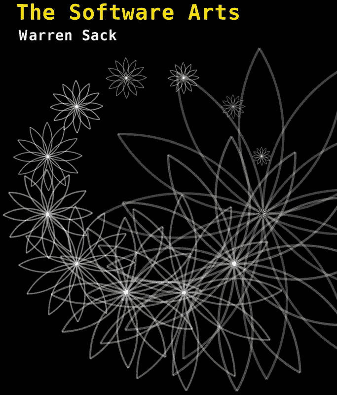

d_r0

献给珍妮弗

## 丛书序言

软件以显而易见且近乎隐形的方式，在经济、文化、创作、政治等层面深深编织进当代生活。然而，尽管关于软件如何被使用、以及它所支持和塑造的活动已有大量论述，但在其历史的大半时期里，对软件本身的思考仍主要局限于技术层面。然而日益增多的艺术家、科学家、工程师、黑客、设计师，以及人文和社会科学学者发现，为了应对他们面临的问题、构建他们所需之物，有必要对软件有更广阔的理解。为此，他们可以借助计算史和新媒体史中的一脉文本，参与软件丰富的隐性文化，也可以参与新兴的、根本上跨学科的计算素养的发展。这些为软件研究奠定了基础。

软件研究运用并发展文化、理论和实践导向的方法，对软件的对象和过程进行批判性、历史性和实验性的阐释（并进行干预）。该领域介入并助益于计算机科学家的研究、软件设计师和工程师的工作、以及软件艺术家的创作。它追踪软件如何实质性地融入当代文化和社会的进程，围绕其与算法及形式化描述和行动的亲近性，重新构想进程、观念、制度和文化对象。软件研究提议计算文化史，并利用计算的智力资源发展对其纠缠与可能性的反思性思考。它既以人文和社会科学的学术模式，也以计算机科学、艺术和设计的软件创作/研究模式来实现这一点。

由麻省理工学院出版社出版的软件研究丛书，旨在出版一个批判性与实验性并重、兼具文化与技术素养、反映当今软件文化现实的新兴领域中的最佳新作。

## 前言：软件作为一种思维模式——导论

### 约翰·拉奇曼

现代数字计算机是两位杰出数学家阿兰·图灵和约翰·冯·诺依曼的发明，他们在关于数与逻辑的丰富辩论、以及对“思维法则”的宏大探寻的鼎盛时期开展工作，并试图将其引入——或许更准确地说是“翻译”进——一种新型机器——计算机——的运作之中。

这个发明的故事常被讲述，关乎布莱切利公园和高等研究院。它诞生于战争的紧迫性，常在政府设施中于保密状态下、面对强大敌手时精心打磨，并动员了自身的科技部门，战后这一发明将呈现新形式。它将成为一个不断扩张的“军工复合体”的一部分，如今天般与我们息息相关，伴随我们巨大的全球互联网公司、监控、黑客行动主义、网络安全、智慧城市和基础设施。在此过程中，“平台”本身从大型机演变为个人电脑、再到智能手机，在速度、效率和覆盖面上不断提升，引致金融、政治和社交媒体中我们伟大的数字运算算法的运作。简而言之，这两位伟大数学家在军事机密中完成的计算机发明，导致了政府和经济领域同样庞大的复合体，触及我们思考和生活的方方面面。

但实际编程在这段历史中扮演了什么角色？各种活动“翻译”进这一复合体的过程是如何演变、呈现新形式和功能的？编程在当今“数字智能”议题中还可能扮演什么角色？这就是这部关于软件起源与本质的新研究旨在提出并首先加以阐述的复杂问题。我们如何撰写软件本身的历史：它究竟是什么？我们该如何研究它？特别是，受图灵和冯·诺依曼启发、并经由哥德尔和希尔伯特在当时以惊人方式延伸的、发现“思维法则”的伟大逻辑主义梦想，究竟发生了什么？这种逻辑主义背景在哪些方面助长了一种关于思维或“智能”的图景，将其设想为在有限步骤内遵循规则、独立于任何人类互动的事务——这一图景至今仍活跃于数字文化中，无论大众层面还是更精深层面？如果从一开始就将编程视为属于另一种、扎根于物质性更深的历史——更像是烹制做事之道，发明将我们的智能机器融入政治、战争、金融、商业和日常生活更大需求的“配方”——那将意味着什么？特别是，艺术在这种扩展的历史中可能扮演什么角色？将艺术媒介的“数字化”视为其中一部分意味着什么？我们能否为这些目的改编布鲁诺·拉图尔所谓的“翻译”，挑战那种已见于“计算机”中的观念，即数字智能仅通过为人类活动创造人工形式而产生？那么这种变革性翻译在软件案例中是如何运作的？软件协助带来的翻译以何种方式引入某种全新之物，此物此前无人类模式可循，从而挑战我们关于自然或非人工人类活动的观念？简而言之，软件在我们谈论和看待事物的方式——进而行动的方式——中扮演了什么角色？

# 软件作为一种思维模式

事实上，即使谈论计算机编程所实现的翻译，我们往往也缺乏现成的词汇。我们习惯使用的那些词——“计算机”、“程序”，甚至“算法”——必然借用了前数字时代的语言和实践，其谱系我们现在可以回顾性地考察。我们在“媒体”和“媒体研究”身上看到了这一点，例如列夫·马诺维奇所体现的那种研究，它是我们谈论和审视数字化的更大规训框架的一部分。“媒体”和“介质”这两个术语实际上源自艺术和新闻业，继而延伸至电视领域，而这些领域本身正因智能机器的兴起而发生转变。例如在当今艺术界，我们看到一种趋势：不再执着于媒体和介质的概念——这对像“激进软件”这样的团体而言仍很重要——转而倾向于类似“图像生态”这样的概念。我们该如何开始描绘这些发展，在知识分科与艺术实践中，将软件研究为一种复杂的、演进中的思维模式？这项耗时六年的耐心研究一次性提出了所有这些问题，它成为对方法的探寻，也是对新思维方式的呼吁，以及软件实践在其中可能扮演的角色。

## 软件艺术的悖论

那么，作为一种思维模式的软件是什么？《软件艺术》揭示了一个表面上的悖论。虽然导致计算机发明的宏大逻辑主义梦想早已失去了对我们的哲学控制力，但在许多方面，它的幽灵依然活在数字文化中，活在它帮助引入的“智能”概念里，沃伦·萨克开始追溯这些方式：图灵机、人工智能、“认知主义”。他在诺姆·乔姆斯基身上找到了一个转折点，后者对语言先天句法结构的探寻，导致了试图将这种逻辑重新定位于大脑，或普遍的“神经认知”之中。将软件视为一种思维模式，就是反转提问——不是我们的大脑是否像计算机一样工作，而是我们的计算机实际上是如何被编程的，最终如何编程我们的大脑以适应其运作。如果更广泛地说，数学逻辑的光环仍笼罩着我们对数字智能的概念，那么正是在那里，质疑它显得至关重要。今天，“思维法则”的梦想不再主要存在于语言领域——那里曾是激烈辩论的场所——而存在于我们现在生活和思考的数字世界中，它提出的问题不仅关乎语言，还关乎人工与自然、事实与虚构、认知与劳动。简而言之，将软件视为一种复杂的思维模式，在我们对它的图景中驱除逻辑主义的幽灵，就是将其运作置入此类问题的更宏大历史之中。

## 历史路径与福柯

我们在沃伦·萨克为寻找方法而转向的那些历史路径中看到了这一点。在回溯语法或修辞作为“软件思维”前驱时，他或多或少地显性借用了福柯的尝试，即分析当时伟大的哲学痴迷：将语言视为一种复杂的“话语事件”，这有助于改变我们对思想的形象和方式。但在将这种路径适配到软件研究中时，他将焦点从语言形式转向了干预环境的实践问题——这些环境既是人工的又是自然的，或者两者以新方式相互关联。因此，他遇到了福柯自身著作的一个后期阶段——关于生物权力、行政管理及数字在其中作用的谱系学。那么，软件或软件思维在其中扮演了什么角色？在对大数据和算法概念的讨论中，萨克转向了这些议题。

## 统计学、推理风格与大数据

伊恩·哈金以一种惊人的方式发展了福柯的生物权力研究，尖锐地提问：如何做“统计学史”？沃伦·萨克的问题——如何做软件史——可被视为一种延续，这实际上是在询问统计行政史与作为思维模式的软件史，是如何以及在何处汇聚于当今大数据的数字运算中的。哈金区分了“推理风格”与“推论方法”。统计学不仅仅是一种简单的推论逻辑，它是一种物质扎根的推理风格，带来许多不可预见的后果，特别是对法律与机遇概念的影响，以及它们开始在艺术与文学中扮演的新角色。数字与计数在这种新实践中扮演关键角色。哈金谈到“数字的雪崩”，这将提出关于社会中谁“算数”（counts）以及谁在计数的新问题。在这种推理方式中，数字的角色当然不同于它们在逻辑方法中的角色——后者由弗雷格和罗素著名地提出，甚至后来由维特根斯坦提出。哈金认为这标志着从一个机械宇宙（由上帝上发条的时钟）向“随机”宇宙的转变，在那里概率取代了确定性，“思想游戏”开始以新方式进行，这在法国与尼采和马拉美对“任何掷骰子也无法废除的非驯服机遇”的探寻联系在一起。

## 行政领域中的软件翻译

那么，计算机或计算是如何进入这个行政领域，在其中引入一种新的“翻译”的？例如，它在剑桥分析公司和脸书的“商业监控”中扮演什么角色？当我们回望，例如曾被认为是后共产主义时代的东德开放施塔西档案时，我们看到一个前数字化的行政阶段——局、纸质档案、档案馆——现在看起来相当古雅。今天的“局”越来越多地在我们的屏幕上。但这种转变——这种软件翻译——是否也引入了某种新东西，即行政理性的某种转移？东德案例当然属于奥威尔担心可能降临英国的那种苏联式“洗脑”。但在我们当前的“后冷战”局势中，我们面对的是否是奥威尔甚至福柯都未活着见到的新事物？软件在其中扮演什么角色？使数据变“大”的不是单纯的数量，而是发明了能以极高速度进行清点的软件，它们提取关于我们的特定信息（或事实）——我们的“好友”和“点赞”、购买和投票习惯，以及股票的涨跌。也许，用福柯的话说，我们可以考察这种软件思维如何帮助将我们“构成”为买家、选民或股东，在此过程中将选举政治转变为操纵和干预的新领域。借用皮尔士的一个术语，萨克提议在大数据中看到一种算法式的“溯因推理”。但在某些方面，正如伊恩·哈金在其相关著作中论证的，皮尔士仍属于十九世纪早期的机遇宇宙。也许我们的问题不再是哈金所论述的从机械宇宙向随机宇宙的转变——十九世纪末艺术家和思想家曾对此做出回应；也许现在，在大数据时代，我们需要新的分析和新的艺术介入形式。

# 软件作为一种思维模式：历史与协作

那么，什么是作为一种思维模式的软件？我们该如何撰写它的历史，而这段历史又如何有助于解答当今数字智能的更宏大问题？我们来到了这项事业的最后一个方面。为了推进此类研究，提出此类问题，萨克认为，我们需要克服知识本身根深蒂固的分裂，即将“人文”文化与“技术”或“科学”文化割裂开来，寻找从各方汲取养分的新途径，并开启新型协作。他自己的求学轨迹即提供了一个例证。在圣克鲁兹师从唐娜·哈拉维后，他前往麻省理工学院媒体实验室深造，并在那里开始涉足视觉艺术与技术史领域。为完成论文，他编写代码以可视化大规模互联网“对话”，主张这些对话的运作方式超越了语言学中关于说话者或说话的任何理论所能涵盖的范畴——这一项目早已显露出超越媒体实验室通常从事的更具利润的军事或商业软件用途的雄心，转而利用软件参与一场更宏大的、跨越学科界限的艺术与哲学辩论。

这种跨越艺术与科学的交流与分析的新空间，本身必须被发明出来。这正是本研究浮现出的建议。这不仅仅是让“两种文化”——智性-艺术与军事-商业——多些对话的问题，而是要鼓励创造一个新的讨论空间，因为当今数字智能的问题并非简单地关乎科学与人文这两种文化。（软件极客的“智能”是否真的是数学化的并不清楚；事实上，它源自许多其他来源。）它提出的问题首先也不是关于机器与我们、人工与自然、谁在掌控的对立。（软件史是一种既是人工又是自然、既是科学又是艺术的思维模式史。）数字智能的问题，倒在于如何发明新的协作方式，跳出当下禁锢我们思维的樊笼，为此单纯回归书本气的“人文”远远不够。我们智能机器的运作需要同时在艺术与科学中被分析，通过那些有助于在两者间建立新关系的方式、方法与手段。届时，统治性的“聪明”观念才会被某种更接近集体智能的东西所取代，即跨越诸多领域与学科、共同工作与思考的智能。本研究的力度与独创性在于展示了软件——作为一种思维模式的软件——在这一进程中扮演着关键角色。

# 致谢

本书写于美国加利福尼亚州圣克鲁兹和法国巴黎。在加州大学圣克鲁兹分校（`UCSC`），我要感谢电影与数字媒体系、数字艺术与新媒体 MFA 项目、艺术史与视觉文化系、意识史系、计算媒体系、文化研究中心、科学与正义研究中心、游戏与可玩媒体中心的师生员工。我也得益于艺术学院院长及工作人员为此书提供的后勤与财政支持。

美国学术团体理事会（`ACLS`）授予我 `ACLS` 数字创新奖学金，使我得以在巴黎开启本书写作，由布鲁诺·拉图尔在巴黎政治学院媒介实验室、弗朗索瓦丝·德蒂安在巴黎电信学院经济与社会科学系接待。我深感谢意 `ACLS` 的资助，以及布鲁诺、弗朗索瓦及其各自网络那一年给予我的同事般的与机构层面的支持。

同样在巴黎，我要感谢蓬皮杜中心创新与研究所（`IRI`）的贝尔纳·施蒂格勒和文森特·皮格，我受邀在那里与他们及数字研究网络的同事们交流学习。我同样感激埃萨德实验室的塞缪尔·比安基尼和埃马纽埃尔·马埃，感谢我与他们及其博士生们的诸多愉快互动。

最近，我在巴黎的机构归属是巴黎高等研究院（`IAS`），本书和我受益于一项由法国国家科研署（`ANR-11-LABX-0027-01 Labex RFIEA+`）管理的“未来投资”国家计划资助的奖学金。我于 2015 年秋季和 2016 年秋季担任巴黎高等研究院研究员，居住在壮观的洛赞酒店。院长格雷蒂·米尔达尔创造了极其富有成效的跨学科交流。科学协调员西蒙·拉克让我与巴黎内外的许多研究社群保持联系。图书管理员热纳维耶芙·马尔曼帮助我游走于高师、人文科学之家、索邦、朱西厄和国家工艺学院的图书馆与档案馆之间。

在巴黎高等研究院的两次驻留期间，我结识了其他四十位研究员。每位研究员都通过我们每周的研讨会和日常午餐，为我的写作和思考做出了贡献。我要感谢基思·贝克、肖恩·塔卡茨和查尔斯·沃尔顿，在我研究开始深入狄德罗和达朗贝尔的十八世纪《百科全书》细节时，他们为我提供了阅读建议和思考方向。当我撰写算法章节时，卡洛斯·贡萨尔维斯慷慨地提供了他对古代美索不达米亚数学的专家见解。纳胡姆·德肖维茨的研究方法深深影响了我，他的方法整合了计算机科学的历史与技术细节。纳胡姆和我还与巴黎同事共同举办了一场关于软件与数字人文的研讨会，我们都为米尔达尔院长组织的艾达·洛夫莱斯纪念活动做出了贡献。在我 `IAS` 研讨会的报告中，我有幸邀请到巴黎同事帕特里斯·马尼利耶、贝尔纳·施蒂格勒和让-加布里埃尔·加纳西亚作为评议人。

本书还受益于其他几次研讨会，我的友人和同事们在会上审阅了草稿。

2013 年 3 月，马修·富勒和诺特耶·马雷斯在伦敦大学金史密斯学院为我举办了一场研讨会。我要感谢他们、奥尔加·戈留诺娃、尼娜·韦克福德，以及当时的博士生——贝亚特丽齐·法齐、安娜·格罗斯、罗莎·门克曼和大卫·莫茨——对手稿进行了严谨而慷慨的阅读。

2013 年 6 月，我在巴黎主办了一场 `ACLS` 资助的研讨会，汇聚了来自媒介实验室、巴黎电信学院及其他研究中心的同事。参与者包括迈克尔·贝克、奥德蕾·巴内克斯、瓦莱里·博杜安、塞缪尔·比安基尼、多米尼克·居宁、热罗姆·德尼、弗朗索瓦丝·德蒂安、达娜·迪梅内斯库、保罗·爱德华兹、安妮·让特、玛丽·吉尔、保罗·吉拉尔、珍妮弗·冈萨雷斯、马修·雅科米、本杰明·洛夫拉克、帕特里斯·马尼利耶、多米尼克·帕斯基耶、让-克里斯托夫·普兰坦、塞尔日·普鲁、文森特·皮格、埃韦拉多·雷耶斯-加西亚和托马索·文图里尼。

2013 年 7 月，阿姆斯特丹大学的理查德·罗杰斯邀请我在第六届数字方法暑期学校发言，主题最终成为此书第六章的内容，即修辞学。

# 简介

计算机是语言机器。

——保罗·N·爱德华兹

计算机革命可以被设想为对世界的一次重写。本书将计算机化视为一种重写的工作，或者更具体地说，视为一种翻译来进行考察。在学术界、工业界和政府部门中，思想的交流日益以软件而非印刷散文文档的形式进行。软件如今构成了一种新的逻辑、修辞和语法形式，一种新的思维、论证和诠释手段。

本书主张计算源于艺术。这一论点对某些人将构成挑战，特别是那些认为艺术与科学之间存在一条明确分界线、“两种文化”截然不同的人。对另一些人而言，这一论点则毫无挑衅意味。重要的计算机科学家曾主张：计算不是一门科学，软件是一种文学，而计算机编程是一种散文写作。对于那些不认为艺术与科学有明确区别的人来说，本书将是一把老锯子，但长出了一些新齿。

在十七世纪“科学革命”之前，欧洲不存在科学家。不存在专业的科学组织。我们现在认定为科学的大多数研究，当时是在“自然哲学”的名义下进行的。自然哲学家最常用拉丁文发表作品，其中“scientia”一词的含义比现代同源词“science”更广泛，更接近于“知识”这一通用术语。工程学的专业化发生得甚至更晚。在那个时代及之前，教育和探究是在机械艺术与自由艺术中进行的。本书主张软件艺术——如同科学与工程——是自由艺术与机械艺术结合的产物。为论证这一观点，本书采取的方法部分是历史性的。通过将计算的谱系追溯至科学与工程最初专业化之前或期间的事件，便能清楚地看出计算源于艺术。

## 软件诸艺

《软件诸艺》也是对计算文本——代码、算法和技术论文——的一种解读，它强调散文与程序之间的连续性。^[3] 从历史上看，这种立场最早可追溯至十七世纪，当时有人提议开发人造的哲学语言，用以将自由艺（如逻辑、语法和修辞，即语言类自由艺）与机械艺（如工匠在作坊中制造别针、长袜、锁、枪支和珠宝所实践的技艺）编织在一起。^[4] 简言之，这些人造语言演变成了我们今天所知的计算机编程语言。其主张是：当代人造语言塑造了诸艺并为诸艺所塑造，并重新阐释了自由艺与机械艺之间的关系——这一组合是我们如今所谓的艺术、设计、人文学科与技术。

编程语言是用自由艺的语言来描述机械艺的努力的产物。编写软件是一种写作实践，类似于小说家、剧作家、编剧、演讲稿撰写人、散文家以及艺术与人文学科学者的写作活动。因此，当代教育、研究、工业和技术发展都需要改变，以更好地认识到诸艺处于计算的核心地位。

## 苹果的艺术家们

1995 年，苹果联合创始人史蒂夫·乔布斯曾说：“麦金塔电脑之所以伟大，部分原因在于参与开发的人既是音乐家、诗人、艺术家、动物学家和历史学家，同时也是世界上最优秀的计算机科学家。……他们带来了，我们大家为这项工作带来了一种非常自由艺的态度。”^[5] 在初代麦金塔电脑推出很久之后，乔布斯仍将自由艺描述为苹果的竞争优势。在一款新款 iPad 平板电脑的发布会上，乔布斯说：“技术 alone 是不够的——这是苹果的 DNA；是技术与自由艺的结合，与人文学科的结合，才能产生让我们心动的成果。”^[6] 在本书中，我将论证乔布斯是对的：艺术与人文学科是计算的核心。^[7]

在美国，乔布斯的言论在今天显得格外引人注目，因为艺术与人文学科正遭受围攻，社会要求学生接受职业前培训，而非美术或自由艺教育。^[8] 对自由艺教育日益增长的漠视是错误的。^[9] 如果乔布斯是对的，教育就需要改变。计算教育需要重新设计，以承认其在自由艺中应有的地位；当代自由艺的人文学科也需要拓展，以承认其处于计算机革命核心的地位。^[10]

如果乔布斯是对的，我们也就能想象，计算研究与开发可以作为艺术研究和人文学术的形式来追求。有了这一洞见，通往下一个“极其伟大”^[11] 计算机技术的道路将拓宽，成为一条宽阔的高速公路，容纳规模大得多、背景多元得多的同路人。


# 强调诸艺的核心地位，几乎肯定有助于计算机行业解决其长期存在的多元化问题

至少，这种思维驱动了 2014 年夏季的多元化宣传活动，苹果在其中这样描述自己：“从一开始，我们就是一个个体的集合体。来自不同地方的不同类型的人。艺术家、设计师、工程师和科学家、思想家和梦想家。技术与自由艺的交汇。多元背景，共同协作。”^[12]

## 计算与诸艺

除了史蒂夫·乔布斯和苹果，还有许多重要的计算机科学家也将诸艺置于计算的核心。例如，哈罗德·艾伯森、杰拉尔德·萨斯曼和朱莉·萨斯曼为麻省理工学院的本科生编写了一本编程教材。他们的教材《计算机程序的构造和解释》体现了这种另类的计算愿景。作者在引言中指出：

> 我们处理这一主题的方法基于这样一个信念：“计算机科学”不是一门科学，其意义与计算机关系不大。计算机革命是我们思维方式和表达思想方式的一场革命。这一变革的本质是所谓“过程性认识论”的出现——即从命令式的角度研究知识的结构，这与古典数学学科采取的更多声明式角度形成对比。数学为精确处理“是什么”的概念提供了框架。计算为精确处理“怎么做”的概念提供了框架。^[13]

通过将古典数学与计算区分开来——“是什么”区别于“怎么做”——作者阐述了“过程性认识论”的立场，但与其创造“过程性认识论”这一新词，他们不如直接说计算是一门艺。“艺”在其原始含义中意为“怎么做”的知识——如“武艺”和“艺与技”短语中所用。

在他们的书中，艾伯森、萨斯曼和萨斯曼强调了认识论的一个方面：计算构成了一种新的思维方式。计算机科学家艾兹赫尔·戴克斯特拉这样陈述：“[计算机]作为工具对我们的社会产生了巨大影响，但就这种能力而言，其影响与它们作为前所未有的智力挑战将在人类文化史上产生的更为深远的影响相比，只不过是我们文化表面的一道涟漪。”^[14]

这种关注文化史意涵的研究与教育形式，采用了一种混合方法，将艺术、人文学科和数学的思想编织在一起。斯坦福大学计算机程序设计艺术荣誉退休教授唐纳德·克努斯提倡一种他称为“文学编程”的方法：“让我们改变构建程序的传统态度：与其想象我们的主要任务是指导计算机做什么，不如集中精力向人类解释我们想要计算机做什么。……文学编程的实践者可以被视为散文家，其主要关注点是阐述和文风的卓越。”^[15]

克努斯将编程视为一门艺，也视为文学。“文学编程”和“过程性认识论”的实践者是散文家、作家和阐释者。对史蒂夫·乔布斯、唐纳德·克努斯、艾兹赫尔·戴克斯特拉、哈罗德·艾伯森、杰拉尔德·萨斯曼以及世界上许多其他重要的计算机科学家（例如许多图灵奖得主，即计算机科学界的诺贝尔奖）而言，计算与自由艺浑然一体。通过论证诸艺是计算的核心，我提出的既非激进也非边缘观点。

## 计算与工程

遗憾的是，尽管这一论点已被反复提出且极具权威性，它在体制内依然处于边缘地位，且普遍不受欢迎。在体制内——无论是教育界还是工业界——获胜的论点都将计算定位在科学之内，或将其视为一种工程形式。因此，在大学里，大多数计算系都设在理学院或工程学院，而远离文理学院。

虽然这些“获胜”的论点已在体制的塑造中固化下来，但如果我们仔细审视这些论点最初的表述及其迄今为止的演进，会发现它们建立在未定义的术语、以及计算与科学和工程学科所研究和生产的主体和客体之间非显而易见且不稳定的类比之上。将计算置入一个新的学科模具中，起初往往并不符合常识。例如，在 1968 年由北大西洋公约组织（NATO）科学委员会召集的第一届软件工程会议上，有人在发言中将软件生产与工程进行了类比：“‘软件工程’这一措辞是故意选择的，意在引发思考，暗示软件制造需要建立在成熟工程分支所传统拥有的那种理论基础和实践规范之上。”^(16)

在一篇关于软件工程历史的文章中，Michael Mahoney 如此评价该会议的这一开场白：

> 这一措辞确实具有挑衅性，如果仅仅是因为它让所有关键术语都处于未定义状态。什么是“制造”软件？这是一个目标还是当前的实践？究竟什么是支撑“成熟工程分支”的那些“理论基础和实践规范”？它们在工程学科的形成中扮演了什么角色？在每种情况下故事都是一样的吗？对“传统”的提及使得该问题的答案成为历史问题——分析工程领域是如何形成其当前形态的，并寻找历史先例，或我们现在所说的“根源”。^(17)

正如 Mahoney 在这篇文章及后续研究中所展示的，几十年后这些术语依然未被定义。^(18)

1968 年第一届软件工程会议的参会者之一 Alexander D’Agapeyeff 曾抱怨道：“编程仍然过于艺术化。”^(19) 这一抱怨内在的预设当然是：编程已经是一门艺术，但有志成为软件工程师的人们希望它不再是。

确实，“软件工程”尽管在体制上取得了成功，仍是一个未实现的目标。软件工程师希望他们的学科被接受为一种工程形式，但他们反复不确定它是否真的是。正如 Mahoney 在其文章引言中所写：“……不难找到对其当前实践是否符合这些标准的质疑，甚至质疑它是否根本算得上一门工程学科。……‘软件工程还不是一门真正的工程学科，但它有潜力成为一门。’从一开始，软件工程会议通常都以主题演讲拉开序幕，主题是‘我们到了吗？’”^(20)

### 计算是一门科学吗？

1967 年，即第一届软件工程会议召开前一年，Allen Newell、Alan Perlis 和 Herbert Simon 在期刊 *Science* 上发表了一封信，论证计算不仅（不只是）工程，也是一门科学：“计算机科学教授常被问到：‘计算机科学这种东西存在吗？如果存在，它是什么？’这些问题有一个简单的答案：哪里有现象，哪里就能有一门科学来描述和解释这些现象。因此，对‘什么是植物学？’最简单（也正确）的回答是‘植物学是对植物的研究’。动物学是对动物的研究，天文学是对恒星的研究，以此类推。现象孕育科学。计算机存在。因此，计算机科学是对计算机的研究。”^(21)

这封信极具说服力，可以说催生了许多大学计算机科学系的建立。它运用了若干修辞手法——修辞技巧——来为这一主张辩护。例如，考虑一下开头那句“计算机科学教授常被问到……”。1967 年，计算机科学教授非常少，因为第一个大学计算机科学系成立于 1962 年，位于普渡大学。^(22) 这三位作者都隶属于卡内基梅隆大学（当时称卡内基理工学院），该校在普渡大学之后建立了全国最早的计算机科学系之一，成立于 1965 年，由这三位作者创立。事实上，Alan Perlis 就是从普渡大学调到卡内基理工学院，担任其计算机科学系首任系主任。^(23) 所以，当时他们的开场白无异于首批宇航员中的三人写“宇航员常被问到……”。

虽然这封信可能是该话题的首发之声，但绝非最终定论。在 1976 年的图灵奖演讲“作为经验探究的计算机科学”中，Allen Newell 和 Herbert Simon 将地质学、天文学和经济学归为“经验学科”，然后将它们作为一个整体与计算机科学进行比较。^(24) 但地质学、天文学和经济学在任何显而易见的方面都不相似。此外，它们的交集当然无法提供一个清晰的集合，来类比一个新兴的第四门学科，如计算机科学。

Newell 和 Simon 进一步用更牵强的类比来详述这些不太可能的比较：“每一个被构建的程序都是一个实验。它向自然提出一个问题，而其行为提供了答案的线索。”^(25) Newell 和 Simon 未曾回应的是：他们赋予“自然”（文中后文将该词大写）以拟人化的诗意许可，使其成为一个能回答问题的存在；将程序等文本产出视为“构建”而非“书写”的隐喻观念；以及将构建等同于实验的系表陈述。这类松散且充满想象力的类比竟能一锤定音，说服许多人相信计算研究是一门科学，这或许令人费解，但却是——不可否认，至今仍是——一种获胜的修辞：“计算机科学”不仅仅是类比上的并置；它是一个庞大、不断发展且资金充足的学科。

Simon 曾试图通过出版 *Sciences of the Artificial*（三版，分别于 1969 年、1981 年和 1996 年出版）为这一问题写下定论，但他从未最终解决这个问题：一门科学能否将研究重点放在非自然发生的现象和对象上？

### 计算思维作为全科学的科学

甚至有人主张，计算不仅仅是*一门*科学，而是*全科学的科学*。这一群体的计算机科学家在推广“计算机科学”——或他们称之为的“计算思维”——是诸科学女王的信念方面颇具影响力，正如哲学和数学曾经那样。^(26)

### 计算思维

“计算思维”由美国国家科学基金会推广；由代码组织（`code.org`）网站提供支持，该网站由主要由企业组成的联盟资助；以及其他教育倡议部署了一种将计算视为思维的论述，其抽象程度之高，似乎适用于一切，实则未指涉任何具体事物。

尽管如此，思维总是关于某事物的思维，且总是与他人共同进行的思维。甚至有人可能会质疑“一般性思维”这一概念本身。因此，我们需要追问：“计算思维”是与谁一起进行的？是关于什么的？科学研究学者布鲁诺·拉图尔敦促我们将思维重新构想为工作、协作。拉图尔写道：“我们既不思考也不推理，而是与他人一起处理脆弱的材料——文本、铭文、痕迹或颜料。”那么，“计算思维”的工作是什么？谁在做这项工作？为了谁的利益？

## 性别多样性

即使我们能解决关于“计算思维”的这些问题，很明显，它不应按当今计算机科学的教学方式来教授。多样性是采用新方法最重要的动机之一。遗憾的是，计算机科学——作为一个领域——在包容性和多样性方面的努力基本上以失败告终。根据计算机科学领域主要专业组织之一——计算研究协会的数据，2013 年，女性仅占美国计算机科学系学士学位获得者的 14%。这些数据尤为令人担忧，因为它们似乎正朝着错误的方向发展。例如，根据美国教育部的数据，1984 年计算机科学毕业生中有 37%是女性。换句话说，女性过去曾占每届计算机科学毕业生的三分之一以上，而三十年后，她们仅占七分之一。

教育领域的多样性问题只会加剧行业的多样性问题。近期对顶尖计算机技术公司性别和种族多样性的调查显示，最强大的计算机技术公司员工中仅有 20%-40%是女性，绝大多数员工为白人。大型科技公司披露员工多样性数据是相对较新的现象，但逐年数据（例如 2014 年至 2015 年）显示几乎没有任何进展。

美术、设计和文科——至少在大学里——不像科学和工程那样存在同样的多样性问题。我受到这样一个愿景的驱动：计算可以作为一门艺术（或一组艺术）来教授和实践。追求软件艺术可以通过向艺术和人文学科的人士敞开大门，开辟新的视野，这些人目前仅将自己视为软件的使用者而非创造者。

计算机科学主要专业组织——美国计算机协会（ACM）前会长彼得·德宁在 2013 年撰写的一篇文章开头写道：“几十年来，计算机科学一直被一句老话所困扰：任何自称科学的领域，都不可能是科学。关于我们缺乏实质内容或兜售可疑结果的暗含批评已被反复驳斥。然而，在关乎我们的语境中，这种批评屡见不鲜。”德宁开篇之所以令人震惊，并非因为计算可能不是科学这一观点，而是因为它预设了任何非科学的领域必定是产出可疑结果且缺乏实质的领域。或许计算不是科学，但它依然是一个有实质、能产出严谨、可靠结果的领域！

## 计算与数字

常识认为——在核心层面——计算机由数字构成：0 和 1。但请考虑一个无理数，如 2 的平方根，或者更糟，一个超越数，如π。我们可以选择用一个永不终止的过程来表示π，或者用一个以 3.1415926……开头的无限数字序列。对于计算机，我们不得不截断这个无限序列；我们必须决定分配多少位内存给它。

如果数字是计算机的“原生”属性，我们就不必担心如何近似它们。但在实际操作中，即使需要极高精度的计算，我们也倾向于仅用 128 位计算机内存来表示这些无限序列。当然，原则上可以将给定计算机的整个磁盘和内存都填满仅一个数字的数位，但即便如此，我们仍是在用有限的位集合来近似无限序列。相反，计算机科学的一个完整子学科——数值分析——在几十年间发展起来，专门解决用计算机表示数字和计算数字的问题。如果数字是计算机的“原生”属性，就不需要这样一个计算机科学专业领域了。

我的观点是，虽然数字和数字运算（如算术）可以用计算机近似，但计算机并非数值机器。它们是语言机器，数字只是计算机一个非常常见的应用领域。将计算机仅想象为强大的计算器，混淆了机器本身与计算机技术的单一重要应用。

让我用一个荒谬的例子来强调这一陷阱。如果我厨房里的微波炉主要用来做爆米花，这是否意味着微波炉本质上是一台“爆米花机”？

我的观点之所以有争议，是因为它当然是对最常见叙事的反叙事，在最常见的叙事中，计算机被视为信息技术，从而与信息、量化和数学联系在一起。相反，在我要讲述的故事里，计算机是自由艺术与机械艺术的耦合——即我们今天所说的工匠、艺术家、人文主义者和设计师的知识。在第一个故事里，计算机是数学和科学的物化。在第二个故事里，计算机是艺术和人文学科方法与理论的显现。

## 计算与自由艺术

如果计算可以被构想为不仅仅是科学或工程，那么替代方案是什么？具有讽刺意味的是，或者或许是典型地，艾伦·珀利斯——如前所述，他在 1967 年主张计算*是*一门科学，并作为 1968 年第一届软件工程会议的参与者，帮助阐述了将软件生产视为工程的愿景——却在 1962 年描述了计算机编程应如何融入自由艺术教育。珀利斯倡导的这第三种路径，即计算作为自由艺术教育的内在组成部分，最近已被复兴，例如由计算媒体理论家和实践者迈克尔·马特亚斯和伊恩·博戈斯特在各自对“过程素养”的倡导中复兴。博戈斯特特别转向考察语言艺术（三学科）的教学，以探索过程素养对教育和学习的意义。

# 珀利斯的第三条路径：计算机科学作为一门通识艺术

珀利斯的第三条路径——即计算机研究与教育可以在通识艺术的框架内进行——对于作为编程语言设计者的计算机科学家而言，是令人感到舒适的，因为他们觉得设想计算机科学主要关乎语言的创造与使用是非常自然的。艾伦·珀利斯是 `ALGOL` 语言的设计者之一。^[44] 早前引用的杰拉尔德·萨斯曼是 `Scheme` 编程语言的联合设计者。^[45] 凯西·雷亚斯和本·弗莱设计了 `Processing`，这是一门旨在帮助艺术家和设计师学习编程的编程语言。^[46] 那些对“计算即语言艺术”这一观点阐述得尤为清晰的人，包括那些为教导儿童和初学者编程而设计编程语言的设计者。艾伦·凯共同发明了面向对象编程语言 `Smalltalk`——最初是为儿童设计的。^[47] 米切尔·雷斯尼克的 `Scratch` 编程语言改变了幼儿计算机教育的面貌。^[48] 雷斯尼克的导师、西摩·派珀特是面向儿童的编程语言 `LOGO` 的联合设计者。^[49] 派珀特在打破语言艺术、科学与数学之间的壁垒方面起到了关键作用。在他的著作《心智风暴》（*Mindstorms*）中，派珀特这样写道：“柏拉图在门上写道：‘不懂几何者免入。’ 时代变了。如今寻求进入柏拉图智识世界的大多数人，既不懂数学，也不觉得无视他的警告有丝毫矛盾。我们文化中‘人文’与‘科学’的分裂，支撑了他们的安全感。柏拉图是一位哲学家，哲学家属于人文科学，正如数学属于自然科学一样确定。”^[50]

派珀特的评论让我们想起，在欧洲近代早期所研究和实践的传统通识艺术，既包括三学科（语言艺术），也包括四学科（数学艺术）。当时，我们今天所谓的艺术、人文与科学之间，并没有严格的界限。

## 通识艺术简史

将计算机科学重塑为通识艺术的一部分，会是什么样子？通识艺术的简短历史将表明，它们几个世纪以来一直在扩展和多元化，而编程语言的设计、软件的语言，是通识艺术一个由来已久的梦想的最新版本——寻找最恰当的词汇，最恰当的语言。

### 什么是通识艺术？

《牛津英语词典》（*OED*）对通识艺术的定义是：

> 最初指：三学科（语法、修辞与逻辑）与四学科（算术、几何、音乐与天文学）这七门学科的总称（现属历史名词）。

美国天主教修女米里亚姆·约瑟夫编写了一本广为流传的大学教材，其中她将七门通识艺术定义如下：

> *三学科* 包含通识艺术中关乎**心智**的那些方面，*四学科* 则包含关乎**物质**的那些方面。逻辑、语法与修辞构成*三学科*；算术、音乐、几何与天文学构成*四学科*。逻辑是思维的艺术；语法是发明符号并将其组合以表达思想的艺术；修辞是将思想从一颗心智传达至另一颗心智的艺术，是语言对情境的适应。算术是数的理论，音乐是数的理论的一种应用（运动中离散量的度量），它们是离散量或数的艺术。几何是空间的理论，天文学是空间理论的一种应用，它们是连续量或延展的艺术。…… 这些读、写、算的艺术构成了通识教育的传统基础，每一门都构成一个知识领域及获取该知识的技巧。文学士学位授予那些展现出这些艺术所需熟练程度的人，文学硕士学位授予那些展现出更高熟练程度的人。^[51]

许多人将三学科概括为语言艺术，将四学科概括为数学艺术。

媒体学者马歇尔·麦克卢汉曾以三学科中三门通识艺术的历史为题撰写博士论文。^[52] 他强调了通识艺术的历史核心地位与连续性，引用 A. F. 利奇的话：“说教育的科目和方法从昆体良时代到阿诺德时代，从基督纪元第一世纪到十九世纪中叶，基本保持不变，这几乎不算夸张。”^[53] 可以说，在欧洲的大部分地区，通识艺术在长达一千年的时间里都是教育的核心。然而，正如麦克卢汉的历史著作所清楚表明的，约瑟夫修女所描绘的通识艺术静态图景，只是特定历史时期的一个快照。艺术的定义及其相互关系在不同时代发生了巨大变化，因此今天的“语法”、“逻辑”和“修辞”，未必与其历史前身相同。

在美国，许多精英学府仍被称为通识艺术学院。然而，如今所谓的“通识艺术教育”，不再是约瑟夫修女于 1948 年勾勒的亚里士多德式事业；也不完全是 A. F. 利奇在 1911 年所看到的那个轮廓。在近代早期的欧洲，通识艺术与机械艺术或手工艺有所区别。^[54] 今天，在某些国家（如美国），通识艺术学院确实包含美术。但在其他地方——例如法国和德国——艺术学院和技术学校则独立于大学之外。但 A. F. 利奇选择十九世纪中叶作为欧洲和美国通识艺术变革与扩张的关键时刻，颇具说服力，因为正是那时，工业化和人文学科的兴起，通过将通识艺术与机械艺术相融合，改变了通识艺术。

当代对通识艺术的定义将其与科学和技术对立起来。我之前在引用 *OED* 时略去了这个关键句：“在后来的用法中更普遍地指：与科学和技术相对的艺术学科（现在主要用于北美）。” 十九世纪的美国教育发生了什么，似乎让技术与通识艺术成了反义词，但同时却又悖论性地将机械艺术、工程和技术纳入通识艺术教育，从而扩展了其范围？

1936 年，亨利·赛德尔·坎比写了一部以美国大学为背景的回忆录，具体聚焦于他在耶鲁学院的经历。在《母校：美国大学的哥特时代》（*Alma Mater: The Gothic Age of the American College*）^[55] 中，坎比指出，学院在 1870 年至 1910 年间经历了根本性的变革。工业化、企业的兴起以及美国研究型大学的发明，都在改变学院方面发挥了作用。

## 1870 年之前：精英寥寥的大学教育


# 1870 年之前，大学教育仅面向极少数精英

1870 年的美国约有 50,000 名本科生。^[56] 到 1920 年，本科生数量增加了一个数量级，超过 50 万。1870 年之前，入读大学的本科生主要追求通识教育，以便进入三大专业领域之一：神学、法律或医学。但在这一工业化时期，为了应对大量新兴机器以及新的生产和分配形式的出现，开发出了新的、专门的知识形式。因此，对许多人来说，1870 年后的大学教育不再等同于传统的通识教育。

## 莫里尔土地拨赠学院法案

美国联邦政府对高等教育的首次援助是 1862 年的《莫里尔土地拨赠学院法案》：“一项向各州[及领地]捐赠公有土地的法案，这些州可利用土地建立学院，以促进农业和机械技艺的发展……从而促进各行各业中产业阶级的通识教育和实用教育。”^[57] 《莫里尔法案》为美国许多伟大的公立（以及部分私立）大学提供了创始资金支持，包括加州大学伯克利分校、普渡大学（后来成为首个计算机科学系的所在地）、威斯康星大学麦迪逊分校、马里兰大学帕克分校、麻省理工学院和康奈尔大学。当时的观点认为，工业时代需要一种融合“功利性”和“民主性”知识形式的新型大学教育。^[58] 此前，一小部分绅士在开始牧师、律师或医生的职业生涯前接受通识教育；而《莫里尔法案》标志着更多的人口需要接受某种机械技艺与通识教育的混合体教育，以便成为会计师、工程师以及工业资本主义所需的众多日益专业化学科的技术专家。这些由《莫里尔法案》创立的新大学，其模式与早期美国最初带有教会性质的学院（如哈佛、耶鲁和普林斯顿）截然不同。

## 研究型大学的兴起

这一变革脉络——大学教育扩展至涵盖新形式的技术专长^[59]——与另一脉络交织在一起：即十九世纪研究型大学的兴起。^[60] 十九世纪之前，大学主要是教学机构，教授因教授既定知识体系而获得报酬，而非开发新知识和技术。十九世纪，研究型大学模式在德国（特别是普鲁士）被发明出来。这一新大学模式由当时的新兴大学（如约翰斯·霍普金斯大学和芝加哥大学）引入美国，随后又被耶鲁等老牌学府采纳并改良。这一新大学模式的核心——也是对旧模式的背离——在于强调实证科学研究；教授职责的转变，要求其除教学外还须从事研究；以及对世俗知识形式投入的不断增加。^[61]

## 世俗化与人文学科

正如麦克卢汉在其关于三学科（即致力于语言的三门通识学科）的历史著作中所论证的那样，几个世纪以来，通识教育无异于基督教宗教教育。然而，由于这种教育形式真正始于古希腊，即使在近代早期，它也将古希腊哲学（特别是亚里士多德哲学）与天主教会的教义（特别是托马斯·阿奎那的教义）相结合。因此，通识学科始终具有跨学科性质。

人文学科从通识学科中分离出来，源于这一知识体系的世俗化。这第三条变革脉络——世俗化——与工业化技术的日益普及以及研究型大学的兴起对教育的影响交织在一起。世俗化取代了神圣性，转而将研究人类置于中心地位。

在其合著的《数字人文导论》的引言中，安妮·伯迪克、约翰娜·德鲁克、彼得·卢嫩费尔德、托德·普雷斯纳和杰弗里·施纳普用一段话概括了这段历史：

> 虽然人文探究和通识学科的基础在西方可追溯至中世纪的*三学科*和*四学科*，但现代人文科学植根于文艺复兴时期的转变——从中世纪教会主导的神权世界观转向以人为中心的世界观。……人文主义的源泉有很多，但文本的抄录、翻译、编辑和注释（有时细致，有时不那么细致）是其遗产。印刷机实现了人文文化语料库的标准化和传播，同时促进了编辑技术的进一步发展和完善。正如许多其他学者所言，我们认为文化材料向数字媒体的迁移，是一个类似于文艺复兴及后文艺复兴时期印刷文化繁荣的过程。^[62]

他们这段话未提及的是，“后文艺复兴”时期持续了很长时间。例如在耶鲁学院，非神学研究课题（特别是科学）直到十九世纪才变得重要，即便如此，仍须与掌管大学的神职人员群体进行谨慎协商。^[63] 此外，当时占主导地位的“科学”是语文学——即对文本（特别是古代文本）的研究。语文学为进化生物学等新兴科学提供了模式。^[64]

如前所述——尽管《牛津英语词典》断言通识学科被视为与科学和技术相对立——我们发现，若不触及世俗与神学、古代与现代、人文学科与科学、通识学科与机械技艺的相互交织与共同演化，就难以叙述当代学科和知识形式的起源。即使是简短的历史回顾也表明，通识学科与科学技术的对立，仅仅是一种将艺术边缘化的偏见或政治策略。真实的故事，是关于文化、经济和技术变革如何从一开始就与艺术纠缠在一起的故事。

## 翻译与通识学科

通识学科并非一成不变的构造。它们始终通过文本知识从一种形式向另一种形式的运动——即翻译——而构成和重构。在罗马，随后在整个欧洲，通识学科的发展依赖于新的翻译实践。从杰罗姆开始，希腊语、阿拉伯语和希伯来语的文本被翻译成拉丁语；杰罗姆生于公元 347 年，出生地为今卢布尔雅那，受教育于罗马，卒于公元 420 年的伯利恒。正如哲学家芭芭拉·卡桑和《不可翻译词词典》编辑者在其“论翻译”条目中所述：“*translatio*（翻译/转移）的概念真正是语言诸艺（语法、逻辑、修辞）与神学的汇流之处。在其最广泛的意义接受中，*translatio* 一词指称意义的转移、能指的置换，从恰当用法转向不恰当用法。”^[65]

作为语言自由艺术（三学科）及其主要实践（其他语言原始文本的翻译与诠释）的汇聚点，翻译将成为本书的研究对象和分析方法。我们将考察当代翻译形式，以及它们如何被用于发展新的隐喻、新的等价关系，甚至新的身份认同。当代翻译形式与各种计算形式纠缠在一起，因此我们将这些新实践称为**软件艺术**。软件艺术是一种源于自由艺术与机械艺术耦合的计算实践。正如可以将科学和工程理解为源于工匠作坊的实践^66 一样，软件艺术则是将计算理解为一种源于艺术与人文学科的实践。

## 翻译与信息技术

此前，作为自由艺术实践的翻译，意味着一种不可避免地会从文本或信息中移除或添加信息的转换。相比之下，今天的信息与通信技术在开发时往往秉持一种理想：信息可以在翻译或传递过程中不丢失、不增添任何内容。在其构想与设计中，信息与通信技术旨在精确复现传输线另一端产生的内容。在其奠基之作《通信的数学理论》中，沃伦·韦弗和克劳德·香农这样阐述这一问题：“通信的根本问题在于，在某一点精确或近似地复现从另一点选取的信息。”^67 在同一本书的其他地方，韦弗和香农指出，根据他们的理论，信息不被赋予任何意义。^68 简言之，从工程视角来看，我们在发送电子邮件或使用网页时所从事的，是一种无意义的复制，它不顾及其社会和政治环境。这种无意义的模仿被视为通信的根本问题。

在工程术语中，信息与通信技术依据其在固定容量信道上无损推送比特的能力进行评价，即在“导线”这一端精确复现另一端记录的内容，而不涉及另一端“导线”上的环境。在古典哲学中，这种精确的重复有一个名称。不了解意义、语境或关联的重复被称为“模仿”，或者更具体地说，在柏拉图的著作中被称为“拟态”或“诡辩”。在题为《诡辩家》的苏格拉底对话录中，柏拉图指出：“有些模仿者知道他们所模仿的事物；其他人则不知道。…… 为了区分，让我们称由意见引导的模仿为‘自负的模仿’，称由知识引导的模仿为‘基于熟知的模仿’。…… 制造矛盾的技艺，源于一种不真诚的自负模仿，属于外观制造类，衍生自形象制作，……——这些血统和渊源，完全可以真实地归于真正的诡辩家。”^69

换句话说，信息与通信理论中阐述的成功标准，恰恰是柏拉图眼中最糟糕的伦理与审美失败的标准。根据柏拉图的观点，这是将最恶劣的诡辩行为视为美德，甚至视为一种行之有效的技术的根本美德。^70 基于这些理由，当代的信息、通信与计算理论和技术可以被称为“诡辩的”，我将在第 6 章关于修辞的讨论中详述这一点。

通信理论与翻译在计算条件下的根本转变之间的联系，早在沃伦·韦弗 1949 年的报告《翻译》中就已显现。^71 韦弗的目的是探讨这样一个想法：人们可能设计一个计算机程序，将文本从一种语言翻译成另一种语言。熟悉香农和韦弗通信理论文本的人不会觉得以下内容太令人惊讶，但任何双语人士都可能觉得韦弗对翻译的理解异想天开。韦弗写道：“当我看到一篇俄语文章时，我会说，‘这实际上是用英语写的，只是用一些奇怪的符号编码了。我现在将着手解码。’” 韦弗写下这些话时，第二次世界大战刚刚结束，原型计算机首次被应用——并取得巨大成功——于破解德国军事通信密码的问题上。简言之，对韦弗而言，计算机擅长解密任务显而易见，因此如果一个问题能被重新概念化为类似解密问题的样子，那么它很可能就是计算机能做的事情。尽管当时科学权威们表达了怀疑，^72 韦弗的《翻译》一文影响巨大^73 ，可以说至今仍在指导计算机科学家对待翻译的方法。例如，韦弗在文中概述的用于解码的统计方法，构成了当代机器翻译流行工作的核心。

韦弗 1949 年的文本有两点值得注意。第一是此前少有的观点：机器——具体来说是计算机——可以用来将文本从一种语言翻译成另一种语言。第二是其文本对“翻译”一词本身进行的根本性转译：韦弗将翻译等同于（无信息损失的）加密与解密操作。这两点将成为我们探索软件艺术的争论焦点。

任何有网络访问权限的双语人士都可以上网测试韦弗断言的当前可行性，即翻译只是一种解码形式。例如，找到 Google 的在线翻译服务^74 ，尝试将一段文本从一种语言翻译成另一种语言。除非文本极其简单，否则自动机器翻译将充满错误，甚至出现严重失误。当然，自 1949 年诞生以来，机器翻译已有显著改进，但机器翻译与优质翻译之间仍存在差距。此外，机器翻译与将一种语言的文本转换为另一种语言的文本而不丢失或增加信息（即韦弗和其他信息理论家构想的完美翻译）之间，不仅存在差距，简直是鸿沟。

软件艺术核心的问题之一，在于探究计算机和网络如何融入了这种站不住脚的无损翻译观念，并通过运用自由艺术和人文学科学者发展出的古老翻译理解来追究这一点。

## 翻译与科学技术研究

科学史学家兼哲学家米歇尔·塞尔在其著作《赫耳墨斯 III：翻译》中，发展了一种通过翻译来研究科学技术的方法。^75 塞尔的方法随后在“翻译社会学”的旗帜下得到延伸，该学科另一个更常用的名称是“行动者-网络理论”，简称**ANT**。^76

哲学家兼科学研究学者布鲁诺·拉图尔对近来流行的“行动者-网络理论”这一名称表示遗憾：

> 在[20 世纪 70 年代末和 80 年代初]，“网络”一词，就像德勒兹和加塔利的“根茎”概念一样，显然意指一系列转化——翻译、传导——这些无法用社会理论的任何传统术语来捕捉。随着“网络”一词的新式普及，它现在意指无变形的传输，即对每一条信息的即时、无媒介获取。这恰恰与我们原本的意图相反。我想称之为“双击信息”的东西，扼杀了网络概念最后一点批判的锋芒。我认为我们不应再使用它，至少不应用它来指代我们现在想要探索的那种转化和翻译类型。^(77)

拉图尔近期著作的读者知道，他之前提到的“双击信息”绝非随口一说。^(78) 在一本近期的书中，他将“双击”确定为所考察的十五种“存在模式”之一，并将其与其他存在模式（包括他所谓的“网络模式”）严格区分开来。

翻译社会学适用于软件分析，因为计算机科学家将其大量工作描述为翻译。除了机器翻译（从一种自然语言到另一种）的问题域外，软件设计和工程中的许多实际问题被称为“翻译”，包括计算机科学中另行标记为“编译”或“解释”的那些翻译（如从高级编程语言到低级语言的翻译）以及“实现”（如将抽象系统规格翻译为一段可工作的软件）。

就我们在艺术和人文学科中所知的翻译而言，它始终是一种变革的力量。每次翻译都涉及信息的丢失或增加，或两者兼有。因此，任何翻译的结果都与被翻译的文本不同——它是有差异的。但就计算机科学和信息论所知的翻译而言，它理想上是无损的。从这个角度看，从源文本到目标文本的完美翻译是指信息既不丢失也不增加的翻译。人文学者可能会认为计算机科学的翻译观天真或理想化。反之，计算机科学家可能会视人文学科的方法为自毁式的，因为如果翻译只能是源文本的变形、退化或详述，那么准确的翻译永远遥不可及。但人文主义者并不认为翻译是不可能的，只是认为任何特定的翻译总是可以改进的。本书探讨了源于这些不同翻译观点的冲突。

## 软件艺术与语言自由艺

科学技术史学家保罗·爱德华兹在评论迈克尔·马霍尼关于计算机史学的著名文章（前文引用）时^(79)，解释说计算机史通常归入极少数的故事类型。爱德华兹写道：“第一种体裁是智力史，其中计算机主要作为关于信息、符号和逻辑的思想的体现而发挥作用。”他继续说道：“这里的标准谱系从柏拉图对知识和信念基础的探究，经由莱布尼茨的理性主义，延伸至 19 世纪洛夫莱斯夫人关于查尔斯·巴贝奇分析机的笔记和布尔的《思维规律》。”^(80) 该谱系贯穿 20 世纪，包括艾伦·图灵的机器、诺伯特·维纳的控制论、麦卡洛克-皮茨神经元理论，以及约翰·冯·诺依曼在计算机方面的协作工作。这是我在本书中重述的历史，但我将其置于另外两个不那么流行的叙事——计算机即修辞和计算机即语法——的张力之中重述。

本书围绕“三艺”，即逻辑、修辞和语法这三门语言艺术展开。正如爱德华兹和马霍尼指出的，许多计算机史讲述的是计算机即逻辑的故事。相比之下，计算机即修辞的历史强调计算机软件作为一种说服手段的作用。计算机图形学和计算机仿真是两种广泛部署为修辞形式的软件形式。与计算机即逻辑和计算机即修辞的历史形成对比的是计算机即语法的叙事。语法关乎语言规则。语法规则长期以来被一些人视为机器。计算机即语法的故事在 20 世纪中叶变得清晰，当时有人提出语言规则是机器或软件装置。通过将这三条独立的计算史交织在一起，可以勾勒出一幅清晰的图景，即计算作为语言自由艺的协同生产。

计算机即逻辑、计算机即修辞和计算机即语法的故事是对计算的三种不同诠释。这些故事虽有交集，但也截然不同。它们的差异部分可由逻辑、修辞和语法作为三个独立研究领域的历史差异来解释。

我们当代对“语法”、“逻辑”和“修辞”这些术语的用法，是它们之间由来已久的竞争关系的症候。正如麦克卢汉在其从古希腊至莎士比亚时代左右的三艺史中所描述的，这些知识领域已竞争了数千年。当我们赞扬某人的逻辑而嘲讽另一个人的修辞时，我们是在表达这场竞争的当前状态。显然，今天逻辑学家受到的尊重多于修辞学家，因为“空洞的逻辑”和“合理的修辞”这样的短语似乎近乎自相矛盾；形容词“合乎逻辑的”和“修辞的”分别具有褒义和贬义。语法学家如今是这三方竞争的领跑者，因为语法已制度化到我们理所当然地让孩子上语法学校，或从入学早期就开始学语法的程度。如果七岁的孩子被送去上修辞学校或逻辑学校——而不是语法学校——我们将生活在一个截然不同的世界里。既然修辞、逻辑和语法几个世纪来一直在争夺主导地位，本书描绘的三联画——计算机即逻辑、计算机即修辞、计算机即语法——将暴露它们之间一些粗糙的边缘。

## 利害与主张

本书的利害关系有三重：教学的、工业的和认识论的。第一，如果软件是一门艺术，那么教育需要改变以将其纳入自由艺。我们教什么？我们学什么？这些是老问题，在一个基本素养不仅关乎英语、拉丁语和希腊语，也关乎软件的世界里，它们需要被再次提出。第二，如果软件可以用艺术家/人文主义者的方式编写，那么超越工程和数学的软件生产新途径可能成为可能——像史蒂夫·乔布斯这样的人已经走过这条路。第三，如果软件是新的通用语，那么随之而来的一系列伦理和道德问题必须与这种认识论转型结合起来加以追究。什么算作知识？为谁？付出什么代价？^(81)

# 最普遍的主张

本书最普遍的主张是：软件艺术是一个新名称，指代一种延续数百年的事物——即发明和审问连接、等价与同一性陈述的方法的追求。如今，编写软件对科学和工程两者都至关重要。是的，编写程序与写散文截然不同。是的，计算机语言与自然语言有着本质区别。但无论我们称软件为“机器”还是“指令”、“对象”还是“规则”，无论我们称软件生产为“构建”还是“写作”、“建造”还是“创作”，我们对软件及其生产的命名皆为隐喻，一旦我们在使用隐喻，我们就是在作为艺术家工作。我与史蒂夫·乔布斯持相同观点，主张艺术处于软件的核心地位。

# 历史、哲学与软件艺术

我试图从历史和哲学两个层面论证软件艺术的构成。在接下来的内容中，我将追溯一段更为详尽的历史，其脉络贯穿狄德罗、亚当·斯密、普罗尼、查尔斯·巴贝奇、艾达·洛夫莱斯、艾伦·图灵，直至今日。当十八世纪《百科全书》的编纂者狄德罗及其合作者面临任务，需要以某种标准方式描述法国各地艺术家和工匠工作室与作坊中采用的所有工序、操作和手势时，他们需要创造一种既为自由艺术所接受、又能充分描述机械艺术的语言。百科全书编纂者通过首先倾听艺术家和工匠的语言，了解他们用以描述工作实践及生产中所用机器的术语，从而达成了这一目标。在第 3 章中，我将此类语言称为“工作与机器语言”。随后，百科全书编纂者必须将这些各异的工作与机器语言翻译成统一的词汇和句法，用于《百科全书》条目，以及统一的视觉语言，用于插图。《百科全书》的语言必须涵盖从长袜制造到别针生产的一切。我主张，百科全书编纂者在机械艺术与自由艺术之间的翻译工作，最终构成了我们今天所知编程语言的基础。

在哲学层面，软件艺术的论证与这段历史交织在一起。正如符号学家、小说家、历史学家翁贝托·埃科所言，弗朗西斯·培根、戈特弗里德·威廉·莱布尼茨等人致力于“寻找完美语言”：一种哲学语言，一种“普遍特征”，借此可阐述所有类型的知识。但他们中无人尝试全规模的知识百科全书。然而，狄德罗等人确实尝试了这种全规模编目，且理解他们的项目如何回应培根和莱布尼茨的愿景。

软件艺术延续了百科全书编纂者将机械艺术翻译为自由艺术语言、反之亦然的努力。为该项目锻造的通用语言如今即编程语言，它们是介于散文与机器之间的临界书写形式。

# 论翻译的局限

与自然语言相比，编程语言受到限制，因为它们及其构成的程序，以往无语言形式所具备的方式，具有祈使性、独立性、非人称性、微小性、难解性和即时性。例如，在编程语言中，只能用祈使语气（“获取”、“返回”、“赋值”等）和条件语气（“若如此则执行彼”）进行“变位”。虚拟语气，甚至过去时，均无法在编程语言中表达。编程语言是“语言”，却也是“机器”。

鉴于这幅编程语言图景，不难想象，将模拟过程翻译成一段软件，往往如同强行将一个巨大的圆钉塞进一个小小的方孔。如同任何翻译——即便是口语与书面语言之间的翻译——翻译成编程语言都是一场损失、变更与添加的练习。东西在过程中损坏，必须修补和修正。用意大利谚语的话说：“tradurre è tradire”，即“翻译即背叛”。

正如第 2 章详述，这种对翻译的理解——它永远是“有损的”，永远是变革的推手——对大多数通晓多语者以及艺术和人文学科从业者而言属于常识。在源语言与目标语言之间的翻译中，源语言文本中总有一些“不知何物”无法用目标语言措辞，因此总有一些东西需要被编造并插入目标语言文本，而这些在源语言文本中没有对应物。

# 完美语言的问题


然而，对完美语言的追寻伴随着一种“无损”翻译的幻想。这种幻想是一种确信：我们可以设计一种完美语言，使任何事物都能翻译进去而无损失、无添加、无变更。这种幻想在数学和逻辑学中延续至今，并如今驱动着编程语言设计。

由此引发了一出反复上演的戏剧。完美语言的信徒将源语言中的 `X` 翻译成 `Y`，即一种“完美”目标语言中的文本。信徒随即宣称“`X` 即 `Y`”。但要宣称“`X` 即 `Y`”，必须要么忽略某些将 `X` 与 `Y` 区分开的“不知何物”，要么认定这种差异微不足道。这种戏剧在许多其他章节中反复出现。

一旦宣称“`X` 即 `Y`”，总会有非信徒——即不信完美语言者——他们会争辩 `X` 与 `Y` 的差异不容忽视，或主张这种差异是重大差异。如今，假设的完美语言往往是计算机编程语言；`Y` 是用该语言编写的某软件；信徒是计算机科学家或软件工程师；非信徒则是 `X` 的前利益相关者，他们因 `Y` 取代了 `X` 而失去了对 `X` 的控制。

例如，设想 `X` 是过去存在的图书出版、发行与零售业务，`Y` 是 Amazon.com，特别是运行该网站的软件，以及预测读者需求、组织仓库、在仓库间及从仓库到客户家中路由书箱等各种内部软件系统。此场景中的非信徒包括前当地书店老板及其前常客，他们过去热爱老板的阅读学识，及她总能在他们自己都知道之前，就备有他们想要的书。

当 `X` 是一个长期存在的制度——如图书业——时，`Y` 在硅谷行话中即试图“颠覆”该制度，并用围绕一段软件配置的新制度取而代之。Amazon.com 即一例；Uber 对出租车业的“颠覆”亦是一例。比特币试图颠覆银行业与货币，Netflix 颠覆了电视，还有许多其他例子。当我们许多社会、文化、经济和政治制度都围绕软件配置时，我说我们生活在“计算条件”下，或更简单地说，我们的生活是“数字生活”。

当 `X` 是一个观念、一个研究与教学领域——如生物学、社会学或物理学——时，`Y` 即试图取代某关键智力建构；`Y` 可能是一个模型、一种模拟、“研究”中的“搜索”，甚至一种理论。例如，遗传密码常被当作计算机代码来研究。

# 意识形态与平等

我认为一组等价关系和不等式构成了一个观念体系，或者更简练地说，构成了一种“意识形态”（此处无贬义）。当这组等价关系和不等式涉及软件，或更广泛地说涉及计算机时，我称之为“数字意识形态”。当 `Y` 是一段软件并可被视为一种“理论”时，我们便来到了一个陌生的新境地，在那里知识可以用计算机程序来表述。我称这个境地为“计算性知识体系”，并将在第 7 章中探究其含义。

一个大观念或大机构的翻译，不能仅凭一小段软件和一句宏大的等价宣言来完成，尽管人们曾尝试过。20 世纪 50 年代计算机刚问世时，记者们天真地称它们为“电子大脑”。这种 50 年代新闻界和大众文化的意识形态包含断言“计算机 = 大脑”。相比之下，在严谨的智力氛围和要求苛刻的行业中，大的等价关系需要用大量较小的等价关系来证实。构建这样一个集合，意味着将许多较小的观念或机构翻译成许多较小的软件片段。

因此，在断言计算机是大脑之前，人们或许想要像沃伦·麦卡洛克和沃尔特·皮茨在 1943 年发表的《神经活动内在的逻辑演算》中所做的那样，去探究神经活动是否可以建模为一组逻辑电路。如果想把一台小型计算机称为“智能手机”，则需要建立一大组较小的等价关系，例如将拨号用的“按钮”渲染并实现为触摸屏上的图形对象。两个不同实体之间的等价关系，是通过将一方翻译成另一方来建立的。

这些翻译往往建立在早期翻译工作确立的一组较旧的等价关系之上。因此，例如，麦卡洛克和皮茨的逻辑演算基于早期将整个数学翻译为逻辑的努力（如伯特兰·罗素和阿尔弗雷德·诺斯·怀特海的工作）。这些早期努力反过来又部分源于反方向的翻译尝试，如乔治·布尔在 19 世纪将亚里士多德逻辑渲染为一种代数或算术形式的努力。

有许多技术和方法，特别是来自数理逻辑和计算理论的方法，可将对象和过程与软件等同起来，并“证明”或“反驳”一段软件与另一段软件之间，以及/或者数字软件与模拟实体之间的等价关系。然而，从艺术和人文学科的视角来看，“等价证明”并非不可辩驳，而仅仅是翻译工作严谨进行的论证或演示。第 6 章关于修辞，将探讨计算的各种演示形式。

如果我们认为这些等价关系已被“证明”从而一劳永逸地确定下来，我们就不大可能思考替代方案或进一步创新。如果相反，我们将这些等价关系视为翻译努力的结果，我们就可以永远追问：“翻译中丢失了什么？”例如，即使克劳德·香农在其硕士论文中“证明”了布尔逻辑和布尔电路是同一回事，如果我们坚持追问它们有何不同，就会迅速发掘出电路特有而书面逻辑没有的一组问题；例如，在设计电路时，我们必须担心电流通过电路产生的热量。现代计算机需要风扇散热，而乔治·布尔 19 世纪的逻辑算术从未需要过风扇！物质性的差异是显著的差异。这个例子在第 5 章关于逻辑的内容中有详细讨论。

## 翻译的不完美性

将这种自由艺术中关于翻译混乱性的态度带入技术文献，意味着要仔细重读科学、数学和工程学的关键论文，以发现并评估翻译中丢失了什么。给定一个提议的等价关系 `X = Y`，`X` 和 `Y` 之间建立了什么联系；`X` 是如何被翻译成 `Y`、以及 `Y` 如何被翻译成 `X` 的？为了建立等价关系，什么不得不被搁置或忽略？第 2 章关于翻译，实质是一章方法论——对行动者-网络理论的一种诠释——及其在软件文本中追踪此类等价链条的应用。

布鲁诺·拉图尔写了一部小型哲学著作《不可约简》，其开篇宣言与数字意识形态可谓南辕北辙。拉图尔问道：“当没有任何事物被还原为其他事物时会发生什么？……没有任何事物本身是可还原的，也是不可还原的。我将称之为‘不可约简原则’，但这是一个不统治的王子，因为统治将是自相矛盾的。”^(82) 数字意识形态可能包含无数还原，展示生命、宇宙和万物如何能被数字化或还原为某种计算机程序形式，而拉图尔的宣言确立了一份替代的、对立的宣言：一切事物和每个人都是独一无二的，没有任何事物等价于其他事物，一切皆不可约简。然而，即使情况如此，事物仍然可以被连接或链接在一起。有了足够多的事物间链接，我们就拥有了一个网络，从而有了“行动者-网络理论”。

按照本书所采用的意识形态理论（受阿尔吉达斯·朱利安·格雷马斯启发），一种意识形态可以被分析为若干观念和/或身份之间的一组等价关系。这些等价关系和/或不等式可以用多种方式陈述，包括系表陈述（`X is Y`）、方程（`X = Y`），以及——对数字领域尤为重要——赋值语句（`X:= Y`；即 `X` 被赋予 `Y` 的值）和重写规则（`X → Y`；即 `X` 被重写为 `Y`）。对一种意识形态进行行动者-网络理论分析，就是质疑其等价关系：询问它们是真正具有定义性的，还是暂行的。从某种意义上说，这类似于苏格拉底在雅典广场所做的，他颠覆常识的系表断言，将其转化为定义之问：什么是勇气？什么是真理？

## 行动者-网络理论与软件研究

行动者-网络理论（ANT）的两个独立灵感来源是格雷马斯符号学^(83) 和社会学家哈罗德·加芬克尔的民族方法学^(84)。民族方法学家的工作一直以民族志关切和方法为主导——观察并记录人与人之间的口头和身体互动。相比之下，格雷马斯符号学最初是为研究文学文本而发展的。

ANT 已被应用于科学技术许多领域的方程和等价关系，但极少应用于软件文本。当他们对软件感兴趣时，ANT 实践者特别是、以及科技研究（STS）研究者一般，研究计算机科学和软件工程的方式，重民族志而轻符号学。因此，存在许多精彩的软件开发项目民族志研究，我们从中能了解很多关于程序员及其互动的情况，但这些研究往往忽略了软件文本本身：程序员编写的代码究竟是什么？项目组成员阅读和撰写的技术论文是什么？论文中提出的观念是如何进入——或未能进入——程序员的生产目标和成果、代码及其注释中的？

# 软件诸艺：导论

本书阐释了作为一种翻译社会学的 ANT（行动者-网络理论），如何能被用作审视软件文本（包括代码与技术论文）的一种方法。它是 STS（科学技术社会学）研究的必要补充，后者致力于理解生产软件的人；也就是说，正如布鲁诺·拉图尔某本书的副标题所言，“跟随科学家和工程师穿行于社会之中。”^[85] 我们既需要研究软件的文本，也需要跟随生产软件的人。

人们本以为计算机历史学家早已写下了大量关于软件的著作，但计算机史的大部分篇幅聚焦于硬件，软件直到最近才成为研究对象。人们同样可能设想，逻辑哲学家和历史学家会写下大量关于软件的著作，但他们极少考察当代软件文本。因此，在 STS、计算机史、以及逻辑史与哲学的空白地带中，出现了一个缺口，容纳了一种聚焦于软件文本的新型学术研究。这种新型学术研究便是新兴的软件研究领域，而本书可被视为对该领域的一种贡献。

## 细读

简言之，本书是对计算机科学及其历史关键文本的一次细读。例如，在第 4 章中，当我们细读唐纳德·克努特关于算法特征的论述——或许是计算机科学的核心术语——时，我们发现其中存在循环论证与若干逻辑不一致之处；例如，克努特声称算法可以独立于任何编程语言来定义，然而他的所有算法均是依据他自行设计的一种特定编程语言来定义的。在第 2 章中，阅读艾伦·图灵关于图灵机定义的论文，以及其学生和同事推广该思想的论文时，我们发现图灵原始论文的核心是一个否定性结果——即存在计算机无法被编程执行的任务。然而，在其大众接受的过程中，我们却看到了一种狂热，即认为计算机可以被编程去做任何事、一切事。在第 5 章中，通过细读关于逻辑与计算的文本，我们发现——直抵软件根基之处——存在一个由来已久且怪异地循环的项目：将逻辑变为算术，又将算术变为逻辑。这一循环项目深刻地重塑了逻辑，并自计算诞生之初便塑造了计算。在第 6 章关于修辞的论述中，我们追踪了“证明”在严密论证中原本含义的剧烈变迁，演变为如今截然不同的“演示”，即我们在硅谷以及“大数据”实践者论证中所见的演示。我称这些演示为“溯因式演示”，并将其与先前占主导地位的演绎式演示和归纳式演示形成对比。在第 7 章中，通过考察诺姆·乔姆斯基及其师长、同僚、学生的工作，我们遇见了这样一种观念的萌芽：理论可以是“装置”，具体而言，是以软件呈现的装置。当理论成为装置时，我们不再问*为什么*，而是问*怎么做*：我们询问理论是否奏效。但我们也应当追问：为谁奏效？代价几何？

总之，当我们细读软件的技术文本时，经常会发现其大众化版本与原始文本的实际内容相去甚远。在文化上、经济上、政治上、社会上和技术上，如果软件只是少数无权无势专家的边缘关注点，这倒无关紧要，但如今软件在研究、教学以及世界各地人们的日常生活中都占据了举足轻重的地位。

## 本书的组织结构

本书的主张是，我们将软件的读写视为自由艺学的延伸，具体而言是三学科，即自由艺学中的三门语言艺术。逻辑、语法与修辞（以“演示” [demo] 的面目出现）皆可被即刻识别为软件的内在属性，且是计算机科学的核心。本书围绕这三门自由艺学展开，但前四章——本导论章，以及关于翻译、语言与算法的章节——专门用于铺陈入门材料。第 5 章考察三学科中的第一门：逻辑。随后是关于修辞的一章，然后是关于语法的一章。

本书的结构具有自相似性，同类论证既贯穿全书，也呈现于章节尺度之上。我细读一段计算机科学文本，寻找其不稳定性与矛盾，并追寻其历史先例的线索。随后我深究那些历史先例，以期发现那些被遗忘或忽视的替代方案，它们能作为对当今计算机科学的改进或修正。这些不稳定性与矛盾，通常源于将一切还原为数学或逻辑的努力，或更具体地说，源于数字化的努力——将一切转化为算术形式，将其坍缩为计算的问题。相比之下，我所发现的历史替代方案则源于艺术与人文学科。

写作本书时，我心中有两类读者群。一类是对软件在理论、方法或工具方面可能提供何种价值感兴趣的文化工作者、艺术家与文化学者。另一类是其工作与文化生产紧密绑定的计算机科学家与软件工程师——游戏设计、社交媒体或流媒体视频。我对所有读者的寄语是：文化与计算纠缠在一起，而理解这种纠缠的一种途径，便是细读软件的文本——代码、技术书籍与论文。对于本书的每一章，我都对读者怀有一份期许。

首先，若本导论章如我所愿发挥了作用，读者将愿意接受这样一种可能性：尽管计算可被视为科学（如计算机科学）与工程（如软件工程），它也可以被视为一种艺术，或一组艺术：软件诸艺。

第 2 章关于翻译，作为一章“方法论”呈现。翻译为学者所知，也为计算机科学家所知，但各自熟悉的风味截然不同。本章讨论的主要案例，是一组计算理论萌芽期的文本，涉及艾伦·图灵的机器、阿隆佐·丘奇的 λ-演算，以及声称计算机能力无限制的丘奇-图灵论题的大众化版本。这种大众化说法并不属实。图灵的原始出版物确凿地表明：计算机是有极限的。通过将软件文本的大众化版本视为一系列翻译——从最技术性的文本翻译至最大众化的文本——我展示了技术文本的大众接受过程，如何导致了一种与原始出版物发现相悖的幻想。我希望读者能看到，如何将一种大众化版本重构为一系列翻译：从技术文献“向外”延伸至大众文化的荒野，再“向回”折返——进入技术文献。所呈现的方法论是对行动者-网络理论的修正与延伸，后者在科学技术研究领域也被称为翻译社会学。这一对行动者-网络理论（简称 ANT）的贡献，是本书主要的方法论贡献。

## 第三章：语言

在第三章中，我论证计算机并非信息技术，且计算的运算操作并非数学的函数。为展开这些论断，我讲述了一段编程语言的历史，其起始于十八世纪法国工匠的作坊。我追溯了这些工作室和作坊中分工实践的历史；经济学家亚当·斯密在其著作《国富论》第一章中对其进行了记录；加斯帕德·德·普罗尼修订了斯密的思想，以组织大规模人工计算，服务于革命后的法国；查尔斯·巴贝奇设计了一台机器，在其分析机中体现了普罗尼的方法。艾达·洛夫莱斯于 1843 年利用分析机的运算操作编写了第一个计算机程序，她称之为“运算科学”，并将其与数理逻辑形成对比。洛夫莱斯写道：“运算科学……本身就是一门科学，拥有其自身的抽象真理和价值；正如逻辑拥有其特有的真理和价值，独立于我们可能应用其推理和过程的主题。”^(86) 我希望通过这段历史，读者能理解逻辑与数学与计算之间的巨大鸿沟，以及计算与艺术创作中所完成的工作类型之间的亲和力。

## 第四章：算法

算法是第四章的主题。在其原始形式中，算法仅仅是一种进行算术运算的新方法，它在商人资本主义成为主导力量时传入欧洲。随着工业资本主义的兴起，以及当今金融资本主义和语言资本主义的时代，算术已从经济上重要转变为经济的核心命脉。伴随算术在商业和工业中的崛起，它从一门有界限的自由艺术——四艺（数的艺术，还包括几何、天文学和音乐）之一——转变为一种霸权性的知识形式。最初受数学挑战的推动，在二十世纪的进程中，数学家、语言学家、逻辑学家和经济学家将大量智力领域归约为算术、计算，这一举措被称为“算术化”。算术化预示了我们现在所说的“数字化”和“融合”。这些将计算中心化的举措，对许多领域而言是环境灾难——对思想的灾难性影响，不亚于单一作物农业对地球空气、水和土壤的破坏。本章的希望是，读者通过追溯算法从早期现代威尼斯到今日计算机算法的历史，不再惊叹于算法的力量，而是开始超越算法当前的意识形态极限进行思考。为此，需要理解一个多世纪以来将语言艺术转译为算术这一自由艺术的工业与智力力量，并在理解后，逆转这些转译。

## 第五章：逻辑

第五章的焦点是自由艺术中的逻辑。“计算机即逻辑”的故事常被讲述，以强调语言艺术逻辑对计算机发展的诸多贡献。我也重述这一故事，但包含了两个常被遮蔽的细节：物质性与历史。如果承认拥有电源、屏幕和电路的现代计算机，在物质上与印刷在纸上的旧时逻辑著作截然不同，这将使“计算机即逻辑”的故事变得复杂，因此物质细节在讲述该故事时通常被搁置。历史特异性在通俗叙事中也常被边缘化，因为在技术场域中表述的现代逻辑并不古老。一阶谓词逻辑是二十世纪的发明。因此，如果承认昨天的逻辑与今天的逻辑完全是两码事，讲述逻辑如何生出计算机就会变得过于复杂。通过考察逻辑史、逻辑电路的物质特异性以及逻辑编程的一些软件设计技术，我希望读者能洞察如何将一个看似统一、整体、技术性的主题——逻辑——拆解为其众多互不相干的部分。不存在大写“L”的“Logic”（逻辑），只存在大写字母拼写的多种“logics”（逻辑）。

## 第六章：修辞

第六章论及三艺中的第二门艺术：修辞。亚里士多德告诉我们，最有力的修辞与逻辑演示紧密相连。本章追溯了演示的历史。“演示”的历史始于古希腊，那时确定性演示是几何学中实践的演绎。欧几里得的演示或演绎演示在十七世纪“科学革命”期间被归纳演示所取代。当论证开始基于经验数据，而不再仅源于被视为显而易见的真理陈述时，归纳演示（我们可以称之为罗伯特·波义耳的演示）变得必要。如今，论证基于海量数据——“大数据”——以至于无人能尽读，更遑论观察其收集过程。这催生了另一种论证形式的发明，我称之为“溯因演示”，或所罗门诺夫和柯尔莫戈罗夫的演示。最新形式的修辞演示实质上是一种数据压缩，亦即机器学习。我的观点与媒体理论家乔纳森·斯特恩的观点一致：我们现在应关注压缩而非表征。^(87) 可以说，当代机器学习的奠基文献是雷·所罗门诺夫 1960 年的出版物《广义归纳推理理论初步报告》。^(88) 运用所罗门诺夫论文中的一条定理，苏联数学家安德烈·柯尔莫戈罗夫阐述了一种复杂性理论。数据集合的柯尔莫戈罗夫复杂度度量，是能生成该数据作为输出的最短计算机程序的长度。机器学习算法被设计为接受数据集合，然后在计算机程序空间中搜索适用的最短程序。我们被引导相信大数据集能被机器学习算法的输出恰当刻画，但我们无法核查数据，故我称之为溯因演示，因为哲学家查尔斯·皮尔斯（最早以现代意义阐述溯因者）指出溯因是一种猜测形式。或者，我们也可以说溯因是一种解释形式，这是艺术与人文学科熟知的实践。本章从古老的立论手段延伸至最新的说服形式。我希望为读者提供质疑和构建基于软件的论证的途径。

# 第七章：语法


# 第七章 语法：第三种自由艺术

第七章论述的是语言三大自由艺术中的第三种：语法。长期以来，语法是一个政治项目，它以教学法的面目出现，旨在使帝国的书面语和口语趋于同质。后来，它以类似的方式被用于巩固民族国家。语法最初主要是规范性的。随后，在十九世纪末和二十世纪初，渴望描述语言实际如何被使用的语言学家重新构建了语法的框架。随着语言学家兼符号学家费迪南·德·索绪尔的贡献，语法变成了描述性的。当这一转变发生时，其核心阵地从教科书转移到了机器中——无论是机械装置，还是大脑的想象机制。到了二十世纪中叶，语言学已与大卫·希尔伯特倡导的数学形式主义联手。这导致语言学发生转型，将“意义”排除在其研究对象之外。用诺姆·乔姆斯基的话说：“对意义和指称以及语言使用的研究，应当从语言学领域中排除。” 相反，乔姆斯基及其追随者以无意义的句法操纵形式从事语言学研究，并最终将其阐述为计算机程序。乔姆斯基之后，语法机器变成了软件，并有人宣称软件能构成一种语言理论。这代表了智力文化的巨大转变。当一个计算机程序、一件软件可以成为一种理论时，我们就进入了我称之为“计算认识论”的时代。在计算认识论中，软件被视为理论洞见，而意义被推向边缘。这些条件奇特且充满挑战。我希望读者能看到，在计算认识论中要想讲得通——复活意义——其中一种方式是作为一名艺术家行事，从事软件艺术。

# 注释

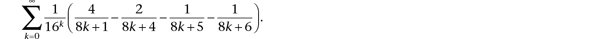

关于这一陈述发明过程的描述，请参阅 David H. Bailey, Peter B. Borwein, and Simon H. Plouffe, “On the Rapid Computation of Various Polylogarithmic Constants,” *Mathematics of Computation* 66, no. 218 (April 1997): 903–913。感谢 Nachum Dershowitz 指引我关注这一非凡的研究领域。

# 2 翻译

本章的第一部分是一场关于翻译及其在多个研究领域中用途的开放式讨论，特别关注其在艺术、人文学科、科学技术研究（STS）和计算机科学中的相关性与定义。在 STS 中，翻译分析常在“行动者-网络理论”（ANT）的旗帜下进行，并被用于研究各种各样的科学领域和技术对象。我们将看到 ANT 方法论如何能被修正和扩展，以用于软件研究。

本章的第二部分聚焦于一个详尽的关键例子，它对计算机科学的基础至关重要，且如今是舆论关注的中心：大卫·希尔伯特的“判定问题”及其由艾伦·图灵和阿隆佐·丘奇所做的分析。通过仔细阅读一些探讨希尔伯特判定问题的关键文本，我将展示如何运用 ANT 方法来审视这类技术文献中的形式数学/逻辑证明。我重点关注图灵、丘奇及其他人用来赋予身份和等价性的具体手段——翻译技术，特别是那些断言计算机类似于、或与人是同一事物的技术。我的观点是，计算机与它在修辞上等同的任何事物或任何人之间，总存在着将二者分隔开的鸿沟。我恳请你们——就像伦敦地铁站台上的标识那样——**留心空隙**！

在考察了等价性如何在计算机科学基础的更技术性语言中被锻造之后，我将追踪希尔伯特的判定问题如何从技术文献中浮现，并被翻译进入更大众、更通俗的场域，在那里产生了虚假断言，例如“计算机可以被编程来模拟任何事物”。对 ANT 方法论的重新加工，为我们提供了所需的工具，以理解软件文本的普及过程如何在技术著作与关于计算极限的日常常识之间，建立起或强或弱的联系。

## 赋值与模拟

在佩德罗·阿尔莫多瓦 2011 年的电影《我要的皮肤》 中，整形外科医生罗伯特·莱德加德追踪到一名年轻人文森特·皮涅罗，将其囚禁，并在六年的时间里，让他接受了一系列手术，将他改造成罗伯特已故妻子薇拉·克鲁兹的一个模拟体。当罗伯特的一位同事指控他在未经文森特同意的情况下为其实施变性手术时，文森特证实他/她是自愿参与的；但当罗伯特试图与薇拉/文森特进行最初看似双方自愿的性行为时，对方夺走罗伯特的枪，杀死他并逃脱，我们意识到，就像罗伯特一样，我们也被文森特作为模拟者的技巧所愚弄。文森特从未认同薇拉，从未与囚禁他的罗伯特建立情感纽带。相反，文森特只是在战略上谋划，等待反击的最佳时机。影片最后，文森特回到母亲身边，重夺他作为儿子的身份。

罗伯特的手术使文森特变成了一个模拟体。经过六年的切割与移植，他/她看起来和听起来都像罗伯特已故的妻子——但并非是她。阿尔莫多瓦的电影告诉我们，身份的本质远不止皮肤深处。在虚构中，文森特当然不是薇拉；他只是一个模拟者，仅假装接受薇拉的角色。关键情节的转折点在于这一至关重要的差异：在内心深处，文森特不是薇拉，也永远不可能成为薇拉。罗伯特无法用文森特的血肉拼凑出他已故的妻子，因为他永远无法从这个女人身上抽离那个男人的记忆与痛苦。

模拟永远不可能成为其模型。大多数当代模拟是数字产物——而非血肉之躯的滔天罪行。尽管如此，正如文森特与薇拉存在关键差异一样，任何数字模拟总是包含一组关键差异，将其与模型分隔开来。

在虚构作品中，阿尔莫多瓦这种怪诞的模拟更多是常态而非例外。至少自玛丽·雪莱的《弗兰肯斯坦》 以来，模拟体不及其模型这一故事就被反复讲述。这些故事通过让熟悉的事物变得陌生来吓唬我们：文森特长得像薇拉但不是她。弗兰肯斯坦博士的造物长得像人但却是怪物。在哲学美学中，有一个词专门形容这种恐怖感。西格蒙德·弗洛伊德称之为“诡异”。

## 物神崇拜与否认

但如果我们认出了模拟与模型之间的关键差异，却表现得仿佛没有实质性差异存在，会怎样？弗洛伊德对此有一个另一个术语：“物神崇拜”。物神崇拜者能够知晓模拟与模型的差异，同时却相信它们是同一回事。物神崇拜者说，我非常清楚这些差异，但我将视而不见。根据弗洛伊德的说法，这是一种与“否认”紧密相关的状况，在否认中，我们拒绝承认一个创伤性事件。罗伯特就是一个物神崇拜者。他非常清楚文森特不是薇拉，但他否认自己那些创伤性的犯罪和手术干预，以便活在一个幻想中，想象他的前妻薇拉已转世重生。

在弗洛伊德时代很久以前，创造或执行模拟的人就被指控为不道德行为。在古希腊，柏拉图因诡辩学派实践修辞学的方式——作为一种虚假表征——而指责他们是模拟的实践者。“模拟”在成为现在这样——科学、工程和数学中一项体面的追求——之前，已经是一个贬义词数千年了。

当然，在罗伯特的案例中，通过文森特对薇拉的模拟是不道德且犯罪的，尽管并非所有模拟都是不道德的建构，也并非所有恋物癖者都是罪犯。这种否认状态是当代生活的常态，我们大多数人确实是非暴力的恋物癖者。我们非常清楚，我们日常生活的数字模拟并不等同于它们所基于的模型。我们的电子邮件、智能手机、流媒体电影和视频、社交网络上的“朋友”，甚至我们在“收音机”里听到的合成声音和经过数字滤波的歌手，现在全都是数字化的，但它们基于过去的前计算机时代的模型、媒介和制度。我们对待这些模拟，就好像它们本质上等同于各自的模型。这就是日常的数字生活。它在炒作、否认和无知中得以复制。

我使用“模型”一词的方式，类似于生物医学研究人员使用该词的方式。例如，癌症研究人员可以利用小鼠作为模式生物来测试新药，因为小鼠与人类有足够的相似性，足以说明该药物在人类身上可能的表现。在这个意义上，模型并不比模拟更接近某种理想。因此，当我断言模拟永远不可能成为其模型时，我并不是在说模拟是“虚拟的”而模型是“真实的”。我也不是在表达怀旧情绪，想象模型是“真实的”而模拟是“虚假的”。小鼠既不比其他事物更真实，也不比其他事物更不真实。相反，就生物医学研究而言，小鼠之所以能成为可行的模型，是因为它们在某些重要方面类似于人类，显然，在其他方面则截然不同。

我假定模型和模拟之间不存在序关系：没有哪一个比另一个更接近真实。相反，正如我们将在第 6 章（关于修辞学）中看到的，其他人，如柏拉图，认为模拟离真实要远得多。

## 恒等、相等与赋值

在她 1982 年的热门专辑《大科学》 中，劳里·安德森唱道：“我遇见了这个家伙——看起来他可能曾是溜冰场的寄存员。事实上，他确实是。我说道：噢，天哪。又对了。令 X = X。” 安德森这里古怪的幽默感将她与哲学中的一个悠久传统联系在了一起。“令 X = X”是恒等律的陈述，即三大经典思维定律中的第一条，最初由柏拉图撰写，随后由许多哲学家加以阐述。

正如任何计算机程序员所知，赋值不是恒等的声明。赋值是一种依赖时间的强制形式。在数学中，`X = Y` 是恒等的声明，意味着 X 就是 Y 且永远将是，且相等具有交换性：写 `X = Y` 与写 `Y = X` 意思相同。与数学不同，在计算机编程中，`X:= Y` 是一种赋值，意味着在某一时刻之后 X 变为 Y。赋值通常不具备交换性：写 `X:= Y` 通常意味着与写 `Y:= X` 完全不同的事情。

作为一个语句，`X:= Y` 似乎很难作为一个引人入胜的故事的核心，但当然，恒等的戏剧潜力更多在于其赋值过程中的悬念，而非其声明本身。在赋值并无根据、不被想要或不被预期的条件下，赋值可以具有戏剧性。在阿尔莫多瓦的电影中，当文森特通过手术被重新赋值为薇拉时，是在极端的身体和心理暴力条件下进行的。为了重新赋值文森特的身份，罗伯特必须行使暴虐和可怕的权力。

本书的一个主要关注点是赋值及其与恒等和等价的纠缠。具体而言，这里的焦点是数字赋值。计算机是如何以及通过何种手段被用来断言不同事物——模型与模拟——是相同的？

计算机在当代关于赋值和恒等的问题中扮演着主角，但还有许多其他参与者，尤其是我们。在承认我们的角色时，我并非像那些作家那样对“我们”提出主张，他们想论证年轻一代是“数字原住民”，或者计算机正让我们变笨。相反，问题在于用于赋值身份和等价的具体计算手段，我将这种手段笼统地称为“翻译”。

我并不向往一个前数字化的、真实的时代。相反，我的动机源于对教育的信念，尽管我们当代数字条件的炒作和否认无法通过教育来解决。即使是受过良好教育的人也会为炒作所迷惑，沉溺于否认之中。然而，我认为数字恋物癖的第三个因素——无知——可以通过教育来治疗。因此，我希望对计算机运作机制的仔细分析，至少能帮助我们理解，当我们否认数字生产模式、将其产品恋物化时，我们在做什么：噢！我多么爱我的新智能手机！

## 模型与模拟之间存在鸿沟

尽管如此，我并不像某些人那样恳请你们享受你们的症状！相反，我恳请你们——正如伦敦地铁站台上的标志所建议的——**留心空隙**！我的兴趣在于模型与数字模拟之间的差异是如何被处理的。正如罗伯特通过成千上万次切割和缝合试图将文森特变成薇拉一样，宏大的数字等价需要无数较小的技术安排来实现其赋值。这些较小的技术安排往往也是数字赋值。

例如，如何让计算机表现得像电话或电视？这一过程的核心是编码，即软件的生产。软件是一种特殊的文本，软件的生产是一种特殊的写作。每部智能手机的核心都是一台计算机。让计算机作为智能手机运行，是一个证实成千上万个较小等价的努力，这些等价使得我能在日常生活中将计算机当作电话使用。隔开计算机与电话的鸿沟，由软件填补。我们将留心那个鸿沟。

## 数字融合与赋值等价的权力

赋值等价的权力，是米歇尔·卡隆和布鲁诺·拉图尔在一篇旨在将政治和科学都解释为翻译形式的文章中的核心观点。卡隆和拉图尔写道：“掌握等价者，掌握权力的秘密。” 然而，在科学和政治中——甚至在游戏中——仅仅断言一种等价是不够的；一种等价总是需要被证明，然后通过一系列翻译广泛传播，促使我们相信所断言的恒等。

在 18 世纪，安托万-洛朗·德·拉瓦锡（1743–1794）确定水是氢和氧的化合物。为了让这一等价被相信，他必须演示水（H[2]O）分解为两种气体（氢和氧）的过程。在拉瓦锡之前荒谬的等价，在世界各地的实验室和教室反复演示之后，现在已成为常识。在科学研究和政治哲学中，仔细考察这种翻译过程的方法被称为“翻译社会学”，或更常见地称为“行动者-网络理论”（ANT）。

# 我们正处于世界重写的进程之中

我们正处于世界重写的进程之中，在此过程中，我们许多重要的政治、经济、社会和文化制度正被转化为软件，即计算机和网络的通用语言。通常，这些转化被理解为一种“融合”，即通过将音乐、视频、文本、货币、友谊——几乎所有事物——还原为比特，为 0 和 1，从而实现数字化。

融合实际上是语言问题，只是边缘地涉及数字问题。要理解计算机日益增长的重要性，我们需要将计算机理解为一种语言技术，将数字化和计算机化理解为翻译、等价和同一性的过程。

## 翻译成完美的（编程）语言

数字赋值（`X:= Y`）是一种翻译形式，但在计算机科学中，翻译是一个通用术语，用于描述用一种编程语言编写的软件如何自动渲染为另一种“较低级”的语言。因此，可以说编译器将高级编程语言 `JavaScript` 翻译成低级汇编语言。

德国媒体理论家兼历史学家 Claus Pias 指出：“翻译——至少在计算机科学抽象的星空般高度上——是将一种秩序系统（源语言）的数据结构转换为另一种秩序系统（目标语言）的数据结构。不幸的是，自然语言当然充满了歧义——无论是词汇的、句法的还是指称性的。这种歧义通过远距离关系、省略、意译、隐性知识，或无法跨越的‘翻译鸿沟’显现出来。”

计算机科学关于语言和翻译的理想根源是什么？正如 Mark Priestley 在其 2011 年的著作《运算科学》 中令人信服地叙述的那样，计算机编程可以被理解为两项长期努力的成果：一是提供语言的机械性解释；二是提供机器的语言学解释。根据 Priestley 的说法，这些历史始于 Francis Bacon 十七世纪的努力，他试图借助机械艺术的手段重塑科学，既通过将机器和实验引入科学，又通过设计和使用人工语言来消除自然语言的错误和幻觉。Bacon 提议可以设计一种通用的、人工的、哲学的语言，拥有精确且无歧义的词汇。随后，切斯特主教、皇家学会联合创始人 John Wilkins 等人试图设计这种 Bacon 式的哲学语言——该项目也被称为创造“真实”或“通用”字符。参与该项目的最著名思想家是哲学家兼数学家 Gottfried Leibniz，他也是微积分的共同发明者（与 Isaac Newton 共同发明）。

许多极具可读性的计算机史书籍通过数理逻辑的主要人物，勾勒出从 Leibniz 到今天的直接脉络。例如，Martin Davis 的佳作《通用计算机：从 Leibniz 到 Turing 之路》 从 Gottfried Leibniz（十七世纪）跳跃到 George Boole（十九世纪），继而涉及 Gottlob Frege、Georg Cantor、David Hilbert、Kurt Gödel，最后到达 Alan Turing（二十世纪）。当控制论发明者 Norbert Wiener 称 Leibniz 为控制论的“守护圣人” 时，他传递的正是这段现在常被讲述的历史：从 Leibniz 到 Turing，人们为打造一种等同于机器的 Bacon 式人工语言所做的努力。语言如何能像机器一样运作？机器如何能完成语言的工作？这些问题的答案取决于对 Leibniz 及其继承者如何处理翻译问题的理解——例如，将逻辑翻译成机器的问题。

如今，计算机科学已给出这些问题的答案。Leibniz/Bacon 式的人工语言已成为编程语言。等同于机器的语言表达是软件，而将语言翻译成机器的手段，在当代计算机科学中被称为编程语言的“编译”或“解释”。

计算机科学关于（信息）无损翻译理想的根源可被描述为 Leibniz 式的。从这一传统的视角来看，Warren Weaver 关于将翻译视为解密的幻想（前文提及）似乎并不比“用编程语言编写的计算机程序可以被翻译成机器，或更具体地说，翻译成计算机电路中的电流”这一观点更具幻想色彩。

法国逻辑学家、数学家、语言学家 Louis Couturat 指出，Leibniz “因此反过来将逻辑构想为算术、代数、几何，甚至机械的形式。而且每一种形式完全都是符号化的，构成了同一抽象科学的具体表达。将逻辑如此移植并铸造成数学形式的富有想象力的想法，源于一方面他想使理性变得有形可感，另一方面源于他深信所有理性科学之间存在和谐，根据他最喜欢的表达，它们必须彼此‘象征’。” Leibniz 能够实现的翻译——例如，从算术运算到机器的机械运算——似乎合情合理且界限分明。Leibniz 的继承者们实现了宏大得多的翻译，但这一智力传统要求对每一个宣称的翻译提供极其严谨的证明，因此即使是这些宏大的成功也被严格限定在特定范围内。

## 数字意识形态与数字生活

更准确地说，此类翻译*通常*是经过严格限定的。图灵奖得主、人工智能领域奠基人 Allen Newell 和 Herbert Simon 声称人类和计算机是等价的，因为两者都是“符号系统”，这便是一个反例。他们试图通过实现来证明这种等价性：他们试图编写能像人类一样思考的软件。

Newell 和 Simon 远非孤例，在计算机科学家群体中，许多人都对计算机是什么、能做什么或不能做什么提出过夸张的主张。臭名昭著的是，许多人工智能研究者几十年来一直承诺，人类级别甚至超人类级别的智能即将到来——且至今仍在如此承诺。存在大量文献，实质上是作为所谓的科学事实而非娱乐作品发布的科幻小说。这类“科学”主张包括：人是计算机、我们的大脑是计算机、整个物理宇宙是一台巨大的计算机，等等。每一项“科学”主张都有科幻小说的虚构先例，作家们在其中设想了有感知力、有意识的机器人。

在这片科幻领地的边缘，存在一组以科学假设形式出现的陈述，涉及将各种现象翻译为计算术语。例如，Howard Gardner 在其认知科学综述与导论中指出，认知科学的一个至关重要的特征是这一信念：“人们坚信，电子计算机是理解人类心智的核心。计算机不仅是进行各类研究不可或缺的工具，更关键的是，计算机也是人类心智运作方式的最可行模型。”

# 计算条件：数字意识形态与数字生活

因此，对于一些认知科学家来说，人类的心智是一台计算机；对于许多分子生物学家来说，基因密码是一段计算机代码；诸如此类。这些并非凭空的信仰飞跃，而是大量在同行评审期刊上发表论文的科学家所持有的信念。让我们将这些与科幻小说归为一类，并将其统称为“数字意识形态”，以将这些关于计算的信念与更为普遍的事物——“数字生活”区分开来。

数字生活超越了专业圈子，也超出了专家对话的技术词汇范畴。数字生活是一种日常生活，存在于这样一个社会中：该社会通过用包含计算机且不可或缺的技术取代日常制度（如邮政系统、电影院、银行业务等），来实施一种数字意识形态。例如，如果你丢失了数字化的电子档案，你的个人照片收藏还剩下什么？你有纸质备份吗？


# 数字生活是在对数字意识形态等价性的信念中度过的

数字意识建立在大量等价性断言之上；其中包括大脑是一台计算机，或者数字视频与旧式胶片无异。在科学文献中，数字意识形态通常以非常谨慎、严格限定且论证严密的等价性形式阐述，最终呈现为恒等式：`X = Y`。这些等价性采取技术主张的形式。在技术文献中，人们不能轻易主张逻辑是算术的一种形式。相反，这种主张必须使用一套科学和/或数学演示技术来证实；即证明两个实体等价的翻译技术。

然而，即使通过科学和技术的翻译建立的等价性、恒等式是正确的，它们也并不完美。我们将展示计算机科学建立的技术等价性是如何不完美的，并描述当这些等价性被确立为恒等式时，什么被丢失或增加了。

## 计算条件 = 数字意识形态 + 数字生活

在 1979 年为魁北克政府撰写的知识现状诊断中，法国哲学家让-弗朗索瓦·利奥塔预言了一个即将到来的未来：“新研究的方向将由其最终结果被翻译成计算机语言的可能性所决定。‘知识的生产者’和使用者现在必须，将来也将不得不具备将他们想要学习的任何东西翻译成这些语言的手段。”^21 利奥塔将他的诊断——我们已从其他语言（特别是叙事语言）转向计算机语言——称为“后现代条件”。利奥塔的后现代条件或许更精确地应称为“计算条件”，一种涵盖数字意识形态和数字生活双方的条件。在我使用的“计算条件”一词中，我期望人文学者能听到让-弗朗索瓦·利奥塔的“后现代条件”和汉娜·阿伦特的“人的条件”^22 的回响。计算条件是一种知识状态，在这种状态下，科学和技术确立的等价性被视为完美的恒等式，翻译的双方没有损失也没有增益。它们是被当作恒等式的等价性，因此当它们被放在一起说时，听起来像荒谬的同义反复：我可以要一杯 H₂O 水吗？

如果数字意识形态的等价性一经证明，被广泛且足够频繁地重复，它们就会被视为文化制约的常识。根据这种意识形态和常识的概念，常识是动态的，并随着新思想和新技术的流行而变化。用哲学家安东尼奥·葛兰西的话说：“每个社会阶层都有其自身的‘常识’和‘良知’，它们基本上是对生活和人的最普遍的观念。每一种哲学思潮都在其背后留下了一种‘常识’的沉淀：这是其历史效力的文献。常识不是僵化和静止的，而是不断地自我转化，用进入日常生活的科学思想和哲学观点来丰富自己……常识创造了未来的民俗，即在特定地点和时间大众知识的一个相对僵化的阶段。”^23

数字意识形态在日常数字生活中被使用，此时狭窄、技术性、受限的等价性被放宽并扩展。例如，生活在计算条件中的人们，把发给家人的电子邮件视为与通过邮政系统寄送、由人手投递的手写信件是同一事物，并不觉得有任何矛盾。当我们在流媒体视频服务上看电影时，我们会说我们看过这部电影，即使小屏幕体验与过去去电影院的条件（爆米花、人群、纸质票）截然不同。更微妙的是，当我们说我们在“搜寻”某人或某物，或说我们与某人是“朋友”时，现在已不清楚我们做的是数字行为还是物理行为。

## 从媒介研究到行动者-网络理论

那么，数字意识形态的等价性是如何被使用、放宽并扩展为数字生活的？某些形式的科学与媒介研究，以及更新形式的社交媒体分析，采用了一种观念“扩散”模型，或用流行病学或遗传学的隐喻来设想观念的运动。^24 观念被说成“像病毒一样传播”^25（因此有了“病毒式媒体”一词），或像基因一样通过繁殖和进化移动（因此有了“模因”概念）。^26

许多老派的传播与媒介研究学派也将人比作物理或机械系统。例如，大众传播的主导隐喻是“大众”或物理系统。这个隐喻允许研究者提出诸如“特定信息对受众有何*影响*？”^27 这样的问题。

在 20 世纪 40 年代，罗伯特·默顿和保罗·拉扎斯费尔德^28 推进了一个研究计划，其中社会结构被视为稳定或不稳定、处于平衡或失衡状态，这取决于群体动力学和影响群体成员的媒介信息。将人视为热力学系统的隐喻，引出了关于社会秩序生成与瓦解的问题。

所有旨在解释观念如何流动的新旧媒介研究隐喻都是不准确且略带侮辱性的，因为它们具有讽刺意味地隐含假设：人们没有语言——人们不说话、不听、不读、不写。这些扩散、传染、蔓延、影响、平衡和进化的概念，都将人描绘成哑巴、非人类的动物、有机或无机材料。显然，人们不仅仅是仅由牛顿力学驱动的惰性物质。他们也不是观念被“扩散”通过的专属多孔材料、病毒“传染”的载体，或仅限于繁殖其“基因”或“模因”的繁殖动物！与这些新旧传播与媒介研究学派相反，让我们从一个更合理的假设出发：人们会思考和说话。

## 翻译与行动者-网络理论

行动者-网络理论的开发者与实践者——即翻译社会学——已经相当确切地表明，其他这些方法都不足以解释观念是如何成为日常生活和常识的一部分的。行动者-网络理论并非使用这组隐喻，而是假设：从意识形态通往日常生活的桥梁，是一套在认知上、文化上和物质上都具体的翻译实践；这些实践被修辞性地和技术性地用于说服人们相信等价性、差异性和同一性。

有趣的是，极少数例外之外，行动者-网络理论家并未研究软件。^[29] 当科技研究者关注软件时，他们并未考察文本本身——计算机科学文献中的代码和技术文章。相反，他们追随生产和使用软件的人。^[30]

考虑到行动者-网络理论据称将民族志和民族方法学的关注点与符号学的洞见——即对意义和意义生成的人文研究——相结合，后者是一套专为文本分析而开发的方法，这种对软件文本缺乏关注的现象令人惊讶。我将采用一种深受行动者-网络理论影响的翻译理解，但为了补充 ANT 以便研究软件文本，我还需要从人文学科实践的翻译这口更深的井中汲取资源。

## 翻译与米歇尔·塞尔的“引导”

科学哲学家兼历史学家米歇尔·塞尔写道：“我们只能根据能对其执行的变换来理解某事物。至少有四种这样的变换：逻辑和数学领域的**演绎**（deduction）；经验实验领域的**归纳**（induction）；实践领域的**生产**（production）；文本空间中的**翻译**（traduction）。它们都包含同一个词根，这并不令人意外。除‘引导’（duction）哲学——带有各种前缀——之外，别无他哲。一个人可以毕生致力于阐明这种状况。”^[31] 这段引文出自塞尔关于翻译的著作《赫尔墨斯 III：翻译》的开头，该文本启发并深深影响了 ANT 的开发者。这段引文难以翻译成英文，因为法语中“翻译”是“traduction”，而塞尔在这段话中的论点是：所有这些表示变换的术语——演绎、归纳、生产和翻译——都包含拉丁词根“dūcĕre”，意为“引导”。

加在“dūcĕre”前的每个前缀都表示一个方向。例如，“De-”意为“向下”或“从……向下”。因此，“deduce”（演绎）含“向下引导”之意。“In-”意为“进入”或“在内”。因此，在拉丁语中，“induce”（归纳）意为“引入”，“introduction”（引言）即“引入”。“Produce”（生产）是“引出”、“带出”、“提出”。“Re-”是“向后”或“再次”的前缀，所以“reduce”（还原/归约）是“引回（再次）”。

英文中的“Translate”也可以同样拆解。注意“translāt-”是“transferre”的拉丁分词词干，可分解为前缀“trans-”（意为“跨越”）和“ferre”（意为“携带”或“带来”——这与法语中的“引导”不同）。英文单词“ferry”（摆渡）是“ferre”的现代形式。所有这些术语——演绎、归纳、生产、还原、翻译——都暗示运动或旅行。然而，每个术语都表明，读者或听者将被引导或携带向一个特定方向：向下、向内、向外或跨越。

塞尔在其著作中所做的，以及行动者-网络理论家（如布鲁诺·拉图尔等人）追随他所做的，是使“翻译”成为更一般的术语。通过这种方式，我们可以理解所有这些词表示不同种类的翻译。因此，它们的区别在于翻译意图将我们这些阅读主体，或其操作对象，引向何方——向下、向内或向外。

一旦受到塞尔的提示而意识到这四种翻译，我们很快就会发现其他的，因为“向下”、“向内”和“向外”并未穷尽可能的介词列表。“传导”（conduction）是一种将两事物结合在一起的翻译。“诱导/绑架”（abduction）是一种将我们引离的翻译。如果“归纳”将某物引入另一物，“引入”（introduction）则将读者带入。“诱惑”（seduce）由前缀“se-”（意为“离开”或“分离”）与“dūcĕre”组成，这意味着“将某人从另一人身边诱惑走”这一短语是冗余的，因为该词的词根已暗示诱惑是一种引离的行为。然后，如果我们组合前缀——如“re-”和“pro-”——翻译的形式就会成倍增加。因此，“再生产”（reproduce）意为“再次带出”。“不可还原”（irreduction）意为“不再带回（再次）”。

当然，塞尔建议使用拉丁词根“duction”来导航各种翻译形式，这只是一种符号学上的便利，因为它是隐喻性的而非历史性的。隐喻上，我可以用“演绎”一词表示比当代逻辑学家所承认的演绎操作更广泛的操作范围。

相比之下，从历史上看，可以讲述一个关于“演绎”一词及技术在逻辑和数学领域过去数千年发展历程的故事。雷维耶尔·内茨的《希腊数学中演绎的形成》^[32] 讲述了这个故事的开端，精彩绝伦。类比而言，此列表中的其他词——归纳、诱导/绑架、传导、生产等——各自都有自己的词源，其中大多数遍及科学、数学和工程的技术词汇。我既在历史意义上使用这些词——例如，试图理解“演绎”如何获得其当今含义——也在隐喻/词源意义上使用它们，遵循塞尔的建议，以区分不同种类的翻译，并指示特定翻译意图将我们引向何方。

## 翻译与行动者-网络理论（续）

我最关心的翻译不是孤立单词、单个词汇项的翻译，如人们可能在双语词典中找到的：“eau”对应“water”，例如。相反，我主要关心的是陈述，特别是等价、差异和同一性的陈述——例如，方程、赋值语句，或系表结构陈述如“Water is H[2]0”（水是 H[2]0）。

在论证、证明或演示中，等价陈述常按序列展开，形成一条从首个陈述通向最终等价或同一性的链条。因此，翻译很少是单步操作。布鲁诺·拉图尔在《不可还原》中描述翻译：“所有推理形式相同；一句接一句。然后第三句断言二者同一，尽管它们互不相似。此后第二句取代第一句，第五句断言第二句与第四句同一，尽管……以此类推，直到某句被置换却假装未移动，被翻译却假装忠实。”^[33]

拉图尔对翻译的解释假设每一步都通向下一步并远离上一步，它描述了单一翻译形式的反复应用，在其中我们被直接、线性地从首个陈述引向最后一个。更典型的是，多种翻译形式构成一个论证或演示，于是我们被引导，例如，远离初始陈述，走向中介，然后，或许，回到第一个陈述。

## 拉图尔的 DNA 与双螺旋

# 拉图尔在其著作《实验室生活：科学事实的建构》（*Science in Action: How to Follow Scientists and Engineers through Society*）中，用一幅连环画展示了这一更复杂的版本。^(34)

这幅连环画描绘了一条关于脱氧核糖核酸（DNA）的陈述的命运：开头按逆时间顺序，结尾则按时间顺序。总之，它展示了我们如何通过审视科学事实的早期表述来质疑它们，以及那些早期的、带有条件性的表述是如何发展成确定的、教科书式的等价陈述的。

连环画的第一格写着：“DNA 分子具有双螺旋结构。”拉图尔写道：

> 要勾勒出本书的大致轮廓，最好的办法是想象下面这幅连环画：我们从一个教科书式的句子开始，它没有任何制造、建构或所有权的痕迹；然后我们给它加上引号\[“DNA 分子具有双螺旋结构”\]，用一个气泡框住，放进一个说话者的嘴里；接着我们给这个说话的角色添加另一个倾听的角色；然后将他们置于一个特定的情境中，某个时间、某个地点，周围环绕着设备、机器、同事；\[第一位同事：“你们干嘛不搞点严肃的研究？”第二位同事：“也许是三重螺旋。”第三位同事：“根本就不是螺旋。”沃森对克里克：“如果它是双螺旋结构……”克里克对沃森：“……那就能解释查加夫定律……”沃森：“……而且很漂亮。”\] 然后当争论稍微升温时，我们看看争论的人去哪里了，他们获取、招募或诱惑\[注意拉图尔对“se-duce”（诱惑/引诱）一词的使用，这也是塞尔所偏爱的术语\]了什么样的新要素来说服同事；然后我们看到被说服的人不再互相争辩；情境、地点、甚至人物开始慢慢被抹去；\[一位同事对其他几位同事：“他们说沃森和克里克已经证明 DNA 是双螺旋结构。”在连环画的倒数第二格，不再展示人物，只有一本书，里面这句话被高亮显示：“沃森和克里克已经证明 DNA 是双螺旋结构。”\] 在最后一幅画面中，我们看到一个新句子，没有任何引号，写在一本类似于第一幅画面开头那本的教科书里。这就是我们将在本书中反复研究的总体运动：从外部渗透科学，跟随争议并陪伴科学家走到终点，慢慢被引导出“正在建构中的科学”。^(35)

通过这幅连环画和这段文字，拉图尔解释了他如何计划引导我们这些读者——首先从外部进入科学内部，一旦进入内部，再通过跟随科学家来引导我们。然后他告诉我们，我们将被“慢慢引导出正在建构中的科学”。从“正在建构中的科学”内部移动到外部，例如就是从读者很少的科学期刊移动到读者众多的教科书。从隐喻/词源学的意义上说，我们可以说拉图尔的文本和连环画首先描述了一个“引入”，一种将我们带入科学的翻译；然后是一个“生产”，一种将我们带出并呈现出某物的翻译。

被生产出的那个东西，当然是一个新事实。事实生产的线索也在于其词源，因为拉丁语“factum”是“facere”（制造）的中性过去分词。将话语视为一系列翻译来考察，是理解事实如何被生产出来的一种途径。

## 希尔伯特判定问题在计算机科学内外的翻译

这种方法如何应用于软件文本？让我们追随计算机科学的一个关键案例，首先从“外部”出发，移动“向内”以更仔细地考察技术文本，然后再移动“向外”。换句话说，我们对该案例的考察将遵循与拉图尔穿越 DNA 双螺旋事实的“引入”然后“生产”相同的轨迹。

我们也将从一个教科书式的陈述开始。在大卫·希尔伯特和威廉·阿克曼的著作《理论逻辑原理》（*Grundzüge der Theoretischen Logik*，柏林：施普林格出版社，1928 年）中，该陈述涉及“判定问题”（德语为“das Entscheidungsproblem”）。希尔伯特和阿克曼写道：“当我们知道一个步骤有限的过程，能够判定任何给定表达式的有效性或可满足性时，判定问题就得到了解决。……判定问题必须被视为数理逻辑的主要问题。”^(36)

时年二十三岁的剑桥数学学生艾伦·图灵很可能在 1935 年春季学期跟随 M. H. A. 纽曼教授的数学基础课程时遇到了这一陈述。纽曼教授曾出席 1928 年的数学会议，当时大卫·希尔伯特向数学界重申了判定问题。^(37) 希尔伯特最早是在 1900 年巴黎国际数学家大会上发表了或许是数学史上最具影响力的演讲时提出该问题的一个版本。在演讲中，希尔伯特提出了二十三个开放问题，其中许多成为了二十世纪数学研究的关键领域。希尔伯特的第十个问题将后来被称为“判定问题”的东西引入了数学。

> 10\. 丢番图方程可解性的判定：给定一个含任意多个未知量且具有有理整数系数的丢番图方程：设计一个过程，通过有限步运算判定该方程是否在有理整数范围内可解。

正如后来其他逻辑学家和数学家接手该问题后所见，这个问题迅速超越了整数和丢番图方程的范畴。^(38) 相反，人们将密集的审视投向了最后冒号后的那句话：“设计一个过程，通过有限步运算判定……”。今天，我们会将希尔伯特的第十个问题概括为对算法的搜索，即一种分步骤的过程，用以判定某类方程是否可解。然而，正如我们将看到的，“算法”一词在我们今天所理解的含义上，直到希尔伯特演讲后几十年才开始通行。^(39)

因此，当艾伦·图灵于 1936 年发表关于“判定问题”的论文时，^(40) 这在数学界早已是一个由来已久且广为人知的挑战，正如我们将在第 7 章关于语法的内容中看到的，希尔伯特的研究计划影响超越了数学，特别是在语言学领域。在其出版物的第 11 节中，图灵引用了希尔伯特和阿克曼教科书中对该问题的表述。从某种意义上说，图灵确实解决了希尔伯特的问题，但他的回答是否定的：找不到一种算法能判定所有可能问题的可解性。然而，在论文中，图灵引入了后来被称为计算机通用模型的东西——即我们在计算理论中今天所指的“图灵机”。正是论文的这一方面，至今仍点燃着大众的想象力。

# 图灵 1936 年论文中的关键第一步：形式化与类比

图灵 1936 年论文中的关键第一步是一个形式化过程，它始于一个粗略的类比。要理解这个类比在 1936 年可能是如何被解读的，你需要知道当时“计算机”并非机器；计算机是人。^[41] 更具体地说，计算是一种由人担任的工作，通常由女性和年轻男性从事。他们受雇计算大量数字表（例如，弹道学和天文学中使用的三角函数值），在大型政府和企业机构中以团队形式工作。因此，在 1936 年听到“computer”这个词，人们会联想到一个人，而不是一台机器。图灵 1936 年的论文基于人类计算员的工作与机器运作之间的一个延伸类比。本质上，他将计算员的工作形式化为非常精确的操作，使其易于进行形式分析和证明。

## 计算机器

在第 1 节“计算机器”中，图灵写道：“我们可以把一个人在计算一个实数的过程中比作一台只能处于有限种状态的机器。”^[42] 图灵非常敏锐地将希尔伯特设想的过程与当时人类计算员遵循的过程等同起来。图灵洞察力的卓越之处，今天因计算机的普及而变得模糊，但在当时却异常清晰。

为了开始理解他的同时代人在他身上看到了什么，我们可以将图灵的理论机器（图灵机）与另一台恰好在图灵发表论文前出现的机器进行比较。1936 年，图灵和阿隆佐·邱奇（当时普林斯顿大学教授，后来成为图灵博士学位的导师）独立发明了新的、但截然不同的计算技术定义。邱奇称他的形式体系为“λ演算”。^[43] 不久之后，图灵证明了用λ演算写成的表达式可以转换为图灵机，反之亦然。^[44] 因此，人们宣称这两种不同的形式体系在等价意义上是一致的：即任何用一种体系写成的算法都可以直接翻译成另一种。

图灵的等价性证明（在他的机器与邱奇的λ演算之间）是一种传导性的翻译，因为此后每种形式体系都被理解为拥有对方的地位：每种都被视为拥有对方的极限和可能性。因此，如果一个过程可以写成图灵机，它也应该能用λ演算写出来。反之，如果图灵机存在内在的极限或弱点，那些相同的极限和弱点也必然适用于λ演算。

甚至邱奇本人在评审图灵论文时，似乎也更喜欢图灵的表述胜过自己的：“在这些表述中……图灵的表述具有这样的优势：它使得与通常（非显式定义的）有效性概念的等同性立刻显而易见。”^[45] 著名哲学家、剑桥教授路德维希·维特根斯坦（后来也成为图灵的老师之一）非常简练地指出了图灵表述之所以引人注目的原因：“这些机器，”维特根斯坦说，“是进行计算的人类。”^[46]

## 从教科书到专家交流


像拉图尔关于 DNA 的叙述一样，我们的故事始于对一本教科书的阅读（图灵对希尔伯特和阿克曼著作的阅读），并将我们带入专家之间的技术交流（包括图灵、邱奇及其学生）。希尔伯特教科书中关于判定问题的陈述与图灵 1936 年论文之间，隐喻性的“旅行距离”有多远？值得注意的是，即使在今天，图灵 1936 年的成就及其与邱奇的比较仍处于严密的审视和解读之下。因此，我们可以求助于当代专家的评论，以试图理解图灵的成就，从而理解希尔伯特教科书与图灵发表论文之间隐喻性的“距离”。

罗宾·甘迪（图灵的朋友、同事，以及剑桥大学唯一的博士生，于 1953 年毕业，即图灵去世前一年）曾评论图灵分析的哲学意义。甘迪写道：“图灵的工作是哲学分析的典范：它表明，看似模糊直观的概念实际上具有唯一的含义，且可以完全精确地陈述。”^[47] 芝加哥大学逻辑与数学教授罗伯特·索尔在 1996 年用类似甘迪的术语表述道：“只有图灵……给出了可计算函数的第一个令人信服的形式定义……并证明了非形式概念与这个形式概念相吻合。”^[48]

请注意，甘迪和索尔都将图灵的成就描述为展示了“非形式”或“模糊直观概念”与“形式”或精确概念之间的等价性。甘迪和索尔的陈述反映了数理逻辑学家理解图灵贡献的方式。然而，悖论的是，它们并非数理逻辑的陈述。也就是说，“模糊直观概念”或“非形式概念”这类措辞，并非数理逻辑这一专门领域所特有的专属用语。这些对图灵工作的描述隐含地提出了一个关于翻译的主张——具体来说，即非形式概念可以被翻译成一个唯一且精确的形式定义（即逻辑、数学定义）。

在什么情况下，你能想象一个非形式概念被翻译成一个简洁精确、有且仅有一个含义的文本？甘迪对这个问题的回答预设在他对图灵工作的评价中：“它表明，看似模糊直观的概念实际上具有唯一的含义。” 甘迪的论点本质上是图灵的工作涉及一种范畴混淆；即我们过去认为某事物是模糊直观概念，但实际上我们错了，而图灵的工作纠正了我们。那个模糊概念“实际上具有唯一的含义，且可以完全精确地陈述。”

甘迪对我的问题的回答又引出了另一个问题：图灵发表论文前，那个令人困惑的模糊直观概念究竟是什么？关键的考量将我们带回维特根斯坦的评论，即图灵的“机器是进行计算的人类”。在论文早些时候，甘迪写道：“图灵考虑的是一个进行计算的抽象人类的行为；他描绘这个人在方格纸上工作，就像‘儿童算术书’那样。……图灵轻易地证明了计算员（甘迪为人类计算机创造的新词）的行为可以被图灵机精确模拟。”^[49] 但甘迪的描述难道不与他自己的结论相矛盾吗？根据甘迪的说法，图灵并非将一个模糊直观概念渲染为精确定义。相反，根据甘迪的说法，图灵的出发点不是直观的，而是抽象的，具体来说是“一个抽象人类”。

为了解读甘迪的主张，即使我们不是数理逻辑学家，我们也需要考虑图灵的抽象是否符合我们的直觉、我们的非形式概念，因为确实，根据其定义，非形式和直观概念并不具有先验的形式定义，对吧？如果你信奉某些哲学流派，特别是柏拉图学派，它们确实有，在柏拉图那里，日常的形式和观念只是完美抽象形式的不准确复制品。换句话说，对于信奉柏拉图的人来说，非形式概念与形式定义可以通过归纳或演绎被证明等价，这其中并无矛盾。

因此，这是将面临的主要摩擦之一。从事翻译实际工作的人，怎么可能相信一个非形式化的概念能够毫无损失或增益地翻译成一个精确的形式化定义？这种信念要求第二种信念，即相信存在一种“完美语言”^(50)，一种只能给出必要、充分且真实定义的语言。

从这个角度来看，翻译成“完美语言”能够阐明一个概念，即使不完美语言之间的翻译做不到这一点。历史上曾考虑过许多种“完美语言”，包括莱布尼茨的“实在特征”、数学（更广泛地说），以及《圣经》第一卷中所述亚当所说的原始语言。

我的观点是，如果不相信完美语言的存在，甘迪和索尔的论点就是胡扯，但我不会反驳完美语言的存在。相反，我想说明这种世界观、这种意识形态，如何与其他不承认完美语言的世界观发生冲突。我还想提出，存在一些新的混合思维形式，它们不能完全归入这种二元对立的框框之中。我的目的在于建设性和比较，而非禁令；我的目标是富有成效的，让我们能更好地发明和创新。

## 意识形态的定义

为了比较世界观，我提供一个关于“意识形态”相对简单的描述。法国大革命后，安托万·德斯蒂特·德·特雷西创造了“意识形态”一词及其实践，以批判性地审视革命后法国的观念。^(51) 在其诞生之时，意识形态并非贬义词。相反，特雷西所谓的意识形态，是观念的科学或研究，正如我们理解社会学是一门社会科学、生物学是一门生命科学一样。我们需要研究观念，特别是它们在数字化的、尤其是软件方面的折射。我们将审视“计算机革命”中的一些关键观念，但不为它们背书。如果这种方法在法国大革命后奏效，或许它对“计算机革命”也同样有效。

当然，今天“意识形态”一词常被用作贬义词。当一个人说“哦，那只是意识形态”时，往往不妨直接说“那是不真实的”、“那是对世界的扭曲描绘”或“那是不科学的”。即使在关于意识形态的专业人文学文献中，该词往往意指“虚假意识”。然而，也存在其他各种有用的意识形态定义。^(52)

我将使用一种作为符号学闭合的意识形态定义，这是一种由文学理论家弗雷德里克·詹姆逊等人讨论的理论。^(53) 根据这一定义，意识形态是一种关于社会、经济和政治关系的特殊观念体系——这些观念规范并表征个人、制度、群体及其相互关系。因此，原则上任何观念都可能成为意识形态的一部分，因为任何观念都可能影响某种关系。正如许多科学史家所展示的，即使是关于晦涩科学技术细节的观念，也能被证明具有意识形态性。然而，在实践中，只有所有观念的一个子集在特定的意识形态研究中才具有重要意义。哪些观念受关注，取决于所研究的个人、制度和群体。因此，关于亚原子粒子数量和类型的信念，可能在特定历史节点上通过争议清晰地划分某一群物理学家，但对于探索同一历史时刻的另一群体（例如一群职业棒球运动员）的社会结构则毫无用处。

在关于作为符号学闭合的意识形态的讨论中，弗雷德里克·詹姆逊探讨了等价术语的发展，但也特别是探讨了各种非等价形式，它们构成的关系集合比单纯的二元对立更大。詹姆逊在讨论中使用了一种称为格雷马斯对立方阵的图表——以法裔立陶宛符号学家和文学理论家阿吉尔达斯·朱利安·格雷马斯命名，他发展了行动者-网络理论中所采用的那种符号学。该方阵也被称为亚里士多德方阵。它描绘了四个命题之间各种形式的对立。

该方阵区分了两种不同的非等价性——反对和矛盾。如果我们从一个形容词入手——比如说白色——它的矛盾是它的否定，即非白色，但它的反对面可能是黑色。矛盾和反对不是一回事。例如，非白色作为一个范畴包含黑色，但它不等同于黑色，也不*仅*等同于黑色。

这些方阵的使用还有更多微妙之处，詹姆逊的讨论将其揭示出来。^(54) 然而，就我们的目的而言，关键点在于：正如存在多种等价形式一样，也可以枚举多种非等价形式，而作为作为符号学闭合的意识形态的一种表征，该方阵展示了一个观念体系如何封装一组等价与非等价术语，以及一种枚举它们的方式——一种难以甚至不可能超越思考的方式。

正如我在介绍米歇尔·塞尔的各种“引导”和翻译术语时所做的那样，这里我也必须坚持区分对立方阵的隐喻用法和历史用法。历史上，亚里士多德的对立方阵，以及更普遍的他的逻辑体系，早已被各种其他逻辑形式所覆盖，其中一些我们将在本书后面看到。用今天的技术语言来说，更准确的说法是亚里士多德的逻辑局限于`命题`，而我的讨论将涉及需要更复杂的`谓词`逻辑来建模的陈述。因此，我将把作为对立方阵的意识形态观念作为一种隐喻而非模型来使用。

作为一种隐喻，这种意识形态形象凝结了几个关键问题。在一种给定的意识形态中，什么被视为等同、相等或同一？什么与什么对立？等价与对立是如何被概括和生成的——即被翻译的？在比较和对比一种意识形态与另一种意识形态时，将特别关注那些在一种意识形态中是等价、在另一种中却是对立的事物。

## 引入：论被引入科学

现在让我们从这段关于意识形态的间奏中回到我们正在进行的故事。请记住，甘迪和索尔都认为，一个非形式化的概念可以等同于一个形式化的数学定义，而且，从前者到后者的翻译方法是一种数学证明，即图灵 1936 年的论文。这是故事前半部分的特征描述，即从科学“外部”到“内部”、从非形式化到形式化精确的那部分故事。若将其描述为一种“移动”，持特定哲学倾向的人会说，图灵的工作根本不是一种移动或翻译，因为形式化定义从一开始就内在于非形式化概念之中。

其他人则持不同意见，例如认为，一个正在进行计算的血肉之躯的人类，与一个基于硅的电子计算机是完全不同的实体，因此图灵的转译构成了一种激进的尝试，旨在跨越这两个实体之间巨大的鸿沟。^(55) 因此，取决于一个人的哲学倾向，故事的前半部分——将我们从科学之外带入正在形成的科学之中——要么让我们远远超越了图灵的起点，要么让我们离起点并不远，仍处在图灵起步的那个领域附近。后一种立场是柏拉图式的：它意味着对一种完美语言的信仰。但在这个柏拉图式的空间内存在多种立场，有的对图灵机的能力持谦逊态度，有的则不谦逊，甚至宏大。

甘迪采取了非常谦逊的立场。他声称图灵 1936 年的工作导向如下：“任何可以由人类计算的函数，都可以由图灵机计算。”^(56) 说一个从事高度限定的“计算员”工作的人类——基本上只是在处理一堆算术问题——可以被机器取代，这绝算不上什么惊人头条。

图灵自己在 1948 年的话语也反映了对其成就的这种极度谦逊的评估：“一个配备了纸、铅笔和橡皮，并受到严格约束的人，实际上就是一台通用机器。”^(57) 图灵在阐述其含义时也强调了这种解释——不仅关乎其理论构造（图灵机）的能力，也关乎对 ACE（他在伦敦国家物理实验室建造的电子计算机）的含义：“机器（即 ACE）能够解决的问题类别可以相当具体地定义。它们是那些可以由人类文书劳动、遵循固定规则、且无需理解就能解决的问题的\[子集\]。”^(58)

对于甘迪、索尔和图灵来说，形式化定义的图灵机等同于低级职员在其高度限定的工作规范内严格所能做的事情这一非形式化概念，这似乎很清楚。使用这种谦逊的解释，一般人，甚至那些工作规范仅比“计算员”稍微宽泛一点的人，其工作都超出了图灵机的能力范围。

甘迪通过区分数学家计算时的工作与他们推测或猜想时的工作，对此进行了详述。甘迪写道：“正如图灵已指出的，该论证并不需要假设数学家总是以确定性方式工作……所需要的是认识到，当他们在计算时（而非推测或猜想时），他们是在遵循一个既定的常规——一组固定的指令。”^(59)

数学中“高层级”的推测与猜想工作与“低层级”的计算工作之间的这种区分，是一个由来已久的分野，在几个世纪以来计算机械发明者的评论中可见一斑。哲学家兼数学家戈特弗里德·莱布尼茨（1646–1716）也是最早的机械计算器设计师之一，他这样解释这种分工：“如果使用机器，将计算这种劳动安全地交给别人去做，优秀的人就不必像奴隶一样在计算中消耗数小时，这是不值得的。”^(60)

莱布尼茨的评论与瓦内瓦·布什的言论如出一辙，后者是开创性模拟计算机的发明者（除许多其他成就外）。1945 年，布什写道：“对于成熟的思考，没有机械替代品。但创造性思维和本质上重复性的思维是截然不同的。对于后者，存在且可能存在强大的机械辅助。加一列数字是一种重复性思维过程，很久以前就已妥善地交给机器处理了。”^(61)

去中心化这种对计算工作的贬低态度（视其为可归于奴隶之事），图灵被同时代人视为既具有革命性，又是对希尔伯特最令人满意的回应。图灵的才华和洞察力最终源于他大胆的发明——他的机器——它们将计算这种“低层级”工作置于数学“高层级”工作的中心。用本书第 3 章将定义的一个短语来说，图灵打破了“亚里士多德壁垒”。^(62)

从故事开始，我们借由图灵 1936 年论文这辆交通工具，从科学之外（即图灵阅读希尔伯特的教科书）旅行到了科学内部。像甘迪那样的谦逊解释，认为旅行的距离相对较小。不谦逊的解释——我们很快就会看到——则认为旅行的距离巨大。即使在回顾不谦逊立场之前，也应该清楚，通过图灵 1936 年论文所旅行的距离和到达的目的地，八十多年后仍在争论不休。尽管如此，谦逊派和不谦逊派在很大程度上都同意，这个目的地有一个名字：丘奇-图灵论题。

实际上，正如我们将看到的，丘奇-图灵论题不那么是我们旅程的终点，而更像是折返点。类似于拉图尔关于 DNA 的故事，我们已被引入正在形成的科学，现在我们将踏上返程旅途。故事的第一步带我们到达丘奇-图灵论题。其余部分将引领我们走出科学。

## 普及还是生产：论被引导出科学

从叙事角度说，我们可以乘着丘奇-图灵论题这股大众文化的浪潮，一路冲出科学领域，因为尽管它指涉丘奇的 λ 演算和图灵机的重要论文，但该论题在修辞上被用来支持各种主题上的大量观点。

丘奇关于 λ 演算的文本、图灵关于其机器的文本，以及图灵论证 λ 演算函数与图灵机等价的文本，首先由作者丘奇和图灵普及，随后由他们的同事普及，后来随着计算机技术变得越来越重要，又由大量其他人普及。

图灵的普及被称为“图灵论题”，他在 1948 年这样表述：“\[图灵机\]能够做任何可被描述为‘经验法则’或‘纯粹机械’的事情。”^(63)

丘奇有他自己的普及版本，称为“丘奇论题”。图灵和丘奇的同事斯蒂芬·克莱尼（克莱尼于 1934 年，图灵于 1938 年，均在丘奇指导下获得普林斯顿博士学位）似乎是第一个将这些论题结合在一起的人，他写道：“所以图灵论题和丘奇论题是等价的。我们通常将两者都称为丘奇论题，或在涉及‘图灵机’的……版本之一时，称为丘奇-图灵论题。”^(64)

## 图灵论文与丘奇-图灵论题的普及

请注意，图灵在《符号逻辑杂志》中向逻辑学家们严格证明的是图灵机与 λ 演算的等价性。然而，图灵论题所声称的内容要大得多。这不仅仅是关于两个形式系统等价性的声明，而是关于这些系统（丘奇和图灵的系统）与“任何可以被描述为……‘纯粹机械的’事物”之间等价性的声称。不用说，这是一个相当大的扩展，从“图灵机等价于 λ 演算”扩展到了“图灵机等价于任何机械事物”！遗憾的是，图灵机作为摩托车、径向臂锯或洗衣机的表现如何，并未经过测试。^(65)

随后，丘奇-图灵论题的扩展远远超出了甚至图灵扩大后的声称范围。该论题的普及者倾向于回到图灵 1936 年论文中的一个章节，他在其中展示了存在一种图灵机可以模拟所有其他图灵机。^(66) 在论文中，图灵称这台特定机器为“通用机器”，并非因为他声称它可以模拟所有机器（正如丘奇-图灵论题所暗示的那样），而是因为它可以模拟论文中引入的形式主义所定义的所有机器。然而，随后的普及者将图灵 1936 年论文的这一章节与丘奇-图灵论题结合在一起，得出结论认为该论文表明：任何类型的机器——无论它们是否已被渲染为图灵机或 λ 演算——都可以由图灵机模拟。图灵和丘奇均未证明所有机器都能在他们的形式主义中渲染。这种声称不是一个被证明的声称，而是一个开放性问题。尽管如此，这种普及化的说法一次又一次地作为一个被证明的事实被重复，而不是作为一个开放性问题。例如，前文引用的马克·普利斯特利的著作《运算科学》在大部分内容上是一部论证严密的计算史，但在其开篇几页中却包含了这种说法：

> 计算机的无处不在可能会让我们反思，并询问：一个设备怎么能承担如此眼花缭乱的各种角色？答案当然是，计算机是一种通用设备，这种意义上的“通用”是由英国数学家阿兰·图灵在 20 世纪 30 年代精确定义的。与（比如说）洗衣机不同，后者被设计用于执行一项特定功能，计算机有潜力执行无限范围的任务。例如，同一台机器可能被用来处理文本或财务数据，充当全球网络中的通信设备，玩游戏、播放音乐或电影，或模拟其他设备……计算机拥有这种灵活性，是因为可以在其上运行种类繁多的程序。程序是一组指令，告诉计算机如何执行特定任务：因此，计算机的灵活性仅受限于其程序员的独创性，即他们以机器可解释的方式描述复杂活动的能力。^(67)

普利斯特利的夸张是当代常识的重复：“计算机有潜力执行无限范围的任务。”然而，如果阅读图灵 1936 年的论文，会发现其主要结果是一个否定性结果，确凿地表明存在计算机无法完成的任务！换句话说，图灵在这篇著名论文中所做的，是引入一种等同于计算机的形式主义，然后证明其局限性。^(68)

普利斯特利写道“因此，计算机的灵活性仅受限于其程序员的独创性”，但图灵所展示的——就在普利斯特利引用的这篇论文中——实际上恰恰相反：计算机的灵活性受到与程序员独创性无关的方式的限制。普利斯特利和其他普及者属于“狂妄派”，即想象图灵机可以做任何事情的群体。他们不属于“谦逊派”，后者包括甘迪等人，认为图灵机仅执行相对受限的计算操作。大多数丘奇-图灵论题普及者的著作中存在一个悖论：正如普利斯特利在此所做的，普及者断言计算机可能被编程做的事情没有限制，而图灵证明了相反的情况——计算机确实有限制。^(69)

丘奇-图灵论题的普及化阐释了一个真理：普及化是对技术知识的简化或扭曲。然而，正如科学研究学者斯蒂芬·希尔加特纳所指出的，这个真理本身也是对普及化的一种扭曲或简化的看法。^(70) 相反，正如希尔加特纳所讨论的，我们可以用行动者-网络理论的工具来看待普及化，将其理解为将一组用科学或数学语言表述的陈述，集体转化为一组用通俗或方言语言表述的陈述。因此，普及化应被视为另一种翻译，并且像所有翻译一样，必然会导致原始陈述集的信息丢失和增加。

批评家们将所有这些信息的丢失和增加称为“扭曲”或“简化”，这暗示了一种无损、完美的翻译是可能的。相反，人们可以区分使用带有修辞色彩的术语“扭曲”和“简化”来批判所有普及化，与使用它们来批判某个特定普及化的对比。当然，有些普及化是糟糕的翻译，但有些不是。然而，所有普及化不可避免地都会对原始文本产生一些改变。

如果没有其他原因，仅因为研究专家的生活远远超出了技术学科的范围，技术文本的普及化就是不可避免的。研究人员必须对家人、朋友、资助机构、老板、学生以及不同专业的同事负责——因此必须向他们解释自己的工作。

一旦图灵和丘奇必须为专业数学和逻辑期刊读者以外的受众写作，他们就需要用不同于其原始科学论文的词汇来传达他们的结果。确切地说，他们需要翻译他们的结果。所有科学家在为资助机构撰写提案、编写教材或教授其专业领域的入门课程、向包含非本专业研究者的听众做报告、或从事跨学科研究以探讨其结果是否对其他领域有影响时，都面临着这种翻译的必要性。图灵本人也在密码学、生物学和人工智能领域做了开创性工作。

我们可以将通向“正在形成的科学”外部的这后半段故事理解为一个普及化的故事，但米歇尔·塞尔词汇选择的智慧为我们提供了一个替代术语：生产。这后半段更精确地说是一种生产，一种引导向外的过程，因为它不一定只是为了让大众理解而进行的翻译。与普及化不同，生产可以是任何使原始科学结果为不同受众所理解的翻译——即使那个不同的受众很小。


技术成果通常被用于其他领域，而非无处不在。因此，某一领域产生的事实会被整合到另一个领域中。这在跨学科工作中尤为明显。例如，医生兼神经科学家 Warren McCulloch 曾于 1955 年在一个大众科学论坛上宣称，引用他 1943 年发表的一篇科学论文：“‘Walter’ Pitts 和我证明了大脑是图灵机，而且任何图灵机都可以由神经元构成。”^71 这里我们看到，图灵 1936 年论文的一个部分（即描述机器的“肯定”部分，而非证明机器不能做什么的“否定”部分）被用到了一个完全不同的研究领域——数理逻辑与脑科学的交叉点。此外，McCulloch 的主张是，他的主要研究对象——大脑——与图灵机是同一的。McCulloch 的主张参与了一个建立在计算基础技术文献中的一组等价关系之上的思想体系——即一种意识形态。我称这种特定的意识形态为“数字意识形态”，它现在与计算机科学和逻辑学的技术文本紧密相连，我们将在第 5 章进一步拆解这一领域。

# Notes

(a) 社会生活中意义、符号和价值的生产过程；
(b) 某一特定社会群体或阶级特有的思想体系；
(c) 有助于使主导政治权力合法化的思想；
(d) 有助于使主导政治权力合法化的错误思想；
(e) 系统性扭曲的交流；
(f) 为主体提供立场的东西；
(g) 由社会利益驱动的思维形式；
(h) 同一性思维；
(i) 社会必需的幻觉；
(j) 话语与权力的结合；
(k) 有意识的社会行动者理解其世界的媒介；
(l) 行动导向的信念集合；
(m) 语言现实与现象现实的混淆；
(n) 符号学封闭；
(o) 个体在其中实践其与社会结构关系的不可或缺的媒介；
(p) 社会生活转化为自然现实的过程。

参见 Terry Eagleton，《意识形态导论》（伦敦：Verso，1991），1–2 页。

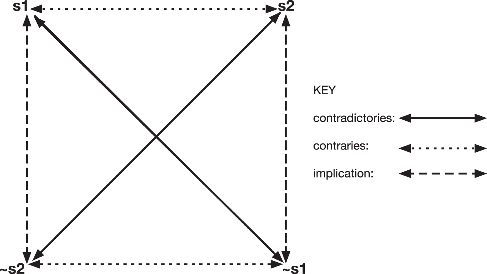

符号学对立平方。

Jameson 写道，

> 列举该平方优势的工作可以立即开始，首先观察到它是对旧结构主义“二元对立”概念的决定性扩展：s1 对 s2 显然只是一个二元对立，用哲学逻辑的语言说是“相反项”，即强烈的对立（白对黑，男对女），但该平方现在揭示它包含的远不止两个可用位置。例如，它立即暗示了逻辑所谓“矛盾项”的两个补充位置，其中 ~s1 和 ~s2 是两个主导项的简单否定，但包含的远不止二者：因此“非白”包含的不止“黑”，“非男”包含的不止“女”。同时，S 和 ~S 这两个复合或“综合”位置提供了更大的概念扩展，S 作为一个复杂或乌托邦式的项，在其中“白”与“黑”的对立可能被超越（例如 mestizo），而 ~S 作为中性项，在其中所有的剥夺和否定被集合（例如“无色”）。最后，横向轴线标示出区别于主要或二元对立的张力位置，而通过结合平方的两边（“白”加“非黑”）假设性提出的综合，指称替代性的概念组合。整个机制因此能够从一个基本的二元对立中生成至少十个可设想的位置。……它构成了一个概念[符号学]封闭的虚拟地图，或者更确切地说，是意识形态本身封闭的地图，即作为一种机制，它看似生成了丰富多样的可能概念和位置，实际上却锁定在某个初始的*困境*……中，无法凭借自身手段从内部将其转化。

参见 Fredric Jameson，“前言”，载《论意义：符号学理论选集 / Algirdas Julien Greimas 著》，Paul J. Perron 和 Frank H. Collins 译（明尼阿波利斯：明尼苏达大学出版社，1987），xiii–xv 页。

# 3 语言

十八世纪法国《百科全书》的作者们助产了一个描述工匠工作及其机器的语言，经过几个世纪的演变，这成为了我们今天所知编程语言的祖先。百科全书编纂者将工匠在车间中口头表达的内容以文本和图表的形式印刷出来，将机械艺术与自由艺术结合在了一起。在一个将两者分离了几个世纪的时代和地点，这种耦合是一次激进的干预。法国百科全书编纂者将车间的日常语言——一种机械艺术的语言——翻译成了文学和学术话语的语言——一种自由艺术的语言。

像所有杰出的翻译家一样，百科全书编纂者不得不发明新语言。具体来说，他们发明了我称之为“工作语言”的一种，以及我称之为“机器语言”的另一种。我将“工作语言”定义为用于描述工作过程和产品的语言——文本和谈话。“机器语言”是用于机器设计和分析的工作语言。当一台机器被设计用来在工作过程中取代人类时，人类执行的动作必须被翻译成机器语言。

计算的核心是运算的工作语言和机器语言，它们诞生于十八世纪法国艺术家、设计师和工匠的车间。在《百科全书》出版一个世纪后，Charles Babbage 和 Ada Lovelace 共同将运算的工作语言翻译成了机器语言，Lovelace 称这一事业为“运算科学”。即使在今天，计算的运算仍常与数学的函数混淆，但工匠的计算运算与数学的函数之间存在巨大鸿沟。许多职业生涯都致力于试图弥合这一鸿沟——使计算成为纯粹或应用数学的一种形式——但两者之间从未找到完美的翻译。因此，尽管 Lovelace 有一厢情愿的“运算科学”说法，计算仍然是一门与数学截然不同的艺术和技艺，绝非一种用函数书写的科学。

## 培根的《新工具》

Francis Bacon 爵士在出版《新工具》（*Novum Organum Scientiarum*，新科学工具）时，距离政治耻辱和失势还有一年，距离去世还有六年。该书被视为经验科学的奠基文献，也是对一种后来被称为“科学方法”的逻辑归纳形式的首次描述。

其标题中的“工具”，指的是亚里士多德关于逻辑的著作集，标题为《工具》。Bacon 认为，在亚里士多德派哲学家的影响下，自然研究已停滞了两千年。他的书是对亚里士多德派的批判，也是重建自然研究的提议，其中包括以机械艺术为模范并寻求其帮助。

根据培根的观点，与机械技艺相比，自由技艺在前两千年里几乎没有取得任何进步。培根将各种“发明”归功于机械技艺，包括印刷术、火药和指南针：“因为这三项发明改变了全世界的面貌和状态：首先在文学方面，然后在战争方面，最后在航海方面；由此衍生出无数变化，以至于没有任何帝国、教派或星辰，似乎对人类事务行使过比这些机械发明更大的权力和影响力。”^(1)

像那个时代的许多作家一样，培根将自然拟人为女性，因此用性别、性和繁衍的术语来描述对自然的研究。例如，他写道“大自然的子宫”。如果“作为女性的自然”在培根的著作中只是一个松散或罕见的隐喻，人们可能不会在意；但正如科学史学家兼哲学家伊芙琳·福克斯·凯勒在题为“培根式科学：掌控与服从的艺术”^(2)的章节中所写，培根的性意象是系统性的，无处不在于他关于科学的著作中，因此绝非随意为之。培根的目的是让人类为了自己的目的掌控自然，正如在十七世纪的英格兰，丈夫被认为有权掌控妻子并要求其服从一样。

乍看之下，培根为振兴科学开出的药方，似乎是一个戴绿帽子的丈夫呼吁家暴^(3)，这简直不是科学家的正面榜样。但在《新工具》的后续篇章中，培根提出了几个振兴科学的积极构想：“所要遵循的计划是：所有的机械技艺，甚至自由技艺（就其实用范围而言），都应受到访问和彻底考察，并由此编纂出每门技艺中伟大杰作或最完善作品的汇编或专史，以及实施它们的方法。”^(4)

## 百科全书派作为接生婆

随后，包括德国数学家和哲学家戈特弗里德·莱布尼茨在内的许多人，都受到这一编纂技艺杰作——机械与自由技艺——计划的启发。培根著作出版一个世纪后，这项编纂工作由哲学家兼作家狄德罗、数学家达朗贝尔及其同事作为大规模项目着手进行，他们共同创作了多卷本《百科全书》。

然而，百科全书派并不认为自己的角色类似于男性对自然或丈夫对妻子的角色。相反，他们以一种截然不同的角色自居，令人惊讶的是接生婆的角色；不是字面上的接生婆，而是“文字上”的接生婆——能够将艺术家和工匠那些未成形的、口头的描述，转化为可印刷的、书面的语言。

他们视此为必要角色，因为工匠——就像今天的艺术家和设计师一样——常被假定为寡言少语的直觉型工作者，能够操作和实践，却无法清晰表达或审视机器、仪器以及生产制造工艺。在《百科全书》“初步论述”中，达朗贝尔写道：“大多数从事机械技艺的人只是出于必要才投身其中，且仅凭本能工作。在一千人中难觅十来个能对其使用的工具和制造的物品有条理地表达自己观点的人。我们见过一些工人干了四十年却对自己的机器一无所知。”^(5)

然而，达朗贝尔在报告主要由其合编者狄德罗——一位刀匠之子、工匠之子——主导的工作时写道：“我们在巴黎和全国范围内接触了最能干的工匠。我们不辞辛劳地走进他们的作坊，向他们提问，记录他们的口述，展开他们的思路，提取出他们行业特有的术语，建立这些术语的表格并为它们拟定定义，与提供备忘录的人交谈，并（一个几乎不可或缺的预防措施）通过与其他人的长期频繁交谈来修正他们中一些人不完整、晦涩且有时不可靠的解释。”^(6) 他总结道：“对待他们，必须行使苏格拉底引以为豪的职能，即充当思想接生婆（*obstetrix animorum*）这一痛苦而微妙的职能。”^(7)

我将论证狄德罗、达朗贝尔和百科全书派确实为描述工匠工作及其机器的语言的诞生担任了接生婆，并且在几个世纪的进程中，这成为了我们今天所知编程语言的根源。通过将工匠通常只在车间口头传授的内容以文字和图表的形式印刷出来，百科全书派将机械技艺与自由技艺结合在了一起。在一个两者分离了几个世纪的时代和地方，这种结合是一项激进的干预。

## 亚里士多德式屏障

我们可以称这种传统的分离为“亚里士多德式屏障”。用科学史学家帕梅拉·朗的话说：“亚里士多德划分了人类活动的三个领域：第一，物质与技术生产（*techne*）；第二，行动（*praxis*），如政治或军事行动，需要在权变或不确定的情境中做出判断（*phronesis*）；第三，理论知识或对不变事物的知识（*episteme*）。亚里士多德将物质生产与行动和理论知识分离开来，预设了一个等级制度，将*techne*置于底层，将*episteme*（即理论知识）置于顶层。”^(8)

这些认识论上的划分导致了教育体系的分离，自由技艺与机械技艺分开教授。至今，亚里士多德式屏障依然将属于自由技艺的语言（特别是三学科的语言艺术）与属于机械技艺的机器分隔开来。

在一个接受这种屏障的社会背景下，达朗贝尔关于工匠不善言辞的评论似乎很自然，但请注意他的宣言也自相矛盾，他声称自己是在“记录他们的[工匠们的]口述”。那么，工匠们无法用语言表达自己，然而关于他们各种技艺的文字却是他们自己口述的!?

显然，工匠们能够交流他们的技艺；只是他们无法用当时自由技艺通用的语言来表达。更直白地说，工人的语言需要被翻译成上层阶级自由技艺的语言，才能刊登在《百科全书》中。狄德罗和达朗贝尔的成就，用这种说法来表述，是一项翻译的成就，一种跨越阶级鸿沟的翻译。

打破亚里士多德式屏障是培根的当务之急，随后也是狄德罗和达朗贝尔的当务之急，并且至今仍是当务之急。帕梅拉·朗自己的研究强调了工匠在科学史上的重要作用。例如，在天文学史上打破亚里士多德式屏障，可能会引导我们去探究为伽利略制造望远镜的工匠的作用。伽利略的天文学发现应归功于伽利略，还是归功于使这些发现成为可能的工匠，抑或两者兼而有之？

# 打破亚里士多德壁垒

打破亚里士多德壁垒仍然是当代哲学中最迫切的问题之一。哲学家贝尔纳·斯蒂格勒在其著作《技术与时间》第一卷中既凸显又打破了这一壁垒，他写道：“哲学在其历史伊始便将*tekhné*（技艺）与*épistème*（知识/学术）分离开来。……这种分离是由政治语境决定的，在该语境下，哲学家指责智者将*logos*（理性/言语）工具化为修辞和演说稿写作，即既作为权力的工具，又作为对知识的放弃。正是在这种冲突的遗产中——哲学的*épistème*与智者的*tekhné*对立，从而贬低一切技术知识——技术实体的本质被构想出来。”^(9)

随着工业资本主义开始主导经济，亚里士多德壁垒成为了上层阶级理解其财富来源的障碍。在狄德罗近一个世纪之后，查尔斯·巴贝奇在其著作《论机械与制造业的经济》^(10)的序言中，告诫他的同辈——那些拥有财富、闲暇和博雅教育的人——对机械技艺一无所知。他写道：“在一个制造业国家，拥有显贵地位的人，如果完全不了解那些造就其伟大的原则的发展，实在难辞其咎。财富的拥有者，对那些或近或远成为其财产丰富来源的工艺过程，实在难以无动于衷。享有闲暇的人，很难找到比考察自己国家的车间更有趣、更有启发性的追求了，车间蕴藏着丰富的知识矿藏，却普遍为富裕阶层所忽视。”^(11)此外，巴贝奇告诉他的同辈，了解其财富来源并不会太难：“理解制造工艺的困难不幸地被大大高估了。以制造商的眼光去考察它们，从而能够指导他人重复这些工艺，无疑需要极高的技巧和对主题的预先熟悉；但仅仅领会其一般原理和相互关系，却在几乎所有受过相当教育的人能力范围之内。”^(12)

通过这些陈述，巴贝奇清楚地表明了他的视角源于上层阶级的出身/地位；他同时也向读者保证，机械技艺实际上可以转化为博雅教育的语言，因为当时“相当教育”在公理上对上层阶级而言，就是博雅教育。

## 登场人物

尽管打破亚里士多德壁垒是可能且可取的，但这要求——且仍然要求——超越一个人的教育和成长，因为我们都受制于社会、政治、经济和文化条件，这些条件决定了谁知道什么、谁做什么。此外，一般来说，大多数教育机构维护着亚里士多德壁垒。正如达朗贝尔所指出的，在工匠作坊当学徒的人不一定懂得写作。反之，即使在今天，接受博雅教育的人也未受过成为汽车修理工的训练。简言之，种族、阶级、性别、性取向、职业和教育都在一些不易拒绝的角色中被执行。为了找到我们被分配角色的替代方案，我们需要想象融合、分割或偏离常规角色的*登场人物*。这是受哲学家吉尔·德勒兹启发的一个建议。^(13)

如果我们仔细观察达朗贝尔和巴贝奇分别提出的*登场人物*，会发现他们在创建新的知识与实践机构方面起到了催化作用。达朗贝尔承认，哲学家作为“接生婆”的形象至少可以追溯到苏格拉底，然而即使在现在，苏格拉底式对话依然具有爆炸性，甚至具有革命性。正如苏格拉底所实践的那样，接生术是一种通过密集提问来质疑某人的常识，从而诞生对自我的新理解的实践。

巴贝奇为《论机械与制造业的经济》所写的序言唤起了一个乍看之下似乎要求不高的角色。巴贝奇似乎在描述一位“绅士机械师”，类似于“绅士农夫”——这一人设要求绅士了解其财富是如何生产的，但将这种知识的获视为一种闲暇消遣，而非必需。

巴贝奇的序言告诉他的绅士读者，他将揭示一项供其闲暇时消遣的娱乐活动，同时也表明，即将解释的机械技艺原理对他来说（巴贝奇）绝非消遣，而应被视为其智力生活的基石，以及任何将从工业革命中受益之人财富的可能来源。^(14) 巴贝奇的志向超越了娱乐。他想激励他的绅士读者成为制造商。

在另一篇文章中，巴贝奇明确命名了他为他的绅士和所有男性设想的角色：“把人描述为制造工具的动物，这并不是一个坏定义。”^(15) 巴贝奇的*登场人物*不是*Homo sapiens*（智人），即睿智、理性、聪明的人。也不是文化历史学家约翰·胡伊青加所称的*Homo ludens*（游戏人），即闲暇之人、玩耍之人。^(16) 巴贝奇的*登场人物*是*Homo faber*（制造者），即创造者/制造者。

许多哲学家、政治理论家和经济学家都详细阐述了将*Homo faber*人设置于中心的意识形态所带来的文化、社会、经济和政治后果。通过区分看似相近的变体，可以详述这一陈词滥调。如果我们说“制造者”是一个关键人物，我们就被迫考虑这些人到底制造什么，以及他们必须从事何种工作来制造这些东西。例如，农业工人与建筑工人、工厂工人、办公室职员，或是在知识田野上耕耘的研究人员，从根本上讲是否不同？如果是，这种区别是根据工作如何完成来划分，还是根据制造出什么来划分？

运用第二章讨论的意识形态定义，可以将培根科学、《百科全书》的文科与科学，以及巴贝奇的“运算科学”视为围绕其各自的*登场人物*——丈夫、接生婆、*Homo faber*——所阐述的独特意识形态。

类比地，我们可以认为图灵 1936 年文章的卓越与敏锐，源于他大胆地将谦逊的“人肉计算员”这一*登场人物*置于对数学工作的重新思考中心。图灵机将“低层级”的计算工作置于数学“高层级”工作的中心。简而言之，图灵——如同他之前的培根、狄德罗和巴贝奇——打破了“亚里士多德壁垒”。

## *Homo faber*与工作 对比 *Homo laborans*与劳动

许多语言至少包含两个表示“工作”的词汇。在英语中，我们有“labor”（劳动）和“work”（工作/制作）。在法语中，对应的词汇是“travailler”和“oeuvrer”。哲学家汉娜·阿伦特在其著作《人的境遇》中指出，这种双重术语不仅存在于英语和法语中，也存在于德语、希腊语和拉等许多其他语言中。^(17) 阿伦特将其书中主要论点之一建立在这种反复出现的差异之上，哲学家约翰·洛克在其《政府论（下篇）》中也提到了这一差异，他写道：“我们身体的劳动和我们双手的工作”（第 26 节）。

阿伦特指出，在古希腊，劳动受鄙视而工作受推崇。这种价值观遗留在我们日常的措辞中，例如我们可以说“work of art”（艺术品），却不说“labor of art”；在英语中，借用法语，艺术家的工作可称为艺术家的“oeuvre”，却不能称为艺术家的“travail”（在英语中意指艰苦或痛苦的努力）。

根据阿伦特的观点，在古希腊，劳动包括妇女、奴隶和家畜为维持和繁衍生命及生活必需品所做的努力。工作是自由男性在公共领域为公共而非私人目的进行的生产。私人领域被视为匮乏的地位，劳动被视为发生在私人领域的活动。工作是发生在公共领域的荣誉与声望之举。阿伦特的这种区分描述了这样一种情形：某些形式的努力、生产和繁衍被视为不体面或隐而不见，而其他形式的工作则被凸显、高度评价并置于舞台中央。此外，阶级和性别严格规定了劳动与工作、私人与公共的区别。阿伦特将从事工作的人称为*Homo faber*（制造人）。从事劳动的人则是*Homo laborans*，或遵循阿伦特的说法，*Animal laborans*（劳动的动物）。

阿伦特将古希腊重工作轻劳动（从而重工作者轻劳动者）的价值观，与政治经济学家卡尔·马克思的观点形成对比，后者认为劳动（从而劳动者）应处于所有价值评价的核心并居于顶端。^[18] 因此可以看出，围绕工作的形象以及谁从事何种工作，可以构建出完整的意识形态。

## 工作语言与机器语言


为了阐述各种工作及谁或什么从事何种工作（或劳动），我引入了两个自行设计的概念。一称“工作语言”，另称“机器语言”。我将“工作语言”定义为用于描述工作过程与产物的语言——即文本与谈话。例如，审视本杰明·富兰克林关于工作的著作——“早睡早起，使人健康、富有和聪明”^[19]——从而论证当代商业实践（如载于企业使命文件、法律合同、立法或员工手册中）在多方面仍与新教伦理相关联。^[20] 每个时代、每种文化、每个行业和每种经济都有一种或多种工作语言。通过考察这些语言的异同，可以追问当下此地的工作是什么，以及它如何与彼时彼地的工作形成对比。

当今工作的核心是“机器语言”那近乎表演性的特质，它是用于机器设计与分析的工作语言子集。要充分描述机器如何运作，无异于以极其详尽的细节展示待完成的工作。当机器被设计用于在工作流程中取代人类、即实现工作自动化时，人类执行的动作必须被转译为机器语言。

本章的核心涉及两种工作语言。第一种是物理学的工作语言，它始于建构语言，演变为信息语言。这种语言描述的是阿伦特所谓的“劳动”。第二种是艺术的工作语言，最终成为计算语言。这种语言描述的是阿伦特所谓“工作”中的某些活动。这两种语言紧密相关但截然不同。

## 建构、物理学与信息的工作语言

物理学的工作语言是一种计算语言，由十八世纪一群启蒙工程师、科学家、哲学家和数学家发展而成，其中包括法国数学家兼科学家安德烈-马里·安培（1775–1836）、瑞士科学家兼数学家丹尼尔·伯努利（1700–1782）、法国工程师兼科学家夏尔-奥古斯丁·库仑（1736–1806）、德国科学家兼数学家格奥尔格·西蒙·欧姆（1789–1854）、意大利科学家亚历山德罗·朱塞佩·伏特（1745–1827）和苏格兰发明家詹姆斯·瓦特（1736–1819）。最初，他们的工作语言用于测量人和机器的活动，以热量或电荷为度量单位。因此，我们有了瓦特、焦耳和库仑这些至今仍在使用的定量度量单位。

法国要塞工程师夏尔-奥古斯丁·库仑在其 1775 年论文（1821 年再版）开头陈述了他所认为的工作基本单位。他用这一单位比较机器的工作与人的工作：“我们刚才看到，机器的效果总可以用一个重量乘以它被提升的高度来衡量。”^[21] 这种工作度量——重量乘以提升高度——至今仍是当代物理学和工程学的核心。它将一组可能极其复杂的运动简化为一个带有单位的单一数字；具体而言，即英尺-磅这个单位。按阿伦特的术语，这本质上是劳动语言而非工作语言，但在当代技术术语中，英尺-磅力被定义为能量或工作的单位，因此在本节中我们将继续称其为工作语言。

这一语言的形式化定义体现在以詹姆斯·普雷斯科特·焦耳（1818–1889，英国科学家兼啤酒酿造商）命名的工作单位中。^[22] 焦耳的定义进而将前文列举的网络参与者们的同名单位联系在了一起——也包括以艾萨克·牛顿（1643–1727）和布莱兹·帕斯卡（1623–1662）命名的单位。1 焦耳，通常写作 `J`，是一个工作单位，等于施加 1 牛顿力——即使 1 千克质量以每秒平方 1 米的加速度加速——通过 1 米距离所需的能量消耗。或者，焦耳也可定义为让 1 安培电流——即每秒 1 库仑——通过 1 欧姆电阻持续 1 秒。我们还可以理解为：焦耳是将 1 克水的温度升高 0.24 开尔文所需的热量，开尔文是以英国物理学家兼工程师开尔文勋爵（1824–1907）命名的温度单位。该定义可写成代数方程：^[23]

```
J = N·m = kg·m²/s² = W·s = C·V = (kg·m²)/(s³·A)
```

该方程的作用远超库仑 1775 年的文字表述。它简洁地关联了不仅重量与高度，还有热与电、力学、热力学和电动力学——十八世纪独立研究的许多通量与流动。

这一研究脉络在十九世纪通过热力学延续下来，实际应用于焦耳的啤酒酿造业务、蒸汽机建造，最终延伸至内燃机。每开尔文 1 焦耳（即工作或能量除以温度的度量）被证明对热力学发展至关重要：`J/K` 是*熵*的单位，即（无序）程度的度量！谁能预见工作与无序有如此直接的联系？熵是系统可能排列方式数量的度量；即其在系统中的测量值与系统可能状态的数量成正比。

二十世纪中叶，克劳德·香农基于这一熵的定义，创立了信息的形式化定义。根据香农，熵等于一条消息所包含的平均信息量。^[24] 这即是我们今天所知的信息论基础。

这种信息定义的起源可以追溯到十八世纪的一个问题：如何衡量普通工人在建筑工地搬运重物所完成的工作量。用阿伦特的术语来说，物理学和信息的语言是对*劳动者*所做之事的形式化表达。显然，这种语言及其早期表述适用于力学、热力学和电动力学中的工作，但它们不是艺术和计算的语言。当用来分析*制作者*的工作时，它们显得捉襟见肘。用阿伦特的话说，物理学和信息的语言是劳动的语言；相比之下，计算的语言是熟练工作的语言。^(25)

## 工作语言有其局限

显然，物理学和信息的工作语言用途广泛，一直处于许多创新的核心地位。尽管如此，当应用于并非为其开发的活动时，每种工作语言都有其局限性。因此，许多初学物理的学生被其工作语言的局限性所震惊，这并不令人意外。

例如，让我们想象你是一名房屋建造者的学徒。你的名字叫“西西弗斯”。早上，你的职责是从卡车上取出建造者的工具箱并打开它。建造者爬到正在建设中的房屋的二楼。每当他喊要工具——“西西弗斯，给我拿把锤子！”——你的工作就是从工具箱里取出工具，爬上梯子，递给他，等他用完工具完成任务，然后再爬下梯子把工具放回工具箱。^(26) 根据物理学中使用的工作定义，到了一天结束时，如果你干得很好并把所有工具都放回了箱子，你就**没有做任何工作**！你把一定重量的工具举到了梯顶的一定高度；这构成了工作。但你又把这些相同的重量放回了地面上的工具箱；这构成了负功。因此，你完成的总功为零！可怜的西西弗斯！

## 艺术的工作语言

为了更好地描述西西弗斯和房屋建造者的活动，需要使用一种艺术的工作语言。这种工作语言不是物理学和信息的语言。它的起源可以在狄德罗和达朗贝尔的《百科全书》中看到。

让我们看看《百科全书》中描绘工匠制针工作的插图（参见图 3.1、3.2 和 3.3）。你看到人和机器在举起大量重物吗？没有，对吧？所以，即使物理学和信息的工作语言适合描述煤矿开采和建筑工地的劳动，它也不适合描述机械艺术的工作。事实上，在工匠的作坊里使用它是荒谬的。

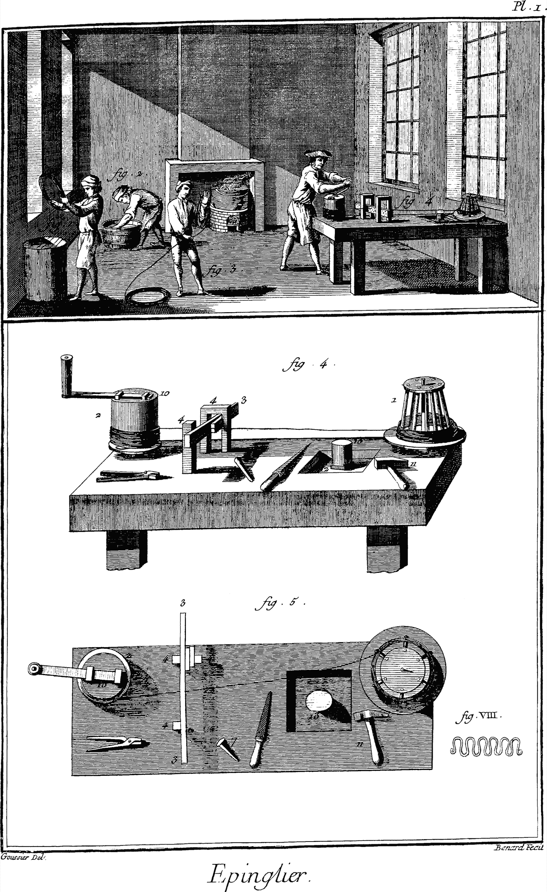

图 3.1 ¶ 《百科全书》中“制针工”条目的插图 I。

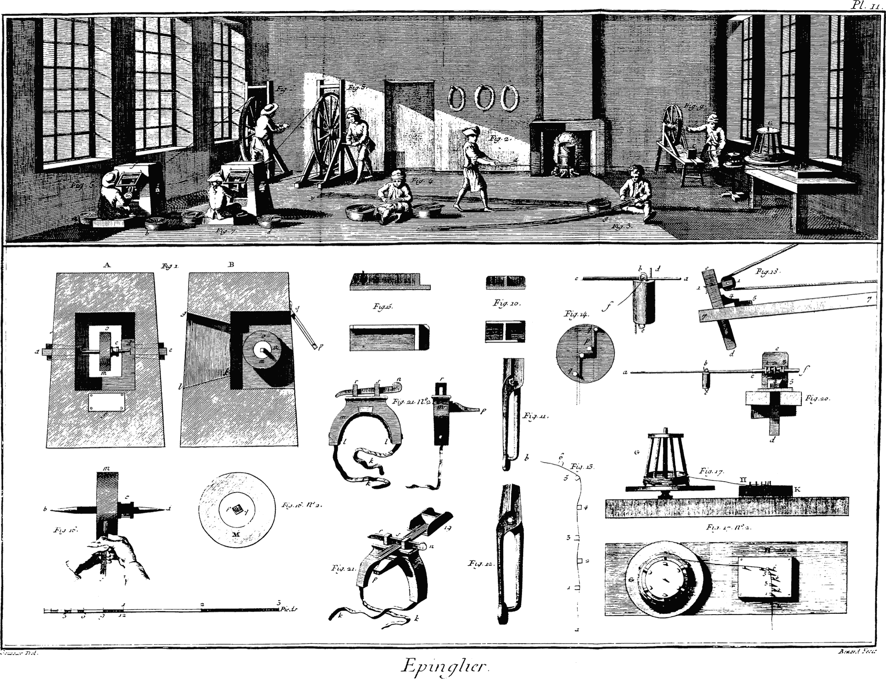

图 3.2 ¶ 《百科全书》中“制针工”条目的插图 II。

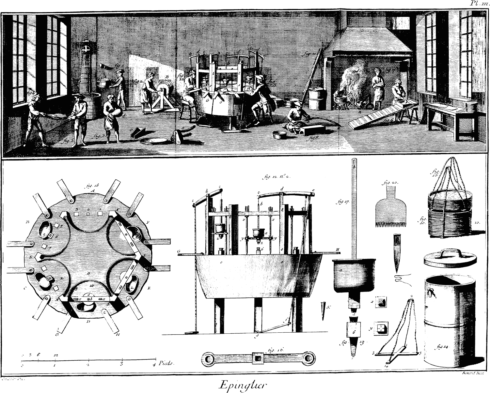

图 3.3 ¶ 《百科全书》中“制针工”条目的插图 III。

什么是描述工匠、设计师和艺术家所做之事的恰当工作语言？巧合的是，第二种工作语言在十八世纪得到了发展，有趣的是，这段历史始于同一地点，涉及一些与焦耳历史相同的人。与物理学的工作语言不同，这种第二种语言不将工作描述简化为单个数字（焦耳数）。相反，艺术的工作语言可用于描述*工作是如何完成的*。艺术的工作语言预示了我们今天所知的计算机编程语言。

这段历史在计算机科学文献中有所提及，但很少完整讲述。例如，计算机科学领域的奠基人之一赫伯特·西蒙在 1958 年曾风趣地指出：“物理学家和工程师与数字计算机的发明关系不大……真正的发明者是经济学家亚当·斯密。”^(27)

西蒙此言何意？回顾一下亚当·斯密最著名的著作《国富论》（1776 年）第 1 篇第 1 章论述的是分工，具体指针的生产。斯密写道：“劳动生产力的最大改进，以及在任何地方指导和应用劳动的大部分技能、熟练和判断力，似乎都是分工的结果。” 分工是一种协作组织形式，其中待完成的工作通过使用若干工具和机器分配给不同的人。赫伯特·西蒙暗示我们应考察工作和分工如何处于计算机的核心地位。

如果我们想忠实于阿伦特的哲学语言，我们会说当斯密描述分工时，用阿伦特的术语来说，他是在描述工作的分工。这是因为斯密的描述——正如我们将看到的——借用了一种完全不同于刚才描述的物理学工作语言的语言。亚当·斯密的工作语言始于一组详细描绘法国诺曼底小镇拉格尔制针作坊的图纸。

工程师让-鲁道夫·佩罗内在这个地点进行了最初的观察工作。让我们——不合时宜地——称这种观察工作为民族志工作，以便提醒我们当代人文科学家，特别是民族志学者，对软硬件设计的贡献的重要性。^(28) 佩罗内受过土木工程、数学和力学训练，于 1735 年加入桥梁与道路工程兵团。^(29) 不久后，他被任命为阿朗松区的总工程师，主要负责道路的建设和铺设。

然而，在同一时期，佩罗内还研究了工匠和手艺人的作坊，并撰写了两份关于拉格尔镇附近一家作坊制针工艺的手稿。^(30) 虽然这两份手稿都未立即出版，但佩罗内为狄德罗和达朗贝尔的《百科全书》中“针”（Épingle）条目做出了贡献。^(31) 此外，佩罗内对工匠如何制造针、如何使用机器以及机器如何设计的详细描述，预见了《百科全书》的工作语言，该文集收录了许多关于机械艺术当代方法的文章。

设计史学家安托万·皮松讨论了《百科全书》这种工作语言的三个主要术语——姿势、操作和工序：“连接致力于艺术和手工艺的不同条目的共同线索，是对生产的基本姿势的描述，这些动作如何整合从而定义综合技术操作，以及将这些操作串联起来形成根据分工组织的工序的逻辑……从个体动作到工序链，将它们编织在一起的线索，类比于狄德罗、达朗贝尔及其《百科全书》合作者的总体目标：整合所有形式的知识。”^(32)

## 示例：大百科全书中的别针制造

例如，以下是《大百科全书》中关于“别针制造者”条目（共四页）的部分摘录。它用十八个步骤总结了直别针的制造过程：“一枚别针在成为商品之前要经过十八道工序。1. 使黄铜丝变黄……2. 将铁丝绕在线团上……3. 拉拔铁丝……4. 切断铁丝……5. 磨尖……”（参见注释 33）。请注意，这看起来就像是一份制作别针的食谱。图 3.1、图 3.2 和图 3.3 是该条目的插图版。正如我们将在第 4 章（关于算法）中看到的，算法经常被比作食谱。可以说，《大百科全书》包含了一套制作不仅是食物，而且是各种不同事物的食谱（参见注释 34）。

## 亚当·斯密与别针制造

亚当·斯密关于别针制造的例子灵感来源于他对达朗贝尔和狄德罗《大百科全书》的阅读（参见注释 35）。几年后，即 1791 年，加斯帕尔·德·普罗尼——受法国政府委托制作一组巨大且详细的对数表和三角函数表——从亚当·斯密那里“借用”回了这一分工形象，引用了斯密的观点，并声称他“制造对数就像制造别针一样容易”（参见注释 36）。普罗尼组织了大量非数学家出身的工人作为一组“计算员”来计算这些表格。

然而，普罗尼声称受斯密启发其中存在某种俄狄浦斯式的悖论，因为正如我们所见，斯密的来源是狄德罗的《大百科全书》，而佩罗内曾为其做出贡献。佩罗内不仅是普罗尼的教授、导师、主管和最终的合作者，还是桥梁学校（École des Ponts et Chaussées）的首任主任，普罗尼于 1798 年继任该职位。

我们不妨说，计算机的真正发明者是佩罗内、普罗尼和百科全书编纂者，而与赫伯特·西蒙的归因相反，亚当·斯密唯一的贡献只是从《大百科全书》中抄袭，以便最终被普罗尼引用。我的观点是，普罗尼本可以直接从佩罗内那里获得关于分工和别针生产的信息，而斯密只是一个意想不到的中间人。但这条通过苏格兰——通过亚当·斯密的著作——将计算机谱系从佩罗内连接到普罗尼的意外绕道，正是计算机科学家兼诺贝尔经济学奖得主赫伯特·西蒙戏称斯密为计算机发明者的来源。

## 巴贝奇：从手工操作到机器操作的转译

在普罗尼取得成就几年后，英国数学家、哲学家和工程师查尔斯·巴贝奇注意到普罗尼的分工方式可以融入机器之中。用我偏好的术语来说，巴贝奇因此将《大百科全书》的工作语言转译成了机器语言。他在规划层面实现了这一点，但未能在物理形式上完成；他的分析机在他有生之年未能建成（参见注释 37）。尽管如此，即使仅在绘图板上，也很明显，他从《大百科全书》的工作语言中锻造出的机器语言，与逻辑或数学属于完全不同的家族。

这些差异在巴贝奇的图纸中表现得非常清楚。历史学家马克·普里斯特利告诉我们：“在这项工作过程中，巴贝奇发现用图纸描述机械的传统方法是不够的。一张图纸只能表示机器在某一时刻的状态，因此对于理解复杂机构中涉及的运动序列，或推算其相互作用部件的运动时序，几乎没有帮助”（参见注释 38）。因此，巴贝奇被迫发明了一种新的机械图形符号，它结合了文字注释、机器零件结构的插图，以及一种描述机器中将要发生的运动序列的新方法（参见图 3.4）。用《百科全书》的术语来说，巴贝奇不得不开发一种新方法来绘制姿势、操作以及运动和操作的序列——即过程（参见注释 39）。

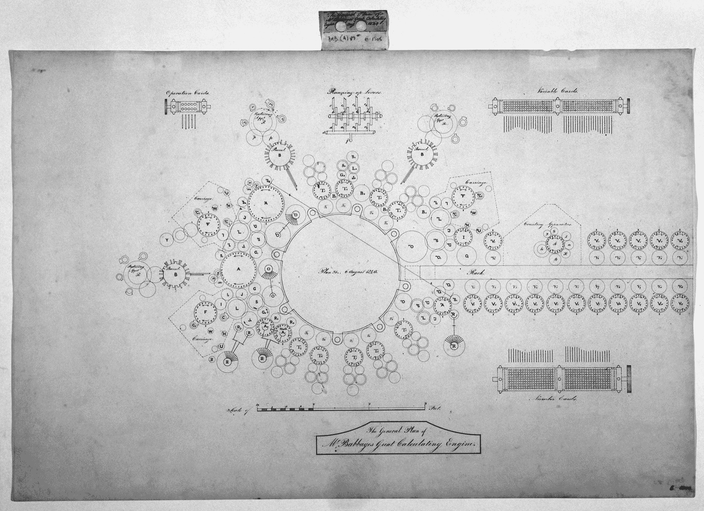

图 3.4 ¶ 巴贝奇大型计算机的总体设计图，1840 年。经科学博物馆档案馆/科学与社会图片库授权复制：SSPL 图片 10303657。

正如皮孔指出的，操作处于《百科全书》工作语言的语义基础。在巴贝奇完成设计后不久，很明显操作也是其机器语言的核心。英国数学家艾达·洛夫莱斯在阐述巴贝奇机器的操作与算术和微积分函数的区别时指出，巴贝奇的机器将需要一个超越数学的新研究领域，她称之为“操作科学”：“操作科学……本身就是一门科学，拥有其自身的抽象真理和价值；正如逻辑拥有其独特的真理和价值，独立于我们可能应用其推理和过程的主题一样”（参见注释 40）。由于她关于巴贝奇机器的著作，洛夫莱斯被公认为第一位计算机程序员、字面意义上的第一位软件设计师，确实，她在 1843 年指出的关于操作渲染和执行的关键问题，至今仍是计算机科学的关注点。

## 函数与操作

前面描述的劳动语言、物理学语言，是一种函数语言。相比之下，这种第二种语言是艺术的语言，一种操作的工作语言。换句话说，后者是操作的工作语言，而非数学函数的语言。为了强调洛夫莱斯的观点，计算不是数学。

函数和操作有什么区别？可以在《牛津英语词典》（OED）中看到，在莱布尼茨之前，“函数”一词是一个非常通用的术语，例如意为“公务”或“作为属于特定阶层的人所固有的行动类型”。这些是适用于各种工作的非常通用的定义。

然而，根据《牛津英语词典》，莱布尼茨之后，引入了一个新的、更专门的、专门的数学定义：“一个变量量被视为与一个或多个其他变量的关系，用这些变量可以表示它……这种拉丁语 *functio* 的用法归功于莱布尼茨及其同事。”因此，以焦耳（或焦耳每开尔文）量化的劳动语言，是十八世纪工程运动的一部分，该运动旨在将工程分析和设计重塑为莱布尼茨和牛顿微积分的语言。

## 再次查阅《牛津英语词典》（*OED*）中“operation”（操作/运作）的定义，我们看到它过去是——现在依然是——一个适用于描述各类工作的通用术语：第 1.a 条定义为“力量或影响的施展；工作、活动；一种工作方式、事物运作的方式。”“Operation”因此与数学“function”（函数）形成对比。^(41) 正如安托万·皮孔所强调的，“必须注意到，尽管量化和数学计算可被视为分析的精髓，《百科全书》的分析方法完全可以保持纯定性。”^(42) 换言之，函数的工作语言是定量的；操作的工作语言可以是纯定性的。

## 《百科全书》的工作语言预见了计算机编程语言

《百科全书》不断见证着一个关于物质的故事，但这在某种程度上也是一个关于“精神”的故事：对于百科全书编纂者而言，物质的轨迹就是推理的演进：图版中的图像具有逻辑功能。……我们在此处以先知般的洞察力发现了控制论组装体的基本原理；图版上描绘的机器形象本身就是一个“大脑”；在其中可以看到物质输入之处以及“程序”的组织结构。^(43)

现在让我们将这段历史快进约一个世纪（这次跳过图灵）来到 1947 年，赫尔曼·戈德斯坦和约翰·冯·诺依曼出版了《电子仪器的规划与编码》，这部文本我们今日可读作史上首部计算机编程手册。戈德斯坦和冯·诺依曼试图为完全不了解编码概念的读者描述编码——即编程。

他们将编程定义为将数学公式翻译成计算机语言的任务，但并不完全认同这属于一种翻译形式。他们似乎认为，将数学公式重写为计算机语言比在一种语言与另一种语言之间翻译要困难得多。他们写道：“编码指令序列与数学构想的（数值）求解过程之间的关系不是静态的翻译关系，而是高度动态的：一条编码指令不仅代表其当前位置的当前内容，更充分地代表了通过它的任何一系列通道……”^(44) 换言之，这里又是这些操作与数学函数的另一区别：随着程序执行的进行，操作可以改变其顺序、数量或种类。

戈德斯坦和冯·诺依曼的阐述建立在他们对当时最新的机器绘图图形手段——流程图——的开发之上。^(45) 软件设计至今仍常采用一种图形符号，其与戈德斯坦和冯·诺依曼的流程图有着强烈的相似性。（参见图 3.5。) 如同他们的图表一样，在当代流程图中，方框描述操作，箭头表示操作执行的顺序。

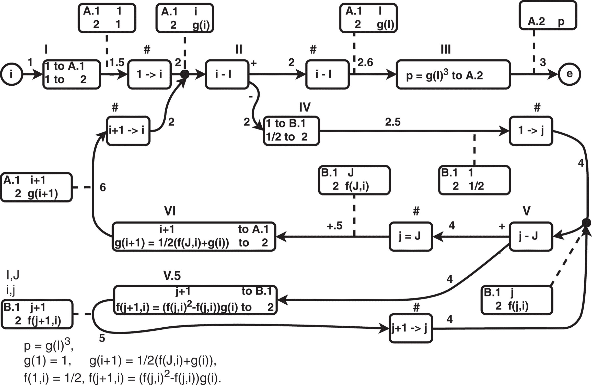

图 3.5 ¶ 此流程图仿照自赫尔曼·戈德斯坦和约翰·冯·诺依曼《电子仪器的规划与编码》（1947 年）中的图 7.2。

巴贝奇的符号系统中没有描绘人物，戈德斯坦和冯·诺依曼的流程图中也没有。当我们将它们与《百科全书》的雕刻版画相比时，这种人物的缺失显得格外突出。^(46) 流程图是一幅没有工人的工作图景。这幅图景处于自动化的消失点，在那里所有工人都被逐出车间，被机器取代。

随着工作语言从佩罗内、斯密、普罗尼、巴贝奇，再到冯·诺依曼和戈德斯坦跨越几个世纪的翻译演变，操作的工作语言失去了一些东西。语言中失去的是包含人的能力；更具体地说，翻译中失去的是对人与人之间、人与机器之间互动的阐述。正如我们将在第 4 章（关于算法）中看到的，人的缺失并非偶然，而是设计使然。巴贝奇，随后冯·诺依曼等人，特别热衷于将人排除在循环之外。


# 回顾安托万·皮孔关于《百科全书》工作语言三个主要术语的论述

回顾安托万·皮孔关于《百科全书》工作语言三个主要术语的论述：姿势、操作和过程。当人们在当代计算中寻找这三个术语的物化体现时，操作和过程很容易找到，因为它们构成了大多数现代计算机编程语言中的核心术语或结构。然而，要在软件中看到姿势，则需要更多努力。

尽管如此，姿势识别和基于姿势的计算对于当今的移动平台和游戏控制器具有根本性的重要性。微软的 `Kinect` 为游戏设计师提供了工具，利用机器视觉技术自动识别大量的人类姿势和动作。^(47) 对于苹果 `iPhone` 或类似产品的任何常规用户而言，嵌入在触摸屏和加速度计硬件中的计算技术同样耳熟能详；使用手持设备时，我们用户会滑动、点击、倾斜和摇晃手机或平板电脑。^(48) 因此，在某种意义上，姿势是当今界面和用户体验设计师的核心构造。

但在当代计算中，有一个恰当的场所可以看到姿势：工作分工的场所。人们开始从工匠和设计师的作坊、工厂和办公室中消失，因为他们的工作实现了自动化。自动化一项工作意味着将其分解为组成部分，将心智操作和身体姿势分解为微小的动作，直到它们变得足够小或微不足道，可以由机器执行。但这种分解行为所蕴含的远不止“工作分工”这一短语所传达的内容。

分工当然是一种算术运算，但分割工作或劳动比单纯的算术复杂得多。这不那么是一个寻找工作分工的问题，而更多的是一个寻找工作语法的问题，^(49) 一种包含诸如反复执行操作（迭代或递归）；将操作序列链接在一起——形成过程——并将它们嵌套成具有简单输入输出的强大“黑盒”（即使它们内部隐藏着极其复杂的机器）；以及以网络拓扑将这些黑盒关联起来，使它们模仿我们在《百科全书》图解作坊中瞥见的工人之间关系的语法。^(50)

将操作分解为更小操作的复杂组装体需要的不仅仅是分割；它需要一种语法。将分割比作斧头，将语法比作整套工具箱。斧头是劈木头的好工具，但木匠需要一大堆工具才能以多种多样的组装方式切割和连接木材。基于这些及其他原因，我将追随包括伯纳德·斯蒂格勒在内的许多理论家，将工作语法以及将工作分配到复杂、可重组、可重构单元的努力称为“语法化”努力。语法和语法化将在第 7 章中得到更充分的探讨。

# 注释

## 德勒兹与思想的意象

德勒兹是一位认为哲学是独特创造的哲学家。每位哲学家都创造一种哲学，其界限足够模糊，以便留有他者的空间。因此哲学的观念并非固定不变——没有单一的方法，没有单一的实践方式。相反，每种哲学都发明了一种独特的*竞争*（agon），并拥有其自身的*登场人物*（dramatis personae）：在每一种哲学中，我们都能发现德勒兹后来所谓的“思想的意象”，即使这种意象并不总是显而易见。……哲学通过其戏剧化观念的各个“人物”，暗示了哲学的一种取向方式以及其所卷入的斗争类型。……柏拉图发明了苏格拉底这一*人物*及其与智者的*竞争*；康德则发明了一位监管理性界限的法官；莱布尼茨在一个似乎抛弃了上帝的世界中，将自己塑造为上帝的辩护律师，不断提出新原则；而斯宾诺莎甚至放弃了这样一位上帝，转而创造了一个无辜者的*人物*，一个“无可奈何的儿童般的玩家”。在每种情况下，我们都看到哲学的这种竞争或“游戏”被[玩]的不同方式。

参见 John Rajchman, *The Deleuze Connections* (Cambridge, MA: MIT Press, 2000), 32, 42.

## 库仑论人类劳动与疲劳

我们刚才看到，机器的效果总是以一个被提升到一定高度的重物来衡量。现在，为了能将效果与人类产生该效果时所经历的疲劳进行比较，必须确定与一定行动程度相对应的疲劳。……丹尼尔·伯努利在讨论这个问题时，考虑到了其大部分要素，他认为人的疲劳总是与他们的行动量成正比；因此，在不超出其自然力量的前提下，可以随意改变速度、压力和时间，只要这些量的乘积是一个常数，对人产生的疲劳程度就始终相同。……表达相对于疲劳的最大行动量的那个量，必须是后续研究的主要对象。

夏尔-奥古斯丁·德·库仑，“旨在确定人们按其使用力量的不同方式，每日工作所能提供的行动量的若干实验结果”，《简明机器理论，兼顾其部件摩擦与索具刚度》（巴黎：Bachelier, 1821），256–257。

## 阿伦特论劳动、工作与行动

乍看之下令人惊讶的是，现代时代——伴随着其对所有传统的颠覆，无论是行动与沉思的传统等级，还是*实践生活*（vita activa）内部的传统等级，伴随着其将劳动颂扬为一切价值的源泉，并将*劳动的人*（animal laborans）提升到传统上由*理性的人*（animal rationale）占据的地位——却未能产生出一种单一的理论，在其中*劳动的人*与*制造的人*（homo faber），“我们身体的劳动与我们双手的工作”，得到清晰的区分。相反，我们首先发现的是生产性劳动与非生产性劳动的区别，随后稍晚些出现熟练劳动与非熟练劳动的区分，最后，因为似乎具有更基础的意义而超越前两者，是将所有活动划分为体力劳动与脑力劳动。

参见 Arendt, *The Human Condition*, 85。

# 4 算法

世界的数字化重写导致现有观念、制度、操作和流程被转译为算法，但什么是算法？

算法的故事与算术史纠缠在一起。在近代早期之前，店主使用算盘进行算术运算。在商人资本主义诞生之际，店主的算术变成了算法的问题，而非算盘的问题。店主的算法是将笔应用于纸上进行运算，以使用当时新兴的印度-十进制定点算术系统执行计算。

几个世纪后，算术对于工业资本主义的兴起变得更为重要。在这一时期，算术发生了两项开创性的变革。首先，将工作重铸为可用定量术语衡量和估算的格式，对于阐明劳动与资本如何通过货币联系起来至关重要。完成某项特定工作需要多少成本？资本家投资昂贵机械以取代人力劳动者是否值得？第二项不仅是工业层面的，也是智识层面的转变，它将扩展形式的算术置于许多先前截然不同的知识学科的中心。

在数学与逻辑史上，这一转变被称为“算术化”，是数学基础的一个研究计划。所有数学能否被转译为一种算术形式，实质上转译为一组算法？算术计算日益增长的工业与智识重要性，促使查尔斯·巴贝奇思考其能否由机器完成，从而比手工更快、更少出错地进行。

矛盾的是，将人排除在外的自动化推动，将算法史上的一个意象固化进了其当代基础之中。艾伦·图灵和唐纳德·克努斯都基于一个手持纸笔之人的意象来构建算法，这意象仿佛取自十四世纪威尼斯的计算学校。因此，当今的算法本质上是拟人化的，基于其设计者想象人们用纸笔可能做的事情。因此，例如，即使是一些最技术性的著作也严肃地探讨机器如何能“学习”，或变得“聪明”或“智能”。最新形式的资本主义——如金融资本主义——依赖于尖端算法，如用于机器“学习”的算法。但正如我们将在本章看到的，即使是机器学习算法，也只是计数和算术的高级形式。

随着算术对资本主义（从商人资本主义、工业资本主义到金融资本主义）变得日益重要，远超数学以往边界的越来越多活动——如学习——被重写为本质上是算术算法，其核心是一个手持纸笔的“典型男人”意象。我们必须像哲学家赫伯特·马尔库塞曾就工业资本主义所问的那样提问：坐在当代资本主义及其算法中心的、如此缺乏批判性思维和对抗性行动的一维度的人，究竟是谁？

## 克努斯的算法分析

算法现在作为解决良定义问题的分步过程为我们所熟悉，但历史上它们被引入为将笔应用于纸上进行运算，以使用当时新兴的印度-十进制定点算术系统执行计算。直到很久以后，“算法”才获得了更广泛的含义——超越简单算术——这发生在数学算术化以及理论计算机继而电子计算机发展之后。

可以说，“算法”的含义直到 1960 年代唐纳德·克努斯开始出版《计算机程序设计艺术》（其关于算法分析的多卷著作）时，才真正围绕软件构成稳定下来。根据克努斯的观点，算法有五个重要特征：

1. **有限性**（Finiteness）：算法必须总在有限步骤后终止。……具备算法所有特征但可能缺乏有限性的过程，可称为“计算方法”。

2. **确定性**（Definiteness）：算法的每一步必须被精确定义；所执行的动作必须针对每种情况被严格且无歧义地指定。……形式定义的编程语言或计算机语言是为指定算法而设计的，其中每条语句都有非常明确的含义。

### (3) 输入

……算法开始前最初提供给它的量。

### (4) 输出

……与输入具有特定关系的量。

### (5) 有效性

……算法中执行的所有操作必须足够基本，原则上可以由一个人仅用铅笔和纸准确地在有限的时间内完成。^1

请注意，`Knuth` 的第一个特征——有限性，意味着我们今天用计算机做的大多数事情可以称为“计算方法”，但不能称为“算法”。操作系统、Web 服务器、智能手机应用、Facebook、Google——总的来说，大多数系统——根据 `Knuth` 的定义都不是算法，因为它们不是设计为在有限次操作后停止的。

在计算机科学中，算法与系统是有区别的。它们被视为两个不同的子领域，在大学课程中由不同的教授群体讲授。为什么？因为它们指代两组不同的问题。

算法关注的是实现特定计算过程或操作时面临的一系列困难，而与计算环境无关（例如计算机硬件、网络延迟和容量的细节、作为“层”构建在定义算法的软件之下的其他软件，或使用该软件的人员类型）。但是——正如我们很快将看到的——与实现无关的算法是一个不可能的理想化。

相比之下，系统处理接口、交互、规模和基础设施等问题。系统问题通常在算法问题得到解决之后出现。在此之后，任何阻碍软件按预期执行的问题都可能是系统问题。

我本不想提及这一基本区别，只是因为在数字人文和社会科学关于“算法”的文献中，算法和系统经常被混淆。在一篇关于社会科学家使用关键词“algorithm”的短文中，社会学家 Tarleton Gillespie 为社会学家和记者使用“algorithm”一词作为修辞提喻来指代软硬件系统的许多不同部分进行了辩护，包括“模型、目标、数据、训练数据、应用、[和]硬件”。^2 Gillespie 等人的方法存在问题，因为如果我们把系统设计的杂糅关切视为都可以通过专注于算法来解决，我们就会反复在错误的细节中迷失。这就像那句格言：如果你手里唯一的工具是锤子，你会把所有东西都当成钉子。并非所有软件都是算法！此外，如今撰写算法的大多数非计算机科学家似乎都想解决系统问题。^3

`Knuth` 关于算法的第二个特征，即他所谓的“确定性”，已成为计算机科学的正统，但它给技术文献引入了一个矛盾。一方面，`Knuth` 对算法的分析本应摆脱特定实现的上下文细节。然而，在他对“确定性”的描述中，他告诉我们，如果算法可以用编程语言定义（即编码），就能保证确定性；而在他的多卷著作中，`Knuth` 使用了一种他自己设计的特定编程语言 `MIXAL` 来定义算法。^4 他选择不使用现有语言，是担心每当编程语言变化时书籍都得重编。然而，这反映了计算背景的变化，多年后 `Knuth` 感到有必要“更新”他发明的语言（从 `MIXAL` 到 `MMIXAL`），以更好地匹配当代计算机。^5 具有讽刺意味的是，尽管他依赖一种非常特定的编程语言来陈述算法，`Knuth` 却在《计算机程序设计艺术》出版前不久发表的一篇期刊文章中否定了这种方法。简而言之，他的阐述无异于说算法就是计算机程序。然而，在其他地方，`Knuth` 明确指出算法不是计算机程序，而是某种更抽象、完全独立于编程语言的东西。^6

`Knuth` 的第五个标准将“算法”的定义判处了与任何及所有非技术语言所遭受的相同的符号学滑坡。`Knuth` 将算法定义为有效方法，但在计算理论中，有一个强有力的传统是做逻辑上的逆运算——将有效方法精确地定义为那些存在算法求解的方法。我们在 Alonzo Church 的著作中看到了这一点：“对于刚才定义意义上的每一个可有效计算的正整数函数，都存在一个计算其值的算法。”^7 因此，`Knuth` 的陈述形成了一个循环：算法是有效的计算方法——而通过 Church，有效方法是那些拥有算法的方法。^8

最后，请注意，在有效性的定义中，`Knuth` 指出“算法中执行的操作必须足够基本，原则上可以……由一个人仅用铅笔和纸完成。”这一动机非常清楚：`Knuth` 旨在将不可能的步骤排除在算法之外；例如，先发明一台永动机，然后像超人一样在空中飞行。即使这样一个步骤列表很清晰，也是不可能的，因此不构成算法的步骤。

然而，只有查阅计算史，我们才能具体理解 `Knuth` 所说的“由一个人仅用铅笔和纸完成的操作”是什么意思。他指的不是像伦勃朗或莎士比亚那样的人。相反，他指的是某种“典型”的人。具体来说，他隐含地指代那些在计算机械发明前几个世纪担任“计算员”工作的男男女女：那些男性——但通常是女性——组成团队进行繁重算术计算的人。正如第 2 章所讨论的，从事计算员工作的这些人在 Turing 1936 年的论文中被提及。^9 事实上，应该指出的是，`Knuth` 对“有效性”的运用将他推入了第 2 章讨论的 Church、Turing、Gandy 和其他计算理论家著作中所涉及的相同矛盾。通过将“算法”的定义系于一个人用铅笔和纸能做的事情，`Knuth` 将算法的技术文献置于了一个非常模糊和不精确的基础之上。任何受过良好训练的人文学者都会希望在这一点上有更高的精确度。`Knuth` 所说的“一个人”是什么意思？哪个男人？还是指女人？在什么条件下工作？在哪个历史时期？具有何种教育背景？

# 一个人可以通过看到克努斯为一个具有非常受限且历史上偶然的词源学的术语提供了当代翻译，来理解克努斯对“算法”定义中固有的歧义。

`Knuth` 对算法的定义是自相矛盾的，因为他既认为算法依赖于计算机编程语言的编码，又认为算法完全独立于编码。他的定义是循环论证的，因为算法是用有效方法定义的，而有效方法又是用算法定义的。他的定义是高度受限的，因为算法应该是有限的——在有限步骤后终止——然而我们今天使用计算机做的大多数事情涉及的系统被设计为无限运行、永不终止，因此根据 `Knuth` 的说法它们不是算法。最后，`Knuth` 对“算法”的定义偷偷引入了一种高度受限但又模棱两可的人类主观性形式，因为他将其与一个未定义的人用铅笔和纸能做的事情联系起来。

尽管他频繁使用历史例子，`Knuth` 的定义却是非历史的。`Knuth` 在书的开头讨论了“欧几里得算法”，这是一种寻找两个数最大公约数的迭代方法。它出现在欧几里得的《几何原本》第七卷，命题 1 和 2 中。古希腊数学家欧几里得生活在公元前四世纪中叶，但归功于他的算法可以很容易地用一行现代编程语言（如 JavaScript）来编写：

```
function gcd(m,n) {if (n == 0) return(m); else return(gcd(n,m%n));}
```

欧几里得的方法被称为“算法”已经很长时间了，早在 `Knuth` 开始写书之前就已经这样称呼了。然而，当欧几里得设计出这个方法时，它肯定不叫算法，因为“algorithm”这个词在古希腊语中不存在。^(10)

**algorithm**, *n*.

起源：源自拉丁语借词。词源：拉丁语 *algorithmus*。

词源学：后古典拉丁语 *algorithmus*（15 世纪），*algorismus* 的变体^(11)

根据《牛津英语词典》，古希腊语中最接近的术语是“ἀριθμός”，意为数字。古希腊人也有表示有理近似和计算的词汇，但“algorithm”源自后古典拉丁语。因此，称欧几里得的方法为算法是时代错乱的。我们之所以能那样称呼它，唯一的方式是忘记所有最终将欧几里得文本第七卷命题 1 和 2 转录和翻译成一种可与我们现在所谓的算法相提并论、并能如此简单地用一行代码写出的形式的工作。

类比而言，我们可以称十八世纪的马车为“早期汽车”，但要这样做，我们需要承认使这种对十八世纪车辆的高度特异性解读成为可能的历史和技术背景。但也许最重要的是，通过用一个新名字称呼一种旧技术或技艺，我们需要承认我们这样做冒着将我们时代的目的论、一套价值观和意图输出给它的风险。

我提议我们研究较旧的方法如何能够或已经被翻译成算法，此外，还要研究“算法”的定义本身是如何随时间变化的。这一提议旨在与 `Knuth` 有缺陷但仍具影响力的定义以及对“算法”一词的时代错乱应用形成对比。`Knuth` 对“算法”的公理化消解了历史、语境和解释的混乱性。

`Knuth` 的努力旨在试图使算法成为一种数学或逻辑。但是，先验地讲，算法不是数学，所以，毫不奇怪，算法分析是一门非常困难的学科。

## 算法即食谱

那么，如果算法不是数学或逻辑，那它们是什么？正如科学史学家帕梅拉·朗所描述的，算法与关于机械技艺的著作的悠久历史密不可分，包括“与技术生产相关的古代著作，如希腊化时期的工程书籍，以及与政治和军事实践相关的著作，包括色诺芬的《经济篇》和罗马农业著作。”^(12) 这一传统包括中世纪行会规章，并延续至今的专利法语言和操作指南，至关重要的是，这一机械技艺传统还包括食谱和烹饪书。

`Knuth` 认识到这种与技艺的直接联系，但并未严谨地深入探讨。在《计算机程序设计艺术》第一卷第一章中，`Knuth` 将算法比作食谱，断言“计算机程序员通过研究一本好的食谱书可以学到很多东西”，然后承认“作者几乎忍不住想把这卷书命名为‘程序员的食谱’。也许有一天他会尝试写一本叫‘厨房算法’的书。”^(13)

将算法比作食谱的做法，`Knuth` 绝非孤例。这种做法至今仍是惯用语。普林斯顿大学计算机科学教授、算法分析专家伯纳德·沙泽尔在其 2006 年的文章《算法：现代科学的成语》中写道：“算法常被比作食谱。就陈词滥调而言，这或许有点陈旧，但请记住：没有一个能引起食欲的隐喻是真正糟糕的。此外，这种文学类比非常贴切。算法是——并且应该被理解为——文学作品。”^(14)

数学与机械技艺之间的这种角力，`Knuth` 尝试的算法公理与食谱烹饪书之间的角力，象征着我在这本书中叙述的几乎所有争议。通常，就像这里 `Knuth` 和沙泽尔的著作一样，争议的双方都是由同一位著名计算机科学家撰写的。在理性层面上，他们试图将软件纳入数理逻辑。在诗性层面上，他们将其拉回厨房、车间或机械技艺的工作室。然而，正如这里的引文所示，当计算机科学家称计算为一门艺术时，通常是在开玩笑，或者至少是轻率地、不严谨地进行的。但如果我们认真对待这些轻率的俏皮话会怎样？如果软件确实是一门艺术，那它是什么？

在第 3 章关于语言的内容中，我通过考察十八世纪法国的技艺“食谱”来探讨这个问题，但让我们重温这一见解，同时牢记 `Knuth` 的算法特征。

首先，考虑确定性条件。假设你第一次光临一家餐厅，对主厨的招牌菜一见钟情（爱在第一口）。你在伦敦的 Le Gavroche，主厨是米歇尔·鲁，招牌菜是他的瑞士奶酪舒芙蕾。你询问侍者是否有可能当面向主厨致意。鲁先生在厨房抽空了一分钟，所以你有幸与他交谈。在极力感谢之后，你大胆地向他索要食谱。令你惊讶的是，鲁先生说：“这道菜没有秘密！它只是一个烤在双层奶油上的奶酪舒芙蕾。你可以在我的《Le Gavroche 食谱》中找到完整食谱，那是我 2001 年出版的。”


你急匆匆回家，下载了这本食谱，立刻动手操作。你兴奋不已。所有食材都备齐了。分步说明也在手边。一切进展顺利，直到你尝试这一步：“将蛋白与一撮盐打发，直到形成坚实但非干性的发泡峰。”你自问：“坚实峰和干性峰有什么区别？我该如何打发才能得到前者而非后者？”问题在于魔鬼藏在细节里。食谱（或算法）看似包含了你所需的一切知识，但——无论多么详尽——总有一些关键细节缺失。换句话说，确定性不是一种特征，而是算法一个不可能实现的理想。

有效性条件是确定性问题的加剧版。什么是“普通”人仅凭简单工具（纸笔、打蛋器和碗等）能在有限时间内精确完成的？让我们设想一个未来：勒加夫罗什餐厅已倒闭，鲁大师的食谱早已绝版。你试图在一个世纪后复刻瑞士舒芙蕾。厨房技术已发生根本变革，二十一世纪初常见的食材如今已成稀缺品。也许朴素的打蛋器已灭绝，工业养鸡业被视为过于残酷而终止，或某种未来变种禽流感重创鸟类种群，导致一枚鸡蛋的价格约等于半年薪水。魔鬼不仅藏在细节里，也藏在语境中。某一历史时刻、某一人群的“有效性”，不一定适用于不同时代的不同人群。

计算机科学家已经处理过类似问题。在算法中，正如食谱中一样，并非每个细节都明确列出。只包含关键细节，而这些细节建立在一种几乎无处不在的硬件和软件的既有语境假设之上：编程语言、操作系统和网络协议。

食谱和算法同样不精确且依赖语境。认真对待这一类比，就意味着承认文化史或智力史的理论与方法——正如它们可应用于食物与食谱的研究^(15)——同样适用于算法的研究。

## 算术史

算法的历史与算术的历史纠缠在一起。在最早的形式中，算法只是算术的一种形式。然而，这么说并不意味着这是一段简单的历史。“算术化”，即对算术的重新审视，是当代数学与计算的基石，也是如今所谓“数字融合”的先驱。算术化既是对数与算术逻辑基础的探寻，反之亦是对逻辑算术基础的探寻。我们可以将这种循环式的探寻理解为历史学家海登·怀特所谓的“编陷”。^(16)

算术、计算——广义上的计算——不只是一种工作，而是多种工作。存在多种算术这一观点在哲学中已讨论了数千年。柏拉图至少描述了两种。^(17) 第一种是军事指挥官的算术：

> 苏格拉底：我们能否否认战士应具备算术知识？
>
> 格劳孔：当然应具备，如果他要对军事战术有起码的理解，甚至我宁愿说，如果他要算得上一个人的话。

根据柏拉图，不懂算术就无法成为领袖；而且，男孩甚至无法成为男子汉。^(18) 但随后苏格拉底与格劳孔的对话揭示了一个转折。显然，战士和哲学家的计算不应与店主的算术混为一谈。^(19)

> 苏格拉底：我必须补充这门学问多么迷人！如果以哲学家而非店主的精神去追求，它能以多少方式助我们达成预期目的！
>
> 格劳孔：何以见得？
>
> 苏格拉底：我的意思是，正如我所说，算术具有极大的提升作用，迫使灵魂对抽象数进行推理，并反对将可见或有形的物体引入论证中。

我们该如何理解这一点？即如何理解柏拉图的观点：作为哲学家或军事战术家进行的算术，与作为店主进行的算术，是完全不同的追求？^(20)

唐纳德·克努特的《计算机程序设计艺术》第二卷第 4 章专门论述算术。克努特以算术简史开篇，正是在他的这段历史中，可以找到柏拉图区分店主算术与哲学家算术的先声。据克努特记载，楔形文字泥板显示，早在公元前 1750 年，巴比伦人就有两套截然不同的数字表示系统。^(21) 其中一套系统被店主等人用于日常商业交易，此类交易很少涉及大数。第二套系统是一种位值记数法，由数学家为数学家开发，特别适合乘法和除法。希腊天文学家（推测其他自然哲学家也一样）采用了巴比伦数学家的后一套系统。相比之下，希腊店主则使用一种早期的算盘，利用板上的沙子和鹅卵石进行日常生意。

“abacus”（算盘）一词源自希腊语“abax”（意为“板”）和希伯来语“abhaq”（意为“尘土”）。^(22) 因此，在古希腊，作为哲学家进行计算所涉及的活动，与作为店主使用算盘进行算术所涉及的活动，完全是两套不同的体系；后者正如柏拉图厌恶地指出的，会使用“可见或有形的物体”。^(23)

因此，对柏拉图而言，存在着一种算术与另一种算术的区别，取决于谁在做、怎么做、用什么做。因此，取决于将其置于语境中的制度，算术要么是哲学家从事的“高层”工作，要么是店主从事的“低层”工作。这种高层与低层计算形式的区别持续了一千多年。在十五世纪的欧洲，前者可在大学学习，后者则可在由商业算术大师经营的专门学校学习。^(24) 在十五世纪威尼斯的商人群体中，使用算盘的算术大师与采用新算术算法（允许用纸笔进行计算）的人之间出现了竞争（见图 4.1）。

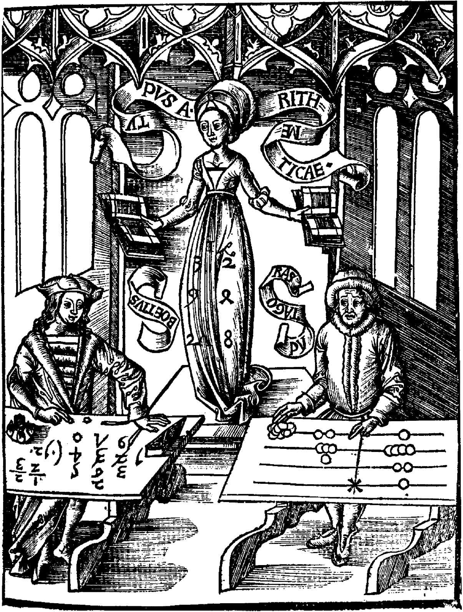

图 4.1 ¶ 格雷戈尔·赖施教科书《哲学珍珠》（*Margarita Philosophica*）中的插图，1508 年。

# 算法传入欧洲

随着关于印度数字系统的穆斯林学术文本被翻译，算法传入了欧洲。这些文本中包括波斯学者穆罕默德·伊本·穆萨·花拉子密（Muḥammad ibn Mūsā al-Khwārizmī，780–850 年）编写的关于十进制数及其计算方案的算术入门书，他的姓氏构成了单词“algorithm”（算法）的词源起源。花拉子密的算术书在西班牙被收集，并由一位名为罗伯特·切斯特的英国人翻译成拉丁文，题为 *Algoritmi de numero indorum*^(25)（意为“切斯特翻译的花拉子密论印度数字”，其中“Algoritmi”是切斯特翻译的“al-Khwārizmī”）。

## 十进制制 vs. 罗马数字

当时新出现的印度数字表示法就是我们今天所知道的无处不在的日常十进制制。回顾一下，之前的表示法是罗马系统：I, II, III, IV, V, VI, VII, VIII, IX, X 等。^(26) 采用十进制制使算术变得更简单、更不易出错。例如，考虑在罗马系统中用十乘以一个数字；比如，IV 乘 X 等于 XL。而在十进制定点位置记数法中做同样的运算相比之下微不足道：4 × 10 = 40。在十进制制中，只需在要乘以十的整数右侧加一个零即可。相反，在罗马系统中，所有算术运算都需要分组、排列，然后重写。

## 算法与商业资本主义

在商业资本主义诞生之际，店主的算术变成了算法问题，而非算盘问题，因此，十进制制算法的优势最终超越了算盘被感知的威力。来自整个欧洲的年轻人来到威尼斯学习对资本主义至关重要的新算法。随着这些算法越来越普及，计算学校在威尼斯以外的许多城市建立起来。1338 年，佛罗伦萨有六所此类学校；到 1613 年，纽伦堡市已有四十八所。^(27)

## “算法”定义的演变

直到十九世纪，“算法”定义中被认为必不可少的仍是十进制数字表示法的使用。这在《牛津英语词典》中有记载，在“algorithm”词条下的第一个定义是“以零为特征的阿拉伯计数系统”。第二个定义是“数学与计算。用于计算和解决问题的过程或规则集；……执行特定任务的精确定义的数学或逻辑操作集。”第二个定义的例子始见于十九世纪的文本。^(28)

## 算术的历史视角

从历史角度来看，很明显，算术从柏拉图时代，到十五世纪的威尼斯，再到十九世纪，然后又随着硬件和软件的发展进入二十世纪，经历了多次变革。此外，即使在任何特定的历史时刻，我们也能找到两种或更多不同种类的算术运算。

## 算术与工业资本主义

虽然算术对商业资本主义至关重要，但它在十九世纪工业资本主义的兴起中变得更为重要。在这一时期，算术发生了两项开创性的变革。

首先，将工作和劳动重新转化为一种可用定量术语衡量和估算的格式，对于阐明劳动和资本如何通过货币联系起来至关重要。完成某项工作需要多少成本？资本家投资昂贵机械以取代人力劳动者是否值得？将劳动重新转化为定量形式——一种将其归结为单一数字的形式——就是第 3 章所述建筑、蒸汽机和信息技术的工作/劳动语言。

其次，不仅是工业上的，也是认识论上的转变，将扩展形式的算术置于许多先前截然不同的知识学科的中心。在数学和逻辑史上，这一转变被称为“算术化”，是数学基础的一个研究计划。^(29) “算术化”在很大程度上塑造了二十世纪数学和逻辑的许多重要发展，包括图灵 1936 年的论文。

## 算术化

一个知识学科经历“算术化”意味着什么？这种翻译的结果有二：算术被扩大了；一个先前与数学无关的主题被纳入数学的庇护之下。

## 布尔的逻辑代数

数学家乔治·布尔将逻辑转化为算术的工作为一个学科如何被重写——翻译——为算术提供了很好的例证。在他的 1854 年著作《思维规律研究：建立数理逻辑与概率理论的基础》（*An Investigation of the Laws of Thought on Which Are Founded the Mathematical Theories of Logic and Probabilities*）中，布尔提出了一种以算术或代数形式书写逻辑表达式的方法。^(30) 布尔逻辑基于这样一个假设：每个表达式的值要么是零（即“假”），要么是一（即“真”）。布尔逻辑表达式可以包含变量（如 `a`、`b`、`c`）、恒等号（`=`；即等式）以及三个算术运算符的翻译（`+`：加法；`−`：减法；`×`：乘法）。

根据布尔的说法，如果 `a` 表示“所有白色的东西”，`b` 表示“所有羊”，则 `a` 乘以 `b` 表示“所有白羊”，可写作 `ab` 或 `ba`，因为 `ab = ba`。如果 `a` 代表“男人”，`b` 代表“女人”，则 `a + b` 可理解为“男人和女人”或“男人或女人”。如果 `c` 代表“欧洲人”，则 `c(a + b) = ca + cb`。换句话说，乘法分配律被翻译用于逻辑，使得“欧洲男人和女人”等同于“欧洲男人和欧洲女人”。类似地，表达式 `a − c` 可读作“所有非欧洲男人”。布尔指出：“‘不在 `a` 中的事物类’可写作 `(1 − a)`。如果 `a` 表示‘男人’，则方程 `a(1 − a)` 将代表其成员既是‘男人’又是‘非男人’的类，……从而表达了这样一个原则：成员同时是男人和非男人的类不存在。换句话说，同一个体不可能同时是男人和非男人。”

布尔继续写道，

> 现在让符号 `a` 的意义从表示“男人”扩展到表示具有任何性质的任何类存在；那么方程 `a(1 − a) = 0` 将表达一个存在不可能同时拥有某种性质又不拥有该性质。但这正是亚里士多德描述为所有哲学基本公理的“矛盾律”。“同一性质不可能同时属于和不属于同一事物。……这是最确定的一切原则。……因此，证明者将其作为最终意见引用。因为它本质上是所有其他公理的源泉”（《形而上学》，III, 3）。^(31)

亚里士多德的“矛盾律”传统上是他的三条“思维定律”中的第二条。其他两条是第一定律，同一律：一切与其自身相同 `a = a`；第三定律，排中律：一切要么具有某种性质，要么具有该性质的否定，用布尔的符号表示为 `a + (1 − a) = 1`。此外请注意，布尔的代数符号允许将条件语句——“如果 `a` 则 `b`”——重写为多项式：`a(1−b) = 0`。

# 在布尔之前，莱布尼茨已将某些逻辑命题转化为代数

在布尔之前，莱布尼茨已将某些逻辑命题转化为代数，包括 `a = a`；`如果 a 是 b 且 b 是 c，则 a 是 c`；`a = not not a`；以及 `a 是 b = not a 是 not b`。但布尔通过将整个亚里士多德逻辑转化为算术多项式（即用算术运算符 `+`、`−`、`×` 和 `=` 组合变量的公式），完成了莱布尼茨的逻辑。布尔的多项式求值结果为 `1` 或 `0`。^(32)

如果我们接受布尔将逻辑转化为算术的做法，就能看出这如何扩大了算术的定义本身。在布尔之前，执行算术运算意味着在计算；人们说是在进行加法或乘法运算。布尔之后，在执行完全相同类型的计算时，人们也可以说是在进行逻辑推理。同样，我们可以看到布尔的转化如何将逻辑置换到数学中，因为逻辑因此被视为一种算术形式，因而根据定义，它属于数学的范畴，而不属于修辞和语法等语言艺术的范畴。布尔之后，使用逻辑这门语言艺术被视为与计算是同一回事，这是一个双重惊喜。我们因为某人使用了一种特定的语言形式，就知道他们在计算！我们因为某人在计算，就知道他们在使用这种语言！

## 维特根斯坦论数学基础

布尔在逻辑和算术方面的工作，是十九世纪延续至二十世纪的数学基础研究计划的核心。这项工作的特点是算术在逻辑和数学定义中的影响力日益增强。随着算术变得占主导地位，要理解什么不是计算变得困难。所有的思想和行动仅仅是算术吗？

1939 年，在剑桥大学的复活节学期和四旬斋学期期间，哲学家路德维希·维特根斯坦在其数学基础课程中讨论了这些问题。尽管维特根斯坦未带讲稿授课，但他的学生做了详尽的笔记，这些笔记后来被整理编辑在一起，形成了维特根斯坦言论和研讨会讨论的记录。显然，有十三四位固定出席者，其中包括艾伦·图灵，他刚从普林斯顿完成博士学业返回剑桥。

根据学生笔记，维特根斯坦在讲座中提出了以下问题：“但——这是一个重要的点——我们怎么知道，当我们观察人类时所观察到的现象，就是我们应该称之为语言的东西？或者我们应该称之为计算的东西？”^(33)

乍一看，维特根斯坦的问题似乎非常奇怪。认出某人是否在计算，能有多复杂？维特根斯坦用另一组问题追问这个看似不可能的困难。当我们看到某人在计算时，我们观察到了什么？“如果我看到某人拿着一张纸以某种方式做标记，我可能会说，‘他在计算。’”^(34) 但我们能仅通过观察某人在纸上做标记，就确定他在计算吗？后来，维特根斯坦说：“如果你这样做，我们不会称之为计算。`4 + 5 = {}`——你在 `{}` 里写下脑海中浮现的任何东西——这是算术运算吗？随你怎么叫。它遗漏了演算最本质的一些要点。”^(35)

讲座笔记的另一处记录了图灵的评论，即可以将计算与实验进行比较。维特根斯坦利用这个比较展开讨论：“让我们回到图灵将物理学实验与数学计算相比较的观点。假设有人发明了一种算术，使得 `2 + 2 = 4` 通过在天平的一盘放两个比特再放两个比特，另一盘放四个比特，看到两盘都不下沉来证明。在什么情况下我们应称之为实验，在什么情况下应称之为计算？”^(36) 这是一个完全不同的计算形象。我们可以想象计算是在纸上做特定标记，也可以想象它借助物理比特（即砝码）和天平进行。什么算作计算？什么不算？

在维特根斯坦的数学基础讲座中，他经常转向图灵提问或举例子。就这些关于计算本质的讨论而言，这毫不奇怪，因为我们可以把图灵 1936 年的论文（见第 2 章讨论）理解为定义了计算的本质。

图灵成就的部分在于，基于与算术的类比，他给出了被视为计算或计算通用描述的公式化。^(37) 尽管如此，维特根斯坦在图灵论文发表后仍提出这些关于计算的问题，事实上，他提出这些问题的对象不仅仅是任何人，而是图灵本人。为什么？在图灵给出定论性的回答后，还有什么需要澄清的？

## 当计算机还是人的时候

为了理解计算形象的不稳定性，我们将回到维特根斯坦的观察（见第 2 章讨论），即图灵的“机器”是人，是用铅笔和方格纸做算术的人类。

因为算术对如此多的思想和工作领域变得如此重要，其无处不在催生了一种被贬为劳动的新工作形式。正如第 2 章所指出的，这种新劳动形式在十七世纪就已为莱布尼茨所察觉。他写道：“如果使用机器，优秀的人把时间像奴隶一样花在计算的劳动上是不值得的，这种劳动完全可以放心地交给别人。”这种新劳动形式就是莱布尼茨所谓的计算劳动。随着算术算法在商业、科学、工程和政府中传播，人肉计算机这一职业被发明出来，以执行这些如今数量庞大的计算。

大概关于作为人类劳动的计算历史，最好的著作是大卫·格里尔的《当计算机还是人的时候》。格里尔从 1758 年哈雷彗星的回归开始讲起。“牛顿的追随者们，根据他的原理，甚至大胆预测几颗[彗星]的回归，”苏格兰哲学家亚当·斯密（1723–1790）写道，“特别是一颗将于 1758 年出现的彗星。”^(38) 不幸的是，牛顿的微积分没有直接陈述或求解三体问题的方法。在这种情况下，被认为对彗星轨迹影响最大的三个天体是太阳、木星和土星。为了预测哈雷彗星回归的日期，天文学家只能将观测运动的数据切成小步骤，在每一步分析三个天体对彗星运动的影响，然后将所有这些逐步分析整合在一起。正如当时一位天文学家所言：“这项任务需要多么巨大的劳动，多么渊博的几何知识啊？”^(39)

## 当计算机成为机器

实际上，这项劳动并非几何性质，而是算术性质；它包含海量的计算。法国数学家亚历克西斯-克洛德·克莱罗决定承担这项任务，并招募了两位天文学家朋友与他一同计算：妮科尔-雷娜·埃塔布勒·德·拉·布里耶尔·勒波特（值得注意的是一位女性，因为当时鲜有女性天文学家）和约瑟夫-热罗姆·勒·弗朗赛·德·拉朗德。根据格里尔的记载，“这三位朋友于 1757 年 6 月开始计算哈雷彗星的轨道。他们在卢森堡宫的一张公共桌旁工作，使用鹅毛笔和厚实的亚麻纸。拉朗德和勒波特在桌子的一侧工作，并将结果交给克莱罗。”^(40)

他们一起进行这些计算直到 9 月底，并于 11 月初向科学院报告了他们的估算：哈雷彗星将于 1758 年 3 月中旬至 4 月中旬之间回归。该彗星于 3 月 13 日通过近日点。

这是一项巨大的计算工作。约瑟夫·拉朗德后来写道：“由于这项艰苦的工作，我染上了一种疾病，将伴随我终生。”

尽管这些繁重计算取得了根本性的成功，数学家兼《百科全书》合编者让·勒·朗·达朗贝尔却谴责他所看到的新兴“计算精神”，并特别指出计算更“繁琐而非深刻”。^(41) 这引发了达朗贝尔与克莱罗之间的一场激烈辩论。一方面，这场辩论在预料之中，因为显然——用第三章讨论的术语来说——克莱罗及其两位同事所做的算术计算属于劳动，是那种莱布尼茨抱怨只应分配给奴隶的“低级”工作。但令人惊讶的是，持这种立场并因此攻击克莱罗的竟然是达朗贝尔。

回想一下，达朗贝尔的《百科全书》合编者是狄德罗：狄德罗，一位工匠之子，也是法国作坊生产中分工原则的分析者、阐释者和捍卫者！对于这些计算而言，克莱罗的成就（除其他外）在于将分工应用于一项新任务——天文计算任务。这一成就蕴含了计算的起源，特别是人类“计算员”这一职业的发明：即图灵最终在其 1936 年论文中形式化的那份工作——那项劳动。^(42)

随着十八世纪人类计算员的发明，人们也逐渐认识到这份工作的枯燥细节。这份工作不仅涉及执行海量算术运算，还涉及检测和纠正错误。模拟哈雷彗星轨道的每一步计算都依赖于所有先前的计算。因此，尤其是在计算的早期阶段，任何错误都可能使整个工程前功尽弃。


# 对算术计算劳动的鄙视

对算术计算劳动的鄙视，加上对结果因可能或很可能引入人为错误而变得岌岌可危的认知，在随后的两百年里持续存在，期间人类计算员一直是大规模计算的主要手段。这两个考量因素——密集劳动和错误倾向——加上第三个因素，即在工业资本主义萌芽时代，计算在工业和科学中的重要性日益增加，这三驾马车共同迫使查尔斯·巴贝奇发明机器以取代人类计算员的劳动。

## 当计算机成为机器

在菲利普和艾米莉·莫里森为巴贝奇文集所作的精彩导言中，他们写道：巴贝奇关于计算机器的构想，源于他在剑桥读本科时，他和朋友约翰·赫歇尔着手核对天文学会人类计算员完成的一些计算。据说巴贝奇在当时的枯燥中感叹道：“但愿上帝能让这些计算由蒸汽来执行。”赫歇尔回应假设道：让机器来做计算是可能的。^(43)

多年后，巴贝奇在致皇家学会会长汉弗里·戴维爵士的信中写道：“难以忍受的劳动和持续重复相似算术计算的疲人单调，首先激起了愿望，随后提出了构想，即制造一种机器，借助重力或其他任何动力，成为人类智力最低级运作的替代品。”^(44) 请注意，即使是巴贝奇也对这种劳动抱有深深的鄙视。

巴贝奇将其机器的目的阐述为一种节约手段。正如路易吉·费德里科·梅纳布雷亚将军（后来成为意大利总理）所传达并报告的那样，巴贝奇关注三种节约：（1）`精度节约`，通过制造全自动计算机器消除人为错误来实现；（2）`时间节约`，因为机器执行算术的速度比人类计算员快得多；（3）`智力节约`，本质上是重申莱布尼茨的担忧，即优秀人才的智力劳动不应耗费在计算上，而应从事更高层次的思考。^(45)

显然，这三种节约要求人类从计算劳动中被移至“上层”或“外部”，因为人类被认为太容易出错、太慢、太宝贵，不适合从事这项工作。这三种节约促使巴贝奇等人将人从计算图景中移除，正如第三章末尾所讨论的。这三种节约正是促使人从计算中消失的动力。

到了十九世纪，逻辑、天文学等重要研究领域的算术化，使得算术计算问题成为许多教学和研究领域的核心。大规模计算的需求也使算术成为政府（如全国人口普查）、军事（如弹道学）、商业（如人寿保险精算表）和工业（如土木、力学、蒸汽机热力学等多种工程形式）的核心。

鉴于这一历史背景，巴贝奇致力于“用蒸汽”进行计算的努力是可以理解的，我们也能更好地理解维特根斯坦关于计算性质变化的评论。维特根斯坦请我们思考计算是什么样子的。在算法引入之前，计算看起来像人类在算盘上拨动珠子。在计算机器引入之前，计算看起来像人类借助纸笔执行特定算法。尽管计算活动经历了这些变革，但所有形式都涉及人类。但随着巴贝奇旨在消除人为错误的目标，我们实质上被要求想象没有人类的计算。我们被要求想象“计算”看起来像一台无人操作的运转机器。

## 错误与工具性

巴贝奇构想的机器，以及随后出现的所有计算机器，当然仍然需要人来设置、启动，并在它们停止时读取计算结果。因此，人为错误——即使在巴贝奇的概念化中——仍可能发生在多个环节：机器的设计、维护与设置（例如录入数据或待执行的操作），甚至记录计算结果时。充其量，随着计算的自动化，人为错误无法被消除，只能被转移或转化到另一个场所或另一种形式。

正如历史学家迈克尔·马洪尼所阐释的，虽然花了数年时间才认识到这一问题，但它至今依然存在，也是创建如今被称为软件工程的学科的动机之一：如何管理并最小化时间与人为错误？^(46) 在讨论马洪尼的历史著作及其对软件工程奠基性文献（源自 1968 年在德国加米施举开的开创性会议）的解读时，哲学家费德丽卡·弗拉贝蒂得出结论：算法的自动化——其作为软件的物质化——直到巴贝奇工作近一个世纪后，才被广泛认认为可能的错误源头：“随着加米施会议的召开，软件开始被概念化为一个问题——‘软件危机’被确立为软件工程学科的起点。”^(47)

在对软件的解读中，弗拉贝蒂借鉴了伯纳德·斯蒂格勒对雅克·德里达关于不透明性与技术著作的重读。^(48) 这种方法的关键在于理解算法超越了工具性。当我们假设软件或其他形式的自动计算只是工具或手段时，我们就忽略了机器可能以错误、“漏洞”或无法通过逐步计算以外的任何方式预见的计算形式产生意外结果。例如，借助莱布尼茨和牛顿的微积分，我们无法预判三体问题模拟的结果，更不用说全球气候变化模拟的结果了。算法具有不可预见的含义和意想不到的后果。

因此，对弗拉贝蒂而言，“要思考技术……我们首先且最根本地必须记住，技术不能从可计算性和工具性的概念框架内被思考。”^(49) 弗拉贝蒂将其方法称为“解构主义”。她写道：“对软件的解构主义解读与功能性解读截然相反。对计算机专业人士而言，系统‘自我瓦解’的节点是故障，是需要修复的东西。而从解构的视角来看，这却是一个揭示的节点，在此软件背后的概念系统得以阐明。”^(50) 根据弗拉贝蒂和软件工程专业人士的观点，如果算法既是问题也是解决方案（德里达和斯蒂格勒可能称之为“pharmakon”——既是药也是毒），那么我们就需要理解错误，而不仅仅是试图构建避免错误的机器。

弗拉贝蒂的解构主义方法与人文学科中其他将人为错误视为人类境况内在属性的领域有着深刻的共鸣。^(51) 因此，例如西格蒙德·弗洛伊德考察记忆错误、身体动作错误和言语错误，“口误”——他称之为“妄为”。在《笑话及其与无意识的关系》（1905）一书中，弗洛伊德分析了一组幽默的口误。书中的第一个例子是：

> 德国诗人兼散文家海涅引入了一个令人愉快的形象……希施-亚辛斯……他向诗人吹嘘自己与富有的罗斯柴尔德男爵的关系，最后说道：“上帝若赐予我一切美好事物，医生，我曾坐在萨洛蒙·罗斯柴尔德身旁，他待我完全像对待平等的人——完全*famillionairely*（富豪式地/亲密地）。”……将思想转化为笑话的过程可以用以下方式表述，乍看似乎荒诞，却精确地产生了真正呈现在我们面前的结果：“R.待我完全*familiär*（亲密地），即就一个*Millionär*（百万富翁）所能做到的程度。”现在让我们设想一种压缩力作用于这些句子，且由于某种原因第二个句子抵抗力较弱。它随即消失，而其最重要的成分——单词“*Millionär*”，成功反抗了被压抑，仿佛被推向第一个句子，并与该句中与其极其相似的成分——“*familiär*”——融合在一起。^(52)

弗洛伊德将这种“口误”、即“famillionaire”一词的产生归因于一个过程。他设想的过程是机械或热力学的：他将其描述为包含作用于两个预设（但未说出口）句子上的“压缩力”。在这本书中，弗洛伊德一个多世纪前所唤起的是一个“可能性空间”的可视化，其中陈述根据一组过程被移动——翻译——从一个进入或覆盖到另一个之上。^(53)

弗洛伊德关于人为错误的形象是一种翻译：人类的言语、姿态或行动的产生可以被翻译成或与其他产生凝聚在一起。因此，错误并非随机，而是受动机驱使且是多个相互作用过程的症状。从这个角度来看，诊断和理解人为错误意味着识别产生该错误的相互作用或干扰过程。

## 作为算法空间中运动的错误

“弗洛伊德式口误”这一短语很好地传达了这样一个观点：错误是在更大的可能行动空间中的运动或翻译。^(54) 再思考维特根斯坦关于可能被视为算术错误的评论：`4 + 5 = {}`——你在{}中写下脑海中浮现的任何东西——这是一个算术运算吗？随你怎么称呼。它遗漏了演算最本质的一些要点。随着每个符号的书写，都需要选择接下来写什么：先写“4”，然后“+”，然后“5”，然后“=”。我们本可以选择写“−”而不是“+”。我们本可以选择写“6”而不是“5”。直到写下“=”这一点，这是正确的；尚未引入人为错误。但现在写入“45”（即`4 + 5 = 45`）引入了一个错误。如果从“4”到“45”的整串符号被视为在更大选择集的可能性空间中的一条路径，那么一条类似的路径也是可想象的——例如，一条以“9”而非“45”结尾的路径。将人类行动想象为在更大可能性空间中的一系列选择，使我们能够将人为错误可视化为沿路径的一次或多次运动或失误。

教育研究表明，这是一种对儿童算术错误极具洞察力的想象。教育技术学家和人工智能专家 John Seely Brown 与 Kurt VanLehn 将算术描绘为一个规则空间，在这个空间中，当儿童发明出一个错误规则，或在做加减法的过程中在错误时机使用了正确规则时，就会产生错误。例如，在多列减法过程中，计算到某些步骤时，需要从当前数字列左边的那一列“借位”。新手可能会“借位”，但忘记将左边那一列的数字减 1；或者，为了避免用较大的数字减去较小的数字，如果下一行的数字较大，他们可能会交换上下两行的数字位置，然后再做减法。

Brown 和 VanLehn 声称：“程序技能的所有 Bug 都可以通过一种高度受限的问题解决形式作用于不完整程序而导出。这些程序的特征是形式化的删除操作，可模拟不完整的学习和遗忘。”^(55) 他们提议，我们将算术算法想象为嵌入在一个大得多的算法可能性空间中，其中一些算法对于给定任务是正确的，另一些则是不正确的。每个算法由一组规则组成，因此，在这些算法之间“移动”或“转换”，在他们的框架中，就是删除或更广泛地编辑算法中的一条规则（或一系列规则）。对 Brown 和 VanLehn 而言，算术中的人为错误——以及人类学习^(56)——就是在一个庞大的规则集空间中导航。

算术算法是更大算法空间的一部分这一事实，有助于我们更好地理解错误、学习等问题，以及为何 Wittgenstein 似乎认为计算是一个不稳定、不断变化的目标。我想通过更具体地描述“算法空间”可能的样子，来详细阐述算术与算法的这一关键问题。虽然原则上可以用 Brown 和 VanLehn 使用的规则符号来做这件事，但我认为他们的符号系统过于复杂。相反，我提议用黑白方块来书写算术规则。

图 4.2 描绘了一种用黑白方块表示二进制加法规则的可能方式。^(57) 算法的每条规则用五个方块书写。顶部三个方块匹配正在进行的加法中的一列。底部两个方块用于重写最终结果行中记录的两个方块。可以将前三个方块视为调用规则前必须匹配的模式：一个前置条件。后两个方块是规则被调用时写入结果的内容：一个后置条件。换句话说，每条规则都可以读作 `if … then` 语句：如果前三个方块匹配加法问题的当前列，则按所示方式重写结果的两个方块。每条规则后置条件中的右侧方块用于记录最终结果的一位。左侧方块用作“进位位”。

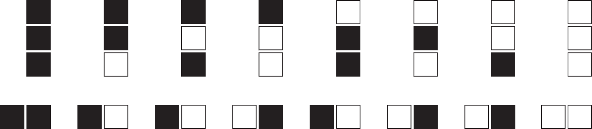

图 4.2 ¶ 二进制数加法规则。

正如学生在十进制算术中被要求学习当两个个位数相加结果为两位数时如何“进 1”一样，这些规则的左侧方块编码了何时应将 1（即黑方块）进位到下一列。因此，一般来说，如果一列中有两个或更多黑方块，就需要向左边的列进一个黑方块（因为在二进制加法中，请记住 1 + 1 = 10）。

图 4.3 展示了加法问题 87 + 56 = ? 的二进制等价形式。第一行是 87 的二进制等价形式（即 01010111）；第二行编码 56（即 00111000）；第三行开始为空，将在所有匹配规则应用完毕后保存和。


图 4.3 ¶ 两个二进制数相加的初始状态。

因此，第一个匹配的规则顶部有一个黑方块，下面有两个白方块。它重写该列，使得和的第一位数字写在 图 4.4 最后一行的最后一列，而在所有列都应用完规则后，结果出现在 图 4.5 的第三行。用十进制形式表示，图 4.5 的整体读作：87 + 56 = 143。^(58)


图 4.4 ¶ 两个二进制数相加的进行状态。


图 4.5 ¶ 两个二进制数相加的最终状态。

再看一遍 图 4.2 中展示的加法规则。规则按照其前置条件排序；即按照规则顶部三个方块中的模式排序。在最左边的规则中，前置条件的所有方块都是黑色的。在最右边的规则中，前置条件的所有方块都是白色的。如果我们将所有前置条件侧放，使其能水平而非垂直地被检查，然后将这些三元组与二进制数的表示（黑白方块）进行比较，我们会发现黑白方块的序列从右向左（如果你确实将页面逆时针旋转了九十度使其水平，如之前建议的那样，则是从上到下）“拼出”了 0, 1, 2, 3, 4, 5, 6, 7。

在十进制系统中，用三位数字最多可以写出一千个不同的整数（即 {0 … 999}）。在二进制系统中，用三位数字只能写出八个不同的整数（即 {0, 1, 10, 11, 100, 101, 110, 111}）。我们可以约定，总是将一个规则集的规则排列为一个八元序列，其中最左边的前置条件是所有方块均为黑色的那个（即它编码 7 的二进制表示：111）。最右边的前置条件包含三个白方块（即 000）。

例如在 图 4.6 中，展示了一组减法规则。将其与加法规则集对比，你会发现前置条件顺序相同，但显然后置条件（规则集中每条规则底部的两个方块）是不同的。在这种情况下，每个后置条件的左侧方块代表一个“借位位”（类似于我们在传统减法中使用的借位规则），而不是像加法规则集那样代表“进位位”。

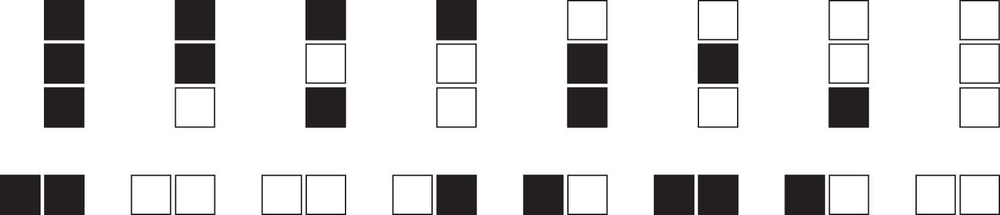

图 4.6 ¶ 二进制数减法规则。

一旦我们采用了排序约定，始终根据规则的前提条件所代表的数字来排列规则，那么仅通过编写其后置条件就可以写出任何规则集，因为我们知道其前置条件将始终只是序列 7 … 0（二进制格式）。此外，因为我们知道每个后置条件都是两位长（即每个后置条件包含两个方格），所以可以通过将该集合的所有后置条件连接在一起，将规则集写为单个数字。因此，减法规则集的二进制等价物（1 和 0）就是：`1100000110111000`。简而言之，规则集可以缩写为一个十六位二进制数。

该二进制数的十进制等价物是 `49592`。前面讨论的加法规则集的后置条件组成的十六位二进制数的十进制表示是 `59796`。

人们很容易想象，例如，在所有可能的规则集空间中，存在一个规则集就是：`0000000000000000`。这种规则集在执行时非常乏味：任何黑白方格的组合都会导致最终行的单元格全为白色。同样存在一个简单的规则集，即十六个 1：`1111111111111111`。该规则集应用于任意两行黑白方格，会产生第三行方格，且全为黑色。由于使用十六位二进制格式可以写出 `65536` 个唯一数字，因此在这种特定表示中共有 `65536` 个可能的规则集。

规则集 0（即规则集 `0000000000000000`）非常乏味：它将所有东西映射为白方格。规则集 `65535`（即规则集 `1111111111111111`）同样乏味：它将所有东西映射为黑方格。但规则集 `49592` 是减法的表示，规则集 `59796` 是加法的表示。那么，在规则集的枚举中紧邻加法的两个规则集：`59795` 和 `59797` 呢？它们只是加法的错误形式吗？又或者是枚举中距离较远的过程，例如规则集 `34567`？它们是否也编码了一个过程、一个算法，能够根据两个事实产生新的真命题？换句话说，它们是否也是几个世纪以来关于方法、过程和算法的哲学探究的对象？或者它们可能属于那条谱系却未被审视？又或者它们只是代表无特别兴趣方法的乏味规则集？

一旦开发出一种系统枚举一系列规则集的方法，就拥有了询问大量算法空间问题的手段，而不必将每个算法视为孤立的奇点。例如，人们可能会问：在这种算法表示下，规则集 `59796` 是否是构成二进制加法有效过程的唯一规则集？是否还有其他规则集能做到？又或者可能有几十个用于加法的规则集？

利用这种包含加法和减法在内的算法空间枚举，我们可以重新审视 Brown 和 VanLehn 关于儿童算术错误的假设。例如，如果使用规则集 `59797`（而不是规则集 `59796`）来做加法，大多数情况下都能做得很好，除非在使用了错误规则的情况下（即最后一条规则，在正确集合中规定 `0 + 0 = 0` 且进位 `0`，但在错误规则集 `59797` 中规定 `0 + 0 = 1` 且进位 `0`）。通过这种方式，人们可以将一组系统性的算术错误可视化为一种转换：在枚举算法空间中从规则集 `59796` 到规则集 `59797` 的微小移动。

## 机器学习

可枚举的规则集空间也是大多数“机器学习”算法的关键要素。最简单的机器学习算法是“生成并测试”。让我们想象一下，目标是让计算机“学会”如何做加法。机器学习算法获得（a）一个可枚举的规则集空间和（b）一组示例，即一列已解出的加法算式（例如 `0 + 0 = 0`；`1 + 1 = 2`；`87 + 56 = 143`；`50 + 50 = 100` 等）。然后，“生成并测试”过程可以从规则集 `0` 开始，注意到它对一个示例（`0 + 0 = 0`）效果很好，但发现它对其他任何示例都无法产生正确答案。它将继续尝试规则集 `1`，然后是规则集 `2`，依此类推，最终到达规则集 `59796`，此时机器学习算法会注意到整个已解出的加法算式列表都可以被复现。

因此，在尝试了近 `60,000` 个规则集后，该过程就可以说“学会了”算术。比“生成并测试”更复杂的机器学习算法旨在以比简单枚举更高效的方式遍历所有可能规则集的空间。例如，注意规则集 `1` 将其最右侧的规则编码为错误的加法 `0 + 0 = 1`。因此，机器学习算法在检查规则集 `1` 后可以注意到，规则集 `1` 的最右侧规则在所有示例上都不起作用，然后如果后续规则集包含该规则，它就可以跳过它们而不必根据已解出的加法算式进行检查。以这种方式，规则集中的每条规则都可以独立检查，如果确定规则集包含一条或多条错误规则，则可以排除整个规则集。


这是一种称为“归纳”的机器学习形式，它定义了一组我们将在第 5 章（逻辑）、第 6 章（修辞）和第 7 章（语法）中再次回顾的过程。在后续工作中，VanLehn 试图证实这样一个观点：学生通过使用一种可以实现为归纳机器学习算法的过程来学习算术。^(59) 虽然可以认为，即使使用简单的“生成并测试”算法，一个过程最终也可能输出一个能执行加法的规则集，但声称这种归纳形式与学童学习算术时所做的有共同之处，正如 VanLehn 所主张的，在我看来似乎是一个巨大的信仰飞跃。依我之见，机器学习与人类学习的等同非常牵强，实际上可能与我们学习事物时所做的毫无共同之处。

但 VanLehn 绝非唯一一个声称人类学习可以理解为类比于机器学习（反之亦然）的人。无论是在关于软件的科幻小说中（例如电影《Her》中广受喜爱的程序“Samantha”^(60)），还是在计算机科学的技术文献中，计算机程序都被说成通过“学习”来改进。在电影中，“Samantha”告诉主角她通过阅读书籍在“学习”。这让我们相信软件像人类一样学习，但如果我们查阅当代计算机科学关于机器学习的文献，就能看到机器学习与人类学习有多远；例如，一本领先的人工智能教科书总结了一组机器学习算法，并指出大多数算法以属性值向量（例如一长串数字）作为输入，输出一个小数或整数。^(61)

## 算法作为不完美的模仿

商业、科学和政府目前对“大数据”的热情基于这样一个观点：计算机会“学习”，而它们实际上所做的是寻找输入向量属性值之间的相关性。将通俗理解的学习与一组算法混为一谈，在科幻故事讲述中是一个有用的设想，并诱使一些人将数据视为社会和经济的万灵药^(62)，但这对人类学习和教育机构是有害的。

例如，许多人认为机器学习专家是最了解教育的人。因此，他们被说服接受在线“学习”，而将其视为面对面教育的替代品，这充其量只是对学生的一次冒险之举。^(63) 当前的在线学习形式（如 MOOCs）放大了大学教育中最糟糕的一面——大型、匿名的讲座——却排除了最好的教学法：小组辅导。

Brown 和 VanLehn 的研究展示了如何将算术中的人为错误概念化为算法空间中规则集之间的移动，就像这些黑白方块排列所能枚举的空间一样。然而，我们必须承认，Brown 和 VanLehn 对算术错误的表征充其量只是部分的。用第 3 章引入的术语来说，算术的“工作语言”——例如，人肉计算机或其组织者（如 Prony）用来描述和执行计算劳动的语言——肯定比此处用作“机器语言”的黑白方块大得多、包容得多。例如，要描述人肉计算机的工作条件，不得不描述行业工具（铅笔、方格纸）、座位安排、汇报结构（谁来核对结果）、工作时间（午休、下班时间）等。因此，有些人为错误或许可以解释为机器语言所枚举的算法空间中规则集之间的翻译，而其他人为错误——以及人肉计算的更大规模劳动——则在从工作语言向机器语言的翻译中丢失了。

从工作语言向机器语言翻译中累积的这些损失，是意识形态局限性的一种可能模型，或者具体来说，是第 2 章讨论的符号闭合。也就是说，即使机器语言的阐述——就像刚才讨论的黑白方块那样——为我们提供了一种可视化错误和局限的手段（例如，通过枚举算法空间中的所有可能算法），它同时也限定了可被想象的范围。

Brown 和 VanLehn 再次为我们提供了一个清晰的例证，说明了其中的利害关系。他们写道：“给定一项程序性技能，\[我们的理论\] 可以预测……学习该技能的学生行为中将会出现哪些系统性错误……”^(64) 但请考虑下面这个例子，说明系统性错误如何可能超出机器语言的范围，从而也超出了 Brown 和 VanLehn 理论的预测能力。想象一下，教室对面正在进行一个大型建筑项目。施工期间，巨大的噪音周期性地震动教室窗户，导致学生暂时失聪。街对面墙壁被拆毁，桩基被打入，电动工具撕裂空气。如果这些噪音系统性地干扰了部分学生，导致他们在算术练习册上出错，这些系统性错误是否超出了 Brown 和 VanLehn 理论的解释范围？那些睡眠不足或从未吃过像样早餐的学生所犯的系统性错误又该如何解释？^(65)

Brown 和 VanLehn 声称他们的理论能预测所有程序性技能中的所有系统性错误，然而上述情况却超出了他们的理论。他们的主张过于宽泛，正因过于宽泛，才表现出符号闭合的症状。他们的机器语言不足以表达人肉计算可能的许多工作条件，因此也不足以描述算术表现中所有可能的系统性错误。

因此，我的主张是——即使在看似简单的算术领域——工作语言与机器语言之间的翻译也能揭示数字意识形态中的缺口。虽然“算术”、“计算”和“算法”的定义似乎都已尘埃落定，因为它们已与软件和计算机紧密相连，但实际上它们的定义仍不稳定。正如维特根斯坦 1939 年的评论和提问所暗示的，图灵 1936 年的论文并未解决这些争论。历史上，算术不断变化的物质条件（例如从算盘到算法的笔纸方法，再到计算机的使用）重新定义了“计算”的含义。我们可以通过在巨大的可能性空间中可视化算法来理解它们，正如我用黑白方块书写的规则集或算法所演示的那样。即便如此，这种概念化仍存在意识形态极限或符号闭合，正如 Brown 和 VanLehn 关于错误的研究所说明的：工作语言将永远裹挟着细节、语境和晦涩之处，这些无法用机器语言缝合。如果我们将机器语言视为一种“语法”（将在第 7 章详述），那么总体而言，本章的观点类似于人类学家兼语言学家爱德华·萨丕尔（Edward Sapir，1884–1939）的断言：“所有语法都有漏洞。”^(66)

# 注释

算法是独立于任何编程语言而存在的概念。……我认为算法在图灵等人将其形式化之前很久就已存在，正如“二”这个数字的概念在一年级教科书作者和其他数理逻辑学家给出确切定义之前很久就已存在。……一种计算方法包含一组 `Q`（有限或无限）的“状态”，其中包含一个“输入”子集 `X` 和一个“输出”子集 `Y`；以及一个从 `Q` 映射到自身的函数 `F`。（这些量通常也被限制为可有限定义的，在某种对应于人类可理解的意义上。）……通过这种方式，我们可以将抽象算法与代表它们的特定程序分离开来。

参见 Donald Ervin Knuth，“Algorithm and Program; Information and Data”，《ACM 通讯》9 卷，第 9 期（1966）：654。还请注意，从 1960 年起，他发表该声明的期刊《ACM 通讯》（`CACM`）开始用 ALGOL 发布算法，ALGOL 是一种当时新兴的编程语言。因此，在实践中，且与 Knuth 明确的声明相矛盾（但与他自己的写作实践一致），《CACM》的编辑们将算法的定义与一种特定的编程语言——即 ALGOL——绑定在了一起。

在巴格达第 86 战斗支援医院执勤的头几天里，美国陆军神经学家、上校 Geoffrey Ling 发现了一些异常情况。在简易爆炸装置（IED）爆炸中遭受严重头部损伤的士兵，其状况似乎比他在车祸和袭击中遭受看似相似损伤的患者身上预期的要糟糕得多。……“他们的\[大脑\]扫描结果冷冰冰地正常，跟他们交谈时，他们看起来也没事，”Ling 说。……“但当我开始测试他们时，比如让他们做加法，他们显然不正常。”

参见 Emily Singer，“Brain Trauma in Iraq”，《技术评论》（2008 年 5-6 月）：53，[`www.technologyreview.com/s/409938/brain-trauma-in-iraq/`](https://www.technologyreview.com/s/409938/brain-trauma-in-iraq/)。

当柏拉图……着手构建其学园实际课程的大纲时，他同样面临着让洞穴中的囚徒从长久的幻觉中觉醒的问题。为此而提议的课程中的第一门学科是算术。这取代了苏格拉底式的打断式提问。为什么是算术？难道不是因为它是一种心智活动的首要例证，这种活动不是回忆和重复，而是解决问题吗？建立数量关系就是实现思维的一次微小飞跃。……这不可能是一个模仿的过程；它不涉及与一系列或一份现象清单的认同，而是恰恰相反。人们必须从该系列中实现人格上的分离，才能客观地审视它并加以衡量。

参见 Eric Alfred Havelock 著、*Preface to Plato*（剑桥：Belknap Press / Harvard University Press, 1963），Kindle 位置 210。

商人们使用罗马数字记录数字数据，并通过一种相当复杂且广泛使用的手指计算程序或机械算盘进行计算。这种状况在 1202 年后不久开始改变，那一年，一位年轻的意大利人、比萨的莱昂纳多——几个世纪后一位历史学家称他为“斐波那契”——在西方完成了第一本通用算术书《算盘全书》，用普通人（商人、实业家以及学童）能理解的语言解释了“新”方法。虽然可以追溯其他渊源，但莱昂纳多通过《算盘全书》产生的影响迄今为止最大，并塑造了现代西欧的发展。

参见 Keith Devlin 著、*The Man of Numbers: Fibonacci’s Arithmetic Revolution*（纽约：Bloomsbury, 2011），Kindle 位置 39–45。

# 5 逻辑

许多人认为，从十九世纪的数理逻辑到二十世纪电子数字计算机的诞生，存在一条直接的发展脉络。源于逻辑的计算机故事频繁被讲述，通常始于数学家乔治·布尔将逻辑转化为代数、三种逻辑运算的算术的工作：`AND`、`OR` 和 `NOT`。如果我们顺着这个故事，可以看到，到 1930 年代末，逻辑被转译为代数/算术方程；逻辑方程被转译为电路，反之亦然；逻辑方程也可以被转译为表格。源于逻辑的计算机故事强调这些不同逻辑形式之间的连续性。我们被说服相信，例如，布尔十九世纪的代数方程已无缝、无损地转译为当今所有当代数字计算机硬件中无处不在的布尔电路。

与这一叙事相反，本章将说明，逻辑的每一次转译——从亚里士多德、布尔、皮尔士、维特根斯坦、香农，到今天——像所有翻译一样，都包含着得与失。因此，所有这些事物——无论是方程还是电路——都被笼统称为“逻辑”，但实际上它们在操作层面和物质层面上截然不同。

自布尔以来，逻辑已分化为成千上万种不同的形式体系和许多不同的物质形态，彼此之间没有任何一种是完全等价的。论点在于，许多截然不同的操作类型现在都被视为等同于逻辑；在数字意识形态中，各种各样的技术和工艺被归类为“逻辑”之名。或许昨天只有一种“逻辑”，但今天不再是了。相反，存在许多特殊逻辑，许多特定目的的人工语言，它们都被称为“逻辑”。将“逻辑”视为计算与人类思维的定义或实现的通用全能基础，这种信仰由来已久且缺乏根据。

几个世纪以来，“逻辑”与“辩证法”被视为同义词。即使现在，在《牛津英语词典》（`OED`）中，“辩证法”第 1.a 条释义仍是“逻辑，推理”。然而，如果我们继续阅读《牛津英语词典》并注意到每个词的词源，会发现古希腊语中“logic”（逻辑）源自“λόγος”，意为词语、演说、推理、理性。相比之下，古希腊语中“dialectic”（辩证法）源自“ἡδιαλεκτική”，意为辩证艺术、讨论或辩论的艺术。本章始于对辩证法与逻辑历史的探索。它们何时分道扬镳？为何演变成两种截然不同的艺术？

在简短回顾历史后，我们将质疑“计算机是逻辑机器”这一常识性观念。计算机史的起源神话是这样的：一旦逻辑与辩证法分道扬镳，变得更“精确”、更“数学化”，它便发展成了计算机。换句话说，神话认为计算机是逻辑的产物。实际历史要复杂得多，也有趣得多。例如，如果查看一些最早的数字计算机制造者的证词，会发现推动其发展的主要动机是创造一台执行数值计算的机器，而非进行逻辑推理。^(1) 此外，即使在 1950 年，即数字计算机发明后很久，关于逻辑机器的科学文献与计算机设计文献仍然是截然不同的。^(2)

20 世纪 50 年代起，启动了在软件中模拟逻辑机器的项目。^(3) 虽然逻辑运算确实以特定应用的形式被编写进软件，但这些运算仍只是计算机功能的一个小子集。为证明计算机不仅仅是逻辑机器，本章第二部分将考察一些区分计算机与逻辑的关键属性；例如，考察布尔逻辑与数字计算机“逻辑电路”的区别。

在本章第三部分也是最后一部分，我们将通过快速浏览两个领域，更仔细地观察逻辑如何作为特定应用在软件中实现。一是软件中的逻辑电路仿真领域，即用于计算机硬件设计的软件工具类型。第二个领域是“逻辑编程”，一套据说以逻辑为核心的编程技术和语言。

## 辩证法的开端

在《柏拉图序论》一书中，古希腊学者埃里克·哈夫洛克请我们想象识字之前教学、学习和知识的样子。《伊利亚特》和《奥德赛》等长篇故事由一代代诗人凭记忆吟诵。这些诗歌、这些故事不仅被视为娱乐，更重要的是被视为智慧和诀窍。根据哈夫洛克的说法，它们构成了一部百科全书——“pedia”（博雅）一词与古希腊语中教养或学习的词汇“παιδεία”或“paideía”相关。勇气和荣誉的文化理想化身于阿基里斯等人物中；道德准则在男女、老少、敌友、神人之间的交往中得以体现；具体实践在诗中被详述，如如何作战、如何祭神、如何治家、如何做主人、如何做客、如何航海、如何战斗。

在识字时代来临之前，这些诗歌的表演是新一代学习老一代知识的主要途径之一。诗歌公式化的口语陈词滥调、韵律和格律使其易于记忆。哈夫洛克指出，因此，这种诗歌表演并非鼓励听众提问，从而打断故事流程并分散诗人的注意力。相反，在这样的表演中，“学习”意味着专心聆听、尽可能多地背诵，并与人物产生认同。

## 区分辩证法与逻辑

在古希腊书写广泛采用之时，辩证法进入了这种至今仍在持续的口语状态，具有破坏性，甚至可以说是公然煽动性的。Havelock 写道：

> 这就是辩证法的方法，……它以最简单的形式作为最初的手段，在于要求发言人重复自己并解释他的意思。…… 如果有关陈述涉及文化传统和道德的重要事项，那将是诗意的，使用诗歌的意象，往往还有诗歌的韵律。“你是什么意思？再说一遍”，突然打破了人们在诗意公式或意象中感到的愉悦自满。这意味着使用不同的词语，而这些同义词将不再是诗意的；它们将是散文的。…… 简而言之，辩证法……是一种唤醒意识、使其摆脱梦境语言并刺激其进行抽象思维的武器。随着它这样做，“我思考阿喀琉斯”的概念取代了“我认同阿喀琉斯”的概念诞生了。^(4)

尽管辩证法最初是一种对话技巧，^(5) 但 Havelock 提醒我们，从一开始它就被视为一种危险的武器，一种打断不仅诗人而且社会秩序的手段，因为诗歌是社会秩序生产和再生产的内在要素。

然而，最终使辩证法最令人怀疑的是，它发展成了一种任何人都可以采用的方法。^(6) 在那个时代，想象知识能从任何人的一连串提问中涌现——甚至是自称对某一主题一无所知的人——是令人震惊的。^(7)

那些心智未准备好的人却向德尔斐神谕提问，充分说明了这种观念是愚蠢的。例如，根据 Herodotus 记载，公元前 560 年，Lydia 的 Croesus 询问他是否应该与波斯人开战。神谕回应说，如果他这样做，一个强大的帝国将被摧毁。只有战争结束时才清楚是哪个帝国：被战争摧毁的是 Croesus 的帝国，而不是波斯帝国。^(8) 真糟糕！

在口语社会中，辩证法是一种言语实践——一种对话艺术——它打断了诗歌的背诵。然而，作为一种口语实践，辩证法无法取代诗歌，因为辩证法将话语推向散文，从而使所说的内容变得易于遗忘。因此，辩证法只能在识字社会中持续存在，在那里需要记忆的事物可以被写下来。以这种方式，辩证法推动政治、社会和文化制度从诗歌走向书面散文。

## 区分辩证法与逻辑

当社会从口语转向识字后，书写成为论证的内在要素。中世纪学者 Walter Ong 解释了这种心智与物质世界随之而来的纠缠：

> 哲学及所有科学和“技艺”（程序的分析研究，如 Aristotle 的 *Art of Rhetoric*）赖以存在于书写之上，也就是说，它们不是由无辅助的人类心智产生的，而是由心智利用一种已深度内化、融入心智过程本身的技术产生的。心智与周围物质世界的互动比迄今所认为的更深刻、更具创造性。哲学似乎应该反思性地意识到自己是一种技术产品——也就是说，一种非常特殊的人类产品。逻辑本身源于书写技术。^(9)

因此，区分逻辑与辩证法的主要特征在于：逻辑是书写实践，而辩证法是口头对话实践。

在 *The Art of Controversy* 中，哲学家 Arthur Schopenhauer (1788–1860) 沿着与 Ong 互补的界限区分了逻辑与辩证法：

> 显然，逻辑处理纯粹 *a priori* 性质的主题，在定义上可与经验分离，即思维法则、理性过程或 *logos*，也就是理性在独自运作、不受阻碍时所遵循的法则——如理性存在者的孤独思维，绝不被误导。另一方面，辩证法将处理两个理性存在者之间的交往，他们因为理性，本应共同思考，但一旦他们不再像两个走时完全一致的钟表那样一致，就会产生争论，或智力竞赛。^(10)

Schopenhauer 关于逻辑（一个人的孤独思维）与辩证法（两人之间的对话交流）的区分，与 Ong 的观点互补，因为书写是孤独活动，而口头对话是人与人之间的互动。但 Schopenhauer 在写道“逻辑处理纯粹 *a priori* 性质的主题”时，又增加了这两者之间的另一个区别。

Marshall McLuhan 的著作——他是 Walter Ong 和 Eric Havelock 的同事——可以被理解为运用 *a priori* 范畴对 Schopenhauer 区别的阐述：“自 Aristotle 以来，很容易看出逻辑与辩证法的区别在于前者是证明性的，后者在证明模式上是或然性的；这归因于它们所关注的事项。”^(11)

在这样的框架内，逻辑与辩证法的区别不在于它们如何进行或有多少人参与。相反，区别的关键在于它们所作用的知识类型。因此，根据这个定义，当我们处理确定知识时——例如 Euclid 的几何公理——我们就在逻辑的领域内。另一方面，如果我们在考虑意见，我们就在辩证法的领域内。

McLuhan 进一步考虑了中世纪基督教辩证法学家因被视为将辩证法误用于上帝话语的确定知识而引起的愤怒。最终，这种愤怒导致了辩证法的耻辱，使其从学术和神学的恩典中跌落，这种耻辱一直持续到十八世纪，我们很快就会看到。

可以理解，在一个神学绝对主义的文化中——如中世纪欧洲经院哲学家所处、由天主教会统治的文化中——这种程序若不危及教会断言为真的陈述，就无法应用。例如，如果一个人通过辩证法程序被引导到“上帝存在”和“上帝不存在”这两个同样或然的陈述，从天主教教义的角度来看，他就被引入歧途了。

然而，早在中世纪经院哲学家之前很久，辩证法就被视为一种危险武器，因为它工具化了语言，使其成为一种即使没有智慧的人也能用来拆解常识的工具。这就是 Socrates 和 Sophists 部署辩证法的方式。

## Zeno’s Dialectic


# 芝诺的方法与辩证法

芝诺的方法定义得如此精确，自亚里士多德以来被称为“辩证法”。针对某个特定问题，从一个“似是而非”的回答——即一个假想对话者、某位哲学家或某种通见所认可的回答——出发，你推导出它所蕴含的后果，并表明这些后果彼此矛盾，且与最初的论题相矛盾，从而导出一个与第一个论题同样“似是而非”的相反论题。…… 我们要归功于他的方法的，如果不是将对话形式应用于哲学探究，至少也是一种梳理和辩论问题的特定方式，这种方式在智者派的修辞学和苏格拉底的哲学中均能找到。^(12)

## 阿喀琉斯与乌龟的悖论

作为该方法的发明者，芝诺据称提出了一系列悖论，以说明辩证法如何反驳常识。他最著名的悖论是阿喀琉斯与乌龟的悖论。亚里士多德表述道：“这是说最慢的跑者永远不会被最快的跑者追上；因为追赶者必须先到达逃跑者出发的地方，所以较慢的跑者总是必然领先一些。”^(13)

该悖论常借两名跑者来反复描述：一名快，阿喀琉斯；一名慢，乌龟。阿喀琉斯与乌龟赛跑，乌龟获得领跑优势。阿喀琉斯能追上乌龟吗？芝诺认为不能。为什么？假设乌龟领跑，当阿喀琉斯起跑时，乌龟已在路上领先了一段距离。为便于说明，假设乌龟领先一公里。阿喀琉斯奔跑时当然会很快跑完一公里，但在阿喀琉斯跑这段距离的时间里，乌龟会继续前进，超出一公里，也许前进了一百米。因此，当阿喀琉斯到达一公里标记处时，并未追上乌龟，因为乌龟此时将位于 1,100 米标记处。但随后，当阿喀琉斯到达 1,100 米标记处时，乌龟又会前进更远，假设到达 1,110 米标记处，以此类推。因此，阿喀琉斯永远追不上乌龟。

芝诺的论证看似无懈可击，但显然违背常识。当然，较快的跑者最终会追上较慢的跑者！令人难以置信的是，从亚里士多德时代直到现在，芝诺的悖论一直是激烈辩论的主题。千百年来，有人怀疑芝诺的悖论根本不是悖论，也有人认为该悖论至今未解。

## 提出的解决方案及其反响

芝诺悖论有许多“解决方案”。例如，哲学家文森特·阿杜雷尔 2015 年的文章《阿喀琉斯与乌龟悖论的离散解》^(14) 认为，如果采用时间的离散表示而非连续表示，就能展示并计算出阿喀琉斯何时追上乌龟。阿杜雷尔的“解决方案”最终归结为编写一个计算机程序来“解决”芝诺悖论。^(15) 时间的离散表示是指在某个粒度层面上不可再分的表示。例如，我们可以说单位是“眨眼一下”，没有比这更小的单位；即半个“眨眼”不被视为有效度量。

显然，阿杜雷尔的解决方案只会引起那些认为悖论仍未解决之人的兴趣。任何不关心该悖论的人，都会因为以下三个原因之一，认为任何此类“解决方案”——无论当代还是古代——都是无用或荒谬的：(i) 因为对该情境的任何经验考察（例如，安排一位超凡人类跑者与乌龟进行一系列赛跑）都将显示乌龟总会输；(ii) 因为简单的早期生活经验预示着阿喀琉斯的胜利；或 (iii) 因为任何像阿杜雷尔那样试图将问题作为抽象计算来陈述和解决的人，都是从远离日常常识的轨道来审视世界。^(16)

# 笛卡尔的方法与笛卡尔时刻

后一种立场诊断出一种预示数字意识形态的心态，即一种世界观，认为获取真理被视为拥有正确方法的问题，更具体地说，是进行正确计算的问题。这种心态的历史远远超出了芝诺悖论的历史，涉及方法在哲学、数学和科学中的作用。为何要用计算——一种方法——来解决芝诺悖论这类问题，而不是运用常识、尝试经验验证，或通过与他人协商讨论？

大约直到十七世纪，人们相信真理只属于那些在身体、精神和灵性上做好准备的人。哲学家米歇尔·福柯认为，从“真理取决于知识追求者的身体和灵性准备”这一信念转向“真理不取决于此”这一信念，是现代时代的特征性转变。福柯大致以“笛卡尔时刻”来界定这一转变的时间，这指的是笛卡尔的信念：真理可以通过思维（“我思故我在”）找到，独立于灵性和身体的准备。特别是，笛卡尔陈述了他对形式方法的信念，我们可以称之为演绎，或更广泛地说，逻辑。^(17)

福柯所命名的“笛卡尔时刻”标志着什么算作知识以及谁被认为有能力获取知识发生了根本性转变。笛卡尔时刻之后的这种信念——真理仅关乎知识，且可通过正确的方法或计算形式找到——现在变得更加复杂了——但仅限于那些设法超越数字意识形态思考的人，如女性主义认识论学者。^(18) 数字意识形态的特征是对方法和计算的绝对信仰，或更精确地说，是将计算*视为*方法。确实，在当今的数字意识形态中，真理被视为完全独立于主体，而完全依赖于计算方法。^(19) 这种意识形态让人们能够——毫无讽刺意味地——谈论“智能手机”和“智能机器”。现在，在福柯所说的现代时代之后，许多人认为计算方法——数据和算法——可以通向知识，无论掌舵的是否有一个知晓的或有准备的人类主体。此外，最有害的是，根据这种意识形态，尽管无需特定主体控制这些算法，但普遍预设这些算法只能由工业界的白人男性开发，如 Facebook 的创始人、微软的创始人、谷歌的创始人等。^(20)

# 《百科全书》中的逻辑：艺术还是科学？

福柯将重大认识论转变的时间定在笛卡尔时代左右，这一点可以从笛卡尔之后不久的十八世纪逻辑著作中得到验证，例如狄德罗和达朗贝尔的《百科全书》中“逻辑”词条。该词条以一个定义开始：

## 逻辑是正确思维的艺术

逻辑是正确思维的艺术，或者说是以一种适合我们理性官能的方式运用思维，用于定义、划分和推理。该词源自希腊语 λόγος，译为拉丁语是 *sermo*，在[英语]中是 discourse（言谈/论述）。这是因为思维是一种内在的、心智的言谈，在其中心智与自身对话。逻辑常被称为辩证法…… 要正确思维，必需感知、判断、言谈，并有条理地将自己的观念联系起来；因此，感知、判断、言谈和方法是逻辑艺术的四个基本方面。我们对心智这四种运作的反思构成了逻辑。…… 培根勋爵将逻辑分为四部分，即我们在此提出的同四部分。^(21)

百科全书派用“运作”的工作语言描述逻辑，尽管逻辑推测远离诞生这种工作语言的工匠作坊。这种开篇语言似乎表明逻辑将被作为一门艺术来讨论。但在同一条目后面，问题被明确提出：逻辑是一门科学还是一门艺术？

考虑到百科全书派对培根著作的推崇，他们似乎会宣布，鉴于培根的改进，逻辑应被称为一门科学。正如第 3 章所述，培根的《新工具》被视为经验科学的奠基文献，也是后来被称为“科学方法”的一种归纳形式的首次描述。培根批评了逻辑的当代状况，并提议用他（语法层面的）归纳法来取而代之。^(22)

但百科全书派并没有简单地称逻辑为科学，而是为其作为一门艺术的属性辩护：“但它是一门艺术吗？…… 这取决于你赋予‘艺术’一词何种含义。一些人只想称客体为物质的东西为艺术。另一些人则愿意称任何一种习得的、用以实施运作（无论是精神的还是肉体的）的倾向为艺术——依据规则或反思。”^(23) 就逻辑可用运作的词汇来描述而言，它似乎算作一门艺术。

无论他们在将逻辑归类为艺术还是科学上与培根有何分歧，百科全书派都与他一同哀叹当代逻辑的悲惨状况：

> 它已陷入名誉扫地的状态。…… 逻辑从来不过是一门词藻的艺术，这些词藻常常毫无意义，却惊人地擅长掩饰无知而非完善判断；擅长玩弄理性而非强化理性；擅长歪曲真理而非阐明真理。据称其基础由埃利亚的芝诺奠定。…… 众所周知，古代诡辩学家立志永不露怯、永不措手不及，并能同等熟练地为各种课题正反辩论。他们在辩证法中发现了实现这种熟练的巨大资源，并将其全部据为己用。这荒谬的遗产在经院学者手中并未荒废，他们比古代前辈进一步丰富了它。普遍范畴和其他博学的琐碎之谈是逻辑的本质，也是关于逻辑的一切反思和争论的本质。这就是从其起源直到上个世纪[十七世纪]的逻辑状况，因此它陷入如此轻视之中，以至于人们至今仍不愿回归它。且真必须承认，当今学校对待逻辑的方式进一步助长了许多人至今仍对这门科学的轻视。^(24)

尽管如此，《百科全书》条目指出逻辑的名声在十七世纪有所改善，这归功于笛卡尔：

> 笛卡尔，这位推理的真正复兴者，首创了一种新的推理方法，其价值远胜于他的哲学，后者多有谬误或极不确定，即便按他自己制定并传授给我们的规则来判断也是如此。我们不仅在物理学和形而上学，而且在宗教、道德推理和批评中所享有的精确性和准确性，都归功于他。总的来说，笛卡尔的原则和方法大有裨益，使我们习惯于精确地分析词语和观念，从而引领我们走上真理之路。…… 笛卡尔的方法孕育了被称为思维艺术的逻辑。^(25)

因此，《百科全书》中叙述的逻辑史是这样一段历史：逻辑与辩证法作为同义词延续了几个世纪，并由一套对话和推理技术定义，这些技术始于（芝诺），走向毁灭，随后由笛卡尔复兴，并使其立于坚实基础之上。条目中叙述的历史显然带有偏见：百科全书派不掩饰对芝诺著作的鄙视（“这荒谬的遗产”）或对笛卡尔的崇敬（“推理的真正复兴者”）。

## 逻辑、辩证法与三艺作为思想流派

《百科全书》条目将辩证法与逻辑区分开来，并将前者的创立归功于芝诺，后者的创立归功于笛卡尔。这种谱系或渊源最好结合启蒙运动前时期——早期现代时代、经院学者时代——对辩证法和逻辑的理解来语境化。那时，三艺——语法、修辞和辩证法——并非指三个专门的研究课题。相反，每一个都是一个强大的思想流派，在认识论和政治的竞争中与其他流派针锋相对。

马歇尔·麦克卢汉总结了三艺三个流派竞争的历史。从诡辩学家时代起，辩证法就与修辞学相抗衡，柏拉图和亚里士多德主张辩证法应主导修辞学。随后语法学获得霸权，直到十一世纪杰尔贝尔复兴辩证法。但在十五世纪，以伊拉斯谟的工作为高潮，语法和修辞重新获得了对辩证法的主导权。尽管如此，辩证法与修辞的竞争仍在继续，其后果远远超出学校的范畴。用麦克卢汉的话说：“这些文学阵营之间的战争基本上是辩证法与修辞为控制文学创作模式而进行的对立；这种对立的影响延伸到伦理学和政治学领域，无论在古代还是文艺复兴时期皆是如此。”^(26) 麦克卢汉的三艺史止步于莎士比亚时代，但辩证法、修辞学和语法学之间的竞争延续到了十八世纪、百科全书派的时代，甚至可以说延续至今。

《百科全书》条目结合三艺史，为我们提供了一种外生手段来区分逻辑与辩证法：它们可被视为敌对的流派或智力传统，即使它们在语言和文学创作的同一疆域上角力。这种外生区分补充了前文讨论的几种内生区分逻辑与辩证法的方式：(i) 沃尔特·翁认为辩证法是一种口头实践，而逻辑是识字使然的实践；(ii) 叔本华认为逻辑是一种孤独的思维形式，而辩证法只有在两人或以上时才可能；(iii) 麦克卢汉依据亚里士多德，声称两者的区别主要取决于它们所应用的主题；(iv) 福柯的“笛卡尔时刻”和显而易见的带有偏见的、笛卡尔式的《百科全书》条目引入了第四种可能的区分：逻辑是一种可靠的计算方法，而辩证法是一种无原则的修辞形式。

用一种不那么党派化的方式来表述，人们可以说逻辑变成了一种计算形式，而辩证法仍然是一种对话形式。或者，将麦克卢汉的历史从仅涵盖三艺（辩证法、修辞学和语法）扩展到也包含四艺（音乐、几何、算术和天文学），我们可以说“笛卡尔时刻”是逻辑与辩证法分道扬镳的时刻：辩证法留在了三艺，即语言艺术中；而逻辑试图跨越边界进入四艺，即数学艺术。

人文科学史学家指出，其他艺术——或者如果你愿意，称为技艺——从三艺移向四艺，或者反之亦然。例如，牛津大学的 David Cram 曾主张，在十七世纪，音乐经历了一次从四艺向三艺的戏剧性重组；也就是说，音乐以前被认为是一门数学艺术，但后来变成了一门语言艺术。Cram 认为，“一种截然不同的音乐分析形式出现在十六世纪和十七世纪之交，它明确地将音乐置于修辞理论的框架内，从而将音乐与三艺的其他语言艺术联系起来。”^(27) 但 Cram 的分析比这种关于音乐从数学艺术向语言艺术移动的观察要复杂一些。在结论中，他指出，语言的定义在十七世纪和十八世纪之间发生了变化。

## 人工语言与自然语言

在十七世纪，据说存在“制定语言”，如英语、德语和法语。这些制定语言与例如手势、面部表情、拟声词以及基督教神学家所称的“亚当语”（亚当的原始语言）等“自然语言”形成对比。

然后，在十八世纪，发生了一次转换：“自然语言”一词开始被用来指代十七世纪所谓的“制定语言”。在此转换之后，英语、德语和法语不再被视为“制定语言”，而成了典范的“自然语言”，它们与新命名的“人工语言”形成对比。

根据 Cram 的说法，正是人工语言的发明导致了自然语言定义的这一变化。这些人工语言值得注意的是包括 Francis Lodwick（1619–1694）、George Dalgarno（1616–1687）、John Wilkins（1614–1672）和 Gottfried Wilhelm Leibniz（1646–1716）为开发一种“普遍特征”所做的工作，在其中符号代表的不是词而是物。关于这些人工语言实验有一些优秀的学术研究，例如 Jaap Maat 相对较新的著作《十七世纪的哲学语言：Dalgarno、Wilkins、Leibniz》^(28) 以及 Umberto Eco 通俗易读的《寻找完美语言》^(29)。

作为人工语言的例子，Cram 不仅列举了 Leibniz 等人的十七世纪设计，还列举了二十世纪的创造物如 Esperanto，以及计算机语言如 `ALGOL`，后者是计算机科学家（包括 Alan Perlis）在 1960 年代发明的。Cram 将启蒙时代与当代联系起来的做法可以有多种解读。

## 计算机作为逻辑机器

一种解读是惠格史观，它认为逻辑的发展是连接新旧人工语言的核心。在这个历史中，数理逻辑学家 Martin Davis 在其著作《通用计算机：从 Leibniz 到 Turing 之路》^(30) 中非常通俗易懂地讲述了计算机即逻辑的故事，我们看到了一条从 Leibniz 关于哲学语言、“普遍特征”的论文，经过一系列关于 George Boole（1815–1864）、Gottlob Frege（1848–1925）、Georg Cantor（1845–1918）、David Hilbert（1862–1943）、Kurt Gödel（1906–1978）的章节，延伸至 Alan Turing（1912–1954），从而通向现代计算机的脉络。

Martin Davis 的历史隐含地建立在数理逻辑之上，后者主要是十九和二十世纪的发明，它巧妙地将逻辑从语言艺术移向了数学艺术，实现了一个与音乐经历的转变方向相反的运动。或者，也许对我的论点更为重要的是，应该注意到数理逻辑有效地将逻辑从修辞学和语法等其他语言艺术中分离了出来。

当逻辑和辩证法被视为同义词时，它们与修辞学和语法等其他语言艺术的关系是清晰的。然而，当它们被分离、逻辑被视为一种计算形式而非对话形式时，其道德和伦理层面就难以辨识。因此，一场断裂发生了，它始于“笛卡尔时刻”，并在十九世纪爆发，大约在数理逻辑诞生之时，将批判性思维——例如 Karl Marx 的辩证唯物主义——与数理逻辑分离开来，后者成为一种几乎专门关注算术、几何和其他数学领域基础的逻辑。

因此，人们当然可以同意 Martin Davis 的观点，即计算机是逻辑机器。但更微妙的是，我的论点是它们是某种逻辑的机器，这种逻辑很少为着迷于数理逻辑力量的计算机史学家所考虑。为了强调这一区别，让我重述我之前的观点：计算机是语言机器，更具体地说，计算机是修辞学、语法、逻辑和辩证法的机器。

## 逻辑坍缩为计算

我的故事并不完全围绕逻辑展开。这是一个在十九世纪，孪生兄弟逻辑与辩证法被分离的故事。逻辑随后被从三艺置换到四艺——从语言艺术置换到数学艺术。相比之下，辩证法留在了本土，即语言艺术中。两者各自发展，几乎没有交流。在逻辑中，一种推理论证的方法变成了一种计算操作。辩证法也在发展，但其本质没有太大变化：它成为了一种追求论证、对话、最终是批判理论的精密手段。因此，当代辩证法几乎不了解逻辑的最新发展，即逻辑向计算的发展。而这种无知是相互的：逻辑几乎不了解辩证法的发展。

逻辑出了什么问题？它怎么变成了一种计算形式而不是一种对话技艺？正如我们在第四章算法中所见，它经历了一个“算术化”过程，这要特别归功于 George Boole 的工作。

一旦 Boole 将逻辑变成了算术，奇怪的是，形式化数字和算术为逻辑成了数学家的当务之急。该项目的一个例子是 Giuseppe Peano（1858–1932）用逻辑措辞阐述的一组数字和算术公理。^(31) Peano 公理与 Boole 的工作紧密相关；他的逻辑表述部分基于 Boole 的代数。Peano 公理很奇特，整个数学逻辑形式化项目也是如此，因为它是循环的，或者更具体地说，是同义反复的。想想看：Boole 展示了逻辑如何转化为算术，然后 Peano 展示了算术如何被重写为一种逻辑形式。将 Boole 和 Peano 放在一起，我们发现了一个证明（如果你喜欢这个术语），基于显示逻辑即算术的工作，证明了算术等于逻辑！

这让数学家大卫·希尔伯特觉得像是一个在追逐自己尾巴的研究计划：“算术常被认为是逻辑的一部分，而在为算术建立基础时，通常预设了传统的基本逻辑概念。然而，如果我们仔细观察，会发现传统逻辑法则的阐述中已经使用了某些基本的心智算术概念，例如集合的概念，以及在一定程度上数的概念。因此，我们发现自己已经陷入了循环论证。”^(32) 如果我们在一个世纪前评估这项事业，可能会倾向于将其完全视为某种疯狂的练习。但正如我们现在所知，这些逻辑形式化和算术化的举措促使大卫·希尔伯特向数学界发起挑战，要求证明数学是完备的、一致的和可判定的。作为回应，库尔特·哥德尔证明了数学是不完备且不一致的。随后，艾伦·图灵证明了它是不可判定的，并在同一篇论文中开发了一种理论机器，这相当于我们现在所说的计算机，或更具体地说，算法。

此外，如今每台数字计算机的核心组件都是实现布尔逻辑的布尔电路，它们被光刻在硅和金上。换句话说，可以说十九世纪哲学和数学的一个小分支，已经成长为计算机和当代计算机产业的主干。这个哲学分支已成为硬件和软件，并与我们许多社会、文化、政治和经济制度纠缠在一起。

## 莱布尼茨作为修辞学家

对于这一立场——即遵循马丁·戴维斯叙述的《从莱布尼茨到图灵之路》所抵达的终点——哲学家阿兰·巴迪乌提出了异议，他将皮亚诺的工作定性为一种诡辩。^(33) 在同一本书中，巴迪乌写道：“没有人有义务成为莱布尼茨主义者，即使我们必须承认这种哲学是……思想伟大取向之一的原型。”^(34) 将巴迪乌的这两句话放在一起，便是一种指控：莱布尼茨是一位诡辩家，一位熟练的修辞学家。如果正如许多计算史学家所坚持的，莱布尼茨是计算机的根源，那么——通过巴迪乌——我们便有了一种视角，将计算机也视为修辞机器。


正如克拉姆所描述的，莱布尼茨是最早尝试发明人工语言之一的人。莱布尼茨为什么想要一种人工语言？简而言之，因为他不想争论。莱布尼茨写道：“这种语言将成为理性最大的工具 \[因为\] 当人们之间发生争端时，我们只需说：让我们计算吧，不再多言，看看谁是对的。”^(35) 莱布尼茨的意图是什么？他的雄心是发明一种客观的计算过程，能够公正地裁决任何争端吗？^(36) 这一直是对这段引文的主流解读。它将莱布尼茨置于一个谱系中，该谱系可追溯至柏拉图为寻找一种更完美的理性辩论形式——辩证法——所做的努力，以将其与修辞学那些更狂野、更不理性的举动区分开来。我们将在第 6 章更仔细地审视这一点，那时我们将阅读关于演绎证明开端的内容，那是柏拉图从几何学话语中借用的一种辩论形式。

或者，莱布尼茨的意图是带着枪去参加刀战？也就是说，莱布尼茨是一位诡辩家、一位修辞学家，他预见到了将计算机器带入辩论的可能性，并借此永远赢得辩论，因为计算将成为——也许现在已经成为——最强有力的修辞形式？

人们不必在两种解读中二选一。莱布尼茨既是修辞学家，也是逻辑学家。然而，让我们考虑一下莱布尼茨正在发展什么样的逻辑，无论这种逻辑与修辞和辩论有无关系。

## 逻辑电路

在本章迄今为止的内容中，我们回顾了逻辑被区分并进而从辩证法中分离出来的各种方式。在第 4 章（关于算法）中，我们回顾了“算术化”项目如何将亚里士多德相对非形式化的三段论转化为布尔逻辑，并将其定义为一种算术。莱布尼茨在逻辑方面的工作预见了布尔的一些成果，因此数理逻辑史家如马丁·戴维斯认为，从莱布尼茨到布尔有一条直接的脉络。从这个角度来看，从十九世纪的布尔逻辑到二十世纪的数字计算，其轨迹同样直接。这种联系通常体现在布尔与克劳德·香农之间，后者 1937 年在麻省理工学院的硕士学位论文主题是将布尔逻辑转化为电路，即我们今天使用的每一种数字计算设备中无处不在的布尔电路。^(37)

我首先想指出，“布尔电路”这一概念本身就是我所谓的“数字赋值语句”，是数字意识形态的一种症候。布尔逻辑最初与电路毫无关系，但当香农展示如何构建布尔电路时，他断言布尔的 `AND`、`OR` 和 `NOT` 算子与电路之间存在等价性。这是一组数字赋值语句的例子：一组声称非数字表达与数字技术之间等价的语句。

为了将布尔逻辑转化为硬件和软件，需要遗忘或忽略什么？在某些方面，通过指出计算机芯片设计师和制造商面临的诸多障碍，这很容易证明：电路设计可能不正确；芯片布局可能导致逻辑上必须独立工作的不同电路之间产生意外干扰（例如，当试图在太小的硅片上放置过多晶体管时，芯片制造正在遭遇所谓摩尔定律^(38) 末期的极限）；或者芯片所用材料可能存在缺陷（例如，硅可能没有被正确“掺杂”，因此可能不具备预期的电阻）。但若不深入英特尔及其他制造我们计算设备内部组件的公司的领域进行长途跋涉，也可以用更普遍的方式描绘这一点。我将仅略微涉及芯片制造的细节，指出一系列转化——从布尔逻辑到布尔电路——是如何引入两者之间一个非常强大的差异的，这一差异可被识别为一种新时间形式的引入。

```
36 W 15th St.

New York, 1886 Dec. 30.

My dear Marquand:

… You spoke, when I saw you, as if disappointed with the reception your machine had met with. I wish I could see it.… I think electricity would be the best thing to rely on.

…

Let A, B, C be three keys or other points where the circuit may be open or closed. As in Fig. 1, there is a circuit only if all are closed; in Fig. 2, there is a circuit if any one is closed. This is like multiplication & addition in Logic.

Yours faithfully

C. S. Peirce^(39)
```

# 逻辑机器的演进：从机械到电气

当哲学家查尔斯·桑德斯·皮尔士给他的前学生、艺术史学家艾伦·马夸德写下这些文字时，马夸德正在制造一台进行逻辑运算的机器，一台能够计算逻辑表达式真假的机器。马夸德用木头制造了机器的第一个版本。^40 当时（1886 年），制造逻辑机器的尝试已有悠久历史，^41 但此前制造的所有逻辑机器都像马夸德的一样，是机械的，因此由杠杆、齿轮或电缆构成。^42 皮尔士信件中弥足珍贵的是，他建议将机器制造成电气装置，而非机械装置。

皮尔士的信件及其手绘图如图 5.1 所示。皮尔士的第一张图（他在信中标记为“Fig. 1”）用现代术语描述，是一串串联连接的开关（A、B 和 C）。A、B 和 C 之所以是*开关*，是因为它们可以是断开或闭合状态。（信中皮尔士用“key”而非“switch”。）第二张图（“Fig. 2”）描绘了一串并联连接的开关。如今，这两串开关（串联和并联）均可描述为*逻辑块*，即现代计算机的基本构建模块。第一张图是称为*合取*或*AND*的逻辑块原理图。皮尔士在逻辑中称之为“乘法”。第二张图是称为*析取*或*OR*的逻辑块原理图。皮尔士在逻辑中称之为“加法”。

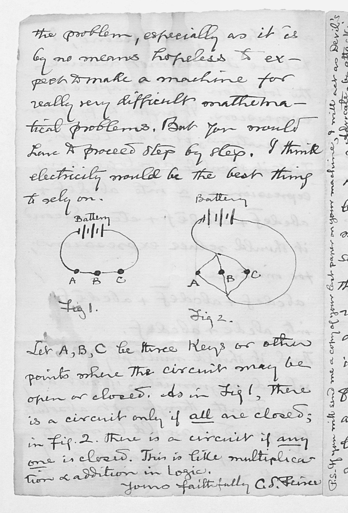

图 5.1 ¶ 1886 年查尔斯·桑德斯·皮尔士致艾伦·马夸德的信件。经普林斯顿大学图书馆许可复制，艾伦·马夸德文稿，手稿部，稀有图书与特藏部。

皮尔士的信件几近湮没，其设计直到半个世纪后才被重新发明。^43 作为麻省理工学院（MIT）的研究生，克劳德·香农将布尔逻辑重新发明为电路。^44 他展示了如何将代表逻辑陈述的多项式转化为电路，以及反向地将电路转化为多项式。换言之，皮尔士仅勾勒了从逻辑到电路的单向转化，而香农创立了被广泛接受的等价关系——即逻辑与电路之间的双向转化。这种等价关系的效用在于电路设计。电路可转化为多项式，再利用逻辑中的各种定义进行化简。化简后的多项式再转化回电路，得到的电路规模更小，但功能与原电路相同。^45

虽然现代布尔逻辑实现的电路看起来与皮尔士描述的不同（如今它们不再是电气的，而是电子的，由晶体管构成），但本质相同。要实现 `AND`，所有开关都需闭合（`A AND B AND C`），使电荷从电源（如电池）流经电路再回到电源。相比之下，要实现 `OR`，只需一个开关闭合即可形成完整电路（`A OR B OR C`）。

除了 `AND` 和 `OR` 电路，将布尔逻辑转化为电路还需要一个逻辑块：*逆变器*。逆变器实现 `NOT`：若输入携带电流，输出则不携带；若输入不携带电流，输出则携带。

如今，有简化的图形约定来表示逻辑块，即*逻辑门*，隐藏其布线细节。`AND` 门和 `OR` 门有一个输出，可有两个或更多输入。惯例上，它们绘制为两个输入（而非皮尔士使用的三个——A、B 和 C）。`AND` 门的输入侧是一条直线，输出侧是一条曲线。`OR` 门的输入侧是一条曲线，输出侧由两条在一点相交的曲线组成。`NOT` 逆变器有一个输入和一个输出，绘制为一个小三角形，输出引线上有一个更小的圆圈。

在图 5.2 中，请注意输入输出导线末端的 1 和 0。1 习惯表示导线上有电压，0 表示导线上无电压。

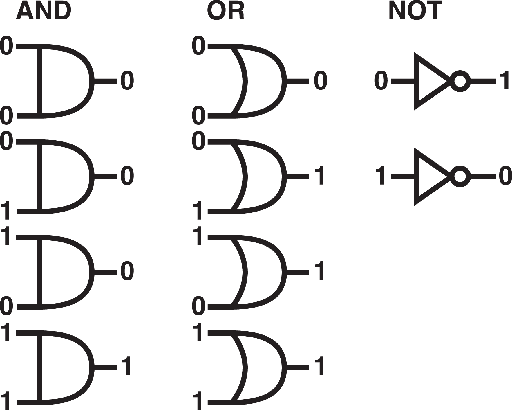

图 5.2 ¶ AND、OR 和 NOT 门的所有可能输入与输出。

`AND` 门和 `OR` 门有四种可能的输入组合：(0, 0)、(0, 1)、(1, 0) 和 (1, 1)。图中将 `AND` 门和 `OR` 门各绘制四次，以展示它们对每种可能输入对的行为。`NOT` 逆变器仅展示两次，因为它只接受一个输入——0 或 1。

## 真值表

皮尔士给马夸德写信多年后，哲学家路德维希·维特根斯坦描述了一种逻辑门输入输出集的紧凑图形表示法。^46 真值表可用三列书写：第一输入、第二输入、第三输出。表 5.1、表 5.2 和 表 5.3 分别展示了 `AND`、`OR` 和 `NOT` 的真值表。

| 表 5.1 | | |
| --- | --- | --- |
| AND 的真值表。 | | |
| A | B | A AND B |
| 0 | 0 | 0 |
| 0 | 1 | 0 |
| 1 | 0 | 0 |
| 1 | 1 | 1 |

| 表 5.2 | | |
| --- | --- | --- |
| OR 的真值表。 | | |
| A | B | A OR B |
| 0 | 0 | 0 |
| 0 | 1 | 1 |
| 1 | 0 | 1 |
| 1 | 1 | 1 |

| 表 5.3 | | |
| --- | --- | --- |
| NOT 的真值表。 | | |
| A | NOT A |
| 0 | 1 |
| 1 | 0 |

维特根斯坦的表格预示了又一种转化：逻辑函数的可视化表示。因此，到了 1930 年代，逻辑可转化为代数/算术方程（经由布尔）；逻辑方程可转化为电路（经由皮尔士）并再转化回来（经由香农）；和/或方程可转化为表格（经由维特根斯坦）。事实上，仔细阅读维特根斯坦可知，到 1939 年，他也理解了——无需参考皮尔士或香农——逻辑可转化为电路，尽管他显然认为这只是一个糟糕的类比。^47

## 算术的表格与电路

将算术函数转化为维特根斯坦式“真值表”，提供了一种直接的方法将其与已知逻辑构造（如 `NOT`、`AND` 和 `OR`）进行比较。

## 真值表与半加器

表 5.4 是二进制加法的真值表。`ADD` 函数看起来几乎与 `OR` 相同，只有一行除外：`1 + 1 = 10`，而不是 `1 OR 1 = 1`。`ADD` 表与 `OR` 真值表之间的这种相似性引发了一个问题：算术能否用逻辑门实现？事实上，算术可以接线为一系列逻辑门。例如，图 5.3 显示了一个**半加器**，它接受两个输入并返回两个输出：一个和位和一个进位位（用于 `1 + 1` 的情况，此时结果需要两位而不是一位）。在图 5.3 的图中，和位的导线在进位位导线的下方。图中描述的结果是 `1 + 1 = 10`。

| 表 5.4 |
| --- |
| 二进制加法真值表。 |
| A | B | A + B |
| 0 | 0 | 0 |
| 0 | 1 | 1 |
| 1 | 0 | 1 |
| 1 | 1 | 10 |

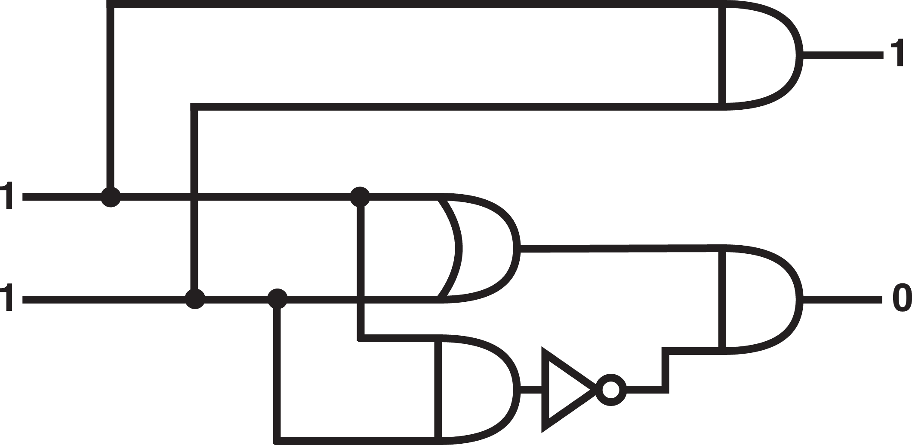

图 5.3 半加器，输入为 1 和 1，输出为 10。

图 5.3 中所示的半加器使用了五个门，其中三个是 `AND` 门。但它可以重新设计为仅使用两个 `AND` 门（因此总共四个门），因为进位位的电压可以在作为 `NOT` 门输入的导线上读取。通过设计一个执行相同操作但使用更少门（四个而不是五个）的电路，该电路的生产成本更低，也更易于维护。

如果我们将布尔的成就理解为将亚里士多德逻辑翻译成一种算术形式（代数），那么在这个半加器电路中，我们可以看到其逆过程的草图，类似于皮亚诺公理：将算术翻译成逻辑。通过布尔电路，结合布尔和皮亚诺的著作所描述的恒等式可以以另一种方式建立：算术 = 逻辑；逻辑 = 算术。这种逻辑与算术之间的等价性，是通过代数和电气工程严格建立的。

建立这种等价性具有巨大的效用，例如，利用代数方法减少电路中的门数量，或构建一个能够加数的电路。然而，同样清楚的是，这种逻辑与算术之间的等价性，只能通过忽略区分代数公式与电子电路的图形和物质差异来建立。

## 振荡器与触发器：带反馈的电路与表

当某种东西以一种难以或不可能翻译成另一种形式的方式被“写”在一种形式中时，这两个“等价物”之间的差异就变得清晰了。例如，图 5.4 所示电路的代数形式是什么？它是一个反相器回环到自身，使得从其输出的导线连接回作为其输入的导线。


图 5.4 回环反相器（振荡器或时钟）。

考虑如果没有电压（即 `0`）施加到图 5.4 中反相器的输入时会发生什么。那么，根据定义和设计，反相器的输出将有电压；即输出将为 `1`。但片刻之后，由于输出回环到输入，反相器的输入将变为 `1`，随后输出将变为 `0`，以此类推。因此，该电路被称为“振荡器”或“时钟”。作为数字时钟，它构成了计算机的核心。它的“节拍”同步了计算机的所有操作。

时钟既是一个完全有效的布尔电路，也是一个在其代数或逻辑形式中难以想象的表达式。在那种形式中，它看起来就像违反了亚里士多德的三条思想定律：`A = not(A)`。

然而请记住，亚里士多德的思想定律仅涵盖在给定时刻可能为真的内容，而电路图则隐式地包含不止一个时间点。因此，`A = not(A)` 是振荡器电路图的不正确代数翻译。尝试将电路翻译成真值表，你会注意到，类似于代数符号，真值表格式也没有表达多个时间点的方法。

尽管如此，如果我们将表的约定扩展到维特根斯坦规定的界限之外，**确实**有一种方法可以在表中表达时间。即，我们再增加一列来记录机器的状态。表 5.5 就是这种为**置位-复位（SR）触发器**（或**锁存器**）电路扩展的真值表。就像儿童游乐场上的跷跷板，该电路有两个稳定状态：一个称为*置位*，另一个称为*复位*。电路的两个输入标记为 `S` 和 `R`。两个输出为 `Q` 和 `notQ`。意图是当 `Q` 为 `1` 时，`notQ` 为 `0`；当 `notQ` 为 `1` 时，`Q` 为 `0`。像跷跷板一样，当一端翘起时，另一端落下，反之亦然。

| 表 5.5 |
| --- |
| 置位-复位（SR）触发器（或锁存器）表。 |
| 状态 | S | R | Q | notQ |
| *置位：Q 变为 1* | 1 | 0 | 1 | 0 |
| *置位：无变化* | 0 | 0 | 1 | 0 |
| *复位：Q 变为 0* | 0 | 1 | 0 | 1 |
| *复位：无变化* | 0 | 0 | 0 | 1 |

注意，表 5.5 是不完整的。当两个输入均为 `1` 时的条目在哪里？理论上这可能发生，但电路不打算以那种方式使用。因为该表未编码所有可能的状态，它隐式地描述了使用的实用性。它留下的一条不成文规则是，触发器不应被纳入可能在 `S` 和 `R` 输入上同时施加电压（即 `1`）的更大电路中。换句话说，它不应同时被*置位*和*复位*。

图 5.5 显示了 SR 触发器的布尔电路。要使用它，可以从置位它开始；即在 `Q` 上施加电压（`1`），在 `R` 上不施加电压（`0`）。输出 `Q` 将有电压（`1`），输出 `notQ` 将无电压（`0`）。现在，一旦电路被置位，即使 `S` 上的电压关闭，`Q` 和 `notQ` 将保持不变。

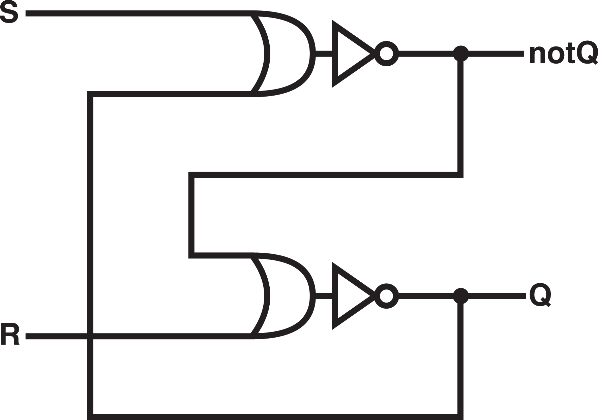

图 5.5 SR 触发器的布尔电路。

我们可以通过将输入 `R` 设为 `1` 来将 `Q` 复位为 `0`。在结果状态“复位：Q 变为 0”中，`S` 为 `0`，`R` 为 `1`，`Q` 为 `0`，`notQ` 为 `1`。从表中标题为“复位：无变化”的第四行读取值，我们可以再次看到，如果随后两个输入都关闭；即两个输入均为 `0`，`Q` 和 `notQ` 都不会改变值。

换句话说，`Q` 和 `notQ` 的值不仅取决于 `S` 和 `R` 的当前值，还取决于它们之前的值：它们取决于电路的上一个状态。这是计算机存储器的构建块。触发器可以存储一位——`1` 或 `0`——并在电路的连续状态之间保持它。这是通过反馈完成的：电路顶部 `OR` 门的输入之一来自底部 `NOT` 门的输出之一，反之亦然。

振荡器和触发器电路——时钟和存储器——都包含反馈。在电路图中，反馈很容易“写”出来：一个组件的输出被连线作为另一个（或同一个）组件的输入。反馈在布尔的代数符号中无法书写；它缺乏“输入”、“输出”和“导线”。

# 差异与鸿沟

尽管如此，表格与电路并不完全相同。在目前的讨论中，我们忽略了电路设计中最重要的问题之一：时序。设想一个简单的电路，例如一个 `AND` 门。只有当两个输入均为 `1` 时，输出才为 `1`。否则，输出为 `0`。想象一下，如果 `AND` 门的一个输入连接到镇那头的一个开关，而另一个输入则是紧挨着 `AND` 门的一个开关。尽管电传播得非常快，但来自镇那头的电流到达 `AND` 门所需的时间，仍然会比源自门旁边的电流要长。因此，时序问题在于：何时可以读取门的输出？

假设 `AND` 门的两个输入均接通；即它们均为 `1`。但 `AND` 门的输出读取为 `0`。为什么？因为来自镇那头合上开关的电流尚未到达 `AND` 门的输入端。我们需要等待它到达，`AND` 门才会在其两个输入端均检测到 `1`，从而将输出变为 `1`。

如今，大多数数字计算机都是基于（约翰·）冯·诺依曼架构构建的。这种架构包含了我们在此探讨的三种电路：（1）一组 `AND`、`OR` 和 `NOT` 门，用于对数据执行逻辑和算术运算；（2）一组触发器，用于存储数据；（3）某种形式的环形反相器，用作时钟。数字计算机在时钟的同步下，通过从存储器中取出流程中的下一条操作、解码该操作、执行它，然后继续执行后续操作来完成工作。这被称为取指-解码-执行（或 FDX）循环，至今仍内嵌于几乎每台计算机的核心之中。


如果我们将这种工作方式——即 FDX 循环——与焦耳的定义（在第 3 章关于功与机器语言的讨论中提及）进行比较，我们会发现：焦耳通过在其定义中引入重力（借助质量和加速度）来包含时间，而 FDX 循环则包含了一种截然不同的时间。它的时钟是“无重量的”，独立于重力，与其说是一种测量装置，不如说是一种节拍器，其最简单的形式可以构建为一个环形反相器；即一个逻辑门，具体来说是一个实现 `NOT` 运算符的门，该门的输出线回路连接到其输入线。因此，今天的时钟现在是一个环形反相器，而不是一个表盘，其“时针”和“分针”在圆周上旋转。

当时钟和日历的技术发生变化时，经常会产生意想不到的后果。^(48) 例如，当计算机的时钟速度（即由数字时钟（如环形反相器）控制的 FDX 循环）从兆赫（每秒百万个周期）大幅提升到吉赫（每秒十亿个周期）时，新形式的金融交易成为可能，从而催生了新的市场活动（如高频交易）和新形式的金融灾难（如 2010 年 5 月 6 日的“闪崩”）。

旧形式与新形式的功与时间之间也存在意想不到的联系。例如，无论是表格还是电路图，都未能揭示这一平凡事实：计算机需要电力，而布尔电路会产生焦耳级的热量。当它们每秒运行数十亿次时，会产生大量热量；事实上，它们产生的热量如此之多，以至于大多数计算机都内置了风扇，而没有风扇的手机等技术设备在进行大量计算时（例如用于观看视频时）会明显发热。电力和散热是亚马逊、Facebook 和谷歌等“云计算”巨头面临的巨大问题，因此它们试图将服务器农场设在电力便宜且地理气候凉爽的地方（如瑞典北部），因为这样可以在制冷成本上节省巨额资金。

简而言之，我的观点是：计算机与逻辑之间存在巨大差异。逻辑没有时序问题，不需要风扇或电源，且传统上没有表示状态或反馈的符号。相比之下，我们说数字计算机由布尔电路构建，但实际上它们融合了以吉赫兹、纳秒为单位测量的时间与功形式——如振荡器和 FDX 循环——这是一种处于布尔逻辑同步性之外的时间形式。

# 填补鸿沟

计算机历史学家迈克尔·马霍尼写道：“一种与具有随机存取存储器的电子数字存储程序计算机相适应的计算理论，介于图灵机与开关电路之间。计算机科学源于填补这一鸿沟的努力。”^(49) 根据马霍尼的说法，图灵机的逻辑与数字计算机的电路之间存在鸿沟，而计算机科学作为一个整体，正是填补这一鸿沟的尝试。在计算机科学中，人们试图用软件和其他形式语言表达来填补这一鸿沟。

这些形式语言在很大程度上是计算机编程语言。在第 1 章中，我引用了哈罗德·艾伯森、杰拉尔德·萨斯曼和朱莉·萨斯曼合著的著名入门教材《计算机程序的构造和解释》，该书论证了计算机科学并非一门科学。他们称自己的方法为“过程认识论”，即“从命令式的角度研究知识的结构，这与经典数学学科采取的更多声明式观点形成对比。数学为精确处理‘是什么’的概念提供了框架。计算为精确处理‘怎么做’的概念提供了框架。”^(50) 艾伯森、萨斯曼和萨斯曼的文本通过描述如何将所有软件设计概念化为专用编程语言的设计与实现，来论证这一观点：“将此视为编程中最根本的思想绝不夸张：求值器，它决定了编程语言中表达式的含义，本身只是另一个程序。领会这一点会改变我们作为程序员的自我形象。我们开始将自己视为语言的设计者，而不仅仅是他人设计的语言的使用者。事实上，我们可以将几乎任何程序视为某种语言的求值器。”^(51) 他们书中的大部分内容致力于阐述如何设计和实现不同种类的编程语言。

艾伯森、萨斯曼和萨斯曼的方法凸显了与培根、莱布尼茨和十八世纪百科全书派的直接联系。也就是说，艾伯森、萨斯曼和萨斯曼将当代计算置于设计人工语言的努力谱系中的最新一环。正如我在引言中所论证的，我所遵循的谱系始于培根关于将自由艺术与机械艺术相结合的劝诫，并延续至史蒂夫·乔布斯，当时他解释说苹果的优势在于技术与自由艺术的结合。在艾伯森、萨斯曼和萨斯曼身上，我们不仅找到了这一谱系的有力代言人，还找到了一种追求这一视角的显性方法论——具体而言，即编程语言设计。

# Abelson、Sussman 和 Sussman 的教科书

Abelson、Sussman 和 Sussman 的教科书在计算机科学界广为人知，以至于它经常被称为其首字母缩写 `SICP`。`SICP` 中的编程示例使用 Scheme 编程语言。为了本书的目的，我选取了其中的一个示例，并将其从 Scheme 翻译成了 JavaScript，以便可以使用任何现代网页浏览器进行检查（因为 JavaScript 不同于 Scheme，在如今几乎所有的浏览器中都得到原生支持）。我将要讨论的示例是将逻辑翻译成软件。

## 一个逻辑电路模拟器

考虑电路设计的问题。设计师需要一种在将设计提交给硬件之前进行“草拟”的方法，通常这种方法就是软件。首先，使用软件模拟器设计电路，然后在芯片材料中最终确定之前对其进行改进和调试。几乎每种计算机编程语言都原生支持 AND、OR 和 NOT 这些布尔运算符，但对于电路设计师来说这还不够，因为前面讨论的所有时序问题：电很快但不是瞬间到达的，因此任何电路模拟器都必须包含某种概念，说明电流从 a 到 b、从逻辑门的输入到其输出等需要多长时间。

因此，电路模拟器必须具有定义导线、逻辑门以及导线如何将门连接在一起的方法；此外，模拟器必须提供一种方法来跟踪电流通过导线和门的流向。我的 JavaScript 程序的完整文本可以在本书的网站上找到。^52 在接下来的页面中，我将主要关注电路模拟器提供的一些抽象，而较少关注实现模拟器的 JavaScript 代码部分。

下面是一小段代码，它设置模拟器，定义一个 OR 门以及通向门内外的导线，在通向门的导线上施加电流，然后运行模拟器。代码中的注释以 "//" 开头。

```javascript
// Create an instance of a circuit simulator, call it "cs."
var cs = makeCircuitSimulator();

// Create an instance of an agenda, call it "ag."
var ag = cs.getAgenda();

// Set up and run an OR gate.
// First define three wires: two input wires (a and b) and one output (c).
var a = cs.makeWire();
var b = cs.makeWire();
var c = cs.makeWire();

// Introduce a new instance of an OR gate into the simulator and attach the
// input and output wires to the gate.
cs.orGate(a, b, c);

// Put no current on the input wire a by setting its value to 0.
a.setValue(0);

// Put a current on the input wire b by setting its value to 1.
b.setValue(1);

// Now, put "probes" on all of the wires so that at every time step, the
// simulator prints out whether or not there is a current on each of the wires.
a.probe("wire a");
b.probe("wire b");
c.probe("wire c");

// Finally, turn on the simulator by propagating, via the agenda, the currents
// (i.e., the values 1 and 0) through the circuit.
ag.propagate();
```

当执行 `propagate()` 命令时，“探针”将向 JavaScript 控制台打印以下内容：

```
value for wire a @ time 0 is 0
value for wire b @ time 0 is 1
value for wire c @ time 0 is 0
value for wire c @ time 5 is 1
```

请注意，在模拟开始时（时间 0），导线上的电流要么是定义好的（`a` 为 0；`b` 为 1），要么是预期的：`c` 为 0，因为 OR 门的输出尚未确定。稍后（时间 5），`c` 导线有了电流，因为正如前面讨论的，如果任一输入或两个输入均为 1，OR 门的输出就是 1。

在实现电路模拟器的代码中，可以规定电流通过给定类型的逻辑门需要多少个时间增量。在本例中，我决定 OR 门的延迟为 5 个增量，AND 门为 3 个，NOT 门（即反相器）也为 3 个。这就是为什么 OR 门输出导线上的探针直到时间 5 才报告值为 1 的原因。虽然这些延迟可以在模拟器代码中轻松更改，但请注意，延迟之间的比率（5:3:3）需要与在硬件电路中可能观察到的延迟比率相对应——如果模拟旨在类似于硬件的性能。

在这个电路模拟器的翻译版本中，我没有提供给导线分配延迟的方法。所有导线都被理想化为可以零延迟地传播电流。显然，可以修改模拟器以允许导线被分配延迟，就像为门所做的那样。

在编写这样的模拟器时，需要做出一系列简化决策。在这里，导线被定义为瞬时传播电流，门不需要电源，门不产生热量，布局问题完全被忽略了。

布局是电路物理生产中的一个主要问题：门需要放置在一个平面上（通常是一小块硅片），然后用导线连接在一起，使得导线不重叠，并且考虑到门的延迟，以便输入在应该到达时到达，输出在需要时被记录。

时序问题（称为“竞态条件”）加剧了布局问题。想象一下，一个非常复杂的电路的电流和一个非常简单的电路的输出被用作 AND 门的输入。由于复杂电路中门的所有延迟与简单电路中少量的延迟相比，复杂电路将在简单电路停止工作很久之后才输出其结果。因此，要么必须设计某种方法来延迟简单电路输出的到达——使其与复杂电路的输出同步——要么延迟读取依赖于这两个输入的 AND 门的输出，直到复杂电路完成工作。

Abelson、Sussman 和 Sussman 称他们的方法——以专用编程语言的设计和实现为中心——为“元语言抽象”。^53 电路模拟器就是这种方法的一个例子。为每个感兴趣的对象或主题设计一种抽象——在本例中为 `orGate`、`andGate`、`inverter`、`wire` 和 `current`（仅表示为 1 或 0）。为每个感兴趣的过程定义一种抽象；在本例中，agenda（议程）是定义电流如何通过导线和门传播的抽象。然后，定义一种将抽象组合在一起的方法。在本例中，方法是 JavaScript 的“函数”和 JavaScript 中称为“对象”的数据结构定义。这些抽象和组合方法共同构成了一种用于设计电路的专用编程语言。我们可以将这个电路模拟器理解为 JavaScript 语言的一个专用子集。

下面是这种专用语言在使用中的另一个简单示例。它通过将同一根导线连接到反相器的输入和输出来定义一个振荡器，即一个时钟。

```javascript
var cs = makeCircuitSimulator();
var ag = cs.getAgenda();
var a = cs.makeWire();
cs.inverter(a, a); // The wire "a" is both the inverter's input and output
a.setValue(1);
a.probe("wire a");
ag.propagate();
```

模拟器输出以下跟踪信息。请记住，我已将反相器的延迟设置为 3 个时间单位。

```
value for wire a @ time 0 is 1
value for wire a @ time 3 is 0
value for wire a @ time 6 is 1
value for wire a @ time 9 is 0
```

利用这种特定用途的编程语言，同样可以定义并模拟前文讨论过的其他一些电路，例如半加器。但我要再次强调，电路模拟器的软件既不等同于实际电路（除其他原因外，还因为前文列举的抽象和简化），也不等同于其模仿对象——布尔逻辑（同样因为，例如电路模拟器中存在布尔逻辑中没有的时间抽象）。用迈克尔·马霍尼的话转述一下：软件既非逻辑也非电路，但软件技艺提供了一种在两者之间不完美转译的手段。

## 逻辑编程

定理证明器可被视为一种高级断言式或声明式语言——逻辑——的“解释器”。^(54)

几十年来，一些计算机科学家梦想将逻辑用作编程语言。1972 年，法国计算机科学家阿兰·科尔默劳尔和菲利普·鲁塞尔在包括罗伯特·科瓦尔斯基在内的多位专家的关键协助下，开发了 `Prolog` 编程语言。^(55)^(56) “Prolog”代表“programming in logic”（逻辑编程）。根据科瓦尔斯基的说法，“逻辑编程背后的驱动力在于这样一个理念：单一形式化体系足以同时涵盖逻辑与计算，且逻辑包含计算。”^(57)

科瓦尔斯基在一篇 1979 年论文的标题中，点出了实现这一愿景所固有的困难：“算法 = 逻辑 + 控制。”^(58) 若要用稍微不那么简练的方式表达这一思想，可以这样说：虽然逻辑可用于解释输入与输出之间成立的关系，但要编写计算机程序，仍然需要控制——一种指定输入将如何转化为输出的手段。

我们可以重写科瓦尔斯基的标题/等式，通过重新排列使其变为 `逻辑 = 算法 − 控制`，从而更清晰地展现逻辑与算法的主要区别。梦想是要实现 `逻辑 = 算法`，而怀揣此梦想的几代计算机科学家的工作，就是将控制放入逻辑中。显然，要做到这一点，需要改变算法的定义、改变逻辑的定义，或两者兼改。

可以说，正如计算理论中所阐述的算法、以及专业逻辑学家所定义的逻辑，两者都因相互回应而发生了变化。但在该梦想伊始——或许对某些人而言，甚至直到今天——逻辑被定义为谓词逻辑。^(59) 回顾前一节关于逻辑与电路模拟的内容，当时所关注的逻辑是乔治·布尔对亚里士多德逻辑的转译。但谓词逻辑则是另一回事。

### 一阶谓词逻辑

直到布尔时代前后，逻辑主要关注亚里士多德的三段论。正如第 4 章所述，布尔通过将亚里士多德三段论的例子转译为他的新符号系统来开展工作。随后，在接下来的一个世纪（19 世纪中叶至 20 世纪中叶），在乔治·布尔、戈特洛布·弗雷格、查尔斯·桑德斯·皮尔士、大卫·希尔伯特、阿尔弗雷德·诺斯·怀特海、库尔特·哥德尔、鲁道夫·卡尔纳普等人的著作推动下，逻辑发生了根本性变化。根据逻辑学家、哲学家、历史学家何塞·费雷罗什讲述的一部引人入胜的逻辑史，其结果是逻辑扩展以涵盖广泛得多的领域，随后又相对迅速地收敛并聚焦于一阶谓词逻辑。费雷罗什写道：“简要概括我们快速历史回顾的结果，我们可以说 1900 年前后，逻辑被构想为句子、集合与关系的理论；一战后直至 1930 年，现代逻辑的典范是高阶系统、简单类型论；直到 1940–1950 年前后，逻辑学家群体作为一个整体才达成共识，认为范式逻辑系统是 FOL（一阶谓词逻辑）。”^(60)

费雷罗什的历史阐释了当代对逻辑的理解在历史上和语境上是如何具有偶然性的：“人们倾向于认为逻辑具有某种特别清晰和晶体般纯净的本质，但这更多是一种欺骗性的形象而非证据。我预期前述论证可能已使（至少）这一结论变得合理：FOL 并非自然的统一，这引发了一种印象，即逻辑的概念涉及某种晦涩或不确定性。但如果是这样，我们为何以及如何走向了现代一阶逻辑？显而易见，当第一性原理不足时，我们必须转向历史语境与传统。”^(61) 换言之，今天，当逻辑学家、数学家、哲学家和计算机科学家谈论“逻辑”时，他们指的是 20 世纪初一种非常具体且相对较新的发明。^(62)

### 变量与量词

19 世纪末，弗雷格和皮尔士独立发明了区分现代逻辑与其亚里士多德前身的两个最重要方面：带变量的谓词和量词。^(63)

为何带变量的谓词在逻辑中如此重要？请考虑在命题逻辑中，可以写出类似“如果 A 则 B”这样的内容。A 和 B 代表命题。或许 A 代表“苏格拉底是人”，B 代表“苏格拉底是凡人”。因此，“如果 A 则 B”代表“如果苏格拉底是人，则苏格拉底是凡人”。

如果我们只关心关于苏格拉底的推论，这很好；但如果我们关心关于柏拉图、阿尔西比亚德——许多人的推论，而不仅仅是苏格拉底，该怎么办？带变量谓词的引入允许陈述更普遍的规则，如：“如果 `man(x)` 则 `mortal(x)`。”当自由变量 `x` 绑定到苏格拉底时，该普遍规则的一个具体实例如下：“如果 `man(苏格拉底)` 则 `mortal(苏格拉底)`。”带变量的谓词允许陈述此类普遍规则，这在命题逻辑中无法简洁地表达。

量化问题之所以出现在皮尔士和弗雷格各自的谓词演算中，是因为一旦陈述了带变量的谓词，就必须考虑什么可以绑定到谓词的变量上。例如，该谓词是否适用于所有人？也许吧，但想象你是基督徒。这听起来对吗：“如果 `man(耶稣)` 则 `mortal(耶稣)`”？神学问题暂且不论，弗雷格和皮尔士各自都看到了引入全称量词和存在量词的必要性，以解决普遍性与特殊性问题。

如今，全称量词通常写作倒置的“A”，表示“对所有（ALL）”。因此，可以这样写所有人都是凡人：“`∀x(如果 man(x) 则 mortal(x))`。”

如今，存在量词通常写作旋转的“E”，表示“存在（EXISTS）”。因此，可以这样写存在某个凡人：“`∃x(如果 man(x) 则 mortal(x))`。”带有存在量化变量的谓词，是关于某个特定的人，而非所有人。

### Prolog 编程

回到前文引用的科瓦尔斯基的驱动动机，开发逻辑编程的人旨在用逻辑的符号系统编写语句，并让这些语句作为计算机程序运行。在 `Prolog` 编程语言中，可以像这样编写谓词和断言：^(64)

```
man(socrates).

man(plato).

mortal(X):- man(X). % This means X is mortal if X is a man.
```

`Prolog` 解释器允许我们查询数据库中直接断言的语句，也允许我们查询可从数据库中的语句（通常称为断言）和谓词推导出的语句。因此，像这样的查询

```
?- man(Who)
```

将导致变量“Who”首先绑定到“socrates”，然后绑定到“plato”。同样，因为定义了“mortal”的谓词，查询

`?- mortal(Who)`


也会导致相同的绑定：“Who”首先绑定到“socrates”，然后绑定到“plato”。通过这个简短的例子，人们可能会得出结论，认为 Kowalski 及其同事已经实现了用逻辑编程的目标，但让我们稍微扩展一下这个例子，以展示正如 Kowalski 在其 1979 年论文标题中所表达的那样，算法的软件实现包含逻辑中未表达的控制规范。

首先我们将添加一个断言：

```
man(jesus).
```

接下来，我们将为“equal”定义一个谓词：

```
equal(Y,Y). % 如果两个实体相同，则它们相等。
```

现在我们将在“mortal”谓词中添加一个合取项：

```
mortal(X):- man(X),not(equal(X,jesus)). % X 是人且 X 不是 jesus。
```

有了这些小的添加，查询

```
?- mortal(Who)
```

的结果是“Who”首先绑定到“socrates”，然后绑定到“plato”。换句话说，由于“mortal”谓词中添加的条件，`mortal(jesus)` 无法从断言的陈述和谓词中推导出来。

请注意，在一阶谓词逻辑中，合取是可交换的；例如，“man(X) and not(equal(X,jesus))”的含义与“not(equal(X,jesus)) and man(X)”相同。但是，与逻辑相反，在 Prolog 中，合取项的顺序确实会产生影响。

考虑当“mortal”的谓词被重写为

```
mortal(X):- not(equal(X,jesus)),man(X). % X 不是 jesus 且 X 是人。
```

查询

```
?- mortal(Who)
```

的结果是“Who”绑定到什么？实际上，现在查询失败了。Prolog 无法识别出任何可以被证明为 mortal 的实体。（当查询失败时，Prolog 解释器通常返回“false”或仅返回“no”。）

导致此查询现在失败的原因有两个。首先，Prolog 中的合取运算符“and”不像在一阶谓词逻辑中那样具有可交换性。其次，在 Prolog 中，否定运算符“not”的含义不同于逻辑中的否定。此外，尽管这个小例子没有说明，另一个主要的逻辑运算符“or”在 Prolog 中的语义也与在逻辑中截然不同。换句话说，尽管名为 Prolog，但用 Prolog 编程根本不像用逻辑编程，因为合取（“and”）、析取（“or”）和否定（“not”）在 Prolog 中的含义与它们在一阶谓词逻辑中的含义截然不同。

利用第 3 章中关于工作和机器语言的区别描述，可以说 AND、OR 和 NOT 在逻辑中是数学函数，但在 Prolog 中是运算符。更具体地说，可以说在 Prolog 中它们是作用于数据库的逐步过程。或者，用逻辑编程计算机科学文献的术语来说，Prolog 代码具有逻辑所不具备的过程含义^(65)。

例如，给定查询

```
?- mortal(Who).
```

当谓词定义为

```
mortal(X):- man(X), not(equal(X,jesus)).
```

Prolog 解释器执行以下操作。首先，它在数据库中搜索与第一个合取项“man(Who)”匹配的所有内容，并找到三个这样的匹配：`man(socrates)`、`man(plato)`、`man(jesus)`。接下来，Prolog 解释器通过将这些结果运行第二个合取项“not(equal(Who,jesus))”来进行过滤。第二个合取项消除了这三个匹配中的一个，因此 Prolog 随后向查询返回两个结果：“mortal(socrates), mortal(plato)。”

现在，考虑当合取项反转为

```
mortal(X):- not(equal(X,jesus)),man(X).
```

且查询再次为

```
?- mortal(Who).
```

时会发生什么。

Prolog 尝试第一个合取项 `not(equal(Who,jesus))`。这会失败，因为“Who”是一个未绑定的变量，因此可以绑定到数据库中的任何内容，包括“jesus”。“Who”可以与“jesus”统一，因此 `equal(Who,jesus)` 成功，然后其否定——`not(equal(Who,jesus))`——失败。^(66)

在逻辑编程中，这种对否定的解释被称为“失败即否定”。它依赖于“封闭世界假设”：即存在的一切都在数据库中作为断言，或者可以从数据库中的谓词和断言计算得出。

为了说明，让我们使用前面指定的 Prolog 数据库，然后提出以下查询：

```
?- mortal(god).
```

Prolog 解释器将以“false”响应此查询，并非因为它以某种方式知道上帝是不朽的，而是因为当它运行定义“mortal”的谓词时，它搜索形式为“man(god)”的断言，并在数据库中找不到这样的断言。因此查询失败。

然而，如果我们提出这个查询会怎样：

```
?- not(mortal(god)).
```

Prolog 解释器将以“true”响应此查询，并非因为它以某种方式知道上帝是不朽的，而是因为查询“mortal(god)”返回“false”，因此查询“not(false)”返回“true”。它也将为此查询返回“true”：

```
?- not(mortal(dog)).
```

确实，该数据库无法“证明”为非 mortal 的唯一两个实体是“socrates”和“plato”，因为它们是仅有的被声明为人且不等于“jesus”的实体。这既说明了失败即否定，也说明了 Prolog 隐含的封闭世界假设。^(67)

在 Prolog 中，“量化”已被转化为对数据库的搜索。在逻辑中，当我们使用全称量词时——例如，“∀x(if man(x) then mortal(x))”——假设 x 可能绑定到宇宙中绝对任何事物。相比之下，Prolog 的变量只能绑定到特定数据库中找到的断言，并且数据库是按特定顺序搜索的。因此，即使它们有某种家族相似性，Prolog 的“and”、“or”、“not”、变量和量化都与它们在一阶谓词逻辑中的对应物截然不同。

## 再次将逻辑与辩证法结合在一起？

正如本章开头所述，随着时间的推移，逻辑和辩证法彼此分离，成为截然不同的技艺。因此，当被告知——至少在软件世界中——它们正在被缝合在一起时，人们可能会持怀疑态度。Prolog 的先驱之一 Kowalski 和其他人现在声称，逻辑不是一种计算形式，而是一种论证形式！Bondarenko 等人写道：“论证、假设、攻击和防御的概念足以重构……大多数逻辑编程语义。”^(68)

其他人在与 Kowalski 的密切对话中，试图证明相反的观点：即各种形式的论证，简单来说就是一种逻辑编程形式！计算机科学家 Phan Minh Dung 写道：“虽然论证是一种强大的问题解决方法，但事实证明它可以很容易地在逻辑编程中‘实现’。我们通过展示论证可以被视为具有失败即否定的逻辑编程来证明这一点。”^(69)

回想一下，“失败即否定”是 Prolog 编程的标准“特性”，是将否定转化为对数据库搜索的方法。这种与一阶谓词逻辑中否定的差异，竟然是将逻辑重新转变为一种对话技术、辩论技术的关键，这似乎不太可能。Dung 接着说道：“这一结果表明，逻辑编程是实现辩论系统的完美工具。有必要再次指出，本文的主要意图并非研究逻辑编程与非单调推理之间的关系，尽管我们的结果——即两者都是辩论的形式——对此关系大有裨益。我们的主要目标是对人类辩论的本质进行全面普遍的分析。”^(70)

逻辑的翻译——转化为电路、软件、一种算术等等——产生了大量显著不同的技术和技艺。通过追溯其中一些翻译，我试图提供一种理解方式，以便看清为何像 Dung 这样的主张可能被视为荒谬。逻辑编程与“人类辩论本质的全面普遍性”之间，怎么可能没有巨大且显著的差异？依我之见，只有身处彻头彻尾的数字化意识形态泡沫之中，才会想象逻辑编程与人类辩论可以被视为等价。

## 将做逻辑视为一种翻译形式

对逻辑作为几乎任何一种思想形式的定义或实现的通用、全能基础的毫无根据的、近乎宗教般的信仰，由来已久。哲学家伯特兰·罗素如是陈述他对逻辑基础性作用的信念：“一切数学皆符号逻辑这一事实，是我们这个时代最伟大的发现之一；一旦这一事实确立，数学的其余原则就仅在于对符号逻辑本身的分析。”^(71)

罗素的学生、后来的同事兼对手路德维希·维特根斯坦，成为了这一逻辑信仰的怀疑论者。维特根斯坦写道：“如果罗素把数学过程与逻辑联系起来，这可能意味着他只是把它们*翻译*[我加的重点]成了一种新语言。但认为这是一种解释是误导人的：以为当我们深入到谓词和谓词函数时，我们就看到了数学真正的内容，”^(72) 意即“有一门科学，即逻辑，数学建立在其之上这一想法。我想说绝不存在数学建立在逻辑之上的情况。而你能让逻辑公式与之吻合这一事实，绝不能说明数学建立在逻辑之上。”^(73)

维特根斯坦用这些话阐述了一个与罗素（以及科瓦尔斯基和其他逻辑全能论信徒）截然不同的立场。值得注意的是，维特根斯坦指出，做逻辑是一种翻译成不同语言的实践，而不一定是翻译成某种终极语言形式。

## 从逻辑计算到修辞证明

“QED”是常用于逻辑证明结尾的首字母缩写。它代表“quod erat demonstrandum”——用英语说就是“所欲证之”，或“从而已证明”。隐含地，该缩写宣称：前面的一系列逻辑推理引导出最终结论，该结论可标记为 QED。

但只有能够被逻辑推理从陈述引向陈述的受众，才会抵达标记的结论并确信其真实性。在维特根斯坦对罗素的批判中，我们发现了一个持怀疑态度的受众：维特根斯坦不是一个愿意被罗素关于数学的逻辑所引导的读者。还是说罗素的逻辑不是逻辑，而是一种修辞形式？在第 6 章中，我们将仔细考察逻辑证明形式与修辞证明形式之间的界限——特别是演绎、归纳和溯因证明。

回想一下米歇尔·塞尔的观察，这在第二章中讨论过：许多翻译术语——演绎、归纳、溯因等——都包含拉丁词根“dūcĕre”，意为“引领”。加在“dūcĕre”前的每个前缀都指示一个方向。例如，“De-”意为“向下”或“从……向下”。因此，“deduce”（演绎）含“引向下”之意。“In-”意为“进入”或“在……里面”。因此，“induce”（归纳）在拉丁语中意为“引入”。“Ab”意为“离开”，所以“abduce”（溯因）意为“引离”、“带走”或“拉走”某人或某物。每一种都是一种从陈述引向陈述的推理形式。

演绎或许是这些逻辑旅行工具中最熟悉的一种。给定一个具体例子和一条一般规则，即可演绎出关于该例子的更多细节。因此，重复一下 Prolog 编程讨论中使用的例子，假设我们知道苏格拉底是人（具体例子），且知道所有人都是凡死的（一般规则）。由此可以演绎出苏格拉底是凡死的。但如果演绎推理是由 Prolog 程序执行的，结论是为谁而证明的？谁会被程序执行的推理说服？

皮尔士对逻辑做出了许多贡献，包括他关于布尔逻辑可翻译为电路的洞见，这在本章前面已讨论过。在其他著作中，皮尔士讨论了三种形式的逻辑推理：演绎、归纳和溯因。这三者在软件和编程中都被赋予了高度详细的含义；具体而言，我指的是三种编程形式：演绎逻辑编程（如 Prolog）^(74)、归纳逻辑编程^(75) 和溯因逻辑编程。^(76) 关于后者，诊断推理^(77)（如医学）、手段-目的分析^(78)（如“规划”，即有一个目标要达成，我们需要推断达成它所需的步骤）以及许多其他推理形式^(79) 都被视为溯因推理的形式。

作为编程语言范式，^(80) 演绎、归纳和溯因逻辑编程实际上是计算形式，而非用来说服人们的方法——尽管人们可能会被计算机程序得出的结果说服。例如，全球气候模拟的执行可能是极具说服力的修辞。尽管如此，皮尔士对这些“引导”形式的描述与它们翻译成软件之间，仍存在鸿沟。

通过讨论逻辑与辩证法的部分历史，并解释逻辑如何被翻译成计算机硬件和软件的若干例子，本章考察了其中一些鸿沟，并论证了逻辑没有单一稳定的定义。相反，逻辑最好被理解为一种语言艺术，它经历了——并持续经历着——许多翻译。它生长、繁衍出无数种实践和物质性，其中最新者即软件。在第 6 章关于修辞的内容中，我们将更仔细地考察此类软件如何被用作说服的手段。

# 注释

出版物中报道的首个此类软件，很可能是艾伦·纽厄尔和赫伯特·西蒙的“逻辑理论家”。马丁·加德纳写道，

是否有可能制造一台逻辑机器，或为数字计算机编程，以解决那些没有判定程序，或程序过于复杂耗时以至于超出现有机器速度和容量的领域中的逻辑问题？答案当然是肯定的。目前正在进行艰苦的努力，以开发一种复杂的信息处理系统（其发明者称之为“逻辑理论机器”），它能够以一种与人类逻辑学家寻找证明极为相似的方式来搜索逻辑定理的证明，即通过试错、直觉和纯粹的运气。……该系统是为数字计算机设计的，1956 年在兰德公司的 Johnniac 计算机上进行了令人满意的实证测试。

参见 Martin Gardner 著 *Logic Machines and Diagrams*（纽约：McGraw-Hill，1958），第 143 页。

芝诺的一些古老悖论属于**假悖论**（即非真悖论）范畴。以阿喀琉斯与乌龟的悖论为例。将其推广到这两个虚构人物之外，该悖论试图确立的荒谬命题是：只要跑者保持奔跑，无论多慢，另一名跑者永远无法超越他。论证在于：每当追赶者到达被追赶者曾经所在的位置时，被追赶者已经向前移动了一小段距离。当我们试图使这一论证更加明确时，浮现出的谬误是：错误地认为任何无限时间间隔的序列加起来必定是永恒。实际上，当无限时间间隔的序列被选定为后续间隔越来越短时，整个序列可能只需有限时间，也可能需要无限时间。这是一个收敛级数的问题。

参见 W. V. Quine 著 *The Ways of Paradox and Other Essays*，修订扩充版（马萨诸塞州剑桥：Harvard University Press，1976），第 3–4 页。Quine 的“解决”依赖于微积分的一项发现，即无限几何级数可以收敛。然而，对许多人而言，包括哲学家 Henri Bergson，除非你相信时间是无限可分的，否则这不算解决。该异议可表述为一个问题：一个人如何能在有限的时间内完成无限数量的动作（例如，先移动一半路程，再移动剩余路程的一半，以此类推）？Bergson 的解决方式是反驳这一预设，并断言对于人类思想和行动而言，时间是一个不可分割的整体。参见 Henri Bergson 著 *Creative Evolution*，A. Mitchell 译（纽约：Holt, Rinehart and Winston，1911），第 308 页。换句话说，Quine 认为芝诺悖论不是悖论，因为它可以转化为一个简单的计算；相反，Bergson 的立场会称 Quine 的计算荒谬，因为它预设了一个荒谬的时间模型，该模型不适用于人类思想和人类行动的领域。Bergson 与 Albert Einstein 于 1922 年进行过一场著名的关于时间的辩论。这场辩论于 2010 年在蓬皮杜中心由哲学家 Bruno Latour 和 Elie During、艺术家 Olafur Eliasson 以及历史学家 Jimena Canales 重演并重新想象。参见 Bruno Latour，“Some Experiments in Art and Politics,” *E-Flux Journal* 23（2011 年 3 月）；Elie During 著 *Bergson et Einstein: La querelle du temps*（巴黎：Presses Universitaires de France，2011）；Jimena Canales 著 *The Physicist and the Philosopher: Einstein, Bergson and the Debate That Changed Our Understanding of Time*（新泽西州普林斯顿：Princeton University Press，2015）。

因此，在整个古代（毕达哥拉斯学派、柏拉图、斯多葛学派、犬儒学派、伊壁鸠鲁学派和新柏拉图主义者中），哲学主题（如何获得真理？）与灵性问题（主体的存在需要发生何种转化才能获得真理？）从未分离。……现在，跨越几个世纪，我们可以说进入了现代……当时代假定赋予真理的途径、主体获得真理的条件，仅仅是知识（*connaissance*），而且只有知识时。在我看来，我所谓的“笛卡尔时刻”正是在此刻确立其位置和意义，这绝不意味着我想说这是笛卡尔的问题，他是发明者或第一个这样做的人。我认为，真理史的现代时代始于知识本身且仅凭知识给予真理的途径。也就是说，当哲学家（或科学家，或仅仅是寻求真理的人）能够在自己内部、仅凭其认识活动就能识别真理并获得真理，而不再要求他有任何其他东西，也不要求他改变或改造其作为主体的存在时。……存在着认识行为的内在条件以及它为获得真理必须遵守的规则：形式条件、客观条件、形式方法规则。

参见 Foucault 著 *The Hermeneutics of the Subject*，第 17–18 页。

参见 Daniel J. Hemel，“Summers’ Comments on Women and Science Draw Ire: Remarks at Private Conference Stir Criticism, Media Frenzy,” *The Harvard Crimson*，2005 年 1 月 14 日。

常说 [Francis Bacon] 撰写了第一部关于归纳法的现代论述，但此处我们必须谨慎。他当然从未提倡简单枚举法——即列举一堆具有属性 B 的 A，从而得出所有 A 都是 B 的结论。Bacon 对这种推理毫无用处。正如他在 *Novum Organum* 第 105 节中所说：“通过简单枚举进行的归纳是幼稚的。”Bacon 想要通过构建世界的抽象模型来超越感性资料。他称之为归纳。他认为，只有当科学家编制了一部宏大的现象目录时，合理的理论才会被提示给科学家，但 Bacon 并不旨在不确定性下的推理。他旨在构建新颖而深刻的理论，以解释感性资料的未定形数据。“归纳”这个词令人困惑，因为 Bacon 称这种理论构建为归纳。在 Hume 之后，许多人开始保留该词以指代完全不同的东西。

参见 Ian Hacking 著 *The Emergence of Probability: A Philosophical Study of Early Ideas about Probability, Induction and Statistical Inference*，Cambridge Series on Statistical and Probabilistic Mathematics（剑桥：Cambridge University Press，1975），第 76 页。


# 6 修辞

数字修辞运用演示来论证一种思想、制度或实践可以被转化为软件。计算机模拟、“大数据”可视化和计算机“演示”都是数字修辞的例子。

本章讲述了“演示”或“demo”的历史，这一实践将艺术置于修辞学和逻辑学定义的中心。古希腊的演示是如何成为如今硅谷标准推介方式的？回答这个问题将使我们更接近于理解当代修辞学。

“Demo”的历史始于古希腊，在那里，确定性的演示是演绎的问题，以几何学中的演示为例。在 17 世纪的“科学革命”期间，演绎演示被归纳演示所取代。当论证开始基于经验数据，而不仅仅源自被视为显而易见的真理的陈述时，归纳演示变得必要了。例如，将炼金术重塑为化学，要求发明一种基于经验观察的严格归纳演示形式。

今天，论证基于如此海量的数据——“大数据”——以至于没有任何一个人可能读完所有数据，更不用说观察其收集过程了。这迫使人们发明了另一种论证形式，我称之为“溯因演示”。硅谷的“演示”属于溯因演示的范畴。在本章末尾，我们将仔细阅读一个利用模拟来论证生命、宇宙和万物不过是一台巨大计算机的论点。是什么样的当代修辞演示形式和数字意识形态，使得这种主张看似合理？

## 所有演示之母

1968 年 12 月 9 日，是计算史上一个非凡的日子。道格拉斯·恩格尔巴特在旧金山举行的 `ACM/IEEE` 计算机学会秋季联合计算机会议上，展示了被称为“所有演示之母”的演示。实际上，演示有两个会场：旧金山和门洛帕克，后者位于硅谷，距离旧金山以南约 30 英里。两个会场通过微波和电话连接，建立了双向视频链路，使恩格尔巴特能够从旧金山的舞台连接到他在门洛帕克`斯坦福研究所（SRI）`的计算机。今天，我们认为这种网络连接理所当然，但在 1968 年，这几乎是闻所未闻的。对于坐满 2000 个座位的礼堂里的大多数计算机专业人士来说，这是他们第一次见到计算机界面的未来。恩格尔巴特演示了许多当时惊世骇俗、如今却无处不在的事物，包括计算机鼠标、可调整大小的窗口、远程会议、超文本、文字处理和协同编辑。他的演示展示了我们现在所知的个人计算。

1994 年，记者史蒂文·利维将恩格尔巴特 1968 年的活动称为“所有演示之母”。人们可能会想像，他之所以这样称呼，是因为恩格尔巴特 1968 年展示的技术是 1994 年无处不在的个人计算机之母，但在这一章中，我想引起大家的注意力，不是恩格尔巴特演示了*什么*，而是*如何*演示——演示的形式与实践。

恩格尔巴特的演示从 1960 年代美国反主流文化中借用了许多形式，但到那时，“演示”已经在美国商业版图中存在了几十年。零售店（如汽车经销商）或专业贸易展上的“演示”，可以是供潜在客户在购买前临时试用的待售产品样品。这种形式的演示至今仍存在于许多美国零售场景中：先试后买。或者，“演示”是熟练技工或工匠进行的分步操作表演，向潜在客户展示如何使用产品。因此，在当代美国超市中，人们经常能看到新型包装食品在购物者面前烹饪并供试吃的“演示”，或者在家电店中，看到由熟练厨师操作绞肉机、搅拌机、榨汁机和烧烤架的“演示”，以说服潜在买家该电器多么易用，使用后的效果多么神奇。试用产品和操作表演都是旨在说服客户听从一个极其简单的信息：“买下它！”

恩格尔巴特的“所有演示之母”在其目的和结果上，都比通常通过商业产品演示所追求的要复杂得多。恩格尔巴特的目的绝非简单地让某人购买他所演示的东西。美国国防部高级研究计划局（`ARPA`）已资助他的研究小组——增强研究中心（`ARC`）多年，并将在演示后继续资助数年。事实上，是他在 `ARPA` 的项目主管鼓励他进行演示，尽管 `ARPA` 已经“买下”了这项技术。相反，恩格尔巴特演示中推销的，是他在发表的论文中概述的未来知识工作愿景。

## 进一步的影响

此外，`Engelbart` 在演示后获得的不是现金，而是相当可观的声誉。他从一个默默无闻项目的负责人变成了一个被视为有远见的人，拥有实现该愿景的技能和资源。在某种程度上，“所有演示之母”更像是科幻小说而非产品广告——它是对未来的愿景。

`Engelbart` 聘请 `Stewart Brand` 担任 1968 年演示的摄像师。`Brand` 曾是美国陆军伞兵，与 `Engelbart` 的 `ARC` 等军事和工业高技术研究实验室关系密切。此外，由于大量的游历，他也是纽约和加利福尼亚反主流文化中活跃的成员。正如他在网络自传中所言：“`Brand` 与 `Ken Kesey`、`Merry Pranksters` 以及早期的 `Acid Tests` 混在一起；设计并组织了‘Trips Festival’，这是在旧金山 `Longshoreman’s Hall` 举办的为期 3 天的摇滚灯光分水岭事件；并为 `USCO`（一个位于纽约 `Garnerville` 的艺术家/工程师团队）在纽约市 `Riverside Museum` 举办的‘We Are All 1’活动负责声音和门道设计。”

`Brand` 当时参与的毒品、摇滚和艺术装置属于沉浸式环境，其目的不是传达单一信息，而是让参与者以改变意识的方式体验生活和日常现象。这些是愿景和生活的“演示”，而非简单的产品演示。

## MIT 的演示

多年后，在马萨诸塞理工学院（`MIT`）长期驻留后，`Brand` 写了一本书，其中提到了演示在 `MIT` 媒体实验室技术产出中的核心作用：

> `MIT` 媒体实验室的一切都涉及沟通，赋能个人，使用计算机……并制作华丽的演示。媒体实验室的学生和教授撰写论文和书籍并出版，但这所学术圣地的座右铭不是“发布或灭亡”。用实验室的行话来说，是“演示或死亡”——至少一次通过未伪造的运行表现来为你的想法辩护，否则就让别人来用设备。……访客看到演示后会适当地感到眼花缭乱或困惑，但吸引他们来这里的是他们听说或感觉到媒体实验室有一个愿景，大写的 V。

`Brand` 关于 `MIT` 媒体实验室的书的副标题是“在 `MIT` 发明未来”。`Brand` 认为，媒体实验室的演示，就像 `Engelbart` 的“所有演示之母”，不是商业产品演示，而是试图说服访客认同一个未来愿景。

虽然 `MIT` 媒体实验室以其演示而闻名（至今仍是），但几年前，演示已成为 `MIT` 校园内其他实验室的主流。例如，1970 年，`Terry Winograd`（现为斯坦福大学计算机科学荣誉退休教授）在 `MIT` 人工智能实验室工作时完成了博士学位。`Winograd` 的论文程序 `SHRDLU` 可以显示一组儿童积木的三维图形图片，接受英语问题和命令（例如，“把绿色积木放在小红积木上方”），并通过移动屏幕上显示的积木和用英语句子回复来做出反应。`Winograd` 的 `SHRDLU` 程序被誉为人工智能领域的突破，特别是在自然语言理解方面，但在二十年后的一次采访中，显然他对自己著名的演示感到不安，正是因为在 `Brand` 的术语中，它是“至少一次未伪造的表现”。

在与计算机历史学家 `Arthur L. Norberg`（查尔斯·巴贝奇研究所，明尼苏达大学）的对话中，`Winograd` 关于他的演示和 `MIT` 的其他演示说道：

> 实现始终是领域的通货。实现意味着你可以展示的东西。它并不意味着别人能用的东西。……我的论文当然也是那样。……著名的与 `SHRDLU` 的对话，你可以拿起一个积木，等等，我非常仔细地逐行推敲过。如果你坐在它面前，问一个不在对话中的问题，它有一定概率会回答。我是说，如果在形式和内容上与现有问题合理接近，它大概能答对。但完全没有尝试让它达到可以交给别人让他们用来移动积木的程度。而且完全没有那样的压力。压力在于能演示的东西。举个最近的例子，`Negroponte` 的媒体实验室，不是“发布或灭亡”而是“演示或死亡”。我认为这是个问题。我认为 `AI`（人工智能）因此受了很多苦，因为它导致了“波将金村庄”，那些东西——在演示中实际做的事情看起来不错，但当你往后看，没有足够的结构让它真正更普遍地工作。

在这番陈述中，`Winograd` 从多个方面阐述了他对演示的不安。他第一个关注点是方法。他实现演示的方法很大程度上模仿了戏剧方法：“著名的对话……我非常仔细地逐行推敲过。”第二个关注点是概率。根据 `Winograd` 的说法，与演示的非脚本交互正确执行的概率很低：“它有一定概率会回答。”第三个关注点是实用性。该程序更多是作为独角戏的道具而构建，而不是作为供他人共享的工具：“你无法把它交给别人让他们使用。”最后一个关注点是人为性。演示被实现为一种戏剧布景，而非用于日常使用的结构；也就是说，它是一种“波将金村庄”。注意，所有这些顾虑（关于方法、概率、实用性和人为性）都是戏剧剧目及其表演的标准特征。类比而言，它们是脚本、脚本表演、道具和舞台布景设计所期望的特征。`Winograd` 对演示形式的不安读来是对演示与戏剧紧密相邻的不适。

## 模仿游戏

当然，这不足为奇：一些戏剧专业人士可能会把自己的工作被称为“科学的”视为赞美，但大多数科学家会觉得自己的工作被称为“戏剧性的”是一种冒犯。`Winograd` 引用“波将金村庄”颇具启示性。当俄罗斯南部省份总督 `Grigory Potemkin` 试图愚弄叶卡捷琳娜二世，在第聂伯河沿岸竖立一个立面、一个假村庄，让她在前往克里米亚途中路过时看到时，他应用了舞台技艺——戏剧布景设计——在舞台之外，它不作为戏剧而是作为掩饰：关于农民村庄实际状况的谎言。因此，在政治、工程和科学中，“波将金村庄”一词是一种贬义。`Winograd` 对演示的不安被揭示为一种道德上的反对：他担心演示无异于掩饰，或者充其量只是一个糟糕的模仿。

正如即将讨论的，这种对模仿的不安在哲学史上由来已久，至少可以追溯到柏拉图。但它一直是并持续是一种持久的情绪，因此千百年来被许多著名的哲学家、数学家和科学家所表达。

例如，麻省理工学院教授、控制论创始人`诺伯特·维纳`于 1960 年对模仿表达了保留意见，这比`特里·维诺格拉德`著名的演示早了十年，比麻省理工媒体实验室的成立早了二十五年：“如果我们为达到目的，利用一个我们无法有效干预其运作的机械代理……我们最好非常确定放入机器的目的正是我们真正渴望的目的，而不仅仅是它的一个绚丽多彩的模仿。” `维纳`的言论清楚地表明，道德困境不在于机械模仿本身，而在于模仿的力量——如果它被误认为是它所模仿的事物或人物。因此，危险关乎对伪造和冒名顶替的恐惧，或者更糟的是，一种诡异的恐惧：模仿将篡夺真实事物或人物的地位。

在本书的结语中，我将详细阐述`艾伦·图灵` 1950 年的一篇论文，该论文被认为是人工智能的奠基之作。这篇论文围绕一个对话互动游戏展开：`图灵`称之为“模仿游戏”。`图灵`的模仿游戏与本章正在探讨的关于模仿与模拟的更长久的哲学话语交织在一起。

正如第 2 章关于翻译所讨论的，对糟糕模仿（无论是道德败坏还是拙劣制作）的担忧，实质上是对翻译的担忧。要在两个先验上不同的实体之间建立等价关系（例如在`维诺格拉德`的案例中，在一个计算机程序和一个玩积木、语言熟练的孩子之间），必须实施某种翻译，使一方的特征与缺点成为另一方的特征与缺点。具有讽刺意味的是，历史上严格建立等价关系的方式一直是通过“演示”。演示既是逻辑的核心，也是大量借用逻辑的那种修辞学的核心。

## 柏拉图的演示

从柏拉图时代至今，实践过许多形式的演示。在勾勒“演示”的历史时，我们将看到，最初演示是仿照一种非常狭窄且受约束的实践模式的：几何学的数学证明。几何演示被视为证明观点、从而无需真正争辩即可赢得共识的理想方式。柏拉图继而亚里士多德从几何学中借用方法的特殊做法持续了数千年，因为亚里士多德的著作一直是自由艺术教学的核心。戏剧性表演明显缺席于几何学家的实践中。正如柏拉图的著作所显示的，他不赞成大多数模仿艺术，包括诗歌、戏剧、绘画和雕塑。在`维诺格拉德`的不安中，我们听到了柏拉图对数学证明与戏剧以修辞演示形式结合的保留意见的回响。

古希腊几何演示——柏拉图和亚里士多德心目中理想的论证形式——旨在成为一场非常私密的活动，为一小圈了解讨论主题的朋友或同事表演。另一方面，修辞学是在大量人群面前进行的一种论证形式，人群中许多人对主题一无所知，且漠不关心甚至敌视。

正如哲学家兼人类学家`布鲁诺·拉图尔`在对柏拉图《高尔吉亚》对话的细读中指出的，柏拉图将数学演示形式的亲密对话视为公共辩论的理想，这充其量是不切实际的，充其量是对民主、诡辩家、艺术家和雅典公众的声誉极具破坏性的，因为艺术——尤其是戏剧技巧——对于任何形式的公共表演（包括修辞演示）都是必不可少的。如今，那些超出严格数学证明形式的演示，尤其是那些看起来像戏剧的演示，仍然受到许多哲学家、数学家和科学家的怀疑，他们或有意或无意地受到这些灾难性的柏拉图式反艺术理想的影响。

## 模拟与诡辩家的艺术

柏拉图对修辞学的怀疑化身为诡辩家，这是一群技艺高超的修辞学家，他们在雅典开设学校教授论证、说服和模仿技巧。模仿在不同艺术中以不同方式实践。因此，画家可能会画一幅高度逼真的葡萄图，引得我们想伸手去摘。但根据柏拉图的说法，诡辩家的修辞艺术是最糟糕的艺术，因为诡辩家是最普遍类型的模仿者，甘愿冒充任何人、模仿任何事物。所以，在柏拉图的对话录中，诡辩家被称为“拟像”（源自拉丁语 `simulāre`，意为使相似）。

柏拉图主张诡辩家对雅典的罪行有二。第一，诡辩家使用的修辞技巧远远超出了（柏拉图认为可接受的）数学演示的界限；即他们以不类似几何证明的方式进行论证。第二，诡辩家厚颜无耻地为任何观点辩护或反驳任何人的立场。柏拉图认为诡辩家的方法和目的都是虚假的，他们扮演任何角色、论证任何立场的资格都令人怀疑。

在十九世纪，人们曾多次试图为诡辩家恢复名誉，摆脱柏拉图的诽谤，其中包括哲学家`格奥尔格·威廉·弗里德里希·黑格尔`（1770–1831）、历史学家`乔治·格罗特`（1794–1871）和哲学家`弗里德里希·尼采`（1844–1900）。这项恢复名誉的工作难以完成，因为我们对诡辩家的了解大多来自柏拉图关于他们的著作。但恢复诡辩家名誉不仅仅是文献考证的问题——即寻找更多关于他们或由他们撰写的文献。这也是一个重新教育我们自己的问题。极有可能，如果你在读这本书，你读过柏拉图。但你读过`普罗泰戈拉`、`高尔吉亚`或其他任何诡辩家的著作吗？大概率没有，除非你是专门研究古希腊的学者。因此，由于我们大多数人即使在现在接受的那种教育，我们倾向于站在柏拉图一边阅读，隐性地采纳柏拉图对诡辩家的诽谤立场。

这个为诡辩家平反的项目延续到了二十世纪，并持续至今。继`尼采`之后，这一项目由许多欧洲哲学家继续推进，包括`汉娜·阿伦特`、`吉尔·德勒兹`、`米歇尔·福柯`、`皮埃尔·克洛索夫斯基`、`布鲁诺·拉图尔`和`让-弗朗索瓦·利奥塔`。这些哲学家致力于“扭转”“拟像”一词的含义，将一个贬义词变为褒义词，或至少赋予其价值。

本章我将试图展示，这场关于论证与说服的古老争斗，如何在今天最新的修辞竞赛——计算机模拟、“演示”和数据可视化——中延续。`恩格尔巴特`、`维诺格拉德`和`内格罗庞特`的演示对于柏拉图来说过于戏剧化——不够数学化。然而，这些演示中萌芽了一套模拟的修辞套路，它们是极其有效的说服手段。计算机模拟是修辞艺术的最新成员。在本章末尾，我们将通过更仔细地观察人工生命和细胞自动机领域的一个样本论证（位于生物学与计算机科学的交叉点），来审视基于模拟的论证的一般形式。

## 亚里士多德的演示

# 亚里士多德的修辞学：从辩证法到演示


在其修辞学著作的引言中，亚里士多德指出：“修辞学研究，严格意义上说，关注的是说服的方式。说服显然是一种演示，因为当我们认为某事已被证明时，我们最容易被说服。演说家的演示是‘enthymeme’（隐前提三段论/推论），这通常是最有效的说服方式。Enthymeme 是一种三段论，而不加区分地考察各种三段论，是辩证法的任务。”^(26) 牢记三段论是一种通过逻辑演绎进行的演示形式，我们可以看到，亚里士多德认为修辞学的核心是辩证法的一种延伸——一种翻译：从三段论到 enthymeme 的翻译。

在第 5 章（关于逻辑与辩证法）中，我们看到了一个常见的三段论例子：大前提：“所有人都是凡人”；小前提：“苏格拉底是人”；结论：“因此，苏格拉底是凡人。”亚里士多德的 enthymeme 或多或少是三段论一种更宽松、非严格的形式。例如，enthymeme 的一种形式将大前提留作未陈述或预设。因此，仅建立在小前提上（并省略大前提）的 enthymeme 将允许以下修辞（而非逻辑）推论：“因为苏格拉底是人，所以他是凡人。”在这种更宽松的修辞形式中，无需提及大前提（所有人都是凡人）即可得出结论，因此结论不是确定的，而只是或然的。

亚里士多德讨论了不止一种 enthymeme，但关键在于它们以三段论为模型，却允许确定性低得多、“更狂野”的推论形式。用符号学家兼逻辑学家查尔斯·皮尔斯的术语来说，三段论是“演绎”的框架，而 enthymeme 则允许一组宽泛得多的“溯因”，或者用皮尔斯更通俗的措辞，它们允许那些原本可能被称为“良好的猜测”，但这些猜测很容易出错。

亚里士多德解释了辩证/逻辑演示与修辞演示的相似性，但他也列举了一组区分它们的差异。阅读亚里士多德的修辞学文本，人们最初可能会确信辩证法与修辞学之间差别甚微，甚至认为修辞学只是辩证法的一种。然而，比柏拉图更务实的亚里士多德列举了几条标准来区分它们：

(a) 辩证法可应用于所有主题，而修辞学特别适用于处理公共和实践事务；

(b) 辩证法本质上是对话式或会话式的，而修辞学可以采取不间断演讲的形式；

(c) 辩证法用于专家或专家开发的知识领域的探究，而修辞学主要关注公众舆论；

(d) 辩证法是一种不考虑受众智力限制的技艺，而修辞学面对的受众可能无法跟上冗长复杂的论证；

(e) 辩证法旨在检验一组陈述的一致性，而修辞学旨在说服受众；

(f) 修辞学使用非论证式的说服手段（如诽谤、谎言、情感诉求），而辩证法不使用。^(27) 注意，根据亚里士多德的观点，极少有语言的形式特征能区分辩证法与修辞学。相反，这些标准大多依赖于对说话者目的及其所面对公众的刻画。

亚里士多德沿着至今仍令我们熟悉的界线区分了辩证法与修辞学：试想一位代数老师在黑板前为全班演示证明，与一位政治活动家在国会大厦游行中对着电视摄像机高声疾呼的区别。我们称这两者都是“演示”，但它们显然截然不同。

修辞学与辩证法的分道扬镳，尤以亚里士多德的最后一条标准——非论证式说服手段——为甚。欢笑、泪水、情感呐喊、诱惑、暴力、威胁、酷刑、贿赂、谎言和奉承，都是潜在的说服手段，因此具有修辞性质，但因为它们甚至不具备宽松的演绎性质，在亚里士多德的著作中，它们不算作 enthymeme。因此，在亚里士多德偏爱的 enthymeme 之外，修辞学有一个辩证法所没有的“狂野面”。

最终，亚里士多德关于修辞学的论述是对说服形式的一种道德排序：三段论的演绎逻辑是最好的说服形式；次之但仍可接受的是修辞演示的 enthymeme；最后，被承认但不被认可、且被判定为效果较差的是非论证性、非演示性的说服形式。后者我们从政治、戏剧和绘画中了解；最普遍地说，来自模仿艺术。

## 修辞学的三种体裁

亚里士多德区分了三种修辞体裁：司法修辞^(28)、展示修辞^(29) 和审议修辞^(30)，每一种都与特定的时间/时态和实践领域相关。司法修辞关注过去事件，用于辩论司法法庭案件。展示修辞聚焦于当下议题，用于典礼场合，如国事访问、出生、死亡、婚礼、节日和奥林匹克运动会。审议修辞关注对潜在未来行动或政策的支持或反对，用于立法场合。在任何具体实例中，这些修辞称呼模式都不是孤立于其他两种而行使的，而是通常与它们交织在一起。因此，例如，在为未来提出论证时，人们使用审议说服，但会结合司法修辞——因为为未来行动构建案例的方式，是引用过去所做之事。

展示修辞是那种促进共同社区价值观、旨在超越或置身争议之外的修辞。其主题是赞美与指责。例如在葬礼演说中实践时，它通常是颂扬而非谴责的演说（遵循“不说死人坏话”的成语）。然而，当然，它并非内在地超越争议。

## 莎士比亚式的演示

请回忆凯撒死后马克·安东尼的演说——根据威廉·莎士比亚《尤利乌斯·凯撒》第 3 幕第 2 场^(31)——安东尼煽动群众反对凯撒的刺客（布鲁图斯、卡西厄斯、卡斯卡），同时反讽地坚称刺客们都是荣誉之士：

> But yesterday the word of Caesar might
>
> Have stood against the world; now lies he there.
>
> And none so poor to do him reverence.
>
> O masters, if I were disposed to stir
>
> Your hearts and minds to mutiny and rage,
>
> I should do Brutus wrong, and Cassius wrong,
>
> Who, you all know, are honourable men.

安东尼通过一次演示——展示凯撒沾血的斗篷——讲述每个血洞是由谁的匕首刺出，从而将群众推向布鲁图斯等人对立面：

> Look, in this place ran Cassius’ dagger through:
>
> See what a rent the envious Casca made:
>
> Through this the well-beloved Brutus stabb’d;
>
> And as he pluck’d his cursed steel away,
>
> Mark how the blood of Caesar follow’d it.

这段莎士比亚戏剧的节选，是展示修辞体裁同时用于颂扬已故凯撒和贬低其刺客的例子，其话语依赖于指指点点、展示示人：一种演示。

古希腊前缀“epi-”可以表示多个介词，包括“upon”（在……之上）、“on”（在……上）、“over”（在……之上/越过）、“near”（在……附近）、“at”（在……处）、“before”（在……之前）或“after”（在……之后）。“Deictic”意为“showing”（指示/展示）。因此，“epideictic”可以理解为“on showing”（在展示上），在本例中即“on showing Caesar’s bloodied cloak”（展示凯撒沾血的斗篷）。古希腊语中的“Deictic”被翻译为“capable of being demonstrated”（可被证明/演示的），因为“demonstrate”的词根是“monstrāre”，意为“to show, to point out”（展示，指明）。换句话说，epideictic rhetoric（展示性修辞/ epidetic rhetoric）包含一种演示、一种展示、某种被指向的事物。

因此，凡是 deictic（指示性）的东西都是可展示的、可演示的，因而也是不可辩驳的、无可争议的，因为我们亲眼所见，它就在那里，就在我们眼前。虽然它可能具有法庭上的含义（例如刺客的罪行）和审议性的建议（例如人群追捕刺客），但 epideictic rhetoric（展示性修辞）关注的是当下，是眼前此地呈现在我们面前、因而可以被看见和指向的事物。Deictic（指示性）与视觉密不可分——例如翻转凯撒的斗篷——即使它也是语言问题，如马克·安东尼的演讲。

不难看出，当代 demo（演示）的形式同样兼具视觉性和语言性。毕竟，Douglas Engelbart（道格拉斯·恩格尔巴特）在 1968 年的“mother of all demos”（所有演示之母）中进行了写作、演讲和展示（通过视频）。古代演示形式植根于逻辑演示，最终源于几何证明的表演，其中图表是必不可少的视觉要素，而数学家的口头和书面语言则是语言上的必需品。追溯这些根源将我们带回到第 5 章探讨的同一领域，在那里我们考察了 dialectic（辩证法）与 logic（逻辑）的分岔及其各自的后裔和衍生物。某些操作与 deduction（演绎）有亲和力，但彼此几乎无关——即使我们现在经常将整个集合称为“logic”（逻辑）。然而，还有另一条途径，可以补充第 5 章所追求的路径，来理解 Aristotle（亚里士多德）可能从何处汲取灵感以定义 deductive demonstration（演绎演示）。这条替代路线将带我们进入演绎在亚里士多德之前的古希腊如何兴起的历史，以揭示他可能认为的演绎演示的根源。

## 几何演示作为柏拉图和亚里士多德的模型

在其著作《The Shaping of Deduction in Greek Mathematics: A Study in Cognitive History》（希腊数学中演绎的形成：认知史研究）开篇，历史学家 Reviel Netz（雷维尔·内茨）指出：“I will argue that the two main tools for the shaping of deduction were the diagram, on the one hand, and the mathematical language on the other hand. Diagrams—in the specific way they are used in Greek mathematics—are the Greek mathematical way of tapping human visual cognitive resources. Greek mathematical language is a way of tapping human linguistic resources.… But note that there is nothing universal about the precise shape of such cognitive methods. They are not neural; they are a historical construct.”^(32)

Netz 为我们提供了详细的理解，即 Plato（柏拉图，前 427–347 年）和 Aristotle（亚里士多德，前 384–322 年）从早期希腊数学家的论证实践中汲取了什么。他探讨了演绎演示这一发明的文化与物质特殊性，这种演示由少数数学家——如 Euclid（欧几里得，约前 300 年）——实施，他们致力于几何 apodeictic assertions（必然断言/演示性断言）的发现。“Apodeictic”（必然的/演示性的）意为 clearly established and beyond dispute（清晰确立且无可争辩），因为凡是 apodeictic 的东西都是 possible to demonstrate, to show（可被演示、可被展示的）。哲学家 Bruno Latour（布鲁诺·拉图尔）在对 Netz 著作的热情评论中，以 Netz 的陈述作为题词：“We may now say that the mathematical apodeixis is, partly, a development of the rhetorical epideixis.”^(33)（我们现在可以说，数学的 apodeixis［演示］部分上是修辞学的 epideixis［展示］的发展。）

Netz 关于几何语言写道：

> A large Greek mathematical corpus—say, something like all the works in a given discipline—will have the following characteristics:
>
> *   Around 100–200 words used repetitively, responsible for 95% or more of the corpus.…
> *   A similar number of formulae—structures of words—within which an even greater proportion of the text is written.…
>
> These formulae are extremely repetitive.^(34)

因此，严格演绎的部分构成要素是一个非常精简的词汇表，一种极端的语言经济性：几百个词反复使用。

至于 diagrams（图表/图解）——你们高中几何课上熟悉的那些视觉构建形式——Netz 做出了一个惊人论断：“There is a well-known distinction, offered by [the philosopher, who, as discussed in chapter 5, invented logic circuits, Charles] Peirce, between … types of signs. Some signs are indices, signifying by virtue of some deictic relation with their object [e.g., smoke’s relation to fire].… We have gradually acquired evidence that in some contexts the letters in Greek diagrams may be seen as indices.… The letters in the diagram are useful signposts. They do not stand for objects, they stand on them.”^(35)（有一个著名的区分，由[第 5 章讨论过的发明了逻辑电路的哲学家 Charles Peirce（查尔斯·皮尔士）]提出，关于……类型的符号。有些符号是指标，凭借与其对象的某种指示关系来指示[例如烟与火的关系]。……我们逐渐获得证据表明，在某些语境下，希腊图表中的字母可以被视为指标。……图表中的字母是有用的路标。它们不代表对象，它们站在对象之上。）Netz 的论点是，当古希腊数学家用特定图表进行演绎演示时，他们是在构建关于*那个*图表、且*仅关于那个*图表的证明！这与 Marc Antony（马克·安东尼）使用 Caesar’s cloak（凯撒的斗篷）截然不同。Antony 用斗篷来*代表*Caesar（凯撒）和针对他的暴行。然而，几何的 apodeictic demonstration（必然演示/演示性演示）绝不允许这种做法：用图表进行的演示*仅关乎该图表*；它不关乎该图表可能代表的任何事物。这种符号的非表征性使用是一种极端的分隔形式，与抽象相悖，反对概括：凯撒的物归凯撒，但几何只归属于你能指向的东西（图表中的线条和字母）。

怀揣这一演示模型，可以看出古希腊几何大师会认为推测“我们的空间或外层空间是否为欧几里得空间”这类问题是超出界限的。根据 Netz，“Proofs were done at an object-level, other questions being pushed aside. One went directly to diagrams, did the dirty work, and, when asked what the ontology behind it was, one mumbled something about the weather and went back to work.”^(36)（证明是在对象层面完成的，其他问题被搁置一旁。人们直接面对图表，做那些脏活累活，当被问及背后的本体论是什么时，嘟囔两句关于天气的话就回去干活了。）

Netz 声称，尽管原始实践具有高度限定性，Plato（柏拉图）继而 Aristotle（亚里士多德）及后世哲学家仍将几何的演绎演示作为其 logical, dialectical argumentation（逻辑、辩证论证）的模型：“The solid starting-point for Euclidean-style geometry is neither Euclid nor Autolycus, but Aristotle. His use of mathematics betrays an acquaintance with mathematics whose shape is only marginally different from that seen in Euclid; the marginal difference can, as a rule, be traced to the fact that Aristotle uses this mathematics for his own special purposes. The natural interpretation of this is that the mathematics Aristotle was acquainted with—and he was bound to be acquainted with most—was largely of the shape we know from Euclid.”^(37)（欧几里得风格几何的坚实起点既不是 Euclid（欧几里得）也不是 Autolycus（奥托吕库斯），而是 Aristotle（亚里士多德）。他对数学的运用显露出他熟悉的数学，其形态与 Euclid（欧几里得）中所见仅有微小差异；这种微小差异通常可追溯到 Aristotle 将这数学用于其特殊目的。自然的解释是，Aristotle 所熟悉的数学——他必定熟悉大部分——很大程度上就是我们从 Euclid 那里所知的形态。）


## 从数学借用方法

这种为哲学用途而从数学中“借用”的做法，在今天看来并非是从一个显赫的领域向地位较低的领域借用。内茨的研究表明，情况恰恰相反。在柏拉图时代，数学几乎无人知晓，是一个只有少数从业者的冷门领域。^(38) 但柏拉图及其追随者从数学中借用方法，是因为它提供了一种将命题置于意见之外、超越争辩、在无争议中解决问题的途径。^(39) 如前所述，这是通过高度限定的词汇来维持的；专注于图表而不涉及图表之外的内容；以及极其明确因而透明的论述：数学家展示了他们所有的工作过程。^(40) 这些正是亚里士多德视为演绎证明模范的积极特征，是确立真知识的手段。

亚里士多德的修辞性、展示性演示借用自逻辑性、辩证法性演示，后者又借用自数学的、特别是几何学的判证性、演绎证明方法：从判证性到辩证法，再到展示性；分别对应着理想、受理想启发的模范、以及基于模范的松散方法。

我们不妨将这一三元组称为“指示性”（判证性、辩证法性、展示性），因为每一种推演都以某种形式的演示为蓝本。在柏拉图和亚里士多德的文本中，我们可以辨识出一种尝试，即使用简约而简单的词汇，以满足演绎的、演示性的严谨性要求。^(41) 但图表、演示的视觉维度发生了什么变化？

正如媒介理论家马歇尔·麦克卢汉提醒我们的那样，书面文本*本身*就是一种视觉制品：“语音字母，西方文化的语言和神话形式，拥有将我们所有感官*转译*或还原为视觉的和‘图像性’的或‘封闭的’空间的力量。比任何人都更清楚这一点的是数学家，他们意识到这种连续、同质的视觉空间具有任意和虚构的性质。为什么？因为数字，科学的语言，是一种将欧几里得空间虚构*再转译*回听觉和触觉空间的虚构。”^(42) 在视觉研究学科和当代视觉文化讨论中，我们往往忘记了文本是视觉的。麦克卢汉论述了在古希腊识字时代来临之前，没有任何东西被记录下来，所有需要重复的内容都被记在记忆中并口述。在口语文化中，人们无法指向或展示自己的言语；在文字文化中则可以，因为言语一旦写下来就变成了视觉的。

我们可以考察几何学演绎演示的具体细节是如何被转译进辩证法和逻辑学文本中的，例如亚里士多德保留单个字母（如 `X`、`Y` 和 `Z`）作为变量，以代表逻辑陈述中的特定命题。但即使不仔细审视这些转译，仍然可以看出展示、演示的实践是如何在具有读写能力的指示性修辞形式中延续下来的。除其他事项外，学术引用、引文和理论化的实践便是明证。^(43)

## 雅典的竞技性

要理解柏拉图及其追随者为何想要借用判证性方法，我们需要对他们面对的是谁、是什么有一定的洞察：一个由诗人和政治家组成的旧政权，以及一个由律师和诉讼当事人组成的新政权。

正如埃里克·哈维洛克在其著作《柏拉图前言》^(44) 中所论证的，柏拉图致力于区分一种新的教育和政府形式，超越由诗意心态所诱发的意见之争。因此，柏拉图反对基于口语的传统文化记忆形式，如荷马史诗的吟诵，因为在这类表演中不会追究关键问题。因此，正如第 5 章开头关于逻辑学的简述，辩证法的原始形式是为打断此类表演而发展起来的，旨在向表演者提问或要求重复某事。在希腊识字普及之前，诗歌不仅是娱乐，也是政治。政治家即诗人，因为公开演讲需要一种易于记忆的形式，而在口语文化中，没有什么比押韵和有节奏的语言更易记忆。在口语文化中，一个不是诗人的政治家注定会被遗忘。

历史学家沃尔特·翁将这种从诗人-政治家政权的转变概括为从口语到文字的转变，即书面记录在文化和政府中取代了口语实践。^(45) 但雅典从诗歌到散文的转变是一个渐进、充满挑战且复杂的过程，由包括柏拉图本人和伯里克利（前 495 年–前 429 年）在内的许多人争取和推动，后者在波斯战争和伯罗奔尼撒战争之间的“黄金时代”促进了雅典民主。

民主制度的兴起为柏拉图的对手——智者派的新兴影响力创造了必要的政治和经济条件。一些智者来自雅典，但许多来自希腊其他地方，为有志从政者提供说服性演讲教育。在不再依据贵族权威来选拔决策和领导层的新民主制度中，不仅政治家，所有公民都必须懂得如何具有说服力地演讲。历史学家 J. B. 贝里的话是：“希腊民主城邦的制度预设普通公民具备公开演讲的能力，对于任何有政治野心的人来说，这更是不可或缺。如果一个人被仇敌拖进法庭却不会演讲，他就如同遭士兵攻击的手无寸铁的平民。”^(46)

作为生前雅典最具影响力的领袖，伯里克利欢迎智者派——说服性演讲的大师级表演者和教师——有着多重动机。他自己的崛起关键性地依赖于演说家的训练。^(47) 他的爱人兼伴侣、米利都的阿斯帕西娅，作为一个在雅典公共事务中拥有存在感的外邦人和女性，几乎是独一无二的，她以强有力的演讲者和修辞学教师而闻名。^(48) 伯里克利和阿斯帕西娅与智者派在社交上往来，有时据说还在政治上保护他们。^(49) 最后但或许同样重要的是，在雅典推行民主改革后，阿斯帕西娅和伯里克利本人都遭受了其他公民的诉讼攻击。^(50)

伯里克利在同胞中显然是卓越的，在赞助智者派方面也可能是独一无二的。但他的案例可以被视为典范，说明为何那些负担得起的雅典公民会如此热切地接受智者派提供的教育和说服性辩论技巧：他们需要在日益民主化的雅典中竞争并赢得一席之地。

这种竞争精神——称为“竞技性”——渗透了整个社会。将古代雅典理解为一个持续竞争的场所，这一观点已被哲学家弗里德里希·尼采、米歇尔·福柯、让-弗朗索瓦·利奥塔、吉尔·德勒兹等人所探讨。哲学家丹尼尔·史密斯总结了这一理解：

> 希腊城邦所发明的……是*竞争*（agon）作为自由人或公民的共同体，他们与其他自由人建立竞争关系，在一种广义的竞技精神中相互行使权力、提出主张。例如在希腊城邦中，官职是一种主张的对象，是一种有人可以提出候选资格的职能；而在帝制国家中，此类官员则由皇帝任命。这种新的、可确定的人际关系类型（竞争性的）渗透了整个希腊集合体；竞争关系在城邦之间被推广（体现在战争和运动会中），在城邦内部被推广（体现在政治集会和法律官职中），在家庭和个人关系中被推广（爱欲、经济、饮食、体操），甚至在与自身的关系中也被推广（因为如果一个人不能治理自己，又怎能主张治理他人？）。^(51)

如此描绘，这呈现出一幅自由角逐的图景：任何公民都可以就任何事向任何其他公民发起挑战，而新的民主条件提供了新的制度（如法庭系统），使由此产生的竞争得以进行。冒着过度简化的风险，柏拉图认为这些条件荒谬可笑。在他看来，人民统治（*demos*）容易演变成暴民统治。相反，依柏拉图之见，智者、哲学家应当成为统治者，因为他们的思想源于真知，而非仅由大众舆论所左右。

柏拉图在《理想国》中阐述了他那不切实际的乌托邦治国方案，但短缺一场政治革命，柏拉图针对具体的竞争提出了一系列更为迫切的论点。哲学家汉娜·阿伦特推测，柏拉图因其老师苏格拉底被判死刑而深受打击。^(52) 在苏格拉底的审判中，法庭的意见是判处死刑，但——柏拉图问道——这些自以为有资格统治最智者苏格拉底的法庭公民究竟是谁？依柏拉图之见，这些公民只是意见之人，而非知识之人，因此不具备资格，是苏格拉底陪审团职位上不合法的主张者。因此，吉尔·德勒兹写道：“贯穿柏拉图哲学始终的一个问题是衡量竞争对手和甄别主张者的问题。”^(53)

原则上，伯里克利时代古雅典公共生活中的任何人都可以成为任意数量职位或物品的主张者。当然，实际上“任何人”指的是成年男性公民，而成为公民需要一定财富。此外，在伯里克利的立法之后，公民权仅授予在雅典出生且父母均为雅典人者；即他建立了血统和土地的公民资格要求。因此，雅典的“民主”仅限于特定血统的富裕男性。具有讽刺意味的是，至少在该法律有效期间，它排除了伯里克利和阿斯帕西娅自己的儿子，因为阿斯帕西娅是来自米利都的外邦人。

## 柏拉图与拟像

但这些雅典选举权固有的限制对柏拉图而言还不够。即使有这些限制，柏拉图仍质疑主张者的合法性如何确定。什么区分了可行的主张者？柏拉图在两篇对话录中追问这些问题：《斐德罗篇》和《政治家篇》。在一篇互补的对话录《智者篇》中，他追问的是相反的问题：不是什么区分了可行的主张者，而是什么识别出虚假的竞争对手。

在后一篇对话录中，柏拉图断定智者不仅是最差的主张者，而且是一个完全虚假的竞争对手，在任何情况下都不合格且有害。在他的判断中，柏拉图将智者的等级甚至排在诗人和画家之下，后二者虽皆为模仿者，但至少是复制品的创造者，其相似物与其声称所代表的事物仍有一定亲和性。

但什么比糟糕的复制品等级更低？依柏拉图之见，典型的虚假竞争对手是作为“拟像”（simulacrum）的智者。再次，丹尼尔·史密斯为我们提供了简明的总结：“本质的柏拉图式区分因此比模型与复制品、原件与影像、本质与表象之间的思辨区分更为深刻。更深层、实践层面的区分在于两类主张者或‘影像’（Plato calls *eidolon*）之间的转换。1. ‘复制品’（*eikones*）是有据可依的主张者，因其与理想模型的内在相似性而获得授权，因其对基础的紧密参与而得到认证。2. ‘拟像’（*phantasmata*）则像虚假的主张者，建立在不相似性之上，暗示着对理念的根本背离或偏离。”^(54) 用德勒兹的话说：“正是在这个意义上，柏拉图将影像-偶像的领域一分为二：一边是图像式的复制品，另一边是幻觉式的拟像。”^(55)

对柏拉图而言，智者即拟像，是不受欢迎的人，在伦理、教育、政治和哲学上毫无价值。用当代术语来说，柏拉图指控智者是相对主义者，他们不相信真理，不惜一切代价取胜；他们用非理性而非理性的说服形式追求其事业；他们是牟利者或雇佣兵，愿为付费者表演或教学；他们腐蚀性地向雅典青年传授其堕落的道德和方法。这就是柏拉图赋予“拟像”一词的含义。

柏拉图的导师苏格拉底被控以相同的罪名——不敬神和腐蚀青年。这或许不足为奇，因为许多学者主张苏格拉底本身就是智者，而“苏格拉底方法”实际上更广泛地说是智者的方法。^(56) 此外，一些学者如汉娜·阿伦特认为——与柏拉图不同——苏格拉底并未在意见（*doxa*）与真理之间看到清晰的分界。因此，苏格拉底的目标不同于柏拉图为他描绘的追求：“柏拉图称为*dialegesthai*［辩证法］的东西，苏格拉底称为*maieutic*，即助产术：他想帮助他人生出他们自己原本就有的思想，在他们的*doxa*中寻找真理。”^(57) 苏格拉底是智者而非柏拉图主义者，这或许除了柏拉图之外，对所有人都很清楚。

在对柏拉图对话篇《高尔吉亚》的解读中，布鲁诺·拉图尔重述了部分相同内容，并在苏格拉底与智者之间划出了平行线，即便他在区分他所谓的辩证法与修辞学的“成就条件”^(58)。特别是对于后者的定义，必须承认修辞学是一种在迅速变化的条件下、随着政治事件展开、在大量人群面前进行的言说，其目的是激发信念以决定下一步做什么、当下做什么，而非如柏拉图所愿，旨在教育大众掌握某种永恒知识的层面。^(59) 总之，修辞艺术既非科学也非数学。用拉图尔的话说：“如果苏格拉底没有误将一种证明类型——几何学——替代另一种证明类型——大众证明，*我们本能够尊敬科学家而不必鄙视政治家*。”^(60) 拉图尔在其著作《潘多拉的希望：科学研究的实在性论文集》中写下了这些文字。尽管他在评论古希腊哲学，但该书的主题关乎科学技术研究（STS）学者——他们通常受过人文与社会科学训练——与科学家、工程师和技术专家（即 STS 学者的研究对象）之间的当代摩擦。拉图尔的观点是，STS 学者常被怀疑不相信实在性，从而扮演起对抗柏拉图式科学家的“智者”角色。他认为这种“智者”的指控毫无根据，并采取两项举措予以反驳。首先，他与德勒兹及其他哲学家一道，“酷儿化”了“智者”一词。他同时也将柏拉图以及那些指责 STS 学者的人的柏拉图式倾向一并拆解。在修辞层面值得注意的是，柏拉图的污名化标签——“智者！”——在柏拉图将其变为贬义词这么多年后，依然极具杀伤力。

如今称某人为智者意味着什么？我认为该词承载着柏拉图意图的相同谴责、相同指控。即：智者被视为不顾真理与实在、编造谎言以赢得争论的撒谎者。但这也可以用道德色彩较淡的术语来阐述。具体且另一种说法是：智者是比起智性认识（noetics）更投身于诗学（poetics）的人。智者以一种更接近戏剧及其他模仿艺术、因此在精神与执行上更远离数学方法的方式参与论证。

换言之，我们不必追随柏拉图将智者描述为合法主张者的对立面，而可以将智者描述为与执行几何演绎证明形式论证的数学家保持某种相对距离的人。内茨关于古希腊数学家从事几何研究发明演绎的历史，以及柏拉图为哲学目的从数学中挪用演绎的历史，清楚地表明：即使是苏格拉底，也没有实践柏拉图理想化的那种演绎式论证形式。因此，除几何学家外，任何人的论证方式都至少在一定程度上偏离了柏拉图的理想形式。相应地，智术，或更广泛地说修辞的说服性公共演说，是演绎证明与源自艺术的方法的耦合。因此，我们不追随柏拉图——后者欲使修辞等同于辩证法。相反，我们追随亚里士多德，勾勒出辩证法与修辞学之间的距离与差异。亚里士多德写道：“……接受数学家的或然推理，和向修辞学家要求科学证明，同样是愚蠢的。”^(61) 与“智者”标签相关的不安，正比于科学家在远离演绎证明理想、越来越深入戏剧性表演与景观领域时所感受到的焦虑。拉图尔解释了这种焦虑：“职业科学家想要确信的是，他们*并非*凭借自己的行动储备，捏造出他们接触到的那些新实体。”^(62)

## 从演绎，到归纳，再到溯因

即使“智者”一词仍是贬义词，古代的“拟像”在今天却拥有一个受推崇的同源词：“模拟”。为了追踪这一译名历经岁月、从拟像到模拟的演变，我们需要注意到：演绎证明的理想——在十七世纪随着经验实验的出现——成为了创造归纳证明的模板。多年后，归纳证明被溯因证明所取代，后者以计算机模拟和“演示”的形式出现，将自动推理与模仿艺术无缝融合。

这三种推理类型（演绎、归纳、溯因）源于哲学家查尔斯·桑德斯·皮尔士，正如第 5 章末尾关于逻辑的解释所述。发现皮尔士术语有用的科学史家包括伊恩·黑金，他在其概率史著作中写道：

> 区分两大类非演绎推理很重要。一方面是在不确定性下的推理与决策，另一方面是“理论构建”。C. S. 皮尔士通过称前者为归纳、后者为溯因，标记了这种区分。理论构建，或溯因，关乎为解释现象而进行的抽象理论的投机性创造，连同通过理论与旧事实的契合度及其对新发现的预测来检验此类理论。……我们对理论的信心似乎不适合任何概率处理。相反，不确定性下的推理与决策具有明确的概率性［即归纳性］。^(63)

从演绎到归纳的转变，意味着机器被引入论证、概率被重新概念化、以及与自然世界内在关联的新语言形式被发明出来。从归纳到溯因的转变，意味着人工语言进一步被赋予魔力、远离数值计算、并回归模仿艺术。溯因推理等同于提喻这一修辞手法，即以部分代整体的修辞格。借由提喻，可以说“靴子踏上土地”来指代军队，或“海湾上的帆影”来指代帆船。如同溯因一般，人们获得碎片，被要求推断整体。

毋庸置疑，溯因推理的知情猜测与演绎推理那种明确的、循序渐进的推理方式截然不同。简言之，通过快速考察“数据”与“事实”定义的演变，便可窥见从演绎、到归纳、再到溯因的这一转变。几何证明始于“数据”——该词源自拉丁语，意指“被给予之物”。^(64) 因此，数据超越了辩论：它们是被给予的，不容置疑。相比之下，实验室科学实验——如罗伯特·波义耳在十七世纪为将炼金术转化为现代化学科学而进行的实验——利用机器来生成事实。“事实”在其原始含义中，并非指被给予之物，而是指被“做”成之物（“fact”源自拉丁语 *facere*，意为“做”）。正如我们在第三章所见，弗朗西斯·培根曾敦促将机械技艺融入自由技艺以加速其发展，但这种将机器与演示相结合的做法，打破了我们所谓的“亚里士多德屏障”，即当时分隔不同知识领域的界限。因此，这种从基于数据的演示转向作为事实机械生产的演示的举措，遭到了强烈抵制，尤其是那些坚守当时自由技艺学院所授亚里士多德课程的人。

## 归纳的塑造

要使归纳作为一种知识生产形式具有可信度，必须发生若干变化。首先，“或然”（probable）一词的含义发生了根本性转变。根据哈金的说法，在早期现代，“*probabilitas* 一词的主要含义不是证据支持，而是受人尊敬之人的支持。”^(65) 因此，最初如果一个陈述能引用赞同或支持该陈述的权威人物，它就是“或然”的。直到伽利略之后，“或然”才成为一种数值似然性的概念：哈金写道，“对莱布尼茨而言，概率是由证据和理性决定的；对伽利略而言，概率关乎认可。”^(66)

紧接着，随着对“或然”理解的这一转变，人们产生了一种信念：经验实验可以成为一种类似于演绎演示的实践。科学哲学家伊恩·哈金在描述伽利略的一次实验时写道：“这里我们有一个非常清晰的迹象，表明实验……可以将或然性提高至近乎演示的程度。……伽利略渴望绝对的演示。他的主要同时代人也是如此。”^(67) 因此，伽利略本愿用演绎演证来证明其发现的可靠性，却不得不求助于“次一等”的经验实验法。

为何实验被视为劣于演绎演示？原因之一与当时经验实验者的地位有关。哈金告诉我们：“我们无需看天文学、几何学和力学这些‘高等科学’。相反，是那些不得不摆弄意见的低贱经验主义者。”^(68) 他在别处解释道：“特别是，医学科学毫无希望成为演示性的；作为化学前身的‘自然魔法’也是如此。我们将在医生和炼金术士的或然征兆中，找到使我们这种概率成为可能的不断演变的概念。”^(69) 换言之，与几何学、天文学等采用演绎演示的领域相比，医学和炼金术是低贱的实践。“高等科学”是知识的事务。低贱的实践是意见的领域，它们不得不采用经验实验来寻找结果，这些结果最终可能变得或然，但绝不会绝对确定。

这两个新关切——作为数值似然性的或然性，以及通过实验进行演示——由第三个根本性转变编织在一起，即对“征兆”（或更广泛地说语言）理解的转变。哲学家米歇尔·福柯告诉我们，“从十七世纪起，征兆受到审视，以判定它们能否与其所谓所指示之物建立联系。”^(70) 哈金以占星术为例对此进行了阐述：“通过观测星象能否预知一个人的未来健康？在某种（非）理性体制下，这似乎是一种可能。但一旦我们追问征兆是如何与其能指相联系的，我们就会发现星象与一个人的健康状况相关联是不或然的。”^(71)

因此，通过实验延伸演示，需要对概率和征兆（或更广泛的语言）有新的理解。在十七世纪之前，语言与自然纠缠在一起，二者被认为彼此相似。《创世记》2:19 便阐释了这种纠缠：上帝将所造的动物领到亚当面前，亚当立即就能给它们命名。亚当能在动物本身中“看见”名字。这种对亚当语言的信仰将言语和书写与世界连接起来，因此像魔法咒语这样的实践似乎并不离谱；说出正确的词语就能改变世界。

或许并非巧合，就在这种对迷幻的亚当语言的信仰消失的大致同一时期，弗朗西斯·培根提议发展一种“哲学语言”，以重建语言与世界之间的本质关系。在福柯对这种新的征兆与语言理解的叙述中：“知识的任务不再是从未知的隐秘处挖掘古老的圣言；其任务现在是制造一种语言，并将其制造好——使其作为分析和组合的工具，真正成为计算的语言。”^(72)

正如第三章关于工作与机器语言所论证的，培根提出的这种逻辑的、哲学的语言，是当代编程语言的谱系学根源。^(73)


自然是用某种自然或哲学语言书写的这一观念，通过“自然之书”这一形象广为流传，基督徒认为这是上帝的第二本书，仅次于圣典。

除了“自然之书”，大众文化中的第二个形象“对表匠的上帝”对于实验科学的确立也至关重要，即宇宙被视为上帝创造的一个极其复杂的钟表状机制。正如历史学家史蒂文·夏平所解释，钟表隐喻为包含机器的演示的可信度奠定了基础：“除非人们接受自然产物与人工制品之间存在基本相似性，否则利用机器进行的实验操作就无法代表自然界中事物的真实状况；自然的钟表隐喻的传播，以及对天体望远镜观测可信度的建立，标志着这种接受。”^(74)

## 波义耳的演示

正是这四个认识论前提为归纳演示铺平了道路：作为数值似然性的或然性、通过实验进行演示、自然之书、以及对表匠的上帝。毋庸置疑，这四个前提的可信度并未立即无处不在地传播给所有人。相反，我们必须仔细观察，才能看到它们在十七世纪特定时间和地点的交汇。其中或许最具标志性的地点便是伦敦皇家学会，罗伯特·波义耳在那里利用气泵进行的实验，成为了这种新演示形式的典范实践。

# 罗伯特·波义耳与空气泵：实验科学的奠基与公众演示的双重性

罗伯特·波义耳，空气泵的发明者，大概是科学史上被研究最多的人物之一，并被许多人视为实验科学的奠基人——他发明了一种具体方法，实现了弗朗西斯·培根仅曾构想的事业。尽管波义耳如今地位崇高，但在当时他面临着诸多物质障碍（如堵塞水泵的漏气口）以及来自其他自然哲学家的强烈反对，他们批评他的方法。例如，在其开创性著作《利维坦与空气泵：霍布斯、波义耳与实验生活》中，史蒂文·沙平和西蒙·谢弗详细记述了托马斯·霍布斯对波义耳的批评。^(75)

霍布斯及许多其他人担心，波义耳通过归纳演示机械地产生的那类事实，无法成为真正知识的基础。换句话说，他们的关切是本体论层面的，按经典观点，这类问题只能通过小圈子专家间的辩证演绎演示来解决。

然而，波义耳的工作并未局限于自然哲学的专家辩论。皇家学会也需要利用空气泵演示作为一种修辞形式，向公众展示并激励显贵访客支持他们的工作：“波义耳的空气泵连同胡克的显微镜构成了皇家学会的‘展品’；当招待显贵访客时，主要展示的总是用泵做的实验。”^(76) 用当代术语来说，波义耳的空气泵是皇家学会最重要的“演示”。

当然，如果空气泵不被同时理解为一种生产非修辞性、真知识的机器，那么用它来说服访客认可皇家学会的价值将沦为空洞的修辞。在一群专家、学会会员和知识渊博的访客面前，波义耳的归纳演示被视为一种强有力且严谨的替代方案，取代了经典的演绎演示。因此，当皇家学会向普通公众或非自然哲学专家的显贵贵族敞开大门进行演示时，这些归纳演示被视为极具说服力。

尽管皇家学会成员理解将波义耳的空气泵作为一种说服性修辞部署的必要性，但他们对公开演示与单纯娱乐表演的相似性感到不安。为迎接查理二世国王访问皇家学会，其联合创始人、前会长兼建筑师克里斯托弗·雷恩写信给布伦克勋爵：

> 如果你有任何著名实验，能为哲学原理开启新的视野，没有什么比这更配得上学会的声望；尽管这类实验可能过于枯燥，无法达到此目的，因为这场合应当有某种盛大感。另一方面，仅展示花招、只能引发惊奇的东西——基歇尔、肖特斯甚至杂技演员都擅长这些——将难以称得上场合的庄重。它必须介于两者之间：在哲学上启迪人心，且其用途和优势无需讲座即可显而易见；此外，它还应以某种意想不到的效果令人惊喜，并因装置的巧思而值得称道。^(77)

当时国王已看过波义耳的空气泵，所以雷恩希望为国王找到一些新颖但同样优秀的东西。他寻求一种能照亮当代自然哲学议题的演示；一种无需冗长讲座铺垫即可被理解的演示；一种不只是像杂耍那样只有娱乐价值的“花招”；当然也绝不是像当时著名的德国博学家基歇尔（也被称为“百艺大师”）所展示的那种奇观！

沙平和谢弗提到的“基歇尔、肖特斯甚至杂技演员”，指的是德国耶稣会学者阿塔纳修斯·基歇尔（1602–1680），当时欧洲最著名的知识分子之一，以及他的学生兼助手加斯帕·肖特斯（1608–1666），也是一位德国耶稣会科学家。基歇尔和肖特斯强调奇观在演示中的效用。基歇尔除其他著作外，还写了一本《光影大术》（1646），展示了在荷兰数学家兼科学家惠更斯（1629–1695）等人发明幻灯机之前，就在屏幕上投射图像。他还设计了会说话的雕像和其他令人惊叹的机械发明。^(78)

然而，皇家学会内部并非所有人都反对奇观。其首任秘书约翰·威尔金斯（我们已提及过他关于通用特征、哲学语言的计划），似乎对奇观颇有好感。他写了一本《数学魔术》（1648），描述了多种机械装置的制造，并推测飞行器如何制造。威尔金斯将书的后半部分献给“代达罗斯，因为他是古人中最早、最著名的自动机制造巧匠之一。”^(79) 尽管如此，尽管威尔金斯热衷“魔术”，雷恩在给布伦克的信中仍试图划清界限，将皇家学会严肃的演示与他眼中基歇尔等哲学家的戏剧把戏、诡辩区分开来。

历史学家扬·V·戈林斯基指出了实验演示在皇家学会运作中的双重角色——既是公众奇观，也是严肃科学。据戈林斯基称，罗伯特·胡克（波义耳的同事，为他制造了空气泵）在 1662–1684 年和 1687–1688 年担任学会的实验馆长。^(80) 戈林斯基断言：“公开实验……吸引了会议观众，并鼓励尝试将自然哲学的吸引力扩展到整个社会。但在这些语境中的应用，也使自然哲学家的公众形象面临风险，他们容易被混淆为变戏法的、表演者或贩卖奇观的人。”^(81)

因此，胡克陷入了与柏拉图相同的困境：他帮助创造了一种供同行哲学家使用的新演示形式，但一旦这种演示为更广泛的公众表演，它就转化为一种修辞、一种说服性表演，其与戏剧和其他艺术的亲缘性显而易见。

演绎、归纳和溯因这三种不同演示类型的各自称谓，既指示了演示中所展示的推理种类，也指示了观察者或参与者所期望的推理种类。因此，当苏格拉底施行他的方法时，他进行演绎推理，同时也带领对话者和听众走过同样的演绎步骤。他希望展示的是对系表问题的解决，如“什么是正义？”

类比而言，当波义耳启动空气泵并在皇家学会同事见证下做实验时，他产生了一组特定事实，并沿着归纳路径推导出更普遍的真理；当然，他也希望同事见证者跟随他的归纳推理。归纳演示产出的等价关系，现在可表述为代数等价。这类似于苏格拉底的目标，但系表动词“是”被代数等号“=”取代了。例如，波义耳的一组演示归纳出了我们今天所知的波义耳定律：气体压强与体积成反比，当温度恒定时；用代数术语表述即 `PV = k`，其中 `k` 为常数。^(82)

据称，波义耳定律是第一条以代数方程形式表达的物理定律，描述了两个变量之间的函数依赖关系。^(83) 但如果你阅读波义耳关于该主题的首部出版物，不要指望能找到方程。此外，即使是散文形式，波义耳的原始表述也与我们今天陈述该定律的方式不同。因为他专门研究空气，所以没有使用更通用的术语“气体”；除了“压力”一词，波义耳还使用“弹力”；并且，他没有使用“体积”一词，而是描述空气的“密度”和“尺寸”。在展示实验结果之前，波义耳这样陈述他的假设：“因此，这里同一空气被压缩到密度约为以前两倍的程度，获得的弹力也比以前强两倍。”^(84) 在陈述假设后，波义耳立即开始描述他的实验演示。

以现代眼光来看，波义耳的描述可能不像正规的科学散文。在假设陈述之前，波义耳告诉我们实验需要一根特定构造的玻璃管。但随后他却这样开始描述实验装置：“由于管子意外破裂，我们当时无法继续进行实验。”此后，我们被告知他是如何弄到一些玻璃管的，但弯曲玻璃管有多难，他们不得不尝试几种不同的弯曲方法，如何在管子上钻孔，但孔的大小不对劲，云云。

从当代科学出版物的角度来看，波义耳散文的问题在于：他使用了过多的叙事资源，并将大量最终与实验结果无关的细节编织进他的故事中。所以，他们打破了管子？嗯。但他们午餐吃了什么？而且，实验那天他穿蓝色领带了吗？

显而易见，波义耳不仅在利用简单和复杂的机器开创一种新的自然哲学研究方式，而且也在发明一种新的写作方式来记录他的工作。此外，很明显，他借用了其他同时代的散文形式，使读者能够以见证者的身份虚拟地进入他的实验室，观察实验演示。这种借用在以下情况变得清晰：例如，他感到有必要坚持完全按时间顺序叙述（因此必须包括先发生的事：“我们打破了管子！”）；或者当他打乱时间顺序时，不得不借用其他艺术的叙事形式来填补空白。例如，几页后，波义耳写道：“在此期间（回到我们最后提到的实验）……”。^(85) 正如柏拉图的对话录采用的是我们在今天戏剧和电影中所熟悉的形式——人物间的对话——波义耳借用的叙事形式或许类似于他那个时代小说中的形式。

小说中没有的是正在形成的表格特征形式，米歇尔·福柯在其著作《事物的秩序》中对此有精彩描述。在陈述假设两页后，波义耳呈现了一个数字表格。第一列显示测量值，最后两列是压力（一个是测量压力，另一个是根据假设中概述的公式计算出的压力）。同一行最后两列数字之间差异极小，向读者表明假设是正确的。

最后计算出的那一列清楚地表明，波义耳将他的散文——“压力和膨胀成反比”——转化为了一种至少在操作层面上类似于 `PV = k` 的算术方程。我的观点是，他必须用发表文章中未表达的某种符号来进行计算。

请记住，当时艾萨克·牛顿刚开始着手阐述微积分，直到波义耳出版物发表几年后（即 1665–1666 年伦敦瘟疫期间）才完全构想出许多关键思想。此外，莱布尼茨与牛顿并行发明了微积分，但直到波义耳出版物发表约十年后才开始认真学习数学。因此，波义耳对假设的思考背后肯定有一种“函数”概念，但说波义耳使用了莱布尼茨的函数将是时代错误。

正如第 3 章关于工作语言和机器语言的讨论，函数（按莱布尼茨定义）可用能量术语表达工作语言，而且可以与机械运动、温度和热力学等更广泛地联系起来。事实上，波义耳定律多年后通过丹尼尔·伯努利（18 世纪）、詹姆斯·普雷斯科特·焦耳（19 世纪）等人的工作，通过考虑空气分子的微观动能运动如何转化为宏观可观测的空气温度等，被转化为函数的工作语言。

因此，尽管波义耳最初的假设和结果陈述基于一种比莱布尼茨函数粗糙得多的哲学语言，但我认为当代微积分形式可用于界定归纳演示可能产生的等价陈述的外部界限。我的断言很简单：如果没有陈述假设的语言，就肯定无法设计实验来归纳性地检验假设。附带的想法是，1662 年波义耳充其量只拥有某种不成熟的函数和微积分形式作为陈述假设的语言，所以超越微积分的思考根本不在话下。当代归纳形式面临着类似的约束。

## 今日的归纳

当代归纳形式是计算性的。用莱布尼茨函数表述的工作语言已被源自巴贝奇运算的工作语言所取代。更简洁地说，我们现在用计算机代码中的差分方程来书写等价关系，而不是微积分中的微分方程。当代计算性归纳形式仅在计算机科学和应用数学的技术文献中被称为“归纳”。在公众场合，如记者对“大数据”的报道中，计算性归纳形式被称为“机器学习”。机器学习包含多种技术，用于从大量数据存储中归纳推断“模式”。这些“模式”如何表达？如前所述，它们表达为计算机代码中的差分方程，或者更直白地说，“模式”就是计算机程序。机器学习算法也是计算机程序，它们“学习模式”；即机器学习算法归纳地构建计算机程序，以表示它们在数据中“发现”的“模式”。

可以说，当代机器学习的奠基文献是雷·所罗门诺夫 1960 年的出版物《广义归纳推理理论初步报告》。^(86) 运用所罗门诺夫论文中的一个定理，苏联数学家安德雷·柯尔莫哥洛夫阐述了一种复杂性理论。^(87) 简明地说，一组数据的柯尔莫哥洛夫复杂度是能生成该数据作为输出的最短计算机程序的长度。归纳学习算法被设计为接受一组数据，然后在计算机程序空间中搜索，找到最短的适用程序。要想象“计算机程序空间”，请回顾第 4 章末尾讨论的规则集枚举，关于算法。

在最坏的情况下，描述数据的程序无异于对数据集中每个项目的逐一列举。当每一条数据、每一次测量都完全独立于其他所有数据时，就会出现这种情况。这可以理解为随机性的一种度量。现在考虑这一度量另一端的情况，即数据可以用一个非常简洁的函数来描述。例如，如果数据包含点 (0, 0)、(1, 2)、(2, 4)、(26, 52)、(50, 100)，我们可以用一条穿过所有这些点的直线的简单方程来总结数据：`y = 2*x`。人们可以想象许多介于这两个复杂度极端之间的情况；例如，数据中存在一些规律，但一旦将这些规律渲染为代码中陈述的一组等价关系，结果发现生成的计算机程序写出来所需的字符数几乎与原始数据一样多。

根据 Solomonoff 和 Kolmogorov 的构想，归纳已经变成了一组数据压缩算法。^(88) 但请注意，今天被压缩的数据并非欧几里得演绎演示中的数据、既定前提。数据也不同于波义耳归纳演示所针对的事实。今天，数据被想象为既非给定也非制造，而是被“捕获”或“挖掘”。在大众媒体中，数据类似于石油：据说它被开采、通过机器学习提炼，然后用于为商业和政府提供燃料。^(89) 在大众媒体中，数据也被比作金钱和资本：一种新形式的货币。因此，今天的数据既非被认为是给定的，也不同于事实，后者被概念化为制造出来的、作为某种行动结果的东西。然而，它被理解为我们作为个体在观看视频、发送电子邮件、订购书籍、转账、制作并上传内容以适应当今“制造者文化”和 DIY（自己动手做）热情时留下的在线活动痕迹的聚合结果。我们都制造数据，然后这些数据被捕获并输入机器学习算法。

在这种最新形式中，波义耳安排人类见证者在事实生产中扮演的角色几乎完全被抹去了。机器依然存在，但人类见证者大多已被消除：机器学习算法有时包含“监督”，但“监督式学习”尽管是技术文献中的通用术语，实则是个误称。在这些语境下，“监督”指的是我们为 CAPTCHA^(90) 任务所做的那种工作，即我们在登录网上银行账户时被要求执行的任务；例如，从这些照片中选出包含路标的一张，输入照片中房屋的门牌号，转录这段严重失真的数字化文本，等等。^(91) CAPTCHA 任务用于区分真人和“机器人”（自动执行计算机任务的程序），这也是银行将其集成到登录协议中的原因，但它们也被用来帮助训练、即“监督”旨在识别照片中特定特征的机器学习算法。因此，我们在 CAPTCHA 中的点击痕迹被转售给从事机器学习问题的公司，但我敢说，我们在登录各自银行账户时所做的事情，很难用“监督”或“见证”一次归纳演示来赋予其尊严。在这些情境中，我们免费为机器学习算法及其拥有的公司执行一种“计件工作”。^(92)

我们也作为消费者与机器学习算法互动，例如当 Amazon 或 Netflix 推荐我们接下来该看哪部电影时；或者更隐蔽地，当我们的 Facebook 新闻推送被机械化策展时；又或者当 Google 计算我们搜索结果的排序时。在这些网站上，我们过往行为的模式已被检测到，与他人的模式进行比较，并用于对待推荐项目列表进行排序。

在某些情况下，我们参与这些新形式的归纳是被强迫的：我们别无选择，只能为银行的登录协议完成 CAPTCHA 任务。在其他情况下，我们的参与是通过说服手段实现的：当我们访问 Google 列在榜首的网站、购买 Amazon 推荐的产品、或观看 Netflix 算法判定最适合我们的视频时，我们就接受了算法计算出的“论证”。

当这些算法被用来帮助我们做决定时，最容易看出它们构成了一种说服形式。在这些决策支持实例中，可以看出即使从技术上讲机器学习算法是数据压缩算法，它们的输出也需要被解释为社会、经济、文化和政治力量。

想象你是一位 Google 高管，试图了解网络搜索的当前趋势。Google 每秒处理约 40,000 次搜索。^(93) 所以，如果你是一位 Google 高管，想了解过去一小时的搜索趋势，你将需要一份 1.44 亿次搜索的摘要。假设 Google 开发了一种惊人的机器学习算法，能以一万倍的因子压缩数据并仍保留其语义。那么，你只需要从 14,400 个搜索查询中推断出模式。如果每个查询平均包含三四个词，那么你将面对约 80 到 90 页密密麻麻的印刷文本，相当于一本短“书”供你参考。但你最好动作快！一小时后，归纳式机器学习算法将生成一本完全不同的书，来总结下一小时的搜索数据。

有了这个例子，我们就能看到问题所在。通过机器学习算法的自动化，归纳在规模上经受住了向远超波义耳实验室规模的转型。但即使归纳实现了规模化，归纳演示却失败了。波义耳的演示（无论是面对面还是书面形式）都能引导观众通过展示数据及其生成过程来经历一个归纳过程，而 Google 拥有的数据量太大，甚至无法尝试这样做。

从他的数据中，波义耳归纳出一个简短、易懂的陈述，如 `PV = k`。从搜索数据中，机器学习算法归纳出 80 到 90 页的陈述。波义耳逐步展示他的工作，从而演示他是如何归纳地得出结论的，但 Google 高管所处的位置类似于 Google 用户：海量数据通过机器学习算法被不可见地转化为一个小得多的集合。无论是 Google 高管，还是像你我这样的 Google 用户，都不应该能够追踪导致输出结果的那些归纳推理。相反，高管和消费者只能做一件事：试图理解呈现在他们面前的数据子集，然后从中选择（或不选择）一个或多个项目。

在波义耳的实验室里，公众通过一个多步骤的论证被说服，从而与他一起工作，成为真正的合作者。相比之下，当我们被说服接受 Google、Amazon 或 Netflix 呈现的东西时，我们只能想象归纳推理算法是如何得出呈现在我们面前的选择的。我们的反应仅仅是：“哦，是的，那个看起来不错！”

# 我们不是合作者，甚至谷歌高管也不是合作者。我们是佐证者、欣赏者，或者正如皮尔士所解释的，我们是猜测者，因为我们有义务编造自己的理由，来解释为什么我们在屏幕上发现的东西引人入胜：“溯因推理是那种从其出发点的数据中根本不包含某陈述、却提出该陈述的运作。它有一个比‘溯因推理’更熟悉的名字；因为它既不多也不少，就是猜测。”^(94)

## 归纳推理变为溯因演示

皮尔士详述了溯因推理的过程：

> 大量事实摆在我们面前。我们浏览它们。我们审视它们。我们发现它们是一团乱麻，一片难以穿越的丛林。我们无法将它们保持在脑海中。我们试图将它们记录在纸上；但它们似乎如此复杂错综，以至于我们既无法让自己确信记录下的内容代表了事实，也无法对记录下的内容形成任何清晰的概念。但突然间，当我们正专注地研读事实摘要并试图将其理清时，我们想到：如果我们假设某个我们不知道是否为真的东西为真，这些事实就会清晰地自行排列。这就是溯因推理。^(95)

当归纳变成由机器执行的一种计算形式时，演示就变成了溯因性的，因为数据及其汇总成结果的过程大多未知，如果不是完全不可捉摸的话。此外，我们——人类——得出的结论可能受到部分数据的启发，但未必植根于数据。我们的结论可以是虚构、编造，是我们凭空捏造的东西。正如拉图尔所言，这种新形式的溯因推理是一种生产形式，一种编造事物的方式，这正是让科学家感到不安、却是艺术家和艺术诠释者主要工作形式的东西。


# 深刻的诊断、俏皮的诠释和创造性的发明

深刻的诊断、俏皮的诠释和创造性的发明，是面对满屏数据的人类所需进行的操作。当然，这些操作也可以被贴上负面标签：盲目猜测、漫无目的的浏览、故意投射、`apophenia`（关联幻觉），“看到”并不存在的东西。^(96)

请考虑视觉分析学的奠基文献之一，这是计算机科学中一个新兴的子领域，旨在利用信息可视化技术处理海量数据库。这份文件的起草是为了为新领域阐述研究议程，资金主要来自美国国土安全部。以下研究问题的例子摘自报告的执行摘要：“一个紧迫的目标是在恐怖袭击发生前阻止它们。分析师需要拼凑埋藏在不同数据中的信息的能力——包括移民记录；旅行模式；电话通话；以及嫌疑恐怖分子的姓名、隶属关系和位置——以便让他们在袭击执行前发现正在浮现的袭击。”^(97) 请注意，所寻求的——“正在浮现的袭击”——尚不存在；它不是一次袭击。因此，视觉分析学是当代溯因演示的典型特征，是一种在任何人都无法仔细审查的海量数据中，试图看到不存在之物的努力。^(98) 视觉分析学是一种“看到东西”的实践：在检查数据压缩算法的输出时，人类试图看到可能存在也可能不存在的东西。

“发现新兴趋势”是视觉分析学、信息可视化、数据科学文献中常见的愿望，也是在这个“大数据”时代正在建立的其他研究领域的愿望。这些新领域需要做的是同时鼓励从业者富有创造力、编造事物、看到事物，但也要在这些观看和制造中施加纪律和严谨。这些双重要求为大多数艺术家所熟知，但这是一个伦理和道德上的当务之急，即它们必须在数据科学和数据可视化这些新领域中，像在艺术中一样被严格追求。显然，如果美国国土安全部只是在“看到东西”，那将是一场噩梦，就像好莱坞电影《少数派报告》^(99)（基于菲利普·K·迪克的小说）所描绘的那样，汤姆·克鲁斯饰演一名领导“预犯罪小组”的官员，因人们将来可能犯下的罪行而逮捕他们。^(100)

溯因演示可能被误导，并不意味着先前的演示形式是预知未来的。我们知道某事物是如何被制作出来的（例如，波义耳是如何推导出其定律的），并不意味着我们知道它的含义。正如所讨论的，对于波义耳定律，花了另一个世纪才在因果层面而非仅仅在相关层面上理解它；也就是说，对气体分子动能运动的理解不得不等到十九世纪。

此外，根据皮尔士的观点，溯因推理本就与演绎和归纳耦合，因为如果没有假设，两者都无法开始。假设从何而来？它们来自猜测，来自溯因推理。皮尔士写道：“现在，我们已经看到，没有任何新真理能来自归纳或演绎。它只能来自溯因推理；而溯因推理归根结底，无非就是猜测。”^(101) “演绎证明某事必然存在；归纳表明某事实际在起作用；溯因推理仅仅暗示某事可能存在。”^(102)

显然，溯因推理在演示中一直扮演着角色，但现在，随着数据的激增，溯因演示正在掩盖演绎和归纳形式的演示。

# 技术图像

我们现在看到的是作为说服形式的数据图像。在科学、新闻业和广告等行业中，说服是通过展示和观看数据来完成的。但数据太多了，所以我们看到的往往是数据某个子集的静态或动态图像：对数据执行复杂计算的可视化呈现。我们在道格拉斯·恩格尔巴特、特里·维诺格拉德和尼古拉斯·内格罗庞特的演示中见过这些图像。我们在在线报纸的“数据新闻”中将这些图像称为“信息图表”和数据可视化——条形图、饼图、网络图、以及叠加在地理地图上的数字（例如，通过计算预测即将到来的选举结果的美国红蓝投影地图）。^(103) 当需要计算机中介的医学影像时，我们在医生办公室也能看到它们，例如正电子发射断层扫描（`PET`）。^(104) 它们被部署在公共辩论中作为图形模拟，例如那些用来论证全球气候变化已到来并正在加速的模拟。^(105) 它们是当代电脑游戏的内在组成部分，因此构成了一种“程序性修辞”。^(106)

这种新型图像是从数据计算而来的。哲学家维莱姆·弗卢塞尔称这种视觉生产为“技术图像”。弗卢塞尔将技术图像与传统图像（例如用极简相机拍摄的照片）区分开来：“从本体论上讲，传统图像是一阶抽象，因为它们从具体世界中抽象而来；而技术图像是三阶抽象：它们从文本（如计算机程序）中抽象，文本从传统图像中抽象，传统图像本身又从具体世界中抽象。”^(107)

根据弗卢塞的观点，技术图像极易与传统图像混淆。我们忘记了所有融入其中的计算过程，例如，一部看起来“逼真”的动画电影。因为我们忘记了技术图像是综合生成的，而非源于直接观察，我们倾向于将它们视为通向世界的窗口，而非对世界的诠释。弗卢塞指出：“因此，\[我们\]不是将它们作为图像来批评，而是作为观看世界的方式来批评（只要\[我们\]确实批评它们的话）。”弗卢塞总结道：“这种对技术图像缺乏批评是潜在危险的。”^(108)

演绎示范和归纳示范都允许提出异议，因为在论证构建过程中，我们被展示了每一个步骤。然而，溯因示范并不以任何类似的方式促进批评。取而代之的是，我们被呈现统计摘要和/或综合生成的技术图像和/或运行中的模拟，并被告知这些图像的含义。但作为回应，人们该如何提出异议呢？如果无法获取完整的数据集，也无法获取生成技术图像的计算机源代码，人们所能提出的异议只能是：“哦，在我看来不像那样！”最终，我们或许能共同建立起一种关于如何批评技术图像的共享文化能力，但目前异议者只能处于修辞上薄弱的地位，拿自己的主观诠释去对抗技术图像生产者的断言。我们需要一种视觉素养实践，使其对技术图像的敏锐度，不亚于我们目前在视觉艺术、电影、艺术史、平面设计、建筑学以及其他艺术与设计形式等领域中对传统图像所拥有的素养。

当然，溯因示范的技术图像是可以被批评和反驳的，但这需要仔细关注不同种类技术图像之间的差异。视频游戏的技术图像不同于科学可视化、计算机模拟等的技术图像。为了用一个非常具体的例子来说明这一点，我想回到对黑白方块作为一种计算形式的考察中来，但在本章中，也将黑白方块视为溯因示范的一种，视为计算修辞的众多形式之一。

# 溯因示范的技术图像

要批评一幅技术图像，我们需要考察它是如何制作的——即它是如何被计算生成的。了解这一点后，我们再审视图像生成过程与其呈现方式之间关联的强度。在接下来的示例技术图像中，我们将考察利用这些图像提出的狂野修辞主张，是如何被转化为关于丘奇-图灵论题的断言，以及图灵完备性的详细演示的。

如果一种编程语言或其他形式系统被称为“图灵完备”，那么就提出了一项主张：凡是通用图灵机（`UTM`）能计算的，该特定编程语言也能计算。图灵完备性的主张通常通过将 `UTM` 转译为相关编程语言来证实。

这些转译无论是直接还是间接，都依赖于乔姆斯基形式语言层级，该层级将 `UTM` 置于顶端。因此，在乔姆斯基层级中，图灵机被视为最强大的计算机械形式。就我们目前的目的而言，我们不需要了解更多细节，但在第七章（关于语法）中，我们将对乔姆斯基层级进行精读。在本书的结论（第八章）中，我们将看到乔姆斯基层级是可以被质疑的。但对于我们将在此考察的这类修辞演示而言，图灵机的全能性被视为真理。

本质上，在我们将要考察的这种溯因示范形式中，图灵完备性取代了亚里士多德的隐含前提：我们被期望相信，最狂野的主张都可以通过引用图灵完备性的证明来证实。然而，修辞演示不仅仅是图灵完备性的证明，而是一组技术图像加上一段文本，该文本主张图像与证明之间存在关联。

# 一种新科学

2002 年，物理学家兼计算机科学家斯蒂芬·沃尔夫勒姆^(109) 自费出版了一本名为《一种新科学》的书。我们将对沃尔夫勒姆这本书的文本和图像进行详细批评，但首先我们需要关注沃尔夫勒姆在书名中所做的修辞动作——该书名唤起了人们对十七世纪科学革命巨匠的联想。将某事物称为“新科学”，参与了自然哲学中夸张修辞的长久传统。历史学家史蒂文·夏平评论了这些十七世纪作者的这种倾向：

> 没有什么比其支持者反复宣称“它是新的”更能标志十七世纪的“新科学”了。……文本接踵而至，均规定其智力内容的新颖性。在物理学中，伽利略提供了《关于两门新科学的对话与数学演示》；在天文学中，有开普勒的《新天文学》；在化学和实验心灵哲学中，波义耳出版了一长串名为《新实验》的论文；帕斯卡在《关于真空的新实验》中论述真空，奥托·冯·格里克在《关于空间的新马格德堡实验》中也如此。培根的《新工具》被标榜为一种旨在取代传统《工具》（亚里士多德的逻辑著作集）的新方法，而他的《新大西岛》则是科学与技术研究正式社会组织的创新蓝图。^(110)

在书的第一页，沃尔夫勒姆试图为其书名隐含的主张辩护：“三个世纪前，科学因一个戏剧性的新思想而发生转变，即基于数学方程的规则可用于描述自然世界。本书的目的在于发起另一次这样的转变，并引入一种基于更广泛规则类型的新科学，这些规则可以体现在简单的计算机程序中。”^(111)

许多科学史学家都指出了经验实验（如波义耳的归纳示范）的重要性，认为它与科学的发明同等重要，但对沃尔夫勒姆而言，主要问题在于科学所采用的形式语言。用翁贝托·埃科的话说，他重启了古老的“寻找完美语言”的探索。此外，正如我们即将看到的，为了其“新科学”的目的，沃尔夫勒姆将“实验”重新定义为反复运行计算机程序，然后查看其部分输出。也就是说，在沃尔夫勒姆手中，经验实验从归纳示范被重新定义为一种溯因示范，其主要成果是面向科学家和大众公众的图像。

沃尔夫勒姆溯因示范的粗略图式如下。有人论证说，自然界和社会世界的复杂系统难以用“数学方程”（如微积分）建模。沃尔夫勒姆声称发明了一种比微积分更强大的形式系统。这种形式系统（具体而言，类似于第四章讨论的算术规则集的黑白方块矩阵）是图灵完备的，因此可以用来模拟任何事物。（请注意这里将图灵完备性与一种夸张形式的丘奇-图灵论题混为一谈，以论证该形式系统具有“普适性”。本书第二章讨论了这一谬误，并在第八章的结论中再次讨论。）

此外，沃尔弗拉姆声称，由于使用这种形式系统构建的模拟产生的视觉输出看起来像自然发生的行为（生物、人类社会动态、化学反应、物理力学等），因此用这种发明的形式系统编写的计算机程序可以说表现出相同的行为。

最后，当他坚持认为行为就是行为，与其物质性无关，并且生命、宇宙和万物实际上只是巨大的黑白方块矩阵，换句话说，就是一个巨大的图灵机时，他做出了一个巨大的飞跃，陷入了物质性无关紧要的意识形态承诺中。^(112)

希望你明白，我不认为这是一个无懈可击的论证。我确实认为这是一种有趣的修辞形式，但这种溯因演示充满了裂痕和漏洞。例如，仅仅因为一种形式语言不是图灵完备的，并不意味着它应该被一种图灵完备的语言所取代。（在第 7 章关于语法的内容中，我们将探讨用于判断图灵完备语言是否确实可取的一些标准。）

接下来，即使选择了一种图灵完备的语言，沃尔弗拉姆偏爱的黑白方块也不一定是最佳的形式语言选择。为什么不用 `C++` 或 `Python`？

此外，正如我已经断言的，图灵完备性的证明并不是一个决定性的论据，证明一种语言在任何超出“可用于模拟任何图灵机”的意义上都是通用的。而且，仅仅因为某物看起来像另一物，并不意味着它就是那另一物。即使我看起来很像我的表亲，我也不是我的表亲。

我要提到的最后一个异议与倒数第二个有关：物质性并非非物质的。闪光的不都是金子。^(113) 尽管如此，不仅沃尔弗拉姆，许多复杂系统理论家、数字哲学家、数据科学家和信息可视化专家都在进行遵循此处概述的一般模式的论证。

# 越界的沃尔弗拉姆

正如古代几何学家（根据奈茨的说法）有他们的正确演示规则（受限语言和严格关注图表作为指标而非表征），溯因演示者同样有他们自己的游戏规则。当这些隐性规则被打破时，社区对这些规则的投入会突然显现出来。

当沃尔弗拉姆接着说：“我花了将近二十年的大部分时间来构建所需的智力结构，但我对其结果感到惊讶。因为我发现，有了我开发的这门新科学，突然有可能在一系列从未被任何现有科学成功解决过的根本问题上取得进展。”^(114) 时，他在其书的开头打破了两条预设规则。

此处打破的第一条规则，是大多数科学、工程和数学写作惯例所共有的：“不要用第一人称写作。”第二条规则拥有同样广泛的共识：“不要假装一切都是你自己发明的：要引用他人的工作。”^(115)

通过打破这些不成文的规则，沃尔弗拉姆让他的科学和数学同行们抓狂。卡内基梅隆大学教员科斯马·沙利齐将他对沃尔弗拉姆的挫败感直接发泄在了他对《新科学》（`NKS`）的书评标题中：“怪诞自大与彻头彻尾疯狂的罕见混合体。”^(116) 沙利齐在其光芒四射的标题后，跟进了一套详细且有据可依的反驳论证，但你无需读完标题以外的内容，就能理解沃尔弗拉姆的语言有多么煽动性。

没有其他书评的标题像沙利齐的那样风趣，但许多在实质上同样严厉。例如，《科学美国人》刊登了如下评论：

“《新科学》在我熟悉的所有计算机科学和物理学领域的影响基本上为零，”[德克萨斯大学奥斯汀分校理论计算机科学家斯科特·阿伦森]说。“就我所见，主要影响是人们现在有时用‘沃尔弗拉姆式’这个形容词来形容对琐碎或众所周知的事物提出的惊人主张。”[马丁]·戴维斯[阿隆佐·丘奇的前学生、《通用计算机：从莱布尼茨到图灵之路》的作者，本书第 2 章和第 5 章均有引用]则给出了一个乐观得多的评价：“这本书有很多漂亮的图片。”^(117)

沃尔弗拉姆与许多同事共享的一种罪过——因此很少被提及——可以称为“命名式论证”。计算机科学家德鲁·麦克德莫特尖锐地批评了人工智能子领域特有的这种坏习惯。麦克德莫特称之为“人工愚蠢”，并指出了诸如在程序中将一个子程序命名为“learn”（学习），然后循环论证该程序会学习，因为它有一个叫“learn”的子程序之类的做法。^(118)

为了不在本书中助长愚蠢，直到现在我才告诉你，沃尔弗拉姆和其他人称他们偏好的计算底层不是“黑白方块”，而是“元胞自动机”。元胞自动机起源于约翰·冯·诺依曼在 20 世纪 40 年代为寻找自我繁殖细胞生物的形式模型所做的努力。从那时起，元胞自动机就一直被研究，许多有趣的结果由许多人发明。^(119) 沃尔弗拉姆之所以惹恼同行，部分原因在于他不承认这么多人对这一长期存在的领域的贡献，反而假装一切都是他自己发明的。

让我澄清一下：我并不反对对元胞自动机的研究。我反对的是沃尔弗拉姆等人提出的那些肤浅的论证，大概是这样的：“元胞自动机是生物活细胞的好模型，因为我们给它们起名叫‘元胞’。”在他的书中，沃尔弗拉姆大量使用这种“命名式论证”，不仅用于“细胞”，也用于“行为”（屏幕上的图案被称为“表现行为”，因为他说它们表现行为），以及许多其他社会、生物和物理现象。

我指出沃尔弗拉姆文本中采用的这些各种非演示性修辞策略（即第一人称叙述的使用、缺乏引用、以及命名式论证），是为了更清晰地将这些“伎俩”与溯因演示的核心区分开来，后者是一种由越来越多的科学家、记者、艺术家和人文主义者共享的新说服形式。^(120) 去除他的怪癖和非演示性夸张后，沃尔弗拉姆的书提供了一个关于溯因演示如何被执行和铭刻的启发性概述。沃尔弗拉姆将公认的演绎和归纳演示形式与新的溯因演示形式——尤其是图形演示——联系了起来。

# 陈述与规则即图像

当我们审视沃尔弗拉姆的演示时，将密切关注他是如何将读者与他的图形联系起来的。你应该能在他的图表中看到什么，从而被演示给你什么？

沃尔弗拉姆的图形设计策略类似于我们在第 4 章讨论算术算法时已经看到的那些。然而，虽然第 4 章讨论的元胞自动机是二维的，沃尔弗拉姆的是一维的。值得注意的是，这种简化形式仍然可以构成一个图灵完备的形式系统，也许更引人注目的是，这种简化允许将计算历史图形化地表示为单个图像，而不是一系列图像。

# 一维元胞自动机

考虑一段由许多句子组成的文本，例如一本书，甚至一系列书籍，如百科全书。原则上，如果能找到一张足够长的纸——也许是一卷几百米长的纸卷——就可以将文本的所有句子写在一行上；也就是说，一个接一个，页面上没有句子在其他句子之下。用墨水和纸张，这将是一种古怪的印刷方式，但例如作为网页，这很容易实现。沃尔弗拉姆称这一创新为“一维元胞自动机”，因为所有的状态、所有的陈述都铭刻在一行上。因此，在沃尔弗拉姆的图形中，一个状态——一系列陈述——看起来就像一行黑白方块，如图 6.1 所示。


图 6.1 ¶ 一维元胞自动机的单个状态。

## IF-THEN 规则

IF-THEN 规则可以用同样简洁的方式书写。每条规则的 IF 部分采用三个方块的形式，每个方块要么是黑色要么是白色。每条规则的 THEN 部分是一个方块，可以是白色也可以是黑色。将 IF 部分视为一种模式，它与构成当前状态的那一行方块中的每个方块进行匹配。当 IF 部分与当前状态的一部分匹配时，模式中间的方块就会被重新着色——重写——为该规则 THEN 部分方块的颜色。图 6.2 提供了一个规则示例，其 IF 部分在上，THEN 部分在下。


图 6.2 ¶ 一个示例规则。

这条规则可以这样叙述：如果一个白方块被两个黑方块包围，则该白方块应被重写为黑方块。由于计算的每个状态都被可视化为一长行黑白方块，计算的历史——计算机程序的执行——呈现为多行、一个矩阵的黑白方块，惯例是将计算的初始状态（即应用任何规则之前的状态）置于第一行。第二行显示初始状态的每个方块根据给定规则重写后的状态，以此类推。图 6.3 给出了一个例子。


图 6.3 ¶ 规则集 254 的执行。

这个黑白方块矩阵——看起来像是在白色背景上显示一个黑色三角形——代表了一个特定计算机程序运行十几步的过程，其初始状态仅包含一个黑方块。沃尔弗拉姆称这个计算机程序为规则 254。它由图 6.4 中的八条规则组成。


图 6.4 ¶ 规则集 254 的八条规则。

请注意，除了一条规则外，所有规则的结果都是黑方块：在八条规则中的七条中，包含一个或多个黑方块的前件条件（IF 部分）导致结果为黑方块。只有当白方块被白方块包围时，执行规则集后它才保持白色。简明扼要地说，这组八条规则可以表述为：如果白方块被白方块包围，则保持其为白色；否则将方块的颜色重写为黑色。

## 规则集的二进制表示


正如我们对算术规则所做的那样，我们将再次把每组规则视为代表一个二进制数。首先考虑规则的 IF 部分。每条规则的 IF 部分（即前件）可以包含三个黑或白方块。请注意，给三个黑白方块着色的方法数量是有限的。具体来说，有八种方法；即 `2³ = 8`。我们不妨用 1 和 0 来代替黑白方块，枚举这八种可能性：`000`、`001`、`010`、`011`、`100`、`101`、`110`、`111`。这八种可能性在二进制表示法中对应数字 0、1、2、3、4、5、6、7。

再看一遍图 6.4 中写出的规则集 254，该规则集在初始状态只有一个黑方块的情况下，会产生一个看起来像黑色金字塔的图形，如图 6.3 所示。沃尔弗拉姆的惯例是按逆序列出规则集的前件，从 7 到 0：`111`、`110`、`101`、`100`、`011`、`010`、`001`、`000`。他本可以按 0 到 7 的顺序列出，但他选择了逆序，这现已成为围绕其工作积累的大量文献中的标准。因此，每个规则集有且仅有八条规则，这些规则按照规则的前件（即 IF 部分）按 7 到 0 的顺序惯例列出。

现在让我们考虑规则集 254 的后件，即 THEN 部分（见图 6.5）。忽略前件，只看后件。作为一个二进制数读取，这串黑白方块等同于 `11111110`，即十进制的 254。规则集 255 与规则集 254 仅有一个后件不同。规则集 255 的后件有八个黑方块，即 `11111111`。规则集 253 也与规则集 254 仅有一个后件不同。它的倒数第二个是白方块，最后一个是黑方块，即 `11111101`。类似地，规则集 0 的后件仅为一串八个白方块：`00000000`。规则集 1 末尾有一个黑方块：`00000001`。


图 6.5 ¶ 规则集 254 的 THEN 部分，即后件。

由于所有规则集的前件相同，规则集仅因后件而异，且每个规则集包含八个后件，每个后件表示为黑或白的“位”，因此可能的规则总数等于用八位可以表示的二进制数总数：`2⁸ = 256`（但由于编号从 0 开始，最终的规则集编号为 255，而非 256）。

沃尔弗拉姆用他的黑白概念枚举了所有可能的规则集。他根据规则集的后件对它们进行排序，从规则集 `00000000` 到规则集 `11111111`，即从 0 到 255。如果我们将每个规则集视为一种潜在的计算机编程语言，它们的枚举是引人注目的，因为这是一个用沃尔弗拉姆的一维元胞自动机符号所能表达的所有可能计算机程序的列表。

# 图像的排序

我们知道，从初始状态只有一个黑方块开始运行时，规则集 254 会产生一个看起来像黑色三角形的图形。用相同的单个黑方块初始状态运行所有 256 个规则集是可行的。沃尔弗拉姆称这是“最基本的计算机实验之一：[他]采用一系列简单程序，然后系统地运行它们，看看它们如何表现。”^(121) 所以，对沃尔弗拉姆来说，运行一组计算机程序构成了一种“实验演示”，而程序的执行轨迹就是“行为”。

# 细胞自动机规则集分析

我通过编写 JavaScript 代码来执行所有 256 个规则集，并在网页上显示它们各自的输出，从而复现了这一“实验”。^(122) 结果如图 6.6 和图 6.7 所示。规则集按从左到右、从上到下的顺序列出，每个结果上方都显示了相应的规则集编号。因此，例如，在倒数第二个图形（看起来像一个黑色三角形）的正上方，应该能看到“254”。

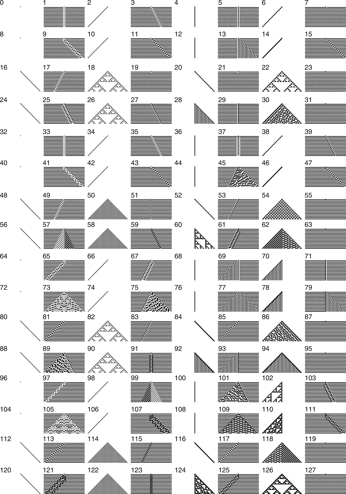

图 6.6 ¶ 规则集 0 到规则集 127 的执行轨迹。

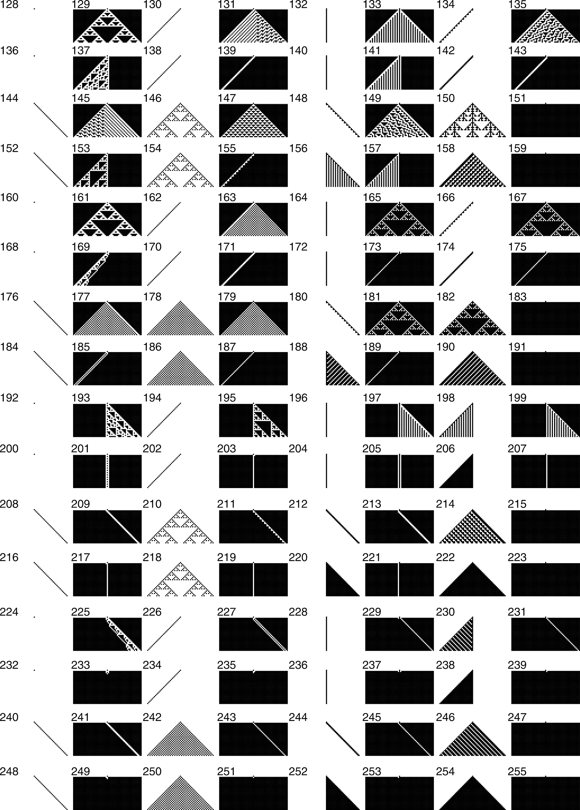

图 6.7 ¶ 规则集 128 到规则集 255 的执行轨迹。

仔细观察图 6.6 和图 6.7，可以注意到还有一个黑色三角形（222）看起来与规则集 254 的完全一样。还有一些较小的黑色三角形（例如 206、220、252）。可以看到还有其他三角形不是黑色的，但它们包含非常简单的重复模式（例如 28、50）。^(123)

有些规则集产生的结果甚至更简单。给定初始状态中只有一个黑色方块，规则集 4 和 12 等会产生一条垂直线。^(124) 规则集 2 和 6 等会产生一条简单的对角线。^(125)

有些规则集生成稍微复杂一些的模式，例如条纹背景上的垂直线或对角线（27、35、43、51、59 等）。然后是最无聊的规则集，它们只产生完全空白或完全黑色的画布，例如 0、8 和 32。^(126) 稍微不那么无聊的，或许是那些只产生条纹的规则集，例如 7 和 19。^(127)

还要注意，许多规则集在给定只有一个黑色方块的初始状态时，会生成嵌套模式。规则集 18、22、26 和 60 就是例子。^(128)

迄今提到的大多数规则集都是斯蒂芬·沃尔弗拉姆所谓的“1 类”或“2 类”。什么是 1 类规则？沃尔弗拉姆告诉我们，无论初始状态是简单（例如此处使用的、有且仅有一个黑色方块、其余为白色的初始状态）还是复杂（例如随机的黑白方块序列），执行 1 类规则都会产生简单的模式。^(129)

根据沃尔弗拉姆的说法，执行 2 类规则可能产生许多不同的模式，“但它们都仅由一组特定的简单结构组成，这些结构要么永远保持不变，要么每隔几步就重复一次。”^(130)

在沃尔弗拉姆的 3 类中，产生的模式据说更为复杂，“在许多方面看起来是随机的，尽管三角形和其他小尺度结构在本质上总能在某个层面上被看到。”^(131)

最后，“4 类涉及秩序与随机性的混合：会产生局部结构，这些结构本身相当简单，但它们会移动并以非常复杂的方式相互作用。”^(132)

沃尔弗拉姆坚持认为，虽然 1 类规则集通常无论初始状态如何都产生相同的模式，但其他类别对初始状态更敏感；也就是说，给定不同的初始状态，它们会产生不同的结果。因此，显然，前几幅图中看起来像 1 类或 2 类的一些规则集，实际上并非如此。一些规则集（包括 22、90 和 126）从单个黑色方块开始会产生简单的重复模式，但从复杂的初始状态开始会产生复杂得多的模式。例如，规则集 22 从单个黑色方块开始，会产生图 6.8 中的模式。

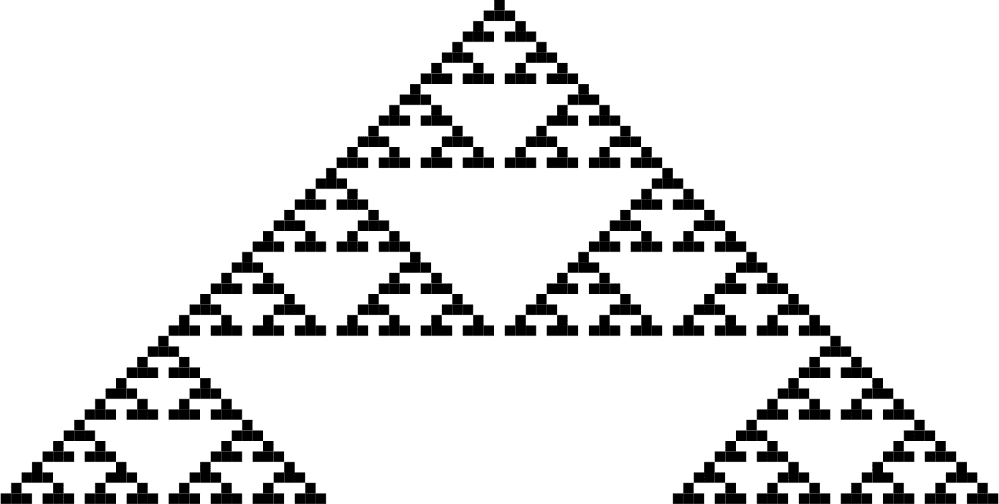

图 6.8 ¶ 规则集 22，输入为一个黑色方块。

但规则集 22 从由随机黑白方块序列组成的初始状态开始，并不会产生简单的、“2 类”式的重复模式。请看图 6.9。因此，沃尔弗拉姆指出规则集 22 不属于 2 类，而是属于 3 类。^(133)


图 6.9 ¶ 规则集 22，输入为随机黑白方块序列。

在他的书中，沃尔弗拉姆反复声称，人们应该仅凭肉眼就能看出不同类别之间的差异。然而，对于某些规则集，当它们以简单的初始状态运行时，我们无法看到本应看到的东西；例如，对于规则集 22，我们被告知除非用更复杂的初始状态运行，否则无法看到真实的情况。因此，与之前的演示形式一样，如果没有指导，我们这些未受训练的大众，无法看到演示所要展示的内容。欧几里得的图表也是这种情况，博伊尔的空气泵也是如此。只有当公众愿意在向导的带领下参观现场，由向导讲解并指出何时看什么，演示才能展示其意图展示的内容。

只要我们自己查看所有 256 个规则集的执行轨迹，就会清楚地认识到，沃尔弗拉姆可见的“结果”并不开放给简单的肉眼检视。请再看一遍这些图形。在无人协助的情况下，你能看出沃尔弗拉姆坚称存在的四个不同类别吗？没有沃尔弗拉姆的叙述，我完全可能将这些图像分为两类、三类或二十类。以我之眼光，沃尔弗拉姆的四个类别并不显而易见。沃尔弗拉姆用一种新的演示形式来推进他的论点，我们被告知可以“亲眼看到”图像中的真理。然而，我们要观看的这些图像，就像这里的 256 张图像一样，是“技术图像”，^(134) 经过了大量计算的中介，因此根本不为肉眼所直接洞察。

继续沃尔弗拉姆的叙述，我们被告知，尽管 1、2、3 类可以产生一些有趣的模式，但沃尔弗拉姆最感兴趣的是第 4 类。他指出规则集 110、124、137、193，以及可能的 54 属于 4 类。规则集 110、124、137 和 193 彼此是变体。沃尔弗拉姆断言，我们可以通过比较它们的输出来看出这一点（如图 6.10 所示）。

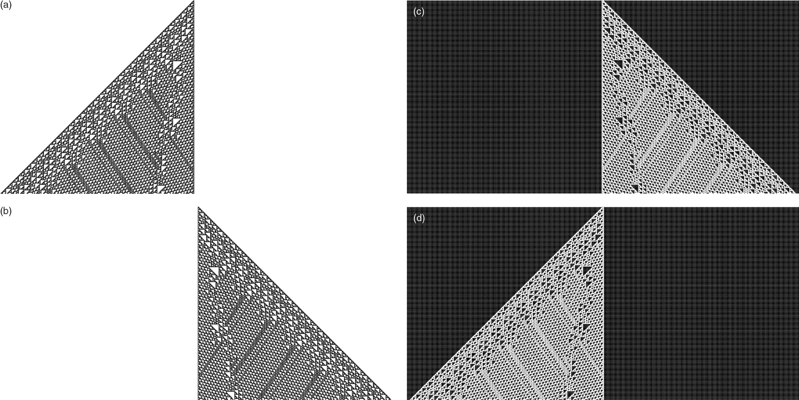

图 6.10 ¶ 单一输入下的执行轨迹：(a) 规则集 110，(b) 规则集 124，(c) 规则集 137，(d) 规则集 193。

沃尔弗拉姆写道：“任何 4 类系统的一个关键特征是，其中必须始终存在某些能够永久持续的结构。……移动结构的存在是 4 类系统的一个基本特征。……正是这些结构使得信息能够从 4 类系统的一个部分传递到另一个部分——并最终使 4 类特有的复杂行为得以发生。”^(135)

# 沃尔夫拉姆将他在执行轨迹中看到的模式称为“行为”，仿佛一小块黑白方格能以这样或那样的方式“行为”。

这是一个“借命名为论证”的例子。在展示规则集 110、124、137 和 193 结果的图片中，垂直条纹状的小三角形是沃尔夫拉姆所谓的“可以永久持续的结构”。对角线则是沃尔夫拉姆所谓的“会移动的结构”。我们将通过观察规则集 110 来更仔细地审视这些“结构”。

## 规则集 110

规则集 110 的规则如图 6.11 所示。如前所述，可以将其视为一个计算机程序：如果以某组数据作为初始状态（编码为一系列黑白方格）启动它，它就会处理这些数据并计算出一系列潜在的无限结果，每个结果都编码为一系列状态中的黑白方格。图 6.12 包含一个示例，其中初始状态——即输入数据——是一个巨大的随机二进制数。它展示了在初始状态之后，将规则集 110 的规则串行应用于 250 个状态后的计算过程。


图 6.11 ¶ 规则集 110。

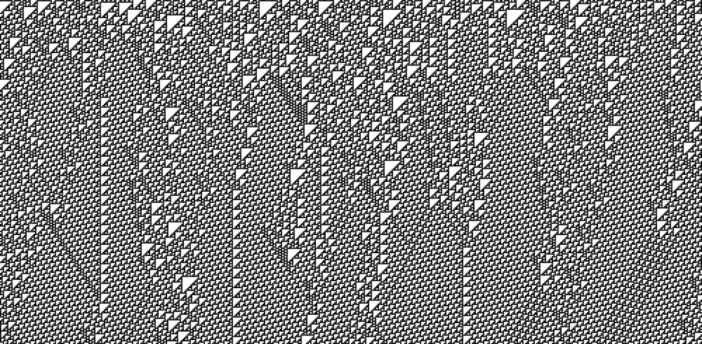

图 6.12 ¶ 以随机黑白方格序列为输入的规则集 110。

在图 6.12 中，你能看到沃尔夫拉姆所谓的以三角形柱状形式出现的“持久结构”，以及以由小黑白方格组成的对角线形式出现的“移动结构”吗？其中一些对角线“向左移动”，另一些则“向右移动”？在图中，存在一种“背景模式”：持久结构和移动结构似乎都写在这些小三角形之上。结果表明，如果我们用图 6.13 所示的背景模式填充初始状态——即十四位二进制数 `11111000100110`（十进制 15910）重复书写——就能让规则集 110 表现得像一个 2 类系统。


图 6.13 ¶ 规则集 110 的背景模式。

沃尔夫拉姆及其同事花费数年时间才找到这个背景模式，以及可以写在其上的持久结构和移动结构。他们为规则集 110 发明/发现了二十八种这样的结构。^(136) 他们称移动的结构为“滑翔机”，沿用了最初为约翰·康威的“生命游戏”（一种二维元胞自动机）开发的标准术语。^(137)

一些“滑翔机”从左向右移动。图 6.14 展示了四个此类滑翔机的示例。我们姑且称它们为 A1、A2、A3 和 A4，以便通过各自的宽度加以区分。


图 6.14 ¶ 滑翔机 A1、A2、A3 和 A4 从左向右移动。

其他滑翔机沿对角线向相反方向移动，即从右向左，或者根本不移动，而是继续从一个状态“垂直”延伸到下一个状态。图 6.15 从左到右展示了三个滑翔机，我们将它们分别称为 C（垂直）、E（杂乱对角线）和 B1（单宽度对角线）。

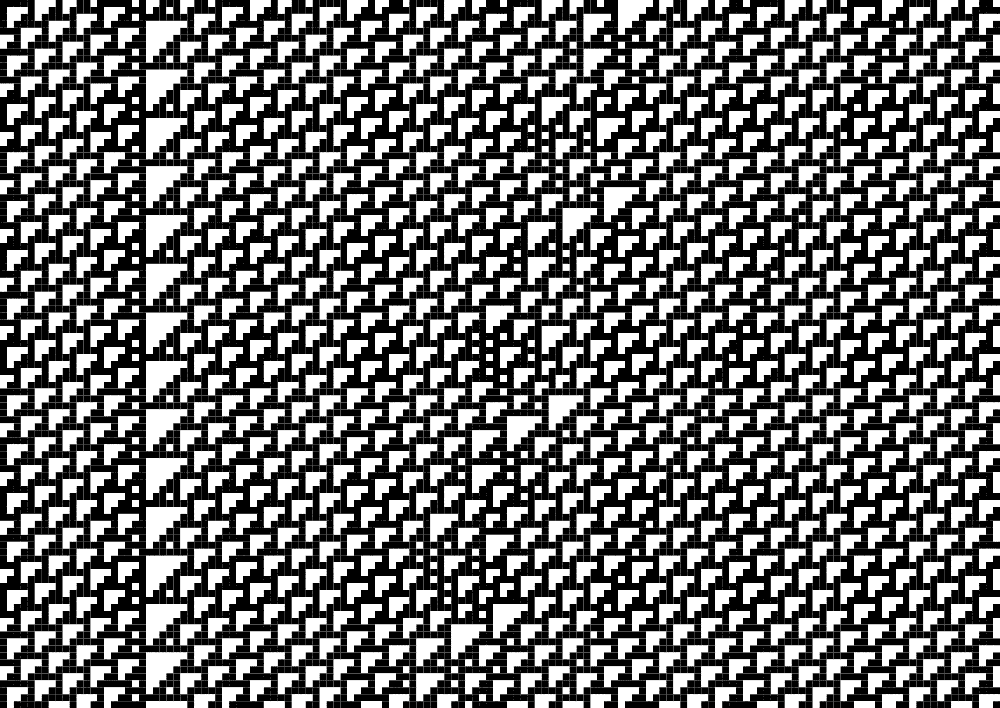

图 6.15 ¶ 滑翔机 C 垂直移动。滑翔机 E 和 B1 从右向左移动。

所有这些滑翔机当然也只是黑白方格序列，或者换个说法，就是二进制数：`A1 = 100110`；`A2 = 111000100110`；`A3 = 111110001110100110`；`A4 = 111110001110111000100110`；`B1 = 11111000`；`C = 11111010011100110`；`E = 110000010011000100110`。

我们可以设置这些滑翔机使它们相互“碰撞”。例如，在图 6.16 中，一个 A2 滑翔机被放置在初始状态的左端，一个 B1 滑翔机被放置在初始状态的右端，中间夹着背景模式。在某个时刻，它们相交了，在“碰撞”之后，B1 滑翔机消失了，而 A2 滑翔机变成了 A1 滑翔机。


图 6.16 ¶ 滑翔机 A2 和 B1 碰撞。

看到这一现象，可以推测 B1 滑翔机会将 A4 滑翔机变为 A3 滑翔机，并完全抵消 A1 滑翔机。因此，如果我们称背景模式为 Ø，我们或许可以用一种算术符号写出这些可能的碰撞，如下所示：`A4 + B1 = A3`；`A3 + B1 = A2`；`A2 + B1 = A1`；`A1 + B1 = Ø`。

既然已知有二十八种滑翔机可以写在背景模式中，那么就可以安排许多不同种类的碰撞，这些碰撞不仅涉及滑翔机 A1 和 B1，还涉及 C、E 等。这组可能的碰撞形成了一套复杂的“算术”，可用于计算。

我们还需要考虑规则集 110 的另一种结构，它被称为“滑翔机枪”（同样，该术语源自康威的“生命游戏”），因为它会生成一系列 A1 和 B1 滑翔机。滑翔机枪如图 6.17 所示。


图 6.17 ¶ 规则集 110 的滑翔机枪。

在图 6.17 中，滑翔机枪（二进制表示为 `11111000101100011101110011100011000100110`）被置于初始状态的中间，两侧被多个背景模式副本包围。随着每个后续状态的计算，滑翔机枪向左漂移，并且每隔几次迭代就会向左发射一个 B1 滑翔机，以及较低频率地向右发射一个 A1 滑翔机。

令人惊叹的是，至少从程序员的角度来看，了解了这些“持久”（如 C）和“移动”（如 A1 和 B1）结构及其可能碰撞的“算术”后，我们现在可以通过将一系列滑翔机编码在初始状态中来编写计算机程序。我们在图 6.16 所示的 A2 和 B1 的碰撞中，看到了最简单的此类程序之一，其中通过 A2 和 B1 滑翔机的“加法”计算出了一个新的 A1 类型滑翔机。

这一洞见不仅让我们理解规则集 110 如何被视为一个计算机程序，还让我们理解构成初始状态的一系列黑白方格如何被写下来以执行计算——换句话说——成为一个计算机程序。通过这种方式，我们可以将数字或数据理解为程序，将程序理解为数据。例如，编码 A2 和 B1 的二进制数不仅仅是数字，它们还是可以碰撞以创造其他数字、其他数据的“移动结构”，而这些数据反过来又可能与其他数据碰撞。数据即程序、程序即数据，这是二十世纪计算学最有力的洞见之一。

规则集 110 能被理解为一种编程语言，这与传统计算机科学的认知背道而驰。在计算机科学中，人们通常通过首先考虑需要支持哪组指令，然后创建一个能够执行这些指令的解释器（计算机程序），来设计一种新的编程语言（或新计算机）。但如果我们将规则集 110 视为编程语言解释器，将滑翔机（`A1`、`B1` 等）视为指令，就会发现沃尔弗拉姆的做法与传统计算机科学相比是“倒过来”的。首先，他实现了一系列潜在的计算机编程语言解释器（规则集 0 到规则集 255）。接着，他注意到其中一些支持的结构（即模式）比其他一些更复杂（第 4 类）。随后，他和他的团队花费数年时间，在第四类规则集（特别是规则集 110）中寻找原生的指令——那些移动且持久的结构。最后，他试图掌握这套指令集，即持久和移动结构及其可能碰撞的“运算”，以确定如何编写一系列指令——一个计算机程序——来计算出某个结果。

沃尔弗拉姆的 256 个规则集中，有多少能像规则集 110 那样进行编程？有多少支持足够数量的持久和移动结构，以提供滑翔机之间可能碰撞的“运算”？据沃尔弗拉姆称，第 1 类和第 2 类规则集在执行时，似乎过快地演变为简单的重复模式。第 3 类规则集能产生许多不同的结构或模式，但它们似乎不会稳定下来，而是溶解为随机配置。只有第 4 类规则集似乎提供了支持编程所需的结构。


既然沃尔弗拉姆和他的同事花了数年才弄清如何在规则集 110 中编程，那么沃尔弗拉姆不确定究竟有多少规则集可编程，这或许显而易见。也许是因为规则集 110、124、137 和 193 似乎是某种视觉变体，人们可能会想像，知道如何编程规则集 110 会让弄清如何编程规则集 124、137 和 193 变得更容易。

例如，如果我们用规则集 110 的背景模式序列来初始化规则集 193，规则集 193——大约经过五个状态后——会产生一个简单的重复模式，看起来像规则集 110 的模式，但呈一种“照片底片”形式（即小三角形是黑色而非白色）。滑翔机 `A1`、`A2` 和 `A4` 以类似方式工作，但方向相反，从右向左移动而非从左向右。但在规则集 193 中，滑翔机 `A3` 的行为与其插入规则集 110 初始状态时截然不同。然而，滑翔机 `B1` 也能工作，虽然——同样——方向相反，从左向右移动，即使它描绘的对角斜率比在规则集 110 中使用时稍陡。因此，例如，可以验证在规则集 193 中 `A1 + B1 = Ø` 也成立。

通过一些侦探式的工作，人们可以进一步想像，规则集 124、137 和 197 也可能被编程。但如何编程另一个截然不同的规则集（如 54），肯定需要更复杂的调查。尽管如此，沃尔弗拉姆推断所有第 4 类规则集都可编程。他如是表述：“我强烈怀疑，一般而言，任何表现出整体第 4 类行为的规则——像规则 110 一样——最终都将被证明是通用的。”^(138)

沃尔弗拉姆所说的“通用”，是指等价于通用图灵机。因此沃尔弗拉姆暗示所有第 4 类规则集都是图灵完备的。请注意，一方面，我所描述的只是沃尔弗拉姆完整论证的缩写，因为他的书超过 1200 页。另一方面，我的描述是对沃尔弗拉姆其人风格论证的重述：论证的每一步都将文字断言与视觉图表耦合在一起。因此，我们从沃尔弗拉姆对 256 个规则集的“实验”，被引导至通过详细视觉检查规则集 110 将这些规则集分为四个“类”的解释，然后再“向上”回溯到更大的概括：所有第 4 类规则集都是“通用的”。

值得注意的是，沃尔弗拉姆的论证中缺失了对可能被视为关键断言的详细演绎证明；即，他缺少一个详细证明规则集 110 等价于通用图灵机的证明。沃尔弗拉姆的一位前雇员马修·库克确实为规则集 110 创建了这样一个详细证明。^(139) 然而，库克的演绎证明直到沃尔弗拉姆的书出版后才发表。

在沃尔弗拉姆的书中，为了主张第 4 类的普遍通用性特别是规则集 110 的通用性，沃尔弗拉姆没有使用库克的详细证明，而是坚持使用我在此所用的相对非正式的视觉修辞。尽管如此，沃尔弗拉姆围绕一种极度膨胀形式的丘奇-图灵论题构建了他的整本书。在他的论证中，一维元胞自动机不仅能模拟通用图灵机。绝非如此：沃尔弗拉姆认为他的形式系统等价于——或比——任何心理、社会、经济、政治、文化、化学、物理、形而上学、艺术和技术系统更强大。

## 计算等价性的主张

沃尔弗拉姆在其书的引言中描述了这一思想——他的“计算等价性原理”，并用整整一章作为结语来阐述它：^(140)

> 基于许多发现，我得出了一个更为宏大的结论，概括为我所谓的计算等价性原理：无论何时，只要看到的行为不是显而易见的简单——在本质上任何系统中——都可以认为它对应于同等复杂程度的计算。这一个非常基本的原理，对科学和科学思维具有前所未有的广泛含义。……[从计算等价性原理中] 还涌现出一种新型的统一性：因为跨越从简单程序到大脑再到我们整个宇宙的广泛系统范围，该原理暗示存在一种基本等价性，使得相同的基本现象发生，并允许使用相同的基本科学思想和方法。而这最终正是本书所描述的新科学巨大威力的根源。^(141)

库克对规则集 110 计算能力的演绎证明，与沃尔弗拉姆的溯因演示有着关键区别。演绎证明中可见的内容可以被争辩，甚至被反驳。相反，溯因演示中可见的内容无法被争辩。例如，沃尔弗拉姆断言 256 个元胞自动机分为四类，只能被弱弱地批评为“哦，我真看不出那些图里有你所说的东西”。或者，人们可以看到，我对规则集 110 的滑翔机如何组合成“运算”所做的开放式视觉演示，不承认直接反驳，因为它是一种构造、一种生产，仅表明人们如何思考组装一台计算机。相比之下，库克的演示是将规则集 110 的滑翔机详细转码为通用图灵机。用更通俗的话说，沃尔弗拉姆在进行修辞演示，而库克的工作是逻辑演示。

# 沃尔夫勒姆的修辞与新科学

沃尔夫勒姆继续坚称，他在元胞自动机方面的工作已经引入，或即将引入数学、物理学、生物学、社会科学（从经济学到心理学）、计算机科学、哲学、艺术和技术等领域的非凡进展^142，并且为了实现这一点，他不得不超越人工智能、人工生命、灾变理论、混沌理论、复杂性理论、计算复杂性理论、控制论、动力系统理论、进化论、实验数学、分形几何、一般系统理论、纳米技术、非线性动力学、科学计算、自组织和统计力学等领域的所有先前研究。^143

## 一种新型修辞

沃尔夫勒姆关于“计算等价性”的主张令人怀疑，甚至正如他的同事沙利齐所言，是“狂妄的自我中心和彻头彻尾的胡说八道”。他的主张是通过一种溯因演示的形式进行论证的，这与演绎和归纳演示截然不同。这种新型修辞将技术图像与创建这些图像的计算过程的阐述相结合，正如所讨论的，这并非沃尔夫勒姆独有，而是为视觉分析、信息可视化和数据科学、机器学习、新形式的数据驱动新闻以及许多其他新兴领域所共享。

一旦我们将这些实践理解为新型修辞，我们就能开发出反驳其主张的概念工具。这些工具既需要足以批判溯因演示的图像，也需要足以分析将图像与其计算理论和方法基础联系起来的主张。

很难不把沃尔夫勒姆关于计算等价性的主张读作夸夸其谈的吹嘘，因为在他的书中，他使用了如此多种形式的非演示性散文，其写作早已超出了这种新型修辞的范畴。在他的著作中很容易找到更多这种夸张的例子。例如，在一节标题为“本书科学的个人故事”章节中，沃尔夫勒姆声称他亲自彻底变革了所有科学，起始于他十二岁时所做的工作：

> 我可以相当准确地将我对本书所讨论的这类科学问题产生严肃兴趣的开端，追溯到 1972 年夏天，那时我十二岁。…… \[随后\] 1994 年左右，我开始系统地研究各个主要传统科学领域。…… 典型的问题在于，存在一些核心问题，传统方法或直觉从未能成功解决。…… 然而一次又一次，我兴奋地发现，凭借我的新科学，我突然能够开始取得进展——甚至在某些情况下，针对那些悬而未决几个世纪的问题。^144

这种自我中心和夸张使得他的同行难以看到他的演示与他们的演示之间的亲缘关系，但正如亚里士多德一样，我坚持要将非演示性的修辞形式抛在一边，以便更好地专注于演示本身——即所展示的内容。而沃尔夫勒姆文本中所展示的内容，以他将自动机呈现为黑白方块的非凡图形渲染形式出现。沃尔夫勒姆采用的溯因演示形式，似乎基于一种较古老的演绎演示形式（即理论计算机科学中实践的图灵完备性证明类型），但在他的案例中，这在很大程度上与计算普适性的这种狭义解释（即对丘奇-图灵论题更为谦逊的理解）脱钩了。

沃尔夫勒姆的“发现”并非一种新科学。沃尔夫勒姆的贡献是一种新型的视觉公共修辞——或者至少他的发明，他那种黑白图表的形式，是对这种新型修辞极具说服力的贡献。其证明在于他的书成为了一本畅销书，被——或者至少被购买——由远超物理学家和计算机科学家范围的大众阅读。^145 而且，正因为这是一种新型修辞，我们可以看到，其他正在发展的计算机图形学形式（如数据科学和机器学习的信息可视化技术）以及其他新兴的计算系统体裁（如电脑游戏）也都是基于类似溯因演示程序的修辞套路，甚至是完整的同胞修辞。我们需要能够看到，所有这些以及沃尔夫勒姆的书，都是恩格尔巴特“所有演示之母”的孩子。

# 注释

\[恩格尔巴特的研究小组\] 个别成员与反文化的各种要素保持着实质性联系。20 世纪 60 年代末，恩格尔巴特等人尝试了 LSD 并参观了几个公社；1972 年，他们参加了沃纳·艾哈德的艾哈德研讨会培训（EST）运动的课程。正如恩格尔巴特后来回忆的，他“非常同情反文化关于社区的观念，以及这如何有助于创造力、理性以及团队协作。”

参见弗雷德·特纳，《从反文化到网络文化：斯图尔特·布兰德、全球概览网络与数字乌托邦主义的兴起》（芝加哥：芝加哥大学出版社，2006），109。

2\. 美语原意 a. 一件商品（尤指汽车或其他车辆），供潜在买家试用；尤指随后以降价出售的商品；演示样机。\[示例\] 1935 La Crosse (Wisconsin) Tribune & Leader Press 29 Sept. 15/4 (advt.) Used car specials 1935 Olds Six demo. 1949 N.Y. Times 23 Jan. v. 6 (advt.) Sensational values … New Cars & Demos included.

他们如此无礼地谈论什么？首先是*烹饪* \[我特意强调以突显其与食谱和菜谱的联系\]，然后是最伟大的剧作家、最伟大的雕塑家、最伟大的音乐家、最伟大的建筑师、最伟大的演说家、最伟大的政治家、最伟大的悲剧演员的技艺。所有这些人都被抛弃了，因为他们不知道苏格拉底教授想要强加给雅典人民的那种教学式的知识。…… \[这\] 是*平民*能够完成这一最非凡壮举的唯一手段：在公众面前公开代表其自身，使其存在与诉求变得可见。几个世纪的艺术与文学，所有的公共空间、神庙、卫城、集市——苏格拉底正一个个贬低它们……苏格拉底诉诸理性与反思——但随后，所有艺术、所有场所、所有这种反思采取整体处理整体这一特定形式的场合，都被判定为非法。…… 难怪苏格拉底被称为电鳗！他的电击麻痹的正是雅典的生命、政治躯体。

参见布鲁诺·拉图尔，《潘多拉的希望：科学研究的现实随笔》（马萨诸塞州剑桥：哈佛大学出版社，1999），244–245。

尼采从未写过关于智者派的系统论著，而是在近二十年的时间里，在各种文本中以相当零碎的方式讨论他们。此外，除三段极简短的论述——见《人性的，太人性的》第 221 节、《晨昏》第 168 节和《偶像的黄昏》“古人”第 2 节——尼采未发表过任何关于智者派的议论，将他的讨论局限于 1872–1873 年希腊修辞史讲稿（“古代修辞描述”和“希腊雄辩史”）、1872 年论文《荷马的竞赛》以及死后汇编于《权力意志》的若干段落。

参见斯科特·康西尼，“尼采对智者派的解读”，《修辞评论》第 13 卷，第 1 期（1994 年秋）。

# 柏拉图的数学术语与实践

柏拉图的著作表明，数学家们已经拥有了一套特定的术语——柏拉图通过让其数学段落充满看似行话的词汇来体现这一点。这种行话往往不同于欧几里得的术语，但没有理由假设柏拉图试图使用正确的行话。除此之外，柏拉图对数学实践的某些方面（例如图表中字母的使用）却奇怪地保持沉默。总体而言，他对数学的运用与数学本身保持着相当的距离，这使我们无法清晰地看到他所了解的数学的真实面貌。

参见 Netz 著《希腊数学中演绎的塑造》，第 276 页。

# 苏格拉底与阿斯帕西娅

苏格拉底：我在修辞术上有一位极好的女教师——她造就了许多优秀的演说家，其中有一位是全体希腊人中最杰出的——色诺芬之子伯里克利。

梅内克塞努斯：她是谁？我想你指的是阿斯帕西娅。

参见柏拉图著，《柏拉图全集》[注释版]，Benjamin Jowett 译（Latus ePublishing），Kindle 位置 18619–18621。

# 柏拉图对话篇中的分割与拟像

我们该如何解释这一事实：在关于分割的三部伟大文本——《斐德罗篇》、《政治家篇》和《智者篇》中，分割法悖论性地并非用于评判正当的竞争者，而是用于追捕虚假的竞争者本身，以界定拟像的存在（或更确切地说是非存在）。智者本人就是拟像式的存在，是萨提洛斯或半人马，是无处不在、渗透万物的普罗透斯。然而，若如此理解，《智者篇》的结尾很可能包含了柏拉图主义最非凡的冒险。柏拉图因朝拟像的方向探究，在俯视其深渊的瞬间，发现拟像不仅仅是一个虚假的复制品，而是它质疑了“复制品”……乃至“模型”这两个概念本身。对智者的最终定义将我们带到了一个无法再将他与苏格拉底本人区分开来的地步：那个在私下运作、使用省略论证的反讽者。

参见德勒兹，《柏拉图与拟像》。

# 数据的修辞本质

数据的语义功能专门是修辞性的。……单词“data”源自拉丁语进入英语。它是拉丁语 *datum* 的复数形式，而 *datum* 本身是动词 *dare*（给予）的中性过去分词。因此，英语中的“datum”是指论证中被给予的东西，被视为理所当然的东西。这与“fact”（事实）形成对比，“fact”源自拉丁语动词 *facere*（做/制造）的中性过去分词，由此衍生出英语单词“fact”，意指已被做成、发生或存在的事物。“data”的词源也与“evidence”（证据）不同，后者源自拉丁语动词 *vidére*（看见）。这里存在重要的区别：事实是本体论的，证据是认识论的，数据是修辞的。

参见 Daniel Rosenberg，“Data before the Fact”，载于《“Raw Data” Is an Oxymoron》，Lisa Gitelman 编（马萨诸塞州剑桥：MIT Press，2013），第 18 页。

# 7 语法

学童们学到语法是一套为正确说和写而应遵循的规则。直到二十世纪，语法都是规范性的。它是为帝国建设服务的教学政治项目，也是新兴民族国家教育标准的基础。随后，当它成为一个研究领域——即我们今天所知的语言学——语法也变成了描写性的。面向学校的规范语法书依然在持续出版，但一种旨在描述语言如何被说和写的新体裁语法诞生了。

上个世纪的语言学家付出了巨大努力，记录人们*确实*遵循的语法规则——这与他们*应该*遵循的语法规则形成对比。当语法纯粹是规范性时，关于谁制定规则以及规则在哪里可以找到，并没有什么神秘感。它们可以在语法教师编写的语法书中找到。当语法变成描写性的，这些问题就需要不同的答案了。描写性语法的规则在哪里？它们一定在我们的大脑里，对吧？是谁制定的？它们一定内在于我们的人类构成中，或是儿童在语言使用者的包围下通过某种归纳形式习得的。至少这些一直是语言学家的工作假设。

突然之间，随着关于规则作者身份和位置的这些新假设，语法成了一个研究对象，是要在“外部世界”或“我们内部”寻找的东西，而不再仅仅存在于教科书中。语言学家将他们的工作描述为自然科学，并提出描写性语法是运行在我们头脑中的机制。最初，现代语言学的奠基人如斐迪南·德·索绪尔（1857–1913）设想这些机制是机械装置。但到了 1930 年代和 1940 年代，语言学家转向数理逻辑的当代成果，将语法的语言机制重新构建为我们可以反时代地称之为“软件”的东西。

到 1960 年代初，诺姆·乔姆斯基、他的同事和学生已将描写性语法的“装置”牢固地与计算机程序联系起来，并做出了一个认识论上大胆的举动：称这些语法、装置和计算机程序为语言理论。这代表了智力文化的巨大转变。当一个计算机程序、一段软件可以成为一种理论时，我们就进入了我所谓的“计算认识论”。在这种认识论中，理论构建变成了编码、编写软件。

虽然许多人仍想坚持语言学是自然科学这一观点，但当理论变成软件时，语法再次成为了一门艺术。为什么？因为现在我们要问理论/软件是否*管用*，而让某事物管用正是艺术家、设计师和工匠所做的事。在这种认识论中，我们运用理论来解决事物*如何*运作的问题。“为什么”的问题很大程度上被推到了一边。因此，我们必须再问一组问题，这些问题最终关乎伦理：理论/软件为谁而管用？在什么情况下？代价几何？

## 《词与物》与计算认识论

1966 年，哲学家兼历史学家米歇尔·福柯出版了一本书《词与物》，他在书中论证道：在三个时期中，语言被理解的方式存在巨大差异、断裂：从近代早期到十六世纪末（文艺复兴时期）；从十七世纪到十九世纪（古典时期）；以及从十九世纪至今（现代时期）。福柯认为，在每个时期都能找到一套独特的关于语言的思想和方法。他特别关注意义在这些不同时期是如何以不同方式归属于语言的：“在十六世纪，人们问自己如何可能知道一个能指确实指示了它所指示的东西；从十七世纪开始，人们开始问一个能指如何能与它所指示的东西联系起来。古典时期通过表征分析来回答这个问题；而现代思想则通过意义和能指分析来回答。”^(1) “认识论”是福柯对语言与意义之间所设定的一系列关系的称呼。他展示了尽管人们可以看到一个时期的认识论与另一个时期的认识论之间存在某些连续性，但这些认识论在根本上是彼此不同的。^(2)

# 语法的历史与计算认识论

历史学家们反复批评福柯的这一时期划分，因为它仅描述了一小群欧洲男性知识分子。但《词与物》审视的并非某个时期大众对语言的普遍认知。福柯实际所做的是对少量关于语言的学术文本（包括修辞学、逻辑学、语法学、语文学、文学和语言学文本）进行细读。与其使用“认识论”这一术语，不如用一个短语（尽管略显笨拙）如“语言的学术分析”会更准确。

然而，即使超越显而易见的学者代际、地域和性别差异，无论古今，仍可认为福柯过于草率地将“我们”（当代人）与十九世纪现代人联系在一起。我将论证其“文艺复兴”、“古典”和“现代”三个认识论是不充分的，需要增加第四个认识论，涵盖二十世纪初至今的时期。第四个认识论区别于福柯的现代认识论，因为它不主要关注能指与意义。

我将这一第四个认识论称为“计算认识论”，并强调其处理语言的主要途径将意义推向边缘。本质上，在“计算认识论”中，语言理论的设计旨在仿佛语言本身无意义般对其进行分析。虽然能指与意义是福柯所命名的前几个认识论的核心，但在二十世纪许多语言学、文学、逻辑学和信息学著作中，认为语言形式可以脱离意义而被孤立研究，这一观点被视为既可能又可取。

例如，克劳德·香农和沃伦·韦弗在其著作《通信的数学理论》中坚持认为，其理论的原则之一是意义在其中不起作用：“在该理论中，‘信息’一词用于特殊含义，不得与其日常用法混淆。特别是，信息不得与意义混淆。事实上，两条信息，一条承载大量意义，另一条纯属胡言乱语，从目前观点来看，就信息而言可以完全等价。”^(3)

本章将勾勒计算认识论的谱系，重点关注语言学家诺姆·乔姆斯基的工作，因为乔姆斯基语言学极其有力地将意义推向边缘，影响深远，且在语言学领域现有地位之外仍具有间接但重要的影响力。我们将仔细考察乔姆斯基所见其工作与十七世纪《波尔皇语法》的联系。乔姆斯基是否有效地将《波尔皇语法》翻译成了软件？

## 乔姆斯基的熔炉


特别是在二十世纪六七十年代，乔姆斯基的生成语法成为语言学、哲学、文学、计算机科学、经济学、社会学、政治学^(4) 等诸多领域的熔炉。因此，乔姆斯基的文本是二十世纪被引用最多的文本之一。^(5) 在乔姆斯基二十世纪五十年代介入之前，语法被许多人理解为一种相对次要的教学艺术。例如，在美国，“grammar school”（语法学校）是“elementary school”（小学）的常用同义词，因为正如麦克卢汉在其论文中所解释的，语法作为基础教育的基本领域一直延续下来，即使其作为知识和研究领域的地位已下降。但乔姆斯基——连同被招募到其项目中的数千名其他学者——重振了语法，将其置于几乎所有知识和研究领域的中心。

这是如何做到的？主要是通过运用信息论和计算理论重新阐述语法。在接受《纽约时报》采访时，乔姆斯基在一番谈话中将语法与计算联系起来，并试图建立与十七世纪笛卡尔和伽利略人物的直接联系：“语言作为创造性思维系统的出现，为笛卡尔和伽利略所感知。但直到二十世纪中叶才真正得到处理，因为当时缺乏恰当表述所需的工具。你需要现代可计算性理论，这是由阿兰·图灵和二十世纪三四十年代其他伟大数学家发展起来的。我有幸在所有这些伟大见解涌现之时成为一名本科生。”^(6)

在这番陈述中，乔姆斯基谦虚地略去了他自己对现代可计算性理论发展，特别是编程语言形式分析的贡献。因此，要理解二十世纪中叶语法的这一复兴，我们需要考察乔姆斯基的技术贡献。但正如乔姆斯基在上述引文中透露的，他将自己的工作置于历史背景中。

乔姆斯基的第一部有影响力的技术著作《句法结构》出版于 1957 年。^(7) 其关于语法谱系的历史主张发表于 1966 年，题为《笛卡尔语言学》。^(8) 在后一本书中，乔姆斯基宣称他在十七世纪语法学家的著作中看到了其二十世纪语法的根源。本章将考察乔姆斯基给语法学科带来的重大技术变革并审视其史学观。我们将探讨乔姆斯基的语法是否如他所言是十七世纪《波尔皇语法》的翻译。我们将看到，乔姆斯基的工作与其说是十七世纪语法的翻译，不如说是对其的彻底决裂，而这一彻底决裂不仅对语言学，而且对当今教学法、工业和认识论的许多领域都有影响。

# 语法史

为理解和评估乔姆斯基的历史主张，我们需要考察乔姆斯基之前的语法是什么样的。几个世纪以来，语法并非对语言结构的无利害描述，而是一种明确的*规范性*、政治性和宗教性干预，作为教学法被实施。首部欧洲方言语法的评注使规范性计划显性化。例如，1492 年，学者安东尼奥·德·内布里哈向伊莎贝拉女王呈献其卡斯蒂利亚语语法，作为帝国工具，以驯服其帝国征服者所面对的“异域语言”。他在致伊莎贝拉的信中写道：

> 请回想今年早些时候我在萨拉曼卡向您呈献此书草稿之时。当时您问我，这样一部语法究竟能有何用。此时，阿维拉主教打断替我回答。他说：“陛下很快将把轭加在许多说异域语言的蛮族身上。因这胜利，这些人将面临新的需要；胜利者对失败者应负的法律之需要，以及我们将带去的语言之需要。我的语法将把卡斯蒂利亚语传授给他们，正如我们用语法教青年拉丁语。”^(9)

方言语法——卡斯蒂利亚语、法语及其他——成为帝国政治，随后又是民族国家政治的必备著作。^(10) 拉丁语法是罗马帝国继而罗马天主教会的必备产物。后来，各教派的基督教传教士——渴望传播上帝之道并将《圣经》翻译成世界各地语言——为无数非欧洲语言编写了语法。^(11)

# 语法化与通用语法

遵循语言学家 Sylvain Auroux 的观点，我们不仅可以将语法理解为一个研究和教学领域，还可以将其视为一个帝国建构和主体化的过程，该过程有两个主要产出——词典和书面语法——用于规范语言并对其进行教学。根据 Auroux 的说法，这一“语法化”过程在达到最终状态时，人们可以仅通过查阅其参考工具书来学习一种语言：“语法化过程永远不会结束……然而，我们可以就何为‘语法化的语言’达成共识。当人们能够仅使用现有的语言工具（如印刷语法书和词典）来学习该语言（在一个足够受限的意义上），即能说（或读）该语言时，该语言就是语法化的。”^(12)

Auroux 认为，一种语言要达到“语法化”阶段，通常需要经过十个里程碑。如果我们将正在经历语法化的语言称为“目标语言”，将已经语法化的语言称为“源语言”，那么 Auroux 的十个里程碑可以表述如下：

1.  使用源语言的字母和其他书写构造，拟制出目标语言的书面形式；
2.  在用源语言撰写的游记中引用目标语言的表达；
3.  用目标语言撰写源语言文本的部分注释；
4.  将源语言的完整文本正式翻译成目标语言；
5.  将源语言的语法书翻译成目标语言（Auroux 指出，这是一个标志性成就，因为目标语言因此获得了一套用于描述各种语言的“元语言”术语的翻译；例如“名词”、“动词”、“形容词”、“主语”、“宾语”、“格”和“变位”等词）；
6.  将源语言的语法书改编为目标语言的语法书；
7.  基于步骤 5 和 6，使用适用于多种语言（而非仅源语言）的语法术语，撰写目标语言的语法书；
8.  创建双语或多语表达列表，例如会话手册或日常交际手册；
9.  为目标语言和源语言编制双语词典；
10. 为目标语言编制单语词典。^(13)

Auroux 的里程碑提醒我们，语法书是众多人协作的成果，其结果不仅是一套印刷参考工具书，还包括教育、出版和新闻机构的转型或创建。他提醒我们，语法是一种社会、文化、经济和政治建构。

Auroux 将早期现代语法著作与 17 至 18 世纪的通用语法项目区分开来：“通用语法诞生于语法化之后，并在 18 世纪的法国百科全书派中达到顶峰，……通用语法意在成为适用于所有语言的语言规律科学。”^(14) 17 至 18 世纪的语法学家将语言与知识视为交织在一起的整体。人们认为话语中的语言表达了一种知识秩序。^(15) 通用语法与为狄德罗和达朗贝尔的《百科全书》所做的工作密切相关。^(16)

通用语法与寻找一种能够陈述所有知识的哲学语言的探索相关联。既然许多人认为这种哲学语言就是逻辑，许多语法学家也是逻辑学家，试图整合逻辑与语法。^(17) 哲学家 Condillac 或许最简洁地阐述了这种将语言与知识、逻辑与语法融合在单一技艺中的取向：“每一种语言都是一种分析方法，每一种分析方法都是一种语言。这两个真理既简单又新颖，已得到证明；第一个在我的语法书中；第二个在我的逻辑学中。我们已经能够使自己确信，它们为说话的艺术和推理的艺术投射了光辉，将这两者归结为同一门艺术。”^(18)

Condillac 写作于 18 世纪，他遵循了一种将逻辑与语法联系起来的早期现代思想传统。在早期现代欧洲，大多数语法书是拉丁语语法书；如果不是，它们也以拉丁语语法为模型。拉丁语当时被视为一种逻辑形式，是一门完美且臻于完善的语言，适用于所有艺术和科学。Leonard Bloomfield (1887–1949)，可能是乔姆斯基时代之前最重要的美国语言学家，曾写道：“中世纪学者在古典拉丁语中看到了人类言语的逻辑正常形式。在较现代的时代，这一学说导致了通用语法的撰写，旨在证明各种语言的结构，特别是拉丁语的结构，体现了普遍有效的逻辑准则。其中最著名的论著是 Port-Royal 修道院的《普通与理性语法》，出版于 1660 年。这一学说持续到了 19 世纪……它仍然体现在我们的学校传统中，该传统试图将逻辑标准应用于语言。”^(19)

## Port-Royal 语法

Bloomfield 评论的是由 Antoine Arnauld (1612–1694) 和 Claude Lancelot (1615–1695) 撰写的《Port-Royal 普通与理性语法》。Port-Royal 语法是 Port-Royal 修道院长期外语教学项目的总结，在某种意义上也是其集大成之作。1644 年，Lancelot 为初学者出版了一本拉丁语语法书。^(20) 此后，他又为希腊语、意大利语和西班牙语撰写了类似的著作。可以将 Arnauld 和 Lancelot 的通用语法理解为对这些早期语法书之间亲缘关系的阐述尝试。

Lancelot 的语法书打破了传统语法书的模式，因为他区分了教学语言和被教语言。此前，拉丁语语法书会用拉丁语撰写：所有规则和例句均为拉丁语。本质上，如果要使用这些早期语法书学习拉丁语，人们就必须已经是熟练的拉丁语读者！相反，Lancelot 用学生的母语——法语——来书写拉丁语规则并解释拉丁语例句。^(21)

虽然今天我们觉得说法语的拉丁语学习者希望用法语来理解拉丁语规则并不奇怪，但 Lancelot 的教学创新为当时的语法学家打开了一组哲学问题：如果拉丁语不是人类言语的逻辑正常形式，那么什么是逻辑？正如本书第 5 章关于逻辑的讨论，17 世纪的提问者可能会求助于亚里士多德来回答此类问题。但语法的“逻辑”（例如动词变位中可观察到的规律）不一定与亚里士多德的三段论相同。^(22)

## Port-Royal 逻辑

因此，一种新的语法使得一种新的逻辑成为必要。在 1669 年阿尔诺和朗斯洛《普通语法》再版的序言中，^(23) 米歇尔·福柯探讨了语法与逻辑之间产生的差异与相互依存关系。^(24) 波尔-皇家语法学家认为逻辑是不言自明的；它不需要解释。对他们而言，逻辑是思想和意义的直接表达。相比之下，语法*确实*需要解释。为了解释语法的形式与内容，波尔-皇家语法学家不得不求助于一种逻辑。这与前文引用的语言学家布龙菲尔德关于语法与逻辑的评论相呼应。

《语法》出版两年后，波尔-皇家神甫们出版了《逻辑》（1662 年）。^(25) 福柯解释说，尽管《语法》出版在先，但它实际上是围绕《逻辑》构建的，因为《逻辑》定义了符号及其意义的理论，而《语法》则预设了这种意义理论。^(26)

语法学家的规则或许仿照了逻辑学家的规则，但古典语法学家的工作始于逻辑学家工作的终点。即使我们将逻辑和语法视为一项更大事业的组成部分，两者之间也存在分工。如果逻辑向我们展示了思维的真实面貌，我们理应能在善于言辞之人的言语中看到其运作：这样的论述其意义将是合乎逻辑的。但如果表达语言本身不是逻辑（例如，拉丁语并非逻辑的定义本身），那么语法学家的工作就是解释说话者所遵循的语言规则如何将其与逻辑联系起来。换句话说，从历史上看，逻辑为语法提供了意义。违反语法规则的说话者冒着说出无意义之事的风险。

对波尔-皇家语法学家而言，语法规则是规定性的——它们是关于我们应当如何说话和写作的法则。正如宗教、政治或社会等其他人类制度的法则一样，语法法则也可能被人们违背。因此，例如在讨论一条语法规则时，朗斯洛和阿尔诺探讨了“违背”规则的可能性。^(27)

将朗斯洛和阿尔诺的论述与关于 `f = ma`（力等于质量乘以加速度）的讨论相比较，后者是艾萨克·牛顿在 17 世纪提出的第二运动定律。^(28) 在关于第二运动定律的讨论中，我们不太可能听到有人或什么东西如何“违背”它。牛顿第二定律并非在“命令”力、质量和加速度这些抽象实体做什么。它是在*描述*它们*做*什么。因此，物理学的法则及其规则被理性地推断为通过归纳演示确立的、决定性的；语言的规则则不然。对朗斯洛和阿尔诺而言，语法规则是规定性的、规范性的建构，可以被打破。然而，正如我们即将看到的，对于紧随其后的大多数当代语法学家和语言学家而言，语法规则*被理解为*是决定性的，因为这些规则被认为是对*实际发生*之事的描述，而非对*应当发生*之事的规定。

### 二十世纪的波尔-皇家语法

20 世纪 60 年代，由于福柯和乔姆斯基在各自著作中对其进行了深入审视，17 世纪的《波尔-皇家语法》成为了理解语法的一个必经关口。^(29)

福柯强调了朗斯洛和阿尔诺的《语法》在古典知识型构建中的关键作用。他们《语法》构想的核心是观念和意义——而非句法。正如福柯指出的，在波尔-皇家语法中存在“句法的准缺席”。^(30)（作者仅用二十六章中的一章来论述句法。）相比之下，例如，乔姆斯基语言学最初仅致力于句法。

毫不奇怪，福柯认为 17 世纪的普通语法与现代语言学截然不同：“我们发现了古典时代所谓的‘普通语法’这一新的认识论领域。纯粹简单地将其视为逻辑在语言理论中的应用是荒谬的。但试图将其解释为语言学的一种预像，同样是荒谬的。”^(31) 1966 年，福柯出版《词与物》的同年，当时及至今最著名的语言学家诺姆·乔姆斯基出版了《笛卡尔语言学》，他在书中主张，与福柯相反，《波尔-皇家语法》不仅不是语言学的“预像”，实际上还构成了乔姆斯基自己的语言学——即转换生成语法——的一个早期版本：“在许多方面，将正在当前研究中发展的转换生成语法理论视为波尔-皇家理论的一个现代且更为明确的版本，在我看来似乎是完全准确的。”^(32)

### 乔姆斯基对决福柯

1971 年，应荷兰哲学家方斯·埃尔德斯之邀，米歇尔·福柯和诺姆·乔姆斯基在荷兰电视台进行了一场辩论。宣传的辩论主题是“人性”，但辩论的实质取决于他们对语言、语法、科学和历史各自截然不同的理解。^(33)

辩论的召集人兼主持人方斯·埃尔德斯迅速让两人就各自对哲学理性主义历史的理解和关系进行对比，从而形成鲜明对照。埃尔德斯说：“福柯先生，您是在界定十八世纪的理性主义。而乔姆斯基先生，您则是将十八世纪理性主义与自由、创造等概念结合在一起。”^(34)

乔姆斯基首先回应，实质上说尽管他宣布自己的工作是“笛卡尔式的”，但他觉得可以自由地“摘樱桃”^(35)——从笛卡尔那里汲取他觉得有启发的东西，而忽略其余部分。他将自己的方法比作一个寻找灵感的“艺术爱好者”，而非历史学家的方法。随后，他间接称福柯为“古董商”，^(36) 以此侮辱福柯的历史著作——以及所有历史学家的工作。乔姆斯基继续贬低他选定的十七、十八世纪参考文献，坚称他们都在“摸索”他自己的二十世纪转换语法研究项目，“甚至可能没有意识到他们在摸索什么”。^(37)

福柯无视乔姆斯基的居高临下，反驳说如果他想找能够可信地支持他——乔姆斯基——当前观点的哲学理性主义者，他应该引用帕斯卡尔和莱布尼茨以及“奥古斯丁基督教思想的整个流派”。福柯告诉乔姆斯基：“您[乔姆斯基]所提到的波尔-皇家语法，我认为更多的是奥古斯丁式的，而非笛卡尔式的。”^(38)

### 乔姆斯基作为历史学家

福柯绝非唯一暗示乔姆斯基为服务自己的目的而歪曲历史的人。^(39) 例如，历史学家汉斯·阿尔斯莱夫在对乔姆斯基的尖锐批评中指出，《波尔-皇家语法》更多地归功于约翰·洛克经由孔狄亚克，而非笛卡尔的著作。阿尔斯莱夫写道：

> 乔姆斯基版本的语言学史毫无可取之处。该版本从头到尾从根本上就是错误的——因为学术研究粗糙，因为文本未被阅读，因为论证未被理解，因为本可提供帮助的二手文献被搁置或未读，即使被引用也是如此。……乔姆斯基教授严重阻碍了语言学史的发展。除非我们摒弃他的叙述，否则我们将长期无法拥有真正的历史，而只能得到一系列基于虚假主题的盲目变奏。^(40)

当时，甚至乔姆斯基核心圈子内的同事和学生也在指出他的历史错误和对笛卡尔引用的不学术性。^(41) 语言学史家马库斯·托马林总结批评道：“尽管（令他恼火的是）乔姆斯基的著作《笛卡尔语言学》从未真正被语言学史家严肃对待，他们倾向于将其归类为意识形态宣传作品，而非对句法理论发展的客观历史评估，但它确实似乎激发了人们将 TGG（乔姆斯基的转换生成语法）稳妥地置于思想史中的兴趣。”^(42) 尽管有此批评，乔姆斯基在与福柯的辩论前、中、后，依然执拗地将其工作称为“笛卡尔式”的，并引用《波尔-皇家语法》作为其语法工作的先驱。要具体了解原因，可引用其著作《笛卡尔语言学》中他视为引人注目的相似之处。

在乔姆斯基的语法中，他区分了句子的“表层结构”和“深层结构”。乔姆斯基发现在兰斯洛和阿尔诺的十七世纪著作中存在这一相同区分：

> 概括《波尔-皇家语法》理论的主要轮廓，一个句子具有内在心理层面（传达意义的深层结构）和外在物理层面（声音序列）。……深层结构由一个命题系统组成。……构成深层结构的基本命题采用主谓形式，具有简单的主语和谓语。……要从表达思想的深层结构产生句子，必须应用转换规则来重新排列、替换或删除句子成分。^(43)

此外——这对于他在基于计算的工作与兰斯洛和阿尔诺基于教学的工作之间建立的松散类比至关重要——乔姆斯基归因于他们这样一个观点：语法规则是一种“装置”，特别是一种具有递归性的装置：^(44) “请注意，《波尔-皇家语言研究》中发展起来的深层和表层结构理论隐含地包含递归装置，因此提供了有限手段的无限运用，这是任何充分的语言理论所必需的。”^(45)

尽管乔姆斯基如此声称，《波尔-皇家语法》正文中并未提及“装置”，因此当乔姆斯基写道它“隐含地包含递归装置”时，必须得出结论：他有一种无需任何文本证据就能探寻《语法》中隐含内容的方法。^(46)

然而，《波尔-皇家语法》的作者之一安托万·阿尔诺通常被视为笛卡尔主义哲学家。如果有人想对乔姆斯基的历史著作做更宽容的解读，人们可能会——基于关于阿尔诺的这一信息——理解乔姆斯基为何引用笛卡尔，以此论证递归“装置”或“工具”隐含在《语法》中。乔姆斯基写道：“笛卡尔曾将人类理性描述为‘一种通用的工具，可应对一切偶然性’。”^(47)

他继续写道：“总之，我们一直称之为‘笛卡尔语言学’的一个根本贡献，在于观察到人类语言……是自由的，可作为自由思想和自我表达的工具。”^(48)

笛卡尔使用“工具”一词与波尔-皇家语法学家阿尔诺被视为笛卡尔主义者之间的这种间接联系，让我们得以理解乔姆斯基为何能在《波尔-皇家语法》中发现隐含的“装置”，尽管“装置”及其同源词均未出现在文本中。乔姆斯基认为在《波尔-皇家语法》中能看到装置，这很重要。乔姆斯基关于语法是“递归装置”的时代错误，正如我将在本章后面展示的，与我认为乔姆斯基对语言学最独特、最激进的介入紧密相关：乔姆斯基将语法重新定义为软件的递归装置。

## 从十九世纪大脑研究到乔姆斯基的装置

虽然乔姆斯基作为历史学家，几未提供理解其“递归装置”历史的途径，但我们或许能在一系列逻辑机器中找到更令人信服的谱系。然而，正如福柯在与乔姆斯基的辩论中所建议的，这种谱系会将乔姆斯基的项目与笛卡尔脱钩，并将其纳入一个包含帕斯卡尔、莱布尼茨和“整个奥古斯丁基督教思想流派”的历史中。逻辑机器或装置在《波尔-皇家语法》出版的十七世纪就已被讨论。例如，莱布尼茨在其论文（1666 年）中理论化了这种装置，追随了方济各会三会士、马约卡作家拉蒙·卢尔（1232–1315）最初描述的一些思想。^(49)

然而，语言学史家认为，语法机器（区别于逻辑机器）直到二十世纪才被认真考虑。因此，乔姆斯基装置的前身极有可能只能在乔姆斯基想要寻找的时代之后三百年才能找到。


那么，十七世纪到二十世纪之间发生了什么，使得语法机器变得可想象？十九世纪，法国医生、解剖学家和体质人类学家皮埃尔·保罗·布罗卡（1824–1880）进行了一系列实验，为大脑功能定域提供了解剖学证据。具体而言，他研究了额叶的一个区域（现称“布罗卡区”），将语言功能定域于大脑左半球。因此，十九世纪语言学家开始将“语言器官”理解为大脑的特定区域。根据语言学家罗伊·哈里斯（费迪南·德·索绪尔的翻译家、《语言机器》一书作者——该书追溯了语法是机器或装置这一观念的思想渊源）的说法，索绪尔是第一个将位于人脑中的语言机器形象化的人。^(50) 因此，直到二十世纪初，通过布罗卡然后是索绪尔，将“语言器官”想象为内置于人脑中的语法机器才变得合理。

# 语言机制与描述性语法的矛盾

## 索绪尔的语言机制

阅读索绪尔《普通语言学教程》^(51)第六章“语言机制”，可以看到索绪尔关于机制构想的草图。他声称它的运作方式像一台（推测为机械的）机器^(52)，“在我们的大脑中潜意识地运作，^(53)支配着一个确定和选择的过程，不仅涉及词和语序，甚至包括语音要素。”^(54) 索绪尔指出，语言中的某些选择是任意的，而另一些是有动因的：“可以区分词汇语言和语法语言，在前者中缺乏动因达到最大程度，在后者中则降至最低。这并不意味着‘词汇’和‘任意’总是同义词，或者‘语法’和‘相对有动因’也是同义词。但原则上它们是联系在一起的，”^(55) 此外，“我们必须采取语言结构本身的性质所要求的观点，把语言机制作为一种对任意性施加限制的方式来研究。”^(56)

顺着索绪尔的思路，语法是大脑中的一种机制，它解释了语言中非任意的部分；它解释了语言的规律性。这构成了语法地位的根本性变化。

## 从规定性到描述性

根据哈里斯的说法，在索绪尔之前，语法是一个教学和政治（帝国建设和为新兴民族国家确立教育标准）的项目。因此，十九世纪及以前的语法规则是给学生的规定性指导。成功的学生可以通过学习语法规则来掌握一种语言的标准形式。从事这一教学项目的语法学家——如波尔-罗亚尔语法学家——因此可以想象一个人可能会“违背”语法的规定性规则（如前所述）。但在索绪尔之后，语法被理解为描述大脑的运作。一个人怎么能“违背”一种解剖学描述呢？

一方面，这给相信语法规则具有描述性地位的索绪尔之后的语法学家或语言学家提出了一个难题：如果规则描述的是大脑中的一种机制，那么人们在言语和写作中频繁犯语法错误，这怎么可能呢？

另一方面，正如哈里斯指出的，索绪尔重塑语法规则具有巨大的战略价值。通过将语法规则移入大脑并断言它们是描述性的，索绪尔使语言学摆脱了教导学生规定性规则的业务，并确立了语言学作为一门拥有自主研究对象的自然科学：“因此，虽然宣称语言是一种社会现实，但索绪尔语言学将这种现实在个体中的构成归因于自动机械，无论识字与否、语法学家与外行，没有人能控制它。”^(57)

哈里斯认为，索绪尔宣称语法规则不是规定性的，而是认知功能的描述，这对于将现代语言学领域确立为一门科学至关重要。当语法是规定性的时——这持续了数千年——它是一门艺术，一门关于如何用词的艺术。当语法变成描述性的时，语法被视为一门科学，一门语言科学，语言学的一部分。

## 乔姆斯基与历史锚点

我们现在明白为什么乔姆斯基要将他的装置与非常古老的文本联系起来。这些装置很重要，因为它们为语言学科学确立了研究对象。但为了将他的特定语言学与计算机科学区分开来，乔姆斯基必须将其研究对象与计算机硬件和软件区分开来。一种方法是在计算机硬件和软件存在几个世纪前写成的文本中“发现”研究对象。

## 描述性语法的矛盾

除了缺乏历史证据来证实乔姆斯基关于递归装置已隐含存在于十七世纪著作中的断言外，乔姆斯基——实际上所有当代语言学家——必须审视其所选研究对象的另一个困难。如果像大多数当代语言学家那样坚持语法规则是描述性的而非规定性的，那么——正如哈里斯指出的——这一描述性宣言的代价，就是在当代语言学的核心处植入了一个矛盾。

乔姆斯基语言学通过声称（a）语法规则描述说话者，因此依赖于说话者，以及（b）语法规则独立于说话者：语法规则是一台自主的机器，可以独立于任何说话者运行并生成语言，来表达这一矛盾。因此，语法规则不仅描述，而且定义——也就是说，规定——语言所采取的形式。^(58)

这一矛盾由乔姆斯基和合著者莫里斯·哈莱表述如下：“我们系统性地模糊使用‘语法’一词。一方面，该词指语言学家构建的显性理论，被提议作为对说话者能力的描述。另一方面，我们用该词指称这种能力本身。前一种用法是熟悉的；后一种用法虽然可能不那么熟悉，但同样恰当。”^(59) 语法不仅可以是能力的描述，实际上*就是*那种能力这一想法，暗示了语法可以自行运作。索绪尔需要布罗卡关于大脑解剖的研究，才能可信地声称大脑中存在“语言机制”。类比而言，乔姆斯基——正如他在前文引用的 2016 年接受《纽约时报》采访时提到的——需要现代计算理论，才能可信地声称语法能自主地定义一种能力。正如我们将看到的，乔姆斯基的提议等同于假定语法规则为一种软件形式。

## 乔姆斯基的语法

那么，具体来说，乔姆斯基式的装置是什么样子的？在 1964 年发表的一篇文章《论“语法规则”概念》中，乔姆斯基精确地描述了他将语法等同于装置时的含义：“我说语言 L 的语法，是指某种装置（即一套规则），它至少提供 L 语中无限组语法句子及其结构描述的完整规格说明。”^(60)

因此，语法是由一套规则组成的装置。但在认识论上，什么是语法？根据乔姆斯基，它是一种理论：“按上述意义说的语法，实质上是语言句子的一种理论。”^(61)

因此，用乔姆斯基的习语表达，语法/理论是一套规则，可以如下所示。

```
Sentence → NounPhrase + VerbPhrase
NounPhrase → Article + Noun
VerbPhrase → Verb + NounPhrase
Article → the
Article → a
Noun → man
Noun → ball
Verb → hit
Verb → took
```

这个示例语法改编自乔姆斯基 1957 年的著作《句法结构》^(62)（这本书最初是为麻省理工学院的一门本科课程而写的）。^(63)

上述列表中的每一条重写规则都表明，左侧的符号将被重写为右侧的符号。乔姆斯基在转换生成语法中使用的箭头（`→`），让人联想到它在二十世纪初数理逻辑中的用法，当时它被用来表示逻辑蕴涵。例如，大卫·希尔伯特和保罗·伯奈斯曾用箭头表示这一含义：“两个陈述之间的符号 `→` 意味着第一个的成立蕴涵第二个的成立，换句话说，第一个陈述不成立，则第二个也不成立（‘蕴涵’）。因此，两个陈述 A 和 B 之间的蕴涵 `A → B` 只有在 A 为真而 B 为假时才是错的。在所有其他情况下它都是真的。”^(64)

希尔伯特和伯奈斯是在评论阿尔弗雷德·诺斯·怀特海和伯特兰·罗素的巨著《数学原理》（1910–1913）。^(65) 怀特海和罗素没有使用箭头，而是用 `⊃` 来表示其演绎理论中的逻辑蕴涵；^(66) 例如，“`p ⊃ q`”表示“p 为真蕴涵 q 为真”。怀特海和罗素将蕴涵定义为等价于这样的陈述：`NOT(p) OR q`。简而言之，`⊃` 是由“低层级”算子 OR 和 NOT 组合而成的逻辑算子。如果 p 为假且 q 为真或假，则这种析取“`p ⊃ q`”为真；如果 p 为真且 q 为真，它也为真。请注意，如果我们按过程方式读取 `p ⊃ q`，后一种情况是主要关注点：“`p ⊃ q`”读作“如果 p 那么 q”。

虽然乔姆斯基的箭头在某些方面可与希尔伯特的相比拟，但他的箭头并不表示逻辑蕴涵——尽管，正如我们在前几章看到的元胞自动机规则那样，它们可以被读作 IF-THEN 规则。事实上，它们与数理逻辑其他著作中发展出的重写规则联系更紧密。语言学家杰弗里·普勒姆描述了乔姆斯基的重写规则如何直接源自数理逻辑学家埃米尔·波斯特为形式化逻辑证明所做的早期工作。^(67) 然而，如果我们查阅波斯特 1943 年的论文，^(68) 会发现波斯特既未使用罗素和怀特海的符号，也未使用希尔伯特和伯奈斯的箭头。相反，在他的重写规则中，波斯特只是简单地用单词“produce”（产生）代替了 `→` 或 `⊃`。^(69) 因此，今天我们可以将这类重写规则——包括乔姆斯基的和其他人的规则——称为“产生式规则”。

正如第 3 章所论证的，对操作的详细阐述——就像这套语法一样——描述了一种分工。我们可以按过程方式（而非声明方式）来读取乔姆斯基的语法：要构建一个 `Sentence`（句子），先构建一个 `NounPhrase`（名词短语），再构建一个 `VerbPhrase`（动词短语）；要构建一个 `NounPhrase`，先选一个 `Article`（冠词），再选一个 `Noun`（名词）；以此类推。每条语法规则都定义了一个操作，该操作以其他操作序列来定义，并可能以递归方式用其自身来定义——从而引入了反复重复某个操作的可能性。因此，我们不仅可以谈论分工，还可以谈论劳动的语法，工作的语法。

前面给出的示例语法表明，`Sentence` 将被重写为一个 `NounPhrase` 后跟一个 `VerbPhrase`。按惯例，大写书写的符号（如 `Sentence`）称为“非终结符”；小写的称为“终结符”。对非终结符反复应用重写规则，最终会产生一个终结符序列，可读作一个句子；例如，“the man hit the ball”。这种对重写规则的反复应用被称为句子的“推导”。^(70) 推导可以描绘成如图 7.1 所示的倒置树状图。

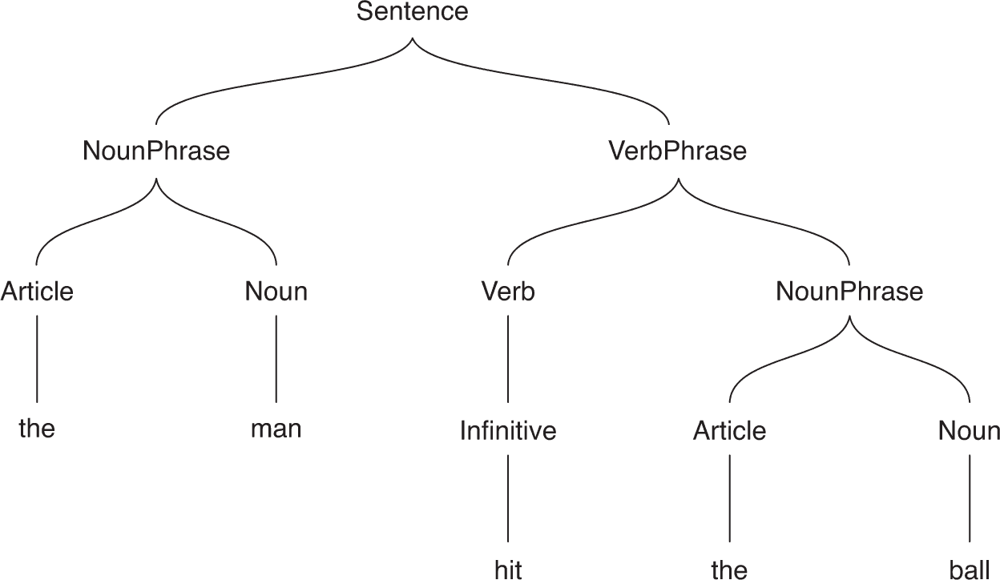

图 7.1 ¶ 句子“The man hit the ball”的推导。

图 7.1 中的树状图显示，`Sentence` 被重写为 `NounPhrase` 和 `VerbPhrase`；`NounPhrase` 被重写为 `Article` 和 `Noun`；`Article` 被重写为“the”；`Noun` 被重写为“man”；以此类推。同一个推导也可以表示为如下的带括号字符串：

```
[[Sentence] [[NounPhrase] [[Article] the] [[Noun] man]] [[VerbPhrase] [[Verb] [[Infinitive] hit]] [[NounPhrase] [[Article] the] [[Noun] ball]]]]
```

^(71)

这些规则构成了所谓的短语结构语法。在其最初的表述中（20 世纪 50 年代），除了短语结构规则，乔姆斯基的语法还包含一组转换规则。据说这些规则通过转换将句子联系起来，例如将主动句转换为被动句、陈述句转换为疑问句、肯定句转换为否定句等。

每条转换规则由两部分组成：结构分析和结构变换。规则的分析部分是一个模式，用于匹配句子的推导。也就是说，它不是匹配像“the man hit the ball”这样未加括号的词串。相反，它是匹配句子推导的倒置树状图。规则的变换部分有两部分。第一部分将一系列变量——称为 `X[1]`、`X[2]`、`X[3]` 等——绑定到推导树中的特定终结符和非终结符。第二部分指定终结符和非终结符的重新排列，以及为获得相关句子所需的添加和删除。例如，乔姆斯基的主动-被动转换规则如下所示：

*   结构分析：`NounPhrase—Verb—NounPhrase`
*   结构变换：`X[1]—X[2]—X[3] → X[3] + be + en—X[2]—by + X[1]`

该规则规定 `X[1]` 将绑定到第一个 `NounPhrase`，`X[2]` 绑定到 `Verb`，`X[3]` 绑定到第二个 `NounPhrase`，然后断言它们按逆序排列并进行一些添加（例如，“be + en”表示动词“to be”的过去时变位），以构成原句的被动形式。^(72) 因此，像“the man hit the ball”这样的句子，通过这条转换规则，变成了“the ball was hit by the man”。

转换生成语法由两组规则组成：短语结构规则和转换规则。这两组规则——或方程——共同定义了一种语法；根据乔姆斯基的说法，语法是一种“语言句子的理论”。

除了具体的语法，乔姆斯基还提出了一种由一组规则或方程组成的一般语法理论。因此，他的语法理论是一种理论的理论——一种“元理论”，类似于十九世纪和二十世纪元数学中曾采用的那种。

## 简洁性、复杂性与语法的评价

乔姆斯基首要关注的是建立一个语法评价程序：给定两个语法（即两套规则），评价程序应能判定哪个语法更优。^(73) 更优的语法是指能生成该语言所有句子，但比另一个语法更简单的那个。乔姆斯基在其博士论文《语言理论的逻辑结构》（1955）第 3 章中详述了其“简洁性”标准。^(74) 乔姆斯基博士论文的标题隐性地引用了逻辑学家鲁道夫·卡尔纳普的早期著作《语言的逻辑结构》。^(75) 正如我们将看到的，这种对数理逻辑的引用是乔姆斯基工作的基础。然而，乔姆斯基在博士论文中直接关注简洁性，源于其研究生导师、哲学家纳尔逊·古德曼的工作。乔姆斯基也在其 1951 年硕士论文《现代希伯来语的形态音位学》（宾夕法尼亚大学）^(77) 中引用了古德曼 1943 年的论文《论观念的简洁性》。^(76)

虽然古德曼和后来乔姆斯基对简洁性的关注特定于各自的研究领域，但“理论应尽可能简单”这一观念由来已久；参见方济各会修士奥卡姆的威廉（1287–1347）的“剃刀”：“针对同一事物的两种解释，选择更简单的那一个”（“实体不应在必要之外被增添”）。例如，完全正确地陈述牛顿第二定律可以是这样：`f = ma + 1 - 1`。那么，为什么偏好 `f = ma`？因为后者更简单。类比而言，前文给出的乔姆斯基示例短语结构语法，如果将第一条规则（`Sentence → NounPhrase + VerbPhrase`）在语法中重复三次，也会生成相同的句子集，但这种变体会包含不必要的冗余。

想象一个短语结构语法的版本，它能生成所有句子但不生成推导。它可以这样写：

*   `Sentence → “the man hit the ball”`
*   `Sentence → “the man took the ball”`
*   `Sentence → “the ball hit the man”`
*   等等。

这样的语法在某些方面会更简单。但当然，如果它包含另一个语法生成的所有句子，它将包含更多规则：每句一条规则。对乔姆斯基而言，这样的语法虽简单却过于简单，因为它生成句子却不生成其推导。没有推导，变换规则就无法应用，没有它们，主动与被动、陈述与疑问及其他句子间的关系也必须显式列举；语法规模将剧增，远大于乔姆斯基的示例语法。正如将要讨论的，乔姆斯基的语法有一个隐性的规模限制。

在博士论文中，乔姆斯基描述了一种启发式方法，通过三个标准来评价语法的简洁性：

粗略地说，如果规则以最大程度浓缩的形式给出，并且可以将生成的陈述按顺序排列，使得：(i) 我们可以通过从头到尾遍历规则序列来形成所有推导；^(78) (ii) 序列中不会出现两次相同的转换 `X → Y`（即无需在语法的不同位置以多种形式重复同一规则）；(iii) 每个制约语境都恰好展开到与其出现的规则应用相关的程度。^(79)

一般来说，乔姆斯基博士论文中概述的定义简洁性的方法属于“元数学”。用乔姆斯基的话说：“语言理论……是相对于任何自然语言的元元语言，是相对于构建语法所用语言的元语言。”^(80) 换言之，语法学家要分析的语言是像英语或法语这样的“自然语言”，语法学家用来表述自然语言理论的语言是包含“NounPhrase”、“→”等符号的形式语言，而语法学家用来阐述理论的理论、即语法理论的语言，也是用形式语言书写的。

对元数学家而言，理论的理论的形式语言通常与构建理论所用的形式语言相同。在乔姆斯基的案例中，理论是一个语法，语法理论本质上是一个语法的语法——一种元数学形式。其博士论文概述了一种元数学方法，用于解决编写语法的语法的问题，从而提供一种评价程序，以判定一个语法是否比另一个更简单。

## 算术化与乔姆斯基的语法

乔姆斯基的元数学延续了一条极其特定的研究路线：逻辑与数学的算术化——正如第 4 章（算法）所讨论——其先例见于 19 世纪数学家卡尔·魏尔斯特拉斯（1815–1892）、理查德·戴德金（1831–1916）、格奥尔格·康托尔（1845–1918）和朱塞佩·皮亚诺（1858–1932）的工作。这些工作多探讨算术基础，并最终致力于将数与算术还原为一种逻辑形式。这条研究路线延续至 20 世纪，由伯特兰·罗素（1872–1970）和阿尔弗雷德·诺斯·怀特海德（1861–1947）在其《数学原理》（分三卷，分别于 1910、1912、1913 年出版）中推进，他们试图延伸戈特洛布·弗雷格（1848–1925）的计划和大卫·希尔伯特（1862–1943）的早期工作，将几何还原为算术（即“希尔伯特公理系统”，1899）^(81)，以及希尔伯特 1900 年在巴黎国际数学家大会上的著名演讲，他在其中向同行提出了二十三个开放问题。正如第 2 章（翻译）所讨论，艾伦·图灵 1936 年的论文是对希尔伯特《判定问题》的回应。^(82) 这就是乔姆斯基对《纽约时报》表示“为了将语言理解为一种创造性思维系统，你需要现代可计算性理论，这是由艾伦·图灵及其他 1930 年代和 40 年代的伟大数学家发展而来的”所指的数理逻辑传统。

1927 年，大卫·希尔伯特写道：“我想彻底消除目前形式下关于数学基础的问题，方法是将每一个数学命题转化为一个可以具体展示并严格推导的公式。”^(83) 当时，这种将一切——数学推理手段、数学研究对象及其形式推导——渲染为一组可供逻辑分析的公式，或更直白地说，一组带括号和不带括号的字符串的愿望，仍显非凡。随着乔姆斯基的项目，语言学的对象、推理和推导也能类比地渲染为一组公式或字符串。因此，我们可以将英语等自然语言理解为一组字符串，短语结构语法和变换规则作为另一组字符串，甚至推导也可视为（带括号的）字符串。

这种形式化在 20 世纪初的数理逻辑中是新颖的（以算术化的形式出现，而在库尔特·哥德尔之前，则以希尔伯特及其学生、同事和追随者的形式主义出现）。因此，语言学家对希尔伯特的形式主义、元数学和证明论产生兴趣，或许并不令人惊讶。语言学史家马库斯·托马林在其著作《语言学与形式科学：生成语法的起源》中指出，乔姆斯基之前的那代语言学家——包括莱昂纳德·布鲁姆菲尔德和乔姆斯基的博士导师泽利格·哈里斯——早在乔姆斯基撰写博士论文之前，就已投身于元数学研究：


> 20 世纪 30 年代和 40 年代……逻辑句法理论发生了发展，这最终对语言学研究产生了深远影响，其出发点通常是希尔伯特的证明论，后者似乎暗示无意义的句法操作足以解决一整系列认识论问题。……希尔伯特的工作直接影响了维也纳学派，而 20 世纪 30 年代维也纳学派关于逻辑系统本质研究最独特的发展之一，是将关注点从逻辑结构本身转移到表达逻辑论证的语言结构上。如前所述，此类最具影响力的工作归功于卡尔纳普［前文引用过］，其《语言的逻辑结构》（LSL）于 1934 年出版。^(84)

托马林展示了乔姆斯基的工作——尽管有时被描述为语言学领域的“革命”^(85)——实则是语言学家与数理逻辑学家（尤其是受希尔伯特计划影响者）长期互动的产物。^(86)

## 乔姆斯基与计算认识论

虽然福柯的“文艺复兴”、“古典”和“现代”认识论或许适用于至少部分遵循希尔伯特且先于乔姆斯基的语言学家理论，但这些认识论不足以描述乔姆斯基式语言学。计算认识论区别于福柯的现代认识论，因为前者*不*主要关注能指与意义。在计算认识论中，语言理论的设计旨在分析语言，仿佛语言形式（其句法）独立于语言意义（其语义）。

正如语言学史家杰弗里·哈克和约翰·戈德史密斯所言，乔姆斯基式语言学将句法与语义的假设独立性称为“自主性假设”：“句法分析可以（事实上必须）在不求助于语义术语的情况下进行，这一观点被称为‘自主性假设’，自乔姆斯基本科时代起就在其所有工作中扮演核心角色。这也是……其导师泽利格·哈里斯结构主义纲领的关键组成部分。”^(87)

若接受“自主性假设”，则语法分析必须在不涉及意义的情况下进行。用乔姆斯基 1977 年的话来说：“对意义和指称以及语言使用的研究应被排除在语言学领域之外。”^(88) 乔姆斯基的观点很大程度上延续了莱昂纳德·布鲁姆菲尔德和泽利格·哈里斯等人早已表达的思想。1931 年，莱昂纳德·布鲁姆菲尔德宣称：“意义无法用我们的科学术语定义，也无法纳入我们的定义之中，”^(89) 根据杰弗里·哈克和约翰·戈德史密斯的记载，“［泽利格］哈里斯 1940 年宣称‘语言结构只能用其单位及其关系的形式差异而非语义差异来描述’……预示了分布式方法的发展，在该方法中甚至连意义差异都没有立足之地。”^(90)

早在乔姆斯基之前、甚至布鲁姆菲尔德之前，希尔伯特的批评者就已识别并嘲讽形式主义将意义与数学剥离。数学家亨利·庞加莱（1854–1912）讽刺地写道：“因此人们很容易理解，为了证明一个定理，既不需要知道也不必知道它意味着什么。……我们可以想象一台机器，在一端输入公理，另一端输出定理，就像芝加哥那台传说中的机器，活猪进去，火腿和香肠出来。数学家无需知道自己在做什么，正如那些机器无需知道自己在做什么一样。”^(91) 在尚无定理证明机器的时代，庞加莱的言论听起来荒谬可笑。显然，当时芝加哥屠宰场使用的机器无法证明定理，但计算机现在可以被编程来证明定理，因此庞加莱的言论已显过时，不再引人发笑。

正如我们在本书中所见——特别是第 4 章关于算法、第 6 章关于修辞——计算机程序和数据均可编码为黑白方块、比特序列、1 和 0。将定理、推理规则和推导全部编码为数字或同质公式，是 20 世纪早期和中期元数学中的一项先进技术。如今这已司空见惯，我们仅称之为“数字化”。

一旦选定某种离散格式进行数字化（例如乔姆斯基选择的带括号与不带括号的字符串），从简单的计数到复杂的机器“学习”等方法，均可在不涉及意义的情况下自动计算。例如正如我们在第 4 章关于算法中所见，我们可以将所有可能的算术过程理解为元胞自动机，并编写计算机程序枚举所有此类自动机。意义问题被搁置一旁。显然，即使乔姆斯基的工作或许是计算认识论中最杰出的范例之一，这种将意义推向边缘的思维模式，在远超乔姆斯基式语言学范围的许多领域依然活跃。

## 意义与乔姆斯基式语言学

尽管“自主性假设”以及布鲁姆菲尔德、哈里斯和乔姆斯基的宣称实际上将意义排除在语言学边界之外，但意义并未因此轻易被规避。乔姆斯基及其同事不得不通过将语义学定位为句法研究领域之外但相邻的区域，来主动抵制对意义的探讨。例如，乔姆斯基写道：“要求这一［乔姆斯基的］句法理论成为一门完全形式化的学科，与以一种能与平行语义理论产生启发性且重要互联的方式来构建它，二者完全兼容。”^(92)

这些“相互联系”与乔姆斯基所谓的“核句”以及句子的“深层结构”有关。^(93) 核句是简单的主动陈述句，如“The man hit the ball.”（那个男人击中了球）。通过应用转换规则，可以将陈述句转变为疑问句（“Did the man hit the ball?”），将主动语态转为被动语态（“The ball was hit by the man”），或生成更复杂的句子——例如，通过插入介词短语（“The man in the orange baseball cap hit the ball”）。在 1957 年的著作*《句法结构》*中，乔姆斯基表达了这样的希望：语义理论可以建立在对短语结构和转换规则如何用于从复杂句子的推导中恢复核句的理解之上。恢复出的核句——连同其推导过程和所应用的语法规则——被视为更复杂句子的“深层结构”。因此，人们可以描绘出一个更复杂的疑问句（“Did the man in the orange baseball cap hit the ball?”）与其核句（“The man hit the ball”）之间的联系，这潜在地代表了对该问题的回答。

然而，乔姆斯基指出，句子的深层结构通常不等同于其语义：“我们可以描述这样一种情形：一个‘资格限定’句，如‘everyone in the room knows at least two languages’（房间里每个人至少懂两门语言）可能是真的，而相应的被动句‘at least two languages are known by everyone in the room’（至少有两门语言为房间里每个人所懂），在对这些句子的正常解释下却是假的——例如，如果房间里一个人只懂法语和德语，另一个人只懂西班牙语和意大利语。这表明，甚至最弱的语义关系（事实等价性）在主动句和被动句之间通常也不成立。”^(94)

尽管如此，乔姆斯基想两全其美（既要语义又不要语义），并继续进行如下论述：“然而，这些反例不应使我们忽视这样一个事实：在形式语法分析中发现的结构和要素与特定语义功能之间存在着显著的对应关系。……对层级结构语义功能的研究，可能是通向句法与语义相互联系理论的合理一步。”^(95)

综合这些评论来看，人们可能会认为乔姆斯基在暗示：他对独立于语义的句法的研究，可以通过将句法深层结构视为等同于意义表征而得到延伸。正如我们在本章前面所见，近十年后，当乔姆斯基试图在 17 世纪的*《波尔-罗亚尔语法》*中寻找其自身工作的先驱时，他重申了这一理解，说道：“句子有一个内在的心理层面（一个传达其意义的深层结构）。”^(96) 然而在 1960 年代，一群乔姆斯基的追随者和同事正致力于这样一个项目，即将乔姆斯基式的深层结构与意义联系起来——他们称该项目为“生成语义学”——却遭到了乔姆斯基的抵制和敌视。^(97)

既然他在自己的著作中似乎主张过正是这种方法，为什么乔姆斯基会对生成语义学表现得如此敌视？显然，正如乔姆斯基本人在前述评论中所暗示的，连接深层结构与意义的技术挑战是巨大的。考虑一个比乔姆斯基例子简单得多的案例。如果我们在前面的语法中再添加一条短语结构规则：“`Noun → bottle`”（名词 → 瓶子）会怎样？现在语法可以生成一个习语短语，如“The man hit the bottle”，意思是那个男人大量饮酒。如果转换为被动语态，该习语（“to hit the bottle”）就丢失了：“The bottle was hit by the man.” 如何将习语短语编码进乔姆斯基式的转换生成语法，使得这些短语在应用转换规则时保持完好，这尚不清楚。

尽管存在无数技术困难，这似乎并非乔姆斯基反对生成语义学等项目的主要理由。相反，他的首要目标似乎是将形式句法理论确立为一门自主的研究学科——特别是独立于语义学的自主学科。在他们的生成语义学史著作中，哈克和戈德史密斯得出了相同的结论——生成语义学家与乔姆斯基之间的争论，与其说是关于技术困难，不如说是关于“自主性假设”；乔姆斯基源于一种传统，并决心延续这一传统，捍卫形式句法分析作为一个独立的研究领域。^(98)

## 乔姆斯基语言学与非证明性修辞

在其技术著作中，乔姆斯基很少纯粹进行说明性阐述。通常，他是在反驳其他语言学家或哲学家。在*《句法结构》*一书的“句法与语义”一章中，他不仅反对一群特定的形态学家和语音学专家，还反对任何质疑句法独立于语义的语言学家。乔姆斯基这样构建论点：“人们花费了大量精力试图回答这个问题：‘不诉诸意义，你如何构建语法？’然而，这个问题本身提得不对头，因为‘显然可以诉诸意义来构建语法’这一暗示完全没有根据。人们完全可以同样合理地问：‘不了解说话者的发色，你如何构建语法？’”^(99) 在随后的页面中，乔姆斯基的一些具体辩论对象出现在脚注中。但这条置于章节开头的侮辱性评论，似乎针对所有将意义置于其工作中心的语法学家，当然也隐含地针对乔姆斯基后来大加赞扬的波尔-罗亚尔语法学家。为什么乔姆斯基要用这番话嘲笑这么多语法学家的工作？这种非证明性的修辞手段与他作为一位强劲辩论对手的名声相符。他只是在试图侮辱他的同行。

一旦我们读完后文，看到乔姆斯基自己在阐述其语法方法时反复诉诸意义，就清楚地知道这是乔姆斯基的计谋。例如，再看一遍他的短语结构语法示例。为什么他用英语单词作为终结符号，如“hit”、“man”和“ball”？如果他在构建自己的语法时不想诉诸意义，为什么不用我们不太可能知道的语言的词——也许是挪威语？

此外，如前所述，在他的例子中，乔姆斯基似乎刻意避开了像“The man hit the bottle”这样的习语，因为它们无法在转换生成语法中轻松处理。给他的语法稍作添加也会引入俚语。如果我们再添加一条产生式规则，允许“hit”既可以是名词（“`Noun → hit`”）也可以是动词，会产生什么结果？这样一来，语法也将涵盖“The man took a hit”这样的句子，以及那些没有明显意义的句子；例如，“The hit hit the hit.” 显然，在他的呈现中，乔姆斯基正在避开那些没有明显字面意义的例子。

此外，从形式主义的角度来看，没有必要用像“Noun”（名词）、“Verb”（动词）这样的有意义名称，甚至像“N”和“V”这样的有意义缩写来标记语法中的非终结符。相反，编号标签能更成功地避免任何对意义的诉诸。人们可以像这样重写前面的语法，仍然生成相同的句子集合：

```
X1 → X2 + X3
X2 → X4 + X5
X3 → X6 + X2
X4 → the
X4 → a
X5 → man
X5 → ball
X6 → hit
X6 → took
```

如果乔姆斯基试图避免任何对意义的诉诸，为什么不这样写语法？

最后，我们应该强调这样一个事实：乔姆斯基甚至在其语法定义中也诉诸意义，如前引：“我\[乔姆斯基\]将*指*\[我强调\]语言 L 的语法为某种装置（即一组规则），它至少提供 L 的无限个语法句子及其结构描述的完整规格说明。”^(100) 当乔姆斯基在前文句子中写下“我将指”时，他在构建语法时显然诉诸了意义。当他在语法的终结符和非终结符中使用有意义的英语单词、当他的例子是有意义的英语句子、以及当他用像“active to passive”（主动变被动）这样的有意义英语短语命名其转换规则时，他也在构建语法时诉诸了意义。

当乔姆斯基宣称在构建语法时不应诉诸意义，然后自己却反复这样做时，他在试图做什么？我认为，如果我们不了解乔姆斯基在其论文中已在阐述的“自主性假说”，这会令人困惑：“句法和语义是截然不同的研究领域。研究对象将是句法结构，我们将把它作为语言理论的一个独立方面来研究。”^(101)

乔姆斯基对意义的禁令，似乎与他自己研究语言的方法无关，而与语言学领域内的专业“帝国建设”大有关系。就连今天，句法、语义和语用在语言学和分析哲学中仍被视为独立的研究领域，乔姆斯基成功地为句法争取到了一席之地。他的非演示性修辞是巡视其学术封地边界的一种方式。

## 乔姆斯基、形式主义与递归装置

乔姆斯基对意义的禁令也表明了他面向希尔伯特式形式主义的方法论取向。我们也可以在其语法定义的其他部分看到对形式主义的隐性致意。例如，如果我们稍微反思一下乔姆斯基反复诉诸的标准——即语法应指定句子的“无限集合”，我们会发现这——就像对意义的禁令一样——是对数学家康托尔及其他人的引用，他们在本章前面已讨论过，他们先于并影响了大卫·希尔伯特及其在语言学中的传人。

没有任何人类语言能拥有无限数量的句子。尽管如此，设想如果某语言确实包含无限数量的句子，其中许多将不得不长达数十亿、数万亿甚至更多单词。人们可能预期寿命约八十年，即约 `80 × 365 × 24 × 60 × 60` 秒——也就是二十亿秒以上，因此只有当某人能在一生中日夜不停地用一个连续的句子说话时，数十亿单词的句子才可能出现。即便如此，比那更长的句子——比如万亿单词的句子——在生物学上也是不可能的。

或者，设想一种语言拥有百万词汇的丰富词典，且有一个普鲁斯特式的人群倾向于说两百词长的句子。即便如此，可能句子的总数将达到百万的两百次方量级，这是一个非常大的数字，但离无限还远得多。

尽管乔姆斯基在数十年的工作中反复提到生成无限数量的句子是语法的要求，^(102) 但在别处他解释说，对他来说，有一个更令人信服的理由让语法包含生成无限数量句子的手段。乔姆斯基写道：“一般来说，假设语言是无限的，是为了简化这些语言的描述。如果语法没有递归装置……它将极其复杂。如果它确实有某种递归装置，它将产生无限多的句子。”^(103)

总之，乔姆斯基需要假设语言是无限的，以便“递归装置”能出现在他的语法中！换一种说法，乔姆斯基决心使用他的理论机制，无论它是否适用于他的数据。对一个手里有锤子的人来说，所有东西看起来都像钉子。乔姆斯基的“锤子”是一种相当于一段软件的语法。让我们称之为“以软件为中心的理论”。

“递归装置”的概念在乔姆斯基的语法理论中扮演重要角色，所以让我们考察一个例子。原则上，在英语中，可以在名词前使用任意数量的形容词。可以说“old man”（老人），也可以说“old old man”（老老人）、“wrinkled old man”（满脸皱纹的老人）、“happy, well-dressed, brilliant, wrinkled old man”（快乐、衣着考究、才华横溢、满脸皱纹的老人），等等。在语法中表达这一点的一种方法是使用引用自身的递归规则，像这个有两条规则的语法：“`NounPhrase → Noun`”，“`NounPhrase → Adjective + NounPhrase`”。这两条规则中的第一条是终止情况，表示不再添加形容词。第二条是递归情况，表示添加一个形容词，然后再次使用 `NounPhrase` 的两条规则之一。我们也可以为其他结构编写递归规则，例如嵌入不定数量其他介词短语的介词短语的构造；例如，“The man in the orange baseball cap with the San Francisco Giants logo on the brim (etc., etc.) hit the ball”（戴着檐上有旧金山巨人队标志的橙色棒球帽的那个人击球了）。

如果不在语法中包含“递归装置”，就不得不设定重复可能发生次数的固定上限，然后在语法中分别列出每种可能性。例如，如果我们确定名词前三个形容词足以涵盖大多数英语句子，那么我们可以用这三条规则替换名词短语规则的递归情况：

*   `NounPhrase → Adjective + Noun`
*   `NounPhrase → Adjective + Adjective + Noun`
*   `NounPhrase → Adjective + Adjective + Adjective + Noun`

当然，在口语和书面语中，正常使用的名词前形容词数量有有限上限。即使使用十个形容词修饰名词短语，也显得不同寻常或古怪；例如，“He was a small, wrinkled, old, smelly, talkative, loud, skinny, strong, quick, lazy man”（他是个矮小、满脸皱纹、年老、有异味、爱说话、声音大、瘦削、强壮、敏捷、懒惰的男人）。有了递归规则，人们可以分析和生成包含数百、数千、数百万或数十亿个形容词的句子，但这样的句子究竟何时会真正出现在印刷文化或日常话语中呢？

所以，如果我们决定名词前形容词数量的外部上限只能是，比如说二十，那么我们可以通过向语法添加二十条规则来容纳这样的名词短语。乔姆斯基反对这种提议——即包含二十条更多规则的语法——的理由是“这个语法将如此复杂，以至于几乎没有用处或趣味。”^(104)

如果不是包含二十条更多规则的语法，我们稍微改变一下符号系统，使得我们能写一个包含二十行以上的单规则语法，会怎样？它可能看起来像这样：

*   `NounPhrase → Noun`
*   OR → 形容词 + 名词
*   OR → 形容词 + 形容词 + 名词
*   等。

我认为乔姆斯基仍会反对这一提议。乔姆斯基对简单性与复杂性的分析，比单纯计算语法中的规则数量要微妙得多。他的分析包含了对编写规则所用元语言复杂性的诠释，这一诠释现在被称为“乔姆斯基层级”。

## 乔姆斯基层级

乔姆斯基的研究生导师纳尔逊·古德曼曾提出，计算系统中的规则数量可以作为衡量其简单性或复杂性的标准，但随后被乔姆斯基摒弃了。相反，乔姆斯基将简单性与一个衡量计算复杂性的框架的精心阐述的定义联系在一起，这个定义以“乔姆斯基层级”^(105)之名被介绍给每一位计算机科学本科生，有时也称为（引用其合著者）“乔姆斯基-许岑贝格层级”。^(106)

最初，乔姆斯基建立这一层级是为了论证更简单的装置（如马尔可夫过程）过于简单，不足以描述人类语言。^(107) 后来，正如语言学家 E. 基思·布朗在《语言学百科全书》中关于转换生成语法的综述中指出的那样，在 20 世纪 60 年代末，追随乔姆斯基的语言学家开始关注转换规则的计算复杂性：“一旦探明了这类规则的数学性质，就清楚地表明，带有转换规则的语法具有通用图灵机的形式属性：换句话说，它们是一种如此强大的工具，除了能说明语言可以用某组规则来描述外，什么也解释不了。这一不受欢迎的结果的一个显而易见的后果，就是要看看能否对转换成分的威力加以约束。”^(108)


正如第 2 章关于翻译的讨论（以及本书其他地方）所论述的，任何具有通用图灵机（UTM）形式属性的装置，无异于一种功能齐全的计算机编程语言。换句话说，到了 20 世纪 60 年代末，乔姆斯基学派的语言学家们正在编写非常复杂的转换规则。它们被认为过于复杂，因为它们是用一种元语言编写的，这种元语言允许任意符号或符号序列被重写为任何其他序列。要理解这构成了一个问题，我们需要进一步剖析乔姆斯基关于语法与机器的力量与复杂性的思考。

在乔姆斯基层级中，最强大类型的语法被称为“0 型”。0 型语法的规则可以采取 `α → β` 的形式，其中希腊字母（如“α”或“β”）惯常表示终结符（通常写作小写罗马字母；例如“a”或“b”）或非终结符（写作大写罗马字母；例如“A”或“B”）。

终结符构成推导树的“叶子”，因此通常它们是像“ball”（球）、“man”（男人）或“hit”（击打）这样的词。非终结符出现在推导的上层，通常代表一个或多个终结符的抽象——例如，“Sentence”（句子）、“NounPhrase”（名词短语）或“Verb”（动词）。

如果规则是 0 型的，允许任何东西被重写为任何其他东西（非终结符重写为非终结符、非终结符重写为终结符，但也包括终结符重写为非终结符，甚至终结符重写为其他终结符），那么语法原则上可以生成荒谬的结果；例如，给定字符串“The man hit the ball”，0 型语法可以生成一个推导，将其关联到句子“The last album of David Bowie was spectacular”。这是因为语法没有任何限制来防止例如终结符被重写为其他终结符。因此，人们可以包含这样一条规则：“man → David Bowie”。如果转换规则可以被编写为关联如此截然不同的句子，那么此类规则所捕捉的语言学洞见似乎是可疑的——至少在 20 世纪 60 年代末的乔姆斯基学派看来是这样。因此，人们投入了大量精力试图“下降”乔姆斯基层级，寻找更简单的语法，即计算复杂性低于通用图灵机的语法。

1 型语法的规则形式比 0 型语法更受约束。1 型规则采取 `αAβ → αBβ` 的形式。1 型语法被称为“上下文相关”，因为非终结符只能在特定上下文中被重写为其他非终结符——此处标记为“α”和“β”。

2 型语法的计算复杂性甚至更低。它们允许非终结符在不参考上下文的情况下被重写，但——与 0 型规则不同——终结符不能被重写。规则采取 `A → α` 的形式，其中“α”同样可以是终结符或非终结符，但“A”专门代表非终结符。2 型语法也可称为“上下文无关语法”。前文给出的乔姆斯基示例短语结构语法，就是作为 2 型、上下文无关语法编写的。

最后，在乔姆斯基层级的最底层是 3 型语法，也称为“正则语法”。规则可以采取 `A → α`、`A → αB` 或 `A → ε` 的形式，其中“ε”不表示终结符或非终结符，而是表示空串（即不包含任何内容的字符串）。3 型语法是最简单、计算复杂性最低、能力也最弱的。

为了阐释乔姆斯基层级，让我们考虑一些例子。使用 3 型语法，可以指定一种 1 和 0 出现顺序无特定要求的“比特串语言”：`S → 0S`、`S → 1S`、`S → ε`。所有可能的比特串都可以用这个语法生成。

但如果我们只对一种“语言”感兴趣，该语言包含以任意数量的 0 开头、后跟相同数量的 1 的比特串呢？要生成且仅生成像这样的“句子”——“01”、“0011”、“000111”及其他——我们需要上下文无关语法的力量，即 2 型语法，一种比 3 型更强大的语法：`S → 0S1`、`S → ε`。每当这个语法生成一个 0 时，它也生成一个 1，因此它不需要存储生成 1 之前已生成的 0 的数量。

然而，如果我们想生成这样的字符串：“010”、“001100”、“000111000”呢？也就是说，如果我们想生成仅以任意数量的 0 为前缀、后跟相同数量的 1、并以数量等于前缀中 0 的数量的 0 作为后缀结尾的字符串呢？这是一个需要比上下文无关语法更强大语法的“语言”示例。

试着把它写成上下文无关语法，你会发现，在生成任意数量的 0（或相同数量的 0 和 1）之后——我们称这个数字为 K——你需要存储 K，以便确定在字符串后缀中包含多少个 0。你还会发现，2 型上下文无关语法没有存储和检索值的功能。

本质上，随着沿乔姆斯基层级向上（从 3 型上升到 0 型），人们获得了越来越多的存储和检索信息的能力，直到在 0 型语法中，拥有了创建变量、为其赋值，并在必要时检索变量值的能力。观察前面展示的主动-被动转换规则示例，可以看到此类规则可以用一种提供变量、允许变量赋值、并允许检索（和重新排序）变量各自值的元语言来陈述。

## 确定性从句语法

原则上，通用图灵机拥有无限的内存或存储空间（用于变量和值）。乔姆斯基的成就在于证明了：任何通用图灵机（UTM）都可以转换为类型 0 语法；任何线性有界自动机（LBA）都可以转换为类型 1 语法；任何下推自动机（PDA）都可以转换为类型 2 语法；任何有限状态自动机（FSA）都可以转换为类型 3 语法。

此外，这些机器及其对应的语法之间存在排序关系：FSA 能计算的，PDA 都能计算，但反之不成立；即存在 PDA 能执行而 FSA 无法执行的计算。我们对语法和比特串的讨论就是对此的说明。这种机器和语法的排序，本质上是复杂性与简单性的排序。UTM 比 LBA 更强大、更复杂，LBA 比 PDA 更复杂，PDA 又比 FSA 更复杂。语法的类似排序，从最复杂到最简单依次为：类型 0、类型 1、类型 2、类型 3。

Google 研究科学家兼计算语言学家费尔南多·佩雷拉曾调侃道：“我越老，就越往乔姆斯基层级的下层走。”^(109) 佩雷拉的意思是，职业生涯早期他编写类型 0 语法，随着工作深入，他编写的语法规则形式越来越受约束、能力越来越弱：这些语法之所以“更简单”，是因为它们计算复杂度更低；但也“更复杂”，因为它们必然需要更多的规则——即使这些规则本身“更简单”。正如 E. Keith Brown 的引言所证实的，自 20 世纪 60 年代末以来，沿着乔姆斯基层级“向下”发展，一直是许多语言学家的追求，即使不一定是常态。

## 确定性从句语法

1980 年，费尔南多·佩雷拉和他的同事大卫·H·D·沃伦为 Prolog 编程语言发明了一种巧妙的表示法（实际上是一个“宏”），以便方便地编写上下文无关语法。^(110) 回顾第 6 章逻辑编程部分，Prolog 谓词是一种倒置的 IF-THEN 规则，组合形式如下：`THEN:- IF`。要在 Prolog 中表达“如果 X 是人，那么 X 是凡人”，需写作 `mortal(X):- man(X).`。Prolog 谓词中的逗号（`,`）表示 AND，因此 `mortal(X):- man(x),not(god(X))` 可解释为“如果 X 是人且 X 不是神，那么 X 是凡人”。Prolog 中变量用大写字母书写。

佩雷拉和沃伦的**确定性从句语法（DCG）**表示法/宏允许编写 `sentence → noun_phrase,verb_phrase`，并自动将其编译为如下 Prolog 子句：

```
sentence(S):- append(NP,VP,S), noun_phrase(NP), verb_phrase(VP).
```

要理解其巧妙之处，需知晓：当 Prolog `append` 谓词的第三个参数实例化为一个列表，而前两个参数保持未实例化时，该谓词将返回所有拼接后能生成给定列表的列表对。因此，`append(List1,List2,[a,b,c])` 将为变量 `List1` 和 `List2` 返回多个绑定结果：

*   `List1 = [], List2 = [a,b,c]`
*   `List1 = [a], List2 = [b,c]`
*   `List1 = [a,b], List2 = [c]`
*   `List1 = [a,b,c], List2 = []`

在 Prolog 中，`append` 谓词可用两个子句定义：

*   `append([],List,List).`
*   `append([First|Rest],List2,[First|List3]):- append(Rest,List2,List3).`

第一个子句可读作：将空列表（记作 `[]`）追加到某列表后，得到该列表。第二个子句是递归的：将第一个列表（首元素为 `First`，其余元素为 `Rest`）追加到第二个列表 `List2`，结果为一个列表，其首元素为 `First`。结果的其余部分是列表 `List3`，由第一个列表的 `Rest` 与 `List2` 拼接而成。

因此，面对 `sentence([the,man,hit,the,ball])` 这样的查询，`sentence` 谓词将尝试输入列表的所有可能划分（如 `[]` 和 `[the,man,hit,the,ball]`；`[the]` 和 `[man,hit,the,ball]`；`[the,man]` 和 `[hit,the,ball]` 等），并尝试用 `noun_phrase` 谓词匹配第一部分、用 `verb_phrase` 谓词匹配第二部分。若匹配成功，`sentence` 谓词返回 true。

以 Prolog DCG 形式编写，乔姆斯基在《句法结构》中的短语结构语法示例将验证输入列表是否为合法句子：^(111)

*   `sentence → noun_phrase, verb_phrase.`
*   `noun_phrase → article, noun.`
*   `verb_phrase → verb, noun_phrase.`
*   `article → [the].`
*   `article → [a].`
*   `noun → [man].`
*   `noun → [ball].`
*   `verb → [hit].`
*   `verb → [took].`

若要让 DCG 验证句子并生成标记句子各部分的推导树，需为每条规则添加参数，规则成功时实例化这些参数：^(112)

*   `sentence(sentence(NP,VP)) → noun_phrase(NP), verb_phrase(VP).`
*   `noun_phrase(noun_phrase(A,N)) → article(A), noun(N).`
*   `verb_phrase(verb_phrase(V,NP)) → verb(V), noun_phrase(NP).`
*   `article(article(the)) → [the].`
*   `article(article(a)) → [a].`
*   `noun(noun(man)) → [man].`
*   `noun(noun(ball)) → [ball].`
*   `verb(verb(hit)) → [hit].`
*   `verb(verb(took)) → [took].`

使用此版 DCG，针对 `sentence([the,man,hit,the,ball])` 查询，`sentence` 谓词将返回如下推导：

*   `sentence(noun_phrase(article(the),noun(man)),`
*   `verb_phrase(verb(hit),noun_phrase(article(the), noun(ball))))`

若要包含转换规则，可将其写为 Prolog 谓词，输入参数为实例化的推导树，通过实例化第二个参数输出转换后的推导树。例如，以下是乔姆斯基主动-被动转换规则的翻译：^(113)

*   `active_to_passive(sentence(noun_phrase(A1,X1),`
*   `verb_phrase(verb(X2),`
*   `noun_phrase(A2,X3))),`
*   `sentence(noun_phrase(A2,X3),`
*   `verb_phrase(auxilliary(Aux),`
*   `verb(X2),`
*   `prep_phrase(prep(by),`
*   `noun_phrase(A1,X1))))) :-`
*   `conjugate_past_tense(X3,be,Aux).`

此外，还需少量代码定义 `conjugate_past_tense` 谓词。Prolog 是一门完整的编程语言，因此等同于类型 0 语法。我们可在转换规则中变量的使用（如 `X1`、`X2`、`X3`）以及规则中额外谓词的使用（`conjugate_past_tense`）中看到这种能力，后者的定义中可包含任意大的计算机程序，尽管此处定义很简单：

*   `conjugate_past_tense(noun(N),Infinitive,PastTense) :-`
*   `is_singular(N),`
*   `singular_past_tense(Infinitive,PastTense).`
*   `conjugate_past_tense(noun(N),Infinitive,PastTense) :-`
*   `is_plural(N),`
*   `plural_past_tense(Infinitive,PastTense).`
*   `is_singular(ball).`
*   `is_singular(man).`
*   `is_plural(balls).`
*   `is_plural(men).`
*   `plural_past_tense(be,were).`
*   `singular_past_tense(be,was).`

使用 Pereira 和 Warren 的 DCG 表示法，将乔姆斯基的语法翻译成计算机程序非常简单。这种翻译，加上乔姆斯基坚持认为语法是“装置”，以及他证明语法可以转化为自动机（`UTM`、`LBA`、`PDA`、`FSA`），共同说明了乔姆斯基的语法是相当于软件的机器。此外，乔姆斯基还以同样的形式撰写了他的语法理论（他的理论的理论）。因此，乔姆斯基无疑处于希尔伯特形式主义的谱系中，但他比数理逻辑学家们更进了一步。正如图灵找到了将其机器的逻辑形式主义转化为软硬件物质生产的方法一样，乔姆斯基将语法规则的形式主义转化为了同一种东西——一种可以直接翻译成软件的符号系统。

从认识论的角度来看，最引人注目的是乔姆斯基宣称他的语法是理论。根据《牛津英语词典》（OED），理论是“某一学科或研究领域的概念基础”。从词源学上讲，“theory”（理论）一词源自古希腊语“θεωρια”，含有观看、沉思、视觉和景象的含义。《牛津英语词典》的定义还补充说，“理论”与“实践”相对立。这种对比完全符合亚里士多德对人类活动的三分法：物质和技术生产（*techne*）；需要判断的行动，如政治和军事行动（*phronesis*）；以及理论知识（*episteme*）。然而，以乔姆斯基模式铸造的计算认识论理论打破了“亚里士多德屏障”（用第 3 章中发展的术语来说），因为机器——具体来说是计算机程序——被提出作为理论：亚里士多德的 *techne* 和 *episteme* 融合在了一起。

乔姆斯基那一代的其他人——认知科学、计算机科学和人工智能的联合创始人——也用软件或等同于软件的形式主义陈述他们的理论。赫伯特·西蒙和艾伦·纽厄尔在 1972 年是这样表述的：“一个优秀的人类棋手的优秀信息处理理论能下好棋；一个关于人类如何创作小说的优秀理论将能创作小说。”^(114)

## 今日之翻译

快进到今天，考虑一下语法是如何作为软件编写的。不必说，它们看起来几乎完全不像这里展示的 Prolog DCG。越来越多的此类语言学软件是使用机器学习创建的，最近则使用所谓的深度神经网络技术。例如，考虑谷歌在线机器翻译系统的“语法”。^(115) 2016 年，谷歌使用一些来自机器学习的新技术完全重写了它。^(116) 负责此项工作的谷歌软件工程师发表了一系列关于此次大修的论文，其中一篇标题为“谷歌的多语言神经机器翻译系统：实现零样本翻译”。^(117)

在该论文中，谷歌研究人员描述了他们如何使用数亿个句对（如下面这对英语和法语句子）训练他们的机器学习算法：（“To be, or not to be, that is the question” + “Être, ou ne pas être, c’est là question”）。机器学习所需的计算量非同寻常：“根据语言数量的不同，完整的训练可能需要多达 1000 万步，并在 3 周内收敛（大约在 100 块 GPU 上）。”^(118)

对于我们这些非机器学习专家来说，令人惊讶的是，生成的系统产出的翻译质量不是由人类评分，而是通过使用计算机程序自动评估的。^(119) 因此，即使他们的神经网络机器学习算法可以恰当地被称为归纳式的（即如第 6 章关于修辞和演示所述），谷歌作者的演示仍然是溯因式的；第一，因为没有人能逐步跟进在三周内一百块 GPU（GPU 就是计算机）上发生了什么；第二，因为相对于演示而言，没有人类曾看到过机器完成的翻译中超过极一小部分的内容。

这一现象的征兆是：论文正文中仅展示了约二十个翻译示例，而且所有示例都是这四个英语句子的翻译：(1) “Hello, how are you?” (2) “I wonder what they’ll do next!” (3) “I must be getting somewhere near the centre of the earth.” (4) “Here the other guinea-pig cheered, and was suppressed.” 这在我看来是一个奇怪的示例选择，但与我断言该论文执行了一种溯因式演示最相关的事实是：即使数据集原则上允许呈现数亿个示例供检查，却只呈现了四个源句子。

文章的可视化图表进一步凸显了其溯因式特征。呈现的可视化图表是着色的网络图，看起来大约像一盘意大利面条里扔进了一些彩色玻璃球。作者断言这些图表代表“74 组语义相同的跨语言短语三元组。也就是说，每个三元组包含英语、日语和韩语短语，它们具有相同的潜在含义。”^(120) 尽管似乎没有明显的方法将这些图表解读为代表这一含义或那一含义，而且尽管选取的样本（74 个句子）再次只是作者用作数据的数亿个示例中的一小部分，作者仍然就他们的意大利面条和玻璃球图表得出如下结论：“对结果的可视化解读表明，这些模型为所有涉及的语言对学习了一种中介语表征形式。”^(121)


# 谷歌的新翻译软件代表一种中介语或构成一种理论吗？

因为它太大了，该软件系统本身在有生之年永远无法被任何一个人完整阅读。描述它的技术论文被构建为溯因式演示——在其中，生产软件所采取的几乎没有任何步骤被展示出来（因为步骤太多），并且几乎没有任何被分析的数据被共享（因为其中大部分是谷歌从其用户那里收集的，不在公司外部共享）。因此，不仅因为机器学习算法需要数百台计算机运行数周才能达到声称的结果，谷歌的结果无法被谷歌之外的任何人复现。没有其他人拥有复现结果所需的资源。如果谷歌的翻译系统是一种理论，那它是一种源自无法复现的结果、使用无法共享的数据、并呈现为一块大到无人能读的软件的理论。

## 演绎、归纳、溯因

2011 年，乔姆斯基在麻省理工学院举办的“大脑、心智与机器”活动上发言，期间他评论了这些巨大的新的基于统计的计算机程序（如谷歌的翻译系统）的认识论地位。^(122) 乔姆斯基说：“确实有大量工作试图将统计模型应用于各种语言学问题。我认为取得了一些成功，但也有很多失败。存在一种成功的概念……我认为这在科学史上是新颖的。它将成功解释为对未经分析数据的逼近。”

Google 研究总监 Peter Norvig 撰写了一篇长文回应，论证科学与工程是共同发展的，文中指出：“工程上的成功表明某事物运作正常，因此它是科学模型成功的证据（但不是证明）。”^(123) Norvig 接着坚称这些巨型系统是可以被理解的：“我同意，理解一个包含数十亿参数的模型可能很困难。当然，人类无法通过单独检查每个参数的值来理解这种模型。但人们可以通过考察模型的属性——它在哪里成功、在哪里失败、作为数据函数的学习效果如何等——来获得洞见。”^(124)

从本质上讲，Chomsky 认为这不是科学——也不是理论——因为它没有告诉我们语言为何以这种方式运作。Norvig 则辩称这确实是工程，但工程为科学提供了行之有效的模型，因此它解释了语言*如何*运作，即使它不解释语言*为何*如此运作。

Chomsky 与 Norvig 的分歧似乎在所难免。Chomsky 将自己的职业生涯置于 Galileo 和 Descartes 的传承之中，坚持认为统计学在语言学中没有立足之地，并反复否认归纳学习的可能性^(125)，这样的人必然会反对将归纳性统计学习算法的输出（一个拥有数十亿参数的“方程”）视为一种理论。此外，当在 Chomsky 精心构建的形式语言层级标准下审视时，拥有数十亿参数的软件简直是异类。Chomsky 本质上是在重演十七世纪自然哲学家的角色，对他们而言，演绎是唯一可接受的证明形式。

相比之下，Norvig 扮演的是机器哲学家的角色，通过一种新形式的归纳来展示成果。他清楚地表明，他将自己的工作视为一条悠久科学研究传统（可追溯至 Boyle）的延续，该传统采用统计学、概率论和归纳演示。

Chomsky 与 Norvig 之间的这种分歧是不可避免的，但在我看来，最终它也是无关紧要的。当 Chomsky 和他的那一代人宣称理论应采用软件的形式时，他们改变了什么可被视为知识的规则。Noam Chomsky、Herbert Simon、Allen Newell 等人编写了小型软件，而如今这一代人——Peter Norvig 等人——编写源自大数据的庞大软件，这看起来更像是数量上的差异，而非真正的质变。当今的“范式”、当代的“计算认知框架”，是由 Chomsky 和他的那一代人开启的，我们至今仍乘坐在这艘船上。

## 算术理论

大数据会带来巨大差异吗？有人会说，过去的计算与现在的计算有着巨大差别，因为现在许多大公司和民族国家都能获取海量数据。毫无疑问，大数据——尤其是对 Google 这类数据富豪而言——提供了一组新的机遇^(126)，但正如记者 Chris Anderson 在 2008 年 6 月 *Wired* 杂志的一篇社论“The End of Theory: The Data Deluge Makes the Scientific Method Obsolete”（理论的终结：数据洪流让科学方法过时）中所宣称的那样，大数据是否预示着理论的终结？^(127) Anderson 宣称：“如今，Google 等在海量数据时代成长起来的公司，不必再将就错误的模型。事实上，它们根本不必将就模型。”^(128) 这一评论只见树木不见森林。大故事不关乎数据本身。它关乎那些梳理海量数据并从中发现模式的机器学习算法背后的理论。我们并未到达“理论的终结”。相反，我们需要认识到，计算理论正采取极其简化的形式。

在前文考察的 Google 论文标题中，出现了“Neural Machine Translation”（神经机器翻译）一词。这指的是一种用于“神经网络”的机器学习技术，但请注意，此刻（2018 年）神经网络（或“深度”）机器学习惊人地流行，并经常出现在 *The Economist*（经济学人）和 *New York Times*（纽约时报）等非技术性大众出版物上。

这些“神经网络”，也称为“多层感知器”，究竟*是什么*？切记，尽管神经科学家对逻辑电路感兴趣，数理逻辑学家至少自 1943 年 Warren McCulloch 和 Walter Pitts 发表关于用逻辑电路模拟神经网络的论文以来就对神经元感兴趣^(129)，但这些东西与神经科学几乎没有任何关系。

在外行眼中，很难理解为何有人能在任何实际的生物生命系统中找到神经网络的计算形式，因为在其最简单的形式下，它只是输入的加权求和。输入为 `x[1]` 到 `x[d]`；权重为 `w[1]` 到 `w[d]`；求和符号（`Σ`）表示将每个 `w[j]x[j]` 的乘积相加：^(130)

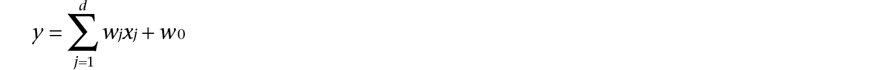

前述求和式即是理论如今的模样。如果你更喜欢代码形式，这是 JavaScript 版本：

```
var y = 0; for (var j = 1; j <= d; j++) {y = y + (w[j] * x[j]) + w[0];}.
```

当求和中的权重被上调或下调时，“机器学习”就发生了。简而言之，这里的重大新闻在于，甚至“学习”也已成为一种算术形式，而这种算术形式目前构成了从计算语言学到搜索引擎再到自动驾驶汽车等一切事物的概念框架。算术是新的万物理论。^(131)

不可思议的是，在计算认知框架中，理论是一种算术形式。但其理由是什么？理由并非这些理论能洞察世界为何是这个样子。不，这种形式下理论的理由——即测试标准——是：它管用吗？如果翻译称得上胜任，如果下棋达到大师水平，或者如果自动驾驶汽车能合法、无事故地导航，那么该机器学习理论就被认为是好的。

计算认知框架的标志性重大转变在于：当前的理解认为，理论与诠释如今是在追求“如何做”的知识过程中被构建出来的，而不再是为了寻找“为何”的答案。在 Chomsky 博士的主导下，语法通过被重构为易于转化为可运行软件的机器语言，完成了这一转变。自那以后——正如我们所见——许多其他知识领域也经历了同样的转型、同样的转译。

如果我们接受 Norvig 的成功标准——“成功表明某事物运作正常”，我们还面临另一组问题。软件/理论为谁而工作？在什么情况下？以谁为代价？这些问题将我们带回第 3 章关于工作与机器语言的关切。软件完成了谁的工作？谁的劳动被改变或消除了？因此，计算认知框架中的任何理论都预设了一种劳动与自动化的政治学。

# 注释

一般语法与比较语法截然不同：它对不同语言所做的比较并非其研究对象；它们仅被用作一种方法。这是因为它的普遍性不在于发现独特的语法规律，这些规律为所有语言领域所共有，随后可被用来以一种理想且强制的统一性来展示任何可能语言的结构；如果它确实是普遍的，那只是因为它试图在语法规则之下、但与其基础处于同一层面上，使话语的表象功能显现出来——无论是垂直功能，即指称被表象之物；还是水平功能，即将被表象之物与思想的同一模式联系起来。

参见福柯，《事物的秩序》，Kindle 位置 2293–2299。

参见 Jacques Bourquin，“Port-Royal Grammar”，载于《语言学百科全书》，Kirsten Malmkjaer 编（纽约：Routledge，1991）。

该书于 1660 年在巴黎首次出版后，又于 1664 年、1676 年、1679 年和 1709 年连续增补再版。1754 年，法国语法学家 Duclos 在 1676 年版本的文本基础上增添了“备注”，这些备注在后来的版本（1768 年、1783 年等）中定期再版。此外，1803 年版前附有 Petitot 撰写的“法语起源与发展小论”。1830 年版（Delalain，巴黎）和 1845 年版（Loquin，巴黎）将 Arnauld 和 Nicole 的《逻辑或思维的艺术》（1662）与语法合刊。该语法也构成《Antoine Arnauld gent 作品集》（巴黎，1780）第 41 卷。近期，H. E. Brekle 出版了批判版（Stuttgart，1966）；1845 年版由 A. Bailly 撰写历史导论后重印（Slatkine，日内瓦，1968），1830 年版由 M. Foucault 撰写导论后重印（Paulet，巴黎，1969）。

就本章而言，我参考了法国国家图书馆网站 `http://gallica.bnf.fr` 上提供的 1803 年版：Claude Lancelot 和 Antoine Arnauld，《Port-Royal 一般且合理的语法，前附法语起源与发展小论（M. Petitot 撰）》（巴黎：Chez Perlet，1803）。

借助逻辑，我们反思自然使我们所做之事。……【逻辑】显示了真正被思考之物，因而也显示了真正的思维。逻辑是使思维自我澄清及其用语言表达出来的艺术。……语法更为复杂，因为构成说话艺术的规则，并非仅由其清晰性及对该清晰性的觉察来证明其正当性。语法规则需要被证明正当；且其正当性需要被论证。这就是为什么，在作为说话艺术的语法与作为包含该艺术基础的学科的语法之间，关系并非纯粹简单的反思关系：而是解释关系。规则的基础需要被审视。在语法中，只要我说得清晰，我就是依照规则说话。但如果我想知道我的语言为何必然服从这些规则，这就会使我回溯到它们所依据的原则。

参见福柯，“导论”，载于《言说与著作》，768–769。

乔姆斯基：嗯，首先我应该说，我接近古典理性主义，并非真正是作为科学史家或哲学史家，而是从一个相当不同的视角出发，即一个拥有一定科学观念范围、并有兴趣看看早期阶段的人们可能如何摸索着趋向这些观念的人的视角——甚至可能他们自己没有意识到他们在摸索什么。

因此可以说，我研究历史不是作为古董爱好者，对弄清十七世纪的思想到底是什么并给出精确准确的描述感兴趣——我并非要贬低这种活动，只是那不是我的事——而倒不如说是从一个艺术爱好者的视角，想回顾十七世纪，在其中寻找特别有价值的东西，而这些东西之所以部分地获得其价值，部分是因为他接近它们的视角。

我认为，在不反对另一种途径的前提下，我的途径是正当的；也就是说，我认为完全有可能基于我们当下的理解回溯到科学思维的早期阶段，并洞察伟大的思想家如何在其时代的局限内，摸索着趋向那些他们自己无法清晰觉察的概念、思想和洞见。

参见 Rajchman，《乔姆斯基-福柯辩论》，10–11。

乔姆斯基之所以求助于洪堡特的反权威著作，其中一个原因是因为洪堡特留给后世的形象要糟糕得多，而乔姆斯基并未讨论这一点。洪堡特是这样一种观点最著名的鼓吹者：种族及其所说的语言属于一个历史进程，因此某些文化和民族被视为原始形式。洪堡特的大量工作致力于发展人类群体的类型学，根据这种类型学，印欧语系特别是代表了相较于世界其他语言的真正进步。无论我们称之为黑格尔主义、浪漫主义还是彻头彻尾的种族主义，这构成了洪堡特全部观点背景的关键部分，而乔姆斯基在强调洪堡特伦理学与其语言学观点的联系时却略去了这一点，这颇为耐人寻味。

参见 David Golumbia，《计算的文化逻辑》（马萨诸塞州剑桥：哈佛大学出版社，2009），Kindle 位置 708–712。

```
function fibonacci (n) {if (n <= 1) {return(1);} else {return(fibonacci(n-1) + fibonacci(n-2));}}
```

关于句法的自主性，所有生成语义学家在必要时都愿意放弃它，即将其视为一个可反驳的辅助假设。在我看来，这种向中介主义承诺的转向，以及随之而来的对乔姆斯基研究纲领核心命题的重组和重新排序，而非对所提出的可检验假设的内容或效力的分歧，才是 1960 年代和 1970 年代争论的主要焦点。我们认为，实际被辩论的问题，不过是这些更根本、更非技术性分歧的替身而已。

参见 Huck 和 Goldsmith，《意识形态与语言学理论》，19。

事实上，《句法结构》是一本极具误导性的书。其误导之处在于自动机讨论在其中所扮演的角色，我认为这误导了许多人。书中从有限自动机到上下文无关文法再到转换文法有一条自然的进阶路线，但这是一条极具误导性的进阶路线。在《语言理论的逻辑结构》（*LSLT*）中，根本没有提及有限自动机或弱生成能力。事实上，之所以在《句法结构》中加入那部分讨论，是因为 MIT 的背景。1955 年我完成 *LSLT* 后来到 MIT 时，发现人们对马尔可夫过程真的处于一种狂喜状态，如果用这个词恰当的话。工程师、心理学家和其他权威人士中对这一点有着极强的感觉。马尔可夫过程（抛开概率特征不谈）比有限自动机还要狭窄；它们是 K 阶系统，即至多回溯 K 个符号来概率性地确定下一个输出。那是当时被考察的特例。有限离散源的概念似乎提供了一个突破。人们感觉这些将成为语言和心智研究的基本概念。也仅仅因为这个原因，我才开始研究它们的形式属性。在《句法结构》中，这成为一个或多或少的核心话题，因为当地的 MIT 背景——笔记是给 MIT 学生看的——但它其实是一个非常边缘的话题。

参见乔姆斯基，《生成企业再探》，第 89–90 页。

# 结论

当艺术家兼新媒体理论家列夫·马诺维奇在近二十年前出版《新媒体语言》时，他引入了“软件研究”这一术语。马诺维奇写道：“新媒体呼唤媒介理论的一个新阶段。…… 要理解新媒体的逻辑，我们需要转向计算机科学。在那里，我们或许可以找到刻画可编程媒体的新术语、范畴和操作。*从媒介研究，我们转向某种可以称为‘软件研究’的东西——从媒介理论到软件理论*。”^(1) 马诺维奇通过概述我们可能“转向计算机科学”的两种方式对此进行了扩展：“在新媒体行话中，‘转码’某物就是将其翻译成另一种格式。文化的计算机化逐渐就所有文化范畴和概念完成了类似的转码。也就是说，在意义和/或语言层面上，文化范畴和概念被源自计算机的本体论、认识论和实用主义的新范畴和概念所取代。…… 转码原则是开始思考软件理论的一种方式。另一种方式，即本书尝试的方式，是将计算机科学的概念作为新媒体理论的范畴来使用。”^(2)

在本书中，马诺维奇所谓的“转码”，我称之为“翻译”。正如我在第 2 章指出的，在科学技术研究（STS）中，翻译是一种常见的方法论，它基于文科和人文学科更为古老的传统。在 STS 中，翻译社会学更常被称为行动者-网络理论（ANT）。从方法论上讲，本书的挑战在于延伸和修正行动者-网络理论，使其能够用于处理软件文本：代码铭文和计算机科学技术论文。

正如从马诺维奇的区分中可能已清楚看到的，本书采取的方法（ANT）是其方法的反面或互补。与其利用计算机科学的概念作为新媒体理论的范畴，不如从文科和工科的范畴出发，追溯它们各自如何被翻译成计算机科学中使用的概念，然后考察它们如何被普及、进一步翻译，成为在流行文化中作为数字生活形式流通的其他表达和技术。

正如我们在本书中所见，算术化一直是将观念和制度重写为软件的压倒性力量。当科学史家和数学史家使用“算术化”一词时，通常指的是库尔特·哥德尔关于形式算术不完备性的工作之后的二十世纪事件。^(3) 或者，如“分析的算术化”这一短语所指，是指十九世纪对微积分基础的探寻。^(4) 在本书中，我使用该术语不仅意指数学史上的这些时刻，还意指算术长期且持续的兴起：将概念持续重铸为算术或计算形式。算术的这一兴起在历史上与笛卡尔和莱布尼茨所谓的*普遍数学*（*mathesis universalis*）纠缠在一起，后者是一种以数学为模型的普遍科学梦想。在本书中，算术化代表了一种将一切变成数学的冲动——我曾论证这种冲动需要被抵制。

算术——以及更广泛地说，代数、微积分和数学中的其他重要课题——对于智力工作和工业（尤其是资本主义：从商业、工业到现在的金融）的重要性日益增长。^(5) 通过布尔，我们看到逻辑如何被翻译成一种简单的算术形式（如第 5 章所示）。今天，我们看到类似的翻译被强加于“学习”。机器“学习”已成为人工智能的转喻，并被简化为仅仅是对超大多项式参数的调优（如第 7 章末尾所述）。^(6) 其他被翻译成计算机科学技术概念的文科和工科概念包括：算法、演示、语法、语言、机器、操作、过程、修辞和模拟。

我将算法列在该列表开头，不仅因为列表按字母顺序排列，还因为算法一直是计算机科学的关键术语，且可以说依然是。在本结论章节中，我们将探讨计算机科学的研究和教学议程，它们优先考虑算法，并将其与软件研究可能的议程形成对比，后者则优先考虑交互，以及发明和质询赋值、连接、等价和同一性陈述的方法的追求。

## 走进算法

### 计算机科学作为算法研究

正如第 1 章所述，1967 年，赫伯特·西蒙、艾伦·佩利斯和艾伦·纽厄尔给期刊《科学》编辑写了一封信，坚持认为计算机科学是一门科学。在信中，他们拒绝了计算机科学仅限于算法研究这一观点，^(7) 但正如计算机历史学家保罗·塞鲁齐总结的那样：“在随后的岁月里，计算机科学演变为恰恰意味着他们\[西蒙、佩利斯和纽厄尔\]所说的它不是的东西——即算法研究。…… 该信在《科学》发表六个月后，ACM\[计算机协会\]发布了‘课程 68’，这是该协会认为能为本科生提供智力上可辩护的计算机科学基础的一组课程。‘课程 68’强调计算机科学的数学和理论基础。计算机硬件研究缺席。…… ACM 选择强调算法过程、编程语言和数据结构。”^(8)

人们可能会推测，半个世纪后的现在情况已不同，但查阅 ACM/IEEE《2013 计算机科学课程指南》，人们仍会发现算法位于十八个不同“知识领域”列表的首位（见第 14 页）：“算法是计算机科学和软件工程的基础。任何软件系统的实际性能取决于：(1) 所选算法和 (2) 各实现层的适用性与效率。因此，良好的算法设计对所有软件系统的性能至关重要。”^(9)

显然，算法在计算机科学教育中保持着前沿地位。因为它们在本科课程中占据如此显要的角色，我们可以将算法理解为进入该专业的“守门人”。如果你无法应对算法导论课程中的数学和逻辑话语，你不太可能坚持将计算机科学作为主修课程。


然而，算法不仅在大学课程中是守门人；它们在工业界扮演着相同的角色。关于算法的问题构成了大型科技公司（如微软、亚马逊、谷歌、苹果和脸书）面试潜在软件开发人员时提问的大部分内容。以下是一本面向准备求职面试的有志软件开发人员的畅销书的开头几句：“在大多数顶级科技公司（以及许多其他公司）中，算法和编码问题构成了面试流程的最大组成部分。将这些视为解决问题的问题。面试官旨在评估你解决从未见过的算法问题的能力。”^(10)

# 算法是将软件转译为数学的一种尝试

然而归根结底，就像所有的翻译一样，它们不可能不伴随损失、添加或修改而得以实现。这在计算机科学领域尤为棘手，因为正如第 2 章所讨论的，理想状态是无损转译。正如我们在第 4 章所见，算法仅涵盖了我们使用计算机进行的任务的一小部分，因此从经验上看，算法不足以描述和设计大多数系统。计算机科学经历过许多这样的插曲：在这些插曲中，算法的不足被“数学地证明”了。（在接下来的章节中，我们将探讨其中两个插曲。）尽管如此，尽管算法存在不足，计算机科学家似乎仍无法将算法从其议程的首位移开。^(11) 这种无能既有实际影响，也有政治影响。

## 20 世纪 30 年代至 60 年代的算法

正如第 4 章所述，`Donald Knuth` 对算法的形式化及其对算法的提倡，是算法被选为计算机科学基本分析单元的两个关键原因。^(12) 但 `Knuth` 的定义在 1936 年 `Alan Turing` 在剑桥跟随 `M. H. A. Newman` 听课后撰写的论文中已有预示（我们在第 2 章提到过）。在该论文中，`Turing` 专注于一种非常特定的机器——自动机器：“如果机器在每个阶段的运动……完全由其配置决定，我们将称该机器为‘自动机器’。……对于某些目的，我们可能会使用[选择]机器……其运动仅部分由配置决定。……当这种机器到达这些模棱两可的配置之一时，除非外部操作员做出某种任意选择，否则它无法继续。……在本文中，我仅讨论自动机器。”^(13)

在第 5 章（关于逻辑）中，我引用了软件历史学家 `Michael Mahoney` 的文章《计算机科学：对数学理论的追寻》，他在文中指出：“一种适用于具有随机存取存储器的电子数字存储程序计算机的计算理论，介于 `Turing` 机与开关电路之间。计算机科学源于填补这一空白的努力。”^(14) `Mahoney` 追踪了这条探索路径：从 `Turing` 机，到 `von Neumann` 等人的自动机理论，再到 `Chomsky-Schützenberger` 形式语言层级（在第 7 章“语法”中讨论过）。

顺着这条探索路径继续前行，我们可以看到 `Turing` 机是如何以算法的面貌出现在 `Donald Knuth` 的系列著作《计算机程序设计艺术》中的。根据 `Knuth` 的说法，算法具有输入和输出，并具备“有限性”——即它们在有限的时间内终止。换句话说，算法是接受数据、进行计算，然后通过产生输出而结束的机器。它们不需要 `Turing` 所说的“外部操作员”，因此等同于 `Turing` 的“自动机器”。

## 为什么是算法？

早在 19 世纪，在 `Babbage` 的著作中（我们在第 3 章和第 4 章中考察过），就能看到一种构建自动机器的渴望，旨在将人排除在循环之外，原因有三：消除错误、加快速度，以及让人类免于执行低级劳动。考虑到这些效益，人们不难理解为什么设计自动机器——即那些只需给定输入、无需人工干预即可返回输出的机器——曾经（且至今仍）极具吸引力。

然而，尽管自动机器似乎是消除人为错误的一种途径，但正如第 4 章所讨论的，人为错误实际上并未被消除，而仅仅是被它们*转移*了。如果自动机器设计不当，如果为该工作选择了错误的机器，如果输入选择出现失误，或者如果输出被误读，人为错误依然会留下痕迹——即使有自动机器在场。

因此，尽管 `Turing` 机和 `Knuth` 算法根据定义都不是交互式的，但它们若要发挥任何用处，仍需以多种方式与人类主体进行交互。换句话说，自动机器和算法在公理上定义良好，但在隐喻上却像没有栖息地的动物——它们或许能在动物园隔离的笼子里靠大量资源（无论是人力还是物力）维持生存，但离开了那些资源就不行。

## 当软件看起来像数学

尽管算法被建模为数学函数（具有输入和输出），但数学函数（自 `Leibniz` 以来发展而来）不足以表示软件的操作。操作并不全是函数，因此软件不是数学。或者更精确地说，只有部分软件可以渲染为数学——即实现算法的那部分软件！

函数式编程是与克服数学函数与计算操作之间鸿沟的努力联系最紧密的编程范式。函数式编程植根于 `Alonzo Church` 的 `λ` 演算（在第 2 章讨论过）^(15)，因为第一门函数式编程语言 `Lisp` 被描述为 `λ` 演算的一种实现。^(16)

代数符号与 `λ` 演算的快速对比可以说明，为何将软件视作数学似乎是一个合理的类比。例如，考虑思想的三大经典定律中的第一条——同一律，在代数中表示为 `x = x`；或陈述为函数形式 `f(x) = x`。用 `Church` 的 `λ` 演算来表达这一定律几乎同样容易；我们写作 `λx.x`。在这个表达式中，`λ` 表示其后为函数的定义，点号前的 `x` 是函数的参数，点号后的 `x` 是函数体，描述了函数要执行的计算及输出。

因此，给定输入 2，`λx.x` 返回输出 2。在 `λ` 演算的符号中，函数应用于输入的写法如下：`(λx.x)y`。当输入具体为 2 时，写作：`(λx.x)2`。

这是如何运作的？`λ` 演算的运作机制用替换来解释——也称为“β 归约”。当对函数求值时，参数的值（即输入）被代入函数体中参数出现的任何位置。替换使用斜杠和方括号书写，`(λx.x)y = [y/x]x`，其中 `y/x` 表示函数体中出现 `x` 的任何位置都将被值 `y` 替换，而方括号后的 `x` 是同一函数函数体的完整文本。

仅为练习，让我们再次重述这种符号。考虑另一个函数。后继函数，给定一个整数，返回下一个整数：`λx.x+1`。如果给后继函数输入 1，其输出将为 2；给定 2，返回 3；给定 3，返回 4；以此类推。用刚才引入的符号，最后一个计算可写作：`(λx.x+1)3 = [3/x]x+1 = 4`。

## Church-Turing 论题，再论

# 超越算法

正如第 2 章所讨论的，`图灵` 证明了他的自动机器——现在称为 `图灵机`——与 `阿隆佐·邱奇` 的 `λ` 演算之间的等价性。`邱奇` 的学生 `斯蒂芬·科尔·克莱尼` 创造了“邱奇-图灵论题”这一短语来指代这种等价性。同样在第 2 章中，我们探讨了邱奇-图灵论题是如何被普及并扩展为一种奇想：即 `图灵` 1936 年的论文表明，任何类型的机器——无论它们是否已被渲染为 `图灵机` 或 `λ` 演算——都可以由 `图灵机` 模拟。但 `图灵` 和 `邱奇` 都没有证明*所有*机器都能用他们的形式化体系来表示。他们形式化体系所能表达的，是任何符合算法定义的过程。尽管如此，这种对邱奇-图灵论题的夸张普及却一次又一次地被重复——甚至至今仍在重复。

计算机科学家 `Edward Lee` 撰写了一篇技术精确且通俗易懂的文章，反驳了这种对邱奇-图灵论题的普及。`Lee` 写道：“图灵和邱奇只考虑了处理数字数据的机器，以及通过逐步过程进行算法计算的机器。我们经常制造既不满足这两个属性的机器，比如我的洗碗机。”^(17) 这段引文出自 `Lee` 的讨论开头。在后续内容中，他带领我们浏览了计算机科学的一些技术文献，这些文献反驳了通用图灵机（`UTM`）不仅仅是一台可编程 `图灵机` 的观点。想象一下，如果 `UTM` 真的是通用的：我们就能在智能手机上下载一个 `App` 来洗碗、当作自行车骑行，或者修剪草坪！

但自动驾驶汽车呢？机器人呢？难道不能设计一个洗碗的机器人吗？大概可以。但关键在于，虽然这样的机器人可能包含许多可建模为函数的算法，但整个系统的设计——这种机器人软件系统中所有相互作用的部分——无法被建模为一个数学函数。

## 算法之外

### 超越算法：案例 1，米尔纳的并发系统演算

要理解数学函数与大多数软件之间的鸿沟，我们可以阅读 `Robin Milner` 的著作，他扩展了 `λ` 演算以试图弥合这一鸿沟。在他的图灵奖演讲“交互的要素”中^(18)，`Milner` 解释了为什么需要扩展 `λ` 演算：“对于规模小得多的顺序计算世界，一个通用的语义框架建立在数学函数这一核心概念之上，并用函数演算正式表达——阿隆佐·邱奇的 `λ-calculus` 就是著名的原型。函数是我们讨论顺序编程语义时呼吸的空气中的必需成分，可以说。但对于并发编程和一般交互系统，我们却没有任何可比拟的东西。”^(19) `Milner` 将他对 `λ` 演算的扩展称为并发系统演算（`CCS`）。

`Milner` 继续进行比较：“在 `λ-calculus` 中，所有计算归结为一件事，称为*归约*——即将参数传递给函数的行为；我们可以称之为 `λ-calculus` 的*行为原子*。同样地，*交互*——进程间单个数据的传递——是 `CCS` 中的行为原子。”^(20)

机器人包含多个并发进程，任何包含软件并与世界交互的系统也是如此——即使是键盘这样简单的接口，也能在我们打字时异步捕获按键。`λ-calculus`（因此也包括算法和 `图灵` 的自动机器）不足以对这种并发系统建模，因为它们根据定义排除了任何形式的交互。

`图灵机` 是具有输入和输出的自动机器，但不会停下来与用户、一个“外部操作员”交互。`λ-calculus` 的函数通过替换变量和归约函数体来工作，不会停下来交互。这些形式化体系被设想为瞬间完成工作。例如，将 `y` 的值代入变量 `x` 被认为是“原子性的”，因为在符号中并未涉及中途打断替换的情况：`(λx.x)y = [y/x]x`，但如果在替换过程中，某些东西改变了 `y` 的值，会怎样呢？

`Milner` 用三个简单的程序说明了这种可能性，每个程序包含一两条赋值语句。回顾第 2 章，类 `ALGOL` 语言中的赋值语句可以这样写：`y := 1`，意思是赋值语句执行后，变量 `y` 包含值 1。以下是 `Milner` 的三个示例程序：

```
P1: y := 1; y := y + 1;
P2: y := 2;
P3: y := 3.
```

如果在没有任何干扰的情况下运行，`P1` 和 `P2` 都将变量 `y` 赋值为 2。在 `P1` 中，需要两条赋值语句来完成：首先 `y` 得到值 1，然后得到值 1 + 1 即 2。因此，在函数符号中，`P1` 和 `P2` 是等价的，因为它们都将变量 `y` 赋值为 2。

然而，如果我们将 `P1` 或 `P2` 与 `P3` 并发运行，`P1` 和 `P2` 将不再等价。假设赋值语句执行所需时间大致相同；即将值移动到变量指定的内存位置。然后并发运行时，`P2` 和 `P3` 将导致 `y` 的值为 2 或 3（取决于哪条赋值语句最后完成）。相比之下，当 `P1` 和 `P3` 并发执行时，`y` 将是 2、3 或 4——同样取决于哪条赋值语句最后完成。

让我们用符号 `Q | R` 表示程序 `Q` 和 `R` 并发执行——即并行——并用一个集合来表示执行的可能结果，其中元素是变量 `y` 可能的值：`P1 = {2}`，`P2 = {2}`，`P1 | P3 = {2, 3}`，以及 `P2 | P3 = {2, 3, 4}`。

`Milner` 这个小例子的要点在于：尽管 `P1 = P2`，但当它们与 `P3` 并发运行时，二者是不同的。具体来说，如果我们用集合来表示“函数”的值域，当它们与第三个“函数”组合时，`P1` 和 `P2` 就不再相同了。

`Milner` 的这个小例子给将软件建模为 `图灵机`、算法或 `λ-calculus` 函数的任何尝试都带来了一个大问题，因为数学函数的组合不应该改变被组合函数的定义。然而，用 `|` 算子组合函数，与用加、减、乘、除组合函数截然不同。想象一下，如果 `1 + 1` 等于 2、3 或 4，取决于其他算术运算是否正在进行以及何时进行，算术会变成什么样！

为什么这对数学家来说是个大问题？简短的回答就是：计算机程序不是数学函数，或者至少不*只是*数学函数。详细的回答是：在实际连接其他系统并供人使用的系统中，时序和交互至关重要，而 `图灵` 正如前所述，从一开始就通过将其形式化体系限制为类似于数学函数的自动机器（随后被称为算法），排除了交互。

### 超越算法：案例 2，韦格纳的交互机器

# 1997 年，彼得·韦格纳在《ACM 通讯》上发表题为“为什么交互比算法更强大”的文章，向计算机科学家同行阐述了这一观点。^(21)

`Wegner` 首先批判了 `图灵机`（从而也批判了算法）：“图灵机是一个封闭的、非交互式的系统，在计算过程中将外部世界拒之门外。”^(22) 随后，他引入了一个称为“交互机”的构造，并证明了 `图灵机` 无法捕捉交互机的行为，从而表明交互机比算法和 `图灵机` 更强大。

`Wegner` 论文中最简单的交互机是“恒等机”，它永不终止，只是将输入的任何内容作为输出反射回去。一台既能录制又能在预览窗口中同步播放录像的摄像机，就是这种恒等机的绝佳例子。通过与机器外部的世界（通过不断变化的视频流）持续耦合，该机器的构造超越了 `图灵机` 的功能，后者需要固定的输入并计算单一的输出。

`Wegner` 提出的此类论证经常直接或间接地引用 `Chomsky` 层级（见第 7 章讨论）。该层级建立在某些机器比其他机器更简单这一观念之上，因此人们认为将更复杂的机器转译为 `Chomsky` 层级中较低层级的机器类型是不可能的。回顾一下，通用图灵机（`UTM`，或 0 型文法）位于 `Chomsky` 层级的顶端，而有限状态自动机（`FSA`，或 3 型文法）位于底端。计算机科学教育中的传统教学法告诉我们 `UTM` 是最强大的，但 `Wegner` 本质上是在论证——`Milner` 也是如此——与机器外部世界交互的机器比 `UTM` 更强大。^(23)

## 数学世界观与交互世界观

作为一名学习计算机科学的大学生，人们很可能会在计算理论导论课上遇到这样一种观念：`UTM` 是最强大的计算模型。但在计算机科学课程中侧重于系统的课程——操作系统、界面设计、软件工程等——`Chomsky` 层级经常被忽略，因为在系统课程中，人们必须定期设计和实现交互机、选择机，而这些无法被指定为数学函数或算法。例如，构建一个包含按钮的界面，需要编写用户点击鼠标时会发生什么的代码。界面、操作系统——事实上，所有类型的软件系统——都是为处理中断和交互而设计的。

`Wegner` 的观点，即交互机比算法更强大，是大多数软件从业者的常识。尽管如此，`图灵机` 和算法仍然占据着计算机科学教育的核心地位。`Wegner` 称之为“数学世界观”，并将其与“交互世界观”形成对比，在后者中，人们可以理解并非所有软件系统都是算法或 `图灵机`。^(24)

正是数学世界观支撑了 `Stephen Wolfram` 等人的主张（见第 6 章探讨）——这种观点继续重视 `Chomsky` 层级并将 `图灵机` 置于其顶端。`Wolfram` 等人论证称，某些规则集（如规则 110 的规则集）能够模拟任何 `图灵机`，因此具有图灵完备性。一旦确立了图灵完备性，论证就会基于这样一个预设继续进行：`UTM` 是所有可能机器中最强大的，因此能够复现任何和所有其他过程的行为——因此，它们的图灵完备形式化体系（例如一维元胞自动机）是一种通用的（因而完美的）语言，宇宙中一切的动力学无异于该形式化体系的执行。

鉴于 `Wegner`、`Milner` 等人展示了 `图灵机` 的局限性，`Wolfram` 关于他所谓的“计算等价性”的演示（其枢纽在于图灵完备性）便成了夸大之词。请记住，如果 `Wolfram` 的自动机仅与 `UTM` 一样强大，他甚至无法用他的形式化体系渲染 `Lee` 教授的洗碗机！

谜题不在于 `Wolfram` 是否正确。他并不正确。相反，正如第 6 章所探讨的，问题是，为什么他一开始会被认为令人信服？并且，对于谁来说，他的归纳演示修辞——其枢纽在于假设的 `图灵机` 全能性——被视为一种制胜的论证风格？

我们在 `Chomsky` 及其追随者身上面临着一个类似的谜题。为什么他的自动机和文法层级被认为如此重要，以至于要教给所有计算机科学专业的本科生？为什么如此多不同领域的专家觉得他的转换生成文法如此引人入胜？也许更切中要害的是，为什么将语法艺术——在其鼎盛时期，不亚于诠释艺术——重构为计算问题会如此引人入胜？正是由于这项工作，`Chomsky` 成为 20 世纪被引用最多的作者之一。

数学世界观在计算机科学中——以及现在在许多将计算机科学视为基础的其他研究领域中——依然占据主导地位。但用 `Michael Mahoney` 的话说：“如果计算机和程序‘本质上是数学对象’，那么与实际关切相关的计算机和程序的数学迄今为止被证明是难以捉摸的。虽然编程语言借用了数学符号的外衣，但它们并不容易转化为能够捕捉计算中最受关注行为的数学结构。……因此，计算机科学仍然是数学理论、工程实践和技艺技能的混合体。”^(25)

## 计算机科学的议程

作为理解数学世界观如何能在计算领域占据霸权地位（即使它并非全能）的一步，我们可以求助于 `Mahoney` 的“议程”概念：

在追溯一门学科的出现时，用其议程来思考是很有用的，即该学科的从业者一致认为应该做什么，关于该领域问题的共识、它们的重要性或优先顺序、解决它们的手段，以及也许最重要的是，什么构成了解决方案。……学科内部的冲突往往归结为对议程的分歧。……无法调和的冲突可能会以独立议程的形式导致新学科的出现。……正如共同的拉丁词根所示，议程关乎行动：该做什么？^(26)

因此，即使我们像 `Mahoney` 那样将计算视为数学理论、工程实践和技艺技能的混合体，查看 `ACM/IEEE`《计算机科学课程 2013》，我们也可以看到，数学在“算法”的标签下，依然位于议程的顶端。

# 事物还能有别样的模样吗？

如果将艺术与手艺置于顶端，重新排序后的图景会是什么样？许多软件开发者已经认为自己植根于艺术与手艺之中。例如，请注意如果你搜索标题为“X 食谱”或“X 烹饪书”的书籍（其中 X 是 `JavaScript` 或 `Python` 等编程语言的名称），会得到多少搜索结果。可以看出，用食谱这一更为宽泛的建构来取代算法，已成为标准做法；这一建构将软件的艺术与手艺追溯至十八世纪艺术家与工匠的工作室与作坊，正如第 3 章所讨论的那样。当算法被对食谱与烹饪书的严肃探讨所取代时，我们就已走出了计算机科学与软件工程，步入了软件艺术的领域。^(27)

软件当然可以在算法存在但并非核心概念建构的条件下进行设计与生产，但如果我们脱离“软件主要被视为数学”这一世界观，会由谁承担何种代价？谁来买单？借用 `Donna Haraway` 的话，我们不妨问：什么算作知识？对谁而言？代价几何？^(28)

## 算法从数学中借用威望

如果计算机科学将算法从其议程顶端移开，恐将失去威望。正如计算机历史学家 `Paul Ceruzzi` 和 `Nathan Ensmenger` 所言：“`Knuth` 在其引人入胜的历史与数学交织叙述中，不仅为计算机科学确立了一个堪比最基础、最根本科学的智力渊源，还巧妙地将电子计算与其机械计算和电气工程的起源拉开了距离。”^(29) 将算法置于议程的核心地位，使计算机科学既远离了其艺术与手艺的起源，也远离了工程领域中那些地位不高的“表亲”。正如第 6 章和第 7 章所见，`Wolfram` 和 `Chomsky` 等人物试图将自己定位为 `Descartes` 和 `Galileo` 的直接传人。这种对数学与物理历史的渊源追溯，是一种社会资本，自视为数学领域的学科便可借用这份资本。

## 算法易于测试


即使算法在系统设计与实现中并非首要重要，它们也易于测试。这在一定程度上具有自我强化性质。如果 ACM/IEEE《计算机科学课程体系》以算法为特色，那么受过计算机科学训练的人在算法测试方面就会积累大量经验。因此，当学术界或业界需要设计另一场考试或一套面试题时，最容易的做法就是再创建一场关于算法的测试。

这种测试制度也是一个更长久传统的一部分：算法考试与计算机科学初期（在固定课程体系建立之前）设立的数学测试非常相似。计算机历史学家纳森·恩斯梅格撰写了关于 1950 年代和 1960 年代这些测试的文章：

> 尽管业界内部逐渐形成共识……认为数学训练与大多数商业编程任务的执行无关，但流行的职业倾向测试（如 1959 年的 IBM PAT [程序员职业倾向测试]）仍然强调数学能力。…… [T]那些可以用选择题职业倾向测试和大规模施测的性格档案轻松测试的问题，必然聚焦于数学琐事、逻辑谜题和文字游戏。测试形式根本不允许进行更细致、有意义或针对特定情境的问题求解。至少在 1950 年代和 1960 年代，这类问题确实偏袒了典型的男性教育经历。^(30)

人们本以为这很容易修正，但至今未果。如前所述，高科技公司典型的编码面试仍要求应聘者设计并编写算法——本质上是在业界复现学术计算机科学的数学世界观。从历史研究^(31)和当代研究^(32)来看，即使这些算法测试并非在筛选软件设计这一关键技能，它们也是筛选性别的一个因素，这似乎显而易见。

## 交互、身份与软件研究

### 回溯至软件研究的首部奠基之作

马诺维奇于 2001 年创造了“软件研究”这一短语，但菲利普·艾格尔 1997 年的著作《计算与人类经验》^(33)通常被公认为软件研究*先驱*的第一部作品。在序言中，艾格尔将自己的工作与计算机历史学家的工作——特别是历史学家保罗·N·爱德华兹的一本书^(34)——形成对比，将自己的工作定位于计算机科学内部，具体而言是人工智能（AI）领域：“虽然我赞赏这种[历史]工作，但我走向了完全不同的方向。这本书不仅是 AI 研究的内部视角记录；它实际上是一部 AI 作品——一种介于该领域内部的干预，在对计算建模作为一种认知方式保持根本同情的同时，争辩了该领域的许多基本观点。”^(35)

虽然艾格尔的书直到 1997 年才出版，但其基础的大量技术工作是在他在麻省理工学院人工智能实验室攻读博士学位期间完成的。1987 年，即他完成论文^(36)的前一年，艾格尔合著了一篇高被引论文，介绍了一个名为 `Pengi` 的系统，该系统基于一种在 AI 领域新颖的活动理论。^(37) 1995 年，他合编了《人工智能》期刊关于这些技术主题的双期专刊，具体涉及交互与能动性的计算研究。^(38) 因此，他声称自己的书是对计算机科学的贡献而非历史著作，这几乎不足为奇。

他进一步阐述，指出他的工作与其他计算机科学家的工作存在差异：“我认为，需要的是一种批判性技术实践——一种将对实践的批判性反思作为实践本身一部分的技术实践。”^(39) 艾格尔声称他不仅是批评家，更是 AI 领域的改革者：“尽管我确信该领域迷失了方向且陷入僵局，但要理解如何以及为何如此，花费了巨大的努力和幸运。在此过程中，我花费数年试图通过为其提供所需的批判性方法——一种批判性技术实践——来改革该领域。”^(40)

事实上，如果我们阅读艾格尔在其书中、论文中和已发表文章中致谢的作者，会发现一些症状早已被诊断出来，始于哲学家休伯特·德雷福斯（AI 的长期批评者、马丁·海德格尔哲学专家），继而延伸至他的学生和同事，尤其是露西·苏奇曼。艾格尔写道：“为了给我新发现的直觉寻找措辞，我开始研习几个非技术领域。最重要的是，我寻找那些声称能解释 AI 缺陷的人，包括休伯特·德雷福斯和露西·苏奇曼。他们反过来让我开始阅读[马丁]海德格尔的《存在与时间》（1961 [1927]）和[哈罗德]加芬克尔的《民族方法学研究》（1984 [1967]）。”^(41)

Suchman 对该问题的诊断围绕 AI 研究中的一个概念“plan”（计划）以及被称为“planners”（规划器）的 AI 计算机程序展开。^(42) 她的著作 *Plans and Situated Actions: The Problem of Human-Machine Communication* 在 Agre 的论文发表前一年出版。她区分了两种关于行动的替代观点：

第一种观点被大多数人工智能研究者采纳，它将人类行动的组织和意义定位于潜在的计划之中。……这种目的性行动观是传统理性行动哲学和大部分行为科学的基础。……在计划观中，计划是行动的先决条件，并在每一个细节层面上规定行动。……另一种观点是……行动的连贯性以本质方式系于个体的倾向或常规规则，而系于依赖于行动者特定情境的局部互动。^(43)

AI 规划技术被（且仍然）应用于许多领域，尤其是机器人学，但其始于 Herbert Simon 和 Allen Newell 让计算机构建逻辑证明和解决谜题的努力。^(44) 当时所构想的计划是计算机程序，但具体来说是具有确定输入和输出的算法：不与周围环境交互的计算机程序。

这种“计划即算法”的观点占据主导地位多年。例如，多年后的 1996 年，Simon 仍对互动和接口在研究机器和有机体中的重要性持怀疑态度：“给定一架飞机，或给定一只鸟，我们可以分析它们……而无需涉及我所称的内环境与外环境之间的接口。”^(45)

忽略与周围环境的互动可以表现为一种连贯的分析方法，但当计算机科学家试图构建实际应用时，这引发了一系列经验性问题。例如，Rodney Brooks 在 Agre 攻读学位时是 MIT 的教授。试图制造能在房屋内导航的机器人，使用“计划即算法”构造被证明难以置信地困难。为了从一处移动到另一处，机器人必须勘测环境、规划每一步，然后将计划作为程序执行。但这些计划/程序极易受挫。如果在穿过客厅的途中，有人把椅子挡在机器人前面怎么办？机器人会卡住，不得不停下来并重新制定计划。在 Agre 谈论该领域“陷入僵局”的引文中，他显然想到了一些非常具体的例子。Brooks 为机器人开发了一种（互）行动主义方法，并于 1990 年创立了 iRobot 公司；到 2002 年，该公司已制造出承担吸尘任务的机器人——即现在可以在“Roomba”品牌下购买的机器人。

## On the Agenda of Software Studies

Agre 等人对人工智能的介入可与 Wegner 和 Milner 所做之事相比。通过将互动引入一个由某种算法类型主导的子领域，他们能够置换该算法并重塑各自计算机科学子领域的研究议程：Agre 等人置换了“作为算法的计划”并重塑了规划与机器人学；Wegner 置换了图灵机并重塑了自动机研究；Milner 置换了 λ 演算并重塑了分布式系统分析。

总的来说，这些及其他介入和发展已对整个计算机科学领域的议程产生影响。我们在计算机科学课程中系统（而非仅算法）日益重要的地位看到这一点，也在学术和工业界互动的流行与重要性中看到这一点。人机交互（HCI）、计算机支持的协作工作（CSCW）和游戏设计这三大领域，只是将互动而非算法作为设计和研究焦点的三个场所。这些领域的研究者通常拥有计算机科学之外的训练背景，尤其是设计和社会科学。^(46)

在 *The Language of New Media* 中，Manovich 将互动性列为新媒体的定义特征之一，甚至断言“就基于计算机的媒体而言，互动性概念是一个同义反复。”^(47) Michael Murtaugh 在 *Software Studies: A Lexicon* 中的词条“Interaction”重申了 Manovich 的主张，将交互式计算的历史追溯到 J. C. R. Licklider 在 1960 年代初倡导的那类系统，并指出 Wegner 的交互机相较于图灵机的威力。^(48) 最近，Matthew Fuller 和 Sónia Matos 在题为“Feral Computing: From Ubiquitous Calculation to Wild Interactions”的文章中，又在泛在计算的语境下讨论了 Wegner 的交互机，并给出了一份将互动工作系谱化、并将其系于第一代和第二代控制论反馈回路的谱系。^(49)

这些作者合在一起，可被解读为一个倡导团体，致力将互动（作为接口问题亦即系统设计问题）推至计算机科学议程之首。但若我们将所有这些文章都视为对互动的倡导，就需警惕我们冒着陷入最低共同标准重叠的风险——一种几乎不有趣、更谈不上引人入胜的互动定义。例如，前文引用的 Milner 对“互动”的定义仅仅是“进程间单个数据的传递”——充其量只是 Suchman 以之为焦点的那种丰富互动模型（即人与人之间的对话式互动）的一个苍白幽灵。即使两人都使用“互动”一词，Milner 和 Suchman 似乎在谈论两码事。

正如本书引言所述，软件艺术是用于发明和审问赋值、连接、等价与同一性陈述的基于软件的方法的新名称。我们在第二章看到了这些方法中最简单的一个，即对赋值语句（如 `y := 1`）的讨论。从这个角度看，尽管 Milner 仅考察非常简单的互动，他的讨论仍很有趣，因为它质疑了这一赋予等价性的最简单方法。在他的演算中，Milner 阐述了一种给变量赋值的新方式——事实上，他也重新思考了值和变量的定义本身。换句话说，计算理论的核心是对指称、赋值、等价与同一性的探究。

尽管如此，即使 Milner 的定义对理论计算机科学具有革命性，在哲学和社会科学或艺术数百年工作中可能找到的任何详尽互动史中，它也几乎无法被识别为互动。^(50) 若我们在比 Milner 的“进程间单个数据传递”丰富得多的互动条件下研究赋值、等价与同一性问题，岂不更引人入胜？^(51)

软件研究不应追随 Manovich 的引领“用计算机科学概念作为新媒体理论的范畴”，而应积极寻找超越计算机科学的途径，修正计算机科学的遗漏与错误，并构建自己的研究议程。互动、赋值、等价与同一性应处于或接近该议程之首。

# 如何开始？

请思考一下，几十年来被视为人工智能奠基之作的那篇文章，同样出自艾伦·图灵之手。这篇文章围绕一场身份与对话互动的游戏——“模仿游戏”而构建。在 1950 年的文章中，图灵提出了一种维特根斯坦式的语言游戏^52——“模仿游戏”，以取代“机器能思考吗？”这一问题。图灵的模仿游戏包含一个提议：编程让计算机扮演一个试图模仿女性的男性（一个关于性别差异的再生产与表征的引人入胜的提议）。请注意，他的游戏如何与关于模仿、复制与模拟的古老哲学讨论产生共鸣——至少可追溯至柏拉图的著作——这在第四章中有所论述。

图灵这样描述模仿游戏：

> 游戏由三人参与：一名男子、一名女子，以及一名可以是任一性别的审讯者。审讯者待在一个与另外两人分开的房间里。审讯者的目标是确定另外两人中谁是男子、谁是女子。……男子在游戏中的目标是试图导致审讯者做出错误的判断。……女子的目标是帮助审讯者。……我们现在问：“当一台机器在这个游戏中扮演\[男子\]的角色时，会发生什么？”当游戏这样进行时，审讯者做出错误判断的频率，会像在男子和女子之间进行游戏时那样高吗？这些问题取代了我们最初的\[问题\]，“机器能思考吗？”^53

这篇文章频繁被引用直到 1990 年代，大量人工智能项目在 1960 年代和 1970 年代开发出来，旨在应对图灵在 1950 年论文中提出的挑战。^54 但现在，它在人工智能的技术文献中几乎不再被提及。奇怪的是，即使被引用时，图灵的模仿游戏通常也被重命名为“图灵测试”，并被重新叙述为排除任何关于性别差异的提及。据说这个“图灵测试”是计算机程序与未指定性别的人类之间的性能比较。随着时间的推移，AI 研究者将其研究议程甚至从对图灵文章的这种误读中解耦出来，并于 1994 年，在一次最重要的 AI 会议上，由两位著名的 AI 研究者帕特里克·海耶斯和肯尼斯·福特在受邀主题演讲中公开予以否定，文章标题为“图灵测试有害论”。^55 如今，AI 已坍缩为关于一组算法（如当代机器学习）的论述，不再严肃地处理图灵关于该主题的原始思想所引发的身份与互动、加倍的美学或政治、拟像、性别刻板印象以及诡异感等问题。^56

当海耶斯和福特否认图灵游戏对 AI 研究的有用性时，他们认为它在理论上存疑、在实践中无用：“从实用角度看，为什么有人想制造能通过图灵测试的机器？正如许多人观察到的，人类并不短缺，我们已经有制造更多人类的成熟方法。人类认知，甚至高质量的人类认知，都不稀缺。即使我们能造出这种机器，它能提供什么额外功能呢？”^57 今天，当我们拥有这类计算对话代理，或称机器人，它们在电子游戏、维基百科、推特和脸书上与人类展开较量时，海耶斯和福特的那种失去的纯真，既令人心碎又显得可笑地天真。当脸书和推特上的机器人在世界各地的选举政治中非法参与活动时，我们以一种令人不安的方式领教了此类机器提供的“额外功能”。辨别什么是机器人、什么不是，可能是关乎民主未来的关键问题。如果软件研究接手图灵的这篇文章——那篇被 AI 研究者抛弃的奠基性愿景——会怎样？除了辩证法、修辞学、语法学及诸多软件艺术的翻译之外，让我们将身份、等价、赋值与互动的问题，列入软件研究和民主的研究议程。

# 注释

在机器学习中，线和平面的重要性怎么估计都不为过。寻找最佳拟合线支撑了许多备受关注的机器学习器（神经网络、支持向量机、随机森林）。线性回归以其对直线或平面的追求，投射出向量空间的基本排列。它将所有差异渲染为距离和运动方向。在各种角度和方向上绘制线条或平面，或许是遍历数据量、并将输入与输出、预测变量与预测结果之间的关系巩固为一个轨迹或数据应变轨迹的主要方式。

参见 Adrian Mackenzie, *Machine Learners* (Cambridge, MA: MIT Press, 2017), 63.

这一异议表述为：“机器能思考吗？”我将在后文谈及这一点，现在仅引用一个类比问题：“机器会牙痛吗？”你肯定会倾向于说“机器不会牙痛。”我现在所做的只是引起你对你使用“能”这个词方式的注意，并问你：“你的意思是想说，我们所有的过去经验都表明机器从未牙痛过吗？”你所说的不可能性是逻辑上的。问题是：思考（或牙痛）与思考的主体、牙痛的主体等之间是什么关系？

参见 Ludwig Wittgenstein, *The Blue and Brown Books: Preliminary Studies for the “Philosophical Investigations”* (New York: Harper Torchbooks, 1958), 16. 该出版物包含维特根斯坦在 1933–1934 和 1934–1935 学年讲座期间的笔记。

# 参考文献

Aarsleff, Hans. 1982. “The History of Linguistics and Professor Chomsky.” In *From Locke to Saussure,* 101–119. Minneapolis: University of Minnesota Press.

Abbate, Janet. 2012. *Recoding Gender: Women’s Changing Participation in Computing*. History of Computing. Cambridge, MA: MIT Press.

Abelson, Harold, Gerald Jay Sussman, and Julie Sussman. 1996. *Structure and Interpretation of Computer Programs*. 2nd ed. MIT Electrical Engineering and Computer Science Series. Cambridge, MA: MIT Press; New York: McGraw-Hill.

Adams, Douglas. (1982) 2009. *Life, the Universe and Everything*, Vol. 3 of *The Hitchhiker’s Guide to the Galaxy.* London: Pan Macmillian.

Agre, Philip. 1988. “The Dynamic Structure of Everyday Life.” Technical Report 1085. PhD diss., Massachusetts Institute of Technology, Artificial Intelligence Laboratory.

Agre, Philip. 1993. “Interview with Allen Newell.” *Artificial Intelligence* 59:415–449.

Agre, Philip. 1994. “Surveillance and Capture: Two Models of Privacy.” *The Information Society* 10:101–127.

Agre, Philip. 1995. “Computational Research on Interaction and Agency.” *Artificial Intelligence* 72:1–52.

Agre, Philip. 1997. *Computation and Human Experience*. Learning in Doing. New York: Cambridge University Press.

Agre, Philip. 1997. “Toward a Critical Technical Practice: Lessons Learned in Trying to Reform AI.” In *Bridging the Great Divide: Social Science, Technical Systems, and Cooperative Work*, edited by Geof Bowker, Les Gasser, Leigh Star, and Bill Turner, 131–158. Hillsdale, NJ: Erlbaum.


# 参考文献

Agre, Philip, and David Chapman. 1987. “Pengi: An Implementation of a Theory of Activity.” In *AAAI-87: Proceedings of the Sixth National Conference on Artificial Intelligence, Seattle, WA, July 13–17, 1987*, edited by Kenneth Forbus and Howard Shrobe, 268–272. Cambridge, MA: MIT Press.

Agre, Philip, and Stanley J. Rosenschein. 1996. *Computational Theories of Interaction and Agency*. Cambridge, MA: MIT Press.

Akrich, Madeleine, Michel Callon, and Bruno Latour. 2006. *Sociologie de la traduction: Textes fondateurs*. Paris: École des mines de Paris.

d’Alembert, Jean Le Rond. (1751) 1995. *Preliminary Discourse to the Encyclopedia of Diderot*, translated by Richard N. Schwab. Chicago: University of Chicago Press.

Almodóvar, Pedro, dir. 2011. *The Skin I Live In*. Madrid: El Deseo Producciones.

Alpaydin, Ethem. 2004. *Introduction to Machine Learning*. Adaptive Computation and Machine Learning Series. Cambridge, MA: MIT Press. Kindle.

Amoore, Louise, and Volha Piotukh. 2016. *Algorithmic Life Calculative Devices in the Age of Big Data*. London: Routledge.

Anders, George. 2017. *You Can Do Anything: The Surprising Power of a “Useless” Liberal Arts Education*. Boston: Little, Brown and Company.

Anderson, Benedict R. O’G. 2006. *Imagined Communities: Reflections on the Origin and Spread of Nationalism*. London: Verso.

Anderson, Chris. 2008. “The End of Theory: The Data Deluge Makes the Scientific Method Obsolete.” *Wired*, June. <https://www.wired.com/2008/06/pb-theory/>.

Anderson, Laurie. 1982. *Big Science*. Burbank, CA: Warner Brothers.

Anellis, Irving H. 2012. “Peirce’s Truth-Functional Analysis and the Origin of the Truth Table.” *History and Philosophy of Logic* 33:87–97.

Anonymous. 1967. “Dialectic.” In *Encyclopedia of Philosophy*. Vol. 2, edited by Paul Edwards, 385. New York: Macmillan and Free Press.

Anonymous. 1992. “Chomsky Is Citation Champ.” *MIT Tech Talk* 36, no. 27 (April 15). <http://news.mit.edu/1992/citation-0415>.

Anonymous. 2017. “Logique.” In *Encyclopédie, ou dictionnaire raisonné des sciences, des arts et des métiers, etc.*, edited by Denis Diderot and Jean Le Rond d’Alembert. Chicago: University of Chicago Artfl Encyclopédie Project. <http://encyclopedie.uchicago.edu/>.

Anonymous. “John Clifford Shaw Papers, 1933–1993: Overview of the Collection.” Archives Center, National Museum of American History, Smithsonian Institution. <http://amhistory.si.edu/archives/AC0580.html>.

Apple. 2015. “Inclusion Inspires Innovation.” <https://www.apple.com/diversity/>.

Ardourel, Vincent. 2015. “A Discrete Solution for the Paradox of Achilles and the Tortoise.” *Synthese* 192:2843–2861.

Arendt, Hannah. 1958. *The Human Condition*. Chicago: University of Chicago Press.

Arendt, Hannah. 1990. “Philosophy and Politics.” *Social Research: An International Quarterly* 57, no. 1 (Spring): 73–103.

Aristotle. 1950. *Physica*. Edited by W. D. Ross. Oxford: Clarendon Press.

Aristotle. 1954. *Rhetoric*. Translated by W. Rhys Roberts. New York: Modern Library.

Aristotle. 1998. *The Nicomachean Ethics.* Edited by W. D. Ross, J. L. Ackrill, and J. O. Urmson. New York: Oxford University Press.

Arnauld, Antoine, Pierre Nicole, Claude Lancelot, and Petrus Le Mangnier. 1662. *La logique, ou, L’art de penser: Contenant, outre les règles communes, plusieurs observations nouvelles, propres à former le jugement*. Paris: Chez Jean Guignart, Chez Charles Saureux.

Atkinson, Richard C., and William A. Blanpied. 2008. “Research Universities: Core of the US Science and Technology System.” *Technology in Society* 30:30–48.

Attfield, S. J., S. K. Hara, and B. L. William Wong. 2010. “Sensemaking in Visual Analytics: Processes and Challenges,” International Symposium on Visual Analytics Science and Technology, edited by J. Kohlhammer and D. Keim. Salt Lake City, UT: IEEE.

Auroux, Sylvain. 1994. *La révolution technologique de la grammatisation*. Liège: Pierre Mardaga.

Austin, J. L. 1962. *How to Do Things with Words*. The William James Lectures. Cambridge, MA: Harvard University Press.

Babbage, Charles. (1826) 1961. “On a Method for Expressing by Signs the Action of Machinery.” In *Charles Babbage: On the Principles and Development of the Calculator and Other Seminal Writings by Charles Babbage and Others*. Philip Morrison and Emily Morrison, eds., 346–356. Mineola, NY: Dover.

Babbage, Charles. (1832) 2011. *On the Economy of Machinery and Manufactures*. Amazon Digital Services. <https://www.amazon.com/dp/B004TS7610/ref=dp-kindle-redirect?_encoding=UTF8&btkr=1>.

Babbage, Charles. (1851) 1961. “Laws of Mechanical Notation.” In *Charles Babbage: On the Principles and Development of the Calculator and Other Seminal Writings by Charles Babbage and Others,* edited by Philip Morrison and Emily Morrison, 357–362. Mineola, NY: Dover.

Babbage, Charles. 1961. “Calculating Machines, Chapter XIII, The Exposition of 1851.” In *Charles Babbage: On the Principles and Development of the Calculator and Other Seminal Writings by Charles Babbage and Others,* edited by Philip Morrison and Emily Morrison, 322–330. Mineola, NY: Dover.

Babbage, Charles. 1961. “On the Application of Machinery to the Purpose of Calculating and Printing Mathematical Tables.” In *Charles Babbage: On the Principles and Development of the Calculator and Other Seminal Writings by Charles Babbage and Others,* edited by Philip Morrison and Emily Morrison, 298–305. Mineola, NY: Dover.

Backus, J. W., F. L. Bauer, J. Green, C. Katz, J. McCarthy, P. Naur, A. J. Perlis, H. Rutishauser, K. Samuelson, B. Vauquois, J. H. Wegstein, A. van Wijngaarden, and M. Woodger. 1963. “Revised Report on the Algorithmic Language ALGOL 60.” *Communications of the ACM* 6, no. 1:1–17.

Bacon, Francis. (1620) 1902. *Novum Organum Or True Suggestions for the Interpretation of Nature*. New York: P. F. Collier and Son.

Badiou, Alain. 2008. *Number and Numbers*. Cambridge: Polity Press.

Bailey, David H., Peter B. Borwein, and Simon H. Plouffe. 1997. “On the Rapid Computation of Various Polylogarithmic Constants.” *Mathematics of Computation* 66, no. 218:903–913.

Balzac, Honoré de. 1985. *Lost Illusions*. New York: Modern Library.

Barthes, Roland. 1972. *Nouveaux essais critiques*. Paris: Seuil.

Bates, David W. 2002. *Enlightenment Aberrations: Error and Revolution in France*. Ithaca, NY: Cornell University Press.

Bates, David W. 2018. “Automatisation et erreur.” In *La vérité du numérique: Recherche et enseignement supérieur à l’ère des technologies numériques*, 29– 40, edited by Bernard Stiegler. Paris, France: FYP editions.

Bender, John, and Michael Marrinan. 2010. *The Culture of the Diagram*. Stanford, CA: Stanford University Press.

Bergson, Henri. 1911. *Creative Evolution*. Translated by A. Mitchell. New York: Holt, Rinehart and Winston.

Berlekamp, Elwyn R., John Horton Conway, and Richard K. Guy. 2001. *Winning Ways for Your Mathematical Plays*. 2nd ed. 4 vols. Natick, MA: A. K. Peters.

Berman, Morris. 1981. *The Reenchantment of the World*. Ithaca, NY: Cornell University Press.

Bianchini, Samuel, and Erik Verhagen, eds. 2016. *Practicable: From Participation to Interaction in Contemporary Art*. Cambridge, MA: MIT Press.

Birch, Thomas. 1756–1757. *The History of the Royal Society of London for the Improving of Natural Knowledge, from Its First Rise*, 4 vols. London: Royal Society.

Bloomfield, Leonard. 1931. “Review of ‘Was ist ein Satz?’ by Johan Ries.” *Language* 7:204–209.

Bloomfield, Leonard. 1933. *Language*. New York: Holt.

Bod, Rens, Jaap Maat, and Thijs Weststeijn. 2004. *The Making of the Humanities*. Vol. 1. Amsterdam: Amsterdam University Press.

Bogost, Ian. 2007. *Persuasive Games: The Expressive Power of Videogames*. Cambridge, MA: MIT Press.

Bondarenko, A., P. M. Dung, R. A. Kowalski, and F. Toni. 1997. “An Abstract Argumentation-Theoretic Approach to Default Reasoning.” *Journal of Artificial Intelligence Research* 93, nos. 1–2:63–101.


# 参考文献

Bonicco-Donat, Céline. 2016. *Une archeology de l’interaction: De David Hume à Erving Goffman*. Paris: Vrin.

Boole, George. 1940. *George Boole’s Collected Logical Works, Volume II: The Laws of Thought (1854).* Chicago: Open Court.

Bourquin, Jacques. 1991. “Port-Royal Grammar.” In *The Linguistics Encyclopedia*, edited by Kirsten Malmkjaer, 345–351. New York: Routledge.

Boyle, Robert. 1662. “Chapter V: Two New Experiments Touching the Measure of the Force of the Spring of Air Compress’d and Dilated.” In *A Defence of the Doctrine Touching the Spring and Weight of the Air,* 57–68. London: Thomas Robinson. [`quod.lib.umich.edu/e/eebo/A28956.0001.001/1:4.2.5?rgn=div3;view=fulltext`](https://quod.lib.umich.edu/e/eebo/A28956.0001.001/1:4.2.5?rgn=div3;view=fulltext).

Brand, Stewart. 1987. *The Media Lab: Inventing the Future at MIT*. New York: Viking.

Bratko, Ivan. 1990. *Prolog Programming for Artificial Intelligence*. 2nd ed. New York: Addison-Wesley.

Breazeale, Daniel, and R. J. Hollingdale. 1997. *Nietzsche: Untimely Meditations*. Cambridge: Cambridge University Press.

Bridgman, Percy Williams. 1938. “Operational Analysis.” *Philosophy of Science* 5:114–131.

Bromley, Allan. 1990. “Difference and Analytical Engines.” In *Computing before Computers*, edited by William Aspray, 59–98. Ames: Iowa State University Press.

Brown, E. Keith 1991. “Transformational-Generative Grammar.” In *The Linguistics Encyclopedia*, edited by Kirsten Malmkjaer, 482–497. New York: Routledge.

Brown, John Seely, and Kurt VanLehn. 1980. “Repair Theory: A Generative Theory of Bugs in Procedural Skills.” *Cognitive Science* 4, no. 4: 379–426.

Burack, Benjamin. 1949. “An Electrical Logic Machine.” *Science* 109, no. 2842: 610–611.

Burdick, Anne, Johanna Drucker, Peter Lunenfeld, Todd Presner, and Jeffrey Schnapp. 2012. *Digital_Humanities*. Cambridge, MA: MIT Press.

Bury, John Bagnell. 1900. *A History of Greece to the Death of Alexander the Great*. London: MacMillan.

Bush, Vannevar. 1945. “As We May Think.” *The Atlantic*, July, 112–124. [`www.theatlantic.com/magazine/archive/1945/07/as-we-may-think/303881/`](https://www.theatlantic.com/magazine/archive/1945/07/as-we-may-think/303881/).

Butterfield, Herbert. 1931. *The Whig Interpretation of History*. New York: W. W. Norton.

Callon, Michel. 1986. “Elements of a Sociology of Translation: Domestication of the Scallops and the Fishermen of St Brieuc Bay.” In *Power, Action and Belief: A New Sociology of Knowledge?*, edited by John Law, 196–233. London: Routledge.

Callon, Michel, and Bruno Latour. 1981. “Unscrewing the Big Leviathan; or How Actors Macrostructure Reality, and How Sociologists Help Them to Do So.” In *Advances in Social Theory and Methodology*, edited by K. Knorr and A. Cicourel, 277–303. London: Routledge and Kegan Paul.

Camp, Tracy. 2001. “Women in Computer Sciences: Reversing the Trend.” *Syllabus* 2 (August 2001): 4–26.

Canales, Jimena. 2015. *The Physicist and the Philosopher: Einstein, Bergson and the Debate That Changed Our Understanding of Time*. Princeton, NJ: Princeton University Press.

Canby, Henry Seidel. 1936. *Alma Mater: The Gothic Age of the American College*: Farrar and Rinehart.

Card, Stuart K., Jock Mackinlay, and Ben Shneiderman. 1999. *Readings in Information Visualization: Using Vision to Think*. San Francisco: Morgan Kaufmann.

Carnap, Rudolf. 1937. *The Logical Structure of Language*. New York: Routledge.

Carpenter, B. E., and R. W. Doran, eds. 1986. *A.M. Turing’s ACE Report of 1946 and Other Papers.* Cambridge, MA: MIT Press.

Carr, Nicolas G. 2010. *The Shallows: What the Internet Is Doing to Our Brains*. New York: W. W. Norton.

Cassin, Barbara, Emily Apter, Jacques Lezra, and Michael Wood. 2014. *Dictionary of Untranslatables: A Philosophical Lexicon*, edited by Barbara Cassin. Princeton, NJ: Princeton University Press.

Castells, Manuel. 1997. *The Power of Identity*. Information Age. Malden, MA: Blackwell.

Ceruzzi, Paul. 2003. *A History of Modern Computing*. 2nd ed. Cambridge, MA: MIT Press.

Chang, Hasok. 2009. “Operationalism,” *The Stanford Encyclopedia of Philosophy* (Fall 2009). [`plato.stanford.edu/archives/fall2009/entries/operationalism/`](https://plato.stanford.edu/archives/fall2009/entries/operationalism/).

Chang, Hasok. 2012. *Is Water H*2*O? Evidence, Pluralism and Realism*. Boston Studies in the Philosophy of Science 293. Dordrecht: Springer.

Charniak, Eugene, and Drew McDermott. 1985. *Introduction to Artificial Intelligence*. New York: Addison-Wesley.

Chazelle, Bernard. “The Algorithm: Idiom of Modern Science.” [`www.cs.princeton.edu/~chazelle/pubs/algorithm.html`](https://www.cs.princeton.edu/~chazelle/pubs/algorithm.html).

Chomsky, Noam. 1957. *Syntactic Structures*. The Hague: Mouton.

Chomsky, Noam. 1964. “On the Notion ‘Rule of Grammar.’ ” In *The Structure of Language: Readings in the Philosophy of Language*, edited by Jerry A. Fodor, Jerrold J. Katz, and W. V. Quine, 119–136. Englewood Cliffs, NJ: Prentice-Hall.

Chomsky, Noam. 1966. *Cartesian Linguistics: A Chapter in the History of Rationalist Thought*. New York: Harper and Row.

Chomsky, Noam. 1975. *The Logical Structure of Linguistic Theory*. New York: Plenum Press.

Chomsky, Noam. 1977. *Language and Responsibility*. New York: New Press.

Chomsky, Noam. 2004. *The Generative Enterprise Revisited: Discussions with Riny Huybregts, Henk van Riemsdijk, Naoki Fukui and Mihoko Zushi*. Berlin: De Gruyter Mouton.

Chomsky, Noam, and Morris Halle. 1968. *The Sound Pattern of English*. Cambridge, MA: MIT Press.

Chomsky, Noam, and Marcel Schützenberger. 1963. “The Algebraic Theory of Context Free Languages.” In *Computer Programming and Formal Systems*, edited by P. Braffort and D. Hirschberg, 118–161. Amsterdam: North-Holland.

Chou, Tracy. 2013. “Where Are the Numbers?,” *Medium*, October 13. [`medium.com/@triketora/where-are-the-numbers-cb997a57252`](https://medium.com/@triketora/where-are-the-numbers-cb997a57252).

Church, Alonzo. 1936. “An Unsolvable Problem of Elementary Number Theory.” *American Journal of Mathematics* 58, no. 2:345–363.

Church, Alonzo. 1937. “Reviewed Work: On Computable Numbers, with an Application to the Entscheidungsproblem. A. M. Turing.” *Journal of Symbolic Logic* 2, no. 1:42–43.

Coleman, Gabriella. 2012. *Coding Freedom: The Ethics and Aesthetics of Hacking*. Princeton, NJ: Princeton University Press.

Colmerauer, A., and P. Roussel. 1993. “The Birth of Prolog.” *ACM SIGPLAN Notices* 28, no. 3: 37–52.

Condillac. (1780) 1877. *La Langue des Calculs*. Paris: Sandoz et Fischbacher.

Conniff, Richard. 2015. “How Science Came to Yale.” *Yale Alumni Magazine* 78, no. 4 (March–April). [`yalealumnimagazine.com/articles/4066-how-science-came-to-yale`](https://yalealumnimagazine.com/articles/4066-how-science-came-to-yale).

Consigny, Scott. 1994. “Nietzsche’s Reading of the Sophists.” *Rhetoric Review* 13, no. 1 (Autumn): 5–26.

Cook, Matthew. 2004. “Universality in Elementary Cellular Automata.” *Complex Systems* 15:1–40.

Copeland, B. Jack. 2002. “The Church-Turing Thesis.” In *The Stanford Encyclopedia of Philosophy* (Winter 2017 Edition), edited by Edward N. Zalta. [`plato.stanford.edu/archives/win2017/entries/church-turing/`](https://plato.stanford.edu/archives/win2017/entries/church-turing/).

Coulomb, Charles-Augustin de. 1821. “Résultat de Plusieur Expériences destinées à determiner la quantité d’action que les hommes peuvent fournir pour leur travail journalier, suivant les différentes manières don’t ils emploient leur forces.” In *Théorie des Machines Simples, en Ayant Égard au Frottement de leurs Parties et à la Roideur des Cordages,* 255–297. Paris: Bachelier.


# 参考文献

Courtland, Rachel. 2015. “Gordon Moore, the Man Whose Name Means Progress: The Visionary Engineer Reflects on 50 Years of Moore’s Law.” 访谈。*IEEE Spectrum*, 3 月 30 日。[`spectrum.ieee.org/computing/hardware/gordon-moore-the-man-whose-name-means-progress`](https://spectrum.ieee.org/computing/hardware/gordon-moore-the-man-whose-name-means-progress).

Couturat, Louis. 1901. *Logique de Leibniz, d’après des documents inédits*. 巴黎: Félix Alcan.

Cram, David. 2004. “Rhetoric and Music in the Early Modern Period.” 见 *The Making of the Humanities*. 第 1 卷, Rens Bod, Jaap Maat, 和 Thijs Weststeijn 编, 263–282。阿姆斯特丹: Amsterdam University Press.

Crawford, Sue E. S., 和 Elinor Ostrom. 1995. “A Grammar of Institutions.” *American Political Science Review* 89, 第 3 期 (9 月): 582–600.

Cringely, Bob, 导演. 1996. *Triumph of the Nerds.* 第 1 季, 第 3 集, “Great Artists Steal.”

Curley, Robert. 2012. *Scientists and Inventors of the Renaissance*. Encyclopedia Britannica 和 Rosen Publishing.

Davidson, Arnold I. 1997. *Foucault and His Interlocutors*. 芝加哥: University of Chicago Press.

Davis, Martin. 1958. *Computability and Unsolvability*. 纽约: McGraw-Hill. 1982 年纽约: Dover 再版.

Davis, Martin. 2000. *The Universal Computer: The Road from Leibniz to Turing*. 纽约: W. W. Norton.

Davis, Martin. 2001. “The Early History of Automated Deduction.” 见 *Handbook of Automated Reasoning,* Alan Robinson, Andrei Voronkov 编, 5–15。阿姆斯特丹: Elsevier.

Dawkins, Richard. 1976. *The Selfish Gene*. 牛津: Oxford University Press.

DeLanda, Manuel. 2003. *War in the Age of Intelligent Machines*. 纽约: Zone Books.

Deleuze, Gilles. 1983. “Plato and the Simulacrum.” Rosalind Krauss 译。*October* 27 (冬季): 45–56.

Deleuze, Gilles. 1990. *The Logic of Sense*. Mark Lester 和 Charles Stivale 译。纽约: Columbia University Press.

Deleuze, Gilles. 1994. *Difference and Repetition*. 纽约: Columbia University Press.

Deleyre, Alexandre. (1755) 2017. “Épingle.” 见 *Encyclopédie, ou dictionnaire raisonné des sciences, des arts et des métiers, etc.,* Denis Diderot 和 Jean le Rond d’Alembert 编。芝加哥大学: ARTFL Encyclopédie Project。[`encyclopedie.uchicago.edu/`](http://encyclopedie.uchicago.edu/).

Denecker, Marc, 和 Antonis Kakas. 2002. “Abduction in Logic Programming.” 见 *Computational Logic (Kowalski Festschrift)*, A. C. Kakas 和 F. Sadri 编, 402–436。Lecture Notes in Artificial Intelligence 2407。柏林: Springer-Verlag.

Denning, Peter. 2013. “The Science in Computer Science.” *Communications of the ACM* 56, 第 5 期:30–33.

Deringer, William. 2018. *Calculated Values: Finance, Politics, and the Quantitative Age*. 剑桥, MA: Harvard University Press.

Derrida, Jacques. 1976. *Of Grammatology*. 第 1 版美版。巴尔的摩: Johns Hopkins University Press.

Dershowitz, Nachum, 和 Yuri Gurevich. 2008. “A Natural Axiomatization of Computability and Proof of Church’s Thesis.” *Bulletin of Symbolic Logic* 14, 第 3 期:299–350.

Descartes, René. 2006. *A Discourse on the Method: Of Correctly Conducting One’s Reason and Seeking Truth in the Sciences*. Ian Maclean 译。Oxford World’s Classics。牛津: Oxford University Press.

Devlin, Keith. 2011. *The Man of Numbers: Fibonacci’s Arithmetic Revolution*. 纽约: Bloomsbury. Kindle 版。

Diderot, Denis. “Art.” *Encyclopédie, ou dictionnaire raisonné des sciences, des arts et des métiers, etc.,* Denis Diderot 和 Jean le Rond d’Alembert 编。芝加哥大学: ARTFL Encyclopédie Project。[`encyclopedie.uchicago.edu/`](http://encyclopedie.uchicago.edu/).

Dijkstra, Edsger. 1968. “Go To Statement Considered Harmful.” *Communications of the ACM* 11, 第 3 期:147–148.

Dijkstra, Edsger. 1972. “The Humble Programmer.” *Communications of the ACM* 15, 第 10 期。

Ducheneaut, Nicolas. 2005. “Socialization in an Open Source Software Community: A Socio-technical Analysis.” *Computer Supported Cooperative Work* 14, 第 4 期:323–368.

Dumit, Joseph. 2000. “Artificial Participation: An Interview with Warren Sack.” 见 *Zeroing in on the Year 2000: The Final Edition*, George E. Marcus 编, 59–88。Late Editions 8。芝加哥: University of Chicago Press.

Dumit, Joseph. 2004. *Picturing Personhood: Brain Scans and Biomedical Identity*. 普林斯顿, NJ: Princeton University Press.

Dumit, Joseph. 2016. “Circuits in the Brain and How They Got There.” 见 *Plasticity and Pathology: On the Formation of the Neural Subject*, David Bates 和 Nima Bassiri 编, 219–267。纽约: Fordham University Press.

Dung, Phan Minh. 1995. “On the Acceptability of Arguments and Its Fundamental Role in Nonmonotonic Reasoning, Logic Programming and N-Person Games.” *Artificial Intelligence* 77:321–357.

During, Elie. 2011. *Bergson et Einstein: La querelle du temps*. 巴黎: Presses Universitaires de France.

Eagleton, Terry. 1991. *Ideology: An Introduction*. 伦敦: Verso.

Easley, David, 和 Jon Kleinberg. 2010. *Networks, Crowds, and Markets: Reasoning about a Highly Connected World*. 剑桥: Cambridge University Press.

Eco, Umberto. 1995. *The Search for the Perfect Language*. The Making of Europe。剑桥, MA: Blackwell.

Edwards, Paul N. 1996. *The Closed World: Computers and the Politics of Discourse in Cold War America*. Inside Technology。剑桥, MA: MIT Press.

Edwards, Paul N. 2010. *A Vast Machine: Computer Models, Climate Data, and the Politics of Global Warming*. 剑桥, MA: MIT Press.

Elders, Fons. 1974. *Reflexive Water: The Basic Concerns of Mankind*. 伦敦: Souvenir Press.

Engelbart, Douglas C., 和 William K. English. 1968. “A Research Center for Augmenting Human Intellect.” AFIPS ’68 Proceedings of the Fall Joint Computer Conference (part I) 论文, 旧金山, CA, 12 月 9–11 日。

Ensmenger, Nathan L. 2012. *The Computer Boys Take Over: Computers, Programmers, and the Politics of Technical Expertise*. 剑桥, MA: MIT Press.

Eshghi, K. 1988. “Abductive Planning with Event Calculus.” 第五届逻辑编程国际会议暨研讨会, 西雅图, 8 月 15–19 日。Robert Kowalski 和 Kenneth Bowen 编。剑桥, MA: MIT Press。

Ferreirós, José. 2001. “The Road to Modern Logic—an Interpretation.” *Bulletin of Symbolic Logic* 7, 第 4 期 (12 月): 441–484。

Fleck, Glen, Office of Charles and Ray Eames, 和 International Business Machines Corporation. 1990. *A Computer Perspective: Background to the Computer Age*. 剑桥, MA: Harvard University Press。

Floyd, Robert W. 1979. “The Paradigms of Programming: 1978 Turing Award Lecture.” *Communications of the ACM* 22, 第 8 期:455–460。

Flusser, Vilém. 2000. *Towards a Philosophy of Photography*. 伦敦: Reaktion Books。

Foucault, Michel. 1969. “Introduction.” 见 *Grammaire générale et raisonnée*, A. Arnauld 和 C. Lancelot 编, iii–xxvii。巴黎: Republications Paulet。

Foucault, Michel. 1984. “What Is Enlightenment?” 见 *The Foucault Reader*, Paul Rabinow 编, 32–50。纽约: Pantheon Books。

Foucault, Michel. 2001. *Dits et Écrits: 1954–1988*. 巴黎: Gallimard。

Foucault, Michel. 2001. “Introduction.” 见 *Dits et Écrits: 1954–1988*, 760–780。巴黎: Gallimard。

Foucault, Michel. 2002. *The Order of Things: An Archaeology of the Human Sciences*. 纽约: Routledge. Kindle 版。

Foucault, Michel. 2005. *The Hermeneutics of the Subject: Lectures at the Collège de France, 1981–1982*. 纽约: Palgrave-Macmillan。

Frabetti, Federica. 2014. *Software Theory: A Cultural and Philosophical Study*. Media Philosophy。伦敦: Rowman and Littlefield International。

Franklin, Benjamin. 1735. *Poor Richard’s Almanack*. 费城: B. Franklin。

Freud, Sigmund. (1905) 1960. *Jokes and Their Relation to the Unconscious*. James Strachey 译。The Standard Edition。纽约: W. W. Norton。

弗洛伊德，西格蒙德。1950。“诡异（1919）。”载于《西格蒙德·弗洛伊德完整心理学著作标准版》。第 17 卷，《一种幼年神经症及其他作品，1917–1919》，217–256 页。伦敦：霍加斯出版社和精神分析研究所。

弗洛伊德，西格蒙德。1950。“恋物（1927）。”载于《西格蒙德·弗洛伊德完整心理学著作标准版》。第 5 卷，《杂论，1888–1938》，詹姆斯·斯特雷奇编，198–204 页。伦敦：霍加斯出版社和精神分析研究所。

富勒，马修，编。2008。《软件研究：一本词典》。马萨诸塞州剑桥：麻省理工学院出版社。

富勒，马修，和索尼娅·马托斯。2017。“野性计算：从无处不在的计算到狂野的互动。”载于《如何成为极客：软件文化随笔》，马修·富勒编，167–190 页。剑桥：波利蒂出版社。

甘迪，罗宾·O.。1988。“1936 年思想的汇聚。”载于《通用图灵机：半世纪回顾》，R. 赫肯编，51–102 页。纽约：牛津大学出版社。

加德纳，霍华德。1985。《心智的新科学：认知革命史》。纽约：基础图书出版社。

加德纳，马丁。1958。《逻辑机器与图表》。纽约：麦格劳-希尔出版社。

加芬克尔，哈罗德。1967。《民族方法学研究》。新泽西州恩格尔伍德克利夫斯：普伦蒂斯霍尔出版社。

加斯塔尔迪，胡安·路易斯。2014。“意义逻辑的考古学：十九世纪逻辑数学化过程中的算术与内容。”博士论文，蒙田-人文学博士院（与科学、哲学、人文学合作），波尔多第三大学。


# 参考文献

加拉布，马利克，达纳·S. 诺，和保罗·特拉韦尔索。2004。《自动化规划：理论与实践》。阿姆斯特丹：爱思唯尔/摩根考夫曼出版社。

吉布尼，亚历克斯，导演。2015。《史蒂夫·乔布斯：机器中的那个人》。

吉莱斯皮，塔尔顿。2016。“算法。”载于《数字关键词：信息社会与文化词汇》，本杰明·彼得斯编，18–30 页。新泽西州普林斯顿：普林斯顿大学出版社。

吉莱斯皮，塔尔顿，巴勃罗·J. 博茨科夫斯基，和克尔斯滕·A. 福特。2014。《媒体技术：关于传播、物质性与社会的随笔》。马萨诸塞州剑桥：麻省理工学院出版社。

戈尔丁，迪娜，和彼得·韦格纳。2008。“计算的交互本质：反驳强丘奇-图灵论题。”《心智与机器》18 卷，第 1 期（3 月）：17–38。

戈德斯坦因，赫尔曼，和约翰·冯·诺依曼。1947。《电子仪器的规划与编码》。新泽西州普林斯顿：高等研究院。

戈德斯坦因，赫尔曼·H.。1980。《计算机——从帕斯卡到冯·诺依曼》。新泽西州普林斯顿：普林斯顿大学出版社。

戈林斯基，扬·V.。1989。“一场高贵的壮观：磷与早期皇家学会中的科学公共文化。”《伊西斯：科学史期刊》80：11–39。

戈林斯基，扬·V.。1994。“精密仪器与拉瓦锡化学中证明的演示秩序。”《奥西里斯》9：30–47。

戈伦比亚，大卫。2009。《计算的文化逻辑》。马萨诸塞州剑桥：哈佛大学出版社。Kindle 版。

古德曼，纳尔逊。1954。《事实、虚构与预测》。伦敦：伦敦大学。

葛兰西，安东尼奥，昆廷·霍尔，和杰弗里·诺厄尔-史密斯。1972。《安东尼奥·葛兰西狱中笔记选》。纽约：国际出版社。

格林，科德尔。1969.“定理证明在问题求解中的应用。”载于《国际人工智能联合会议》，唐纳德·E. 沃克和刘易斯·M. 诺顿编，219–240 页。纽约：戈登与布里奇出版社。

格林伯格，M.。1962。《管理与未来的计算机》。马萨诸塞州剑桥：麻省理工学院出版社。

格雷马斯，阿尔吉达斯·朱利安。1987。《论意义：符号学理论选集》。明尼阿波利斯：明尼苏达大学出版社。

格里尔，大卫·艾伦。2005。《当计算机还是人的时候》。新泽西州普林斯顿：普林斯顿大学出版社。

格罗斯，伊丽莎白·A.。1990。《雅克·拉康：女性主义导论》。纽约：劳特利奇出版社。

哈金，伊恩。1975。《概率的出现：关于概率、归纳和统计推断早期思想的哲学研究》。统计与概率数学剑桥系列。剑桥：剑桥大学出版社。

黑尔维，阿隆，彼得·诺维格，和费尔南多·佩雷拉。2009.“数据的惊人有效性。”《IEEE 智能系统》24 卷，第 2 期（3 月）：8–12。

霍尔，玛丽·博阿斯。1958。《波义耳与十七世纪化学》。剑桥：剑桥大学出版社。

霍尔，斯图亚特。1982.“‘意识形态’的再发现：媒体研究中被压抑者的回归。”载于《文化、社会与媒体》，迈克尔·古雷维奇、托尼·本内特、詹姆斯·库兰和珍妮特·伍拉克特编，56–90 页。纽约：劳特利奇出版社。

哈默，埃里克·M.。1998.“存在图的语义。”《哲学逻辑杂志》27 卷，第 5 期（10 月）：489–503。

哈拉韦，唐娜·珍。1989。《灵长类动物的视角：现代科学世界中的性别、种族与自然》。纽约：劳特利奇出版社。

哈拉韦，唐娜·珍。1997。《ModestWitness@SecondMillennium.FemaleManMeetsOncoMouse：女性主义与技术科学》。纽约：劳特利奇出版社。

哈丁，桑德拉·G.。1991。《谁的科学？谁的知识？：从女性的生活出发思考》。纽约州伊萨卡：康奈尔大学出版社。

哈里斯，兰迪·艾伦。1995。《语言学战争》。牛津：牛津大学出版社。

哈里斯，罗伊。1987。《语言机器》。伦敦：达克沃斯出版社。

哈里斯，泽利格。1940.“评路易·H. 格雷的‘语言基础’。”《语言》16：216–223。

哈夫洛克，埃里克·阿尔弗雷德。1963。《柏拉图前言》。马萨诸塞州剑桥：贝尔纳普出版社/哈佛大学出版社。Kindle 版。

海耶斯，帕特里克，和肯尼斯·福特。1995.“图灵测试被认为有害。”载于《第十四届国际人工智能联合会议》。第 1 卷，克里斯·S. 梅利什编，972–977 页。1995 年 8 月 20–25 日，蒙特利尔。加利福尼亚州圣马特奥：摩根考夫曼出版社。

海梅尔，丹尼尔·J.。2005.“萨默斯关于女性与科学的言论招致愤慨：私人会议上的发言引发批评、媒体狂热。”《哈佛深红报》，1 月 14 日。<http://www.thecrimson.com/article/2005/1/14/summers-comments-on-women-and-science/>。

希罗多德。2010。《历史》。大卫·格雷恩译。芝加哥：芝加哥大学出版社。

赫兹，艾伦。2000.“作为‘拟像’的股票市场：参与式的观察。”《Tsantsa》5：40–50。

希尔伯特，大卫。（1899）1980。《几何基础》。第 2 版。芝加哥：开放法庭出版社。

希尔伯特，大卫。1905.“论逻辑与算术的基础。”《The Monist》15 卷，第 3 期：338–352。

希尔伯特，大卫，和威廉·阿克曼。（1928）1950。《数理逻辑原理》[Grundzüge der Theoretischen Logik]。刘易斯·M. 哈蒙德、乔治·G. 莱基和 F. 施泰因哈特译。纽约：切尔西出版社。

希尔伯特，大卫，和保罗·伯奈斯。（1934）2003。《数学基础》。第 1 卷。伊恩·穆勒译。伯奈斯项目文本 12。匹兹堡：卡内基梅隆大学。

希尔加特纳，斯蒂芬。1990.“大众化的主导观点：概念问题、政治用途。”《社会科学研究》20 卷，第 3 期：519–539。

霍奇斯，安德鲁。2014。《艾伦·图灵：谜题：启发电影《模仿游戏》的书。》修订版。新泽西州普林斯顿：普林斯顿大学出版社。

哈克，杰弗里·J.，和约翰·A. 戈德史密斯。1995。《意识形态与语言学理论：诺姆·乔姆斯基与深层结构辩论》。伦敦：劳特利奇出版社。

胡伊青加，约翰。1949。《游戏的人：文化中游戏因素的研究》。波士顿：劳特利奇和基根·保罗出版社。

IEEE。2008.“754-2008—IEEE 浮点运算标准。”<http://ieeexplore.ieee.org/document/4610935/>。

伊利奇，伊万，和巴里·桑德斯。1988。《ABC：大众心智的字母化》。旧金山：北点出版社。

Isaac, Mike. 2015. “Behind Silicon Valley’s Self-Critical Tone on Diversity, a Lack of Progress.” *New York Times*, June 28. [`bits.blogs.nytimes.com/2015/06/28/new-diversity-reports-show-the-same-old-results/`](http://bits.blogs.nytimes.com/2015/06/28/new-diversity-reports-show-the-same-old-results/).

Jackson, Allyn. 2008. “Interview with Martin Davis.” *Notices of the American Mathematical Society* 55, no. 5 (May): 560–571.

Jameson, Fredric. 1972. *The Prison-House of Language; a Critical Account of Structuralism and Russian Formalism*. Princeton, NJ: Princeton University Press.

Jameson, Fredric. 1981. *The Political Unconscious: Narrative as a Socially Symbolic Act*. Ithaca, NY: Cornell University Press.

Jameson, Fredric. 1987. “Foreword.” In *On Meaning: Selected Writings in Semiotic Theory* / *Algirdas Julien Greimas*. Translated by Paul J. Perron and Frank H. Collins, vi–xxii. Minneapolis: University of Minnesota Press.

Jenkins, Henry, Sam Ford, and Joshua Green. 2013. *Spreadable Media: Creating Value and Meaning in a Networked Culture*. New York: New York University Press.

Johnson, Melvin, Mike Schuster, Quoc V. Le, Maxim Krikun, Yonghui Wu, Zhifeng Chen, Nikhil Thorat, Fernanda Viégas, Martin Wattenberg, Greg Corrado, Macduff Hughes, and Jeffrey Dean. 2016. “Google’s Multilingual Neural Machine Translation System: Enabling Zero-Shot Translation.” November 14. [`arxiv.org/abs/1611.04558`](https://arxiv.org/abs/1611.04558).

Johnson, Melvin, Mike Schuster, Quoc V. Le, Maxim Krikun, Yonghui Wu, Zhifeng Chen, Nikhil Thorat, Fernanda Viégas, Martin Wattenberg, Greg Corrado, Macduff Hughes, and Jeffrey Dean. 2017. “Google’s Multilingual Neural Machine Translation System: Enabling Zero-Shot Translation.” *Transactions of the Association for Computational Linguistics* 5:339–352.

The Joint Task Force on Computing Curricula of the Association for Computing Machinery (ACM) and the IEEE Computer Society. 2013. *Computer Science Curricula 2013: Curriculum Guidelines for Undergraduate Degree Programs in Computer Science*. New York: ACM, December 20.

Jonze, Spike, dir. 2013. *Her*. Los Angeles: Annapurna Pictures.

Joseph, Miriam. 2002. *The Trivium: The Liberal Arts of Logic, Grammar and Rhetoric*. Philadelphia: Paul Dry Books.

Kadvany, John. 2016. “Pāṇini’s Grammar and Modern Computation.” *History and Philosophy of Logic* 37, no. 4:325–346.

Kafai, Yasmin B., and Quinn Burke. 2014. *Connected Code: Why Children Need to Learn Programming*. John D. and Catherine T. MacArthur Foundation Series on Digital Media and Learning. Cambridge, MA: MIT Press.

Kakas, A. C., R. A. Kowalski, and F. Toni. 1993. “Abductive Logic Programming.” *Journal of Logic and Computation* 2, no. 6:719–770.

Katz, Yarden. 2012. “Noam Chomsky on Where Artificial Intelligence Went Wrong: An Extended Conversation with the Legendary Linguist.” *The Atlantic*, November 1. [`www.theatlantic.com/technology/archive/2012/11/noam-chomsky-on-where-artificial-intelligence-went-wrong/261637/`](https://www.theatlantic.com/technology/archive/2012/11/noam-chomsky-on-where-artificial-intelligence-went-wrong/261637/).

Kay, Alan C. 1993. “The Early History of Smalltalk.” *ACM SIGPLAN Notices* 28, no. 3:69–95.

Keller, Evelyn Fox. 1995. *Reflections on Gender and Science*. New Haven, CT: Yale University Press.

Kelty, Christopher M. 2008. *Two Bits: The Cultural Significance of Free Software*. Durham, NC: Duke University Press.

Kerferd, G. B. 1981. *The Sophistic Movement*. Cambridge: Cambridge University Press.

Kimball, Bruce. *The Liberal Arts Tradition: A Documentary History*. New York: University Press of America, 2010.

Kitchin, Rob. 2014. “Big Data, New Epistemologies and Paradigm Shifts.” *Big Data and Society* 1, no. 1 (April–June): 1–12.

Kleene, S. C. 1967. *Mathematical Logic*. New York: Wiley.

Knuth, Donald Ervin. 1966. “Algorithm and Program; Information and Data (letter to the editor).” *Communications of the ACM* 9, no. 9:654.

Knuth, Donald Ervin. 1968. *The Art of Computer Programming*. Vol. 1, *Fundamental Algorithms*. Reading, MA: Addison-Wesley.

Knuth, Donald Ervin. 1968. “Section 1.3: MIX.” In *The Art of Computer Programming*. Vol. 1, *Fundamental Algorithms*, 120–181. Reading, MA: Addison-Wesley.

Knuth, Donald Ervin. 1981. *The Art of Computer Programming*. Vol. 2, *Seminumerical Algorithms*. 2nd ed. Reading, MA: Addison-Wesley.

Knuth, Donald Ervin. (1984) 1991. *Literate Programming*. CSLI Lecture Notes. Stanford, CA: Center for the Study of Language and Information.

Knuth, Donald Ervin. 1999. *The Art of Computer Programming*. Fasc. 1, *MMIX*. Reading, MA: Addison-Wesley.

Knuth, Donald Ervin. 2011. *The Art of Computer Programming*. Vol. 1-4A. Boston: Addison-Wesley.

Kolmogorov, Andrey. 1963. “On Tables of Random Numbers.” *Sankhyā Series A* 25:369–375.

Kowalski, R. A. 1979. “Algorithm = Logic + Control.” *Communications of the ACM* 22, no. 7:424–436.

Kowalski, R. A. 1988. “The Early Years of Logic Programming.” *Communications of the ACM* 31, no. 1:38–43.


# 参考文献

Kowalski, R. A. 2014. “History of Logic Programming.” In *History of Logic*. Vol. 9, *Computational Logic*, edited by Dov Gabbay, Jörg Siekmann, and John Woods, 523–569. Amsterdam: Elsevier.

Kuhn, Thomas S. 1970. *The Structure of Scientific Revolutions*. Chicago: University of Chicago Press.

Lakoff, Robin. 1969. “Review of ‘Grammaire générale et raisonnée’ by C. Lancelot, A. Arnauld and Herbert H. Brekle.” *Language* 45, no. 2, pt. 1 (June): 343–364.

Lancelot, C. 1644. *Nouvelle méthode pour apprendre facilement la langue latine*. Paris: A. Vitré.

Lancelot, Claude, and Antoine Arnauld. 1803. *Grammaire Génerale et Raisonnée de Port-Royale, précedée d’un essai sur l’origine et les progès de la langue française (par M. Petitot)*. Paris: Chez Perlet.

Lassègue, Jean, and Giuseppe Longo. 2012. “What Is Turing’s Comparison between Mechanism and Writing Worth?” In *CiE 2012*, edited by S. B. Cooper, A. Dawar, and B. Löwe, 451–462. Lecture Notes in Computer Science 7318. Berlin: Springer-Verlag.

Lasswell, Harold D. 1927. *Propaganda Technique in the World War*. New York: Peter Smith.

Latour, Bruno. 1987. *Science in Action: How to Follow Scientists and Engineers through Society*. Cambridge, MA: Harvard University Press.

Latour, Bruno. 1988. *The Pasteurization of France*. Cambridge, MA: Harvard University Press.

Latour, Bruno. 1993. *We Have Never Been Modern*. Translated by Catherine Porter. Cambridge, MA: Harvard University Press.

Latour, Bruno. 1998. “On Recalling ANT.” In *Actor Network Theory and After*, edited by John Law and John Hassard, 15–25. Oxford: Blackwell.

Latour, Bruno. 1999. *Pandora’s Hope: Essays on the Reality of Science Studies*. Cambridge, MA: Harvard University Press.

Latour, Bruno. 2008. “The Netz-Works of Greek Deductions.” *Social Studies of Science* 38, no. 3:441–459.

Latour, Bruno. 2011. “Some Experiments in Art and Politics.” *E-Flux Journal* 23 (March): 1–7.

Latour, Bruno. 2013. *An Inquiry into Modes of Existence: An Anthropology of the Moderns*. Cambridge, MA: Harvard University Press.

Lazarsfeld, Paul. 1947. “Remarks on Administrative and Critical Research.” *Studies in Philosophy and Social Science* 9:2–16.

Leach, Arthur Francis. 1911. *Educational Charters and Documents, 598 to 1909*. Cambridge: Cambridge University Press.

Lee, Edward Ashford. 2017. *Plato and the Nerd: The Creative Partnership of Humans and Technology*. Cambridge, MA: MIT Press.

Lehrer, Jonah. 2011. “Steve Jobs: “Technology Alone Is Not Enough.” *New Yorker*, October 7. [`www.newyorker.com/news/news-desk/steve-jobs-technology-alone-is-not-enough`](https://www.newyorker.com/news/news-desk/steve-jobs-technology-alone-is-not-enough).

Leibniz, Gottfried Wilhelm. (1685) 1951. *Leibniz: Selections*, edited by Philip P. Wiener. New York, NY: Charles Scribner’s Sons.

Leibniz, G. W. 1929. “Machina arithmetica in qua non additio tantum et subtractio set et multiplicato nullo, divisio vero paene nullo animi labore peragantur” (1685). 英译本由 M. Kormes 翻译。载于 *A Source Book in Mathematics*（*数学源流*），D. E. Smith 编，173–181 页。纽约：McGraw-Hill。

Levy, Steven. 2000. *Insanely Great: The Life and Times of Macintosh, the Computer That Changed Everything*（《疯狂般的伟大：Macintosh 传奇，改变一切的计算机》）。纽约：Penguin Books。

Lewin, Tamar. 2013. “As Interest Fades in the Humanities, Colleges Worry.”（“人文学科兴趣消退，高校忧心忡忡。”） *New York Times*（《纽约时报》），10 月 31 日，<http://www.nytimes.com/2013/10/31/education/as-interest-fades-in-the-humanities-colleges-worry.html>。

Long, Pamela O. 2001. *Openness, Secrecy, Authorship: Technical Arts and the Culture of Knowledge from Antiquity to the Renaissance*（《开放、秘密、作者身份：从古代到文艺复兴时期的技艺与知识文化》）。巴尔的摩：Johns Hopkins University Press。

Long, Pamela O. 2011. *Artisan/Practitioners and the Rise of the New Sciences, 1400–1600*（《工匠/实践者与新科学的兴起，1400–1600》）。科瓦利斯：Oregon State University Press。

Longo, Giuseppe. “Laws of God, Men and Nature.”（“上帝、人与自然的法则。”） <https://www.iea-nantes.fr/en/chercheurs/longo-giuseppe_275>。

Lovelace, Ada. 1843. “Sketch of the Analytical Engine Invented by Charles Babbage [by LF Menabrea, translated and appended with additional notes, by Augusta Ada, Countess of Lovelace].”（“查尔斯·巴贝奇发明的分析机草图 [由 LF Menabrea 撰写，Augusta Ada，Lovelace 伯爵夫人翻译并附加注释]。”）载于 *Scientific Memoirs, Selected from the Transactions of Foreign Academies of Science and Learned Societies*（《科学回忆录：精选自外国科学院与学会汇刊》）。第 3 卷，666–731 页。伦敦：Richard and John Taylor。

Lyotard, Jean François. 1984. *The Postmodern Condition: A Report on Knowledge*（《后现代状况：关于知识的报告》）。明尼阿波利斯：University of Minnesota Press。

Maat, Jaap. 2004. *Philosophical Languages in the Seventeenth Century: Dalgarno, Wilkins, Leibniz*（《十七世纪的哲学语言：达尔加诺、威尔金斯、莱布尼茨》）。波士顿：Kluwer Academic。

Mackenzie, Adrian. 2017. *Machine Learners*（《机器学习者》）。剑桥，马萨诸塞州：MIT Press。

MacKenzie, Donald. 1993. “Negotiating Arithmetic, Constructing Proof: The Sociology of Mathematics and Information Technology.”（“协商算术，构建证明：数学与信息技术的社会学。”） *Social Studies of Science*（《科学社会研究》） 23, no. 1:37–65。

McCarthy, John. 1960. “Recursive Functions of Symbolic Expressions and Their Computation by Machine, Part I,”（“符号表达式的递归函数及其机器计算，第一部分，”） *Communications of the ACM*（《ACM 通讯》） 3, no. 4 (April)：184–195。

Mahoney, Michael. 2004. “Finding a History for Software Engineering.”（“为软件工程寻找历史。”） *IEEE Annals of the History of Computing*（《IEEE 计算史志》） 26, no. 1 (January)：8–19。

Mahoney, Michael S. 1988. “The History of Computing in the History of Technology.”（“技术史中的计算史。”） *Annals of the History of Computing*（《计算史志》） 10:113–125。

Mahoney, Michael S. 2011. *Histories of Computing*（《计算史》）。剑桥，马萨诸塞州：Harvard University Press。

Mangalindan, J. P. 2014. “How Tech Companies Compare in Employee Diversity.”（“科技公司员工多样性对比。”） *Fortune*（《财富》）。<http://fortune.com/2014/08/29/how-tech-companies-compare-in-employee-diversity/>。

Manovich, Lev. 2001. *The Language of New Media*（《新媒体语言》）。剑桥，马萨诸塞州：MIT Press。

Manovich, Lev. 2016. “Instagram and Contemporary Image.”（“Instagram 与当代图像。”） manovich.net。

Markoff, John. 2005. *What the Dormouse Said: How the Sixties Counterculture Shaped the Personal Computer Industry*（《睡鼠说了什么：六十年代反主流文化如何塑造了个人计算机产业》）。纽约：Penguin。

Marquand, Allan. 1885. “A New Logic Machine.”（“一种新逻辑机器。”） *Proceedings of the American Academy of Arts and Sciences*（《美国文理科学院院刊》） 21: 303。

Mateas, Michael. 2005. “Procedural Literacy: Educating the New Media Practitioner.”（“过程素养：教育新媒体实践者。”） *On the Horizon: Special Issue on Games in Education*（《展望：游戏教育专刊》） 13, no. 2:101–111。

Matiyasevich, Yuri. 2009. “Existential Arithmetization of Diophantine Equations.”（“丢番图方程的存在主义算术化。”） *Annals of Pure and Applied Logic*（《纯粹与应用逻辑年鉴》） 157, no. 2–3: 225–233。

Matiyasevich, Yuri. 2016. “Chapter 2: Martin Davis and Hilbert’s Tenth Problem.”（“第 2 章：Martin Davis 与希尔伯特第十问题。”）载于 *Martin Davis on Computability, Computational Logic, and Mathematical Foundations,*（《Martin Davis 论可计算性、计算逻辑与数学基础》），Eugenio Omodeo 和 Alberto Policriti 编，35–54 页。瑞士：Springer。

Mattelart, Armand. 2003. *The Information Society: An Introduction*（《信息社会：导论》）。千橡市，加利福尼亚州：Sage。

Mays, Wolfe, and D. G. Prinz. 1950. “A Relay Machine for the Demonstration of Symbolic Logic.”（“用于演示符号逻辑的继电器机器。”） *Nature*（《自然》） 165 (February 4): 197。

McCulloch, Warren. 1955. “Mysterium Iniquitatis of Sinful Man Aspiring into the Place of God.”（“妄图取代上帝位置的罪人的不法奥秘。”） *Scientific Monthly*（《科学月刊》） 80, no. 1:35–39。

McCulloch, Warren. 1960. “What Is Number, That a Man May Know It, and a Man, That He May Know Number?”（“什么是数，人才能知晓它；什么是人，他才能知晓数？”） *General Semantics Bulletin*（《普通语义学通讯》），nos. 26–27:7–18。

McCulloch, Warren S., and Walter Pitts. 1943. “A Logical Calculus of the Ideas Immanent in Nervous Activity.”（“神经活动内在观念的逻辑演算。”） *Bulletin of Mathematical Biophysics*（《数学生物物理学通报》） 5:115–133。

McDermott, Drew. 1981. “Artificial Intelligence Meets Natural Stupidity.”（“人工智能遇上自然愚蠢。”）载于 *Mind Design: Philosophy, Psychology, Artificial Intelligence*（《心智设计：哲学、心理学、人工智能》），John Haugeland 编，5–18 页。剑桥，马萨诸塞州：MIT Press。


# 参考文献

McDowell, Gayle Laakmann. 2015. *Cracking the Coding Interview: 189 Programming Questions and Solutions*（《剑指 Offer：189 道编程题与解法》）。第 6 版。帕洛阿尔托，加利福尼亚州：CareerCup。

McLuhan, Marshall. 1962. *The Gutenberg Galaxy: The Making of Typographic Man*（《古腾堡银河系：印刷人的诞生》）。多伦多：University of Toronto Press。

McLuhan, Marshall, and W. Terrence Gordon. 2006. *The Classical Trivium: The Place of Thomas Nashe in the Learning of His Time*（《古典三艺：托马斯·纳什在其时代学问中的地位》）。科特马德拉，加利福尼亚州：Gingko Press。

Meehan, James. 1976. “The Metanovel: Writing Stories by Computer.”（“元小说：计算机写故事。”）博士学位论文，计算机科学系，Yale University。

Menninger, Karl. 1969. *Number Words and Number Symbols*（《数词与数字符号》）。剑桥，马萨诸塞州：MIT Press。

Milner, Robin. 1993. “Elements of Interaction.”（“交互要素。”）*Communications of the ACM*（《ACM 通讯》） 36, no. 1:78–89。

Minkel, J. R. 2007. “A New Kind of Science Author Pays Brainy Undergrad $25,000 for Identifying Simplest Computer: But Will It Jumpstart Stephen Wolfram’s Scientific Revolution?”（《<新科学> 作者付聪明本科生 25,000 美元以识别最简单计算机：但这能开启斯蒂芬·沃尔弗拉姆的科学革命吗？》）*Scientific American*（《科学美国人》），10 月 25 日。<https://www.scientificamerican.com/article/simplest-computer-new-kind-science/>。

Minsky, Marvin. 1981. “Jokes and Their Relation to the Cognitive Unconscious.”（“笑话及其与认知无意识的关系。”）载于 *Cognitive Constraints on Communication*（《交际的认知制约》），Lucia Vaina 和 Jaako Hintikka 编，175–200 页。波士顿：Reidel。

Minsky, Marvin. 1986. *Society of Mind*（《心智社会》）。纽约：Simon and Schuster。

Mirowski, Philip. 2002. *Machine Dreams: Economics Becomes a Cyborg Science*（《机器之梦：经济学成为赛博格科学》）。剑桥：Cambridge University Press。

Monteiro, Stephen. 2017. *The Fabric of Interface: Mobile Media, Design, and Gender*（《界面的肌理：移动媒体、设计与性别》）。剑桥，马萨诸塞州：MIT Press。

Moretti, Franco. 2013. *Distant Reading*（《远读》）。伦敦：Verso。

Morrison, Philip and Emily Morrison, eds. 1961. *Charles Babbage: On the Principles and Development of the Calculator and Other Seminal Writings by Charles Babbage and Others*（《查尔斯·巴贝奇：论计算器的原理与发展及其他巴贝奇等人的开创性著作》）。米尼奥拉，纽约州：Dover。

Muggleton, S. 1991. “Inductive Logic Programming.”（“归纳逻辑编程。”）*New Generation Computing*（《新一代计算》） 8, no. 4:295–318。

Muniesa, Fabian. 2014. *The Provoked Economy: Economic Reality and the Performative Turn*（《被激发的经济：经济现实与表演性转向》）。纽约：Routledge。

Murtaugh, Michael. 2008. “Interaction.”（“交互。”）载于 *Software Studies: A Lexicon*（《软件研究：词典》），Matthew Fuller 编，143–149 页。剑桥，马萨诸塞州：MIT Press。

Nau, D. 2003. “SHOP2: An HTN Planning System.”（“SHOP2：一种 HTN 规划系统。”）*Journal of Artificial Intelligence Research*（《人工智能研究杂志》） 20:379–404。

Naur, Peter, and Brian Randell, eds. 1969. *Software Engineering: Report on a Conference Sponsored by the NATO Science Committee, Garmisch, Germany, 7th to 11th October 1968*（《软件工程：北约科学委员会赞助会议报告，德国加米施，1968 年 10 月 7 日至 11 日》）。布鲁塞尔：Scientific Affairs Division, NATO。

Naur, Peter, Brian Randell, and John Buxton, eds. 1976. *Software Engineering: Concepts and Techniques*, *Proceedings of the NATO Conferences.*（《软件工程：概念与技术，北约会议论文集。》）纽约：Petrocelli/Charter Publishers, Inc. <http://homepages.cs.ncl.ac.uk/brian.randell/NATO/>。

Netz, Reviel. 1999. *The Shaping of Deduction in Greek Mathematics: A Study in Cognitive History*（《希腊数学中演绎的形成：认知史研究》）。剑桥：Cambridge University Press。

Neumaier, Otto. 1987. “A Wittgensteinian View of Artificial Intelligence.”（“维特根斯坦视角下的人工智能。”）载于 *Artificial Intelligence: The Case Against*（《人工智能：反对论》），Rainer Born 编，132–173 页。伦敦：Croom-Helm。

Newell, Allen, Alan J. Perlis, and Herbert A. Simon. 1967. “What Is Computer Science?”（“什么是计算机科学？”）*Science*（《科学》） 157, no. 3795:1373–1374。

Newell, Allen, and Herbert A. Simon. 1976. “Computer Science as Empirical Inquiry: Symbols and Search.” *Communications of the ACM* 19, no. 3:113–126。

Newton, Isaac. 1687. *Philosophiæ Naturalis Principia Mathematica* [Mathematical Principles of Natural Philosophy]. London: Jussu Societatis Regiæ ac Typis Joseph Streater.

Nietzsche, Friedrich Wilhelm. 1997. “On the Uses and Disadvantages of History for Life.” In *Nietzsche: Untimely Meditations*, edited by Daniel Breazeale and R. J. Hollingdale, 57–124. Cambridge: Cambridge University Press.

Nietzsche, Friedrich Wilhelm, and Damion Searls. 2016. *Anti-education: On the Future of Our Educational Institutions*. New York: New York Review Books Classics.

Nofre, David, Mark Priestley, and Gerard Alberts. 2014. “When Technology Became Language: The Origins of the Linguistic Conception of Computer Programming, 1950–1960.” *Technology and Culture* 55, no. 1:40–75。

Norberg, Arthur L., ed. 1991. *An Interview with Terry Allen Winograd*. Minneapolis: Charles Babbage Institute, Center for the History of Information Processing, University of Minnesota. December 11. <https://conservancy.umn.edu/handle/11299/107717>

Norvig, Peter. “On Chomsky and the Two Cultures of Statistical Learning.” <http://norvig.com/chomsky.html>

Oleson, Alexandra, and John Voss. 1979. *The Organization of Knowledge in Modern America, 1860–1920*. Baltimore: Johns Hopkins University Press.

Ong, Walter J. 2002. *Orality and Literacy: The Technologizing of the Word*. New York: Routledge.

Palfrey, John, and Urs Gasser. 2008. *Born Digital: Understanding the First Generation of Digital Natives*. New York: Basic Books.

Papert, Seymour. 1980. *Mindstorms: Children, Computers, and Powerful Ideas*. New York: Basic Books.

Peaucelle, Jean-Louis. 1999. “La division du travail: Adam Smith et les éncyclopedistes observant la fabrication des épingles en Normandie.” *Gérer et Comprendre, Annales des mines.* No. 57 (September): 35–51.

Peirce, Charles S. (1886) 1993. “Letter, Peirce to A. Marquand.” In *Writings of Charles S. Peirce: A Chronological Edition*. Vol. 5, *(1884–1886)*, edited by Christian J. W. Kloesel, Nathan Househ, Marc Simon, André De Tienne, Ursula Niklas, Aleta Houser, Cathy L. Clark, and Max H. Fisch, 421–424. Bloomington: Indiana University Press.

Peirce, Charles S. (1901) 1931–1935. *Collected Papers of Charles Sanders Peirce,* vols. 1–6, edited by Charles Hartshorne and Paul Weiss. Cambridge, MA: Harvard University Press.

Peirce, Charles S. (1901) 1958. *Collected Papers of Charles Sanders Peirce*, vols. *7–8,* edited by Arthur W. Burks. Cambridge, MA: Harvard University Press.

Peirce, Charles S. (1901) 1985. “The Proper Treatment of Hypotheses: A Preliminary Chapter, toward an Examination of Hume’s Argument against Miracles, in Its Logic and in Its History (MS 692).” In *Historical Perspectives on Peirce’s Logic of Science: A History of Science*, edited by Carolyn Eisele, 898–899. New York: Mouton De Gruyter.

Peirce, Charles S. (1903) 1997. “A Deleted Passage.” In *Pragmatism as a Principle and Method of Right Thinking: The 1903 Harvard “Lectures on Pragmatism,”* edited by Patricia Ann Turisi, 282–283. Albany: State University of New York Press.

Penny, Simon. 2017. *Making Sense: Cognition, Computing, Art, and Embodiment*. Cambridge, MA: MIT Press.

Pereira, Fernando C. N., and David H. D. Warren. 1980. “Definite Clause Grammars for Language Analysis—a Survey of the Formalism and a Comparison with Augmented Transition Networks.” *Artificial Intelligence* 13:231–278.

Perlis, Alan J. 1962. “The Computer in the University.” In *Management and the Computer of the Future,* edited by M. Greenberger, 180–219. Cambridge, MA: MIT Press.

Perlis, Alan J. 1982. “Epigrams in Programming.” *ACM SIGPLAN Notices*: 6. <http://www.cs.yale.edu/homes/perlis-alan/quotes.html>

Perronet, Jean-Rudolphe. 1739. *Explication de la Façon dont on Réduit le Fil de Laiton à Différentes Grosseurs dans la Ville de Laigle* (Manuscript 2384), edited by École Nationale des Ponts et Chaussées. Paris: Archives of the École Nationale des Ponts et Chaussées.

Perronet, Jean-Rudolphe. 1740. *Description de la Façon dont on Fait les Épingles à Laigle en Normandie* (Manuscript 2385), edited by École Nationale des Ponts et Chaussées. Paris: Archives of the École Nationale des Ponts et Chaussées.


# 参考文献

Petzold, Charles. 2008. *The Annotated Turing: A Guided Tour through Alan Turing’s Historic Paper on Computability and the Turing Machine*. Indianapolis, IN: Wiley.

Pias, Claus. 2015. “Technologies of Simulation.” History and Theory of New Media Lecture Series, University of California, Berkeley, October 15.

Picon, Antoine. 1992. *French Architects and Engineers in the Age of Enlightenment*. Cambridge: Cambridge University Press.

Picon, Antoine. 1992. “Gestes ouvriers, opérations et processus techniques: La vision du travail des encyclopédistes.” *Recherches sur Diderot et sur l’Encyclopédie, Société Diderot* 13, 131–147.

Plant, Sadie. 1997. *Zeroes + Ones: Digital Women + the New Technoculture*. New York: Doubleday.

Plato. 1963. *The Collected Dialogues of Plato, Including the Letters,* edited by Edith Hamilton, Huntington Cairns, and Lane Cooper. New York: Pantheon Books.

Plato. 1982. *The Republic*. Translated by Allan Bloom. New York: Basic Books.

Plato. 2015. *The Complete Works of Plato* [Annotated]. Translated by Benjamin Jowett. Latus ePublishing. Kindle.

Pliny. 1991. *Natural History: A Selection*. London: Penguin.

Plutarch. 1916. *Plutarch’s Lives*. Translated by Bernadotte Perrin. Cambridge, MA: Harvard University Press.

Poincaré, Henri. 1952. *Science and Method*. New York: Dover.

Pollock, Sheldon. 2009. “Future Philology? The Fate of a Soft Science in a Hard World.” *Critical Inquiry* 35:931–961.

Post, Emil. 1921. “Introduction to a General Theory of Elementary Propositions.” *American Journal of Mathematics* 43, no. 3:163–185.

Post, Emil. 1943. “Formal Reductions of the General Combinatorial Decision Problem.” *American Journal of Mathematics* 65, no. 2:197–215.

Powell, Walter W., and Paul DiMaggio. 1991. *The New Institutionalism in Organizational Analysis*. Chicago: University of Chicago Press.

Presburger, Mojżesz. 1929. “Ueber die Vollstaendigkeit eines gewissen Systems der Arithmetik ganzer Zahlen, in welchem die Addition als einzige Operation hervortritt.” In *Comptes Rendus du I congrès de Mathématiciens des Pays Slaves*, 92–101. Warsaw, Poland.

Priestley, Mark. 2010. *A Science of Operations: Machines, Logic and the Invention of Programming*. New York: Springer. Kindle.

Prony, Gaspard-Clair-François-Marie Riche de. 1824. “Notice sur les grandes tables logarithmiques et trigonométriques, adaptées au nouveau système métrique décimal, lue à la séance publique du 7 juin 1824.” Paper presented at the public meeting of the Académie Royale des Sciences, Paris.

Proust, Christine. 2013. “Du calcul flottant en Mésopotamie.” *Société Mathematique de France (SMF) / Gazette des Mathématiciens*, no. 138 (October): 23–48.

Pullum, Geoffrey K. 2011. “On the Mathematical Foundations of Syntactic Structures.” *Journal of Logic, Language and Information* 20:277–296.

Quine, W. V. 1976. *The Ways of Paradox and Other Essays*. Revised and enlarged ed. Cambridge, MA: Harvard University Press.

Radway, Janice. 2004. “Research Universities, Periodical Publication, and the Circulation of Professional Expertise: On the Significance of Middlebrow Authority.” *Critical Inquiry* 31, no. 1:203–228.

Rajchman, John. 1995. *The Identity in Question*. New York: Routledge.

Rajchman, John. 2000. *The Deleuze Connections*. Cambridge, MA: MIT Press.

Rajchman, John. 2006. *The Chomsky-Foucault Debate on Human Nature*. New York: New Press.

Rapp, Christof. 2010. “Aristotle’s Rhetoric.” In *The Stanford Encyclopedia of Philosophy*, edited by Edward N. Zalta. Stanford, CA: Stanford University Press. [`plato.stanford.edu/entries/aristotle-rhetoric/`](https://plato.stanford.edu/entries/aristotle-rhetoric/).

Reas, Casey, and Ben Fry. 2014. *Processing: A Programming Handbook for Visual Designers and Artists*. 2nd ed. Cambridge, MA: MIT Press.

Reingold, Edward M., and Nachum Dershowitz. 2018. *Calendrical Calculations, The Ultimate Edition,* 4th Edition, Kindle Edition. Cambridge: Cambridge University Press.

Rice, John R., and Saul Rosen. 1994. “History of the Computer Sciences Department of Purdue University.” In *Studies in Computer Science: In Honor of Samuel D. Conte, Richard DeMillo and John Rice,* edited by Richard DeMillo and John Rice, 45–72. Dordrecht, Netherlands: Kluwer Academic/Plenum Press.

Rieder, Bernhard. 2012. “What Is in PageRank? A Historical and Conceptual Investigation of a Recursive Status Index.” *Computational Culture: A Journal of Software Studies*, no. 3 (September 28). [`computationalculture.net/what_is_in_pagerank/`](http://computationalculture.net/what_is_in_pagerank/).

Robin, Léon. (1928) 1996. *Greek Thought and the Origins of the Scientific Spirit.* London: Routledge.

Rogers, Richard. 2000. *Preferred Placement: Knowledge Politics on the Web*. Maastricht: Jan van Eyck Akadamie; Amsterdam: De Balie.

Rogers, Richard. 2009. *The End of the Virtual: Digital Methods.* Amsterdam: Vossiuspers UvA.

Rogers, Richard. 2013. *Digital Methods*. Cambridge, MA: MIT Press.

Rojas, Raúl. 1997–1998. *A Tutorial Introduction to the Lambda Calculus*. Berlin: Freie Universitat Berlin.

Rosen, Judith. 2003. “Weighing Wolfram’s ‘New Kind of Science.’ ” *Publishers Weekly* 250, no. 2 (January 13). [`www.publishersweekly.com/pw/print/20030113/40516-weighing-wolfram-s-new-kind-of-science.html`](https://www.publishersweekly.com/pw/print/20030113/40516-weighing-wolfram-s-new-kind-of-science.html).

Rosenberg, Daniel. 2013. “Data before the Fact.” In *“Raw Data” Is an Oxymoron*, edited by Lisa Gitelman, 15–40. Cambridge, MA: MIT Press.

Rotman, Brian. 1993. *Ad Infinitum … the Ghost in Turing’s Machine: Taking God Out of Mathematics and Putting the Body Back In*. Stanford, CA: Stanford University Press.

Rouvroy, Antoinette, and Thomas Berns. 2013. “Gouvernementalité algorithmique et perspectives d’émancipation: Le disparate comme condition d’individuation par la relation? Politique des algorithmes. Les métriques du web.” *Réseaux* 31, no. 177:163–196.

Russell, Bertrand. 1903. *The Principles of Mathematics.* Vol. 1. Cambridge: Cambridge University Press.

Russell, Stuart J., and Peter Norvig. 2010. *Artificial Intelligence: A Modern Approach*. 3rd ed. Upper Saddle River, NJ: Prentice Hall.

Sack, Warren. 1996. “Replaying Turing’s Imitation Game.” Paper presented at Console-ing Passions: Television, Video and Feminism, Madison, WI, April 25–28, 1996.

Sack, Warren. 1998. “Artificial Intelligence.” In *The Encyclopedia of Aesthetics*. Vol. 1, edited by Michael Kelly, 123–130. New York: Oxford University Press.

Sack, Warren. 2011. “Aesthetics of Information Visualization.” In *Context Providers: Conditions of Meaning in Media Arts*, edited by Margot Lovejoy, Christiane Paul, and Viktorija Vesna Bulajic. Bristol: Intellect.

Sack, Warren, Françoise Detienne, Nicolas Ducheneaut, Jean-Marie Burkhardt, Dilan Mahendran, and Flore Barcellini. 2006. “A Methodological Framework for Socio-cognitive Analyses of Collaborative Design of Open Source Software.” *Computer Supported Cooperative Work* 15, nos. 2–3:229–250.

Sapir, Edward. 1921. *Language: An Introduction to the Study of Speech*. New York: Harcourt, Brace.

Sarkar, Palash. 2000. “A Brief History of Cellular Automata.” *ACM Computing Surveys* 32, no. 1 (March): 80–107.

Saussure, Ferdinand de. (1916) 1986. *Course in General Linguistics*. Translated by Roy Harris. Chicago: Open Court. Kindle.

Scholz, B. C., and G. K. Pullum. 2007. “Tracking the Origins of Transformational Generative Grammar.” *Journal of Linguistics* 43:701–723.

Schopenhauer, Arthur. 1921. *The Art of Controversy, and Other Posthumous Papers*. London: Allen and Unwin.

Searle, John R. 1969. *Speech Acts: An Essay in the Philosophy of Language*. London: Cambridge University Press.

Searle, John R. 1980. “Minds, Brains and Programs.” *Behavioral and Brain Sciences* 3:417–457.


# 参考文献

Selingo, Jeffrey. 2017. “Six Myths about Choosing a College Major.” *New York Times*, November 3. [`www.nytimes.com/2017/11/03/education/edlife/choosing-a-college-major.html`](https://www.nytimes.com/2017/11/03/education/edlife/choosing-a-college-major.html).

Serres, Michel. 1974. *Hermès III, la traduction*. Paris: Éditions de Minuit.

Shakespeare, William. 1600. *Merchant of Venice*. [`shakespeare.mit.edu/merchant/full.html`](http://shakespeare.mit.edu/merchant/full.html).

Shakespeare, William. 1623. *Julius Caesar.* [`shakespeare.mit.edu/julius_caesar/full.html`](http://shakespeare.mit.edu/julius_caesar/full.html).

Shannon, Claude E. 1938. “A Symbolic Analysis of Relay and Switching Circuits.” *Transactions of the AIEE* 57:713–723.

Shannon, Claude E. 1948. “A Mathematical Theory of Communication.” *Bell System Technical Journal* 27 (July): 379–423; (October): 623–656.

Shannon, Claude Elwood. 1940 (finished in 1937). “A Symbolic Analysis of Relay and Switching Circuits.” MS thesis, Electrical Engineering, Massachusetts Institute of Technology.

Shannon, Claude Elwood, and Warren Weaver. 1949. *The Mathematical Theory of Communication*. Urbana: University of Illinois Press.

Shapin, Steven. 1996. *The Scientific Revolution*. Chicago: University of Chicago Press.

Shapin, Steven, and Simon Schaffer. 2011. *Leviathan and the Air-Pump: Hobbes, Boyle, and the Experimental Life: With a New Introduction by the Authors*. Princeton, NJ: Princeton University Press. Kindle.

Shelley, Mary. 1818. *Frankenstein; or, The Modern Prometheus*. London: Lackington, Hughes, Harding, Mavor and Jones.

Shin, Sun-Joo, and Eric Hammer. 2014. “Peirce’s Deductive Logic.” In *The Stanford Encyclopedia of Philosophy*, edited by Edward N. Zalta. Stanford, CA: Stanford University Press. [`plato.stanford.edu/entries/peirce-logic/`](https://plato.stanford.edu/entries/peirce-logic/).

Sieg, Wilfried. 1999. “Hilbert’s Programs: 1917–1922.” *Bulletin of Symbolic Logic* 5, no. 1:1–44.

Sieg, Wilfried. 2002. “Calculations by Man and Machine: Conceptual Analysis.” In *Reflections on the Foundations of Mathematics: Essays in Honor of Solomon Feferman*, edited by Wilfried Sieg, Richard Sommer, and Carolyn Talcott, 390–409. Natick, MA: A. K. Peters/CRC Press.

Simon, Herbert A. 1996. *The Sciences of the Artificial*. 3rd ed. Cambridge, MA: MIT Press.

Simon, Herbert A. 2000. “Bounded Rationality in Social Science: Today and Tomorrow.” *Mind and Society* 1, no. 1:25–39.

Simon, Herbert A., and Allen Newell. 1958. “Heuristic Problem Solving: The Next Advance in Operations Research.” *Operations Research* 6, no. 1 (January–February): 1–10.

Singer, Emily. 2008. “Brain Trauma in Iraq.” *Technology Review* (May–June). [`www.technologyreview.com/s/409938/brain-trauma-in-iraq/`](https://www.technologyreview.com/s/409938/brain-trauma-in-iraq/).

Singer, Natasha. 2014. “Intel’s Sharp-Eyed Social Scientist.” *New York Times*, February 15, [`www.nytimes.com/2014/02/16/technology/intels-sharp-eyed-social-scientist.html`](https://www.nytimes.com/2014/02/16/technology/intels-sharp-eyed-social-scientist.html).

Smith, Daniel. 2012. “Essay 1: The Concept of the Simulacrum: Deleuze and the Overturning of Platonism.” In *Essays on Deleuze,* 3–27. Edinburgh: Edinburgh University Press.

Snow, C. P. 1959. *The Two Cultures and the Scientific Revolution*, *The Rede Lecture, 1959*. New York: Cambridge University Press.

Soare, Robert I. 1996. “Computability and Recursion.” *符号逻辑公报* 2, no. 3: 284–321.

Solomonoff, Ray. 1960. *A Preliminary Report on a General Theory of Inductive Inference*. Report V-131. Cambridge, MA: Zator Corporation.

Solomonoff, Ray. 1964. “A Formal Theory of Inductive Inference Part I.” *Information and Control* 7, no. 1 (March): 1–22.

Solomonoff, Ray. 1964. “A Formal Theory of Inductive Inference Part II.” *Information and Control* 7, no. 2 (June): 224–254.

Sorokin, Pitirim A., and Robert K. Merton. 1937. “Social Time: A Methodological and Functional Analysis.” *美国社会学杂志* 42, no. 5 (March): 615–629.

Spielberg, Steven, dir. 2002. *Minority Report*. 20th Century Fox.

Staal, Frits. 2006. “Artificial Languages across Sciences and Civilizations.” *印度哲学杂志* 34: 87–139.

Stern, Howard. 1988. “Logos, Logic, and Logistiké: Some Philosophical Remarks on 19th c. Transformation of Mathematics.” In *History and Philosophy of Mathematics*. Vol. 11, edited by William Aspray and Philip Kitchner, 238–259. Minneapolis: University of Minnesota Press.

Sterne, Jonathan. 2012. *MP3: The Meaning of a Format*. Durham, NC: Duke University Press. Kindle.

Stewart, William. “ARPANET—the first Internet.” <http://www.livinginternet.com/i/ii_arpanet.htm>.

Steyerl, Hito. 2016. “A Sea of Data: Apophenia and Pattern (Mis-)Recognition.” *E-Flux Journal* 72 (April). <https://www.e-flux.com/journal/72/60480/a-sea-of-data-apophenia-and-pattern-mis-recognition/>.

Stiegler, Bernard. 1998. *Technics and Time.* Vol. 1, *The Fault of Epimetheus*. Stanford, CA: Stanford University Press.

Suchman, Lucy. 1987. *Plans and Situated Actions: The Problem of Human-Machine Communication*. Cambridge: Cambridge University Press.

Sussman, Gerald Jay, and Guy Lewis Steele, Jr. 1975. “Scheme: An Interpreter for Extended Lambda Calculus (AIM-349).” MIT AI Lab Memo, December.

Swetz, Frank. 1989. *Capitalism and Arithmetic: The New Math of the Fifteenth Century.* Chicago: Open Court.

Takats, Sean. 2011. *The Expert Cook in Enlightenment France*. Johns Hopkins University Studies in Historical and Political Science. Baltimore: Johns Hopkins University Press. Kindle.

Tanenhaus, Sam. 2016. “Noam Chomsky and the Bicycle Theory.” *New York Times*, October 31. <http://www.nytimes.com/2016/11/06/education/edlife/on-being-noam-chomsky.html>.

Terranova, Tiziana. 2000. “Free Labor: Producing Culture for the Digital Economy.” *Social Text, 63* 18 no. 2 (Summer): 33–58.

Thomas, James J., and Kristin A. Cook. 2005. “Executive Summary.” In *Illuminating the Path: The Research and Development Agenda for Visual Analytics*, edited by James J. Thomson and Kristin A. Cook, 1–18. National Visualization and Analytics Center and IEEE.

Thompson, John B. 1984. *Studies in the Theory of Ideology*. Berkeley: University of California Press.

Thucydides. 1910. *The Peloponnesian War*. New York: E. P. Dutton.

Tomalin, Marcus. 2006. *Linguistics and the Formal Sciences: The Origins of Generative Grammar*. Cambridge Studies in Linguistics. Cambridge: Cambridge University Press. Kindle.

Tomkins, Silvan S., and Samuel Messick, eds. 1963. *Computer Simulation of Personality*. Frontier of Psychological Theory. New York: Wiley.

Tracy, Antoine-Louis-Claude Destutt de. 1800–1815. “Tome I—Chapitre 11: Réflexions sur ce qui précède, et sur la manière dont Condillac a analysé la pensée.” In *Éléments d’idéologie*. Paris: P. Didot l’aîné.

Tufte, Edward R. 2001. *The Visual Display of Quantitative Information*. Cheshire, CT: Graphics Press.

Turing, Alan M. 1937. “Computability and λ-Definability.” *符号逻辑杂志* 2, no. 4: 153–163.

Turing, Alan M. 1937. “On Computable Numbers, with an Application to the Entscheidungsproblem.” Paper presented at the Proceedings of the London Mathematical Society, 1936. *伦敦数学学会会刊*, 2nd ser., 42, no. 1 (January 1): 230–265.

Turing, Alan M. 1950. “Computing Machinery and Intelligence.” *Mind* 49: 433–460.

Turing, Alan M. 1969. “Intelligent Machinery, National Physical Laboratory Report (1948).” In *Machine Intelligence*. Vol. 5, edited by B. Meltzer and D. Michie, 3–23. Edinburgh: Edinburgh University Press.

Turner, Fred. 2006. *From Counterculture to Cyberculture: Stewart Brand, the Whole Earth Network, and the Rise of Digital Utopianism*. Chicago: University of Chicago Press.

Uspenskii, V. A. 2002. “Arithmetization.” In *Encyclopedia of Mathematics*, edited by Ulf Rehmann. Dordrecht: Kluwer Academic.


# 参考文献

Uspenskii, V. A. 2002. “Arithmetization of Analysis.” In *Encyclopedia of Mathematics*, edited by Ulf Rehmann. Dordrecht: Kluwer Academic.

Vanian, Jonathan. 2016. “Why Data Is the New Oil.” *Fortune*, July 11. <http://fortune.com/2016/07/11/data-oil-brainstorm-tech/>.

VanLehn, Kurt. 1987. “Learning One Subprocedure per Lesson.” *Artificial Intelligence*, no. 31: 1–40.

von Ahn, Luis, Manuel Blum, Nicholas J. Hopper, and John Langford. 2003. “CAPTCHA: Using Hard AI Problems for Security.” Paper presented at EUROCRYPT 2003: International Conference on the Theory and Applications of Cryptographic Techniques, May 2003.

Waddell, Mark. 2015. *Jesuit Science and the End of Nature’s Secrets*. Burlington, VT: Ashgate.

Wardrip-Fruin, Noah. 2009. *Expressive Processing: Digital Fictions, Computer Games, and Software Studies*. Cambridge, MA: MIT Press.

Wark, McKenzie. 2007. *Gamer Theory*. Cambridge, MA: Harvard University Press.

Watts, Duncan. 2013. “Computational Social Science: Exciting Progress and Future Directions.” *The Bridge on Frontiers of Engineering (National Academy of Engineering)* 43, no. 4 (December 20). <https://www.nae.edu/19582/Bridge/106112/106118.aspx>.

Weaver, Warren. 1955. “Translation.” In *Machine Translation of Languages*, edited by W. N. Locke and D. A. Booth, 15–23. Cambridge, MA: MIT Press.

Weber, Max. (1930) 1992. *The Protestant Ethic and the Spirit of Capitalism*. New York: Routledge.

Weber, Max. 1963. *The Sociology of Religion*. Boston: Beacon Press.

Webster, Charles. 1965. “The Discovery of Boyle’s Law, and the Concept of the Elasticity of Air in the Seventeenth Century.” *Archive for History of Exact Sciences* 2: 441–502.

Wegner, Peter. 1997. “Why Interaction Is More Powerful than Algorithms.” *Communications of the ACM* 40, no. 5: 80–91.

Weizenbaum, Joseph. 1976. *Computer Power and Human Reason: From Judgment to Calculation*. New York: W. H. Freeman.

Wellmon, Chad. 2015. *Organizing Enlightenment: Information Overload and the Modern Research University*. Baltimore, MD: Johns Hopkins University Press.

White, Hayden. 1973. *Metahistory: The Historical Imagination in Nineteenth-Century Europe*. Baltimore: Johns Hopkins University Press.

Whitehead, Alfred North, and Bertrand Russell. 1910. *Principia Mathematica*. Vol. 1. Cambridge: Cambridge University Press.

Whitehead, Alfred North, and Bertrand Russell. 1912. *Principia Mathematica*. Vol. 2. Cambridge: Cambridge University Press.

Whitehead, Alfred North, and Bertrand Russell. 1913. *Principia Mathematica*. Vol. 3. Cambridge: Cambridge University Press.

Whitehead, Alfred North, and Bertrand Russell. 1925. *Principia Mathematica*. 2nd ed. Vol. 1. Cambridge: Cambridge University Press.

Whitehead, Alfred North, and Bertrand Russell. 1927. *Principia Mathematica*. 2nd ed. Vol. 2. Cambridge: Cambridge University Press.

Whitehead, Alfred North, and Bertrand Russell. 1927. *Principia Mathematica*. 2nd ed. Vol. 3. Cambridge: Cambridge University Press.

Wiener, Norbert. 1948. *Cybernetics: Or Control and Communication in the Animal and the Machine*. Cambridge, MA: MIT Press.

Wiener, Norbert. 1960. “Some Moral and Technical Consequences of Automation.” *Science* 131, no. 3410 (May 6): 1355–1358.

Wilkins, John. 1648. “Foreword.” In *Mathematical Magick.* Oxford: Rick Baldwin.

Wilson, Curtis. 1993. “Clairaut’s Calculation of Halley’s Comet.” *Journal of the History of Astronomy* 24:1–14.

Wilson, Curtis. 1995. “Appendix: Clairaut’s Calculation of the Comet’s Return.” In *The General History of Astronomy*, edited by Rene Taton and Curtis Wilson, 83–86. Cambridge: Cambridge University Press.

Wing, Jeannette M. 2006. “A Vision for the 21st Century: Computational Thinking.” *Communications of the ACM* 49, no. 3:33–35.

Winograd, Terry. 1972. “Understanding Natural Language.” *Cognitive Psychology* 3, no. 1 (January): 1–191.

Wittgenstein, Ludwig. 1922. *Tractatus Logico-Philosophicus*. Translated by Frank P. Ramsey. London: Kegan Paul.

Wittgenstein, Ludwig. 1953. *Philosophical Investigations*. New York: Macmillan.

Wittgenstein, Ludwig. 1958. *The Blue and Brown Books: Preliminary Studies for the “Philosophical Investigations.”* New York: Harper Torchbooks.

Wittgenstein, Ludwig. 1976. *Wittgenstein’s Lectures on the Foundations of Mathematics, Cambridge, 1939*. Chicago: University of Chicago Press.

Wittgenstein, Ludwig. 1978. *Remarks on the Foundations of Mathematics*. Cambridge, MA: MIT Press.

Wittgenstein, Ludwig. 1980. *Remarks on the Philosophy of Psychology*. Vol. 1. Oxford: Blackwell.

Wolfram, Stephen. 2002. *A New Kind of Science*. Champaign, IL: Wolfram Media.

Žižek, Slavoj. 2007. *Enjoy Your Symptom! Jacques Lacan in Hollywood and Out*. New York: Routledge.

Zweben, Stuart. 2013. “Computing Degree and Enrollment Trends: Undergraduate Enrollment Grows for Sixth Straight Year and Ph.D. Production Reaches an All-Time High.” <http://www.cra.org/uploads/documents/resources/taulbee/CRA_Taulbee_CS_Degrees_and_Enrollment_2012-13.pdf>.

# 索引

**Note:** Figures and tables are indicated by “f” and “t,” respectively, following page numbers.

*   Aarsleff, Hans, 212

*   Abacus, 87–88, 96

*   Abduction（归纳/溯因推理）

    *   demonstration by, 26, 29–30, 143, 145, 163, 169, 174–182, 201–202, 238–239, 252, 308n120

    *   duction and, 41–43, 143–144

    *   facts in, 174–175

    *   machine learning and, 29, 238–239

    *   Peirce on, xiv, 29–30, 144, 152–153, 163, 174–176

    *   synecdoche and, 164

    *   in visual analysis, 306n98

    *   Wolfram and, 179–182, 201, 252

*   Abductive logic programming（归纳逻辑编程/溯因逻辑编程）, 144

*   Abelson, Harold, 135–136, 295n53

*   ACE computer（ACE 计算机）, 52

*   Ackermann, Wilhelm, 45–47, 296n62

*   ACM/IEEE Computer Society Fall Joint Computer Conference (1968), 146–147

*   Actor-network theory (ANT)（行动者-网络理论）

    *   equivalence and, 24, 35

    *   Latour on, 17, 24

    *   media studies and, 40–41

    *   obligatory passage point in, 312n29

    *   popularization and, 27, 55

    *   in science and technology studies, 31, 243

    *   semiotics and, 50

    *   Serres and, 42, 44

    *   as sociology of translation, 17, 25, 35, 41, 243

    *   software studies and, 24–25, 243

*   Adamic language（亚当语/亚当的语言）, 165–166

*   Adams, Douglas, 307n112

*   Advanced Research Projects Agency (ARPA)（高级研究计划局）, 147, 299n9

*   agonistics, Athenian（雅典竞技/辩证法）, 158–160

*   Agre, Philip, 255–257, 324n44

*   ALGOL language（ALGOL 语言）, 9, 117, 282n6

*   Algorithm（算法）, 272n39

    *   arithmetic and, 79–80, 86

    *   automation of, 97–98

    *   capitalism and, 28, 79–80, 88

    *   Church on, 82, 283n7

    *   computational complexity of, 319n106

    *   computer science as study of, 245–246, 252–254, 322n12

    *   decision problem and, 46

    *   definiteness of, 80–82

    *   as easy to test, 254–255

    *   effectiveness of, 80, 82–83, 86, 283nn7–8

    *   error and, 98–100, 100f–102f, 102–103, 105–106

    *   finiteness of, 80–81, 246

    *   in humanities and social sciences, 81

    *   as imperfect imitation, 105–106

    *   interaction machines and, 251–252

    *   Knuth and, 25, 79–85, 246–247, 254, 282n6, 283n7, 286n28, 322n12

    *   logic and, Kowalski on, 136–137

    *   machine-learning, 29, 80, 103–104, 171–174, 237–239, 241, 244, 289n63, 322n6

    *   Mahoney on, 283n10

    *   modern definition of, 90, 286n28

    *   PageRank, of Google, 282n3

    *   plan as, 256–257, 324n44

    *   prioritizing of, 244

    *   as recipe, 71, 84–86, 253–254

    *   Simon on, 256, 324n44

    *   空间的，错误和， 98–100, 100f–101f, 101–102, 105

    *   斯蒂格勒和， 97

    *   系统与……相比， 81

*   *Alma Mater*（母校）（坎比著）, 12

*   阿尔莫多瓦，佩德罗, 32–33, 35

*   分析机, 28, 72, 280n37

*   安德斯，乔治, 262n9

*   安德森，克里斯, 240

*   安德森，劳里, 34

*   古董研究, 212, 313nn36–37

*   确证性演示, 156–158, 163, 201

*   妄视, 175

*   称呼，称呼论证, 182, 191

*   苹果公司。 *参见* 乔布斯，史蒂夫

*   阿杜雷尔，文森特, 112–113, 291n5

*   阿伦特，汉娜

    *   关于劳动、工作和, 63–65, 69, 277n18, 278n25


*   关于修辞学，与辩证法相比，`300n20`
*   关于苏格拉底和柏拉图，`160–161`

*   亚里士多德
    *   培根批判，`58`
    *   亚里士多德的障碍，`53, 60–63, 164, 237`
    *   布尔和，`23, 91, 126, 137, 286n30`
    *   矛盾律，`91, 128`
    *   演示法，`150, 152–158, 163`
    *   辩证法和，`111–112, 153`
    *   隐含三段论，`152–153, 178`
    *   欧几里得和，`157`
    *   逻辑，`50–51, 137–138, 209`
    *   关于修辞学，`28, 153–154, 163`
    *   三段论，`121, 137, 152–153, 209`

*   算术
    *   算法和，`79–80, 86`
    *   在古希腊，`87–88, 284n20`
    *   布尔和，`90–92, 286n32`
    *   资本主义和，`88, 90, 96, 244, 286n24`
    *   电路，`126–127`
    *   在计算认识论中，理论作为，`241–242`
    *   希尔伯特关于，`287n37`
    *   印度算术，`79–80, 88, 285n23`
    *   历史，`86–88, 90, 284n20, 285n21, 285n23, 286n24, 286n26`
    *   作为内在能力，`284n18`
    *   学习作为，`241, 244, 322n6`
    *   在通识教育中，`284n20`
    *   逻辑和，`118–120`
    *   在哲学中，`87–88, 284nn19–20`
    *   工作和机器语言，`105–106`

*   算术化，`96, 244`
    *   布尔和，`90–92`
    *   乔姆斯基和，`222–223`
    *   逻辑的，`118–120`

*   阿尔诺，安托万，`209–210, 213`
*   阿帕网，`298n3`
*   人工智能（AI），`38, 104, 148, 181`
    *   阿格雷和，`255–256`
    *   性别和，`259`
    *   作为机器学习，`244`
    *   图灵关于，`150, 258–260, 274n55, 288n51, 325n52`

*   人工语言
    *   当代计算和，`132`
    *   历史，`2, 117, 261n4`
    *   莱布尼茨的，`117–118, 120`
    *   逻辑和，`118`

*   工匠，`27`
    *   《百科全书》和，`20, 57, 59–60, 62, 67, 68f–70f, 70–71`
    *   制针，`67, 68f–70f, 70–71, 279n31`
    *   在科学中，历史，`14, 60–61, 267n66`

*   *The Art of Controversy*（《争论的艺术》）（叔本华著），`110`
*   米利都的阿斯帕西娅，`159–160, 302n48`

*   赋值
    *   等价和，`34–36, 121, 258`
    *   恒等和，`34, 258`
    *   模拟和，`32`
    *   通过统一，`269n6`

*   计算机协会（ACM），`8, 245, 253–254, 279n28`
*   增强研究中心（ARC），`147, 298n5`
*   奥鲁，西尔万，`207–208`
*   自动机器，`246–247, 249, 251`
*   自动化，`64, 76, 79, 97–98, 174`
*   自主性假设，`224–226, 228`
*   巴贝奇，查尔斯，`57, 76, 79, 171, 247`
    *   分析机，`28, 72, 280n37`
    *   计算和，`95–97`
    *   差分机，`280n37`
    *   经济学和，`95–96`
    *   大型计算机，`73f`
    *   机器语言和，`72–73`
    *   机器，`95–96`

## 索引

*   关于机械技艺、自由技艺及，`61–62，277n14`
*   关于工具制造者、作为工具制造者的人，`62–63，277n15`
*   巴比伦人，`87，283n10，285n21，285n23`
*   培根，弗朗西斯，`63，164`
    *   亚里士多德被其批评，`58`
    *   归纳法与，`58，114，292n22`
    *   其语言，`36–37，166`
    *   *Novum Organum Scientiarum*（新工具）由其所著，`58–59，114，276n3，292n22`

*   巴迪欧，阿兰，`120，269n17，293n33`
*   贝茨，大卫，`288n51`
*   柏格森，亨利，`291n16`
*   伯奈斯，保罗，`217–218`
*   *Big Science*（大科学），`34`
*   Binary128 格式，`265n38`
*   布莱切利园，`xi`
*   BLEU 评分，`320n119`
*   布鲁姆，艾伦，`284n20`
*   布龙菲尔德，伦纳德，`209–210，224–225，317n85`
*   博戈斯特，伊恩，`9`
*   邦达连科，A.，`142`
*   布尔，乔治
    *   与亚里士多德，`23，91，126，137，286n30`
    *   与算术，`90–92，286n32`
    *   其电路，`23，121–122，124，126–128，129，129f，130–131，133`
    *   其逻辑，`23，90–92，107，119–120，122，126，136–137，244，286n32`

*   机器人，`260`
*   波义耳，罗伯特，`164，305n82`
    *   其演示，`166–171，174`
    *   霍布斯论其，`167`
    *   其归纳法，`29，166–167，169，171`
    *   其定律，`169，171，176`
    *   其散文，`169–171`
    *   其表格，`170`

*   大脑，计算机作为，`22–23`
*   布兰德，斯图尔特，`147–148，299n12`
*   布拉特科，伊万，`296n65`
*   布里奇曼，珀西·威廉斯，`281n41`
*   布罗卡，皮埃尔·保罗，`214，216`
*   布罗姆利，艾伦，`280n37`
*   布鲁克斯，罗德尼，`256–257`
*   布朗，E. 基思，`231，234`
*   布朗，约翰·西利，`99，103，105–106，289n65`
*   贝里，约翰·巴格内尔，`159，302n46`
*   布什，万尼瓦尔，`52`
*   计算。另见 计算
    *   巴贝奇与，`95–97`
    *   在数字意识形态中，`113`
    *   希尔伯特与，`284n20`
    *   其劳动，`52，93–97`
    *   莱布尼茨论其，`52，93–94，96`
    *   维特根斯坦论其，`92–93，96`

*   并发系统演算 (CCS)，`249`
*   卡隆，米歇尔，`35`
*   坎比，亨利·塞德尔，`12`
*   资本主义，`12，61`
    *   算法与，`28，79–80，88`
    *   算术与，`28，88，90，96，244`

*   CAPTCHA（验证码），`173，306n90`
*   卡尔纳普，鲁道夫，`220，223`
*   卡内基梅隆大学，`6，263n22`
*   *Cartesian Linguistics*（笛卡尔语言学）（乔姆斯基著），`206，211–213，314n41`
*   卡桑，芭芭拉，`14`
*   元胞自动机，`225`
    *   滑翔机与，`192`
    *   图灵完备性与，`200，252，309n139`
    *   冯·诺依曼的，`181，246`
    *   沃尔弗拉姆与，`181–182，183f，185，195，200–201，252`

*   切鲁齐，保罗，`245，254，322n12`
*   查理二世（国王），`167–168`
*   沙泽尔，伯纳德，`85`
*   拣选偏差，`212，313n35`
*   乔姆斯基，诺姆，`xii，295n53，317n85`
    *   算术化与，`222–223`
    *   自主性假说，`224–226，228`
    *   *Cartesian Linguistics*（笛卡尔语言学）由其所著，`206，211–213，314n41`
    *   计算复杂性与，`231–234，319n106`
    *   计算认识论与，`205–207，223–225，237，240，242`
    *   计算机翻译与，`237`
    *   演绎与，`240`
    *   深层结构，`213，225–226，314n43`
    *   推导，`218–219，219f，221，223，225，231–232，235–236，316n70`
    *   笛卡尔与，`206，212–213，240，314n41，315n48`

## 索引

### 乔姆斯基，诺姆

*   论装置，`26，203，213–214，216–217，314nn45–46`
*   评价程序，`220`
*   论语法中的有限与无限，`228–229，318n102`
*   形式体系，`228–229`
*   与福柯的辩论，`211–214，313n37`
*   生成语法，`205–206，211，213，216–221，219f，227，231，317n86`
*   生成语义学与，`226–227，318n98`
*   层级体系，`178，230–234，240，246，251–253`
*   与希尔伯特，`222–223，228–229，237`
*   与洪堡特，`313n39`
*   论归纳法，`240，320n125`
*   论工具，`213–214`
*   核句，`225，318n93`
*   《语言理论的逻辑结构》，`220，319n107`
*   论意义，`30，223–228`
*   元数学与，`221–223`
*   《现代希伯来语形音位学》，`220`
*   非演示性修辞与，`227–228`
*   与诺维格的辩论，`239–240`
*   短语结构语法，`219，221–223，225–227，232，235，318n93`
*   《波尔-罗亚尔语法》与，`205–206，211–214，226–227，311n22，314n41，314nn45–46`
*   递归装置，`214，216，229–230`
*   论简洁性，`220–221，230–231`
*   《句法结构》，`206，217，225，227，235，316n63，319n107`
*   句法与，`211，223–228，318n98`
*   论理论，`216–217，220–222，237，239–240`
*   转换规则，`219–221，223，225，227–228，231–232，236，318n93`
*   论图灵，`206，222`
*   图灵机与，`231–233，237，319n106`

### 周崔西

*   `323n32`

### 邱奇，阿隆佐

*   `178–179，200，272n39`
*   论算法，`82，283n7`
*   定义计算，`46–47`
*   论判定问题，`31`
*   λ演算，`27，47，53，247–250，257`
*   推广，`53–56，275n69`

### 邱奇-图灵论题

*   推广，`27，53–55，248–249，275n69`
*   图灵完备性与，`178–179`
*   沃尔弗拉姆与，`179，200`

## 电路

*   布尔，`23，121–122，124，126–131，129f，133`
*   逻辑，`121–122，124，126，295n45，295n47`
*   香农的，`122，124，295n45`
*   模拟器，`133–136`
*   时序，`130–131，135`
*   真值表与，`124，125f–126f，126–128，295n46`

### 克莱罗，亚历克西-克洛德

*   `94–95`

### 克莱门特，约瑟夫

*   `280n37`

### 克林顿，比尔

*   `299n10`

### 时钟，隐喻

*   `166`

### Code.org

*   `7，264n27`

### 科尔莫雷，阿兰

*   `136`

### 压缩

*   `29，172–173，268n87，306n88`

### 计算

*   人工语言与，`132`
*   邱奇论，`46–47`
*   等价性，沃尔弗拉姆论，`200–202，252`
*   归纳法在，`104，171–174`
*   逻辑与，`25–26`
*   图灵论，`46–47，95`

### 计算复杂性

*   `231–234，319n106`

### 计算条件

*   `39–40`

### 计算认识论

*   `22，30`
*   作为算术，其中的理论，`241–242`
*   乔姆斯基与，`205–207，223–225，237，240，242`
*   福柯与，`204–205，223，310n2`
*   语法与，`204`

### 计算思维

*   `7，263nn26–27，264n29`

### 《计算与人类经验》（阿格雷）

*   `255`

### 计算机，发明

*   `xi–xii，67，69，71–72`

### 《计算机男孩接管一切》（恩斯梅格）

*   `264n33`

### 计算机科学

*   马霍尼论，`132，246，253`
*   作为算法研究，`245–246，252–254，322n12`
*   *《2013 年计算机科学课程》*（ACM/IEEE），`245，253–254`
*   孔狄亚克，`208，311n18`
*   传导，`41–43，47`
*   计算机支持协同工作会议（CSCW），`279n28`
*   矛盾律，`91，128`
*   收敛，`36`
*   康威，约翰，`191，195–197`
*   库克，马修，`200–201，309n139`
*   烹饪，`71，84–86，146，280n34`
*   库仑，夏尔-奥古斯丁·德，`65–66，277n21`
*   反主流文化，`146–147，298n7`
*   *《普通语言学教程》*（索绪尔），`215`
*   Coursera，`289n63`
*   库图拉，路易，`37`
*   技艺，计算作为，`253–254，323n27`
*   克拉姆，大卫，`117`
*   达加佩耶夫，亚历山大，`5`
*   达朗贝尔，让·勒·龙，`59–60，62，94`
*   数据
    *   大数据，`xiii–xiv，26，29，105，145，171，175，240–241，321n126`
    *   压缩，`29，172–173，268n87，306n88`
    *   事实与，`164，167，172，304n64`
    *   在几何学中，`164`
    *   谷歌的，`240，321n126`
    *   技术图像，`176–177`

*   戴维斯，马丁，`275n68，289n3`
*   判定问题与，`321n131`
*   莱布尼茨与，`118，120–121，294n36`
*   其著作《通用计算机》，`37，118，120`
*   判定问题，`271n38`
*   翻译，`31，45–49`
*   图灵与，`31，45–48，51，53，82–83，119，222，321n131`
*   解密，加密与，`16，37`
*   演绎，`111，113`
*   乔姆斯基与，`240`
*   通过...演示，`26，29，120，145，155–158，163，165`
*   引导与，`41–43，143–144`
*   几何学与，`29，120，145，150，155–158，163–165`
*   在希腊的发展，`155–157，163，301n37`
*   内茨论，`43，155–156，163`
*   皮尔士论，`144`
*   演绎逻辑编程，`144`
*   确定性从句语法（DCG），`234–237`
*   确定性，`80–82，85–86`
*   指示性演示，`155–158`
*   德莱尔，亚历山大，`279n31，281n50`
*   德勒兹，吉尔，`62，276n13`
*   瓜塔里与，`17`
*   论柏拉图，`160–161，303n55`
*   民主，雅典，`159–161`
*   演示，`299n8`。*另见* 修辞学
*   反演绎的，`26，29–30，143，145，163，169，174–182，201–202，238–239，252，308n120`
*   在古希腊，`29，145，150–158`
*   确证的，`156–158，163，201`
*   亚里士多德的，`150，152–158，163`
*   波义耳的，`166–171，174`
*   计算机模拟与，`152`
*   演绎的，`26，29，120，145，155–158，163，165`
*   指示的，`155–158`
*   恩格尔巴特的，`146–147，155`
*   显示的，`154–157`
*   模仿与，`149–151`
*   归纳的，`26，29，143，145，163，166–167，169`
*   语言在其中，`165–166`
*   机器学习与，`29，238–239`
*   在麻省理工学院，`147–149`
*   柏拉图的，`150–151，156–159`
*   莎士比亚式的，`154–155`
*   符号与，`165`
*   作为奇观，`167–169`
*   沃尔弗拉姆与反演绎，`179–182，201，252`
*   德宁，彼得，`8`
*   德里达，雅克，`97`
*   德肖维茨，纳胡姆，`283n8`
*   笛卡尔，勒内，`114`
*   乔姆斯基与，`206，212–213，240，314n41，315n48`


*   福柯与...时刻，113，116，291n17，292n18

# 索引

## 逻辑与

*   逻辑与，115–116

## 德夫林，基思

*   德夫林，基思，286n26

## 图解

*   图解，155–158，302n41

## 辩证法

*   辩证法

### 在古希腊，开端

*   在古希腊，开端，108–110，120，290n5，290n7

### 亚里士多德与

*   亚里士多德与，111–112，153

## 读写能力与

*   读写能力与，109–110

## 逻辑与

*   逻辑与，107–108，110–111，114–116，118–119，142，155

## 麦克卢汉论

*   麦克卢汉论，110–111，116

## 口语性与

*   口语性与，108–110，116，158–159

### 柏拉图与

*   柏拉图与，120，158–159，290n7

### 与修辞学比较

*   与修辞学比较，153，162，300n20

### 苏格拉底的

*   苏格拉底的，111–112

### 芝诺与

*   芝诺与，111–113，115

## 《不可翻译词典》（卡桑等著）

*   《不可翻译词典》（卡桑等著），14

## 狄德罗，德尼

*   狄德罗，德尼，60，94，279n31，280n34

## 《数字人文》（伯迪克等著）

*   《数字人文》（伯迪克等著），13

## 数字意识形态

*   数字意识形态，22，24，38–40，56，113，121，142，145

## 数字生活

*   数字生活，22，38–40

## 数字化

*   数字化，224–225

## 迪杰斯特拉，埃兹赫尔

*   迪杰斯特拉，埃兹赫尔，4

## 丢番图方程

*   丢番图方程，321n131

## 丢番图

*   丢番图，271n38

## 否认

*   否认，32–33

## 离散变分力学

*   离散变分力学，291n5

## DNA

*   DNA，44–45，47

## 人物表

*   人物表，62–63，276n13

## 德雷福斯，休伯特

*   德雷福斯，休伯特，256

## 杜舍诺，尼古拉斯

*   杜舍诺，尼古拉斯，271n29

## 引导

*   引导

### 塞尔论

*   塞尔论，41–43，50，143–144，271n31

### 与翻译

*   与翻译，41–43，50，271n31

## 杜米特，约瑟夫

*   杜米特，约瑟夫，281n45，307n104，325n56

## 邓，潘明

*   邓，潘明，142

## 伊格尔顿，特里

*   伊格尔顿，特里，273n52

## 东德

*   东德，xiv

## 埃科，翁贝托

*   埃科，翁贝托，20，117，272n50

## 生态学

*   生态学，图像的，xii

## 爱德华兹，保罗·N.

*   爱德华兹，保罗·N.，18，255

## 有效性

*   有效性，80，82–83，86，283nn7–8

## 埃尔德斯方斯

*   埃尔德斯方斯，211–212

## 《几何原本》（欧几里得）

*   《几何原本》（欧几里得），83–84

## 《概率的产生》（哈金）

*   《概率的产生》（哈金），304n73

## 《百科全书》（狄德罗和达朗贝尔）

*   《百科全书》（狄德罗和达朗贝尔），279n27。*另见* 达朗贝尔，让·勒·龙；狄德罗，德尼

### 与工匠

*   与工匠，20，57，59–60，62，67，68f–70f，70–71

### 技艺语言在

*   技艺语言在，67，68f–70f，74

### 与烹饪

*   与烹饪，71，280n34

### 与通用语法

*   与通用语法，208

### 与分工

*   与分工，94–95

### 逻辑在

*   逻辑在，114–116

### 产科术

*   产科术，57，59–60，62–63

### 制针工在

*   制针工在，20，67，68f–70f，70–72，76，279n31，281n46，281n50

### 斯密与

*   斯密与，72，281n50

## 翻译

*   翻译，49，57，59–60

### 工作语言

*   工作语言，20，57，60，74–77，114，281n50

## 恩格尔巴特，道格拉斯

*   恩格尔巴特，道格拉斯，146–147，155，298n3，298n7，299n10

## 工程

*   工程，计算作为，4–5

## 英格利什，比尔

*   英格利什，比尔，298n5

## 恩斯门格，内森·L.

*   恩斯门格，内森·L.，254–255，264n33，322n12

## 隐含前提推论

*   隐含前提推论，152–153，178

## 熵

*   熵，66

### 判定问题

*   判定问题，45，222，272n45，322n13。*另见* 决策问题

## 表演性演示

*   表演性演示，154–158

## 知识体

*   知识体。*见* 计算知识体

## *Épistème*

*   *Épistème*，61

## 认识论

*   认识论，3–4

## 等价

*   等价

### 行动者-网络理论与

*   行动者-网络理论与，24，35

### 赋值与

*   赋值与，34–36，121，258

### 链

*   链，43

### 计算等价性，沃尔夫拉姆论

*   计算等价性，沃尔夫拉姆论，200–202，252

### 格雷马斯方阵与

*   格雷马斯方阵与，50

### 同一性与

*   同一性与，39

### 意识形态作为

*   意识形态作为，22，39，49–51，56

### 柏拉图与

*   柏拉图与，48

## 翻译与

*   翻译与，22–24，31，34

### 图灵证明与

*   图灵证明与，47

## 错误

*   错误，247

### 算法与

*   算法与，98–100，100f–102f，102–103，105–106

### 工具性与

*   工具性与，96–98

### 西蒙论

*   西蒙论，288n51

## 民族方法学

*   民族方法学，24

## 欧几里得

*   欧几里得，83–84，156–157，301n37

## 事实

*   事实，45

### 在溯因推理中

*   在溯因推理中，174–175

# 索引

*   **数据和**, 164, 167, 172, 304n64
*   **适切条件**, 162, 303n58
*   **女性主义认识论**, 113, 292n18
*   **费雷罗斯, 何塞**, 137, 296n62
*   **取指-译码-执行 (FDX) 循环**, 131
*   **物神崇拜**
    *   **数字**, 34
    *   **模拟和**, 32–33
*   **有限性**, 80–81, 246
*   **一阶逻辑 (FOL)**, 29, 296n59
    *   **历史**, 137, 296n62
    *   **Prolog 和**, 139–142
*   **流程图**, 75, 75f, 76
*   **弗洛伊德, 罗伯特**, 298n80
*   **弗卢塞尔, 维莱姆**, 177
*   **福特, 肯尼斯**, 259–260
*   **福柯, 米歇尔**, xiii–xiv, 170, 313n36
    *   **笛卡尔时刻**, 113, 116, 291n17, 292n18
    *   **与乔姆斯基的辩论**, 211–214, 313n37
    *   **计算认识论和**, 204–205, 223, 310n2
    *   **论语法**, 210, 311nn15–17, 312n24
    *   **论 *波尔-罗亚尔语法***, 210–212
    *   **论符号**, 165–166
*   **弗拉贝蒂, 费德丽卡**, 97
*   ***弗兰肯斯坦* (雪莱)**, 32
*   **弗雷格, 戈特洛布**, 138, 222, 296n62
*   **弗洛伊德, 西格蒙德**, 32–33, 97–98, 288n53
*   **富勒, 马修**, 257–258
*   **函数**
    *   **莱布尼茨的**, 74, 170–171, 281n41
    *   **运算与**, 73–74, 281n41
    *   **作为工作语言**, 73–74, 171
*   **伽利略**, 61, 164–165, 206, 240
*   **甘迪, 罗宾**, 47–49, 51–52, 55
*   **加德纳, 霍华德**, 38
*   **加德纳, 马丁**, 289n3
*   **加芬克尔, 哈罗德**, 24
*   **性别**
    *   **人工智能和**, 259
    *   **多样性**, 7–8, 255, 264n33, 292n20, 323n32
*   **生成语义学**, 226–227, 318n98
*   **几何学**, 222
    *   **古希腊的**, 83–84, 150–151, 155–158, 162–163, 180, 301n37
    *   **显证的**, 156–157
    *   **数据在**, 164
    *   **演绎和**, 29, 120, 145, 150, 155–158, 163–165
    *   **柏拉图和**, 10, 150, 155–158, 163, 301n39
    *   **四科中**, 10–11, 116
*   **手势**, 76
*   **吉莱斯皮, 塔尔顿**, 81
*   **滑翔机炮**, 196–197, 198f
*   **滑翔机**, 195f–196f, 201, 309n139
    *   **元胞自动机和**, 191
    *   **碰撞**, 196, 197f, 199
*   **哥德尔, 库尔特**, xi, 119, 223, 244
*   **戈德史密斯, 约翰**, 224, 318n98, 320n125
*   **戈德斯坦, 赫尔曼**, 74–75, 75f, 76
*   **戈林斯基, 扬·V.**, 168–169
*   **戈伦比亚, 大卫**, 313n39
*   **古德曼, 纳尔逊**, 220, 231
*   **谷歌**, 173–174
    *   **作为大数据**, 240, 321n126
    *   **神经网络和**, 238, 241
    *   **PageRank**, 282n3
    *   **翻译系统**, 237–239, 320n119
*   ***高尔吉亚* (柏拉图)**, 150, 162
*   **语法**
    *   **计算认识论和**, 204
    *   **计算机作为**, 18
    *   **定语从句**, 234–237
    *   **描写的**, 30, 203–204, 211, 215–217
    *   **有限与无限, 乔姆斯基论**, 228–229, 318n102
    *   **福柯论**, 210–211, 311nn15–17, 312n24
    *   **一般**, 208, 210–211, 311n15
    *   **生成, 乔姆斯基的**, 205–206, 211, 213, 216–221, 219f, 227, 231, 317n86
    *   **历史**, 30, 203, 205–209
    *   **逻辑和**, 208–210, 217–218, 220, 222–223, 311n18, 311n22, 312n24, 316n70
    *   **机器语言和**, 105–106, 242
    *   **机器**, 30, 214–216, 233
    *   **短语结构**, 219, 221–223, 225–227, 232, 235, 318n93

# 索引

## Port-Royal

205–206, 209–215, 226–227, 311nn22–23, 314n41, 314nn45–46

## 规定性

30, 203, 207, 210, 215–216

## 其中的产生式规则

218, 316n69

## 符号学与

30

## 三段论与

209, 311n22

## 在三学科中

18–19

## 工作的

77

## 语法化

### Auroux 论

207–208

### Stiegler 论

77

## 格拉姆西，安东尼奥

40

## 希腊，古代

33, 301n38, 302n46

### 其中的争辩

158–160

### 其中的算术

87–88, 284n20

### 其中演绎的发展

155–157, 163, 301n37

### 其中的民主

159–161

### 其中的演示

29, 145, 150–158

### 其中的辩证法

108–110, 120, 290n5, 290n7

### 其中的几何

83–84, 150–151, 155–158, 162–163, 180, 301n37

### 其中的自由艺数

13, 18

### 其中的口语性

108–109, 158–159, 284n19

### 其中的工作与劳动

63–64

## 格雷马斯，阿尔吉达斯·朱利安

24, 50, 273n54

## Grier, David

93–94, 287n41

## *Grundzüge der Theoretischen Logik*（希尔伯特与阿克曼著）

45, 296n62

## 瓜塔里，费利克斯

17

## Gurevich, Yuri

283n8

## Hacking, Ian

xiii, 163–165, 304n71, 304n73

## 半加器

126, 127f, 136

## Halle, Morris

216

## 哈雷彗星

93–95

## 停机问题

275n68

## Hammer, Eric M.

296n62

## Haraway, Donna

254

## Harris, Randy Allen

317n85

## Harris, Roy

214–216

## Harris, Zellig

224–225

## Harrison, Kenneth

287n42

## Havelock, Eric

108–110, 158, 284n19, 302n43

## Hayes, Patrick

259–260

## 海德格尔，马丁

256, 288n51

## *Her*（电影《她》）

104

## *Hermès III*（塞尔著）

17, 41–42

## Herschel, John

95

## Hertz, Ellen

300n25

## 希尔伯特，大卫

xi, 30

### 论算术

287n37

### 箭头

217–218

### 公理

222

## 计算与

284n20

### 乔姆斯基与

222–223, 228–229, 237

### 判定问题

31, 45–49, 51, 53, 82–83, 119, 222, 271n38, 321n131

### *Grundzüge der Theoretischen Logik* 著作

45, 296n62

### 元数学与

223

## Hilgartner, Stephen

55

## 印度算术

79–80, 88, 285n23

## *History of Greece to the Death of Alexander the Great, A*（伯里著）

302n46

## 霍布斯，托马斯

167

## Hodges, Andrew

275n62

## 国土安全部

175–176

## *Homo faber*（制造者人）

62–64, 66, 278n25

## *Homo laborans*（劳动者人）

64, 66, 278n25

## Hooke, Robert

167–169, 305n82

## Huck, Geoffrey

224, 318n98, 320n125

## Huizinga, Johan

62

## 人机交互 (HCI)

257

## *Human Condition, The*（阿伦特著）

63

## 洪堡，威廉·冯

313n39

## 休谟，大卫

292n22

## 惠更斯，克里斯蒂安

168

## 同一性

### 赋值与

34, 258

### 等价与

39

### 同一律

34

## 意识形态

### 其中的常识

39–40

### 定义

49–51, 273n52, 273n54

### 数字

22, 38–40, 56, 107, 113

### 其中的戏剧人物

63

### 作为等价

22, 39, 49–51, 56

### 作为符号学闭合

49–50, 105, 273n54

## 模仿

### 算法作为不完美的

105–106

### 演示与

149–151

## 模仿游戏

150, 258–260, 325n52

## 蕴涵

217–218

## 归纳

### 培根与

58, 114, 292n22

### 波义耳的

29, 166–167, 169, 171

### 乔姆斯基论

240, 320n125

*   示范者，26，29，143，145，163，166–167，169


*   引出和，41–43，143–144
*   在机器学习中，104，171–174
*   皮尔士论，144
*   概率和，163–164
*   科学革命和，29，145
*   形成，164–165
*   归纳逻辑编程，144
*   信息
    *   熵和，66
    *   含义与之比较，15，267n68
    *   香农论，15，66，205，267n68
*   高等研究院，xi，289n3
*   电气电子工程师学会（IEEE）
    *   *Computer Science Curricula 2013* 由其制定，245，253–254
    *   标准，265nn38–39
*   工具性，96–98
*   交互，在软件研究中，255–260
*   交互机器，251–252，257–258
*   交互式世界观，252–253
*   交互性，257–258
*   反相器，124，127，134
*   反相器，环路，127–128，128f，130–131
*   *Investigation of the Laws of Thought on Which Are Founded the Mathematical Theories of Logic and Probabilities, An* (布尔)，90–91
*   iPhone，76
*   iRobot，257
*   *Irreductions* (拉图尔)，24
*   伊莎贝拉（女王），207
*   詹姆逊，弗雷德里克，49，273n54
*   JavaScript，133
*   杰罗姆，14
*   乔布斯，史蒂夫，2–3，262n7，262n11，298n5
*   Johnniac 计算机，289n3
*   *Jokes and Their Relation to the Unconscious* (弗洛伊德)，98
*   约瑟夫，米里亚姆，10–11
*   焦耳，65–66，131，278n22
*   焦耳，詹姆斯·普雷斯科特，65–66，171
*   乔维特，本杰明，284n20
*   *Julius Caesar* (莎士比亚)，154–156
*   卡德瓦尼，约翰，316n69
*   卡法伊，亚斯明，264n29
*   卡根，唐纳德，302n46
*   卡汉，威廉·莫顿，265n39
*   凯，艾伦，10，298n5
*   凯勒，伊夫林·福克斯，58
*   肯尼迪，约翰·F.，267n72
*   核句，225，318n93
*   花拉子米，穆罕默德·伊本·穆萨，88
*   金鲍尔，布鲁斯，284n20
*   Kinect，76
*   基尔歇尔，阿塔纳修斯，168
*   克莱尼，斯蒂芬，53–54，248
*   克努斯，唐纳德
    *   算法和，25，79–85，246–247，254，282n6，283n7，286n28，322n12
    *   论算术，历史，87，285n21
    *   *Art of Computer Programming* 由其编著，80，84–85，87，246，265n40
    *   论读写编程，4
    *   MIXAL 语言，82
*   科尔莫戈洛夫，安德烈，29，172
*   科瓦尔斯基，罗伯特，136–139，142，296n59
*   库恩，托马斯，298n80，310n2
*   劳动，66。*另见* 工作
    *   阿伦特论工作和，63–65，69，277n18，278n25
    *   计算的，52，93–97
*   劳动，分工，77
    *   *百科全书* 和，94–95
    *   斯密，A.，论，69，71，281n50
*   拉康，雅克，288n54
*   拉科夫，罗宾，314n41
*   拉朗德，约瑟夫-热罗姆·勒·弗朗塞·德，94
*   Lambda 演算，27，47，247–248，257
    *   米尔纳论，249–250
    *   普及，53
*   兰斯洛特，克洛德，209–210
*   *Language Machine, The* (哈里斯，罗伊)，214
*   *Language of New Media, The* (马诺维奇)，257
*   拉斯韦尔，哈罗德，270n27
*   锁存器。*见* 置位-复位（SR）触发器
*   拉丁语，209
*   拉图尔，布鲁诺，25，156，175，291n16
    *   论行动者-网络理论，17，24
    *   DNA 叙事，44–45，47
    *   论适切条件，162，303n58
    *   *Irreductions* 由其编著，24
    *   *Pandora’s Hope* 由其编著，162，300n21，304n59，304n60，304n62
    *   *Pasteurization of France* 由其编著，264n30，268n82，271n33
    *   论柏拉图，150，162，300n21
    *   *Science in Action* 由其编著，44，268n85，271n34，271n35
    *   论智者学派，162–163
    *   论思考即劳动，7
    *   论翻译，xii，35，43–45
*   拉瓦锡，安托万-洛朗·德，35

# 拉扎斯费尔德，保罗

40, 270n28

# 利奇，A. F.

11

# 学习

## 作为算术

241, 244, 322n6

## 机器

29, 80, 103–104, 171–174, 237–239, 241, 244, 289n63, 322n6

## 监督式

173

# 李，爱德华·阿什福德

248, 252

# 勒加夫罗什

85–86

# 莱布尼茨，戈特弗里德

59, 269n17, 294n36

## 人工语言

117–118, 120

## 论计算，劳作

52, 93–94, 96

## 函数

74, 170–171, 281n41

## 逻辑机器与

214

## 逻辑，布尔与

91, 121

## 无损翻译与

37

# 比萨的莱昂纳多（斐波那契）

286n26

# 勒波特，妮科尔-雷娜·埃塔布尔·德拉·布里耶尔

94

# *《利维坦与空气泵》*（沙平和谢弗）

167

# 通识教育

## 在古希腊

13, 18

## 亚里士多德壁垒与

60–62

## 通识教育中的算术

284n20

## 计算与

2–3, 9–10, 265n41

## 早期现代

10–11, 266n54

## 历史

10–14, 57–60

## 机械艺术与，巴贝奇论

61–62, 277n14

## 四艺中的

10–11, 13, 28

## 世俗化与

13

## 翻译与

14–15

## 三艺中的

10–11, 13–14, 26, 60

# 利克莱德，J. C. R.

257

# *《语言学与形式科学》*（托马林）

223

# Lisp 编程语言

247

# 读写能力

## 辩证法与

109–110

## 逻辑与

109–110, 116

## 口语性与

110, 116, 159

## 程序性

9

# 文学编程

4

# 卢尔，拉蒙

214, 297n67

# 洛克，约翰

63

# 逻辑

## 算法与，科瓦尔斯基论

136–137

## 作为论证，科瓦尔斯基论

142

## 亚里士多德式

50–51, 137–138, 209

## 算术化

118–120

## 人工语言与

118

## 布尔

23, 90–92, 107, 119–120, 122, 126, 136–137, 244, 286n32

## 电路模拟器

133–136

## 电路

121–122, 124, 126, 295n45, 295n47

## 计算与

25–26

## 计算机作为

18, 28–29, 107–108, 118

## 笛卡尔与

115–116

## 辩证法与

107–111, 114–116, 118–119, 142, 155

## 在《百科全书》中

114–116

## 一阶

29, 137, 139–142, 296n59, 296n62

## 语法与

208–210, 217–218, 220, 222–223, 311n18, 311n22, 312n24, 316n70

## 蕴含在

217–218

## 拉丁语与

209

## 莱布尼茨与

91, 121, 214

## 读写能力与

109–110, 116

## 麦克卢汉论

110–111, 116

## 皮尔士与

xiv, 122, 123f, 124, 144, 152–153, 163, 296n62

## 波尔-罗亚尔

210–211

## 谓词在

138

## 作为编程语言

136–141

## 四艺与

116, 118

## 量词在

138, 141

## 修辞与

120, 143

## 软件实现

108, 289n3

## 翻译

107, 119–121, 142–144

## 在三艺中

18–19, 26, 118

## 变量在

138

## 维特根斯坦论

143

# *《语言的逻辑结构》*（卡尔纳普）

220

# *《语言学理论的逻辑结构》*（乔姆斯基）

220, 319n107

# 逻辑门

124, 126, 131, 133–134

# 逻辑主义

xi–xiii

# 逻辑机器

xiv, 122, 123f, 124, 214

# 朗，帕梅拉

60, 84, 267n66, 280n34

# 隆戈，朱塞佩

315n58

# 无损翻译，理想

17–18, 21, 107, 246

## 作为莱布尼茨式

37

## 索引

*   **柏拉图** 及，15
*   **普及** 及，55
*   **韦弗** 及，16
*   **洛夫莱斯，艾达**，28，57–58，72–73
*   **利奥塔，让-弗朗索瓦**，39
*   **马特，亚普**，117
*   **机器语言**，20，57
    *   算术的，105–106
    *   **巴贝奇** 及，72–73
    *   定义，64
    *   语法及，106，242
*   **机器学习**，80，103，104，289n63，322n6
    *   归纳演示，29，238–239
    *   归纳法在，103，171–174
    *   翻译系统及，237–239，241
*   **Macintosh**，2，262n7，298n5
*   **麦肯齐，阿德里安**，322n6
*   **麦肯齐，唐纳德**，265n39
*   **马奥尼，迈克尔**，18，136
    *   论算法，历史，283n10
    *   论计算机科学，132，246，253
    *   论软件工程，5，97
*   **马拉美，斯蒂芬**，xiii
*   **马诺维奇，列夫**，xii，243，255，257–258
*   **制造者（Homo faber）**，62–64，66，278n25
*   **马尔库塞，赫伯特**，80
*   ***哲学珍珠* (赖施)**，89f
*   **马尔可夫过程**，231，319n107
*   **马夸德，艾伦**，122，123f，124，294n43
*   **马克思，卡尔**，64，118，277n18
*   **马特亚斯，迈克尔**，9
*   ***数学魔术* (威尔金斯)**，168
*   ***通信的数学理论* (香农和韦弗)**，15，205
*   ***通用数学***，244
*   **马托斯，索尼娅**，257–258
*   **马泰拉尔，阿曼德**，280n35
*   **麦卡锡，约翰**，265n44，323n16
*   **麦卡洛克，沃伦**，23，56，241
*   **麦克德莫特，德鲁**，181
*   **麦克卢汉，马歇尔**，206
    *   *古典三艺* 著，266n53，290n11，290n12，293n26
    *   *古腾堡银河系* 著，302n42
    *   论逻辑与辩证法，110–111，116
    *   论三艺，11，13，18–19，116
    *   论视觉，158
    *   论芝诺，111
*   **意义**
    *   **乔姆斯基** 及，30，223–228
    *   与信息比较，15，267n68
    *   程序性，140，296n65
*   **机械技艺**，1–2，9，11–12，14，20，36，57–62，67，71，84–85，132，164，243–244，261n4，277n14，280n34，281n46
*   **媒介研究**，xii，40–41，243
*   ***墨涅克塞诺斯* (柏拉图)**，302n48
*   **梅农，弗朗索瓦**，280n34
*   **默顿，罗伯特·K.**，40，267n66，270n28
*   **元语言抽象**，135，295n53
*   **元数学**，221–223
*   **接生术**
    *   *百科全书* 的，57，59–60，62–63
    *   **苏格拉底** 的，59，62，162
*   **军工复合体**，xi
*   **米尔纳，罗宾**，251–252
    *   *并发系统演算*，249
    *   论交互，257–258
    *   论 λ-演算，249–250
*   ***心灵风暴* (帕珀特)**，10
*   ***少数派报告***，176
*   **明斯基，马文**，288n53
*   **麻省理工媒体实验室**，147–149
*   **MIXAL 语言**，82
*   **移动自动机**，288n57
*   **模型**，仿真及，33，35
*   **蒙泰罗，斯蒂芬**，323n27
*   **慕课**，105，289n63
*   **摩尔，戈登**，294n38
*   **摩尔定律**，121，294n38
*   ***现代希伯来语形态音系学* (乔姆斯基)**，220
*   **莫里尔土地拨赠学院法案 (1862)**，12
*   **穆尼耶萨，法比安**，300n25
*   **默塔，迈克尔**，257
*   **音乐**，117
*   **美国国家科学基金会**，7
*   **内布里哈，安东尼奥·德**，207
*   **内茨，雷维尔**，180，301nn37–38
    *   论演绎，43，155–156，163
    *   论 **柏拉图**，163，302n41
    *   论证明，301n40
*   **神经网络**，238，241
*   **纽厄尔，艾伦**，240，263n22，289n3
    *   论算法，计划即算法，256，324n44
    *   论计算机-人类等价性，38
    *   论计算即科学，5–7，245，263n21
    *   论理论、软件及，237

## 索引

*   *New Kind of Science, A* (Wolfram), 178–179, 181, 309n145
*   Newman, M. H. A., 45, 246
*   Newton, Isaac, 65
    *   calculus of, 74, 170
    *   Halley’s comet and, 93–94
    *   second law of, 210, 221, 315n58
*   Nietzsche, Friedrich, 151, 266n61, 300n24, 313n36
*   Nonequivalence, 50
*   Norvig, Peter, 239–240, 242
*   *Novum Organum Scientiarum* (Bacon), 58–59, 114, 276n3, 292n22
*   Numbers, computing and, 8–9, 265nn38–40
*   Numerical analysis, 8, 265nn39–40
*   Obligatory passage point, 211, 312n29
*   Ong, Walter, 110, 116, 159
*   *On the Economy of Machinery and Manufactures* (Babbage), 61–62, 277n14
*   Operations
    *   functions versus, 73–74, 281n41
    *   manual and machine, transition between, 72–73
    *   research in, 279n27
    *   science of, Lovelace and, 57–58, 72–73
    *   work language of, 76, 114
*   Orality
    *   in ancient Greece, 108–109, 158–159, 284n19
    *   literacy and, 110, 116, 159
*   *Order of Things, The* (Foucault), 204–205, 211
*   Orwell, xiv
*   *Pandora’s Hope* (Latour), 162
*   Pāṇini, 316n69
*   Papert, Seymour, 10, 301n39
*   Parrhasios, 300n22
*   Peano, Giuseppe, 119–120, 126–127, 293n33


*   Peaucelle, Jean-Louis, 281n50
*   Peirce, Charles Sanders, 138, 156, 295n46
    *   on abduction, xiv, 29–30, 144, 152–153, 163, 174–176
    *   first-order logic of, 296n62
    *   logical inferences of, 144, 152–153, 163
    *   logic machine and, xiv, 122, 123f, 124
*   Pereira, Fernando, 233–234, 237
*   Perfect language
    *   Eco on, 272n50
    *   Platonic, 51
    *   in programming, 36–37
    *   translation and, 21–22, 49
*   Pericles, 159–160, 302nn47–48
*   Perlis, Alan, 263n23
    *   on computing as science, 5–7, 9, 245, 263n21
    *   on liberal arts, computing and, 9, 265n41
*   Perronet, Jean-Rudolphe, 70–72, 279n31, 281n50
*   Petzold, Charles, 286n28
*   Philology, 14, 261n4
*   *Philosophical Investigations* (Wittgenstein), 278n26
*   *Philosophical Languages in the Seventeenth Century* (Maat), 117
*   Physics, 65–67, 69
*   *π*, 8, 264n37
*   Pias, Claus, 36
*   Picon, Antoine, 71–72, 74, 76
*   Pitts, Walter, 23, 56, 241
*   Planning, 256–257, 324n44
*   *Planning and Coding for an Electronic Instrument* (Goldstine and von Neumann), 74–75, 75f
*   *Plans and Situated Actions* (Suchman), 256
*   Plant, Sadie, 323n27
*   Platforms, xi
*   Plato. *See also* Socrates
    *   agonistics and, 159–160
    *   arithmetic and, 87–88, 284nn19–20
    *   Deleuze on, 160–161, 303n55
    *   demonstration of, 150–151, 156–159
    *   dialectic and, 120, 158–159, 290n7
    *   equivalence and, 48
    *   geometry and, 10, 150, 155–158, 163, 301n39
    *   *Gorgias* by, 150, 162
    *   on identity, 34
    *   Latour on, 150, 162, 300n21
    *   *Menexenus* by, 302n48
    *   Netz on, 163, 302n41
    *   perfect language and, 51
    *   simulacrum and, 151, 161–163, 300n23, 303n55
    *   on simulation, 33, 259
    *   on Sophists, 15, 161–162, 303n55
    *   visual metaphors of, 302n43
*   Pliny the Elder, 300n22
*   Poincaré, Henri, 224
*   Popularization
    *   actor-network theory and, 27, 55
    *   as translation, 55–56
    *   of Turing, 27, 53–56, 248–249, 275n65, 275nn68–69
*   *Port-Royal Grammar*, 209, 215, 311n23
*   乔姆斯基，205–206，211–214，226–227，311n22，314n41，314nn45–46
*   福柯论，210–212
*   *《波尔罗亚逻辑》*，210–211
*   波斯特，埃米尔，218，316n69
*   波将金村，148–149
*   谓词逻辑，29，137，139–142，296n59，296n62
*   预测性警务，307n100
*   *《柏拉图前言》*（哈维洛克），108，158
*   普雷斯伯格，莫伊谢，289n3
*   普里斯特利，马克，36，54–55，72
*   *《数学原理》*（怀特海和罗素），218，222
*   概率，163–164
*   程序性认识论，132
*   生产、普及与，56
*   生成规则，218，316n69
*   编程，144
*   素养编程，4
*   范式，298n80
*   编程中的翻译，36–37，75
*   编程语言
*   阿贝尔森、萨斯曼（G.）和萨斯曼（J.）论，132，135–136
*   ALGOL，9，117，282n6
*   流程图在，75–76，75f
*   历史，2，27–28，36，57，60，74–76，166
*   Lisp，247
*   逻辑即，136–141
*   MIXAL，82
*   范式，144，298n80
*   完美，36–37
*   Prolog，136，138–141，144，234–237，296n65，297n66
*   规则集即，199–200
*   Scheme，9–10，133
*   工作语言与，74–75
*   Prolog 编程语言，136
*   作为演绎式，144
*   确定性子句语法用于，234–237
*   一阶逻辑与，139–142
*   过程性含义在，140，296n65
*   用其编程，138–141，297n66
*   量词在，141
*   普罗尼，加斯帕尔，27，71–72
*   命题逻辑，138
*   普鲁斯特，克里斯蒂娜，285n21
*   普鲁士教育体制，13，266n61
*   普勒姆，杰弗里·K.，218，317n86
*   普渡大学，6，12，263n22
*   四科
*   在自由艺学中，10–11，13，28
*   逻辑与，116，118
*   音乐在，117
*   四倍精度格式，265n38
*   量词，138，141
*   奎因，W. V.，291n16
*   竞态条件，135
*   拉奇曼，约翰，276n13
*   兰德公司，263n22
*   食谱，算法即，71，84–86，253–254。*另见* 烹饪
*   递归装置，214，216，229–230
*   赖施，格雷戈尔，89f
*   *《理想国》*（柏拉图），160
*   研究型大学，兴起，12–13
*   雷斯尼克，米切尔，10
*   修辞学，302n48
*   亚里士多德论，28，153–154，163
*   计算机即，18
*   辩证法对比，153，162，300n20
*   推论在，152–153，178
*   逻辑与，120，143
*   非演示性的，乔姆斯基与，227–228
*   智者学派的，151–152，159
*   在三科中，18–19，29，116
*   沃尔弗拉姆的，201–202
*   根茎，17
*   切斯特的罗伯特，88
*   罗宾，莱昂，111–112
*   机器人，257
*   洛克菲勒基金会，267n73
*   罗马数字系统，88，286n26
*   罗森，朱迪思，309n145
*   罗森伯格，丹尼尔，304n64
*   罗特曼，布莱恩，289n65
*   鲁塞尔，菲利普，136
*   卢，米歇尔，85–86
*   伦敦皇家学会，166–168
*   规则集，179，182，183f，184
*   110 号，191，192f–194f，195–196，198–201，198f，252，309n139
*   排序，186，187f–188f，189，190f，191，308nn123–125，309nn126–128
*   作为编程语言，199–200
*   作为图灵完备，200，252，309n139
*   254 号，183，184f–185f，185–186
*   罗素，伯特兰，143，218，222
*   桑克蒂乌斯，314n41
*   萨丕尔，爱德华，106，289n66
*   索绪尔，费迪南·德，30，203，214–216
*   谢弗，西蒙，167
*   Scheme 编程语言，9–10，133
*   斯科尔茨，B. C.，317n86
*   叔本华，亚瑟，110，116
*   斯科图斯，加斯帕尔，168
*   科学，工匠与，14，60–61，267n66
*   科学，计算作为，5–7，9，245，263n21
*   科学与技术研究（STS），270n28
    *   行动者-网络理论在，31，243
    *   智者派与，162
    *   翻译在，17–18
*   *《运算的科学》*（普利斯特利），36，54–55
*   *《人工科学》*（西蒙），6
*   科学革命，1，29，145，179，261n2
*   *《寻找完美语言》*（埃科），117，272n50
*   *《政府论（下篇）》*（洛克），63
*   世俗化，13
*   符号学
    *   语法与，30
    *   格雷马斯学派，24，50，273n54
    *   意识形态作为...的封闭，49–50，105，273n54
*   塞尔，米歇尔，17
    *   行动者-网络理论与，42，44
    *   关于生成，41–43，50，143–144，271n31
    *   关于生产，56
*   置位-复位（SR）触发器，128，129f，129t，130
*   莎士比亚，威廉，154–155
*   沙利齐，科斯马，181，201
*   香农，克劳德
    *   关于电路，23，121–122，124，126，295n45
    *   关于通信，15–16
    *   关于熵，66
    *   关于信息，15，66，205，267n68
*   沙平，史蒂文，166–167，179，261n2
*   *《希腊数学中演绎的塑造》*（内茨），43，155–156
*   肖，克利福德，263n22
*   雪莱，玛丽，32
*   SHRDLU，148，299n16
*   符号
    *   福柯论，165–166
    *   哈金论，304n71，304n73
*   SIL 国际，310n11
*   西蒙，赫伯特，240，263n22，289n3
    *   关于算法，计划作为，256
    *   关于计算机，发明，67，69，71–72，279n27
    *   关于计算机-人类等价性，38
    *   关于计算作为科学，5–7，245，263n21
    *   关于错误，288n51
    *   *《人工科学》*作者，6
    *   关于理论，软件与，237
*   拟像，152
    *   德勒兹论，161
    *   柏拉图与，151，161–163，300n23，303n55
    *   问题，穆涅萨论，300n25
*   模拟
    *   赋值与，32
    *   电路的，133–136
    *   计算机，演示与，152
    *   物神崇拜与，32–33
    *   缺口，33，35
    *   柏拉图论，33，259
    *   拟像与，163
    *   在《我住过的皮肤》中，32
    *   智者派与，151–152，161，303n55
*   *《我住过的皮肤》*，32–33，35
*   斯密，亚当，67，70，93–94，279n27，279n31
    *   《百科全书》与，72，281n50
    *   关于劳动，分工，69，71，281n50
*   史密斯，丹尼尔，160–161
*   索尔，罗伯特，47–49，51–52，55
*   苏格拉底，24
    *   关于阿斯帕西娅，302n48
    *   辩证法，111–112，290n7，300n20
    *   拉图尔论，300n21
    *   方法，161–162，303n56
    *   产婆术，59，62，162
    *   智者派与方法，161，303n56
    *   审判，死亡，160
*   软件艺术公司，261n3
*   软件工程会议（1968），5，9，263n21
*   软件研究，322n6
    *   行动者-网络理论与，24–25，243
    *   阿格雷与，255–257
    *   交互在，255–260
    *   *《软件研究》*（富勒），257
*   所罗门诺夫，雷，29，172
*   *《智者篇》*（柏拉图），15，161，300n23，303n55
*   智者派
    *   辩证法，111–112，115
    *   拉图尔论，162–163
    *   尼采论，151，300n24
    *   柏拉图论，15，33，151，161–162，303n55

## 索引

*   rhetoric of, 151–152, 159
*   in science and technology studies, 162
*   simulation and, 151–152, 161, 303n55
*   Socratic method and, 111–112, 161, 303n56
*   Stiegler on, 61
*   Spectacle, demonstration as, 167–169
*   Staal, Frits, 285n23
*   Stanford Research Institute (SRI), 146, 298n3
*   Statistics, history of, xiii
*   Stern, Howard, 284n20
*   Sterne, Jonathan, 29, 268n87, 306n88
*   Stiegler, Bernard
    *   algorithm and, 97
    *   Aristotelian barrier and, 61
    *   on grammatization, 77
*   Stochastic universe, xiii–xiv
*   *Structure and Interpretation of Computer Programs, The* (Abelson, Sussman, G., and Sussman, J.), 3–4, 132–133, 262n13. *See also* Abelson, Harold; Sussman, Gerald; Sussman, Julie
*   Suchman, Lucy, 256, 258, 279n28
*   Summers, Lawrence H., 292n20
*   Supervised learning, 173
*   Sussman, Gerald, 9–10, 135–136, 295n53
*   Sussman, Julie, 135–136, 295n53
*   Syllogism, 121, 137
    *   enthymeme and, 152–153
    *   grammar and, 209, 311n22
*   Synecdoche, 81, 164
*   *Syntactic Structures* (Chomsky), 206, 217, 316n63, 319n107
    *   meaning in, 227
    *   phrase-structure grammar in, 225, 235
*   Syntax
    *   Chomsky and, 211, 223–228, 318n98
    *   in *Port-Royal Grammar*, 211
*   System, algorithm compared to, 81
*   Takats, Sean, 280n34
*   Taylor, Robert, 299n9
*   Technical images, 176, 178
    *   Flusser on, 177
    *   Wolfram and, 189
*   *Technics and Time* (Stiegler), 61
*   Theory
    *   big data and, 240–241
    *   Chomsky on, 216–217, 220–222, 237, 239–240


## 索引

*   **computational episteme**, arithmetic as, 241–242
*   **Simon and Newell** on, 237

*   **Thermodynamics**, 66

*   **Thomasius, Jakob**, 269n17

*   **Thought**, laws of, xi, xiii

*   **Thucydides**, 302n47

*   **Tomalin, Marcus**, 212–213, 223, 317n86

*   **Tracy, Antoine Destutt de**, 49, 311n17

*   **Translation**
    *   computer, of grammar, 237
    *   of decision problem, 31, 45–49
    *   duction and, 41–43, 50, 271n31
    *   of *Encyclopédie*, 49, 57, 59–60
    *   equivalence and, 22–24, 31, 34
    *   Google system of, 237–239, 320n119
    *   of informal notions, 48–49, 51
    *   Latour on, xii, 35, 43–45
    *   liberal arts and, 14–15
    *   limits of, 20–21, 23–24
    *   of logic, 107, 119–121, 142–144
    *   loss in, 15–18, 21, 37, 55, 107, 246
    *   machine-learning systems of, 237–239, 241
    *   perfect language and, 21–22, 49
    *   popularization as, 55–56
    *   in programming, 36–37, 75
    *   in science and technology studies, 17–18
    *   Serres on, 17, 41–43, 50, 143, 271n31
    *   sociology of, 17, 25, 35, 41, 243
    *   transcoding as, 243
    *   visual, 158
    *   of work and machine languages, 57

*   **Trivium**, 9
    *   grammar in, 18–19
    *   in liberal arts, 10–11, 13–14, 26, 60
    *   logic in, 18–19, 26, 118
    *   McLuhan on, 11, 13, 18–19, 116
    *   music in, 117
    *   rhetoric in, 18–19, 29, 116
    *   schools of, 116

*   **Truth tables**, 124, 125f–126f, 295n46
    *   for binary addition, 126, 127f
    *   feedback and, 127–130

*   **Turing, Alan**, xi, 79, 90, 283n8, 306n90
    *   ACE computer of, 52
    *   on artificial intelligence, 150, 258–260, 274n55, 288n51, 325n52
    *   automatic machine of, 246, 249, 251
    *   biography of, 275n62

## 索引

*   **Chomsky** 与……的机器，231–233，237，319n106
*   **Chomsky** 论……，206，222
*   与 **Church 论题**，27，53–55，178–179，200，248–249，275n69
*   **完备性**，178–180，182，200，252，309n139
*   **完备性**，元胞自动机与，200，252，309n139
*   **完备性**，规则集与，200，252，309n139
*   **计算**与，46–47，95
*   **判定问题**或 *Entscheidungsproblem* 与，31，45–48，51，53，82–83，119，222，321n131
*   **模仿游戏**，150，258–260，325n52
*   **交互机器**与，251，257
*   ……的**机器**，xii，25，46–48，51–53，56，63，93，119，130，178，180，200–201，231–233，237，246–252，257，275n69，287n42，319n106
*   **普及**，27，53–56，275n65，275nn68–69
*   **证明**，等价性与，47
*   **通用机器**，178，200–201，231–233，248–249，251–252，275n69
*   **Wittgenstein** 与，47–48，92–93，106，258，325n52
*   **Turner, Fred**，298n7
*   *Universal Computer, The* (Davis)，37，118，120
*   **通用图灵机 (UTM)**。*参见* **Turing, Alan**
*   **USCO**，147，299n12
*   **VanLehn, Kurt**，99，103–106，289n65
*   **变量与量词**，138
*   **视觉分析**，175–176，306n98
*   **Voltaire**，279n27
*   **Von Neumann, John**，xi，74–76，75f
*   **架构**，130–131
*   **元胞自动机**，181–182，246
*   **Waddell, Mark**，305n78
*   **Wark, McKenzie**，303n51
*   **Warren, David H. D.**，234，237
*   **Water**，35，269n12
*   *Wealth of Nations, The* (Smith, A.)，69，279n31
*   **Weaver, Warren**，15–16，37，205，267n68，267n73
*   **Wegner, Peter**，251–252，257
*   *When Computers Were Human* (Grier)，93–94
*   **Whiggishness** [辉格史观倾向]，313n35，313n39
*   **White, Hayden**，86
*   **Whitehead, Alfred North**，218，222
*   **Wiener, Norbert**，37，149
*   **Wiesner, Jerome**，267n62
*   **Wilkins, John**，36，168
*   **William of Occam** [奥卡姆的威廉]，221
*   **Wilson, Curtis**，287n41
*   **Wing, Jeannette M.**，263–264n26
*   **Winograd, Terry**，148–150，299n16
*   **Wittgenstein, Ludwig**，98，295n47
    *   *Blue and Brown Books* by [其著《蓝皮书与棕皮书》]，325n52
    *   论计算，92–93，96
    *   论逻辑，143
    *   论数学基础，92–93
    *   *Philosophical Investigations* by [其著《哲学研究》]，278n26
    *   *Remarks on the Foundations of Mathematics* by [其著《数学基础随笔》]，295n47，297n72，297n73
    *   *Remarks on the Philosophy of Psychology* by [其著《心理学哲学随笔》]，272n46
    *   *Tractatus Logico-Philosophicus* by [其著《逻辑哲学论》]，295n46
    *   **真值表**，124，125f–126f，126，128，130，295n46
    *   与 **Turing** [图灵]，47–48，92–93，106，258，325n52
    *   *Wittgenstein's Lectures on the Foundations of Mathematics* by [其著《维特根斯坦数学基础讲演录》]，287n33
*   **Wolfram, Stephen**，288n57，307n109
*   **归纳演示**，179–182，201，252
*   **元胞自动机**与，181–183，183f，185，191，200–201，252
*   **Church-Turing 论题**与，179，200
*   **计算等价性主张**，200–202，252
*   **发射机枪** [Glider gun]，196–197，198f
*   **滑翔机** [Gliders]，195–196，195f–197f，199，201，309n139
*   *New Kind of Science* by [其著《新科学》]，178–179，181，309n145
*   **修辞**，201–202

## 索引

### R

*   **规则集 110 的**, 191, 192f–194f, 195–196, 198–201, 198f, 252, 309n139
*   **规则集的**, 179, 182–186, 183f–185f, 199–200
*   **规则集的, 作为图灵完备**, 200, 252, 309n139
*   **规则集的, 排序**, 186, 187f–188f, 189, 190f, 191, 308nn123–125, 309nn126–128
*   **规则集 254 的**, 183, 184f–185f, 185–186
*   **技术图像和**, 189

### W

*   **工作**
    *   分工, 76–77
    *   语法, 77
    *   劳动与, 阿伦特论, 63–65, 69, 277n18, 278n25
    *   思考即工作, 拉图尔论, 7

*   **工作语言**
    *   算术的, 105–106
    *   艺术的, 67, 68f–70f, 69–74
    *   定义, 64
    *   《百科全书》的, 20, 57, 60, 74–77, 114, 281n50
    *   函数的, 73–74, 171
    *   运算的, 76, 114
    *   物理学的, 65–67, 69
    *   编程语言与, 74–75
    *   在社会科学中, 279n28
    *   翻译, 57
    *   维特根斯坦的, 278n26

### Y

*   **伦, 克里斯托弗**, 167–168

### Z

*   **耶鲁**, 13–14
*   **埃利亚的芝诺**, 111–113, 115, 291nn15–16
