# 探究的协同效应：让学生在各学科领域进行深度学习

作者
保罗·贾布隆（Paul Jablon），哲学博士
前言
米歇尔·奈（Michelle Nye），教育学博士

## 图片来源

第49页，brainmaster/iStockphoto；第50页，Timothy J. Bradley；第76、78页，经拉德堡德大学许可使用；第77、93-94页，Grace Le；其他所有图片来自Shutterstock

## 探究的协同效应

## 致谢

本书中关于有效学习和教学的许多想法都源于我一生与他人合作的经验。如果你熟悉以下列出的任何一个人，你会在书中的不同地方清晰地听到他们的声音。然而，在我列举这些同事之前，我必须首先特别感谢特里·伯恩（Terry Born），我与她在同一间教室里共同规划和合作教学超过十年。我们共同指导和制作了学生编写的戏剧、文学杂志、口述历史书籍和社区报纸。书中出现的无数有效实践，都是通过仔细观察她与学生的互动而学到的。她实际上是一位名副其实的共同作者。此外，还有我令人惊叹的支持网络中的其他人。

我最初是从我的哥哥肯（Ken）那里学会如何“思考如何思考”，而从我的父母鲁迪（Rudy）和埃德娜·贾布隆（Edna Jablon）那里学会了坚持和韧性。我第一位真正敬业、关注学生全面发展的教师榜样是我自己的老师沃尔特·多伊尔兄弟（Brother Walter Doyle）。我在纽约大学的第一位博士导师弗雷德·盖斯（Fred Geis）教授为我提供了探究式教学最初的临床和理论理解。纽约皇后区原Middle College高中的校长亚瑟·格林伯格（Arthur Greenberg）和塞西·卡伦（CeCe Cullen）支持特里和我以及全体教职员工尝试新的、有些激进的想法，从而在与学生的合作中取得了成功。伯特·罗森伯格（Burt Rosenberg）具有远见卓识，在高中创建了分布式咨询模式，这一点我在第3章中进行了描述。同样，我得到了纽约城市大学布鲁克林学院院长玛德琳·格鲁梅特（Madeleine Grumet）和莱斯利大学院长比尔·丹德里奇（Bill Dandridge）的深入支持，他们让我有机会为K-12教师开发以探究为核心的创新课程和项目。

如果没有亚瑟·卡明斯（Arthur Camins）的卓越见解和合作，他在我们许多美国国家科学基金会资助的项目中担任学区课程主管和联合主任，我在整个学区实施探究式教学方面的教育将会非常有限。同样，我的共同创始人和合作者黛安·瓦拉诺（Diane Varano）、安德里亚·埃吉托（Andrea Egitto）和凯伦·布诺莫（Karen Buonomo）以及我的儿童科学材料工作坊，还有多莉·刘（Dolly Lau）、英格丽德·托马斯-克拉克（Ingrid Thomas-Clark）和其他引导者，激励我追求成功的探究式专业发展。

我论文委员会的主席塞西莉·塞尔比（Cecily Selby）支持了一项相当激进、很少有人理解的十年研究。三位来自全国各地的科学教育教授和同事珍妮丝·科赫（Janice Koch）、帕梅拉·阿布德（Pamela Abder）和梅塔·范西克尔（Meta Van Sickle）推动我对探究式教学有了更深刻的理解。如果没有过去四十年里所有学生令人难以置信的能量、投入和反馈，尤其是BONGO项目的学生，我就不可能使探究式教学在我们的课堂上取得如此成功。

莎拉·约翰逊（Sara Johnson）和她在Shell Education的团队，尤其是我才华横溢的编辑琼·欧文（Joan Irwin），使这本书变得更容易阅读。每一章的初稿都由一组自愿的教师和校长阅读，他们提供了发人深省的反馈。我感谢他们所有人，尤其是比尔·卡米斯基（Bill Cummiskey）和卡罗莱纳·维拉（Carolina Vila），他们始终以敏锐的洞察力进行编辑。

我的三个最好的朋友斯图尔特·西格尔曼（Stuart Siegelman）、里克·里佩托（Rick Rippetoe）和哈罗德·格林斯潘（Harold Greenspan）在过去44年的教学生涯中提供了情感和智力上的支持。最后，我需要感谢我的两个孩子斯科特（Scott）和妮可（Nicole），感谢他们过去三年里的爱与支持，因为我在太多本应属于他们的日日夜夜里撰写这份手稿。他们让我的生活充满欢乐。

如果需要的话，准备好提供支持，但要让学生在没有帮助的情况下开始。他第二天回来说，只有少数学生需要一些引导才能得出最终答案。他没有分发指导性工作表（尽管他确实对少数学生口头使用了一些问题），学生们自己就能解决。现在我知道这并非总是第一次就能成功，但试想我们有多少次不允许学生自己学习。我们认定任务太难，所以直接给他们答案。我们不让他们成为问题解决者，他们也因此无法掌控自己的学习。

探究和让学生探索自己的想法，能让学生相信他们自己拥有答案，并将学习的所有权转移给他们。如果学生是自己创造的学习，他们更有可能记住这些信息，但课堂仍然主要依赖直接教学和死记硬背来传授内容。

建构主义、差异化教学和高难度要求是教育课程的典型主题。但在一个充满各种能力、经验和动机的学生的课堂里，这看起来是什么样子？很难想象这些教学理想在一个变量众多的课堂中如何真正实现。教师在如何有效使用这些策略以通过更有效的方式帮助学生获取知识方面存在差距。差距不在于需要做什么，而在于如何去做，而《探究的协同效应》正是针对这一差距。保罗·贾布隆写这本书不仅是为了定义探究，也是为了提供实用的策略，让教师第二天就能在课堂上实施。此外，贾布隆承认教育工作者在课堂管理方面面临的困难，面对多样化学生群体（包括可能对该学科缺乏积极性的学生）的课堂挑战，以及在学校内部实现系统性变革的艰难。贾布隆利用真实教师的叙述来帮助读者看到，虽然这种策略起初可能困难，但它可以带来巨大的变化和学生在学业成长上的极大进步。

——米歇尔·奈（Michelle Nye），教育学博士
高中副校长
塔斯廷联合学区

# Introduction

美国教师再次对教学与学习的新期望做出反应——《共同核心州标准》（Common Core State Standards，CCSS）。数十年来，各州和全国标准以及每年涌入的创新教育方法都被宣传为改善从学前班到12年级学生学习的方法。这些方案代表了课程相关事宜的光谱：从高阶思维到新方法。我曾与覆盖学前班至12年级的教师和学校合作，他们的做法使他们能够将所有这些新想法视为其已有教学方式的自然组成部分。运用有效的基于探究的教学方法论，这些教育工作者发现他们要么已经实施了这些建议的方法，要么这些方法能够无缝融入基于探究的教学结构中。这些教师让学生参与精心设计的探索活动，学生在小组中工作以揭示和培养相关的概念性理解。教师指导学生并支架化教学，以支持主动的归纳学习过程。

作为一名课堂教师，我试图让学生通过操作材料进行意义建构的探索来开始我的课程，这对我来说无疑是一种文化转变。我回顾了自己一周与学生一起做的事情：80% 的内容只是谈话、阅读和写作。其中大部分是我在说话并要求学生重复我的想法。起初，我意识到需要颠倒这些比例，这让我感到十分 daunting。学生需要 70–80% 的时间操作材料，并承担绝大多数的谈话和思考工作。这种转变并非一蹴而就。这是一个过程。我不得不修改我之前所做的许多内容。我必须从已经这样教学的人那里寻找资源。但一旦我开始创建课程和学习单元，并看到整个课堂性质的变化以及学生变得更加成功并对自己更加满意，我就无法以其他方式对待学习和教学。我写这本书是为了让你的旅程更轻松、更短暂，并从远处提供支持。

在任何课堂中实施它们。它将 *积极参与* 教师这一过程。这一清晰界定的探究教学模式还将建构主义方法带入 *实践层面*，并将探究教学与发现学习区分开来。

- 2. **缺乏对复杂思维的期望：** 过去30年里的标准化测试并未要求学生进行更高层次、复杂的思维。直接教学相关的记忆和肤浅理解已足够。然而，现在《共同核心》和学科其他新标准（例如《下一代科学标准》）的期望，要求更复杂的理解和应用水平。探究教学是使学生能够满足新标准和新评估期望的有效载体。

- 3. **缺乏协调的实施计划：** 探究教学通常一次只在某一学科中引入，而不是作为一种有效、有机的方式来应对所有学科领域的教学与学习。一旦教师将其视为组织性的伞形结构，是其余这些有效实践所处的背景，他们不仅会完全接受它，还会成为其同行使用该方法的坚定倡导者。这种协同方法正是本资源的重点。

- 4. **缺乏教学时间：** 传统的教学方法将这些策略视为独立的策略，可能在一次课中加入一两种方法。随着《共同核心》的实施，这种狭窄的学习目标在教学或评估中已不再适用。无论是在语言艺术、数学、科学还是社会研究中，探究式教学不仅是最有效的方式，也是让学生实现标准的最省时方式。

一旦你、你的学生，甚至他们的父母陷入这个协同网络，你会很难相信你曾经以其他方式对待教学和学习。它肯定会改变你的学生、你的教学，甚至整个学校社区。

## How Will This Book Help Teachers?

*《探究的协同》* 借助具体示例展示了探究教学的有效性。不仅为各个年级的每个学科领域提供了示例和模板，而且还举例说明了在学校所有课程领域实施这些技术将如何创造思维技能的协同效应和一种普遍的问题解决方式。贯穿全书的是许多教师的声音和帮助之手，他们通过自身有效实践的示例，引导你走向探究教学。本资源的设计使阅读本书的教师感觉他们正在与这些其他从业者共同规划和共同教学。

本书共分为六章。每章都展示了各个学科领域的探究教学实践示例，以及提供该方法合理性的支持性研究。数字资源光盘提供了额外的单元和课程计划示例，其中一些扩展了书中描述的示例。

- **第1章：定义和描述探究教学。** 本章定义了探究教学的关键特征——学生探索、小组学习、深厚的学术理解和技能、问题解决、对物理材料的获取、与学生经验的相关性以及真实性评估。探究教学实践的示例和对教学实践的观察为你反思自己的实践提供了机会。了解大脑的工作原理对教师来说是至关重要的理解；它使他们能够通过探究教学有效地让学生参与学习。这里简要提及了这一想法，但在数字资源光盘上的奖励章节中会进行更详细的解释。
- **第2章：为探究教学做计划。** 在前一章提出的前提、假设和概念的基础上，本章包含探究教学单元计划和课程的协议和模板。四位教师描述了他们的实践并提供了对课程思考的见解。
- **第3章：与探究教师一起反思。** 我邀请了九位杰出的教师分享他们对探究教学的想法。在他们的反思中，他们揭示了自己的喜悦、挣扎、见解、恐惧、希望和梦想。
- **第4章：管理基于探究的课堂。** 学生在探究课堂中学会自我管理。本章提供了一系列策略，创造出学生可以尝试想法、学习如何在群体情境中互动并建立关系的课堂环境。此外，本章还提供了评估小组项目和设计课堂物理空间的指导方针。
- **第5章：服务于脱离和被边缘化的学生。** 减少学校中的成绩差距意味着关注那些对典型课堂活动不太感兴趣的学生以及在语言学习和行为发展方面有独特需求的学生。学生活动的场景揭示了让学生参与满足其情感和智力需求的活动的潜力和可能性。
- **第6章：通过探究的协同转变学校。** 探究教学产生了一种学校文化，在这种文化中教师处于课程规划的核心。在这种背景下，教师、学生和领导者可以选择利用自己的能力进行创新、创造和成长。本章包括一所高中校长和一所小学校长的经历，以说明探究方法如何改变学校的教学和学习。

## 本书特色

本书有若干特色功能，以方便读者阅读：

- 边栏提供资源，补充正文内容。
- “思考空间”是一个特色板块，邀请读者反思自身实践或回应章节中的特定内容。
- 单元与课时计划模板、评估学生作业的评分量规，以及评估探究式教学课时与单元计划的评分量规，为新手和经验丰富的探究式教师提供支持。
- 插图阐明重要概念。
- 图表对正文所述概念作进一步延伸。

我对想要实施有效的探究式教与学的教师和学校所面临的挑战并非一无所知。对一些人来说，实施过程不会仅仅是课堂程序上的简单改变；也不会只是某件事多做一点、另一件事少做一点。这将是一场文化变革，是文化实践的转变。这是一种改变，或者说，如果艺术融入是你实践中的要素，那么探究式教学就为继续这些活动提供了完美的背景。运用探究式教学全部维度的教师会发现，在应对相关标准时，他们几乎不需要改变日常做法，即便需要，也改动甚微。

### 探究式教学的要素

探究式教学是一种促进学习的方法，教师提供情境，让学生在不必被直接告知答案的情况下成功寻找答案。在与同伴协商观点、仅需教师最少帮助的过程中，学生发现概念，同时习得理性思维技能。

三个总体目标或学习目标为探究式教学的主要特征提供了框架，应与以下方面相关：

1. 概念——观点之间的关系
2. 思维技能——学科内部及学科之间
3. 思维习惯——思考行为

要素。这时，他们读到、听到或看到的内容才具有真正的意义和相关性，同时他们的大脑中也有了一个可供整合这些内容的丰富环境。

### 问题解决

教师和学生更感兴趣的是倾听学生如何着手解决问题的过程，而不是直接被告知答案。“你在进行哪些活动？”运用优质文学作品可以为探究提供合适的体验。

### 与学生经验的相关性

材料、角色扮演、模拟活动或文学作品应包含或涉及对学生生活至关重要的主题或概念。课程需要围绕学生当前发展阶段生活中所面临的重要议题展开。所有课堂目标都必须嵌入这一情境中，使学习具有意义并能够被应用。

### 真实性评价应用

我们必须先让学生证明自己能够将与这些概念和思维技能目标相关的学习应用于*独特的、新的情境*，才能说他们已深度理解或掌握了技能。

图1.1描述了这七个特征如何在三阶段循环中结合起来：探究、澄清与应用。该循环始于通过探究进行的初步参与，随后是概念或技能的澄清，然后进入概念或技能的应用。

图1.1 探究式教与学循环

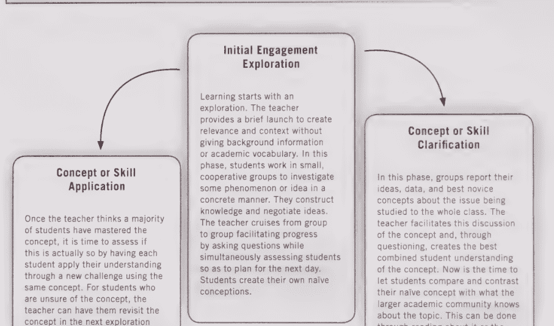

在接下来的章节中，将详细阐述探究式教学的每个要素，并提供不同学科领域和年级段的课堂示例。其余各章将详细说明如何将这些想法落实到你的课堂中，以及为什么每一项都是帮助学生成为精通学习者的重要组成部分。更多示例见数字资源光盘。

### 学生探究

探究式教与学始于学生探究。对于采用传授式教学法的人来说，这听起来可能有些违背直觉，但它是探究式教学的关键组成部分。教师设计探究活动，让学生以小组合作的形式真实体验本课所要学习的概念。正如你将在后续示例中看到的，学生面临的挑战是：他们可以从亲身体验中直觉地理解概念，也可以设计一个建立在刚掌握的技能或理解之上的解决方案或问题解决路径。重要的是，探究活动必须精心设计，使预期的概念或技能成为核心焦点，并且一定能由小组在互动和构建最佳理解的过程中共同弄明白。

### 实践中的学生探究：*八年级诗歌课*

> “我选择这首诗，是因为我喜爱诗人仿佛用文字作画的方式。诗中写道‘柏油马路泛着光泽’，你无需更多言语，就能看到街灯在雨水浸湿的街道上闪闪发光。多么精彩的比喻！”

教师萨拉把学生提到的两项内容——“用文字作画”和“精彩的比喻”——添加到图表纸的清单上。然后萨拉问谁想下一个分享。许多学生现在都渴望分享自己的想法，因为他们知道这些想法会被尊重地接受，教师或其他学生只会在澄清时提出疑问。

另一个学生读了一首简短的诗。似乎每多读一次，学生们都越来越用心地读出其中的含义，或带着情感去读，有时，就像这次，还会稍微玩一玩节奏。

> “我选这一首有两个原因。它是少数几首押韵的诗之一，而且它几乎有一种像歌曲一样的节奏。它离说唱很远，但它是这里最接近说唱的诗。”

萨拉把这两个新要素——“押韵”和“节奏”——添加到标有“让诗歌变得有趣的因素”的图表上。

上课开始时，萨拉把16首不同的诗各五份堆放于教室四周。然后她请班上的32名八年级学生安静地走动，阅读每一首，并选出自己最喜欢的一首。做出选择后，学生们回到座位，写下这首诗让他们做出选择的那些方面。

尽可能引用具体的词语或诗句。当他们各自选定一首诗后，先在自己四人一组的反馈小组中解释选择理由，以此锻炼推理能力。接着，他们向全班汇报。其他学生谈到“一连串以相同字母开头的词语”“阅读时感受到的情感，比如爱”，或者“词语如何分布在整页纸上——但这是有原因的。它让你思考，并用不同的方式去朗读它们。”每个人都有自己的理由；当某个理由被重复提到时，老师就在图表上相应位置额外打上对勾。

临近下课时，萨拉让学生把所有理由抄写下来。作为家庭作业，他们要试着将这些理由归类。第二天，学生们带来了分类建议，比如“词语的声音”“酷炫的比喻”“音乐性与节奏”“强烈的情感”。

很快，学生们几乎发现了诗歌的所有要素。他们先在自己的小组中讨论这些想法，然后以全班协作的方式建构知识。并非所有学生都完全掌握每一个想法。然而，由于他们参与了概念的建构，许多学生至少部分地掌握了这些概念。本周晚些时候，老师引入了与这些概念相对应的学术词汇，如头韵（alliteration）。如果老师一开始就教这些术语，学生们就会认为词汇本身最重要，而不是对概念的深入理解。这会造成错误的关注点。

萨拉明白，这只是他们一起对诗歌世界进行的初步探索；之后还需要通过一系列螺旋式上升的进一步探索，来深入理解每个方面。于是开始讨论：为什么他们没有选择同一首诗？这又引发了讨论：为什么一些学生觉得诗歌“愚蠢”？为什么作者不直接把想说的话写成一段话呢？萨拉提到一首诗，并说诗人曾经说过，当他无法用言语表达情感时，他会把情感写成一首诗，送给那个人。一些学生谈到他们认为其中有些诗写得并不怎么好。这又引来其他一些学生反问他们：你们能写出更好的诗吗？“我只是个少年，你能指望我什么？”这是常见的回答。

萨拉说，接下来几周他们会读到比这好得多的诗，而班级还将出版一本自己的在线诗集，配有插画和照片。就在课堂快要结束时，萨拉说：“顺便说一句，这些诗都是我十几岁时写的。我相信你们都会写得好得多。”

## 关于学生探索实践的观察

很多时候，教师将学生的探索或调查等同于做科学。你在前一页看到的是，一位教师精心设计并引导了一堂语文（语言艺术）课中的 *探索* 课。在清晰地界定概念、技能和思维习惯目标之后，这位教师煞费苦心地设计和引导了一次探索活动，让学生能够在锻炼思维技能的同时自行发现这些概念。通过揭示概念之间的关系，学生能真正而深入地理解这些关系，并能运用思维技能去应用它们，同时获得更高层次的技能水平。

过去四十年来，我们对学习所了解的一切都表明，这些概念性理解和技能无法通过讲述——即说教式教学——来传递。无论你去看皮亚杰学派的发展心理学家的研究（布鲁纳 1960、1973 和 1996；埃尔金 1976；弗利克 1995；费舍尔 2008），还是当前基于脑科学的研究者（布兰斯福德等 1999；祖尔 2002），大量研究中的每一项都表明，学生需要通过参与设计和开展学科内部及学科之间的探索来建构理解并获取技能。这必须先于学生接触更广泛的学术共同体已知的知识，这样他们才能将自己的理解与学术界的理解进行比较。在探究式教与学的这个阶段，学生正在某一特定现象、概念关系或针对具体情境的问题解决方法所涉及的众多因素之间建立联系。很多时候，学生的理解和技能仍是幼稚的，但他们已经描绘出一幅带有空白的 *图景*。这幅图景是他们大脑中正在努力理解该现象的区域。这些空白就是他们现在产生的问题，而这些问题可以由更广泛的学术共同体成员自己已经揭示的内容来回答。

在上述例子中，一个班级的学生未必能发现成功诗歌的每一个要素。他们还需要接触其他要素。他们仍需要观察伟大诗人如何单独或组合地运用各种技巧，并能够识别这些诗人成功或不成功的原因。他们需要自己创作诗歌，并练习使用若干种这些诗歌技巧。他们需要练习给出友善的评论，并针对同学的诗歌提出积极的改进建议。所有这些都是系列课程或 *螺旋式* 课程中的后续探索。

## 探究式教学中教师的职责

> “每当你回答学生的问题时，你就是在阻止他们学习。”

> “教师在探究式教与学中最难做到的事情就是停止讲话。”

我在许多工作坊的开头都会引用这两句话中的第一句；而当老师们制定学生探索计划时，我又会在整个工作坊中多次重复第二句。一旦教师在自己的课堂中尝试这些计划，他们就会成为第二句话的践行者。

考虑到我们在正规学校教育中所经历的一切，这两句话都与直觉相悖。回答问题、传播知识、因此也就需要说话，难道不正是教师的职责吗？

学生需要通过参与精心设计的探索活动来自己发现概念，从而深入理解概念并将其应用于多种情境。教师需要停止回答问题，因为这实际上会阻碍学生建立深刻的概念性理解。

同样，当学生投入到精心设计的探索中时，需要允许他们在 *挣扎* 中形成自己的理解。由于他们处于小组中，他们可以互相支持。教师需要在教室里“巡游”，从一个小组走到另一个小组，仔细倾听，判断是否以及何时需要介入。然而，教师需要克制自己，不要过早介入。弄清楚问题需要时间，而且需要走弯路、再放弃那些错误的路径。允许学生独立思考；让他们自己去挣扎。如果探索活动设计得当，教师只需偶尔向那些走得太过偏远、偏离太久的小组“抛出一个既不过分引导、又经过深思熟虑的问题”。如果你只是等待，大多数时候学生都会走上你原本想引导他们走的那条路。只不过，现在这个弄清楚问题的过程是由他们完成的，他们对知识的掌握也会深刻得多。

## 思考空间

## 教师话语

- 你讲话的目的是什么？
- 你多大程度上发现自己会重复学生的问题或答案？
- 你多大程度上利用讲话来鼓励学生独立思考或与同伴分享想法？
- 你认为在课堂上改变教师与学生的讲话模式对你来说有多困难？

## 小组学习

几千年来，人类通过在家庭单元、部落，以及近代以来的工程团队、诗歌创作团体和其他小组中共同工作，学习如何解决问题和提升自我；在这些小组中，思考和想法得以分享、检验和应用。学生不仅有机会花大量时间用言语梳理自己的思维，而且更有可能在小组中尝试口头表达自己新形成的想法，而不是在全班面前。这种小组内的观点协商使学生能够将自己的思考与小组中其他人的进行比较；同时，教师也可以从一个小组走到另一个小组，仔细观察，了解学生在掌握概念和技能的过程中正处于哪个阶段。

## 小组学习的实践：四年级科学课——热

## 第一部分

在一个四年级班级里，教师黛比在几周前开始了关于热的学习，她先问学生们对热有哪些了解。他们对热的大部分观察，是对自然界运作方式的正确解释。例如，他们观察到炉子上的火焰会把锅和锅里的水都加热。然而，一名学生说“衣服有热量”，许多学生都同意这个观点。他们引用“证据”来支持这一观点：如果你冬天觉得冷时穿上衣服，就会变暖和。一名学生还指出，她妈妈说过：“穿上你暖和的衣服。”

基于学生的观察，黛比修改了她先前为学生制定的计划。这些计划原本包含一系列探索活动，让学生去发现热如何在物体之间传递、某些材料——绝缘体——如何阻止热轻易流动、以及温度计如何测量某个特定位置的平均热量。现在，她又加入了一些探索活动，让学生判断“冬衣”是否含有热量，或者只是阻止“人体热量”散发到体外。

每天，学生们都盼着上课，说又到了科学研究小组的时间。学生们按四人小组坐好，会清理自己的课桌，每组中的“材料员”会收集材料，要么继续上一次科学小组时间未完成的探索，要么等待新的挑战，以进一步提升他们不断增长的知识和技能。

## 第二部分

黛比给学生提供了冷热物品和温度计，让他们在自己的科学研究小组中使用。他们设计了实验来回答这些物品以不同距离放置时会发生什么。有些小组只是让物品相互接触。另一些小组将它们以不同距离分开摆放，并记录距离多远，还向老师要尺子。其他小组不使用尺子，只说“接触”“近”和“远”。有些小组记录时间，另一些只说“过一会儿”。学生们各自争论实验应该如何设计，直到小组达成妥协。每个人都把笔记记在装订好的“科学日志”中，因为最初的笔记就是为了培养学习者天生的好奇心和学习的乐趣而选择的。他们认识到，记忆和重复并不代表一门学科，一门学科是对知识的探索，而不仅仅是知识本身。他们用数千名学生实地测试了他们的方法，发现如果学习者探索一种现象，并注意到我们作为成年人如何深思熟虑地回应他们的思考，那么学生就会建立起对该学科领域的观念、技能和态度，并持续一生。使用学习周期的学生在认知和动机行为方面都表现更优（Kyle and Bonstetter 1992）。

学习周期基于皮亚杰理论（1963；1969），也实现了大卫·奥苏贝尔的有意义学习理论（1963）。我们现在认识到，学习周期也符合维果茨基的社会建构主义理论（1978）。同样，当前的大脑神经生物学研究和学习理论支持学习周期（Zull 2002）。

学习周期发明至今已有55年。尽管我做了一些重要的修改，但学习周期的基础仍然是探究式教学的核心。卡普拉斯和蒂尔的同事约翰·伦纳（1971, 163）解释道：“真正的学习来自对答案的探索，而不是答案本身——这就是探究的本质。”

## 深度学术理解与技能

只有当学生建立起丰富的概念集合并花合理的时间培养技能之后，他们才会接触到更大的学术共同体的知识。一旦学生通过小组探究协商了他们的想法，他们就在大脑中建立了一个将概念所涉及的许多因素相互连接的位置。在教师的引导下，他们可以首先与其他小组比较和对比自己的想法，并达成某种班级共识。只有到那时，他们才会有真正想要回答的关于概念的问题，并且已经形成了足够的图景，从而能够理解更大学术共同体的认知。学生可以从阅读、媒体甚至讲座中提炼意义。这些理解的来源变成了有意义的事业。

## 实践中的深度学术理解与技能：*十一年级化学课*

艾琳是十一年级的化学老师，她让每个学生单独操作无针头的大注射器。学生们被指示操作注射器并记录发生的情况。她要求四人研究小组中的每个学生向其他人清楚地说明他们做了什么，以及注射器是如何反应的。如果其他人没有这样做，或者看到了不同的反应，那么每个学生都必须这样做，直到小组达成共识。

当小组中的全体学生都回应后，他们回到第一个发言的学生那里，尝试就为什么特定的动作产生了他们所观察到的结果达成共识。在小组讨论过程中，艾琳巡视房间后，叫停各组，并说几分钟后每个小组的记录员需要报告他们迄今为止收集的数据和见解。当记录员开始报告结果时，老师逐字记下每个观察结果。当记录员提到“管子里的活塞”时，艾琳打断问道：“什么是活塞？”随后展开了一场讨论，最终需要绘制并标注注射器的各个部件。艾琳让全班对每个部件的通用名称达成一致，这样他们就能在自己的科学共同体中使用相同的词汇。她正在构建的一个重要概念是科学本质的一个方面。共同体通过运行可重复的受控实验和使用通用语言来监督自身的能力，这正是这种科学本质的一个方面。

与此同时，艾琳也在慢慢让班级为他们报告探究时所使用的词语创建操作性定义，这样他们就能认识到，科学中没有事实，只有那些能够得到精心构建的实验证据支持的最佳理解。每当班级发现一些新的见解时，概念理解就会加深，定义也会扩充或修改。这样，科学本质的另一个方面就得到了示范。

然而，在课程的两三天里，她也将课堂的重点放在内容——概念目标上。艾琳很快就能质疑记录员们怎么知道注射器里有“东西”。毕竟，学生们一直说管子里有“空气”，所以艾琳要求任何人提供证据证明管子里有“东西”。很快，有人注意到，当你用手指紧紧盖住“尖端”，并推动原本部分位于管内的活塞时，管内会有东西往回推。五分钟内，几个学生共同得出了这样的结论：“当你用手指紧紧盖住尖端并推入活塞时，管内的空间（体积）变小，管内的气体被压缩，压力增大，于是‘往回推’。”

艾琳记录了学生们的陈述；随着讨论的继续，该陈述被修改得更加清晰、准确，并让全班都能接受。她还使用不同颜色的记号笔来标示这些改动。

这种方法让全班真正看到了知识是如何被协商和创造的。

老师根据两名基于证据提出大部分见解的学生，将这一陈述命名为“马里昂和丹尼斯定律”。家庭作业方面，老师给学生布置了一个挑战：把这个概念应用到给自行车轮胎充气上。第二天，他们讨论了自己如何尝试将理解应用到这一新情境。老师断定，他们大多数人对这个概念已掌握得足够多，可以准备将自己的理解与更大学术界的认识进行比较。老师在他们的化学教科书中布置了几页阅读内容，他们会在那里发现，马里昂和丹尼斯定律最早是在19世纪提出的，并且被称为玻意耳定律。第二天晚上，学生们上网观看了这些因素之间分子相互作用的动画模拟。

本周晚些时候，学生们尝试使用测量工具计算压力与体积之间的数值关系。在老师的一些提示下，他们发现了自己正在构建的方程中需要引入一个常量，但学生们不可能自己发现需要考虑分子的摩尔数。由于他们已经在脑海中构建了知识图景，并且有一些通过探索无法自行回答的问题，学生们意识到需要借助外部资源。老师解释了专业科学家所理解的内容，以及他们是如何理解这些内容的。

## 对深度学术理解与实践技能的观察

我希望大家已经越来越清楚地看到，探究式教学与学生在一个学科中进行探究是相关但不同的。探究是人类学习事物的过程，也就是创造知识的过程。一个学科中知识被认可的标准，与其他学科中知识被接受的标准有些不同。例如，在科学中，关于某一特定现象的知识，如果在严格控制实验中获得的证据能够以同样的结果被重复验证，就会被科学界接受。一旦在自然界某个地方或某个时间这一观点不再适用，该观点就会被修正。在历史学中，同样需要有证据证明某件事在人类社会发生过，但那种证据是人对所见所闻的解释。事件为何发生甚至是对该事件及其背景事件的进一步解释。不同的人可能对同一事件所对应的相同证据有不同的解释。在科学中，证据和模型需要与自然世界相符，并且可以被普遍检验。历史这门社会科学则更依赖于事件书写者的倾向。这就是我们所说的*学科认识论*。

探究式教学是一种促进学习的方法，教师设计一项探究活动，让学生以某种改良后的探究形式在学科内部或跨学科进行探索，从而发现某种理解。在探究过程中，学生的理性思维技能得到提升。教师确定一个希望学生掌握的具体理解或技能，并设计探究过程来引导学生发现这种理解。学生主动去弄明白事情，但这并不是完全由学生掌控的开放式探究。开放式探究在学校中有一席之地；然而，它在探究式教学中所占比例很小（参见第3章海迪·奥唐奈的反思）。在探究式教学中，学生还会主动将自己的理解与更大学术界的认识进行比较，然后将丰富后的理解应用到独特的情境中，以检验其是否是一种深入、可用的理解。

## 词汇教学在一周结束时进行

注意，在化学课上，艾琳一开始让学生使用常见、通用的名称来称呼事物。只有在学生*发现了概念*并对其有了一些掌握之后，她才在讨论中*抛出*一些学术名称。艾琳使用 “cylinder” 而不是 “tube”，用 “piston” 代替 “plunger”。学生们问为什么不能继续使用原来的术语。她提醒他们，全班有必要建立一套通用词汇，以便在班内各研究小组之间进行交流，并准确比较实验结果。学生们开始意识到，如果他们想知道课堂之外的学术界对这个话题了解什么，就需要使用科学界其他人已达成一致的词汇。

有时学生会使用科学词汇，因为该术语也是一个含义相近的“通用常见”词。在这种情况下，他们在形成深层概念理解的过程中一直在使用 “pressure” 一词。现在他们可以阅读文本、音频和视频媒体，以对比自己的理解。由于他们已掌握了许多概念，并将它们与学术词汇联系起来，他们便能够为了理解而阅读。几十年的经验和研究（Beck et al. 1987; Bravo and Cervetti 2008; Jablon 2011）表明，如果教师在学生形成概念理解之前就使用学术词汇，学生就会把注意力集中在词汇上，而不是概念关系或使用概念所需的技能上。简而言之，词汇教学*在一周结束时进行*，也就是在学生掌握了一些概念和技能之后。

## 问题解决

“你目前的想法是什么？”而不是“答案是什么？”是探究式教学与学习过程的核心概念。如前所述，概念无法被教授；它们需要被学习，也就是说，由学生自己建构。创造深度理解需要学生积极参与探究——即问题解决。让学生专注于他们目前理解了什么，而不是要求他们给出正确答案，是在引导他们进入元认知学习。他们开始对成为有能力、成功的学习者产生主人翁意识和责任感。他们意识到，即使尚未完全掌握一个概念，自己的坚持也会得到回报。同伴和老师始终在他们的思考旅程中支持和帮助他们。

### **实践中的问题解决：** *二年级思维在行动*

米格达利亚在一年级的大部分时间里都安静地躲在前排座位上的同学身后。她的一年级老师经常就各门学科提出的问题，让全班学生给出正确答案。米格达利亚很少确定自己的答案，所以她几乎从不举手。她举过几次手，但往往没有答对，于是她举手越来越少，以免在全班面前难堪。

然而，今年在二年级，米格达利亚的老师黛安总是询问学生目前的想法。由于学生们以四人为小组进行探究，米格达利亚可以在只有几个人面前操作材料时尝试表达自己的想法。她小组里的其他人也会尝试自己的想法，然后他们一起努力达成他们所能形成的最佳想法。当天指定的汇报人随后会把小组的想法向全班其他同学汇报。现在，当黛安在全班讨论中征求志愿者时，米格达利亚经常举手，因为老师感兴趣的不是她的正确答案，而是她最好的想法。随着学期的推进，渐渐地，其他学生也开始认真倾听彼此最好的想法，并开始认真协商观点。老师的最终目标确实是“正确”的答案——我们希望每个学生掌握的概念或技能——但她认识到这是达成这一目标最有效的方式。

## 关于实践中问题解决的观察

整个课堂呈现出一种支持性的氛围，每个人都对“弄清楚如何把事情弄清楚”产生兴趣。这使得学生在获得高级（应用） | CCRA.R.1, 2, 4, & 8 | CCRA.W.1, 2, 5, & 10 |  | CCRA.L.1, 2, 3, & 6 |

改编自 Enderle, Grooms, Campbell 和 Bickel 2013；CCSSO 2010

## 获取实物材料

在有效的探究式教学中，让学生动手操作材料是必须做到的。回想一下你在教师培训项目中学习儿童或青少年发展课程的时光。理解学生的大脑发育对于成功促进他们的学习至关重要。你可能还记得让·皮亚杰是理解这一发展的先驱和最重要的人物之一。然而，直到我的教学生涯过了一段时间，我才真正理解让学生操作材料的重要性。皮亚杰和英海尔德（1969）并没有说处于前运算阶段或具体运算阶段的学生操作材料以便学习是个好主意；他们说学生必须操作材料才能学到任何有意义的东西。当然，他们可以为了通过测验而死记硬背几个小时的事实。然而，在这个共同核心与21世纪技能的时代，皮亚杰（1963）、布鲁纳（1973、1996）以及此后所有发展心理学家（Elkin 1976; Flick 1995）的发现再也不能被忽视了。学生必须操作材料这一观念，是我作为课堂教师不得不面对的最令人清醒的认识之一。一旦学生手中握有材料，并在一周中的大部分时间里以有意义的方式使用它们，他们不仅学习得更深入，而且他们对学习付出努力的行为和态度也变得更好了。

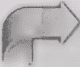

## 思考空间

## 教师发言

## 共同核心州立标准（CCSS）与我的规划

反思你最近实施州语言艺术标准和转向实施共同核心州立标准的经历。

- 你在多大程度上熟悉或正在实施CCSS？你（以及你的同事）对共同核心的反应是什么（或一直是什么）？
- 你认为共同核心会在哪些方面影响你的规划和教学实践？
- 正在提供什么样的支持来帮助你成功过渡到新标准？
- 你是否已经使用探究式教学策略？如果是，你目前的哪些策略符合共同核心的期望？

## 实践中的实物材料获取：*八年级历史课*

记住约翰·布朗在内战前夕突袭的时间、地点和内容是一回事；认识到关于发生了什么以及为何发生的历史叙述完全取决于文本作者的观点，又是另一回事。你在六年级还是十年级学习这一内容，也会决定学生需要理解的历史伦理的复杂程度。参与这节课的教师迈克不仅让学生“做历史”，而且他还回应了共同核心对阅读复杂非虚构文本的期望。

然而，迈克早在共同核心州立标准出版之前就已经在实践有效的探究式教学，并一直将同样的期望作为探究计划的一部分。因此，当班级学到那段历史时期时，迈克没有直接讲述约翰·布朗突袭的故事，而是尽可能地在历史中创造动手探索。结果，以前不投入的学生变得完全投入了。

在这节课之前，经校长和家长咨询委员会许可，迈克让学生们在校园里，在90度的天气下，拖着100磅的“棉袋”走50码，每20英尺做一次蹲跳，以模拟身为奴隶采摘棉花的感觉。学生们做了15分钟，然后讨论如果每天做10到12小时、每周六天，从八九岁开始，并余生都这样做，会是什么感受。

接下来，学生在各自的小组中活动。每个小组都有一份1859年10月突袭的五个原始记述之一的副本。学生们从分配给他们的原始文献文本中提取观点，面临挑战，要制作一段一分钟的新闻播报，并用移动设备录制下来。下节课开始时，这些新闻播报通过液晶投影仪播放给全班。学生们开始礼貌地评判彼此的报道，指出其他人有错误信息，或者是在以非常偏颇的方式看待这一情况。

迈克访问了国会图书馆和美国国家档案馆网站，找到了五份视角各异的文件。一份来自北方倾向废奴主义的报纸。另一份来自西弗吉尼亚州当地报纸。还有一份出自南卡罗来纳州一家报纸的煽动性作者之手。另外两位作者则较为中间路线，但每个人对涉及的众多复杂伦理问题中的至少一个表明了自己的观点。在课堂上经过来回讨论后，学生们回到家，被要求想象自己是生活在1859年的青少年。他们每人被分配了不同的情境。

他们中有些是白人，有些是非裔美国人；有些来自南方，有些来自新英格兰；有些富有，有些贫穷；有些自由，有些是奴隶。他们被要求写下自己对这种“公民不服从”的感受。第二天，迈克将他们两两配对，然后一一进行三分钟的角色扮演，讨论如果相遇聊天可能会进行的对话。老师准备了各种帽子、围巾和工具作为道具，供每个学生使用。在“对与错”、“公平与不公平”以及“合法与不合法”的讨论中，产生了美国人在内战前面临的大部分问题，这些问题如何导致了战争，以及甚至可能如何避免战争。大多数具体运算阶段的学生能够进行复杂的形式思维，因为他们“具体地”操作了原始文献，并通过扮演“真实青少年”进行了角色扮演。

## 实践中使用实物材料的观察

在有效的科学和数学课堂中，使用操作材料是常态。然而，许多教师认为能够从博物馆借出或在博物馆中观看的实物历史材料，例如小型工业工具或机器、制服或武器等，是历史课堂中唯一可以使用的操作材料。这些都是宝贵的材料。然而，花在角色扮演上的大量时间，让学生在各种情况下体验前几代人所承受的磨难，也是一种材料操作——他们自己的身体和思想。我们在 Mike 的课堂上学生体验的棉花袋中看到了这一例证。随后是另一种材料操作——对原始文献的解读。对同时代人撰写的关于约翰·布朗袭击事件的著作进行文本分析，让学生深入分析观点问题和为受众写作的问题。下面这个角色扮演让学生能够形成自己的观点并为之辩护，同时巩固概念并丰富学生的通用核心技能。

Mike 历史课中使用的探究过程步骤与六至八年级历史/社会研究领域的通用核心读写标准密切相关。图 1.3 展示了这些标准。

**图 1.3 历史/社会研究通用核心阅读标准，6–8 年级**

- CCSS.ELA-Literacy.RH.6–8.1：引用具体的文本证据来支持对主要和次要来源的分析。
- CCSS.ELA-Literacy.RH.6–8.2：确定主要或次要来源的核心思想或信息；提供与先前知识或观点不同的来源准确摘要。
- CCSS.ELA-Literacy.RH.6–8.6：识别文本中揭示作者观点或目的的方面（例如，带有倾向性的语言，对特定事实的包含或回避）。
- CCSS.ELA-Literacy.RH.6–8.8：在文本中区分事实、观点和理性判断。
- CCSS.ELA-Literacy.RH.6–8.9：分析同一主题上的主要来源和次要来源之间的关系。

(CCSSO 2010)

这些策略为学生准备任何基于通用核心的测试，并培养有效公民所需的技能。导致学龄前青少年对过去历史事件产生情感反应的角色扮演方面，深刻地调动了他们对公平和正义的个人感受，并将“死去”的历史转变为充满活力的生活体验。

## 展示更深层次思维的通用核心数学要求示例

我们已经看到探究教学学习循环的步骤如何与图 1.2 中的通用核心读写标准相关联，同样，Mike 探究教学历史课循环的步骤与标准中的历史部分的相关性如何（见图 1.3）。

通用核心数学实践标准几乎似乎是怀着探究教学学习循环的意图而编写的。这些标准如下：

- **MP 1：** 理解问题并坚持解决它们。
- **MP 2：** 抽象和定量推理。
- **MP 3：** 构建可行论证并批判他人的推理。
- **MP 4：** 用数学建模。
- **MP 5：** 战略性地使用适当的工具。
- **MP 6：** 注意精确性。
- **MP 7：** 寻找并利用结构。
- **MP 8：** 在重复推理中寻找并表达规律性。

**CCSS.Math.Practice.MP 3：构建可行论证并批判他人的推理** 体现了探究教学学习不可或缺的更深层次思维的本质。

数学熟练的学生在构建论证时理解并使用陈述的假设、定义和先前建立的结果。他们提出猜想并构建陈述的逻辑进展以探索其猜想的真伪。他们能够通过将情况分解为案例来分析情况，并能够识别和使用反例。他们论证自己的结论，向他人传达，并回应他人的论证。他们对数据进行归纳推理，提出考虑到数据产生背景的合理论证。数学熟练的学生还能够比较两种合理论证的有效性，区分正确逻辑或推理与有缺陷的逻辑或推理——如果论证存在缺陷——并解释其缺陷所在。小学生可以使用具体的参照物（如物体、图画、图表和动作）构建论证。这样的论证可以是有意义且正确的，即使它们要到以后年级才会被概括或形式化。后来，学生学会确定论证适用的领域。各年级的学生都可以

如果学生参与到日常探索中，包括对实物材料的操作、游戏以及依赖其身体和思维技能的产品创作，并且所有这些都由教师精心引导，那么学生将保持真正的参与，学习也将成功。然而，只要有可能，即使是这些小学生的活动也应包括对其家庭和社区生活的运用，以便学生开始将新获得的技能和概念理解有效应用于日常生活的决策中。

此外，在每个学科领域中，在学前和小学阶段教授的几乎每项技能和概念都是可以在学生日常生活中立即应用的东西。数学概念可以很容易地应用于烹饪、烘焙、用木材建造、缝纫、体育统计以及日常购买中使用的计算。所有的科学概念以及探究和决策技能都可以在他们的日常生活中立即使用。它们都是可以用最简单的透镜和秤实际观察和测量的概念。语言艺术技能可以通过学生生活中的情境、与学生生活相关并扩展其生活的文学，以及创作发表在书籍、博客和通讯中并在戏剧和歌曲中表演的写作来教授。

在幼儿社会研究中，课程的大部分内容实际上是研究学生居住地的文化和地方历史。在小学高年级社会研究以及所有初中和高中学科领域中，一些研究主题在学生的生活中并不立即显得相关，尤其是对其固有的心理需求而言。研究古代波斯或日本似乎并不立即相关。希腊或中世纪文学似乎是用笨拙的语言写成，人物陈旧。计算离心力对几乎每个十六岁青少年来说似乎都不重要。同样，无数学生曾问过他们何时需要使用二次方程。

然而，如果这些主题嵌入到正确的探索中，并以适当的宏大概念目标和有效主题在具有挑战性的本地项目中加以情境化，就能使其引人入胜并与学习者的生活密切相关。探究什么与早期和后期青少年相关非常重要。也许提出问题的更好方式是“青少年在乎什么？” 在继续阅读之前，请花一到两分钟写下你对这个问题的两个最佳答案。如果可能，请与你的同事或学生的家长讨论这些想法。

## 相关性与满足需求层次

多年来，我已与数千名教师和家长一起进行过这项练习。在几乎每一种情况下，共识都是一样的。我也曾与数百名青少年一起做过，他们也得出了同样的结论。大家基本都同意，他们最在乎的是被*他们在乎的同龄人团体所接纳*。其次，他们在乎的是他们能够*展示自己在对他们重要的事情上的能力*

同伴和社区的重要成员。这与前一种需求不同，在后一种需求中，他们因自己的身份和所能取得的成就而*受到尊重*。

如果教师能在让学生参与学习的同时满足这些需求，那么这将是一个自然、有机的过程。这是学生想做的事情，而不是他们必须被迫去做的事情。即使不是必须的，他们也会去做。让我们用人本主义心理学家对人类需求的解释——这也得到了我们目前对大脑神经生物学的理解的支持——来更好地从概念上理解这一点。在20世纪50年代和60年代，亚伯拉罕·马斯洛（1968）和他的同事们研究了那些他们认为自己所认识的最心理健康的人。通过这项研究，研究人员推断出一组层级式的人类需求。除非一个需求得到合理满足，否则其他需求对人来说并不重要。在对世界各地成千上万的人进行测试后，研究人员意识到，这种需求序列是*基因编程*到所有人类身上的。这与我们对神经生物学的认识非常吻合：杏仁核是我们进化大脑中最古老的部分，它被额叶皮层和大脑的其他推理部分所包围。

图1.4展示了需求层次（马斯洛，1968）。你可以看到，生存和更情绪化的方面是基础，因此总是优先于三角形上方的更理性方面。

## 图1.4 马斯洛需求层次

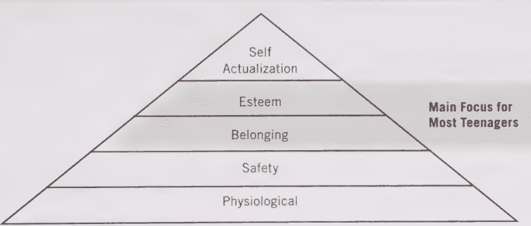

一旦人们满足了生理需求——食物、衣服和住所——那么他们就必须关注安全需求。无家可归的学生不断滑回这一类别，无法轻易专注于学校里发生的任何事情。安全需求包括能够定期预测生活中会发生什么——不仅是身体安全，还有心理健康。这就是为什么来自不稳定家庭的学生往往难以专注于学业。这也是为什么离婚打乱了家庭常规并造成持续的不确定性，会使学生陷入混乱。但在这些需求得到满足的青少年中，焦点集中在青春期的两个方面——归属感和自尊。接下来的两个层次——*归属感*（被群体接受）和*自尊*（对能力的尊重）——是*青少年必须在此发展*的。我们一直要求他们处于最高层次，即自我实现，在这个层次上，一旦其他层次得到充分满足，人就可以正常运作，但当然，青少年这些层次并没有得到满足。然而，学校通常要求他们做一些事情，因为他们将来会需要，还要求他们不要担心朋友的想法。然而，这些都是对青少年来说困难的事情，对其他人来说几乎不可能做到。

如果我们能以一种满足这些需求的方式管理我们的课堂，同时让学生参与探索，在探索中发现概念并锻炼他们的思考技能，那么学生就会愿意待在那里。他们会在学习上付出比大多数教师以往所见到的更多努力。

## 探究式教学的实践

在我教学生涯的第十三年，我转向合作教师特里·伯恩，指着我们的教室说：“看*那个*。我从没想过它能如此自我维持。他们在智力和社交上如此投入。这超出了我的想象。”学生们曾围绕他们正在阅读的一篇文学作品的潜在主题进行了两次角色扮演，然后分组创作一些两分钟的戏剧片段，以展示他们当前对科学和社会科学概念*进化与革命*之间关系的见解和理解。令人惊叹的是，每个小组都完全自我激励，他们首先在智力上就这些复杂概念的细微之处进行争论，然后同样努力地以戏剧化方式表达他们想要传达的意思。上学期，其中一些学生没有去上那些说教式传授风格的课程。这让我难以置信。

## 让探究式教学发生

那么你需要做什么才能让这一切发生呢？找到在人际关系和学科中都很重要的大主题。“个人权利与社会权利”不仅处于青少年生活的中心，也出现在大多数社会研究、语言艺术、科学和工程课程中。同样，“支配权与协作权”是青少年每天都会面对的事情。这个概念不仅出现在前面提到的学科中，还出现在统计学和代数的各个方面。如何规划基于这些主题的单元，将在本书后面的章节中详细解释。

一个快速的例子可能是，在学生们对1859年的青少年和约翰·布朗袭击事件进行角色扮演之后的后续活动。教师可能会创建以下*类比性相互关联角色扮演*，内容涉及当代，探讨做某些“非法”但为了“更大利益”的事情。教师让学生们扮演一群青少年，他们决定用各自MP3播放器中的歌曲制作一张“抗击癌症”CD，以10美元的价格出售，为癌症研究筹集资金。尽管这是盗版受版权保护的音乐，学生们可能会说他们为下载付了钱，而且销售的收益大于法律问题。他们的一些父母和朋友可能不同意。因为这个困境可能是他们在日常生活中遇到的，并且与很久以前的某个情形（约翰·布朗的哈珀斯费里袭击）中的困境相似，青少年现在可以更容易地专注于这个复杂的道德困境。

## 实践中的概念、技能和思维习惯

概念、思考技能和思维习惯为探究式教学的要素提供了框架，并且是这些要素的组成部分。当学生参与基于探究的活动时，他们正在练习和学习观点之间的关系，在学科内部和跨学科中完善思考技能，并培养使他们成为独立学习者的思维习惯。

很多时候，我听到老师们担心如何教授共同核心州立标准所要求的复杂高阶思维、阅读和写作技能，同时还能设法教授内容。同样，对于新一代科学标准（NGSS）（Achieve Inc. 2013），教师们担心除了工程和科学本质技能之外，如何有足够的时间教授所有科学内容。教师对数学共同核心标准也表达了类似的担忧；他们担心问题解决方法的复杂性，并疑惑学生如何有时间练习算法。

在接下来的每个学科示例中，使用有效探究方法的教师表明，我们一直在将过程和内容结合起来，因为这是探究式学习自然展开的方式。课程和单元以对复杂概念关系的理解、高阶思维和决策技能以及思维习惯作为学习目标。这些技能都是在探究式教与学周期的阶段——探索和澄清——中同时获得的，然后在应用阶段得到真实的评估。教内城学生（大多是双语学生）中学科学的比尔·卡米斯基说，在实施探究式教学时，所有三个目标都源自相同的探索，但在教学过程中需要分别处理。比尔指出：“在我的教案中，我有时会对每一项进行不同的格式设置，以便我能跟踪我在教案中强调的概念、技能和思维习惯，并清楚哪项是哪项。我会将课程中侧重于**概念**的部分用粗体，*技能*用斜体，并给思维习惯加下划线。”

## 实践中的概念

“概念是从特定实例中抽象出来的具体想法”（Marek and Cavello 1997, 10）。在年度规划中应确定大约10个总体概念，用于

一个内容领域。每个单元应聚焦于特定的大的概念关系。每节课聚焦于这些单元概念之一。概念与概括过程相关。概念是从经验中抽象出来的——创造它们是一个过程。由于概念是习得的，谈论“*教*”概念会令人误解。如前所述，教师的责任是设计探索活动，让学生在指导下和其他帮助下建构自己的概念。这是学生从有引导的探索和澄清中获得的东西。从学前班到四年级的学生通常处于前运算阶段，能够理解具体概念。例如，四年级学生学习热时，理解温度计读数升高表明该区域更热。然而，形式抽象思维者可以利用分子动力学模型，理解分子运动得更快。具体运算阶段的学习者也可以通过探索创造一些具体例子后学习这一模型，但他们不理解这只是一个模型。

## 实践中的思维技能

“弄清楚如何弄清楚”，是我对获得高阶思维技能的描述。

1961年成立的教育政策委员会将“思维能力”定义为心智的某些理性能力：“它们是回忆、比较、推断、概括、演绎、分类、分析、想象、综合和评价”（5）。委员会将这些视为自然的先天能力，必须通过有引导的探索来发展。

自那时起，我们在国家和州级标准中都制定了基于学科的思维技能目标。每个学科都有其独特的思维技能。然而，如果我们再仔细看看，会发现这些学科思维技能之间也存在惊人的共性。我们将在第2章详细探讨这些差异中的共性，在那里我们将审视整个上学日的协同效应。在共同核心州立标准（CCSS）出现之前，对这些思维技能的评估一直让位于内容。如今，它们终于在标准化测试中获得了同等重要的地位。

有些人质疑年幼的学生是否会推理。他们确实会推理，但他们的推理方式与青少年不同，而青少年的推理方式又与成年人不同。例如，当我们审视“做科学”中存在的思维技能时，我们会发现前运算阶段的学生（通常到三年级为止）只能运用*基本的*“科学过程技能”，但这些技能是综合过程技能的绝对基础，随着学生生理上发展为具体运算阶段的学习者，这些综合过程技能才为他们所用。这一点将在本书后面讨论。

## 科学过程技能

以下是做科学和理解科学所需的思维技能。

### 基本过程（前运算思维者及更高阶段）

- 观察
- 运用空间/时间关系
- 分类
- 使用数字
- 测量
- 交流
- 预测
- 推断
- 估计

### 综合过程（具体运算思维者和形式思维者）

- 提出假设
- 操作性定义
- 识别和控制变量
- 解释数据
- 绘制图表
- 建模

## 实践中的思维习惯

当我第一次接触*思维习惯*这个概念时，我很难将它们与思维技能区分开来。它们似乎重叠得太多。有一天，我和一位出色的同事亚瑟·卡明斯一起工作，他当时是纽约布鲁克林贝德福德-斯图伊弗森特地区的科学协调员。如果我们自己都无法清楚地区分两者，我们又该如何让小学老师掌握这个重要概念呢？我们为此绞尽脑汁。那天晚上他打电话给我说：“你可以拥有一种思考和推理技能，并且在被要求时能在学校里恰当地运用它。然而，如果你在日常决策中不经常使用它，那么你还没有养成思维习惯。”这句话似乎不仅让我明白了，也让我们合作的所有老师明白了。如果你使用最重要的决策和思维技能，即使不是必须使用，它们也会成为你思维结构的一部分。

一些校长和教师认为，培养思维习惯对学生的学业成功如此重要，以至于他们将其作为学校使命的核心组成部分。黛比·迈耶在纽约市的中央公园东中学可能是被引用最多的例子，但在过去十年中，我在纽约市、明尼阿波利斯、亚特兰大、布法罗、奥克兰以及密西西比州、新泽西州、缅因州和马萨诸塞州的小城镇遇到了许多其他成功的学校。所有这些学校都将思维习惯作为其核心。

迈耶和波士顿使命山学校的K-8教师关注五种他们认为对学生成功至关重要的思维习惯：

1. **证据：** 我们如何知道什么是真的或假的？什么证据才算数？我们有多确定？什么使它对我们可信？
2. **视角：** 如果我们换位思考，这件事还可能是什么样子？如果我们从不同的方向看，它会是什么样子？如果我们有不同的历史或期望，它会是什么样子？
3. **联系/因果：** 有模式吗？我们以前见过类似的情况吗？可能的后果是什么？
4. **猜想：** 它本来可能不是这样吗？假设……？如果……会怎样？
5. **相关性：** 这重要吗？谁在乎呢？

思维习惯还有许多其他版本，其中一些是特定学科领域的。例如，科学领域中有一些如下：

### 实验证据可能有不止一种解释。

1. 保持开放的心态，面对可靠证据时愿意改变想法，并尊重他人的观点。
2. 在得出结论之前，多角度看待问题。不要草率下结论，也不要基于一次观察就做决定；深思熟虑并仔细检查，直到你尽可能确信为止。
3. 要知道假设是有价值的，即使它们最终被证明是不正确的，只要它们能带来富有成效的探究。
4. 为研究发现提供理由，并考虑他人提出的理由。
5. 要知道，对同一证据往往可以给出不同的解释，而且并不总是能判断哪一个是对的。
6. 要知道为什么好奇心、开放性和怀疑精神在科学中备受推崇，以及这些品质如何融入科学开展的方式中；在我们的生活中展现这些特质，并重视他人身上的这些特质。

### 收集准确且可检验的证据。

1. 从可靠的来源获取证据。质疑来源，确保其可靠。
2. 避免迷信；认识到任何事情都有原因。
3. 保持好奇。观察时要细心、准确。
4. 保留调查和观察的记录；不要事后更改记录。
5. 知道为什么在科学中保持诚实、清晰和准确的记录很重要。

你可能会对自己说，其中许多也适用于其他学科，或者它们只是有逻辑常识之人的特质。这正是关键所在。这些品质需要成为我们所有学生思维结构的一部分——就像他们人生旅程中的一部分。

如果你觉得这太过复杂，担心无法将所有内容融入课程中，请记住，所有概念、思维技能和思维习惯都自然有机地存在于精心设计的探究课中。一旦你以这种方式进行课程规划与引导，你很快就会成为帮助学生在这些领域中取得成功的专家。他们不仅会成功，而且还会在这个过程中获得极大的乐趣。

## 一个同时达成三个目标的示例

在规划约翰·布朗课程第二天的教学时，迈克计划在学生参与探究课时融入一个概念目标、一个思维技能目标和一个思维习惯目标。学生在探索和澄清他们对约翰·布朗袭击事件的理解时，这些目标同时得以实现。这里列出的正是迈克计划中目标部分的内容。此外，他在整个计划中为每个目标编写了引导问题和评估问题。

- **概念：** 尽管根据南卡罗来纳州和美国法律，约翰·布朗1859年的袭击属于非法行为，但一些人视其为公民不服从行为，而另一些人则视其为近乎叛国。
- **思维技能：** 学生通过解读数据，认识到历史事件的证据如何被操纵以呈现某种观点。
- **思维习惯：** 学生通过思考“如果我们换位思考，这些事件还可能是什么样子”来培养视角意识。他们学习并理解不同观点。

## 将知识应用于新情境

在我们能说学生已经获得深度理解或掌握技能之前，他们必须展示将任何与探索和澄清目标相关的学习*应用*到独特新情境的能力。再次强调，在探究式教学中，这种评估已经融入了师生正在做的事情中。你所了解的所有关于有效形成性评估的知识——这些评估每天发生并为第二天的课程提供信息——都是探究式教学的内在组成部分。同样，如果你一直在进行真实评估，即要求学生将新获得的理解或技能应用于现实生活情境，那么你会对探究式教学感到非常得心应手。真实评估是探究式教学的关键组成部分之一。

你可能已经在本章前面呈现的课程示例中看到了这种概念和技能应用的部分内容。例如，作为约翰·布朗突袭课程的后续，教师通过让学生扮演1859年的青少年互相辩论以及扮演当代青少年处理下载音乐的伦理问题来创造类似情境。同样，在处理注射器之后，学生们回家后将他们对气体定律的理解应用于给自行车轮胎充气。在诗歌单元中，学生可能会被要求使用全班共同确定的诗歌要素，将罗伯特·弗罗斯特的短诗与E.E.卡明斯的诗作（或他们自己选择的诗歌）进行比较，然后将其制作成发表在班级诗歌网站上的文学评论。

同样，在七年级数学课上，仅使用尺子、一些绳子和不同尺寸的圆盘进行探索而发现圆周率概念的学生，之后可以尝试应用这种理解。他们可能会被赋予为手电筒制造商工作的任务，并被要求在没有任何测量工具的情况下订购适量的金属板来制作12个直径为两英寸、长度为七英寸的管子。评估只是学习的一部分——是课程不可分割的一部分。对于那些仍然没有掌握概念并且无法“抽象地”计算的学生，他们可以使用一些手工纸实际制作这些管子，并再次从物理模型中看到直径与周长之间的比例关系。这种活动将是无缝的学习与评估。

## 通过探究教学取得成功——大脑与学习

本章前面我们讨论了探究过程的基本特征。现在，我们将这一过程与神经生物学当前研究成果中关于人类大脑学习过程的信息进行比较。如果这种关于认知和情绪相关的大脑结构与功能的理解与吸引学习者的探究学习模式相符，它可以为教育者全面拥抱探究教学提供有力的论据。这不仅仅是让学生在评估中脱颖而出的更好方法，也是消除成绩差距并让学生在职业生涯中取得成功的可能途径。理解大脑的工作原理是帮助你通过探究教学取得更大成功的方面之一。

在研究大脑如何学习之后，来自马萨诸塞州汉密尔顿的汉密尔顿-温汉地区中学语言艺术教师Marcie Sidlowski分享了她对探究教学的这些想法：

> 我们获取知识的能力是一种无处不在的渴望，推动着人类体验。我们的脑被设计为字面意义上地修改、重塑并适应新知识，因为随着经验的积累，我们的个人感知变得更加敏锐。我们对现实的理解、我们的生命故事以及我们所感受的一切都塑造了我们大脑对知识的定义。已学习或部分学习的事物在一个方向上创建了新的神经通路，但在此方向上的进一步经验可能会完全重塑该通路以开启新的可能性。人类大脑字面意义上从经验中学习，将不再相关的知识归档到长期记忆库的深处。如果这是真的，那么让我的学生有充足的机会体验他们的学习，而不仅仅依赖于信息的‘下载’，就至关重要了。

我与最优秀的教师的互动揭示了一种持续的内在张力：他们一方面渴望在课堂实践中获得明确详细的指导，另一方面又需要被允许自行创设课程，而不是被给予处方。当大多数教师开始尝试规划和实施探究教学课程和单元时，他们最初对具体的规划模板和逐步操作程序表示感激。他们在规划时不断回参照范例。然而，他们很快就会说这太程式化了，学生学习必须遵循相同的步骤序列并不能提供足够的变[content]
你可能已经在本章前面呈现的课程示例中看到了这种概念和技能应用的部分内容。例如，作为约翰·布朗突袭课程的后续，教师通过让学生扮演1859年的青少年互相辩论以及扮演当代青少年处理下载音乐的伦理问题来创造类似情境。同样，在处理注射器之后，学生们回家后将他们对气体定律的理解应用于给自行车轮胎充气。在诗歌单元中，学生可能会被要求使用全班共同确定的诗歌要素，将罗伯特·弗罗斯特的短诗与E.E.卡明斯的诗作（或他们自己选择的诗歌）进行比较，然后将其制作成发表在班级诗歌网站上的文学评论。

同样，在七年级数学课上，仅使用尺子、一些绳子和不同尺寸的圆盘进行探索而发现圆周率概念的学生，之后可以尝试应用这种理解。他们可能会被赋予为手电筒制造商工作的任务，并被要求在没有任何测量工具的情况下订购适量的金属板来制作12个直径为两英寸、长度为七英寸的管子。评估只是学习的一部分——是课程不可分割的一部分。对于那些仍然没有掌握概念并且无法“抽象地”计算的学生，他们可以使用一些手工纸实际制作这些管子，并再次从物理模型中看到直径与周长之间的比例关系。这种活动将是无缝的学习与评估。

## 通过探究教学取得成功——大脑与学习

本章前面我们讨论了探究过程的基本特征。现在，我们将这一过程与神经生物学当前研究成果中关于人类大脑学习过程的信息进行比较。如果这种关于认知和情绪相关的大脑结构与功能的理解与吸引学习者的探究学习模式相符，它可以为教育者全面拥抱探究教学提供有力的论据。这不仅仅是让学生在评估中脱颖而出的更好方法，也是消除成绩差距并让学生在职业生涯中取得成功的可能途径。理解大脑的工作原理是帮助你通过探究教学取得更大成功的方面之一。

在研究大脑如何学习之后，来自马萨诸塞州汉密尔顿的汉密尔顿-温汉地区中学语言艺术教师Marcie Sidlowski分享了她对探究教学的这些想法：

> 我们获取知识的能力是一种无处不在的渴望，推动着人类体验。我们的脑被设计为字面意义上地修改、重塑并适应新知识，因为随着经验的积累，我们的个人感知变得更加敏锐。我们对现实的理解、我们的生命故事以及我们所感受的一切都塑造了我们大脑对知识的定义。已学习或部分学习的事物在一个方向上创建了新的神经通路，但在此方向上的进一步经验可能会完全重塑该通路以开启新的可能性。人类大脑字面意义上从经验中学习，将不再相关的知识归档到长期记忆库的深处。如果这是真的，那么让我的学生有充足的机会体验他们的学习，而不仅仅依赖于信息的‘下载’，就至关重要了。

我与最优秀的教师的互动揭示了一种持续的内在张力：他们一方面渴望在课堂实践中获得明确详细的指导，另一方面又需要被允许自行创设课程，而不是被给予处方。当大多数教师开始尝试规划和实施探究教学课程和单元时，他们最初对具体的规划模板和逐步操作程序表示感激。他们在规划时不断回参照范例。然而，他们很快就会说这太程式化了，学生学习必须遵循相同的步骤序列并不能提供足够的变异和创造性。那就是，直到他们在自己的课堂上真正尝试探究方法；然后他们会看到创造的可能性在扩大，同时仍能确保学生成为成功的学习者。

我们这些使用这种探究教学格式的人发现，它引领了我们迄今为止所做过的最具创造性、最独特和最多样化的教学，尽管参与的循环相同。对我们来说，这个过程与对学生一样令人振奋和吸引人。即使我们变得更加熟练并对格式感到舒适并引入变异，我们仍然看到格式仍然存在于本章前面描述的概括性结构中。这种恒定性存在是因为该过程基于我们对人类大脑如何学习所知的知识。自20世纪90年代以来，脑研究和认知神经科学取得了巨大的飞跃。不幸的是，在那之前，教育工作者大多只能自行解读神经科学。2002年，研究生物化学家和大学教育工作者James Zull直接将神经科学研究成果与学生的体验联系起来。我们所呈现的大部分内容都基于他“教学的艺术是改变大脑的艺术”的观点（Zull 2002, 5）。通过了解大脑的整体结构，我们可以看到它如何自然地产生学习。我们可以看到哪些条件、哪些环境和哪些做法能带来有效的学习。没有比Zull对教学的定义“创造导致学习者大脑发生变化的条件”（5）更好的探究教学定义了。如果我们花几分钟时间来理解大脑中情绪结构与认知结构之间的相互作用，这将有助于我们理解推理、记忆和动机。

在20世纪50年代和60年代，当我们对大脑如何学习几乎没有足够的神经科学知识时，我们只能根据教学方法对各种教师和学生似乎有效与否来评估其有效性。然而，今天的教育工作者可以

## 思考空间

### 大脑中学习如何发生

在我们更仔细地研究学习在物理上如何在脑中发生之前，拿一张纸写下或画出一个图表，说明你目前理解的学习在脑中如何发生。

- 如何有人记住某事？
- 如何有人弄明白如何平衡一个方程式？
- 如何有人弄明白如何揭示一个故事的主题？

谈论你感兴趣的例子。

- 对于这些每一种情况，脑中在物理上发生了什么？
- 你在课堂上做了什么来支持需要发生的物理变化（学习）？

花点时间写下你对这种联系的理解。正如你很快就会看到的，你实际上正在激活与大脑和教学相关的当前神经网络，以便从阅读本节中学习变得有益。请不要在你完成之前继续。

现在你已经写下了你的理解，将你当前的理解与我们从神经生物学家那里所知的内容进行比较，当你阅读以下各节时。

成为了解大脑生理学以及学习在物理上如何发生的人。这样，他们就可以评估自己的实践，看看它在多大程度上支持如果要发生深度理解的话大脑中实际需要发生的事情。

## 大脑如何学习

大脑学习是为了能够做出导致行动的决定，从而使个人能够生存。我们的脑很难关注那些不导致我们认为重要的行动的决定的事情。世界上仍有数百万人每天每分钟都在学习以获取食物、衣服和住所，他们的生存取决于此。我们这些生活在发达国家并满足基本需求的人，仍然需要理解我们的脑如何继续遵循这种生理程序。理解这一过程是必要的，我们才能最好地弄清楚如何让学生学习对他们在当前社会中繁荣和幸福有用的知识。

学习意味着摄取感官信息，整合这些信息并将其转变为符号和语言，然后创造想法、概括、概念、决定和计划。

大脑中有一个主要区域——大脑皮层——参与学习。这个过程的一些部分在脑的前面向区域完成，而这个过程的其他部分在脑的后面面向区域完成。为了使这些过程发挥作用并让我们学习，我们需要在这两个区域之间建立丰富的通信网络。紧挨着这两个结构下方的是进化得更早的大脑区域。这些结构与恐惧和快乐的情绪有关。它们仍然具有重大的影响

关于在大脑这些较新的区域发生的学习质量。这些区域对认知区域的影响大于认知区域对这些情绪区域的影响。图 1.5 显示了大脑在学习同一主题时的被动和主动参与状态下的部分。

**图 1.5** 大脑参与学习的各部分图像

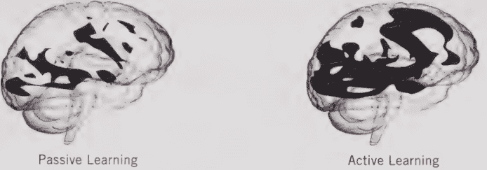

当大脑学习时，它实际上改变了自身的一部分。新的神经细胞和网络被构建。知识仅仅是这些神经和神经网络的连接方式以及它们被用于采取行动的频率。学习是在大脑中物理重连一个位置以及它与其他大脑部分连接的方式。由于现代成像技术，我们可以看到这些网络的构建。我们也可以看到在涉及某些类型的学习和思考时哪些网络被激活，并且我们可以利用这一知识更好地让学生在学习中投入。图 1.6 说明了参与学习的脑部各部分。

**图 1.6** 参与学习的脑部各部分

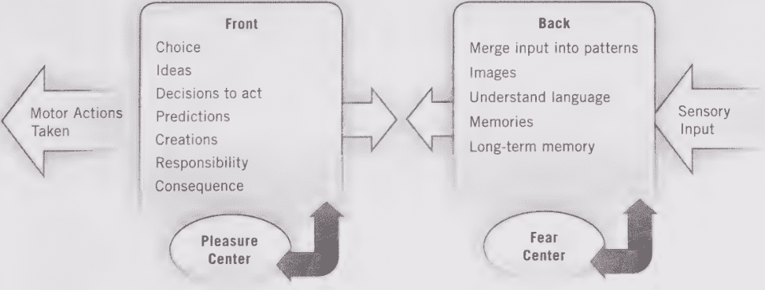

## 大脑中的这一迭代过程对教学意味着什么？

- 一种讲授式的信息传递教学方法倾向于关注部分后皮层功能。
- 完全开放的发现式方法，在没有教师干预的情况下提出和检验想法，未能成功地关注前皮层功能。
- 探究式教学，教师设置学习环境和探索，并促进学生在自己的探究过程中，允许大脑中这些物理实体之间实现平衡的整合与互动。

如果我们为记忆和其他低层次思维而应试教学，学生所知的大部分内容将存在于后整合皮层中，无法用于真正的解决问题，我们的学生也不会发展批判性思维技能。他们不会拥有深刻的概念理解，无法很好地应用任何知识，而且不太可能保留在长期记忆中（Bransford, Brown, and Cocking 1999）。

我们的经验来自过去，但我们创造的概念是为了我们打算在未来采取的行动。它们是计划。我们需要将来自*外部*大脑的经验转化为*内部*大脑的认知。然而，我们必须做的不只是整理后颞皮层中的数据。我们需要在前额叶皮层中积极做出决策并创造思想和概念。我们将权力从外部他人转移到我们自己身上。这一行动将学习者从单纯的接收者转变为知识的主动生产者（Howard 2002）。

许多人认为关于物理大脑和学习的思考是一种冷冰冰、分析性的学习观，缺乏我们物种中许多更人性的方面。事实恰恰相反。正是大脑中认知结构与情绪结构——杏仁核和基底结构——的相互作用帮助我们理解推理、动机和记忆，而没有这些学习是不可能的。这就是为什么作为教师，我们需要理解这些恐惧和愉悦情绪结构与皮层认知结构之间的相互作用，以便改进我们的课堂实践。

在阅读下一节之前完成思考空间活动将使你从阅读中获得更多意义，因为你将积极地在你的大脑中创造出那种神经元景观。如果你需要这样做以建立更丰富的课堂联系，请不要犹豫回顾前几页中的一些想法。更好的是，你可以在数字资源光盘上访问一整章*附赠章节*，该章节更详细地探讨大脑如何学习以及这如何影响你的课堂实践。当你将这些思想应用于对你和你的教学有意义的事情时，你的基底愉悦中枢将使你能够清晰思考。一旦在你的探究过程中思想被整合在一起，你也会记住更多与之相关的单个思想和名称。

| 思维水平 | 认知活动 | 关键概念 | 示例问题 |
|---|---|---|---|
| 2. 理解（理解） 后整合皮层 | 理解、解释或转换信息或思想。 | • 描述 • 解释 • 说明 | 1. 给出头韵的例子。 2. 该图表告诉你 X 射线对细菌细胞生长的影响是什么？ 3. 社会主义与共产主义相同吗？ |
| 3. 应用 后整合皮层 前整合皮层 | 通过应用规则、原理或定律解决问题、找到解决方案并确定答案。 | • 应用 • 解决方案 • 确定 | 1. 根据给出的数据确定电路中的电阻。 2. 预测如果斯大林仍作为轴心国的一部分会发生什么。 3. 如果半径加倍，圆柱体的体积会是多少？ 4. 这些物体是按颜色或大小或两者排序的吗？ |
| 4. 分析 后整合皮层 前整合皮层 | 区分整体与部分，识别原因，找到支持和证据。构建假设并得出结论。 | • 推理 • 逻辑思考 • 归纳 • 演绎 | 1. 两种药物对金鱼的活动能力有何影响？ 2. 艾哈布为何坚持追寻鲸鱼的动机是什么？ 3. 比较瑞典的社会主义与意大利的社会主义。 4. 所有以“ly”结尾的词是否都告诉你关于事物或人们正在做的事情？ |
| 5. 评价 后整合皮层 前整合皮层 | 判断、评价、评估或批评。基于一套标准或准则进行证实。 | • 评价 • 判断 • 批评 • 证实 | 1. 从道德和伦理角度评价政府关于致幻药物的研究计划。 2. 以下几何证明中出现了哪些不一致？ |
| 6. 综合（创造） 后整合皮层 前整合皮层 | 生产、设计、制作并构建产品。综合思想，产生方法，并确定如何... | • 制作 • 生产 • 创造 • 写作 | 1. 提出比现在非法更合适的休闲药物替代方案。 2. 设计一个实验来确定在冬季使用防风门在家中可以节省多少能量。 |

改编自 Bloom（1956）和 Anderson 与 Krathwohl（2000）

## 思考空间

### 提问实践

对你为课程计划、作业和评估准备的问题进行批判性审视。

- 你每天在何种高阶思维水平上挑战你的学生？
- 你提出的问题中有多少百分比属于图 1.8 中所示的每个类别？
- 作业上的问题中有多少百分比属于图 1.8 中的每个类别？
- 你的评估和考试问题呢？

如果可能，录下你的课堂以深入了解你的提问实践。

- 你使用的是什么样的问题？
- 你期望的是什么样思维？
- 你是否帮助学生学习如何提出有效的问题？

问题是教师用来引导学生通过探究教学维度的主要工具。因此，教师必须意识到他们使用的问题适合他们计划的探究循环阶段，并且这些问题与所涉及皮层特定部分的需求相匹配。当你阅读第 2 章并开始规划探究单元时，你可能会发现参考图 1.8 有用。在此期间，你可能希望用它来评估你目前使用问题的实践。

## 跨学科思维技能的相关性

本书确立了探究教学是一个整合框架的概念，所有我们专业的最佳实践都适合于此。当这些实践被放在一个模仿我们大脑运作的过程时，组合是协同的，其效果远大于单个实践的总和。然而，当探究教学方法在每个学科领域中使用时，还会产生另一种协同效应，无论是由同一位教师在自包含的小学课堂中，还是由学校中专门教授各科目的学科教师团队来实施。

这种协同作用可以用学科间的思维技能相似性来解释。如果学生在探究各个学科概念时使用相似的技能，这种贯穿整个在校日的强化会使相关的神经网络变得固化。

知识的形成过程在各学科之间存在差异；例如，正如本章前面所展示的那样，科学中被视为可接受的知识标准与文学中被视为可接受的知识标准不同。尽管如此，知识形成过程仍存在相似之处。所有学科都需要证据，尽管证据的来源及其验证方式可能有所不同。在每个领域，观察与推断之间的区别至关重要，但什么构成富有成效的推断以及何时适宜使用推断则在每个具体的学术领域中不同。然而，思维技能是相通的，需要在每个领域中得到强化，使其成为思维习惯。差异也需要成为神经连接的一部分，因为学生需要在日常生活中知道何时使用这些区分。这种论证也为在每个学生的在校周中安排精心规划并得到引导的跨学科学习提供了又一个理由。我们将在本书后面的章节中更详细地讨论这个问题。图 1.9 显示了科学、社会研究、英语和数学之间思维技能的相关性。

## Figure 1.9 Thinking Skills Common to Selected Subject Areas

| Science | Social Studies | English | Mathematics |
|---|---|---|---|
| • Observe • Collect and organize data | • Observe • Record | • Analyze • Separate • Identify details • Skim • Highlight • Take notes | • Collect and organize data • Question |
| • Classify • Measure | Compare and contrast | • Compare and contrast • Question | • Classify • Measure • Test |
| Classify | Categorize | • Label • Classify | • Define • Record • Analyze |
| Use space/time relationships | • Follow chronology • Use timelines | Use time, events, life cycles, dates, sequence | • Use relationships • Compare • Revise |

在许多内城学校和一些农村地区，相当数量的学生需求未得到满足。在这些情况下，学校做法需要进行修改以满足学生需求。进行补救性、低水平的工作并不是解决这一问题的办法。如果一所学校不如期望的那样成功，就需要在学生参与方式上做出改变。人类大脑设计用于学习，并且学习效率很高。我们需要利用探究式教学、类比的相互关系角色扮演、项目式学习、实习以及其他能够让学生参与到刺激其基底中心、即大脑愉悦中心的学习的途径。这些方法将在第 5 章中更详细地介绍。

## Conclusion

尽管前面在各个学科中探究式教学的例子听起来可能引人入胜，甚至令人兴奋，但你们中的一些人可能对这种方法感到有些紧张。它似乎颠倒了你做事的顺序吗？它是否改变了你在课堂上目前扮演的角色？研究研究是否提供了证据，证明学生在探究式教学课堂中学习得更深入？在整本书中，你将听到课堂教师和校长关于他们探究式教学经验的分享。实践经验与研究证据相结合，因为两者都很重要。

现在花一点时间简要地讨论一下有效性这个问题。“数十年的研究说明了探究式和合作学习的益处，有助于学生发展在快速变化的世界中取得成功的必要知识和技能”（Barron and Darling-Hammond et al. 2008, 2）。开始查阅关于探究式教学的文献的一个好地方是 Linda Darling-Hammond 等人（2008）编辑的另一本更全面的书籍，其中回顾了关于探究式教学的研究。此外，数字资源光盘上的奖励章节将通过将探究式教学过程与我们从当前神经生物学中所了解的人类大脑学习过程进行比较，进一步丰富你在本章开始的理解。随着与认知和情感相关的脑结构和功能理解与这种吸引学习者的探究式学习形式相匹配，这为教育工作者全面拥抱探究式教学提供了有力的论据。它不仅仅是让学生能在通用核心考试中取得优异成绩的更好方法，而且很可能是消除成绩差距并让学生在职业生涯中取得成功的途径。

我们都清楚在真实学校环境中进行受控研究研究是多么困难。几乎不可能创建可比较的学生班级群体，然后让同一位教师对这些班级中的每一个都使用两种不同的教学法也是最难以实现的。尽管我们有教育研究证据来捍卫探究式教学的有效性，但这些研究因社会科学研究的性质而变得模糊。当我与全国各地的教师谈论探究式教学时，我现在可以向他们解释大脑如何在神经学上学习，并展示这与探究式教学技术如何相关。现在你也可以这样做，但同样重要的是，你可以理解在探究式教学学习周期的每个阶段，你的学生的大脑需要发生什么，并据此调整你的实践。有关脑研究的更多信息，请参阅数字资源光盘上的奖励章节。

## Think and Reflect

- 1. 探究式课程要求学生在小组中工作，参与探索，在探索中揭示你希望他们掌握的概念。在什么方面，如果有的话，这种以学生为主导的模式会与你目前的课程计划方式不同？你可以在计划有效探索时与谁一起计划或寻求帮助？
- 2. 在探究式教学学习周期的三个部分中，教师扮演不同的角色。思考你的课堂，也许是某个特定的课程，如果你使用探究式教学方法，在三个阶段中你将扮演什么角色？
- 3. 要求学生说出“目前的思考”而不是要求答案有多重要，它如何可能改变整个课堂的基调和动态？
- 4. 探究式教学中“弄清如何弄清”的方面如何使学生自然地为通用核心州立标准所需技能做好准备？
- 5. 如果概念——一个复杂思想——不能被教授，而只能由学习者构建，那么我们对神经网络的理解（以及它们如何在前额叶皮层中构建、修改和扩展）必须指导你作为教师需要做什么。本章前面讨论的探究式教学有哪些两到三个要素与你对人类大脑如何学习的新的理解相匹配？
- 6. 如果学生在讲授式课堂中被告知答案并记忆程序，使用的是大脑的哪些区域？这些区域是否构建了可在解决现实世界问题中使用的概念？

# Planning for Inquiry Teaching

本章在第 1 章关于探究式教学与大脑如何学习的关系信息的基础上展开。它还用于说明探究式教学和学习周期的实施。它包含探究式教学单元计划和课程的协议和模板，这些都与我们对大脑如何学习以及儿童发展的了解一致。你将认识四位教师，他们分享了开发探究式教学课程和单元计划的经验。这些人代表了从新手到中级再到专家的教学经验范围。

- Maria 是我在 1990 年代在大学任教时与之合作过很短时间的一位教师。Maria，这位第一年的生物教师，和我一起共同规划了关于有丝分裂的单元。班级里的 24 名学生是一个多元化的群体——有些学生在个别化教育计划（IEPs）上，有些是英语学习者。
- Andrea 是一年级教师，她计划使用原始文献开展关于当地社区历史的单元。Andrea 的 22 名学生也是一个多元化的群体——一名学生是非英语使用者，7 名学生在自闭症、语言学习问题和一些发育迟缓方面有个别化教育计划（IEPs）。
- Carolina 是一名六年级数学教师，她的课程将数学与学生感兴趣的社会问题联系起来。平均而言，她大约 20 名学生的班级中有约两名第二语言学习者和 5 到 6 名在包括广泛的身体、学习和情感问题在内的个别化教育计划（IEPs）上的学生。
- Katie 是一名十一年级语言艺术教师，她的五节课程系列探讨哥特文学与 Edgar Allan Poe 的《乌鸦》之间的关系。Katie 的学生来自波士顿的中产阶级郊区；平均而言，3 到 4 名学生有个别化教育计划（IEPs），通常不超过 1 名学生是英语学习者。

本章包括教师对探究式计划过程的观察，以及探究式教学学习周期三个阶段——探索、澄清和应用——的教学活动示例。可在数字资源光盘上找到扩展本章课程的额外资源。通过使用本章中的资源和数字资源光盘上的课程扩展，教师

## 图2.1 实施低谷的图示

*来源：Schlechty 1993*

学生们很快就会意识到，他们被要求去弄清楚事情、提供证据，并与同伴一起努力思考。然而，他们往往缺乏完成这一切的技能。他们也可能缺乏将正在获得的新概念和技能应用到独特的现实世界情境中的能力。这是一个适应过程。几周后，他们可能会抱怨连连，说些像“直接把答案告诉我们吧”之类的话。但是，那些坚持不懈的先驱教师很快就会看到整个班级慢慢爬出低谷。

坚持度过这个调整期，可能是教师在其职业生涯中所做的最困难的事情之一。人们自然会想回到自己已经熟练掌握的传统教学方式，但请记住，探究式教学能帮助学生发展深层次的理解。

## 开始规划过程

为了帮助说明探究式学习过程，这里收录了一节关于有丝分裂的示范课。我与新教师 Maria 共同规划了这节课，并在她的课堂上进行了测试，以确保它确实对学生有效。

想一想你可能在哪里遇到过“有丝分裂”这个话题。我们大多数人都上过这样的课：老师就这个主题向我们讲授，然后让我们回家记住与课本中一组图解相对应的阶段名称。如果你运气好，也许会用显微镜花几分钟观察一个反正也看不太清楚的细胞。你可能没有做多少思考，没有获得深入的理解，而你获得的那点东西也很可能不会在长时记忆中保留多少。因此，我并不指望你们中许多人事先就对这个主题有深入了解；但随着我们逐步推进规划，即使你们不能亲手操作一些材料，你们也将对这个主题有更好的理解。为了弥补无法接触实际材料的缺陷，我加入了一些显微照片（用显微镜拍摄的照片），以帮助我们直观了解学生将要做什么。随后，我们将经历其他学科领域和年级的探究式规划过程，在这些领域你可能会感到更自在。然而，在所有情况下，探究式教学的规划都是一个类似的过程。

这个规划过程中的许多内容对你来说并不陌生。如果你现在正使用*追求理解的教学设计*（Wiggins and McTighe 2005）、*学习的维度*（Marzano and Pickering 1997）、*Dougherty*（2012）聚焦作业设计的方法、*真实性教学*（Newmann, Secada, and Wehlage 1995），或其他任何有力的规划方法，那么它将与你现在的规划方式相似。然而，你会发现在许多地方，探究式教学的规划过程与上述所有方法都不同。

## 阅读有丝分裂规划会议描述的建议

当你读到 Maria 和我共同规划的过程时，想象你是一位坐在旁边倾听我们对话的同事。通过这种方式，你可以熟悉我们在制定有效探究式教学计划时所经历的过程。

这个规划场景描述了将优秀教学计划转化为探究式教学计划的协议中的九个步骤。

## 有丝分裂单元的规划过程

当 Maria 和我制定有丝分裂单元计划和课程时，我们花了很多时间讨论学生将要做什么、她如何让他们保持参与，以及她如何随时了解他们对概念理解的增长情况。我们制定的协议包含九个步骤：

- **步骤1：** 为整个课程确定五到十个大概念。
- **步骤2：** 确定全年的主题、概念、技能和社会问题的顺序。
- **步骤3：** 确定本课要学习的主要概念。
- **步骤4：** 确定学生无辅助探索的初始想法。
- **步骤5：** 确定适用的思维技能和思维习惯。
- **步骤6：** 创建一个评分量规，定义学生表现的具体水平——新手、胜任或专家。
- **步骤7：** 创建一组形成性评价问题，以指导在探索和澄清阶段对学生进行观察。
- **步骤8：** 创建一系列针对独特情境的真实应用。
- **步骤9：** 创建引导性问题。

## 思考空间

反思你自己的单元规划策略。

- 它们与 Maria 在规划有丝分裂单元时使用的九步协议有哪些相似之处？
- 其中哪些步骤是你熟悉的？你在所教的课堂上如何使用这些程序？
- 你预计刚刚开始接触探究式教学课的同事会提出什么样的问题？

## 第1步：为整个课程确定五到十个大概念

### 我们在想什么

在 Maria 和我规划有丝分裂课之前的几周里，我们进行了一些讨论，讨论那些能将全年生物学概念联系在一起的大概念。我们知道，正如短时记忆一次只能容纳七个或更少的概念并有效利用它们来形成新的理解一样，学生也需要十个或更少的大概念来整合他们在全年中将学习的所有概念。这些大概念不是主题，而是统摄性的概念，其他所学的一切都只是其中一个大概念的又一个例子。课程顺序并不是围绕这些大概念组织的，但其中一些被嵌入到课程的每个单元中。

随着学期推进，这些大概念从学生进行的多次探索中浮现出来；在课堂的概念澄清部分，教师会明确指出这些大概念是学科的核心。最终，所有这些概念都得到讨论，教师不断回顾它们，以强化学生创造的新概念的所有神经连接。因为这些是课程中概念的关键组织结构，学生也会开始说：“哦，看，这只是……（其中一个大概念）的又一个例子。”

经过与多位科学教师同事的大量讨论，Maria 确定了五个大概念，她认为这些概念足够丰富、足够重要，并且能让全年所学的一切都归属于其中一个或多个概念之下。经过一番讨论，我们扩充了一些，精简了另一些，并用她班上学生能够而且会使用的语言清晰地陈述了每一个概念。多年来，我和许多科学家和教师一起做过这件事，每次达成的共识都与 Maria 和她的同事们在我稍加推动下所创造的内容非常接近。一门课程的大概念是什么并没有唯一正确答案，它们只需要符合本节第一段中斜体所描述的标准即可。

Maria 为这个单元确定了以下五个大概念：

- 1. **稳态：** 有机体或细胞通过调节其生理过程来维持内部平衡的能力或倾向（内部平衡）。
- 2. **生长与修复：** 有机体在整个发育过程中经历一个由基因决定的生长过程。每个细胞中相同的遗传物质也会修复和替换死亡或受损的细胞。
- 3. **生态系统：** 特定地理区域中各种生物种群与非生命元素相互依赖，当外部因素改变平衡时，该系统保持平衡（外部平衡）。
- 4. **进化与适应：** 由于自然选择作用于

个体间的遗传变异，并导致新物种的发展。

- 5. **能量传递：** 所有生物都需要食物作为提供化学能和建筑材料的分子的来源。所有生物，包括植物和动物，都有将食物中的分子储存起来以备后用的机制。植物能自行生产食物。

经过一番简短的讨论，玛丽亚和我注意到本课涉及的其他一些大概念，我们意识到生长与修复是概念中最具代表性的大概念。

## 第2步：确定全年的主题、概念、技能和社会问题序列

### 我们当时在想什么

在我们坐下来思考玛丽亚将如何教授这一概念而不告诉学生有丝分裂的任何步骤，甚至不告诉他们为什么需要这些步骤之前很久，她就已经为课程以及每个单元内的主题创建了一个螺旋式的单元序列。这是一个迭代过程，她在学年进行中不断修改，并在学生参与意义建构体验时认识到更好的序列。

### 主题序列

玛丽亚认为大多数生物学教科书都是倒着写的，也就是说，主题的顺序应该颠倒，并按照人类几个世纪以来学习生物体工作原理的顺序排列。人类需要生存，为此他们需要做两件主要的事情：（1）预测其他动物如何相互作用，以及（2）弄清楚如果受伤或生病如何治愈自己的身体。所有这些在手持放大镜或显微镜出现之前几个世纪，甚至几千年里都是在宏观层面进行的。曾经，人类无法在不打开生物体内部的情况下解决问题——他们把它们切开来看看它们是如何工作的。当他们肉眼看不到其工作原理时，就发明了透镜和显微镜来观察较小的内部结构如何工作。只有在最近一百年左右，我们才开始假设分子层面发生了什么。只有在过去 30 年左右，我们才能够看到分子层面发生了什么。

主题的进展需要对学生有意义，而不应是随机顺序。良好的主题顺序会使过渡流畅，并减少对持续新参与的需求，因为一个主题会提出问题，而下一个主题会给出答案。

玛丽亚为学年创建了一个主题序列。图 2.2 显示了该序列，从生态问题开始，然后是一些健康问题，这导致需要理解生长与修复以及稳态。这促使学生从细胞层面寻找答案。随着他们进入无性生殖和有性生殖以及对健康和营养的更深入理解，他们开始需要只能在分子层面得到解答的理解。

**图 2.2** 学年生物课程主题序列

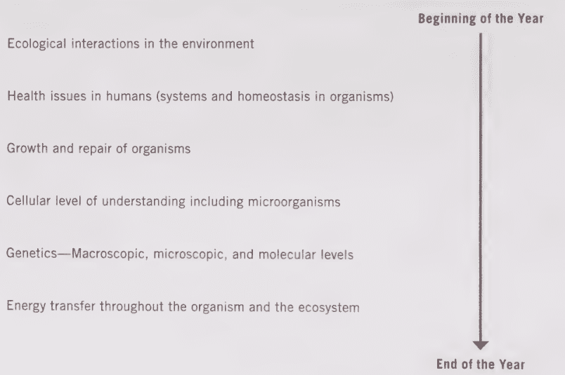

### 我们当时在想什么

尽管玛丽亚和她的同事确定的序列是合乎逻辑的，但我指出这些主题需要嵌入到对学生重要的科学、技术和社会问题中。如果他们希望让学生深入参与概念的发掘和创造，这种定位是必不可少的。因此，玛丽亚创建的单元不仅遵循图 2.2 所示的序列，而且还围绕着影响学生日常生活社会的议题构建。

### 对学生有意义的社会问题

玛丽亚确定了学生感兴趣的几个主题；其中三个单元主题如下：

- 1. 垃圾和回收是第一个单元的重点。
- 2. 第二个单元围绕一个关于河流的当地问题展开。该镇正在考虑是否拆除河上的一座长期存在的坝，以便鱼类能够重新洄游上溯。问题的另一面是，这是否会让七鳃鳗进入河流的“镇海滩”部分，以及是否会造成大面积侵蚀。
- 3. 第三个单元是营养和锻炼单元，重点关注学校食堂和体育课上的活动。

其余单元也关注对学生重要的议题，并进一步体现了预先规划的主题序列中的概念。

### 我们当时在想什么

每个单元都是关于不同的相关主题，但每个单元都体现了一个或多个大概念。这些大概念在多个单元中重叠。重点关注食堂和营养的单元以生长与修复、稳态和能量传递为基础。调查学生学校和家庭中固体废物和垃圾的单元也关注能量传递和生长与修复等大概念，但也开始涉及适应问题。这些大概念和综合结构不断通过各种社会问题及其固有的探索得以重新审视。单元的设计旨在到学年结束时涵盖所有国家、州和学区标准。

玛丽亚和我决定我们需要一个我们用来构建课程过程的视觉表示。图 2.3 说明了探究方法中内容与过程之间的关系，并为学期或学年的课程规划提供了指导。

**图 2.3** 如何构建学期或学年的课程

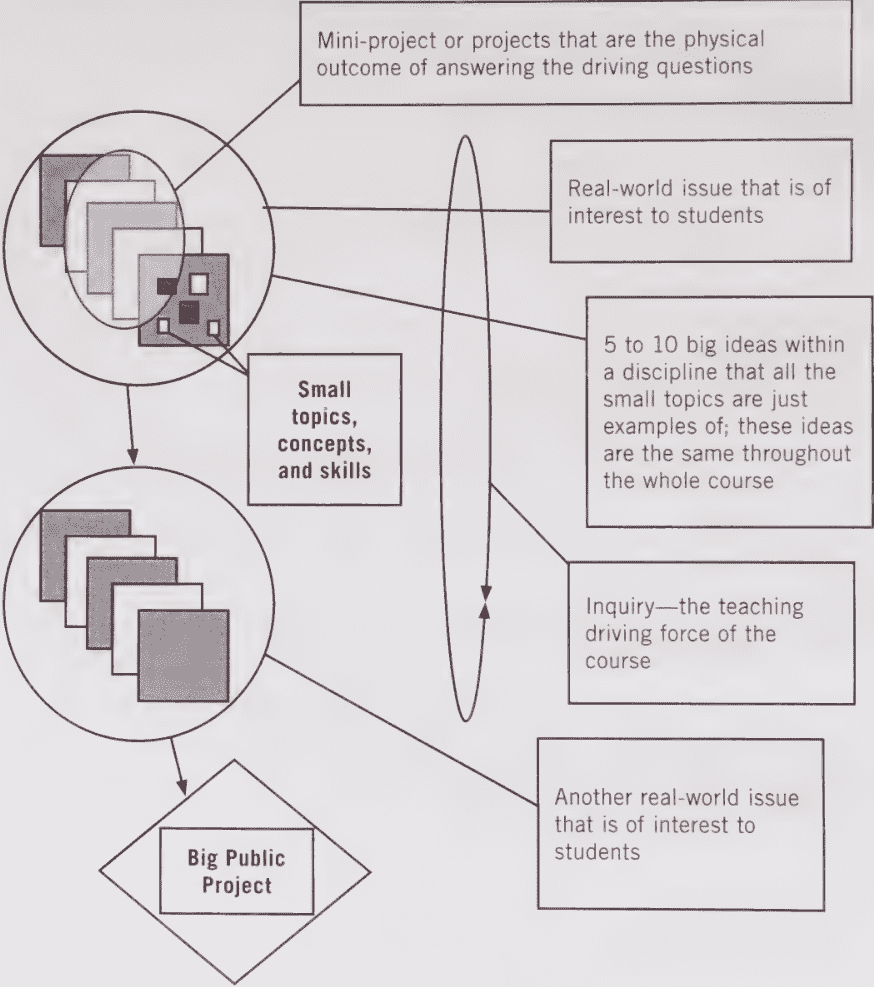

## 第3步：确定本课需要学习的主要概念

### 我们当时在想什么

当我们开始规划有丝分裂课程时，玛丽亚已经完成了全部的学年和单元规划。本课逻辑上适合前面提到的营养和锻炼单元，因为学生在此开始需要显微镜甚至分子层面的遗传学理解来回答他们关于生长与修复如何发生的疑问。在单元的这一点上，学生意识到他们需要理解生物体在细胞层面的生长方式。同样，他们意识到这项研究将帮助他们理解皮肤被割伤后如何愈合。

了解玛丽亚在本课之前对学生做了什么，将使人看到学生如何在此学期早些时候的先前探究学习周期中建立在他们创造的先验知识之上。

学生对社会重要主题的参与为他们提供了提出问题并开始形成概念的机会，以为他们学习有丝分裂做准备。这些活动的总结如下：

- 1. **垃圾单元：** 在垃圾单元期间，学生通过在装有湿纸巾的塑料袋中发芽红腰豆种子来种植植物。他们设计了各种各样的实验来测试他们自己提出的问题，关于光的需要、不同颜色的光、特定温度、某些气体以及这些因素对根长、叶大小和颜色等的影响。
- 2. **河流单元：** 在河流单元期间，学生首先用手持放大镜然后用显微镜观察河流和池塘水。他们观察了单细胞和多细胞的动物和植物。许多动物在水中快速游动，因此很难看清楚。当学生观察水中藻类的植物细胞时，他们看到了细胞中的一些结构，但没有超出识别细胞核和绿色叶绿体的范围。他们还观察了用核染料染色的自己的颊细胞。
- 3. **遗传单元：** 在整个学期中，学生一直在教室的箱子里观察沙鼠繁殖。白雌鼠与雄鼠的后代是一窝混杂的。有些是棕色的，有些是白色的，但其他的是黑色或金色。对于其他繁殖对也是如此，后代并不总是与父母相同。班级一直在持续讨论这可能如何发生，并试图根据祖父母和曾祖父母的毛色历史准确预测下一窝的毛色。学生还从香蕉中提取了 DNA，并使用模型来了解它是什么以及它是如何工作的。因此，遗传的概念在此时是有意保持不明确的，但它对他们来说是一个极大的兴趣。

## 我们的思考

这份概念目标清单是一个坚实的开端；然而，尽管我们认为这个过程已经结束，它实际上还没有完全结束。由于规划过程是迭代的，你很快会发现，当你创建学生将参与的具体探索活动时，你会发掘出嵌入在主题中的额外概念——那些你最初未识别的概念。

我们还意识到，在创建学生将从中推断出自己想法的探索活动之前，我们无法写出思维技能目标。通常，由于大多数探索活动涉及多种思维技能，教师会选择使用最多、最明显或在学期中尚未大量练习的那一种。思维习惯目标也是如此。玛丽亚必须弄清楚如何识别这些目标。

她还很快意识到，生长与修复是将这三个概念目标联系起来的核心思想。如果学生未能自己领悟这一核心思想，她就必须牢记并重点关注它。到了学期这个时候，她的学生已逐渐习惯于领悟“我们所学的内容只是这一核心思想的一个例子”。

## 第4步：确定学生独立探索的初始想法

学生需要在没有玛丽亚帮助的情况下，揭示这样一个概念：当细胞分裂时，它们会复制来自母细胞的遗传物质。此外，他们必须意识到这按一系列步骤发生。他们必须通过观察某些现象来达成这一理解。

## 我们的思考

我们不禁思考，在教师不提供具体指导的情况下，学生如何能揭示这一概念。玛丽亚建议让他们观察洋葱根尖。这些是现成的载玻片，学生可以轻松地用学校显微镜观察，并看到细胞经历细胞分裂的各个阶段，因为根尖生长迅速。这个想法也很好，因为他们在学期早些时候已经在塑料袋中培育了豆类植物，并实际上在透明袋中观察了几周根和植株其他部分的生长。

如果我们能让学生以某种方式观察细胞分裂的各个阶段，他们或许就能弄清楚正在发生的事情。我们随后回溯，意识到需要让学生关注根尖发生的变化，于是我们自己进行了一次角色扮演，我扮演教师，玛丽亚扮演学生。（我在规划时通常会在脑海中这样做，所以和别人一起做效果更好。）

## 角色扮演对话

**教师：** 我想让你们回忆一下，在我们把一些菜豆种子种入土壤之前，曾在塑料袋里让它们发芽。当你们观察根系时，你们看到了什么？

**学生1：** 它们在生长。

**学生2：** 而且它们是白色、弯弯曲曲的。

**教师：** 你们怎么知道它们在生长？

**学生1：** 我用尺子量了我那株，它们变长了。

**学生2：** 我量了我那株的宽度，它们也变粗了一些。

**教师：** 那么根上哪里在生长？

**学生1：** 在顶端，因为它变长了。

**学生2：** 但难道不可能整条根都在生长，最终也变长吗？

**学生3：** 如果到处都在变粗，那肯定整条根都在生长，不是吗？

**教师：** （把这些想法记录在挂图纸上）所以我们有一些想法和一些问题。

现在我希望你们每个人都独立思考一会儿。你们应该写点什么，也许甚至画一幅图。如果你们能看到根尖内部，用显微镜观察，并连续观察两天，你们认为自己会看到什么？

在我们的对话之后，玛丽亚和我写下了我们认为学生可能会给出的答案。玛丽亚的答案与我的一些想法相似，即植物生长需要更多的细胞。我们以为有些学生可能会说每个细胞“克隆”出另一个完全相同的细胞。我们想知道他们对根朝某个方向移动的看法，以及他们是否认为细胞会移动。然后我意识到我们需要放下已有的知识。我们意识到，根变大的另一种解释是细胞可能只是变大了。这完全说得通，也是细胞水平上生长的一个良好模型。因此，我们需要让学生看到是否有证据表明细胞只是变大，还是细胞分裂成两个细胞。然后我们在目标清单中添加了一个新概念：

- 当生物体生长时，细胞需要复制，而不是简单地变大。

## 学生探索的想法

玛丽亚突然意识到该怎么做：过程在她心中变得清晰。当她想象学生如何能自己弄清楚这一切时，她变得兴奋起来。她上学的时候，学生们也会观察洋葱根，但老师事先把所有东西连同所有科学名称都告诉了他们。玛丽亚和她的同学们只是死记硬背。现在，她看到学生可以先进行真正的探索，自己弄明白这些概念，于是她一步一步地写下了她的计划。

看着她写下计划时的表情真是太美妙了，正如我在两三天后会在她的课堂上看到的那样。她确实没有告诉学生任何概念。学生们全靠自己弄明白了一切。她只是在教室里巡走，当学生们分小组讨论时用问题加以引导，当全班一起活动时帮助澄清概念。真是精湛。她是这样做的。

如果你仔细跟随玛丽亚设计课程时的思路，你就能获得为任何学科领域创建探究式教学计划的见解。伴随她走过这段旅程，看看她如何教授一个通常枯燥无味且大多数学生理解不透彻的科学主题。课程结束时，她班上的几乎每个学生都产生了相当深入的理解，因为这些想法是他们自己构建的。

在各小组完成之后，全班将相似的图画归组。随后，全班确定了细胞分裂成新细胞时所经历的五六种不同阶段。图2.6展示了学生可能在洋葱根尖载玻片上看到的各种有丝分裂阶段的显微照片，他们据此绘制了图2.5中的图画。

## 图2.6 供学生分类的有丝分裂阶段显微照片

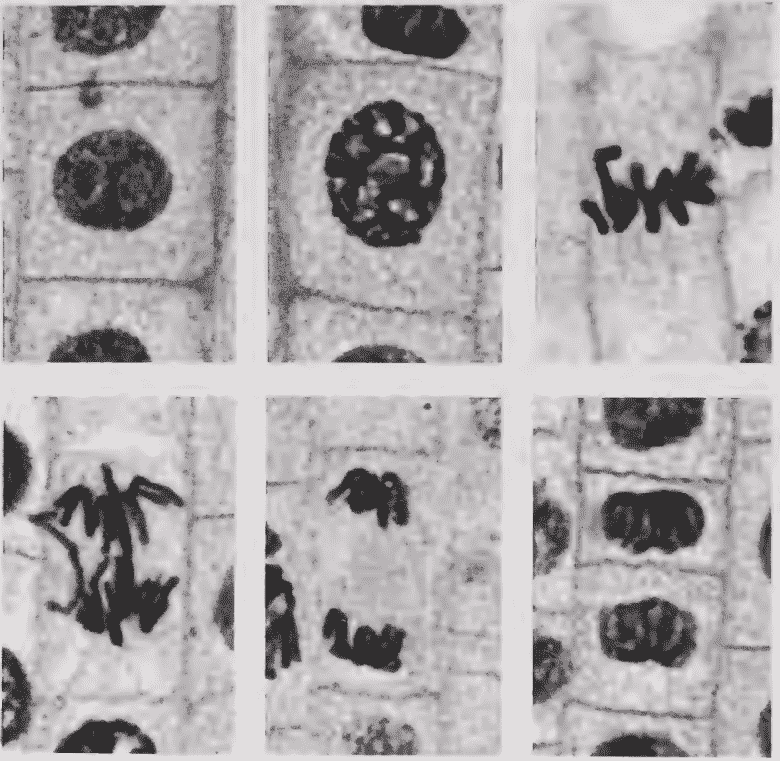

经拉德堡德大学许可使用（http://www.vcbio.science.ru.nl）

现在每个学生都有一份这五六个阶段的绘图副本。玛丽亚要求每个学生完成两件事作为作业：

- 1. 按照他们认为细胞为了复制而经历的先后顺序排列各阶段的绘图。
- 2. 解释他们认为每种结构变化发生了什么，以及为什么他们认为会发生。

## 学生对有丝分裂阶段的观察

第二天学生回来后，他们以四人研究小组的形式讨论了约10分钟的想法。当他们向全班汇报观点并用绘图为自己的想法辩护时，更大的科学共同体——即班级——只花了大约另外10分钟进行协商便达成了共识。他们一致认为步骤如下：

- 1. 中心部分（细胞核）从一团致密物质转变成螺旋状的细丝。
- 2. 然后这些细丝在中央成对排列，并出现两套明显的细丝。
- 3. 接着细胞两侧在细丝旁向内挤压，细丝被拉向细胞两侧，细胞壁持续内推，直到形成两个新细胞。

学生们推断出每个新细胞现在拥有与原来细胞相同的“核物质”。有些人坚持认为它是自我克隆的（这实际上是一个相当概念上准确的描述）。

由于课程到此结束，玛丽亚给学生布置了两项作业：

- 1. 阅读他们课本中关于有丝分裂的章节，并将他们的发现和理解与更大的全球科学共同体的认知进行比较。他们的发现与科学界目前接受的内容有何相同之处？他们还需要指出哪些不同，以及如果确实存在不同，为什么世界其他地方了解了一些他们不了解的东西。
- 2. 使用世界上所有科学家为了让其证据被认可为有效而采用的格式，撰写一份关于他们发现的报告。虽然这一报告在某种程度上类似于传统的实验报告，但它是独特的：学生设计了部分实验步骤，他们发展出了全部理论，并在结论中将他们的发现与更大的全球共同体的已知内容进行了比较。

在发表的报告中，学生们展示出一些深入的理解，这在全班学生中均有体现。他们现在为自己绘制的各个阶段（前期、后期等）配备了通用名称，这些名称来自他们的阅读和互联网动画模拟。更重要的是，大多数学生似乎也真正掌握了概念目标。

## 第5步：确定适用的思维技能和思维习惯目标

在她课堂上发生的这一情景，正是玛丽亚在设计课程时脑海中想象的场景。我可能让它显得顺利得多。

比我在她课堂上观察到时更令人震撼，因为我对她对探究式教学课的规划以及由一名一年级教师的引导感到如此惊讶。然而，到她上完当天最后一节课时，它真正达到了炉火纯青的地步。

让我们在这里停一分钟，回头看看玛丽亚的规划阶段。一旦她创建并规划了这一探索和概念澄清的序列，她意识到在探索过程中有三种思维技能最为突出：

- **观察**—对材料的细致而深思熟虑的审视
- **推理**—基于细致观察得出的证据
- **模型构建**—使用细致的数据收集和推理

同样，她意识到她可以推动学生认识到他们正在使用两种特定的思维习惯。她随后可以鼓励他们在日常生活中继续使用这些思维习惯，并举例说明他们在过去一周观看电视时这些习惯可以如何使用。这些是：

- 好奇。观察时要谨慎且准确。
- 知道对于同一证据往往可以给出不同的解释，并且并不总是能够判断哪一个是正确的。

鉴于对学科教师加强读写技能的关注，她还在课程后期加入了一项论文写作作业。她最初没有列出艺术学科领域的目标，但在她教授完课程后反思时，她修改了计划，以便第二年教授该课程时可以专注于培养她艺术才能出众的学生，并鼓励所有学生尽可能详细和准确地进行描绘。其他学科领域的目标是：

- 认识到不仅是细致准确的绘画，还有天赋学生的真正艺术能力。
- 让学生撰写一篇论证充分、表述清晰的三段式说服性论文，以基于其研究团队的证据为细胞分裂如何发生这一结论辩护。

## Step 6: Create a Rubric that Defines Specific Levels of Student Achievement

一旦玛丽亚为探索和概念澄清阶段创建了目标和计划，我就挑战她为自己使用创建一个量规，以评估每个学生在通往掌握的连续体上的位置。在我们之间几次来回的迭代后，她创建了一个三级量规。图 2.7 显示了学生表现三个水平——新手、称职和专家——的量规。

### Figure 2.7 Rubric for Assessing Student Use of Thinking Skills, Habits of Mind, and Concept Understanding

|  | 新手 | 称职 | 专家 |
|---|---|---|---|
| 过程技能 | 做出快速观察并在没有很大细节的情况下作图。将绘画按顺序排列，但没有仔细思考每个序列中正在发生的事情。 | 使用细致的观察，绘制详细图画，并根据他们认为核物质正在发生什么的解释推断出一个序列（模型）。 | 除具备称职类别的技能外，还能够提供不同的解释，说明为什么相同的或不同的序列可以用相同的证据来解释。 |
| 思维习惯 | 无法认识到他们用来支持其阶段序列的推理解释只是对同一证据的一种可能的解释。 | 认识到对于同一序列可以给出不止一种推理解释，并且另一种序列可能由对同一证据的另一种解释来说明。 | 除理解同一证据的各种解释外，还理解这是科学本质和科学事业的一个主要组成部分。 |
| 概念 #1 | 认识到相邻的各个细胞中的细胞核看起来不同，但对各种布局没有解释。 | 认识到当细胞复制时，核物质会以与非复制细胞不同的丝状形式出现。这种可预测的、顺序性的过程称为有丝分裂。 | 不仅能够排列阶段，还能清楚地解释每个阶段发生的情况，包括对纺锤纤维的理解、相对于基因的染色体两对的概念等等。 |
| 概念 #2 | 无法解释有丝分裂后两个细胞中的遗传物质是否相同。 | 可以解释细胞核中的遗传物质会被复制并包含在两个子细胞中。 | 可以推断如果新细胞需要通过有丝分裂产生其他细胞，那么该物质必须是相同的。 |
| 概念 #3 | 当被要求提出除细胞分裂之外可以解释生长的另一种理论时，无法提出另一种解释。 | 可以解释当生物体生长时，细胞需要复制，而不是简单地变大。 | 能想到基于结构物理学的理由，说明“细胞变大”理论在字面上是站不住脚的。 |

## The Utility of Rubrics for Teachers: They Keep You Honest

我观察并交谈过的所有最有效的教师都表达了他们深切的理解，即他们教的是学生，而不是学科领域。他们也理解自己需要对所教授的任何学科领域有深入的掌握，以便知道如何创建适当的探索，让学生拥有该学科的理解和技能。教师对每个学生都投入如此之深，以至于在日常生活中，有时很难将学生的个性与他们当前对概念或技能的掌握程度区分开来。

通过为每节课创建量规，并在每个单元格中填写非常丰富的条目，教师可以提醒自己，称职并真正掌握了概念或技能的学生与新手学生之间的区别，后者尽管是个很棒的孩子，仍在努力实现掌握。同样，这也使教师能够以一定的客观性看待那些有些困难的孩子，并意识到他或她已经掌握了材料，尽管可能让教师焦头烂额。

量规使教师专注于每个学生应努力达到的掌握水平。有些学生在进入课堂时已经掌握了课程重点的概念或技能的部分或全部。这些学生需要通过当天其他学生正在进行的同一探索进行更高或相关的调查来得到丰富。教师已提前计划了这一拓展，并在量规中创建了专家类别。这向家长保证，尽管他们的孩子处于异质群体中，教师仍在为每个掌握水平进行适当的差异化教学。在有丝分裂的课程中，玛丽亚为她的专家学生准备了关于纺锤纤维和细胞大小的问题，这些问题可以用相同的材料回答，但并非所有学生都必须理解。

另一个可能出现的问题是，一旦教师听到专家水平的学生谈论他们的见解，就很容易不经意地期望其他学生达到这一水平。这在教师在其计划中最初写下的适当目标仍然成立的情况下也是如此。通过在量规中将称职和专家类别并列放置，教师不会让尚未准备好接受专家理解的学生感到沮丧。它还使教师能够为称职目标的期望创建适当的评估，而不会因为学生并非全部掌握专家水平而认为自己无效。

正如计划的所有其他部分一样，随着量规的修订，单元格变得越来越丰富和有用，因为教师密切关注学生的对话。每当教师更好地理解区分掌握类别之间的复杂性时，他们就能在单元格中添加重要的细节。

正如你将在本课的目标和评分标准中注意到的那样，学生需要理解细胞必须复制其遗传物质，而遗传物质会告诉新细胞如何正常运行。这是概念澄清的延伸。它让教师能够引入关于遗传、沙鼠以及香蕉DNA活动的持续性挑战。学生开始理解细胞核中遗传物质的基本概念，这些遗传物质控制着整个细胞，并将生物的进化历史代代相传。

## 思考空间

反思你在制定和使用评分标准方面的经验。

- 你在课堂中使用评分标准的程度如何？你是自己制定评分标准，还是依赖在线资源的模板？
- 你如何让学生参与评分标准的制定？这些活动如何影响学生对学习的自我意识和自我管理的参与度？

## 我们的思考

在玛丽亚创建了评分标准后，我促使她创建各种形成性和终结性评估，以便在她的教案中实施。形成性评估的反馈会让她知道在课程的第二或第三天该做什么，而终结性评估则用来检查她的学生是否能在她认为大多数（如果不是全部）学生已掌握所学内容后，将理解和技能应用于新的、独特的情境中。通过这样做，她将在进入下一个主题和探索之前完成探究教学的学习循环。

## 第7步：创建一套评估问题，以指导在探索和澄清活动中对学生进行观察

在探究教学中，教学和评估之间没有分离。它们同时发生，并且应该无缝地进行，以至于学生和教师几乎无法察觉任何区别。形成性评估的作用是告知教师（在某些情况下也告知学生）各个学生在掌握连续体上的位置，以便明确每个学生在下节课中需要做什么。

### 创建形成性评估

探索阶段是进行评估的自然场所。当教师在教室里巡视时，可以倾听小组对话。如果你的评分标准清晰，你就能区分每个学生在学习过程中的位置。与学生的笔记本不同，这些作品是写在纸上并提交的。玛丽亚还提供了反馈问题提示，以便学生能够修改他们的作品，而第二个则是一个假设性问题解决应用，也涉及书面回答。这两个应用任务如下：

1. 如果有丝分裂序列末期的后期和末期的一个植物细胞的遗传物质由八条染色体组成，那么来自同一植物的一个不分裂细胞会有多少条染色体？请用你对有丝分裂的了解来解释为什么你认为如此。
2. 观察标记为*A*、*B*和*C*的每个制备好的显微镜载玻片。它们都来自同一植物的某个部分的碎片。一个来自茎的中间，另一个来自茎的最顶端，另一个来自一片较老的大叶子。哪一个最有可能来自茎的最顶端？解释你……（此处原文不完整，需保留原文）

（注：原文此处明显有内容缺失或混乱，我根据可读性进行了处理。实际翻译如下：）

1. 如果一个处于有丝分裂序列末期后期和末期的植物细胞拥有由八条染色体组成的遗传物质，那么同一植物中的一个不分裂细胞会有多少条染色体？请用你关于有丝分裂的知识解释为什么你认为如此。
2. 观察标记为*A*、*B*和*C*的每张制备好的显微镜载玻片。它们都来自同一植物某个部分的切片。一个来自茎的中部，另一个来自茎的最顶端，另一个来自一片较老的大叶子。哪一个最有可能来自茎的最顶端？请解释你的理由。

以及她在概念澄清阶段后收集的已发表的探索报告；这是持续的反馈，因为已经提供了书面反馈，学生不断修改他们的思维和对该思维的表达。

## 我们的思考

学生在整个教育生涯中仍然需要参加测验和多项选择测试，所以让他们练习这些形式的评估对我们有益。即使这些测试和测验对理解水平的挑战不大，也不能像其他方式那样清楚地展示他们已经掌握和尚未掌握的内容。这些测验和多项选择测试在教师的评估组合中所占的比例应比目前的标准要小得多。它们应主要用于让学生理解如何掌握这种测试形式。

## 我们的思考

当学生们以四人小组形式工作时，教师在教室里巡视，倾听学生们协商想法或制定行动计划。在这种情况下，教师的最佳做法是保持安静，不干预，即使小组起初有点偏离方向。记住，学习不是两点之间的最短距离。学生需要一些时间来思考想法、挣扎并自己弄明白。然而，在某个时刻，如果他们完全走向无成效的方向，他们可能会变得过于沮丧。因此，教师应该先克制自己，但当需要促进时，教师应该准备好一些问题。

## 第9步：创建促进性问题

玛丽亚在之前尝试探究课程后，意识到提前编好优质问题的重要性。她所说的“优质”问题是指那些能促使学生思考问题而又不引导他们或泄露答案的问题。以下是她准备好的一些问题，以防学生在挣扎一段时间后仍然非常迷茫。

- 当根在土壤中生长时，你认为新细胞最有可能在哪里生长？为什么？
- 当细胞即将分裂成两个新细胞时，你认为它可能看起来像什么？
- 如果细胞要将其所有性状和信息传递给正在形成的新细胞，你认为细胞的哪一部分需要将这些传递给新细胞？
- 如果原始细胞也需要保留一份这些信息的副本，那么分裂中的细胞会是什么样子？

如果你通读了整个部分而尚未开始为你自己的学科领域创建探究教学课程，你可能需要回头为协议中的每一步写下一些初步想法。有些人可能想继续阅读，看看其他学科领域或年级的教师是如何创建探究教学计划的，然后再（也许与一两位同事一起）创建你自己的计划。

## 一年级社会研究的规划过程

任何学科、年级或发展水平都适合进行探究教学。马萨诸塞州北安普顿市的一年级教师安德里亚·埃吉托利用探究教学将社区概念与北安普顿弗洛伦斯区的地方历史结合起来，她的学校正位于该区。在内战前的一段时期，弗洛伦斯的一群公民对美国允许奴隶制、缺乏妇女权利和其他不平等现象的法律感到非常愤怒，于是他们组成了一个独立的社区，即北安普顿教育与工业协会（NAEI）。除了参与许多其他进步活动外，该团体还成为了地下铁路活跃而重要的一部分。

安德烈与我们分享的这节课，是她最早用原始资料给一年级学生上的课之一。完整的课程“乌托邦：一个大家庭”可以在数字资源光盘上找到。此前，安德烈曾在其他学科领域设计过探究式教学，但历史课除外。（参见第3章中安德烈关于成为探究式教师的反思。）

## 安德烈的社会科课程

课堂开始时，安德烈读了一本关于“地下铁路”的绘本。她问学生，作为一个从佛罗伦萨穿过的逃亡奴隶是什么感受。她将这个想法引申到一个更大但也更个人化的议题：当遇到不公正的事情时，我们能做些什么。学生通过制作一个圆圈词汇图开始探索，图的中间是“社区”一词。这项活动引导学生认识到社区团结一致的理念。

安德烈和学生一起阅读了 NAEI 原始章程复印件的部分内容。他们还使用了其他原始资料——镇上标有铁路站点地图、1867年当地报纸上由 NAEI 财务主管撰写的文章，以及与该团体相关的建筑照片。浏览这些资源后，学生在圆圈词汇图中添加了新想法。最后，他们分小组合作，就安德烈从圆圈词汇图中分配的每两个词各写一句话。在安德烈之前教过的班级中，甚至有些学生就住在“地下铁路”地图上标注的房子里或隔壁！随后，学生们得以在当地历史学会导游的带领下，沿着佛罗伦萨的*非裔美国人遗产小径*旅行。

安德烈讲述了她是如何第一次为使用原始文献而感到兴奋，以及这些文献如何完美地融入她的探究式教学框架。

## 安德烈的思考

安德烈一直用文学作品作为让历史在学生面前鲜活起来的方式。研究和设计这堂基于原始资料的课程，彻底改变了她对历史课的思考方式和规划方式。使用这些原始资料确实能像其他任何方式一样，让一段历史真正鲜活起来。让学生有机会看老照片，甚至能看到信中不同类型的笔迹，可以让他们大开眼界，看到一个全新的世界。他们还发现当时的报纸与今天的报纸看起来如此不同，这也很有趣。他们比较了安德烈从缩微胶卷上获取的报纸副本和今天的报纸——哇，差别真大！实际上，学生们是通过做历史研究开始他们的探索的，他们像历史学家一样使用原始资料。他们以一年级水平发现了这些概念，并进行了表达。

当安德烈第一次浏览国会图书馆网站时，她对在一年级学生中使用原始资料有些怀疑。她怎么能把学生读不懂甚至理解不了的材料用在他们身上呢？在规划完自己的课程和社区项目后，她对用原始资料教学，哪怕是教最年幼的学生，都更有信心了。原始资料能以文学无法做到的方式为学生打开一扇了解历史的窗口；照片、地图、信件、文章，最重要的是，能亲自走到自己社区的真实历史遗址，是一份了不起的礼物。她非常兴奋！当然，这一切让学生在一年级水平上深入理解了一些复杂的社会科概念，并为“共同核心标准”的句子写作技能提供了巨大动力。

## 在科学和数学中使用全国验证的课程材料

通过实地测试和研究的美国国家科学基金会（NSF）资助项目所创建的全国验证课程材料，为希望转向探究式教学的科学和数学教师提供了宝贵的资源。这些课程历经数十年的开发，任何希望转向探究式教学的学区或学校都应予以考虑。它们已在城市、农村和郊区的数千名学生中进行了实地测试，包括天才学生、特殊教育学生和语言学习者。这些材料提供了一套精心设计的完整探究式学习体验。任何希望转向探究式教学的学校或学区都应访问以下网站，获取可用材料的最新列表：

- http://www.nsf.gov/pubs/2002/nsf02084/chap1_4.htm
- http://www.nsresources.org/topic.cfm?topic=IM&allh=true

在数学领域，其中一些课程已在城市学校和学区得到应用，当教师获得适当的专业发展时，学生取得了令人羡慕的成功。你们将听到多位使用了其中一些课程的教师的分享。

尽管一些初中和高中课程确实有某种形式的学生用书，但小学阶段的 FOSS 和 STC 科学课程没有教科书。这是有意为之。两者都提供了更适宜小学阶段、并能与同一课堂中正在进行的语言艺术课无缝衔接的科学非虚构类商业书目建议。如果你想寻找一种方法来提高学生参与度、实施差异化教学，并将更多信息文本和学生写作融入课程，那么《使用文本集教学》（Cappiello and Thulin-Dawes 2012）就是你的答案。这本必备资源会指导你如何创建和使用多体裁、多模态的文本集，用于内容领域（包括科学和数学）以及语言艺术学习。

然而，一些实践者会发现，即便是这些全国验证的课程活动，也可以进一步开放以容纳更多探究，从而为学生带来更丰富的学习体验。另一些实践者则因校内政治原因，需要改造学校中已有的实验室体验。无论是哪种情况，本章后面部分的建议都试图创建一种教师可以用来将这些材料转化为更丰富探究体验的规程。

## 六年级数学的规划过程

卡罗莱纳·维拉是马萨诸塞州梅德福市安德鲁斯中学的数学教师，她修改了“联结数学项目”（CMP）中一个经过 NSF 全国验证的课例。她将这节课嵌入到一个以学生关心的社会问题为基础的全年单元中。围绕社会问题创建单元，能让学生深入构建学科理解。（这一主题将在第5章详细探讨。）

以下是卡罗莱纳基于“共同核心州立标准”（NGA and CCSSO 2010b）为六年级和七年级数学制定的全年单元。关于卡罗莱纳计划的完整描述《六年级数学全年概览与单元导言》，请参阅数字资源光盘。

### 单元1：数系——梅德福的全球变暖是真的吗？

在本单元中，学生可以深入探索全球变暖这一有争议的话题。该话题提供了让学生运用正负数、小数、分数、百分数等的机会。

### 单元2：表达式与方程——卡洛斯·斯利姆·埃卢是如何成为世界首富的？

在这里，学生可以使用表达式和方程创建 Excel 表格（或其他程序），快速追踪企业的订单、支出、利润等。他们可以在小组内创建自己的“企业”。

## 卡罗莱纳的思考

第四单元非常适合作一个动手探究单元，学生可以通过小组探究来发现数学解法和某个概念。无论是二维还是三维，每一步都可以使用操作材料。学生用正方形填满图形来证明面积，用积木填满立体图形来证明体积。在“我们能相信自己的眼睛吗？”这一基本问题的驱动下，学生在完成本单元的过程中也开始培养更好的估算能力。然而，精确测量的重要性则通过探索医学、体育、机械等领域被融入进来。由于本单元涉及大量公式，学生必须自己去发现公式，而不是让公式直接呈现在他们面前。

这节特别的课旨在让学生发现计算长方体（体积）能容纳多少的最佳方法。传统上，教师会告诉学生*V=lwh*（体积=长×宽×高）是公式，学生只需输入正确的数字就能得出答案。然而，这种教授体积的方式只会让少数学生完全理解公式为什么是这个样子，更不用说在适当的时候将其应用到独特情境中了。通过让学生自己推导出公式，他们就能更深刻地理解公式之所以如此的原因。这也使他们能够在后续单元中创造其他公式。最后，这节课要求学生运用自己的公式，而不是用数学书中现成的公式。

在之前的课程中，学生已经学习过测量盒子的表面积，并制作了外面带有一厘米方格网的盒子。卡罗莱纳现在希望他们从二维测量的理解过渡到三维测量：体积。每个小组的学生首先通过剪裁和粘合一些二维“展开图”来制作一些三维盒子（长方体）。图2.8展示了一些展开图的示例。

### 图 2.8 展开图的绘制

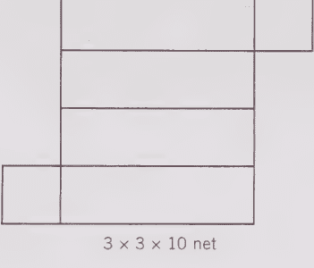

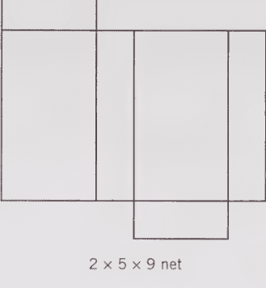

卡罗来纳要求每位学生写下他们小组制作的盒子中哪个装的东西最多。他们随后在小组中讨论这些回应，解释为什么他们认为自己的答案是正确的，并试图说服他人为什么他们的答案关于如何判断哪个装得最多是正确的，例如用豆子或硬币填充并计数需要多少才能填满。这些都是合理的回应，但她询问学生关于豆子之间的空隙以及他们将如何测量这一点。

大多数时候，其中一名学生会提到当他们计算类似长方体的表面积时，外表面上画有一厘米的网格。通过询问这如何帮助他们测量内部，学生会说他们需要的是小盒子放在里面，这样如果整齐地一层叠一层地放进去，就不会有空隙。

此前卡罗来纳使用了一个透明塑料敞口盒，以便学生可以看到用豆子填充时之间存在空隙，但使用她拥有的1厘米立方体时，他们可以无缝地填满空间。

她给每个小组一套立方体，让他们填充自己的盒子，看看哪个盒子装得最多。然而，她没有给他们足够的立方体来填满每个盒子，所以他们需要想办法在未填满的盒子中超出他们所在的水准进行推算。他们很快意识到，一旦填满第一层，他们可以通过堆叠一个立方体在另一个之上来看到盒子中有多少层，并将层数乘以每层中的立方体数量。图 2.9 显示了学生用来解决该问题的盒子。

### 图 2.9 学生用于发展体积概念的操作材料

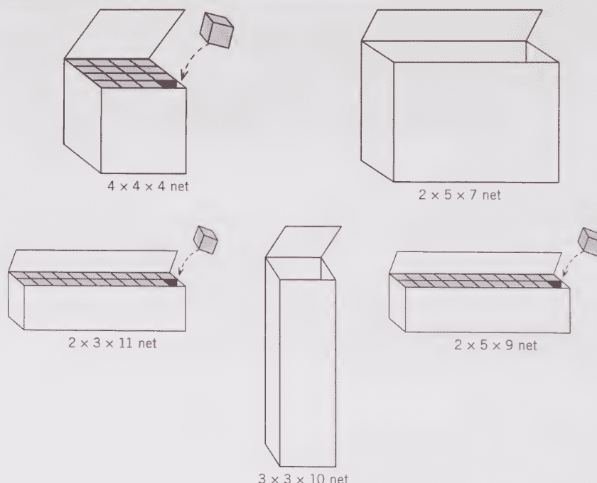

活动的结果，学生们形成了三维概念的 *体积*。请注意，一旦他们形成了概念，并对其进行了探索并应用于其他盒子，卡罗来纳就可以给他们提供该想法的词汇。同样，班级自行推导出公式 V=lwh，而不是将其作为算法给出。他们每个人都拥有它以及与其相关的概念，并将其储存在长期记忆中。

## 卡罗莱纳的思考

如果仔细观察卡罗来纳的计划，你还会看到一些很好的真实表现性评估，学生需要将他们新创建的体积概念应用于一些独特的现实世界情境。她直接切入了探究式教学学习循环中应用部分的重点。

更棒的是，对那些在小组中其他学生之前就掌握概念而成为专家的学生，使用相同材料进行的一个拓展示例。他们被要求在最少使用纸板（表面积）的情况下优化体积。这被作为一个现实生活情境进行，他们为一家想要通过使用最少材料来省钱（和保护环境）的公司工作。这种关注真正扩展了他们对二维表面积和三维体积之间关系的理解，使用试错法在两者之间建立最佳关系。

卡罗来纳的课堂上，家长永远不必担心孩子在异质小组中，因为能力各异的学生互相帮助来弄清楚和理解。领先的学生也被挑战去追求他们的能力所引导的方向。这种差异化是可能的，因为他们在小组中使用具体材料进行探究。

## 卡罗莱纳对探究式教学的反思

探究式教学并不是我的首选方法。当我于2007年开始第一份教学工作时，我被提供了一本传统的数学教科书。虽然它色彩鲜艳，有一些有趣的活动，但大部分内容都是以“ I do, you copy, then you do 35 times，”的格式编写的。如果我觉得无聊，我的学生会有多无聊！

慢慢地，我开始在课程中融入更多探究式课程。我希望让事情更有趣、更相关、更有趣。我现在尝试创建探索活动来激发学生的兴趣。这些探索活动不断变化，因为我不断反思并调整我的教学。我总是问自己，“这是吸引学生注意力的最佳方式吗？”

我喜欢基于项目、跨学科的学习。作为一名教育工作者，我的最终目标是促进跨越生活多个方面的体验，并涉及有意义的长期目标。作为教师，我们希望我们的学生成为复杂的思考者，而不是将知识隔离开来，而是能够在课程之间、与他们自己的生活以及更广阔的世界之间建立联系。

我们也希望我们的学生能够成熟地表达自己的观点并与同伴辩论他们的想法。为此，我促进合作小组工作。培养一个分享者和谈判者的课堂具有挑战性但也令人振奋。在我作为教育工作者的第七年，我继续磨练我教学技能集的这些方面。

这并不容易。有时课程没有按计划进行，我感到失望和沮丧。有时精心设计的课程未能激发学生预期的兴趣。有时让我感到沮丧，几乎要哭。在这些日子里，我对自己说我现在要对你说的话：请，不要放弃。你的学生需要你。他们需要一个充满活力、关心和深思熟虑的榜样。你总能让明天比今天更好。他们很幸运有你，虽然他们可能用一种有趣的方式来表达，但他们欣赏你。

幸运的是，我看到了我取得成功的迹象。我听过学生抱怨铃声响起，课程结束，因为他们必须等到第二天才能继续我们的课程。我听过学生在解决比例时说，“This is fun!”因为我创造了一个他们想要找到答案的体验。我甚至有以前在数学课上几乎得不到满足的学生告诉我，数学现在是他们最喜欢的课程。

## 十一年级语言艺术的教学计划过程

凯蒂·胡尔，来自马萨诸塞州切姆斯福德的一名高中英语教师，为哥特文学和爱伦·坡的诗歌《乌鸦》单元制定了五节课。她为这些课程确定了两个基本问题：

- 1. 为什么哥特文学和恐怖故事能引起我们作为读者的共鸣？
- 作家究竟如何让他们的故事变得恐怖？例如，哥特文学作家使用哪些关键手法来向读者传达一种诡异的感觉？
- 2. 我们能信任每个故事的叙述者吗？为什么或为什么不？

以下是凯蒂课程的简要描述。有关凯蒂单元，“Gothic Literature and ‘The Raven’: An Example of a Five Lesson Inquiry Teaching Unit，”的完整描述，请参阅数字资源光盘。在每一节后续课程中，学生在先前课程中创建的概念 *螺旋式*贯穿整个单元。我在这里使用的 *螺旋式* 是指杰罗姆·布鲁纳（1960）首次描述的方式，学生首先通过操作材料创建适合发展的概念，然后通过进一步的探索创建和应用象征性和象征性理解。隐含在这个设计中是，那些尚未完全掌握先前课程中特定概念的学生可以在新的探索中重新审视它们。

由于哥特文学的语言对21世纪的学生来说可能显得生硬，凯蒂清楚地阐述了她的体裁目标，但也关注她更大的文学和写作目标。

然后她通过让他们首先分析他们当前生活中的事物以及对大多数青少年普遍有趣的东西——恐怖电影——来接近她希望学生发现的理解。

每位学生单独工作，然后在小组中工作，以弄清什么构成一部好的恐怖电影。通过他们的讨论，学生们弄清了作家、导演和摄影师用来制作恐怖电影的元素。各组的报告员与全班分享他们的见解，凯蒂促进了热烈的讨论，从而得出一个分类的质量集合。她给班级提供了学术界普遍认为哥特文学固有的品质，学生们随后将其作为家庭作业进行比较和对比。

接下来的四节课让学生探索爱伦·坡的生活，以及它可能如何促使他写这种类型的故事。然后他们剖析他的诗歌 *《乌鸦》*，利用他们在第一节课中创建的恐惧和恐怖元素，并扩展每个概念。他们进一步深入研究其他诗歌手法，如拟声词和头韵，这些也可以用来营造语气。

最后，他们被给予一个真实的评估，要求他们写一首现代诗歌，使用哥特文学的大部分语气和形式，特别是 *《乌鸦》*。他们需要为其配图并向班级进行戏剧性朗读。

## 凯蒂的思考

这个作业旨在适应各种学习风格，同时培养学生的语言智能。通往最终产品的家庭作业旨在促进更具体的顺序学习者的学习，他们受益于指导和要求。从这些作业中，学生了解作品的格式和期望，这吸引了许多学生的直接和受控学习风格。

然而，这件作品的创造性本质吸引了那些更开放式的学习者。这项作业允许他们选择自己的角色、背景和冲突，同时运用自己选择的语言。在这方面，这项作业使那些更直观和抽象的学习者受益，为他们提供了一种不那么死板的方法来表达对《乌鸦》的理解。

这件作品也旨在吸引有艺术天赋的学生，他们可以创作出深度、视觉化的诗歌表现。凯蒂认为纳入这项活动很重要，因为艺术是表达书面语言意义的关键方法，然而在英语课堂上却常常被忽视。此外，《乌鸦》很大程度上关乎感受以及读者所见，因此这显然是一个融入创造性学生技能的机会。

最后，这项活动的展示环节吸引了那些喜欢公开演讲并掌控全场注意力的学生。它为他们提供了一个短暂的焦点时刻，来娱乐和吸引同学们。

请记住，所有学生都需要画画，正如所有学生都需要写作一样，即使是那些“不擅长画画”的学生。因此，每个学生在各种活动中都会经历相对的成功和相对的挣扎。这类活动与多元智能理论（Gardner 2006）的理念一致。

## 运用技术增强探究式教学

正如我们在前面的课例中所见，操作具体材料是探究式教与学循环中探索阶段的重要组成部分。现代技术极大地扩展了探究式教学课程中探索和概念澄清的可能性。然而，技术不应取代学生操作实际具体材料、参与角色扮演、采访社区成员，或在社区的自然或社会环境中的工作。例如，一旦学生在科学课上使用真实材料设计并进行了实验，以揭示概念各因素之间的关系，他们就可以上网查看微观或分子反应或相互作用的动画或延时摄影。学生可以在线研究历史探索的一手资料。他们可以通过连接学校的网站，与世界各地其他国家的学生互动，进行各种社会研究探索。当学生在小组中发现多种策略来解决一个新的数学问题，并在下课时意识到一个优雅的解法时，那些理解上仍不清楚的学生现在可以求助于在线资源，如可汗学院（Khan 2012; http://www.khanacademy.org/）来获得清晰的复习。

技术为学生向更广泛的受众传达他们的理解提供了各种可能性。他们可以创作视频、音乐录音、摄影展、图形插图和出版的印刷书籍。当我们将在第五章讨论项目式学习和服务学习时，这些技术的力量将进一步展开。

迈克·法默在马萨诸塞州谢菲尔德市的课堂上，在探究式教学的背景下运用技术，他教七年级和八年级的社会研究以及十年级的经济学。由于厌倦了讲授（正如他的学生一样），迈克开始在学生的课堂活动中融入更多的技术——主要是互联网研究、PowerPoint 制作、MS Word、在线游戏，以及偶尔与埃及学生的 Skype 对话。迈克在下面评论了他对技术的使用。

### 迈克关于技术使用的反思

> 我开始体验到一种双重现实：使用技术使事情变得复杂，因为学生们在不同时间开始、进行和完成活动；同时他们也受益于能够按照自己的节奏放慢、加快、重复、纠正等等。简言之，技术提供了一种非常有效的个性化教育形式。
> 
> 正是从这时起，我决定彻底改变学生在我课堂上的学习方式，这一点非常重要。Heidi Hayes-Jacobs（2011）、Khan（2012）、Prensky（2001）、Shaw（2009）以及美国政府（Office Technology 2010）等等，都在建议学校课程中需要融入大量技术，以便“数字原住民”（Prensky 2001, 1）成为美国学校里高效的学习者。显然，必须使用有效的技术。一台过时且互联网连接不稳定的电脑是个坏主意。

## 将课程转变为探究式教学的协议

正如第一章所述，教师们传统上使用的许多活动，是在学生被*告知*某个概念理解、历史事件、写作或阅读技能，或解决问题的策略之后，作为确认（confirmation）之用。我们已经认识到，如果学生要深入理解和保持概念，或洞察某一学科领域中探究的本质，他们必须*建构*知识。他们需要首先通过某种探究式探索来探索现象，这使他们能够与队友协商想法，构建对现象的朴素概念，尤其是识别并关联与该现象相关的因素。然后，他们才准备好听取更大范围的学术界对正在研究的现象有何认识。在这样做时，学生也获得了思维能力和解决问题的技能，这些能力使他们成为终身学习者。

然而，很多时候教师使用的课程包含一些有用的元素，他们希望不必完全放弃这些课程。这些教育者希望将这些确认体验*转变*为探究式探索。不幸的是，做出这种改变并不那么简单，探索部分只是过程的一部分。

教育者需要将整个说教式的讲授加确认体验的“打包”转变为一种探究式教与学体验；在这种体验中，聚焦于概念、思维技能和思维习惯的探索，与协商、建构和引入描述现象的模型交织在一起。这些由学生小组进行的探索（他们在其中创建理解并协商想法）必须放在首位。在科学和数学中，这些几乎总是涉及操作物理材料或制作模型。在社会研究中，角色扮演、比较一手文献或采访真实人物是典型活动。在语言艺术课上，角色扮演、比较不同类型的文学作品，以及为特定目的以各种模式写作，是常见的活动。

虽然探究式教学是一个迭代过程，当你到达后续步骤时，你经常会返回并修改第一步，但教师们发现本协议中步骤的递进是有用的。

回想一下玛丽亚在开发和实施关于有丝分裂课程时所遵循的过程。以下描述扩展了该过程中的步骤。

- 1. **确定整个课程的五到十个大观念。**
  - 我期望学生在这段探究式教学体验中在一定程度上掌握的大概念是什么？
- 2. **确定全年的主题、概念、技能和社会问题的顺序。**
  - 这节课是否回答了单元的必答题中某些方面，或者更佳的是驱动性问题？学生从上一课过渡时，是否清楚下一步需要回答什么问题？

### 3. 确定本节课要学习的主要概念。

- 这个概念是否是国家或州级标准中针对我学生年级所期望的内容？它是什么？
- 在这个特定课程中，学生将学习这个大概念的哪些具体方面？该概念的这一特定方面涉及哪些因素？

### 4. 确定探索的初始想法，让学生能够在没有教师或媒体告知概念的情况下，揭示整个概念或至少部分概念。

- 学生是否能目睹现象的物理表现，或进行一项初步探索，从中他们可以设计调查或识别现象所涉及的因素？

这是将说教式、传授式课程转变为探究式教学课程的关键步骤，在这类课程中，学生通过探索揭示概念，正如历史上的学者们所做的那样。

- 在初始探索阶段，学生有多少机会操作材料？
- 有多少需要作为绘制视觉模型来完成？
- 学生能否使用一手资料？
- 有多少可以通过角色扮演或模拟来完成？
- 这种探索是否以学生能够直觉到概念中因素之间的关系，甚至可能从他们的经验中创建概括的方式，包含了适当的因素？

一旦你作为教师确定了现象中涉及的因素，审视你创建的探索，看看学生是否能够：

- 设计回答问题所需的全部或部分调查。
- 识别现象、概念或技能中所涉及的因素，以便他们能部分设计寻找答案的方法。
- 假设因素之间可能的关系。
- 开始理解特定的问题解决方法如何在特定情境中起作用，并开始看到它们如何可能被用于类似情境。

在实施此步骤时，你需要考虑如何组织课堂，并确定学生将如何利用他们收集到的信息。

- 我是否希望学生从独立思考开始，然后进行四人小组协商，最后进行全班汇报和意义建构？
- 学生将如何处理他们收集的数据，以及这如何反馈到重新设计或概念形成中？

### 5. 根据探索，确定最适用的思维技能和思维习惯。

- 在参与此次探索时，学生最应培养的思维技能是什么？（你可能只有在更详细地创建探索后才知道这一点。）
- 我可以通过何时以及如何在本学期安排它来培养一种思维习惯？
- 学生预期从之前的课程中已经具备哪些概念和技能，以便完成此次探索并从中获得意义？请确保他们在进行本课之前已掌握这些内容。许多时候教师会发现有一些初步课程及其必要的探索，能揭示这些需要在先进行的奠基性概念或技能。请暂停本课的创建，必要时先创建这些初步课程。

### 6. 创建一份量规，清晰定义学生在技能和概念上的 *新手*、*胜任* 和 *专家* 等级。

### 7. 创建一套评估问题，用于在监控小组和为全班澄清概念时使用。

- 在材料操作和学生设计探索的过程中，教师将做什么以：
  i. 使用形成性评估在各个阶段了解学生理解了什么？
  ii. 了解班级整体的进展，以便最好地规划下一天？

### 8. 创建一系列针对独特情况的真实应用。

- 如果学生无法将概念或技能应用于现实生活中不相关的问题，那么他们就还没有真正掌握它。

### 9. 创建促进性问题。

- 使用问题在个人或小组工作中有效地引导学生朝更有成效的方向发展。
- 如果课程中有学生通常会误解的概念，请准备好问题帮助他们形成更好的理解。例如，通过让学生以另一种方式审视证据来纠正天真的观念。

### 10. 确定学生学习这一现象的社会动机。

- 也许这与一个基于社区的项目有关。
- 学生（小组）将产出什么最终产品，并且他们可以在其他学生和指导教师的反馈后对其进行修改？

以下是用于编写探究式教学教案的两个模板。第一个模板提供指南，帮助你了解规划探究课程的各个方面。在你进行创建探究课程的探索时，这会很有帮助。第二个模板为你创建自己的教案提供了空间。请参考数字资源光盘查找“Guidelines for Creating Inquiry Teaching Lesson Plans”和“Template for Creating Inquiry Teaching Lesson Plans。”

如果你能与其他教师分享你的教案并共同探讨你的思考，你将对探究过程有更深入的理解。现在你已经开始通过将其应用于自己的教学规划来自己创建概念，你可能希望回头阅读前几章以获得更深入的理解。一旦你开始创建自己的计划，你将从探索中得到一整套问题。我希望本章中的课程示例能回答你的问题（后续章节会有更多帮助）。一旦你对这一过程有了一些清晰的认识，就继续阅读吧。

# Looking into Inquiry Teachers’ Classrooms

就像任何新的尝试一样，转变需要时间。虽然探究式教学有很大的好处，但它确实需要仔细而深思熟虑的规划。需要前期投入详细的规划。你不能坐下来写一整年的探究式教学计划。你只能尽力而为，慢慢积累经验，直到所有时间都是探究式教学。这种规划如果必要可以分块进行。然而，你会发现投入所需的精力会在你与学生完成一个完整的单元后出现。你会对学生取得的进步感到非常满意，从而有精力继续规划。当然，如果你能与同事合作创建探究式教学计划，你在相同时间内将拥有两倍的计划。此外，你们的同事互动和反馈将产生协同效应，并带来更多动力。

图2.10展示了一份量规的示例页，可帮助你确定自己作为探究教师的发展水平。该量规在探究课程和单元规划中规定了四个领域（及相关主题）：设定目标、评估学习、规划课程活动以及介绍和概述单元。它定义了四个表现标准：不满意、技能发展中、熟练、卓越。学生表现评估量规可在数字资源光盘上找到。

Figure 2.10 Sample Page from a Rubric for Assessing Student Performance

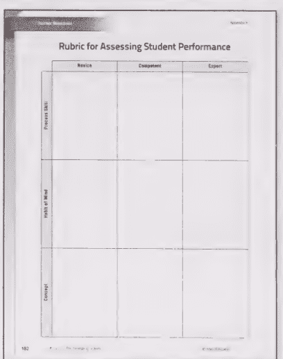

请记住，你并不是独自踏上探究式教学的旅程。在你之前有许多先驱和开拓者，目前也有许多教师拥抱探究式教学方法并在课堂上每天使用它。也有许多人刚刚开始涉足探究式教学，还有许多探究教师，无论是新手、胜任还是专家。

## Think and Reflect

- 1. 附录中探究式教学教案的长度与贵校使用的教案相比如何？实施探究式教学是否固有地需要这些计划中的详细程度？为什么几乎所有的课程都是多日进行的？
- 2. 探究计划中“促进性问题”和“评估性问题”有什么区别？为什么计划中应为课程的每个部分详细写出这些问题，以便你带着它们“准备在口袋里”“巡视”你的课堂？你能否识别出最近一次课程中使用的一些问题，它们分别属于这两类？
- 3. 如果你想准确评估学生是否真正深入理解某个概念或思维技能，为什么必须为他们设计一个独特的、真实的应用来解决，并配以详细的量规？

## Reflecting With Inquiry Teachers

在本章中，你将认识10位我有幸合作过的杰出教师。你将听到他们描述他们在探究式教学方面的经历——快乐、挣扎、见解、恐惧、希望和梦想。我在Middle College High School任教时认识了一些这些教师。

作为我在该高中共同指导的一个项目的一部分，学生根据他们学习的科目创作原创戏剧，并在一年中的某些时候将其巡演到其他公立学校。在与同事一起努力成为有效的探究式和项目式教师的13年后，我忘记了我们学校班级与其他纽约市大多数学校班级之间的差异。然而，每当我们巡演学生的戏剧时，我会在其他学校的各个班级度过几天，并被提醒到那些班级与我们班级在参与度、理解力、创造力和能量水平上的差异。此后，我在三所大学任教，有机会参观无数个课堂并与全国各地的教师合作。每当我进入一个教师正在向探究式教学迈进的课堂时，我都能感受到一种特定的氛围——那种源于弄清和协商思想的智力和情感参与以及喜悦感。

## The Voices of Inquiry Teachers

我们首先听到的是David Nurenberg，他在马萨诸塞州康科德担任英语教师已有14年。在此期间，他对探究式教学的使用不断发展，正如他对自己课堂的描述所示，他对自己的实践进行了深入思考。在他回顾探究式教学的样子之后，他反思了使用探究式教学时面临的挑战。

- **Andrea Egitto**，她曾在纽约布鲁克林布朗斯维尔区的市中心公立学校担任四年级教师，解释了她在15年的职业生涯中如何受到启发使用探究式教学。目前，Andrea在马萨诸塞州诺斯安普顿的一年级课堂中使用探究式教学。

专业知识，传递双重信息：我重视他们的知识和经验，并且我们将要学习的内容与他们息息相关，且与他们已有的知识相连接。只有当我们感到他们已经用尽了原有知识时，我才会以任何直接指导的方式（如讲授）引入新的术语或信息。

例如，在阅读斯图兹·特克尔*《工作》*之前，我让我的学生以书面形式或在讨论中反思他们从事过的工作——其中的挑战、他们引以为豪之处、他们厌恶之处，以及工作如何影响了他们的身份认同。在开始新闻学单元之前，我的学生要角色扮演报道一则突发新闻，只依据情境描述和他们对各方（记者、编辑、广告商）如何影响局势的看法进行。在研读*《杀死一只知更鸟》*中的法庭场景之前，我总是先了解我的孩子们从自身经历和其他媒体中已经知道的法庭程序知识；然后随着我们继续阅读，让他们将自己的预期与阿蒂克斯和吉尔默先生在梅科姆的泰勒法官面前对峙时实际发生的情况进行对照检验。

## 让学生尽可能拥有更多选择和自主权

既然国家标准要求学校教给学生*技能*，而不是特定的文本、事实或成果，那么我们就比以往任何时候都更容易为学生提供机会，让他们以适合自己学习风格、偏好以及背景知识的方式参与学习。

我经常让学生组成文学圈小组，由学生自行选择阅读文本（要么从我们班级图书馆中选，要么完全由自己挑选）。有时选择的基础是与我们正在学习的主题一致，有时我们是在练习某项特定技能（例如精读和文本分析，或学习并应用词汇），此时几乎任何文本选择都可以。对一些学生来说，这是一个阅读他们一直感兴趣但从未有时间去探究的主题的机会。对另一些学生来说，这可能是他们第一次真正阅读一本自己选择的书，并从中获得乐趣。几乎总是，学生都有机会与同龄人进行讨论。通过这种方式，他们强化了我们所学内容的普遍性，并通过引入比我自己所能找到的更多来源来丰富我们所有人的知识。

这是一种差异化教学，长期以来一直是处理异质群体（所有班级都不可避免如此）的最佳实践。我也在评估方法上进行差异化，因为学生往往通过某些类型的评估比其他类型更好地展示知识和技能掌握程度。对于小说中的事件，我通常让他们分工完成这些任务，然后*告知*他们的同学。小组中的个别学生通常会选择同一主题的不同短篇小说或文章，然后像拼图一样重新组合，互相教授他们所读的内容。第二天，一次小测验将要求小组中所有学生负责了解所有故事中的观点。有时我只收全组一张试卷，学生们不知道谁的试卷会被用来给他们所有人评分；因此，分工并帮助其他每个人符合他们的最佳利益。他们中的任何一个都可能最终成为决定他们成绩的*重要人物*。测验之后，如果有学生表现不佳，团队就有责任帮助他们改正错误。我们也会进行同伴互评写作，尤其是针对像逗号用法、引文整合或过渡句这样简单明确的问题。

每当学生在知识或理解问题上卡住时，他们知道自己的首要任务是询问小组成员。如果整个小组都难住了，他们需要询问另一组的成员，和/或在网上查找。这有几个好处：

- 1. 它强化了这样一个观念：在学习者共同体中，我们都要对彼此的教育负责。而且这不会占用宝贵的教师时间和资源。
- 2. 它让多个学生以知识寻求者或提供者的身份参与到对自身学习的责任中。
- 3. 最后，它帮助学生培养自我倡导和独立的重要能力——在现实世界中，他们不会总是指望一个唯一的权威人物来提供答案。

在他们学习的过程中，我会帮助他们促进和指导*过程*，而不是直接填上让他们卡住的答案，除非这是最后的手段，或者学生们在错误的道路上偏离太远，让我觉得需要把他们拉回正轨。

然而，小组工作中最令人兴奋的部分超越了知识和理解层面。因为我们在课堂上做的很多工作都是基于项目的，学生经常在小组中完成长期任务，例如为一本小说提供带注释的分析指南，创建印刷或视频广告宣传活动，或编写并制作一部莎士比亚戏剧的现代重述和演出。在这里，学生有明确的角色（例如记录员、讨论组长和视频编辑）甚至更为重要。有时我给他们分配这些角色，但通常我会让他们基于兴趣和能力来选择。有时我甚至让学生自己定义不同的角色是什么，检查以确保这些角色需要相同或公平的工作量，或者提醒他们一些尚未提出的问题。我的工具箱中最成功的课程之一，是让学生为我们阅读的复杂文本创建学习指南，分工负责情节、人物分析、寻找和阐释隐喻等等。面对有挑战性的文本时，他们不再只是直接跳到网上的作弊网站，而是必须集体创建自己的指南；在这个过程中，不仅互相帮助解读和讨论这本书，还首先要弄清楚怎样才能构成一份有效且有价值的学习指南。

## 奖励问题，并让问题优先于答案

高阶思维问题——那些需要应用、分析、综合和评价的问题——没有那种简单填写正确选项的答案。我和学生们做的很多工作都涉及帮助他们理解如何提出这样的问题，而我给了他们大量练习来创造这些问题。每当我们开始一个新的单元，我总是向学生征询他们对当前话题有哪些问题，并随着课程推进持续进行这一征询过程。大多数课堂讨论始于学生生成的话题，特别具有挑衅性或能引发讨论的问题会得到奖励，被记录在我白板上的“名人堂”区域。当我们准备好进行总结性评估时，提出问题的人应该是学生。

这是探究的核心。最低限度，我想让学生起草、辩论、发展和运用他们自己解决问题的方法，例如如何创建一个有效的广告宣传活动，或如何让莎士比亚与他们的生活相关联。最好的是，我希望他们自己想出这些核心问题。

## 让学生犯错，并看到错误的价值

传统课堂偏爱最终成果而惩罚错误。难怪这么多学生要么因为自我概念低落而脱离学习，要么作弊和抄袭。“我们不会因为诚实而得分，”我曾当场抓到作弊的一名优等生告诉我。“一所大学看到我得了‘C+’，不会在乎我是通过努力得来的。他们想看到的是‘A’。”多年来，我以各种形式听到这个论点后，终于决定必须改变我处理和奖励错误的方式。

错误往往是我们最好学习的起源，学校应该是一个学生仍然有安全网和第二次机会的地方。虽然我倾向于精确评分，但我也怀着这样的期望去评分：学生能够而且会来找我讨论他们作品的优缺点，并寻求重写和修改。我总是取两个成绩中较高的那个，所以他们尝试没有任何损失。当学生小组试图共同创造一个产品时，他们经常绊倒，有时甚至彻底失败。我总是给小组在总结性评估时进行自我评估的机会，然后重新尝试并重新提交他们的产品，不会有任何惩罚。学习是一个过程，而

这往往伴随着挫折。最终实现逆袭的那一组，比一开始就拿到“A”的那一组，向我展示了更实在的*学习*证据。

在合理范围内，在我的课堂上，只要学生表现出真正努力的尝试，几乎永远都不算太晚。学生永远不会被保证能拿到“A”成绩。同样地，如果一个学生想拿“D”或“F”，也得相当努力地拒绝我抛出的多重救命稻草才能做到。不止一位学生和家长告诉我，这是我课堂最大的亮点，他们也感叹这样的做法十分罕见。我能理解为什么它很罕见——这让我的批改工作量几乎翻倍！但与此同时，如果我不这样做，我就觉得自己并没有真正投入到*教学*中。

## 尽可能让社区参与课堂，反之亦然

当学生看到校内与校外生活之间的脱节时，他们的参与度就会骤降。学生越能将校外生活用作校内作业的素材，一切对他们来说就越能融会贯通。当我们练习说服性写作和论证时，我会让学生找出他们真正想说服的人（他们的父母、男/女朋友、校长、总统），然后把他们的论点写给这些人。我们写信给当地报纸的编辑，或给当地民选代表提出政策建议——然后我们真的把信寄出去！我的学生们常年最喜欢的活动之一，就是给本地或全国性企业写表扬信和投诉信。很多时候，公司会回信并附上礼品卡和免费样品。这个过程让“什么样的论证才能对特定受众产生有效、有说服力的影响”这一问题变得鲜活起来。

让社区作为学生作品的受众，甚至作为*评估者*，也被证明是激励学生的极佳方式。我总是邀请家长、其他班级的师生、学校管理者以及社区成员来参加我们的项目展示会。这让我的学生知道，他们的作品将有真实的受众，而不仅仅是我一个人；同时这也能加强与社区其他利益相关方的联系和沟通渠道。这个社区里有各个领域的专家。自从我看到一个Edutopia视频——一位数学老师招募了一名本地建筑师作为志愿者，帮助她的学生运用几何学设计假想的新校舍——邀请专业人士作为共同教师和共同评估者就成了我项目的标志性特色。现在，当我的学生做广告项目时，每个小组要为他们选择或发明的产品设计和执行一场广告宣传活动，社区里一位从事广告高管的家长会陪伴我们几天，帮助学生厘清问题并制定最终作品的评分量规，最后，还会担任评审之一。

至少，我会尽量鼓励学生反思某种课堂结构——例如苏格拉底式讨论，与由发言人名单引导的对话相对——如何促成某些类型的学习，同时阻碍其他类型。本杰明·布鲁姆（1956）曾认为，这种审视*我们如何学习如何学习*的评估，是我们能够要求自己完成的最先进、最具挑战性的认知任务。

这一切都可以很容易地与学科内容联系起来。在阅读《1984》《飞越疯人院》《记忆传授人》或其他关于权威与社会控制的小说时，学生可以审视我们教室自身的物理空间，并开发项目来改造甚至重新利用它，以产生不同的效果（这其实是我曾经一位实习教师的创意）。我越是体验到探究的力量，就越意识到我不能为可质疑之事设置障碍或禁区。如果我正在帮助塑造下一代知情的公民和消费者，那么归根结底，我*希望*他们以有意义且富有建设性的方式质疑权威和基本社会结构。

## Andrea Egitto的反思

*Andrea分享了一段在市内公立学校的经历如何启发了她在15年教学生涯中始终使用探究式教学。这段经历为她第二章中呈现的一年级历史课提供了背景。*

我在教学的第一年就开始采用探究式方法，主要是在科学课上，面对的是布鲁克林布朗斯维尔区的四年级学生。这是一个充满挑战的班级，学生来自犯罪率高、毒品交易频繁、家庭极不稳定的地区。

探究始于两只作为班级宠物的沙鼠。我们有一个饲养箱，里面有一只公沙鼠和一只母沙鼠。我很快意识到，如果课程围绕这些沙鼠展开，就能吸引这些学生。学生们很快就被沙鼠的生命周期迷住了，因为第一个月它们就产下了第一窝七只幼崽。

虽然这些学生是四年级，但很多人的阅读水平远低于年级水平。让他们使用学区提供的阅读材料，对他们和我来说都是一段痛苦的经历。然而，当我在宠物店购买了一些关于沙鼠的书籍——大概达到八年级阅读水平——很多人会勤奋地坚持研读，直到找到答案。几乎每个人都很乐意练习写作，只要写的是关于沙鼠的内容。我们写观察记录，写信给宠物店和家长。

我很快意识到，要让他们都能经常性地投入到探索中，从而在科学、数学和语言艺术方面获得理解和技能，他们需要以四人为小组进行合作。繁殖力旺盛的沙鼠帮了大忙，我们很快就有了足够多的沙鼠，可以装满七个饲养箱，每箱两只，这样每个小组都有自己的沙鼠。这仍然是一个难教的班级，但以前他们在语言艺术和数学课上抵触的事情，如果先让他们和沙鼠一起探索，他们现在就会愿意去做。

我教学的自然发展促使我接受了语言艺术工作坊模式的培训。通过在教室里放置数百本符合学生独立阅读水平的虚构和非虚构类图书，我的学生可以选择他们想读的书。他们与阅读伙伴合作，分析和讨论所读内容。在写作工作坊中，学生选择自己的主题，并学习像伟大作家那样互相批评彼此的作品。他们与全班同学和伙伴分享作品以获取反馈，然后在将作品发表展示给全世界之前进行修改和编辑。

许多年后，我连续三个夏天参加了解决问题的探究式数学教学工作坊。这些工作坊立刻引起了我的兴趣，因为我们通过摆动的钟摆数据以及许多其他动手活动来寻找解决方案，而不是由讲师直接告诉我们答案。我们还做了大量与几何相关的工作，探索形状和图形，这让我们这些成年人获得了许多学生时代没能获得的数学理解。

然而，如果我这10年来执教的学校没有采用经过NSF（美国国家科学基金会）全国验证的、已经基于探究的数学课程，我就无法设计出所有这些让学生能够进行的探索活动，让他们真正掌握数学概念或技能，即使忘记了算法。他们知道如何以及何时运用自己的理解，因为“你对自己的问题总是有所了解”。

在NSF全国验证的数学课程中，有探究课程及其配套材料。当孩子们发现“每次我用这种方法做，似乎都能行得通。这也许就是解决方案”时，他们无比兴奋。在一年级，我们希望他们记住组成十的数字组合，但他们之后会用材料自己尝试更大的数字组合，自主探索。他们会发现36加4就像6加4，而6加4等于10，所以36加4——让他们记住组成十的数字组合，但他们自己探索更大的数字，先用手边的东西尝试各种数字组合。他们发现36加4就像6加4，而6加4等于10，所以36加4——

4 让我们来到下一个 10，也就是 40。他们很快就能自己看到规律并进行概括，意识到 26 加 4 是 30 等等。当他们以两到四人为一组工作时，很快就会发现这不仅仅是“写下零并进位一”。一旦你有了材料和课程，只要倾听孩子们就很容易，因为他们总是有问题。

在 15 年的探究式教学之后，我最后的 frontier 是社会研究。我作为学生时对历史教学的经历并不积极。直到我接受了一些专业发展，我们开始把地方历史作为学生理解和动机的入口，我才开始使用我在科学领域使用了多年同一种方法。大约 7 年前，我开始带学生到户外进行自然漫步。我在半乡村地区教学，这对科学来说效果非常好。过渡到进行地方历史漫步，然后最终使用一手文献资料是很容易的。是的，即使对仍处于阅读早期阶段的一年级学生也有效。一旦你准备好材料和精心设计的课程，就从学生的先前知识开始。听取他们的疑问是最令人兴奋的部分。我现在正在建立我的社会研究探究课程库。现在我无法想象用其他方式来教学。

## Bill Cummiskey 的反思

我在 Lesley 大学攻读硕士项目的第二个学期遇到了 Paul Jablon。事实上，那个学期 Paul 教授了我所有的三门课程，包括一门重点放在科学课堂探究式教学的科学教学法课程。我开始攻读硕士时，已经在马萨诸塞州一所规模很小、非常成功的 charter 学校任教三年。作为一所 charter 学校，我们比许多典型的初中要小得多，K–8 年级共约有 330 名学生。我有幸与七年级和八年级的学生循环任教，这样我可以在两年内协调标准，并在多个单元和科学分支中构建概念。我们的课程通常在 70–75 分钟左右进行（我们有延长在校时间）。每个班级大约有 20–25 名学生；偶尔，八年级班级会分成两个各 10 到 12 名学生的组，这对探究项目来说很棒，但不常见。学校利用师生比例小和卓越的高标准，推动学生远远超出学区学校常见的低成就。尽管如此，我学校里的少数教师在应用项目式或探究式模式。即使是科学课，也倾向于在五年级到八年级期间使用清晰的直接教学和有指导的练习活动。除此之外，我们的学校位于一个低收入城市，英语学习者比例很高。最后，由于我们的学校位于一栋老房子里，我们缺乏典型的科学实验室设施，大多数实验都需要一些创造性的材料使用。

随着我在 Lesley 了解更多关于探究式教学的内容，很明显这将是我的教学风格。在众多要素中，有四项在我课堂上尤为重要：

- 学习循环中发现（探索）阶段的深度
- 小组结构的价值
- 规划探究式课程的复杂性
- 探究式项目所提供的真实性

为了更深入地探讨这四个主题，我将描述一个单元，该单元围绕一个名为“Mystery Powders”的课程系列构建，我第一次在 Lesley 遇到它，并根据适用情况对其他项目进行简要参考。

## 神秘粉末单元

神秘粉末单元是一个为期五到六周的项目，作为我们化学研究的介绍。学生通常在七年级进入时对物质的本质理解极少，因此该单元通过对不同物质各种性质的广泛动手项目来建立他们的概念理解。其构想是每个小组都是一个犯罪现场调查（CSI）研究部门，负责分析犯罪现场的样本，其中嫌疑人留下了白色粉末的痕迹。小组获得五种不同粉末的样本（常见的物品如糖和玉米淀粉），并被指示对每种粉末开发并执行测试，然后分析其结果，以便仅使用测试数据区分“神秘粉末”（由一个或多个样本粉末的未知组合组成）。典型的测试包括用 votive 蜡烛加热粉末、在水中溶解它们、使用酸（醋）与它们产生反应，或使用指示剂（碘溶液）。

在我看来，这次实验是七年级学生充满挑战的一年的完美 culmination。进入时缺乏协作探究技能的经验，到三月时大多数学生已经建立起独立和小组合作所需的技能集，保持有组织的材料和详细的笔记。到此时，学生也已经内化了他们从早期探究课程中获得的成功和赋权的感受，并渴望承担更高级、更长期的由自己设计的实验。此外，该单元结合了学生对犯罪调查的既有兴趣，以及我的学生由于相对缺乏先前经验而需要的具体材料探索。

### 探索阶段

该项目的发现（探索）阶段通常非常费力且耗时，因为来自不同背景的学生以非常不同的水平参与项目。有一段时间，我有一个专注且投入的学生小组用碘指示剂测试玉米淀粉。当被要求观察指示剂施加后粉末中最显著的变化时，学生列出了一个又一个观察，超过 30 个，却从未提到白色粉末与棕色液体混合后变成深邃鲜艳的紫色！这些经历在当时虽然令人沮丧，但强调了让学生在准备好发展对所涉及基本科学过程的任何有意义理解之前，先有时间体验和操作材料的重要性。我发现这一点普遍成立，从分析地质数据中的模式（例如绘制地震图以定位板块）到观察池塘水中的微生物。我们的学生带着许多半成形或错误的关于世界的观念，如果没有充足的时间去探索并建立自己的经验体系，纠正他们的错误观念几乎不可能。

### 小组

为了使材料探索成为可能，需要有明确划分且轮换角色的小组。没有这些结构，我不可能控制，更不用说教导一个班 25 个与化学品和火玩耍的学龄前青少年。除了课堂管理——这本身就是一项宝贵的成就——小组角色在我课堂上发挥两大主要功能。本质上，异质小组是一个教师倍增器，使我能够快速与多个小组交流，同时知道学术或行为上最强的学生会在我不在时引导小组的探究。这使我能够快速了解每个小组的状况和进展，并在继续之前提出几个引导性问题。学生可以据此跟进我的建议，我无需引导过程的每一步。

小组也自然允许进行调整。今年，尤其是在最高成就学生与最困难学生之间存在巨大差距。我们正在努力应对这个问题。虽然分层教学是解决这个问题的常见方案，但这往往限制了低成就学生，同时剥夺了加速学习者磨练解释技能并发展以强有力证据支持其主张的能力——这些证据是同伴可以参与的——的宝贵机会。我很少遇到因小组拖累而抱怨的学生。相反，高年级学生欣赏作为团队合作以实现目标的挑战，同时理解他们并非掌握了概念本身，而是达到了更进一步的基准 in the

持续发现的过程。事实上，那些在异质小组中挣扎最厉害、并推动更快进度的学生，几乎总是那些有最大社会情感需求，并且最需要了解自身不足和团队合作重要性的人。这些学生往往受益最多，很快就明白，虽然他们在某些领域很优秀，但他们可以从其他小组成员那里学到很多。在“神秘粉末单元”中，这一点常常以令人惊讶的方式显现。例如，小组中最有能力的科学家通常在早期就负责，帮助开发可能的测试，并对不同粉末的身份提出假设。然而，在单元结束时，当我们努力将数据总结成我们称之为科学论文的调查报告中时，具有写作和组织能力的学生常常脱颖而出。每年，我都发现那些在词汇习得和复杂概念上最困难的学生总会带来一些对项目无比宝贵的先前经验。例如，曾与父母一起修理机器的学生，往往知道如何使用工具或制定实验方案，这些技能远远超过了他们更擅长学术的同龄人所掌握的技能。

## 探究式规划过程

小组工作的自然调整与基于探究的课程规划过程完美契合。随着新标准，特别是《下一代科学标准》（Achieve 2013）的明确提出，每一节课都需要融入众多组成部分——从科学思维技能、思维习惯，到跨领域概念和核心思想。因此，在开始规划整个学年甚至一个单元的教学时，我常常感到不堪重负。基于探究的教学大大减轻了这种压力。我在无数方面看到重要的技能和思想如何自然地贯穿科学的各个分支。对我来说，这意味着，如果我只有一半的学生内化了测量精度和有效数字的概念，我可以接受，因为这些想法会在后续的技术或生物单元中再次出现。每个探究课程都蕴含大量相关标准和潜在学习时刻，因此我的工作不再是*能让他们学到什么*，而更像是*如何将他们的注意力集中在核心思想上*，同时让一些学生只获得边缘理解，我们在稍后的单元中再回归这些内容。

这一认识促使我在单元规划文件中添加新字段。我使用《通过设计来理解》（Wiggins and McTighe 2005）中的逆向设计模板，但发现最初用于课程目标和标准的框太笼统了。相反，我将核心标准和思想与那些从前几个单元循环出现的部分以及我第一次引入的部分区分开来。例如，我们八年级的科学课程以对现代工业农业的为期六周的调查开始。我们利用社区花园地块、当地合作伙伴，并开展迈克尔·波伦（Michael Pollan）的《杂食者的困境：四餐的自然史》（2006）的读书研究，让学生把个人健康和营养与全球环境问题及众多生态系统的健康密不可分地联系起来。在这个单元中，我们主要关注的是理解生态学以及产生和回收食物能量和有机物质的自然循环。然而，与此同时，当学生通过食物网追踪各种元素和化合物时，他们也在复习我们在神秘粉末化学单元中提出的概念。此外，学生还被介绍了新主题，如进化（例如，大刍草进化为现代饲料玉米）或人体解剖学。这不仅促使学生在多个层面参与相关科学，而且真正推动了学生创造自己的实验，继续学习在阅读或实地考察中接触到的主题。今年，学生应用我们从花园实地考察中学到的知识，进行了实验，探究蜗牛、罗勒植物、其他模式生物与人体解剖学之间的联系。这紧接着带来了长达一个月的人体系统调查，并直接与我们春季对遗传、繁殖和进化的研究相连接。

## 学校作业的真实性

最后，正如上面直接所示，探究式的教与学赋予了学校一种常常缺乏的真实性。当我与七年级英语语言艺术（ELA）老师共同授课时，我们经常讨论学生作业需要具有意义和真实性。那位老师不是让学生写读书报告，而是让他们起草书评，模仿网站和报纸上的评论。他认为，这些学生毕业后想写作时，他们永远不会需要或想要写一篇总结文本的读书报告。相反，真实的人会*评论*他们读过的书，在必要的总结之外提供分析和论证。以我的经验，学生会认可并欣赏这类工作。他们发现有价值且赋能使他们参与我们所在领域的专业人士正在进行的工作。如前所述，我们不是写实验报告，而是仿照最专业期刊要求的格式撰写科学论文。我带上妻子的实验笔记本并参考她的出版物（她是一位微生物学家），向学生展示*真正的科学家和工程师*在撰写关于他们发现的论文，那么，既然我们在做同样性质的探索，我们就以类似的方式分享我们的发现。

除了真实的工作，探究还培养了学生问题和兴趣的真实性。学生找到自己的方式将我们的学习与个人生活联系起来，甚至与课程中的相关主题联系起来。在八年级开始时，我们列出了在过去一年的调查中几乎普遍存在的科学主题清单。在没有太多提示的情况下，学生能够制作出一个与《下一代科学标准》中的跨领域概念列表高度契合的清单。

## 教与学的转变

最后，当学生们经历了数月有意义且富有成效的工作后，他们通常能够理解，当时间限制要求某些课程成为比我们通常使用的探究调查更快、更压缩的版本时，也是合理的。当教师战略性地规划，使快速讲授的主题足够简单直接且可管理时，学生们就会相信，他们正在为未来的调查做好准备，那时他们将获得更深入的理解。即使在简短的*讲授主题*课程中，微型探究活动也能激发学生去发现核心思想或最重要的概念，同时暗示着在更深入探索中等待他们的复杂性。总的来说，我发现探究式教学课程进一步转变了我的教学体验，使纪律更容易，学生的学习也更成功。

## 麦克·法默的反思

大约十年前，当我刚开始教书时，脑海里浮现罗宾·威廉姆斯在《死亡诗社》中的形象，“及时行乐，孩子们，及时行乐！”我需要做的全部就是激励，帮助学生打破传统“无聊”教育的模式。凭借非常扎实的学科知识、准备充分的课堂材料，以及此前在商界多年积累的高度自信，我开始面对我的听众。我并不是一个平淡无奇的表演者。事实上，我的评估者对我的口才和*寓教于乐*的能力印象深刻。尽管有这些认可，我最终并没有赢得或获得任何奖项的提名。好吧，并不是我真正的观众——学生们——认可我。

接下来的几年里，我意识到我教授的社会研究课程需要一些活动来吸引学生。毕竟，我喜欢坐在椅子上花40分钟听别人讲话吗？事实上，刚获得教育学硕士学位的我，决定小组合作是正道。我继续传授知识，并让学生们在小组中讨论其中的方方面面；我甚至偶尔加入角色扮演、戏剧、网络寻宝、创意作业、原始资料解读、游戏、诗歌朗诵和集体唱歌，来为整个体验增色。哦，是的，我非常努力，而我的学生们也玩得很开心，直到我再次开始讲课。然后，过了五到十分钟，你就会看到他们瘫软在椅子上。

我渐渐明白，讲课是件苦差事，而且似乎没有人乐在其中——无论是我，还是我的学生。然而，我确实发现自己很享受他们一起合作时那些对话和行为。我喜欢为他们创造这些体验。结果，讲课在我整个课堂时间中所占的比例越来越小。大约也是在那个时候，我开始以有意义的方式尝试“基本问题”。

我开始将技术和小组合作融合在有意义的小型作业中；效果不错。我逐渐扩大这些小型作业的规模，加入一个基本问题作为活动的驱动力。我的七年级和八年级学生开始遇到困难。总体而言，对于任何一个学生来说，要同时承担理解作业性质（挑战或探索）、研究相关信息、处理信息、形成观点、设计一系列成果并创造出最终交付物，这些任务实在是太难了。虽然我尝试过把这些作业分解成小块，但我获得过、并持续获得的成功，来自确保学生有能力相互学习、共同学习，而有时只是偶尔独自学习。

回顾上述内容以及如今我的课堂运作方式，我总结出了几条经验法则，我相信它们行之有效，至少对我的学生群体来说是这样：

- 1. 阐明任务是什么，并对你的期望非常明确。帮助学生发现他们可能需要知道的东西。允许他们在决定如何获得这些东西上拥有几乎完全的自由。
- 2. 使用有效的技术。那台用了五年、网络连接模糊不清的电脑是个坏主意。
- 3. 鼓励灵活的编组结构，有时学生与他人合作，有时独自学习。这确实需要很多技巧，以确保学生在你不是一位总在学生身边徘徊的老师时，也能专注于任务。
- 4. 不要太早介入；先让学生自己或与同伴解决问题。
- 5. 在每次活动结束时（我的活动通常持续一到两周），准备好组织全班讨论所吸取的教训。突出他们今后应该或不应该关注的做法。
- 6. 保持航向。学生们还不习惯自己解决问题。一旦遇到困难，他们就会向你要答案。你

## 杰克·菲德勒的反思

在最近一次八年级教师会议上，我印象深刻：有很高比例的教师认为学生表现出一种*习得性无助*的状态。一个接一个的教师讲述了这样的故事：学生们被要求自己弄清楚某些事情，却总说类似，“你是老师，难道你不是应该告诉我们答案的吗？”

我一直在尝试向学生灌输对好奇心的开放态度，有时成功，有时失败。那次教师会议让我清楚认识到，当一个又一个课堂上老师都直接给学生喂答案时，要实现这一点尤其具有挑战性。我很高兴，在我的学校里，我们开始认识到应该培养学生某些思维习惯，这些思维习惯能引导他们走向成功的探究式学习。只有经常练习，某种做法才能成为习惯，所以其他课堂上发生的事情，可能会帮助或阻碍我的成功。

即使在我们学校没有探究式学习的文化，我也看到过学生眼中迸出的火花——当他们提出一个自己真正感兴趣的问题时。让学生学会质疑所读的文本，已经成了我教学实践的一部分。他们觉得这很难，因为他们不习惯在阅读时被引导着提出问题。

但是，这种情况确实会发生。当我的七年级学生读到《*动物农场*》第七章（奥威尔，1992年）时，总有一两个学生感到困惑：怎么会有人承认自己没犯过的罪？“当他们看到拿破仑的狗撕碎了另一个认罪的动物时，为什么还会有动物承认叛国？”从这个疑问出发，这个学生因为感兴趣而准备好去探索斯大林时期俄国的作秀审判，并最终为全班表演他们可能找到答案的场景。

## 思考空间

想一想你曾在小组中工作的经历。

- 积极面是什么？消极面是什么？
- 个人或小组的哪些行为带到了积极面？哪些带到了消极面？
- 为了成功地进行团队合作，哪些技能可能有用？
- 你自己的经历如何影响了你在规划学生小组合作时的安排？

作为教师，我个人的挑战是给惊奇留出空间。在教授戏剧《*风的传人*》（劳伦斯和李，2003年）这一单元时，这部剧重述了20世纪20年代田纳西州的斯科普斯猴子审判案。我的结课活动是让学生提出一个问题，并在读完剧本后仍对这个问题感到好奇时去探索它。《*风的传人*》中有许多能激发学生好奇心的领域，从法律和第一修正案权利的问题，到美国南部的宗教、进化论、20世纪初媒体的作用，再到戏剧与实际审判之间的差异。我在一所正统犹太走读学校任教，那里许多学生会比我要求的挖得更深，因为他们想弄清楚犹太教如何调和《创世记》与进化论。对于那些真正对这些感兴趣的学生，他们已经起步并跑起来了。我发现无效的做法是：当我向学生提供一份又长又多样的、他们可能感到好奇的问题清单时，这个作业突然从真正由探究驱动，变成了只是从教师批准的清单里选一个选项。我能从他们的动机或缺乏动机中看到区别——他们是热情地还是尽责地追踪线索。

显然，当我寻求为像《*风的传人*》这样的作业进行调整时，我可以从其他教师的合作思考中受益。这就是为什么我非常高兴学校终于认识到了“习得性无助”的问题。

## 诺拉·伯内特的反思

在任何成功的异质课堂中，包容都发挥着重要作用。我的经验是，面对能力和/或动机水平参差不齐的学生（就我而言，是英语语言艺术课），选择权和小组合作是两个关键策略。

选择权有几个好处：

- 它让学生对自己的学习拥有自主权。
- 它使他们能够以对自己有意义的方式表达所学。
- 它在我们作为教师评价学生学习的方式上提供了灵活性。

我绝不是说教师应该把课堂完全交给学生，但通过融入一些选择，不同动机水平或技能水平的学生更有可能参与到学习中来。此外，当我在学生展示知识的方式上提供选择时，我通常能更清楚地了解他们的能力。

同样，我发现小组合作是应对和支持不同学生能力和学习偏好的绝佳方式。在小组中，学生从另一位老师——同伴那里学习。学生很擅长重新表述老师介绍过的概念。当学生重新表述时，不仅展示了他们自己的知识，也重新构建了这个想法，让之前可能没理解的同学能够掌握。小组合作也为不同类型的学生提供了一个安全的环境。它给学生提供了一个平台，让他们在全体讨论之前尝试想法并建立信心。

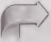

## 思考空间

思考马斯洛需求层次理论，想一想学生更看重谁的意见，是同伴的还是教师的。

- 问问自己，真实的受众如何与马斯洛需求层次相关联？

## 暂停、思考与反思

需要注意的是，在小组中工作是一种需要练习的技能。能够一起合作，让每个人都扮演一定的角色至关重要，然而人们往往认为这是理所当然的。虽然学生可能会觉得这令人沮丧，但这是必须教授和支持的技能。在下面分享的课程之前，班级讨论了小组合作，重点关注这样的问题：小组中有什么不同的角色？尊重地倾听是什么样的？小组中每个人都使用彼此的名字吗？我们为什么做小组合作？你们学生期望从小组中得到什么？你们对彼此有什么期望？

我有两个例子来说明我如何使用选择权、小组合作和其他工具来促进包容——一个来自我的九年级英语课，另一个来自我的十一年级英国文学课。

## 九年级英语：短篇小说预备教学

我的九年级班级最近开始了一个短篇小说单元。我的目标之一是让学生学习间接和直接的人物刻画。间接人物刻画需要学生进行推断，我发现这项技能对九年级学生来说尤其具有挑战性，尤其是在识别

当他们做出推断时。技术是我一直使用的工具之一，在本课中，我借鉴了其他教师在线上提供的近乎无限的创意之一（Kratter 2014）。我改编了一堂使用 *prezi* 的课程，利用皮克斯短片来教授短篇故事要素。在解释了具体术语后，我们观看了一部皮克斯短片（Pixar 2012）并应用了这些文学术语。由于皮克斯短片通常没有对话，因此特别适合用来教授推断人物特征和其他故事要素。此外，这项工作不涉及阅读文本，因此阅读能力较弱的学生也不会感到畏惧。当晚的作业是识别一部我们班上没有观看的皮克斯短片中的要素。选择就体现在这里。我发布了九个指向不同影片的链接，学生可以任选其一观看并进行反思作为作业。第二天，学生们进来讨论视频。我按他们观看的视频将他们分组。他们讨论了自己对人物塑造的看法。学生在直接和间接人物塑造方面做出了富有洞察力的判断。他们已成功将这些术语应用到自己的视频中。更重要的是，当我听他们向班上同学“推销”自己的视频，鼓励他人观看他们选择的影片时，他们的积极性显而易见。一旦我们开始阅读短篇故事，他们都对自己识别间接和直接人物塑造的能力充满信心，而且还能认识到在文本中对人物塑造进行推断的时刻。本课通过利用选择、技术和小团体合作来支持包容性，使所有九年级学生不仅保持参与，还学习并运用了短篇故事的要素。

## 十一年级英国文学：*Frankenstein* 模拟审判

我如何将选择作为最终评估使用的一个例子，来自我十一年级 *Frankenstein* 单元的教学。对于这个单元，我使用了多种评估：考试、写作作业和项目。项目部分是一场模拟审判。学生被随机分配到控方或辩方团队担任角色（律师或证人），但他们可以选择与愿意交换的同伴互换角色。一旦团队确定，学生们就以共同目标开始作为一个整体工作。每个团队大约有四名律师和四名证人。团队必须为或起诉弗兰肯斯坦辩护，他因制造然后迅速抛弃了一个后来杀害数名无辜者的怪物，而被控刑事过失杀人。我为学生提供了电脑，他们为自己的团队创建了一个 Google Doc。这使得个别学生不仅能专门与自己的证人/律师合作，还能作为一个整体协作。学生在 Google Doc 中写下问题，团队中的每个人都可以查看和编辑。这非常好，因为团队成员帮助了不够自信或能力不足的学生。学生们积极参与，互相交流想法，直到大家对自己的问题和答案以及整个团队的问题和答案都感到满意。虽然我在监督小组，但案件完全掌握在他们手中，提问的方向完全由他们决定。此外，我将自己从陪审团中撤出，仅担任法官。我这样做有两个原因。一是，他们的成绩不取决于谁“赢”了审判，而取决于他们如何陈述案件。通过担任法官，我能更专注于他们的问题、对文本的使用等等。我有一份评分标准，会在每个学生在审判中参与其部分时完成。陪审团（约九人）由校长、英语系主任、两名助教（为班级中某些特定学生提供精神支持）以及上一年上过我课、因此熟悉程序的学生组成。陪审团的构成为学生创造了一个真实的受众。有我之外的受众能提高学生的参与度，并帮助他们更认真对待，因为它显得更真实。模拟审判大获成功，各种能力的学生都受到激励、充满竞争，并以有趣且引人入胜的方式展示了他们对文本和法律体系的了解。

## 最后的思考

选择并不总是很容易融入课程或单元中。在我的课堂上，选择有时表现为选项，既针对学生也针对我。我从不只进行一次最终评估，因为那很少能清晰地反映出学生知道什么以及他们能用这些知识做什么。异质班级由具有不同技能和兴趣的学生组成。我发现当学生对自己在做什么有一点控制权时，他们的参与度更高。在短篇故事单元中，他们选择了自己的电影，利用了技术，并在小组中互动。我听到一些从不在大组讨论中发言的学生在交谈。就像模拟审判一样，他们也有由同伴组成的真实受众。他们讨论视频不是为了给我留下好印象；而是在向彼此展示他们学到了什么以及为什么其他人应该看那部电影。在模拟审判期间，那些在文本上真的挣扎的学生在与团队合作然后出庭时展示了他们对小说的理解。

## Heidi O'Donnell's Reflections

*到目前为止，教师的描述主要集中在短期引导式探究体验上。接下来这一节中，海蒂·奥唐奈描述了她在过去七年里完善的长期“开放”探究体验。*

探究科学自从我七年前开始教学以来一直是我教学的重点。随着我教授多个年级和科目，它在我的课堂上不断演变。今年，我同时教授两个七年级科学班和两个十一年级大学预科化学班，而去年我有三个七年级科学班和一个八年级科学班。这一过程在许多方面都是断断续续的。

尽管探究科学项目的逐年发展对我来说受到了中断，但有一个大型总体项目，我在过去七年里每年都能与我的七年级学生一起开展。它叫做“Little Jars of Crud”，或 LJOC。我相信我每年都能稍微改进这个项目一点，经过七年后，我对完成该项目后产生的学生学习成果、产出以及对科学过程的理解感到非常印象深刻。我犹豫说“完成”，因为我希望学生在项目结束后继续学习，我相信它允许他们根据自己的意愿自行进一步探索。

LJOC 是与中学生命分类单元相关的项目。学生学习生命为何以及如何被分类，以及各界门和各门的特征，以及生物生存所需的条件。他们自己熟悉科学技能分类并尝试鉴定物种。随着学生阅读教科书并进行活动，总体项目被引入。有时我甚至在开学第一天就开始。在两人一组的情况下，学生将草和水放入婴儿食品罐中，几天后在显微镜下观察水样。它 *teeming* 充满了生命！这就是抓住他们注意力的 *hook*。他们立刻想了解这些生物。我拒绝告诉他们，而且实际上即使几个月后也不告诉他们。他们必须在我们开始讲解不同界的特征时自行得出理解。长话短说，在班级所有小组之间，他们最终不可避免地会看到来自所有五个界的物种（如果你把两种细菌类型算作一个界）！这对我作为教师和他们作为学生来说都很棒。在 *hook* 之后，我们简要回顾科学方法，并询问学生对 LJOC 有什么问题。这导致可探究问题的产生。学生随后选择一个他们想研究的主题，例如“不同类型肥皂对罐中生命有什么影响？”他们创建对照实验来回答问题，制作必要的罐子，在一个月的时间里观察它们，然后分析数据并撰写实验报告。当数据被综合时，我们用一节课时间进行圆桌讨论以分享结果。这样，所有学生都能听到研究了什么（每个人都有不同的主题）并决定“________ 对罐中生命有什么影响？”这个问题。显然，执行所有这些步骤涉及更多细节，但我运行的方式是完全由学生主导的。

这个为期两个月的总体探究项目的成果是，学生们能够深入且独立地理解如何使用显微镜、设计对照实验、理解不同生物界的特征以及生命的整体多样性，知道哪些条件对某些生物有利（或不利），并理解如何识别不同的生物。探究式科学项目是将他们正在学习的所有事实或书本知识整合起来并使其变得真实所必需的。在整个实验过程中，我尽最大努力与社区以及他们的每个项目建立许多联系，使学生意识到他们所做之事具有现实世界的影响。这个项目的两个可能扩展方向是检查他们所在城镇的水质，或者将井水与从水库通过管道输送的水进行比较。

我认为我得到的关键信息是，探究式科学对于学习至关重要，如果教学得当，它是最有效的教学方式。另一个关键信息是，教师用来创建和完善这些探究项目的时间越多，学生从中的收获就越大。创建有意义的探究课程需要大量时间和创造力，而且从头构思可能很困难，因此教师应利用自己的资源，同时也要有时间这样做。没有必要重新发明轮子，但教师可能必须将其打磨一下，以便恰当地融入自己的课堂。教师协作、互联网以及像美国国家科学教师协会（NSTA）这样的专业网络，都是获取灵感和分享交流的绝佳来源。

## 思考空间

- 小川洋子的引语对我们关于数学教学和学习的启示是什么？
- 这就是你对数学的思考方式吗？
- 你对数学教学有多大把握？
- 你的学生能否对数学产生积极的、甚至令人敬畏的情感？
- 探究式教学是否能成为帮助学生欣赏数学的催化剂？
- 你认为探究式教学能否成为各级有效数学教学的解决方案？

## 第一年数学教师的反思

*我请一位第一年任教的数学教师——一位在实习期间成功运用探究式教学的杰出实习教师——谈谈她在传统高中数学教研组最初三个月的经历。她要求不透露她本人及她学校的身份。尽管经历了一些令人沮丧的事情，她仍致力于在教学中坚持探究式方法。这是她为学生尽到责任的方式。*

作为相对传统的数学教研组里的一名第一年教师，我真的很难找到将探究带入课堂的方法。我害怕做事太与众不同，也担心自己所在的学区可能不允许我做那些在我看来是最佳实践的事情。

第一周，我们只上了两天课，然后就到周末了。在与同事交谈时，我得知大多数人不会马上进入课程内容，而是先建立课堂常规。这似乎是让我的课堂引入问题解决和探究的绝佳时机，让学生习惯我们要进行的探究方式。我给他们一些牙签问题：牙签以特定形状摆放，并给出若干限制条件，学生需要将它们重新排列成另一种形状。我的学生们很吃力。当我不肯告诉他们答案时，有些人真的很沮丧。我立刻让他们分组合作，我觉得这让他们中的一些人感到震惊。由于那是开学第一、二天，我借此来建立班级共同体，并观察哪些小组合作得好、哪些小组合作得不好。我的学生大多是高年级学生，彼此认识，所以他们很快开始一起合作。看到学生们立即投入其中，我非常高兴。在调查中，很多人曾告诉我他们不喜欢数学，但在这里他们却在解决问题和发现规律。合作的小组往往更快解决问题，而另一些学生则希望不知道答案，这样他们就能继续思考。这无疑令人鼓舞。

到了第二周，我很费力地引入大量探究式学习。我尝试了，但课程进度很快，我觉得没有时间。然而，我也觉得自己没有为学生尽到责任。我从小处着手。我的代数II课程正开始讲二次函数。我们先做了一个“猜想板”，让学生写下他们所知道的内容，这真的让我很意外。我原以为他们对二次函数了解很多，但事实表明他们其实很不确定。下节课，我给了几个学生一个网球，让他们玩传接球。我觉得学生们可能以为我疯了。我问他们注意到了什么。全班开始讨论球的轨迹形状，我们以此作为切入点。之后我能够不断回顾这个简单的演示，让学生们保持同步理解。

在几何课中融入探究，我取得的成功最大。这门课以证明为基础，而以此为基石，它自然适合一直提出“为什么”这个问题。我想到了这个时候，也就是第二学期期中，学生们可能有点厌烦听到我问这个问题。最近，我在三个几何班中的两个班开展了一个活动，探索为了确定两个三角形全等，我们需要知道什么。开展探究可能会很艰难。我的许多学生试图等我给出答案，有的则不停地问“我对吗？”或“是这样做的吗？”我给所有学生分发了剪好的意式宽面，有特定的长度和角度，还有一些未剪断的面条，他们可以掰断或剪成所需的样子。我们通过讨论和建模来理解：知道一条边相等不足以判定两个三角形全等。对一个角相等我们也做了同样的事。然后我请他们思考下一步，目标是我们希望测量最少的量，仍能确定两个三角形全等。这让许多学生都在等我告诉他们下一步该怎么做。我问：“接下来我们最少可以测量多少个量？”幸运的是，有个学生说：“两条边。”

活动的其余部分有些进行不下去。这个班约有16名学生，规模不大，他们真的只是希望我告诉他们该怎么做。课上大部分时间我只是走来走去，提出问题，并极力忍住不回答他们的问题。到下课的时候，我能看得出来学生们其实对什么都没把握。他们把我告诉他们的话记了下来，却不能真正说明我们为什么要写下那些东西。我需要重新设计这个活动，但我没有放弃。

放学后我在图书馆辅导学生，通常是数学，但有时也会帮忙辅导其他科目。有一次我在帮一个学生做物理作业，她转过身对我说：“我希望她（物理老师）能像数学老师那样直接告诉我们该怎么做。这就是为什么数学对我来说容易；我们只要按步骤来、套公式就行了。物理课上她从不告诉我们如何解题，我们必须自己想办法。”我想这是我至今听到的最令人沮丧的话之一。也许比无数句“我讨厌数学”的宣告更糟糕的，是学生们没有意识到数学课上也需要思考。

## 乔纳森·卡茨的反思

*几十年来，乔纳森一直在纽约市的几所公立高中担任数学教师，接触过大量背景多样的学生，是一位极其出色的探究式数学教师。他还让我们得以听到一些来自全市各地、与他一同工作的数学教师的心声。*

什么是数学？我们为什么教数学？许多人都思考过这个问题，答案因人们对数学的信念和认知而不同。数学是否像一些人声称的那样引人入胜、富有创造力和美感，还是像许多人感受到的那样，是一门必须忍受并熬过去的学科？它是一门创造性的学科，还是一套僵化的规则和程序？看看这段对数学的描述，体会一下你的感受。在节选中，一位教授正与一位10岁的男孩谈论质数。

> 没错，一片沙漠。无论你走多远，都找不到一个。目之所及，只有黄沙。太阳无情地炙烤着，你喉咙干渴，眼神呆滞。这时你以为自己看到了一个，终于是一个质数，你朝它奔去——却发现那只是海市蜃楼，不过是热风而已。然而你不肯放弃，一步步踉跄前行，决心继续寻找……直到终于看到它。另一个质数的绿洲，一个可以休息、有清凉净水的地方。（小川洋子 2009，第64页）

在我从教的最初几年里，我可能会被归为传统的讲授式教师。我努力工作，也取得了一些成功，但我总觉得自己在糊弄所有人。我擅长让学生在标准化考试中取得好成绩，但他们真正学到了什么？随着时间推移，我把新的理念融入到教学中。我知道自己热爱数学，也希望学生能产生同样的情感。我试着把问题解决、艺术和建筑带进课堂，但只是有限度地去做。在别人眼里我是一位非常成功的教师，但我仍担心自己是冒牌货：擅长让学生在考试中取得好成绩，却觉得学生的理解全都流于表面。当时我不会使用*程序流畅性*和*概念性理解*这样的术语，而是觉得自己教给学生的只是做数学的方法、行业诀窍，缺乏真正的程序流畅性或深刻的概念性理解。

在我从教的第十八年，我开始在一所秉持进步主义教育理念的学校工作。初到这所学校时，我费力思考并质疑学校的教育理念。我不明白在这种类型的学校里该如何教学。我基本上把教学视为……的传递。

知识。那是我被教导的方式，我从未见过有人以不同的方式去做。我暗自琢磨：“他们认为教学意味着什么？”与此同时，我对周围所见感到惊讶。学生们似乎喜欢在这所学校学习，学生的参与度非常高。随着时间的推移，我开始将一种新的教学方式——探究式教学——融入我的课堂。当我要求学生去发现数学概念、在有意义的项目中运用他们的理解，并将数学视为一种创造性体验时，我开始看到学生对数学的兴趣日益增长。尽管学生们在理解数学思想方面仍会遇到困难，但他们开始欣赏数学的神奇、力量和美。

在过去的10年里，我有机会以数学教练的身份与许多六至十二年级的优秀数学教师合作。通过这项工作，我对教与学的理解得到了极大的提升。我曾坐在数百间以探究式数学为核心教学方法的教室里。我观察了数学的呈现方式，以及学生如何试图理解并弄懂数学思想和问题。在接下来的章节中，你将听到其中一些教师和学生讲述探究式教学如何改变人们对数学的思考方式。

## 探究式数学教学

许多学生将数学视为一套程序，能在短时间内回答问题（Schoenfeld 1988）。与此同时，探究是一种“基于概念创新”的教与学模式（Schwab 1962, 5）。参与探究共同体的学生讨论并解决新的、不熟悉的问题（Kwon 2005）。问题被用来帮助发展对概念和程序的数学理解，而不是被视为已学程序的应用（Koehler 和 Grouws 1992；Hiebert 1999）。教师的工作是“鼓励猜想和论证，并营造一个让学生能安全表达自己想法的环境”（Koehler 和 Grouws 1992, 122）。探究通过不确定性和挣扎来推进，最终获得来之不易的知识（Schwab 1962）。

探究式数学教学的两个核心思想是*模式*和*问题解决*。数学被定义为“模式的科学”，而数学学生的核心角色是模式搜寻者。我如何理解呈现给我的信息？我能从这些模式中得出什么观察？根据观察到的模式，我能提出什么猜想？我能证明这个猜想对所有情况都成立吗？当学生理解模式作为数学基础结构的核心地位时，他或她就更有可能发展出数学理解。

鲁本·赫什（Reuben Hersh）在讨论数学哲学时指出：“推动数学的是问题。解决问题和提出新问题是数学生命的本质”（1997, 18）。乔治·波利亚（George Polya）（1945）在第一版《*怎样解题*》的序言中写道：

> 因此，数学教师有一个绝佳的机会。
> 如果他把自己分配的时间用于向学生灌输常规操作，就会扼杀他们的兴趣，妨碍他们的智力发展，并错失这个机会。但如果他通过设置与学生知识水平相称的问题来激发学生的好奇心，并用启发式的问题帮助他们解决问题，他就能让学生尝到独立思考的滋味，并掌握一些独立思考的方法。

（Boaler 2008, 26）

波利亚和赫什都描述了探究的一个基本方面。学生面对一个有趣的问题，这个问题具有挑战性但又不失可接近性；它是开放式的，包含多条通向解决方案或结论的路径；并且它将引出学生可以尝试解决的其他问题和难题。纽约市的几何教师约翰·麦克兰（John McCrann）赞同波利亚和赫什的观点。他写道，

> “K–12数学常常被呈现为一套静态的答案，缺少了引导人们得出这些答案的问题。探究式数学重新构建了数学过程，促使学生在涉及定量和逻辑推理的问题情境中提出并理解问题和答案。”

许多数学学生——无论是过去还是现在——都逐渐认为数学无趣且无关紧要。数学缺乏连贯性，因为不同的数学内容领域已被“切碎成小块，专注于掌握算法程序和孤立技能”。

（Schoenfeld 1988, 163）

纯数学本身能否有趣？构成数学的优美模式和关系能否吸引学生的思维？这些模式能否帮助学生看到数学思想与程序之间的联系？探究式教学的一个重要目标是帮助学生欣赏数学的壮丽，同时帮助他们理解数学如何帮助解释他们所生活的世界。

探究式数学教师思考如何为学生创造有意义的体验，使他们对数学的兴趣不断增长，并让他们的学习体验充满愉悦。他们努力创造反映人类学习方式的体验。

布朗克斯区拥有15年以上教龄的ELL数学教师劳尔·格拉西亚（Raul Gracia）说：“探究尊重学生与生俱来的思考、识别模式、做出预测和犯错的能力，不带有恐惧和评判，因为这正是人类学习的方式。”

德国数学教师埃里克·马林奇（Eric Marintsch）强调学习需要时间，探究式教学尊重学习的过程。他写道，

> 让学生在探究课上拥有时间，意味着学生有机会挖掘误解，并有机会做出发现、真正探索数学。当这种情况发生时，学生的创造力受到鼓励，课堂讨论蓬勃展开。学生在探究式教学中获得的真实体验会带来深刻而持久的理解。

在探究式课堂中，教师的角色是什么？是让学生被动地坐着，由我展示数学程序和算法，然后他们练习我示范的内容，还是我为学生创造体验，使他们能够在学习共同体中建构新知识？

在纽约市从教10多年的教师劳拉·穆里诺（Laura Mourino）描述了她如何思考为数学学生创造的探究体验，以及她在课堂中的角色。

> 我的学生有机会通过坚持完成一项任务/活动来引导自己的学习，直到他们发现可以推广到给定任务之外的模式。我认为教师在探究式数学教学中的根本角色不是示范者，而是设计出关键的活动/问题/任务，不仅要让学生参与“寻找解决方案”，还要挑战学生深入思考自己在做什么、为什么这样做，以及将来如何运用所学。

探究式数学教师相信学生有能力进行复杂思考，并且是有创造力的思考者，因此他或她鼓励学生作为问题解决者自由地冒险。罗伯特·梅西尼奥（Robert Messineo）是皇后区洛克威的一名五年教龄教师，他在银行业工作多年后开始教学，他写道

> 我学会了放弃对课堂的控制，让学生引导自己的学习。起初这很困难，但看到我的学生发现各种自主学习的方法，让我非常欣慰。我的学生已经成为问题解决者，并能将他们的解题技巧应用于数学学习中的其他主题。

许多教师认为数学探究式教学只能在小学阶段的简单算术中实施，有些人则认为在初中阶段的统计、几何和入门代数中也有可能。在数字资源光盘上的“探究式数学是什么样子的？”一节中，乔纳森·卡茨（Jonathan Katz）描述了针对复杂高中数学课程的探究式数学探索。这些课程表明，探究式教学在整个学业阶段的数学学习中都有应用。

## 学生对数学探究式教学的思考

探究式教学强大的方面之一是它要求学生以不同的方式思考。学生们通常将数学视为一门严格的学科，其中记忆和遵循规则与公式是成功的关键。探究式教学旨在通过数学发现帮助学生发展概念性理解和程序性灵活性。在探究式教学中，学生被要求独立或与其他学生合作应对开放式任务时进行思考。在理解概念、程序、规则和公式的过程中，学生常常被要求思考模式、提出猜想和概括，并尝试证明或反驳它们。这种思考可以是视觉的、代数的或逻辑的。在所有情况下，学生都运用推理能力来发展理解。

经历过这种教学的学生分享了在探究式课堂和传统课堂中思考的差异。两名十一年级学生——一名在探究式课堂，另一名在以教师为中心的课堂——描述了各自课堂中的思考要求。在传统课堂中，一名学生描述道

将数学视为“关于复制”，就可以理解她认为数学不需要太多思考的观念。她说，

> 我在数学中也被迫思考，但我已经知道自己会得到什么，所以不需要想太多。在英语中你必须自己想出点子。以前他们会告诉你作文要写什么，现在就是你脑子里有什么就写什么。这很难，因为你不知道那里有什么...但数学要么做这个要么做那个。

另一位在探究式课堂学习的学生比较了他在这两种课堂中的思维。他说，

> 我以前的老师只是教数学，他们会帮你写出方法，而不是让你花时间自己去理解。通常他们只是想让你做数学来解题...[并遵循]他们对数学的思考方式。[我的探究式老师]希望我们找到我们如何思考数学以及我们如何知道数学....我们使用自己的思考方式，并将[我老师的]想法与我们自己的视角结合起来。她希望我们扩展自己的想法并看待其他视角，主要是我们自己的（Katz 2009）。

许多探究式数学课堂的学生改变了他们对解题的观念。他们开始认识到有不同的方式思考一个问题；因此，也有不同的方式来处理解题过程。

> 我的解题策略发生了巨大的变化。我现在的思考方式与去年完全不同。我以不同的视角看待数学，因为我看到现实世界可以以如此多种不同的方式与数学相关联。所以当我在解题时，我会寻找不止一个答案或另一种解题方法。以前我总是认为只能找到一个答案，如果我一下子不知道答案，我就会放弃。[它]正在帮助我的思维在数学上进步，因为需要做很多思考。

我们经常从学生那里听到的是数学无关紧要、无聊且困难。然而，采用探究式教学有可能改变学生的想法，甚至帮助他们在数学中感受到快乐。学生的生产性倾向发生了变化，因为他们开始看到数学更开放，更欢迎不同的思考方式。保罗·洛克哈特阐述了如果一个学生在探究式课堂学习可能会发生什么。所以我用这些有力的话来结束这次演讲。

> 就让它变得困难吧。不要气馁，也不要对自己的失败过于自责。理解数学现实有困难的不仅仅是你；我们都是如此。不要担心你没有经验或你不够“合格”。让一个人成为数学家的不是技术技能或百科全书式的知识，而是 insatiable curiosity and a desire for simple beauty. 只做你自己，去你想去的地方。不要犹豫畏惧失败或困惑，试着拥抱这一切的敬畏与神秘，并愉快地制造混乱。是的，你的想法不会奏效。是的，你的直觉会有缺陷。再次欢迎加入这个俱乐部。我每天都有十几个坏主意，每个数学家也都一样。

> —Lockhart (2012, 10)

## 我所面临的挑战：David Nurenberg 的反思

自从我采用探究式教学、项目式教学和民主课堂实践以来，我的工作变得更加具有挑战性。它也更有回报，因为我看到我的学生更加投入，并在更复杂的层面上思考，这就是我坚持下去的原因。传统的课堂绝对更容易规划和管理——你有一个计划，并且坚持执行。你掌控一切，你制定了规则，你知道参数，并且执行它们。在探究式课堂中，你必须做出各种应急安排并保持灵活，因为你永远无法完全确定孩子们可能会把一个活动或对话带向何处。我不能只是坐在我的桌子前在学生进行写作活动时批改作业。我必须时刻走动，倾听他们的讨论小组，提供反馈或提出问题。学生可能会决定尝试制定我不同意的规范，然后这就变成了一场讨论和谈判，可能耗掉半节课甚至整节课。每周我都会制定计划，而每天我都必须修改它们。

合作工作本质上就是混乱的。我会提前坦率地告诉孩子们——我告诉他们他们之间会有冲突，会有挣扎和挫折，因为有四五个想法不同的人在努力合作。有人不可避免地会想搭便车、变得专横或说出尖锐的话。非常诱人的是作为权威人物介入试图解决小组冲突；他们经常希望我这样做。然而，除非学生的安全（身体或情感）受到威胁，否则我几乎总是把问题抛回给他们，这很难。我非常关心我的学生，当我看到在我看来似乎是容易的解决方案时，我想提出甚至单方面强制执行。我必须对抗我和他们的倾向，转而帮助他们谈出来并努力达成他们自己拥有的解决方案。这并不总是完美的，而这本身就是一个教训。随着他们的挣扎，他们从中成长，到学年结束时，他们在自我调节和建设性地管理冲突的能力上有了飞跃式的进步——有时甚至欢迎这些冲突作为学习体验。

不过，沿着这条路，这套方法对学生，尤其是他们的父母来说可能很难推销。我学会了与父母做大量准备工作，以便让他们了解我计划做的事的教育和成熟价值，并向他们保证，是的，在极端情况下，我确实会单方面介入小组间的冲突。我曾经有一位家长真的把她的孩子从我的课上撤出来，因为她担心女儿的成绩会因其他学生在小组中的表现不佳而受损。在我这所高要求的学校，家长和学生都极度关注成绩，我学会了确保每个学生都有充足的评估，在这些评估中只有他或她自己对自己的成绩负责。我努力提醒家长和学生 alike，学习如何管理合作工作是任何现代职业工作中的一项重要技能，如果学生在安全的环境中不学习这些技能，他们以后会处于劣势。

尽管探究式教学作为一套最佳实践正变得越来越被认可，但它以及那些寻求参与其中的人仍然面临额外的制度障碍和抵制。尽管其初衷良好，但教育中的成果导向运动鼓励（或强化了现有的）学校和部门内部的趋同。如果你做的事情与同事不同，仅此一点就可能带来质疑甚至批评。所有教师都面临着在创新与遵守要求标准之间的一种舞蹈（这些标准由州政府、你的学校、系主任或教学团队规定）。我在课堂上做的事情有时看起来不像英语课——孩子们并不都在同一时间阅读同一部小说；他们并不总是写传统的文学论文。我借鉴了大量来自其他学科的材料，从历史到心理学再到数学，有时这会引起侧目。我在这里最好的辩护在于我的学生创造的产品。如果我们仍然到达“罗马”，我们走哪条路重要吗？坦率地说，我认为正因为我们的运作方式，我们走得比罗马还要远一些。

合作工作不仅仅是学生的事！我最成功的课程和结构来自于我能够与同事协调和合作的时候；我从同事们的意见中学到了很多，在我们最好的状态下，我们都在同样的合作氛围中自由地分享、复制和修改彼此的成果，而这正是我们试图在探究式课堂中培养的。同样，我最令人沮丧的经历来自于这个系统崩溃的时候，当同事变得防御或怀疑时。多次，我被告知不要从事某些实践和项目，仅仅因为它们触及了别人的地盘。其中一个特别不幸的例子是，当我和几位同事成功获得了一笔15,000美元的资助来教授一门课后跨学科的探究式课程，并成功通过了行政部门甚至工会的审批，却有一位有影响力的教师谴责它，因为他担心它会把学生从另一门课程中吸引走。我无功而返地争辩说，我们的项目应该基于学生的需求，如果学生发现一门课比另一门课更适合他们，那么那就是我们应该提供的课程。没有成功。害怕激怒这位教师，我的合作同事们纷纷撤离，没有人愿意再教这门课。我们不得不退还资助，学生们感到失望，这门课甚至没有机会证明自己的价值。了解你学校的政治，并尽力很好地应对它们。

具有讽刺意味的是，低社会经济、高需求学校的教师可能比在资源更充足、社会经济水平更高的环境中的教师拥有更多使用非传统教学方法的自由——当学生无法毕业或在州测试中取得高分时，学校管理层通常更愿意允许教师自由地做任何能产生结果的事情。在富裕的郊区学校，学生的考试成绩和大学录取无论教师使用何种方法都可能保持高水平，传统或政治更容易决定允许哪些教学法。在这样的学校中，你需要用来捍卫你的教学法的那种数据将是学生作品的样本，通过能够揭示高阶思维正在进行的评估，以及你能收集到的尽可能多的来自学生和家长的反馈。

我学到的是，最终，你能够在多大程度上将探究结构融入你的课堂，不仅取决于你和学生的舒适度，还取决于你同事和社区的舒适度。你需要发展管理这些关系的能力，建立社会和专业资本，并在某些时候要么建立关系并妥协，要么只是耸耸肩接受你总会有批评者。记住，你的首要职责是对你的学生，让这一点指导你作为教育者的发展。

## 思考与反思

- 1. 尽管各位教师的年级和学科各不相同，他们的课堂和方法之间最显著的共同点是什么？其中哪些与你目前的教学与学习方法相契合？在探究式教学之旅中，你的下一步可能是什么？

- 2. 戴维·纽伦伯格（David Nurenberg）谈到要让学生认识到好问题的价值。你如何让你的学生理解，为什么针对同一主题的某个问题会比另一个问题更丰富？这对你来说是否也能成为一种有价值的评估机制？

- 3. 安德烈娅·埃吉托（Andrea Egitto）讲述了她作为一名小学教师，如何从只在科学课上使用探究式教学，发展到多年后将其作为自己课堂上所有科目的教学方法。如果你是一名小学教师，你会先从一个学科领域开始探究式教学吗？如果是，会从哪个学科开始？你会从多个学科开始吗？这样对学生是否更好？你觉得你能找到同年级的另一位教师共同规划吗？

- 4. 如同迈克·法默（Mike Farmer）的课堂一样，你的学生是否会运用技术来主动制作媒体作品，将他们新构建的理解传达给学校或周边社区中的其他人？

有效的自我管理、群体动力、有效沟通、在多元文化中茁壮成长，以及建立一个支持性和滋养性的社区。

教师可以在自己的课堂上建立这种支持性文化。当全校社区在学生就读期间共同努力培养这些社交互动技能和自我管理技能时，学生掌握这些技能的速度会快得多，理解也会更深。幸运的是，在城区、农村和郊区，各级学校中都有一些学校和个人，他们在创建课程和结构方面取得了令人难以置信的成功，从而形成了这样的课堂和学校文化。这些人或是整合了完整的课程，或是整合了其中的一部分，供我们其他人用来让学生在校园里互相支持。通过参与这些课程活动，你的学生可以同时获得那些在家庭、社区和工作场所中建立积极人际关系所需的洞察力和技能。学生可以在所有社交场合中成为一个有自主能力的人。

本章介绍了在一个教师的课堂上、一个中学团队中或整个学校中最佳实施方式的基本原理和形式。与探究式教学相结合，支持性的课堂环境能使学校成为极其强大的学习场所，并真正缩小成绩差距。

## 戴维·纽伦伯格对课堂管理的反思

在我14年的教学生涯中，有一半以上的时间，我一直在用探究式方法教授英语和社会研究。每一年，我都挑战自己要更多、更深入地运用这种方法，因为我每年都能看到学生们的积极响应，以及他们借助这些模式能够达到的高度。

十几岁时，我是那种少数的学生，能够从老师整整50分钟的讲授课中做笔记并学好。即便如此，我到底学到了什么？我能脱口而出第一次世界大战各场战役的日期和结果，能变位西班牙语动词，能告诉你牛顿定律的一切，但真正让我*思考*的，是那些也涉及*动手*的课堂——在建构某样东西时进行分析，设计和进行实验，或与同学讨论和辩论观点。正是在这些课堂上，我才真正需要批判性思考并创造新知识——这正是“共同核心州立标准”（Common Core State Standards）现在对学生们的要求（2010年）。传统的、以教师为中心的课堂模式，充其量只是让学生掌握记忆和复述的技能；更常见的是，它让绝大多数缺乏内在动力、看不到课堂与*日常生活*相关性的孩子失去参与感。

对我来说，探究式方法一石二鸟：既能吸引不愿学习的学生，又能帮助所有学生发展和磨练他们的高阶思维能力。多年来，我一直在与学生共同创造的课堂环境中工作，这种环境要求学生独立和相互依赖，并对此给予回报。我课堂上的学生以全班和小组的形式合作学习；我们很少会所有人同时以同样的方式做同样的任务。在小组内，学生各自承担任务，并根据兴趣和能力水平进行区分。在每一个环节，我都尽可能给学生机会去主导自己的学习方向，并积极地相互学习和教学，而教师则充当引导者或促进者。

从一开始，我就向学生强调：我们是一个共同体——这不是一个有27名学生和1名教师的课堂，而是有28名学生和28名教师的课堂。虽然我在课堂上拥有权威角色，但我不是知识的唯一拥有者。相反，我努力强化这样一种观念：相互教学是我们的工作，而只有当我们拥有相互尊重和开放的氛围时，我们才能做到这一点。我非常明确地传达这些价值观。在开课的头几周，我们会练习一些常规，比如“如何进行课堂讨论。”我们共同协商规则——我有一些不容商量的底线，比如*不得贬低他人*，但我几乎从不必自己说出来，因为孩子们自己就会提出这些规则。我们还共同设计如何在活动之间过渡、如何分发新材料等等。我们也用同样的过程来制定小组工作规范、有代课教师时的规范，并在需要澄清或修订时偶尔重新审视这些规范。

像我们的每日签到（我们在教室里轮流发言，学生用不超过10个词总结自己的感受）或“别掉球”（学生们必须以循环接龙的方式共同造一个句子）这样的活动，能帮助孩子们相互了解，并练习如何独立工作。虽然它们看起来与教学内容无关，但实际上要求孩子们培养并运用相互倾听、朝着共同目标合作等技能。例如，“别掉球”帮助学生练习倾听、专注、预判和合作目标（除非所有成员都尽自己的一份力，否则小组无法成功）。随着学年推进，小组之间的联系更加紧密，我会调整游戏类型，使其更少关于*认识彼此*，而更多关于*如何有意义地自我评估*，最终，*如何道别*。

这类小组游戏，尤其是几周后我们进行的冲突解决活动和模拟，能培养学生以有意义的方式合作、并有效处理不可避免的冲突的能力。学生们通常觉得这些活动很有趣，因为它们不像功课，尽管它们是我们做过的一些最重要的功课。我常告诉我的孩子们，我上高中时讨厌小组合作，直到多年后才意识到，那是因为从没有人教过我该怎么做；老师们只是把我们扔进小组，让我们自己干活。那么，仅仅把一个人扔进喷气式飞机的驾驶舱，叫他去飞，会是一次成功的体验吗？

尽管这些活动起初似乎会挤占内容学习的宝贵时间，但我发现，这类活动最终能促成成功的合作与探究式学习。此外，这很少是*非此即彼*的选择，因为这些活动往往能结合相关内容进行。我曾让学生练习“我”字句，并处理冲突的根本原因，既将其应用于他们自己学校的场景，也应用于*《罗密欧与朱丽叶》*中蒙太古家和凯普莱特家的世仇。在练习同理心和换位思考来分析我们自己的个人冲突时，我们会明确地讨论：这些技能与帮助我们分析所读小说或短篇故事中的任何人物或主题的技能是相同的。人文学科并不是唯一能轻松将合作技能与学科内容学习技能相互渗透的领域。你在科学课上提出并辩护的假说，你在数学课上试图通过推理逻辑构建的规律，所有这些都依赖于那种观察数据（行为）、寻找根本原因，并得出适用于特定问题的解释或解决方案的能力。一个能帮助学生发现这些联系的教师，可以同时帮助学生培养在当下生活中有效合作的技能、完成规定的教学内容，并且最重要的是，帮助学生建立学校要求与日常生活经验所需之间的联系。“共同核心标准”极大地推动了这一进程，它要求学校不再把让学生记住特定的名称、日期和公式本身当作目标，而是将这类陈述性知识限制在其应用性上，即帮助学生发展一套核心技能。

## 让课堂成为一个更美好的地方

求学生涯的大部分时间里，我都躲在前排同学的身后。幸运的是我个子矮小，所以做到这一点并不太难。我总觉得自己像是智力问答节目里的参赛者，随时都需要一个答案。老师随时可能叫我回答问题，而我可能答得出来，也可能答不出来。答错让我难堪，更糟的是，连答案都没有。

在探究式教学课堂中，教师和其他学生都对“到目前为止你的最佳思考是什么？”的回答感兴趣。在学生需要参与全班讨论之前，他或她已经尝试了一种思考该问题的思路。如果我作为学生处于这种情境中，我就不会一直紧张并躲在别人身后以免被注意到。即使在当时，我也能告诉老师和班上其他同学我是如何处理一个问题或到目前为止我的最佳思考是什么，但从来没有人问过。在探究式教学课堂中，那种紧张感得以释放。学生可以安全地尝试自己的思考，并互相帮助理解找到答案所需的步骤。

其次，有效进行的探究教学比传授式教学更能吸引学生。我们都知道，大多数纪律和管理问题都是在学生感到无聊且看不到课程用途时产生的。在探究教学中，以及延伸到项目式学习、跨学科主题单元和服务学习中，*通过参与进行管理*存在。你所设计的课程本身就具有内在的趣味性，学生每天都想去上课。在经验丰富且技艺精湛的探究式教师指导下，他们不仅学会了良好的阅读，而且开始想要阅读，甚至热爱阅读。同样，其他所有学科领域也是如此。他们成为了学习者。他们离开大多数课程时，带走的问题比进来时更多。他们可以成为探索者、设计者和创造者，这与大多数学校存在的精神截然不同。现在这完全是另一种管理方式。

## 培养社会人际思维习惯（SIHM）

在与新教师的工作中，他们对纪律和课堂管理的担忧通常在对话早期就会出现。在我们第一次会面时，我通常会说：

> 如果你像我们大多数人一样，你将在未来25或30年里从事教学。在这段时间里，你可以选择做警察或教你的学生如何自我管理。当我开始教学时，我遇到了扰乱课堂的学生行为问题，于是我成了警察并执行我的规则。这与有趣相去甚远，效果也不佳，极其耗时，占用了本应用于教学和学习的时间，而且没有教学生如何成为参与型公民，或监控自己的行为。学生之间也不友好，一旦我不再盯着他们，他们之间的支持也少得多。所以如果你也想教学生如何自我管理，你需要为他们提供学习体验，让他们通过在真实情境中实践来获得技能、见解和理解。

教师并非唯一对人际互动感到担忧的人。调查显示，企业领导者对员工互动也有类似的担忧（Weissberg and Cascarino 2013）。在调查中，他们报告说毕业生往往缺乏写作和数学技能，但他们最关心的问题是缺乏作为团队成员有效工作的能力。无论是工程团队、设计团队、快餐店的团队，还是中学教师团队，都一样。实际上，许多学校虽然并非有意如此设计，但似乎结构上是教导学生竞争而*不*互相帮助学习。

在我们与教师合作促进学生冲突解决活动的工作中，我们发现他们无一例外地提到，如果他们自己练习并运用冲突解决技能，他们与伴侣之间的人际关系会改善。最坦诚的人往往指出，他们所在学校的教职员工和行政人员在这方面也需要改进。

我开始将这些能力视为社会人际思维习惯（SIHM）。换句话说，这些是关于团体和人际互动的技能和见解，需要成为每个个体思维结构的一部分，并且可以在生活的每一天、各种情境中加以运用。

## 界定小组角色

在前几章中，我论证了当学生在探索过程中能在四人小组中发出声音时，他们会建构自己的理解并协商想法。这种小组学习如果学生，无论是一年级还是十二年级，没有学会*如何*成功地彼此合作，就不会成功。为此，他们需要结构化、明确的体验，有助于有效合作互动的要素。当你明确地教他们如何有效合作时，合作学习就会发生。学生同时在做两件事：（1）学习学术内容概念和思维技能，以及（2）学习成为有效小组成员所需的技能。

我一直提到四人小组——四有什么特别之处？为什么不组成五人或三人小组呢？小组超过四名学生时，就有人听不到声音并被排除在外。许多教师发现，较大的小组会产生纪律问题，因为学生的注意力会分散。此外，有时一对学生足以专注并就某一探索进行交流，因此如果他们已经坐成四人小组，就无需移动椅子。在不浪费时间的情况下配对学生非常容易。桌子上的两个小组会听到彼此的讨论，这是一件好事，因为它能促进更丰富的讨论。然而，仅让他们坐得合适并不会教他们有效小组成员应做什么。因此，有必要为学生分配小组角色。这个角色每天都会更换，因此他们可以练习完成每个角色所需的思维和人际技能。

### 启动者做什么？

学生起初会认为启动者意味着老板。他们很快意识到并非如此简单。由于他们负责让小组所有成员保持在任务上，他们需要明确任务是什么，然后想出与未在任务上的学生沟通和接触的方法。当教师巡视教室时，如果她或他注意到某位学生长时间偏离任务，就会悄悄、谨慎地敦促启动者处理这个问题。有时会有学生对这些提醒无动于衷。小组在教师（有时还有其他小组）的帮助下，共同制定策略，以让脱离任务的学生重新投入。这是一项非常宝贵的技能，学生一生都会用到。

### 取物者做什么？

取物者需要起身并带回当天活动中使用的所有材料。取物者需要制作材料清单并使用它们，以确保小组所需的一切都已获取。他们也可以在活动开始后起身向教师提问。在这里，学生再次练习表述小组已理解的内容，随后清晰地表述小组尚未明确的内容。每个角色都通过实践让学生洞察到一个小组取得成功所需的某些行动和思维。

### 记录者做什么？

当我问大多数教师他们认为记录者做什么时，几乎总是回答他们会写下小组的想法、数据或到目前为止的最佳理解。对许多人来说，这就是他们过去在小组中对记录者的经验。当我问这样做可能有什么问题时，教师们会思考片刻（等待时间），然后通常会给出一些答案，例如“记录者无法太多参与对话”或“他们可能是记笔记不好的那种人”。当他们思考探究式教学课堂中探索过程中每天发生的事情时，由一个人掌握小组思想的书面记录的局限性就变得明显。在探索阶段，小组中的每个学生都需要记录数据或想法。他们每个人都需要分析它，并为第二天继续探索做好准备。如果只有一名学生，即记录者，拥有这些信息，那么其他人就无法将其用于作业，更糟糕的是，如果今天的记录者明天缺席，小组就无法继续探索。

具体来说，记录者的工作是确保提醒小组中的每个人写下他们的想法或数据。如果教师在巡视教室时看到一名或多名学生忘记记录想法，就会悄悄对记录者说：“嘿，Mike 或 Carmen 发生了什么事？”很多时候，小组中最积极参与协商想法的学生会忘记写下来。由于角色每天都会更换，小组中的每个学生都有机会练习这种责任，直到它一点一点成为小组每个人思维的一部分。

### 记者（Reporter）的角色是做什么的？
记者的角色是为那些最初对自己想法不确定的学生提供支持。每位老师都认识那些对自己想法缺乏坚定信念的学生。在全班讨论时，他们即使参与，也极少分享自己对话题的看法。即便他们开口说话，声音也小到几乎没人能听见。然而，当同样的学生在探究式教与学中进行小组探索时，他们往往更愿意对其他三位同学说出自己的一些想法。当老师提醒各组几分钟后记者需要向全班汇报本组的发现时——如果这位缺乏自信的学生恰好是当天的记者——某些事情就可能发生。其他组员会与记者一起回顾这些想法，从而增强他或她对这些想法的信念。这位记者会意识到，小组中的一些想法正是来自他或她自己，而且小组已经验证了这些想法。这位记者通常会响亮而自信地说出这些想法。随着学期推进，这位学生对自己想法的信念会大大增强。整个探究式教与学的机制支持着学生的成长以及对自己思维的信念。

### 小组角色对学生行为有什么影响？
在小学课堂中，这些角色通常在整个学年保持不变。然而，如果学校里所有教师都采用探究式教学，那么到了二三年级，学生们就已经掌握了所有这些小组技能，他们只需看一眼图表，就能知道某一天轮到谁去取材料或进行汇报。其他一切事务自然由其他人完成。

对于初高中学生来说，如果以前没有人担任过这些角色，那么通常到了十一月或十二月，学生们就已经多次承担过所有这些职责，他们只需要看一下图表，就知道某一天轮到谁去取材料或进行汇报。学生们在同一小组中大约待六周左右，逐渐成长为一个高效的小组。他们每天坐在同一个位置，这个位置有一个编号。教室里张贴的角色图表每天都会轮换编号，从而使角色在小组内循环。

利用这些小组角色仅仅是教会学生如何成为高效团队成员的开端：在整个年级中持续练习，使他们能够养成支持合作学习的思维习惯。**教师、中学团队或全体教职员工需要付出协同努力，才能让学生实现自我管理，并拥有一个安全可靠的環境来尝试自己的想法。** 现在让我们研究高效小组必须如何发展，以便了解在发展的每个阶段，我们必须为学生提供哪些经验。

## 建立高效小组
在过去50年中，社会学家研究了多种情境下高效团队建设的发展阶段，从工程或医疗团队，到探究式教学课堂中的学生团队。基于这些见解，我们可以为学生提供适当的支持，帮助他们度过每一个阶段。我描述小组演进的三个方面：
- 1. 小组生命周期的各个阶段
- 2. 小组在各阶段的能力
- 3. 小组中的人际需求

理解每一个方面可能会有所帮助，这样你和你的同事就可以在学生面对每个后续阶段时，为他们提供所需的技能。一旦教师理解了这些过程，就很容易评估每个班级所处的位置，并为他们提供所需的帮助，以推进到更有效的自我管理。

## 小组生命周期的各个阶段
整个班级，以及一定程度上教室里较小的四人小组，通常会经历小组生命周期的五个阶段（Tuckman and Jensen 1977）。它们是：

阶段1：形成期——学生向教师寻求保证、结构和权威。

阶段2：风暴期——随着学生逐渐适应，他们开始质疑教师的权威，并陷入一些人机冲突。

阶段3：规范期——学生寻求建立更大的秩序，并在规范以及观点分享方式上达成一定共识。

阶段4：执行期——学生们共同努力有效地完成学业任务，探索其他解决问题的途径，并迈向更高层次的思考和问题解决。

阶段5：解散期——当小组任期接近尾声时，学生需要过渡为一个个独立的个体。为了有效完成这一过渡，他们应该有机会反思在这个小组中工作所学到的东西，以及他们对共同工作的感激之处。

## 小组在各阶段的能力
当高效小组经历这些不同阶段时，它们开始建立某些能力（Gibb and Gibb 1978）。作为教师，意识到这些能力并帮助小组加强它们将是有益的。同样，随着小组的成熟，祝贺他们培养出这些技能也会增强他们对自身能力的理解，并使他们更容易过渡到下一阶段。这些能力包括：

### 相互信任
小组中的每个成员都能找到一定程度的个人胜任感和小组归属感。
- **反馈：** 小组建立起有效的沟通和决策系统。
- **目标形成：** 小组确立满足每个成员需求的目标。
- **相互依赖：** 小组已经成熟到一个阶段，能够关注自由、控制和相互依赖的问题。

## 小组中的人际需求
小组中的个体表达三种基本的人际需求（Schutz 1966）。在这些需求得到满足之前，学业学习可能显得不重要。在有效演进的小组中，学生会变得更有力量和影响力，也往往成为更好奇、更高效的学习者。这三种基本需求是：
- 1. **包容：** 学生要想在课堂中取得成功，就必须感到自己*融入其中*，并成为课堂的一部分。学生需要有一个安全的港湾，让他们感到自己的观点和想法可以分享，而不必担心负面后果。
- 2. **控制：** 在学生被社会接受之后，下一步是他们在班级中能拥有多少控制和影响力。这既发生在与同学之间，也发生在与教师之间。
- 3. **情感：** 学生必须对同学表现出情感，小组才能成功。小组中不可避免地会出现冲突；在这些时候，敏感性和灵活性至关重要。

当你在每个生命周期过渡期间寻求帮助整个小组满足其需求时，注意个体学生在经历这一演进过程中的需求是很有帮助的。图4.2展示了小组需求与个体需求之间的关系。Paul Kelly是马萨诸塞州塞勒姆市一位K-5公立学校教师，他创建了这一图表，以帮助自己和同事更好地理解小组各阶段和能力与小组中个体学生需求之间的相互作用。

## **图4.2** 课堂小组形成模型
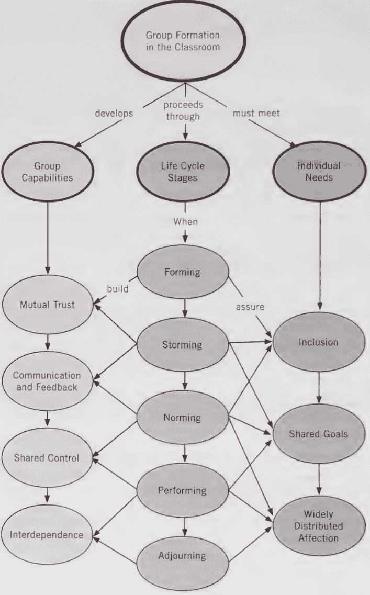
*来源：Paul Kelly，马萨诸塞州塞勒姆市K-5公立学校教师。*

## 活动步骤：
- 1. 每位参与者被要求找到一个对自己有特殊价值的物品。
- 2. 随后进行讨论，每位学生讲述这个物品如何体现他或她的价值观。
- 3. 举例：一块岩石代表友谊，因为它坚固；或者月亮因为照亮夜晚的地球而代表关怀。
- 4. 鼓励自由表达。教师自己也参与。

## 真真假假
学生提供三句话，其中两句是真的，一句是假的。如果两句真话令人难以置信，而那句假话也令人难以置信，效果最好。三个句子依次列出。然后每列出一个小组成员，班上学生若认为该句是假话就举手。三句话都投票完毕后，该学生说出哪一句不是真的。在班上所有学生都完成之前，先暂停讨论。大约进行到四分之一时，教师应该参与进来。

## 拼图式问题解决
每位队员掌握部分答案；队员们必须将各自的信息拼合在一起才能解决问题。

如需更多活动，请参阅数字资源光盘上的附录G，那里有28个活动集合，包括本节所述的活动。

例如，当小组中的学生处于*形成*阶段，同时个体又在寻求包容时，适合进行一些身体接触较少的小组建设活动，如“排队”或“隐喻”，这样他们仍然需要完成特定任务，但不必处于身体密切接触的情境中。同样，在这一阶段，学生也可以进行“真真假假”或“拼图式问题解决”活动，以了解同学们的校外信息。初始课堂也应该从一些关于冲突的初步探索开始，逐步建立冲突解决技能，这样在*风暴*阶段可能出现的冲突就能以积极的方式得到解决。关于小组建设活动的描述，请参阅数字资源光盘，那里有教学结构示例和小组建设示例。

Paul Burden（2006）谈到了各种纪律模式，并根据教师控制水平对它们进行区分，指出这些模式代表了从低水平教师控制到高水平教师控制的渐进。在探究式教学的学术概念和技能中，学生处于需要发现概念和练习技能的情境，教师实施了大量控制。控制体现在教师精心设计强有力的、恰当的探索活动中。控制体现在指导性问题中

教师巡视房间时使用的。确实，学生比在说教式、传递式课堂上行使更多的控制权，但这仍然是与教师共享的控制权。这是协作。

许多教师不尝试探究式教学，也不尝试教学生自我管理，因为他们害怕失去控制。相反，如果教师计划周密并给予学生必要的支持，学生会乐意与教师分享积极的、支持团体的控制权。这似乎是个谜：放弃某些类型的控制，你反而收获更多。不再是“他们对抗你”，而是“我们大家一起”。是的，作为教室里唯一的成年人，你对学生的身心安全负有最终责任，并且个体行为要支持学习，但当整个群体已经创造出并支持着实现学习的策略时，教学会有效得多。

## 团队建设游戏

如果没有任何成年人帮助学生建立一套分享物品、想法和空间的行为规范，那么学生们没有这么做也就不足为奇了。尽管学生在内容探索活动中会参与团体过程的某些方面，但他们未必能在那种情境下熟练掌握这些过程。因此，教师发现在这些探索之外，让学生参与一系列身体性的、动觉的活动是有益的，这些活动能培养团队建设精神。然而，让学生参与团队建设活动并不会带来任何效果，除非每个活动之后都有教师引导的讨论，让学生理解活动的意义。教师有责任引导讨论，讨论活动的特点如何展示有效团队建设所必需的特定过程部分。

虽然有些活动学生可以坐在课桌前完成，但大多数活动需要学生站起来在教室里走动，并与其他学生进行身体互动。这些动觉体验对团队建设最为成功（Griss 1998; Jensen 2000）。我们建议你从接触较少的活动开始，随着学期进展再过渡到接触更多的活动。例如，在课程的最初几天，你可以让学生参与“排队”活动，这些活动几乎没有任何身体接触；然后过渡到“镜子”；在学期后期再进行“人体绳结”，该活动有大量身体接触，但不需要很多个人信任。最终，当小组已经有所凝聚时，可以尝试其他信任活动，如“桥梁”或“手指抬起”。

团队建设活动的设计目的是，只有整个小组像一个团队一样合作才能完成；这包括班上有身体或智力障碍的学生。当然，有些活动需要进行调整，以便所有学生都能参与，包括有身体障碍的学生。大多数活动适用于从学龄前到高中年龄段的学生。然而，教师必须了解自己的学生，并判断在特定时间哪些活动可能不适合自己的小组。

正如学生之间需要建立信任和理解一样，如果你自己从未参与过促进这些活动，你需要信任你的学生和你自己的能力，并且至少每周开展一次这些活动。如果是在学年开始，你可能需要更频繁地开展。几乎所有定期让学生参与这些活动的人都认为，投入的时间非常值得，并且让学生经历了蜕变。

## 引导团队建设游戏

### 介绍活动

有时你需要将游戏与之前做过的事情联系起来，例如课堂上发生的事件，或者你和班级正在培养的一系列技能。其他时候，你可能只想直接开始活动。无论哪种情况，都要确保给出清晰、简洁的指令，说明你期望学生在游戏中做什么。让几位学生向你复述指令，以确保大多数学生理解。在开始活动之前，计划好如何有效地将学生分成合适的小组。

### 引导活动

一定要从一个小组走到另一个小组，确保每个小组都适当参与。尽量少干预。对选择不参与的学生要迅速做出决定。他们能否以某种方式帮助你？尽量让活动有始有终，但必要时也要停止。

### 总结

这是活动中最重要的部分，通常占据最多时间。学习正是发生在此时。

这些建议将帮助你引导总结讨论。尝试：

- 准备好你的问题，以便切入你想围绕活动阐明的一个（或多个）要点；
- 允许学生做扩展性回答；
- 让他们对彼此的回答做出回应；
- 请他们归纳主题，并将其想法与活动中发生的实际事情联系起来；
- 要求他们的回答尽可能具体、可操作。

诸如“我们必须合作”这样的回答没有帮助。要问学生他们实际上必须做什么来合作，或者他们合作时是什么样子的。

像下面这样的问题将有助于推进讨论：

- 要在这个游戏中成功，需要什么？
- 当你说你的小组成功时，你是什么意思？
- 人们做了什么让成功变得更难？
- 在这个游戏中，你用了哪些在之前游戏中不必使用的策略？
- 这个游戏进行时你有什么感受？

所有回答都应被接受，除了询问是否有人有其他看法外，不应加以评价。像在探究活动中希望学生达到某种领悟一样，你需要随时准备好引导性问题。即便不能精确到门牌号，至少也要能靠近目标街区！

### 增加新元素或重做原活动

为了处理额外的问题，或者仅仅是为了在日后练习合作或沟通技能，你可以为活动增加新的维度（规则），或者在总结部分以新的重点重做该活动。

## 创建全班性的社交互动策略与结构

让学生认同课堂是一个相互支持的共同体，这一整个进程需要从开学第一天就开始。虽然许多教师会优先使用团队建设游戏来开始在课堂上创建共同体，但除非学生也迅速参与班级会议，否则这不会有效。正如我们在本章开头大卫·纽伦伯格（David Nurenberg）对他课堂的描述中所读到的，在班级会议期间，学生将参与探索他们希望在课堂上看到哪些结构和策略，从而让他们感到被尊重，使课堂成为他们能够学习的地方。

### 班级会议

最早的班级会议之一应聚焦于：在全班讨论时，学生希望看到哪些策略和结构得到落实。教师首先请学生个人写下至少五件他们认为能让自己感到全班讨论愉快且有成效的事情。他们也可以写下在讨论中他们不喜欢看到的事情。接下来，要求学生看看能否在各自的小组内就希望全班讨论如何进行达成共识。经过合理的时间后，教师召集全班，使每个小组每次提出一个想法，并看看其余同学能否就每个想法达成一致。这些想法通常包括以下特征：

- 别人说话时要倾听
- 别人说话时不要打断
- 期望人们看着正在说话的人
- 不对他人所说的话作贬损性评论
- 期望每个人都参与，尽管不一定每次都参与

通常，关于学生是否需要举手才能发言，或者这一举动是否会妨碍讨论的流畅性，会有长时间的讨论和协商。这种考虑通常出现在初中和高中课堂上，但一些小学课堂也处理过这个问题。如果不举手发言，那么很多时候会建议采用“刚发言完的人点名下一位发言者”之类的策略。

一旦班级就一份可以认同的策略和结构清单达成了最佳共识，教师就公布这份清单。在低年级班级中，很多时候所有学生都会在这份公告上签名，以明确他们理解自己的责任。在高年级班级中，学生口头同意遵守清单。无论清单内容如何，几周之内，学生都会遇到一些情况，其中清单上的想法并不能促成最好的学生互动。此时，教师或班上的学生都可以要求召开班级会议，协商修改。一旦学生真正认同，并且学术活动引人入胜，教师就不再需要当“警察”，学生们会开始互相自我管理。这一过程是民主课堂的基础。它建立了一种体验式结构，引导学生成为当地、州乃至全国共同体中有效的参与型公民。

当然，所有这些设计好的方法都需要符合全校的规章制度，除非事先与校长协商获得例外。你可能已经注意到，我一直避免使用 *规则* 这个词。这个词带有太多含义和包袱，有些学生即使认为某个想法是好策略，也可能仅仅因为它是条规则就加以抗拒。通常需要有一些底线，即那些会带来即时后果的不可接受行为。一个人在身体上或情感上伤害了他人，需要立即离开小组，而教师需要建立调解或指导情境来

这可能在同一天发生。大多数学生不遵守策略或结构的情况，都由整个班级在教师的引导下自然地处理。

## 在课堂会议和关系在处理课堂扰乱行为中的作用

当教师问我课堂上学生扰乱行为该怎么办时，我说在他们告诉我班级是否已事先建立了大家共同同意的行为结构或规范之前，我无法回答这个问题。同样，我也想知道教师是否已与每位学生会面，以确定他们对该班级的期望。如果这些关系已建立，那么当两名学生扰乱课堂时，教师就有策略来解决这种情况。请考虑以下场景：

> 教师只是简单地问每个学生：“**你在做什么？**”
> 
> 学生开始解释情况，但令学生惊讶的是，教师再次重申：“**你在做什么？**”
> 
> 学生最终回答类似：“我正在和另一名学生为笔争论。”教师接着说：“这会让你**从这堂课得到你想要的**吗？”
> 
> 答案通常是：“不。”
> 
> 教师继续说：“那么你现在能制定什么计划，以便从这堂课得到你想要的呢？”

如果这些关系没有更早建立，就不可能发生这种已被证明有效的互动。我们意识到这仍然没有解决笔的所有权问题，但课堂不再被扰乱，两名学生已回到任务上来。课结束时，教师可能会在笔的问题上提供一些帮助。

这种方法是威廉·格拉斯（William Glasser，2011）选择理论和现实疗法应用于课堂的非常简化的改编。它有时被称为*责任训练*，并在全国各地的许多学校中成功使用。就像探究式教学一样，它建立在学生制定计划、为课堂设计规范，并在课堂会议上协商这些规范的修改之上。我的一名前纽约市高中学生曾参加 BONGO 项目，这是一个针对有风险城市青少年的成功项目，将在第 5 章中讨论，他谈到了责任问题及其对青少年的影响。毕业后不久，Ron Zirin 在接受采访谈及他在该校的经历时指出以下内容。“我在的其他学校里，他们期望你通过纪律来学习责任，而对我和许多其他青少年来说，我们自然会试图违抗规则。在 Middle College 高中，尤其是在 BONGO 项目中，情况正好相反。你是通过责任来学习纪律的”（Jablon and Born 1989）。

## 冲突解决技能

冲突总会发生。因此，一旦学生的参与度显现并且进行了一些团队建设游戏，就需要加入冲突解决活动。问题是，我们能否以对所有相关人员都有益的方式解决它们，在某些情况下甚至在冲突全面爆发前就将其降级？有大量优秀的书籍和手册，充满了适合各个年级的冲突解决活动。

在小学，年级教师通常全年开展这些活动。在中学，甚至现在一些高中，最适合开展这些活动的场所是指导课。然而，如果没有指导课，那么学科教师需要在自己的课堂上完成这些任务。如果你不熟悉指导课的概念，本章后面会进行描述。

很多时候感到压力的教师会说他们没有时间与学生一起做这些活动。当我问他们花在纪律问题上或因为学生没有真正注意而需要重教课程的时间有多少时，他们说相当可观。做这件事是一种投资，让学生获得自我管理和冲突解决技能，这些技能在整年剩余时间都会有回报。这些技能对学生余生的回报也很大。

通过这些活动，学生开始理解一些关于冲突解决技能的重要概念，这些技能在整年剩余时间都会有回报。这些技能对学生余生的回报也很大。

他们学习：
- 冲突如何升级；
- 如何降级冲突；
- 如何做积极的倾听者；
- 如何使用“我”陈述而不是“你”陈述；以及
- 如何避免与校内和校外文化差异相关的冲突。

你不需要自己设计这些活动。已有全面的全年项目专门为小学、中学或高中编写并经过实地测试。请确保这些手册都是由教师编写，并在城市、郊区和农村地区进行实地测试。

这些冲突解决活动需要在实施任何*反欺凌*项目之前进行。它们为此类项目奠定了基础。除了教师在学术课堂上与学生使用这些策略外，许多学校还利用早会课、指导课以及学校内的其他结构来促进这些技能的培养。

小学中许多年级团队、中学跨学科团队以及学科系部发现，让教师和管理员自己参与这些冲突解决活动的中学或高中层级活动很有帮助。如果他们要成为一个有效的教育团队，这不仅有助于他们更好地与学生开展活动，而且使他们自己的教师团队能够有效地度过团队发展风暴阶段出现的分歧对峙。大多数团队，即使是围绕教师团队建立的中学团队，也是*faux teams*，因为那些团队教师不愿意，或未得到管理层的鼓励，一起工作并努力克服分歧，直到他们能就教育目标和方法达成一些团体规范。回想一下第 3 章中描述的 David Nurenberg 失去 15,000 美元的资助，用于教授课后跨学科探究式课程的情况。经历过这一过程的教师团队，才是家长们求着让学生分配到的团队。

## 建立积极课堂或学校社区的整体课程或项目

如果你在小学层级工作，你可以考虑使用一种基于研究和证据的小学教育方法，这种方法能带来更高的教师效能、更高的学生成绩以及超越上述冲突解决手册的改善学校氛围。我看到这种方法能与良好的探究式教学课堂和学校无缝契合。社会情感学习项目侧重于教导学生如何管理情绪、行为以及与他人的互动。有些是通过直接课程来实现的，但其他一些则侧重于教师的语言和示范期望，将自己描述为一种学习方法而非项目。弗吉尼亚大学的一项对照研究显示，忠实使用其中一个项目的教师课堂上，标准化测试的语言艺术和数学成绩更高。

我最喜欢的关于如何在课堂上创建积极的中学或高中社区的书是 Carol Miller Lieber（2009）著的*Making Learning Real*。这本书涵盖了教师在接触和吸引*所有*学习者方面可能遇到的每一个问题。如果你想了解为自己和学生量身定制的学习、韧性和积极的生活变化、文化响应式教学以及社会效能，这里就是首选手册。

本书后面你还会听到一些学校利用冒险学习项目，使用低空和高中绳索课程的情况。

## 建立关系

Joe Dolan，一位同事也是剑桥、马萨诸塞州的一位校长，强调教学和纪律都关乎关系。他说，教师最大的资产是与每位学生的积极关系。在此基础上，我要补充的是，班级中所有学生之间的关系同样重要。这就是为什么我们做“Two Truths and a Lie”或“The Name Game”，这样不仅教师，每位学生都能知道班级中每个人的名字以及一些关于他们的信息。参考数字资源 CD 获取“Two Truths and a Lie”和“Name Game”的描述。

在探究式教学课堂中，教师传达给学生的大量知识将来自他们自己和其他学生这一重要性不容忽视。教师如何引导探究式教学学习循环中的*概念澄清阶段*为学生提供了效仿的榜样。例如，当学生发表意见时，教师不应*重复*该陈述。相反，在探究课上真正有效的全班讨论发生在：一名小组的学生给出他的理解，另一小组的学生随后对该陈述做出回应。第三名学生可以就这些先前学生的解读提出质疑。再次，另一名学生可以要求澄清某个想法。最好的情况是另一名学生尝试将这些想法综合成一个更概括的想法。如果学生没有相互倾听，而是只回应教师的重复，就不可能发生这一切。因此，教师不应重复该观点，因为学生随后会认为该观点来自教师，或得到教师的认可。

> 在我就读师范教育本科时，我实际上被教导要重复学生的回答，因为班上的每个人可能都没有听到那位学生说的话。（我希望现在情况不再如此，尽管我猜想你们中有些人可能也有过类似经历。）然而，在探究式课堂上，我们确实需要意识到在学生之间建立持续的互动动态以及让他们协商观点的重要性。我们不想通过重复他们的回答来妨碍这一过程。

如果我们真的想要在通常不是朋友的学生之间建立积极的关系，同时提高学业理解，那么最好的办法就是让学生走出校园，参加大多与学业相关的实地考察。如果其中至少有一次是过夜活动，积极的关系就会成倍增加。

你设计的作业越多地要求运用霍华德·加德纳（2006）所概述的其他智能，你就越有机会将那些在逻辑数学或书面语言领域并不擅长的学生纳入其中。由于几乎所有学校内的作业都只要求这两方面的能力，在其他领域表现出色的学生会认为自己很愚蠢。将口头诗歌、音乐视频制作、绘画或戏剧与舞蹈表演作为必修作业（而非总是作为替代性作业布置），能彰显他们的技能和理解力，也让同伴意识到他们需要这些曾经“*愚蠢的*”同学帮助。当我们布置这些作业时，我们就能与一些以前无法触及的学生建立牢固的关系。

## 分布式辅导

十多年来，我一直与一个名为“*学生成就研究所*”的团体合作。这个团体由一些从全国各地非常成功的小型内城高中退休的校长和教师组成。他们仅用少数全职人员来协调暑期学院和每周的现场指导，已帮助在纽约、亚特兰大、布法罗、底特律、纽瓦克（新泽西州）和联合城（新泽西州）等城市创办了一百多所有效的小型高中。除了强大的探究式课程以及教师、员工和管理层在学校设计与日常运作中的高度协作外，他们还创建了一种分布式辅导模式，所有学校都努力将其完全融入自身的身份与工作中。

在这种模式中，学校里的每一个人都将自己视为学生的辅导员。他们并非受过专业训练的咨询师，也不会给学生提建议。然而，所有教师都会倾听学生及其遇到的问题，并将学生所说的话反馈给学生，方式要能让学生清楚地看到自己所处的境况。然后，教师可以帮助学生看到各种回应及其可能的后果。当教师发现一些问题超出了自己处理能力时，他们可以将学生转介给两三位学生钦佩且信任的训练有素的咨询师。是否愿意继续与辅导顾问交谈，由学生自己决定。学生几乎总会愿意，但事情并没有就此结束。咨询师会在不失去学生的信任、不违反保密原则的前提下，尽可能将任何进展反馈给教师。当然，教师也会继续与学生保持原有的关系。

这些关系和对话很多时候源于教师采用探究式教学，进而引向项目式学习，而项目式学习往往会有公开展示的成果。一旦学生与教师*一起*制作真实的东西，真正的人与人之间的对话就会自然发生。另一些时候，则是因为教师是顾问导师。在“*辅导小组*”这一概念成为全国公认的有效初中实践组成部分之前，我在纽约市原Middle College高中的同事们已经创造了一个非常相似的概念，他们称之为“*小家庭*”。

在我们学校，“*小家庭*”每天聚在一起20到30分钟（这些年来有所变化）。它由大约12到15名学生和一名成人组成。大多数成人是教师，但校长、副校长、咨询师、家庭工作者以及一些特别的辅助专业人员也各自带领一个“小家庭”，以降低学生与成人的比例。九年级到十二年级的学生都在“小家庭”中，“小家庭”共同维持四年。如果有四位高年级学生毕业，第二年九月就会由四位新生填补。这样一来，每个学生不仅拥有一位成人支持者，身边还有大约十多名与他/她有所关联的学生。他们也了解彼此的故事，互相照应。高年级学生会设法阻止九、十年级学生重蹈自己当年的覆辙。有时，九月会组织一些冲突解决活动或团队建设游戏来融入新生，但很多时候只是彼此问候一下，看看大家能否帮忙解决问题。“小家庭教师”在四年里每学期都与家长见面，对学生的家庭生活了解颇多。这就与家庭建立了积极的工作关系。

很多时候，学生与某位学科教师的关系比与小家庭教师的关系更亲密。这也没关系，因为这里有一个刻意构建的网络，像蛛网一样运转：如果有学生出了什么事，所有教职员工很快就能知道该与谁交谈。这张网不仅包括与该学生有关系的成人支持者，也包括与该学生有关系的其他学生，他们也被纳入其中，成为另一种帮助和支持。

一旦学校的规模不超过500名学生，这种结构就真正可行。在我为这所学校工作的13年里，先后有两位校长任职，他们不仅知道每个学生的名字，通常还知道一些关于他们的个人信息。不用说，他们花在学校各处走动的时间比待在办公室里的时间更多。这种辅导真正是分布式的。

不幸的是，并非所有学校都采用这种模式。如果你的学校正是如此，那么你的课堂社区建设活动就变得更加重要。

## 构建合作小组结构

似乎每当我问教师，学生在小组学习时会采用哪些合作小组结构，他们通常都会提到“思考-配对-分享”，却很难指出其他有效的互动方式。多年来，教师们创造了多种适合特定课程需求的小组结构。教师，尤其是那些采用探究式教学的教师，应充分利用所有可用的结构。

### 合作学习结构示例

### 智者圈

了解某件事的学生站起来成为“智者”。组员们各自围到不同的智者身边学习。学生们回到各自小组后比较笔记。

### 找出我的规则（属性）

教师将物品放在一个框架中（例如两个盒子、维恩图或一条线上）。学生归纳出各自的规则，即它们有什么共同属性，或是什么规则使它们相似：“双盒归纳”、“破解我的维恩图”或“我的线是什么？”

### 鱼缸式讨论

让三四名学生进行讨论、辩论、角色扮演或其他互动活动。班上其余学生围成一圈，把他们围在中间。外圈的观察者在内圈小组结束之前不能说话，结束时间由教师决定。之后，外圈学生可以问内圈学生问题，也可以互相提问。

和往常一样，教师手边应备有一堆促进性问题，以便在学生似乎对过程感到困难时，将讨论引向合适的方向。

### 队形造型

全班学生站在一起，组成各种形状。例如，基础小组选择一种动物作为吉祥物（如老鹰），然后重新摆出它的形象。一个人当身体，另外两人当翅膀，依此类推。

更进一步，可以让学生扮成一座雕像，表现他们对虐待儿童、种族主义等问题的印象。

### 画廊漫步

各小组学生被要求回答同一个问题、应对同一个挑战或情境。他们用记号笔在大白纸上写下或画出答案。

在教师决定的一段时间后，学生们将大白纸张贴在教室四面墙壁的不同位置。

随后所有小组都可以在“画廊”中漫步，每走到一张图表前就停下来，阅读上面的想法或观看图画。

作为一种变化，当个人或小组发现有启发性的内容时，他们可以用不同颜色的记号笔在原有想法上添加自己的延伸。他们也可以提出深思熟虑的问题。

### 内外圈

学生们站成两个同心圆，内圈朝外，外圈朝内。他们向右转四分之一圈，然后彼此擦肩而过或旋转经过。教师规定他们必须经过多少人才能停下。停下后，他们转身面对与之配对的同伴，并根据教师的指示做出回应（例如，分享一个答案、表达你的看法或给出一种解释）。

## 拼图阅读

每位组员都要阅读讲义的一部分。学生1必须阅读并向学生2和学生3讲授A部分。学生2负责讲授B部分，学生3负责讲授C部分。所有拿到A部分的学生一起规划课程。B部分和C部分的学生也这样做；然后他们回到由1、2、3号学生组成的原始小组，并开始互教。

关于示例合作学习结构的更多信息，请参阅数字资源光盘。

如果你对这些结构中的许多内容以及小组授课的其他方面不熟悉，我建议你研究一下合作学习。我一直在员工发展研讨会上和我的课堂上，与教师们一起使用琳达·巴洛奇（1998）的《合作课堂》。由于巴洛奇的作品对我非常有用，本章的某些部分很可能反映了她关于在课堂上创建有效学习者社区的一些想法。她还更详细地描述了合作小组的结构，以及这些结构最适合的课程类型。每当你开始质疑她为你的课堂提出的改变是否值得费心时，她都会引用一些研究来证明这些改变的有效性。

## 阶段性评分

如果我们遵循螺旋式探究教与学周期的结构——在这一周期中，概念和技能在后续课程中螺旋式上升——我们就能看到，这种结构使所有学生都能在同伴和教师的帮助下，达到对概念理解或技能习得的胜任水平。然而，这种完全的掌握是否能在一天甚至三天内实现，并不总是有保证的。因此，当学生提交报告、视频或真实性评价时，如果他们没有得到一个“阶段性评分”，他们通常不会继续努力去掌握尚未完全完成的内容。

学生应该总能收到教师对其作业的评论和质疑，这使他们能够重做作业并掌握材料。当然，教师之间有很多关于如何调整重做流程的讨论，以免鼓励学生在第一次尝试时偷懒。如果探究式教学要取得成功，无论探究式教师最终决定采用什么程序，教师都需要制定一项“阶段性评分”政策，并对学生的原始作业给予一定程度的回应。类似于让学生解释他们的做法，而我的内容则对任何人开放，供其阅读和评论（即使你不采用合作学习小组，我也强烈推荐这种做法）。这为我提供了关于这些小组如何运作，以及每个成员是否在应对随之而来的问题和成功的反馈。

从那以后，我一直在大学教育学院全职任教。约翰逊和约翰逊（1999）等人撰写了相关著作，“*合作学习*”一词已成为大多数教育工作者口中的常用语。罗伯特·斯莱文（1995）整理了超过20年的研究数据，内容涉及合作学习对全国课堂中最聪明、最慢和一般学习者的有效性。当我在为本科生或研究生授课，或为教育工作者举办专业员工发展研讨会（其中包括关于探究式学习中的合作学习部分）时，我遇到了一系列在文献中似乎找不到满意答案的问题。起初我很惊讶，但我很快意识到，正是我自己多年的课堂经验，以及与我尊敬的教师讨论结果，才让我找到了对这些问题的大部分解答。这些问题包括：

- 如果你只给一个分数，如何防止一个学生包办报告的所有工作，而其他人浑水摸鱼？
- 如果给个人分数，是否会破坏团队建设的理念？
- 你多久更换一次小组成员？
- 如果学生在小组内协作完成任务，你如何跟踪每个学生的进度？
- 这种方法真的能有效地让学生掌握在职场中为团队做出贡献所需的技能吗？

有些答案直截了当，而另一些则更多取决于采用这种技术的教师的潜在目标，并引出其他更需要内省的问题来回答。例如，如何有效且公平地给合作小组中的学生评分这一问题，促使我创建了一个系统，它有助于给出一个相当有力的答案：使用三四种评价形式。

## 评估一份由小组共同准备的报告

有时，小组中的学生会提交一份内容详尽的研究报告，汇报他们的发现以及从中得出的推论。在中学阶段，这些报告通常是五六页手写内容，包括他们使用的详细步骤，以及从他们提供的证据中可以得出的结论。同样，他们也批判了自己方法的局限性。学生们在为期两三天的调查期间合作撰写这份报告。有时他们会分工完成一项探索任务，如果任务看起来简单快捷，他们也可能同时一起完成。他们意识到，他们都需要彼此的电话号码，或者

电子邮件地址，有时他们会在放学后留下或去彼此的家里见面并一起完成报告。随同报告一起，学生需要在纸上对自己和彼此进行评价，评估他们对这项工作的贡献程度。这份报告只提交一份，并根据自我评价（由小组所有学生阅读）给出小组一个成绩，并做一些小的调整。

## 确定谁参与了小组书面报告

采用这种单一的评价方法，我完全不确定每个学生都参与了报告的撰写并掌握了预期的概念和技能。很多时候，某个勤奋的学生会完成报告的大部分工作，以确保自己能得到好成绩。该学生几乎总是试图分工，但发现小组中一两个学生所达到的理解水平远不及他们。当他们在家中对此抱怨够多时，家长就会来学校找我谈论这种不公平。

为了让对某个主题更有意识的学生在探索过程中开始招募兴趣不足或知识不足的学生，我实施了以下做法。我告知学生将会有小组书面报告，但他们不知道我会在提交当天收缴报告还是对小组中的一名学生进行关于报告的测验。偶尔，我会根据手头的报告出两道题的测验。对于这次测验，我可以点名小组中的任何一个人，其答案将代表小组的成绩。这种方法鼓励理解力和动机更强的团队成员确保辅导那些热情较低的成员。由于他们很快发现事后辅导比让学生在实际探索中参与要困难得多，他们便开始想办法激励这些热情较低的成员。很多其他时候，我会收缴小组中每位学生撰写的报告或其他最终项目。然而，在他们进行探索时，他们并不知道最终的“出版”文档将是小组文档还是个人文档。报告或最终项目会有一些共同部分，但由于每位学生都需要进行最终的综合、分析或创造性表达，因此总会有很大的差异。

学生和家长通常认为这是公平的。很多时候，他们是根据理解程度来接受评价的。由于大多数家长在工作中需要团队协作，当我向他们解释我正在培养他们的儿子和女儿的团队领导能力，这将使他们受益终身时，他们能够理解。即使存在单一的团队报告，比例略大的其他部分则在公平对待个人和团队建设之间取得平衡。

## 确定小组成员

关于分配给哪些小组以及何时更换小组的问题需要一个更复杂、多维度的答案。我通常在学期开始时随意分配学生到团队，让他们 literally 点名计数，这样他们就会被分到随机的组。因为我没有做出任何判断的基础，我认为这是让那些不常互动的学生相互认识的好方法。我发现最好让这些小组运行大约一个月到六周，然后再重新分组。这个时间让学生不仅能够遇到让某些小组成员接受特定职责的困难，也给了他们时间尝试利用他们所获得的冲突解决和团队建设技能来克服这些困难。通过写作日记以及看到其他学生的回应，还有通过定期的社交学生互动，各组分享了他们采用的策略。

下一次重新分组取决于我的目标。有时我希望将较强的学生与较弱的学生配对，以便帮助需要帮助的人，并提高较强学生在不得不解释概念时所获得的自尊水平和理解水平。其他时候，我希望将那些在原小组中没有贡献自己份额的学生与我知道他们在社交上会被吸引的学生放在一起，以激励他们变得熟练。学期后期我有时会改变小组，使所有最有动力的学生都在同一组，而那些仍在“混日子”的学生则在一起。将四个一直依赖他人工作的学生放在同一组以求成功，对该组的某些成员产生的效果令人惊讶。其他时候，我会将小组分成四名“安静”的学生。很多时候，领导者从这种混合中脱颖而出。甚至学期更晚的时候，我让他们自行选择小组。令人非常有趣的是，从我自己的观察以及他们的日记条目来看，到学期这个时候，他们已经学会不再总是选择社交朋友。相反，他们开始使用在学期开始时发展起来的关于一个好团队成员所需属性的标准，来选择新的团队。在为期15周的学期中，我至少会更换三次小组，有时多达五次。

最后，最重要的是这种结构赋予你作为教师的灵活性。你在巡视教室时不断对小组和个人进行形成性评价。你听到团队成员试图阐述概念框架和调查策略。你在那里提出适当的问题，引导他们采用将导致更深入理解的程序。你在现场听到不同小组之间的数据、解释或策略的差异，因此你知道何时在探索中途叫停他们，让他们比较结果。在这个阶段结果的差异将使他们看到在继续之前需要控制变量或评估方法或程序的必要性。

所描绘的图景是一个建构主义、以学生为中心的探究课堂，教师承担促进者的角色。由于教师在学生调查现象的初步方面进行对话时深度参与，后续讨论中可以建立起对复杂概念的深刻而清晰的理解。因此，教师对困难领域有必要的洞察力。

我自己的经历表明，在学生行为、动机和成绩的所有方面都有显著改善。强者和弱学生的概念和技能成绩水平都提高了，与 Slavin（1995）对其20年合作学习数据的元分析所发现的结果相匹配。同样，他们应对团队合作情况的能力也提高到很高水平，这一点通过进入后续课程的学生表现出来，他们成为协作团队的促进者，并在最初几天内就使其成功运作。这些技术改变了我作为教师的生活，促使一些学生加入真正的科研团队，并改善了我许多学生的生活。

## 设计教室的物理环境

在生物学、建筑和工程设计中，*形式最好服务于功能*。加入一点美学之美也不会有坏处。现在你已经构想了探究式教学，下一步应该是设计一个最能支持这种学习模式的学习环境。在后面的章节中，我们甚至会挑战在物理意义上学习最佳地发生在哪里的概念。然而，对于本章而言，鉴于明天我们大多数人将被分配一个教室来教学，让我们来解决一个更简单的问题，即我们的教室应该有什么以及如何布置。

在探究式教学期间，学生在小组中进行探索的时间占60–70%。其余时间，他们在就小组结果进行全班讨论、观看媒体或听老师讲述来自更大学术界的东西以扩展他们的探索。因此，由于形式追随功能，教室首先应为小组活动而设置，同时能够快速转变为全班能够在全班活动中轻松看到和听到彼此的布置。

探究教学的另一个重要特征是学生处于学习努力的中心。房间在视觉上应该象征这一点。一旦房间有“前面”并且有教师的桌子，它就成为教师作为学习焦点、知识源泉的视觉象征。我们都知道，在传统的课桌排排的教室里，想学习并且感到舒适参与的学生坐在房间的前面，而你坐得越靠后，就越能避免被点名回答问题。

多年来，在我向探究式教学演变的过程中，我多次改变了自己教室里的座位安排。我还参观过数百间其他教室，见过许多座位配置。下面我将展示的，是似乎最符合所有标准、同时又能在日常教学中方便运作的布置。它在各个年级都行之有效。

**图4.3 支持学生小组学习的教室设计**

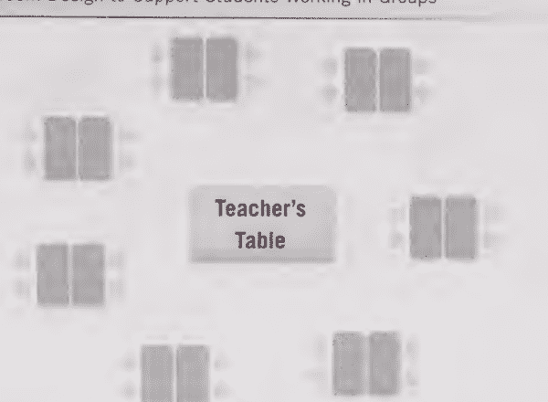

教师从中间的教学桌开始，但很快就在教室里巡回，从一个小组走到另一个小组。从一个小组到另一个小组只需移动几英尺。四面墙都有可以挂图表纸记录的地方。教室没有前方。如果在探索阶段教师需要快速进行全班讨论，学生可以保持在这种布局下的座位。然而，如果像概念澄清阶段那样要进行广泛的全班讨论，那么一半学生需要把椅子移动几英尺，如图4.4所示。这种移椅子的过程在最初几次之后大约只需一分钟。移动椅子是为了让每个学生都能轻松地听到和看到彼此。

**图4.4 为全班教学重新布置的探究式教室**

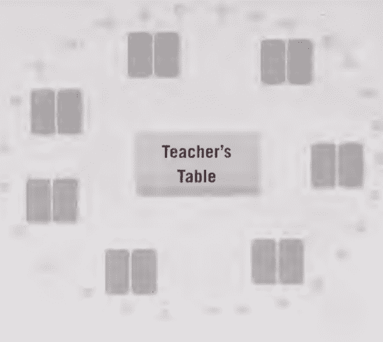

教室的每面墙都配有储物架和柜子，用来存放探索阶段使用的实物材料。这些材料可以是角色扮演的道具、社会研究课上供学生触摸的历史物品、科学材料或数学教具。通常还会为教师准备一个文件柜和一个用品柜，但不需要占用空间的办公桌。项目成果应展示在教室四周。如果教室足够大，还可以增加地毯和其他陈设。这个空间越不像传统教室，越像探索宫殿或工作空间，学生就越有可能深度投入到他们的学习中。

## 初中不是建筑外的名称

初中是一种教育理念。它是一套让早期青少年感到学习舒适的实践。全国许多学校的建筑外墙上挂着“*初中*”的校名，年级跨度要么是五年级到八年级，要么是六年级到八年级。然而，其中许多并不是*初中*，而仍然是初级中学。在20世纪60年代和70年代，一群研究早期青少年的教育者意识到，我们国家的初级中学是整个教育体系中最薄弱的环节。这些学校的学生正处于充满焦虑的发展阶段，而学校结构又加剧了这些学生的困境。因此，他们的认知和情感发展都受到了损害。

一些教育工作者开始寻找和研究那些异常成功的初级中学，并开始聚会和撰写关于对这些早期青少年有效的有前途的实践。威廉·亚历山大、唐纳德·艾希霍恩、约翰·朗斯伯里等人创造了*初中*这一概念，其设计与小学或高中都不同，并对这些青少年前期学生的社交和认知发展采取了独特的方法。

我在此处，尤其是在本章中提到初中实践，是因为这些有前途的实践中有许多与本章倡导的管理实践相似。其他一些则与下一章中的实践相似，经验丰富的探究式教师在扩展其教学策略时会开始使用这些实践，以使探究式教学对更广泛的学生更具吸引力。

下次你读到某所初中效果不佳时，你首先想到的问题应该是：“它真的是一个*初中*吗？”仅仅因为有来自不同学科的教师被分配到同一个“团队”，并不意味着它就是一所初中。它很可能是一个*虚假的团队*——一个由于缺乏准备而无法开展跨学科主题单元、运行辅导计划，或参与这些实践及后续任何其他实践的团队。

看看这份有效初中实践的特征清单。阅读这份清单时，不难发现探究式教与学可以轻松地置于所有这些结构的核心。在下一章中，你将读到许多采用探究式教学法的小学或高中教师/学校是如何采纳这些初中实践的。真正的、以这些实践为特征的初中团队往往发现，使用探究式教与学的方法提供了一个缺失的拼图，使他们的团队更具力量。

有效初中实践的特征如图4.5所示。它们分为三类：*结构、课程和教师支持。*

**图4.5 一所有效初中的特征**

### 结构

- 在更大的学校建筑内建立小型学习社区
- 课堂学习社区，其中学生个体和小组在建设性的社会环境中自我监控，相互支持知识建构
- 在校周内开设探索性课程，学生与一位成人和其他学生一起，就个人选择深入研究的话题进行学习
- 家庭重新参与青少年的教育，并在团队中积极参与
- 帮助学生过渡到初中或过渡到高中的学校衔接项目

### 课程

- 探索跨学科、综合和主题式的课程设计方法，包含多元文化视角和积极的、以学生为中心的学习方式
- 将学校课程与社区需求和活动联系起来
- 适应多样性——学习与各种特殊需求学生相处所需的技能，并完善包容性实践的技巧
- 将技术整合到整个课程中
- 通过促进健康和体质来提升学业表现
- 为所有学习者提供严格的、核心学术课程和成功体验——取消分轨制，让熟练教师教授异质分组，并促进合作学习

### 教师支持

- 赋予教师和管理者决定初中学生体验的权力
- 将学校组织成由教师和混龄学生组成的跨学科学术团队，由紧密联系的学校社区共同决策
- 配备擅长教授青少年的教师
- 探索中学阶段教师的独特角色，如团队规划与教学、建立导师/受导者计划，以及促进社区参与
- 为教师提供共同规划时间，以便几乎每天一起开发这些强大的跨学科主题单元

我的同事彼得·库克曾任新英格兰初中联盟（NELMS）的师资培训师，担任一所高绩效初中校长多年，也是远至澳大利亚和马其顿等国的初中实践国际大使。我想他用一句话总结了这种精神：“当你发现自己和一群家长为了某个晚间汇报活动，为200-300名学生和成年人煮意大利面，而该活动是你团队的学生所创作、主持并贯穿整晚进行的，你就知道自己真正成为了一名初中教师。”

## 你真的需要相信

我刚当老师时，在一所纪律问题很多的学校任教。在走廊和大多数教室里，经常遇到破坏性行为。我学会了一套非常消极的应对技巧，即我必须掌控局面。这当然是他们在与我作对，从这段经历中我变得不敢信任学生。在接下来的五年里，随着我开始探究式教学、项目式教学，并与学生在校外社区中合作，我从一个独裁者转变过来，开始再次信任青少年。当我们一起取得成功时，我开始与一些个体建立了关系，很快我便完全信任他们。我想他们也开始信任我。但直到我转到另一所学校，那里有同样类型的孩子，但一些非常不同的教师与学生共同创造了一种非常不同的文化，我才开始改变自己的观点。在这里，我终于开始相信并信任学生，不仅是作为个体，

而是一群个体，将逐渐演化成一个我可以发自内心信任的团体，彼此互助，共同为我们的目标而努力。

在班级演化的各个阶段，很多时候你会觉得班级似乎真的陷入了停滞。然而，你需要清晰地预见学生接下来还需要迈出的步伐，以及当这些步骤实现时，它们会呈现什么样的景象和声音。这就像一位奥运体操运动员在比赛前，在脑海中预演自己的完美动作。当你坚持不懈，通过所有这些社交技能培养活动来帮助学生，并观察他们在班级演化进程中所处的位置时，你会看到他们已经开始了自我管理。其中一些学生会比其他学生更深刻地理解这个过程，并能做得更好。这些学生可以协助你引导班上其他同学完成各个步骤，让每个人都能参与进来，并最终成为自我管理的学习者。到了这个阶段，探究过程就变得自我持续了。

不再仅仅是你一个人的责任去为班级呈现的状况寻找解决方案，也不再只有你在单独执行。相反，你和学生一起创建了一些共同的目标。你已经为学生提供了成功学习的工具——社交技能和团队管理技能。你了解群体的演化过程，也了解群体中个体需求的演变。你可以在一定程度上进行很多预测。在这一点上，你和你的学生都在努力让这个过程运转起来，而且双方都已做好了充分准备。

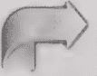

## 思考空间

回想一下大卫·纽伦伯格（David Nurenberg）关于探究式课堂中课堂管理的反思（第146-148页）。

-   大卫的经历中有哪些方面与你的相似？
-   你如何与学生、教师同事以及管理者建立信任？

教育工作者经常听到要在学校中创造一个安全的环境。

-   在你的学校里，创造一个安全的学习环境需要考虑哪些因素？
-   “控制”这个词在学校环境方面意味着什么？

作者提出“你确实需要去相信”。

-   你对这句话的初步反应是什么？
-   如果作者在第1章就提出这一观点，你会有何反应？
-   当你读到《探究的协同作用》这一部分时，你对探究式教学和学生自我管理的想法在哪些方面发生了变化？

当然，所有这些都体现在课堂常规中，这些常规由你提出，并由你的学生进行修改，以使所有人更好地协作。常规（可预测性）能够安抚杏仁核，它是控制我们大脑的情绪中心。它们能让学生平静，也能让你平静——因为其中大部分常规以前使用过，你知道它们是有效的。

你使用了相同的探究式教与学过程，让学生学习他们的社会互动理解（概念）以及实施这些理解和技能的技巧，以使他们的团队运作良好且充满乐趣。最重要的是，这些概念和技能变得自我持续。这些技能成为他们思维结构的一部分——在他们的大脑皮层中形成真正的、复杂的交互式神经通路，这些通路是他们余生所拥有的社会人际关系思维习惯。

学生开始变得真正地被赋权。他们开始对自己的学习进行元认知。他们懂得如何管理自己的行为，并帮助他人管理其行为。他们开始看到他人是如何操控他们的，以及作为一个群体，当不公正发生在他们面前时，他们不必只是旁观者。他们在建设班级和学校社区的过程中不断练习所有这些技能。他们开始在与家人的互动中运用其中一些技能。他们中有些人将能够在步入成年时运用这些技能，为他们的社区创造积极的改变。我相信保罗·弗莱雷（Paulo Freire，1970，1994）以及批判性教学法的其他支持者们会赞同这一点。

## 思考与反思

1.  为什么在探究式教学课堂中，教授学生在合作小组中成功工作的策略如此重要？既然需要投入时间来进行冲突解决活动和团队建设游戏，然后通过班会让学生对顺利运行课堂的策略有发言权，这些投入真的值得吗？能否循序渐进地实现？你可以争取其他教师的帮助吗？
2.  你是否准备好重新布置你的教室，让学生们四人一组坐在一起，每天进行探究活动？让学生们在这些小组中保持大约六周的时间会容易吗？要成功做到这一点，需要满足什么条件？
3.  如果你在初中任教，你的团队与有效中学实践相比如何？如果你的团队处于“伪团队”的一端，那么你团队中谁可能与你一起踏上这段探究之旅？如果你在一个高效运作的团队中，探究式教学如何能进一步提升学生的参与度和学习效果？

# 第5章

### 服务于脱离学习和被边缘化的学生

那些能让之前对学校失去兴趣的学生重新参与进来的实践，其最大优点在于，它同时也被证明是一种更好的方式来深化那些看似已经表现良好的学生的参与度。学生开始变得真正地被赋权。探究实践对特殊需求学生、英语学习者，或那些在情感、安全及学业需求在家庭或社区中未得到满足的学生，都能产生显著的积极效果。更广泛地应用这些实践，可以显著缩小成就差距。

我的几位专门指导教师成功应对特殊需求学生的同事，对本书的各个章节反响积极。他们每个人都分别指出，如果在学校采用探究式方法，许多目前被认定为有特殊需求的学生，可能就不需要那么多额外的服务了。

同样，专门研究英语学习者有效实践的人士也指出，这正是习得学术性第二语言的最佳情境。越来越多的研究表明，英语语言发展和探究式学术教学不一定是两种截然不同的教学形式。学生不必等到学会英语才能进行高阶思维和接触复杂内容（Stoddart et al. 2002; Zwiep and Straits 2013）。当采用探究式教学方法时，所提供的学习环境使得协作和同伴对话成为学生建构意义的自然方式（Stoddart et al. 2002; Lee et al. 2006）。

对于我们这些在城市和农村地区，面对那些已经脱离学校、经常逃课且长期旷课的青少年的人来说，前面所描述的探究式教学本身并不足以让他们重新投入到学业中。然而，正是探究式教学方法的许多延伸，有效地使许多这样的青少年重返校园并最终毕业。项目式学习（PBL）是探究式教学的自然延伸，也是许多有经验的探究式教师所迈出的一步。随后，学生们开发了公开演示他们的想法，这反过来又促成了直接帮助其社区的项目。在每种情境中，学生们都运用了他们在学校和项目期间学到的技能。

在本章其余部分，你将听到对成功实践和项目的描述，并通过使用其他教师的模板和范例来了解规划的过程。同样，探究式教学如何满足特殊需求学生和第二语言学习者的需求也将变得清晰。这是一段激动人心且令人振奋的旅程，让我们开始吧。

### BONGO项目

特里·博恩（Terry Born）是一位在英语课堂上使用探究式教学的老师，她和我曾是中学院高中（Middle College High School）的同事。这是一所位于纽约市的公立高中，专为之前脱离学校的学生而设计。他们中许多人曾从其他高中辍学，或者在初中时经常逃学。这所学校在这些学生身上取得了巨大的学业和社会成功。然而，特里和我都注意到，有一批学生在我们的以探究为基础的学科课堂上并未完全取得成功，但当我们采用个性化的角色扮演时，他们却表现得特别好。1977年，我们询问校长是否可以在一天的最后两节课，为同一批学生连续上英语课和科学课。我们将提供两门毕业所需的必修课，学生们将基于所学内容编写并制作一出戏剧，并且由我们共同授课。在接下来的13年里，这个戏剧工作坊课程演变成了BONGO项目，增加了第三节课时，三门学科完全整合，最终的公开项目除了戏剧外，还包括口述历史书籍、社区报纸和摄影文学杂志。正如你将听到的，BONGO项目——它并非缩写，只是一个最初名为“Bongo戏剧旅行团”的名字——成为传统学校环境中，针对那些被标记为*有风险*的城市青少年最成功的项目之一。

### 让此前脱离学习的学生参与进来的情景

似乎每个人都在同时奔向不同的方向。罗纳德推开两个拉丁裔少女，其中一个瘦得像另一个一样圆滚滚。两人都穿着闪闪发亮的浅蓝色紧身连体衣，从头到脚包裹着。罗纳德拿着一个似乎是某种用木头制成的市政徽章，大小像轮毂盖。他在一个看起来像法官席的大桌子前停下来，从工具带上取出一把锤子和一捆钉子，开始将徽章钉在前板中央。

“哦，糟糕。这还没干，”罗纳德一边试着把左手上的粘性清漆擦到裤子上，一边漫无目的地喊道。

“大家加把劲，”他命令道，声音大到礼堂里每个人都能听到。“已经有人在等了，我们需要放他们进场。”

他暗自觉得好笑，心想如果他住在皇后桥住宅区的朋友们现在看到他，会说什么。他母亲不会相信他真的在动手做这件事，更不用说他监督了整个舞台布景的搭建。多年来，她几乎没法让他去倒垃圾。但最近，包括他自己在内的所有人都对他的行为感到惊讶。

就在这时，一个身材娇小的深肤色多米尼加女孩玛德琳身披黑色长袍走过。

“嘿，马迪法官，小心你碰的东西，否则你可要永远坐在这审判席后面了，”罗纳德评论道。

玛德琳回应道：“‘马迪法官’，真有趣，罗纳德，但你在说什么？”

罗纳德边走边回答：“我们需要重新给这审判席的部分地方上清漆，还没完全干，如果你的长袍在上面靠太久，就会粘在木头上。”

玛德琳挑了挑眉毛，摇了摇头。“有人在我这个角色里写了比佩里·梅森一辈子说过的还要多的法律胡言乱语，这还不够，现在我还得担心自己碰了什么。真是太好了。”

“哦我的上帝！”玛德琳站在审判席后的凳子上惊呼。“这是史蒂夫吗？”“我真不敢相信，史蒂夫，我从没见过你穿不是黑色、不是无袖的衣服。你的纹身现在在哪儿？”

所有的人都转过头去看舞台上，一个白人少年正在整理一件灰色西装外套。

> “你真是个活宝，玛德琳。你和你的朋友们不是通常站在审判席的另一边吗？不，不，我们还是别扯这个了。抱歉，开个玩笑。我们没时间聊这些。你看到保罗了吗？我需要他帮我打这条领带。我还得确保我把那句‘多等位基因’台词说对了。”

一个留着齐肩金发的男孩转过身说：

> “史蒂夫，这个词读作‘ah-leel-s’。”

> “你确定吗，肖恩？”

> “听着，史蒂夫，台词是我写的。保罗教我们的东西你一点都没听进去吗？”

史蒂夫转过身，脸上露出震惊的表情。

> “你真的在质疑这出戏我写了多少吗？我为这出戏付出的更多……”

就在这时，罗纳德走到他们两人面前说：

> “好了，女士们，够了。我们还有演出要完成。大家都到后台去进行仪式。迈克尔，请打开观众席的灯，关掉工作灯。凯西，去开门收票。”

罗纳德的美国历史老师C先生向他表达了自己既高兴又惊讶的心情，因为他不仅每天都来上课，还交上了所有作业，并参与有关政府问题的辩论。多年来，C先生一直在督促罗纳德发挥自己的能力。

罗纳德注意到观众席中的历史老师。他想：“不知道他是否知道，过去一个月我几乎每天都会在学校待到六点以后，写作和搭建布景。连我自己都难以置信。”

我几乎出神地坐在观众席上，身旁是特里·博恩，一位在过去六年里与我共同在这个BONGO项目中授课的英语老师。我们和这些孩子几乎日夜待在一起将近两周，包括周末。但这种恍惚状态更多源于对我们所看到的一切难以置信。这些纽约市公立学校的学生承担起了所有责任。他们完成了所有工作。这与六年前我们两人都对一些学生在科学和英语课上的表现（或不足）感到不满时相比，真是天壤之别。我们找到校长，请求能否让我们的一节英语课和科学课在第七、八节课时连在一起。我们完全没想到，这会带我们踏上一条远超我们想象或预期的旅程。

## BONGO项目的影响

那是我们共同授课并指导了13年的一个每天三节课项目的第六年；这个项目以某种形式被全国各地的教师延续了下来。对该项目进行的一项为期十年的定量和定性研究发现了一些相当惊人的结果。尽管该项目中的学生几乎一致认为课程作业是他们上学以来遇到的最具挑战性的，但一项为期十年的研究表明，该项目对一群之前脱离学习的学生取得了显著成功。这种结构对一群几乎都有冒险行为历史的城市非裔美国人、拉丁裔和白人学生产生了相当令人信服的结果。结果显示：

- 92%的学生在参加BONGO项目期间没有逃课。这些学生中有77%在参加项目之前有逃课史，而在BONGO期间逃课率降为零。

- 出勤率也有所提高，既包括大部分时间逃学的学生，也包括那些上学相当规律但有大量缺勤的学生。65%的学生出勤率有所提高，其中31%显示大幅提高。对于这些学生中的任何一个人来说，出勤率达到95%以上，对他们的父母、其他老师和他们自己来说都是难以置信的。出勤率全勤或达到95%的学生人数翻了一番（全勤率从3%上升到5%；95%出勤率从21%上升到45%）。学生在BONGO期间，50%的人出勤率达到95%或更高。

- 89%的BONGO学生学业成绩有所提高或保持稳定，其中51%显示大幅提高。36%的学生在BONGO之前科学课不及格，但在项目期间通过了。54%的学生科学成绩有所提高。

- 最令人震惊的发现是，32%的学生从没有通过任何课程，或只通过一两门课程，转变为通过*所有*科目，包括BONGO三个时段之外的课程。

对BONGO学生进行的沃森-格拉泽批判性思维测验表明，其中60%的学生显著提高了批判性思维能力，是对照班同龄人的四倍。过程技能与科学、社会和技术（PSST）测试测量了科学过程技能以及理解科学、技术和社会（STS）关系的能力，结果显示，在一个学期内，BONGO组中有41%的人提高了科学推理技能和STS意识，而对照组中只有9%（Jablon 1989）。

这怎么可能？是什么组成部分和活动在三个月内改变了这些青少年中绝大多数人的行为？我们需要回过头来重新审视第一章中关于什么对青少年真正重要，以及这与马斯洛人类需求层次理论的契合之处。大多数脱离学校的学生与典型的青少年有着相同的需求，但其中一些需求没有得到满足。如果这些缺陷得不到弥补，学生在校期间就无法集中注意力。然而，有可能在满足这些需求的同时，让学生参与高质量的探究式教学和学习。正是这些组成部分的矩阵使这成为可能。许多教师在教学中使用了一个或多个这些组成部分，但正是这个矩阵的协同作用才使得这些学生能够成功地融入学校。在审视整个矩阵之前，让我们一次构建一个组成部分。这些组成部分是：（1）跨学科单元，（2）基于项目的学习，（3）有意义的主题，（4）社会良知问题，以及（5）最终公开项目。

## 跨学科单元

> “人生决策是跨学科的，但学校却分科教学。”
> ——多德 1984

文献综述显示，尽管大多数学校从业者尚未接受跨学科教育，但人们呼吁以跨学科教育来支持共同核心标准（Heitin 2013; Mazzara 2014）。教师和学生都因教育的狭隘组织而受苦。只将注意力集中在专门内容上，实际上会削弱对内容本身的理解。一个学科有一些方面，只有当我们从远处或从另一学科的角度来看时，才会被注意到或看见。重要的知识本质上是跨学科的（奥尔特加·伊·加塞特 1957）。

如前一章所述，那些对早期青少年采用有效中学做法的学校，有教师团队几乎每天开会，以维持全年跨学科单元。同样，有效的小学教师很少分开教授科目，而是以科学或社会研究活动作为非虚构或虚构文本的主题来教授语言艺术技能，或在科学活动中运用适当的数学技能。一旦小学教师……

他们的独立教室一旦开始探究式教学——让学生操作材料并设计探索——跨学科教学几乎不可避免。跨学科的日单元或周单元只是自然而然地演化出来，几乎是自发形成的。安德里亚·埃吉托在第3章中的叙述阐明了这种自然演化。

中学和高中阶段最有效的跨学科联系不仅仅存在于传统上相关的学科之间——科学和数学，或社会研究与语言艺术。相反，成功的单元让学生体验到语言艺术、科学、体育、东部社会研究和陶艺之间的联系。其他单元则将数学、绘画、社会研究、音乐、历史和计算机辅助设计联系起来。通常两位教师从各自的两个学科开始，但一旦真实世界的项目成为组成部分，他们就必然会增加其他学科。

中学正是为促进这种实践而设计的。在拥有*真正的*团队的中学里，这种情况很容易发生，在那里所有学科教师都致力于跨学科项目，并在校内被给予*共同规划时间*来规划、修改和管理这些单元。早期青少年的需求得到满足，青春期的焦虑也大大减少。学生在学业上和社会上都更加熟练和成熟。

通过整合学科，学生可以集中学习。每天被六七门相互脱节的课程轰炸，学生无法深入思考其中任何一门。当他们学习的科目相互关联时，他们可以在学校、作业中以及社区里集中思考和学习。

在一个跨学科环境中，在某一学科或技能上的成功可以为学生提供进入他们不太熟悉领域的*入口*。跨学科活动为学生提供了机会，让他们发挥多种智能之一的优势，利用特定学科的个人吸引力，或使用适合活动的技能。当教师使用强大的类比人际关系角色扮演工具时，这种情况尤其如此。这些活动自然更倾向于语言艺术和社会研究等人际互动学科。然而，通过将这些学科与数学和科学结合，学生在从事多学科项目时可以满足其情感需求。数学和科学被纳入了学校的个人关系层面，科学和数学不再被体验为使许多学生难以接近的冷漠非情感学科。同样，对于一些通常更习惯于更客观和逻辑的数学和科学探索的学生来说，情况也是相反的。将科学和数学与文学或社会科学问题联系起来，为学生提供了一个更安全的*入口*，以探索这些学科中嵌入的人际互动。

约翰·古德莱德在研究了美国各地的学校后，注意到我们学校中学生的被动性。

> 他们很少计划或发起任何事情，阅读或撰写任何篇幅较长的东西，或创造自己的产品。他们也很少对意义进行推测，讨论解释，或参与需要协作努力的项目。
>
> (Goodlad 1984, 468)

同时，威廉·格拉斯纳的控制理论工作（Glasser 1986；Gough 1987）支持了正在兴起的合作学习中的小组项目导向。

自1993年以来，威斯康星大学的巴克研究所一直发挥着主导作用，帮助教师和学校系统创建有意义和有效的基于标准的、基于问题的学习（PBL）单元（Markham 1997；Hallerman, Larmer, and Mergendoller 2011）。Larmer（2014，1）认为PBL是一个宽泛的类别，只要其核心有一个扩展的项目，就可能采取几种形式，成为以下内容的组合：

- 设计和/或创造有形产品、表演或活动
- 解决现实世界问题（可能是模拟的或完全真实的）
- 调查一个主题或问题以开发对开放式问题的答案

正如在1930年代一样，在当前的基于标准的环境中，PBL成功的证据开始积累（Ravitz 2009；Strobel and van Barneveld 2009；Walker and Leary 2009；Vega 2012a；Ravitz, Hixson, English, and Mergendoller 2012）。将项目式学习与传统教学的学生学习成果进行比较和对比的研究表明，PBL（在有效实施时）：

- 增加内容的长期记忆；
- 帮助学生在高风险标准化测试中的表现与传统学习者一样好或更好；并且
- 提高解决问题的能力和协作技能，并改善学生对学习的态度（Strobel and van Barneveld 2009；Walker and Leary 2009）。

正如我们在第6章中将看到的，PBL也可以为全校改革提供有效的模式（National Clearinghouse for Comprehensive School Reform 2004；Newmann and Wehlage 1995）。这些探究式教学方法让学生在创造、质疑和修改知识的同时，培养批判性思维、协作、沟通、推理、综合和韧性等技能（Barron and Darling-Hammond et al. 2008）。

## Meaningful Themes

在与教师坦诚交谈，了解他们进入这一职业的动机时，我经常观察到他们有一个共同的关切：让学生获得一些关于生活的核心基本理解，从而能够过上幸福、充实和富有成效的生活。这些理解往往是一些宏大、普遍的观念。如果教师与青少年合作，这些观念往往是我们作为成年人所处理的复杂问题的核心。它们也是青少年彼此之间、与父母以及与有权威的其他成年人交往的核心。回顾马斯洛和青少年所关心的问题，这些观念将帮助他们从自己的角度应对生活的复杂性。教师会提到诸如“很多时候你无法控制发生在你身上的事情，但你可以控制你对它的反应”之类的观念。

然而，这些同样的教师指出，他们很少有机会教授这些关于在我们复杂的社会中富有成效地应对的极其重要的见解。偶尔语言艺术和社会研究教师可以触及它们，但他们从未真正深入探讨这些问题。当学生能够从多个学科视角探索其中一种理解，然后利用这种理解创造出对社区产生影响的东西时，这一主题就成为学校成功的有力组成部分。

这种对主题构成的看法与你在教育书籍中或与一些教师的讨论中发现的不同。在许多情况下，教师被敦促围绕一个主题整合他们的课程。例如，古埃及、新英格兰的渔业、回收塑料或小型家族农场。确实可以围绕这些创建跨学科单元，但这些是主题——而不是我们在这里讨论的有效主题。教师发现，使用主题作为整合问题会限制他们在各个学科中可以做的事情，同时也不允许学生参与这些大而可普遍化的生活经验观念的机会。许多非常有效的单元会包含这些和其他主题作为单元的一部分，但它们不是主题。主题是一个具有某些品质的复杂普遍观念，能够实现各个学科的有意义整合。

在过去三十多年与教师合作创建有效的跨学科主题单元的过程中，我的同事和我补充了最初由Martinello和Cook（2000）汇编的一套标准，并为有效的主题创建了组成部分。图5.1提出了评估主题的指导问题。利用这些标准，无数的教师为他们开发的单元创建了非常有效的主题。这些单元让许多以前在学校中脱离的学生参与其中。

## 图5.1 有意义主题的标准

**一个有意义的主题应通过以下问题的检验：**

- 1. 这个核心思想在时空上是否成立？
- 2. 它是否拓宽了学生对世界或何为人的理解？
- 3. 它是否展示出使自然和人类世界的理解变得不那么复杂、更可预测的模式？
- 4. 这个核心思想是否跨学科？
- 5. 它是否与学生的真实兴趣相关？
- 6. 它是否支持学生的探究？
- 7. 它能否从多个角度来看待？

对小学年龄的学生而言，主题的使用不如中学和高中阶段重要。一些小学教师使用非常概括的主题，如 *变化* 或 *模式* 作为全年所有学科的整合概念，同时使用诸如季节或美国革命等主题作为其小型跨学科单元的整合点。

然而，一旦学生进入中学早期的青春期并继续到高中，有意义的主题就成为吸引学生、帮助整合学科主题并为学生提供终身受益见解的有力工具。这些主题使学生能够认识到他们在试图与同伴建立关系并与父母协商新的权力关系时所面临困难的某些根源。访问 http://www.lesley.edu/middle-school/service-learning/examples/ 以查看基于中学阶段有意义主题的跨学科单元示例。由于许多这些单元是由新手教师创建的，并非所有主题都同样有效。然而，创建这些单元的教师认为这些主题对学生的生活很重要。

图5.2提供了一个我（以及许多其他教师）认为有效的主题示例。思考一下主题“power over versus power with”如何反映图5.1中的标准。

## 图5.2 有效有意义主题示例

### 主题：权力支配 vs 与人共权

该主题在许多教师的单元中被视为有效且有意义。主题的困境是人类社会和个人在有记录的历史中一直 wrestling 的问题。一个人是通过与想要领导的人合作还是通过强制获得最大权力？该主题在课程各领域具有广泛的适用性：

- **History:** 此视角适用于任何正在研究的事件。例如，斯大林的权力支配和马丁·路德·金的与人共权。
- **Language arts:** 该主题进入小说和诗歌中人物之间产生的冲突。乔治·奥威尔的 *《动物农场》*（1945；1992）体现了这种冲突。
- **Science:** 关于现代社会的许多争论是否源于人类试图对自然拥有权力支配 vs 理解自然生态系统如何运作并试图在系统中运作以便为人类获得最佳结果。
- **Mathematics:** 那些懂得如何操纵统计数据、图表和代数关系的人可以利用这种理解对理解较少的人施加 *权力支配* 或 *与人共权*。通过引用一组统计数据的平均值（均值）来误导人们是如此容易，而引用众数可能更清楚、更有意义地理解特定情况。
- **The Arts:** 该主题可用于强迫或告知，以便他人拥有自己的解读权力。这可以在宣传海报与毕加索的画作 *《格尔尼卡》* 之间的差异中看到，后者将战争的解读留给观众。
- **Physical education:** 毫无疑问，有效的体育团队互动以及与节食、锻炼、预防医学和毒品诱惑相关的健康问题都关乎理解 *权力支配* 与 *与人共权* 之间的张力。

在每种情况下，使用主题 *与人共权 vs 权力支配* 提供了审视这一概念的视角，即世界不会创造简单的解决方案。相反，它让学生与解决问题的相关且不可或缺的复杂问题矩阵作斗争。他们被要求运用综合和分析技能来审视可用的多种视角及其后果。该主题不仅适合跨学科、探究式教学课程和项目式学习，而且青少年学生很快就会意识到他们与同伴、父母、教师和雇主的许多日常互动都聚焦于权力。这种他们在学校学习的内容与他们寻求见解以便感到有力量的日常人际互动之间的类比相互关系，使他们的情感自我完全投入到学术学习中。因此，该主题满足了图5.1中定义的每个有效主题标准。

## 评估主题的有效性

现在是时候你自己尝试评估一个主题了。利用图5.1中的标准，看看这些主题如何有效地吸引和丰富青少年。主题如下：

- 1. 个人的权利 vs 社会的权利
- 2. 希特勒与民族主义
- 3. 学校花园与可持续性
- 4. 无人注视时做正确的事情

现在你有机会思考并记录对这四个主题的想法后，将你的观察与图5.3中的标准进行比较。

## 图5.3 四个可能主题特征分析

### 主题1：个人权利 vs 社会权利

青少年在家庭和学校等有结构的社会情境中的许多日常冲突都围绕着“他们有权做自己、做想做的事”以及作为其中一组成员被强加给他们的责任。这一主题在一定程度上也存在于同伴群体中。它无疑是大多数社会研究问题、文学中人物互动以及科学技术在社会中使用的核心。它是永恒的、普遍的，并且适合无尽的探究和解读。

### 主题2：希特勒与民族主义

民族主义、或对群体的认同、或包容性和排他性组织和政府等更大的问题是更普遍的主题。然而，仅将主题与希特勒联系起来会使其效力降低、跨学科性降低，并且在青少年生活中适用性降低。社会研究教师甚至语言艺术教师可能会关注1930年代和1940年代欧洲的生活；然而，这种关注将是民族主义这一更大主题内的一个话题。调整这一话题是必要的，使其最好地适合青少年的个人关系。主题 *群体的力量：包容性或排他性* 将包括这一话题，使其更具普遍性，尤其对在学校每天处理这种情况的学生更具吸引力。

### 主题3：学校花园与可持续性

与前一个例子一样，可持续性本身可以进一步受限并置于人类背景中，并且最终可能成为一个满足有效主题所有组成部分的主题。然而，将其与学校花园联系起来限制了它太多。同样，学校（和社区）花园可以成为跨学科主题服务学习单元（TSLU）中的一个精彩项目。（本章后面将描述这种类型的单元。）

### 主题4：无人注视时做正确的事情

这是贯穿人类历史的普遍问题之一，很快就让青少年学生参与伦理困境。它适合许多学科，并迅速导致高阶思维。它可以涉及从商店行窃和考试作弊到当地城镇政治腐败的广泛问题。

## 社会良知议题

塞西莉亚·卡伦（Cecelia Cullen）在特里（Terry）和我运营BONGO项目的大部分时间里担任中学高中（Middle College High School）的校长。由于她有能力让教师在她的学校里创建满足学生需求的项目，我们得以不断调整我们所做的内容，并尝试新的组成部分，以回应学生们对什么对他们有效的见解。在一次关于该项目的纪录片中，她接受采访时谈到了她认为BONGO成功的原因（Jablon and Born 1989），她指出：“该项目最强大的部分之一是它处理社会议题。这些议题契合青少年对创造一个完美世界的愿望和需求，以及为让那个世界成为现实而做出贡献的渴望。”

在BONGO项目中，学生大部分时间都在撰写和巡回演出原创戏剧，这些戏剧是他们希望观众思考的*主题*的戏剧化表现。其他时候，他们创作并出版一份社区报纸或一本摄影文学合刊，通过这些媒介表达他们在跨学科项目学术部分中逐渐形成的理解。青少年，尤其是那些被学校排斥的学生，无法抗拒对公平相关议题的着迷，特别是平等与公正之间的区别。

> 如果我们允许学生扮演这些个人或群体之间的特定现实生活情境，这些情境类似于社会研究、科学或文学中的相互关系，那么学生不仅会*体验*这种更大的复杂关系，同时也会*理解*相关的情感需求。
>
> (Jablon 2010, 3)

## 类比相互关系角色扮演

在过去的40年里，我观察了各类班级中的青少年。其中一些班级我是老师，但自1990年以来，我有幸能够作为外部观察者，观察不同学科班级的横截面，涵盖城市和郊区，以及小型非传统学校和大型较为传统的学校。在这些教室中，每个班级至少有四分之三的学生完全脱离任何学习活动，无论探究式学习和跨学科形式使用得多么充分。如果我们把这些学生乘以学校中班级的数量，这个数字就会变得相当可观。在许多城市学校中，这个数字要高得多。

在21年间（1970–1990年和2001–2002年），我教授青少年期间，我和我的同事以及我们的学生共同创造了一种方法，真正让这些脱离学习的学生参与学习，并成为我们社区的正式参与者。

学生要掌握的概念，无论是在社会研究、科学、技术还是小说人物关系中，都是个体与群体、个体与个体或群体与群体之间的普遍关系。它们在许多方面基于与这些学生与同龄人和父母的关系相同的心理学和社会学基础，而这两个领域正是青少年最关心的。

一旦这些需求得到满足，学生不仅会投入到对类似社会关系的研究中，还会深入探讨所提出的最深奥的问题。此外，他们将获得冲突解决技能和应对机制，可以在日常人际关系中加以利用。通过让学生调查他们自己的个人关系与社会层面存在的这些类比相互关系，使学科内容个性化，是这些最成功项目的核心要素（Jablon 1989）。我在团队教学中的13年搭档特里·伯恩（Terry Born）教会了我这种角色扮演技巧，我们一起将其丰富为这里所描述的类比相互关系角色扮演。

## 一个类比相互关系角色扮演的示例

三名学生扮演以下角色：

- 一名十五岁的高中生，因父母一方最近去世，必须长时间工作补贴家庭收入
- 学生的老师，因该学生在课堂上的作业质量下降而感到不满
- 学生的家长，夹在希望学生最好和家庭其他成员幸福之间

这个角色扮演让研究雨林砍伐问题的班级学生能够理解贫困原住民砍伐雨林（学生）、背负巨额国际债务的第三世界国家政府（家长）以及试图同时帮助原住民和未来世界生态状况的环境保护主义者（教师）之间的复杂关系。学生不仅对世界经济有了独特的见解，也对自己的人际关系有了认识，因此对学术课堂产生了积极的认同。

如果学生的心理需求在以同学身份参与社会课堂活动时得到满足，那么就会形成一个积极的替代性同伴群体，学生可以求助于它，而不是他们通常在寻求满足时转向的消极社区同伴群体。

这种在单学科课堂中个性化主题的方法有其局限性，尽管社会性形式促进了其整合的便利性。教师会对无法处理的单学科学术概念数量感到沮丧，因为某些议题在其他学科领域中能得到更好的发展。如果学科——科学和语言艺术、科学和社会研究、数学和社会研究，或所有四者——以真正跨学科的方式整合和教授，那么个性化机制就能完全支持所研究的领域。

## 最终公开项目

最终公开项目，即最终体验，面向研究跨学科单元的学生，旨在提供机会，让他们解决一个基于学术经验、自己感兴趣的问题。它为学生提供了将学术课程中获得的知识和经验应用于与公共相关的问题或挑战的机会。

最终公开项目可以根据学生研究的议题采取多种形式，例如向社区治理委员会展示、公共服务公告，或帮助社区机构的宣传手册，或促进公民参与社区倡议（如路边回收）的资料。学生可以评估学校午餐计划，并向学校和社区机构提出改进建议。他们可以创建社区花园，或帮助小学教师让他们的学生参与阅读和科学项目。（即使小学生自己也可以为当地保护区的小径创建信息标牌。）学生可以与当地环境保护机构合作监测当地生态系统。他们可以研究城镇历史，制作城镇数十年或数百年来的比例模型，制作历史事件的视频并在公共电视频道上播放，并让老年人参与撰写自己的口述历史。他们可以建造并资助当地游乐场、滑板公园、袖珍公园。这只是这些教师设计的单元所呈现的无数项目中的简要描述。

在线搜索教师设计的跨学科单元示例。你会发现无穷无尽的公共项目，让青少年学生能够以对他们有重要意义的方式，向社区中的同龄人和成年人展示他们的*能力*。在学习学术知识的同时满足马斯洛的*尊重*需求，让那些以前脱离学校的人得以茁壮成长，让那些经常参与的人展翅高飞。

大多数教师在第一次开展基于项目的学习（项目涉及真实议题）后，很快会转向项目的公开展示。他们这样做是因为在公开论坛上满足学生展示能力的需求会成倍地增加项目的激励力量。那些聆听学生意见的教师会进一步转向现在通常所称的*服务学习*，即学生利用课堂上所学技能完成一个解决社区需求的项目，同时

在规划和完成项目的过程中，同时向与之互动的社区成员学习额外技能。

## 服务学习资源

国家青年领袖委员会：http://www.nylc.org

乔治·卢卡斯教育基金会：http://www.edutopia.org/（在“服务学习”下搜索）

KIDS 联盟：http://www.kidsconsortium.org/

国家与社区服务中心：http://www.cns.gov

国家服务学习交流中心：http://www.servicelearning.org

国家服务学习伙伴关系：http://www.service-learningpartnership.org

无论你为学生选择何种项目，都应将其设计为依赖团队合作的形式。这有助于创建一个积极的同伴群体，使他们自然而然地相互依赖彼此的输入和输出。学生们把这形容为创造一个家庭，每个成员在学校及自身问题上互相帮助。当学生们编写并演出戏剧时，全班共同选择和创作主题信息与戏剧情节。一旦完整情节获得一致同意，全班便分成小组，分别负责撰写每一幕、每一场的对话。每个小组都依赖其他小组，不仅要完成自己的场景，还要确保对话的整体连贯性。剧本写完后，学生们要么参与演出，要么设计和搭建布景、服装或灯光元素。每个人都参与宣传和售票。如果有一人没有尽到自己的职责，整个项目就会受挫。学生们感到自己在学校里被同伴需要和欢迎。

## 一个此前脱离学业的学生投入最终公开项目：校园生活片段

对于史蒂夫来说，即使是探究式学科课程也不够。他曾多次尝试不同的科学、英语、历史、体育和数学课程，但每次都选择离开——有时是字面意义上的离开，有时仅仅是心不在焉。而现在，他正在排练一部他参与创作的、以基因库和生态系统为主题的戏剧的对话。他不禁暗自好笑。昨晚，他试穿了妈妈给他买的、准备参加叔叔葬礼的灰色西装，看看是否还合身。有点紧，但当他作为辩护律师走上舞台，为那对质疑要求所有孕妇接受羊膜穿刺术的理论性新法律的年轻夫妇辩护时，这套西装还是能穿的。全班就他们设计的法律的伦理问题争论了数周，而讽刺的是，他正处于这场辩论的中心。就是这个史蒂夫，仅仅七个月前，警察还因为他涉嫌殴打另一名青少年并将其打伤住院而将他带走。那天晚上和他在一起的伙伴们根本没有考虑过任何伦理问题。他们只知道他们彼此相依，并且坚信自己是对的。

如今，这一切都显得那么遥远。他在自己居住的社区仍会定期见到那些朋友，但只有曼尼、拉斐尔和纳丁也同时存在于这所学校的生活中。这并不是他们就读的第一所公立高中。事实上，他在另一所学校根本没怎么上过课，很容易就在4000名学生中迷失自己。并不是因为他的老师们不够尽职。他无法清楚地表达自己需要什么，但他知道那些远远不够，于是他逃课，直接走人。这座城市大到足以将他吞没，让他多少有点事可做。直到去年九月之前，他已经有六个多月没有真正上学了。

## 回顾 BONGO 项目

史蒂夫和他的同伴是特里和我在中学院高中（Middle College High School）任教时遇到的真实学生，这是一所纽约市公立学校，我们在那里教了19年多。这个从学生视角描述的*校园生活片段*，是源自对这些学生真实访谈的叙述，这些访谈是一项为期10年研究的一部分。史蒂夫的成功之路，与我和同事们创建能有效重新吸引面临风险的城市学生投入学习的教学结构时，所经历的教学法演变相似。史蒂夫参加的 BONGO 项目是一段漫长旅程的成果，其中的每一个组成部分都是通过向其他教师学习、在大学进修、以及最主要的——倾听学生的心声——混合探索而来的。该项目在每天七节课中占三节，学生在这三节州政府规定的科目中学习严谨的学科内容。完成依赖全班合作、并配有公开展示的项目（其中许多具有社会倡导主题）的学生，可注册就读一个学期。然而，由于每学期的科目组合都会变化，许多学生在意识到自己需要之前体验过的*积极的替代性同伴群体*后，会在接下来的一年里，当所需课程开放时，重新注册一个学期。

史蒂夫所在学期的学生作为 BONGO 项目的一部分，注册了生物学 I、体育和英语 III 课程。学期期间，他们阅读了奥威尔的*《1984》*（1949）、赫胥黎的*《美丽新世界》*（2004）和摩尔的*《乌托邦》*（2005）。学生们还学习了一些美国政府结构知识，并参与体育课，每周两次的小型骑行体验让他们了解了自行车安全知识，并且每名学生在学期结束前完成了一次35英里的自行车旅行。与此同时，学生们通过设计和完成与遗传学、细胞机制和生态关系相关的日常实验调查，亲身*实践*生物学。基因工程及其相关的伦理问题成为学生研究各种生物学概念并将其与所读小说联系起来的视角。学生们还运用许多这些生物学概念，来理解骑行时身体所承受的生理需求。

在学期前三分之二的时间里，小型合作团队完成了许多跨学科小项目和日常的*类比相互关系角色扮演*，这些活动运用并展示了学生对科学、英语和社会研究知识与技能的掌握。这些角色扮演通常涉及青少年角色与其他同龄人、父母、老师或生活中其他重要成年人之间的互动。角色扮演中的人际关系，与从历史或文学的学术视角所研究的更大规模关系相类似。学生们有机会在研习重要学术概念的同时，直面并讨论那些使他们的生活如此难以预测、使他们自己如此渴望关注的青少年问题。

在最后六周，学生们开始综合他们认定的一些更宏大的概念，这些概念是他们本人在学期中一直在思考、并认为具有重大意义的*关键驱动问题*。作为青少年，他们识别出随着学期推进所遇到的最重要的社会良知问题，以便让他们的同伴、父母以及其他将会观看他们全班共同创作的戏剧的人参与进来。和整个学期中的小项目一样，他们最终创作的项目也依赖团队合作才能成功。全班共同拟定大纲、撰写、修改并制作了一部两幕剧，将复杂的伦理、科学和法律问题综合成一部引人入胜的戏剧，其时间跨度从现在延伸到假设的未来，长达四十年。学生们于1983年编写的第一幕发生在假设的1983年美国，当时召开了一次制宪会议以修改宪法，从而可以通过一项法律，允许政府凌驾于《权利法案》中赋予个人的权利之上。剧中有一场法庭戏，一对夫妇拒绝遵守一项会影响到他们未出生婴儿的法律。第二幕发生在2020年，学生们构想了一种基于政府为个人做决定的理念延伸的文化。最初那对夫妇的婴儿，如今是一个一直躲藏在山里的年轻人，他带着1983年以前美国人的伦理观，进入了这个新文化。这部剧到周边学校巡演，并在一所当地大学剧院上演（Jablon and Born 1988）。

在特里和我主持 BONGO 项目的13年里，我们对我们之前脱离学业的学生所取得的成就感到震惊。这超越了我对教与学可能性的最疯狂想象。我们曾亲眼看到一个班级在两天内重新诠释了存在主义。学生们创作的照片和雕塑在大学画廊中展出。他们凭借一部关于世界饥饿及其政治问题的自编巡演戏剧，赢得了国家消除饥饿项目的教育奖。他们四次赢得纽约市戏剧家公会举办的青年剧作家比赛一等奖。两三名 BONGO 学生组成的小组在其他公立学校上了50多节课，成年人只作为观察者，之后第二天他们演出了自己的原创戏剧。

每天，特里和我都迫不及待地等待学校最后三节课的到来，那时35到50名学生会展现出无穷的精力、热情、好奇心和创造力，他们与复杂的文学思想搏斗，从希腊戏剧到“动物园的故事”（阿尔比 1958）等当代剧作；或是与科学理论较量，从孟德尔的豌豆实验到海森堡的测不准原理。与此同时，学生们深入探索历史、艺术、音乐和戏剧的每一个时代，同时通过跑越来越远的路程或骑越来越远的自行车来磨练自己的身体。每天下午或晚上，他们都不停地争论观点、社交、写作和绘画、搭建布景和排练，直到我们“终于把他们赶出去，送回家”。我们本希望能有更多下午和晚上的时间与学生们一起工作，但我们确实有自己的家庭和其他生活。这实在太吸引人了。当我坐在这里写下这些时，我闭上眼睛，仿佛又回到那里，作为一名教师，这让我感到完整。

## 思考空间

- 通过了解 BONGO 项目，你在与脱离学业的学生合作方面获得了哪些见解？
- 在你的学校实现这样一个项目（或类似项目）的潜力如何？在整个学区呢？
- 你认为这样的项目会在你学校的社区中得到怎样的反响？
- 学校领导和教职员工需要具备哪些素质才能投入这样一个项目？

## 跨学科主题服务学习单元（ITSLU）

特里和我并不是从上述情景所展现的起点开始的。与大多数跨学科项目式课程一样，我们开始时只是试图连接两个学科，并让学生完成一个最终作品。同样，大多数ITSLU也是从教师连接两个学科开始的，无论是一位小学教师在自己的教室里独立尝试，还是与另一学科同事合作面对青少年学生。他们最初的努力简单而可行；随着技能和信心的增强，他们会添加更多组件，使单元对学生更有效。起初，由于单元中缺少这些组件，维持单元运转的大部分能量必须来自教师。然而，一旦添加了足够多的组件，学生就会变得非常投入，以至于来自学生的能量等于或大于来自教师的能量。这就是为什么创建*跨学科主题服务学习单元*（ITSLU）的教师根本无法退回过去那种难以自我维持的师生合作方式。此前无心向学的学生辍学的可能性降低，教师也更不容易精疲力竭。规划周到且执行良好的ITSLU会让师生重焕活力。

### 有效ITSLU的组成要素

有助于ITSLU有效性的组件如图5.4所示。这些组件分为三类：（1）课程，（2）结构，（3）教师支持。当你开始创建自己的跨学科主题服务学习单元时，这份检查清单将很有用。没有一个ITSLU会包含所有组件，但组件越多，单元就越有效、越能自我维持。

*图5.4 有效ITSLU的组件清单*

| 组件类别 | 组件 |
|---|---|
| 课程 | 指定主题： • 对学生重要 • 包含多个学科 • 包含有趣的话题 • 与现实世界相关 定义驱动性问题 定义相关标准，用于： • 概念 • 技能 包含传统的核心学科领域 包含综合艺术；例如： • 视觉艺术 • 设计 • 音乐 • 舞蹈 • 视频 • 体育 • 计算机和其他技术制作技能 保持学科平衡： • 包含跨学科的大概念 侧重于选定的（适当的）学习与研究技能；例如，目标设定与规划、组织与转换、时间与空间管理等等 呈现多元文化视角： 探究价值观 定义社会目标 包含有效的服务学习组件，该组件： • 由社区成员审查（确定需求） • 与学校要求的概念和技能无缝衔接 关注特定的思维习惯；例如，运用猜想或观点等 确定资源范围——书籍、视频、网站、历史文献等 提供具有挑战性但可完成的任务 |
| 结构 | 建立清晰的概览和理由，包括： • 每个学科的逐日时间表 • 学生跨学科合作时的组织模式 提供概念图，界定以下关系规划： • 学科领域中的概念和技能 • 主题 • 大概念 • 项目及其他作品 提供明确界定的计划，包括： • 检查点 • 基准 使用探究式教与学的过程，例如： • 学生每天积极创造“东西” • 初始引入活动 • 总结性活动 • 学生在整个单元中的意见 • 学生选择带来“主人翁感” 规划研究技能的教学与使用 规划合作学习活动，包括： • 冲突解决技能 • 社区建设游戏 规划多元智能的运用 通过以下方式促进差异化教学： • 调整日常课程计划 • 运用多元智能 • 多模态资源和活动 产生公开的最终作品，要求： • 表达学生的观点 • 依赖于小组合作 使用适当的技术 使用评估程序，包括： • 形成性 • 诊断性 • 基于量规（用于持续反馈） • 终结性 嵌入自我评估，面向： • 教师 • 学生 设计实体教室设施以增强合作学习和创造力 使用学生日志来调动学习的情感层面 为学生反思提供时间 在社区中开展： • 邀请社区成员指导学生的技能和概念 • 将家长作为资源引入 提供时间与活动以增添乐趣 |
| 教师支持 | 获得学校行政部门的合作与支持 提供专业发展支持和资源： • 探究式教学方法 • 评估程序 • 跨学科规划 • 合作学习 • 教师协作 • 倡导（针对主题、学生、社区参与） 营造同侪协作氛围： • 教师愿意协作 • 基于教师的技能和兴趣 • 轮换教师角色 • 有时轮换学生角色 有明确界定的预算 在单元之前、之中和之后提供共同规划时间 为课程准备和复习提供充足时间 使用经过教师检验的模板（结构）撰写单元计划 使用逆向规划来： • 确定必要的技能和概念 • 确定相关的学术内容标准 • 开发让学生参与创作项目的活动 • 定义思维习惯 • 制定切实可行的时间表，以便及时学习并实际产出优质的最终作品 为教师反思和自我评估提供时间 |

### ITSLU的起点与规划模板

如果你想规划一个跨学科单元，那就找一个合作者。作为一名包班教室中的小学教师，设计跨学科单元会与你的日常工作有所不同。因此，找一个人合作——可以是同年级的另一位教师、对探究式方法感兴趣的另一位教师、一名教学助理，或一位具有特定专长的社区成员。这位同事可以与你一起探讨想法，并能帮助你实施该单元。

如果你是中学或高中教师，可以找一位来自其他学科且有意与你合作的教师。你们可以一起在线搜索ITSLU单元示例，感受教师如何整合学科并为学生设计有吸引力的项目。在这些示例中，你会看到教师如何对接州标准并使用探究式教学方法。注意有些教师如何将社区成员用作资源。每次教师坐下来规划新单元时，都会被某个不同的元素所启发，这个元素随后成为起点。虽然单元需要符合学科内容标准，但具体选择学科内容的哪个方面取决于许多其他因素。有时，教师团队从主题想法开始，而有时则从服务学习项目的想法开始。它可以是某位教师所具备的一项业余爱好或职业技能，从而主导单元的方向。有时，它是一个本地或全国性事件、一个在学校反复出现的学生问题，或者一本深深吸引学生的小说，进而成为单元的核心。

图5.5展示了ITSLU可能起点的分组。毫无疑问，由于你了解学生的独特需求和兴趣，你还能扩充这份列表。ITSLU可能起点图表可在数字资源光盘中找到。

*图5.5 ITSLU的可能起点*

| 类别 | 起点 |
|---|---|
| 学生兴趣 | 学生的共同兴趣 来自某个学科或其他教师的有趣活动 学生对所选主题或话题的熟悉度 学生的才能 学生的发展需求 学生的生活技能 影响学生的现实问题或议题 与学生相关的特殊资源：个人、组织、社区活动 |
| 课程/标准 | 标准、概念和技能 思维习惯 流行文化话题和议题：媒体、社交媒体、电影、互联网 时事 实地考察 物品和文物 总结性项目或活动 抽象概念 引语 各学科领域的现有项目 教师的兴趣和专长 服务学习需求 一部小说 |
| 社区/社会 | 本地场所：历史遗迹、当代场所 本地问题/争议 政府与治理 社区资源：家长的专业知识 文化遗产 文化仪式和传统 社会责任 经济状况 可获得的拨款资金 服务组织 |

开发 ITSLU 需要一定的思考和规划。图 5.6 展示了一个用于开发跨学科主题服务学习单元的 12 步模板。该模板可在数字资源光盘上找到。

## 图 5.6 跨学科主题服务学习单元（ITSLU）规划模板

1. **引言、概述和依据**—明确探究式教学与学习在每个学科中是如何进行的，尤其是在小型成果和项目以及服务学习部分。
2. **主要概念、技能和思维习惯**—说明在单元中每个学科将如何处理这些内容。包括一些量规，用于从各个方面评估至少两个小型成果，以及一个用于评估最终项目的量规。更有可能的是，你将在通向更大服务学习项目的这些小型项目上对学术技能进行大部分评估。根据你的具体情况，可能需要额外的评估。
3. **州标准**—确定适用于该单元所选学科的标准。利用这些标准作为评估概念发展和技能习得的基准。
4. **吸引性活动**—计划让学生身体和心理上做什么，以激发他们关注驱动性问题并参与服务学习部分。
5. **主题和核心/驱动性问题**—根据有效主题的组成部分（见图 5.1）解释你的主题为何有效。展示主题与核心问题的联系，以及它如何被转化为一个足以引起学生兴趣的驱动性问题，使他们关心到愿意寻找答案。
6. **时间表：按日和按周**—为每个学科以及跨学科准备时间表。以能够看出学科课程何时单独进行、何时与其他学科联合进行的方式绘制时间表。如果活动超过 15 天，则详细描述这 15 天，其余部分以按周汇总的方式呈现。
7. **小型项目**—这些项目具有支架式功能，用于教授技能和概念。定义小型项目的进展，这些项目通向或与它们所支持的服务学习项目并行。
8. **服务学习部分**—详细描述这一部分，包括任何社区参与者的信息，包括具有见解和技能的家长，他们将与学生互动并支持他们的学习和项目完成。确保学生彼此依赖才能完成项目。
9. **学习技能、研究技能和思维习惯**—定义在单元中将最强调（学习和练习）的那些。解释你为何选择这些以及它们将在何处练习。
10. **媒体、技术和艺术**—识别并描述学生将阅读、观看和聆听的媒体（书籍、视频、音乐、网站、历史文献等）。此外，更重要的是，定义他们将出版什么书籍，将制作并在公共场所播放什么视频或播客，以及将撰写并表演什么戏剧或歌曲。务必列出他们将用来制作这些作品或研究自然现象的技术，以及他们将如何获得必要的技能。
11. **概念图**—设计一份详细的概念图（带连接短语），展示单元各个组成部分之间的关系。
12. **实际现实**—解决会影响单元成功的 *细枝末节的因素*。例如：
- 材料、交通或实地考察的资金来源
- 如何获得管理层的支持
- 规划时间何时进行
- 时间管理—定义超出正常上课时间的单元方面
- 学生监督—定义学生在课后时间如何被监督；说明所需的许可以及如何获得

除在课堂上使用探究教学外，与至少另一位教师合作开展 ITSLU 将是你教学生涯中做出的最佳决定之一。

## 第二语言学习者与探究教学

很多时候，第二语言学习者在我们的普通教育课堂中被边缘化。然而，探究教学课堂中每个人的学习方式都有利于第二语言学习者。探究方法的本质帮助这些学生在更快学习新语言的同时，使学术内容变得易于获取，而这种方式在传统的讲授式、传递式课堂中是不可能的。

2014 年，我参加了 WIDA（世界级教学设计与评估）关于 *英语语言发展教学技能* 的研讨会，该研讨会重点关注课堂教师在班级中有第二语言学习者时需要获得的知识和技能。整日课程结束时，我惊讶地听到，帮助第二语言学习者茁壮成长的 prescribed practices 几乎是对探究教学课堂的完美描述。我们教师需要了解这些学生可能达到的语言复杂程度，并据此调整我们为他们准备的书面和口头材料。然而，研讨会上介绍的其他课堂动态与本书中描述的完全相同。

WIDA 会议不久后，我阅读了许多文章和方法书籍，描述了应对 CCSS 英语语言艺术/读写能力的最佳实践。如前几章所述，这些共同核心方法写作中建议的许多做法与探究教学教育者在所有学科课堂中已在做的事情相符。鉴于这一背景，让我们先回顾语言习得如何在探究教学课堂中以母语发生，然后再看其在第二语言情境中的应用。这一适用于共同核心语言技能的框架本身就很有用理解价值，但稍后将作为高级组织者，说明它如何与第二语言学习者一起工作。

## 探究教学课堂中的语言习得

探究教学课堂为学生提供了练习语言中 *关系意义* 的完美机会，因为他们同时在做事，并将这种做事转化为口头和书面语言。语法、句法、段落写作以及阅读理解技能和策略将自然地源于学生的小组探索，因为他们在与同伴协商想法，并最终撰写关于他们在这些探索中学到的内容的报告。这一过程需要通过教师持续回应学生的 extensive 写作以及支撑写作的想法创造来进行调解，从而在整个过程中提供支架。以下部分描述的七个步骤反映了探究教学学习循环的关键特征。

### 第1步：探索—学生以四人或更少的小团队工作，参与操作各种材料。
- 学生写下他们正在探索的问题。
- 在 *胡乱摆弄* 材料并与团队成员讨论想法之后，学生修改问题，以便更清晰、简洁地陈述调查的要点。
- 学生与研究团队（合作小组）的其他人一起创建团队将遵循的初步程序。
- 团队的每个成员都写下并修改他/她自己的程序和发现。
- 每个团队成员还写下当天团队探索的情感部分。学生写下他在/她在调查期间的感受，正如学术界的研究人员传统上在记录想法的同时在日记中做的那样。教师需要检查学生能否区分证据、推断、情感和观点。随后学生识别这些要素并在适当位置写下它们。

### 第2步：意义协商—学生与探索小组的其他成员讨论他们正在调查的问题的各个部分之间的发现和关系。

- 学生首先记录自己在探究中要使用的步骤设想，然后与团队成员合作制定小组程序。
- 学生口头阐述这些想法，通过与团队成员的言语互动来修改他们的理解、句法结构，有时还有词汇。
- 教师在教室里巡视，检查各组的理解程度，并通过相当开放且不太具有引导性的问题来引导每组的方向。
- 教师还要求个别学生口头表达他们的理解，然后让他们把这些想法写在笔记本上，并特别关注学生是否在写作中包含了重要的句法结构。例如，“如果-那么”短语在日常口语和写作中很常见，但在学术中具有特殊意义，可提示需要澄清或扩展、重新思考或重新组织的领域。这通常是通过非引导性但经过深思熟虑的问题来完成的。然而，在这些写作中也可能出现一些直接指导。
- 会给出一个当前成绩。然后学生有机会修改自己的作业，既为了提高学术理解和交流的清晰度，也为了提高成绩。
- 根据需要，这一过程会反复进行多次，直到学生对自己的成绩（理解能力和书面交流能力）满意为止。如果学生从未经历过这一过程，在学年开始时，通常会有大量修改以及学生与教师之间的作业交流。然而，随着学年的推进，学生开始获得学术推理能力以及写作结构和策略，从而能够清晰地表达他们对所遇到的每一个新概念理解的推理。

## 语言学习中的学徒制

在大部分探究式教学中，*新手*学科学生向*大师*学科教师学习的学徒制是缺失的。当教师以口头和书面形式回应学生关于他们如何揭示某个概念的推理时，教师同时在一个学科背景下教授概念、思维技能以及写作和阅读策略。虽然学生最初以小组形式分享见解和协商意义，但学生个人对概念性理解的表达最终需要在教师和学生之间通过*书面苏格拉底式对话*（批判性思维社区，2014）进行协商。这一过程是真正的学徒制：学生在将自己的个人探索与更大学术共同体的已知知识综合起来时，创造并交流意义。

一旦学生沉浸于自己的探究中，在要求他们阅读材料时，这种与学术思维相关的学徒制也需要继续下去，正如该过程第五步（学术语言）和第六步（转化）所述。首先，需要为他们分配各种各样的材料用于探索理解——非虚构类商业书籍、杂志和期刊、报纸、互联网资源以及学科教科书。教师需要积极示范用于从各种类型的文本中提取意义的策略。这种方法包括以下步骤：

- 教师和学生在课堂上默读来自某一特定类型媒体的一段文字。

- 然后教师大声朗读文章，并在他/她逐句或逐段推进时，讲述自己建构意义的策略。

这一过程让学生看到阅读时的思考过程，以及如何运用激活先验知识、预览、预测等策略来提取意义，并将其与你大脑中已有的图式联系起来。如果教师以前没有这样做过，艾伦和米勒合著的《内容领域中的读写与学习》（2005）中有大量关于这种方法及其他建模策略的示例，包括各学科领域的具体例子。

在这种鼓励学生对自己的思维进行思考的方法中，我们所说的是*元认知意识*。我们要求他们为学习创建图式和策略，为他们提供工具，并让他们在学习和实践某一学科的过程中，有机会以书面语言形式练习这些策略。我们需要明确地告诉他们读写策略是什么、有什么作用（*陈述性知识*），何时以及为什么使用该策略（*条件性知识*），以及如何使用该策略（*程序性知识*）。实际学术探索中形成的理解，与随后在交流这些理解的综合成果时进行的写作和相关阅读之间，并不存在脱节。这个过程是持续不断的。

如果我们遵循这一过程，我们的学生将拥有*解释性*和*应用性*的阅读理解水平，而不是*字面性*的读者（Herber 1978）。*应用性*读者能够将文本信息与背景知识综合起来，扩展已有的图式知识。这些学生不仅能在标准化考试中表现出色，而且将真正具备学术素养。专注于成为一名有效的探究型教师，让学生大多数时间都在探索学术概念。务必在课堂上回应他们的想法，广泛回应他们的写作，并期望他们修改自己的作品和思维。当他们跟随你学习时，要明确示范阅读和写作策略，因为你们所有人都在共同实践和学习。

## 第二语言学习者在学校的成功

第二语言学习者社交语言、教学语言和学术语言的发展是一个复杂而长期的过程，是他们学业成功的基础。当语言复杂性和教学支持与他们的语言熟练程度相匹配时，学生接触需要复杂思维的教学任务的机会就会增加。探究教学学习循环，凭借其有效触及更高思维水平的途径和形成性评估的独特应用，同时允许语言复杂性的个性化，是我们第二语言学习者成功的有效途径。

- 10. 在探究学习循环的应用阶段，教师可以为第二语言学习者设计适合其英语水平的独特应用评估。

- 11. 如果教师采用ITSLU，多种学科领域将使用共同语言，并且通过减少每天引入的新学术词汇来加以强化。这种跨学科方法提供的是词汇和句法的深度而非广度。此外，由于ITSLU的主题和社会困境具有普遍性，无论学生的文化背景如何，这些材料都会让他们投入。然而，这也将使学生能够表达和阐明其文化在处理某种特定类型的人际或政治互动时的差异。

兹维普和斯特雷茨（2013）报告了一个为期四年的项目研究结果，该项目将探究式学术教学与英语语言发展相结合，涉及超过2000名城市K-5学生。他们的发现与上述关于探究教学如何支持第二语言学习者的描述一致。作者指出：

> 教师表示，参与该项目后，他们更加关注如何组织课程（提问策略、概念顺序），而不是关注学生的英语学习者标签。许多教师描述了一种新的认识：英语水平有限如何以及如何在事实上阻碍学生学习。教师们逐渐理解，学生可能对学术科目有很深的理解，但受限于语言熟练程度而无法表达其思考；并且，尽管英语学习者需要语言支架和支持，内容的严谨性应得以保持。

（兹维普和斯特雷茨 2013，1329）

在独特的应用阶段，可以针对特定个体修改应用方式。同时，教师对每个学生的作品提供持续反馈，以便学生能够修改和掌握。上述所有条件都是每个人学习所必需的，但对于有特殊需求的学生尤为重要。

围绕大概念和跨学科主题组织课程与教学，可以促进有学习障碍的学生取得成就。大概念是重要的概念或原理，帮助学生组织、联系和应用各种事实和观点（Salend 1998）。

研究文献提供了大量关于探究教学对有特殊需求学生的使用及其益处的证据（Mastropieri and Scruggs 1993; Winzer 1993; Scruggs and Mastropieri 1994; Dalton et al. 1997; Goldman et al. 1998; Miller and Mercer 1998; Therrien et al. 2011; Villanueva et al. 2012）。斯克拉格斯等人（1993）发现，基于探究的教学在学生的词汇、事实回忆和应用测试题得分方面比基于文本的方法有更积极的效果。他们发现，以探究为导向的方法有助于促进学生对内容知识的习得。研究人员还指出，通过以探究为导向的方法教学，学生学到更多、记住更多，并且更享受学习。

这并不意味着探究教学能解决有特殊需求学生表现出的所有问题，也不意味着不需要采用额外策略。而是证据表明，探究教学的结构确实提供了一些有助于抵消某些学习障碍的策略，同时也提供了情境，使其他额外策略更容易或最好地得以运用。戈尔（2010）谈到为有特殊需求的学生采用合适的“打开成功之锁的钥匙”。例如，一个有输入系统障碍（如辨别或排序问题）的学生，可能在概念澄清阶段之前被给予概念图作为先行组织者（直接教学）。同样，一个有信息处理或记忆保持障碍（如元认知或记忆问题）的学生，会因不断公开要求包括自己在内的许多学生表达想法而得到帮助，但教师提供的复习要比平时多得多。小组内的学生也可以帮助那些难以专注于相关想法、难以忽略无关想法的人，因为他们在“报告员”向全班汇报之前准备综合各种想法。

在适当的时间嵌入讲授，在探究教学中也有其位置。同样，在探究教学的背景下恰当地使用直接教学、明确反馈、复习和重复，对有特殊需求的学生最为有效。

## 探究教学对边缘化学生的影响

正如本章所述，探究教学方法将持续提高你学校中参与学习的学生数量和多样性。将探究教学扩展到包括在社区以及学校建筑中进行的基于项目的跨学科学习，将进一步使学习成功者的群体多样化，以至于许多成就差距开始消失。

在第6章中，我们将有机会看到探究的*协同效应*的全貌。到目前为止，我们已经谈到，当学生在学校遇到的每一门学科和每一位教师都采用探究教学方法时，有效性如何倍增。同样，当学习的社会情境是学生被赋予权力，通过探究方法学会相互支持学习时，有效性会进一步倍增。在下一章中，我们将听到一位小学和一位高中校长的讲述，在那里，*探究的协同力量*使他们的学校多年来不断增长和繁荣。学生和教师过去是、现在也真正地被赋予权力，掌控自己的学习和命运。

## 思考与反思

- 1. 为什么最终的公开项目需要依赖于小组，并依赖于整个学期中每个学生的输入和输出，才能让班级成功、学生发展？在这个过程中，你预见到哪些困难？如果没有让每个人都参与，会有什么后果？

- 2. 为什么你认为开始使用有效探究教学的学校最终会转向某种跨学科探究教学？这可能如何改变你学校或团队的设置？

- 3. 为什么有意义的主题是吸引初中、高中甚至高年级小学生深入学习的有力工具？你能想到一个你想和学生一起使用的有力量的主题吗？

- 4. 探究教学的哪些方面使它对于有特殊需求的学生和英语学习者如此有效？

# 通过探究的协同效应改造学校

当学校里有不止一位教师采用探究式方法时，所有教师课堂教学的有效性都会提高。当不止一门学科采用探究式教学法时，跨学科思维技能就会在学生和教师中普及开来。当所有学科领域都采用基于探究的教学过程时，以下方面的发展会显现出明显的积极效果：

- 共同核心州立标准（CCSS）所要求的高阶思维能力
- 学生终生受用的思维习惯
- 跨学科的问题解决策略，从而提升学生的创造力
- 学生的自我管理能力，营造安全且互助的学校环境

随着更多教师采用探究式方法所产生的附加价值，会带来一种超越个体贡献之和的协同效应。正如任何协同关系一样，两个或更多人之间的互动与合作所产生的综合效应大于各自独立效果的总和。学校中建立起一种文化，教师视学生为有能力解决问题、澄清概念并发展深刻理解的人。学生感到自己被赋予力量，因为他们掌握了运用综合与分析技能解决现实世界问题的策略，并能有效应用其深层概念理解。

在这种文化中，教师被置于课程规划的中心位置。他们有更大的自由度来规划和实施精心构建的跨学科及项目式教学单元。学生在面对自己真实社区中的问题时，能立即应用新习得的问题解决技能和概念理解。由于现实生活中的社区服务学习应用，家长更全面地参与到学校中，他们能够以以往无法触及和未被充分利用的方式成为学习的助力。这种文化渗透到学校生活的方方面面。当以往主导学校文化的低效说教式教学实践不再支持学生或教师的认知与社会发展时，它们便受到重新审视。

探究式教学是有效的幼儿教育、小学和初中实践的核心，也是全国各地城市和城镇中涌现出的数百所*关键小型高中*所特有的。这些学校因其整体性的探究教学文化，已被证明在城市地区比其它模式更能有效地缩小成就差距（Ancess 2000, 2003; Ancess and Darling-Hammond 2000）。

探究式教学创造了一种让学生、教师和领导者都拥有选择权的文化。这些新模式已开始引导高效的教育领导者展望学校的未来。

## 探究式学校的文化与课程

探究式学校的特征在于其富有创造力、赋权与协作精神的文化和课程。

### 创造力

探究式教学法孕育了一种学校文化，在这种文化中，失败是被预期的，并且仅仅被视为通往成功的一步。在一所充满探究精神的学校里，学生自主探索概念、协商观点并练习技能。他们被鼓励运用自己发现的经典思想与实践来解决问题。此外，他们还被期望成为敢于冒险者，创造新的、未经尝试的方法和跳出框架的想法。他们通过多种方式表达自己的理解：

- 撰写虚构故事、寓言、戏剧、诗歌、电影情节和剧本
- 为当地报纸和网络博客撰写有理有据的非虚构类“致编辑的信”和专栏文章
- 撰写科学报告以及对数学解题方法和策略的说明
- 为学校和社区广播制作视频，为自己表演并录制的歌曲创作歌词和旋律
- 进行绘画、素描、雕塑和陶艺创作

他们向所在城镇或城市的民选官员进行精心准备的陈述。他们制作本地区过去几个世纪不同时期的历史实体模型，并在市政厅、银行和其他公共空间展示。他们将口述历史与细致的原始文献研究相结合，呈现多种观点，并以书籍、博客和视频的形式发表。他们开始将慢跑和骑自行车作为日常生活的一部分。他们学习并运用隐喻的力量，在普适主题力量的基础上，将其应用于

这些行动中的每一项都与探究式教与学循环中的探索、澄清和现实世界应用步骤有机契合。这些行动中的每一项都赋能学生、教师、学校领导者、家长和社区成员，使他们在维护高效、动态、自我修正、积极、富有成效和创造性的学习场所中发挥各自作用。有效的探究激发创造力和观点的多样性，赋权与协作成为常态。

### 经验之声

与其从理论上尝试解释这一复杂的互动因素矩阵——正是这些因素使某些学校文化充满活力、经久不衰，并在学业与社会上取得成功，让师生都能成长茁壮——我邀请了两位这样的学校的校长描述他们的经验，讲述这些文化是如何被协作创建并持续繁荣的。

尽管一所学校是大城市中的高中，另一所是小城镇偏远地段的农村小学，但所创造的文化却惊人地相似。从这些探究式教学的旅程中，以及师生协作建设不断自我调适、相互支持的学校社区的旅程中，我们都有许多可以学习的地方。

首先，我们来听听埃里克·纳德尔斯特恩（Eric Nadelstern）的讲述。他是纽约市最初一所国际高中的创始校长，这所公立学校在英语学习者教育方面取得了显著成功，杰基·安塞斯（Jackie Ancess）和琳达·达林-哈蒙德（Linda Darling-Hammond）曾在（1994年）记录过这一成就。近30年后，这所学校依然保持着这一成就。这就是你在第2章中听到的数学老师乔纳森·卡茨（Jonathan Katz）磨练教学技能的地方。这也是一所在几乎没有人于中学阶段这样做的时候，就创建了自己的跨学科教学团队和教学单元的高中。我相信你会惊讶于探究式学习如何渗透并塑造了这所学校实践的方方面面。我有幸见证了埃里克和他的教师团队在学校创办最初四年中的发展演变。

接下来，我们来听听玛格丽特（玛姬）·里德尔（Margaret (Margie) Riddle）的讲述。她是马萨诸塞州弗洛伦斯市罗伯特·K·芬恩——瑞安路小学（Robert K. Finn Ryan Road Elementary School）的校长，该校的学生涵盖各个经济阶层。当玛姬成为校长时，学校的标准化考试成绩排名不佳，许多家长考虑依据择校条款将孩子送到学区内其他小学。她描述了学校社区的演变过程：教师们逐渐在各学科领域转向探究式教学，他们连同学生一起，在探究中被赋予力量。如今，这是一所教师愿意来教书、家长希望孩子来就读、学生能够取得成功的学校。这就是你在第2章和第3章中听到的教师安德烈娅·埃吉托（Andrea Egitto）现在任教的学校。尽管玛姬已于2013年退休，但学校的文化仍在延续，因为这种文化是由师生共同创造的，并且他们一直保持着这份拥有感。

与这些卓越的教育者、领导者和学生一同踏上旅程，看看他们如何创建自己的高效学习社区。他们能帮助你理解探究的协同效应如何改变学校，这是我无法做到的。

### 拉瓜迪亚社区学院国际高中的探究式学习

### 校长埃里克·纳德尔斯特恩的反思

我于1985年9月创办了拉瓜迪亚社区学院国际高中，当时有14名教职员工，其中一半是教师，以及59名刚抵达的移民学生。四年内，学校招收了435名学生，由30名教师组成的教师团队授课。到2014年，纽约市已有16所国际高中，加利福尼亚州有2所，它们都是公立学校，服务于数千名英语学习者（ELLs）。我和我的教师团队共同开发的探究式学习方法在这些学校中仍在使用，并在首次实施近30年后，仍被视为英语学习者教学的领先实践。以下使命陈述和教育理念摘自学校网站（http://ihsnyc.org/about/mission/）：

> 国际高中的使命是让每一位学生都能发展在高中、大学及以后取得成功所必需的语言、认知和文化技能。我们致力于践行以下教育原则。
>
> 1. 英语水平有限的学生需要具备接近母语者的英语理解、口语、阅读和写作能力，才能在英语社会中实现其全部潜力。
>
> 2. 在一个日益相互依存的世界里，英语之外的另一种语言能力必须被视为学生、学校和社会的资源。
>
> 3. 语言技能在语境中学习最为有效，并在有目的的、语言丰富的跨学科研究中最为自然地习得。

- 4. 最成功的教育计划是那些既强调高期望又配有有效支持体系的计划。
- 5. 在异质、协作的分组中，个体相互学习的效果最佳。
- 6. 以职业为导向的实习有助于语言习得，同时也为社区贡献了重要的服务。
- 7. 最有效的教学发生在教师积极参与学校决策过程之时，包括教学计划设计、课程开发和教材选择。

起初，拉瓜迪亚社区学院国际高中最不寻常的一点是，学生必须在英语水平测试中不及格才有资格入学。的确，这所学校位于大学校园内，但到那时候，其他几所学校也已如此。我们曾认为，如果每天八节40分钟的课很好，那么九节35分钟的课会更好，于是我们开始每节课缩短五分钟，以便学生能加选第九节课。然而，当我们实施“当一天学生”计划后，一切都改变了。

## 当一天学生

我们学校创办大约十年后，西奥多·塞泽和南希·塞泽（1999年）写了一本名为《学生在看》的书。这个书名连同这本书共同暗示：学生或许没有在听，但他们正在观察并模仿周围成年人的行为。和许多人一样，我第一次接触西奥多·塞泽（1984年）是在读完他的《霍勒斯的妥协》之后，这本书指出了大型传统高中的种种失败；随后我关注他在一个由他创办的名为“基础学校联盟”的组织中的工作，该组织旨在推动整体学校改革；最终，我让国际高中加入了该联盟。西奥多和南希最重要的洞见之一是，只有从学生的视角看一所学校，你才算真正了解它。

利用这一洞见，我给每位教师提供了一个从日常课堂和职责中解脱出来、与一名学生共度一天的机会。他们的课会有人代上。为了稍微增加一点胜算，我们找出了那10%表现不如我们期望的学生，并请参与教师从这些缺乏投入的学生中挑选一位学生伙伴。至少，这意味着我们那些疏离的孩子可以和一整天都在了解他们的教职员工待在一起。如果那名学生有体育课，那么教师就需要带上自己的运动鞋。参与者必须在校门口迎接学生，和他们一起上所有课程，包括午餐，并一直陪着学生直到当天放学回家。

在三个月内，每一位在编教师都自愿参加了。这段时间结束时，我们挤在一个房间里进行情况汇报。教师们的评论是：“这所学校里最有趣的事情发生在课间”，以及“在35分钟的课堂里你做不了任何有意义的事，因为你刚把书本拿出来，就到了抄写家庭作业并收拾东西准备上下一节课的时候了”。

从这次经历中，我们组建了一个教师委员会来研究国际高中的日程安排。结果是我们把35分钟的课时改为70分钟，学生每天上四节课，教师则只教三节课。与塞泽的理念一致，我们得以将每位教师的学生负荷减少40%，且没有产生任何额外成本。同样重要的是，70分钟的课堂更适合学校在其使命和教育哲学声明中所承诺的以活动为基础、以项目为驱动的协作学习。

## 形式决定功能

在国际高中创立初期，我们订购了梯形桌和椅子，以取代在大多数学校和大学中仍然普遍存在的单臂折磨椅。我们的理由是，把两张梯形桌拼在一起可以舒适地坐下六个人，并有充足的空间摆放学生的书本。我们还希望这能促进学校所向往的那种小组协作学习。然而，即使是最周密的计划也可能被先例和传统打败，而先例和传统连同渐进主义，才是真正学校改革的真正敌人。

家具送到后，我等到傍晚所有人都回家了，然后把我们五间教室中的每一间都布置成四对桌子面对面，每对桌子周围放六把椅子。我还把教师的办公桌搬到了第六个房间，这个房间从此成了教师工作室。第二天第一节课结束时，我的教师已经弄明白了如何把梯形桌排成一排排面朝前的行列，有些人甚至把自己的办公桌搬回了教室。

我又一次等到第二天晚上所有人都离开后，把教室恢复成我最初布置的样子。果然，第二天教师又把桌子和椅子排成了一排排。这种白天晚上你来我往的拉锯战持续了三周，直到我把教师磨得没了脾气，他们才不再搬动家具。当然，他们仍然站在教室前面授课。然而，现在班里有一半学生背对着他们，这至少迫使教师开始在教室里走动。我们花了多年时间才共同学会如何做好协作学习。

## 运动项目

推动我们走向以协作探究学习为基础的学校模式的主要催化剂，开始时悄无声息，甚至无人注意。数学教师费利西塔·圣地亚哥在八月底的一天来到我的办公室，讨论她那年夏天在加州大学伯克利分校与尤里·特雷斯曼所做的工作。她对刚刚学到的通过小组合作促进数学学习的做法兴奋不已，以至于从我办公室传出的欢声笑语吸引了学校物理教师戴维·赫希，他走进来，坐下倾听。在某个时刻，他说，费利西塔所描述的工作正是运动的数学，是牛顿物理学的基础概念。我建议说，如果他们想一起合开一门课，我会支持（Jablon 1989b）。

在接下来的日子里，以国际高中典型的方式，戴维和费利西塔招募了英语教师凯西·鲁格来教“运动中的诗歌”，还招募了体育教师艾伦·克鲁尔——他刚刚启动了“探险项目”，这是一个室内版的“外展训练”。这个教师团队共同创建了“运动项目”，这是第一个全天、综合、跨学科的学习者共同体，后来成为定义国际高中模式的标志（Jablon 1989b）。

“运动项目”在接下来的一个学段中作为试点项目只开设了一个班。教师成员们一起规划教学，并经常出现在彼此的课堂上。费利西塔和戴维合作教授一门由两节70分钟连堂组成的物理与数学综合课。四五个学生组成的小团队在一起做项目，往往持续数天，教师则在各桌之间巡视，支持学生并拓展他们的思维。那是我第一次体验到众多声音在相互进行有意义的工作时所感受到的那种振奋。教室里并不嘈杂，而是充满目的。

第一个学段结束时，100%的学生通过了——不仅仅是某一门课，而是他们所有的课程。我们在下一个学段用另一个班尝试了一次，结果相同。相比之下，当时纽约市高中所有注册学生中，66%的人有一门或多门科目不及格；45%有两门或多门不及格；整整33%的人每学期有三门或更多科目不及格。无论以何种标准衡量，“运动项目”试点班100%的学生全部通过所有课程，都是一个非凡的结果。

-   研究论文
-   原始科学实验
-   数学概念的应用
-   艺术作品
-   母语作品
-   简历
-   对高中所学内容的掌握陈述，包括大学和职业规划。

为了满足毕业要求，每位学生都必须在由教师、家长、学生和外部专家组成的评审小组面前成功答辩该作品集。正如一位年轻教师敏锐地观察到的那样，作品集评估对教师的评估与对学生的评估一样重要。

## 成人与学生学习与评估的契合

学校监督是成人教育。校长的班级就是他的教职工。作为校长，我相信成人学习的方式需要与你希望他们与学生工作的方式相平行，通常也是如此。如果校长每个月在礼堂前面站一次开教职工会议，花时间对行政琐事大谈特谈而不是促进成人学习，那么第二天就不要指望有什么不同，教师会在每个教室前面讲课。

我决意要做得不同，我知道如果我希望看到学生深度参与探究式活动和项目，那么我就需要以同样的方式组织教师。在我担任校长初期，我意识到这种参与的核心可以是让教职工参与共同治理。鉴于我们的学校设在大学校园里，而大学教师比 K-12 教师更参与治理事务，这是一个显而易见的联系。我们的共同治理始于成立一个教职工人事委员会，负责招聘新教师。在学校第一年聘用教职工后，教师接手并此后聘用了他们的未来同事。

在聘用了同事之后，我并不觉得很难说服我的教职工成立同伴支持小组，以便在校时间更长的教师可以指导他们的新同事。很快同伴支持演变为同伴评审，我们开发了一种正式的方式让教师通过作品集相互评估，从而与教师为学生毕业而评估学生的方式相平行。Having

## 数学课

第一堂课是在数学课上，教师已经教授了计算圆、矩形和三角形面积的公式。项目作业是小组合作确定最有效率的形状。那在我看来是一个奇怪的，但有趣地开放式的问题。

我坐在一起的那组同学从家里带来了硬币，并着手看看在相同面积的圆、矩形和三角形中能放多少枚硬币。果然，三角形能容纳更多的硬币。这让我想起我曾经读过关于古埃及人为什么建造金字塔的某件事。然而，这只是这些学生学习的开始。其中一个同学注意到，在圆中，每个相继的同心圆比上一个多六枚硬币。该小组决定找出原因。

他们凑钱买了四分之一美元硬币，仔细记录需要归还给每个捐助者的金额。同样，每个相继的同心圆比前一个多六枚四分之一美元硬币。学生们现在非常兴奋。他们下到学校食堂，拿回了 6 英寸的纸盘。同样，每个新的同心圆比前一个多六个纸盘。学生们现在知道他们正在触及某种东西。

他们跑到教师面前解释他们的发现并询问为什么会这样。教师在数学方面重新获得认证，承认他不知道。但他建议他们去走廊另一边去咨询物理教师，后者更像是一名数学家。

物理教师听取了学生的发现并微笑。他说每个同心圆并不是恰好大 6 个单位，而是 6.28318530718 或 2π，其中 π 约为 3.14。这些学生无意中发现了 π，一旦发现，就可能永远不会忘记。我知道我没有忘记。

## 独立科学项目

探究学习最难忘的例子之一是独立科学项目。一名学生决心研究食肉动物和草食动物视力的差异。为了做到这一点，她设法进入了纽约市美国自然历史博物馆小型哺乳动物展区后面的区域。在那里，她被允许制作鹿和豹头骨的石膏面具。

该学生后来把这些面具带到学校的一个黑暗房间，在那里她搭建了便携式照明，透过面具照射光线，并测量从每个面具眼眶发出的光弧在墙上的范围。这些数据显示，食肉动物在它们正前方看到一个较窄的角度，以便更好地聚焦猎物。草食动物则具有更宽的视野，增强了它们的周边视觉，使它们能够看到从侧面接近的攻击者。这项工作远远超出了我自己高中科学课上所学到的任何东西。事实上，这位年轻女子对科学方法的理解远胜于我那个教育阶段的理解。

## 结合科学与数学

探究学习的最后一个难忘例子发生在结合科学与数学的双课时班级。合作教师正在与纽约市立大学城市学院的萨尔瓦多里研究所合作，让学生参与桥梁项目。小组合作，学生确定一个现有的悬索桥来研究并制作比例模型。他们的研究将涉及学习他们所选桥梁的历史、物理和数学的一切；然后，按比例制作复制品。

该单元持续了数周。学生们如此投入，他们在上课前提前到来，上课后几个小时仍留在学校，周末也自愿前来工作这些桥梁。工作超出了分配的时间和空间，开始侵占学校的其他课程和场所。你可以想象我作为校长在走廊里遇到无人看管的学生使用美工刀和电动工具时的喜悦。

然而，当学生展示他们完成的项目时，这些“不便”是值得的。第一次，我见证了异质班级中的每一位学生都展示出色的桥梁模型，而且更重要的是，他们能够清晰而权威地谈论各自桥梁的历史、物理和数学。这在我多年后仍然留下鲜明印象。

## 结论

我在拉瓜迪亚社区学院国际高中担任校长 17 年后，于 2001 年离开。在此后的纽约市教育局任职期间（学监、首席学术官、首席学校官和副总监），我受益于我在该校从教师和学生那里学到的东西。更重要的是，我对学生及其教师如何最好地学习所获得的知识，极大地影响了政策

## 数学教学的专业发展

我们最迫切需要解决的问题之一是关于上一学年州测试的成绩不佳，MCAS（马萨诸塞州综合评估系统）。我从另一学区学校任教五年级的岗位来到新岗位，我自己的学生表现良好，我期望瑞安路学校的学生也能达到同样的水平。特别是，我知道学区使用的数学课程与州课程框架高度一致。然而，它也是一种具有挑战性的探究教学课程，难以很好地教授，我怀疑其在学校内的实施并不彻底。我开始与教师进行半天课程工作，从数学开始。在测试年级（三年级、四年级和五年级），我们花时间分析测试结果，仔细查看测试题目，并一起讨论我们如何期望学生能够应对这些题目。我注意到教师说：“这些题目看起来就像 *探究* 中的问题。我们应该更好地利用它来为学生准备这些测试。”

以这种方式，他们自己的分析促使教师对使用该课程所倡导的探究方法进行数学教学做出新的承诺。为了胜任这一任务，教师要求我提供关于有效使用探究方法进行数学教学的专业发展。有趣的是，虽然这一请求源于他们围绕如何提高测试成绩的合作，但最终导致了各年级数学教学的显著改善以及随之而来的测试成绩提高。我通过提供通过 TERC（https://www.terc.edu/display/HOME/Home）进行的 *探究* 课程的进阶培训，以及在霍利约克山学院通过 *Summermath for Teachers* 进行的探究数学培训来回应他们的请求。这些研究生研讨会特别侧重于探究数学。

与此同时，学区同意实施一种不寻常的小学数学辅导项目，以支持我们学校教师之间的探究。在这种辅导模式中，每个学区小学都确定了三名数学辅导员，他们仍是全职课堂教师。他们可以为同事提供辅导，并获得额外的专用津贴。当他们开始新的角色时，辅导员告诉他们的教师同事：“我们这样做不是因为我们有答案，而是因为我们希望与你们一起就专业问题进行工作。”这种对专业发展的探究方法的培养——在其中同事在安全的环境中相互分享专业问题——是我们共同发展的社区的核心。

一位曾参加过我所教的DMI（发展主旨）研讨会的老师，有一天对我说了一句话，反映了这种变化：“这全是因为你。我们过去能坐在教师休息室里聊孙辈和菜谱。现在我们所聊的全都是数学！”虽然她这话听起来像是抱怨，但她是笑着说出来的，表明她很喜欢职业环境中的这种变化。

莱恩路学校的老师们也发表了类似的评论：“我们喜欢在午餐时聊数学！”这种探究的氛围不仅在全校蔚然成风，也证明对教师专业发展大有裨益，因为它鼓励他们深入钻研、改进教学实践。

## 科学中的探究式教学

那些年，我们的注意力也转向了其他学科领域。有一天，一位一年级老师在走廊里拦住我，问了一个关于科学的问题。她告诉我，按照学区的STC科学课程，她的学生应该学习树木。书面课程中的教学设计实际上建议：“给孩子们看书中树叶的图片，帮助他们学会识别树木。”

她解释道：“我觉得如果带孩子们到户外去，他们对树木的了解会更多，但我不知道怎么组织。”

“我完全同意，”我回答，“而且我知道谁能帮我们。”我决定让我们学校的老师与马萨诸塞州阿默斯特市希区柯克环境中心的资深教育者们建立联系。我们的PTO（家长教师组织）同意资助希区柯克的教育者们到每个班级进行访问。我鼓励老师们把这些访问看作学习的机会，学习到访的自然学家如何演示教学，而不是把它当作专家的一次性来访。于是，希区柯克的泰德·瓦特开始成为我们的导师，帮助我们了解自然世界、实施探究式科学——这段合作关系持续至今。

这些访问非常成功，深受老师们欢迎，以至于他们渴望更深入地投入探究式自然研究。幸运的是，一个完美的机会出现了：我们当地的北安普敦教育基金会提供了一项新的捐赠基金。在安德里亚·埃吉托——一位敬业且知识渊博的小学教师——的带领下，我们撰写并获得了第一笔大额资助，该资助提供了由泰德·瓦特主持的、为期三年的分年级培训。这笔资助使我们能够将科学课程的相关部分转变为体验式探究实地考察科学，地点在学校步行可达的自然区域内。这些区域包括附近的一个保护区，拥有多样的栖息地，从森林到岩石露头，再到春季水塘。

每位老师都投身于这项工作。此外，在课间休息时监管学生的助教们来问我：“我们也想跟泰德先生学习。”我们一起撰写了一份小额资助申请，使他们能够参加一系列课后工作坊来学习探究式科学。他们制作了一份实用的课间指南，提供了成人在课间可以问学生的问题，以鼓励他们进行推测和实验，例如弄明白什么决定了融雪形成的水流的走向。大人们鼓励学生用树枝、石头和树叶等随手找到的东西搭建小水坝，来改变操场上“河流”的流向。我们还开始了年度“最后幸存雪堆竞赛”。这涉及每个班级在课间观察和推测操场周围被铲起的雪堆中哪一个会最后融化（以及为什么），奖品是额外一次课间休息。因此，即使在课间休息时，探究和问题解决也受到鼓励；我们邀请学生全天提问和合作。我们希望学生能在家里、在社区继续这些探究。他们在晨会上分享的内容表明，这种情况确实发生了。

## 写作工作坊方法

我们老师认为需要改进的另一个学术领域是写作。当他们向我分享担忧和问题时，我意识到他们对基于探究的写作工作坊方法培训有限。我们开始考虑如何落实我们自己的写作工作坊方法。我撰写了一份小额资助申请，通过它我得以让老师们接受琳恩·鲍马斯特主导的写作工作坊培训，该培训在三、四、五年级的教室里进行。我们设置的资助让每个班级都能与琳恩进行一系列课程，老师与学生一起参与，以体验成为作家的感觉，并学习如何管理写作工作坊。在与学生共同参与的过程中，老师们得以思考自己的问题：

- 成为作家意味着什么？
- 为什么选择在写作中如此重要？
- 是什么激发了作家的灵感？
- 读者如何向作家提供反馈？
- 写作工作坊如何触及每个学生并激发个人创造力？

我们发现，教师休息室和教职工会议变得活跃起来，人们围绕我们的专业问题展开关于数学、科学和写作的对话，这促进了所有学科课堂教学实践的改进。

## 与学生的合作

作为校长，我也开始注意到自己有很多机会在学生们中间鼓励探究和合作解决问题的文化。例如，如果天气不确定，我会走到走廊里，邀请一位路过的学生当我的“天气顾问”，告诉我应该户外课间还是室内课间。我们会抓起外套或雨伞，走到户外做决定。有一次，一位送货员正沿着人行道走来，我们问他的看法。“哦，他们绝对应该出去，”他说道，我们也同意。任何人都能参与探究的想法得到了强化：这些场合也教会我们的学生，周围的人对我们学校里处理的问题感兴趣，而且我们所有人都能为解决方案贡献想法。

到了更换学校门前公告牌标语的时候，我会邀请几个学生来帮我。我们会收拾好一盒字母、挂锁钥匙和用来撑起招牌的旧扫帚柄。走出去时，我会问学生：“你们觉得人们需要了解我们学校的什么？即将发生什么会让他们感兴趣的事？我们应该在公告牌上怎么说？”我听到的一些最好的主意来自学生。然而更重要的是，这样的小步骤让学生意识到我们整天都在解决问题，而他们的想法促成了他们看得见的解决方案，其他人也会注意到并欣赏这些方案。

春天的一天，一个五年级学生建议：“你知道吗，里德尔夫人，我觉得我们应该有一个‘步行和骑自行车上学周’。”

“好主意，”我说。“我们就在假期后的第一周进行吧，现在就把这件事写到公告牌上，这样我们都能期待它。”这开启了一项年度传统：我们鼓励全校每个人在四月的最后一周步行和骑车上学。我们一直记得这是哈维尔的主意，即使他后来升入初中和高中。

学校社区对“响应式课堂”方法的坚定投入也促进了社交和情感领域的合作与探究。这种方法鼓励学校发展合作文化。它承认，坚持“响应式课堂”原则不会让问题消失，相反，它会提供一种有效的方式来合作解决问题。

有时，邀请一位遇到困难的学生与我一起参与探究，有助于解决复杂的情况。例如，受伤的情绪有时会导致学生在食堂里表现出貌似不当的行为，结果有幾名学生在午餐时被送到办公室。我得知其中一名

## 一个协作的学校社区

他是其他学生的出色观察者，即使他自己并不总是能够控制自己的行为，他也常常对他们的感受有不同寻常的洞察力。在让他冷静下来之后，我会问他：“帮我理解今天在食堂发生了什么。我觉得里面有些人受了伤的感情。”作为对这项邀请的回应，他会给我一个准确且深入透彻的描述，说明其中涉及的许多参与者以及他们的各种感受。经常，我们一起会想出一种方法，邀请相关人员通过解释以及真诚且具体的道歉来自行解决问题。我经常对其他学生使用这种方法，并发现将有问题的学生转变为解决问题者并邀请合作，可以化解那些看似无法挽救的情况。

学校中的探究精神必须包括所有教职员工和家庭，而不仅仅是教师和学生。一个冬天的日子，我们的校工告诉我，老师们不断打开教室窗户来调节室内温度，并把材料堆放在无通风的暖气片上，导致它们失灵。我请他向我展示供暖系统究竟是如何运作的，他解释得如此有效，以至于我随后请他为教师们做一个简短的工作坊，因为他是最了解系统的人。我了解到我们的校工本人是一位非常好的老师。后来，我为他提供了指导学生的机会，这些学生欣赏他能够分享的专业知识，并且对这些知识也感兴趣。

当我在课间休息时间外出时，我注意到值班的助理专业人员对学生的活动和感受有深思熟虑的洞察力。当我观察到操场上一些令人困惑的互动时，而不是立即自行干预，我学会了问值班的员工：“你注意到那边那些学生有什么情况吗？他们一切都好吗？”几乎总是，他们一直在观察情况的发展，并清楚地知道我们是否需要干预。征求他们的建议表明我欣赏他们的知识和专业技能，并且他们不需要我来当老板。几年后，值班的员工定期识别问题并相互之间以及与我分享有效的想法，这有助于让事情运行得更加顺畅——在操场上、在食堂，以及在到校和放学时。尽管我确保在学校各处走动，我很少需要干预。探究方法在学生的学习中是有效的，因为它鼓励学生成为深思熟虑的独立学习者，表现出主动性并坚持不懈。显然，对学校里的成年员工来说也是如此。

## 操场安全规则

近年来，正是助理专业人员自己发现了操场上的一个严重问题。“学生知道规则，”他们的发言人说，“但他们不遵守。我想我们很久以前就制定了它们，所以他们并不拥有它们。在响应式课堂中，学生应该自己制定规则。”这种担忧促使我成立了一个课间安全规则大会。每个班级（K–5）都派出一名代表参加大会，带有一份班级已同意在课间需要遵守的安全规则清单。在70多条规则中，代表们的任务是制定一份更短的规则清单 *我们都能记住*。在代表中，我让一名年长的学生与一名年幼的学生配对，他们着手确定最重要的规则。仅在两次会议后，他们就能够就一套简短的课间安全规则达成一致，每位代表都自豪地将其呈现给自己的班级。随后，操场上的规则遵守情况有所改善。

有些学生的决定引起了我的极大兴趣。例如，代表们坚持‘No swearing or name calling.’我问他们：“你能帮我理解这如何是一条 *安全* 规则吗？”他们解释说，当人们使用粗话时，会让别人生气，他们可能会开始打架。咒骂和粗话一直是操场上的一个持续性问题，尽管成年人反复干预，但一直未能成功解决。因为我们邀请学生考虑安全规则，所以学生们自己解决了这个问题。

## 全校庆祝活动

发展我们支持性社区的一个方面涉及定期的全校庆祝活动。我们找到了一种让它们也基于探究的方法。我们第一个庆祝活动是马丁·路德·金诞辰的庆祝活动，那是在我担任校长几周后举行的。教师受邀与他们的班级合作，向全校展示一些内容，以承认金博士的生平和遗产的重要性。这项邀请为学生和教师提供了思考他们对金博士了解的内容的机会，并共同协作决定如何向学校其他人展示他们的想法。多年来，展示内容包括歌曲、诗歌、壁画、原创戏剧表演和个人故事，其中包括一名学生的故事，他的父亲在婴儿时期曾在飞机上被金博士安慰过。

年内的其他庆祝活动，包括阵亡将士纪念日和四个季节的开始，都是在同样的协作探究学习精神下组织的。例如，当我们在秋天的第一天、秋分时在户外聚集在一起时，每个班级都通过动作、着装、舞蹈、诗歌、艺术或歌曲展示了他们对平等意义的理解。为了决定如何展示他们的想法，班级必须自问：*平等*是什么意思？它与秋天的第一天有什么关系？我们如何向学校里的每个人展示我们认为平等意味着什么？各种表现形式（包括有一年正好在暴雨爆发、把我们所有人都淋湿时发生）富有创意，具有数学概念性，并反映了秋分的科学概念。

这种方法也导致了对我们更广泛的学校社区的 outreach，因为我们邀请家庭帮助我们在十月份庆祝西班牙裔传统月，举办年度狂欢节，并在四月份庆祝柬埔寨新年，品尝传统食物、游戏和舞蹈。我们请我们的家庭 *帮助我们了解你们的文化*，当我们学习舞蹈、分享食谱并为庆祝活动烹饪食物时，并了解他们的历史和习俗。

## 教师和学生的成功

多年来，探究精神成为我们在学校运作的方式。成年人了解到，通过合作和探究来对待与小学生的学习和问题解决，会带来更深入、更持久的学习。它还鼓励学生成为独立的学习者，他们在课堂和学校之外继续探索——在操场上、在家庭和社区中。同样重要的是，它造就了满足的学生和快乐的学校。

最后，人们普遍认为，孩子教师的质量是该学生学习深度的重要因素。当然，对每位校长来说，吸引并留住学校最优秀的员工必须是目标。为了做到这一点，必须努力营造一种对在那里工作的成年人来说极具职业满足感的学校氛围。正如我曾经为之工作的一位学监所说：“你希望你的学区为最好的教师提供最好的工作。”

每当我为新员工组建招聘委员会时，我都会想起这些睿智的话。我知道我希望候选人被介绍给我们的教师，并自问：“我很想和这些人一起工作。”当这种情况确实发生时，我感到非常兴奋。我们能够吸引技术高超且经验丰富的教师，包括那些愿意离开另一个稳定职位的人。“我想要能够与我讨论教学中重要想法的同事，”一位选择做出这种转变的人评论道。他们不仅来了，而且选择留下。探究的立场对学生最有效，但它

# 参考文献

Achieve Inc. 2013. *《下一代科学标准》*. http://www.nextgenscience.org/next-generation-science-standards.

Albee, Edward. 1958. *《动物园的故事》*. New York, NY: Penguin Books.

Allan, Karen Kuelthau, and Margery Staman Miller. 2005. *《内容领域的读写与学习：初中和高中教师的策略》*，第2版. Stamford, CT: Cengage Learning.

Ancess, Jacqueline. 2003. *《战胜困难：作为承诺共同体的高中》*. New York, NY: Teachers College Press.

Ancess, Jacqueline. 2000. “教师学习、教学实践、学校重组与学生学业成果的相互影响.” *《师范学院记录》* 102 (3): 590–619.

Ancess, Jacqueline, and Linda Darling-Hammond. 1994. *《国际高中新英语学习者的真实教学、学习与评估》*. New York, NY: National Center for Restructuring Education, Schools and Teaching, Teachers College, Columbia University.

Ancess, Jacqueline, and Linda Darling-Hammond. 2000. *《纽约市改革蹒跚前行。创建新学校：小规模学校如何改变美国教育》*. New York, NY: Teachers College Press.

Anderson, Lorin W., and David R. Krathwohl. 2000. *《学习、教学与评估的分类学：布卢姆教育目标分类学的修订》*. White Plains, NY: Longman.

Ausubel, David Paul. 1963. *《有意义言语学习的心理学》*. New York, NY: Grune & Stratton.

Baloche, Lynda A. 1998. *《合作课堂：赋能学习》*. Upper Saddle River, NJ: Allyn and Bacon.

Barron, Brigid, and Linda Darling-Hammond. 2008. *《有意义学习的教学：基于探究与合作学习的研究综述》*. http://www.edutopia.org/pdfs/edutopia-teaching-for-meaningful-learning.pdf

Battro, Antonio M., Kurt W. Fischer, and Pierre J. Lena, 编. 2008. *《受过教育的大脑》*. Cambridge, UK: Cambridge University Press.

Beck, Isabel L., Margaret G. McKeown, and Richard Omanson. 1987. “多样词汇教学技巧的效果与运用.” 载于 *《词汇习得的本质》*，Margaret G. McKeown 和 Mary E. Curtis 编，147–163. Hillsdale, NJ: Erlbaum.

Bloom, Benjamin S. 1956. *《教育目标分类学：教育目标的分类》*. New York, NY: David McKay Co.

## 参考文献（续）

Boaler, Jo. 2008. 《数学到底有什么关系？帮助孩子爱上他们最讨厌的学科——以及为什么这对美国很重要》. New York, NY: Penguin Group.

Bransford, John D., Ann L. Brown, and Rodney R. Cocking, 编. 1999. 《人如何学习：大脑、心智、经验与学校》. Washington, DC: National Academy Press.

Bravo, Marco A., and Gina N. Cervetti. 2008. “通过内容领域的文本和经验教授词汇.” 载于 *《关于词汇教学的研究》*，Alan E. Farstrup 和 S. Jay Samuels 编，130–149. Newark, DE: International Reading Association, Inc.

Bruner, Jerome S. 1960. *《教育过程》*. Cambridge, MA: Harvard University Press.

Bruner, Jerome S. 1973. *《超越已知信息：认知心理学研究》*. New York, NY: W.W. Norton & Co., Inc.

Bruner, Jerome S. 1996. *《教育文化》*. Cambridge, MA: Harvard University Press.

Burden. 2006. *《课堂管理：创建成功的K-12学习共同体》*，第3版. New York, NY: Wiley.

Burr, Samuel Engel. 1935. 《什么是进步教育的活动计划？》. Cincinnati, OH: C.A. Gregory Co. http://catalog.hathitrust.org/Record/006533945.

Calkins, Lucy McCormick. 1994. *《写作教学的艺术》*. Portsmouth, NH: Heinemann.

Cappiello, Mary-Ann, and Erika Thulin-Dawes. 2012. *《用文本集教学》*. Huntington Beach, CA: Shell Education.

Cazden, Courtney B. 2001. *《课堂话语：教与学的语言》*，第2版. Portsmouth, NH: Heinemann.

Collings, Ellsworth. 1925. *《项目课程实验》*. New York, NY: Macmillan Co.

Critical Thinking Community. 2014. “苏格拉底式提问在思考、教学与学习中的作用.” 访问日期：7月28日. http://www.criticalthinking.org/pages/the-role-of-socratic-questioning-in-thinking-teaching-learning/522.

Cross, Christopher T., 编. 2004. *《拼合碎片：综合学校改革研究的启示》*. Washington, DC: NCCSR. http://www.centerforcsri.org/PDF/PTPTLessonsfromCSRResearch.pdf.

## 参考文献（续）

Dalton, Brigid, Catherine Cobb Moroco, Terrence Tivnan, and Penelope L. Rawson Mead. 1997. “支持性探究科学：城市与郊区科学课堂中的概念转变教学.” *《学习障碍杂志》* 30 (6): 670–684.

Darling-Hammond, Linda, Brigid Barron, P. David Pearson, Alan H. Schoenfeld, Elizabeth K. Stage, Timothy D. Zimmerman, Gina N. Cervetti, and Jennifer L. Tilson, 编. 2008. *《强大的学习：我们对理解性教学的认识》*. San Francisco, CA: Jossey-Bass.

Dodd, Anne Wescott. 1984. “公共教育的新设计.” *《Phi Delta Kappan》* 65 (10): 685–687.

Donovan, M. Suzanne and John D. Bransford, 编. 2005. *《学生如何学习：课堂中的历史、数学与科学》*. Washington, DC: The National Academies Press.

Dougherty, Eleanor. 2012. *《作业很重要：建立帮助学生达到标准的联系》*. Alexandria, VA: ASCD.

Educational Policies Commission. 1961. *《美国教育的核心目的》*. Washington, DC: National Education Association.

Elkin, David. 1976. *《儿童发展与教育：皮亚杰视角》*. New York, NY: Oxford University Press.

Enderle, Patrick, Jonathon Grooms, Hope Campbell, and Ruth Bickel. 2013. “跨学科写作.” *《科学范围》* 37 (1): 16–22.

Fischer, Kurt W. 2008. “认知与大脑发展的动态循环：衡量心智、大脑与教育中的成长.” 载于 *《受过教育的大脑：神经教育文集》*，Antonio M. Battro、Kurt W. Fischer 和 Pierre Léna 编，127–150. Cambridge, UK: Cambridge University Press.

Freire, Paulo. 1970. *《被压迫者教育学》*. New York, NY: Herder and Herder.

Freire, Paulo. 1994. *《希望教育学：重温被压迫者教育学》*. New York, NY: The Continuum Publishing Company.

Gardner, Howard E. 2006. *《多元智能：理论与实践的新视野》*，修订版. New York, NY: Basic Books.

Gazzaniga, Michael S., Richard B. Ivry, and George R. Mangun. 2002. *《认知神经科学：心智的生物学》*，第2版. New York, NY: W.W. Norton & Co.

Gibb, Jack, and Lorraine Gibb. 1978. “作为成长中的有机体的群体.” 载于 *《群体发展》*，第2版，Leland P. Bradford 编，104–116. La Jolla, CA: University Associates.

## 参考文献（续）

Glasser, William. 1986. *《课堂中的控制论》*. New York, NY: Harper & Row.

Glasser, William. 2011. *《每个学生都能成功：终于有一本书解释了如何接触并教好你学校里的每个学生》*. San Diego, CA: Black Forest Press.

Goldman, Susan R., Ted S. Hasselbring, and The Cognition and Technology Group at Vanderbilt. 1998. “为学习障碍学生实现有意义的数学素养.” 载于 *《学习障碍学生的数学教育：从理论到实践》*，Diane Pedotto Rivera 编，237–254. Austin, TX: Pro-Ed.

Goleman, Daniel. 1987. “在困境中茁壮成长：识别关键的童年特质.” *《纽约时报》*，10月13日. New York, NY.

Goodlad, John I. 1984. *《一个叫学校的地方：未来的展望》*. New York, NY: McGraw-Hill.

Gore, M. C. 2010. *《中学课堂的融合策略：学困生的关键》*，第2版. Thousand Oaks, CA: Corwin.

Gough, Pauline B. 1987. “改进学校的关键：威廉·格拉瑟访谈录.” *《Phi Delta Kappan》* 68 (9): 656–662.

Griss, Susan. 1998. *《运动中的思维：小学课程的动觉教学法》*. Portsmouth, NH: Heinemann.

Hallermann, Sara, John Larmer, and John R. Mergendoller. 2011. *《小学阶段的项目式学习（PBL）》*. Novato, CA: Buck Institute for Education.

Hayes-Jacobs, Heidi. 2011. “你在为学生准备哪一年？” 发表于 *TEDxNYED* https://www.youtube.com/watch?v=XsUgj9_1tN8.

Heitin, Liana. 2013. “在共同核心中，教师看到跨学科机会.” *《教育周刊教师版》*. http://www.edweek.org/tm/articles/2013/03/13/ccio_interdisciplinary_units.html?tkn=UUCCDZKL4mCy93jFgQyaGJNwxM1YqM5DBwfVg&cmp=clp-sb-ncss.

Herber, Harold L. 1978. *《内容领域的阅读教学》*，第2版. Englewood Cliffs, NJ: Prentice-Hall, Inc.

Hersh, Reuben. 1997. *《数学究竟是什么？》*. Oxford, UK: Oxford University Press.

Hiebert, James. 1999. “研究与NCTM标准之间的关系.” *《数学教育研究杂志》* 30 (1): 3–19.

Howard, Pierce J. 2002. “通过大脑生物学实现更好的教学.” *《大脑》*. The Dana Foundation. http://www.dana.org/Cerebrum/2002/Better_Teaching_Through_Brain_Biology_/.

## 引用的参考文献 *(续)*

Huxley, Aldous. 2004. *美丽新世界*. 纽约, NY: HarperCollins.

Jablon, Paul. 1989a. “对一个面向项目的、跨学科的、团队授课的、同伴影响项目进行文献记录与影响分析及其对中学科学学习的影响。” 博士论文, New York University (Dissertation Abstracts 9016410).

Jablon, Paul. 1989b. “运动项目。” 由 NYC Alternative H.S. Superintendency 支持的纪录片视频。 Long Island City, NY: LaGuardia Community College.

Jablon, Paul. 2011. “通过探究写作。” 收录于 *科学的“写”之道*, 由 Jodi Wheeler-Toppen 编辑, 85–90. Arlington, VA: NSTA Press.

Jablon, Paul. 2010. “类比相互关系角色扮演：让此前未受关注的学生参与科学。” 在 The Association of Science Teacher Educators International Conference 上宣读的论文, Sacramento, CA 于 2010 年 1 月 16 日。

Jablon, Paul, and Terry Born. 1989. *我们都在其中：BONGO 项目*. 由 Pew Foundation for At-Risk Students 支持的纪录片视频。 Long Island City, NY: LaGuardia Community College.

Jablon, Paul, and Terry Born. 1988. “STS 在城市中运作。” *SSTS Reporter* 4 (2): 5–8.

Jensen, Eric P. 2000. *以身体为本的学习：激活、运动、游戏和体育教育的科学基础*. San Diego, CA: The Brain Store.

Johnson, David. W., and Roger T. Johnson. 1999. “让合作学习发挥作用。” *Theory into Practice* 38 (2): 67–73.

Johnson, David W., and Roger T. Johnson. 2009. “教育心理学成功案例：社会依存理论与合作学习。” *Educational Researcher* 38 (5): 365–379.

Karplus, R., and H. Thier. 1967. *小学科学新视角*. Chicago, IL: Rand-McNally.

Katz, Jonathan David. 2009. “教师和学生对传统与探究式数学教学的看法。” 教育博士论文, Teachers College, Columbia University (Dissertation Abstracts 3368384).

Khan, Salman. 2012. *一所世界学校：教育再想象*. London, UK: Hodder & Stoughton.

Khan. 2012. http://www.khanacademy.org/.

Kilpatrick, William Heard. 1918. *项目法：教育过程中目的性行为的使用*. New York, NY: Teachers College, Columbia University.

Koehler, Mary, and Douglas A. Grouws. 1992. “数学教学实践及其影响。” 收录于 Handbook of Research on Mathematics Teaching and Learning, 由 Douglas A. Grouws 编辑, 115–126. New York, NY: Macmillan Publishing.

Krashen, Stephen D. 1982. 第二语言习得的原则与实践. Oxford, U.K.: Pergamon Press Inc.

Kwon, Oh Nam. 2005. “迈向大学探究导向的数学教学。” Proceedings of Kaist International Symposium of Enhancing University Teaching, Daejeon, Korea. http://basilo.kaist.ac.kr/real/2005/8/OhNamKwon.pdf.

Kwon, Yong-Ju, and Anton E. Lawson. 2000. “将大脑生长与青少年科学推理能力发展和概念转变联系起来。” Journal of Research in Science Teaching 37 (1): 44–62.

Kratter, Marshal. 2014. “短篇小说单元：拆解短篇小说的元素。” http://prezi.com/jtnqksn-vr4w/short-story-unit/.

Kyle, William C., and Ronald J. Bonnstetter. 1992. 科学课程改进研究：卓越概况. Hudson, NH: Delta Education.

Lampert, Magdalene. 1990. “当问题不是问题而解决方案不是答案时：数学认知与教学。” American Educational Research Journal 27 (1): 29-63.

Lakatos, Imre. 1976. 证明与反驳：数学发现的逻辑. Cambridge, UK: Cambridge University Press.

Larmer, John. 2014. 项目式学习 vs. 问题式学习 vs. X-BL. http://www.edutopia.org/blog/pbl-vs-pbl-vs-xbl-john-larmer.

Lawrence, Jerome, and Robert E. Lee. 2003. 继承风暴. New York, NY: Ballantine Books.

Lee, Okhee, Cory Buxton, Scott Lewis, and Kathryn Leroy. 2006. “科学探究与学生多样性：教学干预后能力增强与持续困难。” Journal of Research in Science Teaching 43 (7): 607-636.

Lieber, Carol Miller. 2009. 让学习变得真实：让中学课堂中的所有学习者都参与并投入. Cambridge, MA: Educators for Social Responsibility.

Lockhart, Paul. 2012. 测量. Cambridge, MA: Harvard University Press.

Marek, Edmund A. 1992. “科学中的概念化：使用建构主义模型的误解研究。” 第 18 章 收录于 Literacy Across the Curriculum, 由 Carolyn Hedley, Dorothy Feldman, 和 Patricia Antonacci 编辑. Norwood, NJ: Ablex Publishing Corp.

Marek, Edmund A., and Ann M. I. Cavallo. 1997. *学习循环：小学科学及其延伸*, 修订版. Portsmouth, NH: Heinemann.

Markham, Thom, John Mergendoller, John Larmer, and Jason Ravitz. 2003. *项目式学习手册*. Novato, CA: Buck Institute for Education.

Martinello, Marian L., and Gillian Elizabeth Cook. 2000. *教学与学习中的跨学科探究*. Upper Saddle River, NJ: Merrill.

Marx, Ronald W., Phyllis C. Blumenfeld, Joseph S. Krajcik, Barry Fishman, Elliot Soloway, Robert Geier, and Revital Tali Tal. 2004. “中学阶段的探究式科学：城市系统改革中的学习评估。” *Journal of Research in Science Teaching* 41 (10): 1063–1080.

Marzano, Robert J., and Debra J. Pickering. 1997. *学习维度：教师手册*, 第 2 版. Alexandria, VA: ASCD.

Maslow, Abraham H. 1968. *通向自我实现之路*. New York, NY: Van Nostrand.

Mastropieri, Margo A., and Thomas E. Scruggs. 1993. *包容性环境中特殊需求学生科学教学的实用指南*. Austin, TX: Pro-Ed.

Mazzara, Erica A. 2014. “使用跨学科教育方法满足共同核心素养标准中的读写标准：并确保毕业生具备大学和职业准备能力。” 硕士论文, The College at Brockport, State University of New York. http://digitalcommons.brockport.edu/cgi/viewcontent.cgi?article=1339&context=ehd_theses.

Miller, S.P., and Mercer, C.D. 1998. “数学障碍的教育方面。” 收录于 *学习障碍学生的数学教育：理论到实践*, 由 Diane Pedrotty Rivera 编辑. Austin, TX: Pro-Ed.

More, Thomas. 2005. *乌托邦*. New York, NY: Digireads Publishing.

National Governors Association Center for Best Practices and Council of Chief State School Officers. 2010a. *英语语言艺术及历史/社会研究、科学和技术学科共同核心州立标准*. Washington, DC: Authors.

National Governors Association Center for Best Practices and Council of Chief State School Officers. 2010b. *数学共同核心州立标准*. Washington, DC: Authors.

Newmann, Fred M. 1996. *真实成就：为智力质量重组学校*. San Francisco: Jossey-Bass, Inc.

Newmann, Fred M., Walter G. Secada, and Gary G. Wehlage. 1995. *真实教学与评估指南：愿景、标准与评分*. Madison, WI: Wisconsin Center for Educational Research.

Newmann, Fred M., and Gary G. Wehlage. 1995. “成功的学校重组：向公众和教育工作者的报告。” Madison, WI: Wisconsin Center for Educational Research. http://www.wcer.wisc.edu/archive/cors/Successful_School_Restruct.html.

Novak, Joseph D. 2010. *学习、创造和使用知识：概念图在学校和企业中的促进工具*, 第 2 版. New York, NY: Taylor & Francis.

Ogawa, Yoko. 2009. *教授与女管家*. 由 Stephen Snyder 译为 *女管家与教授*. New York, NY: Picador.

Ogle, Donna M. 1986. “K-W-L：发展说明性文本主动阅读的教学模式。” *The Reading Teacher* 39 (6): 564–570.

Ortega y Gasset, José. 1957. *群氓的反叛*. New York, NY: W. W. Norton & Co.

Orwell, George. 1992. *动物农场*. New York, NY: Alfred A. Knopf.

Orwell, George. 1949. *1984*. New York, NY: Harcourt Brace and Company.

Panksepp, Jaak, and Lucy Biven. 2012. *心智的考古学：人类情感的神经进化起源*. New York, NY: W. W. Norton, Inc.

Piaget, Jean. 1963. *智力心理学*. Paterson, NJ: Littlefield, Adams & Co.

Piaget, Jean. 1969. *Piaget and Knowledge: Theoretical Foundations* 中 Hans G. Furth 的序言. Englewood Cliffs, NJ: Prentice Hall.

Piaget, Jean, and Bärbel Inhelder. 1969. *儿童心理学*. New York, NY: Basic Books.

Pixar. 2012. “短片。” http://www.pixar.com/short_films/.

Poe, Edgar Allan. 1845. *乌鸦*. http://www.heise.de/ix/raven/Literature/Lore/TheRaven.html.

Pollan, Michael. 2006. *杂食者的困境：四餐的自然史*. New York, NY: Penguin Press.

Poldrack, Russell A., J. Clark, J. Pare-Blagoev, D. Shohamy, J. Creso-Moyano, C. Myers, et al. 2001. “人类大脑中的交互记忆系统。” *Nature* 414: 546–550. doi:10.1038/35107080.

Polya, George. 1945. *怎样解题：数学方法的全新视角*. Princeton, NJ: Princeton University Press.

Prensky, Marc. 2001. “数字原住民，数字移民。” *On The Horizon* 9 (5): MCB University Press.

## 参考文献 *(续)*
Pulkkinen, Leo. 1982. “自我控制与从童年到青春期的连续性。” In *终身发展与行为*, 第 4 卷, 由 Paul B. Baltes 和 Orville G. Brim, Jr. 编辑。 New York, NY: Academic Press.

Ravitz, Jason. 2009. “导言：总结研究成果并展望 PBL 研究的新一代。” *跨学科问题为基础学习期刊*, 3 (1). http://dx.doi.org/10.7771/1541-5015.1088.

Ravitz, Jason, Nate Hixson, Mary English, and John Mergendoller. 2012. “利用项目式学习教授 21 世纪技能：全州倡议的研究结果。” 在美国教育研究协会年会上宣读的论文，温哥华，BC，4 月 16 日。 http://bie.org/images/uploads/general/21c5f7ef7ef7ee3b98172602b29d8cb6a.pdf.

Renner, John W. 1971. “教育目的、课程与方法论。” *思想期刊* 6 (3): 162–167.

Riis, Jacob. 2009. *另一半的生活*, 特别插图版，包含作者的照片。 USA: Seven Treasures Publications.

Rohrbeck, Cynthia A., Marika D. Ginsburg-Block, John W. Fantuzzo, and Tracy R. Miller. 2003. “同伴辅助学习干预在小学生中的作用：元分析综述。” *教育心理学期刊* 95 (2): 240–257.

Rothstein, Dan, and Luz Santana. 2011. *只做一个改变：教学生提出自己的问题*。 Cambridge, MA: Harvard Education Press.

Rowe, Mary Budd. 1986. “等待时间：放慢脚步可能是加快速度的一种方式。” *教师教育期刊* 37 (1): 43–50.

Salend, Spencer J. 1998. “使用基于活动的教学方法向残障学生教授科学。” *学校与诊所干预* 34 (2): 67–72, 78.

Schlechty, Phillip C. 1993. “在学校改革的前沿：开拓者、先锋与定居者。” *员工发展期刊* 14 (4): 46–51.

Schoenfeld, Alan H. 1988. “当良好教学导致不良结果时：‘教得好’的数学课程的灾难。” *教育心理学家* 23 (2): 145–166.

Schutz, William. 1966. *人际地下世界*, 再版。 Palo Alto, CA: Science and Behavior Books.

Schwab, Joseph. 1962. “将科学教学作为探究。” In *科学教学*, 由 Joseph Schwab 和 Paul Brandwein 著。 Cambridge, MA: Harvard University Press.

Scruggs, Thomas E., and Margo A. Mastropieri. 1994. “轻度残障学生科学知识的建构。” *特殊教育期刊* 28 (3): 307–321.

## 参考文献 (续)
Scruggs, Thomas E., Margo A. Mastropieri, Jeffrey P. Bakken, and Frederick J. Brigham. 1993. “阅读与实践：基于教科书和探究导向的科学学习方法在特殊教育课堂中的相对效果。” The Journal of Special Education 27 (1): 1–15.

Semrud-Clikeman, Margaret, and Phyllis Anne Teeter Ellison. 2007. 儿童神经心理学。 New York, NY: Springer.

Shaw, Anne. 2009. “21 世纪的教育。” Ethos 17 (1): 11–17.

Simos, Jack. 1957. 通过戏剧制作实现社会成长。 New York, NY: Association Press.

Sizer, Theodore R. 1984. 霍雷斯的妥协：美国高中的困境。 New York, NY: Houghton Mifflin Co.

Sizer, Theodore R., and Nancy Sizer. 1999. 学生正在注视：学校与道德契约。 Boston, MA: Beacon Press.

Slavin, Robert E. 1995. 合作学习：理论、研究与实践，第 2 版。 Boston, MA: Allyn and Bacon.

Slavin, Robert E. 1996. “关于合作学习与成绩的研究：我们知道什么，我们需要知道什么。” Contemporary Educational Psychology 21 (1): 43–69.

Stoddart, Trish, Amelia Pinal, Marcia Latzke, and Dana Canaday. 2002. “为英语学习者整合探究科学与语言发展。” Journal of Research in Science Teaching 39 (8): 664–687.

Strobel, Johannes, and Angela van Barneveld. 2009. “PBL 何时更有效？比较 PBL 与传统课堂的元分析的元综合。” The Interdisciplinary Journal of Problem-Based Learning 3 (1). http://docs.lib.purdue.edu/ijpbl/vol3/iss1/4/

Therrien, William J., Jonte C. Taylor, John L. Hosp, Erica R. Kaldenberg, and Jay Gorsh. 2011. “为学习障碍学生提供科学教学：元分析。” Learning Disabilities Research and Practice 26 (4): 188–203.

Tobin, Kenneth. 1984. “延长等待时间对中学阶段话语特征和成绩的影响。” Journal of Research in Science Teaching 21 (8): 777–791.

Trifone, James D. 1991. “满足具体推理者的需求。” American Biology Teacher 53 (6): 330–333.

Tuckman, B.W., and M.C. Jensen. 1977. “小型团体发展的阶段再探。” Group and Organizational Studies 2: 419–427.

## 参考文献 *(续)*
Nystrand, Martin, and Adam Gamoran. 1991. “教学话语、学生参与与文学成绩。” *英语教学研究* 25 (3): 261–290.

Rosenfeld, Melodie, and Sherman Rosenfeld. 1998. “理解 PBL 中的‘惊喜’：教师及其学生学习风格的探索。” 在欧洲学习与教学研究协会（EARLI）上宣读的论文，瑞典。

Scruggs, Thomas E., Margo A. Mastropieri, Jeffrey P. Bakken, and Frederick J. Brigham. 1993. “阅读与实践：基于教科书和探究导向的科学学习方法在特殊教育课堂中的相对效果。” *特殊教育期刊* 27 (1): 1–15.

Shymansky, James A., William C. Kyle, Jr., and Jennifer M. Alport. 1983. “新科学课程对学生表现的影响。” *科学教学研究期刊* 20 (5): 387–404.

White, Barbara Y., Todd A. Shimoda and John R. Frederiksen. 1999. “使学生建构协作探究与反思性学习的理论：元认知发展的计算机支持。” *国际人工智能教育期刊* 10 (2): 151–182.

Wise, Kevin C. and James R. Okey. 1983. “各种科学教学策略对成绩影响的元分析。” *科学教学研究期刊* 20 (5): 419–435.

## 设计探究教学课程计划的指南
本模板提供了在制定探究教学课程计划时需要考虑的参考点。设计探究教学课程计划的指南也可以在数字资源光盘上找到。

Title: ________________________

Subject/Course: ________________________  Topic: ________________________

Designer(s): ________________________  Grade: ________________________

### 教授群体的简要描述
*包括年级或年龄、学生人数、能力水平、对有 IEP 或英语学习者的学生的描述。*

### 本课与单元的关系
*具体说明此课从何处过渡到何处。*

### 目标

### 内容标准
*指出将涉及哪些标准；例如，CCSS、NGSS、州标准、学区标准。*

### 核心或驱动性问题
*该计划将帮助回答哪个方面？*

*本课最涉及的年度大概念是什么？*

## 设计探究教学课程计划的指南（续）
### 理解 [大概念]
定义学生将理解的内容。每天确定一个新概念，最多不超过两个。

### 学生将知道…… [子概念]
以陈述句列出课程每一天的一个或两个关系性理解。注明它们与课程的哪一天相关。

### 学生将能够…… [思维技能]
列出在活动每一天将重点关注并评估的一个思维技能。

### 学生将开始定期…… [思维习惯]
列出在活动每一天将重点关注并评估的一个思维习惯。

## 评估目标掌握情况

## 真实表现任务 1

*这些表现任务中至少应有一项是独特的现实世界应用，且不能是学生探索活动中已经出现过的情境。*

## 真实表现任务 2

*尽量让这些表现任务中至少有一项是动手操作类任务。*

## 关键标准

*这些标准应匹配上述概念和思维技能目标，或匹配下方评分量规。请尽可能具体，以便明确预期要求。*

## 其他证据

*这可以包括：学生在小组活动时教师使用的评估问题；教师认真阅读并批改的、随着课程进展为概念或技能搭建支架的家庭作业；报告或演示；博客文章；测验和小测；以及其他学生展示目标掌握情况的方式。*

## 详细学习计划

课时长度 ______ 多少天内，共多少小时？

## 所需材料

列出学生（每四人一组）在探索活动中将使用的所有材料。请具体说明材料的数量和类型，以便您或其他教师准备合适的材料。

| 时间 | 流程 | 目标 |
|---|---|---|
| 5分钟 | **导入**

包括一个激发活动，例如，将本节课与学生自身生活联系起来的内容，或由学生先前提出的问题。此环节不会解释任何概念，而是为挑战——探索活动——设定情境。 |  |
| 30–60分钟不等 | **小组合作探索**

将全班分成四人一组。

开始时，让学生探索一些文档、实物、动手的科学或数学调查，或角色扮演活动。在探索开始阶段提供某种机制，以揭示学生的先前知识和朴素概念（前概念）。

- 安排“取物员”领取材料。请每位参与者在探索刚开始时做出预测或解释。学生需要与小组成员分享各自的预测和解释。然后，他们与小组成员一起验证这些预测和解释，并尝试看看小组能否达成共识。
- 有时，如果教师看到大多数小组忽略了某个其他小组正在接近的核心观点，会在探索进行中停下所有小组。他们会让各小组汇报目前的思考，并引导一次简短讨论，然后再让各组回去完成探索。 | 概念、技能或思维习惯 |

## 详细学习计划（续）

| 时间 | 流程 | 目标 |
|---|---|---|
| 30–60分钟不等 | **概念澄清**

- 当教师认为每个小组都有充足的时间来形成概念或策略，或磨练思维技能时，教师将全班召集在一起。各小组的汇报员分享想法，教师引导全班进行大讨论，促使参与者走向概念澄清。
- 此后，学生可以查找专家对该概念的认识，并将其与自己的朴素概念进行比较。为了实现这一点，他们可以听教师讲解、阅读文本，甚至进行网络探究（web quest）。
- 逐步说明：对于上述每项活动，务必注明学生将会做什么、创作什么，以及教师将如何促进这一过程。要非常详细。
- 务必确保对特殊需求学生做出调整，既包括概念和技能学习促进方面，也包括评估方面。

务必布置一些综合性家庭作业，这些作业既要承接学生在课堂上的活动，又要为下一节课的开始做好铺垫。 | 识别预期会出现的错误概念，并提前做到心中有数。写下你打算如何应对这些错误概念。 |
|  | **应用**

接下来是在新情境中对期望学生掌握的概念和技能进行*应用*，换句话说，即学习循环。

探索 ↔ 概念澄清 ↔ 应用

最后以一份针对概念、思维习惯和技能的总结性评估量规结束。 |  |

## 探究式教学教案模板

标题：________________________

学科/课程：________________    主题：________________

设计者：________________    年级：________________

所教授群体的简要描述

本课与单元的关系

## 目标

内容标准

基本问题或驱动问题

## 探究式教学教案模板*（续）*

理解（大概念）

学生将知道……（子概念）

学生将能够……（思维技能）

学生将开始经常……（思维习惯）

## 探究式教学教案模板（续）

## 评估目标掌握情况

真实表现任务 1

真实表现任务 2

关键标准

其他证据

## 详细学习计划

**课时长度**

**所需材料**

| 时间 | 流程 | 目标 |
|---|---|---|
|  | **导入** |  |
|  | **小组合作探索** |  |
|  | **概念澄清** |  |
|  | **应用** |  |

## 学生表现评估量规

|  | 新手 | 熟练 | 专家 |
|---|---|---|---|
| 过程技能 |  |  |  |
| 思维习惯 |  |  |  |
| 概念 |  |  |  |

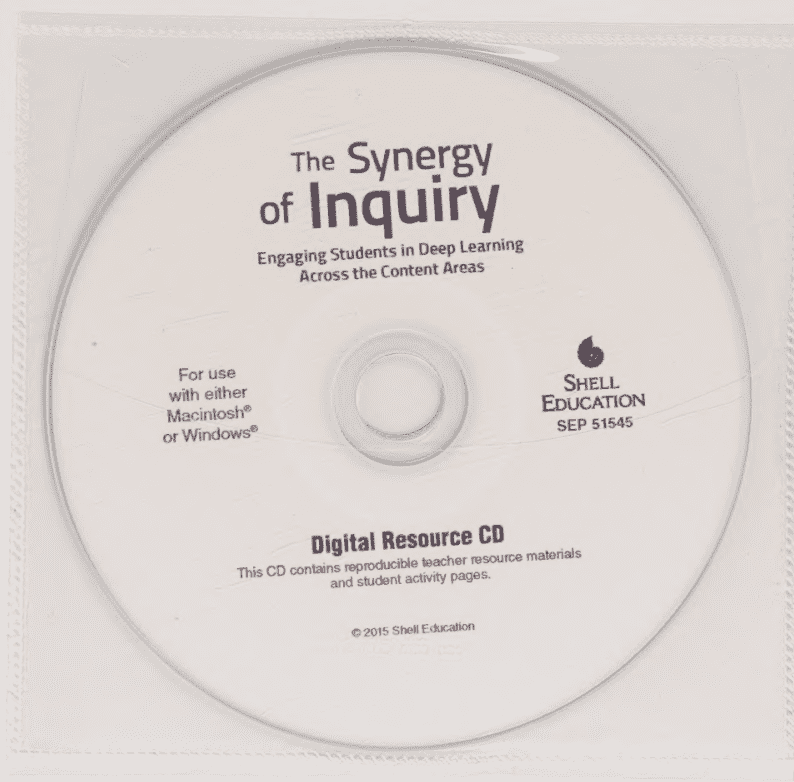

## 探究的协同效应

让学生参与深度学习
跨内容领域

可供
Macintosh®
或 Windows®
使用

SHELL EDUCATION
SEP 51545

## 数字资源光盘

本光盘包含可复制的教师资源材料和学生活动页面。

© 2015 Shell Education

## 探究的协同效应

让学生参与跨内容领域的深度学习

> 这本面向当前实践者的操作手册描绘了一把伞，鼓励专业教育工作者保留行之有效的做法。理论、教案和课堂管理策略相结合，支持教师实施一种经过验证的、基于研究的方法。

—布莱恩·贝茨，文学硕士
莫雷诺谷学区教师
加利福尼亚州莫雷诺谷

学会在教师不提供帮助的情况下自主寻找问题答案，对学生的学业成功至关重要。借助本资源，教师将学会如何帮助学生理解怎样以有效方式找到所需答案。无论课程标准是语言艺术、数学、科学还是社会研究，探究式教学不仅有效，而且是吸引学生、帮助他们达到标准的高效途径。这份及时而宝贵的资源提供了一套协同实践，创造了一种行之有效的方式，使学生能够发展深层的概念理解、复杂的思维技能以及持久的学习习惯。

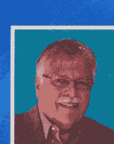

保罗·贾布隆博士曾在纽约市公立学校任教19年，在那里，他与同事创建了采用探究式教学和跨学科项目式学习的教室、项目和学校，以吸引那些此前对学校失去兴趣的学生。作为布鲁克林学院、马萨诸塞大学和莱斯利大学的教职员工，他有二十多年与职前教师和在职教师合作的机会。他领导了城市和郊区学区的系统性变革项目，与数千名教师合作，探究如何在不同学生群体（从幼儿园到大学）中最好地实施探究式教学。

