# 初学者生成式 AI 全集：三合一指南，每天只需几分钟，通过实用项目学习 AI、深度学习与 ChatGPT —— 即使你不是技术专家


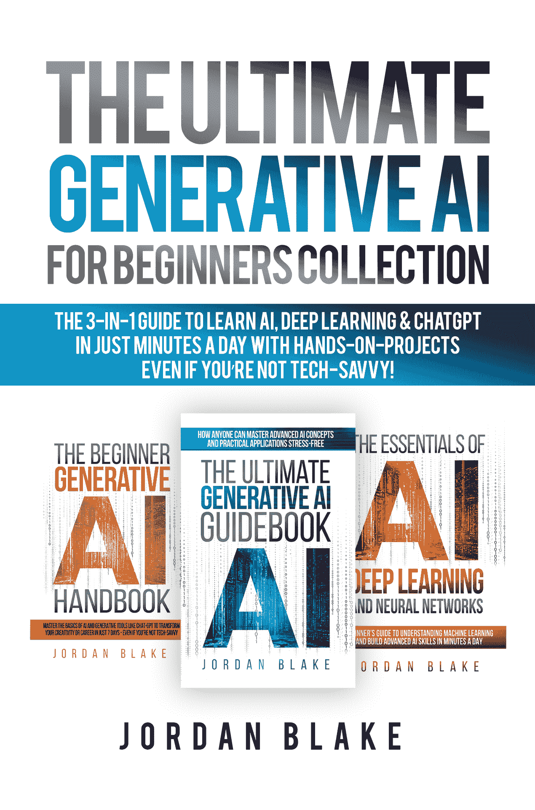


## AI 深度学习精要

## 引言

# 第 1 章：机器学习与 AI 基础

## 1.1 机器学习简介：概念与背景

## 1.2 理解算法及其应用

## 1.3 数据预处理：成功模型的关键

## 1.4 引导 Python 进行 AI 开发

## 1.5 构建你的第一个机器学习模型

## 1.6 用于探索神经网络的 AI 提示

# 第 2 章：深入研究神经网络

## 2.1 感知机简介：AI 的转折点

## 2.2 激活函数：为网络注入生命

## 2.3 理解层：隐藏层、输入层与输出层

## 2.4 反向传播：学习过程

## 2.5 动手实践：创建一个简单的神经网络

## 2.6 用于加深神经网络的 AI 提示

# 第 3 章：深度学习架构

## 3.1 卷积神经网络 (`CNNs`)

## 2.2 循环神经网络：时间序列与序列

## 3.3 探索 Transformers：AI 的未来

## 3.4 自动编码器及其应用

## 3.5 使用 `Keras` 和 `TensorFlow` 构建复杂模型

## 3.6 AI 动手实践：探索深度学习架构

# 第 4 章：实际应用与行业影响

## 4.1 行业影响示例

案例研究：医疗保健领域的 AI 成功

## 4.2 金融创新：预测模型与欺诈检测

## 4.3 机器人领域的 AI：增强自动化与效率

## 4.4 现实项目：构建 AI 驱动的聊天机器人

## 4.5 娱乐业中的 AI：个性化与内容创作

## 4.6 AI 动手实践：探索实际应用与行业影响

## 准备好产生影响了吗？

# 第 5 章：数据分析与可视化

## 5.1 数据清洗与转换

## 5.2 探索性数据分析：工具与技术

## 5.3 使用 `Matplotlib` 和 `Seaborn` 可视数据

## 5.4 高级数据可视化：用数据讲述故事

## 5.5 实践练习：现实数据分析项目

## 5.6 AI 动手实践：增强数据分析与可视化技能

# 第 6 章：伦理考虑与负责任 AI

## 6.1 人工智能中的偏见

## 6.2 确保 AI 的公平性与问责

## 6.3 可解释性：让 AI 决策

## 6.4 实践中的伦理 AI：案例研究

## 6.5 构建可靠的 AI 系统

## 6.6 AI 动手实践：探索 AI 中的伦理考虑

# 第 7 章：使用 AI 工具包增强技能

## 7.1 `TensorFlow`：理解基础

## 7.2 `PyTorch`：AI 开发中的灵活性与控制

## 7.3 用于快速原型设计的 `Keras`

## 7.4 `Scikit-Learn`：简化机器学习

## 7.5 实际应用：使用 AI 库构建

## 7.6 AI 动手实践：AI 工具包的高级应用

# 第 8 章：基于项目的学习与现实应用

## 8.1 将项目与你的兴趣对齐

## 8.2 构建情感分析模型

## 8.3 开发图像分类系统

## 8.4 从零开始推荐系统

## 8.5 在现实场景中部署 AI 模型

## 8.6 AI 动手实践：高级基于项目的学习

# 第 9 章：职业发展与社区参与

## 9.1 闯入 AI 职业路径与机会

## 9.2 构建作品集：展示你的技能

## 9.3 技术社区中的人脉与协作

## 9.4 利用在线资源进行持续学习

## 9.5 在快速发展的领域中保持竞争力

## 9.6 AI 动手实践：推进你的职业并建立 AI 专家知识

# 第 10 章：高级主题与未来趋势

## 10.1 超参数调优


## 10.2 探索生成对抗网络 (GANs)
## 10.3 AI 的未来：趋势与创新
## 10.4 亲手实践 AI：探索进阶主题与未来趋势
# AI 深度学习要点 – 结论
# 术语表
# 参考文献

《初学者生成式 AI 手册》

掌握 AI 基础及 ChatGPT 等生成式工具，仅需 7 天即可改变你的创造力或职业——即使你不精通技术

Jordan Blake


# 初学者生成式 AI – 引言

让我为你描绘一幅画面：这是 2023 年，你正坐在一家热闹的咖啡馆里，喝着你最喜欢的咖啡。你周围，人们正热烈地交谈。但转折在于：他们中一半的人正在与 AI 驱动的设备聊天。一个人正在与 AI 助手脑暴新的商业创意，而另一个人正在 AI 音乐生成器的帮助下创作一首歌。这不是科幻小说，它正在发生。

人工智能正以让任何人目目眩神的速度改变着生活的各个方面。我们已经达到了这样一个程度：理解 AI 不仅仅是锦上添花，而是必不可少的。如果你不跟上，就面临被留在数字尘埃中的风险。但别担心：你在这里了，这是一个非常好的开始。

我是 Jordan Blake，NextGen AI Publications 的创始人。我的目标是让每个人都能触及 AI。我想向你证明，AI 并不仅仅属于技术极客；它属于任何对未来好奇并渴望学习的人。我在 AI 领域工作了多年，将复杂的概念拆解成简单、易于吸收的知识点。相信我，如果我能解释清楚，你就能理解。

让我们聊聊生成式 AI。想象一下一位永不睡觉的艺术家，一个永不疲倦的创造者。这就是生成式 AI。它根据模式和输入数据生成文本、音乐、图像等内容。它就像拥有一个能增强你想象力的创意伙伴。最棒的部分是什么？你不需要计算机科学学位来使用它。你只需要好奇心和愿意尝试的精神。

这本书的愿景非常简单：赋能你释放 AI 的创造潜力。这不是某本枯燥的教科书，而是一份实用的、上手的指南，旨在让 AI 为你服务。无论你是学生、企业家，还是仅仅是一个好奇的人，这本书都能帮助你探索 AI 的可能性，而不会让你精疲力竭。

现在，让我们消除几个误区。AI 不是来抢走你的工作或统治世界的。它是一个工具，就像电脑或智能手机。是的，它有改变行业的潜力，但它也创造了新的机会。AI 是你的盟友，而不是对手。担心技术门槛高？忘掉它们吧。这本书是为初学者设计的。

所以，你可以期待什么？当你读完这本书，你将理解 AI 基础。你将知道如何在个人项目、职业或创意活动中使用 AI 工具。你将能够增强创造力，提升职业前景，甚至可能在下一次晚餐聚会上让朋友们大刮眼镜。

这本书采用循序渐进的方法。我们将从基础开始，然后转向实际应用。每个章节都包含练习和示例等互动元素。我鼓励你积极参与。你投入得越多，学得越多。

在这段旅程结束时，你将对使用 AI 工具感到自信。你不会把 AI 看作一种遥远、复杂的技术，而是一个价值的朋友。你将拥有创新和创造的知识，开启通往新可能性的大门。

保持好奇。投入内容。尝试练习。我向你保证这是值得的。你即将开启改变生活的旅程，这段旅程潜力改变一切。让我们带着开放的心和冒险精神一起发现 AI 的世界。未来已来，它正在等待你。


# 第 1 章：奠定基础：理解人工智能与机器学习

你是否想过你的手机是否有读心能力？你随口提到“假期”，你的手机突然向你投射了一堆热带度假的广告。不，你的手机不是读心者；AI 只是在履行工作。欢迎来到机器模仿人类智能的世界，让我们的生活变得更容易（或更诡异，取决于你的观点）。但人工智能究竟是什么，我们是如何走到这里的？

让我们深入探讨 AI 迷人的演变，从艾兰·图灵（Alan Turing）开始，这位英国数学家在 1950 年思考了一个问题：“机器能思考吗？”他的工作为我们现在所说的 AI 奠定了基础。快进几十年后，IBM 的深蓝号在 1997 年击败了世界象棋冠军加里·卡斯帕罗夫，创造了历史。这不仅仅是机器的胜利；它是一个向世界展示 AI 能做什么的定义时刻。然而，这些里程碑只是冰山一角。AI 已从一个小众的学术领域演变为日常技术背后的动力。

## 1.1 揭秘 AI：什么是人工智能？

人工智能的核心涉及创建能够模仿人类决策和解决问题处理过程的机器。将 AI 想象成那个总是表现过群的朋友，它总是领先一步，无论是预测你的下一次在线购物，还是为你的心情推荐完美的播放列表。然而，与人类不同，AI 不会疲倦，也不需要咖啡休息。它在像 `Alexa` 这样的语音助手、`Netflix` 的推荐系统，甚至在你那个神奇地知道你不想收的垃圾邮件过滤器中，幕后不知疲倦地工作。这些日常应用展示了 AI 的多样性以及它在增强我们数字生活的角色。

现在，让我们理清 AI、机器学习和深度学习之间的关系。把 AI 想象成一把大伞，涵盖了所有智能系统。机器学习就像伞柄，通过允许其从数据中学习来赋予 AI 形状。而深度学习是伞上复杂的图案，它利用神经网络处理海量信息。这些区别可能看起来微不足道，但它们在 AI 生态系统中各起着重要作用。机器学习专注于随时间改进的算法，而深度学习更进一步，通过模拟人类大脑神经网络来处理更复杂的任务，如识别图像或理解语言。

AI 对社会的影响深远且多方面的。在医疗领域，AI 驱动的诊断工具正在改变医生检测疾病的方式，提供更快、更准确的诊断。考虑 AI 在交通领域的潜力。自动驾驶汽车不再是科幻幻想；它们正在道路上接受测试，承诺一个大幅减少人为错误的未来。这些创新展示了 AI 跨行业的转型潜力。在我们探索 AI 的能力时，我们也必须考虑其伦理影响，并确保这些技术以负责任的方式开发和使用。

### 感奇吗？测试你的 AI 知识！

认为你掌握了 AI 吗？通过这些问题挑战自己：

1. 艾兰·图灵对 AI 领域贡献什么？
2. AI 与机器学习、深度学习有什么区别？
3. 你能说出一个你常用的日常 AI 应用吗？

利用这些问题对你刚刚读的内容进行反思。你可能会对自己所知的感到惊讶——或者激发学习更多的好奇心。

## 1.2 机器学习基础：机器如何从数据中学习


让我们面对现实，机器学习的想法可能让人望而生畏。但不要害怕，它并没有听起来那么复杂。将机器学习想象成教狗学新动作的过程，只不过这只狗是计算机，而零食就是数据。机器利用算法来识别模式并根据这些数据做出决策，就像我们从经验中学习一样。两种最常见的学习方法是监督学习和无监督学习。监督学习涉及向机器投送有标签的数据——例如给狗看一张猫的照片并说：“这是一只猫”。然后，机器就学会了识别其他照片中的猫。另一方面，无监督学习就像是给狗一堆未标记的玩具，让它自己去发现哪些是可以咬的，哪些不是。它在没有显式指令的情况下识别模式和结构。

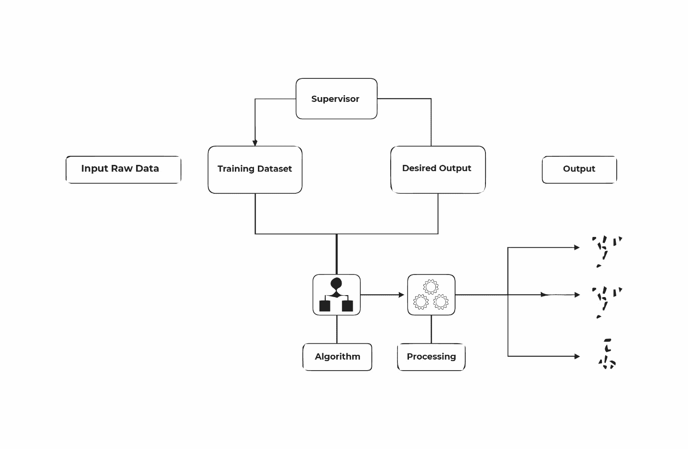

谈到算法时，可以把它们想象成你最喜欢的菜肴中的“秘配”。它们让机器学习变得极其卓效且高效。决策树是最简单的算法之一，其工作方式类似于一系列“如果-那么”问题——就像是加强版的流程图。它们非常适合根据一组规则来做出决策。然后是回归分析，它根据历史数据预测结果，就像预测天气一样。我们不要忘记神经网络，它的灵感来源于人类大脑，擅长识别复杂模式。它们是幕后天才，负责识别照片中的人脸或理解语音。

数据是机器学习的命脉——没有了数据，我们的机器只是一个精美的镇纸器。数据的质量和数量决定了机器学习的好坏。在将数据输入算法之前，需要对其进行预处理。这涉及清理数据，例如删除重复项或纠错误。特征选择是另一个关键步骤，选择最相关的数据点以提高模型准确性——就像为食谱挑选最好的食材。标注数据集（即数据被清晰标记）为机器提供了有效学习所需的上下文。

人们很容易掉入认为“机器像我们一样学习”的陷阱，但这是一个常见的误区。机器并不理解上下文，也没有直觉。它们缺乏理解情感或根据直觉决策的能力。与能够从单次经验中学习的人不同，机器通常需要大量的数据来识别模式。然而，机器的优势在于能够快速准确地处理大型数据集，执行人类需要花长时间才能完成的任务。

让我们用图像识别中的现实案例来来说明这一点。想象你正在教计算机区分猫和狗。使用监督学习，你为它提供数千张标记好的猫和狗图像。机器分析这些图像，识别如耳朵的形状或胡须的存在等模式。一旦训练完成，你给它一张新照片，哇——它就能告诉你是那是猫还是狗了！这个过程看起来可能像魔法一样，但只是模式和概率的问题。

### 快速问答：测试你的机器学习知识！

1. 什么是监督学习？它与无监督学习有什么区别？
2. 你能说出一种机器学习中使用的算法并描述它的功能吗？
3. 为什么数据质量在机器学习中如此重要？

这些问题是为了激发你的好奇心，帮助你思考刚刚学的内容。探索这些问题来巩固你的理解，并为接下来的精彩话题做好准备。

## 1.3 生成式 AI 在当今世界的角色

想象这样一个世界：你的笔记本电脑不仅仅是一个华丽的打字机。它变成了一个创意伙伴，能够从零开始生成内容。这就是生成式 AI 的承诺。与遵循给定规则解决问题的传统 AI 不同，生成式 AI 可以进行创作——无论是写小说、作曲还是设计艺术品。把它想象成你口袋里的数字艺术家，只需几次击键就能生成全新的、令人兴奋的内容。它就像有一台永不疲竭的点子机器，只需点击按钮即可为你的创造力提供涡轮加速。


生成式 AI 已经在多个行业引起了轰动。在媒体和娱乐领域，它正在彻底改变内容的创建和消费方式。电影制厂用它来生成特效甚至剧本，而音乐家则与 AI 合作发现新的声音和节奏。在制药行业，生成式 AI 通过模拟无数分子组合来加速药物发现，而这在人类身上需要多年时间才能完成。建筑师利用它的力量设计创新结构，创建平衡了美学与功能的蓝图。这项技术不仅仅是一个工具；它还是在创意和科学领域开启新可能性的合作者。

但强大的力量也伴随着一系列伦理考量。生成式 AI 可以创建栩栩真的深度伪造（deepfakes），模糊现实与虚构之间的边界。这些内容威胁到虚假信息的传播并侵蚀人们对媒体的信任。AI 创建的艺术品归谁所有？是设计算法的人、提供数据的人，还是机器本身？这些问题远非学术性的——在我们引导伦理格局时，它们至关重要。

展望未来，生成式 AI 的未来就像想象力本身广广。想象一个世界，AI 协助艺术家根据你的品味创建个性化内容，从随心情演变的音乐播放列表，到适应你偏好的虚拟现实体验。人类与 AI 之间的创意协作将重新定义艺术，AI 将提供我们从未想过的点子。随着行业迎接这些可能性，生成式 AI 的角色将扩大，驱动各个部门的创新。我们正站在创意新纪元的边缘，由 AI 无限的潜力驱动。

## 1.4 生成式模型类型：GANs、VAEs 以及更多

欢迎来到生成模型的世界，在这里，机器不仅是处理数字的机器人，它们本身就是创造者。让我们从生成对抗网络，即 `GANs` 开始。想象两个人工智能系统之间的友好对决：生成器 `generator` 和 判别器 `discriminator`。生成器的工作是创建新的数据样本，就像一位数字毕加索在画新的艺术品，而判别器则扮演艺术评论员的角色，区分真实样本和生成样本。这种趣味性的竞争促使生成器不断改进其作品。`GANs` 震撼了艺术界，产生了挑战我们创造力感知迷人视觉效果。它们被用于生成写实图像、制作独特的艺术品，甚至创建虚拟模特。

接下来是变分自编码器，即 `VAEs`，它是数据压缩和生成的无名英雄。将 `VAEs` 想象成大师伪造者，擅长捕捉数据的本质并以惊人的准确性进行复制。与关注真实性的 `GANs` 不同，`VAEs` 优先考虑通过将数据编码为简单的形式来理解和重建数据。这使得它们在数据压缩等任务中非常有价值，因为可以在不丢失重要细节的情况下缩小文件。`VAEs` 还在生成具有微小差异的新数据方面找到了自己的领域，例如产生旋律的不同版本，或为图形设计创建新的配色方案。它们就像 AI 版的混曲大师，在原始内容的基础上增加独特的见解。


然后是自回归模型家族，它们采取了不同的方法。它们一次生成一步数据，根据之前的输入预测下一部分信息。可以将它们想象成严谨的作家，逐字逐句地构思着小说，确保每一句话都与上句平滑衔接。自回归模型在自然语言处理中表现出色，能够创建出模仿人类写作的文本。它们是能够对话的聊天机器人以及预测文本功能后的大脑，这些功能似乎知道你下一个要输入什么。这些模型是耐心和精的典范，使得它们在需要连续性和连贯性的任务中不可或缺。

比较 `GANs` 和 `VAEs` 就像在画家和雕塑家之间进行选择——两者在各自的领域都有长。`GANs` 在关键在于真实性的场景中表现活跃，例如创建栩如生的图像或视频。另一方面，`VAEs` 在需要数据理解和操作的应用中放异彩，例如根据现有设计生成新设计。这两种模型各有优劣，选择哪一个取决于具体任务。自回归模型凭借其步步为营的方法，提供了不同风格的创造力，特别是在序列数据生成方面。

然而，生成式模型并非没有局限。它们高度依赖海量数据来进行有效训练，使其成为“数据贪婪的巨兽”。数据的质量和多样性至关重要，因为偏偏或不足的数据集会导致倾斜的结果。此外，这些模型需要大量的计算能力，通常需要专用硬件才能实现最佳运行。这意味着它们可能并不对所有人都开放，特别是对于那些没有雄厚资金或无法接触尖端技术的人来说。

在现实世界中，`GANs` 彻底了艺术和设计行业，允许创作者探索视觉表达的新领域。`VAEs` 在数据压缩方面取得了巨大进展，提供了高效的存储和传输信息的方法，而不牺牲质量。同时，自回归模型增强了我们与技术的交互，从语音激活助手到预判我们每个字词的预测文本功能。这些模型各自拥有独特的能力，继续推向机器创造能力的边界，为全球行业提供了新的工具和可能性。

## 1.5 AI 词汇：初学者关键术语表

让我们转向 AI 词汇表，这里的每一个术语都开启了一扇通往这一迷人领域的大门。让我们从强大的算法开始——它是操作背后的大脑。将其看作一份食谱，指导计算机如何执行任务，从过滤你的垃圾邮件到推荐你可能喜欢的电影。算法无处不在，静静地将混乱的数据组织成有意义的行动。它们是我们信息厨房里的数字厨师，从海量的数据食材中烹制出解决方案。

接下来是 `dataset`（数据集），这个术语听起来一样直观。将 `dataset` 想象成一个精选的信息画廊，一个机器用于学习的图像、数字或文本集合。就像艺术家使用调色板来创作杰作一样，AI 使用 `datasets` 来训练和提高其性能。`dataset` 的质量可以决定模型准确性的成败——本质上是“垃圾进，垃圾出”（garbage in, garbage out）。这就是为什么一个组织良好的 `dataset` 是机器学习的宝库，为训练提供了原材料。

神经网络是我们的下一站。将此想象成一个虚拟大脑，旨在模拟人类识别模式的能力。它由层层组成——像一个精细的三明治——每一层都处理信息并将其传递给下一层。如果你曾好奇过手机如何识别你的脸，或者汽车如何能够自动驾驶，这一切都归功于 `neural networks`。

建立你的 AI 词汇并止于此。你学得越多，理解就越丰富。为了保持更新，请沉浸在在线课程、出版物和社区论坛等资源中。

### 想增加你的 AI 词汇吗？方法如下：

1. 阅读 AI 博客和文章：如 `DataCamp` 和 `TechCrunch` 等网站。
2. 加入在线社区：如 `Reddit` 和 `Stack Overflow` 等站点。
3. 参加在线课程：如 `Coursera` 和 `edX` 等平台。

## 1.6 从算法到应用：AI 工具是如何工作的

你是否好奇算法是如何从理论构建演变为应用的基石的？这是魔法真正发生的地方，将抽象模型转化为实用且有影响力的工具。这段旅程始于数据，任何 AI 的命脉。将数据想象成食谱中的原材料，等待着转化为美食。这些数据被细致地输入和处理，确保它们洁净并准备就绪。接下来是模型训练，算法从这些数据中学习，就像学生为考试冲刺一样。这个阶段涉及调整参数以获得最佳结果，类似于调节乐器直到它发出完美的音符。一旦训练完成，模型将经过验证，这是一项严格的测试，以确保它在现实世界中准确运行。将其想象为正式演出前的彩排，消除任何小问题以确保完美无缺的执行。

为了让这些算法活起来，开发者使用了如 `TensorFlow` 和 `PyTorch` 等强力工具。由 `Google` 的天才们开发的 `TensorFlow` 为部署机器学习模型提供了一个灵活的生态系统，成为 AI 爱好者的青睐。它就像 AI 工具中的瑞士军刀，多功能且不可或缺。同时，`PyTorch` 以其易用性和动态计算能力而闻名，在研究人员和开发者中同样受欢迎。它等同于一把可靠的锤子，简单而有效。还有 `OpenAI API`，它是通往 `GPT` 等高级 AI 模型的门户，驱动着从创意写作助手到聊天机器人的一切。这些平台提供了构建和部署 AI 应用所需的脚架，将理论概念转化为具体的解决方案。


尽管这些工具非常复杂，但人类的监督仍然至关重要。AI 系统可能会表现出意外之外的偏见，反映出它们训练时使用的数据。这正是人类判断发挥作用的地方，作为道德指南引导 AI 指向正确的方向发展。伦理考量必须置于 AI 开发的最前沿，确保这些系统在不损害价值观的情况下增强人类生活。这涉及定期审计、偏见缓解策略以及对透明度的承诺。毕竟，AI 应该赋能人类能力，而不是掩盖它们。

考虑聊天机器人彻底改变客服服务的案例。聊天机器人曾经笨拙且局限，而今天的聊天机器人已经足够能够处理复杂的查询，提供实时帮助，并将人工代理员解放出来处理更细致的任务。这种转变是由 AI 算法驱动的，这些算法从海量的客户交互数据中学习，并不断改进其回复。或者以金融领域的预测分析为例，AI 模型分析历史数据以预测市场趋势，帮助投资者做出明智决策。这些应用展示了 AI 在提高各行业效率和决策能力方面的潜力。

当我们结束这段探索时，请记住 AI 并不是某种遥远而不可及的技术。它是一项工具，也是创意和创新的伙伴。凭借正确的知识和资源，你可以利用 AI 来实现你的目标，无论是在艺术、商业还是个人项目中。保持好奇，大胆实验，并拥抱 AI 提供的可能性。未来是光明的，在 AI 的陪伴下，你可以成就的将没有限制。

## 1.7 AI 实战：理解 AI 与机器学习

想象一下走进 AI 的世界，不是作为一个旁观者，而是作为一个活跃的参与者。算法曾经是抽象而神秘的，现在却是你可以用来创造、分析和创新的工具。本节通过设计的 ChatGPT 实操练习弥补了理论与实践之间的差距，旨在强化到目前为止涵盖的基础 AI 概念。将这些练习视为你的 AI 乐场，好奇心和创造力将引导你走向深度理解。

### 有效实践指南

1. 访问 `ChatGPT`：
    - 访问 `[OpenAI 的 ChatGPT](https://www.openai.com/)` 平台开始。
    - 如果需要，创建一个免费账户以探索交互式练习。
2. 对输入内容进行实验：
    - 尝试改写提示词（prompts）或添加新细节，看看 `ChatGPT` 如何调整其回复。
    - 示例：将 `“向 5 岁小孩解释 AI”` 修改为 `“向一群高中生解释 AI。”`
3. 反思输出结果：
    - 评估 `AI` 的回复：它们清晰吗？是否与你学到的内容一致？
    - 记录可能需要额外上下文或纠正的。
4. 迭代与改进：
    - 使用 `ChatGPT` 的反馈循环来完善提示词。例如，如果回复太宽泛，请指定关键细节或限制。

### 交互式提示词：解析 AI 概念

让我们通过 `ChatGPT` 探索 AI 工具的之旅，应用你目前所学。每个提示词都对应第 1 章中的关键主题。

#### 理解 AI 基础
1. 用简单的语言解释 AI：
    - 提示词：`“用三句话向 5 岁小孩解释人工智能。”`
    - 目标：简化复杂概念以巩固你的理解。
2. 探索 AI 的演进：
    - 提示词：`“从艾伦·图灵的贡献开始，创建一个 AI 历史上三个重大里程碑的时间线。”`
    - 目标：回顾 AI 的历史历程。

#### 机器如何学习
1. 监督学习 vs 无监督学习：
    - 提示词：`“用教狗学技巧和分类袜子等例子，解释监督学习和无监督学习之间的区别。”`
    - 目标：通过亲切的类比加强对机器学习概念的掌握。
2. 创建交互式问答测：
    - 提示词：`“生成一个 5 问题的测试，测试关于机器如何学习知识。包含一个关于决策树的问题。”`
    - 目标：与 `AI` 交互以强化你的知识。

#### 数据：AI 的命脉
1. 清洁数据 vs 原始数据：
    - 提示词：`“用食谱类比解释清洁数据和原始数据之间的区别。为什么清洁数据对 AI 很重要？”`
    - 目标：理解数据准备在 AI 工作流中的重要。
2. 实际数据场景：
    - 提示词：`“想象你正在训练一个 AI 模型来识别猫图片。列出训练数据中的五个潜在问题以及如何修复它们。”`
    - 目标：识别并解决常见的数据挑战。

#### AI 的应用
1. 日常生活 AI：
    - 提示词：`“列出 AI 在日常生活中的三种方式，并描述算法如何驱动这些应用。”`
    - 目标：将算法与实际用例联系起来。
2. 创意应用练习：
    - 提示词：`“设计一个帮助用户创建健康饮食计划的机器人。机器人会问哪些问题？它将使用哪些 AI 驱动的功能？”`
    - 目标：练习设计现实世界的 AI 应用。

这些练习是你将抽象的 AI 概念转化为切实技能的第一步。通过参与这些提示词并反思结果，你不仅将获得更深入的理解，还将获得应用 `ChatGPT` 等 AI 工具的实践经验。保持好奇，大胆实验，见证 AI 的世界在你的指尖展开。从算法到应用的之旅刚刚开始。


# 第 2 章：工具箱：熟悉 AI 平台

想象一下：你正在参加一个晚宴，正享受着关于技术的讨论，这时话题不可避免地转向了 AI。在每个人都分享了自己的想法后，所有的目光都转向了你寻求意见。恐慌感袭来——直到你想起了这本书。凭借你的知识，你自信地潜入 AI 的奇妙世界，让每个人都感到好奇并略带嫉妒。所以，拿起咖啡，让我们探索你如何能像专家一样使用这个工具。

## 2.1 探索 ChatGPT：对话 AI 学者指南

`ChatGPT` 不仅仅是另一个流行词，它是一个对话的动力源，可以改变你与技术互动的方式。把它想象成一个永远不会对你的问题或请求感到厌倦的朋友。`ChatGPT` 由 `OpenAI` 开发，理解并生成类人类文本，是客服自动化的强大动力。是否曾希望有一个 24 小时的助手来处理琐的查询？`ChatGPT` 可以高效且富有魅力的方式处理这些问题，对于寻求增强客户互动的企业来说极具价值。


`ChatGPT` 的实际应用与你的日常困境一样多样化。需要帮助起草一封专业的邮件却对着空白屏幕发呆吗？`ChatGPT` 可以提供建议，将你的写作瓶颈转化为职场沟通的杰作。或者想象一下：你正在异国旅行，需要翻译菜单的速度比你说出“我要点和她的一样的”还要快。`ChatGPT` 的实时语言翻译是你可靠的旅行伴侣，免得你点了一道结果发现是烹饪挑战的神秘菜肴。

当然，和任何新工具一样，你也会遇到一些波折。隐私和数据安全是首要考虑的问题，特别是在处理敏感信息时。请放心，`OpenAI` 非常重视这些问题，采取了强有措施来保护你的数据。然而，避免分享可能危及安全的个人细节是明智的。另一个常见问题是理解上下文。虽然 `ChatGPT` 令人印象深刻，但它在处理复杂或微妙的要求时有时会很吃力，表现出的热情像一个喝了咖啡但尚未完全掌握任务的实习生。但别担心，只要指令清晰并付一点耐心，`ChatGPT` 很快就会成为你可靠的助手。

### Chat-GPT 快速上手清单

* **注册**：访问 `OpenAI` 网站并创建一个账户。
* **探索界面**：熟悉文本输入框和响应窗口。
* **测试用例**：尝试起草邮件或翻译文本以查看 `ChatGPT` 的运行效果。
* **注意数据**：保持敏感信息的私密性以确保数据安全。
* **保持耐心**：记住，清晰、简单的请求会产生最佳结果。

到本章结束时，你将有信心将 `ChatGPT` 整合到你的日常生活中，无论是工作还是娱乐。当你继续探索它的功能时，你将发现提高生产力和创造力的新方法，让你在下一次晚餐聚会上成为处理所有 AI 问题的专家。

## 2.2 OpenAI 及其他：导航 AI 平台

想象一下，你正在探索一个奇熙攘攘的 AI 工具市场。每个摊位都挂着引人目的横幅，承诺着创新与变革，但你该从哪里开始呢？在脱颖者中，`Google AI` 和 `IBM Watson` 提供了令人向往的前。`Google AI` 凭借其工具 set，就像是处理所有数据和机器学习事务的瑞士军刀。从自然语言处理到计算机视觉，它提供了既适合初学者也适合资深专业人士的稳健解决方案。而 `IBM Watson` 则像一位深谙分析之道的智者。它以在数据分析和商业智能方面的能力而闻名，`Watson` 提供的服务帮助企业通过复杂的算法和机器学习模型理解海量数据。每个平台都带来了独特的产品，满足了从不同需求到专业水平的选择。

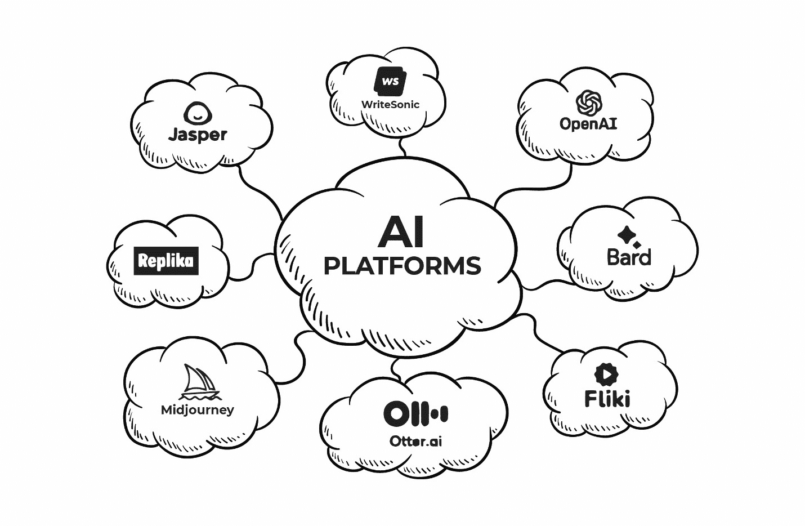

在这些平台之间做出选择就像在巧克力和香草味之间做决定——两者都很棒，但哪种适合你的味蕾呢？`Google AI` 通常因为与其他 `Google` 服务的集成而具有吸引力，对于那些已经在 `Google` 生态系统中的人来说这是一个无缝的选择。它支持广泛的语言——非常适合我们中的多语言专家——并提供免费层级，这对于任何初学者来说都是如悦于耳。`IBM Watson` 虽然通常更侧重于企业，但提供了在医疗保健和金融等领域优秀的专业工具。它的定价模型更具结构化，可能需要更深投入，但其价值在于为复杂问题提供量身定制的解决方案。无论你是涉足 AI 水域的学生，还是寻求数据驱动洞察的企业主，了解这些特征都能帮助你做出关于哪种平台最符合你需求的明智决策。

易用性是关键，这些平台深知这一点。用户友好的文档是他们的秘密武器，使复杂的过程简单化，让 AI 对所有人来说都更容易亲近。`Google AI` 丰富的教程和指南库是自学者的者的宝库，而 `IBM Watson` 则通过论坛和研讨会提供全面的支持。想象走进一个图书馆，那里的每一本书都是关于 AI 的，你可以挑选任何一本开始你的学习冒险。社区支持和论坛在你遇到阻碍时提供了救命稻草，提供了一个分享想法和解决方案的空间。这些资源将障碍变成了垫脚石，让你能够充满心地穿梭于 AI 领域。

随着 AI 世界运转得越来越快，紧跟趋势变得至关重要。AI 平台的新兴发展承诺了更多兴奋的工具和功能。`Google AI` 在其量子计算的进展上持续创新，而 `IBM Watson` 则在探索 AI 在区块链技术中的潜力。这些平台正在不断演进，确保它们处于技术进步的前沿。关注这些趋势不仅能让你为未来做好准备，还为学习和增长的新机会开启了大门。在这个不断变化的格局中，适应能力是你最大的盟友，而这些平台的设计旨在支持你的旅，无论它通向何方。

## 2.3 初学者的免费且负担得 AI 工具

想象一下：你是一个好奇的探险家，站在广阔的 AI 景观面前，有许多道路可以走。但某些路线是付费的，而你的口袋并没有装满金币。别担心！即使资源有限，也有许多预算友型的 AI 工具准备好帮助你完成求知之旅。让我们从 `Google Colab` 开始，这是一件瑰，允许你在不需要昂贵硬件的情况下运行 AI 模型。它就像是多亏 `Google` 借给你的一台强大的计算机。`Colab` 直接在你的浏览器中运行，所以设置起来轻而易举。你不需要安装任何东西——只需登录你的 `Google` 账户即可开始之旅。无论你是在尝试机器学习还是实验深度学习模型，`Google Colab` 都能提供将你的想法变为现实所需的计算支持。

接下来是 `Microsoft Azure` 的 AI 免费层级，这对于 AI 爱好者来说是一个真正的游乐场。`Azure` 提供了一系列服务，让你可以在不花一分钱的情况下构建、训练和部署模型。它对于小企业和学生都非常完美，让你在没有财务压力的情况下探索 AI 能力。通过这个工具，你可以访问机器学习服务、认知 API 等。这就像是你随手可用可用一个完整的工具箱，准备好应对你梦想的任何项目。无论你是在开发聊天机器人还是分析数据，`Azure` 都能提供实现这些目标的资源。

现在，让我们聊聊这些工具可以做什么。想象自己是一个数据艺术家，使用 `Plotly` 为你的数据集描绘生动的视化图表。`Plotly` 是一个强大的数据可视化工具，可以与 `Google Colab` 无缝协作。它将数值数据转换为惊人的图表和图谱，使发现趋势和模式变得更容易。无论你是在商务会议上展示发现，还是在完成一个学校项目，`Plotly` 都能增加视觉吸引力，让你的观众保持兴趣。然后是 `spaCy`，这是一个自然语言处理库，非常适合文本分析。它就像在你指尖有一位语言大师，能够解析文本、识别实体甚至进行情感分析。想象在 `Colab` 中运行 `spaCy` 来分析推文，在不离开浏览器的情况下提取关于公众意见的见察。


使用这些工具非常简单。设置 Google Colab 环境就像登录你的 Google 账户并创建一个笔记本一样简单。你可以立即开始编码，使用 `Python` 来训练模型并进行数据可视化。对于 `spaCy`，安装也是轻而易举。在你的 Colab 笔记本中运行一个简单的命令即可安装该库，你就可以准备好以资深语言学家的精度分析文本了。这些工具的结合提供了一个强大的实验平台，让你无需购买昂贵的软件或硬件即可探索 AI 概念。


为了最大化你的体验，请考虑这些建议。在 `Google Colab` 中工作时，通过运行较小批量的数据并在可用时利用 `GPU` 加速来优化脚本性能。这确保了你的模型高效训练，节省时间和计算资源。利用 `spaCy` 的预训练模型来启动你的分析。这些模型在海量数据上进行了训练，为你的项目提供了坚实的基础，减少了初始训练所需的时间。此外，保持代码整洁并记录你的流程，以简化未来的项目。这些策略不仅增强了你当前的工作，还为未来的 AI 事业奠定了基础。

## 2.4 设置你的 AI 工作空间：工具与技巧

在蜕变为 AI 魔法师之前，你需要一个合适的工作空间。把它想象成你的私人实验室，在这里，思想飞翔，实验变为生命。首先，让我们解决硬件问题，那个老问题：笔记本电脑还是台式电脑？如果你是一个游牧者，经常奔波，那么笔记本电脑就是你可靠的伙伴。寻找一个具有强力处理器和充足 `RAM` 的设备——将其比作你操作的大脑和肌肉。同时，台式电脑通常提供更大的动力，非常适合那些计划在舒适的家中处理重型计算任务的人。台式电脑就像可靠的老朋友，在你需要时它们总在那。

一旦你准备好了硬件，就是时候探索软件安装了。`Python` 应该是你的首选站。它是 AI 的通用语言，一种多功能的编程语言，不仅对初学者友好，而且极其强大。从 `Python` 官网安装它，顺便获取 `Jupyter Notebook`。这个开源 Web 应用程序允许你创建和共享包含实时代码、方程、可视化和解释性文本的文档。`Jupyter` 是你的游乐场，你可以在那里测试想法并实时查看结果。它为你提供了描绘数字杰作的完美画布。

现在，让我们聊聊本质软件工具。像 `PyCharm` 这样的集成开发环境 (IDE) 是无价的。IDE 类似于一个组织良好的工作空间，万物皆有其位，帮助你高效地编写、测试和调试代码。`PyCharm` 提供了强大的功能，如智能代码导航、重构和内置终端，使其成为开发者者的最爱。`Git` 和 `GitHub` 程序具有版本控制功能——这是你代码的数字时光机。通过 `Git`，你可以跟踪更改、无缝协作，并在出现问题时恢复到之前的版本。`GitHub` 充当你代码的仓库，一个存储和共享工作的安全避风港。这些工具不仅仅是方便之物，在混沌的代码世界中是救命草。

要在你的数字领域保持理智，组织和工作流是关键。从项目的目录结构开始。按照逻辑层级组织你的文件，将代码、数据和文档分开。将你的工作空间想象成一个图书馆，每本书都处于其应在的位置——当截止日期临近时，你会感谢自己的。像 `Trello` 或 `Asana` 这样的任务管理工具可以进一步提高生产力，允许你将项目分解为可管理的任务并跟踪进度。它们就像私人助理，确保你按计划进行，并确保没有事情遗漏。

每一项新尝试都有挑战，设置你的 AI 工作空间也不例外。你可能会遇到令人厌恶的 `Python` 包依赖项问题，其中一个库（或“包”）需要另一个库特定版本才能高效运行。不要担心，像 `Python Package Installer` (`PiP`) 或 `Conda` 这样的包管理器可以通过安装这些库的正确版本来帮助解决这些冲突。另一个常见障碍涉及配置环境变量，这对于定义项目中的路径和设置至关重要。快速在网上搜索或查看一眼官方文档通常就能提供你需要的指导。记住，每个问题都有解决方案，只要有一点坚持，你就能像老练专家一样应对这些小插曲。

## 2.5 交互式 AI：通过测验和练习强化学习

如果你回想起学校时代，可能还记得那些可怕的突击测试。然而，交互式 AI 测验是你真正会喜欢的，它们的设计目的是让 AI 概念像胶水一样牢固。交互式学习不仅仅是教育者抛出的华丽术语；它是一个游戏规则的改变者。当你积极参与材料时，你的大脑会像圣诞树一样亮起来，建立起被动阅读无法建立的联系。这就是多选题发挥作用的地方，它挑战你回想所学的知识并将其应用于现实场景。把它们想象成大脑的智力锻炼，锻炼那些认知肌肉，直到它们变得像奥匹克举重运动员一样强大。

实操练习是你武器库中的另一个工具，让你能够亲手操作 AI 工具。想象自己是实验室里的科学家，正在进行实验并发现新的见解。无论是调整一行代码还是可视化数据模式，这些练习都将抽象概念转化为具体的技能。通过完成这些任务，你将发现 AI 应用的细微差别，加深对理论知识之外的理解。你将不再是 AI 世界的旁观者，而是一个活跃的参与者，准备好面对挑战。每次练习都是实验、学习和增强你像老练专家一样使用 AI 工具信心的机会。

主动学习需要的是动手，而不仅仅是思考。这就像看烹饪节目和实际烘焙蛋糕的区别。当你积极参与材料时，你是在记忆的同时赋予事实意义，从而将其整合到你现有的知识库中。这种过程被称为主动回想（active recall），它极大增强了记忆记忆，将短期知识转化为长期理解。这就像在土壤中播种；经过精心照顾和关注，它们会变成一片丰富的知识果园，在需要时随时可以收获。这种方法将学习从一种被动活动转变为一个充满动态的过程。

当然，即使是最优秀的学习者也需要一些引导，这就是为什么解决方案和解释如此重要的原因。在完成测验或练习后，详细的解决方案指南将引导你了解正确答案，并在过程中解决任何误解。这就像拥有一位私人导师，用清晰耐心的语言解释复杂的概念。这些指南不仅加强了正确的理解，还指明了前进的方向，帮助你在未来避免类似的错误。通过每一个解决方案，你将对材料有更深入的洞察，为更高级的主题奠定坚实的基础。


自我评估是这段旅程中的秘密武器。它是你停下来、反思并总结进展的机会。在完成一项练习后，问自己一些反思性问题：我学到了什么？什么具有挑战性？我该如何改进？这种内省对于识别你需要更多关注的领域至关重要，能够将弱点转化为优势。这有点像照镜子——虽然并不总是那么好看，但对于成长是必不可少的。通过定期评估你的理解程度，你可以保持在正轨上，确保自己朝着正确的方向前进。这一过程让你能够掌控自己的学习，为持续的成功奠定基础。

## 2.6 为 AI 实战做准备：你的第一个生成式项目

就像雕塑家塑造原材料来创造美丽的艺术品一样，你也可以通过自己的创作来塑造对话：一个聊天机器人。这就像打造一个永远不会对你的无尽查询感到疲倦的虚拟助手。在这个项目中，我们将引导你使用 `ChatGPT` 构建一个简单的聊天机器人，这项任务在向你介绍生成式 AI 的同时也能增强你的解决问题的能力。将其看作是在玩拼图，每一个碎片都为对话式 AI 的大图做出贡献。

你的第一个任务是设计对话流，这本质上是聊天机器人如何与用户交互的蓝图。想象你在指导一出戏，每个演员都知道自己的词和提示。从规划你的聊天机器人需要处理的基本问题和回答开始。考虑常见的场景以及它们所需的表达方式，例如问候、关于服务的问题，甚至是一个用来活跃气氛的笑话。这个流程图将成为你的剧本，确保交互的顺畅和自然。通过规划这些交互，你正在为无缝的用户体验铺平道路。

接下来，你将实现基础的 AI 回复。这一步涉及为你的聊天机器人编码，使其理解用户输入并生成相应的回复。这就像教鹦鹉模仿对话，只不过你的鹦鹉聪明得多，而且不需要饼干作为动力。使用 `ChatGPT`，你将输入各种提示词（prompts）并对其进行完善以匹配你的对话流。你的目标是创建一个感觉直观且引人入胜的对话，就像和非常有趣的朋友聊天一样。这个过程需要耐心和创造力，因为你需要不断调整回复以确保清晰和相关性。

与任何项目一样，预计在过程中会遇到一些小插曲。调试是过程中不可避免的一部分，类似于解决一个谜题，每个线索都让你更接近答案。你可能会遇到诸如误解输入或意外回复等问题。这些挑战是伪装的机会，能磨练你的解决问题能力，并教你如何有效地排除故障。以好奇心和坚持的态度对待每个问题，很快就会发现自己能够自信地解开 AI 的奥秘。

一旦你的聊天机器人运行起来，就是时候收集用户反馈了。将这看作是你对话剧的彩排，观众将提供宝贵的见解。鼓励朋友、同事甚至陌生人与你的机器人互动，记录他们的体验和建议。这些反馈将引导你发现需要改进或扩展的领域。通过听用户的意见，你可以更深入地了解他们的需求和偏好，从而完善并增强你的创作。

迭代是拼图的最后一块。有了反馈后，你将重新审视对话流和回复，不断调整和完善，直到你的聊天机器人大放异彩。这有点像雕刻塑像，每一刀都让你离完美近一步。专注于提高对话的准确性，确保你的聊天机器人能够理解并有效地响应各种输入。这个迭代过程正是魔法发生的地方，它将你的项目从草稿转变为精雕细刻的杰作。

## 2.7 AI 实战：熟悉 AI 平台

想象你手中握着塑造对话、创作内容和解决问题的工具，这一切都通过生成式 AI 的力量。在本节中，我们将第 2 章的理论见解转化为互动练习，让你的学习生动起来。使用 `ChatGPT`，你将参与实操任务，引导你掌握构建和完善生成式 AI 项目的核心要点。将此比作你的创意沙盒，实验与创新在此相遇。

### 有效练习指南

1. 设置你的工作空间：
   - 访问 [OpenAI 的 ChatGPT](https://www.openai.com/) 平台开始。
   - 熟悉界面，包括输入框和回复显示区域。

2. 使用提示词：
   - 使用下方建议的提示词与 `ChatGPT` 交互。根据需要修改它们以探索各种可能性。
   - 示例：从“写一个问候的回复”开始，演变为“处理一个具有多层次复杂客户查询”。

3. 反思与迭代：
   - 收到回复后，分析其清晰性、相关性和创造力。
   - 修改提示词或添加限制条件，以完善输出并获得更好的结果。

4. 协作与分享：
   - 与同伴或朋友测试你的结果。收集反馈并根据他们的见解进行改进。

### 互动提示词：构建你的第一个生成式 AI 项目

#### 了解 ChatGPT 的能力

1. 基础聊天机器人回复：
   - 提示词：“你是一个虚拟助手。针对用户说的‘你好！你能为我做什么？’写一个引人入胜的回复。”
   - 目标：探索 `ChatGPT` 如何处理问候和介绍。

2. 个性化：
   - 提示词：“你是一位私人健身教练。为一个请求初学者每周锻炼计划的用户写一个回复。”
   - 目标：练习针对用户特定场景定制回复。

#### 设计对话流

1. 简单交互映射：
   - 提示词：“为处理订单跟踪的客户服务聊天机器人创建一个对话流。包括问候、订单号请求和解决方案。”
   - 目标：规划确保顺畅用户体验的交互。

2. 动态对话：
   - 提示词：“想象一个预订电影票的聊天机器人。为选择电影、选择时间和确认预订编写回复。”
   - 目标：练习构建分步骤对话。

#### 故障排除与调试

1. 处理误解：
   - 提示词：“当用户问了一个模糊的问题后说‘我不是那个意思’时，为机器人写一个回复。”
   - 目标：完善机器人从模糊输入中恢复的能力。

2. 调试：
   - 提示词：“聊天机器人误解了‘bank’一词（河岸 vs 银行）。请建议一种改进其准确性的方法。”
   - 目标：识别 AI 交互中的常见问题。

#### 反馈与迭代

1. 收集反馈：
   - 与他人分享你的机器人交互，并询问：“回复清晰、相关且有用吗？”
   - 根据反馈识别需要改进的领域。

2. 完善输出：
   - 根据反馈修改提示词。例如：如果回复回复太笼统，指定“在回复中包含友好的语气和两个例子。”

#### 探索高级功能

1. 增加创造力：
   - 提示词：“针对询问太空天气预报的用户写一个幽默的回复。”
   - 目标：尝试 `ChatGPT` 的创造能力。

2. 处理复杂请求：
   - 提示词：“用户要求推荐一个素食友好、符合预算且深夜营业的餐厅。写一个详细的回复。”
   - 目标：测试 `ChatGPT` 管理多层请求的能力。

### 快速反思练习

在完成练习后，请花时间回答以下问题：

- 我觉得哪个概念最有挑战性？为什么？


- 我是如何克服所面临的所有障碍的？
- 未来我可以采取哪些步骤来巩固这些知识？

这些反思性问题是你的指南针，引导你对 AI 产生更深入、更细致的理解。拥抱这个过程，你会发现每一个挑战都是通往精通的阶石。这些练习是你进入生成式 AI 世界的切点，将理论知识转化为实践技能。通过尝试提示词（prompts）、反思结果并不断迭代改进，你将对如何利用 `ChatGPT` 等 AI 工具产生更深入的理解。旅程刚刚开始——让你的创造力和好奇心引导你去塑造和完善你的第一个生成式项目。

在结束本章之际，请考虑一下你工作更广泛的影响。你不仅构建了一个聊天机器人，还对生成式 AI 的潜力有了更深刻的体会。这个项目是一个垫脚石，是对 AI 提供的无限可能性的介绍。通过每一次迭代，你不仅完善了聊天机器人，还提升了自己的技能和理解。你现在已经具备了应对更复杂的 AI 项目的知识和经验，为你的人生和职业生活开启了创新和创造的大门。

在下一章中，我们将探索 AI 如何彻底改变创意产业（从艺术到音乐），以及你如何将这些工具整合到自己的创作活动中。


# 第 3 章：创意冒险：艺术与设计中的 AI

想象你走进一家画廊，站在一幅似乎脉动着生命的画布前。色彩旋转、舞动，以违背传统技巧的方式融合。当你好奇这件杰作出自哪位艺术家之手时，展员低声说道：“这是 AI 创建的。”欢迎来到新世界，在这里，人工智能戴上贝雷帽，拿起画笔，与艺术家合作创作出挑战我们对创造力认知的作品。在本章中，我们不仅仅是在谈论“数字绘画”，我们还在探索 AI 如何成为一个共同创造者，模糊技术与传统艺术之间的界限。

AI 在视觉艺术创作中的作用无疑是革命性的，在艺术社区引起了波澜。诸如 `DeepArt` 和 `neural style transfer (NST)` 等工具重新定义了我们感知和创造艺术的方式。通过 `NST`，你可以提取梵高《星夜》的精髓并将其注入你的假期自拍中，使其转变为印象派的杰作。这种技术将一张图像的风格与另一张图像的内容融合，让艺术家和爱好者都能尝试曾经需要费时才能复制的风格。它提供了一个数字调色板，唯一的限制就是你的想象力。此外，`generative adversarial networks (GANs)` 更进一步一步，创建了完全全新的艺术品。这些 AI 模型让两个网络相互对决——一个创造者和一个批评者——在一场创意对决中产生独特的计算机生成艺术。其结果往往让即使是最经验丰富的艺术家感到惊讶，产生的视觉效果既引人入胜又美丽。

这引出了一个引人入胜的问题：AI 真的能成为艺术家吗？当我们思考艺术时，想象的是创作者的灵魂倾注在画布上。然而，我们这里拥有 AI，它没有情感，却能生成引发深层情感的作品。AI 作为一个艺术家的概念是一个哲学谜题，引发了关于作者身份和原创性的辩论（注：此处原文 authorship 译为作者身份，亦指创作者身份）。AI 是艺术家、是编写算法的编码员，还是提供输入的用户？AI 生成的艺术挑战了传统的创造力观念，将 AI 定位为共同创造者而非仅仅是工具。在这个协作过程中，AI 成为艺术家愿景的延伸，提供了以前无法想象的新视角和可能性。

如今的数字艺术家手头有一系列 AI 工具，每种工具都为创造力提供了乐场。例如，`Artbreeder` 允许用户协作合并和修改图像，产生违背逻辑但又吸引想象力的超现实景观和肖像。它像一个数字沙盒，艺术家可以在其中无尽地实验，每一次微调都会产生意想不到的结果。`RunwayML` 是另一个珍宝，提供了一个创意编程平台，将机器学习整合到艺术创作过程中。这就像有一个数字助手，不仅能做笔记，还能为你的艺术建议新的方向。这些工具赋予了艺术家探索新形式的能力，推向传统艺术的边界，并为提升手工艺的创新开启了大门。

然而，正如任何技术进步一样，伦理忧虑也为 AI 生成艺术蒙下了阴影。版权问题日益凸显，因为关于借用人类艺术家的风格和技术的合法性问题随之而生。AI 在没有注明的情况下模仿莫奈的笔触或罗斯科的色调公平的吗？AI 生成作品的真实性另一个有争议的话题，纯主义者认为没有人类触触的艺术缺乏真正的价值。然而，其他人将 AI 视为艺术家工具箱中的一把新画笔，它是补充而非竞争人类的创造力。AI 生成艺术的商业用途使问题更加复杂，因为企业正寻求货币化那些模糊了人类与机器界限的作品。这引发了关于 AI 艺术价值以及风格被挪用的可能的辩论，挑战了我们对艺术可以和应该是什么的理解。

### 反思章节：思考 AI 在艺术中的角色

当你探索 AI 在艺术中的潜力时，请考虑以下问题：

- AI 如何改变你对什么是艺术的认知？
- AI 和人类艺术家可以通过哪些方式协作来增强创造力？
- 哪些伦理考虑应该指导艺术中使用 AI？

反思这些观点，以深化对 AI 在艺术领域不断演变的角色的理解。

## 3.1 音乐与 AI：使用生成式工具作曲

你是否听过一段令你感到背骨悚然的音乐？现在，想象如果你发现你最喜欢的音乐不是人类创作，而是诞生于 AI 的数字手指会怎样？在音乐世界中，AI 不仅仅是一个新奇；它是一种变革力量。像 `Amper Music` 和 `AIVA` 这样的平台正在领先，为音乐家提供了创作和创新的新方法。例如，`Amper Music` 允许用户通过选择情绪、流派和节奏来生成自定义音乐轨道，制作符合特定需求的曲目。这就像有一个永不疲倦或要求版税的虚拟作曲家。另一方面，`AIVA` 擅长创作复杂的作品，从古典交响乐到电影配乐。它融合了贝多芬风格的能力，随时按需产出杰作。这些平台让音乐创作民主化，让任何带有一丝好奇心的人都能触及。

对于音乐家来说，AI 工具就像音乐伴侣，增强了创造力并简化了制作流程。你的 AI 合作伙伴可以生成伴奏，让你能够专注于旋律，而无需担心有乐队成员在选择上产生争执的压力。AI 擅长混音和声音设计，提供了无限的实验可能性。音乐家可以探索新的声音和纹理，推向传统音乐的边界。无论是营造氛围景还是高能量的舞曲混辑，AI 都为声音探索提供了一个工具箱。结果是一个更丰富、更多样化的音乐格局，艺术家可以在不受限制的情况下进行创新。


AI 的风格融合能力正在打破音乐风格之间的边界，创造出超越传统分类的混合体体。想象一下，AI 驱动的混音将爵士乐与 EDM 无缝融合，或将古典音乐与嘻哈节奏融合在一起，创作出触动耳膜的新流派。这是一个音乐的熔炉，AI 充当厨师，搅拌不同风格的食材，创造出新鲜且意想不到的作品。这些跨流派作品为音乐人开辟了新边疆，鼓励他们走出舒适区，尝试他们可能从未考虑过的声音。结果是充满活力的音乐展示，反映了人类表达的多样性。

展望未来，AI 在音乐中的前景就像获得了一张热门售罄演唱会的前排门票一样令人兴奋。实时 AI 音乐生成已在眉睫，有望提供适应观众反应和环境线索的表演。想象一场现场秀，音乐根据观众的能量不断演变，为每场演出创造独特的体验。AI 还在为个性化音乐体验铺平道路，算法根据个人偏好定制歌单和作品，就像一个比你还了解你品味的私人 DJ。这些创新承诺将重塑音乐行业，提供创作、体验和享受音乐的新方式。随着 AI 的不断进步，音乐表达的可能性将不断扩大，邀请音乐家和听者共同探索未知的听觉领域。

## 3.2 写作中的 AI：创作故事与内容

有时，你可能会发现自己正喝着咖啡，盯着空白屏幕，等待灵感的降临。现在，想象一下如果有一个数字助手有多便利：它能向你耳边低语建议、激发你的创造力，甚至在过程中纠正你的语法。这就是 AI 驱动写作工具的魔力。`Jasper AI` 和 `Grammarly` 正在引领这场革命，为作家提供帮手和友好的推力。`Jasper AI` 像一个创意伙伴，生成内容想法和写作建议的速度比你说出“写作障碍”还要快。这有点像有一个永远喝不完咖啡因的头脑风暴伙伴。另一方面，`Grammarly` 是我们所有人需要的细致入的编辑——捕捉拼写错误，确保清晰度，并帮助你创作出如歌般的散文。它是你的私人语法大师，从不会对你过度使用“very”这个词进行评判。


AI 对叙事的影响是深远的，它重塑了叙事的构建和消费方式。在餐巾上涂草情节大纲的时代已经过去了。今天，AI 可以生成整个故事线，提供一个数字骨架，作家们可以在此基础上丰富他们的故事。将其看作一个数字灵感，在创造力枯竭时提供灵感的火花。AI 还允许个性化的叙事体验，根据个人品味定制叙事。它有能力创作一部根据你的偏好调整故节的小说，创造出独一无角的叙事之旅。这种个性化将被动阅读转变为互动体验，以前所未有的方式吸引读者。

然而，能力越大，责任越大。作家们在面对 AI 生成的建议时，在保持自己独特声音方面面临着挑战。依赖 AI 的效率是很有吸引力的，但这样做存在着丧失让写作变得与众不同的真实性的风险。关键在于平衡——将 AI 作为增强而非取代你创作直觉的工具。确保叙事的逻辑连贯性是另一个障碍。虽然 AI 可以将想法缝合在一起，但它在处理人类情感的细微差别和微妙性方面有时会感到吃力，而这些对于引人入胜的叙事至关重要。作家必须运用判断力，将 AI 生成的内容织成连贯、引人入胜的故事。

伦理考量在 AI 辅助写作的世界中占据重要地位。抄袭和内容的真实性是热门话题，因为 AI 工具可能会无意中产生与现有作品相似的文本。透明度至关重要；作家必须承认 AI 在其创作过程中的作用，确保读者不会对内容的来源产生误导。AI 还可以作为一个强大的研究工具，筛选海量信息以提供见解和数据，但这引发了关于 AI 筛选内容的准确性和偏见的问题。作家必须批判性地评估来自 AI 来源的信息，确保其符合伦理标准和事实准确性。

当你探索 AI 在写作中的作用时，请考虑这些工具如何补充你的创作过程而不掩盖它。它们为叙事开辟了新领域，想象力与技术相遇，可能性无限。拥抱 AI 增强你技艺的潜力，但请记住，你的声音是不可替代的。挑战在于整合 AI 能力的同时，保留让写作成为艺术的个人触感。

## 3.3 设计思维：AI 在现代设计中的角色

想象你自己是一个设计师，面对着延伸到视线尽头的空白画布。AI 进入了，作为你的新合作伙伴，准备好将混乱整理成宏大的作品。AI 增强的设计流程正在改变现代时代利用（噢，应为使用）创造力的方式。它们的功能非常像一个从不睡觉的助手，在你还没考虑之前就确切知道你需要什么。AI 驱动的原型制作通过允许快速的迭代和反馈周期正在改变格局，让创作过程像爵士乐独奏一样流畅。有了 AI，你可以以闪电般测试并调整设计，在创时间内将从草图的构思转化为精美的产品。在这个虚拟工作坊里，工具会预判你的下一次动作，减少试错次数，并让你的想象力自由驰骋。

现在，我们来谈谈工具。`Adobe Sensei` 正通过将 AI 集成到设计软件的底层中，彻底改变创意工作流。它是你处理枯燥任务的首选，例如从成千上万张图像中寻找完美的一张。同时，`Canva` 的 AI 驱动设计建议像一位经验艺术总监，提供创意提示，让你的项目从平庸变得卓越。除了节省时间，这些工具还增强了你的创意天赋，让你专注于你最擅长的事情——创造。它们将设计过程变成一场交响乐，每个元素都和谐工作，提供近乎魔法的无缝体验。

用户体验设计是 AI 展现其实力的另一个领域，它通过个性化和自适应设计改进交互。想象一个比你先就知道你想要什么的网站，动态调整内容以适应你的偏好。这不是什么未来的梦想，得益于 AI 分析用户行为并相应调整的能力，这正在发生。基于 AI 的可用性测试进一步提供了关于用户如何参与互设计的见解，识别痛点并提出改进建议。这就像在指尖拥有焦点小组，为你提供所需的数据，以创建令人愉悦和参与的用户为中心的设计。

可持续性不再是一个口号，而是一项必要，AI 正在领先创造环保的设计解决方案。AI 优化的材料使用通过确保每种资源都得到高效利用，减少了浪费，就像一个从不浪费食材的厨师。在建筑领域，AI 正在帮助设计既美观又实用的节能建筑。将 AI 视为你具有环保意识的伙伴，不断寻找减少碳足迹的方法，而不牺牲美感。这些进步对地球有益，对商业也有利，提供了吸引具有环保意识消费者的成本效益解决方案。


随着 AI 持续融入设计流程，它开启了曾认为遥不可及的可能。想象这样一个未来：AI 设计出随天气变化而调节的服装，或者根据房间大小和用途自动重新配置的家具。将 AI 整合到设计思维中不仅简化了流程，还推了创造力的边界，让设计师能够自信地探索新领域。这种人类直觉与机器精度之间的伙伴关系，正在创造一个设计纪元，其可能性就像你的想象力一样无尽。

## 3.4 案例研究：创意行业成功的 AI 项目

在传统的画廊中，每一件作品都由人类策展人手选，但请想象一个由 AI 进行筛选的画廊——具体来说，是由理解审美趋势和观众偏好的算法来进行。AI 策展的艺术展不再是一个科幻概念，而是我们今天就能体验的现实。这些展览利用 AI 分析海量的艺术藏品，挑选出与当前文化情感和历史意义产生共鸣的作品。结果是什么？这些展览既具有时代性又永恒性，为那些可能无法接触传统画廊的艺术爱好者提供了便利。AI 的作用不仅仅是策展；它还实现了民主化，打破了曾经将艺术局限于业内人士或地理位置接近的人的障碍。这种转变让艺术变成了一种共享体验，任何连接互联网的人都可以接触。

现在，将目光从画布移到 T 秀，AI 生成的时尚系列正在那里大放异彩。想象一下，这些将高级定制与街头风格融合的设计，是由通过扫描时尚档案、社交媒体趋势和消费者偏好的算法打造的。这些由 AI 打造的服装推了创造力的边界，提供的风格不仅新颖，而且针对多样化的口味进行了定制。影响如何？设计师们从传统趋势的束缚中解放出来，使他们能够尝试以前会让他们一筹莫策的大胆组合。一个常见的误解是，AI 进入时尚界是为了取代设计师；实际上，它增强了设计师的愿景，提供了分析面料选择、调色板甚至天气模式的工具，以创造出既时尚又实用的装扮。时尚行业不再由少数精英设计师主宰；它已向全球数字创新者社区开放。

这些项目不仅仅是新奇之物；它们代表了我们处理创造力方式的地震性变化。AI 带来的艺术和设计可及性的提高，意味着无论背景或位置如何，任何人都可以参与并为创意过程做出贡献。这种民主化促进了更丰富、更具包容性的文化对话，邀请了以前被边缘化或排除的声音。此外，创意流程的创新是深远的。AI 工具为实验提供了一个沙盒，允许艺术家和设计师以以前所未有的速度和精度对想法进行迭代。这加速了创意周期，将概念从草图转化为精美的杰作，其效率足以令达芬奇本人都羡慕。

仔细观察这些创新的核心，你会发现 AI 与人类艺术家之间的协作重新定义了创造的意义。在这些伙伴关系中，AI 不仅仅是一个工具，而是一个合作者，贡献将项目推向未知领域的想法和见解。考虑 AI 与人类创意伙伴关系，算法分析历史艺术运动，为当代艺术家探索提供新的方向和技术。这些协作导致了突破性的工作，从响应观众动作的交互式装置，到模糊虚拟与现实边界的沉浸式体验。这里的潜力是无限的，仅限于我们的想象力和探索的意愿。

从这些案例研究中获得的经验像数字画布上的像素一样丰富。人类的监督仍然至关重要，确保 AI 的贡献符合艺术意图和伦理标准。创意人员必须平衡自己的投入与 AI 的能力，保持一种双方声音都能被听到的对话。这种平衡是微妙的；过度依赖 AI 会扼杀创造力，而依赖过少则会使其见解变得毫无意义。然而，当实现和谐时，结果将是一场创新与艺术的交响乐，其共鸣远超画廊或 T 秀。这些项目强调了在接受 AI 提供的可能性的同时保持创意控制的重要性，这一教训将指导创意行业的未来努力。

## 3.5 创意协作：与 AI 伙伴一起工作

想象走进你的创意空间，像老朋友一样向你的 AI 合作者打招呼。这曾是一个科幻幻想，但现在是 AI 和人类共同创作的现实，双方都贡献了独特的优势。将 AI 视为一个随时待命且点子用不完的头脑风暴伙伴，无论晚到多晚。它可以分析趋势，建议新方向，甚至提供你可能从未想过的新颖视角。通过将 AI 反馈整合到你的创意过程中，你开启了一个可能性的世界。AI 变成了一个客观的评论者——一个永不疲倦、不怀不满且始终提供建设性反馈的评论者。这种伙伴关系允许你探索新的创意维度，突破曾经看似不可逾越的边界。

与 AI 协作的益处像数字景观本身一样广泛。首先，AI 可以快速加速重复性任务，让你有精力专注于真正重要的细节。想象将琐碎的任务交给它，例如筛选数百张图像或整理你的数字工作空间，这样你就可以投入到项目中更令人兴奋的元素中。AI 像超级助手，一个从不抱怨加班的助手。此外，AI 提供了多样化创意输入的，源自全球风格、技术和想法的数据库。这些丰富的信息可以启发你尝试新的美学或概念，为你的工作增加一种可能未被探索的深度。

然而，与 AI 工作并非没有挑战。一个主要障碍是保持创意控制。虽然让 AI 接管局面很有吸引力，但这样做有稀释你创意愿景的风险。关键在于取得平衡，允许 AI 增强你的工作而不掩盖你独特的风格。这可能很困难，但通过清晰的边界和对艺术方向的坚定掌控，你可以确保你的声音处于主导地位。一致性和质量保证是需要应对的其它挑战。AI 虽然强大，但有时产生的输出缺乏人类手工作品的微妙之处或连贯性。定期审查和完善 AI 的贡献对于维护你项目的完整性至关重要。

要与 AI 建立高效的伙伴关系，从设定明确的目标和预期开始。就像你对待任何合作者一样，定义你希望实现的目标以及 AI 如何支持这些目标。这种清晰度充当路线图，引导你和你的数字伙伴迈向共同愿。建立迭代反馈循环是另一个有效策略。定期的检查和审查允许你评估进展、进行必要的调整并完善方法。这种持续的对话确保了 AI 的贡献与你的创意目标保持一致，促进了增强而非阻碍你工作的和谐协作。


现在，花一点时间想象一下这些可能性。有了 AI 作为你的伙伴，你已经能够应对那些曾令你望而畏的项目。无论你是设计新产品、创作数字叙事，还是作曲交响乐，AI 都能提供增强你能力的工具和见解。通过接受这种伙伴关系，你开启了此前无法想象的创新与创造力大门。创造力的未来不再仅仅是单人的独斗，而是一次协作体验，`AI` 与人类共同进行创作、设计和创新。

### 3.6 操练 AI：生成式创造力：AI 作为你的艺术伙伴

如果你是一位现代的文艺复兴艺术家，你可能会考虑用新工具取代画笔和画布：像素和算法。在本节中，我们将使用 `ChatGPT` 开启一段创意之旅，探索并增强生成式 AI 在艺术和设计类项目中的潜力。这些练习旨在将第 3 章的概念转化为实际技能，帮助你与 AI 作为你的创意副驾驶进行协作。

### 有效实践指南

1. 准备你的工作空间：
   - 访问 [OpenAI 的 ChatGPT](https://www.openai.com/) 平台开始。
   - 熟悉其输入和输出字段，以充分利用创意提示词（prompts）。

2. 参与提示词交互：
   - 通过修改提示词来尝试每个练习。例如，微调视觉设计描述，或在故事创作练习中添加限制条件。
   - 示例：将“设计一个未来的 Logo”改为“设计一个受 1980 年代启发的复古风格 Logo”。

3. 反思输出结果：
   - 分析 AI 生成内容的原创性、清晰度和相关性。
   - 识别你可以对 AI 的贡献进行精炼或扩展的领域。

4. 协作迭代：
   - 将 AI 视为脑风暴伙伴。提供反馈并测试多次迭代以优化结果。

### 交互提示词：引导创意能量

#### 探索视觉艺术中的 AI

1. 设计一个独特的 Logo：
   - 提示词：“为一个可持续时尚品牌建议一个 Logo 概念，结合绿色调和抽象叶子设计。”
   - 目标：使用 AI 为品牌视觉生成基础想法。

2. 生成艺术品主题：
   - 提示词：“描述一个融合了立体主义与现代街头艺术风格的艺术品概念。”
   - 目标：探索融合传统与当代美学的融合艺术想法。

#### 创作文本与叙事

1. AI 生成的故事开头：
   - 提示词：“写一个科幻故事的开头段落，其中一个由 AI 驱动的艺术展产生了意识。”
   - 目标：利用 AI 的创意写作能力启动富有想象力的项目。

2. 交互式内容创作：
   - 提示词：“创建一个关于 AI 如何改变平面设计的博客大纲。”
   - 目标：在 AI 的帮助下构建引人入胜的文字内容。

#### 实验音乐与风格

1. AI 作为音乐制作人：
   - 提示词：“为一首受数字创意主题启发的歌曲建议歌词。”
   - 目标：使用 AI 生成歌词和主题。

2. 基于风格的实验：
   - 提示词：“分析这种风格中的模式并建议新的变体。”
   - 目标：使用 AI 解构并重构风格。

### 高级练习：突破边界

1. 概念化展览：
   - 提示词：“设计一个使用交互灯光装置的艺术展。”
   - 目标：使用 AI 规划复杂的沉浸式体验。

2. 辅助无障碍设计：
   - 提示词：“为视障人士创建一个无障碍界面。”
   - 目标：使用 AI 确保包容性设计。

### 反馈与迭代

1. 反馈整合：
   - 提示词：“改进之前的设计使其更具极简风格。”
   - 目标：使用 AI 对特定的创意输出进行迭代。

2. 迭代精炼：
   - 提示词：“调整色调使其更忧郁一些。”
   - 目标：通过迭代提示词增强输出结果。

这些实操练习将赋予你转变创意流程的能力。

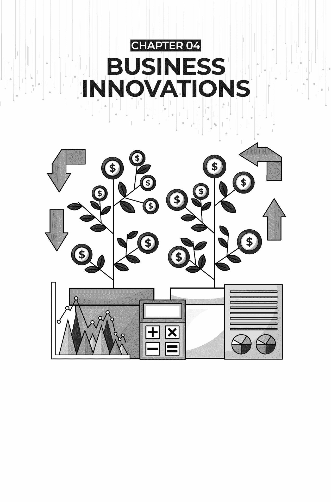

### 4. 商业创新：利用 AI 促进增长

经营企业感觉就像在驾驶一艘船。在任何时候，数据的浪潮都可能覆没你的船。不要担心！AI 作为你可靠的伙伴出现，准备好引导你穿过汹涌的水域。从简化运营到革命性的决策，AI 是正在改变企业的秘密武器。

### 运营效率与预测性维护

在制造业领域，预测性维护就像拥有一个能预见故障的水水晶。通过分析机器数据，AI 可以识别出表明磨损的模式，让你能够主动进行维护。这不仅节省了资金，还提高了生产力。

### 供应链管理

在供应链管理中，库存水平、物流和采购和谐运行。AI 优化了这些流程，预测需求并确保供应匹配客户需求。

### 战略决策

在战略决策中，AI 工具就像一位精明的战略家在在你耳边低语见解。AI 驱动的商业智能平台筛选海量数据，揭示出指导你战略的隐藏宝石。它们将复杂的数据集转换为易理解的视觉图表，使你能够根据实时分析做出明智决策。

### 人力资源管理

人力资源管理是 AI 擅长的另一个领域。想象自动化调度系统是永远不会冲突的个人助手。它们考虑员工的可用性、工作量甚至偏好，创建出生产力最大化的计划。基于 AI 的人才招聘平台也彻底改变了招聘，以专家招聘官的精度筛选简历。


最后，AI 在商业领域已不再是一项趋势，而是一股重塑我们运营、决策和管理方式的变革力量。它是推动你业务前行的涡轮引擎，让竞争对手望在脑后。拥抱它的潜力，见证你的运营运行更加顺畅，策略变得更加敏锐，团队变得比以往任何时候都更高效。因此，扬起 AI 之帆，向成功航行，因为你拥有从容应对未来的工具和知识。

## 4.1 利用 AI 增强客户体验

想象一下，走进一家商店，那里每件产品似乎都是直接从你的愿望清单中挑选出来的；或者登录一个感觉是专为你设计的 App。尽管这听起来像魔法，但它是 AI 驱动的个性化在发挥作用。在电子商务领域，推荐引擎像数字私人购物导员，分析你过去的购买记录和浏览习惯，推荐符合你风格的产品。这些引擎不仅改善了你的购物体验，还提高了你的满意度和忠诚度，让你更有可能在未来再次光临。在营销领域，AI 打造了直接与你对话的个性化活动，利用数据定制能够引起你偏好和行为共鸣的信息。这种针对性的方法在捕捉你注意力的同时，也建立了你与品牌之间更深层次的联系。

大多数人都能共鸣的一种情况是联系客服，却被一个疲惫或工作过度的代表所接待。相反，如果迎接你的是一个活力的聊天机器人，无论何时都准备为你提供帮助会怎样？AI 正在通过自动化变革客户服务，提高可访问性和效率。聊天机器人提供 24/7 的支持，以圣人般的耐心处理从简单查询到复杂问题的一切事务。它们在不断学习，在每次互动中改进，以为你提供更好的服务。但 AI 并不止于此。它还采用了情感分析，这种工具可以解读你信息中的言外之意来理解你的感受。通过评估情绪，企业可以定制具有同理心的响应来解决担忧，确保你感到被理解和被重视。自动化与情感智能的结合将客户服务从一项任务转变为一种积极的体验。

AI 对客户行为提供的洞察像一张宝藏图，引导企业进入互动策略的金矿。AI 深度分析客户旅程，描绘每一次互动，并锁定关键时刻。这种深度挖掘让公司能够以有意义的方式与你互动，在问题出现之前提供解决方案，并提供直觉式的建议。此外，AI 模型可以预测你的行为，以惊人的准确性预测需求和偏好。这种预见性使企业能够更好地计划，使他们的产品与你的预期对齐，确保你的体验非同寻常。

但能力越大，责任越大。在客户互动中使用 AI 的伦理影响不容忽视。个性化必须与隐私之间取得平衡，确保你的数据在获得你同意的情况下被以负责任的方式使用。透明度是关键，因为企业必须坦诚地说明它们如何使用 AI 以及收集了哪些数据。此外，AI 系统的设计必须避免可能扭曲数据并影响决策的偏差。这需要持续的监控和完善，确保 AI 始终是一项向善的工具，在不损害信任的情况下增强你的体验。

## 4.2 针对小微企业的 AI：实际应用与收益

有些人会将经营小微企业比作马戏团表演，不断杂耍各种任务，就像一个试图让所有的球都不落地的演员。AI 工具可以助一把之力。AI 驱动的会计软件表现得像从不睡觉的会计师，随时准备精确地管理你的账目。它自动处理记账和工资发放等单调任务，释放你的时间来专注于真正的事情——增长你的业务。使用 AI 的库存管理系统是另一个福音。它们以敏锐的目光追踪库存水平，预测何时补货并减少浪费。此类工具优化了你的运营，确保你不会在干旱时留下一堆未售出的伞。

成本效益的解决方案对于希望在不破坏预算的情况下整合 AI 的小企业来说是重中之重。云端 AI 平台提供了强大的工具，而无需昂贵的内部基础设施费用。它们提供了灵活性和可扩展性，允许企业仅为所使用的部分付费。同时，订阅制的 AI 服务就像是你企业的健身房会员——可以使用高科技设备，而无需承担所有权的承诺。这些服务提供了从客户关系管理到高级分析的系列应用，根据你的需求和预算定制解决方案。结果是提供了一个负担得起的 AI 世界门槛，为小微企业与大型公司竞争创造了公平环境。


在营销和销售领域，AI 驱动的 CRM 系统分析数据以提供客户偏好和行为的洞察，从而将客户互动转化为有意义的关系。它们自动执行跟进和提醒，确保没有一个线索被忽视。另一方面，自动化线索生成工具是你的虚拟侦察员，不力地寻找潜在客户并将他们带到你的家门口。这些工具简化了销售流程，让小微企业能够专注于成交，而不是寻找线索。结果是更高效的销售漏斗，潜在客户以最小的精力被培养成忠诚的客户。

采用 AI 看起来可能令人生畏的，就像教猫去捡球一样。但请放心，简化 AI 集成过程使其变得像切菜一样简单。从明确的目标和路线图开始，概述你想实现的目标以及 AI 如何提供帮助。许多 AI 供应商提供用户友好的界面和客户支持来指导你完成设置，确保平稳过渡。获取 AI 培训和资源是另一个障碍，但只要方法正确，这是你可以跨越的。在线课程、网络研讨会和社区论坛提供了丰富的知识，使你能够成为一名精通 AI 的企业主。通过投资培训，你为自己和团队配备了充分利用 AI 潜力所需的技能。

虽然 AI 看起来可能是一项遥远而复杂的技术，但事实并非如此。对于小微企业来说，它提供了一个工具箱来简化运营、优化营销并增强客户关系。通过正确的工具和方法，AI 将挑战转化为机会，让你专注于你最擅长的事情——经营你的业务。所以，戴上你比喻的 AI 帽子，拥抱数字时代，见证你的业务在新的 AI 朋友的帮助下蓬勃发展。

## 4.3 案例研究：商业中的 AI 成功故事

考虑一家繁忙的零售店，库存的波动可能会让人感到应接 overwhelming 且永无止境。AI 出现了，这位沉默的英雄以即使是大师战略家也会赞叹的精度优化了库存和销售。亚马逊这样的零售巨头已经利用 AI 来预测库存水平，确保货架既不空也不会溢。通过分析购买模式和季节性趋势，AI 以不可思议的准确性预测需求，允许零售商调整供应链以满足客户需求。结果是什么？减少了浪费，增加了销售，并提供了客户流连如返的购物体验。虽然这对利润来说是一个胜利，也是客户满意度的胜利，将随意的购物者转变为忠实的顾客。

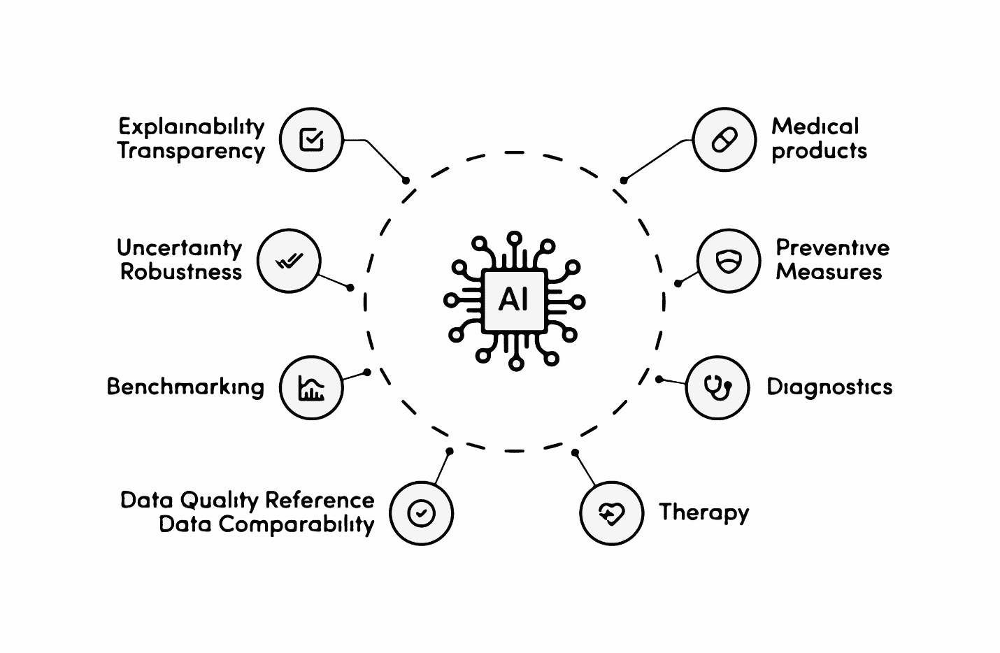


在医疗保健领域，AI 正在通过提高诊断准确性和转型患者护理来引发浪潮。医生团队可以与 AI 算法协同工作，算法分析医学图像的速度比资放射科医生还要快。像 UCLA Health 这样的医院已经整合了 AI 系统，协助诊断胸部 X 光中的肺炎等疾病，其检测异常的精度可与专家肉眼媲美。这种整合加速了诊断并减少了人为错误，确保患者获得及时且准确的治疗。这些进步的涟漪效应是深远的，因为医疗提供者可以更有效地分配资源并改善患者疗效，培养一个既有效又充满关怀的系统。

在这些领域整合 AI 的切实收益是显而易见的，运营效率的提高和客户满意率的提升处于领先。在零售业，高效的库存管理意味着更少的缺货和降价，从而提升了盈利和客户信任。同时，在医疗领域，更快、更准确的诊断意味着更好的患者护理和医护人员压力的减轻。对于企业而言，核心的教训是将 AI 与战略目标保持一致，这使 AI 定位为增强业务目标和交付切实成果的工具。持续的评估和迭代也至关重要，因为 AI 系统必须随业务需求共同进化，以保持有效性和相关性。

展望未来，这些案例研究为 AI 角色在战略规划中的潜在扩张提供了视角。想象这样一个世界：AI 不仅仅是一个运营工具，而是一个战略伙伴，通过来自数据分析的洞察指导长期业务决策。随着更多行业采用成功的 AI 模型，商业格局将转向更以数据驱动的方法，AI 将成为决策流程的骨干。这种广泛的行业采用将导致更精细、更复杂的 AI 应用，推动创新并为效率和客户满意度设定新标准。可能性就像想象一样无尽，AI 正准备重新定义现代业务前沿的含义。

## 4.4 构建你的 AI 业务战略：分步指南

某一天，你可能想要构建一个终极业务战略——这种战略不仅是放在架子上吃灰，而是积极推动你的业务迈向未来。从评估你的业务需求和 AI 能力开始。这不仅涉及列下愿望清单，还需要理解 AI 实际上能为你的业务提供什么。你需要简化运营、增强客户互动，还是从海量数据集中获取洞察？识别这些需求，并将它们与能够满足或超过你预期的 AI 解决方案相。这一步类似于为房屋奠基——没有它，其他一切都可能崩塌。

接下来，定义清晰的 AI 目标和任务至关重要。将此比作是在长途旅行前设置 GPS。如果没有明确的方向，你将盲目地徘荡，浪费宝贵的时间和资源。你的目标是降低成本、提高效率还是扩展新市场？无论你的目标是什么，它们都应该是具体的、可衡量的、可实现的、相关的且有时限的——是的，经典的 SMART 原则。这种清晰性确保了每个参与者都理解目的地，并有目标、精准地朝着它努力。

在制定 AI 战略时，要关注数据管理和基础设施。数据是 AI 的命脉，高效管理数据就像在繁忙的厨房里保持储藏充足一样关键。确保你的数据是清洁的、可访问且安全存储的。这可能需要投入能够处理大型数据集而不费力的稳健基础设施。与此同时，优先考虑人才招聘和培训。AI 是一个工具，像任何工具一样，它需要熟练的手来有效运用。无论是招聘新人才还是提升现有员工的技能，都要确保你的团队具备成功实施 AI 解决方案的知识和技能。

在引入 AI 应用时，采用试点项目是明智之举。将这些项目视为小规模实验，允许你在不直接跳入未知领域的情况下试水。识别你业务中 AI 可以产生显著影响的低风险领域。这可能只是简单的自动化重复性任务，或使用 AI 分析客户反馈。试点项目为哪些方法有效、哪些方法不佳提供了宝贵的见解，让你在更大范围内推出 AI 解决方案之前完善你的方法。衡量这些项目的成果至关重要，因为有助于帮助你衡量成功并识别改进领域。

为了帮助制定和实施你的 AI 战略，请利用可用的工具和资源。AI 战略模板可以作为一个有用的起点，为组织你的思绪和计划提供结构化的方法。这些模板为设定目标、规划流程以及将 AI 战略与更广泛的业务目标对齐提供了框架。此外，考虑联系 AI 咨询服务。这些专家可以提供宝贵的指导，帮助你应对 AI 实现的复杂性，并确保你的战略既有效又可持续。他们可以提供行业最佳实践的洞察，帮助你避开常见陷阱并最大化 AI 在业务中的潜力。

构建 AI 战略是一个动态过程，需要远见性、适应性和创新的结合。它的成功取决于你设定清晰愿景、为团队配备正确工具以及持续评估进展的能力，以确保你的战略与不断变化的业务需求保持一致。通过正确的方法，AI 可以成为强大的盟友，推动增长和创新，同时为你的长期成功奠定基础。

## 4.5 利用 AI 进行扩展：确保增长和可持续性

想象你的业务是一家繁忙的面包店，突然全镇的人都想吃你出名的可心包。你感到既兴奋又不知所措。在不损失质量或不超出预算的情况下扩大生产规模成为你的下一个挑战。这时 AI 出现了，你的新主厨。在它的帮助下，自动化重复流程变得轻而易举。像揉面团和温度监控之类的任务可以自动化，释放你的精力专注于完善那些酥脆的层次。这种自动化延伸到了面包店之外；各行业的企业都可以简化运营、减少错误并提高效率，同时控制成本。AI 允许你无缝扩大生产规模，确保随着需求增加，供应能够跟上且不损害质量。

但 AI 不仅仅是为了保持可心包的供应。它还是可持续增长战略的关键参与者。将 AI 视为你的可持续性教练，引导你走向更绿色的领地。通过 AI 驱动的资源优化，企业可以减少浪费并提高效率。想象一个系统，它可以跟踪整个运营中的能源消耗，并提供减少不必要消耗的建议，就像一个待命的环保顾问。预测性分析还可以预测市场扩张，帮助企业预测趋势并为未来增长做好准备。通过分析市场数据，AI 识别模式和扩张机会，让你做出明智的决策并保持竞争领先。


利用 AI 进行规模化扩展确实带来一系列挑战。管理日益增长的数据量就是其中一个障碍。随着业务的增长，数据也会随之增加，并可能迅速变得难以应付。但只要建立了正确的数据管理系统，你就可以确保数据既具有可访问性又具有可操作性。强大的网络安全措施也至关重要。就像你不会在夜间开面包店的门一样，你不应该让数据处于无保护状态。实施强大的安全协议可以保护你的宝贵数据，并使你的业务免受网络威胁。

最终，创新是保持你业务活力和竞争力的秘密秘诀。培养创新文化意味着鼓励你的团队进行创造性思考并拥抱新想法。这创造了一个不仅允许实验而且全方位接纳实验的环境。投资 AI 研发是另一种保持领先的途径。通过不断探索新的 AI 技术和应用，企业可以适应变化的市场并保持其竞争优势。将其视为一个持续的过程，就像紧跟最新的烘焙趋势以留住顾客源源不断一样。

从业务的宏观角度来看，AI 不是暂时的解决方案，而是一个长期合作伙伴。它提供了有效扩展运营所需的工具和洞察，同时促进了可持续增长。通过利用 AI，企业可以应对规模化中的复杂性，确保他们为未来的挑战和机会做好准备。当你继续沿着这条道路时，请记住 AI 是为了帮助你实现目标，无论这些目标是什么。

## 4.6 AI 助力业务增长：实战练习

想象一下将 AI 作你的业务副驾驶，帮助你简化运营、预测趋势并增强客户体验。本节提供了互动练习，旨在将第 4 章的概念转化为实际应用，赋予你将 AI 整合到业务策略中的能力。无论你是小企业主还是大型企业的一部分，这些活动都旨在引导你有效利用 AI。

### 有效练习说明

1. 设置你的工作空间：
   - 访问 [OpenAI 的 ChatGPT](https://www.openai.com/) 平台开始。
   - 熟悉各项功能，如输入提示（prompts）和响应评估。

2. 与提示交互：
   - 尝试提供的提示，将其调整以适应你的业务背景。
   - 示例：将 `Analyze customer feedback` 更改为 `Analyze feedback from my online store about delayed deliveries.`。

3. 反思与迭代：
   - 评估 AI 输出的相关性、清晰度和可操作洞察。
   - 完善你的提示以提高响应质量。

4. 协作与实施：
   - 与你的团队测试 AI 生成的创意并收集反馈。
   - 在小型试点项目中应用经过验证的想法，以评估其影响。

### 助力业务增长的互动提示

#### 增强客户体验

1. 个性化推荐：
   - 提示：`“你是一个电子商务助手。为最近购买过相机的客户推荐三款产品。”`
   - 目标：探索 AI 根据购买历史提供个性化服务的能力。

2. 客户情绪分析：
   - 提示：`“分析这段客户反馈：‘物流迟到了，但产品质量非常好。请提供见解和改进建议。”`
   - 目标：提供见解和改进建议。

#### 简化运营

1. 库存管理：
   - 提示：`“为面包店水平生成每周库存报告。”`
   - 目标：优化库存水平。

2. 预测性维护：
   - 提示：`“模拟一个工厂预测设备故障的场景。”`
   - 目标：减少停机时间至最低。

#### 战略决策

1. 市场趋势分析：
   - 提示：`“分析健身房的最新趋势。”`
   - 目标：吸引新成员。

2. 竞争对手分析：
   - 提示：`“对比竞争对手的定价。”`
   - 目标：获得竞争优势。

#### 高级练习

1. 业务模式：
   - 提示：`“为书店提供创意想法。”`
   - 目标：探索 AI 应用。

2. 可持续性策略：
   - 提示：`“为杂货店提议计划。”`
   - 目标：推广可持续实践。

#### 反馈与迭代

1. 收集反馈：
   - 提示：`“与同事评估反馈。”`
   - 目标：完善输出结果。

2. 测试创意：
   - 提示：`“实施小型试点。”`
   - 目标：评估影响。


感谢你参与这项让 AI 对所有人触手可及、有趣且赋予能力的使命。你的慷慨帮助这本书接触更多的读者，并激励了无数其他人迈向生成式 AI 世界的第一步。

致此感谢，

Jordan Blake


# 第 5 章：应对职场市场：职业晋的 AI 技能

让我们进入一个技术与雄心交汇的空间，通过正确的 AI 技能，你的职业可以开启全新的维度。你可能会疑惑，为什么 AI 会成为每个社交活动和技术会议的热门词。嗯，考虑一下：AI 就像新的电力，驱动着从智能手机到自动驾驶汽车的一切。它不仅代表未来——它就是现在，而且将一直存在。无论你是想要探索 AI 巨大可能的学生，还是旨在提升技能的专业人士，还是渴望为自己的业务增添 AI 魔法的企业家，本章都将引导你穿越 AI 职业路径的迷宫。是时候穿越这片数字丛林，蜕变为更成功的自己了。

在广阔的 AI 职业领域，有三个角色通常像科技工作的“三位一体”一样脱颖而出：数据科学家、AI 工程师和机器学习研究员。作为数据科学家，你既是侦探，又是故事的讲述者，通过解读数据来揭示驱动业务决策的洞察。这就像是现代的预言者，只不过没穿长袍。你的工具箱包括 `Python` 和 `R` 等编程语言、统计分析，以及一种以惊人方式将数据化的非凡能力，让其他人怀疑为什么自己没有先想到。另一方面，AI 工程师是 AI 世界的架构师，负责构建和部署让机器变得聪明的模型。他们将工程专长与对机器学习算法的深度理解相结合，创建可以学习和适应的系统。最后，我们还有机器学习研究员，他们是推动 AI 边界的先驱。他们探索 AI 的理论层面，开发新的算法和方法论。这种工作能让你感觉自己正在编写未来，一行代码接一行。

要在这些角色中脱颖而出，你需要一种平衡的才华鸡汤。精通 `Python` 或 `R` 等编程语言是你的生存之本，对于任何与 AI 相关的职位都至关重要。理解算法和机器学习概念就像司机必须遵守交通规则一样——不可或缺的。但仅凭这些技术技能是不够的。你需要强大的分析和解决问题的能力来应对复杂问题并制定有效的解决方案。沟通技巧也至关重要；毕竟，如果你无法将洞察传达给团队或利益相关者，你的见解又有什么用呢？不要忘记业务敏锐度，它能帮助你将技术实力与组织目标对齐，并了解你的工作在宏图中的位置。

AI 技能就像万能钥匙，开启了各行业的大门。例如，在医疗领域，AI 正在彻底改变诊断，开发出比以往任何时候都更快、更准确的疾病检测工具。想象成为一个团队的一部分，设计能够从医学图像中识别癌症早期迹的 AI 模型，这种工作不仅能促进你的职业，还能拯救生命。在金融领域，AI 增强了风险评估模型，提供了帮助组织做出明智决策并降低财务风险的洞察。这就像拥有水晶水晶，但它是基于数据和分析的。这些应用强调了拥有 AI 技能的人所拥有的多元机会，为你以前可能考虑过的领域开启了道路。

## 5.1 为 AI 职场市场提升技能：从哪里开始

现在，你准备好跃入 AI 世界并为你的职业加油了。但该从哪里开始呢？首先，花点时间评估你目前的技能。你是一个编程高手，还是在面对电子表格时仍会紧张？识别自己的优势和劣势就像在公路旅行前检查天气。你肯定不想在没有伞的情况下被暴雨倾困住，对吧？一旦你规划了自己的技能图谱，就可以识别出短板——即那些你可能需要额外帮助的棘手领域。也许你是一个 `Python` 专家，但无法区分神经网络和渔网。没关系！识别这些短板是设定现实学习目标的第一步。设定符合你日程的时间表——不需要像在大学期末考试周那样进行突击式学习。记住，学习 AI 是一场马拉松，而不是短冲刺。

在评估了目前的优势和改进领域后，你可以通过在线课程和认证获得必要的技能。Coursera 的“人人学 AI”（AI For Everyone）是初学者的很好的起点，它提供了 AI 概念的概述，且不涉及技术术语（来源：2）。对于那些准备好深入探索的人，“人工智能微型学位”（Artificial Intelligence Nanodegree）提供了全面的课程，涵盖了从机器学习到机器人技术的一切内容。如果你在寻找实践经验，专注于 AI 的研讨会和训练营是无价的。它们提供了沉浸式环境，你可以在现实项目中应用你的技能，从行业专家那里获得见解和反馈。无论你是一个依赖视频教程的视觉型学习者，还是偏好结构化课程严谨性的人，都有大量的资源供你探索。

然而，理论只能带你走多远。是实践经验将书本知识转化为现实技能。建立个人 AI 项目作品集是极具价值的。把它想象成一个数字剪贴簿，展示你学习和创造的内容。从小的开始——也许是一个简单的聊天机器人开始。随着你信心的增强，去挑战更复杂的项目，如预测模型或 AI 驱动的应用程序。这个作品集在强化你的学习的同时，也作为未来雇主的展示窗口。别忘记黑客松！这些高强度、咖啡因驱动的编程马拉松是磨炼技能的完美选择。它们提供了现实世界解决问题的体验，你甚至可能带着一个新的 AI 驱动的发明而归。

在快速发展的 AI 世界中，持续学习是你最好的朋友。技术以光速进化，你不想稍一眨眼就错过了。关注 AI 思想领袖和出版物可以让你保持信息同步。订阅时事，在社交媒体上关注有影响力的 AI 研究人员，阅读最新的突破。参与 AI 社区和论坛是保持更新的另一个极佳方式。这些平台充满了志同道合的人，他们渴望分享见解并进行项目合作。在这些圈子里保持活跃可以让你你的知识保持新鲜，并让你建立一个潜在的导师和合作者网络。

## 5.2 平衡工作与学习：时间管理技巧

平衡工作和学习的需求可能就像在骑单轮时耍火剑。但不要担心，通过正确的策略，你可以将 AI 技能开发整合到即使是最繁忙的日程中。首先，让我们谈谈艾森威尔矩阵——这是一个根据紧急和重要性对任务优先级的巧妙工具。把它想象成你的个人任务分诊医生。将你的任务分为四个象限：紧急且重要、重要但不紧急、紧急但不重要，以及既不紧急也不重要。这种方法帮助你关注真正重要的事情，比如学习那个新的 `Python` 库，而不是被猫咪视频分心（尽管它们非常诱人）。


现在，让我们为学习挤出专门的时间段。将它们看作是与未来的自己进行的**神圣约会**。无论是清晨还是深夜，找一个你大脑感到最活跃并准备好吸收知识的时间。像对待医生预约一样对待这些时间段——它们是**不可商越的**，对你的身心健康至关重要。这种做法创造了一种节奏，将学习无缝地融入到你的日常生活中，使其成为一种习惯而非负担。

微学习（Microlearning）是你在这场时间之战中的秘密武器。短时间、集中的会话对于技能获取可能意想不到地有效，即使只是在咖啡休息时间使用学习 App 学习十分钟，或者在公交车上看一个简短的视频教程。像用于语言的 `Duolingo` 或用于编程的 `SoloLearn` 等应用提供了可以方便融入你日程的碎片化课程。在通勤期间观看教育视频将旅行时间转化为宝贵的学习时刻，让每一分钟都发挥价值。这就像是“知识零食”——小口随着时间的推移会汇聚成一顿大餐，而不会让你本就紧凑的日程负担不堪。

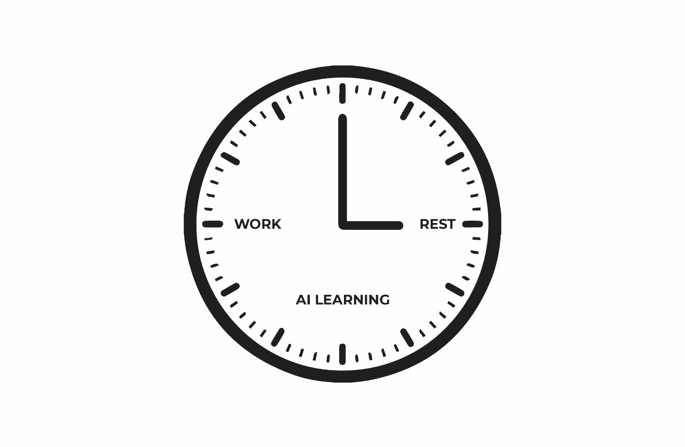

当然，时间管理并非没有障碍。拖延是一个狡猾的敌人，喜欢破坏你最周密的计划。为了对抗它，请用清晰、可实现的目标来规划你的一天。为了让令人生的任务看起来不那么可畏，将其分解为更小、更易管理的部分并逐一击。分心是另一个挑战，但技术既可以是元首也可以是良。使用 `Forest` 或 `Freedom` 等应用在学习期间拦截干扰网站，让你专注于重要的事情，而不屈服于社交媒体的诱惑。

生产力工具为这种平衡提供了另一种解决方案。`Trello` 和 `Todoist` 等任务管理应用帮助组织你的待办事项列表，确保没有无遗漏，你永远不会忘记另一个截止日期或会议。另一个宝石是**番茄工作法**（Pomodoro Technique），它涉及将工作分为 25 分钟的专注会话，随后是短时间的休息。这种方法让你的大脑保持新鲜和投入，在防止倦怠的同时提高生产力。成功的时间管理在于更聪明地工作，而不是更努力地工作，并找到一种既尊重你的时间又尊重你的能量的流状态。

## 5.3 为你的职业做好准备：值得关注的 AI 趋势

AI 的未来充满了可能性，随着创新和变化不断演变。这种演变的前沿是**边缘计算**，这一趋势将 AI 处理带到数据源，而不是依赖遥远的数据中心，这让一切发生得更快、更及时。对于职业来说，这为开发和管理边缘设备开辟了新角色，这些设备实时处理数据以提供更快的见解并降低延迟。在未来，AI 不仅仅存在云端，而是在边缘蓬勃发展，准备彻底改变从医疗到智慧城市的行业。

自然语言处理（`NLP`）的进步是另一个游戏规则改变者，将 AI 从沉默的伙伴变成了口才的对话者。通过 `NLP`，机器可以更自然地理解、解释和回应人类语言，几乎就像被赋予了口才一样。这为客户服务创造了机会，AI 可以处理例行查询，释放人类处理更复杂的问题。同样，在制造业中，AI 正在提高精度和效率，优化生产线，并在“扳手”撞上齿轮之前预测维护需求。这些进步有望创造新的工作岗位，专注于跨领域 AI 系统的设计、实施和完善。


在这一动态格局中保持领先，意味着将技能发展视为一种终身爱好，而不是一次性事件。你应该深入研究 AI 伦理和治理，以理解随着 AI 影响日益增长而带来的责任；毕竟，这就像学习开车——你需要知道交通规则。探索跨学科的应用，即 AI 与生物学或艺术等领域的交叉，以发现新的思维和解决问题的方法。这种思想的交叉感染不仅拓宽了你的专业知识，还让你成为一个多才多的专业人士，准备用今天的技能应对明天的挑战。

最后，在一个变化是唯一永恒的世界里，适应能力是你的秘密武器。将终身学习作为一种心态——保持好奇，保持信息灵，永远不要假设自己无所不知。AI 领域广阔且多样，跟上它的节奏需要经常学习。与 AI 专业人士建立联系可以获得教科书无法提供的见解，提供真实的视角和建议。参加会议，加入论坛，不要回避联系专家。与这些知情人士对话可以点燃新想法，并引导你走向那些让你保持竞争力的技能和知识。对于那些准备好与 AI 一起适应、探索和创新的人来说，未来是充满光明的。

## 5.4 克服职业恐惧：AI 是补充而非竞争者

想象一下：你正在参加一场社区的烧烤活动，AI 的话题被跳了出来。突然，你周围的每个人看起来就像刚刚发现他们最喜欢的电视节目即将被取消。这种场景比人们想象的要常见；毕竟，许多人担心 AI 可能会取代他们的工作。但让我们退后一步，戳破这些误解。AI 不是什么想要接管劳动力市场的好莱坞反派。相反，它更像是一个急于帮助你在角色中发光发亮的制片人。当然，AI 可以自动化某些任务，但更多是协作而非竞争。在一个 AI 处理琐碎任务的世界里，你可以自由地专注于创造性和战略思考。那是 AI 真正的魔力。

在今天的职场中，AI 增强了人类的能力而非削弱了它们。以数据分析为例，AI 可以像喝了咖啡的松鼠一样的速度和精度筛选海量数据，提供人类需要几周才能收集的见解。这并不意味着数据分析师正在灭绝；而是意味着他们正在进化。在 AI 的帮助下，分析师可以专注于解释数据和做出战略决策，而不是被琐细节困扰。在创意行业中，AI 充当了数字缪斯，协助设计师产生想法和测试概念。这就像拥有了一个永不疲倦的脑风暴伙伴，提供新鲜视角并让创意人员突破边界。

AI 与人类的协同是非常奇的，无数案例展示了这种协作。在医疗领域，AI 辅助医疗诊断正在改变患者护理。算法可以快速分析医学图像，为医生标记潜在问题。这并不是取代医生；而是增强了他们的能力，让他们能够提供更准确、及时的护理。同样，AI 驱动的客户服务代理处理例行查询，而人类代理处理更复杂的问题。这种伙伴关系确保了客户获得高效的服务，同时不会牺牲人类才能提供的个性化服务。

接受 AI 需要心态的转变，放弃 AI 是威胁的信念并承认其潜在益处。这就是成长心态发挥作用的地方。通过将 AI 视为个人成长的工具，你开启了开启学习和协作的新机会。当你意识到 AI 可以增强你的技能时，你在职位上会变得高效。寻找与 AI 协作的机会，无论是通过 AI 驱动的工具还是集成工作流。这种积极的方法不仅提升了你的职业前景，还让你成为一个具有前瞻性的专业人士，准备在 AI 增强的世界中蓬勃发展。

## 5.5 人脉网络与社区：加入 AI 圈子


AI 领域的人脉建立就像找到正确的 Wi-Fi 连接——它开启了一个无限可能的世界。在 AI 领域建立专业人脉可以显著提升你的职业机会和知识水平。参加 AI 会议和聚会（meetups）是一个很好的开始。这些活动就像是信息的宝库，你可以在那里与行业领袖并肩，交流想法，甚至可能获得一些免费的周边物品。想象一下，走进一个充满兴奋氛围的房间，每一场对话都是一个蕴含洞察和机会的潜在金矿。目标不仅仅是收集名片，而是要建立可以通往合作、导师指导甚至入职机会的联系。

在当今的数字时代，加入在线 AI 群组和论坛同样关重要。像 `LinkedIn` 这样的平台不仅仅是为了关注前同学；它们是建立专业人脉的强大工具。撰写一个引人入胜的简介，参与讨论，并像在虚拟会议上一样分享你的见解，只不过这次你可以穿睡衣参加。参与协作性 AI 项目是另一个建立人脉的绝佳方式。这些项目提供了实战经验，让你能够与该领域的其他人合作，在扩展技能树的同时建立你的专业圈。这就像是一次买一送二——在学习的同时建立联系。

成为 AI 社区的一部分除了建立人脉外还有许多益处。这些圈子提供了你可能在其他地方找不到的独家学习资源。从行业专家举办的网络研讨会到研究论文的获取，处于圈内可以带给你额外的竞争优势。此外，社区通常提供导师指导和引导机会，将新手与经验丰富的人士联系起来，他们可以提供宝贵的建议和支持。想象你有一位经历过那切、并愿意分享他们的成功路线图的导师。

然而，为了从这些 AI 活动中获得最大的收益，你的积极参与至关重要。不要只做一个墙上的旁观者——要有目的地地参与，以拓宽你的视野。展示你的成果，有意识地参与以扩展你的视野。


让我们从**透明性**（Transparency）开始，它的核心在于清晰的沟通与理解。将其想象为 AI 的“公开政策”，你可以窥探幕后，看到魔法的运作——或是运行的齿轮。这种开放性建立了信任，确保用户知道可以预期什么，以及做出这些决策的原因。接下来是**问责制**（accountability）。AI 不能拍拍摊手并声称无知。相反，我们必须确保当 AI 做出决策时，有一条线索可以追溯到负责任的人类。如果出现差错，有人可以负责联系——而不是一个只会发耸肩表情包的机器人。另一方面，**行善**（beneficence）提醒我们，AI 的行为应该符合我们的最大利益。它还应该致力于减少伤害并增加收益，就像一个数字童子军，随时准备做好善事。

然而，实施这些原则并不像下载最新的应用更新那么简单。相反，它需要一种精细的平衡。一方面，我们拥有新技术突破令人目迷的魅力；另一方面，我们有确保这些进步不践踏伦理标准的坚切需求。这创造了一种微妙的平衡，任何失误都可能导致严重的后果。确保全球伦理标准进一步增加了复杂性。当技术跨越边界的速度比病毒式梗包快时，我们需要一套通用的伦理 AI 使用指南。但在这种规模上达成共识往往感觉像“赶猫”——每个国家都有自己的优先事项和观点，这使得统一指南的制定变得复杂。

这引出了**利益相关者**，他们是伦理 AI 的无名英雄。这些支持者包括政府监管机构、行业领袖，是的，甚至包括你——精明的用户。政府监管起着骨柱作用，为 AI 的社会影响设定了互动规则。同时，行业自律在确保科技公司维护伦理标准方面发挥着关键作用，而无需权威机构不断督促。我们不要忘记公众参与。你的声音至关重要！与 AI 的伦理参与超越了自上而下的指令，涵盖了草根参与，确保不同的观点得到听取和考虑。毕竟，一个完善的伦理框架是建立在协作和价值观的基石之上的。

随着技术的演进，我们的伦理考量也必须随之进化。AI 伦理格局是一个活生生的实体，随着其试图治理的技术而迅速适应。以人权为例，AI 在这方面的影响是巨大的，从提高残障人士的无障碍性，到无意中强化边缘化某些群体的偏见。我们必须保持警惕，确保 AI 增强人权而非侵犯人权。然后是战争中 AI 的棘手问题。自主武器引发了即使是经验最丰富的哲学家也会停顿的问题。当 AI 做出生死决定时，谁来负责？这些场景凸显了持续进行伦理对话的必要性，因为 AI 的新应用不断涌现。

本章邀请你反思 AI 的伦理维度，并鼓励你在开启自己的 AI 冒险之旅时与这些原则互动。记住，伦理旅程与其试图引导的技术一样动态，需要不断的警惕和适应能力。所以，当你探索这令人兴奋的 AI 世界时，请准备好你的伦理指南针，确保你的路径受到透明性、问责制和行善的引导。现在，让我们深入探讨这些原则在实践中如何运作，并探索它们带来的挑战与机遇。

## 6.1 AI 中的偏见：识别与缓解风险

想象你正在参加一场烘焙比赛，但评委会的决定不是根据口味，而是受你搅拌碗颜色的影响。这类似于 AI 系统中的偏见。AI 中的偏见是指导致不公平结果的系统性错误，通常由于数据偏差或算法缺陷而引起。一个臭名昭著的例子是脸识别系统中的算法偏见，其中深色皮肤个体面临更高的错误率。这些系统可能会误识别或未能准确识别个人，造成现实世界的影响。历史数据偏见也起了作用，因为在过去数据上训练的 AI 会继承那个时代的偏见——想象一本无意中教导了过时刻板印象的历史书。

偏见并非凭空出现；它的来源像祖母的秘密配方一样稳固。**训练数据的局限性**是一个大魁祸首。如果一个 AI 模型从缺乏多样性的数据中学习，就像通过只吃吐司来学习全球美食一样。结果是偏斜的视角，未能考虑到人类经验的丰富性。然后是人为因素——设计人员和开发者尽管他们初衷良好，但可能在无意中引入了偏见。就像厨师在上菜前忘记尝味一样，开发者可能没有意识到他们的个人偏见已经渗透到算法中了。这些偏见可能体现在从数据选择过程到模型设计和评估的每一个环节。

那么，我们如何确保我们的 AI 系统像一场裁判良好的比赛一样公平呢？从**多样化的数据采样**开始。通过收集广泛的数据，我们确保 AI 模型能看到人类面部、声音和经验的全光谱。邀请来自各行各业的人加入讨论（无论是比喻的还是字面上的），确保每个人的声音都能被听到。**定期的算法审计**也是必不可少的，它们就像例行健康检查一样，在偏见失控之前捕捉它们。这些审计可以识别偏见潜伏之处，允许开发者调整和完善他们的模型。同时，**偏见检测工具**是 AI 世界里的海滩金属探测器，扫描可能未被察觉的隐藏偏见。这些工具通过分析 AI 输出来检测并解决潜在的偏见，促进公平性和准确性。

**AI 开发团队的多样性**是另一个必要条件。模型训练中的多样化观点有助于识别同质小组可能会忽略的盲点。这类似于拥有一支来自不同背景的品鉴师团队，确保菜具有普适的吸引力。**包容性的 AI 开发实践**还能促进创造力和创新，鼓励团队跳出框架并挑战假设。通过拥多样性，我们不仅减轻了偏见，还增强了 AI 工具的丰富性和适用性。这种多样性就像一个安全网，在偏见漏掉并造成伤害之前抓住它们。

### 反思章节：考虑你 AI 项目中的偏见

花一点时间反思以下问题：

- 多样化的数据如何提高你 AI 模型的公平性？
- 你可以采取哪些步骤来确保 AI 开发团队的包容性？
- 你的数据或算法是否存在你可能忽略的偏见？

考虑解决这些问题如何影响你的 AI 开发方法。

## 6.2 隐私担忧：应对数据与 AI


在 AI 世界中，数据聚合和画像分析的感觉就像参加一场邻里烧烤活动，而每个人对你的私人生活都了解得过于详尽。AI 技术收集、分析并汇总海量的个人数据，有时并没有清晰的界限。这些数据可能包括你的购物习惯、在线搜索，甚至是你深夜的“罪恶快乐”，它们可以被用来创建像你的日记一样详细的画像。这些画像随后被用于预测行为、投放广告，或者在某些情况下影响观点。这可能像一个爱管事的邻居隔着篱笆窥视一样令人不安，只不过这个邻居还能根据去年的计划预测你何时会割草坪。监控技术增加了另一层复杂性。它们将 AI 与摄像头和传感器结合，创建出实时追踪和监控个人的系统。虽然这些系统可以增强安全性，但它们引发了对隐私和潜在滥用的担忧。


援军登场：旨在保护你数据隐私的监管框架。由欧盟颁布的《通用数据保护条例》（`GDPR`）已成为数据保护的全球基准。它要求组织在处理个人数据之前获得明确同意，确保你不会在无意中放弃自己的隐私权。`GDPR` 还强制要求数据使用的透明度，让你确切知道收集了哪些数据以及数据是如何使用的。跨越大西洋，《加州消费者隐私法案》（`CCPA`）赋予了居民权利，让他们了解收集了哪些个人数据、数据出售给了谁，以及如何退出此类销售。这两项法规都旨在将控制权交回你手中，确保组织尊重你的数字足迹。这些框架就像数字安全毯，用层层法律保护包裹你的数据。

为了增强 AI 中的数据隐私，组织可以采用一系列策略。数据匿名化技术可以消除个人身份信息，将敏感数据转换为无法追溯到个人的形式。这类似于模糊合照中的人脸，这种技术对于在不泄露身份的情况下进行分析非常有用。隐私保护机器学习更进了一步。它允许 AI 模型在不访问原始信息的情况下从数据中学习，确保在获取见解的同时你的隐私保持完好。你可以将其想象为戴着眼罩的 AI——它仍然具备学习能力，但不需要偷看你的个人细节。这些策略有助于缓解隐私风险，平衡数据驱动的洞察需求与保护个人隐私的必要性。

最后，知情同意和透明度是伦理 AI 数据收集的基石。你不会在不阅读细则的情况下签署合同，因为你知道那是导致误解的根源。同样，AI 中的知情同意确保你在数据被收集时，完全意识到自己同意了什么。清晰的隐私政策至关重要，它们对数据的使用、存储和共享做法提供了简单直接的解释。它们像地图一样，引导你穿越复杂的数据隐私领域。用户对个人数据的控制进一步赋予了你权力，允许你管理共享哪些信息以及与谁共享。这种透明度培养了信任，创造了一个让你感到舒适地分享数据的数字环境，因为你知道数据正受到尊重和细心对待。

## 6.3 公平性与问责制：构建 AI 信任

想象这样一个世界：AI 不仅仅是另一个没有脸的工具，而是一个你可以信赖的伙伴，像一个总是支持你的可靠朋友。这种信任的核心是公平原则和问责制原则。AI 决策过程中的公平性确保了结果不会对特定群体产生偏见。另一方面，问责制确保了当 AI 系统出错时，有明确的责任归属和纠正路径。


实现 AI 的公平性不是一项一劳永逸的任务。它需要持续的努力来确保系统保持公正。公平感知算法是促进公平的一种方式，旨在决策过程中识别并最小化偏见。你可以将它们想象成 AI 版本的裁判员，确保每个人都遵守规则。偏见影响评估是公平性的性的另一个工具；这些评估衡量了 AI 决策如何影响不同的群体，帮助识别差异。

在出现问题时，AI 的问责制不是指责他人，而是涉及建立一套框架以确保负责任的开发和部署。负责任的 AI 指南为开发者提供了路线图，概述了伦理标准和最佳实践。它们就像 AI 的建筑规范，确保系统以诚信和安全的方式构建。AI 伦理委员会在这个生态系统中发挥着至关重要的作用，提供监督和指导，以应对伦理困境，确保决策反映社会价值观。

问责制的现实案例为如何有效实施这些原则提供了宝贵的见解。AI 决策系统的审计是问责制的关键组成，通过对 AI 运行进行独立审查来识别潜在问题。AI 结果的公开报告是另一种透明措施，让利益相关者能够看到 AI 系统的表现如何。这种开放性建立了信任，确保每个人都知道“AI 厨房”里发生了什么。

## 6.4 伦理 AI 框架：负责任使用的指南


当你思考一个伦理 AI 框架时，可以将其想象为一份精良的蓝图，引导着高层建筑的建造。这种结构化的方法确保了一切都建立在坚实的基础之上，每个部分都能无缝衔接。伦理 AI 框架的工作原理也如此，提供了一种结构化的方法，将伦理考量从头到尾嵌入到 AI 项目中。

该框架的首要工具之一是 AI 伦理检查清单。这就像是你项目的道德指南针，确保每一步都符合伦理标准。它涵盖了从数据收集到算法部署的所有方面，通过提出问题来帮助你考虑 AI 系统更广泛的影响。你可以将其看作是一个实用的指南，提醒你在旅途中检查自己的伦理航向，确保你没有偏离轨道。

伦理影响评估是另一个关键组成，类似于建筑工程中的环境影响研究。它们评估你的 AI 系统对社会的潜在影响，在开发过程早期识别风险和收益。这种主动的方法有助于你预判伦理挑战，并在它们变成问题之前进行处理，从而在减少负面影响的同时放大正面影响。通过进行这些评估，你确保了项目不仅在技术上是可靠的，而且在伦理上是稳健的，符合社会价值和预期。

一个全面的伦理 AI 框架由几个关键部分组成，它们共同工作以确保 AI 的负责使用。利益相关者参与过程至关重要，汇聚了多元化的声音为决策提供信息。这种参与确保了你的 AI 项目考虑了所有影响者的观点，从终端用户到行业专家，以创建一个反映广泛见解和关注的最终产品。持续的监控和评估也至关重要，为你的 AI 系统性能提供持续监督。这种持续的评估循环有助于你在问题出现时识别并解决伦理问题，就像警觉的救生员守护着拥挤的海滩。通过密切关注你的系统，你可以确保它在整个生命周期内始终符合伦理标准。

伦理考量必须嵌入到 AI 生命周期的每个阶段，从设计、开发到部署和维护。在设计和开发阶段，伦理应该作为指导原则，影响从数据选择到算法选择的每一个环节。这种主动的方法确保你的 AI 系统从一开始就是基于伦理诚信的基础上构建的，就像一座拥有坚固基础、能够抵御地面变变的房屋。随着你的 AI 系统进入部署和维护阶段，伦理考量应继续指导决策，使系统继续负责任地运行并适应不断变化的社会规范。正如你会定期保养汽车以确保其运行顺畅安全一样，你也应该定期审查你的 AI 系统以增强其使用寿命。

采用伦理 AI 框架提供了多项实性的益处。首先，它增强了公众信任，展示了你对负责任技术使用的承诺。当人们知道你优先考虑伦理时，他们更有可能与你的系统互动并支持其部署。这种信任是无价的，能够与用户和利益相关者建立良好关系。此外，伦理框架通过在负面影响发生之前识别并减轻它们，降低了伤害风险。这就像在汽车上安装安全气囊——一种确保每个人安全的额外保护。最后，伦理框架提高了对法规的合规性，确保你的 AI 项目符合法律和行业标准。通过与这些框架保持，你不仅避免了昂贵的罚款和处罚，还使自己定位为负责任 AI 使用的领导者。这种主动方法为尊重技术潜和社会价值创新铺平了道路，为所有参与者创造了双赢。

## 6.5 案例研究：AI 中的伦理困境与解决方案

想象一下：你正开着流线型的自动驾驶汽车在路上驰驰，喝着咖啡，突然一个孩子冲入马路。汽车该怎么办？这个伦理困境让科学家们和伦理学家们彻夜难眠，思考安全性与自主性之间的平衡。自动驾驶汽车有望减少人为错误，但它们引发了关于生死关头决策的棘手问题。汽车应该优先考虑乘客的安全还是行人的安全？这种困境不仅仅是假设性的；随着自动驾驶技术的发展，它已成为一个迫待解决的问题。为了解决这些担忧，开发者实施了伦理算法，旨在处理此类关键决策，并将多元化的伦理视角纳入编程中。这些算法旨在模拟人类判断，考虑速度、角度和伤害概率等因素。然而，现实世界场景的复杂性意味着没有任何算法可以考虑到每一种可能性，这凸显了持续伦理审查和利益相关者咨询的必要性。

在 AI 世界的另一个角落，招聘实践正在经历数字化转型，但并非没有陷阱。AI 驱动的招聘工具承诺简化招聘流程，比你说出“你被录用了！”的速度更快筛选简历。然而，这些系统对偏见并不免疫，往往反映了训练数据中存在的偏见。例如，如果过去的招聘决策偏于某些人口统计特征，AI 可能会在无意中延续这些偏见，对合格候选人产生不公平的。AI 招聘中的这种歧视问题导致了大量的审查和改革呼吁。公司通过完善算法、实施偏见检测工具以及数据源多样化来应对，以确保更公平的结果。政策变化也至关重要，组织采取了透明化措施来揭秘招聘过程。这些努力说明了在伦理 AI 部署中保持警性和适应能力的重要性，强调了持续监控和伦理监督的必要性。

这些案例研究中获得的教训就像公路旅行中的 GPS 一样宝贵——对于引导我们走向负责任的 AI 使用至关重要。一个关键收获是，利益相关者咨询在开发伦理 AI 系统中起关键作用。通过纳入从工程师到伦理学家再到普通用户的广泛观点，我们可以创建反映不同价值观和优先事项的解决方案。这种协作方法丰富了决策过程，确保 AI 系统为大众利益服务。另一个教训是持续伦理审查程序的必要性。随着 AI 技术的演进，我们的伦理框架也必须不断演进，以适应新的挑战和机遇。定期的审计和评估确保系统保持符合社会规范和预期，防止伦理偏移并维护公众信任。


这些案例研究阐明了创新与伦理之间复杂的互动，凸显了将 AI 整合到我们生活中的复杂性和挑战。它们强调了以谦卑和好奇的心态对待 AI 开发的重要性，并意识到伦理困境并非仅仅是障碍，而是增长和学习的机会。通过正面对这些挑战，我们可以利用 AI 的潜力来增强我们的生活，同时守护我们珍视的价值观。在我们继续探索 AI 的巨大可能性时，让这些教训指我们我们，确保我们的技术进步与伦理进步相匹配。前前的道路可能是未知的，但由于装备了这些见解，我们能够更有信心、诚信地应对未来。

## 6.6 伦理 AI 的实操：实践练习

总而言之，我们必须确保 AI 系统以负责任且符合伦理的方式运行。本节提供了实践练习，帮助你应用伦理原则、识别潜在陷阱，并设计优先考虑透明性、问性和公平性的 AI 系统。这些实践活动旨在将理论转化为可操作的实践，使你成为伦理 AI 的倡者。

### 有效实践指南

1. **准备你的工具：**
   - 访问如 [AI Fairness 360](https://aif360.mybluemix.net/) 等平台进行偏差检测，并使用 [Google 的 PAIR 指南](https://pair.withgoogle.com/) 进行以人为中心的 AI 设计。
   - 熟悉来自可靠来源的伦理 AI 框架，例如 [OECD AI 原则](https://oecd.ai/)。

2. **与提示词（Prompts）互动：**
   - 访问 [OpenAI 的 ChatGPT](https://www.openai.com/) 平台开始。
   - 使用下方的练习尝试现实世界的伦理场景。
   - 示例：将“审计招聘算法”修改为“审计客户服务聊天机器人的回复是否存在偏差”。

3. **反思与迭代：**
   - 评估 AI 输出的公平性、包容性以及对伦理标准的遵循情况。
   - 使用见解完善提示词并改进流程。

4. **协作与分享：**
   - 与同事或导师分享你的伦理评估，以获得多样化的视角。
   - 将反馈整合到正在进行项目中。

### 交互式练习

#### 偏差检测与缓解

1. **审计 AI 系统：**
   - 提示词：“评估一个招聘算法是否存在针对年龄、性别或种族的潜在偏差。建议三种缓解这些偏差的方法。”
   - 目标：练习识别和解决 AI 模型中的偏差。

2. **模拟多样化数据采样：**
   - 提示词：“为训练语音助手创建一个数据集，确保涵盖不同口音和方言的代表性。”
   - 目标：探索多样化数据在减少偏差方面的重要性。

#### 隐私与透明度

1. **隐私政策审查：**
   - 提示词：“为一个收集用户数据的 AI 驱动健身应用起草一份清晰简练的隐私政策。”
   - 目标：确保数据使用的透明度，并获得知情同意。

2. **数据匿名化：**
   - 提示词：“描述一种在 AI 医疗应用中匿名化用户数据的方法以保护患者隐私。”
   - 目标：练习实施保护隐私的技术。

#### 公平性与问性

1. **公平性评估：**
   - 提示词：“分析 AI 信用评分系统的决策过程。识别可以改进公平性的领域。”
   - 目标：理解如何确保 AI 系统产出公平的结果。

2. **问性框架：**
   - 提示词：“为用于自动驾驶车辆导航的 AI 系统提议一个追踪问性的框架。”
   - 目标：设计具有清晰责任路径的系统。

#### 高级练习

1. **伦理困境场景：**
   - 提示词：“为自动驾驶汽车在遇到不可避免的事故场景下的 AI 系统制定伦理响应计划。”
   - 目标：探索 AI 中复杂的伦理决策。

2. **利益相关者参与：**
   - 提示词：“设计一个公众咨询流程，收集对智慧城市计划中部署的 AI 系统的反馈。”
   - 目标：练习包容性决策和协作。

#### 反馈与迭代

1. **伦理审查小组：**
   - 将你的 AI 项目评估和伦理框架分享给伦理审查小组或社区论坛，以获得建设性反馈。
   - 示例：“我的公平性审计涵盖了所有关键领域，还是存在盲点？”

2. **迭代优化：**
   - 根据反馈和现实场景不断修订你的框架和评估。

通过参与这些练习，你将对伦理 AI 实践建立稳健的理解，并获得应对复杂挑战所需的技能。通过持续学习和协作，你可以确保 AI 系统负责任地运行，在数字时代培养信任与创新。让我们共同努力让伦理 AI 成为标准而非例外。


# 第 7 章：打破障碍：AI 中的包容性与多样性

AI 的未来蕴含着多样性；通过正确的方法，AI 可以演变成一个代表许多不同声音和视角的系统。遗憾的是，现实尚未达到这一步，特别是在性别代表方面。尽管许多行业已经取得了进展，但 AI 仍然是一个“老男俱乐部”。根据 Stiftung Verantwortung 的一份报告，女性仅占 AI 人才库的 22%，担任高管的比例更低（来源 1）。在历史上，女性在技术领域面临重重障碍，从社会期望到教育机会有限不一。

但你可能会问，为什么 AI 中的性别多样性如此重要？嗯，多样性不仅仅是一个口号——它是创新的催化剂。多样化的团队带来了不同的视角，从而产生同质化群体中可能永远不会出现的创新解决方案。这个概念类似于在菜中混合各种香料——品种越丰富，味道越浓郁。在 AI 中，这种多样性可以改进产品设计，满足更广泛的受众。例如，一个多样化的团队可能会开发出更具包容性的语音识别系统，能够理解不同的口音和方言。性别多样性应该被视为一种道德义务和一种战略优势，可以推动 AI 项目进入创意境界。

幸运的是，许多倡议旨在缩小 AI 领域的性别差距。Women in AI (#WAI) 就是这样一个组织，致力于促进女性和少数群体在 AI 领域的角色（来源 2）。他们提供教育计划和导师指导，以激励和支持追求 AI 职业的女性。技术领域女性的导师计划也日益流行，为应对复杂的 AI 景观提供指导和支持。这些倡议对于建立支持性社区、提高意识以及激励下一代女性进入该领域至关重要。

机构可以采取行动措施促进其 AI 团队的性别多样性。实施无偏见的招聘实践是一个很好的开始。这意味着要超越传统的招聘标准，积极寻找多样化的候选人。将其比作将搜索范围从小池塘扩大到广阔的大洋，人才无处不在且形式各异。营造支持性的工作环境同样关重要。这包括促进工作与生活的平衡、提供灵活的工作安排并确保职业晋升机会平等。当女性获得支持时，她们更有可能蓬勃发展，为 AI 项目贡献独特的视角。


# 反思章节：弥合性别差距

在反思 AI 中的性别代表性时，请考虑以下问题：

* 你的组织如何积极促进其 AI 团队的性别多样性？
* 你可以采取哪些步骤来支持女性进入 AI 领域？
* 你的招聘流程中是否存在需要解决的现有偏见？

通过思考这些问题来识别改进领域，并激发组织内部的变革。在 AI 中拥抱性别多样性不仅止于平等——我们还必须关注在数字时代释放创新和创造力的全部潜力。

## 7.1 AI 开发中的文化多样性

参加全球百宴的益处之一是，每道菜都能带来独特的特色。现在，将这一理念转化为 AI 开发，你就会开始发现这一领域文化多样性的巨大益处。当团队具有文化多样性时，他们汲取了丰富的视角网络，增强了创造力和解决问题的能力。这就像是一场脑风暴会议，每位参与者都说不同的语言，但不知何故，想法却流顺畅。这种多样性确保了 AI 解决方案不是一刀切的，而是为了全球相关性和易访问性而定制的。纳入不同的文化视角可能会导致在同质环境中永远不会出现的创新。例如，AI 应用可以设计为识别并尊重文化细微差别，使其在全球范围内更具通用性且更有效。

然而，AI 中的文化多样性并非没有挑战。文化偏见会悄悄进入 AI 系统，而开发者往往甚至没有察觉。这些偏见会以各种形式表现出来，例如语言和方言识别问题。你是否尝试过使用一个完全无法理解你口音的语音助手？这令人沮丧，而且它凸显了 AI 系统往往只迎合全球人口的一小部分群体。此外，数据集中的文化代表性不足可能会导致偏斜的结果，强化刻板印象并使不准确之处持续。想象一个由于训练数据偏见而在处理某些肤色时捉襟从肘的面部识别系统。这些问题强调了直面解决文化偏见的重要性，以创建更公平、更具包容性的 AI 系统。

幸的是，许多文化包容性 AI 项目的优秀范例证明了多样性是力量而非障碍。以多语言 AI 应用为例，它们被设计为理解并与多种语言的用户交互，使技术对非英语使用者更易于获取。这些应用程序就像桥接语言障碍的翻译器，让不同背景的人能够按照自己的方式与 AI 交互。跨文化合作是另一个文化多样性闪光的领域。来自世界不同地区的研究人员共同工作，汇聚独特的见解来应对全球性挑战。这些合作带来的突破不仅具有创新性，而且具有文化敏感性和包容性。

在 AI 开发中促进文化包容性需要深思熟虑的策略以及拥多元视角的承诺。鼓励跨文化伙伴是培养包容性的有力方式。通过与国际团队合作，组织可以利用丰富的文化知识来丰富 AI 项目。这个全球智库随时供你使用，准备好从多个角度应对挑战。在模型训练中纳入多样化的文化输入同样关重要。这意味着确保训练数据反映了世界的丰富多样性，而不仅仅是一个狭小的子集。通过这种方式，AI 系统将变得更加健壮，并能够服务更广泛的观众。

### 互动元素：文化多样性反思练习

花一点时间反思你所在组织或团队的文化多样性。考虑以下内容：

* 你如何将更多多样化的文化视角纳入你的 AI 项目？
* 你可以采取哪些步骤来确保你的 AI 解决方案具有全球相关性和易访问性？
* 在你目前的系统中是否存在需要解决的文化偏见？

思考这些问题可以帮助识别改进领域，并激发用于在 AI 开发中促进文化多样性的新策略。

## 7.2 包容性 AI：为所有人设计

将包容性 AI 设计原则看作是构建欢迎每个人参与的技术的终极配方。包容性设计的内核在于打造系统，使其能够满足广泛用户需求和偏好的需求，确保没有人感到被冷落。这一概念类似于设计一个主题公园，无论年龄或能力如何，每个设施都是对所有人开放的。通用设计概念在这里起着重要作用，目标是让产品尽可能供许多人使用而无需进行调整。这涉及到预判人们与技术交互的多样方式，并从一开始就将这些考虑因素纳入设计过程中。无障碍可用性标准充当了指路灯，确保 AI 系统在技术上是健全的、直观的且友好的。这意味着创建易于导航的界面，即使对于那些不精通技术的人也是如此，并确保所有用户无论能力如何，都能访问全部的功能和服务。

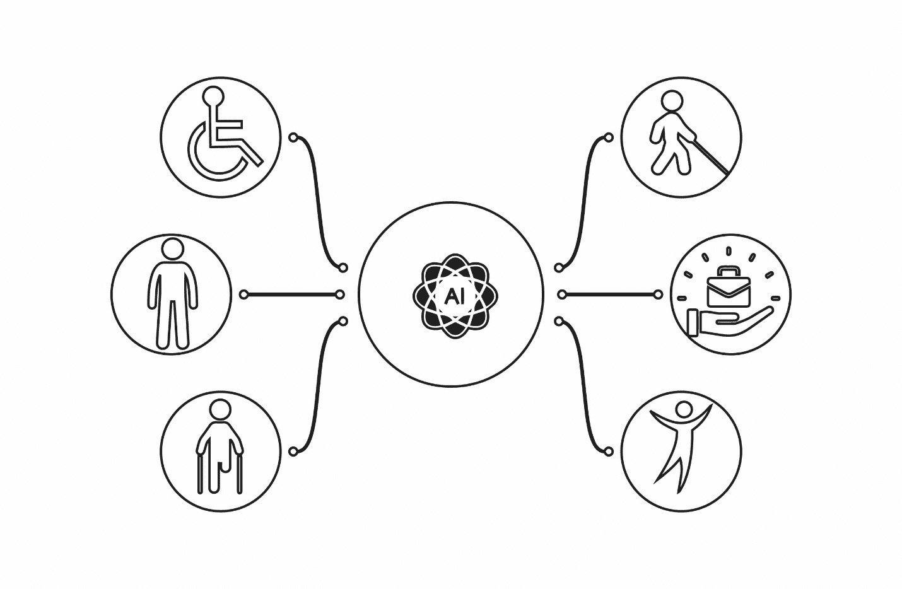

以用户为中心的设计是包容性 AI 的另一个基石。它强调了让多样化用户组参与设计过程的重要性，确保最终产品真正符合他们的需求。想象在不尝试不同脚部的情况下设计鞋子。听起来很荒谬，对吧？进行包容性用户研究等于从大量的测试者中收集反馈，以理解人们与你的 AI 系统交互的各种方式。这涉及采访不同背景的用户，观察他们如何使用技术，并识别潜在的痛点。来自多样化测试者的迭代反馈至关重要。这就像烤蛋糕，并让一个多样化的品尝小组对口味、质地和呈现提供反馈。这个过程有助于精炼设计，消除任何瑕疵，并将最终产品塑造得尽可能更具包容性。

为了帮助创建此类包容性 AI 系统，有几种工具和框架供你使用。`Inclusive Design Toolkit` 是开发者和设计者的宝库，提供了丰富的资源和指南，帮助他们将包容性融入项目中。将其想象为设计的虚拟“瑞士军刀”，里面装满了你构建满足多样化受众产品所需的一切工具。`Web Content Accessibility Guidelines (WCAG)` 是另一个无价的资源，为使 Web 内容对残障人士更易访问提供了一个全面的框架。这些指南涵盖了从非文本内容的替代文本到键盘可访问性的方方面面，为创建每个人都能享受的数字体验提供了清晰的计划。


包容性 AI 解决方案的现实案例随处可见，展示了周全的设计如何满足多样化的用户需求。考虑为残障人士设计的 AI 辅助功能工具，它们提供了语音控制和屏幕阅读器等功能。这些工具让个人能够以以前具有挑战的方式与技术交互，打破了障碍并开启了新的可能性。针对少数语言的语言翻译服务是另一个成功案例。通过提供实时翻译和转录，这些服务实现了跨语言障碍的交流，促进了更深层次的理解与协作。就像翻译一样，它们弥合了差距，确保语言差异不会阻碍信息服务的获取。

## 7.3 成功故事：AI 中的多元化声音

想象这样一个世界：AI 领域被丰富的声音所充，每种声音都贡献了独特的见解和创新。在声音中，有如 `Fei-Fei Li` 这样的先驱，她在计算机视觉领域的工作为图像识别技术铺了道路。她在 AI 领域的领导力对于开发 `ImageNet` 至关重要，这是一个对于训练机器学习模型必少的大型数据库。`Li` 的成就证明了女性在 AI 领域可以产生的巨大影响，挑战了刻板印象并激励下一代人追求星辰。同时，以其算法偏见工作闻名的 `Timnit Gebru` 强调了有关伦理 AI 的关键问题，推动透明度和问责。她的贡献引发了关于 AI 开发需要伦理标准的重要对话，证明了多元化视角在塑造技术未来方面的力量。

跳出性别，许多来自少数群体的鼓舞性成功故事也显著影响了 AI 的轨迹。考虑 `Joy Buolamwini` 的工作，她是 AI 公平倡导者，创立了 `Algorithmic Justice League`。她对脸识别技术的研究揭示了其对深色肤色的偏见，促使科技公司重新评估并改进其算法。`Buolamwini` 的努力强调了包容性的重要性，推动开发为所有用户公平运行的 AI 系统。同样，`Latinx`（拉丁裔）和 `Black`（黑人）AI 研究人员的贡献为 AI 应用开辟新路径，从医疗到教育，强调了文化多样性为技术带来的丰富性。

这些多元贡献对 AI 留下了不可磨灭的印记，推动了影响各个领域的创新。在 AI 伦理方面，来自不同背景的研究人员倡导了优先考虑公平和问责的框架，确保 AI 系统的开发具有同理心和对人权的尊重。这导致了跨文化 AI 应用的突破，从适应多种方言的语言处理工具，到为特定社区定制的医疗健康解决方案。多元化声音在 AI 中的影响不仅增强了技术进步，还确保了这些创新在伦理上是有据的且具有社会责任感。

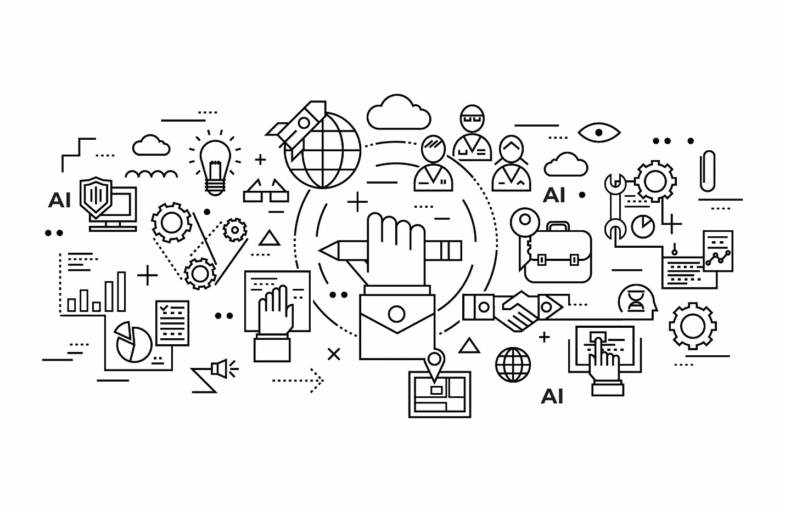

分享这些故事对于激励后代和培养代表性文化至关重要。AI 会议日益增加地邀请多元化演讲者，为代表性不足的声音提供了分享其经验和见解的平台。这种曝光有助于消除刻板印象，并展示了 AI 社区内存在的广泛才华。出版物和媒体在突出多元成就方面也发挥着关键作用，提供了挑战传统技术成功观念的叙述。通过庆祝这些故事，我们鼓励更多不同背景的人投身 AI 事业，为该领域贡献他们的独特视角。

在向 AI 空间欢迎多元化声音之后，如果我们想建立一个更具包容性的未来，创建能够放大这些声音的平台同样重要。在线论坛和社区提供了讨论和协作的空间，允许所有背景的个人建立联系并分享想法。这些数字枢纽培养了归属感，并提供了导师指导和支持的机会，使成员能够应对复杂的 AI 格局。此外，针对多样性的 AI 奖项和认可表扬了对该领域做出重大贡献的人。在表他们成就的同时，这鼓励了其他人追求卓越，因为他们知道努力也将被重视和赞誉。

## 7.4 构建包容性的 AI 社区

建立一个由欣赏 AI 的个人组成的包容性社区，就像创建一个马赛克画，每一块拼图都构成了一个美丽的整体。这不仅仅是将人们聚集在一个房间里并寄予厚望——它关乎营造一个让多元化声音被听到并被放大的空间。为 AI 中代表性不足的群体建立支持性网络至关重要。将这些网络想象成支撑宏伟建筑的手手架，为增长和稳定提供必要的支撑。通过提供导师指导、资源和讨论平台，这些网络赋能个人克服障碍并在该领域蓬勃发展。它们成为繁荣 AI 社区的骨干，推动积极变化并促进创新。

创建和维持这样一个社区需要超越表面的刻意策略。组织包容性的 AI 聚会和活动是将人们聚集在一起的一种有效方法，它为协作和思想交换提供了物理空间。这些活动应该对所有人开放，拥有能够引起广泛观众共鸣的多元化演讲者和话题。它的功能就像一场虚拟的百餐晚餐，每个人带一份独特的菜肴上桌，提供了一场充满味道和视角的盛宴。推广以多样性为导向的 AI 研究小组是另一种可以产生持久影响的策略。这些小组关注解决代表性不足群体需求的项目，确保 AI 的开发是包容的，并顾及所有用户。通过强调 AI 研究中多样性的重要性，这些小组激励了新一代 AI 爱好者为该领域贡献他们的声音。

盟友关系（Allyship）在支持 AI 社区内部的多样性方面起着关键作用。盟友是那些利用自己的特权来倡导和提升代表性不足声音的人，充当连接不同群体并促进理解的桥梁。鼓励盟友培训可以为个人提供识别和解决偏见所需的工具，营造一个庆祝多样性的环境。盟友在讨论中放大多元化声音，确保所有观点都得到考虑和重视；此外，每个人在桌上总有一席之地，并觉得自己是对话的一部分。通过促进盟友关系，AI 社区可以变得更具包容性，推动创新和进步。

AI 成功的包容性社区为如何有效实施这些策略提供了贵的示例。`Women in Machine Learning` (`WiML`) 就是这样一个在促进包容性方面取得巨大进展的社区。通过组织研讨会、社交活动和导师计划，`WiML` 为 AI 领域的女性创造了支持性环境，鼓励她们追求兴趣并为领域做出贡献。`Black in AI` 计划是另一个例子，为黑人 AI 研究人员和从业者提供了一个联系、协作和分享工作的平台。这些社区展示了 AI 包容性的力量，证明了当多元化声音获得平台时，创新就会蓬勃。

### 视觉元素：包容性 AI 社区信息图


想象一张描绘包容性 AI 社区组件的直信息图。它突出了关键元素：支持网络、包容性活动、盟友关系以及成功的社区案例。这份视觉指南为那些寻求构建或加入包容性 AI 社区的人提供了路线图，清晰地展示了 AI 包容性的现状。

在追求包容性的过程中，每一项倡议、策略和盟友努力都在为一个充满活力的 AI 社区做出贡献，在这个社区中，多样性不仅受到欢迎，更受到庆祝。这些社区专注于创造持久的改变，并在考虑到所有用户投入的基础上开发 AI。它们成为灵感的源泉和进步的催化剂，以协作与创新的精神推动 AI 领域的发展。

## 7.5 克服障碍：赋能代表性不足的群体

想象一个 AI 机会像独角兽一样难以捉的世界。对于许多代表性不足的群体来说，这并非遥。他们面临着重重挑战，让进入 AI 领域感觉就像蒙着眼睛玩魔方。最显著的障碍之一是获取教育和资源的途径有限。许多有抱负的 AI 爱好者发现自己处于劣势地位，缺乏就读名校的经济手段或地理上的优势。此外，招聘和晋升中的隐性偏见可能会抑制职业发展，使求职变成一场艰辛的战斗，而非公平的竞赛。这些偏见往往潜伏在阴影中，微妙地影响决策并维持组织内部的不平等。

但请不要担心，因为有可行的策略来赋能这些有才的人并平衡竞争环境。奖学金和资助是强大的工具，可以为那些可能被排除在外的人开启教育和培训的大门。想象一张通往 AI 工厂的黄金门票，知识就是货币。通过提供财务援助，机构可以培养多样化的 AI 人才库，确保潜力不会因经济限制而浪费。包容性招聘实践是另一个关键要素。雇主必须超越传统指标，认可候选人带来的多样化技能和经验。通过这样做，他们的人才云云、等待被发现的大海中撒了更广的网络。机构还可以关注提供培训和指导的职业发展计划，帮助代表性不足的群体充满心地攀登职业阶梯。

导师制（Mentorship）和赞助（Sponsorship）在支持代表性不足的人才方面起着至关重要的作用，是广阔 AI 宇宙中的指路之星。导师计划将学生和职业早期专业人士与资深 AI 专家联系起来，专家可以提供指导、鼓励和丰富的知识，引导他们走过 AI 领域的曲折道路。这些关系可以帮助受导师应对挑战、建立人脉，并获得教科书无法提供的见解。赞助倡议则更进一步，为个人发声并提供晋升机会。赞助人利用他们的影响力打开那些本会关闭的大门。通过培养这些关系，我们可以培养出新一代 AI 领导者，他们具备能力并被赋能，去留下属于自己的印记。

许多成功的计划和倡议已经在为 AI 领域代表性不足的群体铺平道路，它们像浴火重生的凤凰一样令人鼓舞。为少数群体量身定制的 AI 训练营提供了密集式培训和实践经验，使参与者具备在科技世界中蓬发展的所需的技能。这些训练营就像 AI 魔法术的速成班，将新手变成准备好应对行业挑战的自信专业人士。与科技公司的多样性与包容性伙伴关系进一步放大了这些努力。通过与致力于包容性的机构合作，这些计划创造了就业和增长的途径，确保多样性不仅仅是一个勾选框，而是核心价值。这些倡议是一个希望的信号，表明只要有正确的支持，代表性不足的群体不仅可以进入 AI 领域，还能在其中表现卓越。

## 7.6 亲上手 AI 中的包容性：实践练习

AI 的未来应该是包容的、公平的对所有人可及的。本节提供了互动练习，旨在帮助你将多样性和包容性原则应用于 AI 的开发、测试和实施中。这些活动将赋能你创建出与多样化观众共鸣并反映人类经验丰富性的 AI 系统。

### 有效实践指南

1. 设置你的工作空间：
   - 使用 [`AI Fairness 360](https://aif360.mybluemix.net/)` 和 [`Inclusive Design Toolkit](https://www.inclusivedesigntoolkit.com/)` 等工具探索包容性框架。
   - 确保能够访问突出 AI 开发中包容性的多样化数据集和资源。

2. 使用提示词（Prompts）：
   - 访问 [`OpenAI 的 ChatGPT](https://www.openai.com/)` 平台开始。
   - 修改练习以解决与你的项目或组织相关的特定包容性挑战。
   - 示例：将“分析语言模型的偏见”改为“评估客户服务聊天机器人在跨方言方面的包容性”。

3. 协作与分享：
   - 与团队或社区合作，以收集反馈并完善解决方案。
   - 展示你的发现，以在你的组织内培养包容性文化。

### 互动练习

#### 评估 AI 的包容性

1. 数据集中的偏见检测：
   - 提示词：“分析一个人脸识别数据集在不同肤色和性别之间的代表性。就如何提高包容性提出改进建议。”
   - 目标：识别数据多样性的缺口，并为平衡代表性提出策略。

2. 包容性语言模型：
   - 提示词：“测试语言模型理解和生成区域方言或少数语言响应的能力。识别需要改进的领域。”
   - 目标：确保 AI 系统包容多样化的语言背景。

#### 设计包容性 AI 系统

1. 通用设计应用：
   - 提示词：“为语音助手开发一个界面，以适应有视觉和听力障碍的用户。”
   - 目标：为多样化需求创建易于访问且友好的设计。

2. 用户反馈整合：
   - 提示词：“设计一个反馈循环，在 AI 系统测试期间从代表性不足的群体收集见解。”
   - 目标：将多样化的视角纳入 AI 开发中。

#### 高级练习

1. 文化包容性 AI 工具：
   - 提示词：“为教育提议一种文化敏感的 AI 工具，支持多语言用户并尊重文化细差别。”
   - 目标：探索文化多样性如何增强 AI 对教育的影响。

2. AI 开发中的盟友关系：
   - 提示词：“起草一个框架，在你的 AI 开发团队中促进盟友关系，重点是扩大代表性不足群体的声音。”
   - 目标：营造一个包容和相互支持的环境。

#### 反馈与迭代

1. 社区评审：
   - 与包容性 AI 社区或论坛分享你的项目以获取建设性反馈。
   - 示例：“这个机器人如何更好地满足非英语母语使用者的需求？”

2. 迭代改进：
   - 根据反馈完善 AI 系统和设计，确保持续与包容性目标保持一致。

通过这些练习，你将获得解决 AI 包容性挑战的实践经验。通过创建公平的系统，你正在为一个 AI 赋能所有个人（无论背景或能力如何）的未来做出贡献。让我们支持 AI 的多样性——从这些实际步骤开始！


# 第 8 章：AI 的未来：趋势与创新


想象一下，在这样一个世界里，你的晨间习惯包括量子计算机计算当天最佳咖啡因摄入量，而你的 AI 驱动汽车（现在已是自动驾驶车辆）准备送你去上班。尽管这听起来像科幻电影中的场景，但得益于 AI 技术的显著进步，这是我们未来可能的现实。我们正处于一个新纪元的边缘，量子计算与 AI 的融合有望彻底改变行业，并重新定义可能的边界。量子计算凭借其闪速处理海量数据的能力，将极大地增强 AI 能力，让今天的超级计算机看起来像古董遗迹。想象一下在几秒钟内解决从药物发现到气候建模的复杂问题，具有前所未有的精确度和效率。在这个奇异世界中，自动系统中的 AI 将成为常态，不仅在车辆中，还在无人机和机器人中，改变物流、农业及其他领域。

但请稳住，革命并不止于此。边缘 AI（Edge AI）登场了，它是实时决策的英雄。与其基于云端的亲戚不同，边缘 AI 将智能带到更贴数据源，使设备能够现场处理信息。你可以将其比为等待邮寄信件与实时接收短信之间的区别。这一进步对于物联网（IoT）来说是游戏规则的改变，智能设备现在可以独立决策，提高了效率并降低了延迟。想象一下，你的冰箱在你意识到牛奶快完之前就重新订购了，或者你的恒温器根据你的日常作息调整温度。边缘 AI 还驱动着智能家居技术，创造出预判你的需求并无缝适应你生活方式的环境。有一天，你可能会住在一个比你自己还了解你的房子里——当然，这不需要任何尴尬的寒暄。

随着 AI 的不断演进，重点转向了增强人与技术的互动，使其感觉更加自然和直观。进入自然语言处理（NLP）和情感识别技术领域。NLP 正在精炼我们与机器通信的方式，让与虚拟助手的对话感觉不像在和机器人说话，而更像和老朋友聊天。想象一下问你的 AI 天气，它会对你躲避雨伞的习惯给出幽默的评论。同时，情感识别技术正在弥合人与机之间的差距，让 AI 理解并响应情感信号。你的 AI 可以感知你何时感到压力，并建议一个放松的播放列表，或提供一个可以倾诉的虚拟肩膀。这些进步提供的不仅仅是便利；它们代表了我们与技术交互方式的根本转变，使其更具同理心且以人为本。

望向星空，AI 的未来延伸到了地球边界之外。AI 将在太空探索中发挥关键作用，从在遥远行星导航的自动漫游器，到分析天文数据的 AI 驱动系统。想象一个 AI 系统发现了一个新行星，或在任务期间协助宇航员进行实时决策。回到地球，AI 在医疗诊断方面的预测能力将变革医学领域。想象一个可以在健康问题出现之前就预测出问题的 AI 系统，提供主动解决方案和个性化治疗方案。目标不仅仅是实现更快的诊断；而是要从根本上改变我们对待健康和福祉的方式，从被动反应转向主动护理。可能性就像宇宙本身一样无限，当我们继续探索这些边界时，有一点是明确的：AI 的未来是光明的，而且只会更加光明。

### 快速反思：AI 与你的未来

考虑这些进步可能如何影响你自己的生活。你对哪些 AI 技术最感到兴奋？它们将如何塑造你的职业、创造力或日常生活？花点时间写下你的想法，并反思等待着你的可能性。

## 8.1 AI 与工作未来：适应变化

许多员工梦想能进入一个办公室，自由地关注真正重要的事情，而将曾经耗费数小时的琐事任务交给 AI 处理。幸运的是，这并不是一个遥远的梦想，而是一个职场正在进行的转型。AI 正在通过自动化曾经需要人类关注的重复性任务来重塑角色。想想数据输入、日程安排和基础客户查询——AI 将这些任务从你的单子中抽离，让你将精力投入到创造性和战略性的工作中。这种转变并不意味着你的工作将过时；相反，它正在演变。当 AI 承担这些任务时，新的角色将会出现，重点是管理和解释 AI 收集的数据，以确保这些机器的运行符合人类目标。

随着工作场所的演进，你的技能也必须随之演进。在这个新的环境中，数据素养变得像学会使用文字处理器一样关键。理解数据不再仅仅是技术专才的专利。无论你是从事营销、金融，还是创意艺术，从数据集中读取、分析并从中取见解的能力都能让你脱颖而出。与此同时，熟练使用数字协作工具是不可或缺的。像 `Slack`、`Microsoft Teams` 和 `Trello` 这样的平台不仅仅是方便工具；对于分布式团队的无缝通信和项目管理至关重要。掌握这些工具等于精通高效团队合作的艺术，让你能够在技术驱动的环境蓬蓬发展。

与流行观点相反，AI 并不会取代人类的任务；它增强了人类的能力，充当强大的助手。AI 辅助决策利用算法来处理海量数据，提供人类需要数百年才能发现的洞察。想象有一个虚拟顾问可以分析市场趋势并建议战略举措，帮助你充满信心地做出明智的决策。另一方面，智能虚拟助手简化了日常运营。它们管理你的日历，提醒你截止日期，甚至根据你的能量水平建议喝咖啡的最佳休息时间。这些技术让工作变得更轻松、更智能，让你能够专注于创新和创造力。

适应这个由 AI 驱动的世界需要灵活性和终身学习的承诺。持续的技能提升和重塑不再是可选的，而是必须的。在线课程、研讨会甚至 AI 训练营都是保持技能敏锐和与接所需的宝贵资源。组织可以通过提供培训计划和鼓励员工探索新技术来培养这种学习文化。灵活的工作安排也变得至关重要。远程办公、混合模式和灵活时间不仅满足了多样化的需求，还利用 AI 提高了效率。这种灵活性赋予你平衡工作和生活的能力，同时保持联系和高效。

在这个由 AI 增强的未来，职场将成为技术与人类创造力交汇的动态环境。通过拥抱这些变化并磨练技能，你将使自己在这个创新和机会定义的时代不仅能够生存，而且蓬勃发展。当你导航这一格局时，请记住 AI 是你的盟友，而不是敌人。拥有了正确的心态和工具，可能性是无限的。

## 8.2 日常生活中的 AI：变革性创新


在不遥的未来，你的晨间习惯可能会随着 AI 个人健康监测器的轻声提醒而改变，它整夜都在静静地评估你的生命体征。也许它会在早餐前建议你进行一次快走，因为它注意到你的心率可能需要稍微加强。这不仅仅是未来的幻想；AI 在个人健康监测领域的应用正在改变我们管理健康的方式。这些智能系统追踪从睡眠模式到卡路里摄入的一切信息，提供的个性化见解，甚至可以与最细心的私人教练相媲美。它们赋予你掌控健康的能力，让你在不需要持续医疗干预的情况下做出明智决策。

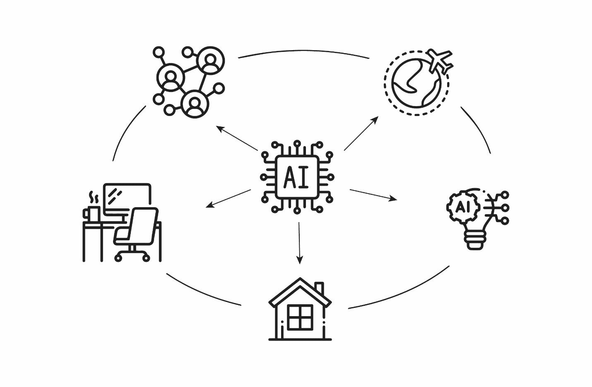

与此同时，你的智能个人助手比你还了解自己的日程，它会欢快地提醒你今天的会议。它已经调整了你的日历以适应最后一刻的变化，无缝地协调了你的一天。这些数字伴侣不仅仅是语音激活的备记本；它们正成为我们日益忙碌生活的不可或缺的一部分。从设置提醒到控制家居设备，它们是我们日常日程的无声指挥者，确保一切运行顺畅，不掉链子。

在家庭之外，AI 在智慧城市的发展中起着关键作用。以交通管理系统为例。通过分析实时交通数据，这些系统优化了交通流，减少了拥堵和旅行时间。这就像有一只无形的手引导着每辆车，确保即使在高峰期城市的脉搏也保持稳定。节能建筑管理也受益于 AI，系统会自动调整加热、冷却和照明，以最大限度地减少能源消耗。这些创新减少了碳足迹并节省了大量成本，使城市生活更加可持续、更高效。

在娱乐和媒体领域，AI 正在重塑我们消费内容的方式。个性化内容推荐已成为常态，流媒体服务使用 AI 算法来根据我们的口味推荐电影和节目。AI 充当着一位私人策展人，在你意识到之前就确切知道你想要什么。AI 生成的媒体也越来越受到关注，算法正在创造从新闻文章到音乐创作的一切内容。这引发了关于创造性和真实性的讨论，挑战了我们对艺术和娱乐的认知。

展望未来，AI 驱动的家庭自动化的潜力是无限的。想象一个能够预判你需求的房子，根据你的习惯调整设置，而无需任何指令。当你准备好看电影时，灯光会变暗，温度器会根据你的喜好调节温度。AI 增强的虚拟现实体验将彻底改变娱乐，提供为个人偏好定制的嵌入式环境。这些技术承诺了一个未来，AI 将提高我们的生活质量，让日常生活变得更加无缝和个性化。

## 8.3 AI 与社会：影响与启示

想象你正在刷社交媒体动态，每个帖子似乎都诡异地为你量身定制定制。那就是 AI 驱动的社交媒体算法在运作，像隐形傀线师一样塑造着我们的数字体验。这些算法分析我们的在线行为，预测哪些内容会让我们多留一会儿。虽然这看起来像是一个个性化的乌托邦，但它引发了对回声室和虚假信息的担忧。通过向我们推送喜欢的内容，这些算法可能会无意中缩小我们的世界观，创造同质化的泡沫。与此同时，当我们在设备上敲击时，AI 正静静地收集我们的数据，引发了关于隐私和监控的辩论。你现在不再有一个隔着篱笆窥视的邻居，而是一个复杂的 AI 系统。


在伦理领域，AI 提出了潘多拉盒般的困境。以自动驾驶汽车为例。这些自动驾驶汽车必须在生死关头做出分秒级的决定。它们应该优先考虑乘客还是行人的生命？这些道德困境挑战了我们的伦理框架，要求我们回答以前从未需要回答过的问题。同样，AI 在执法中日益增长的角色既充满前景又充满危险。虽然 AI 可以增强犯罪预测和预防，但也存在强化偏见的风险，导致不公正的画像分析。想象这样一个世界，公正决的影响因素不是人类的判断，而是可能没有考虑到细节和背景的算法。

在政治舞台上，AI 正成为塑造公共政策和治理的关键力量。全球政府正在将 AI 集成决策支持系统中，利用数据驱动的见解来制定政策。这种精通技术的方法提供了更明智、更高效治理的希望。然而，与任何工具一样，误用是一个潜伏的危险。AI 策略和监管必须进化以应对这些挑战，确保透明度和问责制。这就像在棋局中增加了一个新玩家——一个可以预判好几步、可能胜过最老练政治家的人。

随着 AI 继续前行，社会结构正处于转型边缘。在教育领域，AI 有潜力创造公平的竞争环境，提供满足个人需求的个性化学习体验。想象教室里，AI 根据每个学生的进度和风格定制课程，彻底改变我们的学习方式。同时，在经济方面，AI 正在重塑全球动态。通过任务自动化和流程优化，AI 可以提高生产力和效率。这种转变要求重新审劳动力市场和经济政策，因为社会正在应对技术驱动世界的影响。

## 8.4 终身学习：在 AI 领域保持领先

在今天这个快速变化的世界，在 AI 领域保持领先至关重要。持续学习是你跟上技术不断进的门票。想象自己是这所巨大大学里的终身学生，每个角落都蕴含新知识。AI MOOC（大规模开放在线课程）就像你的数字教室，提供灵活且易于获取的学习。如 `Coursera`、`edX` 和 `Udacity` 等平台提供了从基础 AI 概念到高级机器学习技术的课程。这些课程允许你按照自己的节奏进行学习，无缝融入你忙碌的日程中。你可以穿着睡衣参加顶尖大学的讲座——无需通勤！

但不要停步于此。参加 AI 会议和研讨会将会将学习提升提升一个层次。这些活动就像科技界的漫威展，爱好者们聚集在一起分享最新突破。无论是年度的 `AI Summit` 还是当地的技术聚会，这些聚会都提供了与专家建立联系、交流想法以及获取前沿发展见解的机会。你离开时，笔记本上会满主意，并对 AI 的应用焕发出新的热情。这种感觉就像给你的大脑打了一针浓缩咖啡，激发了创造力和创新。

对于那些倾向于深入阅读书籍的人来说，浩如海洋的 AI 相关出版物等待着探索。像《Artificial Intelligence: A Guide to Intelligent Systems》或 `Ian Goodfellow` 编写的《Deep Learning》等书籍提供了 AI 内部机制的深度知识和见解。在线教程和论坛也起着关键作用，提供碎片化的学习，非常适合快速的学习时间。`Medium` 和 `Stack Overflow` 等网站是信息的宝库，提供了从初学者提示到高级编程挑战的各种内容。它们就像是触手可及的导师，在你遇到障碍时随时为你提供指导。


AI 不仅仅在改变我们的学习方式；它正在转型教育格局本身。AI 驱动的自适应学习平台根据个人需求定制教育体验，就像私人教练根据你的健身目标调整训练计划一样。这些平台能够评估你的优缺点，提供个性化的内容以优化学习成果。想象一下，有一个虚拟导师，它知道你何时需要挑战，或者何时需要复习过去的知识。说起导师，教育聊天机器人正在成为无价之贵的资源，它们提供即时的帮助和指导，将学习变成一种互动式体验。它们就像有一位随叫随到的老师，每当你需要额外帮助时随时准备提供协助。

采用成长型心态是你应对 AI 领域格局的秘密武器。将挑战视为学习的机会，不要害怕走出舒适区。与 AI 研究社区的互动可以让你大开眼界。这些社区充满了兴奋感，像一个充满智力活的蜂巢，它们提供了一个讨论想法、分享发现和协作项目的空间。参与 AI 黑客松和竞赛可以进一步磨炼你的技能。这些活动就像精神马拉松，促使你以创新的方式应用知识。它们既激烈又令人兴奋，而且非常有成就感，提供了一个与同好交流并检验斗志的机会。

对于那些热衷于实践的人来说，AI 黑客松和竞赛是完美的乐场。这些活动挑战你在现实场景中应用技能，在压力下开发创新解决方案。想象你作为一个团队的一部分，与时间赛跑以构建下一个大型 AI 应用。那种肾上腺素飙升的感觉是显明显的，成功后的成就感无与伦比。黑客松不仅测试了你的技术能力，还培养了团队合作、创造力和解决问题的能力——这些都是 AI 领域至关重要的技能。

在这个不断发展的领域，保持信息灵通和适应能力是关键。AI 研究社区提供了一个交流想法和跟上趋势的活力生态系统。这些社区通常出现在在线或学术机构，是创意和创新的温床。通过积极参与，你成为了推向 AI 边界努力的一分子。无论你是为开源项目做贡献，还是参与激烈的辩论，这些互动都丰富了你的理解，并为你的 AI 之旅开启了新的方向。

## 8.5 启发创新：你的 AI 之旅持续进行

每天带着一个新想法醒来，准备好探索 AI 的未知领域，这体现了驱动进步的创新精神。当你拥抱 AI 时，去尝试那些推动可能边界的新兴工具。无论是生成艺术的各种软件，还是预测市场趋势的平台，这些工具都是你的游乐场。投入其中，亲手实操，看看你能创造出什么。在这个不断发展的领域，好奇心是你的指南针。通过阅读文章、参加网络研讨会或加入爱好者分享见解的在线论坛，保持对 AI 最新趋势的关注。掌握脉搏，你使自己置于最前沿，准备好在机会出现时抓住它们。

仅仅获取信息不足以激发好奇心；你必须通过提问和探索可能性来积极参与。通过应对需要创新思维的挑战来参与创造性的问题解决。想象参与跨学科的 AI 项目，这些项目汇聚了不同的技能和视角。不同学科的融合可以导致单一领域可能无法实现的突破，就像在调色板上混合颜色以创造新色调一样。这些协作帮助你实现目标，更重要的是，它们帮助你从他人那里学习并拓宽视野。在探索时，考虑你的工作如何能产生深远的影响。开发用于社会公益的 AI 解决方案，解决气候变化、医疗可及性或教育等问题。

为开源 AI 计划做出贡献是留下印记的另一种方式。这些项目依赖集体努力，让你能够分享技能并向他人学习。通过参与，你不仅提高了了自己的技能，还帮助构建了造福社会的工具。你的贡献可以引发创新，并激励他人加入这一事业。在你走过这条路时，花时间反思你个人的 AI 兴趣和热情。AI 的哪些方面最让你兴奋？识别这些领域有助于你为未来的探索和学习设定目标。

为你的 AI 技能发展设定里程碑，将目标分解为可实现的步骤。无论是掌握一门新的编程语言、开发一个 AI 应用，还是发表一篇研究论文，每个里程碑都让你向愿望更近一步。庆祝你的成就，无论多么微小，并将它们作为继续前进的动力。反思意味着快速回顾过去，然后立即为未来规划路线。当你把目光投新挑战时，请记住，创新是一个持续的过程。AI 的格局是广阔的，充满了等待被发现的机会。你的旅程由你来塑造，可能性是无尽的。

## 8.6 亲手体验新兴 AI 创新：实践练习

走进 AI 未来的世界，在这里，量子计算、边缘 AI 和情感识别等尖端技术重新定义了可能性。本节提供的互动式练习旨在帮助你探索这些突破性趋势并将其整合到现实应用中。通过实践，你将洞察到如何利用这些创新并塑造未来。

### 有效练习说明

1. 搭建工作空间：
   - 访问工具如 `[IBM Quantum Experience](https://quantum-computing.ibm.com/)` 用于量子计算仿真，`[NVIDIA AI](https://www.nvidia.com/en-us/ai-data-science/)` 用于边缘 AI 应用。
   - 确保你的环境支持云 AI 平台或本地计算工具。

2. 与提示交互：
   - 访问 `[OpenAI 的 ChatGPT](https://www.openai.com/)` 平台开始。
   - 自定义练习以探索与你的兴趣或项目相关的特定趋势或技术。
   - 示例：将 `Simulate edge AI for IoT` 修改为 `Develop edge AI for a smart thermostat prototype.`（为智能恒温器原型开发边缘 AI）。

3. 反思与迭代：
   - 评估输出内容的创新性、效率以及与实际目标的契合度。
   - 利用反馈完善你的方法并加深理解。

4. 协作与创新：
   - 与同事或导师分享你的进展，以获得不同的视角并激发创造解决方案。

### 互动练习

#### AI 中的量子计算

1. 模拟量子算法：
   - 提示：“使用量子计算平台模拟用于数据库搜索的 Grover 算法。讨论它对 AI 模型训练的潜在影响。”`
   - 目标：理解量子算法如何增强 AI 问题的能力。

2. 量子增强机器学习：
   - 提示：“使用 Qiskit 开发一个基础量子机器学习模型，并评估其在小数据集上的性能。”`
   - 目标：探索量子计算与机器学习的交叉领域。

#### 边缘 AI 应用

1. 实时 IoT 集成：
   - 提示：“设计一个优化智能家居能耗的边缘 AI 解决方案。在模拟条件下测试其效率。”`
   - 目标：构建并评估用于 IoT 的边缘 AI 实际应用。

2. 延迟分析：
   - 提示：“比较实时交通管理系统中边缘 AI 与云端 AI 的响应时间。”`


## 目标：研究边缘 AI 在延迟敏感环境中的优势。

## 情感识别技术

### 1. AI 驱动的情感分析：
- 提示词：“开发一个情感分析工具，根据文本输入对用户情绪进行分类。测试其在不同数据集上的准确性。”
- 目标：探索情感识别在提升用户体验方面的应用。

### 2. 人机交互设计：
- 提示词：“创建一个能根据用户情绪调整回复的聊天机器人。重点关注共理心和个性化。”
- 目标：通过情感智能增强机器人的参与度。

## 进阶练习

### 1. 太空探索中的 AI：
- 提示词：“为火星漫游器设计一种决策算法，使其能够自主优先考虑科学目标。”
- 目标：将先进的 AI 能力应用于自主探索。

### 2. 预测性医疗 AI：
- 提示词：“开发一个 AI 原型，根据穿戴设备的数据预测潜在的健康风险。”
- 目标：在主动医疗解决方案领域进行创新。

## 反馈与迭代

### 1. 协作评审：
- 向爱好者或专业人士社区展示你的 AI 创新，以获得建设性反馈。
- 示例：“我的边缘 AI 应用是否有效地解决了现实世界的限制？”

### 2. 迭代优化：
- 使用反馈提高性能，并使解决方案适应各种场景。

通过参与这些练习，你将在新兴 AI 趋势方面积累实践经验。无论你是在尝试量子计算还是设计具有共理心的 AI 系统，这些活动都能确保你处于创新的前沿。投入其中，从今天开始塑造 AI 的未来！

# 初学者生成式 AI —— 结语

祝贺你，AI 爱好者！你已经过了生成式 AI 精彩且令人困惑的水域，并带着知识凯旋而归。我们从人工智能的基础知识开始——揭开了那些曾经看起来像魔法但其实只是极其复杂的数学的困惑算法——并继续探索了生成式工具的前沿领域、伦理考量以及 AI 改变你创意和职业的潜力。


我们揭开了智能手机这一亲切的谜团（它们似乎比你最好的朋友还了解你），并深入了 AI 历史背景的细节。你学习了艾伦·图灵著名的提问：“机器能思考吗？”，并以数据为面包屑引导穿越了机器学习的迷宫。从那里开始，我们将你的笔记本电脑从一台打字机变成了创意伙伴，开启了生成式 AI 的惊人世界，它只需几行代码就能变出从音乐到艺术的一切内容。

这本书旨在赋予你——亲爱的读者——解锁生成式 AI 创意潜的能力。我们努力让它变得轻松且易于操作，通过这份指南确保你不仅仅是 AI 革命的旁观者，而是名其实际参与者。这些章节侧重于消除 AI 的神秘感，将其拆解为任何人都能轻松消化而不会被噎住的小块。

现在，让我们花点时间强调一些关键学习点。你发现了了 `GANs` 和 `VAEs` 之间复杂的舞动，见证了 AI 在从医疗到媒体等行业的变革力量，并穿越了 AI 伦理这一微妙而至关重要的领域。你甚至窥探了未来，AI 在创意产业中的角色，以及它变革业务策略和运营的潜力。

你问收获是什么？首先，AI 并不是遥远而复杂的技术；它是你触手可及的工具，随时准备协助你选择的任何创意或专业追求。其次，AI 可以成为你的创意伙伴，帮助创新并激发新的可能性。第三，AI 的伦理化使用既是责任也是必须。我们必须共同确保这一强大的工具带来的善处多于害。

当你结束这一章时，请记住，这本书的结束只是你 AI 探索的开始。我鼓励你深入探索 AI 社区，参加研讨会，或许还可以开始你梦寐以求的 AI 项目。与他人分享你的旅程；你的故事可能是点燃他人对 AI 热情的火花。

反思你对 AI 的看法发生了什么变化。考虑如何将 AI 整合到你的生活中以实现目标，无论是自动化琐碎的任务，还是打造 AI 驱动创意的下一个大作。

在我们告别之前，我，NextGen AI 出版的创始人 Jordan Blake，向你表示诚挚的感谢。你通过这本书学习和探索 AI 的投入对我来说意义非凡。我感谢你的专注，并荣幸能成为这段旅程的向导。

记住，未来是 AI 驱动的，你掌握着驱动其创新的力量。继续探索，继续提问，最重要的是，继续创造。世界正在等待着你的成就。


# 生成式 AI 关键术语表

## 第 1 章：奠基础

- **算法 (Algorithm)**：解决问题的逐步程序或公式。在 AI 中，算法处理数据以做出决策或预测。
- **人工智能 (AI)**：创建模拟人类智能的机器或系统，执行解决问题、学习和适应等任务。
- **自回归模型 (Autoregressive model)**：一种 AI 模型，根据之前的值预测序列中的下一个值。它被广泛用于自然语言处理 (`NLP`) 和 `GPT` 等系统。
- **数据集 (Dataset)**：用于训练、验证和测试的结构化或非结构化数据集合。
- **数据预处理 (Data preprocessing)**：清洗、转换和准备原始数据供 AI 模型使用的过程，确保准确性和可靠性。
- **深度学习 (Deep learning)**：一种模仿大脑结构和功能的 AI 方法。这些人工神经网络可以执行图像识别、自然语言处理和语音识别。

## 第 2 章：工具

- **ChatGPT**：由 OpenAI 开发的高级语言模型，用于对话式 AI，能够生成动态且感知上下文的文本。
- **集成开发环境 (IDE)**：一种提供全面工具和功能的应用程序，帮助开发者编写、测试、管理和调试代码。
- **低代码 AI 平台 (Low-code AI platforms)**：允许用户通过少量代码构建 AI 应用的，民主化了 AI 开发。
- **AI 调试工具 (AI debugging tools)**：用于测试、故障排除和优化 AI 模型的软件，确保在现实应用中的准确性和可靠性。

## 第 3 章：创意之旅

- **神经风格迁移 (NST)**：一种将一种图像的艺术风格应用到另一幅图像内容的深度学习技术。
- **生成对抗网络 (GAN)**：由两个神经网络（生成器和判别器）组成的 AI 模型，它们通过对抗来生成真实的输出。
- **交互式设计工具 (Interactive design tools)**：如 `Adobe Sensei` 和 `RunwayML` 等 AI 工具，通过自动化重复任务和建议设计创新来增强创意流。

## 第 4 章：业务创新

- **预测性分析 (Predictive analytics)**：使用 AI 根据历史数据预测未来趋势或行为的数据驱动方法，广泛应用于业务。
- **客户情感分析 (Customer sentiment analysis)**：一种分析客户反馈并确定情绪基调的 AI 方法，帮助企业提升客户体验。
- **劳动力管理中的 AI (AI in workforce management)**：用于调度、负载分配和人才招聘的 AI 系统，可提高效率和生产力。


- **AI 扩展性**：利用 AI 驱动的解决方案进行自动化、优化和决策，从而高效扩展业务规模的过程。
- **数字孪生**：物理系统或过程的虚拟副本，用于通过 AI 对真实世界的性能进行模拟、预测和优化。
- **数据孤岛**：由组织内部的某个部门或系统控制，并与组织其他部分隔离开的数据集合。

## 第 5 章：职场市场导航指南

- **技能升级**：学习新的 AI 相关技能的过程，以便在不断演变的职场市场中保持竞争力。示例包括关于 `Python` 和机器学习的课程。
- **自适应学习**：由 AI 驱动的平台，根据个人学习者的需求定制化教育内容，从而提高学习成果。
- **AI 职业作品集**：一系列 AI 项目和实际应用的集合，用于展示技术技能、创造力解决解决问题的能力。
- **AI 训练营**：侧重于 AI 概念和应用实战经验的密集培训计划，通常针对寻求职业转型的人士。

## 第 6 章：伦理考量

- **伦理 AI**：优先考虑公平性、问责制透明度的 AI 系统开发与部署，同时尽可能地减少伤害。
- **偏差缓解**：减少 AI 系统中偏差的策略，例如使用多样化的数据集和定期审核算法。
- **隐私保护 AI**：如匿名化和加密等技术，在允许 AI 处理敏感数据的同时保护个人隐私。
- **公平性感知算法**：旨在确保公平决策的 AI 模型，解决不同群体之间结果的差异问题。
- **可解释 AI (XAI)**：一个关注于让 AI 系统透明化和可解释的领域，使用户能够理解 AI 决策背后的逻辑。
- **AI 问责框架**：确保开发者、组织和系统对 AI 决策和结果负责的结构体系。

## 第 7 章：打破障碍

- **包容性设计**：一种确保 AI 系统能够被所有能力和背景的人访问并使用的设计方法。
- **AI 中的文化多样性**：在 AI 开发中融入来自各种文化背景的观点，确保全球适用性和公平性。
- **助力无障碍的 AI**：旨在帮助残障人士的工具，例如语音激活系统和由 AI 驱动的屏幕阅读器。
- **AI 导师计划**：将资深 AI 专业人士与代表性不足的群体联系，以促进多样性并提供指导。
- **AI 中的交叉性**：考虑重叠的社会身份（例如种族、性别），设计能够解决复杂不平等问题的 AI 系统。
- **多样性驱动的数据治理**：收集反映广泛观点、人口和文化的集，以提高 AI 的包容性。

## 第 8 章：AI 的未来

- **边缘 AI**：在设备（如智能手机或物联网系统）本地而非中央云端进行的 AI 处理，能够实现更快的响应。
- **量子计算**：结合量子力学与 AI 的一种变革性技术，以比传统计算指数级的速度解决复杂问题。
- **智能城市**：利用 AI 优化管理、能源效率和市民服务的城市环境。
- **合成数据**：用于训练 AI 模型的人工生成数据，特别是在现实数据稀缺或敏感的情况下。

# 参考文献

Abdi, H. (2024). Sky temperature forecasting in Djibouti: An integrated approach using measured climate data and artificial neural networks. `Energies`, 17(22), 5791.

AI and project-based learning. (n.d.). Retrieved December 30, 2024, from `https://projectpals.com/ai-and-project-based-learning/`

AI ethics | accountability. (n.d.). Retrieved December 30, 2024, from `https://turing.ac.uk/ai-ethics-ai-accountability/`

AI in media - use case. (n.d.). Retrieved December 30, 2024, from `https://www.linkedin.com/ai-in-media-use-case/`

AI/ML performance: A comprehensive. (n.d.). Retrieved December 30, 2024, from `https://svitla.com/ai-ml-performance/`

AI robots: Transforming smart solutions. (2024). Retrieved December 30, 2024, from `https://www.robotic.com/ai-robots-transforming-smart-solutions/`

A step-by-step guide to containerizing and deploying machine learning. (n.d.). Retrieved December 30, 2024, from `https://dev.to/a-step-by-step-guide-to-containerizing-and-deploying-machine-learning/`

Activation functions in neural networks. (n.d.). Retrieved December 30, 2024, from `https://www.geeksforgeeks.org/activation-functions-in-neural-networks/`

Comparing VGG and LeNet-5 architectures. (n.d.). Retrieved December 30, 2024, from `https://blog.arunagas.com/comparing-vgg-and-lenet-5-architectures/`

Convolutional neural network (CNN). (n.d.). Retrieved December 30, 2024, from `https://www.tensorflow.org/tutorials/cnn`

Deep learning for healthcare: Review, opportunities, and challenges. (n.d.). Retrieved December 30, 2024, from `https://pmc.nlm.nih.gov/articles/PMC828516/`


- Frank Rosenblatt 的感知机，神经网络的诞生。(n.d.). 检索于 2024 年 12 月 30 日，自 [`medium.com/@robdelacruz/frank-rosenblatts-perceptron-19fcce9d627f`](https://medium.com/@robdelacruz/frank-rosenblatts-perceptron-19fcce9d627f)

- 生成对抗网络及其应用。(n.d.). 检索于 2024 年 12 月 30 日，自 [`neptune.ai/blog/generative-adversarial-networks-gan-applications`](https://neptune.ai/blog/generative-adversarial-networks-gan-applications)

- 让 IT 工作人员准备好 AI：AI 就绪需要什么条件。(n.d.). 检索于 2024 年 12 月 30 日，自 [`www.tsg-training.co.uk/blog/getting-it-staff-ready-for-ai-whats-required-for-ai-readiness/`](https://www.tsg-training.co.uk/blog/getting-it-staff-ready-for-ai-whats-required-for-ai-readiness/)

- 超参数调优：示例与前 5 技术。(n.d.). 检索于 2024 年 12 月 30 日，自 [`www.run.ai/guides/hyperparameter-tuning`](https://www.run.ai/guides/hyperparameter-tuning)

- IBM 政策实验室：减轻人工智能中的偏差。(n.d.). 检索于 2024 年 12 月 30 日，自 [`www.ibm.com/policy/mitigating-ai-bias/`](https://www.ibm.com/policy/mitigating-ai-bias/)

- 自动编码器简介。(n.d.). 检索于 2024 年 12 月 30 日，自 [`www.tensorflow.org/tutorials/generative/autoencoder`](https://www.tensorflow.org/tutorials/generative/autoencoder)

- 介绍 TorchRec：一个面向现代生产环境的库。(n.d.). 检索于 2024 年 12 月 30 日，自 [`pytorch.org/blog/introducing-torchrec/`](https://pytorch.org/blog/introducing-torchrec/)

- Python 中的标签编码：实用指南。(2023 年 9 月 4 日)。 检索于 2024 年 12 月 30 日，自 [`spotintelligence.com/2023/09/04/label-encoding/`](https://spotintelligence.com/2023/09/04/label-encoding/)

- AI 初创企业的网络拓展策略。(n.d.). 检索于 2024 年 12 月 30 日，自 [`www.restack.io/p/networking-strategies-answer-ai-startups`](https://www.restack.io/p/networking-strategies-answer-ai-startups)

- 金融领域的预测性分析：用例与指南。(n.d.). 检索于 2024 年 12 月 30 日，自 [`www.itransition.com/predictive-analytics/finance`](https://www.itransition.com/predictive-analytics/finance)

- Python 标签编码实用指南。(n.d.). 检索于 2024 年 12 月 30 日，自 [`spotintelligence.com/2023/09/04/label-encoding/`](https://spotintelligence.com/2023/09/04/label-encoding/)

# 终极生成式 AI 指南

任何人如何都能无压力地掌握高级 AI 概念与实际应用

Jordan Blake

# 终极生成式 AI – 引言

生成式 AI 的快速崛起无异于一场技术革命，它触及了从医疗保健领域管理患者护理的方式到我们在娱乐行业生成新内容的方方面面。它提升创造力、增强效率和提高问题解决的能力正在重塑各个领域的的格局。

我进入 AI 世界的之旅始于意料。大学大二时，我偶然参加了一场关于神经网络的研讨会。就在那里，在行行代码和对未来技术的激烈讨论中，我第一次见证了生成式 AI 模型的运作。该模型将一个简单的概念转化为复杂的、细节精美的图形设计。这次经历不仅激发了我的兴趣——它重新引导了我的职业道路，点燃了我对 AI 的热情，并一直驱动着我至今。

这本书旨在揭开生成式 AI 的层纱，使其变得易于理解且迷人，不仅针对技术专业人士，也针对对此领域充满好奇的爱好者和初。我的目标是简化高级 AI 概念及其实际应用，让你能够将这些技术应用于现实场景，无论你是学生、开发者，还是仅仅是一个 AI 爱好者。

本指南专为你设计，非常适合从大学生到希望将生成式 AI 集成到工作或爱好中的资深技术专业人士。通过从基础术语开始并逐步过渡到更复杂的应用，本书确保了你对生成式 AI 的基础和复杂之处建立稳健的理解。

考虑到实践学习的重要性，我包含了分步骤指南、真实案例和引人入胜的活动，这些不仅能增强你的理解，还能鼓励你应用所学知识。每一章都建立在前章的基础上，确保了结构化的学习曲线，让你准备好有信心地应对高级概念。

伦理考量在 AI 开发和应用中至关重要。本书专门设立了一个章节来讨论生成式 AI 的伦理影响，确保你在增长理解和利用 AI 创作能力的同时，也具备了相应的认知。

# 第 1 章：生成式 AI 的基础

当你第一次听到“生成式 AI”时，你可能认为它是硅谷董事会议室为了震慑投资者而出来的华丽词藻。但实际上，它比这要接地得多，影响也远得多。生成式 AI 不仅仅是一个词；它是技术格局中一股关键力量，推动着各行业从平庸向奇迹的转变。无论你是为一首新流行歌曲重混节奏，还是根据草图设计定制运动鞋，生成式 AI 都是引导这些创作过程的无形手。

现在，让我们聊聊我第一次接触这项技术的经历。在大三的一次黑客松期间，我偶然遇到了一个开发数字艺术生成式 AI 项目的团队。我被迷住了——不仅是因为这项技术，更是因为它能将简单的涂鸦变成画廊级艺术品的能力。从那时起意识到：这项技术不仅仅是代码；它是通往技术与创造世界的桥梁。

## 1.1 揭秘生成式 AI：引论

### 到底什么是生成式 AI？

为了开始，让我们明确一下我们所说的“生成式 AI”是指什么。这项技术涉及从现有数据中学习的算法，然后利用这些学习生成新的内容——无论是文本、图像、声音，还是数字领域的几乎任何其他。这里的魔法不在于复制，而在于它从所学内容中创造出全新的东西能力。


现在，将其与判别模型进行对比，它是传统 AI 的标志。将判别算法比作严谨的评论家——它们通过分析数据来进行分类或做出预测。例如，卷积神经网络（`CNN`）擅长图像识别任务，能够识别图像中的物体。相反，生成对抗网络（`GANs`）作为生成式 AI 的一种，就像想象丰富的艺术家。一个 `GAN` 由两部分组成：创建一个图像的生成器和一个对这些图像进行评价的判别器。通过它们的竞争，生成器学会了产生日益复杂的输出。

### 追溯生成式 AI 的起源与兴起

生成式 AI 的旅程始于学术界安静的角落，从简单的神经网络开始，并从此跃至 AI 创新的前沿。真正的游戏改变者是 2014 年 `GANs` 的开发，它向我们证明机器不仅可以学习，而且具有创造性的独立性。回到 2017 年 `transformers` 的引入，我们进入了一个新时代，机器处理语言的精细程度在以前是人类人类的特有领域的。这些里程碑不仅仅是学术性的——它们是现代 AI 格局的基石。

### 生成式 AI 的实践：应用与影响

生成式 AI 的现实世界应用既多样化又具影响力。在娱乐行业，它正在改变我们创建和与媒体互动的方式。从 AI 驱动的电影剧本到个性化的视频游戏，创意边界正在不断扩张。在医疗健康领域，生成式 AI 通过预测分子反应来协助药物发现，可能加速新疗法的开发。

但这仅仅是冰山一角。这些应用的影响是深远的，它们不仅提供了商业利益，还增强了我们跨领域解决复杂问题的能力。随着这些技术不断演变，它们可能会重新定义人类创造力和智慧的极限。

### 未来何方？

在我们阅读这本书时，请准备好揭开生成式 AI 如何在不同场景中运作，从简单的应用到能够模拟人类智能的复杂系统。你将获得的不仅仅是对技术的理解；你还将掌握 AI 解决方案的实用技能。无论你是经验丰富的开发者还是好奇的新手，本书内容的结构化设计旨在提供全面的理解，而又不会让你感到无从从。

### 伦理考量：入门

在我们深入探索之前，触及生成式 AI 的伦理格局至关重要。尽管它作为一种强大的创新工具，但其能力也伴随着重大的责任。从数据使用中的隐私问题到创建欺骗性媒体的潜在误用，伦理影响是广泛的。本书将探索这些方面，强调负责任地开发和使用 AI 技术的重要性。

### 参与与创新

书中穿插了互动元素，以确保你只是被动地吸收信息。书中处嵌入了网页链接，引导你进入模拟和项目，让你能够亲手实验生成式 AI。这些活动旨在强化你的学习，并启发你思考如何在你自己的项目和职业中应用生成式 AI。

当我们为深入探索生成式 AI 世界做好准备时，请记住，这项技术不仅仅关于理解算法——它关乎构想并构建一个充分利用 AI 潜力的未来。所以，准备好：我们才刚刚开始。

## 1.2 深度解析神经网络及其机制

当我们剥开人工智能这一奇迹的层层外壳时，在其核心，你会发现神经网络。将它们比作大脑的数字表亲——复杂而迷人。神经网络本质上是一张神经元网络，与人类大脑相似，旨在识别模式和解决问题，但让我们不要操之过急。首先，让我们分解这些网络的架构。在最基础的层，神经网络由神经元层组成：输入层、隐藏层和输出层。这些层中的每个神经元都连接到其他几个神经元，并包含一个激活函数，该函数根据其接收的输入决定何时以及以多大的强度触发。这种设置允许网络处理从简单到高度复杂的任务，从在照片中识别你的脸部到实时翻译语言。

要理解这些网络是如何学习的，让我们谈谈反向传播和梯度下降——这两个过程对 AI 的重要性就像咖啡之程序员在午夜代码冲刺期间的重要一样。反向传播是网络从错误中学习的方式。它根据预测中的误差调整权重，从输出层向输入层反向移动——因此得名。结合梯度下降（一种通过通过向误差减少最快的方向更新权重来最小化误差），这些过程确保了网络能够准确学习并随着时间的推移而改进。想象你正在教一只狗学习新杂技；你根据有效和无效的方法改变自己的策略，不断完善你的方法。这本质上就是反向传播和梯度下降为神经网络所做的事情。

现在，并不是神经网络都是平等的。考虑卷积神经网络（`CNNs`），它们就像 AI 世界的射击手，擅长从图像中提取模式。它们的结构专门用于处理像素数据，并使用过滤器来识别图像中的边缘等物体，使得它们在医学成像和自动驾驶等领域具有无法值的价值。另一方面，递归神经网络（`RNNs`）在处理序列（如口语语言或书面文本）方面表现出色。它们拥有某种记忆，允许它们记住序列中之前的输入，使其成为语音识别或语言翻译等任务的理想选择。还有自动编码器，它们是无名英雄，旨在压缩然后解压缩数据，本质上是学习忽略噪声并关注最显著的特征。

然而，训练这些网络的道路并非障碍。过拟合是一个常见的挑战，当模型过完美地学习训练数据（包括其噪声和不准确之处）时就会发生。这就像在不理解底层原理的情况下背下考试答案，在面对新问题时结果并不好。梯度消失另一个问题，发生在梯度变得太小的情况下，有效地停止了网络的进一步学习。这可以比汽车在长途中耗尽燃料——进展停滞了。为了应对这些问题，采用了诸如 dropout（在训练期间随机忽略某些神经元）或使用 `ReLU`（修正线性单元）激活函数以防止梯度消失等技术。这些策略有助于确保神经网络不仅仅是记忆，而是真正学习，有效地适应新的和未见过的数据。

通过理解和操纵这些复杂的系统，我们在各个领域释放了巨大的潜力。无论是协助医生诊断疾病，还是帮助汽车理解周围的世界，神经网络都处于前沿，以以前仅属于科幻小说领域的方式推动进步。当我们深入探索这些网络的能力和应用时，显而易见，我们不仅是观察者，更是这个快速技术进步时代的积极参与者。让我们继续探索并推向这些数字大脑能够实现的边界。

在 TensorFlow Playground 上实验神经网络：


# 1.3 理解 Transformer 及其在 AI 中的作用

想象走进一个画廊，那里每一幅画作都在无缝地相互变换，每一处笔触都受到前作的启发，同时又预测着后续作品的色调和形状。这与驱动 AI 中 Transformer 模型的机制某种相似，代表了相对于其前者（如 `RNNs`，循环神经网络）的重大进化。`RNNs` 顺序处理数据，导致训练速度缓慢且难以捕捉数据中的长距离依赖关系，而 Transformer 通过同时处理整个序列彻底改变了这一局面。这是通过被称为自注意力（self-attention）的机制实现的，这种巧妙的方法允许序列中的每个位置能够同时关注上一层中的所有位置。

为了进一步剖析，让我们来看看 `BERT`（基于 Transformer 的双向编码器表示）和 `GPT`（生成式预训练 Transformer），这两个为自然语言处理（NLP）任务设定了新标准的里程碑模型。`BERT` 设计用于预训练深度双向表示，通过在所有层中同时考虑左右上下文，从根本上改变了游戏规则。结果是模型在大型文本语料上进行预训练，然后针对特定任务进行微调，使其在问答和语言推理等任务中取得巨大成功。另一方面，`GPT` 通过采用从左到右的方法反转了局势，在自回归任务中，每个标记（或数据单元）只能关注之前生成的标记。这种机制已被证明是生成连贯且上下文丰富的文本的强大动力，推向了 AI 创造性生成的边界。

然而，Transformer 的真正魔之处在于其可扩展性和效率。得益于并行而非顺序处理数据点的能力，Transformer 特别适用于处理大型数据集——这是大数据时代的典型场景。这种并行处理能力不仅加速了训练过程，还随着模型规模的扩大提升了其性能。在数据为王的时代，Transformer 高效在海量信息上进行训练的能力是一个游戏规则改变者，使其成为涉及跨语言、跨语境理解和生成类文本任务的理想选择。

Transformer 技术的当前研究和进步不断突破边界，探索 AI 的新范式。一个令人兴奋的研究领域是将 Transformer 与其他类型的神经网络相结合，以增强其能力和效率。例如，研究人员正在尝试使用结合 `CNNs` 和 Transformer 的混合模型来处理视觉数据，利用 `CNNs` 的空间层次结构和 Transformer 强大的序列建模能力。另一个有前景的方向是开发稀疏 Transformer（sparse transformers），旨在不牺牲性能的情况下减少训练和推理所需的计算。这些模型使用稀疏版本的注意力机制来关注相关标记的子集，显著加快了处理速度，并使 Transformer 更具可扩展性。

当我们继续规划 AI 的发展历程时，Transformer 模型作为创新的灯塔脱颖而出，引导我们走向更高效、可扩展且更有效的解决方案。这项技术的影响是深远的，影响着 AI 领域以及其渗透的行业。从自动化客户服务系统到高级语言翻译服务，Transformer 的潜在应用是巨大且多样的，预示着一个 AI 驱动的未来不仅可能，而且正在迅速成为现实。随着这些模型的演进，它们有望解锁各个领域的新能力和机会，重新定义机器可以成就的以及它们如何与周围世界互动。探索和优化 Transformer 的旅程才刚刚开始。

# 1.4 大语言模型 (LLMs) 基础

在人工智能的广阔宇宙中，大语言模型（LLMs）类似于语言天才。这些模型包括 OpenAI 的 `GPT` 系列，设计用于通过消化海量文本来理解和生成类人文本。`LLMs` 不仅仅是关于解析或生成文本；更是关于创建像资深作家那样细腻且流畅的文本。这种能力不仅使其在各个行业变得迷人，而且成为极其强大的工具。

训练这些巨兽并非易事。它涉及向它们提供多样化的数据集，从书籍、文章到网站和其他媒体。这种训练使模型能够学习语言的复杂性，包括语法、上下文甚至文化引用的微妙之处。例如，`GPT-3` 是目前最先进的 `LLMs` 之一，其训练数据包含许可数据、人类训练师的数据以及公开数据。这种稳健的训练过程允许 `GPT-3` 生成令人惊讶的连贯且符合上下文的文本，应对从诗歌到对话的任何任务。

LLMs 的应用广泛且影响巨大。在客户服务领域，LLMs 驱动着复杂的聊天机器人，以媲人工人的水平处理咨询并提供支持。在内容生成方面，这些模型协助创作从吸引人的广告文案到各种主题的深度思考的文章。此外，LLMs 在教育技术领域取得了重大进展，它们根据学生的学习历史和偏好个性化学习内容，从而增强了学习体验和成果。

然而，LLMs 的强大也带来了一系列挑战，特别是关于偏见和伦理使用的问题。与所有机器学习模型一样，LLMs 从其接收的数据中学习。如果这些数据包含偏见（通常情况下如此），模型可能会在输出中延续甚至放大这些偏偏见。这可能会产生严重的影响，从加深刻板印象到误导用户，取决于生成内容如何使用。此外，LLMs 的不透明性（由于其复杂且不可捉的性质，通常被称为“黑箱”模型）使得诊断和纠正偏见变得困难。

应对这些挑战需要多方面的方法。减轻偏见的一种方法是使数据集的多样化，确保它们代表广泛的人口统计、文化和观点。此外，对模型进行持续监控和调整至关重要，以识别并解决初始训练期间可能未见的偏见。另一种方法是实施更具透明度的模型架构或解释层，帮助开发者和理解模型是如何得出特定输出的，从而增加信任和可管理性。


随着我们将大语言模型（LLMs）更深度地整合到数字生态系统中，它们在塑造通信、内容创建和交互方面的作用将不断增长。它们理解和生成类人文本的能力使其变得无价，，但也给开发和部署它们的人赋予了巨大的责任。通过直面相关挑战，我们可以在 LLM 优势的同时最大限度地降低其风险，为未来更具创新性、包性且符合伦理的应用铺平道路。这段探索 LLM 能力与复杂性的旅程不仅仅是为了理解某项技术；它让我们能够在一个日益由 AI 驱动的世界中，构想并设计通信与交互的未来。

## 1.5 生成对抗网络 (GANs)：你需要了解的知识

想象两位艺术家正在进行一场激烈的绘画比赛，其中一人描绘场景，另一个人则对其进行评论，促使前者不断完善笔触，直到评论者无法将画作与真实的照片区分开来。这就是生成对抗网络（`GANs`）的精髓，它是 AI 中一种迷人的框架，通过让两个神经网络——生成器和判别器——相互对抗。生成器的工作是创造，就像我们的那位艺术家一样；而判别器则评估这些作品，扮演艺术评论家的角色。这种竞争性的机制让生成器能够产生日益复杂的输出，并通过判别器的迭代反馈不断改进。

让我们更深入地了解这对双搭档的角色。生成器从随机输入开始，尝试生成与训练数据相似的输出。然后，该输出将交给判别器，判别器试图判断接收到的输入是来自生成器的“伪造”，还是来自实际数据集的“真品”。有趣的地方在于？判别器的反馈会传回生成器，生成器利用它来改进下一次输出。这种循环一直持续，直到判别器几乎无法区分真实输出与生成输出的区别，这表明生成器已经掌握了模拟训练数据。

`GANs` 的实际应用与其架构一样引人入胜。在图像生成和增强领域，`GANs` 正在创造奇迹。它们可以将草图转换为写实图像，或将低分辨率图像增强为高分辨率，这对于从法医学科学到时尚设计的等许多领域来说都是一个巨大的福音。风格迁移是另一个有趣的应用，它允许 `GANs` 将一张图像的风格（例如梵高的画作）应用到另一个图像的主体上，实际上使用户无需拿起画笔即可创建具有独特艺术影响的新作品。

然而，训练 `GANs` 并非没有挑战。最臭名昭的问题之一是模式崩溃（mode collapse），即生成器开始产生有限的输出种类，甚至反复产生相同的输出，而不是真正模拟训练数据的多样化范围。这发生在生成器发现某种特定形式的输出能够持续欺骗判别器，然后在每次迭代中不断对其进行细微调整，导致学习停滞。为了应对这一问题，诸如小批次判别（minibatch discrimination，即判别器一次评估一组输出而不是单个输出）等技术有助于促进生成输出的多样性。另一种方法涉及定期重置判别器，以防止它在训练过程过早地压倒生成器。

除了技术障碍，`GAN` 技术的伦理影响引发了巨大争议。`GANs` 创建具有信服力的虚假图像和视频的能力导致了人们对其用于生成深度伪造（deepfakes）的担忧，这在政治、安全和个人隐私等领域会导致严重后果。创建真实但完全虚构的人像可能导致欺诈、诽或操纵等形式的误用。解决这些担忧需要严格的伦理准则和健的机制来防止误用。在使用 `GAN` 生成的图像和视频时保持透明度、清晰标记，甚至开发检测深度伪造的技术，都是负责任部署这种强大 AI 能力的关键步骤。

在 AI 技术的广阔领域，`GANs` 既代表了卓越的进步，也像是一个警示故事。它们从竞争中学习和创造的能力不仅反映了一个技术过程，更反映了一种根本性的人类追求——通过挑战和反馈不断改进。随着我们继续探索 `GANs` 的能力和影响，这段旅程将像技术本身一样动态且不断演进。

尝试 FreeFlo 的可复 AI 风格提示词，利用 `GAN` 的力量创建迷人的图像：


## 1.6 驱动生成式 AI 的关键算法

深入生成式 AI 的引擎室，我们发现了一系列复杂的算法，每种算法在塑造人工智能格局方面都起着关键作用。在其中，马尔可夫链（Markov chains）、蒙特卡洛方法（Monte Carlo methods）和变分自编码器（variational autoencoders）脱颖而出，成为支持广泛生成应用的基础支柱。理解这些算法不仅仅是为了向你的技术工具箱中添加工具；更是为了发现数字时代思考解决问题的新方法。

让我们从马尔可夫链开始。这些是数学系统，从一个“状态”（情况或一组值）跳转到另一个状态。这有点像在玩棋游游戏，每次掷骰子都会带你进入一个新的位置，该位置有其自己的一系列可能性和结果。在生成式 AI 领域，马尔可夫链因其预测能力而被使用。它们在文本生成中的应用尤为著名，其中生成的每个词都依赖于前一个词，形成一个词序列链，可以构建从诗意诗句到整篇演讲的所有内容。这里有一个简单的伪代码片段，说明了如何编写马尔可夫链来生成文本：

```
function generateText(wordList, chainLength):
    index = random(0, len(wordList) - 1)
    result = []
    for i in 0 to chainLength:
        result.append(wordList[index])
        index = (index + 1) % len(wordList)
    return result
```

此函数 `generateText` 从词列表的随机点初始化，并生成指定长度的序列，其中每个词按顺序跟随后一个。马尔可夫链的简单性使其不仅易于理解，而且在从列表中缝合连贯序列方面也出奇地强大。

接下来，当你需要解决似乎无法通过确定解决方案的问题时，蒙特卡洛方法是你的首选算法。这些方法利用随机性来产生原则上可能是确定性的结果。它们就像是进行有根据的推测，但这些推测有计算和概率的支持。在生成式 AI 中，蒙特卡洛方法通常被用于优化和数值积分，特别是在数据集巨大且维度复杂到传统分析无法处理的场景。例如，它们可以模拟财务预测或风险评估中不同结果的概率，为做出数据驱动决策提供见解。蒙特卡洛方法的优势在于其通用性和稳健性，特别是在随机问题解决方面。


最后，我们来谈谈变分自动编码器（VAE）。这些是用于数据编码和生成的强大算法。想象你有一组噪声数据集，比如每张图片都略微模糊的照片。VAE 可以学习将这些数据编码为更清晰、更紧凑的表示，然后将其解码回保留原始特征（但除了噪声）的输出。这里有一段伪代码用于说明：

```
function variationalAutoencoder(data):
    encoded = encode(data)
    decoded = decode(encoded)
    return decoded
```

在这个函数中，`data` 被输入编码器以产生压缩的表示，然后将其解码回其原始形式。VAE 的实际应用已超出了图像处理；它们还被用于异常检测，可以识别出偏离常态的数据点。

这些算法中的每种都有其优点和局限性。例如，马尔可夫链在处理序列数据时非常高效，但可能会过度简化复杂的过程。蒙特卡洛方法为数值问题提供了强大的解决方案，但计算开销大且速度较慢。VAE 在数据压缩和生成方面提供了卓越的结果，但训练具有挑战性，并且需要大量数据才能表现良好。

通过将这些算法集成到你的项目中，你可以利用它们的独特能力来增强模型性能，并解决生成式 AI 中的各种问题。无论你是在生成新数据、优化流程还是解码复杂数据集，这些算法都为创新解决方案和应用提供了大门。随着你继续探索生成式 AI 的巨大可能性，请记住，这些算法不仅是工具，更是将理论转化为现实的催化剂，在技术及其他领域开启了机遇之门。

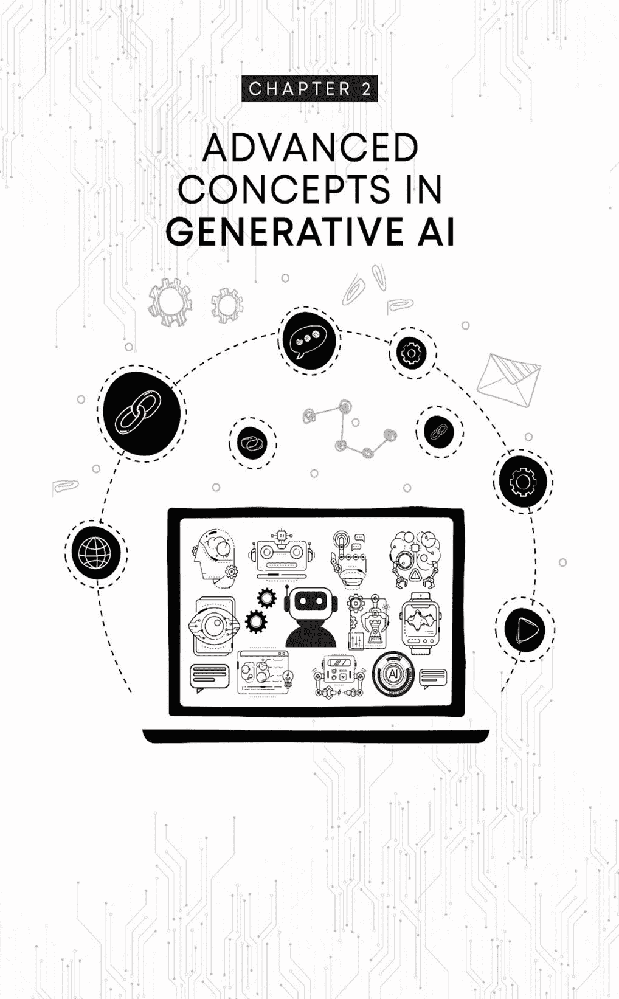

# 第 2 章：生成式 AI 中的高级概念

欢迎来到生成式 AI 道场，在这里，我们将深入研究让机器不仅是在思考，而且是在聪明地思考的复杂之处。如果你认为理解你的亲戚已经很复杂了，请做好准备；这些 AI 概念将把“复杂”推向全新的高度。但不要担心，我们将像主厨处理鱼一样，用精湛的技术拆解它们——平滑、精准，且看起来毫不费力。

## 2.1 深度探索注意力机制

### 注意力机制的原理：不仅仅是一眼

想象你正处在一个热闹的派对上，宾客们在聚声喧哗。在这片嘈杂中，你的大脑敏锐地捕捉到了某段关于你感兴趣的最新科技产品的特定对话。这种在关注特定声音的同时忽略其他声音的能力，类似于 AI 中注意力机制所实现的功能。在数字领域，这些机制使模型能够关注输入数据的相关部分，从而显著提高翻译和摘要等任务的效率和准确性。

AI 模型中注意力机制的核心是重新校准对输入特征的关注，这些特征对于执行特定任务至关重要。例如，在语言翻译任务中，模型学习更多地关注句子中的主谓一致性，以确保翻译输出的语法准确性。这种选择性注意力不仅提升了任务性能，还加快了处理速度，因为模型不会浪费时间在无关数据上思考。

### 不同类型注意力的焦点

进一步深入探讨，让我们探索注意力类型的画廊——每一种都是具有独特风格的杰作。首先是**自注意力**（self-attention），这种机制允许输入之间进行相互作用（想象句子中不同的单词如何影响彼此的上下文）。这种类型在 Transformer 等模型中被巧妙利用，这些模型处理需要深度理解语言上下文的任务。

接下来，我们遇到了**多头注意力**（multi-headed attention）——一个长有多个头的怪兽，每个头都看向不同的方向。这种类型允许模型同时考虑来自不同位置的各种表示子空间的信息。这就像有一支专家团队关注问题的不同方面，从句法到情感，以确保全面的理解。

为了说明这一点，想象一个场景：模型使用多头注意力来处理像“奖杯放不进箱子，因为它太大了”这样的句子。模型能够高效地确定“它”指的是奖杯而不是箱子，这是那些性不那么复杂的模型可能会错过的的细微差别。

### 将注意力与性能增强联系起来

事实胜于雄言——或者说，在这种情况下，是体现在性能指标上。注意力机制具有革命性，推动模型在多个领域实现了最领先的结果。例如，在机器翻译中，配备注意力机制的模型表现显著优于其前身，提供了更准确、更符合语境的翻译。

一个典型的例子是 Transformer 模型，它极大地利用了注意力机制，不仅在语言任务中，而且在图像处理甚至音乐生成等领域内都树立了新的基准。这些模型通过集中的计算能力，可以生成以前机器无法企及的复杂输出。

### 扩展与优化注意力机制

然而，能力越大，计算责任也越大。扩展注意力机制类似于调校高性能跑车——这不仅关乎速度，还关乎效率。主要挑战之一在于管理计算资源，因为注意力机制（尤其是在大型模型中）是非常消耗资源的。

优化策略包括诸如**剪枝**（pruning）的技术，即修剪不重要的连接，就像剪掉植物上的枯枝以帮助它生长得更好。另一种方法是**量化**（quantization），它减少模型中使用的数字的精度，从而在不大幅损失性能的情况下减少内存占用。

通过整合这些策略，我们可以更有效地扩展配备注意力机制的模型，使它们不仅强大，而且在各各的现实应用中具有实用性。从驱动实时语言翻译器到辅助复杂的医学诊断，优化的注意力机制正在为 AI 驱动的未来奠基础，这种未来不仅智能，而且高效且可扩展。

当我们继续揭开 AI 中注意力的奥秘和潜力时，请记住，这段旅程在于对让这些技术不仅运行良好而且卓越的细节培养更深层次的理解和欣赏。让我们继续关注突破边界，一个算法一个。

探索通过 IBM Watson 的自然语言处理演示了解注意力机制如何进行高级文本分析：


## 2.2 自动编码器在数据压缩中的演变

想象一个世界，原始数据的杂乱可以像折叠式衣柜里的衣服一样被整齐地折叠。这就是自动编码器在数据压缩领域的精髓。追溯其起源，自动编码器最初是相对简单的神经网络，主要用于减少数据维度。最初，它们的作用非常直接：将数据压缩成更小、更易管理的形式，同时不丢失关键信息，就像为长途旅行将最必需的行李装进箱箱一样。


随着时间的推移，由于数字宇宙的扩张，对自动编码器的需求日益增长。这一演变见证了更复杂的变体的诞生，例如变分自动编码器（`VAEs`），它们能够压缩数据并基于学习到的表示生成新的数据点。这一转变标志着一个重要的里程碑，将自动编码器从单纯的数据压缩器转变为能够为 AI 生成模型贡献的创造者。这些高级自动编码器的的发展至关重要，特别是它们处理和理解海量非结构化数据的能力，为机器学习及其他创新铺平了道路。

### 自动编码器与降噪艺术

在繁华的数字信息世界中，噪声是不可避免的客人。无论是图像中不必要的失真还是音频录中的背景嗡嗡声，噪声都会扭曲数据的清晰度和质量。在这里，自动编码器在去噪方面起着至关重要的作用，涉及过滤掉噪声以提高数据质量。这个过程有点像使用筛子将面粉与不需要的结块分离，确保只使用最细的颗粒（或数据）进行烹饪（或分析）。

例如，考虑一张具有像素级失真的图像。自动编码器可以学习识别并重建图像的关键特征，最大限度地减少噪声的影响。这种能力不仅提升了美感，还通过提供更清洁、更准确的数据增强了其他机器学习模型的性能。图像处理中的前后对比示例清楚地展示了自动编码器如何将一张模糊、不清晰的照片转化为更锐利、更清晰的图像，就像修复师清理一幅曾经充满活力的画上数百年的污垢一样。

### 深度解析变分自动编码器 (VAEs)

虽然传统的自动编码器擅长压缩，但变分自动编码器向生成领域迈进了一大步。`VAEs` 的独特之处在于它们建立在概率理论的基础上。与将输入编码为固定点的标准自动编码器不同，`VAEs` 将输入编码为分布——每个分布由均值和方差定义。这种方法允许 `VAEs` 压缩并生成新的数据点，有效地捕捉输入数据的本质，并能以这种方式进行调整和采样以创建新作品。

`VAEs` 的魔力在于它们处理不确定性和变性的能力，使得它们对于建模复杂分布至关重要的任务非常强大。例如，在制药行业，`VAEs` 可以通过生成新的分子结构来帮助药物发现。这些模型提供了一种概率方法来探索化学空间，而这对于人类手动计算可能是不可行的。

### 超越压缩：异常检测与特征学习中的自动编码器

自动编码器的效用超越了单纯的数据压缩领域，扩展到了异常检测和特征学习的领域。在异常检测中，自动编码器可以学习表示正常行为，并通过注意数据点何时根据学习到的表示进行良好压缩，从而识别偏离或异常。这种应用在金融欺诈检测或制造故障检测等场景中至关重要，识别异常值可以防止昂贵的错误。

特征学习是另一个关键应用，涉及使用自动编码器自动从数据中发现并学习有用的表示。这些特征随后可以用于改进预测模型的性能。例如，在人脸识别技术中，自动编码器可以帮助提取对光照或面部表情变化具有鲁棒性的特征，从而增强识别系统的准确性和可靠性。

当我们探索自动编码器的这些高级应用时，我们开始赞赏它们在塑造 AI 未来方面的多多功能和潜力。从压缩数据、增强图像到检测异常和生成新数据点，自动编码器展示了在各种挑战性环境中适应和卓越表现的非凡能力。它们从简单的压缩工具到复杂的生成模型的演变，凸显了一段成长和转的历程，反映了人工智能本身的动态格局。随着它们的不断演进，自动编码器不仅重新定义了数据压缩的极限，而且继续在各个领域开启新的可能性，预示着 AI 创新纪元的到来。

## 2.3 Transformer 架构及以后

在 AI 创新的繁忙集市中，Transformer 架构就像大片电影院的开业——吸引了人群并树立了新趋势。但与任何先驱产品一样，最初的惊艳并不能排除下一代改进的到来。像 `Transformer-XL` 和 `Reformer` 这样的架构不仅是在其前代成功的基础上迭代，而且以深刻的方式重新定义了效率。

`Transformer-XL` 跨越了标准 Transformer 面临的主要障碍之一：处理更长的数据序列。传统的 Transformer 尽管有很多优点，但主要由于上下文定位的问题，在处理长期依赖关系方面十分吃力。这好比读一本小说，并试图在不再次翻页的情况下记住几个章节之前的故节细节。`Transformer-XL` 通过使用分段级递归机制和状态复用策略解决了这个问题，这使其能够学习其固定长度上下文之外的依赖关系。这种增强提升了涉及扩展序列的任务（如文档分类或长篇小说文本生成）的性能，并且在计算资源使用上具有惊人的效率。

在另一方面，`Reformer` 直面解决了内存消耗问题。Transformer 以对内存（RAM）的高需求而闻名，特别是在长序列上进行训练时。`Reformer` 通过引入两项关键创新改变了游戏规则：局部敏感哈希（将注意力机制的复杂度从二次方降低为线性）以及可逆残差层（允许在训练期间存储较少得多的中间值）。这些特征使得 `Reformer` 不仅在内存使用上更轻量，而且速度更快，能够在不需要超级计算机的情况下，在更长的序列和更大的数据集上训练模型。

演变并未于此。混合模型正在出现，它们将 Transformer 的优势与其他神经网络架构融合，创造出大于部分之和的整体。例如，想象将 Transformer 的上下文能力与卷积神经网络 (`CNNs`）的图像处理能力相结合。这种混合模型可以在需要理解文本和视觉数据细差别的任务中表现出色，例如自动视频字幕或多模态翻译服务。这些模型利用了 Transformer 处理序列数据的能力和 `CNN` 处理空间信息的能力，为涉及多种数据类型的问题提供了一种整体方法。

展望未来，Transformer 技术的潜在轨迹既多样化又令人兴奋。一个充满前景的方向是将 Transformer 整合到强化学习环境中。在此处，Transformer 可以通过更好地理解动作序列及其结果来增强决策过程。另一个新兴领域是在边缘计算设备中使用 Transformer，在这些设备中，效率和速度至关重要。随着这些模型变得更加节省资源，它们在实时应用中（如智能手机或自动驾驶汽车）的部署将变得越来越可行。


Transformer 架构的持续创新不仅扩展了它们的适用范围，也挑战了我们对机器理解和执行能力的预期。从增强语言流利度到理解对话中人类情感的细微差别，这些架构的进展正在为 AI 无缝且直观地融入日常生活时代铺平道路。随着我们不断前行，这些模型的演进可能会让我们时刻保持警觉，热切期待下一次将再次改变人工智能领域可能性边界的突破。

## 2.4 用于高级文本生成的序列到序列模型

在 AI 动态变化的世界中，序列到序列模型（sequence-to-sequence models）就像机器学习中熟练的语言学家，不仅擅长翻译语言，还擅长将任何基于序列的信息从一种形式转换为另一种形式。这些模型在涉及将输入序列转换为输出序列的任务中至关重要，其中输入和输出可以是短语、句子甚至更长的文本形式。这种能力使得它们在各种应用中不可不可缺，从机器翻译、语音识别到聊天机器人功能和自动摘要。

序列到序列模型的核心是一种被称为“编码器-解码器”（encoder-decoder）结构的双组件架构。其工作原理如下：编码器处理输入序列（无论是文本、音频还是任何序列数据），并将整个输入压缩成固定大小的“上下文向量”（context vector）。这个向量是输入序列信息的密集封装，作为压缩后的表示，解码器据此生成输出序列。可以将编码器想象成一个将详细故事提炼为大纲的人，而解码器则利用这个大纲以不同的风格或语言重新讲述故事。这一过程超越了简单的翻译，涉及对原始输入语境和细微差别的理解与保留，以确保输出既准确又符合语境。

### 高级优化：增强魔力

为了提高序列到序列模型的效率和效果，采用了几种先进的优化技术。束搜索（Beam search）就是这种技术之一，它增强了生成输出序列期间的决策过程。与选择概率最大的下一步的贪婪搜索（greedy search）不同，束搜索在每一步中都会考虑多种可能性，像树枝一样扩展。这种方法增加了找到更优序列的概率，就像在 GPS 上考虑交通状况来选择最佳路线，而不仅仅是引导你沿最短路径行驶。

另一个关键增强是注意力层（attention layers）的集成，它允许模型在不同时间关注输入序列的不同部分，而不是仅仅依赖最终的上下文向量。这种机制类似于经验丰富的厨师在烹饪的各个阶段品尝菜肴以完美调整调味，而不是只在最后。注意力层帮助模型“关注”输入数据中最相关的部分，从而提高输出的质量和相关性。

调度采样（Scheduled sampling）是另一种用于完善这些模型的技术。它涉及随时间改变训练策略：最初，模型主要使用正确输出进行训练，但逐渐地，它开始在训练期间接收其之前的预测作为输入。这种方法有助于使模型对自身的错误具有健壮性，类似于学生学习在复杂的计算中纠正自己的错误。

### 现实应用：观察序列到序列模型的行动

序列到序列模型的实际应用既多样又令人深刻。在语言翻译领域，像 Google Translate 这样的模型帮助用户以越来越准确率将文本从一种语言转换为另一种语言。在语音转文本应用中，这些模型允许将口头语实时转录为文本，为听障人士或法庭、公司会议等专业环境提供了有效的沟通支持。

此外，序列到序列模型通过在聊天机器人中的部署，正在客户服务行业取得重大进展。这些 AI 驱动的机器人可以通过理解和生成类人的响应，处理从简单的常见问题（FAQs）到复杂请求的一系列查询。这不仅增强了客户体验，还通过同时处理大量客户交互简化了操作，且不会出现疲劳或错误。

随着我们继续探索和扩展序列到序列模型的能力，它们在桥接人机通信鸿沟方面的作用变得显而易见。除了作为自动化工具外，它们在增强交互和理解方面至关重要，使机器能够更好地处理人类语言和思想的复杂性这些模型的演变是 AI 巨大进步的证明，承诺未来将有更复杂、更直观的应用。随着这些技术的发展，它们继续改变着通信和交互的格局，为人类活动各个领域中更无缝、高效和准确的交换铺平道路。

## 2.5 利用条件生成模型

进入条件生成模型的世界，在这里 AI 的魔力与条件的精确性相遇了。与无条件的对等模型不同（后者纯粹根据学习到的数据分布生成输出，而没有特定指导），条件模型是精明的艺术家，他们在不知道画什么的情况下不会在画布上作画。将它们想象成受委托艺术家，根据赞助人的愿望定制他们的创作，无论是生成夜空还是繁华的城市景观。

这些模型依赖指令而生存。它们可以被训练以产生不是随机的而是与给定条件或标签完美对齐的数据。这可能意味着在指定 `dog` 时生成狗的图像，或者在要求在 `French language` 条件下进行文本生成时编写法语句子句。这种特定性允许产生更受控和更相关的输出，使得这些模型在以定制为关键的任务中极其有用。

深入探讨，让我们谈谈条件生成阶段的一些明星：条件生成对抗网络（`conditional GANs`）和条件变分自动编码器（`CVAEs`）。条件 GAN 通过将标签信息整合到生成过程中，扩展了传统 GAN 的基础框架。这种转变为让生成器能够产生既高质量又具有特定类别的内容。例如，在用于图像生成的条件 GAN 设置中，输入如 `sunset` 这样的标签可以引导生成器产生主要具有日落典型暖色调和渐变的图像。

另一方面，CVAE 为这种组合增添了概率的色彩。它们被设计用于处理输入中的不确定性，通过学习将输入数据编码为分布而不是固定向量。因此，每个生成的输出都考虑了可能的变异，使得 CVAE 非常适用于需要条件内存在变异的任务。例如，在 `smiling` 条件下生成人脸时，CVAE 可以产生各种微笑的面孔，每张脸在表情上都有细微差异，反映了更真实的变异。


这些受控创意天才的应用是非常广泛且多样化的。例如，在个性化内容创建中，电子商务平台可以使用这些模型生成符合个人风格偏好的定制时尚单品。通过根据用户的历史行为或显式声明的偏好对模型进行约束，系统可以设计出个性化的产品图像，从而更容易吸引并参与用户。

在数字营销中，根据特定的人口统计学或心理特征数据定制和调整促销图像或内容的能力，可以显著提高参与率。`conditional GAN` 可用于自动生成与不同受众产生共鸣的广告内容，并根据目标群体群体调整背景设置、特色产品甚至所使用的模型等元素。

另一个令人兴奋的应用在于针对性数据增强，特别是在医学成像领域。在这里，条件模型可以在特定条件（如疾病类型或异常）下生成真实的、多样的医学图像。这些图像随后可用于训练诊断模型，确保它们在比有限现实世界数据允许的更广泛的医疗场景中更具稳健性和准确性。

### 应对挑战：模式崩溃及其他

尽管这些模型能力强大，但训练条件生成式模型绝非易事。一个众为人知的挑战是 `mode collapse`（模式崩溃），它发生在模型尽管输入条件不断变化，却开始产生有限种类的输出，甚至反复产生相同的输出时。这会严重限制模型在输出多样性至关重要的实际应用中的可用性。

一种可能的解决方案是在训练过程中引入正则化技术，以鼓励生成输出的多样性。可以使用如 `minibatch discrimination` 或 `feature matching` 等技术来确保模型在输出中保持变异性，在尊重输入条件的同时不塌陷为单一。

另一种方法是增强模型架构本身。例如，在训练过程中引入反馈循环，对输出的多样性进行持续评估并将其馈回模型进行调整，这有助于维持遵循条件性与输出多样性之间的平衡。

应对这些挑战需要技术敏锐度和创造性解决问题能力的结合，这些特性是 AI 领域的精髓。随着我们的不断进步，条件生成式模型的复杂性不断增长，有望提供更具受控且更相关的输出，并开启新的视界——在那里，唯一的限制就是你所能想象到的条件。无论是创建个性化体验、增强训练数据集，还是生成新内容，这些模型都已准备就绪，准备以想象中的最受控的方式将可能性转化为现实。

## 2.6 神经风格迁移中的高级技术

让我们来画幅画——字面意义上的。想象一下，你可以将梵高的星空旋涡与你喜欢的自拍融合，或者将莫奈的睡莉泼在你最新的风景照上。欢迎来到 `neural style transfer` 的世界，AI 的炼金术与古老的艺术在此相。这种技术不仅关乎复制，更关乎重新创造。它将一张图像的内容与另一图像的风格融合，将标准照片转化为非凡的艺术品。

`neural style transfer` 使用卷积神经网络 (`CNNs`）来分离并重新组合数字图像的内容和风格。其工作原理如下：“内容”图像（例如，城市景观的照片）和“风格”图像（可能是一幅著名的画）被输入网络。网络随后分析内容图像以捕捉其底层内容和结构，同时捕捉风格图像的风格特征。结果是什么？一张混合图像，看起来就像你的城市景观是由所选风格的艺术手绘制的。

### 算法改进：提升艺术

正如任何优秀技术一样，细节决定成败——在这种情况下，是算法。诸如 `adaptive instance normalization` 等创新将风格迁移推向了新的高度。这种技术调整内容图像的均值和方差以匹配风格图像，允许更快速、更灵活的风格整合。它类似于音频均衡器平衡不同的声音组件以实现完美音调，但针对的是视觉元素。

`deep photo style transfer` 是另一项显著进展。传统方法有时难以保持内容图像的写实感，导致结果看起来更像画画而不是照片。`deep photo style transfer` 算法通过保持内容图像的自然元素和真实细节解决了这一问题，确保最终产品保留栩如生的质量。这种方法提供了更无缝的融合，风格微妙地融入，而不会掩盖原始内容的完整性。

### 扩展画布：跨媒体风格迁移

除了静态图像，风格迁移正在视频和交互式媒体中引起波澜，极大地扩展了它的应用。在视频中，风格迁移可以逐帧应用艺术效果，创造出看起来像手绘的惊人视觉效果。然而，帧与帧之间的一性是一个挑战，可能会导致突兀的视觉体验。`temporal consistency algorithms` 的进展开始解决这一问题，确保艺术风格从一帧流畅地到下一帧，就像在电影中保持叙事一致性一样。

包括视频游戏和 VR 在内的交互式媒体也受益于实时风格迁移。想象玩一个游戏时，环境根据叙事情绪进行风格化适应，或者享受可以将你的周围环境转换为不同艺术时期风格的 VR 体验。这些应用增强了用户参与度，并为数字环境内的创造性表达开辟了新途径。

### 创意产业的复兴

`neural style transfer` 对平面设计、时尚和广告等创意产业的连锁反应是深远的。设计师可以快速以各种艺术风格原型化想法，而无需手动重建每种风格，增强了创造力和生产力。在时尚领域，设计师们尝试源自标志性艺术品的图案和纹理，为织物设计注入了新生命。

广告业已利用风格迁移来创建视觉上吸引人的营销活动，将品牌内容与艺术风格融合，吸引更多关注并在更深层次上接触消费者。这种艺术与商业的融合在拥挤的市场中脱颖而出，因为它为营销工作增添了层次感和文化相关性。

本质上，`neural style transfer` 不仅仅是一项技术成就；它是一种转型工具。它正在重塑我们互动和欣赏数字媒体的方式，将日常图像变成艺术品，并重新定义技术与创造之间的边界。随着我们继续探索和精炼这项技术，它变革视觉媒体和开启艺术可能新领域的潜力正在不断增长。AI 与传统艺术技巧的融合不仅仅是一个新奇，它更是一个蓬勃发展的领域，有望影响无数行业，推向艺术和技术中可能性的边界。


随着本章的结束，我们已经历程了神经风格迁移所体现的像素与画笔之间的相互作用之旅。从重焕个人照片到变革行业实践，技术与艺术的融合正在创造一个创造力不受限的未来。展望未来，下一章将深入探讨生成式 AI 的另一个引迷人的方面，开辟知识与应用的新视野。请保持关注，这场冒险才刚刚变得引人入胜。

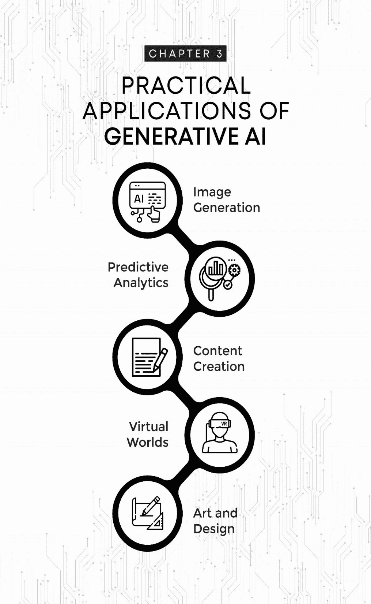

# 第 3 章：生成式 AI 的实际应用

欢迎数字复兴时代，在这个时代，生成式 AI 不仅仅是参与者，更是创意领域的先锋。本章不仅关乎理解生成式 AI，更关乎观察它的实际运作，改变我们在各种媒介上创作和消费内容的方式。准备好，我们将进入充满活力的数字媒体世界，在那里，AI 不仅仅是一个工具，而是一个协作者，准备好共同创作从大片电影剪辑到似乎读懂你心情的个性化流媒体播放单的一切。

## 3.1 内容创作中的生成式 AI：文本、图像与视频

### 变革数字媒体制作

想象一下，这样一个世界：繁琐的视频编辑任务由 AI 处理，让导演和剪师能够专注于电影制作的创作层面。生成式 AI 正在这一切成为现实。由 AI 驱动的自动视频编辑工具可以剪辑场景、调整音量水平，甚至建议捕捉观众注意力的最佳片段。同样，通过 AI 进行的图像增强技术无异于魔术。一张模糊的老照片可以被修复为清晰的图像，每一个微笑和日落都将重现生动的生命力。这些工具分析像素背后的数据，在不丢失原始精髓的情况下提升质量——可以将其看作是照片的“数字肉毒”。

### 内容的个性化：新前沿

生成式 AI 的魔力延伸到了个性化领域，改变了根据个人偏好定制内容的方式。在娱乐行业中，这项技术就像一个私人 DJ 或电影策展人，在你意识到之前它就确切知道你想看或想听什么。通过分析你之前的交互行为，AI 可以预测什么可能会引起你的兴趣，无论是一张爵士乐专辑还一部科幻电影。这不仅仅是为了保持观众的参与度；通过与每个用户建立独特的联系，每种数字体验都感觉像是专为他们定制的。

### AI 驱动文本生成的艺术

现在，让我们聊聊文本。得益于自然语言处理的进步，生成式 AI 正在成为一名出色的文字妙手。从撰写关于最新科技趋势的文章到编写浪漫小说，AI 驱动的文本生成将长期存在。自动化新闻等工具已被主流新闻机构用于创作涵盖体育和金融等多样化主题的内容。这些系统通过在海量数据集上进行训练，以产生信息丰富、结构良好且极具人感的文章。这背后的技术涉及理解上下文并能生成连贯叙述的模型，确保文本不仅语法正确，而且引人入胜。

### 重新定义平面设计

在视觉驱动的平面设计世界中，AI 正在扮演着日益具有创造性的角色。想象一个可以在几秒内生成几十种 Logo 设计或页面布局的 AI。这些系统使用设计师设置的参数（例如配色方案、排版和风格偏好）来为特定项目创建多次迭代版本。这不仅加快了设计过程，还为设计师提供了多种选择供其完善和整合。

### 视觉元素：电影制作信息图

AI 如何改变电影制作：

1. `Scene Selection`（场景选择）：`AI` 算法分析 `footage`（素材）。
2. `Color Grading`（调色）：`AI` 工具自动调整 `colors`（颜色）。
3. `Sound Optimization`（音频优化）：`AI` 增强 `visuals`（视觉）。
4. `Special Effects`（特效）：`AI` 简化 `creation`（创作）。
5. `Audience Engagement`（观众参与）：`AI` 预测 `preferences`（偏好）。

这张信息图展示了 AI 如何不仅是补充，更是行业中的变革性力量。当我们继续探索内容创作中生成式 AI 的深度时，很显然，创造者与作品之间的界限正在模糊。AI 不再是一个工具；它是过程中的伙伴。通过 `image-to-video` 测试你的创造力：


## 3.2 在网页开发与设计中实施 AI

在网页开发者和设计师度过白天（甚至是深夜）的数字游乐场中，人工智能迅速从一个得手工具变为不可或缺的同事。想象这样一个世界：网页设计中繁琐的细节，从构建完美的色调到页面布局，都由智能自动完成。这并非科幻小说；它正在发生，随着每一个算法的出现正在塑造网页开发与设计的格局。

### 自动化网页设计艺术

这一过程始于 AI 在简化网页设计方面的作用，特别是通过自动化重复且耗时的任务。AI 驱动的工具现在可以分析品牌资产和用户界面，建议或直接实施设计元素。这包括从符合无障碍标准的配色方案到以最大化用户参与的方式布局元素。例如，根据目标观众的偏好和过去的交互数据，AI 可以建议调整网站设计，以更好地捕捉注意力或鼓励点击。这不仅仅是为了让网站好看；更是为了打造既美观又功能卓越的用户体验。

### 创建更动态的交互

深入探索用户交互领域，AI 增强网页元素动态性的能力无异于一场革命。考虑实时响应用户交互的 AI 生成动画，或根据用户行为适应的动态界面。例如，学习平台可以根据一天的时间改变界面，在晚上使用深色减少眼部疲劳，在白天则保持明亮和引人入胜。


这种适应性也延伸到了信息的呈现方式。AI 可以分析用户参与度指标以优化内容的展示，确保用户看到他们最可能感兴趣的内容，而不会让过多的选择令他们感到困。这种智能响应不仅带来了更顺畅的用户体验，还有助于构建深度个性化的界面，让每次互动都感觉像是专门为该用户量身定制的。

### 通过行为洞察优化用户体验

AI 在增强用户体验方面的魔力在于，它能够筛选并理解海量的用户行为数据。通过理解用户如何与网站进行交互，AI 可以帮助创建更直观的布局和导航路径。热力图和会话回放等工具经过 AI 处理，为设计师提供精确的洞察，告知网站的哪些部分吸引了最多的注意力，以及用户在哪里频繁离开。

通过这些洞察，AI 可以对网站结构或内容布局提出建议，以增强可导航性并久留用户兴趣。例如，如果一个电子商务网站发现用户经常在完成购买之前离开结账页面，AI 可以帮助重新设计该页面，使其更加直观或更具安全感，或许通过简化所需信息或添加更清晰的安全标识来实现。

### 简化开发工作流

在后端，AI 显著简化了开发工作流，让 Web 开发人员的生活不再仅仅是调试无尽的代码行，更多是关于战略性思考和创造性的问题解决。AI 驱动的工具现在可以通过建议补全或纠错来协助编写代码，就像飞机驾驶舱中的副驾驶一样。这不仅加速了开发过程，还减少了错误，确保了整个 Web 项目的高质量和一致性。

此外，AI 在代码上线之前检测潜在错误或低效之处的能力是一项改变游戏规则的特性。这就像是有一位经验丰富的导师在你肩后注视，准备在失误变成绊倒之前指出它。这种主动的问题解决方法节省了无数时间（这些时间本本会花费在测试和故障排除上），让团队能够专注于更具战略性的任务，例如增强用户参与度或整合创新功能。

当我们在本章中前进时，会明显发现，AI 集成到 Web 开发和设计中正在重塑这些领域，并为可能性的设定了新标准。从自动化设计任务到优化用户交互以及简化开发工作流，AI 处于最前沿，驱动着提供更具个性化、更具吸引力且更高效的 Web 体验创新。这种演变不仅仅是为了跟上时代；更是为了引领节奏，确保 Web 平台功能强大、美观、智能、适应，并准备好迎接数字时代不断变化的需求。对于开发者和设计师来说，采用这些 AI 驱动的工具和技术不仅是有益的；在一个技术不断重新定义 Web 体验的世界里，保持相关性和竞争力是至关重要的。

## 3.3 电子商务和零售的 AI 驱动解决方案

在繁忙的电子商务和零售世界中，AI 是一个改变游戏规则的者，它从根本上重塑着格局。想象一下，走进一家商店，货架会自动重新排列，展示专门为你的品味和需求定制的产品；或者有一家比你自己还了解你风格的在线商店。这种情景并非遥不可及；在那些采用 AI 驱动的解决方案来个性化购物体验、简化库存管理、增强虚拟试穿以及变革客户服务的领域，这已成为现实。

### 根据个人品味定制购物体验

个性化是当今零售环境中的秘密武器，而 AI 就是那位主厨。通过分析来自用户交互的数据（例如过去的购买记录、搜索历史，甚至是页面浏览），AI 算法可以预测客户接下来可能对哪些产品感兴趣。这并不会用随机建议轰炸购物者；而是创造了一种感觉既私人又相关的精选体验。例如，如果你一直在浏览户外装备，AI 可能会突出最新的环保徒步鞋或刚上市的高科技帐篷，从而增强你的参与度并鼓励购买。

AI 在理解个人偏好方面的复杂性可以从促销活动的定制中看出。特价优惠、折扣甚至产品组合都是身定制的，以满足每位购物者的预期需求和欲望。例如，一个 AI 系统可能会注意到你经常购买烘焙原料，因此推荐了一套包含新款搅拌机、优质面粉和手工香草精的组合，并提供折扣价格。这种定制化不仅提升了客户满意度，还增加了向上和交叉销售的机会。

### 通过智能预测简化库存管理

在消费者体验的另一面是库存管理——这是零售业一个至关重要但不那么显眼的方面。AI 通过精确的需求预测和库存优化彻底改变了这一领域。通过分析销售数据、季节性和市场趋势，AI 可以高精度地预测未来的产品需求。这种预测能力允许零售商优化库存水平，确保有足够的产品满足需求，同时避免积压（积压会占用资金并增加存储成本）。

想象 AI 系统在大型促销活动期间工作，分析多年的数据以预测哪些产品将产生高需求。这些信息帮助零售商相应地准备库存，减少缺货和库存过剩的风险。此外，AI 可以根据实时销售数据动态调整这些预测，以应对需求的突发变化或供应链中断。这种库存管理的灵活性不仅减少了浪费，还确保了企业能够更具可持续性的运营。

### 虚拟试穿彻底改变试衣

虚拟试穿代表了 AI 在零售领域的另一个迷人应用，弥补了在线购物与店内体验之间的差距。利用 AI 算法，客户可以通过数字设备看到衣服穿在身上的效果，而无需进入商店。这项技术结合了计算机视觉、机器学习和增强现实，分析用户的身体尺寸以及不同面料和剪裁在身上的呈现。

这不仅仅是一个酷的设备；它是一个解决在线服装购物最大痛点之一——确定性的实用解决方案。虚拟试穿可以大大减少这种不确定性，增强消费者对在线购买的信心。结果是？客户更满意，退货率更低。对于零售商来说，这意味着物流成本的降低和利润的增加，更意味着由于商品往返运输的减少，运营更具可持续性。

### 通过 AI 驱动的交互增强客户服务

最后，让我们关注客户服务，AI 正在这里取得重大进展。AI 聊天机器人和虚拟助手在处理客户查询和售后请求方面已随处可见。这些 AI 系统的设计初衷是理解和处理自然语言，它们能够以一种既个性化又高效的方式与客户进行交互。无论是回答常见问题（FAQ）、处理退货还是跟踪订单状态，AI 应对大量客户服务任务都毫不费力。


但 AI 在客户服务中的作用远超简单的对话处理。它可以分析客户情绪，并此调整其回复，并在必要时将问题升级给人工坐席。这种 AI 与人工服务的无缝整合确保了客户能够获得快速、共情且有效的支持。在一个客户体验可以决定企业成败的时代，AI 驱动的客户服务不再仅仅是一个选项，而是一种必需品。

当我们探索这些应用时，显而易见，AI 正在通过为企业运营和与客户互动设定新标准，从而改变零售格局。从个性化的购物体验到高效的库存管理，从创新的虚拟试穿到增强客户服务，AI 处于现代零售创新的核心。对于企业而言，拥抱这些 AI 驱动的解决方案不仅是为了保持竞争力，更是为了在技术和客户预期不断演变的世界中领先。

## 3.4 利用 AI 聊天机器人增强用户体验

在繁忙的数字市场中，便利是货币，速度是语言，AI 聊天机器人是未来最勤奋、多才多艺的店助手。那种听着电梯音乐等待接听，最后只被一个疲惫的客服人员接待的时代已经过去了。今天，AI 聊天机器人凭借其处理查询、提供信息和解决问题的能力正在彻底改变客户互动——这一切无需费吹之力，或者更贴切地说，无需人工干预。但这些数字魔法师是如何让客户保持满意并参与其中的的呢？让我们揭开这项技术奇迹的面纱。

AI 聊天机器人的设计旨在模拟人类对话，但它们的能力远超简单的脚本化回复。它们采用复杂的算法来理解和处理用户请求，无论是关于产品的问题、投诉还是寻求帮助。想象一下客户在在线商店询问笔记本电脑的规格。AI 聊天机器人可以立即调出相关信息，提供详细回复，甚至根据客户的兴趣建议其他产品。这种瞬时的、24/7 全天候的响应系统不仅提升了客户满意度，还简化了解决过程，使问题能够被快速高效地处理。

然而，AI 聊天机器人的威力不仅限于简单的交易性互动。它们擅长个性化沟通，使每一次对话都像客户本身一样独特性。通过分析过去的互动、购买历史甚至浏览模式，AI 聊天机器人可以定制其对话以匹配客户的偏好和历史。这种个性化的方法不仅让互动更具吸引力，还与客户建立了联系，类似于一个记得你的品味并据此推荐产品的亲切店员。这种程度的个性化确保了客户不仅被听到，而且被理解，从而培养了忠诚度并增强了整体客户体验。

跨越语言障碍，AI 聊天机器人还带来了多语言支持，允许企业扩大业务范围并服务全球观众。凭借使用多种语言对话的能力，这些机器人无需大量人工干预即可服务不同语言背景的客户。无论是用西班牙语、法语还是中文回复客户，AI 聊天机器人都能以同样的轻松和准确性管理对话，扩大客户群并增强了可访问性。这种多语言能力在当今全球化的市场中特别有益，企业正努力创造能够跨越文化和语言边界的、包容且多样化的客户体验。

此外，AI 聊天机器人擅长自动化处理虽必要但可能单调且耗时的日常任务。从安排预约到跟踪订单，这些任务由 AI 系统以精确高效的方式处理。考虑一种场景：客户需要为某个设备预订保修服务。AI 聊天机器人可以处理整个过程——从检查保修资格、理解问题到与服务技术人员安排预约。通过自动化这些任务，AI 聊天机器人释放人工坐席去应对更复杂的问题，同时确保这些日常任务在错误更少、效率更高的情况下完美无缺地执行。

当我们探索 AI 聊天机器人在增强客户互动方面的多方面角色时，很清楚，它们不仅是功能性工具，更是改进客户服务的战略资产。它们提供快速、个性化和准确回复的能力改变了客户服务的格局，在客户参与和满意度方面设定了新标准。在一个客户体验可以显著影响业务成功的时代，AI 聊天机器人作为打造既高效又真诚令人满意的互动的必组成元素而脱颖而出。随着企业继续利用 AI 的力量，聊天机器人的进化可能会持续，带来更复杂、更直观的互动，这可能会以我们刚刚开始想象的方式重新定义客户服务。

## 3.5 医疗保健领域的生成式模型：机遇与挑战

在医疗保健这个巨大且复杂的领域里，决策可能产生改变生命的影响，生成式 AI 正在成为一种变革性的力量。想象一种场景：医学诊断的准确性突飞跃，告别了传统方法的局限性和错误。生成式 AI 模型增强了诊断的精确性和速度，特别是在医学影像方面。这些先进算法可以解释复杂的影像数据（如 MRI 和 CT 扫描），其详细程度和准确性超过了人类的能力。通过对海量医学图像数据集进行训练，这些 AI 系统学习检测即使是经过专业训练的眼睛也可能忽略掉的细微模式和异常。例如，在早期癌症检测中，AI 模型可以识别微小的肿瘤形成迹象，这些迹对于早期干预和成功的治疗结果至关重要。

生成式 AI 的力量从诊断延伸到个性化医学领域。每个患者疾病和治疗的经历都是独特的，受到其基因组成、生活方式甚至环境的影响。AI 模型擅长筛选这些复杂的数据网，以推荐个性化的治疗方案。通过分析患者的病史、遗传信息和当前健康状况，AI 系统可以定制治疗策略，在减少副作用的同时优化疗效。这不是为了取代医生，而是通过数据驱动的洞察赋予他们工具，使其能够做出更明智的决策。例如，在糖尿病等慢性病的治疗中，AI 可以帮助设计个性化的管理计划，根据患者状况的实时变化调整药物和生活方式干预。


生成合成医疗数据的能力是生成式 AI 取得重大进展的另一个前沿。在医学研究中，全面且多样化的数据集可用性往往是一个瓶颈，受限于隐私担忧和某些疾病的稀有性。生成式 AI 模型可以创建真实的、匿名化的数据集，模拟真实患者数据的属性，为研究人员提供进行稳健且广泛研究所需的资源。这种合成数据生成可以加速药物开发和临床试验，使新疗法的上市更快、成本更低。此外，它确保了患者隐私的维护，因为所使用的数据不再与真实个人关联，从而解决了医学研究中重大的伦理关注之一。

提到伦理，AI 在医疗保健领域的整合是一个充满伦理考量的雷区，必须谨慎应对。在诊断和治疗患者时使用 AI 为本就复杂的医疗伦理格局引入了更高层次的复杂性。数据隐私、AI 决策的透明度以及 AI 模型中潜在的偏见问题是讨论的核心。要让 AI 有效且符合伦理地整合到医疗保健中，这些系统不仅准确高效，而且透明公平至关重要。患者和从业人员必须能够信任 AI 系统，理解决策是如何做出的，并确保这些决策没有偏见。此外，治理医疗保健领域 AI 使用的监管框架必须稳健且具有适应性，能够跟上 AI 技术的快速发展。

当我们探索生成式 AI 在医疗保健中的潜力时，显而易见，这项技术具有彻底改变医疗实践的。从提高诊断准确性和个性化治疗方案，到生成合成数据和应对伦理挑战，AI 在医疗保健中的作用是多方面的且影响深远的。当我们继续利用这些能力时，重点必须放在开发不仅在技术上先进，而且在伦理上健全并符合医疗保健基本目标——改善患者结果和生活质量的 AI 系统。将 AI 整合到医疗保健的旅程复杂且充满挑战，但其潜在收益是巨大的，有望带来一个更加准确、个性化且易于获取的医疗未来。

## 3.6 金融建模与风险评估中的 AI

在风险风险的金融世界中，财富可能在瞬间之间创造或毁灭。为了降低这些风险，人工智能（AI）不仅是奢侈品，更是必需品。想象这样一个场景：AI 算法筛选如山般的金融数据，预测肉眼无法察觉的市场趋势。这不是未来电影中的场景；它正在发生，AI 正在重塑金融建模和风险评估的格局。

### 用 AI 精准预测市场趋势

金融市场是著名的难以预测，有无数因素影响着全球趋势。AI 登场了，它能够快速准确地分析海量数据集。AI 模型使用历史数据和实时输入来识别模式并预测未来的市场波动，为交易员和投资者提供了急需的优势。通过使用机器学习等技术，这些模型可以随着时间的推移适应并改进其预测，从市场波动和行为变化中学习。这种主动的方法允许金融分析师做出更明智的决策，并以传统方法可能会错过的数据驱动洞察作为后支持。无论是察觉潜在的股票飙升，还是预见市场低迷，AI 都提供了正在改变全球投资策略的战略优势。

### 通过 AI 增强风险管理

风险管理是另一个 AI 取得重大进展的批判领域。在金融世界，理解和减轻风险至关重要。AI 在这方面的表现出色，提供了以更高精度的评估和预测风险的工具。例如，在信用风险评估中，AI 算法分析借款人数据以预测违约概率。这种分析基于一系列因素，包括信用历史、交易模式甚至社交媒体行为。通过整合这些多样化的数据点，AI 提供了信用风险的整体视图，比传统方法微妙得多。

欺诈检测是另一个 AI 证明不可或缺的领域。金融欺诈可以以多种形式出现，从信用卡欺诈到复杂的证券欺诈。AI 系统经过训练，可以检测指示欺诈活动的异常和模式，通常在人类分析师发现之前就能捕捉到这些迹象。此外，AI 持续学习和适应的能力使其在面对快速演变的复杂欺诈技术时尤为有效。这种这种预见性检测对于保护资产和维护金融完整性至关重要。

### 通过算法交易简化交易

算法交易由 AI 系统以高速度执行交易，正在重塑金融机构的交易厅。这些由 AI 驱动的交易平台可以实时分析市场状况，以人类在速度上无法比的最优价格执行交易。算法设计用于持续监控市场变量，并能瞬间调整交易策略。这种能力不仅最大化了利润，还最小化了损失，特别是在速度至关重要的波动市场状况下。通过在算法交易中利用 AI，金融机构可以确保更高效、更有效的交易策略，这在毫秒之差就能决定盈损的世界中至关重要。

### 通过 AI 确保合规性

对于任何机构来说，应对复杂的金融监管世界都是一项艰巨的任务。AI 通过自动化合规流程来营救，确保金融机构高效地遵守法律和法规。AI 系统可以分析大量的法律文件和交易记录，以确保符合监管要求。这种分析包括监控交易中是否存在洗钱迹象，确保交易活动符合证券法规，并跟上不断变化的金融法律格局。

AI 不仅简化了合规性，还使其更加准确，减少了因不合规而导致昂贵法律罚的风险。此外，随着金融法规的不断演变，AI 系统可以快速适应，更新其参数以匹配新的法律框架，而无需重大的停机或重构。

当我们结束对 AI 在金融建模和风险评估中作用的探索时，显而易见，AI 不仅仅是一个工具；它是一个重新定义金融业的变革力量。从预测市场趋势和管理风险到自动化交易和确保监管合规，AI 的能力是广阔的，其潜力是巨大的。随着我们向前发展，拥抱这些 AI 驱动的创新将是在快速变化的金融世界中保持竞争力和成功的关键。

展望未来，下一章将深入探讨 AI 的另一个迷人应用，探索其在环境可持续性中的作用。请关注，我们将揭示 AI 如何不仅驱动金融市场，还为更可持续的未来铺平道路。

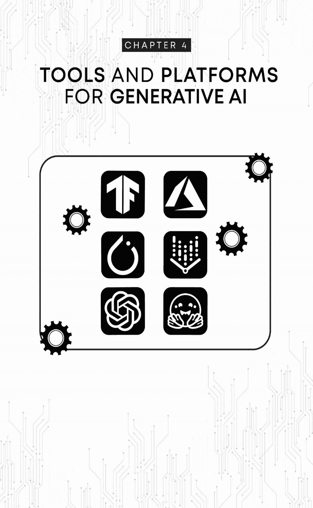

# 第 4 章：生成式 AI 的工具与平台


欢迎来到 21 世纪数字艺术家的工作室，在这里，颜料是数据，画笔是能够学习、适应和创造的先进软件工具。在本章中，我们将深入探索工具库，这些工具让生成式 AI 不仅仅是一个可能，更成为了一个动态的现实。让我们揭开 TensorFlow 的面纱，它是 AI 工具集中的强大力量，将引导你从最初的尝试性步骤迈向生成式模型世界中的高速冲刺。


## 4.1 开始使用 TensorFlow 生成式 AI

### 探索 TensorFlow 生态系统：可能的宇宙

想象走进一个配备了你可能需要的所有工具的工坊——欢迎来到 TensorFlow。这个开源库不仅仅是一个工具；它是一个庞大的生态系统，旨在扩展 AI 所能实现的边界。这个生态系统的核心是 `TensorFlow Graphics` 和 `TensorFlow Probability`，它们是 TensorFlow 皇冠上的两明珠，在生成式 AI 领域闪放异彩。

`TensorFlow Graphics` 提供了一套工具和库，它们与 TensorFlow 无缝集成，用于处理复杂的、数据驱动的可视化和 3D 模型生成。无论是在雕刻一个新的视频游戏角色的特征，还是在模拟复杂的天气模式，`TensorFlow Graphics` 都能确保你的模型不仅智能，而且在视觉上令人惊艳。

另一方面，`TensorFlow Probability` 处理现实世界中的不性，为你的模型提供统计基础。该库允许你向 AI 注入概率，处理从随机数生成到复杂的统计模型的所有问题，并能够在对现实世界内在混沌性的理解下，进行预测、学习和推理。

### 动手上手 TensorFlow：构建你的第一个生成式模型

现在，让我们卷起袖子大干一场吧。使用 TensorFlow 构建你的第一个生成式模型就像组装你的第一个机器人套件——令人兴奋、有点令人生畏，但非常有成就感。以下是设置基础生成对抗网络（GAN）的步骤指南：

1. 环境搭建：从安装 TensorFlow 开始。确保你在 Python 环境中安装了正确的 `pip` 程序包。
2. 定义模型：使用 `TensorFlow Keras` API 定义两个模型——`Generator`（生成器）和 `Discriminator`（判别器）。`Generator` 创建新的数据实例，而 `Discriminator` 则对它们进行评估。
3. 设置损失函数：这些函数将帮助训练你的模型。通常使用交叉熵损失函数来衡量 `Generator` 的输出欺骗 `Discriminator` 的程度。
4. 训练与反向传播：利用 TensorFlow 的优化函数来最小化损失，调整你的模型参数以同时改进 `Generator` 和 `Discriminator`。

TensorFlow 的美之处在于它的多功能性。帮助你模拟虚拟云的相同工具也能创建数字艺术品或模拟复杂的经济模型。当你调整你的 `GAN` 时，请记住：每一个错误都是教训，每一次迭代都让你更接近精通。

### 集成能力：技术生态系统中的 TensorFlow

TensorFlow 的设计是为了与其他良好协作。它与各种数据源和软件平台集成的能力增强了在大规模项目中的实用性。无论是从 `Google Cloud` 等云存储解决方案导入海数据集，还是与其他 AI 和机器学习框架协作，TensorFlow 就像一个友好的邻居，随时准备提供帮助（或者形象地说，提供一杯数据）。

对于想要将其 AI 模型扩展到生产环境的开发者，TensorFlow 的 `Serving` 组件提供了一个灵活、高性能的推理系统，专为机器学习模型设计。它处理模型部署的实际方面，从版本控制到 API 管理，确保你的 AI 作品能够从原型平滑过渡到功能性的现实应用。

### 社区与资源：TensorFlow 背后的人类网络

每一个伟大工具的背后都有更强大的社区。TensorFlow 用户社区是一个由开发者、研究人员和爱好者组成的活力网络，他们受到对 AI 创新的热驱动。无论你是在凌晨 2 点困调试模型，还是在为下一个项目寻找灵感，TensorFlow 的论坛和用户组都是知识和支持的宝库。

此外，网上充斥着致力于 TensorFlow 的教程、指南和课程。这些资源从入门友好的介绍到高级深度解析，涵盖了与 TensorFlow 工作的每一个可能的方面。无论你倾向于通过视频教程、博客文章还是正式课程进行学习，都有丰富的知识等待着你挖掘。

当你开启 TensorFlow 之之旅时，请记住，你正在成为全球社区的一部分。这个社区不仅在使用 TensorFlow——他们还通过贡献代码、分享创新用法并在挑战中互相帮助来塑造它的未来。这种协作精神驱动着 TensorFlow 前行，确保它保持在 AI 技术的最沿，准备好应对未来的挑战。

所以，拿起你的数字画笔，让 TensorFlow 成为你的向。无论你是在创作详细的 3D 模型、模拟复杂系统，还是生成模拟现实世界的新数据，TensorFlow 都提供了工具、支持和社区来帮助你成功。投入其中，实验，让你的创意流淌——生成式 AI 的画布正等待开启。

## 4.2 精通 PyTorch 用于高级 AI 开发

### PyTorch 的高级功能：赋能 AI 探索

让我们探索 PyTorch 的领域，在那里 AI 的边界不仅被推，而且经常被完全重新定义。PyTorch 以其动态计算图脱而出，这一特征在模型运行期间的适应性非常突出。与一旦开始执行就无法更改蓝图的静态图不同，PyTorch 的动态图会在执行过程中不断演变。这允许你根据接收到的输入动态更改模型的行为，这就像当你决定进行意外绕路时，GPS 系统重新计算路线一样。

PyTorch 皇冠上的另一颗宝石是它对高级自动微分操作（`autograd`）的原生支持。`Autograd` 自动计算神经网络的前向传播和反向传播，这对于训练深度学习模型至关重要。这一功能节省了时间并确保梯度计算的准确，当你处理复杂模型时，细微的错误就可能导致结果偏差，这是一个至关重要的方面面。

### 实现复杂模型：逐步探索

让我们卷起数字袖子开始用 PyTorch 编写代码。想象你正在创作一件复杂的 AI 艺术品，此时，你正在选择所需的颜色和画笔。在 AI 术语中，这翻译为选择你的模型架构。对于这个练习，让我们专注于构建一个变分自编码器（`VAE`）。你可以这样开始：

1. 定义架构：设置 `encoder` 和 `decoder`。`encoder` 将输入压缩到潜空间，`decoder` 从这种压缩表示重建输入。
2. 指定损失函数：对于 `VAE`，通常使用重构损失（如 `MSE`）和 KL 散度损失的组合，后者通过将编码数据的分布与先验分布比较，有助于对 `encoder` 进行正则化。
3. 优化器与反向传播：初始化一个优化器（如 `Adam`）并使用它来最小化损失。PyTorch 的 `autograd` 通过自动计算梯度，使这一步变得简单易行。


## 4. 训练循环：设置你的训练循环，将批数据馈给模型，计算损失并更新模型参数。`PyTorch` 的动态计算图允许即时修改，这使得你根据特定条件在训练期间更容易地调整模型。

这种实操方法不仅巩固了你对 `PyTorch` 操作的理解，还让你能够尝试更复杂的模型，例如条件生成网络（GANs），你可以利用它根据某些条件操纵生成过程以产生定制化的输出。

探索 TensorFlow：


### 学术界与工业界的 PyTorch：多功能工具

`PyTorch` 的灵活性和易用性使其成为学术界研究和实验的宠儿。其直观的设计和广泛的文档允许研究人员快速构建原型并对其想法进行迭代，这在节奏快速的学术研究领域是无价的。在工业界，`PyTorch` 同样备受推崇，被从汽车到金融的各个领域，用于开发商业 AI 应用。公司看重 `PyTorch` 的健壮性和可扩展性，这使得将复杂的 AI 模型部署到生产环境中成为可能。

### 生态系统与扩展：扩展 PyTorch 的功能

除了核心能力外，`PyTorch` 还得到了丰富的工具和库生态系统的支持，增强了其功能。`TorchText` 和 `TorchVision` 就是这样的两个库，它们扩展了 `PyTorch` 执行自然语言处理和计算机视觉的能力。`TorchText` 简化了文本数据的预处理，为分词和批生成等常见任务提供了支持，这些任务对于训练语言模型至关重要。另一方面，`TorchVision` 内置了如 `VGG` 和 `ResNet` 等预训练模型以及图像变换工具，使得实现先进的计算机视觉算法变得异常简单。

无论你是刚刚进入 AI 世界的新手，还是寻求深化专业知识的资深专业人士，`PyTorch` 都能提供工具、灵活性社区支持，帮助你的项目从构思走向完成。投入其中，探索吧，让 `PyTorch` 引导你穿过人工智能开发中令人兴奋的图景。

探索 PyTorch：


## 4.3 利用 OpenAI 的 GPT 进行自定义用途

### GPT 模型概述：穿越 AI 的演进之路

让我们漫步在 AI 开发的记忆中，关注 OpenAI 的 `GPT`（生成式预训练变换器）系列，从最初的迭代版本 `GPT-1` 到更复杂的 `GPT-3`。这些模型不仅在规模上不断增长，在智力上也在日益进化，就像见睹一个神童演变成一位博学多才的学者。模型的核心在于它们的 transformer 架构，这种架构从根本上改变了机器理解和生成人类语言的方式。与顺序处理单词的传统模型不同，`GPT` 模型同时处理多个单词，捕捉了以前难以捕捉的语言细微差别。

`GPT-3` 是该系列的最新成员，在规模和能力方面都是一个巨兽，拥有惊人的 1750 亿参数。这使得它能够生成与人类惊奇地相似的文本，能够创作诗歌、起草法律文件，甚至撰写可以被误认为是人类专家之笔的技术文章。从 `GPT-1` 到 `GPT-3` 的演变涉及规模的显著改进，以及模型理解上下文和生成恰当响应的能力不断增强，使其成为从自动化客户服务到创意内容生成等一系列应用的无价工具。

### GPT 的自定义应用：为你的需求定制 AI

想象有一个数字助手，它在响应查询的同时还能预测需求并进行个性化交互。`GPT` 模型非常适合这一角色，特别是在创建个性化聊天机器人时。这些 AI 驱动的聊天机器人可以处理从回答客户查询到提供个性化购物建议的各种任务，它们从交互中学习的能力意味着它们随着时间的推移变得越来越。但这只是冰山一角。

在内容生成方面，`GPT` 的能力可以指向生成从博客新内容到视频游戏脚本的一切。这里的关键在于定制；通过在特定类型或风格上对模型进行微调，`GPT` 可以产生引起目标观众共鸣的内容，保持反映品牌身份或用户创意愿景的一致语调。例如，旅游博客可以利用 `GPT` 生成目的地指南，不仅提供有用信息，而且以一种引人入胜、对话式的语气呈现，增强了读者的体验。

### 通过 API 访问 GPT：连接创意源泉

通过 OpenAI 的 `API`，利用 `GPT` 模型的力量变得无缝，它提供了一个将这一强大 AI 集成到你的应用程序中的门户。过程始于在 OpenAI 建立账户并获取 `API keys`——这是一个简单但至关重要的步骤，赋予了你访问一系列 AI 函数的权限。使用这些 `APIs` 涉及向 `API endpoints` 发送 `JSON` 格式的文本，而生成响应的重量工作由托管在 OpenAI 服务器上的 `GPT` 模型完成。

对于开发者来说，这意味着将最先进的语言处理能力整合到你的应用中不需要庞大的基础设施或对机器学习的深层知识。相反，你可以专注于设计用户体验，并编写用于集成 AI 生成的内容或响应的逻辑。`API` 还支持不同的配置和微调选项，允许你控制响应长度、风格甚至信息的特定性等方面，从而定制输出以满足你的特定需求。

### 伦理考量与局限性：负责任地应对 AI 领域

与任何强大的工具一样，使用 `GPT` 模型也伴随着巨大的责任。一个迫切受关注的问题是生成误导性或偏见内容的可能性。由于 `GPT` 模型从海量的互联网文本中学习，它们可能会无意中学习并延续训练数据中的偏见。因此，实施监控和减轻此类偏见的保护措施至关重要。这可能涉及为敏感主题设置过滤器，或者在发布之前人工审核生成的内容。

另一个伦理考量是 AI 生成内容的透明度。在一个错误信息可以快速传播的时代，确保 AI 生成的内容被清晰标记至关重要，以便用户能够区分人类和机器生成的文本。这种透明度不仅培养了信任，还鼓励了对内容的批判性参与，确保 AI 成为增强人类创造力和生产力的工具，而不是欺骗的来源。

对于任何想要在业务中使用 `GPT` 的人来说，应对这些伦理水域是必重要的。通过以优先考虑伦理考量并追求公平和透明的心态对待 AI，开发者和企业可以在维护伦理诚信和信任的同时，利用 `GPT` 模型的能力。

## 4.4 探索 Google 的 Vertex AI 能力

### Vertex AI 的能力：AI 工具的交响乐


想象一下走进一个控制室，每一个杠杆和按钮都经过精细调优，用于管理和增强你的 AI 项目。这就是 Google `Vertex AI` 的精髓：一套旨在改变我们处理机器学习任务方式的套件。`Vertex AI` 的核心是它的皇冠明珠 `AutoML`，这是一个通过自动化模型创建来实现机器学习平民化的工具。即使你不是一名资深的数据科学家，`AutoML` 也能允许你开发针对你的数据定制的模型，将曾经复杂的流程变得简单化。

接着是 `AI Platform Pipelines`，它引入了一个结构化的画布，用于部署和管理机器学习工作流。将其想象为为你的 AI 项目建立一条生产线，确保从数据接入到模型训练的每个组件都能无缝连接和维护。在处理需要稳健、可重复流程的复杂项目时，这一工具尤为关键。

不仅如此，`Vertex AI` 还提供了 `Model Monitoring`——它是你 AI 模型的警卫。它监控模型性能，在性能出现下降时向你报警，并提供重新校准的建议。这一功能是不可或缺的，特别是在数据和条件不断变化的动态环境中，确保了你的模型能够适应并持续保持最佳性能。

## 将 Vertex AI 集成到工作流中：现实世界的炼金

为了真正体会 `Vertex AI` 的多功能性，让我们深入探讨一些现实世界的应用。考虑一家旨在增强其客户推荐系统的零售公司。通过集成 `Vertex AI`，公司可以利用 `AutoML` 优化其推荐算法，确保客户收到个性化的产品建议。`Vertex AI` 与现有工作流的无缝集成意味着公司可以继续使用其现有的数据管理系统，同时由 `Vertex AI` 增强这些能力，将常规的推荐转变为个性化的购物体验。

另一个案例研究涉及一家医疗保健提供者使用 `AI Platform Pipelines` 来更有效地管理患者数据。通过创建一个包含数据预处理、分析和预测建模在内的工作流，该提供者可以更早地识别出高风险患者并进行更有效的干预。`Vertex AI` 简化了这些过程，并确保了它们是可重复且可扩展的，能够适应不断涌入的数据流，而不会产生性能损失。

## 可扩展性与管理：优雅增长

随着你 AI 尝试的扩大，管理它们的复杂性也随之增加。`Vertex AI` 在扩展方面表现出色，不仅体现在处理更大的数据集或更复杂的模型上，还体现在其维护效率和管理资源的能力上。无论是在多个环境中部署模型，还是管理模型的各种版本，`Vertex AI` 都提供了让这些任务变得易于管理的工具。

例如，考虑一个正在快速增长的电子商务平台。随着用户数量的增加，数据的种类和数量也随之增加。`Vertex AI` 帮助扩展公司的预测模型以应对这种增长，确保即使底层数据快速变化，推荐依然保持准确和相关性。这种可扩展性对于无法承受停机或性能缓慢的业务至关重要，因为它确保了 AI 系统在不牺牲速度或准确性的情况下提升能力。

## 安全与合规：现代 AI 的盾牌

在数据泄露屡可见见的时代，安全性既是必须也是强制。`Vertex AI` 以安全为核心构建，采用强大的加密方法来保护静态数据和传输中的数据。这意味着无论你的数据是存储在云端还是正在处理中，都受到防止未经访问的保护。

此外，合规性是一个关键方面，特别是对于医疗和金融等行业，法规规定了如何处理数据。`Vertex AI` 遵循国际数据保护法规，如 `GDPR` 和 `HIPAA`，确保你的 AI 解决方案不仅强大，而且符合全球标准。这种合规性得到了全面的审计追踪和治理工具的支持，允许你监控并控制对 AI 系统的访问，确保它们以负责任且符合伦理的方式使用。

当你利用 `Vertex AI` 的功能时，你正在使用一个强大的工具，它将确保你的 AI 项目是高效、可扩展、安全且合规的。这一系列功能不仅支持了你当前的需求，还预见了未来的挑战，让你准备好充满信心地面对它们。无论你是寻求创新的初创公司，还是旨在优化的成熟企业，`Vertex AI` 都为你提供了将你的 AI 愿景转化为切实成就的工具。

探索 Google Vertex：


## 4.5 利用 Hugging Face 进行模型训练和部署

走进 `Hugging Face` 这座繁华的数字集市，在这里思想、模型和尖端 AI 研究的交换比纽约的一分钟还要快。`Hugging Face` 不仅仅是一个平台；它是一个充满活力的社区，AI 工具和模型的平民化是其核心舞台。通过其 `Transformers` 和 `Datasets` 等旗舰库，`Hugging Face` 简化了顶尖模型的部署，使先进的 AI 技术让全球开发者都能触及，无论他们是在车库里捣鼓设备，还是在高层公司实验室里制定策略。

### 简介介绍 Hugging Face：尖端 AI 的平民化

`Hugging Face` 的 `Transformers` 库类似于 AI 开发者的瑞士军刀——它多功能、稳健且不可或缺。该库提供了大量的预训练模型集合，这些模型是现代 NLP 任务的基石，从情感分析、文本分类到更复杂的任务（如问答和摘要）。这些模型的优之处在于它们的预训练；它们已经通过对多样化数据集的广泛训练学习了大量关于语言的知识，这意味着你只需要花费部分计算成本和时间就能获得令人印象的结果。

此外，`Datasets` 库充当了 AI 实验的催化剂，提供了大量即即用的数据集，涵盖了广泛的应用。这提供了便利并加速了创新周期。研究人员和开发者可以以标准格式访问高质量数据，使他们能够更多地关注模型实验，而不是数据清洗。无论你是在寻找针对特定领域语料库微调模型，还是使用不同的数据切片测试假设，`Hugging Face` 的 `Datasets` 库都是你的首选资源。

### 模型枢与社区：行动中的协作 AI

想象一个市场，人们在那里不是买卖商品，而是像交换卡片一样交换 AI 模型——这就是 `Hugging Face` 模型枢。在这里，用户可以下载他人贡献的预训练模型，也可以上传自己的模型供社区使用。这个模型枢营造了丰富的协作与创新的环境，新手和资深开发者都可以在这里找到符合特定需求的模型，为社区做出贡献，甚至改进现有模型。


该平台的协作性质允许用户交换模型并创建反馈循环，其中改进方案、想法和创新会得到持续共享。这种社区化的方法加速了模型的改进和 AI 进展的传播。例如，如果你正在开发一个文本生成模型并遇到了性能瓶颈，很有可能 Hugging Face 社区中有人遇到过并解决了类似的问题。通过利用社区的集体知识，你可以更快地找到解决方案，并更高效地推进你的项目。

### 模型微调：定制 AI 以满足你的需求

虽然预训练模型提供了一个极佳的起点，但真正的魔力发生在微调阶段，此时这些模型被调整以在特定任务或数据集上表现优异。Hugging Face 提供了工具和文档，引导你完成微调过程，使其更像是一门艺术而非纯科学。例如，在特定行业的客户评论上对情感分析模型进行微调，可以随着模型学习该领域特定的细微差别和专业术语，极地提高其准确性和相关性。

这一过程涉及轻微调整模型参数，使用较小的学习率和你的特定数据集。这种方法确保了模型不会遗忘在预训练期间学到的内容；而是适应新数据。此外，Hugging Face 的界面简化了这一过程，提供了清晰的示例和最佳实践，帮助你有效地微调模型，而不会迷失在技术细节中。

### 部署策略：让 AI 模型变为现实

一旦你的模型完成了训练和微调，下一步就是部署，Hugging Face 以其灵活性在此脱颖而出。无论你倾向于在本地部署模型以获得控制和安全性，还是利用云解决方案来实现扩展和易于维护，Hugging Face 都支持多种部署选项。这种灵活性允许你选择最符合你运营需求和技术能力的策略。

对于倾向于云端解决方案的用户，Hugging Face 与主流云平台无缝集成，提供的工具和 API 帮助你高效地部署模型。这种集成不仅简化了部署过程，还确保了你的模型具有可扩展性，并且能够毫不费力地处理各种负载。另一方面，如果你选择本地部署，Hugging Face 提供了强有的支持和文档，引导你搭建基础设施，确保你的模型在安全环境中平稳运行。

当你穿梭于 Hugging Face 丰富的功能和协作环境时，你会发现它不仅仅是一个平台——它是 AI 创新的催化剂。无论你是在微调预训练模型、与 AI 爱好者进行合作，还是在部署复杂的 AI 解决方案，Hugging Face 都提供了所需的工具、社区支持和活性，让你的 AI 项目开花结果。投入其中，探索吧，让 Hugging Face 成为你在激心的 AI 开发与部署之旅中的伴侣。

探索 Hugging Face：


## 4.6 使用 Microsoft Azure AI 工具进行 AI 开发

### Azure AI 服务概述：现代 AI 架构师的工具箱

进入 Microsoft Azure 的领域，这里的 AI 工具不仅丰富，而且经过精心设计，以满足从初级数据科学家到资深 AI 架构师的各种需求。Azure 的套件包含了 `Azure Machine Learning`、`Azure Cognitive Services` 和 `Azure Bot Services`，为任何想要通过 AI 进行创新的人士奠定了坚实的基础。

`Azure Machine Learning` 是一个强大的平台，为构建、训练和部署机器学习模型提供了一个精化的平台。把它想象成你的 AI 实验室，你可以在那里进行实验、调制模型，并迅速将它们从图纸推向现实世界，而毫不费力。其用户友好的界面允许你管理模型的整个生命周期，从数据处理到部署，使其成为新手和专家都极具价值的工具。

然后是 `Azure Cognitive Services`，它让你无需成为机器学习专家即可让 AI 触手可及。这组预构建的 API 允许你只需几行代码即可将智能功能集成到应用程序中。无论是通过 `Computer Vision` 增加图像识别能力、通过 `Text Analytics` 理解情感，还是通过 `Speech Service` 将语音转换为文本，`Cognitive Services` 都能满足你的需求。它就像拥有一把 AI 的瑞士军刀；无论你的需求是什么，总有工具随时待命。

`Azure Bot Services` 补齐了这三剑客，允许你构建智能的对话机器人，能够从个人层面与你的用户交互。这些机器人可以集成到网站、应用程序、电子邮件和 `Microsoft Teams` 等各种通信平台，使其成为增强用户交互和自动化日常任务的多功能工具。

### 构建和部署模型：从概念到现实

让我们深入了解 `Azure Machine Learning`，理解它是如何将抽象的 AI 概念转化为具体的解决方案的。过程始于 `Azure Machine Learning Studio`，这是一个集化的工作空间，你可以在其中使用拖放式界面或编写自定义代码来构建模型。这种灵活性允许你以适合自己风格和专业知识的方式工作。

假设你被赋予了创建一个预测股票价格模型的任务。是你的处理方法：

1. **数据摄取**：从 `Azure SQL Database`、`Azure Blob Storage` 甚至外部源将历史股票数据加载到 `Azure Machine Learning` 中。
2. **数据准备**：使用内置的预处理工具清洗并准备数据。这可能涉及数据归一化、处理缺失值或创建新的计算特征。
3. **模型训练**：选择适用于回归任务的机器学习算法并用你的数据进行配置。`Azure Machine Learning` 开箱支持多种算法，使这一步变得简单。
4. **评估与调优**：模型训练完成后，使用 `Azure` 的可视化工具评估其性能。调整参数或尝试不同的算法以提高准确性。
5. **部署**：只需点击几次即可将模型部署为网络服务。`Azure` 会处理基础设施，允许全球任何地方通过 `HTTP` 请求访问你的模型。

这种端到端的工作流简化并加速了模型构建过程，让你能够以最快的速度从想法变为部署。

### 集成认知服务：用 AI 增强应用程序

当你需要在没有深度 AI 知识的情况下为应用程序添加 AI 能力时，`Azure Cognitive Services` 是你的首选。得益于提供的全面 API 和 SDK，集成此服务非常简单。例如，如果你正在开发一个新闻聚合应用并想加入情感分析，可以轻松接入 `Text Analytics API`。只需通过 API 发送新闻内容，即可接收详细的情感评分和情感分析响应。

`Cognitive Services` 的之处在于其简单与强大；复杂的 AI 过程被提炼为简单的 API 调用，使得无需理解底层模型即可通过复杂的 AI 功能增强你的应用程序成为可能。

### 利用 Azure 实现大规模 AI：指尖上的力量与扩展性


在扩展 AI 解决方案方面，Azure 恰其擅长。它的基础设施设计用于无缝处理大规模部署，无论您是在处理 GB 级的数据，还是提供数百万次 API 请求。Azure 全球托管数据中心网络确保了高可用性和低延迟，使您的 AI 应用程序既稳健又响应迅速。

此外，Azure 提供了全面的安全功能来保护您的数据和模型。从加密的数据存储和传输到身份管理和访问控制，Azure 能在任何规模下都能确保您的 AI 资产安全。在部署符合严格监管标准的 AI 解决方案时，这种对安全的承诺至关重要。

当您探索 Azure AI 的功能时，请记住，您正在利用一个在 AI 旅程中每一步都提供支持的平台——从构建和部署模型，到集成智能功能和扩展解决方案。无论您是开发者、业务负责人还是数据科学家，Azure AI 都能提供您所需的动力、灵活性支持，帮助您将创新想法变为现实，确保您的 AI 创业活动既成功又具有突破性。

当我们结束对 Azure AI 工具的探索时，显而易见，创新的潜力是无限的。只要拥有正确的工具，您就可以突破 AI 的可能边界，创造出不仅具有变革性，而且可扩展且安全的解决方案。在 Azure AI 的旅程只是人工智能宏大冒险之旅的一部分。接下来，我们将深入探讨 AI 开发的其他令人兴奋的方面，确保您在继续探索和创新时，对整个格局有一个全面的理解。

探索 Microsoft Azure：


# 通过您的评价带来改变

## 释放慷慨的力量

### “金钱买不到幸福，但把钱送出去可以。” - 弗雷迪·麦克拉

那些在不期待回报的情况下给予他人的人生活得更长、更快乐，并往往在这个过程中获得成功。如果意味着得不到认可，你是否愿意帮助一个不熟悉的人？你问那个人是谁？他们就像你一样。或者，至少像你以前的样。他们充满好奇心，探索新新技术，想要改变现状，需要帮助但不知道该去哪里寻找。

我们的使命是让每个人都能接触到生成式 AI 知识。我们所有的努力都基于这一愿景，旨在接触广泛的受众，而您在其中起着至关重要的作用。事实上，大多数人确实会凭人看相（以及看评价）。代表那些您未见过的 18 到 45 岁的人们：

非常感谢您对这本书的评价。这一小小的行为可能会显著影响他人，可能帮助当地企业、支持创业者或帮助个人实现他们的梦想。

您愿意提供反馈的意愿将产生巨大的影响，并可以通过使用此二维码轻松完成：


如果匿名的改变让您产生共鸣，请加入我们。感谢您的考量。让我们继续刚才正在做的事情。

诚挚地，Jordan Blake

附记 - 记住，为他人的生活增加价值会提升您对他们的价值。如果您认为这本书可能帮助某人，请将其转给他们。

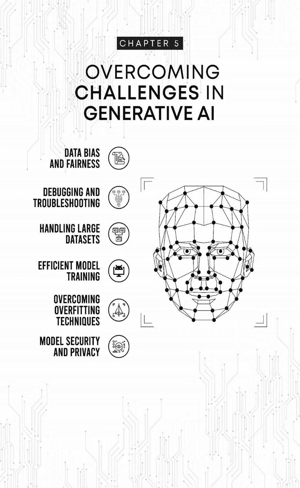

# 第 5 章：克服生成式 AI 中的挑战

欢迎来到生成式 AI 的“荒西部”，这里的可能性极其广阔，挑战也同样令人令畏。将这一章看作您穿过 AI 前沿的可靠指南，配备了老练警长的智慧和精明探矿者的工具。在这里，我们将应对 AI 领域中最臭名昭著的法外分子：偏差。AI 中的偏差是一个致命缺陷，可能会扭曲结果并使不平等持续。但不要！！正确的方法和一些 AI 知识，您可以驯服这头猛兽，并确保您的 AI 模型公平公正。


## 5.1 处理数据偏差并确保 AI 模型的公平性

### 识别罪祸首：AI 中的偏差来源

AI 中的偏差可以通过许多后门溜入：选择偏差、采样偏差和历史偏差，这只是几个臭名昭著的罪祸首而已。当您用于训练 AI 模型的数据不能代表其旨在解决的现实场景时，就发生了选择偏差。想象一下，仅用 20 世纪 50 年代杂志杂志图像训练脸识别系统；结果将像照片中的发型一样过时。

采样偏差通过影响选择用于训练的数据点进一步扭曲了您的模型。如果您正在开发语音识别系统，并且只包含白日电视节目的声音，那么当发现它难以理解任何低语或大喊时，请不要惊讶。历史偏差是最狡猾的一个，源于数据中预有的偏见。这就像告诉您的模型所有的天鹅都是白的，因为它从未见过黑天鹅。

### 平衡尺度：实施公平性指标

纠正这些偏差需要一套稳健的公平性指标。将这些指标视为 AI 模型的正义之。机会平等（Equality of opportunity）确保所有个体无论背景如何，都有相似的机会获得正面的模型预测。人口统计学平衡（Demographic parity）范围更广，要求模型做出的决策独立于种族或性别等敏感属性。另一方面，预测平等（Predictive equality）要求所有组具有相同的假阳性率，确保某一组不会被不公平地针对另一组。

应用这些指标不仅仅是为了打钩；它关乎将公平性融入到您的 AI 系统的每一个方面。例如，在招聘工具中，应用机会平等意味着候选人根据其资历接受评估，而不是根据其人口统计特征，从而确保为所有申请者提供一个公平的竞争环境。

### 去偏的艺术：清洁 AI 的技术

减轻 AI 中的偏差类似于净化毒井；它既需要精确性也需要主动措施。重采样（resampling）和重加权（reweighting）等技术调整了训练数据的平衡，让代表不足的群体在学习过程中拥有更大的话权。算法修改，例如对抗去偏（adversarial debiasing），引入了竞争元素，其中模型的某部分不断尝试检测另一部分的偏差，从而提高整体准确性和公平性。

考虑这样一个在历史数据上训练的、无意中偏向某些人口统计特征的贷款审批 AI 系统。通过实施重采样，可以调整训练数据以赋予所有群体平等的代表，从而有助于消除历史偏差，并确保模型根据申请人的能力而非背景来评估他们。

### 透明运作：促进开放性和问责制

对抗偏差的最后拼图是在 AI 开发中培养透明度和问责制。一旦您打开了 AI 算法的黑箱，您就需要与受 AI 决策影响的人建立信任。透明涉及对模型如何开发、使用什么数据以及如何做出决策进行清晰记录。问责更进一步，涉及对 AI 系统进行定期审计，并愿意根据这些发现进行调整。


想象正在部署一个用于公共服务分配的 AI 系统；透明度让公民能够理解决策是如何做出的，而问责制则确保系统持续公平地服务公众，并随着社区需求的变化进行调整。这种开放的方法不仅增强了你的 AI 系统的信誉，还使其更紧密符合符合价值观和伦理标准。

当我们 AI 偏见与公平性这一错综复杂的网中穿行时，请记住，这些挑战并非不可逾越。通过仔细的分析、周全的指标实施以及对透明度的承诺，你的 AI 模型不仅可以高效运行，而且符合伦理规范。因此，准备好出发，让我们继续这段充满刺激且充满挑战的生成式 AI 之旅，确保我们的创造既公正又具有创新性。

## 5.2 高效模型训练与资源管理策略

想象你是一位指挥交响乐的大师，但你操作的不是合唱团成员和乐谱，而是数据和算法。你管响团的每一个部分，从小提琴（你的 `algorithms`）到大提琴（你的计算资源），都需要完美的调音和时机控制才能创造出杰作。但如果你的小提琴声音很刺耳，或者大提琴跑调了怎么办？这就是高效模型训练和资源管理大显身场的地方，确保你的 AI 交响乐奏出所有音符，而不会超出预算。

### 优化计算资源：精调管响团的艺术

首先，让我们谈谈模型训练期间 `GPU` 使用率和内存管理的优化，这可以比作确保你的管响团和谐演奏，没有任何乐器盖过其他乐器。有效的批次大小（batch sizing）在这里至关重要；它就像为管响团的每个部分选择合适人数的音乐家。人太少，声音就很弱；人太多则会震欲聋。找到完美的批次大小可以确保你的 `GPU` 资源得到充分利用，在不引起内存溢出的情况下加速训练。

然后是混合精度训练（mixed precision training），这是一种在计算过程中使用不同数值精度的技术。将其想象为调整弦乐器的的张力以获得完美音高——它允许更快的计算，并在不牺牲输出质量的情况下减少内存占用。通过在模型训练期间动态调整精度，你可以显著提高 AI 的学习速度。

分布式计算技术通过将计算负载分散到多个 `GPUs` 甚至不同的机器上进一步提升了一个层次。这类似于将复杂的乐曲划分为由管响团不同部分演奏的部分，每个部分在你的指挥下完美同步。`model parallelism`（模型并行）和 `data parallelism`（数据并行）等技术允许训练比单个 `GPU` 内存容纳更大的模型，或者通过并行处理数据来加速训练。

### 资源分配：保持管响团的财务和谐

云环境中的资源管理感觉就像在策划世界巡演的同时平衡管响团的预算。你需要确保花费的每一钱都能最大化输出，而不浪费资源。`Auto-scaling` 服务是你的财务顾问，根据负载智能地调整分配的资源。在密集的训练阶段，这些服务会扩展计算能力以满足需求，并在淡谷期缩小规模以优化成本。

具有成本效益的资源分配策略还包括为特定任务选择正确的资源类型。例如，某些云服务提供了针对机器学习任务优化的实例，这可能比通用型实例更具成本效益。这就像为独奏表演聘请专家级音乐家，而不是整个管响团，在显著降低成本的同时确保了出色的表演。

### 实现高效训练技术：精通作曲

高级训练技术，如 `transfer learning`（迁移学习）、`incremental learning`（增量学习）和 `model pruning`（模型剪枝）是你的作曲工具，每种工具都为 AI 模型的性能增加了深度效率。`transfer learning` 就像使用著名的旋律作为创作的基础，对其进行调整以创造出新颖且有趣的内容。通过将在一个任务上训练的模型作为另一个任务的起点，你可以缩短训练时间并提高模型性能，特别是在数据稀缺的情况下。

另一方面，`incremental learning` 允许你的模型持续学习，适应新数据而不遗忘之前的知识，就像音乐家被要求在保持对经典作品掌握的同时学习新曲目一样。这在数据随时间变化的动态环境中特别有用。

`model pruning` 是在不影响准确性的情况下裁剪 AI 模型不需要部分的过程。将其想象为剪掉乐谱中冗余或重复的部分，在不丢失作品本质的情况下使表演更高效。这不仅加快了训练过程，还减少了推理期间的计算负载，使模型更快、更轻。

### 定期监控和评估资源使用：保持合唱团的敏锐

模型训练期间对资源使用进行持续监控和评估的重要性无论如何强调都不为过——就像定期调音乐器并检查声学效果以确保完美的表演。监控资源使用的工具和实践有助于识别训练过程中的瓶颈或低效率之处，让你对调整做出明智决策。无论是将资源重新分配给不同任务、调整批次大小还是更新你的训练算法，定期监控都能确保你的 AI 模型高效且经济效益地进行训练。

在交响乐中，每个音符都必须精准演奏，每种资源都经过专业管理；这确保了管响团处于巅峰状态。在训练模型时应用同样的概念：通过优化计算资源、审慎管理分配、实施先进训练技术并密切关注运营，你编排了一场效率与创新的杰作。当你继续探索 AI 开发时，请记住，在这些战略见解和实践的指导下，速度、准确性和成本之间的平衡是可以达的。

## 5.3 克服过拟合：模型泛化技术

想象你正在为终极问答节目准备。你只学习了去年比赛的问题。当然，你会再次拿到满分，但当主持人抛出一个今年的刁钻问题时怎么办？简而言之，这就是 AI 世界中的过拟合（overfitting）。它发生在你的模型在训练数据（去年的问题）上表现如常，但在面对未见过的新数据（今年的惊喜问题）时不及格了。这不仅限制了你 AI 的风格，还会导致决策像猫在钢琴上走过的声音一样跑调。

影响如何？嗯，过拟合让你的模型成为一花之秀。它能轻松应对见过的场景，但难以泛化到新数据。这是一个大忌，特别是在对灵活性和适应性有要求的应用中——例如预测市场趋势或诊断新疾病。如果没有泛化能力，AI 模型过时的速度会比上季的时尚趋势快得多。

### 正则化技术：你 AI 的辅助轮


将正则化技术想象成你 AI 模型的辅助轮——它们帮助模型保持平衡，不偏入过拟合的深渊。`L1` 和 `L2` 正则化是这里最受欢迎的明星。它们通过向损失函数中添加惩罚项来工作（将其想象成一位严厉的老师，不让你仅仅满足于训练数据感到太舒服）。`L1` 正则化就像是模型的饮食计划——它通过将不重要的特征推向零来帮助模型减掉不必要的重量，使模型变得简单，并且不太可能记住了训练数据。另一方面，`L2` 正则化通过平滑模型参数来避免导致过拟合的极端值，确保你的模型不会被训练数据中的噪声过度误导。

`Dropout` 是另一个巧妙的技术。它在学习过程中随机关闭一些神经元，迫使你的模型寻找新路径，并增强其泛化能力，而不是执着于特定的数据点。把它想象成每节课的突堂测验——你需要广泛地理解该学科，而不仅仅是背诵特定的讲义灯片。

`Early stopping` 就像知道什么时候该离开派对。它监控模型在验证集上的性能，并在模型开始过深记忆训练数据之前停止训练。这样，你的 AI 学习了足够的知识以表现良好，但又不会由于过度而无法适应新数据。

### 交叉验证的角色：测试时不允许作弊

交叉验证是你的模型的终极备考。它就像是在在期末考试之前进行几次模拟考试，以确保你有了全面的理解。在 `k-fold cross-validation` 中，你将数据划分为 `k` 个子集，并训练模型 `k` 次，每次都留出一个不同的子集作为测试集，其余部分作为训练集。这种方法不仅有助于有效调优模型参数，还为你的模型在现实世界中的表现提供了更具可靠性的估算。这是一项严谨的训练计划，确保你的模型能够处理遇到的任何数据，而不仅仅是它训练时使用的数据。

### 集成方法：协作的力量

最后，让我们谈谈集成方法——因为有时，培养一个健壮的 AI 模型需要整个集体的努力。`bagging`、`boosting` 和 `stacking` 等技术核心在于让多个模型合作进行组合预测，这种预测通常比任何单一模型的输出更准确、更健壮。`Bagging` 通过随机采样创建训练数据集的多个版本来减少方差并避免过拟合，在每个版本上训练一个独立的模型，然后对结果取平均值。然而，`Boosting` 专注于通过顺序应用模型来纠正之前的错误，从而将弱学习器变为强学习器，类似于帮助你关注薄弱科目的导师。`Stacking` 则像美味的千层面一样堆叠模型——每一层输出的预测都会输入最终预测器，创造出难以敌敌的组合效应。

这些集成技术确保你的 AI 模型能够应对各种问题，就像一个准备好应对考试中任何问题的全才学生一样。通过利用多个学习算法的优势，你增强了模型的稳定性和精度，确保它不仅仅是在记忆，而是真正地从训练数据中进行理解和泛化。

当你部署这些策略时，请记住：目标是创建不仅在纸面上表现良好，而且能够通过适应、学习和在新的未见数据上成长来保持可靠性能的 AI 模型。所以，为你的 AI 装备上这些技术，看着它如何以问答冠军的信心应对现实世界数据的复杂性吧。

在 Pro Profs 测试你对集成方法的了解：


## 5.4 AI 项目中的大型数据集处理

想象一下你是一个城市规划师，任务是设计一个既能容纳数百万居民，又能高效管理他们需求的城市。在 AI 领域，处理大规模数据集就如同城市规划。你必须管理海量数据，确保它们被有效地存储、处理和利用，以保持城市（即你的 AI 项目）运行良好。让我们深入研究帮助你管理这些庞大数据大都市的策略。

### 数据管理：高效 AI 架构的基础

处理大规模数据集始于稳健的数据管理策略，包括数据分区、高效的存储格式以及数据湖和数据仓库的战略性使用。`Data partitioning` 就像城市规划中的区域划分。通过将数据划分为可管理的块，你确保了 AI 模型可以更高效地处理它们，就像将城市分为住宅区、商业区和工业区有助于管理交通和资源分配一样。

高效的数据存储格式是你数据架构的建筑规范。`Parquet` 和 `ORC` 等格式提供了高压缩率和快速检索，这对于在不膨胀存储成本或访问时间的情况下管理大型数据集至关重要。将它们想象成高密度、节能的建筑设计，在繁华的城市中最大化利用空间和资源。

`Data lakes` 和 `houses` 是你数据生态系统的中心枢纽。`Data lakes` 允许以原生格式存储大量的原始数据——就像一个装满你 AI 项目可能需要的每种类型巨型水库。当需要特定数据集时，可以针对特定任务对其进行处理和转换，就像水库中的水被处理后用于不同用途一样。另一方面，`Data warehouses` 更具结构化，用于存储准备好分析和查询的已处理数据，类似于准备饮用的瓶装水。

### 流式与批量处理：数据流的公路与小径

随着你的 AI 项目的增长，数据流入也随之增加，高效管理这种数据流至关重要。`Data streaming` 和 `batching` 就像你数据城市的公路和旁路，确保交通流的顺畅高效。`Data streaming` 允许对数据输入进行实时处理，对于实时欺诈检测或城市实时交通管理等应用至关重要。`Apache Kafka` 和 `Amazon Kinesis` 等工具是这里的交通调度员，轻松处理海量数据流，确保你的 AI 模型接收到稳定且可管理的信息流。

另一方面，`Batch processing` 就像定期的火车服务，定期处理大量数据。这种方法适用于对时间不敏感的任务，任务中数据可以被收集、存储并分批处理。`Apache Hadoop` 和 `Spark` 等工具在此领域表现出色，通过其稳健的分布式计算能力高效处理大批量。它们将数据任务分解为更小、易管理的部分，分发到网络中并并行处理，显著加快了数据处理任务。

### 数据增强：AI 训练的城市扩张

在 AI 中，更多的数据通常意味着更好的模型，但收集大量的训练数据并不总是可能的。`Data augmentation` 策略在这里派上了用场，在不需要额外真实数据的情况下人为扩大数据集规模。这类似于城市规划中的城市扩张，通过扩大城市面积来容纳更多居民。例如，在图像处理任务中，旋转、翻转或向图像添加噪声等简单技术可以创建多样化的训练示例，在不增加数据采集成本的情况下提高 AI 模型的鲁棒性。


这种技术不仅增强了你训练数据的多样性，还模拟了 AI 模型在现实世界中可能需要的更广泛的场景，使其更加健壮和多功能。这就像训练城市居民既能适应市中心的喧嚣，也能适应郊区的宁静并良好生存。

### 可扩展的数据处理框架：增长的基础设施

最后，任何大规模 AI 项目的骨干都是其数据处理框架。像 `Apache Spark` 和 `Hadoop` 这样可扩展的框架是这一基础设施的支柱。这些框架旨在从单服务器扩展到数千台机器，每台机器都提供本地计算和存储。这种分布式特性使得它们处理大型数据集的速度比单机处理快得多，就像设计良好的公路系统比单一道路能更快速、更高效地引导交通流一样。

这些框架处理各种大数据任务，从数据排序、过滤到更复杂的分析查询和机器学习模型训练。它们的可扩展性使其在数据量和速度要求高的项目中变得不可或缺，确保了随着你数据的增长，你处理和分析数据的能力也随之增长。

在 AI 项目中应对大型数据集的挑战，需要结合智能的数据管理、高效的处理策略和健壮的基础设施。通过实施这些策略，你可以确保你的 AI 项目不仅具有可扩展且高效，而且为未来的增长和成功做好了准备。当你继续构建和扩展 AI 能力时，请记住，你现在奠定的基础将决定你未来 AI 之城的天际线。

## 5.5 确保部署中的模型安全与隐私

在数字时代，确保 AI 模型的安全和隐私不仅是一项良好的做法，更是必不可少的。将你的 AI 模型想象成数字版的诺德堡垒（Fort Knox）；正如你不会在没有健壮安全措施的情况下存放黄金，你也不应该在确保 AI 模型能够抵御潜在威胁的情况下部署它们。无论是试图用欺骗性数据欺骗你模型的对抗攻击，还是可能泄露敏感信息的隐私泄露，风险都极高。但不必担心：通过实施严谨的安全策略和隐私保护技术，你可以保护你的 AI 应用免受不受访客的侵害。

### 加固防御入侵：解决 AI 中的安全漏洞

对 AI 模型的对抗攻击类似于玩猫鼠游戏，攻击者不断设计新策略来欺骗模型，而防御者必须迅速适应以减轻这些威胁。一种有效的防御机制是对抗训练，它涉及在混合了常规示例和对抗示例的数据上对模型进行训练。这种方法类似于疫苗，让身体接触减弱的病毒以建立免疫力；它帮助模型学习识别并抵御潜在攻击，使其对对抗输入具有健壮性。

健壮性测试在此基础上更进一步，通过对 AI 模型进行潜在漏洞的持续测试和重测。将其想象为对你 AI 免疫系统的压力测试，确保它在不同条件下都能抵御对抗攻击。这一持续的过程有助于识别模型装甲上的弱点，允许你在攻击者利用这些漏洞之前对其进行加固。

### 守护秘密：实施隐私保护技术

随着 AI 继续渗透到各个领域，在 AI 应用中维护隐私的重要性飞速增长。如 `differential privacy`（差分隐私）、`federated learning`（联邦学习）和 `homomorphic encryption`（同态加密）等技术是 AI 隐私世界的超级英雄。例如，`differential privacy` 向用于训练 AI 模型的数据中添加噪声，在不显著影响整体结果的情况下掩盖个人贡献。这好比在合唱团中混合个人声音——和声依然存在，但无法辨别个人声音。

`federated learning` 通过数据去中心化采取了不同的方法。它不是将所有数据汇到一个中心点，而是在设备上进行本地训练。这种方法不仅有助于保护隐私，还能减少带宽。`homomorphic encryption` 可能是最神奇的，它允许在加密形式上处理数据，而无需暴露底层数据。

### 锁闭堡垒：安全部署的最佳实践

安全地部署 AI 模型不仅需要健壮的训练，还需要一个安全的环境。利用安全容器部署 AI 可以确保每个模型都与其他模型隔离开运行。`API` 安全是另一个关键方面，特别是当通过 `APIs` 访问 AI 功能时。实施身份验证、速率限制和加密等措施可确保只有授权用户才能访问 `API`，并确保数据在传输过程中保持安全。持续的安全监控对系统保持警惕，随时准备就任何疑活动活动报警。

## 5. 维护法律：应对复杂的法规迷宫

遵守隐私法和伦理标准不仅是为了避免法律后果，更是为了建立你的 AI 系统建立信任和信誉。欧盟的 `GDPR` 和美国的 `CCPA` 等法规对数据隐私和用户权利制定了严格的指南。遵守这些法规需要对法律格局有深入的理解，并对数据隐私采取主动方法。

实施隐私设计（privacy by design）、定期进行隐私影响评估以及维护透明的数据使用政策是确保合规的必要步骤。这些措施不仅有助于避免昂贵的法律诉讼，还能让用户放心其数据被存储在安全的地方，从而在你的 AI 应用与其用户之间建立良好关系。

保护 AI 模型和维护隐私是部署健壮且可靠的 AI 系统的关键组成。通过解决安全漏洞、实施隐私保护技术、确保安全部署并遵守法律标准，你可以保护 AI 模型免受威胁和误用，确保它们在不损害安全或隐私的情况下实现预期目的。随着 AI 的演进，对于任何想要负责任且有效地利用 AI 技术的人来说，走在挑战面前至关重要。

## 5.6 生成式 AI 模型的调试与故障排除

### 解开乱团：AI 模型中的常见问题

导航生成式 AI 开发的迷宫就像理顺圣诞灯——你知道结果将是绚丽的，但过程可能充满挑战。关键问题包括 `data leakage`（数据泄露）、`model drift`（模型漂移）和 `convergence problems`（收敛问题），每一种都可能熄灭你 AI 项目的光彩。


另一方面，模型漂移（Model drift）是一个狡猾的角色，它随着时间推移逐渐改变数据的底层关系，让曾经卓越的模型逐渐过时。想象一下，你正在教模型关于翻手机世界的所有知识，结果智能手机接管了市场。

最后，当你的模型训练陷入无休止的螺旋且无法达到满意的结果时，就会出现收敛问题，这就像困在泥沼中空转轮子的汽车。

### 专业工具：调试工具与技术

为了应对这些问题，一套强大的调试工具和技术库是你最好的盟友。模型可视化工具允许你窥视 AI 的决策过程，将抽象的数字转化为易于理解的视觉效果。这些工具可以突出模型关注错误的区域，帮助你精确定定位问题出现的地方。另一方面，日志记录（Logging）就像是为模型的生活写详细的日记。通过记录模型随时间变化的性能和行为数据，你可以追踪模型从何时、何地开始偏离预期路径。

诊断算法充当 AI 的医生，负责诊断问题并开具解决方案。这些算法可以分析模型的结构和操作，识别出并非显而易见的效率低下的错误。这些工具结合在一起不仅有助于定位问题，还在理解这些问题为何发生方面起着关键作用，为更有效的解决方案铺平道路。

### 狂热中的方法：系统化的故障排除方法

涉及 AI 模型故障排除时，系统化的方法就像精确地遵循地图。假设驱动调试就是这种方法之一。首先，你从一个理论开始——也许你怀疑数据泄漏是因为训练数据集划分的方式。然后你通过更改数据集处理方式并在受控测试中观察模型性能是否提高来测试这一假设。同样，消融实验（ablation studies）涉及系统地移除模型部分或数据输入，观察它们对模型性能的影响。这种方法有助于隔离对模型成功至关重要或可能是问题来源的元素。

这些结构化的方法确保了你不是在随机调整模型，而是根据可靠的证据进行知情的调整，从而显著提高了你排除故障的效率。

### 培养卓越：推广测试与验证的文化

在生成式 AI 的高强度世界中，严谨的测试和验证文化是防止项目崩溃和失败的安全网。这种文化强调了在 AI 开发生命周期的每个阶段进行彻底测试的重要性。单元测试（Unit testing）确保 AI 系统的单个组件运行正常，而集成测试（integration testing）则检查这些组件是否协同工作良好。A/B 测试（或分流测试）在微调 AI 模型时特别有用，因为它允许你比较模型的不同版本，以确定哪一个在真实世界条件下表现最好。

结合这些测试方法论不仅增强了你的 AI 模型的可靠性和性能，还在你的团队中建立了一种持续改进和质量保证的纪律。通过定期验证你的模型并将反馈整合到开发过程中，你确保了你的 AI 解决方案不仅有效，而且对变化的环境具有韧性和适应性。

当我们结束对生成式 AI 调试和故障排除的这次探索时，请记住，通往稳健且可靠的 AI 模型的道路充满了挑战。然而，通过正确的工具、技术和严谨测试的文化，这些挑战可以被系统地识别、诊断和修复。通过采用这些实践，你确保了你的 AI 项目在技术上是过得脚的，而且在不断变化的人工智能格局中占据了成功的战略地位。现在，让我们做好准备，进入下一章，我们将探索 AI 在动态环境中的应用精彩世界，推向 AI 在实时场景下所能成就的边界。

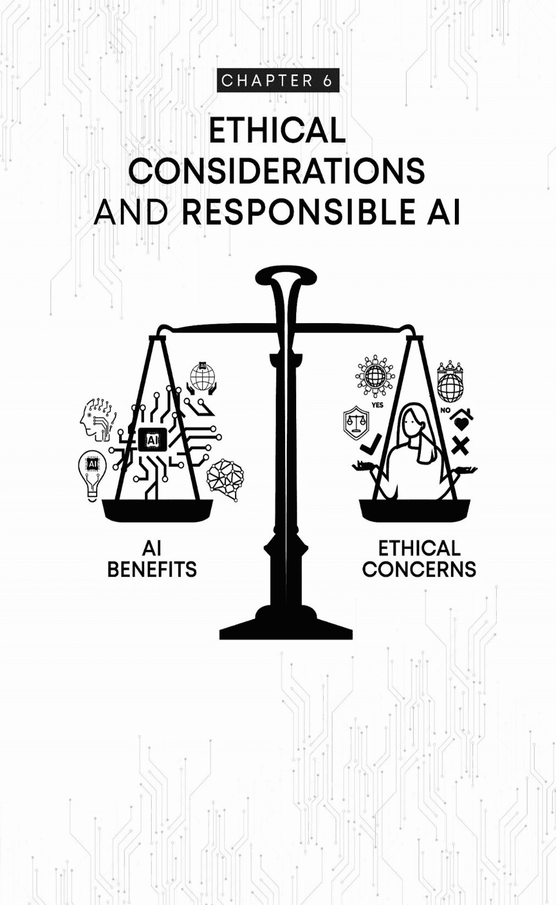

# 第 6 章：伦理考虑与负责任的 AI

导航生成式 AI 的伦理景观就像在走钢丝的同时玩杂耍——既刺激又充满了潜在的陷阱。当我们深入这个复杂话题时，请认为自己配备了道德指南针和敏锐的平衡感。在这里，我们将探索使用 AI 这一强大工具所带来的复杂性和责任，确保我们在迈进时既有智慧又谨慎。

## 6.1 导航生成式 AI 的伦理景观

### 理解伦理困境：创造力的难题

生成式 AI 与任何强大的工具一样，伴随着会让未准备充分的人措手不及的伦理困境。以深度伪造（deepfakes）为例——这些由 AI 实现的超现实伪造品可能会模糊真相与欺骗之间的边界，挑战我们对现实的认知。当一段政治领宣战的深度伪造视频病毒时会发生什么？其影响严重且令人恐惧，引发了对侵犯隐私和传播虚假信息的警报。

但伦理的深渊远不止。考虑 AI 生成的艺术。AI 创建的艺术品权归谁所有？是 AI 的创造者、提供初始输入的用户，还是 AI 本身？我们还没有忘记 AI 可能会延续偏见，当这些技术成为招聘和执法等关键领域的守门人时，这种担忧变得愈发严重。这些场景中的每一种都强调了，在我们将这些先进技术整合到社会肌络时，对伦理警觉的迫切需求。

### 建立伦理框架：制定规则手册

正如每场游戏都需要规则来防止混乱一样，生成式 AI 领域需要稳健的伦理框架来引导其使用。像 `IEEE` 和 `Future of Life Institute` 等组织一直处于前沿，起草了涵盖从确保 AI 系统的透明度到防止恶意使用的各项指南。这些框架不仅仅是学术练习；它们是帮助开发者、用户和政策制定者应对 AI 伦理雷区的蓝图，确保这些技术被用于更大的公共利益。

采纳这些指南涉及对伦理驱动的 AI 开发的承诺，包括对偏见进行严谨测试、为隐私进行设计，并确保 AI 系统对用户透明且易懂。通过遵循这些框架，开发者不仅赢得了用户的信任，还加强了他们的作品，免受可能导致公众抵制或法律问题的伦理失误。

### 与利益相关者互动：多元视角的力量

AI 的伦理使用不是一个孤立解决的难题。它需要广泛利益相关者的参与，从伦理学家、社会学家到终端用户和政策制定者。每个群体都带来了独特的视角，可以阐明潜在的风险和伦理考量，这些这些可能是仅凭 AI 开发者无法察觉的。


例如，公众咨询可以揭示社会对 AI 的担忧，例如对工作流失或隐私侵入的恐惧，这些担忧可以在 AI 设计中直接得到解决。与`伦理学家`的合作有助于解析复杂的道德问题，确保 AI 系统符合更广泛的价值观。通过促进围绕 AI 技术开发和部署的包容性对话，我们确保了这些系统不仅在技术上可靠，而且在社会上是负责的。

### 提升伦理素养：教育 AI  workforce

随着生成式 AI 的不断演进，我们对其伦理影响的理解也必须同步演进。这就是伦理素养发挥用场的地方——它在于为 AI 专业人员提供构建 AI 的技能，以及预见并防止潜在滥用的伦理敏锐度。

将伦理整合到 AI 课程中的教育计划，对于培养一代既擅长编写代码又擅长应对伦理困境的 AI 开发者至关重要。关于 AI 伦理的研讨会、讲座和课程应该是每位 AI 专业人员教育的必修课，确保他们理解所创造的技术对社会的影响。这不仅仅是为了避免陷阱，更是为了赋能这些专业人士将 AI 作为一种向善的力量，设计出尊重我们价值观的同时增强我们生活的技术。

当我们为生成式 AI 的伦理图谱规划路线时，让我们对深思熟虑、包容且负责任的 AI 开发承诺的指导。通过理解涉及的伦理困境、建立稳健的框架、与多元利益相关者互动以及提升伦理素养，我们确保我们的 AI 之行是推进人类，而不是阻碍人类。让我们带着对它能成就的远见以及良好使用它的智慧来驾驭这一强大的工具。

## 6.2 基于透明度和问责制开发 AI

### 实现透明化机制：透明玻璃方法

在生成式 AI 领域，透明化运营不仅仅是为了展示内部工作原理——更是为了建立信任和理解，就像高级餐厅的玻璃厨房一样。你不会在一个在秘密准备食物的地方用餐，同样，AI 系统也不应该在黑箱中运行。AI 的透明化涉及对 AI 流程和决策路径的清晰记录。这意味着从初始数据输入到最终的决策输出的每一步都应该概述清楚，并且不仅对数据科学家，对终端用户可见。想象这样一个场景：AI 系统拒绝了一份贷款申请。申请人有权知道这个决策是如何做出的。解释所考虑的数据点和分配给每个点的权重的详细文档确保了 AI 做出的决策不会被认为是随意的，而是可以理解的，并且在必要时是可以申诉的。

此外，可视化工具和仪表板在揭秘 AI 操作方面可以发挥至关重要的作用。这些工具可以将复杂的算法转换为直观的图表和图谱，让非专家更容易理解决策是如何做出的。正如 GPS 显示你的路线、交通状况和预计到达时间一样，这些可视化提供了 AI 决策过程的路线，增强了透明度并促进了对 AI 系统的深层理解。

### 确保 AI 系统的问责制：约束 AI

让 AI 负责任，就像确保游戏中的所有玩家都遵守规则，如果他们没有遵守，就有系统来处理任何问题。AI 的问责制可以通过各种机制实现，如`审计追踪`、`第三方审计`以及`AI 伦理委员会`的建立。`审计追踪`是记录 AI 系统采取的每一步的数字面包屑，提供了一个在发生故障时可以追溯的历史记录。这不仅有助于定位任何问题的源头，还对潜在滥用 AI 技术具有威慑作用。

`第三方审计`由独立机构进行，类似于对餐厅进行定期的健康检查。正如这些检查确保餐厅维持卫生标准一样，`第三方审计`验证 AI 系统是否遵循伦理标准和法规，为 AI 实践提供无偏见的评估。同时，`AI 伦理委员会`职能类似于职业体育中的监管机构，为 AI 的开发和使用设定标准和最佳实践。这些委员会由不同领域的专家组成，评估 AI 项目以确保它们符合伦理指南并社会价值观。

### 推广开源 AI 模型：以社区为核心

AI 的开源运动是数字世界的“社区花园”，每个人都对这片共享土地做出贡献并从中受益。通过鼓励使用`开源 AI 模型`，我们倡导一种协作方法，使 AI 进步不再被挡在公司大门之后，而是所有人都可以访问。这使 AI 开发民主化，允许来自全球的开发者对现有模型进行审查、改进和创新。这种透明度不仅加速了 AI 创新的速度，还由于多元化的全球社区不断审视和完善模型，减少了隐藏偏见的风险。

开源模型依赖于社区贡献，这反过来又促进了更具包容性的 AI 开发环境。这种包容性在应对偏见时至关重要，因为它为 AI 开发引入了许多视角，确保了模型是稳健且公平的。此外，开源项目的协作性质鼓励了学习和分享的文化，加强了 AI 开发的整体生态系统。

### 创建可解释 AI：告别魔术

可解释 AI（`XAI`）是将 AI 的“魔术”转化为更类似于记录良好的科学实验。`XAI` 的目标是让 AI 决策对人类来说是可以理解的，为输入如何转换为输出提供清晰解释。这对于建立信任以及遵守诸如《通用数据保护条例》（GDPR）等包含解释权的法规至关重要。通过实施 `XAI`，我们确保 AI 系统不仅高效，而且是可理解且合理的。

开发可解释 AI 涉及使用本质提供更高透明度的技术。例如，`基于决策树的模型`比`神经网络`具有更高的可解释性，因为决策路径可以被追踪和理解。此外，`特征重要性评分`等技术可以阐明哪些输入对输出的影响最大，为复杂模型的决策过程提供见解。

随着我们继续将 AI 整合到各个领域，确保这些系统在透明度和问责制下运行是至关重要的。通过实施稳健的透明化机制、通过审计和伦理委员会确保问责、推广开源模型以及开发可解释 AI，我们建立了一个支持伦理 AI 开发的框架。该框架不仅增强了用户的信任，还确保了 AI 技术以负责且有益的方式使用，为 AI 与人类共同进步的未来铺平道路。

使用 `BertViz` 的注意力可视化工具探索可解释 AI：


## 6.3 AI 训练中的偏见缓解技术


让我们卷起袖子，深入研究 AI 训练中偏差缓解的细节，这项任务在高风险博弈中确保公平竞争至关重要。正如地面的轻微倾斜会扭曲整个游戏一样，AI 训练中未察觉的偏差可能导致结果倾斜，有利于某些群体，同时不公平地损害其他群体。这一过程始于对这些偏差的识别和评估，随后是包容性数据收集实践、去偏算法的整合，以及对持续监控的不懈追求。

### 识别与评估偏差：化身数据侦探

在识别和评估 AI 数据集中的偏差时，可以将自己想象成侦探。先进的检测工具和统计技术可以帮助你嗅出潜伏在数据阴影中的偏差。这些工具扫描你的数据集，寻找可能指示偏差的模式或异常，例如某些群体的比例失调，或倾向于特定人口统计的预测不准确。

统计分析在这里起着至关重要的作用。`regression analysis` 等技术可以帮助你理解数据中的不同变量（如`age`、`gender` 或 `race`）如何影响模型的预测。这涉及到诸此类问题：在保持其他变量不变的情况下，模型是否对某一人口群体的贷款审批预测比另一个更有利？通过对数据进行严格的测试和分析，你可以挖掘隐藏的偏差，并为更公平的 AI 模型奠定基础。

### 实施包容性数据收集：撒更大的网

如果说偏差检测是为了寻找缺陷，那么包容性数据收集就是修复基础。它确保你输入 AI 模型的数据反映了人类人口统计和经验的丰富性。这不仅意味着包含多样化的数据点，还意味着确保这些点准确地代表更广泛的人口。

想想广角镜头如何比窄镜头捕捉更多的场景。同样，包容性数据实践扩大了你的数据收集范围，包含了代表性不足的群体，确保他们的观点和现实不被忽视。这可能涉及与这些群体密切合作的组织合作，或使用`stratified sampling` 技术以确保所有群体都包含在你的训练数据中。目标是创建一个镜像真实世界多样性的数据集，从而使 AI 做出对所有人公平且相关的决策。

### 采用去偏算法：AI 的均衡器

一旦你识别了潜在偏差并收集了更具包容性的数据集，下一步就是实施去偏算法。这些算法是均衡器，通过调整天平来平衡数据或模型中任何剩余的偏差。一种流行的技术是对示例进行`reweighting`，算法根据训练示例在数据中代表性的高低为其分配不同的权重。这确保了模型在训练过程中会更多关注这些示例，帮助抵消任何现有偏差。

另一种方法是修改算法本身，使其对数据中的偏见模式不敏感。例如，可以对算法进行微调，以忽略可能产生偏差的变量，例如住房贷款申请中的`zip codes`，这可能与种族人口统计有关。通过仔细调整这些算法，你可以引导你的 AI 远离歧视性决策路径，走向更公平的结果。

### 偏差的持续监控：让 AI 受控

偏差缓解的最终且持续的挑战是对 AI 系统进行持续监控。正如社会规范和价值观不断演变一样，我们的 AI 系统也必须适应，以随时间保持公平和无偏。持续监控涉及定期审查和更新 AI 模型，以确保它们在交互过程中不会产生或延续偏差。

持续监控涉及定期审查和更新 AI 模型，以确保它们在交互过程中不会产生或延续偏差。这一过程可以比作反馈循环，对 AI 系统进行定期的偏差测试，并根据需要进行调整。`AI auditing platforms` 等工具可以自动化这一过程，提供定期报告。

## 6.4 AI 应用中的隐私增强

### 精通数据匿名化艺术：守护你的秘密安全

在当今繁华的市场中，数据如黄金般珍贵，确保这些数据的隐私可以被视为将你的宝藏锁在库里。`data masking` 和 `k-anonymity` 等数据匿名技术就像是复杂的锁，在保持数据安全的同时允许获取有价值的见解。例如，`data masking`是数字版的化装舞会。它通过用虚构但合理的替代方案来掩盖敏感数据。无论是掩盖数据集中的个人标识符，还是转换财务记录以保持机密性，`data masking`都确保了在多个利益相关者访问数据时保护隐私。

然后是`k-anonymity`，这种技术确保数据集中的个人记录在特定识别属性上无法与至少`k-1` 条其他记录区分开来。想象你在参加派对，至少有 `k` 个人穿着相同的服装。识别任何个人都会变得非常有挑战性。同样，数据集中的`k-anonymity` 通过增加将数据关联回个人的难度来提高隐私，同时又不影响数据分析的效用。

### 利用尖端隐私技术：联邦学习与安全多方计算

当我们深入研究 AI 时，传统的数据隐私方法往往力不从心，特别是当训练需要访问大量数据的复杂 AI 模型时。`federated learning` 和`secure multi-party computation`等先进技术出现了，它们是隐私保护 AI 的超级英雄。例如，`federated learning`允许直接在你的设备（如智能手机或平板电脑）上训练 AI 模型。训练数据永远离开设备，只共享学习到的见解（而不是数据本身）来改进模型。这种方法不仅保持了你的数据隐私，还利用了成千上万设备的集体学习，产生一个既健壮又尊重用户隐私的模型。


安全多方计算（MPC）通过允许多方在保持输入数据私性的情况下共同对其输入计算函数，更进了一步。想象有一组竞争者，他们想找出谁的销售额最高，但又不向对方透露真实的销售数字。MPC 允许他们实现这一目标，在保持数据机密性的同时，能够进行比较所需的计算。在 AI 领域，MPC 可用于在来自多个源组合数据集上训练模型，而任何一方都不会访问其他方的数据，从而确保隐私和安全的维护。

## 建立强大的数据治理政策：数据使用的规则书

为了真正保护 AI 应用中的隐私，建立监管数据访问和使用的稳健数据治理政策是不可或缺的。这些政策是规则书，规定了谁可以访问数据、如何使用数据以及在什么情况下使用。实施强大的数据治理涉及为数据处理制定的指南、建立严格的访问控制，并定期审计数据使用情况，以确保符合隐私法律和标准。这就像为组织内部的数据流制定一套交通规则，确保每一比特数据都以有序、安全且符合道德的方式移动。

这些治理政策不仅保护了敏感信息，还通过展示对数据隐私和安全的承诺建立了用户信任。在数据泄露可能损害用户信任并导致重大财务和声誉损失的时代，拥有稳固的数据治理框架不仅是有益的，更是至关重要的。

## 提升用户对数据的控制权：赋能数字公民

在数字时代，赋予用户对其数据的控制权不再仅仅是一种礼貌，而是一种权利。促进用户控制意味着为用户提供机制来了解收集了哪些数据以及如何使用，并赋予他们影响这一过程的能力。这包括退出数据收集的选项、访问和查看个人数据的工具，以及在需要时更或删除这些信息的能力。

这种透明度和控制权不仅符合 `GDPR` 等隐私法规，还赋予了用户，让他们在数字生态系统中拥有话语权。随着 AI 继续渗透到我们生活的各个方面，确保用户能够对其数据行使控制权，对于在日益智能化和无处不在的技术系统面前维持隐私和自主性至关重要。

当我们继续利用 AI 的力量时，整合稳健的隐私增强技术和政策至关重要。通过采用数据匿名化方法、利用先进的隐私保护技术、建立强大的数据治理框架并促进用户对数据的控制，我们确保 AI 是增强能力的工具，而非隐私的威胁。让我们继续前进，在探索 AI 广阔可能的同时，将这些原则置于首位。

## 6.5 AI 在社会中的作用：收益与残留风险

想象一个世界，AI 不仅仅是你智能家居中的一个小工具，而是解决一些最紧迫社会挑战的动力。从医疗到教育，从交通到环境管理，AI 提高生活质量的潜力是巨大且不可否认的。在医疗领域，AI 像是一个高科技医生助手，通过分析海量数据以惊人的准确性和速度诊断疾病。这不仅关乎更诊断；AI 还可以根据个人基因图谱定制治疗方案，使个性化医疗成为广泛现实的现实，而不仅仅是科幻幻想。

在教育领域，AI 通过将教育个性化以适应每个学生的独特需求，改变了传统学习。你可以将其想象为一个完全理解学生在何处遇到困难并调整其教学方法的导师。

交通是另一个 AI 发放异彩的领域，它可以优化交通流、减少排放。此外，AI 驱动的预测性维护确保了车辆以最高效率运行。

## 应对阴影：规避 AI 的陷阱

然而，能力越大责任越大，AI 也不例外。AI 带来的进步伴随着需要仔细管理的重大风险和挑战。最紧迫的关注点之一是工作流失。随着 AI 系统变得越来越强大，它们可以执行传统上由人类完成的任务，导致对制造业、客户服务甚至专业领域等部门大规模失业的担忧。至关重要的是，考虑我们如何对劳动力进行重新培训和技能提升，使其在 AI 增强的未来蓬勃发展，确保 AI 角的是工作的创造者而不仅仅是替代者。

监控和隐私是 AI 开发的另一个阴暗面。随着 AI 技术越来越多地融入日常生活中，侵入性数据收集和监控的潜力就会增加。这可能导致个人自由受到损害的监控国家。在 AI 驱动的监控系统的收益与保护个人隐私权的需求之间平衡，是一场需要深思熟虑的监管和监督的微妙舞蹈。

此外，如果 AI 可能会加剧社会不平等。例如，如果 AI 系统在反映现有偏见的数据上进行训练，它们可能会延续甚至放大这些偏见。用于筛选工作申请者的 AI 系统可能会偏好来自特定人口统计背景的候选人，仅仅是因为它是基于反映过去招聘实践的数据进行训练的，从而无意中延续了历史不公。

## 倡导可持续 AI 开发：长远思考

当我们利用 AI 的潜力转型社会时，倡导可持续的 AI 开发实践至关重要。这意味着开发的 AI 系统不仅要有效，而且在环境、社会和经济影响也是可持续的。例如，AI 可用于优化数据中心的能源消耗，减少驱动这些技术本身的碳足迹。在农业领域，AI 驱动的精准农业可以减少浪费并提高产量，更高效、可持续地使用水和肥料等资源。

防止技术垄断是可持续 AI 开发的另一个关键方面。随着 AI 技术成为经济和社会基础设施的核心，防止过多的权力集中在少数科技巨头手中至关重要。推广开源 AI 项目并支持鼓励 AI 领域竞争和创新的政策，是确保 AI 收益在社会中广泛且公平分配的必要步骤。


最后，AI 的负责任创新在于确保 AI 技术的开发和部署与社会价值观和伦理原则保持一致。这不仅涉及遵守伦理指南，还涉及积极与多元社区互动，以理解他们的需求和关注。开发 AI 技术时，应当清楚地理解其将运行的文化、社会和伦理背景。

在 AI 开发者和公司之间培养负责任创新的文化，可以营造一个伦理考量处于技术设计和部署前沿的环境。这种方法降低了与 AI 相关的风险；还能增强其对社会的接受度和整合程度，确保 AI 技术作为一种向善的力量，增强人类能力并改善全球范围内的生活。

当我们继续探索和扩展 AI 的能力时，让我们以平衡的视角前进，在拥抱其变革社会潜力的同时，警惕地应对其带来的挑战。通过促进可持续发展实践、倡导负责任创新，并使 AI 与人类价值观对齐，我们可以利用这项强大的技术，创造一个技术与人类共同繁荣的未来，向更明亮、更公平的世界并肩进。

## 6.6 使 AI 伦理面向未来：长期考虑

### 为应对未来的伦理挑战做准备

当我们站在 AI 融入未来的边缘时，审视远方并预见即将到来的伦理挑战至关重要。想象一种场景：AI 系统不仅做出决策，还解释并修改决策规则本身。高级的 AI 自主性——一个似乎像是从科幻小说中提取出来的概念——正逐渐现实。随着这些技术获得独立行动的能力，确保它们符合伦理规范和人类价值观的风险将呈指数级增长。

这种积极的立场涉及处理有关关于将决策权委托给 AI 系统的复杂问题，特别是在军事应用或生死的医疗决策等关键领域。将过多的控制权交给 AI 系统的风险，或者出现逻辑不透明的“黑箱”决策过程，都构成了重大的伦理关切。通过预见这些挑战，我们可以制定指南和法规，确保 AI 系统是增强人类决策而非取代它，维持一种技术支持但不会掩盖人类判断的平衡。

### 倡导自适应伦理框架

技术领域中唯一不变的是变化，而在 AI 领域，这种变化既是快速的又是深远的。作为回应，治理 AI 的伦理框架必须同样具有动态性，能够随着技术进步同步演进。随着新 AI 技术的出现和社会规范的演变，静态的伦理指南面临过时的风险。因此，倡导开发自适应伦理框架，就如同为 AI 构建一套敏捷且响应迅速的治理系统。

这些框架的设计应当能够在新的伦理困境出现时自动更新，并能够具有足够的灵活性以适应不同的文化和社会背景。例如，在一种文化中被视为侵犯隐私的行为，在另一种文化中可能被视为必要的安全措施。自适应框架确保伦理指南保持相关性和有效性，为全球 AI 技术的负责开发和部署提供支架。

### 促进国际合作

AI 技术无国界，其影响是全球性的。因此，国际合作对于创建 AI 伦理的通用和规范至关重要。这种合作涉及政府、国际组织、学术界和私营部门。其目标是对伦理 AI 实践达成共识，超越国家利益，并反映出对维护人类尊严和权利的共同承诺。

想象一个“AI 伦理联合国”，国际领导人聚集在一起，就透明性、公平性和问责制等核心原则达成一致。

### 培养伦理文化

最后，使 AI 面向未来的基石在于培养一种文化。这意味着将伦理考量植入组织的 DNA 中，培养各个层面的意识，并奖励伦理实践。

当我们结束这段关于伦理考量的旅程时，让我们带着这里讨论的见解和策略。通过为未来挑战做准备、倡导自适应框架、促进国际合作以及培养伦理文化，我们为 AI 增强的未来奠下了坚实的基础。现在，当我们翻开下一章时，让我们在负责任和道德创新原则的指导下，继续探索 AI 的巨大可能性。

# 第 7 章：AI 领域的职业发展

想象一下：你正在参加一场 AI 主题的化具舞会，房间里充满了来自 AI 世界各个角落的角色。有些人躲在 `Data Scientist`（数据科学家）面具后面，而另一些人戴着复杂的 `Machine Learning Engineer`（机器学习工程师）面纱。欢迎来到 AI 职业的世界，这里的可能性就像威尼斯舞会上的面具一样丰富多样。在这里，你将开启一段惊险的旅程，带你从入门职位探索到 AI 精通的卓越高度。

## 7.1 规划 AI 职业路径：从初学者到专家

### 理解职业阶段：AI 职业的阶脚石

从 AI 实习生或分析师做起就像拿到了王国的钥匙，尽管只是外围花园。在这里，你被要求熟悉这里的环境——学习算法和数据模式的基础知识，或许还会对机器学习模型进行首次尝试性的调整。这关乎建立坚实的基础，就像在音乐会上演奏肖邦夜曲之前要学习音阶一样。

当你晋升到 `AI Developer`（AI 开发者）或 `Data Scientist`（数据科学家）等职位时，你不再仅仅是观察——你正在创造奇。在这里，你运用技能创建可以预测、分析并随着复杂性增加而学习的算法。每个项目都是阶脚石，每个挑战都是磨炼技能的机会。你是魔术师的徒，但现在你已经足够的知识而不让工作坊淹水！


达到职业生涯的巅峰意味着你可能成为 AI 架构师或研究科学家，这些角色承担着沉重的责任，不仅要追随趋势，更要引领趋势。在这里，你的任务是监督重大项目、开展开拓性研究，或领导团队创新前所未过的 AI 应用方式。在这些角色中，责任、挑战和回报都同样令人兴奋。

### 核心角色与职责亮点：真正的要求

在 AI 职业的迷宫中穿行不仅需要技术实力，还需要创造力、分析思维和伦理准则。作为一名 `AI Intern`，你的角色可能涉及数据清洗——这是一项微小但至关重要的任务，以确保输入模型的数据不会因不一致而受到污染。晋升 `Machine Learning Engineer`，你将设计模型本身，决定哪些算法最能预测客户行为或优化业务流程。

对于那些戴上 `AI Architect` 面具的人来说，责任范围急剧扩大。你不仅要构建模型，还要确保它们与现有的 IT 系统无缝集成、与业务目标保持一致并符合伦理准则。这需要对 AI 领域有俯瞰全局视角，并做出不仅影响你的公司、甚至可能影响更广泛 AI 领域的战略性决策。

### 探索职业轨迹：AI 的多元路径

AI 职业的迷之处在于其动态性质——没有一条预设的路径，而是有许多可以采取的轨迹。也许你开始于软件开发，但通过将那些编码技能应用于机器学习项目，在 AI 找到了自己的领域。或者，你的旅程始于不同的领域——生物学、金融或艺术——而你发现 AI 可以放大你在这些领域的影响。

有趣的是，AI 职业并不总是遵循单一的轨迹。你可能会发现自己正在进行横向移动，从自然语言处理专家转向专注于 AI 伦理实施的角色，以确保 AI 技术被负责任地使用。或者你可能会进行垂直攀升，某一天你还是团队成员，第二天你就成了团队负责人。

### 真实职业故事：向从路者身上学习

以 Elena 为例，她在一家科技初创公司从数据分析师开始职业。她对预测分析的痴迷使她继续学习机器学习，最终推动她进入了 `Senior AI Researcher` 的职位。今天，她领导着自己的团队，开发能够更快速、更准确地诊断疾病的 AI 工具。

还有 Jay，他的视频游戏设计背景为他提供了独特的 AI 视角。他利用自己的技能转向 AI 驱动的交互式媒体，现在他致力于创建能够响应学习者参与程度和学习风格的自适应学习环境。

每一个故事都是 AI 职业充满活力、不断变化的格局的证明，充满了需要克服的挑战和可以抓住的机会。当你在这个兴奋的领域规划自己的路线时，请记住，每一步——无论是陡峭的攀爬还是横向的跨越——都是向更精通、更理解 AI。凭借技能、好奇心和决心的正确结合，你可以选择的道路就像你的野心一样无限。所以，调整你的面具，自信地步入 AI 职业的大华舞厅吧。生活的舞蹈正在等待着你。

## 7.2 AI 专业领域的兴起：确定你的领域

在 AI 世界中，专业化是将平庸简历转化为引人入胜的职业传奇的调味。将 AI 想象成一个扩张的大都市，每个区域——无论是 `Machine Learning Engineering`、`AI Ethics` 还是 `AI in Healthcare`——都有其独特的风味和文化。了解这些专业领域就像成为一名美食评论家；你需要品尝（探索）每一种，才能真正欣赏并决定哪一种适合你的胃口（职业愿景）。

### 介绍 AI 专业领域：AI 大都市之旅

让我们从 `Machine Learning Engineering` 开始，这是一个算法为王的繁忙区域。在这个领域，专业人士专注于开发可以从数据中学习并基于数据做出决策的系统。深入探索，你会发现如 `deep learning` 和 `reinforcement learning` 等子专业，每种都有其独特的挑战和回报。

接下来，漫步于 `AI Ethics` 的宁静巷弄，在这里哲学家与程序员相遇。这个专业领域处理 AI 技术的道德影响——确保它们符合人类的最大利益。这里的专业人士致力于制定准则，帮助防止 AI 模型中的偏差，确保 AI 解决方案是公平公正的。

进入 AI 医疗的世界，在这里 AI 与解剖学相遇。这一领域正通过提供更准确的诊断、个性化的治疗方案和机器人手术辅助来彻底改变医学。这是一个你的工作直接贡献于拯救生命的领域，提供了深层的使命感和成就感。

### 评估技能与兴趣：寻找你的 AI 天职

识别哪种 AI 专业领域与你的技能和兴趣相匹配，有时感觉像尝试解决一个复杂的算法。从自我评估开始——列出你的技术技能（如编程语言或软件熟练程度）以及软技能（如解决问题能力或伦理推理）。在线测试或职业倾向能力测试等工具也可以提供关于哪些 AI 领域最适合你的见解。

反思你的激情和令你兴奋的行业。你对 AI 提出的伦理问题感兴趣吗？或者 AI 在医疗领域的应用引起了你的兴趣？将职业与兴趣对齐不仅能带来更高的工作满意度，还能激发你在所选领域脱颖出的动力。

### 讨论市场需求：机遇正在酝育之处

AI 就业市场像证券交易所大厅一样活跃，根据行业趋势和技术进步，某些专业领域的需求更大。例如，随着企业日益依赖数据驱动决策，对 `Machine Learning Engineers` 的需求飙升。同样，随着对 AI 社会影响意识的增强，对 `AI Ethics` 专业人士的需求也激增。

通过订阅行业通讯、参加网络研讨会并关注 AI 社区的影响力来保持市场趋势的动态。了解需求所在可以帮助你调整学习和职业策略以适应市场需求，确保你的技能保持高需求。

### 专业领域转型建议：规划你的 AI 之路

转向 AI 专业领域就像学习一种新语言。你可能会从基础开始，但沉浸式学习是精通的关键。从你所选专业的基础课程开始。`Coursera` 或 `edX` 等平台提供了专业课程，可以让你了解 `AI in Healthcare` 或 `Machine Learning` 等领域的知识。

证书也可以为你的履历增彩，向潜在雇主展示你的专业知识。寻找由声誉良好的机构或大学提供的认证计划，这些计划提供了实战体验。

获得实践经验至关重要。考虑实习、项目协作或自由职业机会，让你能够处理你所选专业领域的现实世界问题。每个项目都会增强你的理解并丰富你的作品集，使你成为未来职位更具吸引力的候选人。


记住，AI 的世界正在不断演变，要跟上它的变化需要一种敏捷且主动的方法。通过保持好奇心、不断学习并在 AI 领域中进行战略性定位，你不仅可以找到自己的利基，还能在其中蓬勃发展，塑造出一条既有回报又有影响力的职业生涯。

## 7.3 技能发展：在 AI 职场市场中保持竞争力

当 AI 领域以光速演进时，保持相关性是你在这个动态领域脱颖出的门票。将 AI 技能想象成你的工具箱；如果没有正确的工具，或者使用过时的工具，你将发现构建任何有价值的东西都很困难。因此，让我们准备起来，确保你的 AI 工具箱不仅装备精良，而且拥有最新最先进的技术闪闪发光。

### 识别核心 AI 技能：你 AI 军库的核心

要纵纵 AI 职场市场，你需要技术技能和软技能的结合。在技术方面，精通 `Python` 或 `R` 等编程语言是不可的。这些是 AI 工作的凿子和锤子，允许你从原始数据中雕刻并构建模型。然后是数据分析——这是一项关键技能，在在你开始思考算法之前帮助你理解数字和趋势。

但 AI 不仅仅关乎数字计算；它还关乎创造性地解决问题。解决问题的能力让你能够设计和调整 AI 模型以应对特定挑战，无论是优化供应链，还是设计能够预测市场趋势的算法。不要忘记沟通，它是将你的技术实力与现实世界连接起来的金色丝线。无论你是向精通技术的利益相关者解释复杂的模型，还是为你的代码编写清晰的文档，你清晰沟通的能力都能决定你在 AI 角色中的成效。

### 提供学习资源：你通往精通的地图

让自己具备这些技能需要高质量的资源，幸运的是，数字时代充满了学习的黄金。对于编程和数据分析，`Codecademy` 和 `DataCamp` 等平台提供了交互式课程，涵盖了从基础 `Python` 到高级机器学习算法的所有内容。如果你想加深对 AI 和机器学习的理解，`Coursera` 和 `edX` 提供了由 `Stanford` 和 `MIT` 等顶尖大学设计的课程，通常由行业领袖和先驱领导。

书籍也是一种无价的资源。例如 `Aurélien Géron` 编写的 `Hands-On Machine Learning With Scikit-Learn, Keras, and TensorFlow` 等书籍提供了实用的见解和现实案例，桥接了理论与实践。对于那些更喜欢结构化学习环境的人，在线和线下工作坊、研讨会不仅提供了学习机会，提供了与同行和专家交流的机会。

### 强调适应性和创新性：跟上 AI 的步伐

在 AI 领域，安于现状无异于在跑步机上行走——你可能在移动，但哪里也去不了。适应能力和创新天赋让你能够与不断演进的技术保持同步。这意味着不断更新你的技能，并对新的思考和解决问题的方法保持开放态度。AI 领域以快速采用新技术而闻名；今天的尖端创新可能是明天的新闻。

参与最新的研究，关注 AI 趋势，并参加论坛和讨论。`arXiv` 和 `GitHub` 等平台提供了 AI 最新研究论文和项目的访问，让你一窥技术的未来。通过将所学知识应用于新领域来不断创新。例如，如果你掌握了用于财务预测的机器学习技术，可以考虑这些相同的技术如何应用于制造业的预测性维护或优化智能电网的能源消耗。

### 突出技能应用：将知识转化为行动

最后，你 AI 技能的真正测试在于它们的应用。现实世界的项目不仅能强化你的学习，还能向潜在雇主证明你能够付诸行动，而不只是纸上谈兵。参加在 `Kaggle` 上举办的黑客松和竞赛，在这些活动中，你可以运用不断增长的技能解决实际问题。这些平台通常提供来自行业的问题，让你真实地看到企业面临的挑战以及 AI 如何解决这些挑战。

或者，考虑为开源项目做出贡献。这些项目可能特别有成就感，因为它们提供了一个开发可能被数百万人使用的软件的机会，提供了实践经验并提升了你在 AI 社区中的可见度。例如，为 `TensorFlow` 或 `PyTorch` 等流行的机器学习库做出贡献，不仅磨练了你的技能，还帮助你在该领域声名声。

通过不断发展技能、寻找高质量的学习资源、拥抱适应性并将你的知识应用于现实项目，你确保了你的 AI 职业不仅是可持续的，而且是成功的。

## 7.4 从其他转向 AI

想象你是一个经验丰富的技术专业人士，自如地穿梭于代码或数据之间。一天早上，当你喝下第三杯咖啡时，你偶然发现了一篇关于 AI Transform 生活和行业的文章。火花被点燃了；你产生了兴趣，并准备好将职业转向 AI。这不仅仅是更换办公桌或工具——它是要拥抱一个正在塑造未来的领域。让我们来看看这个过程。

### 概述转型过程：制定你的 AI 蓝图

向 AI 转型往往感觉像在玩魔方——你需要完美对齐所有元素。第一步是自我评估，评估你目前的技术技能。你是精通 `Python` 的软件开发人员吗？这是一个加分项，因为 `Python` 是 AI 编程的基石。数据数据分析师处理数据的能力在 AI 中是一个巨大的优势。识别这些可迁移技能，因为它们是你通往 AI 的通行证。

接下来，找出差距。AI 需要独特的技能组合来掌握从机器学习到神经网络的所有内容。识别你需要学习什么并开始填补这些差距。例如，如果你的背景是 Web 开发，你可能需要深化统计学和概率知识，这些对于理解机器学习算法至关重要。

选择正确的学习路径至关重要。从 `Coursera` 或 `edX` 等平台提供的 AI 和机器学习基础课程开始。这些平台提供了由顶尖大学设计的课程，并能通过项目提供理论基础和实践经验。此外，考虑专业化课程，可以帮助你深入研究深度学习或 AI 伦理等领域，取决于你的兴趣和职业目标。


对于数据相关领域的人士来说，你的分析能力是一座金矿。AI 极度依赖数据——包括数据的收集、分析以及从中得出洞察。你处理数据并从中提取价值的能力，可以让你在数据科学或机器学习等 AI 领域占据先机，在这些领域中，数据预处理和特征提取是关键任务。

即使你的背景是网络管理等不那么直接相关的领域，你对复杂系统的理解、对细节的关注以及项目管理能力也将 AI 领域大有异彩。转型涉及对你现有技能的重新调整以满足 AI 的需求，同时也要意识到这些能力如何在这种这一新格局中为你提供独特优势。

### 讨论挑战与解决方案：开拓新领域

转型到 AI 领域并非没有障碍。一个常见的挑战是陡峭的学习曲线。AI 涵盖了广泛的复杂主题，可能会令人望而生畏。这里的关键在于结构化学习。将你的学习目标分解为可管理的部分，一次专注于一个领域。在线社区和论坛也可以在你学习的过程中为你提供支持并解答问题。

另一个挑战是文化转变。AI 通常需要不同的问题解决和项目管理方法。如果你习惯于高度结构化的环境，AI 项目的实验性和迭代性质可能会是一种转变。积极参与社区活动，寻找导师，并通过聚会和会议沉浸在 AI 文化中。这种接触可以缓解文化转变，并帮助你更快地适应新的工作方式。

最后，精通陌生的 AI 工具和平台可能会让人无从从心。从一个工具或平台开始。许多 AI 工具都拥有完善的文档和活跃的用户社区，这些在你学习过程中是无无的资源。在线教程和课程也可以提供引导式学习，帮助你更快地变得精通。

### 介绍转型成功案例：从同伴到先驱

考虑 Maria 的故事，她曾是一名网络管理员，后转型从事 AI 安全研究。通过利用对网络协议的深度理解，她开发了 AI 驱动的威胁检测系统。她的经历凸显了现有的技术知识如何重新利用并在 AI 领域脱颖而出。

还有 Alex，他是一个转向机器学习工程师的数据分析师。Alex 在统计建模和可视化方面的经验允许他为业务预测构建复杂的预测模型。这些故事表明，通往 AI 的道路是多样化的，对各种专业领域开放。

## 持续学习对职业生涯的重要性

AI 领域正以惊人的速度演变；保持相关性不仅是学习一次，而是对终身学习的承诺。今天的工具、算法和方法论可能会在明天被取代。这种动态环境需要不断好奇和适应的心态。

对于那些被创新和发现的乐趣所吸引的人来说，参与研发（R&D）为贡献 AI 社区提供了一个充实的途径。参与研发不仅限于学术界或企业技术实验室；通过开源项目和协作研究平台，参与变得日益可行。这些活动允许你以实用的且通常是突破性的方式应用理论知识。它们还提高了你在 AI 社区中的地位，使你成为一名思想领袖和创新者。无论是改进开源机器学习库的功能，还是发表关于 AI 在环境保护中新用途的论文，每一份贡献都有帮助推动该领域的发展。

### 制定职业发展计划：构建你的成长


驾驭持续学习需要热情与策略的结合。针对你的 `AI` 职业目标制定一份定制的职业发展计划，可以为你的学习尝试提供结构和清晰度。此类计划应该识别关键技能缺口，设定短期和长期学习目标，并概述实现这些目标所需的资源。无论是在六个月内掌握一种新的编程语言，还是在一年内为大型 `AI` 项目做出贡献，清晰的里程碑和检查点都能让你的学习不离正途。

此外，这些计划应该是动态的，随着你职业生涯的进步以及 `AI` 领域新趋势的出现而演变。定期回顾和修订你的发展计划至关重要，确保它与你的职业抱负和行业需求保持一致。这种迭代过程不仅有助于你保持专注，还能确保你的学习努力是有目的的，并与你的职业轨迹相匹配。

在技术创新的无情竞逐中，持续学习是你最可靠的引擎。它不仅推动了你的个人成长，还推动你在不断变化的 `AI` 领域取得职业进步。通过拥抱学习心态、探索多样化的教育途径、参与研发以及战略性地规划你的职业发展，你确保了你的 `AI` 职业不仅是一场转瞬即逝的冲刺，更是一个充满意义且持续成功的马拉松。

## 7.6 AI 行业的人脉拓展与社区参与

将 `AI` 行业想象为一个充满活力的市场，在这里，思想像异域香料一样，在爱好者、专家和新手之间自由交易。在这种环境中，建立人脉不仅是一项有益的活动——它还是可以为你购买宝贵机会、洞察和合作的货币。无论是获得一份理想的工作、为某个突破性项目寻找完美的合作伙伴，还是仅仅保持对 `AI` 创新的敏锐，人脉拓展的艺术都能将你的职业推向新的高度。

### 人脉拓展的黄金诱惑：为什么它是你的职业超级能力

在 `AI` 行业中建立人脉类似于在肥沃的土地上播种——种得越多，收获越丰。。这关乎于培养随时间推移提供互利的关系。这些联系可以带来许多未公开的就业机会，让你在竞争激烈的职场市场中占据先机。合作也可能源于 `AI` 会议上的简单交谈或在线论坛上的讨论，从而形成结合了多样化技能和想法以创造解决方案的伙伴关系。

此外，人脉是你观察行业趋势边界的望远镜。通过与该领域的同行和领袖联系，你可以获得对新兴技术和 `AI` 格局变化的洞察，这些可以影响你的职业决策和关注领域。这不仅关乎你认识谁，更关乎你通过他们了解了什么，而这往往是你最大的战略优势。

### 制定有效的人脉策略：如何编织你的网络

有效拓展人脉的关键不仅在于参加活动；你必须进行有意义的互动。从标记参加 `AI` 相关活动开始，如会议、研讨会和工作坊。这些是建立人脉的金矿，为你提供了一个结识同样对 `AI` 充满热情的志同道合者的平台。然而，秘诀在于你如何互动。真诚地对学习他人感兴趣，提出富有见地的问题，并分享你的知识和经验。这在于创造对双方都有益的对话，将简短的互动转化为持久的联系。

`LinkedIn` 和 `GitHub` 等在线平台在你的人脉库中也至关重要。它们允许你展示自己的项目、成就和见解，吸引潜在的雇主或合作者。通过分享文章、加入讨论以及与你仰慕的行业领袖建立联系来保持定期互动。这些平台不仅仅是为了展示简历；它们是动态的生态系统，持续的互动可以带来有意义的职业关系。

### 培养社区参与：超越社交活动

加入 `AI` 社区（线上和线下）可以显著增强你的人脉拓展努力。论坛、技术聚会和黑客松不仅加强了你对 `AI` 的理解，还让你更深地融入 `AI` 专业人士的网络中。通过参与讨论、担任活动志愿者或展示你的工作来积极参与这些社区，可以提高你的知名度，并确立你作为 `AI` 社区成员的身份。

这些社区通常充当支持系统的角色，你可以在那里寻求建议、评估想法并从他人的经验中学习。它们提供了一种归属感，并在保持动力和联系方面可能特别有益，尤其是在应对 `AI` 职业的复杂性时。

### 寻找和利用导师指导的艺术：AI 中的引导路径

`AI` 领域的导师指导可以改变游戏规则，为你提供根据你的个人和职业增长定制的指导、反馈和洞察。寻找导师涉及识别那些职业轨迹与你的抱负一致，或其工作能启发你的人。在活动中、通过专业平台或在工作场所与潜在导师互动。在联系时，要明确你钦佩他们工作的哪些方面以及你正在寻求什么样的指导。

有效的导师指导是双向的。它需要导师和学生双方的投入、尊重和积极参与。为你你希望通过导师指导实现的目标设定清晰的目标，开放接受反馈，并采取主动措施来执行收到的指导。这种关系可以为你提供关于应对职业挑战、做出战略决策以及获取能够推动你职业向前发展的发展的宝贵洞察。

总而言之，人脉拓展和社区参与是建立成功 `AI` 职业不可或缺的元素。它们让你能够以业内人士的优势导航行业，利用集体智慧，并通过有意义的联系和导师指导加速职业增长。当你步入互联的 `AI` 世界时，请记住每一次握手、每一次对话和每一次连接都是通往新地地的潜在门户。在实现 `AI` 抱负的过程中，让这些互动成为你的脚石，并将这些人脉超级能力带入你 `AI` 之旅的下一章。


# 第 8 章：AI 的未来趋势与创新

## 8.1 量子计算及其对 AI 的影响

进入量子领域，在这里，通常计算规则屈从于量子力学奇异且难以理解的定律。在这个亚原子粒子的“爱丽仙境”世界里，量子计算 (`QC`) 的出现不仅是一项新技术，更是一场革命，准备好极大增强我们无法想象的 AI 能力。

### 介绍量子计算：解开量子织锦

量子计算不仅仅是你的常规升级——它是在原子水平上重新想象的计算。量子计算的核心是叠加和纠缠等原理。忘记那些以 0 或 1 存储信息的经典比特吧；量子位（即 `qubits`）由于叠加态，可以同时存在于这两种状态。这是一种突破性的能力，允许量子计算机同时处理海量的可能性。


纠缠是另一种量子奇特性，它允许纠缠的 `qubits` 无论彼此距离多远，都能瞬间相互影响。这种“远距离的灵异作用”（正如爱因斯坦著名的所言那样）让量子计算机能够以经典计算机无法比拟的速度进行复杂计算，使其在分析海量数据集或解决复杂的优化问题的任务中极具前景。

## 在 AI 领域的潜力：AI 世界中的量子速度

量子计算与 AI 之间的协同效应就像花生酱和果酱的结合。它们单独存在时令人印象深刻，但结合在一起就是一个强大的引擎。量子计算可以显著增强 AI 的学习和决策能力，使其在机器学习领域变得特别强大，在这些领域，算法随着数据的增加而不断提升性能。

想象一下，目前在经典计算机上需要几天时间训练的 AI 模型，未来只需几小时甚至几分钟即可完成训练。量子算法有望加速深度学习过程，增强强化学习，并提升 AI 在模式识别方面的能力——例如人脸识别或网络安全中的异常检测。

## 当前的研究与实验：地线上的量子飞跃

量子 AI 研究领域充满活力且活跃。诸如 Google 的 `Quantum AI` 实验室和 IBM 的 `Q Network` 等机构处于前沿，进行着整合量子计算与 AI 的实验。Google 的量子处理器 `Sycamore` 声称通过在 200 秒内完成了一项特定任务实现了“量子霸权”，而这项任务对于超级计算机来说大约需要 10,000 年。

这些实验不仅仅是为了速度，更是为了为 AI 应用开启新途径。从优化特大城市的交通流到为清洁能源技术寻找新材料，量子增强型 AI 的应用前景既广阔又影响深远。

## 挑战与时间线：面临的量子障碍

尽管潜力巨大，但量子计算尚未准备好投入使用。该领域面临着巨大的技术和逻辑挑战，从创建不会丢失量子态的稳定 `qubits`（这一问题被称为 `decoherence` 退干）到将 `qubits` 的数量扩大到实用水平。目前的量子计算机更像是复杂的原型，展示的是潜力而非准备就绪的解决方案。

量子计算何时将在 AI 中常规使用时间表仍存在争议。大多数专家预测，可能还需要十年或更长的时间才能解决构建可靠的大规模量子计算机的基础性挑战。但随着研究的持续以及我们开始更多地理解如何有效利用量子原理，量子计算在 AI 中的整合可能会成为改变游戏规则的现实。

因此，当你规划 AI 职业生涯或继续学习时，请关注量子地平线。量子计算与 AI 的融合可能仍处于婴儿阶段，但它的进展无疑将塑造技术的未来，提供我们今天无法想象的新工具和能力。欢迎来到 AI 的量子飞跃——进入计算领域最激动前沿的之旅。

## 8.2 下一代 AI：预测模型及其演变

让我们揭开预测模型演变的序幕，这是一段从线性回归的简单性到神经网络复杂性的史诗。想象一下，早期的统计学家将线性回归像笨工具一样使用，粗线条地勾勒预测。转眼之间，格局已由神经网络和机器学习主导，它们以大师雕塑家的精度构筑出精细的预测。

从线性回归到逻辑回归的跨跃是我们故事中的第一个重大转折点。逻辑回归与其线性对应不同，它能够处理结果分类的复杂性——将其想象为学习预测是否会下雨，而不是预测会下多少雨。随着 `decision trees`、`random forests` 和支持向量机的引入，情节变得更加复杂，每种方法都为模型识别模式和预测结果的能力增加了复杂性和准确性。

`neural networks` 登场了，它们是预测建模重量重量。凭借其深层结构和从海量数据中学习的能力，它们改变了游戏。这些网络不仅进行预测，还能进行推理、适应和进化。通过模拟人类的结构（通过突触连接的神经元），它们通过层处理数据，以识别并放大即使是最细微的信号。今天，`neural networks` 与机器学习的融合产生了能够以惊人准确性预测从股市趋势到医疗诊断的一切算法。

## AI 与预测分析的整合：为预测引擎充能

随着 AI 技术贴近预测分析，它们正在将传统预测转化为能够产生曾认为不可能的洞见的强大力量。在金融领域，AI 增强的预测模型现在预测市场波动的精度让传统方法看起来像古古的占星术。通过分析跨越巨大数据集的模式——整合了从全球经济指标到 Twitter 情绪的所有内容——这些模型提供的预测不仅关于可能的结果，还关于与这些结果相关的波动性和风险。

医疗领域同样经历着一场革命。AI 驱动的预测模型帮助预测患者结果、个性化治疗方案，甚至预测流行病的爆发。通过整合患者数据、治疗历史和遗传信息，这些模型可以在健康问题出现之前进行预判，显著改善预防性护理。

零售业也没有被落下；它正在被 AI 转型，AI 预测购买趋势、优化库存并个性化营销以匹配个人的购买习惯。想象一下走进一家商店，你看到的优惠与你的偏好完美契合，这归功于后台运行的预测分析正在分析你过去的购买记录和浏览习惯。

## 预测型 AI 的未来潜力：科技水晶

展望未来，预测型 AI 的潜力进一步延伸。实时分析指日可待，有望实现即时预测的能力。这项技术可以根据实时交通数据动态调整交通灯序列以防止拥堵，或者在客户在线互动产品时立即推荐个性化的营销优惠。

预测性维护是另一个前沿，特别是在制造业和航空领域，AI 模型在设备故障发生前进行预测。这不仅节省了昂贵的维修费用，还显著减少了停机时间，提高了生产力。在医疗领域，个性化预测模型将通过使用持续个人健康数据不断更新和完善个人健康预测和治疗方案，彻底改变医疗。

## 对决策的影响：利用数据驱动策略航行

预测模型改进对决策的影响是深远的。企业和政府正日益转向数据驱动的策略，决策由预测性见解引导，而不是直觉或历史先例。这种转变不仅是为了效率，更是为了有效性、精确以及在风险变成问题之前预判和减轻风险的能力。


在治理领域，预测性 AI 可以带来更明智的决策制定。例如，通过预测经济趋势，政府可以采取主动措施，更好地应对经济低迷。在商业领域，高管可以使用预测性洞察来制定市场准入、产品开发和竞争策略，其精准程度在以前是只有算命师才能做到的。

当我们站在这些进步的边缘时，AI 与预测性分析的整合不仅增强了我们的预测能力，更重新定义了预测未来。无论是在金融、医疗、零售还是其他领域，预测性 AI 都在为这样一个世界铺路：在那里，未来不仅仅是用来经历的，更是可以被塑造的。

通过 ML Playground 的交互式练习，加深你对神经网络、支持向量和决策树的理解：


# 8.3 AI 与物联网：汇聚的未来

想象这样一个世界：你的咖啡机恰好知道何时准备好你的晨间咖啡，或者你的办公室根据现场人数动态调整温度。欢迎来到 AI 与物联网（IoT）的集成宇宙，在这里，智能设备不仅仅是在运行——它们在学习、适应并做出决策。这种集成正在将日常物品转化为我们生活中的活跃参与者，增强了各个领域的效率、安全性和可持续性。

## 定义集成：更智能的设备，更智能的决策

AI 与物联网的融合就像为无物体赋予了大脑。物联网指的是连接到互联网的海量设备网络，负责收集和交换数据。现在，将 AI 注入这个网络，这些设备就可以分析这些数据、从中学学习并在无需人工干预的情况下做出决策。例如，智能温度器中的 AI 会从你的偏好中学习并自动调整温度，随着时间的推移优化舒适度和能源使用。这不仅仅关乎连接，更关乎让这些连接变得智能。

魔法通过机器学习算法实现，允许设备识别模式并做出预测。考虑具有 AI 能力的安全摄像头。传统摄像头只负责录像，但 AI 增强型摄像头可以识别检测到的移动是入室窃还是邻居在逛你花园的猫。通过在源头处理数据，支持 AI 的物联网设备减少了向云端传输大量数据的需求，提高了响应速度并降低了带宽占用。

## 现实应用：改善生活与行业

AI 增强型物联网的实际应用既多样又影响巨大。在智能家居中，调节灯光、加热和安全设置的设备不仅提供了便利，还提高了能源效率并降低了成本。在工业环境中，AI 与物联网的集成（通常称为工业物联网 IIoT）正在改变运营模式。制造设备中具有 AI 能力的传感器可以在故障发生前进行预测，从而实现及时的维护，最大限度地减少停机时间并延长设备寿命。

智能城市代表了另一个变革性的应用。AI 驱动的物联网设备管理着一切，从能够适应实时路况的交通系统（减少拥堵和污染），到根据实时供需数据优化电力分配的智能电网。这些应用不仅改善了城市生活条件，还贡献了重大的经济和环境效益。

## 集成的挑战：应对复杂性

然而，将 AI 与物联网整合并非没有挑战。扩展性位首。随着智能设备数量的快速增长，连接它们的网络压力也随之增大。确保这些网络能够处理海量数据而不延迟至关重要。安全是另一个备关注的问题。随着设备互联，单一漏洞就会危及整个网络。确保能够随新威胁而演化的稳健安全协议是当务之急。

数据隐私也带来了重大挑战。随着设备不断收集和分析数据，确保这些数据以符合道德的方式使用并遵守隐私法，对于开发者和用户来说都是一个关键问题。开发既能保护用户数据又不阻碍智能设备功能的框架需要微妙的平衡，这是 AI 增强型物联网开发中持续关注的领域。

## 未来愿景：智能、互联的世界

展望未来，AI 驱动的物联网设备的创新潜力是无限的。想象拥有 AI 驱动公共服务的智能城市，这些服务不仅是自动化的，而且预测预测性的能够在问题升级之前识别并解决从交通拥堵到公共安全的担忧。考虑医疗领域的进步，AI 增强型可穿设备监控健康指标，以便在问题变得严重之前预测潜在健康问题，为预防性护理提供新维度。

AI 和机器学习算法的持续进步将继续推动物联网可能的边界。随着这些技术的成熟和整合的加深，未来指向一个日益互联的世界。这种汇聚有望简化并增强日常生活和行业运营的许多方面；它还将带来重大的社会转型，其特点是前所未有的效率、安全性和可持续性。随着我们继续创新并应对挑战，通往完全智能互联世界的旅程不仅是一种可能，更是迫在眉行的现实。

# 8.4 伦理 AI 开发：新兴的标准与实践

当我们迈向人工智能时代时，热议的不仅在于 AI 能做什么——越来越多地在于 AI 应该如何做。伦理风险很高，对负责任 AI 开发的呼声在世界各地的董事会、议会和客厅中回响。AI 领域新兴的伦理标准和实践不仅仅是技术手册中的脚注；它们正在成为 AI 可持续创新的基石。

## 新兴的伦理标准：打造 AI 的道德指南

全球组织和政府不再仅仅是旁观者，而是塑造 AI 伦理格局的积极参与者。例如欧盟的《可信 AI 伦理指南》规定了 AI 系统被视为可信时需要的要求，包括透明性、公平性和责任制。同样，IEEE《自治和智能系统伦理全球倡议》提供了涵盖 AI 伦理设计的全面指南，强调了将 AI 开发与人类价值观和伦理原则对齐的重要性。

这些伦理框架不是静态的；随着我们对 AI 影响的加深，它们会演变。它们具有双重作用：维护社会价值观并增强公众对 AI 技术的信任。通过建立明确的指南，这些倡议有助于消除 AI 开发者和用户的伦理预期，确保 AI 创新在不跨越伦理边界的情况下增强社会福祉。

## 伦理在创新中的作用：AI 进步的伦理引擎

人们可能会问，关注伦理会扼杀创新吗？事实相反。将伦理考虑整合到 AI 开发中正证明是更可持续、更广泛接受的 AI 解决方案的催化剂。伦理 AI 不是设置路障，而是引导创新向一个最大化利益同时最小化伤害的方向发展。


伦理通过促使开发者以创造性的方式思考如何在不损害隐私和公平等价值观的前提下实现性能目标，从而驱动了创新。这可以导致 AI 技术的突破，例如开发新的算法以提供决策过程的透明度，或者开发能够对偏见和公平性进行审计的模型。此外，伦理 AI 实践能够吸引公众的支持和认可，这对于新技术的广泛采用至关重要。

### 案例研究：行动中的伦理 AI

考虑这样一家科技公司：他们实施了 AI 来简化招聘流程。起初，AI 系统对某些人口统计群体存在偏见。意识到这一点后，该公司利用伦理 AI 框架的指南重新设计了该系统。这涉及使用更多样化的数据集对 AI 进行重新训练，并调整算法以确保候选人筛选的公平性。结果是招聘过程变得更加公平，不仅提高了公司的多元化程度，还增强了其声誉和员工满意度。

另一个例子来自医疗保健领域，那里开发了一项 AI 应用来协助患者诊断。开发人员从一开始就整合了伦理准则，专注于透明度和用户同意。AI 系统的设计旨在向患者和医生解释其诊断建议，确保决策过程是透明的。这种信任的建立导致对 AI 系统接受度的提高，最终改善了患者的疗和医院的运营效率。

### AI 伦理的未来：预测自调节 AI

展望未来，AI 伦理的前沿包括一个令人向往的前景：AI 系统能够自主确保其行为处于伦理边界之内。想象配备了“伦理控制器”的 AI 系统，它们会持续评估并将系统行为与既定的伦理准则保持一致。这种自调节 AI 可以根据伦理考量动态调整其运行，可能会彻底改变 AI 系统集成到医疗和法律执法等敏感领域的方式。

此外，随着 AI 系统处理复杂任务的能力不断增强，开发能够应对新挑战和场景而演进的自适应伦理准则将至关重要。这些准则将不再是僵化的，而是将根据现实世界的经验和新兴的伦理洞察进行调整。

在我们引导这些发展时，伦理在 AI 中的作用继续作为引导技术演进的灯塔。它确保了随着 AI 系统更深入地融入我们的日常生活，它们是以尊重人类价值并促进社会福祉的方式进行的。伦理 AI 开发的未来承诺不仅有更智能的 AI，还有一个更人性、更公正的技术未来。

## 8.5 太空探索中的 AI：机遇与挑战

离开地球大气层，人工智能（AI）在太空探索中的作用变得像夜空一样清晰。AI 不仅仅是另一个工具，它已成为解释望远镜和卫星收集的海量数据宇宙、在异星地形上导航漫星器以及在远离人类触及的地方维护航天器的不可或的一部分。AI 在这一最终边疆的星际整合不仅是为了突破边界，更是为了重新定义边界。

### 太空中的 AI 应用：航行宇宙海洋

考虑那些望向深空的精密望远镜，它们每天捕捉的数据比我们一生能分析还要多。在这里，AI 作为终极宇宙管理员介入，筛选数比特的数据，以检测肉眼可能会错的模式和异常。这不仅是为了发现新的恒星或星系，更是为了理解黑洞和中子星等宇宙现象。AI 快速处理和分析这些数据的能力，对于做出及时的科学发现和加深我们对宇宙的理解至关重要。

在火星更崎岖的地形上，像 NASA 的 `Perseverance` 这样由 AI 驱动的漫星器被赋予了穿越广阔景观、分析地质构造和寻找过去生命迹象的任务。这些漫星器依靠 AI 进行自主导航，在不等待地球指令的情况下避开障碍并做出路线决策，因为来自地球的一条指令可能需要几分钟才能到达。这种自主性在人类驾驶不切实际、甚至不可能的环境中至关重要。

此外，AI 的作用延伸到航天器的运行健康状况。由 AI 算法驱动的预测性维护可以通过分析数据趋势和异常，预见航天器系统的潜在故障。这种主动维护的方法确保了微小问题在演变成严重故障之前就能解决，可能拯救价值数百万的任务，并确保航天器的安全和寿命。

### AI 与天体生物学的协作：寻找地球外的生命

天体生物学是对宇宙生命的研究，它找到了 AI 这个强大的盟友。当我们寻找地外生命时，AI 帮助分析来自其他行星和卫星的环境数据以评估它们的宜居性。通过模拟行星环境并运行无数情景，AI 帮助科学家理解生命如何在不同于地球的情况下可能产生。

AI 筛选数据的能力扩展到对生物特征的搜索，即行星大气或表面可能留下的生命细微线。例如，AI 算法处理望远镜的光谱数据，以检测遥远世界中甲烷或氧气的存在；这些气体可能指示生物过程。这种对生命的寻找不仅仅是大海捞针的问题；它是宇宙大海中的捞针，在其中，AI 的分析能力变得不可或缺。

### 太空中的挑战：当 AI 遭遇宇宙虚空

太空是韧性和创造力的终极测试，为 AI 带来了独特的挑战。太空的极端条件（以剧烈的温度波动、辐射水平和真空为特征）对 AI 系统依赖的硬件构成了巨大风险。AI 算法必须足够健壮以承受这些条件，需要对 AI 硬件进行针对辐射和极端温度的特殊加固。

数据传输是另一个障碍。行星际探测任务与地球之间的巨大距离意味着通信延迟不可避免，且数据带宽有限。在这些情况下，AI 做出自主决策的能力至关重要，因为实时的人类监督是不可行的。AI 系统收集的数据必须经过优先级排序并智能压缩，以传回地球，确保最有价值的洞察不会迷在宇宙虚空中。

### 未来展望：AI 与星际航行的新时代

展望地平线，AI 在太空探索中的整合蕴含着可能重新定义人类太空未来的承诺。AI 可能会推动星际旅行的发展，允许自主航天器飞越我们的太阳系，航于星际空间，并可能在某一天到达邻近恒星。这些任务可能完全依赖 AI 进行导航、决策和解决问题，标志着一个探索的新时代，在这个时代，AI 和机器人扩展了人类对宇宙的触及。


此外，随着太空任务规模的扩大，AI 在管理涉及卫星群或空间站网络的复杂、多平台任务中的作用将变得愈关重要。想象一下，在月球或火星上有一支由 AI 引导的协作车队，正在进行科学研究、建设基础设施或开采资源，这一切都在先进 AI 系统的指导下和谐运行。

在这个广阔的视野下，由 AI 主导的太空探索未来不仅关乎科学发现或技术实力，更是开启了通往星辰的大门，AI 赋能的探索将在人类理解和探索宇宙的追求中谱写新的叙事。当我们站在这一门槛上，AI 与太空探索之间的宇宙之舞仍在继续，有望揭开自人类仰望星空以来一直令人类的宇宙奥秘。

## 8.6 AI 治理的未来：前景何在

在 AI 治理的迷宫中穿行，就像在一个规则随每一次回合而演变的游戏中担任裁判。当我们站在技术飞速发展的时代，AI 治理仍然是一个动态且关键的领域，需要一个稳健的框架来确保 AI 技术的开发和部署不仅促进创新，而且符合伦理和社会规范。

### AI 治理的现状：应对监管迷宫

如今 AI 治理的格局像是一块补丁，每一块都代表了不同的国家法规、国际协议以及由影响力的科技巨头和学术实体提出的指南。在国家层面，美国、欧盟成员国和中国等国家制定了各自的 AI 治理框架，涵盖从隐私和数据保护到知识产权和跨境数据流等各个方面。这些框架至关重要，但它们存在显著差异，反映了不同的法律、文化和政治环境。

在国际上，联合国和 `OECD` 等组织在塑造 AI 治理方面发挥了重要作用。这些机构提出的若干框架和指南，强调了 AI 的伦理影响、透明度和问责制。例如`OECD` AI 原则已获得 40 多国的支持，旨在促进具有创新性、可信赖且尊重人权和民主价值的 AI。

然而，AI 治理的有效性往往受到 AI 开发速度的限制。法规难以跟上 AI 技术的飞速演进，导致了可能被利用的漏洞。此外，许多此类指南具有自愿性，意味着其执行一致性并不高，且往往缺乏执行机制。

### AI 治理面临的挑战：前方的障碍

AI 治理中最紧迫的挑战之一是实现国际合作。AI 技术跨越边界，使得单边国家政策显得捉襟见肘，有时甚至适得其反。例如，在一个国家开发的 AI 应用可以部署到全球，从而可能规避更严格的监管环境。这需要国际协议来确保 AI 治理方法的一性，但达成全球共识是一个复杂且通常缓慢的过程。

AI 创新的令人眩晕的速度使治理变得更加复杂。AI 技术的进化速度是法规完全无法比拟的。当一项法规实施时，它所监管的技术可能已经超出了法规的范围，使其变得过时。这种滞后为创建和执行有效治理带来了巨大挑战。

此外，执行这些法规也面临着自身的挑战。AI 系统的技术复杂性使得监管机构难以彻底理解和评估这些技术。监管机构内部技术知识的短缺进一步剧了这一问题，使有效监督变得充满挑战。

### 未来治理的建议：构建凝聚性框架

展望未来，有若干建议旨在加强 AI 治理。其中一项建议是建立全球 AI 监测机构——这些机构将在国际范围内运行，监督 AI 的开发和部署，确保符合既定标准和伦理。这些实体不仅负责监测，还拥有执行法规的权力，弥补指南与实际操作之间的差距。

另一种创新方法是采用去中心化的监管框架。利用区块链技术，这些框架可以提供 AI 系统开发和使用的透明且不可篡改的记录，促进更好的合规性和问责。此外，将 AI 系统集成到监管过程本身中（使用 AI 监控 AI）可能会增强监督能力和响应速度。

最后，人们日益呼吁建立具有适应性和迭代性的法规，使其能够随 AI 技术同步演进。这可能涉及通过涵盖 AI 生态系统各利益相关者（包括技术人员、政策制定者、行业领袖和社会公民）的协作过程来定期更新的框架。这种动态方法有助于治理跟上技术进步，确保法规保持相关性和有效性。

### 推测性场景：展望未来的治理

展望 AI 治理的未来，我们可能会看到 AI 在自身监管中发挥核心作用的情景。想象 AI 系统配备了内置合规机制，可以自动调整其操作以适应变化的法规。另一方面，过于严格的监管可能会抑制创新，导致 AI 进展放缓，并可能引发人才流向更宽松的管辖区。

或者，一个成功的全球治理框架可能会带来一个和谐的 AI 格局，技术可以在全球范围内安全且符合伦理地进行开发和部署。这不仅将加强全球合作，还将促进 AI 收益的更公平分配。

在我们探索这些可能性时，AI 治理的前行道路无疑将影响技术如何塑造我们的世界。在创新与监管、自主与监督之间取得正确的平衡，将定义 AI 开发及其与社会融合的轨迹。

在结束对 AI 治理未来的探索之际，显而易见，未来的旅程既充满希望也充满挑战。我们今天建立的治理框架将为未来奠定基础，影响技术的演进以及它们如何融入我们的日常生活中。当我们翻开下一章时，讨论将从理论转向实践，审现实世界的应用以及 AI 在各个行业产生的切实影响。在这里，抽象与具体相遇，之前讨论的政策和建议将在工业、医疗保健等领域活跃的竞技场中接受检验。

# 终极生成式 AI – 结论

当我们结束对 AI 变革之旅探索的这一章（字面意义上的结束）时，让我们停下来惊叹人工智能的演变。从最初作为“思考机器”概念的卑微起点，到如今不仅能思考还能创造的生成式 AI 奇迹，这是一段史诗。AI 的轨迹无异于一场大片片，其转折和波动将从医疗到娱乐的各个行业推向了未来。


回顾本书的核心主题，我们已经穿行了神经网络的密林森林，深潜了机器学习的浩瀚海洋，并攀登了伦理 AI 开发的高峰。每一章都建立在上一章的基础上，为你的 AI 知识库增添了理解的深度和精进程度。

从早期章节中讨论的基础理论，到后期处理的高级应用和伦理考量，核心收获是多方面的。我们看到，生成式 AI 不仅关乎技术，更关乎增强人类创造力的潜力，并以以前无法想象的方式解决复杂问题的可能。

然而，能力越大，责任越大。用强有力的伦理指南针来引导 AI 开发，其重要性不言而喻。当我们站在 AI 各种可能的边缘时，确保这些技术的开发和使用方式能够造福整个社会、尊重人权并促进福祉是至关重要的。

现在，当你走出书页回到现实时，我敦促你保持好奇心的火种。AI 领域既充满活力又迷人，跟上最新的研究、工具和伦理指南将是导航其未来图景的关键。无论你是开发者、研究人员，还是仅仅是一个 AI 爱好者，持续学习将是你最宝贵的工具。

我号召你，读者，将所获得的见解和知识应用到你自己的 AI 实践中。去实验、去创新，可能最重要的是，要考虑你工作的伦理影响。AI 的未来提供了一块如想象力般广阔的画布，这取决于我们所有人如何明智地去绘画。

展望未来，我充满了乐观。AI 准备好继续其惊人的增长轨迹，开启我们才刚刚开始构思的新视界。它承诺不仅增强人类能力，还将为古老的挑战提供新的解决方案，让我们的世界变得更智能、更高效、更具包容性。

感谢你与我共同这段探索 AI 奇妙世界的之旅。能与你分享这份指南是我的荣幸。当你带着新的知识和视角迈前进时，请记住，AI 的未来不仅仅是用来观察的，更是用来被塑造的。让我们共同塑造一个反映技术巅峰与人性之光的未来。祝创新愉快！

### 分享口碑
如果这本书带给你对激动兴奋的生成式 AI 世界的见解、快乐或新视角，在 Amazon 上留一个好评将令我不胜感激。你的美言可以帮助他人发现书中书中 AI 的无数益处。如需发表评论，请扫描下方的二维码：


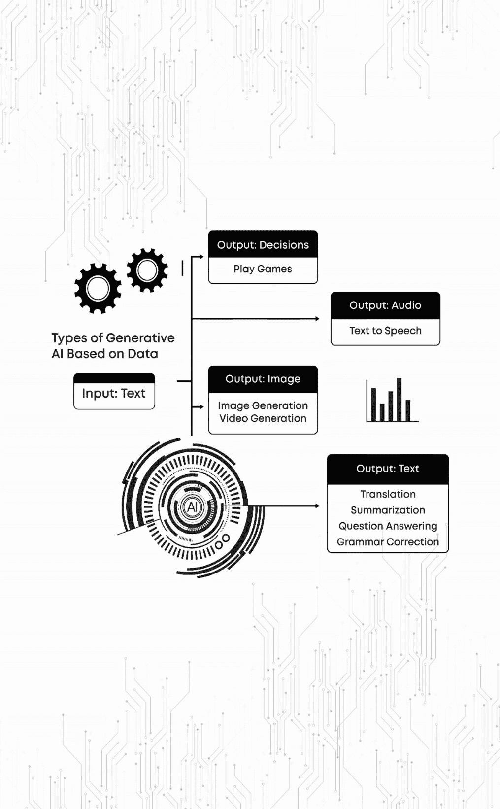

# 参考文献

- AI 模型优化：如何做以及为什么重要。(n.d.). Enterprise AI. https://www.techtarget.com/searchenterpriseai/tip/AI-model-optimization-How-to-do-it-and-why-it-matters
- Analytics Vidhya. (2019, 11 月 20). 深度学习中注意力机制全面指南。https://www.analyticsvidhya.com/blog/2019/11/comprehensive-guide-attention-mechanism-deep-learning/
- Arkenberg, C. (2023, 6 月 29). 生成式 AI 正在颠覆媒体和娱乐。Deloitte Insights. https://www2.deloitte.com/us/en/insights/industry/technology/generative-ai-tools-media-entertainment.html
- Baheti, P. (2021, 7 月 8 日). 神经网络架构必备指南。www.v7labs.com. https://www.v7labs.com/blog/neural-network-architectures-guide
- Bland AI ：揭示 AI 在呼叫中心的力量。(2024, 1 月 9 日)。Tasktwister. https://tasktwister.com/ai/bland-ai-review-unveiling-the-power-of-ai-in-call-centers-2024/
- Budiu, R. (2018, 11 月 25). 聊天机器人的用户体验。Nielsen Norman Group. https://www.nngroup.com/articles/chatbots/
- Coursera. (2024, 6 月 5 日). 人工智能 (AI) 职业路线图：职位与指南。https://www.coursera.org/resources/
- Data Summit. (2018, 9 月 19). AI 领域既充满活力又迷人。
- Farhud, D., & Zokaei, S. (2021). 医学中 AI 的伦理问题。Iranian Journal of Public Health, 50(1).
- Gomede, E. (2023, 9 月 21). 理解序列到序列 (`seq2seq`) 模型及其意义。
- Harrison, H. (2024, 1 月). 月度更新：12 月。Scoop by Shares.
- IBM. (2015, 10 月 1 日). 避免偏差对 AI 成功至关重要。
- Kavanagh, C. (2019, 8 月 28). 新技术、新威胁和新治理：制定更明智应对的机会？Carnegie Endowment for International Peace.
- Lee, N. T., Resnick, P., & Barton, G. (2019, 5 月 22). 算法偏差检测与缓解：减少消费者伤害的最佳实践和政策。Brookings。
- Lawton, G. (2023, 4 月 18). 生成式 AI 伦理：8 大主要担忧。TechTarget.
- Mahaffey, C.D. (2024, 4 月 16). 掌握生成式 AI 集成的最佳实践：全面指南。Medium.
- MyScale. (2024, 3 月 28). 理解 Transformer 架构：注意力就是你需要的。
- OpenAI. (2021, 3 月 25 日). GPT-3 驱动下一代应用。
- UNESCO. (2022). 人工智能伦理。


- McKinsey & Company. (2023 年 8 月 1 日). 2023 年 AI 现状：生成式 AI 突破的一年。麦肯锡。https://www.mckinsey.com/capabilities/quantumblack/our-insights/the-state-of-ai-in-2023-generative-ais-breakout-year

- McKinsey & Company. (2023 年 6 月 15 日). 生成式 AI 的经济潜力。麦肯锡。https://www.mckinsey.com/capabilities/mckinsey-digital/our-insights/the-economic-potential-of-generative-ai-the-next-productivity-frontier

- 数字时代的导师制：优化职业成长的 AI 与虚拟平台。(2023 年 10 月 18 日)。HR Future。https://www.hrfuture.net/talent-management/personal-development/mentorship-in-the-digital-age-ai-and-virtual-platforms-for-optimized-career-growth/

- Oliver, L. (2024 年 2 月 7 日). 仪表变电器行业的进展与趋势[Post]。LinkedIn。https://www.linkedin.com/pulse/advancements-trends-instrument-transformer-industry-laila-oliver-dux9f#:~:text=Smart%20transformers%20equipped%20with%20sensors,the%20transition%20towards%20smart%20grids.

- Oniwura, B. (2023 年 7 月 4 日). 电影调色与人工智能。Medium。https://medium.com/@onigold2/film-color-grading-and-ai-939d5dc21c1c

- PWC. (无日期). 负责任人工智能（AI）实用指南。https://www.pwc.com/gx/en/issues/data-and-analytics/artificial-intelligence/what-is-responsible-ai/responsible-ai-practical-guide.pdf

- PyTorch - 数据科学与机器学习中的市场份额、竞争对手洞察。(无日期)。6sense。2024 年 7 月 9 日 检索自 https://www.6sense.com/tech/data-science-machine-learning/pytorch-market-share

- Rao, R. (无日期). 量子计算机可以运行像大脑一样工作的强大 AI。科学美国。https://www.scientificamerican.com/article/quantum-computers-can-run-powerful-ai-that-works-like-the-brain/

- Sanders, N. R., & Wood, J. D. (2023 年 11 月 3 日). 员工与 AI 高效工作所需的技能。哈佛商业评论。https://hbr.org/2023/11/the-skills-your-employees-need-to-work-effectively-with-ai

- sitiatarfa8. (2024 年 1 月 18 日). AI 个性化：电子商务如何转型其业务。Kitameraki。https://www.kitameraki.com/post/how-shopee-and-others-transforming-ecommerce-with-ai-personalization-strategies

- Smith, M. G. (2024 年 5 月 30 日). 克服 AI 部署中的数据隐私与安全挑战。CalypsoAI。https://calypsoai.com/overcoming-data-privacy-and-security-challenges-in-ai-deployment/

- Zayed, M. (2023 年 11 月 28 日). 理解神经网络：全面指南。DEV Community。https://dev.to/mariazayed/understanding-neural-networks-a-comprehensive-guide-28cg

- Zhuraval, H. (无日期). AI 与物联网：探索强大的技术协同效应。Binariks。https://binariks.com/blog/ai-iot-use-cases-and-benefits/

# AI 深度学习与神经网络

## 初学者指南：每天几分钟，理解机器学习并构建高级 AI 技能

Jordan Blake

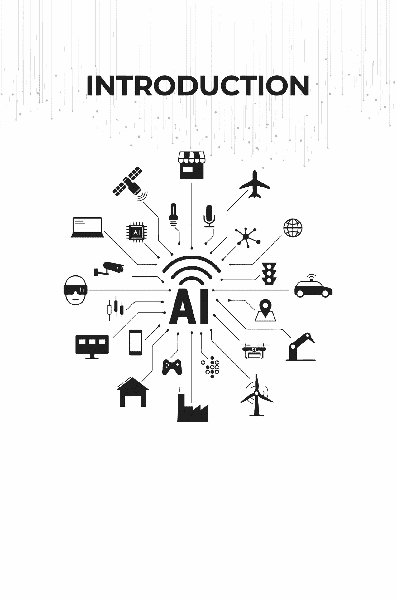

# AI 深度学习要点 – 简介

在一个你的智能手机可以识别你的脸部、推荐你喜欢的下一首歌、甚至甚至帮助诊断疾病的世界里，显而易见：人工智能，也称为 `AI`，并不是科幻小说。它已经到来，并改变着我们生活、工作和娱乐的方式。深度学习是这些突破背后的引擎。想象一下释放它创造、创新和解决问题的力量。这正是本书的旨所在。

这本书的目的简单而意义重大：让深度学习对你触手可及。无论你是学生、开发者，还是正考虑转型 `AI` 领域的人，本指南旨在简化复杂的神经网络概念。我们将从理论转向现实案例，为你提供可以每天应用的宝贵技能。

你是是谁？你可能是一个技术爱好者——也许是一个刚起步的学生，或者是一个寻求转型到 `AI` 领域的专业人士。你可能已经拥有计算机科学或工程背景，或者发现自己渴望获得更深的技术背景，以便在这个快速发展的领域保持领先。你理解 `AI` 的重要性，并想成为这场革命的一部分。这本书是为你身定制的。

当你翻阅这本书的各个章节时，请期待一段结构化的旅程。每一章都将介绍基础概念，随后是实操练习和真实的代码示例。我们包含了 `ChatGPT` 驱动的提示词，引导你构建、训练和部署你自己的神经网络。我们将超越理论，鼓励你亲自动手，在做中学学习。

这本书与众不同之处在于它专注于学习。让我来自我介绍一下。我是 `Jordan Blake`，`NextGen AI Publications` 的创始人。我热衷于帮助他人学习。我相信让 `AI` 对所有人开放，而不仅仅是专家。

读完这本书后，你将牢掌握深度学习技术和神经网络。无论你是在构建一个更智能的应用，还是在医疗、金融或机器人领域探索 `AI`，这本书旨在带给你信心。我邀请你深入接触这些内容。进行实验、探索并扩展你的理解。将这本书作为进入技术无限可能的跳板。

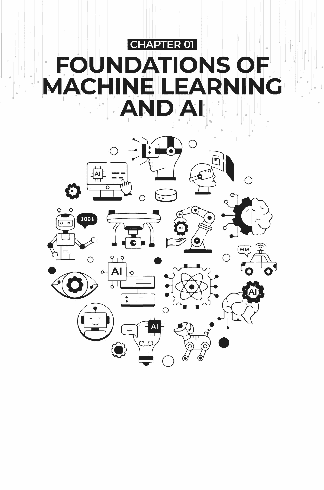

# 第 1 章：机器学习与 AI 基础

## 1.1 机器学习简介：概念与背景

### 1.1.1 猫的实验
几年前，Google 的一组研究人员向神经网络投喂了数千个 YouTube 视频，奇妙的事情发生了——它开始识别猫。没有人显式地编写程序去这样做；它是自己学习的，揭示了机器学习的力量。这个轶闻听起来可能不足道，但它标志着 `AI` 从理论演变为变革力量的关键时刻。

### 1.1.2 历史演变
机器学习已经显著增长，从早期的统计方法和简单算法演变为如今复杂的神经网络。从历史上看，诸如 Frank Rosenblatt 在 1957 年发明感知器（`perceptron`）以及 80 年代反向传播（`backpropagation`）的复兴等里程碑，为我们今天见证的深度学习革命铺平了道路。90 年代见证了支持向量机和循环神经网络的流行；尽管直到 10 年，在计算能力进步和数据可用性的推动下，深度学习才处于舞台中心。目前的格局是生成式 `AI`（如 `ChatGPT` 和图像生成器）捕捉了人们的想象力并改变着商业工业。


理解机器学习需要掌握一些关键概念。人工智能的核心是一个广阔的领域，机器在这一领域表现出类似于人类的智能。在人工智能内部，机器学习是一个子集，侧重于训练算法从数据中学习以做出预测或决策。深度学习是机器学习的进一步子集，涉及具有许多层的神经网络，允许机器对复杂模式。这些层模拟了人类大脑的结构，能够实现图像识别和自然语言处理等任务。监督学习、无监督学习和强化学习之间的区别至关重要。监督学习使用标记数据来训练模型，无监督学习在未标记数据中寻找模式，而强化学习涉及通过试错来学习，就像训练宠物一样。

机器学习带来了巨大的收益，但也伴随着挑战。它分析海量数据集并揭示见解的能力可以驱动医疗、金融和娱乐等行业的创新。然而，可扩展性和数据需求构成了重大障碍。算法需要大量的高质量数据才能有效运行，而这些数据并非总是随手可得。此外，伦理考量也不容忽视。数据中的偏差可能导致歧视性的结果，随着机器越来越多地处理敏感信息，隐私问题也随之产生。应对这些挑战需要在技术进步与伦理责任之间取得平衡。

当你探索机器学习的世界时，要预期会有一条陡峭但回报丰的学习曲线。这个领域需要时间和投入，但你获得的技能——从理解神经网络到部署 AI 解决方案——将证明是无价之的。你需要熟悉诸如 `Python` 的工具，它以简单和功能强大的库而闻名，这对于构建和评估机器学习模型至关重要。这段旅程将涉及编码、数据分析以及对驱动 AI 机制的深度挖掘。

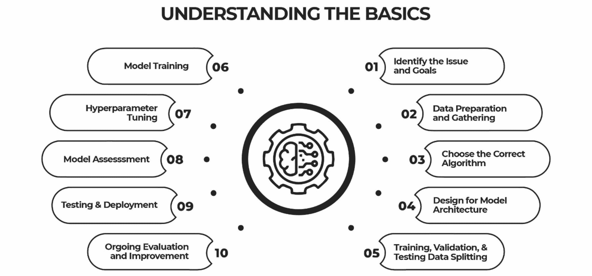

本章为深入探索机器学习奠定了基础，为你将发展的技能和知识铺了道路。从基础概念到现实世界的应用，你将对人工智能重塑行业的潜力以及你在这一兴奋领域中的角色产生全面的理解。在你继续学习时，请记住机器学习不仅限于算法和数据——它是一股利用技术解决问题并改善我们周围世界的力量。

## 1.2 理解算法及其应用

想象你是一个招聘经理，正在筛选一堆简历，为某项工作寻找完美的候选人。每份简历都是一个数据包，你想在不阅读每一份的情况下做出最佳选择。机器学习算法就成了你的秘密武器，帮助你高效地筛选这些简历。在这些算法中，决策树因其简单性和有效而脱颖而出。想象一棵树，它将数据分成分支，直到达到一个决策——是或否，雇或不雇。它们直观且易于解释，这使得它们非常适合需要清晰、逻辑决策的情况。随机森林通过创建多棵决策树在此基础上进行构建，每棵树都在不同的数据子集上进行训练，并让每棵树对最流行的结果进行投票。通过结合许多树的预测，随机森林比单一决策树做出更准确的预测。它们还减少了过拟合的风险，过拟合是指单个决策树过度学习了训练数据，以至于难以理解新数据。相比之下，支持向量机 (`SVM`) 采取不同的方法，通过寻找分离不同类别数据的最佳边界。这就像在沙地上画一条线，并决定新点属于哪一边。`SVMs` 对于决策边界复杂的分类任务非常强大。然后，k 近邻算法 (`KNN`) 根据邻居的接近程度对数据点进行分类。


本章为深入探索机器学习奠定了基础，为你将发展的技能和知识铺了道路。从基础概念到现实世界的应用，你将对人工智能重塑行业的潜力以及你在这一兴奋领域中的角色产生全面的理解。在你继续学习时，请记住机器学习不仅限于算法和数据——它是一股利用技术解决问题并改善我们周围世界的力量。

## 1.3 数据预处理：成功模型的关键

如果你是一个被要求准备美味大晚餐的职业厨师，你不会在不清洗或称量食材的情况下直接将它们扔进锅里，对吧？同样，在机器学习中，数据预处理是清洗和准备食材（在这种情况下是你的数据）的关键步骤。它专注于为你的模型提供清洁、结构化并准备好转化为见解的数据。数据通常是混乱的，充满了缺失值或不一致之处。解决这些问题至关重要。缺失值可能会偏差结果，因此像 `imputation`（用估计值填充空白）这样的方法是不可少的。同时，`normalization`（标准化）调整特征的比例，确保没有单一属性不成比例地影响模型，就像确保食谱中的每种食材在味道上达到平衡一样。


接下来是数据转换的艺术，类似于烹饪中的腌制或调味，它为模型的成功奠定了基础。这涉及到将非数值的类别变量转换为算法可以理解的格式。诸如 `one-hot encoding`（独热编码）等方法可以将类别转换为二进制向量。这种转换至关重要，因为它在保持类别特性的同时，没有暗示任何顺序关系。与此同时，特征工程是关于提取数据中最相关的方面，就像挑选最新鲜的农产品一样。它要求对细节敏敏锐观察，识别哪些特征对模型的预测能力贡献最大。选择过程有助于精炼这些特征，确保模型保持高效和相关性。

为了有效地进行数据预处理，像 `pandas` 和 `NumPy` 这样的 Python 数据库是不可缺的。`pandas` 在数据操作方面表现出色，允许你轻松地对数据进行切片、分割和清洗。无论是合并数据集还是填充缺失值，`pandas` 都为数据管理提供了一个稳健的框架。`NumPy` 以其强大的数组处理能力，通过高效处理数值转换补充了这一点。它们共同构成了数据准备的骨干。如 `Matplotlib` 等可视化工具提供了数据分布和潜在异常的洞察，作为视觉检查，确保数据在进入建模阶段之前具有完整性。

然而，预处理并非没有挑战。处理不平衡数据集（即某些结果占据主导地位）可能会导致模型偏差。重采样或合成数据生成等技术有助于解决这些不平衡，确保模型能从所有结果中公平地学习。数据泄露（即测试集的信息无意中影响了训练阶段）是另一个陷阱。保持数据集相互独立并采用稳健的验证技术对于避免这一陷阱至关重要。这些挑战需要一种深思的方法，类似于厨师在厨房里小心地避免交叉污染。

## 1.4 导航 Python 进行 AI 开发

Python 已经成为人工智能和机器学习的首选语言，这是有原因的。它的简单性和可读性使其成为初学者和资深开发者的理想选择。我们大多数人都能欣赏文字流向自然的书籍，因为这让你能够专注于故事，而不是陷在复杂的语法中。Python 也是如此：它允许你编写简洁、高效的代码，而必忍受冗长语法的烦恼。除了简单之外，Python 还拥有一个庞大的库和框架生态系统，这些是 AI 开发中真正的游戏改变者。这些工具提供了预构建的功能，节省了时间和精力，让你专注于真正重要的事情：解决问题和创建创新的解决方案。

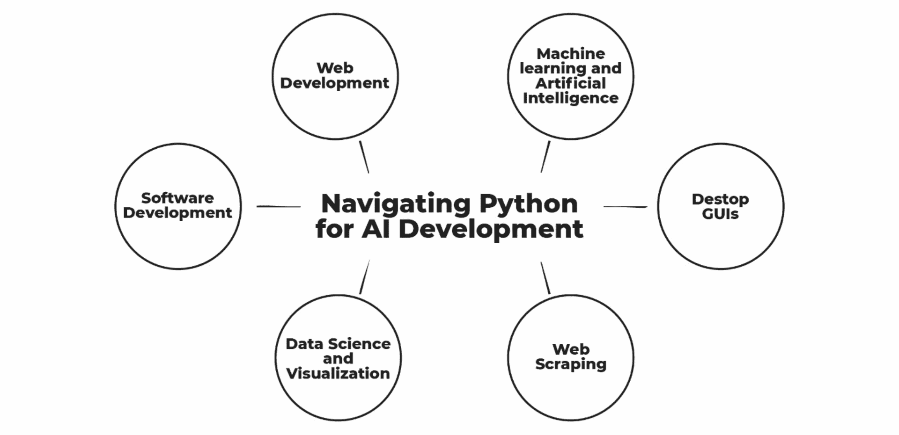

当我们谈论 Python 库时，有几个在机器学习领域脱颖而出且不可或。之前提到的 `NumPy` 是数值操作的骨干。它高效地处理数组和矩阵，使得复杂的数学操作变得简单而快速。它就像随手可用的一台强大的计算器，可以轻松地管理大型数据集。`pandas` 是数据操作的“瑞士军刀”，为处理数值表格和时间序列提供了直观的数据结构和操作，这对于清洗和准备数据至关重要。把它想象成你的数据清洁员，在数据进入模型之前将杂乱的数据集收拾得整齐。`Scikit-learn` 用一套全面的机器学习算法工具补齐了这三剑客的组合。从回归到聚类，它提供了实现和评估模型所需的一切，而无需重复发明轮子。这些库构成了 Python 在机器学习领域强大能力的基础，每个库在开发过程中都起着关键作用。

要真正欣赏 Python 的能力，你需要亲自动写写代码。从一个简单的练习开始：编写脚本使用 `pandas` 加载数据。你会看到它的函数如何让数据处理变得轻而易举，让你用最少的代码就能读取、清洗和分析。一旦你熟悉了，尝试使用 `Scikit-learn` 实现一个简单的线性回归。这个练习将向你介绍模型训练和评估的基础知识，让你窥见机器学习的机制。这些练习不仅仅是练习；它们是通理解 Python 库如何协同工作以简化 AI 开发的大门。

当然，没有任何编程语言是没有挑战的，Python 也例外。初学者经常会在语法错误上碰钉头，那些可能会停止你进度的讨厌错误。关键在于耐心和实践。仔细阅读错误信息——它们通常会指引你正确的方向。另一个常见的障碍是管理依赖和环境。随着项目的增长，你所使用的库和工具的复杂性也会之增加。虚拟环境可以在此提供帮助，为项目创建隔离空间以确保兼容性并减少冲突。这就像为每个项目提供一个专用工作区，不受其他杂物和干扰。理解这些挑战并学习如何应对它们将增强你对 Python 的信心和熟练程度。

## 1.5 构建你的第一个机器学习模型

想象一下：你正准备创建你的第一个学习模型，就像一位手拿空白画布的艺术家。第一步是定义问题。它可能是根据位置、大小和设施等特征来预测房价。也许你可能想构建一个垃圾邮件过滤器，在垃圾邮件和正规邮件之间区分开来。清晰地定义问题为后续的所有工作奠定了基础。然后，收集并准备你的数据；确保它们是整洁、有组织且与任务相关的，就像你为杰主之作准备正确的颜料和画笔一样。数据的质量直接影响模型的性能，因此这一步必须认真对待。

接下来，选择合适的算法。这个决策取决于你正在解决的问题。如果你在处理垃圾邮件过滤器，你可能会选择如 `logistic regression`（逻辑回归）之类的分类算法。对于预测房价，如 `linear regression`（线性回归）之类的回归算法可能更合适。你的选择将决定模型如何从数据中学习。一旦选定，就是训练模型的时候。训练涉及向算法输入数据并让它学习模式和关系。这一步需要耐心和精确，因为你需要调整参数来提高准确性和性能，就像精炼你的艺术技巧一样。

评估模型至关重要——将其视为后退一步审视你的艺术。使用训练集和测试集来评估其性能。训练集教会模型，而测试集则评估它对未知数据的泛化能力。`accuracy`（准确率）和 `precision`（精确率）等关键指标可以帮助你理解有效性。`accuracy` 衡量模型正确预测结果的频率，而 `precision` 指出在预测的正例中有多少确实是正例。这些指标指导你精炼模型，确保其性能最优，并识别改进空间。


部署你的模型是它走向世界的时刻，就像在画廊中展出你的艺术品。部署涉及将你的模型集成到实际应用中（例如网络服务），使其能够处理实时数据并提供预测。考虑可扩展性，确保模型能够在处理不断增长的需求的同时不损失性能。维护同样重要，因为随着数据模式的改变，模型需要更新以保持准确性。毕竟，你会定期更新艺术展品的内容，以保持其时效性和吸引力。这一阶段将你的模型从一个概念转变为具有实质性影响的工具。

让我们探索一个你可以尝试的项目：构建一个基础的垃圾邮件过滤器。从收集标记为“垃圾邮件”或“非垃圾邮件”的邮箱开始。清洗并预处理数据，然后选择一个简单的算法（如 `Naive Bayes`）进行分类。训练模型，使用 `accuracy` 和 `precision` 评估其性能，并进行必要的调整。或者，你也可以使用回归模型预测房价。收集房屋销售的相关数据，包括位置、尺寸和价格等特征。清洗数据，选择回归算法并训练你的模型。使用 `mean squared error` 等指标评估其性能，并在需要时精炼。将完成的模型部署到应用程序或工具中供现实使用。

开启第一个机器学习项目是一段充满回报的经历，它将创意与技术技能相结合。它涉及定义问题、选择并训练模型、评估其性能以及将其部署以解决现实世界的挑战。无论你是在构建垃圾邮件过滤器还是预测房价，这个过程都赋予你应对日益复杂任务的技能。随着每个项目的进行，你将获得信心和洞察力，加深对机器学习潜力的理解。在你继续阅读，本章为更高级的主题和项目奠定了基础。

## 1.6 用于探索神经网络和机器学习的 AI 提示词

### 有效实践指南

● 访问 ChatGPT：访问 `https://chatgpt.com` 并在需要创建一个免费账户。

● 与提示词交互：输入提示词、修改它们并进行实验以查看不同的回复。

● 评估回复：根据你所学到的知识检查回复的清晰性和相关性。

● 实验与反思：调整提示词以加深理解并探索 AI 的能力。

### 用于强化本节学习的提示词

● 提示词 1：“用关于用闪卡教孩子识别动物的类比来解释监督学习。”

● 提示词 2：“监督学习、无监督学习和强化学习之间有什么区别？为每种学习提供生活中的例子。”

● 提示词 3：“决策树是如何工作的？用在超市做决的类比来解释。”

● 提示词 4：“什么是支持向量机 (SVM)？它是如何分类数据的？用一个在地图上画边界的比喻来解释。”

● 提示词 5：“为什么数据清洗在机器学习中很重要？用准备食谱食材的例子来解释。”

● 提示词 6：“描述如何使用归一化。为什么要执行这些步骤？”

● 提示词 7：“引导我完成数据标准化。”

● 提示词 8：“机器学习中的过拟合是什么？如何防止？”

● 提示词 9：“解释 `accuracy` 和 `precision` 的意义。”

● 提示词 10：“设计一个分类图像的项目。”

# 2. 深入研究神经网络

在 20 世纪 50 年代后期，计算机世界经历了一场革命。弗兰克·罗森布拉特（Frank Rosenblatt）是一位心理学家也是计算机科学家，他引入了感知器（`perceptron`）——这是一种看似简单的二分类分类神经元，例如区分猫和狗。感知器通过根据输入调整权重来实现这一点，这个过程类似于学习。这种单层结构为我们现在所说的神经网络奠定了基础。尽管其简单，但它在处理非线性问题方面的局限性导致了人们对当时被称为人工智能兴趣的短暂冷落。

## 2.1 感知器简介：人工智能的转折点

想象一下从单个 `perceptron` 跨越到 `perceptors` 网络，其中每个感知器都是多层网络中的一个节点。这种演变涉及增加更多的层，但它改变了对机器如何学习的理解。在多层感知器（`MLP`）中，多层节点共同工作，每一层都转换数据并允许网络学习复杂的模式。隐藏层（那些夹在输入层和输出层之间的层）的加入允许网络从输入数据中提取更复杂的特征，从而能够解决更复杂的问题。将这个过程想象为为机器添加更多齿轮，每个齿轮不断精炼输出，直到达到所需的精度。这种架构构成了现代神经网络的骨干，使其能够处理从语言翻译到图像识别等各种任务。

向深度学习的过渡代表了范式的转变，这是由计算能力的提高和海量可用数据集驱动的。深度神经网络以其许多隐藏层为特征，推向机器能成就的边界。这些网络现在可以执行曾被认为不可能的任务，例如以类人类的准确率识别语音，或以前所未有的精度识别图像中的物体。“深度”一词是指数据通过的多个层，每一层都提取更复杂的特征。例如，在医疗领域，深度学习模型分析复杂的生物医学数据，辅助疾病预测和个性化治疗方案。这些模型在图像和语音识别方面表现出色，支撑了虚拟助手和人脸识别等技术。


然而，强大的力量往往伴随着巨大的误解。关于神经网络的一个常见误区是，认为它们需要无限的训练时间和资源。虽然训练深层网络可能耗费资源，但硬件（如 `GPUs`）和优化技术的进步已显著减少了所需的时间和成本。另一个常见的误解与过拟合有关，即模型在训练数据上表现优异，但在未见的数据的数据上表现很差。当网络对训练数据过度定制，捕捉的是噪声而非底层模式时，就会出现这个问题。然而，`dropout` 和 `regularization`（正则化）等技术有助于缓解这种情况，确保模型对新数据具有良好的泛化能力。在模型复杂性和泛化能力之间取得平衡至关重要，就像确保定制西装合体舒适而不太紧一样。神经网络正在不断进化，有望在未来提供更强大的能力效率。

### 练习：使用 Python 探索感知器

为了真正理解感知器的概念，请尝试使用 `Python` 动手构建一个。从定义一个具有两个类别的简单数据集开始，例如二维空间中的点。实现一个包含 `training` 和 `predicting` 方法的 `perceptron` 类。使用这个 `perceptron` 来对你的数据集进行分类，并根据预测误差调整权重。观察感知器如何随着迭代进行学习，逐渐提高其准确性。这个实践性练习将阐明神经网络的基础原理，为探索更复杂的架构奠定基础。

## 2.2 激活函数：为网络注入灵魂

在神经网络的世界中，激活函数就像赋予神经网络生命的火花。这些关键组件决定了神经元应该“触发”还是保持非活动状态，引入了复杂模式识别所需的非线性。想象这样一种场景：每个决策边界都是直线。世界并非那么简单，大多数数据集也是如此。激活函数通过创建弯曲的决策边界允许网络捕获这些复杂性，就像熟练的艺术家在平坦的画布上增加深度和维度一样。如果没有非线性，神经网络的威力将不会比线性回归模型强，仅限于解决简单的线性可分问题。

在这些函数中，有几个已经成为神经网络设计的常备。`sigmoid` 函数是最早使用的函数之一，输出 0 到 1 之间的值，使其非常适合二分类任务。然而，由于梯度消失问题，它在深层网络中不再受到青睐，因为梯度在反向传播时变得太小，无法进行有效学习。接着是 `ReLU`（修正的线性单元），它是深度学习的规则改变者。`ReLU` 在输入为正时直接输出输入；否则返回 0。这种简单性允许更快的训练，并缓解了梯度消失问题，使其成为现代深层网络中的首选。另一方面，`Tanh` 输出 -1 到 1 之间的值，提供了一个以零为中心的替代方案，在隐藏层中运行良好，在 `sigmoid` 的平滑性和 `ReLU` 的效率之间提供了平衡。

激活函数的选择会显著影响网络的性能。选择正确的函数就像为特定任务选择正确的工具，因为它影响了模型学习的快慢和有效程度。`Sigmoid` 和 `Tanh` 尽管具有历史意义，但可能会遭受梯度消失的影响，阻碍深层网络中的学习过程。相反，`ReLU` 加速训练并改进了收敛，但可能导致“死亡 ReLU”综合征，即如果输入持续为负，神经元将变为非活动并停止学习。理解这些细微差别有助于构建功能良好的神经网络，同时优化速度和准确性。

在决定激活函数时，请考虑数据性质、网络深度以及特定任务等因素。例如，由于其计算效率和处理大型数据集的能力，`ReLU` 在深层网络中通常受到青睐。然而，在负值重要的情况下，`leaky ReLU`——一种允许负输入产生小的非零输出的变体——可能更加合适。相反，在构建二分类网络时，`sigmoid` 函数可以提供必要的概率输出。为了说明，考虑一个涉及图像识别的案例。最初使用 `sigmoid` 的网络在收敛方面遇到困难。切换到 `ReLU` 加速了训练并提高了准确性，凸显了正确的选择如何同时增强速度和性能。

## 2.3 理解层：隐藏层、输入层输出层

神经网络由一系列层组成，每一层在处理数据时都起着至关重要的作用。最前端是 `input layers`，它们作为数据进入网关。这些层将数据原封地传递给网络，确保分析可用所有必要信息。它们像漏斗一样，从各种来源收集原始数据（无论是图像、文本还是数值），并将其引导到网络中进一步处理。接下来是 `hidden layers`，神经网络的工作骨干。这些层通过转换和精炼数据来提取特征。它们识别模式和关系，就像侦探通过收集线索来破案一样。`hidden layers` 捕捉复杂模式的能力是神经网络脱颖出的关键，使它们能够处理图像识别和语言翻译等复杂任务。最后，`output layers` 输出网络的预测或分类。它们将处理后的信息压缩为最终决策或结果，将网络复杂的内部机制转换为有意义的输出。例如，它们可以判断一封邮件是否为垃圾邮件，或识别照片中的物体，每次都以清晰且可操作的形式提供网络的结论。

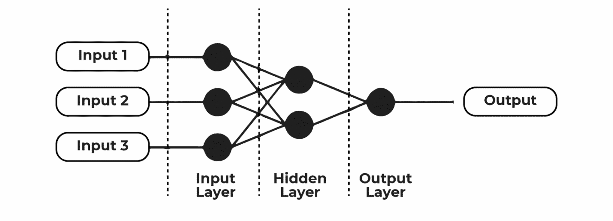

这些层的配置显著影响网络的能力。特别是 `hidden layers` 的数量和大小是关键因素。更多的层通常意味着捕获复杂模式的能力更，但它们也需要更多的数据和计算资源。这就像在机器上增加更多齿轮——每个齿轮都改进了功能，但也增加了复杂性。设计有效的神经网络架构涉及在深度和宽度之间取得平衡，以优化性能。层太少可能会导致欠拟合，即模型过于简单，无法捕捉数据的复杂性。层太多则会面临过拟合的风险，即模型对训练数据过度定制，难以泛化到新数据。需要仔细的设计和测试，以为给定任务找到正确的配置。

层的连接性进一步影响了网络的设计。`Fully connected layers`（一层中的每个节点都连接到下一层的每个节点）在许多网络中很常见。这种稠密连接允许全面的模式识别，因为每个神经元都可以影响网络的输出。然而，这种方法的计算开销很大，并可能导致过拟合。相反，`Sparse connectivity` 更少的连接，减少了复杂性和计算。`Sparse networks` 在某些情况下是有益的，例如在处理全连接不实际的大数据集时。它们还可以通过减少模型记忆训练数据的能力来帮助防止过拟合。在全连接层和稀疏层之间做出选择取决于任务的具体要求和限制。


探索著名的神经网络模型揭示了层结构的各种实现方法。以 `ResNet` 为例，它引入了残差连接的概念来解决梯度消失问题。通过允许梯度跳过某些层，`ResNet` 使得在不丢失效果的情况下训练非常深的网络成为可能。它的架构由多个残差块组成，每个块都有自己的层配置，使其能够高效地学习复杂的模式。另一个著名的模型是 `VGG`，它以简单且统一的架构而闻名。它使用一系列小型堆叠卷积层来捕捉特征，随后通过全连接层进行预测。这种方法使得 `VGG` 尽管设计相对简单，能够在图像识别任务中实现高准确率。然后是长短期记忆（`LSTM`）网络，它是为序列学习设计的。`LSTMs` 在涉及时间数据的任务（如语言建模或语音识别）中特别有效。它们独特的架构包含了记忆单元和门控机制，使其能够捕捉序列数据中的长期依赖关系。这些模型都说明了层配置的多样性及其对网络学习和执行复杂任务能力。

## 2.4 反向传播：学习过程

神经网络的运行像一个巨大的网，每个连接都为系统提供关键支持。反向传播是微调这些连接的过程，允许网络从错误中学习并随着推移而改进。当你将数据输入网络时，它会输出预测结果。这些预测结果与实际结果进行比较，并计算差异（称为误差）。反向传播的工作原理是将这些误差回传整个网络，调整连接的权重以最小化未来的误差。将其想象为一个反馈循环，不断精炼网络的准确性。这一过程的数学骨干是 `gradient descent`，这是一种计算误差减少斜率的技术，指导每个权重应该调整多种程度。目标是找到一组产生最低可能误差的最优权重，类似于找到完美的配方比例。

现在，想象你正在开车。学习率就是你的油门。踩得太深，你可能会冲过目的地；踩得太轻，你永远无法到达。。同样，反向传播中的学习率控制着网络学习的快慢。高学习率会导致不稳定，使网络在范围内来回跳跃并错过最优解。低学习率可能会让旅程变得难以忍受地缓慢，导致网络陷入局部最优——即那些看似最优但并非最佳解决方案的点。找到正确的平衡是关键，自适应学习率可以提供帮助。这些技术在训练期间调整学习率，在情况稳定时加速，在需要谨慎时减速。

为了增强反向传播的效率，高级优化技术派上了用场。其中一种方法是 `momentum`，它帮助网络跳过小误差，就像自行车在下坡时获得速度并平稳地滚过颠簸一样。动量考虑过去的梯度以平滑更新，防止网络陷入局部最优。`Adam` 优化器是另一个强大的工具，它结合了动量和自适应学习率的优点。它会随时间调整每个参数的学习率，实现更快的收敛和更好的性能。这些优化器像专家导航员，引导网络高效地向最优解迈进。

尽管反向传播功能强大，但也面临着一些障碍。臭名的梯度消失问题出现在梯度变得太小而无法进行有意义更新时；这会阻止学习，特别是在非常深的网络中。另一方面，梯度爆炸会导致不稳定，使更新值变得过大。解决方案包括使用如 `ReLU` 等激活函数来缓解梯度消失，或者应用 `gradient clipping`（通过限制其值来防止梯度爆炸）。过拟合（即网络对训练数据过于专门化）是另一个挑战。正则化技术，如 `dropout`（在训练期间随机忽略神经元）和 `L1/L2 regularization`（惩罚复杂模型），可以抑制过拟合。

## 2.5 动手实践：创建一个简单的神经网络

从零开始构建你的第一个神经网络就像组拼图，每块碎片都完美契合，以揭示出更大的蓝图。让我们从设置环境开始。如果你还没有安装，请下载并安装 `Python`，由于其简单且拥有全面的库，它是 AI 世界的主流工具。设置完成后，你需要安装 `NumPy`，这是一个用于数值运算的强大库。打开你喜欢的代码编辑器，无论是 PyCharm、`VS Code` 还是 `Jupyter Notebook`，让我们准备编写代码。

环境准备好后，是时候编写网络代码了。首先定义架构，包括设置层。为了简单起见，让我们考虑一个包含输入层、单个隐藏层和一个输出层的网络。使用 `NumPy` 初始化这些层的权重和偏置，因为它们对学习至关重要。将权重视为神经元之间连接的强度，将偏置视为帮助激活的阈值。你还需要定义激活函数。对于这个练习，由于 `ReLU` 效率高，它是隐藏层的良好选择；而如果你正在处理分类任务，`softmax` 函数则适用于输出层。这些组件是网络的构建模块，正确拟合它们是实现功能的关键。

网络组件就绪后，下一步是训练你的模型。从加载数据集开始；`MNIST` 数据集是初学者的经典选择。它包含数千张手写数字图像，为测试你的网络提供了稳健的平台。通过归一化数据，将像素值缩放到网络容易处理的范围。通过向网络输入批量数据并使用 `backpropagation` 等技术调整权重以最小化误差，初始化训练过程。这一阶段是迭代的，需要对数据集进行多次遍历以精炼模型的预测。

评估网络性能是一个持续的过程。训练后，使用测试集评估模型，测试集由网络未见过的数据组成。衡量准确率（具体是正确预测次数占总预测次数的比例），以衡量网络的泛化能力。如果准确率达不到标准，考虑调整学习率或层架构等超参数。微调涉及一些尝试和错误，但它对于优化性能至关重要。监控这些指标可以指导改进，确保你的模型既有效又高效。


为了看到你的网络运行情况，请将其应用于真实世界的任务，例如使用 MNIST 进行图像分类。这里的目标是从图像中准确识别手写数字，这项任务反映了实际应用，如手写表单的数字化或街道标志牌数字的识别。训练完成后，测试网络对未见过的图像进行分类的能力。这一步既突显了网络的优势，也指出了改进之处。你可能会发现某些数字比其他数字更难分类，这会促使进一步的优化或额外的数据预处理。这项练习的妙之处在于其扩展的潜力。考虑添加更多层以进行深层学习，或尝试不同的激活函数以观察它们如何影响性能。

## 2.6 深度强化神经网络知识的 AI 提示词（Prompts）

### 有效练习说明

- 访问 ChatGPT：访问 [`chatgpt.com`](https://chatgpt.com)，如有需要请创建一个免费账户。
- 与提示词交互：输入提示词、修改它们并进行实验以获得不同的响应。
- 评估响应：根据你所学的内容检查响应的清晰性和相关性。
- 实验与反思：调整提示词以加深理解并探索 AI 的能力。

### 用于强化本节学习的提示词：

提示词 1：“用解决拼图游戏的类比，解释神经网络中的隐藏层是如何工作的。”

提示词 2：“用学生从考试试批改中学习的类比，描述反向传播的工作原理。”

提示词 3：“使用一个关于在不同条件下打开的门的场景，比较 `ReLU`、`sigmoid` 和 `tanh` 激活函数。”

提示词 4：“设计一个用于猫狗图像分类的神经网络架构。解释你对层和激活函数的选择。”

提示词 5：“建议三种减少神经网络模型过拟合的策略，并解释每种策略的工作原理。”

提示词 6：“如何使用早停法（early stopping）和学习率调整来增强模型训练？”

提示词 7：“带我创建一个简单的神经网络，用于对 `MNIST` 数据集的手写数字进行分类。”

提示词 8：“解释神经网络如何用于文本数据的情感分析。”

提示词 9：“在使用神经网络进行预测分析时，存在哪些潜在的伦理担忧？如何解决这些问题？”

提示词 10：“设计一个用于预测股价的循环神经网络（RNN）。需要哪些关键考量？”

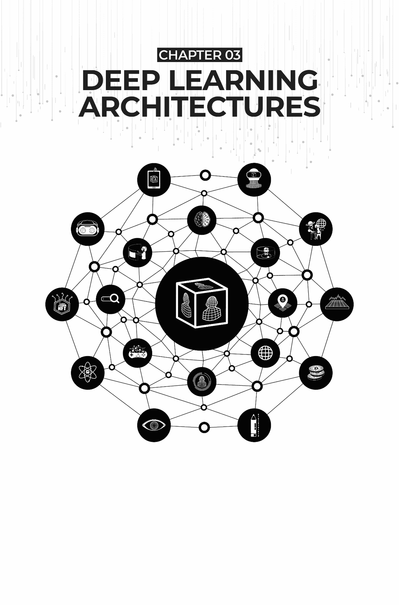

# 第 3 章：深度学习架构

望向大海往往会唤起无限可能的感觉。每一波拍打岸边的浪花都提醒着我们尚未探索的深度，我们也可以以类似的方式看待技术。海洋是深度学习架构的领域，而卷积神经网络（CNN）是其中最强大的潮流之一。CNN 是图像识别的骨干，将像素转换为模式，并将模式转换为预测。与传统算法不同，CNN 不仅仅从整体来看图像；它们将图像拆解成碎片，就像侦探检查犯罪现场的每一个细节一样。CNN 的魔力在于它们通过层来学习和提取特征的能力，每一层都在提炼图像，直到网络能够理解它。

## 3.1 卷积神经网络 (CNNs)

CNN 的核心是卷积层，它们是负责特征提取的“苦力军”。这些层就像一系列扫描图像的过滤器，随着深度的增加，识别边缘、纹理和更复杂的特征。将它们想象成一个筛子，从噪声中分离出有用信息，让网络关注重要内容。紧随其后的是池化层，它们降低了数据的维度，就像将一本书总结为几个关键点一样。这个过程使得网络更高效，并帮助它更好地泛化，过滤掉无关信息并突出数据的本质。

CNN 及其衍生的架构故事始于 `LeNet`，这是最早为图像识别设计的模型之一。`LeNet-5` 创建于 1998 年，是一个先驱，它具有两个卷积层，后接池化层，且都使用 `sigmoid` 或 `tanh` 等激活函数。它非常高效，完美适合手写数字识别等任务，并且需要的计算资源较低，使其成为电力受限环境的理想选择（SOURCE 1）。快到 2014 年，`VGGNet` 的引入标志着复杂性和深度的巨大飞跃。`VGGNet` 通过在多个层中使用较小的 `3x3` 卷积过滤器扩展了 `LeNet`，并采用 `ReLU` 激活函数和最大池化（max pooling）进行降维。这种设计允许 `VGGNet` 处理更大、更复杂的数据集，在图像分类和迁移学习方面表现出色（SOURCE 1）。在 `LeNet-5` 和 `VGG` 之间的选择取决于你的需求：`LeNet-5` 用于较小的数据集，`VGG` 用于详细的特征提取和高性能任务。

得益于以极人的精度检测和分类对象的能力，CNN 在各种图像相关任务中已变得不可或缺。在目标检测中，CNN 识别并分类图像中的物体，这种能力推动了从人脸识别到汽车安全系统的各种应用。CNN 分析面部特征，使通过看一眼就能解锁手机或筛选社交媒体照片的技术成为可能。它们是沉默的哨兵，确保了我们数字生活的安全并增强了便利性。

### 案例研究：医学成像中的 CNN

考虑 CNN 在医学成像中的影响，它们帮助医生以精确和快速的速度诊断疾病。通过分析 X 射线和 MRI（磁共振成像），CNN 可以突出人类肉眼可能忽略察觉的异常，为诊断过程提供“第二双眼睛”。这提高了诊断的准确性，同时缩短了解释复杂图像所需的时间，最终带来了更好的患者治疗结果。在自动驾驶汽车中，CNN 在视觉系统中起着至关重要的作用，使汽车能够识别行人、标志和其他车辆，从而做出确保道路安全高效的决策。

这些例子说明了 CNN 从医疗到交通等各个行业的变革性力量。它们学习、适应和解释视觉数据的能力不断突破可能的边界，驱动着创新并以前未有的方式增强了我们与技术的交互。

## 3.2 循环神经网络：时间序列与序列


虽然 RNN 性能强大，但它们并非没有局限性，特别是在管理长期依赖方面。然而，长短期记忆网络（LSTM）可以提供解决方案。LSTM 是一种特殊的 RNN 类型，旨在克服梯度消失问题，该问题会导致标准 RNN 在处理序列时遗忘早期的信息。LSTM 引入了记忆单元，用于在长时间内存储信息，并使用门控（gates）来控制信息流入和流这些单元。这种架构允许 LSTM 记住跨长序列中的重要细节，使其在语音识别和语言翻译等任务中具有极高价值。

另一方面，门控循环单元（GRU）为 LSTM 提供了一种简化的替代方案。GRU 合并了 LSTM 中使用的一些门控，在降低复杂性的同时仍能有效管理依赖关系。这使得 GRU 在计算资源有限或简单的模型就足够用时，成为一种热门选择。

RNN 具有广泛的应用范围，特别是在数据顺序至关重要的领域。在金融领域，RNN 用于时间序列预测，例如预测股票价格。在这里，RNN 分析过去趋势并将其投影到未来的能力为交易者提供了宝贵的洞察。同样，在自然语言处理（NLP）中，RNN 在文本生成等任务中表现优异，在这些任务中，理解上下文和词的顺序是有关重要的。它们可以通过根据之前的词预测句子中的下一个词，从而生成类人的文本。这种生成连贯且上下文相关文本的能力为聊天机器人和自动化内容创建等领域开辟了新的可能性。

使用 RNN 构建情感分析模型是亲身验其能力的实用方法。通过向网络输入单词或短语的序列，它可以学习预测给定文本的情感——积极、消极或中性。这涉及对文本数据进行预处理、将其编码为适用于 RNN 的形式，并并在标记示例上训练网络。一旦训练完成，该模型就可以分析新文本，为公众意见或客户反馈提供宝贵的见解。另一个有意义的项目是实现天气预测的预测模型。在这里，RNN 可以分析历史天气数据以预测未来状况，例如温度和降水量。通过捕捉时间序列数据中的模式，RNN 可以提供预测，帮助从农业到物流的各个行业进行规划和决策。

## 3.3 探索 Transformer：AI 的未来

随着 AI 的不断演进，Transformer 已作为一种革命性的力量出现出来，重塑了我们处理语言和数据的方式。这些模型通过使用名为“自注意力”（self-attention）的机制打破了传统模式。想象一下：你正处于一个嘈华的派对中，尽管有噪音，你仍然能够专注于某次对话。这就是自注意力机制的作用。在 Transformer 中，这种机制允许模型权衡不同单词或数据片段的相关性，使其能够捕捉输入内部复杂的关系和依赖关系。与以往顺序处理数据的模型不同，Transformer 可以同时处理整个序列，极大地提高了效率和性能。

位置编码（Positional encoding）是 Transformer 的另一个关键组件，解决了并行处理数据的挑战。虽然 Transformer 本身并不理解输入的顺序，但位置编码为序列中的每个位置分配了唯一值。这允许模型保持单词或数据点的上下文和顺序，就像给书页页码以理解叙事流一样。通过这些创新，Transformer 将自然语言处理（NLP）推向了新的高度，使 `BERT` 和 `GPT` 等模型能够以空未有的准确性理解并生成人类语言。

`BERT` 是 Transformer 双向编码器表示的缩写，已成为语言理解的基石。它的双向方法意味着 `BERT` 从两个方向考虑上下文，改进了它掌握文本中细微差别和复杂性的能力。这种能力使其成为各种任务的强大工具，包括情感分析和问答。同时，`GPT`（或生成式预训练 Transformer）在生成连贯且上下文相关的文本方面表现出色。无论是撰写文章、回答问题，甚至是编写代码段，`GPT` 都彻底改变了文本生成，展示了 AI 的创造潜力。

Transformer 不局限于 NLP；它们的通用性远超此范畴。例如，在图像处理中，视觉 Transformer (`ViTs`）将相同的自注意力机制应用于视觉分析，为传统上由卷积网络主导的任务提供了新的视角。这种方法让 Transformer 在图像分类、目标检测甚至艺术风格迁移中表现突破了计算机视觉的边界。在蛋白质折叠领域，Transformer 根据氨基酸序列预测蛋白质复杂的 3D 结构，这一突破对药物发现和生物过程的理解具有重大意义。

为机器翻译等任务设置 Transformer 模型涉及几个步骤。从预训练模型开始，并在你的特定数据集上对其进行微调。这种迁移学习方法利用了模型已获得的海量知识，使其能够用少量数据快速适应新任务。微调涉及调整模型的参数以适应你的数据的细微差别，就像裁缝调整西装以达到完美合一样。像 Hugging Face 的 `Transformers` 这样的库提供了强大的工具和预训练模型来简化这一过程，使开发者和研究人员都能轻松使用。

Transformer 的实施重新定义了 AI 能力，让我们看到了机器以人类的熟练程度理解和解释数据。随着这些模型的不断演进，它们有望解锁新的应用和见解，改变我们与技术以及彼此互动的方式。潜力是巨大的，旅程才刚刚开始。

## 3.4 自动编码器及其应用

自动编码器是一种无监督学习模型，它们在神经网络中工作效果卓越，主要是因为它们学习高效数据表示的独特能力。将它们想象成两个部分的系统。首先，编码器（encoder）获取输入数据并将其压缩为潜在空间表示，实际上是以压缩的形式捕捉数据的本质。想象这把一个复杂的图像简化为核心特征。然后是解码器（decoder），它尝试从这种压缩表示重建原始数据。这个双步过程使得自动编码器在维度降低方面着至关重要的作用，类似于压缩文件在不丢失关键信息的情况下压缩数据。这种能力在处理大型数据集时特别有用，通过丢弃不必要的细节而保留重要信息，实现了更高效的存储和更快的处理。


自动编码器的不同变体不断出现，每种都有针对特定任务的专门功能。变分自动编码器（`VAEs`）在数据生成领域脱颖而出。与传统的自动编码器不同，`VAEs` 引入了概率机制，使其能够生成与输入数据相似的全新样本。这使得 `VAEs` 在创建用于训练的合成数据或从现有数据集生成新图像等应用中具有极高的价值。另一方面，去噪自动编码器侧重于清理数据。它们通过训练，从损坏的版本中重建原始输入，从而有效消除噪声并增强数据的清晰度。这使得它们在数据质量受损的场景中特别有用，例如修复旧照片或清理音频录制。

在网络安全领域，自动编码器在异常检测中找到了一用武之地。通过学习数据的正常模式，它们可以标记出可能指示恶意活动的偏差，就像安全系统提醒你注意异常行为一样。这种检测异常的能力使自动编码器成为防御网络威胁的价值工具。在图像处理中，它们协助进行特征提取，通过突出图像中最重要的属性来实现更有效的分析。这种能力在医学成像等领域至关重要，在这些领域，识别细微特征可能是准确诊断与漏诊之间的区别。

为了上手实践自动编码器，可以考虑实现一个用于图像压缩的模型。从图像数据集（如 `MNIST` 数字）开始，使用 `TensorFlow` 或 `PyTorch` 等 Python 库设计一个简单的自动编码器。`encoder`（编码器）将图像压缩为更小、更易管理的尺寸，而 `decoder`（解码器）则尝试重建它们。在训练模型时，你将见证自动编码器在压缩与重建质量之间平衡的能力。另一个实际用途是数据重建。假设你有一组损坏的图像，可能丢失了像素或增加了噪声。自动编码器可以帮助重建这些图像，将它们恢复到更清晰、更完整的版本。这个练习通过展示它们在提高数据质量和效率方面的实际应用，加深了你对自动编码器的理解。

## 3.5 使用 Keras 和 TensorFlow 构建复杂模型

在深度学习不断演变的版图中，`Keras` 和 `TensorFlow` 成为构建复杂模型的关键工具。它们的协同提供了简单性与强大的独特结合，对于任何投身于 AI 开发的人来说都是不可或缺的。`Keras` 是一个开源库，提供了一个用户友好的 `Python` 接口，非常适合快速原型设计。它允许你专注于模型架构，而不会被底层算法的复杂性所困扰，就像一份菜谱清晰精确地引导你完成每一步一样。另一方面，`TensorFlow` 是一个机器学习的软件库，提供了幕后的力量支持。它提供了可以处理最严苛任务的灵活性和扩展性。其健壮的框架还支持从简单实验到大规模部署的所有内容，迎合了初学者和专者的需求。

使用这些工具构建模型时，首先在 `Keras` 中定义架构。这涉及指定层以及它们是如何连接的，类似于为建筑起草蓝图。`Keras` 通过其直观的 API 简化了这一过程，允许你用极少的代码堆叠层、配置神经元并选择激活函数。一旦架构就绪，`TensorFlow` 就会介入，启用超越标准能力的定制化操作。你可能需要实现专门的算法或优化某些计算，而 `TensorFlow` 的灵活性能够无缝地支持这些高级操作。`Keras` 的简单与 `TensorFlow` 的深度的结合，使你能够创建既具有创新性又高效的复杂模型。

为了增强模型的能力，请考虑使用 `dropout` 等正则化技术。`dropout` 通过在训练期间“丢弃”（或忽略）随机神经元来防止过拟合，从而防止模型过度依赖训练数据。这种技术增加了一丝随机性，以确保模型保持多功能且鲁棒性。此外，使用 `callbacks` 可以在训练期间动态调整你的模型。`callbacks` 允许你监控训练过程并随时调整，例如在模型停止改进时进行早停，或保存检查点以备后重新训练。这些功能提供了某种程度的控制。

## 3.6 上手 AI：探索深度学习架构

### 有效实践说明

- 访问 `ChatGPT`：访问 `https://chatgpt.com`，如果需要请创建一个免费账户。
- 与提示词交互：输入提示词，修改它们并进行实验以查看不同的响应。
- 评估响应：检查清晰度以及与所学内容的相关性。
- 实验与反思：调整提示词以加深理解并探索 AI 能力。

### 强化本节学习的提示词

- 提示词 1：解释 `CNNs` 中的卷积层如何从图像中提取特征，使用扫描照片模式的比喻。
- 提示词 2：`RNNs`、`LSTMs` 和 `GRUs` 之间有什么区别？使用短期和长期记忆的比喻进行解释。
- 提示词 3：`transformers` 中的自注意力机制是如何工作的？使用在派对上关注关键对话的类比进行解释。
- 提示词 4：什么是 `transformers` 中的位置编码？它为什么重要？使用单词在句子中的排列作为比喻。
- 提示词 5：你会如何应用自动编码器检测信用卡交易中的异常？说明步骤和预期结果。
- 提示词 6：解释 `Vision Transformers (ViTs)` 在处理图像数据时与 `CNNs` 有何不同？使用理解绘画的例子。
- 提示词 7：变分自动编码器 (`VAEs`) 是如何生成新数据的？使用创建歌曲变体的类比描述该过程。
- 提示词 8：在使用深度学习进行人脸识别时存在哪些伦理担忧？如何解决这些担忧？


提示 9：“讨论 Transformer 在现实世界应用中的局限性。如何缓解这些局限性？”

提示 10：“使用自动编码器设计一个生成模型来创建新的艺术风格。你会采取哪些步骤，可能会遇到哪些挑战？”

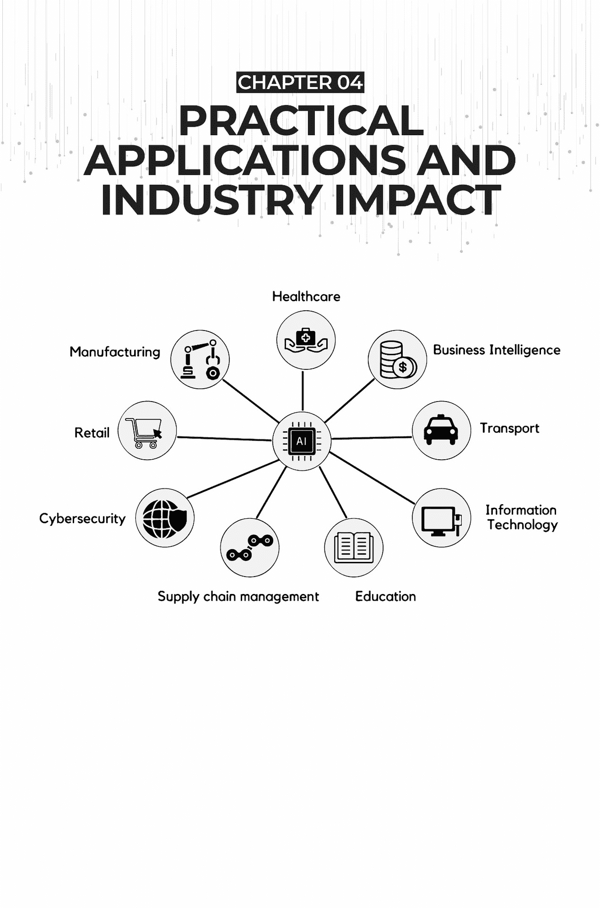

# 第 4 章：实际应用与行业影响

想象一下走进一个医生办公室，分析你医疗影像的不是人类而是机器。几年前，这可能是科幻电影中的场景，但现在它已成为 AI 在医疗领域变革性力量所塑造的现实。通过 AI，诊断过程已从手动且耗时演变为快速且精确。在放射学领域，AI 系统现在以超越人类能力的准确性和速度审查图像，比以往任何时候都更快识别 X 光和核磁共振（MRI）中的异常。这项技术不仅通过为放射科医生提供第二意见来协助他们，还降低了遗的风险，特别是对于人类可能会忽略的细微异常。AI 并不步于图像；它还扩展到了预测分析，通过评估患者数据中的风险因素，在潜在健康问题出现之前进行预判，从而实现预防性干预，拯救生命并降低医疗成本。

## 4.1 行业影响示例

除了诊断，AI 正在彻底改变治疗计划，根据个人需求量身定制，而不是依赖“一刀切”的方法。算法现在辅助药物发现，比传统方法更快地识别潜在化合物。这加速了从实验室到药房的历程，可能以创性的速度将救命药物上市。此外，AI 驱动的平台分析患者数据以定制治疗方案，考虑从遗传学到生活方式的所有因素。这种精准方法提高了治疗效果，并最大限度地减少了副作用，以优化患者预后。想象这样一个世界：你的治疗计划就像你的指纹一样独特——这是 AI 每天都在带近的现实。

智能技术的出现还通过远程监控和远程医疗改变了患者护理，打破了障碍并将医疗服务送到你的家门口。智能可穿戴设备实时追踪生命体征，向用户和医疗提供人员提醒任何异常。这些从健身追踪器到先进医疗监视器的设备赋予了患者掌控自己健康的能力，培养了积极维护健康的方法。同时，医疗平台整合了 AI 见解以提供虚拟咨询，无论地理位置如何，将患者与医疗专业人士连接起来。这种便利性确保了偏远地区患者的持续护理，弥补了医疗获取的差距并提供了及时干预。

### 案例研究：AI 在医疗领域的成功

考虑 IBM Watson 在肿瘤学中的案例，AI 通过分析大量的医学文献数据库和患者记录，协助肿瘤学家规划治疗。Watson 以闪速处理信息的能力使其能够建议人类实践者可能无法立即察觉的治疗方案，为潜在策略提供了全面的视角。AI 在糖尿病视网膜病的早期检测中也证明了其价值，这种疾病在为时已晚之前通常不会被察觉。AI 系统可以以惊人的准确性筛选视网膜图像，标记潜在病例以便进一步检查。这些示例突显了 AI 不仅提高了诊断精确度，还拓宽了获得关键护理的途径，重塑了医疗健康格局。

这些进展强调了 AI 对医疗健康难以的影响，将曾经的推测变成了现实。随着 AI 的不断演进，它有望增强医疗保健的每一个方面，从诊断、治疗到患者参与和获取，为所有人确保一个更健康的未来。

## 4.2 金融创新：预测模型与欺诈检测

在当今快节奏的金融领域，预测分析是游戏规则的改变者，使机构能够预见市场趋势并做出明智决策。人类可能缺乏预测股票波动或预测经济衰退的能力，但 AI 驱动的策略可以通过比人类快得多的处理信息来实现这一点，从而优化投资组合。类似地，信用评分也经历了转型。AI 通过分析复杂数据集增强了这些模型，对客户的信誉提供了更深层次的见解并实现收益最大化。

欺诈检测是另一个 AI 证明不可或缺的领域。金融欺诈可能产生毁灭性的后果，但 AI 正在帮助遏制它。通过使用模式识别，AI 系统实时监控交易，标记任何异常。例如，如果信用卡在短时间内突然被用于在不同国家进行大额购买，AI 可以识别出这种疑点并提醒持卡人或阻止交易。这种保护方法非常有效。

金融领域的客户服务也被 AI 彻底改变了。配备 AI 能力的聊天机器人现在处理查询，对常见问题提供即时响应，并将人工代理释放出来处理更复杂的问题。这些 AI 驱动的助手可以访问庞大的数据库，根据每个客户的需求提供个性化的财务建议。例如，在回答了你关于账户余额的问题后，它们可以分析你的消费习惯，建议省钱或明智投资的方法。这种个性化化增强了客户体验，建立了信任和忠诚度。

考虑 AI 在保险公司风险管理中的作用。AI 模型分析历史数据以预测潜在风险，允许公司相应调整保费和覆盖范围。这种远见有助于保险公司减轻损失并提供竞争性价格。在贷款领域，机器学习模型通过评估申请人的财务历史和当前信用行为简化了贷款审批流程。这不仅加快了决策过程，还降低了向高风险借款人发放贷款的可能性。显而易见，AI 对金融的影响是深远的；它以难以想象的方式推动了效率、安全和客户满意度。

## 4.3 机器人中的 AI：增强自动化与效率

就在此时，机器人正在穿梭于繁忙的城市街道，递送包裹甚至进行复杂的手术。尽管这曾是一个遥远的未来，但由于 AI 深度集成到机器人领域，这一切正在发生。AI 充当这些机器背后的大脑，将它们从简单的机械工具转变为能够学习和适应的复杂系统。在自主导航领域，AI 使无人机和车辆能够穿越充满障碍和不可预测性的环境。这些机器人使用传感器和 AI 驱动的算法来解释周围环境，做出现场决策以确保从 A 点到 B 点的安全高效旅行。无论是在拥挤的城市递送杂货，还是为环境研究调查景观，这些自主系统正在重新定义我们对交通和物流的认知。


在制造业中，AI 驱动的机械臂彻底改变了对象的识别和操作方式。想象一下，机器人不仅能够组装零件，还能对其进行质量检查，并进行实时调整以提高效率。这些机械臂利用 AI 理解并与其环境交互，精确识别物体，并执行曾经需要人类灵活性才能完成的任务。这种能力已超出生产线，延伸到农业等领域，配备 AI 的机械臂可以以惊人的准确度和速度收获作物，减少浪费并实现产量最大化。此类系统的通用性标志着自动化新纪元的到来，机器以以前认为无法企及的精度和适应性执行任务。

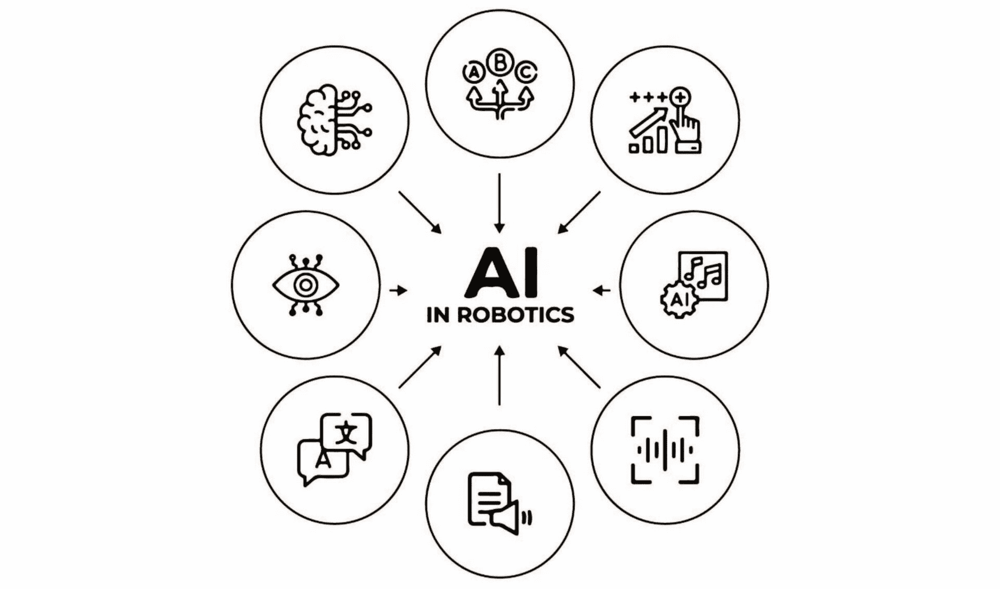

AI 的影响不仅限于单个任务；它增强了整个流程，驱动了各行业的效率提升。在物流领域，由 AI 传感器驱动的预测性维护使设备运行顺畅，从而防止了昂贵的故障和停机。这些传感器监测机器健康，在故障发生前进行预测，就像一次预见健康问题的体检。在仓库中，由 AI 驱动的自动分拣系统简化了库存管理，其分拣和分类物品的速度超过了人类的极限。它们优化了空间和时间，确保以最小的精力对产品进行跟踪和检索。这些提高了效率，降低了运营成本，并最终使企业在全球市场上更具竞争力。

协作机器人（或 cobots）的兴起将 AI 带入工作，促进了人机协作。协作机器的设计旨在与人类一起工作，配备了安全功能，允许在无风险的情况下进行密切互动。AI 使这些机器人能够适应人类动作，从环境中学习并相应调整其行为。在组装线上，协作机器人承担重复性或劳累的任务，让人类工人专注于更复杂的职责。在服务行业中，它们协助从客户服务到食物准备等一切工作，提高了生产力和服务质量。人类与机器人之间的这种协作正在重新定义劳动力动力学，创造出机器辅助人类技能的环境。

AI 在机器人领域的现实应用凸显了该技术的变革潜力。考虑机器人手术系统，AI 协助外科医生执行精确的微创手术。这些系统增强了医生的能力，提供的见解和指导改善了患者的疗。在城市地区，自动交付机器人在街道上穿梭，将包裹直接送到消费者门口，展示了物流的未来。随着这些技术的不断演进，它们有望重塑行业，创建更智能、更高效的系统，以我们才刚刚开始想象的方式增强我们的日常生活。

## 4.4 现实项目：构建 AI 驱动的聊天机器人

创建一个 AI 驱动的聊天机器人始于对其目的的清晰愿景，例如，一个可以无缝处理客户查询并提供信息的虚拟助手。第一步是定义用例，这涉及了解你的聊天机器人将做什么以及为谁提供服务。它会帮助客户浏览网站，还是在零售环境中提供支持？一旦确定了目的，就专注于设计用户交互：绘制对话流、预判用户查询并为机器人的回复编写脚本。将其构想为与朋友聊天，每条回复都感觉很自然且引人入胜。对话脚本越详细，聊天机器人就越能模拟人类互动，为用户提供更满意的体验。

为了让你的聊天机器人能够理解并响应人类语言，自然语言处理（NLP）是至关重要的。NLP 允许机器以有价值的方式理解、解释和生成人类语言。通过集成如 `spaCy` 或 `NLTK` 等 NLP 库，你的聊天机器人获得了解析和处理文本的能力，识别用户消息背后的意图。这些库提供了文本分词、命名实体识别等许多工具。引入情感分析又增加了一层复杂性，使你的聊天机器人能够检测消息的情绪基调。这在客户服务场景中特别有用，因为理解客户的心绪可以引导聊天机器人定制回复，无论是在投诉期间提供同理心，还是在积极互动中表现出热情。

一旦你的聊天机器人训练完成并就绪，将其部署到各个平台就成为下一个挑战。与 `WhatsApp` 等消息应用或 `Slack` 等平台无缝集成，确保你的聊天机器人能够在用户交流的地方与其接触。这种可访问性增强了用户的参与度和满意度。还要考虑利用云服务来实现扩展性。`AWS` 或 `Google Cloud` 等平台提供稳健的服务，可以处理增加的流量和数据处理需求，确保即使用户数量增加，你的聊天机器人也能保持响应和高效。这些服务提供了扩展所需的架构，而无需大量的内部资源，让你能够专注于完善聊天机器的能力，而不是担心技术局限性。

聊天机器人在许多现实场景中证明了它们的价值。在电子商务领域，它们自动化了客户支持，对有关产品或订单状态的查询提供即时回答，从而释放人类代理来处理更复杂的问题。这提高了业务效率，还通过缩短等待时间增强了客户体验。教育平台在使用聊天机器人作为信息检索系统时也受益于 AI，这些系统可以帮助学生寻找资源或理解复杂课题。想象一个学生需要数学题的帮助；聊天机器人可以引导他们找到相关的学习材料或提供分步解释。这些示例说明了聊天机器人的多功能应用，改变了交互，并让跨行业、跨背景的用户更容易获取信息。

## 4.5 娱乐中的 AI：个性化与内容创作

在 AI 出现之前，在家看电影之夜通常涉及无休止的滚动寻找看的内容。现在，当你准备好看电影时，你的流媒体服务会提供一份完美符合你口味的电影列表。这种个性化是一种 AI 驱动的奇迹，改变了我们消费媒体的方式。算法分析你的观看习惯、类型偏好，甚至你最频繁观看的时间段。它们随后策划符合你兴趣的内容，让无休止的滚动成为过去。`Netflix` 和 `Spotify` 等流媒体巨头使用这些推荐系统来保持你的参与，确保你看到的和听到的正是你想要的。这就像有一个比你自己还了解你的私人策展人。

AI 也彻底改变了内容创作，开启了创意的新时代。自动视频编辑工具现在可以在人工干预最小的情况下汇集素材、应用效果甚至选择音乐轨道。这些工具加速了制作周期并降低了成本，让创作者能够专注于故事而非技术细节。在音乐方面，AI 生成的作曲可以模仿著名艺术家的风格，或创建全新的流派，为音乐爱好者带来新颖的声音。视觉艺术也受益于 AI，算法可以生成复杂的设计或将照片转化为艺术杰作。这种技术与创造的融合为我们从未想象过的艺术形式开启了大门。


得益于 AI 驱动的交互，娱乐领域的用户参与度达到了新高度。虚拟现实体验现在将用户带入沉浸式世界，AI 会根据他们的偏好定制每一次交互。无论你是在探索古老的遗迹，还是潜入充满生机的海洋，AI 都能确保你的体验是独特性且引人入胜的。交互式叙事更进一步，允许用户通过过程中的选择来影响故发展。AI 会根据这些决策调整情节，创造出动态且个性化的冒险。这种程度的参与将被动的观者转变为主动的参与者，模糊了现实与想象之间的边界。

游戏行业作为娱乐领域的重要参与者，利用 AI 进行程序化内容生成。AI 不再依赖开发者来编写每一个细节，而是创建庞大且复杂的游戏世界，这些世界会随着每次游戏而改变。这通过保持游戏体验的新鲜感和不可预测性增强了重玩性。同时，虚拟环境受益于 AI 驱动的聊天机器人，提供了与角色的实时互动，角色会对玩家的行动做出智能响应。这些伙伴丰富了游戏体验，在玩家穿越虚拟景观时提供指导、幽默或陪伴。

在我们结束本章时，我们可以赞叹 AI 如何重塑我们发现、创建和互动内容的方式。从个性化我们的媒体体验到开创新的艺术表达，AI 正在创造一个娱乐像我们的想象一样动态且引人入胜的未来。这段探索 AI 实际应用的之旅为我们下一个数据分析和可视化的探索奠定了基础，在其中，我们将揭示 AI 如何帮助我们理解周围的世界。

## 4.6 AI 实战战：探索实际应用与行业影响

### 有效实践指南

*   访问 `ChatGPT`：访问 [`chatgpt.com`](https://chatgpt.com) 并根据需要创建一个免费账户。
*   与提示词交互：输入提示词、修改它们并进行实验以查看不同的回复。
*   评估回复：根据你所学到的知识检查回复的清晰性和相关性。
*   实验与反思：调整提示词以加深理解并探索 AI 的能力。

### 用于强化本节学习的提示词：

提示词 1：“请用一个在人群中发现异常行为的类比，解释预测模型是如何用于欺诈检测的。”

提示词 2：“电子商务中的推荐系统如何提高客户参与度？请用个性化购物体验的例子。”

提示词 3：“`CNNs` 如何应用于医学影像中以辅助诊断疾病？请用一个大海捞针的隐喻。”

提示词 4：“强化学习如何提高自动机器人的效率？请用一个关于学习通过迷宫的类比进行解释。”

提示词 5：“描述 AI 如何用于机器人流程自动化以优化制造工作流。”

提示词 6：“生成对抗网络（`GANs`）如何用于创建真实的视频游戏角色？请用一个关于雕塑家完善其作品的类比进行解释。”

提示词 7：“在流媒体平台使用 AI 进行内容推荐有什么好处？描述算法如何根据用户偏好定制建议。”

提示词 8：“解释 AI 聊天机器人是如何部署在客户服务中的。哪些特征让它们有效？”

提示词 9：“想象你正在构建一个 AI 驱动的虚拟旅游指南。它需要哪些功能？它又将如何使用计算机视觉和自然语言处理？”

提示词 10：“设计一个 AI 系统以增强在线教育中的个性化学习。它将使用什么数据，又如何与学生互动？”

## 通过你的评论创造价值

### 开启慷慨的力量

我们通过得到而生存，但通过给予而丰富生活。 –温斯顿·丘尔

分享知识、见解或仅仅是一句友善的话会让世界变得更明亮。一点努力就能激励他人迈出第一步。让我们一起创造改变吧！

你愿意帮助一个像你一样对 AI 感到好奇但不确定如何开始旅程的人吗？

这本书的编写是为了让 AI、深度学习和神经网络对每个人来说都简单、易懂且有趣。但为了让更多可能受益，我需要你的帮助。

大多数读者通过阅读评论来决定下一本书。你的反馈可以引导某人的学习路径，帮助他们发现 AI 是多么令人兴奋且易于上手。

这不需要任何费用，只需要片刻时间，但你的评论可以：

*   激励一个学生追求 AI 项目。
*   支持一个小企业主简化他们的流程。
*   赋能一个企业家建立他们的梦想产品。
*   帮助专业人士步入科技化的未来。
*   为感到感到困顿的人开启一段发现之旅。

## 准备好创造改变了吗？

扫描下方的二维码或访问此链接以留下你的评论：[`www.amazon.com/review/review-your-purchases/?asin=B0D9RX3KRS`](https://www.amazon.com/review/review-your-purchases/?asin=B0D9RX3KRS)


每一条评论无论大小，对我来说都意义重大。衷心感谢你参与这项让 AI 对所有人都易于接触并赋予能力的使命。

顺颂商祺，

Jordan Blake


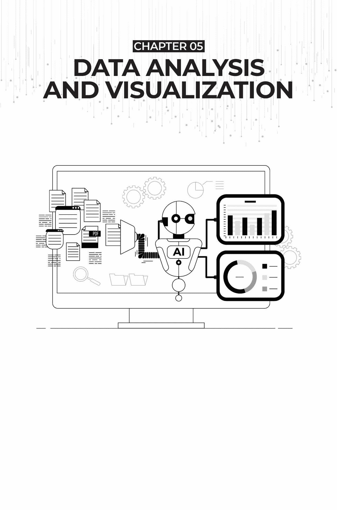

# 第 5 章：数据分析与可视化

想象你正在整理一个混乱的图书馆，每本书都代表一个新的数据点，而你最终作品的质量取决于你如何对这些数据进行分类、清洗和准备。在机器学习的世界中，数据是你最宝贵的资产，但它们很少以完美的状态出现。不干净的数据就像迷雾，遮挡了通往准确分析和可靠结果的道路。如果你试图用浑浊的色彩来画一幅杰作，那么你的画作将是模糊且不清晰的。同样，不干净的数据会严重影响性能，导致预测偏差和资源浪费。缺失值和离群值等常见问题就像道路上的坑洼，颠簸着你的旅程并可能导致错误的结论。

## 5.1 数据清洗与转换

数据清洗的过程既是艺术也是科学，需要细致的关注和策略性的技术。一种重要的方法是通过插补来处理缺失数据。这种技术通过估计值来填补空白，确保数据的缺失不会成为障碍。这就像修补网上的洞，让你能够捕到每条鱼而不会从缝隙漏掉。检测并移除离群值是另一个关键步骤。离群值可能会产生误导，就像安静房间里的一个大声音。移除或调整这些异常有助于提高数据质量，为分析提供更清晰的视角。这些方法共同确保了你的数据是完整的并代表了你所研究的现实。


转换是下一步，将原始数据转换为既有意义又易于管理的格式。这涉及到归一化和缩放，它们对数据进行标准化处理，确保没有单个特征会主导模型的学习过程。想象正在调整音响系统的音量，让所有扬声器和谐地播放，而不会让一个盖过其他。同样，归一化确保了每个数据特征对分析的贡献是均等的。分类变量编码是另一个关键方面，将它们转换为模型可以解释的形式。例如，将“是”和“否”转换为二值，允许允许模型以逻辑化的方式处理这些响应。这些转换是混乱与清晰之间的桥梁，使得有效的模型训练和分析成为可能。

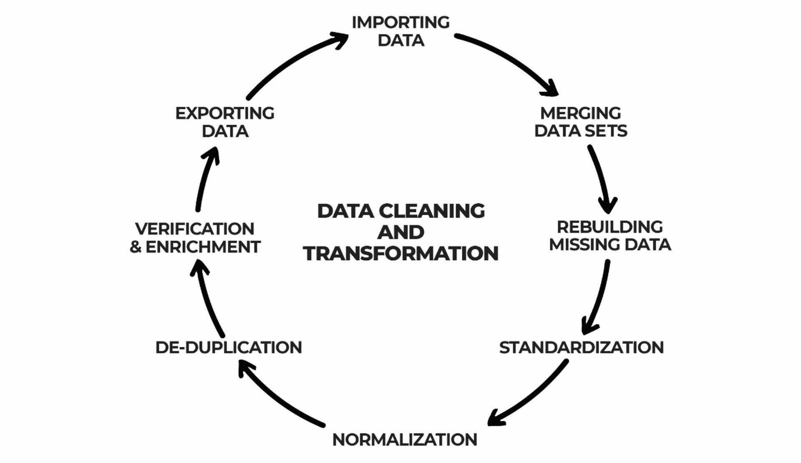

在数据清洗工具方面，Python 凭借其强大的库（如 `pandas` 和 `NumPy`）脱颖而出。`pandas` 是你进行数据操作的首选，提供了处理缺失值、删除重复项、纠正数据格式以及精确高效地解决任何其他数据问题的函数。`SQL` 查询也很有价值，特别是在处理数据库时，因为它们允许你直接在源头清洗数据。这种双重方法确保了你的数据准备充分，减少了错误并增强了分析的可靠性。

为了真正理解数据清洗的影响，请考虑一个零售公司因数据不一致而陷入销售预测不准的案例。通过实施全面的数据清洗策略，他们通过插补处理了缺失值，并删除了偏离预测的离群值。结果是一个更准确、更可靠的预测模型，导致了更好的库存管理和收入的增加。这个例子强调了数据清洗在实现稳健且可靠的洞察方面的关键作用。

### 反思练习：评估你的数据

花一点时间检查你当前正在使用数据集。识别任何缺失值或离群值。考虑如何使用这里讨论的技术来解决这些问题。思考这些步骤如何提高你分析的质量和可靠性。这项练习将帮助强化数据清洗的重要性，并为你数据之旅的下一步做做好准备。

## 5.2 探索性数据分析：工具与技术

将探索性数据分析 (EDA) 视为数据分析过程中的初步侦察任务。在这个阶段，你可以深入了解数据。目标是从一开始就理解数据分布，识别可能导致突破的模式或可能进一步调查的异常情况。想象你手里有一个没有盒盖图案的巨大拼图。EDA 会首先识别角和边缘，这样你就可以继续组织其他碎片。它通过揭示数据的形状和分布，为所有后续分析奠定基础。通过 EDA，你可以发现可能会偏曲结果的异常数据点，允许你在它们在模型中引起问题之前处理它们。

要进行有效的 EDA，你需要一套工具和库。`pandas` 对于数据操作和描述性统计来说是不可或缺的，它提供了灵活性，让你能够轻松地重塑和过滤数据。`NumPy` 补充了这一点，提供了强大的数值分析能力，使你能够轻松执行复杂的计算。Jupyter notebooks 提供了一个交互式环境，你可以在其中将代码执行与丰富的文本和可视化结合起来，创建一个鼓励实验和探索的动态工作区。这些工具共同构成了你 EDA 工具箱的骨干，使你能够直面数据挑战。

可视化在 EDA 中起着至关重要的作用，它将原始数字转换为具有洞察力的视觉效果，使复杂的数据更易于理解。直方图和箱线图是你探索数据分布时的好伙伴。直方图让你直观地感受到不同区间内的数据频率，而箱线图则突出了分布并识别了潜在的离群值。这些视觉图提供了数据底层结构的快照，帮助你决定后续步骤。当你想要探索变量之间的关系时，散点图派上了用场。通过将一个变量相对于另一个变量绘图，你可以发现起初可能并不明显的相关性或趋势。无论是正、负还是不存在，这些关系都为数据中不同元素如何相互作用提供了宝贵的洞察。

当你熟悉 EDA 时，实用的技术变得至关重要。相关性矩阵是识别多个变量之间关系的强大工具。它提供了类似热图的表示，每个单元格表示相关性的强度和方向。该矩阵可以快速确定哪些变量是同步变化的，引导你进行特征选择和模型设计。`Group by` 操作是另一个实用的技术，允许你按类别划分数据并计算每组的汇总统计数据。这种方法在比较不同部分（例如客户人口统计数据或产品类别）时特别有用，因为它允许你根据特定需求定制分析。

### 交互练习：通过 EDA 发现趋势

选取你正在工作的数据集并进行简单的 EDA。从使用 `pandas` 计算基础统计开始，然后用直方图和散点图将数据可视化。创建一个相关性矩阵来识别关系。反思你所获得的洞察，并考虑它们如何指导你下一步的分析。这种动手的方法有助于巩固你对 EDA 力量潜力的理解。

## 5.3 使用 Matplotlib 和 Seaborn 可视化数据

现在，你应该准备好画出一幅讲述你数据故事的画面了。面对面前的空白画布，`Matplotlib` 就像你的画笔，提供了创建自定义图表的灵活性，让你的数据活起来。这个绘图库是数据可视化世界中的一种强大工具，以其创建详细且精确的可视化而闻名。数据科学家欣赏 `Matplotlib` 的多功能性、可靠性以及制作从简单折线图到复杂多层图表一切的能力。`Matplotlib` 的另一个美丽之处在于它的灵活性。你可以控制图表的每一个方面，从线条的颜色到轴上刻度的位置，允许你定制可视化效果以满足你分析的精确需求。这种程度的细节在为报告或演示文创建可视化效果时特别有益，因为清晰度和精确是至关重要的。

开始使用 `Matplotlib`，让我们探索一些构成数据可视化基础的基本图表类型。折线图是分析随时间变化的绝佳工具。无论你是在跟踪股价还是温度变化，折线图都能揭示可能被忽视的模式和波动。创建折线图涉及在 x 轴和 y 轴上定义数据点并画一条线连接它们，这突出了你数据的轨迹。另一方面，柱状图是比较分类数据的理想选择。它们提供了一种直观的方法来可视化组之间的差异，例如不同产品类别的销售额或来自不同人口统计调查响应。通过调整柱的宽度和颜色，你可以强调数据的特定方面，使你的洞察更具吸引力且易于理解。


虽然 Matplotlib 提供了结构，但 Seaborn 则增添了魅力，通过美学的设计增强了你的可视化效果。Seaborn 构建在 Matplotlib 之上，仅需几行代码即可简化创建复杂图表的过程。它的突出特性之一是矩阵图（pair plot），非常适合多变量数据探索。矩阵图会为数据集中的每对变量创建一个散点图网格，并在对角线上配以直方图。这种全视角的视角让你能够同时识别多个维度上的相关性和模式，从而对数据提供整体性的理解。热力图（Heatmaps）是 Seaborn 提供的另一种强大的可视化工具，用于数据相关性的可视化。通过用颜色表示矩阵中的值，热力图可以快速传达变量之间关系的强度，使其更容易发现趋势和异常。

考虑一个需要可视化数据集分布的实际示例。直方图（histogram）是此项任务的绝佳选择，因为它显示了数据点在指定范围内的频率，清晰地描勒出数据在不同间隔内分布的状况。通过调整分箱（bins）的数量，你可以精炼可视化的粒度，根据需要关注细节或更广泛的趋势。此外，箱线图（box plot）可用于可视化数据分布和离群值，提供对数据集中心趋势、变异性和潜在异常的洞察。箱代表四分位距，须线（whiskers）延伸到最小值和最大值，而离群值则作为单独的点绘制。这种方法对于识别可能偏斜分析的离群值，以及比较不同类别之间的分布特别有用。

## 5.4 高级数据可视化：用数据讲述故事

如果你必须读一整本全是数字和统计数据的书，那会有点枯燥，对吧？另一方面，如果作者利用这些数字和数据讲述一个引人入胜的故事，读起来就会有趣得多。这就是数据故事讲述的本质：将原始数据转化为能够吸引参与并提供信息的引人叙述。故事讲述通过提供背景和清晰度来增强数据可视化，使复杂的数据变得易于理解和亲近。这就像是将深奥的学术论文变成一本引人入胜的小说。精心构建的叙述会引导观众的解读，突出那些可能被忽略的关键洞察和趋势。例如，与其将销售数据作为数字呈现，不如围绕产品的市场表现构建一个故事，将枯燥的统计数据转化为关于增长和策略的有意义故事。

高级可视化技术是你创作这些故事的工具。交互式仪表板（Interactive dashboards）允许你实时探索数据，提供了一种分析和解释信息的动态方式。将仪表板想象成一份活生生的文档，用户可以在其中与数据交互，发现针对其特定问题的洞察。这些仪表板让你能够深入细节，或者也可以缩小范围以获得更广泛的视角，为分析提供了灵活性和深度。地理空间可视化（Geospatial visualizations）增加了另一个维度，将数据模式映射到地图上以揭示地理趋势和洞察。想象一张显示城市客户密度的热力图，精准定位适合业务扩张的区域。这些可视化将抽象数据转化为切实的洞察，提供了数据如何与物理世界交互的清晰图景。

要创建这些高级可视化，你需要正确的工具。Tableau 是开发交互式和可共享仪表板的热门选择。它提供了用户友好的界面，允许你连接到各种数据源并只需点击几次即可创建可视化。通过 Tableau，你可以构建讲述故事的仪表板，并配备吸引观众的交互式元素。另一方面，Plotly 在创建交互式图表和图图方面表现出色。它提供了一个多功能平台，用于可视化从时间序列到 3D 图的复杂数据。这些工具使你能够将数据故事讲述提升一个水平，创建出既信息丰富又吸引人且记忆深刻的可视化效果。

考虑有效的数据故事讲述如何让洞察生生。可视化几十年的经济数据趋势可以揭示市场的兴衰、政策的影响以及经济演化的故事。精心设计的图表可以总结研究结果，将数据海洋转化为简洁、具有视觉吸引力的叙述，一目了然地传达要点。这些故事具有告知、说服和推动行动的力量。将数据编织成引人叙述的能力是区分普通数据分析师与卓越故事讲述者的关键技能。

## 5.5 实践练习：真实世界数据分析项目

参与真实世界的数据分析项目提供了以具体方式应用技能的机会。一个很好的起点是分析社交媒体数据的情感趋势。社交媒体平台是用户意见和情感的宝库，通过帖子、点赞和评论表达出来。通过收集这些数据，你可以探索情感如何随时间推移或响应特定事件的变化。从选择一个平台开始，使用 `APIs` 收集与特定主题相关的数据。收集完成后，对数据进行预处理以关注相关特征，例如文本内容和时间戳。这种准备为深入分析奠定了基础，让你能够发现公众舆论中新兴的模式和趋势。

使用销售数据进行市场分析是另一个产生有价值洞察的实践项目。销售数据是理解消费者行为、产品性能和市场动态的关键。从从公司或开放数据集获取销售记录开始。将数据组织为时间段、产品类型和地理区域等类别。这种组织有助于你可视化趋势并识别增长机会。利用可视化手段突出显关键指标，例如收入增长或产品流行度。通过这些可视化，你可以描绘出市场状况和潜在转变的图景，指导业务策略和决策。

执行这些项目需要一种有方法的方法。从数据收集和准备开始，建立一个清洁且完整的数据集。对于社交媒体数据，这涉及过滤噪音和无关信息。在市场分析中，重点是准确的分类和归一化。一旦数据准备就，选择合适的可视化技术来揭示洞察。对于情感分析，词云和折线图可以说明公众情绪的变化。在市场分析中，使用柱状图和热力图比较不同细分市场的销售表现。这些可视化是识别形成你结论的趋势和模式的基础。

批判性思维和洞察提取是从你的分析中得出有意义结论的关键。当你探索数据时，寻找那些脱出的模式。社交媒体情感中是否存在反复的主题？某些产品是否始终优于其他产品？识别这些趋势允许你构建数据驱动的叙述并做出明智决策。例如，积极情绪的波动可能表明营销活动的成功，而销售额的下降可能意味着需要战略调整。这些洞察阐明了现状，并为未来的行动提供了指导。


有效地展示你的发现对于传达你的分析价值至关重要。构建你的报告和演示文稿要确保清晰，从目标和方法的概述开始。使用视觉辅助工具来增强理解，确保复杂的数据易于理解且具有吸引力。图表、图形和信息图可以将原始数字转化为引起观众共鸣的引人视觉效果。根据听众的需求和兴趣定制你的演示内容，无论他们是利益相关者、同事还是客户。通过构建清晰简洁的叙述，你可以确保你的见解不仅被听到，而且被采取。

当你结束对数据分析和可视化的探索时，请考虑你工作更广泛的影响。你学到的技能和技术使你能够应对复杂挑战并发现可操作的见解。这些项目虽然是宝贵的练习，但也是掌握数据科学复杂之处的基石。通过每一个项目，你都会获得信心和专业知识，为不断变化的数据驱动决策格局做好准备。

## 5.6 与 AI 实战：增强数据分析与可视化技能

### 有效实践的说明

- 访问 ChatGPT：访问 `https://chatgpt.com` 并在需要时创建一个免费账户。
- 与提示词交互：输入提示词、修改它们并进行实验以查看不同的响应。
- 评估响应：根据你学到的知识检查其清晰性和相关性。
- 实验与反思：调整提示词以加深理解并探索 AI 的能力。

### 用于强化本节学习的提示词

提示词 1：“清理大型数据集常见挑战有哪些？用一个整理杂乱房间的类比来解释。”

提示词 2：“解释你如何使用填补（imputation）或删除等技术处理缺失数据。提供真实案例。”

提示词 3：“你将如何对包含客户评论的数据集进行探索性数据分析（EDA）？列出发现模式和见解的步骤。”

提示词 4：“用简单的例子描述单变量、双变量和多变量分析之间的主要区别。”

提示词 5：“你将如何创建一个可视化销售数据的交互式仪表板？你会包含哪些工具和图表？”

提示词 6：“你如何使用 3D 图表可视化复杂的数据集？描述一个科学数据分析中的用例。”

提示词 7：“想象你正在分析社交媒体数据以跟踪公众情绪。你会使用什么可视化方案来展示你的发现？”

提示词 8：“讨论在可视化敏感数据（如健康或财务记录）时的伦理考量。如何保护隐私？”

提示词 9：“设计一个比较过去十年全球互联网使用情况的可视化项目。你会使用哪些数据源和可视化工具？”

提示词 10：“想象你正在为智能城市项目创建一个可视化方案。你会包含哪些类型的数据，又如何表示它们？”

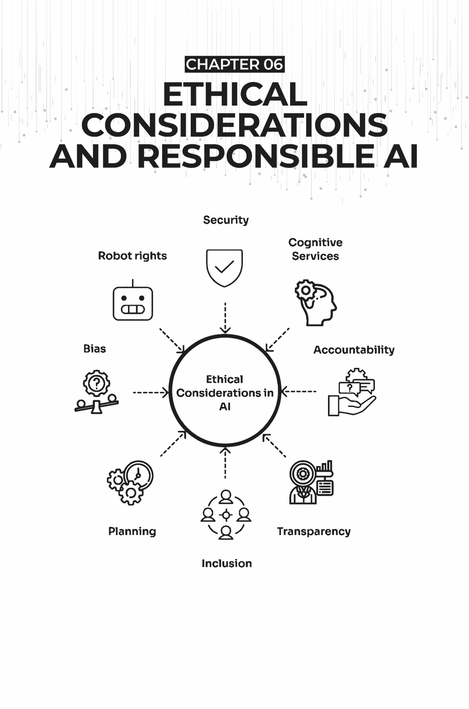

# 第 6 章：伦理考量与负责任的 AI

想象一下：你正要参加心仪工作的面试，而 AI 系统将成为决策过程的一部分。听起来很有未来感，对吧？但如果我告诉你，这个系统可能存在偏见，不仅基于你的技能，还基于它不应该考虑的因素，比如你的性别或种族呢？这就是我们今天面对 AI 时的现实，偏见可能会渗透进算法，导致不公平有时甚至是有害的结果。

## 6.1 人工智能中的偏差

在 AI 中，偏差源于我们输入到这些系统的数据。训练数据往往反映了社会偏见，例如性别刻板印象或种族偏见，这些会在无意中教导 AI 复制这些模式。例如，如果 AI 系统是根据历史工作数据进行训练的，其中某些职位主要由某一性别担任，它在做出招聘建议时可能会倾向于该性别的候选人。训练数据中这种微妙的偏差可能导致结果的倾斜，加剧不平等而不是解决问题。

算法偏差不仅仅是一个抽象概念；它具有现实世界的影响，特别是在招聘和法律执法等敏感领域。考虑公司用于筛选候选人的招聘算法。如果这些算法存在偏见，它们可能会根据非非能力因素不成比例地排除合格的人员，这反过来限制了多样性并延续了系统性歧视。同样，执法机构部署的人脸识别系统也因误认个人（特别是少数群体中的成员）而受到审查。这些错误侵蚀了人们对技术以及使用技术的机构的信任；更糟糕的是，它们可能导致错误的指控或逮捕。

检测 AI 系统中的偏差对于确保公平和公正至关重要。统计测试可以通过比较 AI 模型在不同人口统计群体中的表现来帮助识别偏差。在一个群体中表现良好但在另一个群体中表现糟糕的 AI 系统可能表明存在底层的偏差。对 AI 系统进行公平性审计涉及对训练数据、算法和结果进行彻底检查，以识别并纠正偏差。像 `IBM's AI Fairness 360` 等工具提供了此类审计的框架，使开发者能够主动解决系统中的潜在偏差（来源 1）。

在检测之后，减轻 AI 中的偏差需要共同努力，以确保训练数据集的多样化和代表性。通过包含准确反映人口多样性的数据，我们可以教导 AI 系统做出更公平的决策。模型训练中的偏差纠正技术（如重新加权或重采样数据）可以帮助平衡表示并减少偏差。这些策略不仅提高了 AI 系统的公平性，还增强了它们的可靠性和信任度，使其能够公平地为所有用户服务。

### 反思练习：评估 AI 中的偏差

花一点时间反思你每天交互的 AI 系统，无论是在个人生活中还是工作中。考虑偏差可能如何影响它们的结果。是否存在偏向某些群体而非其他群体的模式？这些偏差会如何影响人的经历或机会？利用这种反思来思考如何在自己的项目或工作场所倡导更公平的 AI 实践。

## 6.2 确保 AI 的公平性与问责制

AI 技术拥有彻底改变从医疗保健到金融各个行业的力量。但如果没有公平性，这些进步可能会扩大获取资源者与无法获取者之间的差距。AI 的公平性至关重要，因为它确保了这些技术惠及所有人，而不仅仅是少数人。在我们日益数字化的世界中，公平获取 AI 只有通过为所有背景如何的人创造机会才能实现。这涉及设计在自动化决策中不歧视的系统，确保 AI 的力量以负责任且包容的方式运作。

为了实现公平，我们必须采用引导 AI 开发的框架。这些框架关注意识和干预，承认偏差可能会产生且必须主动处理。公平性指标和标准提供了衡量和确保 AI 系统公平运行的方法。它们帮助开发者评估模型是否公平地对待所有用户，为持续改进提供基准。通过将这些框架整合到开发过程中，我们可以设计出尊重人类多样性并促进社会利益的 AI。


问责制是伦理 AI 开发的另一支柱。它涉及让 AI 系统及其创造者对其技术产生的结果负责。法律和监管方法在此过程中起着至关重要的作用，为 AI 驱动的决策建立明确的标准和后果。透明度是促进问责的关键。当 AI 系统是透明的时，它们的决策过程就变得可见且易于理解，从而允许审查和问责。这种透明度建立了信任，因为用户可以看到决策是如何以及为什么被这样做出的，并确保系统在必要时可以进行审计和纠正。

现实世界的例子突显了公平性和问责在 AI 应用中是如何被优先考虑的。考虑为包容性招聘实践而设计的 AI 系统。这些系统的开发重点是消除偏差，确保候选人是根据能力而非人口统计特征接受评估的。通过使用多样化的数据集和公平性指标，这些系统努力为所有申请者提供均等的机会。另一个例子是促进负责任 AI 的社区主导倡议。这些倡议涉及开发者、用户和利益相关者之间的合作，旨在反映社区价值并解决当地需求的 AI。它们强调了在开发过程中纳入多元化声音的重要性，以保证 AI 为更广泛的社会服务。

### 案例研究：包容性招聘实践

让我们来看一个科技公司实施侧关注包容性的 AI 驱动招聘系统的案例。该系统是以公平性指标为核心构建的：它根据技能和经验评估候选人，同时过滤掉性别或种族等可能存在偏差的数据点。该公司开展了定期审计，使用透明度工具来确保 AI 的决策与他们的多样性目标一致。最终，这种方法改进了他们员工队伍的多样性，并提升了招聘的整体质量，因为系统是根据能力和潜力而非传统偏见来识别人才的。这一案例强调了公平性和问责不仅可以改变招聘流程，还能改变整个组织文化。

## 6.3 可解释性：让 AI 决策透明化

想象使用一个会影响你日常生活的决策的 AI 系统——例如推荐医疗治疗方案或批准贷款。你难道不想了解这些决策是如何做出的吗？可解释性是将 AI 的决策过程变得透明且易于理解的实践。当你能够理解 AI 决策背后的逻辑时，你会更有信心信任这些系统。没有这种透明度，AI 仍然是一个黑箱，会在用户中产生产生怀疑和抵触情绪。信任对于 AI 技术的广泛采用至关重要，特别是在决策具有重大影响的领域。

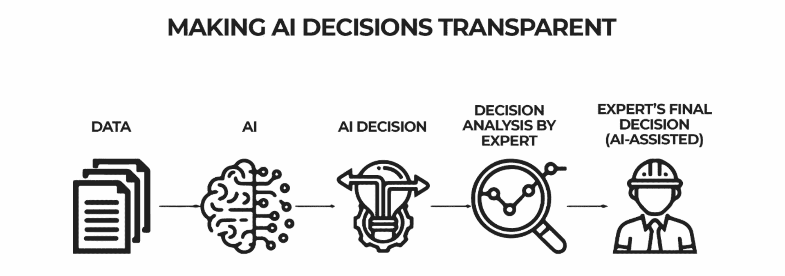

在 AI 中实现可解释性并非易事，但某些方法可以帮助揭开这些系统的神秘。一种流行的技术是使用模型无关的方法，如 `LIME`，它的全称是局部可解释模型无关解释。`LIME` 的工作原理是通过更简单、更具解释性的模型来近似复杂模型，从而解释单个预测结果。就像将科学论文翻译成日常语言一样，这个过程让没有技术背景的人也能理解这些信息。可视化工具在让 AI 易于理解方面也起着至关重要的作用。通过使用热图或决策树等可视化工具，用户可以看到哪些因素影响了模型的预测，从而对决策过程获得洞察。这些工具帮助桥了复杂算法与人类理解之间的鸿沟。

创建可解释的 AI 模型面临着自身的挑战。在保持模型复杂性和确保可解释性之间存在着微妙的平衡。复杂模型通常提供更准确的预测，但更难解释。简化这些模型可能会让它们更容易理解，但可能会损害它们的准确性。此外，围绕知识产权保护的问题也存在。公司往往担心透露过多关于 AI 系统的信息，害怕这可能会暴露商业秘密。透明度与保护之间的紧张关系是实现可解释性的重大障碍。开发者必须应对这些挑战，创建既有效又易于的系统。

可解释 AI 已在各个领域证明了益处，增强了这些技术的部署和接受。例如，在医疗诊断中，可解释性至关重要。医生需要理解为什么 AI 推荐特定的诊断或治疗方案。通过提供清晰的解释，AI 系统可以支持临床决策以改进结果。在金融服务领域，可解释 AI 有助于澄清决策。当银行使用 AI 判断信誉时，客户和监管机构需要理解接受或拒绝背后的逻辑。这种透明度确保了公平性和对监管标准的遵循，培养了机构与客户之间的信任。

在 AI 的背景下，可解释性已不仅仅是一个技术要求；它是一种伦理使命。随着 AI 持续演进并整合到生活的各个方面，理解其运作机制变得越来越关重要。可解释性赋予了用户力量，对影响他们的决策提供了清晰度和信心。目标是让 AI 系统变得更智能、对人类友好，以便它们能以有效且符合伦理的方式服务我们。

## 6.4 实践中的伦理 AI：案例研究与教训

让我们仔细观察如何通过现实场景解决 AI 中的伦理挑战。考虑预测性执法的案例，AI 系统被用于预测犯罪活动并分配警察资源。从表面上看，这似乎是技术增强公共安全的逻辑应用。然而，在某些情况下，这些系统被强化了执法中存在的偏差。例如，如果一个系统是在反映偏见执法实践的历史犯罪数据上进行训练的，它可能会不成比例地针对少数社区。这导致了审查的增加以及对更透明公平算法的呼吁。这里的教训是显而易见的：如果没有仔细的考虑，AI 可能会延续甚至放大社会不公。显显然，在开发过程中让多元化的利益相关者对于确保这些系统公平地服务所有社区至关重要。


但在这些挑战和陷阱之外，许多成功的伦理 AI 实践提供了宝贵的见解。例如，AI 正被用于提高残障人士的无能力。语音识别和自然语言处理技术让数字内容和服务变得更易于获取，使残障人士能够充分参与数字世界。这些应用展示了在设计 AI 时如何考虑到包容性，从而提高生活质量和社会参与度。同样，社区驱动的社会向善 AI 项目也日益受到关注。这些倡议让当地社区参与 AI 系统的开发，以解决特定需求，例如改善医疗保健或教育的途径。通过优先考虑使用这些技术的人们的声音和需求，这些项目体现了伦理 AI 的实践。

为了开发和维护伦理 AI 系统，组织应该建立伦理审查委员会。这些委员会可以指导开发过程，确保从一开始就整合伦理考虑。定期的伦理审计和合规性检查也至关重要。它们作为保护措施，在潜在的伦理问题变成重大问题之前进行识别。组织可以使用 `AI FactSheets` 等工具，它们提供了 AI 系统的结构化文档，详细说明其开发、部署和伦理考量。通过实施这些指南，开发者可以创建具有创新性、社会责任感并能为真正造福他的技术铺道路的 AI 系统。

在 AI 开发中融入伦理实践不仅是一个技术挑战，更是一个社会挑战。它需要跨部门、跨学科的协作，以及对透明和责任的承诺。只有这样，我们才能确保 AI 是赋能工具而非分裂工具，促进一个技术以公平且有意义的方式增强人类潜力的未来。

## 6.5 构建可信的 AI 系统

你会将你的个人数据、财务决策甚至你的安全交给一个 AI 系统吗？什么会让这样一个系统值得信任？AI 可信性的核心取决于三个关键组件：可靠性、安全性和伦理。可靠性确保 AI 系统能够持续且准确地运行，提供用户可以信赖的可靠结果。另一方面，安全性保护 AI 应用中的数据和过程免受泄露和滥用，在数据隐私至关重要的时代提供了一个坚固的保护堡垒。伦理为 AI 系统注入了反映社会规范和价值观的原则，确保技术符合道德预期。这些组件共同成了信任的支柱，影响着用户如何采纳和接受 AI。当人们信任 AI 时，他们更有可能将其整合到生活中，从而实现更无缝、更有影响的技术进步。

但我们如何构建体现这些理想理念的 AI 系统呢？一种策略是确保数据隐私和安全，这在当今互联的世界中是不可妥协的。开发者必须实施稳健的数据保护措施，如加密和匿名化，以保护敏感信息。这在保护个人的同时，也增强了系统的信誉。构建具有韧性的 AI 模型是另一项重要策略。这些模型应该设计成能够抵御错误和攻击，即使在不利条件下也能保持功能。诸如对抗训练（adversarial training）等技术让模型准备处理意外输入是实现这种韧性的关键。实现可信性需要一种主动的方法，在潜在漏洞变成威胁之前解决它们。

人类监督在维护对 AI 系统的信任方面起着至关重要的作用。让 AI 独立运行是不够的；人类操作员必须参与，验证决策并确保伦理使用。“人在回路”（Human-in-the-loop）方法让人类积极参与 AI 决策过程，提供自动化系统本身可能缺乏的平衡机制。这种监督对于具有重大后果的决策（如医疗保健或刑事司法领域的决策）关重要。对 AI 操作员进行伦理使用和解读的培训同样重要。这些个人应该具备理解 AI 输出并做出明智判断的能力，确保技术服务于人类利益并遵循伦理标准。

可信 AI 系统的例子比处可见，说明了可靠性、安全性和伦理在实践中是如何结合的。考虑自动驾驶汽车，它们必须赢得公众信任才能成为主流。这些车辆依赖 AI 进行安全导航，需要严格的测试和验证，以确保它们在道路上持续做出正确决策。它们的成功取决于公众对其安全可靠运行能力的信心。医疗领域的安全 AI 平台是另一个例子，它们以极其谨慎的态度处理敏感患者数据。这些系统采用先进的安全措施来保护数据完整性和机密性，在依赖这些关键健康信息的用户之间建立信任。

在更广泛的背景下，对 AI 系统的信任超越了技术规范。它涉及培养一种透明和负责的文化，让用户对每天交互的技术感到自信。随着我们继续开发和部署 AI，维护信任将是关重要的，确保这些系统在不损害我们的价值观或安全的情况下增强我们的生活。通过采用这些原则，我们可以为推动技术进步和丰富我们共同人类经验的 AI 铺道路。

在本章结束之际，显而易见的是伦理考虑不仅是指南，更是 AI 未来的必要要求。可信的 AI 系统触手可及，随着我们向前迈，这些原则将指导我们构建一个更加公平、安全的数字世界。在下一章，我们将探索 AI 如何继续塑造行业，驱动创新并重新定义可能。

## 6.6 AI 实践战：探索 AI 中的伦理考虑

### 有效实践的说明

● 访问 ChatGPT：访问 `https://chatgpt.com` 并在需要创建一个免费账户。
● 与提示词（prompts）交互：输入提示词、修改它们并进行实验以查看不同的回复。
● 评估回复：根据你所学的内容检查回复的清晰性和相关性。
● 实验与反思：调整提示词以加深理解并探索 AI 的能力。

### 用于强化本节学习的提示词

提示词 1：“用一个关于使用有缺陷的蓝图盖房子的比喻，解释偏见是如何引入 AI 模型的。”

提示词 2：“可以采用哪些策略来减少 AI 模型中的偏见？请提供招聘或贷款场景的示例。”

提示词 3：“组织可以采取哪些措施来保护 AI 系统中使用的敏感数据？请提供医疗保健或金融领域的示例。”

提示词 4：“AI 开发者如何为非技术用户提高模型透明度？请使用自动贷款审批的示例。”

提示词 5：“为什么可解释性在 AI 系统中至关重要，特别是在医疗保健等高风险领域？请提供真实世界的场景。”

提示词 6：“讨论当 AI 系统做出有害决策时，应该由谁承担责任。请使用自动驾驶或预测性警务的示例。”

提示词 7：“想象你正在设计一个用于招聘的 AI 系统。你会采取哪些步骤来确保它避免歧视性结果？”

提示词 8：“公司如何平衡广告个性化需求与对用户隐私的尊重？请提供可操作的策略。”


提示词 9：“想象一个 AI 被用于个人决策的未来场景。为了保护个人自主性，应该建立哪些保护措施？”

提示词 10：“分析 AI 系统被用于预测性警务的场景。潜在的风险有哪些？如何缓解这些风险？”

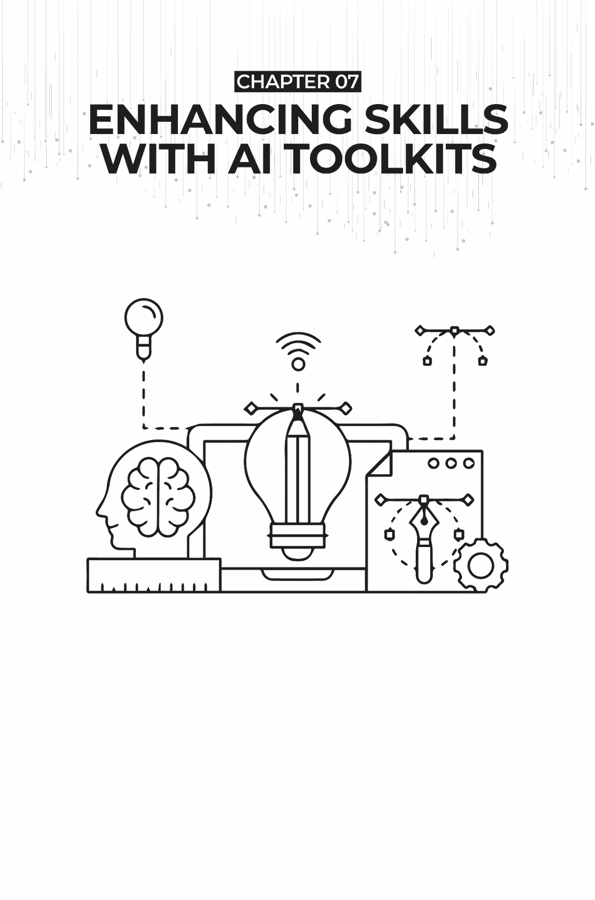

# 第 7 章：使用 AI 工具包增强技能

人工智能领域瞬息万变，不断变化，创新正以惊人的速度涌现。为了在这个环境中保持竞争力，开发者和研究人员通常会寻求 `TensorFlow`，因为它具有可靠性、强大性和支持。想象你是一位面对空白画布的艺术家，而 `TensorFlow` 就是你的调色板，充满了各种生活的工具，可以让你你的 AI 愿景变为现实。`TensorFlow` 由 Google 开发，已成为机器学习的基石，为构建和部署模型提供了灵活且全面的生态系统。它的架构围绕健壮的计算图构建，能够高效地处理复杂的数学运算，就像一台在压力下平顺运行的润滑机器。该框架允许你轻松地构建复杂的模型，将抽象的想法转化为具体的成果。

## 7.1 TensorFlow：理解基础

`TensorFlow` 多功能性的核心是 `TensorFlow Hub`，这是一个预训练模型存储库，可以加速你的工作流。将其想象成一个充满了即用资源的库，这些资源可以根据你的特定需求进行微调和适应。无论你是深耕图像分类还是自然语言处理，`TensorFlow Hub` 都提供了一个起点，在节省你和精力的同时，确保你能接触到尖端技术。与其补充的是 `TensorFlow Extended` (`TFX`)，这是一个生产就绪的流水线，简化了模型在现实应用中的部署。`TFX` 就像工厂里的传送带，生产出的模型构建高效，能够无缝集成到生产系统中，并准备好应对现实世界的挑战。

理解 `TensorFlow` 操作的基础对于发挥其全部潜力至关重要。`TensorFlow` 的核心是张量（tensors），它们作为主要数据结构的多维数组。将它们视为任何 `TensorFlow` 操作的构建块，就像乐高积木，可以堆叠和组织以创建复杂的结构。创建和管理张量涉及定义它们的形状和类型，然后通过加法、乘法和重塑等操作对其进行处理。计算图通过映射数据流进一步增强了这一点，允许 `TensorFlow` 高效地优化和执行操作。该图充当蓝图的角色，可视化了不同操作之间的关系，并确保数据顺畅地通过网络。

当你使用 `TensorFlow` 时，你会发现一些可以开启优化和部署新可能的高级功能。`TensorFlow Lite` 为移动和嵌入式设备设计，是 `TensorFlow` 的压缩版本，实现了设备端机器学习。想象直接将 AI 模型部署到手机上，让它们在不依赖服务器计算的情况下变得更智能、更快速。这种能力为实时翻译和图像识别等应用大门，将 AI 的力量带到你的指尖。此外，`TensorFlow Model Optimization Toolkit` 提供了为了效率微调模型的工具，在不牺牲性能的情况下减小模型的大小和计算需求——就像为赛车减掉多余重量，以提高其在赛道上的速度和效率。

为了真正欣赏 `TensorFlow` 的能力，考虑投入展示其实力的实践项目。构建一个用于图像分类的神经网络是一项结合理论与实践的有意义的尝试。从选择数据集开始，例如 `CIFAR-10`，它包含了各种类别的标记图像。使用 `TensorFlow` 构建一个带有卷积层的模型，该模型可以精确地分析和分类这些图像。当你调整超参数并评估性能时，你将更深入地理解模型是如何学习和改进的。或者，通过实现一个可以生成文本或理解情感的模型来探索自然语言处理。通过在多样的语言数据集上训练你的模型，你将见证它理解语境和含义的能力，为人类通信的复杂性提供见解。

### 互动练习：行动中的 TensorFlow

为了亲手操作 `TensorFlow`，请尝试这个练习。选择一个简单的数据集，如 `Iris` 数据集，使用 `TensorFlow` 构建一个分类器。定义你的张量，构建计算图并训练你的模型。尝试不同的架构和优化技术，看看它们如何影响准确性。这个练习巩固了你对 `TensorFlow` 工作流的理解，并让你领略了现实 AI 应用的魅力。

## 7.2 PyTorch：AI 开发中的灵活性与控制

想象走进一个充满工具的作坊，这些工具会随你的每一个动作而调整，允许你实时构建和修改作品。这就是 `PyTorch` 的精髓，一个动态且直观的框架，旨在为开发者提供无与伦比的灵活性控制。与其他依赖静态计算图的框架不同，`PyTorch` 以动态计算图运行，这意味着你可以在过程中调整模型，就像在捏粘土而不是雕刻石头。这一特性使得 `PyTorch` 对研究人员和那些从事实验性项目的人特别具有吸引力，在这些项目中，通解决方案的路径并不总是线性的。框架直观的界面进一步增加了它的魅力，提供了一种符合 Python 习惯的方法，感觉自然而熟悉。`PyTorch` 的调试能力像是一股清风，让你能够轻松自信地排排除故障。这感觉就像拥有一个放大镜，揭示你模型内部运行机制的复杂细节，允许你完善和改进每一个组件。

`PyTorch` 的核心是张量，与其他框架中的张量相似但又有所不同：它们是为动态计算设计的。这些多维数组是每个操作的骨干，从简单的算术到复杂的数据转换都是。在 `PyTorch` 中创建和操作张量非常简单，函数允许你以无数种方式对其进行重塑、切片和组合。将这些张量想象成你工具箱中的原材料，准备好被制作成复杂的模型。伴随张量的是 `Autograd`，它是 `PyTorch` 的自动微分引擎。`Autograd` 通过自动计算梯度消除了反向传播的麻烦，让你能够专注于层次的设计、策略以及项目的其他创意方面。

得益于其模块化设计，在 `PyTorch` 中构建和训练模型是一个引人入胜的过程。`nn.Module` 是 `PyTorch` 构建神经网络的区块，为定义复杂架构提供了结构化且灵活的框架。无论你是构建一个简单的前馈网络还是更复杂的结构，`nn.Module` 都允许你逻辑且直观地组织你的模型组件。配合 `torch.optim`（`PyTorch` 的优化算法套件），你拥有了为了调优模型以达到顶峰性能所需的一切。这些工具协同工作，在你迭代和改进设计时提供无缝的体验，就像匠人精炼他们的杰作，直到它散发出精确和目标的光芒。


为了亲身体验 PyTorch 的功能，可以尝试挑战超出当前技能边界的项目。开发一个用于目标检测的卷积神经网络是亲身体验 PyTorch 力量和灵活性的极佳方式。首先收集一个包含多样图像的数据集，例如 `COCO` 数据集，它能通过真实场景挑战你的模型。在构建网络时，探索使目标检测成为可能的各种层和组件，从提取特征的卷积层到精确分类对象的全连接层。或者，一个用于翻译任务的序列到序列模型提供了另一种挑战，即深入探索语言和上下文的复杂性。通过在并行语料库上训练模型，你可以创建一个将文本从一种语言翻译到另一种语言的系统，捕捉这两种语言的细微差别和特征。每个项目不仅磨练了你的技术技能，还扩展了你对 AI 可能的理解，为更具雄心的尝试奠定了基础。

## 7.3 利用 Keras 进行快速原型开发

任何会厨艺的人都知道完备的厨房和优质食材的价值。在这种情况下，可以将 `Keras` 想象成简化整个过程的副厨。`Keras` 能够通过其高级 API 和直观的设计快速构建模型，允许在无需处理复杂编码的情况下快速组装复杂的神经网络。它的运行像一个模块化系统，你可以像积木一样轻松堆叠神经元层，以形成你构思的架构。它与 `TensorFlow` 的集成也意味着你可以无缝扩展项目，利用 `TensorFlow` 用于生产级部署的强大功能。这种集成允许你从小规模原型开始，并根据需要扩展到更具要求的应用程序。

得益于其双重 API 方法，使用 `Keras` 构建模型变得非常简单。`Sequential API` 是你处理简单线性堆叠模型的首选。你定义一个接一个层，就像堆叠煎饼一样，每一层都为模型的性能贡献了独特的口味。它对于希望通过最少设置让模型运行的初来说非常理想。对于想要探索更复杂设计的人，`Functional API` 提供了创建具有多个输入输出的复杂架构的灵活性。这种方法就像烹饪定制菜肴，每种食材都经过精确的测量和混合。你将层定义为独立对象并连接它们，创建一个可以处理多样化和复杂任务的神经通路网络。

`Keras` 在快速实验方面表现出色，提供了简化测试和调优过程的功能。其中一个功能是使用 `callbacks`，它允许你动态调整训练状态。想象一个不断适应以确保最佳舒适度的恒温器——`callbacks` 监控训练过程并实时调整，在改进停滞时停止训练或保存模型检查点。此外，`Keras Tuner` 简化了超参数调优，允许你轻松地探索不同的配置，以为你的需求找到最佳设置。该工具就像一位经验丰富的厨师品尝菜肴并不断调整食材以达到完美，确保你的模型提供最佳性能。

在实践中，`Keras` 证明在各个领域的原型设计都是无价的。考虑使用循环层构建情感分析模型。这涉及处理文本数据序列并确定底层情感，无论是积极、消极还是中性的。通过利用 `Keras` 的循环层，你可以高效地建模时间依赖，捕捉人类语言的细微差别。另一个令人兴奋的应用是使用嵌入开发推荐系统。在这里，你创建了一个根据过去的交互学习预测用户偏好的模型，提供个性化建议。通过 `Keras`，你可以快速对这些原型进行迭代，不断完善它们直到达到你的预期结果。

## 7.4 Scikit-Learn：简化机器学习

`Scikit-Learn` 就像机器学习的瑞士军刀，提供了一个强健且多功能的库，适用于广泛的经典机器学习任务。对于那些应对 AI 复杂性的人来说，`Scikit-Learn` 在其众多算法中提供了一致的 API，使其易于使用且直观。它详尽的文档提供了非常有价值的信息，引导你完成从基础到高级技术的一切。活跃的社区支持是生命线，会在你遇到困难时随时准备提供帮助。无论你是构建一个简单的回归模型还是深入聚类，`Scikit-Learn` 都因其可靠性而脱颖而出。

数据预处理通常就像做饭前准备食材。通过 `Scikit-Learn`，这一阶段通过其 `pipelines` 得到了简化。`Pipelines` 允许你自动化数据转换和建模步骤序列，产生清晰高效的工作流。想象建立一条传送带，每个站都为下一步精炼数据。特征缩放和归一化是这里至关的过程，因为它们有助于标准化数据，确保没有单一特征主导学习过程。`MinMaxScaler` 或 `StandardScaler` 等技术确保你的特征处于可比较的尺度上，类似于为公平游戏提供平衡的场地。

评估模型性能是 `Scikit-Learn` 真正大放异彩的地方。该库提供了模型评估工具，帮助你识别适用于数据的最佳算法。`Cross-validation` 是这里的关键技术，将数据划分为子集以测试模型的泛化能力。就像在大赛前多次练习可以提高性能一样，`cross-validation` 确保了你的模型在不同条件下表现良好。`Grid search` 是另一个强大的功能，允许你系统地优化超参数。它遍历预定义的选项集，精确找到产生最佳结果的组合，就像厨师实验香料以完善一道菜肴一样。

`Scikit-Learn` 的多功能性在现实应用中显而易见。考虑使用 `decision tree classifier` 进行客户细分。该模型帮助企业根据行为和偏好对客户进行分类，促进目标营销策略和更个性化、高效的服务。另一方面，聚类算法可以用于市场分析。通过对相似的数据点进行分组，这些算法揭示了隐藏的模式和洞察，使公司能够理解市场趋势和消费者偏好。这种分析对于战略规划是有价值的，有助于企业保持竞争领先地位并更有效地满足客户需求。

## 7.5 实际应用：使用 AI 库构建


在 AI 生态系统中结合不同的库是增强整体性能的一种强大方式，就像组建一个各具异长的团队可以增强整个群体一样。例如，将 `TensorFlow` 与 `Keras` 使用可以让你简化工作流，使其更容易进行模型原型和规模扩展，而不会被复杂性所困。这种集成允许你在利用 `TensorFlow` 健壮基础设施的同时，享受 `Keras` 的简单性。另一方面，将 `PyTorch` 模型集成到 `Scikit-Learn` 流线中可以增强数据处理和模型评估，让你兼得两者之长。`PyTorch` 的灵活性与 `Scikit-Learn` 的预处理和算法能力完美契合，在深度学习与传统机器学习技术之间建立了一座无缝的桥梁。通过结合这些库，你不仅是在构建模型，还在构建能够在各种应用程序中适应并繁荣的多功能系统。

一个展示集成 AI 库之力的真实世界应用是使用集成方法开发用于欺诈检测的 AI 系统。想象系统可以筛选海量交易数据以识别可疑活动。通过结合 `TensorFlow` 在深度学习方面的优势和 `Scikit-Learn` 在集成技术方面的优势，你可以创建一个既能捕捉复杂模式又能捕捉传统规则的混合模型。这种方法提供了分层防御，深度学习模型检测细微模式，而集成方法则整合它们的预测以实现稳健的决策。另一个引人注目的项目为电子商务平台创建一个实时推荐引擎。在这里，你可以使用 `Keras` 进行神经网络的快速原型设计，并使用 `Scikit-Learn` 实现协同过滤技术。这种混合系统利用用户交互和偏好来提供个性化推荐，增强用户体验并提高销量。这些项目证明了结合库的力量；从更广泛的范围内来看，它们强调了 AI 在经过思考的应用时的真实世界影响。

在将 AI 模型从开发转向生产时，部署和可扩展性是至关重要的考虑因素。使用 `Docker` 进行容器化是一种关键策略，允许你将应用程序封装成轻量、可移植的容器。这意味着你可以在不同环境中一致地运行模型，无论是在本地机器还是在云端。`Docker` 确保应用程序拥有运行所需的所有内容，最大限度地减少兼容性问题并简化了部署。此外，使用云平台提供分布式 AI 解决方案提供了显著的可扩展性优势。如 `AWS`、`Google Cloud` 或 `Azure` 等服务提供了处理大规模数据处理和模型训练的基础设施，允许你的 AI 系统随需求共同增长。这些平台提供了灵活的资源和健壮的安全措施，使其成为部署需要高可用性和性能的模型的理想选择。

在不断演变的 AI 领域，持续学习和更新至关重要。定期更新你的库可以确保你能够获得最新的功能、优化和安全补丁。这种做法让你的系统保持更新并具有竞争力，让你能够利用 AI 技术的新进展。此外，参与社区论坛和讨论是获取信息和分享知识的极佳方式。这些社区是充满活力的生态系统，思想在这里交流，问题在这里得到解决，创新在这里诞生。与领域内的其他人互动可以增强你的学习，促进协作，并最终带来更好的解决方案和突破。本质上，在一个变化是唯一常数的领域，保持技能和系统的更新已成为一种必要。

在我们结束本章时，请记住集成 AI 库、考虑部署策略和拥抱持续学习是构建有效 AI 解决方案的重要组成部分。这些元素确保了你的系统是稳健的、可扩展的，并准备好迎接明天的挑战。在我们前进时，请记住，AI 开发的旅程不仅关乎创新，也关乎适应与协作。

## 7.6 动手实践 AI：AI 的高级应用

### 有效实践的说明

- 访问 `https://chatgpt.com` 并创建一个免费账户。
- 使用提示词（prompts）探索 AI 能力。
- 评估响应的清晰度和相关性。
- 调整提示词以加深理解。

### 用于强化本节学习的提示词

提示词 1：“`TensorFlow Lite` 在移动设备上部署模型有哪些优势？请使用实时目标检测等示例进行解释。”

提示词 2：“创建一个基于 `PyTorch` 的神经网络来预测房价。描述所使用的步骤和关键函数。”

提示词 3：“使用 `Keras` 构建卷积神经网络有哪些主要优势？请以图像识别示例进行说明。”

提示词 4：“解释 `Scikit-Learn` 的 `Pipeline` 如何简化预处理和模型训练的工作流。”

提示词 5：“结合 `TensorFlow` 和 `PyTorch` 来训练并部署模型。涉及哪些步骤？”

提示词 6：“如何使用 `Keras` 的 Functional API 构建多输入、多输出模型？请提供一个如预测电影评分和类型派的场景。”

提示词 7：“将 AI 工具包集成到生产环境中面临哪些挑战？提供缓解这些挑战的策略。”

提示词 8：“你如何决定项目使用哪种工具包？针对时间序列预测任务，比较 `TensorFlow`、`PyTorch` 和 `Scikit-Learn`。”

提示词 9：“想象使用 `TensorFlow` 和 `Keras` 设计一个实时交通监控系统。你会使用哪些模型和数据？”

提示词 10：“如何结合 `PyTorch` 和 `Scikit-Learn` 来实现自定义的特征提取和分类流水线？”

# 8. 基于项目的学习与真实世界应用

想象你正站在一条未知的路径上，每一步都承诺带你更接近精通人工智能概念。这就是 AI 结构化学习路径的精髓。它充你的地图，引导你穿过机器学习和神经网络的广阔景观。在这段旅途中，设定现实且可实现的目标至关重要。将它们想象成地图上的地标，每个地标代表掌握的一项技能或概念。这些目标必须是清晰、可操作且有时限的，从而为你提供方向感和成就感。识别学习旅程中的关键里程碑可以将路径进一步分解为可管理的章节，允许你专注于每一个部分，而不会因该领域的庞大而感到压力。这种结构化的方法确保你迈出的每一步都有意义，在在上一步的基础上不断进步，并引导你走向最终目标：精通 AI。

## 8.1 将项目与你的兴趣对齐


个性化你的学习体验可以将这一结构化路径转变为与你的个人兴趣和职业目标产生共鸣的过程。从选择与你的热情相符的项目开始。如果你对医疗健康充满热情，就创建一个辅助医疗诊断的模型；如果你对金融感兴趣，就深入研究预测市场趋势的算法。定制你的项目不仅能保持你的投入度，还能通过将概念应用到你关心的领域来增强学习。平衡基础技能与高级主题同样重要。精通基础知识可以提供坚实的基础，而探索高级领域则会挑战你并让你保持行业前沿。这种平衡确保了全面的理解，防止了可能阻碍你进步的知识漏洞。

跟踪进度对于保持正轨和认可你的成就至关重要。学习管理系统（`LMS`）通过组织学习材料、作业和进度报告来简化你的体验。它们提供了一个中心平台，你可以在其中规划学习计划、设置截止日期并监控进展。像`GitHub`这样的在线平台将项目管理提升到了新的高度，提供了一个记录工作、与同行协作以及向潜在雇主展示进展的空间。虽然这些工具提供了保持有条性的简单方法，但它们还建立了一个以共享学习、协作和反馈为中心的社区。


### 互动元素：创建你的个性化 AI 学习路径

为了实践这些概念，请设计你的个性化学习路径。首先列出你的 AI 职业目标。你的目标是成为数据科学家、AI 研究员还是机器学习工程师？接下来，识别帮助你实现这些目标的技能和项目。对于有向的数据科学家，要专注于精通数据操作、探索性数据分析和模型构建。结合真实数据集的项目，以便在实际语境中应用你的技能。如果 AI 研究是你的目标，要强调基础理论、高级算法和实验设计。参与突破当前知识边界的项目，鼓励创新和发现。使用这个框架打造一条独属于你的学习路径，并根据你的兴趣和志向进行定制。

通过遵循这种结构化的、个性化的方法，你将学习体验转变为一段充满目标和方向的定制旅程。你迈出的每一步都建立在上一步的基础上，创建一个通往 AI 精通的连贯路径。拥抱可用的工具和资源，利用你的兴趣，并主主学习。拥有清晰的计划和正确的心态，你完全有能力应对人工智能世界中面临的挑战和机遇。

## 8.2 构建情感分析模型

想象一下，仅仅通过听对话就能瞬间判断房间的情绪。这就是数字世界情感分析的承诺。情感分析是自然语言处理（`NLP`）的一个分支，专注于解释和分类文本数据中的情感。它允许机器理解人类的情感观点，这在当今数据驱动的世界至关重要。这项技术在社交媒体监控中特别有用，品牌可以通过此衡量对其产品或服务的公众情绪。通过分析推文、Facebook 帖子或 Instagram 评论，公司可以获得消费者如何感知品牌的洞察，使其能够对反馈和趋势做出有效反应。除了社交媒体，情感分析在客户反馈分析中起着重要作用，帮助企业理解客户满意度和需要改进领域。通过将评论或调查响应分类为积极、消极或中性情感，公司可以优先处理问题、增强产品并提升客户体验。

要开始情感分析的第一步是收集正确的数据，这通常涉及通过 `APIs` 接入社交媒体平台。`Twitter` 等平台提供的 `APIs` 允许开发者收集实时推文，然后对其进行情感分析。一旦收集了数据，就需要进行预处理以确保分析的准确性。这种预处理涉及 `tokenization`（分词，将文本分成单个单词或标记）以及 `text normalization`（文本规范化，通过将其转换为小写、删除标点符号并过滤掉“and”或“the”等停用词来标准化文本）。这些步骤至关重要，因为它们为分析准备了原始文本，确保后续的情感分类基于准确且相关的数据。

构建情感分析模型涉及选择正确的工具和库。NLP 如 `NLTK` 或 `spaCy` 是热门选择，提供了强大的文本处理和分析功能。通过这些库，你可以使用带标记的数据集（情感已已的文本集合）来训练分类器，这些数据将引导模型。例如，使用标记为积极或消极的电影评论数据集，你可以训练模型来识别与每种情感相关的模式。这种训练过程为模型提供示例，使其能够学习词汇与情感之间的关联。随着模型处理更多数据，它会完善预测新未标记文本情感的能力，就像孩子通过观察周围的人学习区分快乐和悲伤表情一样。

构建模型后，评估其性能是确保其有效性的关键。一种常用的方法是使用 `confusion matrix`（混淆矩阵），它提供了模型预测与实际结果对比的全面概述。它将模型性能分解为真正性、假阳性、真负性和假阴性，提供了关于准确性和改进领域的见解。如果模型预测未达到预期，可以采用 `hyperparameter tuning`（超参数调优）来优化性能。这一过程涉及调整模型学习的参数，例如学习率或训练迭代次数。通过微调这些设置，你可以提高模型的准确性并确保良好地泛化到新数据。

为了充分体会情感分析的力量，考虑为你的项目使用互动元素，例如检查清单。该清单可以包括定义问题、收集数据、预处理、训练模型和评估等步骤。拥有清单可以确保你涵盖了所有必要步骤，为你的项目提供结构并帮助你跟踪进度。当你完成清单时，你将获得构建情感分析模型的实战经验，加强对这一强大 AI 应用在技术和实践两方面的理解。


图像分类系统是改变机器解释和交互视觉数据方式的关键应用。图像分类的核心是将图像归类为预定义类别的过程。这种能力在各个行业中都至关重要；例如，在医学领域，图像分类通过分析医学扫描结果来识别肿瘤或骨折等异常，帮助检测疾病。这加速了诊断过程并提高了准确性，使医疗专业人员能够做出更明智的决策。同时，在汽车领域，图像分类是自动驾驶车辆功能的基础。在这里，它使车辆能够识别从行人到交通标志的物体和障碍，确保导航的安全高效。通过将视觉输入转换为可操作的数据，图像分类系统正在重塑许多领域。

要开发一个有效的图像分类模型，你必须首先细致地准备你的数据集。这涉及到图像数据的获取和标注，这项任务既需要勤奋，也需要精确。目标是收集一组多样且具有代表性的图像，涵盖你感兴趣的所有类别。准确的标注至关重要；每张图像都必须正确标记，以教模型区分类别之间的差异。标注不充分或错误可能会导致模型性能不佳，因为模型是从这些示例中学习的。一旦数据集准备就绪，数据增强技术就会派上场。这些技术通过创建现有图像的修改版本（如旋转、翻转或调整亮度）来扩展数据集。数据增强增加了训练数据的量，并让模型接触各种场景，从而增强了鲁棒性，减少了过拟合，并提高了对新图像的泛化能力。

构建图像分类模型涉及利用卷积神经网络（CNN），它们特别适用于处理视觉数据。CNN 在特征提取方面出色，通过卷积滤波器层识别图像中的模式和结构。这些过滤器就像模型的眼睛，扫描图像以检测边缘、纹理和形状。使用 `Keras` 或 `TensorFlow` 等库实现 CNN 可以简化这一过程。这些库提供了预构建的函数和架构选项，简化了模型的创建和训练。你首先开始定义网络架构，指定卷积层的数量及其参数。然后，你将准备好的数据集输入网络，使其学习并调整其过滤器以实现分类准确率的最大化。在整个过程中，你需要微调超参数（例如学习率和批处理大小），以优化性能和效率。

随着你的图像分类模型成型，规划其部署变得至关重要。真实世界的部署涉及若干考虑因素，以确保模型有效且可靠地运行。一个关键因素是边缘部署，指的是将模型运行在本地设备上，而不是完全依赖云基础设施。边缘部署对于需要低延迟的应用（例如自动驾驶车辆中的实时目标检测）至关重要。通过在本地处理数据，你可以减少延迟并增强响应能力，这对于做出瞬间决策至关重要。然而，云在扩展性方面仍然很有价值，提供了处理大型数据集和复杂模型所需的计算资源。在云部署中，你利用 `AWS` 或 `Google Cloud` 等平台无缝扩展你的应用程序，适应不同的工作负载和需求。平衡边缘和云部署策略可以确保你的图像分类系统在各种环境中发挥最佳性能。

## 8.4 从零开始推荐系统

推荐系统是背后的魔法，它们根据你的偏好定制在线体验，塑造你看到和购买的内容。想象一下登录你最喜欢的流媒体服务或在线商店。你遇到的建议并不是随机的；而是复杂的算法分析你过去的行为以预测你可能喜喜内容的结果。在电子商务领域，这些系统筛选海量数据，展示你更有可能购买的产品，从而提高客户满意并提升销量。流媒体服务利用类似的技术来推荐电影或节目，保持你的参与感和乐趣。推荐系统个性化体验的能力改变了我们与数字平台交互的方式，使其成为现代不可不可缺的一部分。

构建推荐系统从收集详细的用户交互数据开始，这包括用户点击、购买或评分的内容。本质上，你正在为每个用户的偏好创建一个配置文件。这些信息至关重要，因为它们构成了推荐的基础。一旦收集，数据将进行特征工程，在其中提取有意义的模式和属性以提高推荐的质量。例如，你可以分析购买频率或消费的内容类型，识别可以引导推荐过程的趋势。这一步对于系统的准确性至关重要，确保它能复杂地理解用户行为。

实现推荐系统涉及使用协作过滤或基于内容的方法。协作过滤依赖用户行为数据，在偏好相似的用户之间寻找模式。它的工作方式就像一个因为了解你的口味而向你推荐电影的朋友。矩阵分解等技术在这里起着关键作用，将大型用户-物品交互矩阵分解为更简单的低维表示。这种降减使得更容易识别相关性和预测未来的偏好。`PyTorch` 或 `Scikit-Learn` 等库可以促进这一过程，提供高效构建和训练模型的工具。另一方面，基于内容的方法关注物品的属性以做出推荐。通过分析用户过去喜过的物品特征，系统会建议类似的物品。这种方法需要对物品特征有深入理解，确保推荐与用户兴趣密切相关。

评估推荐系统的有效性需要使用精确率（precision）和召回率（recall）等指标进行彻底分析。精确率衡量推荐的项目中有多少比例是相关的，而召回率评估了实际上推荐了多少相关项目。这些指标共同提供了系统性能的视图，突出了需要改进领域。纳入用户反馈是精炼模型的另一个关键步骤。通过利用用户输入，你可以调整推荐以更好地符合他们不断变化的偏好。这种反馈循环增强了系统的准确性，并通过提供真正满足他们需求的推荐建立了建立了与用户的信任。

## 8.5 在现实场景中部署 AI 模型


当 AI 模型超越开发的局限，进入现实世界并帮助企业和个人解决问题时，它们的真正力量才会被释放。部署是让这些模型从理论构想走向实际解决方案的桥梁。其主要目的是确保 AI 解决方案能够触达其旨在辅助的终端用户，在最重要的地方产生影响。将模型引入生产环境需要确认该模型运行高效、可靠且安全；这反过来又将使模型能够适应现实世界的数据和用户交互。模型应该始终交付价值，无论是通过增强客户服务的聊天机器人，还是通过在设备故障发生前进行预测的机器学习模型。

部署过程涉及一系列步骤和工具，这些这些工具将静态模型转化为业务运营中充满活力的组件。这一过程中的关键工具之一是 `Docker`，该平台使用容器将应用程序及其所有依赖项打包在一起，使其能够在不同环境中顺畅运行。`Docker` 容器提供了一致的运行时环境，消除了“在我的机器上可以正常运行”的问题，并促进了从开发到生产的无缝过渡。一旦完成容器化，AI 模型就可以使用 `AWS` 或 `Azure` 等云平台进行部署，这些平台提供了可扩展的基础设施和服务以满足不同的需求。这些平台允许模型处理不断增加的负载，在多个服务器之间分配任务，并与其他云服务集成，确保它们在压力下依然保持响应和高效。

然而，部署 AI 模型也面临着某些挑战。数据隐私和安全是首要考虑的问题。模型的设计和部署必须能够保护敏感信息，并遵守 `GDPR` 或 `CCPA` 等法规。这涉及实施加密、访问控制和定期审计以确保合规性。此外，可扩展性是一个关键因素。随着用户需求的增长，模型必须能够在不损害性能的情况下进行扩展。负载均衡、缓存和微服务架构是能够帮助有效管理可扩展性的策略。可靠性也至关重要——用户期望 AI 系统随时可用且准确准确，这需要健壮的错误处理和故障转移机制来维护服务的连续性。

考虑部署一个用于客户服务的 AI 驱动聊天机器人。该聊天机器人必须与用户无缝交互，理解查询并提供准确的回复。在后台，它依赖于自然语言处理模型和实时数据处理来运行。部署后，它需要处理数千次同时交互而无延迟，维护数据安全，并与现有的客户关系管理系统集成。另一个例子是制造业中的预测性维护模型。部署在工厂车间的该模型分析来自 IoT 传感器的数据以预测机械何时可能故障，从而实现及时维护并减少停机时间。它必须实时运行，处理海量数据并为工程师和技术人员提供可操作的见解。

有效地部署 AI 模型需要周密的计划、正确的工具以及对安全和可扩展性的关注。它将 AI 的力量带入现实世界，在那里它可以驱动效率、增强用户体验，并在各个领域带来切实的益处。展望未来，下一章将探索使用 AI 带来的伦理考量和责任，确保我们在部署这些强大工具时，能够秉持诚信和远见卓行。

## 8.6 AI 实战：高级基于项目的学习

### 有效实践的指南

- 访问 `ChatGPT`：访问 `https://chatgpt.com` 并在需要时创建一个免费账户。
- 与提示词交互：输入提示词，并对其进行修改。
- 评估与反思：检查清晰度和相关性。

### 本节强化学习的提示词

- **提示词 1**：“对医疗保健感兴趣的人有哪些哪些 AI 项目？”
- **提示词 2**：“对于可持续性和可再生能源，有哪些 AI 项目？”
- **提示词 3**：“引导我逐步如何使用 transformers 构建一个情感分析模型。”
- **提示词 4**：“为电子商务平台设计一个 AI 驱动的推荐系统。”
- **提示词 5**：“你会如何使用计算机视觉来分析交通模式并减少拥堵？”
- **提示词 6**：“如何有效利用 `GitHub` 来管理 AI 项目？”
- **提示词 7**：“记录 AI 项目的最佳实践是什么？”
- **提示词 8**：“想象创建一个生成健身计划的 AI 模型。你需要什么数据？”
- **提示词 9**：“像 `AWS` 或 `Azure` 这样的云服务如何帮助部署和扩展 AI 模型？”
- **提示词 10**：“哪些技术可以提高多模态 AI 的准确性和效率？”


每个行业都为 AI 专业人士提供了独特的机会，理解这些机会可以帮助你在职业生涯中开辟自己的天地。在医疗保健领域，AI 的潜力是巨大的。你可以专注于医学影像，开发算法帮助医生通过 X 光或核磁共振（MRI）诊断疾病。想象一下，创建一个能够检测癌症早期迹象的模型，将拯救无数生命。或者，考虑诊断领域的角色，通过 AI 分析患者数据以预测健康结果并推荐个性化治疗方案。在金融行业，AI 的应用同样具有变革性。算法交易为那些擅长分析市场趋势并开发利用股票价格微波动的策略的人提供了一个乐场。你构建从历史数据中学习的算法的能力，可能会让你成为投资公司的关键人物。欺诈检测是另一个关键领域，AI 系统扫描海量交易数据集以标记可疑活动。在这里，你将成为数字侦探，保护金融系统免受威胁。

设定职业目标和里程碑对于在 AI 领域规划道路至关重要。从制定清晰的计划开始，概述你希望在五、十年甚至二十年后所处的位置。确定与你当前技能相匹配的短期目标，例如掌握一种新的编程语言或完成机器学习认证。这些里程碑是垫脚石，引导着你的旅程，并在你每实现一个时带给你成就感。长期目标可能包括领导数据科学家团队，或开发一个改变行业的突破性 AI 应用。这些抱负让你保持动力和专注，推动你不断学习和成长。

转型进入 AI 职业伴随着自身的挑战，但通过正确的策略，你可以克服它们并蓬勃发展。弥补技能差距通常是第一道障碍。识别你需要改进的领域，并寻求针对性的学习机会来填补这些差距。在线课程、工作坊和训练营提供了适合你日程的灵活学习选择。在 AI 基础方面建立坚实的基础同样重要。确保你牢固掌握神经网络、深度学习和自然语言处理等核心概念。这些知识构成了你专业能力的骨干，让你能够处理复杂问题并在新技术出现时适应。

## 资源列表：AI 职业工具与平台

探索 AI 职业路径需要访问正确的工具和平台。将这些资源作为你工具箱的一部分：

- `Coursera` 和 `edX`：提供 AI、机器学习和数据科学的结构化课程，帮助你获得顶尖大学的证书。
- `Kaggle`：提供数据集和竞赛，用于练习你的技能并向全球社区展示你的工作。
- `GitHub`：允许用户托管项目并与他人协作，构建展示他们能力的作品集。
- `LinkedIn Learning`：提供从初级到高级水平的各种 AI 题的视频教程，非常适合持续学习。
- `Meetup`：鼓励当地 AI 聚会，以便与人士建立人脉，并通过讲座和工作坊向行业领袖学习。

在你的 AI 职业生涯中，拥抱这些资源，每种资源都提供了增强技能、扩展人脉和实现专业目标的机会。

## 9.2 构建作品集：展示你的技能

你的 AI 作品集是展示你的职业历程、技术实力和创意天赋的绝佳方式。在科技世界，一个精心制作的作品集比简历或求职信能传达的信息更多。它展示了你的技能、创造力和解决复杂问题的能力。

弥补技能差距通常是第一道障碍。识别你需要改进的领域，并寻求针对性的学习机会来填补这些差距。在线课程、工作坊和训练营提供了适合你日程的灵活学习选择。在 AI 基础方面建立坚实的基础同样重要。确保你牢固掌握神经网络、深度学习和自然语言处理等核心概念。这些知识构成了你专业能力的骨干，让你能够处理复杂问题并在新技术出现时适应。

你的 AI 作品集是展示你的职业历程、技术实力和创意天赋的绝佳方式。在科技世界，一个精心制作的作品集比简历或求职信能传达的信息更多。它展示了你的技能、创造力和解决复杂问题的能力。

为了让你的作品集脱颖而出，请关注增强它的吸引力和清晰度。为每个项目包含详细描述，清楚地陈述你解决的问题、实施的解决方案以及获得的结果。使用图表和图形将结果可视化，使你的数据驱动的洞察力易于理解。考虑添加一个关于你思考过程的章节，解释你的方法以及克服的任何挑战。这种透明度展示了你的分析能力和适应能力。记住，招聘人员和招聘经理通常会浏览大量的作品集，所以让你的作品集既引人注目又信息丰富，以捕捉他们的注意和兴趣。

成功的 AI 作品集示例通常包含多样化的项目，传达出专业知识和创意。以一位机器学习工程师的作品集为例，他从事过从预测建模到强化学习的项目。每个项目都用清晰的目标、方法论和结果进行记录，展示了对各种 AI 技术的深厚理解。另一个例子是富交互式数据可视化的数据科学作品集，专业人士将原始数据转化为引人入胜的叙述。交互元素的使用展示了技术水平并吸引了观众，邀请他们探索并理解数据故事。此类作品集反映了技术敏锐度与创意表达的结合，提供了个人能力的全面视角。

## 9.3 科技社区中的人脉与协作

在 AI 社区的枢纽，建立关系成为增长和学习的门户。对于 AI 爱好者来说，建立人脉不仅是锦上添花，它是职业进步和智力丰富的重要部分。与 AI 社区中的同行和导师联系可以开启宝贵指导的大门，帮助你应对 AI 开发的复杂性。想象拥有一位分享多年经验见解的导师，为克服挑战或做出关键职业决策提供建议。这些关系营造了一个知识自由流动、思想交流和创新繁荣的环境。通过这些联系，突破性项目的合作机会将随之出现，让你能够为推动 AI 可能性边界的倡议做出贡献。


在技术社区中有效参与需要一种策略性的方法，将真实的好奇心与积极的参与相结合。从参加 AI 会议和聚会开始，无论是线下还是虚拟形式。这些活动提供了一个与行业领袖见面、学习前沿进展以及展示你专业知识的平台。想象你置身于一个充满志同道合者的房间里，他们都渴望讨论 AI 的未来。除了活动之外，还要沉浸在在线论坛和讨论组中，在这些你可以提问、提供见解，并就 AI 趋势和挑战进行活跃的对话。`Stack Overflow` 和 `Reddit` 的 `r/MachineLearning` 等平台提供了丰富的信息和建立个人影响力的绝佳机会。关键在于积极参与而不仅仅是观察，在分享你的想法和经验的同时，对学习他人保持开放。

在数字时代，得益于旨在促进团队工作的在线平台和工具，协作已经超越了物理边界。`Slack` 频道已成为虚拟会议室，实时通信和协作在那里无缝进行。无论你是在进行某个项目还是进行脑风暴，`Slack` 都能让你立即与团队成员联系、共享文件并协调工作，无论你身在何处。同时，像 `Kaggle` 这样的平台为协作数据挑战提供了独特的环境。在这里，你可以与其他 AI 爱好者合作解决复杂问题、交换知识，甚至参加测试你技能和创造力的全球性竞赛。这些平台增强了你的协作能力；它们还提供了一个向更广泛的观众展示你才华的舞台，可以帮助你扩展人脉。

为开源 AI 项目贡献是巩技术社区内声誉的有力方式。通过参与这些项目，你获得了超越理论知识的实践经验，在现实场景中磨练技能的同时，为有影响力的解决方案做出贡献。开源项目是许多 AI 创新的核心，你的贡献可以产生性的影响。此外，参与这些计划将建立你作为一名投入且专业的专业人士的声誉，一个致力于推动领域发展的人。你会发现，认可往往随着那些做出意义贡献的人而来，开启新的机会并加强你的专业人脉。在这个协作生态系统中，你的努力造福了你的职业生涯，并有助于推动 AI 技术的共同进步。

## 9.4 利用在线资源进行持续学习

在 AI 领域保持竞争力，维持尖端的技能组合至关重要。幸运的是，在线学习平台提供了大量的资源，让你保持与时同步并投入。`Coursera` 和 `edX` 等平台提供了来自顶尖大学的结构化课程，让你无需离开家即可接触到专家知识。无论你是想掌握基础知识还是探索高级主题，这些平台都提供了灵活性，让你按自己的节奏学习。它们提供的证书可以为你的简历增加分量，并验证你新学到的技能。另一方面，`Udacity` 和 `DataCamp` 迎合那些寻求专业 AI 路径的人。通过实操项目和现实应用，它们为你未来的职业生涯中面临的挑战做好准备。这些平台的设计旨在契合你繁忙的日程，让你更容易在学习与其他事务之间取得平衡。

在有这么多选择的情况下，选择正确的课程可能会让你感到无从从。为了确保你充分利用时间，请从评估课程内容和导师的专业知识开始。寻找提供实用、动手操作经验的课程，因为它们将帮助你应用所学。检查导师的背景以确认他们在 AI 方面具有实战经验。将课程与你的个人学习目标对齐。如果你的目标是专攻机器学习，请寻找深度涵盖算法和模型训练的课程。对于对 AI 伦理感兴趣的人，寻找探索 AI 系统中偏差和公平性的课程。选择与你的职业目标匹配的课程将使你保持动力，并专注于你渴望的结果。

在线社区在丰富你的学习旅程方面发挥着关键作用。参与讨论论坛可以获得同行支持，允许你提问、分享见解并从他人的经验中学习。参加虚拟学习小组和工作坊可以模拟教室环境，为那些通过这种方式学习良好的人提供结构和约束。这些互动不仅有助于巩你的理解，还能扩展你的专业人脉。同样，`Reddit` 和 `Discord` 等平台举办了活跃的社区，志同道合的人在其中讨论 AI 的趋势、挑战和创新。在这些社区中成为积极参与者可以培养归属感，并让你了解最新进展。

在一个快速演变的领域，跟上 AI 趋势非常重要。订阅 AI 时事通讯和博客是直接在收件箱中接收精选内容的极佳方法。它们提供了对新兴技术、突破和行业新闻的见解，让你在了解信息的同时不会让你的日程过载。在 `Twitter` 和 `LinkedIn` 等社交媒体平台上关注有影响力的 AI 研究人员和从业者，也可以为你观察 AI 社区中正在进行的对话提供窗口。这些专业人士经常分享他们对新研究、工具和实践的看法，让你获得最新讨论的前排位置。与他们的内容互动可以激发新的灵感，并激励你探索 AI 的不同侧面。

## 9.5 在快速演变的领域保持竞争力

在节奏快速的 AI 行业中，停滞不前不是选项。持续学习对你的成功至关重要，因为随着几乎每天出现的新工具技术，格局迅速变化。首先，跟上潮流需要一种终身学习的心态。你需要具有适应性，并准备好接受变化和创新。理解当前的技术是不够的，你必须始终为未来做好准备。随着 AI 的演进，驱动它的实践和方法也随之演变，因此保持领先意味着主动增强你的技能和知识，以成为任何团队或组织中都有价值的资产。

识别新兴趋势和技术是保持相关性的关键。AI 不是一个单一的整体；它是一个子领域的集合，每个子领域都以自己的速度进步。例如，强化学习。这种技术因通过尝试错误来学习最佳行动而受到关注。通过探索这些进展，你获得了对可能成为 AI 下一个大趋势方法的见解。同样，AI 的应用正在扩展到新的行业。从农业到教育，每个部门都在寻找利用 AI 提高效率和成果的方法。理解这些趋势允许你让自己处于创新的前沿，准备在机会出现时抓住它们。

为了有效地开发你的技能，考虑获得高级证书和资质。这些可以验证你的专业知识，同时让你接触到最新的行业标准和实践。机器学习、深度学习或特定 AI 工具的证书可以给你带来竞争优势。参与实操项目是技能发展的另一种有力策略。实践经验是无价的；它巩了你的理论知识，并磨练了你解决现实问题的能力。无论是个人项目还是与同事协作，以切实的方式应用新知识都能增强你的学习，并向潜在雇主展示你的能力。


在整个 AI 领域，你会发现许多专业人士成功适应行业变化的例子。考虑一个从传统编程角色转向以 AI 为核心职位的人；除了学习新技能外，他们还必须培养不同的思维方式。在接受挑战并投入教育后，他们可以成功地转型职业轨迹，为新机会开启大门。同样，许多人为了响应市场需求通过 AI 解决方案进行创新。他们利用对 AI 的理解创建了满足新兴需求的产品或服务，展示了适应能力和远见。这些案例研究强调了灵活性和对变化的开放态度的重要性，这些特质在一个快速发展的领域中至关重要。

当我们结束本章内容时，请记住，在 AI 领域保持竞争力是一个持续的过程。拥抱终身学习，寻求新兴技术，并通过实战项目应用你的技能。虽然你的初始目标可能是跟上节奏，但最终目标是在这个充满活力的行业中处于领先。接下来，我们将探索 AI 的高级主题和未来趋势，深入探讨这一令人兴奋领域的未来。

## 9.6 AI 实战：推进你的职业发展并建立 AI 专业知识

### 有效实践指南

- 访问 ChatGPT：访问 [`chatgpt.com`](https://chatgpt.com) 并在需要创建一个免费账户。
- 与提示词交互：输入提示词、修改它们并进行实验以查看不同的响应。
- 评估响应：根据你所学的内容检查响应的清晰性和相关性。
- 实验与反思：调整提示词以加深理解并探索 AI 的能力。

### 本节强化学习的提示词

提示词 1：“2024 年 AI 领域有哪些新兴角色？它们需要哪些技能？请提供医疗保健、金融和机器人领域的示例。”

提示词 2：“我如何从非技术背景转型 AI？请提供一个循序渐进的路线图。”

提示词 3：“2024 年初学者和专业人士必须掌握 AI 工具有哪些？请为每种工具提供学习资源。”

提示词 4：“我如何创建一个强大的 LinkedIn 个人资料来吸引 AI 招聘人员？请提供展示技能和成就的建议。”

提示词 5：“去年顶级的 AI 研究论文或突破有哪些？请总结它们的贡献。”

提示词 6：“我如何保持 AI 趋势的更新？请建议值得关注的通讯、博客或播客。”

###提示词 7：“领导 AI 团队必少的技能有哪些？请提供如何在技术职位中培养领导力的示例。”

提示词 8：“我如何在继续提升自身专业知识的同时，指导有志的 AI 从业者？”

提示词 9：“启动基于 AI 的业务的第一步是什么？请提供一个识别机会和建立团队的路线图。”

提示词 10：“我如何向投资者推销 AI 创业构想？请包括向非技术观众介绍技术概念的技巧。”


# 第 10 章：高级主题与未来趋势

一个繁华的市场，商贩在叫卖商品，买家在讨价还价，是更大、更有活力经济的缩影。每一次独特的互动都为整个系统增加了价值。在机器学习模型的评估和优化中，多样化的指标和技术以类似的方式帮助精炼和增强模型性能。随着 AI 持续演进并渗透到各个行业，理解这些高级评估方法对于任何希望在该领域脱颖而出的人来说都是至关重要的。无论你是渴望学习更多知识的学生，还是旨在优化项目的资深专业人士，掌握这些技术都能带给你竞争优势，并确保你的模型功能完备且卓越。

## 10.1 超参数调优

在评估机器学习模型时，仅靠准确率是不够的，特别是在处理不平衡数据集或复杂的分类任务时。坦率地说，我们有先进的评估指标可以评估模型的性能。`F1 score` 平衡了精确率（模型避免假阳性的能力）和召回率（捕捉所有相关案例的能力），当假阳性和假阴性成本很高时它特别有用，因为它能为模型性能提供更细致的视角。同样，`ROC-AUC`（接收者操作工作曲线 - 曲线下面积）提供了模型区分类别能力的图形化表示，其中 `AUC` 代表可分离程度。`AUC` 接近 `1` 的模型可以有效区分不同类别，使其成为二分类问题的关键指标。对于多分类场景，`confusion matrix`（混淆矩阵）变得不可或缺。它列出了每个类别的真阳性、假阳性、假阴性和真阴性，提供了模型分类能力的全面概述。通过剖析这些指标，你将获得对模型优劣的洞察，从而进行针对性的改进。

一旦你评估了模型的性能，下一步就是优化。超参数调优是为机器学习模型选择最优超参数集以提高其性能的过程。它的工作原理类似于调优乐器——对设置进行微调可以显著优化其性能。常用技术包括 `grid search`（网格搜索）和 `random search`（随机搜索）。`grid search` 涉及定义一组超参数并穷尽搜索所有可能的组合。虽然很全面，但对于大型参数空间来说，计算开销很大。相反，`random search` 随机采样超参数组合，通常可以用较少的迭代次数获得良好结果。对于寻求更高效方法的人，`Bayesian optimization`（贝叶斯优化）提供了一种复杂的替代方案，它通过构建一个将超参数映射到目标函数的概率模型。它能智能地探索超参数空间，专注于有前景的区域，以便更快地找到最佳设置。这些技术对于增强模型性能，特别是算法的准确性和效率至关重要。

模型验证是健健机器学习实践的另一个基石。`K-fold cross-validation`（K 折交叉验证）是一种流行的技术，它将数据集分成 `k` 个子集，使用 `k-1` 个子集进行训练，剩下的一个用于测试。此过程重复 `k` 次，确保每个子集都曾作为测试集一次。这种方法提供了可靠的性能估计，减少了过拟合风险。`Bootstrapping`（自助法）是另一种验证技术，从数据集中有放回采样以创建多个训练集。这种方法有助于评估模型预测的可变性，为模型在不同数据样本上的表现提供见解。这些验证策略增强了模型的健壮性，确保其对未见的新数据具有良好的泛化能力。


在追求更高准确性的道路上，集成方法被证明是非常的。这些技术通过结合多个模型来提高预测准确性，类似于利用一个多样化团队的力量来解决问题。Bagging（或自助聚合）涉及使用数据的随机子集独立地训练多个模型，并对它们的预测取平均值。随机森林（Random forests）是一种流行的 bagging 方法，它使用决策树作为基模型，提高了准确性并减少了过拟合。Boosting 提升是另一种集成技术，它按顺序训练模型，每个模型都会修正前一个模型的错误。梯度提升机（`GBM`）及其变体 `XGBoost` 以其通过关注难以分类的样本来提高模型准确性的能力而闻名。这些方法提供了一种增强模型性能的强大方法，确保预测准确且可靠。

### 交互元素：超参数调优练习

尝试使用网格搜索和随机搜索对机器学习模型进行超参数调优。使用你任选的数据集，并评估不同超参数设置对模型性能的影响。考虑学习率、树的数量（针对集成方法）以及最大深度等参数。记录你的过程和结果，反思不同设置如何影响准确性和泛化能力。这项练习将加深你对超参数调优的理解，提供基本优化技术的实践经验。

通过探索这些先进的评估和优化技术，你使自己具备开发稳健、高性能机器学习模型所需的工具，这些模型能够处理真实世界的数据并提供准确可靠的预测。随着人工智能不断进步并影响各个行业，跟上这些发展将是你在这个动态领域成功的关键。

## 10.2 探索生成对抗网络 (GANs)

想象一个机器可以创造艺术品、合成新图像甚至生成真实人脸的世界。这是一个迷人的现实，得益于生成对抗网络，或 `GANs`。`GANs` 的核心是一个创新的双组件架构，由两个神经网络组成：生成器（generator）和判别器（discriminator）。将生成器想象成艺术家，任务是从零开始创建新的数据样本，如图像或声音。它的目标是产生与真实数据无法区分的输出。另一方面，判别器充当评论员。它将生成的样本与真实数据进行比较，判断其真伪性。这种设置创建了一个对抗游戏，生成器努力欺骗判别器，而判别器则旨在提高识别伪品的能力。这种往复的过程被称为对抗训练，两个网络通过竞争不断改进。随着时间的推移，生成器学会了生成日益真实的样本，推向了机器所创造能力的边界。

`GANs` 的应用是多样且具有变革性的，涉及了许多领域和行业。在图像合成方面，`GANs` 改变了从零开始生成高质量、真实图像的能力。这种能力在广告和娱乐等视觉内容至上的行业中是无价之比的。`GANs` 在数据增强方面也表现出色，这是一种通过生成新的合成示例来扩展训练数据集的技术。这对于训练深度学习模型尤为有用，因为大型数据集对性能至关重要。此外，`GANs` 在风格迁移（style transfer）中找到了创意出口，这是一种艺术应用，将一幅图像（如绘画）的风格应用于另一幅图像（如照片）中。这为数字艺术开启了新的可能性，为设计师和艺术家提供了探索新创作方向的工具。这些应用说明了 `GANs` 在实际和想象领域的强大力量。

然而，使用 `GANs` 可能会面临挑战。一个常见问题是模式崩溃（mode collapse），即生成器输出的种类有限，未能捕获数据分布的全多样性。这导致了重复的样本。为了对抗这个问题，可以采用诸如小批量区分（minibatch discrimination）和特征匹配（feature matching）等技术来鼓励输出的多样性。为了稳定训练，可以使用 Wasserstein 损失（Wasserstein loss）或谱归一化（spectral normalization）等策略来维持网络权重。

`GANs` 的实际实现展示了它们的潜力。一个著名的示例是从零开始生成高质量的真实图像。这一应用惠了从游戏到虚拟现实的行业，在这些行业中，真实的角色至关重要的。另一个 `GANs` 发放异光的领域是超分辨率。在这里，`GANs` 通过添加精细细节来增强低分辨率图像。这种应用惠了医学成像和卫星摄影等领域，其中高质量图像对于分析至关重要。这些例子突显了 `GANs` 在创建和增强数据方面的多功能性和影响。深入理解 `GANs` 的创新设计和实际应用是优化其潜力的关键。生成器-判别器的动态机制不仅驱动了真实数据的创建，还为艺术和商业领域开辟了新途径。模式崩溃和训练不稳定等挑战为创新和精炼提供了机会，推向了 `GANs` 能够实现的边界。通过创建人脸或增强图像分辨率等实际案例，`GANs` 持续重新定义人工智能的可能性。

## 10.3 AI 的未来：趋势与创新

人工智能领域不断变化，这是由不断重新定义可能性的新型技术和方法的出现驱动的。其中一个突破性进展是量子计算，它有望通过解决目前经典计算机无法处理的问题来彻底人工智能。想象一个世界，复杂的模拟（如气候建模或药物发现）在几秒钟而不是几几年内完成。量子计算机利用量子比特（或 `qubits`）的独特属性，以传统计算机无法的方式处理信息。这种能力潜力提升 AI 算法，提高它们在解决极其复杂的问题时的效率和有效性。

与量子计算并行的，神经形态计算的进步正引导 AI 向更类脑的处理发展。神经形态系统模拟人类大脑的结构和功能，利用专用硬件以卓越的能量效率执行复杂任务。这些系统设计用于识别模式并实时处理传感器数据，使其成为需要快速决策的应用（如自动驾驶汽车或机器人手术）的理想选择。通过模拟大脑的神经通路，神经形态计算提供了 AI 的范式转变，使机器能够以类似于人类认知的方式进行学习和适应。


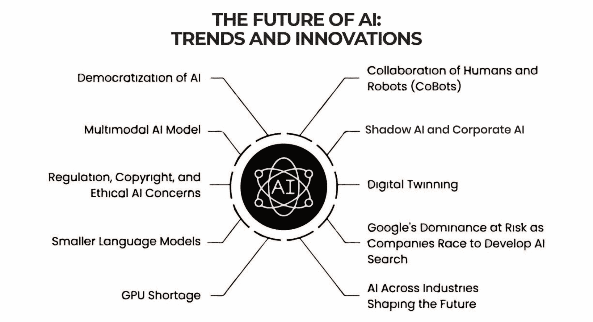

随着 AI 的不断演进，其影响力正在扩展到新兴行业，为世界上一些最紧迫的挑战提供了创新解决方案。在可持续能源领域，AI 算法正在优化能源消耗并提高可再生能源系统的效率。通过分析来自风力涡轮机或太阳能电池板的海量数据集，AI 可以预测产量、管理电网并减少浪费，为更可持续的未来做出贡献。同样，在太空探索领域，AI 在开发能够穿越外太空极限的自主系统方面发挥着至关重要的作用。从探索遥远行星的机器人到监测地球气候的 AI 驱动卫星，这些技术增强了我们对宇宙的理解，并支持了关键的科学事业。

然而，随着 AI 能力的增长，广泛应用带来的伦理和社会影响也随之增加。最关注的问题之一是就业流流，因为 AI 驱动的自动化正在改变行业和工作的本质。虽然 AI 可以提高生产力并创造新机会，但它对易受自动化影响的工作岗位带来了挑战，特别是那些涉及重复性任务或数据处理的角色。为了减轻这些影响，优先考虑教育和再培训计划至关重要，使个人具备在 AI 驱动的经济中生存所需的技能。此外，随着 AI 系统变得更加自主，确保其伦理开发和部署是重中之重。这包括建立促进公平、透明和负责的准则，特别是在医疗保健和自动驾驶等关键领域，在这些领域 AI 的决策可能会产生深远的影响。

在 AI 研究的前沿，可解释 AI (XAI) 的努力旨在解决“黑箱”问题，即 AI 系统做出的决策人类难以理解。XAI 旨在创建能够对其预测结果提供清晰、可解释解释的模型，以培养信任感并促进人机协作。通过让用户理解 AI 决策背后的逻辑，XAI 增强了透明度，并支持跨领域的伦理 AI 部署。此外，对通用人工智能 (AGI) 的追求代表了 AI 研究的前沿领域，其目标是开发具有人类智能认知能力和适应能力的机器。虽然 AGI 仍然是一个遥远景，但持续的研究正在探索实现这一水平机器智能所需的基础原理和架构。

当我们展望 AI 的未来版图时，这些趋势和创新将不断提醒我们这项技术的变革性潜力，以及随之而来的责任。通过拥抱这些发展并应对它们带来的挑战，我们可以利用 AI 的力量驱动整个社会的积极变化，为通一个更智能、公平和可持续的世界铺平道路。

# 10.4 战战 AI：探索 AI 的高级主题与未来趋势

### 有效实践的操作指南

* ● 访问 ChatGPT：访问 [`chatgpt.com`](https://chatgpt.com) 并根据需要创建一个免费账户。
* ● 与提示词（Prompts）交互：输入提示词、修改它们并进行实验以查看不同的响应。
* ● 评估响应：根据你所学的内容检查响应的清晰性和相关性。
* ● 实验与反思：调整提示词以加深理解并探索 AI 的能力。

### 用于强化本节学习的提示词

* 提示词 1：“训练深度学习模型中最关键的超参数有哪些？它们是如何影响性能的？”
* 提示词 2：“用关于艺术家和评论家的类比来解释 GAN 的工作原理。讨论它们的迭代学习过程。”
* 提示词 3：“如何针对智能手机和 IoT 传感器等边缘设备优化 AI？讨论性能与效率之间的权衡。”
* 提示词 4：“将 AI 模型部署在边缘设备上与云平台相比有什么优势？提供真实世界应用中的示例。”
* 提示词 5：“什么是多模态 AI 系统？它们是如何整合来自文本、图像和音频的数据的？提供用例。”
* 提示词 6：“实现 AI 模型可解释性的关键方法有哪些？包括如 `SHAP` 和 `LIME` 等示例。”
* 提示词 7：“为什么在金融或医疗保健等高风险领域可解释性非常重要？讨论其伦理和实际影响。”
* 提示词 8：“量子计算如何增强机器学习算法？提供潜在突破的示例。”
* 提示词 9：“量子 AI 目前的局限性是什么？未来十年内可能如何解决这些问题？”
* 提示词 10：“设计一个 AI 系统，使用多模态数据预测供应链中断。你将面临哪些挑战？你会如何解决它们？”

# AI 深度学习核心要素 – 结论

当我们这段旅程到达终点时，让我们花一点时间反思我们走过的路。我们穿越了人工智能和机器学习的迷人领域，从构成 AI 骨架的基础概念开始。我们探索了机器如何学习和适应，重点关注了神经网络和深度学习复杂的架构。这些工具驱动着今天最先进的 AI 系统，而现在，它们已成为你技能包的一部分。

在整本书中，我们强调了 AI 不仅仅是理论的集合，更是一种跨越行业的变革力量。从医疗保健、金融到机器人和娱乐，AI 技术正在重塑我们的生活和工作方式。你已经看到了说明 AI 影响的真实世界示例和案例研究，并参与了模拟职业场景的项目制学习。这些经验赋予了你有效应用神经网络技术的实用技能。

但尽管 AI 如此强大，它也伴随着责任。我们讨论了对于开发公平且负责任的 AI 系统至关重要的伦理考量。偏见、透明度和问责制不仅仅是口号；它们是保证 AI 惠及每个人的关键要素。你对这些问题的意识和理解至关重要。

我们还触及了职业发展策略和社区参与的重要性。无论你是初学者还是转型 AI 的专业人士，了解如何构建强大的作品集并在技术社区中建立人脉都是无价之宝。与同行、导师和行业领袖的互动将为你打开大门，并提供持续学习的机会。

那么，核心要点是什么？你现在应该对 AI 基础知识有坚实的掌握，并实现神经网络解决方案充满信心。你意识到了伦理格局，并准备好以负责任的方式开发 AI。最重要的是，你拥有了工具和洞察，可以开启自己的 AI 项目并推进你的职业。

这本书仅仅是一个开始。我鼓励你将所所学并付诸实践。从小项目开始，尝试不同的模型，不要害怕失败。每一步都是学习机会。深入 AI 社区，分享你的经验并从他人那里学习。保持好奇心并跟上最新进展。AI 是一个快速发展的领域，成为这个社区的一部分意味着你永远不会孤单学习。

展望未来，AI 驱动创新和解决全球挑战的潜力是巨大的。从应对气候变化到推进医疗保健，AI 包含着变革性解决方案的希望。我希望你受到启发，通过开发产生积极影响的伦理、创新 AI 系统来为未来做出贡献。


感谢你与我一起开启这段探索 AI 世界的旅程。你的好奇心和投入精神值得赞赞，我很感谢能有这个机会引导你。作为 `NextGen AI Publications` 的创始人，我的使命是赋予像你这样的个人知识和技能，让他们在这一令人兴奋的领域脱颖而出。我鼓励你继续探索、学习，并不断突破 AI 的边界。世界期待着你的贡献，我迫不及待想看到你取得成就。

# 术语表

## 第一章：机器学习与人工智能基础

- `Artificial intelligence (AI)`（人工智能）：在机器中模拟人类智能，使其能够执行学习、推理和解决问题等任务。
- `Machine learning`（机器学习）：人工智能的一种类型，允许计算机从数据中学习学习，而无需进行显式编程。
- `Deep learning`（深度学习）：一种模仿人类大脑结构和功能的 AI 方法。这些人工神经网络可以执行图像识别、自然语言处理和语音识别。
- `Neural network`（神经网络）：一种受人类大脑启发的 AI 模型，由多层神经元组成，它们共同工作以识别模式并做出决策。
- `Decision tree`（决策树）：一种通过根据某些特征将数据划分为分支来做出决策的模型，每个分支代表一个可能的结果或决策。
- `Random forest`（随机森林）：机器学习中的一种集成方法，通过结合许多决策树的结果来做出更准确、更稳定的预测。
- `Overfitting`（过拟合）：当模型从训练数据中学习了过多信息时出现的问题，导致其对新的、未见数据的泛化能力下降。

## 第二章：深入研究神经网络

- `Perceptron`（感知器）：一种用于二分类器监督学习的算法。它模拟了单个神经元，是更复杂神经网络的基础。
- `Multilayer perceptron (MLP)`（多层感知器）：一种具有多层节点的神经网络，允许进行超越简单线性分离的更复杂的模式识别。
- `Backpropagation`（反向传播）：神经网络中的一种学习过程，将误差向回传网络以调整权重并优化神经网络的性能。
- `Activation functions`（激活函数）：神经网络中用于引入非线性的函数，以便网络能够捕捉复杂的模式（例如 `ReLU`、`sigmoid`、`tanh`）。

## 第三章：深度学习架构

- `Convolutional neural networks (CNNs)`（卷积神经网络）：一种主要用于图像识别和分类的深度学习架构，卷积层通过扫描模式从图像中提取特征。
- `Recurrent neural networks (RNNs)`（循环神经网络）：一种设计用于处理序列数据的神经网络，其中每个输入都会影响下一个输入，使其非常适合时间序列预测或语言处理等任务。
- `Transformers`（Transformer 模型）：一种先进的深度学习模型，使用自注意力机制处理数据并捕捉序列中的复杂关系。
- `Autoencoders`（自动编码器）：一种无监督学习模型，压缩输入然后将其解码回原始表示形式。

## 第四章：实际应用

- `AI-driven diagnostics`（AI 驱动诊断）：使用人工智能分析图像以检测问题。
- `Predictive analytics`（预测分析）：使用 AI 预测未来事件，例如趋势。
- `AI-powered automation`（AI 辅助自动化）：使用机器在无人工干预的情况下执行任务。

## 第五章：数据分析与可视化

- `Imputation`（填充）：用估计值填充缺失数据的过程。
- `Normalization`（归一化）：一种数据变换，通过缩放特征使得没有任何变量占据主导地位。
- `Exploratory data analysis (EDA)`（探索性数据分析）：使用图表和技术对数据集进行总结的过程。
- `Correlation matrix`（相关矩阵）：显示多个变量之间关系强度和方向的热图。

## 第六章：伦理考量与负责任的 AI

- `Algorithmic bias`（算法偏差）：由于数据偏差导致 AI 中系统性和重复性的错误，导致不公平的结果。
- `Explainability`（可解释性）：使 AI 决策过程对人类透明且易于理解的做法。

## 第七章：使用 AI 工具包增强技能

- `TensorFlow`：一个全面的机器学习框架，拥有用于预训练模型的 `TensorFlow Hub`。
- `PyTorch`：一个基于动态计算图的机器学习库，适用于科学研究。
- `Keras`：一个用于实现神经网络的开源库。

## 第八章：基于项目的学习与现实应用

- `Sentiment analysis`（情感分析）：自然语言处理（NLP）的一个分支，专注于对文本中的情感和意见进行分类。
- `Image classification`（图像分类）：一种根据视觉特征将图像分为类别的机器学习模型。
- `Recommender system`（推荐系统）：根据过去的行为向用户推荐产品、内容或服务的系统。

## 第九章：职业发展与社区参与

- `GitHub`：一个协作软件平台，允许开发者创建、存储和共享他们的代码。

## 第十章：高级主题与未来趋势

- `Evaluation metrics`（评估指标）：用于评估机器学习模型或算法的性能和准确性的量衡量标准，帮助判断其满足特定目标的程度。
- `Hyperparameter tuning`（超参数调优）：调整机器学习模型的超参数（控制学习过程的设置）以优化其性能的过程。
- `Generative adversarial network (GAN)`（生成对抗网络）：一种由两个神经网络组成的 AI 模型——生成器和判别器，它们通过相互对抗工作来创建真实的输出。


# AI/ML 与机器人技术参考文献

## 性能指标与机器人
AI/ML 性能指标：全面概述。(n.d.) 检索于 2024 年 12 月 30 日，源自 [`svitla.com/blog/ai-ml-performance-metrics/`](https://svitla.com/blog/ai-ml-performance-metrics/)

AI 机器人：用智能机器人解决方案转型行业。(2024 年 8 月)。检索于 2024 年 12 月 30 日，源自 [`www.roboticstomorrow.com/story/2024/08/ai-robots-transforming-industries-with-smart-robotic-solutions/23005/`](https://www.roboticstomorrow.com/story/2024/08/ai-robots-transforming-industries-with-smart-robotic-solutions/23005/)

## 神经网络与架构
神经网络中的激活函数。(n.d.) 检索于 2024 年 12 月 30 日，源自 [`www.geeksforgeeks.org/activation-functions-neural-networks/#:~:text=Activation%20functions%20enable%20backpropagation%20by,only%20simple%2C%20linearly%20separable%20problems`](https://www.geeksforgeeks.org/activation-functions-neural-networks/#:~:text=Activation%20functions%20enable%20backpropagation%20by,only%20simple%2C%20linearly%20separable%20problems)

深度学习中 VGG 与 LeNet-5 架构的比较。(n.d.) 检索于 2024 年 12 月 30 日，源自 [`blog.arunangshudas.com/comparing-vgg-and-lenet-5-architectures/`](https://blog.arunangshudas.com/comparing-vgg-and-lenet-5-architectures/)

卷积神经网络 (CNN)。n.d.) 检索于 2024 年 12 月 30 日，源自 [`www.tensorflow.org/tutorials/images/cnn`](https://www.tensorflow.org/tutorials/images/cnn)

## 部署与医疗健康
使用 Docker 容器化并部署机器学习模型的分步指南。(n.d.) 检索于 2024 年 12 月 30 日，源自 [`dev.to/pavanbelagatti/a-step-by-step-guide-to-containerizing-and-deploying-machine-learning-models-with-docker-21al`](https://dev.to/pavanbelagatti/a-step-by-step-guide-to-containerizing-and-deploying-machine-learning-models-with-docker-21al)

医疗健康领域的工智能：转型该领域。(n.d.) 检索于 2024 年 12 月 30 日，源自 [`pmc.ncbi.nlm.nih.gov/articles/PMC8285156/`](https://pmc.ncbi.nlm.nih.gov/articles/PMC8285156/)

用于医疗健康的深度学习：综述、机遇与挑战。(n.d.) 检索于 2024 年 12 月 30 日，源自 [`pmc.ncbi.nlm.nih.gov/articles/PMC8285156/`](https://pmc.ncbi.nlm.nih.gov/articles/PMC8285156/)

## 数据分析与技术细节
Python 中的探索性数据分析。(n.d.) 检索于 2024 年 12 月 30 日，源自 [`www.geeksforgeeks.org/exploratory-data/`](https://www.geeksforgeeks.org/exploratory-data/)

通过数据技术吸引利益相关者。(n.d.) 检索于 2024 年 12 月 30 日，源自 [`www.nobledeskip.com/engaging-stakeholders-with-data/`](https://www.nobelezkip.com/engaging-stakeholders-with-data/)

随着 AI 参与决策日益增加，伦理问题日益凸显。(2020)。检索于 2024 年 12 月 30 日，源自 [`pmc.ncbi.nlm.nih.gov/articles/PMC8285156/`](https://pmc.ncbi.nlm.nih.gov/articles/PMC8285156/)

生成对抗网络及其应用。(n.d.) 检索于 2024 年 12 月 30 日，源自 [`neptune.ai/blog/generative-adversarial-networks/`](https://neptune.ai/blog/generative-adversarial-networks/)

超参数调优：前 5 种技术。(n.d.) 检索于 2024 年 12 月 30 日，源自 [`www.run.ai/guides/hyperparameter-tuning`](https://www.run.ai/guides/hyperparameter-tuning)

