# Web 秘籍：HTML、CSS、JavaScript、PHP 和 MySQL 网站与应用开发指南


如果你想创建网站，有数百本书和网络页面声称可以向你展示如何做到。其中一些确实非常好。但这本《网络书籍》不同于所有其他书籍和网络页面，原因有几个重要方面：

1. 《网络书籍》是一本电子书。你只需从 [www.the-web-book.com](https://www.the-web-book.com) 下载 PDF 文件并自行打印。或者在屏幕上阅读。

2. 《网络书籍》涵盖了你需要知道的所有技术，以创建网站，无论是使用静态 HTML 页面还是数据库驱动的网站。

3. 与许多多年前出版的同类书籍不同，《网络书籍》教你最新的方法。按照这里的说明操作，你可以确信自己正在以正确的方式做事，而不是使用现在已不再受青睐的过时技术。

4. 我已尽力保持内容非技术性。如果你“懂”电脑，你应该能轻松理解所有内容。你绝对不需要是专业的技术人员。事实上，如果你是，你可能会对我简化某些事物的方式感到不快。对此我表示歉意。

5. 如果你已经管理着一个网站，可能是为你所在的学校、大学或部门，你可能迫切希望将你的技能提升到下一个层次。或者也许你在承担这项责任时并没有接受多少培训，你也并不真正理解所有东西是如何组合在一起的。在这种情况下，这本书非常适合你。我们不仅告诉你按按钮。我们解释这些按钮的作用，以及为什么你需要按（或不按！）它们。

6. 这里是最好的部分。《网络书籍》是**免费的**。所以，如果你想自学如何操作网络事务，无论是创建自己的网站还是为其他人制作网站，只需获取一份 PDF 文件副本，打印出这本书，然后开始吧。

但有一点警告。创建网站并正确完成它并不是一个可以在一个下午完成的简单任务。是的，我们都见过暗示并非如此的两页杂志文章，但遗憾的是事实并非如此。即使有 329 页，这本书也只是对某些更复杂主题的基础介绍。完全可以买到关于 HTML、CSS、PHP 和 MySQL 的书，每本都有 800 页。不过，除非你睡眠有问题，否则我不推荐这样做。

## 为什么我们推荐 Hostmonster.com

如果你想创建网站，你需要一家公司为你托管它们。那里有数千家这样的公司。本书中的示例基于一家特定的公司，即 [www.hostmonster.com](https://www.hostmonster.com)。我们选择这家公司是因为他们的产品似乎很好，并且具有极高的性价比。他们托管了你下载本书的网站。

如果你在寻找网络主机，我们希望你能使用 hostmonster，因为如果你通过我们在 [www.the-web-book.com](https://www.the-web-book.com) 的网站注册，我们会获得少量佣金。但网络的核心是自由选择，所以如果你想去别处，我们非常欢迎。你需要稍微调整一下示例，但文本中清楚地标识了 hostmonster 特有的任何设置或概念的细节。

如果你在考虑使用不同的主机，请先检查我们的网站。可能有为该主机提供的书籍定制版。我们一直在制作新的定制版。

## 为贵公司提供的定制版

如果你的公司销售网络托管服务，并且希望赠送或出售本书的副本，我们可以为你创建书籍的定制版本，其中所有示例都使用你的托管服务。然后你可以引导客户访问我们的网站下载他们的副本。

有关此服务的详细信息，请参阅 [www.the-web-book.com/customize.html](https://www.the-web-book.com/customize.html) 或发送电子邮件至 [info@the-web-book.com](mailto:info@the-web-book.com)。

## 谁写了这本书？为什么写？

《网络书籍》由 Robert Schifreen 撰写，他是一位基于英国的工作记者、作家和技术作者。我有 25 多年的经验，为各种计算机杂志撰写各种技术文章，并有 9 年的经验，为自己和客户服务开发网站。我还写过一本“传统”书籍，于 2006 年出版，在实体书店以真正的精装本形式提供。通过 Google 搜索“defeating the hacker”即可找到它。

在过去几年里，由于我面向一所英国大学的 2,500 名员工教授网络开发，我认为将我的课程改编成一本书可能会有所帮助，这本书大致基于我教授的内容，并受学生提出的问题的启发。从现在起，当人们问我如何创建网站，或者它是否容易时，我不必花费时间解释一切。我只需要说“去 [www.the-web-book.com](https://www.the-web-book.com) 下载我的免费书籍，它告诉你需要知道的一切”。

要注册本书中提到的网络托管公司，请访问 [www.the-web-book.com/hosts.html](https://www.the-web-book.com/hosts.html)。费用完全相同，但会给我带来少量佣金，用于资助这本书的开发。谢谢！

这正是我多年前刚开始从事网络事务时，非常希望已经存在的一本书。但，你可能在问，我为什么把它免费赠送而不是出售？有三个原因。

一。我相当喜欢能够自由写作我所想写的想法，而不必向出版商和编辑负责。

二。我希望尽可能多的人看到这本书，因为我认为它很有用。传统出版的问题在于，你辛苦挣来的钱中用于购买传统书籍副本的部分，大部分被出版商及其营销成本吞没。作者，那个在电脑前坐了几个月写出东西的人，通常只能获得你资金的 15% 左右。有时更少。所以我决定尝试一些不同的事情。这本书可以免费下载和使用。它通过三种方式获得资金：

- 如果你想通过 `www.the-web-book.com/donate.html` 进行小额捐款，我们非常欢迎。
- 如果你经营一家网络托管公司，并希望我制作一个宣传你的托管服务的书籍定制版本，请在线查看 `www.the-web-book.com/customize.html` 页面以了解详细信息和定价。
- 如果你想注册网络主机，我真的很感激你注册 Hostmonster（他们在本版书中被介绍）。只需点击 `www.the-web-book.com/download.php` 上的 Hostmonster 图标，一切都会自动发生。这会给我带来少量佣金支付，有助于支付编写《网络书籍》所花费的 5 个完整月份。这不会花费你更多，但对我意义重大。

第三个我赠送这本书的原因？自 1983 年成为专业的 IT 记者、编辑和作家以来，我目睹了互联网对杂志和书籍出版商的影响。尤其是那些生产 IT 相关出版物的公司。世界各地的计算机杂志正在关闭，书籍销售商日子也不好过，因为毫无疑问，互联网，而不是书籍的页面，是查找技术主题信息的最佳场所。

在许多情况下，这些出版物关闭并非因为产品糟糕，而是因为出版商未能预见互联网的到来，未能相应地采取行动。出版商需要与互联网合作，而不是与之对抗。诚然，搜索引擎意味着我可以立即找到技术问题的答案，而不必翻遍架上的书籍和杂志。但互联网也是有史以来最伟大、最大、最好、最便宜、最高效的信息复制和传播方式。问问音乐行业就知道了。因此，通过在互联网上推广这本书作为免费下载，我希望利用互联网的威力，而不是试图与之对抗。


## 我们为何在此

在20世纪的最后几年，没人能相信，我们创建网站的方式即将发生如此剧烈的变化。但它确实发生了，主要在两个根本性的方面。

首先，网站通常由一系列HTML文档文件组成。网站的每个页面都是一个单独的文件（如果你不完全理解我接下来要说的，请不要担心——随后会有更详细的解释）。虽然这对于只有几个页面的相对简单的网站来说是可行的，但创建网站还有更好的方法。通过使用MySQL等数据库技术和PHP等编程语言，你可以创建不仅仅是允许发布信息的简单信息网站，而是允许访问者互动的双向网站。不要再想着“电子报纸”，而要想到Facebook、Ebay或Amazon。

第二个重大变化在于网页结构的基本方式，即在布局和格式方面。字体标签让位于一种称为CSS（层叠样式表）的东西。

简而言之，在过去十年中，创建网站变得更加复杂了。从封面你可以看到，本书涵盖了HTML、CSS、Javascript、PHP和MySQL。如果你被这么多内容吓倒，请不要担心。我们将按逻辑顺序讲解所有内容，分层构建你的知识，因此你学到的所有新内容都会让你觉得意义明晰，因为你能在具体情境中看到它们。

当然，你可以随心所欲地翻阅本书，按你喜欢的顺序阅读章节。如果你想知道PHP或MySQL是怎么回事，那么尽管直接跳到那些章节。但如果你能抽出时间，按顺序阅读所有内容会更有收益。从长远来看，这样会更清晰易懂。

当然，如果你只是想尽快将一些信息放到网上，以便其他人在网络上访问，那么你可能根本不需要这本书。有很多免费服务可以让你快速轻松地做到这一点。其中一些最知名的服务包括：

| 服务 | 描述 |
|---|---|
| www.myspace.com | 一个社交网络网站，如果你想要上传图片和音乐而不是文本，这个网站特别合适。 |
| www.facebook.com | 最著名的社交网络网站，你可以在这里发布关于自己的信息。 |
| www.wordpress.com | 如果你想拥有博客但不想运行自己的WordPress博客软件，这个网站可以为你托管一个博客。只需在网上免费注册即可。 |
| www.blogger.com | 另一个免费使用的博客网站。由Google拥有。如果你想要一个个人博客且希望省事，使用这个网站或wordpress.com是迄今为止最简单的方式。 |
| sites.google.com | 创建基于文本的页面并免费在线发布，由Google提供。 |
| www.flickr.com | 上传照片并与世界分享的最佳知名场所。 |
| www.youtube.com | 在视频方面做到了Flickr在静态图片方面做到的事。上传几乎任何内容的10分钟短片。 |
| docs.google.com | Google的基于Web的字处理程序和电子表格。你可以自己使用，也可以与朋友共享文档以进行协作编辑。 |
| spaces.live.com | 免费的Web空间，用于发布博客、图片、音乐或你喜欢的任何内容。来自Microsoft。 |
| www.twitter.com | 微型博客网站，你可以在这里告诉每个人你在做什么。 |

要注册本书中介绍的网络托管公司，请访问 www.the-web-book.com/hosts.html 。费用相同，但会给我带来一小笔佣金，用于支持本书的开发。谢谢！

在阅读更多之前，你可能想考虑注册这些系统中一个或多个，哪怕只是为了获得一些灵感，看看你自己的网站应该或不应该是什么样子。

另一个选择是注册一个提供简便、自动化方式创建网页的网站。许多托管公司提供此类服务，从而可以轻松地在刚购买的托管空间上创建页面。此类产品包括来自领先托管公司1&1的Easy Website Creator，其设计选择屏幕如下所示：

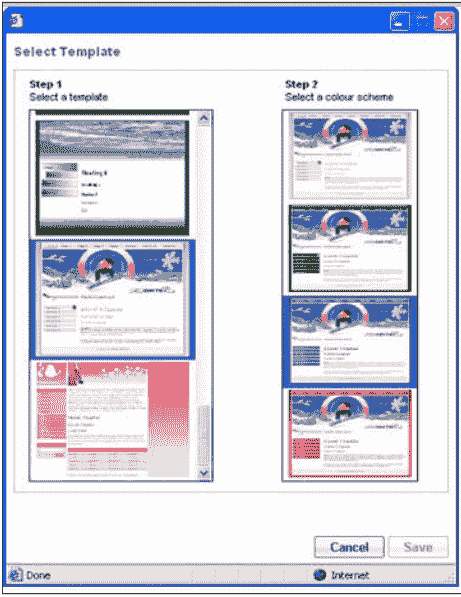

只需选择一个设计和配色方案，输入一些文本，你就拥有了一个网站。

该类型的另一个例子来自英国的托管公司 easily.co.uk。同样，其设计选择屏幕如下所示：

### 选择网站的设计

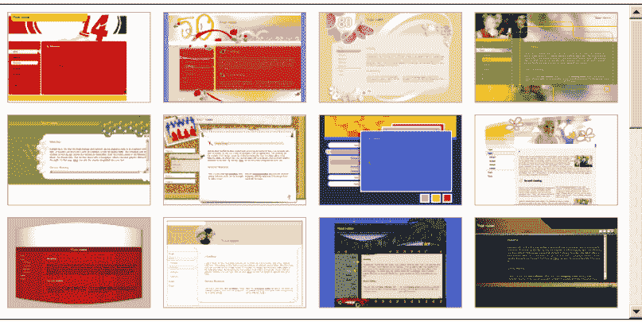

再次选择一个设计并开始输入即可。

虽然这些系统让你能快速轻松地创建网站，但它们的局限性很大。如果你想要JavaScript、PHP和MySQL，通常无法添加。你无法轻松地对设计进行重大更改。而且，根据你注册的托管套餐，你通常被限制在20或30个页面。有时这个数字低得只有一个页面。

## 从文字处理器到网站

还有一种创建网页的方法，那就是使用Microsoft Word或OpenOffice Writer等文字处理器编写文本，然后使用“另存为网页”功能创建可以放到网上的文件。这往往是一个诱人的选择，因为a)它看起来非常简单，并且b)许多人用文字处理器写文档，然后意识到他们其实很希望将这些文档发布到网上。

问题在于，Microsoft Word的“另存为网页”功能，包括最新版本，表现都很糟糕。它生成的页面包含的信息量严格来说是必要的十倍。这意味着它们将在你的服务器上占用十倍的空间，让你的访问者花十倍的时间下载，并且如果人们通过移动宽带或其他按流量或按MB计费的方式访问你的网站，成本也会增加十倍。说真的，别这么干。

如果你确实有一些想要放到网上的Word文档，有一些优秀的第三方产品可以为你完成转换。我最喜欢的是“Click To Convert”，我使用它创建了本书的网络预览版本。**www.the-web-book.com/preview.php** 上的所有页面都是由Click To Convert自动生成的。

如果你已经购买了托管套餐和域名，但还不确定要做什么，上述提到的快速入门页面总比什么都没有好。但如果你真的想充分利用网络，学习如何正确地做是唯一无法替代的选择，如果你继续阅读，你将会做到这一点。

## 但这需要多长时间？

我希望你能决定从头到尾读完这本书，并遵循其中的示例。记住，这是一本教科书，而不是小说。当然可以在一两天内读完，但你无法从中获得最大收益。为此，你需要逐步在电脑前进行操作，跟随示例。至少应预留一周或两周的时间以获得最大效益。如果你想进一步实验，并用自己的想法增强一些示例，可能需要更长的时间。

## 网站究竟是什么？

传统上，网站是信息页面的集合。创建网页在很多方面与使用文字处理器写信并保存在电脑上非常相似，但有几个重要的不同之处。

首先，你必须以名为HTML的特殊格式（即语言）保存页面，而不是作为普通文档。HTML代表超文本标记语言。为什么是超文本？这是我们通过点击超链接（通常是蓝色且带下划线的文本部分）在网页之间移动的方式的名称。标记语言只是一种“标记”文本的方式，以指定例如当访问我们网站的访客点击[首页](#Home)时，他会前往主页。

我们必须将页面保存为HTML格式，而不是Word文档、Excel电子表格、PDF文件、Zip文件等的原因，是因为我们阅读网站使用的程序叫做Web浏览器。例如，Internet Explorer、Firefox、Safari、Google Chrome或Opera。Web浏览器保证能显示的唯一类型信息是HTML文件。当然，如果你将Word文档或PDF文件放在网站上，一些Web浏览器可能会尝试显示该文件。但这从未得到保证。

创建网页与写信之间的第二个区别是，创建网页后，你显然需要保存它。但不是保存在你自己的电脑上（只有你能看到），而是需要保存到一个Web服务器上。Web服务器只是一台连接到互联网的普通计算机，运行着Web服务器程序。这个程序使得互联网上其他人的计算机可以连接它，请求你页面的副本并显示它。

理论上，任何拥有永久互联网连接的计算机都可以变成Web服务器。只需安装必要的软件（可轻松免费获得），工作就完成了。然而，黑客喜欢闯入Web服务器使其崩溃，或试图更改它们存储的页面内容。所以除非你非常清楚自己在做什么，租用别人的Web服务器空间来存储你的网站比运行自己的服务器更容易也更安全。这样做非常便宜，我们稍后会发现。

## 网络如何工作

此时简要描述万维网在实际中究竟是如何运作的，会很有用。当你打开电脑，打开你的Web时，实际发生的是什么


浏览器并**www.the-web-book.com**在地址栏中？这些信息是如何显示在你的屏幕上的？而且它们最初是从哪里来的？

正如我上面提到的，网页是一个文档文件，存储在 Web 服务器上，通过类似于文字处理器的程序创建，但以 HTML 格式保存文件。当你打开 Web 浏览器并输入**www.the-web-book.com**时，你的计算机会通过互联网连接到一个大型的中心化目录，以查找**www.the-web-book.com**站点存储在何处。这个目录被称为 DNS 服务器。DNS 是域名系统（Domain Name System），它赋予每个 Web 服务器（或者更确切地说，每个站点）一个唯一的名称。在这种情况下，就是 the-web-book.com。当然，计算机不喜欢名称，它们更喜欢数字。在因特网的情况下，每个 Web 服务器都有一个被称为 IP 地址的唯一数字。因此，DNS 目录允许你的计算机查找持有**the-web-book.com**站点的服务器的 IP 地址。

一旦你的计算机知道了持有该站点的 Web 服务器的 IP 地址，你的计算机就可以再次通过互联网直接连接到该服务器。你的 Web 浏览器向 Web 服务器发送请求，请求站点的特定页面。服务器发送该页面（或者，如果未指定特定页面，则发送主页）。然后你的浏览器显示该页面的内容，过程完成。至少，直到你点击链接以查看另一个页面，整个过程重新开始。

## 域名

那么，新的互联网域名是如何创建的？换种说法，你是如何将你站点的名称放入那个主 DNS 目录中的？这是一个相对简单的过程。

假设你想从零开始建立一个全新的网站。你需要做的第一件事是给你的站点起一个名字。在这个例子中，我们打算开始在线销售仓鼠轮。我们需要一个网站，我们想称之为**www.hamsterwheels.com**。要创建一个新的网站名称并将其添加到全球 DNS 目录中，我们需要依靠域名注册公司的服务。有成千上万家这样的公司，任何一家都能以全球 DNS 目录中的条目出售给你。价格各不相同，但它们提供的都是同样的服务，所以货比三家，找到一个你愿意与之交易的注册商。

如果注册商位于你的本国会最方便，但这并非必要。如果你不知道去哪里找这样的公司，请在 Google 中输入“域名注册”，或者看看你最喜欢的计算机杂志上的广告。

在这个例子中，我们将使用一家位于英国的注册公司 123-reg.co.uk。一旦你浏览到他们的网站，你将看到以下内容：

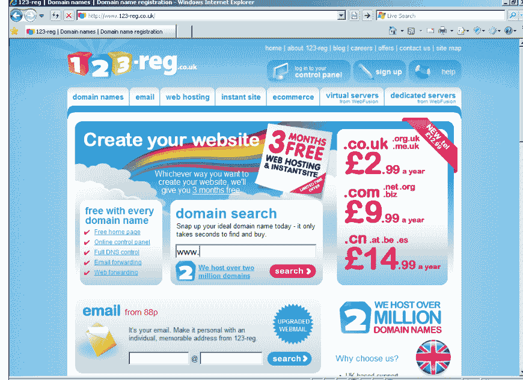

在屏幕中央，“域名搜索”下方，你可以输入你要注册的域名。虽然有成千上万家域名注册公司，但它们都在销售同一个单一全球目录中的空间，而且只有在其他人尚未注册该名称的情况下，你才能注册它。因此，第一步是查看我们想要的 hamsterwheels.com 名称是否仍可用。我们在域名搜索框中输入 hamsterwheels，几秒后结果返回：

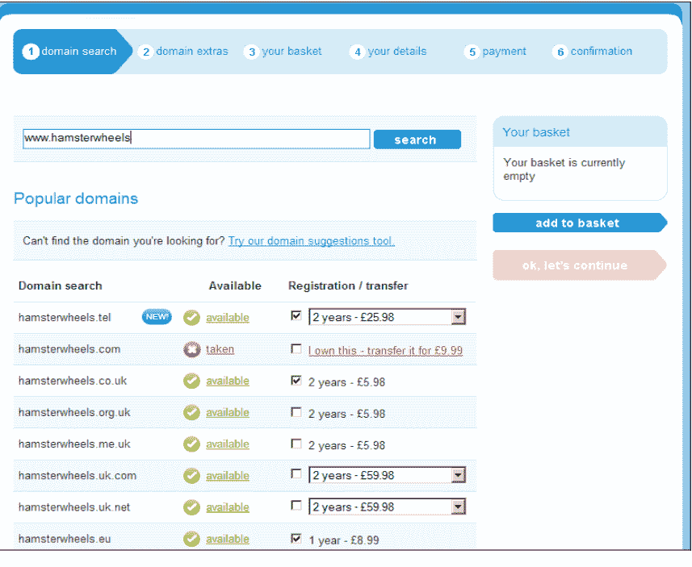

消息不太妙。hamsterwheels.com 名称已被占用，因此我们无法注册它。不过，我们可以注册 hamsterwheels.co.uk 或 hamsterwheels.eu，或者许多其他替代方案（比上图能显示的要多得多）。或者，我们可以尝试搜索变体，如 hamster-wheels.com 或 wheels4hamsters.com。

域名末尾的那 2 到 3 个字母很重要。它们揭示了关于你域名的许多信息。通常，.com 站点具有国际性质，或基于美国。以 .co.uk 结尾的站点主要由基于英国的公司使用。同样，德国（.de）、法国（.fr）、新西兰（.co.nz）以及世界上每个国家都有各自的域名，这些域名均由一个名为 ICANN（互联网名称与数字地址分配机构）的官方世界机构分配。

当然，关于大多数后缀与国家相关的规则也有例外。例如，美国的学校、学院和大学使用 .edu（代表教育），而英国类似的机构则使用 .ac.uk（代表学术）。慈善机构和非营利组织通常使用 .org 而不是 .com，以强调它们并非商业性质。还有用于互联网相关公司的 .net，以及许多其他后缀，如用于移动通讯的 .mobi。但规则大多是用来打破的，尤其是在域名领域。除了少数例外（例如，除非你是政府部门，否则你不能使用 .gov），通常你可以选择任何你想要的域名，只要你能找到一家愿意为你注册该名称的公司即可。因此，例如，如果你基于德国，想要一个 .es 域名（代表西班牙，即 España），没有什么能阻止你这样做。

唯一没有自己域名后缀（即后缀）的国家是小型波利尼西亚岛国图瓦卢。由于被 ICANN 分配了 .tv 后缀，该岛政府接受了加拿大企业家数百万美元的报价，以获得向全球电视台转租 .tv 域名的独家权利。因此，每当你看到网址以 .TV 结尾的电视台网站，并疑惑为什么电视行业获得了自己的互联网后缀时，答案就是它们并没有获得任何这样的东西。

如你所见，注册域名并不昂贵。在上例中，hamsterwheels.co.uk 两年费用为 5.98 英镑，约合 10 美元。你还会注意到，你不能直接购买域名。你只是在 1 到 10 年的期限内租用它们。当注册过期时，在续租方面你自动拥有优先拒绝权。如果你续租（即再次付款），域名仍然属于你。如果你不续租，它将回到通用列表中，其他人可以注册它。正如你可能预期的那样，总有一部分个人和公司试图通过续租那些被原所有者遗忘的域名来赚钱，然后试图将其卖回给前所有者。

有相当严格的规则来防止你注册域名，如果你的主要动机是欺骗访问者认为你是别人。例如，如果 coca-cola.com 的所有者忘记续租注册，而你为自己注册了它，科可能会通过你注册域名的公司提出投诉，所有权将被转移。然而，整个争议解决领域却困难重重。来自爱丁堡的康里·萨维尔·史密斯（Comrie Saville-Smith），是 C.S. 刘易斯《纳尼亚》小说的热心粉丝，父母送给他生日礼物域名 narnia.mobi。但代表 C.S. 刘易斯遗产的律师提出了投诉，康里不得不将其交还。

我最喜欢的域名争议发生在 Web 的早期，当时一位有进取心的年轻人注册了 baa.com，并将其设为羊迷的网站。英国机场管理局（British Airports Authority，简称 BAA，当时口语中且现在正式也被称为 BAA）提出了投诉，声称这是通过出售域名获利进行勒索的明显企图，且注册者对羊没有真正的兴趣。经过长期的法律战，BAA 胜诉，全世界的羊迷不得不在网上寻找新的家。

无论如何，假设我们要注册 hamsterwheels.co.uk 域名，剩下的工作就是勾选上面显示的屏幕上的框，当公司要求时提供有效的信用卡信息，工作就完成了。只需几分钟，确认电子邮件就会到达。我们现在自豪地拥有一个互联网域名，至少是一两年。

在购买了域名之后，我们如何将其转化为网站？有两个选项，但无论我们选择哪一个，第一步总是相同的。

网站由两样东西组成。第一，域名，即某人必须输入 Web 浏览器才能到达站点的 www.something-or-other.com 名称。第二，站点本身，通常是（但并非总是）一组 HTML 文件。

创建新站点的最重要步骤之一是建立域名与站点文件之间的联系。这通常被称为将域名指向站点。

### 简单选项

在我们将域名转化为可用网站的两种方法中，最简单的方法是，我们只是在现有的网络空间提供商（如 MySpace、Facebook、WordPress.com、Blogger、Google Sites、Flickr、YouTube、Google Docs、Microsoft 的 Windows Live Spaces 等）处注册一个免费账户。

这些系统中的每一个都让你能够创建内容（文档、图片、文本、视频等），这些内容可以通过互联网被所有人（或你想使其可用的人）访问。你不需要任何特殊的软件或技能，只需要一台可以访问互联网的计算机。

例如，对于 hamsterwheels.co.uk，创建简单网络存在的简单选项将是：

- 注册 hamsterwheels.co.uk 域名
- 在诸如 www.blogger.com 等博客站点上创建账户，我们可以创建一些基本页面。当被要求选择账户名称时，选择"hamsterwheels"。这样我们的博客将被分配一个类似 hamsterwheels.blogspot.com 的 URL。我们现在可以简单地告诉人们我们站点的地址（URL）是 hamsterwheels.blogspot.com。但我们有一个更好的计划，这将使我们的站点感觉更专业。
- 将我们新购买的域名指向我们的 blogger.com 空间。这很简单，只需登录我们购买域名的公司的网站，并在“你想将此域名指向哪里？”页面上的框中输入 hamsterwheels.co.uk。


4. 现在，每当有人在浏览器中输入 www.hamsterwheels.co.uk，他们就会到达我们的新博客。

拥有自己的域名用于网络存在（例如 www.hamsterwheels.co.uk），而不是依赖系统为你生成的域名（即 hamsterwheels.blogspot.com），能让你获得额外的宝贵控制权，否则这些控制权是你无法获得的。

如果你告诉所有朋友和顾客你的网站在 hamsterwheels.blogspot.com，那么如果你随后决定将页面迁移到 wordpress.com 或 MySpace，会发生什么？答案是：你的网站实际上会消失，因为现有用户将无法再找到它。

然而，如果你告诉所有人你的网站位于 www.hamsterwheels.co.uk，你就不会遇到这个问题。只要内容托管在 blogger.com 上，当访问者在浏览器中输入你的 URL 时，他们就会到达那里。当你将网站迁移到其他地方时，访问者将到达新位置。你所需要做的只是花几分钟时间将你的域名指向新位置，之后一切都会自动完成。

因此，如果你倾向于以低风险方式开始设置网站，并只是在 MySpace 或 Blogger 等网站上获取一些免费空间，那么保持 myspace.com 或 blogger.com 地址私密，并为其注册一个自己的域名是一个非常好的主意。如果你从一开始就这么做，每年只需花费几美元，但意味着你可以随时保留迁移托管的 freedom，而不用担心混淆或失去现有访问者。

在第 33 页，一旦我们注册了域名，我会展示如何将其指向你在 Facebook 上的页面。

### 灵活选项

除了将你的新域名指向 MySpace 或 Blogger 等网站上的区域外，"成熟" 的选择是创建自己完整的网站，并将域名指向那里。要做到这一点，你需要在公共 Web 服务器上租用一些空间来托管你的网站，即存储你的页面。

通常从同一家既出租域名又提供托管空间的公司购买托管空间是合理的。虽然这不是必需的，但这样能保持事情简单。每当你注册域名时，注册公司也会询问你是否想购买一些托管空间。只需勾选"是"，账单上会自动添加几英镑或几美元。这不是特别昂贵。租用域名每年大约 5 美元，而托管空间每月大约 5 美元（通常需按年预付）。你无法在每月花费 5 美元的托管服务上运行下一个 Facebook.com。但对于一个每周吸引数千访问者的典型网站，每月 5 美元的计划应该足够了。如果发现不够用，你随时可以升级。

值得一提的是，你下载本书的这个网站运行在一个每月费用约为 5 美元的基础托管计划上，并且运行得非常良好。

这是 123-reg.co.uk 的截图，显示了为配合域名注册而提供的托管套餐选项。如你所见，价格不贵。每年不到 30 英镑，或大约 50 美元，你就可以从零开始搭建一个网站，包括域名和托管。只需添加一些内容即可。

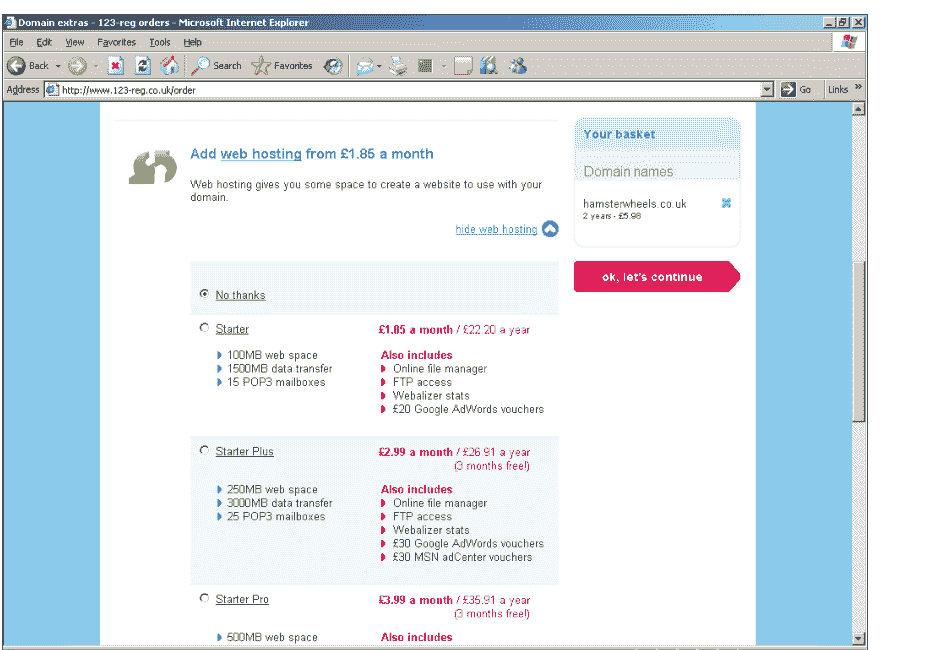

**购买托管服务时，主要需要关注的是：**

- 你获得多少存储空间用于你的网站内容？有些公司只给你可怜的 100 MB 左右，而有些提供多达 10 GB 或 10,000 MB。还有其他公司提供无限存储。

- 你获得多少数据传输量？即你的网站与访问者电脑之间流动的流量。如果你的服务器上的一个页面占用 100 KB 的存储空间，每月有 750 人查看该页面，那就是每月 75000 KB 或 75 MB 的流量。如果该页面包含一个 210 KB 的 JPG 格式图片，那么每次传输都会额外增加 210 KB。因此，你需要确保托管公司提供的数据传输量满足你的需求。

- 你还需要哪些其他设施，它们是否包含在价格中？就我们而言，为了开发本书中涵盖的网站，我们需要 PHP 编程语言和 MySQL 数据库服务器。大多数托管商都提供这些，但并非所有都提供。在某些情况下，你需要额外付费（可能每月 1 或 2 美元）。

你会发现，托管公司提供数十种附加功能，这些功能可能对你有用也可能没用。例如，有些公司提供 100 个 FTP 账户，允许多达 100 个不同的人将自己的页面上传到你的网站，每人都有自己的用户名和密码。除非你是一家跨国公司，否则这是不必要的。

同样，每家托管公司都会为你提供与你的新域名关联的多个电子邮件收件箱。在我看来，最轻松的做法是别费心使用它们。相反，创建一个或多个电子邮件转发条目（这些是免费的），将来自你域名的传入电子邮件转发到，例如，hotmail 或 gmail。或者转发到你现有的电子邮件账户。

假设你从同一家公司获得托管空间和域名，从零开始搭建网站的过程如下：

1. 在线注册域名，并勾选复选框说明你也需要托管空间。
2. 你会收到一封确认邮件，其中包含两组重要信息。第一，如何登录域名控制面板，以便将域名指向你的托管空间。第二，为了将组成你新网站的 HTML 文件、图片和其他所有文件上传到你租用的服务器空间，所需的密码等必要信息。我称这些信息为"基本四项"，原因很快就会解释。

关于如何将你的域名指向服务器空间的信息，你现在可以忽略它。因为你从同一家公司购买了域名和服务器空间，这一步已经为你完成了。你只需要开始为网站创建内容，然后将其上传到服务器。一旦你开始这样做，你的网站就会开始成形。而在本书剩余的章节中，我会展示你如何做到这一点。

关于那些允许你将内容上传到托管空间的基本四项信息，它们是什么？它们包括：

1. Web 服务器的地址
2. 用于连接到 Web 服务器的用户名
3. 伴随用户名的密码
4. 你需要将文件上传到的特定文件夹或目录的细节。

## 关于 Web 内容

在 Web 服务器上租用了一些空间后，你现在可以开始从事创建和维护网站内容的持续任务。有 3 种方法可以做到这一点。

### 1. 安装现成的软件

有大量的网站管理系统可用，包括商业版本和免费下载版本，你可以将它们安装在新的托管空间中，满足你部分或全部需求。如果你想要一个像博客一样工作的网站，你可以登录并通过 Web 浏览器发布新内容，你需要寻找的是 CMS，即内容管理系统。在免费软件领域，该领域的领导者是 Joomla、Drupal 和 WordPress。只需从 Web 下载软件，将其安装在你租用的托管空间中，你就准备就绪了。

如果你需要额外功能，如图片库、实时聊天等，大多数 CMS 都有提供此类功能的附加模块。

如果这听起来像是你想要前进的方式，你可能希望跳过接下来的几章，直接前往第 118 页。

### 2. 使用 WYSIWYG 工具开发数据库驱动的网站

在你的托管空间中创建可运行网站的第二种方法是使用一种产品，该产品允许你使用拖放和点击功能设计自己的基于 CMS 的系统，然后该工具将其转换为你上传到托管空间的自定义程序和数据库。如果你希望走这条路，领先的商业产品是 Adobe Dreamweaver，它功能极其强大，相应地也价格昂贵。如果你希望以这种方式构建网站，那么接下来的大部分内容并不适合你。相反，请购买一本 Dreamweaver 书籍，或到 Adobe 网站查看一些教程。

### 3. 自己创建网站

第三种选择，也是赋予你最多权力和灵活性的选择，是自己创建网站。这意味着从使用 HTML 创建几个简单页面开始，并


随后再进阶到使用 PHP 和 MySQL 的数据库技术。如果你选择这种方式，你可以让你的网站实现任何你想象的功能。这也是大多数专业网页开发者的工作方式。

即使你不是经验丰富的程序员或设计师也不必担心。编程方面，由于使用 PHP，并不会特别困难。而且有许多优秀的网站提供现成的页面设计，你可以免费使用。

如果这听起来正是你想要的网页开发方式，那么接下来的所有内容绝对都为你而备。我们将从 HTML 的基础知识以及用于创建简单网页的 CSS 开始，然后进阶到诸如使用 PHP 进行基于 Web 的编程等技术，以创建动态的 Web 2.0 在线应用程序。

## 你需要开发服务器吗？

为了创建网站，你需要将站点内容存储在 Web 服务器上。如果你正在租用托管空间，你就已经拥有一个完全可用的网站服务器了。那么，在开发过程中使用该服务器来测试正在成型的网站以及存储可能尚未完成的页面，是否可行呢？

很有可能，这样做完全没问题。将你的“生产环境”托管空间或其一部分用作未建成网站的试验场，没有任何坏处。当然，也没有必要专门设置一个仅供你访问的开发用独立 Web 服务器。

不过，有时可能需要设置一个测试服务器。例如，如果你正在开发一个希望让你致富的新商业创意，你肯定不希望未完成的页面在项目正式发布前出现在公开可访问的网站上。此外，如果你正在编写一段特别复杂的程序，万一出错可能会导致服务器崩溃，你也不希望冒损害已经由现有客户使用的正常网站的风险。

在这种情况下，你可能需要考虑为开发目的设置一个测试 Web 服务器。而且，搭建这样一个服务器也是一件有趣的事情，它能让你深入了解网站和互联网是如何工作的。

如需了解逐步设置测试 Web 服务器的方法，请参阅第 319 页的附录 A。

## 将所有内容整合起来

现在你应该已经了解了域名、Web 托管、HTML 文件以及上传的相关知识。凭借这些知识，你现在就可以创建你的第一个网页了。这意味着创建一个 HTML 文档文件并将其上传到 Web 服务器上的托管空间。

贯穿全书，对于我们创建的所有示例 Web 内容，我们都需要在某个服务器上拥有托管空间。如前所述，有成千上万家公司可以向你出租它们服务器上的空间。在这本书中，我们将使用一家美国机构 hostmonster 作为示例。如果你的托管服务提供商是其他公司，那也没问题——它们的工作方式大致相同。

那么，在获得了一些服务器空间之后，接下来该做什么？要创建网页并将其上传到 Web 服务器，你需要在计算机上安装一些合适的软件。首先，你需要一个 HTML 编辑器。这是一个工作原理类似文字处理器的程序，但它将完成的文档保存为 HTML 格式（即网页），而不是 Word 或 RTF 文件。其次，你需要一个可以将（即复制）HTML 文件通过互联网从你的计算机上传到 Web 服务器的程序。执行此操作的标准方法称为文件传输协议，或 FTP。

市面上有许多 HTML 编辑器。一些是昂贵且复杂的商业软件，例如 Adobe 的 Dreamweaver 或 Microsoft 的 Expression Web。也有一些免费的，如 nVu、Amaya 和 Kompozer，你可以从互联网上下载。同样，也有很多商业 FTP 程序，如 ws_FTP（市场领导者），以及免费的如 FileZilla。大多数商业 HTML 编辑器，如 Dreamweaver，都内置了 FTP 功能，但免费版本通常没有。

如果你订阅了带有每月 CD 或 DVD 封面的计算机杂志，检查一下你的光盘收藏。你可能会发现上面有一个或多个 HTML 编辑器，可以考虑使用。

Microsoft 和 Adobe 提供其软件的限时试用版本，你可以从各自的网站下载。虽然像 Expression Web 和 Dreamweaver 这样的产品功能强大，但对于初学者来说往往令人困惑，因此我目前不建议使用它们。

如果你已经安装了 HTML 编辑器或 FTP 程序，请随意使用它们来完成本书中的所有示例。如果你没有，我将假设你更愿意使用免费的软件而不是去购买。这对本书提到的所有软件都适用。我们将使用的软件都是完全免费的。

我们将使用 Amaya 来编辑 HTML 文件，使用 FileZilla 进行 FTP 上传。在我看来，这些是免费软件中的佼佼者。

所以在进入下一章之前，你需要做的是：

- 如果你尚未注册域名并购买托管空间，现在是时候这样做了。本书示例使用的是 www.hostmonster.com 的服务，但也可以使用其他公司。在 Google 上搜索“web hosting”即可开始。
- 确保你手边有访问托管空间的详细信息。你应该知道服务器地址、上传文件的文件夹，以及用户名和密码。
- 在你的计算机上下载并安装 Amaya。这是你的 HTML 编辑器。
- 在你的计算机上下载并安装 FileZilla。这是用于将完成的页面上传到服务器的 FTP 程序。

接下来的章节将解释如何完成所有这些步骤。

假设你正在使用 Windows 计算机，运行 XP、Vista 或 Windows 7。向偏好 Apple Mac 的读者致歉，但本书与你的另类生活方式不兼容，我也没有计划制作 Mac 版本。

# 域名和托管

创建新公共网站的第一阶段是注册域名并租用托管空间，所以现在让我们来执行这一步。让我们在 www.hostmonster.com 注册，并注册名为 www.the-web-book.com 的域名。这就是我将在后续所有示例中使用的域名。显然，你需要将 the-web-book.com 替换为你决定注册的域名。

顺便提一下，此时值得知道的一个技术小细节。我们实际上并不是注册 www.the-web-book.com，而仅仅是注册 the-web-book.com。这就是 DNS 的工作方式。你注册的是顶级名称，如 the-web-book.com 或 fabnews.co.nz。如何处理前缀在技术上取决于你，但在实践中通常由你的托管公司自动处理。如果你愿意，可以将前缀从 www 更改为 web。或者配置成 www.yoursite.com 指向一个位置，而 web.yoursite.com 指向另一个位置。虽然你不太可能这样做，因为这会让大家困惑，但这是可能的。

这些额外的前缀称为子域名，在某些情况下非常有用。例如，BBC 的新闻页面位于 news.bbc.co.uk，而其主网站位于 www.bbc.co.uk。创建子域名不是本书后续会再次深入讨论的内容，但如果将来你特别需要这样做，大多数托管公司都支持此功能。

好了，回到 hostmonster.com。让我们从注册我们的名称开始。

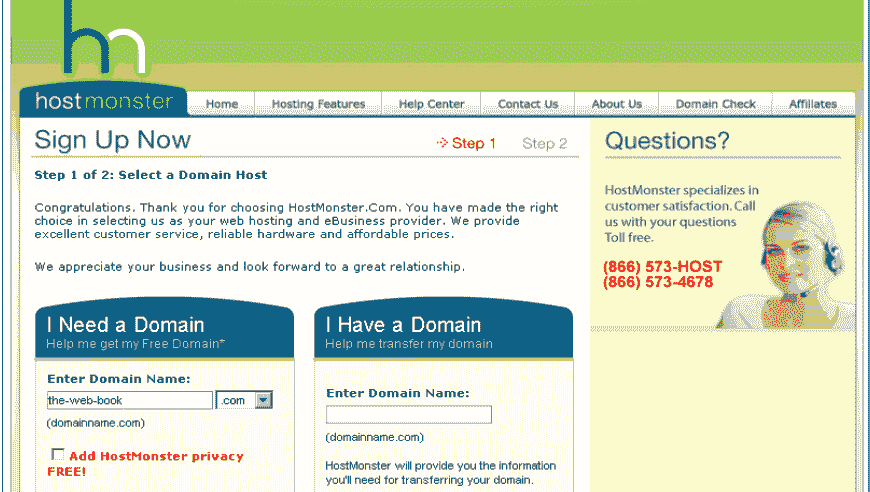

要使用本书中介绍的 Web 托管公司进行注册，请访问 www.the-web-book.com/hosts.html。费用完全相同，但会为我带来一笔小额佣金，用于资助本书的开发。谢谢！

我们输入想要注册的域名，并允许 hostmonster 检查该域名是否可用。

注意隐私选项。有一个公开的互联网域名注册目录，允许任何人查询注册特定域名的个人或组织的姓名和地址。这被称为“whois”系统。通过选择隐私选项（所有域名注册公司都以某种形式提供此选项），你的个人姓名和地址将不会显示在该目录中。除非你是大公司，否则你可能希望这样做。

我们的域名可用，所以让我们注册并购买它，同时购买基础托管套餐，以便在服务器上为我们的 Web 内容获得一些空间。我们需要提供信用卡信息和电子邮件地址，并为登录控制面板选择一个密码。

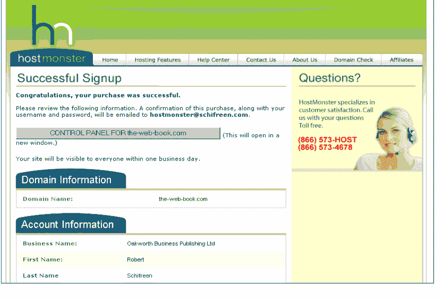

这就完成了。就是这么简单。我们现在已经为新网站建立了所需的基础设施。我们有了名称，也有了托管该网站的空间。我们现在需要做的就是等待包含连接托管空间详情的电子邮件。

几分钟后，邮件到了。它看起来是这样的：


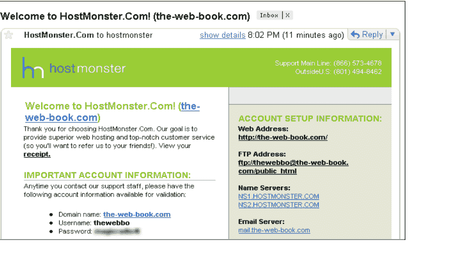

现在，我们拥有了将内容上传到新托管空间所需的“基础四要素”信息。FTP上传的服务器地址是 the-web-book.com，文件夹是 /public_html。用户名是 thewebbo。

出于显而易见的原因，我隐去了密码。请记住妥善保管所有网络托管密码，并确保安全，不要让他人使用。任何找到你密码的人都能在几秒钟内从服务器上删除你的整个网站。或者更糟糕的是，用乱码或不雅内容替换你精心制作的页面。

在购买了托管空间后，你登录托管公司系统的唯一方式是通过 FTP 来上传文件。但所有托管提供商也都会提供某种控制面板，你可以在那里管理你的账单信息，并进行其他各种有趣操作。让我们现在看看我们的控制面板。为此，我们访问 www.hostmonster.com，我们会发现有一个控制面板登录选项。我们只需使用之前收到的电子邮件中指定的用户名和密码登录即可：

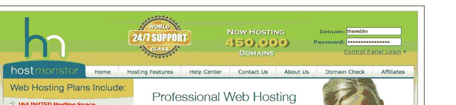

完成这一步后，控制面板就会出现。

为了使用本书介绍的这家网络托管公司，请访问 www.the-web-book.com/hosts.html。费用完全相同，但会给我带来少量佣金，用于支持本书的开发。谢谢！

本书免费提供。要获取最新版本，请查看 www.the-web-book.com
请勿将 PDF 文件副本提供给他人。所有下载必须来自 www.the-web-book.com
我们可以为其他网络托管商制作本书的定制版本。有关详情，请发送电子邮件至 info@the-web-book.com。

## hostmonster

- cPanel
- 域名管理器
- 升级
- Postini
- 专用 IP
- SSL 证书
- 个人档案/账单
- 结账
- 帮助


查找
在此处输入以快速查找功能。

| 主域名 | the-web-book.com |
| :--- | :--- |
| 用户名 | thewebbo |
| 主目录 | /home7/thewebbo |
| 最后登录时间 | 81.169.54.237 |
| 磁盘空间使用情况 | 0/6 MB |
| 每月带宽传输量 | 0/6 MB |
| 电子邮件账户 | 0/5000 |
| 子域名 | 0/999 |
| 停放域名 | |
| 附加域名 | 0/999 |
| FTP 账户 | 0/999 |
| SQL 数据库 | 0/100 |
| 邮件列表 | 0/999 |
| 账户到期时间 | 730 天 |
| 托管套餐 | Monster/Power |
| 服务器名称 | host3586 |
| cPanel 版本 | 11.24.4 - RELEASE |
| cPanel 构建号 | 35075 |
| 主题 | hostmonster |
| Apache 版本 | 2.2.11 (Unix) |
| PHP 版本 | 5.2.9 |
| MySQL 版本 | 5.0.75-community-log |
| 架构 | x86_64 |
| 操作系统 | Linux |
| 共享 IP 地址 | 66.147.240.168 |
| sendmail 路径 | /usr/bin/sendmail |
| PERL 路径 | /usr/bin/perl |
| cPanel 版本 | 2.6.29-9.5.intel.Billing |
| cPanel Pro | 1.0 (RC1) |
| 服务状态 | 点击查看 |

- 合作伙伴
  - Total eCommerce 免费购物车
  - 专业网页设计
  - 免费网站模板
  - 搜索引擎提交
  - FREE SitePage 购物车
  - 更多合作伙伴...
- 促销
  - 广告 $50 免费!!
  - 搜索广告服务 $25 免费!!!
  - $50 免费广告额度
  - 免费试用批发产品
  - 盒装艺术模板
  - 在线聊天免费试用
  - 更多优惠...
- 偏好设置
  - 创建向导
  - 修改密码
  - 更改语言
  - 快捷方式
  - 操作视频
  - 续订你的账户
  - 更新联系/账单信息
- 邮件
  - 电子邮件账户
  - 高级反垃圾邮件
  - BoxTrapper
  - Spam Assassin
  - 转发器
  - 自动回复器
  - 高级邮件列表
  - 基本邮件列表
  - 用户级过滤
  - 账户级过滤
  - 电子邮件网关路由
  - 导入地址转发器
  - MX 条目
- 文件
  - 备份
  - 备份向导
  - 旧版文件管理器
  - 文件管理器
  - 磁盘空间使用情况
  - Web-Disk
  - FTP 账户
- 日志
  - 最新访客
  - 带宽
  - Webalizer
  - Webalizer FTP
  - 原始访问日志
  - 选择日志程序
  - 错误日志
- 安全
  - 密码保护目录
  - IP 拒绝管理器
  - SSL/TLS 管理器
  - SSH/Shell 访问
  - HotLink 保护
  - Leech 保护
  - GnuGPG 密钥
- 域名
  - 域名管理器
  - 注册域名
  - 转移域名
  - 子域名
  - 附加域名
  - 停放域名
  - 重定向
- 数据库
  - MySQL 数据库
  - MySQL 数据库向导
  - phpMyAdmin
  - 远程 MySQL
  - Postgre/SQL 向导
  - Postgre/SQL 数据库向导
  - phpMyAdmin
- 软件/服务
  - CGI 中心
  - 邮件包
  - PHP PEAR 包
  - PHP 配置
  - RubyGems
  - Ruby on Rails
  - 免费 SSL 咨询
- 高级
  - Apache 处理器
  - 图像管理器
  - 索引管理器
  - 错误页面
  - Cron 任务
  - FontPage® 扩展
  - 提交支持请求

全图形 | 显示图标 | 重置所有界面设置 | 显示所有框 | 重置框顺序

主页 • 商标 • 论坛 • 帮助 • 退出

如果你以前见过网页控制面板，它可能看起来相当令人望而却步。特别是当你发现有 8 个选项卡/部分，而我们的截图只显示了其中一个。好消息是，你几乎不需要经常使用它。但另一个好消息是，如果你确实需要更改网络托管方式的任何内容，都可以通过这个控制面板来完成。不过，有一句忠告：每次你在控制面板上更改任何内容时，请在某处做个记录。总有一天这会派上用场。

让我们简要查看此控制面板中一些最重要的部分。顺便说一下，其设计并非 hostmonster 独有。这是一款名为 cPanel 的商业产品，许多托管公司购买它，因为这省去了它们自己编写的麻烦。

## 统计

屏幕左侧的区域是你的网站仪表板。它显示你使用了多少存储空间和传输容量、托管账户何时到期等信息。还有一个链接指向服务状态页面。如果你发现你的网站无法正常工作，请先检查此页面，再假设是你的错。服务器可能正在维护期间停机。

## 合作伙伴/促销

此部分展示了你可以注册的多种附加服务，其中一些是免费的。请随意点击链接并进一步探索。但这些服务中没有一个在现阶段是必须的，所以除非你真心想要，否则无需注册任何服务。那样只会让后续事情变得更加复杂。

## 邮件

从这里你可以设置你域名的电子邮件工作方式。当你购买域名时，你不仅控制了 `www.yourdomain.com` 的网站，还控制了任何发送到 `anyone@yourdomain.com` 的电子邮件。我们需要在某个时候配置这一点，因为我们希望确保例如发送到 `info@my-web-book.com` 的邮件最终到达我们可以访问的地方。同样，我们也希望能够发送看似来自 `someone@my-web-book.com` 的邮件。但现在，这可以稍后处理。我们需要先让网站上线并运行。

## 文件

cPanel 的文件部分允许你浏览和备份网站上的文件，即组成你网页的 HTML 文档。虽然通过网络控制面板可以做到，但通过 FTP 程序操作是最简单的，所以我的建议是忽略此功能。

## 日志

知道有多少人查看了你的网站是有用的。所有 Web 服务器都会记录此类事件，所有托管公司都提供多种方式让你查看这些日志。其中最友好的日志查看器之一是 webalizer，正如你看到的，它已为我们安装在服务器上。要查看日志，我们只需点击链接即可。我们将在后面的章节中更详细地讨论日志以及如何推广你的网站。

不过，现在请点击“选择日志程序”并确保启用 Webalizer。这样，当你到达关于查看站点统计数据的章节时，将有一些漂亮的 Webalizer 图表可供查看。如果你不勾选此选项，就不会有。

## 安全

这些选项允许你为网站添加安全性。你可以为部分或全部页面添加密码保护，或阻止来自特定 IP 地址的访问。*Leech Protect* 通过允许你指定特定密码允许从多少个不同的 IP 地址使用，为你的网站受密码保护的区域提供额外保护。这可以防止因受保护区域的密码泄露并在黑客之间传播而导致的网站滥用。我们将在后面的章节中更详细地涵盖网站安全性以及如何保护网站上的信息。通常，保护网站是在网站内部进行的，而不是通过控制面板。

## 域名

控制面板的这个区域让你管理通过托管公司注册的域名。如果你愿意，你可以将注册转移到另一家公司，或者将从其他托管公司拥有的其他域名转移到此处。你还可以创建子域名，如第 27 页所述。

## 数据库

在后续章节中，我们将在服务器上设置 MySQL 数据库，然后创建可以访问它们的网站。你可以通过控制面板的这一部分管理这些数据库。

## 软件/服务

此部分允许你更改服务器上某些关键软件应用程序的工作方式。例如，如果需要调整某些设置，你可以更改 PHP 编程语言的主配置文件。

## 高级

此处的可用选项包括“cron 任务”。大多数 Web 服务器，包括这一台，使用 Linux 操作系统而不是 Windows，而 cron 任务是 Linux 中相当于 Windows 中称为计划任务的功能。这是你告诉服务器在一天、一周、一月和/或一年中的指定时间自动运行特定程序的一种方式。例如，你可以设置一个 cron 任务，每月第一天运行一个 PHP 程序，检查你网站的会员数据库，并向所有即将到期的订阅者发送电子邮件提醒。


### 指向（重定向）域名并非无礼之举

前文提到过，获得一个专业外观网络展示的最简单方法是注册你自己的域名，但与其购买主机空间并花费时间创建页面，不如直接将域名指向 MySpace、Blogger.com、Youtube、Facebook 等网站上的个人区域。既然我们已经注册了域名，我可以向你展示如何做到这一点。

首先，确保你知道你想将域名指向（或重定向到）的网站网址（URL）。在这个示例中，我将把 `www.the-web-book.com` 指向我在 Facebook 上的页面，以弥补我尚未为新域名创建任何网络内容这一事实。

登录 Web 控制面板。如果你使用的是 cPanel，你需要**域名（Domains）**部分。具体来说，是名为"**重定向（Redirects）**”的选项，它会打开一个包含如下类似章节的页面：

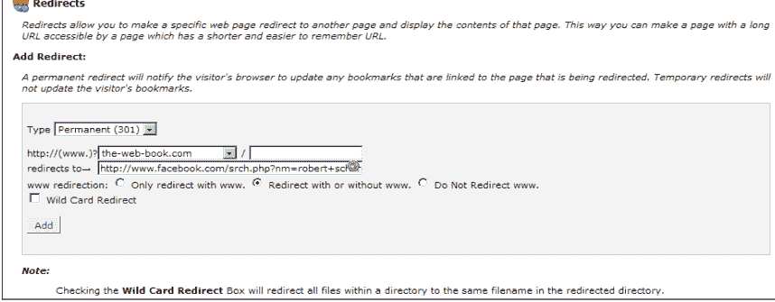

如你所见，我输入（实际上是粘贴）了我的 Facebook 页面地址到“重定向到”框中。我还选择了 **the-web-book.com** 作为源。

这就是你需要做的全部。点击“添加”按钮，等待几秒钟让服务器更新自身，任务就完成了。如果我现在打开我的 Web 浏览器并尝试访问 `www.the-web-book.com`，我实际上会到达我的 Facebook 页面，而不是该域名。

显然，如果你从一开始就打算走这条路，在注册域名时就没有必要为主机空间付费。事实上，你现在就可以停止阅读这本书，因为我们已经涵盖了你需要知道的所有内容。然而，鉴于市场上有如此多针对域名注册和主机服务的优惠套餐，你可能会觉得同时购买两者更容易，即使你最初的前几个月只是将域名指向外部网站，而不是创建自己的内容。

如果你确实只想注册一个域名，并不打算占用任何主机空间，大多数托管公司都提供这项服务。它们也都提供重定向功能，因此你可以将你的新域名指向任何你希望的地方。

## HTML 编辑器和 FTP 客户端

既然我们的主机空间已经购买但还空着，我们需要一些程序来开始填充它。这意味着需要一个 HTML 编辑器来创建页面，以及一个 FTP 程序将这些页面上传到服务器。

FTP 程序分为两种类型，即客户端和服务器端。要在两台计算机之间复制文件，你需要一个客户端。FTP 服务器是 Web 服务器运行的部分，允许客户端连接到它。不要错误地在你的计算机上安装 FTP 服务器，因为这会让世界上任何人都可以尝试通过互联网连接到你的计算机，并向你的计算机复制或从你的计算机复制文件。

Windows 上有许多免费的 HTML 编辑器，我们将在本书中全程使用 Amaya。它相对易于使用，而且与其他一些免费程序不同，它不会试图安装你不需要的额外间谍软件或工具栏。

有许多免费的 FTP 客户端可供选择。其中最受欢迎的是 Filezilla，所以我们将使用它。

### Amaya

要下载 Amaya，请访问 http://www.w3.org/Amaya 并点击“发行版”链接到达下载页面。无论你获取的是 http 版本还是 FTP 版本都没关系——这两个程序是一样的，唯一的区别在于你的计算机执行下载的方式。

Amaya 的新版本大约每 4 个月发布一次。本书中的示例基于 2009 年中期发布的版本 11.2。

一旦你下载了 Amaya 程序并将其保存到计算机上，双击该文件以开始安装过程。继续点击“下一步”以接受建议的选项，安装即可完成。安装程序会在你的 Windows 桌面上添加一个图标，让你可以随时轻松运行该程序。

### 创建一个 Web 工作文件夹

现在正是花点时间思考你想在计算机上存储进行中的 Web 页面位置的好时机。在创建 Web 内容（如 HTML 文件）时，通常的工作方式是在计算机上创建和编辑文件，并且只有在它们完成时才将它们上传到 Web 服务器（从而使其对公众可用）。这有很多优点。主要的是，这意味着你总是拥有页面的备份副本，因为服务器上有版本，你的 PC 上也有版本。此外，这意味着你尚未完成编写或检查的信息除了你之外任何人无法访问。例如，如果你的公司即将发布新产品，将未完成、未公开的详细信息上传到网站上让 Google（以及通常意义上的世界）发现是不明智的。

你需要在计算机上有一个文件夹来存储你的 Web 工作。就本书而言，我将假设这个文件夹在你的桌面上，并且名为 Web Work。如果你想在其他地方创建它，或者给它不同的名称，那也没问题。但如果你对我的建议感到满意，请在你的桌面上右键点击并立即创建一个新的 Web Work 文件夹。

### FileZilla

访问 `http://www.filezilla-project.org` 下载 FileZilla FTP 客户端。选择下载最新 Windows 版本的选项。本书中的示例使用的是 2009 年中期发布的版本 3.2.3.1，但当你阅读本书时，可能会发现已有稍新的版本可用。

下载 `.EXE` 文件后，双击它以开始安装过程。或者，如果你下载的是 `.ZIP` 文件，你需要先解压缩它（右键点击文件并选择“全部提取”），然后双击解压后的安装程序文件。

你可能会被询问是为所有用户安装还是仅为你自己安装。除非你特别不想这样做，请选择“所有用户”选项。这意味着，如果你的计算机上有多个用户账户，每个人都可以使用 FileZilla。（你需要以管理员身份登录计算机才能进行这种“所有用户”安装。如果不是，请尝试另一种方法。）

然后你会看到一个你希望安装组件的列表，例如图标集、Shell 扩展等。取消勾选它们所有，因为它们不是必需的。但你可能会希望选择“桌面图标”选项，以便安装程序在你的桌面上创建一个图标。

现在我们需要配置 FileZilla，以便它可以连接到 Web 服务器上的主机空间来上传你创建的文件。这需要我之前提到的那“基本四项”信息。

如果 FileZilla 尚未在你的计算机上启动，请双击其桌面图标以运行它。你会看到一个类似这样的屏幕。

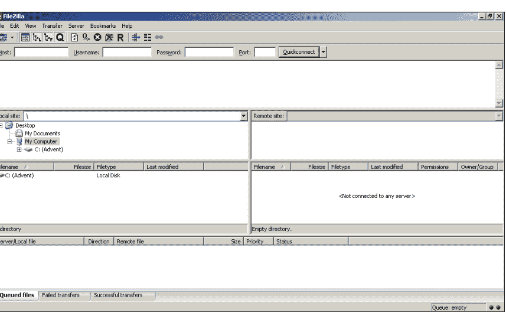

请注意对**本地站点**和**远程站点**的引用。前者显示你计算机上的文件，而后者显示 Web 服务器上的文件。至少，当我们配置好程序后就会是这样。

从文件菜单中选择“站点管理器”，然后点击**新建站点**按钮。为你想要连接的服务器选择一个名称，然后按回车键。Web Work 是一个合适的选择，或者你也可以使用你打算创建的站点的名称。FTP 程序允许你像这样创建多个连接，每个连接都有自己的名称，以便你可以将文件上传到不同的服务器（或同一服务器上的不同文件夹），如果你愿意的话。

命名你的连接后，在“常规”选项卡下输入主机名。这是 FileZilla 对你 Web 服务器地址的称呼。在这种情况下，我将使用 **theweb-book.com**，因为托管公司发来的账户信息告诉我使用它。将登录类型更改为“正常”，并输入你的服务器用户名（在我的情况下是 thewebbo）和密码。

现在点击“高级”选项卡。在“默认本地目录”框中，点击“浏览”按钮并选择你之前创建的 Web Work 文件夹。对于默认远程目录，只需输入一个 `/`（正斜杠）字符即可。

这就是全部设置，所以点击**确定**按钮。FileZilla 现已配置好以连接我们的 Web 服务器。

我们现在可以测试它是否正常工作，因此，从文件菜单中再次选择“站点管理器”。点击你的服务器名称，然后点击**连接**按钮。几秒钟后，你应该


保持连接。具体取决于你电脑上 Windows 的配置，你可能会收到来自 Windows 防火墙的弹出警告，询问解除对 FTP 服务器连接的阻止是否安全。如果是，只需点击“解除阻止”即可。

假设 FZ 能够连接到你的服务器，你应该会看到类似以下内容：

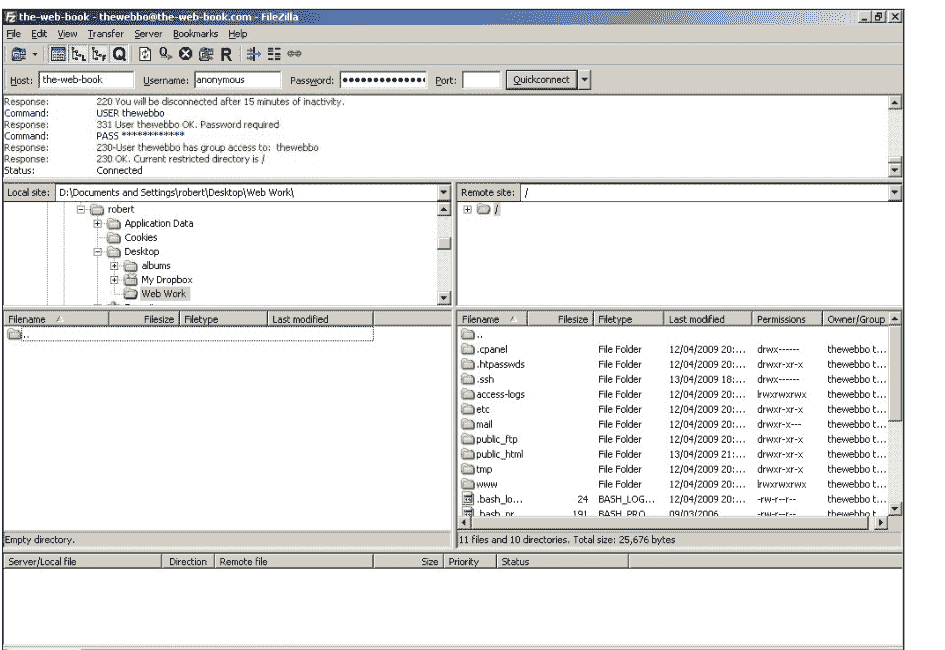

在屏幕左侧的“本地站点”下方，你可以看到我们指定的用于存放 HTML 文件的本地文件夹。在本例中，它是“Web Work”文件夹，目前该文件夹是空的，因为我们尚未创建任何 HTML 文件。

在右侧，“远程站点”列显示了你服务器上的文件夹和文件。你会看到诸如 `.cpanel`、`.htpasswds`、`.ssh` 等各种其他文件夹。目前主要感兴趣的文件夹是 `public_html`。这就是你要放置构成网站内容的地方。其他所有文件夹仅供 Web 服务器使用，公众无法通过你的网站访问它们。暂时来说，最安全的做法是不要动它们，也不要被诱惑去探索或删除它们。

现在已经妥善安装并配置了 HTML 编辑器和 FTP 客户端，我们终于准备好创建网页了。所以请关闭 FileZilla，让我们开始吧。

要注册本书中介绍的 Web 托管公司，请访问 [www.the-web-book.com/hosts.html](www.the-web-book.com/hosts.html)。费用完全相同，但这会给我带来一小笔佣金，用于资助本书的开发。谢谢！

是时候创建网页了。启动 Amaya，如果显示了每日提示，请将其关闭。

从“文件”菜单中选择“新建文档”，你会看到一个类似的对话框：

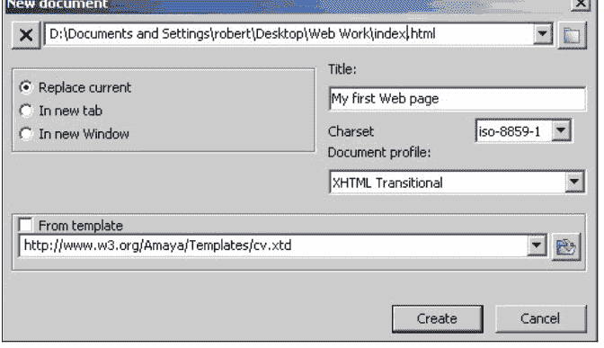

点击靠近右上角的文件夹图标，浏览到你的“Web Work”文件夹，然后点击“确定”。Amaya 现在将为你新页面生成一个以 `New.html` 结尾的文件名，但这并不是你想要的。所以请将其更改为 `index.html`，如上图所示。

为什么要用 `index.html`？因为如果有人访问你的网站但没有指定他们想查看的特定页面，服务器会向他们显示主页。而告诉服务器哪个是主页的方法，就是将其命名为 `index.html`。

如果有人访问你的站点并明确在 Web 浏览器中输入 `www.yoursite.com/products.html`，服务器将发送 `products.html`。但如果他们仅仅输入 `www.yoursite.com`，服务器将尝试向他们发送 `index.html`。如果 `index.html` 不存在，访问者将看到“错误 404 – 页面未找到”的错误信息。因此，在创建新站点或现有站点中的任何新文件夹时，你始终需要以 `index.html` 开始。

顺便提一下，你可能注意到我们将页面命名为 `index` 而不是 `Index` 或 `INDEX`。这一点很重要。通常，你应该始终用小写字母命名网页，不要使用任何大写字母或空格。这是因为大多数 Web 服务器是区分大小写的，将 `Index.html` 和 `index.html` 视为两个不同的文件。为了避免因访问者输入错误（或在超链接中指定了错误）大小写而导致页面找不到所引起的混淆，最好将所有内容标准化为小写字母。

好，我们已经为页面命名了。现在选择“替换当前”选项，为你的页面添加一个标题，并取消勾选“从模板”复选框。然后点击“创建”，并在页面上输入一些文本。它看起来会像这样：

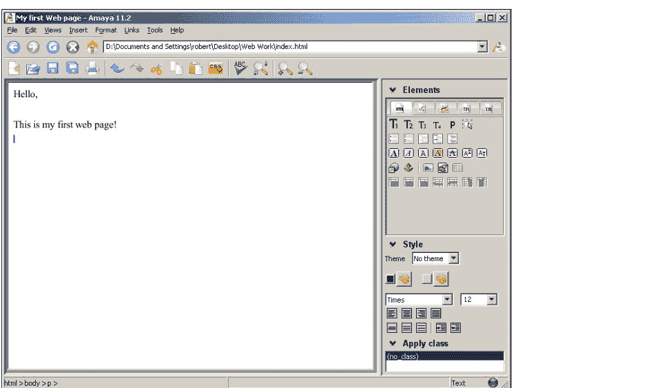

完成后，点击“文件/保存”，然后点击“文件/退出 Amaya”。

我们现在已创建一个 HTML 文件，它应该在你的“Web Work”文件夹中。所以请双击该文件夹，然后双击其中的 `index.html` 文件。文件将在你的 Web 浏览器中打开，看起来应该像这样：

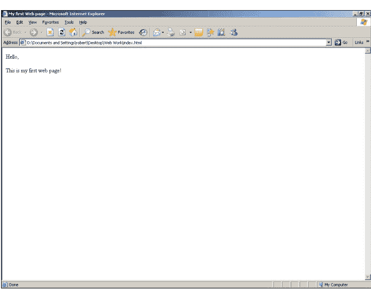

我们即将完成。页面在你的电脑上，但它不在 Web 服务器上，所以只有你能看到它。最后一步是使用 FileZilla 将 HTML 文件的副本上传到 Web 服务器。

打开 FileZilla 并连接到你的服务器（从站点管理器中点击你的站点，然后点击“连接”按钮）。在屏幕左侧的本地区域，确保“Web Work”文件夹中的 `index.html` 已列出。在右侧的远程站点区域，双击 `public_html` 文件夹以打开它。

现在双击 `index.html` 文件。FileZilla 将从本地文件夹将其复制到远程文件夹。你应该可以看到它列在远程站点的内容中：

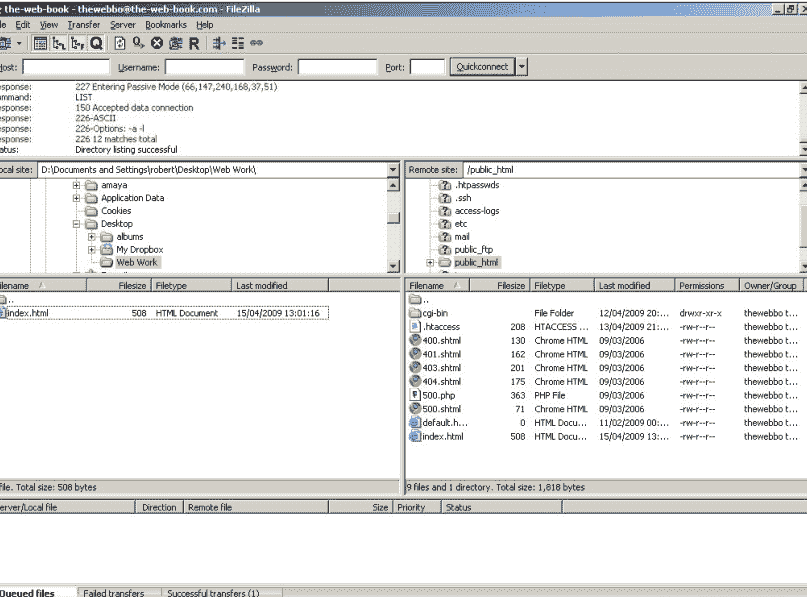

它就在列表的最底部，位于诸如 `.htaccess`、`400.shtml` 等杂项文件之后。

如果你的托管公司在你的 `public_html` 文件夹中放置了任何文件夹或文件，只要你不了解它们的作用，删除它们通常是很安全的（但在删除前需粗略检查以确保它们不是至关重要的）。毕竟，你的 `public_html` 文件夹就是你的公共网站，里面的任何内容都可以被世界上任何在 Web 浏览器中输入正确文件名和站点名的人访问。不过，暂时你可以放心这些特定文件是无害的，所以先不要对它们做任何处理。

上传你的 `index.html` 文件后，你现在拥有了一个真实的、在线的、公开可访问的网站。至少，从理论上是这样。要确切得知，请关闭 FileZilla，打开你的 Web 浏览器（Internet Explorer、Firefox 或你偏好的其他浏览器）。输入你站点的 URL（在我们的例子中是 `www.the-web-book.com`），你应该会看到你的页面如下所示：

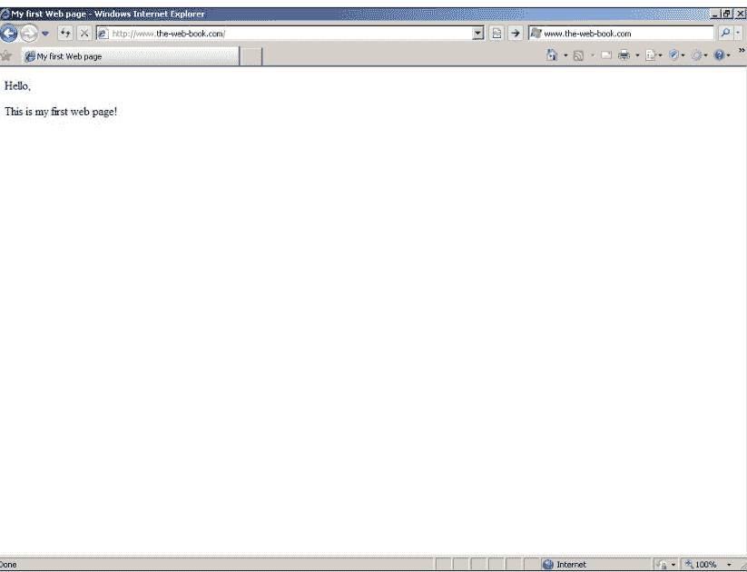

我们做到了。一个运行正常的网站，托管在公共服务器上，面向全世界！现在是时候通过电子邮件将所有 URL 发给你的朋友，让他们欣赏你的成果了。

## 现在离开电脑休息一下！

一旦你掌握了创建网页的基础知识，就会非常诱人想要径直开始创建完整的网站。虽然这几乎肯定是你现在想做的，但由于两个原因，这是一个坏主意。首先，虽然你知道创建*页面*的基本方法，但还有很多我们尚未涵盖的省时技巧。最好先了解这些技巧，以免为时过晚而无法回头使用它们。其次，创建网站不仅仅是在 HTML 编辑器中输入文本并按下保存按钮。你需要认真考虑网站的设计和可用性，如何显示文本，如何从其他文档导入现有内容，以及最重要的是，你的网站究竟为谁服务。

所以，如果你跃跃欲试想要跳过这一章并开始构建你的网站，请不要这样做。如果你现在停止阅读并开始创建网站，最终你会得到许多难以更新且不符合推荐标准的页面。当然可以创建几个测试页面，并随意继续实验，但请不要认为没有其他重要内容需要学习了。

至少，请在你阅读完以下内容之前，不要开始正式创建网站：

- 1. 本章的剩余部分。
- 2. 关于 CSS 的章节，从第 59 页开始。
- 3. 内容管理系统（CMS）的介绍，从第 118 页开始。

### WWW — 什么，为什么，为谁？

在开始创建网站之前，你必须在头脑中清晰明确以下几点至关重要：

- 1. 你正在创建什么类型的站点。
- 2. 你为什么创建该站点。
- 3. 该站点的受众是谁。

你正在创建什么类型的站点，以及为什么？它是一个信息站点吗，人们期望快速找到他们寻找的东西然后离开？还是一个娱乐站点，访客漫无目的地浏览和阅读，即使花点时间在精美的图形和动画中寻找他们想要的内容也不会抱怨？

这一点很重要，因为它将影响你的页面布局。如果你希望人们快速找到他们寻找的东西，你的菜单需要清晰明了。最好每页只保留一个（或最多两个）菜单。如果访客正在寻找你的联系方式，他们不应该不得不扫描 6 个不同的菜单。要么菜单项在菜单上，要么不在，并且这应该几乎可以立即发现。

同样，保持你的菜单选项无歧义且互斥。例如，如果你的网站全关于车辆，不要包含名为“古董车辆”和“巴士”的菜单项。或者，如果你正在为你的公司人力资源/人事部门编写网站，避免使用名为“新员工”和“给经理”的菜单选项。你只会混淆寻找古董巴士的访客，或者是新招募的经理。困惑的访客不会花时间探索选项——他们只会尝试其他人的网站，或者完全放弃。因此，花些时间规划你的菜单标题和层次结构，使选项显而易见。

规划布局和菜单（导航）的最佳方法是使用纸笔或白板。在这个阶段无需使用电脑，所以收起 PC 开始涂涂画画。当你有了大致的设计后，创建一些基于电脑的模型，并展示给几个人征求意见。理想情况下，这些人应该是你站点的潜在用户。

无需将模型创建为正式的 HTML 页面。使用图形编辑器，如 Windows 画图工具，或电子表格，或者此阶段你喜欢的任何东西。页面不需要正常工作。如果你更喜欢使用电脑创建模型页面，而不是纸笔，有一款优秀的程序叫做 Mockups，来自 Balsamiq Software。你可以下载它，价格约为 50 美元，或免费在线使用。更多详情请查看 [www.balsamiq.com](www.balsamiq.com)。

将页面内容放在访客期望找到的地方。页面顶部放 logo。菜单放在左侧或顶部横贯。主要内容放在右侧。不要试图与众不同——你最终只会令人沮丧。

### 导入现有内容

HTML 是用于 Web 页面的主要文档格式。它是唯一保证每个 Web 浏览器都能读取的格式，无论该 Web 浏览器是 PC、Mac、手机、iPod、PDA、Blackberry、电视，还是任何内置互联网访问功能的设备。

所有这些问题都引出了一个问题：对于那些现成的 Word 文档、Excel 电子表格、PowerPoint 演示文稿、PDF 文件等等，你想通过你的网站在线提供，该如何处理？


通常，你有两种选择。第一种选择是将文件上传到你的网站，就像你处理其他文件（如 HTML 文档或 css 文件）那样。然后，你可以提供一个指向 .DOC、.XLS、.PDF 或 .PPT 文件的链接，就像指向网站上的其他页面一样。然而，无法保证当访问者点击该链接时会发生什么。这很大程度上取决于访问者使用的是哪个 Web 浏览器、他们是左击还是右击链接，以及他们系统上已安装了什么软件。

可能发生的情况包括：浏览器打开该文件并尝试显示它（有时效果不错，有时则不然）；浏览器将文件传递给计算机上的另一个程序，该程序会打开并显示它；浏览器报错且无反应；或者浏览器提示将文件保存到访问者的硬盘上。

尽管存在这些潜在问题，更不用说非 HTML 文件不像 Google 等搜索引擎那样容易被发现，但将非 HTML 文件上传到网站仍然是常见的做法，有时甚至是唯一可行的选项。或者至少是唯一能赶上时间实施的选项。

第二种选择是将文档转换为“规范”的 Web 页面，即转换为 HTML 文件。这意味着从头开始，将非 HTML 文件中的未格式化纯文本复制并粘贴到你的 HTML 编辑器（例如 Amaya）中，然后对其进行格式化。如果你有时间，这是远胜于其他路线的选择。

绝对应该避免的一种技术是使用 Word 和 Excel 等程序内置的“另存为网页”功能。虽然这会生成一个 HTML 文件，但转换过程最好情况下低效，最坏情况下简直糟糕透顶。生成的文件比通过复制粘贴创建的文件大许多倍，而且很可能完全无法理解。这使得它难以维护，并且完全无法应用 CSS 样式。这是一个典型的捷径导致长期重大问题的例子。不要受诱惑走这条路。关于这一点，第 13 页有更多的内容。

### 为 Web 写作

撰写 Web 页面与撰写印刷文档不同，因为人们阅读 Web 页面的方式不同。首先，如果 Web 页面不能在读者的 5 秒内提供他们正在寻找的信息，他们就会放弃并使用 Google 寻找另一个网站。以下是你在撰写新的 Web 页面或编辑现有页面时应考虑的一些提示：

-   思考你为谁写作。什么样的受众？年轻还是年老？技术型还是非技术型？他们是在寻找信息还是娱乐？他们是喜欢简洁、易读的设计，还是更吸引艺术感更强的设计？

-   不要用长长的“欢迎”介绍开始，说明页面的用途。访问者会快速浏览页面，并自行判断页面是否合适。他们越快弄清楚这一点，停留的可能性就越大。

-   不要假设所有阅读你网站的人都有巨大的屏幕或快速的互联网连接。他们可能在手机或 PDA 上浏览，那里的屏幕很小，每上网一分钟都要花钱。

-   保持段落短小，栏位狭窄。这样阅读起来容易得多。此外，不要在每页上塞入太多信息。用户更喜欢点击而不是滚动。

-   行间距 1.5 或 2 很好。行间距为 2.0 的小字比行间距为 1.0 的大字更容易阅读。

-   永远不要使用蓝色或带下划线的文本。人们会认为那是可点击的链接。

-   遵守各种约定，例如点击主 logo 将读者带到主页。寻找联系信息的人会寻找“联系我们”按钮，而不是写着“取得联络”的内容。

-   不要将文本排列成栏目，导致读者不得不上下滚动屏幕。这是 Web 页面，不是报纸。

-   不要在“首屏”（无需滚动即可阅读的区域）浪费太多空间用于废话或大图片。

-   检查页面的拼写，但不要完全依赖任何自动拼写检查器。

### 字体和颜色

字体（字形）很重要。无衬线字体在屏幕上的表现通常比衬线字体更好。但请不要使用读者不太可能在计算机上安装的非标准字体。你可以在第 67 页阅读更多关于字体的内容。

读者会根据你网站的颜色方案形成对你的潜意识印象。你上次看到明亮的红色和黄色的银行网站是什么时候？你上次看到深蓝色的汉堡餐厅网站是什么时候？为你的页面选择合适的颜色，但也不要过度。也不要强迫人们依赖颜色，例如在文本中引用“黄色框”，因为访问者可能是色盲，或者可能是在黑白打印件上阅读你的页面。

### 超链接

构成整个万维网基础的最重要的概念可能是超链接。那些通常显示为蓝色并带下划线的 1 或 2 个单词，你的访问者可以点击它们以移动到另一个页面或另一个网站。一旦你学会了如何创建简单的 web 页面，并创建一些超链接以便访问者在页面间移动，你就拥有了构建几乎任何你需要的网站的基本构件。

在我们创建超链接之前，我们需要为网站创建一个第二页，以补充我们的 index.html 主页。因此，启动 Amaya，并使用第 39 页上的说明，在你的本地 Web Work 文件夹中创建另一个页面。这次，将其命名为 more.html 而不是 index.html。创建了两个页面后，我们现在可以创建它们之间的超链接了。

使用 Amaya，打开你的 index.html 页面。要做到这一点，转到 File 菜单，选择 Open Document，然后选择 File，浏览到 Web Work 文件夹中的 index.html 文件。

编辑页面以包含将具有可点击超链接的一些文本。然后，通过用鼠标像这样拖过它们来选择你希望转换为链接的实际单词：

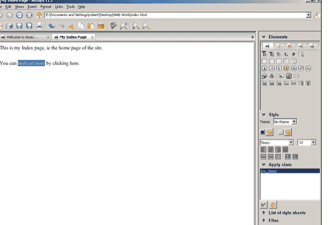

通过选择文本，我们告诉 Amaya 我们希望将哪些单词转换为超链接。剩下的只是指定点击链接时打开哪个 web 页面。因此，从 Links 菜单中，点击“Create or change link”（创建或更改链接），并在出现的框中输入 `more.html`

然后点击确认按钮。然后在 index 页面内的空白白色区域某处点击。

你的链接现在已经创建好了，并且应该像这样作为带下划线的文本显示在你的页面上：

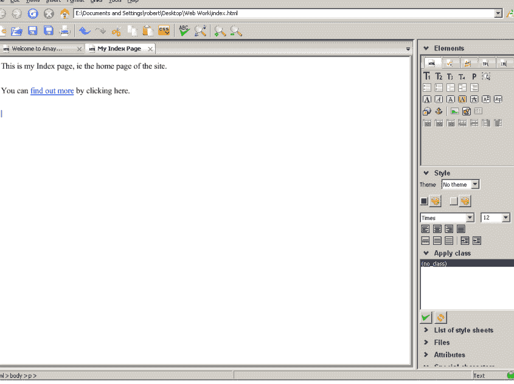

你可能已经注意到了我对可点击文本的选择，即“find out more”（了解更多）。你本来可能期望我选择“click here”（点击这里）。毕竟，总是将“click here”或“click this link”转换为可点击的内容不是很合理吗？实际上，并不是这样。

网站设计的一个重要方面是可访问性。这意味着确保你的网站可以被残障人士充分使用。例如，当某人将鼠标悬停在图片上时弹出的那部分文本（以防他们看不见图片），或者访问者能够使用键盘快捷键而不是鼠标在你的网站上导航。使你的网站具备可访问性，退一步说，也是常识和礼貌之举。在许多情况下，取决于你所在的国家/地区以及你的网站是由公共部门还是私营部门的组织制作的，创建可访问的网站实际上是一种法律义务，如果残障用户无法充分利用它，你面临被起诉的风险。

视障或弱视人士通常使用屏幕阅读器软件来帮助他们浏览网页。这种特殊软件通过语音合成器朗读网页内容。在朗读页面内容后，它会扫描该页面寻找


以及阅读其中的链接，这样用户一听到想访问的特定链接就可以按下按键。这就是我选择高亮显示“了解更多”而不是“点击这里”的原因。因为对于盲人来说，他们更愿意聆听由“了解更多”、“前往主菜单”、“打印此页”、“浏览我们的目录”等组成的选项列表，而不是由“点击这里”、“点击这里”、“点击这里”、“点击这里”或“点击这里”组成的列表。

好了，回到我们的页面。我们已经从主页创建了一个指向“更多信息”页面的链接。在我们的绝佳的新两页网站准备好测试之前，我们还应该创建一个从 more.html 页面指向 index 页面的链接。因此，关闭 index 页面，改为打开 more.html 文件，并使用与上述相同的流程，在 more.html 中添加一行类似“点击这里回到主页”的内容。然后将“主页”转换为一个可点击的链接，指向 index.html，并保存该文件。然后退出 Amaya。

在我们测试链接之前，我们需要将它们上传到服务器。因此，请参见第 41 页关于上传文件的说明，并使用 FileZilla 将 index.html 和 more.html 都上传到你的服务器。最后，关闭 FileZilla，并使用你的 Web 浏览器浏览到你的网站。点击链接，你应该能够在两个页面之间移动。是不是很酷？

既然你已经知道了创建带有链接的简单网站所需的一切，何不尝试为你的网站创建第三和第四页，并在它们之间设置更多超链接呢？

### 链接到其他网站

你的超链接目标不必局限于你自己网站上的页面。你可以轻松创建指向其他地方的链接。在输入链接目标的文本框中，只需输入目标站点的完整地址（URL），包括开头的 http:// 部分。包含 http:// 至关重要，否则外部链接将无法工作。

如果你想尝试一下，请在你的其中一个网页中添加一行文字，内容为“你可以使用 Google 搜索网络”，然后高亮显示单词 Google 并创建一个指向 http://www.google.com 的链接。将该页面上传到你的服务器，并检查当你点击链接时是否会被带到 Google。

### Mailto: 链接

这里有一个不错的想法，允许人们通过你的网站向你发送电子邮件消息。

打开你的其中一个网页（主页或 more.html），并添加一行文字，内容为“如果你愿意，可以通过电子邮件向我们发送查询”。现在高亮显示短语“向我们发送查询”并将其转换为链接。在链接框中，通常用于输入目标页面的地方，输入：

```
mailto:yourname@yourmail.com?subject=Enquiry
```

其中 yourname 和 yourmail 组合成你自己的个人电子邮件地址。

现在保存该页面，将其上传，通过你的 Web 浏览器访问它，看看当你点击链接时会发生什么。你的计算机的默认电子邮件程序将自动打开，准备好发送消息到你指定的地址。此外，消息的主题行已经自动填写了单词“Enquiry”。

这是允许访问你网站的访客与你互动的一种简单方式。然而，这存在一些缺点。首先，它仅当访客的计算机已设置为发送电子邮件，并且他们的计算机知道在遇到 Web 页面中的 mailto: 链接时应打开哪个程序时才有效。并非所有计算机都能处理这种情况，而且你无法预见可能出现的问题。在后续章节中，当我们讨论 HTML 表单和 PHP 时，我会向你展示一种允许访客通过你的网站发送消息的更好方法。但就目前而言，mailto: 链接就足够了。

### 了解 HTML 基础知识

在第 14 页，我提到了 HTML，即 Web 的语言。或者至少是所有 Web 页面都必须使用的语言。我还指出，你不需要了解 HTML 的复杂性，因为像 Amaya 这样的程序会自动为你生成这种特殊代码。

然而，出于在我们开始学习 CSS 样式表时会变得明显的原因，你确实需要知道一些 HTML。幸运的是，你需要知道的内容相对较少，而且并不困难。

让我们看看 Amaya 迄今为止一直对你隐藏的某些 HTML 内容。使用 Amaya 打开你的 index.html 页面。然后，从“视图”菜单中，点击“显示源代码”。屏幕将分割，顶部显示你的页面，底部显示 HTML 代码版本。使用鼠标将分隔线向上拖动，以便你可以看到更多的 HTML 代码，如下所示：

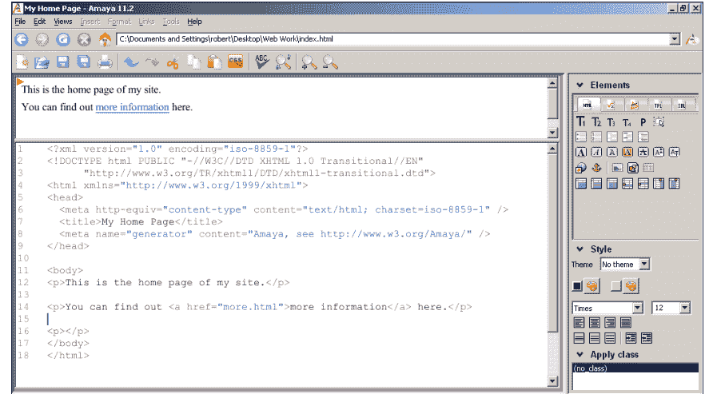

尽管代码一开始看起来令人望而却步，但两条基本规则将帮助你理解它。

1. HTML 文件包含页面内容（即页面上的文字）和格式命令的混合。页面内容正常显示，Amaya 通常以黑色显示它。HTML 格式命令，称为标签，始终显示在尖括号中 <like this>，Amaya 通常以紫色显示它们，除非你更改了程序的设置。
2. HTML 标签通常成对出现。第一次出现开启特定的效果，或标记特定部分的开始。第二次出现关闭该效果，或标记该部分的结束。第二次使用与第一次相同的标签名称，但在标签名称前有一个斜杠。

有了这两个重要事实，你现在应该能够开始理解构成我们页面的 HTML 代码了。页面有 2 个主要部分，即头部（head）和主体（body）。头部部分以 `<head>` 标签开始，以 `</head>` 结束，包含有关整个页面的信息。有一个名为 Generator 的元标签，其值为 Amaya。这告诉任何查看你页面 HTML 代码的人该页面是用 Amaya 创建的。还有一个名为 `<title>` 的头部标签，你的页面标题就放在那里。页面标题是当访客（或你）查看你的网站时出现在 web 浏览器窗口标题栏中的内容。

有些标签实际上不需要闭合标签，即带有前斜杠的版本。元标签就是这样一个例子。然而，HTML 规范近期的变化规定所有标签必须闭合，即使那些官方上不需要的标签也是如此。这有助于避免页面上的错误，这些错误可能会混淆某些浏览器。因此有 `</>` 标签，意思是“关闭上一个标签”。

你在 web 页面上最常看到的标签是 `<p>`，它开始每个段落。段落以 `</p>` 结束，然后进一步的 `<p>` 标签在其下方开始一个新段落。还有其他影响页面上文本外观的标签。例如，`<b>` 标签使文本加粗，`<i>` 使其斜体。要查看这些是如何工作的，在 HTML 窗口中的某处点击鼠标，然后在段落内的某处输入 `<b>`。然后，几个单词之后，输入 `</b>`。现在点击回屏幕的上半部分，你会发现你选择的单词现在以加粗形式显示，如下所示：

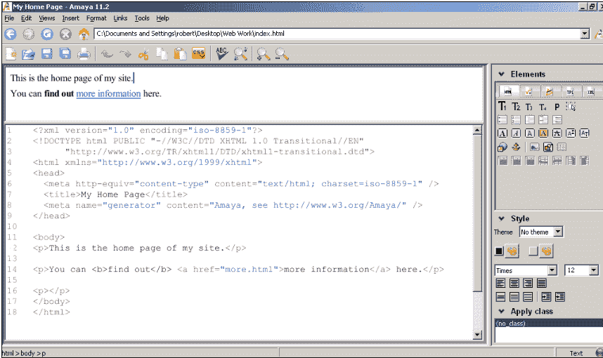

你经常使用的一组标签是标题级别。HTML 语言内置了 6 个此类标签，允许你创建最多 6 个级别的标题。通常，你页面上的主标题将是一级标题，以 `<h1>` 标签开始，以 `</h1>` 结束。然后你可能想在后面包含一个子标题，这就需要一对匹配的 h2 标签。

Amaya 可以为你自动生成标题标签。在屏幕的上半部分，高亮显示第一行，然后点击右侧面板中的 T1 按钮。然后点击屏幕的下半部分，看看该文本如何被 h1 标签包围，如下所示：

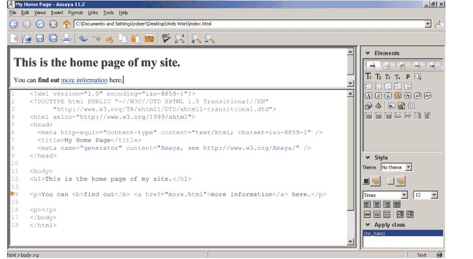

### 元标签

早些时候，我提到了元标签。具体来说，是名为 "Generator" 且值为 "Amaya" 的元标签。元标签是网页向显示该页面的 web 浏览器提供有关自身信息的一种方式。元标签最流行的用途之一是包含页面的简短描述，以及一些关于它的关键词。例如，HTML 文件的 `<head>` 部分可能包含以下代码：

```
<meta name="description" content="Latest availability for the Grand Hotel">
<meta name="keywords" content="availability, late bookings, vacant rooms">
```

在你创建的每个页面上都包含这两个标签（描述和一些关键词）总是个好主意。这将有助于你的网站被 Google 等搜索引擎发现和索引。

过去，搜索引擎主要依赖这些信息来构建其索引的内容。然而，情况不再如此，因为许多网站运营商试图通过例如包含明确的性关键词来描述相当枯燥的网站来欺骗该系统。因此，尽管元标签信息不再像以前那样重要，但搜索引擎仍将其作为更复杂过程的一部分予以考虑。

在第 313 页关于搜索引擎优化的章节中会有更多相关内容。


# HTML 的无障碍性、准确性与隐私

你可能会惊讶地发现，任何人（不仅仅是你自己）都可以查看你创建的网页的 HTML 代码。同样地，你也可以查看网络中任何页面的 HTML 代码。几乎所有的网络浏览器，包括 Internet Explorer、Firefox 和 Safari 等所有主流浏览器，都有一个选项，可以显示你正在查看的页面的**源代码**。

例如，打开你的网络浏览器，然后浏览到你最喜欢的页面之一，比如 Google、维基百科、Facebook，或者任何其他你偏好的页面。如果你使用的是 Internet Explorer，请调出“视图”菜单（如果菜单栏未显示，请按下 Alt 键以显示它），然后选择“查看源文件”。其他所有浏览器都有类似选项，可以通过菜单栏或右键单击访问。然后你就会看到该页面的 HTML 源代码。

这种完全缺乏隐私的状态有两个含义。首先，这意味着你不应该在 HTML 代码中隐藏任何你不想让别人看到的东西。例如，HTML 代码中有一种方法可以插入注释，这些注释不会显示在最终的网页上，但如果某人查看你的源代码，它们**会**显示出来。

其次，HTML 的公开性质意味着，如果你想知道某人如何在他们的网页上实现某种特定效果，你只需查看他们的代码即可找到答案。这样做本身没有错。专业网页人士经常这样做。然而，如果你受诱惑将他人辛勤工作的大段内容复制到 Amaya 的代码查看屏幕上并粘贴，请不要这样做。虽然在技术上是可能的，但在道德和法律上是错误的。

## 验证你的 HTML

设计网页并不特别容易，尤其是当你希望确保你的 HTML 代码正确时。感谢的是，互联网上有各种网站可以自动检查你网站的一个或多个页面，并报告任何错误。这些网站的存在正是因为上述提到的 HTML 隐私缺失问题。如果你的页面在互联网上，任何人或任何自动系统都可以查看其 HTML 代码。

最著名的 HTML 验证器（此类服务被称为验证器）由万维网联盟（W3C，简称 W3C）运营。要使用它，只需访问 http://validator.w3.org 并输入你的页面地址。如果你尚未将页面上传到服务器，有一个选项允许你将 HTML 文件上传到验证器，或者你甚至可以直接从 Amaya 复制粘贴一段 HTML 代码到验证器中。

无论如何，验证的最终结果（希望如此）是一个祝贺屏幕，如下所示：

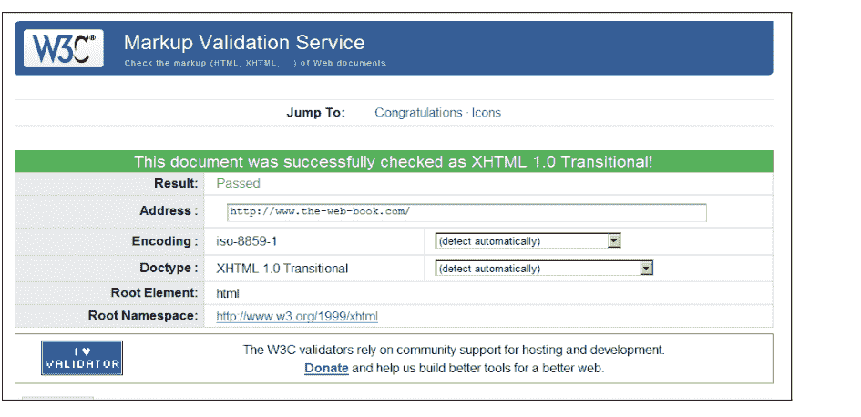

如果你的代码未通过验证，验证器通常会告诉你原因，以便你回去修复任何问题。

确保所有页面都能正确验证始终是个好主意。如果它们不能，就没有保证每位访问者的网络浏览器都能正确显示你的页面。在某些情况下，布局可能会看起来略有错误，而在其他情况下，页面可能根本不会显示。有些浏览器对未关闭的标签或在前一行结束之前就开始新行这样的细微错误更为宽容。然而，有些浏览器则会抱怨得厉害。

## 更多关于无障碍性的说明

就像网站设计的许多方面一样，无障碍性（使有视力和行动障碍的人能够使用你的网站）是那些在开始时很容易构建进去，但事后补救非常耗时的功能之一。因此，在整体设计过程中尽可能早地考虑它是明智的。

为确保你的网站具有无障碍性，你应该做的事情包括：

- 为你使用的每一张图片提供替代的 ALT 文本。
- 不要创建那些色盲人士无法理解的信息。例如，“点击红色的框而不是绿色的框来浏览我们的宣传册”对色盲人士几乎没有用处。
- 确保文本和背景颜色之间有足够对比度。
- 避免滚动文本和其他动态效果。它们难以阅读。
- 避免任何可能在屏幕上产生闪烁效果的技术。
- 使用最清晰、最简单的语言作为网站内容。
- 保持段落简短，并在它们之间留有一些空白。
- 不要使用框架。屏幕阅读器不喜欢它们。
- 浅背景上的深色文本比深背景上的浅色文本效果更好。
- 使用大约 1.5 倍行距，以确保页面上的文本看起来不会太“拥挤”。

现在你已经掌握了 HTML 的基础知识，特别是格式化标签如何作用于段落、标题、粗体文本等，我们可以继续学习 CSS。

这本书是免费的。要获取最新版本，请参见 www.the-web-book.com

请勿为他人复制 PDF 文件。所有下载必须来自 www.the-web-book.com

我们可以为其他网络主机制作此书的定制版本。详细信息请发送电子邮件至 info@the-web-book.com。

# 层叠样式表 (CSS)

现代网页设计技术中的一项关键技术被称为表现与内容的分离。在互联网早期，没有办法做到这一点，这意味着 HTML 页面臃肿、重复且难以理解。例如，如果你希望网站的主要正文使用 Verdana 字体，大小为 12 磅，那么每一段文本都需要以 `<font face=verdana size=12pt>` 标签开头。这可能导致整个网站中有数百或数千个这样的标签。如果你随后想重新设计网站，更改所有那些标签是一项繁重的工作。

几年前，HTML 语言的一次新修订（以及能够显示使用其创建的页面的新一代网络浏览器）出现了。新特性清单之首是所谓的 CSS，即层叠样式表或 HTML 样式表。

样式表是一个独立的文件，补充你网站的一个、几个或所有 HTML 页面。它包含关于你的页面的文本、图片和布局实际外观的所有信息。因此，要更新上面的示例，CSS 文件中可能有一个部分，规定所有 `<p>` 标签的实例都应使用 12 磅大小的 Verdana 字体。现在，你网站的所有页面只需将段落包裹在 `<p>` 标签中，它们就会神奇地以正确的字体和大小显示。最好的一点是，你只需更改单个 CSS 文件中的一个条目，就可以调整整个网站中每个段落的外观，而不必更改任何 `<font>` 标签。

CSS 还有其他好处。当你指定使用哪个 CSS 文件来格式化你的页面时，你实际上可以为不同的情况指定不同的 CSS 文件。例如，一套样式用于页面在屏幕上显示时，另一套样式用于用户在打印机上打印页面时。还有一套用于有人在智能手机、PDA 或投影仪上查看页面时。

我在第 49 页提到了无障碍性和使你的网站对残障人士友好。CSS 在这方面也可以提供帮助。你可以为有基本视力问题或阅读障碍的人（即大文本、无图形、更可读的背景颜色）设置一个单独的样式表。然后你可以轻松地在你的网站上添加一个选项，让那些偏好此设置的访问者使用这个样式表而不是普通的样式表。而且，当然，你无需维护页面内容的单独副本，因为现在内容已与表现层面分离。

分离表现与内容的能力还有其他好处。创建良好的网站需要写作和设计两方面的技能。CSS 意味着一个人可以专注于编写网站内容，而另一个人可以在样式表上施展魔法。

要注册本图书介绍的网络托管公司，请访问 www.the-web-book.com/hosts.html

费用对你来说是一样的，但会给我带来一小笔佣金，用于资助本书的开发。谢谢！


如今，CSS 已经是网页设计中不可或缺的一部分，很少有人会从零开始创建使用旧式 `<font>` 标签的新网站。这并不意味着仍然没有数百万个老式页面存在，但 CSS 绝对是一种更好的做法，因此本书将涵盖这种方法。

### 关于 DOCTYPE

在开始学习 CSS 之前，先来谈谈文档类型。你应当注意到，在图 53 所示 HTML 代码中 `<head>` 部分上方，有一行以 DOCTYPE 开头的文字。完整的一行是：

```html
<!DOCTYPE HTML PUBLIC "-//W3C//DTD XHTML 1.0 Transitional//EN"
"http://www.w3.org/TR/xhtml1/DTD/xhtml1-transitional.dtd">
```

这就是所谓的 DTD，即文档类型定义（Document Type Definition）。

HTML 在不断演进。正如上文所述，例如 CSS 的出现意味着建议你不再使用 `<font>` 标签。DOCTYPE 是你告知访问者的 web 浏览器你将使用哪个版本 HTML 的方式。凭借这些信息，浏览器可以确保你的页面正确显示。

你最多会看到的两种主要文档类型是 XHTML 1.0 Strict 和 XHTML 1.0 Transitional。Transitional 版本允许使用新式的 CSS，同时也允许使用老式的 `<font>` 标签。"Strict" 模式不允许使用 `<font>` 标签。如果你指定了 Strict 文档类型，然后继续使用 `<font>` 标签，从技术上讲你正在生成无效的 HTML，浏览器很可能会拒绝渲染。

因此，最简单的选择始终是使用 Transitional doctype，但请遵循最新的标准和技术。

### 开始使用 CSS

如果你的计算机上尚未打开 Amaya，现在请打开它。然后加载你的 index.html 主页。最快的方法是使用右侧的菜单面板，这是我们之前尚未涉及的内容。

你的 Amaya 屏幕右侧目前可能看起来像这样：

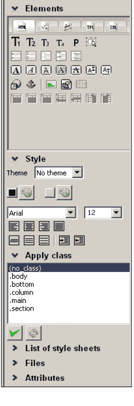

该面板上有各种可以打开和关闭的菜单选项，每个选项前都带有一个 ▶ 字符，例如 Elements、Style、List of style sheets、Files、Attributes 等。当菜单集可见时，前缀显示为 ▼。当它被隐藏时，字符显示为 ▶。你可以通过点击箭头字符来显示或隐藏这些部分。

这些部分中最有用的是 Files，它提供了一个简单的文件管理器，使你能够快速轻松地打开任何现有的网页。Apply Class 框也很有用，稍后我们会解释原因。

因此，点击箭头字符以关闭所有部分，然后打开 Files 部分和 Apply Class 部分。你的屏幕现在应该看起来像这样：

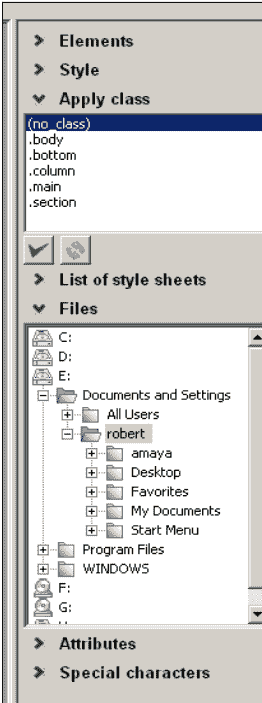

顺便提一下，Style 部分与 CSS 无关。它是 Amaya 的一个内置功能，使用非标准的方式更改网页的外观，所以我们将不使用它。

现在该打开你的 index.html 页面了。使用你新找到的文件管理器浏览到你的 Web Work 文件夹，然后双击 index.html。或者，如果你更喜欢，可以转到顶部的 File 菜单，然后使用 Open Document 选项。无论哪种方式，最终你都会打开 index.html 页面并准备好进行编辑。

现在我们需要为网站创建样式表文件。从屏幕顶部的 File 菜单中选择 New，然后选择 New Style Sheet。如果不是已经显示，请使用文件夹按钮浏览到你的 Web Work 文件夹。Amaya 想要将文件命名为 New.css，但这不明智。惯例是将主样式表文件命名为 style.css，并且名称中不包含大写字母。因此，请在 New CSS Style Sheet 框中将 New.css 更改为 style.css。

在同一个框中，选择 **In New Tab** 单选按钮作为打开文件的位置，然后点击 Create。

你会看到 Amaya 中现在打开了 2（或可能 3）个标签页。一个是你的 index 页面，另一个是你的 css 文件。你可以点击标签页在文件之间切换。

在上一章中，我们学习了 HTML 标签。现在，我们可以开始创建一个样式表，将特定格式应用于特定标签。

在你的空白 css 文件中输入以下内容：

```css
p {
font-family: Verdana;
color: red
}
```

你的屏幕将显示如下：

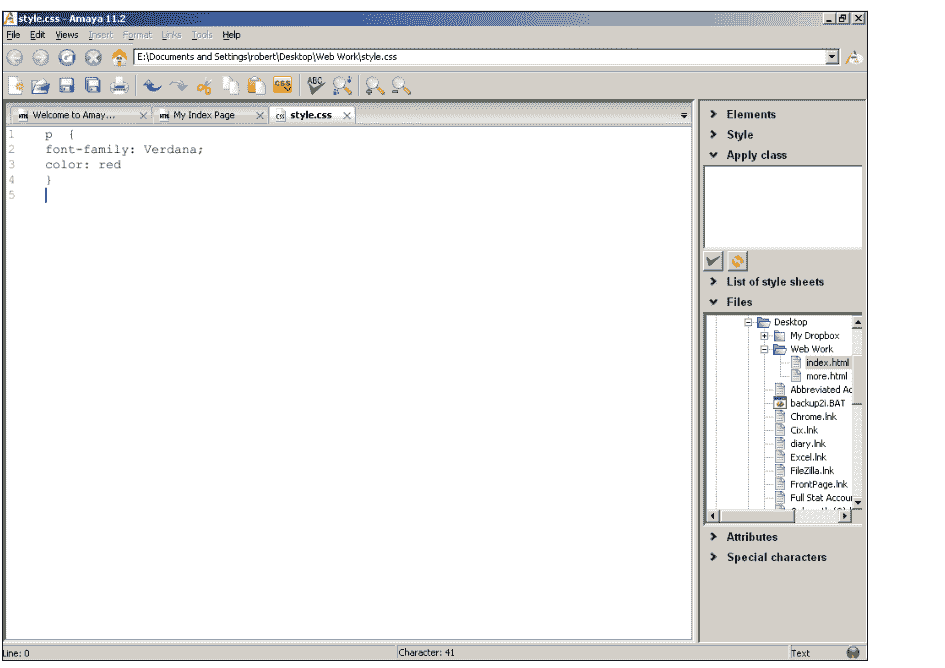

我们现在为网站创建的第一个样式表条目。这指定所有 <p> 标签都应使用 Verdana 字体并显示为红色。

一旦你了解基础知识，CSS 文件的格式相当容易理解。每个条目的第一行是你要指定样式的 HTML 标签名称，后面跟着一个大括号。在后续行中，指定该样式的各个方面，例如 font-family 和 color。我稍后会解释如何了解其他可用的样式方面。

每个样式方面以分号结尾。最后是一个闭合的大括号。

请注意，最后一个样式特征上的分号是可选的，正如你可以在下方插图中看到的那样，示例中没有包含它。然而，养成在每一行末尾始终包含分号的习惯通常是很好的做法。否则，如果你在当前样式定义中最后一行的下方添加新的样式选项，并且忘记在不再是最后一行的那一行添加分号，你的样式表文件将无法正常工作，因为 web 浏览器并不总是知道一行在哪里结束，下一行从哪里开始。

既然我们在这里，让我们再向 CSS 文件添加一个样式定义，这次是针对 <ul> 标签，它定义了一个项目符号列表（ul 代表 Unordered List，即无序列表，与之相对的是使用 <ol> 标签的有序列表 numbered list）。

因此，按照以下方式为 CSS 屏幕添加一个新部分：

```css
ul {
color: green;
}
```

你的 CSS 文件现在应该看起来像这样：

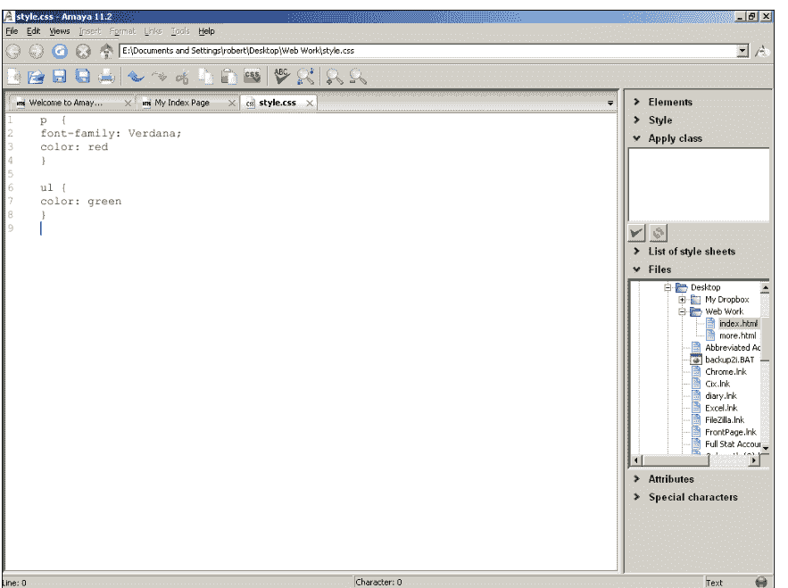

点击其标签页，翻回到你的 index.html 页面。有任何变化吗？你的段落现在是 Verdana 字体且为红色吗？很遗憾没有，原因只有一个非常充分的理由。虽然你创建了一个样式表，但我们还没有向 index 页面添加必要的命令来指定它应该从哪里获取样式信息。所以让我们改变这一点。

首先，我们需要保存我们刚才在处理的样式表。因此，切换到样式表标签页，从 File 菜单中选择 Save。现在切换回 index.html 页面标签页。

从 Format 菜单中选择 Style Sheets，然后选择 Link 选项。在框中只需输入 style.css 并按下 Confirm 按钮。不需要指定完整路径，因为你的 index.html 页面和 style.css 文件都在同一个文件夹中。

现在，就好像变魔术一样，你的 index 页面发生了变化。你的文本段落现在按照要求使用了 Verdana 字体并显示为红色。

我们还为无序列表指定了样式，所以让我们看看是否也能正常工作。首先，在你的 index 页面中输入几段简短的段落，就像这样：

这是我的 index 页面，即网站的主页。

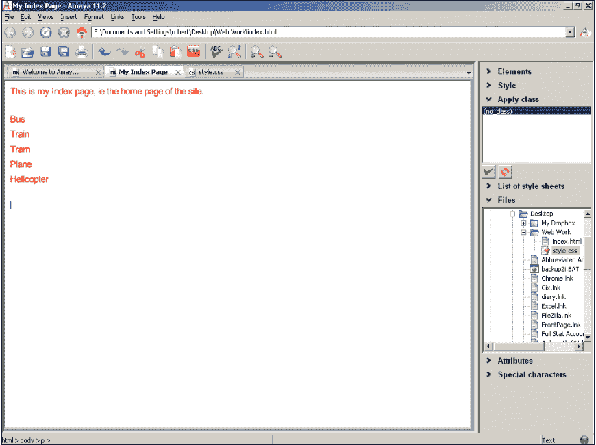

不出所料，它们将是红色和 Verdana 字体，因为样式表规定段落应该如此。但这一情况即将改变。

使用键盘或鼠标选中你的条目。然后，从 Insert 菜单中选择 List，再选择 Unordered List。现在屏幕应该看起来像这样：

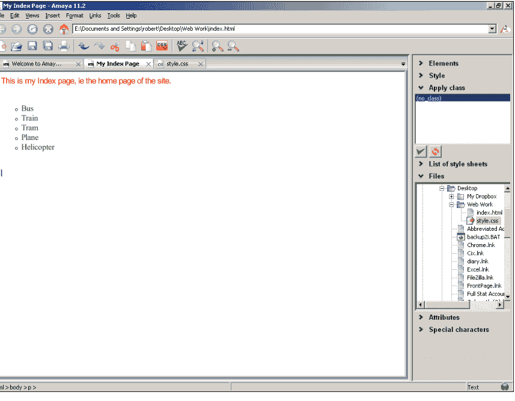

你的列表使用 `<ul>` 标签，而你的样式表规定 `<ul>` 标签应该是绿色的。所以它们就是绿色的。

然而，列表项并没有使用 Verdana 字体，因为你的 ul 标签样式没有这样说明。但我们可以快速轻松地修复这一点。点击其标签页，切换回你的 css 文件。在 ul 标签样式中添加一行以指定 font-family: Verdana。保存 css 文件，然后切换回 index 页面，你会发现你的列表使用的字体现在已经改变。

通过修改单个样式表文件即可更改一个或数百个页面的能力，正是 CSS 如此有用的原因。如果你网站中的所有页面都链接到同一个样式表，更改 CSS 文件会立即更改所有页面。

### 关于字体

你的计算机上可能安装了一两百种字体。大多数人都是如此。每次你安装新程序时，通常会附带一系列新安装的字体。如果你查看 Microsoft Word 或你正在使用的任何文字处理软件中可用字体的列表，那个列表将非常庞大。然而，这并不意味着你可以在网页上使用它们所有。


### 字体

当你在 CSS 文件中指定一种字体时，构成该字体的实际数据（那些所有的线条和曲线）并不会被包含在页面中。唯一被放入 HTML 的指令是告知访客的 web 浏览器以你选择的字体显示你选定的文本。但这只有在访客的计算机上恰好安装了该字体时才能正常工作。如果没有，浏览器会尝试选择一个看起来大致相似的字体，但最终结果很少是完全一致的。

因此，最安全的做法始终是确保你只在 CSS 文件中指定那些几乎可以肯定已预装在大多数访客计算机上的标准字体。虽然这样的字体并不多，但它们确实提供了相当广泛的风格截面。涉及的字体如下，这里以实际样式列出，以便你可以看到它们的外观：

- Arial
- Verdana
- Trebuchet MS
- Courier New
- Georgia
- Times New Roman

请注意，这些名称区分大小写，因此在样式定义中指定 `verdana` 与 `Verdana` 并不相同，除非访客的 web 浏览器当时特别宽容，否则可能无法正常工作。大多数现代浏览器都从不宽容。

这 6 种字体可以大致分为三类。Arial、Verdana 和 Trebuchet MS 是所谓的无衬线字体（sans-serif）。衬线是字符末尾的装饰，而无衬线字体没有这些装饰。请与衬线字体进行比较，例如 Georgia（本书中全文使用此字体）和 Times New Roman。

对于正文，即页面上的主要文本部分，无衬线字体通常效果最好。对于标题和图片说明文字，衬线字体看起来较好。

Courier New 是等宽字体的一个例子。在这种字体中，每个字符的宽度都相同。因此，单词 `RAILWAY` 的宽度与单词 `ILLICIT` 的宽度相同，因为它们都包含 7 个字符。就像这样：

```
RAILWAY
ILLICIT
```

在非等宽字体中，每个字母的宽度不同。就像这样：

```
RAILWAY ILLICIT
```

这种字体通常被称为比例间距字体（proportionally-spaced fonts），因为纸上每个字符的宽度与其实际宽度成比例。

使用等宽、非比例字体在数字列表中很有用，如果你希望所有列都能正确对齐。对于几乎所有其他用途，比例字体往往可读性更好，看起来更专业。除非你特别希望创建一个看起来像是用打字机制作的网页。

### 类

到目前为止，在讨论 CSS 时，我们谈到了基于 HTML 标签定义样式。通过为 `<p>` 标签创建样式定义，我们可以指定页面上所有正文段落的外观。同样，通过创建一个名为 `ul` 的样式，我们可以为所有无序列表设置样式。如果你为 `h1` 标签添加样式，你可以更改页面上所有一级标题的外观。

正如你可能想象的，CSS 的内容远不止让你选择与 HTML 标签关联的字体和颜色。实际上，CSS 非常复杂，是大多数专业 web 开发者的噩梦。一本典型的 CSS 参考书厚达 600 多页，但幸运的是，我们不会在这本书中深入那么多细节。不过，CSS 还有一个非常实用的功能是你需要了解的那就是类（classes）。

类是一种可以在网页任何地方使用的样式，而不是针对特定的 HTML 标签。你可以自由命名列名，而不是以标签命名。例如，如果你经常在网页中提到你最喜欢的奶酪名字，你可以创建一个名为 `fave-cheese` 的类。然后，无论该奶酪名字出现在哪里，都将其分配给该类。文本可以是整个段落、几行，甚至只是一个单词。以下是如何创建 CSS 类并在网页中引用它的示例。

确保 Amaya 已打开，并且你的 `index.html` 和 `style.css` 文件已在单独的标签页中打开。现在，在你的样式表文件中，按如下方式添加一个新样式：

```css
.fave-cheese {
  color: yellow;
  font-family: Arial;
  font-size: 18px;
}
```

这种样式与我们之前创建的其他样式有两个不同之处。首先，我们选择了自己命名的样式，而不是使用 HTML 标签的名称。其次，样式名称以点号开头。点号告诉浏览器这是一个类，而不是 HTML 标签样式。

保存你的 css 文件（文件，保存），然后返回索引页。注意屏幕右侧的“应用类”区域，它现在列出了你的类。

在页面上输入一些文本，高亮显示它，然后双击列表中的类名。你选定的文本现在已根据你的类进行了格式化。高亮显示更多文本并将其也应用于该类。

标签样式和类结合使用，允许你几乎以任何你想要的方式格式化你的网页。如果你想要为特定标签的所有实例设置样式，即你所有的 `h1` 标题或你所有的段落，请使用标签样式。如果你只想偶尔为几个单词或句子设置样式，请使用类。

### 让样式为你工作

在 HTML 页面中使用样式的主要好处是，它们使通过单击鼠标对整个网站进行广泛更改变得容易。只需更改 css 文件中的单个条目，整个网站就会随之改变。然而，要最大限度地发挥使用 css 的好处，你需要了解两件事。

首先，将样式（标签和类）的数量保持到最少。如果你发现自己创建了 6 个不同版本的 `fave-cheese` 类以适应网站布局的特定怪癖（例如一个版本用于标题，一个用于图片说明等），你将失去 CSS 的大部分好处，因为现在如果你有 6 个不同的对象需要更改来改变奶酪名字的显示方式。

其次，谨慎选择你的类名。根据类的使用目的来选择名称，而不是它的外观。考虑一下如果我将奶酪类命名为 "arial-yellow" 而不是 "fave-cheese" 会发生什么。如果我以后重新设计网站并决定奶酪名字用紫色而不是黄色，我最终会得到一个名为 `arial-yellow` 但实际上显示为紫色的类。这将使我或以后任何人都更难记住每个类的用途。

### HTML 标签名称

为了充分利用 HTML 标签样式，你显然需要知道有哪些可用的标签名称。你可以在互联网上找到完整列表（只需在 Google 中输入 HTML Tags），但这里有一些可以帮你要开始：

- `<h1>` 到 `<h6>` 标题级别 1 到 6
- `<table>` 用于表格的开始。
- `<tr>` 开始表格的每一行。
- `<td>` 代表表格数据（Table Data）。用于表格的每个单元格。
- `<b>` 粗体文本。
- `<i>` 斜体文本。
- `<body>` 网页的整个主体。
- `<ul>` 无序列表，在每个项目前使用项目符号。
- `<ol>` 有序（即编号）列表
- `<li>` 列表项（用于有序和无序列表中）。
- `<a>` 锚点。用于创建超链接。

### 更好的 CSS 编辑器

样式表是现代 web 设计中一个功能极其强大的功能，完全没有任何理由使用其他方法来格式化你的页面。不幸的是，Amaya 并没有使创建和维护 CSS 文件变得特别容易。到目前为止，你已逐行手动创建样式。这是缓慢且容易出错，而且只有在你碰巧了解 css 语言（font-family、color 等）时才有效。

现在你理解了 css 文件的基本内容及其包含的命令类型，我们需要找到一个更好的程序来编辑 css 文件。最好是一个免费的程序。互联网上有相当多的此类程序可供下载。在我看来，最好的一个是 Topstyle Lite。它是商业产品 Topstyle Pro 的简化版本，后者提供更多功能。但对于任何需要基本程序来轻松创建和编辑 css 文件的人来说，Topstyle Lite 是完美的。

因此，你接下来的任务是下载并安装 Topstyle Lite。暂时关闭 Amaya，但不要卸载它。我们将继续使用 Amaya 来编辑 HTML 页面。

要下载 Topstyle Lite，请转到 www.newsgator.com 并遵循链接到 Topstyle，然后到 Topstyle Lite。或者在 Google 中输入 "topstyle lite"。一旦下载了安装程序文件，双击它开始安装。我们在这本书中使用的 Topstyle Lite 版本是 3.5。


安装了 TopStyle Lite 后，启动该程序。然后转到“文件”菜单并选择“打开”。浏览到你的 WebWork 文件夹，定位到我们之前已创建的样式文件，双击它即可用 TopStyle Lite 打开。屏幕显示效果如下：

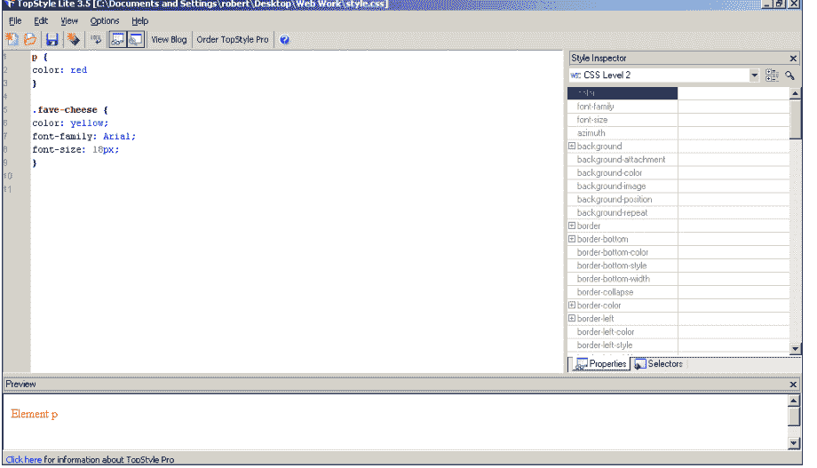

关于 Web 技术，其优点之一是 HTML 和 CSS 文件仅仅是标准的 TXT 文件，而不是使用像 Word 或 Excel 那样的专有或复杂格式。这意味着你可以轻松切换编辑器。如果你不喜欢 Amaya，可以将你的 HTML 文件加载到另一个应用程序中。同样，我们之前用 Amaya 创建的 CSS 文件现在也可以加载到 TopStyle Lite 中。

让我们首先更改我们最喜欢的奶酪文本的颜色，从黄色改为蓝色。不是普通的蓝色，而是一种明亮淡雅的浅蓝色。在 Amaya 中，你需要知道特定颜色的名称（或代码编号），但 TopStyle Lite 让事情变得简单得多。

在构成 `.fave-cheese` 类定义的 3 行中的任意一行内点击某处，你会在屏幕右侧看到样式的完整细节。点击黄色色块，会出现一个指向颜色下拉列表的箭头。点击该箭头。从选项列表中选择一个颜色，或者选择列表顶部的“选择颜色”选项。这会打开一个颜色选择器，你可以从中选择想要的特定蓝色色调。完成后，点击“确定”。观察类的定义是如何被编辑的。

让我们使用 TopStyle Lite 创建一个全新的样式。我们将为二级标题创建一个标签样式，即 `<h2>` 标签。

将光标向下移动到屏幕底部，位于现有的一对样式定义下方。然后，从“编辑”菜单中点击“新选择器”。选择器是样式标题的官方名称（无论是标签还是类）。在这种情况下它是标签，因此在“HTML 元素”框中，向下滚动到 h2，选中它，然后点击“确定”。

TopStyle Lite 将创建样式定义的第一行和最后一行，如下所示：

```css
h2 {

}
```

现在，你可以使用右侧的面板来选择你的 h2 标签的样式和设计。这里有一个示例：

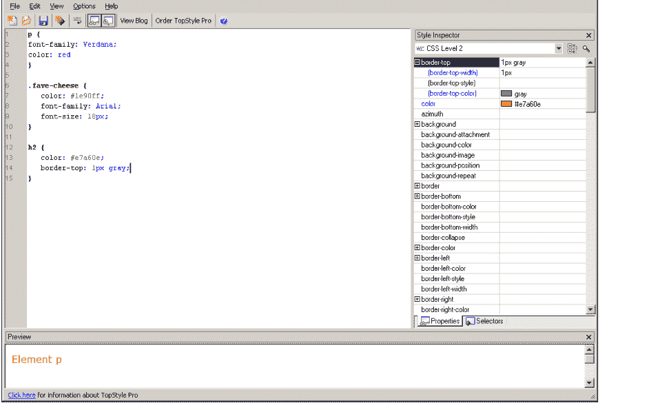

如你所见，我选择了深橙色的文本颜色，以及顶部一个 1 像素粗的灰色边框。

使用 TopStyle Lite 创建一个新类，而不是标签样式，同样简单。再次，从“编辑”菜单中选择“新选择器”以打开如下所示的“新选择器”框：

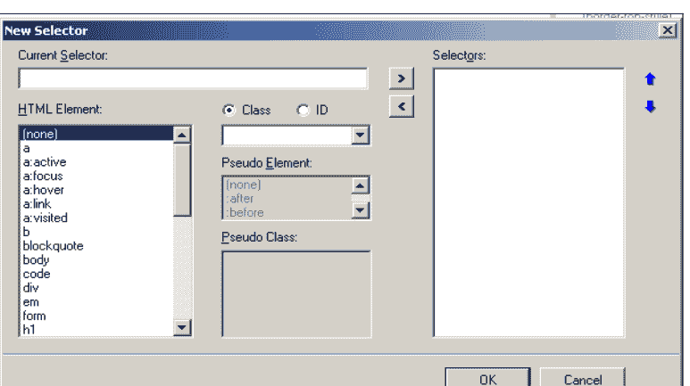

从提供“类”或“ID”选择的单选按钮组中，选择“类”。然后，在下面的框中输入你的类名，然后根据需要选择选项。如果你忘记了，TopStyle Lite 会自动在类名前添加点号。

当你用 TopStyle Lite 实验完毕后，从“文件”菜单中选择“保存”来保存你的 CSS 文件，然后退出程序。

在我们暂时离开 CSS 和 TopStyle Lite 的话题之前，让我们检查一下我们的新 `<h2>` 标签样式是否正确工作。

打开 Amaya，然后打开你的 index.html 页面。输入几个单词，并选中它们。然后，从“插入”菜单中，选择“标题”然后选择“H2”。这会在这些单词的开头用 `<h2>` 标签包围，在结尾用 `</h2>` 标签包围，从而将这些单词标记为二级标题。你会发现你的单词现在显示正确，使用了你用 TopStyle Lite 创建的 h2 样式。

### 基于 ID 的样式

在我们离开这段简短的 CSS 介绍之前，在你进入下一章之前，还有另一件你需要知道的事情。到目前为止，我们涵盖了两种不同的选择器类型，即标签和类。实际上还有第三种类型，称为 ID。它的运作方式如下。

HTML 允许你为页面上的任何标签分配一个唯一的名称或 id。唯一的限制是名称在该页面上必须唯一。例如，考虑这个二级标题：

```html
<h2>Further Information About Cheddar Cheese</h2>
```

我们可以通过修改开始的 h2 标签来给这个标题一个唯一的 id，如下所示：

```html
<h2 id="further-cheese">Further Information About Cheddar Cheese</h2>
```

除非你另有说明，否则此标题将像任何 h2 标题一样显示，遵循你样式表中的 h2 条目。但由于此特定标题有自己的 id，我们可以在 CSS 文件中做一些相当巧妙的事情，如下所示：

```css
#further-cheese {
    color: navy;
}
```

注意样式名称开头的 # 符号。这表示基于 ID 的样式。它仅仅意味着该样式仅应用于具有 id 为 further-cheese 的 HTML 标签。无论该标签是 h2 标题、段落、列表项，还是其他任何内容都没有关系。唯一的规则是你不能将相同的 id 分配给同一页面上的多个 HTML 标签。如果你需要在多个地方应用该样式，请使用类。

### 极致 CSS

当相对简单地使用时，CSS 是一个强大的工具，与使用 `<font>` 标签的旧方法相比，它能帮助你创建更易于理解和维护的网页。但如果你认为本章教你掌握了关于 CSS 的一切知识，那你就大错特错了。通过使用 CSS 的高级功能，你可以对页面的外观获得更大的控制权。例如，这是基于 CSS 设计的最佳实践者之一的网站主页，即 www.csszengarden.com 的朋友们。

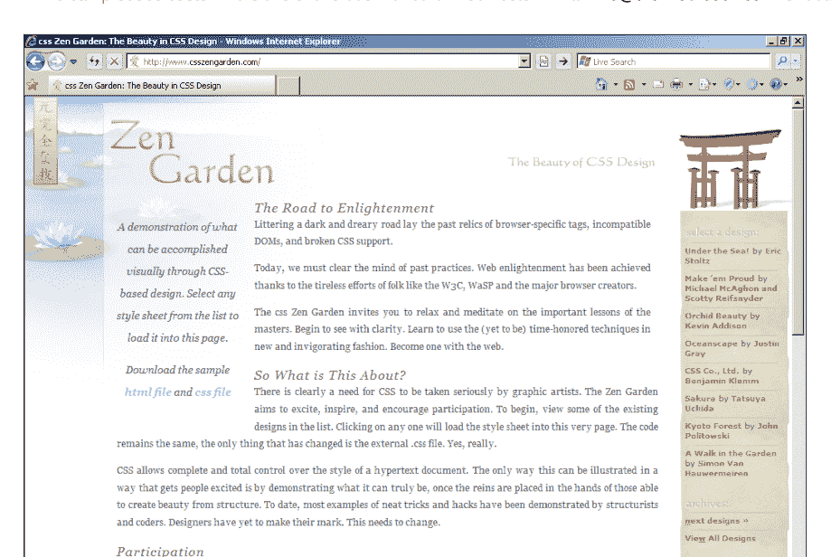

通过点击页面右侧的菜单项，你可以选择其他 CSS 样式表应用到页面上。例如，这里是“兰花之美”样式：

若要注册本书中提到的网络托管公司，请访问 www.the-web-book.com/hosts.html。费用相同，但会给我带来一小笔佣金，用于资助本书的开发。谢谢！

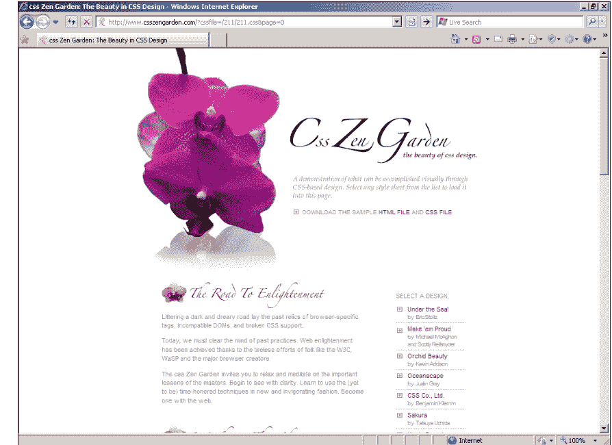

这里需要记住的一点是，包含页面内容的 HTML 文件（即诸如“Littering a dark and dreary road...”之类的文本）每次都是相同的。它没有改变。唯一改变的是与之链接的 CSS 文件，它控制文本的位置和外观，以及图像文件的位置和名称。

如果你想知道这是如何做到的，请订购 *The Zen of CSS Design* 的一册，由该网站的作者编写。你可以在亚马逊和几乎所有主要书店买到它。

### 页面布局和 Div 标签

到目前为止，我们对 CSS 的观察集中在视觉外观上。我们已经涵盖了如何指定字体、大小和颜色。但 CSS 远不止于此。最重要的是，它还涵盖了页面的布局和安排。例如，看看这个页面。

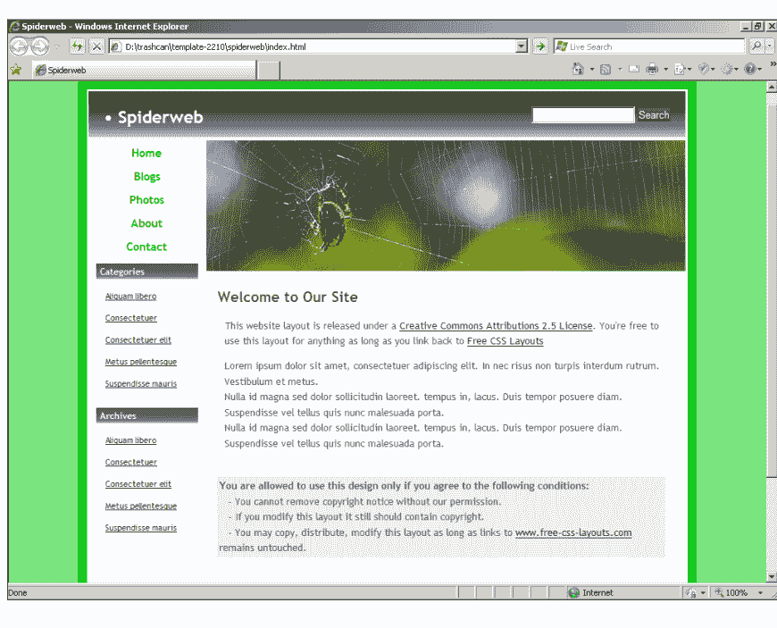

注意页面被分为两列。实际上，包含蜘蛛网标题和灰色条的页面顶部部分使用了页面的全宽。页面的其余部分分为两个垂直列。左列包含一些链接，而页面的主要内容在右侧。

这种布局是许多网站的典型特征。它们使用两列或三列布局，以便在页面的逻辑位置放置所有必需的内容。像这样将页面的链接和菜单集合（称为导航，或简称 nav）放在单独的列中，也意味着主要内容比屏幕全宽更窄。这使得人们更容易在屏幕上阅读页面。

那么，我们如何使用 CSS 创建这样的页面布局？关键在于 `<div>` 标签。在此上下文中，div 代表分隔符或划分。它允许你将整个页面块（包括其他 HTML 标签）分离成独立的项，然后其布局可以由 CSS 文件控制。

Div 不像我们迄今遇到的任何 HTML 标签。它不是那种你可以分配字体或颜色的东西。相反，你使用 CSS 来指定其在页面上的位置，相对于左上角或其他 div。你还可以指定其背景颜色、边框、边距等。

通过仔细嵌套你的 div，即在当前 div 关闭之前打开一个新的 div，你可以创建导致上述所示分列效果的层次结构。

所以在上面的示例中，页面由 4 个 div 组成。首先是包含整个页面的总体外层 div。在其中还有 3 个 div，分别创建顶部面板、左列和右列。

作为一个更简单的示例，让我们使用 div 和 CSS 来布局一个页面。这是我们要达到的效果：

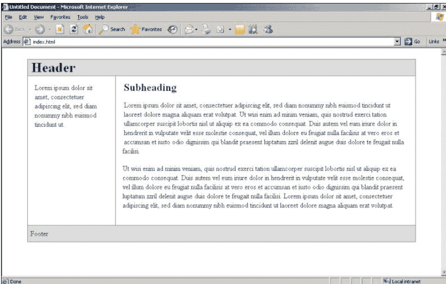

这里是一种很常见的网页格式。顶部有一行页眉，左右各有一列，底部有一个页脚区域。

以下是此页面的 HTML 文件 body 部分的样子。我添加了一些行号以助于随后的解释——这些行号不是 HTML 的一部分，如果你想将它们粘贴到 Amaya 中进一步实验，你应该删除它们。


你可能会惊讶于它究竟有多短、多简洁。让我们更详细地看看这段代码，因为如果你想更多地了解网站是如何运作的，理解基于 div 的页面布局的基础知识至关重要。

```html
<body>
  <div id="container">
    <div id="top">
      <h1>Header</h1>
    </div>
    <div id="leftnav">
      <p>
        Some text goes here...
      </p>
    </div>
    <div id="content">
      <h2>Subheading</h2>
      <p>
        Some text goes here...
      </p>
      Some text goes here
    </div>
    <div id="footer">
      Footer
    </div>
  </div>
</body>
```

在第 2 行，我们创建了一个 div 并将其命名为 container。这是包含页面其余部分的整体 div。你选择什么名称作为你的 div 并不重要，但许多 web 从业者习惯将主 div 称为 container。

在第 3 行，我们创建了另一个名为 top 的 div。由于我们尚未关闭 container div，因此在结构上它实际上位于 container 内部。top div 在第 5 行关闭，其内容（仅有一个 h1 标题）出现在第 4 行。

在第 6 到 10 行之间，我们创建了另一个名为 leftnav 的 div，其内容仅是一个段落。第 11 到 18 行包含 content div，它是上面示意图中的右栏。第 19 到 21 行创建了我们的 footer div。

最后，在第 22 行，我们关闭了 container div。

页面创建完成后，我们现在可以为其创建 css 文件。它看起来是这样的。你会发现我使用了一种略有不同的格式布局，将 `{` 符号放在单独的一行。如果你更喜欢这种方式，这样做完全没问题。

```css
#container
{
  width: 90%;
  margin: 10px auto;
  background-color: #fff;
  color: #333;
  border: 1px solid gray;
  line-height: 130%;
}

#top
{
  padding: .5em;
  background-color: #ddd;
  border-bottom: 1px solid gray;
}

#top h1
{
  padding: 0;
  margin: 0;
}

#leftnav
{
  float: left;
  width: 160px;
  margin: 0;
  padding: 1em;
}

#content
{
  margin-left: 200px;
  border-left: 1px solid gray;
  padding: 1em;
  max-width: 36em;
}

#footer
{
  clear: both;
  margin: 0;
  padding: .5em;
  color: #333;
  background-color: #ddd;
  border-top: 1px solid gray;
}

#leftnav p { margin: 0 0 1em 0; }
#content h2 { margin: 0 0 .5em 0; }
```

这个 css 文件的第一部分是 `#container`。如果你还记得，这意味着我们要指定 id 为 `container` 的 HTML 标签的样式。恰好，这就是我们的主 div。主要关注点在于我们将其宽度设置为 90%。这意味着页面的整体宽度将是屏幕宽度的 90%，无论访客使用的是哪种屏幕来查看我们的网站。如果你查看页面截图，剩余的 10% 被主文本区域左右两侧的垂直空白区域占据。

第二部分 `#top` 用于指定有关 top div 的更多细节。在其下方，有一个标题为 `#top h1` 的章节。这是我们之前没有遇到过的内容，也是 css 另一个实用的功能。在这种情况下，它意味着接下来的样式仅应用于 `#top` div 内的级别 1 标题。

最后两个部分 `#leftnav p` 和 `#content h2` 使用了相同的技术。它们指定了 leftnav 列中标准段落文本的外观，以及 content 面板中 h2 标题将呈现的样子。

虽然这可能一开始看起来非常复杂，但经过一些练习后，它相当容易上手。如果你想把这个例子作为自己页面的起点，只需将 HTML 代码和 css 文件输入或粘贴到 Amaya 中，然后根据需要调整内容和样式。通过实验 TopStyle Lite 来更改样式，你可以让页面呈现出你想要的样子。

如果你想将成品上传到托管空间，请记住同时上传 css 文件和 HTML 文件。否则布局会完全错误。此外，你还需要在 html 文件中添加 HTML 和 BODY 标签，并将样式表链接到该文件。

### CSS 盒模型

使用 css 创建页面布局，而不仅仅使用它来格式化文本，是一件复杂的事情。建议从 www.oppedesigns.org 等网站获取现成的设计，而不是从头开始设计自己的设计。但如果你确实想更多了解 CSS 页面布局的细节，有很多好书和在线资源可供参考。使用“css 教程”或“学习 css”等术语进行 Google 搜索可以帮助你入门。

基于 css 的页面布局中最重要的概念之一是所谓的盒模型。它解释了填充（padding）、间距（spacing）、对齐方式（left, right, centred 等）和边距（margins）如何相互作用，从而影响页面上项目的最终位置。

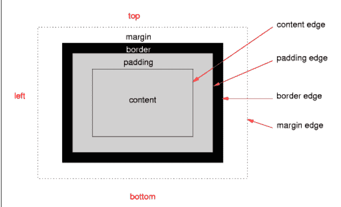

本书无法详细涵盖此主题，但你可以通过在线搜索“css 盒模型”来了解更多。

### 页面上的图片

要在你的网页中放入图片，你需要做的是：

- 从扫描仪、相机或其他合适的来源获取图片文件（通常是 .JPG 或 .TIF）。
- 将该图片文件复制到你的 web 文件夹中，与构成你网站的 HTML 文件放在一起。
- 在 HTML 页面中你希望图片出现的位置添加一个 `` 标签。

让我们现在就尝试这样做。

首先，我们需要找到一张要使用的图片。如果你手头有合适的图片，请将其复制到你的 Web Work 文件夹中。如果你没有任何图片，请访问你最喜欢的网站，右键单击页面上的某张图片，选择“另存为图片”，并将其保存在你的 Web Work 文件夹中。

此时你可能会惊讶地发现，从别人的网站上“偷”图片竟然像右键点击一样简单。不幸的是，情况通常就是这样。永远不要假设你网站上的图片是安全的，那些想要使用它们的人无法获取。如果你对此感到担忧，例如你是一名专业摄影师或艺术家，你想在线展示你的作品而不希望他人随意使用，最有效的威慑方法是只在你的公共站点上传小缩略图。任何想查看完整尺寸图片的人都可以被要求在允许进入网站单独的仅限订阅者区域之前付费。另一个选项是使用图形程序为图片添加水印或标志，但这会降低其整体外观。

在你的图片安全存储在 Web Work 文件夹中后，打开 Amaya 并加载你的一个 HTML 页面。从插入菜单中选择图像。然后浏览到你的 Web Work 文件夹，并选择你之前放在那里的图片。

在提供的空间中，输入一些“替代文本”。这是访客的 web 浏览器在访客将鼠标悬停在图片上时显示的文本。这也是使用屏幕阅读器软件访问你网站的人将听到的文本。因此，为网站上使用的每张图片都包含一些替代文本（或简称 alt 文本）是一个好主意。事实上，Amaya 不允许你留空此框，因此你没有选择余地。

你选择的图片现在将出现在你的网页上。它在我的电脑上看起来是这样的。请注意，我使用了“显示源代码”选项来显示标准页面和 HTML 源代码：

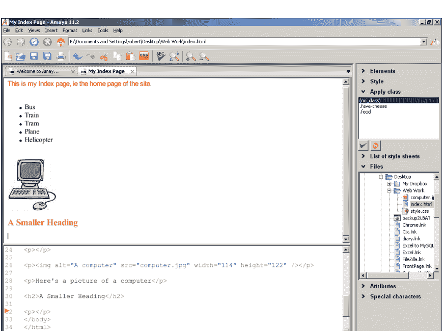

本书免费提供。要获取最新版本，请访问 www.the-web-book.com
请不要为其他人复制 PDF 文件。所有下载必须来自 www.the-web-book.com
我们可以为其他 web 托管商制作本书的定制版本。有关详细信息，请致信 info@the-web-book.com。

注意下方窗口中的 `` 标签，它指定了图像文件的名称、替代文本以及图片的宽度和高度。

如果你想在线查看你的完成页面，请将 HTML 页面和图像文件都上传到你服务器上的托管空间。别忘了始终上传你的网站使用的所有图像文件。如果没有这样做，并且访客的 web 浏览器遇到一个页面，其中的 `` 标签引用了一个在服务器上并不存在的图片文件，页面上的图片通常会被替换为一个带有红色叉号的空框。如果你曾经在网上看到过像这样的页面，现在你知道原因了。创建该页面的人忘记了上传图像文件，或者他们在服务器上重命名了图像文件，但没有更新页面上的 `` 标签以匹配。

### 关于图像大小

计算机上图片文件的尺寸通常以像素为单位测量，而文件的整体大小与其他任何文件一样，以 KB 和 MB（千字节和兆字节）为单位。

访问你网站的典型人的屏幕尺寸约为 1024 像素宽 x 768 像素深。所以，如果你想要一张放在屏幕上并与一些文本并排的图片，并且

要在本书中介绍的 web 托管公司处注册，请访问 www.the-web-book.com/hosts.html
成本完全相同，但这会为我带来一小笔佣金，用于资助本书的开发。谢谢！


为了导航用途，你最好确保图片宽度大约为 300 像素，高度为 200 像素。同样地，如果你希望图片几乎占据整个屏幕，1000 乘以 700 的尺寸可能就足够了。

然而，现代数码相机拍摄的照片通常大约是 3000 乘以 2000 像素。如果你使用扫描仪的高分辨率扫描模式，甚至可能是这个尺寸的 3 或 4 倍。因此，图片会太大而无法适配屏幕。网站访客将不得不在浏览器内滚动才能看到完整的图像。

一些网页开发者通过修改 `` 标签中的宽度和高度设置来绕过这个问题。这会强制浏览器将图像调整到所需尺寸。但是，它不会改变服务器上图像文件的总体大小（以 KB 和 MB 计）。如果你将相机中 3000 像素宽度的图片（文件大小为 4 MB）的 `` 标签修改为以 200 像素宽度显示，它仍然会占用 4 MB 的服务器空间。因此，它下载到访客电脑上的速度仍然会很慢。

所以，这里有一个关于网站图片的重要规则，你应始终遵循。如果你想在页面上使用的图片尺寸不合适，请在将其放到网页之前使用图像编辑程序调整其大小。切勿通过修改 img 标签中的宽度和高度设置来调整图片大小。

如果你没有可以调整图片大小的程序，可以将图像上传到类似 www.pixnik.com 这样的网站，并使用他们的在线工具。

### 将图片作为链接

在第 48 页，我们学习了超链接，以及如何将一段文本变成可点击的链接，从而导向另一个页面或网站。你也可以将图像变成超链接，这样点击图像时用户就会被带到另一个位置。

首先，在 Amaya 中通过鼠标拖动选中图片。它会像这样被边框包围：

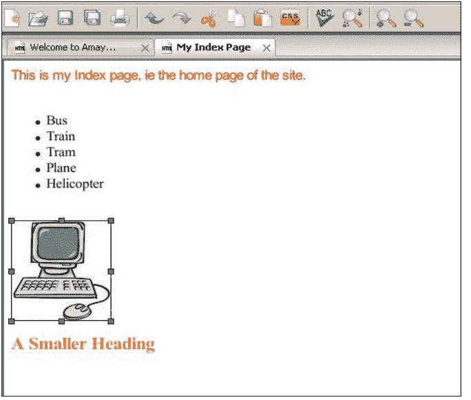

然后只需前往“链接”菜单，选择“创建或更改链接”，并输入访客点击图片时要访问的所需页面。

请注意，某些浏览器会在用作链接的任何图片周围添加边框，这可能导致图片看起来不像你期望的那样。要解决此问题，请在该图片的 `` 标签中某处将图片边框宽度设置为零。例如：

```html

```

### 寻找用于你网站的图片

从网站上窃取图片供自己使用在道德上和 legally 上都是错误的。把这样的图片借作训练练习是没有害处的（正如我们在这里所做的），但在真实的网站上这样做肯定是不建议的。如果你需要一张图片来说明你的网站，但手边没有相机，或者没有合适的图片，幸运的是有援助之手。有各种各样的网站提供免版税图片，你可以免费用于你的网站。我最喜欢的是 `www.sxc.hu`，它注册在匈牙利，但界面为英语。

### 为你的网站设置浏览器图标

你有没有注意到，一些网站在浏览器收藏夹列表和地址栏中有自己独特的图标？如果你创建到该网站的快捷方式，它还会出现在桌面上。这样的图标有助于让你的网站在访客电脑上脱颖而出，也为你的设计增添了一丝专业感。

例如，如果我把 BBC 新闻网站添加到我的收藏夹列表，请注意地址栏和“收藏夹”菜单中的黑色小 BBC 图标：

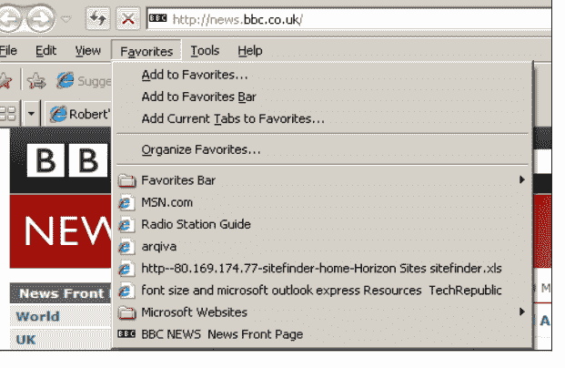

这种图标被称为“favicon”，因为它最通用的用途是显示在访客的收藏夹网站列表中。如果你想要为你的网站创建一个，操作并不难。你需要的是一个能够创建并保存为 favicon 格式图像的图形程序。

虽然市面上有很多这类程序，其中一些可以免费下载，但安装一个你不会经常使用的程序并没有太大意义。有很多在线 favicon 编辑器可以通过网页浏览器访问，它们的效果同样好。谷歌搜索 “favicon editor” 或 “online favicon editor” 会出现很多结果，只需选择一个适合你的即可。

举个例子，我将使用这个：

`http://www.mobilefish.com/services/favicon/favicon.php`

它看起来像这样：

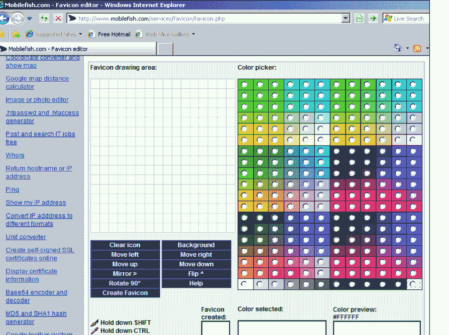

要创建你的 favicon，请点击绘图区域中的像素方格。颜色拾取器允许你选择每个像素的颜色。

请注意，favicon 的固定尺寸仅为 16 乘以 16 像素（某些操作系统和浏览器支持更大的尺寸，但并非所有都支持，如果你的编辑器提供尺寸选择，请坚持使用 16x16）。这意味着你的设计必然相当粗糙。不要试图在 favicon 中塞入太多信息，那样看起来并不协调。同样，抵制使用声称能够将数码照片或其他全尺寸图像转换为 favicon 的编辑器的诱惑。你可以尝试，但结果不会特别吸引人或易于理解。

在你绘制时，点击“Create Favicon”按钮以查看进展。以下是我尝试成为 favicon 艺术家的作品。设计是钢笔尖和字母 W 的结合体，如果你想知道的话！

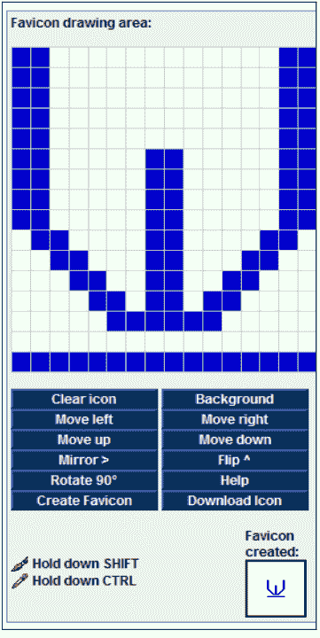

设计完成后，点击 **Download Icon**，网站将下载一个名为 `favicon.ico` 的文件到你的电脑。不要更改文件名称，否则你的电脑或网页浏览器将无法正确显示它。

剩下的只是使用 FileZilla 将该文件上传到你的网站。favicon 的规则规定文件必须上传到网站的根文件夹。在我们的情况下，这意味着 `public_html` 文件夹。如果你将文件放在网站的任何其他文件夹中，它将无法工作。

上传文件后，我们可以测试它了。打开网页浏览器，浏览到你的网站，你应该看到类似这样的效果：

这本书免费。要获取最新版本，请访问 www.the-web-book.com
请不要为其他人复制 PDF 文件。所有下载必须来自 www.the-web-book.com
我们可以为其他网络托管公司制作定制版本的这本书。详情请发电子邮件至 info@the-web-book.com。

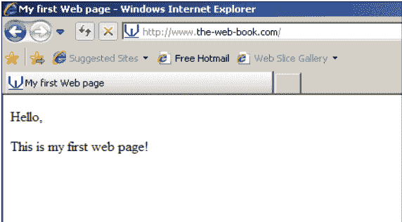

注意我们的新 favicon 如何出现在浏览器的地址栏以及 Internet Explorer 标签页上。

你甚至可以让 favicon 显示在桌面上。只需在 Windows 桌面上右键单击，然后选择“新建”、“快捷方式”。对于快捷方式的位置，输入网站的地址。在这种情况下是 www.the-web-book.com。对于名称，我将使用 TWR，以保持简洁。我现在在我的桌面上拥有了一个直接指向我网站的快捷方式，甚至显示了正确的图标：

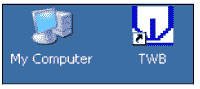

如果 favicon 没有出现，而是显示了通用的浏览器图标，请双击该图标访问网站。这应强制 Windows 下载 favicon，之后显示应该正确。

要注册本书中介绍的网络托管公司，请访问 www.the-web-book.com/hosts.html
成本完全相同，但会带给我一小笔佣金，用于资助本书的开发。谢谢！

### 通往精彩网页的捷径

现在你知道了 HTML 和 CSS 的基础知识，你可能迫切地想要创建一些真正的页面。然而，你也可能感到有些不知所措，因为你意识到制作一个外观好看的网页并不像你希望的那样容易。

幸运的是，有援助之手。有很多现成的页面设计，你可以从互联网上免费下载，然后根据需要自定义。从别人的设计开始并进行调整比从头开始创建要容易得多。然而，即使你是从别人的作品开始，如果你不了解 HTML 和 CSS 的基础知识，你会发现自定义页面很困难。因此，前面的章节介绍了这些基础。

两个提供免费的、现成的基于 CSS 模板的最著名网站是：

- Open Source Web Designs \ www.oswd.org
- Open Designs \ www.opendesigns.org

两个网站性质非常相似。你浏览可用设计的列表，然后下载你想使用的任何设计。每个设计通常由一个包含示例设计的单一 index.html 文件、一个配套的 style.css 文件以及网站使用的一组图片组成。一旦你下载了所有这些，你可以通过执行以下操作将其变成可用的网站：

1. 调整 CSS 以微调外观和感觉
2. 如有需要，也调整 index.html 文件
3. 根据需要复制 index.html 文件多次，以创建你网站的每个页面
4. 如有需要，调整或替换部分或所有图像文件，使网站更符合你的受众
5. 将完成的一组文件上传到你的托管空间

以下是来自 OSWD 的一个摘录，以便你可以看看有哪些可用的材料：


本书是免费的。要获取最新版本，请访问 www.the-web-book.com。请勿将此 PDF 文件复制给他人。所有下载必须来自 www.the-web-book.com。我们可以为其他网络主机生成此书的定制版本。如需了解详细信息，请发邮件至 info@the-web-book.com。

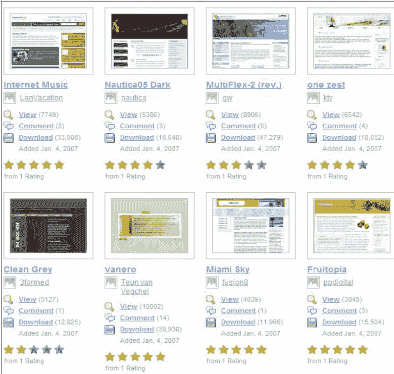

以下是来自 opendesigns 的类似页面：

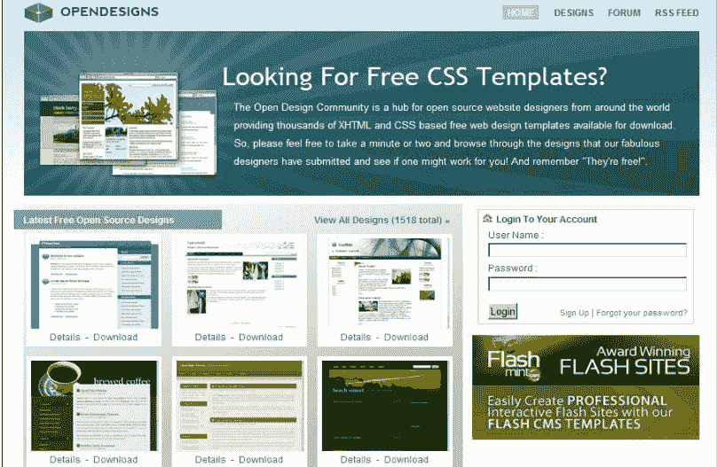

要注册本书中介绍的网站托管公司，请访问 www.the-web-book.com/hosts.html。这对你来说成本相同，但会为我带来一小笔佣金，用于支持本书的开发。谢谢！

这两个网站提供的服务非常相似，每个网站都包含大约 2000 个独立的设计。不过请记住，你得到的并不是一个完整的网站。它只是一个设计精美的单页，你可以将其作为构建模块使用。

### 使用开源设计

为了举例说明如何下载和使用免费提供的网页设计，让我们详细查看其中一个。在这种情况下，该设计来自 opendesigns.org，名为 Hot Gray。

首先，在网站上找到该设计并下载它。它将以 .zip 文件的形式到达你的电脑，你需要对其进行解压。只需右键单击该文件并选择“全部解压”即可。现在你可以进入该文件夹，里面会有一个名为 Hot Gray 的文件夹。其中包含你实际需要的文件：

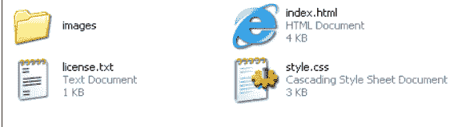

license.txt 文件是一个文本文件，其中详细列出了你对这个特定设计可以做什么和不能做什么。虽然大多数免费网页设计都有许可证和限制，但这些限制通常并不严格。就 Hot Gray 而言，许可证文件仅规定：

> 好吧，我会直言不讳，不玩法律术语：只要页脚链接保持完整，此主题即可免费用于个人和商业用途。

如果你不愿意，不必从网站的每个页面进行链接，只需在前页面进行链接即可。

在我看来，这完全可以接受。因此，请将 Hot Gray 文件夹复制到你的 Web Work 文件夹中，以便将所有与 Web 相关的项目集中在一处。然后双击 index.html 图标，这样我们就能看到该页面在 Web 浏览器中的实际样子：

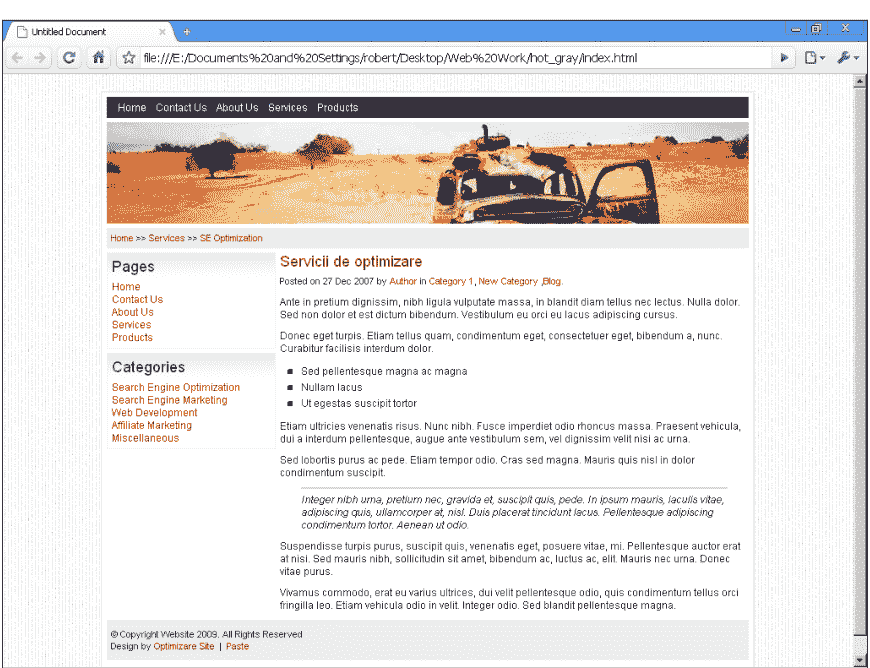

考虑到我们还没有实际进行任何设计工作，目前看起来相当不错。这才对！

### 调整文本

更改标准提供的 index.html 页面上的示例文本非常简单。将文件加载到 Amaya 中，直接覆盖现有内容即可。删除你不想要的任何内容。

在下面的示例中，我用自己的一段文字替换了主要文本。此外，我创建了一个简短的食物列表，并使用 Amaya 中的“无序列表”选项（右侧面板中我用红圈圈出的按钮）按照 css 文件中定义的样式格式化该列表。在这种情况下，对于 Hot Gray 设计，通常的圆形项目符号被小矩形所取代。

我还删除了主标题下的 “Posted on...” 行。这对于博客类型的页面或在线新闻通讯很有用，但在这里并不是真的必要。相关的条目仍然在 CSS 文件中，因此如果需要，稍后仍可在网站内的其他页面上使用此特定样式。

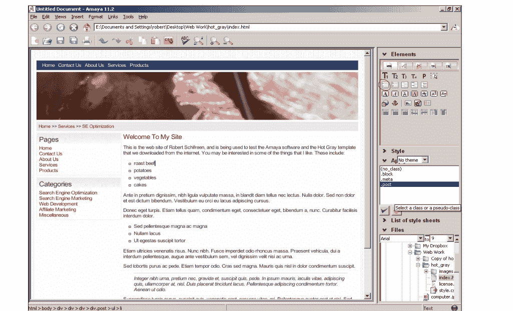

### 更改图片

从上面的图片中你还会看到，我将标题图片从沙漠场景换成了美味的烤牛肉。这是怎么做到的？看看你的 Hot Gray 设计中的 images 文件夹。在 Windows 中以缩略图模式浏览，我们会发现以下内容：

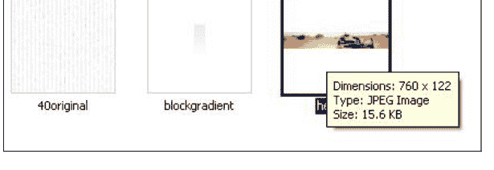

40original 和 blockgradient 图像用于构成页面周围的边框以及菜单行后面的灰色条。我们现在可以暂时保留这些。我们关注的文件是 header.jpg。将鼠标悬停在缩略图上会弹出一个摘要框，告诉我们该图像尺寸为 760 像素宽 x 122 像素高。因此，为了在不影响布局的情况下自定义设计，我们只需将该图像替换为另一个具有相同名称且尺寸相同的图像即可。只需快速访问前面提到的免费图像网站 `www.sxc.hu` 就能搞定。

你还需要将下载的图片裁剪为 760 x 122 的大小。如果你没有可以编辑和裁剪图片的程序，请在网上搜索 The Gimp，这是一款完全免费且非常出色的图像编辑器。或者使用 **www.piknik.com** 上的在线图像编辑器。

### 更改 CSS 样式

如果你想更改 Hot Gray 设计使用的文本样式，你需要更改其样式表文件中的 CSS 条目。将 css 文件加载到 TopStyle Lite 中，第一个部分看起来像这样：

```
body {
    margin: 0;
    padding: 0;
    text-align: center;
    background-color: #FFFFFF;
    background: url(images/40original.gif) repeat;
    font-family: Arial, Helvetica, sans-serif;
    font-size: 12px;
    font-weight: normal;
    color: #333333;
}

h1, h2, h3, h4 {
    margin: 0;
    padding: 0;
    font-weight: bold;
}

p {
    margin: 8px 5px;
}

a {
    text-decoration: none;
    color: #990000;
}

a:visited {
```

向下滚动，你会看到下一组样式，即：

```
a:hover {
    border-bottom: 1px dotted;
}

ul {
    margin: 0;
    padding: 0;
    list-style: none;
}

/* Layout */

#container {
    width: 760px;
    margin: 20px auto;
    padding: 5px;
    border: 2px #eeeeee solid;
    text-align: left;
}

#links {
    width: 750px;
    padding: 5px;
    background-color: #2D3A5C;
}

#header {
    width: 760px;
    margin: 5px 0;
    height: 120px;
    background: url(images/header.jpg) no-repeat;
}

```

还有其他样式，但目前这些就足够了。让我们来看看其中一些样式定义，并破译它们的含义。

首先是 `<body>` 标签内容的样式，它控制整个页面的一些整体外观。我们可以看到，例如，背景图像是在这里指定的。“repeat” 部分意味着，尽管图像本身很小，但根据需要它会平铺到整个页面上。

接下来，文件规定标题 1 到 4 没有边距或填充，并且使用粗体字。

接着，我们设置每个段落（即 `<p>` 标签）周围的边距。但为什么是 8px 和 5px？在这种情况下，你可以指定最多 4 个值，以影响项目周围的边距、填充等。这 4 个值从顶部开始，按顺时针方向围绕该项。因此，例如，边距 4px 7px 10px 3px 意味着顶部 4 像素，右侧 7 像素，底部 10 像素，左侧 3 像素。在这种情况下，只指定了前两个值，因此每个段落在上方会有 8 像素的边距，右侧会有 5 像素的边距。

`<a>` 标签代表“锚点”，是我们用来创建超链接的。在 `<a>` 标签的样式定义中，`text-decoration: none` 是我们移除浏览器通常添加到链接上的下划线的方法。同样，我们通过 `color: #990000` 这一行将标准链接颜色从蓝色更改为红色。

`a:visited` 和 `a:hover` 样式允许你指定用户已经访问过的链接的样式。大多数浏览器通常将这些显示为紫色，但通过为 `a:visited` 设置样式，你可以改变这一点。同样，`a:hover` 是当访问者的鼠标悬停在超链接上时的样式。在这种情况下，我们使用 `<a>` 样式来关闭下划线，然后使用 hover 样式重新打开它。这会产生仅在鼠标悬停在链接上时显示下划线效果。

### 这是哪种样式？

当你试图破译示例 index.html 页面和 style.css 文件如何协同工作时，几乎肯定会遇到的一个问题之一，是如何判断页面上某个项目的外观由哪个或哪些样式控制。例如，看看上面的截图，我在那里添加了“欢迎来到我的网站”标题。现在看看屏幕左侧的“Categories”副标题，特别是“Web Development”这一行。如果你想更改该文本的外观，你需要更改 css 文件中的哪个条目？

在理想的世界里，css 文件的结构和内容会告诉你需要知道的一切。确实，文件中有一个名为 `#links` 的部分，如果你记得我们关于 CSS 的第一课，这意味着这是页面上具有 “links” id 的项目的样式。确实存在这样一个项目，即由 `<div id="links">` 组成的标签，但如果你查看 index 页面的 HTML 代码，它显然指的是 Pages 标题下的链接，而不是 Categories 标题下的条目。所以这就回到了起点。

有两种技术可以帮助你追踪影响页面上某个项目的 css 条目。首先，使用 Amaya 的状态栏。加载 Amaya，打开相关页面，将光标放置在你感兴趣的文本内某处，并查看屏幕的最底部。就相关页面而言，你会看到以下内容：


状态栏显示了导向光标所在项目的 HTML 标签层级。因此，在这种情况下，它是整体的 HTML 标签，接着是 `body`，然后是一系列 `div`，接着是一个配置为使用名为 "block" 的类的 `div`。在该 `div` 内，我们在寻找一个无序列表，该列表中的一个列表项，以及该列表项内的一个超链接（`<a>` 标签）。

第二种技术是查看你感兴趣的文本附近的 HTML 代码。使用 Amaya 查看 HTML 源代码（或者如果你愿意，甚至可以将其加载到 WordPad 或记事本中）。搜索 "Web Development"，你实际看到的是：

```html
<div class="block">

    <h3>Categories</h3>

    <ul>

        <li><a href="/">Search Engine Optimization</a></li>

        <li><a href="/">Search Engine Marketing</a></li>

        <li><a href="/">Web Development</a></li>

        <li><a href="/">Affiliate Marketing</a></li>

        <li><a href="/">Miscellaneous</a></li>

    </ul>

</div>
```

再次我们可以看到，Web Development 条目是列表项内的链接，位于无序列表内，而该无序列表又位于一个需要使用名为 "block" 的 CSS 类进行格式化的 `div` 内。

虽然这看起来已尘埃落定，但这并不一定是故事的终点。如果你进一步查看 HTML 源代码，你会发现上述提到的 `div` 实际上完全包含在另一个 ID 为 "menu" 的 `div` 中，而该 `div` 本身又位于另一个名为 "contentwrapper" 的 `div` 内。其中任何一个或全部都可能影响我们的文本，但至少我们掌握了一些关于在 CSS 文件中查找哪些位置的良好线索。

让我们从 Amaya 状态栏末尾的条目开始，向前追溯。它是一个 `<a>` 标签。CSS 文件中只有对 `<a>` 标签的一处提及，因此这是一个很好的切入点。

让我们将条目从 **color: #990000** 更改为 **color: #009900**，并再次尝试查看我们的首页：


成功！我们的链接现在是绿色而不是红色。

### 添加页面和导航

随着我们下载的模板现在经过调整，呈现出我们想要的样子，剩下的工作就是创建额外的页面并使导航（即左侧的一组链接）正常工作。

当你下载一个包含链接的模板时，通常这些链接在点击后不会真正指向任何地方。如果你查看页面的 HTML 源代码，特别是构成链接的 `<a>` 标签，你会看到类似 `<a href="#">` 或 `<a href="/">` 的行。href 命令后引号内的条目是链接的目标，通常应包含完整的 URL 或至少是一个 HTML 文件名。相反，这些链接都是空的，因此我们需要填充它们。

首先，我们需要决定网站的结构。我们不需要 Categories 部分，因此可以将其删除。在 Pages 部分，我们将保留前 3 项（Home、Contact Us 和 About Us）。我们将删除最后 2 项，并用一个名为 Blog 的新条目替换它们。

因此，一开始，将 index.html 页面加载到 Amaya 中。首先寻找构成 Categories 块的代码部分。不要直接用鼠标选中整个块并按 Delete 键，因为这有残留 HTML 标签的风险。切换到 HTML 代码视图并正确操作要好得多。

这是加载到 Amaya 中的页面，其中选定了相关的代码块：


我们要删除页面的整个部分，该部分以一个 `<div>` 标签开始，以 `</div>` 结束。不要删除两个 `</div>` 标签中的第二个，因为它关闭了更早打开的 `div`，删除它会导致不平衡。这将导致页面无法正确验证。

按 Backspace 删除选定的代码块，然后保存 HTML 文件。在网页浏览器（而不是 Amaya）中打开该页面，Categories 部分现在应该已经消失：


要删除 Pages 部分中的最后两个条目，并添加一个指向尚不存在的博客页面的链接，请在 HTML 代码中搜索 Pages 部分，并使用 Amaya 将其更改为：


那是链接的文本。现在我们只需要设置目标。因此，在 Amaya 的页面视图中（你现在可以关闭源代码视图），点击绿色 Home 链接上的任意位置，然后从 Links 菜单中选择 Create Or Change Link。在框中，将目标更改为 index.html，因为那是我们的主页。

以同样的方式，将 Contact Us 链接更改为指向 contact.html，将 About Us 链接更改为指向 about.html。最后，将 Blog 链接设置为指向 blog.html。

剩下的就是实际创建我们开始引用的这些页面。因此，使用 Amaya 文件菜单中的“另存为”选项，将 index 页面保存 3 个副本，分别命名为 contact.html、about.html 和 blog.html。然后你可以再次使用 Amaya 编辑这些新页面，使其包含根据页面名称相关的信息。请记住不要更改任何导航元素，因为如果你这样做，你需要在所有页面上进行相同的更改。这就是为什么我们在开始制作额外副本之前确保页面看起来正确的原因。

### 上传完成的文件

一切完成后，是时候测试你的网站了。使用 FileZilla 将你的 4 个 HTML 页面和 CSS 文件上传到你的主机空间。然后，使用你的 Web 浏览器访问 index 页面并尝试点击链接。你会发现你可以快速轻松地浏览你全新的网站。

# 规则、表格和图像地图

现在，为了创建网页，你正在积累 HTML 知识，以及使用 CSS 来指定每个 HTML 标签的外观，我们将介绍你可能觉得有用的另外三个网页功能。

## 水平线

水平线允许你在网页上创建一条横线。这在作为标题的下划线或分隔大页面区域方面很有用。不过，如果页面变得特别大，最好将其拆分为多个页面，以节省访问者的时间和带宽。例如，如果你正在为学校运动日搭建网站，并有一个巨大的比赛时间列表，需要访问者向下滚动页面才能找到他们的名字，请将页面分成独立的部分。"如果你的姓氏以 A-K 开头，请点击这里，L-R 请点击这里，S-Z 请点击这里"。毕竟，Smith 不太可能对 Brown 的成绩感兴趣，所以不要浪费他的时间在同一页面上包含这些内容。

水平线的标准 HTML 标签只是 `<hr>`。由于该标签官方上不需要闭合，但现代 HTML 编码标准规定每个标签都需要闭合，使用包含闭合的版本是个好习惯。即使用 `<hr />` 而不是普通的 `<hr>`。这将有助于确保你的页面正确验证。

Amaya 具有创建水平线的内置功能。只需加载你的一个页面，然后转到 Insert 菜单并选择 Horizontal Rule。你的页面现在看起来像这样：


在浏览器中，如 Internet Explorer、Chrome 或 Firefox，它看起来类似。可能不完全相同，因为每个浏览器以不同的方式显示标准的 `<hr>` 水平线，但差异只会很小。例如，线条的颜色或粗细可能略有不同。

与每个 HTML 标签一样，要在其上加盖自己的设计印记，你需要使用 CSS。例如，将此添加到你的 CSS 文件中：

```css
hr {
width: 400px;
}
```

你的水平线现在变为 400 像素宽，而不是占满屏幕的整个宽度。就像这样：


照例，如果你希望某一条特定线条具有不同的宽度，请使用基于 ID 的选择器。例如，创建一条像这样的线：

```html
<hr id="special_line">
```

然后创建一个名为 **#special_line** 的样式，其中包含针对该线的特定信息。

## 表格

如果你想在网页上呈现表格信息，如时刻表、价格清单等，表格会很有用。要在网页上使用 Amaya 创建表格，转到 Insert 菜单，选择 Table，然后选择 Insert A Table。在出现的框中，选择你想要的行数和列数，以及边框厚度。这是我插入一个 3 列 2 行、边框厚度为 1 的表格后，Amaya 的样子：


## 图像映射

在第 84 页，我们了解了如何使用 `` 标签将图片或图像添加到网页中。在同一章中，我们还看到了图像也可以作为超链接使用，这样访问者就可以点击图像（就像点击某些文本一样），跳转到网络上的其他位置。

既然你已经了解了图像和链接，我们可以介绍 HTML 的另一个高级功能，即图像映射（image map）。它允许你将图像划分为多个独立区域，并为每个区域指定不同的链接目标。

例如，假设你正在创建一个销售各种服装的网站。你在主页上放了一张照片，显示一个人穿着鞋子、裤子、T 恤、围巾和帽子。你希望允许访问者点击图片的某个部分，从而跳转到网站的不同页面，例如 shoes.html、trousers.html、tshirts.html、scarves.html 或 hats.html。

你可能认为实现这一功能需要将图片加载到图像编辑程序中，并将其分割为五个单独的文件，但实际上你错了。图片可以保持完整。你需要创建的是一个图像映射，它是一组特殊的数据项，用于指定图像中每个可点击区域的边界坐标，以及链接目标的详细信息。例如，“如果有人点击以左上角为起点，右下角位于向下 38 像素、向右 29 像素处的正方形内，则将其带到 trousers.html”。

然后将此图像映射数据包含在网页的 HTML 代码中，这样就可以通过点击图像的不同区域获得不同的结果。

不幸的是，Amaya 无法创建图像映射，但互联网上有几个免费的程序可以做到。其中一个程序叫做 Handly Image Mapper。在 [http://silveragesoftware.com/handytools.html](http://silveragesoftware.com/handytools.html) 上有一个链接允许你下载它，好消息是，像本书中提到的所有软件一样，它是免费的。

下载并安装该文件后，你可以运行它。首先点击其文件夹图标以打开你的一张图片。然后点击形状以定义屏幕区域，并输入对应于预期网络目标位置的 URL。完成后，点击“Place On Clipboard”按钮，该按钮会创建映射数据并将其复制到 Windows 剪贴板。然后你可以将其粘贴到你的网页中。

使用图像映射的 HTML 代码如下所示：

```

```

如你所见，这一切都很简单。在 `` 标签中添加一个 USEMAP 参数，其中指定要使用的图像映射名称。然后将映射数据放在页面上的 `<map>` 标签和 `</map>` 标签之间的某处。映射数据可以简单地从剪贴板粘贴，该数据是使用上述方法通过 Handy Image Mapper 生成的。

这是 Handy Image Mapper 在加载图片后使用时的样子：


在这个示例中，我加载了 computer.jpg，并使用右侧顶部的控件创建了一个链接到 screen.html 的正方形区域和一个链接到 mouse.html 的圆形区域。

完成这些后，我可以将映射数据粘贴到 Amaya 中。如果你对映射数据感兴趣，它的内容如下：

```
<MAP NAME="map1">
<AREA SHAPE="RECT" COORDS="25,8,51,52" HREF="screen.html" TITLE="">
<AREA SHAPE="CIRCLE" COORDS="69,104,16" HREF="mouse.html" TITLE="">
</MAP>
```

显然，你需要将名称从 map1 更改为与你在图片的 `` 标签中指定的名称相匹配。

## 为你的网页添加密码保护

大多数网站对知道或找到 URL 的任何人都是公开可见的。大多数情况下，这正是你希望的方式。但偶尔你会希望为你的某些或全部页面添加密码保护。例如，如果你经营一个俱乐部或学校的网站，你可能希望将某些区域限制为仅限会员或学生访问。或者，你的网站可能包含有价值的信息，例如文档或图片，你需要确保只有付费客户才能查看。

为你的网站的一个或多个区域添加密码保护实际上是一项相当容易完成的任务，因为大多数 Web 服务器都内置了此功能。你甚至不需要进行任何编程。

以这种方式保护页面的关键在于了解两个特殊的文本文件，即 .htaccess 和 .htpasswd。第一个文件 .htaccess 包含一些针对 Web 服务器的特殊命令，其基本意思是“请不要向任何人显示此文件夹中的页面，除非他们输入正确的用户名和密码。以下是你可以找到用户名和密码列表的位置”。正如你可能已经猜到的，第二个文件 .htpasswd 包含实际的用户名和密码列表。因此，为了保护你的站点，你所需要做的只是创建这两个文件，然后使用你的 FTP 程序将它们上传到 Web 服务器。

几乎所有 Web 服务器都支持此功能。如果你不确定你的服务器是否支持，尝试一下也不会有什么损失。如果 Web 浏览器在适当的时候弹出用户名和密码框，你就成功了。如果没有，而是直接显示页面而未要求你登录，那就回到了原点。或者你需要要求你的托管公司启用此功能，因为有些公司默认不开启。

本章的其余部分将向你展示如何创建 .htaccess 和 .htpasswd 文件。顺便注意，文件名前面的点。你习惯于在文件名中看到点，例如 letter.doc 或 finances.xls，但这两个文件很特殊，因为点前面没有任何字符。Web 服务器通常不会反对这种格式的文件名，但某些桌面计算机可能会反对。如果你的计算机如此，且你在创建这些奇怪名称的文件时遇到麻烦，可以在 PC 上首次创建时给它们起一个不那么奇怪的名字。然后，一旦它们上传到 Web 服务器，使用你的 FTP 程序在原地重命名上传的版本。

## .htaccess 文件

.htaccess 文件用于向 Web 服务器提供特殊指令。它可用于许多目的。例如，你可以使用 .htaccess 文件来自定义错误消息

这是访客在您的网站出现问题时看到的内容。如果访客尝试访问一个不存在的页面，或者点击了一个实际上没有指向任何地方的链接，他们通常会看到一个“404 错误”页面。这是由访客的 web 浏览器生成的。但通过使用 `.htaccess` 文件，您可以创建并指定一个自定义的错误页面。只需将其作为标准网页创建，将该页面上传到服务器，然后使用 `.htaccess` 文件告诉服务器该页面的位置即可。

`.htaccess` 文件的另一个主要用途是密码保护。出于这种目的，该文件需要类似于以下内容：

```
AuthType Basic
AuthName "test"
AuthUserFile "/home/thewe wbo/.htpasswds/.htpasswd"
require valid-user
```

第一行告诉 web 服务器您希望使用 HTTP 基本身份验证，这是本章所述密码保护功能的正式名称。第二行是您在弹出窗口中指定显示在密码输入框中的文本消息的地方。您很快就能看到它的作用。最后一行 `require valid-user` 告诉 web 服务器，除了能够提供有效用户名和密码的人之外，应拒绝访问所有人。

显然，最重要的一行是第三行。它包含 `.htpasswd` 文件的位置，这是存储有效用户名和密码列表的地方。正确获取此位置非常重要，否则人们将无法访问您的受保护页面。然而，具体格式差异很大，并且通常因每个托管服务商而异。您需要搜索您主机商的在线支持页面，查找诸如“htpasswd 路径”之类的术语，以了解详细信息。

在上面的示例中，我使用了适用于 Hostmonster 的版本，该公司是托管 my the-web-book.com 网站的服务商。它从 `/home` 开始，然后是我的用户名，接着是一个名为 `.htpasswds` 的文件夹，最后是文件名本身（`.htpasswd`）。

通常情况下，只要您使用 `.htaccess` 文件告诉服务器您将 `.htpasswd` 文件放在哪里，放置位置并不重要。但对于我们的托管公司 hostmonster 而言，他们制定了一条规则，要求所有此类文件必须放置在 `.htpasswds` 文件夹中。如果您查看 FileZilla 显示的层级文件夹树，您会看到 `.htpasswds` 不在 `public_html` 文件夹内。虽然您作为网站所有者仍然可以通过 FTP 程序访问 `.htpasswds` 文件夹，但访客无法通过 web 浏览器访问它。

只有位于 `public_html` 内的文件才能通过 web 浏览器访问。从技术上讲，`public_html` 被称为 web 根目录。这意味着通过确保访客无需访问的文件不放在 `public_html` 中，您可以获得额外的安全性。而且出于显而易见的原因，您真的不希望访客尝试访问并尝试下载您的 `.htpasswds` 文件。这就是 Hostmonster 坚持不将其放在 `public_html` 的原因。如果您这样做，该功能将不起作用。

要开始保护您的网站密码，请使用 FileZilla 在网站上的 `public_html` 内创建一个名为 `private` 的新文件夹。在该文件夹中，创建并上传一个简单的测试页面。然后，将上述示例中的 `.htaccess` 文件内容输入到一个文本文件中，将其命名为 `.htaccess`，并将其也上传到您的 `private` 文件夹中。

## .htpasswd 文件

我们创建了一个 private 文件夹，在其中放置了一个示例页面，并使用 `.htaccess` 文件告诉 web 服务器用户名和密码列表的位置。剩下的就是实际创建这个用户名和密码列表。换句话说，就是 `.htpasswd` 文件。

`.htpasswd` 文件仅仅是一个包含用户名和密码的文本文件，每对用户名和密码占一行，且用户名和密码之间用冒号分隔。以下是一个示例（但先别急着尝试，稍后会解释原因）：

```
fred:flintstone
open:sesame
```

在这种情况下，它将创建两个有效用户（fred 和 open），密码分别为 flintstone 和 sesame。然而，事情并没有那么简单！

如果允许您像上面那样创建文件，这将带来重大安全风险。任何成功入侵您的网站并下载该文件的人都将拥有系统中每个用户名和密码的列表。显然，这既不理想，也不明智。

因此，为了增加安全性，该功能的实际工作原理如下。不要创建例如 `open:sesame` 这样的一行，而是预先加密密码，因此该行变为：

```
open:$apr1$kzy1b/..$BM8fLekWkKb1O6pynXeM/1
```

当用户输入密码时，web 服务器会对其加密，并将其与 `.htpasswd` 文件中的版本进行比较。如果两个加密后的密码匹配，那么原始未加密的密码也必然匹配（别担心，它们确实匹配，相信我）。

用于加密 `.htaccess` 密码的加密算法（公式）几乎每个 web 服务器都支持的标准功能。它有效是因为加密是一个单向过程。将 sesame 转换为 `$apr1$SkZyIb$.SBM8tLekWkblQ6pXyME/1` 非常容易。但是，试图逆转该过程要难得多。并非不可能，但确实足够困难，从而为您的受保护页面提供另一层安全防护。

因此，在您能够创建正确的 `.htaccess` 文件之前，剩下的就是您找到一种以正确方式（即 web 服务器期望的方式）加密密码的方法。有很多程序可以做到这一点，您可以从互联网上免费下载它们。甚至更简单的是，有一些网站可以为您完成加密。它们使用起来相当安全，因为它们不知道您正在为谁创建密码的网站。

在 Google 上搜索“htpasswd generator”会引导您到一个网站列表，其中某个网站看起来像这样：


输入您选择的用户名和密码，该网站将生成需要添加到您的 `.htpasswd` 文件中的行。然后，使用 Notepad 或 WordPad 等简单的文本编辑器复制并粘贴即可。

完成后，使用 FileZilla 将 `.htpasswd` 上传到您网站的 `.htpasswds` 文件夹（或者您决定放置它的其他地方，依据您的托管公司允许的位置）。然后打开 web 浏览器并访问您的受保护文件夹。在我的情况下，那是 www.the-web-book.com/private。就像有魔法一样，我的 web 浏览器中出现了以下内容：


请注意 `.htpasswd` 文件中指定的“test”消息。我们可以（而且可能应该）轻松地指定一个更友好的消息，例如“请登录站点”。

继续输入错误的用户名或密码，什么都不会发生。密码输入框会不断重新出现。但一旦您提供了一对正确的用户名/密码，受保护的页面就会显示。一旦用户像这样“登录”，对服务器上受保护文件夹内（即包含 `.htaccess` 文件的那个文件夹）所有页面的访问都将被允许，而用户无需重新输入密码。

### 保护多个文件夹

如果您想保护网站上的多个文件夹，您可以通过 2 种不同的方式做到这一点。如果您想对所有受保护文件夹使用相同的一组用户名和密码，只需在每个文件夹中放置一份相同的 `.htaccess` 文件的副本，这些文件都指向同一个 `.htpasswd` 文件。如果您想使用不同的用户名和密码，那么每个受保护文件夹都需要自己的 `.htaccess` 文件，该文件指向一个唯一的 `.htpasswd` 文件。在 Hostmonster 的情况下，这些文件必须都驻留在 `.htpasswd` 文件夹中，但文件名本身可以变化。例如，您可以拥有分别名为 `.htpasswd1`、`.htpasswd2` 等并由相应的 `.htaccess` 文件指向的独立文件。

## CMS 和其他软件

到此为止，假设您已经阅读了本书的每一页，您将几乎知道从零开始创建简单 Web 页面所需的一切。这包括注册域名、租用 web 服务器空间，以及使用 HTML 创建内容页面和 CSS 进行布局。

掌握了这些基础知识后，是时候做出一个重要的决定了。您将是否继续以这种方式创建网站，即每个页面都是一个需要编辑和上传的 HTML 文件？还是将采用**另一种方式**？

要理解我们所说的“另一种方式”是什么，请考虑 Facebook、WordPress、LinkedIn、Bebo、Twitter、MySpace 和 Ebay 等现代网站。这些通常被称为 Web 2.0 网站，但这具体意味着什么？

当您想更新 Facebook 上的个人资料时，您不需要使用 Amaya 创建 HTML 文件，然后使用 FTP 程序上传它。您只需启动 web 浏览器，连接到该站点，使用用户名和密码登录，并直接在站点内管理您的内容。无论您是向 wordpress.com 上的博客发布新页面、在 eBay 上创建待售物品，还是使用我提到的其他任何网站，情况都是一样的。他们是如何做到的？更重要的是，任何人都能做到吗？您能创建类似运行的网站，可以直接从浏览器更新，而不需要 HTML 编辑器或 FTP 工具吗？

您可能惊讶地发现，创建 Web 2.0 网站实际上并不困难。主要原因是允许您这样做的软件可以从各个地方获取。您需要做的就是获取它，将其安装在您的托管空间上，然后开始使用您的 Web 2.0 网站。更好的一点是，许多最流行的程序是所谓的 FOSS（免费开源软件）。这意味着它们不仅完全免费，您还能获得程序源代码，以便在不完全符合您的需求时对其进行修改。

创建 Web 2.0 网站的关键，即您可以从 web 浏览器内编辑和维护而无需 Amaya 和 FileZilla 等程序的技术，是两种已知为服务器端编程语言和服务器端数据库引擎的技术。前者允许您编写在 Web 服务器上运行的程序。这些程序能做的事情之一是获取数据库中的文本并将其显示在 web 浏览器中，这就是第二种技术发挥作用的地方。

我们将在本书接下来的章节中更详细地学习如何使用这些技术。在那里，我们将学习如何使用 PHP 语言编写程序，并访问使用 MySQL 数据库引擎的数据库。这将使我们能够创建自己的


基于 Web 的应用程序，包括那些像 Facebook 以及上述提到的所有其他 Web 2.0 网站那样运作的应用程序。

但如果你想创建一个执行常见功能的 Web 2.0 网站，比如博客、讨论论坛、简单网站或图片画廊，那么这里有一个好消息。有很多现成的开源应用程序可供选择。只需在你的托管空间中安装一个或多个，你就可以随时启动了。

执行创建和维护标准网站基本功能的 Web 2.0 应用程序被称为内容管理系统（Content Management System，简称 CMS）。有时使用的术语是 WCMS，即 Web 内容管理系统。正如我所说，我们暂时会将精确的细节，包括如何使用 PHP 和 MySQL 编写它，留到后面讨论。现在，让我向你展示现有的、免费的、现成的应用程序有多有用，以及它们有多容易上手运行。

请注意，本章并不是关于如何使用上述产品的深入教程。如果你决定其中任何一个或所有产品都将是你网站的有效补充，请将以下内容作为起点，然后在线搜索文档和论坛，帮助你以你想要的方式让系统运行（并得到妥善保护）。

为了本章的目的，我们将安装并配置 4 种不同的产品：

- Joomla - 领先的免费 WCMS 产品之一
- Wordpress - 另一个领先的 CMS，特别适合博客网站
- phpBB - 讨论论坛
- Plogger - 图片画廊

当然，除了这里详细介绍的那些之外，还有许多其他免费的开源 Web 应用程序。实际上，仅在其他许多类别中就有数百个可用。例如，如果你想通过网站销售商品，有一个名为 oscommerce 的免费电子商务套件。如果你想创建维基百科的自有版本，有数十个免费的 wiki 应用程序可用。查找 Web 软件的一个绝佳地点是 www.hotscripts.com，它提供多种类别的现成应用程序。下面只是他们菜单屏幕的一部分，展示了大量可用的程序，全部免费提供。


## CMS 与模板

像 Joomla 和 WordPress 这样的 CMS 产品是基于模板的。你从一个基本模板或页面布局开始，其中包含常见元素，如徽标、站点标题、页脚等。模板还包含标记（称为占位符），以指示每个页面的独特内容应插入的位置。例如，主标题、引言段落、正文文本、作者姓名等。

使用 CMS 的关键在于创建模板。谢天谢地，有很多免费的模板可用，它们可以立即改变你网站的外观。但如果你不喜欢任何标准模板，你可以编辑现有的模板或从头设计你自己的模板。任何 HTML 页面都可以被转换为 CMS 模板——只需查阅 CMS 文档，了解如何在你希望页面内容出现的地方插入这些特殊标记即可。

如果你喜欢设计 HTML 页面，也许是为了用作 CMS 模板，那么一款值得提及的产品是 Xara Web Designer。它不是免费的，但价格仅约 39 英镑或 60 美元。它包含 700 多个现成的页面模板，很容易适应任何 CMS 的使用，而且使用起来极其简单。它允许你做到其他 HTML 编辑器做不到的事情。例如，这是该程序的标准设计之一：


现在，只需覆盖任何文本或按钮即可自定义页面。或者点击其中一个彩色菱形以更改整个配色方案。你还可以点击任何对象（段落、图片、按钮等），用鼠标移动、放大或旋转它，就像在任何基于 PC 的绘图程序中一样。完成后，只需保存文件，你就拥有了一个 HTML 页面，可以立即在网站上使用，或者转换为 CMS 模板。

此外，如果你正在使用 Joomla 或 Wordpress，可以查看一款名为 Artisteer 的商业产品，它使创建外观精美的模板文件变得轻松。你可以阅读更多信息并观看演示视频，请访问 [www.artisteer.com](http://www.artisteer.com)。

## 自动安装器

在接下来的章节中，我将向你展示如何获取、安装和配置 Joomla、Wordpress、phpBB 和 Plogger。但在详细阅读这些部分之前，请检查你的网络主机是否提供自动安装器的使用，例如 Fantastico 或 SimpleScripts。如果是这样，你的生活将变得更加轻松。这些系统允许你在几秒钟内通过单击一次安装许多领先的免费 Web 应用程序。

要注册本书中介绍的网络托管公司，请访问 [www.the-web-book.com/hosts.html](http://www.the-web-book.com/hosts.html)。成本对你来说完全相同，但会带来少量佣金，用于资助本书的开发。谢谢！

如果该功能可用，并且你想走捷径而不是从头学习如何安装和配置程序，那么使用它是很有道理的。只需在你的网络托管控制面板上检查该功能是否可用。

作为一个例子，这里是 SimpleScripts 的主菜单，展示了它可以安装的所有应用程序。然后，你可以通过单击一次将它们中的任何一个安装到你的托管空间中，并在几秒钟内即可运行：


## 先试用再安装

要注册本书中介绍的网络托管公司，请访问 www.the-web-book.com/hosts.html。成本对你来说完全相同，但会带来少量佣金，用于资助本书的开发。谢谢！

虽然将应用程序安装到你的托管空间很容易，如果你使用 SimpleScripts 或 Fantastico 则更容易，但这过程仍然需要时间。此外，如果你不喜欢该应用程序，你还必须花费更多时间来卸载它。最好的规避方法是找到一个已经安装了该应用程序副本的网站，并且允许你登录并出于测试目的使用它。然后，当你确定它就是你要找的，你就可以在自己的托管空间中设置你自己的副本。

我最喜欢用于以这种方式测试开源 Web 应用程序的在线资源是 www.opensourcecms.com。尽管名字如此，它不仅仅涵盖 CMS。它还包括论坛、wiki 等。该网站完全免费使用，并提供了数十个产品已安装演示副本的链接。你甚至可以获得管理员密码，因此你可以像所有者而不是仅仅作为用户来体验已安装的产品。这意味着，例如，你可以在 CMS 上创建新页面，而不仅仅是阅读已有内容。

出于明显的安全原因，一些功能会自动禁用，例如发送邮件或更改管理员密码。此外，整个系统每隔几小时就会自动删除并重新安装，因此任何恶意内容不会存在太久。但如果你正考虑将此类产品安装到你的托管空间中，opensourcecms.com 绝对应该是你的首选咨询对象。

如果你想安装的产品没有列在 opensourcecms.com 上，也没有关系。请查看该产品在 Web 上的主站点。许多产品提供你可以登录的测试版本（查找“演示”或“在线演示”链接），并且通常包括管理员密码，以便你也能检查管理功能。

## 关于补丁的提醒

任何 Windows PC 安全的关键在于确保启用了自动更新。微软每年为 Windows 发布大约 100 个安全修复，其中许多是针对严重漏洞的修复，这些漏洞可能允许世界上的任何人通过互联网访问你的文件。通过确保这些补丁自动下载和安装，你可以防止你的 PC 受到严重攻击。

但 Windows 并非独一无二。每个程序都有安全漏洞，每个开发团队都会定期为其产品发布安全补丁。开发 Joomla、phpBB 以及这里提到的所有其他基于 Web 的软件的人也不例外。然而，Windows 与这些产品之间的区别在于，它们没有“自动更新”功能。因此，如果你在自己的 Web 服务器上安装了一个产品，每几个月检查一次该产品的网站，以查看是否发布了重要的安全更新，这一点至关重要。如果有，你需要下载它们，并且


将它们安装在您的服务器上。关于如何执行的说明总是可以获取的，通常只是通过 FTP 将文件上传到服务器，以覆盖已有的版本。

若未能执行这一关键的维护任务，您的整个网站将可能面临黑客攻击的风险。在某些情况下，这意味着黑客可能会清除或损坏内容数据库，该数据库保存了您所有的 CMS 网页或所有论坛消息。

## 设置数据库

我们即将安装的所有产品都需要服务器上的数据库来存储诸如网页、论坛帖子和图片信息等内容的数据库。当您安装和配置这些产品时，系统会要求您提供可使用的数据库详情。因此，如果您打算安装任何这些产品，您必须首先在您的 Web 服务器上创建一个新的数据库。

存在多种 Web 数据库技术，但其中最流行的是 MySQL。在后续章节中，我将向您展示如何创建自己的程序，以便在基于服务器的数据库中存储信息。但眼下，我们只需要创建一个空数据库供我们的产品使用。

首先，登录您的 Web 主机控制面板。在我们的案例中，它是 Hostmonster 控制面板，其截图见第 30 页。请记住，这是您的主机控制面板，而不是您的域名控制面板。

向下滚动到 Databases 部分并点击 MySQL Databases，您将看到如下所示的界面。当然，如果您未使用 Hostmonster，或者您的主机未使用 cPanel 控制面板，您的网站的操作方式可能与此不完全相同，但其原理始终是一致的。


所需做的只是输入新数据库的名称，然后点击 Create Database 按钮。

与其创建一个名为 joomla、plogger 或任何特定于某一特定产品的数据库，我们将把它命名为 **cms**。这样，我们不仅可以将其用于 Joomla，还可以用于我们其他的 CMS、论坛和图库产品（如 WordPress 等）。别担心——数据不会混淆，原因将在后文中阐明。但通过为所有 CMS 测试工作使用一个数据库，我们可以获得几个有用的好处：

- 如果您的主机仅允许您拥有少量数据库，这是一种规避此限制的好方法。
- 当您完成 CMS 测试后，您只需删除一个数据库

因此，继续创建 cms 数据库。cPanel 会完成该操作，并显示确认信息：


请注意，创建的数据库实际上并不是我们选择的名称？我们选择了 cms，但实际上得到的是名为 thewebbo_cms 的数据库。为什么？因为，和许多主机提供商一样，Hostmonster 会为您创建的每个数据库添加您的用户名或其他唯一标识符。对此无需担心，因为它对您的访客是不可见的。但了解这一点非常重要，因为它会影响当产品询问数据库详情以便存储信息时，您需要告知产品的内容。

这里有一个有用的提示。每当您需要从自己的 PHP 程序连接到 MySQL 数据库，或者在配置如 Joomla 等第三方产品时，您都需要知道数据库主机名、数据库名称以及连接用户名和密码。因此，一旦您知道这些信息且它们能正常工作，请在某处记下它们。您经常需要用到它们，因此放在方便的地方很有帮助。但请确保妥善保管这些信息——任何找到它们的人都可以从世界任何地方通过 Web 连接到您的数据库，并删除或损坏存储其数据的任何网站。

在以下示例中，适用于我们的数据库连接设置如下：

- Host: localhost
- Database: thewebbo_cms
- Username: thewebbo
- Password: xxxxx

将主机名设置为 "localhost" 告诉程序数据库服务器和 Web 服务器是同一台机器。在大多数情况下，都是这样工作的。如果您的主机提供商的数据库服务器使用不同的名称，您会被告知。

## 一般安装步骤

尽管存在细微差异，在您的 Web 服务器上安装开源产品的基本步骤如下：

1. 检查您的服务器是否支持该产品所需的主要功能（例如 PHP 和 MySQL）。
2. 从网站下载产品，通常是以 .zip 文件形式。
3. 检查任何 README 文件，其中将包含安装步骤的基本详情以及其它您需要了解的重要事项。
4. 将 zip 文件解压到您的计算机上
5. 在 Web 服务器上创建一个文件夹（目录）
6. 将产品的文件上传到新目录
7. 确保在服务器上已为该产品设置了 MySQL 数据库
8. 使用 Web 浏览器访问产品的安装页面，并填写 MySQL 数据库的详情。同时选择一个管理员用户名和密码。
9. 通过访问您在服务器上的产品主页面来测试产品。
10. 偶尔回到下载产品的网站，检查可能需要安装的重要更新和安全补丁。

一旦您理解了这一基本步骤，安装任何开源产品（如 CMS、博客、图片库、论坛、Wiki 等）应该都不会有什么困难。

## 卸载

如果您不再需要访问已安装在 Web 服务器上的开源产品，卸载它通常并不困难。然而，该过程几乎总是手动的——Web 服务器上没有像 Windows 中那样的“添加/删除程序”按钮。至少，除非您使用 Fantastico 或 SimpleScripts 等自动安装工具安装了产品。

谢天谢地，卸载诸如 CMS、论坛、图库等产品通常只需执行以下步骤：

1. 查阅产品文档或官方网站，以了解除了以下步骤外，您是否还需要采取任何特殊操作。
2. 使用您的 Web 主机控制面板删除该产品使用的数据库。如果愿意，可以先将表的内容导出到备份文件中。
3. 删除服务器上的产品目录。

在大多数情况下，这就是您需要做的全部工作。

### Joomla

Joomla（官方名称为 Joomla!，带感叹号）是最知名且使用最广泛的开源 CMS 产品。其广泛的采用意味着 Web 上充斥着有助于您充分利用该产品的文档、免费附加组件、讨论论坛和其它资源。目前，我们将只是创建一个基本安装，以便您可以了解涉及的步骤，并决定您的网站是使用 CMS 还是由独立制作的 HTML 页面组成。

第一步是从 www.joomla.com 下载 Joomla 软件。本示例使用的是 1.5.10 版本，但您阅读时可能有更新的版本可用。请确保下载最新可用版本。您需要的是完整安装程序，而不是提供的任何升级工具。

最终您将得到一个 zip 文件，需要对其进行解压。如果您使用 WinZip 或类似程序，请按您的常规步骤操作。如果没有安装此类程序，Windows 也可以为您解压 Zip 文件。只需右键点击 zip 文件并选择 Extract All，即可将文件解压到一个单独的文件夹中。然后您可以删除该 zip 文件本身。

### 上传文件

现在您需要使用 FileZilla 将整个解压后的 Joomla 文件夹上传到 Web 服务器。启动程序并连接到您的服务器。在远程站点的文件夹列表中，双击 public_html 文件夹以打开它：


在同一区域，右键点击 public_html 并选择 Create Directory。将其命名为 /public_html/joomla 并按下 OK。此时，您应该在 public_html 内有一个名为 joomla 的文件夹（目录）。双击 joomla 以打开该文件夹，它将是空的。

请注意，我们创建的文件夹名为 joomla 而不是 Joomla。公认的最佳实践是，每当在网站上创建文件或文件夹时，都应全程使用小写（小写字母而非大写字母）。这是因为，对于 Web 服务器而言，大写字母和小写


字母大小写是不同的。因此，名为 Joomla 的文件夹与名为 joomla 的文件夹并非同一个，如果访问者输入错误，这就很容易导致错误。为了保持简单，我们在整个过程中都使用小写。

创建 joomla 文件夹并将其在屏幕上打开后，我们现在可以将系统文件上传到其中。在 FileZilla 窗口左侧的本地站点区域，导航到你之前解压的 Joomla 文件夹，以显示所有 Joomla 的组成文件夹和文件（如 administrator、cache、components 等）。

点击显示这些文件所在的窗口内部区域，然后按 Ctrl-A 全选。接着按回车键，所有文件应该会从你的电脑传输到服务器。这需要几分钟时间，因为有大约 4000 个单独的文件需要传输。完成后，你可以从你的 PC 上删除所有文件，因为不再需要它们了。

# 配置 Joomla

我们现在可以继续配置 Joomla。使用你的 web 浏览器，访问你之前复制到服务器上的 Joomla 安装目录。假设你上传到了名为 joomla 的文件夹，地址将是 `www.yoursite.com/joomla` 或类似内容。在我的例子中，它是 `www.the-web-book.com/joomla`，这会显示一个类似于以下的页面：


选择一种语言（大概是英语），然后按“下一步”按钮，开始预安装检查。在这里，Joomla 会检查你的服务器上的各种设置，以确保你有正确版本的 PHP（Joomla 所使用的编程语言）和 MySQL。它还会进行其他多项检查。如果其中任何一项失败，请检查你的 web 主机支持页面，以了解如何解决该问题。

这是我 Joomla 预安装检查的页面：


唯一的警告是“显示错误”设置已开启，而 Joomla 建议将其关闭。这相对次要。这意味着，如果 Joomla 崩溃，当时正在访问网站的某人可能会看到错误信息。这不够专业，且存在轻微的安全风险。我们可以接受这一点，所以我们将点击“下一步”按钮，进入许可协议屏幕。阅读它，然后点击“下一步”。

现在是最关键的屏幕，涉及我们的数据库配置。请填写如下：


在“数据库类型”框中，选择 MySQL。

对于主机名，输入 localhost。这告诉 Joomla 数据库服务器与 web 服务器是同一台机器。情况并非总是如此——这取决于你的 web 托管公司。如果你在让 Joomla 工作时遇到问题，请检查你的主机支持站点，或查看注册时发送的电子邮件，以找出你的 MySQL 服务器地址。

对于用户名和密码，请使用你连接到托管控制面板时所使用的同一组用户名和密码。

对于数据库名称，请使用你在第 124 页创建的那个（本例中为 thewebbo_cms）。

最后，转到“高级设置”框。勾选“删除现有表”选项，以保持整洁。

对于表前缀，选择 Joomla_。在一个 MySQL 数据库中可以有多于一个表，就像一个工作簿中可以有多张 Excel 电子表格一样。Joomla 会为自己创建各种表，以存储数据集，如网页、用户详情、页面计数器等。通过指定表前缀，数据库中所有与 Joomla 相关的表都将因其名称以 Joomla_ 开头而易于识别。当我们稍后安装其他产品时，我们将使用单独的表前缀，如 wordpress_ 或 plogger_。这是允许多个程序共享一个数据库的方式——它们都有自己带有自己前缀的表。因此，即使 Joomla 和 Wordpress 都想要创建一个名为 users 的表，它们实际上会被命名为 joomla_users 和 wordpress_users，从而避免任何冲突。

填写完所有内容后，按 **下一步** 按钮。

现在 Joomla 需要知道一个用户名和密码，以便它可以通过 FTP 与你的 web 服务器通信。为了简单起见，我们将使用我们在访问控制面板和 MySQL 数据库时使用的站点通用账户：


勾选启用 FTP 层的复选框，然后再次输入你的站点用户名和密码。然后，不要填写 FTP 根路径条目，只需点击“自动查找 FTP 路径”按钮，Joomla 会替你完成繁重的工作。在这种情况下，结果是 /public_html/joomla，这是我们所期望的。

快完成了。还剩最后一个屏幕。点击 **下一步** 按钮，会出现以下内容：


为你的网站选择一个名称。你选择的什么并不重要，因为以后你随时可以更改。目前，我将我的网站命名为 Robert's Joomla Test。

在要求的地方输入你的电子邮件地址，然后为你的 Joomla 站点选择一个管理员密码。用户名将是 admin（你无法更改此用户名）。确保你记住这个，因为你需要它来登录你的 Joomla CMS 以维护或创建页面。在这个演示站点中，我选择的密码是 poltergeist。

在进一步操作之前，点击“安装示例数据”按钮。这将在你的 CMS 中创建一些示例内容，而不是留给你一个完全空无一页的 CMS。完成此操作后，并显示“示例数据安装成功”消息，点击“下一步”按钮。

希望你现在拥有一个可用的 Joomla 安装。配置部分的最终屏幕看起来像这样：


在你使用 Joomla 之前，你需要 heed 该消息并从你的 web 服务器中删除安装文件夹。这是一种安全措施。如果你不这样做，某人可以访问该文件夹并从零开始重新安装 Joomla，就像我们刚才做的那样。通过选择他们自己的管理员密码，他们也可以将你锁定在你的 CMS 之外。

因此，关闭你的 web 浏览器并打开 FileZilla。连接到你的服务器。在屏幕右侧显示远程站点的位置，双击 public_html 文件夹以打开它。然后打开 joomla 文件夹。然后右键点击 installation 文件夹并选择“删除”。等待一两分钟，直到 FileZilla 完成从服务器上删除 installation 文件夹中的所有文件，然后关闭程序并返回桌面。

# 你的新 Joomla 站点

好了，希望我们的 Joomla 安装现在已准备好使用。访问你安装它的文件夹（例如在我们的案例中是 **www.the-web-book.com/joomla**），你应该能看到它正在运行：


你现在拥有一个完全功能正常的网站，基于最广为人知的开源 CMS。点击一些链接，看看你的新站点拥有的所有功能。记住，你可以更改网站设计和功能的所有方面。你不必坚持使用显示的颜色和设计。同样地，如果你想删除某些功能，如投票调查，你可以这样做。当然，Joomla 标志也可以轻松替换为你自己的。

本章并不声称是关于使用 Joomla 创建精美网站的全面指南。有很多在线教程可以帮助你做到这一点，此外还有许多你可以下载的模板和主题，以更改你网站的视觉外观。现在，让我们通过登录管理系统来完成对 Joomla 的简要介绍，这样你可以看到通过 web 浏览器创建内容有多容易，而无需 HTML 编辑器或 FTP 程序。

在屏幕左侧的“资源”菜单中，点击“管理”链接。系统会要求你输入用户名（如果你记得的话，是 admin）和密码（在我们的示例中是 poltergeist）。主管理菜单看起来像这样：


这只是一个测试安装，所以不妨随意点击各种功能，看看它们的作用？你并不会弄坏任何东西。万一出了问题，一切都乱套了，你只需使用 FileZilla 连接到服务器，删除整个 Joomla 文件夹，然后重新上传文件，开始一次新的安装即可。只要你勾选了“删除已存在的数据库表”选项，甚至都不需要创建新的数据库。

我们来对网站做些改动。点击“Front Page Manager”图标，你会看到出现在网站主页上的所有项目的列表。点击第一篇文章的标题（Joomla 社区门户），会出现一个编辑界面：


本书免费。要获取最新版本，请访问 www.the-web-book.com
请勿将 PDF 文件复制给他人。所有下载必须来自 www.the-web-book.com
我们可以为其他网络主机定制本书版本。详情请发送邮件至 info@the-web-book.com。


在新文本中替换旧故事，然后点击屏幕顶部的 Save 按钮。现在回到你的网站，你会看到主页已经更新：

要注册本书介绍的这家网络托管公司，请访问 www.the-web-book.com/hosts.html
费用完全相同，但这会给我带来一小笔佣金，用于资助本书的开发。谢谢！


你可能已经开始意识到，CMS 是一种极其灵活的工作方式，但它仍然并不特别简单。主管理界面上众多的选项和菜单乍看之下让人望而生畏。但坚持下去绝对值得，因为它从长远来看会为你节省时间。一旦你整理好了设计模板，就可以在几秒内创建新页面并将其添加到网站主体中。此外，由于 Joomla 非常基于模板、皮肤和 CSS，你可以轻松地在整个网站上应用新设计，而无需更改每个单独的页面。所以，尽管去探索 Joomla 吧。

## WordPress

与 Joomla 一样，WordPress 是一个免费的开源 CMS。虽然如今它被用于创建各种通用的网站，但它最初是设计用于博客发布的，并且在这个领域它表现得尤为出色。

与 Joomla 一样，启动 WordPress 安装并不特别困难。本章的剩余部分将按顺序带你走过所需的每一个步骤。

### 下载软件

要获取 WordPress 软件的副本，请访问 `www.wordpress.org` 并下载软件的 .zip 版本。在本书撰写时，最新版本是 2.7.1。如果有更新的版本可用，请使用该版本。

下载文件后，你需要解压 zip 文件。如果你不知道如何操作，请参阅第 128 页。一旦你将 zip 文件解压到一个单独的文件夹中，你就可以删除 zip 文件本身了。

## 创建数据库

接下来，你需要确保网络服务器上有一个 MySQL 数据库。如果你已经按照第 124 页的说明创建了 thewebbo_cms 数据库，则可以继续操作。如果没有，请回去现在完成它。

### 配置 WordPress

与通过 Web 配置上传到服务器后的 Joomla 不同，WordPress 略有不同。配置数据保存在一个文本文件中，你必须在上传任何东西之前对其进行编辑。

浏览解压 zip 文件时创建的文件文件夹。在 wordpress 文件夹中，你会找到一个名为 `wp-config-sample.php` 的文件，你需要打开它。使用文本编辑器，如 WordPad 或记事本。不要使用如 Microsoft Word 这样的文字处理器，因为它会将文件保存为文档而不是纯文本，这样行不通。如果你必须使用文字处理器，请通过选择“文件”菜单中的“另存为”来保存文件，并确保选择纯文本选项。

当在文本编辑器中打开 wp-config-sample.php 文件时，有两个部分需要编辑。首先，在文件中查找以下部分：

```
// ** MySQL settings - You can get this info from your web host **
/** The name of the database for WordPress */
define('DB_NAME', 'putyourdbnamehere');

/** MySQL database username */
define('DB_USER', 'usernamehere');

/** MySQL database password */
define('DB_PASSWORD', 'yourpasswordhere');

/** MySQL hostname */
define('DB_HOST', 'localhost');
```

将 'putyourdbnamehere' 更改为你之前创建的 MySQL 数据库的名称。在我们的情况下，这是 'thewebbo_cms'。注意，单引号需要保留在原处。

将 'usernamehere' 更改为你的网络托管用户名。在我们的情况下是 'thewebbo'。

将 'yourpasswordhere' 更改为你的网络托管密码。

你通常可以保留 'localhost' 不变，除非你的网络托管公司告诉你它的 MySQL 数据库服务器位于另一台计算机上，在这种情况下，你需要在此处输入其详细信息以替代 localhost。它可能类似于 'mysql2.yourhost.com'。但在我们的情况下，我们需要的是 'localhost'。

最后，向下滚动文件并定位到以下部分：

```
/**
 * WordPress Database Table prefix.
 *
 * You can have multiple installations in one database if you give each a
 * unique prefix. Only numbers, letters, and underscores please!
 */
$table_prefix = 'wp_';
```

请注意，我们的 WordPress 安装被配置为在创建每个 MySQL 数据库表时在前面添加 wp_。这就足够了，所以你可以保持原样。只需确保设置了表前缀，并且 WordPress 的前缀与你安装在服务器上的任何其他产品使用的前缀不相同。否则，当表名冲突并且两个不同的程序尝试访问它们时，将会出现问题。

配置好配置文件后，将其保存为硬盘上的 `wp-config.php`。你的初始 WordPress 配置现已完成。记住，你**必须**将文件保存为 `wp-config.php`，不要带有 *sample* 这个词。

### 上传软件

现在你可以将 WordPress 文件夹从你的计算机上传到网络服务器。使用 FileZilla 连接到服务器，双击 `public_html` 文件夹打开它，然后右键单击在其中创建一个名为 `wordpress` 的新目录（文件夹）（不要使用大写字母）。然后上传 WordPress 文件夹的全部内容。传输所有 600 个文件可能需要一两分钟，之后你可以删除 PC 上的 WordPress 文件并退出 FileZilla。

### 最终配置

为了完成你的 WordPress 安装设置，打开网络浏览器并导航到 WordPress 安装文件夹中的 `/wp-admin/install.php`。因此，在这个例子中，我们将文件上传到 the-web-book.com 站点的 wordpress 文件夹中，完整的 URL 将是：

```
http://www.the-web-book.com/wordpress/wp-admin/install.php
```

注意 `public_html` 文件夹永远不是网站 URL 的一部分。那是所有其他文件夹的起点。

现在你应该看到以下界面：


为你的博客选择一个标题，输入你的电子邮件地址，然后点击 Install WordPress 按钮。假设你正确编辑了配置文件，且你的数据库主机/用户名/密码正确，这个第二步配置过程只需几秒钟。之后，你会看到一个用户名（通常是 admin）和密码显示出来。你需要这些来登录你的博客以创建和编辑内容，所以请仔细记下密码。

现在你可以浏览你的博客（尽管目前里面还没有什么内容），或者登录编辑系统开始创建内容。

要查看你的博客，URL 是 www.yoursite.com/wordpress。要登录编辑系统，请使用 www.yoursite.com/wordpress/wp-login.php。

让我们来创建第一篇博客文章。使用你的用户名和密码登录 WordPress，你会看到这个界面：


本书免费提供。如需获取最新版本，请访问 www.the-web-book.com

请勿为他人制作 PDF 文件的副本。所有下载均须来自 www.the-web-book.com。我们可以为其他网站主机制作本书的定制版本。如需了解详情，请发送电子邮件至 info@the-web-book.com。


点击屏幕顶部的“新建帖子”按钮，然后为你的博客文章输入标题和一些文本，就像这样：

要注册本书中推荐的网络托管公司，请访问 www.the-web-book.com/hosts.html。费用完全相同，但我会获得一小笔佣金，用于资助本书的开发。谢谢！


这就行了。点击“发布”按钮，你就完成了。这是完成的帖子，已在线供全世界查看：

要注册本书中推荐的网络托管公司，请访问 www.the-web-book.com/hosts.html。费用完全相同，但我会获得一小笔佣金，用于资助本书的开发。谢谢！


显然，WordPress 还有很多内容值得探索。首先，你会想要删除那几条示例帖子，并创建一些类别以便将你的文章分配给它们。请随意试验各种功能，包括你的博客外观。毕竟，这是运行在你的托管空间上的 WordPress 安装，因此你可以完全控制系统的使用方式。只需记得妥善保管你的管理员密码，这样除了你之外，没有人能创建或编辑页面。

要注册本书中推荐的网络托管公司，请访问 www.the-web-book.com/hosts.html。费用完全相同，但我会获得一小笔佣金，用于资助本书的开发。谢谢！

## phpBB

作为网站的一部分，你可能需要一个或两个讨论论坛。有许多开源论坛程序，你可以免费下载并安装在你的 Web 服务器上以提供此功能。其中最著名的可能是 phpBB，因此我们将在此使用它。

像传统的内容管理系统（Joomla、WordPress 等）一样，论坛软件需要访问数据库（MySQL 就足够了）来存储论坛帖子、用户数据等。因此，在继续之前，请确保你已经按照第 124 页的步骤创建了空的 MySQL 数据库。

完成后，前往 **www.phpbb.com** 下载软件。你需要 zip 文件版本。本示例使用的是 3.0.4 版本，但当你阅读此内容时可能会有更新的版本。如果有，请使用它。

下载 zip 文件后，将其解压到计算机上。如果你安装了 WinZip 等程序，请遵循常规流程。如果没有，Windows 应该也能为你解压文件——只需右键单击并选择“全部解压”。解压完成后，你可以删除计算机上的 zip 文件。你只需要包含解压后版本的文件夹即可。

接下来，我们需要使用 FileZilla 连接服务器并上传解压后的文件。连接后，双击 public_html 文件夹以打开它。然后，在打开的 public_html 文件夹上右键单击，选择“新建目录”。创建一个名为 phpbb 的目录（即文件夹）。完成后，双击 phpbb 文件夹，确保 a) 你位于该目录内，且 b) 它是空的。FileZilla 的远程站点窗口应该如下所示：


在左侧的“本地站点”窗口中，导航到你电脑上的 phpbb 解压文件夹。除了顶部的 ".." 条目外，选中所有文件，然后按回车键开始上传。大约有 900 个文件需要传输，因此根据互联网连接速度，这需要花上好几分钟。

### 文件权限

在继续之前，你需要调整刚刚上传的一些文件的访问权限。当我们开始配置 phpBB 时，安装程序将需要权限在我们的 Web 服务器上创建其配置文件。为了允许此操作发生，我们需要更改配置文件的访问权限，以便服务器上的所有用户（包括 phpBB 程序）都可以写入该文件。

理论上，这意味着托管在相同服务器上的其他网站用户也可能访问你的配置文件。但实际上，几乎所有网络托管公司都会配置服务器以将每个客户锁定在其自己的区域内，因此无需担心。但如果你特别担心，请咨询你的托管公司。

要更改配置文件的权限，请在 FileZilla 的“远程站点”窗口中向下滚动已上传文件列表，直到找到 config.php。右键单击此文件，然后选择“文件权限”。你将看到如下所示的窗口：


勾选所有 3 个“读取”和“写入”复选框，使权限的数值显示为 **666**。然后按确定。

接下来，找到 store 文件夹。右键单击它，选择“文件权限”，并勾选所有 9 个复选框，使其权限为 **777**。同样，点击确定。

对 cache 和 files 文件夹执行相同操作。即，将其权限更改为 777。

最后，双击 images 文件夹以打开它。然后，在其中打开 avatars 文件夹。在该文件夹内，右键单击 upload 文件夹，并将其权限也更改为 777。

文件权限已更改。现在你可以退出 FileZilla。

现在我们需要在 Web 服务器上运行 phpbb 安装程序。我们已经上传了程序文件，因此打开一个 Web 浏览器并访问 phpbb 文件夹内的 install 文件夹。在本例中，由于我们将文件上传到 www.the-web-book.com 的 phpbb 文件夹，这意味着网址为 www.the-web-book.com/phpbb/install，这将显示以下屏幕：


点击“安装”标签页开始，你将看到以下内容：


显然有些不对劲。屏幕顶部有一些 PHP 错误消息。然而，这些实际上是通知而非真正的错误。通知比重大问题的警告更偏向于友好的建议。虽然这可能意味着程序存在错误，但大多数通知是因为服务器配置与程序预期的不完全一致所致。在许多情况下，你之所以看不到通知，是因为服务器配置为不显示它们。但显然，这个服务器乐意显示它们。

我们暂时继续下去。这只是安装程序。如果 phpBB 程序似乎安装和运行正常，我们就不用担心了。显然，如果相同的显示通知出现在我们论坛的用户那里，那将不可接受，我们需要尝试其他不同的软件，而不是 phpBB。

点击 **Start Install**（开始安装），并输入所需的信息。对于数据库类型，选择 MySQL。除非托管公司另有说明，否则数据库服务器应指定为 localhost。除非你明确知道需要设置，否则请留空数据库服务器端口。

对于数据库名称，输入你按照第 124 页说明创建的 MySQL 数据库的名称。在我们的示例中，这是 thewebbo_cms。数据库用户名


且密码应与您用于连接 Web 主机控制面板的密码保持一致。

您需要选择一个未被其他配置为使用此 MySQL 数据库的程序所使用的数据库表前缀。安装程序建议设置为 phppb_，这是完全可以的，但您可以根据需要更改。

点击“继续到下一步”。随后，系统将要求您为论坛选择一个管理员用户名和密码。请为两者都选择一些不易被猜测到的内容。最后可不想让某人轻易猜中组合，从而破坏您的版块。

配置 phpBB 的工作已接近完成。目前您可以忽略“高级设置”屏幕上的所有选项。

继续点击“继续到下一步”，直到您看到登录按钮。点击该按钮后，您将看到：


在开始使用您的论坛之前，我们需要清理一些内容。首先，从您的 PC 中删除 zip 文件和解压后的文件，因为这些不再需要了。唯一重要的是 Web 服务器上的文件。

接下来，打开 FileZilla 并连接到服务器。进入 public_html 文件夹，然后进入 phpbb 文件夹，找到 config.php 文件。现在安装程序已完成其工作并创建了配置文件，我们需要再次修改其权限，以便任何人无法更改它。右键单击 config.php，选择“文件权限”，将三组权限分别更改为读/写、读和读。数值应显示为 644。确认后，按 OK。

还有一项任务。右键单击 install 文件夹并选择“删除”。如果您不这样做，其他人可能会再次运行安装程序，从而清除您所有的设置。

当 FileZilla 完成文件夹及其内容的删除后，关闭程序并返回您的 Web 浏览器。访问您的论坛，它位于您站点的 phpbb 文件夹中。在我们的例子中，这意味着访问 www.the-web-book.com/phpbb，屏幕将显示如下：


现在，我们的网站上拥有一个完全可用的论坛。点击登录链接，并输入您刚才选择的用户名和密码进行登录。屏幕将显示如下：


点击屏幕底部的 **Administration Control Panel（管理控制面板）** 链接，并输入您之前选择的管理员用户名和密码。您将看到：


现在您已准备好开始创建论坛并自定义您的 phpBB 系统。要开始操作，请点击“论坛”选项卡并进行探索。但是请记住，网上有很多人以发现防护薄弱、可供其破坏或填充垃圾信息的论坛为乐。因此，请确保相应地设置安全选项。这意味着，至少，强制人们在发布消息之前必须注册并登录，并通过要求他们回复电子邮件信息来验证其注册信息。

在初期阶段，您可能还希望考虑配置论坛，使得新成员必须经过您的账户信息验证后才能发布帖子。这会增加您在管理该系统时的工作量，但有助于确保垃圾邮件发送者不会尝试用多个仅用于向您的论坛发布广告的账户进行注册。

## Plogger

到目前为止，我们在 Web 服务器上安装的产品主要是基于文本的。这些包括一个内容管理系统、一个博客和一个论坛。Plogger 是一个图像库应用程序，允许您将图片上传到服务器并为人们创建在线相册供其浏览。然而，它仍然需要一个 MySQL 数据库，因为它使用数据库来存储图片的详细信息和某些信息。不过，它实际上并不将上传的图片存储在数据库中——这些图片是上传到服务器内主 Plogger 目录中的文件夹里。

Web 服务器通常不擅长处理图像文件。像 Plogger 这样的程序往往宣传其操作图片的能力，例如调整大小用于显示、生成用于浏览的缩略图以及压缩以节省空间。然而，这种功能通常依赖于某些并非在所有 Web 服务器上都可用的特定功能。此类功能包括 ImageMagick 图形库。如果没有这些功能，程序的某些部分可能无法正常工作或完全无法工作。因此，在决定将 Plogger 等基于图像的产品安装到您的网站上之前，您应特别注意阅读服务器需求列表。如果您遇到特定产品的问题，总有大量其他产品可供选择。

### 入门指南

要获取 Plogger 软件，请访问 `www.plogger.org` 并点击“下载 Plogger”链接获取 zip 文件。右键单击下载的文件，选择“全部解压”将其解压。

接下来，使用 FileZilla 连接到您的服务器。双击 public_html 文件夹打开它，然后在其中创建一个名为 plogger 的新文件夹（最好使用小写字母，而不是创建 Plogger）。

确保 plogger 文件夹已打开且为空。假设情况如此，FileZilla 中的“远程站点”窗口应显示如下：


在屏幕左侧的“本地站点”窗口中，浏览到您的桌面或解压 zip 文件所在的位置。然后双击 Plogger 文件夹打开它（您不需要 MACOSX 文件夹）。

在左侧窗口中选择除 ".." 文件夹外的所有文件和文件夹，然后按 Return 开始将 Plogger 系统上传到 Web 服务器。FileZilla 应显示如下：


上传完成后，您可以关闭 FileZilla，并从您的 PC 中删除解压后的 zip 文件。

接下来，确保您已在服务器上创建测试 MySQL 数据库，我们在所有产品安装中都在使用它。如果您尚未完成，请参阅第 124 页的步骤。

### 安装过程

将 Plogger 系统上传到服务器后，您现在可以访问它并开始配置。打开 Web 浏览器并访问 Plogger 系统中的 `_install.php` 页面。在我们的示例站点中，这意味着访问：

**www.the-web-book.com/plogger/_install.php**

您应该看到如下屏幕：


填写 MySQL 数据库的连接详细信息，以便 Plogger 可以访问它。除非您的托管公司建议其他设置，否则主机应设置为 localhost。用户名和密码通常与您用于登录站点托管控制面板的相同。在我们的示例中，数据库名称是 thewebbo_cms。

完成后，点击“安装”按钮，Plogger 将完成其设置过程。完成后，它会为您创建一个管理员账户，以便您能够登录并上传图片。管理员密码是随机生成的并显示在屏幕上，因此请务必在关闭浏览器之前记录您的管理员用户名和密码！

假设安装和配置成功，屏幕应如下所示：


记录好管理员用户名和密码后，点击“继续”按钮。Plogger 随后会告诉您浏览图库和管理员登录的 URL。在我们的示例站点中，这些是：

- www.the-web-book.com/plogger 用于公共访问
- www.the-web-book.com/plogger/admin 用于管理员登录界面

您可能会在此时看到几个错误警告通知。如果发生这种情况，请检查您能否正确浏览和管理站点。如果可以，则无需担心。如果问题持续存在，请检查您的托管公司在线常见问题解答或支持部分，查看是否有原因导致显示这些错误信息。另外（这也是任何类似情况下的一个好提示），尝试将错误信息的全文输入或粘贴到 Google 等搜索引擎中，以查明是否有人报告了类似的问题。希望他们也报告了他们如何解决这些问题。

### 上传图片

既然 Plogger 已安装在您的 Web 服务器上，您将需要上传一张图片以测试其是否正常工作。访问上述列出的管理员页面，并在提示时输入您的管理员用户名和密码。您可能还希望尝试输入错误的


密码，只是为了确保安全功能正常工作。每次在服务器上安装新产品时都进行此类测试总是一个好主意。

一旦你登录，就会看到这个界面：


点击“浏览”按钮，然后导航到计算机上的某个图像文件。添加标题和描述（这一点很重要，稍后你会发现）。然后选择要将图片添加到哪个相册。你可能会想要创建一个新的相册，而不是将其放入测试收藏夹中。

当一切都准备就绪时，点击“上传”按钮，并等待显示上传成功的消息。

完成后，注销并浏览你的网站的公共部分，而不是管理部分。你应该能看到你的相册已显示出来。为了检查 Plogger 是否正在 MySQL 数据库中正确存储信息，请使用搜索框。只需键入标题或描述中的几个词，并检查 Plogger 是否能找到你的图片。


当一切正常运行时，你现在可以继续调整网站，使其看起来如你所愿。再次登录管理部分，探索可用的各种功能。

## 避免数据过载

当你注册网络托管套餐时，你的账户会附带一定量的服务器磁盘空间来存储你的信息。如果你主要存储的是文本，你不需要担心达到限额。但如果你打算存储大量（例如，数千张）图片，要注意它们消耗服务器空间的速度比其他任何东西都快。特别是高分辨率的多百万像素图像，每张通常可占用高达 10 MB。

如果你认为这可能会给你带来问题，请查看网络托管套餐的小字部分，以了解你具体能获得多少服务器空间。还要记住，浏览或下载你图片的人也会消耗你的带宽分配，因此你也可能需要检查这一点。例如，如果你的网站上有一张 10 MB 的图片，并且有 100 个人下载了它，那么从你的服务器流出的带宽流量就是 1 GB。

同样，如果你向你的相册上传 100 张图片，每张图片 10 MB，那么来自你自己宽带连接的流量就是 1 GB。如果你支付的是每月仅允许 2 GB 的宽带服务，这算是一大笔流量。如果是这种情况，请检查你的 ISP 是否允许免费的夜间上传，且这些上传不计入你的每月限额。如果是，请在当时上传图片，或在上传前将图片降采样（降低其分辨率从而减小文件大小）。

### 安装 PSPad 编辑器

虽然 Amaya 非常适合编辑 HTML 文件，但在编写 JavaScript 或 PHP 时却不太好用。解决方案是一种名为 PSPad 的优秀程序。它是一个文本编辑器，具有两个使其非常适合编写程序的特性。首先，它理解 JavaScript 和 PHP 的语法，因此如果你犯错误它可以提醒你。其次，它内置了 FTP 功能，因此如果需要，可以轻松地将你的程序上传到 web 服务器。就像我们在本书中使用的其他所有内容一样，它可以免费下载。

后续章节介绍了如何使用 JavaScript 和 PHP 编写程序，因此如果你打算跟随这些章节，你需要现在就安装 PSPad。

要获取该程序，请访问 **www.PSPad.com** 并下载完整的安装程序。这将把一个小文件（只有 4 MB 左右）.EXE 文件复制到你的计算机上。双击该文件开始安装，接受所有默认选项（不过你可能想要拒绝提供额外语言支持的选项，除非你真的希望有在印尼语和其他非英语语言中查看 PSPad 菜单的选项）。安装程序后，你现在应该在桌面上看到一个 PSPad 图标。

如果安装后没有自动启动程序，请双击 PSPad 图标开始程序。你将看到主界面，看起来像这样：


现在我们在使用该程序之前需要配置它。主要意味着设置 FTP 详细信息，以便 PSPad 知道如何从我们的 PC 复制文件到 web 服务器。不过首先，你可以关闭屏幕顶部那个令人困惑的混杂图标菜单，因为你不需要它们。要做到这一点，只需按下 F2 键。

现在来配置 FTP 站点相关事宜。点击屏幕左侧的 FTP 选项卡，以进入 PSPad 的 FTP 功能：


然后点击连接图标：


将出现一个对话框，你可以在其中输入你连接到服务器的 FTP 详细信息。这与本书开头我们配置 FileZilla 的过程非常相似。


对于连接名称，只需为这个连接选择一个名称。这纯粹是为了方便你，这样如果你配置 PSPad 连接多个服务器，你就可以从列表中选择一个。我将我的命名为 The Web Book。

遵循之前本书中的示例，对于由 hostmonster 托管的 the-web-book.com 站点，所需详细信息为：服务器为 the-web-book.com，用户名为 thewebbo，以及我通常用于连接我的 web 托管空间的密码。

仅为远程目录输入一个 `/` 符号。其余保持原样，按 OK 按钮完成。你将返回一个选项列表，显示你的可用连接列表（目前只有一个，即你刚刚创建的那个）以及一些按钮。点击顶部标记为 Connect 的按钮，连接到你的 web 服务器。假设它正常工作，你应该看到类似这样的内容，服务器内容列在左侧。


目前你只需要做这些。当一切正常工作时，你可以暂时退出 PSPad。

## JavaScript

HTML 是一种功能非常丰富的语言。当与 CSS 结合使用时，它能够产生你所能想象的大多数网页设计。但 HTML 只是一种标记语言，用于指定页面应该看起来的样子。如果你打算让你的网站充当报纸、杂志、书籍或小册子的电子版，这就很好了。但有时你会想要创建利用计算机强大功能的网站，包括超越电子出版功能的功能。例如动画、在线数据库等。

要为我们的网站添加此类功能，我们需要离开 HTML 标记的安全环境，进入基于 web 的编程世界。一旦你知道如何编写程序，几乎任何事情都成为可能。

后续章节解释了使用 JavaScript 和 PHP 进行 web 编程的基础知识。我将向你展示如何使用 JavaScript 和 PHP 创建基本的 web 应用程序（通常称为 Web 2.0 站点）。但请注意，这是一个复杂的主题，需要几年时间才能精通，而通过实践而不是阅读来掌握是最佳方式。所以现在可能是一个好时机，去思考一个你一直想编写的 Web 2.0 应用程序，以便你可以将你即将阅读的内容应用到实际情境中。

## 选择你的阵营

有两种编写基于 web 的程序的方法，理解它们之间的区别至关重要，因为每种方法都用于特定目的。作为提醒，以下解释使用“访客”一词来描述访问你网站的人，即通过使用 Internet Explorer 或 Firefox 等 web 浏览器在线浏览它的人。

第一种编程方法称为客户端编程。这意味着编写将在访客计算机上、在其 web 浏览器内运行的程序。几乎所有现代 web 浏览器都通过一种名为 JavaScript 的编程语言支持这一点。要编写 JavaScript 程序，你需要将其与 HTML 代码一起包含在 web 页面的主体中。注意 JavaScript 与 Java 不同，你不应该将其误称为 Java。

第二种编程方法称为服务器端编程。在这里，你编写在 web 服务器上运行的程序。浏览器永远看不到程序代码。它只是看到结果，通常由发送给它的 HTML 代码组成。浏览器不知道这些代码是由运行在服务器上的程序生成的，而不是存储在预先写好的 .html 文件中。编写服务器端程序最常见的语言是 PHP、Perl、Python、Ruby 和 Java，以及微软的专有语言 ASP 和 ASP.NET。


那么，你该如何决定需要编写哪种类型的程序呢？应该是客户端的还是服务端的？这完全取决于你想实现的目标，随着后续章节的阅读，这一点会变得更加清晰。这也意味着，要开发功能完善的网站，了解这两种类型会有帮助。

在下一章中，我们将使用**PHP**来讲解服务端编程。在本章的其余部分，我们将讲解客户端 JavaScript 编程。不过，首先，如果你还没有这样做，请按照第 162 页的说明在你的 PC 上安装 PSPad。

启动 PSPad 并连接到你的服务器，这样文件和文件夹列表就会显示在屏幕的左侧。这个列表会让你想起使用 FileZilla 时的样子。这些是你 Web 服务器的内容，通过 PSPad 中的 FTP 组件展示给你。

双击 `public_html` 文件夹，进入服务器上存储可访问网页文件的位置。如果你之前安装了 joomla、wordpress、phpbb 和 plogger 等产品，你会在这里看到它们的文件夹。

我们将创建一个新文件，以便开始探索 JavaScript。因此，右键点击顶部的文件夹图标（那个仅由 2 个点组成的图标），然后选择“新建文件”（New File）。将新文件的名称输入为 `jtest.html` 并按 OK。验证 PSPad 是否已在你的服务器上创建了该文件，它应该出现在列表的底部。

现在，让我们在该文件中创建一个非常简单的网页。双击 `jtest.html` 打开它，并验证你的 PSPad 窗口蓝色标题栏从 `new1.txt` 变为 `jtest.html`。这告诉你正确的文件已打开，并准备就绪以供编辑。

在你的新 `jtest.html` 文件中，键入以下内容：

```html
<HTML>
<body>
This is a JavaScript test
</body>
</HTML>
```

完成后，转到“文件”（File）菜单并点击“关闭”（Close）。点击“是”（Yes）以确认。PSPad 程序现在已直接在 Web 服务器上创建了你的 `jtest.html` 文件。

这是一种与之前不同的工作方式。我们不需要再用 FileZilla 上传测试页面，因为它已经在那里了。我们在“Web Work”文件夹中没有本地副本。

让我们确保它正常工作。退出 PSPad 并打开你的 Web 浏览器。浏览到你的网站和页面。在这种情况下，它是 www.the-web-book.com/jtest.html，这将显示以下内容：


目前看来很好。但这只是普通的 HTML，而不是 JavaScript，而且这些内容我们之前都见过了。所以让我们来改进一下。

再次启动 PSPad。通过点击“FTP”选项卡，然后点击其下方一行中的第一个图标来连接到服务器。进入你的 `public_html` 文件夹，然后双击你的 `jtest.html` 文件以打开它。

现在，在 `</body>` 标签之前，添加以下内容：

```html
<script type="text/javascript"> alert("Hello There"); </script>
```

完成后，将文件保存到服务器（“文件”、“保存”应该就可以了，因为 PSPad 有其方便内置的 FTP 程序）。然后退出 PSPad，打开你的浏览器，再次浏览到你的 jtest 页面。你应该看到以下内容：


除了页面上的文本外，现在还有一个带有消息的警告框。这是 HTML 无法单独做到的，但我们的这个小小的 JavaScript 程序使我们能够像这样做聪明的事。

我们的 3 行 JavaScript 代码并不特别聪明。你应该能够毫不费力地理解其工作原理。执行所有繁重工作的那一行是：

```javascript
alert("Hello There");
```

"alert" 命令是创建警告框的那个。

正如我前面提到的，JavaScript 代码与 HTML 代码共存于同一个 .html 文件中。`<script type="text/javascript">` 标签告诉 Web 浏览器你正在从 HTML 切换到 Javascript，然后 `</script>` 标签再切换回 HTML。请注意，这些标签不需要分号，因为它们本身是 HTML 标签而不是 JavaScript 命令。

正如前面讨论过的，JavaScript 是客户端语言，而不是服务端。我将再次重复这一点，因为理解其中的差异至关重要。需要注意的最关键的一点是，由于 JavaScript 代码位于 HTML 文件中，任何使用“查看源文件”（View Source）选项的人都能看到它。如果你再次浏览你的 jtest.html 页面并在 Web 浏览器中选择“查看”、“源文件”选项，你就会明白这意味着什么。屏幕将看起来像这样：


虽然 JavaScript 非常有用，也很有趣，但任何人都可以在浏览器中查看你的 JS 代码这一事实意味着一件重要的事：切勿将 JavaScript 用于与你网站安全或身份验证相关的任何事项。例如，完全可以用 JavaScript 创建一个密码系统，其中访客被要求输入密码，只有当他正确输入时才会显示“秘密”页面。但如果你用 JavaScript 实现这一点，黑客只需查看你的源代码，找到那部分实际上表示 `如果密码 = 'sesame' 则让他进入` 的代码，从而推断出密码，这就变得微不足道了。

解决这个困境的方法是使用一种编程方法，该方法下的程序代码不会显示在页面上。这正是使用 PHP 等语言进行服务端编程的全部内容，我们稍后会详细介绍。不过，现在让我们回到更多的 Javascript 示例。

再次编辑你的 jtest.html 文件，并用以下内容替换文件的全部内容：

```html
<HTML>
<body>
The current time is:
<script type="text/javascript">
var d = new Date()
document.write(d.getHours())
document.write(",")
document.write(d.getMinutes())
document.write(":")
document.write(d.getSeconds())
</script>
</body>
</HTML>
```

保存文件，浏览到你的 jtest.html 页面，你会看到类似这样的内容：


让我们更详细地研究一下，你 hopefully 会意识到 Javascript 并不像初看起来那样复杂。首先，这里再次展示代码，并附上行号以辅助后续的解释。

```text
1 <HTML>
2 <body>
3 The current time is:
4 <script type="text/javascript">
5 var d = new Date()
6 document.write(d.getHours())
7 document.write(",")
8 document.write(d.getMinutes())
9 document.write(":")
10 document.write(d.getSeconds())
11 </script>
12 </body>
13 </HTML>
```

第 1、2、3、12 和 13 行你应该很熟悉了。这是标准的 HTML 代码，如前几章所解释的那样。包括“the current time is:”（当前时间是：）这个消息，正如你从屏幕截图中看到的，它会在最终的网页上显示，正如你预期的一样。

第 4 行告诉浏览器我们现在处于 JavaScript 模式，并且随后所有内容都是一个 JavaScript 程序，而不是普通的 HTML。直到第 11 行，该结束程序并告诉 Web 浏览器我们已回到标准的 HTML。

顺便说一下，你可以在 HTML 文件中包含尽可能多的 JS 脚本。只需在每个脚本的开始使用 `<script>` 标签，并以 `</script>` 结束。

现在让我们看看 JS 代码是如何工作的。第 5 行创建了一个名为 d 的新变量，它被设置为当前日期和时间。这就是 JS 中 date() 函数的作用——它返回当前日期和时间。

你要记得，在本章开始时，我指出 JavaScript 是一种客户端编程语言。也就是说，它在 Web 客户端（访客的浏览器）上运行，而不是在 Web 服务器上。通过使用 date() 函数，这一点变得显而易见且重要，因为返回的日期和时间是访客计算机的日期和时间，无论其位于何处。如果用户的计算机上是晚上 7 点，页面将显示小时为 19。

对比一下如果从服务器获取时间会发生什么。英国的晚上 7 点是纽约的下午 2 点。所以如果服务器位于纽约，而基于英国的访客在晚上 7 点检查页面，他被告知时间是下午 2 点。服务端编程有其用途，我们稍后会看到，但获取日期和时间并不一定是其中之一。至少，如果你打算为访客显示它，那就不是。

第 6 行引入了 document.write 语句。这里又是一个你需要理解的基本概念，如果你要涉足 Web 编程。该语句将内容插入到网页中，就好像是你自己编写的一样。但在这种情况下，我们插入的不是预先知道的字面文本。相反，我们插入的是变量 d 的“小时”组件。

其余插入分钟和秒的行，以及几个句号（full stops，此处指逗号和冒号等标点），应该是显而易见的。

在这一点上，理解 document.write 如何工作是至关重要的。所以看看这些示例，它们都产生完全相同的结果：

```html
<html>
<body>
```

要注册本书介绍的 Web 托管公司，请访问 www.the-web-book.com/hosts.html

费用完全相同，但会给我带来一小笔佣金，用于资助本书的开发。谢谢！


## 安全与 Cookie

在一个网页浏览器中内置一门功能完整的编程语言将带来严重的安全风险。获取某人电脑上的时间是完全安全的，但如果一个恶意网站试图读取用户的私人文件，或者向计算机写入病毒，那该怎么办？幸运的是，这是不可能的，因为 JS 的设计初衷就包含了安全意识。从根本上说，语言中没有允许程序员（以及因此存在的恶意网站）访问访客计算机上任何文件的机制。

实际上，有一个例外。让我来介绍一下 Cookie（饼干）。

Cookie 是一个小型文本文件，网站可以将其写入访问该网站的任何计算机的硬盘中，并在稍后的日期读取。它是 HTML 规范的一部分，与 JavaScript 本身没有特别直接的关系。但它需要像 JavaScript 或 PHP 这样的编程语言来操作。

Cookie 有点像电子涂鸦。它们可以包含网站运营者希望存储的任何数据，但每个 Cookie 的限制约为 1000 个字符。网站可以在访客的计算机上存储多个 Cookie。至关重要的是，出于安全目的，唯一能够读取某个 Cookie 的网站，必须是当初放置它的那个网站。

那么 Cookie 用于什么？想象一下，你正在浏览一个公共网站上的图书馆目录，寻找那本优秀的著作——罗伯特·席弗里恩（Robert Schifreen）的《*击败黑客*》。几天后，你再次访问该网站，就像有魔法一样，你发现自己正处于关于《击败黑客》的页面上。网站是如何知道的呢？因为上次你访问时，该网站在你的计算机上存储了一个名为“last-book-visited”（最后访问的书籍）的小型 Cookie，其值被设置为“defeating the hacker”。或者更可能的是，其值被设置为该书的数据库记录 ID 或 ISBN，但这现在并不重要。你只需要知道的是，每个 Cookie 都有一个名称（在本例中是 last-book-visited）和一个值（在本例中是 defeating the hacker）。

创建和读取 Cookie 并不难。JavaScript 内置了相关命令，只需几行代码即可实现。在 Google 上搜索“javascript set cookie”（JavaScript 设置 Cookie）或“javascript read cookie”（JavaScript 读取 Cookie）就能找到一些示例。

不幸的是，在 JS 中读取 Cookie 比设置它们稍难一些。这是因为 JavaScript 中没有特定的命令说“给我 last-book-browsed 这个 Cookie 的值”。相反，只有一个命令说“给我所有 Cookie 名称和值的列表”。一旦你有了这个列表，你就必须搜索它以找到你想要的 Cookie。但是，与所有与 Web 相关的事情一样，Google 搜索将……

## JavaScript 与分号

有必要就 JavaScript 和分号说明几句。你可能已经注意到，在示例中，有些行以分号结尾，而另一些则没有。在 JavaScript 中，每行代码被认为是在行末或分号处结束。因此，如果你将每条语句写在一行上，你不需要分号。但如果你在一行中包含多条语句，它们之间需要用分号分隔。例如，以下这些都是有效的（为了清晰起见，我高亮了分号）：

```javascript
document.write ("Hello")
document.write ("Hello");
document.write ("Hello"); document.write ("Hello again");
document.write ("Hello"); document.write ("Hello again");
```

但这些是不合法的：

```javascript
document.write ("Hello") document.write ("Hello again");
document.write ("Hello") document.write ("Hello again")
```

## 电子邮件地址混淆

那些以发送垃圾邮件为生的人需要不断寻找新的电子邮件地址来源，以便向他们发送那些恼人且冒犯性的广告。他们通过各种方式做到这一点，其中之一就是扫描互联网，寻找包含电子邮件地址的网页。这实际上并不难。所需的只是一个程序，该程序随机连接到数百万个网页并扫描内容中的“@”符号。然后查找左边最近的空格和右边的空格。这两个空格之间的内容很可能是一个电子邮件地址，准备添加到垃圾邮件发送者的邮件列表中。

正因为如此，确保你的电子邮件地址相对免遭垃圾邮件侵扰的最佳方法之一，就是永远不要在网页上提及它。然而，你可能也希望人们能够通过电子邮件联系到你。幸运的是，JavaScript 为这个问题提供了一个很好的解决方案。

不要在页面上以字面形式包含你的电子邮件地址，例如 r，而是编写一个使用一个或多个 document.write() 语句的小型 JavaScript 程序。例如，每当你想要引用你的电子邮件地址时，在页面上使用以下内容代替：

```javascript
<script language="javascript"> document.write("robert"); document.write("@"); document.write("the-web-book.c"); document.write("om"); </script>
```

这种行为足以让绝大多数所谓的自动电子邮件地址收割程序感到困惑，这些程序一直在扫描网络以寻找新的地址。

如果你想要更智能的方案，可以用你最喜欢的搜索引擎在线搜索“javascript email address obfuscation”（JavaScript 电子邮件地址混淆）。这会将你引向各种网站，这些网站允许你输入一个电子邮件地址，然后为你生成一个复杂的、难以破解的 JavaScript 程序，当访客的浏览器运行该程序时，将显示你的电子邮件地址。

## 为什么要上传？

你可能会疑惑，既然 JavaScript 是一种由浏览器执行的客户端语言，为什么我们必须将页面上传到服务器后才能测试它们？难道不能直接在 Windows 中双击 jstest.html，让浏览器执行本地副本，从而在文件准备好供公众使用之前省去上传文件的麻烦吗？

理论上，你可以这样做。在开发 JS 页面时，你完全不需要麻烦你的 Web 服务器。然而，在实践中，许多 Web 浏览器并不允许你这样做。它们认为这是一种安全风险，理由是本地页面中的任何 JS 代码都可能是恶意的。例如，Internet Explorer 7 和 8 版本会弹出各种警告，询问你是否真的希望允许此代码运行。阻止这种情况的唯一方法是降低浏览器的安全设置，但这并不明智，因为它也会降低你整体在 Web 上的安全性。

因此，最好始终从服务器运行 JavaScript 代码。但重要的是要意识到，这并不是语言的强制要求。

在我们离开这个示例程序之前，有一个小问题需要修复。分钟和秒看起来不对，因为每个数字前面都少了一个零。这正是我们预期的结果，例如，如果当前时间是一点零八分。date() 函数做的是它应该做的事，返回分钟的值为 8。如果我们想以美观的方式显示它，就得由我们添加必要的代码。

因此，编辑 jtest.html 文件，并在第 7 行之后添加以下内容：

```javascript
if (d.getMinutes() < 10 )
{
 document.write("0")
}
```

并在上述显示为第 9 行的地方之后添加以下内容：

```javascript
if (d.getSeconds() < 10 )
{
 document.write("0")
}
```

这段代码的目的应该很明显。在显示分钟之前，我们检查值是否小于 10，如果是，则向文档（即网页）中插入一个零。秒数也是如此。

这也展示了如何在 JavaScript 中使用 "if..." 语句。具体来说，请注意所有在条件为真时应执行的内容都放在花括号内。

在网页中执行基于日期的计算非常实用。例如，你可以轻松地编写一个根据季节自动更改外观的网页。只需创建对应春、夏、秋、冬的 4 张图片。然后使用一些 JavaScript 代码来确定当前月份，并执行 4 种不同的 `` 操作之一，其中 xyz 对应你的某个图像文件名。或者，如果月份是 12 月且日期是 25 日，你可以自动在你的主页页脚添加“圣诞快乐”。


提供一些现成的 JS 代码，用于在一堆数据中查找特定的 cookie。

关于 cookies，还有一件值得了解的事情：每个 cookie 都有一个到期时间，这是在 cookie 创建时设定的。当 cookie 过期时，它会被从计算机中删除。任何随后尝试读取其值的操作都不会返回任何内容。

到期日期可以是：a) 具体的日期和时间，例如 2011 年 5 月 4 日；b) 时长，例如从现在起 31 天；或者 c) 当用户关闭其浏览器时立即生效。如果在创建 cookie 时未指定到期日期，则默认采用选项 C。

Cookies 是一项非常实用的功能，大多数 Web 开发者都会在网站上使用。它允许你存储关于特定访问者的信息，而无需强制他们在你的网站上创建账户并登录。但关于 cookies，有一条你需要知道的黄金法则，如果你打算使用它们的话。虽然只有创建它的网站才能读取 cookie，但任何拥有管理员权限的 PC 用户都可以读取并修改其计算机上的任何 cookie。这是因为 cookie 无非是一个小型数据文件，尽管它有着奇怪的名字，并且通常存储在硬盘上难以找到的位置。但它毕竟是一个文件，并且可以像其他任何文件一样被访问。这种状况允许出现一种称为“cookie 投毒”的情况，即计算机用户故意更改 cookie 的值。

让我们重新审视之前的示例，其中名为 `last-book-browsed` 的 cookie 被设置为“defeating the hacker, by robert schifreen”。如果他电脑上安装了必要的软件，访问图书馆网站的访客可以将 cookie 的值更改为“defeating the afanc, by Rohan Stevenson”。这样，下次他访问图书馆网站时，他将被引导至该 MP3 曲目页面，而不是那本黑客书籍的页面。

这重要吗？完全不重要。但这巧妙地说明了使用 JavaScript 和 HTML 进行客户端 Web 编程的黄金法则。让我们考虑另一个例子，看看原因。

如果用户希望购买书籍，图书馆网站要求他们创建账户并登录。他们部署的处理身份验证（即登录）的机制如下：

1.  要求用户提供其用户名和密码
2.  如果这些详细信息正确，则在用户计算机上设置名为“is_logged_in”的 cookie，其值为“YES”。
3.  每次用户希望访问受保护的页面时，检查 is_logged_in cookie 的值，只有当其值为 YES 时才继续。

许多网站实际上都使用类似的技术。但希望你可以看到其中的缺陷。如果访客向其 PC 上的 `is_logged_in` cookie 投毒，并将值从 NO 更改为 YES，他就可以绕过网站的所有安全措施。

因此，务必出于方便的目的使用 cookies。但不要将用于任何与安全相关的内容，或者需要确保在不知情的情况下 cookie 的值没有被更改的事情。对于此类事项，你需要改用服务器端编程，这将在后面介绍。

# 大家早上好！

这里还有一个 JavaScript 程序示例。要使用它，请将其复制并粘贴到你的 `jtest.html` 文件中，替换其中已有的内容，使用 PSPad。但在这样做之前，请通读代码，看看你能否弄清楚它是做什么的。

```html
<HTML>
<body>
Good
<script type="text/javascript">
var d = new Date()
var time = d.getHours()
if (time < 12)
{
document.write(" morning ")
}
if (time >= 12)
{
document.write(" day ")
}
</script>
everyone!
</body>
</HTML>
```

该程序显示一条由三个单词组成的消息。第一个单词是文件标准 HTML 组件的一部分，为“Good”。同样，最后一个单词是“everyone!”。中间，第二个单词由一些 JavaScript 生成，根据访问者 PC 上的时间是在中午之前还是之后，显示“day”或“morning”。这是一种简单技巧，你可能想在自己的页面上使用。

## 获取屏幕尺寸

在我们结束对 Javascript 的简短探索之前，这里还有一个示例。它展示了为什么客户端编程以及能够查询访问者 PC 和浏览器的各种功能如此有用。

```html
<HTML>
<body>
<script language="javascript">
var w = screen.width;
var h = screen.height;
if ((w=1024) and (h=768))
{
document.write("");
}
if ((w > 1280) and (h > 1024))
{
document.write("");
}
</script>
</body>
</HTML>
```

这是一个简单网页的代码，除了包含一张图片外没有其他内容。但是，巧妙之处在于 JavaScript 代码，它查找访问者计算机的屏幕宽度和高度，然后使用 document.write 即时生成 HTML 代码。具体来说，它生成两个不同的 `` 标签之一。如果屏幕分辨率是 1024 乘以 768，则加载 normal-pic.jpg 图像。但如果分辨率更高，则显示 bigger-pic.jpg 文件。

## JavaScript 工具包和框架

如果你喜欢编写客户端代码，但不想学习一门全新的语言，请考虑使用现成的工具包或框架。市面上有几种此类产品，其中包含大量现成的 JavaScript 效果，你可以在网页中调用。其中最受欢迎的是 jQuery，你可以在 www.jquery.com 找到它。最好的消息是，它完全免费。

jQuery 框架使用简单。只需将单个 jquery.js 文件复制到你的 web 服务器上，然后在 HTML 页面的 `<head>` 部分使用几行代码加载它。从那时起，你想在网页上实现的每个效果通常只是几行特殊的 jQuery 代码。例如，以下是使一段文本通过优雅地在另一段文本上方滑动而揭示其内容的 jQuery 命令：

```javascript
$("div.contentToChange p.firstparagraph:hidden").slideDown("slow");
$("div.contentToChange p.firstparagraph:visible").slideUp("slow");
```

在 jQuery 网站上还有更多示例和教程，如果你想在自己的网页中包含视觉效果，它绝对值得一看。

顺便说一下，上述代码引用了所谓的 DOM，即文档对象模型（Document Object Model），这是一种指代 HTML 页面上特定项目的方法。它是 HTML 规范的一部分，而与 jQuery 无关。DOM 以及使用一种名为 Ajax 的技术对其进行操纵，目前未包含在这本书中，但将来可能会添加。如果你希望包含，请通过 **www.the-web-book.com** 与我联系。

## 查找更多信息

正如你可能已经发现的，JavaScript 是任何开发网页的人都非常有用的工具。然而遗憾的是，该语言并非如上一章所暗示的那样易于使用。在你的当地图书馆或亚马逊等网站上搜索，你会找到一些关于 JavaScript 的优秀书籍，其中一些长达 1000 页左右。它确实是一种非常复杂、功能齐全的语言。但如果你不想麻烦和花钱买书，对“javascript tutorial”的 Google 搜索将引导你找到许多有用的在线资源。

由于 JS 完全是客户端的，你也可以查看其他人的代码。只需在查看你认为可能使用 JavaScript 的任何页面时，使用浏览器中的“查看源”选项，然后搜索 `<script>` 标签。实际上，搜索 `<script>` 而不是 `<script language="javascript">`，因为“language=javascript”部分实际上是可选的（尽管是不良做法），这样将找到这两种情况。

也有大量现成的 JavaScript 程序可供从各种网站下载，其中许多免费使用。我喜欢的网站之一是 **www.hotscripts.com**，其中有数千个这样的程序可用。**www.dynamicdrive.com** 网站是另一个有用的资源，它也免费提供许多 Javascript 代码供下载。

JavaScript 最常用于导航和菜单。你可能已经看到过带有各种有趣菜单效果的网站，例如看起来像 Windows 应用程序的下拉菜单，或者在屏幕上滑动的菜单，这样无论你怎么滚动页面，菜单总是位于中间。几乎所有这些都是通过…


JavaScript，以及像 hotscripts 这样的网站会允许你下载相关代码来实现这一点。只需遵循随下载附带的说明，这些说明通常并不复杂，至多只是“将这段 JavaScript 代码复制到你的 HTML 文件中，并修改相关文本以自定义菜单项”。

不过请注意，除非你确定可以免费使用，否则不要从现有的网页中复制大段代码。一家花费数千英镑为其网站定制菜单代码的公司，如果你也开始在自己的网站上使用它，肯定不会太高兴。仅仅因为技术上可以复制代码，并不意味着这样做是合法的。

## 基于 Web 的 MySQL 数据库

在上一章中，我们研究了使用 JavaScript 进行客户端编程，它运行在用户的 Web 浏览器中。在后续章节中，我们将研究使用 PHP 进行服务器端编程。然而，PHP 最有用的功能之一是它能够与基于服务器的数据库通信，因此我们首先需要理解这类技术。

有多种基于服务器的数据库产品，它们将信息存储在服务器上，而不是用户的本地 PC 上。该服务器不一定是 Web 服务器——关键在于数据库是集中存储的，然后由多个用户在多个位置访问。

在数据库领域，用于查询数据库的最流行语言被称为结构化查询语言（SQL）。许多数据库产品使用 SQL 或类似 SQL 的语言。大多数 SQL 或类 SQL 数据库服务器产品价格昂贵，例如 Oracle 或 Microsoft SQL Server。但其中有一个完全免费，不出所料，这通常是大多数 Web 托管公司为供你使用而安装的产品。该产品名为 MySQL（发音为 my ess queue ell，或有时读作 my sequel）。不要被价格标签吓倒——MySQL 是企业级强度的软件，无论是存储数亿条记录还是仅寥寥数条，都能轻松应对。

在本章中，我将向你展示如何通过浏览器手动连接到你的 Web 服务器并创建一个数据库。在下一章中，你将看到如何使用 PHP 访问你的数据库，这将最终允许你创建基于 Web 的应用程序和数据库驱动的 Web 站点。

如果你的 Web 主机不提供 MySQL，你就无法尝试以下任何示例。尽管几乎所有主机都提供，但有些主机启用此功能会收取少量额外费用。对于本书全程介绍的托管公司 hostmonter.com 来说，MySQL 是包含在内的。

请记住，MySQL 是一个基于服务器的产品，安装在你的 Web 服务器上，而不是你的本地 PC 上。同样，其数据库中的所有数据也都存储在服务器上。为了访问系统以创建和浏览数据库，你需要使用 Web 浏览器。对于许多托管公司而言，hostmonter 也不例外，访问 MySQL 需要访问两个不同的网站。一个位置用于创建初始数据库，另一个位置用于管理这些数据库，这意味着：创建表和字段；添加和删除数据；搜索数据库表。这种划分的原因是出于安全考虑。

### 数据库、表、字段、行和列

在此刻，你可能会对数据库、表、字段等概念感到困惑。因此在继续之前，让我们先理清这些区别。为了以后避免混淆，理解一些基本术语至关重要。最重要的是，你认为是一个“数据库”的东西，实际上被称为一个“表”。

一个表是行和列的集合。你可以把它想象成电子表格。你可能有一个名为“contacts”的表。列标题分别为“name”、“address”和“phone_number”。一行可能由 3 个字段（类似电子表格单元格）组成，包含值“John Smith”、“65 High Street, London”和“01234 567890”。

一个数据库是表的集合。通常，这些表都是相互关联的，但并没有规定它们必须是。例如，假设你正在为一个管理酒店运营的系统创建数据库应用程序。数据库本身可能被称为“hms”（酒店管理系统）。数据库内可能包含 3 个独立的表。其中一个名为“customers”，包含所有过往、当前和未来客人的联系详情。另一个名为“staff”的表可能包含员工的联系方式和薪资详情。最后一个名为“rooms”的表可能包含卧室的详细信息，列标题如 room_number、occupied_by、bed_type、phone_number、needs_cleaning、date_last_occupied 等。

许多托管公司限制你可以创建的数据库数量。通常限制在 1 到 5 个之间。然而，这不成问题，因为你在每个数据库中可以创建的表数量通常没有限制。即使你只有一个数据库，你仍可以在其中创建数百个表。显然，通过使用不同的数据库将表分组到相关功能中很方便，但这并非必不可少。如果你只有一个数据库，并且想要创建酒店管理系统，处理此类事情的标准方法是为相关的每个表添加前缀，以表明它们彼此关联。因此，我们可能为我们的酒店管理系统选择一个 hms_ 前缀，从而将表命名为 hms_rooms、hms_guests、hms_staff 等。连接到其他系统的其他表将有它们自己的前缀。

### 规范化

在我们讨论 MySQL 术语时，还有另一件事你需要知道，然后我们才能开始真正创建数据库和表。这与 MySQL 或网站本身无关，而是与基础计算机科学以及任何计算机数据库的创建有关。

数据库设计的黄金法则是：“不要存储任何超过一次的信息。相反，只存储一次，给它一个唯一的参考编号，并在以后通过该编号引用它”。为什么？因为这是确保数据库内容保持准确的更安全的方式。如果你需要更改某些内容，你只需更改一次，所有对它的引用都会自动更新。让我给你举个例子。

考虑我们的酒店管理系统。有一个名为“rooms”的表，其列名为：

- room_number
- occupied_by
- bed_type
- phone_number
- needs_cleaning
- date_last_occupied

还有一个名为“customers”的表，其列名为：

- name
- address
- phone_number

在 customers 表中是 John Smith，他目前住在 225 号房间。我们在数据库中如何表示这一点？显而易见的回答是将他添加到 customers 表中，然后在“rooms”表中创建一个新的行，如下所示：

| Room_number | Occupied_by | Bed_type | Phone_number | Needs_cleaning | Date_last_occupied |
|---|---|---|---|---|---|
| 225 | John Smith | Single | 7225 | NO | N/A |

然而，这违反了我们要仅存储一次信息的黄金法则。John Smith 同时出现在“customers”表和“rooms”表中。存储两次这些信息是空间浪费。此外，如果 John Smith 致电酒店称我们在他的账单上拼错了他的名字（应该是 Jon），我们将不得不搜索每一个表以查找需要更改的实例。

还有一个更严重的问题。如果一位新客人，也名叫 Jon Smith，入住酒店会发生什么？现在 customers 表中有两个 Jon Smith，但“rooms”表中没有任何线索表明哪一个 Jon Smith 目前住在 225 号房间。这会给计费系统带来混乱。

因此，按照黄金法则，我们为所有事物分配参考编号，然后按编号引用事物，这就是我们做的。我们像这样创建 customers 表：

- id
- name
- address
- phone_number

区别在于我们添加了一个参考编号列。我们称之为“id”而不是“reference number”，只是因为这通常是大多数 MySQL 数据库设计师使用的惯例，但这并非必须。

现在，Jon Smith 在 customers 表中的条目可能如下所示：

| Id | Name | Address | Phone_number |
|---|---|---|---|
| 64 | Jon Smith | 65 High Street, London | 01234 567890 |

而“rooms”表中对他的引用看起来像这样：

| Room_number | Occupied_by | Bed_type | Phone_number | Needs_cleaning | Date_last_occupied |
|---|---|---|---|---|---|
| 225 | 64 | Single | 7225 | NO | N/A |

225 号房间不再由 Jon Smith 占用，现在是由 64 号客人占用。通过查看 customers 表并搜索 id 为 64 的人，我们确切地知道哪位 Jon Smith 在房间里。此外，如果 Jon 把他的名字改回 John，我们只需更改 customers 表中的单个引用即可。他在 rooms 表、计费表、餐厅预订表等中的所有其他引用，都将仅把他称为 64 号客户，而不是按名字称呼。

所以，现在你知道为什么大型公司在你电话咨询时总是要求你提供客户参考编号了！

以这种方式设计数据库，即通过唯一编号引用信息，被称为规范化。它往往比看起来更难，但投入的精力是值得的。它确保你的数据库，即你的相关表集合，以峰值效率运行。

碰巧的是，我们在酒店系统的设计中已经漏掉了一个技巧。你会注意到 rooms 表中有一个 date_last_occupied 字段。但我们为什么需要这个？可以推断，酒店预订将保存在一个名为“bookings”的表中，该表有名为 id、customer、arrival date、departure date 和 room number 的列。因此，为了找出哪位客人最后住过某间房，我们实际上不需要存储任何数据。我们只需搜索预订记录


改用表格。正是这种规划方式，在设计系统时只需花几秒钟思考，但如果你在项目接近尾声时才发现自己一直受限于固有的设计缺陷，那么实施起来可能需要数天甚至数周。因此，在开始编写任何程序之前，请务必花时间仔细考虑你的数据库设计。

MySQL 被称为关系型数据库。现在你大概能明白原因了。数据库内部包含一组表格，而这些表格中的信息通常是相互关联的。例如，在我们的“房间”表中，它与“客人”表之间存在关系。在后续章节中，当我们为酒店管理系统创建更多数据库表时，我们将重新讨论这个话题。

## 参照完整性

一个规范化的数据库，其中每种类型的数据项都存储在一个具有唯一 ID 的独立表中，是非常合理的。无论你是在设计一个拥有 10 间客房的酒店的预订系统，还是为亚马逊规模的网站设计库存管理器，这都是一种极其高效的存储和管理信息的方式。然而，重要的是确保你最终不会拥有指向不存在信息的表格。用数据库术语来说，这意味着你必须确保维护参照完整性。

考虑上面的例子，其中 225 号房间目前由编号为 64 的客人入住。五年后，你注意到约翰·史密斯（Jon Smith）不再光顾你的酒店，于是你决定将他从客户数据库中移除。或者也许他打电话给酒店要求取消邮件列表订阅，而你也只是简单地从“客户”表中删除了他的条目。

就“客户”表而言，这没有问题。原本第 64 号记录的位置现在空无一人。但“预订”表中仍然引用了客户 64，其他一些表可能也是如此。这将引发问题。例如，当你运行“显示过去两年内入住过 225 号房间的所有人”的报告时，系统试图查找客户 ID 为 64 的人员姓名和地址，结果会发现档案中没有任何信息。关系型数据库的完整性因此遭到破坏。

正确处理和应对此类情况至关重要。对于被删除的客户，你可以采取以下三种措施之一：

- 1. 从表中删除该客户。此外，还需删除其他所有受影响表格中的每一行受影响记录。在这种情况下，这意味着要删除客户 64 的所有房间预订、餐厅预留、客户评论以及任何包含 customer_id 引用的其他表中的数据。这里的问题是，你会丢失有价值的数据。

- 2. 用“已删除”等文本替换客户记录的内容。保留 ID 号码，但更改名字、姓氏、电话号码、地址等字段。这样，你的所有报告仍能正常工作，但按照史密斯先生的意愿，他的信息已从你的系统中“删除”（即不可见）。

- 3. 在“客户”表中添加一个名为 `is_live` 的字段，用于指定这是否是一条有效的客户记录。对于所有当前客户记录，将其值设为 Y。要删除客户时，你并不从“客户”表中移除任何内容，而是仅仅将客户的 `is_live` 标志从 Y 更改为 N。现在，在生成报告的代码中，你会检查客户是否为有效状态；如果不是，则显示“非有效客户”而非真实数据。旧数据仍然存在，你只是选择不显示它。但请注意，在某些国家，这有时可能会违反数据保护立法，该立法规定，如果你不再需要个人信息或客户主动要求时，应删除其个人客户信息。仅仅将其标记为非有效状态并不等于已删除。

## 创建数据库

既然你理解了关系型数据库设计的基础知识，我们现在就可以登录 Web 服务器并实际创建一个数据库。在本书的其余部分，特别是在讨论 MySQL 和 PHP 的章节中，我们将继续使用并增强我们的示例数据库应用程序 HMS（酒店管理系统）。如果你有其他项目想法，欢迎随时调整这些示例。不过，你可能会发现直接按照书中出现的示例开始操作会更容易。一旦你确认 HMS 系统在你的服务器上运行正常，你就可以将其改编为你想要的任何形式。

要创建一个 MySQL 数据库，你需要了解在你正在使用的特定主机平台上该如何操作。在 Hostmonster 的情况下，这是通过控制面板中的“数据库”部分完成的。因此，我们首先使用用户名 thewebbo 和相关密码登录 hostmonster.com 的控制面板。这将显示控制面板，其中相关部分如下：


要创建数据库，请单击“MySQL 数据库”链接。你将看到以下屏幕：


如你所见，我目前创建了两个数据库（thewebbo_cms 和 thewebbo_rs44）。Hostmonster 会根据所属主机账户的用户名为其数据库添加前缀，因此每个数据库名称都以 thewebbo_ 开头。如果你是从头阅读这本书的，thewebbo_cms 数据库就是我们之前在安装 Joomla、WordPress、phpBB 和 Plogger 时使用的数据库。通过使用表前缀，我们将所有产品安装到了同一个数据库中。

我们需要为酒店管理系统创建一个新数据库。为了简单起见，我们将它命名为 hms。因此，在“创建新数据库”部分，输入 hms 并单击“创建数据库”。你将看到确认消息：


这就是全部操作。但请注意，数据库名称是 thewebbo_hms 而不是普通的 hms，原因前面已述。稍后当我们开始编写访问该数据库的 PHP 程序时，你需要知道数据库的名称。

数据库创建完成后，我们不再需要控制面板的这一部分。因此，请单击屏幕底部的“主页”链接，返回主控制面板屏幕以及完整的数据库相关菜单。

第三个选项显示为“phpMyAdmin”。这是一个用于管理远程服务器上 MySQL 数据库的基于 Web 的程序。它是一个免费的开源应用程序，几乎所有 Web 托管公司都向客户（即你，而不是访问你网站的人）提供使用权限。它允许你在数据库内创建表格，并允许你创建和管理这些表格中的列和行。它唯一无法做到的事情（至少是以满足大多数托管公司安全要求的方式）是创建数据库本身，这就是为什么要有上一步的原因。

从现在开始，我们将使用 phpMyAdmin 来管理我们的新数据库 thewebbo_hms 并在其中创建表格。稍后，我们将编写一些 PHP 代码，利用这些表格创建一个简单的基于 Web 的酒店管理应用程序。

在开发网站时，你将频繁使用 phpMyAdmin，所以最好从控制面板获取其 URL 并将其保存为快捷方式或收藏夹。每次访问时你仍然需要输入控制面板的用户名和密码，但至少你可以直接访问该程序，而无需先登录控制面板。为此，只需像往常一样浏览到 phpMyAdmin，然后将地址添加到你的 Web 浏览器的收藏夹中。或者复制 URL，并将其粘贴到你首选的任何网页书签管理器中。甚至可以将它保存为桌面上的快捷方式，以便快速访问。

## 端口问题

理论上，由于 phpMyAdmin 是基于 Web 的，你应该能够从任何具有互联网连接的计算机访问它。然而，与许多其他托管公司一样，Hostmonster 在非标准端口上运行其 phpMyAdmin 安装。

数据通过名为 TCP/IP 的系统在互联网上传输，信息通过不同的通道传输。这些通道被称为端口，有点类似于无线电频率或电视频道。Web 流量（即信息在 Web 服务器和查看存储在这些服务器上的页面的人之间传输的信息）通常使用端口 80。FTP 使用端口 20 和 21。电子邮件通常使用端口 25，等等。

大多数防火墙总是允许这些“常用端口”上的流量自由流动。但它们也常常阻止不常用端口上的流量。因此，如果例如你的主机在端口 2083 上运行 phpMyAdmin（Hostmonster 就是这样做的），那么它有可能被阻止。这并不意味着你的访客在访问你的网站时会出现任何问题，因为他们根本不会使用 phpMyAdmin（至少，你最好希望如此！）。但这意味着，例如，如果你想在办公室、互联网咖啡馆或学校/大学管理你的数据库，你可能无法做到。在这种情况下，除非你能说服管理你防火墙的人为你开放所需端口，否则你将不得不等到回家后再操作。

## 使用 phpMyAdmin

点击你的新快捷方式，或者如果你愿意，通过主机控制面板进入，你将看到 phpMyAdmin 主页，其外观如下：


具体界面可能因你的主机公司运行的 phpMyAdmin 版本以及应用于你账户的安全权限不同而略有差异，但其基本结构是相同的。

屏幕左侧蓝色面板中显示的是你的数据库。在上方的示例中，共有 4 个数据库。其中一个名为 `information_schema`，括号中的数字表示它包含 21 张表。此外，还有名为 `thewebbo_cms`、`thewebbo_hms` 和 `thewebbo_rs44` 的数据库。就本例而言，`_rs44` 是我正在测试的项目，因此你可以忽略它。`_cms` 是我们早期实验 Joomla、Plogger、phpBB 等留下的残留部分。而 `_hms` 则是我们目前感兴趣的对象，因为在本书其余部分的酒店管理系统构建过程中，我们将一直使用它。

`information_schema` 数据库是你主机账户上 MySQL 内部工作机制的一部分。有些主机允许你查看它，而有些则不允许。如果你的主机允许查看，且你有好奇心，可以自由浏览，但不要更改或删除其中的任何信息。如果你这样做，将面临严重破坏主机账户或至少导致无法使用 MySQL 的风险。

## 创建客户表

构建酒店管理系统的第一步是创建“customers”（客户）表。完成这一步后，我们将使用 PHP 创建一个网站，允许酒店员工创建新客户并将其添加到数据库中。然后，我们可以利用这些客户创建预订，并逐步构建我们的系统。

虽然可以编写 PHP 代码来创建数据库表（前提是主机公司没有明确禁止此操作），但大多数 Web 开发人员并不介意这样做。创建数据库表只需进行一次，因此不妨让 phpMyAdmin 替你完成。如果你犯了错误，或者随后想为表添加新列（例如，你想存储客户的车牌号），phpMyAdmin 也允许这样做。

启动 phpMyAdmin 并进入上述所示的前端屏幕。点击左侧面板中的 `_hms` 条目，以查看 `thewebbo_hms` 数据库。目前 hms 数据库中没有任何表，因此屏幕显示如下：


我们感兴趣的是“在 thewebbo_hms 数据库上创建新表”这一部分。在文本框中输入表名（customers）。我们从 7 个字段开始，因此在该文本框中输入数字 7，然后点击 Go（继续）按钮。你将看到以下内容：


现在你有 7 行（每行对应一个字段），可以输入字段名称、其类型、长度以及其他一些信息。

如你所见，从我点击的顶部字段中展开的可选字段类型列表中，有很多选择可供选择。为表中的每个字段（列）选择正确的字段类型非常重要。这通常意味着需要做两个决定。首先，该字段的内容是否纯粹为数字。因为如果是数字，选择数字类型的字段将导致数据库能够更高效地进行搜索和索引。第二个决定是在你确定该字段不是纯粹数字，而是将包含字母文本时做出的。在这种情况下，你需要指定单个字段的最大长度。我们将在创建客户表时对此进行更多说明。

字段名称将如下所示：

- id
- firstname
- surname
- title
- address
- phone
- email

因此，请将它们输入到屏幕每行第一列中。注意，我们使用全小写字母。这样，当我们稍后尝试访问这些字段时，就不必担心记不住字段是叫 FirstName、firstname、Firstname 还是 FIRSTNAME。

在为我们每个字段选择“type”（类型）之前，花一点时间考虑一下我们的字段选择非常重要。

“id”字段的存在源于我们对规范化的需求，如第 183 页所述。每当我们在“customers”表以外的任何表中引用客户时，我们都将通过 id 编号而非名称来进行引用。

你会注意到，我们将客户姓名拆分为 3 个字段，即 firstname、surname 和 title。因此，Mr John Smith（史密斯先生）实际上存储为 firstname 为 John，surname 为 Smith，title 为 Mr。我们为什么要这样做？因为考虑到未来，我们可能希望使用酒店管理系统创建电子邮件营销（mailshots），我们可以通过打印单词“Dear”（尊敬的），后接客户的 title 和 surname，轻松构建营销邮件的第一行。

address、phone 和 email 字段相对显而易见。不过，如果你是为了“真实”场景创建该项目，你可能需要考虑将 address 拆分为 4 或 5 个独立字段，也许还要为邮编或邮政编码设置一个单独的字段。为什么？因为你可能会希望基于特定邮编创建报告或邮件营销，而通过一个特定字段搜索数据库表（例如，显示所有邮编以 TN 开头的客户）比在一个较大的非特定字段内进行搜索（例如，显示 address 字段中某处出现字母 TN 的所有客户）要容易得多。

不要低估以这种方式向前思考的价值。在规划任何数据库时，在开始编写代码和启动 phpMyAdmin 之前，你对数据存储方式给予的思考和考虑越多，构建系统的任务就越容易。在此阶段，决定将客户姓名存储在 3 个独立字段中实施起来微不足道。如果你继续采用单个名为“name”的字段，然后编写了系统的一半，之后又决定将姓名存储在 3 个部分中实际上会更好，那么重写系统所有相关部分可能需要好几天甚至几周的时间。

好吧，回到我们的字段创建屏幕。希望你已经输入了 7 个字段名称。现在来选择它们的类型。

对于 id 字段，选择 MEDIUMINT。INT 字段存储整数，即整数。你不能在其中存储文本，也不能存储如 3.5 这样的十进制数。但由于我们将为客户 id 使用整数，所以没问题。为什么选择 medium（中等）而不是 TINYINT、BIGNT 或普通的 INT？因为每种类型可以存储不同的数字范围。TINYINT 只能存储 1 到 255 之间的数字，这显然不足以让酒店客户数据库中的每个成员都有唯一的编号。MEDIUMINT 最多可存储 1600 万（如果你也想在其中存储负数，则是 -800 万到 +800 万，但我们不需要）。这对我们来说绰绰有余。如果我们以后需要更改，可以这样做而不丢失数据。

Firstname、surname 和 title 都可以使用 TINYTEXT，允许存储多达 255 个字符的文本。address 可能实际上会超出这个长度，因此我们将使用 TEXT 类型，允许存储大约 65,000 个字符。尽管我们永远不会用到那么多，MySQL 也不会在数据库中的每个字段都要求 65,000 个字符的磁盘空间。但如果我们需要使用，数据库有足够的空间进行扩展。

TINYTEXT 对于 phone 和 email 字段也足够了。

还有一件事我们需要做。水平滚动屏幕，你会发现每个字段还有一些其他选项：


在 id 字段的“Extra”（附加）条目中，*仅针对此字段*，选择 auto_increment（自动递增）选项。每次你在表中创建新行，即新的客户记录时，MySQL 将自动生成一个新的唯一 id 编号。这省去了你手动编写代码来寻找未使用的 id 编号的麻烦。

至于所有其他选项，如 Attributes（属性）、Null（空值）、Default（默认值）等，你可以保持原样。这里不需要它们。通常，你只需要字段名称、字段类型，以及可能在 id 字段上添加 auto_increment 即可。

完成后，点击 Save（保存）按钮，你应该会看到已创建表的摘要。就是这样。工作完成了。

在左侧面板中，点击数据库名称（本例中为 thewebbo_hms）。你将看到该数据库中所有表的列表，目前只有一个。点击“customers”，你将看到表的结构如下所示：


熟悉这个屏幕，因为当你开始成为 phpMyAdmin 的常规用户时，你将频繁使用它。“structure”（结构）选项卡显示字段名称和类型。我们稍后将使用的其他选项卡是“browse”（浏览）和“insert”（插入），它们让你可以查看数据并创建新行。

在继续之前，有两件基本的事情你需要确保理解。首先，数据库及其所有数据位于 Web 服务器上。没有


您的计算机上。因此，数据可以通过网络访问，任何拥有互联网连接的计算机都可以访问这些数据。

其次，到目前为止，我们所做的每一件事都涉及建立基本的数据库和结构。我们使用 phpMyAdmin 来这样做，因为它让这项工作变得容易。我们网站的访客永远看不到 phpMyAdmin，或者我们迄今为止使用过的任何屏幕。他们将使用一些更友好的屏幕与数据库交互，这些屏幕将构成真正的酒店管理系统。我们目前不使用这些屏幕的唯一原因是我们还没有编写它们！这正是 PHP 稍后将发挥作用的地方。

## 插入一些数据

客户表现在已经创建好了。让我们使用 phpMyAdmin 向其中插入一些客户记录。将来，当我们编写实现酒店管理系统此部分的必要 PHP 代码后，我们将能够以那种方式完成。但就目前而言，通过 phpMyAdmin 的这条私密“后门”路线就足够了。

在左侧面板中，点击你的数据库和表。然后，在顶部的选项卡行中，点击“插入”（Insert），屏幕将显示如下：


如上所示，填写每个字段右侧的框。**忽略“函数”（function）框，因为不需要它们。**

注意我并没有填写 id 框。这是一个自动递增字段，所以 MySQL 应该会处理这个。很快我们就会知道它是否真的做到了。

当你填完字段后，点击最后一个字段下方的“Go”（执行）按钮。然后点击屏幕顶部的“browse”（浏览）选项卡，你应该会看到以下内容：


成功了。在屏幕中央，你可以看到输入到数据库中的那一行数据。John Smith 的信息就在那里，包括一个自动生成的 id 为 1。

在我们宣布这项任务完成之前，让我们再添加一行。再次点击“Insert”（插入）选项卡，创建另一个客户。然后点击 Browse（浏览）以确保它被正确插入，如下所示：


我们的两行数据被分配了 id 1 和 2。这是意料之中的。然而，MySQL 数据库系统对自动生成数字的模式不做任何保证，除了它们是整数并且是唯一的。例如，如果我们表中有 3 行数据，id 分别为 1、2 和 3，然后我们删除第二条记录，剩余的两条记录将拥有 id 1 和 3。当我们插入另一行时，它会获得 id 2 吗？还是基于这是尚未使用的最小数字这一原则，分配一个 4？

答案是：没人知道。两者都有可能，因为“1, 2, 3”和“1, 2, 4”都符合是整数且唯一的规则。当然，第二组中有一个间隙，但 MySQL 从不保证不会有间隙。这一点很重要，因为例如，你可能想生成一份报告，告诉用户数据库中有多少个客户档案。显然，你不能用查找最大编号 id 的方法来实现。相反，你必须明确要求 MySQL 告诉你表中有多少行。只要你知道该问什么问题，这并不难。

## 查询客户表

在我们离开 phpMyAdmin 以及 MySQL 数据库和表的创建之前，还有一个主题我们需要涵盖。这实际上至关重要，尽管现在看起来可能并非如此。

我们要做的是查询客户表，以便 MySQL 返回我们要求的数据。这个概念之所以如此重要，是因为我们在这里使用的技术与稍后我们在 PHP 代码中使用的技术是一样的。

点击 SQL 选项卡，你将看到以下内容：


SQL 代表结构化查询语言（Structured Query Language）。它是一种完整的计算机语言，专门发明用于使用类似英语的语法查询数据库。

在查询框中，当前显示为 SELECT * FROM ~ customers~ WHERE 1，请将其更改为：

```
select firstname from customers
```

然后按 Go 按钮，你应该会看到：


恭喜，你刚刚执行了你的第一个 SQL 查询。

`select firstname from customers` 应该相当自解释。你告诉 MySQL 从特定的表（customers）中选择一个特定的字段（firstname）。从结果屏幕可以看出，它确切地做到了这一点。你现在拥有单列结果，即所有名字（John 和 Jane）。

数据输出的顺序没有保证。有时，像这里一样，名字会按照最初输入的顺序出现，但不应依赖于此。如果你想指定顺序，你需要将 ORDER BY 命令作为查询的一部分使用。如下所示：

```
select firstname from customers order by firstname
```

所以现在我们的 SQL 命令告诉数据库我们要什么字段（SELECT），来自什么表（FROM），以及如何对结果排序（ORDER BY）。在这种情况下，我们要按 firstname 字段排序。如果我们想按其他方式排序，同样可以轻松使用 "order by email" 或 "order by surname"。

让我们使用以下命令检索所有客户的完整姓名（title, firstname 和 surname）：

```
SELECT title, firstname, surname FROM customers
```

这是返回的结果：


注意我们是按想要的顺序指定我们要返回的字段。现在我们可以看到我们有 2 个客户，分别是 Mr John Smith 和 Mrs Jane Allen。这还不是一个真正的酒店管理系统，但至少我们有一个数据库，很快就可以开始通过 PHP 访问它。

如果你想选择行中的所有字段，只需使用星号，如下所示：

```
SELECT * FROM customers
```

这将产生：

SELECT 命令的最后一个你需要了解的组成部分是 WHERE。看一下以下 MySQL 命令：

```
SELECT * FROM `customers` WHERE id = 2
```

正如你可能预期的（试一试！），它返回以下内容：


它返回 id 为 2 的行。

现在尝试：

```
SELECT * FROM customers WHERE firstname="John"
```

这是返回的结果。正如你所料，这是 John 的记录：


还有一个例子：

```
SELECT firstname, surname FROM customers WHERE surname="Allen"
```

现在，你可能已经想出来了，这是返回的结果：


注意“Allen”和“John”在作为 WHERE 子句的一部分使用时需要加引号，而 1（作为 id）则不需要。这是因为 firstname 和 surname 是文本字段。id 字段是数字字段，因此不需要引号。如果你搜索 id 为 "1" 而不是 1 的记录，什么都不会找到。

出于这个原因，一些 MySQL 程序员喜欢在字段名中包含提示字段类型的线索。例如，他们不会创建名为 firstname 的字段，而是创建名为 tt_firstname 的字段，其中 tt 代表 TinyText（微小文本）。并且他们使用 int_id 而不是 id。这样一来，就很明显：

```
select * from customers where int_id = "72"
```

不会返回任何结果，因为 int_id 是一个数字字段，所以 72 不应该放在引号中。

是否采用这种风格完全取决于你。个人而言，我不这样做。相反，我尝试确保除了 id 之外，其他所有东西都使用文本字段。这样，我知道除了 id 之外的每个字段名都需要加引号。

所以现在你知道了 SELECT 命令的基础知识，即根据特定标准从表中返回一行或多行数据。正如你可能预期的，SELECT 命令比这强大得多，它的官方文档长达数十页。但现阶段这样就够了。

凭借对 MySQL 和 SELECT 命令的这些基本知识，是时候进入本书最高级的部分了，即 PHP 编程语言。正如你即将看到的，它使我们在网页上几乎可以做任何事情。如果你曾好奇像 eBay 和 Amazon 这样的网站或 Joomla 这样的程序是如何创建的，你很快就会找到答案。

顺便说一句，不要从服务器上删除你的 hms 数据库。你稍后会需要它。


## 介绍 PHP

在第166页，我谈到了Javascript。这是一种客户端语言，允许你编写在访问你网站的人的Web浏览器中运行的程序。现在，是时候放下客户端语言，转而讨论服务器端编程了。

与Javascript类似，服务器端语言允许你编写为网站添加功能和特性 的程序。但正如名称所暗示的那样，主要区别在于服务器端程序是在Web服务器本身上运行并由其执行的。访客的Web浏览器不参与，除了显示程序的输出。

周围有许多服务器端编程语言，它们所做的几乎都一样。你决定使用哪一种主要取决于你感觉最舒适，以及运行你服务器的托管公司提供什么。除非你自己运行Web服务器，否则你可用的服务器端语言会受到限制，因为托管公司不会允许你安装自己的。

最流行的服务器端语言包括 PHP、Perl、Ruby、ASP.NET、Python、Java 和 ColdFusion。其中一些是专有的，例如 ASP.NET 和 ColdFusion，而 Perl 和 PHP 的优势在于它们是开源的、免费的，并且可用于运行 Linux 或 Windows 的服务器。因此，几乎所有Web托管公司都提供它们。在这两者中，PHP 比 Perl 更容易学习，使用也更为广泛。在撰写本文时，hotscripts.com（寻找现成Web程序的最佳场所之一）提供 4,000 个 Perl 程序和 15,000 个 PHP 程序供下载。

PHP，全称 PHP Hypertext Processor（PHP超文本处理器），是Web世界中使用最广泛的服务器端语言，所以我们将使用它。是的，第一个"P"确实代表 PHP。计算机界的人就是这样，有时候。

### 别慌！

本章的剩余部分都是关于编程的。如果你以前做过计算机编程，比如使用 Basic、C 或 Visual Basic，那么你应该会觉得宾至如归。如果没有，别担心。这部分是为非程序员编写的，希望一切都讲得通。不过，你会发现偶尔放下这本书，自己练习一下会有帮助。就像任何语言，无论是外语还是计算机语言，熟能生巧。或者至少会更好。

当你开始发现 PHP 的强大功能时，你可能会想在我们的示例酒店管理系统之外开始着手一个“真正”的项目。也许这是一个你一直想写但从未知道如何入手的项目。或者也许是你读这本书时才想到的东西。但这仍然是一个项目，你认为自己可能会成为下一个脸书先生或易趣女士。

虽然 PHP 容易学习，但学会如何正确做需要时间。而在Web编程中，“正确”通常意味着“安全”和“快速”。如果你不“正确”地做，最终你会得到一个容易被黑客入侵的网站，或者一个产生本应不到半秒钟就能生成的数据库报告却需要15分钟。

所以这是我能给出的建议，我强烈建议你遵循。从下面介绍的酒店管理示例开始。当然，你可以将它们作为进一步实验的基础，以更多地了解 PHP 和 Web 编程。但在开始处理那个大项目之前，请给自己几个月的时间。否则，最好情况下，你会失望，拥有一个系统，它没有达到你希望的效果。最坏情况下，你会得到一个你认为将成为下一个网络大事物的东西，结果只是当一个其他大洲的学生入侵你的客户数据库时，你的希望随之破灭。

哦，如果所有这些让你想开始寻找关于 PHP 安全的章节，那里没有这样的章节。构建安全的Web应用程序不是阅读安全章节并将其应用于你已经学到的东西。这是从一开始就以安全的方式做每一件事。因此，而不是现在或在最后教你关于安全的内容，我实际上会在每个相关的地方介绍安全。正如你很快就会意识到的，这几乎无处不在。

### 你的第一个 PHP 程序

PHP 程序只是一个文本文件，就像其他任何 Web 页面一样。大多数 HTML 编辑器都不了解 PHP，所以最好使用了解 PHP 的编辑器。这样，编辑器会在你注意到你正在输入的代码中有错误时自动提醒你。

幸运的是，PSPad，我们用来创建 Javascript 代码的编辑器，也了解 PHP。世界各地有数十万人使用 PSPad 作为他们的 PHP 编辑器，所以我们也会使用它。

虽然 Javascript 文件往往具有 .html 或 .htm 扩展名，就像标准网页一样，但 PHP 文件往往以 .php 结尾。这不是一个硬性规定。一些Web服务器允许 php 代码存在于 .html 文件中，但许多坚持要求你的所有文件以 .php 扩展名结尾。因此，为了保持简单和一致，我们将遵守一条规则：任何包含 PHP 代码的文件都使用 .php 扩展名。

好了，写 PHP 程序的时刻到了。如果你还没有安装 PSPad，你需要遵循第 162 页的指示并安装它。安装 PSPad 后，启动程序。点击屏幕左侧的 FTP 选项卡，然后点击下面一行的连接 FTP 图标，并从出现的列表中选择你的站点名称。然后双击 public_html 文件夹，或者你的主机用来存储可访问Web文件的文件夹。

在左侧文件和文件夹列表下方的空白处，右键点击并选择新文件。在要求你选择文件名的框中，输入 demo.php 并点击确定按钮。你应该会看到你的新文件出现在左侧面板的列表中。

现在双击你的 demo.php 文件以打开它进行编辑。看屏幕顶部的蓝色标题栏，其文本应以 demo.php 结尾，而不是 new1.txt，以表明你正在编辑正确的文件。如果没有，再双击一次。

现在你可以开始输入你的第一个 PHP 程序。输入以下内容：

```php
<?php
echo "<HTML>";
echo "<body>";
echo "This is some PHP";
echo "</body>";
echo "</HTML>";
?>
```

屏幕现在应该看起来像这样：


通过从文件菜单中选择保存来将文件保存到服务器（记住 PSPad 内置了 FTP，所以不需要手动上传任何内容）。几秒钟后，当文件保存完毕后，你可以关闭 PSPad。

记住，与 Javascript 不同，PHP 代码由Web服务器执行，所以除非你连接到Web服务器，否则你不能编写和测试 PHP 程序。这就是为什么需要上传我们的程序。

让我们看看一切是否正常。打开你的Web浏览器并访问你刚刚创建的页面。在我们的例子中，那是 www.the-web-book.com/demo.php，最终结果是：


太棒了。它成功了。Web服务器识别并运行了我们的程序。

如果你收到关于语法错误的错误消息，请回去编辑文件，并仔细检查你的输入。如果你只看到 PHP 代码本身，请检查你的Web服务器是否真的支持 PHP，并且它在你的托管账户中是否已启用。有可能你需要专门请求它，尽管这种情况很少见。

虽然这是一个非常简单的 PHP 程序，但它确实展示了关于该语言的几个关键点。

首先，你会注意到代码以 `<?php` 开始，以 `?>` 结束。这些特殊标记告诉Web服务器 PHP 代码在哪里开始和结束，就像标记某些 Javascript 开始的 `<script>` 标签一样。早期版本的 PHP 允许脚本开始处仅使用 `<?`，但后来的版本坚持使用完整的 `<?php`。所以即使你看到基于Web的教程或书籍告诉你可以在开始处使用更短的 `<?`，那也不对。养成使用完整版本的习惯，你会过得更好。

其次，注意 "echo" 命令。这有点像 Javascript 中的 document.write，它创建内容并将其发送到访客的Web浏览器以显示。在这种情况下，我们创建了一个完整的 HTML 页面，由 `<HTML>` 标签、`<body>` 标签和一些文本组成。我们用Web开发术语来说，创建了一个动态网页。在


包含此页面的服务器。相反，它是动态“即时”生成的，并发送到了访客的浏览器中。

虽然这看起来并不特别令人印象深刻，但我稍后会展示一些更强大的示例。

请注意，你不必局限于在 `.php` 文件中编写纯 PHP 代码。你可以将 HTML 和 PHP 代码混合在同一个文件中。例如，我们也可以像下面这样编写我们的程序：

```html
<HTML>
<body>
<?php
 echo "This is some PHP";
?>
</body>
</HTML>
```

在这里，我们保持在 HTML 模式以创建前两个标签。然后切换到 PHP 模式来生成文本，接着又切回 HTML 模式来生成两个结束标签。

当你开始编写更长的 PHP 程序时，决定采用哪种工作方式很重要。没有绝对的对或错——只需按你偏好的方式来即可。有些人不喜欢在复杂的文件中频繁（20 或 30 次）在 PHP 模式之间切换，而其他人则更喜欢保持在 HTML 模式，只在关键地方使用 PHP 模式。你稍后会更详细地了解这一点，但此刻你需要牢记有两种操作方式。

关于 PHP，实际上每一种服务端编程语言，还有另一件至关重要的事情你需要理解。假设你的网络浏览器仍然打开着，点击“查看源代码”菜单选项，查看该页面的 HTML 源代码。它看起来像这样：


注意你可以看到 PHP 程序的输出结果，而不是 PHP 程序代码本身。程序位于 Web 服务器上，"echo" 命令强制将 HTML 标签和其他文本发送到你的浏览器。PHP 代码本身在任何时候都不会离开服务器，访客也永远无法看到它。

理解这一点至关重要。这是服务端编程和客户端编程之间的区别。这意味着你可以安全地使用 PHP 来实现与安全相关的功能，因为没有人可以篡改代码。

如果我们用 Javascript 来编写这个程序，作为一系列 document.write 语句，使用浏览器的“查看源代码”选项会显示 Javascript 程序代码。但在这种情况下，浏览器从未看到代码，因为它已经被服务器运行过了。

最后一点。为什么每个 HTML 标签之间，以及文本前后没有空行？动态生成的 HTML 代码不应该更像下面这样，而不是全部挤在一行吗？：

```html
<HTML>
<body>
This is some PHP
</body>
</HTML>
```

我们的动态生成的 HTML 中没有任何“回车”字符，是因为我们的 PHP 程序从未创建过任何字符。没错，我们将每行 PHP 代码放在单独的行上，但这并不会导致向浏览器发送回车字符。

实际上这无关紧要。浏览器并不坚持要求 HTML 代码整齐地排列在行中——这样做只是为了方便想要阅读代码的人类。但如果你确实想生成整齐、有行距的 HTML，你必须相应地调整你的 PHP 代码。

不用说，PHP 远不止 "echo" 命令那么简单。与 JavaScript 一样，PHP 是一种极其复杂且功能强大的语言，提供了编写像 eBay 或 Amazon 这样的网站所需的所有工具。了解如何编写服务端程序最大的好处之一就是能够与 MySQL 数据库进行交互，我们很快就会讲到这一点。不过暂时，下一章节将探讨 PHP 能做的其他一些事情。

如果你想直接深入 PHP 并进行更多实验，最好的资源是官方的 www.php.net 网站。虽然该网站可能会让人困惑，但它确实包含了你需要知道的一切。也许它最好的功能是任何人都可以在线手册中添加自己的注释和示例。

要查找 PHP 中的任何命令，只需访问 www.php.net/xxxx，其中 xxxx 是你想要了解的命令。或者，如果你不知道使用哪个命令，进行 Google 搜索是一个很好的起点。例如，我之前提到我们的代码没有在动态生成的 HTML 中插入回车符。搜索 "php insert carriage returns" 你就会知道该怎么做。

不要担心依赖在线文档和 Google。即使是专业的 PHP 程序员也总是这样做。不知道数千个 PHP 命令中的每一个并没有错，网络是一种查找信息的理想方式。

## 更多 PHP 内容

如果你浏览 **www.php.net** 上的在线文档，你会发现 PHP 语言中实际上有成千上万的命令和函数，允许你几乎完成你想在网页上做的任何事情。在这里不可能涵盖所有内容，甚至无法触及能实现的功能的表面。但在我们继续检查在线数据库之前，这里有一些其他的 PHP 内容可能会给你一些灵感。即使你目前没有打算使用这些，也建议阅读本节，因为当我们稍后讲到数据库章节时，这会很有帮助。

顺便提一下，我提到了命令和函数。它们之间有区别吗？是的。命令执行某些操作，例如打开文件或显示消息。函数返回信息，例如数据库字段的值或两个数的和。

### 随机数

假设在一个特定的网页上，我们想在主页上包含一条感谢访客查看我们网站的信息。然而，为了避免向人们反复展示该信息，我们只想大约每十次显示一次。也就是说，每当 web 服务器向访客发送该页面十次时，其中一次会包含该信息。

实现这一点的一个简单方法是使用 PHP 的随机数生成器。有一个 PHP 函数可以返回我们指定的 1 到任何数字之间的一个随机整数。所以我们将让它生成 1 到 10 之间的一个数字，并且只有当该数字恰好是 7（举例来说）时才显示信息。这将导致该信息大约只在 10% 的时间显示。换句话说，如果有 100 人在某个特定时间段内访问主页，大约 10 个人会看到该信息。

打开 PSPad 并导航到你的 demo.php 文件。打开它，删除其中的所有内容，并替换为以下内容：

```html
<HTML>
<body>
Welcome to our site.<br><br>

<?php
$r = rand(1,10);
if ($r == 7)
{
echo "Thank you for visiting<br>";
}
?>

</body>
</HTML>
```

保存该文件（从“文件”菜单中选择“保存”），然后打开你的网络浏览器并再次访问你的 demo.php 文件。不断点击浏览器中的“刷新”按钮以重新加载页面。大多数时候你会看到：


但如果你不断刷新页面（如果你更喜欢，按 F5 通常等同于点击“刷新”按钮），有时你反而看到这样：


这就是为什么 PHP 在生成动态 HTML 页面方面非常有用。它可以每次生成不同的页面（或者只是在某些时候）。

查看这两个 HTML 页面的源代码（使用浏览器中的“查看源代码”选项）。注意其中没有 PHP 代码，只有我们的代码动态生成的 HTML。浏览器不知道 HTML 代码来自哪里。它只是向服务器发送了一个“请发送 demo.php 内容”的请求，服务器运行了你的程序并返回了一些 HTML。HTML 是由程序生成的，而不是从服务器上的现成 .html 文件中获取的事实，浏览器对此并不知情。

再次，我们引入了几个新的 PHP 概念，所以让我们再来看看刚才输入并上传的代码。它再次出现在这里，带有行号以辅助解释：

```text
1    <HTML>
2    <body>
3    Welcome to our site.<br><br>

4    <?php
5    $r = rand(1,10);
6    if ($r == 7)
7    {
8    echo "Thank you for visiting<br>";
9    }
10   ?>

11   </body>
12   </HTML>
```

这一次，我选择混合使用 HTML 和 PHP 模式，并只在必要时使用 PHP 模式。因此，为了创建我们动态生成的 HTML 页面，我们首先输出必要的 HTML 和 BODY 标签。请记住，PHP 文件始终以 HTML 模式开始，也就是说，就 web 服务器而言，它只是一个标准的 HTML 文件。仅仅因为它有 .php 扩展名并不会改变这一点。php 扩展名的唯一作用是告诉服务器，如果文件中有任何 PHP 代码，运行它是安全的。一些服务器也会运行包含在 .HTM 文件中的 PHP 代码，但许多服务器不会。即使你的服务器可以，养成通过扩展名识别文件是纯 HTML 还是 PHP 的习惯也是很好的。

第 3 行生成页面上的第一行文本，我还添加了几个换行标签，以便清晰。（现在你可以看出为什么在开始编写 PHP 之前需要知道基本的 HTML，以及为什么这本书的章节是这样排列的）。

再次为了清晰起见，我没有创建 css 样式表，也没有使用 doctype 或 <p> 标签。程序仍然可以正常工作，因为浏览器通常相当宽容。当你真正这样做时，你需要规范地处理。

第 11 行和第 12 行通过创建结束的 body 和 HTML 标签，整齐地关闭 HTML 页面。同样，这只是我们之前学过的标准 HTML。

第 4 行将服务器切换到 PHP 模式。第 5 行创建一个变量（我们称为 $r），使用 rand 函数。在这个特定实例中，$r 变量将被设置为 1 到 10 之间的一个值。注意 PHP 中每个变量名称前面都必须加一个美元符号。变量不需要用单字母命名。我也完全可以叫它


$my_random_value，但变量名越短越好，因为这样在后续引用同一变量时，拼写错误的概率更低。

第 6 行检查变量 $r 是否等于 7。如果相等，则花括号 {} 之间的所有内容都会执行。如果不相等，则花括号内的内容会被忽略。

关于第 6 行代码，有两点需要注意。首先，if 语句在 PHP 中几乎是独一无二的，它不以分号结尾（实际上也不能以分号结尾）。其次，在进行比较时，使用的是两个“等号”（==）而不是一个。因此，$x = 99 会将变量 $x 的值设置为 99。但若要检查 $x 是否等于 99，我们需要使用 if ($x == 99)。请注意，待比较的值必须放在圆括号内。

顺便提一下，如果在同一文件中退出 PHP 模式然后又重新进入，不会丢失任何信息。例如，以下代码：

```html
<html>
<?php
$name = "Fred";
?>
Your name is
<?php echo $name; ?>
</html>
```

将显示消息：Your name is Fred。

## 使用 PHP 发送电子邮件

通过服务器端编程，你可以做几乎任何事情，包括发送电子邮件。请尝试以下小的 PHP 程序，将 demo.php 的内容更改为以下代码，然后访问 demo.php 页面：

```php
<?php
$to = "robert@the-web-book.com";
$subject = "Hello";
$message = "This is my Web server, sending me email on ";
$message .= date("D");
$message .= " at ";
$message .= date("H:i");

$rn = mail($to, $subject, $message);
echo "Return code from mail was " . $rn;
exit();
?>
```

你应该会看到一条消息，内容为 “Return code from mail was 1”。为了理解其中的原因以及该程序的工作机制，让我们详细分析一下。

代码的第一行创建了一个名为 $to 的新变量，它被设置为我们即将发送的电子邮件的“收件人”地址。在这种情况下，我是把消息发给我自己。如果你想尝试这个示例，请使用你自己的电子邮件地址，而不要用我的！

下一行以类似的方式设置了消息的主题，然后我们创建 $message，即实际要发送的消息文本。

那么 $message .= date("D"); 是什么意思呢？我们要把 $message 设置为完全不同的东西吗？不。请再仔细看一遍，你会发现使用的是 .= 而不是单独的 =。.= 符号意味着 PHP 应将新文本添加到该变量现有内容的末尾。但要添加什么文本呢？在这种情况下，我们使用了 date() 函数，并指定了被称为参数（argument）的 "D"。date() 函数返回大量与时间和日期相关的信息，例如当前日期、时间、小时、分钟、秒、年份等。它可以返回的内容有几十种，每种都由一个特定的字母表示（顺便说一下，这些字母是区分大小写的，因此 d 和 D 是不同的）。

在这里，D 返回当前星期几的 3 个字母缩写。所以，这行代码将今天日期的 3 个字母版本添加到上一行创建的 $message 字符串末尾。因此，如果今天恰好是星期五，那么 $message 现在的值将是 "This is my Web server, sending me email on Fri"。

下一行在 $message 字符串中添加了 " at "。所以现在它的内容是 "This is my Web server, sending me email on Fri at "。

最后，我们将当前时间添加到将要发送的消息末尾。我们再次使用 date() 函数，参数为 H 和 i。H 返回 24 小时制格式的当前小时数，i 返回分钟数。在 date() 函数的括号部分中，任何非字母字符都会按原样返回。所以，如果时间恰好是晚上 9 点，date("H:i") 将返回 21:00。

PHP 在处理和操作字符串及日期方面非常擅长。无论你需要对字符串做什么（计算字符数、转换为大写或小写、删除最后 4 个字符等等），PHP 都有相应的函数来实现。至于日期，甚至有一些函数可以告诉你，如果你提供日期和经纬度位置，日出或日落的时间是多少。

好了，回到我们的程序。接下来，我们使用 mail() 命令发送消息。它很简单，只需按正确的顺序指定“收件人”地址、“发件人”地址以及要发送的消息文本即可。但请注意开头的 $m = 部分。mail() 函数返回一个值，指示消息是否成功发送到邮件服务器以待投递。我们将此值捕获到 $m 变量中，并在下一行中显示它。

最后，exit() 语句结束 PHP 程序。如果上下文没有歧义，就像在这里一样，你不需要使用此语句。程序显然会结束，因为没有更多剩余的 PHP 代码需要运行。但正如我们稍后会看到的，情况并不总是如此。

通过访问 demo.php 页面，程序运行，邮件被发送。$m 的值为 1 意味着邮件消息已成功发送到 Web 服务器的出站邮件系统。但这并不意味着消息成功发送到了收件人的收件箱。不幸的是，没有方法可以知道这一点。

几分钟后，以下内容出现在我的收件箱中：


这就是该消息。它具有正确的主题，并且消息的文本也存在。但有几件事值得注意。

首先，消息看起来来自 thewebbo@host368.hostmonster.com。这并不特别友好。mail() 函数中有一个可选的额外项，可以指定消息看起来来自的地址，但我这里没有麻烦去设置它。理论上，你可以将 "from:" 地址设置为你喜欢的任何值。但在实践中，大多数 Web 服务器不会发送看起来来自该服务器所在域名之外的任何地方的邮件。因此，在这种情况下，我可以发送看起来来自 `robert@the-web-book.com` 的邮件，但不能发送看起来来自 `robert@microsoft.com` 的邮件。这一规则是为了防止 Web 主机被垃圾邮件发送者利用其服务器而强制实施的。

当你发送邮件时，设置 `from:` 地址非常重要。因为当收件人点击他们的 `reply`（回复）按钮时，回复邮件将发送到该地址。我更希望回复邮件发送到一个真实的邮箱，例如 `robert@the-web-book.com`，而不是一个我甚至不知道如何登录的地址。

还有另一个不一致之处。看看消息文本中显示发送时间为星期五 14.15。但查看上方的窗口，根据我的 Outlook 邮件程序，消息接收时间为 21.15。该消息在我访问 demo.php 页面后的几秒钟内出现在我的收件箱中，那么为什么它看起来花了 7 个小时呢？你会记得 PHP 是一种服务器端语言。所以，当你使用 `date()` 函数获取时间时，它查询的是服务器上的时间。将其与客户端的 Javascript 进行比较，后者查询的是访问者自己电脑上的时间。hostmonster Web 服务器位于美国，那里是下午 2.15。我在英国，时间快 7 个小时，那里是晚上 9.15，这就是产生差异的原因。这一点非常值得了解，因为如果你创建一个需要知道正确时间（在这个全球市场中，正确的时间意味着什么）的 Web 应用程序，这就可能会导致问题。

## 向 PHP 传递信息

将信息传递给 PHP 程序有多种方法，我们将在随后的数据库相关章节以及稍后讨论 HTML 表单时详细介绍许多方法。但这里有一个有趣的示例，说明 PHP 的几个重要要点。

打开 PSPad，删除 demo.php 的内容并将其替换为以下代码：

```php
<?php
$person = $_GET["name"];
echo "<HTML>";
echo "Hello ";
echo $person;
echo ", how are you today?";
echo "</HTML>";
?>
```

访问 demo.php 页面，你将看到一条消息：`Hello, how are you today`。

现在再次访问该页面，但使用以下 URL。请将 the-web-book.com 替换为你的域名。如果你愿意，也可以将 Robert 改为你自己的名字：

```
http://www.the-web-book.com/demo.php?name=Robert
```

请注意 URL 末尾的问号，后面跟着 name=Robert。你以前可能见过这样的 URL，并且可能想知道它们的含义。现在你将明白是怎么回事。

URL 中的问号允许你访问服务器端程序（在这种情况下是一个名为 demo.php 的程序），同时向程序传递信息。在这种情况下，我们创建了一个名为 name 的变量，其值为 Robert。PHP 程序如果需要，可以检索该变量的内容。

除了问号，通过 URL 向 PHP 程序传递信息的另一个符号是与号（&）。当你想传递多个变量时使用它。例如：

```
http://www.the-web-book.com/demo.php?firstname=Robert&surname=Smith
```

在这里，我们传递了两个变量，分别名为 firstname 和 surname。请注意，只有第一个变量前面带有问号。任何后续的变量前面都必须带有与号。

回到我们的 demo.php 程序。假设你在 URL 中输入了名字 Robert，你的 Web 浏览器将显示以下内容：


要了解其工作原理，请再次查看该 PHP 程序代码。唯一可能让你感到陌生的是 `$person = $_GET["name"];` 这一行。

`$_GET[" "]` 语法用于检索添加到 URL 末尾的变量（在此上下文中称为参数）。在这种情况下，由于我们在 URL 中将参数称为 `name`，因此 `$_GET["name"]` 可以为我们检索它。我将其检索到名为 `$person` 的变量中，而不是 `$name`，但这完全由你决定。

请注意，方括号中的 URL 变量开头没有美元符号，因此 `$_GET["$name"]` 将不起作用。还要注意 `GET` 是大写的——这一点也很重要。

如果你有空几分钟，这里有一个你可以尝试的练习。增强该程序，使得如果 URL 中没有输入姓名，程序会显示错误消息。为了做到这一点，你需要知道 `strlen()` 函数返回字符串的字符长度。因此，在从 URL 检索姓名后，可以使用如下代码：

```php
if (strlen($person) == 0)
```

这将允许你判断是否提供了任何姓名。

或者，修改程序以不仅显示输入的姓名，还显示姓名中的字符数。

## 切勿忘记清理

能够如此轻松地将信息传递给 PHP 程序是一个优势，你会发现你会经常使用它。通常，它用于表单中。例如，你的访客填写一个基于网页的表单，输入他的姓名和地址，这些信息将由 PHP 程序检索并显示在屏幕上或添加到数据库中。但是，PHP 接受来自你网站访客信息的便利性掩盖了一个非常严重的安全漏洞。你不能信任这些信息，因为访客可以随意输入任何内容。

这里有一个非常简单的例子。再次使用以下 URL 访问 `demo.php`：

```
http://www.the-web-book.com/demo.php?name=<b>Robert</b>
```

这是你在网页浏览器中看到的内容：


看到我的名字现在以粗体显示了吗？这是因为我在 URL 中添加了相关的 HTML 标签。PHP 程序使用 `echo` 语句将 URL 上指定的内容插入到动态生成的网页中。在这种情况下，它不仅仅是某些文本，还包括一些实际的 HTML 代码。如果你使用网页浏览器中的“查看源代码”选项，就可以看到了。

但这为什么是坏事？因为在细微层面上，某人可以通过强制页面显示大量杂乱的 HTML 标签来破坏你网页的外观。从另一个角度看，想象一下如果某人输入一个“姓名”为 `<script>` 并跟着一大段 JavaScript 代码会发生什么。网页浏览器会执行那段代码吗？是的，它会。

所有这些都引出了 PHP 编程安全的一个最基本规则：过滤或清理来源不明的信息。

具体如何做取决于情况以及数据的具体性质。在我们当前的示例中，预期访客输入姓名，显然我们只需要允许 a 到 z（以及 A 到 Z）的字母。其他任何字符都可以被移除。这将包括允许某人输入 HTML 代码的尖括号，以及许多其他不必要的标点符号。稍后，当我们谈论 SQL 注入攻击时，你会发现其中一些其他标点符号同样危险。

过滤或清理数据的一种方法是使用 PHP 的 `str_replace` 函数。它代表“字符串替换”。它可以快速轻松地用另一个字符替换字符串（即，对应于某些文本的变量）中的任何字符。或者，如果你愿意，可以用空字符串替换它们，从而删除它们。

例如，在将姓名从 URL 检索到 `$person` 变量后，我们可以添加一行代码：

```php
$person = str_replace("<", "", $person);
```

如你所见，`str_replace` 需要 3 个参数。要搜索的内容、替换为什么、以及在哪个变量内进行替换。这一行的效果是将 `$person` 中所有的 `<` 符号替换为无，即删除它们。

虽然这样可行，但你需要大量的 `str_replace` 行来处理需要过滤掉的每个不必要的字符。但幸运的是，有一种更简洁的方法，使用名为 `ereg_replace` 的函数。请看看这个：

```php
$person = ereg_replace("[^A-Za-z0-9 .,;? ]", "", $person);
```

这与 `str_replace` 类似，因为你指定要搜索的内容、替换为什么以及要操作的字符串。但请仔细看看我们要搜索的是什么。我们不再指定单个字符，而是：

```
[^A-Za-z0-9 .,;? ]
```

虽然这看起来可能像乱码，但实际上它只是要搜索的整个字符列表的简写形式。让我们详细看看。首先，整体都在方括号内，因为这是 `ereg_replace` 的规则。A-Z 表示从 A 到 Z 的每个字符。同样，a-z 表示所有小写字母。然后，除了这 52 个字符外，我们还列出了几个其他字符。即空格、句点、逗号、撇号、分号、冒号和问号。

然而，在这整个集合中，最重要的字符是开头的 `^`。这是 `ereg_replace` 中“除……之外”的简写。因此，整个命令实际上做的是将 `$person` 中的每个字符替换为空白（即删除该字符），*除了*该字符是字母、空格、逗号、撇号等的时候。

你不需要完全理解它。只需将这一行代码添加到你的 PHP 代码中，放在从 URL 检索 `$person` 的那行代码之后。现在再次访问 `demo.php` 并尝试输入“禁止”字符。你会注意到它们不会出现在生成的网页中。

清理字符串很麻烦，但幸运的是，通常只需要额外的一两行代码。而且，对你来自你网站访客的每个字符串进行清理至关重要，因为你不知道访客输入了什么。现在养成习惯。每次你使用 `$_GET` 从 URL 检索信息时，在使用之前对其进行清理。如果不这样做，你的网站 *将* 被黑客攻击。

会发生的情况是，最坏的结果是某些字符无法通过，直到你记得将它们添加到列表中。

## 循环循环

每种编程语言都有多种创建循环的方法，PHP 也不例外。例如，尝试这个程序，要么将其上传到服务器并查看发生了什么，要么只是阅读代码并尝试弄清楚它：

```php
<?php
echo "<HTML>";
echo "<body>";

echo "A web server that knows its 7 times table!<br><br>";

for ($x = 1; $x <= 10; $x++)
{
    echo $x . " times 7 is " . $x * 7 . "<br>";
}

echo "</body>";
echo "</HTML>";
?>
```

运行该程序，你会在网页浏览器中看到以下内容：


有一行 PHP 代码你以前没见过：

```php
for ($x = 1; $x <= 10; $x++)
```

这是 PHP 创建循环的方法之一。在这种情况下，它是一个“for”循环。如果你多年前曾学习过 Basic 编程，它就像该语言中的 FOR...NEXT 循环一样。

将这行 PHP 翻译成英语，这行代码的意思是：将变量 `$x` 设置为 1，并执行接下来大括号内的所有内容。如果 `$x` 小于或等于 10，退出循环并跳到大括号内部分之后的第一行代码。否则，将 1 加到 `$x` 并再次循环。

`$x++` 是 PHP 中“将 1 加到 `$x`”的简写方式。另一种同样有效且 Basic 程序员更熟悉的方法是 `$x = $x + 1`。

通过改变起始值（1）和结束值（10），你可以调整这段代码使其运行你想要的次数。试试吧。

至于生成我们的 7 的乘法表，执行所有工作的行是：

```php
echo $x . " times 7 is " . $x * 7 . "<br>";
```

这里，我们使用单个 `echo` 语句生成了表格的整行。每一部分由点分隔。像 `times 7 is` 这样的字面文本会被包含在引号中，而如果我们想让 PHP `echo` 像 `$x` 这样的变量的值，或者进行像 `$x * 7` 这样的计算，我们就省略引号。

不要忘记，每当你编写一个 PHP 程序时，你都在创建一个将生成网页的程序。这需要是一个有效的网页，包含 `<HTML>` 和 `<body>` 标签。否则，访客的网页浏览器可能会感到困惑。

另一种在 PHP 中广泛使用的循环类型，尤其是在访问 MySQL 数据库时，是“while”循环。这里再次展示 7 的乘法表，这次使用“while”循环：

```html
<HTML>
<body>
```

我的网络服务器仍然知道它的 7 的乘法表<br><br>


为了与众不同，这次我混合使用了 HTML 和 PHP 模式。

请注意观察 `while` 循环是如何工作的。首先，我们将 $i 设为 1。然后我们创建循环，它的意思是“执行花括号内的代码块，但仅在 $i 小于或等于 10 时执行”。

由于代码块内有一行代码将 1 加到 $i 上，因此最终会到达一个 $i 不再小于或等于 10 的时刻，此时程序将执行到闭合花括号之后的下一行。

值得研究这两个循环示例，尤其是 `while` 循环，因为它们被广泛应用于与数据库相关的 PHP 编程中。

## 数组

PHP 编程的核心在于操作变量，即那些以美元符号开头命名的数据项。操作数据的关键在于确保数据以最高效的方式存储，从而使操作尽可能高效。

例如，让我们回到酒店管理系统的主题，整理一份酒吧所有饮料的清单。我们希望将这些饮料菜单存储在一组变量中，以便我们可以显示它们、对它们进行排序、记录它们的订单等。下面是一种实现方式：

```php
$drink0 = " Whiskey";
$drink1 ="Brandy";
$drink2 = "Pint of lager";
$drink3 = "Shandy";
$drink4 = "White wine (large)";
$drink5 = "White wine (small)";
$drink6 = "Red wine (large)";
$drink7 = "Red wine (small)";
```

定义了变量之后，我们现在希望使用一组 `echo` 命令在屏幕上显示饮料菜单。但怎么做呢？每个饮料名称都存储在一个完全独立的变量中。当然，每个变量名都以字母 d, r, i, n, k 开头，但后面跟着不同的数字。就 PHP 而言，这些变量之间完全互不相关，即使它们的名称相似。显示我们的菜单将会很困难。

有一种更好的方法，使用所谓的数组。数组允许你创建一组相互关联的变量，你可以轻松访问链条中的任何成员。以下是具体做法：

```php
$drink[0] = "Whiskey";
$drink[1] = "Brandy";
$drink[2] = "Pint of lager";
$drink[3] = "Shandy";
$drink[4] = "White wine (large)";
$drink[5] = "White wine (small)";
$drink[6] = "Red wine (large)";
$drink[7] = "Red wine (small)";
```

注意那些方括号的微小添加。它们很重要。我们不再拥有 8 个独立的变量。相反，我们拥有一个包含 8 个元素的单一数组。顺便说一下，请注意我们从零开始。在 PHP 中，数组元素通常从零开始。这有点麻烦，因为这意味着一个包含 10 个元素的数组的最后一个元素编号是 9 而不是 10。但一旦你习惯了，并记得相应地编写程序代码，这就非常简单了。

这正是数组非常有用的地方。要显示编号为 3 的饮料的值，我们只需使用 **echo $drink[3]**，这是意料之中的。但更好的是，我们可以使用循环像这样显示完整的饮料菜单：

```php
<?php
$drink[0] = "Whiskey";
$drink[1] = "Brandy";
$drink[2] = "Pint of lager";
$drink[3] = "Shandy";
$drink[4] = "White wine (large)";
$drink[5] = "White wine (small)";
$drink[6] = "Red wine (large)";
$drink[7] = "Red wine (small)";

echo "<HTML>";
echo "<body>";

echo "Drinks Menu<br><br>";

for ($i = 0; $i <= 7; $i++)
{
  echo $drink[$i];
  echo "<br>";
}

echo "</body>";
echo "</HTML>";

?>
```

这将在访问者的 web 浏览器中显示以下内容：


我们的 `for` 循环从 0 计数到 7，并每次显示数组中相应的元素。

唯一的轻微麻烦是，如果我们通过创建第 8 个元素来向菜单中添加另一种饮料，我们就必须将 `for` 循环中的 7 改为 8。这很不方便，并且如果我们忘记这样做，就会引入程序出错的可能性。正如你可能预期的那样，有一种规避方法。只需将 `for` 循环更改为：

```php
$total_drinks = count($drink);  
for($i = 0; $i < $total_drinks; $i++)
```

`count()` 函数返回指定数组中元素的数量。但请记住数组从零开始，因此要相应地处理返回的计数。在这种情况下，该函数返回 8（对于初始的 8 种饮料的例子），但这并不意味着编号最高的饮料是元素 8。列表从 0 开始，因此编号最高的元素将比 `count()` 返回的值少 1。*注意：原文提到“返回 9”，这暗示书中描述中存在 off-by-one 错误，或者处于不同的上下文，但逻辑上如果有 8 个项目，count 返回 8。然而，遵循“保留所有信息”的原则，我将尽可能保持文本与原始意图一致，同时修正明显的 OCR/拼写错误。原文说“在这种情况下，该函数返回 9……”。这似乎指的是假设添加了第 8 种饮料（总共 9 种）的场景，或者是源文本中的一个错误。鉴于指令要求更正明显错误，且前一段添加了饮料（使得总共有 9 个元素 0-8），count() 将返回 9。我将保留“9”，因为它与添加元素 8 后的前文语境保持一致。*

当你向数组添加数据时，如果你不想要数字部分，甚至不需要指定数字部分。以下代码将完美运行，PHP 会自动分配数字，从零开始。如果你正在从数据库读取项目列表并希望将它们添加到数组中进行操作，这会非常方便。

```php
$drink[] = "Whiskey";  
$drink[] = "Brandy";  
$drink[] = "Pint of lager";  
$drink[] = "Shandy";  
$drink[] = "White wine (large)";  
$drink[] = "White wine (small)";  
$drink[] = "Red wine (large)";  
$drink[] = "Red wine (small)";
```

PHP 拥有许多用于操作数组中数据的有用函数。例如，`array_sort` 做正如你所预期的那样，允许你只向上述程序添加一行代码，以按字母顺序呈现饮料列表。不过，如果你是从数据库表中读取饮料列表，使用 `ORDER BY` 子句作为 MySQL 查询的一部分来检索已排序的列表，要比从数据库随机读取数据然后在数组内排序高效得多。

在我们结束这个非常简短的数组介绍之前，有一件关于数组的重要事情你需要知道。在某些语言中，如 Basic，数组下标（即方括号中的部分）必须是顺序的数字。在 PHP 中，情况并非如此。如果我们愿意，可以这样创建我们的饮料数组：

```php
$drink["a"] = "Whiskey";  
$drink["fred"] = "Brandy";  
$drink[2] = "Pint of lager";  
$drink["hello"] = "Shandy";  
$drink[412] = "White wine (large)";
$drink["-8"] = "White wine (small)";
$drink[6] = "Red wine (large)";
$drink[7923] = "Red wine (small)";
```

你不太可能想要这样做（至少，我希望不是！），但值得记住没有遵循模式的下标（或 PHP 所说的键）的潜在陷阱。为什么？因为，如果你使用 `count()` 函数返回数组中元素的总数，只有当你知道元素是数字、顺序排列、从 0 开始，并且停止于 `count()` 函数返回值减 1 时，你才能使用上述的 for 循环方法。如果它们不是这样，你需要找到另一种显示它们的方法。

如果你需要这样做，PHP 有一个名为 `array_keys()` 的函数，它返回（当然也是作为数组）给定数组的元素名称列表。在这种情况下，它将返回一个由 a, fred, 2, hello, 412, -8, 6 和 7923 组成的数组。然后你可以使用这个数组来帮助你导航 $drinks 数组。

请注意，如果你使用 `unset` 命令从数组中删除一个元素，剩余的数组将有一个“空洞”。例如，我们目前有从 0（威士忌）到 7（小杯红葡萄酒）的饮料数组。然后我们删除元素 3（沙迪），因为菜单上不再提供。我们可以这样做：

```php
unset $drinks[3];
```

现在数组中有 7 个元素，编号为 0,1,2,4,5,6,7。调用 `count($drinks)` 将返回 7，但这些元素的编号不是 0 到 6。相反，它们的编号是 0 到 7，其中不存在 3。

规避此问题的最简单方法是每次删除元素时重新编号数组并关闭间隙。这很简单：

```php
$drinks = array_values($drinks);
```

现在，$drinks 具有编号为 0 到 6 的元素。只需记得再次调用 `count()` 函数，以便最高元素编号得到更新。

如果你以前在 Basic 中用过数组，相信我。这*会*让你中招！

## 用户自定义函数

PHP 程序员大量使用称为用户自定义函数的东西。到目前为止，我们只使用了 PHP 的内置函数，如 `count()`、`mail()`、`strlen()` 等等。但是，


PHP 的一大优点在于你可以创建自己的函数。例如，这里是第 222 页展示的“你好，今天过得怎么样？”程序的一个略有不同的版本：

```php
<?php
$person = $_GET["name"];
$person_san = sanitize_url_string($person);
echo "<HTML>";
echo "Hello ";
echo $person_san;
echo ", how are you today?";
echo "</HTML>";
exit();

function sanitize_url_string($string)
{
   $s = ereg_replace("[^A-Za-z0-9 .,':?]", "", $string);
   return $s;
}
?>
```

这个版本与原版有几处不同。首先，在使用 `$_GET` 从 URL 中获取名称值之后，我们调用了 `sanitize_url_string()` 函数对其进行清理，移除任何潜在的危险字符。该函数本身定义在更下方的位置，因此我们需要在函数定义之前加上一个 `exit()` 语句，以确保定义函数的代码不会被执行。实际上也不需要这样——如果需要，PHP 会自动在文件中搜索该函数。

注意我创建了一个新的、经过清理的 `$person` 版本，称为 `$person_san`，正是这个版本被 `echo` 语句显示出来。相反，我也可以直接写：

```php
$person = sanitize_url_string($person);
```

这样就会用清理后的版本替换未清理的版本。但养成一个良好习惯很有帮助，即为所有经过清理的数据赋予一个易于识别的别名，例如 _san。这样，你很容易发现程序中那些可能忘记清理有毒数据的地方。

最后，是该函数本身的定义。它的形式是以单词 "function" 开头的一行，接着是你想要使用的名称，然后在括号中列出你的函数所需的参数列表（无论有多少个）。在这种情况下，它只需要一个参数，即一个待清理的字符串。函数定义中变量的名称（`$string`）需要与函数代码内部使用的名称匹配，但不需要与外部使用的名称匹配。完全没有必要在函数中引用 `$person`。这只不过是因为我们恰好在用该函数清理一个人的名字。稍后，在我们的程序中，我们可能会调用同一个函数来清理 `$postcode` 或 `$occupation`。

注意 `return` 命令。这是将结果（即清理后的字符串）返回给调用该函数的地方的方式。如果没有这个，`$person_san` 将为空。

“良好”编程的一个特点，无论是在 PHP 还是其他语言中，都包括不要将同一段代码包含两次。无论那段“代码”是一行还是 100 行组成的代码块，规则依然适用。通过将代码只包含一次，并将其转化为一个可以多次引用的函数，你的编程将变得更加高效。这节省了空间，并且意味着，如果你对那段“代码”进行了修改，你只需要更新一份副本，而不是去定位并修改每一个实例。

## HTML 表单

到目前为止，《Web 书》一直只涉及单方向的信息发布，即从你和你的网站到访问者。不过，有时你可能希望能够反向请求信息，即从访问者那里获取。这可能是在我们的酒店管理系统中从菜单中选择饮品，或者是为了将某人添加到订阅者数据库而获取其姓名和地址，又或者是为了尝试将其登录到受保护系统而获取其用户名和密码。

将信息输入 PHP 程序有两种方法。一种是使用 URL 参数，并使用 `$_GET` 获取它们。另一种方法功能更强大（如果操作得当，也更安全），就是使用 HTML 表单。

当我们最终开始使用 PHP 设计数据库应用程序时，我们将大量使用表单来请求访问者提供的信息，这些信息最终会被存储在数据库中。因此，在继续阅读之前，你需要熟悉本章的内容。

一个表单由两个主要组件组成。首先，是一个或多个输入字段，访问者将在那里输入或点击你所请求的信息。其次，是一个“提交”按钮，点击后将表单内容发送到服务器端程序进行任意方式的处理。

根据你希望从访问者那里获取的信息类型，可以使用多种类型的表单字段。以下是你最常使用的一些示例：


第一个是文本框。它用于请求单行文本。如果你使用文本框让访问者输入密码，可以将文本框配置为密码框。这样做后，访问者输入框中的字符将显示为点或星号，以防止有人从访问者身后偷看密码。然而，当点击提交按钮时，文本框的实际内容（即输入的密码）会被发送到接收程序。

接下来是文本区域（textarea），其宽度和高度可以随你意愿设置。如果网站上有反馈表单，允许访问者输入留言，你可能希望使用这种控件。

接着是两组选项框。首先，是复选框。一组复选框允许用户从列表中选择一个或多个项目。在这里，我们请用户选择想要吃哪些早餐。

第二组选项框是单选按钮。它们与复选框的不同之处在于，你只能选择一个选项。在这种情况下，我们询问访问者希望鸡蛋怎么做。单选按钮的另一个常见用途是询问访问者是男性还是女性。如果你对这个问题使用复选框，会有相当高比例的人会觉得勾选两个框很有趣。但如果是单选按钮，他们就无法做到。

最后，是下拉框。通过它，访问者可以从预定列表中选择一个选项。如果在网页浏览器中按住控制键，实际上可以选择多个项目，只要你在创建表单时允许这样做。

下拉框是一种强大的工具，不应被低估。在可能的情况下，使用下拉框比使用文本框要好得多。例如，想象一个应用程序，你询问某人最喜欢的汽车品牌。如果你提供一个文本框，回复可能包括 "ford"、"Ford"、"FORD"、"Ford I guess" 等等。如果你通过使用下拉框来限制选择，你将获得更具一致性的数据。这在你日后从数据库中生成有关更喜欢福特车的人的比例报告时，将非常有帮助。

## 使用 Amaya 创建表单

虽然你可以手动创建表单，在 PSPad 这样的文本编辑器中输入 HTML 代码，但使用具有表单功能的专用 HTML 编辑器会更简单。在本书中，我们一直在使用免费的 Amaya HTML 编辑器，因此我们将使用它来创建表单。

开始创建表单时，启动 Amaya。从“文件”菜单中选择“新建”，然后选择“新建文档”。为文件选择一个名称（form.html 就可以了）和位置（你的 Web 工作文件夹可能是最方便的位置，因为我们稍后需要将表单上传到服务器，且 FileZilla 应该已经配置为查找该位置）。

选择完位置和名称后，点击“创建”按钮。

在页面顶部输入 "Breakfast Menu"，然后按几次回车键以将光标移至页面更下方。你的屏幕应该看起来像这样：


现在你准备好创建表单了。

从 **插入** 菜单中，选择 **表单** 选项，然后选择 **插入表单**。系统会要求你输入表单动作的详细信息，但这是我们稍后将讨论的内容，所以目前只需按 **确定**。

你在屏幕上可能不会注意到什么，但 Amaya 已经插入了创建表单所需的 HTML 代码。点击 **视图**，然后选择 **显示源代码**，你就能看到它。目前那里没有太多东西——只有一两个 `<form>` 标签。但这即将改变，因为我们开始添加表单字段。所以如果你正在查看源代码视图，请通过从 **视图** 菜单中取消勾选“**水平分屏视图**”来返回到标准视图。

让我们插入一个文本框，供吃早餐的客人输入他们的名字。输入 "**姓名：**"，我们将把它用作文本框的标签。然后，从 **插入** 菜单中，选择 **表单**，再选择 **文本输入**。

你应该看到类似这样的内容：


让我们把这个文本框稍微加长一点，因为它目前不足以容纳一个名字。一些 HTML 编辑器允许你拖动框来调整其大小，或者右键单击以查看可以修改的内容菜单。但 Amaya 没有这样的功能，所以我们不得不直接更改 HTML 代码。这并不难，而且无论如何，这是学习的好方法。

从“视图”（Views）菜单中，点击“显示源码”（Show Source）。找到写着 `<input type="text" />` 的 HTML 标签。`<input>` 标签是用来创建表单项目（如文本框和复选框）的方式。`type="text"` 部分使这个元素成为一个文本框。缺少的是关于框宽度的任何规范。因此，将标签更改为：

```
<input type="text" size="40" />
```

点击回到主窗口，看看框的长度是如何变化的。如果你希望它比 40 个字符更长，尽管这样做。

至此，我们简单早餐菜单表单的第一部分就完成了。现在让我们添加一些复选框和餐食项目。

在页面的底部，输入“Please choose your order”（请选择您的订单），作为下一组表单字段的标签。在后续的行中，输入一些食物选择。在我的例子中，我将使用鸡蛋、培根、香肠和豆子。

然后依次将光标放置在每个食物项目旁边，并从“插入”（Insert）菜单中选择“表单”（Form）和“复选框”（Checkbox）。

以类似的方式，输入“How do you like your eggs?”（你喜欢怎样做的鸡蛋？）标签，然后输入一些可能的选择。在每个选择旁边，从“插入”菜单中选择“表单”（Form），然后选择“单选按钮”（Radio）。

最后，我们需要添加一个提交按钮，否则用户将无法使用表单。因此，在页面底部，再次从“插入”菜单中选择“表单”（Form），然后选择“提交”（Submit）。

您的屏幕现在应该看起来像这样：


顺便说一下，您可能很好奇为什么您的表单看起来如此，嗯，杂乱无章，以及您能做什么来改善它？具体来说，您可能希望能够将复选框和单选按钮整齐地排列成垂直列。最简单的方法是使用表格。例如，对于食物订单复选框，创建一个具有 2 列和 4 行的表格。将食物标签放在左侧列，将复选框放在右侧单元格中。然后所有东西都会整齐地对齐。不过，就目前而言，我们不太关心外观美化，所以我会保持简单，不使用表格。

## 为表单对象命名

设计好表单后，还有三件事需要在准备就绪之前完成。它们是：

- 确保每个表单对象都正确命名
- 为 `<form>` 标签添加一个“action”（动作）
- 编写一些 PHP 代码来处理提交的表单

我们将按顺序逐一处理这些事项。

首先，关于表单对象的命名（即，所有那些复选框、文本框等）。

当站点访客按下提交按钮时，表单的内容将作为一系列变量发送给 PHP 程序。这些变量的名称将是您为表单上的对象指定的名称。因此，确保您选择的名称是合理的很有意义。显然，没有 HTML 编辑器会预先知道您打算如何使用某个复选框的内容。一些编辑器，如 Dreamweaver，会生成诸如“checkbox1”或“radio1”之类的名称，而一些编辑器，如 Amaya，则完全不生成名称。无论如何，您肯定希望将这些名称更改为有意义的名称。对于 PHP 程序来说，处理名为 $name 或 $food 的变量要比处理 $checkbox1 或 $radio 更有意义得多。

因此，在 Amaya 中，转到“视图”菜单并选择“显示源码”。首先找到“name”文本框的定义，它看起来像这样：

```
<input type="text" size="40" />
```

那个 HTML 标签中没有任何明确表明这是“name”文本框的内容，但你可以通过各种线索推断出来，最明显的线索是它紧跟在我们用作标签的“Name”一词之后。欢迎来到 HTML 侦探的世界！

将代码行更改为：

```
<input type="text" name="tb_name" size="40" />
```

如您所见，为文本框命名并不比在标签中添加 `name="whatever"` 更复杂。注意我是如何将其命名为 `tb_name` 以提醒我这些数据来自文本框的。这是一个值得养成的好习惯。有时记住您正在处理哪种数据会很有帮助。

在 `input` 之后的 HTML 标签中，各种数据项或参数的顺序并不重要。上面的行碰巧指定了类型，然后是名称，然后是大小，但没有规则规定哪个必须先出现或最后出现。

接下来，我们需要为 4 个复选框命名，其代码目前看起来像这样：

```
Eggs <input type="checkbox" />
Bacon <input type="checkbox" />
Sausages <input type="checkbox" />
Beans <input type="checkbox" />
```

将 4 个标签的内容更改为：

```
Eggs <input type="checkbox" name="cb_eggs" value="Y" />
Bacon <input type="checkbox" name="cb_bacon" value="Y" />
Sausages <input type="checkbox" name="cb_saus" value="Y" />
Beans <input type="checkbox" name="cb_beans" value="Y" />
```

复选框的工作方式与文本框不同。对于每个标签，我指定了名称和值。如果访客勾选了框，指定的变量名将被设置为指定的值。如果访客未勾选框，指定的变量将为空。因此，例如，如果访客勾选了“Bacon”框，$cb_bacon$ 将等于 "Y"。如果他未勾选，$cb_bacon$ 将为空。

最后，我们需要为单选按钮命名。同样，它们的工作方式又略有不同。

单选按钮的代码目前是：

```
Fried <input type="radio" name="radio" />
Poached <input type="radio" name="radio" />
Scrambled <input type="radio" name="radio" />
```

Amaya 已经为单选按钮赋予了名称，但我们将要更改它。将 HTML 标签更改为：

```
Fried <input checked type="radio" name="rb_eggs" value="F" />
Poached <input type="radio" name="rb_eggs" value="P" />
Scrambled <input type="radio" name="rb_eggs" value="S" />
```

关于这些单选按钮，有几点需要注意。看到第一个单选按钮（fried）包含单词“checked”了吗？这意味着，当表单显示时，这将是默认选中的选项。你不必像这样选中任何单选按钮，但如果这样做，请确保你只选中其中一个。

接下来，看看每个单选按钮如何具有相同的名称（$rb_eggs$）但不同的值（F、P 或 S）。如果访客点击“Fried”按钮，$rb_eggs$ 将被设置为 "F"。如果他选择“Poached”，$rb_eggs$ 将是 "P"，等等。表单上的每个“组”单选按钮，即访客只能选择一个选项的每个集合，都需要拥有自己的名称，该名称在组内的所有按钮之间共享，但在表单的其他地方不使用。

至于我为什么使用 F、P 和 S 作为值，而不是“Fried”、“Poached”或“Scrambled”，这主要是个人偏好。而且因为当我在 PHP 程序中检查单选按钮的值是 Fried 还是 FRIED 或 fried 时，这样我省得记忆。

当表单字段正确命名后，在我们的表单准备好之前，还有一件事需要完成。当访客填写表单并点击提交按钮时，数据将被发送给我们选择的 PHP 程序。这个 PHP 程序的名称需要在 `<form>` 标签中指定。目前它可能只是写着：

```
<form action="">
```

你需要将此更改为：

```
<form method="POST" action="breakfast.php">
```

现在，当用户点击提交时，breakfast.php 程序将运行，表单的数据将发送到该程序。

至于 method="POST"，它告诉 web 服务器如何发送提交的表单信息。你不需要担心它是如何工作的。只需确保每个你创建的 `<form>` 标签中都包含 method="POST"。如果你不这样做，你的表单将不起作用。

当一切就绪后，我们现在准备编写 breakfast.php 程序。

## 处理表单数据和引号

看看下面的 PHP 程序。注意我是如何清理 $name 的，删除了除 A-Z、a-z 或空格以外的任何字符。没有必要清理其他输入，因为我并没有直接回显它们，只是将它们与某些值进行比较。

```
<?php
$name = $_POST["tb_name"]; # Diner’s name
$name_san = ereg_replace("[^A-Za-z ]", "", $name);

$cb_eggs = $_POST["cb_eggs"]; # Will be Y if wants eggs
$cb_bacon = $_POST["cb_bacon"]; # Will be Y if wants bacon
$cb_sausages = $_POST["cb_saus"]; # Will be Y for sausages
$cb_beans = $_POST["cb_beans"]; # Will be Y if wants beans
$eggs_style = $_POST["rb_eggs"]; # Will be F, P or S

echo "<p>";
echo "Thank you ," . $name_san . "<br><br>";

echo "Your breakfast order is:<br><br>";
```


If ($cb_beans == "Y")
{
  echo "beans<br>";
}

If ($cb_bacon == "Y")
{
  echo "bacon<br>";
}

If ($cb_sausages == "Y")
{
  echo "sausages<br>";
}

If ($cb_eggs == "Y")
{
  If ($eggs_style == "F") { echo "Fried eggs<br><br>"; }
  If ($eggs_style == "P") { echo "Poached eggs<br><br>"; }
  If ($eggs_style == "S") { echo "Scrambled eggs<br><br>"; }
}

echo "</p>";

?>

你可能会注意到，在此之前你还没有见过使用哈希符号（#）来表示注释的开头。此外，请注意我们如何使用 `$_POST["something"]` 来检索每个表单变量。

数据以两种方式发送到 PHP 程序。一种是通过 URL，例如：

www.yoursite.com/breakfast.php?meal=breakfast&eggs=fried

在这种情况下，PHP 程序必须使用 `$_GET` 来检索数据。但如果数据来自表单（正如这里的情况），你需要使用 `$_POST`。没错，这就是我们在表单标签中添加 `method="POST"` 的原因。

顺便说一下，不要尝试将表单标签中的方法改为 `method="get"`，然后使用 `$_GET` 来检索表单的内容。虽然有时这样也能工作，但表单的内容会显示在 URL 中。这样做存在严重的安全隐患。

请注意，我在输出周围生成了 `<p>` 标签，这样页面就能整齐地采用你在所选 CSS 样式表中指定的 `<p>` 标签布局。为此，你需要添加另一组生成 `<head>` 和 `<body>` 部分的 "echo" 语句，以及指向样式表的链接。该链接应放在 head 部分，如下所示：

<LINK href="style.css" rel="stylesheet" type="text/css">

然而，如果你打算用 PHP 生成这一行，请注意以下内容将无法正常工作：

echo "<LINK href="style.css" rel="stylesheet" type="text/css">";

问题在于，引号（"）在这里被用于两个不同的目的。最前面的一个和最后一个是 PHP 代码的一部分，指定输出到访客浏览器的文本的起止位置。其他的引号，则是输出文本的一部分。

当你想向访客的浏览器输出字面引号时，规则是需要在其前面加一个反斜杠。如下所示：

echo "<LINK href=\"style.css\" rel=\"stylesheet\" type=\"text/css\">";

另外，请注意我在一些 if... 语句中使用了不同的布局。如果访客想要鸡蛋，我随后使用单行表单来测试鸡蛋类型，其中一行用于比较，另一行用于显示消息。如果测试后需要执行的代码量很少，这种做法很有用，也能让代码更整洁。

## 测试表单

将上述 PHP 程序输入或粘贴到一个名为 breakfast.php 的文件中。将此文件上传到 Web 服务器，连同 form.html 文件（或你给它的其他名称）。确保两个文件都上传到服务器上的同一文件夹，并且 PHP 文件的名称与表单标签 "action" 部分中指定的名称相同。在某些服务器上，这是区分大小写的，因此 breakfast.php 与 BREAKFAST.PHP 不同。

上传两个文件后，浏览包含表单的页面，你应该看到以下内容：


检查是否可以在 Name 框中输入内容，以及是否可以选择一组食物项目和一种鸡蛋类型。按你的意愿填写表单，然后单击 Submit。如果运气好，你应该看到类似这样的结果：


它有效。表单中的数据已传输到我们的 breakfast.php 程序，并被正确处理和显示。此外，由于对表单输入进行了清理，该程序也以安全的方式编写。

能够创建表单并编写处理表单数据的 PHP 程序，是开发基于 PHP 的 Web 应用程序的关键部分。只有通过使用表单，你才能向你的网站的访客请求信息。

表单最有用的功能之一是你可以从数据库中自动填充它们，这一点我们将在后面详细讨论。但想象一下，例如，早餐项目列表（鸡蛋、培根等）存储在数据库表中。在访问数据库并获取项目列表后，你希望将它们呈现为一个菜单供用户选择。

以下是我们在 form.html 中最初用于创建菜单的代码：

Eggs <input type="checkbox" name="cb_eggs" value="Y" />
Bacon <input type="checkbox" name="cb_bacon" value="Y" />
Sausages <input type="checkbox" name="cb_saus" value="Y" />
Beans <input type="checkbox" name="cb_beans" value="Y" />

下面是它的 PHP 版本，基于我们已从数据库读取的项目数组。

<?php
for ($i = 0; $i <= count($items); $i++)
{
    echo $items[$i];
    echo "<input type=\"checkbox\" name=\"cb_" ;
    echo $items[$i] . "\" value=\"Y\" />";
}
?>

对于包含 "bacon"、"sausage" 和 "beans" 值的数组 $items[]，此代码将产生：

<input type="checkbox" name="cb_bacon" value="Y" />
<input type="checkbox" name="cb_sausage" value="Y" />
<input type="checkbox" name="cb_beans" value="Y" />

瞧，一个动态创建的复选框集合。现在，希望你可以开始看到 PHP 和 MySQL 如何协同工作，让你创建功能强大的基于 Web 的应用程序。你可能迫不及待想开始数据库相关的内容了。别担心，很快就到了。

请注意，当我要将引号输出到访客浏览器时（即它们不是 PHP 代码本身的一部分时），我在引号前加了反斜杠。这一点在第 246 页有更详细的讨论。

## 检索文本区域和下拉框数据

到目前为止，我已经展示了如何使用 PHP 检索文本框、复选框和单选按钮的内容。为了完整性，也值得解释如何检索文本区域和下拉框的值。

文本区域的内容的检索方式与文本框相同。只需使用 `$_POST["xyz"]`，其中 xyz 是在表单中定义的文本区域的名称。不过请记住，如果用户在输入文本区域内容时按下了回车键，它可能包含回车字符。从安全角度来看，回车字符是无害的，但如果你不想要它们，可以使用与清理所用的同类型的 `ereg_replace` 命令将它们移除。回车字符的 `ereg` 代码是 \r，但通常还跟着一个“换行”字符（\n）。因此，你需要查找 \n 和 \r 并将它们都删除。

至于下拉框，检索起来也容易。只需使用带有表单中指定的下拉框名称的 `$_POST[]`。例如，这是一个简单下拉框的 HTML 代码。如你所见，它是通过 `<select>` 标签创建的，尽管很少有人将其称为 select box：

<select name="dd_season">
<option>Spring</option>
<option>Summer</option>
<option>Autumn</option>
<option>Winter</option>
</select>

这在表单上产生以下内容：


在 PHP 中使用 `$_POST["dd_season"]` 将返回季节的名称。但是，还有一个你可能觉得有用的选项。考虑一下这个：

<select name="dd_season">
<option value="1">Spring</option>
<option value="2">Summer</option>
<option value="3">Autumn</option>
<option value="4">Winter</option>
</select>

现在，`$_POST[]` 返回的值不再是 Spring、Summer、Autumn 或 Winter。相反，返回的值将分别是 1、2、3 或 4。

想象你正在从数据库填充表单，如上所述。你想生成一个包含当前所有入住酒店客人的下拉列表。因此，你从数据库中检索他们的 ID 号和姓名。在我上面列出季节名称的地方，你显示客人的姓名。在我上面显示 1、2、3、4 的地方，你输出客人的 ID 号。现在，当酒店前台工作人员从下拉列表中选择一个特定姓名时，PHP 代码知道的是客人的数据库 ID 号，而不是他们的名字。重读关于数据库规范化的章节（第 183 页）时，请思考一下这一点，看看这是多么有用。

## 复选框数组

在创建 HTML 表单时，你经常会发现自己需要创建大量的复选框。例如，暂时沿用酒店管理系统的类比，也许你想显示一个屏幕，按编号列出每个卧室，并配有一个复选框，以便系统操作员可以选择哪些房间需要标记为需要清洁。

一种方法是做类似这样的事情：

Room 1 <input type="checkbox" name="room1" value="Y" /> <br>
Room 2 <input type="checkbox" name="room2" value="Y" /> <br>
Room 3 <input type="checkbox" name="room3" value="Y" /> <br>
Room 4 <input type="checkbox" name="room4" value="Y" /> <br>

当然，这样是可以工作的，但当接收复选框的 PHP 代码需要执行其操作时会带来问题。可能会有几十个复选框变量需要检查，每个都有一个不同但又略相似的名称。没有简单的方法使用循环

并快速扫描 $room1、$room2、$room3 和 $room4 的值，以查明哪些是空的，哪些是“Y”。

正如你所料，有一个便捷的快捷方式，那就是创建一个复选框数组。你应该还记得第 229 页中关于 PHP 数组的概念。以下是使用复选框数组的上述 HTML 代码版本：

```html
Room 1 <input type="checkbox" name="rooms[]" value="1" /> <br>
Room 2 <input type="checkbox" name="rooms[]" value="2" /> <br>
Room 3 <input type="checkbox" name="rooms[]" value="3" /> <br>
Room 4 <input type="checkbox" name="rooms[]" value="4" /> <br>
```

请注意，现在每个复选框都有相同的名称，该名称以两个空方括号结尾。另外请注意，每个复选框都有一个唯一的值，对应于房间号。当上述 HTML 包含在表单中时，它显示如下：


当复选框的内容被发送到 PHP 代码时，结果将位于一个名为 $rooms 的数组中。该数组将 *仅* 包含被选中的那些复选框（没有办法获取未选中项的列表，这在有时令人烦恼）。数组中的值将与那些复选框的 **value**= 设置相同。因此，例如，如果访客勾选了 2 号和 4 号复选框，$rooms 数组将包含 2 个元素（编号为 0 和 1，因为数组总是从 0 开始）。$rooms[0] 将包含 2（第一个选中的房间），$rooms[1] 将包含 4。

以下是一些处理上述 HTML 的 PHP 代码。它遍历 $rooms 数组中的每个条目并显示其值：

```php
$rooms = $_POST["rooms"];
$room_count = count($rooms);
echo "There were " . $room_count . " rooms chosen.<br>";
echo "The rooms you ticked were:<br>";
echo "<br>";
for ($i=0; $i < count($rooms); $i++)
{
    echo $rooms[$i] . "<br>";
}
```

如果你勾选了 2 号和 4 号房间，它显示的内容如下：


## 反馈表单

除了显示来自数据库的信息外，HTML 表单的经典用途之一便是反馈表单。这是允许网站访客向你发送消息的绝佳方式。

只需在网页上创建一个表单，其中包含一个供访客输入姓名的文本框，以及一个供他们输入简短信息的文本域。当他们点击提交时，你的 PHP 程序将从文本框中获取发送者的姓名，从文本域中获取信息。然后，它可以添加文本框内容作为消息开头后，使用 PHP 中的 mail() 函数将文本域的内容发送到你的电子邮件地址。

我不会包含如何执行此操作的示例，因为所有必需的步骤都已在本书中介绍过。只需使用 `$_POST` 来获取两个文本项，并使用 mail 函数（见第 221 页）来发送它。

如果你希望允许访问你网站的访客向你发送评论、建议等，那么反馈表单是最佳途径。唯一的另一个选择是在网页上包含你的电子邮件地址，也许作为超链接。但是，如果你这样做，你就无法控制访客点击该链接后会发生什么。通常，访客的计算机将启动其标准电子邮件程序（无论设置为哪个）。当然，假设安装了电子邮件程序，否则什么也不会发生。这既杂乱又显得不专业。通过提供反馈表单，你无需公开你的电子邮件地址。访客填写表单，点击提交，你的 PHP 代码就会将消息发送给你。

## 隐藏字段

表单是从网页向 PHP 程序传递信息的绝佳方式。不过，有时你可能希望在表单字段内容之外包含其他信息。事实上，此功能的一个极佳用途就是帮助防止垃圾邮件攻击反馈表单。

考虑上述提到的反馈表单情况。它为任何人提供了一种简单的方式，只需输入消息，点击提交，即可将其发送给你。问题在于，垃圾邮件发送者经常利用这些表单发送非请求的邮件。如果表单仅仅将内容发送给你一个人，那只是不方便。如果表单将内容发布到你公司的在线论坛，那就是一个更大的问题。所以，这里有一种简洁的方法来创建一个几乎防垃圾邮件的反馈表单。

几乎所有基于表单的垃圾邮件都是由自动程序而非人类发送的。这些程序访问你的反馈表单页面，粘贴一些文本，然后点击提交按钮。所有操作都在极短的时间内完成。而这正是它们的致命弱点。只有当你能快速发送足够数量的垃圾邮件时，发送垃圾邮件才值得。相比之下，真实的人打字相对较慢。在反馈表单显示后，他们可能需要至少 15 秒才会点击提交。

那么，有没有办法得知用户填写表单花费了多长时间？如果有，我们可以简单地丢弃任何提交过快的表单内容，而不是将其发送到任何地方。

答案是使用一种称为隐藏表单字段的东西。你习惯在表单的 HTML 代码中看到类似这样的内容：

```html
<input type="text" size="40" />
```

现在考虑这个：

```html
<input type="hidden" name="timecode" value="12345" />
```

这创建了一个名为 `timecode` 的另一个表单变量，其值为 "12345"，当表单提交时将被发送回 PHP 程序。它不对应于文本框或复选框等任何表单项，而是一种所谓的隐藏字段。之所以称为“隐藏”，是因为它不出现在表单的任何位置。如果你希望将其他信息发送回 PHP 程序，隐藏字段就是实现的方法。而其中一个是我们的防垃圾邮件措施的关键。

在创建反馈表单的 HTML 文件中，在表单结束之前（即 `</form>` 标签之前）添加几行 PHP 代码，如下所示：

```php
<?php
$t = time();
echo "<input type=\"hidden\" name=\"timecode\" value=\"" . $t . "\" />";
?>
```

PHP 的 time() 函数返回一个长数字（大约 10 位），对应于自 1970 年 1 月 1 日以来的秒数。它被称为时间戳，常用于编程中获取当前时间或执行基于时间的计算。例如，如果你想知道 2 小时后的时间是多少，调用 time()，然后将结果加上 7200（每小时 3600 秒，乘以 2），然后调用众多 PHP 函数之一将时间戳转换回日期和时间。

现在我们拥有了一个表单，除了姓名和消息外，还包括一个名为 $timecode 的隐藏字段，其中包含表单显示给访客时的时间戳。

当你的 PHP 代码收到来自表单的数据时，调用 time() 并通过从一个中减去另一个来将其值与 $timecode 进行比较。结果将是表单发送到访客浏览器与点击提交按钮之间经过的秒数。如果这个时间少于，比如说，5 秒，你可以安全地假设该表单是由自动垃圾邮件发送计算机而非人类提交的。

## 使用 PHP 访问 MySQL 数据库

在第 190 页，我们介绍了创建基于 Web 的 MySQL 数据库并通过 phpMyAdmin 查询其基本方法。在第 208 页，我们介绍了使用 PHP 编写程序。在第 239 页，我们介绍了 HTML 表单。一旦你知道如何做这三件事（如果你忘记了，建议先复习再继续），我们现在就可以将这些结合起来，创建一个在线数据库应用程序。

为了继续，你需要确保我们在第 187 页讨论的 hms 数据库存在于 Web 服务器上，并且其中有一个名为 customers 的表。customers 表需要 7 个字段：

- id
- firstname
- surname
- title
- address
- phone
- email

除 id 应为整数外，所有这些字段都应为文本字段（tinytext 就足够了）。此外，id 应设置为自增字段。如果你忘记了如何操作，请参考第 190 页关于 phpMyAdmin 的内容。

创建好数据库和表后，当你查看 Customers 表的结构时，你的 phpMyAdmin 屏幕应该如下所示：


这本书免费开放。若要获取最新版本，请访问 www.the-web-book.com  
请勿将 PDF 文件副本分发给他人。所有下载必须来自 www.the-web-book.com  
我们可以为其他网络主机定制本书的版本。如需详情，请发送邮件至 info@the-web-book.com。


你还需要表中的一些数据。希望在你学习 phpMyAdmin 时创建的数据仍然保留在那里。如果没有，请浏览到 Customers 表，点击插入，并创建几条记录。现在，当你点击浏览时，你应该看到表中的数据如下所示：

要注册本书中介绍的网络托管公司，请访问 www.the-web-book.com/hosts.html。对你来说成本相同，但我会获得一小笔佣金，用于资助本书的开发。谢谢！


## 统计行数

现在我们准备好开始编写一些真正的代码了。关闭你的 Web 浏览器，打开 PSPad，并在你的 public_html 文件夹中创建一个名为 custlist.php 的文件，其中包含以下内容：

```php
<?php

$db_host = "localhost";
$db_database = "thewebbo_hms";
$db_username = "thewebbo";
$db_password = "abc123xyz";
$dbcnx = mysql_connect($db_host,$db_username,$db_password);
mysql_select_db($db_database);

$query = "select id from customers";
$q = mysql_query($query);
$total = mysql_num_rows($q);

echo "Total number of customers in the database is " . $total;
?>
```

打开你的网络浏览器并访问 **www.yoursite.com/custlist.php**，你应该看到以下内容：


为了简单起见，我没有生成 <HTML>、<body> 和 <p> 标签。因此，从技术角度来说，该 HTML 页面并不是有效的代码。然而，暂时保持简单，几乎每个浏览器都会允许这样做。当你开发实际应用程序时，务必生成包含所有必要标签的有效 HTML 页面。

让我们详细看看这段代码。

前 6 行用于连接你的数据库。如果你打算访问数据库，需要确保在编写的每个 PHP 程序开头都包含这些行。前 4 行是指定主机名、数据库名、用户名和密码（使用与访问 phpMyAdmin 或网络托管控制面板相同的密码和用户名）。除非你的网络托管提供商将数据库存储在其他服务器而非 Web 服务器上，否则主机名通常为“localhost”。如果是这种情况，你会得到相应建议。请确保相应更改数据库信息。不要简单地复制粘贴我的示例到你的程序中，因为那样行不通。

建立与数据库的连接后，我们现在可以访问它。这只需要 4 行代码，如下所示。

```php
$query = "select id from customers";
```

这会创建我们的 MySQL 查询（你应该记得这些，当我们直接使用 phpMyAdmin 查询数据库时）。我们将查询文本存储在一个名为 $query 的变量中。在这个例子中，我们想选择 customers 表中所有的 id 值。

```php
$q = mysql_query($query);
```

现在执行实际的查询。`mysql_query` 函数执行我们之前存储在 $query 变量中的查询。注意我们将查询结果分配给 $q 变量。

```php
$total = mysql_num_rows($q);
```

执行查询后，我们现在使用 `mysql_num_rows()` 函数，它返回在 $q 查询中返回的数据库记录总数（即行数）。也就是说，id 值的总数。此时我们实际上还没有检索任何数据。我们拥有的只是总行数。这就是我们现在所需要的，所以让我们显示它：

```php
echo "Total number of customers in the database is " . $total;
```

## 读取数据

现在我们拥有了一个完整的 PHP 程序，可以访问 MySQL 数据库。所以让我们修改它以显示一些真实的数据。将程序更改为以下内容：

```php
<?php

$db_host = "localhost";
$db_database = "thewebbo_hms";
$db_username = "thewebbo";
$db_password = "xyzabc123";
$dbcnx = mysql_connect($db_host,$db_username,$db_password);
mysql_select_db($db_database);

$query = "select firstname,surname from customers";
$q = mysql_query($query);

echo "These are the customers on file:<br><br>";

while ($row = mysql_fetch_array($q))
{
	echo $row["firstname"];
	echo " ";
	echo $row["surname"];
	echo "<br>";
}

?>
```

与之前一样，我们从标准的 6 行开始，用于连接我们的数据库。然后我们创建一个数据库查询（select firstname, surname from customers）并执行它。注意我们如何指定所需的字段。理论上，你可以只说 select * from customers，这将返回所有 7 个字段。但良好的做法是只请求你实际要使用的字段。这减少了数据库服务器的负载。

当你执行返回数据的查询（正如我们刚才所做的）时，你需要遍历查询返回的行数组。这就是 mysql_fetch_array 代码所做的：

```php
while ($row = mysql_fetch_array($q))
{
	echo $row["firstname"];
	echo " ";
	echo $row["surname"];
	echo "<br>";
}
```

在这里，我们使用 while... 循环，它返回一个名为 $row[] 的字段数组，对应查询返回的数据库中每一行。方括号中的名称与表中的字段名匹配。所以在这个例子中，对于每个匹配的行，我们输出该行的 firstname 字段，然后是一个空格，然后是 surname 字段，最后是一个换行符。这会生成一个整齐的客户全名列表。

当然，你不必使用 $row 作为数组名称。你可以将其命名为 $record、$customer 或你选择的任何其他名称。但许多 PHP 程序员倾向于将其称为 $row，所以我就这样用了。

尝试修改此程序，使其也打印出客户的电子邮件地址。记得调整数据库查询，使其返回 3 个字段而不仅仅是 2 个。

另外，尝试将查询更改为：

```sql
select firstname,surname from customers where id=3
```

这次，请注意只返回了一行匹配的数据。记住 id 是一个数字字段，所以数字 3 周围不需要引号。

让我们使用表格稍微整理一下输出。这是程序的新版本。同样，为了使列表尽可能简短且清晰，我将 HTML 标签保持在最低限度。当你实际应用时，必须包含 HTML 和 body 标签。此外，你可能希望创建一个样式表，指定 `<p>` 或 `<td>` 标签的设计。

```php
<?php

$db_host = "localhost";
$db_database = "thewebook_hms";
$db_username = "thewebook";
$db_password = "xxxx";
$dbcnx = mysql_connect($db_host,$db_username,$db_password);
mysql_select_db($db_database);

$query = "select firstname,surname from customers";
$q = mysql_query($query);

echo "<table border=1>";

echo "<tr>";
echo "<th colspan=\"2\">These are the customers on file</th>";
echo "</tr>";

while ($row = mysql_fetch_array($q))
{
  echo "<tr>";
  echo "<td>" . $row["firstname"] . "</td>";
  echo "<td>" . $row["surname"] . "</td>";
  echo "</tr>";
}

echo "</table>";

?>
```

这次，我们通过创建表格并设置边框宽度开始。有很多其他有用的选项可以添加到表格标签中，或通过 css 样式指定，但现在这样就可以了。接下来，我们创建一个表头行。注意使用 colspan，表示该行横跨表格的两列。看看我如何在表头行单元格中使用 **th** 标签，而不是其他每一行中标准的 td 标签。这将允许我在创建 css 文件时为表头行指定不同的设计。

最后，在将表中每一行数据带入的 while... 循环中，我创建一个 HTML 表格行。

最终结果是：


不太漂亮，但所有的构建块都在那里。剩下的就是创建一个包含 **p**、**th** 和 **td** 标签条目的 css 文件，并生成另一行 HTML 来附加它。我将留给你处理。CSS 的一大优点是可以独立于外观来设计网站的结构。一旦 PHP 代码正常工作并返回你需要的信息，你就可以在 css 上工作使其看起来美观。只要 PHP 代码仅生成诸如 **th**、**td** 和 **p** 等标签，你就可以通过 css 文件控制网站的外观，而完全无需修改 PHP 代码。

在我们结束读取数据的话题之前，这里还有一个精妙的例子。

```php
<?php

$db_host = "localhost";
$db_database = "thewebbo_hms";
$db_username = "thewebo";
$db_password = "xyzxyz";
$dbcnx = mysql_connect($db_host, $db_username, $db_password);
mysql_select_db($db_database);
```


```php
$query = "select firstname,surname,phone from customers";
$q = mysql_query($query);

echo "<table border=1>";

echo "<tr>";
echo "<td colspan=\"2\">These are the customers on file.</td>";
echo "</tr>";

while ($row = mysql_fetch_array($q))
{
 echo "<tr>";
 echo "<td title=\"" . $row["phone"] . "\">";
 echo $row["firstname"] . "</td>";
 echo "<td>" . $row["surname"] . "</td>";
 echo "</tr>";
}

echo "</table>";

?>
```

代码只需要进行几处小的修改。首先，我修改了查询语句，使其返回电话字段，同时也返回名字（firstname）和姓氏（surname）。然后，在创建包含客户名字的表格行时，我也在 `td` 标签中添加了一个 "title" 属性，其内容就是电话字段。

例如，对于电话为 1234 的 John Smith，生成的 HTML 代码将是：

```html
<td title="1234">John</td><td>Smith</td>
```

`td` 标签中的 "title" 参数会创建弹出式文本，当你将鼠标悬停在单元格上时就会显示。因此，现在只需将鼠标悬停在某人的名字上，他们的电话号码就会神奇地出现。效果如下：


## 搜索表格

现在我们将编写一个简单的 PHP 应用程序，允许网站用户在客户数据库中搜索特定的姓氏。这正是开发酒店管理系统时，酒店前台接待员可能会执行的操作。

在阅读下文之前，你需要使用 phpMyAdmin 确保客户数据库中至少有两条记录包含至少两个连续的字母。这是因为我们要添加模糊搜索功能，如果没有匹配的数据，它将无法工作。

从下面的屏幕截图中可以看到，我们有两位姓氏分别为 Allen 和 Albert 的客户。因此，我们应该能够通过 "Al" 进行模糊匹配搜索，并返回这两个名字。


在必要的测试数据就位后，我们可以组装应用程序。在查看代码之前，先看看应用程序的运行效果。首先是搜索表单：


我们输入姓氏，选择完整搜索或模糊搜索，然后点击按钮。在此例中，显示了 John Smith 的详细信息：


现在让我们尝试模糊搜索。我们将搜索 "Al" 并选择相应的单选按钮。如预期那样，返回了两条匹配的记录：


为了展示这一切是如何工作的，以下是该应用程序的完整 PHP 代码：

```php
<?php

# Start the page properly
echo "<HTML>";
echo "<body>";

# Check whether the searchtype radio button has been set

# If not set, display the search form.
if (!isset($_POST["searchtype"]))
{
 echo "<form method=\"POST\" action=\"search.php\">";
 echo "Search for surname:<br>";
 echo "<input type=\"text\" name=\"searchtext\" size=\"15\">";
 echo "<br><br>";
 echo "Full search&nbsp;";
 echo "<input type='radio' value='FULL' checked name='searchtype'>";
 echo "<br>";
 echo "Partial search&nbsp;";
 echo "<input type='radio' name='searchtype' value='PARTIAL'>";
 echo "<br><br>";
 echo "<input type='submit' value='Search' name='submit'>";
 echo "</form>";
} # if

else # Searchtype was set, so retrieve form data and do the search
{
    $searchtext = $_POST["searchtext"]; # Retrieve from the form
    $searchtype = $_POST["searchtype"]; # Retrieve from the form
    $searchtext_san = sanitize_form_text($searchtext); # Prevents SQL injections!

    # Now connect to the database
    $db_host = "localhost";
    $db_database = "thewebbo_hms";
    $db_username = "thewebbo";
    $db_password = "xxx yzz";
    $dbcnx = mysqli_connect($db_host,$db_username,$db_password);
    mysqli_select_db($db_database);

    # Construct the appropriate query
    if ($searchtype == "FULL")
    {
        $query = "select firstname,surname from customers where surname='$searchtext_san'";
    } # if

    if ($searchtype == "PARTIAL")
    {
        $query = "select firstname,surname from customers ";
        $query .= "where surname LIKE '$searchtext_san%'";
    } # if

    # Now do the query
    $q = mysqli_query($query);
    $total = mysqli_num_rows($q);

    if ($total == 0)
    {
        echo "Sorry, no matches found.";
    }

    if ($total > 0)
    {
        while ($row = mysql_fetch_array($q))
        {
            echo $row["firstname"] . " " . $row["surname"] . "<br>";
        } # while
    } # if matches found
} # else

# End the page properly
echo "</body>";
echo "</HTML>";

exit();

function sanitize_form_text($t)
{
    $t = strip_tags($t);
    $t = ereg_replace("[^A-Za-z0-9@._-]", "", $t);
    return $t;
}

?>
```

如果你是按照顺序阅读本书的，那么 hopefully 你应该能理解上面大部分内容。以下是一些帮助你理解的要点。

- 该程序显示两个网页之一。第一次运行时，它显示搜索表单，提交后重新触发同一个 php 程序。表单包含一个名为 searchtext 的文本框，以及一对名为 searchtype 的单选按钮，可能的值为 FULL 或 PARTIAL。如果在程序开始时 searchtype 已被设置（无论是 PARTIAL 还是 FULL），这表明表单已被提交，因此我们不再显示表单，而是执行实际的搜索。
- 我创建了一个名为 sanitize_form_text 的函数，它列在程序底部。在从表单检索搜索文本值的位置，该值随后会被清理（sanitize）。
- 根据单选按钮的值，我们随后执行两个 MySQL 数据库查询中的一个。对于完整搜索，即只返回完全匹配的情况，查询简化为：

```sql
select firstname, surname from customers where surname= 'xyz'
```

其中 xyz 是表单中输入的搜索文本。由于 surname 是一个文本字段，你需要在搜索项周围加上引号。使用单引号是最简单的，因为它们与组成 PHP 代码部分的引号不冲突。

模糊搜索的 MySQL 查询以以下内容结尾：

```sql
...from customers where surname LIKE '%xyz%'
```

`LIKE '%xyz%'` 将匹配包含 xyz 在任何位置的姓氏。

请记住，除非指定否则，MySQL 查询将以随机顺序返回数据。因此，如果你想按姓氏排序结果，请在查询末尾添加 `order by surname`。

## 防止 SQL 注入攻击

**本节至关重要。请仔细阅读。**

虽然编写基于 Web 的数据库应用程序（如本例所示）并不特别困难，但你必须仔细关注安全性。黑客最喜欢做的事情就是寻找方法来窃取、删除或破坏 MySQL 数据库表的内容。遗憾的是，这比你想象的容易得多。

以上面的例子为例，我们允许网站访客输入一些搜索文本，然后我们将该搜索文本的结果传递给数据库查询。如果访客输入的搜索文本是 Smith，那么我们的查询最终变为：

```sql
select firstname, surname from customers where surname= 'Smith'
```

没问题。但如果访客输入的搜索文本如下：

```sql
Smith' or surname != 'Smith
```

乍一看可能看起来很奇怪。但把它粘贴到上面的查询中，替换掉“允许”的姓氏，你最终会得到以下内容：


```
select firstname, surname from customers where surname='Smith' or
surname != 'Smith'
```

`!=` 符号表示“不等于”。因此，我们现在有一个查询，它会返回表中姓氏**是** Smith 或姓氏**不是** Smith 的所有记录。换句话说，它将返回表的全部内容！想象一下，如果来宾能够除了自己的记录外还能显示所有客户的记录会怎样。或者是一个安全的登录设施，访客只有在*“密码正确或密码不正确”*的情况下才被允许访问。

再看另一个例子。考虑一下，如果输入以下姓氏会发生什么：

```
Smith' or surname != 'Smith; delete from customers
```

分号是 MySQL 中用于在单行内分隔多个命令的标准字符。因此，在你的程序搜索输入的姓氏之后，它将**删除**你客户数据库的*全部内容*！

通过防止不需要的字符传递给 MySQL 查询，我们可以预防 SQL 注入攻击。因此，在编写数据库应用程序时，这必须成为你的黄金法则：如果你打算使用不可信的数据作为查询的一部分，请先清洗该数据。至少，不要允许像 `<` `>` `!` `;` 等符号。理想情况下，只允许字母和数字，以及特别需要的其他字符。例如，如果你要求某人提供他们的电子邮件地址，你需要允许点号、连字符、下划线和“@”符号。

不要低估保护系统免受注入攻击的重要性。黑客拥有复杂的工具，可以自动查找网站上的此类错误并尝试利用它们。因此，始终先清洗你的文本，并在查询中始终使用 _san 版本。

记住，你也应该只允许你实际需要的字符。否则，你会有意无意地允许导致问题的字符。例如，%3B 是分号的十六进制代码，所以，如果你阻止用户输入分号，他们仍然可以使用 %3B 来删除你的客户数据库。解决办法？也要阻止 % 符号。

## 向表中添加数据

既然我们可以读取和搜索 MySQL 表，是时候添加存储新数据记录的功能了。这将允许我们停止使用 phpMyAdmin 来插入数据，因为我们将能够使用自己的程序。

让我们编写一个小应用程序，允许我们在现有的 customers 表中创建新客户。我们首先显示一个表单，其中包含 6 个字段（firstname, surname, title, address, phone 和 email）的空间。然后，当用户按下提交按钮时，我们将这些字段的内容添加到一个新的数据库记录中（或者，使用正确的术语，是一个新的表行）。当然，我们还需要创建一个新的 id。不过，MySQL 会自动处理这一点，因为 id 字段被设置为 auto_increment。

以下是应用程序在运行中的样子。首先是数据输入表单：


填写完表单后，我点击按钮，看到以下内容：


不错。不仅表单中的数据被插入，我们还知道了为 auto_increment id 字段生成的 id。为了确认它确实起作用了，让我们进入 phpMyAdmin 检查是否确实创建了一个新的客户记录：


很好，尽管立即发现了一个小 bug。地址中的空格和回车字符被去除了，地址被存储为 `65TheStreetLondon`。你能找出原因以及需要做什么来修复这个问题吗？

另一个值得在此提及的要点。为什么 id 是 1, 2, 3, 14 而不是 1, 2, 3, 4？

在我编写和调试你即将看到的 addcust.php 程序时，创建了 id 从 4 到 13 的记录。我随后使用 phpMyAdmin 删除了这些记录。然而，下次 MySQL 自动生成 id 时，它使用的是 14，而不是回到 4。

关于如何生成自增字段并没有规则。你所保证的唯一事情是它们是唯一的，即不会有两名客户拥有相同的 id。你绝对不应该假设它们是连续的。因此，例如，通过查找 id 编号最高的那个来统计表中客户数量的尝试将不可靠。

以下是 addcust.php 应用程序的完整 PHP 代码：

```php
<?php

# ADDCUST.PHP - 向 customers 表添加新客户

# 检查是否指定了姓氏。
# 如果没有，则只显示表单。

if (!isset($_POST['tb_surname'])) # 如果没有指定姓氏
{
echo "<HTML>";
echo "<body>";
echo "<form method=\"POST\">";
echo "<table>";
echo "<tr>";
echo "<td>First Name</td>";
echo "<td><input type=\"text\" name=\"tb_firstname\" size=\"25\"></td>";
echo "</tr>";
echo "<tr>";
echo "<td>Surname</td>";
echo "<td><input type=\"text\" name=\"tb_surname\" size=\"25\"></td>";
echo "</tr>";
echo "<tr>";
echo "<td>Title</td>";
echo "<td><input type=\"text\" name=\"tb_title\" size=\"25\"></td>";
echo "</tr>";
echo "<tr>";
echo "<td>Address</td>";
echo "<td><textarea rows=\"2\" name=\"ta_address\" cols=\"20\"></textarea></td>";
echo "</tr>";
echo "<tr>";
echo "<td>Phone</td>";
echo "<td><input type=\"text\" name=\"tb_phone\" size=\"25\"></td>";
echo "</tr>";
echo "<tr>";
echo "<td>Email</td>";
echo "<td><input type=\"text\" name=\"tb_email\" size=\"25\"></td>";
echo "</tr>";
echo "</table>";
echo "<br><br>";
echo "<input type=\"submit\" value=\"Create Customer\" name=\"button\">";
echo "</p>";

echo "</form>";
echo "</body>";
echo "</HTML>";
} # 如果没有指定姓氏

else
{ # 指定了姓氏，因此创建新记录

# 从表单获取数据
$title = $_POST["tb_title"];
$firstname = $_POST["tb_firstname"];
$surname = $_POST["tb_surname"];
$address = $_POST["ta_address"];
$phone = $_POST["tb_phone"];
$email = $_POST["tb_email"];

# 现在清洗所有数据
$title = sanitize_form_text($title);
$firstname = sanitize_form_text($firstname);
$surname = sanitize_form_text($surname);
$address = sanitize_form_text($address);
$phone = sanitize_form_text($phone);
$email = sanitize_form_text($email);

# 现在连接到数据库
$db_host = "localhost";
$db_database = "thewebbo_hms";
$db_username = "thewebbo";
$db_password = "xyz";

$dbcnx = mysql_connect($db_host,$db_username,$db_password);
mysql_select_db($db_database);

# 现在构造 MySQL 查询以创建新记录
$query = "insert into customers ";
$query .= "(firstname,surname,title,address,phone,email) ";
$query .= "values (";
$query .= "'$firstname','$surname','$title','$address','$phone','$email')";
$q = mysql_query($query);
$new_row = mysql_insert_id();

echo "<HTML>";
echo "<body>";
echo "Done.  Inserted a new row with an id of " . $new_row;
echo "</body>";
echo "</HTML>";

} # else

exit(); # 我们完成了。下面除了函数外没有其他内容。

function sanitize_form_text($t)
{
  $t = strip_tags($t);
  $t = ereg_replace("[^A-Za-z0-9&.-]", "", $t);
  return $t;
}

?>
```

这里几乎一切都是熟悉的，因为结构与之前的搜索示例非常相似。最重要的新特性是我们如何将新行插入表中的方法。一旦连接到数据库，MySQL 查询的语法是：

```
insert into table (field1,field2) values ( 'value1', 'value2')
```

然后我们将其嵌入到一个 PHP **mysql_query** 函数调用中。在上面的示例中，我在 4 行中构建了查询字符串。这纯粹是为了清晰度，包括打印时的列表外观。如果你不想这样做，可以不必这样做。

括号中的两组项目对应于你要插入的字段名称及其值。你不需要指定每个字段 – 如果你不指定，省略的字段将


除非在最初创建表时指定了默认值，否则该字段将留空。请注意，我们没有费心为 id 字段指定一个值——因为它被设置为 auto_increment，所以该值是自动生成的。还要注意数值周围的单引号，如果你正在向文本字段而非数值字段插入数据，这是必需的。

有一个实用的 PHP 函数叫做 **mysql_insert_id()**，它返回 MySQL 生成的最后一个 auto_increment 值。在插入记录后，我们调用此函数以查找该值，然后显示它。你可能希望修改程序，使得在行插入后，从数据库中检索该记录并显示新客户的所有数据以供验证。知道 id 值让这变得很容易——你只需执行类似以下操作：

```php
$new_id = mysql_insert_id();
$query = "select * from customers where id=$new_id";
$q = mysql_query($query);
```

如果你执行的 MySQL 查询已知只会精确返回一条记录（不是一条都没有，也不是一条以上），那么你不需要使用 while... 循环来遍历结果。相反，你可以简单地执行以下操作：

```php
$row = mysql_fetch_array($q);
echo $row["firstname"];
echo $row["surname"];
```

等等。始终只有一个数组需要获取，因此循环是不必要的。

值得一提的是，我并没有手动生成数据录入表单的所有 HTML 代码。我使用了一个独立的 HTML 编辑器。一旦我设计好表单并达到我想要的样子，我就将代码复制到 PHP 文件中，并在周围添加 **echo** 语句，同时将所有的 HTML 双引号更改为 \"，以便将它们与 PHP 代码中的一部分区分开来。使用 HTML 编辑器构建一个页面，然后将其转化为 PHP 程序，这是开发人员常见的做法。不要假设你必须手动编写所有 HTML。

## 编辑数据记录

到目前为止，我们已经涵盖了从表中读取数据、搜索表以及添加新记录。接下来，你需要知道如何编辑现有记录。就像使用 **SELECT FROM** 读取数据和使用 **INSERT INTO** 创建新记录一样，编辑记录也同样简单。这只需要知道如何使用 **UPDATE...SET** 查询即可。

典型的编辑可能是：

```sql
update customers set phone='1234' where id=25
```

这将 id 为 25 的客户的电话号码字段设置为 '1234'。

另一个例子可能是简·艾伦（Jane Allen）打电话来说她最近结婚了，现在她的姓氏是钱伯斯（Chambers）。要更新她在数据库中的条目，你可能会使用：

```sql
update customers set surname='Chambers' where surname='Allen'
```

乍一看，这可能显得很有道理。它确实有效，因为会将简·艾伦变为简·钱伯斯。问题在于，它会更改客户表中所有 'Allen' 的姓氏，而不仅仅是简。一个解决方案是改为执行以下操作：

```sql
update customers set surname='Chambers' where surname='Allen' and firstname='Jane'
```

这通常可以工作。但同样，数据库中可能有不止一个简·艾伦，因此我们需要一个更健壮、更可靠的解决方案。

你还记得，我们设计数据库表的方式使得每个条目，即每一行，都有一个唯一的 id 号码。能够按 id 定位特定行非常有用，特别是当你正在编辑或删除一行并且需要确定你正在定位正确的那一行时。

以下是我设计 editcust.php 应用的方式。首先，我们显示每个客户的名和姓的列表，并配有一个单选按钮，如下所示：


用户选择要编辑的名称（在本例中是罗伯特·舒弗里恩 Robert Schifreen），点击按钮后，会看到一个预填了该客户详情的表单：


现在，我们可以根据需要编辑记录，然后点击“保存”按钮。数据库会被更新，并显示最后一个屏幕：


至于我们如何确保正在编辑的是正确的罗伯特·舒弗里恩，这取决于你。也许在显示要编辑的名称列表时，你也应该包含地址或邮政编码。无论如何，以下是完整的 PHP 客户编辑应用程序：

```php
<?php

# EDITCUST.PHP - 允许用户编辑客户记录

# 连接到我们的数据库。无论情况如何，我们都需要这个。
$db_host = "localhost";
$db_database = "thewebbo_hms";
$db_username = "thewebbo";
$db_password = "xyzabc123";
$dbcnx = mysql_connect($db_host,$db_username,$db_password);
mysql_select_db($db_database);

# 现在检查 URL 中的 action 参数，看看我们需要做什么
$action = $_GET["action"];

if ($action == "") # 未指定操作，因此显示主页
{
$query = "select id,firstname,surname from customers";
$q = mysql_query($query);

echo "<form method=\"post\" action=\"editcust.php?action=show_record\">";

echo "<table border=1>";

# 创建表格顶行
echo "<tr>";
echo "<th>Name</th><th>Select</th>";
echo "</tr>";

while ($row = mysql_fetch_array($q))
{
  echo "<tr>";
  echo "<td>" . $row["firstname"] . " " . $row["surname"] . "</td>";
  echo "<td>";
  echo "<input type=\"radio\" value=\"" . $row["id"] . "\" name=\"id2edit\">";
  echo "</td>";
  echo "</tr>";
}

echo "</table>";
echo "<br><br>";
echo "<input type=\"submit\" value=\"Edit selected customer\" name=\"button\">";

echo "</form>";

exit();
} # action = ""

if ($action == "show_record")
{
  # 显示客户记录表单。用 id2edit 单选按钮传入的 id 对应的客户详情填充它。

  # 获取 id2edit 表单变量的内容
  $id2edit = $_POST["id2edit"];

  # 现在获取客户详情，因为我们需要它们来填充表单
  $query = "select * from customers where id=$id2edit";
  $q = mysql_query($query);
  $row = mysql_fetch_array($q); # 不需要 while 循环，因为只有一行

  echo "<HTML>";
  echo "<body>";
  echo "<form method=\"POST\" action=\"editcust.php?action=store_record\">";
  echo "<table>";
  echo "<tr>";
  echo "<td>First Name</td>";
  echo "<td><input value=\"" . $row["firstname"] . "\" type=\"text\" ";
  echo "name=\"tb_firstname\" size=\"25\"></td>";
  echo "</tr>";
  echo "<tr>";
  echo "<td>Surname</td>";
  echo "<td><input value=\"" . $row["surname"] . "\" type=\"text\" ";
  echo "name=\"tb_surname\" size=\"25\"></td>";
  echo "</tr>";
  echo "<tr>";
  echo "<td>Title</td>";
  echo "<td><input value=\"" . $row["title"] . "\" type=\"text\" ";
  echo "name=\"tb_title\" size=\"25\"></td>";
  echo "</tr>";
  echo "<tr>";
  echo "<td>Address</td>";
  echo "<td><textarea rows=\"2\" name=\"ta_address\" cols=\"20\">";
  echo $row["address"];
  echo "</textarea></td>";
  echo "</tr>";
  echo "<tr>";
  echo "<td>Phone</td>";
  echo "<td><input value=\"" . $row["phone"] . "\" type=\"text\" ";
  echo "name=\"tb_phone\" size=\"25\"></td>";
  echo "</tr>";
  echo "<tr>";
  echo "<td>Email</td>";
  echo "<td><input value=\"" . $row["email"] . "\" type=\"text\" ";
  echo "name=\"tb_email\" size=\"25\"></td>";
  echo "</tr>";
  echo "</table>";
  echo "<br>";
  echo "<input type=\"submit\" value=\"Save\" name=\"button\">";
  echo "</p>";

  # 在隐藏字段中传递 id 给下一个例程
  echo "<input type=\"hidden\" name=\"id2edit\" value=\"" . $id2edit . "\">";

  echo "</form>";
  echo "</body>";
  echo "</HTML>";
  exit();
} # action = show_record

if ($action == "store_record")
{
  # 从表单检索数据并更新客户记录

  $id2edit = $_POST["id2edit"]; # 从隐藏字段获取 id
  $title = $_POST["tb_title"];
  $firstname = $_POST["tb_firstname"];
  $surname = $_POST["tb_surname"];
  $address = $_POST["ta_address"];
  $phone = $_POST["tb_phone"];
  $email = $_POST["tb_email"];

  # 现在净化所有内容
  $title = sanitize_form_text($title);
  $firstname = sanitize_form_text($firstname);
  $surname = sanitize_form_text($surname);
  $address = sanitize_form_text($address);
  $phone = sanitize_form_text($phone);
  $email = sanitize_form_text($email);

  # 现在我们可以逐列更新客户数据。
  $x = mysql_query("update customers set firstname = '$firstname' where id=$id2edit");
  $x = mysql_query("update customers set title = '$title' where id=$id2edit");
  $x = mysql_query("update customers set surname = '$surname' where id=$id2edit");
  $x = mysql_query("update customers set address = '$address' where id=$id2edit");
  $x = mysql_query("update customers set phone = '$phone' where id=$id2edit");
  $x = mysql_query("update customers set email = '$email' where id=$id2edit");

  echo "<HTML>";
  echo "<body>";
  echo "Thank you. Edit complete. To return to the home ";
  echo "screen click <a href=\"editcust.php\">here.</a>";
  echo "</body>";
  echo "</HTML>";
  exit();
} # action = store_record

function sanitize_form_text($t)
{
  $t = strip_tags($t);
  $t = ereg_replace("[^A-Za-z0-9 ._-]", "", $t);
  return $t;
}
```


## 删除数据

再次说明，这个示例代码被组织在单个文件（`editcust.php`）中，并且完全处于 PHP 模式（即不再切换回 HTML 模式）。请记住，Web 是一个无状态系统，每个页面都不知道之前发生了什么，因此我使用 URL 中的参数来维持状态。你可以在第 295 页阅读更多关于此内容的信息。

程序首先执行连接数据库所需的相关代码，因为无论后续操作如何，这都是必需的。然后，我们使用 `$_GET`["action"] 从 URL 中检索 "action" 参数的值，以此来确定下一步该做什么。在第一次访问时，该参数不存在，因此我们显示系统的主页，即用户可以从中选择要编辑的客户的屏幕。

我们从数据库中动态构建选择表单，生成一个表格，其中每一行包含一个客户姓名和一个单选按钮。该单选按钮的名称为 `id2edit`。每个单选按钮的值是数据库中该客户的 ID 号码。这是标准做法，也是使用单选按钮（或下拉框）选择数据库记录的一种非常常见的方式。通过将单选按钮的值设置为数据库 ID，接收所选姓名的代码就能确切知道我们想要编辑哪个客户记录。

该表单的 "action" 被设置为 `editcust.php?action=show_record`。这意味着当表单提交时，PHP 程序将再次被调用。但这一次，`$_GET`["action"] 将等于 `show_record`，因此将执行不同的功能。

当我们检测到 `$_GET`["action"] 为 "show_record" 时，我们知道需要显示客户记录表单，并且还需要用指定客户的数据预先加载它。

首先，我们使用 `$_POST` 检索前一个表单中 id2edit 单选按钮的值。现在我们知道用户想要编辑哪个数据库记录。因此，在程序开始时已经连接数据库的基础上，我们将该用户的详细信息（姓名、地址、电话、电子邮件、标题）检索到一个 $row 数组中。然后我们创建一个客户记录表单，就像我们在之前的 addcust.php 示例中创建新客户时那样。唯一的区别是，除了显示每个表单字段（文本框或文本域）外，我们还生成 HTML 来填充该字段的内容，供网站用户编辑。

显示文本框及部分内容的示例 HTML 代码如下：

```html
<input type="text" name="firstname" value="Robert" size="25">
```

如你所见，`value=` 组件允许你以任何想要的内容预填充文本框。因此在这种情况下，我们正是这样做的，但填充的是从数据库中检索到的文本。

预填充文本域的 HTML 代码略有不同。它看起来像这样：

```html
<textarea rows="2" name="address"> 123 Farm Road, London W8 </textarea>
```

此编辑表单的 `action` 被设置为 `editcust.php?action=store_record`。因此，当编辑完成且用户按下保存按钮时，该 PHP 程序将再次被调用。这一次，当我们发现 $action 为 "store_record" 时，我们从表单中检索编辑后的值并相应地更新数据库。

需要注意的一点是 show_record 表单中的隐藏字段。除了用客户数据预填充表单外，我们还创建一个名为 id2edit 的隐藏字段。然后该字段被传递到 store_record 组件。如果我们没有包含这个隐藏字段，程序的 store_record 部分将知道客户姓名、地址、电话、电子邮件和标题，因为这些是表单的一部分，但它不知道这些内容对应哪个数据库 ID 号码，因此无法更新表。

还有最后一个数据库函数需要介绍。我们现在可以读取、搜索、插入和编辑 MySQL 表中的数据。剩下的唯一任务就是能够删除记录。这非常简单，使用 **DELETE FROM** 查询即可。例如：

```sql
delete from customers where id=8
```

或者

```sql
delete from customers where surname="Smith" or firstname="James"
```

通常情况下，你会使用基于 id 的版本，以确保你确实删除的是正确的记录。

顺便提一下，使用 **DELETE FROM** 时要非常小心，务必始终指定 **WHERE** 子句。例如，如果你忘记了这一点，并尝试执行：

```sql
delete from customers
```

你会发现表中的每个客户都会被删除。是的，MySQL 没有撤销功能。你将不得不通过 phpMyAdmin 的导出功能制作的备份来恢复。什么？你是说你平时没有定期备份 MySQL 表的习惯？也许你需要考虑这样做。

包含一个完整的示例应用程序来从表中删除客户并没有太大意义。它将与 editcust.php 示例几乎相同。只需使用一个表单和一些单选按钮，让用户选择要删除的记录的 id。然后，在下一轮中，检索该 id 并执行：

```php
$id2delete = $_POST["id2delete"];
$query = "delete from customers where id=$id2delete";
$sql = mysql_query($query);
echo "Record number " . $id2delete . " has been deleted.";
```

提醒一下。在本章及其中程序列表期间，我们使用 `$_GET` 和 `$_POST` 来检索信息。请记住它们的区别。要检索作为 URL 一部分传递的信息，使用 `$_GET`。要检索作为表单字段（文本框、文本域或隐藏字段）传递的信息，使用 `$_POST`。同样重要的是，请记住，任何你未显式通过 URL 或表单字段传递的信息都不会存在。

## 将一切整合在一起

就是这样。你现在了解了数据库、PHP，以及如何将两者结合起来。你拥有设计和创建完整的 PHP/MySQL 应用程序所需的所有构建模块，该应用程序能够允许用户创建、编辑、搜索和删除信息。无论你的应用程序使用一个表还是一百个表，一旦你理解了这些概念，过程都是一样的。

在 URL 上使用 `action=` 来让单个 PHP 文件包含整个应用程序的想法是一个好主意，这也是我时常使用的方法。例如，你可以将整个酒店管理系统创建在一个单独的 hms.php 文件中。开始时，如果 $action 为空，你显示主菜单（添加客户、编辑客户等）。如果用户选择 "添加客户"，那么菜单表单的 action 可能是 `hms.php?action=add_customer`。这将显示数据输入表单，而这个表单的 action 可能是 `hms.php?action=add_customer_store`。下次通过程序时，如果 $action 等于 `add_customer_store`，你就知道 add_customer 表单已被访客填写，下一步是检索表单内容并将其存储在数据库中。

当然，如果你愿意，你可以将应用程序拆分为许多单独的文件。你可能会有一个 hms.php 文件，它仅仅显示主 HMS 菜单。然后，如果访客选择添加新客户，你就使用表单或简单的超链接跳转到 hms_addcust.php。

你选择如何安排这一切完全取决于你。 personally，我更喜欢将整个应用程序保存在单个文件中，因为在编辑会话期间更容易找到你要找的东西。但如果你喜欢将应用程序的每个独立部分分开保存，请随意这样做。当然，如果你正在与他人合作开发项目，这特别有用。

在涵盖了开发 Web 数据库应用程序的所有主要要点之后，本书剩余部分将着眼于提升你的一般 Web 知识，并将站点从一个业余计算项目转变为一个可行的商业创意。

## 调试和全局变量

专业的 PHP 程序员不使用像 PSPad 这样的简单文本编辑器来开发他们的代码。相反，他们在 PC 上安装所谓的 IDE（集成开发环境）。这包括 PHP、Web 服务器以及一个复杂的调试器，以帮助解决各种问题。

市面上有各种 PHP IDE，其中一些价格非常合理，而另一些则肯定不便宜。然而，除了最认真的 PHP 开发者外，最好避免使用它们，因为它们庞大、复杂，并且要求你在 PC 上安装 PHP 和 Web 服务器等软件，除非你知道自己在做什么，否则这对稳定性和安全性构成严重风险。毕竟，如果计算机上有 Web 服务器，任何知道其 IP 地址的人都可以连接你的 PC 并浏览你的文件，前提是你没有正确配置它。

所有这些让我们面临一个问题。如果你只有一份 PSPad 副本并通过互联网访问 Web 服务器，在没有合适调试器的情况下，你如何追踪程序中那些难以捉摸的错误？希望本章的剩余部分会有所帮助。

你将遇到两种主要类型的错误。第一种是语法错误，即你写的代码不是有效的 PHP。例如：

```php
echo "Sorry, room " . $room[1] . " is occupied"
```

你可能会花很长时间寻找缺失的引号或点，最后才意识到问题其实是行末缺少分号。

另一种问题是你的 PHP 代码是有效的，但没有产生你期望的结果。例如，给上述行添加了分号后，它产生：

```
Sorry, room is occupied
```

错误显然是你的，而不是服务器的。这是一个编码错误。$room[1] 变量是空的，你需要找出原因。

## 语法错误

PHP 文件中的语法错误通常会导致整个程序无法运行，即使错误位于文件的末尾。在大多数情况下，你会收到服务器发出的错误消息，这有助于你识别问题的原因。例如：


这应该足以帮助你追踪问题所在。然而，一些服务器运营商认为显示语法错误是一种安全风险，因为这可能会向黑客提供有关程序内部运作的线索（例如变量名或文件位置）。因此，他们配置服务器完全不显示语法错误。这意味着，如果你的 PHP 文件中存在语法错误，你看到的将只是一个空白屏幕。程序不会运行，但你也不会被告知原因。在这种情况下，你唯一现实的选择是更换另一台服务器。

需要注意的是，虽然服务器生成的语法错误会告诉你代码中包含错误的行号，但这个数字并不总是正确的。当你试图追踪问题时，它是一个很好的起点，但它并非不可出错。这是因为 PHP 往往假定错误发生在最后一个有效行的下一行。但这并不总是事实。这通常意味着指示的行号会“偏差” 1 或 2，尽管在罕见情况下（特别是如果你有一大段带括号的代码块，并且省略了一个括号或多加了一个括号），它可能会更不准确。

一个有用的技巧是，如果你被一个特别难缠的语法错误卡住了，可以使用“切分法”。将 PHP 文件拆分为两个大致长度相等的单独文件。只要你没有断开任何带括号的代码块，即只要开括号或闭括号没有出现在另一个文件中，你应该就是安全的。这些程序可能不会按你预期的方式工作，但这并不重要。重要的是，其中一个程序在访问时会生成语法错误，而另一个则不会。这样你就确切知道文件的哪一半包含错误。然后将该文件再拆分为 2 个部分，并重复此过程。最终，包含语法错误的“一半”会变得足够小，你应该能够认出问题所在。

### 编码错误

在追踪编码错误时，你最好的朋友是一个简单的 **echo** 语句，后面可能跟着 **exit()**。例如，在上述提到的情况下，在该行之前添加：

```php
echo $room[1];
exit();
```

当程序到达这一点时，它将显示变量的值，然后停止。当然，变量为空意味着你什么都看不到，所以你可能会更喜欢：

```php
echo "XYZ" . $room[1] ;
exit();
```

现在你可以查看生成的网页上的 XYZ，你就会知道房间号会显示在哪里旁边。

还有一个最后的补充，这也会有帮助。将代码更改为：

```php
echo "XYZ" . $room[1]; #debug
exit();                #debug
```

这样，一旦程序正常工作，你就可以轻松地搜索带有注释的行以将其删除。

如果所有这一切努力都没有把 bug 揪出来，那么请将你的调试代码移到文件更上方的位置，就在 $room[1] 最初定义的地方之后。希望在那一点它的值应该是正确的。所以，在那两个点之间的某个地方，它的值被改变了。剩下的就是依次将你的调试代码定位在每一行更改（或你认为可能会更改）$room[1] 值的地方之后。很有可能是，问题归结于一个简单的拼写错误，例如 rooms 而不是 room，或者 "1" 而不是 1。

如果你想输出整个数组的值而不是单个变量，你不需要编写 for... 循环来做这件事。PHP 内置了这样的功能。假设 $rooms 数组的一个或多个元素存在问题，你想查看整个数组而不仅仅是元素 1，请使用 var_dump。以下代码：

```php
<?php
$rooms[1] = "ABC";
$rooms[2] = "DEF";
$rooms[3] = "GHI";

echo "<pre>";
var_dump($rooms);
echo "</pre>";
?>
```

产生以下输出：

```
array(3) {
  [1]=>
  string(3) "ABC"
  [2]=>
  string(3) "DEF"
  [3]=>
  string(3) "GHI"
}
```

这告诉你该数组有 3 个元素。元素 [1] 是一个由 ABC 组成的 3 个字符的字符串。元素 2 是一个由 DEF 组成的 3 个字符的字符串，等等。

如果这仍然没有帮助，你可以再进一步，输出程序所知的所有变量的内容。只需这样做：

```php
echo "<pre>";
var_dump(get_defined_vars());
echo "</pre>";
```

这样做有效，因为有一个 PHP 函数可以创建一个包含所有变量的数组。所以我们调用这个函数，然后使用 var_dump 来显示该数组。至于其他两行，<pre> 标签告诉 Web 浏览器它被要求显示预格式化文本，通常在显示程序列表等场合使用。相信我，var_dump 的输出如果用这样的标签包围起来，可读性会好得多。

虽然这也产生了 rooms 数组内容的列表，但它出现在一个非常长的（多达数百行）许多其他变量的列表末尾。这些不是你的程序创建的变量，而是 Web 服务器和 PHP 用于其内部目的使用的变量。其中一些非常有用的。例如，看看 this extract from the list that is returned on the the-web-book.com server:

```
["_SERVER"]=>
array(31) {
  ["DOCUMENT_ROOT"]=>
  string(27) "/home//thewebbbo/public_html"
  ["GATEWAY_INTERFACE"]=>
  string(7) "CGI/1.1"
  ["HTTP_ACCEPT"]=>
  string(22) "image/jpeg, application/x-ms-application, image/gif, application/xaml+"
  ["HTTP_ACCEPT_ENCODING"]=>
  string(13) "gzip, deflate"
  ["HTTP_ACCEPT_LANGUAGE"]=>
  string(5) "en-GB"
  ["HTTP_CACHE_CONTROL"]=>
  string(14) "max-age=259200"
  ["HTTP_CONNECTION"]=>
  string(10) "keep-alive"
  ["HTTP_HOST"]=>
  string(20) "www.the-web-book.com"
  ["HTTP_USER_AGENT"]=>
  string(151) "Mozilla/4.0 (compatible; MSIE 8.0; Windows NT 6.1; Trident/4.0; SLCC2;
  ["HTTP_VIA"]=>
  string(61) "1.1 sulafat.brighton.ac.uk:8080 (squid/2.5.STABLE12-20051129)"
  ["HTTP_X_FORWARDED_FOR"]=>
  string(13) "194.83.112.39"
  ["PATH"]=>
  string(13) "/bin:/usr/bin"
  ["QUERY_STRING"]=>
  string(0) ""
  ["REDIRECT_STATUS"]=>
  string(3) "200"
  ["REMOTE_ADDR"]=>
  string(13) "194.81.199.59"
  ["REMOTE_PORT"]=>
  string(5) "64425"
  ["REQUEST_METHOD"]=>
  string(3) "GET"
  ["REQUEST_URI"]=>
  string(14) "/breakfast.php"
```

正如你可以从第一行看到的那样，这一部分与 $_SERVER[] 数组的内容有关，该数组包含 31 个元素。在这个列表的最底部，名为 “REQUEST_URI” 的元素（记住元素名称不必是数字），似乎包含我们程序文件的名称。让我们编写如下程序来验证一下：

```php
<?php
echo $_SERVER["REQUEST_URI"];
?>
```

结果如下：


这在下一章中我们将详细讨论的原因下极其有用。

## $_SERVER 变量

$_SERVER[] 数组中还有许多其他有用的项目。让我们用 var_dump($_SERVER) 调用查看一下。这给我们：

```
array(31) [
  ["DOCUMENT_ROOT"] => string(27) "home7//theWebbo/public_html" ["GATEWAY_INTERFACE"] => string(7) "CGI/1.1" ["HTTP_ACCEPT"] => string(22) "text/ms-apple, image/g, ap lication/vnd.wap.ms-app, image/page, application/vnd.ms-excel, application/vnd.ms-powerpoint, app lica25920" ["HTTP_ENCODING"] => string(13) "gzip, deflate" ["HTTP_ACCEPT_LANGUAGE"] => string(5) "en-GB" ["HTTP_CACHE_CONTROL"] => string(14) "max-age=25920" ["HTTP_CONNECTION"] => string(10) "Keep-Alive" ["HTTP_HOST"] => string(20) "www.the-web-book.com" ["HTTP_USER_AGENT"] => string(151) "Media 8, 0, Windows NT 6.1, Trident/4, 0, SLCC2, NET CLR 2.0, 50727, NET CLR 3.5.30729, NET CLR 3.0, 30729, Media Center PC 6.0" ["HTTP_VIA"] => string(60) "1.1 masi cqued25 STABLE2.2.0051129)" ["HTTP_X_FORWARDED_FOR"] => string(13) "194.83.112.39" ["PATH"] => string(13) "bin; etc;" ["QUERY_STRING"] => string(0) "" ["REDIRECT_STATUS"] => string(3) "200" ["REMOTE_ADDR"] => string(13) "194.81.199,56" ["REMOTE_PORT"] => string(5) "31986" ["REQUEST_METHOD"] => strin G(5) "GET" ["REQUEST_URI"] => string(11) "test99.php" ["SCRIPT_FILENAME"] => string(38) "home7//theWebbo/public_html/test99.php" ["SCRIPT_NAME"] => string(11) "/test99.php" ["SERVER_ADDR"] => string(14) "167.417.140,168" ["SERVER_ADMIN"] => string(26) "webmaster@theWeb-book.com" ["SERVER_NAME"] => string(20) "www book.com" ["SERVER_PORT"] => string(2) "80" ["SERVER_PROTOCOL"] => string(8) "HTTP/1.1" ["SERVER_SIGNATURE"] => string(79) "Apache/2.2.21 (Unix) mod_ssl/2.2.11 OpenSSL/0.9,8k_DAT/2 mod_auth_passthrough/2,1, mod, bwiimited/1.4 FrontPage/5.0.2.2635 Server at www-the-web-book.com Port 2635" ["SERVER_SOFTWARE"] => string(120) "Apache/2.2.11 (Unix) mod_ssl/2.2.11 OpenSSL/0.9,8k_DAT/2 mod, auth_passthrough/2.1 mod, bwiimited/1.4 FrontPage/5.0.2.2635" ["SERVER_SOFTWARE"] => string(120) "Apache/2.2.11 (Unix) mod_ssl/2.2.11 OpenSSL/0.9,8k_DAT/2 mod, auth_passthrough/2.1 mod, bwiimited/1.4 FrontPage/5.0.2.2635" ["REQUEST_TIME"] => sat(129398676)
```

哎呀，如果你忘记 <pre> 标签就会发生这种情况！让我们再试一次：

```
array(32) {
["DOCUMENT_ROOT"] =>
string(27) "/home7//theWebbo/public_html"
["GATEWAY_INTERFACE"] =>
string(7) "CGI/1.1"
["HTTP_ACCEPT"] =>
string(3) "*/ *"
["HTTP_ACCEPT_ENCODING"] =>
string(13) "gzip, deflate"
["HTTP_ACCEPT_LANGUAGE"] =>
string(5) "en-GB"
["HTTP_CACHE_CONTROL"] =>
string(14) "max-age=25920"
["HTTP_CONNECTION"] =>
string(10) "keep-alive"
["HTTP_HOST"] =>
string(20) "www.the-web-book.com"
["HTTP_PRAGMA"] =>
string(8) "no-cache"
["HTTP_USER_AGENT"] =>
```


```string(151) "Mozilla/4.0 (compatible; MSIE 8.0; Windows NT 6.1; Trident/4.0; SLCC2; .NET CLR 2.0.50727; .NET CLR 3.0.30729; Media Center PC 6.0)"
["HTTP_VIA"]=>
string(60) "1.1 mink.brighton.ac.uk:80 (squid/2.5.STABLE12-20051129)"
["HTTP_X_FORWARDED_FOR"]=>
string(13) "191.82.12.39"
["PATH"]=>
string(13) "/bin:/usr/bin"
["QUERY_STRING"]=>
string(0) ""
["REDIRECT_STATUS"]=>
string(3) "200"
["REMOTE_ADDR"]=>
string(13) "191.82.12.56"
["REMOTE_PORT"]=>
string(5) "42476"
["REQUEST_METHOD"]=>
string(3) "GET"
["REQUEST_URI"]=>
string(11) "/test99.php"
["SCRIPT_FILENAME"]=>
string(38) "/home7/theweboo/public_html/test99.php"
["SCRIPT_NAME"]=>
string(11) "/test99.php"
["SERVER_ADDR"]=>
string(14) "66.147.240.168"
["SERVER_ADMIN"]=>
string(26) "webmaster@the-web-book.com"
["SERVER_NAME"]=>
string(20) "www.the-web-book.com"
["SERVER_PORT"]=>
string(2) "80"
["SERVER_PROTOCOL"]=>
string(8) "HTTP/1.0"
["SERVER_SIGNATURE"]=>
string(179)
"Apache/2.2.11 (Unix) mod_ssl/2.2.11 OpenSSL/0.9.8k DAV/2
mod_auth_passthrough/2.1 mod_bwlimited/1.4 FrontPage/5.0.2.2635 Server at
www.the-web-book.com Port 80
"
["SERVER_SOFTWARE"]=>
string(120) "Apache/2.2.11 (Unix) mod_ssl/2.2.11 OpenSSL/0.9.8k DAV/2
mod_auth_passthrough/2.1 mod_bwlimited/1.4 FrontPage/5.0.2.2635"
["PHP_SELF"]=>
string(11) "/test99.php"
["REQUEST_TIME"]=>
int (1249398795)
["argv"]=>
array(0) {
}
["argc"]=>
int (0)
}
```

这好多了。虽然这些数据可能对您有用，但请注意，它们是**服务器特定的**。有些服务器不包含这么多信息，有些则包含更多信息，还有些出于安全考虑，根本没有在 `$_SERVER` 中提供任何内容。因此，请使用您服务器上可用的信息，同时记住，如果您迁移到不同的服务器，这些信息可能会发生变化。

一个特别有趣的服务器变量是 `$_SERVER["HTTP_REFERER"]`，它列出了访问您网站的访客来源的 URL。因此，例如，如果您的访客位于 `www.site1.com/example.html` 并点击了指向您的 PHP 程序的链接，那么 `$_SERVER["HTTP_REFERER"]` 将会是 `www.site1.com/example.html`。然而，并非所有的 Web 服务器都会传递此信息，因此您不能总是依赖它已被设置。在这种情况下，您可以执行类似以下操作：

```php
<?php
if (isset($_SERVER["HTTP_REFERER"]))
{
    echo "You came from " . $_SERVER["HTTP_REFERER"];
}
?>
```

请注意 `isset()` 函数，它告诉你变量是否存在（即它是否被设置）。

你会发现，上述列表中至少有 3 个服务器变量的值是 `test99.php`，即 PHP 程序文件的名称。它们是 `REQUEST_URI`、`SCRIPT_NAME` 和 `PHP_SELF`。我们稍后将使用其中一个。

## 重新审视应用程序结构

请想象一下，一家出售各种杂货的小商店里的店主。这并非自助商店。所有商品都在柜台后面，所以你需要点物品，等店主递给你，然后将其放入你的篮子中。

然而，这位店主虽然动作极快且彬彬有礼，却有一个缺点。他对名字或脸孔毫无记忆。对他来说，如果你先要了一罐金枪鱼，然后又要了一块面包，他不会记得想要面包的人和几秒钟前想要金枪鱼的人是同一个人。不过，他确实有一件秘密武器。他有一个记事本，并且非常善于写笔记来帮助他记住周围发生的事情。

这家店也有一个缺点。柜台处有一系列高大的隔音屏障，就像赛马跑道的起跑隔栏一样。顾客在柜台排队时，完全不知道其他隔栏是否有人，也不知道自己是否是店里唯一的顾客。

为了帮助月底准备账目，店主会在他的笔记本中记录每一笔交易。他写下卖出的物品、日期和时间，以及他将物品交给了哪个隔栏。

Alice、Bob 和 Charles 在店里。Alice 要了一些面包，店主如数递给了她。然后 Bob 要了一些面包，也拿到了。接着 Charles 要了一些奶酪。然后 Alice 想要培根。然后 Charles 也想要培根。然后 Alice 想要苹果。

随后 Alice 离开了。David 到达店里，碰巧进入了 Alice 之前占用的那个隔栏。他买了土豆和红葡萄酒。

就 Alice 而言，她要求并得到了面包、培根和苹果。她坚信店里只有她一个人。店主正在为她服务，而没有其他人。

就 Bob 而言，他认为自己也是店里唯一的人。他要求面包并收到了。同样，Charles 要求奶酪和培根，也得到了服务。David 也得到了他的土豆和红葡萄酒。

店主当然不知道他服务了谁。每当有人点物品时，他从架子上取下并递过去。虽然他确实在笔记本中保留了记录，因此他知道递出了什么、按什么顺序递出，以及递给了哪个“隔栏”。例如，某个特定的隔栏收到了面包、培根、苹果、土豆和红葡萄酒。巧合的是，这 5 件物品实际上分给了 2 个不同的人，但日志没有记录这一点。

## Web 服务器与真实世界

好了，你可以睁开眼睛了。我们回到了现实世界。

商店的比喻准确地描述了 Web 服务器的工作方式。来自世界各地的页面请求进入，并由 Web 服务器逐个处理。也许 Alice 想看到主页，所以我们将它沿线路发送给她。然后 Bob 想查看“联系我们”页面，我们就发送。接着 Alice 从主页点击了“我们的新小部件”链接，我们就把它发送给她。Alice 的两个页面请求之间没有任何联系。首先，她得到了主页。然后，过了一段时间，我们给她发送了关于新小部件的页面。在此期间，可能有 1、2、3 甚至一百万其他人在请求页面。唯一将所有事情联系起来的是服务器的日志文件，就像店主的记事本一样，它告诉我们谁请求了什么，以及按什么顺序请求的。

Alice 和 David 使用了同一个隔栏，但日志文件没有提供任何记录这一点的办法。店主只知道某个特定的物品被交给了哪个隔栏，而不知道当时那个隔栏里的人的名字。同样地，Web 服务器的两个不同用户可能使用相同的 IP 地址，尽管不是在同一时间。

这种无法将单个用户的行动链联系在一起的能力缺失被称为**无状态性**（statelessness）。换句话说，一个 Web 页面（或用户浏览器向 Web 服务器发送的页面请求）是无状态的。它不包含关于用户和服务器之间连接状态的任何信息。

当服务器仅包含静态 HTML 页面时，这不成问题。人们发送页面请求，而我们尽可能快地将它们发送出去。但对于基于 Web 的服务器端应用程序，情况就不同了。这里有一个简单的例子。酒店接待员查看客人列表，并点击查看 64 号客人的完整详情。通过点击“查看完整信息”按钮，他/她启动了另一个 PHP 程序。这个程序完全有能力显示关于某个客人的所有信息，但不知道要显示哪一个。是的，之前的程序中选择了 64 号，但这没有被传递过来。

这里还有另一个例子。以我们的酒店管理系统为例，想象一个让公众检查住宿可用性的页面。Brian 浏览该网站，并在可用性检查表的下拉框中输入“1月9日”。他点击提交。PHP 程序接收到他的日期，检查数据库，发现有一个空房，并返回一个页面说“是的，我们在那天有房间”。三秒后，Janet 填写了表单。她也在寻找 1 月 9 日夜晚的住宿。同样，PHP 程序检查数据库，结果如何呢，还有一个空房。Janet 和 Brian 都开始填写预订表单……


欢迎来到多用户数据库应用的世界。

你该如何解决这个问题？一种方法是让系统为布莱恩预订房间，例如预订 15 分钟。在此之前，任何其他人尝试预订该房间时都会被告知房间不可用。15 分钟后，锁将被释放，房间重新回到可用房间池中，假设布莱恩没有预订它。

在实践中你该如何做到这一点？一种方法是在房间表中添加一个名为 `locked_until` 的列。要锁定房间，只需查找当前时间戳，加上 900（900 秒即 15 分钟），并将该值写入布莱恩感兴趣的房间的 `locked_until` 字段中。当你开始搜索可用性时，如果某个房间的 `locked_until` 字段中有内容，则假设该房间不可用。并且每隔 5 分钟左右，运行一次数据库查询，移除所有小于当前时间戳的 `locked_until` 字段。

这只是在使用 PHP 等服务器端语言编写基于 Web 的应用程序时你需要理解的概念之一。你需要考虑的另一个方面是如何构建你的应用程序。例如，你是将所有代码保留在一个文件中，还是使用一个较大的单一文件来包含整个应用程序？这是我们之前已经讨论过的问题。

## 保存状态

在本章早些时候，我们讨论了 Web 服务器是无状态的。当服务器接收到来自访问者的请求以发送页面时，服务器并不知道用户是谁，或者他们的会话处于什么状态。他们刚到达网站吗？还是已经浏览了一段时间？他们已登录，还是未经信任的用户？

解决此问题的一种方法是使用一种称为会话的 PHP 功能。这是一个高级主题，超出了本入门书的范围。如果你想知道更多，请在搜索引擎中输入“php sessions”。

# 如何备份你的网站

与其他基于计算机的文件集合一样，你需要备份你的网站。当然，大多数 Web 托管公司都有自己的备份，但这只是为了保护他们免受重大灾难，例如丢失整个服务器及其包含的所有客户站点。如果你不小心从网站中删除了关键文件，或者某人设法入侵了你的一个页面并将其内容替换为色情内容，你的托管公司不太可能愿意或能够帮助你。许多公司没有正确进行备份，Web 托管公司也不例外。因此，最好自己备份网站，以免后悔。此外，如果你将来想将网站迁移到不同的服务器，有一个备份可以上传到新服务器会使过程相对容易。

至少，你的网站将由一系列位于顶级文件夹（通常命名为类似 `public_html` 的名称）中的各种文件（主要是 HTML 和一些图像）组成。该顶级文件夹内可能还有其他额外的文件夹。所有这些文件夹（即 `public_html` 的全部内容及其内部的所有内容）都需要备份。

除非你确定需要，否则你不太可能需要备份 `public_html` 之外的任何内容。一般来说，这些文件有助于服务器而不是你，并包含日志等非必要内容。因此，出于备份目的，它们可以忽略。然而，`public_html` 之外的数据确实需要备份的一个例子是，如果你的主机强制要求将 `.htaccess` 文件放置在 `public_html` 之外的特定文件夹中。正如第 114 页所讨论的，hostmonster.com 确实如此。

备份网站只需将文件下载到本地 PC 妥善保管。要下载文件，你可以使用任何 FTP 程序，包括 FileZilla。只需连接到你的网站，导航到本地计算机上合适的空文件夹。然后在服务器上找到远程文件夹（例如 `public_html`），右键单击它，并选择下载。文件将开始下载。完成后，要么将文件保留在 PC 上，或者将它们归档到 CD、DVD、USB 闪存盘或外部硬盘中妥善保管。这样，如果你的 Web 服务器内容发生任何意外，你就有一份安全的副本。

当然，你不必一次备份整个网站。如果你只是想下载单个文件，同样的规则也适用。在 FileZilla 中，右键单击远程服务器上的文件名，并选择下载选项。

# 别忘了数据

备份了网站的 HTML 和图像文件后，你还需要备份你的 MySQL 数据库。显然，如果你不使用数据库，这就不相关了。但如果你使用，那么如果不备份数据库以及 `public_html` 的内容，你的网站的许多内容就没有被备份。幸运的是，使用 phpMyAdmin 备份很简单，这是我们在第 190 页首次遇到的工具，用于创建数据库表和向其中插入信息。

要备份数据库，通过访问其 URL 或通过 Web 主机的控制面板启动 phpMyAdmin。从左侧列表中选择你的数据库，并单击顶部菜单栏中的导出。你将会看到类似以下内容：


在“导出”框中，选择你要备份的数据库中的哪些表。假设你将来希望将备份恢复到 Web 服务器和 MySQL 数据库中，请将导出格式设置为 SQL。但如果你希望将 MySQL 数据库表导出为文本或电子表格格式，你可能希望探索其他选项，如 CSV 或 Excel。例如，如果你正在运行一个将数据保存到数据库的在线调查，然后想要将信息提取到电子表格中以进行离线分析，这就很有用。

剩下的只是勾选“保存为文件”框，在文件名模板区域输入一个名称，phpMyAdmin 就会开始备份。

备份本身将是一个文本文件，下载到你的 PC，其中包含一个程序脚本。将来将此脚本上传到 phpMyAdmin，它将把备份的内容恢复到数据库表中。

请注意，大多数托管公司对可以上传以恢复的备份脚本大小有限制。通过单击导入链接并查找任何提示来检查你的限制。这是 hostmonster.com 版本的 phpMyAdmin 屏幕，如你所见，其限制为 51,200 KiB，约为 50 兆字节。


因此，如果你发现备份数据库的所有表会导致脚本文件大于 50 MB，请分多次重新执行备份，每次几个表，确保每个脚本小于 50 MB。

## 恢复丢失的信息

希望你能永远不丢失网站的信息，因此你也不需要从备份中恢复。但如果你确实需要，这并不特别困难。

对于静态文件，如 HTML 文件和图像，只需使用 FileZilla 将文件重新上传到你的网站。

要恢复使用 phpMyAdmin 备份的 MySQL 数据库，启动 phpMyAdmin，转到你要恢复的数据库，然后单击顶部菜单行上的导入链接。选择要上传的脚本文件（这必须是 phpMyAdmin 导出功能创建的文件），然后你的数据库将被恢复。

如果你从未尝试过备份和恢复 MySQL 数据库表，现在可能是确保你知道如何做的好时机。使用 phpMyAdmin 创建一个测试表，插入几行，然后备份该表并删除它。现在尝试从备份恢复该表，并检查它是否重新出现。

# 推广和获利

当你开始创建基于 Web 的应用程序时，你的注意力可能会在某个时刻转向是否可以从你的网站赚钱。毕竟，Facebook 和 Twitter 只是基于 Web 的应用程序，谷歌也是如此。如果你的网站能赚到这些系统收入的千分之一，生活将会很美好。

如果你对这方面很认真，我强烈建议你除了这本技术书之外，还要找一本商业教科书。从网站赚钱不仅在于能够编写程序，还在于了解营销。但就目前而言，我将假设你只想了解推广网站和从中赚钱的方式概览。

本章涵盖两个主要主题，这两个主题密切相关。第一，花钱在网上为网站做广告。第二，通过托管其他人的广告从网站赚钱。

## 推广你的网站

网站开发者犯的最昂贵的错误之一是假设，如果你建立一个网站，访客就会蜂拥而至。老实说，他们不会。无论你的网站有多好，如果你不能推广它，你每周的访客总数将接近于零。吸引健康的访客数量是很困难的。让他们每周一次又一次地回到你的网站，更加困难。毕竟，想想过去你访问过的几百或几千个网站。有多少个是你每周至少访问一次的？

吸引访客来到你的网站（或者像专业人士所说的，为你的网站驱动流量）可以通过许多方式完成。最便宜的选项是简单地坚持努力，尽可能在许多在线论坛和消息板上提及它。但你做得太频繁，或在无关的地方提及它，你会迅速获得垃圾邮件发送者的声誉。

如果你有很大的营销预算，尺度的另一端是在广播、电视和报纸和杂志上为网站做广告。然而，无论成本如何，为网站做广告相对无效，原因很简单：大多数人看到或听到你的广告时并不在计算机旁。等到他们到达电脑时，他们会忘记访问你的网站或者忘记你的网址。

因此，吸引访客来到网站的最佳方法，通过在线存在，客户可以立即点击到访问你的网站。花些时间阅读谷歌为网站管理员提供的各种文档是值得的，以确保你的网站在搜索结果页上尽可能靠前。此外，花时间


花一些时间研究你理想访客可能会阅读的这类新闻网站，并在相关情况下向该网站发送新闻稿。

不要低估了你的网站在线路上被提及的影响，特别是当人们可以直接点击通过时，相比纸面媒体，这差别巨大。引用一个相当不科学的例子：当我为一家英国全国性报纸撰写文章时，我网站在纸面媒体上的提及带来了几百次点击。当我向大约20个不同的在线新闻网站发送关于新产品的新闻稿时，其中约5家网站发布了稿件，并带来了25万次点击。

如果你想在在线推广你的网站，并且有钱这样做，流行程度最高的服务非谷歌的 Adwords 莫属。通过谷歌网站注册该服务，提供你的信用卡信息，然后向你的 Adwords 账户存入一些钱。然后选择你想要购买的搜索词。例如，如果你的网站推广伦敦的 Star Inn Hotel，你可能会选择诸如“star inn hotel”、“London hotel”、“cheap London breaks”等词汇。关键在于思考典型的谷歌用户可能在搜索什么。

如果你对谷歌提供的价格满意，点击一个按钮，你的广告活动就会开始运行。当有人搜索，比如，便宜的伦敦度假，你的广告将显示在搜索结果页面右侧的“赞助链接”部分。它不一定会每次都显示。这取决于有多少其他公司购买了该搜索词，以及他们是否选择支付比你更高的费用。

Adwords 是一种“按点击付费”（PPC）服务。谷歌会自动在搜索结果上显示你的广告，但只有当某人实际点击到链接到你的赞助网站时，你才需要付费。此时你的 Adword 账户会被扣减一小笔费用。你会知道金额，因为你在建立活动时已经同意了该金额。当你的账户余额为空时，谷歌会停止显示你的广告并发送电子邮件提醒你去增加更多信用额度。

Adwords 管理网站非常先进。你可以登录并查看你的广告被点击的频率详情，你可以设置每日限额，例如，以确保你的整个余额不会在活动的第一天就被用完。

如果你想探索 Adwords 的使用，谷歌每月发放数百万张新手代金券，赋予你大约30英镑或50美元的免费 Adwords 信用额度。只需在你最喜欢的电脑杂志中寻找代金券。许多网络主机也提供类似的促销，所以检查你的网络托管控制面板，看看你的主机是否提供。以 Hostmonster 为例，以下是控制面板的相关部分：


如你所见，有50美元的免费 Adwords 信用额度可用，此外还有用于雅虎和 Miva 消费的信用额度。考虑到这三者都是免费的，至少可以尝试，利用免费信用额度试试哪一家（如果有的话）值得坚持，作为帮助推广你网站的方式。然而，请注意，Hostmonster 提供的免费 Adwords 信用额度仅适用于基于美国的客户。

## 赚钱

如果你想从你的网站中赚钱，实际上只有两种方法。一种是向访客收取订阅费。另一种是在你的页面上放置广告，并向广告商收取特权费。

一般来说，从订阅网站赚钱很难。大多数人不喜欢为访问网站付费，除非是他们在其他地方免费获取不到的信息或其他内容。即使如此，他们宁愿在网上搜索盗版的用户名和密码。营销订阅费用高昂，说服现有客户每月/每年续费也很困难。因此，除非你是一位经验丰富的网络营销人员，否则不建议收取订阅费。

另一种选择，即在网站上承载广告，更合理。特别是如果你能找到一家公司为你做所有繁重的工作，这样你就不用自己销售广告空间和处理付款。谢天谢地，确实有此类公司，并且让一切顺利运行难以置信地简单。你可能已经猜到，这个市场领先的玩家再次是谷歌。

Google Adsense 是一种机制，让你的网站承载由谷歌 Adwords 广告商放置的广告。因此，例如，如果一个广告商赞助了搜索词“cheap hotel break”，并且你的网站包含关于度假的信息，那么除了该广告商的广告显示在谷歌的搜索结果页面上外，它还会显示在你的网站上。并且每当访问你网站的人点击其中一个广告时，你就能赚钱。

注册 Adsense 很值得，即使只是作为试用，看看是否值得。但像其他基于互联网的业务一样，如果你想充分利用它，需要投入一些时间。这意味着不断调整你的网站布局、内容和广告位置，以找出什么对你最有效。

要注册 Adsense，并希望开始从你的网站赚钱，请访问 **www.google.com/adsense**（如果你的国家有本地版本的谷歌，则访问该版本）。你需要一个谷歌账户才能继续，所以如果你还没有，请注册。然后你可以为广告选择一个设计，例如从此处显示的示例中：


你还可以选择配色方案、字体样式，以及广告是否有圆角。你甚至可以指定你主要业务竞争对手的名称，以确保这些公司的广告不会显示在你的页面上。

一旦你指定了广告格式，谷歌将显示几行 HTML 代码。你只需要复制它，并将其粘贴到你的网页中你希望广告出现的位置。仅此而已。HTML 代码包含指向你独特的 Google Adsense 账户的指针，因此每当有人点击广告时，你的账户会自动得到信用。剩下的是每隔几天登录 Adsense 检查你赚了多少，然后告诉谷歌你希望如何接收付款。

顺便说一下，不要受诱惑自己点击广告，或说服朋友这样做，以快速获利。行不通的。谷歌会很快注意到你正在做什么，并关闭你的账户。

## 接受在线付款

你是否曾好奇像 Amazon 和 eBay 这样的网站如何允许你自动使用信用卡在线购买东西？你是否希望你的网站提供同样的服务，让人们可以在线支付你的产品或服务，钱自动进入你的账户？如果是这样，请继续阅读。

如果你打算建立一个在线商店，出售实物商品或可下载项目，有各种方法可以做到。最简单的方法是查明你的网络托管公司和/或你的 ISP 是否已经提供此类服务。例如，以下是某家网络托管公司控制面板的相关部分。低至每月8.99英镑，或大约15美元，你就可以拥有一个包含150个商品的在线商店。只需点击几下，这是最容易的操作方式，仅次于直接在 eBay 上销售。


要注册本书中介绍的网络托管公司，请访问 [www.the-web-book.com/hosts.html](http://www.the-web-book.com/hosts.html)。费用完全相同，但我会获得一小笔佣金，用于资助本书的开发。谢谢！

然而，如果你想建立自己的在线商店，自己动手，你需要了解两项新技术。

首先，你可能希望找到一个程序，可以自动管理你的商品目录、图片和价格，并将其变成一个整洁的可浏览网页集合发布在你的网站上。当然，你不必这样做。你可以自己创建页面，但添加新产品或类别可能很复杂。

如果你没有预算，可以查看一个名为 osCommerce 的免费软件包，请访问 [www.oscommerce.com](http://www.oscommerce.com)。如果你更愿意支付商业产品的费用，一个主要参与者是 Actinic Catalog（参见 [www.actinic.com](http://www.actinic.com)）。

第二项技术是实际如何处理付款。理论很简单。注册一个支付处理商的账户，例如 PayPal 和/或 Google Checkout。然后为网站添加一些 PHP 编程，以便访客可以电子方式支付你的商品。

osCommerce 和 Actinic Catalog 等购物车软件内置了支付集成。只要你与支持的一家支付公司拥有账户，并且你的产品数据库为每个项目包含唯一编号和价格，软件将完成其余工作。但如果你宁愿自己编写集成代码，这并不特别困难。每个支付处理商都发布集成手册，其中包含完整说明和一些示例代码。

就 PayPal 而言，过程相对简单。你创建（或购买软件为你创建）一个 HTML 表单，允许访客指定他们想从你这里购买哪个项目。表单字段指定项目编号和价格。还有一些额外的隐藏字段，包含你的账户编号和订单编号。你配置表单的“action”属性，使其内容在访客点击“提交”（或可能是“立即购买”）按钮时发送给用户 PayPal，而不是你自己的网站。然后 PayPal 接手，要求用户提供信用卡详情等，并将信用计入你的账户。然后它通过调用你的 URL 向你的网站发送确认消息，例如：

```
www.yoursite.com/paypal?confirm=yes&order_id=12345
```

你的 PHP 代码随后从 URL 中检索 order_id，从而知道哪个订单已成功处理（或未处理）。然后你可以相应地更新自己的记录，例如在客户数据库中添加一条记录，以表明该客户已为其商品付费。


不用说，这个流程实际上比描述的稍微复杂一些，部分原因是要确保其安全性，但步骤大体与描述一致。

如果你想让事情变得更容易，你不必采用完整的支付集成方案。例如，在 www.the-web-book.com 网站上有一个按钮，允许你通过 PayPal 为这本书进行捐款。设置这仅花了几分钟，包括我注册 PayPal 商家账户。由于缺乏真正的集成，我没有一个在线 MySQL 数据库来记录精确的付款人详情，但我可以通过登录 PayPal 账户获取基本信息，所以这并不是问题。如果你想在线查看，先查看 PayPal（以及类似的 Google Checkout）。这可能为你节省大量时间。

## 管理你的营销

无论你在网上销售什么，也不管你如何试图从网站获利，你都需要能够管理你的营销努力，以确定它是否真的有效。大型组织每月在 Google Adwords 上花费数万美元来推广其业务并不罕见。冒着这么多资金的风险，或者即使你只花费其中很小的一部分，你也需要知道你的钱是否花得值得。同样，如果你正在尝试 DIY 方法，发送新闻稿，你需要知道你是否在浪费时间。

在最基本的层面上，你可以通过查看网站的原始访问次数来了解这一点。大多数网络托管公司提供某种形式的访问计数器，因此你总是可以一眼看出你的网站有多繁忙。在 Hostmonster 的情况下，这里是控制面板的相关部分：


带宽选项显示有多少信息离开你的网站。例如：


Webalizer 和 Awstats 显示图形，表明你的网站有多繁忙。你可以查看任何特定小时、天、月或年的页面访问次数。请注意，并非所有主机都提供相同的程序，在某些情况下，你需要启用日志记录，否则将不可用。Hostmonster 就是这种情况——如果你不点击“选择日志程序”选项并启用 Awstats 和 Webalizer，你将无法获得任何要分析的数据。

以下是 Webalizer 可以显示的一些图表和报告。这些取自本书的网站，如你所见，在 2009 年 8 月相当受欢迎。凌晨 6 点左右流量峰值的原因是，当时这本书主要在一个澳大利亚网站上推广，而服务器基于美国。

| 指标 | 值 |
| :--- | :--- |
| 总访问次数 | **78036** |
| 总文件数 | **58481** |
| 总页数 | **15486** |
| 总访问次数 | **6100** |
| 总 KBytes | **46855908** |
| 总独立站点数 | **5652** |
| 总独立 URL 数 | **669** |
| 总独立推荐者数 | **496** |
| 总独立用户代理数 | **1571** |

| 指标 | 平均 | 最大 |
| :--- | :--- | :--- |
| 每小时访问次数 | 191 | 3669 |
| 每天访问次数 | 4590 | 33922 |
| 每天文件数 | 3440 | 26531 |
| 每天页数 | 910 | 5784 |
| 每天访问次数 | 358 | 2914 |
| 每天 KBytes | 2756230 | 24634400 |

| 响应代码 | 计数 |
| :--- | :--- |
| 代码 200 - OK | **58481** |
| 代码 206 - Partial Content | **127** |
| 代码 301 - Moved Permanently | **25** |
| 代码 302 - Found | **2** |
| 代码 304 - Not Modified | **8134** |
| 代码 400 - Bad Request | **1** |
| 代码 404 - Not Found | **11266** |


| 小时 | 访问平均 | 访问总计 | 访问 % | 文件平均 | 文件总计 | 文件 % | 页面平均 | 页面总计 | 页面 % | KBytes 平均 | KBytes 总计 | KBytes % |
| :--- | :--- | :--- | :--- | :--- | :--- | :--- | :--- | :--- | :--- | :--- | :--- | :--- |
| 0 | 136 | 2327 | 2.98% | 105 | 1794 | 3.07% | 32 | 558 | 3.60% | 80308 | 1365233 | 2.91% |
| 1 | 122 | 2082 | 2.67% | 101 | 1727 | 2.95% | 21 | 364 | 2.33% | 88930 | 1511814 | 3.23% |
| 2 | 165 | 2809 | 3.60% | 114 | 1946 | 3.33% | 32 | 559 | 3.61% | 99150 | 1685544 | 3.60% |
| 3 | 165 | 2818 | 3.61% | 101 | 1726 | 2.95% | 30 | 516 | 3.33% | 80417 | 1367090 | 2.92% |
| 4 | 226 | 3858 | 4.94% | 192 | 2930 | 5.01% | 38 | 660 | 4.26% | 80728 | 1372383 | 2.95% |
| 5 | 164 | 2793 | 3.58% | 124 | 2122 | 3.63% | 32 | 546 | 3.53% | 101315 | 1722348 | 3.68% |
| 6 | 259 | 4408 | 5.65% | 204 | 3476 | 5.94% | 43 | 740 | 4.70% | 157594 | 2679102 | 5.72% |
| 7 | 350 | 5951 | 7.63% | 270 | 4603 | 7.87% | 60 | 1023 | 6.61% | 245059 | 4166011 | 8.89% |
| 8 | 286 | 4874 | 6.23% | 214 | 3646 | 6.23% | 51 | 868 | 5.61% | 171834 | 2921179 | 6.23% |
| 9 | 291 | 4963 | 6.36% | 207 | 3532 | 6.04% | 54 | 926 | 5.98% | 174847 | 2972401 | 6.34% |
| 10 | 221 | 3759 | 4.82% | 166 | 2836 | 4.85% | 41 | 704 | 4.55% | 158957 | 2702277 | 5.77% |
| 11 | 176 | 3005 | 3.85% | 135 | 2305 | 3.94% | 34 | 582 | 3.76% | 116695 | 1987212 | 4.24% |
| 12 | 175 | 2987 | 3.83% | 134 | 2294 | 3.92% | 32 | 558 | 3.60% | 114060 | 1939023 | 4.14% |
| 13 | 204 | 3468 | 4.44% | 137 | 2344 | 4.01% | 40 | 684 | 4.42% | 105917 | 1800582 | 3.84% |
| 14 | 218 | 3710 | 4.75% | 157 | 2685 | 4.59% | 45 | 765 | 4.94% | 114764 | 1950982 | 4.16% |
| 15 | 146 | 2497 | 3.20% | 117 | 2001 | 3.42% | 36 | 616 | 3.98% | 94300 | 1603101 | 3.42% |
| 16 | 161 | 2740 | 3.51% | 129 | 2199 | 3.76% | 32 | 555 | 3.58% | 88846 | 1510387 | 3.22% |
| 17 | 220 | 3746 | 4.80% | 164 | 2796 | 4.78% | 73 | 1241 | 8.01% | 93429 | 1588298 | 3.39% |
| 18 | 122 | 2076 | 2.66% | 89 | 1528 | 2.61% | 21 | 364 | 2.33% | 83779 | 1424239 | 3.04% |
| 19 | 152 | 2597 | 3.33% | 120 | 2047 | 3.50% | 30 | 525 | 3.39% | 92725 | 1576333 | 3.36% |
| 20 | 141 | 2402 | 3.08% | 112 | 1913 | 3.27% | 23 | 395 | 2.55% | 104879 | 1782935 | 3.81% |
| 21 | 202 | 3448 | 4.42% | 135 | 2299 | 3.93% | 33 | 567 | 3.66% | 130358 | 2216083 | 4.73% |
| 22 | 154 | 2627 | 3.37% | 123 | 2100 | 3.59% | 43 | 732 | 4.73% | 91429 | 1554292 | 3.32% |
| 23 | 123 | 2091 | 2.68% | 96 | 1632 | 2.79% | 25 | 438 | 2.83% | 85709 | 1457058 | 3.11% |

当你手边有来自 Webalizer 等系统的图表时，很容易看出你的广告是否有效。例如，尝试取消你的 Adwords 广告活动几天，然后重新开始，看看流量是否显著增加。此外，登录你在 Google 的 Adwords 账户，查看你的点击率，即在你的网站上显示的广告中人们实际点击的数量（或百分比）。然后，也许尝试稍微调整或重新排列网站布局，看看数字是否改善。

如果你想要更多的网站统计数据，考虑注册一个分析服务。Google Analytics 让你跟踪访问者如何浏览你的网站，以了解他们如何使用它。例如，如果你的网站由主页、产品目录和订单表单组成，Google Analytics 会告诉你，浏览你目录的访问者中有多少百分比随后放弃了购物车而不是支付其内容。

Google Analytics 是免费使用的。只需注册一个账户，他们会给你几行 HTML 代码，你需要将其包含在网站上每个页面的 header 部分。

完成后，Google 会静默地跟踪你的所有访问者，然后你只需登录控制面板查看数据。

## 搜索引擎优化

在构建了一个网站之后，无论是静态 HTML 页面还是 PHP/MySQL 应用程序，你的工作还没有结束。你现在需要吸引访问者。

大多数人通过使用像 Google 这样的搜索引擎来查找感兴趣的网站。因此，最简单且最便宜的方法来吸引访问者，是确保你的网站，而不是别人的网站，位居 Google 列表的榜首。

遗憾的是，如果你希望本章告诉你如何实现这一点，你将大失所望。出于显而易见的原因，搜索引擎公司不公开它们在决定一个网站是否应比另一个网站排名更高时使用的公式的确切细节。然而，它们确实发布了一些帮助性技巧。结合那些拥有获得良好 Google 排名的网站的人们的轶事证据，这些技巧显然值得遵循。

获得良好搜索结果的艺术（实际上更像是一门科学）被称为搜索引擎优化，或 SEO。如果你想了解更多信息，请在线搜索，或在您最喜欢的书店或图书馆中查找。

如果你在追求过程中遇到保证你的网站获得前 10 名排名的公司或软件产品的广告（作为回报支付费用），请避开。如前所述，搜索引擎对其方法高度保密，因此任何声称知道如何击败它们的人，充其量只是错了。不要浪费你的钱。相反，请遵循以下建议。

### SEO 技巧

你可以遵循这些技巧，以帮助确保你的网站获得良好的搜索引擎排名。结果并不保证，但以下内容基于 Google 的官方建议以及我那些运营高排名网站的朋友的轶事证据。

- 搜索引擎通过自动扫描或爬网，将每个页面的每个单词添加到它们庞大的索引中。通常，它们能够自动在定期（每周或每两周）的爬网中找到新或更改的网站。但是，对于新网站，你可以通过手动告诉搜索引擎将其添加到其爬网站点列表中来启动该过程。要做到这一点，查找每个搜索引擎网站都有的“提交你的网站”链接。你只需输入主页的 URL。搜索引擎随后会自动跟踪其中所有链接以定位其他页面。


### 搜索引擎优化与索引最佳实践

-   搜索引擎的索引中通常包含 100 亿到 200 亿个网页。构建如此规模的大型数据库需要很长时间，因此如果您的网站修改内容在几周后尚未出现在 Google 结果中，请不要感到惊讶。

-   确保您网站上的每个页面都有页面标题。关于如何操作，请参见第 53 页。

-   确保每个页面都有“描述”（description）和“关键词”（keywords）元标签，如第 55 页所述。

-   网站上的每个页面都应至少通过一个超链接可以访问，以便搜索引擎能够遵循链接从而找到您所有的页面。

-   请注意，当信息存储在 MySQL 数据库中且不表现为静态 HTML 页面时，搜索引擎在索引这些信息方面表现很差。原因应该显而易见：Google 无法直接访问您的 MySQL 数据库，只能通过您的网站访问。因此，如果您有一个写着“请输入名称进行搜索”的页面，Google 要从数据库中提取每个名称的唯一方式就是以电子方式将世界上所有可能的名称“输入”到那个框中。因此，对于数据库驱动的网站，特别重要的是也要拥有少量“真实”页面（即 URL 中不包含 ? 的页面），其中包含大量关于该网站的相关信息。

-   Google 站点地图（通常称为 XML 站点地图）是一种帮助 Google 和其他搜索引擎在网站上进行导航以便对其建立索引的方法。如果您的网站大部分内容是从数据库动态生成的，而不是作为静态 HTML 文件存在，那么深入研究这些站点地图是非常值得的。不要将其与下面提到的标准站点地图混淆，后者由易于阅读的链接集合组成，旨在帮助人类访客导航您的网站。XML 或 Google 站点地图的可读性没那么高，至少对人类来说不是。

-   为您的访客提供一个站点地图，其中包含指向网站重要部分的链接。即使访客不使用它，搜索引擎也会使用。如果站点地图包含超过 100 个左右的链接，您可能希望将站点地图拆分为单独的页面。

-   不要试图作弊。有些人包含不能准确反映页面内容的关键词。或者他们使用诸如在白背景上使用白色文字的技巧，以隐藏页面内的额外信息，这些信息 Google 能看到，但对人类访客是隐藏的。当 Google 的自动系统检测到这种情况时，您的网站将从 Google 的所有索引中移除，重新列入索引非常困难。

-   思考用户可能会输入哪些单词来找到您的页面，并确保您的网站实际包含这些单词。

-   使用文本而不是图像来显示重要的名称、内容或链接。Google 爬虫无法识别图像中包含的文本。如果必须使用图像（例如标志，或图表/图形图片）作为文本内容，也要使用 "alt" 属性包含几个描述性单词。

-   确保您的页面中没有损坏的 HTML 链接。

-   确保所有页面都能正确通过验证。关于这一点更多信息请参见第 56 页。

-   确保每个页面都指定了 DOCTYPE。关于这一点更多信息请参见第 60 页。

-   如果在一个页面上使用了 "keywords" 元标签，请确保该页面也提到了这些关键词。否则，Google 可能会认为您试图作弊，即列出实际上与页面内容无关的关键词。

-   尽可能确保 HTML 页面文件名和图像文件名与网站内容相关，而不仅仅是无意义的名称。例如，在一个关于酒店的网站中，一个名为 *vacant_rooms.html* 且包含名为 *sample_room.jpg* 图像的页面，优于名为 *vr01.html* 和图像名为 *samp.jpg* 的文件。

-   您更新页面的频率越高，搜索引擎给其排名的位置就越高。Google 不偏好过时的网站。

-   无论您的内容是从数据库生成的还是使用静态 HTML 文件，请在页面中使用正确的层级 HTML 标签。这被称为使用语义标记，您可以通过在 Google 中搜索该短语来了解更多信息。基本上，正确构建结构，使用内置的 h1、h2、h3 等标题标签。因此，从页面顶部的 h1 标签开始，然后是一个或多个 h2 标签，也许在 h2 内部还有一些 h3 标题。不要将例如 h3 标题直接放在 h1 部分内部。这都有助于搜索引擎理解页面的结构。

-   如果有许多来自其他网站的链接指向您的页面，Google 会认为您的页面特别重要。因此，鼓励朋友和商业伙伴从他们的网站链接到您的网站，也许可以交换您网站指向他们网站的链接。

## 将爬虫拒之门外

大多数时候，您希望鼓励 Google 和其他搜索引擎爬取您的网站并将您的内容添加到它们的索引中。但有时，您的网站会有一些您不希望被索引的区域。例如，存放未完成且不供公众查阅的页面的文件夹或目录。

有一种方法可以告诉搜索引擎忽略哪些文件夹，这是通过使用 robots.txt 文件来实现的。这是一个特殊的文本文件，您需要将其放置在可公开访问的网站部分的顶级文件夹中。在 hostmonster 的情况下，这意味着 public_html 文件夹。一个典型的 robots.txt 文件，您可以使用任何文本编辑器（如 Wordpad 或 PSpad，但不是 Word 等文字处理软件）创建，可能如下所示：

```
User-agent: *
Disallow /joomla/images
Disallow /hms
```

第一行是如果您想的话，可以指定希望从您的网站禁止哪些搜索引擎的地方。很有可能您想阻止所有搜索引擎，上面示例中的该行就是这么做的。然后，只需使用 Disallow 命令列出您想阻止的所有文件夹。在这种情况下，我正在阻止 Joomla 的 images 文件夹和我们的 HMS 系统。

请注意，搜索引擎没有义务遵守 robots.txt 文件的内容，但几乎所有搜索引擎都会遵守。

无论您是否使用 robots.txt 文件，都不要将 Web 服务器作为存储或交换私人信息的方式。它们的设计初衷并非如此。即使您未在公共网页中包含指向私人文件区域的链接，这并不意味着 Google 尚未发现这些文件并建立索引供世界其他人发现。这种情况经常发生。尝试使用 Google 搜索 "private and confidential" 或 "commercial in confidence" 以获得一些令人担忧的示例。

## 如果第一次尝试未成功，就付费

Google 搜索结果的每一页都包含两种类型的信息。在下图中，我使用 Google 搜索 "cheap camera"，最上方的结果以及右侧的那些结果都被明确标记为赞助链接（Sponsored Links），并用非常淡的黄色阴影标出。我将黄色调亮了一些，并高亮了 "sponsored links" 文本，以说明 Google 结果中有多少并不像您可能认为的那样独立和基于资质。

本书免费。要获取最新版本，请访问 www.the-web-book.com
请不要复制 PDF 文件给他人。所有下载必须来自 www.the-web-book.com
我们可以为其他 Web 主机制作本书的定制版本。邮件至 info@the-web-book.com 了解详情。


那么如何赞助一个链接，并让您的页面进入这些黄色方框呢？您只需要付费即可。这是 Google 的一个名为 Adwords 的产品。您可以在第 303 页阅读更多关于此的信息。

要注册本书中推荐的 Web 托管公司，请访问 www.the-web-book.com/hosts.html
成本对您来说完全相同，但会带来给我的一笔小额佣金，用于资助本书的开发。谢谢！

## 结束。那么，接下来做什么？

恭喜。这是本书的结尾，您已经坚持读到了最后。那么从这里您该往哪里去？希望您已经跟随其中一些或全部示例，并且拥有做一个或多个网站，这些网站实现了您想要实现的大部分目标。但 Web 开发者的工作永远不会结束，因此您可能还有很多想做的事情。

遗憾的是，本书无法涵盖该主题的所有内容。如果您购买或借阅关于我们在此涵盖的所有内容的全面书籍，如 HTML、CSS、Javascript、PHP、MySQL 和网页设计，您的藏书可能将达到 10,000 页或更多。

然而，本书一直在不断扩展，因此请定期查看 **www.the-web-book.com**，以确保您始终从最新修订版入手。但如果您想了解更多，那么 Web，特别是搜索引擎，应该是您的下一站。无论您需要了解某个特定的 PHP 函数，还是关于如何使您的基于 CSS 的设计看起来更好的通用建议，只要您知道如何搜索，您所需要知道的一切都在那里。而且，由于 PHP 是编写软件的一种非常流行选择，有数百个致力于它的网站和有帮助的论坛。无论您想做什么，很有可能有人已经为您完成了大部分艰苦的工作，并愿意分享代码。

未来，我希望在 The Web Book 中包含一些更高级的主题。这些将包括：

-   Ajax 和 DHTML
-   数据库索引
-   用于构建安全网站的登录和身份验证框架
-   MySQL 表连接
-   PHP 会话
-   面向对象 PHP 编程

Web 确实是一个美妙的地方。但您可能已经知道了。我想这就是您开始阅读这本书的原因。我只是希望您喜欢这本书，并告诉您的朋友和同事也下载他们自己的副本。


## 附录 A — 搭建测试服务器

> 如果你想搭建一个测试 Web 服务器，并且你已经了解 FTP、php 和 mysql 等基础操作，那么本附录将告诉你如何实现。不过，除非你确实需要（或想要）这样做，否则使用你已购买的托管空间也是完全可以接受的，无论是用于托管你的正式网站还是开发中的内容。在这种情况下，你可以放心忽略本附录。搭建 Web 服务器主要适合技术爱好者。

为了搭建测试 Web 服务器，你需要一台闲置的计算机，且你不在意删除其所有数据。虽然我们在上面运行的是 Windows 以外的系统，但它必须具备 Windows 兼容性。它不需要特别新或性能强劲。

对于测试 Web 服务器，服务器版的 Linux 是个不错的选择。为什么是服务器版？因为额外的 GUI 桌面环境完全没必要。为什么不用 Windows？因为这本书的宗旨是以尽可能低的成本完成工作，而且你可能不希望为测试服务器再购买一份 Windows 许可证。

唯一需要检查的是你的计算机主板上是否内置了以太网接口。如果其网络功能是通过 USB 或 PCMCIA 插卡适配器实现的，那么很有可能在你投入大量精力调试之前是无法正常工作的。

我将在这个项目中使用 Ubuntu Server 7.10。它非常适合这项任务，而且它（以及我们将要安装的所有其他组件）都是完全免费获得的。所以，如果你想尝试一下，以下是你需要做的事。

### 我们的目标

读完本章后，你将拥有一个可用的 Web 服务器，用户可以通过 FTP 安全且稳固地上传文件。你还将安装 Webmin，以实现远程管理功能，以及 Webalizer 用于生成 Web 使用统计。此外，你还可以托管 PHP/MySQL 网站。

请注意，你需要输入的命令采用**粗体 Courier 字体**，例如 **如此**。

此外，强烈建议你将新的 Web 服务器限制在你自己的局域网（LAN）内，并仅用于个人学习和实验。假设你的新服务器通过宽带路由器连接到互联网，除非你更改防火墙设置以允许 80 端口的传入连接，否则普通公众无法访问它。坦率地说，保持这种状态才是正确的。如果你想托管真实的、面向公众的活跃网站，请将其交给专业人士。

## 首先安装操作系统

获取 Ubuntu Server 7.10 的光盘，你可以从 http://releases.ubuntu.com/7.10/ubuntu-7.10-server-i386.iso 下载。是的，我知道这不是最新版本，但对于这个项目来说它完全可接受，并且运行良好。如果你确实想获取 Ubuntu Server 的最新版本，请随意，但下面的指令可能不会完全按预期工作。

开始之前，通过 CD-ROM 启动计算机。当被询问时，为你的机器命名。我给我的机器命名为 webtest，但具体选择什么名字其实并不重要。

你的计算机很可能通过处理 DHCP 的宽带或电缆路由器连接到互联网，在这种情况下，Ubuntu 安装程序应该能够自动与互联网建立联系，并从路由器获取你服务器的 IP 地址。如果它无法获取，系统会要求你输入 IP 地址、子网掩码和网关地址。如果能成功，那就很好。

提个建议。如果 Ubuntu 完全无法检测到可用的网络连接，那可能是因为缺少适用于你计算机以太网接口的必要驱动程序。在这种情况下，直白地说，你最好在此时放弃。你还没有因为半安装的 Linux 而弄坏你的计算机，而且排查 Ubuntu 网络故障并非初学者能应付的。

总之，假设 Ubuntu 检测到网络连接，接下来你会被询问如何格式化硬盘。选择“guided — use entire disk”（引导 — 使用整个磁盘）。

当被询问时，为你的日常用户账户选择用户名和密码。

从软件选择菜单中，仅选择 LAMP server（LAMP 服务器）。即 Linux、Apache、MySQL 和 PHP。

接下来你会被要求设置 mysql root 密码。请注意，你只需要输入一次（无需确认），而且你输入的密码在屏幕上不会显示。所以要确保你知道自己在输入什么。

至此，基本的 Linux 安装完成。按提示移除光盘，机器将重新启动。如果大约一分钟后你仍未看到 login: 提示符，请按 Return 键，应该会显示出来。请记住这是一次服务器安装，因此这里没有漂亮的图形界面（也就没有必要连接鼠标）。

在 login: 提示符处，使用你之前创建的用户名和密码登录。

如果服务器通过 DHCP 获取了自己的 IP 地址，你需要知道分配给它的具体地址。输入 `ifconfig` 并查看 `inet addr` 下列出的内容。你需要知道这个地址以便连接到该机器，除非你注册一个指向它的域名，或者在你的公司内部 DNS 服务器中添加一条记录。如果 `ifconfig` 下有多个条目，请智能地猜测哪一个是正确的。例如，你可能会发现也显示了一个不存在的 Wi-Fi 连接，其 IP 地址为 127.0.0.1。

从现在开始，我们假设你的服务器位于 192.168.1.10。每当你看到下面提到此地址时，请替换为你服务器的正确地址。

到目前为止，我们只设置了一个账户。我们还需要为 root（即管理员）账户设置密码，以便我们需要执行需要 root 权限的操作。因此输入 `sudo passwd root`。当被询问时，指定你当前的密码，然后为 root 用户选择一个密码。

Linux 通常不允许你直接以 root 身份登录，所以如果/当你需要使用 root 权限时，请用你的普通用户账户登录，然后输入 `su`，并在提示时输入 root 密码。如果你好奇的话，`su` 代表 super-user（超级用户）。如果你忘记了当前登录的是谁，`whoami` 命令会告诉你。或者查看命令提示符，普通用户结尾是 $，而 root 用户结尾是 #。

## 一些有用的命令

既然你已经拥有了一个可用的 Linux 系统，这里有一些起步时很有用的命令：

- **shutdown -h now** 关闭计算机。
- **exit** 注销登录。如果你使用了 **su**，你需要执行两次。请记住，当你注销时 Web 服务器仍在运行，因此对它的 web/telnet 连接仍然可以正常工作。无需一直保持登录状态。
- **ls** 显示目录列表（是大写的 LS，不是 1S）。
- **ls -la** 显示更详细的列表（是大写的 LS -LA）。
- **cd /** 切换到根目录。
- **cd dirname** 切换到指定的目录名，例如 **cd /etc**。
- **clear** 清除屏幕，类似于 Windows 中的 **cls**。
- **cat** 如果你想显示文本文件内容，它就是 Linux 版的 Windows "type" 命令。
- **rm** 删除文件。
- **cp** 是 Linux 中与 DOS/Windows copy 命令等效的命令。
- **find / -name xyz.ext** 将在整个系统中搜索名为 xyz.ext 的文件。
- **pwd** (print working directory，打印工作目录) 告诉你当前所在的目录。

在 `ls -la` 的目录列表中，以 "d" 开头的行是目录，否则是文件。行首的其他字符（例如 `rwxr--rw-`）告诉你谁有权限读取、写入和执行该文件。搜索 `chmod` 可以告诉你如何理解和修改这些权限。

## 获取更新

现在我们需要在互联网上扫描重要的更新。Ubuntu Server 搜索更新的位置列表存储在一个位于 `/etc/apt/sources.list` 的文本文件中，但该文件的第一条条目指向 Ubuntu Server CD-ROM。我们需要从列表中移除这条条目，否则每次执行更新时都会不断提示我们插入光盘。

该文件是只读的，因此你需要以 root 身份登录（通过 `su`）才能继续。事实上，接下来的所有操作最好都以 root 身份进行（这是一个例外而非规则——如果你不是在维护服务器，切勿以 root 身份登录）。

```
输入 `cd /etc/apt`
输入 `vi sources.list`
```

此时你会面对 vi，这无疑是发明过的最糟糕的编辑器。但在没有 GUI 的服务器上，你几乎没有选择。此外，了解 vi 的基础操作非常有用，因为它是每个 Linux 和 unix 系统的组成部分。


要移动光标到上、下、左和右，请使用 k、j、h 和 l 键（我早就告诉你这很糟糕了）。要删除光标下方的字符，请按下 x。这就足以让你删除任何引用 "deb cdrom" 且尚未被注释掉的行（即行首没有 # 的行）。

如果你搞砸了，输入 `:q!` 并按回车以放弃 vi。如果你设法成功了，输入 `:w` 保存文件，然后输入 `:q` 退出 vi。

你以后很少需要用到 vi。稍后我们将安装 Webmin，它允许你通过另一台机器上的 web 浏览器来维护服务器。感谢上天的安排，Webmin 内置了一个真正的文件管理器以及编辑器。

现在是时候更新系统，以确保你运行着最新版本的软件。

输入 `apt-get update` 以更新可用更新的目录。然后输入 `apt-get upgrade` 以下载并安装任何需要安装的更新。

请注意，如果通过代理服务器连接互联网，apt-get 可能无法正常工作。即使你在首次设置机器时配置了 IP 地址并输入了代理服务器名称，apt-get 也不会注意到这些设置。要解决此问题，请输入：

```
export http_proxy="http://yourproxy.com:80"
```

指定你公司代理服务器的地址（和端口）。然后再次尝试使用 apt-get。

## 测试你的 Web 服务器

你现在应该拥有一个基本可用的 web 服务器，尽管我们还没有完成所有设置。但你可以通过在局域网（LAN）中另一台机器的 web 浏览器中输入服务器的 IP 地址来测试一切是否正常工作。你应该会看到一个包含指向 apache2-default 链接的 web 页面，点击该链接将显示一条简短的消息。根据你的 web 浏览器不同，你可能需要在地址开头添加 `http://`，例如输入 `http://192.168.1.10`。

接下来，我们将安装一个 telnet 服务器，这样我们就可以在命令提示模式下通过局域网远程连接到该机器，而无需实际坐在服务器前。

## 安装 Telnet 服务器

输入 `apt-get install telnetd`

这将下载并安装 telnet 服务器。现在我们通过输入以下命令来启动它：

```
/etc/init.d/openbsd-inetd restart
```

现在你可以通过输入 exit 注销（你需要输入两次，因为你使用了 su 命令，第一次输入只是让你回到非 root 模式）。

从现在开始我们要做的任何事情都可以通过 telnet 远程完成，所以，如果你想把服务器安装在一个难以到达的柜子里，这也不是问题。除非出现错误或需要在关闭命令后重新开启服务器，否则你不再需要物理访问该服务器。

要访问你的服务器，从你局域网中的任何机器输入 telnet 192.168.1.10（或你服务器的实际 IP 地址），你将获得一个登录提示。你可以从 Windows、Linux 甚至 Mac 上执行此操作。

## FTP 服务器

接下来，我们需要安装一个 FTP 服务器，以便人们可以将 HTML 页面上传到你新的 web 服务器。proFTpd 是这个特定工作的理想工具（这是 Unix 术语，意为 Pro FTP 守护程序）。

如果你还没有这样做，请通过 telnet 连接到你的服务器并输入 su 以获取 root 访问权限。当然，如果直接操作服务器更方便，你也可以直接在服务器上操作。

即使这只是为了测试或教育目的，我们也需要小心设置 FTP 服务器，以确保其相对安全。我们需要确保登录到 FTP 服务器以上传网页的用户无法浏览整个服务器，而是被锁定在一个目录中。此外，拥有用于上传网页的 FTP 用户名和密码的用户不应该能够使用这些凭证通过 telnet 访问系统，因为这会赋予他们过多的权限。

输入 apt-get install proFTpd 以下载并安装 FTP 服务器。系统会询问你是选择 inetd 安装还是独立安装。选择 inetd。

基本的 FTP 服务器现在已启动并运行，你应该能够使用你的非 root 账户和任何 FTP 客户端应用程序登录它。但我们仍然需要设置一个账户，允许某人上传他们的网页，而不会获得系统其他部分的访问权限。

首先，通过输入 `cd /etc` 切换到 `/etc` 目录。我们需要编辑名为 `shells` 的文件，并在该文件中添加一行内容为 `/bin/false` 的新行。然后，当我们为 web 用户设置新的用户账户时，我们将配置他们的账户，使 `/bin/false` 成为他们的命令 shell。由于不存在这样的 shell，他们将无法通过 telnet 登录。

输入 `vi shells` 以编辑该文件。使用光标键（h、j、k、l）将光标移动到新的一行的开头，然后按 `i` 进入插入模式。按回车插入新的一行，并在文件中的新行添加 `/bin/false`。按 `Esc` 退出插入模式，使用 `:w` 保存文件，然后使用 `:q` 退出 `vi`，你就完成了。

每个用户都有一个主目录，其中包含他们的各种文件。它就像 Windows 中的“我的文档”，通常位于 `/home` 目录中。对于 web 用户，我们将他们的主目录设置到 `/var/www` 下，而不是 `/home` 内部的某个位置，`/var/www` 是 web 服务器的根目录。

让我们为一个名为 `webuser1` 的用户创建一个账户，密码为 `flintstone`。这是你需要为每个想要创建的 web 用户账户执行的步骤：

```
cd /var/www
mkdir webuser1
useradd webuser1 -p xxxx -d /var/www/webuser1 -s /bin/false
chown webuser1 webuser1
passwd webuser1
```

注意，上面的 `xxxx` 是你的 root 密码，而不是你希望分配给 `webuser1` 账户的密码。

还要注意 `chown` 命令，它将 `webuser1` 目录的所有权从 root（创建者）更改为 `webuser1`。如果你没有这样做，`webuser1` 将无法上传文件。

为了确认一切正常工作，验证你无法使用 `webuser1` 账户通过 telnet 登录到服务器。FTP 访问应该能正常工作，但 telnet 不应该能工作。

现在创建一个简单的 `index.html` 文件，并使用 `webuser1/flintstone` 账户通过 FTP 上传它。然后从你局域网中的任何机器访问 `http://192.168.1.10/webuser1`，你应该能看到上传的页面。

在离开 proFTpd 之前，我们需要对其配置进行一些更改，以提高安全性并使事情更整洁。

输入 `cd /etc/proFTpd`，然后输入 `vi proFTpd.conf` 以编辑配置文件。使用 `j` 和 `k` 上下移动光标，直到到达 DefaultRoot 行，并通过按 `x` 键删除行首的 `#` 符号。这将把所有 FTP 用户锁定在他们的主目录中（例如 `/var/www/webuser1`），并防止他们查看更高层级的文件。如果没有这一步，我们的 webuser 账户持有人可以使用其 FTP 软件浏览整个服务器的目录结构。

当你在 proFTpd.conf 中时，在文件顶部附近添加一行内容为：

```
ServerName "MyProFTPD"
```

这将修复你肯定已经注意到的问题，即登录 FTP 服务器或上传文件时有几秒钟的延迟。

你可能还希望将 ServerName 条目从 Debian 更改为你的服务器名称，以使欢迎信息更相关。在使用 vi 时，请记住输入 `i` 进入插入模式以输入文本，然后按 Esc 回到命令模式，在那里你可以输入 `:w` 保存文件并输入 `:q` 退出 vi。

### Webmin

现在 FTP 已经可以工作，让我们安装 Webmin，这样我们就可以通过 web 浏览器从局域网内的任何地方远程管理服务器。这比使用 telnet 更有趣、更友好，也是探索该机器的好方法。

首先，确保你已以 root 身份登录（通过你的正常用户账户和 `su`），然后输入以下内容，全部在一行上：

```
cd /etc
apt-get install wget
wget http://prdownloads.sourceforge.net/webadmin/webmin_1.020.tar.gz
wget http://prdownloads.sourceforge.net/webadmin/webmin_1.020.tar.gz.sig
wget http://prdownloads.sourceforge.net/webadmin/webmin_1.020.tar.gz.md5
gpg --verify webmin_1.020.tar.gz.sig
md5sum webmin_1.020.tar.gz
tar xzvf webmin_1.020.tar.gz
cd webmin-1.020
./setup.sh
```

然后输入（再次，全部在一行上）：

```
nano /etc/hosts
```

请注意，如果你的互联网连接通过代理服务器，wget 可能无法工作。在这种情况下，输入：

```
export http_proxy="http://yourproxy.com:80"
```


### Webmin
首先，然后执行 `wget` 命令。

最后输入 `dpkg -i webmin_1.380_all.deb`，Webmin 应该会安装完成并可以使用。

从局域网中的另一台机器上，访问 https://192.168.1.10:10000 并以 root 身份登录，使用服务器的 root 密码。请注意 https 部分——普通 http 不起作用。还要注意 :10000，这是必不可少的。

忽略关于缺少 SSL 安全证书的警告——你可以无条件信任此服务器，因为它是你自己的。不过，你确实需要在打算使用 Webmin 的 PC 上安装 Java，否则它将无法工作。

Webmin 最有用的部分可能是文件管理器，它还可以让你编辑文件。你会在左侧菜单底部的“其他”类别中找到它。

### Webalizer
现在我们将安装 Webalizer，这是一个很棒工具，可以生成图形化统计数据以显示你的网站使用情况。即使你只是将服务器用于测试或教育目的，能够查看此类程序可用的统计数据类型也是有用的。

要安装 webalizer，请输入 `apt-get install webalizer`

在程序运行之前，你需要调整 Webalizer 配置文件。输入 `cd /etc/webalizer`，然后输入 `vi webalizer.conf` 并删除 LogFile 条目末尾的 .1。

Webalizer 通过定期分析 Apache Web 服务器日志文件来生成报告。为了做到这一点，你需要设置所谓的 cron 作业以定期运行 /usr/bin/webalizer。每 15 分钟执行一次应该就足够了，而最简单的方法是通过 Webmin 来实现。

从另一台 PC 通过 https://192.168.1.10:10000 进入 Webmin，并在“系统”类别下点击“计划 Cron 作业”。然后点击“创建新的计划 Cron 作业”。

- 选择以 root 身份执行该作业。
- 要执行的命令是 `/usr/bin/webalizer`。
- 点击“在下方选择的时间和日期”。
- 在分钟下，勾选“已选择”并选择 0、15、30 和 45。
- 对于小时、日、月和星期，选择“全部”。

现在点击 **Create**（创建）按钮并关闭你的 Web 浏览器。大约 15 分钟后，访问 http://192.168.1.10/webalizer，你应该能看到报告统计数据。再等待 15 分钟，你应该能看到更新后的版本。

### PHP 和 MySQL
现在我们需要让 PHP 和 MySQL 协同工作，以确保我们不仅可以托管静态 HTML 站点，还可以托管动态数据库驱动的站点。PHP 应该已经运行良好，因此我们需要对其进行测试。创建一个名为 **test.php** 的文件，内容如下：

```php
<?php
echo "this is a test file";
?>
```

使用 webuser1 账户上传它。访问 http://192.168.1.10/webuser1/test.php 并检查是否看到仅包含消息“this is a test file”的 Web 页面。如果正常工作，则你的 Web 服务器上的 PHP 正在运行。

为了允许用户创建数据库驱动的站点，我们将安装 phpMyAdmin，这是一个用于管理 MySQL 数据库的图形化 Web 工具。最好不要允许 Web 用户创建自己的数据库，但我们希望他们能够管理我们为他们设置的数据库。PhpMyAdmin 可以完成这两项任务，即由我们创建数据库，以及由我们的 Web 用户维护其分配数据库中的表。

作为 root，输入 `apt-get install phpmyadmin`

当询问你使用的是哪个 Web 服务器时，选择 **apache2**。

要使用 phpMyAdmin，访问 http://192.168.1.10/phpmyadmin，并使用用户名 **root** 和本章开始时设置的 MySQL root 密码登录。

在 phpMyAdmin 的主页上，向下滚动到 **Privileges**（权限）链接并点击。然后点击“添加新用户”。输入他们的用户名（本例中为 webuser1），并为他们分配密码。这将用于他们登录 phpMyAdmin，并且他们还会在 PHP 代码中使用它来连接到他们的数据库（使用 localhost 作为主机名）。是否将其设置为与他们的 FTP 密码（flintstone）相同取决于你。在本示例中，让我们将密码设置为 **barney**。

点击“创建同名数据库并授予所有权限”，所有繁琐的工作都会由系统代劳。将创建一个名为 webuser1 的数据库，webuser1 账户拥有除创建新数据库外的所有权限。

注销 phpMyAdmin（只需关闭浏览器），然后再次登录。这次，使用用户名 webuser1 和密码 barney。你应该只能看到 webuser1 数据库而没有其他数据库，并且你会发现你可以在该数据库上创建表，但不能创建新数据库。

你可能还会发现除了 webuser1 数据库外，还能看到一个名为 information_schema 的数据库。但这无害且可以忽略——它不是安全风险。

就这样。你现在拥有一个完全可用的 Web 服务器，可用于测试、开发和培训目的。

如上所述，拥有一个用于测试目的自己的 Web 服务器很有趣，但通常并不是必须的。本书其余部分假设你在某处拥有托管账户，并且你将使用此账户来存放你的网站，而不是将它们放在自己的测试服务器上。

