# WebGPU 原书：浏览器中的高性能图形与机器学习

# 前言

我第一次听说 WebGPU 时，并没有特别印象深刻。WebGL 或 WebGL 2.0 并没有问题，所以我看不出另一个 API 的必要性。看起来科技公司正在为不存在的问题创造解决方案。

但我越想越感兴趣。我记得在浏览器中检查电子邮件曾是革命性的，我也清楚记得在浏览器中观看电影的想法曾显得荒谬。今天，这些活动已司空见惯。

随着每年的推移，越来越多的应用程序迁移到浏览器中，这是有原因的。每个人都知道如何使用浏览器，Web 应用程序不需要复杂的安装或卸载。此外，运行在浏览器内部的应用程序（通常）不会像运行在浏览器外部的应用程序那样损坏你的系统。

在我看来，在浏览器中运行应用程序的最后障碍是 *性能*。如果浏览器中的计算机游戏运行性能与普通游戏相同，我会很乐意在浏览器中玩游戏。如果浏览器中的建模工具执行速度与浏览器外的建模应用程序一样快，我也会很满意。

由于 WebGPU 使 Web 应用程序能够访问 GPU，这一最后的障碍很可能被克服。随着我对该主题了解得越多，我对 API 的简洁性感到印象深刻。与 OpenGL 不同，WebGPU 不需要顶点缓冲对象和顶点数组对象。与 Vulkan 不同，WebGPU 不需要冗长的交换链和表面配置。

我很高兴有机会介绍这一迷人的主题，并将本书内容分为三个部分。第一部分从高层次介绍 WebGPU，不涉及图形渲染或计算。该部分由 第 1 章 和 第 2 章 组成，其中介绍了应用程序为了访问 GPU 而需要创建的众多 JavaScript 对象。

第二部分中的章节专注于图形渲染。这从 第 3 章 开始，其中介绍了整体渲染过程并介绍了图形应用程序中需要创建的对象类型。第 4 章 更进一步，讨论了 WebGPU 着色语言（WGSL），该语言用于为图形应用程序编写顶点和片段着色器。

第 5 章 介绍了创建三维场景时至关重要的两个主题。第一个涉及创建统一缓冲区，用于存储在渲染过程中保持不变的数据。第二个主题是变换，它使顶点在场景内移动成为可能。变换也用于定义场景的整体形状，称为 *视野区域*。

而 第 5 章 专注于设置物体的位置，第 6 章 则专注于设置其颜色。光照是定义场景如何被照亮以及光照如何反射到物体表面的过程。此外，纹理包含可用于为物体表面分配像素的图像数据。第 7 章 探讨了与 WebGPU 相关的一些高级主题，包括调试、模板映射和访问视频。

本书的第三部分专注于计算着色器。第 8 章 展示了如何编写和执行计算应用程序，并解释了工作组和组本地内存这一重要主题。第 9 章 展示了计算着色器如何用于实现机器学习。具体来说，它展示了如何编写一个使用神经网络对数据进行分类的计算应用程序。

第 10 章 解释了 WebGPU 如何使图像和视频处理成为可能。第 11 章 展示了如何对大型矩阵执行操作，包括转置、乘法和分解。第 12 章 解释了 WebGPU 应用程序如何使用快速傅里叶变换（FFT）高速过滤音频。

附录 A 和 附录 B 介绍了 WebGPU 标准中未讨论但可能仍对读者感兴趣的主题。附录 A 解释了如何使用 TypeScript 编写 WebGPU 应用程序，TypeScript 增加了静态类型和改进的错误检查。附录 B 讨论了有趣的 Google Dawn 主题，它使能够用 C/C++ 编写 WebGPU 程序。

# 引言 1

DOI: [10.1201/9781003422839-1](https://doi.org/10.1201/9781003422839-1)

在高性能计算领域最非凡的发展之一是图形处理单元（GPU）的使用。在 2010 年之前，世界上排名前列的超级计算机都没有 GPU。但在 2010 年 11 月，中国的曙光-1A 超级计算机凭借其 7,168 个 GPU 大部分原因占据了 TOP500 的榜首。此后，每一台排名第一的超级计算机都拥有数千个 CPU 和 GPU。截至 2023 年 11 月，世界上排名第一的超级计算机是 Frontier 系统，拥有 561,664 个 CPU 核心和 36,992 个 GPU 核心。

图形处理器深受游戏玩家和性能爱好者的喜爱，但它们编程起来可能很困难。GPU 架构与 CPU 架构如此不同，以至于代码需要重新结构化和重写。除此之外，选择编程工具集也不容易：

*   OpenGL 和 OpenCL 多年来没有显著进展。
*   CUDA 仅在 Nvidia 设备上运行。
*   Direct3D 仅在 Windows 系统上运行。
*   Metal 仅在 macOS 系统上运行。
*   Vulkan 极其复杂。


这些工具集的另一个缺点是它们都无法在浏览器中运行。许多开发者可能不会认为这是个问题，但随着浏览器变得更强大，用户对应用程序的能力要求也越来越高。能够利用 GPU 强大性能的 Web 应用程序将胜过那些不能的应用程序。

这就是 WebGPU 发挥作用的地方。用 WebGPU 编写的 Web 应用程序可以充分利用客户端系统上的 GPU。这意味着它们可以在 Windows、Linux 和 macOS 系统上执行高质量的图形渲染和通用 GPU（GPGPU）计算。

本书的总体目标是解释如何使用 WebGPU 编写图形和计算应用程序。本章的目标更为适度——提供 WebGPU 开发的基础概述。我将首先讨论导致 WebGPU 诞生的发展，然后提供 WebGPU 应用程序编码的高层次视图。

## WebGPU 的演进

每当我开始使用一项新技术时，我都喜欢了解它的历史。它为什么被创建？谁创建了它？哪些技术发展导致了它的发布？

为回答这些问题，本节提供了导致 WebGPU 创建的事件和技术的简要概述。表 1.1 总结了时间线。

表 1.1 WebGPU 演进中的里程碑

| 年份 || 事件 |
| --- | --- |
| 1992 || Silicon Graphics, Inc. (SGI) 发布了 Open Graphics Language（OpenGL 1.0）的第一个规范 |
| --- | --- |
| 1995 || Microsoft 发布 DirectX 以支持 Windows 上的多媒体。包含名为 Direct3D 的渲染工具集。 |
| 2003 || OpenGL for embedded systems（OpenGL ES）的首次发布 |
| 2004 || OpenGL 2.0 支持直接在 GPU 上执行名为 `shaders` 的程序——必须使用 OpenGL 着色语言（GLSL）编写 |
| 2011 || WebGL 1.0 发布，基于 OpenGL ES 2.0 |
| 2014 || Apple 发布 Metal，这是一款用于 iOS/macOS 系统 3-D 开发的工具集 |
| 2016 || Khronos Group 发布 Vulkan 1.0 规范 |
| 2017 || WebGL 2.0 发布，基于 OpenGL ES 3.0 |
| 2017 || Apple 基于 Metal 提出 WebGPU，Mozilla 基于 Vulkan 提出 API |
| 2021 || 世界万维网联盟（W3C）提出 WebGPU 的第一个工作草案（WD） |
| 2024 || WebGPU 可在几乎所有主要浏览器中访问，包括 Chrome、Firefox 和 Safari |

这个列表看起来可能令人困惑，但一旦你理解了 WebGPU 背后的技术，你就会更好地理解它为什么如此重要。你也会把握到将指导其未来发展的趋势。

### IRIS GL、OpenGL 和 Direct3D

在 1990 年代末，我惊奇地看着一位硅谷销售员演示 IRIS 工作站。与其他计算机不同，这台工作站可以使用灯光和阴影效果显示逼真得令人惊叹的三维物体。我以前从未见过这样的东西，它让 Windows 95 用户界面看起来过时了。

IRIS 由一家名为 Silicon Graphics, Inc.（SGI）的公司开发，该公司开发了名为 Geometry Engine 的特殊图形硬件。他们还开发了一种用于构建图形应用程序的特殊编程语言，称为 IRIS Graphics Language，或 IRIS GL。

事实证明，SGI 的工作站价格高达数万美元，对消费者来说不如可以花几百美元购买的显卡有吸引力。如今，SGI 的硬件除了在博物馆外很难找到。但 IRIS GL 在 SGI 将其作为开源 API 发布后变得广受欢迎。他们为该渲染 API 的新名称是 `OpenGL`。

多年来，OpenGL 是构建显示 3-D 图形的应用程序的唯一工具集。规范对所有人免费，变更由 OpenGL 架构评审委员会（ARB）管理。随着显卡变得更强大，OpenGL 扩展以利用新功能。

2004 年，OpenGL 2.0 发布。最重要的变化是可以编写名为 `shaders` 的特殊程序。着色器必须使用 OpenGL 着色语言（GLSL）编写，与常规代码不同，它们可以在 GPU 上执行并访问其资源。着色器非常重要，本书很大一部分内容解释了如何使用 WebGPU 着色语言（WGSL）编写着色器。

为了扩展其对多媒体的支持，Microsoft 发布了 DirectX 工具集，用于在 Windows 上运行游戏和显示视频。其中包括一个名为 Direct3D 的图形开发 API。Direct3D 提供了与 OpenGL 相同的许多功能，包括一种名为高级着色语言（HLSL）的着色语言。

随着时间的推移，Direct3D 和 OpenGL 竞争为开发者提供高性能图形渲染。

### OpenGL ES、WebGL 和 WebGL2

利用 OpenGL 的流行，Khronos Group 发布了名为 OpenGL ES（Embedded Systems）的 OpenGL 版本。这是所有 Android 设备和早期 iOS 设备上最常见的渲染 API。OpenGL ES 本质上是 OpenGL 的子集，虽然它提供了对大多数 OpenGL 功能的访问，包括着色器执行，但它不允许访问高级功能。

2011 年，Khronos Group 发布了基于 OpenGL ES 2.0 的 WebGL 1.0。这使 JavaScript 开发者能够访问与 OpenGL 开发者相同的功能，并在客户端 GPU 上执行着色器。2017 年，Khronos Group 发布了基于 OpenGL ES 3.0 的 WebGL 2.0。

WebGL 2.0 变得中度流行，并在 2022 年得到所有主要浏览器的支持。但一旦 Metal 和 Vulkan 变得突出，基于 OpenGL 的技术兴趣就减弱了。

### Metal

Apple 有着长期遵循自己道路的历史，无论行业趋势如何。从其专有软件工具到专有电气连接器，Apple 的领导层更偏好独立性而非互操作性。

因此，Apple 开发自己的图形应用程序工具集也就不足为奇了。Apple 于 2014 年发布 Metal 1.0，开发者可以使用 Swift、Objective-C 或 C++ 访问该 API。根据其主站，Metal 提供“低开销 API、丰富的着色语言、图形与计算之间的紧密集成，以及无与伦比的 GPU 配置文件和调试工具套件。”

### Vulkan

图形程序员痴迷于性能，尤其是在游戏开发方面。虽然 OpenGL 在许多类型的硬件上运行良好，但开发者要求对渲染过程有更多控制。特别是，他们希望控制数据对象何时以及如何从 CPU 传输到 GPU。要了解我的意思，请在互联网上搜索 `AZDO`，它代表 Approaching Zero Driver Overhead（接近零驱动开销）。

为满足这一需求，Khronos Group 于 2016 年发布 Vulkan 1.0。Vulkan 提供了对诸如 swapchains、surfaces 和 descriptor sets 等低级渲染元素的访问。此外，Vulkan 应用程序可以执行用一种名为 Standard Portable Intermediate Representation（标准可移植中间表示）或 `SPIR` 编写的着色器。当前版本称为 SPIR-V。

好消息是 Vulkan 实现了为开发者提供高效、高性能渲染的目标。坏消息是，用 Vulkan 编写一个非平凡的应用程序需要大量的代码。

我用一个个人轶事来支持这一点。2017 年底，我编写了一个执行渲染到纹理操作的 Vulkan 应用程序。但当我运行应用程序时，我遇到了段错误。我尽力使用了 Vulkan 的调试层，但我无法弄清问题出在我的代码还是设备驱动程序上。我本想在网上发布我的问题，但我的简单应用程序有数千行代码，我不知道问题出在哪里。


据我所知，Khronos Group 从未正式声明 Vulkan 是 OpenGL 的替代品。然而，OpenGL 的最新版本（4.6）已有七年历史，而 Vulkan 的最新版本（1.3.270）是在不到一个月前发布的。

## WebGPU

2017 年，Khronos Group 开始探索下一代基于浏览器的图形的可能性，他们称之为 WebGL Next。苹果的开发者看到了在 Web 应用中访问 GPU 的潜力，并意识到创建专有技术毫无意义。

基于此，苹果提出了一个名为 `WebGPU` 的 API，基于其 Metal 语言。负责开发免费 Firefox 浏览器的 Mozilla 基金会提出了基于 Vulkan 的类似 API。随着时间的推移，WebGPU API 融合了 Vulkan、Metal 和 Direct3D 12 的特性。

Google 在 WebGPU 集成方面处于领先地位，Chrome 的最新版本（适用于 Windows 和 macOS 系统）默认启用 WebGPU。Microsoft 的 Edge 浏览器支持 WebGPU，Firefox 用户可以通过设置 `dom.webgpu.enabled` 标志来启用 WebGPU。

## WebGPU 开发概述

现在你了解了 WebGPU 是什么，我想提供一个关于 WebGPU 开发的简单介绍。一般来说，构成 WebGPU 应用的代码大约 90% 是 JavaScript，10% 是 WebGPU 着色器语言（WGSL）。更具体地说，编写一个非平凡的 WebGPU 应用需要三个步骤：

1. 创建访问 GPU 所需的 JavaScript 对象。
2. 创建包含由 GPU 处理的数据和指令的 JavaScript 对象。
3. 将数据和指令发送给 GPU 执行。

步骤 1 和 2 依赖于 JavaScript，如果你已经熟悉该语言，那么大多数 API 都不会有任何困难——你只需创建对象并调用其方法。但需要创建的对象有 *很多*，跟踪它们可能会很困难。值得庆幸的是，一旦你编写了一个可工作的应用，在其他应用中重用类似代码就很简单。

步骤 3 是困难的部分。要在 GPU 上执行代码，你需要在 WebGPU 着色器语言（WGSL）中编写特殊程序（*着色器*）。WGSL 类似于 C 编程语言，但它被精简以专注于数值计算。也就是说，你不需要字符串处理函数，也可能不会使用很多指针。目标是以高速处理数字，你对线性代数的理解越好，编写着色器就越容易。

WebGPU 应用主要有两种类型：

* *图形应用* 显示在 HTML canvas 中的图形
* *计算应用* 执行计算任务，例如对矩阵进行运算或使用机器学习分析数据

以下讨论探讨了编码这两种类型应用的过程。

### 图形应用开发

在高层次上，图形 WebGPU 应用的目的是定义 HTML canvas 的内容。准确地说，目标是将三维世界转换成立体场景，并在画布中显示该场景。此转换过程称为 *渲染*。

要在 WebGPU 中实现渲染，应用需要在 JavaScript 中创建多个对象，包括一个 `GPURenderPassEncoder` 和一个 `GPURenderPipeline`。应用还需要创建包含 GPU 定义图形场景所需数据的特殊对象。

除了提供数据外，应用还需要向 GPU 提供指令，告诉它如何放置场景中的对象并计算对象的颜色。这些指令必须在两个程序中提供：

* vertex shader—告诉 GPU 在场景中放置对象的位置
* fragment shader—告诉 GPU 为场景的片段分配什么颜色和深度

这些程序必须用 WGSL 编写，下面的代码展示了一个简单的顶点着色器的样子：

```
@group(0) @binding(0) var<uniform> rotMat: mat4x4f;

@vertex
fn vertexMain(@location(0) coords: vec2f) -> @builtin(position) vec4f {    
    return rotMat * vec4f(coords, 0.0, 1.0);
}
```

这看起来可能很可怕，但一旦你熟悉了 WGSL 的数据类型（例如 `mat4x4f` 和 `vec4f`）和属性（例如 `@vertex` 和 `@builtin`），你会发现这段代码很直接。第 4 章 详细讨论了 WGSL 的特性。

### 计算应用开发

除了图形渲染之外，WebGPU 应用还可以指示 GPU 进行数值计算。在整本书中，我们将这些应用称为 *计算应用*。计算应用的常见用途包括机器学习、图像处理、频率分析和矩阵运算。

计算应用通常比图形应用更容易编码。需要创建的 JavaScript 对象更少，也不需要访问画布。与其关心顶点缓冲区，应用可以将数据存储在存储缓冲区中，后者更容易处理。

此外，计算应用不需要像图形应用那样的顶点着色器和片段着色器。只需要一种着色器——*计算着色器*。与顶点着色器和片段着色器一样，计算着色器也是用 WGSL 编写的。下面的代码展示了一个基本计算着色器的样子：

```
@binding(0) @group(0) var<storage, read_write> data : array<f32, 32>;

@compute @workgroup_size(4)
fn computeMain(
    @builtin(global_invocation_id) id : vec3<u32>,
    @builtin(workgroup_id) wg_id : vec3<u32>,
    @builtin(local_invocation_id) local_id : vec3<u32>)
{
    data[id.x] = f32(wg_id.x) * data[id.x] + f32(local_id.x);
}
```

计算应用与图形应用之间一个主要区别是，计算应用可以将 GPU 的处理组织成 *工作组*。工作组的元素称为 *调用*，可以访问为其组专门分配的内存。这使得组的调用能够协同工作，并使着色器能够同步其操作。

## 示例代码

学习 WebGPU 的最佳方式是亲自动手并与实际代码搏斗。因此，本书的每一章和附录至少有一个示例应用。代码可免费从我的 Github 页面获取，网址为 [`github.com/mattscar/webgpu_book`](https://github.com/mattscar/webgpu_book)。

每个项目文件夹都包含一个名为 `index.html` 的文件和一个 JavaScript 文件（`*.js`）。`index.html` 定义了网页的结构，而 JavaScript 文件包含在页面打开时执行的代码。你只需在浏览器中打开 HTML 文件（`index.html`）即可启动许多应用。

不幸的是，许多应用需要访问外部文件。对于这些应用，如果你在浏览器中打开 `index.html`，你会收到错误。一种解决方法是启动本地 HTTP 服务器并在本地提供页面。Node 生态系统为此提供了 `http-server` 包，附录 A 解释了如何安装 Node 和 `http-server` 包。

## 总结

本章介绍了 WebGPU 的主题，从其历史到当前采用情况。简单来说，WebGPU 使 Web 应用能够访问客户端的 GPU。通过访问 GPU，应用可以高速渲染图形和进行数值计算。第一种类型的应用称为图形应用，第二种类型的应用称为计算应用。

本书解释了如何使用 WebGPU 编写图形和计算应用。理论和实践并不容易掌握，但如果你遵循最佳实践，性能提升可能非常惊人。能力越大，复杂性越大…

# 基本对象 2

DOI: [10.1201/9781003422839-2](https://doi.org/10.1201/9781003422839-2)


## WebGPU 开发概述

WebGPU 开发的第一步是创建和配置 JavaScript 对象以供 WebGPU 运行。需要学习的对象和方法很多，很难全部记住。记住 WebGPU 的整体目标是有帮助的——向 GPU 发送 `commands`。某些 `commands` 指示设备渲染图形，某些指示设备执行计算任务，还有一些指示设备执行内存操作。

准确地说，WebGPU 的目标是将名为 `command buffers` 的对象提交到与客户端 GPU 关联的队列中。这至少需要六个步骤：
1. 访问浏览器的 `Navigator` 以查看是否支持 WebGPU。
2. 如果支持 WebGPU，则使用 `Navigator` 获取 `GPUAdapter`。
3. 使用 `GPUAdapter` 获取 `GPUDevice`。
4. 使用 `GPUDevice` 创建 `GPUCommandEncoder`。
5. 配置编码器将 `commands` 记录到缓冲区中。
6. 将命令缓冲区提交到与 `GPUDevice` 关联的 `GPUQueue`。

大多数这些步骤可以用几行代码完成。但步骤 5 比其他步骤更复杂。这是因为配置 `commands` 需要创建多个对象并调用其方法。

如果你想使用 GPU 进行数值计算，就不需要进一步的步骤。但如果你想渲染图形，就需要将 `GPUDevice` 与画布关联起来。创建关联需要三个额外的步骤：
1. 在 HTML 文档中访问 `Canvas` 元素。
2. 从 `Canvas` 元素获取 `GPUCanvasContext`。
3. 使用 `GPUDevice` 和画布格式配置 `GPUCanvasContext`。

一旦 `GPUDevice` 与 `Canvas` 关联，应用程序就可以通过调用 `GPUDevice` 的方法在画布上显示图形。第 3 章 将介绍使用 WebGPU 渲染图形的冗长但引人入胜的讨论。

本章探讨了这些步骤所需的数据结构。第一部分介绍 `Navigator` 对象，随后是 `GPUAdapter`、`GPUDevice`、`Canvas` 和 `GPUCanvasContext`。一旦你理解这些类如何协同工作，你将更好地理解 WebGPU 的运行方式，并能够处理出现的任何错误。

## The Navigator

每个现代浏览器都提供一个 `Navigator` 对象，其属性包含有关浏览器功能的信息。例如，`clipboard` 属性使读取系统剪贴板成为可能，`connection` 属性检查网络连接，而 `deviceMemory` 属性标识可用内存量。

如果浏览器支持 WebGPU，`Navigator` 对象将具有另一个名为 `gpu` 的属性。以下代码显示了应用程序如何检查此属性：
```
 // Check if the browser supports WebGPU
if (!navigator.gpu) {
    throw new Error("WebGPU not supported.");
}
```
如果存在，`gpu` 属性提供两种重要方法：
* `requestAdapter()`—返回一个以 `GPUAdapter` 完成的 `Promise`
* `getPreferredCanvasFormat()`—返回一个字符串，用于标识浏览器画布中图形的最佳格式

这些方法在 WebGPU 应用程序中发挥重要作用。我将在本章后面讨论它们。

## Promise 与 GPUAdapter

仅仅因为客户端浏览器支持 WebGPU，并不意味着客户端硬件支持 WebGPU 渲染和计算。为了确保这些功能可用，应用程序需要通过调用 `Navigator` 的 `gpu` 属性的 `requestAdapter` 方法来获取 `GPUAdapter`。

`requestAdapter` 方法不会直接提供 `GPUAdapter`。相反，它返回一个 `Promise`。一个 `Promise` 是一个表示尚未完成但预期提供结果的操作的数据结构。`requestAdapter` 返回的 `Promise` 表示尝试在客户端系统上获取 `GPUAdapter` 的操作。

每个 `Promise` 处于三种状态之一：
* `pending`—Promise 尚未产生结果，因为操作尚未完成。
* `fulfillment`—操作已完成，promise 已提供结果。当 promise 进入 fulfillment 状态时，我们说它已被 fulfilled。
* `rejection`—操作遇到错误，没有可用结果。当 promise 进入 rejection 状态时，我们说它已被 rejected。

图 2.1 说明了这些状态之间的关系。

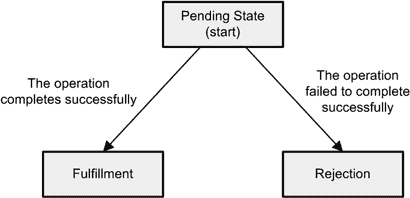

图 2.1 Promise 的执行状态。

一个 `Promise` 有几个有用的方法和属性，但在本书中，我们将使用 `await` 运算符访问 `Promises`。当 `await` 位于挂起的 `Promise` 之前时，应用程序将等待直到 `Promise` 被 fulfilled 或 rejected。以下代码显示了如何将 `await` 与 `requestAdapter` 一起使用：
```
 // Access the GPU adapter
const adapter = await navigator.gpu.requestAdapter();
if (!adapter) {
    throw new Error("No appropriate GPUAdapter found.");
}
```
如果没有 `await` 运算符，`adapter` 将被设置为等于一个 `Promise`。但由于存在 `await`，如果 `Promise` 被 fulfilled，`adapter` 将被设置为等于一个 `GPUAdapter` 对象。如果不是，`adapter` 变量将被设置为 null。

应用程序成功访问 `GPUAdapter` 后，可以通过调用适配器的 `requestAdapterInfo` 方法来访问有关用户渲染和计算功能的信息。这返回一个 `Promise`，在 fulfilled 时提供 `GPUAdapterInfo`。`GPUAdapterInfo` 有四个属性，表 2.1 列出了每个属性。

表 2.1 `GPUAdapterInfo` 的属性（只读）

| 属性 || 类型 || 描述 |
| --- | --- | --- |
| vendor || String || 生产 GPU 的公司（nvidia, amd, intel） |
| --- | --- | --- |
| device || String || 设备的名称 |
| architecture || String || 设备的架构 |
| description || String || 设备的描述 |

以下代码显示了应用程序如何访问有关用户 GPU 适配器的信息并在控制台中显示它。
```
 // Access information about the GPU adapter
const info = await adapter.requestAdapterInfo();
if(info) {
    console.log("Vendor: " + info.vendor);
    console.log("Architecture: " + info.architecture);
    console.log("Device: " + info.device);
    console.log("Description: " + info.description);
}
```
此信息在应用程序需要在不同 GPU 上执行不同类型的代码时很有帮助。如果目标 GPU 无法正确执行代码，应用程序可能会使用变通方法。

为了获取更多信息，应用程序可以访问 `GPUAdapter` 的两个有用的属性：
* `features`—一个标识 GPU 支持的功能的 `GPUSupportedFeatures` 对象
* `limits`—一个标识 GPU 最大/最小运行参数的 `GPUSupportedLimits` 对象

`features` 属性在应用程序需要了解 GPU 功能时很有帮助。表 2.2 列出了可以检查的不同功能并提供了每个功能的描述。

表 2.2 `GPUAdapter` 提供的设备功能

| 功能 ID || 描述 |
| --- | --- |
| depth-clip-control || 应用程序可以使用 OpenGL 的深度范围 \[−1, 1\] 而不是默认范围 \[0, 1\] |
| --- | --- |
| depth32float-stencil8 || 深度/模板缓冲区中的元素可以具有 32 位深度值和 8 位模板值 |
| texture-compression-bc || 应用程序可以使用使用块压缩（BC）压缩的纹理 |
| texture-compression-etc2 || 应用程序可以使用使用 Ericsson 纹理压缩 2（ETC2）压缩的纹理 |
| texture-compression-astc || 应用程序可以使用使用自适应可缩放纹理压缩（ASTC）压缩的纹理 |
| timestamp-query || 应用程序可以创建查询集来访问时间戳 |


| indirect-first-instance || 应用程序可以将间接绘制调用的 `firstInstance` 参数设置为大于 0 的值 |
| shader-f16 || 着色器可以访问半精度（16 位）浮点值 |
| rg11b10ufloat-renderable || 应用程序可以使用 `rg11b10ufloat` 作为纹理格式 |
| bgra8unorm-storage || 应用程序可以创建存储缓冲区，其数据格式为 `bgra8unorm` |
| float32-filterable || GPU 可以通过过滤 32 位浮点值来平滑纹理 |

一个示例将演示如何访问这些功能。假设应用程序需要知道客户端 GPU 是否支持深度裁剪控制。它可以使用如下代码：

// Check if the client supports the depth clip control feature
if (adapter.features.has("depth-clip-control")) {
    console.log("Supported");
} else {
    console.log("Unsupported");
}
```

如果你想打印系统上所有可用的功能，可以使用以下代码：

// Display all of the supported features
adapter.features.forEach((value) => {
    console.log(value);
});
```

`limits` 属性在应用程序需要了解给定功能的最大参数时很有帮助。例如，以下代码标识应用程序可以创建的最大顶点缓冲区数量：

```
const maxBuffers = adapter.limits.maxVertexBuffers;
```

`GPUAdapter` 最重要的作用是提供对 `GPUDevice` 的访问。这是通过 `requestDevice` 方法实现的，该方法返回一个 `Promise`，在兑现时提供 `GPUDevice`。以下代码展示了如何使用它：

// Access the GPU
const device = await adapter.requestDevice();
```

一旦应用程序访问了 `GPUDevice`，它就可以执行 WebGPU 处理所需的多个操作。以下部分将详细介绍。

## GPUDevice

`GPUDevice` 作为与客户端 GPU 的逻辑连接，在 WebGPU 开发中发挥着核心作用。列于 表 2.3 中，其方法创建的对象使得执行计算任务和图形操作成为可能。

表 2.3 `GPUDevice` 方法

| 方法 || 描述 |
| --- | --- |
| `createBindGroup()` || 标识一组将被绑定在一起的资源 |
| --- | --- |
| `createBindGroupLayout()` || 标识相关资源的结构和用途 |
| `createBuffer()` || 返回可用于存储原始数据的 GPUBuffer |
| `createCommandEncoder()` || 创建一个准备并打包命令以供执行的对象 |
| `createComputePipeline()` || 创建用于执行计算的命令的管道 |
| `createComputePipelineAsync()` || 异步创建用于执行计算的命令的管道 |
| `createPipelineLayout()` || 定义设备创建的每个缓冲区的结构和用途 |
| `createQuerySet()` || 创建可用于运行查询的查询集 |
| `createRenderBundleEncoder()` || 创建一个特殊编码器，用于将命令记录为捆绑包 |
| `createRenderPipeline()` || 创建用于渲染图形的命令的管道 |
| `createRenderPipelineAsync()` || 异步创建用于渲染图形的命令的管道 |
| `createSampler()` || 创建采样器，用于从纹理中提取数据 |
| `createShaderModule()` || 创建一个存储与应用程序着色器相关的代码和数据的对象 |
| `createTexture()` || 在 GPU 上创建资源以存储图像的像素数据 |
| `destroy()` || 销毁与客户端 GPU 的逻辑连接 |
| `importExternalTexture()` || 将视频快照转换为纹理 |
| `popErrorScope()` || 从堆栈中弹出错误范围，如果未发生错误则为空 |
| `pushErrorScope()` || 将新的错误范围推入堆栈，从而可以捕获特定类型的错误 |

这些方法在 WebGPU 开发中很重要，但大多数过于复杂，无法在此讨论。因此，我将在后续章节中在需要时介绍它们。例如，`createTexture` 和 `createSampler` 方法与纹理相关，因此适当的介绍要等到 第 6 章。

## GPUCommandEncoder

`GPUDevice` 最重要的方法之一是 `createCommandEncoder`，它返回一个 `GPUCommandEncoder`。该对象负责创建和存储将发送到 GPU 的命令。以下代码展示了如何创建它：

// Create a command encoder
encoder = device.createCommandEncoder();
```

对象创建后，`GPUCommandEncoder` 的方法可以定义将发送到设备进行处理的操作。表 2.4 列出了这些方法中的每一个。

表 2.4 `GPUCommandEncoder` 方法

| 方法 || 描述 |
| --- | --- |
| `beginRenderPass()` || 开始编码渲染通道以执行图形渲染 |
| --- | --- |
| `beginComputePass()` || 开始编码计算通道以执行计算任务 |
| `finish()` || 返回包含编码器命令按顺序的命令缓冲区 |
| `clearBuffer()` || 编码一个用零填充缓冲区的命令 |
| `copyBufferToBuffer()` || 编码一个从一个缓冲区复制数据到另一个缓冲区的命令 |
| `copyBufferToTexture()` || 编码一个从缓冲区复制数据到纹理的命令 |
| `copyTextureToBuffer()` || 编码一个从缓冲区复制数据到纹理的命令 |
| `copyTextureToTexture()` || 编码一个从一个纹理复制数据到另一个纹理的命令 |
| `insertDebugMarker()` || 在命令序列中插入可用于调试的标记 |
| `pushDebugGroup()` || 使用给定标签开始调试组 |
| `popDebugGroup()` || 结束调试组 |
| `resolveQuerySet()` || 编码一个将查询集的结果写入缓冲区的命令 |
| `writeTimestamp()` || 编码一个将时间戳写入查询集的命令 |

总的来说，前三个方法是最重要的。第一个 `beginRenderPass` 返回一个 `GPURenderPassEncoder`，它将为 GPU 定义图形操作。完全探索 `GPURenderPassEncoder` 的功能需要数章篇幅。

表中第二个方法 `beginComputePass` 返回一个 `GPUComputePassEncoder`。该对象字段存储的信息告诉 GPU 如何执行计算任务。从 第 8 章 开始，我将解释如何使用它来执行与数学、机器学习和图像处理相关的操作。

最后一个方法 `finish` 是每个非平凡 WebGPU 应用程序所必需的。它将编码器的数据转换为包含一个或多个 GPU 命令的 `GPUCommandBuffer`。一旦应用程序将此缓冲区发送到设备的队列，GPU 将开始执行命令。

## GPUQueue

`GPUDevice` 有一个名为 `queue` 的重要属性，它提供了对 `GPUQueue` 的访问。为了执行 GPU 操作，应用程序需要调用 `GPUQueue` 的方法，其中包括以下三个：

* `writeBuffer`—在 GPU 上的缓冲区对象中更新数据
* `writeTexture`—在 GPU 上的纹理对象中更新数据
* `submit`—指示 GPU 执行一个或多个命令

`submit` 方法特别重要，因为它告诉 GPU 执行什么任务（图形渲染或通用计算）。具体来说，`submit` 接受前面讨论的 `GPUCommandEncoder` 创建的命令。一旦调用它，GPU 将开始执行缓冲区中的命令。

调用 `submit` 后，应用程序可以通过调用 `onSubmittedWorkDone` 来监控队列命令的执行情况。这返回一个 `Promise`，在队列完成其处理任务后解析。

## 画布元素


## WebGPU Canvas 基础

正如其名称所示，canvas 是一个用于显示图形的表面。当 WebGPU 执行渲染操作时，生成的图形会显示在 canvas 元素内部。因此，使用 WebGPU 进行图形处理时需要三个步骤：

1. 在 HTML 文档中创建 canvas 元素。
2. 在 JavaScript 中访问 canvas。
3. 获取 canvas 的上下文并配置其外观。

Canvas 是添加到 HTML 中的较新元素之一，最早由苹果的 Safari 浏览器在 2004 年支持。它可以显示不同种类的图形内容，但在 HTML 中，<canvas> 标签相当乏味。网页可以设置其尺寸（width 和 height）以及全局属性如 id 和 hidden。除此之外，HTML 不提供任何特殊属性。

以下标记定义了一个 400×200 的 canvas，其 ID 设置为 mycanvas：

```
<!-- Create a canvas in an HTML page -->
<canvas id="mycanvas" width="400" height="200"></canvas>
```

默认情况下，canvas 在网页中显示为一个空白矩形。要设置其内容，应用程序需要在 JavaScript 中访问该元素，这通常通过调用 `Document` 对象的某个方法来实现。Canvas 元素在 JavaScript 中由 `HTMLCanvasElement` 表示，应用程序可以通过其类型（`document.querySelector`）或通过其 ID（`document.getElementById`）访问相应的元素。

例如，如果在 HTML 中已使用 ID 为 mycanvas 定义了 canvas 元素，则可以使用以下任一代码行在 JavaScript 中访问它：

// Access the canvas element by type
const canvas = document.querySelector("canvas");

// Access the canvas element by ID
const canvas = document.getElementById("mycanvas");
```

在这两种情况下，`canvas` 变量都被设置为一个 `HTMLCanvasElement`，它提供了多个方法，可用于设置 canvas 的内容。表 2.5 列出了 `HTMLCanvasElement` 的五个实例方法。

表 2.5 `HTMLCanvasElement` 的方法

| 方法 || 描述 |
| --- | --- |
| `getContext(type)` || 返回给定类型的 canvas 的绘图上下文 |
| --- | --- |
| `captureStream()` || 提供 canvas 表面的实时视频捕获 |
| `toDataURL()` || 返回包含 canvas 图像表示的 URL |
| `toBlob()` || 返回包含 canvas 图像的 `Blob` |
| `transferControlToOffscreen()` || 将控制权转移到 `OffscreenCanvas` 对象 |

其中，只有第一个需要在 WebGPU 图形应用程序中调用。`getContext` 返回一个上下文对象，使应用程序能够定义 canvas 的图形。

## Canvas 上下文

WebGPU 只是设置 canvas 内容的众多机制之一。应用程序还可以使用 WebGL、位图渲染或简单的二维绘图。为了确定 canvas 的图形将如何设置，应用程序需要使用适当的标识符调用 `getContext`。

本书重点介绍 WebGPU，因此我们的应用程序将使用 `webgpu` 标识符调用 `getContext`。为了演示，以下代码访问 ID 为 mycanvas 的 canvas 对应的 `HTMLCanvasElement`。然后它调用 `getContext` 以获取可用于 WebGPU 渲染的上下文：

// Access the canvas element by its ID
const canvas = document.getElementById("mycanvas");

// Obtain a WebGPU context for the canvas
const context = canvas.getContext("webgpu");
```

因为上下文的类型设置为 `webgpu`，所以 `getContext` 返回的对象是一个 `GPUCanvasContext`。它提供了一个名为 `configure` 的重要方法，该方法接受一个控制渲染上下文行为的对象。该对象最多可以定义六个属性，表 2.6 列出了每个属性。

表 2.6 Canvas 上下文属性

| 属性 || 描述 |
| --- | --- |
| `device` || 控制 canvas 的 `GPUDevice` |
| --- | --- |
| `usage` || 标识获取的纹理将如何使用 |
| `alphaMode` || 控制透明度和不透明度 |
| `colorSpace` || 获取纹理的颜色格式 |
| `format` || 获取纹理的像素格式 |
| `viewFormats` || 获取纹理的格式数组 |

这些属性大多数与纹理相关，这将在 第 6 章 中详细讨论。前两个属性是最重要的。第一个 `device` 应设置为前面讨论的 `GPUDevice`。它通过 `GPUAdapter` 获取，表示客户端系统上的 GPU。

第二个属性 `usage` 值得进一步解释。不同的计算机支持不同的纹理显示格式。`usage` 字段告诉 WebGPU 应使用什么纹理格式来呈现 canvas 的内容。

你可能事先不知道应使用什么纹理格式。幸运的是，你可以使用 `Navigator` 的 `gpu` 属性的 `getPreferredCanvasFormat` 方法。这会检查用户系统并返回一个字符串，标识纹理像素的最佳格式。它返回以下两个值之一：

* `rgba8unorm`—每个像素包含四个 8 位值，分别标识红色、绿色、蓝色和 alpha，每个值范围为 0 到 255
* `bgra8unorm`—每个像素包含四个 8 位值，分别标识蓝色、绿色、红色和 alpha，每个值范围为 0 到 255

理解这些对象如何协同工作的最佳方式是查看它们在实践中的使用方式。以下示例通过 ID 访问 canvas，为 canvas 获取 WebGPU 上下文，并使用系统首选的 canvas 格式配置上下文。

```
// Obtain a canvas defined in HTML
const canvas = document.getElementById("mycanvas");

// Access a WebGPU context for the canvas
const context = canvas.getContext("webgpu");

// Get the optimal pixel format for textures
const canvasFormat = navigator.gpu.getPreferredCanvasFormat();

// Configure the context with the device and format
context.configure({
    device: device,
    format: canvasFormat,
});
```

执行此代码后，来自 `GPUDevice` 的渲染操作将生成在相关上下文中显示的图形。第 3 章 开始讨论使用 WebGPU 创建图形。

## 示例应用程序—创建 WebGPU 对象

如果你在示例代码中打开 `Ch02_ObjectCreation` 文件夹并在浏览器中加载 `index.html`，GPU 不会执行任何图形渲染或计算。相反，它将执行 `ch02_objectcreation.js` 中的代码，该代码创建了 WebGPU 渲染所需的五个核心对象：

1. `GPUAdapter`—客户端 GPU 的适配器
2. `GPUDevice`—表示客户端的 GPU
3. `GPUCommandEncoder`—将操作编码为 GPU 的命令
4. `HTMLCanvasElement`—表示页面中的 canvas
5. `GPUCanvasContext`—用于在 canvas 上渲染图形的上下文

随着每个对象的创建，代码会在页面上显示一条消息。在我的系统上，结果如 图 2.2 所示。

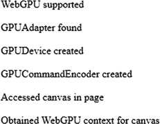

图 2.2 `Ch02_ObjectCreation` 应用程序。

以下代码列表展示了 `index.html` 的内容，易于理解。网页显示项目的标题，创建 canvas 元素，并从 `ch02_objectcreation.js` 加载脚本。

```
<html>
  <body>

  <h1>Ch02_ObjectCreation</h1>

  <!-- Create the canvas -->
  <canvas id="canvas_example" width="400" height="200"></canvas>

  <!-- Load JavaScript from file -->
  <script src="ch02_objectcreation.js"></script>

  </body>
</html>
```

下一个代码列表展示了 `ch02_objectcreation.js` 的内容，该内容由 `index.html` 加载并执行。此代码检查 WebGPU 支持，然后创建 WebGPU 渲染所需的对象。


// Create top-level asynchronous function
async function runExample() {

var msg_array = ["<h1>Ch02_ObjectCreation</h1>"];

// Check if WebGPU is supported
if (!navigator.gpu) {
    throw new Error("WebGPU not supported");
} else {
    msg_array.push("WebGPU supported");
}

// Access the GPUAdapter
const adapter = await navigator.gpu.requestAdapter();
if (!adapter) {
    throw new Error("No GPUAdapter found");
} else {
    msg_array.push("GPUAdapter found");
}

// Access the GPU
const device = await adapter.requestDevice();
if (!device) {
    throw new Error("Failed to create a GPUDevice");
} else {
    msg_array.push("GPUDevice created");
}

// Create a command encoder
encoder = device.createCommandEncoder();
if (!encoder) {
    throw new Error("Failed to create a GPUCommandEncoder");
} else {
    msg_array.push("GPUCommandEncoder created");
}

// Access the canvas
const canvas = document.getElementById("canvas_example");
if (!canvas) {
    throw new Error("Could not access canvas in page");
} else {
    msg_array.push("Accessed canvas in page");
}

// Obtain a WebGPU context for the canvas
const context = canvas.getContext("webgpu");
if (!context) {
    throw new Error("Could not obtain WebGPU context for canvas");
} else {
    msg_array.push("Obtained WebGPU context for canvas");
}

// Get the best pixel format
const canvasFormat = navigator.gpu.getPreferredCanvasFormat();

// Configure the context with the device and format
context.configure({
    device: device,
    format: canvasFormat,
});

// Display messages
for (var i = 0; i < msg_array.length; i++) {
    document.write(msg_array[i] + "<br /><br />");
}
}

// Run example function
runExample();

这段代码首先创建了一个字符串数组。随着每个对象的创建，都会向数组中添加一个新的字符串。例如，如果检测到 GPU 支持，并且 `GPUAdapter` 和 `GPUDevice` 成功创建，就会添加新的字符串。

这段代码包含在一个名为 `runExample` 的异步方法中。由于 JavaScript 仅在顶层执行 `await`，因此需要此方法。在定义 `runExample` 方法之后，脚本的最后一行调用了它。

在后面的章节中，示例应用程序将使用类似的代码来创建 WebGPU 对象。因此，在你熟悉之前，最好仔细查看 `ch02_objectcreation.js` 中的代码。

## 摘要

本章介绍了 WebGPU 应用程序需要创建的不同对象。`GPUAdapter` 用作 GPU 的适配器，`GPUDevice` 用作与设备的逻辑连接，而 `GPUCommandEncoder` 将命令打包到可以提交给 `GPUQueue` 的缓冲区中。一旦队列接收到命令，GPU 就会开始执行它们。

如果应用程序使用 WebGPU 进行渲染，它需要在 HTML 中创建 canvas 元素，然后使用 JavaScript 访问它。然后应用程序需要为设备获取 WebGPU 画布并将其与 `GPUDevice` 关联。一旦建立此关联，WebGPU 图形渲染将显示在画布上。

下一章进一步探讨了图形应用程序的开发过程。它首先对图形渲染进行理论讨论，然后介绍 WebGPU 渲染所需的对象。其中包括渲染通道编码器和渲染管线。

# 渲染图形 3

DOI: [10.1201/9781003422839-3](https://doi.org/10.1201/9781003422839-3)

在本章中，我们将迈出进入 WebGPU 图形渲染奇妙世界的第一步。与前一章一样，编码过程的大部分涉及在 JavaScript 中创建和配置对象。特别是，我们大部分时间将花在探索两个对象上：`GPURenderPassEncoder` 和 `GPURenderPipeline`。

但在深入技术细节之前，我想先简要概述图形渲染。该过程在 WebGPU、OpenGL 和 Direct3D 中基本相似。应用程序执行一系列构成 *渲染管线* 的阶段，本章首先讨论该管线。

## 图形渲染的温和介绍

图形渲染的目标是将三维空间中的点转换为二维屏幕上的像素。空间中的点称为 *顶点*，至少应用程序需要指定每个顶点的位置。此外，应用程序还可以提供诸如顶点颜色、纹理坐标和法向量分量等信息。此每个顶点的数据称为 *属性数据*。

正如产品在装配线的各个工位中制造一样，生成像素所需的步骤构成了一个 *渲染管线*。在编程早期，这些管线始终是 *固定的*——CPU 将顶点数据发送到 GPU 后，应用程序无法控制渲染过程。

如今，我们拥有 *可编程* 管线。在这些管线中，某些阶段可以用在 GPU 上执行的特殊代码来自定义。图 3.1 说明了一个基本的可编程管线，其中可编程阶段以灰色阴影显示。

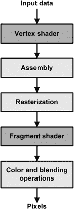

图 3.1 可编程管线。

在可编程阶段执行的特殊程序称为 *着色器*。WebGPU 支持三种类型的着色器：顶点着色器、片段着色器和计算着色器。顶点着色器和片段着色器用于图形应用程序，而计算着色器用于计算应用程序。所有这些着色器都必须使用 WebGPU 着色语言 (`WGSL`) 编写，第 4 章 将详细讨论它。

顶点着色器处理输入数据后，管线将顶点组合成称为 *图元* 的基本形状，例如点、线或三角形。创建图元的过程称为 *装配*。本章后面我将解释应用程序如何控制装配过程。

顶点装配成图元后，下一步是 *光栅化*。这将每个图元分解为称为 *片段* 的二维元素数组。片段在概念上类似于像素，但像素只有颜色和位置，而片段具有颜色、位置和 *深度*。

深度处理是图形渲染中的关键操作。为了解释原因，请考虑两个图元：三角形 A 和三角形 B。如果三角形 A 在前景并遮挡了三角形 B 的视线，则三角形 A 生成的片段将具有比三角形 B 生成的片段更低的深度值。当片段转换为像素时，三角形 A 的像素应显示在屏幕上，而不是三角形 B 的像素。

在下一步中，片段着色器接收光栅化产生的片段。它对每个片段执行一次，可以自定义片段的颜色和深度。许多片段着色器使用光照算法根据模型中的光源设置片段的颜色。第 4 章 解释了如何编码片段着色器，而 第 6 章 展示了如何使用它们实现流行的 Blinn-Phong 光照模型。

管线的最后阶段对处理后的片段执行最终操作。可能的操作包括深度测试、模板测试和混合。深度和模板测试将在 第 6 章 中讨论。混合是指将片段的颜色与周围缓冲区的颜色结合的过程。

## 渲染通道

在图形方面，WebGPU 的术语可能令人困惑。术语 *渲染通道* 描述了执行渲染的整体环境。此结构包含 GPU 生成图形所需的所有状态数据。应用程序通过使用称为 *附件* 的特殊数据结构调用其方法来向渲染通道提供数据。


当 GPU 执行渲染命令时，每个形状的实际显示称为 *绘制操作* 或 *绘制调用*。大多数渲染操作需要执行多个绘制调用。

第 2 章 介绍了在 WebGPU 应用程序中需要创建的对象，其中最重要的对象之一是 `GPUCommandEncoder`。通过创建和配置此编码器，应用程序可以定义将在 GPU 上执行的命令。

要定义渲染操作，应用程序需要执行至少五个步骤：

1. 调用 `encoder` 的 `beginRenderPass()` 方法以创建 `GPURenderPassEncoder`。
2. 调用 `device` 的 `createRenderPipeline()` 方法以创建 `GPURenderPipeline`。
3. 向渲染通道编码器提供包含渲染数据的缓冲区。
4. 通过调用渲染通道编码器的 `draw()` 方法之一来定义绘制操作。
5. 通过调用渲染通道编码器的 `finish()` 方法来完成渲染操作。

在最后一步之后，应用程序可以通过执行另外两个步骤将渲染通道发送到 GPU。首先，它需要调用 `encoder` 的 `finish()` 方法将渲染通道插入命令缓冲区。然后它需要调用 `device` 的 `queue` 的 `submit()` 方法将命令缓冲区发送到 GPU 进行处理。

以下讨论将介绍定义渲染操作的步骤。创建渲染通道的第一步尤其复杂。

## 第 1 步：创建渲染通道编码器

要创建 `GPURenderPassEncoder`，应用程序需要使用描述要执行的渲染的描述符调用命令编码器的 `beginRenderPass()` 方法。WebGPU 支持广泛的渲染操作，因此该描述符可以有多个不同的字段。表 3.1 列出了它们并提供了每个的描述。

表 3.1 渲染通道描述符的属性

| 属性 || 可选? || 描述 |
| --- | --- | --- |
| label || Y || 渲染通道的名称 |
| --- | --- | --- |
| colorAttachments || N || 用于渲染所需的颜色数据 |
| depthStencilAttachment || Y || 深度/模板测试所需的数据 |
| occlusionQuerySet || Y || 用于存储查询结果的数据结构 |
| timestampWrites || Y || 时间戳的配置数据 |
| maxDrawCount || Y || 在该通道中执行的绘制调用的最大数量 |

第 6 章 将讨论 `depthStencilAttachment` 属性，第 7 章 将解释 `occlusionQuerySet`，而 第 8 章 将查看 `timestampWrites`。目前，唯一需要了解的属性是 `colorAttachments`，它是创建渲染通道的唯一必需属性。

在继续之前，我想展示创建命令编码器和渲染通道编码器的代码：

```
 // Create a GPUCommandEncoder
 const encoder = device.createCommandEncoder();

 // Create a GPURenderPassEncoder
 const renderpass = encoder.beginRenderPass({
 colorAttachments: [ ... ]
 });
```

此代码将渲染通道的 `colorAttachments` 属性分配给一个数组。数组的每个元素都是一个对象，其属性标识颜色操作。每个元素最多可以有五个属性，表 3.2 列出了它们。

表 3.2 颜色附件属性

| 属性 || 可选? || 描述 |
| --- | --- | --- |
| view || N || 颜色附件访问的资源 |
| --- | --- | --- |
| resolveTarget || Y || 如果启用多采样，则受颜色附件影响的子资源 |
| loadOp || N || 标识视图初始颜色应如何设置（load 使用现有值，clear 使用 clearValue） |
| storeOp || N || 标识视图的颜色是否应存储（store 存储颜色，discard 丢弃颜色） |
| clearValue || Y || 如果 loadOp 设置为 load，则用作视图初始颜色的颜色 |

在许多应用程序中，`colorAttachments` 属性的唯一用途是设置画布的初始颜色。在这种情况下，应用程序需要为 `view`、`loadOp`、`clearValue` 和 `storeOp` 属性提供值。

例如，以下代码使用包含单个对象的 `colorAttachments` 数组调用 `encoder` 的 `beginRenderPass()` 方法。

```
 // Set the initial color to gray
 const renderpass = encoder.beginRenderPass({
 colorAttachments: [{
 view: context.getCurrentTexture().createView(),
 loadOp: "clear",
 clearValue: { r: 0.5, g: 0.5, b: 0.5, a: 1.0 },
 storeOp: "store"
 }]
 });
```

在此代码中，`colorAttachments` 数组中的对象告诉 WebGPU 其操作影响整个上下文，并且视图应清除为给定颜色。此颜色通过将分量 (`r`, `g`, `b` 和 `a`) 设置为 0.0 到 1.0 之间的值来标识。在这种情况下，`r`、`g` 和 `b` 设置为 0.5，这意味着视图的初始颜色将为灰色。`a`（alpha）属性设置为 1.0，这意味着 resulting 颜色将是不透明的。

`loadOp` 属性设置为 `clear`，这意味着 WebGPU 将使用 `clearValue` 中的值来设置视图的初始颜色。`storeOp` 属性设置为 `store`，因此此值将存储以供后续操作使用。

## 第 2 步：定义渲染管线

在创建 `GPURenderPassEncoder` 之后，下一步是定义渲染过程的步骤。这些步骤构成渲染管线，由 `GPURenderPipeline` 对象表示。使用此对象需要两个步骤：

1. 通过使用合适的描述符调用 `device` 的 `createRenderPipeline()` 方法创建 `GPURenderPipeline`。
2. 通过调用 `GPURenderPassEncoder` 的 `setPipeline()` 方法将管线与渲染过程关联。

第一步比第二步复杂得多。这是因为 `createRenderPipeline()` 方法必须使用描述渲染过程的对象调用。表 3.3 列出了可以设置的不同属性。

表 3.3 渲染管线描述符的属性

| 属性 || 可选? || 描述 |
| --- | --- | --- |
| label || Y || 渲染管线的标签 |
| --- | --- | --- |
| layout || N || 描述内存资源如何使用的对象 |
| vertex || N || 用于渲染的顶点着色器 |
| fragment || Y || 用于渲染的可选片段着色器 |
| depthStencil || Y || 描述深度/模板测试的对象 |
| primitive || Y || 设置顶点如何组合成原语形状 |
| multisample || Y || 配置多采样过程的可选对象 |

这些属性大多数是可选的。`depthStencil` 属性将在 第 6 章 中讨论，因此本次讨论重点关注 `vertex`、`fragment`、`layout`、`primitive` 和 `multisample` 属性。

### 顶点、片段和布局属性

`vertex` 和 `fragment` 属性很重要，因为它们控制管线如何处理顶点和片段。正如本章第一部分所述，这些着色器包含在 GPU 上运行的可执行代码。

`layout` 属性标识顶点和片段着色器如何访问数据。这是一个必需的属性，在大多数情况下可以设置为 `auto`。它也可以设置为 `GPUPipelineLayout` 对象，这将在 第 4 章 中讨论。

### 原语属性

正如前面讨论的，渲染管线的装配阶段将顶点组合成称为原语的基本形状。应用程序可以通过设置管线的 `primitive` 属性来自定义装配过程。这必须设置为最多可包含五个属性的对象，表 3.4 列出了它们全部。

表 3.4 原语属性

| 属性 || 可选? || 描述 |
| --- | --- | --- |


## 原始装配与拓扑

| `topology` || Y || 在装配期间创建的原始形状类型 |
| --- | --- | --- |
| `stripIndexFormat` || Y || 用于条带拓扑的索引值格式 |
| `frontFace` || Y || 标识被视为正面多边形的条件 |
| `cullMode` || Y || 要剔除的多边形类型 |
| `unclippedDepth` || Y || 禁用深度裁剪 |

`topology` 属性特别重要。默认情况下，WebGPU 将顶点组装成一系列三角形——第一个三角形由第一、二、三顶点构成，第二个三角形由第四、五、六顶点构成，以此类推。应用程序可以通过将 `topology` 属性设置为以下五种值之一来告诉 WebGPU 要组装哪种类型的图元：
* point-list—每个顶点作为单独的点绘制
* line-list—每对连续顶点形成一条线
* line-strip—每个顶点形成一条与前一个顶点相连的线
* triangle-list—每三个连续顶点形成一个三角形（默认）
* triangle-strip—每个顶点形成一个与前两个顶点相连的三角形

为了澄清这一点，图 3.2 说明了 WebGPU 支持的不同图元。没有四边形——要绘制一个矩形，你需要绘制两个相邻的三角形。

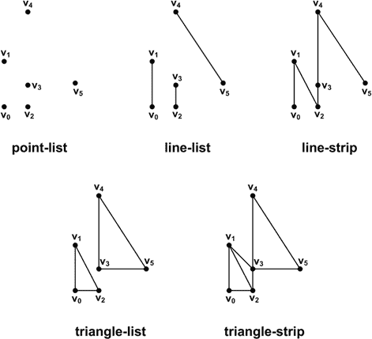

图 3.2 装配的原始形状。

默认情况下，装配过程按提供的顺序组合顶点。但正如我稍后会解释的，应用程序可以利用 *索引渲染*，它告诉渲染器根据一系列索引值访问顶点。这可以提供多个优点，包括能够在不多次将数据传递给 GPU 的情况下多次使用一个顶点。

如果使用索引渲染并且 `topology` 属性设置为 line-strip 或 triangle-strip，`stripIndexFormat` 属性将标识每个索引值的数据类型。如果 `stripIndexFormat` 设置为 `uint16`，索引值将作为一系列 16 位无符号整数读取。如果设置为 `uint32`，索引值将作为一系列 32 位无符号整数读取。

大多数三维图形由连接的三角形构成。因此，本书中的大多数示例应用程序将 `topology` 设置为 `triangle-strip`。

### 示例代码

在继续之前，查看渲染管线在实践中的使用方式会有所帮助。以下代码创建了一个命令编码器、一个渲染通道编码器和一个渲染管线。然后它调用渲染通道编码器的 `setPipeline` 方法将编码器与渲染管线关联。

```
// Create the command encoder
const encoder = device.createCommandEncoder();
 
// Create the render pass encoder
const renderPass = encoder.beginRenderPass(...);
 
// Create the render pipeline
const renderPipeline = device.createRenderPipeline({
    label: "Example Pipeline",
    layout: "auto",
    vertex: { ... },
    fragment: { ... },
    primitive: {
        topology: "triangle-strip",
        stripIndexFormat: "uint32",
        frontFace: "cw",
        cullMode: "back"
    }
});
 
// Associate the pipeline with the render pass encoder
renderPass.setPipeline(renderPipeline);
```

如图所示，管线告诉渲染器将顶点组合成三角形，每个顶点都与前两个顶点相连。应用程序将使用索引渲染，并且由于 `stripIndexFormat` 设置为 `uint32`，WebGPU 将索引值作为 32 位无符号整数读取。`frontFace` 属性设置为 `cw`，因此顺时针定向的三角形将被视为正面。`cullMode` 设置为 `back`，因此背面三角形将被剔除。

最后一行将渲染管线与渲染通道关联。因此，渲染通道的所有绘制操作都将遵循渲染管线中定义的步骤序列。

## 第 3 步：提供渲染数据

WebGPU 开发最困难的方面之一涉及将数据传递给客户端设备。在 WebGPU 用语中，设备上的数据存储区域称为 *资源*，并且支持两种主要类型的资源：
* `buffers`—包含通用数据，由 `GPUBuffer` 类表示
* `textures`—包含作为纹理显示的像素数据，由 `GPUTexture` 类表示

从技术上讲，缓冲区和纹理之间的主要区别在于 GPU 将纹理数据存储在与缓冲区数据不同的内存类型中。这使得 GPU 能够高速处理纹理，这对于现代游戏来说是一项至关重要的能力。

纹理的有趣主题要等到 第 6 章 再讨论。本章和下一章重点介绍常规缓冲区。WebGPU 支持几种类型的缓冲区，包括以下四种：
1. `vertex buffers`—存储与顶点相关的数据（坐标、颜色、法向量分量等）
2. `index buffers`—存储设置顶点访问顺序的值
3. `uniform buffers`—存储在着色器执行之间保持不变（统一）的数据
4. `storage buffers`—存储通用数据（在计算应用程序中经常使用，在图形应用程序中很少使用）

顶点缓冲区在所有图形应用程序中都是必需的，执行索引渲染的应用程序需要索引缓冲区。`GPURenderPassEncoder` 提供两种将这些缓冲区与渲染通道编码器关联的方法：
* `setVertexBuffer(...)`—将顶点缓冲区与渲染通道编码器关联
* `setIndexBuffer(...)`—将索引缓冲区与渲染通道编码器关联

这两种方法都接受包含要传递给 GPU 的数据的 `GPUBuffer`。`GPUBuffer` 使用和理解起来很复杂，我将在本章后面再描述它们。

## 第 4 步：定义绘制操作

在应用程序定义渲染过程并提供渲染数据后，下一步是定义绘制操作。WebGPU 支持不同类型的绘制操作，每个操作都由 `GPURenderPassEncoder` 的方法表示。表 3.5 列出了它们。

表 3.5 渲染通道编码器的绘制方法

| 方法 || 描述 |
| --- | --- |
| `draw(...)` || 按顺序读取顶点组装图元 |
| --- | --- |
| `drawIndexed(...)` || 按索引读取顶点组装图元 |
| `drawIndirect(...)` || 使用 `GPUBuffer` 中给出的绘制参数组装图元（按顺序读取顶点） |
| `drawIndexedIndirect(...)` || 使用 `GPUBuffer` 中给出的绘制参数组装图元（按索引读取顶点） |

这些方法起初可能很难理解。我将在此处描述它们，然后在后续章节中回顾它们的操作。

### 基础渲染

应用程序将顶点数据传递给 GPU，存储在称为 *顶点缓冲区* 的特殊缓冲区中。如果应用程序调用 `draw` 方法，渲染器将按顶点缓冲区中提供的顺序访问顶点数据。换句话说，缓冲区中的第一个顶点始终是第一个绘制的顶点，第二个顶点始终是第二个绘制的顶点，以此类推。

`draw` 方法接受决定如何将顶点组装成形状的参数。此方法可以以四种方式调用，表 3.6 列出了它们。

表 3.6 重载的 draw 方法

| 方法 || 描述 |
| --- | --- |
| `draw(vertexCount)` || 使用缓冲区中前 `vertexCount` 个顶点绘制图元 |
| --- | --- |
| `draw(vertexCount, instanceCount)` || 使用缓冲区中前 `vertexCount` 个顶点绘制图元，创建 `instanceCount` 个图元实例 |


## 绘制方法

| 方法 | 描述 |
|---|---|
| `draw(vertexCount, instanceCount, firstVertex)` | 使用缓冲区中从 `firstVertex` 偏移开始的第一个 `vertexCount` 个顶点绘制图元；创建 `instanceCount` 个图元实例 |
| `draw(vertexCount, instanceCount, firstVertex, firstInstance)` | 使用缓冲区中从 `firstVertex` 偏移开始的第一个 `vertexCount` 个顶点绘制图元，创建 `instanceCount` 个图元实例，将第一个实例的值设为 `firstInstance` |

如果这些方法看起来很奇怪也不必担心。一旦开始编码，你就会明白为什么会有这么多类型的方法和参数。

`draw` 的第一个用法告诉渲染器从缓冲区中的前 `vertexCount` 个顶点组装形状。`draw` 的第二个用法重复渲染过程以形成每个图元的多个实例。这称为 *实例化渲染*，当应用程序想要在不给 GPU 增加负担的情况下创建形状的副本时非常有用。

例如，假设你正在编写一个需要显示数百名士兵的策略游戏。使用实例化渲染，你可以定义一个士兵的形状，然后在场景中生成其他士兵，而无需单独的绘制调用。第 4 章 将展示实例化渲染的使用方式。

如果顶点缓冲区将被多个 `draw` 操作访问，`firstVertex` 参数会告诉每个 `draw` 操作从缓冲区何处开始读取顶点数据。例如，如果将其设置为 100，渲染器将从缓冲区中的第 100 个顶点开始组装形状。

如果 `instanceCount` 大于 1，WebGPU 会为每个实例分配一个值，该值可由顶点着色器使用。第一个实例的值默认为 0，但如果将 `firstInstance` 设置为大于 0 的值，则会改用该值。第 4 章 将解释顶点着色器中实例值的使用方式。

### 索引化渲染

如前所述，应用程序除了顶点缓冲区之外还可以定义索引缓冲区。索引缓冲区包含整数，用于告诉渲染器如何在顶点缓冲区中读取顶点。如果索引缓冲区中的前三个值是 2、5 和 8，则要绘制的第一个顶点将是顶点 2、顶点 5 和顶点 8。

索引化渲染的一个主要优点是，你可以在不重新定义顶点缓冲区中的顶点的情况下重复绘制顶点。主要缺点是复杂性——所有索引值都需要存储在 GPU 上。

在 WebGPU 中，应用程序可以通过调用 `drawIndexed` 启动索引化渲染。与 `draw` 方法类似，它可以以多种方式调用，如 表 3.7 所列。

表 3.7 重载的 `drawIndexed` 方法

| 方法 | 描述 |
|---|---|
| `drawIndexed(indexCount)` | 根据索引将 `indexCount` 个顶点组合成图元 |
| `drawIndexed(indexCount, instanceCount)` | 根据索引将 `indexCount` 个顶点组合成图元并生成 `instanceCount` 个实例 |
| `drawIndexed(indexCount, instanceCount, firstIndex)` | 根据索引将 `indexCount` 个顶点组合成图元，从 `firstIndex` 开始，并生成 `instanceCount` 个实例 |
| `draw(vertexCount, instanceCount, firstVertex, firstInstance)` | 使用缓冲区中从 `firstVertex` 偏移开始的第一个 `vertexCount` 个顶点绘制图元，创建 `instanceCount` 个图元实例，将第一个实例的值设为 `firstInstance` |
| `drawIndexed(indexCount, instanceCount, firstIndex, baseVertex)` | 根据索引将 `indexCount` 个顶点组合成图元，从 `firstIndex` 开始，并生成 `instanceCount` 个实例 |
| `drawIndexed(indexCount, instanceCount, firstIndex, baseVertex, firstInstance)` | 根据索引将 `indexCount` 个顶点组合成图元，从 `firstIndex` 开始，并生成 `instanceCount` 个实例，将第一个实例的值设为 `firstInstance` |

这些方法的工作方式与 表 3.6 中的 `draw` 方法类似，但渲染器按索引选择顶点，而不是使用它们在缓冲区中存储的顺序。与 `draw` 一样，可选的 `instanceCount` 参数标识要渲染的副本数量，而 `firstInstance` 为第一个实例分配一个数字。

`draw` 和 `drawIndexed` 之间一个重要的区别是，`drawIndexed` 方法接受 `firstIndex` 和 `baseVertex` 参数。`firstIndex` 为索引缓冲区分配一个偏移量，因此如果将其设置为 3，渲染器应从索引 3 开始读取索引值。`baseVertex` 设置一个应添加到每个索引值的值，因此如果将其设置为 3，渲染器应将 3 加到从索引缓冲区读取的每个值上。

### 间接渲染

当应用程序调用 `draw` 或 `drawIndexed` 时，每个渲染操作的<|message|> 参数（顶点/索引值数量、实例数量等）需要从 CPU 传输到 GPU。我们希望避免对 GPU 进行小规模传输，因此 WebGPU 使得可以将这些参数存储在 GPU 上的单独缓冲区中。这称为 *间接渲染*，对于复杂应用程序而言，它可以显著提高性能。

WebGPU 通过 `GPURenderPassEncoder` 的 `drawIndirect` 和 `drawIndexedIndirect` 方法支持间接渲染。其用法如下：

* `drawIndirect(indirectBuffer, indirectOffset)`—根据 `indirectBuffer` 中的参数按顶点缓冲区中存储的顺序绘制顶点
* `drawIndexedIndirect(indirectBuffer, indirectOffset)`—根据索引缓冲区中的索引值，根据 `indirectBuffer` 中的参数绘制顶点

在这两种情况下，渲染器都将根据存储在 `indirectBuffer` 中的参数执行绘制操作。它将从 `indirectOffset` 给出的内存地址开始从缓冲区读取。

准确地说，`drawIndirect` 将导致渲染器从缓冲区读取四个值（`vertexCount`、`instanceCount`、`firstVertex` 和 `firstInstance`）。`drawIndexedIndirect` 将导致渲染器从缓冲区读取四个值（`indexCount`、`instanceCount`、`firstIndex`、`baseVertex` 和 `firstInstance`）。在这两种情况下，渲染器都期望值以 32 位无符号整数提供。

### 第 5 步：完成渲染操作

最后一步是最简单的。在应用程序创建了 `GPURenderPassEncoder` 并配置了渲染过程后，它可以通过调用渲染通道编码器的 `end` 方法来完成渲染命令的记录。一旦完成，渲染命令就不能再更改。

在应用程序调用 `end` 之后，它可以调用命令编码器的 `finish` 方法，该方法返回 GPU 的命令缓冲区。当应用程序使用此命令缓冲区调用 `submit` 方法时，命令将被发送到 GPU 执行。以下讨论展示了其工作原理的示例。

## 示例应用程序——创建蓝色画布

在 第 2 章 中，示例应用程序创建了 WebGPU 对象，但没有创建渲染通道编码器或向 GPU 提交任何命令。相比之下，Ch03_BlueCanvas 应用程序提交了一个简单的渲染命令，将画布的初始颜色设置为蓝色。

就图形渲染应用程序而言，这不会赢得任何奖项。目标只是演示 WebGPU 的对象如何协同工作以执行简单的渲染任务。列表 3.1 展示了 `ch03_bluecanvas.js` 的内容，它创建了一个渲染通道编码器，该编码器仅清除 HTML 中创建的画布内容。


// Create top-level asynchronous function
async function runExample() {
// Check if WebGPU is supported
if (!navigator.gpu) {
    throw new Error("WebGPU not supported");
}
// Access the GPUAdapter
const adapter = await navigator.gpu.requestAdapter();
if (!adapter) {
    throw new Error("No GPUAdapter found");
}
// Access the client GPU
const device = await adapter.requestDevice();
if (!device) {
    throw new Error("Failed to create a GPUDevice");
}
// Access the canvas
const canvas = document.getElementById("canvas_example");
if (!canvas) {
    throw new Error("Could not access canvas in page");
}
// Obtain a WebGPU context for the canvas
const context = canvas.getContext("webgpu");
if (!context) {
    throw new Error("Could not obtain WebGPU context for canvas");}
// Configure the context with the device and format
const canvasFormat = navigator.gpu.getPreferredCanvasFormat();
context.configure({
    device: device,
    format: canvasFormat,
});
// Create the command encoder
const encoder = device.createCommandEncoder();
if (!encoder) {
    throw new Error("Failed to create a GPUCommandEncoder");
}
// Create the render pass encoder
const renderPass = encoder.beginRenderPass({
    colorAttachments: [{
        view: context.getCurrentTexture().createView(),
        loadOp: "clear",
        clearValue: { r: 0.2, g: 0.2, b: 1.0, a: 1.0 },
        storeOp: "store"
    }]
});
// Complete the render pass encoding
renderPass.end();
// Submit the render commands to the GPU
device.queue.submit([encoder.finish()]);
}
// Run example function
runExample();

这段代码创建了一个 `renderPass`，它将视图（`canvas`）的颜色清除为 RGB 分量为 0.2、0.2、1.0 的颜色。这些是 *归一化* 值，这意味着它们介于 0.0 和 1.0 之间。将这些值转换为未归一化值（介于 0 和 255 之间），颜色为 (51, 51, 255)。

这段代码没有创建 `renderPipeline`，因为每个 `renderPipeline` 都需要有一个 `vertexShader`。对 `vertexShader` 的适当讨论要等到 第 4 章，其示例项目创建了一个带有 `renderPipeline` 的 `renderPass`。

由于没有 `renderPipeline`，代码在创建后立即调用 `renderPass` 的 `end()` 方法。然后它调用 `commandEncoder` 的 `finish()` 方法来创建一个命令缓冲区。在这种情况下，命令告诉 `GPU` 清除 `canvas` 的颜色。一旦调用了 `GPUQueue` 的 `submit()` 方法，这些命令就会发送到 `GPU` 执行。

## 缓冲区和布局

实际应用不仅仅用颜色填充 `canvas`。它们绘制 *形状*，要绘制一个形状，应用程序需要标识（至少）形状顶点的坐标。这些数据必须打包在 *顶点缓冲区* 中，该缓冲区将传递给 `pipeline` 的 `vertexShader`。

在代码中，创建 `vertexBuffer` 的过程包括五个步骤：

1. 通过调用 `GPUDevice` 的 `createBuffer()` 方法创建 `GPUBuffer`。

2. 通过使用 `GPUBuffer` 及其数据调用队列的 `writeBuffer()` 方法，将缓冲区与设备的队列关联。

3. 创建一个标识 `GPUBuffer` 结构的 `layout` 对象。

4. 将 `layout` 对象作为 `renderPipeline` 的 `vertex` 对象的组成部分提供。

5. 将缓冲区作为 `renderPass` 的 `setVertexBuffer()` 方法的参数添加。

本节探讨这些步骤并展示如何在代码中执行它们。第 4 章 将展示缓冲区在实际 WebGPU 应用中的使用方式。

为了演示如何创建缓冲区，我们将创建一个包含绘制三角形的所需数据的缓冲区，该三角形的顶点具有不同的颜色。具体来说，三角形点的坐标为 (0, 0.5)、(−0.5, −0.5) 和 (0.5, −0.5)，颜色分别为绿色 (0.0, 1.0, 0.0)、红色 (1.0, 0.0, 0.0) 和蓝色 (0.0, 0.0, 1.0)。图 3.3 显示了三角形的样子。

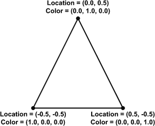

图 3.3 绘制三角形的属性数据。

要绘制此三角形，`GPU` 需要知道每个顶点的坐标和颜色。由于这些属性在顶点之间发生变化，我们将此数据称为 *属性数据*。以下代码展示了如何将此数据存储在 32 位浮点值数组中：

```
const vertexCoords = new Float32Array([
  0.0, 0.5,
  -0.5, -0.5,
  0.5, -0.5
]);

const vertexColors = new Float32Array([
  0.0, 1.0, 0.0,
  1.0, 0.0, 0.0,
  0.0, 0.0, 1.0
]);
```

为了提高效率，我们将坐标和颜色合并到一个大型数组中：

```
const vertexData = new Float32Array([
   0.0, 0.5, 0.0, 1.0, 0.0,     // First vertex
   -0.5, -0.5, 1.0, 0.0, 0.0,   // Second vertex
   0.5, -0.5, 0.0, 0.0, 1.0     // Third vertex
]);
```

此数组包含第一个顶点的坐标，后跟第一个顶点的颜色。随后是第二个和第三个顶点的属性数据。由于每个顶点的数据组合在一起，因此这种数据存储方法称为 *交错*。通常，这比使用单独的数组提供更好的性能，并且本书中的所有示例代码都将在 `GPU` 缓冲区内交错数据。

要创建用于存储此数据的 `GPUBuffer` 对象，应用程序需要调用 `GPUDevice` 的 `createBuffer()` 方法。它接受一个描述缓冲区的属性对象。该对象最多可以定义四个属性，表 3.8 列出了每个属性。

表 3.8 渲染管线描述符的属性

| 属性 || 是否可选? || 描述 |

| --- | --- | --- |

| label || Y || 用于缓冲区的名称 |

| --- | --- | --- |

| size || N || 缓冲区中存储的字节数 |

| usage || N || 标识缓冲区用途的标志 |

| mappedAtCreation || Y || 标识在创建时是否应将缓冲区数据映射到 GPU 内存 |

`usage` 属性特别重要，必须设置为 `GPUBufferUsage` 枚举类型的值或多个值的 OR 组合。表 3.9 列出了此类型的支持值。

表 3.9 顶点缓冲区使用值

| 属性 || 描述 |

| --- | --- |

| GPUBufferUsage.VERTEX  || 缓冲区可用作顶点缓冲区 |

| --- | --- |

| GPUBufferUsage.INDEX  || 缓冲区可用作索引缓冲区 |

| GPUBufferUsage.INDIRECT || 缓冲区可存储间接渲染的绘制参数 |

| GPUBufferUsage.COPY_SRC || 缓冲区可用作复制操作的源 |

| GPUBufferUsage.COPY_DST || 缓冲区可用作复制操作的目标 |

| GPUBufferUsage.STORAGE || 缓冲区可用作绑定组中的存储缓冲区 |

| GPUBufferUsage.UNIFORM || 缓冲区可用作绑定组中的 uniform 缓冲区 |

| GPUBufferUsage.MAP_READ || 缓冲区可映射以读取数据 |

| GPUBufferUsage.MAP_WRITE || 缓冲区可映射以写入数据 |

| GPUBufferUsage.QUERY_RESOLVE || 缓冲区可用于包含查询结果 |

为了演示如何使用这些属性，以下代码创建了一个旨在存储 `vertexData` 数组中数据的 `vertexBuffer`。

```
// Create a vertex buffer
const vertexBuffer = device.createBuffer({
    label: "Example vertex buffer",
    size: vertexData.byteLength,
    usage: GPUBufferUsage.VERTEX | GPUBufferUsage.COPY_DST
});
```

缓冲区的大小足以容纳 `vertexData` 的字节，但尚未保存数组元素。要将数据与缓冲区关联，应用程序可以调用 `GPUQueue` 的 `writeBuffer()` 方法。它可以接受五个参数，表 3.10 列出了每个参数。

表 3.10 writeBuffer 方法的参数

| 参数 || 数据类型 || 是否可选? || 描述 |


| --- | --- | --- | --- |

| buffer || GPUBuffer || N || 接收写入数据的缓冲区 |

| --- | --- | --- | --- |

| bufferOffset || Integer || N || 标识写入操作应开始的字节偏移量 |

| data || ArrayBuffer, TypedArray, or DataView || N || 要写入数据的来源 |

| dataOffset || Integer || Y || 从源开始访问数据的字节偏移量 |

| size || Integer || Y || 从源写入缓冲区的字节数 |

在此示例中，我们希望 `vertexBuffer` 包含 `vertexData` 中的所有数据。以下代码创建关联：

```
 // Write attribute data to the vertex buffer
device.queue.writeBuffer(vertexBuffer, 0, vertexData);
```

理想情况下，GPU 会自动知道数组中哪些值代表坐标，哪些代表颜色分量。但在 WebGPU 中，应用程序需要通过将缓冲区与布局对象关联来识别数据的性质。该对象有三个属性，表 3.11 列出了每个属性。

表 3.11 缓冲区布局对象的属性

| 参数 || 可选? || 描述 |

| --- | --- | --- |

| arrayStride || N || 不同结构之间的字节数 |

| --- | --- | --- |

| attributes || N || 定义结构中值排列的对象数组 |

| stepMode || Y || 对应布局的结构类型（顶点或实例） |

`attributes` 数组的每个元素标识一个属性类型。在我们的示例中，每个顶点都有一个位置（两个浮点坐标）和一种颜色（三个浮点分量）。因此，数组包含两个元素。以下代码展示了这一点：

```
 // Define the layout of a vertex buffer
const bufferLayout = {
    arrayStride: 20,
    attributes: [
       { format: "float32x2", offset: 0, shaderLocation: 0 }, 
       { format: "float32x3", offset: 8, shaderLocation: 1 }
    ],
};
```

如图所示，`attributes` 数组的每个元素都有三个属性：`format`、`offset` 和 `shaderLocation`。`format` 必须设置为 `TYPE`x`NUM` 给出的字符串，其中 `TYPE` 是每个值的数据类型（`uint8`、`unorm8`、`uint16`、`unorm16`、`uint32`、`float16`、`float32`），而 `NUM` 是值的数量（取决于类型，为 2、3 或 4）。

`offset` 标识从结构开头开始的属性数据的字节位置。第一个元素的偏移值为 0，因为它从结构开头开始。第二个元素的偏移值为 8，因为它从结构开始处起 8 字节。

`shaderLocation` 标识着色器函数接收的参数的索引。第 4 章 讨论了着色器，并将解释如何将缓冲区与函数参数关联。

`arrayStride`、`format` 和 `offset` 属性可能令人困惑，因此 图 3.4 说明了它们与三角形属性的关系。每个灰色矩形对应一个 4 字节的浮点数，每个矩形行代表一个顶点的属性。请记住，`arrayStride` 和 `offset` 以 *字节* 给出。


图 3.4 属性数据的布局属性。

一旦创建了布局对象，应用程序需要将其作为 `createRenderPipeline` 方法中 `vertex` 属性的 `buffers` 数组的元素提供。为演示，以下代码将 `bufferLayout` 添加到 `buffers` 数组。

```
 // Create the render pipeline
const cellPipeline = device.createRenderPipeline({
    ...
    vertex: {
        module: ...,
        entryPoint: ...,
        buffers: [bufferLayout]
    },
    ...
});
```

`module` 属性设置为包含着色器代码的对象，而 `entryPoint` 标识着色器中的一个函数。这些属性将在 第 4 章 中讨论。

除了将缓冲区布局添加到渲染管线外，应用程序还需要将顶点缓冲区与渲染通道编码器关联。这是通过调用编码器的 `setVertexBuffer` 方法实现的。该方法需要四个参数，表 3.12 列出了每个参数。

表 3.12 `setVertexBuffer` 方法的参数

| 参数 || 数据类型 || 可选? || 描述 |

| --- | --- | --- | --- |

| slot || Integer || N || 顶点缓冲区的索引 |

| --- | --- | --- | --- |

| buffer || GPUBuffer || N || 要与渲染通道编码器关联的缓冲区 |

| offset || Integer || N || 要读取的缓冲区中的字节偏移量 |

| size || Integer || Y || 要访问的顶点数据的大小 |

示例将演示 `setVertexBuffer` 的工作原理。如果渲染通道编码器名为 `renderPassEncoder` 且缓冲区称为 `vertexBuffer`，以下代码将在这两者之间创建关联。

```
 // Associate a vertex buffer with the render pass encoder
renderPassEncoder.setVertexBuffer(0, vertexBuffer);
```

需要注意的是，可以多次调用 `setVertexBuffer` 并使用不同的 `slot` 值来关联多个顶点缓冲区。第 4 章 将解释顶点着色器如何使用这些槽值来访问顶点缓冲区数据。

## 摘要

本章讨论了图形渲染所需的基本对象。两个最重要的对象是 `GPURenderPassEncoder`，本书中我将始终将其称为 *渲染通道编码器*，以及 `GPURenderPipeline`，我将将其称为 *渲染管线*。

渲染通道编码器存储与图形渲染过程相关的所有状态。至少，它必须使用标识渲染表面和初始颜色的颜色附件创建。本章中的示例应用程序配置渲染通道编码器以将初始颜色设置为蓝色。

渲染管线标识渲染过程的不同步骤。至少，它提供包含应在 GPU 上执行的特殊程序（着色器）的着色器模块。它还指定应从顶点形成哪种类型的图元。应用程序可以创建点、线或三角形图元，在本书中，我们通常将管线配置为创建三角形。

本章的最后一部分讨论了缓冲区的主题。你可以将缓冲区视为一种特殊的数据结构，可以传递给 GPU。一些缓冲区包含顶点数据，例如坐标或颜色，而其他缓冲区包含标识顶点应被渲染顺序的索引值。

# WebGPU 着色语言 (WGSL) 4

DOI: [10.1201/9781003422839-4](https://doi.org/10.1201/9781003422839-4)

本章搁置了常规的 JavaScript 代码，探索了在 WebGPU 操作中发挥核心作用的 *着色器* 的迷人世界。图形应用程序使用着色器告诉 GPU 如何绘制形状和分配颜色。计算应用程序使用着色器告诉 GPU 如何进行数值运算。

WebGPU 支持三种类型的着色器，每种都有不同的主要作用：

*   **vertex shader**—设置场景中每个顶点的位置

*   **fragment shader**—设置要渲染的每个片段的颜色和深度

*   **compute shader**—执行数学运算

尽管角色不同，每个 WebGPU 着色器都用 WebGPU 着色语言，即 WGSL 编写。WGSL 部分基于 JavaScript，部分基于 C 编程语言，但与 JavaScript 和 C 不同，WGSL 函数在 GPU 而非 CPU 上运行。

本章介绍了 WGSL 的基础知识，然后解释如何编写顶点着色器和片段着色器。计算着色器的主题在 第 8 章 中讨论。

## WGSL 基础


第三章介绍了图形渲染管线，其行为类似于将顶点转换为原始形状、原始形状转换为片段、片段转换为像素的装配线。管线的两个阶段是可编程的，这意味着其操作由 *着色器* 确定。
本节探讨 WGSL 开发的五个基本方面：
1. 函数定义和入口点
2. 数据类型
3. 内置运算符和函数
4. 变量和存储
5. 常量和覆盖变量
本节将详细介绍这些主题。本章后面，我将介绍两个示例应用程序，演示如何在图形应用程序中使用着色器。

## 函数定义和入口点
在高层次上，WebGPU 着色器包含一个或多个数据结构声明，后跟一个或多个函数定义。定义函数时，需要注意两条基本规则：
1. 函数的名称必须以 `fn` 关键字开头，并且后面必须跟随零个或多个参数，参数放在括号中。
2. WGSL 函数不必返回值。如果返回值，其参数列表必须后跟粗箭头 (`->`) 和返回值的 数据类型。
每个参数必须有一个标识符，后跟冒号和数据类型。以下代码展示了这一点，它定义了一个名为 `foo` 的函数，返回类型为 `bar` 的值。该函数接受一个名为 `arg`、类型为 `argtype` 的参数：
```
 // Example shader function
 fn foo(arg: argtype) -> bar {
     return x;
 }
```
着色器可以有多个函数定义，但只有一个函数可以作为着色器的 *入口点*。关于入口点，有两点很重要：
1. 入口点必须以特定于着色器类型的属性为前缀（顶点着色器为 `@vertex`，片段着色器为 `@fragment`，计算着色器为 `@compute`）。
2. 管道对象需要知道将要执行的每种着色器的入口点。这可以通过将名称分配给 `entryPoint` 属性手动设置。如果未设置，WebGPU 将搜索着色器的属性。如果只有一个函数具有该属性，则该函数将被视为入口点。
例如，以下代码定义了一个顶点着色器。因为它是入口点，所以必须以 `@vertex` 为前缀。
```
 // Example entry point
 @vertex
 fn main(arg1: argtype1, arg2: argtype2, …) -> … {
     return …
 }
```
你可以随意设置函数名称，但参数和返回值将取决于你正在编写的着色器类型。我将在本章后面讨论这个问题。

## 数据类型
WGSL 编程最困难的方面之一是跟踪所有数据类型。本讨论将它们分为五组：
* `scalar types`—每个实例有一个单一值
* `vector types`—每个实例有多个值
* `matrix types`—每个实例有多个行和列
* `array types`—包含多个相同类型元素的容器
* `structure types`—命名相关数据结构的组
有很多新术语，如果你不能立即完全理解也不必担心。当你开始查看实际着色器时，这些类型会变得更清晰。

### 标量类型
与 JavaScript 不同，WGSL 没有字符串或未定义变量的数据类型。只有五种基本标量类型，表 4.1 列出了每一种。
表 4.1 WGSL 标量类型
| 数据类型 || 描述 |
| --- | --- |
| `bool` || 布尔值（true/false） |
| --- | --- |
| `u32` || 无符号 32 位整数 |
| `i32` || 有符号 32 位整数 |
| `f16` || 16 位浮点值 |
| `f32` || 32 位浮点值 |
如图所示，WGSL 整数为 32 位——没有 8 位或 16 位整数。然而，许多 GPU 支持 16 位浮点值，对于需要存储和处理大量值的应用程序，这些值可以提供性能提升。

### 向量类型
使用 GPU 进行计算的一个优势是它们可以在单个时钟周期内处理多个值。然而，值组必须存储在称为 *向量* 的特殊容器中。当着色器执行向量操作时，它对向量的所有值 *同时* 操作。
因此，这些操作通常称为单指令多数据（SIMD）操作。
在 WGSL 中，每个向量类型的格式为 `vec*N*<type>`，其中 *N* 是向量中的值数量，type 是向量中每个标量值的类型（参见 表 4.1）。例如，如果一个变量的类型为 `vec3<f32>`，它是一个包含三个 32 位浮点值的向量。当变量在操作中使用时，所有三个值将同时被处理。
为了简化编码，WGSL 为常见向量类型提供了别名。表 4.2 的第一列列出了这些别名，第二列列出了它们的完整名称。
表 4.2 WGSL 向量类型的别名
| 别名类型 || 数据类型 || 描述 |
| --- | --- | --- |
| `vec2u` || `vec2<u32>` || 包含两个 32 位无符号整数 |
| --- | --- | --- |
| `vec3u` || `vec3<u32>` || 包含三个 32 位无符号整数 |
| `vec4u` || `vec4<u32>` || 包含四个 32 位无符号整数 |
| `vec2i` || `vec2<i32>` || 包含两个 32 位有符号整数 |
| `vec3i` || `vec3<i32>` || 包含三个 32 位有符号整数 |
| `vec4i` || `vec4<i32>` || 包含四个 32 位有符号整数 |
| `vec2f` || `vec2<f32>` || 包含两个 32 位浮点值 |
| `vec3f` || `vec3<f32>` || 包含三个 32 位浮点值 |
| `vec4f` || `vec4<f32>` || 包含四个 32 位浮点值 |
| `vec2h` || `vec2<f16>` || 包含两个 16 位浮点值 |
| `vec3h` || `vec3<f16>` || 包含三个 16 位浮点值 |
| `vec4h` || `vec4<f16>` || 包含四个 16 位浮点值 |
为了简洁，本书在可能的情况下使用这些别名。请记住，h 指的是半精度浮点数，即 16 位浮点值。并非所有 GPU 都支持此功能，你可以通过读取 GPU `adapter` 的 `features` 属性来检查半精度支持，以查看它是否具有名为 `shader-f16` 的元素。以下代码展示了如何实现：
```
 // Check if the client supports 16-bit floating-point values
 if (adapter.features.has("shader-f16")) {
     …
 } else {
     …
 }
```
要创建向量，你需要为其每个元素分配值。WGSL 支持以 `let`、`const` 和 `var` 开头的变量声明，声明向量的通用语法如下：
```
 let var_name = vec_type(elements);
```
例如，以下代码创建了一个包含四个 32 位浮点的向量：
```
 let float_vec = vec4f(1.0, 2.0, 3.0, 4.0);
```
同样，以下代码创建了一个包含三个 32 位有符号整数的常量向量：
```
 const int_vec: vec3i = vec3i(1, 2, 3);
```
着色器可以通过三种主要方式访问向量的元素：
* 数组表示法：`float_vec[0]`, `int_vec[1]`
* 下标 r, g, b, a：`float_vec.r`, `int_vec.b`
* 下标 x, y, z, w：`float_vec.y`, `int_vec.w`
除了访问单个元素外，着色器还可以通过使用多个下标创建原始向量的子向量。以下代码展示了这一点：
```
 let my_vec = vec4f(0.0, 1.0, 2.0, 3.0);
 let sub_vec = my_vec.yz;
 // sub_vec contains (1.0, 2.0)
```
使用点表示法访问元素时，顺序很重要。`my_vec.yz` 是一个包含 `my_vec` 的第二个和第三个元素的两元素向量。相比之下，`my_vec.zy` 是一个包含 `my_vec` 的第三个和第二个元素的向量。


内存对齐在着色器开发中偶尔会成为一个关注点，而向量的对齐取决于其类型。对于包含 4 字节元素的向量，`vec2` 将在 8 字节边界上对齐，而 `vec3` 或 `vec4` 将在 16 字节边界上对齐。如果你遇到涉及 `vec3` 数据的奇怪错误，请记住这些向量是在 16 字节边界上对齐的，而不是 12 字节边界。

## 矩阵类型
矩阵类型与向量类型类似，但向量将值存储在一行中，而矩阵将值存储在行和列中。另一个区别是矩阵只能保存 *浮点值*，而不是整数或布尔值。

每种矩阵类型的格式为 `matMxN<type>`，其中 `M` 是行数，`N` 是列数，`type` 是矩阵每个元素的类型。`M` 和 `N` 的值可以是 2、3 或 4。例如，如果一个变量的类型为 `mat3x4<f32>`，它是一个矩阵，具有 12 个浮点值排列成 3 行 4 列。

与前面讨论的向量类型一样，WGSL 通过提供矩阵类型的别名来简化编程。表 4.3 列出了这些别名及其对应的完整类型。

表 4.3 WGSL 矩阵类型的别名

| 别名 || 数据类型 || 描述 |
| --- | --- | --- |
| `mat2x2f` || `mat2x2<f32>` || 包含四个浮点数，分为两行两列 |
| --- | --- | --- |
| `mat2x3f` || `mat2x3<f32>` || 包含六个浮点数，分为两行三列 |
| `mat2x4f` || `mat2x4<f32>` || 包含八个浮点数，分为两行四列 |
| `mat3x2f` || `mat3x2<f32>` || 包含六个浮点数，分为三行两列 |
| `mat3x3f` || `mat3x3<f32>` || 包含九个浮点数，分为三行三列 |
| `mat3x4f` || `mat3x4<f32>` || 包含十二个浮点数，分为三行四列 |
| `mat4x2f` || `mat4x2<f32>` || 包含八个浮点数，分为四行两列 |
| `mat4x3f` || `mat4x3<f32>` || 包含十二个浮点数，分为四行三列 |
| `mat4x4f` || `mat4x4<f32>` || 包含十六个浮点数，分为四行四列 |
| `mat2x2h` || `mat2x2<f16>` || 包含四个半精度浮点数，分为两行两列 |
| `mat2x3h` || `mat2x3<f16>` || 包含六个半精度浮点数，分为两行三列 |
| `mat2x4h` || `mat2x4<f16>` || 包含八个半精度浮点数，分为两行四列 |
| `mat3x2h` || `mat3x2<f16>` || 包含六个半精度浮点数，分为三行两列 |
| `mat3x3h` || `mat3x3<f16>` || 包含九个半精度浮点数，分为三行三列 |
| `mat3x4h` || `mat3x4<f16>` || 包含十二个半精度浮点数，分为三行四列 |
| `mat4x2h` || `mat4x2<f16>` || 包含八个半精度浮点数，分为四行两列 |
| `mat4x3h` || `mat4x3<f16>` || 包含十二个半精度浮点数，分为四行三列 |
| `mat4x4h` || `mat4x4<f16>` || 包含十六个半精度浮点数，分为四行四列 |

WGSL 矩阵以 *列主序* 结构化。也就是说，如果 `mat` 是一个矩阵，`mat[0]` 是一个包含矩阵第一 *列* 中元素的向量。`mat[0][1]` 是矩阵第一列的第二个元素。

为澄清这一点，请考虑以下代码，该代码初始化一个名为 `mat_3_2` 的 3×2 矩阵：

// Initializes a 3-by-2 matrix with six values
let mat_3_2 = mat3x2f(0.0, 1.0, 2.0, 3.0, 4.0, 5.0);

结果矩阵将有三行两列。由于元素以列主序存储，第一列将包含 0.0、1.0 和 2.0，第二列将包含 3.0、4.0 和 5.0。

着色器可以从向量构造矩阵。例如，如果 `vec1` 和 `vec2` 都有四个元素，以下代码将从向量创建一个 4×2 矩阵：

// Creates a 4-by-2 matrix from two four-element vectors
const mat = mat4x2f(vec1, vec2);

结果，`mat[0]` 将包含 `vec1` 的元素，而 `mat[1]` 将包含 `vec2` 的元素。

## 内置运算符和函数
WGSL 提供了处理数字所需的所有运算符和函数，包括算术和三角运算（`sin`、`cos` 和 `tan`）。还有用于指数（`pow`、`exp`、`log`）、比较（`min`、`max`、`clamp`）和近似（`round`、`floor`、`ceil`、`trunc`）的函数。

本讨论着眼于专门针对向量和矩阵操作的函数。这些在编写着色器时特别重要，因此很好地理解它们是个好主意。

### 向量运算和函数
你可以使用与标量相同的运算符对向量执行算术运算，并且运算按 *逐分量* 执行。也就是说，输出向量中的元素是通过对输入向量中的相应元素进行运算而简单计算的。

例如，假设 `v1` 包含 (1.0, 1.0, 1.0) 且 `v2` 包含 (2.0, 2.0, 2.0)。以下运算按逐分量执行：

```
let v3 = v1 + v2;
// v3 = (3.0, 3.0, 3.0)

let v4 = v1 / v2;
// v4 = (0.5, 0.5, 0.5)
```

向量与标量之间的运算也按逐分量执行。这在以下示例代码中显示：

```
let v3 = v1 + 5.0;
// v3 = (6.0, 6.0, 6.0)

let v4 = v1 / 4.0;
// v4 = (0.25, 0.25, 0.25)
```

除了基本运算符之外，WGSL 还提供了作用于向量的函数。表 4.4 列出了其中五个。

表 4.4 WGSL 向量函数

| 函数 || 描述 |
| --- | --- |
| `length(vec)` || 返回 `vec` 的长度 |
| --- | --- |
| `normalize(vec)` || 返回一个与 `vec` 方向相同且长度为 1 的向量 |
| `distance(vec1, vec2)` || 计算两个向量之间的距离 |
| `dot(vec1, vec2)` || 返回 `vec1` 和 `vec2` 的点积 |
| `fma(vec1, vec2, res)` || 执行融合乘加 |

为了理解这些函数，将向量视为几何对象是有帮助的。几何向量具有长度和方向，通常用空间中的箭头表示，其中箭头的方向标识向量的方向，其长度标识向量的长度。有三点需要注意：
* 向量是在坐标系中定义的。例如，三维向量是在具有三个维度的坐标系中定义的，例如 (x, y, z)。
* 向量可以表示为 n 个分量的组合，其中 n 为坐标系中的维度数。如果 `v` 位于 (x, y, z) 坐标系中，其分量为 `v[x]`、`v[y]` 和 `v[z]`，并且 `v` 可以表示为 `<v[x], v[y], v[z]>`。
* 向量的长度可以使用毕达哥拉斯定理获得。也就是说，长度的平方等于其分量平方之和。

例如，如果 `v` 是二维向量，其 x 分量由 `v[x]` 给出，其 y 分量由 `v[y]` 给出。`v` 的长度，用 `|v|` 表示，可以通过方程计算：`|v|² = v[x]² + v[y]²`。在三维中，`|v|² = v[x]² + v[y]² + v[z]²`。这在 图 4.1 中显示。

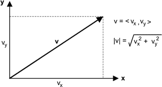

图 4.1 向量、分量和长度。

在 表 4.4 中，`length` 函数接受一个向量并返回其长度。`normalize` 函数接受一个向量并返回一个方向相同但长度设为 1 的向量。`distance` 函数将两个输入向量视为空间中的点，并使用毕达哥拉斯定理计算它们之间的距离。

点积是通过将两个输入向量的元素相乘并将乘积相加来计算的。例如，如果向量 `v1` 的分量为 (`v1[x]`、`v1[y]`、`v1[z]`) 且向量 `v2` 的分量为 (`v2[x]`、`v2[y]`、`v2[z]`)，则它们的点积如下所示：

`v1 ⋅ v2 = (v1[x] * v2[x]) + (v1[y] * v2[y]) + (v1[z] * v2[z])`


在 WGSL 中，点积是通过调用 `dot()` 函数计算的。所得值告诉你向量的方向彼此有多相似。如果点积为正，则它们指向相似的方向。如果积为零，则向量相互垂直，如果积为负，则它们指向大致相反的方向。

叉积与点积在多个方面不同。它不是返回标量，而是返回向量。计算更复杂，如果 `v3` 等于 `v1` 和 `v2` 的叉积，则 `v3` 的分量按如下方式获得：
* `v3[x] = v1[y] * v2[z] - v1[z] * v2[y]`
* `v3[y] = v1[z] * v2[x] - v1[x] * v2[z]`
* `v3[z] = v1[x] * v2[y] - v1[y] * v2[x]`

在 WGSL 中，两个向量的叉积可以通过调用 `cross()` 函数获得。所得向量将具有垂直于包含输入向量的平面的方向。我们说该向量对平面是 *法线*，并且我们称该向量为 *法线向量*。在图形学中，法向量经常用于确定光如何从表面反射。

表 4.4 中的最后一个函数 `fma` 代表 fused multiply-and-add。它将两个向量的对应元素相乘并将结果加到第三个向量的元素上。如果 `a`、`b` 和 `c` 是输入，则 `fma()` 返回 `a * b + c`。使用此函数的主要优点是精度（减少舍入误差）和速度（它通常作为单个操作执行）。`fma` 可以使用标量参数也可以使用向量调用。

### 矩阵操作和函数
与向量一样，你可以使用 `+` 和 `–` 运算符以分量方式对矩阵进行加法和减法运算。但矩阵只有在具有相同数量的行和列时才能进行加法和减法。

WGSL 不支持矩阵除法，但它支持矩阵乘法。对于矩阵，`*` 运算符可以用三种方式使用：
* `matrix * scalar` – 将矩阵的每个元素乘以标量
* `matrix * vector` – 返回一个向量
* `matrix * matrix` – 返回一个矩阵

第 5 章 解释了矩阵如何表示可用于缩放、平移或旋转空间中点的变换。对于本章而言，熟悉矩阵-向量乘法很重要。矩阵和向量的乘积是另一个向量，并且输出向量的每个元素都是矩阵的一行与初始向量的点积。

这可能会令人困惑，因此查看一个示例会有帮助。假设 `A` 是一个矩阵，其元素用 `a[ij]` 表示，其中 `i` 是包含该元素的行，`j` 是包含该元素的列。如果 `x` 是一个向量，则 `A` 和 `x` 的乘积会产生另一个向量。将结果向量记为 `b`，`b` 的每个元素都是通过取 `A` 的第 i 行与向量 `x` 的点积计算得出的。

图 4.2 从图形上说明了这一点。结果的第三个元素 `b[2]` 是通过取 `A` 的第三行与向量 `x` 的点积获得的。

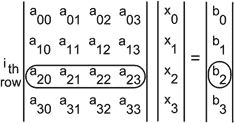

图 4.2 矩阵-向量乘法。

在该示例中，`b` 的元素按如下方式计算：
* `b[0] = (first row of A) ∙ x = a[00] x[0] + a[01] x[1] + a[02] x[2] + a[03] x[3]`
* `b[1] = (second row of A) ∙ x = a[10] x[0] + a[11] x[1] + a[12] x[2] + a[13] x[3]`
* `b[2] = (third row of A) ∙ x = a[20] x[0] + a[21] x[1] + a[22] x[2] + a[23] x[3]`
* `b[3] = (fourth row of A) ∙ x = a[30] x[0] + a[31] x[1] + a[32] x[2] + a[33] x[3]`

当向量乘以矩阵时，向量中的元素数量必须等于矩阵行中的元素数量。在此示例中，`x` 的大小必须等于 `A` 的每一行的大小。

WGSL 还支持矩阵-矩阵乘法，它接受两个矩阵并生成第三个矩阵。如果第一个矩阵是 `m`-by-`n`，第二个矩阵是 `n`-by-`p`，则结果矩阵的维度将为 `m`-by-`p`。

与矩阵-向量乘法类似，矩阵-矩阵乘法由一系列点积组成。结果矩阵的每个元素都是通过取第一个输入矩阵的一行与第二个输入矩阵的一列的点积获得的。图 4.3 说明了此过程。

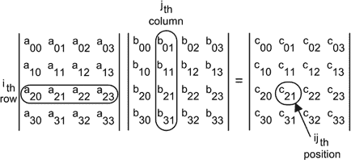

图 4.3 矩阵-矩阵乘法。

当你查看此插图时，应该很清楚交换输入矩阵的顺序（很可能）会产生不同的结果。这导致了矩阵-矩阵乘法的一个重要属性：它不是可交换的。如果 `A * B = C`，`B * A` 不一定等于 `C`。

除了算术运算符之外，WGSL 还提供了两个有用的操作矩阵的函数。`transpose()` 函数接受一个矩阵并返回一个行列互换的矩阵。`determinant()` 函数接受一个矩阵并返回等于该矩阵行列式的数值。

### 数组类型
与向量类似，数组包含多个相同类型的元素。但数组和向量之间至少有四个重要区别：
1. 数组可以存储多于四个元素。
2. WGSL 不提供一次性处理数组每个元素的运算——着色器需要遍历数组来操作其元素。
3. 虽然向量只能包含标量值，但数组可以包含标量、向量、矩阵和结构体。但每个元素必须具有相同的类型。
4. 与向量不同，数组的对齐仅取决于其元素的类型。如果数组包含四字节元素，它将在内存中按四字节边界对齐。

WGSL 支持两种类型的数组，它们之间的区别涉及元素数量或大小。大多数数组是 *固定大小*，其大小必须在声明中指定。*运行时大小的数组* 的大小可以在运行时更改。固定大小的数组可以在任何地方定义，但运行时大小的数组只能在某些情况下使用。我只在计算着色器中使用过运行时大小的数组，这将在 第 8 章 中介绍。

固定大小数组的声明必须指定其元素的类型和数组中的元素数量。以下代码创建了一个名为 `arr` 的数组，其中包含三个元素：
// Array containing three 32-bit unsigned integers
var arr = array<u32, 3>;
```
在可能的情况下，着色器应使用向量而不是数组。但如果一个对象需要存储的值超过向量所能容纳的数量，数组是唯一的选择。因此，当应用程序向 GPU 传递大型缓冲区时，底层数据经常作为值数组被访问。

### 结构体类型
当着色器需要访问相关的数据项时，通常将它们存储在结构体中。这不会提供性能优势，但通过在命名容器内组织字段来简化代码。

与 C 编程语言一样，结构体使用 `struct` 关键字声明，后跟花括号中的成员声明。例如，以下代码声明了一个名为 `Complex` 的结构体，其中有两个浮点成员名为 `real` 和 `imag`：
// Example structure
struct Complex {
    real: f32,
    imag: f32
};
```
在此声明之后，着色器可以通过使用括号中的成员值调用名称来创建结构体。以下代码展示了其工作原理：
```
const z = Complex(2.0, 4.0);
```
当着色器从应用程序接收相关的数据项时，结构体特别有帮助。当我们查看在着色器中访问缓冲区数据时，这一点将变得清晰。

## 变量和存储


### WGSL 变量声明和地址空间

WGSL 支持 `let`、`const` 和 `var`，但它们在 WGSL 与 JavaScript 中的用法存在主要差异。当你在着色器中使用 `let` 或 `const` 时，你声明的是一个 *值*。声明为值分配一个名称，但数据不会存储在任何地方。此外，`let` 只能在函数内部使用，而 `const` 既可以在函数内部也可以在函数外部使用。

当声明以 `var` 开始时，它会创建一个 *变量*，其数据将存储在内存中。这比使用 `let` 和 `const` 更复杂，因为一个 `var` 声明需要标识将包含变量数据的内存类型。

为变量设置内存类型，声明可以在 `var` 后跟随尖括号之间的 *地址空间* 名称。例如，以下代码声明一个 32 位浮点变量存储在私有地址空间中：

```
var<private> foo: f32;
```

设置变量类型的另一种方法是提供一个值。在以下代码中，可以理解变量将存储一个浮点值：

```
var<private> foo = 1234.0;
```

在这些声明中，`private` 关键字表示变量应存储在 `private` 地址空间中。这适用于在着色器函数外部声明的全局变量。如果变量 intended 在函数内部使用，其地址空间应设置为 `function`。如果变量在函数内部声明且没有地址空间，则理解为变量将存储在 `function` 空间中。这在以下代码中显示：

```
// Stored in the function address space
var foo = 1234.0;
```

表 4.5 列出了可用于存储变量的所有地址空间。

表 4.5 变量的地址空间

| 地址空间 || 默认访问模式 || 描述 |
| --- | --- | --- |
| function || 读写 || 函数内部声明的变量 |
| --- | --- | --- |
| private || 读写 || 全局变量 |
| storage || 只读 || 存储缓冲区中的数据 |
| uniform || 只读 || 统一缓冲区中的数据 |
| handle || 只读 || 采样器和纹理变量 |
| workgroup || 读写 || 计算着色器使用的数据 |

第 3 章 解释了应用程序如何创建用于保存着色器数据的资源。资源有两种类型：*缓冲区*，用于保存通用数据，以及 *纹理*，用于保存纹理数据。要访问资源，着色器需要在 `storage`、`uniform` 或 `handle` 地址空间中声明一个变量。提供资源访问的变量称为 *资源变量*，我将在本章中对其进行讨论。

第 3 章 还解释了属性数据（如坐标）会从一个顶点变化到下一个顶点。相比之下，uniform 数据在从一个顶点到下一个顶点时保持不变（uniform）。因此，uniform 数据存储在统一缓冲区中，通过 `uniform` 地址空间访问。第 5 章 将更深入地讨论 uniform。

最后两个地址空间 `handle` 和 `workgroup` 将在后面的章节中讨论。`handle` 空间仅由访问纹理的应用程序使用，这将在 第 6 章 中讨论。`workgroup` 空间仅由创建计算着色器的应用程序使用，这将在 第 8 章 中讨论。

## 常量和覆盖变量

正如我们将看到的，将数据从应用程序（JavaScript）传递到着色器（WGSL）通常是一个复杂的过程。你需要创建特殊的资源对象（缓冲区和纹理）并将这些资源与专门格式的数据和其他对象关联。

如果你只想在着色器中设置标量值，可以利用常量（它们与 `const` 关键字无关）。如 第 3 章 中所述，`createRenderPipeline` 方法接受一个包含 `vertex` 对象和 `fragment` 对象的对象。`vertex` 和 `fragment` 对象有一个可选属性名为 `constants`，可以设置为名称-值对序列。以下代码展示了其工作原理：

```
// Create a render pipeline that defines constants
const renderPipeline = device.createRenderPipeline({
    layout: …,
    vertex: {
        module: …,
        entryPoint: …
        constants: {
            0: false,
            22: 5.4,
            num_pixels: 256,
       }
    },
});
```

在此代码中，`constants` 被设置为包含三个由冒号分隔的名称-值对的对象。每个名称可以是整数或字符串。每个值可以是整数、浮点值或布尔值。

在着色器内部，这些名称-值对可以通过称为 *覆盖变量* 的特殊变量访问。覆盖变量可以用两种方式之一声明。如果常量名称是整数，则相应的声明以包含名称的括号的 `@id` 属性开头。声明的一般形式如下所示：

```
@id(name) override var_name: type;
```

例如，如果 `constants` 对象将 0 映射为 false，则着色器中相应的声明可以如下编码：

```
@id(0) override example: bool;
```

尽管此变量在着色器中未被设置为值，但在着色器执行时它将被设置为 false。

如果常量名称是字符串，则不需要 `@id` 属性。相反，变量的名称需要设置为常量的名称。例如，如果 `constants` 对象将 `num_pixels` 映射为 256，则着色器中相应的声明可以如下编码：

```
override num_pixels: u32;
```

变量的值在着色器中未被设置，但由于 `constants` 对象，`num_pixels` 在着色器执行时将被设置为 256。

覆盖变量在应用程序需要在编译时将简单标量传递给着色器时非常方便。它们在编写计算应用程序时尤其有帮助，计算应用程序将在 第 8 章 中介绍。

## 顶点着色器

现在你已经了解了 WGSL 的基础知识，让我们看看顶点着色器是如何编码的。以下代码展示了 `Ch04_OrangeTriangle` 应用程序中使用的顶点着色器：

```
@vertex
fn vertexMain(@location(0) coords: vec2f, @location(1) colors: vec3f) -> @builtin(position) vec4f {
    return vec4f(coords, 0.0, 1.0);
}
```

此函数是顶点着色器的入口点，因为其名称 `vertexMain` 前面有 `@vertex`。它接受两个参数（一个 `vec2f` 和一个 `vec3f`）并产生一个向量作为返回值。

这段代码有两个方面需要解释：在两个参数之前出现的 `@location` 属性以及在返回值之前出现的 `@builtin` 属性。在我看来，这些修饰符应称为 *注解* 或 *装饰器*，因为 *attribute* 在 WebGPU 中已有特定含义。然而，WGSL 标准将它们称为属性。

### 位置属性

`@location` 属性使着色器能够访问资源（缓冲区和纹理）中的数据。在前面的代码中，此属性位于着色器的参数 `coords` 和 `colors` 之前。

第 3 章 解释了如何创建包含二维三角形顶点的顶点缓冲区。每个顶点需要两个属性：每个顶点的 (x, y) 坐标和 RGB 颜色。以下代码显示顶点数据是如何定义的：

```
// Define vertex data (coordinates and colors)
const vertexData = new Float32Array([
    0.0, 0.5, 0.0, 1.0, 0.0,    // First vertex (green)
    −0.5, −0.5, 1.0, 0.0, 0.0,  // Second vertex (red)
    0.5, −0.5, 0.0, 0.0, 1.0    // Third vertex (blue)
]);
```

为了使此数据可供着色器使用，应用程序需要创建一个顶点缓冲区。以下代码展示了如何完成此操作：


## 顶点缓冲与布局

```
// Create a vertex buffer
const vertexBuffer = device.createBuffer({
    label: "Example vertex buffer",
    size: vertexData.byteLength,
    usage: GPUBufferUsage.VERTEX | GPUBufferUsage.COPY_DST
});
```

应用程序还需使用布局对象定义缓冲的结构。以下代码为顶点缓冲定义了一个布局对象，其中包含坐标和颜色：

```
// Create a layout object for the vertex buffer
const bufferLayout = {
    arrayStride: 20,
    attributes: [
       { format: "float32x2", offset: 0, shaderLocation: 0 },
       { format: "float32x3", offset: 8, shaderLocation: 1 }
    ],
};
```

顶点着色器可通过其入口点函数的参数访问顶点缓冲中的数据。每个参数都需要具有 `@location(n)` 属性，其中 `n` 对应于布局对象中的 `shaderLocation` 字段。

这段代码可能令人困惑，因此我会仔细逐步说明。`attributes` 数组中的第一个元素 `shaderLocation` 为 `0`。因此，着色器可通过前面加上 `@location(0)` 的参数访问它。由于该元素的 `format` 为 `float32x2`，参数的类型应为 `vec2f`。

`attributes` 数组中的第二个元素 `shaderLocation` 设置为 `1`。着色器可通过前面加上 `@location(1)` 的参数访问它。由于该元素的 `format` 为 `float32x3`，参数的类型应为 `vec3f`。

## 内置属性

顶点着色器对每个待处理的顶点执行一次。在每次执行期间，顶点着色器可以访问三个称为 `builtin variables` 的特殊变量。表 4.6 列出了它们各自的方向（R 表示读，W 表示写）和数据类型。

表 4.6 顶点着色器的内置变量

| 内置变量 || R/W || 数据类型 || 描述 |

| --- | --- | --- | --- |

| position || W || vec4f || 当前顶点的位置 |

| --- | --- | --- | --- |

| vertex\_index || R || u32 || 当前顶点的索引 |

| instance\_index || R || u32 || 当前实例的索引 |

`position` 变量尤其重要，因为至少顶点着色器需要设置每个待渲染顶点的坐标。因此，WebGPU 着色器要么返回 `position` 变量，要么返回一个以 `position` 变量作为第一个字段的结构。

要告诉 WebGPU 将一个变量作为内置变量访问，需要使用 `@builtin(`varname`)` 声明它，其中 `varname` 是变量的名称。这就解释了为什么在前面的代码中，返回值被指定为 `@builtin(position)`。

当着色器需要根据顶点顺序不同地处理顶点时，`vertex\_index` 变量变得很重要。类似地，`instance\_index` 变量有助于渲染形状多个副本的应用程序。这称为 *实例化渲染*，我将在本章后面演示其工作原理。

## 片段着色器

片段着色器和顶点着色器有很多共同点——它们都用 `WGSL` 编写，并且都可以访问像 `@location` 和 `@builtin` 这样的属性。但顶点着色器的基本作用是为顶点分配位置，而片段着色器的基本作用是为片段分配颜色和深度。

如果应用程序需要将图像的像素与表面关联，则其片段着色器将负责访问图像数据，该数据以 `texture` 提供。第 6 章 解释了如何创建纹理对象并在片段着色器中访问它们。顶点着色器无法访问纹理，但计算着色器可以。

片段着色器对每个待处理的片段执行一次。在其执行期间，它可以访问一系列内置变量。表 4.7 列出了这些变量并提供了每个变量的描述。

表 4.7 片段着色器的内置变量

| 内置变量 || R/W || 数据类型 || 描述 |

| --- | --- | --- | --- | --- |

| position || R || vec4f || 片段位置 |

| --- | --- | --- | --- | --- |

| frag\_depth || W || f32 || 片段深度 |

| front\_facing || R || bool || 如果片段位于正面朝向的图元上则为 true |

| sample\_index || R || u32 || 当前样本的索引 |

| sample\_mask || R/W || u32 || 指示当前图元覆盖了哪些样本 |

第一个变量 `position` 可能令人困惑，因为它与顶点着色器中使用的 `position` 变量具有相同的名称和类型。但在片段着色器中，片段的位置是一个不可更改的输入变量。此外，其内容明显不同：
*   `position` 中的前两个浮点数标识片段在 2-D 空间中的位置。为了将此空间与顶点空间区分开，坐标表示为 (u, v)。
*   `position` 中的第三个浮点数标识片段的输入深度。
*   `position` 中的第四个浮点数标识片段的透视除数，该除数用于透视变换。第 5 章 详细讨论了透视变换。

表中的下一个变量 `frag\_depth` 是包含片段深度的输出值，其范围在 0.0 到 1.0 之间。如果片段着色器未为其分配值，则它将被设置为 `position` 变量中的第三个浮点数。第 6 章 详细讨论了深度处理。

第 3 章 解释了应用程序如何使用其顶点的方向指定哪些图元是正面朝向的。`front\_facing` 变量如果当前片段位于正面朝向的图元上则为 true，否则为 false。

表中的最后两个变量与采样相关，采样是着色器从纹理中提取数据的过程。第 6 章 解释了采样器是什么，并展示了如何使用这些内置变量。

至少，片段着色器负责设置片段的颜色，因此表中没有变量涉及颜色似乎很奇怪。原因很简单——每个片段着色器都必须返回一个包含片段颜色分量（红、绿、蓝和 alpha）的 `vec4f`。由于这一要求，没有必要为返回值指定名称。

一个示例有助于阐明这一点。以下代码展示了 `Ch04_OrangeTriangle` 应用程序中使用的片段着色器：

```
@fragment
fn fragmentMain() -> @location(0) vec4f {
    return vec4f(1.0, 0.647, 0.0, 1.0);
}
```

返回值始终为 (1.0, 0.647, 0.0, 1.0)，这对应于橙色。因此，由于此着色器，应用程序中的每个片段都将被着色为橙色。

## 着色器模块

第 3 章 介绍了渲染管线对象，该对象使用 `GPUDevice` 的 `createRenderPipeline` 方法创建。它定义了渲染过程中使用的步骤，并具有名为 `vertex` 和 `fragment` 的属性，表示应用程序的着色器。为了配置这些属性，必须创建一个包含应用程序着色器代码（顶点和片段着色器代码）的着色器模块。

应用程序可以通过调用 `GPUDevice` 的 `createShaderModule` 方法创建着色器模块。它接受包含四个属性的对象，而 表 4.8 列出了它们各自。

表 4.8 着色器模块描述符的属性

| 属性 || 是否可选 || 描述 |

| --- | --- | --- |

| label || Y || 调试中使用的标识符 |

| --- | --- | --- |

| code || N || 包含着色器代码的字符串 |

| hints || Y || 定义着色器编译器提示的映射 |

| sourceMap || Y || 开发工具使用的数据 |


## 着色器模块和渲染管线

唯一必需的属性是 `code`，需要将其设置为包含顶点着色器和片段着色器代码的字符串。为演示，下列代码创建了一个着色器模块，其代码定义在名为 `shaderStr` 的字符串中：

// Create the shader module
const shaderModule = device.createShaderModule({
    label: "Example shader module",
    code: shaderStr
});

创建后，它可用于配置 `render pipeline` 的 `vertex` 和 `shader` 属性。`vertex` 属性必须设置为具有四个属性的对象：

* `module`—包含顶点着色器代码的着色器模块
* `entryPoint`—用作顶点着色器入口点的函数名称
* `buffers`—可由顶点着色器访问的缓冲布局数组
* `constants`—可选的名称-值对，可在着色器中设置可覆盖的值

`render pipeline` 的 `fragment` 属性必须设置为一个对象，其属性与 `vertex` 对象相似（但不完全相同）：

* `module`—包含片段着色器代码的着色器模块
* `entryPoint`—用作片段着色器入口点的函数名称
* `targets`—片段着色器生成的颜色状态数组
* `constants`—可选的名称-值对，可在着色器中设置可覆盖的值

`vertex` 和 `fragment` 对象之间的区别在于，`vertex` 对象接受缓冲布局对象数组，而 `fragment` 对象接受颜色状态数组。`Ch04_OrangeTriangle` 应用程序创建了一个名为 `bufferLayout` 的缓冲布局，描述了 `vertex buffer` 的结构。然后它使用以下代码创建管线：

// Create render pipeline with vertex and fragment shader
const renderPipeline = device.createRenderPipeline({
    layout: "auto",
    vertex: {
        module: shaderModule,
        entryPoint: "vertexMain",
        buffers: [bufferLayout]
    },
    fragment: {
        module: shaderModule,
        entryPoint: "fragmentMain",
        targets: [{ format: canvasFormat }]
    }
});

第 2 章 解释了 `getPreferredCanvasFormat()` 方法如何识别画布像素所需的颜色格式。片段着色器需要知道像素应如何格式化，因此通常将 `format` 属性设置为首选画布格式。

`vertex` 和 `fragment` 对象的 `constants` 属性使 `pipeline` 能够为着色器中被覆盖的变量分配值。这一有用的功能已在本书章节前面讨论过。

## 示例应用程序—绘制橙色三角形

如果查看 `Ch04_OrangeTriangle` 应用程序中的代码，你会发现大部分代码与上一章的 `Ch03_BlueCanvas` 应用程序相似。但 `ch04_orangetriangle.js` 中的代码至少有三种不同之处：

1. 它定义了一个名为 `shaderCode` 的字符串，其中包含顶点着色器和片段着色器的代码。
2. 它创建了一个包含三角形三个点的属性的 `vertex buffer`。它还创建了一个描述缓冲结构的布局对象。
3. 它从 `shaderCode` 中的文本创建着色器模块并用它创建 `render pipeline`。

为展示 `ch04_orangetriangle.js` 中的代码，本讨论将其分为四个部分：

1. 获取基本对象
2. 配置顶点缓冲
3. 创建图形渲染所需的对象
4. 编写顶点和片段着色器

这种顺序不一定遵循代码的组织方式。这是因为示例代码将着色器字符串放在源文件的顶部。

### 基本对象

第 2 章 解释了在每个 WebGPU 应用程序中需要创建的基本对象。这些包括 `adapter`、`device` 和 `command encoder`。以下代码获取这些对象并配置其行为。

```
// Check if WebGPU is supported
if (!navigator.gpu) {
    throw new Error("WebGPU not supported");
}

// Access the GPUAdapter
const adapter = await navigator.gpu.requestAdapter();
if (!adapter) {
    throw new Error("No GPUAdapter found");
}

// Access the client GPU
const device = await adapter.requestDevice();
if (!device) {
    throw new Error("Failed to create a GPUDevice");
}

// Access the canvas
const canvas = document.getElementById("canvas_example");
if (!canvas) {
    throw new Error("Could not access canvas in page");
}

// Obtain a WebGPU context for the canvas
const context = canvas.getContext("webgpu");
if (!context) {
    throw new Error("Could not obtain WebGPU context for canvas");
}

// Configure the context with the device and format
const canvasFormat = navigator.gpu.getPreferredCanvasFormat();
context.configure({
    device: device,
    format: canvasFormat,
});

// Create the command encoder
const encoder = device.createCommandEncoder();
if (!encoder) {
    throw new Error("Failed to create a GPUCommandEncoder");
}
```

除了创建 WebGPU 所需的基本对象外，此代码还访问网页中的 `canvas` 元素。然后它配置 `canvas` 的 `context` 以显示 WebGPU 渲染的结果。

此代码的最后一部分创建了 `command encoder`。应用程序将访问此 `encoder` 为 GPU 创建图形渲染命令。

### 顶点缓冲

为定义要绘制的三角形，应用程序需要告诉顶点着色器三角形的点应放置在场景中的何处。这需要创建一个包含点坐标的 `vertex buffer`。以下代码创建了一个包含 (x, y) 坐标的 `Float32Array`，然后创建 `vertex buffer` 及其布局。

```
// Define vertex data
const vertexData = new Float32Array([
   0.0, 0.5,    // First vertex
   −0.5, −0.5,  // Second vertex
   0.5, −0.5    // Third vertex
]);

// Create vertex buffer
const vertexBuffer = device.createBuffer({
    label: "Example vertex buffer",
    size: vertexData.byteLength,
    usage:
        GPUBufferUsage.VERTEX |
        GPUBufferUsage.COPY_DST
});

// Write data to buffer
device.queue.writeBuffer(vertexBuffer, 0, vertexData);
renderPass.setVertexBuffer(0, vertexBuffer);

// Define layout of buffer data
const bufferLayout = {
    arrayStride: 8,
    attributes: [
        { format: "float32x2", offset: 0, shaderLocation: 0 }
    ],
};
```

在此代码中，`vertexData` 数组包含三对坐标：(0.0, 0.5)、(−0.5, −0.5) 和 (0.5, −0.5)。这些是三角形顶点的坐标，由于坐标在顶点之间发生变化，因此需要存储在 `vertex buffer` 中。

应用程序通过调用 `device.createBuffer()` 创建 `vertex buffer`。它接受要存储的数据大小，可通过 `vertexData` 数组的 `byteLength` 属性获得。它还将 `usage` 设置为两个标志的或组合：

* `GPUBufferUsage.VERTEX`—缓冲将用作顶点缓冲
* `GPUBufferUsage.COPY_DST`—缓冲可通过复制操作接收数据

第二个标志是必要的，以确保数据可以复制到缓冲中。应用程序通过调用 `device.queue.writeBuffer()` 并传入数据源 (`vertexData`) 和缓冲 (`vertexBuffer`) 来执行此复制操作。然后它通过调用编码器的 `setVertexBuffer()` 方法将 `vertex buffer` 与渲染通道编码器关联起来。

此代码的最后一部分定义了 `vertex buffer` 的布局。在本例中，每个顶点的数据由两个四字节浮点值组成，因此步幅设置为 2 * 4 = 8。每个顶点只有一个属性，因此属性数组由一个具有三个属性的元素组成：

* `format` 设置为 `float32x2`，因为该属性包含两个 32 位值
* `offset` 设置为 0，因为第一个值从缓冲的开头读取


`shaderLocation` 设置为 0，因为顶点着色器将通过属性 `@location(0)` 访问坐标

因此，这段代码会将坐标存储在顶点缓冲区中，该缓冲区将被发送到 GPU。当 GPU 执行顶点着色器时，它将使用这些坐标来设置要绘制的点的位置。

## 图形渲染对象

在创建了 `commandEncoder` 和顶点缓冲区之后，应用程序构造了图形渲染所需的三个对象：

* 渲染通道编码器—存储渲染操作的状态
* 着色器模块—提供对顶点着色器和片段着色器代码的访问
* 渲染管线—定义渲染过程

创建这些对象后，应用程序使用渲染通道编码器将渲染命令发送到命令编码器。然后它启动绘制操作以显示三个点。

```
// Create the render pass encoder
const renderPass = encoder.beginRenderPass({
    colorAttachments: [{
        view: context.getCurrentTexture().createView(),
        loadOp: "clear",
        clearValue: { r: 0.9, g: 0.9, b: 0.9, a: 1.0 },
        storeOp: "store"
    }]
});

// Create the shader module
const shaderModule = device.createShaderModule({
    label: "Example shader module",
    code: shaderCode
});

// Define the rendering procedure
const renderPipeline = device.createRenderPipeline({
    layout: "auto",
    vertex: {
        module: shaderModule,
        entryPoint: "vertexMain",
        buffers: [bufferLayout]
    },
    fragment: {
        module: shaderModule,
        entryPoint: "fragmentMain",
        targets: [{
            format: canvasFormat
        }]
    }
});
renderPass.setPipeline(renderPipeline);

// Draw vertices and complete rendering
renderPass.draw(3);
renderPass.end();

// Submit the render commands to the GPU
device.queue.submit([encoder.finish()]);
```

在此代码中，`beginRenderPass()` 方法创建了 `GPURenderPassEncoder`。`colorAttachments` 对象有两个重要用途。它将画布的上下文标识为绘图操作的接收方，并将渲染的初始颜色设置为 (0.9, 0.9, 0.9)，即浅灰色。

创建渲染通道编码器后，应用程序从 `shaderCode` 字符串中的代码创建着色器模块，该字符串稍后会讨论。然后它创建渲染管线，在 `vertex` 属性中描述顶点着色器，在 `fragment` 属性中描述片段着色器。管线创建完成后，应用程序通过调用编码器的 `setPipeline()` 方法将其与渲染通道编码器关联。

渲染通道编码器完全配置后，应用程序通过调用 `draw()` 并将参数设置为 3 来编码绘制应用程序。结果，GPU 将执行顶点着色器和片段着色器三次。每次执行时，顶点着色器都会读取顶点数据并设置其位置。片段着色器会为相应的片段分配颜色。

编码完成后，应用程序通过调用命令编码器的 `finish()` 方法获取渲染命令缓冲区。然后它通过调用设备的 `queue` 的 `submit()` 方法将命令发送给 GPU 进行处理。

## 顶点和片段着色器

在着色器的顶部，`shaderCode` 字符串包含顶点着色器和片段着色器的代码。如下代码所示：

```
const shaderCode = `
@vertex
fn vertexMain(@location(0) coords: vec2f) -> @builtin(position) vec4f {
    return vec4f(coords, 0.0, 1.0);
}

@fragment
fn fragmentMain() -> @location(0) vec4f {
    return vec4f(1.0, 0.647, 0.0, 1.0);
}
`;
```

如图所示，顶点着色器的入口点是 `vertexMain()`。它接收一个名为 `coords` 的参数，该参数是一个包含两个浮点值的向量。由于该参数前面有 `@location(0)`，因此它访问 `shaderLocation` 设置为 0 的顶点缓冲区的属性。在本例中，该属性包含顶点坐标。

顶点着色器的主要作用是定义当前顶点的位置。位置必须作为一个四元素向量提供，因此 `vertexMain()` 创建一个 `vec4f`，其中包含 `coords` 向量的内容，后跟 0.0 和 1.0。该 `vec4f` 前面有 return 关键字，因此它将被提供为顶点的位置。

片段着色器的入口点是 `fragmentMain()`。该着色器的主要作用是设置当前片段的颜色。与顶点着色器返回的坐标一样，片段着色器返回的颜色也必须是 `vec4f`。在本例中，`vec4f` 包含 (1.0, 0.647, 0.0, 1.0)，对应于橙色。因此，该着色器会使基元中的每个片段都呈橙色。

## 将数据传递给片段着色器

假设你想为三角形的每个顶点分配不同的颜色。由于颜色会随顶点而变化，颜色分量必须存储在顶点缓冲区中。但存在一个问题。与顶点着色器不同，片段着色器无法直接访问顶点缓冲区。

然而，片段着色器可以访问顶点着色器的返回值。在前面的代码中，顶点着色器仅返回正在处理的顶点的位置。但我们可以通过创建结构体来扩展此返回值。也就是说，我们可以定义一个包含顶点位置和要传递给片段着色器的颜色数据的结构体。

最好的理解方式是通过示例。以下代码定义了一个名为 `DataStruct` 的结构体，其中包含两个字段。第一个包含顶点坐标，第二个字段包含片段着色器要使用的颜色数据。

```
// Structure containing vertex coordinates and color
struct DataStruct {
    @builtin(position) pos: vec4f,
    @location(0) colors: vec3f,
}
```

要将此传递给片段着色器，必须将顶点着色器返回值的类型设置为 `DataStruct`。然后顶点着色器需要初始化一个 `DataStruct`，设置其字段并返回该结构体。以下代码展示了如何实现：

```
// Pass a structure as the return value
@vertex
fn vertexMain(@location(0) coords: vec2f, @location(1) colors: vec3f) -> DataStruct {
    var outData: DataStruct;
    outData.pos = vec4f(coords, 0.0, 1.0);
    outData.colors = colors;
    return outData;
}
```

由于顶点着色器返回一个 `DataStruct`，片段着色器可以将该结构体作为其入口点函数的参数进行访问。然后它可以通过访问结构体的 `colors` 字段来设置片段的颜色。以下代码展示了如何实现：

```
// Receive the structure and access colors
@fragment
fn fragmentMain(fragData: DataStruct) -> @location(0) vec4f {
    return vec4f(fragData.colors, 1.0);
}
```

## 示例应用程序—绘制多彩三角形

理解从顶点着色器向片段着色器传递数据非常重要。为了演示这一点，`Ch04_MultiTriangle` 应用程序为三角形的每个顶点分配不同的颜色。此颜色数据从顶点着色器传递到片段着色器，后者设置片段的颜色。

`Ch04_MultiTriangle` 项目中的代码几乎与 `Ch04_OrangeTriangle` 项目中的代码相同，它们都创建了基本相同的对象。但 `Ch04_MultiTriangle` 中的代码在三个方面有所不同：

1. 顶点缓冲区除了顶点坐标外还包含每个顶点的颜色数据。
2. 顶点着色器返回包含颜色数据的结构体。
3. 片段着色器接收结构体并使用颜色数据分配颜色。

本节讨论 `ch04_multitriangle.js` 中执行这些操作的每项代码。

### 顶点缓冲区


### Ch04_MultiTriangle 项目

在 `Ch04_MultiTriangle` 项目中，每个点都有一个位置（两个浮点数）和一种颜色（三个浮点数）。以下代码反映了这一点，它创建了一个包含坐标和颜色分量的数组，然后将数据写入顶点缓冲区。

```
// Define vertex data (coordinates and colors)
const vertexData = new Float32Array([
    0.0, 0.5, 0.0, 1.0, 0.0,    // First vertex
    −0.5, −0.5, 1.0, 0.0, 0.0,  // Second vertex
    0.5, −0.5, 0.0, 0.0, 1.0    // Third vertex
]);
// Create vertex buffer
const vertexBuffer = device.createBuffer({
    label: "Example vertex buffer",
    size: vertexData.byteLength,
    usage:
        GPUBufferUsage.VERTEX |
        GPUBufferUsage.COPY_DST
});

// Write data to buffer
device.queue.writeBuffer(vertexBuffer, 0, vertexData);
renderPass.setVertexBuffer(0, vertexBuffer);
// Define layout of buffer data
const bufferLayout = {
    arrayStride: 20,
    attributes: [
        { format: "float32x2", offset: 0, shaderLocation: 0 },
        { format: "float32x3", offset: 8, shaderLocation: 1 }
    ],
};
```

`vertexData` 数组包含顶点的坐标和颜色。第一个点位于 (0.0, 0.5)，颜色为绿色 (0.0, 1.0, 0.0)。第二个点位于 (−0.5, −0.5)，颜色为红色 (1.0, 0.0, 0.0)。第三个点位于 (0.5, −0.5)，颜色为蓝色 (0.0, 0.0, 1.0)。

在定义顶点数据之后，应用程序创建了一个顶点缓冲区，并通过调用设备的 `queue` 的 `writeBuffer` 方法创建了一个将顶点数据写入缓冲区的命令。然后它通过调用编码器的 `setVertexBuffer` 方法将缓冲区与渲染通道编码器关联起来。

代码的最后一部分定义了顶点缓冲区的布局。在这种情况下，每个顶点有五个四字节的浮点数，因此 `arrayStride` 等于 5 * 4 = 20。顶点着色器每个顶点需要两个值，因此 `attributes` 数组包含两个元素。第一个元素标识坐标 (`float32x2`)，第二个元素标识颜色分量 (`float32x3`)。第一个属性的 `shaderLocation` 为 0，因此顶点着色器可以使用 `@location(0)` 访问它，第二个属性的 `shaderLocation` 为 1，因此顶点着色器可以使用 `@location(1)` 访问它。

### 顶点和片段着色器

`Ch04_MultiTriangle` 项目中的着色器代码定义了一个名为 `DataStruct` 的数据结构，它有一个用于坐标的字段和一个用于颜色分量的字段。顶点着色器创建一个 `DataStruct` 并将其作为返回值。片段着色器接收 `DataStruct` 并使用它来设置片段的颜色。以下代码展示了这两个着色器。

```
struct DataStruct {
    @builtin(position) pos: vec4f,
    @location(0) colors: vec3f,
}

@vertex
fn vertexMain(@location(0) coords: vec2f, @location(1) colors: vec3f) -> DataStruct {
    var outData: DataStruct;
    outData.pos = vec4f(coords, 0.0, 1.0);
    outData.colors = colors;
    return outData;
}

@fragment
fn fragmentMain(fragData: DataStruct) -> @location(0) vec4f {
    return vec4f(fragData.colors, 1.0);
}
```

理解顶点着色器的操作很重要。它创建一个名为 `outData` 的 `DataStruct` 变量，然后将其 `pos` 字段设置为包含当前顶点期望位置的 `vec4f`。它将 `colors` 字段设置为包含当前顶点期望颜色的 `vec3f`。

片段着色器将 `DataStruct` 作为函数参数接收。它忽略 `pos` 字段并访问 `colors` 字段，使用它来设置当前片段的颜色。这种颜色与顶点的坐标一样，必须以包含四个浮点值的向量 (`vec4f`) 提供。

## 摘要

本章涵盖了大量内容，从 WGSL 的基础到编写顶点着色器和片段着色器。对新手来说，WGSL 似乎很奇怪，有像 `mat4x4f` 这样奇怪的数据类型和像 `@location(...)` 和 `@builtin(...)` 这样奇怪的属性。但你越是理解 WGSL，你的着色器执行效率就越高，需要处理的错误就越少。

顶点着色器对渲染中的每个顶点执行一次，其主要目标是设置顶点在空间中的位置。为了执行其操作，顶点着色器可以访问内置变量，包括使用 `@builtin(position)` 访问的当前顶点的位置，以及使用 `@builtin(index)` 访问的当前顶点的索引。至少，它需要返回一个定义顶点坐标的 `vec4f`，但它也可以返回一个包含坐标以及其他数据的结构。

片段本质上类似于像素，但像素具有颜色和位置，而片段具有颜色、位置和深度。片段着色器对每个片段执行一次，它可以访问像 `@builtin(frag_depth)` 和 `@builtin(front_facing)` 这样的内置变量。片段着色器需要返回一个包含要应用于当前片段的颜色的 `vec4f`。

为了在应用程序中可访问，顶点着色器代码和片段着色器代码需要组合成 `shader modules`，然后与 `render pipeline` 关联。管道还可以定义常量，这些常量可以使用覆盖变量在着色器中访问。当应用程序需要在缓冲区和其他资源之外向着色器发送标量值时，这些常量很有帮助。

如果你对本章的所有内容没有透彻的把握，不必担心。后续章节将阐明缓冲区、管道和着色器如何协同工作。下一章解释了矩阵和统一缓冲区如何使渲染中形状的位置和方向发生变化。

# 统一变量和变换 5

DOI: [10.1201/9781003422839-5](https://doi.org/10.1201/9781003422839-5)

从本质上讲，变换是一种改变形状顶点位置的操作。本章研究了一组特定的变换，称为线性变换，它们可以平移、旋转或缩放形状。从数学上讲，应用程序通过将形状点的坐标乘以合适的矩阵来变换形状。

## 统一缓冲区和绑定组

如 第 3 章 中所述，顶点缓冲区存储 *属性数据*，该数据在顶点之间发生变化。顶点着色器可以通过其入口点的参数访问顶点缓冲区中的数据，并可以通过其返回值将数据传递给片段着色器。

现在假设你有在顶点和片段之间保持不变（或 *统一*）的数据。将数据存储在顶点缓冲区中效率低下，因此 WebGPU 提供了 *统一缓冲区*。创建、配置和使用统一缓冲区的过程需要五个步骤：

1. 创建一个类型标识其为统一缓冲区的缓冲区资源。
2. 通过调用 `queue` 的 `writeBuffer` 方法将缓冲区与数据关联。
3. 访问描述管道绑定组的 `bind group layout`。
4. 创建一个 `bind group`，将统一缓冲区与绑定值关联。
5. 在着色器中，使用 `@group` 和 `@binding` 属性访问统一中的数据。

本节从头到尾讨论这些步骤。具体来说，目标是创建一个包含以下十六个值的统一缓冲区：

```
const uniformData = new Float32Array([
   0.866, 0.5, 0.0, 0.0,    // First column of matrix
   −0.5, 0.866, 0.0, 0.0,   // Second column of matrix
   0.0, 0.0, 1.0, 0.0,      // Third column of matrix
   0.0, 0.0, 0.0, 1.0,      // Fourth column of matrix
]);
```

这些数据代表一个 *旋转矩阵*，后面的章节将解释这些以及类似矩阵为何重要。本节解释如何创建存储此数据的统一缓冲区。然后我们将查看如何在着色器中访问该缓冲区。

### 第 1 步：创建统一缓冲区


### 统一缓冲区设置

### 第 1 步：创建统一缓冲区

第 3 章 解释了如何通过调用 `GPUDevice` 的 `createBuffer` 方法来创建顶点缓冲区。这会接受缓冲区的 `size`（以字节为单位）和 `usage`。

过程对于统一缓冲区几乎相同。唯一的区别是 `usage` 属性应设置为 `GPUBufferUsage.UNIFORM` 和 `GPUBufferUsage.COPY_DST` 的按位或组合。以下代码创建了一个能够存储 64 字节数据的统一缓冲区：

```
const uniformBuffer = device.createBuffer({
    label: "Uniform Buffer 0",
    size: uniformData.byteLength,
    usage: GPUBufferUsage.UNIFORM | GPUBufferUsage.COPY_DST
});
```

对于 `usage` 属性，在创建顶点缓冲区和统一缓冲区时添加 `GPUBufferUsage.COPY_DST` 很重要。如果没有它，应用程序将无法将数据复制到缓冲区中。

### 第 2 步：将统一缓冲区与数据关联

WebGPU 提供了几种将数据与缓冲区关联的方法。最简单的方法是调用设备的 `queue` 的 `writeBuffer` 方法。如 第 3 章 中所述，它可以接受五个参数：

1. `buffer`—接收数据的 `GPUBuffer`
2. `bufferOffset`—开始向缓冲区写入数据的字节偏移量
3. `data`—要写入数据的来源（`ArrayBuffer`、`TypedArray` 或 `DataView`）
4. `dataOffset`—从源开始访问数据的字节偏移量（可选）
5. `size`—从源写入到缓冲区的字节数（可选）

例如，假设设备的名称为 `device`，统一缓冲区为 `uniformBuffer`，要存储的数据为 `uniformData`。以下代码告诉设备将数据与缓冲区关联：

```
device.queue.writeBuffer(uniformBuffer, 0, uniformData);
```

`writeBuffer` 方法允许客户端选择如何将数据复制到缓冲区。另一种选择是使用 `GPUBuffer` 的方法将缓冲区映射到数据。第 8 章 详细讨论了此过程。

### 第 3 步：访问绑定组布局

在我看来，最令人讨厌的 WebGPU 对象是 `bind groups` 和 `bind group layouts`。目标是通过将多个数据元素组合成大型结构来减少 CPU 和 GPU 之间的数据传输次数。

`GPUBindGroup` 将多个资源组合成单个对象。这些资源可以是统一缓冲区、纹理或采样器。每个资源必须与一个整数关联，这种关联称为 `binding`。将资源与其绑定值关联的对象称为 `bind group`。

管道可以访问多个 `bind groups`，并且每个 `bind group` 必须也有自己的绑定值。描述具有绑定值的绑定组的对象称为 `bind group layout`。当应用程序创建渲染管线时，`layout` 属性必须与 `pipeline layout` 关联，后者管理绑定组布局。

以下是相关术语的快速总结：

1. 渲染管线具有 `pipeline layout`，其中包含一个或多个 `bind group layouts`。
2. 绑定组布局描述一个或多个 `bind groups`。
3. 绑定组包含一种类型的一个或多个资源。每个资源必须与一个绑定值关联。

手动创建管道布局和绑定组布局需要大量代码。但如果您创建渲染管线时将 `layout` 属性设置为 `auto`，WebGPU 将分析着色器代码并自动创建一个具有单个绑定组布局的管道布局。

应用程序可以通过使用布局的索引调用渲染管线的 `getBindGroupLayout` 方法来访问绑定组布局。如果管道的布局是自动创建的，其绑定组布局可以使用以下代码访问：

```
const bindGrouplayout = renderPipeline.getBindGroupLayout(0);
```

如果您的应用程序需要多个绑定组，最好手动创建渲染管线的布局和绑定组布局。但如果您不需要这种级别的数据管理，可以将 `layout` 设置为 `auto` 并使用 `getBindGroupLayout` 访问绑定组布局。

### 第 4 步：创建绑定组

即使您的应用程序只有一个统一缓冲区，您也需要创建一个将缓冲区绑定到值的绑定组。绑定组是通过调用 `GPUDevice` 的 `createBindGroup` 创建的。它接受一个具有以下属性的对象：

* `label`—绑定组的可选名称
* `layout`—描述绑定组资源的绑定组布局
* `entries`—资源及其绑定的数组

`layout` 属性可以设置为管道的 `getBindGroupLayout` 方法返回的绑定组布局。`entries` 属性必须设置为标识资源及其绑定的元素的数组。具体来说，`entries` 的每个元素必须具有两个属性：

* `resource`—属于绑定组的资源
* `binding`—资源绑定的整数

如果资源是缓冲区（具体来说是 `GPUBuffer`），则 `resource` 属性必须设置为缓冲区绑定。它具有三个属性：

* `buffer`—包含绑定组数据的缓冲区
* `offset`—用于读写数据的缓冲区中的可选字节偏移量
* `size`—要在缓冲区中访问的可选数据量

以下代码访问管道的绑定组布局并为名为 `uniformBuffer` 的统一缓冲区创建绑定组：

```
// Access the bind group layout
bindGroupLayout = renderPipeline.getBindGroupLayout(0);
// Create the bind group
let bindGroup = device.createBindGroup({
    layout: bindGroupLayout,
    entries: [
        {
            binding: 0,
            resource: { buffer: uniformBuffer }
        }
    ]
});
```

渲染通道编码器需要被告知此绑定组存在。为此，应用程序需要调用编码器的 `setBindGroup` 方法，该方法接受三个参数：

* 着色器中应通过该索引访问绑定组的索引
* 由 `createBindGroup` 创建的 `GPUBindGroup`
* 可选的动态偏移数据数组

例如，以下代码将 `bindGroup` 与渲染通道编码器关联。索引设置为 0，因此着色器可以通过此值访问绑定组。

```
// Associate bind group with render pass encoder
renderPass.setBindGroup(0, bindGroup);
```

一旦绑定组已创建并与渲染通道编码器关联，着色器就可以使用绑定组的索引和资源的绑定值来访问资源的数据。

### 第 5 步：在着色器中访问统一数据

第 4 章 解释了如何通过在变量声明前加上 `@location(n)` 来访问顶点缓冲区数据，其中 `n` 是顶点缓冲区中数据的索引。如果已创建并配置了统一缓冲区，着色器可以使用前面加上两个属性的变量声明来访问其数据：

* `@group(n)`—标识绑定组，其中 `n` 是渲染通道编码器中绑定组的索引
* `@binding(n)`—标识绑定组中的资源，其中 `n` 是绑定到该资源的值

如果应用程序只有一个统一缓冲区和一个绑定组，着色器可以通过声明带有 `@group(0)` `@binding(0)` 的变量来访问统一缓冲区。例如，以下代码声明了一个变量，该变量访问索引为 0 的绑定组中绑定到 0 的统一缓冲区：

```
// Declare variable that accesses a uniform buffer
@group(0) @binding(0) var<uniform> rotMat: mat4x4f;
```

由于此代码，着色器将能够将统一缓冲区的数据作为 4×4 的浮点矩阵访问。这种类型的变量在图形渲染中起着重要作用，因为该矩阵代表一种称为 `rotation` 的变换。以下部分展示了创建和旋转正方形的代码。

## 示例应用程序—旋转正方形


### Ch05_RotateSquare 示例

`Ch05_RotateSquare` 项目中的代码展示了 WebGPU 开发的三个新且重要的方面：
1. 它创建了一个 uniform 缓冲区和一个绑定组。
2. 顶点着色器将 uniform 缓冲区作为矩阵变量访问，并将矩阵与每个顶点的坐标相乘。然后它返回变换后的坐标和顶点的位置。
3. 它配置管线将顶点组装成三角形条带而不是三角形列表。

第三点很重要，需要理解。默认情况下，顶点被组装成 *三角形列表*，它从顶点 `v[0]`、`v[1]` 和 `v[2]` 创建一个三角形，从顶点 `v[3]`、`v[4]` 和 `v[5]` 创建第二个三角形。但如果管线配置为创建 *三角形条带*，第一个三角形将由顶点 `v[0]`、`v[1]` 和 `v[2]` 创建，第二个三角形由顶点 `v[1]`、`v[2]` 和 `v[3]` 创建。这使得可以用四个顶点绘制一个正方形（两个三角形）。

图 5.1 显示了页面的外观。正如项目名称所暗示的，渲染结果是一个旋转的正方形。

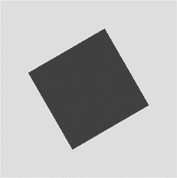

图 5.1 Ch05_RotateSquare 页面。

以下代码列表展示了 `Ch05_RotateSquare` 应用程序的代码。如前例所示，顶点着色器和片段着色器代码被合并到一个名为 `shaderCode` 的字符串中。

```
const shaderCode = `
@group(0) @binding(0) var<uniform> rotMat: mat4x4f;
@vertex
fn vertexMain(@location(0) coords: vec2f) -> @builtin(position) vec4f {    
    return rotMat * vec4f(coords, 0.0, 1.0);
}
@fragment
fn fragmentMain() -> @location(0) vec4f {
    return vec4f(0.2, 0.2, 1.0, 1.0);
}
`;
// Create top-level asynchronous function
async function runExample() {
// Check if WebGPU is supported
if (!navigator.gpu) {
    throw new Error("WebGPU not supported");
}
// Access the GPUAdapter
const adapter = await navigator.gpu.requestAdapter();
if (!adapter) {
    throw new Error("No GPUAdapter found");
}
// Access the GPU
const device = await adapter.requestDevice();
if (!device) {
    throw new Error("Failed to create a GPUDevice");
}
// Access the canvas
const canvas = document.getElementById("canvas_example");
if (!canvas) {
    throw new Error("Could not access canvas in page");
}
// Obtain a WebGPU context for the canvas
const context = canvas.getContext("webgpu");
if (!context) {
    throw new Error("Could not obtain WebGPU context for canvas");
}
// Configure the context with the device and format
const canvasFormat = navigator.gpu.getPreferredCanvasFormat();
context.configure({
    device: device,
    format: canvasFormat,
});
// Create the command encoder
const encoder = device.createCommandEncoder();
if (!encoder) {
    throw new Error("Failed to create a GPUCommandEncoder");
}
// Create the render pass encoder
const renderPass = encoder.beginRenderPass({
    colorAttachments: [{
        view: context.getCurrentTexture().createView(),
        loadOp: "clear",
        clearValue: { r: 0.9, g: 0.9, b: 0.9, a: 1.0 },
        storeOp: "store"
    }]
});
// Define vertex data
const vertexData = new Float32Array([
    -0.5, -0.5,    // First vertex
    0.5, -0.5,     // Second vertex
    -0.5, 0.5,    // Third vertex
    0.5, 0.5,     // Fourth vertex
]);
// Create vertex buffer
const vertexBuffer = device.createBuffer({
    label: "Vertex Buffer 0",
    size: vertexData.byteLength,
    usage: GPUBufferUsage.VERTEX | GPUBufferUsage.COPY_DST
});
device.queue.writeBuffer(vertexBuffer, 0, vertexData);
renderPass.setVertexBuffer(0, vertexBuffer);
// Define layout of vertex buffer
const bufferLayout = {
    arrayStride: 8,
    attributes: [
       { format: "float32x2", offset: 0, shaderLocation: 0 }
    ],
};
// Define uniform data
const uniformData = new Float32Array([
   0.866, 0.5, 0.0, 0.0,    // First column of matrix
   -0.5, 0.866, 0.0, 0.0,   // Second column of matrix
   0.0, 0.0, 1.0, 0.0,      // Third column of matrix
   0.0, 0.0, 0.0, 1.0,      // Fourth column of matrix
]);
// Create uniform buffer
const uniformBuffer = device.createBuffer({
    label: "Uniform Buffer 0",
    size: uniformData.byteLength,
    usage: GPUBufferUsage.UNIFORM | GPUBufferUsage.COPY_DST});
device.queue.writeBuffer(uniformBuffer, 0, uniformData); 
// Create the shader module
const shaderModule = device.createShaderModule({
    label: "Shader module 0",
    code: shaderCode
});
// Define the rendering procedure
const renderPipeline = device.createRenderPipeline({
    layout: "auto",
    vertex: {
      module: shaderModule,
      entryPoint: "vertexMain",
      buffers: [bufferLayout]
    },
    fragment: {
      module: shaderModule,
      entryPoint: "fragmentMain",
      targets: [{
        format: canvasFormat
      }]
    },
    primitive: {
        topology: "triangle-strip"
    }
});
renderPass.setPipeline(renderPipeline);
// Access the bind group layout
const bindGroupLayout = renderPipeline.getBindGroupLayout(0);
// Create the bind group
let bindGroup = device.createBindGroup({
    layout: bindGroupLayout,
    entries: [{
        binding: 0,
        resource: { buffer: uniformBuffer }
    }]
});
// Associate bind group with render pass encoder
renderPass.setBindGroup(0, bindGroup);
// Draw vertices and complete rendering
renderPass.draw(4);
renderPass.end();
// Submit the render commands to the GPU
device.queue.submit([encoder.finish()]);
}
// Run example function
runExample();
```

在浏览这段代码时，重要的是要看到顶点缓冲区和 uniform 缓冲区如何协同工作。顶点缓冲区为每个顶点提供不同的坐标，而 uniform 缓冲区包含一个在顶点之间保持不变的 4×4 矩阵。将矩阵与顶点坐标相乘会产生一组新的坐标，它们是原始坐标的旋转版本。

## 存储缓冲区

在离开 uniform 缓冲区主题之前，我想指出它们有一个主要缺点：它们只能包含有限量的数据。你可以通过访问 `GPUAdapter` 对象提供的 `maxUniformBufferBindingSize` 限制来检查这一点。

```
// Check the maximum size of uniforms
const maxSize = adapter.limits.maxUniformBufferBindingSize;
```

在我的系统上，uniform 缓冲区的最大大小为 65,536 字节，因此如果需要传输超过该量的 uniform 数据，你需要创建多个 uniform 缓冲区。或者，你可以创建一个 *存储缓冲区*。在我的系统上，存储缓冲区的最大大小为 2,147,483,644 字节。

在代码中，使用存储缓冲区与使用 uniform 缓冲区类似，但有三个主要区别：
1. 创建缓冲区时，`GPUBufferUsage.UNIFORM` 标志必须更改为 `GPUBufferUsage.STORAGE`。
2. 创建绑定组布局时，缓冲区属性的类型属性应设置为 `storage` 或 `read-only-storage`。
3. 在着色器中访问缓冲区时，uniform 模板应更改为 `storage`。

为了阐明第三点，以下代码声明了一个矩阵变量，其数据从存储缓冲区读取：

```
// Declare a variable that accesses a storage buffer
@group(0) @binding(0) var<storage> mat: mat4x4f;
```

默认情况下，存储缓冲区是只读的，就像 uniform 缓冲区一样。然而，存储缓冲区也可以创建为读写访问。在这种情况下，着色器的变量声明应具有更新的模板类型：

```
@group(0) @binding(0) var<storage, read_write> mat: mat4x4f;
```

使用存储缓冲区的缺点是性能。如果你的应用程序需要重复更新数据，使用 uniform 缓冲区比使用存储缓冲区更好。


根据我的观察，存储缓冲区在图形应用程序中很少使用。但在计算应用程序中，它们经常用于在 GPU 之间传输数据。从第 8 章开始，着色器将主要依赖存储缓冲区来读取和写入数据。

## 线性变换

在 Ch05_RotateSquare 项目中，应用程序创建了一个 4×4 矩阵，可用于变换对象的顶点。三种最重要的变换被称为 *线性变换*：

* 缩放—增大或减小对象的大小
* 平移—沿指定方向移动对象指定的距离
* 旋转—围绕轴旋转对象指定的弧度/度数

这些变换是通过将对象的顶点坐标乘以矩阵来执行的。当我第一次撰写本章初稿时，我解释了如何手动创建这些矩阵。但在现实世界中，开发人员通过调用库中的函数来生成矩阵。

截至本文撰写时，WebGPU 最流行的矩阵工具集是 `wgpu-matrix`。本节首先解释如何访问该包，然后展示其函数如何用于创建线性变换的矩阵。

### wgpu-matrix 库

Gregg Tavares 在 MIT 许可证下提供了他的快速 3D 数学库 `wgpu-matrix`，该许可证允许开源和专有项目使用它。该项目的 Github 地址为 [`github.com/greggman/wgpu-matrix`](https://github.com/greggman/wgpu-matrix)。

`wgpu-matrix` 库提供了表示图形中使用的数学实体的數據结构。存在表示向量的类型（`vec2`、`vec3` 和 `vec4`）以及表示矩阵的类型（`mat3` 和 `mat4`）。在本書中，我們主要關注創建 `mat4` 實例，因此 JavaScript 文件以以下語句開頭：

```
import { mat4 } from 'https://wgpu-matrix.org/dist/2.x/wgpu-matrix.module.js';
```

如果在大多数浏览器中执行此语句，将会导致与跨源资源共享（CORS）相关的安全问题。这意味着你不能简单地在浏览器中打开项目的 `index.html` 并期望代码正常工作。

相反，你可以启动一个提供 `index.html` 的本地服务器。这可以使用 Node.js 提供的 `http-server` 实用程序或 Python 的 `http.server` 来实现。附录 A 讨论了 Node.js 平台并解释了如何安装 `http-server`。

`mat4` 对象提供了多个创建矩阵并执行矩阵运算的方法。表 5.1 列出了其中十个并提供了每个的描述。

表 5.1 `wgpu-matrix` 中 `mat4` 函数（节选）

| 方法 | 描述 |
| --- | --- |
| `uniformScaling(num)` | 返回一个按给定数字缩放顶点的矩阵 |
| `scaling(vec3)` | 返回一个按向量中的值缩放顶点的矩阵 |
| `translation(vec3)` | 返回一个按向量中的值平移顶点的矩阵 |
| `rotationX(angle)` | 创建一个按给定角度围绕 x 轴旋转顶点的矩阵 |
| `rotationY(angle)` | 创建一个按给定角度围绕 y 轴旋转顶点的矩阵 |
| `rotationZ(angle)` | 创建一个按给定角度围绕 z 轴旋转顶点的矩阵 |
| `mul(mat4, mat4)` | 返回两个矩阵相乘的乘积 |
| `lookAt(vec3, vec3, vec3)` | 返回给定视图参数的矩阵 |
| `ortho(left, right, bottom, top, near, far)` | 返回执行给定正交投影的矩阵 |
| `frustum(left, right, bottom, top, near, far)` | 返回将视区变换为给定视锥体的矩阵 |
| `perspective(fov, aspect, znear, zfar)` | 返回透视矩阵 |

这些方法不使用第 4 章中讨论的 WGSL 矩阵类型生成矩阵。默认情况下，每个方法都返回一个包含十六个浮点值的 `Float32Array`。如前所述，这些可以存储在 uniform 缓冲区中，并由着色器作为矩阵访问。

本节介绍表格中的前七种方法，它们创建的矩阵使线性变换成为可能。后文将讨论表格中的最后三种方法。

### 缩放

在三种线性变换中，缩放是最简单的。当缩放变换应用于以原点为中心的物体时，只有物体的大小会发生变化：如果缩放因子大于一，物体就会变大。如果缩放因子小于一，物体就会缩小。在图 5.2 中，缩放因子设置为 0.5，因此以原点为中心的物体的大小减半。

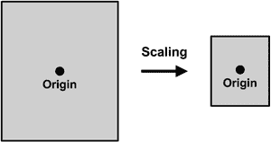

图 5.2 缩放变换。

如果物体不是以原点为中心，缩放将改变物体的位置以及其大小。缩小物体将更靠近原点，而变大物体将远离原点。

`wgpu-matrix` 库使能够在每个维度上均匀缩放物体或对每个维度进行不同缩放。`mat4` 对象的 `uniformScaling` 方法接受一个缩放因子并生成一个均匀缩放物体的缩放矩阵。

例如，以下代码创建了一个 `Float32Array`，其中包含矩阵的值，该矩阵在与物体的顶点坐标相乘时会使物体的大小加倍：

```
// Create a uniform scaling matrix
const uniformMat = mat4.uniformScaling(2.0);
```

相比之下，`scaling` 函数接受一个 `vec3`，其值标识物体在 x、y 和 z 方向上应如何缩放。例如，以下代码创建了一个 `Float32Array`，其中包含矩阵的值，该矩阵在与物体的顶点坐标相乘时会使物体在 x 方向上的大小减半、在 y 方向上的大小增加三倍、在 z 方向上的大小加倍：

```
// Create a scaling matrix
const scaleMat = mat4.scaling([0.5, 3.0, 2.0]);
```

`mat4` 对象还具有 `getScaling` 方法，该方法接受一个矩阵并返回一个包含 x、y 和 z 方向缩放因子的向量。

### 平移

与缩放类似，平移很容易理解。当你平移一个物体时，你改变其位置但不改变其形状。数学上，平移是通过从物体的坐标中加减值来实现的：x 坐标一个值，y 坐标一个值，z 坐标一个值。

例如，假设你想将一个物体在 x 方向平移 5 个单位，在 y 方向平移 1 个单位。你可以通过将向量 (5, 1) 加到每个顶点的 x 和 y 坐标上来实现。这在图 5.3 中显示。

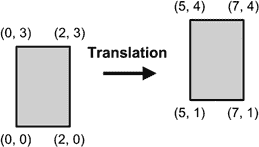

图 5.3 平移变换。

实际上，图形应用程序不会向向量添加值。相反，我们为平移创建一个变换矩阵，然后将该矩阵与物体的坐标向量相乘。在 `wgpu-matrix` 中，这可以通过调用 `translation` 方法并传入一个包含 x、y 和 z 方向平移量的向量来实现。以下代码展示了其工作原理：

```
// Create a translation matrix
const transMat = mat4.translation([-2.0, -1.0, 2.0]);
```

当它与物体的坐标向量相乘时，物体将在 −x 方向移动 2.0 个单位，在 −y 方向移动 1.0 个单位，在 z 方向移动 2.0 个单位。

### 旋转

旋转很容易理解，但数学变得复杂。本讨论假设旋转是围绕 x、y 或 z 轴以角度 θ 进行的。图 5.4 说明了一个以原点为中心的形状绕 z 轴顺时针旋转 30°。


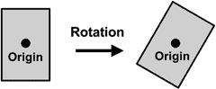

图 5.4 旋转变换。

## 旋转变换

`Ch05_RotateSquare` 项目中的代码通过创建旋转物体的矩阵来演示旋转。矩阵由以下代码定义：

```
 // Manually define a rotation matrix
 const uniformData = new Float32Array([
    0.866, 0.5, 0.0, 0.0,     // First column of matrix
    -0.5, 0.866, 0.0, 0.0,    // Second column of matrix
    0.0, 0.0, 1.0, 0.0,       // Third column of matrix
    0.0, 0.0, 0.0, 1.0,       // Fourth column of matrix
 ]);
```

与其手动设置每个值，不如调用 `wgpu-matrix` 的三个有用的方法：`rotationX`、`rotationY` 和 `rotationZ`。每个方法接受一个以弧度为单位的角度，并返回一个包含可执行旋转的矩阵值的 `Float32Array`。

例如，以下代码创建了一个绕 y 轴旋转物体 45 度的矩阵。

```
 // Create a rotation matrix
 const rotMat = mat4.rotationY(45.0 * Math.PI / 180.0);
```

与 `wgpu-matrix` 中的大多数方法一样，`rotationY` 需要以 *弧度* 为单位的角度值。如果角度以度为单位表示为 `deg`，则以弧度表示的度量 = `deg * pi / 180`。

### 合并变换

许多应用程序需要在物体上执行多个变换。与存储多个矩阵并执行多次矩阵-向量乘法相比，使用一个同时执行多个变换的矩阵更高效。幸运的是，合并矩阵变换的过程很简单——只需将矩阵相乘即可。

例如，假设一个应用程序需要先执行变换 A，然后执行变换 B。如果变换 A 由矩阵 A 表示，变换 B 由矩阵 B 表示，则组合矩阵 C 等于这两个矩阵的乘积，`B * A`。当着色器将 C 与顶点坐标相乘时，物体将经历变换 A，然后是变换 B。

顺序很重要。如果组合矩阵 C 设置为 `A * B`，则变换 B 将先执行，变换 A 将后执行。

如果矩阵存储在 `Float32Arrays` 中，可以通过调用 `wgpu-matrix` 库的 `mul` 方法来合并它们。它接受两个包含矩阵值的数组，并返回第三个数组，其中包含乘积矩阵的值。为了演示这一点，以下代码创建了一个平移矩阵和一个旋转矩阵，并将两者相乘以生成执行平移和旋转的矩阵：

```
 // Multiply two transformations
 const transMat = mat4.translation([-2.0, -1.0, 2.0]);
 const rotMat = mat4.rotationY(45 * Math.PI / 180);
 const combinedMat = mat4.mul(transMat, rotMat);
```

如果着色器将 `combinedMat` 与物体的顶点相乘，物体将 *首先* 旋转，*其次* 平移。

## 模型、视图和透视变换

当你编写 2D 应用程序时，你只需要了解缩放、平移和旋转变换。但如果你想在三维中渲染物体，顶点变换会变得更复杂。你需要考虑观察者的位置和方向，以及包含模型的三维体积的形状。

为了考虑这些因素，需要额外的变换，这意味着生成新的变换矩阵。但在讨论这些矩阵之前，了解渲染过程中使用的不同坐标系很重要。

### 坐标系

现代 3D 应用程序在绘制物体之前会多次变换物体的顶点。为了跟踪不同的变换，开发人员使用特定术语来指代每个阶段的坐标。最常见的术语如下：

1. 物体坐标——相对于物体原点给出的初始坐标
2. 世界坐标——物体放置在渲染体积（世界）后，相对于体积原点的坐标
3. 眼坐标——在设置观察者的位置和方向后物体的坐标
4. 裁剪坐标——在定义视区后物体的最终坐标

例如，如果你从像 [thingiverse.com](http://thingiverse.com) 这样的网站下载 3D 物体的设计，物体的坐标将相对于局部原点给出，例如物体的中心。恰当地说，这些被称为 *物体坐标*。

要将此物体放置到你的场景中，你需要执行线性变换（缩放、平移和旋转）。物体得到的坐标是其 *世界坐标*。

当你玩现代 3D 游戏时，你可以调整视点（也称为 *摄像机*）以更好地观察环境。为了以编程方式实现这一点，应用程序需要根据观察者的位置变换每个物体。得到的坐标称为 *眼坐标*，因为它们取决于场景的观看方式。

在绘制任何物体之前，应用程序需要定义要显示的整体视区。视区外的任何形状将被移除，或 *裁剪*，因此该区域称为 *裁剪空间*，得到的坐标称为 *裁剪坐标*。

作为渲染过程的一部分，顶点着色器需要将物体坐标转换为裁剪坐标。这至少需要三个变换：

* *模型变换*——将物体坐标转换为世界坐标
* *视图变换*——将世界坐标转换为眼坐标
* *投影变换*——将眼坐标转换为裁剪坐标

本讨论的其余部分介绍了模型、视图和投影变换。如果观察者的位置不变，它们可以合并为一个变换矩阵并传递给顶点着色器。

### 模型变换

模型变换很容易处理。它们由设置物体初始位置和方向所需的平移、旋转和缩放操作组成。例如，如果物体的新原点应为 (−5.0, −4.0, −3.0)，则变换将是一个简单的平移，将 (−5.0, −4.0, −3.0) 加到模型的每个顶点上。执行模型变换的矩阵称为 *模型矩阵*。

有一个重要点需要注意。根据惯例，进入渲染体积的方向被指定为 *负 z 方向*。因此，如果物体 A 的原点移动到 (0, 0, −5)，物体 B 的原点移动到 (0, 0, −10)，物体 B 看起来会比物体 A 更远。

### 视图变换

在模型中的物体放置到其位置后，下一步是定义模型的观看方式。这是通过 *视图变换* 实现的，它将每个顶点的世界坐标转换为眼坐标。在数学上，这由一个称为 *视图矩阵* 的矩阵表示。

`wgpu-matrix` 库提供了一种生成视图矩阵的特殊方法。它称为 `lookAt`，并接受三个必需值：

* `eye`——包含观察者位置坐标的向量
* `target`——包含观察者注视位置坐标的向量
* `up`——包含被视为“上”方向分量的向量

一个示例将阐明如何使用 `lookAt`。假设观察者位于 (5.0, 4.0, 3.0) 并注视点 (0.0, 3.0, −3.0)。如果观察者的上方向是正 y 轴 (0.0, 1.0, 0.0)，以下代码将创建适当的视图矩阵：

```
 // Generate a view matrix
 const lookMat = mat4.lookAt([5.0, 4.0, 3.0], [0.0, 3.0, -3.0], [0.0, 1.0, 0.0]);
```


在许多应用中，视图矩阵保持不变，因为观察者的位置和方向不会改变。但在增强现实（AR）和虚拟现实（VR）应用中，视图矩阵经常发生变化，因为观察者头部每一次运动都会改变视角。

## 投影变换

在世界中定位物体并设置观察者的位置和方向后，下一步是定义包含模型的体积。这称为 *视口区域*，在大多数情况下，它会有以下两种形状之一：

* 一个长方体，其相对面具有相同的尺寸
* 一个前端面小于后端面的体积。这称为 *截锥体*。

视口区域的形状决定了物体的显示方式。图 5.5 显示了这两种视口区域的样子。

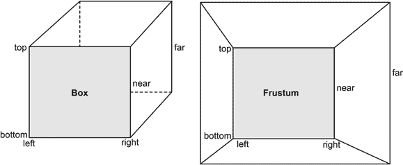

图 5.5 视口区域。

两种区域的主要区别在于深度感知。如果物体放置在类似盒子的体积中，它们的显示大小将保持不变，无论其位置如何。这是 CAD 程序的常见特性，而产生这种结果的变换称为 *正交投影*。

如果视口区域设置为截锥体，近处的物体将被显示得比远处的物体更大。换句话说，截锥体中的物体与现实世界中的物体相似。这是游戏和其他现实世界应用的常见特性，而产生这种结果的变换称为 *透视投影*。

本节介绍这两种投影变换，并介绍创建相应矩阵的 `wgpu-matrix` 方法。

### 正交投影

如果投影将物体放置到类似盒子的视口区域中，则称为 *正交投影*。这些投影易于理解，因为物体的大小与其在场景中的位置无关。

`wgpu-matrix` 中的 `ortho` 方法返回可用于正交投影的矩阵。它接受六个参数（`left`、`right`、`bottom`、`top`、`near` 和 `far`），其名称与 图 5.5 左侧盒子的尺寸相同。`left` 和 `right` 设置 x 方向的尺寸，`bottom` 和 `top` 设置 y 方向的尺寸，`near` 和 `far` 设置 z 方向的尺寸。

举例说明 `ortho` 的用法。假设盒子的前表面应距离原点 30 个单位，后表面应距离 40 个单位。水平和垂直边界应围绕观察者对称，且区域在水平方向上占据 50 个单位，在垂直方向上占据 30 个单位。以下代码为此正交投影创建投影矩阵：

// Create a matrix for orthographic projection
const orthoMat = 
    mat4.ortho(-25.0f, 25.0f, -15.0f, 15.0f, 30.0f, 40.0f)

此盒子外的顶点将被从模型中移除（裁剪）。例如，如果一个顶点的 x 坐标小于 −25.0 或大于 25.0，它将被裁剪。y 坐标小于 −15.0 或大于 15.0 的顶点也同样如此。

### 透视投影

在现实世界中，我们并不是正交地观看物体——它们在靠近我们时会显得更大，远离时会显得更小。例如，如果两个立方体大小相同但位置不同，更靠近观察者的那个看起来会更大。

这种现象称为 *透视*。*透视投影* 将物体变换为其位置远离观察者时显得更小。为了设置此投影，应用程序需要在截锥体形状的视口区域中放置物体。

应用程序可以通过调用 `mat4` 对象的 `frustum` 方法来定义截锥体的尺寸。它接受六个必需参数（`left`、`right`、`bottom`、`top`、`near` 和 `far`）来标识区域的边界。这些名称与前一图中显示的边界相同。

如果不手动设置这些边界，应用程序可以通过调用 `perspective` 方法来定义视口区域。它接受四个参数：

* `fov_y`——视场角（以弧度为单位）
* `aspect`——宽高比（宽度/高度）
* `zNear`——近裁剪平面的深度
* `zFar`——远裁剪平面的深度

第一个参数标识区域在 y 方向上的视场。这衡量视口区域占据观察者垂直视野范围的程度。图 5.6 显示了该角度与截锥体形状的关系。

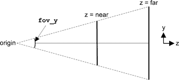

图 5.6 y 方向上的视场。

第二个参数标识区域水平尺寸与其垂直尺寸的比率。这就是区域的 *宽高比*。常见的宽高比是 4/3，因此通常设置为 1.33。

例如，假设您想创建一个在 y 方向上视场为 40° 且宽高比为 1.33 的视口区域。此外，只有当顶点的 z 值介于 −5.0 和 −15.0 之间时才应显示。在这种情况下，您可以使用以下代码创建透视投影的矩阵：

// Generate a matrix for perspective projection
const perspectiveMat = mat4.perspective(40.0 * Math.PI / 180.0, 1.33, 5.0, 15.0);

尽管最后两个参数为正值，但平面的坐标为负值。即近裁剪平面位于 z = −5，远裁剪平面位于 z = −15。

模型矩阵、视图矩阵和投影矩阵的乘积通常称为 *MVP 矩阵*。它将坐标从物体坐标变换为裁剪坐标。本章末尾讨论的 `Ch05_Cubes` 项目将演示如何计算它。

## 索引渲染

到目前为止，所有绘制操作都按顶点缓冲区中存储的顺序访问顶点。这对于简单形状来说是可以的，但在需要多次访问顶点时效率不高。与存储同一顶点的多个副本相比，使用 *索引渲染* 更好。

索引渲染将顶点缓冲区视为顶点数组，并使用索引值告诉渲染器如何访问顶点。这些索引必须提供在一个称为 *索引缓冲区* 的缓冲区中。例如，如果索引缓冲区包含 [0, 2, 3, 1]，渲染将访问第一个顶点（0），然后是第三个顶点（2），然后是第四个顶点（3），然后是第二个顶点（1）。如果索引缓冲区包含 [0, 1, 2, 3]，顶点将按其常规顺序绘制。

请记住，着色器不能直接访问索引缓冲区。它仅由渲染器用于访问顶点缓冲区中的数据。

通常，使用索引缓冲区的过程包括四个步骤：

1. 通过调用 `device.createBuffer` 创建索引缓冲区。
2. 通过调用队列的 `writeBuffer` 方法向索引缓冲区写入数据。
3. 通过调用编码器的 `setIndexBuffer` 方法将渲染通道编码器与索引缓冲区关联。
4. 通过调用渲染通道编码器的 `drawIndexed` 或 `drawIndirectIndexed` 方法执行索引渲染。

本节探讨每一步。然后介绍 *图元重启*，它定义了一个特殊的索引值，用于重启图元的组装。

### 创建索引缓冲区


### 创建索引缓冲区

创建索引缓冲区的过程几乎与创建顶点缓冲区或 uniform 缓冲区的过程相同。`device.createBuffer` 创建指定大小和类型的空缓冲区。对于索引缓冲区，usage 属性必须设置为 `GPUBufferUsage.INDEX`。以下代码创建了一个存储 128 字节的索引缓冲区。

```
const indexBuffer = device.createBuffer({
    label: "Index Buffer 0",
    size: 128,
    usage: GPUBufferUsage.INDEX | GPUBufferUsage.COPY_DST
});
```

如前所述，`GPUBufferUsage.COPY_DST` 标志是必需的，以确保数据可以复制到缓冲区中。

### 写入索引缓冲区的数据

一旦缓冲区创建完成，应用程序可以通过调用 `device.queue` 的 `writeBuffer` 方法来填充数据。它接受一个对象，其唯一必需的属性是 `buffer`、`data` 以及应写入数据的 `offset`。

为了展示其工作原理，以下代码将名为 `indexData` 的数组中的数据写入名为 `indexBuffer` 的缓冲区。写入操作从缓冲区的第 0 字节开始。

```
device.queue.writeBuffer(indexBuffer, 0, indexData);
```

默认情况下，`indexData` 中的所有数据都将被写入缓冲区。应用程序可以通过向 `writeBuffer` 添加两个参数来自定义此行为：标识要访问的数组的第一个字节的数据偏移量，以及从数组写入缓冲区的数据的大小。

### 将索引缓冲区与渲染通道编码器关联

为了确保索引缓冲区在渲染中使用，应用程序需要通知渲染通道编码器缓冲区的存在。这是通过调用渲染通道编码器的 `setIndexBuffer` 方法实现的。它接受四个参数：

1. `buffer`—要与编码器关联的 `GPUBuffer`
2. `indexFormat`—索引值的格式（`uint16` 或 `uint32`）
3. `offset`—可选的字节偏移量，从缓冲区开始访问数据
4. `size`—可选的从缓冲区读取的数据量

例如，假设 `indexBuffer` 是一个包含 16 位索引值的缓冲区。以下代码将其与渲染通道编码器关联。

```
renderPass.setIndexBuffer(indexBuffer, "uint16");
```

省略了可选属性，因此渲染器将从缓冲区的第 0 字节开始读取索引值。

### 执行索引渲染

在之前的应用程序中，绘制操作是通过调用渲染通道编码器的 `draw` 方法执行的。调用时，渲染操作会根据顶点在顶点缓冲区中存储的顺序访问顶点。

要执行索引渲染，应用程序需要告诉渲染器顶点应使用存储在索引缓冲区中的值进行访问。这是通过调用 `drawIndexed` 或 `drawIndirectIndexed` 实现的。`drawIndexed` 方法接受最多五个属性的对象：

* `indexCount`—绘制操作中要访问的索引数量
* `instanceCount`—（可选）要创建的实例（副本）数量
* `firstIndex`—（可选）从索引缓冲区读取的第一个值的索引
* `baseVertex`—（可选）为每个索引值添加偏移量
* `firstInstance`—（可选）标识要绘制的第一个实例

例如，`Ch05_Cubes` 项目绘制了三个立方体的副本，每个立方体需要 30 个索引值。因此，索引计数为 30，实例计数为 3。以下代码启动绘制操作。

```
renderPass.drawIndexed(30, 3);
```

默认情况下，三个实例都将具有相同的位置。因此，顶点着色器需要根据实例索引以不同的方式转换每个对象的顶点。稍后部分将展示如何实现这一点。

### 原语重启

在 `Ch05_RotateSquare` 项目中，顶点被组装成三角形条带，这意味着前三个顶点形成一个三角形，而每个后续顶点都与前两个顶点形成一个三角形。换句话说，第一个三角形由顶点 `v[0]`、`v[1]` 和 `v[2]` 创建，第二个三角形由顶点 `v[1]`、`v[2]` 和 `v[3]` 创建。

三角形条带在 3D 渲染中很受欢迎，但在绘制立方体时存在一个问题。绘制完立方体的一个面后，很难轻松地在垂直面上绘制三角形。一个解决方案是为每个面执行单独的 `draw` 操作。然后一个面上的三角形将始终与另一个面上的三角形不同。

另一种方法是插入重复的顶点，使面之间的三角形面积为零。这些被称为 *degenerate triangles*，这种方法通常比多次调用 `draw` 提供更好的性能。

WebGPU 支持第三种选项，称为 *primitive restart*。这使用一个特殊的索引值来告诉渲染器重新开始组装原语。当渲染器读取原语重启索引时，下一个顶点将被绘制为好像是第一个顶点，并且不会与之前的原语连接。

特殊索引值取决于每个索引值的位数。对于 16 位无符号整数，原语重启索引为 `0xffff`。对于 32 位无符号整数，原语重启索引为 `0xffffffff`。

以下代码创建了 `Ch05_Cubes` 应用程序中使用的索引值数组。如图所示，原语重启值在每四个索引后插入：

```
const indexData = new Uint16Array([
  0, 1, 3, 2, 0xffff,
  7, 6, 4, 5, 0xffff,
  11, 10, 8, 9, 0xffff,
  12, 13, 15, 14, 0xffff,
  19, 18, 16, 17, 0xffff,
  20, 21, 23, 22, 0xffff
]);
```

绘制每个面后，`0xffff` 值告诉渲染器重新开始组装原语的过程。例如，从第二行（从索引 7 开始）顶点形成的原语不会与从第一行（从索引 0 开始）顶点形成的原语连接。

## 示例应用程序—绘制立方体

`Ch05_Cubes` 应用程序演示了如何在 WebGPU 上执行三维渲染。它创建了一个截锥形视区，并在其中绘制了三个立方体实例。图 5.7 显示了其外观。

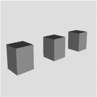

图 5.7 `Ch05_Cubes` 应用程序。

如前面讨论的 `Ch05_RotateSquare` 应用程序一样，此应用程序将矩阵数据存储在 `Float32Array` 中，并使用 uniform 缓冲区将其传递给着色器。但 `Ch05_Cubes` 应用程序有两个重要的特性使其不同：

1. 它使用 `wgpu-matrix` 创建视图矩阵和投影矩阵。
2. 它创建索引缓冲区以存储要绘制的顶点的索引。
3. 它使用索引渲染和实例化渲染绘制形状。

以下讨论探讨了这些项目并展示了它们在 `Ch05_Cubes` 应用程序中的实现方式。

### 顶点数据

在讨论应用程序的函数和着色器之前，我想展示顶点数据是如何结构的。立方体有六个面，每个面有四个顶点。每个顶点都有位置和颜色。图 5.8 显示了其外观。

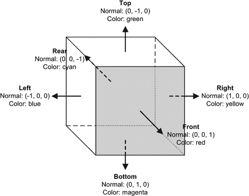

图 5.8 坐标和颜色。

在代码中，每个顶点需要六个浮点数：三个用于 (x, y, z) 坐标，三个用于 RGB 颜色分量。每个面有四个顶点，立方体有六个面，因此 `vertexData` 数组包含 6 * 4 * 6 = 144 个浮点数。为了明确这一点，以下代码定义了立方体左面的坐标和颜色：

```
const uniformData = new Float32Array([
  // Left face
  -1.0f, -1.0f, -1.0f,  0.0f,  0.0f,  0.8f, 
  -1.0f,  1.0f, -1.0f,  0.0f,  0.0f,  0.8f, 
  -1.0f,  1.0f,  1.0f,  0.0f,  0.0f,  0.8f, 
  -1.0f, -1.0f,  1.0f,  0.0f,  0.0f,  0.8f,
  …
```


每行包含一个顶点的三个坐标（12 字节），随后是其三个 RGB 颜色分量（12 字节），每个顶点总共 24 字节。缓冲区的布局定义如下：

```
const bufferLayout = {
    arrayStride: 24,
    attributes: [
       { format: "float32x3", offset: 0, shaderLocation: 0 }, 
       { format: "float32x3", offset: 12, shaderLocation: 1 }
    ],
};
```

因此，通过此代码，`vertex shader` 可以在 `Location 0` 处访问顶点坐标（一个 `vec3f`）以及在 `Location 1` 处的颜色（另一个 `vec3f`）。颜色数据必须通过适当的结构传递给 `fragment shader`。

必须理解，顶点 *不是* 按照在 `vertexData` 数组中存储的顺序绘制的。应用程序使用实例化渲染，因此渲染器将通过索引访问顶点，而索引值存储在 `index buffer` 中。

## 变换矩阵

为了设置模型顶点的[content]
每行包含一个顶点的三个坐标（12 字节），随后是其三个 RGB 颜色分量（12 字节），每个顶点总共 24 字节。缓冲区的布局定义如下：

```
const bufferLayout = {
    arrayStride: 24,
    attributes: [
       { format: "float32x3", offset: 0, shaderLocation: 0 }, 
       { format: "float32x3", offset: 12, shaderLocation: 1 }
    ],
};
```

因此，通过此代码，`vertex shader` 可以在 `Location 0` 处访问顶点坐标（一个 `vec3f`）以及在 `Location 1` 处的颜色（另一个 `vec3f`）。颜色数据必须通过适当的结构传递给 `fragment shader`。

必须理解，顶点 *不是* 按照在 `vertexData` 数组中存储的顺序绘制的。应用程序使用实例化渲染，因此渲染器将通过索引访问顶点，而索引值存储在 `index buffer` 中。

## 变换矩阵

为了设置模型顶点的[content]
每行包含一个顶点的三个坐标（12 字节），随后是其三个 RGB 颜色分量（12 字节），每个顶点总共 24 字节。缓冲区的布局定义如下：

```
const bufferLayout = {
    arrayStride: 24,
    attributes: [
       { format: "float32x3", offset: 0, shaderLocation: 0 }, 
       { format: "float32x3", offset: 12, shaderLocation: 1 }
    ],
};
```

因此，通过此代码，`vertex shader` 可以在 `Location 0` 处访问顶点坐标（一个 `vec3f`）以及在 `Location 1` 处的颜色（另一个 `vec3f`）。颜色数据必须通过适当的结构传递给 `fragment shader`。

必须理解，顶点 *不是* 按照在 `vertexData` 数组中存储的顺序绘制的。应用程序使用实例化渲染，因此渲染器将通过索引访问顶点，而索引值存储在 `index buffer` 中。

## 变换矩阵

为了设置模型顶点的[content]
每行包含一个顶点的三个坐标（12 字节），随后是其三个 RGB 颜色分量（12 字节），每个顶点总共 24 字节。缓冲区的布局定义如下：

```
const bufferLayout = {
    arrayStride: 24,
    attributes: [
       { format: "float32x3", offset: 0, shaderLocation: 0 }, 
       { format: "float32x3", offset: 12, shaderLocation: 1 }
    ],
};
```

因此，通过此代码，`vertex shader` 可以在 `Location 0` 处访问顶点坐标（一个 `vec3f`）以及在 `Location 1` 处的颜色（另一个 `vec3f`）。颜色数据必须通过适当的结构传递给 `fragment shader`。

必须理解，顶点 *不是* 按照在 `vertexData` 数组中存储的顺序绘制的。应用程序使用实例化渲染，因此渲染器将通过索引访问顶点，而索引值存储在 `index buffer` 中。

## 变换矩阵

为了设置模型顶点的[content]
每行包含一个顶点的三个坐标（12 字节），随后是其三个 RGB 颜色分量（12 字节），每个顶点总共 24 字节。缓冲区的布局定义如下：

```
const bufferLayout = {
    arrayStride: 24,
    attributes: [
       { format: "float32x3", offset: 0, shaderLocation: 0 }, 
       { format: "float32x3", offset: 12, shaderLocation: 1 }
    ],
};
```

因此，通过此代码，`vertex shader` 可以在 `Location 0` 处访问顶点坐标（一个 `vec3f`）以及在 `Location 1` 处的颜色（另一个 `vec3f`）。颜色数据必须通过适当的结构传递给 `fragment shader`。

必须理解，顶点 *不是* 按照在 `vertexData` 数组中存储的顺序绘制的。应用程序使用实例化渲染，因此渲染器将通过索引访问顶点，而索引值存储在 `index buffer` 中。

## 变换矩阵

为了设置模型顶点的[content]
每行包含一个顶点的三个坐标（12 字节），随后是其三个 RGB 颜色分量（12 字节），每个顶点总共 24 字节。缓冲区的布局定义如下：

```
const bufferLayout = {
    arrayStride: 24,
    attributes: [
       { format: "float32x3", offset: 0, shaderLocation: 0 }, 
       { format: "float32x3", offset: 12, shaderLocation: 1 }
    ],
};
```

因此，通过此代码，`vertex shader` 可以在 `Location 0` 处访问顶点坐标（一个 `vec3f`）以及在 `Location 1` 处的颜色（另一个 `vec3f`）。颜色数据必须通过适当的结构传递给 `fragment shader`。

必须理解，顶点 *不是* 按照在 `vertexData` 数组中存储的顺序绘制的。应用程序使用实例化渲染，因此渲染器将通过索引访问顶点，而索引值存储在 `index buffer` 中。

## 变换矩阵

为了设置模型顶点的[content]
每行包含一个顶点的三个坐标（12 字节），随后是其三个 RGB 颜色分量（12 字节），每个顶点总共 24 字节。缓冲区的布局定义如下：

```
const bufferLayout = {
    arrayStride: 24,
    attributes: [
       { format: "float32x3", offset: 0, shaderLocation: 0 }, 
       { format: "float32x3", offset: 12, shaderLocation: 1 }
    ],
};
```

因此，通过此代码，`vertex shader` 可以在 `Location 0` 处访问顶点坐标（一个 `vec3f`）以及在 `Location 1` 处的颜色（另一个 `vec3f`）。颜色数据必须通过适当的结构传递给 `fragment shader`。

必须理解，顶点 *不是* 按照在 `vertexData` 数组中存储的顺序绘制的。应用程序使用实例化渲染，因此渲染器将通过索引访问顶点，而索引值存储在 `index buffer` 中。

## 变换矩阵

为了设置模型顶点的位置，`Ch05_Cubes` 应用程序执行三次变换——一次将顶点放置在其期望位置，一次放置观察者，一次定义整体观察区域。图 5.9 说明了观察区域并展示了立方体和观察者在其中的位置。

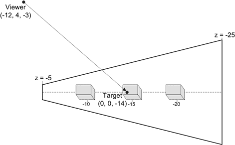

图 5.9 查看区域中的立方体。

为了得到此结果，应用程序创建了三个矩阵：`model matrix`、`view matrix` 和 `projection matrix`。前面的一节解释了这些矩阵的用途。下面的讨论展示了这些矩阵在 `Ch05_Cubes` 项目中的生成方式。

### 模型矩阵

`model matrix` 是三个矩阵中最简单的。如 图 5.9 所示，第一个立方体应放置使其中心位于 (0, 0, −10)。在对象坐标中，立方体的中心是 (0, 0, 0)，因此 `model matrix` 需要将其顶点沿 −z 方向平移十个单位。

这可以通过 `wgpu-matrix` 库的 `translation` 方法实现。在下面的代码中，`translation` 返回一个 4×4 矩阵，将顶点沿 −z 方向平移十个单位。

```
const modelMat = mat4.translation([0.0, 0.0, -10.0]);
```

因此，通过此代码，平移矩阵的值存储在名为 `modelMat` 的 `Float32Array` 中。

### 视图矩阵

如 图 5.9 所示，观察者放置在 (12, 4, −3) 并定向以观察点 (0, 0, −14)。观察者的正垂直方向应设为 (0, 1, 0)。

`view matrix` 设置观察者的位置和观察方向。在 `Ch05_Cubes` 应用程序中，这是通过 `wgpu-matrix` 提供的 `lookAt` 方法创建的：

```
const viewMat = mat4.lookAt([12.0, 4.0, -3.0], [0.0, 0.0, -14.0], [0.0, 1.0, 0.0]);
```

此矩阵的元素存储在 `viewMat` 中。`vertex shader` 将在乘以 `model matrix` `modelMat` 之后，用此矩阵乘以顶点坐标。

### 投影矩阵

应用程序创建其观察区域，使远离原点的物体显示得比靠近原点的物体更小。这需要创建 图 5.9 中描绘的截锥形观察区域。

将顶点放置在此观察区域内的矩阵称为 `projection matrix`。`Ch05_Cubes` 应用程序通过调用 `wgpu-matrix` 包的 `perspective` 方法生成此矩阵的元素。

```
const projMat = 
    mat4.perspective(30.0 * Math.PI / 180.0, 1.33, 5.0, 25.0);
```

第一个参数定义 y 方向上的视场。在此情况下，垂直视场应设为 ±15°，因此总视场为 30°。通过乘以 `pi` 并除以 180 将其转换为弧度。

第二个参数标识区域宽度与其高度的比率。此纵横比通常设为 4:3，因此参数设为 1.33。

第三和第四个参数定义在 z 方向上限制观察区域的平面。尽管参数值为正，但平面的实际坐标为负。即，近裁剪平面位于 z = −5，远裁剪平面位于 z = −25。

许多应用程序将 `model`、`view` 和 `projection` 矩阵相乘以获得执行全部三次变换的单个矩阵。然而，`Ch05_Cubes` 项目创建了立方体的多个实例，这些实例需要不同的视图矩阵。因此，`vertex shader` 需要分别乘以这些矩阵。

## 顶点和片段着色器

在定义了 `model`、`view` 和 `projection` 矩阵之后，`Ch05_Cubes` 使用前面讨论的方法将三个矩阵插入统一缓冲区。即，它调用 `device.createBuffer` 创建缓冲区并调用 `queue.writeBuffer` 将矩阵数据写入缓冲区。

在创建统一缓冲区后，需要两个绑定步骤。应用程序通过使用 `device.createBindGroup` 创建绑定组将缓冲区绑定到值。然后它通过调用 `renderPass.setBindGroup` 将绑定组与值关联。

执行这些步骤后，着色器可以通过缓冲区的绑定值和组的 value 访问统一缓冲区。在 `Ch05_Cubes` 应用程序中，`vertex shader` 执行六个操作：

1. 通过类型为 `MVP_Matrices` 的结构访问统一缓冲区。此结构包含 `model matrix`、`view matrix` 和 `projection matrix`。
2. 将每个顶点乘以 `model matrix`。这将每个顶点的对象坐标转换为世界坐标。
3. 将第二个实例中的顶点沿 −z 方向平移 5 个单位，将第三个实例中的顶点沿 −z 方向平移 10 个单位。
4. 将每个顶点乘以 `view matrix`。这将世界坐标转换为眼坐标。
5. 确定从顶点到观察者位置的向量。`fragment shader` 将使用它来计算周围光的镜面分量。
6. 将每个顶点乘以 `projection matrix`。这将眼坐标转换为裁剪坐标。

在最后一步之后，`vertex shader` 设置输出数据结构中的字段。第一个字段标识顶点的裁剪坐标，第二个字段标识期望的颜色。这在下面的代码列表中显示，其中展示了 `Ch05_Cubes` 项目的着色器代码。

```
struct MVP_Matrices {
    modelMatrix : mat4x4f,
    viewMatrix : mat4x4f,
    projectionMatrix : mat4x4f
}
@group(0) @binding(0) var<uniform> mats: MVP_Matrices;
struct DataStruct {
    @builtin(position) pos: vec4f,
    @location(0) colors: vec3f
}
@vertex
fn vertexMain(@location(0) coords: vec3f, @location(1) colors: vec3f, @builtin(instance_index) instance: u32) -> DataStruct {
    var outData: DataStruct;
    /* Apply the model transformation */
    var world_coords = mats.modelMatrix * vec4f(coords, 1.0);
    
    /* Translate the second and third instances */
    world_coords.z = world_coords.z - f32(instance) * 5.0;
    
    /* Apply the view transformation */
    var eye_coords = mats.viewMatrix * world_coords;
    
    /* Apply the projection transformation */
    var clip_coords = mats.projectionMatrix * eye_coords;
    
    /* Create output structure */
    outData.pos = clip_coords;
    outData.colors = colors;
    return outData;
}
@fragment
fn fragmentMain(fragData: DataStruct) -> @location(0) vec4f {
    return vec4f(fragData.colors, 1.0);
}
```

在此情况下，`fragment shader` 只是读取传入结构中的 `colors` 字段并用它设置片段颜色。在下一章中，`fragment shader` 会得到更多关注。

## 创建渲染管线


Aside from the shaders and the uniform/vertex buffers, most of the code in the `Ch05_Cubes` project is like the code in previous projects. But there's a major difference in the code that creates the render pipeline. This is given as follows:

```
const renderPipeline = device.createRenderPipeline({
    layout: "auto",
    vertex: {
      module: shaderModule,
      entryPoint: "vertexMain",
      buffers: [bufferLayout]
    },
    fragment: {
      module: shaderModule,
      entryPoint: "fragmentMain",
      targets: [{
        format: canvasFormat
      }]
    },
    primitive: {
        topology: "triangle-strip",
        stripIndexFormat: "uint16",
        frontFace: "cw",
        cullMode: "back"
    }
});
```

In this code, the `primitive` property is different than in previous examples. The `stripIndexFormat` identifies the format of the values in the index buffer. This can be set to `uint16` for 16-bit values and `uint32` for 32-bit values.

The `frontFace` and `cullMode` properties relate to *culling*—removing triangles depending on which way they're facing. For example, if you want to display a teapot in a scene, you only want the triangles facing the viewer to be rendered. The triangles in the rear can be omitted, or *culled*, from the scene.

To configure culling, two steps must be performed:
1. Use the `frontFace` property to identify front-facing triangles. If this is set to `cw`, a triangle will be considered front-facing if its vertices are oriented clockwise. If this is set to `ccw`, a triangle will be considered front-facing if its vertices are oriented counter-clockwise.
2. Use the `cullMode` property to select triangles to be culled. If this is set to `back`, back-facing triangles will be culled. If this is set to `front`, front-facing triangles will be culled. If this is set to `none` (the default value), no triangles will be culled.

If configured correctly, culling can dramatically improve rendering performance. But it's important to make sure that the vertices used to create triangles are arranged in a consistent clockwise or counter-clockwise manner.

In the `Ch05_Cubes` application, `frontFace` is set to `cw`, which means clock-wise triangles will be treated as facing forward. The `cullMode` property is set to `back`, which means back-facing triangles will be culled.

## Launching the Draw Operation

The `Ch05_Cubes` code takes advantage of indexed rendering and instanced rendering. This is accomplished with the following line of code:

```
renderPass.drawIndexed(30, 3);
```

Because the `drawIndexed` method is used, the renderer will read vertices using values in an index buffer. To be precise, it will read 30 values from the index buffer and use them to read 30 vertices from the vertex buffer.

The second argument of `drawIndexed` identifies how many copies, or *instances*, of each shape should be created. In this case, the renderer will draw three instances of the cube.

To separate the three copies, the vertex shader needs to know which instance each vertex belongs to. It accesses this information through the function's `@builtin(instance_index)` parameter, as shown in the following code:

```
fn vertexMain(
    @location(0) coords: vec3f, 
    @location(1) colors: vec3f, 
    @builtin(instance_index) instance: u32) -> DataStruct
```

The shader uses the `instance` parameter to update the z-values of different instances. To be specific, if the instance index is 1, the vertex coordinate's z-value is reduced by 5. If the instance index is 2, the z-value is reduced by 10. In this manner, the vertex shader separates the three copies along the z-axis.

## Summary

To create realistic three-dimensional scenes, developers need to be familiar with many different concepts and operations. A transformation is an operation that adjusts vertices by multiplying them by matrices. This chapter has focused on linear transformations, which include scaling, translation, and rotation.

In WebGPU applications, we can create transformation matrices by calling methods of the open-source `wgpu-matrix` package. In particular, the `mat4` object has several useful methods that provide matrix elements in `Float32Array`s. The `scaling` method creates scaling matrices, the `translation` method creates translation matrices, and the `rotation` method creates rotation matrices.

During rendering, transformation is performed by vertex shaders, which multiply vertex coordinates by transformation matrices. These matrices don't change from vertex to vertex, so they shouldn't be stored in vertex buffers. Instead, they're commonly passed to the GPU using uniform buffers, whose content remains constant from vertex to vertex. Creating a uniform buffer is essentially like creating a vertex buffer, but it needs to be added to a bind group, which needs to be described in a bind group layout.

The `Ch05_Cubes` application created three transformation matrices with `wgpu-matrix` and passes them to the GPU using uniform buffers. The `model` matrix sets the object's position, the `view` matrix accounts for the viewer's location, and the `projection` matrix creates the viewing region that displays objects with perspective. As a result, objects farther from the viewer appear smaller.

# 光照、纹理和深度 6

DOI: [10.1201/9781003422839-6](https://doi.org/10.1201/9781003422839-6)

Chapter 5 explained how transformations make it possible to position and orient objects in a viewing region. Transformations are important, but if you want to create realistic scenes in three dimensions, there are other issues to wrestle with. This chapter looks at three important topics in graphical rendering: lighting, textures, and depth.

Lighting refers to the process of changing an object's color depending on light sources in the scene. Objects far from a light source should be darker than objects near a light source, and shiny objects should reflect more light than dull objects. This chapter presents two models that mathematically determine how an object's color should be set: the Phong model and the Blinn–Phong model.

Like buffers, textures contain data that can be passed from the application to the GPU. The difference is that textures contain pixel data and are stored in special memory on the GPU. Using samplers, a fragment shader can read the pixel data and assign colors to fragments.

The last section of this chapter discusses two types of tests that fragment shaders can perform. A depth test checks a fragment's depth to see if it should be displayed in the scene or discarded. A stencil test compares values in a specially configured texture to reference values to determine how fragments should be processed.

## Lighting

To make a two-dimensional scene appear to have three dimensions, it isn't enough to place vertices in a rendering volume. To create the illusion of depth, objects need to reflect light differently based on their orientation relative to a light source.

Many models have been developed to determine how light reflects from an object's surface. This section looks at two popular models: the Phong model and the Blinn–Phong model. In both cases, the methodology contains three steps:
1. Decide on one or more light sources. Pass this information to shaders in uniform buffers.
2. For each vertex, find the vector perpendicular to the surface. This is called the normal vector. Pass the vector data to shaders as part of the vertex buffer.
3. Using light sources and normal vectors, the fragment shader sets the color of each fragment using the lighting model.

This discussion presents the mathematics underlying both models. Then it presents the code in the `Ch06_ShinySphere` project, which uses Blinn–Phong shading to illuminate a sphere.

### The Phong Model

In 1973, a Ph.D. dissertation by Bui Phong presented a method of simulating the reflection of light from a surface. This model treats light sources as point sources and splits each source into three components:


### Phong 光照模型

## Phong 模型

* 环境光——存在于所有点的背景照明
* 漫反射光——来自一个方向的照明
* 高光——来自一个方向的照明，尤其影响最接近光源的点

Phong 模型提出了一个公式，用于确定给定点的照明。总照明 `I = I[a] + I[d] + I[s]`，其中 `I[a]` 是光源的环境分量，`I[d]` 是漫反射分量，`I[s]` 是高光分量。`I[a]` 适用于每个点且相等，因此可以将其视为场景的基础光照。

为了计算 `I[d]`，片段着色器需要知道每个点的法线向量以及光线向量，即从光源到该点的向量。如果这两个向量方向相同，`I[d]` 将显著。如果它们垂直，`I[d]` 将为零。

使用向量数学，我们说 `I[d]` 与 `N · L` 成正比，其中 `N` 是法线向量，`L` 是光线向量。 图 6.1 显示了表面上点 `P` 的这些向量是什么样子的。

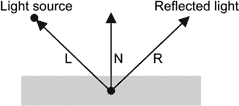

图 6.1 光线向量和法线向量。

计算高光分量 `I[s]` 很困难，因为它与物体有多 *有光泽* 有关。为了建立高光反射的表达式，Phong 提出了两个重要观察：

* 表面越有光泽，亮度越集中在反射率最大的点周围。
* 感知的光泽程度取决于观察者与反射光的角度。

考虑到这些观察，Phong 推导出高光照明的表达式：`I[s]` 与 `(V · R)^n` 成正比，其中 `V` 是从点到观察者的向量，`R` 是该点反射光的向量，`n` 是该点的表面反射率。

对于有光泽的表面，`n` 将很大，且 `I[s]` 将集中在 `V · R` 较高的点周围。 图 6.2 显示了这些向量的关系：

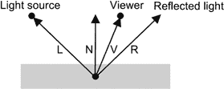

图 6.2 用于计算高光反射的向量（Phong 模型）。

图中的 `R` 向量是反射向量，其含义与 图 6.1 中的 `R` 向量相同。使用向量投影，`R` 可以用 `L` 和 `N` 表示：

`R = 2(N · L)N - L`

对三个光分量的表达式求和，Phong 模型给出了片段总照明的以下方程：

`I = k[a] + kd + ks^(n)`

在该方程中，`k[a]`、`k[d]` 和 `k[s]` 是标识环境、漫反射和高光照明基本强度的常数。它们不是数学推导出来的，但必须由开发者或艺术家选择以获得合适的光照属性。

## Blinn–Phong 模型

Phong 模型为真实世界光照提供了良好的近似，但它有两个显著缺点。首先，当 `V` 和 `R` 分离 90° 或更多时，该模型会产生不可接受的结果。其次，计算 `V · R` 的过程不必要地复杂。

为了解决这些问题，Jim Blinn 改变了高光分量 `I[s]` 的计算方式。在 Blinn–Phong 模型中，`I[s]` 等于 `(N · H)^(n')`，其中 `H` 是 `L` 和 `V` 之间的中间向量，`n'` 是表面反射率的新值。 图 6.3 说明了这些向量之间的关系。

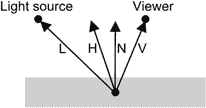

图 6.3 用于计算高光反射的向量（Blinn–Phong 模型）。

如图所示，`N` 和 `H` 比 `V` 和 `R` 更接近。为了确保高光分量接近 Phong 模型，许多应用会增加 `N · H` 的指数。因此，通常将 `n'` 设置为旧指数 `n` 的四倍。

用 `(N · H)^(n')` 替换 `(V · R)^n`，Blinn–Phong 模型产生以下照明方程：

`I = k[a] + kd + ks^(n')`

以下讨论展示了代码，演示片段着色器如何使用 Blinn–Phong 照明应用光照。

## 示例应用——绘制有光泽的球体

`Ch06_ShinySphere` 中的代码演示了如何在 WebGPU 中使用 Blinn–Phong 光照模型。它创建一个球体，为 `k[a]`、`k[d]` 和 `k[s]` 分配值，然后使用 Blinn–Phong 光照照亮视区。 图 6.4 显示了所得球体的外观。

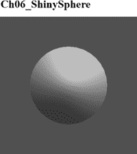

图 6.4 使用 Blinn–Phong 光照渲染球体。

在本节中，我将解释片段着色器如何接收光照参数并使用 Blinn–Phong 模型设置片段的颜色。但首先，我想解释球体是如何绘制的。

### 绘制球体

绘制球体的三角形不是一个简单的任务。所设计的方法中，最简单的方法是使用纬度和经度将球体分成若干部分。在 `Ch06_ShinySphere` 项目中，球体使用 16 条纬线（`NUM_LATITUDE`）垂直分割，使用 32 条经线（`NUM_LONGITUDE`）水平分割。 图 6.5 显示了其外观。

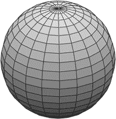

图 6.5 使用纬度和经度划分球体。

球体中顶点的数量很容易计算。顶部有一个顶点，底部有一个顶点，还有一个 `NUM_LATITUDE * NUM_LONGITUDE` 的顶点网格。因此，代码将 `NUM_VERTICES` 设置为 `NUM_LATITUDE * NUM_LONGITUDE + 2`。

为了渲染球体，我们需要找到纬度和经度相交点的 `(x, y, z)` 坐标。顶部点位于 `(0, 0, R)`，底部点位于 `(0, 0, -R)`，其中 `R` 是球体的半径。用 `φ` 表示纬度角，用 `θ` 表示经度角，其他点的坐标可以通过五个步骤计算：

1. 使用纬度确定弧度中的角度 `φ`。
2. 使用经度确定弧度中的角度 `θ`。
3. 将 `x` 设置为 `R cos θ sin φ`。
4. 将 `y` 设置为 `R sin θ sin φ`。
5. 将 `z` 设置为 `R cos φ`。

为了用三角形覆盖球体，应用程序需要多次访问每个顶点。与在顶点缓冲区中重复坐标相比，按索引访问顶点更有效。为了分配索引，示例代码将球体分割为称为 *切片* 的垂直区域。

球体对每条经线有一个切片，图 6.6 说明了具有四条纬线的球体的两个相邻切片。

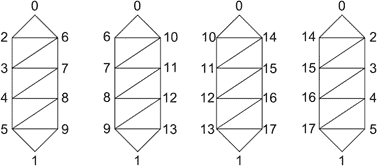

图 6.6 相邻切片的三角形。

如图所示，每个切片顶部有一个三角形，每个纬线（减 1）有一个四边形，底部有一个三角形。可能有一种方法可以以连接的方式绘制切片，但为了简单起见，我们将使每个切片不同。也就是说，一旦到达底部顶点，我们将添加一个图元重启值（`0xffff`）并从下一个切片的顶部开始。

现在我们可以确定需要多少个索引。第一个三角形需要三个，每个四边形需要两个，最后一个三角形需要一个，图元重启索引需要一个。求和后，每个切片需要 `2 * NUM_LATITUDE + 3` 个索引值。所需的总索引数为 `NUM_LONGITUDE * (2 * NUM_LATITUDE + 3) - 1` 个值（最后一个图元重启索引是不必要的）。


我们将索引 0 分配给顶部顶点，索引 1 分配给底部顶点。剩余的索引值从上到下、从左到右递增。例如，沿经度 0 的顶点范围从 2 到 `NUM_LATITUDE + 2`。

列表 6.1 展示了 `Ch06_ShinySphere` 应用程序中用于设置绘制球体所需的常量并遍历切片的代码。

```
// Define vertex data (coordinates and colors)
const RAD = 1.5;
const NUM_LATITUDE = 16;
const NUM_LONGITUDE = 32;
const NUM_VERTICES = NUM_LATITUDE * NUM_LONGITUDE + 2;
const NUM_INDICES = NUM_LONGITUDE * (2 * NUM_LATITUDE + 3);
const THETA_CONVERSION = (2.0 * Math.PI)/NUM_LONGITUDE;
const PHI_CONVERSION = Math.PI/(NUM_LATITUDE + 1);

// Set coordinates of top and bottom points
const vData = new Float32Array(3 * NUM_VERTICES);
vData[0] = 0.0; vData[1] = 0.0; vData[2] = RAD;
vData[3] = 0.0; vData[4] = 0.0; vData[5] = -1.0 * RAD;

// Create data arrays
const iData = new Uint16Array(NUM_INDICES);
// Iterate through slices
let ptIndex = 0; let vertIndex = 2;
let theta = 0.0; let phi = 0.0;
let rad_cos_theta = 0.0; let rad_sin_theta = 0.0;

for (let lon = 0; lon < NUM_LONGITUDE; lon++) {

    theta = lon * THETA_CONVERSION;
    rad_sin_theta = RAD * Math.sin(theta);
    rad_cos_theta = RAD * Math.cos(theta);

    // Add top vertex
    iData[ptIndex++] = 0;

    for (let lat = 1; lat <= NUM_LATITUDE; lat++) {

        // Set index values
        iData[ptIndex++] = vertIndex;
        iData[ptIndex++] = (vertIndex + NUM_LATITUDE) % (NUM_VERTICES - 2);

        // Compute phi
        phi = Math.PI/2.0 - lat * PHI_CONVERSION;

        // Set vertex values
        vData[3 * vertIndex] = rad_cos_theta * Math.cos(phi);
        vData[3 * vertIndex + 1] = rad_sin_theta * Math.cos(phi);
        vData[3 * vertIndex++ + 2] = RAD * Math.sin(phi);
    }

    // Add bottom vertex
    iData[ptIndex++] = 1;

    // Add primitive restart
    if(lon != NUM_LONGITUDE - 1) {
        iData[ptIndex++] = 0xffff;
    }
}
```

顶点坐标存储在 `vData` 数组中，索引值存储在 `iData` 数组中。`vData` 中的前几个元素是球体上顶点的坐标 (0, 0, R) 和底点的坐标 (0, 0, −R)。因此，顶点的索引为 0，底点的索引为 1。

在循环结束时，索引 `0xffff` 被添加到 `iData` 中。这是图元重启值，告诉渲染器下一个索引将开始一个新的形状（切片）。

### Uniform Data

`ch06_shinysphere.js` 中的代码创建了一个包含大量数据的单一 uniform 缓冲区。以下代码展示了 `uniformData` 数组是如何构造并传递给 GPU 进行处理的。

```
// Define transformation
const modelMat = mat4.translation([0.0, 0.0, -10.0]);
const projMat = mat4.perspective(30.0 * Math.PI / 180.0, 1.0, 5.0, 25.0);
const viewMat = mat4.identity();
const mvpMat = mat4.mul(mat4.mul(projMat, viewMat), modelMat);

// Set positions
const oldCenter = new Float32Array([0.0, 0.0, 0.0, 1.0]);
const centerPos = vec4.transformMat4(oldCenter, mvpMat);
const viewerPos = new Float32Array([0.0, 0.0, 0.0, 0.0]);
const lightPos = new Float32Array([5.0, 15.0, 9.0, 0.0]);

// Set light components
const ambient = new Float32Array([0.7, 0.7, 0.7, 0.0]);
const diffuse = new Float32Array([0.9, 0.9, 0.9, 0.0]);
const specular = new Float32Array([1.0, 1.0, 1.0]);
const shininess = new Float32Array([1.5]);

// Combine data into uniform buffer
const uniformData = Float32Array.of(...mvpMat, ...centerPos, ...viewerPos, ...lightPos, ...ambient, ...diffuse, ...specular, ...shininess);

// Create uniform buffer
const uniformBuffer = device.createBuffer({
    label: "Uniform Buffer 0",
    size: uniformData.byteLength,
    usage: GPUBufferUsage.UNIFORM | GPUBufferUsage.COPY_DST
});
device.queue.writeBuffer(uniformBuffer, 0, uniformData);
```

`uniformData` 中的第一个元素是定义球体变换的矩阵。它是通过将模型矩阵、视图矩阵和投影矩阵相乘得到的。因此，该矩阵被称为 MVP 矩阵，或 `mvpMat`。

接下来，`uniformData` 包含一系列用于设置空间中点的向量。`centerPos` 向量标识球体的变换后中心，它将被 `vertex shader` 用于确定每个点的法线向量。接下来，`viewerPos` 向量标识观察者的位置，为 (0, 0, 0)。最后，`lightPos` 将光源位置设置为 (5, 15, 9)。`fragment shader` 将使用这些值来确定场景所需的光照量。

`uniformData` 中的最后四个元素由 Blinn–Phong 模型使用：
*   `ambient`—设置基础光照为浅灰色 (0.7, 0.7, 0.7)
*   `diffuse`—设置定向光照为 (0.9, 0.9, 0.9)
*   `specular`—设置高光光照为 (1.0, 1.0, 1.0)
*   `shininess`—将镜面项的指数设置为 1.5

在构造完 `uniformData` 数组后，应用程序通过调用 `device.createBuffer` 并使用 `GPUBufferUsage.UNIFORM` 标志来创建 uniform 缓冲区。然后它通过调用 `device.queue.writeBuffer` 并传入 uniform 缓冲区和 `uniformData` 数组将数据写入缓冲区。

在配置 uniform 数据和缓冲区后，应用程序创建了一个 bind group，将 uniform 缓冲区绑定到值 0。以下代码创建 bind group 并将其与渲染通道编码器 (`renderPass`) 关联。

```
// Access the bind group layout
const bindGroupLayout = renderPipeline.getBindGroupLayout(0);

// Create the bind group
let bindGroup = device.createBindGroup({
    layout: bindGroupLayout,
    entries: [{
        binding: 0,
        resource: { buffer: uniformBuffer }
    }]
});

// Associate bind group with render pass encoder
renderPass.setBindGroup(0, bindGroup);
```

由于这段代码，着色器可以使用其绑定值 (0) 和与 bind group 关联的编号 (0) 访问 uniform 缓冲区。以下讨论展示了 `vertex shader` 中的代码。

### The Vertex Shader

在 `Ch06_ShinySphere` 应用程序中，`vertex shader` 执行三个操作：
1.  使用 MVP 矩阵变换每个顶点。
2.  计算法线向量。
3.  将数据传递给 `fragment shader`。

为此，着色器代码定义了两个结构体。`InputData` 结构体包含前面讨论的 uniform 缓冲区中的数据。`OutputData` 结构体包含 `vertex shader` 传递给 `fragment shader` 的数据。以下代码展示了这两个结构体的定义以及 `vertex shader` 中的代码。

```
/* Input to vertex shader */
struct InputData {
    mvpMatrix: mat4x4f,
    centerPos: vec4f,
    viewerPos: vec4f,
    lightPos: vec4f,
    ambient: vec4f,
    diffuse: vec4f,
    specular: vec3f,
    shininess: f32
}

/* Access the uniform buffer */
@group(0) @binding(0) var<uniform> input: InputData;

/* Output to fragment shader */
struct OutputData {
    @builtin(position) pos: vec4f,
    @location(0) normalVec: vec4f,
    @location(1) viewerVec: vec4f,
    @location(2) lightVec: vec4f,
    @location(3) ambient: vec4f,
    @location(4) diffuse: vec4f,
    @location(5) specular: vec3f,
    @location(6) shininess: f32
}

@vertex
fn vertexMain(@location(0) coords: vec3f) -> OutputData {

    var outData: OutputData;

    /* Transform coordinates */
    outData.pos = input.mvpMatrix * vec4f(coords, 1.0);

    /* Compute normal vector */
    outData.normalVec =
        normalize(outData.pos - input.centerPos);

    /* Compute direction to viewer */
    outData.viewerVec = normalize(input.viewerPos - outData.pos);
    /* Compute direction to light source */
    outData.lightVec = normalize(input.lightPos - outData.pos);

    /* Set data for fragment shader */
    outData.ambient = input.ambient;
    outData.diffuse = input.diffuse;
    outData.specular = input.specular;
    outData.shininess = input.shininess;
    return outData;
}
```


看起来很奇怪，`InputData` 结构体中的大多数向量类型是 `vec4f` 而不是 `vec3f`。这是因为 `WGSL` 将 `vec3f` 向量对齐到 `vec4f` 边界上。这可能导致着色器访问不匹配的数据，而一种简单（尽管效率低下）的方法是使用 `vec4f` 类型代替 `vec3f`。

在定义了 `InputData` 结构后，这段代码创建了一个名为 `input` 的变量。由于 `@group(0) @binding(0)` 属性的存在，该变量以 `InputData` 结构的形式访问统一数据。

顶点着色器首先声明一个 `OutputData` 变量，然后设置其字段。第一个字段包含顶点位置，该位置是通过将 `input` 坐标乘以变换矩阵得到的。

接下来，着色器获取三个重要的向量。它通过将球体的中心从顶点的新位置中减去来计算法线向量。它通过将顶点的当前位置从观察者的位置中减去来计算从顶点到观察者的向量。光向量是通过将顶点的当前位置从光源的位置中减去得到的。

顶点着色器的最后一部分设置了供片段着色器使用的光照值：`ambient`、`diffuse`、`specular` 和 `shininess`。以下章节将解释片段着色器的运行方式。

## 片段着色器

与之前项目中的片段着色器不同，`Ch06_ShinySphere` 项目中的片段着色器做了很多工作。为了确定片段的颜色，着色器从顶点着色器接收多个变量，包括向量和光照参数。然后它使用 `Blinn–Phong` 光照模型来确定片段应如何被照亮。这涉及五个步骤：

1. 计算 `N . L`，其中 `N` 是法线向量，`L` 是光的方向

2. 计算 `H`，即 `L` 与 `V` 之间的中间向量，`V` 为指向观察者的方向

3. 计算 `(N . H)n’`，其中 `n’` 是表面的光泽度。

4. 利用步骤 1–3 的结果，将 `ambient`、`diffuse` 和 `specular` 光的分量相加。

5. 计算所计算的光照分量与原始颜色的平均值，原始颜色设为 `(0.5, 0.6, 0.7)`。

以下代码展示了片段着色器如何执行这些任务。在大部分计算中，可能的结果可能超过 1.0，而 1.0 是颜色分量的最大浮点值。因此，`clamp` 函数经常被用来将值限制在 0.0 到 1.0 之间。

```
@fragment
fn fragmentMain(fragData: OutputData) -> @location(0) vec4f {

    /* Set minimum and maximum vectors used in clamp */
    let low_clamp = vec3f(0.0, 0.0, 0.0);
    let high_clamp = vec3f(1.0, 1.0, 1.0);

    /* Step 1: Compute N . L */
    let n_dot_l = dot(fragData.normalVec.xyz, fragData.lightVec.xyz);

    /* Step 2: Compute H, the vector between L and V */
    let half_vector = normalize(fragData.lightVec.xyz + fragData.viewerVec.xyz);

    /* Step 3: Compute (N . H)^n’ */
    var blinn = dot(fragData.normalVec.xyz, half_vector);
    blinn = clamp(blinn, 0.0, 1.0);
    blinn = pow(blinn, fragData.shininess);

    /* Step 4: Compute sum of light components */
    var light_color = fragData.ambient.xyz + fragData.diffuse.xyz * n_dot_l + fragData.specular * blinn;
    light_color = clamp(light_color, low_clamp, high_clamp);

    /* Step 5: Blend light color and original color */
    let orig_color = vec3f(0.5, 0.6, 0.7);
    let color_sum = clamp((light_color + orig_color)/2.0, low_clamp, high_clamp);

    return vec4f(color_sum, 1.0);
}
```

代码注释中对每个步骤进行了编号。在第二步中，着色器将表示指向光源方向的向量（`fragData.lightVec`）和指向观察者方向的向量（`fragData.viewerVec`）相加。然后它调用 `normalize` 以确保向量的长度被设置为 1.0。如果一个向量的唯一目的是标识方向，那么它就是一个 *方向向量*，其长度必须归一化为 1.0。

在将 `ambient`、`diffuse` 和 `specular` 分量相加后，片段着色器将总和与从顶点着色器接收到的颜色混合。这样，着色器会使原始表面的颜色变亮或变暗。

## 着色器模块和渲染管线

一旦顶点着色器和片段着色器设置完毕，应用程序就会创建一个着色器模块并用它来初始化渲染管线。如下代码所示：

// Create the shader module
const shaderModule = device.createShaderModule({
    label: "Shader Module 0",
    code: shaderCode
});

// Define the rendering procedure
const renderPipeline = device.createRenderPipeline({
    layout: "auto",
    vertex: {
      module: shaderModule,
      entryPoint: "vertexMain",
      buffers: [bufferLayout]
    },
    fragment: {
      module: shaderModule,
      entryPoint: "fragmentMain",
      targets: [{
        format: canvasFormat
      }]
    },
    primitive: {
        topology: "triangle-strip",
        stripIndexFormat: "uint16",
        frontFace: "cw",
        cullMode: "back"
    }
});
renderPass.setPipeline(renderPipeline);
```

如图所示，应用程序通过调用 `device.createShaderModule` 创建着色器模块。然后它通过调用 `device.createRenderPipeline` 创建渲染管线。`layout` 属性被设置为 `auto`，因此 `GPUPipelineLayout` 对象将根据着色器代码中的变量自动创建。

`primitive` 属性很重要，因为它定义了顶点如何组合成形状。`topology` 属性告诉渲染器创建连接的三角形，而 `stripIndexFormat` 属性指定索引值将作为 16 位整数提供。由于 `frontFace` 和 `cullMode` 属性，渲染器会将顺时针方向的三角形视为正面，并丢弃背面三角形。

## 纹理

前一节解释了片段着色器如何使用 `Blinn–Phong` 模型为片段分配颜色。但在许多应用程序中，片段着色器使用图像数据来选择颜色。也就是说，片段着色器读取（或 *采样*）图像的像素数据并将其分配给当前片段。要被采样，图像数据必须存储在称为 *纹理* 的对象中。

采样纹理就像贴墙纸。在这两种情况下，通过附加装饰性图像使空白表面更具吸引力。在这两种情况下，图案的角落必须与表面的角落仔细匹配。确保图案方向正确也很重要。

但纹理比墙纸更容易处理，因为不需要进行任何测量。WebGPU 会根据需要拉伸或缩小纹理。

本节的目标是解释 WebGPU 应用程序如何创建纹理对象并在片段着色器中采样它们。第一部分介绍了初始化纹理并将其传递给着色器所需的代码。第二部分解释了着色器如何从纹理中读取颜色数据并用它来设置片段的颜色。本节最后展示了一个创建纹理并采样其数据的简单应用程序。

### 创建纹理和采样器

之前的章节展示了应用程序如何使用缓冲区资源将数据传递给 GPU。纹理资源（或简称为 *纹理*）本质上类似于缓冲区，但由于它们包含图像数据，GPU 会将数据存储在专用的纹理内存中。

在 JavaScript 中，处理纹理是一个复杂的过程。如果纹理数据存储在图像文件中，至少需要六个步骤：

1. 从图像文件的内容创建 `ImageBitmap`。

2. 通过调用 `device.createTexture` 创建纹理。

3. 将 `ImageBitmap` 写入纹理。

4. 通过调用 `device.createSampler` 创建采样器。

5. 将采样器和纹理添加到绑定组。

6. 在片段着色器中访问纹理和采样器。

本节将介绍这些步骤中的每一个，然后演示如何在简单应用程序中实现它们。


## 第 1 步：创建 ImageBitmap

许多应用程序从图像文件创建纹理。正如我稍后会解释的，WebGPU 使从 `ImageBitmap` 创建纹理变得很容易。在 JavaScript 中，为图像文件获取 `ImageBitmap` 通常需要三个步骤：

* 使用图像文件路径调用 `fetch()` 以获得解析为 `Response` 的 `Promise`。
* 调用 `Response` 的 `blob()` 方法以获得解析为 `Blob` 的 `Promise`。
* 使用 `Blob` 调用 `createImageBitmap` 以获得 `ImageBitmap`。

应用程序可以通过调用 `fetch` 尝试访问图像文件。它接受一个标识文件路径的字符串并返回一个解析为 `Response` 的 `Promise`。为了演示，以下代码为名为 `image.png` 的文件获取 `Response`：

```
 // Obtaining a Response for a file path
 let resp = await fetch("image.png");
```

`Response` 对象提供了许多用于访问响应数据的方法，例如 headers、body 和 type。应用程序可以通过调用 `blob` 方法来访问文件的内容，该方法返回一个解析为 `Blob` 对象的 `Promise`。为了演示，以下代码为名为 `resp` 的 `Response` 获取 `Blob`：

```
 // Obtaining a Blob from a Response
 let blob = await resp.blob();
```

`Blob` 包含原始数据并提供将数据转换为不同形式的方法，例如 `arrayBuffer` 和 `stream`。JavaScript 还提供了 `createImageBitmap`，它提供一个 `Promise`，如果数据格式化成功则返回 `ImageBitmap`。为了演示，以下代码调用 `createImageBitmap` 从 `blob` 获取 `ImageBitmap`：

```
 // Convert a Blob into an ImageBitmap
 let bitmap = await createImageBitmap(blob);
```

如果 `ImageBitmap` 创建成功，则可以调用 `GPUQueue` 的 `copyExternalImageToTexture` 方法将数据写入纹理对象。但首先，应用程序需要创建纹理对象。

## 第 2 步：创建纹理对象

就像使用 `device.createBuffer` 创建空缓冲区对象一样，使用 `device.createTexture` 创建空纹理对象。它接受一个最多包含八个属性的对象，表 6.1 列出了其中的每一个。

表 6.1 createTexture 参数的属性

| 属性 || 是否必需? || 描述 |
| --- | --- | --- |
| label || N || 纹理的字符串标识符 |
| --- | --- | --- |
| format || Y || 纹理像素的格式 |
| size || Y || 纹理的尺寸 |
| usage || Y || 标识纹理将如何使用 |
| dimension || N || 纹理的维度（1d、2d 或 3d） |
| sampleCount || N || 样本数（1 或 4） |
| mipLevelCount || N || 纹理中的 mipmap 级别数 |
| viewFormats || N || 从纹理创建视图时的格式 |

`format` 属性标识纹理像素的结构。WebGPU 支持许多不同类型的格式，包括压缩和未压缩纹理。如果纹理不使用压缩并且不会用于存储深度/模板值，应用程序可以将 `format` 设置为 表 6.2 中的任意值。

表 6.2 纹理格式（无压缩或深度/模板使用）

| r8unorm || rg8uint || rgba8unorm-srbg || rg11b10ufloat |
| --- | --- | --- | --- |
| r8snorm || rg8sint || rgba8snorm || rg32uint |
| r8uint || r32uint || rgba8uint || rg32sint |
| r8sint || r32sint || rgba8sint || rg32float |
| r16uint || r32float || bgra8unorm || rgba16uint |
| r16sint || rg16uint || bgra8unorm-srbg || rgba16sint |
| r16float || rg16sint || rgb9e5ufloat || rgba16float |
| rg8unorm || rg16float || rgb10a2uint || rgba32uint |
| rg8snorm || rgba8unorm || rgb10a2unorm || rgba32sint |

像素中存在的组件由第一个字母或字母标识。如果唯一字母是 r，则该格式表示单组件（灰度）像素。在组件标识符之后，数字标识用于存储每个组件的位数。例如，如果格式以 `r8` 开头，则每个像素包含一个 8 位灰度值。如果格式以 `r16` 开头，则每个像素包含一个 16 位灰度值。

格式标识符的最后一部分指定数值是如何格式化的：

* `uint`—无符号整数
* `sint`—有符号整数
* `unorm`—无符号归一化值（介于 0 和 1 之间）
* `snorm`—有符号归一化值（介于 −1 和 1 之间）
* `float`—浮点值

我见过的大多数应用程序将 `format` 属性设置为 `rgba8` 格式之一，例如 `rgba8unorm`。在此格式中，每个像素的每个组件（红、绿、蓝和 alpha）各有 8 位，并且值是无符号归一化的（介于 0 和 1 之间）。

`size` 属性应设置为包含纹理宽度、高度和深度或数组层数的数组。如果纹理将从 `ImageBitmap` 创建，则宽度和高度可以通过调用 `ImageBitmap` 的 `width` 和 `height` 方法获得。

`createTexture` 方法的 `usage` 属性类似于创建缓冲区时的 `usage` 属性，并标识纹理可以如何访问。这可以设置为 表 6.3 中列出的一个或多个标志。

表 6.3 纹理使用标志

| 使用标志 || 描述 |
| --- | --- |
| TEXTURE_BINDING || 纹理可以绑定以在着色器中用作采样纹理 |
| --- | --- |
| COPY_SRC || 纹理可用作复制操作的源 |
| COPY_DST || 纹理可用作复制或写入操作的目标 |
| RENDER_ATTACHMENT || 纹理可用作颜色或深度/模板附件 |
| STORAGE_BINDING || 纹理可以在着色器中绑定为存储纹理 |

大多数使用纹理的应用程序在 JavaScript 中向其写入图像数据，然后在片段着色器中采样数据。在这种情况下，`usage` 应设置为三个标志的按位或组合：`TEXTURE_BINDING`、`COPY_DST` 和 `RENDER_ATTACHMENT`。需要 `COPY_DST`，因为纹理将是写入操作的目标。需要 `RENDER_ATTACHMENT` 标志，因为纹理将用作颜色附件。

`sampleCount` 属性标识每个像素可以获得的样本数。通常，这将设置为 1（默认值）。但是，如果抗锯齿是主要优先级，则可以使用多采样纹理。在这些纹理中，每个像素采样四个值。

当观察者远离纹理时，纹理的分辨率应降低。实现此目的的一种方法是读取纹理中的更少样本。这被称为细节级别（LOD）。一种常见的 LOD 方法是为纹理添加 mipmap 级别，其中每个级别的图像分辨率低于前一个级别。也就是说，级别 0 图像具有最高分辨率，级别 1 图像具有次高分辨率，以此类推。`mipLevelCount` 属性标识纹理中存在的 mipmap 级别数。

## 第 3 步：将 ImageBitmap 写入纹理

在处理缓冲区时，通常会调用 `queue.writeBuffer` 将数据复制到缓冲区。在处理纹理时，`GPUQueue` 提供了两种将数据复制到资源的方法。主要区别在于要写入的数据源：

* `writeTexture`—向纹理写入 `ArrayBuffer`、`TypedArray` 或 `DataView`
* `copyExternalImageToTexture`—向纹理写入 `ImageBitmap`、`HTMLVideoElement`、`VideoFrame`、`HTMLCanvasElement` 或 `OffscreenCanvas`

本书关注的是从 `ImageBitmap` 创建纹理，因此我们将重点关注 `copyExternalImageToTexture`，它接受三个参数，并且所有参数都必须作为对象提供。表 6.4 列出了每一个。

表 6.4 copyExternalImageToTexture 的参数

| 参数 || 是否必需? || 描述 |
| --- | --- | --- |
| source || Y || 标识纹理数据来源的对象 |


| --- | --- | --- |

| `destination` || Y || 用于标识纹理数据应写入位置的对象 |

| `copySize` || Y || 用于标识纹理数据尺寸的对象 |

第一个参数 `source` 标识纹理数据的来源。此参数必须设置为最多包含三个属性的对象。表 6.5 列出了它们各自。

表 6.5 `copyExternalImageToTexture` 源对象的属性

| 属性 || 是否必需？ || 描述 |

| --- | --- | --- |

| `source` || Y || 包含要写入的数据的 `ImageBitmap`、`HTMLVideoElement`、`VideoFrame`、`HTMLCanvasElement` 或 `OffscreenCanvas` |

| --- | --- | --- |

| `origin` || N || 指向数据源的偏移量，用于标识要访问的第一个（左上）位置（默认为 (0, 0)） |

| `flipY` || N || 标识源图像是否应垂直翻转（默认为 false） |

这些属性很容易理解。在整本书中，我们将 `source` 属性设置为第一步中创建的 `ImageBitmap`。

`copyExternalImageToTexture` 的 `destination` 参数标识将接收图像数据的对象。它接受最多六个属性，表 6.6 列出了它们各自。

表 6.6 `copyExternalImageToTexture` 源对象的属性

| 属性 || 是否必需？ || 描述 |

| --- | --- | --- |

| `texture` || Y || 使用前面讨论的 `device.createTexture` 方法创建的 `GPUTexture` |

| --- | --- | --- |

| `origin` || N || 指向纹理的偏移量，用于标识要访问的第一个（左上）位置（默认为 (0, 0)） |

| `aspect` || N || 标识应受复制操作影响的纹理的哪个方面；可以是 all、depth-only 或 stencil-only（默认为 all） |

| `mipLevel` || N || 标识应更新纹理的哪个 mipmap 级别（默认为 1） |

| `premultipliedAlpha` || N || 标识在渲染之前是否应将 RGB 通道乘以 alpha 通道（默认为 false） |

| `colorSpace` || N || 标识纹理的颜色空间和编码（默认为 srgb） |

`copyExternalImageToTexture` 的最后一个属性是 `copySize`，它标识从源到目标要写入的数据的尺寸。它可以接受最多三个值：`width`、`height` 和深度或数组层数。这些值必须作为数组提供，或作为具有名为 `width`、`height` 和 `depthOrArrayLayers` 的属性的对象提供。

尽管对象和属性数量众多，但对 `copyExternalImageToTexture` 的大多数调用都相当简单。例如，如果纹理数据存储在 `imageBitmap` 中，并且纹理对象的名称为 `tex`，则以下代码将定义一个操作，将 `imageBitmap` 的所有像素写入 `tex`：

```
 // Copy data from the bitmap into the texture
device.queue.copyExternalImageToTexture(
    { source: imageBitmap },
    { texture: tex },
    [imageBitmap.width, imageBitmap.height]
);
```

如图所示，`ImageBitmap` 的宽度和高度可以通过对象的 `width` 和 `height` 属性获得。

### 第 4 步：创建采样器

如我们所见，着色器可以通过具有 `@location`、`@group` 和 `@binding` 等属性的变量访问缓冲区中的数据。但要访问纹理数据，着色器需要使用一种称为 `sampler` 的特殊资源。简单来说，采样器使纹理着色器能够从纹理中读取像素数据。

在 JavaScript 中，应用程序可以通过调用 `GPUDevice` 的 `createSampler` 方法来创建采样器。这不需要任何参数，但可以接受一个包含多个可选属性的对象。表 6.7 列出了它们并提供了每个属性的描述。

表 6.7 采样器属性

| 属性 || 是否必需？ || 描述 |

| --- | --- | --- |

| `label` || N || 采样器的标识符 |

| --- | --- | --- |

| `minFilter` || N || 标识如果采样器访问的区域小于一个 texel 时应如何获取 texel 数据；可能的值为 nearest 和 linear |

| `magFilter` || N || 标识如果采样器访问的区域大于一个 texel 时应如何获取 texel 数据，可能的值为 nearest 和 linear |

| `mipMapFilter` || N || 标识如果采样器访问的区域位于 mipmap 级别之间时应如何获取 texel 数据，可能的值为 nearest 和 linear |

| `maxAnisotropy` || N || 采样器使用的各向异性钳制 |

| `lodMinClamp` || N || 采样纹理时使用的最小细节级别 (LOD) 范围为 0 到 32；默认为 0 |

| `lodMaxClamp` || N || 采样纹理时使用的最大细节级别范围为 0 到 32；默认为 32 |

| `addressModeU` || N || 标识当采样器在 u 方向访问纹理外部区域时应返回的数据 |

| `addressModeV` || N || 标识当采样器在 v 方向访问纹理外部区域时应返回的数据 |

| `addressModeW` || N || 标识当采样器在 w 方向访问纹理外部区域时应返回的数据 |

| `compare` || N || 创建比较采样器 |

尽管这些属性是可选的，但它们在决定应用程序显示图像的质量方面可能发挥重要作用。以下讨论将查看这些属性并解释它们如何影响渲染过程。

#### 纹理过滤

要在纹理中的特定位置读取 texel 数据，片段着色器使用浮点坐标。如果某个位置位于多个 texel 之间，着色器有两个选项。它可以从中心最接近该点的 texel 读取数据，也可以计算周围 texel 的加权和。这些选项由 `minFilter`、`magFilter` 和 `mipMapFilter` 属性的两个值表示：

*   `nearest`—从中心最接近的 texel 选择数据

*   `linear`—计算周围 texel 的加权平均值

如果将 `minFilter` 设置为 `linear`，纹理采样器将使用一种称为 *双线性插值* 的过程读取数据。要理解其工作原理，假设点 P 位于四个相邻 texel A、B、C 和 D 之间。图 6.7 显示了其外观。

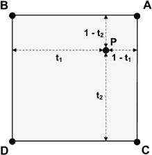

图 6.7 双线性插值。

为了确定 P 相对于周围 texel 的位置，我们使用两个值 `t[1]` 和 `t[2]`。它们称为插值参数，范围从 0 到 1。如果 `t[1]` 和 `t[2]` 都等于 1，

P 与 D 的中心重合。如果 `t[1]` 和 `t[2]` 都等于 0，P 与 A 的中心重合。

在此图中，P 最接近 A。因此，如果将 `minFilter` 设置为 `nearest`，P 的颜色将被设置为等于 A 的颜色。但如果将其设置为 `linear`，P 的颜色将使用以下方程计算：

Color (P) = *t*[1] × *t*[2] × Color(A) + (1 − *t*[1]) × *t*[2] × Color(B) + *t*[1] × (1−*t*[2]) × Color (C) + (1 −*t*[1]) × (1 − *t*[2]) × Color(D)

`magFilter` 属性标识当 texel 的面积大于片段时应使用的过滤方法。如果纹理包含 mipmap 级别，应用程序可以使用 `mipMapFilter` 属性自定义采样。如果将其设置为 `nearest`，采样器将从最近的 mipmap 图像中选择数据。如果将其设置为 `linear`，采样器将计算相邻 mipmap 中 texel 的加权平均值。

Mipmap 级别可以被视为第三个维度。当双线性过滤与 mipmap 线性过滤结合时，结果称为 *三线性过滤*。

#### 各向异性过滤

在大多数应用程序中，片段着色器将在 x 和 y 方向读取相同数量的样本。这称为 *各向同性过滤*，因为采样在每个方向上执行的方式相同。


各向同性过滤在观看角度垂直于纹理时是理想的。但如果观察者以角度查看纹理对象，对象应在一方向上拉伸而在另一方向上收缩。为了保持分辨率，渲染器应在拉伸方向读取更多采样。这种方向性采样称为 *各向异性过滤*。

在代码中，通过将 `maxAnisotropy` 属性设置为 1 到 16 之间的值来启用各向异性过滤。这标识了在某一方向上读取的采样数除以在另一方向上读取的采样数的最大比率。例如，如果将 `maxAnisotropy` 设置为 4，采样器将在一个方向上最多读取四倍于另一方向的采样数。

### 细节层次
随着观察者远离纹理，纹理的分辨率应降低。实现此目的的一种方法是读取更少的纹理采样。另一种方法是利用纹理金字塔。如果纹理具有 mipmap 级别，则每个级别的图像分辨率低于前一个级别。也就是说，Level 0 图像具有最高分辨率，Level 1 图像具有次高分辨率，以此类推。

许多资料将 mipmap 级别称为 *lods*，其中 *lod* 代表细节层次。应用程序可以通过为 `lodMinClamp` 和 `lodMaxClamp` 属性设置值来指定应使用哪些 lods。`lodMinClamp` 指定应采用的最小 mipmap 级别，而 `lodMaxClamp` 指定最大 mipmap 级别。`lodMaxClamp` 必须大于或等于 `lodMinClamp`。

### 访问外部坐标
如果着色器尝试读取超出纹理边界的 texel 数据，就会产生应返回什么值的问题。应用程序可以通过为 `addressModeU`、`addressModeV` 和 `addressModeW` 字段分配值来配置此行为。这些字段可以设置为以下三个值之一：

* `clamp_to_edge`—超出纹理的 texel 设置为纹理边缘处的 texel
* `repeat`—超出纹理范围的坐标会重复
* `mirror_repeat`—超出纹理的 texel 设置为对应范围内 texel 的反射

图 6.8 中的插图显示了当着色器读取纹理边界之外的 texel 时会发生什么。在每种情况下，坐标范围从 −0.25 到 1.25。

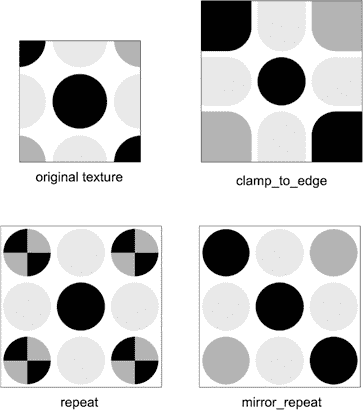

图 6.8 采样器寻址模式。

如果使用最近邻过滤，则会自动使用 `clamp_to_edge` 模式。如果配置了线性过滤，则寻址模式取决于点的位置。如果点位于水平或垂直边框上，则会选择相邻面的一个 texel。如果点位于角落，则 texel 将设置为三个相邻 texel 的总和。

### 比较测试
`compare` 属性配置采样器执行与深度测试和模板测试相关的比较。当采样器从深度/模板纹理读取值（*采样值*）时，它将该值与第二个值（*参考值*）进行比较，比较结果可用于过滤操作。测试的性质可以通过将 `compare` 设置为 表 6.8 中的一个值来配置。

表 6.8 比较采样器值

| VALUE || DESCRIPTION |
| --- | --- |
| `never` || 比较测试永远不会通过 |
| --- | --- |
| `always` || 比较测试总是通过 |
| `equal` || 如果两个值相等，则比较通过 |
| `not-equal` || 如果两个值不相等，则比较通过 |
| `less` || 如果参考值小于采样值，则测试通过 |
| `less-equal` || 如果参考值小于或等于采样值，则测试通过 |
| `greater` || 如果参考值大于采样值，则测试通过 |
| `greater-equal` || 如果参考值大于或等于采样值，则测试通过 |

这些比较对于利用深度测试和模板测试的应用程序很重要。本章后面的部分将更详细地讨论这些主题。

## 第 5 步：更新绑定组
第 5 章 解释了绑定组如何将 uniform 缓冲区等资源与用作 *绑定值* 的数字关联。着色器通过提供资源的绑定值（`@binding`）和组的值（`@group`）来访问绑定组中的资源。以下代码展示了这一点：

```
@group(0) @binding(0) var<uniform> exampleVariable: dataStruct;
```

与 uniform 缓冲区一样，纹理和采样器必须在访问之前添加到绑定组中。如果由 `device.createTexture` 创建的纹理名为 `tex`，并且由 `device.createSampler` 创建的采样器名为 `sampler`，则以下代码将两者都添加到绑定组中：

```
// Create a bind group for a sampler and texture
let bindGroup = device.createBindGroup({
    layout: bindGroupLayout,
    entries: [{
        binding: 0,
        resource: sampler
    },
   {
        binding: 1,
        resource: tex.createView({
          dimension: "cube",
        })
   }]
});
```

如图所示，绑定组不会直接访问纹理。相反，它调用纹理的 `createView` 方法，该方法提供纹理的特定视图。它接受一个包含多个属性的对象，而 表 6.9 列出了所有这些属性。

表 6.9 视图创建属性

| PROPERTY || REQUIRED? || DESCRIPTION |
| --- | --- | --- |
| `label` || N || 视图的标识符 |
| --- | --- | --- |
| `dimension` || N || 视图的格式（`1d`、`2d`、`3d`、`2d-array`、`cube` 或 `cube-array`） |
| `aspect` || N || 可用的纹理方面（`all`、`depth-only` 或 `stencil-only`） |
| `format` || N || 纹理格式（如 表 6.1 中列出的那些） |
| `arrayLayerCount` || N || 纹理中的数组层数 |
| `baseArrayLayer` || N || 要访问的第一个数组层的索引 |
| `mipLevelCount` || N || 纹理中的 mipmap 级别数 |
| `baseMipLevel` || N || 要访问的第一个 mipmap 级别的索引 |

本书中介绍的所有纹理都是二维的，因此唯一需要设置的属性是 `label` 和 `dimension` 属性，后者将设置为 `2d`。

创建绑定组后，应用程序可以通过调用编码器的 `setBindGroup` 方法将其与渲染通道编码器关联。第一个参数是一个数字，着色器可以使用该数字访问绑定组的资源。例如，以下代码将绑定组与数字 0 关联：

```
// Associate the bind group with the value of 0
renderPass.setBindGroup(0, bindGroup);
```

因此，着色器可以使用 `@group(0)` 属性访问该组。以下讨论解释了片段着色器如何访问纹理。

## 第 6 步：在片段着色器中访问纹理和采样器
本章前面我展示了片段着色器如何使用 `@group` 和 `@binding` 属性访问 uniform 缓冲区中的数据。片段着色器也可以使用相同的属性访问纹理和采样器。例如，以下代码使用这些属性声明采样器和纹理的变量。

```
@group(0) @binding(0) var sam : sampler;
@group(0) @binding(1) var tex : texture_2d<f32>;
```

此代码介绍了着色器可以访问的两种新的数据类型：`sampler` 和 `texture_2d`。以下讨论将介绍这些以及访问纹理时使用的其他数据类型。

### 数据类型


WGSL 仅为采样器提供了两种数据类型。更常见类型是 `sampler` 类型，表示常规纹理采样器。但是，如果采样器在创建时将 `compare` 属性设置为执行比较测试，则其类型应设置为 `sampler_comparison`。

相比之下，纹理有几种数据类型。它们之间的差异取决于纹理的维度和其数据的性质。表 6.10 列出了十二种可用的纹理类型。

表 6.10 纹理数据类型

| 数据类型 || 描述 |
| --- | --- |
| `texture_1d<T>` || 一维纹理 |
| --- | --- |
| `texture_2d<T>` || 二维纹理 |
| `texture_2d_array<T>` || 二维纹理数组 |
| `texture_depth_2d<T>` || 包含深度的二维纹理 |
| `texture_depth_2d_array<T>` || 包含深度的二维纹理数组 |
| `texture_multisampled_2d<T>` || 多采样二维纹理 |
| `texture_depth_multisampled_2d` || 包含深度的多采样二维纹理 |
| `texture_3d<T>` || 三维纹理 |
| `texture_cube<T>` || 立方体贴图纹理 |
| `texture_cube_array<T>` || 立方体贴图纹理数组 |
| `texture_depth_cube<T>` || 包含深度的立方体贴图纹理 |
| `texture_depth_cube_array<T>` || 包含深度的立方体贴图纹理数组 |

如果应用程序频繁切换纹理，使用纹理数组而不是单独的纹理可以提高性能。这些由以 `_array` 结尾的类型表示。这些数组易于使用，采样过程中的唯一变化是额外参数用于标识数组索引。

三维纹理比二维纹理使用得更少，但采样过程本质上是相似的。主要区别在于，当着色器访问 3D 纹理时，需要提供三个坐标而不是两个。

如其名所示，纹理立方体（或 `cubemap`）是一种旨在覆盖立方体表面的纹理。它包含六个独立的二维纹理——每个立方体的面一个。使用纹理立方体而不是常规纹理的优点是，您可以使用法线向量选择表面。

### 纹理函数

除了提供数据类型之外，WGSL 还定义了多个访问纹理的函数。表 6.11 列出了其中九个函数并提供了每个函数的描述。

表 6.11 纹理函数

| 函数 || 返回值 |
| --- | --- |
| `textureSample(texture, sampler, coords)` || 指定位置的纹素数据 |
| --- | --- |
| `textureSampleBias(texture, sampler, coords, bias)` || 指定位置的纹素数据，增加 mipmap 级别的偏差 |
| `textureSampleCompare(texture, sampler, coords, refValue)` || 比较结果 |
| `textureLoad(texture, coords, level)` || 指定位置的纹素数据（不采样） |
| `textureStore(texture, coords, value)` || 向纹理写入纹素值 |
| `textureDimensions(texture)` || 纹理中的维度数 |
| `textureNumLayers(texture)` || 纹理数组中的元素数量 |
| `textureNumLevels(texture)` || 纹理数组中的 mipmap 级别数 |
| `textureNumSamples(texture)` || 每个纹素的采样数 |

在这些函数中，`textureSample` 是最常用的。它接受一个纹理、一个 `sampler` 以及应读取纹理数据的坐标。输出取决于纹理的性质。如果纹理包含深度数据，`textureSample` 将返回 32 位浮点值。否则，`textureSample` 将返回 `vec4f`。

如果 `sampler` 已配置为比较测试，着色器可以调用 `textureSampleCompare`。在这种情况下，第四个参数 `refValue` 标识用于测试的值。它返回 1.0 如果测试成功，返回 0.0 如果测试失败。这些比较在深度/模板测试中起着核心作用，这些内容将在本章后面讨论。

与 `textureSample` 类似，`textureLoad` 从纹理读取数据。不同之处在于 `textureLoad` 不使用 `sampler`，这意味着它无法利用前面讨论的采样器配置。

表中最后四个函数称为纹理查询函数，因为它们提供有关纹理的一般信息。`textureDimensions` 标识维度数，`textureNumLayers` 标识纹理数组中的元素数量，`textureNumLevels` 标识 mipmap 级别数，而 `textureNumSamples` 标识每个纹素的采样数。

### 纹理压缩

在大多数简单应用程序中，每个纹素包含红色分量的八位、绿色分量的八位和蓝色分量的八位。这种格式易于使用，但每个纹素需要 24 位的纹理需要大量时间传输到 GPU。

应用程序可以通过使用压缩纹理大幅减少传输时间。应用程序可以通过将 `createTexture` 参数的 `format` 属性设置为压缩格式的标识符来标识纹理为压缩纹理。在以下代码中，新纹理被标识为使用其中一种 ASTC 格式进行压缩。

```
// Define a texture with a compressed format
const texture = device.createTexture({
    …
    format: "astc-5x4-unorm",
    …
});
```

WebGPU 支持三种不同的纹理压缩方法族：

*   块压缩 (BCn)
*   爱立信纹理压缩 (ETC/ETC2/EAC)
*   高级可缩放纹理压缩 (ASTC)

本讨论简要介绍这些家族中的每一个。在每种情况下，我将解释有哪些格式可用以及如何检查设备支持。

#### 块压缩 (BCn)

最古老的纹理压缩方法之一是块压缩 (BCn)，也称为 S3 纹理压缩 (S3TC)。WebGPU 为 BC1 到 BC7 压缩提供格式标识符，尽管它们有所不同，但它们都将 4×4 像素块压缩为 64 位整数或 128 位整数。

块压缩受大多数桌面 GPU 支持，但在移动 GPU 上并不常见。因此，检查客户端设备是否支持它非常重要。应用程序可以通过目标设备上 `GPU adapter` 的 `features` 属性检查支持情况。以下代码展示了其工作原理。

```
// Check if the device supports Block Compression (BC)
const adapter = await navigator.gpu.requestAdapter();
if (adapter) {
    if (adapter.features.has("texture-compression-bc")) {
        …
    }
}
```

如果设备支持该格式，应用程序可以将 `createTexture` 中的 `format` 属性设置为 表 6.12 中列出的值之一。

表 6.12 块压缩 (BC) 纹理格式

| `bc1-rgba-unorm` || `bc3-rgba-unorm-srgb` || `bc6h-rgb-ufloat` |
| --- | --- | --- |
| `bc1-rgba-unorm-srgb` || `bc4-r-unorm` || `bc6h-rgb-float` |
| `bc2-rgba-unorm` || `bc4-r-snorm` || `bc7-rgba-unorm` |
| `bc2-rgba-unorm-srgb` || `bc5-rg-unorm` || `bc7-rgba-unorm-srgb` |
| `bc3-rgba-unorm` || `bc5-rg-snorm` ||  |

在每个标识符中，前三个字符标识块压缩的性质。下一部分标识要压缩的像素的格式，例如 `rgba`。之后，`unorm` 表示纹素被压缩为归一化无符号整数，而 `snorm` 表示纹素被压缩为归一化有符号整数。

#### 爱立信纹理压缩 (ETC)

与块压缩方法类似，爱立信纹理压缩通过将 4×4 像素块转换为较小的值（64 位字）来压缩纹理。然而，转换的性质与块压缩明显不同。


The second version of ETC, denoted ETC2, provides better compression and can be used to compress RGBA images in addition to RGB images. ETC2 is supported by any device that supports OpenGL ES 3.0 and higher, such as modern Android mobile devices. However, this compression method isn't as common on desktop systems.

For images with fewer components per texel, Ericsson developed Ericsson Alpha Compression (EAC). This is similar to ETC2 and is also guaranteed to be available on OpenGL ES 3.x devices. An application can check for support by accessing the device's adapter, and the following code shows how this works:

```
// Check if the device supports Ericsson Texture Compression 2 (ETC2)
const adapter = await navigator.gpu.requestAdapter();
if (adapter) {
    if (adapter.features.has("texture-compression-etc2")) {
        …
    }
}
```

If ETC2 is supported, applications can use compressed textures by setting the `format` property of the `createTexture` object to one of the values in 表 6.13.

表 6.13 爱立信纹理压缩纹理格式

| etc2-rgb8unorm || etc2-rgba8unorm-srgb |

| --- | --- |

| etc2-rgb8unorm-srgb || eac-r11unorm |

| etc2-rgb8a1unorm || eac-r11snorm |

| etc2-rgb8a1unorm-srgb || eac-rg11unorm |

| etc2-rgba8unorm || eac-rg11snorm |

As shown, the EAC compression methods are only available for textures with one (r) or two (rg) color channels. In all other cases, it's recommended to use one of the ETC2 methods for compression.

## 高级可缩放纹理压缩（ASTC）

Like ETC and Block Compression, Advanced Scalable Texture Compression (ASTC) is block-based, producing one value for a block of texels. ASTC isn't as widely supported as ETC2, but it generally produces better-quality compression. An application can check for ASTC support using code like the following:

```
// Check if the device supports Advanced Scalable Texture Compression (ASTC)
const adapter = await navigator.gpu.requestAdapter();
if (adapter) {
    if (adapter.features.has("texture-compression-astc")) {
        …
    }
}
```

One advantage of ASTC over other methods is that you can choose the size of the blocks used in the compression. Larger blocks mean greater compression but greater data loss. Smaller blocks mean lower compression and less data loss.

表 6.14 makes this clear. The least lossy compression method processes 4-by-4 blocks, and the most lossy compression method processes 12-by-12 blocks.

表 6.14 高级可缩放纹理压缩（ASTC）格式

| astc-4x4-unorm || astc-8x5-unorm || astc-10x8-unorm |

| --- | --- | --- |

| astc-4x4-unorm-srgb || astc-8x5-unorm-srgb || astc-10x8-unorm-srgb |

| astc-5x4-unorm || astc-8x6-unorm || astc-10x10-unorm |

| astc-5x4-unorm-srgb || astc-8x6-unorm-srgb || astc-10x10-unorm-srgb |

| astc-5x5-unorm || astc-8x8-unorm || astc-12x10-unorm |

| astc-5x5-unorm-srgb || astc-8x8-unorm-srgb || astc-12x10-unorm-srgb |

| astc-6x5-unorm || astc-10x5-unorm || astc-12x12-unorm |

| astc-6x5-unorm-srgb || astc-10x5-unorm-srgb || astc-12x12-unorm-srgb |

| astc-6x6-unorm || astc-10x6-unorm ||  |

| astc-6x6-unorm-srgb || astc-10x6-unorm-srgb ||  |

The Unity Manual recommends using the BC7 compression method whenever possible. If this is unavailable, it recommends using ASTC if it's supported and ETC2/EAC if ASTC isn't supported.

## 示例应用程序—添加纹理

The `Ch06_SimpleTexture` application demonstrates how textures can be created and displayed with WebGPU. This doesn't transform any vertices or set light components. Instead, it creates a two-dimensional square and covers it with a two-dimensional texture.

Despite its simplicity, this project deserves attention because it demonstrates three important capabilities: creating `ImageBitmap`s from image files, creating a texture and sampler in code, and sampling the texture in a shader. This section discusses each of these capabilities and explains how they're implemented in code.

### 从图像文件创建 ImageBitmap

As mentioned earlier, WebGPU makes it easy to write texture data from an `ImageBitmap` into a texture resource. In the `Ch06_SimpleTexture` application, the code obtains an `ImageBitmap` for an image file using three steps:

1. Calls `fetch()` to obtain a `Response` for the `smiley.png` file.
2. Calls the `Response`'s `blob()` method to obtain a `Blob`.
3. Calls `createImageBitmap` with the `Blob` to obtain an `ImageBitmap`.

The following lines of code show how these steps are accomplished:

```
// Create ImageBitmap from image file
const response = await fetch("smiley.png");
const imageBitmap = await createImageBitmap(await response.blob());
```

Once the `ImageBitmap` is available, its data can be written to a texture resource. The following discussion explains how the `Ch06_SimpleTexture` application creates a texture and sampler.

### 创建纹理和采样器

After creating the `ImageBitmap`, the code in `ch06_simpletexture.js` creates an empty texture resource with the following code:

```
// Create texture object
const texture = device.createTexture({
    size: [imageBitmap.width, imageBitmap.height],
    format: "rgba8unorm",
    usage:
        GPUTextureUsage.TEXTURE_BINDING |
        GPUTextureUsage.COPY_DST |
        GPUTextureUsage.RENDER_ATTACHMENT
});
```

As shown, the code sets the texture's `size`, `format`, and `usage` parameters. The `COPY_DST` flag is needed because the texture will be written to, and the `RENDER_ATTACHMENT` flag is needed because the texture will serve as a color attachment.

To create the operation that writes the `ImageBitmap` to the texture, the application calls the `copyExternalImageToTexture` method of the device's `queue`. This is accomplished with the following code:

```
// Write data to texture
device.queue.copyExternalImageToTexture(
    { source: imageBitmap },
    { texture: texture },
    [imageBitmap.width, imageBitmap.height]
);
```

Now that the texture is created and associated with data, the application creates the sampler that will be used by the shader to read the texture's data.

```
// Create sampler
const sampler = device.createSampler({
    magFilter: "linear",
    minFilter: "linear",
});
```

By default, the sampler reads texture data using nearest-neighbor sampling. This code configures the sampler to use bilinear interpolation, which computes the sampled value by combining the values of the surrounding texels.

Before the texture and sample can be used, the application adds them to a bind group and then associates the group with the render pass encoder. To accomplish this, it executes the following code:

```
// Create the bind group
let bindGroup = device.createBindGroup({
    layout: bindGroupLayout,
    entries: [{
        binding: 0,
        resource: sampler
    },
    {
        binding: 1,
        resource: texture.createView({
            dimension: "2d",
        })
   }]
});

// Associate bind group with render pass encoder
renderPass.setBindGroup(0, bindGroup);
```

As a result of this code, a shader can access the bind group through the `@group(0)` attribute. It can access the sampler with `@binding(0)` and the texture with `@binding(1)`.

### 在着色器中采样纹理

The goal of the fragment shader is to assign a color to each fragment in the rendering. In the `Ch06_SimpleTexture` application, the fragment shader obtains color values by reading data from a texture. To be precise, it uses a sampler to sample the texture's data.

The fragment shader accesses the sampler by declaring a variable of type `sampler` and accesses the texture by declaring a variable of type `texture_2d`. The following code shows what these declarations look like:

```
@group(0) @binding(0) var sam : sampler;
@group(0) @binding(1) var tex : texture_2d<f32>;
```


`@group(0)` 属性指定变量取自绑定组 0 中的资源。`@binding(0)` 属性表示采样器对应于绑定组中绑定值为 0 的资源。`@binding(1)` 属性表示纹理对应于绑定组中绑定值为 1 的资源。

在声明变量之后，片段着色器通过调用前面讨论过的 `textureSample` 方法来设置片段的颜色。如下代码所示：

```
fn fragmentMain(fragData: DataStruct) -> @location(0) vec4f {
    return textureSample(tex, sam, fragData.uvPos);
}
```

`textureSample` 的第一个参数是纹理，第二个是采样器，第三个是要采样的位置。该位置以 UV 坐标给出，这些坐标从顶点着色器传递给片段着色器。UV 坐标与传入顶点的 (x, y) 坐标不同，理解这一点很重要。

在 `ch06_simpletexture.js` 代码中，顶点缓冲区为每个顶点存储四个值：(x, y) 坐标和 (u, v) 坐标。顶点着色器将 (x, y) 坐标分配给每个顶点，而片段着色器使用 (u, v) 坐标从纹理中采样数据。

## 深度和模板测试

默认情况下，`WebGPU` 按应用程序给定的顺序绘制三角形，而不考虑其位置。这意味着如果远处的物体绘制得更晚，其三角形的绘制会覆盖近处物体的三角形。这在表面重叠时经常导致问题。

为了解决这个问题，应用程序可以利用 *深度测试*。目标是确保深度最低的片段被绘制，而深度更大的片段被丢弃。

如前所述，每个片段都有一个深度范围从 0.0（最近）到 1.0（最远）。在每个片段位置，应用程序存储一个最小深度值和对应的片段。如果新片段的深度值低于存储的值，则存储其深度并丢弃旧片段。这可以用以下伪代码表示：

```
let x = newFragment.x;
let y = newFragment.y;
let minDepthValue = depth(x, y);
if(newFragment.depth < minDepthValue) {
    depth(x, y) = newFragment.depth;
    fragment(x, y) = newFragment;
}
```

存储每个位置最小片段深度的结构称为 *深度缓冲区*，也称为 *z 缓冲区*。本质上，它是一个深度值在 0.0 到 1.0 之间的二维数组。

除了深度缓冲区外，应用程序还可以设置 *模板缓冲区* 中的值。片段着色器可以读取这些值，执行比较测试，并根据结果保留或丢弃片段。本质上，模板缓冲区使能够屏蔽渲染区域的部分。

模板值不需要太多位，因此常见的做法是让一个缓冲区同时充当深度缓冲区 *和* 模板缓冲区。常见的做法是使用 24 位存储深度值和 8 位存储模板值。

因此，`WebGPU` 文档将深度和模板测试的主题结合在一起，并将其称为 *深度/模板测试*。请记住，这两个测试是不同的，应用程序可以执行深度测试、模板测试、两者或都不执行。

在 OpenGL 中，通过调用 `glEnable(GL_DEPTH_TEST)` 来启用深度测试。在 `WebGPU` 中，过程要复杂得多。要在 `WebGPU` 中实现深度/模板测试，应用程序需要执行五个步骤：

1. 创建一个纹理用作深度/模板缓冲区。
2. 创建并配置比较采样器以访问纹理。
3. 配置渲染通道编码器以访问深度和模板缓冲区。
4. 配置渲染管线以执行深度/模板测试。
5. 在片段着色器中执行比较测试。

本文讨论探讨了这些步骤中的每一个。在每种情况下，我们都会查看测试过程中需要的对象和方法。

### 创建深度/模板纹理

在启用深度/模板测试之前，应用程序需要创建一个纹理来存储深度和/或模板值。这就是深度/模板缓冲区，可以使用本章前面讨论过的相同的 `device.createTexture` 方法创建。但有三点需要注意：

* 纹理的内容（可能）不会设置为图像，因此（通常）无需设置 `GPUTextureUsage.COPY_DST` 标志。
* 纹理的 `size` 通常应设置为覆盖视口中的每个像素。
* 纹理的 `format` 必须设置为深度/模板格式之一。

这一点很重要。如果纹理将保存深度和/或模板值，其格式不能设置为常规纹理格式。相反，format 属性需要设置为 表 6.15 中的值之一。

表 6.15 深度/模板纹理格式

| 格式 || 描述 |
| --- | --- |
| `stencil8` || 存储 8 位模板值 |
| --- | --- |
| `depth16unorm` || 存储为 16 位无符号归一化整数的深度值 |
| `depth24plus` || 使用至少 24 位每值存储整数深度值 |
| `depth24plus-stencil8` || 使用至少 24 位每值存储整数深度值并使用 8 位值存储模板值 |
| `depth32float` || 存储为 32 位浮点值的深度值 |
| `depth32float-stencil8` || 存储为 32 位浮点值的深度值和存储为 8 位整数的模板值 |

截至本文撰写时，并非所有符合条件的 GPU 都支持 `depth32float-stencil8` 格式。在使用之前，请务必检查 `GPUAdapter` 的 `features` 属性，以查看是否支持 `depth32float-stencil8` 功能。

作为示例，以下代码创建了一个 400 x 200 的纹理用作深度/模板缓冲区。format 属性设置为 `depth24plus-stencil8`，因此纹理可以存储深度和模板值。

```
// Create texture to store depth/stencil values.
const depthStencilTexture = device.createTexture({
    size: [400, 200, 1],
    usage: GPUTextureUsage.RENDER_ATTACHMENT |
        GPUTextureUsage.TEXTURE_BINDING,
    format: "depth24plus-stencil8"
});
```

创建纹理后，应用程序需要创建一个 *纹理视图* 来提供对纹理数据的访问。这是通过调用纹理的 `createView` 方法创建的，如以下代码所示：

```
const depthStencilView = depthStencilTexture.createView();
```

一旦此视图可用，应用程序就可以配置渲染通道编码器以访问纹理来存储深度和/或模板值。我将在接下来讨论这一点。

### 创建比较采样器

与常规纹理一样，片段着色器使用采样器从深度/模板纹理中读取。但用于深度/模板测试的采样器与常规采样器不同。它们称为 *比较采样器*，应用程序需要在配置过程中做两处小的更改。

首先，必须使用具有 `compare` 属性的对象调用 `device.createSampler` 方法，该属性标识要执行的比较的性质。这在以下代码中显示：

```
resource: device.createSampler({
    compare: "less",
}
```

其次，绑定组布局需要使用采样器进行配置，其 `type` 属性设置为 `comparison`。以下代码显示了如何执行此操作：

```
const bindGroupLayout = device.createBindGroupLayout({
    entries: [
        {
            binding: 0,
            visibility: GPUShaderStage.FRAGMENT,
            sampler: {
                type: "comparison",
            },
        },
    ],
});
```

因此，片段着色器将能够将采样器作为比较采样器访问。

### 配置渲染通道编码器


在渲染过程中，GPU 依赖于一块特殊的内存来存储待显示的数据。这块特殊内存称为 `framebuffer`，它以一系列缓冲区的形式存储像素相关数据。到目前为止，我们创建的唯一缓冲区是 `color buffer`，它通过在 `beginRenderPass` 方法中设置 `colorAttachments` 属性来配置。以下代码展示了如何实现：
// Create the render pass encoder with a color buffer
const renderPass = encoder.beginRenderPass({
    colorAttachments: [{
        view: context.getCurrentTexture().createView(),
        loadOp: "clear",
        clearValue: { … },
        storeOp: "store"
    }]
});
由于这段代码，`color buffer` 将是附加到 `framebuffer` 的唯一缓冲区。然而，WebGPU 使得附加一个存储深度/模板数据的缓冲区成为可能。这是通过将 `depthStencilAttachment` 设置为包含最多九个属性的对象来实现的。表 6.16 列出了这些属性并提供了每个属性的描述。
表 6.16 配置深度和模板缓冲区
| 属性 || 是否可选? || 描述 |
| --- | --- | --- |
| view || N || 用于标识要读取和写入的资源的纹理视图 |
| --- | --- | --- |
| depthReadOnly || Y || 标识深度缓冲区是否应为只读 |
| depthClearValue || Y || 标识深度缓冲区中每个元素的初始值 |
| depthLoadOp || Y || 在渲染前对深度值执行的操作（加载或清除） |
| depthStoreOp || Y || 在渲染后对深度值执行的操作（存储或丢弃） |
| stencilReadOnly || Y || 标识模板缓冲区是否应为只读 |
| stencilClearValue || Y || 标识模板缓冲区中每个元素的初始值 |
| stencilLoadOp || Y || 在渲染前对模板值执行的操作（加载或清除） |
| stencilStoreOp || Y || 在渲染后对模板值执行的操作（存储或丢弃） |
`view` 属性应设置为从用作深度/模板缓冲区的纹理创建的纹理视图。`depthReadOnly` 属性决定深度值是否只读，而 `stencilReadOnly` 属性决定模板值是否只读。两个属性默认为 false。
如果将 `depthLoadOp` 设置为 clear，则在渲染开始前深度值将被初始化为 `depthClearValue`。如果将 `stencilLoadOp` 设置为 clear，则在渲染开始前模板值将被初始化为 `stencilClearValue`。
如果将 `depthStoreOp` 设置为 store，则在渲染后深度值将被存储。同样，如果将 `stencilStoreOp` 设置为 store，则模板值将被存储。如果任一属性设置为 discard，则相应的数据将被丢弃。
为了演示如何设置这些属性，以下代码使用 `depthStencilAttachment` 属性调用 `beginRenderPass`。其 `view` 设置为之前创建的 `depthStencilView`：
// Create the render pass encoder
const renderPassDescriptor: GPURenderPassDescriptor = {
    // Define the color attachment
    colorAttachments: [
        { ... },
    ],
    // Define the depth/stencil attachment
    depthStencilAttachment: {
        view: depthStencilView,
        depthClearValue: 1.0,
        depthLoadOp: "clear",
        depthStoreOp: "store",
        stencilClearValue: 0,
        stencilLoadOp: "clear",
        stencilStoreOp: "store"
    }
};
结果是，渲染通道将能够访问 `depthStencilView` 中的深度和模板值。在渲染之前，深度值将被设置为 1.0（`depthClearValue`），模板值将被设置为 0（`stencilClearValue`）。
### 配置渲染管线
`device.createRenderPipeline` 方法接受一个 `depthStencil` 属性，用于配置如何执行深度和/或模板测试。这必须设置为包含最多十个属性的对象。表 6.17 列出了这些属性并提供了每个属性的描述。
表 6.17 配置深度和模板测试
| 属性 || 是否可选? || 描述 |
| --- | --- | --- |
| format || N || 深度/模板缓冲区的格式 |
| --- | --- | --- |
| depthCompare || N || 标识深度比较的性质 |
| depthWriteEnabled || N || 指定应用程序是否可以写入深度缓冲区 |
| depthBias || Y || 在深度测试前添加到每个片段的值 |
| depthBiasSlopeScale || Y || 根据像素深度值的斜率增加偏差 |
| depthBiasClamp || Y || 设置最大深度偏差 |
| stencilFront || Y || 配置正面图元的模板测试 |
| stencilBack || Y || 配置背面图元的模板测试 |
| stencilReadMask || Y || 标识在读取操作期间应访问的模板值的哪些位 |
| stencilWriteMask || Y || 标识在写入操作期间应更改的模板值的哪些位 |
第一个属性 `format` 指定深度/模板缓冲区的格式，应设置为创建纹理时使用的相同格式值。第二个属性 `depthCompare` 标识深度测试的性质。也就是说，它标识 (x, y) 处的每个值将如何与深度缓冲区中 (x, y) 处的深度值进行比较。可以将其设置为以下七个值之一：
*   always——比较总是通过
*   never——比较从不通过
*   less——如果片段的深度小于缓冲区的数值，则比较通过
*   less-equal——如果片段的深度小于或等于缓冲区的数值，则比较通过
*   equal——如果片段的深度等于缓冲区的数值，则比较通过
*   more-equal——如果片段的深度大于或等于缓冲区的数值，则比较通过
*   greater——如果片段的深度大于缓冲区的数值，则比较通过
通常，我们希望片段在深度小于深度缓冲区中当前值（更靠近观察者）时通过深度测试。因此，`depthCompare` 通常设置为 less。
对于简单的深度测试，将 `depthWriteEnable` 设置为 false 以防止应用程序更改深度缓冲区可能是一个好主意。但对于复杂的深度测试或模板测试，应将其设置为 true 以启用对深度/模板值的更改。
如果两个对象的深度相同，渲染器可能会将它们的三角形融合在一起，从而产生不可接受的结果。因此，许多应用程序会添加轻微的偏差以确保对象具有不同的深度。这是通过设置 `depthBias` 属性来实现的，该属性为偏差分配初始值，以及 `depthBiasSlopeScale` 属性，该属性乘以给定像素处深度水平或垂直斜率的最大值。`depthBiasClamp` 属性设置偏差的最大值。
模板测试通过 `stencilFront` 和 `stencilBack` 属性进行配置，它们分别影响正面和背面图元。两个属性都可以设置为包含四个属性（全部可选）的对象：
1.  `compare`——模板测试使用的比较类型——接受与 `depthCompare` 相同的值
2.  `passOp`——如果模板测试通过则执行的模板操作
3.  `failOp`——如果模板测试失败则执行的模板操作
4.  `depthFailOp`——如果深度测试失败则执行的模板操作
`passOp`、`failOp` 和 `depthFailOp` 属性标识根据深度和模板测试结果要执行的模板操作。这些属性中的每个都可以设置为以下八个值之一：
*   keep——保留当前模板值
*   zero——将模板值设置为 0


* `replace`—将模板值设置为当前渲染状态的模板值

* `invert`—反转模板值的位

* `increment-wrap`—递增当前渲染状态的模板值，若超过最大值则设为零

* `increment-clamp`—递增当前渲染状态的模板值，钳制到最大值

* `decrement-wrap`—递减当前渲染状态的模板值，若低于零则设为最大值

* `decrement-clamp`—递减当前渲染状态的模板值，钳制到零

表格中最后两个属性是 `stencilReadMask` 和 `stencilWriteMask`。它们被设置为值，其位决定 stencil 操作中使用哪些模板值位。`stencilReadMask` 值中的位决定读取操作中访问哪些模板位。`stencilWriteMask` 值中的位决定写入操作中更改哪些模板位。默认情况下，两个值都设置为 `0xffffffff`，这意味着模板值的所有位都用于读写操作。

以下代码演示了如何配置渲染管线以执行深度和模板测试。

```
const shadowPipeline = device.createRenderPipeline({
    layout: device.createPipelineLayout({ … }),
    vertex: { … },
    fragment: { … },
    depthStencil: {
        format: "depth24plus-stencil8",
        depthCompare: "less",
        depthWriteEnabled: true,
        stencilFront: {
            passOp: "replace",
        }
    }
});
```

结果是，该管线将对正面图元执行深度测试和模板测试。如果模板测试通过，则模板值将被设置为当前渲染状态的模板值。

### 执行比较测试

如果采样器配置正确，片段着色器将能够使用它进行深度/模板测试。但首先，着色器需要将采样器声明为 `sampler_comparison` 数据类型的变量。以下代码展示了这一点：

```
@group(0) @binding(0) var sampler: sampler_comparison;
```

完成此操作后，片段着色器可以通过调用 `textureSampleCompare` 来执行比较。它接受四个参数（至少）：

*   `texture`—用于测试的包含深度/模板值的纹理

*   `sampler`—比较采样器变量

*   `coordinates`—待测试纹理的坐标

*   `reference`—用于测试的参考值

`textureSampleCompare` 返回一个介于 0.0 和 1.0 之间的 `f32` 值，用于标识比较结果。0.0 的值表示比较失败，1.0 的值表示比较成功。片段着色器可以使用此结果来保留或丢弃片段。

## 摘要

本章探讨了每个图形开发者都应熟悉的三个重要操作，其中第一个涉及光照。当我们观察现实世界中的物体时，我们通过观察其表面如何反射光线来感知其形状。在代码中，我们通过根据物体相对于光源的位置和方向改变其颜色来创建这种效果。本章介绍了两种模型：Phong 模型和 Blinn–Phong 模型。

在许多情况下，我们希望片段着色器使用图像为片段分配颜色。WebGPU 通过提供称为纹理和采样器的特殊数据结构使这成为可能。纹理类似于缓冲区，但它包含图像数据并存储在 GPU 的特殊内存中。片段着色器使用采样器从纹理中提取数据，本章介绍了一个简单的示例，说明如何实现这一点。

本章的最后一部分介绍了片段着色器在渲染过程中可以执行的两种类型的测试。深度测试对于确保近处物体而不是远处物体被显示非常重要。模板测试通过将模板值与参考值进行比较，使更改片段处理成为可能。两种测试都依赖于同一纹理中的数据，该纹理需要专门配置用于深度/模板测试。在代码中，片段着色器需要特殊的采样器，称为比较采样器，来执行这些测试。

# 高级功能 7

DOI: [10.1201/9781003422839-7](https://doi.org/10.1201/9781003422839-7)

到目前为止，你应该对编码图形应用程序有了扎实的理解，从创建 JavaScript 对象到编写着色器。本章探讨了六项重要但非必需的功能：

1.  Debug groups—插入与命令关联的消息

2.  Error handling—响应错误并打印有用的消息

3.  Viewports and scissor rectangles—定义渲染区域

4.  Occlusion queries—计算通过测试的片段数量

5.  Text—使用纹理图集显示字符

6.  Animation—绘制随时间移动的物体

前两个功能在需要在复杂应用程序中定位错误时很重要。接下来的两个功能可以通过减少需要绘制的物体和片段数量来提高性能。

本章的最后一部分讨论了两项我认为特别有趣的功能。通过从纹理图集中读取纹理，WebGPU 应用程序可以正确显示带字距调整的文本。应用程序还可以使用动画来渲染位置和方向随时间变化的图形。

## 调试组

在 JavaScript 中创建 WebGPU 对象时，许多方法接受一个名为 `label` 的可选属性。当出现错误时，标签很有帮助，因为浏览器的消息会显示受影响对象的标签。

如 第 2 章 中所述，命令编码器接收一系列命令并将其编码以在 GPU 上执行。应用程序可以向命令队列中插入标签，以便在发生错误时读取。`GPUCommandEncoder` 为此提供了两种方法：

*   `pushDebugGroup(label)`—使用给定标签开始一个调试组

*   `popDebugGroup()`—结束最近推送的组

命令编码器以栈的方式管理调试组。这使得应用程序能够形成调试组层次结构。为了演示，以下代码创建了一个命令编码器和一个渲染通道编码器来编码渲染命令。它为渲染通道编码器编码的命令创建了一个调试组。

```
// Create the command encoder
const encoder = device.createCommandEncoder();

// Start the debug group
encoder.pushDebugGroup("Render Commands");

// Create the render pass encoder and define the rendering
const renderPass = encoder.beginRenderPass(…);
…
renderPass.draw(…);
renderPass.end();

// End the debug group
encoder.popDebugGroup();

// Submit the encoded commands to the GPU
device.queue.submit([encoder.finish()]);
```

结果是，渲染通道编码器的 `draw` 方法定义的渲染命令将与标记为 Render Commands 的调试组关联。当应用程序需要为不同的命令集添加标签以监控错误发生的位置时，调试组很有帮助。

除了创建调试组外，应用程序还可以在编码器的命令集中插入称为 *标记* 的标签。命令编码器为此提供了 `insertDebugMarker` 方法，以下代码展示了如何使用它：

```
// Insert a debug marker
encoder.insertDebugMarker("Command Marker");
```

这些标记比调试组更容易使用。但它们不能像调试组那样嵌套。

## 错误处理

图形开发的一个令人沮丧的方面是，渲染操作可能会失败而不会产生使应用程序停止的错误。在 OpenGL 中，`glGetError` 函数使找出哪个操作产生错误变得简单。

WebGPU 通过 *error scopes* 提供了类似的功能，它类似于 JavaScript 中的 try\-catch 块。使用错误作用域需要三个步骤：


## 错误范围

1. 将错误范围压入栈中。
2. 执行一个或多个可能产生错误的运算。
3. 弹出错误范围以检查给定的错误是否发生。

对于第一步，应用程序需要调用 `GPUDevice` 的 `pushErrorScope()` 方法。此方法接受一个字符串，用于标识应监控的错误类型。 表 7.1 列出了三种错误类型。

表 7.1 检测到的错误类型

| 错误 ID || 描述 |
| --- | --- |
| out-of-memory || 执行操作时可用内存不足 |
| --- | --- |
| validation || 方法输入无效（数据类型错误或值不可接受） |
| internal || 与系统或 WebGPU 实现相关的错误 |

在将错误范围压入栈后，应用程序可以通过调用 `popErrorScope()` 方法来检查错误是否发生。此方法返回一个 Promise，该 Promise 解析为描述范围内捕获的第一个错误的对象的。常见的做法是使用名为 `error` 的变量访问错误对象，如以下代码所示：

```
 // Respond to error if error occurred
 device.popErrorScope().then((error) => {
     …
 });
```

如果发生错误，该变量的类型将为 `GPUError`，它提供一个 `message` 属性来标识错误的性质。在以下代码中，如果发生错误，应用程序会打印错误的消息。

```
 device.popErrorScope().then((error) => {
     
     // Check if error occurred
     if(error) {
         
         // Print error message
         console.log(error.message);
     }
 });
```

当应用程序尝试创建客户端系统可能不支持的渲染管线时，错误范围很有帮助。以下代码检查创建渲染管线是否会产生内部错误。如果是，则应用程序会调用 `createSimplerPipeline()` 方法。

```
 // Monitor internal errors
 device.pushErrorScope("internal");
 
 // Attempt to create rendering pipeline
 const renderPipeline = device.createRenderPipeline(…);
 
 // Check to see if internal error occurred
 device.popErrorScope().then((error) => {
     if(error) {
         console.log("Couldn't create pipeline");
         createSimplerPipeline(…);
     }
 });
```

`GPUDevice` 是 `EventTarget` 的子类，因此可以调用其 `addEventListener()` 方法来跟踪事件。特别是，可以通过将第一个参数设置为 uncapturederror 来处理未捕获的错误。以下代码展示了这一点：

```
 // Handle errors that haven't been captured in error scopes
 device.addEventListener("uncapturederror", (event) => {

     // Display the error's message in the console
     console.error("Uncaptured error: ", event.error.message);
 });
```

近几个月来，WebGPU 规范经常发生变化。出于此及其他原因，采用错误检查以确保应用程序正常运行是个好主意。

## 视口和剪裁矩形

到目前为止所介绍的每个示例应用程序中，渲染始终占据整个画布。应用程序在创建渲染通道编码器时提供颜色附件，从而标识画布区域。以下代码从与画布关联的 WebGPU 上下文创建视图：

```
 // Render to the WebGPU context of the canvas
 const renderPass = encoder.beginRenderPass({
     colorAttachments: [{
         view: context.getCurrentTexture().createView(),
         …
     }]
 });
```

如果你不希望渲染占据整个画布，可以通过调用 `GPURenderPassEncoder` 的 `setViewport()` 方法来设置渲染区域（称为 *视口*）。该方法接受六个值，表 7.2 列出了全部。

表 7.2 setViewport 方法的参数

| 参数 || 类型 || 描述 |
| --- | --- | --- |
| x || Integer || 画布左上角的 x 坐标 |
| --- | --- | --- |
| y || Integer || 画布左上角的 y 坐标 |
| width || Integer || 渲染表面的宽度 |
| height || Integer || 渲染表面的高度 |
| minDepth || Integer || 最小深度值（默认为 0） |
| maxDepth || Integer || 最大深度值（默认为 1） |

一个示例会使这一点更清晰。假设你希望应用程序的渲染仅限于画布左上角的 100×100 正方形。在这种情况下，你将使用 `setViewport()` 方法，将左上角设置为 (0, 0)，尺寸设置为 100 和 100。以下代码展示了其工作原理：

```
 // Set the boundaries of the rendering
 renderPass.setViewport(0, 0, 100, 100, 0, 1);
```

除了自定义视口外，应用程序还可以定义称为 *剪裁矩形* 的区域，告诉渲染器应丢弃哪些片段。这是通过调用 `GPURenderPassEncoder` 的 `setScissorRect()` 方法实现的。该方法接受矩形左上角的坐标，然后是其宽度和高度。

例如，假设应用程序希望丢弃 150×250 矩形外部的所有片段，该矩形的左上角位于 (20, 30)。以下代码为此目的定义了一个剪裁矩形：

```
 // Set the boundaries of the scissor rectangle
 renderPass.setScissorRect(20, 30, 150, 250);
```

由于这段代码，剪裁矩形外部的任何片段都不会被绘制。默认情况下，剪裁矩形具有与视口相同的边界。

## 遮挡查询

第 6 章 解释了应用程序如何使用深度和模板测试丢弃片段。应用程序可以通过提交 *遮挡查询* 来检查有多少片段通过了这些测试。如果只有少量片段通过，应用程序可能希望绘制更简单的对象或使用更简单的着色器。

应用程序可以通过采用六个步骤来创建和配置遮挡查询：

1. 创建查询集，并在创建渲染通道编码器时标识它。
2. 创建一个缓冲区来保存查询结果。
3. 调用渲染通道编码器的 `beginOcclusionQuery()` 方法。
4. 在渲染命令完成后，调用 `endOcclusionQuery()`。
5. 通过调用 `resolveQuerySet()` 编码记录查询的命令。
6. 通过调用其 `destroy()` 方法销毁查询集。

以下讨论探讨了这些步骤。在每种情况下，它解释了需要哪些对象和方法，然后展示了如何在代码中实现它们。

### 创建查询集

`GPUQuerySet` 对象可以保存多个查询，应用程序可以通过调用 `GPUDevice` 的 `createQuerySet()` 方法来创建一组查询。此方法接受一个描述符，其中包含 表 7.3 中列出的属性。

表 7.3 查询集描述符属性

| 属性 || 可选？ || 描述 |
| --- | --- | --- |
| label || Y || 查询集的字符串标识符 |
| --- | --- | --- |
| count || N || 可以访问的查询数量 |
| type || N || 如果集合包含遮挡查询（occlusion）或时间戳（queries） |

对于遮挡查询，`count` 必须设置为大于 1 的整数，并且 `type` 必须设置为 occlusion。对于时间戳查询，`type` 必须设置为 timestamp。 第 8 章 将讨论时间戳查询并展示其用法。

为了演示这一点，以下代码创建了一个能够保存四个遮挡查询的查询集：

```
 // Create a new query set
 const querySet = device.createQuerySet({
     label: "Query Set 0",
     count: 4,
     type: "occlusion"
 });
```

创建查询集后，应用程序需要将其与渲染通道编码器关联起来。这是通过设置在 `beginRenderPass()` 方法中使用的对象的 `occlusionQuerySet` 属性实现的。在以下代码中，渲染通道被配置为使用之前创建的查询集：


### 遮挡查询

```
// Create the render pass encoder
const renderPass = encoder.beginRenderPass({    colorAttachments: [{ … }],

    // Configure the query set created earlier
    occlusionQuerySet: querySet
});
```

因此，通过此代码，应用程序可以通过渲染通道编码器提交遮挡查询。

### 创建结果缓冲区

为了存储遮挡查询或查询的结果，应用程序需要创建一个专用缓冲区。可以通过调用 `device` 的 `createBuffer()` 方法并将 `usage` 属性设置为 `GPUBufferUsage.QUERY_RESOLVE` 来完成。以下代码展示了这一点，该代码创建了一个能够容纳 512 字节的缓冲区。

```
// Create the buffer
const queryBuffer = device.createBuffer({
    size: 512,
    usage: GPUBufferUsage.QUERY_RESOLVE
});
```

无需将其添加到绑定组中。`commandEncoder` 有一个方法（`resolveQuerySet()`），它告诉 GPU 将遮挡查询的结果存储到指定的缓冲区中。

### 启动查询

如果渲染通道编码器与查询集关联，应用程序可以通过调用其 `beginOcclusionQuery()` 方法来编码遮挡查询命令。该方法接受一个用作集合索引的值。

例如，如果查询集可以容纳四个查询，则以下代码编码了与集合中第三个查询相对应的遮挡查询：

```
renderPass.beginOcclusionQuery(3);
```

调用此方法后，应用程序应执行渲染通道编码器的进一步方法以执行渲染，例如 `draw()`、`drawIndexed()` 和 `drawIndirect()`。

### 检索结果

GPU 执行查询后，需要将结果记录在查询缓冲区中。应用程序可以通过调用 `commandEncoder` 的 `resolveQuerySet()` 方法来编码此命令。`resolveQuerySet()` 接受五个参数，表 7.4 列出了每个参数。

表 7.4 查询集创建属性

| 参数 | 类型 | 描述 |
| --- | --- | --- |
| `querySet` | `GPUQuerySet` | 与渲染通道编码器关联的查询集对象 |
| --- | --- | --- |
| `firstQuery` | `Integer` | 应访问结果的第一个查询的索引 |
| `queryCount` | `Integer` | 应访问结果的查询数量 |
| `destination` | `GPUBuffer` | 包含查询结果的缓冲区 |
| `destinationOffset` | `Integer` | 结果应存储在缓冲区中的字节偏移量 |

例如，以下代码告诉 GPU 检索 `querySet` 中从查询 2 开始的三个查询的结果。结果应以 0 的字节偏移量存储在 `resultBuffer` 中。

```
// Enqueue command to retrieve results
commandEncoder.resolveQuerySet(querySet, 2, 3, resultBuffer, 0);
```

创建缓冲区时，重要的是将 `QUERY_RESOLVE` 标志添加到 `usage` 属性中。否则将产生错误条件。

## 绘制文本

`WebGPU` 不提供任何绘制文本的功能，但应用程序可以使用纹理绘制字符。在本节中，我将介绍一个应用程序，该应用程序创建包含所有感兴趣字符的纹理（*纹理图集*）并通过从图集中选择矩形来显示字符。

本节首先解释如何创建纹理图集。然后介绍至关重要的字距调整主题，这对于绘制美观的文本至关重要。最后一部分介绍了 `Ch07_Text` 应用程序中的代码。

### 纹理图集

大多数计算机字体以 TrueType Font (TTF) 格式提供，该格式使用线段和贝塞尔曲线等几何特征指定字符形状。因此，TTF 字符可以在不影响质量的情况下进行缩放和旋转。

读取 TTF 数据耗时较长，因此许多应用程序将 TTF 字体中的字符组合成图像并将图像用作纹理图集。对于 `Ch07_Text` 项目，我从 [fonts.google.com](http://fonts.google.com) 下载了 Lato Regular 字体，并使用 Andreas Jonsson 的免费 Bitmap Generator 从 [`www.angelcode.com/products/bmfont`](http://www.angelcode.com/products/bmfont) 生成了纹理图集。图 7.1 显示了纹理图集的外观。


图 7.1 Lato Regular 的纹理图集。

大多数纹理图集仅包含特定大小的字符。在这种情况下，字符旨在打印在 32 像素的行上。字符可以放大或缩小，但为了获得可接受的结果，最好配置 `sampler` 在水平和垂直方向上使用线性过滤。

除了生成纹理图集之外，Bitmap Generator 还创建了一个 `*.fnt` 文件，该文件提供有关字符的信息。在 `Ch07_Text` 项目中，文件名为 `lato.fnt`。文件的每一行都以特殊描述符开头：`info`、`common`、`page`、`chars`、`char` 或 `kerning`。表 7.5 列出了这些描述符并解释了相应行的内容。

表 7.5 字体文件中的行描述符

| 行描述符 | 内容 |
| --- | --- |
| `info` | 有关字体的一般信息 |
| `common` | 有关字体几何的一般信息 |
| `page` | 标识当前页面 |
| `chars` | 标识字符数量 |
| `char` | 关于特定字符的几何信息 |
| `kerning` | 关于字符之间间距的信息 |

`Ch07_Text` 项目仅关注 `common` 行、`char` 行和 `kerning` 行。`common` 行提供有关整个字体的几何信息。在 `lato.fnt` 中，它如下所示：

```
common lineHeight=32 base=26 scaleW=256 scaleH=256 pages=1
    packed=0 alphaChnl=0 redChnl=0 greenChnl=0 blueChnl=0
```

该行中的字段定义适用于整个纹理和字体的每个字符的特征。总共有十个全局字段，表 7.6 列出了每个字段。

表 7.6 全局字体属性

| 字段 | 描述 |
| --- | --- |
| `lineHeight` | 每行高度（以像素为单位） |
| `base` | 基线与顶部边缘的偏移量 |
| `scaleW` | 整个纹理的宽度 |
| `scaleH` | 整个纹理的高度 |
| `pages` | 图集中的页面数量 |
| `packed` | 标识单色字符是否已打包 |
| `alphaChnl` | alpha 通道的内容 |
| `redChnl` | 红色通道的内容 |
| `greenChnl` | 绿色通道的内容 |
| `blueChnl` | 蓝色通道的内容 |

对于示例纹理图集，`lineHeight` 表明字符旨在打印在 32 像素的行上。基线在顶部边缘下方 26 像素。图集的尺寸为 256×256，并且只有一个页面可用。

文件中的大多数行以 `char` 开头，这意味着它们提供有关单个字符的信息。Lato Regular 字体文件中的一个 `char` 行如下所示：

```
char id=112 x=30 y=67 width=14 height=19 xoffset=1 yoffset=12    xadvance=15 page=0 chnl=15
```

该行提供了十个字段，用于标识 ID 为 112 的字符的几何形状。表 7.7 列出了这些字段并解释了它们的含义。

表 7.7 字符几何属性

| 字段 | 描述 |
| --- | --- |
| `id` | 字符的 ASCII 代码 |
| `x` | 图像中字符左上角的 x 坐标 |
| `y` | 图像中字符左上角的 y 坐标 |
| `width` | 字符宽度 |
| `height` | 字符高度 |
| `xoffset` | 从当前位置到字符开始的距离 |
| `yoffset` | 打印字符时应应用的垂直偏移量 |


## 字符几何
| `xadvance` || 距离当前位置到字符空间末尾的距离 |

| `page` || 包含纹理的页面 |

| `chnl` || 包含数据的通道（1 = 蓝色，2 = 绿色，4 = 红色，8 = alpha，15 = 全部） |

ASCII 码 112 对应的字符是 p，因此 char 行展示了该字母的属性。 图 7.2 描述了该行和字符的尺寸。

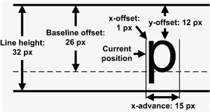

图 7.2 字符几何。

该图说明了 `xoffset` 和 `xadvance` 之间的区别。两者都标识了从当前位置开始的水平距离。`xoffset` 指定从当前位置到字符应显示位置的距离。`xadvance` 表示从初始当前位置到下一个当前位置的距离。

## 字距调整

简单地将字符并排打印不足以产生专业的外观。不同的字符对需要不同的水平间距，而调整间距称为 *kerning*。对于像 Courier 这样的等宽字体来说这不是问题，但当常规字体在没有正确字距调整的情况下打印时，结果看起来会很突兀。

因此，Andreas Jonsson 的 Bitmap Generator 生成的 `*.fnt` 文件包含多行以 kerning 开头的行。以下是一个示例：

```
kerning first=111 second=120 amount=-1
```

这表示，如果第一个字符的 ID 为 111，第二个字符的 ID 为 120，则字符之间的间距应减少 1。换句话说，当字符 ‘o’ 在字符 ‘x’ 之前时，两者之间的空间应减少 1 以实现正确的字距调整。

## 示例应用—显示文本

`Ch07_Text` 应用演示了应用程序如何通过从纹理图集中读取矩形在画布上绘制文本。 图 7.3 显示了生成的文本的外观。


图 7.3 Ch07_Text 应用。

`Ch07_Text` 应用的顶级目录包含六个文件。 表 7.8 列出了它们并提供了每个文件的描述。

表 7.8 Ch07_Text 目录中的文件

| 文件 || 描述 |

| --- | --- |

| index.html || 创建网页并加载 JavaScript |

| --- | --- |

| ch07_text.js || 用于绘制文本的 WebGPU 代码 |

| lato.png || 包含 Lato 字符的纹理图集 |

| lato.fnt || 包含 Lato 字体数据的文本文件 |

| lato_data.json || Lato 字体数据（JSON 格式） |

| gen_text_json.py || 生成 JSON 文件的 Python 脚本 |

与其编写读取字体文件（`*.fnt`）的 JavaScript 代码，我编写了一个 Python 脚本（`gen_text_json.py`），它将 `*.fnt` 文件转换为 JSON 文件，该文件定义了一个包含每个字符属性的数组。这可以通过更改第一行的 `FONT_NAME` 变量轻松更改为读取另一种字体。

例如，`lato_data.json` 中的以下文本显示了包含 ID 为 85 的字符（字母 U）属性的文件部分：

```
{
    "id": 85,
    "x": 0,
    "y": 47,
    "width": 17,
    "height": 19,
    "xoffset": 1,
    "yoffset": 7,
    "xadvance": 20
    "kerning": { "38": -1, "44": -1, "46": -1, "47": -1, "65": -1 }
},
```

`kerning` 属性标识应如何根据下一个字符调整间距。例如，如果 “U” 后跟 “A”（ID = 65），则间距应调整 by -1 以正确设置字距。

`ch07_font.js` 文件包含应用程序的主要源代码。为了描述此代码，本讨论将其分为三个部分：

1. 创建顶点缓冲区
2. 创建索引缓冲区
3. 编写顶点和片段着色器

本节探讨每种操作并解释它们在代码中是如何执行的。

### 顶点缓冲区

从渲染角度来看，绘制一个字符需要两个连接的三角形。`topology` 属性设置为 `triangle-strip`，因此绘制两个连接的三角形需要四个顶点。每个顶点需要定义空间中的两个坐标（`x` 和 `y`）以及相应的纹理坐标（`u` 和 `v`）。因此，每个顶点在顶点缓冲区中由一组四个浮点值定义。每个字符需要四个顶点，总共 16 个浮点值。

在 `ch07_text.js` 中，形成浮点值数组是一个复杂的过程。数组名为 `vertexData`，它是用以下代码创建的：

```
// Define vertex data
const textMsg = "Hello, world!";
let leftX = -0.9;
const topY = 0.75;
const bottomY = 0.5;
const lineHeight = 32;
const scale = (topY - bottomY)/lineHeight;

// Create vertex data array
const vertexData = new Float32Array(16 * textMsg.length);

// Read character data
const fileResponse = await fetch("./lato_data.json’);
const charData = await fileResponse.json();

// Iterate through characters in message
for (let i = 0; i < textMsg.length; i++) {

    // Get index of message character
    let currentChar = charData[textMsg.charCodeAt(i) - 32];

    // Set texture coordinates
    vertexData[16 * i + 2] = currentChar.x/256.0;
    vertexData[16 * i + 3] = (currentChar.y + currentChar.height)/256.0;
    vertexData[16 * i + 6] = currentChar.x/256.0;
    vertexData[16 * i + 7] = currentChar.y/256.0;
    vertexData[16 * i + 10] = (currentChar.x + currentChar.width)/256.0;
    vertexData[16 * i + 11] = (currentChar.y + currentChar.height)/256.0;
    vertexData[16 * i + 14] = (currentChar.x + currentChar.width)/256.0;
    vertexData[16 * i + 15] = currentChar.y/256.0;
    // Set vertex coordinates
    if(i == 0) {
        vertexData[0] = leftX;
        vertexData[1] = bottomY;
        vertexData[4] = leftX;
        vertexData[5] = topY - currentChar.yoffset * scale;
    }
    else {
        vertexData[16 * i] = leftX + currentChar.xoffset * scale;
        vertexData[16 * i + 1] = bottomY;
        vertexData[16 * i + 4] = vertexData[16*i];
        vertexData[16 * i + 5] = topY - currentChar.yoffset * scale;
    }
    vertexData[16 * i + 8] = vertexData[16*i] + currentChar.width * scale;
    vertexData[16 * i + 9] = bottomY;
    vertexData[16 * i + 12] = vertexData[16 * i + 8];
    vertexData[16 * i + 13] = topY - currentChar.yoffset * scale;

    // Set kerning
    let kerning = 0;
    if(‘kerning’ in currentChar) {

        // Get next character
        if(i != textMsg.length-1) {
            let nextId = charData[textMsg.charCodeAt(i+1) - 32].id;

            // Apply kerning if needed
            if (nextId in currentChar.kerning) {
                kerning = parseInt(currentChar.kerning[nextId]);
            }
        }
    }

    // Update current horizontal position
    leftX += (currentChar.xadvance + kerning) * scale;
}

// Create vertex buffer
const vertexBuffer = device.createBuffer({
    label: "Vertex Buffer 0",
    size: vertexData.byteLength,
    usage:
        GPUBufferUsage.VERTEX |
        GPUBufferUsage.COPY_DST
});
// Write data to buffer
device.queue.writeBuffer(vertexBuffer, 0, vertexData);
renderPass.setVertexBuffer(0, vertexBuffer);
```

这段代码首先定义要打印的消息（`Hello, world!`）和应用程序使用的不同变量。`leftX` 变量标识渲染的第一个 x 坐标。由于它设置为 −0.9，因此第一个字符将开始于视口左侧边缘附近。

`topY` 和 `bottomY` 值标识该区域中顶点的最大和最小 y 坐标。根据字体文件中的说明，Lato 字体中的字符适用于 32 点行，因此 `lineHeight` 设置为 32。`scale` 用作显示坐标与字体尺寸之间的缩放因子，通过计算（`topY` – `bottomY`）/`lineHeight` 获得。


接下来，应用程序初始化 `vertexData` 数组。每个字符需要 16 个浮点值，因此该数组被设为空的 `Float32Array`，其大小通过将消息长度乘以 16 得到。

创建数组后，应用程序调用 `fetch` 从 `lato_data.json` 文件读取字符数据。如果返回正常，应用程序将把 `charData` 设为文件中定义的数据对象数组。

接下来，应用程序遍历消息中的字符。对于每个字符，它在 `vertexData` 数组中设置 16 个值。需要注意的是，纹理坐标始终介于 0.0 和 1.0 之间。这就解释了为什么 JSON 文件中的 `x` 和 `y` 参数需要除以 256（图像的宽度/高度）才能得到相应的纹理坐标。

在为给定字符设置完十六个值后，应用程序检查是否需要字距调整。它通过在当前字符的字距映射中查找下一个字符的 ID 来执行此检查。如果存在下一个字符的 ID，应用程序将把 `kerning` 变量设为所需的间距调整值。

循环的最后一部分使用 `kerning` 和字符的 `xadvance` 参数来更新 `leftX` 变量。一旦设置，`leftX` 将作为下一个字符的最左 x 坐标。

在设置完 `vertexData` 的所有值后，应用程序创建一个缓冲区（`vertexBuffer`）来容纳这些数据。然后它调用 `writeBuffer` 编码一个将 `vertexData` 复制到 `vertexBuffer` 的命令。`setVertexBuffer` 方法将顶点缓冲区与 `renderPass` 编码器关联。

## 索引缓冲区

除了在顶点缓冲区中设置值外，应用程序还创建一个索引缓冲区，其值标识顶点应被绘制的顺序。以下代码展示了索引值是如何生成的、索引缓冲区是如何创建的，以及缓冲区是如何与渲染通道编码器关联的。

```
 // Initialize index array for atlas text
const numIndexes = ((5 * textMsg.length) % 2 == 0) ? 5 * textMsg.length : 5 * textMsg.length + 1;
const indexData = new Uint16Array(numIndexes);
for(let i = 0; i<textMsg.length; i++) {
    indexData[5 * i] = 4 * i + 1;
    indexData[5 * i + 1] = 4 * i;
    indexData[5 * i + 2] = 4 * i + 3;
    indexData[5 * i + 3] = 4 * i + 2;
    indexData[5 * i + 4] = 0xffff;
}

// Create index buffer
const indexBuffer = device.createBuffer({
    label: "Index Buffer 0",
    size: indexData.byteLength,
    usage:
        GPUBufferUsage.INDEX |
        GPUBufferUsage.COPY_DST
});
device.queue.writeBuffer(indexBuffer, 0, indexData);
renderPass.setIndexBuffer(indexBuffer, "uint16");
```

这段代码的第一行值得解释。`topology` 属性被设为 `triangle-strip`，因此每个字符需要四个索引，后跟图元重启索引，该索引告诉渲染器在每个字符后重启。因此，每个字符需要五个索引值。

每个索引值作为 16 位无符号整数提供，而 WebGPU 不喜欢向 GPU 传输奇数个 16 位值。出于这个原因，这段代码首先将 `numIndexes` 设为能容纳消息所需索引值的最小偶数值。

一个示例有助于说明这一点。消息 Hello, world! 包含十三个字符，这意味着需要向 GPU 发送 13 * 5 = 65 个索引值。传输奇数个 16 位值会导致错误，因此 `numIndexes` 被设为 66。

接下来，应用程序创建一个 `Uint16Array`，其空间足以容纳 `numIndexes` 个元素。然后它遍历消息的字符并设置四个标识顶点缓冲区中顶点的索引值。在每组四个索引之后，应用程序添加图元重启值 `0xffff`，它告诉渲染器下一个三角形不应与前一个三角形连接。

一旦所有索引值都被设置，应用程序创建索引缓冲区并编码一个将索引数据写入缓冲区的命令。然后它调用 `setIndexBuffer` 将索引缓冲区与渲染通道编码器关联。

## 顶点和片段着色器

`Ch07_Text` 中的着色器代码很容易理解。顶点着色器创建一个名为 `DataStruct` 的结构并设置顶点位置和纹理坐标。片段着色器接收纹理坐标并调用 `textureSample` 在给定位置读取纹素。以下代码展示了其工作原理：

```
 // The structure that holds data for the fragment shader
struct DataStruct {
    @builtin(position) pos: vec4f,
    @location(0) uvPos: vec2f,
}
// Resources needed to access texels
@group(0) @binding(0) var sam : sampler;
@group(0) @binding(1) var tex : texture_2d<f32>;

@vertex
fn vertexMain(@location(0) coords: vec2f, @location(1) uvCoords: vec2f) -> DataStruct {
    var outData: DataStruct;
    outData.pos = vec4f(coords, 0.0, 1.0);
    outData.uvPos = uvCoords;
    return outData;
}

@fragment
fn fragmentMain(fragData: DataStruct) -> @location(0) vec4f {
    return textureSample(tex, sam, fragData.uvPos);
}
```

当我最初为这个项目编写代码时，我打算使用多采样纹理来演示抗锯齿。我创建纹理对象时将 `sampleCount` 属性设为 4，并在着色器代码中使用了 `texture_multisampled_2d` 数据类型。但每次尝试向纹理写入数据时我都会收到错误。

## 动画

动画随时间改变一个或多个对象的位置。如 第 5 章 中所述，顶点着色器可以使用线性变换（旋转、缩放和平移）更新对象的位置。准确地说，它可以通过将对象的顶点乘以一个或多个变换矩阵来变换对象的位置。

这提出了一种在 WebGPU 中为对象设置动画的方法——为对象分配一个变换矩阵并随时间更新矩阵的元素。例如，你可以通过反复更改旋转矩阵来旋转对象。你可以通过反复更新其平移矩阵随时间平移对象。

如 第 5 章 中所述，应用程序可以使用 uniform 缓冲区将变换矩阵传输到 GPU。因此，我们可以通过更新 uniform 缓冲区的内容来为对象设置动画，因为每次新的动画都需要绘制。本讨论中展示的示例代码将说明如何实现这一点。

### 插值与动画

实现动画的困难部分涉及 *连续性*。如果对象 supposed 从点 A 移动到点 B，应用程序应更新其位置，使其看起来从 A 到 B 连续移动，而没有突然的闪烁或卡顿。

计算机上不可能实现连续动画，但我们可以通过在短时间间隔内对对象位置进行微小调整来近似实现。为数学表达这一点，我们将使用五个术语：

*   `A`—起始位置
*   `B`—结束位置
*   `T`—对象从 A 移动到 B 的总时间
*   `t`—当前时间（介于 0 和 T 之间）
*   `x`—当前位置（介于 A 和 B 之间）

应该很清楚，当 `t` = 0 时 `x` 应等于 `A`，当 `t` = `T` 时 `x` 应等于 `B`。这一要求导致以下方程：

$$x = \\left( \\frac{T - t}{T} \\right)A + \\left( \\frac{t}{T} \\right)B$$

这种过程称为 *线性插值*，因为 `x` 的位置随时间线性变化。第 6 章 简要解释了如何配置纹理采样器以使用线性插值在两个纹素之间计算颜色数据。


要了解如何在 JavaScript 中执行此插值，熟悉 `requestAnimationFrame` 方法非常重要。它告诉浏览器应用程序希望在窗口重绘时收到通知。该方法接受一个回调函数，该函数将在下一次重绘之前被调用。

当回调函数被调用时，它会接收一个整数，表示自调用 `requestAnimationFrame` 以来经过的毫秒数。以这种方式，应用程序可以跟踪当前时间并正确设置插值。在下面的代码中，回调函数的名称为 `newFrame`，它通过名为 `t` 的参数接收经过的时间：

// The callback to be invoked when the window repaints
function newFrame(t) {
     … update transformation matrices …
    window.requestAnimationFrame(foo);
}
// Set the callback to be invoked
window.requestAnimationFrame(newFrame);

为了使动画正常工作，需要在回调函数的末尾再次调用 `requestAnimationFrame`。这会告诉窗口在下一次屏幕刷新时调用 `newFrame`。

## Example Application—Animation

`Ch07_Animation` 项目中的代码演示了如何使用 WebGPU 执行动画。它创建一个红色三角形并将其变换矩阵初始化为单位矩阵。然后它使用回调函数的 `requestAnimationFrame`。当函数被调用时，变换矩阵会被更新以平移三角形。

整个动画持续四秒，三角形的运动方式如下：

* 在最初的两秒内，将三角形向右平移，直到它到达视区右侧边缘。
* 在接下来的两秒内，将三角形向左平移，直到它到达视区右侧边缘。

回调函数接收当前时间并从中减去旧时间。此经过时间用于更新应用程序 uniform 缓冲区中的变换矩阵。下面的代码展示了回调函数的编写方式。

```
// Called just before the window is repainted
function newFrame(currentTime) {

    // Skip first frame
    if(oldTime == 0.0) {
        oldTime = currentTime;
        window.requestAnimationFrame(newFrame);
        return;
    }
    // Compute elapsed time in seconds
    t = (currentTime - oldTime)/1000;
    oldTime = currentTime;

    // Update total time
    totalTime += t;

    // Stop animation after four seconds
    if (totalTime > 4.0) {
        return;
    }

    // Update the uniform buffer
    motionChange = totalTime < 2.0 ? t * motionPerSec : -t * motionPerSec;
    uniformData = mat4.translate(uniformData, [motionChange, 0.0, 0.0]);
    device.queue.writeBuffer(uniformBuffer, 0, uniformData);

    // Create the command encoder and the render pass encoder
    const encoder = device.createCommandEncoder();
    const renderPass = encoder.beginRenderPass({
        colorAttachments: [{
            view: context.getCurrentTexture().createView(),
            loadOp: "clear",
            clearValue: { r: 0.9, g: 0.9, b: 0.9, a: 1.0 },
            storeOp: "store"
        }]
    });

    // Set the vertex buffer and pipeline
    renderPass.setVertexBuffer(0, vertexBuffer);
    renderPass.setPipeline(renderPipeline);

    // Associate bind group with render pass encoder
    renderPass.setBindGroup(0, bindGroup);

    // Draw vertices
    renderPass.draw(3);
    renderPass.end();

    // Submit the render commands to the GPU
    device.queue.submit([encoder.finish()]);
    window.requestAnimationFrame(newFrame);
}
```

回调函数的参数 `currentTime` 标识当前时间（以毫秒为单位）。函数通过从 `currentTime` 中减去 `oldTime` 并将差值除以 1000 来计算经过时间 `t`。然后它将经过时间加到总时间上。如果总时间大于四秒，回调就会退出。

如果 `t` 小于 2.0，三角形应向右移动。因此，`motionChange` 被设置为 `t` 乘以 `motionPerSec`，后者标识三角形每秒应移动的距离。该值用于更新写入 uniform 缓冲区的 `uniformData` 数组中的变换矩阵。

命令编码器需要在每次渲染后重建，渲染通道编码器也是如此。但着色器代码不会改变，因此无需重建着色器模块或渲染管线。在创建并配置渲染通道编码器后，回调函数调用 `draw` 以启动渲染操作。回调函数最后调用 `requestAnimationFrame`，以确保它会在窗口刷新时被调用。

## Summary

本章涵盖了大量内容。讨论调试组和错误处理的头两个部分，在搜索应用程序中难以捉摸的问题时很有帮助。同样，遮挡查询使得能够确定显示了多少个图元以及丢弃了多少个图元。

默认情况下，WebGPU 的渲染会填充其关联画布的整个区域。然而，应用程序可以通过配置与渲染通道编码器关联的视口来配置渲染区域。同样，它可以通过定义剪切矩形来指定要显示的渲染的特定部分。

WebGPU 不提供任何用于显示文本的对象或方法。因此，本章解释了如何从 TrueType 字体创建纹理图集。一旦这些图集可用，应用程序就可以通过从纹理中读取矩形来显示字符。除了显示字符之外，使用适当的字距调整间距也很重要。

本章的最后一部分讨论了动画。总体过程很简单——通过随时间改变其变换矩阵来旋转、缩放和平移对象。然而，实践中动画会带来困难。必须了解 `requestAnimationFrame` 何时以及如何执行回调函数，以及每次调用回调函数时必须重建哪些 WebGPU 资源。

# 计算应用程序 8

DOI: [10.1201/9781003422839-8](https://doi.org/10.1201/9781003422839-8)

本章搁置图形渲染，展示了如何使用 WebGPU 进行数值计算。计算应用程序在许多方面类似于图形应用程序，但它们需要不同的对象来管理 GPU 的操作。例如，计算应用程序创建计算通道编码器而不是渲染通道编码器，并创建计算管线而不是渲染管线。

计算着色器比顶点着色器和片段着色器更简单，因为它们处理的是基本数字而不是顶点、纹理、采样器和片段。但与顶点和片段着色器不同，计算着色器由组织成 *工作组* 的 *调用* 执行。了解如何在调用和工作组之间划分处理是编写计算应用程序时的重要问题。

运行计算着色器的主要优势是性能。为了衡量此性能，WebGPU 使创建时间戳查询成为可能。这些查询在 GPU 上运行，并提供执行命令所需时间的精确测量。

当多个计算着色器的调用尝试访问一个变量时，竞争条件可能导致未定义行为。因此，WebGPU 提供了原子变量，其操作始终以原子方式执行。本章的最后一部分解释了如何创建这些变量并在原子函数中更新它们。本章以一个示例项目结束，该项目展示了如何在计算着色器中使用原子变量来获得两个长值数组的点积。

## Introducing Compute Applications

开发计算应用程序的整体过程类似于开发图形应用程序。涉及至少九个步骤：


## 计算应用概览

## 快速入门步骤

1. 使用与图形应用相同的代码创建 `GPUAdapter`、`GPUDevice` 和 `GPUCommandEncoder`。
2. 调用命令编码器的 `beginComputePass()` 方法来创建计算通道编码器。
3. 创建一个或多个存储缓冲区并将它们添加到一个或多个绑定组中。
4. 编写计算着色器并将其添加到着色器模块中。
5. 使用着色器模块调用设备的 `createComputePipeline()` 方法。
6. 将计算管线与计算通道编码器关联。
7. 将绑定组与计算通道编码器关联。
8. 调用计算通道编码器的 `dispatchWorkgroups()` 方法。
9. 从缓冲区读取处理后的数据。

计算应用中的两个主要对象是命令通道编码器和命令管线。本节将介绍两者并展示如何在代码中创建它们。

## 核心对象

### 计算通道编码器

就像渲染通道编码器保存图形渲染的状态数据一样，计算通道编码器保存通用计算的状态数据。应用程序可以通过调用 `GPUCommandEncoder` 的 `beginComputePass()` 方法来创建计算通道编码器。它接受一个包含两个可选参数的对象：

* `label`—用于调试的可选字符串标识符
* `timestampWrites`—定义时间戳事件的可选对象数组

第二个参数对于需要测量操作经过时间的应用程序很重要。我将在本章后面解释时间戳和 `timeStampWrites` 参数。

创建计算通道编码器后，应用程序可以调用其方法将编码器与其他对象关联。表 8.1 列出了其中八种方法并提供了每个方法的描述。

表 8.1 计算通道编码器的方法

| 方法 | 描述 |
| --- | --- |
| `dispatchWorkgroups(count)` | 执行计算管线中定义的计算 |
| `dispatchWorkgroupsIndirect(buffer, offset)` | 使用间接缓冲区中提供的参数执行计算 |
| `end()` | 标记要设置命令的结束 |
| `setPipeline(pipeline)` | 将计算管线与编码器关联 |
| `setBindGroup(group)` | 将绑定组与编码器关联 |
| `insertDebugMarker()` | 在编码器的命令中插入标记 |
| `pushDebugGroup()` | 使用给定标签开始调试组 |
| `popDebugGroup()` | 结束最近推送的调试组 |

在图形应用程序中，渲染通道编码器基于 `draw`、`drawIndexed` 和 `drawIndirect` 等方法创建渲染命令。在计算应用程序中，计算通道编码器基于 `dispatchWorkgroups` 和 `dispatchWorkgroupsIndirect` 等方法创建计算命令。

这两种方法都告诉 GPU 执行计算管线中定义的运算。区别在于 `dispatchWorkgroupsIndirect` 使用间接渲染，这告诉 GPU 从设备上的缓冲区访问渲染参数。

计算通道编码器的 `end()` 方法执行与渲染通道编码器的 `end()` 方法相同的操作。它完成编码器命令的记录，告诉编码器命令可以通过设备的队列发送到 GPU。

`setPipeline()` 和 `setBindGroup()` 方法对于将编码器与计算所需的对象关联是必要的。`setPipeline()` 将编码器与计算管线关联，后者标识要执行的计算的性质。`setBindGroup()` 将编码器与绑定组关联，后者提供计算任务所需资源（数据）的访问权限。

### 计算管线

与前几章讨论的渲染管线一样，计算管线定义了 GPU 要执行的运算。它可以通过调用设备的 `createComputePipeline()` 方法来创建，该方法接受一个描述符，其中包含 表 8.2 中列出的属性。

表 8.2 计算管线描述符属性

| 属性 | 是否必需 | 描述 |
| --- | --- | --- |
| `label` | N | 用于调试的标识符 |
| `compute` | Y | 描述要执行的计算 |
| `layout` | Y | 描述计算中使用的资源排列 |

就像渲染管线具有提供顶点和片段着色器信息的顶点和片段属性一样，计算管线具有提供要执行的计算着色器信息的 `compute` 属性。它必须设置为一个对象，其中包含 表 8.3 中列出的三个属性。

表 8.3 计算模块属性

| 属性 | 是否必需 | 描述 |
| --- | --- | --- |
| `module` | Y | 包含计算着色器的着色器模块 |
| `entryPoint` | Y | 计算着色器中入口点函数的名称 |
| `constants` | N | 可以在着色器中访问的名称-值对 |

`module` 属性必须设置为着色器模块，并且在计算应用程序中创建着色器模块的过程与在图形应用程序中创建的过程相同。即，应用程序使用包含 表 8.4 中列出的属性的对象调用设备的 `createShaderModule()`。

表 8.4 着色器模块创建属性

| 属性 | 是否必需 | 描述 |
| --- | --- | --- |
| `label` | N | 用于调试的标识符 |
| `code` | Y | 包含着色器代码的字符串 |
| `hints` | N | 定义着色器编译器提示的映射 |
| `sourceMap` | N | 开发人员工具使用的数据 |

`createComputePipeline()` 所需的 `layout` 属性可以设置为描述管线绑定组结构的 `GPUPipelineLayout`。为了简单起见，本书中的示例代码将 `layout` 设置为 `auto`，这告诉管线通过检查着色器代码来形成绑定组布局。

例如，以下代码创建了一个计算管线，告诉 GPU 执行名为 `computeModule` 的模块中的着色器。计算着色器中的入口点名为 `computeMain`。

```javascript
// Creating a compute pipeline
const computePipeline = device.createComputePipeline({
    label: "Compute Pipeline 0",
    layout: "auto",
    compute: {
        module: computeModule,
        entryPoint: "computeMain"
    }
});
```

计算管线创建后，可以通过调用编码器的 `setPipeline()` 方法将其与计算通道编码器关联。如果编码器的名称为 `computePass`，则以下代码创建关联：

```javascript
// Associate the pipeline with the compute pass encoder
computePass.setPipeline(computePipeline);
```

如图所示，创建计算管线所需的代码比创建渲染管线少得多。

## 缓冲区操作

（大多数）计算应用程序中使用的缓冲区与图形应用程序中使用的缓冲区之间存在两个主要区别：

1. 计算应用程序通常从存储缓冲区或存储纹理访问数据。由于其尺寸较小，统一缓冲区并不常见。
2. 计算完成后，应用程序需要从 GPU 内存中检索处理后的数据。

在大多数图形应用程序中，缓冲区数据沿一个方向移动——从主机到 GPU。但在计算应用程序中，缓冲区数据在计算前从主机传输到 GPU，计算后从 GPU 传输到主机。本讨论重点介绍存储缓冲区，存储纹理将在 第 9 章 中介绍。


在某些系统中，CPU 和 GPU 访问同一内存。在这些共享内存系统中，将数据移入移出 GPU 很简单。但在大多数系统中，GPU 位于具有独立内存的显卡上。要访问 GPU 的内存，应用程序需要映射和取消映射缓冲区。应用程序还需要在一个缓冲区和另一个缓冲区之间复制数据。以下讨论介绍了这两种操作。

## 映射和取消映射缓冲区

缓冲区如果其数据可以通过 `ArrayBuffer` 访问，则为 *映射的*。创建缓冲区后，应用程序可以通过调用其三种方法来执行映射操作：
* `getMappedRange(offset, size)`—返回包含指定范围内 `GPUBuffer` 映射数据的 `ArrayBuffer`
* `mapAsync(mode, offset, size)`—返回一个 `Promise`，当缓冲区成功映射时解析为 `ArrayBuffer`
* `unmap()`—销毁缓冲区的映射范围，使其可用于其他操作

如果缓冲区是在 `mappedAtCreation` 属性设置为 true 的情况下创建的，则其映射内容可以使用 `getMappedRange` 访问。这使得初始化其内容变得容易。

用于演示这一点，以下代码创建了一个包含 16 字节的缓冲区。然后它调用 `getMappedRange` 来访问底层的 `ArrayBuffer` 并在 `ArrayBuffer` 中设置四个浮点值。
```
// Create buffer
const computeBuffer = device.createBuffer({
    mappedAtCreation: true,
    size: 16,
    usage: GPUBufferUsage.STORAGE
});
 
// Access the mapped data
const buff = computeBuffer.getMappedRange();
 
// Set the content of the mapped data
new Float32Array(buff).set([1.0, 2.0, 3.0, 4.0]);
 
// Unmap buffer
computeBuffer.unmap();
```

GPU 完成计算后，应用程序将希望读取包含处理数据的缓冲区（结果）。在这种情况下，应用程序可以调用 `mapAsync`。如果映射成功，应用程序可以通过调用 `getMappedRange` 读取缓冲区的数据，并通过调用 `unmap` 销毁映射。

例如，假设处理后的数据存储在名为 `procBuffer` 的缓冲区中，该缓冲区是用 `GPUBufferUsage.MAP_READ` 标志创建的。以下代码访问包含缓冲区数据的 `ArrayBuffer`。
```
// Establish a mapping
await procBuffer.mapAsync(GPUMapMode.READ);
// Read the mapped data in an ArrayBuffer
const procData = procBuffer.getMappedRange();
 
// Access the floating-point values
const floatData = new Float32Array(procData);
 
// Destroy the mapping
procBuffer.unMap();
```

如图所示，`mapAsync` 需要一个参数来标识缓冲区的映射数据将如何被访问。这可以设置为 `GPUMapMode.READ` 或 `GPUMapMode.WRITE`。

在编写计算应用程序时，了解如何映射和取消映射缓冲区非常重要。本章及后续章节中的示例代码将使用类似的代码来读取和写入计算缓冲区的数据。

## 复制缓冲区

如果 GPU 访问与 GPU 分开的内存，则应用程序无法直接映射存储缓冲区以进行读取。换句话说，如果缓冲区的 usage 属性包含 `GPUBufferUsage.STORAGE`，则不能包含 `GPUBufferUsage.MAP_READ`。这意味着应用程序需要执行四个操作才能从存储缓冲区读取数据：
1. 创建一个可映射的缓冲区，其 usage 包含 `GPUBufferUsage.MAP_READ`。
2. 编码一个命令，将数据从存储缓冲区复制到可映射缓冲区。
3. 当设备完成执行其命令时，将可映射缓冲区映射到 `ArrayBuffer`。
4. 从 `ArrayBuffer` 读取数据。

对于步骤 2，了解 `GPUCommandEncoder` 的 `copyBufferToBuffer` 方法非常重要。表 8.5 列出了此方法的五个参数。

表 8.5 `copyBufferToBuffer` 方法的参数

| 参数 || 类型 || 描述 |
| --- | --- | --- |
| source || GPUBuffer || 要复制数据的缓冲区 |
| --- | --- | --- |
| sourceOffset || Integer || 开始复制的源中的字节偏移量 |
| destination || GPUBuffer || 接收数据的缓冲区 |
| destinationOffset || Integer || 数据应被复制到的目标中的字节偏移量 |
| size || Integer || 从源缓冲区复制到目标缓冲区的字节数 |

调用 `copyBufferToBuffer` 并不会立即复制缓冲区的内容。相反，它会编码一个命令，指示 GPU 执行复制操作。因此，重要的是在计算通道编码器编码计算命令后调用 `copyBufferToBuffer`，但在编码器将命令发送到 GPU *之前*。以下代码给出了必要的步骤顺序的示例。
```
// Encode compute commands
computePass.dispatchWorkgroups(…);
 
// Complete encoding compute commands
computePass.end();
 
// Create mappable buffer
const mappableBuffer = device.createBuffer({ …
    usage: 
        GPUBufferUsage.COPY_DST | 
        GPUBufferUsage.MAP_READ
});
 
// Encode command to copy data into mappable buffer
encoder.copyBufferToBuffer(…);
// Submit the commands to the GPU
device.queue.submit([encoder.finish()]); 
```

作为此代码的结果，可映射缓冲区将保存复制的数据。应用程序可以通过调用其 `mapAsync` 和 `getMappedRange` 方法读取缓冲区的数据。此过程将用于读取本书中介绍的每个计算应用程序中的结果数据。

## 工作组和调用

在图形应用程序中，`vertex shader` 对每个顶点执行一次，而 `fragment shader` 对每个片段执行一次。但在运行计算应用程序时，您可以直接控制 `compute shader` 执行的次数。这种控制是通过 `workgroups` 实现的，本节将解释它们是什么以及如何配置它们。

### 工作组简介

要了解计算着色器如何执行，您需要熟悉两个术语：
* 一个 *调用* 是 `compute shader` 的单次执行
* 一个 *工作组* 是 `invocations` 的集合

应用程序通过设置 `workgroups` 的数量和每个 `workgroup` 的大小来指定 `invocations` 的数量。如果有四个 `workgroups` 且每个 `workgroup` 包含八个 `invocations`，则 `compute shader` 将执行三十二次。

`workgroups` 为什么重要？有两个原因：内存和同步。同一 `workgroup` 中的 `invocations` 可以访问特定于该 `workgroup` 的共享内存。这种组特定内存与存储缓冲区内存不同，理论上着色器可以比存储数据更快地访问工作组数据。这使得工作组内存成为存储中间计算结果的理想位置。

通常，没有办法知道一个 `invocation` 相对于另一个 `invocation` 的执行时间。但 `WebGPU` 提供了屏障，可以使在 `workgroup` 中同步 `invocations` 成为可能。`workgroup barrier` 强制每个 `invocation` 在每个其他 `invocation` 完成访问工作组内存中的数据之前暂停。`storage barrier` 强制每个 `invocation` 在每个其他 `invocation` 完成访问存储内存中的数据之前暂停。请注意，这些屏障无法在不同的 `workgroups` 之间同步 `invocations`。

### 工作组类比

工作组可能难以理解，因此我将给出一个类比。假设一所学校包含多个教室，每个教室都有一个黑板。每个教室的黑板只能由该班的学生使用。此外，学校有一个全局黑板，学校里的每个学生都可以访问。

每个学生有两个标识符。`Local ID` 在教室内部标识学生，而 `Global ID` 在整个学校范围内标识学生。不同教室的学生可能具有相同的 `Local ID`，但没有任何两个学生会具有相同的 `Global ID`。


当学生进入学校时，他们会去到全局黑板，并使用他们的 `Global ID` 来查找需要处理的数据。然后他们进入自己的教室，并与其他学生一起使用班级黑板处理数据。处理完成后，每位学生都会返回到全局黑板发布他的/她的结果。图 8.1 给出了这个奇怪学校的样子。

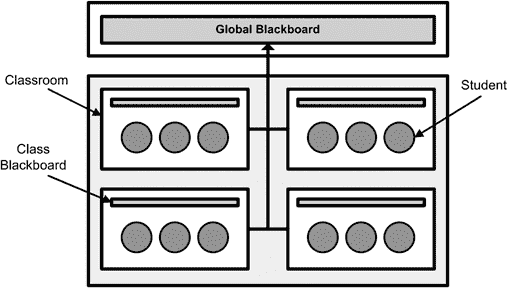

图 8.1 学生学校。

在这个类比中，学生是调用，教室是工作组。教室里的黑板代表工作组内存，每个工作组中的调用都可以访问。全局黑板代表存储缓冲区或存储纹理，每个调用都可以访问。每个调用都有一个 `Local ID` 用于在工作组内标识它，以及一个 `Global ID` 用于在所有调用中标识它。

当一个调用开始时，它可以使用其 `Global ID` 从存储资源读取输入数据。然后它会与其工作组中的其他调用一起处理数据。处理完成后，调用会将结果的一部分写回存储资源。图 8.2 显示了这种情况。

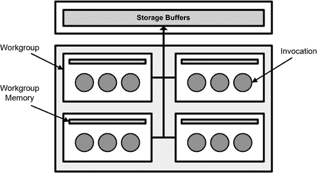

图 8.2 调用和工作组。

WebGPU 对一个工作组相对于另一个工作组的执行时间不做任何保证。GPU 上在任何时候都可能有任意数量的工作组正在执行。唯一可以确定工作组已完成的方法是整个计算任务已完成。因此，应用程序通常会多次执行着色器，以确保调用在全局上同步。

## Dispatching Workgroups

计算应用程序不会调用像 `draw` 或 `drawIndexed` 这样的方法。相反，计算应用程序通过调用计算通道编码器的 `dispatchWorkgroups` 方法来编码计算命令。这接受 1、2 或 3 个参数，指定应在每个维度中创建多少个工作组。例如，以下代码编码了一个由 4×3 网格工作组处理的计算命令：

```
computePass.dispatchWorkgroups(4, 3)
```

第三维的值默认为 1。这意味着以下代码将创建相同的工作组网格：

```
computePass.dispatchWorkgroups(4, 3, 1)
```

多维工作组使处理多维数据变得方便。如 第 9 章 将会明确，使用二维调用比一维调用更容易处理图像。

除了 `dispatchWorkgroups` 之外，应用程序还可以通过调用 `dispatchWorkgroupsIndirect` 方法来编码计算命令。这接受两个参数：包含配置信息的一个缓冲区以及缓冲区中的字节偏移量。缓冲区必须包含三个 32 位无符号整数的块，用于标识每个维度中的工作组数量。

设置工作组数量并不会设置要执行的调用数量。工作组大小由计算着色器确定，这是下面讨论的主题。

## Compute Shaders

与顶点着色器和片段着色器一样，计算着色器也是用 WebGPU 着色器语言 (`WGSL`) 编写的，该语言在 第 4 章 中进行了详细讨论。这意味着计算着色器可以访问对数字、向量和矩阵进行操作的相同函数。但有四个特征使计算着色器独一无二：

1. 无返回值
2. 不同的入口点属性
3. 不同的内置变量和函数
4. 访问工作组内存

第一点很重要。顶点着色器的返回值设置顶点的<|message|>位置，而片段着色器的返回值设置片段的颜色。但计算着色器的返回值没有任何用途。计算着色器通常从存储缓冲区读取并写入其他存储缓冲区。

### Entry Point Attribute

如 第 4 章 中所述，顶点着色器的入口点必须以 `@vertex` 为前缀，而片段着色器的入口点必须以 `@fragment` 为前缀。计算着色器的入口点必须以 `@compute` 为前缀，后跟 `@workgroup-size`，以及包含 1、2 或 3 个值的括号。

括号内的值指定用于执行着色器的工作组的大小。例如，假设应用程序使用以下代码创建了一个 5×4 工作组网格：

```
computePass.dispatchWorkgroups(5, 4)
```

如果每个工作组应具有 2×2 的调用网格，则计算着色器的入口点应以以下属性为前缀：

```
@compute @workgroup_size(2, 2)
```

此属性与以下内容产生相同的结果：

```
@compute @workgroup_size(2, 2, 1)
```

在两种情况下，调用总数均为 5 × 4 × 2 × 2 = 80。请记住，JavaScript 代码设置的是工作组的 *数量*，而计算着色器设置的是每个工作组的 *大小*。工作组的大小是有限的（在我系统上最大为 256），但工作组的数量是无限的。

### Built-in Variables and Functions

如 第 4 章 中所述，着色器的入口点可以使用 `@builtin` 属性访问内置变量。例如，顶点着色器可以使用 `@builtin(vertex_index)` 访问当前顶点的索引，而片段着色器可以使用 `@builtin(position)` 访问当前片段的位置。

计算着色器可以访问五个内置变量，提供与调用和工作组相关的信息。表 8.6 列出了它们各自。

表 8.6 计算着色器中的内置变量

| 内置变量 || 数据类型 || 描述 |
| --- | --- | --- |
| `num_workgroups` || `vec3<u32>` || 工作组数量 |
| --- | --- | --- |
| `workgroup_id` || `vec3<u32>` || 调用所在工作组的 ID |
| `global_invocation_id` || `vec3<u32>` || 所有调用中调用的 ID |
| `local_invocation_id` || `vec3<u32>` || 工作组中调用的 ID |
| `local_invocation_index` || `u32` || 调用在工作组中的索引 |

其中大多数很容易理解。`num_workgroups` 标识工作组的数量，其等于 `dispatchWorkgroups` 方法中给出的值。`workgroup_id` 提供当前工作组的唯一标识符，而 `global_invocation_id` 提供在所有调用中调用的标识符。

了解最后两个变量 `local_invocation_id` 和 `local_invocation_index` 之间的区别很重要。前者标识工作组中当前调用的多维 ID，而后者提供工作组中调用的一维 ID。前者在调用需要访问多维数据时很有帮助，后者在调用需要访问一维结构（如向量或数组）时很有帮助。

一个示例将展示如何使用这些变量。以下入口点 `computeMain` 将工作组大小设置为 32，并在其参数列表中访问 `workgroup_id` 和 `local_invocation_id` 变量。

```
@compute @workgroup_size(32)
fn computeMain(@builtin(workgroup_id) wg_id : vec3<u32>,
    @builtin(local_invocation_id) local_id : vec3<u32>
) { … }
```

`WGSL` 提供了两个重要的函数，使同步调用成为可能。`workgroupBarrier` 使同步对工作组内存的访问成为可能。当一个调用到达此函数时，它将暂停，直到工作组中的每个其他调用完成对工作组内存的访问。


同样地，`storageBarrier` 同步对存储缓冲区和存储纹理的访问。当某个调用到达此函数时，它将暂停，直到工作组中所有其他调用完成对存储数据的访问。

`WGSL` 不提供影响不同工作组中调用的任何屏障。确保所有调用都到达给定点的唯一方法是等待 GPU 处理终止。另一个选项是使用本章后面描述的原子变量和操作。

## 工作组内存
如果希望调用能够访问工作组内存，你需要在工作组地址空间中声明一个变量。这种内存的主要优点是，*理论上*，访问速度应快于存储缓冲区中的数据。

一个缺点是许多设备为工作组提供的内存并不多。在我的系统上，最大工作组存储大小为 32,768 字节。你可以通过访问 `GPUAdapter` 对象提供的 `maxComputeWorkgroupStorageSize` 限制来在你的系统上检查此项。

```
// Access the maximum number of bytes in workgroup memory
const maxWorkGroupMemory = adapter.limits.maxComputeWorkgroupStorageSize;
```

为了演示如何访问工作组内存，以下代码在工作组地址空间中定义了一个变量，其中包含 32 个每个包含四个浮点值的向量：

```
var<workgroup> wg_data: array<vec4f, 32>
```

有了此声明，调用可以使用其本地 ID 访问工作组的数据，如以下代码所示：

```
let v = wg_data[local_id]
```

与缓冲区和纹理中的内存不同，工作组内存无法在 JavaScript 中分配或初始化。工作组内存会在计算任务完成后被释放，因此在计算着色器完成之前将结果传输到存储缓冲区非常重要。

为了明确区分 intended for a single invocation 的变量，WGSL 使能够在私有地址空间中声明变量。这在以下声明中显示：

```
var<private> private_data: array<vec4f, 32>
```

结果是，每个调用都可以访问 `private_data`。然而，由于它存储在私有内存中，调用无法像在工作组内存中那样共享数据。

## 示例应用程序—简单计算
`Ch08_SimpleCompute` 项目中的代码演示了如何编码和执行计算着色器。它创建了八个工作组，每个工作组包含四个调用。每个调用执行四个操作：
1. 使用全局 ID (`global_invocation_id`) 从存储缓冲区读取一个值
2. 将值乘以工作组 ID (`workgroup_ID`)
3. 加上工作组内调用的 ID (`local_invocation_id`)
4. 将值写回存储缓冲区

最初，存储缓冲区包含 32 个设置为 1.0 的值。处理完成后，代码会使用输入向量和输出向量更新页面。图 8.3 显示了输出的外观。

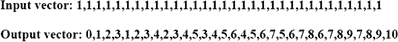

图 8.3 Ch08_SimpleCompute 应用程序。

这个 `WebGPU` 计算能力的演示并不特别令人兴奋，但它展示了如何编码计算着色器以及如何创建计算通道编码器和计算管线。

### 计算着色器
`Ch08_SimpleCompute` 应用程序中的计算着色器展示了变量声明如何访问存储缓冲区以及内置变量如何被访问。其代码如下所示：

```
@binding(0) @group(0) var<storage, read_write> data : array<f32, 32>;

override group_size: u32;

@compute @workgroup_size(group_size)
fn computeMain(
    @builtin(global_invocation_id) id : vec3<u32>,
    @builtin(workgroup_id) wg_id : vec3<u32>,
    @builtin(local_invocation_id) local_id : vec3<u32>)
{
    data[id.x] = f32(wg_id.x) * data[id.x] + f32(local_id.x);
}
```

如图所示，着色器将名为 `data` 的存储缓冲区作为 32 个浮点值的数组访问。由于声明包含关键字 `read_write`，着色器可以读取和写入缓冲区。

计算着色器声明了一个名为 `group_size` 的变量。由于声明以 `override` 开头，这是一个被覆盖的变量，其值在创建计算管线时设置。准确地说，其值将被设置为 4，因为这是 `createComputePipeline` 方法中提供的常量映射中给出的值。

入口点的名称是 `computeMain`，它访问计算着色器可用的三个内置变量。第一个是 `global_invocation_id`，用于在所有其他调用中标识调用，第二个是 `workgroup_id`，用于在所有工作组中标识工作组，第三个是 `local_invocation_id`，用于在工作组中的调用中标识调用。

入口点的名称前面是 `@workgroup_size(group_size)`。`group_size` 是一个被覆盖的变量，其值等于 4，因此每个工作组将有 4 个调用。由于有 8 个工作组，总共有 32 个调用。这意味着 `global_invocation_id` 将从 0 运行到 31，`workgroup_id` 将从 0 运行到 7，`local_invocation_id` 将从 0 运行到 3。

无论你的工作组具有什么维度，标识符都必须声明为三维向量。例如，如果工作组只有一个维度，其调用需要使用向量的第一个元素访问 ID。这解释了为什么工作组 ID 访问为 `wg_id.x`，本地 ID 访问为 `local_id.x`。

### 计算通道编码器和管线
如前所述，计算应用程序中的核心数据结构是计算通道编码器和计算管线。以下代码展示了这些对象如何在 `Ch08_SimpleCompute` 应用程序中创建。

```
// Create the compute pass encoder
const computePass = encoder.beginComputePass({
    label: "Compute Pass 0"
});
// Define the compute procedure
const computePipeline = device.createComputePipeline({
    label: "Compute Pipeline 0",
    layout: "auto",
    compute: {
        module: shaderModule,
        entryPoint: "computeMain",
        constants: {
            group_size: 4
        }
    }   
});
computePass.setPipeline(computePipeline);

// Access the bind group layout
const bindGroupLayout = computePipeline.getBindGroupLayout(0);

// Create the bind group
let bindGroup = device.createBindGroup({
    layout: bindGroupLayout,
    entries: [{
        binding: 0,
        resource: { buffer: computeBuffer }
    }]
});
computePass.setBindGroup(0, bindGroup);

// Encode compute commands
computePass.dispatchWorkgroups(8);

// Complete encoding compute commands
computePass.end();
```

此代码不创建任何时间戳，因此 `encoder.beginComputePass` 方法中的对象只有标签。`device.createComputePipeline` 中的对象具有描述管线的标签以及一个 `compute` 属性，用于标识着色器模块、入口点和要传递给着色器的常量。

`constants` 属性可以设置为包含由冒号分隔的名称-值对的对象。在这种情况下，它将名称 `group_size` 与值 4 关联。计算着色器将通过名为 `group_size` 的被覆盖变量访问此值。这是一种方便设置工作组大小的方法。

创建计算管线后，应用程序将其与计算通道编码器关联。它还将编码器与包含应用程序存储缓冲区的绑定组关联。

建立这些关联后，应用程序调用 `dispatchWorkgroups` 来编码计算命令。由于参数设置为 8，总共将创建 8 个工作组。之后，应用程序调用计算通道编码器的 `end` 方法以完成编码过程。

### 复制和映射缓冲区


## 简单计算缓冲区创建

`Ch08_SimpleCompute` 项目中的代码创建了一个 128 字节的存储缓冲区并用 1.0 的值填充它。以下代码创建缓冲区：

// Create compute buffer
const computeBuffer = device.createBuffer({
    mappedAtCreation: true,
    size: 128,
    usage: GPUBufferUsage.STORAGE | GPUBufferUsage.COPY_SRC
});
```

了解 `createBuffer` 方法的属性很重要。`mappedAtCreation` 属性被设置为 `true`，因为应用程序将在缓冲区创建后立即访问其映射的缓冲区。第一个使用标志是 `GPUBufferUsage.STORAGE`，因为应用程序正在创建一个存储缓冲区。第二个使用标志是 `GPUBufferUsage.COPY_SRC`，因为 GPU 将把缓冲区的数据复制到应用程序可以从中读取的第二个缓冲区。

缓冲区创建后，应用程序使用以下代码以 `ArrayBuffer` 的形式访问其映射内容：

// Access the mapped data
const buff = computeBuffer.getMappedRange();
```

获取映射的 `ArrayBuffer` 后，应用程序将其转换为包含 32 个浮点值、全部设置为 1.0 的 `Float32Array`。

// Set the content of the mapped data
const inputVals = new Array(32);
inputVals.fill(1.0);
new Float32Array(buff).set(inputVals);
```

当缓冲区的内容已设置后，应用程序通过调用缓冲区的 `unmap` 方法关闭映射：

```
computeBuffer.unmap();
```

任务完成后，应用程序不会直接从 `computeBuffer` 读取，因为 GPU 内存（可能）与 CPU 内存是分离的。相反，它创建了一个名为 `mappableBuffer` 的第二个缓冲区作为暂存缓冲区。它使用以下代码创建缓冲区：

// Create mappable buffer
const mappableBuffer = device.createBuffer({
  size: 128,
  usage: GPUBufferUsage.COPY_DST | GPUBufferUsage.MAP_READ
});
```

在这种情况下，第一个使用标志是 `GPUBufferUsage.COPY_DST`，因为应用程序将从计算缓冲区复制数据到此缓冲区。第二个使用标志是 `GPUBufferUsage.MAP_READ`，因为应用程序将在复制操作完成后读取缓冲区的数据。

缓冲区创建后，应用程序调用命令编码器的 `copyBufferToBuffer` 方法来编码一个将数据从计算缓冲区写入可映射缓冲区的命令。这将在 GPU 完成执行使用 `dispatchWorkgroups` 编码的命令后执行。

```
// Encode copy command
encoder.copyBufferToBuffer(computeBuffer, 0, mappableBuffer, 0, 128);
```

GPU 执行编码器的命令后，可映射缓冲区将保存从计算缓冲区复制的数据。因为缓冲区是可映射的，所以应用程序可以通过调用 `mapAsync` 建立映射：

```
await mappableBuffer.mapAsync(GPUMapMode.READ);
```

接下来，应用程序以 `ArrayBuffer` 的形式访问缓冲区的映射内容并将其转换为 `Float32Array`。

```
const procData = mappableBuffer.getMappedRange();
const floatData = new Float32Array(procData);
```

应用程序使用完 `Float32Array` 后，可以通过调用缓冲区的 `unmap` 方法终止映射。

```
mappableBuffer.unmap();
```

这种存储缓冲区和可映射缓冲区的用法比应有的更复杂。幸运的是，一旦你有一个计算应用程序正常工作，通过复制和粘贴很容易让其他应用程序正常工作。

## 时间戳

计算应用程序的目标是以高速处理数字，因此测量时间是一个重要优先事项。通常，测量经过的时间很简单：在任务之前获取时间戳，在任务之后获取时间戳，然后相减。

不幸的是，在 WebGPU 计算应用程序中测量时间更为复杂。这是因为应用程序需要为 GPU 编码查询命令并创建查询缓冲区来存储结果。涉及五个步骤：

1. 检查客户端系统是否支持时间戳。
2. 创建查询集。
3. 创建一个缓冲区来保存时间戳。
4. 使用时间戳配置创建计算通道编码器。
5. 编码记录时间戳的命令。

以下讨论探讨这些步骤。在每种情况下，它解释了需要哪些对象和方法，然后展示它们如何在代码中实现。

### 检查时间戳支持

在尝试测量经过时间之前，确保客户端系统支持时间戳查询是个好主意。应用程序可以通过访问 `GPUAdapter` 的 `features` 属性来检查支持情况，以查看其是否包含字符串 `timestamp-query`。以下代码展示了如何实现这一点：

```
const timeSupport = adapter.features.has("timestamp-query")
```

如果支持时间戳查询，应用程序可以专门请求支持此功能的设备。以下代码使用三元运算符根据是否支持时间戳来访问设备：

```
const device = timeSupport ?
    await adapter.requestDevice({ 
        requiredFeatures: ["timestamp-query"] }) :
    await adapter.requestDevice();
```

完成此操作后，如果 `timeSupport` 为 `true`，应用程序可以确定设备将支持时间戳查询。

### 创建查询集

第 7 章 解释了应用程序如何使用设备的 `createQuerySet` 方法创建查询集。它接受一个包含两个必需属性的对象：

* `count`—要读取的查询数量
* `type`—要读取的查询的性质

对于时间戳查询，`type` 必须设置为 `timestamp`。

`Ch08_DotProduct` 应用程序创建了一个包含两个查询的查询集：一个在计算任务之前，一个在任务之后。以下代码展示了如何实现：

```
const querySet = timeSupport ?
    device.createQuerySet({
        label: "Query Set",
        count: 2,
        type: "timestamp"
    }) : None;
```

查询集包含查询结果，但它不能像缓冲区或纹理一样传递给 GPU。需要为查询集创建一个特殊缓冲区，这将在下一节讨论。

### 为查询结果创建缓冲区

GPU 只有在缓冲区已专门为此目的配置时才会将查询结果写入缓冲区。创建用于时间戳的查询缓冲区时，需要注意两点：

* 时间戳以 64 位整数提供，因此缓冲区的大小应设置为保存时间戳数量乘以大小。
* `usage` 属性必须包含 `GPUBufferUsage.QUERY_RESOLVE`。

`Ch08_DotProduct` 应用程序使用以下代码创建保存两个查询结果的查询缓冲区：

// Create the query buffer
const queryBuffer = timeSupport ?
    device.createBuffer({
        size: querySet.count * 
            BigInt64Array.BYTES_PER_ELEMENT,
        usage: 
            GPUBufferUsage.QUERY_RESOLVE | 
            GPUBufferUsage.COPY_SRC
    }) : None
```

由于此代码，缓冲区的大小将始终足够大以容纳查询集中的查询。

### 创建计算通道编码器

如前所述，应用程序通过调用命令编码器的 `beginComputePass` 方法创建计算通道编码器。它接受一个可选的 `timestampWrites` 属性，可以将其设置为配置时间戳查询过程的对象。此对象具有三个属性：

* `querySet`—保存时间戳的查询集
* `beginningOfPassWriteIndex`—记录计算通道开始时时间戳的查询索引
* `endOfPassWriteIndex`—记录计算通道结束时时间戳的查询索引

在 `Ch08_DotProduct` 应用程序中，第一个时间戳应保存操作的开始时间，第二个时间戳应存储结束时间。这两个值都应存储在名为 `querySet` 的查询集中。这可以使用以下代码进行配置：


```
const computePass = timeSupport ?
    encoder.beginComputePass({
        timestampWrites: {
            querySet,
            beginningOfPassWriteIndex: 0,
            endOfPassWriteIndex: 1
        }}) :
    encoder.beginComputePass({})
```

一旦计算通道编码器被创建，它将能够向设备传递时间戳查询。

## 编码命令以记录时间戳

应用程序通过调用 `draw` 等方法来编码渲染命令，并通过调用 `dispatchWorkgroups` 等方法来编码计算命令。要指示 GPU 记录时间戳查询，应用程序需要调用命令编码器的 `resolveQuerySet` 方法。这需要五个参数，表 8.7 列出了其中每一个。

表 8.7 `resolveQuerySet` 方法的参数

| 参数 || 数据类型 || 描述 |
| --- | --- | --- |
| `querySet` || `GPUQuerySet` || 用于保存时间戳的查询集 |
| --- | --- | --- |
| `firstQuery` || `unsigned int` || 第一个查询的索引 |
| `queryCount` || `unsigned int` || 要执行的时间戳查询数量 |
| `destination` || `GPUBuffer` || 用于保存结果的查询缓冲区 |
| `destinationOffset` || `unsigned int` || 查询缓冲区中的字节偏移量 |

在 `Ch08_DotProduct` 应用程序中，查询包含在 `querySet` 中，第一个查询的索引为 0，查询数量为 2。时间戳数据应写入 `queryBuffer` 的字节 0 处。这通过以下代码配置：

```
if (timeSupport) {
    encoder.resolveQuerySet(querySet, 0, 2, queryBuffer, 0);
}
```

这应在需要测量的操作之后调用。它应在将数据从查询缓冲区复制到暂存缓冲区的命令之前调用。GPU 执行其命令后，应用程序可以使用读取存储缓冲区中常规数据的相同方法访问时间戳。

## 原子变量和函数

在着色器中，成百上千次调用可能同时想要更新一个变量。对于普通变量，这可能导致不可预测的行为。但是如果一个变量是 `atomic`，并且调用使用 `atomic functions` 操作该变量，则每个操作都保证在另一个操作开始之前完成。

如果一个变量包含整数并且存储在 `workgroup memory` 或 `storage buffer memory` 中，则可以使其成为 `atomic`。在代码中，如果变量的声明类型是 `atomic<u32>`、`atomic<i32>`，或这些类型的数组，则该变量是 `atomic`。为了演示，以下代码声明了一个在 `storage buffer` 中访问的无符号整数 `atomic` 数组。

```
var<storage, read_write> counter: array<atomic<u32>>
```

由于此声明，`counter` 数组的每个元素都可以使用 `WGSL` 的 `atomic functions` 中的一个进行更新。表 8.8 列出了这些函数并提供了每个函数的描述。

表 8.8 原子函数

| 函数 || 描述 |
| --- | --- |
| `atomicStore(atom_ptr, val)` || 将值存储在原子对象中 |
| --- | --- |
| `atomicLoad(atom_ptr, val)` || 返回存储在原子对象中的值 |
| `atomicExchange(atom_ptr, val)` || 将值存储在原子对象中并返回其原始值 |
| `atomicAdd(atom_ptr, val)` || 将值添加到原子对象 |
| `atomicSub(atom_ptr, val)` || 从原子对象中减去值 |
| `atomicMax(atom_ptr, val)` || 如果较大则将值写入原子对象 |
| `atomicMin(atom_ptr, val)` || 如果较小则将值写入原子对象 |
| `atomicAnd(atom_ptr, val)` || 将原子对象设置为原子值和值的 AND |
| `atomicOr(atom_ptr, val)` || 将原子对象设置为原子值和值的 OR |
| `atomicXor(atom_ptr, val)` || 将原子对象设置为原子值和值的 XOR |

这些函数的第一个参数是指向 `atomic variable` 的 `pointer`，而不是变量本身。因此，第一个参数通常前面加上引用运算符 `&`。为了演示这一点，以下代码将值 5 原子地添加到 `counter` 数组第三个元素的地址：

```
atomicAdd(&counter[2], 5)
```

关于 `atomic functions` 还有两点需要注意。首先，它们在操作执行之前返回 `atomic variable` 的值。其次，它们可以在 `compute shaders` 和 `fragment shaders` 中调用，但不能在 `vertex shaders` 中调用。

## 示例应用程序—点积

`Ch08_DotProduct` 应用程序中的代码演示了 `compute shader` 如何创建和操作 `atomic variables`。每次调用读取两个向量，计算它们的 `dot product`，并将 `dot product` 添加到一个 `atomic variable`。在显示 `dot product` 的结果后，应用程序显示执行 `compute command` 所需的时间。图 8.4 显示了其外观。

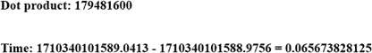

图 8.4 `Ch08_DotProduct` 应用程序。

本节从五个部分描述应用程序的操作：

1. 创建存储缓冲区
2. 配置计算管线
3. 执行计算着色器
4. 检索结果
5. 测量并显示经过的时间

正如将要展示的那样，当应用程序需要在多次调用之间跟踪运行总计时，`atomic variables` 很有帮助。

### 存储缓冲区

应用程序通过三个 `storage buffers` 将数据传递给 `GPU`。前两个包含 1,024 个整数的数组。第三个包含一个标识 `dot product` 结果的整数。对于每个缓冲区，应用程序执行四个操作：

* 通过调用 `device.createBuffer` 创建映射缓冲区
* 通过调用其 `getMappedRange` 方法访问缓冲区的映射范围
* 创建包含缓冲区数据的数组
* 取消映射缓冲区

以下代码展示了这些操作在 `ch08_dotproduct.js` 源文件中的实现方式。

```
// Set the number of values
const numVals = 1024;

// Create compute buffers
const aBuffer = device.createBuffer({
    mappedAtCreation: true,
    size: numVals * 4,
    usage: GPUBufferUsage.STORAGE 
});
const aRange = aBuffer.getMappedRange();

// Create compute buffers
const bBuffer = device.createBuffer({
    mappedAtCreation: true,
    size: numVals * 4,
    usage: GPUBufferUsage.STORAGE
});
const bRange = bBuffer.getMappedRange();

// Create compute buffers
const resBuffer = device.createBuffer({
    mappedAtCreation: true,
    size: 4,
    usage: 
        GPUBufferUsage.STORAGE | 
        GPUBufferUsage.COPY_SRC
});
const resRange = resBuffer.getMappedRange();

// Create the data arrays
const aArray = new Array(numVals);
const bArray = new Array(numVals);
const res = new Array([0]);

// Initialize vectors
for (let i = 0; i < numVals; i++) {
    aArray[i] = i + 1;
    bArray[i] = numVals - i;
}

// Create arrays in buffer memory
new Uint32Array(aRange).set(aArray);
new Uint32Array(bRange).set(bArray);
new Uint32Array(resRange).set(res);
// Unmap buffers
aBuffer.unmap();
bBuffer.unmap();
resBuffer.unmap();
```

创建每个缓冲区时，`mappedAtCreation` 属性被设置为 `true`。这使应用程序能够通过调用 `getMappedRange` 访问缓冲区的映射数据。`usage` 属性包含 `GPUBufferUsage.STORAGE` 以将缓冲区配置为 `storage buffer`。最后一个缓冲区 `resBuffer` 也具有标志 `GPUBufferUsage.COPY_SRC`，因为应用程序将从中复制数据。

创建缓冲区后，应用程序在每个缓冲区内部存储一个无符号 32 位整数数组。第一个缓冲区包含 1,024 个从 1 增加到 1,024 的整数。第二个缓冲区包含 1,024 个从 1,024 减少到 1 的整数。第三个缓冲区包含一个值为 0 的整数。该缓冲区存储 `dot product` 的结果。


一旦缓冲区的 数据 设置完毕，应用程序会对每个缓冲区调用 `unmap`。这使得缓冲区可用于处理。

## The Compute Pipeline

在创建并填充缓冲区后，应用程序创建计算通道编码器和计算管线。这通过以下代码实现：

// Create the compute pass encoder
const computePass = encoder.beginComputePass({
    label: "Compute Pass 0"
});

// Define the compute procedure
const computePipeline = device.createComputePipeline({
    label: "Compute Pipeline 0",
    layout: "auto",
    compute: {
        module: shaderModule,
        entryPoint: "computeMain",
        constants: {
            group_size: 256
        }
    }   
});
computePass.setPipeline(computePipeline);
// Access the bind group layout
const bindGroupLayout = computePipeline.getBindGroupLayout(0);

// Create the bind group
let bindGroup = device.createBindGroup({
    layout: bindGroupLayout,
    entries: [{
        binding: 0,
        resource: { buffer: aBuffer }
    },
    {
        binding: 1,
        resource: { buffer: bBuffer }
    },
    {
        binding: 2,
        resource: { buffer: resBuffer }
    }]
});
computePass.setBindGroup(0, bindGroup);

这与 `Ch08_SimpleCompute` 应用程序中的配置代码类似，但有两个重要区别。首先，在创建计算管线时，`group_size` 常量被设置为 `256`。在我使用的系统上，这是工作组中可执行的调用的最大数量。

第二个区别涉及绑定组。`Ch08_DotProduct` 项目中的绑定组引用了三个存储缓冲区。`aBuffer` 和 `bBuffer` 存储输入值，而 `resBuffer` 存储结果。由于这段代码，计算着色器将能够使用 `@group(0)` 属性和适当的 `@binding` 属性访问它们。

## The Compute Shader

计算着色器由单个工作组中的 `256` 次调用执行。每次调用读取输入数据的一部分，执行点积运算，并更新原子变量。以下代码展示了这一点：

```
@binding(0) @group(0) var<storage, read> a : array<vec4u, 256>;
@binding(1) @group(0) var<storage, read> b : array<vec4u, 256>;
@binding(2) @group(0) var<storage, read_write> res : atomic<u32>;
override group_size: u32;

@compute @workgroup_size(group_size)
fn computeMain(@builtin(global_invocation_id) id : vec3<u32>) {
    
    // Compute dot product of vectors
    let prod = dot(a[id.x], b[id.x]);
    
    // Update result atomically
    atomicAdd(&res, prod);
}
```

着色器声明了一个名为 `group_size` 的覆盖变量，其值在创建计算管线时被设置为 `256`。该变量由 `@workgroup_size` 属性使用，以设置每个工作组中的调用数量。

每次调用从第一个存储缓冲区读取一个向量，从第二个存储缓冲区读取一个向量。这两个向量的索引等于该调用的全局 ID。读取数据后，调用会调用 `dot` 函数来获得这两个向量的点积。

代码的最后一行调用 `atomicAdd` 将该调用的点积加到 `res` 上。由于 `res` 被声明为 `atomic<u32>`，它是一个原子变量。这意味着多个调用可以更新其值而不会导致并发问题。需要注意的是，`atomicAdd` 的第一个参数是指向 `res` 的指针（`&res`），而不是变量本身。

## Retrieving the Result

在调用完成计算着色器的执行后，应用程序可以访问点积的结果。该结果存储在存储缓冲区 `resBuffer` 中，应用程序执行以下五个步骤来获取结果并在页面上显示：

1. 创建一个可映射的缓冲区，其用途包含 `GPUBufferUsage.MAP_READ`。
2. 调用 `copyBufferToBuffer` 编码一个命令，将数据从 `resBuffer` 复制到 `mappableBuffer`。
3. 复制完成后，将 `mappableBuffer` 映射到一个 `ArrayBuffer`。
4. 从 `ArrayBuffer` 读取点积结果。
5. 在网页上显示结果。

以下代码展示了这些步骤在 `Ch08_DotProduct` 项目中的实现方式。

```
// Create mappable buffer
const mappableBuffer = device.createBuffer({
  size: 4,
  usage: 
      GPUBufferUsage.COPY_DST | 
      GPUBufferUsage.MAP_READ
});

// Encode copy command
encoder.copyBufferToBuffer(resBuffer, 0, mappableBuffer, 0, 4);

// Submit the commands to the GPU
device.queue.submit([encoder.finish()]);

// Read data from compute buffer
await mappableBuffer.mapAsync(GPUMapMode.READ);
const procData = mappableBuffer.getMappedRange();
const resData = new Uint32Array(procData);

// Display output in page
const outputMsg = "Result: ";
document.getElementById("result").innerHTML = outputMsg.concat(resData.toString());
```

创建可映射缓冲区时，应用程序将 usage 属性设置为 `GPUBufferUsage.COPY_DST`，因为缓冲区将在复制操作中接收数据。它还将 usage 设置为 `GPUBufferUsage.MAP_READ`，因为应用程序将通过将其映射到一个 `ArrayBuffer` 来访问缓冲区的数据。

创建缓冲区后，应用程序调用 `copyBufferToBuffer` 编码一个命令，将 `resBuffer` 的内容复制到 `mappableBuffer`。然后应用程序将命令提交到设备的 `queue`。

当设备完成命令执行后，应用程序映射缓冲区并通过调用 `getMappedRange` 访问其内容。然后它将结果转换为无符号整数数组，并通过访问 ID 为 `result` 的标签在网页上显示结果。

## Elapsed Time

该应用程序演示了应用程序如何使用时间戳查询来测量计算时间。在确认客户端设备支持时间戳后，应用程序创建了一个查询集来存储两个时间戳值。然后它创建了一个缓冲区来保存时间戳值。

为了配置时间戳处理，应用程序使用 `timestampWrites` 对象创建计算通道编码器。这标识了包含查询值的查询集，并将每个值与计算通道的开始或结束关联起来。

应用程序通过调用编码器的 `resolveQuerySet` 方法来编码时间戳查询命令。以下代码展示了如何实现：

// Encode command to record timestamp queries
encoder.resolveQuerySet(querySet, 0, querySet.count, queryBuffer, 0);

由于这段代码，GPU 将执行 `querySet` 中描述的查询，并将结果存储在 `queryBuffer` 的字节 `0` 处。命令执行后，应用程序读取两个时间戳并在网页上显示经过的时间。

## Summary

虽然计算应用程序在许多方面与图形应用程序相似，但仍有一些有趣的挑战使其独具特色。一个主要问题涉及在调用和工作组之间划分处理。每次调用代表计算着色器的一次执行，它们被组合成工作组以便于访问共享内存和同步。

一旦你理解了调用和工作组，编写计算应用程序就很直接。应用程序需要创建计算通道编码器而不是渲染通道编码器，并创建计算管线而不是渲染管线。对于数据传输，本章重点介绍了创建存储缓冲区，但计算应用程序也可以使用存储纹理，正如 第十章 将会明确的那样。

计算着色器编写起来很简单，但重要的是要跟踪它们可以使用的不同内置变量。每次调用都有一个全局 ID，用于将其与所有其他调用区分开，以及一个局部 ID，用于将其与其工作组中的其他调用区分开。这些标识符很重要，因为它们允许调用访问专门为其准备的数据。


下两章介绍了 `WebGPU` 计算能力的令人兴奋的应用。 第 9 章 使用计算应用执行机器学习，而 第 10 章 使用计算应用处理图像。

# 使用神经网络进行机器学习 9

DOI: [10.1201/9781003422839-9](https://doi.org/10.1201/9781003422839-9)

本章中，我们将停止探索 `WebGPU` API，并查看计算着色器的重要应用：*机器学习*。机器学习因其辨别数据中模式的非凡能力而对社会产生了重大影响。本章重点介绍人工神经网络（ANNs），它是机器学习最有效的方法之一。

本章的大部分内容都致力于讨论神经网络的理论，主要目标是开发一个能够分析真实世界数据的 `WebGPU` 应用。在讨论数学之前，我想介绍本章应用将被设计来解决的问题：*鸢尾花分类*。

## 鸢尾花分类

神经网络的常见测试涉及根据四个物理特征对鸢尾花进行分类：萼片宽度、萼片长度、花瓣宽度和花瓣长度。 图 9.1 给出了鸢尾花的外观概念。


图 9.1 鸢尾花示例。 （照片由 David Iliff 提供，采用知识共享许可 3.0。）

本章的目标是创建一个神经网络，它接受这四个特征并决定鸢尾花属于哪个物种。具体来说，网络将产生介于 0.0 和 1.0 之间的三个值：
* 鸢尾花属于 *setosa* 物种的估计概率
* 鸢尾花属于 *versicolor* 物种的估计概率
* 鸢尾花属于 *virginica* 物种的估计概率

为了说明其工作原理， 图 9.2 显示了由 `Ch09_IrisNetwork` 应用进行的六次测试的结果。在每种情况下，应用程序计算的三个值都与实际结果进行比较。该应用程序并不完美，但在每次测试中，计算概率的最大值都对应于实际分类。这意味着神经网络已正确分类了鸢尾花。

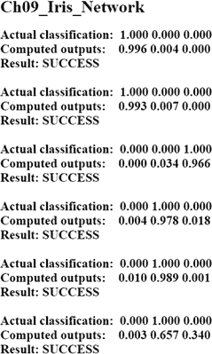

图 9.2 鸢尾花分类结果。

尽管本章重点关注花卉分类，但分类只是神经网络众多应用中的一种。另一个主要应用是 *预测*。机器学习专家已训练神经网络来预测天气模式和金融走势。当然，仅凭神经网络能够在过去数据中找到模式，并不意味着它能够可靠地预测未来。

## 神经元和感知器

在我看来，处理 ANNs 的最佳方法是将其与生物神经元进行比较。本节探讨神经元的基本操作，然后介绍 *感知器*，它们是旨在像神经元一样工作的电气电路。

### 神经元

在 19 世纪早期，外科医生仔细观察了构成神经组织的细胞。他们将这些神经细胞称为 *神经元*，而 图 9.3 说明了它们结构的简化视图。

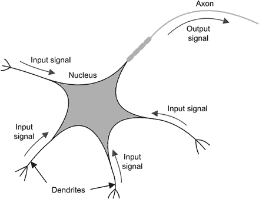

图 9.3 神经元的简化结构。

神经元通过其 *树突* 接收电刺激，树突显示在左侧。细胞内的化学物质储存传入的电，随着传入信号强度的增加，神经元的内部电压也会升高。

当神经元的电压超过 `threshold` 值时，神经元会通过其 *轴突* 发出信号，轴突显示在右上方。此输出信号可以刺激其他神经元，这意味着一个神经元的放电可能会导致一系列其他神经元放电。

自 19 世纪以来，神经学的研究取得了长足的进步，今天我们知道神经元做的远不止从一个细胞向另一个细胞发射信号。但对于本章，你只需要掌握两点：
1. 神经元接收多个输入信号并产生单个输出。此输出可以用作另一个神经元的输入。
2. 每个神经元都有一个 `threshold`，并且只有当其内部电压超过 `threshold` 时，神经元才会产生输出。

如果你掌握了这些要点，你将不会有任何困难理解 *感知器*，它们是操作类似于神经元的电路。

### 感知器

在 20 世纪 60 年代，一位名叫 Frank Rosenblatt 的研究人员构建了一个像神经元一样工作的电路。他称之为 *感知器*，而 图 9.4 说明了其工作原理。

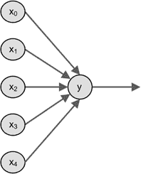

图 9.4 用感知器近似神经行为。

感知器接收多个输入并产生输出，但输入以数值形式提供。在图中，这些输入值表示为 `x[0]` 到 `x[4]`。

感知器的 `threshold` 值和输出也以数字给出。如果输入值的总和超过 `threshold` 值，则输出为 1。如果信号的总和未达到 `threshold`，则输出为 0。

例如，假设 `x[0]` 为 1.5，`x[1]` 为 0.5，`x[2]` 为 –1.0，`x[3]` 为 0.5，`x[4]` 为 1.0。在这种情况下，值的总和为 2.5。如果 `threshold` 值为 2.0，感知器将产生输出 1，因为总和大于 `threshold`。如果 `threshold` 值为 3.0，感知器将产生输出 0，因为总和低于 `threshold`。

用 `x[i]` 表示输入，用 `y` 表示输出，感知器的输出可以用以下方程表示：

$$y = \\left\\{ {}\_{0\\,\\, otherwise}^{1\\,\\, if\\,{\\sum\\limits\_{i}{x\_{i} > threshold}}}~ \\right.$$

与神经元一样，感知器可以连接起来，使一个感知器的输出作为另一个感知器的输入。 图 9.5 说明了其外观。感知器可以有不同数量的输入值，但每个感知器始终产生一个输出。

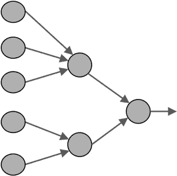

图 9.5 连接感知器。

感知器在学习该主题时很有帮助，但它们不用于实际的机器学习。这是因为感知器的行为是 *静态的*——其操作无法更新。更新电路行为的过程称为 *训练*，它是现代机器学习的一个主要问题（也许是 *核心问题*）。

## 改进模型

在 Rosenblatt 展示了他的感知器的能力后，研究人员以多种方式更新了他的模型。三个主要改进是：
1. 每个输入都乘以一个称为 *weight* 的值。
2. 而不是将输入的总和与 `threshold` 进行比较，而是添加一个称为 *bias* 的额外输入。
3. 加权输入的总和（包括 `bias`）传递给 *激活函数*，该函数决定输出。

由于这些变化，感知器更接近于适用于实际使用。因此，我们将停止使用 *感知器* 这一术语，开始将这些元素称为 *节点*。

### 权重

在 图 9.3 中，每个输入对确定输出的影响相等。但在现实世界的机器学习中，一些输入在决策过程中比其他输入具有更大的影响。此外，一些信号可能对结果产生负面影响。

为了反映这一点，每个输入都乘以一个称为 *weight* 的值。 图 9.6 显示了具有加权输入的节点的外观。


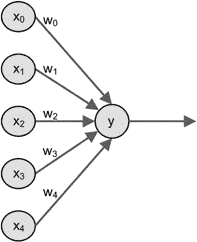

图 9.6 带权重的节点。

为了计算输出，每个输入值与其权重相乘，然后将乘积相加。随后将总和与节点的 `threshold` 进行比较。如果总和大于 `threshold`，节点会输出 1，否则输出 0。

用 `x[i]` 表示输入，用 `w[i]` 表示权重，节点的运算可以用以下方程表示：

$$y = \\left\\{ \\begin{matrix} {1\\;if\\;\\sum\\limits\_{i}w\_{i}x\_{i} > threshold} \\\\ {0\\;otherwise} \\\\ \\end{matrix}~ \\right.$$

举例说明其工作原理。假设输入 `x[i]` 为 {5.3, –2.0, 1.7, –0.3}，其权重 `w[i]` 为 {0.6, –0.2, 1.4, 2.3}。加权输入的总和可以按以下方式计算：

$$\\sum\\limits\_{i}x\_{i}w\_{i} = \\left( {5.3 \\cdot 0.6} \\right)\\; + \\left( {- 2.0 \\cdot - 0.2} \\right) + \\left( {1.7 \\cdot 1.4} \\right) + \\left( {- 0.3 \\cdot 2.3} \\right)\\; = \\;3.18 + 0.4 + 2.38 - 0.69 = 5.27$$

加权输入的总和为 5.27，因此如果节点的 `threshold` 值为 5.0，它将输出 1。如果 `threshold` 为 6.0，节点将输出 0。

权重在机器学习中发挥着至关重要的作用，因为它们使得神经网络的操作可以更新。更新这些权重的过程称为 *训练*，本章后面的部分将讨论这一主题。

## 偏置

与其跟踪 `threshold` 值，通常通过添加一个称为 `bias` 的常数值输入来简化模型。图 9.7 显示了其外观。

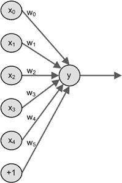

图 9.7 添加偏置输入。

`bias` 与其他每个输入一样也会接收一个权重。因此，将 `bias` 输入的值设为 1 是合理的。这就是为什么左侧最低的节点被设为 +1 的原因。本质上，`bias` 的权重充当节点的 `threshold` 值。

## 激活函数

单位阶跃函数 `u(x)` 在 `x` 大于或等于 0 时返回 1，在 `x` 小于 0 时返回 0。利用该函数，节点输出 `y` 与其加权输入 `w[i]x[i]` 之间的关系可以用以下方程表示：

$$y = u\\left( {\\sum\\limits\_{i}w\_{i}x\_{i}} \\right)$$

单位阶跃函数易于理解，但在实践中，数据科学家使用更合适的函数来产生节点的输出。这些被称为 *激活函数*。已经设计出许多类型的激活函数，它们都有三个重要特征：

1. *非线性*——现实世界的机器学习问题是非线性的

2. *单调递增*——如果 `x` > `y`，则 `f(x)` 应大于或等于 `f(y)`

3. *可微*——函数的导数应存在且易于计算

如方程所示，节点的激活函数接受节点输入的加权和并产生单个输出。本节介绍三种流行的激活函数：整流线性单元（`ReLU`）函数、sigmoid 函数和 softmax 函数。

### 整流线性单元（ReLU）函数

在电子电路中，整流器接收输入信号并传输等于输入的输出 *如果输入为正*。如果输入信号不为正，整流器传输的输出为零。

整流线性单元函数，或 `ReLU`，执行类似的操作。它的输出等于输入（如果输入为正），否则输出为 0。换句话说，`ReLU` 函数返回输入值和 0 的最大值。在代码中，这可以表示为 `max(0, x)`。图 9.8 显示了该函数的图形。

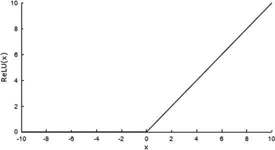

图 9.8 整流线性单元（ReLU）激活函数。

`ReLU` 函数在机器学习应用中很受欢迎，但它有一个显著的缺点：在 0 处不连续。因此，一些数据科学家更喜欢指数线性单元（`ELU`）函数。与 `ReLU` 类似，`ELU` 函数在输入大于 0 时返回输入。与 `ReLU` 不同，`ELU` 在输入小于 0 时返回输入的指数减 1，`exp(x) – 1`。这确保了节点的输出始终连续。

### 逻辑（Sigmoid）函数

逻辑函数被需要将特征分类为两个类别之一的应用所使用。它可以用以下方程在数学上表示：

$$\\sigma\\left( x \\right) = \\frac{1}{1 + e^{- x}}$$

图 9.9 显示了 `x` 在 –8 到 8 之间的逻辑函数的图形。

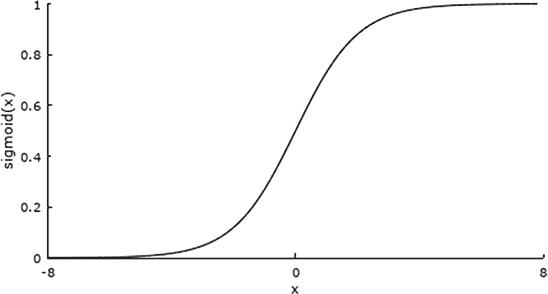

图 9.9 逻辑（sigmoid）激活函数。

逻辑函数的形状像 S，因为 sigma（σ）是 S 的希腊字母，所以它通常被称为 `sigmoid` 函数，或 `σ(x)`。它具有三个使其非常适合分类数据的特性：

1. 它的输出在 0 到 1 之间，这意味着节点的結果可以解释为概率。

2. `σ(0)` = 0.5，这意味着中心的数据点属于两个类别的可能性相等。

3. 该函数关于 y 轴对称：`σ(–x)` = 1 – `σ(x)`。

有些应用不需要可以解释为概率的输出。在这些情况下，研究人员可能更喜欢输出范围超出 0 和 1 的激活函数。一个不错的替代方案是反正切函数，或 `tanh(x)`。该函数的图形与逻辑函数非常相似，但其输出范围从 –1 到 1。

### Softmax 函数

逻辑函数使得将特征分类为两个类别之一成为可能。但许多机器学习任务，例如本章讨论的鸢尾花分类，需要将特征分类为多个类别之一。因此，神经网络将具有多个节点，其输出被组合并输入到 `softmax` 函数。

`softmax` 函数扩展了逻辑函数以支持多个类别。网络需要为每个类别一个节点，而 `softmax` 输出标识输入数据属于第 `i` 个类别的概率。在数学上，输出由以下方程确定：

$$\\sigma\\left( x\_{i} \\right) = \\frac{e^{x\_{i}}}{\\sum\\limits\_{k = 1}^{N}e^{x\_{k}}}$$

在这个方程中，`i` 标识一个类别，`N` 标识类别的数量。对于本章讨论的鸢尾花分类，有三个类别，因此 `N` 将设为 3。

## 层与深度学习

单个节点在实践中过于原始，无法使用，但当组合成网络时，它们形成了用于机器学习的复杂工具。互连的节点集合称为 *神经网络*，本节探讨其结构。

### 层

神经网络中的节点被组织成通常称为 *层* 的列。因此，神经网络经常被称为多层感知器，或 `MLPs`。每个实用的神经网络至少有两个层，图 9.10 说明了一个具有四层的 MLP。

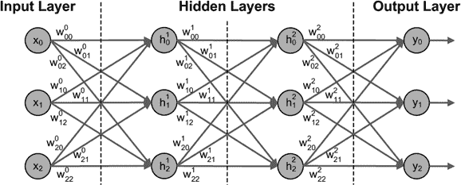

图 9.10 四层多层感知器。

第一层是输入层，最后一个层是输出层。中间的层称为 *隐藏层*。层从左到右编号，输入层为 `Layer 0`。


一个层如果其每个节点都连接到下一层的每个节点，则该层为 *稠密* 或 *全连接*。在 图 9.10 中，网络中的每一层都是稠密的。
隐藏层中的节点表示为 `h^x[y]`，其中 `x` 是层的索引，`y` 是该层中节点的索引。例如，`h²[1]` 标识第三层（2）中的第二个节点（1）。
每个节点的输出通过对加权输入求和并将和传入激活函数来计算。为简单起见，我们将使用节点名称来指代节点的输出。例如，如果节点 `h²[1]` 的激活函数是 `ReLU`，则其输出是通过将加权输入之和传入 `ReLU` 函数得到的。这可以用以下方程表示：
`h[1]² = ReLU(w[01]¹h[0]¹ + w[11]¹h[1]¹ + w[21]¹h[2]¹)`
如图所示，每个权重由三个索引标识。将权重表示为 `w^x[yz]` 时，其位置可确定如下：
* `x` 标识产生加权信号的节点的所在层
* `y` 标识产生待加权信号的节点的索引
* `z` 标识接收信号的节点的索引
例如，`w²[01]` 标识第三层（第 2 层）中的一个权重。网络将该权重乘以离开第一个节点（0）的信号并进入第二个节点（1）。

## 深度学习
随着隐藏层的增加，网络在复杂检测和分类方面的能力变得更强。当应用程序使用具有多个隐藏层的神经网络时，我们说它使用了 *深度学习*。
深度学习在许多应用中已被证明是有效的。两个著名例子包括 Google 的 AlphaGo 程序，它使用深度学习击败职业围棋选手，以及自动驾驶汽车，它们使用神经网络保持在道路上并避免交通碰撞。
但在网络中添加更多层有两个主要缺点。首先，每个隐藏层都会增加训练网络所需的时间。其次，每增加一层都会增加 *过拟合* 的可能性，这意味着网络在特定情况下分类/预测效果良好，但在通用数据上表现不佳。

## 训练
到目前为止，你应该对节点、权重和激活函数有基本的了解。但神经网络的一个关键方面尚未讨论：*训练*。训练的目标是更新权重，使输出节点产生合适的结果。这些结果可能是预测（明天的平均气温会是多少？）或分类（这张图片显示的是猫还是狗？）
为了理解训练，有助于将神经网络视为涉及加权输入的多阶段数学函数。考虑 图 9.11 中描绘的网络。
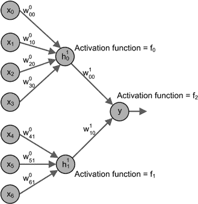
图 9.11 示例神经网络。
将激活函数表示为 `f[0]`、`f[1]` 和 `f[2]`，图示中的神经网络体现了以下数学关系：
`y(x[i]) = f2+w[10]¹f1)`
训练的目标是计算权重集合 `w[i]`，使 `y(x[i])` 尽可能接近观测数据。训练神经网络最流行的方法称为 *反向传播*，它包括五个步骤：
1. 生成权重的初始值，`w[i]`。
2. 对于每个输入向量 `x[i]` 的批次，计算输出向量 `y(x[i])`。这称为 *前向传播*。
3. 计算输出值 `y(x[i])` 与观测结果 `obs[i]` 之间的差异。这称为 *损失*。
4. 使用优化方法根据计算出的损失更新权重 `w[i]`。
5. 重复步骤 2 到 4，直到损失降至可接受的值。
如果这些步骤正确执行，神经网络在理论上将为现实世界的预测或分类产生可接受的结果。为了说明如何执行这些步骤，以下讨论介绍了权重初始化、损失计算和优化方法。

### 初始化权重
当我开始使用神经网络时，权重总是初始化为 0.0。但研究人员发现使用随机值更好。目标是确保没有输入被过度放大或缩小。这可以防止权重增长到无穷大（爆炸梯度问题）或缩小到零（消失梯度问题）。
在 2015 年的论文 *深入探究修正器* 中，Kaiming He 和其他研究人员提出了一种考虑进入节点输入数量的权重初始化方法。每个权重从平均值为零且标准差为 `σ` 的正态分布中分配一个值，其获取方式如下：
$$\\sigma = \\sqrt{\\frac{2}{fan\\,\\, in}}$$
在此方程中，*扇入* 指进入节点的输入数量。随着输入数量的增加，标准差减小，初始化值更接近于零。
一个例子将阐明其工作原理。如果一个节点有四个输入，`σ` 将等于 sqrt(2/4) = 0.707。均值为零，因此当生成正态分布权重时，68% 的权重应位于 –0.707 和 0.707 之间。95% 的生成权重的值应在 –1.414 和 1.414 之间。
JavaScript 不提供生成正态分布值的函数，因此本章中的示例代码使用 Box-Muller 变换初始化权重。这接受两个均匀分布的随机数 `x[1]` 和 `x[2]`，并使用以下关系生成正态分布权重 `w[1]` 和 `w[2]`：
$$\\begin{matrix} {w\_{1} = \\sqrt{- 2\\ln\\left( x\_{1} \\right)}\\cos\\left( {2\\pi x\_{2}} \\right)\\sigma} \\\\ {w\_{2} = \\sqrt{- 2\\ln\\left( x\_{1} \\right)}\\sin\\left( {2\\pi x\_{2}} \\right)\\sigma} \\\\ \\end{matrix}$$
在这些方程中，`σ` 是根据 He 权重初始化方法计算的标准差。以下代码显示了 `Ch09_IrisNetwork` 如何初始化其权重并将它们存储在名为 `weightBuffer` 的缓冲区中。
```
const weightData = new Array(numWeights);
for (let i = 0; i < numWeights; i+= 2) {
    let x1 = Math.random();
    let x2 = Math.random();
    weightData[i] = Math.sqrt(-2.0 * Math.log(x1)) * Math.cos(2 * Math.PI * x2) * sigma;
    weightData[i + 1] = Math.sqrt(-2.0 * Math.log(x1)) * Math.sin(2 * Math.PI * x2) * sigma;
}
const weightRange = weightBuffer.getMappedRange();
new Float32Array(weightRange).set(weightData);
weightBuffer.unmap();
```
注意，偏置权重始终初始化为零。这确保了常规输入信号在确定输出时得到优先考虑。

### 计算损失
在训练期间，应用程序需要衡量神经网络的运行情况。为此，它计算网络输出节点的值与观测值之间的差异。这种差异称为 *损失*，计算损失的方法取决于许多因素，包括神经网络输出的性质。
训练开始时，所有权重都有随机值，因此输出很可能远离期望值（高损失）。随着训练的进行，权重将被更新以使网络输出与观测值一致。当网络输出可接受时，训练停止（低损失）。损失始终大于或等于 0，损失值越低，训练越好。


如果神经网络被训练来进行预测，`loss` 通常通过计算均方误差，或 MSE 来找到。如果神经网络被训练来分类特征，`loss` 通过计算负对数似然来找到。本讨论介绍了这两种方法。

## 预测与均方误差（MSE）

假设你正在训练一个神经网络来预测三个值：日平均气温、日平均气压和日平均降水量。在这种情况下，网络将有三个输出节点——每个预测值一个。我们将这些值统称为 `y[i]`（`y[0]` 是预测的温度，`y[1]` 是预测的气压，`y[2]` 是预测的降水量）。

在训练期间，应用程序会将 `y[i]` 与过去几天的观测值进行比较。为了了解训练效果如何，应用程序会衡量预测值与观测值之间的差异。

衡量这种差异（`loss`）的常见方法涉及计算均方误差，或 MSE。这会将每个预测值（`y[i]`）从每个观测值（`obs[i]`）中减去，对结果进行平方，并将平方差相加。如果有 `N` 个预测值，MSE 使用以下方程计算 `loss`：

$$loss = \\frac{1}{N}\\sum\\limits\_{i = 0}^{N - 1}\\left( {obs\_{i} - y\\left( x\_{i} \\right)} \\right)^{2}$$

解释会使这一点更清晰。假设昨天的平均气温为 14.5°C，平均气压为 760.8 mm Hg，平均降水量为 682.0 mm。这形成向量 \[14.5, 760.8, 682.0\]。现在假设神经网络的输出是 \[12.8, 772.4, 689.4\]。`loss` 可以按以下方式计算：

$$\\begin{matrix} {loss = \\frac{1}{N}\\sum\\limits\_{i = 0}^{N - 1}\\left( {obs\_{i} - y\\left( x\_{i} \\right)} \\right)^{2}} \\\\ {= \\;\\frac{1}{3}\\left\\lbrack {\\left\\lbrack {14.5 - 12.8} \\right\\rbrack^{2} + \\left\\lbrack {760.8 - 772.4} \\right\\rbrack^{2} + \\left\\lbrack {682.0 - 689.4} \\right\\rbrack^{2}} \\right\\rbrack} \\\\ {= \\frac{1}{3}\\left( {2.89 + 134.56 + 54.76} \\right)} \\\\ {= 64.07} \\\\ \\end{matrix}$$

由于这种方法将差值的平方相加，结果始终大于或等于零。因此，MSE 是机器学习中计算 `loss` 的可接受方法。

## 分类与最大似然

现在让我们考虑旨在对特征进行分类而不是进行预测的神经网络。例如，假设神经网络的目标是确定图像中的动物是猫、狗还是马（并且总是这三种之一）。

在这种情况下，网络的输出层将有三个节点，每个节点都会产生与相应类别相关的 *probability*。`y[0]` 是计算出的图像中动物是猫的概率，`y[1]` 是计算出的图像中动物是狗的概率，`y[2]` 是计算出的图像中动物是马的概率。由于我们处理的是概率，每个值将在 0.0 和 1.0 之间，并且总和应始终接近 1.0。

理想情况下，神经网络会对正确类别产生 1.0 的输出，对错误类别产生 0.0 的输出。实际上，这永远不会发生。

如果只有两个类别，常用的激活函数是前面讨论过的 `logistic` 函数。对于两个以上的类别，则改用 `softmax` 函数。

为了计算分类 `loss`，神经网络使用 `cross-entropy method`，也称为 `log-likelihood`。如果观测值为 `obs[i]`，预测值为 `y(x[i])`，则 `loss` 按以下方式计算：

$$loss = - \\sum\\limits\_{i = 0}^{N}obs\_{i} \\cdot \\log\\left( {y\\left( x\_{i} \\right)} \\right)$$

乍一看，这似乎会产生 `loss` 的负值。但重要的是要记住所有值都是 *probabilities*，这意味着它们范围从 0.0 到 1.0。概率的对数始终为负或零，因此此 `loss` 始终为正或零。

一个例子将阐明其工作原理。假设网络产生三个概率：鸢尾花属于 setosa 物种的概率、属于 versicolor 物种的概率和属于 virginica 物种的概率。如果我们事先知道一朵鸢尾花属于 versicolor 物种，则观测值 `obs[i]` 为 \[0.0, 1.0, 0.0\]。

当然，神经网络不会产生这些完美的值，所以假设它产生概率向量 \[0.09, 0.76, 0.15\]。`loss` 可以按以下方式计算。

$$\\begin{matrix} {loss = - \\left\\lbrack {0.0 \\cdot \\log\\left\\lbrack 0.09 \\right\\rbrack + 1.0 \\cdot \\log\\left\\lbrack 0.76 \\right\\rbrack + 0.0 \\cdot \\log\\left\\lbrack 0.15 \\right\\rbrack} \\right\\rbrack} \\\\ {= - \\log(0.76) = 0.2744} \\\\ \\end{matrix}$$

如图所示，`loss` 中的只有一个项为非零。网络对错误类别分配什么概率并不重要。唯一重要的概率是分配给正确类别的概率。

## 优化

计算 `loss` 很重要，但为了改进网络的运行，我们需要一种以减少 `loss` 的方式更新其权重的方法。此过程称为 *optimization*，研究人员为此设计了几种算法。本节介绍五种经常使用的方法：

* `gradient descent`—简单但缓慢，忽略过去的梯度，可能导致振荡
* `momentum`—比 graduate descent 快，因为它使用过去的梯度
* `AdaGrad`—对每个权重应用不同的学习率
* `RMSProp`—与 AdaGrad 类似，但避免学习率衰减
* `Adam`—与 RMSProp 类似，但添加了动量

从技术上讲，第二到第五种方法只是 `gradient descent` 算法的变体。但像许多资料一样，本书将它们视为不同的方法。

### 梯度下降优化

`gradient descent` 方法是机器学习中使用最古老的优化算法，如果你查阅教科书，你很可能会经常遇到它。但尽管它很受欢迎，很少有专家会推荐它而不是替代方案。

`gradient descent` 优化依赖于一个关键的数学事实：函数在点 P 处沿点 P 处的 `negative gradient` 确定的方向下降最快。在继续之前，我需要解释什么是梯度以及如何计算它。

如果你熟悉微积分，你就知道函数在某一点的导数等于该点函数的斜率。换句话说，如果 `f(x)` 可微，其关于 x 的导数表示为 `f′(x)`，而在点 `a` 处的斜率表示为 `f′(a)`。图 9.12 显示了它的样子。

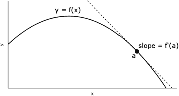

图 9.12 导数和斜率。

依赖多个变量的函数将有多个导数。例如，如果 `f(x, y)` 可微，它对 x 有一个导数，对 y 有一个导数。这些是 `partial derivatives`，用以下符号表示：

$$\\begin{matrix} {Partial\\;derivative\\;of\\;f(x,\\;y)\\;with\\;respect\\;to\\;x:\\;\\frac{\\partial f}{\\partial x}} \\\\ {Partial\\;derivative\\;of\\;f(x,\\;y)\\;with\\;respect\\;to\\;y:\\;\\frac{\\partial f}{\\partial y}} \\\\ \\end{matrix}$$

为了展示偏导数看起来是什么样，图 9.13 描绘了关系 `f(x, y) = 16 – 4x² – 2y²`。在点 (1, 2) 处，关于 x 的偏导数为 –8，关于 y 的偏导数为 –8。

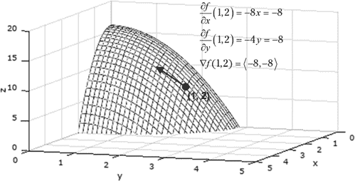

图 9.13 偏导数。


## 梯度下降与优化

## 向量与梯度

向量是一个具有大小和方向的量，它可以定义为一组分量数组，这些分量标识了向量在每个方向上的大小。图形上，你可以将向量想象为空间中的箭头，如果一个向量在正 `x` 方向指向两个单位，在负 `y` 方向指向三个单位，则可以表示为 \[2, –3\]。

梯度下降算法关注一种特殊的向量，称为梯度。函数的梯度是一个向量，其分量等于函数的偏导数。`f` 的梯度记为 `∇f`，如果函数有三个变量，其梯度将有三个分量。这可以用以下方程表示：

$$\\nabla f(x,y,z) = \\left\\lbrack {\\frac{\\partial f}{\\partial x},\\frac{\\partial f}{\\partial y},\\frac{\\partial f}{\\partial z}} \\right\\rbrack$$

如果函数有两个变量，其梯度向量将有两个分量。在 图 9.13 中，(1, 2) 处的梯度是向量 \[–8, –8\]。这由从点 (1, 2) 延伸出的黑色箭头表示。

假设图中函数代表一座山。如果你尝试攀登这座山，你会发现梯度标识了最陡的攀登方向。这不是巧合。函数的梯度始终指向最陡上升的方向。同样，反向向量始终标识最陡下降的方向。

## 梯度下降算法

现在你理解了梯度的意义，你就可以着手梯度下降算法了。它计算损失的梯度并更新模型变量，直到损失的梯度接近零。为了数学表达，我需要引入一些记号：

* 可训练变量（权重）的集合记为 `θ`。在步骤 `t` 时权重的取值记为 `θ[t]`。
* 损失是模型变量的函数，记为 `J(θ)`。损失的梯度是 `∇J(θ)`。这是一个包含损失相对于每个权重的偏导数的向量。如果有 `N` 个权重，`∇J(θ)` 将包含 `N` 个偏导数。
* 学习率记为 `η`，是一个单一值，它影响 `θ[j]` 从一步到下一步的更新幅度。

借助这些记号，梯度下降优化方法的每一步可以用以下方程表示：

`θ[t] = θ[t − 1] − η∇J(θ)`

### 示例

为了理解这一点，查看一个简单示例很有帮助。假设权重 `w[0]` 的旧值是 0.4，损失相对于 `w[0]` 的偏导数是 –0.5。损失随着 `w[0]` 的减小而增大，所以我们希望增大 `w[0]` 的下一个值。`θ[t-1]` 的第一个元素是 0.4，所以该方程将 `θ[t]` 的第一个元素（`w[0]` 的下一个值）设为 `0.4 − η(−0.5)` 或 `0.4 + 0.5η`。它对 `θ[t]` 中的其他权重执行类似操作。

现在假设损失相对于 `w[0]` 的偏导数为零。在这种情况下，损失根本不依赖于 `w[0]`，因此方程保持 `w[0]` 的值不变。

### 收敛

随着训练的继续，`∇J(θ)` 的元素应接近最小值，这意味着每组新变量应近似等于前一组变量。此时优化完成，因为它（理论上）找到了产生最小损失的权重集。这种条件称为收敛。

## 学习率

`η` 的值由开发者选择，选择该值是一个重要决策。如果 `η` 太大，算法会快速进展，但它可能绕过最小值而永远达不到最终值。

如果 `η` 太小，算法会更精确地移动，但需要很长时间。此外，优化器可能停在局部最小值而不是全局最小值。图 9.14 说明了这种差异。

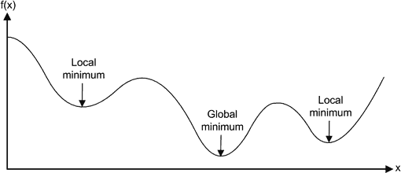

图 9.14 局部最小值和全局最小值。

## 梯度下降的局限性

除了寻找全局最小值的困难外，梯度下降方法还有三个显著的缺点：

* 它通常收敛到最小值速度很慢。
* 它只能优化可微函数。
* 它可能在值之间振荡而永远达不到最小值。

最后一个问题值得解释。如果学习率很大，算法可能在两个点之间来回跳跃而永远达不到最小值。这种跳跃称为振荡，是频繁的挫败来源。应用可以通过降低学习率来减少振荡的可能性，但训练时间会更长。

虽然梯度下降优化仍然被广泛使用，但研究人员已开发出几种替代方法来弥补其缺点。以下讨论介绍了其中四种：动量、AdaGrad、RMSProp 和 Adam 优化。

## 替代优化器

### 动量优化

动量方法与梯度下降优化有很多共同之处，但通常收敛更快且振荡可能性更低。它通过对前一步的更新进行加权并用其计算当前步的更新来实现这一点。以下方程展示了其工作原理：

`v[t] = αv[t − 1] − η∇J(θ)`

权重 `α` 称为动量，其值表示前一步应多大程度上影响当前步。它始终设置为 0 到 1 之间的值，如果设置为 0，结果就是基本的梯度下降方法。应用通常将 `α` 设为 0.9。

了解动量如何影响收敛速度很重要。如果优化器快速朝向最小值移动，`v` 将变得显著，优化器将更快接近最小值。如果优化器卡在两个值之间，`v` 将减少变量更新的幅度，优化器将放慢接近速度。

### 自适应梯度（AdaGrad）优化

梯度下降算法和动量算法对每个训练权重应用相同的学习率。但这可能不适用于所有情况——权重 `w[i]` 可能需要与 `w[j]` 不同的学习率。

AdaGrad 优化方法考虑到了这一点。它形成一个包含过去梯度平方的矩阵 `G`，然后将学习率除以 `G` 的平方根，并添加一个很小的值（`ϵ`）以确保分母永不为零。以下方程展示了其形式：

$$\\theta\_{t} = \\theta\_{t - 1} - \\frac{\\eta}{\\sqrt{G} + \\in}\\nabla J\\left( \\theta \\right)$$

`G` 矩阵的对角元素包含损失梯度相对于每个权重的平方。因此，学习率在变量之间和步进之间发生变化。但由于 `G` 始终随步进增加，新的学习率幅度始终减小。随着训练的继续，它们的数值最终会达到零，导致训练停止。

### 均方根传播（RMSProp）优化

与 AdaGrad 优化类似，RMSProp 方法使用之前的损失梯度为每个权重计算单独的学习率。主要区别在于，RMSProp 不是考虑每一个之前的损失梯度，而是基本上忘记过去的值。因此，计算出的学习率并不总是降到 0。

而不是将损失梯度值存储为 `G` 矩阵的对角元素，RMSProp 更新一个名为 `v[t]` 的向量，其中 `t` 是步进索引。该向量的值部分由两个因素决定：

* 最新损失梯度的平方，`[∇J(θ)]²`
* `v` 的前一个值，记为 `v[t-1]`

以下方程展示了 RMSProp 如何考虑这些值：


$$\\begin{matrix} {v\_{t} = \\beta v\_{t - 1} + \\left( {1 - \\beta} \\right)\\left\\lbrack {\\nabla J\\left\\lbrack \\theta \\right\\rbrack} \\right\\rbrack^{2}} \\\\ {\\theta\_{t} = \\theta\_{t - 1} - \\frac{\\eta}{\\sqrt{v\_{t}} + \\in}\\nabla J\\left( \\theta \\right)} \\\\ \\end{matrix}$$  
在此方程中，`β` 被称为 *遗忘因子*，因为它决定了过去的更新对当前更新的影响程度。随着 `β` 的减小，优化步骤更多地由当前损失决定，而非之前的更新。

## 自适应动量 (Adam) 优化
与 `RMSProp` 方法类似，`Adam`（自适应矩估计）算法为每个权重计算单独的学习率。并且与动量算法类似，当前的更新步骤部分由前一次更新步骤的结果决定。
为了计算特定于权重的学习率，`Adam` 方法计算一个向量 `v[t]`，其作用与 `RMSProp` 中的 `v[t]` 向量相同。下面的方程展示了其获取方式：
`v[t] = β[2]v[t−1] + (1−β[2])[∇J[θ]]²`
除了计算 `v[t]` 之外，`Adam` 方法通过计算另一个名为 `m[t]` 的向量来跟踪动量。如以下方程所示，它部分由前一个 `m[t]` 向量决定，部分由损失决定。
`m[t] = β[1]m[t−1] + (1−β[1])∇J(θ)`
在计算 `v[t]` 和 `v[t]` 之后，`Adam` 方法执行偏差校正，将 `v[t]` 除以 `1 – β[2]^t`，将 `m[t]` 除以 `1 – β[1]^t`。然后这些缩放后的值用于改变学习权重，如以下方程所示：
$$\\begin{matrix} {{\\hat{v}}\_{t} = \\frac{v\_{t}}{1 - \\left( \\beta\_{2} \\right)^{t}}} \\\\ {{\\hat{m}}\_{t} = \\frac{m\_{t}}{1 - \\left( \\beta\_{1} \\right)^{t}}} \\\\ {\\theta\_{t} = \\theta\_{t - 1} - \\frac{\\eta{\\hat{m}}\_{t}}{\\sqrt{{\\hat{v}}\_{t}} + \\in}\\nabla J(\\theta)} \\\\ \\end{matrix}$$  
由于 `Adam` 优化将动量纳入更新中，因此收敛速度快且避免振荡。它为网络的权重计算单独的学习率，这些学习率不一定衰减到零。

## 批处理和迷你批处理
在训练神经网络时，一个主要问题是权重应该多久更新一次。在一端，应用程序可以计算所有输入向量的损失，然后使用平均损失来更新权重。这称为 *批处理*。在另一端，应用程序可以在计算每个单独输入向量的损失后更新权重。
本章中的示例代码依赖于 *迷你批处理*，它在两者之间取得平衡。这将训练集拆分为组，然后在计算每组向量的平均损失后更新权重。
一个示例将阐明迷你批处理的工作方式。在 `Ch09_IrisNetwork` 应用程序中，共有 150 个包含鸢尾花尺寸和相关分类的向量。该应用程序使用 144 个向量进行训练，剩余的 6 个用于测试训练好的神经网络。在本章开始时，图 9.2 显示了六次测试的示例结果。
在训练期间，应用程序将 144 个训练向量拆分为九个每个包含 16 个向量的迷你批次。在每个组中，16 个向量并行处理，并为每个迷你批次计算单独的损失梯度向量。平均损失梯度向量用于更新权重。

## 示例应用——鸢尾花分类
`Ch09_IrisNetwork` 应用程序演示了如何使用 `WebGPU` 计算着色器实现一个基础神经网络。该应用程序将鸢尾花测量值输入到一个密集神经网络中，该网络输出三个值：鸢尾花属于 setosa 物种的概率、属于 versicolor 物种的概率以及属于 virginica 物种的概率。图 9.15 说明了网络的结构。
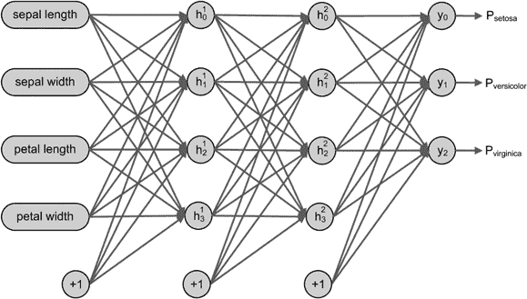
图 9.15 鸢尾花分类的神经网络结构。
如图所示，网络有两个隐藏层，每个隐藏层有四个节点，以及一个输出层，包含三个节点。十一个节点中的每个节点接收五个加权输入：四个来自输入和节点，一个来自表示为 +1 的偏置。因此，网络总共有 11 * 4 = 44 个常规权重和 11 个偏置权重。
隐藏层节点的激活函数是 `ReLU`，这意味着每个隐藏节点将输出零或其加权输入之和的最大值。最后一层节点的激活函数是 `softmax`，因此输出节点将产生对应于鸢尾花估计分类的概率。
`Ch09_IrisNetwork` 中的代码创建神经网络并为其提供数据。这些数据存储在六个存储缓冲区中。表 9.1 列出并描述了每一个。
表 9.1 存储缓冲区
| 缓冲区 || 描述 |
| --- | --- |
| `train_data` || 包含训练期间使用的鸢尾花特征 |
| --- | --- |
| `train_results` || 包含训练期间使用的鸢尾花分类 |
| `weights` || 应用于节点-节点连接的权重 |
| `bias_weights` || 应用于偏置-节点连接的权重 |
| `test_data` || 包含测试期间使用的鸢尾花特征 |
| `test_results` || 存储神经网络的分类输出 |
在定义存储缓冲区后，着色器声明了 12 个被覆盖的变量。表 9.2 列出了每一个以及应用程序提供的值。
表 9.2 训练计算着色器中的被覆盖变量
| 变量 || 值 || 描述 |
| --- | --- | --- |
| `group_size` || 64 || 每组调用数 |
| --- | --- | --- |
| `batch_size` || 16 || 每次迭代处理的训练向量数 |
| `num_train_points` || 144 || 训练向量数（每个向量包含萼片长度、萼片宽度、花瓣长度和花瓣宽度） |
| `num_test_points` || 6 || 测试向量数（每个向量包含萼片长度、萼片宽度、花瓣长度和花瓣宽度） |
| `num_inputs` || 4 || 输入到网络第一层的输入数（不包括偏置） |
| `l1_size` || 4 || 第一层中的节点数 |
| `l2_size` || 4 || 第二层中的节点数 |
| `l3_size` || 3 || 输出层中的节点数 |
| `num_weights` || 44 || 节点-节点连接的权重数 |
| `num_bias` || 11 || 偏置-节点连接的权重数 |
| `num_epochs` || 150 || 训练过程遍历所有训练向量的次数 |
| `eta` || 0.001 || 优化期间使用的学习率 |
在声明这些变量后，着色器在工作组内存中定义变量。表 9.3 列出了这些变量中的每一个并描述其内容。
表 9.3 工作组变量
| 工作组变量 || 描述 |
| --- | --- |
| `layer1` || 存储第 1 层中每个节点的输出 |
| --- | --- |
| `layer2` || 存储第 2 层中每个节点的输出 |
| `layer3` || 存储第 3 层中每个节点的输出 |
| `J` || 存储网络权重的损失梯度 |
| `J_bias` || 存储偏置权重的损失梯度 |
为了解释计算着色器的工作方式，本讨论将其操作分为两个部分：训练和测试。

### 训练网络


Most of the code in the `compute shader` is used to train the `network`, which involves updating the `weights` until the `network` produces acceptable output values. 训练是一个冗长的过程，需要两个执行循环。外层循环对每个 `epoch` 执行一次。`epoch` 是使用训练数据的每个向量进行的一次训练过程。`compute shader` 执行 150 个 `epochs`，因此它遍历所有训练数据 150 次。

内层循环对每个 `epoch` 迭代九次。这是因为训练数据由 144 个向量组成，而 `compute shader` 并行访问 16 个向量。因此，它每个 `epoch` 需要执行 `144/16 = 9` 次迭代。

## 使用迷你批次处理层

`compute shader` 在训练过程中将训练向量划分为 16 个迷你批次。每个迷你批次有四个调用，每个调用使用其全局 ID 计算一个从 0 到 15 的 `batch_id` 和一个从 0 到 3 的 `node_id`。调用使用其 `batch_id` 读取训练数据，并使用其 `node_id` 确定其负责处理的 `network` 的哪些节点。

以下代码展示了 `network` 的节点如何由 shader 的调用处理。由于 `network` 有三层，代码被拆分为三个部分。

```
// First layer
sum = 0.0;
for (i = 0; i < num_inputs; i++) {
    sum += train_data[train_id + i] * weights[weight_addr + i];
}
sum += bias_weights[bias_addr];
layer1[l1_id + node_id] = max(0.0, sum);
weight_addr += l1_size * num_inputs;
bias_addr += num_inputs;
workgroupBarrier();
// Second layer
sum = 0.0;
for (i = 0; i < l1_size; i++) {
    sum += layer1[l1_id + i] * weights[weight_addr + i];
}
sum += bias_weights[bias_addr];
layer2[l2_id + node_id] = max(0.0, sum);
weight_addr += l2_size * l1_size;
bias_addr += l2_size;
workgroupBarrier();

// Third layer
if(node_id < l3_size) {
    sum = 0.0;
    for (i = 0; i < l2_size; i++) {
        sum += layer2[l2_id + i] * weights[weight_addr + i];
    }
    sum += bias_weights[bias_addr];
    layer3[l3_id + node_id] = sum;
}
workgroupBarrier();
```

当 shader 启动时，每个调用从 `train_data` 缓冲区读取包含四个测量的向量。然后，在 Layer 1 处理期间，它将每个输入乘以来自 `weights` 缓冲区的权重。然后它将加权输入相加并加上偏置权重。如果总和大于零，总和将被存储在 workgroup 内存中。否则，零将被存储在 workgroup 内存中。

Layer 2 和 Layer 3 的处理类似。在每种情况下，一个调用基于其 `node_id` 执行节点的处理。它从前一层读取输入，将其乘以 `weights`，并加上偏置权重。

在每个阶段之后，shader 执行 `workgroupBarrier`，它强制调用暂停，直到每个调用完成对 workgroup 内存的访问。这种同步是主要优先事项，因为一层的计算必须在下一层开始之前完成。

## 计算损失梯度——第 1 部分

Layer 3 中的节点使用 `softmax` 作为其激活函数而不是 `ReLU`，因此这些节点不会将加权输入的总和与零进行比较。相反，`compute shader` 执行以下代码：

```
// Compute the softmax outputs
d = exp(layer3[l3_id]) + exp(layer3[l3_id+1]) + exp(layer3[l3_id+2]);
sm1 = exp(layer3[l3_id])/d;
sm2 = exp(layer3[l3_id+1])/d;
sm3 = exp(layer3[l3_id+2])/d;

// Compute loss gradients for output nodes
var res = train_results[iter * batch_size + batch_id];
layer3[l3_id] = sm1 - res[0];
layer3[l3_id+1] = sm2 - res[1];
layer3[l3_id+2] = sm3 - res[2];
```

这段代码的第一部分应该看起来很熟悉，因为它获得了 Layer 3 值的 `softmax`。但代码的第二部分可能令人困惑。它从 `train_results` 缓冲区读取训练向量的正确分类值。然后它从相应的 `softmax` 输出中减去每个结果。

要了解 `compute shader` 为何这样做，你需要理解交叉熵损失的梯度是如何计算的。这是一个复杂的问题，所以我将逐步讲解理论。

神经网络的输出是一个包含三个值的向量 `p[i]`：

* `p[0]` 是鸢尾花属于 setosa 物种的概率
* `p[1]` 是鸢尾花属于 versicolor 物种的概率
* `p[2]` 是鸢尾花属于 virginica 物种的概率

如果正确的概率包含在向量 `obs[i]` 中，则训练样本的交叉熵损失通过以下等式计算：

$$J = - \\sum\\limits\_{i = 0}^{2}obs\_{i} \\cdot \\log\\left( p\_{i} \\right)$$

为了计算该损失的梯度，`compute shader` 需要找到交叉熵损失的对数的导数。`log(x)` 的导数是 1/x，因此偏导数可以使用链式法则获得。如果 `y[i]` 是进入输出节点的加权输入之和，则损失相对于 `y[i]` 的导数如下所示：

$$\\begin{matrix} {\\frac{\\partial J}{\\partial y\_{j}} = - \\sum\\limits\_{i = 0}^{2}obs\_{i} \\cdot \\frac{\\partial}{\\partial y\_{j}}\\log\\left( p\_{i} \\right)} \\\\ {= - \\sum\\limits\_{i = 0}^{2}obs\_{i} \\cdot \\frac{\\partial\\log\\left( p\_{i} \\right)}{\\partial p\_{i}}\\frac{\\partial p\_{i}}{\\partial y\_{j}}} \\\\ {= - \\sum\\limits\_{i = 0}^{2}obs\_{i} \\cdot \\frac{1}{y\_{i}}\\frac{\\partial p\_{i}}{\\partial y\_{j}}} \\\\ \\end{matrix}$$

概率 `p[i]` 使用 `softmax` 函数计算，因此为了找到损失的梯度，第一步是计算 `softmax` 相对于其输入 `y[i]` 的导数。我们将使用商法则，其说明 `f(x)/g(x)` 的导数是 `[f′(x)g(x) – f(x)g′(x)]/g(x)²`。以下表达式展示了它如何与 `softmax` 函数一起使用。

$$\\begin{matrix} {\\frac{\\partial p\_{i}}{\\partial y\_{j}} = \\frac{\\partial}{\\partial y\_{j}}\\left\\{ \\frac{e^{y\_{i}}}{\\sum\_{k}e^{y\_{k}}} \\right\\}} \\\\ {= \\frac{\\left( {\\frac{\\partial}{\\partial y\_{j}}e^{y\_{i}}} \\right)\\sum\_{k}e^{y\_{k}} - e^{y\_{i}}\\left( {\\frac{\\partial}{\\partial y\_{j}}\\sum\_{k}e^{y\_{k}}} \\right)}{\\left( {\\sum\_{k}e^{y\_{k}}} \\right)^{2}}} \\\\ \\end{matrix}$$

`exp(y[j])` 相对于 `y[j]` 的导数是 `exp(y[j])`，因此求和的导数始终是 `exp(y[j])`。然而，`exp(y[i])` 相对于 `y[j]` 的导数取决于 `i = j` 是否成立。如果 `i = j`，则 `softmax` 导数如下所示：

$$\\begin{matrix} {\\frac{\\partial p\_{i}}{\\partial y\_{j}} = \\frac{e^{y\_{i}}\\sum\_{k}e^{y\_{k}} - e^{y\_{i}}e^{y\_{j}}}{\\left( {\\sum\_{k}e^{y\_{k}}} \\right)^{2}}} \\\\ {= \\frac{e^{y\_{i}}\\left( {\\sum\_{k}e^{y\_{k}} - e^{y\_{j}}} \\right)}{\\left( {\\sum\_{k}e^{y\_{k}}} \\right)^{2}}} \\\\ {= \\frac{e^{y\_{i}}}{\\sum\_{k}e^{y\_{k}}}\\left( \\frac{\\sum\_{k}e^{y\_{k}} - e^{y\_{j}}}{\\sum\_{k}e^{y\_{k}}} \\right)} \\\\ {= p\_{i}\\left( {1 - p\_{i}} \\right)} \\\\ \\end{matrix}$$

如果 `i` 不等于 `j`，则 `exp(y[i])` 相对于 `y[j]` 的导数等于 0。在这种情况下，`softmax` 导数按以下方式计算：

$$\\begin{matrix} {\\frac{\\partial p\_{i}}{\\partial y\_{j}} = \\frac{0 - e^{y\_{i}}e^{y\_{j}}}{\\left( {\\sum\_{k}e^{y\_{k}}} \\right)^{2}}} \\\\ {= \\frac{- e^{y\_{i}}}{\\sum\_{k}e^{y\_{k}}}\\frac{e^{y\_{j}}}{\\sum\_{k}e^{y\_{k}}}} \\\\ {= - p\_{i} \\cdot p\_{j}} \\\\ \\end{matrix}$$

如图所示，导数的值取决于 `i = j` 是否成立。为了形成一个同时考虑两种情况的单一表达式，我们使用克罗内克 delta `δ[ij]`，其定义如下：

$$\\delta\_{ij} = \\left\\{ \\begin{matrix} {0\\;if\\;i\\; \\neq \\;j} \\\\ {1\\;if\\;i\\; = \\;j} \\\\ \\end{matrix}~ \\right.$$

使用该值，我们可以将 `softmax` 导数的两个表达式结合成一个单一等式：


$$\\frac{\\partial p\_{i}}{\\partial y\_{j}} = p\_{i}\\left( {\\delta\_{ij} - p\_{j}} \\right)$$

将其代入损失梯度表达式中，我们得到以下结果：

$$\\begin{matrix} {\\frac{\\partial J}{\\partial y\_{j}} = - \\sum\\limits\_{i = 0}^{2}obs\_{i}\\frac{1}{p\_{i}}\\frac{\\partial p\_{i}}{\\partial y\_{j}} = - \\sum\\limits\_{i = 0}^{2}obs\_{i}\\frac{1}{p\_{i}}\\left\\lbrack {p\_{i}\\left\\lbrack {\\delta\_{ij} - p\_{j}} \\right\\rbrack} \\right\\rbrack} \\\\ {= - \\sum\\limits\_{i = 0}^{2}obs\_{i}\\left( {\\delta\_{ij} - p\_{j}} \\right)} \\\\ {= - obs\_{j}\\left( {1 - p\_{j}} \\right) + \\sum\\limits\_{i \\neq j}obs\_{i}p\_{j}} \\\\ {= - obs\_{j} + obs\_{j}p\_{j} + \\sum\\limits\_{i \\neq j}obs\_{i}p\_{j}} \\\\ {= p\_{j}\\left( {obs\_{j} + \\sum\\limits\_{i \\neq j}obs\_{i}} \\right) - obs\_{j}} \\\\ {= p\_{j} - obs\_{j}} \\\\ \\end{matrix}$$

最后一行是通过将 `obs[i]` 的和设为 1 得到。之所以可以这样做，是因为 `obs[i]` 包含鸢尾花物种的已知概率——三个值中总有一个为 1，而其余为 0。这解释了为什么计算着色器从 softmax 输出中减去正确的值。

### 计算损失梯度——第 2 部分

求交叉熵损失相对于 `y[j]`（softmax 输入）的导数是一个重要步骤，但为了获得最终的损失梯度，计算着色器需要进一步操作。目标是获得一个包含损失相对于每个权重 `w[i]` 的偏导数的向量。利用链式法则，我们可以用以下方程为此形成一个表达式：

$$\\frac{\\partial J}{\\partial w\_{i}} = \\frac{\\partial J}{\\partial y\_{j}}\\frac{\\partial y\_{j}}{\\partial w\_{i}}$$

现在的目标是找到第二项，即 softmax 输入 (`y[j]`) 相对于每个权重 (`w[i]`) 的偏导数。为了了解这对于示例网络如何实现，请考虑 图 9.16 中显示的图表。

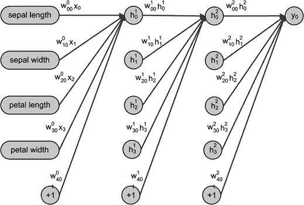

图 9.16 将 softmax 输入与权重关联。

该图表说明了影响最顶层输出节点 `y[0]` 的输入、信号和权重。如前所述，每个权重表示为 `w[yz]^x`，其索引可以按以下方式解释：

* `x` 标识产生加权信号的节点的所在层
* `y` 标识产生待加权信号的节点的索引
* `z` 标识接收信号的节点的索引

假设我们想知道 `y[0]` 相对于 `w²[00]` 的偏导数。当看到以下方程时，这很容易计算：

$$\\begin{array}{l} {y\_{0} = w\_{00}^{2}h\_{0}^{2} + w\_{10}^{2}h\_{1}^{2} + w\_{20}^{2}h\_{2}^{2} + w\_{30}^{2}h\_{3}^{2} + w\_{40}^{2}} \\\\ {\\frac{\\partial y\_{0}}{\\partial w\_{00}^{2}} = h\_{0}^{2}} \\\\ \\end{array}$$

如图所示，`y[0]` 相对于 `w²[00]` 的偏导数只是乘以权重的信号（本例中为 `h²[0]`）。那么 `y[0]` 相对于 `w¹[00]` 的偏导数呢？

隐藏节点使用 `ReLU` 作为其激活函数，因此了解其导数如何获得很重要。如果 `x` 大于 0，`ReLU(x)` 返回 `x` 且其导数为 1。如果 `x` 小于或等于 0，`ReLU` 返回 0 且其导数为 0。以下方程展示了这一点，该方程推导了 `y[0]` 相对于 `w¹[00]` 的偏导数。

$$\\begin{array}{l} {y\_{0} = w\_{00}^{2}h\_{0}^{2} + w\_{10}^{2}h\_{1}^{2} + w\_{20}^{2}h\_{2}^{2} + w\_{30}^{2}h\_{3}^{2} + w\_{40}^{2}} \\\\ {\\frac{\\partial y\_{0}}{\\partial w\_{00}^{1}} = \\frac{\\partial}{\\partial w\_{00}^{1}}\\lbrack w\_{00}^{2}h\_{0}^{2} + w\_{10}^{2}h\_{1}^{2} + w\_{20}^{2}h\_{2}^{2} + w\_{30}^{2}h\_{3}^{2} + w\_{40}^{2}\\rbrack} \\\\ {\\;\\;\\;\\;\\;\\;\\;\\;\\; = \\frac{\\partial}{\\partial w\_{00}^{1}}(w\_{00}^{2}h\_{0}^{2}) = w\_{00}^{2}\\frac{\\partial}{\\partial w\_{00}^{1}}h\_{0}^{2}} \\\\ {w\_{00}^{2}\\frac{\\partial}{\\partial w\_{00}^{1}}h\_{0}^{2} = w\_{00}^{2}\\frac{\\partial}{\\partial w\_{00}^{1}}\\lbrack{Re}\\,\\text{LU}(w\_{00}^{1}h\_{0}^{1} + w\_{10}^{1}h\_{1}^{2} + w\_{20}^{1}h\_{2}^{1} + w\_{30}^{1}h\_{3}^{1} + w\_{40}^{1})\\rbrack} \\\\ {\\frac{\\partial y\_{0}}{\\partial w\_{00}^{1}} = \\left\\{ {}\_{w\_{00}^{2}h\_{0}^{1}\\, if\\, h\_{0}^{2} > 0}^{0\\,\\, if\\, h\_{0}^{2} \\leq 0}~ \\right.} \\\\ \\end{array}$$

我们可以使用类似的方法获得进一步的导数。例如，以下方程给出了 `y[0]` 相对于 `w⁰[00]` 的偏导数。

$$\\frac{\\partial y\_{0}}{\\partial w\_{00}^{0}} = \\left\\{ \\begin{matrix} {0\\;if\\;h\_{0}^{2} \\leq 0\\;or\\;h\_{0}^{1} \\leq 0} \\\\ {w\_{00}^{2}w\_{00}^{1}x\_{0}\\;if\\;h\_{0}^{2} > 0\\;and\\;h\_{0}^{1} > 0} \\\\ \\end{matrix}~ \\right.$$

对于最接近输出节点的权重，损失梯度更容易计算。因此，计算着色器通过执行一系列从第 3 层到第 1 层的循环来获得损失梯度。节点-节点权重的损失梯度存储在 workgroup 内存中的 `J` 变量中。偏置-节点权重的梯度存储在 `J_bias` 变量中。

计算损失梯度后，计算着色器使用以下代码更新网络的权重和偏置：

```
// Update weights and biases
if (id.x == 0) {

    // Iterate through weights
    for (i = 0; i < num_weights; i++) {
        sum = 0.0;
        for (j = 0; j < batch_size; j++) {
            sum += J[j * num_weights + i];
        }
        weights[i] -= eta * sum;
    }
    // Iterate through biases
    for (i = 0; i < num_bias; i++) {
        sum = 0.0;
        for (j = 0; j < batch_size; j++) {
            sum += J_bias[j * num_bias + i];
        }
        bias_weights[i] -= eta * sum;
    }
}
storageBarrier();
```

学习率 `eta` 设为 0.001，因此权重在一次迭代到下一次迭代之间不会显著变化。但经过足够多的训练迭代后，着色器将权重设置为适合正确鸢尾花分类的值。

## 测试网络

在最后一次训练迭代后，计算着色器尝试对存储在 `test_data` 缓冲区中的鸢尾花的特征进行分类。对于每个输入向量，计算着色器产生三个值：鸢尾花属于 setosa 物种的概率、属于 versicolor 物种的概率以及属于 virginica 物种的概率。

为了执行测试，着色器处理网络的每个节点。以下代码展示了如何完成此操作：


// Iterate through test points
for (var test: u32 = 0; test < num_test_points; test++) {

    var test_addr = test * num_inputs;

    // First layer
    if (batch_id == 0) {
        sum = 0.0;
        for (i = 0; i < num_inputs; i++) {
            sum += test_data[test_addr + i] * weights[node_id * num_inputs + i];
        }
        sum += bias_weights[node_id];
        layer1[node_id] = max(0.0, sum);
    }
    workgroupBarrier();
    // Second layer
    weight_addr = l1_size * num_inputs;
    bias_addr = l1_size;
    if (batch_id == 0) {
        sum = 0.0;
        for (i = 0; i < l1_size; i++) {
            sum += layer1[i] * weights[weight_addr + node_id * l1_size + i];
        }
        sum += bias_weights[bias_addr + node_id];
        layer2[node_id] = max(0.0, sum);
    }
    workgroupBarrier();

    // Third layer
    weight_addr += l2_size * l1_size;
    bias_addr += l2_size;
    if((batch_id == 0) && (node_id < l3_size)) {
        sum = 0.0;
        for (i = 0; i < l2_size; i++) {
            sum += layer2[i] * weights[weight_addr + node_id * l2_size + i];
        }
        sum += bias_weights[bias_addr + node_id];
        layer3[node_id] = sum;
    }
    workgroupBarrier();

    // Update test result buffer
    if(id.x == 0) {
        d = exp(layer3[0]) + exp(layer3[1]) + exp(layer3[2]);
        test_results[test * 3] = exp(layer3[0])/d;
        test_results[test * 3 + 1] = exp(layer3[1])/d;
        test_results[test * 3 + 2] = exp(layer3[2])/d;
    }
    storageBarrier();
}
```

如图所示，`Layer 1` 中的节点读取测试输入数据，将其乘以 `weights`，并将 `bias weight` 加到 `sum` 上。`Layer 2` 中的节点接收 `Layer 1` 节点的加权输出，而 `Layer 3` 中的节点接收 `Layer 2` 节点的加权输出。最终概率是通过对 `Layer 3` 的值取 `softmax` 计算得出的。

## Summary

现代数据处理中机器学习的重要性不言而喻，且其重要性随着每一天的过去而不断增长。本章展示了 `WebGPU` 如何使在 Web 应用程序中利用这一能力成为可能。虽然鸢尾花分类可能看起来并不令人印象深刻，但本章介绍的方法可以应用于其他任务。

神经网络是机器学习最流行的实现方式。神经网络由排列在各层中的节点组成。每个节点接收多个加权输入，将它们相加，并将总和传递给激活函数。如本章所述，最流行的激活函数是 `ReLU`、`logistic` 和 `softmax` 函数。

在处理神经网络时，主要的困难在于更新 `weights`，以使最终层的节点产生合适的输出。这被称为 `training`，理解或编码都不容易。但一旦神经网络完全训练完毕，它就能执行许多人会觉得惊人的分类和预测任务。

# 图像和视频处理 10

DOI: [10.1201/9781003422839-10](https://doi.org/10.1201/9781003422839-10)

在最近两章中，`compute shaders` 对存储在 `storage buffers` 中的原始数据进行了操作。这对于计算数字来说是合适的，但 `compute shaders` 也可以访问名为 `storage textures` 的特殊纹理。这使得 `compute shaders` 能够高速处理图像。

本章首先解释 `storage textures` 是什么、如何创建以及如何在 `compute shaders` 中访问它们。为了演示，我将逐步介绍一个在 `compute shader` 中执行图像滤波的应用程序的开发过程。

本章的下一部分重点介绍视频处理。我将解释如何在 `HTML` 中创建视频元素，以及 `WebCodecs API` 如何使访问视频帧成为可能。然后我将解释如何从视频帧创建纹理并使用 `WebGPU` 处理它们。

## Storage Textures

## 存储纹理

第 6 章 介绍了纹理主题并演示了如何创建和显示它们。`WebGPU` 支持多种不同的纹理格式，而 `fragment shaders` 使用 `samplers` 从中读取 texel 数据。

在低层级，`storage textures` 与普通纹理完全相同。根本区别在于着色器可以写入 `storage textures`。在撰写本文时，`storage textures` 为 `write-only`。规范指出支持 `read-write` `storage textures`，但目前浏览器中尚不可用。

从编码角度来看，`storage textures` 与普通纹理在三个主要方面不同：

*   调用 `createTexture` 时，使用标志必须包含 `GPUTextureUsage.STORAGE_BINDING` 以将纹理标识为 `storage texture`。
*   在 `compute shader` 中，`storage texture` 必须使用合适的 `storage texture type` 声明。
*   在 `compute shader` 中，可以通过调用 `textureStore` 写入 `storage texture`。

对于第二点，`storage texture` 的通用声明如下所示：

```
@group(…) @binding(…) var name: storage_type<format, access>;
```

`group` 和 `binding` 属性在 第 4 章 中引入。`storage_type` 部分可以用 表 10.1 中列出的类型之一替换。

表 10.1 存储纹理类型

| 存储纹理类型 || 描述 |
| --- | --- |
| `texture_storage_1d` || 一维存储纹理 |
| --- | --- |
| `texture_storage_2d` || 二维存储纹理 |
| `texture_storage_2d_array` || 二维存储纹理数组 |
| `texture_storage_3d` || 三维存储纹理 |

`Storage textures` 不支持深度/模板值访问或多重采样。此外，声明中的 `format` 部分只能设置为有限数量的纹理格式。表 10.2 列出了 `storage textures` 支持的不同格式。

表 10.2 存储纹理格式

| `rgba8unorm` || `rgba16float` || `rg32float` |
| --- | --- | --- |
| `rgba8snorm` || `r32uint` || `rgba32uint` |
| `rgba8uint` || `r32sint` || `rgba32sint` |
| `rgba8sint` || `r32float` || `rgba32float` |
| `rgba16uint` || `rg32uint` || `bgra8unorm` |
| `rgba16sint` || `rg32sint` ||  |

这些纹理格式 each has one (`r`)、two (`rg`) 或 four (`rgba`/`bgra`) 个颜色通道。`storage textures` 不支持压缩。

声明的最后一部分标识纹理在着色器中如何被访问。根据规范，这可以设置为 `read`、`write` 或 `read-write`。在撰写本文时，每个 `storage texture` 必须将此值设置为 `write`。

为了演示，以下代码声明了一个名为 `tex` 的变量，表示一个二维只写 `storage texture`。每个 texel 包含四个通道，表示为 8 位无符号归一化整数。

```
// Declare a storage texture
@binding(0) @group(0) var tex: texture_storage_2d<rgba8unorm, write>
```

在声明了 `storage texture` 之后，着色器可以通过调用 `textureStore` 写入它。它接受一个纹理变量、应写入值的位置以及要写入的值。作为示例，以下代码将一个四元素向量写入位置 (3, 3)。

```
// Write texture data
textureStore(tex, vec2u(3, 3), vec4f(1.0, 1.0, 1.0, 1.0));
```

值得注意的是，`textureStore` 不接受 `sampler`。此外，第二个参数必须作为无符号整数向量给出。

## Image Filtering

## 图像滤波

专业的图像编辑工具，例如 `Adobe Photoshop` 和 `GNU Image Manipulation Program (GIMP)`，可以为图像添加模糊、锐化和浮雕等效果。这些效果是通过图像滤镜实现的。本节解释图像滤镜的工作原理以及如何使用 `WebGPU` 实现它们。


基本操作是二维点积，它接受两个矩阵并返回其对应元素乘积的和。例如，假设 `A` 和 `B` 是如下给出的两个矩阵：

$$A = \\left| \\begin{matrix} a\_{00} & a\_{01} & a\_{02} \\\\ a\_{10} & a\_{11} & a\_{12} \\\\ a\_{20} & a\_{21} & a\_{22} \\\\ \\end{matrix} \\right|\\;\\;\\;\\;\\;\\;B = \\left| \\begin{matrix} b\_{00} & b\_{01} & b\_{02} \\\\ b\_{10} & b\_{11} & b\_{12} \\\\ b\_{20} & b\_{21} & b\_{22} \\\\ \\end{matrix} \\right|\\;$$  

二维点积 `A` 和 `B` 可以用以下方程计算：

$$\\begin{matrix} {A \\cdot B = a\_{00}b\_{00} + a\_{01}b\_{01} + a\_{02}b\_{02} + a\_{10}b\_{10} + a\_{11}b\_{11} +} \\\\ \\begin{matrix} \\hspace{0pt} & \\hspace{0pt} & \\hspace{0pt} & {a\_{12}b\_{12} + a\_{20}b\_{20} + a\_{21}b\_{21} + a\_{22}b\_{22}} \\\\ \\end{matrix} \\\\ \\end{matrix}$$  

图像滤波将图像视为值矩阵，并为其每个像素计算二维点积。本质上，目标是增强或减弱相邻像素之间的差异。

第二个矩阵称为滤波器的 *kernel*，其元素决定滤波器会产生什么效果。为了演示这一点，我将展示图像滤波如何减少 图 10.1 中所示图像的噪声。


图 10.1 过滤前的图像。(照片由 663highland 提供，采用知识共享许可 2.5。)

可以将噪声视为附近像素之间不需要的差异。减少这种差异的一种方法是使用其周围像素的平均值替换每个像素。为了在数学上表达这一点，我们将图像表示为一个名为 `M` 的矩阵。然后 `Mij` 是第 `I` 行第 `J` 列的像素。滤波后像素的颜色可以按以下方式计算：

$$M\_{ij,filtered} = \\frac{1}{9}\\begin{pmatrix} {M\_{i - 1,j - 1} + M\_{i,j - 1} + M\_{i + 1,j - 1} + M\_{i - 1,j} + M\_{i,j}} \\\\ {+ M\_{i + 1,j} + M\_{i - 1,j + 1} + M\_{i,j + 1} + M\_{i + 1,j + 1}} \\\\ \\end{pmatrix}$$  

此操作也可以通过将这九个图像像素与核矩阵 `K_box` 的点积来执行，其元素如下所示：

$$K\_{box} = \\frac{\\left| \\begin{matrix} 1 & 1 & 1 \\\\ 1 & 1 & 1 \\\\ 1 & 1 & 1 \\\\ \\end{matrix} \\right|}{9}\\;\\;\\;M\_{ij,filtered} = K\_{box} \\cdot M\_{ij}$$  

要完全滤波图像，必须对每个像素执行此点积。完成后，滤波后的图像将与原始图像大小相同。由于核的元素之和为 1，滤波结果也将具有相同的平均亮度。图 10.2 显示了滤波后图像的外观。


图 10.2 使用盒式滤波器滤波的图像。

此滤波器称为 *box filter* 或 *mean filter*，通过对邻近像素取平均值去除了原始图像中的大部分噪声。但它也去除了大量细节。以下讨论介绍了高斯模糊，其效果更好。

## 高斯模糊

在去除噪声方面，高斯模糊通常比盒式滤波器效果更好。术语 *Gaussian* 指的是产生常见钟形曲线的特殊函数。图 10.3 显示了高斯函数在二维中的外观。

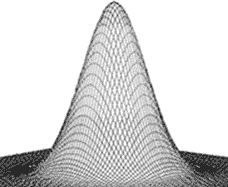

图 10.3 二维高斯函数。

要在代码中实现高斯滤波，我们需要在 3×3 矩阵中近似其值。一个可能的核如下所示：

$$K\_{gaussian} = \\frac{\\left| \\begin{matrix} 1 & 2 & 1 \\\\ 2 & 4 & 2 \\\\ 1 & 2 & 1 \\\\ \\end{matrix} \\right|}{16}$$  

使用此核进行滤波会产生类似盒式滤波器的模糊效果，但它优先考虑中心像素和紧邻的像素。这意味着滤波后的图像保留了更多像素之间的差异。图 10.4 显示了结果的外观。


图 10.4 高斯模糊的效果。

高斯模糊在嘈杂图像和盒式滤波器产生的深度模糊之间提供了一种折中。此滤波器中使用的核只是高斯模糊的一种可能的实现。

## 图像锐化

正如盒式滤波器和高斯模糊减少像素之间的差异一样，锐化滤波器强调差异。它通过从中心像素中减去附近像素来实现这一点。示例核如下所示：

$$K\_{sharpen} = \\left| \\begin{matrix} {- 1} & {- 1} & {- 1} \\\\ {- 1} & 9 & {- 1} \\\\ {- 1} & {- 1} & {- 1} \\\\ \\end{matrix} \\right|$$  

如果中心像素的值与其周围像素相同，则滤波后的像素将等于原始像素。但如果中心像素远大于其邻居，则滤波值会很大。这在 图 10.5 中显示，该图显示了锐化前后的图像。


图 10.5 图像锐化的效果。

锐化滤波器会放大噪声以及其他细节。以下讨论解释了如何使用 WebGPU 实现此滤波器。

## 示例应用——图像锐化

`Ch10_SharpenImage` 应用演示了计算着色器如何使用存储纹理进行图像滤波。它使用锐化核滤波输入图像，然后在页面中显示结果。其操作可分为三个主要步骤：

1. 应用从图像文件创建一个纹理和一个空的存储纹理。
2. 计算着色器从纹理读取纹素并将灰度值写入存储纹理。
3. 顶点和片段着色器显示存储纹理的内容，就像它是一个普通纹理一样。

最后一点很重要，需要理解。在低层，存储纹理与普通纹理相同。唯一的区别是存储纹理经过特殊配置，以便着色器可以修改其内容。

### 创建纹理

`ch10_sharpenimage.js` 中的代码首先创建 WebGPU 操作所需的基本对象（`adapter`、`device`、`encoder` 等）。然后它创建两个纹理。第一个纹理用作计算着色器的输入，并保存 `smiley.png` 图像的内容。以下代码显示了其创建方式。

```
// Create ImageBitmap from image file
const response = await fetch("tower.png");
const imageBitmap = await createImageBitmap(await response.blob());

// Create texture to hold input image
const imageTexture = device.createTexture({
    size: [imageBitmap.width, imageBitmap.height, 1],
    format: "rgba8unorm",
    usage:
        GPUTextureUsage.TEXTURE_BINDING |
        GPUTextureUsage.COPY_DST |
        GPUTextureUsage.RENDER_ATTACHMENT
});

// Write data to input texture
device.queue.copyExternalImageToTexture(
    { source: imageBitmap },
    { texture: imageTexture },
    [imageBitmap.width, imageBitmap.height]
);
```


这段代码与在第 6 章中介绍的 `ch06_simpletexture` 代码类似。该纹理的格式为 `rgba8unorm`，这意味着每个纹素以 8 位无符号归一化整数存储红色、绿色、蓝色和 alpha 分量。usage 属性包含 `RENDER_ATTACHMENT`，这意味着它可以在渲染应用程序中显示。`usage` 不包含 `GPUTextureUsage.STORAGE_BINDING`，因此其内容为只读。

部分 WebGPU 实现不支持读写纹理，因此应用程序需要创建第二个纹理来保存经过滤波的纹素。该纹理将被写入，因此需要将其创建为 `storage texture`。以下代码展示了其工作原理：

// Create texture to hold storage image
const storageTexture = device.createTexture({
    size: [imageBitmap.width, imageBitmap.height],
    format: "rgba8unorm",
    usage:
        GPUTextureUsage.TEXTURE_BINDING |
        GPUTextureUsage.COPY_DST |
        GPUTextureUsage.STORAGE_BINDING
});

输出纹理将与输入纹理具有相同的大小，因此尺寸被设置为 `imageBitmap.width` 和 `imageBitmap.height`。`STORAGE_BINDING` 标志表示它将用作存储纹理，这意味着着色器可以将其作为具有 `texture_storage_2d` 类型的变量访问。

## 创建计算管线

创建纹理后，应用程序再创建三个对象：计算着色器的着色器模块、计算通道编码器和计算管线。以下代码创建这些对象并在它们之间建立关联：

// Create the shader module
const computeModule = device.createShaderModule({
    label: "Shader module 0",
    code: computeCode
});

// Create the compute pass encoder
const computePass = encoder.beginComputePass({
    label: "Compute Pass 0"
});

// Define the compute procedure
const computePipeline = device.createComputePipeline({
    label: "Compute Pipeline 0",
    layout: "auto",
    compute: {
        module: computeModule,
        entryPoint: "computeMain",
        constants: {
            group_size_x: 16,
            group_size_y: 16
        }
    }
});
computePass.setPipeline(computePipeline);

这段代码根据 `computeCode` 字符串的内容创建 `computeModule`。然后使用着色器模块初始化计算管线。除了设置着色器模块和入口点外，`createComputePipeline` 还提供了两个常量（`image_width` 和 `image_height`），计算着色器可以将其作为覆盖变量访问。此代码的最后一行将管线与计算通道编码器关联起来。

接下来，应用程序通过创建包含两个纹理的绑定组来定义计算操作的数据。以下代码展示了实现方式：

// Create the bind group
let computeBindGroup = device.createBindGroup({
    layout: computeBindGroupLayout,
    entries: [
    {
        binding: 0,
        resource: imageTexture.createView({
            dimension: "2d",
        })
    },
    {
        binding: 1,
        resource: storageTexture.createView({
            dimension: "2d",
        })
    }]
});
computePass.setBindGroup(0, computeBindGroup);

绑定组创建后，最后一行将其与计算通道编码器关联并绑定到值 0。因此，着色器可以通过将 `@group` 属性设置为 0 并将 `@binding` 属性设置为资源的绑定值来访问其资源。

在将计算通道编码器与其指令（`computePipeline`）和数据（`bindGroup`）关联后，应用程序使用以下代码编码计算命令：

// Encode compute commands
computePass.dispatchWorkgroups(40, 40);

// Complete encoding compute commands
computePass.end();

`dispatchWorkgroups` 的参数告诉计算着色器使用 40×40 的工作组网格处理数据。每个工作组包含 16×16 的调用网格，因此总共有 640×640 次调用。因此，每个调用可以使用其全局 ID 处理输入图像的一个像素。

## 计算着色器

计算着色器相当简单。每次调用都会调用 `textureLoad` 从输入图像加载一个纹素。然后它将 RGB 值转换为灰度并调用 `textureStore` 将灰度写入纹理存储。

@group(0) @binding(0) var in_tex : texture_2d<f32>;
@group(0) @binding(1) var out_tex : texture_storage_2d<rgba8unorm, write>;

override group_size_x: u32;
override group_size_y: u32;

@compute @workgroup_size(group_size_x, group_size_y)
fn computeMain(
    @builtin(global_invocation_id) global_id: vec3<u32>) {

    var x = global_id.x;
    var y = global_id.y;
    var k = array<f32, 9>(-1.0, -1.0, -1.0, -1.0, 9.0, -1.0, -1.0, -1.0, -1.0);

    // Load the texel at the given position
    var texel: vec4f =
        k[0] * textureLoad(in_tex, vec2(x-1, y-1), 0) +
        k[1] * textureLoad(in_tex, vec2(x,   y-1), 0) +
        k[2] * textureLoad(in_tex, vec2(x+1, y-1), 0) +
        k[3] * textureLoad(in_tex, vec2(x-1, y), 0) +
        k[4] * textureLoad(in_tex, vec2(x,   y), 0) +
        k[5] * textureLoad(in_tex, vec2(x+1, y), 0) +
        k[6] * textureLoad(in_tex, vec2(x-1, y+1), 0) +
        k[7] * textureLoad(in_tex, vec2(x,   y+1), 0) +
        k[8] * textureLoad(in_tex, vec2(x+1, y+1), 0);

    // Store result to the storage texture
    textureStore(out_tex, vec2(x, y), texel);
}

在这段代码中，`k` 包含图像锐化核的元素。每次调用都会将 `k` 的元素与由其全局 ID 定位的 3×3 纹素块相乘。然后使用 `textureStore` 方法将总和写入输出纹理。

虽然片段着色器使用 `textureSample` 读取纹素，但此计算着色器使用 `textureLoad` 读取纹素数据。与 `textureSample` 不同，`textureLoad` 需要整数坐标且不使用采样器。这两个函数之间的另一个重要区别是计算着色器不能调用 `textureSample`。

## 显示纹理

计算着色器完成后，应用程序创建渲染管线以在画布中显示存储纹理。此代码与第 6 章中的代码相似，但有一个有趣之处：顶点/片段着色器将纹理作为 `texture_2d` 访问，而不是 `texture_storage_2d`。这阐明了存储纹理与普通纹理之间没有根本区别这一点。

## 视频处理

WebGPU 最引人注目的功能之一是其能够读取视频源的帧并将其作为纹理处理。这使得可以对视频执行与对普通图像相同的操作。使用 WebGPU 处理视频的一般过程包括四个步骤：

1. 创建、配置并播放 `HTMLVideoElement`。
2. 为每一帧创建 `VideoFrame`。
3. 从每个 `VideoFrame` 创建纹理。
4. 在着色器中处理纹理。

本节探讨这些步骤并展示如何在代码中执行它们。后文将介绍一个处理从 `*.webm` 文件接收的帧的应用程序。

### 视频元素

HTML5 使网页中可以插入 <video> 元素。在 JavaScript 中，这些元素作为 `HTMLVideoElement` 访问，应用程序可以通过调用 `document.createElement` 并将参数设置为 `video` 来创建它们。`HTMLVideoElement` 在本讨论中起着核心作用，因此熟悉其继承层次结构是个好主意。这在图 10.6 中有所说明。

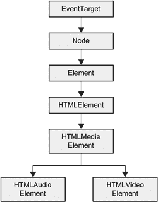

图 10.6 `HTMLVideoElement` 继承层次结构。


### HTMLVideoElement 和 HTMLAudioElement

`HTMLVideoElement` 和 `HTMLAudioElement`（将在 第 12 章 中讨论）都继承自 `HTMLMediaElement`，它提供了配置视频以进行 `WebGPU` 处理所需的大部分属性和方法。应用程序创建其中一个对象后，可以通过其属性配置其行为。表 10.3 列出了 `HTMLVideoElement` 及其祖先的七个重要属性。

表 10.3 `HTMLVideoElement` 及其祖先的重要属性

| 属性 || 类型 || 描述 |
| --- | --- | --- |
| `loop` || boolean || 指示播放结束后是否应恢复 |
| --- | --- | --- |
| `autoplay` || boolean || 指示播放是否应在足够内容可用时立即开始 |
| `muted` || boolean || 指示音频是否静音 |
| `defaultPlaybackRate` || double || 播放速度（相对于 1.0） |
| `disableRemotePlayback` || boolean || 启用/禁用远程播放 |
| `src` || URL || 要播放的媒体的位置 |
| `volume` || double || 播放音量（0.0 到 1.0） |

这些属性中的大多数都很容易理解。以下代码创建了一个 `HTMLVideoElement` 并将其源设置为名为 `example.webm` 的文件。

```
 // Create video element
 const video = document.createElement("video");
 
 // Set source to URL string in local directory
 video.src = "example.webm"
```

Google 的 WebM 格式（`*.webm`）是支持 `HTMLVideoElement` 的三种主要视频格式之一。其他格式是 MP4（`*.mp4`）和 Ogg 视频（`*.ogv`）。在撰写本文时，Safari 浏览器不支持 `*.ogv` 文件。

应用程序创建 `HTMLVideoElement` 并设置其源后，可以调用其方法。表 10.4 列出了其中八个可用方法。

表 10.4 `HTMLVideoElement` 的方法

| 方法 || 描述 |
| --- | --- |
| `canPlayType(type)` || 标识给定的 MIME 类型是否可以播放 |
| --- | --- |
| `captureStream()` || 返回元素的内容的 `MediaStream` |
| `load()` || 将媒体重置到其起始位置 |
| `fastSeek(time)` || 在媒体中 seek 到给定时间位置 |
| `pause()` || 暂停媒体播放 |
| `play()` || 从当前位置播放媒体 |
| `setSinkId(id)` || 标识用于音频播放的设备 |
| `requestVideoFrameCallback(callback)` || 标识在新帧可用时将被调用的回调 |

当 HTML5 最初发布时，开发人员无法响应每一帧视频。相反，应用程序会使用回调函数调用 `requestAnimationFrame` 方法。因此，回调会在浏览器每次刷新时被调用（通常每秒约 60 次）。

今天，浏览器支持 `requestVideoFrameCallback`。与 `requestAnimationFrame` 类似，它接受一个回调函数。但与 `requestAnimationFrame` 不同，它根据 *视频的* 帧率而不是 *显示的* 刷新率来调用回调。准确地说，它使用帧率和刷新率中较小的一个来确定回调的调用时间。换句话说，`requestVideoFrameCallback` 永远不会超过浏览器。

例如，如果视频提供每秒 30 帧，而浏览器每秒刷新 60 次，`requestVideoFrameCallback` 将每秒调用回调 30 次。但是，如果视频的帧率为每秒 100 帧，`requestVideoFrameCallback` 将每秒调用回调 60 次，因为浏览器的刷新率较低。

以下代码展示了其工作原理。如果浏览器支持 `requestVideoFrameCallback`，应用程序将调用 `requestVideoFrameCallback` 来配置在接收到新帧时将被调用的回调。如果不支持，应用程序将调用 `requestAnimationFrame`。

```
 // Set foo to be called when a new frame is available
 if ("requestVideoFrameCallback" in HTMLVideoElement.prototype) {
     video.requestVideoFrameCallback(foo);
 } else {
     requestAnimationFrame(foo);
 }
```

默认情况下，回调只会被调用一次。因此，如果应用程序需要访问一系列帧，回调在处理完成时应调用 `requestVideoFrameCallback` 或 `requestAnimationFrame`。

### 获取视频帧

新的 `WebCodecs` 规范提供了一套用于编码/解码视频和音频的标准机制。它提供了多个有用的接口，包括 `VideoFrame`，它可以从 `HTMLVideoElement` 获取视频帧。

一个示例将演示 `VideoFrame` 的工作原理。如果 `video` 是 `HTMLVideoElement`，以下代码将检索对应于当前帧的 `VideoFrame`。

```
 // Access frame of HTMLVideoElement
 let frame = new VideoFrame(video);
```

获取 `VideoFrame` 后，应用程序可以通过其属性获取有关其内容的信息。表 10.5 列出了这些属性，它们都是只读的。

表 10.5 `VideoFrame` 属性

| 属性 || 类型 || 描述 |
| --- | --- | --- |
| `format` || string || 视频像素的格式（`I420`、`I420A`、`I422`、`I444`、`NV12`、`RGBA`、`RGBX`、`BGRA` 或 `BGRX`） |
| --- | --- | --- |
| `codedWidth` || integer || 视频帧的像素宽度 |
| `codedHeight` || integer || 视频帧的像素高度 |
| `codedRect` || `DOMRectReadOnly` || 包含帧宽度和高度的矩形 |
| `visibleRect` || `DOMRectReadOnly` || 包含可见尺寸的矩形 |
| `displayWidth` || integer || 宽高比调整后的宽度 |
| `displayHeight` || integer || 宽高比调整后的高度 |
| `duration` || integer || 视频的时长（微秒） |
| `timestamp` || integer || 视频的时间戳（微秒） |
| `colorspace` || `VideoColorSpace` || 视频色彩空间的属性 |

通过访问 `format` 和 `colorspace` 属性，应用程序可以确定不同类型的视频应如何处理。以下代码在 `frame` 的格式为平面 YUV 4:2:2（`I422`）时执行额外的处理：

```
 // Access frame of HTMLVideoElement
 let frame = new VideoFrame(video);
 
 // Check the frame's format
 if(frame.format == "I422") {
     …
 }
```

除了检查 `frame` 的属性外，应用程序还可以调用 `VideoFrame` 的方法来获取信息并访问帧的数据。表 10.6 列出了这些方法并提供了每个方法的描述。

表 10.6 `VideoFrame` 方法

| 方法 || 描述 |
| --- | --- |
| `allocationSize()` || 返回存储视频帧数据所需的字节数 |
| --- | --- |
| `clone()` || 返回包含与原始数据相同的新 `VideoFrame` |
| `close()` || 释放对媒体源的引用 |
| `copyTo(destination)` || 将帧的内容复制到 `ArrayBuffer`、`TypedArray` 或 `DataView` |

`copyTo` 方法特别有趣。一般来说，视频帧必须在处理前转换为 `RGBA` 或 `BGRA` 等格式。但如果视频采用不同格式且颜色转换耗时过长，`copyTo` 使应用程序能够处理帧的原始数据。

### 创建纹理

一旦 `VideoFrame` 可用，应用程序就可以通过调用 `device` 的 `importExternalTexture` 方法并传入描述纹理的对象，从中创建纹理。表 10.7 列出了此对象的属性。

表 10.7 `importExternalTexture` 参数的属性

| 属性 || 是否必需 || 描述 |
| --- | --- | --- |
| `label` || N || 新纹理的标识符 |
| --- | --- | --- |
| `source` || Y || 提供源内容的 `VideoFrame` 或 `HTMLVideoElement` |
| `colorSpace` || N || 新纹理的色彩空间（`srgb` 或 `display-p3`） |


有趣的是，`importExternalTexture` 返回的是 `GPUExternalTexture` 而不是 `GPUTexture`。它不提供任何方法，其唯一属性是 `label`。因此，应用程序通常在绑定组定义内部调用 `importExternalTexture`。以下代码展示了如何实现：

// Access frame of HTMLVideoElement
let frame = new VideoFrame(video);

// Create bind group containing texture
const bindGroup = device.createBindGroup({
    layout: ...,
    entries: [
        ...
        {
            binding: ...,

            // Create texture from video frame
            resource: device.importExternalTexture({
                source: frame,
            }),
        }
    ]
});
```

结果是，着色器可以像普通的 `texture_2d` 变量一样访问纹理。然后可以根据需要对其进行处理。

每个新帧都需要创建一个新的绑定组。由于绑定组在帧与帧之间会发生变化，因此渲染通道编码器也需要在每帧重新创建。以下章节展示了其在实际应用中的工作原理。

## 示例应用——视频转换

`Ch10_VideoProc` 应用演示了 WebGPU 如何访问视频帧、在着色器中处理它们并在画布中显示帧。它将彩色视频转换为灰度，其操作可分为四个步骤：

1. 创建视频元素并播放视频。
2. 为视频帧设置回调函数。
3. 为每个帧创建纹理。
4. 在片段着色器中执行灰度转换。

在最后一步中，片段着色器读取每个像素的内容并返回灰度值。

### 视频元素

该应用程序首先创建视频元素，配置其属性并播放视频。以下代码展示了这一点：

// Create video element
const video = document.createElement("video");

// Configure video
video.loop = true;
video.autoplay = true;
video.muted = true;
video.src = "example.webm";
// Play video
await video.play();
```

应用程序调用了 `play()`，但这不会在网页中显示视频内容。这是因为视频元素不存在于页面中。但它像普通视频一样产生帧，并且由于 `loop` 属性被设置为 `true`，它会无限期地产生帧。

### 回调函数

当 `HTMLVideoElement` 产生新帧时，应用程序需要做出响应。许多浏览器支持元素的 `requestVideoFrameCallback` 方法，但有些不支持。如果此方法不受支持，应用程序应调用 `requestAnimationFrame`，它会在浏览器刷新时响应。

`Ch10_VideoProc` 应用检查是否支持 `requestVideoFrameCallback`，如果可用则调用它。以下代码展示了如何实现：

// Set callback for the next frame
if ("requestVideoFrameCallback" in HTMLVideoElement.prototype) {
    video.requestVideoFrameCallback(newframe);
} else {
    requestAnimationFrame(newframe);
}
```

`requestVideoFrameCallback` 和 `requestAnimationFrame` 方法都接受在相应事件发生时要调用的函数名称。在此代码中，回调函数是 `newframe`。

### 创建纹理

当回调函数执行时，它访问 `HTMLVideoElement` 并将其当前帧转换为 `VideoFrame`。以下代码实现了这一点：

// Access new frame
const videoFrame = new VideoFrame(video);
```

接下来，回调函数创建将帧作为纹理提供给 GPU 的绑定组。这是通过调用 `device.importExternalTexture` 方法实现的，如以下代码所示：

// Create the bind group
let bindGroup = device.createBindGroup({
    layout: bindGroupLayout,
    entries: [
    {
        binding: 0,
        resource: sampler
    },
    {
        binding: 1,
        resource: device.importExternalTexture({
            source: videoFrame,
        })
   }]
});
```

创建绑定组后，应用程序创建命令编码器和渲染通道编码器。它将渲染通道编码器与绑定组、顶点缓冲区和渲染管线关联。然后调用 `draw` 方法来编码渲染操作。

提交命令到 GPU 后，回调函数关闭 `VideoFrame`。然后它调用 `requestVideoFrameCallback` 或 `requestAnimationFrame` 来重置回调函数。

### 处理纹理

每个渲染操作都会创建一个矩形区域用于绘制纹理。片段着色器使用以下代码设置每个着色器的颜色：

```
@group(0) @binding(0) var sam : sampler;
@group(0) @binding(1) var tex : texture_external;

@vertex
fn vertexMain(@location(0) coords: vec2f, @location(1) uvCoords: vec2f) -> DataStruct {
    var outData: DataStruct;
    outData.pos = vec4f(coords, 0.0, 1.0);
    outData.uvPos = uvCoords;
    return outData;
}

@fragment
fn fragmentMain(fragData: DataStruct) -> @location(0) vec4f {
    // Read clamped texel value
    var texel = textureSampleBaseClampToEdge(tex, sam, fragData.uvPos);

    // Convert to grayscale
    var gray = 0.299 * texel.r + 0.587 * texel.g + 0.114 * texel.b;

    // Return grayscale texel
    return vec4f(gray, gray, gray, 1.0);
}
```

重要的是要注意纹理的数据类型是 `texture_external`。只有当纹理是通过 `device.importExternalTexture` 方法创建时才可以使用它。

片段着色器通过对当前片段的红色、绿色和蓝色分量进行加权来计算灰度值。然后它返回一个向量，其中红色、绿色和蓝色分量都设置为灰度。

## 摘要

WebGPU 主要以图形渲染而闻名，但它也能够高速处理图像和视频。WebGPU 图像由纹理表示，而在着色器中唯一可以修改的纹理类型是 `storage texture`。本章讨论的第一个应用程序展示了计算着色器如何从一个纹理读取、执行过滤并写入另一个纹理。

应用程序需要执行两个步骤才能从视频中获取纹理。第一步是为每个帧创建 `VideoFrame` 对象，第二步是为每个 `VideoFrame` 调用 `device.importExternalTexture`。一旦纹理被添加到绑定组中，着色器就可以将其作为 `texture_external` 类型的变量访问。本章的第二个应用程序演示了如何执行这些步骤。

# 矩阵运算 11

DOI: [10.1201/9781003422839-11](https://doi.org/10.1201/9781003422839-11)

`Chapter 4` 介绍了 WebGPU 着色语言 (WGSL) 提供的矩阵数据类型和函数。这些矩阵函数可以在所有类型的着色器中调用，但它们仅对维度等于 2、3 或 4 的矩阵进行操作。要处理更大的矩阵，您需要自行编写函数。本章的目标是展示如何实现这一点。

本章的第一部分重点介绍两种特别常见的矩阵运算：矩阵转置和矩阵乘法。本章的其余部分讨论矩阵分解。如果矩阵很大且复杂，数学家可以将其分解为更易于分析的矩阵，然后对这两个因子进行运算。这在概念上类似于将整数分解为其除数或将多项式分解为其根。

具体来说，本章重点介绍一种流行的矩阵分解方法，称为 QR 分解。本章的最后一部分解释了 QR 分解背后的理论，并展示了如何使用 WebGPU 实现它。

## 矩阵转置

对矩阵进行转置是线性代数中最简单的操作之一。本节简要概述了矩阵，包括行和列的表示法，然后展示了如何使用计算着色器转置大型矩阵。

### 矩阵概述


Graphically, a matrix is represented as a grid of numbers inside vertical bars. 图 11.1 描绘了一个典型的矩阵，以及用于其行和列的记号。

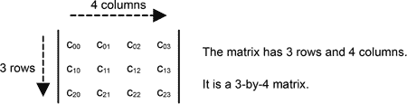

图 11.1 矩阵行列的记号。

In code, matrices are frequently represented by two-dimensional arrays. The two dimensions identify the number of rows and the number of columns in the matrix. If a matrix has `m` rows and `n` columns, it's referred to as an `m-by-n` matrix. If the number of rows equals the number of columns, it's a *方阵*。

The numbers that make up a matrix are called *元素*, and each element is identified by its row and column. In 图 11.1, the element `c[ij]` belongs to the `i`th row and the `j`th column. If `i` equals `j`, then the element lies on an imaginary line called the matrix's *对角线*, which runs from the upper-left to the lower-right.

## 计算转置
The process of transposing a matrix is simple: reflect each element across the diagonal so that each element `c[ij]` becomes `c[ji]`. After a transpose, rows become columns and columns become rows. This is shown in 图 11.2, in which Column 2 of the matrix becomes Row 2. In text, we use `^T` to denote a transposed matrix. That is, `C^T` is the transpose of the matrix `C`.

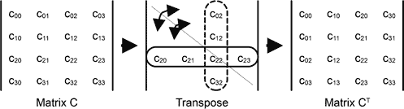

图 11.2 矩阵转置。

The `Ch11_Transpose` application demonstrates how in-place transposition can be performed. It splits the matrix into `4-by-4` blocks and then assigns each invocation a block on or above the diagonal.

图 11.3 shows what this looks like for a `32-by-32` matrix, which has been divided into an `8-by-8` grid of blocks. Each invocation is assigned a block on or above the diagonal. Because there are 8 blocks per row and column, the total number of required invocations is `8(8 + 1)/2 = 36`.

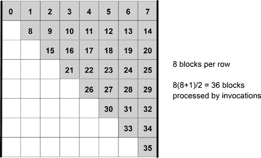

图 11.3 调用和转置函数。

Each invocation has two `mat4x4f` variables named `src_mat` and `dst_mat`. While executing the compute shader, an invocation performs eight steps:
1. It determines the row and column of its assigned block.
2. It reads values from its block into the `src_mat` matrix.
3. It calls the WGSL's `transpose` function to take the transpose of `src_mat`.
4. If it's on the diagonal, the invocation stores `src_mat` in the original block's location. Then its processing is complete.
5. If it's not on the diagonal, the invocation reads values from the opposite block into the `dst_mat` matrix.
6. It calls WGSL's `transpose` function to take the transpose of `dst_mat`.
7. It stores `dst_mat` in the location of the original block.
8. It stores `src_mat` in the location of the opposite block.

The following code presents the compute shader that performs these steps. Keep in mind that an invocation's processing depends on whether its block is located on the diagonal or not.

```
override block_dim: u32;
override group_size: u32;

@binding(0) @group(0) var<storage, read_write> matrix : array<vec4f>;

@compute @workgroup_size(group_size)
fn computeMain(@builtin(global_invocation_id) gid : vec3<u32>) {

    /* Matrix variables */
    var src_mat: mat4x4f;
    var dst_mat: mat4x4f;
    /* Determine the row and column of the block */
    var tmp = block_dim;
    var col = gid.x;
    var row = u32(0);
    while (col >= tmp) {
        col -= tmp;
        tmp--;
        row++;
    }
    col += row;

    /* Read source block into source matrix */
    src_mat = mat4x4f(
        matrix[4 * row * block_dim + col],
        matrix[(4 * row + 1) * block_dim + col],
        matrix[(4 * row + 2) * block_dim + col],
        matrix[(4 * row + 3) * block_dim + col]);

    /* Take the transpose of source matrix */
    src_mat = transpose(src_mat);

    /* Block on matrix diagonal */
    if (row == col) {
        matrix[4 * row * block_dim + col] = src_mat[0];
        matrix[(4 * row + 1) * block_dim + col] = src_mat[1];
        matrix[(4 * row + 2) * block_dim + col] = src_mat[2];
        matrix[(4 * row + 3) * block_dim + col] = src_mat[3];
    }
    /* Block off matrix diagonal */
    else {

        /* Read destination block into destination matrix */
        dst_mat = mat4x4f(
            matrix[4 * col * block_dim + row],
            matrix[(4 * col + 1) * block_dim + row],
            matrix[(4 * col + 2) * block_dim + row],
            matrix[(4 * col + 3) * block_dim + row]);

        /* Take the transpose of source matrix */
        dst_mat = transpose(dst_mat);

        /* Write transposed destination matrix to source block */
        matrix[4 * row * block_dim + col] = dst_mat[0];
        matrix[(4 * row + 1) * block_dim + col] = dst_mat[1];
        matrix[(4 * row + 2) * block_dim + col] = dst_mat[2];
        matrix[(4 * row + 3) * block_dim + col] = dst_mat[3];
        /* Write transposed source matrix to destination block */
        matrix[4 * col * block_dim + row] = src_mat[0];
        matrix[(4 * col + 1) * block_dim + row] = src_mat[1];
        matrix[(4 * col + 2) * block_dim + row] = src_mat[2];
        matrix[(4 * col + 3) * block_dim + row] = src_mat[3];
    }
}
```

After the computation is finished, the application copies the matrix data into a mappable buffer and reads its data. Then it checks to see if the matrix transposition was performed properly and prints the result in the web page.

## 矩阵乘法
Matrix multiplication is a time-intensive operation, so it's a popular metric for measuring computational performance. If a supercomputer needs to perform linear algebra at a large scale, it's likely that a great deal of its time is spent multiplying matrices.

第 4 章 explained the fundamentals of matrix-matrix multiplication. As a quick review, suppose we want to multiply matrices `A` and `B` to obtain `C`. Each element of `C`, `c[ij]`, is obtained by taking the dot product of the `i`th row of `A` and the `j`th row of `B`.

Many algorithms have been devised to multiply matrices, and the Strassen algorithm is particularly impressive. But the code in the `Ch11_MatrixMult` project takes a simpler approach. It computes `A * B` by taking the transpose of `B` and finding the dot products of the rows of `A` and the rows of `B^T`. This requires executing two compute shaders: one to obtain the transpose of `B` and one to multiply the rows of `A` and the rows of `B`.

图 11.4 shows what this look like. Because `B` is transposed, the elements in `A` and `B` can both be accessed row by row.


图 11.4 转置后的矩阵乘法。

The `Ch11_MatrixMult` application multiplies two `16-by-16` matrices (`A` and `B`) and stores the result in `C`. To accomplish this, it launches two compute shaders: one that transposes `B` and one that multiplies the `A` and `B` matrices together. The code for the transpose is the same as the code presented earlier. The code for the compute shader that performs multiplication is given as follows:


```
override vectors_per_row: u32;
override group_size_x: u32;
override group_size_y: u32;

@binding(0) @group(0) var<storage, read_write> aMat : array<vec4f>;
@binding(1) @group(0) var<storage, read_write> bMat : array<vec4f>;
@binding(2) @group(0) var<storage, read_write> cMat : array<f32>;

@compute @workgroup_size(group_size_x, group_size_y)
fn computeMain(@builtin(global_invocation_id) gid : vec3<u32>) {

    var sum = 0.0;
    let a_row = gid.x * vectors_per_row;
    let b_row = gid.y * vectors_per_row;

    // Multiply row of A by row of B^T
    for (var i: u32 = 0; i < vectors_per_row; i++) {
        sum += dot(aMat[a_row + i], bMat[b_row + i]);
    }

    // Store the result to C
    cMat[a_row * 4 + gid.y] = sum;
}
```

每次调用负责在 `C` 矩阵中设置一个值。为了计算该值，它从 `A` 和 `B` 矩阵中读取向量并将它们的 `dot` 积相加。一旦所有点积都计算完毕，该调用就会将总和存储在 `C` 矩阵中由其全局 ID 给出的位置。

虽然矩阵乘法是许多矩阵运算的重要组成部分，但本章特别关注使用 `QR` 分解进行矩阵分解。本章讨论的分解方法依赖于 Householder 变换，这将在接下来讨论。

## Householder 变换

大多数向量数学的讨论包括加法、减法和乘法，但 `vector reflection` 在许多应用中也很重要。概念很简单：给定一个输入向量和一个垂直于表面的向量，求输入向量在该表面上的反射。

计算此过程称为 `Householder transformation`，本节展示了如何将其在 `WebGPU` 中实现。但首先，了解向量投影很重要。

### 向量投影

向量投影是其中一个向量指向与第二个向量相同方向的部分。在 图 11.5 中，向量 b 被分为两个分量：一个称为 p 的分量，指向与 a 相同的方向，以及 q，指向与 a 正交的方向。应该很清楚 `b = p + q`。


图 11.5 向量投影。

在此图中，p 是 b 在 a 上的向量投影。如果 θ 是 a 和 b 之间的角度且 |b| 是 b 的长度，则 p 的长度等于 |b| cos θ。p 的方向由 a 的单位向量给出。这是通过将 a 除以其长度得到，表示为 |a|。下面的方程显示了结果：

$$p = \\left| b \\right|\\cos\\left( \\theta \\right)\\frac{a}{\\left| a \\right|}$$

如果不是因为余弦，这很容易计算。幸运的是，两向量之间角度的余弦与其点积之间存在关系。证明很冗长，但结果如下：

$$cos\\left( \\theta \\right) = \\frac{a \\cdot b}{\\left| a \\right|\\left| b \\right|}$$

将此代入前一个方程，我们可以得到计算 p 的更好方程：

$$p = \\left| b \\right|\\frac{a \\cdot b}{\\left| a \\right|\\left| b \\right|}\\frac{a}{\\left| a \\right|} = \\frac{a \\cdot b}{\\left| a \\right|}\\frac{a}{\\left| a \\right|} = \\frac{a \\cdot b}{\\left| a \\right|^{2}}a$$

一般来说，向量 b 在向量 a 上的向量投影用术语 `proj[a] b` 表示。`proj[a] b` 与 a 具有相同的方向，且 b – `proj[a] b` 与 a 正交。

### 向量反射

许多线性代数算法需要向量反射，其原因很快就会变得清晰。图 11.6 说明了一个简单示例。我们从两个向量开始：x 和 u。u 与 `M`（代表镜面）垂直。目标是找到 x′，即 x 在 `M` 中反射得到的向量。在这种二维情况下，`M` 只是一条线。但在三维中它是平面，在四维或更高维中是超平面。


图 11.6 向量反射。

为了用 x 和 u 表示 x′，我们需要进行向量投影。图 11.7 展示了其工作原理。x 被分为 p 和 q，其中 p 是 x 在 u 上的向量投影，q 与 p 正交。类似地，x′ 被分为 p′ 和 q′，其中 p′ 是 x′ 在 u 上的向量投影，q′ 与 p′ 正交。


图 11.7 用向量投影表示的向量反射。

该图阐明了 p 与 p′ 以及 q 与 q′ 之间的关系。因为 x′ 等于 p′ 和 q′ 的和，我们可以按以下方式计算它：

$$\\begin{matrix} {x' = p' + q' = \\left( {- proj\_{u}x} \\right) + \\left( {x - proj\_{u}x} \\right)} \\\\ {x' = x - 2proj\_{u}x} \\\\ {x' = x - 2u\\frac{u \\cdot x}{\\left| u \\right|^{2}}} \\\\ \\end{matrix}$$

这个最终方程给出了 x′、x 和 u 之间清晰的关系。该方程有助于我们计算矩阵的 `QR` 分解，但在讨论分解算法之前，我需要介绍外积并展示如何使用它来形成 Householder 矩阵。

### 外积与 Householder 矩阵

向量可以被视为具有单行或单列的矩阵。数学家通常将向量视为具有单列的矩阵，这样的向量称为 `column vectors`。相比之下，转置的列向量被视为具有单行的矩阵，或 `row vectors`。

有了这种对向量的矩阵解释，我们可以得到点积的新解释。点积不是相乘向量，而是可以被视为将 1×n 矩阵与 n×1 矩阵相乘。结果是一个 1×1 矩阵，或一个标量。有了这种解释，我们可以使用矩阵术语引用点积：`a^Tb` 而不是 `a ∙ b`。下面的方程使这一点更清晰：

$$a \\cdot b = a^{T}b = \\left| \\begin{matrix} a\_{0} & a\_{1} & a\_{2} & a\_{3} \\\\ \\end{matrix} \\right|\\left| \\begin{matrix} b\_{0} \\\\ b\_{1} \\\\ b\_{2} \\\\ b\_{3} \\\\ \\end{matrix} \\right| = a\_{0}b\_{0} + a\_{1}b\_{1} + a\_{2}b\_{2} + a\_{3}b\_{3}$$

使用这种记法，我们可以得到一种称为 `outer product` 的新类型的乘积。与将行向量乘以列向量不同，该乘积反转操作并计算 `ab^T` 而不是 `a^Tb`。尽管外观相似，外积与点积有显著不同。点积将 1×n 矩阵乘以 n×1 矩阵并产生 1×1 矩阵。外积将 n×1 矩阵乘以 1×n 矩阵并产生 n×n 矩阵。这在下面的方程中显示：

$$ab^{T} = \\left| \\begin{matrix} a\_{0} \\\\ a\_{1} \\\\ a\_{2} \\\\ a\_{3} \\\\ \\end{matrix} \\right|\\left| \\begin{matrix} b\_{0} & b\_{1} & b\_{2} & b\_{3} \\\\ \\end{matrix} \\right| = \\left| \\begin{matrix} {a\_{0}b\_{0}} & {a\_{0}b\_{1}} & {a\_{0}b\_{2}} & {a\_{0}b\_{3}} \\\\ {a\_{1}b\_{0}} & {a\_{1}b\_{1}} & {a\_{1}b\_{2}} & {a\_{1}b\_{3}} \\\\ {a\_{2}b\_{0}} & {a\_{2}b\_{1}} & {a\_{2}b\_{2}} & {a\_{2}b\_{3}} \\\\ {a\_{3}b\_{0}} & {a\_{3}b\_{1}} & {a\_{3}b\_{2}} & {a\_{3}b\_{3}} \\\\ \\end{matrix} \\right|$$

我们可以使用这种向量即矩阵的解释来操作向量反射的方程。如果用 u^Tx 替换 u ∙ x，新的关系将如下所示：

$$x' = x - 2u\\frac{u \\cdot x}{\\left| u \\right|^{2}} = x - 2\\frac{u\\left( {u^{T}x} \\right)}{\\left| u \\right|^{2}}$$

如前所述，矩阵乘法满足结合律，因此 `A(BC) = (AB)C`。我们可以使用这种关系将反射方程中的 `u(u^Tx)` 改为 `(uu^T)x`。这提供了以下关系：


$$x' = x - 2\\frac{u\\left( {u^{T}x} \\right)}{\\left| u \\right|^{2}} = x - 2\\frac{\\left( {uu^{T}} \\right)x}{\\left| u \\right|^{2}} = x - 2\\frac{uu^{T}}{\\left| u \\right|^{2}}x$$  

不使用点积来求 `x′`，我们现在需要计算外积，这更困难。但这样做是有充分理由的。如果我们把向量 `x` 从等式中提取出来，就可以得到以下关系：

$$x' = \\left( {I - 2\\frac{uu^{T}}{\\left| u \\right|^{2}}} \\right)x = Px$$  

显然括号内的项是一个矩阵。该矩阵通常用 `P` 表示，当 `P` 左乘向量 `x` 时，结果是 `x` 关于垂直于 `u` 的超平面的反射。该过程由 Alston Householder 提出，因此 `u` 被称为 Householder 向量，`P` 被称为 Householder 矩阵。`P` 表示的反射操作称为 Householder 变换。

当一个向量被反射两次时，结果将是向量本身。也就是说，对所有 `x` 都有 `P(Px) = x`。`P` 是它自己的逆，这个性质称为 *对合*。

关于 Householder 变换还有一点需要说明。前面的讨论解释了如何根据 `x` 和 `u` 求 `x′`，但如果已知 `x` 和 `x′` 并想求出具有 `u` 方向的向量怎么办？答案很简单：`u = x – x′`。图 11.8 以图形方式展示了这一点，使用了前面各图中相同的 `x` 和 `x′` 向量。


图 11.8 求反射向量。

这个结果可能并不 immediately 明显，但请记住 `x` 和 `x′` 关于 `M` 对称，并且 `u` 与 `M` 垂直。图 11.9 中的 `u` 向量长度与前面各图中的 `u` 向量不同，但这不是问题——我们对 `u` 的唯一要求是其方向与 `M` 垂直。此外，`u` 的长度在 Householder 变换中会被除去。


图 11.9 求反射向量。

## WebGPU 中的向量反射

在代码中实现向量反射是一个直接的过程，由三个主要步骤组成：

1. 将 `u` 乘以 `-sqrt(2)/|u|`
2. 计算矩阵 `uu^T`
3. 将单位矩阵 `I` 加到结果上

`Ch11_Reflection` 项目中的计算着色器展示了如何在 WebGPU 中实现这一点。两个输入向量是 `x_vec`，其等于 \[1.0, 2.0, 3.0, 4.0\]，和 `u_vec`，其等于 \[0.0, 5.0, 0.0, 0.0\]。因为 `u_vec` 与 `x-z-w` 超平面垂直，`x_vec` 的反射可以通过观察确定：\[1.0, −2.0, 3.0, 4.0\]。

```
@binding(0) @group(0) var<storage, read> x_vec : vec4f;
@binding(1) @group(0) var<storage, read_write> u_vec : vec4f;
@binding(2) @group(0) var<storage, read_write> x_prime_vec : vec4f;

override group_size: u32;

@compute @workgroup_size(group_size)
fn computeMain() {

    var p_mat: array<vec4f, 4>;

    /* Multiply u by sqrt(2)/|u| */
    u_vec *= sqrt(2)/length(u_vec);
    /* Compute Householder matrix */
    p_mat[0] = vec4f(1.0, 0.0, 0.0, 0.0) - (u_vec * u_vec.x);
    p_mat[1] = vec4f(0.0, 1.0, 0.0, 0.0) - (u_vec * u_vec.y);
    p_mat[2] = vec4f(0.0, 0.0, 1.0, 0.0) - (u_vec * u_vec.z);
    p_mat[3] = vec4f(0.0, 0.0, 0.0, 1.0) - (u_vec * u_vec.w);

    /* Transform x to obtain x_prime */
    x_prime_vec.x = dot(p_mat[0], x_vec);
    x_prime_vec.y = dot(p_mat[1], x_vec);
    x_prime_vec.z = dot(p_mat[2], x_vec);
    x_prime_vec.w = dot(p_mat[3], x_vec);
}
```

如果你只关心求向量的反射，就不必担心外积及其矩阵运算。用以下等式计算 `x′` 更容易：

$$x' = x - 2u\\frac{u \\cdot x}{\\left| u \\right|^{2}}$$  

然而，Householder 变换的许多应用都需要同时求出向量的反射以及对应的 Householder 矩阵。其中一个应用就是 QR 分解。

## QR 分解

在线性代数中，一个常见的任务是将复杂矩阵分解为更易于分析的简单矩阵。这在求解线性系统、计算行列式或求特征值时很有帮助。一种流行的矩阵分解方法称为 QR 分解。它对一个方阵 `A` 进行操作，产生两个矩阵：一个正交矩阵 `Q` 和一个上三角矩阵 `R`。如果主对角线下方所有元素都等于零，则矩阵为上三角。

在我解释如何计算 `Q` 之前，让我们先关注 `R`。图 11.9 展示了目标：将 `A` 的列 `c[0]` 到 `c[k-1]` 变换为 `R` 的列 `c[0]′` 到 `c[k-1]′`，其中 `k` 表示 `A` 中列的数量。

计算机科学家提出了许多将像 `A` 这样的方阵转换为像 `R` 这样的上三角矩阵的方法。其中最有效的方法之一依赖于 Householder 变换。该方法计算将 `A` 的列变换为 `R` 的列所需的 `u[k]` 向量。一旦获得 Householder 向量，该方法就会计算它们对应的 Householder 矩阵并将它们相乘。这个组合矩阵就是 `Q`。找到 `Q` 和 `R` 的步骤如下：

1. 找到 `u[0]`，即把 `c[0]` 反射到 `c[0]′` 的向量。
2. 用 `u[0]` 反射变换 `A` 的每一列。
3. 找到 `u[1]`，即把 `c[1]` 反射到 `c[1]′` 的向量。
4. 用 `u[1]` 反射变换 `A` 的每一列。
5. 对每个 `u[k]` 向量构造 Householder 矩阵 `P[k]`。
6. 对列重复步骤 3–5 直到 `k–1`。
7. 将 Householder 矩阵相乘形成 `Q`。

本节的其余部分将详细阐述这些步骤，我们将通过一个 4×4 矩阵的 QR 分解来说明。然后我们将看看如何在 WebGPU 中实现 QR 分解。

### 求 Householder 向量和 R

我们已经看到如何根据向量 `x` 及其反射 `x′` 求 Householder 向量 `u`。我们可以用这种方法确定将 图 11.9 中的列 `c[k]` 变换为其反射 `c[k]′` 的 `u[k]` 向量。但首先，我们需要获得每个 `c[k]′` 中的非零元素。只要记住，因为 `x′` 是 `x` 的反射，两个向量必须具有相同的长度，这并不困难。

一个例子说明了其工作原理。矩阵 `A` 有三行三列。我们想要找到两个 Householder 向量 `u[0]` 和 `u[1]`，使得当用它们反射 `A` 的前两列时，`A` 将变为上三角。

$$A = \\left| \\begin{matrix} 13 & {- 17} & {- 10} \\\\ 4 & 18 & {- 32} \\\\ {- 16} & {- 8} & {- 24} \\\\ \\end{matrix} \\right|$$  

我们从最左边的列向量开始，我们称之为 `c[0]`。我们希望反射 `c[0]′` 在顶部有一个非零元素，下面有两个零元素。为了确保 `c[0]` 和 `c[0]′` 长度相同，我们将 `c[0]′` 的非零元素设为 `c[0]` 的长度。然后我们可以通过从 `c[0]` 中减去 `c[0]′` 来找到 `u[0]`。如下所示：

$$\\begin{matrix} {c\_{0}' = \\left| \\begin{matrix} \\left| c\_{0} \\right| \\\\ 0 \\\\ 0 \\\\ \\end{matrix} \\right| = \\left| \\begin{matrix} 21 \\\\ 0 \\\\ 0 \\\\ \\end{matrix} \\right|} \\\\ {u\_{0} = c\_{0} - c\_{0}' = \\left| \\begin{matrix} 13 \\\\ 4 \\\\ {- 16} \\\\ \\end{matrix} \\right| - \\left| \\begin{matrix} 21 \\\\ 0 \\\\ 0 \\\\ \\end{matrix} \\right| = \\left| \\begin{matrix} {- 8} \\\\ 4 \\\\ {- 16} \\\\ \\end{matrix} \\right|} \\\\ \\end{matrix}$$  

现在我们有了 `u[0]`，需要根据 `u[0]` 对应的反射变换 `A` 的每一列。我们可以使用前面给出的等式执行这些反射：

$$c\_{k}' = c\_{k} - 2u\_{0}\\frac{u\_{0} \\cdot c\_{k}}{\\left| u\_{0} \\right|^{2}}$$  


此变换给我们一个新的 `A` 矩阵。正如所期望的，第一列在非零元素下方有两个零。

$$A = \\left| \\begin{matrix} 21 & {- 1} & 6 \\\\ 0 & 10 & {- 40} \\\\ 0 & 24 & 8 \\\\ \\end{matrix} \\right|$$

现在我们想要变换第二列 `c[1]`，使其底部元素等于零。我们可以通过将反射的第一元素 `c[1]'` 设等于 `c[1]` 的第一元素来实现。然后，为了确保 `|c[1]'| = |c[1]|`，我们需要将 `c[1]'` 的第二元素设等于包含 `c[1]` 的下两个元素的子向量的长度。

$$\\begin{matrix} {c\_{1}' = \\left| \\begin{matrix} {- 1} \\\\ \\sqrt{10^{2} + 24^{2}} \\\\ 0 \\\\ \\end{matrix} \\right| = \\left| \\begin{matrix} {- 1} \\\\ 26 \\\\ 0 \\\\ \\end{matrix} \\right|} \\\\ {u\_{1} = c\_{1} - c\_{1}' = \\left| \\begin{matrix} {- 1} \\\\ 10 \\\\ 24 \\\\ \\end{matrix} \\right| - \\left| \\begin{matrix} {- 1} \\\\ 26 \\\\ 0 \\\\ \\end{matrix} \\right| = \\left| \\begin{matrix} 0 \\\\ {- 16} \\\\ 24 \\\\ \\end{matrix} \\right|} \\\\ \\end{matrix}$$

再次，我们需要根据由 `u[1]` 标识的新反射来变换 `A` 的每一列。这给出了以下矩阵：

$$A = \\left| \\begin{matrix} 21 & {- 1} & 6 \\\\ 0 & 26 & {- 8} \\\\ 0 & 0 & {- 40} \\\\ \\end{matrix} \\right| = R$$

需要注意的是，用对应于 `u[1]` 的反射变换 `c[0]` 会使 `c[0]` 保持不变。这是因为 `c[0]` 和 `u[1]` 的点积为零。当该点积等于零时，反射会产生原始向量。这意味着我们不必变换已经变换过的列——一旦我们计算出 Householder 向量 `u[k]`，我们只需要为列 `c[k]` 及更高列找到反射。

经过这最后一组反射后，`A` 为上三角矩阵。`A` 的这个变换版本是由 `QR` 分解生成的 `R` 矩阵。接下来，我们将看到如何使用 Householder 向量 `u[k]` 来创建 `Q` 矩阵。

## 寻找 Householder 向量和 Q

现在我们已经计算出将 `A` 变换为 `R` 的 Householder 向量 `u[k]`，我们需要找到作为该变换逆的矩阵 `Q`。也就是说，我们希望找到 `Q` 使得 `Q^(−1)A = R`，或 `A = QR`。

上一节解释了如何从 Householder 向量 `u` 创建 Householder 矩阵 `P`。关系如下所示：

$$P = I - 2\\frac{uu^{T}}{\\left| u \\right|^{2}}$$

`uu^T` 如前所述是一个外积，生成一个方矩阵。如果 `u` 包含 `k` 个元素，则 `P` 有 `k` 行和 `k` 列。

在我们的示例中，我们首先用 `u[0]` 的反射，然后用 `u[1]` 的反射来变换 `A` 的列向量，从而得到 `R`。因此，`R` 等于 `P[1]P[0]A`。由于每个 Householder 变换都是其自身的逆，我们可以将 `Q` 设等于 `P[0]P[1]`。以下方程展示了如何为我们的示例计算 `Q`：

$$\\begin{array}{l} {Q = P\_{0}P\_{1} = \\left( {I - 2\\frac{u\_{0}u\_{0}^{T}}{\\left| u\_{0} \\right|^{2}}} \\right)\\left( {I - 2\\frac{u\_{1}u\_{1}^{T}}{\\left| u\_{1} \\right|^{2}}} \\right)} \\\\ {Q = \\left( {I - \\frac{2}{336}\\left| \\begin{array}{lll} 64 & {- 32} & 128 \\\\ {- 32} & 16 & {- 64} \\\\ 128 & {- 64} & 256 \\\\ \\end{array} \\right|} \\right)\\left( {I - \\frac{2}{832}\\left| \\begin{array}{lll} 0 & 0 & 0 \\\\ 0 & 256 & {- 384} \\\\ 0 & {- 384} & 576 \\\\ \\end{array} \\right|} \\right)} \\\\ {Q = \\left| \\begin{array}{lll} 0.61905 & 0.19048 & {- 0.76190} \\\\ 0.19048 & 0.90476 & 0.38095 \\\\ {- 0.76190} & 0.38095 & {- 0.52381} \\\\ \\end{array} \\right| \\cdot \\left| \\begin{array}{lll} 1.0 & 0.0 & 0.0 \\\\ 0.0 & 0.38462 & 0.92308 \\\\ 0.0 & 0.92308 & {- 0.38462} \\\\ \\end{array} \\right|} \\\\ {Q = \\left| \\begin{array}{lll} 0.61905 & {- 0.63004} & 0.46886 \\\\ 0.19048 & 0.69963 & 0.68864 \\\\ {- 0.76190} & {- 0.33700} & {- 0.55311} \\\\ \\end{array} \\right|} \\\\ \\end{array}$$

如果你将这个 `Q` 矩阵与之前计算的 `R` 矩阵相乘，乘积将是原始的 `A` 矩阵。这是因为 `QR = (P[0]P[1])(P[1]P[0]A) = A`。

## 示例应用—矩阵分解

`Ch11_Factorization` 项目使用 `QR` 分解来分解一个 32×32 矩阵。该应用程序为矩阵的每一列生成一次调用。所有的调用都属于同一个 workgroup，因此我们可以使用 `storageBarrier` 和 `workgroupBarrier` 来同步它们对存储和 workgroup 内存的访问。

`QR` 分解代码很复杂，但主要困难不在于计算 `R`。主要问题涉及存储和相乘形成 `Q` 所需的 Householder 矩阵。对于大型矩阵，我们无法单独存储每个 `P[k]`。相反，我们需要初始化 `Q` 矩阵，并在获得每个新的 `P[k]` 时对其进行更新。

因此，`QR` 分解代码的讨论分为两部分。在第一部分，我们将研究如何变换 `A` 的第一列并用它来初始化 `Q`。在第二部分，我们将研究如何变换 `A` 的第二列到第 `k` 列，并用每个新的 Householder 矩阵更新 `Q`。

### 变换第一列并初始化 Q

`Ch11_QR` 项目中的计算着色器计算将第一列变换为上三角矩阵的一列所需的第一个 Householder 向量 `u[0]`。然后它从 `u[0]` 创建 Householder 矩阵 `P[0]`，并将其设等于 `Q`。以下代码展示了其工作原理：

```
@binding(0) @group(0) var<storage, read_write> a_mat : array<f32>;
@binding(1) @group(0) var<storage, read_write> q_mat : array<f32>;
@binding(2) @group(0) var<storage, read_write> r_mat : array<f32>;
@binding(3) @group(0) var<storage, read_write> check_mat : array<f32>;

override num_cols: u32;

var<workgroup> u_vec: array<f32, num_cols>;
var<workgroup> dot: f32;
var<workgroup> u_length_squared: f32;

@compute @workgroup_size(num_cols)
fn computeMain(@builtin(global_invocation_id) gid : vec3<u32>) {

    /* Variable declarations */
    var vec_length = 0.0;
    var prod: f32;
    var i: u32;
    var j: u32;

    /* Load first column into workgroup memory */
    u_vec[gid.x] = a_mat[gid.x * num_cols];
    workgroupBarrier();
    /* Find length of first column and u vector */
    if (gid.x == 0) {
        for (i = 1; i < num_cols; i++) {
            vec_length += u_vec[i] * u_vec[i];
        }
        u_length_squared = vec_length;
        vec_length = sqrt(vec_length + u_vec[0] * u_vec[0]);
        a_mat[0] = vec_length;
        u_vec[0] -= vec_length;
        u_length_squared += u_vec[0] * u_vec[0];

    }
    else {
        a_mat[gid.x * num_cols] = 0.0;
    }
    storageBarrier();

    /* Transform further columns of A */
    for (i = 1; i < num_cols; i++) {
        dot = 0.0;
        if(gid.x == 0) {
            for (j = 0; j < num_cols; j++) {
                dot += a_mat[j * num_cols + i] * u_vec[j];
            }
        }
        workgroupBarrier();
        a_mat[gid.x * num_cols + i] -= 2 * u_vec[gid.x] * dot/u_length_squared;
    }

    /* Update Q matrix */
    for (i = 0; i < num_cols; i++) {
        q_mat[gid.x * num_cols + i] = -2 * u_vec[i] * u_vec[gid.x]/u_length_squared;
    }
    q_mat[gid.x * num_cols + gid.x] += 1;
    storageBarrier();
```

重要的是要了解这段代码如何获取和使用第一个 Householder 向量 `u[0]`。首先，它将 `A` 的第一列加载到 workgroup 内存中。然后它计算向量的长度并从该列的第一元素中减去此长度。这将 workgroup 内存向量设等于 `u[0]`，一旦获得它，着色器就会使用它来根据以下方程变换 `A` 的每一后续列：

$$c\_{k}' = c\_{k} - 2u\_{0}\\frac{u\_{0} \\cdot c\_{k}}{\\left| u\_{0} \\right|^{2}}$$

在更新 `A` 之后，内核使用以下方程从 Householder 向量 `u[0]` 形成 Householder 矩阵 `P[0]`：

$$P\_{0} = I - 2\\frac{u\_{0}u\_{0}^{T}}{\\left| u\_{0} \\right|^{2}}$$


一旦内核获得 `P[0]`，它就会将其元素放入 `Q` 矩阵中。随着内核的其余部分执行，`Q` 将乘以进一步的 Householder 矩阵以达到其最终值。

### 转换后续列并更新 Q

`Ch11_QR` 中计算着色器的下一部分遍历 `A` 的剩余列，并计算将 `A` 转换为上三角矩阵所需的 Householder 向量。每当计算出一个 Householder 向量时，内核就会找到对应的 Householder 矩阵 `P[0]`，并用它来更新 `Q`。

```
/* Loop through other columns */
for (var col: u32 = 1; col < num_cols-1; col++) {

    /* Load new column into memory */
    u_vec[gid.x] = a_mat[gid.x * num_cols + col];
    workgroupBarrier();

    /* Find length of A column and u vector */
    if(gid.x == col) {
        vec_length = 0.0;
        for (i = col + 1; i < num_cols; i++) {
            vec_length += u_vec[i] * u_vec[i];
        }
        u_length_squared = vec_length;
        vec_length = sqrt(vec_length + u_vec[col] * u_vec[col]);
        u_vec[col] -= vec_length;
        u_length_squared += u_vec[col] * u_vec[col];
        a_mat[col * num_cols + col] = vec_length;
    }
    else if(gid.x > col) {
        a_mat[gid.x * num_cols + col] = 0.0;
    }
    storageBarrier();

    /* Transform further columns of A */
    for (i = col+1; i < num_cols; i++) {
        if(gid.x == 0) {
            dot = 0.0;
            for (j = 0; j < num_cols; j++) {
                dot += a_mat[j * num_cols + i] * u_vec[j];
            }
        }
        workgroupBarrier();

        if(gid.x >= col) {
            a_mat[gid.x * num_cols + i] -= 2 * u_vec[gid.x] * dot/u_length_squared;
        }
        storageBarrier();
    }

    /* Update P matrix */
    if (gid.x >= col) {
        for (i = col; i < num_cols; i++) {
            r_mat[gid.x * num_cols + i] = -2 * u_vec[i] * u_vec[gid.x]/u_length_squared;
        }
        r_mat[gid.x * num_cols + gid.x] += 1;
    }
    storageBarrier();

    /* Check operation by computing q_mat * r_mat */
    for (i = col; i < num_cols; i++) {
        prod = 0.0;
        for (j = col; j < num_cols; j++) {
            prod += q_mat[gid.x * num_cols + j] * r_mat[j * num_cols + i];
        }
        check_mat[gid.x * num_cols + i] = prod;
    }
    storageBarrier();

    /* Place the content of check_mat in q_mat */
    for (i = col; i < num_cols; i++) {
        q_mat[gid.x * num_cols + i] = check_mat[gid.x * num_cols + i];
    }
    storageBarrier();
}
```

这段代码遍历 `A` 的列并执行与前述代码中大部分相同的任务。重要的区别在于 `Q` 的更新方式。理论上，`Q` 是通过以下等式获得的：

`Q` = `P[0]` `P[1]` `P[2]`⋯`P[k − 2]` `P[k − 1]`

然而，实际上我们无法在计算机内存中存储 `k`–1 个 Householder 矩阵。计算着色器创建了三个矩阵（`q_mat`、`p_mat` 和 `prod_mat`）并使用三个步骤更新 `q_mat`：

1. 当内核计算出新的 `u[k]` 时，它将 `p_mat` 设置为对应的 `P[k]` 矩阵。

2. 内核计算 `q_mat` 和 `p_mat` 的乘积，并将结果放入 `prod_mat`。

3. 内核将 `prod_mat` 的元素移动到 `q_mat`，并为另一次乘法做准备。

由于有大量数据在全局内存中传输，此过程并不特别快。然而，由于只涉及三个矩阵，该过程比需要 `k`–1 个 Householder 矩阵的算法更节省内存。

一旦内核完成对 `A` 列的最后一次变换，结果将是上三角矩阵 `R`。在 Householder 矩阵的最后一次乘法之后，结果变换矩阵将为 `Q`。为了测试分解，主机应用程序将 `Q` 和 `R` 相乘并将结果与 `A` 中的原始值进行比较。

## 摘要

矩阵运算需要大量的数值计算和数据操作，但决策很少。因此，这些运算非常适合使用 `WebGPU` 实现。

本章从简单的矩阵运算推进到复杂的运算。矩阵转置实际上不执行任何数学运算，只是重新排列矩阵的元素。本章中的示例代码演示了如何通过将矩阵分成块并将每个块分配给一次调用来高效地执行转置。

矩阵乘法依赖于行和列的点积。更具体地说，第一个矩阵的每一行乘以第二个矩阵的每一列，每个点积的结果是一个标量。如果第一个矩阵的维度为 `n`-by-`k`，第二个矩阵的维度为 `k`-by-`p`，则乘积的维度将为 `n`-by-`p`。向量可以被视为矩阵——行向量维度为 `1`-by-`n`，列向量维度为 `n`-by-`1`。

Householder 变换将一个向量反射到另一个向量的垂直区域。此变换可以使用点积或外积来执行。点积更容易计算，但当需要组合多个反射时，需要使用与外积关联的矩阵。

QR 分解依赖于 Householder 变换来反射矩阵的列，使其变为上三角。我们可以通过相乘 Householder 矩阵来组合这些变换，从而得到 `Q` 矩阵。一旦输入矩阵被变换为上三角形式，它就成为 `R` 矩阵。我们可以通过检查 `A = QR` 是否成立来测试分解的准确性。

# 使用快速傅里叶变换（FFT）进行音频滤波 12

DOI: [10.1201/9781003422839-12](https://doi.org/10.1201/9781003422839-12)

本章解释了如何使用计算着色器过滤音频。具体来说，我们将研究两个应用，它们都执行相同的五个操作：

1. 从波形音频文件格式（`WAV`）文件中读取音频内容。

2. 使用傅里叶变换获得音频内容的频率。

3. 通过去除高频分量来过滤音频。

4. 使用逆傅里叶变换将频率转换回时域信号。

5. 将滤波后的时域信号格式化为可在浏览器中播放的 `WAV` 数据。

本章的大部分内容涉及步骤 2 和 4，它们在时域和频域之间转换数据。此转换需要复杂的数学运算，最终目标是在计算着色器中实现快速傅里叶变换（`FFT`）。但首先，我将解释离散傅里叶变换（`DFT`）的工作原理。`DFT` 相对简单易懂，正如我们将看到的，`FFT` 只是 `DFT` 的一种加速算法。

`FFT` 的应用远不止音频处理。手机、X 射线扫描仪、雷达接收器和生物识别扫描系统都依赖 `FFT` 从时变信号中提取频率信息。

在讨论音频滤波之前，我需要解释如何从文件中读取音频数据。因此，本章的第一部分讨论了 Web Audio API，其对象和方法使从文件中提取音频变得简单直接。

## Web Audio API

第 10 章 解释了 JavaScript 如何通过从 `HTMLVideoElement` 创建帧来处理视频。应用程序也可以访问与 `<audio>` 元素关联的 `HTMLAudioElement`。`HTMLAudioElement` 提供了播放音频的方法，但它无法访问底层音频数据。如果您想过滤音频文件的内容，仅获得 `HTMLAudioElement` 是不够的。

因此，本章中的示例代码依赖于 Web Audio API，它使能够在低级别访问音频数据成为可能。该 API 提供了广泛的功能，但在本章中，我们仅使用它从文件中读取音频样本。本节解释了如何实现这一点，然后展示了如何在网页中播放数据。

### 从文件中读取音频数据


### Web Audio API 音频处理

The `Web Audio API` 支持与 `HTMLAudioElement` 相同的音频文件类型。Opus 文件（`*.opus`）和高级音频编码（`*.aac`）文件在极小损耗下提供出色的性能。然而，本章重点关注波形音频文件格式（`*.wav`），因为其简单且通用支持。如果查看 `Ch12_DFT` 和 `Ch12_FFT` 项目，你会找到一个名为 `noisy.wav` 的文件，其中包含待处理的音频样本。

读取 `noisy.wav` 中的音频数据需要三个步骤：

1. 调用 `fetch` 将 `noisy.wav` 的内容读取到 `ArrayBuffer` 中。
2. 创建一个 `AudioContext` 并调用其 `decodeAudioData` 方法将 `ArrayBuffer` 转换为 `AudioBuffer`。
3. 通过 `AudioBuffer` 的属性访问音频数据。

本章中的两个应用程序 `Ch12_DFT` 和 `Ch12_FFT` 采用这些步骤来去除 `noisy.wav` 中音频数据的噪声。它们之间的唯一区别在于 `Ch12_DFT` 中的代码使用 DFT 处理数据，而 `Ch12_FFT` 中的代码使用 FFT 处理数据。

## 获取 ArrayBuffer

如 第 6 章 中所述，`fetch` 接受一个字符串并提供一个解析为 `Response` 对象的 `Promise`。如果 `noisy.wav` 位于当前目录中，以下代码将创建一个 `Response`：

// Obtain the response for the URL
const resp = await fetch("noisy.wav");

这个 `Response` 具有一个 `arrayBuffer` 方法，该方法提供一个解析为包含响应体的 `ArrayBuffer` 的 `Promise`。以下代码展示了如何获取它：

// Obtain an ArrayBuffer from the response
const arrayBuff = await resp.arrayBuffer();

这个 `ArrayBuffer` 包含 `noisy.wav` 的内容，但需要更多步骤才能访问音频数据。要解码 `ArrayBuffer` 的数据，应用程序需要创建一个 `AudioContext`。

## AudioContext

一个 `AudioContext` 是管理和处理网页音频的主要对象。如果浏览器支持 Web Audio API，应用程序可以通过访问 `window` 对象来创建上下文。在 Safari 浏览器中，该对象的名称为 `webkitAudioContext`。在其他浏览器中，它称为 `AudioContext`。因此，我们可以使用以下代码创建上下文：

// Create an audio context
const AudioContext =
    window.AudioContext || window.webkitAudioContext;
const ctx = new AudioContext(…);

`AudioContext` 构造函数接受一个可选对象，可用于配置上下文的音频处理。表 12.1 列出了可以设置的属性。

表 12.1 `AudioContext` 创建属性（可选）

| 属性 || 类型 || 描述 |
| --- | --- | --- |
| sampleRate || double || 每秒样本数 |
| --- | --- | --- |
| latencyHint || double || 音频播放延迟 |
| sinkId || integer || 标识用于播放音频的设备 |

数字音频数据是一系列表示随时间变化的声音幅度的数字。我们将这些数字称为 *samples*，第一个属性 `sampleRate` 标识每秒采集的样本数。如果采样率为 `R`，则样本之间的时间间隔为 `1/R` 秒。采样率越高，音质越好，但存储所需的内存更多，传输音频数据所需的时间也更长。

延迟是指应用程序启动音频播放的时间与音频开始播放的时间之间的间隔。延迟越低，播放响应越快，但功耗越大。应用程序可以通过将 `latencyHint` 设置为 double 或以下值之一来配置应用程序的延迟：

* `interactive`—选择不会导致杂音的最低可能延迟（低延迟—默认）
* `balanced`—在延迟和功耗之间取得平衡（中等延迟）
* `playback`—最小化功耗（高延迟）

应用程序可以通过调用 `MediaDevices` 对象的 `enumerateDevice` 方法来确定客户端系统上存在哪些媒体设备。这会提供一个解析为 `MediaDeviceInfo` 对象数组的 `Promise`，这些对象标识设备。应用程序可以通过将 `sinkId` 设置为其中一个 `MediaDeviceInfo` 对象的 `deviceId` 属性来选择特定设备。如果未设置，浏览器将选择默认设备。

在本章中，我们将配置音频上下文以向默认设备发送低延迟音频。大多数消费音频，例如光盘（CD）的内容，以每秒 44,100 个样本采样，因此我们将 `sampleRate` 设置为 `44100.0`。以下代码演示了如何实现这一点：

// Create context with a sample rate of 44,100 samples/sec
const AudioContext =
    window.AudioContext || window.webkitAudioContext;
const ctx = new AudioContext( { sampleRate: 44100.0 } );

`AudioContext` 继承自 `BaseAudioContext`，后者提供了一个特别重要的名为 `decodeAudioData` 的方法。它接受包含音频文件数据的 `ArrayBuffer`，并返回一个解析为包含音频数据的 `AudioBuffer` 的 `Promise`。它还接受两个可选函数：一个在解码成功时调用，一个在解码失败时调用。

为了演示，以下代码调用 `decodeAudioData` 来访问名为 `arrayBuff` 的 `ArrayBuffer` 中的音频数据。如果操作成功，将调用 `decodeSuccess` 函数。

// Process audio buffer
function decodeSuccess(buffer) {    …
}
 
// Obtain audio data
const audioBuff =
    await ctx.decodeAudioData(arrayBuff, decodeSuccess);

如图所示，`decodeSuccess` 接收一个名为 `buffer` 的参数。这是一个 `AudioBuffer` 实例，将在下一节讨论。

## AudioBuffer

一个 `AudioBuffer` 包含音频样本并提供有关音频信号的信息。它在本章中起着核心作用，因此熟悉其属性和方法是个好主意。表 12.2 列出了 `AudioBuffer` 的属性并提供了每个属性的描述。它们都是只读的。

表 12.2 `AudioBuffer` 属性（只读）

| 属性 || 类型 || 描述 |
| --- | --- | --- |
| numberOfChannels || integer || 缓冲区中的音频流数 |
| --- | --- | --- |
| duration || double || 播放音频所需的总时间 |
| length || integer || 样本数 |
| sampleRate || double || 音频数据记录的速率 |

处理音频时，*channel* 指的是指向特定输出的流。如果音频文件 intended to be played in stereo（两个输出），它将有两个通道。如果它 intended for surround sound，它将有六个通道。为了简化分析，本章讨论的音频只有一个通道。

了解 *duration* 和 *length* 之间的区别很重要。Duration 标识播放整个音频所需的时间。这以秒为单位，对于 `noisy.wav`，`duration` 属性为 2.97。`length` 属性标识数据中的样本数。对于 `noisy.wav`，这为 131,072，或 `2¹⁷`。

最后一个属性 `sampleRate` 返回 `AudioContext` 的采样率。我们的应用程序创建 `AudioContext` 时将采样率设置为 44,100，因此缓冲区的 `sampleRate` 属性将等于 `44100.0`。音频时长可以通过将长度除以采样率计算得出：`131072/44100`，约为 2.97 秒。

`AudioBuffer` 的方法使得访问和传输缓冲区的音频数据成为可能。表 12.3 列出了这些方法并提供了每个方法的描述。

表 12.3 `AudioBuffer` 方法

| 方法 || 描述 |
| --- | --- |
| copyFromChannel(…) || 从通道复制样本数据到 Float32Array |
| --- | --- |
| copyToChannel(…) || 从 Float32Array 复制样本数据到通道 |
| getChannelData(…) || 返回包含通道样本数据的 Float32Array |


这些方法易于理解。应用程序可以通过调用 `copyFromChannel` 从缓冲区通道读取音频数据，并通过调用 `copyToChannel` 向通道写入数据。在每种情况下，数据都以 `Float32Array` 提供，其值介于 –1.0 和 1.0 之间。

## 播放音频数据

在 `Ch12_DFT` 和 `Ch12_FFT` 项目中，网页有两个按钮。第一个按钮，标签为播放噪声音频，ID 为 `noisy`，播放 `noisy.wav` 的内容。第二个按钮，标签为播放滤波音频，id 为 `filtered`，播放由计算着色器处理的音频数据。

为第一个按钮编写代码很简单。应用程序通过调用 `Audio` 构造函数创建 `HTMLAudioElement`，然后配置按钮的事件处理以播放和暂停音频。以下代码展示了其工作原理：

// Play noisy audio
var noisyAudio = new Audio("noisy.wav");
const noisyButton = document.getElementById("noisy");
noisyButton.onclick = function() {
    if (noisyAudio.duration > 0 && !noisyAudio.paused) {
        noisyAudio.pause();
        noisyButton.innerHTML = "Play Noisy Audio";
    } else {
        noisyAudio.play();
        noisyButton.innerHTML = "Pause Noisy Audio";
    }
}

当按下第二个按钮时，它会播放由计算着色器处理的音频数据。以下代码展示了该按钮的配置方式：

// Play filtered audio
var filteredAudio = new Audio();
const filteredButton = document.getElementById("filtered");
filteredButton.onclick = function() {
    if (filteredAudio.duration > 0 && !filteredAudio.paused) {
        filteredAudio.pause();
        filteredButton.innerHTML = "Play Filtered Audio";
    } else {
        filteredAudio.play();
        filteredButton.innerHTML = "Pause Filtered Audio";
    }
}
filteredButton.disabled = true;

与 `noisyAudio` 元素不同，`filteredAudio` 元素没有数据源。为了定义源，应用程序创建一个表示 `Blob` 的 `URL`，该 `Blob` 可以作为 WAV 音频访问。Web Audio API 未提供任何相关功能，因此应用程序手动执行以下步骤：
1. 创建 `ArrayBuffer` 和 `DataView`。
2. 以 `WAV` 格式将音频数据写入 `DataView`。
3. 从 `ArrayBuffer` 创建 `Blob`。
4. 为 `Blob` 获取 `URL`。
5. 将 `URL` 设为 `HTMLAudioElement` 的源。

执行完最后一步后，应用程序将第二个按钮的 `disabled` 属性设为 false，允许用户播放处理后的音频。以下讨论解释了这些步骤的实现方式。

### 定义 WAV 数据

本章的简单音频中，WAV 数据由 44 字节的元数据后跟音频样本组成。每个样本占用两个字节，因此如果音频包含一个通道且有 `N` 个样本，则 WAV 数据将占用 44 + 2 * `N` 字节。以下代码创建合适的 `ArrayBuffer` 来保存 WAV 数据：

// Create an ArrayBuffer to hold WAV data
const len = 44 + 2 * N;
const buffer = new ArrayBuffer(len);

`DataView` 使向 `ArrayBuffer` 插入数字变得容易。它提供了多个方法，如 `setUint16` 和 `setFloat32`，它们都接受三个参数：字节偏移量、要写入的值以及是否以小端格式写入。WAV 格式期望小端值，因此最后一个参数始终设为 true。

例如，以下代码为 `ArrayBuffer` 创建 `DataView` 并在偏移量 64 处写入一个无符号 16 位值：

// Write an integer to the DataView at an offset of 64
view = new DataView(buffer);
view.setUint16(64, val, true);

WAV 数据的结构基于 Microsoft 的资源互换文件格式 (RIFF)。根据该格式，数据以一系列块的形式提供，每个块以块标识符和块长度开头。本章讨论的 WAV 数据有三个块：
* RIFF 块——将整个文件标识为 RIFF 文件。
* Format 块——定义音频数据的格式。
* Data 块——包含音频数据。

表 12.4 列出了定义这些块的字段。在最后一个字段之后，WAV 数据需要以 2 字节整数的形式提供音频样本。

表 12.4 WAV 音频结构

| 字段 || 字节数 || 描述 |
| --- | --- | --- |
| 块标识符 || 4 || RIFF 块的开始 (0x46464952) |
| --- | --- | --- |
| 块长度 || 4 || 文件长度（字节，减 8） |
| WAV 标识符 || 4 || WAV 标识符 (0x45564157) |
| 块标识符 || 4 || Format 块的开始 (0x20746d66) |
| 块长度 || 4 || 块中字节数 (16) |
| 样本格式 || 2 || 音频样本格式（1 表示 PCM） |
| 通道数 || 2 || 音频通道数 (1) |
| 采样率 || 4 || 每秒样本数 |
| 字节率 || 4 || 每秒字节数 |
| 块对齐 || 2 || 所有通道每样本的字节数 |
| 每样本位数 || 2 || 每个样本包含的位数 |
| 块标识符 || 4 || Data 块的开始 (0x61746164) |
| 块长度 || 4 || 块中字节数 |

本章的 WAV 数据包含单个通道，因此设置这些字段相对简单。如果文件长度由 `len` 给出，采样率由 `sampleRate` 给出，样本数量为 `numSamples`，则以下代码将设置初始 WAV 数据：

// Define RIFF chunk
view.setUint32(0, 0x46464952, true);
view.setUint32(4, len - 8, true);
view.setUint32(8, 0x45564157, true);
// Define Format chunk
view.setUint32(12, 0x20746d66, true);
view.setUint32(16, 16, true);
view.setUint16(20, 1, true);
view.setUint16(22, 1, true);
view.setUint32(24, sampleRate, true);
view.setUint32(28, sampleRate * 2, true);
view.setUint16(32, 2, true);
view.setUint16(34, 16, true);

// Define Data chunk
view.setUint32(36, 0x61746164, true);
view.setUint32(40, numSamples * 2, true);

本章中，音频样本需要使用 16 位脉冲编码调制，即 PCM 进行编码。但如前所述，`AudioBuffer` 样本以介于 –1.0 和 1.0 之间的 32 位浮点值提供。以下代码执行转换并将 16 位值添加到 `DataView`：

// Add 16-bit PCM values to DataView
var offset = 44;
for (let i = 0; i < numSamples; i++) {
    samples[i] *= 32768;
    if(samples[i] > 32767) {
        samples[i] = 32767;
    }
    if (samples[i] < -32768) {
        samples[i] = -32768;
    }
    view.setUint16(offset, samples[i], true);
    offset += 2;
}

WAV 文件没有页脚或补充元数据。一旦音频样本添加到 `DataView`，底层 `ArrayBuffer` 就可以作为 WAV 容器访问。

### 设置音频源

在播放 `ArrayBuffer` 中的样本之前，我们需要创建一个 `Blob`。这可以通过调用 `Blob` 构造函数来实现，该构造函数接受 `ArrayBuffer` 和数据的 MIME（多用途互联网邮件扩展）类型。以下代码展示了其工作原理：

// Create a Blob containing WAV audio data
const audioBlob = new Blob([buffer], {type: "audio/wav"});

接下来，我们可以通过调用 `URL` 对象的 `createObjectURL` 方法为此 `Blob` 创建 `URL`。以下代码对此进行了演示：

// Create a URL for the Blob
const audioURL = URL.createObjectURL(audioBlob);

完成此操作后，应用程序可以将 `URL` 设为 `HTMLAudioElement` 的源。在 `Ch12_DFT` 和 `Ch12_FFT` 项目中，这通过以下代码实现：

// Set the audio to be played by the second button
filteredAudio.src = audioURL;
filteredButton.disabled = false;

执行此代码后，网页将在用户点击第二个按钮时播放滤波后的音频。

## 音频处理概述


到此时，你应该已经很好地理解了如何在网页中访问和播放音频数据。在本节中，我们将开始探讨如何使用计算着色器对数据进行滤波。

如前所述，我们的音频信号的持续时间，用 `T` 表示，为 2.97 秒。如果音频被完美录制，我们将在这 2.97 秒内拥有无限多个声音——每个瞬间一个。我们用 `x(t)` 表示这个无限的声音集合，其中 `t` 表示从 `t = 0.0` 到 `t = 2.97` 的时间，单位为秒。例如，`t = 1.546` 秒时的精确声音由 `x(1.546)` 给出。

在现实世界中，不存在完美的录音。我们的音频以每秒 44,100 个采样率录制，因此数字数据包含 (44,100 samples/second) * (2.97 seconds)，大约为 131,072 个采样。我们将这个采样序列称为 `x[n]`，其中方括号表示有限个值。在这种情况下，`n` 标识的是 *采样索引* 而不是时间。也就是说，`x[463]` 表示第 463 个采样对应的声音。采样之间的时间间隔，以秒为单位，用 `Δt` 表示。

图 12.1 说明了理想采样 `x(t)` 与计算机采样 `x[n]` 之间的差异。`x(t)` 和 `x[n]` 包含的数据都与时间相关，因此我们将 `x(t)` 称为时域 *信号*，而将 `x[n]` 称为时域 *序列*。


图 12.1 时域信号：连续与离散。

回到音频滤波，很明显你不能通过直接操作 `x[n]` 来去除高音噪声。如果你改变 `x[n]` 的值，你会同等程度地减弱歌曲和噪声。同样，如果你放大 `x[n]` 的值，你会同时增加歌曲和噪声。

要理解如何从数字音频中去除噪声，你需要从频率的角度思考内容。信号的频率告诉你它在一秒内变化或 *振荡* 的次数。例如，贝斯吉他的最高弦每秒振动近 98 次，因此其频率约为 98 Hz。

在现实世界中，大多数声音的频率分布在一个范围内。例如，平均男性人声的声带振动频率在 85 到 180 Hz 之间，而平均女性人声的声带振动频率在 165 到 255 Hz 之间。

我们使用 *分量* 一词来标识信号在特定频率下的强度，并将其表示为 `X(f)`。如果一个信号每秒振荡十二点五次，其在 12.5 Hz 的频率分量 `X(12.5)` 将大于任何其他频率下的 `X(f)`。

为了阐明这一点，图 12.2 说明了 `noisy.wav` 音频内容的频率分量。开头和结尾的高峰代表音乐，而中间的山丘代表高音噪声。本章的目标是在不影响音乐的情况下去除噪声。


图 12.2 noisy.wav 的频率分量。

对于感兴趣的人，`noisy.wav` 中的音乐取自 Paul Pitman 对贝多芬 *月光奏鸣曲* 的演绎，可通过 [musopen.org](http://musopen.org) 以知识共享 1.0 许可获得（谢谢，Paul！）。我使用开源的 Audacity 工具添加了高频噪声。

由于音频内容具有有限数量的采样，我们只能计算有限数量的频率分量。我们将使用 `X[k]` 来标识有限的分量集合，与无限集合 `X(f)` 相对。这里，`k` 是一个整数，用于标识第 k 个频率分量，因此 `X[26]` 返回第 26 个频率分量的强度。采样之间的频率间隔，以赫兹为单位，用 `Δf` 表示。

我们不能通过改变 `x[n]` 来从音频中去除噪声，但可以通过改变 `X[k]` 来去除噪声。为此，找到对应于噪声的频率分量并将其减弱或设为零。

仍有两个问题需要回答。首先，如何将 `x[n]` 序列转换为 `X[k]` 序列？其次，在修改了 `X[k]` 之后，如何将其转换回类似 `x[n]` 的形式？这两个问题的答案都涉及傅里叶变换。它将时域数据转换为频域数据，而逆运算则将频域数据转换回时域数据。因此，从歌曲中去除噪声需要三个步骤：

1. 使用傅里叶变换将 `x[n]` 转换为 `X[k]`。
2. 修改 `X[k]` 的频率分量。
3. 使用逆傅里叶变换将修改后的 `X[k]` 转换为新的 `x[n]`。

这种过程不仅仅适用于音乐。这种称为 *频率分析* 的分析类型还用于查找图像中的模式、检测飞机雷达特征以及从无线信号中提取通信数据。下一节将探讨傅里叶变换背后的数学原理，并展示如何在 WebGPU 中实现该算法。

在继续之前，我需要提到，专业人士不会简单地通过去除或减弱频率分量来滤波信号。相反，工程师设计了几种复杂的滤波器，例如巴特沃斯滤波器和贝塞尔滤波器，它们能产生更渐进的降噪效果。关于这个主题有大量文献，我强烈建议不要将本章中的代码用于专业音频处理。

## 离散傅里叶变换 (DFT)

1822 年，物理学家约瑟夫·傅里叶发表了 *热的解析理论*，其中提出了一种将复杂数学关系分解为三角函数之和的方法。几个世纪以来，这种方法已应用于比热分析更多的应用中，尽管傅里叶关注的是连续函数，但我们的目标是分析离散信号。我们将这些离散信号称为 *序列*，而将傅里叶方法应用于序列的程序就是 *离散傅里叶变换*。

DFT 和 FFT 都完成相同的操作。也就是说，它们将时域序列（例如 图 12.1 右侧所示的序列）转换为频域序列（例如 图 12.2 中所示的序列）。FFT 更快但 DFT 更易于理解，因此我们将从 DFT 开始。本节介绍 DFT 背后的数学理论，通过一个计算示例进行说明，然后展示如何在 WebGPU 中实现它。

但在继续之前，让我们回顾一下上一节中介绍的记号。

* `x(t)`—输入信号，包含无限个值，`t` 标识以秒为单位的时间。
* `T`—输入信号的周期（或持续时间），以秒为单位。
* `x[n]`—输入序列，包含 `N` 个值，`n` 标识 *采样索引*。
* `Δt`—`x[n]` 值之间的时间间隔，以秒为单位。
* `X(f)`—频率响应，包含无限个值，`f` 标识以赫兹为单位的频率。
* `X[k]`—频率序列，包含 `N` 个值，`k` 标识频率索引。
* `Δf`—`X[k]` 值之间的频率间隔，以赫兹为单位。

### DFT 理论

如 第 4 章 中所述，点积将两个向量的分量相乘并将乘积相加。结果告诉我们两个向量有多相似。较大的点积意味着向量指向相似的方向，而负点积意味着向量指向相反的方向。


点积是 DFT 的基本运算。如果你取 `x[n]` 与表示给定频率的向量的点积，你会看到 `x[n]` 与该频率有多相似。更精确地说，结果会告诉你 `x[n]` 在该频率下 *振荡* 的次数。我们用 `w[k][n]` 表示这个第二个向量，因此 `X[k]` 的方程如下所示：

`X[k] = x[n] ⋅ w[k][n]`

DFT 由 `N` 个这样的点积组成，每个点积产生不同的 `X[k]` 值。也就是说，第一个点积给出我们 `X[0]`，第二个给出我们 `X[1]`，以此类推。

出现了两个问题。首先，DFT 只计算 `N` 个频率的分量，那么我们应该关注哪些频率？其次，我们如何计算 `w[k][n]`，即表示单一频率的向量？一旦我们对这些问题有了答案，就能够计算构成 DFT 的点积序列。下面的讨论将提供这些答案。

## 感兴趣的频率

DFT 的目标是计算有限数量频率的 `X[k]`。如果我们能选择任意一组频率就好了，但 DFT 算法为我们做了选择。DFT 频率的值取决于信号的周期 `T` 和采样数 `N`。

第一个感兴趣的频率，称为 *基频* 或 `f[1]`，其值为 `1/T`。这代表信号过程中一次振荡，因此如果信号在其周期内振荡一次，`f[1]` 将很重要。在我们的歌曲例子中，`T = 2.97` 秒，因此基频等于 `1/2.97 = 0.336 Hz`。这低于人耳听觉范围，但 DFT 计算 `f[1]` 处的频率分量为 `X[1] = x[n] ∙ w[1][n]`。

进一步感兴趣的频率 `f[k]` 可以通过将基频乘以 `k` 得到。这在数学上由以下方程给出：

$$f_{k} = kf_{1} = \frac{k}{T}$$

正如 `f[k]` 标识周期内 `k` 次振荡对应的频率，`f[0]` 标识零振荡对应的频率。这代表 0 Hz 的频率。如果信号的值在其周期内保持恒定，则它根本不振荡。在这种情况下，`X[0]` 将很重要，而更高频率的分量将等于 0。

对于一般信号，我们最高感兴趣的频率是 `f[N–1]`，其中 `N` 是 `x[n]` 中的采样数。这给出了 `N` 个感兴趣的频率：`f[0]` 到 `f[N–1]`。然而，在某些情况下，我们只需要计算最高到 `f[N/2]` 的频率分量。这样做的理由要等到我们检查完整的 DFT 算法之后再说。

## 单频向量

对于 `x[n]` 的每个频率分量，DFT 计算 `x[n]` 与表示单一频率的向量的点积。这些单频向量的值以 *正弦波* 给出——余弦和正弦的复数和。连续正弦波的值取决于频率和时间，因此我们用 `wf` 表示，其中 `f` 是正弦波对应的频率。在数学上，`wf` 给出为：

`wf = cos(2πft) − i sin(2πft)`

该方程中的 `i` 表示 √–1。因为 `wf` 是乘以 `i` 的数与普通数的和，所以 `wf` 是一个 *复数*。复数往往让人紧张，所以让我们简要回顾一下基本理论：

* 每个复数 `z` 都有实部，表示为 `Re(z)`，和虚部，表示为 `Im(z)`。如果 `z = a + bi`，则 `Re(z) = a` 且 `Im(z) = b`。
* 复数的共轭，表示为 `z*`，可以通过取负虚部得到。如果 `z = a + bi`，则 `z* = a – bi`。
* 复数的模或幅度，表示为 `|z|`，可以通过实部和虚部的平方和得到。如果 `z = a + bi`，则 `|z| = sqrt(a² + b²)`。
* 复数可以通过分别相加实部和虚部来进行加法。如果 `z1 = a + bi` 且 `z2 = c + di`，则 `z1 + z2 = (a + c) + (b + d)i`。
* 复数可以按以下方式相乘：如果 `z1 = a + bi` 且 `z2 = c + di`，则 `z1 * z2 = (ac – bd) + (ad + bc)i`。

`wf` 的实部是 `cos(2πft)`，虚部是 `−sin(2πft)`。图 12.3 以图形方式描绘了这些项。请注意，余弦和负正弦的图像都从 `t = 0` 到 `t = T` 振荡一次。因此，这些图像展示了 `f = f[1]` 时的 `wf`。如果你将 `f` 设为 `f[2]`，图像振荡两次，如果你将 `f` 设为 `f[k]`，图像在周期过程中振荡 `k` 次。


图 12.3 基频处的连续正弦波。

该函数在执行连续傅里叶变换时很有帮助，但 DFT 要求我们从 `wf` 中选择有限数量的值。因此，我们需要重新整理 `wf` 的表达式，使其仅依赖于 `n` 和 `k`。我们知道感兴趣的频率 `f[k] = k/T`，并且知道 `n = Δt`。这给出了以下关系：

$$w_{f}\left( t \right) = \cos\left( \frac{2\pi k\left( {n\Delta t} \right)}{T} \right) - i\sin\left( \frac{2\pi k\left( {n\Delta t} \right)}{T} \right)$$

最后一步。我们可以通过注意到 `T = NΔt` 将信号的周期 `T` 与总采样数 `N` 联系起来。将它代入方程，我们得到最终表达式：

$$w_{k}\left[n \right] = \cos\left( \frac{2\pi nk}{N} \right) - i\sin\left( \frac{2\pi nk}{N} \right)$$

这给出了一个具有 `N` 个值的向量，并且 图 12.4 描绘了从 `n = 0` 到 `N–1` 的 `w[k][n]`。与 图 12.3 一样，这个离散正弦波对应于信号的基频，由 `k = 1` 给出。


图 12.4 基频处的离散正弦波。

请注意，余弦和正弦都不会回到其起始值。相反，它们从 `0` 到 `N–1` 变化。在代码中计算这些向量时记住这一点很重要。现在我们已经得到了 `w[k][n]` 向量，我们可以讨论完整的 DFT 算法。

## DFT 和 IDFT 方程

DFT 通过在 `k` 从 `0` 到 `N–1` 变化时取 `x[n]` 与 `w[k][n]` 的点积来计算 `X[k]` 向量。这通常用 DFT 方程表示：

$$X\left[k \right] = x\left[n \right] \cdot w_{k}\left[n \right] = \sum_{n = 0}^{N - 1}x\left[n \right]\left( {\cos\left( \frac{2\pi nk}{N} \right) - i\sin\left( \frac{2\pi nk}{N} \right)} \right)$$

`X[k]` 与 `x[n]` 之间的关系也可以用矩阵-向量乘法表示。也就是说，如果我们让 `w[k][n]` 成为矩阵的行，`k` 从 `0` 到 `N–1`，则 resulting 矩阵-向量乘积 `W x = X` 可以表示如下：


### DFT 矩阵和逆变换

$$\\left| \\begin{matrix} {w\_{0}\\left\\lbrack 0 \\right\\rbrack} & {w\_{0}\\left\\lbrack 1 \\right\\rbrack} & {w\_{0}\\left\\lbrack 2 \\right\\rbrack} & \\begin{matrix} \\cdots & {w\_{0}\\left\\lbrack {N - 1} \\right\\rbrack} \\\\ \\end{matrix} \\\\ {w\_{1}\\left\\lbrack 0 \\right\\rbrack} & {w\_{1}\\left\\lbrack 1 \\right\\rbrack} & {w\_{1}\\left\\lbrack 2 \\right\\rbrack} & \\begin{matrix} \\cdots & {w\_{1}\\left\\lbrack {N - 1} \\right\\rbrack} \\\\ \\end{matrix} \\\\ \\begin{matrix} {w\_{2}\\left\\lbrack 0 \\right\\rbrack} \\\\ \\vdots \\\\ \\end{matrix} & \\begin{matrix} {w\_{2}\\left\\lbrack 1 \\right\\rbrack} \\\\ \\vdots \\\\ \\end{matrix} & \\begin{matrix} {w\_{2}\\left\\lbrack 2 \\right\\rbrack} \\\\ \\vdots \\\\ \\end{matrix} & \\begin{matrix} \\begin{matrix} \\cdots & {w\_{2}\\left\\lbrack {N - 1} \\right\\rbrack} \\\\ \\end{matrix} \\\\ \\begin{matrix} \\; & \\vdots \\\\ \\end{matrix} \\\\ \\end{matrix} \\\\ {w\_{N - 1}\\left\\lbrack 0 \\right\\rbrack} & {w\_{N - 1}\\left\\lbrack 1 \\right\\rbrack} & {w\_{N - 1}\\left\\lbrack 2 \\right\\rbrack} & \\begin{matrix} \\cdots & {w\_{N - 1}\\left\\lbrack {N - 1} \\right\\rbrack} \\\\ \\end{matrix} \\\\ \\end{matrix} \\right|\\left| \\begin{matrix} {x\\left\\lbrack 0 \\right\\rbrack} \\\\ {x\\left\\lbrack 1 \\right\\rbrack} \\\\ {x\\left\\lbrack 2 \\right\\rbrack} \\\\ \\begin{matrix} \\vdots \\\\ {x\\left\\lbrack {N - 1} \\right\\rbrack} \\\\ \\end{matrix} \\\\ \\end{matrix} \\right| = \\left| \\begin{matrix} {X\\left\\lbrack 0 \\right\\rbrack} \\\\ {X\\left\\lbrack 1 \\right\\rbrack} \\\\ {X\\left\\lbrack 2 \\right\\rbrack} \\\\ \\begin{matrix} \\vdots \\\\ {X\\left\\lbrack {N - 1} \\right\\rbrack} \\\\ \\end{matrix} \\\\ \\end{matrix} \\right|$$

该矩阵表示为 `W`，称为 `DFT matrix`。如果适当缩放，`W` 既是酉矩阵又是对称矩阵，这意味着其逆矩阵 `W^(-1)` 等于其共轭 `W*`。我们通过反转每个虚部符号来得到矩阵的共轭。对于 `DFT` 来说，这意味着将 `w[k][n]` 中的负虚部正弦转换为正虚部正弦。

该逆矩阵很重要，因为它可用于计算逆 `DFT`，即 `IDFT`。`IDFT` 将频域数据转换为空域数据，可表示为矩阵-向量形式 `x = W^(-1)X`。`IDFT` 方程如下所示：

$$x\\left\\lbrack n \\right\\rbrack = X\\left\\lbrack k \\right\\rbrack \\cdot w\_{k}^{}{}\_{}^{\*}\\left\\lbrack n \\right\\rbrack = \\frac{1}{N}\\sum\\limits\_{k = 0}^{N - 1}X\\left\\lbrack k \\right\\rbrack\\left( {\\cos\\left( \\frac{2\\pi nk}{N} \\right) - i\\sin\\left( \\frac{2\\pi nk}{N} \\right)} \\right)$$

`w[k]^* [n]` 项标识 `w[k][n]` 的共轭，其中 –i sin(x) 被替换为 +i sin(x)。这与 `DFT` 方程的唯一其他区别是缩放因子 `1/N`。这是必要的，以确保一旦 `x[n]` 转换 为 `X[k]`，逆变换将产生原始的 `x[n]`。另外，`DFT` 方程和 `IDFT` 方程都可以用 `1/√n` 缩放。

## 示例应用——使用 DFT 进行音频滤波

到目前为止，你应该对 `DFT` 和 `IDFT` 有了中等的熟悉程度。本节探讨 `Ch12_DFT` 应用中的代码，该应用使用 `DFT` 和 `IDFT` 来去除音频中的噪声。准确地说，该项目执行五个操作：
1. 使用 Web Audio API 从 `noisy.wav` 读取音频数据。
2. 使用 `DFT` 将时域序列 `x[n]` 转换为频域序列 `X[k]`。
3. 将噪声范围内的频率分量设为 0。
4. 使用 `IDFT` 将修改后的频域序列 `X[k]` 转换为空域序列 `x[n]`。
5. 当用户在页面中按下按钮时播放滤波后的音频数据。

本章的第一部分解释了如何完成步骤 1 和 5。本节重点关注步骤 2、3 和 4。

### 实现 DFT 和 IDFT

`Ch12_DFT` 应用中的计算着色器根据名为 `factor` 的变量执行 `DFT` 或 `IDFT`。计算着色器在名为 `dftShader` 的字符串中定义，其代码如下所示：

// Real part of time-domain sequence
@binding(0) @group(0) var<storage, read_write> xn_real : array<vec4f>;

// Imaginary part of time-domain sequence
@binding(1) @group(0) var<storage, read_write> xn_imag : array<vec4f>;

// Real part of frequency-domain sequence
@binding(2) @group(0) var<storage, read_write> xk_real : array<vec4f>;

// Imaginary part of frequency-domain sequence
@binding(3) @group(0) var<storage, read_write> xk_imag : array<vec4f>;

// Whether to perform the DFT or IDFT @binding(4) @group(0) var<storage, read_write> factor : f32;

override group_size: u32;
override filter_start: u32;
override filter_end: u32;

@compute @workgroup_size(group_size)
fn computeMain(@builtin(global_invocation_id) gid : vec3<u32>,
    @builtin(num_workgroups) num_groups : vec3<u32>) {

    let N = group_size * num_groups.x;
    let two_pi_k_over_N = (-1.0 * 2.0 * 3.14159 * f32(gid.x))/f32(N);
    let num_vectors = N/4;
    var real_sum = 0.0;
    var imag_sum = 0.0;
    var real_val: vec4f;
    var imag_val: vec4f;

    // Iterate through input vectors
    for (var i: u32 = 0; i < num_vectors; i++) {

        // Form vectors of wk values
        var arg = vec4f(two_pi_k_over_N * f32(4 * i),
                        two_pi_k_over_N * f32(4 * i + 1),
                        two_pi_k_over_N * f32(4 * i + 2),
                        two_pi_k_over_N * f32(4 * i + 3));

        var w_real = cos(arg);
        var w_imag = sin(arg);
        // Process input vector
        if (factor == -1.0) {
            real_val = xn_real[i];
            imag_val = xn_imag[i];
        } else {
            real_val = xk_real[i];
            imag_val = xk_imag[i];
        }
        real_sum += dot(real_val, w_real) - dot(imag_val, w_imag);
        imag_sum -= dot(real_val, w_imag) + dot(imag_val, w_real);
    }

    // Store results to memory
    if (factor == -1.0) {

        // Apply filter
        if((gid.x > filter_start) && (gid.x < filter_end)) {
            xk_real[gid.x/4][gid.x % 4] = 0.0;
            xk_imag[gid.x/4][gid.x % 4] = 0.0;
        } else {
            xk_real[gid.x/4][gid.x % 4] = real_sum;
            xk_imag[gid.x/4][gid.x % 4] = imag_sum;
        }
    } else {
        xn_real[gid.x/4][gid.x % 4] = real_sum/f32(N);
        xn_imag[gid.x/4][gid.x % 4] = imag_sum/f32(N);
    }
}

如图所示，着色器接收五个存储缓冲区：
1. `xn_real`—时域序列 `x[n]` 的实部
2. `xn_imag`—时域序列 `x[n]` 的虚部
3. `xk_real`—频域序列 `X[k]` 的实部
4. `xk_imag`—频域序列 `X[k]` 的虚部
5. `format`—确定执行 `DFT` 还是 `IDFT` 的值

如果将 `format` 设为 `-1`，计算着色器将执行 `DFT` 并将 `xn_real` 和 `xn_imag` 中的数据转换为序列 `xk_real` 和 `xk_imag`。如果将 `format` 设为 `1`，计算着色器将执行 `IDFT`，并将 `xk_real` 和 `xk_imag` 中的数据转换为序列 `xn_real` 和 `xn_imag`。

在读取输入数据之前，每个调用通过将工作组大小乘以工作组数量来确定样本总数 `N`。由于数据有 131,072 个样本，应用程序创建了 512 个工作组，每个工作组有 256 次调用（`N = 512 * 256 = 131,072`）。

计算出 `N` 后，每个调用通过将 2π 乘以其全局 ID 并将乘积除以 `N` 来计算名为 `two_pi_k_over_N` 的值。每次迭代时，一个调用都会创建一个包含四个此类值的向量。然后它计算该向量的正弦和余弦。


接下来，每个调用根据其全局 ID 从确定的位置读取数据。如果正在执行 DFT，调用将从 `xn_real` 和 `xn_imag` 读取数据。如果正在执行 IDFT，调用将从 `xk_real` 和 `xk_imag` 读取数据。随着每个输入向量的读取，调用将其与之前计算的正弦和余弦向量相乘。每个乘积都加到两个值 `real_sum` 和 `imag_sum` 上。

循环完成后，调用将 `real_sum` 和 `imag_sum` 存储到输出缓冲区中的适当位置。如果正在执行 DFT，调用将其结果存储到 `xk_real` 和 `xk_imag`。如果正在执行 IDFT，调用将其结果存储到 `xn_real` 和 `xn_imag`。

## 音频滤波

音频数据没有虚部（所有 `n` 的 `xn_imag = 0.0`），因此频率分量的幅度在 `N/2` 后重复。在 `noise.wav` 中，表示噪声的频率分量大约从 11,000 延伸到 120,072。在代码中，噪声范围的开始为 `filter_start`，范围的结束为 `filter_end`。这在 图 12.5 中有所说明。


图 12.5 noisy.wav 的频率噪声范围。

在 DFT 结束时，每个调用检查其全局 ID 是否落在 `filter_start` 和 `filter_end` 之间。如果是，则将其频率分量设为 0.0。这会产生去除噪声而不会显著改变原始音乐的效果。

`Ch12_DFT` 项目中的代码易于理解，但执行起来需要大量时间。通过利用 DFT 的特性，研究人员设计了一种算法，可以用更少的运算获得相同的输出。该算法称为 `FFT`，是下一节的主题。

## 快速傅里叶变换 (FFT)

性能始终是软件开发人员的关注点，但如果你是飞机上的雷达分析员或潜艇上的声纳分析员，性能就是生死攸关的问题。如果你能在对手发现你之前发现对手，你就能先开火。

出于这些和其他原因，数学家们花费了数十年时间寻找加速频率分析的方法。在撰写本文时，最流行的方法是 Cooley-Tukey FFT。自 1965 年发表以来，研究人员对该算法提出了各种变体，但其高速和计算简便使其成为当今的冠军。

本节的目标是介绍该算法并展示如何用 `WebGPU` 编码。它将依赖于直觉而非数学严谨性，并将从对 DFT 的三个重要性质的考察开始。

### DFT 的三个性质

FFT 并不是很容易理解，我认为数学推导往往使算法更令人困惑。出于这个原因，我更喜欢通过介绍可用于加速其操作的 DFT 的三个性质来探讨该主题。按复杂程度递增，这三个性质是：

* Superposition—如果将两个序列相加，则和的频率分量将是各个频率分量的总和。
* Shifting—如果序列向右平移，则所得频率分量将等于原始频率分量乘以一个正弦波。
* Stretching—如果通过在每个原始采样后放置一个零将信号从 `N` 拉伸到 `2N`，则新的频率分量 `X[0]` 到 `X[N–1]` 将等于旧的频率分量 `X[0]` 到 `X[N–1]`。此外，分量 `X[N]` 到 `X[2N–1]` 将等于分量 `X[0]` 到 `X[N–1]`。

这些性质本身可能看起来并不有趣，但一旦你完全掌握它们，就很容易将它们组合起来以将 DFT 转换为 FFT。

#### 叠加性

傅里叶变换的叠加性是信号处理中最基本的概念之一。幸运的是，它很容易理解。两个序列之和的频率分量等于这两个序列各自频率分量的总和。也就是说，如果 `z[n] = x[n] + y[n]`，则 `Z[k] = X[k] + Y[k]`。使用 DFT 方程，这很容易证明：

$$\begin{array}{l} {z\left\lbrack n \right\rbrack = x\left\lbrack n \right\rbrack + y\left\lbrack n \right\rbrack} \\ {Z\left\lbrack k \right\rbrack = \sum\limits_{n = 0}^{N - 1}z\left\lbrack n \right\rbrack\left( {\cos\left( \frac{2\pi nk}{N} \right) - i\sin\left( \frac{2\pi nk}{N} \right)} \right)} \\ {= \sum\limits_{n = 0}^{N - 1}\left( {x\left\lbrack n \right\rbrack + y\left\lbrack n \right\rbrack} \right)\left( {\cos\left( \frac{2\pi nk}{N} \right) - i\sin\left( \frac{2\pi nk}{N} \right)} \right)} \\ {= \sum\limits_{n = 0}^{N - 1}x\left\lbrack n \right\rbrack\left( {\cos\left( \frac{2\pi nk}{N} \right) - i\sin\left( \frac{2\pi nk}{N} \right)} \right) + \sum\limits_{n = 0}^{N - 1}y\left\lbrack n \right\rbrack\left( {\cos\left( \frac{2\pi nk}{N} \right) - i\sin\left( \frac{2\pi nk}{N} \right)} \right)} \\ {= X\left\lbrack k \right\rbrack + Y\left\lbrack k \right\rbrack} \\ \end{array}$$

可以以类似的方式证明，缩放的序列会产生缩放的频率分量。也就是说，如果 DFT 将 `x[n]` 变换为 `X[k]` 且 `c` 为标量，则 `c x[n]` 将被变换为 `c X[k]`。

#### 平移性质

如果序列在时间上被平移或延迟，则频率分量的实部和虚部将被一个正弦波相乘。准确地说，如果 `x′[n] = x[n – n[0]]`，则当 `k` 从 0 运行到 `N–1` 时，`X′[k] = Xk – i sin(2πn[0]k/N))`。这种关系可以按如下方式推导：

$$\begin{array}{l} {X'\left\lbrack k \right\rbrack = \sum\limits_{n - n_{0} = 0}^{N - 1}x\left\lbrack {n - n_{0}} \right\rbrack\left( {\cos\left( \frac{2\pi nk}{N} \right) - i\sin\left( \frac{2\pi nk}{N} \right)} \right)} \\ {= \sum\limits_{n = 0}^{N - 1}x\left\lbrack {n - n_{0}} \right\rbrack e^{\frac{- i2\pi nk}{N}}} \\ {= \sum\limits_{n - n_{0} = 0}^{N - 1}x\left\lbrack {n - n_{0}} \right\rbrack e^{\frac{- i2\pi{({n - n_{0}})}k}{N}}e^{\frac{- i2\pi nk}{N}}} \\ {= X\left\lbrack k \right\rbrack e^{\frac{- i2\pi n_{0}k}{N}}} \\ {= X\left\lbrack {= X\left\lbrack k \right\rbrack e^{\frac{- i2\pi n_{0}k}{N}}k} \right\rbrack\left( {\cos\left( \frac{2\pi n_{0}k}{N} \right) - i\sin\left( \frac{2\pi n_{0}k}{N} \right)} \right)} \\ \end{array}$$

图 12.6 以图形方式描述了 `X[k]` 和 `X′[k]` 之间的关系。右侧的图表仅显示对应于 `x[n]` 和 `x[n–3]` 的频率分量的实部。在右下角，`X′[k]` 的实部等于 `X[k]` 的实部乘以 `cos(3πk/16)`。


图 12.6 平移序列的频率分析。

平移序列会改变其频率分量的实部和虚部，但整体频率响应保持不变。这种整体响应称为幅度，通过取实部和虚部的平方的平方根获得。这应该是有意义的。如果你延迟按下钢琴上的一个键，频率分量的实部和虚部可能会改变，但信号的整体频率内容保持不变。

#### 拉伸性质


术语拉伸指的是在 `x[n]` 的每个采样后放置一个零，从而将信号的大小从 `N` 加倍到 `2N` 的过程。我想不出任何人想要这样做的实际原因，但从理论角度来看，这一操作很重要：当你拉伸一个信号时，其结果的频率分量具有有趣的特性。

例如，如果我们将 `x[n]` 拉伸为 `x'[n]`，新的低频分量 `X'[0]` 到 `X'[N–1]` 将等于旧的分量 `X[0]` 到 `X[N–1]`。此外，较高的频率分量 `X'[N]` 到 `X'[2N–1]` 与 `X'[0]` 到 `X'[N–1]` 具有相同的值。图 12.7 从图形上展示了这一点。


图 12.7 拉伸序列的频率分析。

在本图中，`x[n]` 是一个具有 16 个采样点的指数衰减序列，而 `x'[n]` 是具有 32 个采样点的拉伸版本。`x'[n]` 的频率分量在 `k = 0` 到 `k = 15` 时与 `x[n]` 的频率分量完全相似。此外，`x'[n]` 从 `k = 16` 到 `k = 31` 的频率分量与从 `k = 0` 到 `k = 15` 的频率分量完全相等。这意味着如果我们拉伸一个序列，就不需要计算拉伸后序列的频率分量。

为了直观地理解这一点，请仔细观察 `x'[n]` 的图形，并想象在频率 `f[k]` 和 `f[N+k]` 下振荡的正弦和余弦波。你可能会注意到，在两个频率下的正弦波都在相同的位置截取非零的 `x[n]` 元素。这意味着 `x[n]` 与 `w[k][n]` 的点积等于 `x[n]` 与 `w[N+k][n]` 的点积，因此，对于拉伸的序列，频率分量 `X[k]` 等于分量 `X[N+k]`。

## 构造快速傅里叶变换

归并排序算法一次比较两个元素，将 2 个元素的排序合并为 4 个元素的排序，将 4 个元素的排序合并为 8 个元素的排序，并继续进行直到整个集合被排序。`FFT` 算法在本质上是相似的。它一次计算两个采样的频率分量，然后对四个元素合并，再对八个元素合并，依此类推。以这种方式，它使用与 `N log[2]N` 成比例的操作次数来计算 `X[k]`，其中 `N` 是 `x[n]` 中的采样数。这相对于 `DFT` 来说是一个巨大的改进，后者需要数量级为 `N²` 的操作。

为了展示 `FFT` 算法的工作原理，本讨论将逐步介绍 4 个元素序列 `[12.5, 6.0, –9.5, 2.0]` 的频率变换。以下是主要步骤：

1. 解释如何计算 2 个元素序列的 `FFT`。
2. 推导 `FFT` 合并过程，该过程将一对 2 个元素 `FFT` 转换为 4 个元素 `FFT`。
3. 展示如何将此合并过程扩展以转换更大的序列。

在此推导之后，我们将研究如何使用 `WebGPU compute shader` 实现 `FFT` 的数学理论。

### 2 个元素的 FFT

可以对大小为 2 的幂的任何序列使用 `Cooley-Tukey FFT` 进行处理，这包括仅包含两个元素的序列。对于这些序列，`FFT` 执行的操作与 `DFT` 相同。只有两个频率分量，`X[0]` 和 `X[1]`，它们可以按如下方式计算：

$$\\begin{array}{l} {X\\left\\lbrack 0 \\right\\rbrack = \\sum\\limits\_{n = 0}^{1}x\\left\\lbrack n \\right\\rbrack\\left( {\\cos\\left( \\frac{2\\pi\\left( 0 \\right)k}{2} \\right) - i\\sin\\left( \\frac{2\\pi\\left( 0 \\right)k}{2} \\right)} \\right) = \\sum\\limits\_{n = 0}^{1}x\\left\\lbrack n \\right\\rbrack\\left( {1 - 0i} \\right) = x\\left\\lbrack 0 \\right\\rbrack + x\\left\\lbrack 1 \\right\\rbrack} \\\\ {X\\left\\lbrack 1 \\right\\rbrack = \\sum\\limits\_{n = 0}^{1}x\\left\\lbrack n \\right\\rbrack\\left( {\\cos\\left( \\frac{2\\pi\\left( 1 \\right)k}{2} \\right) - i\\sin\\left( \\frac{2\\pi\\left( 1 \\right)k}{2} \\right)} \\right) = \\sum\\limits\_{n = 0}^{1}x\\left\\lbrack n \\right\\rbrack\\left( {\\pi k} \\right) = x\\left\\lbrack 0 \\right\\rbrack - x\\left\\lbrack 1 \\right\\rbrack} \\\\ \\end{array}$$

再简单不过了。第一个频率分量等于 `x[0]` 与 `x[1]` 的和，第二个频率分量等于它们之间的差。例如，如果 `x[n] = [12.5, –9.5]`，则 `X[0] = 12.5 + (–9.5) = 3.0` 且 `X[1] = 12.5 – (–9.5) = 22.0`。

数学家使用称为 *蝴蝶图* 的图形来描述这一操作。图 12.8 展示了对应于我们简单示例的蝴蝶图。


图 12.8 2 个元素 FFT 的蝴蝶图。

圆圈称为 *节点*，每个节点返回其输入的总和。两个输入均未改变地到达第一个节点，因此该节点返回它们的和，即 3.0。但图底部的 –1 否定了进入第二个节点的下部输入，因此该节点返回 12.5 与 –(–9.5) 的和，即 22.0。

### 4 个元素的 FFT

在执行 2 个元素操作之后，`FFT` 的其余部分包括将结果合并为越来越大的序列。这可能很复杂。我将通过一个简单的 4 个元素合并来说明，然后描述一般过程。

让我们取上一阶段的示例序列 `[12.5, –9.5]`，并将其拉伸，使 resulting sequence 等于 `[12.5, 0, –9.5, 0]`。我们称之为 `x[n]`。由于拉伸特性，我们知道 `X[k]` 等于 `[3.0, 22.0, 3.0, 22.0]`。

让我们再取一个序列 `[6.0, 2.0]`，并找到其频率分量：`[8.0, 4.0]`。我们将此序列拉伸以生成 `[6.0, 0, 2.0, 0]`。如果我们称之为 `y[n]`，拉伸特性告诉我们 `Y[k]` 等于 `[8.0, 4.0, 8.0, 4.0]`。到目前为止，一切顺利。

接下来，让我们将 `y[n]` 向右移动一个位置，生成 `[0, 6.0, 0, 2.0]`。我们称之为 `y'[n]`。由于移位特性，我们知道 `Y'[k]` 等于 `Y[k]` 乘以一个正弦波。即，`Y'[k] = Yk + i sin(2πk/4))`。`Y'[k]` 的元素可以按如下方式计算：

$$\\begin{matrix} {Y'\\left\\lbrack k \\right\\rbrack = Y\\left\\lbrack k \\right\\rbrack\\left( {\\cos\\left( \\frac{2\\pi k}{4} \\right) - i\\sin\\left( \\frac{2\\pi k}{4} \\right)} \\right)} \\\\ {Y'\\left\\lbrack 0 \\right\\rbrack = Y\\left\\lbrack 0 \\right\\rbrack\\left( {\\cos\\left( \\frac{2\\pi\\left( 0 \\right)}{4} \\right) - i\\sin\\left( \\frac{2\\pi\\left( 0 \\right)}{4} \\right)} \\right) = 8.0\\left( {1.0 - 0.0i} \\right) = 8.0} \\\\ {Y'\\left\\lbrack 1 \\right\\rbrack = Y\\left\\lbrack 1 \\right\\rbrack\\left( {\\cos\\left( \\frac{2\\pi\\left( 1 \\right)}{4} \\right) - i\\sin\\left( \\frac{2\\pi\\left( 1 \\right)}{4} \\right)} \\right) = 4.0\\left( {0.0 - 1.0i} \\right) = - 4.0i} \\\\ {Y'\\left\\lbrack 2 \\right\\rbrack = Y\\left\\lbrack 2 \\right\\rbrack\\left( {\\cos\\left( \\frac{2\\pi\\left( 2 \\right)}{4} \\right) - i\\sin\\left( \\frac{2\\pi\\left( 2 \\right)}{4} \\right)} \\right) = 8.0\\left( {- 1.0 - 0.0i} \\right) = - 8.0} \\\\ {Y'\\left\\lbrack 3 \\right\\rbrack = Y\\left\\lbrack 3 \\right\\rbrack\\left( {\\cos\\left( \\frac{2\\pi\\left( 3 \\right)}{4} \\right) - i\\sin\\left( \\frac{2\\pi\\left( 3 \\right)}{4} \\right)} \\right) = 4.0\\left( {0.0 + 1.0i} \\right) = 4.0i} \\\\ \\end{matrix}$$

根据这些方程，`Y'[k]` 等于 `[8.0, –4.0i, –8.0, 4.0i]`。这等于 `[8.0, 4.0, 8.0, 4.0]` 乘以 `[1, –i, –1, i]` 的相应元素。


### 叠加与 FFT 合并过程

由于叠加性质，我们知道序列之和的频率分量等于各个频率分量的和。也就是说，如果将 `x[n]` 和 `y'[n]` 相加形成 `z[n]`，则 `Z[k] = X[k] + Y'[k]`。在此示例中，将 `x[n]` 和 `y'[n]` 相加得到 `z[n] = [12.5, 6.0, –9.5, 2.0]`。将 `X[k]` 和 `Y'[k]` 相加，我们得到 `Z[k] = [3.0, 22.0, 3.0, 22.0] + [8.0, i4.0, –8.0, –i4.0] = [11.0, 22.0 + i4.0, –5.0, 22.0 – i4.0]`。

这看起来可能很复杂，但通过拉伸、移位和相加，我们可以在不执行完整 DFT 的情况下计算 `[12.5, 6.0, –9.5, 2.0]` 的傅里叶变换。计算四元素 FFT 的一般规则如下：

## 计算四元素 FFT 的一般规则

1. 计算第一和第三个元素的 2 元素 FFT 以及第二和第四个元素的 2 元素 FFT。
2. 通过重复原始频率分量来获得拉伸序列的频率分量。
3. 将第二个序列的频率分量乘以一个正弦波。这相当于对序列进行移位。
4. 将第一个序列的频率分量加到第二个序列的频率分量上。

此合并过程是 FFT 的核心，当我第一次遇到该算法时，我必须通过几个示例才能理解此过程。我也发现追踪蝴蝶图很有帮助。图 12.9 展示了对应于我们完整的 4 元素示例的图。


图 12.9 四元素 FFT 的蝴蝶图。

## 蝴蝶图与位反转

有两个重要点需要注意。首先，在处理开始之前，输入元素被拆分为偶/奇对。也就是说，此 FFT 按该顺序处理元素 `x[0]`、`x[2]`、`x[1]` 和 `x[3]`。如果有八个输入元素，它们将被按如下方式处理：`x[0]`、`x[4]`、`x[2]`、`x[6]`、`x[1]`、`x[5]`、`x[3]`、`x[7]`。

这种重新排列称为 `bit reversal`，因为必须反转构成元素索引的位才能获得元素的位置。例如，如果你反转索引 3 的位，`0x011`，你得到 `0x110`，或 6。这意味着 `x[3]` 占据 8 元素 FFT 中 `x[6]` 通常占据的位置。同样，`x[6]` 占据 `x[3]` 通常占据的位置。

还要注意图右侧的 `w[k]` 项。这些标识用于乘以移位序列的正弦波的元素。对于四元素 FFT，`w[k]` 项等于 `cos(2πk/4) – i sin(2πk/4)`，当 `k` 从 0 运行到 3 时，或 `[1, –i, –1, i]`。这些 `w[k]` 元素缩放附近线上的值。例如，从等于 4.0 的节点向上箭头乘以 `w[1]`，或 –i。因此，最终节点返回 22 – 4i。在 8 元素 FFT 中，`w[k]` 等于 `cos(2πk/8) – i sin(2πk/8)`，当 `k` 从 0 运行到 7 时。

用于将 2 元素 FFT 合并为 4 元素 FFT 的过程可以进一步扩展以计算任意大小的 FFT，只要大小是 2 的幂。在每种情况下，输入元素都被拉伸、移位并相加以形成 2 元素 FFT，然后是 4 元素 FFT，依此类推，直到计算出整个 `N` 元素 FFT。接下来，我们将研究如何在计算着色器中编码此算法。

## 示例应用：使用 FFT 进行音频滤波

如果序列包含 `N` 个复数值，则 FFT 需要 `log[2]N` 个阶段来计算其频率分量。第一阶段计算 2 元素 FFT，第二阶段将结果合并以形成 4 元素 FFT，此合并一直持续到最后阶段，该阶段计算 `N` 元素 FFT。一般而言，阶段 `k` 执行 `N/2^k` 个 FFT，每个 FFT 的大小为 `2^k`。

如果 FFT 计算在 `D` 个调用之间划分，并且 `D` 是小于 `N` 的 2 的幂，则每个调用计算 FFT 的前 `log2` 个阶段。在最后阶段（`log[2]N – log2 = log[2]D`），调用需要同步其处理。

### 使用多个调用的并行 FFT 执行

一个示例将使这一点变得清晰。假设 `x[n]` 包含 64 个元素（6 个阶段），并且你想用 4 个调用计算其 FFT。每个调用将独立处理前 `log2 = 4` 个阶段。然后，在第四阶段完成后，调用需要同步其处理以计算第五和第六阶段。图 12.10 以图形方式描绘了这种关系。


图 12.10 使用四个调用的 64 元素 FFT。

### 工作组内存分配

从理论上讲，调用可以比存储缓冲区更快地访问工作组内存。因此，在可能的情况下使用工作组内存是个好主意。`Ch12_FFT` 应用程序分配最大量的工作组内存并使用它来存储中间结果。假设工作组内存的大小是 2 的幂。

在我系统上，工作组内存的最大大小为 16,384 字节。每对实部和虚部值占用 8 字节，因此可以存储在工作组内存中的最大 FFT/IFFT 结果为 16,384/8 = 2,048。每个组需要执行 2,048 点 FFT/IFFT，因此 `pts_per_group` 设置为 2048。每个组包含 256 个调用，因此调用在工作组内存中可以执行的最大 FFT/IFFT 为 2048/256 = 8。因此，`pts_per_inv` 设置为 8。

### 五步音频滤波过程

`Ch12_FFT` 应用程序定义了两个计算着色器。第一个，`fftInit`，执行 FFT 和 IFFT 直到工作组内存的大小。第二个，`fftStage`，执行太大而无法放入工作组内存的 FFT 和 IFFT 阶段。结合两个着色器，完整的音频滤波过程包括五个步骤：

1. `fftInit` 着色器执行 FFT 阶段直到工作组内存的大小。
2. `fftStage` 着色器被重复调用以执行 FFT 阶段直到总样本数。
3. `fftInit` 着色器被调用以执行 IFFT。在开始处理之前，它将所需范围内的频率设置为 0。
4. 设置频率为 0 后，`fftInit` 着色器执行 IFFT 阶段直到工作组内存的大小。
5. `fftStage` 着色器被重复调用以执行 IFFT 阶段直到总样本数。

### fftInit 中的调用步骤

在 `fftInit` 着色器中，每个调用执行四个步骤：

1. 计算位反转地址并从存储缓冲区加载输入数据。
2. 执行 4 点 FFT/IFFT 并将结果存储在工作组内存中。
3. 独立执行连续阶段（直到 `pts_per_inv`）。
4. 与工作组中的其他调用一起执行连续阶段（直到 `pts_per_group`）。

本讨论探讨了这些步骤并介绍了相应的代码。请记住，在 `fftInit` 之后，必须重复执行 `fftStage` 着色器，直到完成完整的 FFT/IFFT。

#### 从位反转地址加载数据

在 `fftInit` 着色器中，每个调用使用其全局 ID 来获取输入存储缓冲区中的地址（`g_addr`）。然后它计算对应于 `g_addr`、`g_addr+1`、`g_addr+2` 和 `g_addr+3` 的四个位反转地址，并将它们存储在名为 `bitrev` 的向量中。以下代码展示了如何完成此操作。


```
var index = vec4u(g_addr, g_addr+1, g_addr+2, g_addr+3);
var mask_left: u32 = N/2;
var mask_left_vec = vec4u(mask_left, mask_left, mask_left, mask_left);
var mask_right: u32 = 1;
var mask_right_vec = vec4u(mask_right, mask_right, mask_right, mask_right);
var shift_pos = u32(log2(f32(N))) - 1;
var shift_vec = vec4u(shift_pos, shift_pos, shift_pos, shift_pos);
var bitrev = (index << shift_vec) & mask_left_vec;
bitrev |= (index >> shift_vec) & mask_right_vec;

// Bit-reverse addresses
while(shift_pos > 1) {
    shift_pos -= 2;
    mask_left >>= 1;
    mask_left_vec = vec4u(mask_left, mask_left, mask_left, mask_left);
    mask_right <<= 1;
    mask_right_vec = vec4u(mask_right, mask_right, mask_right, mask_right);
    shift_vec = vec4u(shift_pos, shift_pos, shift_pos, shift_pos);
    bitrev |= (index << shift_vec) & mask_left_vec;
    bitrev |= (index >> shift_vec) & mask_right_vec;
}
```

现在地址已经获取，调用将加载对应于 `bitrev` 中每个元素的输入值。输入的来源由 `factor` 的值决定。如果 `factor` 等于 `-1`，则将执行 FFT，调用将从 `xn_real` 和 `xn_imag` 读取时域数据。如果 `factor` 等于 `1`，则正在执行 IFFT，调用将从 `xk_real` 和 `xk_imag` 读取频域数据。以下代码展示了其实现方式：

// Load global data
// Load storage data
if (factor == -1.0) {
    x1 = vec2f(xn_real[bitrev.x], xn_imag[bitrev.x]);
    x2 = vec2f(xn_real[bitrev.y], xn_imag[bitrev.y]);
    x3 = vec2f(xn_real[bitrev.z], xn_imag[bitrev.z]);
    x4 = vec2f(xn_real[bitrev.w], xn_imag[bitrev.w]);
} else {
    if(((bitrev.x > first_filter_start) && (bitrev.x < first_filter_end)) ||
        ((bitrev.x > second_filter_start) && (bitrev.x < second_filter_end))) {
        x1 = vec2f(0.0, 0.0);
    } else {
        x1 = vec2f(xk_real[bitrev.x], xk_imag[bitrev.x]);
    }
    if(((bitrev.y > first_filter_start) && (bitrev.y < first_filter_end)) ||
        ((bitrev.y > second_filter_start) && (bitrev.y < second_filter_end))) {
        x2 = vec2f(0.0, 0.0);
    } else {
        x2 = vec2f(xk_real[bitrev.y], xk_imag[bitrev.y]);
    }
    if(((bitrev.z > first_filter_start) && (bitrev.z < first_filter_end)) ||
        ((bitrev.z > second_filter_start) && (bitrev.z < second_filter_end))) {
        x3 = vec2f(0.0, 0.0);
    } else {
        x3 = vec2f(xk_real[bitrev.z], xk_imag[bitrev.z]);
    }
    if(((bitrev.w > first_filter_start) && (bitrev.w < first_filter_end)) ||
        ((bitrev.w > second_filter_start) && (bitrev.w < second_filter_end))) {
        x4 = vec2f(0.0, 0.0);
    } else {
        x4 = vec2f(xk_real[bitrev.w], xk_imag[bitrev.w]);
    }
}
```

实部/虚部输入值存储在名为 `x1`、`x2`、`x3` 和 `x4` 的 2 元素向量中。如果正在执行 IFFT，则输入频率值如果落在本章前面讨论的噪声范围内将被设为 0。

### 执行 4 点 FFT/IFFT

4 点 FFT 和 IFFT 易于计算，因为无需计算正弦和余弦值。本质上，该操作由加法和减法组成。以下代码展示了如何计算 `x1`、`x2`、`x3` 和 `x4` 的 FFT/IFFT：

```
// Perform 4-pt FFT
sum12 = x1 + x2;
diff12 = x1 - x2;
sum34 = x3 + x4;
diff34 = vec2f(x4.y - x3.y, x3.x - x4.x) * factor;

// Store results to workgroup memory
wg_mem[wg_addr] = sum12 + sum34;
wg_mem[wg_addr + 1] = diff12 + diff34;
wg_mem[wg_addr + 2] = sum12 - sum34;
wg_mem[wg_addr + 3] = diff12 - diff34;
```

FFT/IFFT 结果存储在 `wg_mem` 中，其代表 *工作组内存*。地址 `wg_addr` 是使用调用的 `local_id` 计算得出的，`local_id` 用于在工作组中标识其与其他项的区别。以下代码展示了地址的获取方式：

```
var wg_addr = local_id * pts_per_inv;
```

在此代码中，`pts_per_inv` 标识每个调用独立处理的点数（实部-虚部对）。

### 执行独立的 FFT/IFFT

在计算出 4 点 FFT/IFFT 并存储到工作组内存后，下一步是让每个调用尽可能执行尽可能多的独立操作。例如，如果 `pts_per_inv` 为 64，每个调用将执行 FFT/IFFT 阶段直至 64 点 FFT/IFFT。以下代码展示了其实现方式：

```
// Iterate through further stages
for(N2 = 4; N2 < pts_per_inv; N2 <<= 1) {

    // Reset local memory address
    wg_addr = local_id * pts_per_inv;

    // Trig constant
    k = -3.14159/f32(N2);

    // Iterate through FFT/IFFT operations
    for (var fft_index: u32 = 0; fft_index < pts_per_inv; fft_index += 2*N2) {
        var first_val = wg_mem[wg_addr];
        wg_mem[wg_addr] += wg_mem[wg_addr + N2];
        wg_mem[wg_addr + N2] = first_val - wg_mem[wg_addr + N2];

        // Iterate through FFT/IFFT points
        for (i = 1; i < N2; i++) {
            c = cos(k * f32(i));
            s = sin(k * f32(i)) * factor;
            wk = vec2f(
                c * wg_mem[wg_addr + N2 + i].x +
                s * wg_mem[wg_addr + N2 + i].y,
                c * wg_mem[wg_addr + N2 + i].y -
                s * wg_mem[wg_addr + N2 + i].x);
            wg_mem[wg_addr + N2 + i] = wg_mem[wg_addr + i] - wk;
            wg_mem[wg_addr + i] += wk;
        }
        wg_addr += 2*N2;
    }
}
workgroupBarrier();
```

在此代码中，`N2` 是当前正在执行的 FFT/IFFT 大小的一半。由于它从 4 开始，循环执行的第一个操作是 8 点 FFT/IFFT。需要注意的是，调用可能需要执行其中许多操作，而操作的索引由 `fft_index` 给出。

对于每个 FFT/IFFT，调用执行求和和求差以计算第一个结果和中间结果。然后它计算正弦和余弦，并将它们与工作组内存中的合适值相乘。每个 FFT/IFFT 均在原地执行，这意味着调用在每个阶段后用计算出的值覆盖旧值。

在调用执行完其独立操作后，它将等待工作组中的其他调用完成其处理。这是 `workgroupBarrier` 函数的结果。

### 与其他工作组调用一起执行 FFT/IFFT

在每个调用获得其可独立计算的最大 FFT/IFFT 后，它需要与其他工作组中的调用协调处理。以下代码展示了如何执行连续的 FFT/IFFT 阶段：

```
// Iterate through further stages
var stage: u32 = 2;
var start: u32;
for(N2 = pts_per_inv; N2 < pts_per_group; N2 <<= 1) {
    start = (local_id + (local_id/stage)*stage) * (pts_per_inv/2);
    var angle = start % (N2*2);
    k = -3.14159/f32(N2);

    // Iterate through FFT/IFFT points
    for (i = start; i < start + pts_per_inv/2; i++) {
        c = cos(k * f32(angle));
        s = sin(k * f32(angle)) * factor;
        wk = vec2f(
            c * wg_mem[N2 + i].x + s * wg_mem[N2 + i].y,
            c * wg_mem[N2 + i].y - s * wg_mem[N2 + i].x);
        wg_mem[N2 + i] = wg_mem[i] - wk;
        wg_mem[i] += wk;
        angle++;
    }
    stage <<= 1;
    workgroupBarrier();
}
```

与之前一样，`N2` 是正在执行的 FFT/IFFT 大小的一半。该值用于计算乘以 `wg_mem` 中值的正弦/余弦值。每次操作完成后，`workgroupBarrier` 函数会强制每个调用等待，直到工作组中的所有其他调用都完成。

循环完成后，工作组内存包含其能够容纳的最大 FFT/IFFT 结果。着色器的最后一部分将结果的值存储到存储缓冲区中，如以下代码所示：


// Store vectors in storage buffers
g_addr = global_id.x * pts_per_inv;
wg_addr = local_id * pts_per_inv;
for (i = 0; i < pts_per_inv; i++) {

    if (factor == -1.0) {
        xk_real[g_addr + i] = wg_mem[wg_addr + i].x;
        xk_imag[g_addr + i] = wg_mem[wg_addr + i].y;
    } else {
        xn_real[g_addr + i] = wg_mem[wg_addr + i].x/f32(N);
        xn_imag[g_addr + i] = wg_mem[wg_addr + i].y/f32(N);
    }
}

输出存储取决于 `factor` 的值。如果 `factor` 为 -1.0，结果将存储在频域缓冲区 `xk_real` 和 `xk_imag` 中。如果 `factor` 为 1.0，结果将被 `1/N` 缩放并存储在时域缓冲区 `xn_real` 和 `xn_imag` 中。

如果 FFT/IFFT 的大小小于或等于工作组内存的大小，则无需进一步处理。但在 `Ch12_FFT` 项目中，音频数据包含 131,072 个采样，因此需要进一步处理。

## 使用所有其他调用执行 FFT/IFFT

FFT/IFFT 的大小超过了工作组内存的大小，因此 `Ch12_FFT` 应用程序通过执行 `fftStageShader` 字符串中的计算着色器来进行进一步操作。在此着色器中，每个调用从实部/虚部输出缓冲区读取两个点，对其进行处理，并将处理后的数据写回输出缓冲区。这在以下代码中显示：

```
@compute @workgroup_size(group_size)
fn fft_stage(@builtin(global_invocation_id) global_id : vec3<u32>,
    @builtin(num_workgroups) num_groups : vec3<u32>,
    @builtin(workgroup_id) group_id : vec3<u32>,
    @builtin(local_invocation_index) local_id : u32) {

    var points_per_inv = pts_per_group/group_size;
    var addr = (global_id.x + (group_id.x/stage)*stage) * (pts_per_group/2) +
        local_id * (points_per_inv/2);
    var N = pts_per_group*(stage/2);
    var angle = addr % (N*2);
    var k = -3.14159/f32(N);
    var c: f32; var s: f32;
    var x1: vec2f; var x2: vec2f; var wk: vec2f;

    for(var i: u32 = 0; i < addr + points_per_inv/2; i++) {

        // Compute trig values
        c = cos(k * f32(angle));
        s = sin(k * f32(angle)) * factor;

        // Read data from buffer
        if (factor == -1.0) {
            x1 = vec2f(xk_real[i], xk_imag[i]);
            x2 = vec2f(xk_real[i + N], xk_imag[i + N]);
        } else {
            x1 = vec2f(xn_real[i], xn_imag[i]);
            x2 = vec2f(xn_real[i + N], xn_imag[i + N]);
        }

        // Compute scaled value
        wk = vec2f(c * x2.x + s * x2.y, c * x2.y - s * x2.x);

        // Write data to buffer
        if (factor == -1.0) {
            xk_real[i] = x1.x + wk.x;
            xk_imag[i] = x1.y + wk.y;
            xk_real[i + N] = x1.x - wk.x;
            xk_imag[i + N] = x1.y - wk.y;
        } else {
            xn_real[i] = (x1.x + wk.x);
            xn_imag[i] = (x1.y + wk.y);
            xn_real[i + N] = (x1.x - wk.x);
            xn_imag[i + N] = (x1.y - wk.y);
        }
        angle++;
    }
}
```

在 `fftStageShader` 的最后一次 IFFT 执行后，最终结果存储在 `xn_real` 和 `xn_imag` 缓冲区中。`xn_real` 缓冲区的内容被复制到可映射缓冲区并转换为 `WAV` 格式。

## 摘要

在本书讨论的所有数学算法中，`FFT` 是我最喜欢的。没有其他算法能将数学之美与坚实的实用性如此结合。它是信号处理的基石算法，你对它的理解越深入，你的分析例程执行得就越快。

本章的第一部分一般性地讨论了音频处理，重点是如何使用数字重制来从歌曲中去除噪声。目标是对连续时域信号 `x(t)` 进行采样，以产生时域序列 `x[n]`。`DFT` 将 `x[n]` 变换为包含频率分量的序列 `X[k]`，你可以通过将不需要的频率设为零来去除噪声。逆 `DFT` 将频率分量转换回时域信号。

本章的其余部分探讨了这些变换背后的数学原理，并从 `DFT` 的内部讨论开始。这个简单的算法由一系列点积组成，涉及 `x[n]` 和各种频率的正弦波。感兴趣的第一个频率对应于信号周期内一次振荡，而进一步的频率是其倍数。如果信号是实值的，`DFT` 只需要计算频率 `f[0]` 到 `f[N/2]` 的分量。剩余的分量可以通过对称性确定。

通过结合 `DFT` 的三个性质（叠加、移位和拉伸），我们可以推导出提取频率数据的更好算法：`FFT`。它计算元素对的 `DFT`，将结果合并为 4 元素 `FFT`，然后是 8 元素 `FFT`，以此类推。如果数字序列包含 `N` 个元素，`FFT` 需要 `log[2]N` 个阶段。

# 附录 A Node 和 TypeScript

本书中介绍的许多应用程序可以通过在浏览器中打开 `index.html` 来运行。但在其他章节中，应用程序需要访问外部文件。例如，第 5 章 和 第 6 章 中的项目依赖于 `wgpu-matrix` 库，而 第 10 章 和 第 12 章 中的项目需要媒体文件。应用程序可以通过在 `JavaScript` 中调用 `fetch` 来访问这些文件，但许多浏览器会因跨域限制而产生错误。

为了避免这些错误，你可以在本地 HTTP 服务器中访问这些页面。启动此服务器的一种简单方法是，在包含 `index.html` 的目录中运行 `http-server` 实用程序。然后可以通过在浏览器中打开 [`localhost:8080/index.html`](http://localhost:8080/index.html) 来执行 `WebGPU` 应用程序。

`http-server` 是一个免费的 HTTP 服务器，使运行和测试 `WebGPU` 应用程序变得容易。它也是 `Node.js` 生态系统提供的众多实用程序之一。`Node.js`（通常缩写为 `Node`）在 Web 开发中极受欢迎，而 `npm` 包管理器使安装便于软件开发的包变得容易。

本附录首先讨论 `npm`，然后探讨可通过 `Node` 访问的两个实用程序。在简要讨论 `http-server` 之后，它探讨了 `TypeScript` 编程语言的特性。`TypeScript` 因其为 Web 开发添加了强类型和错误检查而获得了广泛的追随。

本附录最后描述了如何用 `TypeScript` 编写 `WebGPU` 应用程序并编译为 `JavaScript`。正如我们将看到的，主要的困难不是编写代码，而是为编译器提供 `WebGPU` 对象的声明。

## Node 包管理器 (npm)

截至本文撰写时，`Node` 生态系统已有 14 年历史，并为软件开发提供了超过 220 万个包。大多数包完全免费，因此如果你正在构建复杂的应用程序，你可能会找到多个有帮助的包。

要利用这些功能，第一步是安装 `Node.js`。主页面是 [`nodejs.org`](https://nodejs.org)，点击下载链接后，你可以通过点击适用于你的操作系统和处理器类型（通常为 64 位）的链接来下载安装程序或二进制文件。本文档假设你运行的是版本 21 或更高版本的 `Node`。

下载并安装 `Node` 后，你应该能够在命令行中使用包管理器。每个 `npm` 命令都以 `npm` `cmd` 开头，其中 `cmd` 标识命令或命令的缩写。表 A.1 列出了七个有用的命令。

表 A.1 `npm` 命令和缩写（节选）

| 命令名称 || 缩写 || 描述 |
| --- | --- | --- |
| `install` || `i` || 安装包 |
| --- | --- | --- |
| `update` || `up` || 更新已安装的包 |
| `uninstall` || `un` || 卸载包 |
| `list` || `ls` || 列出已安装的包 |


| `init` || `--` || 创建一个新的 `package.json` |
| `start` || `--` || 运行 `package.json` 中给出的命令 |
| `stop` || `--` || 停止正在运行的命令 |

包是通过运行 `npm install`（或 `npm i`）后跟包名称来安装的。例如，您可以使用以下命令安装 `wgpu-matrix` 包：

```
npm install --global wgpu-matrix
```

您可以用一条命令安装多个包，对于本书，我建议使用以下命令安装 `http-server` 和 `typescript` 包：

```
npm install --global http-server typescript
```

`npm list` 命令可轻松验证您的包是否已正确安装。如果您运行 `npm ls`，您将看到已安装包及其版本的列表。

## 超文本传输协议（HTTP）服务器

安装 `http-server` 包后，您可以在开发系统上运行一个基本的 HTTP 服务器。当您需要测试需要访问本地文件的应用程序时，这一点很重要。

您可以使用以下命令启动 HTTP 服务器：

```
http-server [path] [options]
```

如果不带标志输入 `http-server` 命令，服务器将提供当前目录中的文件。然后您可以通过打开浏览器并访问 [`localhost:8080`](http://localhost:8080) 来访问服务器。

`path` 参数告诉服务器在给定目录中提供文件。您还可以通过在命令后跟随选项来配置服务器。`--port` `N` 选项告诉服务器在其运行期间监听端口 `N`。`--silent` 选项告诉服务器抑制日志消息。您可以通过访问其主页面 [`www.npmjs.com/package/http-server`](https://www.npmjs.com/package/http-server) 了解有关 `http-server` 包的更多信息。

一个示例将阐明如何使用 `http-server`。如果您想运行 `Ch06_SimpleTexture` 项目，您不能只在浏览器中打开 `index.html`。但是，您可以通过在 `Ch06_SimpleTexture` 顶级文件夹中打开命令提示符并运行 `http-server` 来在项目目录中启动服务器。然后，您可以通过打开浏览器并访问 [`localhost:8080/index.html`](http://localhost:8080/index.html) 来启动应用程序。

## 使用 TypeScript 入门

当 JavaScript 代码库变得足够大以需要多个开发人员时，由于数据类型被误解而可能出现错误。如果一个开发人员假设 `foo` 是整数数组，而它实际上是字符串，代码很可能会失败。更糟糕的是，另一个开发人员可能会重新声明 `foo` 为函数，这很可能会让每个人都感到困惑。

问题在于 JavaScript 是一种 *弱类型* 语言。开发人员不必指定变量的类型，因此解释器不会关心 `x` 在代码的一个部分中用作数字而在其他地方用作字符串。

虽然一些开发人员欣赏这种自由，但其他人欣赏像 Python 或 C++ 这样的 *强类型* 语言提供的错误检查。在强类型语言中，每个变量的数据类型都需要明确标识。这使开发人员对其数据结构的使用更有信心。它还使开发环境更容易管理和重构变量。

因此，微软的 Anders Hejlsberg 开发了 TypeScript，一种可以轻松转换为 JavaScript 的强类型语言。这种转换的正确术语是 *转译*，因为两种语言处于相同的抽象级别。但本附录将采用 *编译* 这一术语，这是更常用的说法。

本节解释如何安装和使用 TypeScript 编译器。后续章节介绍其数据类型、类、接口和声明文件。

### 安装和使用编译器

在撰写本文时，唯一的 TypeScript 编译器由微软提供，您可以通过 `npm` 安装它。如果您已安装 Node，您可以使用以下命令安装编译器：

```
npm install --global typescript
```

安装后，您应该能够访问 TypeScript 编译器。它的名称是 `tsc`，您可以通过运行以下命令检查其版本：

```
tsc -v
```

`tsc` 接受广泛的命令行参数，但通常无需学习它们。大多数开发人员在名为 `tsconfig.json` 的文件中设置编译器选项。如果在包含 `tsconfig.json` 的目录中执行 `tsc`，它将读取文件设置并用它们来约束其操作。

如其后缀所示，`tsconfig.json` 定义了一个 JSON 对象。该对象的四个重要字段是：
1. `files`—要编译的文件名称
2. `include`—标识要包含在编译中的文件的模式
3. `exclude`—标识要从编译中排除的文件的模式
4. `compilerOptions`—其字段约束编译过程的对象

一个示例将阐明如何设置这些字段。请考虑以下 JSON：

```
{
    // Identify files to be compiled
    "files": [ "src/app/app.ts" ],

   // Identify files to be included in compilation
    "include": [ "src/utils/*.ts" ],

   // Configure the compiler's behavior
    "compilerOptions": {
        "noEmitOnError": true
    }
}
```

这告诉 `tsc` 编译 `src/app` 文件夹中的 `app.ts` 和 `src/utils` 目录中的每个 TypeScript 文件（`*.ts`）。`noEmitOnError` 标志告诉编译器如果发现任何错误则不生成 JavaScript 文件。`noEmitOnError` 是告诉编译器如何操作的几个选项之一。以下讨论探讨了其中许多选项并解释了如何使用它们。

### 编译器选项

表 A.2 列出了可在 `tsconfig.json` 的 `compilerOptions` 字段中设置的 14 个参数。

默认情况下，编译器根据 ECMAScript 5（`ES5`）标准生成 JavaScript。但 `target` 选项使生成其他标准代码成为可能。例如，以下对象告诉编译器将 TypeScript 文件编译为 `ES2021`：

```
{
    "compilerOptions": {
        "target": "es2021",
    }
}
```

表 A.2 编译器选项（节选）

| 标志 || 描述 |
| --- | --- |
| `target` || 期望的 ECMAScript 版本 (`es3`, `es5`, `es6/es2015`, `es2016`, `es2017`, `es2018`, `es2019`, `es2020`, `es2021`, `es2022`, `esnext`) |
| --- | --- |
| `rootDir` || 输入文件的根目录 |
| `listFiles` || 打印编译器处理的文件名 |
| `outDir` || 包含编译结果的目录 |
| `outFile` || 包含连接结果的文件 |
| `noLib` || 不要在编译过程中包含主库 `lib.d.ts` |
| `lib` || 编译器访问的类型定义 |
| `types` || 提供类型定义的包 |
| `alwaysStrict` || 指定是否应启用严格模式 |
| `noEmitOnError` || 如果遇到任何错误则不生成输出 |
| `noImplicitThis` || 对具有隐含 any 类型的 this 表达式引发错误 |
| `noUnusedLocals` || 对未使用的局部变量报告错误 |
| `noUnusedParameters` || 对未使用的参数报告错误 |
| `noImplicitAny` || 对每个未显式声明的变量打印警告 |

默认情况下，TypeScript 编译器将 JavaScript 代码放在与 TypeScript 文件同名且在同一目录中的 `*.js` 文件中。也就是说，如果需要编译 `src/a.ts` 和 `src/b.ts`，编译器将把生成的代码放在 `src/a.js` 和 `src/b.js` 中。`outDir` 选项告诉编译器将结果存储在另一个目录中。如果设置了 `outFile`，编译器将连接其结果并将代码存储在给定文件中。


为了正确执行其工作，编译器需要了解 TypeScript 代码中使用的数据类型。数据类型可以在声明文件（`*.d.ts`）中提供，这将在后面的章节中讨论。最重要的声明文件是主库 `lib.d.ts`，它声明了像 `Array`、`Number` 和 `String` 这样的基本类型。如果在 `tsconfig.json` 中设置了 `noLib`，编译器将无法访问这些类型。

编译器除了主库之外还可以访问高级库，例如文档对象模型（DOM）的类型定义和 ECMAScript 的高级版本。如果 TypeScript 代码包含 `Promises` 和 `TypedArrays` 等特性，这就变得非常重要。为了启用访问，可以按如下方式设置 `lib` 标志：

```
"compilerOptions": {
    …
    "lib": [ "dom", "esnext" ],
    …
}
```

稍后章节将解释，你可以安装声明不同平台和工具集类型的额外库。这尤其重要，因为 WebGPU 的类型未在 TypeScript 的任何内置库中定义。为了提醒编译器，这些库需要在 `tsconfig.json` 中使用 `types` 标志进行标识。

如果将 `alwaysStrict` 设置为 true，浏览器将以严格模式运行脚本。此模式将错误视为错误并防止创建意外的全局变量。如果 JavaScript 对象包含重复属性，它也会抛出错误。

## 示例应用程序——TypeScript 简介

在深入 TypeScript 的技术细节之前，建立一个简单项目是个好主意。`AppA_HelloTS` 项目包含构建 `hello_ts` 应用程序所需的三个文件：

* `appa_hello.ts`—要编译为 JavaScript (`appa_hello.js`) 的 TypeScript 代码
* `tsconfig.json`—配置编译过程
* `index.html`—导入编译后代码的网页

一旦你了解如何构建和运行此应用程序，你将毫不费力地处理更复杂的 TypeScript 项目。

### 编译器配置

TypeScript 编译器从 `tsconfig.json` 读取配置设置。其内容如下所示：

```
{
    "files": [ "appa_hello.ts" ],
    "compilerOptions": {
        "target": "es2021",  
        "removeComments": true,
        "alwaysStrict": true,
        "noEmitOnError": true, 
        "noUnusedLocals": true,
        "noUnusedParameters": true
    }
}
```

这告诉编译器唯一要编译的文件是 `appa_hello.ts`，它位于当前目录中。在执行编译时，编译器应根据 ECMAScript 2021 规范生成 JavaScript。由于设置了 `alwaysStrict`，生成的代码将在严格模式下执行。

`noEmitOnError` 字段告诉编译器如果发生错误则不生成 JavaScript。由于 `noUnusedLocals` 和 `noUnusedParameters` 设置为 true，编译器将检查未使用的声明。

### 源代码

`hello.ts` 文件中的代码并不特别令人印象深刻，但它展示了 TypeScript 的一个重要特性。其内容如下所示：

```
class HelloTS {
    public printMessage() {
        document.write("Hello TypeScript!");
    }
}

let hello: HelloTS = new HelloTS();
hello.printMessage();
```

这定义了一个名为 `HelloTS` 的 TypeScript 类，它有一个名为 `printMessage` 的方法。如果你不熟悉类和方法，不用担心。本附录后面的章节将详细讨论类。

要构建此代码，请进入项目的目录并在命令行中输入 `tsc`。编译器将 TypeScript 转换为 JavaScript 并将结果代码放在 `appa_hello.js` 中。如果你将 `index.html` 打开在浏览器中，网页将显示 Hello TypeScript！

## TypeScript 的基本数据类型

TypeScript 允许你在声明中设置变量的类型。这是一个可选功能，类型规范在代码编译为 JavaScript 时会消失。但它们提供了一个主要优势：*类型检查*。如果一个 TypeScript 变量的类型被设置为另一种类型的值，编译器会标记错误。

举例说明会更清楚。在以下代码中，第一行将 `x` 设置为一个数字，第二行将其设置为一个字符串：

```
var x = 5;
x = "Hello";
```

这在 JavaScript 和 TypeScript 中是可以接受的，但 TypeScript 使能够将 `x` 具体标识为数字。考虑以下代码：

```
var x: number;
x = "Hello";
```

第一行指定 `x` 为数字。在编译代码时，编译器会识别第二行将 `x` 设置为字符串，并会报告错误。

类型检查有三个主要目的：

* 早期错误发现——编译器在编译时报告错误，这样你就不必在运行时找出它们。
* 工具支持——当变量具有类型时，编辑器可以更好地分析文本。这会影响代码补全、错误检查和语法着色等功能。
* 可读性——当变量具有类型时，更容易理解其用途。

设置变量的类型涉及在变量名后跟冒号和所需类型。一般声明具有以下形式：

```
var <name>: <type>;
```

如果变量需要初始化，声明的形式可以如下所示：

```
var <name>: <type> = <value>;
```

当未类型化的变量被初始化时，编译器会自动将变量的类型设置为该值。换句话说，如果变量被初始化为一个值，就无需定义其类型。

变量的类型可以设置为自定义类型或预定义 TypeScript 类型。稍后章节讨论自定义类型，其中包括类和接口。本节重点介绍 TypeScript 的内置类型，包括 `boolean`、`number`、`string`、`array`、`tuple`、`Object`、`any`、`undefined` 和 `null`。

### 布尔类型

在 TypeScript 的预定义类型中，`boolean` 是最容易使用和理解的。布尔变量可以设置为两个值之一：true 或 false。例如，以下代码声明了一个名为 `check` 的布尔变量并将其值初始化为 true：

```
const check: boolean = true;
```

布尔变量可以设置为返回布尔值的任何操作。这些操作包括比较操作（`>`、`<`、`>=`、`<=`、`==`、`!==` 和 `===`）和逻辑操作（`&&`、`||` 和 `!`）。以下示例演示了如何声明和初始化布尔变量：

* `const x: boolean = 5 > 3;`
* `const y: boolean = "a" !== "b";`
* `const z: boolean = ((3 < 5) && ("a" != "b"));`

JavaScript 提供了两个用于测试相等性的运算符：`==` 和 `===`。区别在于 `x == y` 如果 `x` 和 `y` 具有相同的值则返回 true，而 `x === y` 如果 `x` 和 `y` 具有相同的值和相同类型则返回 true。

### 数字类型

在 TypeScript 中，整数和浮点值都属于 `number` 类型，无论其符号或大小如何。以下示例显示了这一点，这些示例声明并初始化了三个数字值：

```
let three: number = 3;
let pi: number = 3.14159;
let avogadro: number = 6.022e-23;
```

与 JavaScript 一样，TypeScript 中的每个数字都被视为浮点值。没有整数类型或特定于整数的操作。数字按照 IEEE-754 标准存储为 64 位双精度值。值可以使用定点表示法（0.01）或指数表示法（6.02e-23）给出。

TypeScript 支持不同进制的字面值。即 TypeScript 除了十进制外，还识别十六进制（`0x10`）、八进制（`0o20`）和二进制（`0b10000`）。

TypeScript 提供了可在代码中使用的特殊数字值。其中五个如下所示：

* `Number.MAX_VALUE`—最大可能的数字值（约 1.7977e+308）
* `Number.MIN_VALUE`—最小可能的数字值（等于 5.0e−324）
* `Number.POSITIVE_INFINITY`—正无穷大（当正值太大而无法存储时返回）


## TypeScript 类型和类

## 数字类型
-   `Number.NEGATIVE_INFINITY`—负无穷大（当负值太大无法存储时返回）
-   `Number.NaN`—非数字（当操作返回不可能的值时返回，例如对字符串执行数学运算）

TypeScript 支持与 JavaScript 相同的数字操作种类。这些包括数学运算以及将数字转换为（并格式化为）字符串的操作。

## 字符串类型
字符串使得存储和操作文本成为可能。字符串变量可以通过将其设置为等于用引号——双引号或单引号——包围的一个或多个字符来初始化。以下示例展示了这一点：

```
let single_char: string = "D";
let large: string = 'Single or double, it does not matter';
```

字符串按顺序存储其字符，每个字符都有一个索引，从 0 开始。在使用字符串处理可用的众多方法时，了解这一点很重要。

## 数组类型
数组是有序的同类型元素的集合。在 TypeScript 中声明数组时，声明必须标识数组元素的类型。声明数组有两种方式：

```
let arr1: element_type[];
let arr2: Array<element_type>;
```

数组可以通过将其设置为用方括号包围的逗号分隔的元素列表来初始化。以下代码展示了如何声明和初始化数组：

```
const num_array: number[] = [5, 7, 9];
const str_array: string[] = ["p", "q", "r"];
```

声明数组后，其元素可以通过 `array[index]` 访问，其中 `index` 是元素在数组中的位置。第一个元素的索引为 0，第二个为 1。如果数组有 N 个元素，最后一个元素的索引为 N–1。以下代码展示了这一点：

```
let x: number = num_array[1];     // x = 7
let c: string = str_array[2];     // c = "r"
```

可以通过访问其 `length` 属性获得数组的长度。如果尝试读取超出数组长度的元素，编译器不会返回错误。但在执行编译后的代码时，读取错误的值将为 `undefined`。

## 元组类型
元组与数组类似，但其元素可以具有不同的类型。在元组声明中，必须按顺序提供每个元素的类型。以下代码声明并初始化了两个元组：

```
const t1: [boolean, number] = [true, 6];
const t2: [number, number, string] = [17, 5.25, "green"];
```

与数组一样，元组的某个元素可以通过其索引访问，第一个元素的索引从 0 开始。以下代码展示了这一点：

```
const x: boolean = t1[0];     // x = true
const y: number = t2[1];      // y = 5.25
```

元组似乎适合存储相互关联的数据元素。但正如我稍后会解释的，类更适合此用途。当函数需要返回包含多种类型多个值的单个数据结构时，元组特别有帮助。

## 对象类型
与元组类似，`Object` 类型的变量包含可以具有不同类型的数值。但两者之间至少有三个关键区别：
* 每个 Object 的值都有一个关联的字符串，称为 `key`，用作该值的标识符。
* 对象中值的顺序并不重要。对象值是通过键访问的，而不是通过数字索引。
* 初始化对象时，键值对用大括号包围，而不是方括号。

以下代码展示了如何声明和初始化对象：

```
let count = {first: "one", second: "two"};
let house = {num: 31, street: "Main", forSale: true};
```

如图所示，对象的键未用引号包围，尽管可以这样做。如果对象的值被引号包围，它将被解释为字符串。否则，它将被解释为其他类型。

## Any、Undefined 和 Null 类型
如果变量的类型未知，可以将其分配给 `any` 类型。这告诉编译器不必关心该变量的类型检查。不建议使用此类型，但在访问第三方 JavaScript 代码中的数据结构时可能有必要。

如果 `noImplicitAny` 未设置为 true，TypeScript 编译器会将未类型化的变量分配给 `any` 类型。但在 JavaScript 中，没有值的变量被认为是 `undefined`。在 TypeScript 中，每个值都需要一个类型，而未定义的值的类型为 `undefined`。

与 undefined 类似，任何类型的变量都可以设置为 `null` 值。这表示变量不包含数据。然而，如果变量被分配为 `null` 类型，它只能设置为 `null` 值。

理解 `undefined` 和 `null` 之间的区别很重要。如果变量已声明但未初始化，JavaScript 会将其视为 `undefined`。如果变量被设置为 `null`，它已定义且其值为 `null`。

## TypeScript 类
在软件开发的早期，用于存储数据的唯一结构是变量、字符串和数组。但随着应用程序复杂性的增加，开发人员将数据和相关操作封装到称为对象的结构中。对象的內容由其类决定。本质上，类是创建对象的蓝图。

例如，假设一个应用程序创建汽车的软件表示。组织数据的一个好方法是定义一个包含汽车相关数据的 `Car` 类。这些数据可能包括汽车的品牌、型号、发动机类型和制造年份。Car 类还可能标识汽车执行的操作，包括驾驶、停车和倒车。

在 TypeScript 中，类的变量称为属性，其例程称为方法。总体上，类的属性和方法称为成员。

最少，TypeScript 类定义由单词 `class`、类名和用大括号括起来的主体组成。例如，以下 `Car` 类有四个属性和三个方法：

```
class Car {

    // Properties
    make: string;
    model: string;
    engineType: string;
    year: number;
    // Methods
    park() { ... };
    driveForward() { ... };
    driveReverse() { ... };
}
```

定义此类后，可以通过使用 `new` 关键字调用构造函数来创建 `Car` 对象。以下 TypeScript 代码展示了这一点：

```
let myCar = new Car();
```

JavaScript 也支持使用 `new` 关键字创建对象，但 JavaScript 对象和 TypeScript 对象之间存在许多差异。一个主要区别是 TypeScript 对象不可变，这意味着它们不能被赋予新的属性或方法。

为了理解这意味着什么，假设我们想添加一个名为 `numDoors` 的新属性。创建 `myCar` 后，以下赋值在 JavaScript 中是可以接受的：

```
myCar.numDoors = 2;
```

但在 TypeScript 中，这会导致错误：`Property ‘numDoors’ does not exist on type ‘Car’`。如果你想添加新属性，需要定义一个新类。但你不必从原始类复制粘贴代码。TypeScript 使创建扩展现有类的子类成为可能。这些子类接收（或继承）原始类的成员，并可以定义自己的属性和方法。

例如，可以通过在其名称后跟 `extends B` 将 `Class A` 声明为 `Class B` 的子类。以下代码展示了其工作原理：

```
class A extends B {
    ...
}
```

作为更实际的示例，假设我们想定义一个新类 `SportsCar`，它继承 `Car` 类的成员。除了访问 `Car` 的属性和方法外，`SportsCar` 还应有一个名为 `maxSpeed` 的附加属性。`SportsCar` 类可以按以下方式定义：

```
class SportsCar extends Car {
    maxSpeed: number;
}
```


根据此定义，`SportsCar` 实例的属性可以通过点记法访问，点记法由实例名称、一个点和属性名称组成。

使用 TypeScript 类进行编码时，有三个需要熟悉的功能。本节剩余部分将讨论类构造函数、方法重写以及 `this` 和 `super` 关键字。

## 类构造函数

TypeScript 类可以包含一个特殊例程，当应用程序创建类的新实例时会被调用。这称为 `constructor`，通常用于在对象创建时设置其属性。每个 TypeScript 开发者都应了解构造函数的四个方面：

1. 每个 `constructor` 必须命名为 `constructor`。
2. 每个类只能有一个 `constructor`。如果代码中未定义 `constructor`，则会创建一个没有参数的 `constructor`（`no-arg constructor`）。
3. `Constructors` 是公开的，因此不能使用 `private` 或 `protected` 修饰符。
4. 可以通过调用 `new class_name` 后跟 `constructor` 的参数列表来调用 `constructor`。

一个示例将演示构造函数的用法。之前的讨论介绍了 `Car` 类及其属性。类定义中不包含 `constructor`，因此可以通过调用 `new Car()` 创建新实例。然后可以使用如下代码单独设置 `Car` 的属性：

```
let carInstance = new Car();
carInstance.make = "Honda";
carInstance.model = "Civic";
carInstance.engineType = "240hp,turbocharged";
carInstance.year = 2006;
```

通过向 `Car` 类添加 `constructor`，我们可以简化创建和初始化 `Car` 实例的过程。以下代码展示了如何编码一个简单 `constructor` 的简单示例：

```
class Car {

    make: string;
    model: string;
    engineType: string;
    year: number;

    constructor(make: string, model: string, 
                engineType: string, year: number) { 
        this.make = make;
        this.model = model;
        this.engineType = engineType;
        this.year = year;
    }
    ...
}
```

有了这段代码，`Car` 对象可以用以下代码创建并初始化：

```
let carInstance = 
   new Car("Honda", "Civic", "240hp,turbocharged", 2006);
```

在实际应用中，类构造函数不仅仅初始化新对象的属性。它们还可以执行其他任务，例如获取有关环境的数据、初始化服务器连接等。

如果 `constructor` 的参数具有访问修饰符（`public`、`protected` 或 `private`），则相应的属性无需在类中声明。这很有用，但起初可能难以理解。让我们看一个示例。

在前面的 `Car` 定义中，`make`、`model`、`engineType` 和 `year` 属性在类中声明并在 `constructor` 中初始化。通过向 `constructor` 的参数添加访问修饰符，以下定义可以用更少的代码实现相同的结果。

```
class Car {
    constructor(public make: string, public model: string, 
        public engineType: string, public year: number) {}
}
```

## 方法重写

之前，我解释了 TypeScript 如何使一个类（`subclass`）能够从另一个类（`superclass`）继承属性和方法。`subclass` 可以添加 `superclass` 中没有的方法，并且可以重新定义 `superclass` 中编码的方法。

例如，如果 `superclass` 包含一个名为 `addConstant` 的方法，`subclass` 可以使用不同的代码实现自己的 `addConstant` 方法。当创建 `subclass` 的实例时，对 `addConstant` 的调用将调用 `subclass` 的方法。

在 `subclass` 中重新实现方法的过程称为 `overriding`。要重写方法，`subclass` 的方法必须具有与 `superclass` 的方法相同的参数列表和返回值。

`subclass` 也可以重写属性。也就是说，如果 `superclass` 将 `arg` 初始化为 6，`subclass` 可以将其值初始化为 19。但属性在 `superclass` 和 `subclass` 中必须具有相同的类型。也就是说，如果 `superclass` 将 `arg` 声明为 `number`，则 `subclass` 必须确保 `arg` 是 `number`。否则，编译器将返回错误：`Types of property 'arg' are incompatible`。

## 重要关键字：This 和 Super

在类定义中，关键字 `this` 和 `super` 有特殊含义。本讨论解释了这些关键字的含义并演示了如何使用它们。

### this 关键字

类的方法访问类的其他成员是很常见的。对于初始化属性的构造函数尤其如此。但如果属性名为 `prop`，类定义中的方法不能将其作为 `prop` 访问。点记法要求属性必须通过类的实例访问。在类定义中，可以使用 `this` 关键字获取实例。因此，如果 `prop` 是一个属性，它必须作为 `this.prop` 访问。

如果省略 `this`，编译器将返回错误。例如，如果 `this.prop` 被替换为 `prop`，编译器将响应 `Cannot find name "prop"`。

### super 关键字

与 `this` 类似，`super` 关键字可用于访问类实例的方法。但 `super` 提供了对类 `superclass` 的实例的访问。也就是说，如果 `Class B` 是 `Class A` 的 `subclass`，`super` 使 `B` 的定义能够调用 `A` 的方法。

在 `subclass` 的 `constructor` 中，在执行特定于类的操作之前，通常会调用 `superclass` 的 `constructor`。这是通过 `super()` 实现的，`super()` 调用 `superclass` 的 `constructor`。如果 `superclass` 的 `constructor` 接受参数，则应在 `super()` 中提供这些参数。

`super` 关键字可用于访问 `superclass` 的方法，前提是它们是 `public` 或 `protected`。但它不能访问 `superclass` 的属性。例如，假设 `Class B` 是 `Class A` 的 `subclass`，并且其 `num` 属性重写了 `Class A` 中设置的 `num` 属性。`B` 的类定义不能使用 `super.num` 访问 `superclass` 的属性。`super` 关键字仅用于访问方法。

## TypeScript 接口

就像类可以扩展另一个类一样，类可以 `implement` 一个接口。当类实现接口时，它不会继承任何东西。相反，它有义务声明接口的属性并为其方法提供代码。例如，实现 `SoccerPlayer` 接口的类必须重新声明 `jerseyNum` 并为 `passBall`、`receiveBall` 和 `blockOpponent` 方法提供代码。

除了未初始化的属性和空方法之外，类和接口之间还有一个关键区别：`interfaces can't be instantiated`。也就是说，无法从接口创建对象——你不能使用 `new AddSubtractConstant()` 创建 `AddSubtractConstant` 的实例，也不能使用 `new SoccerPlayer()` 创建 `SoccerPlayer` 实例。

这就提出了一个问题：如果接口不能被实例化，它们有什么用？为什么要在可以定义类时定义接口呢？

为了解答这个问题，我想举一个例子。假设你编写了一个行为可以定制的应用程序。你想告诉第三方开发者需要哪些方法，但又不想向他们展示你的底层代码。在这种情况下，提供一个接口更容易，接口列出了方法和其签名但不提供任何代码。然后，如果开发者定义了一个实现该接口的类，应用程序就知道它可以调用所需的方法。

换句话说，接口定义了一个 `contract`。实现接口的类必须为特定的一组方法提供代码。如果一个函数或方法接收来自实现类的对象，它就知道可以调用特定方法。这允许接口名称用作类型。


## Rules for Classes and Interfaces
处理类和接口时，有三条规则需要牢记：
1. 一个类只能继承自另一个类，但可以实现任意数量的接口。
2. 当类声明接口中的属性时，每个属性必须具有相同的访问修饰符。
3. 当类实现接口的方法时，这些方法必须是实例方法，而不是静态方法。

有一点很有趣但不是特别重要。如果一个类只包含未初始化的属性，编译器会允许该类充当接口。TypeScript 手册将此称为 *类型兼容性*，这意味着编译器根据成员来识别类型。

## Declaration Files
如果你尝试用 `tsc` 编译常规的 WebGPU 代码，编译器会产生多个错误，因为它对 WebGPU 的数据类型一无所知。你可能会遇到的错误示例如下：
* 错误 TS2339：属性 ‘`getContext`’ 在类型 ‘`HTMLElement`’ 上不存在
* 错误 TS2339：属性 ‘`gpu`’ 在类型 ‘`Navigator`’ 上不存在
* 错误 TS2304：找不到名称 ‘`GPUBufferUsage`’

为了解决这些问题，我们需要向编译器提供有关这些新类型的信息。声明类型但不包含代码的 TypeScript 文件称为 *声明文件*，它们都具有后缀 `*.d.ts`。声明文件使 TypeScript 代码能够访问未类型的 JavaScript 代码。

我们可以通过在 `tsconfig.json` 的 `files` 数组中标识声明文件的名称和位置，来告诉编译器项目声明文件的位置。完成此操作后，声明的类型就可以像 TypeScript 的内置文件一样轻松使用。

在许多情况下，声明文件需要从另一个文件导入声明。为了标识第二个文件，声明文件需要使用 *三斜杠指令*，它包含前面有三个斜杠的 XML 标签。例如，以下指令告诉编译器声明文件需要 `mytypes.d.ts`：
```
/// <reference path="mytypes.d.ts" />
```
许多声明文件可在互联网上免费获取。一个特别有用的资源是 DefinitelyTyped，其位置在 [`github.com/DefinitelyTyped/`](https://github.com/DefinitelyTyped/)

DefinitelyTyped。该仓库的 types 目录包含数百个可在 TypeScript 中访问的声明文件。

而不是手动复制声明文件，你可以通过 `npm` 安装声明文件。以下命令安装 `@webgpu/types` 包，它为 WebGPU 开发提供声明文件。
```
npm install -D @webgpu/types
```
安装完成后，`node_modules` 目录将在 `@webgpu/types/dist` 文件夹中包含一个名为 `index.d.ts` 的文件。它包含 WebGPU 应用中使用的许多数据结构的声明。例如，以下代码声明了 `GPUShaderModule` 的接口，它表示 WebGPU 的 `GPUShaderModule` 对象：
```
// Represents a WebGPU shader module
interface GPUShaderModule extends GPUObjectBase {
    readonly __brand: "GPUShaderModule";
    getCompilationInfo(): Promise<GPUCompilationInfo>;
}
```
另一个例子，以下代码声明了一个名为 `GPUShaderStage` 的变量，它表示不同类型的着色器阶段。
```
// Represents a WebGPU shader stage
declare var GPUShaderStage: {
    prototype: GPUShaderStage;
    readonly VERTEX: GPUFlagsConstant;
    readonly FRAGMENT: GPUFlagsConstant;
    readonly COMPUTE: GPUFlagsConstant;
};
```
`@webgpu/types` 包中的声明涵盖了大部分 WebGPU API，但许多应用程序仍可能需要额外的声明来满足编译器。

## EXAMPLE APPLICATION—WebGPU IN TypeScript
`AppA_Triangle` 项目中的文件展示了如何用 TypeScript 编写简单的 WebGPU 应用程序。该项目包含三个文件——`appa_triangle.ts`、`tsconfig.json` 和 `index.html`——它们的作用与 `AppA_HelloTS` 项目中对应的文件相同。

然而，`tsconfig.json` 文件更有趣一些。其内容如下所示：
```
{
    "files": [ "appa_triangle.ts" ],
    "compilerOptions": {
        "target": "es2021",  
        "lib": [ "dom", "esnext" ],
        "types": [ "@webgpu/types" ],
        "removeComments": true,
        "alwaysStrict": true,
        "noEmitOnError": true, 
        "noUnusedLocals": true,
        "noUnusedParameters": true
    }
}
```
在这种情况下，`lib` 字段被设置为包含 `dom` 和 `esnext` 的数组。第一个元素告诉编译器访问 DOM 库中的声明，其中包括 `HTMLElement` 和 `Navigator` 等类型的定义。第二个元素告诉编译器访问 ECMAScript Next 库，其中声明了与 JavaScript 高级特性相关的类型。如果编译器抛出与基本 JavaScript 类型相关的错误，请确保 `lib` 标志设置正确。

此外，`types` 标志被设置为包含 `@webgpu/types` 的数组。这告诉编译器访问 `@webgpu/types` 包提供的声明文件。这可以通过在 `AppA_Triangle` 目录中执行以下命令来安装：
```
npm install -D @webgpu/types
```
安装后，可以通过调用 `tsc` 编译应用程序。一旦 `appa_triangle.js` 文件可用，你就可以通过在浏览器中打开 `index.html` 来启动应用程序。

`appa_triangle.ts` 中的代码几乎与 第 4 章 中讨论的 `ch04_multitriangle.js` 源文件中的代码相同。一个有趣的区别涉及访问网页中的元素。在 JavaScript 中，可以使用以下代码访问画布及其上下文：
```
const canvas = document.getElementById("canvas_example");
const context: GPUCanvasContext = canvas.getContext("webgpu");
```
但这在 TypeScript 中会引起问题，因为编译器认为 `canvas` 是 `HTMLElement`，它不提供 `getContext` 方法。因此，这段代码会产生错误：属性 ‘`getContext`’ 在类型 ‘`HTMLElement`’ 上不存在。

为了解决这个问题，代码需要明确指出 `canvas` 是 `HTMLCanvasElement`，而不是 `HTMLElement`。可以使用以下代码实现：
```
const canvas = document.getElementById("canvas_example") as HTMLCanvasElement;
```
除了这一更改外，用于创建渲染管线的结构还需要进行小的更改。否则，编译器对 `appa_triangle.js` 中使用的类型感到满意。

## Summary
本附录讨论了三种对 WebGPU 开发并非必不可少但能显著改善编码过程的功能：
* `Node.js`—提供访问免费软件工具的框架
* `http-server`—启动基本 HTTP 服务器的实用程序，使运行应用程序时不会触发 CORS 错误成为可能
* `typescript`—提供 `tsc` 的包，可将 TypeScript 代码编译为 JavaScript

`http-server` 实用程序在你需要测试访问本地文件时很有帮助。对于许多应用程序，如果你在浏览器中打开 `index.html`，你可能会看到类似 Access to script at from origin ‘null’ has been blocked by CORS policy 的错误。但如果你安装 `http-server` 并在包含 `index.html` 的目录中运行它，你可以通过在浏览器中打开 [`localhost:8080/index.html`](http://localhost:8080/index.html) 来无错误地访问应用程序。

本附录的大部分内容集中在 TypeScript 上，这是一种可编译为 JavaScript 的强类型语言。配置编译过程很复杂，但鉴于该语言的流行程度，很明显许多开发人员认为类型安全值得这种不便。


本附录的最后一部分解释了如何在 TypeScript 中编写 WebGPU 应用程序。代码本质上与 JavaScript 相似，但它需要为应用程序中的每个对象指定类型。此外，`tsconfig.json` 需要标识编译器应访问哪些库和声明文件。

# 附录 B WebAssembly、Emscripten 和 Google Dawn

本书的大部分内容都集中在用 JavaScript 编写应用程序，但 WebGPU 的功能可以在其他语言中访问。如果你想用 Rust 开发 WebGPU 应用程序，可以使用 `wgpu` ([`wgpu.rs`](https://wgpu.rs))。如果你更喜欢用 C++ 编程，可以使用 Google Dawn ([`dawn.googlesource.com/dawn`](https://dawn.googlesource.com/dawn))。这两个框架都非常令人兴奋，本附录重点介绍 Google Dawn。

在我看来，大多数需要性能的图形应用程序（游戏和设计工具）都是用 C++ 编写的。有了 Dawn，你可以将 C++ 代码编译成 WebGPU 浏览器应用程序，而无需将代码库重写为 JavaScript。不幸的是，构建过程相当复杂。

据我所知，没有浏览器直接支持 C++ 代码。相反，代码需要链接到 Google Dawn 库并编译成 WebAssembly 模块（`*.wasm`）。然后 `*.wasm` 文件可以使用 WebAssembly API 在 JavaScript 中访问。

本附录分为两部分探讨这一过程。首先解释如何将基本的 C++ 应用程序编译为 WebAssembly 模块并在 JavaScript 中访问它们。然后解释如何在 WebAssembly 项目中构建 Dawn 开发工具并使用它们。

## WebAssembly 与 Emscripten

Google Dawn 项目的源代码是用 C++ 编写的，因此在可以在 WebGPU 应用程序中使用之前，它需要转换为可在网页中访问的形式。本附录讨论了将代码编译为 WebAssembly 模块文件（`*.wasm`）的过程。然后其函数可以在 JavaScript 中使用 WebAssembly 对象调用。

用于将 C++ 编译为 WebAssembly 的最流行工具作为 Emscripten 包的一部分提供。本节解释如何安装 Emscripten 并使用其实用程序将 C++ 文件（`*.cpp`）转换为 WebAssembly 模块（`*.wasm`）。它还展示了如何在 JavaScript 中访问这些模块并调用其函数。

### 安装 Emscripten

Emscripten 是一个软件开发工具包（SDK），其工具可以将源代码编译为 WebAssembly 模块。它是免费的开源软件，并且要求开发系统上安装 Python 3.6 或更高版本。如果你还没有安装 Python，可以在网上找到许多解释如何在计算机上安装它的资源。

通过 Git 安装 Emscripten 是推荐的方式。要下载基本环境，请打开终端并执行以下命令：

```
git clone https://github.com/emscripten-core/emsdk.git
```

完成后，你的当前目录中将有一个名为 `emsdk` 的新文件夹。要获取最新版本，请输入以下命令：

```
// Change to the Emscripten SDK directory
cd emsdk

// Pull the latest changes from the repository
git pull
```

此时，你的开发系统上拥有最新的 Emscripten 文件。现在你需要安装并激活最新的工具。说明取决于你的操作系统，对于 Windows 系统，更新命令如下：

```
// Install the most recent tools
emsdk.bat install latest

// Activate Emscripten and set environment variables
emsdk.bat activate latest --permanent
emsdk_env.bat
```

对于 Windows 以外的操作系统，安装过程需要 `emsdk` 可执行文件。对于这些系统，安装和激活命令如下：

```
// Install the most recent tools
./emsdk install latest

// Activate Emscripten for the current user
./emsdk activate latest

// Set PATH and other environment variables
source ./emsdk_env.sh
```

此时，Emscripten SDK 及其工具应该可供使用。以下讨论解释如何执行实际计算。

### 编译为 WebAssembly

如果查看 `$EMSDK/upstream/emscripten` 目录，你会找到几个批处理文件和脚本。许多名称与你在流行的 GNU 工具链中找到的实用程序相似（`emcc` 而不是 `gcc`，`emmake` 而不是 `make`，等等）。这些批处理文件和脚本执行 WebAssembly 构建操作或协助构建过程。表 B.1 列出了其中七个并提供了每个的描述。

表 B.1 Emscripten 工具

| 工具 || 描述 |
| --- | --- |
| `emcc` || 编译 C 到 WebAssembly |
| --- | --- |
| `em++` || 编译 C++ 到 WebAssembly |
| `emar` || 合并（归档）对象文件 |
| `emmake` || 从 makefile 执行构建指令 |
| `emrun` || 在本地 Web 服务器中打开 HTML 页面 |
| `emsize` || 显示 WebAssembly 模块中每个部分的大小 |
| `emstrip` || 从 WebAssembly 模块中移除非必要元素 |

在本附录中，我们主要对其中两个工具感兴趣：`em++` 和 `emmake`。首先，我将解释如何使用 `em++`，它将 C++ 源代码编译为 WebAssembly 模块。这就像 GNU 工具链中提供的 `g++` 实用程序一样，并且以下命令告诉 Emscripten 将 `example.cpp` 编译为 `example.wasm`：

```
em++ example.cpp -o example.wasm
```

在此命令中，`-o` 标志标识应构建的目标文件（WebAssembly 模块）的名称。当执行此操作时，`em++` 将 `example.cpp` 编译为 `example.wasm`。表 B.2 列出了 `-o` 标志和 `em++` 实用程序接受的其他标志。

表 B.2 `em++` 实用程序的重要标志

| 标志 || 描述 |
| --- | --- |
| `-o <target>` || 标识要构建的文件名 |
| --- | --- |
| `-v` || 打开详细模式 |
| `-c` || 创建对象文件（`*.o`）但不链接为可执行文件 |
| `--no-entry` || `main` 函数不是必需的 |
| `-flto` || 启用链接时优化（LTO） |
| `--emrun` || 使输出可通过 `emrun` 工具访问 |
| `-gN` || 控制调试级别（0—无调试，3—保留所有调试信息） |
| `-ON` || 控制优化（0—无优化，3—最大优化） |
| `-std=*版本*` || 设置编译器使用的 C++ 版本 |
| `-DMACRO` || 定义编译期间使用的宏 |
| `-s OPTION[=VALUE]` || 在编译期间为选项分配值 |

在正常的 C/C++ 应用程序中，需要 `main` 函数作为应用程序的起始函数，或 *入口点*。`--no-entry` 标志告诉 Emscripten 不要查找 `main` 函数。本附录中讨论的模块都没有 `main` 函数，因此 `--no-entry` 将始终设置。

为了演示如何使用这些标志，以下命令告诉 `em++` 在编译时打印信息（详细模式）并尽可能减小结果文件的大小（优化）：

```
em++ -v -O3 example.cpp -o example.wasm --no-entry
```

优化在 WebAssembly 部署中很重要。为了说明我的意思，假设 `example.cpp` 包含以下代码：

```
#include <iostream>
int main() {
    std::cout << "Hello World!" << std::endl;
    return 0;
}
```

源代码仅占用 87 字节，但编译后，未优化的 `example.wasm` 包含 166,714 字节。这是因为编译器将大量 C++ 标准库插入模块中。如果设置 `-O3` 标志，模块的大小会降至 148,825 字节。

`-D` 和 `-s` 标志在构建过程中发挥关键作用。`-D` 标志使能够定义编译器会识别的符号。例如，如果在构建命令中包含 `-DNDEBUG` 标志，则会定义 `NDEBUG` 符号。因此，断言将被禁用。


-s 标志使关联名称与值成为可能。在 WebAssembly 构建中，这对于将 `EXPORTED_FUNCTIONS` 名称与前面带有下划线的函数名称数组关联是必需的。例如，以下构建命令使 `foo` 函数成为导出的函数：

```
em++ -DNDEBUG example.cpp -o example.wasm --no-entry -s "EXPORTED_FUNCTIONS=['_foo']"
```

以下讨论展示了此类构建命令在实践中的使用方式。

## 在 JavaScript 中访问 WebAssembly

截至本文撰写时，所有主要浏览器都支持 WebAssembly。因此，JavaScript 代码可以访问一个 `WebAssembly` 对象，其方法使加载和执行 WebAssembly 模块成为可能。最重要的是要了解的方法是 `instantiateStreaming`，它接受两个对象：

1. 包含 WebAssembly 模块 (`*.wasm`) 内容的 `Response`。

2. 一个可选的导入对象，其中包含模块所需的数据。

`instantiateStreaming` 方法返回一个 `Promise`，它解析为包含两个属性的 `ResultSet`：

* `module`—包含已编译代码的 `WebAssembly.Module`

* `instance`—提供导出函数的 `WebAssembly.Instance` 对象

为了获取输入 `Response`，许多应用程序调用 `fetch`，该内容在 第 6 章 中进行了讨论。这提供了一个解析为 `Response` 的 `Promise`，以下代码展示了如何使用它：

// Obtain Response containing file content
let resp = await fetch("example.wasm");
```

一旦 `Response` 可用并且导入对象已创建，应用程序就可以通过调用 `instantiateStreaming` 来访问 WebAssembly 结果：

// Obtain the ResultSet containing the module and instance
let wasm = await WebAssembly.instantiateStreaming(resp);
```

此 `wasm` 对象有两个名为 `module` 和 `instance` 的属性。`instance` 属性很重要，因为它通过其 `exports` 属性提供对导出函数的访问。例如，如果 `*.wasm` 文件导出一个名为 `func` 的函数，以下代码展示了如何在 JavaScript 中调用它：

// Invoke the exported function
wasm.instance.exports.func();
```

现在让我们看一个简单的示例。假设 `source.cpp` 包含以下函数定义：

```
extern "C" {
    int foo() {
        return 123;
    }
}
```

在文件开头，`extern "C"` 阻止编译器破坏函数名称。以下命令使用完全优化、无入口点并禁用断言来编译 `source.cpp`。结果是一个名为 `source.wasm` 的模块，其导出函数列表包含 `foo`：

```
em++ -DNDEBUG -O3 source.cpp -o source.wasm --no-entry -s "EXPORTED_FUNCTIONS=['_foo']"
```

如果构建成功完成，`foo` 函数可以从 JavaScript 调用。这需要三个步骤：

1. 为 `source.wasm` 文件创建 `Response`。

2. 从 `Response` 实例化模块。

3. 通过 resulting `instance` 的 `exports` 属性调用函数。

以下代码展示了如何完成这些步骤：

// Obtain Response containing file content
let resp = await fetch("source.wasm");

// Obtain the ResultSet containing the module and instance
let wasm = await WebAssembly.instantiateStreaming(resp);

// Print the return value of the exported function
console.log(wasm.instance.exports.foo());
```

如果这些操作成功完成，控制台将显示 `123`，这是 `source.cpp` 中 `foo` 函数的返回值。

## Makefiles

与其每次运行构建时都输入冗长的命令，使用 `emmake` 工具更高效。它调用 `make` 工具，该工具必须安装在开发系统上。在 Linux 和 macOS 上，这默认已安装。Windows 用户可以通过安装 Cygwin 或 Minimalist GNU for Windows (`MinGW`) 来安装 `make`。

当 `emmake` 运行 时，它会在当前目录中查找 makefile（通常命名为 `Makefile`）。如果存在，`emmake` 会读取其命令并执行它们。与在命令行输入命令相比，Makefile 提供了许多优势：

* 命令只需在 makefile 中输入一次。

* 构建命令可以在 makefile 中修改和扩展，而无需重新输入整个命令。

* Makefile 可以在不同的语言和环境中构建不同类型的应用程序，并且可以执行非构建操作，如安装和归档。

* Makefile 可以按层次组织，其中主 makefile 包含所有构建命令，而依赖的 makefile 指定应运行哪些命令。

Makefile 因作者和目的而大不相同，但大多数由四种类型的语句组成：

1. 依赖行——标识要创建的文件（`target`）及其创建所需的文件（`dependencies`）的行。

2. Shell 行——包含从其依赖项构建目标的命令。

3. 变量声明——文本替换语句，其功能类似于 C/C++ 中的 `#define` 指令。

4. 注释——以 `#` 开头并提供额外信息的行。

本小节描述了这些语句中的每一个。然后我将介绍 `App0B_SimpleWASM` 项目，该项目展示了如何使用 makefile 构建 WebAssembly 模块。

### 依赖行

在执行构建之前，`emmake` 会查找两条信息：要构建的文件的名称以及构建它所需的文件的名称。要构建的文件称为 `target`，构建目标所需的文件称为 `dependencies`。

makefile 使用依赖行提供此信息。依赖行包含目标名称、冒号以及由空格分隔的依赖项名称。其基本语法如下

```
target: dependency1 dependency2 …
```

例如，如果你希望 `emmake` 使用源文件 `src1.c`、`src2.c` 和 `src3.c` 构建名为 `app.wasm` 的应用程序，则依赖行是

```
app.wasm: src1.c src2.c src3.c
```

如果目标文件已存在，`emmake` 会检查目标文件和依赖文件上次修改的时间。如果任何依赖项比目标更新，`emmake` 会重建目标。否则，它不采取任何操作。

当 `emmake` 不带参数调用时，它会处理 makefile 中的第一个依赖行。但如果它带有一个目标名称调用，例如命令 `emmake target_name` 中，`emmake` 将搜索目标为 `target_name` 的依赖行。

目标文件和依赖文件可以是任何类型：源代码或目标代码，文本或二进制。唯一重要的是 `make` 知道要构建什么以及构建它需要哪些文件。但依赖行不指定应如何构建目标。为此，你需要添加 shell 行。

### Shell 行

Shell 行告诉 `emmake` 在构建前一个依赖行中标识的目标时执行哪些步骤。Shell 行包含与你在命令行输入的相同类型的命令。在 makefile 中，shell 行跟随依赖行，并且每个 shell 行 *必须以制表符开头*。其通用语法如下：

```
target: dependency1 dependency2 ...
     command1
     command2
     ...
```

依赖行及其 shell 行的组合称为 `rule`。完整的规则告诉 `emmake` 要构建什么目标，需要哪些文件，以及构建目标必须处理哪些命令。

例如，前一节解释了如何使用 `em++` 将 `source.cpp` 编译为 `source.wasm`。此操作可以用以下规则表示：

```
source.wasm: source.cpp
     em++ -DNDEBUG -O3 source.cpp -o
source.wasm --no-entry -s "EXPORTED_FUNCTIONS=['_foo']"
```

此规则在语法上是正确的，但可以使用变量简化。我将在下一部分讨论这一点。

### 变量和注释


### 变量和注释

变量和注释使 Makefile 更易于修改和阅读。变量是一个表示文本的标识符，这些标识符通常由大写字母组成。每个变量声明的形式为 `X=Y`，并且无论 `emmake` 在 makefile 中遇到 `$(X)`，它都会将其替换为对应的文本 `Y`。

一个示例有助于阐明这一点。假设 makefile 包含以下规则：

```
long_file_name.wasm: long_file_name.cpp
     em++ long_file_name.cpp -o long_file_name.wasm

other_file_name.wasm: other_file_name.cpp
     em++ other_file_name.cpp -o other_file_name.wasm
```

你可以通过将 `long_file_name` 的每次出现替换为 `$(LONG)`，并将 `other_file_name` 的每次出现替换为 `$(OTHER)` 来使其更易读。这是通过使用变量实现的，如下重写规则所示：

```
LONG=long_file_name
OTHER=other_file_name

$(LONG).wasm: $(LONG).cpp
     em++ $(LONG).cpp -o $(LONG).wasm

$(OTHER).wasm: $(OTHER).cpp
     em++ $(OTHER).cpp -o $(OTHER).wasm
```

使用变量不仅仅是为了提高可读性。如果文件名发生变化，你不必修改其名称的每次出现。只需更改变量声明，修改就会在整个文件中传播。

Makefile 中的注释比变量更易于理解。每个注释以 `#` 开头，注释一直持续到行尾。这与 C++ 中的注释标记 `//` 的工作原理类似。以下行展示了注释的工作方式：

```
PROJ=source    # Name of the source file and module
CPPFLAGS=-O3 -DNDEBUG --no-entry -s "EXPORTED_FUNCTIONS=['_foo']"

### 构建 WebAssembly 模块
$(PROJ).wasm: $(PROJ).cpp
     em++ $(CPPFLAGS) $(PROJ).cpp -o $(PROJ).wasm
```

变量和注释使构建过程更易于阅读。但我们可以使用自动变量进一步简化 makefile。

### 自动变量

当你编写 shell 行时，可以使用预定义变量，其内容取决于目标和依赖项。表 B.3 列出了这些变量中的每一个以及它们所包含的信息。

表 B.3 Makefile 自动变量

| AUTOMATIC VARIABLE || DESCRIPTION |
| --- | --- |
| `$@` || 规则的目标名称 |
| --- | --- |
| `$%` || 目标的名称，该目标是归档文件的一个成员 |
| `$^` || 所有依赖项的名称，以空格分隔 |
| `$<` || 第一个依赖项的名称 |
| `$?` || 比目标更新的所有依赖项的名称 |
| `$+` || 所有依赖项的名称，保留重复项且顺序正确 |

在这些变量中，`$@` 和 `$^` 特别有帮助，因为它们使重写目标名称和依赖文件名称变得不必要。为了说明我的意思，请考虑以下 makefile 规则：

```
foo.wasm: foo.cpp bar.cpp
     em++ foo.cpp bar.cpp -o foo
```

使用自动变量，可以按如下方式更新：

```
foo.wasm: foo.cpp bar.cpp
     em++ $^ -o $@
```

这种更改更难阅读，但更容易输入、复制和粘贴。这种结构在附录中的 makefile 中广泛使用。

自动变量的文本表示对每个规则重新计算，因此 `$@` 的值会随规则而变化。此外，自动变量只能在 shell 行中使用，不能在前面的依赖行中使用。

## 示例项目—简单 WebAssembly

`AppB_SimpleWASM` 项目中的代码演示了如何将简单的 C++ 源文件编译为 WebAssembly 模块。`Makefile` 的内容如下所示：

```
PROJ=simplewasm

CPP=em++

EXPORTED_FUNC=foo

CPPFLAGS=-DNDEBUG -O3 --no-entry -s "EXPORTED_FUNCTIONS=['_${EXPORTED_FUNC}']"

$(PROJ).wasm: $(PROJ).cpp
     $(CPP) $(CPPFLAGS) -o $@ $^

.PHONY: clean

clean:
     rm $(PROJ).wasm
```

如果你在包含此文件的目录中调用 `emmake make`，`emmake` 实用程序将分析 `Makefile` 的内容并执行以下命令：

```
em++ -DNDEBUG -O3 --no-entry -s "EXPORTED_FUNCTIONS=['_foo']" -o simplewasm.wasm simplewasm.cpp
```

这告诉 `em++` 将 `simplewasm.cpp` 编译为 `simplewasm.wasm`。`--no-entry` 标志告诉编译器不要查找 main 函数，而 `-O3` 标志告诉编译器尽可能优化结果。`-s "EXPORTED_FUNCTIONS=['_foo']"` 标志告诉编译器名为 `foo` 的函数将被导出。

`simplewasm.cpp` 中的代码非常简单，函数 `foo` 只是返回一个整数。源文件的内容如下所示：

```
extern "C" {
    int foo() {
        return 123;
    }
}
```

在 `simplewasm.cpp` 中的代码编译为 `simplewasm.wasm` 之后，`appb_simplewasm.js` 中的代码从模块创建 `Response`，然后通过调用 `WebAssembly.instantiateStreaming` 读取其内容。然后它通过访问实例对象调用导出的函数。以下代码展示了如何实现：

```
// Create top-level asynchronous function
async function runExample() {

   // Obtain Response containing file content
    let resp = await fetch(“simplewasm.wasm”);

    // Obtain the ResultSet containing the module and instance
    let wasm = await WebAssembly.instantiateStreaming(resp);

    // Print the return value of the exported function
    console.log(wasm.instance.exports.foo());
}

// Run example function
runExample();
```

如果你尝试在浏览器中打开 `index.html`，你可能会收到 CORS 错误，因为尝试访问本地文件。你可以通过在 `AppB_SimpleWASM` 目录中启动 `http-server` 并在浏览器中打开 [`localhost:8080/index.html`](http://localhost:8080/index.html) 来解决此问题。

## Emscripten 与 Google Dawn

到目前为止，你应该熟悉如何将 C++ 源文件编译为 WebAssembly 模块以及如何在 JavaScript 中访问该模块。本节的目标是超越琐碎的 C++ 函数，并开发在浏览器画布中执行 WebGPU 渲染的应用程序。

但存在一个问题。WebAssembly 没有访问网页及其元素的任何能力。WebAssembly 模块可以导入 JavaScript 方法并在 C++ 中调用它们，但这很难配置。幸运的是，Emscripten 提供了为我们处理这些问题的函数。

如果你查看 Emscripten 的安装目录，你会在 `$EMSDK/upstream/emscripten/system/include/emscripten` 文件夹中找到一系列包含文件。其中三个对本讨论特别重要：

*   `emscripten.h`—与 JavaScript 和环境交互的函数
*   `html5.h`—处理用户界面事件的函数
*   `html5_webgpu.h`—与 WebGPU 交互的函数

此外，`$EMSDK/upstream/emscripten/system/include/webgpu` 文件夹中有两个头文件在本讨论中发挥重要作用：

*   `webgpu.h`—执行 WebGPU 操作的函数
*   `webgpu_cpp.h`—封装 `webgpu.h` 中函数的 C++ 函数

`webgpu.h` 头文件由 Google Dawn 项目生成，其目标是使开发人员能够为多个环境编译 WebGPU 应用程序。使用 Dawn，你可以为原生应用程序或智能手机生成 WebGPU 实现。`$EMSDK` 目录中的 `webgpu.h` 文件专门生成以使 WebGPU 代码能够在基于 Emscripten 的应用程序中运行。

本附录的其余部分重点介绍在 `webgpu_cpp.h` 中声明的类和函数，它充当 `webgpu.h` 的 C++ 包装器。大部分讨论解释了如何编写依赖于 `webgpu_cpp.h` 的代码。之后，我将解释如何将此代码编译为 JavaScript 和 WebAssembly。

更具体地说，我将解释如何在画布中绘制一个简单的橙色三角形，就像在 `Ch04_OrangeTriangle` 项目中一样。开发过程需要六个步骤：

1.  访问客户端设备。
2.  创建顶点缓冲区并指定其布局。
3.  配置渲染管线。
4.  创建表面和交换链。


5. 获取命令编码器和渲染通道编码器。

6. 定义渲染命令并将其提交到队列。

其中大部分数据结构应该看起来很熟悉，尽管 `surface` 和 `swapchain` 可能显得陌生。一旦你理解了这段代码的工作原理，你将能够将现有的 C++ 代码集成到 WebGPU 应用程序中，并将你的 WebGPU 应用程序移植到不同的平台上运行。

## 访问设备

与常规 WebGPU 应用程序一样，第一步是访问客户端的设备。这需要三个步骤：

1. 创建 `Instance` 类的实例。
2. 获取 `adapter`，它代表 WebGPU 实现。
3. 获取与 `adapter` 关联的设备。

第一步是最简单的。Dawn 提供了一个名为 `Instance` 的中心类，它充当 API 的主要入口类。`Instance` 提供了两个重要的函数，名为 `RequestAdapter` 和 `CreateSurface`。顾名思义，`RequestAdapter` 提供了对 WebGPU 适配器的访问，其签名如下：

```
void RequestAdapter(RequestAdapterOptions const *options, RequestAdapterCallback callback, void *userdata)
```

第一个参数设置所需适配器的标准，第二个参数定义在适配器可用时调用的函数，最后一个参数设置与适配器关联的数据。`RequestAdapterOptions` 结构体有六个字段，表 B.4 列出了每个字段。

表 B.4 `RequestAdapterOptions` 的属性

| 字段 || 数据类型 || 描述 |
| --- | --- | --- |
| `nextInChain` || `ChainedStruct*` || 指向专用类 |
| --- | --- | --- |
| `compatibleSurface` || `Surface` || 用于渲染的期望表面 |
| `powerPreference` || `PowerPreference` || 期望的电源设置 |
| `backendType` || `BackendType` || 用于执行渲染的图形工具集 |
| `forceFallbackAdapter` || `bool` || 表示应仅返回后备适配器 |
| `compatibilityMode` || `bool` || 表示适配器需要在兼容模式下运行 |

该结构的前两个字段与表面相关。在 Dawn 中，`Surface` 代表可用于渲染的通用窗口。稍后，我将解释 Dawn 如何使访问 `HTMLCanvasElement` 作为表面成为可能。

`powerPreference` 字段指定适配器的期望电源设置。这必须设置为 `PowerPreference` 枚举类型的三个字段之一：`LowPower`、`HighPerformance` 或 `Undefined`。

Dawn 可以访问多种不同的渲染工具集。应用程序可以通过 `backendType` 字段设置期望的工具集，该字段可以设置为 `BackendType` 枚举类型的一个字段。可用的值包括 `WebGPU`、`D3D11`、`D3D12`、`Metal`、`Vulkan`、`OpenGL` 和 `OpenGL ES`。在此讨论中，默认值是 `WebGPU`。

一些系统支持不使用物理设备的 WebGPU 软件实现。在 WebGPU 中，这些软件设备由 *后备适配器* 表示。应用程序可以通过将 `forceFallbackAdapter` 字段设置为 true 来指定应提供后备适配器。

`RequestAdapter` 的第二个参数标识在适配器请求成功或失败时调用的函数。此回调函数必须返回 void 并接受 表 B.5 中列出的四个参数。

表 B.5 `RequestAdapter` 回调的参数

| 参数 || 数据类型 || 描述 |
| --- | --- | --- |
| `status` || `WGPURequestAdapterStatus` || 适配器请求的状态 |
| --- | --- | --- |
| `adapter` || `WGPUAdapter` || 请求的适配器 |
| `message` || `char*` || 标识请求结果的消息 |
| `userdata` || `void*` || 关联的用户数据 |

第二个参数 `adapter` 最为重要，因为它代表所请求的适配器。但有一个重要的点需要注意。提供的结构是 `WGPUAdapter`，它是 `webgpu.h` 中定义的 C 结构。要将其转换为 C++ `Adapter` 类的对象，应用程序需要调用 `Acquire` 函数。

以下代码演示了应用程序如何请求适配器。它使用默认设置调用 `Instance` 的 `RequestAdapter` 函数，并指定在请求完成时应调用 `adapterCallback` 函数。

```
// Request default adapter
instance.RequestAdapter(nullptr, adapterCallback, nullptr);
 
// Function called when request completes
void adapterCallback(WGPURequestAdapterStatus status,
    WGPUAdapter cAdapter, const char* message, void* data) {
    if (status == WGPURequestAdapterStatus_Success) {

        // Convert the C type adapter to the C++ class
        wgpu::Adapter adapter = wgpu::Adapter::Acquire(cAdapter);
    }
    …
}
```

查看这段代码时，重要的是要看到函数提供的 `cAdapter` 是一个 C 结构。为了在 C++ 中访问它，需要将其转换为 `Adapter` 类的实例，这通过调用 `Acquire` 函数实现。应用程序需要调用 `Acquire` 来转换所有此类 C 结构。

在获取 `Adapter` 实例后，应用程序可以通过调用其函数来获取有关系统的信息。表 B.6 列出了每个函数。

表 B.6 `Adapter` 类的函数

| 函数 || 描述 |
| --- | --- |
| `EnumerateFeatures(FeatureName *feats)` || 访问 GPU 支持的功能 |
| --- | --- |
| `HasFeature(FeatureName feat)` || 识别给定功能是否受支持 |
| `GetLimits(SupportedLimits* limits)` || 提供支持功能的最大值 |
| `GetProperties(AdapterProperties* props)` || 识别目标设备的属性 |
| `RequestDevice(DeviceDescriptor* desc, RequestDeviceCallback func, void* userdata)` || 请求访问设备 |

第 2 章 解释了如何在 JavaScript 中访问设备的功能和限制。`Adapter` 函数的工作方式基本相同。`FeatureName` 和 `SupportedLimits` 都是枚举类型，其值对应于 第 2 章 中讨论的功能名称和限制名称。

例如，对应于半精度浮点值支持的值是 `FeatureName::ShaderF16`。以下代码演示了应用程序如何使用 `Adapter` 检查功能支持：

```
// Acquire adapter
wgpu::Adapter adapter = wgpu::Adapter::Acquire(cAdapter);

// Check for feature availability
if(adapter.HasFeature(wgpu::FeatureName::ShaderF16)) {
    …
} else {
    …
}
```

表格中的 `GetProperties` 函数类似于 JavaScript 中 `GPUAdapter` 的 `requestAdapterInfo` 方法。它提供指向 `AdapterProperties` 结构体的指针，其字段提供有关供应商、设备和适配器的信息。`driverDescription` 字段包含设备驱动程序的文本描述，而 `adapterType` 字段标识处理器的性质（`DiscreteGPU`、`IntegratedGPU` 或 `CPU`）。

`RequestDevice` 函数本质上与前面讨论的 `RequestAdapter` 函数相似。第一个参数是 `DeviceDescriptor`，它标识目标设备的标准，表 B.7 列出了其字段。

表 B.7 `DeviceDescriptor` 的属性

| 字段 || 数据类型 || 描述 |
| --- | --- | --- |
| `nextInChain` || `ChainedStruct*` || 指向专用类 |
| --- | --- | --- |
| `label` || `char*` || 设备的期望标签 |
| `requiredFeaturesCount` || `size_t` || 期望支持的功能数量 |
| `requiredFeatures` || `FeatureName*` || 期望支持的功能 |
| `requiredLimits` || `RequiredLimits*` || 期望的功能限制 |
| `defaultQueue` || `QueueDescriptor` || 表示应仅返回后备适配器 |


| deviceLostCallback || DeviceLostCallback || 如果连接丢失则被调用的回调函数 |

| deviceLostUserdata || void\* || 如果设备连接中断，则提供给回调的数据 |

`RequestDevice` 的第二个参数标识一个在请求操作完成时将被调用的函数。此回调函数必须返回 void，并且需要 表 B.8 中列出的四个参数。

表 B.8 RequestDevice 回调的参数

| 参数 || 数据类型 || 描述 |

| --- | --- | --- |

| status || WGPURequestDeviceStatus || 设备请求的状态 |

| --- | --- | --- |

| adapter || WGPUDevice || 请求的设备 |

| message || char\* || 标识请求结果的消息 |

| userdata || void\* || 关联的用户数据 |

如表中所示，回调提供的设备对象是一个 `WGPUDevice`，它是一个 C 结构体。为了使设备在 C++ 代码中可访问，需要调用 `Acquire` 函数。以下代码展示了其工作原理：

// Request device
adapter.RequestDevice(nullptr, deviceCallback, nullptr);

// Function called when request completes
void deviceCallback(WGPURequestDeviceStatus status,
    WGPUDevice cDevice, const char* message, void* data) {

    if (status == WGPURequestDeviceStatus_Success) {

        // Convert the C type device to the C++ class
        wgpu::Device device = wgpu::Device::Acquire(cDevice);
    }
    …
}
```

获取设备后，应用程序可以调用其函数。如 第 2 章 中讨论的 GPUDevice，大多数这些函数创建其他类的实例，例如 `CreateCommandEncoder` 和 `CreateBindGroup`。`GetQueue` 函数尤其重要，因为它提供了对设备队列的访问。以下讨论解释了 `CreateBuffer` 函数如何使创建顶点缓冲区成为可能。

### 顶点缓冲区和布局

为了设置三角形的顶点，应用程序需要定义顶点坐标并创建一个顶点缓冲区来保存它们。实现此目的的类和函数与前几章讨论的非常相似。

在代码中，顶点缓冲区由 `Buffer` 类的实例表示。要创建 `Buffer`，应用程序需要调用设备的 `CreateBuffer` 函数。它接受一个 `BufferDescriptor` 结构体，其字段标识缓冲区的属性。表 B.9 列出了可以设置的各个字段。

表 B.9 BufferDescriptor 结构体的字段

| 字段 || 数据类型 || 描述 |

| --- | --- | --- |

| nextInChain || ChainedStruct\* || 指向专用类 |

| --- | --- | --- |

| label || char\* || 设备的期望标签 |

| usage || BufferUsage || 访问缓冲区的方法 |

| size || uint64\_t || 可存储的数据量 |

| mappedAtCreation || bool || 标识缓冲区在创建时是否映射到内存 |

`usage` 字段尤其重要，因为它标识缓冲区可以如何访问。它被设置为 `BufferUsage` 枚举类型，其可能的值为 `MapRead`、`MapWrite`、`CopySrc`、`CopyDst`、`Index`、`Vertex`、`Uniform`、`Storage`、`Indirect` 和 `QueryResolve`。

对于顶点缓冲区，usage 应包含 `BufferUsage::Vertex` 标志。以下代码展示了这一点，其中创建了一个 `BufferDescriptor`，设置其字段，并用它来创建 `Buffer`。

```
// Create a buffer descriptor and buffer
wgpu::BufferDescriptor buffDesc {
    .usage = wgpu::BufferUsage::Vertex | wgpu::BufferUsage::CopyDst,
    .size = 24
};
wgpu::Buffer vertexBuffer = device.CreateBuffer(&buffDesc);
```

对于 `AppB_DawnTriangle` 项目，应用程序需要在顶点缓冲区中存储六个浮点值（每个顶点两个坐标）。数据数组可以用以下代码定义：

// Define vertex data to be stored in the vertex buffer
const float vertexData[6] = { 0.0, 0.5, -0.5, -0.5, 0.5, -0.5 };
```

要将此数据写入顶点缓冲区，应用程序需要调用设备队列的 `WriteBuffer` 函数。它接受 表 B.10 中列出的四个参数。

表 B.10 WriteBuffer 函数的参数

| 参数 || 数据类型 || 描述 |

| --- | --- | --- |

| buffer || Buffer& || 接收数据的缓冲区 |

| --- | --- | --- |

| bufferOffset || uint64\_t || 写入数据的缓冲区字节偏移量 |

| data || void\* || 要写入缓冲区的数据 |

| size || size\_t || 要写入的字节数 |

为了演示，以下代码访问设备的队列并调用 `WriteBuffer`，以编码一个将 `vertexData` 写入 `vertexBuffer` 的命令：

// Encode command to write data to buffer
device.GetQueue().WriteBuffer(vertexBuffer, 0, vertexData, sizeof(vertexData));
```

创建顶点缓冲区后，应用程序需要定义传递给顶点着色器的数据布局。这是通过创建 `VertexBufferLayout` 结构体实现的。表 B.11 列出了该结构体的字段并提供了每个字段的描述。

表 B.11 VertexBufferLayout 结构体的字段

| 字段 || 数据类型 || 描述 |

| --- | --- | --- |

| arrayStride || uint64\_t || 每组属性之间的字节数 |

| --- | --- | --- |

| stepMode || VertexStepMode || 指示顶点缓冲区应按顶点还是按实例索引 |

| attributeCount || size\_t || 传递给每个顶点的顶点着色器的属性数 |

| attributes || VertexAttribute\* || 描述传递给顶点着色器的每个属性 |

在 `AppB_DawnTriangle` 项目中，应用程序向每个顶点传递两个坐标以设置其位置。每个坐标作为占用四个字节的浮点值给出，因此 `arrayStride` 应设置为 8，`attributeCount` 应设置为 1。

为了标识每个属性的组成，应用程序需要将 `attributes` 字段设置为 `VertexAttribute` 结构体的数组。每个 `VertexAttribute` 有三个字段，表 B.12 列出了它们。

表 B.12 VertexAttribute 结构体的字段

| 字段 || 数据类型 || 描述 |

| --- | --- | --- |

| format || VertexFormat || 属性的格式 |

| --- | --- | --- |

| offset || uint64\_t || 属性在元素中的偏移量 |

| shaderLocation || uint64\_t || 与属性关联的位置 |

`format` 字段标识构成属性的值的数量和类型。它必须设置为 `VertexFormat` 枚举类型中的一个值，其中包括 `Uint8x2`、`Sint32x3` 和 `Unorm16x4`。在此示例中，每个属性包含两个 32 位浮点值，因此 `format` 应设置为 `Float32x2`。

`offset` 字段标识属性与元素开始位置相隔的字节数。在此示例中，每个元素只有一个属性，因此 `offset` 将为 0。同样，因为每个元素只有一个属性，所以 `shaderLocation` 将设置为 0。

以下代码展示了如何在代码中定义 `VertexAttribute` 结构体：

// Define the content of the vertex attribute
wgpu::VertexAttribute attr {
    .format = wgpu::VertexFormat::Float32x2,
    .offset = 0,
    .shaderLocation = 0
};
```

设置完成后，可以使用以下代码定义 `VertexBufferLayout` 结构体：

// Set the layout of the vertex buffer
wgpu::VertexBufferLayout vertLayout {
    .arrayStride = 8,
    .attributeCount = 1,
    .attributes = &attr
};
```


创建顶点缓冲区、设置其数据并定义其布局后，应用程序需要将缓冲区与渲染通道编码器关联。它还需要将布局添加到渲染管线的配置中。这些对象将在下一节中讨论。

## 创建渲染管线

渲染管线标识在渲染过程中要执行的步骤序列。因此，它是 WebGPU 中最复杂的数据结构之一。它可以通过调用设备的 `CreateRenderPipeline` 函数来创建，该函数接受一个 `RenderPipelineDescriptor` 结构。表 B.13 列出了此结构的字段并提供了每个字段的描述。

表 B.13 RenderPipelineDescriptor 结构的字段

| 字段 || 数据类型 || 描述 |

| --- | --- | --- |

| nextInChain || ChainedStruct\* || 指向专用类 |

| --- | --- | --- |

| label || char\* || 设备所需的标签 |

| layout || PipelineLayout || 描述管线使用的绑定组 |

| vertex || VertexState || 设置顶点着色器的操作 |

| primitive || PrimitiveState || 配置顶点如何组装成图元 |

| depthStencil || DepthStencilState\* || 定义深度/模板缓冲区的行为 |

| multisample || MultisampleState || 配置多重采样 |

| fragment || FragmentState\* || 设置片段着色器的操作 |

而不是探索这些字段中的每一个，本讨论将重点关注三个关键主题：定义管线布局、配置着色器模块以及定义图元状态。

### 定义管线布局

在 JavaScript 中，我们将 `createRenderPipeline` 的 `layout` 参数设置为 `auto`，这告诉 WebGPU 分析着色器代码并自动创建管线布局。但在 Dawn 中，这是不可能的。`RenderPipelineDescriptor` 的 `layout` 字段必须设置为 `PipelineLayout`，它可以通过调用设备的 `CreatePipelineLayout` 函数来创建。

`CreatePipelineLayout` 接受一个 `PipelineLayoutDescriptor`，它描述了绑定资源与着色器之间的关系。此结构有四个字段，表 B.14 列出了每个字段。

表 B.14 PipelineLayoutDescriptor 结构的字段

| 字段 || 数据类型 || 描述 |

| --- | --- | --- |

| nextInChain || ChainedStruct\* || 指向专用类 |

| --- | --- | --- |

| label || char\* || 设备所需的标签 |

| bindGroupLayoutCount || size\_t || 管线中绑定组布局的数量 |

| bindGroupLayouts || BindGroupLayout\* || 管线使用的绑定组布局 |

如 第 5 章 中所述，绑定组布局描述了绑定组中的资源。要设置 `bindGroupLayouts` 字段，应用程序需要为每个绑定组提供一个 `BindGroupLayout`。应用程序可以通过使用 `BindGroupLayoutDescriptor` 调用设备的 `CreateBindGroupLayout` 函数来创建 `BindGroupLayout`。表 B.15 列出了可以设置的四个字段。

表 B.15 BindGroupLayoutDescriptor 结构的字段

| 字段 || 数据类型 || 描述 |

| --- | --- | --- |

| nextInChain || ChainedStruct\* || 指向专用类 |

| --- | --- | --- |

| label || char\* || 设备所需的标签 |

| entryCount || size\_t || 条目数 |

| entries || BindGroupLayoutEntry\* || 对应绑定组中资源的条目 |

绑定组布局中的每个条目对应于绑定组中的资源，例如纹理或 uniform 缓冲区。为了在代码中描述绑定组布局，应用程序需要将 `entries` 字段设置为 `BindGroupLayoutEntry` 结构的数组。此结构有七个字段，表 B.16 列出了每个字段。

表 B.16 BindGroupLayoutEntry 结构的字段

| 字段 || 数据类型 || 描述 |

| --- | --- | --- |

| nextInChain || ChainedStruct\* || 指向专用类 |

| --- | --- | --- |

| binding || uint32\_t || 资源的绑定编号 |

| visibility || ShaderStage || 可以访问该资源的着色器 |

| buffer || BufferBindingLayout || 描述绑定的缓冲区资源 |

| sampler || SamplerBindingLayout || 描述绑定的采样器资源 |

| texture || TextureBindingLayout || 描述绑定的纹理资源 |

| storageTexture || StorageTextureBindingLayout || 描述绑定的存储纹理资源 |

`binding` 字段标识条目的对应资源绑定的整数。为了标识可以访问该资源的着色器类型，`visibility` 字段必须设置为 `ShaderStage` 枚举类型的一个或多个值：`Vertex`、`Fragment` 或 `Compute`。

结构 的其余字段标识绑定资源的属性。例如，假设一个 uniform 缓冲区打算由顶点着色器访问。如果该缓冲区在绑定组中绑定到 0，则以下代码将创建描述绑定组布局中对应于 uniform 缓冲区的条目的 `BindGroupLayoutEntry`：

// Define the buffer binding layout
wgpu::BufferBindingLayout uniformBufferLayout {
    type = BufferBindingType:: Uniform
};

// Define a bind group layout entry for a uniform buffer
wgpu::BindGroupLayoutEntry uniformBufferEntry {
    .binding = 0,
    .visibility = ShaderStage.Vertex,
    .buffer = uniformBufferLayout
};
```

在 `AppB_DawnTriangle` 项目中，应用程序创建的唯一资源是顶点缓冲区。这不需要添加到绑定组中，因此无需创建任何 `BindGroupLayout` 或 `BindGroupLayoutEntry` 对象。然而，管线仍然需要一个 `PipelineLayout`，它使用以下代码创建：

// Create pipeline layout
wgpu::PipelineLayoutDescriptor plDesc {
    .bindGroupLayoutCount = 0,
    .bindGroupLayouts = nullptr
};
wgpu::PipelineLayout pipelineLayout = device.CreatePipelineLayout(&plDesc);
```

创建此布局后，应用程序可以将它设置为 `RenderPipelineDescriptor` 的 `layout` 字段。

### 着色器模块和着色器状态

`RenderPipelineDescriptor` 有两个与着色器相关的字段。`vertex` 字段需要设置为 `VertexState` 结构，`fragment` 字段需要设置为 `FragmentState` 结构。两个结构都需要访问包含着色器代码的 `ShaderModule`。

要创建 `ShaderModule`，应用程序需要调用设备的 `CreateShaderModule` 函数，该函数接受一个 `ShaderModuleDescriptor`。此描述符的唯一字段是 `nextInChain` 和 `label`。

编码在这里变得棘手。除了支持多种渲染框架外，Dawn 还支持多种着色器语言。因此，它为使用 SPIR-V 编写的着色器提供了一个 `ShaderModuleSPIRVDescriptor` 结构，为使用 WGSL 编写的着色器提供了一个 `ShaderModuleWGSLDescriptor` 结构。两个结构都有一个名为 `code` 的字段，应设置为着色器代码。

如果着色器是用 WGSL 编写的，则 `ShaderModule` 的 `nextInChain` 字段应设置为 `ShaderModuleWGSLDescriptor` 引用。如果 WGSL 着色器代码包含在 `shaderCode` 中，则以下代码将创建 `ShaderModule`：

// Create shader module
wgpu::ShaderModuleWGSLDescriptor wgslDesc{};
wgslDesc.code = shaderCode;
wgpu::ShaderModuleDescriptor shaderDesc {
    .nextInChain = &wgslDesc
};
wgpu::ShaderModule shaderModule = device.CreateShaderModule(&shaderDesc);
```

一旦着色器模块创建完成，应用程序可以定义必须分配给管线描述符 `vertex` 字段的 `VertexState`。表 B.17 列出了此结构的七个字段：

表 B.17 VertexState 结构的字段

| 字段 || 数据类型 || 描述 |


### VertexState 字段

| --- | --- | --- |

| `nextInChain` || `ChainedStruct*` || 指向专用类 |

| --- | --- | --- |

| `module` || `ShaderModule` || 包含着色器代码 |

| `entryPoint` || `char const*` || 顶点着色器的入口点 |

| `constantCount` || `size_t` || 传递给顶点着色器的常量数量 |

| `constants` || `ConstantEntry*` || 传递给顶点着色器的键值对 |

| `bufferCount` || `size_t` || 顶点缓冲区的数量 |

| `buffers` || `VertexBufferLayout*` || 顶点缓冲区的布局 |

第 4 章 介绍了常量的主题，它使应用程序能够向着色器传递键值对。Dawn 通过 `constants` 字段提供了类似的功能，该字段可以设置为一个或多个 `ConstantEntry` 结构。每个 `ConstantEntry` 都有一个 `key` 字段和一个 `value` 字段，可以通过重写的变量在顶点着色器中访问。

表中最后两个字段与缓冲区相关。`bufferCount` 字段标识可用的顶点缓冲区数量，而 `buffers` 字段标识每个缓冲区的布局。请记住，缓冲区必须设置为缓冲区布局，而不是缓冲区本身。

`AppB_DawnTriangle` 项目中的代码不使用常量且只有一个缓冲区，因此 `VertexState` 结构使用以下代码创建：

// Create vertex state
wgpu::VertexState vertexState {
    .module = shaderModule,
    .entryPoint = "vertexMain",
    .bufferCount = 1,
    .buffers = &vertLayout
};
```

正如 `VertexState` 定义了顶点着色器的操作一样，`FragmentState` 结构定义了片段着色器的操作。表 B.18 列出了此结构的字段。

表 B.18 Fields of the FragmentState structure

| FIELD || DATA TYPE || DESCRIPTION |

| --- | --- | --- |

| `nextInChain` || `ChainedStruct*` || 指向专用类 |

| --- | --- | --- |

| `module` || `ShaderModule` || 包含着色器代码 |

| `entryPoint` || `char const*` || 片段着色器的入口点 |

| `constantCount` || `size_t` || 传递给片段着色器的常量数量 |

| `constants` || `ConstantEntry*` || 传递给片段着色器的键值对 |

| `targetCount` || `size_t` || 顶点缓冲区的数量 |

| `targets` || `ColorTargetState*` || 顶点缓冲区的布局 |

`FragmentState` 的大部分字段与 `VertexState` 结构中的字段相同，但 `targetCount` 和 `targets` 字段是新的。`targets` 字段必须设置为一个或多个 `ColorTargetState` 结构，以配置片段着色器产生的颜色。

`ColorTargetState` 结构有一个 `format` 字段，必须设置为 第 6 章 中介绍的纹理格式之一。以下代码配置片段着色器以生成包含蓝色、绿色、红色和 alpha 分量的颜色，作为 8 位无符号归一化值。

```
// Define the color state
wgpu::ColorTargetState colorTargetState {
    .format = wgpu::TextureFormat::BGRA8Unorm
};
```

创建此结构后，`AppB_DawnTriangle` 中的代码使用以下代码创建 `FragmentState` 结构：

// Create fragment state
wgpu::FragmentState fragmentState {
    .module = shaderModule,
    .entryPoint = "fragmentMain",
    .targetCount = 1,
    .targets = &colorTargetState
};
```

创建 `VertexState` 和 `FragmentState` 后，应用程序将这些结构分配给 `PipelineDescriptor` 的 `vertex` 和 `fragment` 字段。

### 组装图元

默认情况下，Dawn 从前三个顶点创建一个三角形，从下一个三个顶点创建另一个三角形，以此类推。这种组装方法对应于 *三角形列表*，并且是可以通过将 `PipelineDescriptor` 的 `primitive` 字段设置为 `PrimitiveState` 结构来配置的众多功能之一。表 B.19 列出了此结构的五个字段。

表 B.19 Fields of the PrimitiveState structure

| FIELD || DATA TYPE || DESCRIPTION |

| --- | --- | --- |

| `nextInChain` || `ChainedStruct*` || 指向专用类 |

| --- | --- | --- |

| `topology` || `PrimitiveTopology` || 设置要组装的图元类型 |

| `stripIndexFormat` || `IndexFormat` || 顶点索引的数据类型 |

| `frontFace` || `FrontFace` || 被视为正面朝向的三角形 的方向 |

| `cullMode` || `CullMode` || 标识应丢弃哪些三角形 |

`topology` 字段告诉渲染器如何从顶点形成形状。它可以设置为 `PrimititveTopology` 类型的任何值，其中包括 `PointList`、`LineList`、`LineStrip`、`TriangleList` 和 `TriangleStrip`。

前一章解释了应用程序如何通过丢弃（或 *剔除*）三角形来提高性能。在 Dawn 中，配置剔除过程需要两个步骤。首先，`frontFace` 字段需要标识被视为正面朝向的三角形的顶点方向。它可以设置为 `FrontFace::CW` 和 `FrontFace::CCW`。默认情况下，顶点按逆时针方向排列的三角形被视为正面朝向。

`cullMode` 标识应从渲染中丢弃哪些三角形。它必须设置为 `CullMode` 类型的值，其中包括 `None`、`Front` 和 `Back`。默认情况下，渲染器不会丢弃任何三角形。

`AppB_DawnTriangle` 中的代码将渲染器设置为组装三角形条带，并将其他字段保留为默认值。以下代码展示了其工作原理：

// Set the primitive state
wgpu::PrimitiveState primitiveState {
    .topology = wgpu::PrimitiveTopology::TriangleStrip
};
```

创建此结构后，`AppB_DawnTriangle` 应用程序将其分配给 `PipelineDescriptor` 的 `primitive` 字段。以下讨论将介绍此重要结构。

### 创建管线

`AppB_DawnTriangle` 项目不使用多重采样或深度/模板缓冲区。因此，`PipelineDescriptor` 中唯一需要设置的字段是 `layout`、`vertex`、`shader` 和 `primitive`。以下代码展示了如何使用前面创建的结构设置这些字段。

```
// Create the render pipeline
wgpu::RenderPipelineDescriptor pipelineDescriptor{
    .layout = pipelineLayout,
    .vertex = vertexState,
    .primitive = primitiveState,
    .fragment = &fragmentState
};
pipeline = device.CreateRenderPipeline(&pipelineDescriptor);
```

管线描述符创建后，应用程序可以将其与渲染通道编码器关联。但在创建渲染通道编码器之前，应用程序需要为渲染定义 surface 和 swapchain。

## 表面和交换链

如果你编写 WebGPU 代码在浏览器中运行，则无需担心低级渲染细节。然而，Dawn 的渲染并不限于浏览器。因此，Dawn 应用程序需要精确定义渲染如何以及在何处执行。

为了在低级层面定义渲染过程，应用程序需要创建一个 `Surface`，它标识用于渲染的抽象区域。它还需要创建一个 `Swapchain`，它控制渲染如何执行。本讨论解释了如何创建这两个数据结构。

### 创建表面

Dawn 提供了一个 `Surface` 类来表示渲染区域。要创建 `Surface`，应用程序需要调用 `Instance` 对象的 `createSurface` 函数。它接受一个 `SurfaceDescriptor`，该描述符有两个字段：`nextInChain` 和 `label`。

`AppB_DawnTriangle` 应用程序在浏览器中运行，并使用 HTML canvas 作为其渲染表面。因此，它需要将 `SurfaceDescriptor` 的 `nextInChain` 字段设置为指向 `SurfaceDescriptorFromCanvasHTMLSelector`。它有一个 `selector` 字段，用于标识用作渲染表面的 canvas。


The following code demonstrates how the `Surface` and `SurfaceDescriptorFromCanvasHTMLSelector` classes work together to identify the HTML canvas. In this case, the element's ID in the web page is `canvas`.

```
// Create the rendering surface
wgpu::SurfaceDescriptorFromCanvasHTMLSelector canvasDesc{};
canvasDesc.selector = "#canvas";
wgpu::SurfaceDescriptor surfDesc {
    .nextInChain = &canvasDesc
};
wgpu::Surface surface = instance.CreateSurface(&surfDesc);
```

Once an application has created a `Surface` for rendering, it can create a `Swapchain` that configures the rendering process. I'll discuss this next.

## Creating a Swapchain

In the early days of computer graphics, applications drew graphics by writing values to a special memory region called the *framebuffer*. Once the writing was finished, the framebuffer's graphics would be displayed.

As computers became more capable, double-buffering became possible. This improved performance by allowing an application to write to one buffer while a second buffer's content was displayed. When the writing was finished, the buffers would be swapped.

In modern computers, the framebuffer has several rendering areas called *attachments*, and they're managed by a central object called a *swapchain*. Unlike regular WebGPU, Dawn requires that you create a `Swapchain` object that defines how framebuffers should be processed. To create this, an application needs to call the `device`'s `CreateSwapChain` function with a `Surface` and a `SwapChainDescriptor`.

The `SwapChainDescriptor` sets the properties of the swapchain's operation. 表 B.20 lists each of its fields.

表 B.20 `SwapChainDescriptor` 结构字段

| `FIELD` || `DATA TYPE` || `DESCRIPTION` |
| --- | --- | --- |
| `nextInChain` || `ChainedStruct*` || Points to specialized classes |
| --- | --- | --- |
| `label` || `char const*` || Text identifier |
| `usage` || `TextureUsage` || How the swapchain data will be used |
| `format` || `TextureFormat` || Format of the swapchain's color data |
| `width` || `uint32_t` || Width of the rendering area |
| `height` || `uint32_t` || Height of the rendering area |
| `presentMode` || `PresentMode` || How quickly attachments are displayed |

The `usage` field identifies how the swapchain will be used and is similar to WebGPU's usage field when creating a texture. This is set to a value of the `TextureUsage` type, which includes `CopySrc`, `CopyDst`, `TextureBinding`, `StorageBinding`, and `RenderAttachment`. Most applications will set `usage` to `TextureUsage::RenderAttachment`.

The `format` field identifies the structure of the swapchain's color data. In JavaScript, this will usually be set to the preferred format of the HTML canvas. But with Dawn, this needs to be set manually, and the two most popular choices are `TextureFormat::BGRA8Unorm` and `TextureFormat::RGBA8Unorm`. The `width` and `height` fields also need to be set manually, without being able to access the `canvas` element.

If the renderer sends images to be displayed faster than the refresh rate, multiple buffers may be displayed at once. This is called *screen tearing*. To prevent this from happening, the display can provide a signal that tells the renderer when it's ready to display a new image. This is called vertical synchronization and the signal is commonly called *v-sync*. The `presentMode` field identifies how the renderer responds to synchronization signals. This is set to a value of the `PresentMode` type, which includes `Immediate`, `Fifo`, and `Mailbox`.

If `presentMode` is set to `PresentMode::Immediate`, the renderer won't wait for synchronization signals—it provides images as soon as they become available. This provides the fastest rendering results, but because multiple images may be sent to the display at once, screen tearing is likely to occur.

If `presentMode` is set to `PresentMode::Fifo`, images will be stored in a first-in, first-out (FIFO) data structure. With each v-sync signal, the images shift position and the first image is dispatched for display. 图 B.1 gives an idea of what this looks like if four images are available.


图 B.1 FIFO 模式下呈现图像。

FIFO mode doesn't display images as quickly as immediate mode, but it guarantees that only one image will be displayed at a time. From what I've seen, FIFO mode is much more popular than Immediate mode.

If `presentMode` is set to `PresentMode::Mailbox`, images won't be stored in a FIFO. Instead, the swapchain will only provide an image when a v-sync signal is received. As a result, other images can be accessed by the application. 图 B.2 shows what this looks like.


图 B.2 Mailbox 模式下呈现图像。

In general, if performance without tearing is a chief concern, Mailbox mode should be preferred to FIFO mode. However, it's likely that the extra images rendered through Mailbox mode may be discarded. Therefore, if power consumption is a major concern, FIFO mode should be selected.

In the `AppB_DawnTriangle` code, the swapchain is configured to present images to the surface created from the HTML canvas. Each color should use the `BGRA8Unorm` format, the rendering area should be 400-by-400 pixels, and the presentation mode should be set to FIFO mode. This is accomplished with the following code.

```
// Create the swapchain
wgpu::SwapChainDescriptor swapDesc {
    .usage = wgpu::TextureUsage::RenderAttachment,
    .format = wgpu::TextureFormat::BGRA8Unorm,
    .width = 400,
    .height = 400,
    .presentMode = wgpu::PresentMode::Fifo,
};
wgpu::SwapChain swapChain = device.CreateSwapChain(surface, &swapDesc);
```

After creating the `SwapChain`, the application can call its two functions, `GetCurrentTextureView` and `Present`. `GetCurrentTextureView` returns a texture view that can be used to create the render pass attachment.

### Encoders and Commands

At this point, we've created most of the descriptors and state objects that Dawn needs to launch the rendering process. But three more steps are necessary:

1. Create and configure a command encoder.
2. Create and configure a render pass encoder.
3. Submit commands to the `device`'s queue.

This section explains how these steps can be performed in a Dawn application.

#### Creating the command encoder

As discussed in 第 2 章, a command encoder stores commands intended for the GPU and provides them in a command buffer. To create a command encoder in Dawn, an application needs to call the `device`'s `CreateCommandEncoder` function. This accepts a `CommandEncoderDescriptor`, but because this object only has two fields (`nextInChain` and `label`), the descriptor is optional.

As a result, the code in `AppB_DawnTriangle` can create the command encoder without any arguments:

```
wgpu::CommandEncoder encoder = device.CreateCommandEncoder();
```

After creating the `CommandEncoder`, an application can call its functions. 表 B.21 lists 11 of them and provides a description of each.

表 B.21 `CommandEncoder` 类的函数

| `FUNCTION` || `DESCRIPTION` |
| --- | --- |
| `BeginRenderPass(RenderPassDescriptor const* desc)` || Starts encoding commands for a render pass |
| --- | --- |
| `BeginComputePass(ComputePassDescriptor const* descriptor)` || Starts encoding commands for a compute pass |
| `ClearBuffer(Buffer& buff, uint64_t offset, uint64_t size)` || Clears the content of the given buffer |
| `CopyBufferToBuffer(Buffer& src, uint64_t sourceOffset, Buffer& destination, uint64_t destinationOffset, uint64_t size)` || Copies the content of one buffer to another |
| `CopyBufferToTexture(ImageCopyBuffer *src, ImageCopyTexture* dst, Extent3D const* copySize` || Copies the content of a buffer to a texture |


| `CopyTextureToBuffer(ImageCopyTexture *src, ImageCopyBuffer *dst, Extent3D const* copySize)` || 将纹理的内容复制到缓冲区 |
| `CopyTextureToTexture(ImageCopyTexture *src, ImageCopyTexture *dst, Extent3D const* copySize)` || 将一个纹理的内容复制到另一个纹理 |
| `Finish(CommandBufferDescriptor *desc)` || 结束编码器的命令记录 |
| `InsertDebugMarker(char const* label)` || 添加在调试期间显示的消息 |
| `SetLabel(char const *label)` || 为编码器设置在调试期间显示的标签 |
| `WriteTimestamp(QuerySet& set, uint32_t index)` || 向查询集添加时间戳查询 |

在这些函数中，只有两个在渲染应用程序中是必要的。`BeginRenderPass()` 函数提供了一个可用于定义渲染过程的渲染通道编码器。`Finish()` 函数用于结束编码。

### 创建渲染通道编码器

在 Dawn 中，渲染通道编码器由 `RenderPassEncoder` 类表示，应用程序可以通过调用 `CommandEncoder` 的 `BeginRenderPass()` 函数来创建其实例。这需要一个定义要执行渲染属性的 `RenderPassDescriptor`。表 B.22 列出了此结构的字段。

表 B.22 `RenderPassDescriptor` 结构的字段

| FIELD || DATA TYPE || DESCRIPTION |
| --- | --- | --- |
| `nextInChain` || `ChainedStruct*` || 指向专用类 |
| --- | --- | --- |
| `label` || `char const*` || 文本标识符 |
| `colorAttachmentCount` || `size_t` || 颜色附件数量 |
| `colorAttachments` || `RenderPassColorAttachment*` || 颜色附件 |
| `depthStencilAttachment` || `RenderPassDepthStencilAttachment*` || 深度/模板附件 |
| `occlusionQuerySet` || `QuerySet` || 遮挡查询容器 |
| `timestampWrites` || `RenderPassTimestampWrites*` || 时间戳配置 |

这些字段大多数是可选的，但每个渲染应用程序都需要标识用作渲染基础的颜色附件。这需要创建一个或多个 `RenderPassColorAttachment` 结构，表 B.23 列出了其每个字段。

表 B.23 `RenderPassColorAttachment` 结构的字段

| FIELD || DATA TYPE || DESCRIPTION |
| --- | --- | --- |
| `nextInChain` || `ChainedStruct*` || 指向专用类 |
| --- | --- | --- |
| `view` || `TextureView` || 颜色附件访问的资源 |
| `resolveTarget` || `TextureView` || 如果启用多采样，则受颜色附件影响的子资源 |
| `loadOp` || `LoadOp` || 应如何设置视图的初始颜色 |
| `storeOp` || `StoreOp` || 标识渲染通道后是否应存储视图的颜色 |
| `clearValue` || `Color` || 用作视图初始颜色的颜色 |

最重要的字段是 `view`，它标识用作渲染过程目标的纹理。如果已创建 `SwapChain`，则可以将此字段分配给 `SwapChain` 的 `GetCurrentTextureView()` 函数的结果。

`loadOp` 字段标识应如何设置视图的初始内容。如果 `loadOp` 设置为 `LoadOp::Load`，视图将保留其现有数据。如果设置为 `LoadOp::Clear`，视图的内容将被设置为 `clearValue` 字段给出的 `Color`。在 Dawn 中，`Color` 是一个具有四个类型为 `double` 的字段的结构：`r`、`g`、`b` 和 `a`。

`storeOp` 字段指定渲染完成后是否应存储视图的数据。如果设置为 `StoreOp::Store`，渲染后将存储视图的内容。如果设置为 `StoreOp::Discard`，视图的数据将被丢弃。

在 `AppB_DawnTriangle` 项目中，渲染通过之前创建的 `SwapChain` 与画布关联。此关联是通过将 `view` 字段设置为 `SwapChain` 的当前纹理视图创建的。

画布的初始内容应设置为浅灰色。为此，`loadOp` 字段必须设置为 `LoadOp::Clear`，并且 `clearValue` 字段必须设置为其组件为 (0.9, 0.9, 0.9, 1.0) 的 `Color` 结构。以下代码显示了如何完成此操作：

```
 // Define render pass color attachment
 wgpu::RenderPassColorAttachment attachment {
     .view = swapChain.GetCurrentTextureView(),
     .loadOp = wgpu::LoadOp::Clear,
     .storeOp = wgpu::StoreOp::Store,
     .clearValue = {
         .r = 0.9,
         .g = 0.9,
         .b = 0.9,
         .a = 1.0 }
 };
```

创建 `RenderPassColorAttachment` 后，应用程序可以设置 `RenderPassDescriptor` 的 `colorAttachmentCount` 和 `colorAttachments` 字段。然后它可以通过调用 `CommandEncoder` 的 `BeginRenderPass()` 函数获得渲染通道编码器。以下代码显示了如何完成此操作：

```
 // Create render pass encoder
 wgpu::RenderPassDescriptor renderDesc {
     .colorAttachmentCount = 1,
     .colorAttachments = &attachment
 };
 wgpu::RenderPassEncoder renderPass = encoder.BeginRenderPass(&renderDesc);
```

获得 `RenderPassEncoder` 后，应用程序可以通过调用其函数来配置渲染过程。此讨论侧重于将编码器与其他渲染对象关联的函数以及启动绘制过程的函数。表 B.24 列出了将编码器与对象关联的函数。

表 B.24 `RenderPassEncoder` 关联对象的函数

| FUNCTION || DESCRIPTION |
| --- | --- |
| `SetBindGroup(uint32_t index, BindGroup& group, size_t dynamicOffsetCount, uint32_t* dynamicOffsets)` || 在给定索引处将绑定组与编码器关联 |
| --- | --- |
| `SetBlendConstant(Color* color)` || 将编码器与用于混合的颜色关联 |
| `SetIndexBuffer(Buffer& buffer, IndexFormat format, uint64_t offset, uint64_t size)` || 设置渲染期间使用的包含索引值的缓冲区 |
| `SetLabel(char* label)` || 将标签与编码器关联以在调试期间显示 |
| `SetPipeline(RenderPipeline& pipeline)` || 设置渲染过程中使用的渲染管线 |
| `SetScissorRect(uint32_t x, uint32_t y, uint32_t width, uint32_t height)` || 选择渲染中要显示的矩形区域 |
| `SetStencilReference(uint32_t reference)` || 设置在模板测试期间使用的参考值 |
| `SetVertexBuffer(uint32_t slot, Buffer& buffer, uint64_t offset, uint64_t size)` || 将编码器与包含顶点数据的缓冲区关联 |
| `SetViewport(float x, float y, float width, float height, float minDepth, float maxDepth)` || 定义用于渲染的视口 |

这些函数大多数已在前几章中讨论过，使用和理解都很直接。`AppB_DawnTriangle` 项目中的代码使用了其中两个函数：`SetPipeline()` 和 `SetVertexBuffer()`。以下代码显示了这一点：

```
 // Create associations for the render pass encoder
 renderPass.SetPipeline(pipeline);
 renderPass.SetVertexBuffer(0, vertexBuffer);
```

创建并配置渲染通道编码器后，应用程序调用其执行绘制操作的函数。表 B.25 列出了所涉及的函数。

表 B.25 `RenderPassEncoder` 用于绘制的函数

| FUNCTION || DESCRIPTION |
| --- | --- |
| `Draw(uint32_t vCount, uint32_t iCount, uint32_t firstVertex, uint32_t firstInstance)` || 根据顶点缓冲区中的顺序绘制顶点 |
| --- | --- |
| `DrawIndexed(uint32_t iCount, uint32_t instanceCount, uint32_t firstIndex, int32_t baseVertex, uint32_t firstInstance)` || 按索引缓冲区中的值给出的顺序绘制顶点 |
| `DrawIndirect(Buffer const& indirectBuffer, uint64_t indirectOffset)` || 根据间接缓冲区中的参数按顺序绘制顶点 |


| `DrawIndexedIndirect(Buffer const& indirectBuffer, uint64_t indirectOffset)` || 根据间接缓冲区中的参数按索引绘制顶点 |
| `End()` || 完成渲染命令的记录 |
The `AppB_DawnTriangle` project doesn't use an index buffer or an indirect buffer, so it calls `Draw`. This tells the renderer to access attributes in the order in which they're stored in the vertex buffer. Then the application calls the `End` function to complete the encoding of rendering commands.

```
// Launch draw operation
renderPass.Draw(3);
renderPass.End();
```
At this point, the render pass encoder has completed encoding the rendering commands. To send these commands to the GPU, the application needs to perform two steps:
1. Obtain the `CommandBuffer` by calling the `CommandEncoder`'s `Finish()` function.
2. Submit the commands to the device by calling the `Queue`'s `Submit()` function with the `CommandBuffer`.
The following code shows how this works. The application accesses the `Queue` by calling the `device`'s `GetQueue()` function and then passes it the `CommandBuffer`.

```
// Send the rendering commands to the GPU
wgpu::CommandBuffer commands = encoder.Finish();
device.GetQueue().Submit(1, &commands);
```
Unlike the `submit` method in JavaScript, Dawn's `Submit` function can accept multiple command buffers. The first argument identifies the number of command buffers and the second argument points to them.

## 示例项目——绘制橙色三角形
This section has discussed the code in the `AppB_Triangle` project at length, so you should have a solid understanding of the code in the `dawn_triangle.cpp` source file.
However, the `Makefile` in the `AppB_DawnTriangle` project is different from the `Makefile` in the `AppB_SimpleWasm` project. Its content is given as follows:
```
PROJ=dawn_triangle

CPP=em++

CPPFLAGS=-sUSE_WEBGPU=1 -std=c++17

$(PROJ).js: $(PROJ).cpp
     $(CPP) $(CPPFLAGS) -o $@ $^

.PHONY: clean

clean:
     rm $(PROJ).js $(PROJ).wasm
```
While the preceding `Makefile` told `Emscripten` to create a WebAssembly module (`*.wasm`), this `Makefile` tells `Emscripten` to compile the C++ code into a JavaScript file (`*.js`). This is important to understand. If you run the build with `emmake make`, you'll see that `Emscripten` produces two files: a JavaScript file and a WebAssembly module.
If you look at the JavaScript file, you'll see that its content is practically unreadable. So you may wonder how you're supposed to access `WebAssembly` and launch the rendering application. As it happens, the JavaScript code will handle this for you. That is, it will load `WebAssembly` and execute its `main` function when the code is invoked.
The good news is that you don't have to export functions or call `WebAssembly` methods in JavaScript. The bad news is that you lose control of executing your code.

## 摘要
At the time I write this, `WebAssembly` hasn't made a major impact on web development. Professional developers argue over JavaScript frameworks and laugh at the idea of using anything besides JavaScript. Despite this, `WebAssembly` development provides two major advantages: improved performance and the ability to compile high-level languages to `WebAssembly`.
The first part of this appendix showed how `Emscripten` makes it possible to compile C++ code to `WebAssembly`. This discussion introduced the `em++` compiler and its many flags, as well as the `emmake` tool. This section also explained how to write `Makefiles` capable of telling `Emscripten` how C++ code should be compiled.
The rest of the appendix focused on `Dawn`, Google's unofficial implementation of `WebGPU`. `Dawn` makes it possible to run `WebGPU` on multiple platforms, and this appendix has focused on running `WebGPU` in `Emscripten`. More precisely, this appendix explained how to code a C++ application that uses `Dawn` to render an orange triangle in an HTML canvas.
While drawing a triangle may not seem interesting, the potential advantages of combining `Dawn` and `WebAssembly` are very exciting. Developers of high-performance graphical applications, such as computer-aided drafting (`CAD`) and games, will be able to run their code in a browser without significant loss of performance and without needing to learn a new language.

## 索引
A
*   激活函数，204, 206 
    *   逻辑（sigmoid）函数，207
    *   节点，221
    *   修正线性单元（ReLU）函数，206–207, *207*
    *   softmax 函数，208
*   Adapter 类，函数，**342**
*   自适应梯度（adagrad）优化，218–219
*   自适应矩估计，219
*   自适应动量（Adam）优化，219–220
*   AddEventListener 方法，152
*   变量的地址空间，**57**
*   高级音频编码文件，274
*   高级可缩放纹理压缩（ASTC），135–136
*   AlphaMode，18
*   动画，165–166 
    *   示例应用程序，167–169
    *   插值和，166–167
*   各向异性过滤，128
*   AppB_DawnTriangle 应用程序，354
*   Argtype，46
*   setViewport 方法的参数，**153**
*   ArrayBuff，276
*   ArrayBuffer，121, 274, 276
*   ArrayStride，72
*   数组类型，55
*   人工神经网络（ANNs），199; *参见* 神经网络的机器学习
*   汇编，25
*   原子函数，191, **191**
*   原子变量，191
*   附件，26
*   属性数据，24, 75 
    *   用于绘制三角形，*39*
    *   布局属性，*42*
*   音频 
    *   过滤，282, 291
    *   使用 DFT 过滤，288 
        *   DFT 和 IDFT，实现，288–291
    *   处理，281–283
    *   源，281
*   AudioBuffer，274, 276–277, **277** 
    *   方法，277–278
*   AudioContext，275–276 
    *   创建属性，275
*   自动变量，337
*   Await 运算符，11
*   Axon，202
B
*   BaseAudioContext，276
*   BaseVertex，96
*   批处理和迷你批处理，220–221
*   Beethoven 的 *月光奏鸣曲，* 283
*   BeginComputePass()，**15**, 16, 170–171
*   BeginningOfPassWriteIndex，189


## B
* `BeginOcclusionQuery` 方法, 154
* `BeginRenderPass`, **15**, 26, 28
* `Bgra8unorm`, 19
* `Bias`, 205, *205*
* `Bilinear filtering`, 127
* `Bilinear interpolation`, 127, *127*
* `Bind group`, 77
* `BindGroupLayoutDescriptor`, 348
    * 结构, **349**
* `BindGroupLayoutEntry` 结构, **349**
* `Binding`, 77
    * 值, 130
* `Biometric scanning systems`, 273
* `Blinn–Phong lighting`, *110*
* `Blinn–Phong model`, 107, 109–110, 115, 117
* `Blob()`, 121
* `Blue canvas`, 36–38
* `Buffers`, 32, 57
    * 复制和映射, 186–187
    * 深度, 140
    * 索引, 32, 95, 163–164
    * 和布局, 38–43
    * 映射和取消映射, 174–175
    * 操作, 173–174
        * 复制, 175–177
        * 映射和取消映射, 174–175
    * 用于查询结果, 189
    * 结果, 155
    * 模板, 140
    * 存储, 32, 84–85, 192–194, **222**
    * 统一, 32, 75–76
        * 绑定组，创建, 77–79
        * 绑定组布局，评估, 77
        * 创建, 76
        * 数据，关联, 76
        * 着色器中的统一数据, 79
    * 顶点, 32–33, 38, 71–72, 161–163
        * 和布局, 344–347
        * 使用值, **40**
    * z 缓冲区, 140
* `Builtin operators and functions`, WGSL 编码, 50–51
    * 数组类型, 55
    * 矩阵操作和函数, 53–55
    * 结构体类型, 55–56
    * 向量操作和函数, 51–53
* `Builtin variables`, 60
    * 用于片段着色器, **61**
* `Butterworth and Bessel filters`, 283

## C
* `Canvas context`, 18–19
* `Canvas element`, 9, 16–17
* `CaptureStream()`, **17**
* `Chain rule`, 227
* `Character geometry`, *159*
* `Character geometry properties`, **158**
* `Classification and maximum likelihood`, 214
* `ClearBuffer()`, **15**
* `ClearValue`, 28
* `Clip`
    * 坐标, 90
    * 空间, 90
* `Clipboard property`, 10
* `Color attachment properties`, **27**
* `ColorAttachments`, 28
* `ColorSpace`, 18
* `Column vectors`, 261
* `Command buffers`, 9
* `Command encoder`, 150, 357
* `CommandEncoder` 类, 函数, **358**
* `Compilation`, 311
* `Complex number`, 285
* `Compute applications`, 170–171
    * 计算通道编码器, 171–172
    * 计算管线, 172–173
    * 开发, 6–7
* `Compute module properties`, **172**
* `Compute pass encoder`, 方法, **172**
* `Compute pipeline descriptor properties`, **172**
* `Compute shaders`, 24, 45, 180, 195–196, 253
    * 内置变量, **181**, 181–182
    * 入口点属性, 180
    * 和函数, 181–182
    * 工作组内存, 182
* `Computing loss`, 212–214
* `Cooley-Tukey FFT`, 292, 296
* `Coordinate systems`, 90–91
* `CopyBufferToBuffer()`, **15**, 176
    * 参数, **176**
* `CopyBufferToTexture()`, **15**
* `CopyExternalImageToTexture`, 124
    * 参数, **124**
    * 属性, **124**–**125**
* `CopyExternalImage ToTexture` 方法, 122
* `Copying buffers`, 175–177
* `CopyTextureToBuffer()`, **15**
* `CopyTextureToTexture()`, **15**
* `C programming language`, 5
* `CreateBindGroup()`, 14, 344
* `CreateBindGroupLayout()`, 14
    * 函数, 348
* `CreateBuffer()`, 14, 95
* `CreateBuffer` 方法, 38
* `CreateCommandEncoder()`, 14, 15, 344
* `CreateComputePipeline()`, 14, 173
* `CreateComputePipelineAsync()`, 14
* `CreateComputePipeline` 方法, 172
* `CreateImageBitmap`, 121
* `CreatePipelineLayout()`, 14, 347
* `CreateQuerySet()`, 14
* `CreateRenderBundleEncoder()`, 14
* `CreateRenderPipeline()`, 14, 26, 28, 120, 347
    * 方法, 57, 62
* `CreateRenderPipelineAsync()`, 14


## C
* `CreateSampler()`, 14, 14
* `CreateSampler` 方法, 125
* `CreateShaderModule()`, 14, 62, 119, 173
* `CreateTexture()`, 14, 14, 233
* 交叉熵损失, 225
* 交叉熵方法, 214
* `Cross` 函数, 53
* 跨源资源共享 (CORS), 85
* `Cubemap`, 132
* `CUDA`, 1
* `CullMode`, 31
  * 属性, 104
* `Cygwin`, 334

## D
* `DataStruct`, 70
* 数据类型，WGSL 编码, 47
  * 数组类型, 47
  * 矩阵类型, 49–50
    * 别名, **50**
  * 标量类型, 47, **47**
  * 结构类型, 47
  * 向量类型, 48–49
    * 别名, **48**
* 调试组, 149–150
* `DecodeAudioData`, 276
* 深度学习, 208, 210
* 退化三角形, 97
* 密集层, 209
* 依赖线, 335
* 深度, 25
* 深度和模板测试, 139–140
  * 比较采样器, 142
  * 比较测试, 147
  * 配置, **145**
  * 深度/模板纹理, 141–142
  * 渲染通道编码器, 142–144
  * 渲染管线, 144–147
* 深度缓冲区, 140
* 深度处理, 25
* `DepthStencil`, 28
* `DepthStencilAttachment`, 27
* `Depth/stencil testing`, 140
* 深度/模板纹理格式, 141
* `Destroy()`, 14
* `Determinant` 函数, 55
* `Device`, 18
* `Device.createBuffer`, 102, 122
* `DeviceDescriptor`, **343**
* `DeviceId`, 276
* `DeviceMemory` 属性, 10
* `Direct3D`, 1–3, 24
* 方向向量, 119
* `DirectX`, **2**
* DirectX 工具集, 3
* 离散傅里叶变换 (`DFT`), 273, 284
  * 理论, 284–285
    * `DFT` 和 `IDFT` 方程, 287–288
    * 感兴趣的频率, 285
    * 单频向量, 285–287
* 显示文本, 159–161
  * 索引缓冲区, 163–164
  * 顶点和片段着色器, 165
  * 顶点缓冲区, 161–163
* `Distance` 函数, 52
* `Document` 对象, 17
* `Dot` 函数, 52
* 点积, 192
  * 计算管线, 194–195
  * 计算着色器, 195–196
  * 经过时间, 197–198
  * 检索结果, 196–197
  * 存储缓冲区, 192–194
* 绘制调用, 26
* `DrawIndexedIndirect`, 35
* `DrawIndirect`, 35
* `DrawIndirectIndexed`, 35, 96
* 绘制立方体, 98
  * 绘制操作, 105
  * 渲染管线, 104–105
  * 变换矩阵, 100
    * 模型矩阵, 100
    * 投影矩阵, 101–102
    * 视图矩阵, 100–101
  * 顶点和片段着色器, 102–103
  * 顶点数据, 98–100
* 绘制文本, 156
  * 字距调整, 159
  * 纹理图集, 156–159
* 绘制操作, 26
* `Dst_mat`, 254

## E
* 2 元素 FFT, 296, 298, 299
* 4 元素 FFT, 296, 299, 308
* 元素, 253
* Emscripten 和 Google Dawn, 339–340
  * 访问设备, 340–344
  * 编码器和命令, 357
    * 命令编码器, 357
    * 渲染通道编码器, 357–362
  * 渲染管线, 347
    * 组装图元, 352–353
    * 创建管线, 353
    * 管线布局, 347–350
    * 着色器模块, 350–352
    * 着色器状态, 350–352
  * 表面, 354
    * 创建, 354
  * 交换链, 354
    * 创建, 354–357
  * 顶点缓冲区和布局, 344–347
* 编码器和命令, 357
  * 命令编码器, 357
  * 渲染通道编码器, 357–362
* `EndOfPassWriteIndex`, 189
* `EntryPoint` 属性, 46
* `EnumerateDevice` 方法, 276
* 爱立信纹理压缩 (`ETC`), 135
* 错误处理, 150–152
  * 内部, **150**
  * 内存不足, **150**
  * 验证, **150**
* 错误范围, 150
* `EventTarget`, 152
* 示例代码, 6–7
* 指数线性单元 (`ELU`) 函数, 206
* 眼坐标, 90, 91, 102

## F


# 索引

## F
* 快速傅里叶变换 (`FFT`), 292
  * 构造, 295–296
    * `2-element FFT`, 296–297
    * `4-element FFT`, 297–299
  * `DFT`, 属性, 292
    * 平移性质, 293–294
    * 伸缩性质, 294–295
    * 叠加性质, 292–293
* `Fetch()`, 121
* `FFT`, *参见* 快速傅里叶变换
* `FftInit` 着色器, 300
* 使用 FFT 进行音频滤波, 299–300
  * 使用其他工作组调用执行 FFT/IFFT, 304–306
  * 执行独立的 FFT/IFFT, 303–304
  * `4-Point FFTs/IFFTs`, 303
  * 反向地址，加载数据, 300–302
* 滤波器的 `kernel`, 235
* `Finish()`, **15**
* `FirstIndex`, 96
* `FirstInstance`, 96
* `FirstVertex`, 34
* 定长数组, 55
* `Float`, 123
* `Float32Arrays`, 66, 86, 89, 98, 106
* 浮点值, 49
* `Fn` 关键字, 46
* 遗忘因子, 219
* 格式, 18
* 序列上的傅里叶方法, 284
* 傅里叶变换, 272
  * 平移性质, 293–294
  * 伸缩性质, 294–295
  * 叠加性质, 292–293
* 四层多层感知机, *209*
* `Frag_depth`, 61
* `FragmentMain`, 69
* 片段属性, 29
* 片段, 25
* 片段着色器, 24, 45, 61–62
* `FragmentState` 结构, **351**
* 频率分析, 283
* 移位序列的频率分析, 294
* `FrontFace` 属性, 104
* `Front_facing` 变量, 61
* Frontier 系统, 1
* 视锥体, 92
* 全连接层, 209
* 基频, 285

## G
* 高斯模糊, 236–238, *238*
* 高斯函数, *237*
* 通用 GPU (GPGPU) 计算, 1
* `GetBindGroupLayout` 方法, 78
* `GetContext`, 18
* `GetContext(type)`, **17**
* `GetPreferredCanvasFormat()`, 10
* `GlGetError` 函数, 150
* 全局字体属性, **158**
* 全局 ID, 178
* GNU 图像处理程序 (GIMP), 235
* Google Dawn, 339–362; *另请参见* Emscripten 和 Google Dawn
* `GPUAdapterInfo`, 11
  * 属性, **12**
* `GPUAdapters`, 9–13, 18–19, 170
  * 设备特性, **13**
  * 作用, 13
* `GPUBindGroup`, 77
* `GPUBuffer`, 32, 38
* `GPUBufferUsage`, 76
* `GPUBufferUsage.COPY_DST`, 76
* `GPUCanvasContext`, 9, 18
* `GPUCommandBuffer`, 16
* `GPUCommandEncoder`, 9, 15–16, 22, 26, 149, 170
  * 方法, 15–16
* `GPUComputePassEncoder`, 16
* `GPUDevice`, 9, 13–14, 18–19, 76, 151, 170
* `GPUPipelineLayout` 对象, 29
* `GPUQuerySet` 对象, 154
* `GPUQueue`, 9, 16, 23
* `GPURenderPassEncode`, 43
* `GPURenderPassEncoder`, 6, 24, 26, 28, 33, 35, 153
* `GPURenderPipeline`, 6, 24, 26, 28, 43
* `GPUSupportedFeatures`, 12
* `GPUSupportedLimits`, 12
* 梯度, 216
* 梯度下降优化, 215–218
* 图形应用程序开发, 5–6
* 图形渲染, 24–26
* 图形渲染对象, 67
* 图形处理单元 (GPU), 1
* 图形处理器, 1
* 组布局, 77

## H
* 隐藏层, 209
* 高级着色语言 (HLSL), 3
* Householder 矩阵, 269–272
* Householder 变换, 258–259, 262, 264, 272
  * 外积与 Householder 矩阵, 261–263
  * 向量投影, 259–260
  * 向量反射, 260–261
    * 在 WebGPU 中, 263–264
* Householder 向量, 269–270
* `HTMLAudioElements`, 273
* `HTMLCanvasElements`, 17–18
  * 方法, **17**
* `HTMLVideoElement`, **245**
  * 方法, **246**
* `HTMLVideoElement` 继承层次结构, *245*
* `HTMLVideoElements`, 273
* 超文本传输协议 (HTTP) 服务器, 310–311

## I
* `ImageBitmap`, 121


## I
*   使用盒滤波器过滤的图像，**237**
*   图像滤波，235–236
    *   高斯模糊，236–238
    *   图像锐化，238–239
        *   计算管线，241–243
        *   计算着色器，243–244
        *   创建纹理，239–241
        *   显示纹理，244
*   图像锐化，238–239
    *   计算管线，241–243
    *   计算着色器，243–244
    *   创建纹理，239–241
    *   显示纹理，244
*   `ImportExternalTexture()`，14
*   `ImportExternalTexture` 方法，248
*   `IndexBuffer`，95
*   索引缓冲区，32，95，163–164
*   `IndexCount`，96
*   `IndexData`，95
*   索引渲染，30，34，94–95
    *   索引缓冲区，95
        *   渲染通道编码器，96
        *   写入数据，95–96
    *   执行，96–97
    *   原语重启，97–98
*   `IndirectOffset`，35
*   间接渲染，34–35
*   初始化权重，211–212
*   `InputData` 结构体，116
*   `InsertDebugMarker()`，**15**，150
*   `InstanceCount`，34，96
*   实例化渲染，34
*   逆傅里叶变换，273
*   调用，7，170，177–184，191，192，195，196，198，**222**，223–224，243，254，**255**，268，291，299，300，304–306
*   内卷，262
*   鸢尾花分类，199–201，*200*，221–223
    *   `GL`，2–3
    *   损失梯度，计算，224–230
    *   使用小批量处理层，223–224
    *   结果，*200*
    *   测试网络，230–231
*   各向同性滤波，127

## K
*   `Kernel`，270
*   字距调整，159

## L
*   层，208–209
*   布局属性，29
*   光照，107–108
    *   Blinn–Phong 模型，107，109–110
    *   Phong 模型，107–109
*   光向量，108
*   线性变换，85
    *   组合变换，89
    *   旋转，88–89
    *   缩放，86–87
    *   平移，87–88
    *   `wgpu-matrix` 库，85–86
*   字体文件中的行描述符，**157**
*   线列表，30
*   线条带，30–31
*   `LoadOp` 属性，28
*   Logistic（sigmoid）函数，207

## M
*   使用神经网络的机器学习，199
    *   激活函数，206
        *   logistic（sigmoid）函数，207
        *   修正线性单元（`ReLU`）函数，206–207
        *   `softmax` 函数，208
    *   鸢尾花分类，221–223
        *   损失梯度，计算，224–230
        *   使用小批量处理层，223–224
        *   测试网络，230–231
    *   深度学习，210
    *   改进，203–204
        *   偏置，205
        *   权重，204–205
    *   IRIS 分类，199–201
    *   层，208–209
    *   神经元，201–202
    *   感知器，202–203
    *   训练，210–211
        *   自适应梯度（`adagrad`）优化，218–219
        *   自适应动量（`Adam`）优化，219–220
        *   批处理和小批量处理，220–221
        *   分类和最大似然，214
        *   计算损失，212–214
        *   梯度下降优化，215–218
        *   初始化权重，211–212
        *   动量优化，218
        *   优化，215–220
        *   预测和均方误差（`MSE`），213
        *   均方根传播（`RMSProp`）优化，219
*   `MagFilter`，127
*   邮箱模式下的图像，*356*
*   WebAssembly 的 Makefile，334–335
    *   自动变量，337，**337**
    *   依赖行，335
    *   shell 行，335–336
    *   变量和注释，336–337
*   映射和取消映射缓冲区，174–175
*   标记，150


## M
* 矩阵分解, 267
  * 转换连续列并更新 `Q`, 270–272
  * 转换第一列并初始化 `Q`, 268–270
* 矩阵-矩阵乘法, 54, *54*, 257
* 矩阵乘法, 257–258, 272
* 矩阵行和列, *254*
* 矩阵转置, 254, 272
  * 计算, 254–257
  * 调用和转置, *255*
  * 概述, 253
* `MaxAnisotropy` 属性, 128
* 最大似然, 214
* M×n 矩阵, 253
* 均方误差 (`MSE`), 213
* `MediaDeviceInfo`, 276
* `MediaDevices` 对象, 276
* 内存对齐, 49
* `Metal`, 1, **2**, 3–4
* `Metal` 1.0, 3
* MIME（多用途互联网邮件扩展）, 281
* `MinFilter`, 127
* 小批量, 220
* 最小化 GNU for Windows (`MinGW`), 334
* `ModelMat`, 101
* 模型矩阵, 100
* 模型变换, 90–91
* 动量, 218
  * 优化, 218
* Mozilla 基金会, 4
* 多色三角形, 71
  * 顶点和片段着色器, 72–73
  * 顶点缓冲, 71–72
* `MVP` 矩阵, 94, 114
* `Mycanvas`, 18

## N
* `Navigator` 对象, 9–10
* 神经网络, *211*
* 用于鸢尾花分类的神经网络结构, *221*
* 神经元, 201–202
  * 结构, *201*
* `Node.js`, 309
* Node 包管理器 (`npm`), 309–310
  * 命令和缩写, **310**
* 节点, 309
  * 带权重, *204*
* `Normalize` 函数, 52
* 法向量, 107–108

## O
* 对象坐标, 90
* `ObjectCreation`, *20*
* 遮挡查询, 153–154
  * 启动查询, 155
  * 查询集, 154–155
  * 结果缓冲, 155
  * 检索结果, 155–156
* `OcclusionQuerySet`, 27
* `OnSubmittedWorkDone`, 16
* `OpenCL`, 1
* `OpenGL`, 1–3, 24
  * 2.0, 2
  * 用于嵌入式系统 (`OpenGL ES`), **2**
  * ES, 3
  * ES 2.0, **2**
  * ES 3.0, **2**
* OpenGL 着色语言 (`GLSL`), 3
* 开放图形语言 (OpenGL 1.0), **2**
* Opus 文件, 274
* 橙色三角形绘制, 352–363
* 正交投影, 92
* 振荡, 218
* 外积, 261
* `OutputData` 结构体, 116
* 过拟合, 210
* 重载的 `drawindexed` 方法, 35
* 重载的 `draw` 方法, **33**
* 被覆盖的变量, 58
  * 在训练计算着色器中, **222**

## P
* 偏导数, 216, 217
* Paul Pitman 的演绎, 283
* 感知器, 201–203
  * 连接, *203*
  * 神经行为, *202*
* 透视投影, 92–93
* Phong 模型, 107–109
* 管道布局, 77
* 点列表, 30
* `PopDebugGroup()`, **15**, 149
* `PopErrorScope()`, 14
* `PopErrorScope` 方法, 151
* 位置, 61
* `PowerPreference`, 341
* 预测, 201
* 预测和均方误差 (`MSE`), 213
* 原语属性, 120
* 原语, 25
  * 属性, **29**, 29–31
  * 重启, 97
  * 用于组装的形状, *30*
* `PrimitiveState` 结构, **353**
* 概率, 214
* 可编程管道, 24, *25*
* 投影变换, 92
  * 正交投影, 93
  * 透视投影, 93–94
* `Promise`, 10–11
  * 执行状态, *11*
  * 兑现, 10
  * 方法和属性, 11
  * 待定, 10
  * 拒绝, 11
* `PushDebugGroup()`, **15**, 149
* `PushErrorScope()`, 14, 151
* 毕达哥拉斯定理, 52

## Q
* QR 分解, 253, 264–265, 272
  * Householder 向量和 `Q`, 267
  * Householder 向量和 `R`, 265–266
* `QuerySet`, 189
* 查询集创建属性, **156**
* 查询集描述符, **155**
* 商法则, 226

## R
* 雷达接收器, 273
* 光栅化, 25
* 修正线性单元 (`ReLU`) 函数, 206–207, *207*
* 反射向量, 258, *261*–*263*
* 渲染, 5
* 渲染管线, 24
* `RenderPassColorAttachment` 结构, **359**


*   `RenderPassDescriptor` 结构, **358**
*   渲染通道编码器, 357–362
*   `RenderPassEncoder` 函数
    *   关联对象, **360**
    *   用于绘制, **361**
*   渲染通道, 26
    *   描述符, **27**
    *   绘制操作, 33
        *   基础渲染, 33–34
        *   索引渲染, 34
        *   间接渲染, 34–35
        *   渲染操作, 36
    *   编码器, 26–28
        *   绘制方法, **33**
    *   渲染数据, 32–33
    *   渲染管线, 28–29
        *   示例代码, 31–32
        *   原始图元属性, 29–31
        *   顶点、片段和布局属性, 29
*   `RenderPass.setBindGroup`, 102
*   渲染管线, 43, 347
    *   组装图元, 352–353
    *   创建管线, 353
    *   描述符, **29**
    *   管线布局, 347–350
    *   着色器模块, 350–352
    *   着色器状态, 350–352
*   `RenderPipelineDescriptor` 结构, 347, **348**
*   `RequestAdapter()`, 10–11
    *   回调, **342**
*   `RequestAdapterInfo` 方法, 11
*   `RequestAdapterOptions`, 341
*   `RequestDevice` 回调, **344**
*   `ResolveQuerySet()`, **15**, 154
    *   方法，参数, **190**
*   `Resource`, 32
*   资源变量, 57
*   `Rgba8unorm`, 19
*   均方根传播 (`RMSProp`) 优化, 219
*   `RotateSquare` 页面, *80*
*   旋转正方形, 79–84
*   旋转矩阵, 76
*   行向量, 261
*   `RunExample` 方法, 22
*   运行时大小的数组, 55

## S
*   `Sampler`, 125–126
    *   地址模式, *129*
    *   属性, **126**
    *   值, **129**
*   标量参数, 53
*   缩放变换, *87*
*   裁剪矩形, 152–153
*   屏幕撕裂, 355
*   `SetBindGroup` 方法, 171
*   `SetIndexBuffer(…)`, 32
*   `SetPipeline`, 28
    *   方法, 31, 171
*   `SetScissorRect`, 153
*   `SetVertexBuffer` 方法, 32, 72
*   `SetViewport`, 153
    *   方法，参数, **153**
*   `ShaderCode` 字符串, 69
*   `ShaderLocation`, 60
*   着色器模块, 62, 350–352
    *   创建属性, **173**
*   着色器, 24, 45, 130
    *   入口点, 46
    *   类型, 46
*   外壳线, 335–336
*   绘制光亮球体, 110–113
    *   片段着色器, 117–119
    *   渲染管线, 119–120
    *   着色器模块, 119–120
    *   统一数据, 114–115
    *   顶点着色器, 115–117
*   `Sigmoid` 函数, 206
*   简单计算, 183
    *   计算通道编码器和管线, 184–186
    *   计算着色器, 183–184
    *   复制和映射缓冲区, 186–187
*   单频向量, 285
*   单指令多数据 (`SIMD`) 操作, 48
*   `SinkId`, 276
*   `Sint`, 122
*   正弦曲线, 285
*   切片, *110*
*   `Snorm`, 123
*   `Softmax` 函数, 206, 208, 221, *228*
*   软件开发工具包 (`SDK`), 330
*   方阵, 253
*   `Src_mat`, 254
*   模板缓冲区, 140
*   S3 纹理压缩 (`S3TC`), 134
*   存储屏障, 177
*   `StorageBarrier`, 268
*   存储缓冲区, 32, 84–85, 192–194, **222**
*   存储纹理, 233–235
    *   格式, **234**
    *   类型, **234**
*   `StoreOp`, 28
*   `StripIndexFormat`, 31–32
    *   属性, 120
*   `Submit`, 16
*   `Swapchain`, 354–357
*   `SwapChainDescriptor`, 355

## T
*   文本应用, *160*
*   文本目录, **160**
*   Lato Regular 纹理图集, *157*
*   纹理, 32, 120
    *   在片段着色器中访问纹理和采样器, 131
        *   数据类型, 131–132
        *   纹理函数, 132–133
    *   添加, 136–137
        *   从图像文件创建 ImageBitmap, 137
        *   纹理和采样器, 137–138
        *   纹理和采样器采样, 138
    *   绑定组，更新, 130–131
    *   压缩, 133–134
        *   高级可缩放纹理压缩 (ASTC), 135–136
        *   块压缩 (BCn), 134


## T

### 纹理
* 爱立信纹理压缩 (ETC)，135
* `createView` 方法，130
* 创建纹理和采样器，120–121
* 数据类型，**132**
* 过滤，125–127
* 格式，**122**
* 函数，133
* `ImageBitmap`
  * 创建，121–122
  * 写入纹理，124–125
* `sampler`，125
  * 访问外部坐标，128
  * 各向异性过滤，127–128
  * 比较测试，129
  * 细节层次，128
  * 纹理过滤，126–127
* 纹理对象，创建，122–123
* 使用标志，**123**

* `TextureSampleCompare`，132，**133**，147
* `TextureStore`，233
* 天河一号超级计算机，1
* 时域信号，*282*
* 时间戳，187–188
  * 查询结果缓冲区，189
  * 计算通道编码器，189–190
  * 编码命令以记录时间戳，190
  * 查询集，188–189
  * 支持，188
* `TimeStampWrites` 参数，171
* `ToBlob()`，**17**
* `ToDataURL()`，**17**
* `Topology` 属性，29，120
* 训练，204
* `TransferControlToOffscreen()`，**17**
* 平移变换，*88*
* 转译，311
* `Transpose` 函数，55
* 三角形列表，30
* 三角形条带，30–31
* 三线性过滤，127
* TrueType 字体 (TTF) 格式，156
* TypeScript，311
  * 类，320–321
    * 构造函数，321–323
    * 关键字，323–324
    * 方法重写，323
  * 编译器，安装和使用，311–312
  * 编译器配置，314–315
  * 编译器选项，312–314，**313**
  * 数据类型，315–316
    * any、undefined 和 null 类型，320
    * 数组类型，318–319
    * 布尔类型，316–317
    * 数字类型，317–318
    * 对象类型，319
    * 字符串类型，318
    * 元组类型，319
  * 声明文件，325–326
  * 接口，324–325
  * 介绍，314
  * 源代码，315
  * WebGPU IN，326–328

## U

* `Uint`，122
* `Uint32`，31
* `UNIFORM`，76
* `UniformBuffer`，76
* 统一缓冲区，32，75–76
  * 绑定组，创建，77–79
  * 绑定组布局，评估，77
  * 创建，76
  * 数据，关联，76
  * 着色器中的统一数据，79
* `UniformData`，76，114
  * 数组，114–115
* `Unorm`，123
* 使用，18

## V

* `VData` 数组，113
* 向量投影，*259*，259–260，*261*
* 向量反射，258，*261*–*263*
* `Vertex`，24，46
  * 缓冲区，32–33，38，71–72，161–163
    * 使用值，**40**
  * 数据，59
  * 与片段着色器，72–73，165
  * 着色器，6，24，59–60
* `VertexAttribute` 结构，**346**
* 顶点缓冲区和布局，344–347
* `VertexBufferLayout` 结构，**346**
* `VertexCount` 顶点，34
* `Vertex_index` 变量，60
* `VertexMain`，69
* `Vertex` 对象，57
* 顶点着色器，45，59
  * 内置属性，60–61
  * 位置属性，59–60
* 视频转换，249
  * 回调函数，250
  * 纹理，250–252
  * 视频元素，249–250
* `VideoFrame` 方法，**247**
* 视频处理，244
  * 纹理，248–249
  * 视频元素，244–247
  * 视频帧，247–248
* 视图创建属性，**131**
* `ViewFormats`，18
* 视区，90，*90*
* 视图矩阵，100–101
* 视口，152–153
* 视图变换，91–92
* Vulkan 1.0，1，**2**，4

## W

* WAV，*参见* 波形音频文件格式
* 波形音频文件格式 (WAV)，272，274，279–281
* `WebAssembly`，329
  * 编译为，331–332
  * 安装，330–331


*   在 JavaScript 中，332–334
*   makefile，334–335
  *   自动变量，337
  *   依赖行，335
  *   shell 行，335–336
  *   变量和注释，336–337
*   `SIMPLE WebAssembly`，338–339
*   Web 音频 API，273–274
  *   播放音频数据，277–278
    *   设置音频源，281
    *   WAV 数据，279–281
  *   读取音频数据，274
    *   `ArrayBuffer`，274–275
    *   `AudioBuffer`，276–277
    *   `AudioContext`，275–276
*   `WebGL 1.0`，**2**，3
*   `WebGL 2.0`，**2**，3
*   `WebGPU`，1，4–5
  *   开发，5
    *   计算应用程序开发，6–7
    *   图形应用程序开发，5–6
  *   演变
    *   `Direct3D`，2–3
    *   `IRIS GL`，2–3
    *   `Metal`，3–4
    *   里程碑，**2**
    *   `OpenGL`，2–3
    *   `OpenGL ES`，3
    *   `Vulkan`，4
    *   `WebGL 1.0`，3
    *   `WebGL 2.0`，3
  *   示例代码，7
  *   首次工作草案 (WD)，**2**
  *   目标，9
  *   集成，4
  *   对象，19–23
  *   源书，**122**
*   WebGPU 标识符，18
*   `WebGPU Shading Language` (`WGSL`)，3，5，24，45，180，253
  *   片段着色器，61–62
  *   基础，45–46
    *   数组类型，55
    *   内置运算符和函数，50–56
    *   常量和覆盖变量，57–58
    *   数据类型，47–50
    *   函数定义和入口点，46–47
    *   向量函数，**52**
    *   矩阵运算和函数，53–55
    *   矩阵类型，49–50
    *   标量类型，47，**47**
    *   结构体类型，55–56
    *   变量和存储，56–57
    *   向量运算和函数，51–53
    *   向量类型，48–49
  *   矩阵–矩阵乘法，54
  *   多彩三角形，71
    *   顶点和片段着色器，72–73
    *   顶点缓冲区，71–72
  *   橙色三角形，64
    *   基本对象，65–66
    *   图形渲染对象，67–69
    *   顶点和片段着色器，69–70
    *   顶点缓冲区，66–67
  *   向片段着色器传递数据，70–71
  *   着色器模块，62–64
  *   顶点着色器，59
    *   内置属性，60–61
    *   位置属性，59–60
*   `WebkitAudioContext`，275
*   权重初始化方法，211–212
*   `Wgpu-matrix` 库，85–86
  *   `mat4` 函数，**86**
*   `WGSL`，*参见* WebGPU 着色语言
*   `WorkgroupBarrier`，268
*   `Workgroups`，170，177
  *   类比，177–179
  *   屏障，177
  *   调度，179
*   世界坐标，90
*   `WriteBuffer`，16
  *   方法，38，72
    *   参数，**41**
*   `WriteBuffer` 函数，**345**
*   `WriteTexture`，16，124
*   `WriteTimestamp()`，**15**

## X
*   X 射线扫描仪，273

## Z
*   Z 缓冲区，140
