# Brilliant Lifeskills：CBT、NLP、自信、记忆训练、面试回答、谈判、销售、演示与社交技能指南

## 简介

欢迎阅读您的专属电子书，收录了“卓越”系列中最佳章节。无论您是否购买过全球已售出的 150 万本卓越图书中的某一本，我们都选录了 10 本畅销卓越图书中的 10 个章节，让您对该系列有所了解，并希望能激励您阅读更多！我们为您挑选了最具启发性和实用性的章节，希望您能学到新知识，在所选主题上更进一步，成为卓越人士。

卓越图书完全以您为中心设计。我们从基础入手，在您需要时，为您提供所需的知识。章节中穿插了各种学习特色，帮助您巩固知识：

卓越技巧  

卓越定义  

卓越做法与禁忌  

卓越行动要点  

卓越回顾

卓越系列在商业、管理、生活技能、计算机、教学和学习技能等领域共有 150 种书目，因此无论您需要帮助、建议还是灵感，我们都能满足您的个人和职业需求。

## 第一部分

## 生活

我们的生活类图书涵盖各种个人发展主题，帮助您获得灵感并实现目标。

本部分包含认知行为疗法、神经语言程序学（NLP）、肢体语言、自信心和记忆训练的章节。

因此，如果您想：

*   学习如何使用认知行为疗法避免常见思维陷阱

*   使用 NLP 通过思考获得美好感觉

*   了解肢体语言和吸引力的规则

*   提升家庭与工作中的自信心

*   找出记住姓名和数字的秘诀

... 请继续阅读！

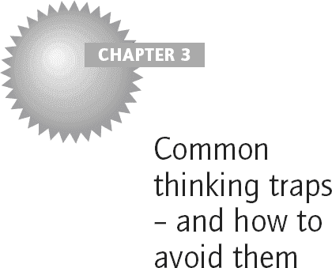

哲学家苏格拉底正坐在雅典城门外，这时有个男人走到他面前。男人说：“我正考虑搬到雅典。在这里生活怎么样？”苏格拉底抬头问他：“我很乐意告诉你，但请先回答我一个问题：你现在住的地方怎么样？”那人回答说：“糟糕透了！那里的人都是背后捅刀子的和小偷。我离开后不会留下任何朋友——只有敌人。”苏格拉底皱起眉头回答说：“好吧，你最好赶快离开，因为在雅典你也只会遇到同样的事情。”

后来，第二个男人走近，他也正考虑搬到雅典。这位老哲学家再次问他关于家乡的经历。那人微笑着说：“我来的地方，人们都通力合作、互相帮助。到处都是善意，你总是受到尊重。”苏格拉底微笑着说：“欢迎来到雅典，你在这里也会发现同样的事情。”

苏格拉底知道，我们的心态决定了我们对世界的体验，他意识到这两个人都会带着他们习惯性的态度、看法和互动方式。正是他们处理信息的方式以及思维中的偏见，很可能和他们所处环境的性质一样，决定了他们生活的质量。

为了摆脱我们很容易为自己建造的精神牢笼，CBT 坚持认为，我们首先需要更加意识到思维中的偏见，这些偏见会让我们陷入困境并感到不快乐。在本章中，我们将探讨一些最常见的思维陷阱，并帮助您更加意识到它们如何持续加剧我们的困难。您将有机会分析自己的思维方式，并学习避免常见思维错误的简单策略。

### 思维错误 1：灾难化

#### “世界末日要来了！”

“我找不到我的钱包……哦不！我肯定是把它落在超市了……肯定有人把它偷了……可能是有人在我从取款机取钱时偷看了我的肩膀，那样他们就知道我的密码，很可能已经把我的银行账户清空了，或者盗用了我的身份……这意味着我这个月付不了账单……万一银行决定收回房子怎么办？我们就完蛋了。我们将流落街头……我怎么能这么愚蠢？”

我们都认识这样思考的人。灾难化是焦虑者的典型特征。它将悲观主义（即认为在任何情况下，坏结果或令人痛苦的结果比好结果更可能发生）与一种极度夸大的威胁感结合在一起。事情不仅会很糟糕，而且会非常糟糕。

不幸的是，灾难化的人很难现实地评估情况的重要性：他们可能会因为相对微不足道的挫折而像遭遇重大不幸一样痛苦。他们不断地将自己投射到充满厄运的未来，让想象力在可怕的场景中肆意妄为。

灾难化的人很少考虑自己可能拥有的应对最坏情况的资源。如果你是这样的人，请问自己：

*   在过去发生过的所有坏事或未来可能发生的坏事中，这件事有多糟糕？

*   如果我别无选择，只能面对这种情况下可能发生的最糟糕的事情，我实际上会怎么做？

*   想想你过去如何处理其他困难。那时什么帮助了你？

### 思维错误 2：过度概括

#### “事情总是对我不利……”

人类被模式所吸引。我们经常将自己的经验作为预测未来的模板。然而，倾向于概括的人只需要很少的证据就能推断出关于世界运作方式的规律和假设——而且他们几乎总是观察和推断得相当悲观。一个人输掉一场拼字游戏，心里想：“真典型！我什么都赢不了。”一个小女孩在学校被嘲笑，得出结论：“每个人都讨厌我！”一位老妇人在当地报纸上读到一起抢劫案，懊恼地得出结论：“如今没人是安全的……”。所有这些都是概括的例子，即个人基于单一的不愉快经历或孤立的信息片段，得出一些深远的、普遍的结论。

容易概括的人的语言通常是一个可靠的信号。如果你发现自己经常使用“从不”、“总是”、“每个人”和“没人”等绝对词汇，那么你很可能容易受到这种思维方式的影响。

为了对抗概括，你需要训练自己寻找自己规则中的例外。如果你在世界上只有一个朋友，那么并不是“没人”喜欢你，而且你“从未”赢过任何事情的可能性也非常小——即使你扭曲的思维可能让你难以想起任何过去的胜利。概括的危险在于，我们倾向于屏蔽任何与我们毫无根据的信念不符的东西，而我们却急切地抓住任何似乎支持我们对自己和他人负面信念的新证据。

不幸的是，概括很容易成为自我实现的预言。例如，一个认为自己普遍不受欢迎的人，会很少努力让自己变得讨人喜欢。

## 思维错误 3：读心术

### “她觉得我是个白痴”

我们不断地对他人及其意图做出假设。在某种程度上这是必要的，我们可以根据人们的行为和过去对我们的态度，可靠地推断出很多事情。然而，在某些情况下，我们的想象力会失控。我们基于非常少的确凿证据，就对他人的动机和态度下结论。当这些动机和态度直接影响我们时，我们尤其倾向于这样做。

问题是，当我们做出这种假设时，我们就让自己暴露于各种误解和偏执投射之中。事实是，除非对方选择告诉我们，否则我们无法确切知道另一个人在想什么。

对于容易进行读心术的 CBT 来访者，通常推荐的干预措施之一是咨询他人关于他们的看法和感知。

一位年轻男性来访者被布置了回家作业，要求他询问家人和朋友他们欣赏他的哪些方面，但他找了各种借口来避免完成这项任务。他会感到自惭形秽。他联系不到一些相关的人。由于大学课程的压力，他没有时间。在下周的会谈之前，我半期待他会声称狗吃掉了他的作业纸。

然而，当保罗确实来参加会谈时，我们都对结果感到惊喜。他不仅完成了任务并按建议采访了相关人员，还报告说，他受到的一些赞美既让他感动，又暗自欣喜。

保罗承认，他一直害怕进行这些询问，因为他深信即使是最亲近的人也认为他是“一个烦人的书呆子”。事实并非如此，但由于这种根深蒂固的信念，保罗从未冒险去检验情况的真实性。相反，他依赖自己高度发达的“读心术”能力，一直带着一个不必要的假设，这个假设正在侵蚀他的自尊心。

## 思维错误 4：非黑即白和僵化思维

### “要么黑，要么白……”

“要么对，要么错”，“你要么是赢家，要么是输家”，“如果不是最好的，那就是垃圾……”。那些总是以这种二元对立方式思考的人，很可能会给自己带来各种心理问题。世界并非如此简单。我们的分类总是不完美的，试图将现实强行塞进方便的框架里，通常效果并不好。

以体重为例。非黑即白的思维会坚持认为，如果你不瘦，那你就一定是胖。这忽略了这样一个事实：如果你把伦敦的人口排成一排，人们很难就“瘦子”结束和“超重者”开始的界限达成一致。肥胖是一个连续体概念的良好例子，其临界点相当随意。它也是一种文化建构——一种社会评判，而非客观真理。

非黑即白和僵化的思维常常与强烈的道德评判和自我评价相伴而生，这会造成大量不必要的痛苦。你可能也注意到，非黑即白或教条式的思考者通常花大量时间试图将自己的分类体系强加于他人。他们的道德绝对主义不容异议——毕竟，在他们眼中，只有一种正确的方式。不幸的是，这种非黑即白的思维会导致社会中的许多弊端，包括种族主义、偏执、性别歧视和政治极端主义。通常，以僵化方式思考的人会给自己和他人带来大量不必要的压力。

以极端方式思考的人没有多少退路。毫不奇怪，CBT 非常强调软化我们思维中的绝对化，并鼓励我们更灵活地思考。这并不是要你放弃价值观或成为一个无道德的人。这仅仅是认识到，人们可以以不同的方式看待和体验事物，而更灵活、更精妙的感知方式很可能对你的心理健康更有利。

### 以滑动尺度来思考

人们常常抱怨 CBT 不必要地强调百分比、评级和测量。然而，认识到在确信程度或我们感受到的情绪强度方面，我们总是处于滑动尺度上的某个点，这就创造了向任何方向上下移动的可能性。如果只有两个对立面可供选择，那么从一个位置转移到另一个位置往往变得令人生畏。向任何方向移动几英寸，是一个不那么令人生畏且更现实的前景。

以下是一些建议：

*   注意你言谈和思考中“应该”、“ ought to” 和 “必须” 等词语，这些词可能表明你对自己和世界存在不利的僵化假设：

    – “女人应该总是服从丈夫。”

    – “我必须总是把别人放在第一位。”

    – “孩子应该只可看见，不可听见。”

*   试着接受灰色地带：认识到许多概念最好被概念化为滑动尺度，而不是在截然不同的替代方案之间做选择。

*   学会将你的价值观和信念视为个人选择，而不是对每个人都强制性的。

*   让自己接触不一定符合你自己的观点，看看你能否与持有这些观点的人找到任何共同点。

## 思维错误 5：情绪推理

### “我感到如此内疚……我一定做了什么可怕的事”

Albert Ellis，美国心理学家和心理治疗师，谈到了“思维-情感融合”，他指的是我们的认知和情绪反应往往是同一事物的两个方面。通常在 CBT 中，我们寻找引发痛苦情绪的负面想法，但重要的是要认识到，我们的情绪也可能引导我们沿着某些思路思考。有时，我们的强烈情绪会被视为负面想法真实性的“证据”。这被称为情绪化推理，可能会给我们带来各种麻烦。

“他真的在惹我生气！”这是我家里常见的抱怨。这通常意味着我的一个孩子被另一个孩子弄得压力大、沮丧，因此认为对方是故意这样做的。现实往往并非如此：行为的影响是无意的，但“受害者”所经历的恼怒程度，使得任何其他更无辜的解释都显得不可能。我们必须非常小心，不要让我们所感受到的情绪成为我们信念真实性的证据。

以下是情绪化推理的常见示例：

| 我感到被攻击 ||  || ‘肯定有人在针对我……’ |

| --- | --- | --- |

| 我感到内疚 ||  || ‘我一定做了什么坏事……’ |

| 我感到害怕 ||  || ‘可怕的事情即将发生。’ |

情绪化推理的解药是认识到，在确立事实时，我们的情绪并不可靠的指南。通常，我们的情绪会模糊我们的判断，或像一片干扰场，使我们难以看清事情。

*   认识到，在确立真相时，你的情绪不一定是准确的指南。

*   把你的感情放在一边，考虑是否有确凿的证据支持你的结论。

*   考虑其他可能的解释。

*   问问自己：‘其他人会以同样的方式对待这种情况吗？’

## 思维错误 6：指责

#### ‘全都是你的错’

总的来说，指责是一种相当适得其反的消遣。分配对已发生之事的责任这项任务，会以一种有效地使人们脱离解决问题能力的方式占据人们。当情况是‘别人的错’时，就很少需要再做进一步的事情，更不用说去寻求理解自己行为、感受或假设在造成问题中可能扮演的角色了。指责在认知上是一条死胡同，也是引发一系列破坏性情绪（如怨恨、苦毒、愤怒和仇恨）的可靠线索。

指责他人往往是那些无法容忍自己可能在某种程度上有错的人的一种防御性举动。到现在你可能已经认识到，这种对有缺陷的恐惧是因为对不完美会有多糟糕的扭曲认知。挖掘一下那些倾向于指责他人的人，你往往会发现功能失调的假设，例如‘我必须时刻完美且出色，否则人们会恨我’（灾难化）或‘如果我不完美，那我就是无用且不值得的’（非黑即白思维）。

有些人则走向另一个极端，倾向于对发生在他们和他人身上的坏事承担过多责任。

患有强迫症（OCD）的人——一种人们通过执行仪式（如洗手）或为自己制定不寻常的心理规则来减少焦虑的状况——特别容易自我指责。他们对如果自己造成伤害会有多可怕的感觉，往往似乎让他们相信自己已经造成或可能造成伤害，即使是以神奇和难以置信的方式。

我曾与一位青少年女孩合作，她确信如果她没有以正确的方式关掉卧室的灯，她所爱的人就会遭遇可怕的疾病或事故。我认识另一位女士，她确信自己可能转移到一封信上的细菌会让收信人的婴儿生病。她对此不断焦虑，并对这个想法如此着迷，以至于无法在夜间入睡。

这类例子很极端，对于不患有强迫症的人来说可能显得奇怪。然而，我们都可能表现出倾向，对那些可能只部分在我们控制之内，甚至完全超出我们控制的事情承担责任。自我指责的明显情绪是内疚。当我们确实给他人造成痛苦时，内疚是一种自然且恰当的情绪，但如果你经常毫无充分理由地感到内疚，这可能表明一种过度发展的责任感或一套非常消极的核心信念可能正在控制你的生活。

## 思维错误 7：筛选与放大

#### ‘你看！正如我所想的……’

这是一种几乎普遍的思维扭曲，我们有时都会犯。筛选，顾名思义，是指我们只关注符合我们先入之见的信息，而忽视其他同样合理的信息。放大是指我们夸大符合我们当前信念的事件的重要性或频率。

Jane 正在为她最好的朋友组织一场婚礼。在婚宴进行到一半时，显然餐饮服务商搞混了订单，送来了泡芙，而不是要求的三文鱼奶油芝士薄饼。

Jane 非常震惊。就她而言，这只能证明组织婚礼的工作本应交给更有能力的人。今天本应是完美的，而现在她却让朋友失望了。事实上，她确信自己看到朋友在发现这一点时眼眶微红。

当然，朋友试图让她感觉好些，说这根本不重要，但 Jane 在心里知道，特殊的日子并没有按照朋友想要的方式进行，她感到非常难堪。她又一次失败了，这只能证明她母亲过去一直说的关于她的话都是对的。

很明显，Jane 在筛选和放大方面都是行家里手。她完全忽略了朋友大日子里许多按计划进行的事情，而完全专注于那个没有做好的小细节。

她之所以这样做，是因为她在无意识地寻找证据来支持她的核心信念‘我不行’，为了做到这一点，她必须屏蔽她作为婚礼策划师成功的大量证据，只专注于她的一次‘失败’——尽管搞混并不是她的错。

她努力夸大错误小点心的重要性和新娘的反应：请注意，Jane 并没有将朋友可能的眼泪归因于整个场合的喜悦或任何其他原因。她还必须说服自己，朋友的安慰完全是出于利他主义想让 Jane 感觉好些，而不是朋友可能根本不在乎泡芙的更换。Jane 还将自己认为这一天必须‘完美’的假设叠加上去，以使错误显得更加糟糕。难怪她如此沮丧。

为了防止自己走上同样的道路：

*   试着看清全局——考虑所有事实，即使它们似乎不符合你的期望。

*   看看你能否为与你目前相信的相反的情况建立论据：在我们的例子中，婚礼是一场巨大的成功，Jane 出色地完成了工作。

*   检查你是否将某些元素夸大了。其他人是否以与你相同的方式反应？

## 思维错误 8：情绪化语言

Words are powerful things, and certain words have an emotional resonance that can colour our thinking – often in unhelpful ways. We can describe events to ourselves in terms that can either inflame our reactions or calm them down.

如果我对自己说，‘那个人鄙视我所坚持的一切’，而不是说，‘我们并不总是意见一致’，那么下次见面时我会立刻感到防卫心重。如果我对自己说某个情况是‘极其屈辱的’，而不是说‘短暂的不舒服’，我将会不遗余力地在未来避免类似的情况——即使这种保护性的操纵完全没有必要。我的语言实际上提高了赌注。

情感化语言是人们最终说服自己无法忍受那些他们本有足够资源应对的情况的主要原因之一：

*   ‘如果人们嘲笑我的表演，那将是最糟糕的事。我会看起来像个十足的白痴。’

*   ‘如果她出了什么事，我将无法原谅自己。’

*   ‘最终孤独一人简直太可怕了……’

当你向自己描述过去或未来的事件时，要小心不要给自己贴上偏见的标签：这适得其反。很难对已经被赋予强烈情感色彩的场景进行客观思考，往往正是我们的语言给我们的认知染上了色彩，滋养了我们的焦虑和低落情绪。

*   在思考或谈论情感上具有炎性的场景时，检查你的词汇，确保你没有在给消极思维的火上浇油。

*   努力做到尽可能中立、客观的语气。

*   回忆令人痛苦的事件时，想象你正在为新闻广播撰写简报，这要求你保持超然、客观的视角。

## 你擅长发现思维错误吗？

下面的测验旨在看看你是否能运用知识，识别出这些例子中犯了哪些常见的思维错误。记住，你要寻找的是以下情况：

*   灾难化

*   极化的‘非黑即白’思维

*   僵化思维

*   过度自责

*   不切实际地责怪他人

*   过滤

*   放大

*   心灵感应（读心）

*   情感化语言。

请注意，这些思维错误中的一些并非互斥，你可能在同一个例子中发现不止一种。

另外，在浏览列表时，试着揣测与所描述的思维和行为类型相关的情绪可能是什么。（答案在第 57 页。）

1.  一个男人被邀请参加一个庆祝同事最近晋升的聚会。他把请柬揉成一团，扔进了垃圾桶。他想：‘乔尔现在一定觉得自己很得意，他所有的阴谋都得逞了。自从他来到这里，他就一直在惹是生非，试图把我挤出去。看他和主管搞好关系的样子——真是个卑鄙小人！我还能听到他说自己“很遗憾”我没有在约翰逊交易中得到足够认可时，声音里滴着讽刺。我打赌他一直在散布各种关于我的谎言和流言。当然，这意味着我可能永远得不到晋升，我将在剩下的生命里在这该死的死胡同工作里推文书。’

2.  我醒来，感觉有点不舒服。我的想法立刻如下：‘不好……不好。我已经好几天感觉不舒服了——也许我出了什么严重的问题……仔细想想，我的腿感觉非常沉重，前几天读那张税单时我的手还在发抖。我知道吉尔认为这只是因为我一直在加班太晚，有点劳累过度，但万一是多发性硬化症呢？我知道我母亲那边有人得过 MS。哦，天哪！现在我能感觉到手指上有奇怪的刺痛感。我怎么了？’

3.  ‘那样的行为根本没有借口……她跟你说话的方式简直不可原谅。我们一直在你母亲家过圣诞节。这是家庭传统。她在想什么？年轻人都一样：不尊重长辈。’

4.  ‘如果她说不，我知道我就无法应付了。我会非常尴尬。我会出洋相，一切都将徒劳。她为什么要和我一起去舞会呢？我确信她宁愿和基兰一起去……她可能只是因为可怜我才说她喜欢我。’

5.  ‘一切都完了。我把事情搞得一团糟。我一个音接一个音地弹错，我知道我完全搞砸了中间那段的节奏。他们都期望我获得优等，我勉强拿到了良等。他们会对我非常失望。也许我应该彻底放弃钢琴。既然我显然没有天赋，继续挣扎还有什么意义？’

## 家庭作业：深入个人

在接下来的一周里，记录你的不安想法。随身带一本笔记本，一有想法就立刻写下来，使用当时脑海中浮现的同样措辞和意象。

当你收集到足够数量的思维样本后，仔细检查你的记录，看看是否能找到本章描述的那种思维错误的证据。一旦你意识到可能正在强化你消极思维模式的认知习惯，就更容易开始打破它们。

答案：1）读心，过滤，情感化语言，责怪他人，放大，灾难化；2）放大，过滤，灾难化和情感化语言 3）过度概括，极化思维，僵化思维，情感化语言；4）情感化语言，灾难化；5）情感化语言，过度概括，极化思维，过滤，放大，读心。

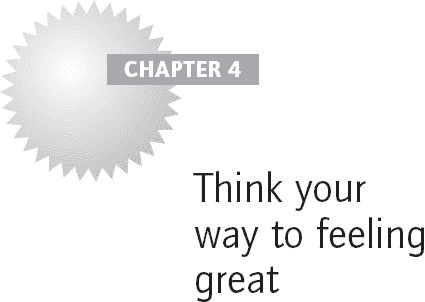

你的头脑会用图像、声音和感觉来表征你的思维，有时甚至包括气味和味道。你的表征的质量和细节会根据你的思维是积极还是消极而有所不同。了解你如何表征你的思维（其中包括价值观、元程序和信念），将有助于你在想要改进结果的领域做出你想要的改变。

当你感到焦虑、不确定、困惑、愤怒或沮丧时，你会变得紧张和有压力。处于这种状态会阻止你调用你所有美妙的内在资源。无论你处于什么情况，如果你感到其中任何一种情绪，你不太可能发挥出全部潜力。想想最近你感到压力的时候，回想一下你当时在想什么。你的思维负责创造你的感受。你的每一个想法都会导致一种感受，所以控制感受的方法是控制你的思维。

试试看。安静地坐下来，想一个你做了一件让自己感觉不太好的事情。注意浮现出什么样的感受。现在深呼吸，想一个你做了一件让自己感觉非常好的事情，同样注意浮现出什么样的感受。

你刚刚使用想象力回忆了两种导致截然不同感受的经历。你可以利用想象力和感受之间的联系，让自己掌控局面，并能够选择自己的感受方式。你的感受对你的能力有直接影响，无论处于什么情况。

## 首要的想法最重要

一切始于一个念头，而那个念头会吸引相似的念头，直到你形成一个念头集群。这个集群成为一种思维模式，进而形成一种习惯。该习惯随后会应用于许多不同的场景。科学家认为，意识在任何一次只能处理大约七个信息片段，并且很快就会过载。这意味着，如果你用会产生负面情绪的负面思维模式填满你的意识，你就没有空间容纳其他任何东西。通过掌控，你正在对你的意识思维行使更多选择权，而且你越这样做，你就越会建立起一套能为你有效工作的无意识模式储备。

掌控的第一步是意识到念头是如何产生的。当你思考时，你会有一个内部选择过程。如果你要吸收周围发生的一切，你的大脑就会过载，因此你会选择你认为重要的东西并忽略其余部分。例如，想想你最近进行过的一次谈话或观看过的一部电视节目——你记得多少？很可能，你能够概括事件并详细阐述你最感兴趣的方面，但你无法回忆起每一个字。你的内部选择过程选择了它想要保留的内容，将其作为图像和声音的组合，以及你当时的感受。再加上一些内心对话——换句话说，就是你对自己关于该情况所说的话。

这就是你表达你独特的现实版本的方式——通过图像、声音、内心对话和感受，有时还有气味和味道。你通过外部感官和内部思维的组合来捕捉你对现实的个人理解，正是这个被捕捉的版本，你用来做出决策和形成判断。这种对事件的独特视角被称为你的“内部表征”或“现实地图”。

让我们来看看你内部表征的这些组成部分，从视觉感官开始。

## 使用你的视觉意象

回想一个愉快的回忆，花几分钟时间享受它。捕捉图像，然后当你准备好时再回到此页面。

描述你创建的图像。它清晰吗？它是彩色的吗？它周围有框架，还是边缘逐渐消失？它有深度吗？有任何移动吗？它是明亮的，还是黑暗而模糊的？对比度和细节如何？这个图像离你有多近，你是将它投射在地平线上方还是下方？你能在图像中看到自己，还是图像包围着你？

正如你可以查看照片或电影的视觉细节一样，你可以查看构成你思维的图像的细节。这些细节指的是图像的品质，而不是图像本身。想象和改变这些品质的能力是无限的。你可以在你的心理意象中处理的不同品质的数量将由你这样做的练习量决定。正如你有意地想象了一次愉快的经历，完全相同的过程每天会发生数百次，甚至数千次，来代表你正在经历的每一个想法。有时你可能没有意识到你的心理意象，但它确实存在，并且你可以好好利用它。

Harriet 在下班后很难将工作抛在脑后。随着工作堆积如山似乎减不下去，她变得越来越有压力。

在辅导过程中，我们承认 Harriet 非常喜欢漂亮的东西。我们要求她想象自己在下班时，用漂亮的彩色纸包裹未完成的工作，系上彩色蝴蝶结，然后留在那里，直到第二天早上她可以拆开它并继续工作。

在那之后，Harriet 对工作变得更加放松，她的生产力也提高了。

让我们玩弄一下你的视觉意象，看看改变或重新编程你的想法和感受是多么容易。

## 消除不良情绪

对于任何你希望感觉更有掌控力或更自信的情况，消除不良情绪都相当容易。

也许面对与某人的困难情况的想法正在让你感到沮丧、紧张或缺乏自信。在这样的时刻，当你情绪紧张时，你会消耗大量能量让自己感觉不好。尽管你不喜欢感觉不好，但在过去，这可能是你无法控制的事情。当你这样感觉时，你就进入了“自我保护”的领域。结果，你理性思考和做出明智决策的能力受到损害。目标就变成了生存、保全面子、获胜或寻求认可。你只需要这样感觉一两次，一种习惯或程序就会形成，然后你就为自己设定了一种陷入不良情绪的思维模式。

通过使用以下技巧来消除不良情绪：

## 消除不良情绪

回想一个你对自己的感受或行为不满意的特定时间。

现在专注于你第一次访问记忆时浮现的图像。迅速将它发射到远处。当它远去时，注意它变得越来越小，直到完全消失。这就像星际企业号以十倍光速飞向深空，在一秒钟的几分之一内完全从视野中消失一样。

你可以对所有不愉快经历的图像做同样的事情——只需将它们发射到深空。当你这样做时，注意你感觉好多了。

John 有一种远离模式，这给他带来了巨大的压力，因为他预测可能发生在他身上的所有可怕的事情。他在早上遛狗时有大量时间沉浸在自己的想法中。当他这样做时，他的头会低下进入内心对话的位置，他告诉自己事情有多糟糕。

在辅导过程中，我们建议，在遛狗时，他可以抬起头，注意周围的风景，想象前一天发生的所有美好的事情。

现在使用以下技巧来练习你选择不同事物的能力。

## 选择以不同方式回应

一旦你使用上述技巧消除了负面图像，就回想一个带有积极感受的记忆。这可能是一次你非常自信或高度有动力去取得积极结果的经历。

现在处理这个图像。确保它色彩鲜艳、大而明亮。

当你强化了这些品质后，将图像拉近并想象走进它里面。花几分钟时间吸收并享受这种效果产生的积极感受。

## 使用你的内部音频

除了在脑海中创造图像，你还可以重播与他人的对话、环境声音和音乐。你是否有时会重播对话或预期未来的事件，并实际听到人们说了什么或可能会说什么？你的内部音频可能伴有图像，也可能没有。

你的内心对话呢？你发现自己在脑海中反复说什么？

你的内心声音非常强大，并直接影响你在任何特定时刻的感受。你感觉如何很大程度上反映在你的声音语调中——无论是你说出的话语，还是你对自己说的话语。

这里有个值得思考的问题。如果你记录下自己一天的所有内心对话，然后播放出来，它会激励你吗？

你可以探索并改变内在音频的特性，方式与你之前改变心理意象非常相似。使用以下技巧来改变你思考未来事件时的感受。它可以用于各种你希望以某种方式感受的情境。你希望在早晨醒来时、周一到达工作地点时，或者伴侣做了让你恼火的事情时，感觉如何？你能为自己创造多少种不同的声音？

### 使用你的内心声音来改变你的感受

思考一个对你很重要的即将发生的事件，并决定你希望在那时感觉如何。现在选择一位演员或你非常了解的人，其语气正是你希望在活动中拥有的语气。

想象该事件即将开始，并用你选择的语气与自己进行对话。例如，你可能希望感到自信且坚定，以取得结果。选择你的一位英雄的声音，说：“对我来说，今天是一个重要的日子。我将提出一些尖锐的问题，并期待得到明确的答案。我将保持积极、专注，并坚定地取得我们可以采取行动的结果。”现在再说一遍，并调高音量。调整语调和语速，直到你开始感到自信和坚定。

当你的内心对话失控时，你也可以调低音量。当你反复重复消极的对话，告诉自己把这件或那件事搞砸了，或者在试图入睡时反复思考工作问题时，只需调低音量，注意那些词语逐渐远去，直到完全消失。你也可以将消极的声音改为幽默的声音，比如巴特·辛普森或米老鼠。注意当你这样做时，消极的情绪是多么容易消失。

当你意识到你可以控制你的内心声音及其相关声音时，你可以带着脑海中的交响乐团四处走动，并随时准备好一群电影明星和卡通人物，以备需要他们的服务。玩得开心！

### 感觉很棒

你白天拥有的感受是你选择如何与你的经历建立联系的结果。这是情感领域。用来描述这些感受的词是“体觉的”。

你的感受由想象的事件和真实的经历共同产生。如果你与伴侣发生争吵或与店员产生分歧，你所经历的感受将是对这些情况的习得性反应模式的一部分。记忆由视觉、听觉和体觉元素组成，有时还包括气味和味道。感受源于以特定方式思考。例如，一种不安的感觉可能是由创造阴暗、模糊的图像以及警告你要警惕尴尬或困难情况的内心对话所产生的。想象一下，这与同一情况下另一个人的感受形成对比，那个人正在创造明亮、清晰的图像，内心对话充满兴奋。

你有能力拥有广泛的感受——从兴奋的高点到沉重的低谷，甚至在最糟糕的情况下是抑郁。有许多技巧可以帮助你以想要的方式感受。其中一些帮助你改变附加在消极记忆上的感受，而另一些则让你随时随地创造任何你想要的感受。

### 利用你最好的经历来感觉很棒

我们将感受附加到想法上的方式非常随意。我们允许他人和环境影响我们的感受。一旦一个想法附加了感受，它就牢固地锚定了。每次我们回想那个想法，完全相同的感受就会浮现。例如，当你看一张在美好假期拍摄的照片时，你当时的感受会回来。当你接电话并听到一个你曾有过消极经历的人的声音时，你会感觉就像那个经历发生时一样。

锚定的感受很容易嵌入你的记忆中。一个经典的锚是当你与一名销售员有过不愉快的遭遇，并决定再也不去那家商店。每当有人提到那家商店的名字时，你就会重温当时遭遇时的感受，尽管那次遭遇可能发生在很久以前。

将感受锚定到想法上的过程是潜意识的自动功能。其结果被称为“状态”。它不仅仅是一种心理状态，也是一种身心状态，因为你的思考和感受方式会导致身体变得放松或紧张。

那么，如果你可以利用这个过程，在你想要的时候创造美好的感受或状态，会怎样呢？换句话说，对你锚定的感受和创造的状态行使选择权。如果你能产生勇敢、自信、冷静、果断、乐观、专注、爱玩、富有同理心、好奇或专注的感觉，会怎样？如果你能为学习和保持开放心态、领导力、母亲身份、父亲身份、充满活力或拥有充沛精力、爱与敏感创造积极的状态，会怎样？好吧，你可以通过以下非常简单的技巧做到这一点。

路易丝需要定期向董事会做汇报。她做得越多，就越紧张。

有一天，她很兴奋要向董事会展示她的新想法，这个想法能为公司节省大量资金。她也担心搞砸，非常希望董事会能听取她的想法。

我们帮助路易丝从另一个她非常熟悉的情境中调用自信的状态，并将这个状态锚定在董事会会议室的门把手上。一旦她触碰到门把手，自信的状态就会浮现，她就能进行演示了。

### 锚定有资源的状态

决定你想要锚定的哪种积极状态。从上一页的列表中选择一个——或者你可能有其他特定的状态在心中。为了这个练习的目的，我们将其称为“状态 X”。通读练习并记住它——你需要在整个过程中保持注意力集中在内部，因此你不想查看书本来了解下一步该做什么。

准备练习

你将把一种状态附加到你身体某个触发点上，比如捏你的耳朵或挤压你的拇指。选择一些你不太可能意外做到且可以精确重复的事情。

程序

1. 回想一次你有强烈的状态 X 感受的时刻，并不断思考那个记忆。选择任何你喜欢的情境，只要状态 X 的感受非常强烈。如果你想不起来，那么让自己进入一个想象中的情境，你在其中处于高水平的状态 X。注意你意象的特性和任何声音。你将使用你的内在表象来增强状态 X 的感受。在做练习时闭上眼睛可能会有所帮助。

2. 将图像投射到你面前的地平线以上。确保你在图像中看到自己。

3. 在图像周围加上一个框架。使其色彩鲜艳、明亮，对比度高。如果涉及声音，调整一个想象中的图形均衡器，使其涵盖完整的高音、中音和低音范围。使其成为环绕声。

4. 增强颜色、亮度、对比度和声音。

5. 缓慢地将图像靠近你，注意框架最终消失，直到图像如此之近，以至于它包围了你，环绕在你周围。当状态 X 的感受接近其强度的顶峰时，通过轻轻挤压你的拇指（或捏你的耳朵，或任何你选择的锚点）来设置你的锚点。一旦感觉开始减弱，立即释放锚点。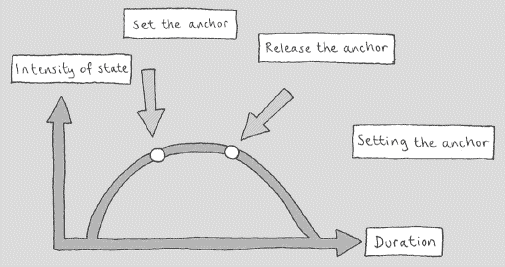

6. 现在做几次深呼吸来改变你的状态。等待片刻，然后触发或激活你的锚点。享受状态 X 带来的强烈感觉。多激活几次以熟悉它并增强它。确保在每次激活之间通过深呼吸来打破你的状态。现在，当你想要体验与状态 X 相关的感受时，随时可以使用这个锚点。

你可以通过未来 pacing 来测试这个锚点。想想未来某个你需要状态 X 的情境。当你在脑海中演练这个场景时，激活你的锚点。成功锚定的关键在于感觉的强度、设置锚点的时机，以及设置和激活锚点的精确度。

正如你可以创建积极的锚点一样，你也可以消除消极的锚点。例如，你可能与某人有过不愉快的经历，当时你应对得不够好。你可能在工作中有过不好的经历，这些经历至今仍让你失去信心或感到沮丧。你在这些情境中的反应会创造一种消极状态，使你的内在资源无法调用。即使事件发生在一段时间以前，你仍然带着与之相关的感受并据此行事。你的行为强化了你的状态并形成了强烈的习惯，以至于每当你发现自己处于类似情境时，限制性行为就会被触发。

下面的技巧利用空间和物理位置来缓解那些消极和紧张的感觉。你不必将这些不好的感觉留在记忆中——你可以将它们消除，如果你愿意，可以用积极的感觉来替代它们。

Phil 在辅导中意识到，他一直在故意与同事 Sarah 维持着一种消极的关系。每当他们见面时，他都会处于一种消极、防御的状态，Sarah 会察觉到这一点。他们会争吵，然后带着糟糕的感觉分开。

使用下面的消除锚点技巧，Phil 能够建立一种新的接近 Sarah 的方式来重建关系。

## 消除锚点

1. 在地板上标记两个相距约 2 米（6 英尺）的空间。

2. 给一个空间贴上减号标签，给另一个贴上加号标签。

3. 站在减号标记上，将一段不愉快的记忆带入脑海。谈论这个事件一分钟左右，并检查回忆经历时你的感受。

4. 做几次深呼吸，快步走到加号标记的空间，将一段愉快的记忆带入脑海，并使这种感觉比消极的感觉更强烈。谈论这段经历一分钟左右，注意你用来回忆事件的图像和声音。强化颜色、大小、清晰度、亮度和音量的特质，然后将图像靠近你。将图像越来越近，注意你的感受如何增强。保持这种感觉片刻，然后放松。

5. 留在加号标记上，再次谈论之前的不愉快经历，注意你之前的消极感受是如何消失的。你已经消除了消极的锚点。

### 环境中的锚点

锚点无处不在，会让你体验到各种各样的情绪——快乐、悲伤、恐惧、狂喜、愤怒，甚至恶心。你甚至可能是别人的锚点，导致他们以一种你可能感到困惑的方式对你做出反应。这种反应可能在你的意识范围内，在这种情况下，你可以精确地与产生这些感受的事件或环境建立联系；也可能不在你的意识范围内，在这种情况下，你可以与不舒服的感受建立联系，但无法与导致这些感受的事件或环境的记忆建立联系。以下是一些示例。

工作中的会议经常突出对立的观点，有时情绪会变得激动。如果管理不当，人们可能会带着消极的感觉离开，并无意中将这种状态锚定到同一主题的任何后续会议上。这可能会导致多种结果。

作为一家大公司的销售总监，Joe 过去两年一直定期参加同一个会议，该会议距离他家 40 英里。会议始终遵循相同的格式，人们都采用了自己应对多年来积累的消极情绪的方式。

会议由来自业务各个领域的一系列报告组成。当 Joe 刚开始参加会议时，他曾根据人力资源总监的演示提出一个想法，但他的想法被忽略了。这让 Joe 感到，如果他将来提出想法，同样的事情可能会再次发生。因此，仅仅是想到要参加会议就会让他陷入消极状态。他再也没有提出过想法，当别人说话时，Joe 会在手机上查看电子邮件。

你可以说，Joe 查看电子邮件是在会议中充分利用时间，如果他所相信的真的是真的话。没有人曾经质疑他——他们只是接受了这就是 Joe 在会议中所做的事情，就像运营总监 Mary 带着她的生产分析表并处理它们，直到轮到她展示为止。

如果没有人在听，演示还有什么意义？每位总监完全可以制作一份报告并发送给同事，让他们在自己的时间阅读。由于一套已经根植于文化中的锚点而浪费的高层管理时间数量是惊人的。

如果要保持高水平的生产力，你需要防止此类锚点扎根。一些简单的步骤包括确保为每位与会者以及议程上的项目建立非常明确的结果，以便个人可以评估他们参加会议的价值。尽可能打破常规，例如人们坐的位置、场地、会议的时长和形式，也有助于打破消极的锚点并使会议保持新鲜感。

Chris 正在接受辅导。经历了多次个人关系失败后，他觉得需要一些帮助来恢复自信。

事情进展得很顺利，直到有一天他来到教练家，发现车道外正在铺设沥青。沥青的气味让 Chris 立刻回想起一次非常糟糕的经历。教练使用消除锚点技巧帮助 Chris 恢复了平衡。

以下是一些日常锚点，可以在人们身上唤起不同的状态：

* 音乐——在车里、超市或电视上播放的快乐或悲伤的歌曲

* 咖啡、新鲜出炉的面包、大蒜或任何其他食物的气味

* 呕吐物、医院、消毒剂、狗粪便的气味

* 香水和须后水的气味

* 十字架或任何其他宗教标志——这些标志可以根植于信仰，并在某些人身上引发强烈反应

* 地方、事物和人物的图像

* 工作环境中的负面通知，例如“不要移动家具”、“禁止进入”等等。

广告商非常清楚锚定的力量——因此商店使用音乐来营造某种氛围，使用香气来吸引人们进入咖啡店和餐馆，并在电视广告中暗示某种须后水的香气能带来美好的关系。

一旦你意识到自己在环境中被锚定在什么上，你就可以选择改变自己的反应。花些时间注意周围那些在你身上触发特定反应的事物和人。如果你喜欢某种反应，并且它为你带来了积极的结果，那么就使用本章前面提到的锚定技巧，使其更加强大。如果不是，那么就使用消除锚点技巧来摆脱它。

你和周围的人会慢慢注意到你的变化，当你开始控制自己的行为来应对那些过去可能引发负面反应的触发因素时。意识到触发你反应的锚点，能够改变它们，并拥有创造全新锚点的技巧，这会让你对自己的情绪状态、人际关系和生活有更多的控制力。

### 修复你的恐惧症

恐惧症是对日常情境的夸张锚定反应。它们可能导致肌肉紧张、过度换气、出汗和头晕。当一个人正在经历恐惧症反应时，其内心独白和意象会预测严重的后果。恐惧症是非理性的恐惧——与由实际发生的事情（例如房子着火）引起的理性恐惧相反。由于恐惧症是非理性的，因此相对容易克服。

NLP 对修复各种恐惧症非常有效，包括恐高症、幽闭恐惧症、广场恐惧症、飞行恐惧症、电梯恐惧症、蜘蛛恐惧症、蜜蜂恐惧症、鸟类恐惧症、青蛙恐惧症和蛇恐惧症。这甚至延伸到淋浴地漏里湿头发的恐惧，或者对橙子和香蕉的恐惧。

根据我们的经验，许多人试图隐藏自己的恐惧症，并避免可能不得不面对恐惧的情境。这是因为他们将自己的问题视为可笑，并试图避免因自己的反应而引起的尴尬。在深层次上，这可能会对自尊心产生不利影响，因为恐惧症通常被视为一种弱点。

任何恐惧症的根源都是关于在引发恐惧的情境中将会发生什么的信念。例如，保罗还是个青少年时，曾被一块橙子噎住。随着时间的推移，他无意识地将负面反应锚定在那次经历上。最终，这变成了对橙子的恐惧反应，以至于每当有人开始削橙子时，他都必须离开房间。他相信如果他吃了橙子就会被噎住。

判断一个人是否患有恐惧症——而不仅仅是非常担心——的测试是：他或她即使只是想到恐惧的事物，也会产生非常强烈的生理反应。因为是想法产生了反应，所以可以在不重温经历的情况下将其消除。

如果恐惧症正在影响你对生活的享受和/或你的自尊心，请使用以下技巧——它的成功率非常高。我们建议你在使用之前先熟悉该程序。这将使你能够在不查阅笔记分心的情况下完成练习。

在我们的一个项目中，代表科林拉开窗帘为我们遮阳。就在他这样做时，一只大蜘蛛跑了出来，科林几乎是飞快地穿过房间冲出了门。另一位代表移走了蜘蛛，科林回到座位上，非常尴尬。他解释了他恐惧症的严重程度，我们建议，如果他想处理它，我们可以非常快速地完成。

在 10 分钟的恐惧症修复后，科林问能否去找一只蜘蛛。我们在温室里找到了一只，他非常乐意站在 6 厘米（2½英寸）远的地方看着它。

### 快速恐惧症修复

我们将要求你在脑海中快速做几件事，这样你的恐惧症就再也不会困扰你了。

1.  想象你正坐在电影院里，屏幕上有一张黑白静止的照片，照片中你看到自己在上次经历恐惧症反应之前的样子。

2.  现在想象你从身体中飘出，上到放映室，在那里你可以看到自己坐在电影院里。你也可以看到屏幕上静止照片中的自己。

3.  将屏幕上的快照变成黑白电影，一直观看直到不愉快的恐惧症经历结束。当你到达结尾时，将其停止为一张静止图像。现在跳进画面中，以彩色倒放。电影中的一切都会倒序发生——人们倒着走，倒着说话，景色也在倒退。

4.  这就完成了练习。深呼吸几次，通过思考你过去害怕的事物来测试结果。

## 重构

本章的练习将帮助你处理与思维相关的情绪，并让你接触到内在资源。有时，你的思维方式可能会制造障碍。你可以通过多种方式重构这种思维，从而完全改变你的视角。就像在画作周围放置一个新画框可以给它带来全新的外观一样，在你的想法周围放置一个新框架可以给你带来非常不同的视角。

![image](images/00003.jpeg）

弗兰克“走投无路了”（他自己的话），因为他试图让最小的儿子蒂米保持房间整洁。随着弗兰克不断地强加规则，关系变得越来越紧张。他经常提高声音，而蒂米则通过退缩到沉默中并尽量避开来回应。情况变得越来越糟，蒂米在学校的表现也受到了影响。弗兰克解释说，他找不到办法帮助蒂米“振作起来”。蒂米从爸爸那里受到了很多责难，他在学校成绩下降是压力的直接结果。

我们向弗兰克提供了以下重构：

‘看来你一直在推动蒂米达到某种整洁标准，这给他带来了很大的压力，并在你们之间制造了距离。他的不整洁实际上可能是他这个年龄段的孩子经历的一个阶段，是他表现正常的迹象。通过让他做一个正常的青少年，你可能会发现蒂米压力不那么大，并且能更好地专注于他的学业。’

简而言之，弗兰克得到了一个重构，让他从想‘我的孩子不整洁’转变为‘我的孩子不整洁，这是任何青少年的正常行为’。这帮助弗兰克意识到，他对蒂米的行为导致了他们之间关系的破裂。他立即停止不断责备蒂米不整洁，并开始更多地帮助他做学业。

这种类型的重构改变了情境的含义。另一种类型的重构则在不同情境之间转移含义。例如，一个对他人想法非常挑剔的人，可能被他的团队视为难以相处或消极。然而，在评估来自创意头脑风暴的想法时，团队中有批评者是非常有用的。问题不在于批评者的行为本身，而在于如何最好地利用那项特定的技能。这种类型的重构将行为放在另一个情境的积极框架中。

下一个例子展示了夫妻中常见的沮丧原因。

![image](images/00003.jpeg）

菲奥娜喜欢准时，并且对日期、时间、日程和清单非常执着。迈克，菲奥娜的伴侣，正好相反，他更喜欢以更轻松、更随和的态度对待生活。迈克感到左右为难，既想取悦菲奥娜，又无法理性地看待她施加给他的压力。

经过一些辅导后，迈克意识到菲奥娜作为组织者的能力在很多方面都很有用，包括记住家庭生日、购物、计划假期以及非常有效地管理家庭。以这种方式重构了他的思维后，压力减轻了。压力源于他过去的思维方式，而非环境。

#### 不要那样想，要这样想！

任何重构都只是在说，‘不要那样想，要这样想’，‘不是那个，是这个！’你可以将简单的重构应用到所有不如你所愿的情境中。

问题只能存在于你的脑海中——在你的脑海之外，只有各种情况。你把一种情况称为问题，这表明了你的思维方式。一个人的问题可能是另一个人的动力来源。因此，你对所处任何情况的思考方式非常重要，因为它会产生后果。

在一天的交谈中，“this”和“that”这两个词被多次使用，但当它们用于任务和人时——例如“那个任务”或“这个人”——它们表明说话者与所指对象是关联还是疏离。当对任务/人有积极意图时，围绕它很可能存在积极心态——它是一个 this。当对它没有积极意图时，围绕它很可能存在消极心态——它是一个 that。

与某事疏离是拖延的根源。如果你可以选择不参与，那么就不会有问题，但当你不得不参与因为这是你的工作时，你就被迫关联，这时消极情绪可能会控制你的思维。在被迫关联的情况下，重新构建你的思维并将 that 转化为带有积极意图的 this 是有用的。

这里涉及四个关键原则：

1. 你可以与任务和人关联（this）或疏离（that）。当你以积极的方式关联时，你在情感上与之相连，并且很可能比当你与任务或人保持距离、从而变得疏离时取得更好的结果。表现不佳源于与 that 的“被迫关联”——当你在没有明确积极意图的情况下执行一个 that 任务时，你正在强迫自己与之关联，因此情感联系很可能是消极的。这就是表现不佳的配方。

2. 拥有有意识的积极意图为成功铺平道路——你的所有意图对你来说都是积极的，即使在其他人看来可能并非如此。你的潜意识可能会告诉你不要进行一项不愉快的任务，因为它的积极意图是让你感觉良好。拥有明确的积极意图并在任务中寻找好的方面，让你能够掌控自己的成功。正如明确的积极意图为成功清除障碍，没有它则会导致你挣扎。你的潜意识意图将是感觉更好并寻找方法，让你不必承担不愉快的任务或遇到让你感到不舒服的人。这样做，你会给自己带来压力和不适。

3. 当你夸大你思考情况的方式的荒谬性时，你就为改变奠定了基础。你可以在几乎任何事物中找到荒谬性，并利用它来创造改变。下一节将给出一个示例来演示这一点。

4. 将 that 改为 this 主要是关注什么是好的并拥有积极意图的问题。阴阳的概念表明，要在生活中实现平衡和流动，一切都必须包含其对立面的元素。热包含冷的元素，好包含坏的元素，反之亦然。因此，每个 that 都必须包含一个 this 的元素。不幸的是，当你专注于 that 时，你对 undoubtedly 存在的 this 视而不见。如果你选择专注于 this 并允许它发展和成长，你的结果将更加成功。

你将某事或某人视为 that 可能有无数原因。that 的示例可能包括：

* 你不喜欢且不期待的活动

* 你觉得自己没有完全胜任以达到令人满意的标准完成的工作

* 你持有负面信念的人或事物

* 与个人价值观冲突的活动

* 你觉得难以相处或令人沮丧的人。

## 使用荒谬性来创造思维改变

你可以在几乎任何事物中找到荒谬性。考虑这句话：“我必须在每天下午 6 点前把晚餐摆上桌。”它暗示所有家庭成员每天都会在同一时间饿了并准备好吃饭。这种情况发生的可能性很小，因此，这句话是荒谬的。

这种技巧夸大你思维中的荒谬性。这样做，你的情况变得如此荒谬，以至于你会想要改变你的观点并重新构建它，因为继续以旧的方式思考太痛苦了。

Peter 是一位项目经理，非常注重细节和程序。他被赋予了一个涉及 Simon 的重大项目的责任。Simon 每次想到这个项目时都会变得越来越焦虑。

Peter 和 Simon 从一开始就发生了冲突。当 Peter 坚持在会议上引入 Simon 认为不必要的细节时，Simon 不知道如何应对。这开始影响他理性贡献的能力。他在项目团队面前会冷笑并对 Peter 的管理风格发表贬损评论。当被问及情况时，Simon 回答说：“如果他想有所作为，他就需要学习一课——我会教训他，你放心吧。”

Simon 得到了以下重新构建：

“那么，Simon，似乎你想继续对这段关系感到难过，不是吗？你将继续尖刻地攻击 Peter，让其他人在你背后嘲笑你。你甚至不介意他们认为你表现得像个孩子。项目将受损，你的情感能量将被用于对 Peter 产生消极情绪，因此你将几乎没有剩余的能量用于项目的创造性工作。不过你不会介意，因为教训 Peter 比建立良好关系并成功完成项目对你来说重要得多。当你发现自己未来不再被邀请加入项目团队时，你的对抗行为将对你很有好处。你甚至可能发现自己完全没有角色，那也没关系，因为这里最重要的是让 Peter 出丑，不是吗？”

这种技巧可能看起来有点严厉，但对合适的人来说，它可能是最有效的工具。在这种情况下，Simon 是那种让自我妨碍的人，因此这种技巧必须比他膨胀的自我更强大。Simon 收到的是一种重新构建，使他从认为“Peter 需要被教训”转变为“我的事业比我对 Peter 的感受更重要”。这给 Simon 的自我带来了足够的痛苦，使他放弃教训 Peter 的需要，而是对自己的思维和行为做出积极调整。

## 关注积极意图

荒谬性技巧对某些人可能有效（我们希望你尝试在自己处于状态 X 的情况下试用），但有时你可能需要更多积极的鼓励。无论你多么消极地看待一种情况或一个人，总能找到一些好的方面。

Michelle 与她的室友有矛盾，室友似乎在干涉她的生活。她认为这意味着室友不信任她自己做关于男朋友的决定。Michelle 开始怀疑自己的判断，变得孤僻，拒绝参加外出聚会。

当被问及时，她说室友不希望她玩得开心，并且嫉妒她的男朋友。这种思维方式在友谊中造成了深深的裂痕。

Michelle 得到了以下重新构建：

‘Michelle, 你的室友难道不是因为关心你，不想看到你受伤吗？也许她曾经历过痛苦的感情，不希望你经历同样的痛苦。也许过分关注所谓的嫉妒，让你忽略了她真正关心你的种种表现。无论你怎么看，现实可能大不相同。如果她确实关心你，她做了哪些事能让你察觉到这一点？’

Michelle 决定寻找证据，证明她的室友确实关心她的福祉。她发现室友为她做了许多小事，而这些小事此前一直未被她注意到。关系得到了改善，两人弥合了裂痕。局势扭转的转折点在于，Michelle 将那种“that”的思维转变为“this”的思维，并产生了积极的意图，要在室友身上发现优点。

## 将 that 转变为 this

1. 想想一件你非常不喜欢做、导致你拖延的任务，或者一件你匆匆完成以尽快了结的任务。无论你选择哪一种，它都会让你产生不良情绪，并可能导致你完成的质量低于平时的水准。

2. 为完成任务建立一个有意识的积极意图，并开始专注于这个意图。

3. 要么使用上面描述的荒谬技巧，要么开始挖掘任务的积极方面，或者两者兼用。你以前以那种方式思考任务，这有多荒谬？不断寻找优点，让你的思维摆脱任务的负面因素。

以这种“this”的方式思考，将使你的思维变得富有创造力，从而提出解决方案和想法，而不是被与“that”类思维相关的不良情绪所压力。

你尝试的每一项新技能都需要一定程度的练习。你练习这些技巧的次数越多，就越能重新编程你的思维，创造出对你有益的新感受和行为。一次只练习一种技巧，并在进入下一种技巧之前，先在与你真实相关的问题上多次练习。

在本章中，你学到了：

* 你的感受在很大程度上决定了你是谁以及你如何行为——负面情绪产生负面结果，反之亦然

* 你可以选择自己的感受方式

* 你可以利用内在的意象、对话和声音来改变你的感受

* 改变你的意象，进而改变你的感受，将有助于创造更好的结果

* 与你的意象建立联系（this）会使它们更强；解离（that）会削弱它们；你可以选择是否与你的意象建立联系或解离

* 你可以使用重构来改变你对某事的思考方式

* 恐惧症是扭曲信念的结果，可以被修复。

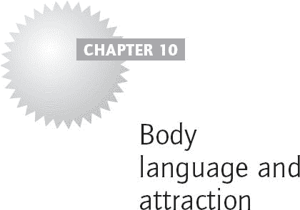

## 充分利用你已有的

在深入本章之前，我必须道歉：这里有很多关于性的内容，而且因为性支配甚至驱动了吸引的身体语言，所以会有大量重复，但视角不同。

女性喜欢和需要什么，男性喜欢和需要什么，被反复提及，因为，我们就直说吧，大多数男性被编程为滥交；大多数女性被编程（有些人会说是被判刑）为选择性。男性主要寻求身体满足；女性渴望社会满足。女性选择她们的男性；男性竞争以被选择。男性产生数以百万计的精子；女性拥有有限数量的卵子。两者都为后代的产生选择最佳的配偶方案；男性通过尽可能多地生育子女，女性通过尽可能多地养育子女直到成年。

吸引（名词）

表现出兴趣、魅力、着迷、娱乐和慷慨等品质，使得他人寻求你陪伴的能力。

我们也要现实一点。男性并不像阿尔弗雷德·金赛博士^(1)所建议的那样，每 7 秒就想一次性。根据美国国家科学院的说法，每天只有几次，女性的情况也只略低一些。

尽管如此，让世界运转的不是金钱，而是我们称之为性的那种最基本的需求。在这里，语言文字的表达在身体语言面前彻底输了。在关系的早期阶段，身体形状以及我们如何使用它，确实比言语更有说服力。^(2)

正如大多数女性所证实的，这是一个不公平且不恰当的世界。基本上，生育能力在女性的身体上写得清清楚楚。对女性而言，青春、胸部、头发和体型这四要素主导着男性最初如何看待或评价女性，在某种程度上，社会也是如此。\*

艾伦·艾克伯恩^(3)之所以深受触动而创作他那部富有洞察力的剧作《身体语言》，是因为，作为一名作家，在查看周日报纸上的畅销书榜单时，他突然意识到：

‘任何一周的英国畅销书通常包括四本关于节食的书、六本关于化妆的书等等。所以，我们确实是一个痴迷的国家。’

随着 20 世纪 60 年代女权主义的兴起，人们可能会预期这种歧视会减少，但“外貌歧视”依然盛行^(4)，而且与性别、性取向、种族、宗教、政治取向或原籍国不同，几乎不可能立法禁止它，因为它太具个人主观性了。

我们的性在哺乳动物中是独特的。其他哺乳动物的性行为主要由其生物学驱动，在大多数情况下是一种本能的方式。我们仍然有本能，我们仍然有相同的生理结构，但现在有一层非常薄的文化遗产和社会习俗的覆盖。大多数动物在准备好时就发生性行为；而我们人类则在文化遗产和心理障碍的要求中起舞地发生性行为。

难怪它很复杂，正如阿尔弗雷德·金赛博士 60 多年前所建议的：

‘……性行为在当前无知与老练、否认与放纵、压抑与刺激、惩罚与剥削、保密与展示的混乱中被处理。’^(5)

在这里，两性都感兴趣的是第二性征。除非你是一位年轻的表演型流行明星，否则它们通常不会被强调。那么，吸引的身体语言大多是关于我们如何强调和表达我们的第二性征。

注意：在本节中，也许比其他部分更甚，我们是在泛泛而谈，吸引力的规则总是有例外。

## 首因与近因

关于初次男女印象，我们还必须涵盖一个点，即所谓的“首因”和“近因”效应；也就是说，我们第一次见到某人时所看到和听到的第一件和最后一件事。我们已经详细讨论了第一印象的重要性（首因效应），但近因效应几乎，但不完全，与之同样强大。

为了说明这一点，请慢慢给朋友读三遍同一串数字（6140903602786），然后让他们写下尽可能多的数字。大多数人会记住 6140 和 2786——即第一个和最后一个。

这里发生的情况是，当我们第一次听到这串数字时，短期记忆开始起作用，因此它们很容易被记住，并且有时间进行复述。近因效应在从短期记忆中回忆数字时也类似。

现在让我们把这些心理学知识应用到你第一次遇到感兴趣的人身上，尤其是当你觉得对方有吸引力时。

我们可以用图表来表达这一点：

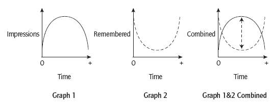

图 1 表明，你略微焦虑地想要给对方留下好印象。你一开始有些紧张，但逐渐变得自信。然后，比如说，大约在进行到一半的时候，你很难维持自己最具魅力和吸引力的状态（无论男女）；紧张感再次袭来，你的“表现”也随之下降。

图 2 展示了首因效应和近因效应对你所吸引之人的影响。他们记得你的第一印象和最后印象。

图 3 结合了图 1 和图 2。不幸的是，正如你所看到的，当你最闪耀的时候，你的行为并不像在相遇开始和结束时那样被显著地记录在案。

当你计划第一次见面或自我介绍时，请确保不仅要计划你的“接近”方式，还要计划你的“退场”方式，以确保你留下了尽可能好的第一印象和最后印象。

首先，我们将简要介绍那些我们无法改变的事情，主要是因为我们选错了祖父母。这里我们反思的是上天赐予我们的身体，当然，除非我们求助于人工手段——而我们中许多人确实这样做！

不幸的是，对于政治正确和平等倡导者来说，外貌确实很重要。一篇又一篇的研究论文从学术期刊中高喊：“美貌是最好的/更好的/好的/重要的/成功的”。

那些不那么幸运的人，在过去曾将这种对外貌的执着归咎于媒体——媒体不断向我们轰炸那 5% 属于此类的幸运人口的照片。研究却不这么认为。哈佛心理学家南希·埃特科夫说：“如果世界消除每本包含年轻、完美身体图像的杂志和媒体形式，我们仍然会在脑海中创造和渴望这些图像。”我们是那些选择了外貌之美的人的后代。

所以，如果我们要相信进化心理学家，我们就得面对事实：美貌/英俊更好。⁷ 出生时就拥有“美貌药丸”的人比我们其余的人享有更好的生活。如果你不接受社会被吸引力所诱惑，那就是与现实相悖。美丽的人会吸引更多的人际关注——无论男女。如果你想让一个异常有吸引力的人感到惊讶，就忽略他们，去和他们的朋友调情；因为他们期望成为人际关注或赞赏的中心，⁸ 他们的反应很有趣。

如果你在工作或社交中做了不恰当的事情，你越有吸引力，归咎于你的责任就越少。^(9) 如果你是罪犯，你可能会获得较低的监禁刑期。^(10)

够了。关于 95% 的我们无能为力的事情就说到这里，让我们转向我们可以改变的事情。

## 亲近性

在心理学中，亲近性是一个非常古老的概念，可以追溯到 1930 年代^(11)，并且，像大多数社会心理学一样，一旦你想通了，它就显而易见。简单来说，我们与另一个人相处的时间越多，他们就越可能喜欢我们，我们也越喜欢他们。

在工业界，现在有一个被称为“艾伦曲线”^(12)的运动——这意味着与其让人们分别在独立的办公室工作，不如让他们在一个大型开放式办公空间工作。亲近性在这里也在起作用，因为员工们彼此交谈，而不是使用技术进行沟通，绩效得到了提升。这个短语有变体，但它们都展示了亲近性：“一起用餐/祈祷/园艺的夫妻，会长久在一起”。

所以，如果你想被喜欢，就运用一点亲近性，让对话自然发生，关系可能就会萌芽。这句古老的格言可能是真的：

“时间等于承诺。”

## 内婚制

在人类历史的大部分时间里，关于你可以和不可以嫁娶的人都有严格的规定。尽管限制性和歧视性的法律可能已经消失，我们仍然倾向于喜欢与自己相似的人，无论是肤色、宗教、文化、社会地位，还是穿衣方式，甚至眼睛颜色。

所以，如果你想被喜欢并被认为有吸引力，就尽可能地像你的目标群体或你倾心的人。

即使在公元前 100 年，西塞罗也写道：

“相似者容易相亲。”

1967 年，美国 16 个州裁定禁止高加索人与非裔美国人之间的通婚违宪。我们都欠马丁·路德·金巨大的恩情。

## 与有吸引力的人在一起

我们可以做的是与有吸引力的人培养友谊。庇护关系有着悠久的历史，并且在今天依然盛行。同样的原理也适用于吸引力；一个不吸引人的男人如果有一个有吸引力的妻子，会被认为更有吸引力，反之亦然。如果个人有一个有吸引力的伴侣，他们自己也会感觉更有吸引力。

## 身高

我们在其他地方讨论过身高对男性的优势（见第 98 页）。在吸引力竞争中，众所周知女性偏好比平均身高更高、比自己更高的男性。这或许可以追溯到她们祖先渴望一个洞穴人保护者来保护自己和后代的执念。男性，不出所料，更喜欢他们的女性伴侣比自己矮。¹³ 想想中国的姚德芬女士，作为世界上最高的在世女性，身高 7 英尺 9 英寸（2.3 米），她会是什么感受。^(14)

如果你身高不足，你知道还有其他因素会增加一个人的吸引力，例如个性、人际交往能力和权力。此外，你通常会更努力地发展这些替代性的基本素质。

## 头发

对于女性来说，强韧有光泽的头发^(15)是青春的指标，因此解释了世界各地理发沙龙广告中那些噘着嘴的幼态模特推广护发产品。青春，再次，据说是男性偏好金发的原因之一，因为女性在 30 岁之后天然金发就不那么常见了。^(16) 随着时间流逝，金发会变深。

中世纪时，糟糕的头发和皮肤是疾病的迹象，这得到了当今医学标准的认同，因为头发不佳和脱发可能是由失血、糖尿病、甲状腺疾病和营养不良引起的缺铁症的迹象。

有些女性，特别是年轻女性，不觉得男性秃顶有吸引力。^(17) 但是，如果你在头顶部位“毛囊受挫”，只需想一想布鲁斯·威利、菲尔博士、肖恩·康纳利和……荷马·辛普森（我开玩笑的！）。

## 体型

谈到体型，让我们先说说显而易见的事情。

大多数男性喜欢那些暗示积极性生殖的身体特征——乳房、腿部、臀部、沙漏形身材，以及青春的主要标志：好皮肤。而女性则相反，她们对生殖方面的重视远低于对保护方面的重视。对许多女性来说，强壮挺直的肩膀、坚强的下巴、结实的手臂、匀称的臀部和强壮的腿部令人赏心悦目，尤其是当这些特征配上 V 形躯干时。对我们大多数男性来说，情况更糟，因为研究表明¹⁸ 腰肩比 0.75 最具吸引力。这就是为什么那么多男性在健身房花费数小时，试图让自己原本的男性身体更具男性气质，并隐藏那些不经锻炼的腿部——与他们结实的上半身相比，这些腿看起来相对瘦弱。也许男性应该感谢博·布鲁梅尔让长裤流行起来。

有观点认为，年轻男性更喜欢较瘦的女性，而随着年龄增长，有些人会说更明智的偏好会增加，即对我们可能称为更丰满的，或者在单身广告的形容词中称为“可爱拥抱”的身材的偏好。

不幸的是，肥胖者不被认为具有身体吸引力。即使是年仅六岁的儿童^(19)也会向他们归因不利的特征。这里的影响不仅影响人际关系，还影响就业。

还是说显而易见的事情，因为通常只有年轻到中年偏年轻的女性容易生育，男性更喜欢并娶年轻女性。具有年轻外貌的女性——包括好皮肤、坚挺的乳房和长长的浓密头发^(20——在吸引力竞争中也表现良好——你本来就知道这一点。这一切都是为了满足进化驱动力：“繁衍就是成功。”

我们必须记住，身体吸引力也很大程度上受文化和时代的影响。即使没有手臂，米洛的维纳斯也是她那个时代（公元前 120 年）的美人，但她的胸部却非常小；而英国的英雄约翰·布尔与当今苗条的男性模特相比非常臃肿，然而两者在各自的时代都被认为很有吸引力。

## 面孔

现在，不出所料，当然男性被能为他们生下许多健康婴儿的女性所吸引，女性被看起来足够强壮以保护所有这些婴儿的男性所吸引，然而男性和女性都更倾向于被潜在伴侣的面孔²¹所打动，而不是身体的任何其他部分。

我们天生偏爱某些类型的面孔胜过其他类型，通常这些面孔是我们家庭成员的面孔。这可能解释了为什么你可能会被与他们相似的人所吸引——一种被称为同类择偶的现象。

对女性来说，拥有年轻面孔是对男性最重要的生育迹象。这当然解释了为什么女性会花大价钱购买化妆品，并花费大量时间涂抹，以显得比实际年龄年轻得多。这一观点在略带厌女症的奥斯卡·王尔德的残酷名言中得到了体现：

‘男人的面孔是他的自传。女人的面孔是她的虚构作品。’

这在王尔德的时代可能是真的，但现在男性的美容产品又重新从壁橱里涌了出来，这已经是很久以后的事了，那时乔治王子的宠儿博·布鲁梅尔在十八世纪末让美人痣的把戏流行起来。快进到 1980 年，我们发现越来越多的物品可用于增强男性的面容。如今，Google 上有 4000 万个关于“男性化妆”的条目。

关于吸引力，新墨西哥大学的心理学家实际上发现，当女性排卵时，她们会偏爱那些体味暗示对称性的男性！^(22) 生产男性须后水和香水的制造商请注意！

有趣的是，女性排卵时偏爱男性具有强壮的下颌线、浓重的眉毛和宽阔的颧骨，所有这些都与高水平的睾酮有关。²³ 男士们，如果你没有这种类型的面孔，也不要灰心，因为在早期卵泡期或黄体期，下巴偏好会让位于好皮肤，这表明健康状况良好，胜过马尔博罗男人的外表。

两性婴儿都更喜欢看对称的面孔^(24)，而不是那些，我们可以说，更“有趣”的面孔。

然而，身体吸引力只是使我们足够有吸引力以建立并维持持续关系的众多因素之一。活跃在银幕和舞台上的美人离婚率明显高于平均水平。是的，外表有诱惑力，但从长远来看，内在才是长期关系的基础。

## 眼睛

长睫毛的眼睛是健康的另一个标志。除了是灵魂之窗，女性的大眼睛在外表方面绝对是一个加分项，并且一直如此，正如马克·安东尼在公元前 41 年访问埃及时所发现的那样。但同样，如果我们在被创造时并不在美人队列中，我们也可以宽慰自己。克利奥帕特拉七世·菲洛帕托尔，虽然她知道眼妆的优势，但在她那个时代更以她的机智、智慧和甜美的嗓音而闻名。

也许在这里，当我们谈论女性的眼睛时，我们也应该提到维克多·雨果在写作时的建议：

‘当一个女人对你说话时，倾听她用眼睛说的话。’

虽然我们瞳孔最大尺寸的变化因人而异，你可以通过检查刚认识的那个特别的人的瞳孔大小变化来判断他们是否觉得你有吸引力——前提是，当然，你们不都在光线昏暗的酒吧里，在那里你们都必须扩大瞳孔才能看清。由于色彩汇聚，蓝眼睛的人比棕眼睛的人更容易“读懂”，因此他们更容易透露对你的感情。在白人新教徒世界中，女性在眼睛颜色方面有更多选择，蓝眼睛被认为比棕眼睛略具吸引力。

当我们觉得某人有吸引力时，我们的眼睛也会变得有些泪汪汪，这是另一种难以伪装但易于识别的生理反应。

## 眼镜

早期研究发现，佩戴眼镜²⁵ 对你被他人看待的方式有一个有趣的影响。男性被评价为更聪明、更严肃、更传统、更勤奋，但不够男子气概。女性被评价为更聪明、更诚实、更严肃，有时还会被认为“头晕脑胀”。

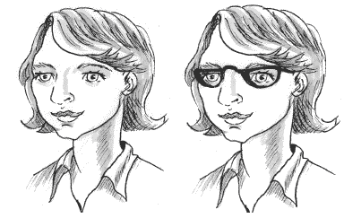

你觉得同一位女士的哪个版本更有吸引力？

在他们作为超人、蜘蛛侠、超级女侠和神奇女侠的另一个身份中，没有一个超级英雄戴眼镜，尽管前两者有大量的睾酮，后两者则有雌激素的爆发。

出于同样的原因，我们在 40 岁以后会有白发和皱纹，我们开始注意到我们聚焦近处物体的能力开始下降，到了那个年龄，由于我们的手臂长度固定，眼镜是唯一的选择。这是老花眼的开始——一个如此不友善的词，源自希腊语，然后是拉丁语，意思是“老人眼睛”。难怪“男男女女都不喜欢向戴眼镜的人抛媚眼”。我会告诉人们，我的眼镜是为了让他们更有吸引力。

摘下眼镜会显得更有吸引力、更年轻，因为对我们大多数人来说，视力会随着年龄增长而下降。²⁶

## 乳房

当然在西方文化中，丰满的乳房对男性具有吸引力，因为研究表明，上胸围与下胸围的比例表明女性享有较高水平的雌二醇，这是一种对生育能力至关重要的性激素。乳房的位置也是生育能力的一个极佳且明显的迹象^(27)，而男性，如我们所知，在基本层面上受繁衍本能的驱动，这解释了所有那些徒劳的偷窥注视的尝试。

## 男性和女性的声音

这里我们再次回到达尔文^(28)，他写道：

‘虽然各种动物发出的声音有许多用途，但可以有力地论证，声带主要是为了物种的繁衍而使用和完善的。’

大多数男性对女性高音嗓音表现出更强的偏好——还记得玛丽莲·梦露唱‘生日快乐，总统先生……’时的情景吗？另一方面，女性——虽然不太受声音音高的影响——总体上更偏好男性低沉的声音。

有趣的是，嗓音较高的女性也拥有更吸引人的面容，而在男性中情况则相反。这一切都与激素水平有关——主要是睾酮——因为它暗示着支配地位（或缺乏）、生育能力、健康和吸引力。

## 皮肤

皮肤是身体健康的窗口，健康的人更具吸引力。即使在一些灵长类动物中，它们的皮肤也向潜在配偶表明社会性的性可得性。因为皮肤血液灌注反映了心血管健康²⁹，我们越健康，就越有吸引力，这对两性都适用。在非常基本的层面上，男性和女性都想/需要繁衍后代，而健康的人是满足这一需求的最佳选择。

你是否曾好奇过，为什么从美国到印度以及中间大多数地方的社会中，地位较高的女性（权力、地位、资源等）的皮肤大多较白皙？^(30) 总体上，有权势的男性偏好女性白皙的皮肤，而任何地位的女性都无所谓或略微偏好皮肤较深的男性。这是紧身胸衣撕裂类浪漫小说中少女和英雄的基本发色协议。几代男性基于这种性偏好的自然结果，就是孩子们越来越白皙。

这一切最终可能会改变，好莱坞享受着地中海式的气候，为银幕制作晒黑的美女，以及有利可图的喷雾晒黑沙龙和相关广告的出现，它们告诉我们‘古铜色很美丽’。

## 个人气味

体味（BO），即使气味宜人，也是一个有些禁忌的话题，但它在肢体语言和吸引力中占据着非常重要的地位。在所有文化中，由于缺乏个人卫生而产生的体味对另一性别的人有强烈的不利影响，通常会导致排斥。

这与吸引力有什么关系？信息素在身体吸引力中起着很大作用，尤其是一种叫做雄烯酮的信息素。

个人气味可以吸引人；男性身上新鲜的汗味对女性有吸引力，不仅因为男性信息素雄烯酮^(\*)，还因为它是良好健康和男性气概的标志。然而，我们由信息素散发的个人气味，就像我们银行卡上的签名一样独特——这让逃跑的囚犯非常懊恼，当猎犬从逃跑路线上的所有其他气味中识别出他独特的气味时。我们可能不如人类最好的朋友那样敏锐，但 95%的人仅凭个人气味就能判断它来自男性还是女性。

一项最近的研究^(31)表明，接触不同男性汗味的女性对它们的反应各不相同。男性观看‘教育’视频时的汗液刺激了女性大脑的不同部位，与男性观看另一种类型视频时产生的汗液不同。这表明女性可以通过气味识别出对她有兴趣的男性。

不幸的是，我们中的男性在这方面不如鳞翅目昆虫（蛾和蝴蝶）熟练，某些物种可以在六英里外的任何方向识别出合适的配偶。

就吸引力而言，任何含有麝香的香水似乎都是赢家。女性对它比男性更敏感，但即使是女性也能检测到百万分之一的浓度，而且美丽的性别在排卵期间更有可能对其做出反应，因为雌激素使气味非常有吸引力。所以，如果你想更具身体吸引力，就选择麝香。（参见何时应该打破这条规则，第 50 页。）

## 信息素

信息素^(\*)对蝙蝠、猪、大象和老鼠有效，它们彼此发送真实的非语言信息，表明恐惧、社会群体成员身份、它们很性感，或者它们可以诱使女性准备好发生性关系。这一切听起来很棒，但不幸的是，无论你的性别偏好如何，如果你是人类，你就缺乏对你有好感的人实践这种优势所需的必要设备。上述动物，以及几乎任何有毛发或皮毛的动物，都有优势，即在鼻子里有一块科学家称为犁鼻器（VNO）的设备。飘过这个听起来很有趣的器官的信息素会被识别并传递到大脑。人类也有 VNO，但不幸的是，或者幸运的是，这取决于你当时的偏好，它的工作效果不如它应该的那样。有点像我们的脚趾——它们在那里，但不如我们灵长类祖先的脚趾有用。

但希望就在前方；哈佛大学两位诺贝尔奖得主科学家合作的一些研究^(32)表明，并非一切都失去了——我们与谦卑的老鼠共享一种对信息素检测至关重要的基因——所以请观察，不要闻，这个空间，不要被营销炒作所迷惑，即使你正在寻找伴侣。

## 腿

秘密地，许多女性希望让自己的腿看起来更长，因为更长的腿意味着更大的性吸引力。³³ 当一个女孩进入青春期时，会发生很多事情，但对于男性物种来说，她成为潜在的配偶。同时，生长激素开始起作用，特别是女性腿部的延长。在简单的男性思维中，当然在性层面上（大多数男性确实倾向于非常简单的生物），长腿等于生殖准备就绪。

腰背后凸的一个例子，但请注意双手叉腰，不是出于攻击性，而是为了抬起胸部。

所以对于女性来说，高跟鞋和，如果她能穿的话，短裙向男性大脑的深层^(\*)传递‘生殖准备就绪’的信号。高跟鞋给人腰背后凸的印象，因为它们使脊柱产生内向弯曲，进而推出臀部，这是青春期后的另一个迹象。正如经验丰富的海滩罗密欧所认识到的那样，高跟鞋并不总是腰背后凸发生所必需的。大多数女性，如果她们觉得一个男性身体有吸引力，会不自觉地踮起脚尖弯曲背部，而不知道自己在做什么。

## 男性肢体语言和配对

男性争夺女性的注意力，所以当他们成群结队时，他们会争夺发言时间。他们说什么并不重要，只要他们减少了其他男性追求者的曝光和视觉时间。所以，像孔雀的性展示一样，男性想要看起来身体更大；^(34) 肩膀向后，胸部挺出，双手要么是前旋（手指关节向外转动以增强‘V’形），要么是放在腰上。

### 关于男性的进化方程式

看起来大 = 看起来强壮 = 强大的保护者 = 获得配偶 = 繁殖 = 基因生存

作为展示的一部分，男性会试图站在女性面前，双脚稍微分开，以增加自己的身体空间，并切断其他男性靠近的任何希望。如果她觉得他有吸引力，女性会转向他，表示接受；否则，他会受到“冷落”对待，并转向另一位可能的追求者。

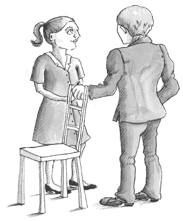

男性在这里在做什么，女性又是如何回应的？答案在第 224–5 页。

当然，男性想要看起来不错，所以他会进行梳理行为，比如向后梳理头发、整理领带或抚平其他衣物。（在同样的情况下，女性也会自我梳理。）

与此同时，他的眼睛在加班——尽管他以前这样做过很多次——当他走近时，男性试图与她保持目光接触。一旦站在女性面前，他的眼睛会在她的眼睛和嘴巴之间交替。

瞳孔扩张不仅是扑克牌好手的标志，也是生理吸引力的重要身体语言标志。男孩遇到女孩或女孩遇到男孩，奇迹发生，双方都想尽可能多地看到对方，因此他们的瞳孔会扩张。然而，瞳孔扩张只是表明你可能对对方有吸引力的一个迹象（如果你吓到他们，他们的眼睛也会扩张！），所以要检查支持性的簇。如果他们的眉毛抬起，肩膀与你的肩膀不在同一视差上，脚指向远离你的方向，那你肯定没有你想象中那么有吸引力！

当对方觉得你有吸引力时，眨眼率也会增加。有些女士享受男性的吸引力和关注本身，因此变得擅长调情式的眨眼。

当他感到自信时，男性会从社交空间移动到亲密空间。他可能会找个借口来合理化这一点，比如从女性的肩膀上移除真实的或想象中的头发或絮状物。或者他可能会降低声音，鼓励女性靠近或走近，以便她能听到。如果保持的不仅仅是社交上的亲近，他可能会变得更大胆，并在交谈中触摸女性的手臂或肩膀以阐明观点或强调。如果女性没有后退或皱眉，他会将手伸向那些社会上可接受的地方。

### 女性身体语言与伴侣关系

女性在让自己具有吸引力方面拥有更丰富的身体语言武器库。有人说，男性反应如此迟钝，需要两三个信号才能跟上女性的直觉。

那么她做什么呢？有很多自我触摸——不仅仅是梳理，还有触摸她的身体，特别是她的脖子。她还会通过伸展脖子来暴露脖子，使自己看起来更脆弱。在这样做时，她可能会笑并向后仰头，这不仅暴露了她的脖子，还突出了她的胸部。

与试图炫耀力量和支配地位的男性不同，女性则相反，手腕松软，手掌向外。

当兴奋时，女性的嘴唇会充血，变得更红、更丰满。她可能会通过舔嘴唇来强调这一点，这会吸引人们对面部这一部分及其光泽的注意。

作为一个开口，嘴巴也被认为具有诱惑力，所以她可能会找个借口舔手指，或者当嘴里没有东西时，她也会明显地吞咽。

在这两张同一女性的照片中，哪张看起来最有吸引力？更多人会说右边的那张。

与男性一样，女性的眼睛也在加班，只是方式不同。在设法让男性的社交目光比平时多停留一会儿，暗示亲密的目光后，她会低头，可能会向旁边看，最后再次将目光投回。如果男性第一次没有领会这个信号，她会重复这个顺从的迹象。

同样，就像男性一样，如果她发现一个她觉得有吸引力或令人愉悦的男性，她的瞳孔会扩大，而男性会在不知不觉中对此信号做出同样的反应。不久以前，那些仅仅享受男性关注，或希望向朋友展示自己有多受欢迎的女士，可能会在眼睛里滴入少量有毒的美人茱萸浆果汁，这会使她们的瞳孔扩大。在意大利语中，美人茱萸意为“美丽的女人”。

### 幽默

说来奇怪，我们都知道但可能不明白为什么幽默如此性感。只需看看下周日报纸上的个人广告，就能注意到有多少人希望伴侣具备 GSH（良好的幽默感）。在寻找人生伴侣时，幽默胜过外貌吸引力。³⁵

### 你交往的公司

大多数父母在孩子与不良或不恰当的人交往时会感到担忧，尤其是在青少年时期，同伴群体的文化克隆对年轻人的社会行为和价值观有如此大的影响。按人群交往来评判人是很自然的。很久以前，《箴言》建议说：‘与智慧人同行的，必得智慧’（13:20），后来又说：‘人必交朋友，就要亲近友善’（18:24）。

这种现象也解释了人们渴望成为‘内部圈子’的一部分；与‘美人’在一起，或走在‘权力走廊’中。它也适用于商业，使组织更具吸引力。大多数公司，当然还有咨询公司，都会列出他们的客户，以此来展示他们的资质。

所以，为了提高你的吸引力指数，与有吸引力的人为伍。³⁶

### 当一切随时间汇聚在一起时

触摸社会上可接受的身体部位是亲密欲望的良好指示。当事情发展到这一步时，男性被他们的情感和欲望所驱动。对于女性来说，虽然轻度爱抚在身体上可能令人愉快，但在她允许继续之前，常识会介入，她会审查未来的后果和选择。正如每个男性都知道的那样，如果女性不感到舒适或对这个人仍有保留，她们会拒绝先进的身体亲密。这包括如果爱抚继续，可能出现的未来场景。\*

如果对女性来说这些都不是问题，那么亲密就可以变得相互。模拟性的身体玩耍和打闹使触摸在社会上可接受，因此关系成熟。故意的身体接触，通常是接吻，是相互亲密的开场。相互的个人触摸增加，顺序从外围到中心，圆满得到享受。这是一场舞蹈，双方必须同步行动；太快或太慢都可能给浪漫伴侣中的一方或双方带来令人失望的结果。

## 总结

以下许多吸引力特征是遗传的，很难伪造，但请记住，很少有人——男性或女性——拥有所有这些遗传特征，幸运的是，这对 99.999% 的我们来说是件好事。

请记住，在这里我们忽略了个性的巨大影响，只关注男性和女性的身体方面。

#### 对于女性

Preferably slim, with thick, healthy hair and clear skin, she will have neonate features, with a small chin, small nose and big eyes, and a post-pubescent body. Moving to the face, she will have high eyebrows, large high cheek bones over narrow cheeks, under which there is the potential for a huge smile, and a higher-pitched voice; then lower still a significant bust and a slim but hourglass figure supported by longer-than-average legs. This would make the perfect physical female from a traditional male viewpoint. Fortunately, according to the Body Shop, there are only six women in the world that have achieved all the above and, at the time of writing, this is out of a total world population of 3,428,196,000 females. For those who like figures (no pun intended) females have a 1 in 571,366,000 chance of being viewed as physically perfect. Why else would Photoshop be so popular with fashion photographers?

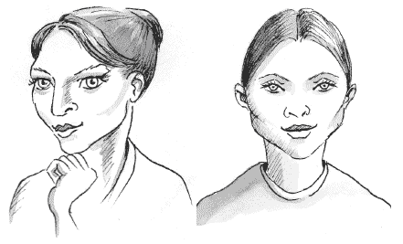

Both these women show features of attractiveness. On the left large eyes and small chin, on the right an almost perfectly symmetrical face.

## For males

For those who have not had the benefit of any input from Hollywood for the past 20 years, the perfect male is taller than average, with a ‘V’-shaped hairless torso, supported by a trim and firm bottom. Moving upwards there should be a smiling, symmetrical, clean-shaven face revealing a strong chin and a deep voice. A good head of hair helps if you are under 40, but beyond that it diminishes in importance.

\*

Females:

* Smile as much as you can.

* If you must wear perfume, have a musk base, if it suits you.

* If you have thick hair, grow it; if you have thin hair, cut it.

* Blonde hair will make you look younger.

* Do not wear glasses.

* Look after your skin as much as possible.

* Be an expert in make-up.

Males:

* Stay around females as much as possible (propinquity).

* Use stacks of deodorant when and where necessary.

* Smile as much as you can.

* Stand tall.

* Exercise to look fit.

* Develop your shoulders and chest.

* Develop and use humour.

Just one more thing before we move on to the signs of attraction. Did you know that besides shows of affection:

‘Males kiss in the hope of having sex or to say sorry, females kiss to check how the relationship is going’?

## The signs of attraction

### 21 early signs that the other person (either male or female) finds you attractive

1. Does the person frequently attempt to catch your eye?

2. Does the person attempt to stand in front of you?

3. Does the person smile a lot?

4. Does the person attempt to amuse?

5. Does the person have their feet pointing towards you?

6. Does the person groom and touch themselves frequently?

7. Does the person attempt to find a reason to touch you?

8. Does the person laugh easily and often when they are with you?

9. Does the person hold their arms to their sides?

10. Does the person frequent the same places as you?

11. Does the person pay more attention to you than others when in the company of others?

12. Does the person lick their lips more frequently than others?

13. Does the person move into your personal space?

14. Does the person have an initial high blink rate?

15. Does the person breathe more quickly in your presence?

16. Does the person mirror you?

17. Does the person have significant eye dilation, especially when surroundings are bright?

18. Does the person speak more softly to increase intimacy/draw you closer?

19. Does the person discuss opportunities to see you again before you part?

20. Does the person give you their best smile when you separate?

21. Does the person’s handshake seem slightly prolonged?

### 21 early signs that she finds you attractive

1. Does she let you stand in front of her?

2. Does she look at you, and when you catch her eye for the first time does she look down?

3. Does she arch her back when she first sees you?

4. Does she go on to her tip toes when she first sees you?

5. Does she expose her neck when she laughs at something you said?

6. Does she put her hand on her neck and/or under her hair?

7. Does she rub her foot behind the calf of her other leg?

8. Does she stand occasionally with her legs slightly apart?

9. Does she toss her head so that her hair flicks away?

10. Does she touch you whilst with her friends?

11. Does she, when sitting, turn slightly side on, enabling you to see all of her?

12. Does she, when sitting, cross one leg over the leg that is closest to you?

13. Does she, when you are not sitting next to her, have her knees pointing towards you?

14. Does she allow one shoe to dangle off her foot when sitting when her legs are crossed?

15. Does she adjust her clothing, especially round her waist, to show off her figure?

16. Does she not show annoyance if she catches you taking a sneaky look at her bust?

17. Does she turn and expose her neck?

18. Does she laugh or giggle a lot when you try to be funny?

19. Does she roll her hips when she walks towards you?

20. Does she lean forward when you lean forward?

21. Does she look at you when you walk away from her? (Ask a friend to observe!)

In Victorian times it was much easier; single maidens as they passed a male who, shall we say, was slow on the uptake, just happened to accidentally drop their handkerchief and the male felt compelled to be a gentleman and return it to the maiden, who would then fain surprise at her gaucherie. At the annual Hunt Ball (the posh equivalent of a singles’ event but arranged by pickie parents), if a lady – they did not allow women in – caught your eye and then hid behind her fan the gallant gentleman – they did not allow men in either – could count on being the last swain on the dance card.

### 21 early signs that he finds you attractive

1. Does he make himself taller?

2. Does he puff out his chest?

3. Does he attempt to increase his ‘physical’ zone?

4. Does he put his hands on his hips?

5. Does he keep looking at you?

6. Does he nod his head up and down slightly when you are talking?

7. Does he keep his arms away from his chest?

8. Does he attempt to interrupt other males when they are talking to you?

9. Does he make eye contact all the time you are speaking?

10. Does he give an encouraging smile or laugh at what you say?

11. Does he attempt physically to block other males from moving close to you?

12. Does he attempt to move into your private space?

13. Does he find an excuse to touch your hand, elbow, arm or shoulder?

14. Does he move his head slightly to his right when you are talking?

15. Does he try to prolong conversations with you?

16. Does he sneak an occasional look at your bust?

17. Does he track you as you move through the room? (Ask a friend to observe!)

18. Does he offer to do things for you? (Getting a drink or chair for you, opening a door, etc.)

19. Does he try to sit close to you or next to you rather than opposite you?

20. Does his tic (verbal or physical) become more noticeable?

21. Does he attempt to walk with you when you leave?

In medieval times it was easier because all the champion of the joust had to do was to present to the lady of his heart’s desire his colours and, with the king’s approval, the deal was sealed.

## So what does all this mean … ?

To get all this into proportion, as important as attractiveness is, most of what we have been dealing with here has pertinence only to first impressions, and fortunately ongoing relations and those that grow into intimate relations take far more into consideration.

When we first meet someone we reveal very little of ourselves. Much of our behaviour is governed by social/cultural norms, with personal individuality kept at a minimum. We smile a lot, agree a lot, and nod our heads a lot, wanting to appear an agreeable person.

(顺便说一句，想要留下良好的第一印象，也是面试作为员工选拔技巧之所以如此不可靠的诸多原因之一。办公桌两边的各方都表现得尽善尽美；求职者竭力展现自己的最佳状态，招聘人员也竭力将自己的组织呈现得尽善尽美，这解释了为何双方在三个月后常常感到失望。)

随着关系的发展，我们开始展露更多的心理面貌。根据马斯洛的需求层次理论，³⁷ 一旦我们拥有并满足了对空气、水、食物和安全的需求，性需求和社会需求便会凸显出来。正是在这里，大部分关于吸引力的肢体语言开始发挥作用。为了生存，持久而稳定的关系对伴侣的要求远不止满足性冲动或在同龄人中获得社会认可。我们更高层面的特质，例如人际行为、个性、价值观和灵性——所有那些使我们真正成为人类的重要方面——不仅在长期关系中必不可少，在生活和工作中同样如此。

成功的一个基本标准是你人际交往能力的强弱。在社交中，你需要同理心、理解力、慷慨和尊重；而在工作中，则需要社会认可、影响力和说服力，因为如果你无法让别人为你做事，并且让他们心甘情愿地去做，就很难登上顶峰。如果没有一套非语言技能和对肢体语言的理解，就很难展现这些能力和特质。

现在，我们可能不如自己希望的那样有吸引力，但在生活中，能够影响他人非常重要，因此这是我们接下来要讨论的话题。

|  || ‘我可以在任何话题上，与任何对手辩论获胜。人们都知道这一点，在社交活动中都会避开我。通常，作为他们极大尊重的表现，他们甚至都不邀请我。’ |

| --- | --- |

|   || Dave Barry，喜剧演员 |

### 参考文献

¹ Kinsey, A. (1948), Sexual Behaviour in the Human Male.

^(2) Dion, K., Berscheid, E. and Walster, E. (1972), ‘What is beautiful is good’, Journal of Personality and Social Psychology 24 (3).

^(3) Glaap, A. R. (1999), A Guided Tour Through Ayckbourn Country.

^(4) Cash, T. F., Gillen, B. and Burns, D. S. (1977), ‘Sexism and “beautyism” in personnel consultant decision making’, Journal of Applied Psychology 62.

^(5) Ibid.

^(6) Etcoff, N. (2000), Survival of the Prettiest: The Science of Beauty.

^(7) Barber, N. (1995), ‘The evolutionary psychology of physical attractiveness: Sexual selection and human morphology’, Ethology and Sociobiology 16.

^(8) Hatfield, E. and Sprecher, S. (1986), Mirror, Mirror … The Importance of Looks in Everyday Life.

^(9) Liche, M. D. and Zell, E. (2009), ‘Social attractiveness and blame’, Journal of Applied Social Psychology 39 (9).

^(10) DeSantis, A. and Kayson, W. A. (1997), ‘Defendants’ characteristics of attractiveness, race, and sex and sentencing decisions’, Psychological Reports 81(2).

^(11) Brossard, J. (1932), ‘Residential propinquity as a factor in mate selection’, American Journal of Sociology.

^(12) Allen, T. J. and Henn, G. (2006), The Organization and Architecture of Innovation Technology.

^(13) Dixon, B. J. et al. (2009), ‘Studies of human physique and sexual attractiveness’, Archives of Sexual Behavior 19.

^(14) Discovery Channel UK, January 2007.

^(15) Sherrow, V. (2006), Encyclopaedia of Hair: A cultural history.

^(16) Sailer, S. (2005), Blondes Have Deeper Roots.

^(17) Cash, T. F. (1990), ‘Losing hair, losing points’, Journal of Applied Social Psychology 20.

^(18) Smith, T. W. (2006), ‘American sexual behavior: Trends, socio-demographic differences, and risk behavior’, GSS Topical Report 25.

^(19) Stunkard, A. J. and Wadden, T. A. (1985), ‘Social and psychological consequences of obesity’, Annals of Internal Medicine 103.

^(20) Sherrow, V., Ibid.

^(21) Zaidel, D. W., Aarde, S. M. and Baig, K. (2005), ‘Appearance of symmetry, beauty, and health in human faces’, Brain and Cognition 57.

^(22) Palermo, P. (2008), Symmetry? Could This be the Answer to the Age Old Question; ‘What is Beauty?’

^(23) Buss, D. (2003), The Evolution of Desire; and ‘Sexual dimorphism and health’, Proceedings of the Royal Society (Biological Sciences).

^(24) Slater, A. and Lewis, M. (eds) (2007), Introduction to Infant Development 2^(nd) edition.

^(25) Thornton, G. R. (1944), ‘The effect of wearing glasses on personality traits of persons seen briefly’, Journal of Applied Psychology 28.

^(26) Hamid, P. N. (1972), ‘Some effects on dress clues on observational accuracy’, Journal of Social Psychology 86 (2).

^(27) Buss, D. (2005), The Handbook of Evolutionary Psychology.

^(28) Darwin, C. (1871), The Descent of Man and Selection in Relation to Sex.

^(29) Stephen, I. (2008), ‘Skin colour signals human health’, a paper presented at St Andrews University.

^(30) Frost, P. (2005), Fair Women, Dark Men: The Forgotten Roots of Racial Prejudice.

^(31) Denise Chen of Rice University, Texas, reported in The Daily Telegraph, 29 December 2009.

^(32) In 2004 Richard Axel of the Howard Hughes Medical Institute, New York, and Linda Buck of the Fred Hutchinson Cancer Research Centre, Seattle, jointly received the Nobel Prize for Medicine.

^(33) Pierce, C. A. (1996), ‘Body height and romantic attraction’, Social Behavior and Personality 24.

^(34) Rikowski, A. (1981), ‘Physical attractiveness: The influence of selected torso parametres’, Archives of Sexual Behavior 10 (1).

^(35) Sprecher, S. and Regan, P. S. (2002), ‘Partner preferences in romantic relationships and friendships’, Journal of Social and Personal Relationships 19.

^(36) Kernis, D. A. and Wheeler, K. E. (1981), ‘Beautiful friends and ugly stangers’, Journal of Personality and Social Psychology Bulletin 7.

^(37) Maslow, A. H. (1954), Motivation and Personality.

\* 仅仅在 300 年前，Addison 写道，将年老体弱的女性视为女巫并加以迫害是不公正的，而女巫迫害直到 1735 年才在英国成为非法行为。Buss, David (2003) The Evolution of Desire.

\* 男士们请注意：雄烯三醇由新鲜男性汗液产生，对女性具有吸引力，但仅持续 20 分钟，之后暴露在氧气中会转化为雄烯酮——即更衣室的气味——这肯定不会产生你所期望的效果！

\* 信息素源自希腊语 pherein，意为传递，以及 hormon，意为兴奋。

\* 位于颅底脊柱顶端的“旧脑”有时被称为“爬行动物脑”，因为从爬行动物到哺乳动物的所有脊椎动物都拥有它。

\* 随着 20 世纪 60 年代性革命的到来，人们对这些保留态度的放松程度不断提高，因为性是男女的基本驱动力。

\* 请考虑到本章摘要涉及肢体语言和吸引力，因为脱离上下文阅读，我确信它可能会冒犯男性和女性！

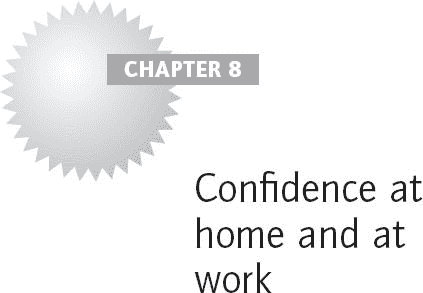

让我们花点时间反思一下现实。你已经读完了《卓越自信》的四分之三；你正处于自信计划即将真正启动的阶段。不过，仍有一些重要问题我们尚未触及。你需要回答两个关键问题：

1. 你对目前的生活方式感到满意吗？

2. 你的动力有多强？

## 找到正确的平衡

如果生活缺乏平衡，就很难感到满意和快乐。我发现自信的人通常感到满足和快乐，因为他们掌控着自己的生活。他们在生活的四个关键要素之间找到了幸福的中庸之道：

* 工作上的承诺和花费的时间

* 对家人的爱以及与家人共度的时间

* 个人的健康和体能

* 用于“个人”娱乐和爱好的时间。

这里与自信有直接联系。大多数自信的人在对他人的责任和自己的欲望与需求之间找到了可以接受的平衡。这有助于他们感到满足并保持积极。我们在工作和社交中都能注意到这一点，因为这体现在他们的行为、对待生活的态度以及他们举止方式上。

重要的是，他们也倾向于现实主义者——他们已经接受了我们都有责任这一事实。例如，大多数人都必须工作来谋生。大多数自信的人接受这一点并继续前进。

如果你感觉不到掌控力，也对自己的生活不满意，你就会难以保持自信。为什么？……因为你最终会变得缺乏动力、目标迷茫，最终失败，而其他人却取得了成功。

很多缺乏自信的人认为为自己着想是自私的。这完全不正确；自信的人意识到，平衡自己的欲望、需求和抱负与对他人的责任至关重要。

### 生活平衡

即使表面上你对自己的生活感到满意——也试试这个练习。问问自己生活的平衡是否合适。不过要现实一点——例如：不要骗自己说你不快乐是因为你在工作上花的时间比在度假上多！

当你进行这个练习时，重要的是要敞开心扉，进行创造性思考，特别是当你思考自己以及你想做或想要实现的事情时。有些人发现，在做这个练习时参考他们设定的战略目标和战术目标（在第 3 章）很有帮助。再看看这些，并让自己确信，你计划投入到生活不同方面的时间和精力是公平平衡的。

不过，“生活平衡”练习是关于当下的。它关乎你目前的生活方式，以及你是否把优先事项安排得当。试着思考你在工作上花费多少时间，然后考虑你生活中其他对你重要或应该重要的方面。这是一个私人的练习，只有你自己知道什么对你重要。按以下方面思考可能会有所帮助：

* 对他人的责任（工作、家庭等）

* 对自己的责任（工作、享受、健康、爱好等）。

有些人发现，实际绘制出自己在生活不同要素上花费时间的图表很有帮助。这能突出任何不一致之处，并显示你是否在某个特定方面花费了过多时间。换句话说，就是你是否把优先事项安排得当。

看看艾尔莎制作的这个饼图。她计算了自己在一周内在生活不同方面花费的时间。

艾尔莎选择了家庭、健康、工作和娱乐作为她的关键要素。你只需看一眼较大的白色部分，就能立刻看出她花了大量时间在工作上（这包括她上下班的通勤时间）。

艾尔莎已婚并有两个年幼的孩子；她全职工作，有时直到孩子们听完睡前故事（由兼职工作的丈夫读给他们听）之后才回家。她从做这个练习中学到的主要教训是，她根本没有花足够的时间陪伴孩子。所以这个简单的练习促使她改变了工作模式以适应……这是一个非常值得做的练习！

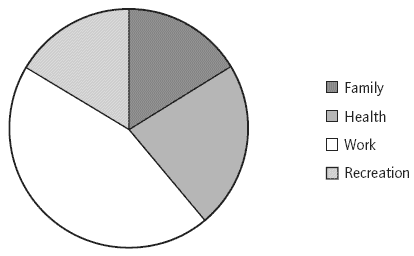

#### 图 8.1 生活平衡

试着制作你自己的饼图；你可以选择与艾尔莎相同的要素，也可以决定更改它们以更具体地反映你自己的生活。例如，如果你花大量时间打扫房子，那么打扫房子可以是你在图表中包含的要素之一。包括任何你认为占用大量时间的事情。别忘了把睡眠时间放在图表上。艾尔莎决定将睡眠时间包含在健康部分（并意识到她可能睡眠不足！）。

记住，你查看的是你生活中一周的时间。这需要是一个相当“典型”的周，所以不要选择不能反映你日常规律的周。确保包括周末，这样练习才能反映七天的时间。有些人发现，将一周分解为天，然后将每个 24 小时周期进一步分解很有帮助。

最终，你的饼图代表你生命中的 168 小时。一旦你为活动分配了时间，你应该对时间花费在哪里有很好的感觉。完成图表后，反思它，并问问自己你是否把优先事项安排得当。饼图可能是一个真正的开眼之门。事实上，我知道有些人仅仅因为做这个练习所发现的事情，就彻底改变了他们的生活方式。

## 个人效能与自律

人们对你在社交和工作中给人的印象，不仅仅取决于你的外表和声音。它还取决于你的行为以及你如何组织自己。如果别人把你视为一个有条理、整洁且高效的人，你会感到更自信，而且别人更有可能认为你自信且掌控局面。

### 个人组织

你认识多少个自信但又杂乱无章的人？如果你能想到任何人，他们往往是规则的例外。自信的人通常是有条理的，无论是在实际行动上还是在心理上。“桌子杂乱，头脑杂乱”这句话很有道理。

如果你在生活管理方面倾向于杂乱无章，你就会难以清晰且逻辑性地思考。如果你无法清晰且逻辑性地思考，你就会让自己以及身边的人失望。当然，其结果是，人们在你身上感知不到任何积极的东西。最好，他们会认为你邋遢且心不在焉；最坏，他们会认为你懒惰、不可靠、不专业、自私……列表还在继续。

困难在于，人们不一定会告诉你他们这样看待你，他们只是会有这种感知。大多数情况下，如果他们有这种感知，你会从他们对你的行为中察觉出来。正如我们已经看到的，这可能会对你的工作和个人生活产生重大影响。

所以，当你开始思考建立自信心时，你可能没有看到个人组织能力与自信心之间的联系。不过不用担心，你并不是第一个没有意识到这一点的人。现在的关键是，如果你需要，就要解决这个问题。

#### 管理你的时间

高效且有条理地利用时间是至关重要的。如果你觉得你的生活在掌控之中，并且你正在充分利用它，你的幸福感会更强。这必然有助于增强你对自己想要实现的目标的个人自信心。

试着问问自己，你通常如何对待生活。你是否属于“时间管理语言”中常说的 A 型人格或 B 型人格？

*   A 型 – 描述那些喜欢完成事情并对自己要求较高的人。他们会把一天排得满满当当。然而，他们有时会承担过多，并且没有预留足够的时间用于放松或反思自己要去往何方。

*   B 型 – 描述那些工作节奏较慢，并能为生活带来健康平衡的人。他们对时间截止日期不那么在意。表现出极端 B 型行为的人，常常因为其随和的性格而让他人失望。

在确定你在时间线上的位置后（参见 图 8.2），考虑一下你是否会通过稍微改变你的方法而受益。你可能会发现自己介于 A 型和 B 型行为之间。这并不罕见。事实上，这是一个相当不错的位置，因为你没有倾向于任何一个极端。

##### 不要迟到！

A 型人格的人往往会迟到，因为他们有太多其他事情要做。B 型人格的人可能会迟到，因为他们对时间的概念更加随和。不迟到的原因显而易见，主要原因是你会让他人失望并浪费他们的时间。有些人在让他人失望时会自然感到难过，而有些人则不会。问问自己你在这里处于什么位置。

那么，这与自信心有什么关系呢？简单来说，如果你想时刻感到自信，你就需要将这种体谅的心态融入你的思维模式中。

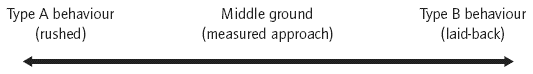

图 8.2 时间线

让他人失望本身就是不迟到的充分理由，但还有其他一些更个人的原因，也可能直接影响你的自信心：

*   如果你迟到，你就已经处于劣势。对方已经在你身上看到一些负面的东西，因为你让他们失望了。如果你想给人留下自信的印象，并因此感到自信，你就绝不能表现出任何消极情绪。如果你迟到，你将不得不爬坡，而这完全是你自己造成的，而不是一个公平的竞争环境。

*   如果你迟到，你会给自己（和他人）造成分心。你会在想别人怎么看你，而不是在想你给人的印象。你知道你迟到了，这会（或者当然应该）挂在你心上。如果你试图自信地表现自己，你就不能有任何分心。你需要 100% 的注意力集中在手头的任务上——即看起来和听起来自信。

无论你在时间线上的哪个位置，现在就下定决心，你将努力不再迟到。当然，如果你是因为无法控制的事件而耽搁，那是可以理解的。不过，当你到达时，不要忘记解释这一点！

不要迟到，甚至不要准时——要稍微早到。这样你就有时间准备自己，以自信的姿态出现。你将处于主动地位（并且已经比那些尚未到达的人领先一步）。

#### 保持健康和保持体魄

“人生就像骑自行车。要保持平衡，你必须不断前进。”

阿尔伯特·爱因斯坦

我不确定爱因斯坦是否打算让人们字面意思地理解这句话——毕竟，他不太可能是个健身狂热者！更有可能的是，他是指在新思想和思维方面保持活跃，以免落后。但也许这句话有更字面的含义……我们暂且这样假设。

如果你身材走样，你就更有可能感到不自信和缺乏吸引力。所以，通过保持合理的身材，你会改善你的外在形象，并感到更有精力。

当然，这不会自动发生。你需要付出努力才能实现。确实，你的身体状态和精神状态之间存在直接联系。你越健康，你就越有精力。你越有精力，你就越容易保持积极的心态。

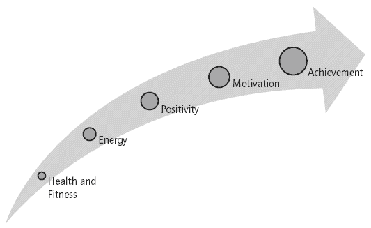

图 8.3 健康与体魄

还有一点已经被证明，体育锻炼是对抗抑郁的一种强大的天然解药。所以保持健身没有任何负面影响，只有正面影响。

考虑健康和体魄的两个层面：

*   你的整体健康

*   你的身体素质

##### 整体健康

除了你无法控制的疾病之外，每个人都应该能够保持健康。如果你在饮食上明智且保持均衡，如果你确保你的身体没有承受过度压力，如果你睡眠充足并且进行锻炼，那么你应该能够保持良好的整体健康。如果由于你的生活方式，这些关键要求中有一项缺失，你应该考虑做出改变——否则你会难以保持积极。

##### 身体素质

保持身体健康也很重要。不过不用担心，你不需要超级健康——你只需要让你的身体保持良好状态。由于体格和饮食方面的考虑，这对某些人来说比其他人更难。但是——每个人都可以做到。这只需要自律。你需要找到一个适合你的现实的健身水平。

如果你还没有尝试过，这值得一试。当然，“身体素质”对不同的人意味着不同的事情。不要担心别人——除非你觉得这会有帮助，否则不要试图与他人比较。在这里管理你的期望，做你感到舒服的事情。对一个人来说，这可能意味着每天步行二十分钟；对另一个人来说，这可能意味着每天跑步二十分钟。

你可以考虑各种各样的健身计划——太多了，无法在此一一列举。在互联网上做一些研究，选择一个适合你的。你也可以考虑加入健身房，甚至加入一个俱乐部。不一定非要是跑步俱乐部——可以是任何类型的运动，或者也许是一个步行俱乐部。慢慢开始，逐步增加，不要在开始时就过度挑战自己。

### 找到你的专注点

#### 了解是什么驱动着你

要感到自信并掌控你的生活，你需要知道是什么驱动着你；你需要知道是什么让你充满动力。知道你实际上需要什么才能让你对生活保持热情，是个人动力的一个基本组成部分。知道你需要什么，比仅仅知道你想要什么要重要得多。需求是基本要求，想法是可取的东西。在感到和表现自信方面，这里存在显著的差异。

简单来说——如果你得不到想要的东西，可能会为自己感到难过，甚至沮丧。这并非好事，但也不是世界末日——你仍然可以通过自律克服这一点。然而，如果你得不到需要的东西，就会陷入停滞。

## 个人激励因素

下面列出了人们认为对自己很重要的十个生活方面。请浏览并思考它们，从你生活中需要什么的角度来考虑，而不是从你想要什么的角度。大多数人对自己了解得足够清楚，能够区分两者。然后按每个生活方面对你的重要性进行排序；将最重要的标为 1，一直到最不重要的 10。如果你想与他人讨论你的答案，请在完成之后再做，否则他们可能会分散你的个人思绪。

\_\_\_\_\_ 享受

\_\_\_\_\_ 有趣的工作

\_\_\_\_\_ 宗教

\_\_\_\_\_ 薪水

\_\_\_\_\_ 个人发展与学习

\_\_\_\_\_ 认可与赞赏

\_\_\_\_\_ 工作保障

\_\_\_\_\_ 家庭

\_\_\_\_\_ 野心

\_\_\_\_\_ 朋友与人际关系

每个人都不同；了解哪些生活方面对你个人来说最重要是至关重要的。知道这一点将帮助你把真正的优先事项排好顺序。你会有更清晰的焦点，并能够塑造你的生活来适应它。如果你不知道是什么驱动你并让你保持动力，你就无法渴望它，也无法提供它。如果你无法提供它，你最终会陷入恶性循环。如果你得不到生活中让你保持热情和动力所需的东西，就不可能保持积极的心态。

大多数人对自己的倾向大致有个概念。不过要小心，不要妄下断论——你可能会惊讶地发现，深层次上，你需要的东西与你原先认为的不同；因此，你可能得不到它——仅仅是因为你不知道自己需要它。如果发生这种情况，你的心态会受到影响。

当你反思这个列表时，请以你确定的最重要的激励因素（即你需要的东西）和不那么重要的激励因素（即你想要的东西，或者在某些情况下甚至不想要的东西）为背景来考虑。关注你列表顶部的激励因素——它们是对你真正重要的东西；是你真正需要的东西。现在问问自己，你是否得到了它们。如果没有，为什么？你需要做些什么来改变？

不断给自己喂食你实际上不需要的东西，同样糟糕。这就像往柴油发动机里加无铅汽油。是的，你给汽车加油了，但要当心，你会造成严重损坏；最终发动机卡死，车子抛锚。这也是巨大的时间和精力浪费——你本可以用这些时间加上正确的燃料，到达你想去的地方。

要感到自信，如果你对生活感到有动力和积极，会很有帮助。要感到有动力，你需要知道是什么让你充满动力。

## 自信地处理冲突

自信在家庭和工作中之间的一个共同点是人际冲突。冲突是一种自然现象。你可以减少它发生的机会，但你永远无法完全消除它。所以，它会发生。如果冷静地处理，它实际上可以是一件好事。

它可以帮助你：

*   消除误会
*   澄清对方在想什么
*   表达你的观点
*   发现做某事的更好方法。

无论你是在家里与朋友或家人争吵，还是在工作中与老板或同事意见不合，处理冲突的相同规则都适用。

自信地处理冲突是一门艺术。正如军队需要策略来赢得一场战斗一样，在更战术的层面上，你也需要策略来处理个人冲突。我们都会不时遇到这些冲突，有些人甚至每天都会遇到。但你通常会如何反应？你可能倾向于每次都以同样的方式反应；那是因为你有自己处理冲突的本能方式。

如果你已经开始使用《卓越自信》中迄今介绍的一些技巧，你应该会发现你遇到的冲突情况数量已经开始减少。例如，简单地调整你的沟通方式，应该会对你在工作、家庭和社交中的关系产生巨大影响。

### 你的本能

你是否曾经建设性地思考过，当有人批评你、说你错了、让你沮丧或惹恼你时，你本能地会如何反应？有些人每次都会准备战斗，即使他们认为甚至知道对方是对的。另一些人则会屈服或回避冲突，即使他们知道对方是错的。你倾向于怎么做？

冲突区域图表（图 8.4）显示了两种冲突处理的极端。有些人无论情况如何都会“争辩”；另一些人则会“屈服”。查看图表，在“争辩”和“屈服”之间的线上打个叉，以显示你认为你处理冲突的本能方法处于什么位置。

所以你已经在线上某处打了个叉。大多数人能正确评估自己的倾向，但有些人发现很难判断自己倾向的程度；换句话说，就是他们风格的强度。为了帮助你，请访问 [www.thinkconfidence.com](http://www.thinkconfidence.com) 并完成 Think Confidence 冲突风格问卷。这是一个简单的问卷，可以帮助你识别你本能的冲突风格以及你使用它的程度。

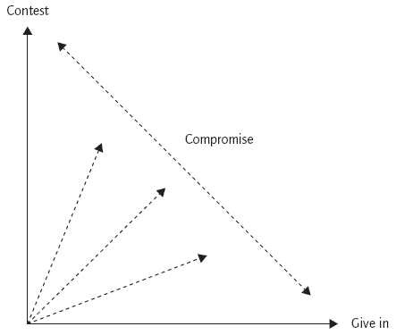

图 8.4 冲突区域

有些人会把自己评为两个极端之一；另一些人则认为自己处于中间。这个中间地带是“妥协”的区域。你可能会认为，无论情况如何，妥协都是正确的方法；是适合双方的解决方案。嗯，这是真的，但并非总是如此。

你可能也会认为，处于两个极端之一是错误的；毕竟，“屈服”永远不可能是正确的，对吧？嗯，是的，在某些情况下，它可以是正确的。同样，在另一个极端，有些人认为强烈“争辩”一个问题并坚持自己是对的，可能被视为“过分”。也不要这样想；只要你不具有攻击性或暴力，在某些情况下，争辩一个问题也可以是正确的。关键是要有自律和自信，为正确的情况选择正确的方法。

Rob

Rob 正在组织一次与五个朋友去法国的周末旅行。他们约定在当地酒吧一个晚上见面。目的是讨论并商定他们住哪里、住多少晚以及旅行安排如何。每个人都同意 Rob 是最适合协调这次旅行的人，因为他去年曾和其他朋友去法国进行过类似的旅行。Rob 很乐意负责。

会议一开始进行得不错。他们都是好朋友，相识已久。然而，小组中有一个人比其他人更直言不讳，整个晚上都倾向于主导谈话。Rob 觉得这很奇怪，因为在晚上的交谈中，发现这个人（琳达）以前甚至从未去过法国！

# Rob 的经历与冲突处理

Rob remembered from his trip the year before that they’d really regretted not hiring a car for the weekend. They’d decided to go on the ferry as foot passengers and get the train to the village they were staying in. This had turned out to be a big mistake because, although beautiful and picturesque, the village was in the middle of nowhere. As a result, they’d ended up having to get taxis everywhere and this had meant they’d ended up spending much more than they’d planned. Not having a hire car also meant they’d had no flexibility – every time they wanted to go out, they had to ring for a taxi. This turned out to be really frustrating.

So, Rob explained all this when they were talking about transport arrangements. Lynda, however, just would not listen. She was adamant that the cost of taxis would be less than hiring cars. However, Rob had already worked out that, even if they hired two cars, it would still be cheaper than hiring taxis throughout the weekend and, of course, they’d have the flexibility to go where they wanted when they wanted.

This led to a disagreement. Rob began to feel very uncomfortable with the situation because he just didn’t like arguing. He ended up giving in to Lynda even though he knew he was right. None of his other friends in the group could make up their minds what was best. One or two of them even tended to side with Lynda because she was so direct with her views. Rob just didn’t stand up for himself so they weren’t convinced by his argument – even though he’d actually been there and experienced the problem!

Rob just wasn’t a person who felt comfortable contesting an issue. His instinct was to give in whenever he found himself in a conflict situation. He felt particularly uncomfortable with Lynda because she was a person who would instinctively contest.

The whole group lost out eventually because they didn’t hire cars and, just as Rob had predicted, they regretted it.

## 主动坚持的重要性

When you think you’re right, don’t give in. It’s time to be actively assertive in order to contest the issue. You’ll need to motivate yourself to do this, particularly if your instinct is to give in. Make a pact with yourself not to let this happen the next time you think you’re right and the other person contests.

Like Rob, the majority of the people I meet who lack confidence tend to either give in or do their best to avoid the conflict in the hope that it will go away and not come back. The trouble is, the problem rarely does go away; more often than not it will fester and then come back with a vengeance.

So, you’re probably getting a feel for what I’m suggesting here. People who have confidence and use this confidence in a balanced manner are able to deal with each conflict situation that confronts them in the way that best suits. They have the self-control and sensitivity to avoid or perhaps even give in when they should and they have the self-belief and self-confidence to stand up for themselves when they think they’re right.

Identifying the type of conflict situation you’re encountering is the first step to making a judgement and doing something about it.

So, if any of the following applies, you need to dig deep, present your case confidently and contest the issue:

*   When you’re sure you’re right and the potential repercussions of the other person winning the argument are serious.

*   When you’re sure you’re right and any delay in presenting your case could have a negative impact.

## Mike 的案例

Mike

Mike was on a skiing holiday in Austria with his family. An easygoing, confident person, Mike would only contest an issue if he really felt he was right or that a matter of principle was involved.

He’d hired a snowboard for his son Toby to use. Unfortunately, at lunchtime on the last day of their holiday, one of the boot straps (bindings) on the snowboard broke while Toby was using it. As a result, Toby couldn’t ski on the last afternoon and Mike had to take him back to their apartment using the lift system up and down the mountain. This took all afternoon because they were a long way away and had to use a number of different lifts to get back. They’d wasted a whole afternoon of their holiday.

Mike was certain that Toby wasn’t responsible for breaking the snowboard and that the hire shop should take responsibility because it was a ‘mechanical’ failure rather than a ‘breakage’.

So, when they arrived back at the shop, Mike calmly explained what had happened to the shop owner. He also explained that neither he nor Toby had been able to ski since lunchtime, they’d wasted the ski passes they’d paid for and they’d had a long trip back using the lift system.

Mike made it clear to the shop owner that he didn’t feel it was fair for him to pay for the hire of the snowboard for the last day … And that was when the conflict started because the owner completely disagreed. Mike stood his ground even though the owner became quite annoyed … ‘If you hire a car and have an accident, you pay for it … hiring a snowboard is just the same,’ he kept on saying. But Mike wouldn’t budge because as far as he was concerned he was right. He retorted, ‘If I hired a car and I had an accident which was my fault I would have to pay for it, but if I hired a car and it broke down through no fault of my own, I would not … you have hired me a snowboard and the binding has snapped – my son did not break it.’

And so the argument went on, but Mike stood up for himself because he thoroughly believed he was right. As a result the owner backed down and didn’t charge him for the last day’s hire of the snowboard.

So what’s the moral of the story? If you feel strongly about something, prepare before you speak and have facts and reason to back up your argument. Mike prepared before he went back to the shop. He took a deep breath before he went in and presented the owner with his case. It worked.

## 何时应该让步

On the other hand, when might it make sense to give in?

*   When you know the person is right or has a better idea than you.

*   When you know you are right but the issue is of such minor importance that it’s just not worth getting into an argument.

*   When you’re working with someone who’s learning (perhaps a young person) and you don’t want to demotivate them. The person is full of energy and enthusiasm and wants to help. They come up with an idea that you know won’t work because you perhaps tried it when you were learning. As long as the consequences of them trying their idea and failing aren’t likely to be serious, let the person have a go. They’ll feel more inclined to come up with ideas in the future because they know you’ll listen. If you don’t let them have a go, you could end up with a demotivated person who doesn’t think you value their opinion or, perhaps even, trust them.

## 何时应该回避冲突

Or perhaps, it would be more sensible to avoid the conflict (this isn’t giving in; you’re just avoiding the conflict for the moment with a view to addressing it again later if it’s still there).

So, when would it make sense to avoid it?

*   When tempers are getting frayed and people aren’t thinking straight.

*   When the issue is of such minor importance that it’s just a waste of time to argue about it.

*   When you’re not prepared properly with your argument.

*   When you’re not in the right frame of mind.

*   When you’re in a place that isn’t appropriate (perhaps a public place where others can overhear you).

## 妥协的艺术

There are times too when the most sensible course of action is to compromise. If you score yourself between the two extremes on the Conflict Zone chart, your instinct will tend to push you towards the middle ground of compromise.

The compromise style lends itself best to the following situations:

*   When a solution is moderately important but not worth the effort or possible continued conflict that might result from either contesting or giving in.

*   When you need to achieve a temporary settlement to a larger issue.

*   当你处于时间压力之下时。

*   当双方都有需要考虑的基本需求时。

*   当你与权力或权威相当的人打交道时。

#### 选择正确的风格

意识到你处理冲突的本能方式；它可能是竞争、妥协，甚至是让步。无论是哪种，都不要担心；这些方法都没有错。但请注意：如果你不有意识地思考，你将一次又一次地以本能的方式应对冲突。关键是要确保当你的本能方法不是正确方法时，你不会“默认”进入你的舒适区。

下次面对冲突时，掐自己一下。观察你的行为。问问自己是否选择了正确的风格。如果你需要从自然风格转换，请做好准备。

#### 展示情绪

展示你的情绪并没有什么错！事实上，如果你隐瞒真实感受，你会发现很难有效地处理冲突。

大多数时候，我们克制的主要原因是害怕展示情绪的后果。我们担心会让自己难堪，并想知道对方会怎么看我们，以及他们可能会如何反应。正因如此，人们在家里比在工作中更容易展示和分享情绪。

试着放下这些担忧（尤其是在工作中。毕竟，如果你控制好沟通情绪的方式，就不应该有任何尴尬。有些人甚至可能会把你不显露情绪视为你不在乎的迹象……这可不是让同事对你产生好印象的好方法。

不断压抑情绪就像在吹气球——一次又一次地吹，它越来越大，直到最终，除非你放掉一些空气——砰！这里要记住的重要一点是放掉一些空气。如果你放开气球并释放所有空气，它会疯狂地飞走，你将失去控制。因此，控制释放压力的方式是有效沟通情绪的关键。

这些基本规则应该能帮你大忙：

*   说话或行动前仔细思考。

*   以受控的方式沟通你的情绪。

*   不要让情绪影响你的判断。

*   确保你愿意接受对方的情绪。

*   调整你的沟通风格以适应对方的风格。

憋着不说情绪比分享它更有害。只要确保你做好准备，并以自控的方式沟通即可。

#### 处理难缠的人

即使你有信心改变处理冲突情况的方式，你仍然会不时遇到一些你觉得难以应对的人。这些人中有些是你已经认识的人。这意味着你可以在见到他们之前预判并做好准备；他们不太可能改变自己的行为方式。

面对你觉得难缠的人时，首先要做的是反思你自然的沟通风格。仅仅调整你的风格以匹配对方，很可能就足以将一个“难缠的人”转变为一个你不觉得不自在的人。希望你在问题甚至开始之前就将其扼杀在摇篮中。

那么，如果你尝试调整风格，但对方仍然难缠并坚持自己是对的，你该怎么办？以下是一些建议：

##### 为自己挺身而出

我提到过，我遇到的许多缺乏自信的人，发现最难处理的冲突情况就是他们必须为自己挺身而出的情况。这可能意味着“争论”一个问题，坚持自己的权利，或强烈地表达你的担忧。他们觉得这最难，因为这违背了他们的本性。如果你是这类人之一，你会发现这是你自信心提升计划中最具挑战性的部分之一。

你会发现，更加果断会有所帮助。回想一下（第 6 章）：如果你倾向于自然地倾向于果断跷跷板的被动一侧，你就必须努力对抗你的“小妖”。极端的被动通常意味着让步。你的“小妖”会努力让你留在跷跷板的被动一侧。如果你待在那里，你就永远无法为自己挺身而出。记住卓越自信原则——不要让“小妖”得逞。

图 8.5 中的三个简单步骤在你需要为自己挺身而出，以及在家里或工作中处理难缠的人时也应该有所帮助。

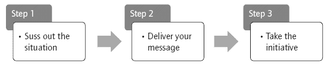

图 8.5 处理难缠的人

##### 步骤 1 – 了解情况

如果对方想说话，就让他们说；保持安静，不要急于介入；控制好自己，等待他们说完。让他们把心里的话说出来。不要打断他们。积极倾听，保持警觉，不要分心。控制你的肢体语言——不要让你的身体代替你的嘴巴说话。不要坐立不安、耸肩、使用顺从的面部表情或肢体语言。所有这些特征都表明你缺乏自信，并可能让你看起来很抱歉。只要站着或坐着不动，面对对方，在他们讲话时看着他们的眼睛。

将人与问题分开。无论他们的行为多么让你沮丧和恼火，都要尽量保持开放的心态。对方可能不仅仅是故意刁难，他们可能确实有一个合理且正确的观点。

当他们说完后，试着保持沉默。这可能会让他们措手不及。他们期待你说点什么——所以你现在掌握了主动权。确保当你有机会回应时，你坚持不允许任何人打断你。如果你有自制力不打断他们，这不应该是个问题。如果你被打断，礼貌地提醒对方你值得被倾听——现在轮到你说话了。

##### 步骤 2 – 表达

确保你知道你想要达到什么目标以及你论点的基础。如果你不知道，你就还没准备好——所以找更多时间准备。如果你自己都不知道，怎么能指望对方理解你的观点呢？

通过陈述事实来掌控局面。把对方的论点或立场复述一遍给他们听也没有什么坏处。这样他们就会知道你已经听了。他们再次听到后，甚至可能意识到这听起来多么愚蠢或软弱！把它复述给他们听也能让你有更多时间思考。

然后，以第一人称权威地发言。这意味着要比平时更多地说“我”。例如，说“我不同意你的看法”比说“你错了”更有建设性。说“我不同意”或“我强烈觉得那是错误的方法……”并没有什么错。不过，确保你有一些实质性的内容来支持你的观点。否则，对方可能会反驳说你只是基于判断而不是事实来发表观点。这也可能意味着你开始失去可信度——然后你就走上输掉争论的滑坡之路。

说“我”这一原则有一个例外——绝不要因为提出你的观点而说“对不起”。除非反思后你的行为在某种方式上具有攻击性或不当，否则绝不要为为自己挺身而出而道歉。

果断地说话；尽量不要结巴，也不要含糊不清。记得呼吸！这将帮助你以适中的节奏思考和说话。始终保持积极，不要害怕鼓励就问题进行讨论；即使对方最终意识到你是对的，如果他们觉得你没有给他们充分表达想法的机会，他们也不一定会接受这一点。

##### 步骤 3 – 在最后掌握主动权

# 掌控冲突局面，由你来结束它

掌控冲突局面，由你来结束它。如果你认为有必要，要有道德上的勇气提出最后通牒。尽量按自己的条件结束冲突，但如果你判断公平且必要，也要做好妥协的准备。如果你决定争论这个问题，永远不要在没有解决它或商定下一步的情况下就离开。

## Naomi

Naomi 在处理难相处的人方面，与 Rob 的方法颇为相似。她的本能是选择退让，以免伤害他人的感情，或者更好的做法是，完全避免冲突，希望它会自行消失。

问题是，她尝试过这两种方法，却仍然不断与某个特定的人（Marie）发生冲突。她们都是处理假期保险的呼叫中心团队的经理。她们上不同的班次，因此很少见面。

Naomi 已经到了这样的地步：她觉得团队正在受苦，因为 Marie 坚持要塑造团队的运作方式。Naomi 经常来上班，发现 Marie 引入了一个她一无所知的新程序。Naomi 不仅觉得这不专业，因为她们本应共同管理团队，她还觉得其中一些新程序是错误且低效的。

Naomi 决定尝试三步计划来处理与 Marie 的关系。她必须鼓起相当大的勇气才能这样做，因为这意味着完全违背她的本能。她做的第一件事是与 Marie 安排一次会议。她事先解释说，会议的原因是讨论 Marie 最近引入的新程序。

对 Naomi 来说，第 1 步很容易——她所要做的就是看着 Marie 的眼睛，倾听并吸收她所说的每一个字。她甚至不需要邀请 Marie 发言，因为 Marie 立即开始为自己引入新程序的理由进行辩解。Naomi 还特意在 Marie 说话时做了一些笔记。她们之间的距离足够远，Marie 看不到笔记内容。Naomi 注意到 Marie 不时低头看笔记。这让她感到更自信；她确信自己察觉到了 Marie 行为中的不安。

第 2 步更难——Naomi 必须表达自己的观点；这违背了她的自然倾向。她等到 Marie 说完。她写完正在做的笔记，抬起头。她让沉默持续下去。就在她感觉到 Marie 即将再次开口时，她开口了。她先总结了 Marie 说的话（她的笔记在这里很有帮助）。她清楚地解释了为什么她觉得该程序行不通，并提出了另一个解决方案。在某个时刻，Marie 试图打断。Naomi 非常坚定地说：“我仔细听取了你的观点——请让我把我的观点讲完。”Marie 立即停止了说话。

Naomi 没有让 Marie 打断，直到她讲完。然后她们进行了讨论。Naomi 从一开始就心里很清楚，她不会退让。她已经充分研究了自己的论点，并准备为之捍卫。她惊讶地发现，过了一段时间，Marie 让步了，而且，信不信由你，接受了它。

第 3 步也进行得很好——Naomi 通过解释，她不觉得 Marie 在不让她参与的情况下做决定符合团队的最佳利益，从而保持了主动权。她提议从现在起，她们每周见面一次，以便能够更有效地共同管理团队。Marie 对这个想法似乎有点戒心，但为了团队的利益同意了。

Naomi 发现，随后，随着时间的推移，她与 Marie 的工作关系有所改善。虽然从未完美，但她处理与 Marie 冲突的方式的改变产生了巨大的影响。Marie 开始习惯这种情况，并且随着时间的推移，甚至私下承认她更尊重 Naomi，并且发现与她合作更容易，因为她“知道自己在 Naomi 那里处于什么位置”。

这些技巧也应该能帮助你在遇到冲突时防止其升级：

*   问问自己是否真的那么重要——换句话说，值得为此争论吗？最坏的情况是什么？

*   换个话题——不要再谈论它了。

*   不要向别人重复，以让自己感觉好受些，或者只是为了发泄。

*   设身处地为对方着想——从对方的角度看问题。

*   选择不与消极的人或为了争论而争论的人交往。

*   关注事实，而不是情绪。

*   清空思绪。离开环境，去散步或做一些体育锻炼。

*   赞美对方。有些人非常敏感；你可能会发现，仅仅友好一点就能帮助你赢得争论或达到目的。

*   承认你已经听到了对方的观点。有些人只需要知道你在倾听，并且理解他们的担忧。

*   使用开放式问题，而不是封闭式问题。开放式问题邀请讨论，封闭式问题邀请是或否的回答。例如：

    *   开放式问题——“你觉得那次会议怎么样？”

    *   封闭式问题——“你觉得那次会议开得好吗？”

*   管理对方的期望；不要承诺你能做所有事情。如果你说你会做某事，请确保你能并且会去做。你会赢得更多尊重，人们会知道自己在你那里处于什么位置。

*   电子邮件——不要发送情绪化或愤怒的电子邮件。尽量当面处理问题。如果你别无选择，必须通过电子邮件回复某人，试着先写好电子邮件但不要发送。休息一下，冷静下来，然后再看一遍。不要发送，直到它以受控且专业的方式写成。否则，可能会适得其反。

*   睡一觉再想——一夜好眠能给分歧带来不同的视角，这真是令人惊讶。

### 毫无畏惧！

从今以后，你不应该在家里或工作中害怕冲突。如果你尝试将冲突视为一种不时会发生的事情，你会感到更有信心去处理分歧——你可能无法阻止它发生，但你可以处理它。将其视为生活的一部分的自然现象。人们的行为和思维方式不同，因此偶尔会互相意见不合，这是事实。

这其实是一件好事和积极的事情——如果我们都一样，作为人类种族的进步速度会慢得多。事实证明，例如，最成功的团队是那些拥有最多样化的人格、知识和智力组合的团队。真正成功的关键是理解如何将任何意见分歧（冲突）转化为协议和有效行动。

如果你真的思考一下，并尝试分析冲突发生的原因，大多数时候你会得出结论：它源于个人风格和方法的差异。分歧可能始于意见不合，但升级为冲突通常是由于行为和个人风格的差异。在极端情况下，意见分歧被完全遗忘，风格和行为的冲突成为核心冲突问题本身。

预期分歧会发生。你的挑战是冷静地处理每种情况，以免其升级为冲突。记住三个关键步骤：等待、表达、采取主动。

### 你只是天生害羞吗？

家庭和工作中自信的另一个共同点是害羞。

很多人在自信心建设课程中遇到的人都自称“害羞”。他们在家里和工作中都很难鼓起勇气发言。克服害羞并不难，但确实需要自律、准备和勇气。换句话说，这需要书中已经提到的一些技巧和行为。将这些付诸实践，你会发现更容易应对自己容易感到害羞的倾向。

“你只有在真正直面恐惧的每一次经历中，才会获得力量、经验和自信。你必须去做那些你认为自己做不到的事。”

埃莉诺·罗斯福

Jenny

Jenny 有两个上小学的年幼孩子。由于害羞，她发现很难在学校门口和其他妈妈交谈。情况发展到，放学接孩子的时候，她总是躲在车里，看着操场上其他家长聊天，等孩子出来。

情况越来越糟；随着其他家长彼此越来越熟，她却一个都不认识。情况糟糕到，当孩子出来时，她下车接孩子，不与任何人交谈，然后开车回家。这样持续了一整年！当然，她越不和别人说话，就越难开启一场谈话。

直到她七岁的女儿黛西问她为什么从不和她朋友的家长说话，她才意识到必须采取行动。

于是她报名参加了一门自信心课程，这就是我认识她的方式。

课后她制定了一个计划并立即付诸实践。这需要自律、准备和勇气。

## 1\. 自律

首先，Jenny 向自己发誓，再也不坐在车里等孩子了。她要强迫自己每天在学校门口至少和一个人交谈。理想情况下，每天她都会选择一个不同的人，这样她就能更快地认识人们。

## 2\. 准备

其次，她做好了准备。她在开车去学校的路上想好了要说什么。她想到的事情都围绕着她与其他家长共有的话题——例如，学校俱乐部、体育赛事等。她还在心里做好了准备。换句话说，她给自己打气。这可能是她准备中最重要的部分，因为主要是她对与其他家长交谈的恐惧在阻碍着她。最后，她通过想象自己自信地去做来做准备。当她到达学校时，她已经准备好了。

## 3\. 勇气

第三，她采取了行动。当她到达学校时，她看着校门口等待的家长，决定要和谁交谈。她把话题放在脑海的最前面。

她勇敢而自信地下了车，挺直肩膀，抬起头走到校门口，并完成了这次交谈。第一天，仅仅走到那个人面前就是一个巨大的挑战（Jenny 甚至形容这很“尴尬”）。第二天，变得容易了一些，第三天更容易。到第一周结束时，她已经和五个不同的家长搭上了话。第二周，甚至有一个家长主动过来和她聊天！事情就这样继续下去。

当然，向其他家长自我介绍不仅对她有好处，也对她的孩子有好处；他们看到妈妈行为更“正常”了，这为他们去朋友家玩开辟了更多机会。更棒的是，他们收到了更多生日派对的邀请！

Jenny 克服了在操场上与其他家长交谈的恐惧。同样的原则适用于每当你害怕做某事的时候：你需要自律、准备和勇气。

所以，是时候展示你自信的自我了……

### 在工作中立即产生影响：

*   在会议上多发言，绝不空手而归。
*   主动承担那个演示，不要等着别人邀请。
*   对他人表现出积极的兴趣；多在办公室里走动。
*   自信地举止；在工作场所使用富有魅力的肢体语言。
*   坚定果断；当你有观点要表达时，就说出你的想法。
*   充满活力；展现一些精力和紧迫感来完成事情。
*   果断决策；站出来，让自己被看到。

### 在家中立即产生影响：

*   扩大朋友圈；与积极的人，而非消极的人社交。
*   保持活跃；保持健康和体魄。
*   把事情排好优先级；确保工作和娱乐之间有平衡。
*   激励自己；确保你得到所需的东西。
*   享受生活；不时为自己做点事。
*   取得更多成就；设定个人目标。
*   不要躲藏；在社交活动中主动出击。

用简单的方式来处理这个问题。使用 GARMS 原则（图 8.6

图 8.6 GARMS 原则

第 8 章

*   考虑生活的四个关键要素，找到正确的平衡。
*   如果你邋遢无序，这很重要；这会对别人对你的看法产生负面影响。
*   通过保持健康和体魄来帮助自己保持自信。
*   个人动力和驱动力对于保持自信的心态至关重要。
*   了解你天生的冲突风格。在压力下，你的“默认”立场是什么？
*   有勇气为正确的冲突情况使用正确的风格。
*   制定处理难缠之人的计划。
*   如果你害羞，采用 DPC：自律、准备、勇气。

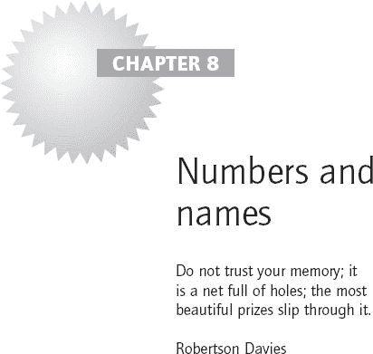

在本章中，你将学到：

*   一系列记忆数字的系统
*   学习日常数字的简单方法：电视频道、时间、日期、价格、PIN 码……
*   将名字与面孔联系起来所涉及的技能
*   帮助其他人记住你的简单技巧
*   如何通过将数字与名字联系起来来管理你的生活

你并不孤单：每个人都觉得数字和名字难以记住。数字是抽象的概念，难以掌握，容易混淆。名字是任意的标签，可能太常见、太罕见、太复杂，或者太简单而留不在你脑海中。两者往往以最糟糕的方式呈现：在繁忙的办公室里大声念出的长电话号码；在餐厅桌边向你连续抛出的五个新名字。两者都特别令人沮丧，因为它们对你的生活有如此重大的影响。

想想看——如果你能应对数字，你就能：

*   记住会议时间、预约日期、生日、纪念日
*   对价格做出更好的判断，谈判达成更有利的交易
*   节省打电话、问路、找地址的时间
*   回忆 DIY 测量数据、食谱用量、衣服尺码
*   学习历史日期、地理统计数据、科学事实、文学引用

如果你知道如何学习名字，你就能：

*   加强与工作同事的关系
*   提高社交技巧，建立强大的新联系
*   在社交场合感到更自信
*   增加对过去和现在名人的了解
*   确保别人出于所有正确的原因记住你

如果你对两者都精通，你就能为生活的每个领域带来新的秩序：将人们与他们的生日联系起来；将名字与地址、年龄、电话号码、订单参考、团队位置联系起来；回忆在什么时间在哪个办公室见谁……

知道数字和姓名的好处显而易见；但忘记它们的危险同样显而易见。如果你曾经把东西寄错地址、买了一件太大的家具、错过重要约会、忘记特殊的生日或纪念日，或者在像某人的名字这样一目了然的事情上出错……那么你就会知道，让这些特定的“奖品”从网中漏掉是多么令人尴尬、沮丧和代价高昂。

|  || 记忆会告诉一个人，他妻子的生日是昨天。 |

| --- | --- |

Mario Rocco

本章是关于掌握一些最难记住的信息。它将为你提供存储这些重要细节的实用策略；向你展示如何充分利用你所学到的关于记忆的一切；并为你提供广泛的应用，让你可以开始运用你新获得的自信心。

你可以做到。你已经看到了记忆非凡力量的明确证据。你已经证明了策略和系统可以对你的学习产生革命性的影响。现在你准备好让大脑运转起来，彻底掌握数字和姓名了。

## 数字

记忆数字的系统已经存在几个世纪了，它们都基于同一个基本原理：数字很难记住，因为它们是无形和抽象的，所以要让它们更容易记住，你需要让它们有意义。当我们发现熟悉的数字事实或找到暗示某种有意义设计的模式时，我们会自然而然地这样做。数字系统只是给你一种方法，让你每次都能快速而轻松地做到这一点。

### 数字押韵法

押韵在数字学习的历史中发挥了重要作用。除了像“在一六六六年，伦敦像烂木棍一样燃烧”这样的个别诗句外，一种非常具体的策略已经存在几个世纪了，它利用押韵让数字变得更容易记住。

与其思考抽象的概念——“一、二、三”——你可以使用押韵来获得具体的图像：“面包”、“鞋子”、“树”。这些可以作为其他信息的“挂钩”，或者图像本身可以链接成对或更大的集合，连接到其他类型的信息，组织成富有想象力的故事，或围绕心灵之旅排列。

数字押韵系统学习起来很快，并且能立即见效。它在处理较长的列表或大量数字时可能会吃力，但它是一个值得掌握的有用策略，也是了解当你把数字变成图片时会发生什么的好方法。

首先设置十个押韵图像。以下是一些建议，但这是你的记忆，所以使用适合你的押韵。

1. sun, bun, gun

2. shoe, loo, goo

3. key, tree, sea

4. door, saw, war

5. hive, jive, drive

6. bricks, sticks, tricks

7. heaven, Devon, Evan

8. skate, gate, Kate

9. wine, vine, mine

10. hen, pen, wren

对于数字学习，你还需要 0：那么如何用“port”表示零，或者用“hero”表示零呢？

所以你只需为零到十的每个数字选择你最喜欢的押韵。然后，每当你想要学习一个带编号的列表时，你就有一个现成的“挂钩”行，所有项目都可以挂在上面。而要记住数字本身，你有非常清晰的图片可以使用。

构建强大记忆的七个步骤依然适用。计划你要如何使用这些图像，尽可能用个人且有力的细节来可视化它们，以有效的方式组织它们——然后练习，直到记忆固定下来。

### 学习列表

要学习以下家庭用品清单……

lamp TV bath vase bed curtains computer

dishwasher fridge toaster

……只需为每个物品创建一个强烈的心理图像，并将其链接到相应的数字图像，使用构成你记忆故事组织结构的那种联系。一件事物可以连接到另一件事物，或者转化为它，爆炸释放它，撞上它，与它玩耍，吃掉它……记得调动所有感官，想象你对正在发生的事情的反应，并夸大每个令人难忘的细节。

以下是一些想法：

| 1 || lamp: 如果你为“1”选择的押韵是“sun”，你可以想象台灯像太阳本身一样明亮地燃烧。如果你选择了“bun”，你可以设计台灯看起来完全像一个美味的葡萄干面包。 |

| --- | --- |

| 2 || TV: 用鞋子砸碎电视，一个关于厕所的节目，或者一台覆盖着粘稠胶水的电视机。 |

| 3 || bath: 也许你的浴缸里漂着一把小钥匙，或者一棵树从水中生长出来。 |

| 4 || vase: 打开门，把一只价值连城的花瓶撞到地板上，或者想象花瓶上绘制着生动的战争场景。 |

| 5 || bed: 为蜂巢里的每只蜜蜂准备一张小床；在你的床上举行一场扭舞比赛；或者把床从卧室搬到车道中间…… |

现在轮到你了。尝试列表中的接下来五个项目。

| 6 || curtains |

| --- | --- |

| 7 || computer |

| 8 || dishwasher |

| 9 || fridge |

| 10 || toaster |

当你设计好五个图像链接，并给自己几分钟练习后，看看你能记住原来的十个物品中的多少个，使用数字押韵“挂钩”来组织你的创意想法。你能整个列表倒着和正着背出来吗？第八个物品是什么？窗帘前面是什么？

就像记忆之旅一样，数字押韵系统让你用一个记忆来触发另一个记忆。挂在十个挂钩之一上的每个图像都可以成为一个场景或故事的起点，旨在存储你想要的任何信息。面包形状的台灯可能会倒在一块奢华的巧克力蛋糕里，不得不用一根长芹菜杆把它撬出来。被你的鞋子砸碎后，如果电视机开始往地毯上漏出几升咖啡——里面还漂浮着多汁的绿色橄榄——那会怎样？钥匙可能漂浮在一缸草莓果酱里，一只路过的鸡可能会把脚弄卡住……直到它拉了一根长香肠把自己拖出来——只为掉进一个巨大的糖罐里……突然，“3”不仅仅是浴缸，它还是草莓果酱、鸡肉、糖……你得到了一个详细的购物清单，你不会很快忘记！

### 学习数字

你朋友的新门牌号是 48，所以你可以想象他们拿着一把锯，一双滑冰鞋挂在锯的末端。

Rob 的分机号是 72，所以你可以想象一双天堂般的鞋子放在他办公桌上：明亮的白色，装饰着天使和光环。

你在谈判中的最高价格是 56,000 英镑，所以你也许可以想象用棍子敲打蜂巢，释放蜜蜂，被蜇……你脑海中的图片会帮助你避免真的被蜇。

自己试一试。检查你是否有基于数字押韵的十个图像，然后用它们来学习以下事实。

你需要去 39 号房间开会。

你银行卡的安全码是 924。

奖品在 6 号门后面。

你的酒店房间是 1875。

你最喜欢的电视节目现在正在 606 频道播出。

有时基本图片就能很好地工作，但你总是可以在解释押韵的方式上发挥创意。数字 7 最初是“heaven”，但也可能是“天堂般的”、“天赐的”、天使、光环、蓬松的云朵……数字 2 可以是任何类型的鞋子。零可能变成你选择的超级英雄、一套服装或小工具——甚至是他的某个特殊能力。所以 720 可能是一个穿着印有超人图片的鞋子的天使，一朵托着芭蕾舞鞋和实用腰带的云，或者一个在高楼之间跳跃的天堂鞋匠。

## 你知道吗？

With a bit of creative thinking you can write sentences that represent long sequences of numbers. There’s a technique called the Word Length System in which you simply choose words with particular numbers of letters, then weave them into memorable sentences and stories. Zero is a bit of a problem, but you can solve it by using a ten-letter word or including some other agreed detail – maybe just a word beginning with z. To learn the serial number on your bike, `45597`, you might use a memorable phrase like: ‘lock every night, defeating thieves’. ‘Contains my precious yesterdays’ could be how you remember the combination lock on your secret diary: `8280`.

#### The Major System

French mathematician and astronomer Pierre Herigone invented this memory system back in the 1600s, but it’s been developed over the centuries and used by people all around the world. The idea is that each digit is represented by a designated consonant or consonants, which can be turned into words and phrases by including the vowels of your choice. And once you’ve got meaningful words to work with, rather than tricky, abstract numbers, the rest of your memory skills can do their thing.

The most common version of the Major System looks like this:

`0`: s, z or soft c: z is the first letter of the word ‘zero’, and the other consonants here sound similar.

`1`: d or t: like the number `1`, these letters both have one downstroke.

`2`: n: like `2`, it has two downstrokes.

`3`: m: this time both the number and its letter have three downstrokes.

`4`: r: the last letter of ‘four’; and `4` and R are almost mirror images.

`5`: l: in the system of Romal numerals, L stands for `50`.

`6`: j, sh, soft ch, dg, zh and soft g: a handwritten j looks like a `6` – and g like a `6` upside down.

`7`: k, hard c, hard g, hard ch, q or qu: there are two `7`s in a K.

`8`: f or v: a handwritten f looks like an `8`, and v sounds similar.

`9`: b or p: b looks like `9` rotated, p could be a mirror-image `9`, and the two letters have a similar sound.

The Major System is phonetic: sound-based. Spellings don’t matter because it’s the consonant sounds of a word that give you its number code.

So the number `974190` could be learnt as BiG ReD BuS.

Castle holds the numbers `705` (CaSL).

To remember that your car is parked in bay `31` you might picture it covered in MuD.

To learn the first eight digits of Pi, you could use the Major System to give you MeTeoR TaiL PiNK: `3.1415927`.

Don’t get confused by double letters. The real word you’ve chosen may need them to be spelt correctly, but if they make one sound they should only represent one number. For example, the word bliss would be used to remember `950`, not `9500`. For `9500`, blue seas would work perfectly. Kill is `75`, not `755`; but `755` could be Kill Lee.

The Major System takes a bit of learning but it’s a very powerful way of memorising specific numbers, allowing you to create strong images and to connect them directly to your subject matter. It can be a bit complicated and time consuming for everyday number learning, but it’s great for longer numbers – especially the ones you want to learn long term.

To see if the Major System might work for you, try using it to memorise the following information.

Remember the key steps:

*   Turn each digit into a consonant from the list.

*   Group the consonants into real words, inserting vowels as necessary.

*   Create strong images for the words you’ve chosen.

*   Find ways to link these images with the numbers you started with.

Your new fridge can’t be wider than `67` cm.

The antique vase was made in `1743`.

Your mother-in-law’s birthday is `24/11`.

The catalogue code for your new television is `349658302`.

And what about the other way round? See how quickly you can change the following images back into the numbers that count.

Every time you press the buttons on the security door at work, you imagine hearing an EVIL LION. So, what’s the code?

Think what would happen if you had NO PROOF that your credit card actually belonged to you. What’s your PIN?

When you want to phone your friend Alice, you think about her wearing an OLD BLUE SHEET – so what’s her number?

(The answers, by the way, are `8552`, `2948` and `519561`.)

If you need to remember lots of two-digit numbers (like birth years, Bingo calls, football squad numbers) or long number sequences, it’s a good idea to invest some time in developing your own double-digit system. You could easily use the Major System’s number/letter combinations to turn every two-digit number into a familiar person, giving you a powerful, ready-made image for every pair of numbers, and instantly cutting your workload in half.

You might decide to turn `00` into Steven Spielberg

`01` could be Sammy Davis Jr

`19`: Tweety Pie

`36`: Michael Jackson

`64`: Julia Roberts

`77`: King Kong

It’s great memory training to design and rehearse your own system and then put it into practice, turning pairs of numbers into people that can be incorporated in any of your other memory techniques.

#### Number shapes

This strategy is popular because it’s easy to remember the key images, but they can all be extended to provide a wide range of possibilities.

Each of the ten digits has a main image based on the way it looks. Here’s one set of ideas, but you can easily customise it to suit the way you see numbers – as long as each image is different from all the others.

`0` looks like a ball

`1` is the same shape as a pencil

`2` could be a swan

`3` on its side resembles hills

`4` might suggest the sail on a yacht

`5` looks like a sharp hook

`6` tipped forward might be a cannon

`7` resembles a lamp

`8` could be a snowman

`9` looks like a lollipop

You can use these ready-made images for remembering straightforward information like:

##### House numbers

Picturing a swan sitting on your aunt’s doorstep holding a pencil in its beak would remind you that she lives at number `21`.

##### Measurements

Seeing a snowman sailing a boat across your kitchen table would remind you that it’s `84` cm wide.

##### Statistics

Imagining a cannon on the banks of the Amazon shooting doves over snowmen playing football … would tell you that this river’s length is `6280` km.

You can also expand the main images to give you more options. As well as being a ball, `0` could be any kind of sporting equipment: golf club, tennis racket, bike helmet. For `3` you could go beyond hills to think about anything in the countryside: trees, flowers, rabbits. The number `6` could be more sorts of weaponry than just a cannon: crossbow, slingshot, atomic bomb … Just make sure that any extra ideas you pick are clearly connected to a number’s main ‘theme’.

For longer sequences of numbers, make it easier to write memory stories by including verbs and adjectives as well as nouns. With practice you can create concentrated stores of detailed information.

*   The number `2` could be a bird, aeroplane or kite – or the action of flying, floating or gliding.

*   You might want to visualise `7` as a lamp, torch or candle – or ‘bright’, ‘shiny’ or ‘hot’.

*   If you needed to know the security code `2170674`, you could tell yourself a story about a penguin (`2`) writing (`1`) on a glowing (`7`) golfball (`0`) and then firing it (`6`) into the hot (`7`) sea (`4`). Stretch your creative brain and start turning numbers into the most varied, rich and memorable stories imaginable.

When you know how to handle numbers, you can add them to other collections of information.

##### Improve your passwords

Make your passwords more secure by inserting seemingly random numbers. If you’ve chosen the password myfriends for your social networking website, and you’re already used to visualising a group picture of your friends on the computer screen, you could now imagine the person on the left holding a beach-ball (`0`) and the one on the right trying to spike it with a hook (`5`). Now your password is `0myfriends5`: much safer!

##### Add extra detail to your life planning

还记得你在第 5 章学到的待办事项清单吗？与其只是记住要去银行，不如给自己留个提醒，从账号 7523（大厅里一棵漂浮的树上插着一根发光的钩子）取出 40 英镑（银行柜台办公桌上一个湿网球）。你已经有了多层图像来提醒你关于 Scott 的生日卡，现在你可以加入一个关于他地址的提醒（卡片上的模型城堡里插着一个棒棒糖（9）和一朵玫瑰（3））。他住在 Castle Street 93 号。

## 个人号码

还有许多其他你需要知道的数字——生日、电话分机号、团队号码——都与人有关；因此，要学习它们，你需要有记住姓名的有效策略。而姓名是记忆复杂性的一个非常有力的例子。你熟知的名字是最容易回忆的事情之一，但新名字即使几秒钟也很难在脑中保留。你的右脑帮助你认出以前见过的面孔；你的左脑应该引导你找到他们名字的细节；但将两者结合起来——往往在时间压力下，并且在各种干扰中——可能会令人沮丧地困难。

## 你知道吗？

当你试图记住名字时，情境尤其重要。记忆在很大程度上依赖于期望。你知道你可能在公司走廊里遇到同事 Sarah，但在镇中心遇到她时，要记住她是谁就难多了，更不用说她叫什么了。我们也期望人们看起来应该是某种样子——所以发型或衣着的任何变化都可能严重干扰我们的记忆。这就是为什么人们很难记住的原因之一：他们会改变地点和外貌，而你的自然记忆需要大量的人工帮助。

### 预期会忘记

名字如此棘手的另一个原因是，我们在最糟糕的条件下试图学习它们。你的记忆训练应该向你展示了掌控的重要性：决定好好使用你的记忆，制定清晰的计划来做到这一点，并利用你的整个大脑将信息牢固地固定在脑海中。但说到学习名字，我们往往：

*   假设这不可能

*   不采取任何措施来改善给予我们的信息的质量

*   仅仅依赖我们的自然回忆

难怪名字会成为一个如此大的问题。

解决方案包含在记忆形成的七个步骤中。现在比以往任何时候都更需要清晰的策略来掌控具有挑战性的局面，以及主动学习技巧来让你的大脑出色地工作。

## 记住名字

### 步骤 1：决定

你必须假设你会记住你遇到的名字和你遇到的人：不是通过更加努力，而是通过做得更好。你需要从一开始就集中注意力并付出正确的努力——你还需要为自己腾出空间和时间来正确地做到这一点。进入任何学习名字的情境，你必须非常清楚你想从中得到什么，以及你将做什么来让你的记忆发挥作用。

### 步骤 2：制定策略

你成功的策略需要在你听到某人的名字时立即启动——因为，除非你仔细倾听，否则你的记忆真的没有机会。停下来专注于我们阅读的名字就已经很难了，但在现实生活中，名字往往被如此快速、安静地抛向我们，或者我们正忙于握手或想着说什么，以至于它们极难被吸收。在商务活动或社交场合，通常还有许多其他干扰：我们周围房间里的干扰，但也来自我们内部——紧张、兴奋、我们想要取悦他人的渴望……即使我们只是在文档中阅读名字，我们的大脑也常常忙于其他事情而无法多加注意。所以，记住人的第一阶段必须是观察和倾听，专注于名字，主动地将其吸收并开始对它做些什么。这是一个我们可以非常有策略的学习领域，可以选择确切要记住谁——以及如何记住。

对名字感兴趣，询问它们如何拼写，它们是什么意思。立即重复它们：“你好 Chris，很高兴认识你。”听到名字，看着那个人，告诉自己你将创建一个持久的记忆。

### 步骤 3：个性化

一些使名字学习变得困难的事情——比如见到他人时涉及的情绪压力——可以扭转过来并用于你的优势。当你遇到新的人时，有意识地考虑你的感受。在心里说出他们的名字时思考：我喜欢这个人吗？他们有吸引力吗？他们说的话有趣吗？他们会成为一个好的同事、朋友、伴侣……吗？通过感受建立联系，你就更有可能回忆起这次会面，但你也会在他们的名字上建立心理联系——尤其是当你关注这一时刻“意味着”什么，以及你记住的理由时。

### 步骤 4：可视化

除了看着面前的人，还要在你的心灵之眼中看着他们的名字。想象它写在他们脸上，或者像挂在他们头顶上的霓虹灯牌一样闪耀。想象他们的签名可能是什么样子。无论你是在纸上读到名字还是在脑海中看到它，都像对待任何其他单词一样对待它：作为一组可以为你提供难忘可能性的字母和声音。这个名字听起来或看起来像什么？特定的音节是否暗示物体、人、地方？是否有词中之词可以给你有用的联想？拆解名字以揭示你可以利用的图像。例如：

#### Harry Floris

Harry 看起来和听起来都像 hairy（多毛的）。Floris 与 florid（面色红润的）非常相似；也与 florist（花商）相似。他姓氏的第一个音节听起来像 floor（地板），但看起来也像 flow（流动）。Flow rice？米在地板上流动？名字 Flo 也在其中，还有 Lori——还有 Rolf，倒过来：也许是那些被流水冲走的人……？

#### Angela MacDonald

Angela 中有一个天使，也许是一个头发里抹了发胶的天使。Mac 可以是雨衣。Donald 可能会让你想到唐老鸭，或者另一个著名的 Don：Johnson、Quixote、Corleone……

### 步骤 5：夸张

一旦你提取了一些图像想法，就让它们变得重要。想象它们是这一时刻的一部分，揭示面前这个人的关键方面，并为你提供关于他们是谁的重大线索。问自己问题，并夸大答案——以及你在心灵之眼中开始看到的其他一切。

*   为什么这个面色红润的男人如此花哨地脱下他印花衬衫？为了向你展示他多毛的胸膛。头发一直延伸到地板，地板上似乎也覆盖着米，围绕着你和多毛的 Harry Floris 流动。

*   为什么这个女人抹了发胶向后梳的头发上方挂着光环？想象她正拿着一件似乎缠绕着一只扭动、呱呱叫的鸭子的雨衣。显然 Angela MacDonald 有一个非常著名的角色在她天堂般的雨衣里！一如既往，让图像大胆明亮、有趣、奇怪、暴力、令人惊讶——并且强烈地令人难忘。

### 步骤 6：组织

在纸上或当面，名字需要与它们的主人联系起来。你已经通过使用你对他们的感受，想象他们的名字印在他们身上，并可视化发生在他们身上的奇怪而难忘的事情来开始这个过程。即使只是阅读派对主人或会议代表的名字，也应该让你将图像与一个真实的角色联系起来——即使是一个你从未真正见过的人。

如果你在纸上学习名字，将你创建的图像与真实的人可能是什么样子或可能会做什么联系起来。

*   你的新同事叫弗雷德·布卢姆（Fred Bloom）。想象他穿着鲜红色的衣服，拿着一束鲜花走进你的办公室。也许他一半是红色，一半是蓝色（对应 Bloom）。为什么他似乎那么担心找厕所？当他坐在办公桌前时，为什么要架起一台织布机（loom）？

*   如果你得知亨利八世的第一任妻子叫阿拉贡的凯瑟琳（Catherine of Aragon），你可以想象她正在和一只猫（cat）以及一块抹布（rag）做些什么，表现得傲慢（arrogant）或大发脾气（rage）……把她和她那位臭名昭著的丈夫放在同一个场景中……甚至在了解更多关于她的信息之前，就建立起令人难忘的图像。

但当你面对真实的人时，你可以做更多事情来将他们与名字联系起来。除了看到他们扮演你设计的图像，你还可以利用他们的外貌和穿着来帮助你。

##### 长相相似

这个人让你想起别人了吗？可能是一位名人或家人，但利用他们与你已认识之人的任何相似之处是有道理的。如果他们真的是那个伪装成别人的人呢？那会让你有什么感觉，又会如何改变你想象的事物？

*   如果你的新邻居安迪·韦伯斯特（Andy Webster）长得像猫王（Elvis），你可以想象他用他巨大的手（Andy）搅拌花园栅栏上的蛛网（webs）——穿着拉斯维加斯连身衣，像猫王一样扭动臀部。当你下次遇到他时，你就会有猫王的联想，直接引导你到基于他名字的图像。你仍然可以通过想象他站在栅栏旁到达那里，你仍然会有“虚假”的回忆，记得看到他清洁和跳舞时的感受；但你还会利用他的外貌作为直接链接，进入你对安迪·韦伯斯特多层次记忆中。

*   也许你的同事海伦·马蒂诺（Helen Martino）长得像英格兰女王。想象这真的是伪装的女王，乘坐皇家轿车来到你的办公室，轿车上装饰着魔鬼和烈火的熔炉（海伦的地狱图像），她正在喝一杯巨大的马提尼鸡尾酒（Martino）。在她佩戴的珠宝中寻找线索（她的项链上是微型王冠吗？）或在她走路的方式中寻找线索（像是在参加皇家游行吗？）来提醒你皇家的联系。即使在办公室环境之外，她的外貌也应该触发你想到一个非常令人难忘的心理场景：这个女王长相的人在地狱般的汽车里喝着马提尼……海伦·马蒂诺。

不要忘记位置对记忆有多重要。如果你在努力记住你遇到过的人的名字，仔细想想你上次见到他们时在哪里。专注于房间、建筑物或城镇的精确部分；看你们两个站在那里；但也要想象你从那个位置能看到什么，利用每一个可用的细节来重新连接你与记忆。

##### 特征与时尚

就像漫画画家画夸张肖像一样，突出你可以在记忆中强调并用作某人名字链接的任何细节。临时的“钩子”可能是衣服、珠宝、化妆或发型的细节；但你可以在脸型、鼻子大小、胎记、身高等方面找到更持久的链接——任何你在再次见到该人时肯定会注意到的事情。

*   如果阿米拉·汗（Amira Khan）有非常圆的脸，你可以想象她看着一个非常圆的镜子（Amira），镜子是用锡罐（Khan）制成的。

*   如果里克·卡彭特（Rick Carpenter）特别高，你可以想象他用他的木工技能建造一个 incredibly 高的木架子来放置他所有的模型人力车（rickshaws）。

#### 第 7 步：练习

你需要立即开始练习新名字，而真实的人还站在你面前。确保你在谈话中几次提到他们的名字，但你也可以在自己的脑海中“默念”它，习惯它的声音，并与它的主人建立联系。同时，你将创建图像和链接，让这个人在你的脑海中长期留存；所以，在与他们交谈时，回顾你设置的触发器，并练习遵循将你带回他们名字的图像和联想。

在以下名字上亲自尝试这些技巧。

对于第一组名字，练习创建令人难忘的图像，并将它们与相关的人联系起来。

你的旅行代理是道格·雷迪（Doug Reddy）。

派对由玛迪·谭（Maddie Tan）主持。

你的新邻居是巴特和苏·怀特（Bart and Sue White）。

对于下一组名字，为它们都创建图像，然后将它们固定在记忆之旅的前五个位点上。

莉莉·佐藤（Lily Sato）    杰克·穆迪（Jake Moody）    罗文·卡特（Rowan Carter）    伊莫金·福克斯（Imogen Fox）    卡洛·曼奇尼（Carlo Mancini）

将这些策略应用到你的日常生活中，看看它们会带来什么不同。如果你仔细遵循步骤，你就会开始记住人们足够长的时间，以便对他们的名字做一些更持久的事情：把它们放在日记里，添加到你的电话簿中，或在故事和旅程中在脑海中归档它们。

而且，因为你知道名字学习是如何工作的，你可以开始激活关于你自己的记忆。

为了给其他人最好的机会记住你……

*   清楚地介绍自己——并确保他们听到了。

*   帮助他们可视化你的名字，通过提及它的拼写或含义。

*   给他们关于你的容易想象的信息。

*   谈论逻辑细节和富有想象力的想法，以激活他们大脑的两侧。

*   给人们记住你的理由。他们学习你的名字有什么好处？

*   用名片、感谢信或跟进电子邮件来支持他们的自然记忆。

在下一章中，你将了解更多关于使用记忆技巧影响他人记忆的内容：写出令人难忘的考试答案，进行有力的演示，在面试中产生最佳影响。但是首先，为了结束第 8 章……

### 带数字的名字

是时候将本章的两个主要主题结合起来了：将名字与数字联系起来。这项技能也将出现在即将到来的许多高压力记忆挑战中；但目前，你需要看看将数字与名字联系起来是多么容易。

卡罗尔·吴（Carol Wu）住在 702 号公寓。

想象一位唱圣诞颂歌的人试图向卡罗尔·乌（Carol Woo）求爱，她住在公寓里。她没有约会穿的衣服——直到一位天堂英雄给她一些美丽的鞋子。在数字押韵系统中，天堂/英雄/鞋子 = 702。

莱昂·莫拉莱斯（Leon Morales）的出生日期是 23.06.71。

也许你想象一头狮子（Leon）在莱昂·莫拉莱斯的生日派对上大喊“再来点麦芽酒”（Morales），穿着侏儒的夹克（因为，在大数系统中，NoMeS JaKeT = 230671）。这个场景中有很多事情发生，但每个细节都很清晰——并且令人难忘，当你将所有训练付诸行动时。

利用你所知道的关于记忆的一切——以及你卓越大脑的两侧——来记住……

汤姆·费舍尔（Tom Fischer）的分机号是 849。

霍莉·桑托斯（Holly Santos）欠你 458 英镑。

洛基·辛格（Rocky Singh）订购了 26 台电视和 15 台 DVD 播放器。

洛拉·奥尼尔（Lola O'Neil）出生于 15.09.78。

……然后遮盖信息，测试你对数字和名字的卓越记忆。

*   抽象的数字和名字容易忘记——但可以变得令人难忘。

*   数字系统让你将数字转换为图像并固定在你的脑海中。

*   要记住人们，在名字和面孔之间创建强大的链接。

*   使用你的记忆训练来帮助其他人记住你。

*   将数字和名字联系起来，以存储你生活中所有关键人物的关键细节。

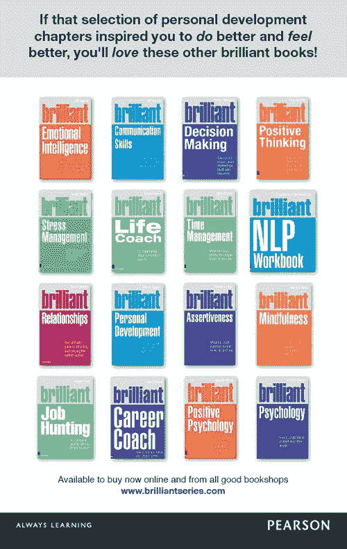

# 第 2 部分

# 商业

# 我们的业务书籍涵盖各种管理和职业问题，助你抵达所需之地。

本章节包括关于艰难面试问题、谈判、演示、社交和销售的章节。

因此，如果你想：

* 应对刻薄面试官的尴尬问题
* 学习如何讨价还价
* 在演示中发挥最佳水平
* 发现如何与陌生人搭话，并在社交时避免尴尬的停顿
* 在销售服务/产品时，专注于在正确的时间向正确的人提出正确的问题

... 请继续阅读！

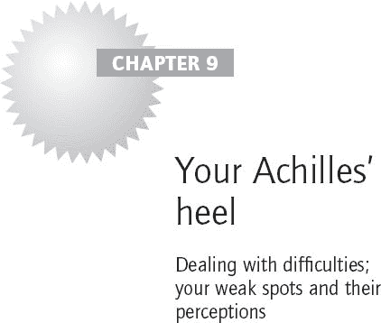

本章将教你如何处理职业生涯历史中的任何薄弱环节和棘手问题、尴尬的问题、尴尬的停顿和刻薄的面试官。除非你是那种让我们其他人都感到烦恼的稀有人，他们一生顺风顺水，每个决定都结果良好，好运总是眷顾他们，否则你很可能有过去的某些方面（无论是考试成绩不佳、一段失业期、工作经历不连贯、健康记录不佳等），你不希望在求职面试中被问及。然而，你知道，由于这些问题是你历史的一部分，它们很可能从你的简历、申请表或雇佣和品格推荐信中浮现出来，因此很可能引起未来雇主的好奇。面试官确实希望对看似与你的历史和品格的其他证据相矛盾的结果或情况做出解释，并让他们心中充满疑问：“为什么？”

提醒自己，你已经被叫去面试了。你不是来凑数的，所以无论你认为自己有什么缺点，他们一定喜欢他们在纸面上看到的东西。

在准备回答可能适用于你的任何棘手问题之前，你应该记住，面试官问这些事情是因为他们真的想知道。他们想确定某个薄弱环节是暂时的失误，还是反映了更普遍的问题。你可能会被问及这些“阿喀琉斯之踵”的第二个可能原因是——面试官知道你可能会在这些问题上感到脆弱，他们想看看你是否会变得敌对或防御，或者你是否会抓住机会，运用你的沟通、说服、分析和冷静理性的技巧，提供合理且令人信服的解释。

## 关于真话的几句话

本书不承诺提供关于真话在求职竞争丛林中所处的哲学和道德地位的严谨分析。然而，它确实就此主题提供了一些常识性建议。如果你在简历和/或求职面试中隐瞒某些事情，你不太可能沟通得那么有效，也不太可能像你希望的那样放松和自然。你选择不说的事情、虚构的考试成绩、你编造的工作或由你妈妈写来增强你论点的推荐信，很可能会让你露馅。雇主几乎总是在雇佣你之前会查询推荐信，如果你在面试中不得不隐瞒真相，那么你就要问问自己，如果你是成功的候选人，你将如何维持下去。还要记住，如果雇主后来发现你对他们不坦诚，他们可能会以此为由解雇你或采取其他纪律处分程序。

本章涵盖了候选人感到焦虑的许多问题——以及一些应对这些问题的建议方法。

首先考虑这个示例问题和范例答案。这个问题和答案之后，是对使该答案成功的原因的快速分析。

你有任何资格证书吗？

如果你有，那么这个问题不会让你感到脆弱；如果你没有，那么你想要组织一个良好、开放、热情的回答。

我的主要优势在于实用且相关的工作经验。我在酒店行业工作了七年，并充分利用了大量内部培训课程。我一离开学校就开始当接待员：我迫不及待地想去工作并赚取薪水。在我目前担任助理经理的工作中，我处理过各种各样的问题，涉及客户方面和人力资源方面。如果机会出现，我当然很乐意参加相关资格认证；我认为这将有助于我未来的发展，并且抓住机会退后一步审视自己正在做的事情总是有用的。我不觉得纸面上没有资格证书迄今为止阻碍了我。

为什么这个答案有效：

* 它没有回避你没有正式资格证书的事实，但它避免发出粗鲁和令人生畏的“不”。
* 它迅速转向展示对培训的承诺。
* 它强调了职业阶梯的晋升。
* 它承认了一点急躁和过去可能做出的不明智的决定。
* 它保证这个决定没有造成严重后果。
* 它表达了对未来教育和学习的积极态度。

尝试分析本章后面的一些答案，看看它们为什么有效。当你制定自己的范例答案时，可以使用同样的技巧。

我看到你的 GCSE 成绩非常好，但 A-Level 成绩却很差。发生了什么事？

我不确定是否想留在学校读 A-Level；这是我父母推动的，但我并不真的愿意。我对其他事情太感兴趣了，我就没有付出应有的努力。

（对此的一个可能的后续问题，很容易引发防御性反应，可能如下。）

那么，我可以认为，如果你不喜欢某件事，你就不再努力工作了吗？如果我们给你一份工作，而你发现其中有些部分你不喜欢，那怎么办？

自从离开学校三年以来，我一直有良好的工作记录，在那段时间里，我处理常规和重复性任务没有任何困难。我从 17 岁以来长大了很多，我似乎在工作环境中比在学校环境中学得更好。不过，我正在参加一个网站设计的晚间课程，我真的很享受。

你的简历上似乎有八个月的空档期。这段时间你在做什么？

之前两年我一直在做临时工，我真的想要一些更有方向感的事情。事后看来，我可能应该等到有了固定工作再放弃临时工作，但我真的想专注于求职，并全心全意地投入。我没有预料到那段时间就业市场会如此糟糕。我通过参加一个短期的密集秘书技能课程让自己重新振作起来，并很高兴重新回到工作环境中。

你只拿了个三等学位。我们真的在找一个有好荣誉学位的人。为什么我们应该考虑你？

（记住，无论他们说什么，他们还是选择面试你。）

当然，我很失望——我希望拿到二等甲，我前两年的成绩表明我能达到这个水平。我在最后一年遇到了很多个人问题，这些问题现在都已过去并解决了，但它们确实影响了我的成绩。我的个人项目和小组项目成绩很好，我认为这些培养了我胜任这个特定职位所需的沟通、时间管理和信息收集技能——所以我知道自己在有用的、相关的工作技能方面很强。

从你的简历来看，似乎你离开职场六年了。你认为自己如何适应工作的常规和要求？

（候选人不应将其视为过去的负面领域，但有时可能会有这种感觉。）

是的，我暂时离开有偿工作是为了生儿育女，并看着他们顺利入学。过去几年我没有领薪工作，但我实际上一直在非常努力地工作。抚养家庭让我能够应对意外情况以及日常事务，而且我工作的时间通常比从事有偿工作时要长得多。此外，我当然没有忘记我在制图室使用的所有技能。我通过阅读相关行业报刊保持知识更新，更重要的是，通过为朋友做一些制图工作来保持技能。

选择积极的词汇，如“有用的”、“相当大的”、“广泛的”和“相关的”。

描述活动和经验时，避免使用“仅”、“一点”、“有限”或“不多”等消极词汇和短语。

你似乎做过很多与你的资历不符的工作：它们不是“毕业生”工作。

找到某种工作对我来说比任何事情都重要。实际上，我学到了很多关于自己的事情，比如我有多么喜欢向他人传授信息。我还发现了自己知识和经验中的一些空白，尤其是在压力下工作方面；我做过的每一份工作都教会了我一些东西，即使只是再也不做那种工作。

我看到你九个月前被上一家雇主裁员了。你是如何应对的？

这并非完全出乎意料，因为公司一直面临财务困难，我们中许多人都意识到我们的工作可能面临威胁。尽管如此，起初这仍是一个打击，非常困难。我一直是一个乐观的人，但这个领域竞争激烈。我在失去上一份工作后不久就报名参加了 IT 课程，以获得一些新的设计技能，并且我还一直在为当地中学做志愿者，协助计算机技能课程。自离开上一家公司以来，我的 CAD 技能无疑有了显著提升，我非常渴望重新全职工作。

你不认为你在这段时间里会有点生疏，脱离工作常规了吗？

（这是一个可能的、相当刻薄的后续问题。）

恰恰相反。我把时间用在了建设性的事情上，并提升了技能，但我真的很喜欢工作。我认为我的精力和热情都处于最佳状态，并且我打算保持这样。

我注意到你在之前的一个职位上只待了八个月就被裁员了：你认为这是为什么？

基本上是“后进先出”政策，我离开后六个月公司就彻底倒闭了。这很遗憾；他们有一些好主意，我们的设计团队合作得很好。这是我工作过的最小的公司，我从不得不非常灵活中获益良多。

从你的简历来看，似乎你几乎没有工作经验——我们今天见到的其他候选人可能有更多经验。

我确实考虑过上大学前工作一年，并且打算在学习期间找一份兼职工作。事实上，我父亲在我的课程大部分时间里病得很重，我最终在家帮了很多忙，并陪伴他和家人。我的课程相当实用，而且，正如你所见，尽管外界有各种压力，我还是取得了好成绩。我真的相信我能胜任这份工作并做好，而且你们强调了你们高标准的培训和入职指导。

我刚离开学校时，很难找到我想要的那种工作。我急切地想进入媒体行业，很难接受那时这可能根本不可能。我确实为当地医院广播电台做过一些志愿者工作，并为两家当地报社做过一些无薪工作经验——我想我应该在简历中提到这些。

强调你所有宝贵的经验，以留下最佳印象。求职者常常将有用的经验视为无关紧要。志愿工作、工作跟随、工作经验以及帮助家庭企业是候选人容易忽略的常见话题示例。

你为什么在完成课程前退学了？

那是错误的科目，对我来说也是错误的时间和地点。我一直不愿继续学业，恐怕我的大一成绩也说明了这一点。我在当地体育中心做的晚班工作对我来说要有趣得多，经理也对我很满意。如果我回去学习，我希望是兼职，并且希望是比我开始的学位更实用的课程。

作为候选人，当你知道有些极其私人和个人的原因在特定时期影响了你生活的某个方面时，这很困难——可能是丧亲、亲近的人患重病、关系破裂或离婚，或者在学业重要时期家庭出现问题。你不愿透露感觉私人和私密的信息，这可能会让你感到难过，让面试官感到尴尬，而且坦率地说，这超出了潜在雇主有合理权利知道的范围。

与此相平衡的是，你了解当时个人情况的事实为工作或学业表现下降提供了合理且可以理解的解释。完全可以说，你受到了不愿在面试中讨论的困难个人情况的影响，但如果你觉得舒适地提及，那么就可以说。在学校考试期间家庭破裂，或者在申请晋升时婚姻破裂，可能是你宁愿透露并了结的事情。即使训练最不足的面试官，之后也不应该再追问一连串私人和侵入性的问题。此外，补充一句评论，暗示无论问题是什么，现在都已过去，不再影响你的表现，这也是有帮助的。毕竟，这就是考虑支付你薪水并投资于你的培训和发展的人真正想知道的。

你过去几年频繁更换工作。这是否意味着你在任何一份工作上待相当长的时间就会感到不安？

我最近的一些变动是因为出于个人原因需要搬到不同的地方。我现在在这里安顿下来，并买了房产。在过去三年做过的所有工作中，我真的很喜欢在金融公司的工作。我从他们那里得到了非常好的推荐，而且我当时做的工作与你在招聘广告和工作规格中列出的职责非常相似。

那些工作很多只是临时性的，而在这些情况下，我的雇主并不指望我长期留下，例如当我提供圣诞节或节假日替班时。在更确定自己想要走的方向之前，我不想承诺某个职业生涯。我在当地规划部门的临时工作让我第一次真正接触到涉及环境问题的工作，并且我参与了大量关于城市和乡村环境改善项目的志愿工作，所以我希望这能体现我对贵组织职业生涯的热情和承诺——这感觉就像是我一直在等待的机会。

在理想情况下，我不会选择频繁更换工作，但目前短期合同比永久性职位更容易获得。这当然意味着我能很快适应新环境，但我更希望有一个更稳定的局面，并有机会获得更多管理经验。

在当前的经济环境下，许多申请人都会面临频繁换工作、短期合同和失业期的情况。面试官提到这一点并不是在针对你；他们需要知道你如何应对，以及当你处于令人沮丧的境地时，你的策略是什么。

自从你被裁员以来，你是如何激励自己继续找工作的？

我尽量在求职过程中建立很多结构，我做的最重要的一件事就是与一个固定的联系人网络保持联系。这不仅能让我的名字保持曝光，还能让我了解任何新的发展和想法。我正是通过这种方式听说你们可能在寻找像我这样有经验的人。

你要求我们不要联系你目前的雇主获取推荐信。你为什么不愿意让我们这样做？

我目前的公司可能正在考虑一些削减成本的措施，如果他们认为我在外面找工作，我可能就会成为其中之一。我对目前的工作很满意，但我在这个职位上已经待了两年半，我认为你提供的这份工作非常理想。我确信我会喜欢这份工作，但我不能保证自己一定会被录用，我不想在目前的公司引起不必要的动荡。

我目前的经理上任才三个月，如果让他写我的推荐信，我不确定他是否了解我的工作足够多，了解工作内容、我的优势，或者能否公正地评价我的技能。我认为，从我之前的老板那里你会得到更相关的信息，我曾为他工作了四年半。

你的推荐信显示，去年你因病缺勤 15 天。这是你每年的典型记录吗？

远非如此。那 15 天都是连续请的，是因为我在滑雪度假时发生了事故。在那之前，我的出勤记录一直很好。

除了年假和公共假期，去年你缺勤了多少天？

四天——两天是做牙科手术，另外两天是因为患了重感冒，导致我在电话里完全无法工作，但我平时身体还算强壮。

（健康记录是雇主关注的问题。许多组织会使用标准化的推荐信请求表，发送给你目前的雇主或你提名的推荐人。这份表格通常包含一个部分，要求详细说明你因病缺勤的天数，因此你的面试官可能已经掌握了这方面的准确信息。）

你的考勤情况如何？

很好，我通常是早上最早到达的人，而且我不喜欢迟到参加会议、培训或任何事情。我认为你对同事和经理都有责任准时。

你离开上一份工作时没有找好下一份。这有点冒险，不是吗？

是的，我想确实如此，但我从来不打算在销售岗位上待太久，而且觉得那是正确的决定。那里最近发生了很多变化，很少有员工感到满意。要让我感到沮丧并不容易。但我觉得我最明智的选择是离开，开始寻找其他工作。销售工作很有用，尤其是与人打交道和在压力下工作——这两件事我已经变得非常擅长。我相信它们在你的客户支持部门会很有价值。

你的一位推荐人建议你有时在办公室会失去冷静。你对此有什么反应？

这种情况偶尔发生，但如果我表现得不合理，我总是会迅速道歉，而且这肯定从未在客户面前发生过。我意识到这一点，所以我会努力保持冷静，并解释是什么让我感到恼火或沮丧。我认为大多数同事会说，虽然我有时有点易激动，但在绝大多数时间里，我都是部门里一个乐于助人且支持他人的成员。

你是否曾被要求辞职？

没有，但我曾接近过那个地步，以至于我主动辞职，而不是等着被要求离开。我们经历了一次重组，来了一位新经理，我承认我和他相处不来，但我在那里成功且高效地工作了十年。我知道削减成本和精简措施即将实施，我只能接受自己不再受欢迎的事实。这很艰难，但这是一个有用的教训，我随后作为独立顾问工作了 18 个月，经历很有趣。

没有，很高兴地说，我没有经历过这种情况。

有。那是我离开学校后的第一份工作。我真的很想从事任何与汽车有关的工作，不知怎么的我最终在一家保险公司工作——我认为这从来都不会成功。

不要自毁前程。如果你有过糟糕的经历，无论是无辜失业，还是因自己的行为导致失业——如果这些都在过去，并且不会通过推荐信暴露出来——就不要提及它。

### 我应该怎么说？

一些面试官会通过向你提出假设性场景来了解你的优缺点，以看看你临场反应能力有多强。这些问题并不是为了寻找一个‘正确’答案而设计的，所以不要浪费时间纠结于正确的解决方案。面试官寻找的是你常识的证据、你在压力下做决定的能力，以及你了解自身局限性的能力。

你是一家大型超市的经理，接到一个匿名电话，称你销售的若干婴儿食品被一个抗议团体篡改了。你会如何反应？

我可能会怀疑这只是个恶作剧，但当然，我会采取一切预防措施，以防情况并非如此。如果我有助手，我会让他们安排封锁婴儿食品货架，并看看能做些什么防止任何商品通过收银台。我还会通过广播系统平静地发布公告。我会致电警察，也会联系当地报纸和广播电台，开始召回任何可疑商品。如果我没有助手，我的首要任务就是阻止任何人购买相关产品，然后联系警察。

你为一家公司工作，该公司正在与另一家公司进行秘密合并谈判。你之所以知晓此事，是因为这是你工作的一部分，但你在这些谈判或这笔交易中并无任何权力。你是办公室里最后一个离开的人，这时接到一位财经记者的电话，对方称听说这场合并即将发生。你会怎么做？

我会说，他们需要与公司的一位董事交谈，但不幸的是，目前他们都不在。我会查看日程表，并给出他们最早可以回电的时间。如果对方追问，我会非常冷静、非常礼貌地重复之前的回答。

你负责公司的研发部门，你的团队中有一位设计师，工作出色，但很难相处，性格反复无常、脾气暴躁，在许多场合都无法遵守公司规章。然而，毫无疑问，他能帮你赚很多钱，因为在他状态好的时候，他的想法非常出色。你如何处理这种情况？

我需要考虑：是否因为他而流失了其他优秀员工；如果我们解雇他，他加入竞争对手的可能性有多大；但最重要的是，我们是否有办法让他更有效地作为团队一员工作。我会先与他交谈，并可能让人力资源部门参与讨论，然后我们共同商定明确的改进目标和具体的评估期。如果合适，我也可能提供培训和支持。

这类问题的一个潜在困难是，你没有太多时间来回答。请确保自己习惯于缩短思考时间，可以让朋友向你提出他们编造的情境（朋友可能比许多真实的面试官更苛刻）。

面试官不应该问你关于性别、宗教和政治的问题。事实上，其中许多问题是违法的，你可以在下一章中找到一些相关建议。不过，他们可以问你关于时事和常识的问题。除非你遇到特别狡猾的面试官，否则这些问题并非旨在揭示你的政治倾向；它们旨在考察你表达观点、构建论点、捍卫观点的能力。他们通常不会选择有争议的问题。

你认为在伦敦举办奥运会怎么样？

我认为这很棒。我认为这将有助于经济，而且，如果随着人们对航空旅行越来越担忧而导致旅游业开始下降，奥运会可能正是我们需要的，能让英国保持繁荣。如果一切按时完成，这将是一个很好的模型，展示我们如何应对具有挑战性的截止日期。

我对此有真正的保留，尽管我是一名体育爱好者。我认为，在公共和私人财政有如此多其他需求的情况下，要证明如此巨额支出的合理性可能很困难。当然，如果我在这次被证明是错的，我也不介意。

以下是一些更多时事问题，供你有机会练习自己组织答案。

你会如何改善这个城镇/城市的公共交通系统？

你会采取什么措施，更有效地将学生群体融入当地社区？

如果你突然得到一百万英镑用于改善这个城镇，你会如何花掉它？

你会如何鼓励更多年轻人继续接受教育？

你认为人们应该获得回收垃圾的激励，还是如果不回收就应该受到惩罚？

今天新闻中哪个故事吸引了你的注意？

你会引入什么新法律？

你会废除哪项现行法律？

你会如何改善国家财政状况？（嗯，每个人可能都在想这个）。

思考你自己的问题，尤其是任何与你所寻求工作的类型或经济领域相关的问题。

如果你要编纂一本过去十年重大世界事件的书，你会包括哪些事件？

我可能会稍微转换一下你问题的边界，说说过去十年中哪些运动和趋势最为重要。从长远来看，我认为这些可能比具体事件更具影响力。我想我会包括全球通信的巨大扩张，它似乎正在改变许多企业，以及关于任何事情的信息传遍世界的速度。欧洲的扩张和中国经济的发展也可能对世界经济趋势产生持久影响。当然，对各种安全问题的高度关注可能也很重要——例如，英国计划引入身份证。就个人而言，我希望认为，日益增强的环境问题意识，尤其是能源消耗，将成为每个人思考中更重要的一部分——在国家和个人层面上。

（在回答这类问题时，加入个人评论是可以的，但你需要谨慎。你不会对环保压力团体说出你对全球变暖的同样看法，就像你对石油公司说的那样。）

如果你想留下正确的印象，那么如果你申请媒体、政策制定、游说等行业的工作，尤其要为这类问题做好准备。你可能还会发现，会遇到与你自己的职业具体相关的这类问题，例如教育、医疗、环境、法律系统等，因此请仔细考虑你所在行业的问题和讨论要点。

## 那太过分了

有些面试中，让你感到不适的不一定是问题本身，而是面试过程中的问题：沉默、你完全无法回答的问题，或者咄咄逼人的面试官。

沉默可能是金色的——在星空下的荒凉海滩上，它可能是一件美好的事情——但当它在面试对话中造成尴尬的空白时，它就失去了诗意和魔力。更糟糕的是，并非所有的面试沉默都是同一种沉默。有一种沉默意味着你完全不知道说什么；有一种沉默意味着你知道面试官想表达什么，但这是一个尴尬的问题，你需要时间思考；还有一种沉默是你认为自己给出了全面、连贯且完整的答案，但面试官却让你失望——他或她没有用下一个问题来回应。在这三种情况下，都要抵制讲笑话、唱歌或泪流满面地冲出房间的诱惑；有更有效的方法来处理这种情况。

如果你真的不知道一个问题的答案，那么你应该直接说出来。这种情况最可能发生在你被问及你在这个阶段不知道答案的技术/专业问题时，或者当你被要求提供某种事实信息时。

对不起，但目前我不熟悉那个领域，所以我无法给你提供任何相关细节。

我不熟悉那个特定的数据管理系统，不过我想它应该与我使用过的其他系统相当相似，而且我通常能很快上手新系统。

抱歉，我以前没听说过那个特定的术语。您能向我解释一下吗？

通过直率表达，强调自己能找到不知道之事的答案，给人留下好印象。保持冷静自信——这非常重要。

展示你的一些优秀品质，例如自信、果敢、诚实和镇定。

如果不理解问题，完全可以要求澄清，但要注意方式，不要让面试官难堪。“我完全不知道你在说什么”这种回答不会让面试官喜欢你。

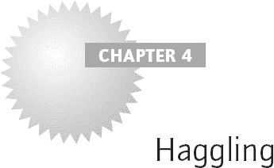

如果您不打算与对方建立长期关系……那就该讨价还价了！您在私生活中购买或出售的几乎所有东西都可以讨价还价。虽然您不能为杂货篮讨价还价，但这属于例外而非常规。讨价还价的好处在于您可以放松并享受它，因为即使您犯了错误，也不会造成长期损害。您还受益于这样一个事实：在买卖时，您的对手期望您讨价还价——即使是伦敦最精明的珠宝商也不会因为您讨价还价购买珠宝或设计师手表而感到被冒犯。

讨价还价是一项有着既定规则的游戏。本章的第一部分为您提供了一套全面的规则，这将使您成为一名非常高效的讨价还价者。最后三部分解释了如何回答谈判中三个最棘手的问题：

1. 如何确定某物的价值？

2. 您应该先开价吗？

3. 您应该在什么水平上提出开价或第一个还价？

![image](images/00042.gif）

如果您无法忍受讨价还价的想法，那么至少要礼貌地问“您的最佳价格/报价是多少？”

### 讨价还价的规则

#### Rule 1 – 不要在没有准备的情况下进入讨价还价环节

最重要的一项功课是了解你应该获得好交易的所有原因——例如，如果你在购买，互联网上报价是多少。你必须做的一项具体准备工作在下一条规则中有所体现。

#### Rule 2 – 为自己设定一个非常具有挑战性的目标

关于谈判有大量的学术研究，这些研究反复表明，目标越具有挑战性，你的表现就会越好。目标越具有挑战性，你在讨价还价环节中就越具竞争力。

#### Rule 3 – 事先明确你想要什么

事先明确说明你想要什么，远比在过程中不断加入新条件要好得多。这是普遍的 KISS 原则的另一个例子——Keep It Simple, Stupid！这并不意味着，如果对方向你提供一个你最初要求之外的有吸引力的替代方案，你就不应该保持灵活。

#### Rule 4 – 讨价还价是一场游戏

讨价还是意志的较量，既要非常有竞争力，又要保持不带感情的最佳方式，就是把它当作一场游戏。

你经常会面对一个受过讨价还价训练的人，或者可能属于一个拥有千年讨价还价历史的文化。他们会期望你讨价还价，在极端情况下，如果你不玩这个游戏，他们会感到被冒犯。

#### Rule 5 – 你不必讲道理

许多讨价还价策略都基于理性论证。在讨价还价时，你知道你的对手想从谈判中得到东西，而你的目标是尽量减少他们得到的东西，从而最大化你得到的东西。这是一场意志的较量，你的目标是说服对手，达成交易的唯一方式是同意你的报价之一。

我想要……如果我得不到我想要的，我就去别处。

#### Rule 6 – 如果符合你的利益，就要讲道理

只要逻辑支持你的立场，就抛出逻辑。例如“我可以在互联网上以更便宜的价格买到”之类的评论，可以在你需要时随时使用。正如下一条规则所述，你甚至可以使用错误的逻辑。

#### Rule 7 – 虚张声势完全没问题（但尽量不要被识破）

“我可以花 12,500 英镑买到类似的东西”几乎无法被证伪。虚张声势是讨价还价中一种可接受（但危险）的策略。在讨价还价中，虚张声势是完全可以接受的，虽然你应该尽量避免被识破，但如果被识破了，也应该表现得毫不尴尬。

#### Rule 8 – 适当的表演从来不会有害

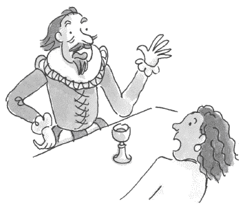

适当的表演从来不会有害

在这场游戏中，适当的表演几乎总是可以接受的。我建议你练习一副完全惊讶的表情——当你听到对手的开盘价时使用。经验丰富的讨价还价者往往会带着一点幽默感进行表演。

#### Rule 9 – 许多可疑的讨价还价做法是可以接受的

在下一章中，我将划定哪些技术是可以接受的边界。例如，公然使用你的谈判能力（杠杆）作为讨价还价策略很少被接受，但在讨价还价中却是可以的。

像“蚕食”这样的边缘策略也是可以的——蚕食是指你表面上已经同意了一笔交易，然后又回来要求额外的甜头：“你会加满一箱汽油，对吧……你肯定不会为了一个油箱而放弃这笔交易吧？”

#### Rule 10 – 利用你拥有的每一点杠杆

如果你有一个强有力且可信的放弃场景，那么要确保你的对手非常清楚这一点，例如，“如果你不能让这笔交易更甜一些，那我就回去看看你的竞争对手能不能做得更好。”

如果可信，那么要强烈鼓励你的对手考虑未来与你做生意的机会。同样，如果你是常客，那就充分利用这一点。如果你有朋友可能会向他们推荐，那也是值得提及的。像“我在镇上最大的雇主那里工作，很多人会知道我对你的服务是否满意”这样的短语可能会很有效。

#### Rule 11 – 不要着急

意识到讨价还是一场游戏，你可能会想要简化流程。例如，你可能会说些蠢话，比如：“我们知道我们最终会同意 15,000 英镑，我们就握手言和吧。”糟糕的策略！15,000 英镑会被视为你当前的报价，你的对手会从这个位置着手进行改进。你不能催促这个过程，所以放松并享受它。

#### Rule 12 – 绝不要透露你的预算

如果你的对手是一位经验丰富的谈判者，他们会试图让你透露你的预算。把预算保密，因为一旦对手知道了预算，你可以肯定他们不会放弃，直到从你身上榨取全部金额。

#### Rule 13 – 不要被骗到与对方折中

如果你的对手提出与你折中，那么就把折中价视为他们的当前报价，并从这里继续讨价还价。

#### Rule 14 – 让让步越来越小

从心理学上讲，你想表明自己即将达到灵活性的极限，因此要让你的让步逐渐减少到零。例如，在汽车行业，销售人员可能会说：“嗯，我可以加送脚垫和挡泥板。”来表示让步的结束。

下一条规则是这种技巧的另一面。

#### Rule 15 – 考虑突破对方偏好的“最佳报价”

你的对手通常会对你使用第 14 条规则，因此你会清楚地了解他们看起来的最佳报价。你可能会觉得可以接受，或者你可以尝试突破这个报价，看看是否能得到更好的报价。尝试突破他们所暗示的最佳报价，除了时间之外，没有什么可失去的。以下是一些可能的技巧：

*   “这超出了我愿意支付的金额。我最高出价 13,500 英镑，我现在就按这个数字和你握手成交。”

*   “我们显然无法达成交易。我会看看能否在别处得到更好的交易”或者“我需要跟我妻子/丈夫商量，因为这比我们想支付的多得多”……然后让他们等待一段时间，稍后再回来看看他们是否愿意让步。

*   “我是现金买家，可以立刻成交，你必须比这个价格更低”……或者也许“低得多”。

*   “我可以跟你的老板谈谈吗？”……通常，如果你能更换讨价还价的对象，你的新对手会愿意做出让步，以表明他们有权限和技能达成交易。

如果你认为他们不太可能大幅让步，那么也许可以说，“这是一个相当有吸引力的报价，如果你能加送延长保修（或其他你想要的东西），我就成交。”或者，“如果你愿意支付邮费，我就接受你的价格。”因为你最终总是可以决定接受他们的原始报价，所以通常没有什么可失去的，不妨试一试。

#### Rule 16 – 沉默是一种绝佳的策略

人们觉得沉默非常不自在，没有比这更好的方式可以礼貌地施加这种压力。就坐在那里沉默着，似乎在斟酌对方提出的报价，通常你的对手会为你甜 ening 交易。

#### Rule 17 – 如果能搞起拍卖，就去做

如果你在购买并且有不止一个潜在供应商，或者如果你在销售并且有不止一个人有兴趣购买，那么你应该让他们相互竞争。没有什么比拍卖更能获得最好的交易了……竞争的买家和卖家常常在赢得交易的欲望中过于兴奋。

#### Rule 18 – 时机至关重要

如果你在买车，值得去了解一下汽车修理厂的会计期间何时结束。通常，经销商依赖于与特定目标挂钩的汽车制造商提供的大额奖金。如果经销商未能完成目标，他们可能愿意以低于成本价的价格将车卖给你，以完成配额。许多组织都面临类似的压力……很少有公司不希望在财年结束前达成交易。

还有其他明显的时间问题需要牢记，例如，你想在夏末而不是夏初购买花园家具……摩托车和许多其他物品也是如此；但是，当然，你想在夏季高峰期购买墙体隔热材料。如果你的购买或销售具有季节性，那么在旺季销售，在淡季购买。

同样，你可以选择一个特别安静的日子或一天中的某个时间来讨价还价，因为如果生意清淡，你的对手更有可能为了达成交易而多让一步。或者，如果你在古董市场或跳蚤市场，那么摊主在一天结束时通常更愿意接受讨价还价。

#### 规则 19 – 如果交易达成后事情出了问题，你可以重新谈判

在你达成交易后，事情没有如承诺的那样进行，这并不罕见：交货延迟；颜色不对；有划痕；有故障；抛锚了；等等。如果事情出了问题，你有权重新开始讨价还价以获得补偿。大多数公司不希望有不满意的客户，因此会有用于补救措施的预算来让你更满意——但这笔钱是专门留给那些大声抱怨的人的！

许多谈判者在这种情况下常犯的一个错误是，未能明确说明他们希望对手为他们做什么。提出明确、合理的要求更有可能取得良好的结果。例如，“颜色不对，要么更换成我订购的规格，要么付给我 500 英镑让我保留这个颜色”，这就是正确的做法。

#### 规则 20 – 不要对讨价还价的对象产生情感依恋

在购买时，如果你愿意放弃交易，你会处于更有利的地位。尽量不要对你购买的东西产生情感依恋。

#### 规则 21 – 永远不要生气

如果谈判变成争吵，你很不容易得到你想要的东西。生气唯一能起作用的时候，是在你对交付的物品提出投诉，试图获得一些补偿时。如果可能，你应该模拟愤怒，以便你保持足够的理性，对你所追求的补偿水平有一个明确的目标。

#### 规则 22 – 永远不要不讲道理

在讨价还价中，大胆的报价和不合理的要求之间有一条很细的分界线。除非你在集市上，否则你应该坚持在分界线的可信一侧。

#### 规则 23 – 准备好“亮出现金”

虽然我将成交的一般讨论留到后面章节，但我要单独介绍一种绝佳的技巧。成交的一个绝佳方式是，掏出一沓你想支付的价格的钞票，塞进对手的手里。你可能会惊讶于这在适当情况下（例如，当你从私人卖家那里购买东西时）是多么有效。

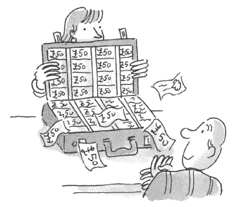

准备好亮出现金

讨价还价的规则解释了你如何玩这个游戏以达成一笔好交易。但你如何知道什么是好交易呢？讨价还价者面临的最困难的问题都与钱有关。你如何知道什么是合理的目标价格以达成交易？你应该先开价，还是应该邀请对手先出价？如果你决定先开价，你应该以什么价格开价？如果对方先开价，你的第一个还价应该是什么？本章的其余部分将回答这些棘手的问题。

### 如何评估某物的价值

本节同样适用于讨价还价和砍价。它也适用于你将设定一个价格并坚持（标价），或者你将设定一个价格然后只允许少量谈判（标价加减一点）的情况。

#### 什么是公平价格？

##### 如果有明确的市场价格，那么找出它是什么

我一次又一次地强调研究的重要性。通过使用互联网、查看印刷广告、与销售经纪人（如房地产经纪人）交谈，你应该能很好地了解许多物品的市场价格。如果你比那个市场价格做得更好，那你就做得不错。

如果没有明确可辨识的市场价格，你该怎么办？

##### 评估独特物品的价值

虽然你可能无法为一件物品找到明确的市场价值，但你可能能找到其他方法来确定价值。假设你正在出售一家公司，有许多广泛应用于公司估值的指南。你可以购买书籍、软件模型等，以协助你进行估值。许多这些工具将基于关键问题（如市值或某段时间（例如十年）的预计盈利能力）加上资产估值来评估公司。资产可以是建筑物和库存等有形物品，也可以是品牌名称、客户名单、商誉等无形但可出售的物品。其他独特物品也可能有广泛公布的机制来帮助你评估它们：例如，在（疯狂的）dotcom 繁荣期间，基于网络的企业通常根据它们每天获得的点击量来估值。

有许多其他技术可以帮助评估独特物品：

*   类比法：通常你会能够说，这件物品比另一件已知售价的物品更贵/更便宜/价值相同。与一位经验丰富的房地产经纪人交谈时，我发现他大量使用这种技术。

*   咨询专家：通常专家会使用类比和直觉的混合来做出他们的估计。

*   拍卖出售：一个可能合适的解决方案是省去讨价还价，使用 eBay 等在线拍卖网站或实体拍卖行来出售物品。

*   我愿意付多少钱？显然，只有当你对物品没有太强的情感依恋时才能这样做，但问问你自己（以及你的朋友和同事）他们愿意付多少钱，这可能非常有启发性。

以下几点描述了你在希望达成交易的价格上可以有多激进。

##### 是买方市场还是卖方市场？

这种现象的一个经典例子是房地产市场繁荣。如果价格上涨迅速，那么很少有房子会以远低于要价的价格出售。相比之下，在平稳或下跌的市场中，房产容易受到激进的讨价还价。

##### 供需如何平衡？

如果供应超过需求，那么权力天平倾向于买方；如果需求超过供应，那么卖方就掌握主动权。

##### 买方是否主动向卖方提出请求？

以出售公司为例——如果买方要求卖方出售，而不是卖方将公司放到市场上，那么卖方处于更有利的地位，可以获得高价。

##### 谁承受的时间压力最大？

一个人承受的时间压力越大，他们在获得最佳价格时就越不能激进。例如，如果你正在出售堆满房子的大件物品，你可能会决定，为了把它们清理出去，值得要求有竞争力的价格。

##### 你的放弃方案有多好？

如果你有一个强有力的放弃方案，那么你肯定会有很好的筹码，并且应该努力进行激进的讨价还价。

##### 知道何时可以大胆

买卖世界分为六种情况：

1. 如果你销售的东西远非独一无二，那么你能卖出高于市场价值的价格就算幸运了。

2. 如果你购买的东西并不稀有，那么如果你能耐心等待，在上述一些条件对你有利时再购买，你可能会得到一个非常好的价格。

3. 如果你销售的是稀有且受欢迎的东西，你应该能得到一个好价格。

4. 如果你销售的是稀有且少数人可能想要的东西，而你又愿意等待，你应该争取一个好价格。

5. 如果你购买的是稀有且受欢迎的东西，那么要做好支付溢价的准备（或者做好没有它也能活下去的准备）。

6. 如果你追求的是稀有但吸引力有限的东西，那么善于讨价还价的人可能会做得很好……保持镇定，尽量不要表现出你多么想要它。

## 开盘，还是不开盘？

### 让对手先开盘的优势

鉴于大多数谈判者不够激进，你的对手在出售时很可能开价过低，在购买时很可能开价过高。如果你随后做出激进的还价，讨价还价阶段就开局良好。

### 开盘的优势

自信的谈判者经常先开盘，因为如果你激进地开盘，你可以在讨价还价阶段占据主导地位。如果你的对手看起来是个自信的人，那么这个策略不太可能奏效。

没有“一劳永逸”的建议。令人欣慰的是，开盘和不开盘都有优势，因此无论哪种情况，你都可以最大限度地利用可能性。

### 如果被谈判物品的价值不明确，试着让对手先开盘

除了对手可能会开价过低之外，他们还有很大机会错误地低估物品价值（在出售时），或高估物品价值（在购买时）。如果你的对手看起来缺乏经验，那么这是一个特别有吸引力的方法。你可以通过诸如“你最好的报价是多少？”之类的评论来提示他们开盘，或者也许更好的是“你觉得它值多少钱？”、或者“你能接受多少？”、或者“你的预算是多少？”、或者“你一定心里有个数，你想要/愿意支付多少？”

## 开盘报价和还价

本节为你提供关于如何定价第一个报价的明确建议。

### 经典开局策略

经典建议是，让你的第一个报价或还价成为（如果你在出售）尽可能高的可信数字，或者（如果你在购买）尽可能低的可信数字。坦率地说，你的报价即使进入了不可信的领域也没关系……这比过于谨慎地定开盘报价要少得多的损失。然而，也有经典建议是错误建议的情况，我现在将解释这些情况。

### 当你希望通过拍卖来确定最终价格时

如果你在在线拍卖网站上出售，或者你希望能够让一个买家与另一个买家竞争，那么你可以以低价开盘。这通常会吸引多个竞标者，并为竞价狂潮创造最佳环境。

### 当你希望（相对）快速出售时

出售像你的房子这样的东西有两种明显的方法。你可以将其定价略低于市场价，这几乎能保证快速出售，并且一旦有一个或多个买家感兴趣，你可以在抵制进一步降价的压力方面相当强硬——事实上，你可能会得到多个买家出价高于报价。或者，你可以设定一个乐观的价格“因为我以后随时可以降价”。第二种方法可能会导致真正想要这栋房子的人支付你的价格，但通常会导致你在以后的某个日期降价，到那时你的房子已经错过了作为新房源的热度。

### 在市场集市上

在这种情况下，开盘报价往往是：

* 不可思议的，以及……

* 由当地习俗决定（通常有数百甚至数千年的历史）。

所以请向熟悉当地习俗的人寻求建议……并提升你的夸张演技。

我现在要说一件可能看起来完全不合常理的事情。如果你是欠发达国家的游客，那么你必须讨价还价，因为拒绝这样做会让商人困惑（最好的情况）或被认为无礼（最坏的情况）。但是，请记住，涉及的钱对商人来说比对你来说重要得多，所以不要争取最低可能的价格——给他们多一点利润。

## 总结

讨价还价的本质是“我想要”。如果你有逻辑论据可以用来得到你想要的东西，那很好，但如果你没有，你就需要将你作为谈判者的意志和技巧与你的对手对抗，以便你能比他们得到更好的交易。如果你将这场意志和技巧的较量视为一场游戏，你就能非常有竞争力而不至于情绪化。

在评估物品价值时，你可以研究类似物品的价格，或者如果物品是独一无二的，你可以寻找一个类比来与其比较，咨询专家，通过拍卖出售，或者计算你愿意支付多少。

在购买或出售物品时，最重要的是知道何时可以在价格上大胆一些。买卖世界分为六种情况，这些情况显示供需法则将决定你何时应该在讨价还价中大胆一些。

如果物品的价值不明确，最好鼓励你的对手先提出开盘报价。在其他情况下，是否最好先提出开盘报价就不那么清楚了。如果你的对手先开盘，他们可能会过于谨慎，这对你有利。如果你先开盘，你可以自信地在价格上设定议程。这意味着无论你是否先提出开盘报价，你都可以获益。

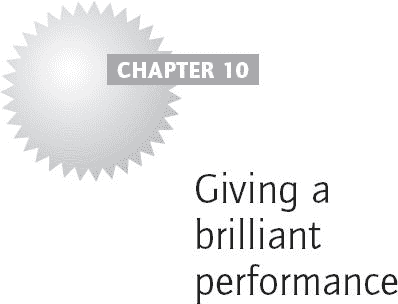

你如何向听众展示自己是关键。不，你不需要成为专业演员，但你需要成为一名出色的演讲者。你需要表演一场演出，因为演示需要这一点强调，一点戏剧性，一点自信和从容。

|  || ‘始终表现得自信。’  

巴拉克·奥巴马 |

| --- | --- |

### 但表演可以有所帮助

达斯汀·霍夫曼非常认真地对待他的工作。当他在《马拉松人》中时，他必须在一个场景中显得疲惫不堪。作为一个完美主义者，他彻夜未眠，第二天到达片场时脸色苍白，眼睛肿胀，精疲力竭。劳伦斯·奥利维尔饶有兴趣地打量着他：“亲爱的孩子，你为什么不试试表演呢？这要容易得多。”

2009 年在孟买的一个活动上，在一个名为“孟买巨人”（孟买/孟买……随你挑）的仪式上，慈善家和高成就者因他们为城市所做的工作而受到当地名流的表彰。有一位律师、教育家、商人、学者、广播员、医生和两位宝莱坞演员，其中一位演员到达时引起了女性的尖叫和大量的狗仔队相机闪光和咔哒声。沙希德·卡普尔是一名演员：30 岁，非常英俊，并且知道这一点；一位新星。他讲了话，以下是我对他腼腆所说的话的回忆：

“我获得了一定的短暂名声……拍完最后一部电影后，谁还记得那个呢？……但那种名声让我能够打开大门……我想为你们这样做……为任何为孟买穷人做伟大工作的你们。谢谢你们，也谢谢这个奖项。我来这里是为了你们。”

电影演员拥有的是说话得体、清晰、直接的诀窍。向他们学习，变得自信、从容、成为一名好演讲者……这是一个很好的开始。至于沙希德，我们都被震撼了。

首先学会说话得体——清晰而简单。并学会尊重你的听众（以及爱他们）。

## 赞美努力工作（赞美美国）

While Britain was creating the aristocratic and amoral character Raffles, the Americans were creating Rockefellers. While Britain was defending an empire, they were building an economy. They worked incredibly hard and they still do. They don’t dream the ‘American dream’ – they create it brick by brick. Their success is founded on an astonishing attention to detail. Whenever you hear people knock the USA, as many do, remember their work ethic and look at some of their achievements.

Which leads me to Al Pacino who, when he performed in and directed Shakespeare’s Richard III in Britain, gathered the cast around and dissected the text with them word by word, examining meaning and motive until it became clearer and clearer what was going on. Shakespeare, he told his exhausted fellow thespians, wasn’t casual or sloppy. If a word was there, it was there for a very good reason. Find it, he said, find it.

So it is with presenting – if a word is there it must be there for a reason. Getting it right will be achieved only by rigorous questioning and a refusal to stop until you get to the bottom of an issue. I recommend such rigour to you in preparing a presentation. If you work in an American company you will find that exhaustive examination of every word and nuance is commonplace. Although, and there is a downside, you’ll also find a rather tiresome didacticism in their presentations. They tend to shout rather than converse.

Work as hard as you can on creating a solid, logical argument for your presentation.

## Performance starts with how you sound

Your voice is crucial and while actors start with an advantage you need to improve and work on your voice, how it carries, how much variation there is in it, how resonant it is, how good your diction is. This is potentially your biggest asset – or liability. For most audiences it’s all that exists of you when you give a ‘whiz bang’ slide presentation. The rest being hidden in darkness.

The key when it comes to training your voice is not to be shy. Learn some Shakespeare and declaim. Or, it could be Keats, Shelley, T.S. Eliot or Carol Ann Duffy – anyone you like. Just learn it and then try saying it out loud – in the bathroom to start with, then outside. Raise your voice and let go with exaggerated theatricality. Enjoy yourself. All I want is for you to be in total control of the content so that you can focus on delivery. For example, imagine reciting ‘Ode to a Nightingale’ to a child, to your parents, to an old lady, to a lover, in a large church to 200 people, in a sitting room to 12 people. The exercise is in learning how to deliver the same thing in different contexts and exploring your own range of expression.

So how do you feel about your voice? Personally, I like and I lean on mine. It sounds quite strong and it gives me confidence – I can play with its range and pace. When it isn’t quite there, through a cold or a surprise attack of nerves, my sense of self-belief begins to flutter.

Lean on your voice. It’s your friend. Look after it with water and mints. Listen to it. Practise. After all that’s what singers do.

Your voice is as important to you as a presenter as your putting stroke is to you as a golfer – so look after it. Record yourself and listen to yourself. Work with a coach if necessary – and it probably is. Someone who slows you down, who makes you speak in lower bass tones. Look at what Sir Gordon Reece managed to do for Margaret Thatcher – she was transformed from a Finchley housewife-politician who, as education minister, stopped school milk (‘Margaret Thatcher – school milk snatcher’) to a world statesperson who spoke with gravitas and passion. The late Edward Heath had voice coaching with the same result, producing in his case a statesmanlike burr. Current politicians try anything from nasal surgery to coaching to get their voice sounding more impressive.

## Illogical arguments show up in a presentation

The question is ‘Does the argument hold water?’ not ‘Is this good rhetoric?’ Don’t be sloppy in building an argument and in creating the logic of your story. At least one acid test of building a credible presentation lies in the practice of constantly interrogating the logic and the flow of the argument.

Don’t go to bed until you’ve cracked it. Toyota created ‘the five whys’ as their process of inquisition whereby any proposal was intellectually tortured until it confessed to its weakness, or survived through the strength of its truth, convictions and logic. For example, suppose that a young executive plans to present a proposal to launch a range of premium organic chilled meals at the next senior management meeting. His boss is sceptical about the plan and the way his executive is going about it.

* Why are you making this presentation when our resources are already overstretched?

    Because research shows there’s a big gap in the market for this concept, and it is very high margin so there’s an incremental volume and profit opportunity. And I’ll put in extra time myself to make sure the presentation is brilliant. The resource issue is down to me and my time.

* Why do such a high-profile presentation? There’ll be sceptics there on our team who’ll suggest the absence of competitive activity may suggest that our competitors know something that we don’t?

    Because it’s very hard to get the product right but I know we can do this if I can enthuse enough people on the team. Hence my wanting to put on a bit of a show. No one else has our organic credentials so competitors are wisely steering clear. Anyway, I think we’re a bit smarter than them and I want to show that in my all-singing-and-dancing presentation.

* Why do you think that you can overcome your colleagues’ antipathy, which you concede is a problem? They’ll probably say if Tesco were to agree with your market diagnosis they could simply do it themselves – and probably would.

    Because I want to be high profile on this and gain first-mover-advantage. You see, if we can get Tesco to stock, in addition to the easier targets like Sainsbury and Waitrose – and I think we can because the taste tests on our product are exceptional – then the organic story plus our pricing makes this a must-stock range.

* Why should we do this and run the risk of cannibalising our relatively successful, but static and under margin-pressure, non-organic offering?

    Because it’s all down to positioning, isn’t it? If we launch head to head against ourselves then you have a strong point, but if we aim more upmarket and go for people organically predisposed and avoid recipe duplication, then we should be OK. Especially if our marketing is as exciting as I plan and aim to show.

* Why would you want to put your career on the line now, just when you are on track for promotion? You see, if you go high profile, make this the presentation of a lifetime and it fails to hit plan, your life here is over, and I doubt if any of our competitors would be impressed either. Why not dip your toe in the water? No big launch. No glitzy internal presentation. Will you think about that?

    That’s a very strong point boss and very well made. Can I go away and have a think about it? What sort of promotion did you actually have in mind by the way?

## Why? Why?? Why??? Why???? Why?????

This technique will usually find the weak point in any argument, position or presentation. Try it on the argument in your next presentation. When, through laziness or because we can’t quite make the argument compute, most of us make jumps in our logic, bury issues that don’t suit the argument or, if we are politicians, we sometimes fib. Sometimes, we even tell really big porkies just to get a brilliant presentation away – sometimes, we believe 2 + 2 = 5 in reality, not as a metaphor, because we just can’t be bothered to do the simple arithmetic.

有时我们很想编造大谎话，只为让我们的演示文稿顺利开场……或者，如果我们诚实一点，我们知道所讲述的故事站不住脚，而且我们知道这显而易见。

## 强有力的论点能让你更有信心

你的表现值得一个强大、无懈可击的论点（与仅仅是要点论点不同）。不仅有了这一点它总会更好，而且也更容易表现——再也不用担心在问答环节因为逻辑混乱而被问题击垮。

那么，让我们来考虑一下如何提升你的表现，使你作为演示者脱颖而出。在这个阶段，你们中会有人会说你讨厌表演。你不妨说你讨厌工作。粗略地说，如果你是一名高管，就通过摆出一场好戏来学习演示，因为如今的企业生活都涉及一定程度的表演——比如保持扑克脸，比如控制脾气，比如对你并不喜欢的人保持友好，比如对员工的个人烦恼保持耐心，简而言之，就是做好你的工作。任何能帮助你表现的方法都值得尝试。甚至可以用奖励来激励自己做一场精彩的表演。

每次做完重大演示后，奖励自己一次。

## 表现——左脑与右脑

左脑是那些显然很重要的功能性内容。那些让你清晰、响亮且权威的技巧。右脑是创造性内容，当它起作用时，会让你的演示文稿大放异彩。

首先，你需要确保自己具备实现这些功能性胜任力问题并通过左脑测试的能力。你需要逐一确认。你是否：

*   看起来不错；

*   显得自信；

*   了解自己的内容；

*   看起来排练得很充分；

*   听起来清晰易懂；

*   按时结束（并且从不超时）？

然后是右脑的内容，这填满了马尔科姆·格拉德威尔的《眨眼之间》一书。这是关于观众角度的第一印象和定性反应：

*   我喜欢这个人吗？

*   我信任这个人吗？

*   我愿意再次见到这个人并继续交谈吗？

*   他们鼓舞人心吗？

我已经谈过坐在隐喻的飞行甲板上进行演示前检查的事情。现在，为了获得左脑控制塔的“飞行许可”来进行演示，请阅读本书，遵循提示，练习，与同事合作，确保他们能看到你、听到你并理解你。

为了获得右脑的飞行许可，你需要阅读本书并付诸实践。但是，当你做完这些之后，你还应该与一位演示教练合作，他们将帮助你完成三件对你的舞台表现力有真正影响的事情。他们将做以下事情：

1.  帮助你找到自己的声音——最适合你的风格、语调和音高。

2.  帮助你做你自己，但一个更宏大、更戏剧化的版本。

3.  帮助你简化并增强肢体语言的影响力。

你会发现，你投入的工作越多，这个自我发现的过程就越容易。有些演示者热爱这样做，他们对它的热情，就像热爱食物和味道的厨师一样，完全令人着迷。比如乐高消费者服务部主管索菲·帕特里基奥斯。就像乐高声称提供的服务一样，她有趣、博学且引人入胜。如果你有机会看到她的表现，请务必去看。她不仅不紧张，更是热爱演示和讲述她的故事。

找到你的声音。找到那个在演示中表现最好的“你”。你做的演示越多，这就越容易。

*   做你自己：大卫·阿博特，二十世纪传奇广告人物之一，谈到人们进入“演示腔，驼背，呆滞的眼神，达立克式的声音和说教”。没有必要这样。拿你现有的东西，发誓要提升自己两三个层次。更宏大。展现气场。但不要变成别人。

*   注意你的外表：当然你需要帮助，你怎么能自己搞定呢？关于如何着装寻求建议——对于女性，一套剪裁合体的西装套装总是看起来强大而现代。（但归根结底，女性对风格的感觉比我好得多。我唯一的评论是，确保你感觉很棒，如果这意味着为每次重大演示都买一套新衣服，那就去做。这是做得出色的一个好激励。）对于男性，深色西装配白色或浅蓝色衬衫，不打领带（虽然如果你想，也可以打）。稍微晒一点太阳——不要让人觉得你是个工作狂。不要让任何人，无论出于多么好的意图，让你穿任何东西或呈现出让你感到尴尬的样子。这一切的重点是让你对自己感觉更好——你是明星。你需要想并感觉到你看起来最好，才能发挥最佳状态。

*   你有舞台表现力吗？走上舞台时环顾四周——舞台越大，你的目光就要越广阔，扫视的范围就要越大。挺直背脊走上去。无论你内心感觉如何，都要表现得很高兴能来到这里。值得重复这一点——表现得很高兴能来到这里。微笑，在心里说一声“好！”（尤其是如果你戴着麦克风，要在心里说）——这会让你的面容生动起来。如果是较小的活动，只需努力对正在发生的事情保持投入和感兴趣，当你开始或站起来说话时，与几个人进行眼神交流，并想：“嘿，我真的很喜欢（甚至热爱）这些人。”这传达给观众的效果令人惊叹。我见过多少次局促不安、鬼鬼祟祟、脾气暴躁甚至公然敌对的演讲者，数不胜数。试着想象外面的人有很多钱，他们会给你一些，但前提是你看起来很开心，并且真的很高兴能和他们在一起。舞台表现力就像性感——有些人天生就有，有些人后天获得。每当玛丽莲·梦露走进一个房间，每个人都会停下来注意到她。

*   试着散发自信：曾经有人对我说，‘你必须相信你说的话，即使你并不相信。’什么是出色演示者的标志？广告行业最好的演示者往往是厚颜无耻的表演者。‘厚颜无耻’是个很棒的词——下次你走上舞台时，对自己说，‘嘿，我今天感觉完全厚颜无耻’，看看会发生什么。你所要做的就是散发自信和对主题的确信。丹宁勋爵，二十世纪更具威慑力的演说家之一，也是一位出色的律师，回忆起他的导师对他说：‘人们付钱给我们是为了我们的确定性，而不是我们的怀疑。’永远要表现得自信。

*   绝不要说行话：站在公众面前说话这件事，自从我克服了紧张之后，总是（让我觉得）很可笑。而且说实话，许多演示都很荒谬，尤其是在行话横行的世界里。几年前有人发明了‘胡说宾果’——一个游戏，你画一个框，里面有 36 个方格。每个方格里都有一个管理行话——‘向前看’、‘战略性的’、‘聚焦’、‘天马行空’、‘全球的’、‘规模化’、‘基准测试’、‘文化’、‘比率’、‘裁员’、‘外包’等等。游戏规则是，每当出现一个可憎的词就划掉，如果一条垂直或水平线被填满，幸运的获胜者就会跳起来大喊‘胡说’。避免所有行话，说英语——用短句子和短词。而且请记住，脚本的写法与正常写作毫无关系——它应该有短句子、大字体；它应该快速……口语化……大胆。

*   享受稍微戏剧化：你知道自己在哪里，为什么以及在和谁说话。你有一个简单、强大且逻辑严密的故事，而且幻灯片制作得不错。然而，你需要在某个地方（比如两个点）注入一些惊喜或“冲击力”，以便你在同事（换句话说，你的竞争对手）中脱颖而出，并让观众记住你的信息。我记忆犹新的生动回忆都集中在灾难上：在旧式玻璃幻灯片时代，幻灯片投影机起火，幻灯片在我们面前融化，于是“为什么我们将成功”滴落成了责备的单词“succ”，慢慢变黑消失；还有那些被反向放入的幻灯片，让演示看起来像是在说某种东欧语言。想想你最希望观众记住什么，然后集思广益，想出一个戏剧化强调该观点的方案。这可能是屏幕上的一个巨大单词，一段动画、视频或配乐，一句精彩的引语——或者你可以脱掉外套、领带和鞋子，说“这是关于去除多余成本和包袱。”随便什么都行。关键是找到一个时刻，进行一点戏剧性的强调。

*   不要太机械：让你的内容充满活力。在通往卓越的道路上，你必须学会让你所说的话引人注目且有趣。当你站起来时，你必须看起来像是关心这件事。你必须让你所论证的观点充满活力。你必须为你的事业充满热情。你必须（并且看起来）很高兴能做这个演示。我最近参加了一个庆祝 AFRUCA 周年（非洲人团结反对儿童虐待）的活动。在那里，我反思非洲人在展示热情、真诚和投入方面要好得多。我怀疑，目前如此少的领导者来自英国的原因是，我们在外向方面非常糟糕——不像南非人、津巴布韦人、澳大利亚人、美国人、法国人、意大利人。所以当你上台时，要“卖力一点”。要生动活泼——看起来和听起来都要充满活力。

*   练习，练习，再练习：你需要进行技术预演，并且必须非常熟悉你的材料。此外，情况可能会变化，这意味着你可能需要足够灵活，在最后一刻更改演示的部分内容。但最重要的是，你必须留出时间来探索表现力——去处理节奏、停顿、响亮和柔和的部分。不要认为你见过的任何精彩表演不是经过非常充分的练习。据说史蒂夫·乔布斯花了几周时间来准备某些演示。独自练习，让你习惯自己的声音。不要做有些人尝试过的事情——在实际表演时编辑和移动材料。这对技术人员来说很紧张，对表现来说也很糟糕——你开始时拥有什么，就只能用什么。至少进行两次试运行：第一次我称之为“走一遍”，只是为了确保所有元素都协调一致；然后是“跑一遍”，即带有感情的排练。在你的剧本上做一些晦涩的标记，并慢动作梦想表演。要有备选计划——可能会停电或着火，也许几乎没人来，也许你是唯一站着的演讲者，因为晚餐时有问题的意大利面，而你独自错过了它，因为你在排练。没有什么能替代通过练习来最大化成功的机会。

如果你在舞台上，我们没有地方给害羞的人。目标是进行一次充满情感、深思熟虑和自信的有力表演。每个人都可以做得很好。它只需要努力工作和大量思考。几乎所有出色的演讲者都是后天培养的，而不是天生的。

如果你想要出色，一点戏剧性是至关重要的。即使你的表演是受控的，你仍然在舞台上，你必须填满那个舞台。你不是在那里说话或读剧本——你在那里是为了吸引注意力，吸引人们，并让他们相信你的故事。汤姆·彼得斯和吉姆·柯林斯一直在就领导风格进行充满活力的辩论。前者主张高管要有魅力、喧闹、短期和具有颠覆性；后者则主张安静、内敛、注重流程、数据丰富、团队建设和长期。

各有道理。我们可能都需要，但可以说我们不再有“长期”了——我们只有现在。而且如果你在舞台上，我们没有“安静的人”的位置——还记得伊恩·邓肯·史密斯吗，英国保守党的前任领袖？目标是进行一次充满情感和自信的有力表演。但是，回到伊恩·邓肯·史密斯身上。我最近看到他在一次小型聚会上表演，谈论英国的贫困和福利的作用。他非常有趣……先证明了自己作为人类的资格，然后在没有笔记的情况下，他进行了一次精彩的阐述。他非常了解自己的内容，并极具说服力和极高的自信地演讲。

“安静的人”已经转变为一位出色的演讲者——是的，这是可以做到的。

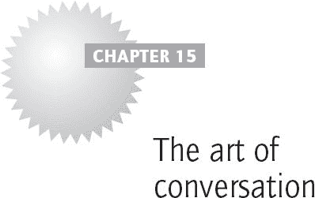

### 开始

所以你已经穿着得体，评估了你的目标，改善了你的姿势——现在你必须开始，一对一，这意味着发起对话，通常是与陌生人。做这件事没有唯一正确的方法——重要的是你要去做！人们通常不需要说任何有趣、有意义或深刻的话来开始一段对话。这可能像“请问你有时间吗？”这样简单。许多处于友谊或关系中的人都不记得他们第一次对彼此说的话是什么。重要的是接触以及接触背后的感情。

#### 在活动前做一些研究

让你有信心在活动中接近他人的最重要的事情之一是对他们进行背景研究。如果你得到了其他与会者的详细信息，请利用这些关键信息。如果他们有企业，请查看他们的网站；如果他们写过书，最好在活动前读完全部或部分内容。这种背景研究将使你从一开始就能提出有深度的问题，并且以后也能继续对话。例如，“嗨，我一直想见你。我真的很喜欢你的书。是什么启发你写这本书的？”

#### 说些积极或中性的话

说食物很糟糕可能会开始一段对话，但它可能会迅速演变成对一切都挑毛病的对话，而你，通过关联，会显得像个爱抱怨的人。一个好得多的方法是问一些中性的问题，比如，“你今天来这里远吗？”或者“你为什么决定来参加这个活动？”，或者给某人一个真诚的赞美。

在社交活动中，有些话题应该避免，除非你们特意聚在一起讨论它们。这些包括宗教和政治，因为相互冲突的想法、情感或看法，它们可能非常具有煽动性。幽默感是加分项，但针对个人或群体且具有冒犯性的笑话也应该避免。

从某个能将你们联系起来的事情开始

如果你在聚会或晚宴上，可能会问另一位客人：“你怎么认识某某？”或者“今晚你还认识其他人吗？”如果是商务会议，你可能会说：“嗨，我们还没见过面，我叫史蒂文。这是我第一次参加这个会议。你去年来过吗？”或者你可以提及议程上的某个环节：“你以前听过这位演讲者吗？”或者“你对上一位演讲者有什么看法？”留意并观察周围的细节，这些细节可能会为你提供与他人建立联系的机会。

#### 如果你和另一个人一起到达，请单独行动

社交网络的主要障碍之一是，我们天生更喜欢与认识的人交谈。如果你是和一群人或伴侣一起来的，请分开并结识新的人。通常，人们更容易接近独自一人的人，而不是成对的人。你可以之后再与你的伴侣或团队交换意见。

#### 自我介绍

先以温暖的微笑和简单的介绍开始：“你好，很高兴认识你，我是史蒂文。”通常对方会报上自己的名字，然后谈话就会自然进行（我们将在下文探讨如何让谈话持续下去）。给对方时间思考，并让他们感到与你交谈很自在。

当你开始与陌生人交谈时，请记住，他们也可能感到紧张或不安。通过率先开始交谈，你就是打破僵局的人，并会被认为自信。一个简单的问题，比如“我刚到，好像不认识这里的任何人。你也是这样吗？”可以给对方一个建立联系的机会。

#### 名字是用来使用的

我们的名字，尤其是名，可能是我们终生都认同的唯一一致标签。许多人为自己的名字感到自豪，并花时间去了解它的含义。即使在人声嘈杂的大型人群中，如果有人叫你的名字，你仍然很可能会听到。

当有人记住并使用我们的名字时，会让我们感到作为一个人被重视。他们花时间记住了它，这反过来又让我们感到特别。那些在销售或客户服务方面训练有素的人知道，顾客能听到的最悦耳的声音就是自己的名字被重复，这会建立融洽关系，让人们关系更亲密。

当有人忘记我们的名字时，会让我们觉得自己不够重要，不值得被记住。其含义是“你不重要”，或者最坏的情况是，这可能看起来像是故意的无礼，“你的名字不重要”。

当你到达活动现场并迅速被介绍给一群人时，此时不要害羞，可以请主持人停下来，确认你是否都正确记住了名字。“抱歉，我没听清，太快了，我可以确认一下，你的名字是……吗？”花时间现在正确地听和记住名字，将来可以省去很多猜测。当你刚认识某人时，澄清此类信息也是可以理解和原谅的。

当你第一次被介绍给某人时，你可以在回答时使用对方的名字，以加强记忆，例如：

“嗨，我是凯蒂。”

“嗨，凯蒂，很高兴认识你。”

虽然这可能听起来有点别扭，但你记住名字的机会要大得多，从而避免以后尴尬。

一旦你有了名字，请记住在交谈过程中或结束交谈时偶尔使用它。这将有助于加强记忆。如果对方有名牌，或者你收到了名片，在活动安静的时候参考这些，并将其与对方的脸联系起来，也会帮助你记住。

如果不确定，总是询问名字比猜测要好。虽然这很笨拙，但比整个晚上都用错名字更容易被原谅。“抱歉，我进来的时候没听清你的名，能再说一遍吗？”“当然，我是迈克。”

如果一个名字难以发音或很长，请对方告诉你如何发音，而不是猜测并凭空捏造一个。“帕拉玛汉萨，这是个美丽的名字，我该如何正确发音？”不寻常的名字也可以成为很好的谈话开场白：“这是个美丽的名字，它是什么意思？”

如果你被要求向另一个人介绍某人，但你不知道对方的名字，这是一个尴尬的局面。摆脱这种情况的方法很少，但一种是退后一步，假设他们可以自我介绍：“请各自自我介绍，我真的很希望你们认识。”一旦他们说出名字，就记在心里并记住它们。

#### 忘记你自己

一旦你尽力准备与某人建立联系并给出你想要的印象，悖论的是，你能做的最好的事情就是忘记你自己，“放下”自我，全身心投入到你正在交谈的人中，同时注意周围其他人的需求。

### 如何接近一群人

接近一群人的动态与一对一的情况略有不同，但仅限于开始阶段。一群人通常是一群人与旁边的人进行一对一的交谈，而不是一次一个人说话。

*   群体早早形成，所以在活动开始前或准时到达，以免封闭的群体已经形成。如果你能与尽可能多的人进行一对一的交谈，那么当他们后来加入群体时，你就有一个熟悉的“首选”对象可以接近。

*   通常在每个正式的社交活动上都有主持人或组织者。如果你知道自己想加入一个群体，请主持人介绍你，通常可以让你在不承担负担的情况下打破僵局。

*   密切留意，寻找机会加入谈话，如果群体是松散的，可以与一对人或群体末端的人交谈。开场白不需要令人难忘。如果有足球比赛，可以说：“你知道足球比赛结果吗？”或者对群体末端的人说：“你有时间吗？”

*   如果活动主持人进行破冰活动——即使只是轮流自我介绍——请注意你想交谈的人的任何细节。如果他们在一个群体中，你有特定的事情要找他们，你可以在那时提出请求并请求稍后交谈。始终承认你正在打断对话。例如，“对不起，我不想打断你们的谈话，但在介绍环节我听说你在制药行业工作。我是一名研究员。我知道你现在很忙，但今晚晚些时候可以和你聊聊吗？”在许多场合，对方会当场继续与你交谈。

*   有时群体可能在会议或论坛上，你想引起注意。最简单的方法之一是在演讲者之后提问环节提出一个简短而明智的问题。率先这样做也体现了自信。你可以这样措辞问题，让人们知道你是谁以及你做什么。例如：“克莱尔·史密斯，小说家兼文案。我非常喜欢你关于文法学校的观点。你相信它们支持精英教育制度吗？”

*   有时当人们成对或在较大的群体中时，他们会对外来者敞开，你可以在他们的邀请下加入。其他群体可能希望保持私密，尽管他们起初可能很礼貌，但本质上他们不希望你加入。仔细倾听并留意言语和非言语暗示，如果你没有得到积极的回应，请迅速而礼貌地离开。总会有更多人可以交谈。

### 保持谈话进行

# 主要技能：倾听与提问

这里的主要技能不是拥有一个精彩的故事可讲，甚至不需要幽默，保持对话进行的关键在于仔细倾听并提出有深度的问题。

当一项涉及控制小组按顺序会见一系列人员的实验进行时，有些人问了很多问题，而另一些人几乎一直在说话。控制小组中的每个受试者都被要求评价他们遇到的每个人有多有趣。令人惊讶的结果是，那些倾听更多、说话更少的人始终被评价为更有趣。要有趣，就要感兴趣。

当你与某人在一起时，无论你是说话还是倾听，保持参与的一种方式是对他人持有积极的意图。我的意思是以积极的方式思考这个人。我并不是在说人们具有心灵感应，有时我们的肢体语言反映了我们的想法。当你说的话与你的肢体语言不一致时，人们就不会相信你的话。你会显得不真诚。

以下十点值得牢记。

1. 倾听关键词或信息，并根据信息适当地提出开放式问题。例如，如果有人说他们在 Faber Maunsell 工作，如果你不熟悉它，问问他们公司做什么是有道理的。有时细节是不经意间提到的：例如，“上周我把儿子送到附近的大学，感觉我已经走这条路一千次了。”这里你有信息来启动一系列你可以提出的问题，关于大学，关于他的儿子，关于他儿子正在修读的课程，每个问题都可能导致进一步的对话。

2. 提问与审讯之间有一条微妙的界限，所以要注意适当地分享一些关于你自己的事情，并让对话在你们之间流动。尝试以某种方式将他们的故事与你自己的经历联系起来，但不要主导对话。

3. 尽早专注于你分享对话目标的意图。这可能是直截了当地问“你为什么来这里？”或者“你是如何决定来参加这次会议的？”，然后分享你的主要目标。

4. 从封闭式问题开始。如果你得到积极的回应，你可以继续提出更多开放式问题，这些问题需要不止一个词的回答。最快的方法是使用以下词之一来开始你的问题：what, why, how, where, who 或 when？如果你正在交谈的人特别害羞，或者不觉得与不认识的人交谈舒服，那么逐步建立对话是有道理的。

5. 如果你在一个群体中，确保你与每个人进行眼神交流，不要孤立任何特定的个人。有时这可能是无意中发生的。关于旧学校日子或办公室过去的样子的 20 分钟回忆可能很有趣，但可能对没有去过你的学校或在你的办公室工作的人来说不是这样。检查每个人是否都参与进来，并引入你觉得没有被包括在内的人。通常可以以微妙的方式做到这一点，“Mike，你上哪所学校？”或者“你们公司情况类似吗？”这种对个人的关注会让群体感到舒适，愿意表达他们的意见。

6. 保持群体对话新鲜的另一个技巧是引入其他可以增加内容或改变对话方向的人。“嗨，过来加入我们，我们正在谈论……”可以为另一个人打开连接的大门。

7. 总结和转述以显示理解。保持对话进行的一个有用工具是检查你对对方所说内容的理解。这不仅能让你保持专注，而且如果以正确的方式进行，它表明你在倾听。这可以通过提出一个简单的问题，然后以总结形式重复你听到的人说的话来完成。例如，“我可以确认一下我是否理解正确吗？你来了五年，但从未被介绍给会议主席”将是一个整洁的总结。

8. 转述是使用某人使用的几乎相同的词语，并重复它们。通常几个关键词就足够了。使用类似的例子，陈述的转述如下所示。陈述：“我来了五年，但我从未被介绍给会议主席。”转述：“你从未被介绍给会议主席？”为了避免让人觉得你在鹦鹉学舌，至关重要的是你不要过于频繁地使用转述。偶尔使用它是一个强大的工具，能让别人知道你重视他们的意见。

9. 出色的社交者还会倾听话语背后的情感或感觉，并与说话者核实这一点。情感可以从肢体语言中看到，从语气中听到，或从面部表情中显现出来。社交者：“你从未被介绍给会议主席。你似乎对此感到不安。我对吗？”人：“是的——我确实感到生气，因为我从未被介绍给会议主席。”注意社交者是如何检查理解而不是简单地说“你很不安”，这可能是一个错误的假设。当反映情感时，我们正在表现出对他人的共情。这不同于同意或同情，但给人一种被理解的感觉。

10. 记住你正在交谈的人有需求和愿望。始终怀着这样的意图倾听：“我如何能帮助这个人？”以及“我认识谁可以把他们介绍过去寻求建议或帮助？”然后主动提出建立联系，不要施加压力，而是出于真诚的帮助愿望。

当你连接人们或做介绍时，务必说的不仅仅是他们的名字。给他们一个钩子或一段信息，让他们能够一起继续对话：例如，“过来加入我们”可以，但“过来加入我们，我想向你介绍 Daniel，他是今晚第一次来这里，并在 Roehampton 经营一家互联网公司”就很棒。当连接你认识的两个人时，强调他们可能有的任何共同兴趣。

如果你阅读关于情商的内容，这个术语最早由 Daniel Goleman 提出，你会看到情绪在决策中有多么重要，即使我们知道逻辑上应该采取另一条行动方案。出色的社交者能够与他们交谈的人建立牢固的情感联系，为未来的关系奠定基础。

## 适度展现脆弱

保持对话进行的最有力方式之一是展现适度的脆弱——分享你的感受。例如，“我有点紧张。这是我第一次参加社交活动，似乎不认识任何人。”通过表达我们的脆弱，我们表达了我们的人性，并让人们更容易与我们产生共鸣。通常他们可能正在经历与我们相同的感受，通过表达出来，我们也给了别人这样做的许可。

## 保持好奇！

出色的社交者通常是好奇的人。虽然有些人是他们所在领域的专家，但他们往往有广泛的兴趣和朋友，并且博览群书。这使他们能够在广泛的话题上开始和维持对话。如前一章末尾所提到的，出色的社交者知道多样性的价值，这使他们敞开心扉，迎接更广泛的机会。将这个过程想象成拼字板，字母作为联系的类型。你绝不会只使用多个相同的字母就能赢得游戏。你拥有的联系越多样化，可用的组合就越多，成功的机会就越高。

下次你去报刊亭时，拿一本关于你一无所知的主题的杂志，随意翻阅一下。拓宽视野，了解媒体和世界各地发生的事情，能为你打开原本可能关闭的对话之路。除了阅读行业出版物，还要阅读高质量的大报和小报，以便获得广泛的观点。

## 如何结束对话

尽管我们可能享受交谈，但有时双方都明显没有有趣的话可说了，对话也失去了目的。以下是一些优雅结束对话的建议。

### 将他们介绍给其他人

与其让某人站着或坐着地突然离开，这显然很无礼，结束对话的最佳方式之一是通过介绍，将此人与房间里的其他人联系起来。例如，你可以说：“保罗，我想让你认识奈尔，他是一名会计。奈尔，这是保罗，他是环球银行的一名律师。”

介绍完成后，你退开并走开。这样做自然地给了你结识其他人的机会，也给了你离开的人与他们可能有更多共同点或能从中获益的人建立新联系的机会。

### 给出一个合理的离开理由

例如：“非常抱歉，我享受了我们的谈话，但我需要去确认我的朋友是否到了。很高兴和你交谈，希望你今晚玩得开心。”或者：“非常抱歉，但我必须走了，因为我需要在杰克离开前和他谈谈。很高兴和你交谈。在我走之前，我可以把你介绍给我们的销售经理吗？”

应用五分钟法则。五分钟通常足够开始一段对话并提出问题以寻找共同兴趣。如果没有明显的协同效应，感谢你正在交谈的人并交换联系方式。永远不要让那个人独自一人，而是再次将他们介绍给你之前认识的、你认为会是有用联系的人，或者尝试将其他人带入对话中。你永远不知道某人何时能帮你。以后，那个人可能正是你最需要认识的那个人。始终要尊重和体贴，不要忘记交换联系方式。

最后，在离开任何活动之前，确保你已经告别并感谢了主人。主人通常会在现场走动，但这种至关重要的反馈和感激之情将带来更多邀请。再次检查你是否已经见到了所有想见的人，然后离开。如果你已经完成了，就避免在现场逗留或拖到最后。这不仅是时间低效的使用，主人可能也希望人们离开，以便他们结束活动并清理场地。

## 索取你想要的

你建立人脉的原因是为了实现你的目标，因此无论谈话进行得多么愉快，重要的是要索取你想要的。索取你想要的很有力量，但也需要以一种能让你获得所需信息的方式进行。

在他们的书《人脉的力量》(1999)中，桑迪·维拉斯和多娜·费舍建议使用问题“你认识谁……？”而不是“你认识任何……吗？”来提出请求。后者可以用封闭式的“是”或“否”来回答，从而结束进一步的交谈。通过提出前一个问题，对方被迫去思考他们认识的人。

维拉斯和费舍强调的一些其他强大的社交问题包括：

*   “你认识谁我应该认识（考虑到以下情况）……？”
*   “你认识谁认识……？”
*   “你认识谁会从……中受益？”
*   “你会推荐我联系谁关于……？”
*   “我正在寻找……你认识谁……？”
*   “我想知道你认识哪些人……？”

提出正确的问题可以为你的社交目标打开新的可能性。

## 尽早分享你的目标

一般来说，在活动时间有限的情况下，尽早分享你的目标很重要。你可能喜欢与某人的相处，并希望未来有机会与他们共度更多时光，但重要的是要尽可能多地结识人——既不要无礼，也不要破坏你自己的活动体验。

你需要找到平衡。社交应该像结识新朋友一样愉快有趣，而不是一场紧张的竞赛，就像在一天内不间断地游览世界上几个首都一样。这就是提前知道谁会参加活动的价值所在，它让你能够集中注意力。要对偶然的机会和你遇到的每个人保持开放态度。可能是午餐队伍里的人把你介绍给你未来的伴侣。关键是要对每个人保持开放并准备好建立联系。

## 硬推销

也许社交名声不好的主要原因之一，是有些人像斗牛犬一样向你走来，厚颜无耻地推销他们的产品，不让你离开，直到你注册或承诺让他们向你提供进一步的信息。

当你在社交活动中接近某人时——虽然明确你做什么以及能提供什么很重要——目标是建立长期关系，而不仅仅是快速成交。在社交时，确保你提出的是请求，而不是要求。

## 社交请求

| 要求型 || ‘我需要你给我……’ |
| --- | --- |
| 授权型 || ‘我正在寻找……并想到你可能……’ |
| 模糊型 || ‘我想联系我业务的好潜在客户。’ |
| 清晰型 || ‘我的理想客户是……你认识谁……？’ |
| 操纵型 || ‘如果你……我会……’ |
| 授权型 || ‘我有一些人想介绍给你，他们……并且当你遇到那些……的人时，请记住我。’ |
| 犹豫型 || ‘我知道你很忙，可能没有时间，我不想打扰你，但是……’ |
| 直接型 || ‘如果可能，我想请求你的帮助。你能给我的任何时间都将不胜感激。’ |
| 过于宽泛型 || ‘我在找工作。你能推荐我和谁谈谈吗？’ |
| 具体型 || ‘我正在找一份……公司的工作，该公司可以利用我的……专长。你认识谁……？’ |
| 令人困惑型 || ‘你觉得你能帮我把一些小部件卖给拥有小工具的人吗？’ |
| 清晰型 || ‘我想联系那些正在寻找小部件以更好……的人。你认识我可以打电话给谁吗？’ |

摘自桑迪·维拉斯和多娜·费舍所著《人脉的力量》(1999)，索尔斯出版社。

在提出请求之前，花点时间思考你真正需要什么，并完善你的请求，使其符合对面框中的标准。思考你如何也能协助对方满足他们可能有的需求。

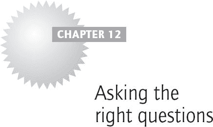

当我学习成为教练时，我的培训师告诉我，“问题就是答案”。销售也是如此。如果不收集信息，你就无法销售好，而如果不提问，就很难收集信息。然而，根据销售职业培训学院的一项研究，销售人员通常花太多时间进行推销，而花不够时间提出正确的问题，以便发现潜在客户/买家的真正担忧和问题，以及他们需要按下的热点按钮来促使某人购买。

‘用问题而非答案来评判他人。’——伏尔泰，法国作家和哲学家

那么，提出正确的问题有什么好处呢？

通过提出正确的问题，你将展现出自己感兴趣，而非专注于达成交易。这将增加潜在客户/买家敞开心扉并开始建立融洽关系的可能性。

你将识别出什么真正重要，以及你可以帮助解决的核心问题是什么。

这让你拥有一定的控制权。

它创造了动力，而动力是每次销售对话的核心目标之一。

问题能鼓励情感投入。

## 提出正确的问题

以下七项核心原则将指导你提出正确的问题：

### 1 以好奇的态度开始

任何习惯于咨询式方法的销售人员都会自然地使用问题。提出明智的问题源于好奇的态度。想想看——你正在进行一场关于信息的“探索”。有孩子的人都知道，如果他们对某事物感到好奇，他们会很自然地提出问题。

好奇心具有感染力。你很快就会发现，你正在影响的人会对自己的情况产生好奇！

“重要的是不要停止提问。好奇心有其存在的理由。”——阿尔伯特·爱因斯坦，德国物理学家

### 2 为你的问题设定明确的目标

问问自己：我通过提问想要实现什么？这可以避免提出不必要或随意的问题。

### 3 让对话自然流动

良好的提问技巧并不意味着你成为审讯者。避免使用“剪贴板式”的方法。

### 4 同时使用开放式问题和封闭式问题

开放式问题以 who、why、what、how、where 和 when 开头。

封闭式问题引出是/否的回答。

我们没有任何证据表明开放式问题在促成交易方面更成功。然而，你很可能会先用开放式问题来获取信息，并且在典型的销售对话中会有更多的开放式问题。使用封闭式问题来进行澄清和达成一致。

### 5 让你的问题易于理解

我听过许多销售问题，坦率地说难以理解。有时人们会提出多个问题，或者提出问题后自己回答，或者提出与正在讨论的内容没有实际关联的问题。让销售问题易于理解——通常简单的问题最有力。例如：

*   你想要什么？
*   你的关键优先事项是什么？
*   什么真正能带来改变？
*   对你有效的是什么？

### 6 提出有助于你锁定主导购买动机的问题

购买动机和具体需求并不总是相同的。购买动机关乎欲望和感受——它们更具情感性和无形性。

你可以通过提出简单的问题来了解是什么激励你的买家——他们想要什么，例如：“你过去购买过哪些类似的产品或服务？”你获得的知识将告诉你应该强调哪些利益点。

### 7 避免冒犯你的买家！

有些问题可能会冒犯潜在客户，导致他们拒绝你和你的想法。

避免引导性或“设局”式的问题，例如，“你确实希望你的孩子有公平的机会，不是吗？”潜在客户会怎么说？“不！世界很艰难——让他们自生自灭吧！”

爱管闲事、八卦或过于私人化的问题会让人非常反感。专注于业务！

有时你的态度可能会令人感到威胁。与其问“你想花多少钱？”，不如表述为“你计划投资多少？”。

## 聚焦问题

“如果你在销售（或生活中）没有向你想要的东西靠近，那你可能没有足够地提问。”——杰克·坎菲尔德，美国励志自助作家和成功教练

那么——哪些提问领域最有用？研究表明，如果你将提问集中在以下九个领域，你将产生最大的影响：

### 1 需求和欲望

这绝对是销售人员角色的核心。阅读第 4 部分的章节“识别潜在客户想要和需要什么”，以了解更多关于引出需求和欲望的具体问题。

### 2 要求买家提供选择标准

在销售中，这往往被回避，所以主动出击，找出你的联系人目前正在与谁打交道，以及他们可能还在考虑谁。这将引出买家的标准和价值观，并帮助你将你的服务/产品与组织想要的东西保持一致。

你越能将买家的价值观与你在服务和交付方面能提供的东西保持一致，你就越有可能建立长期关系。我曾经有一位同事，他更加直率。他过去常问：“我能做什么来赢得你的业务？”。

“销售”在含义上与“服务”密切相关。我们的一位客户索 odex 的创始人，将整个战略建立在“尊严在于为他人服务”的格言上。除非你知道他们喜欢如何被服务，否则你如何能“为他人服务”？

以下是你可以考虑的一些问题：

*   在你与供应商的商业关系中，什么很重要？
*   你如何选择当前的供应商？
*   你如何决定与谁开展业务？
*   你在销售人员身上真正看重什么？

思考你自己的销售情境。还有哪些问题对你会很有效？

### 3 选项

了解你的买家正在考虑哪些选项。如果他们仍处于选项阶段，你可以影响他们的决策。

以下是你可以考虑的一些问题：

*   你在寻找什么样的选项？
*   我们面对的是谁？
*   关于这个决定，你还会和谁交谈？
*   你一直在考虑什么？

思考你自己的销售情境。还有哪些问题对你会很有效？

### 4 你的服务/产品

你需要衡量对你的服务/产品的反应，以了解买家是否可能购买，以及他们需要更多什么信息来做出决定。

以下是你可以考虑的一些问题：

*   你对这个产品/服务的期望/要求是什么？
*   你在市场上看到过什么你特别不喜欢的东西吗？
*   你现在需要进一步的什么信息？
*   如果你决定继续，这会带来什么样的后果？

思考你自己的销售情境。还有哪些问题对你会很有效？

### 5 人员

通常，组织的购买决策会影响许多人。我们在 Brilliant Selling（[www.brilliant-selling.com](http://www.brilliant-selling.com)）销售培训、辅导和咨询服务，任何决定使用我们的人可能涉及销售、人力资源、运营、营销、高级管理层和董事会。

以下是你可以考虑的一些问题：

*   如果我们进入下一阶段，谁会参与？
*   如果你决定采用这个产品/服务，人们的角色会如何变化？
*   谁会参与推出？
*   推进这件事可能会遇到什么障碍？

思考你自己的销售情境。还有哪些问题对你会很有效？

### 6 决策

我记得我曾与某人进行过三次会议，投入了大量时间和精力在机会上，之后才发现此人不是决策者。你有没有做过类似的事情？了解决策过程是什么以及谁参与其中。这将使你能够集中精力。

以下是你可以考虑的一些问题：

*   你能告诉我关于你的决策过程的情况吗？
*   企业内的关键决策者是谁？
*   我们如何在内部支持你？
*   这在高管层面获得了多少支持？

思考你自己的销售场景。还有哪些问题适合你，能够取得良好效果？

#### 7 预算

你的产品或服务可能有预算，也可能没有。了解已预算的金额及其时间表非常有帮助。在资格审查阶段，评估潜在客户处于购买周期的哪个阶段。许多销售人员忽视客户的购买周期，只是强制执行僵化的销售周期，然后纳闷为什么失败。如果客户有可用预算并且准备立即购买，那么就不要问不必要的问题。直接达成交易。

我们曾经能够与一个组织（后来成为关键客户）达成一笔交易，他们使用了明年的预算，而我们在稍后日期向他们开具发票。他们很感激我们的灵活性！

以下是你可以考虑的一些问题：

*   你如何处理预算考量？

*   你考虑的价格范围是多少？

*   谁来支付这笔费用？

*   项目资金将如何证明其合理性？

思考你自己的销售场景。还有哪些问题适合你，能够取得良好效果？

#### 8 动力/资格审查

销售人员有时会花太多时间与潜在客户交谈，而这些潜在客户购买的希望很小，也没有动力。提出资格审查问题，以确定这个机会是否值得追求。

以下是你可以考虑的一些问题：

*   你认为下一步行动是什么？

*   你实施/购买此类服务/产品的时间表是什么？

*   你在这个领域有哪些限制条件？

*   在我们继续推进之前，还需要讨论哪些进一步的信息？

思考你自己的销售场景。还有哪些问题适合你，能够取得良好效果？

#### 9 扩展关系

当然，当潜在客户成为客户后，提问并不会停止。继续提问。如果他们对你和你的服务感到非常满意，那么就提出能让你扩展关系或进行交叉销售的问题。或者请他们为你提供推荐——如果他们喜欢产品/服务并且喜欢你，他们会很乐意这样做！在感激曲线的高峰期请求推荐——当他们认为你很棒并且提供了出色服务时，或者当他们正在体验你的产品带来的好处时。

以下是你可以考虑的一些问题：

*   你目前或未来在业务方面还希望解决哪些其他问题？

*   业务内还有哪些其他机会？

*   了解我们还提供哪些其他产品对你有帮助吗？

*   你在商业圈里还认识谁可能会喜欢我们所提供的产品？

思考你自己的销售场景。还有哪些问题适合你，能够取得良好效果？

因此，这不仅仅是为了套出答案而随意提问。卓越销售需要在正确的时间、向正确的人提出正确的问题。成功的销售人员在这个领域使用的技能与顶尖商业教练相似——他们提出能够：

*   易于理解且合乎逻辑；

*   帮助买家获得清晰认识；

*   并建立动力。

在未来的每次销售会议之前，花些时间问问自己哪些问题最合适。请注意，问题是深入了解你想要影响的人的关键。本节的关键点是：

*   有七个原则——保持好奇心，设定目标，让对话自然流动，使用开放式问题和封闭式问题，使你的问题易于理解，识别动机，避免冒犯你的买家。

*   提出有针对性的问题，以识别需求和愿望、选择标准、选项、对你产品/服务的反应、涉及的人员、决策过程、预算、资格审查以及如何扩展关系。

当然，提问只是其中一半。如果你不能很好地倾听，那么你就会削弱关系，并无法将客户带入下一个阶段……

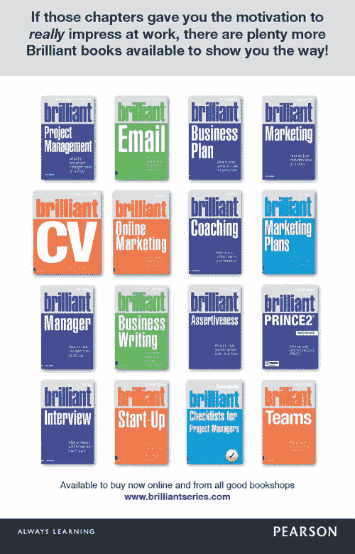

Pearson Education Limited

Edinburgh Gate

Harlow CM20 2JE

United Kingdom

Tel: +44 (0)1279 623623

Web: [www.pearson.com/uk](http://www.pearson.com/uk)

第 3 章：常见思维陷阱——以及如何避免，摘自《卓越认知行为疗法》第 2 版，作者 Stephen Briers 博士，2012 年出版（ISBN 9780273777731）。

© Stephen Briers 2009, 2012

第 4 章：用思考让自己感觉良好，摘自《卓越 NLP》第 3 版，作者 David Molden 和 Pat Hutchinson，2012 年出版（ISBN 9780273778738）。

© Pearson Education Limited 2002, 2011

第 10 章：肢体语言与吸引力，摘自《卓越肢体语言》，作者 Max A. Eggert，2010 年出版（ISBN 9780273740742）。

© Pearson Education Limited 2010

第 8 章：家庭与工作中的自信，摘自《卓越自信》第 2 版，作者 Mike McClement，2012 年出版（ISBN 9781447929598）。

© Pearson Education Limited 2010, 2012

第 8 章：数字与姓名，摘自《卓越记忆训练》，作者 Jonathan Hancock，2011 年出版（ISBN 9780273745815）。

© Pearson Education Limited 2011

第 9 章：你的阿喀琉斯之踵，摘自《卓越应对艰难面试问题》第 4 版，作者 Susan Hodgson，2011 年出版（ISBN 9780273743897）。

© Pearson Education Limited 2002, 2011

第 4 章：讨价还价，摘自《卓越谈判》第 2 版，作者 Nic Peeling，2011 年出版（ISBN 9780273743248）。

© Nic Peeling 2008, 2011

第 10 章：精彩表现，摘自《卓越演示》第 3 版，作者 Richard Hall，2011 年出版（ISBN 9780273762461）。

© Pearson Education Limited 2007, 2008, 2011

第 15 章：交谈的艺术，摘自《卓越社交》第 2 版，作者 Steven D’Souza，2011 年出版（ISBN 9780273743217）。

© Pearson Education Limited 2008, 2011

第 12 章：提出正确的问题，摘自《卓越销售》第 2 版，作者 Jeremy Cassell 和 Tom Bird，2012 年出版（ISBN 9780273771203）。

© Pearson Education Limited 2012

本汇编 © Pearson Education Limited 2013

Stephen Briers 博士、David Molden、Pat Hutchinson、Max A. Eggert、Mike McClement、Jonathan Hancock、Susan Hodgson、Nic Peeling、Richard Hall、Steven D’Souza、Jeremy Cassell 和 Tom Bird 作为本作品作者的权利，已根据 1988 年《版权、设计和专利法》由其主张。

本电子出版物受版权保护，未经出版商书面特别许可，不得以任何方式复制、再版、转让、分发、出租、授权、公开表演或使用，除非根据购买条款和条件允许，或适用版权法严格允许。未经授权分发或使用本文可能直接侵犯作者和出版商的权利，相关责任人可能因此承担法律责任。

所有在此处使用的商标均为其各自所有者的财产。在本文中使用任何商标，均不会使作者或出版者获得此类商标的所有权，也不暗示此类所有者与本书有任何关联或认可本书。

Pearson Education 对第三方互联网网站的内容不承担任何责任。

ISBN `978-0-273-78988-8` (ePub)

`10 9 8 7 6 5 4 3 2 1`

请注意，任何页面交叉引用均指印刷版。

