# TIME 网络安全：黑客攻击、暗网与你

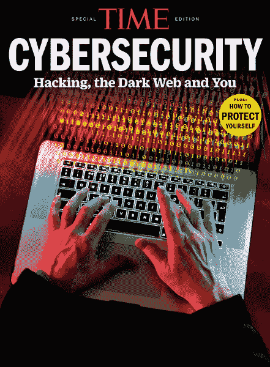

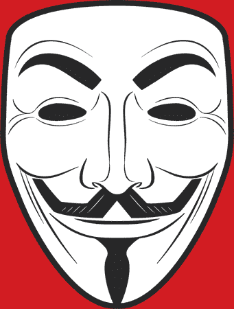

 想要更多独一无二的《时代》特刊和纪念品，请访问 [timespecialeditions.com](https://timespecialeditions.com)

# 我们的不安全时代

技术的黑暗时代正在

作者：ROBERT HACKETT

互联网的基础于 1967 年由`RAND`公司、`美国国防部`的`Arpanet`以及`国家安全局`奠定。在这篇论文中，`Ware`警告说互联网将变得黑暗。

等一下，互联网的 ` ` ` ` ` ` ` ` ` ` ` ` ` ` ` ` ` ` ` ` ` ` ` ` ` ` ` ` ` ` ` ` ` ` ` ` ` ` `。

半个世纪后，`Ware`预言互联网将无处不在。在这种情况下，`Ware`的预言中了。

本书旨在让你理解如何在充满骗术与互联的时代中生存。诚然，攻击与防御手段在不断演变和适应。沃尔（Ware）在几十年前的未来主义宣言中曾预见地写道：“计算机将以每种方式触及每个人、每个地方，几乎每分钟发生一次，”他预言道，“无论人们做什么，都会通过计算机进行通信。它将改变并重塑他的生活，修改他的职业，并迫使他接受持续变化的生活。”

即使在那种变动不中，我们希望这本书能揭示在这场关于控制权、影响力和霸权的持续斗争中涉及的永恒元素。正如科幻小说巨匠亚瑟·C·克拉克所写，如果任何足够先进的技术与魔法无异，那么这些页面就旨在为这些巫师们拉开帷幕。

## 网络攻击和泄露事件频频上新闻

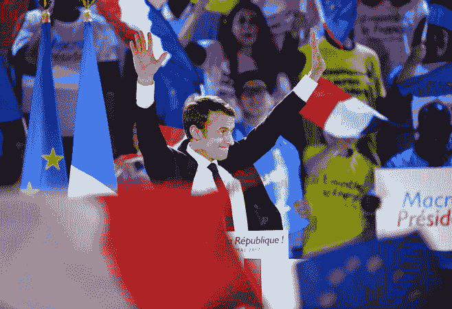

### 黑客行动 (LE HACK)

时任候选人埃马纽埃尔·马克龙在 5 月的一次集会上。几天后，美国国家安全局局长迈克尔·罗杰斯指责俄罗斯试图通过针对性攻击影响法国选举。马克龙的政党表示他们是一场“大规模、协同性”攻击的受害者，尽管这并未影响结果。

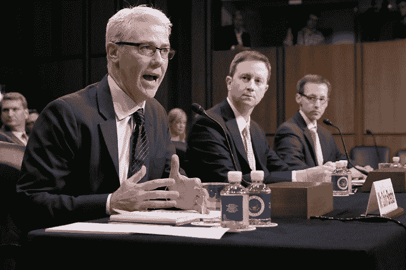

### 暴风中心 (HOT SEAT)

Facebook 总法顾问科林·斯特莱奇、推特代理总法顾问肖恩·埃格特以及谷歌执法与信息安全总监理查德·萨尔加于 10 月在参议院作证。争议焦点在于：有揭显示俄罗斯公司购买在线广告以影响美国 2016 年选举。

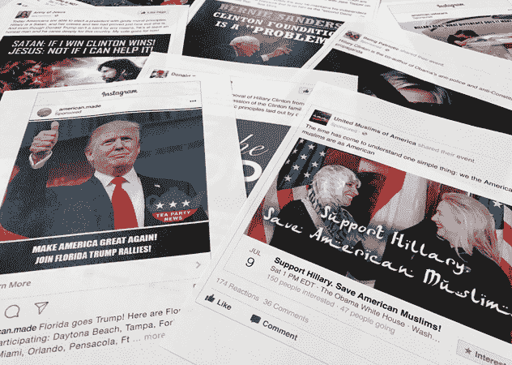

### 虚假新闻 (FAKE NEWS)

Facebook 和 Instagram 的广告与俄罗斯通过煽动分裂性的社会问题来破坏美国政治进程的努力有关。这些广告发布时，社交媒体公司正面临国会山的批评，质问他们为什么没有在对抗俄罗斯干预方面做得更多。

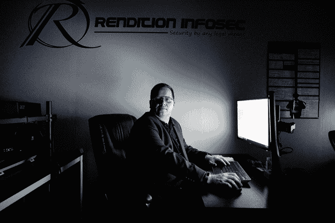

### NSA 内部危机 (TROUBLE AT NSA)

美国国家安全局黑客部队的前成员杰克·威廉姆斯被一个名为“影子经纪人”的组织针对。该机构网络武器的泄露损害了士气，减慢了情报行动，并导致了针对企业和平民的攻击攻击。

### 作者：埃里卡·弗莱 (ERIKA FRY)

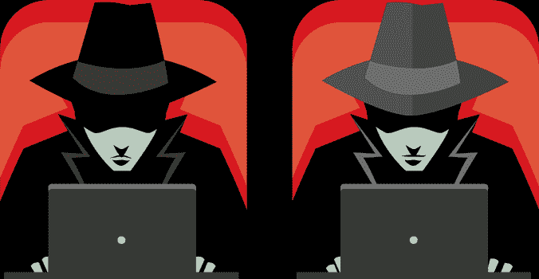

如果互联网有一个恒定不变，那就是在某处、以某种方式，有人正在被攻击。针对金融机构、跨国公司和政府的网络攻击已成为常态新闻头条。此外还有大量未被报道的攻击。2017 年波尼蒙研究所的一项调查发现，美国数据泄露的平均成本为 735 万美元，四家机构中就有一将在未来两年内面临涉及至少 10,000 条记录的攻击。安全分析师表示，首先要了解的是潜伏在阴影中的威胁类型。虽然许多黑客使用相对基础的工具，如钓鱼或恶意软件，但他们带有不同的动机使用这些工具。以下是六类最有效的成员：

#### 1. 国家支持的 (State-sponsored)

- **成员**: 中国、伊朗、以色列、俄罗斯、美国

- **目标**: 情报、国家机密、破坏

- **对象**: 外国政府、恐怖分子、行业

- **特征**: 多层次的、精密策划的攻击，可入侵计算机系统

- **经典案例**: 在`Stuxnet`之后，伊朗五分之一的核离心机崩溃，据报道这种由`U.S.`和以色列情报部门开发的蠕虫渗透了伊朗浓缩设施的计算机。据称，伊朗通过干扰`J.P. Morgan`、`PNC`、`Wells Fargo`等网站的访问进行报复。

#### 2. 黑客行动主义 (Hacktivist)

- **成员**: 匿名组织、AntiSec、LulzSec

- **目标**: 纠正感知中的错误、宣传、保护互联网自由

- **对象**: 欺凌者、科学教徒、公司、政府

- **特征**: 泄露敏感信息、公开羞辱、诡异的 YouTube 视频

- **经典案例**: 在“回击行动”期间，`PayPal`、`Visa`和`MasterCard`的网站遭到中断，这是由匿名组织领导的、旨在惩罚在 2010 年封禁`WikiLeaks`账户的公司。仅`PayPal`一家就损失了 560 万美元。

#### 3. 网络犯罪 (Cyber-criminal)

- **成员**: 尼日利亚“王子”、盗刷者、身份窃取者、垃圾邮件发送者

- **目标**: 财宝

- **对象**: 易信的人、在线购物者、小企业、数据丰富的实体

- **特征**: 窃取数据

- **经典案例**: 记录击键的恶意软件。通常第一步是发送虚假邮件的社会工程攻击。

#### 4. 内部人员（也称为：你）

- **成员**: 不满的员工、吹哨哨者

- **目标**: 结算旧账

- **对象**: 大公司、政府

- **特征**: 文档窃取

- **经典案例**: 澳大利亚阳光海岸沿线的马鲁奇郡（Maroochy Shire）曾被泵站淹没。

#### 5. 脚本小子 (Script Kiddie)

- **成员**: 无聊的青少年

- **目标**: 刺激、成名

- **对象**: 易于手的手的，如未受保护的网站

- **特征**: 篡改或拆解网站

- **经典案例**: 2001 年，一封主题为 LOVE YOU 的邮件欺骗了五角大楼内部的人员。

#### 6. 漏洞经纪人 (Vulnerability Broker)

- **成员**: Endgame, Netragard, Vupen

- **目标**: 将黑客作为合法业务

- **对象**: 无限制

- **特征**: 寻找零日漏洞

- **经典案例**: 法国公司`Vupen`在 2013 年的一次安全会议上破解了`Google 的 Chrome`浏览器。与其与公司分享技术并获得 6 万美元的奖励，`Vupen`将该漏洞卖给了出价更高的客户。

**黑帽 (black hat)**: 为了个人利益而进行黑客并在过程中从事非法活动的黑客。黑帽通常会将发现的安全漏洞出售给出价最高者。

**加密 (crypto)**: “密码学”的缩写，保持在线通信秘密的科学。

**暗网 (Dark Web)**:不受 Google 等搜索引擎索引且只能通过隐蔽访问的网站。暗网被那些希望交易保持纯匿名的人使用。也称为深网。

**分布式拒绝服务 (DDoS)**: “分布式拒绝服务”的缩写，一种日益流行的攻击类型，利用大量计算机来瘫痪网站或在线服务。

**信息安全 (infosec)**: “信息安全”的缩写。这些通常是负责防御机构受攻击的人员。

**越狱 (jailbreak)**: 绕过在设备（如索尼 PlayStation 或苹果 iPhone）中内置的安全措施以移除制造商限制的行为。越狱设备的目标通常是使其运行未经授权的软件。

**社会工程学 (social engineering)**: 通过欺骗内部人员交出权限以获取安全系统访问权限的行为。社会工程驱动攻击的第一步通常是发送看起来非常真实的虚假邮件，这种做法被称为钓鱼（phishing）。

**破解软件 (warez)**: 通过 BitTorrent 和 Usenet 等技术分发的盗版软件。黑客可以通过在他们的破解软件中分发病毒来利用人们对免费软件的渴望。

白帽：一种目标是修补漏洞并保护安全系统的黑客。白帽黑客通常会将公司防御和软件中的弱点相关信息提供给公司本身，以便其进行修复。

互联网的构想曾是人类知识共享的乌托邦。然而，尽管它带来了许多益处，网络也滋生了从黑客到恐怖分子的各种坏分子。

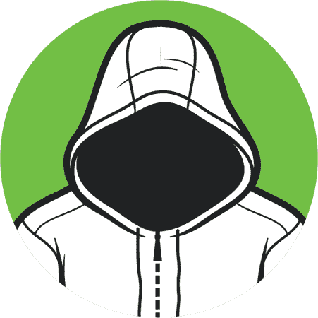

### 深网

大约 10 年前，政府建立了一个完全私密、匿名的网络。随后，它成为了毒品和儿童色情内容的避风港。作者：夫·格罗斯曼（Lev Grossman）和杰·纽顿-斯马尔（Jay Newton-Small）。

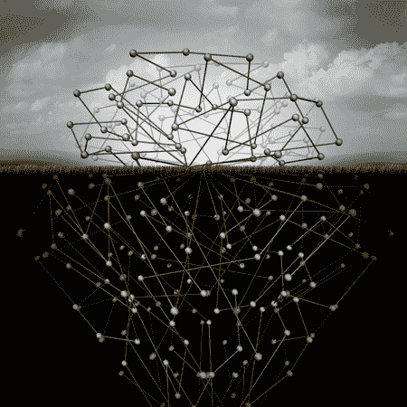

2013 年 10 月 1 日下午，一个高、消瘦、留着长发的男子离开了他位于金山市 15 道的家。他每月支付 1000 美元现金与两个室友合住，这两个室友只知道他是一个叫乔什·特里（Josh Terrey）的安静货币交易员。他的真名字是罗斯·乌尔布希特（Ross Ulbricht）。他今年 29 岁，没有犯罪记录。乌尔布希特穿着牛仔裤和红色 T 恤，前往格伦公园公共图书馆，走向科幻区并登录笔记本电脑——他正在使用免费 Wi-Fi。几名穿便服的 FBI 探员聚集在一起，将他推到窗户边，然后护送他离开建筑。

FBI 认为乌尔布希特是网络上被称为“恐惧海盗罗伯特”（Dread Pirate Roberts）的罪犯，这个名字源自书籍和电影《新娘传奇》。在现实生活中，这位“恐惧海盗罗伯特”是`丝绸之路`（Silk Road）的所有者和管理员。极其成功的在线市集，人们在那里买卖非法物品——主要是毒品，还有虚假身份证、烟花和黑客软件。他们可以这样做而不被发现，因为`丝绸之路`位于互联网一个不为人知的区域，即“深网”（`Deep Web`）。乌尔布希特在 2015 年因计算机黑客、洗钱和贩毒等等指控被定罪，目前在监狱中服从无期徒刑。

从技术上讲，`深网`指的是所有`Google`等搜索引擎未索引或无法索引的网站和数据库的集合，从信息总量来看，它比我们所知的网络大许多倍。但更宽泛地说，`深网`是互联网的一个特定分支，其特征是那种日益稀缺的商品：完全的匿名性。你在`深网`上所做的任何事情都无法与你的现实世界身份联系起来，除非你意愿如此。尽管大多数人从未见过它，但访问它所需的软件是免费的，且下载安装只需不到三分钟。如果说网格中有一部分可以被认为是脱离网的，那就是`深网`。

`深网`的存在有充分的理由。它是情报人员、执法部门、政治异见人士以及任何需要或想要私下处理在线事务的人的至关工具——而现在，越来越多的人都是如此。根据皮尤亚洲与美国生活项目在 2013 年发布的一项调查显示，86%的互联网用户尝试过删除或隐藏自己的数字历史，55%的人尝试避免被雇主或政府等特定方在网上监视。

但`深网`也是进行非法活动的理想场所，特别是当它像`丝绸之路`案那样，与匿名且几乎无法追踪的电子货币`比特币`（`Bitcoin`）结合时。“它让各种犯罪分子，在过去的时代必须寻找露天毒品市场或某个小巷来从事坏活动，现在可以公开进行，”普里特·巴哈拉（Preet Bharara）在 2013 年告诉《时代》杂志。他是纽约南部区的前美国检察官，他的办公室在 2015 年起诉了乌尔布希特。根据针对乌尔布希特的 39 页联邦起诉书，从 2011 年 1 月到 2013 年 9 月的 2.5 年里，`丝绸之路`充当了亚马逊式的非法物品清算中心，为全球近百万名客户提供了价值 12 亿美元的违禁品。“恐惧海盗罗伯特”，即`深网`世界的“杰夫·贝佐斯”（Jeff Bezos），据指控他收集了约 8000 万美元的费用。

大多数使用`深网`的人并不是犯罪分子。但一些检察官和政府机构认为，`丝绸之路`只是冰山一角，而`深网`是一个潜在的噩梦，是小偷、儿童色情制作者、人口贩子、伪造者、刺客以及国家机密和扩散核武器贩子的电子避风港。FBI、DEA、ATF 和 NSA（仅列举几个）正花费数千万美元试图弄清楚如何破解。这很讽刺，因为最初是美国军方建造了`深网`。

`深网`的故事是一个关于技术及其意之外后果的寓言。1996 年 5 月，三位来自美国海军研究实验室的科学家在英国剑桥的一的一个研讨会上发表了一篇题为“隐藏路由信息”的论文。该论文阐述了一种系统的技术特征，用户可以访问互联网而无需向在此过程中可能交互的任何 Web 服务器或路由器泄露身份。他们将自己的想法称为“洋葱路由”（onion routing），因为包裹并遮盖往回传输的数据周围有层层加密。到 2003 年 10 月，这个想法准备好作为一个开源项目发布到网络上，名为`Tor`。如果`深网`是一个面具舞会，`Tor`提供了面具。

在许多方面，`Tor`与其说是进步，不如说是回到过去。在互联网历史的大部分时间里，用户的在线形象与其真实身份联系松散，或者根本没有联系。互联网是一个人们可以创建新的、更流动的自我的地方。在 90 年代的大部分时间里，网络向人们承诺第二生命。但随着时间的推移，特别是`Facebook`的出现，我们的在线生活与现实自我紧密相连。现在无论我们走到哪里，都会辐射自己的信息——浏览历史、购买记录、视频品味、社交关系，甚至是地理位置。无处不在。

美国政府为什么要资助创建这样一个系统？有很多理由。警方可以利用它在线收集匿名举报、设置钓鱼行动并探索非法网站而不触引起所有者。军事和情报机构可以使用它进行秘密通信。国务院可以培训外国异见人士使用它。`Tor`目前由一家位于西雅图的非营利组织管理，并由`Google`和骑士基金会在内的各种组织资助。但根据 2017 年《卫报》的报告，直到 2015 年，仍有 120 万美元的资金来自美国政府。

`深网`的腐败从其建立后不久就开始了。早在 2006 年，一个后来被称为“农夫市场”（The Farmer’s Market）的网站就在出售大麻和氯酮等毒品。在 2012 年 4 月被 DEA 领导的团队摧毁之前，它已在 50 个州和 34 个国家建立了客户。`深网`不仅仅是毒品的来源：有证据表明圣战分子通过它进行通信，僵尸网络（垃圾邮件发送者利用的大型病毒计算机网络）利用它来躲避调查人员。即使现在，在`深网`上找到武器或儿童色情也只需要一两分钟。2013 年 8 月，FBI 关闭了自由托管（`Freedom Hosting`），这是一家专门经营深网的公司，指控它是“全球最大的儿童色情便利者”。其所有者现年 32 岁的里克·马奎斯（Eric Marques）正面临从爱尔兰引渡。

当 `Bitcoin` 在 2009 年出现时，它是一种完全全新的货币。它由一个被称为 `Satoshi Nakamoto` 的人作为一种财政思想实验引入，此人的真实身份仍然是一个谜。`Bitcoin` 既是一种支付系统，也是一种纯数字货币——它没有物理形态。`Bitcoin` 的价值由供需关系决定，并且只有在个人和公司同意交易它时才具有价值。

`Bitcoins` 属于一个对银行和政府的信任受到损害的时代。用户可以将它们从一个数字钱包转移到另一个，而无需银行进行交易撮合或收取费用。这种货币是完全去中心化的——其架构很大程度上归于 Napster 的继任者 `BitTorrent`——并基于复杂的密码学。`Bitcoin` 本质上是互联网的现金，几乎匿名且极难伪造。农夫市场（The Farmer’s Market）之所以脆弱，是因为它在现实世界中留下了财务轨迹。而丝绸之路没有。

和 `Tor` 一样，`Bitcoin` 的存在有完全合法的理由。据所知，它主要用于法律目的——现在有数十家企业接受 `Bitcoins`，包括 `Howard Johnson`、约会网站 `OKCupid` 以及至少一家纽约的酒吧。但 `Bitcoin` 的数字隐蔽性，在深层网（Deep Web）匿名性的加倍效应下，创造了一个现实世界或虚拟世界从未见过的潜在犯罪交易平台。这种潜力被 `Dread Pirate Roberts` 实现了。

`Ulbricht` 在德克萨斯州长大，曾是一名鹰军童军员，随后在德克萨斯州大学达拉斯分校学习物理学。他是同同为德克萨斯州人、自由意志主义者 `Ron Paul` 的粉丝；两人都研究奥地利学派以及该学派创始人 `Ludwig von Mises` 的著作，后者信奉不受限制的市场。`Ulbricht` 在宾夕法尼亚州立大学获得了材料科学与工程硕士学位。熟人描述他既聪明又守规。“他不是谈话的中心，也不是任何事情的中心，”一位自称在 2012 年与他有过短暂交往的朋友说道，“他有点是把自己置于背景中。”

在他毕业时，`Ulbricht`已经对互联网作为完善自由市场的场所这一想法产生了兴趣。根据他的 `LinkedIn` 资料，他最大的敌人是政府。“武力最广泛、系统性的使用存在于机构和政府之间，因此这是我目前努力的重点，”他写道，“然而，改变政府的最好方法是改变被统治者的思想。为了实现这一目标，我正在创建一个经济模拟系统，让人们亲身体验生活在一个没有系统性使用武力的世界里会是什么样。”

在 2009 年从宾夕法尼亚州立大学毕业后，`Ulbricht` 去了澳大利亚悉尼看他的姐姐。据称，正是在那里，他开始着后来成为丝绸之路的项目，并将自己转变为 `Dread Pirate Roberts`。那时，毒品贩已经活跃在深层网，但他们的业务往往因两个原因而失败：交交的资金是可以追溯的，而且很难与客户建立信任。`Roberts` 将解决这两个问题。`Tor` 和 `Bitcoin` 创造的双层匿名性使得资金几乎不可追溯。为了建立信任，`Roberts` 从两个合法商业的殿堂中寻求灵感：`Amazon` 和 `eBay`。

他学习很快。丝绸之路的用户描述了一种精良、功能齐全的体验，拥有买家和卖家的评论以及客户论坛。“在决定是否与某个供应商交易时，我会阅读他们页面上的反馈，以及几个月前的评级，”一位不愿具名的丝绸之路客户说，“我还会去论坛阅读卖家的评论贴帖，根据具体内容，我会去查看一个‘复仇者联盟’贴帖，那里丝绸之路社区的人会发布单个产品的实验室结果。”当交易真的出现问题时，有一套纠纷解决系统。“老实说，那里就像一家糖果店，”该用户说道。丝绸之路于 2011 年 1 月上线。它的存在几乎没有被保密——既然`Tor`让匿名进出成为可能，又何必费事呢？隐藏只会对生意不利。“这基本上是对比执法部门的公开挑衅，”`Bharara`在 2013 年接受《时代》杂志采访时说道。

## 调查与逮捕

FBI 在 2011 年 10 月首次窥探了`Ross Ulbricht`。一个名为`altoid`的人一直在各种聊天群中推广丝绸之路；根据针对`Ulbricht`的起诉书，随后在一个`Bitcoin`论坛上，`altoid`发布了一则广告，为一家“风险投资支持的比特币初创公司”寻找一位“比特币社区的 IT 专家”。`Ulbricht`列出了他的真实邮箱地址作为申请该职位的联系方式。

`Ulbricht`的真实邮箱地址是该职位的联系方式。FBI 从`Google`获取了记录，显示`Ulbricht`在旧金山的一家咖啡馆访问丝绸之路。与`Ludwig Mises Institute`关联的`Google`账户显示了一个对应旧金山的 IP 地址。`Ulbricht`匆忙更改了他的用户 ID（改为`frosty`），但损害已经造成：那段代码同样出现在丝绸之路网站的代码中。

根据 FBI 探员`Christopher Tarbell`的证词，加拿大的丝绸之路用户开始勒索`Roberts`，威胁要泄露客户信息。`Roberts`的回应是支付给网友`redandwhite` 15 万`Bitcoin`以杀掉那个勒索者。（`Roberts`也收到了那次杀人的照片，但加拿大警方无法将其与已知的任何案件匹配。）2013 年 6 月，`Roberts`向`redandwhite`订了一套假身份证。当月晚些时候，海关打开了一个从加拿大寄来的包裹，里面有九张带有`Ulbricht`照片和出生日期的假身份证。该包裹还提供了`Ulbricht`的地址。

收网行动迅速收紧。到 7 月，FBI 黑客追踪到了丝绸之路的一台服务器，位于一个尚未公布的国家，这让他们获取了`Roberts`所有的邮件副本，以及从网站启动开始的交易记录。2013 年 7 月 26 日，国土安全部的探员敲响了`Ulbricht`的门。他承认自己一直用假名生活。

当局在 7 月 31 日获得了另一个突破，他们搜查了一名西雅图毒品贩的公寓，该贩子通过丝绸之路以代号`Nod`甲基冰碱、古柯因和海洛；他们迅速将其转为线人。10 月 1 日，在首次发现他后的两年后，联邦探员跟随`Ulbricht`到了格伦公园图书馆并将其逮捕。FBI 表示，在他在电脑屏幕上显示证据时抓获了他的现行证据。

华盛顿许多人感到困扰，仅仅为了关闭一个由假冒沃尔特·怀特式人物运行的非法网站，就花费了如此多的时间和精力。`FBI`正在使用静态且往往已经过时的法律来监管不断演变的互联网。规范执法部门搜查程序并被称为`CALEA`的《执法协助通信法案》于 1994 年通过。

暂且不把如`Tor`等专业工具不谈，还有许多主流技术可供犯罪分子隐藏其活动，范围从卫星电话到`Apple iMessage`。加密消息服务`Facebook Messenger`和`WhatsApp`（同样归`Facebook`所有）在 2017 年年中期分别拥有 13 亿月活跃用户，成为全球范围内最受欢迎的两个移动应用程序之一。但监管的滞后导致了承诺用户隐私的科技公司与希望追捕犯罪犯的执法部门之间产生了分歧。

在 2015 年 12 月加利福尼亚州圣贝纳迪诺发生 14 人死亡的恐怖袭击后，当`FBI`要求`Apple`解锁嫌疑人的加密`iPhone`时，`Apple`坚决表示反对。最终，`FBI`放弃了请求，转而聘请外部专家破解该设备。同样在 2015 年，`Arkansas`州警方请求`Amazon`帮助他们访问一个`Echo`智能音箱的数据，他们认为该设备可能含有一起潜在谋杀案的证据。`Amazon`一直拒绝，直到嫌疑人给予许可。这起谋杀案最终被撤销。

`特朗普`时代的立法者尚未制定更清晰的路线图。总统在 2017 年 4 月签署了一项法案，废除了`联邦通信委员会`规则，该规则要求宽带公司在收集和共享浏览信息等敏感数据时必须获得客户许可。`FCC`主席`Ajit Pai`曾争议地声称，他扭转当前网络中立政策（即互联网服务提供商应平等对待所有互联网数据的概念）的计划将“让联邦政府最丰富的隐私警察——`FTC`[`联邦贸易委员会`]重回岗位，以保护消费者的在线隐私。”并在 2018 年，美国最高法院可能会对一个涉及手机地理位置隐私的《第四修正案》案件做出裁决。

`Ross Ulbricht`的入狱引发了对疑似`Deep Web`毒贩的逮捕潮。2013 年晚些时候，瑞典警方逮捕了两名指控通过`Silk Road`销售大麻的男子，另外四名男子在同一日在`U.K.`因毒品罪被捕。英国`国家犯罪局`前负责人`Keith Bristow`在 2013 年接受`TIME`采访时表示：“这些逮捕向犯罪分子传了一个明确的信号。隐藏的互联网并不隐藏，你们的匿名活动并不匿名。我们知道你在哪里，在做什么，我们会抓住你。”

这是否真实并不完全清楚。在泄露有关`国家安全局`全球监控实践的信息的前`CIA`员工`Edward Snowden`所泄露的文件中，有一份日期为 2012 年 6 月、标题为“`Tor`糟透了’”的`NSA`演示文稿。它描述了`NSA`在破解`Tor`时面临的困难，并明确指出：“我们永远无法对所有`Tor`用户随时去匿名。”`Ulbricht`创建的`Deep Web`模板在技术上仍然是可靠的。正如一位前`Silk Road`用户所说：“尘埃落定了，大家都像是在说‘噢，好吧，是时候再订点药了’。我们都知道这会发生。”在`Silk Road`灭亡后不久，基于旧网站备份版本重建的名为`Silk Road 2.0`的网站上线。2014 年 11 月，它再次被执法部门突然关闭。

`Tor`本身处于一种奇特的境地：它一方面由联邦政府的部分部门（包括`国务院`和`国防部`）资助，而另一些部门（`FBI`和`NSA`）却在试图破解它。但直接参与此案件的执法官员也赶紧澄清，他们并没有将`Silk Road`归咎于技术本身。`Bharara`在 2013 年告诉`TIME`时：“互联网上的匿名性本身没有问题。某些类型的货币（如`Bitcoins`）本身也没有问题。就像现金本身没有问题一样。但事实是……它也允许了毒品贸易的繁荣。它允许洗钱发生。它允许雇佣杀杀发生。”

可以确定的是，对`Tor`或类似工具的需求并不会消失。互联网正变成一个日益缺乏隐私的地方，数十亿美元的商业计划正建立在公司观察并贪婪收割消费者行为的每一个点滴之上。越来越多地，这需要消费者自己来界定界限。

Jefts 是一位 30 多岁的深思学者，她是芝加哥某大学的档案管理员和艺术史学家，她从未想过自己的裸体照片会在互联网上传传。但 2011 年，在 Jefts 与一位住在意大利的男友结束异地恋后不久，他们`Skype`对话的露骨截图开始在网上出现。这些截图被发送给她的家人和朋友，发布在`Facebook`上并伴随着对她的暴力威胁，甚至出现在专门揭露他人性传播疾病的网站上，并对她的性史做出了虚假指控。

Jefts 所的经历有一个专门的名称，这是一种数字性犯罪，颠覆了成千上万的人生，但大多数仍然逃法执法部门的监管：非自愿色情，广为人知的报复性色情。两者并不完全：报复性色情通常是为了骚扰受害者，而任何在未经主体同意的情况下传播的图像都属于非自愿色情。但两者都可能导致公众性贬低、社会孤立和职业羞辱。

在技术和文化剧变的推动下，这种变化让每个口袋里都有摄像头，并为每条社交媒体帖子创造了全球观众，非自愿色情变得日益普遍。几乎每天都有新案例报道：德克萨斯州一名 19 岁的女性在情男友威胁要发布她的露骨视频后，被勒迫与另外三个青少年发生性。该男子承认威胁泄露亲密视觉材料罪名成立，被罚款 400 美元并判处缓刑。新泽西州一名 20 多岁的女性在在前男友发布了她的照片和地址并邀请人们“来约会”后，有奇怪的男人来她的门口。犯人被指控侵犯隐私，并被判处六个月监禁并执行了三个月。伊利诺伊州一位 50 多岁的学校学监被解雇，据称她的前丈夫将她的一段露骨视频给了校委会。

其中一些私人照片和视频会流向色情网站，在那里，“报复”本身就是一种类型。然而，它们通常被发布在社交媒体上，受害者的所有朋友都能看到。根据`The 卫报`获取的文件，`Facebook`仅 2017 年 1 月就收到了超过 51,000 份报复色情报告，导致该网站禁用了超过 14,000 个账号。`Data and Society`杂志对 3,000 名网络用户进行的 2016 年调查显示，大约 25 个美国人中有一人曾被未经许可发布照片或被威胁要这样做——对于 30 岁以下的女性，这一数字上升到 10 分之一。反报复色情倡导组织`Cyber Civil Rights Initiative`(`CCRI`)在`Facebook`月的一项调查显示，20 名社交媒体用户中有一人发布过未经同意的性图像。

在某些情况下，犯罪者是针对知名女性的黑客，寻找可以泄露的敏感照片。去年，《周六夜现场》明星 Leslie Jones 被黑客，她的裸照在网上流传。2014 年，詹妮弗·劳伦斯和其他女星的裸照被破解并泄露，这是迄今最大的非自愿色情案件之一。而且这是一个全球几乎每个地方存在的问题：2017 年 5 月，卢旺达总统候选人 Diane Shima Rwigara 在宣布打算挑战该国长期领导人 Paul Kagame 几天后，据称她的裸照出现在了网上。

（此处内容为原文中重复的“Sexual violation”，已根据要求未进行重复输出）

“我从未想过这种违规行为会发生在普通人身上，”Jacobs 说道，她最初将照片发给了一个她认识并信任的人。“我没有意识到，非自愿裸照竟然存在这样一个市场。”

Jacobs 表示，她被诊断出抑郁症和创伤后应激障碍（PTSD），并开始害怕见到新人，担心他们会发现那些照片。“这是一场生活的噩梦，”她说。“我一直被警察、律师和 FBI 拒绝，因为他们一直无能为力。”

现在 30 多岁的 Jacobs 最终通过更改法律姓名来逃避网络足迹。但她也决定反击。她创立了`CCRI`，一家致力于帮助非自愿色情受害者恢复身份的非营组织。自 2014 年推出热线以来，已有 5000 多名受害者拨打了`CCRI`，Jacobs 说，该小组现在每月收到 150 到 200 个电话。“犯罪者的意图其实并不重要。无论是为了钱还是为了钱，都在毁另一个人的生活。”

许多受害者认为在网上看到自己的裸照的那一刻是遭遇中最糟糕的部分。然后他们开始与老板进行尴尬的谈话，面对社交媒体帖子并遭受同事们异样的眼光。知道谁看了你的照片以及他们如何看待你，变得是不可能的。当这些受害者开始尝试删除照片时，他们意识到了更糟糕的事情：这种违规行为会留下几乎无法完全消除的数字污点。

“一旦图像和视频曝光或发布，互联网就是永久的，”风险评估公司`GreyCastle Security`的执行官 Reg Harnish 说，他曾与 Kara Jefts 合作删除了她的大部分照片。但即使你从一个网站删除了图像，也没有办法保证它没有被复制、截图或存储在某个缓存中。“从互联网上删除特定内容有成百上千种障碍，”他说，“这几乎是不可能的。”

随着执法部门的回应反复不定，科技公司开始应对日益增长的压力以解决这个问题。根据《1996 年通信尊严法案》（Communications Decency Act），`Google`和`Facebook`等平台不对其托管的内容负责，这意味着它们对网络上的非自愿色情内容不承担法律责任。但在用户请求如潮后，几家主要网站已经制定了新政策来帮助打击复仇色情。2015 年，流媒体网站`Pornhub`让受害者更容易要求从其网站删除非自愿内容，`Google`也同意从其搜索结果中移除投诉者的图像。`Twitter`和`Reddit`也更新了规则禁止非自愿色情。2017 年 4 月，`Facebook`发布了一个工具，允许用户标记他们认为未经许可分享的内容；公司技术人员随后会检查内容是否出现在网络其他地方，以防止其进一步传播。但这种方法需要大量的人力，因为非自愿色情很难识别。与肉眼就能发现儿童色情不同，未经许可发布的图像看起来并不自愿不同。

这个问题在几乎每个层面都令人困扰：个人、法律和技术。当律师在起诉、立法者在辩论时，数百万张照片仍在那里流传、倍增，等待着毁掉别人的生活。

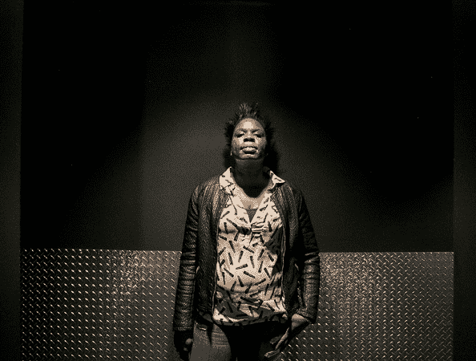

SNL 的 Leslie Jones（上），以及后续照片中的球星 Hope Solo 和演员 Jennifer Lawrence 都被黑客攻击过。

“这些是我认为这是一段自愿的私人关系时拍摄的。它们分享的背景改变了它们的意义。”

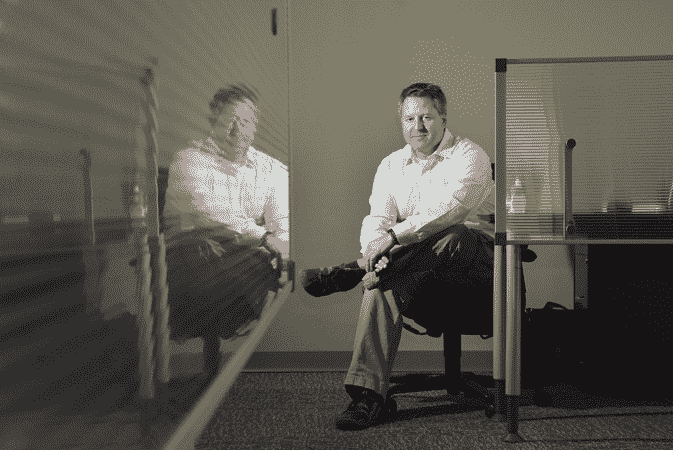

风险评估公司`GreyCastle Security`执行官 REG HARNISH

**4 分之 1**

在对近 6000 名单身成年人的调查中，表示收到过性照片的男性比例。

**23%**

在收到裸照的人中，报告将其转给他人的百分比；男性传播照片的概率是女性的两倍。

性犯罪在物理世界发生时可能很难起诉——而当犯罪发生在网上时，正义变得更难获得。在文化态度、技术障碍和法律不一致性之间，非自愿色情受害者面临着充满挑战的救济之路。

许多复仇色情受害者因感到羞耻而不敢露面。受害者指责无处不在，许多朋友、家人甚至警察人员的第一反应是问为什么当初会拍摄和发送裸照。网络民权利倡议（Cyber Civil Rights Initiative）创始人 Holly Jacobs 回忆起自己的经历时说，人们会问：“你怎么能分享那些照片的？”

极少数当地执法机构对复仇色情的影响有深入的理解，也拥有处理它的技术工具。即使他们认真对待这项犯罪，在许多情况下，当地警察也有效收集数字证据。

虽然现在有 38 个州制定了针对复仇色情的法律，但这些法律采用的标准不一。与受害者和犯罪者有物理接触的犯罪不同，非自愿色情可以跨州传播，导致管辖权和法律的交织。

一旦图像出现在互联网上，就几乎无法删除，”风险评估公司`GreyCastle Security`的执行官 Reg Harnish 说。“即使许多社交媒体平台和色情网站在移除未经许可分享的内容方面变得更加合作，但也没有办法保证这些照片没有出现在互联网的其他地方。”

2016 年，黑客让漏洞成为常态，并直指民主本身。作者：MATT VELLA

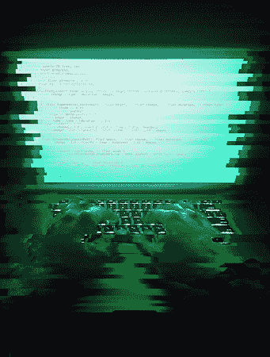

黑客似乎到处都是坏名，除了硅谷，因为硅谷是建立在通过任何手段创造性克服技术限制的优德之上。这种传统产生了比尔·盖茨、史蒂夫·沃兹尼亚克和马克·扎克伯格等人物，后者在 2012 年`Facebook`首次上市前夕对这个词的“不公平的负面含义”表示遗憾。他写道，“黑客意味着快速构建某些东西或测试可以做的边界。就像大多数事物一样，它可以被用于善，也可以用于恶。”

黑客曾通过远程控制数以百万计的联网 get 设备（如婴儿监视器和数字视频录像机），释放大量虚假流量，阻断了数百万美国人访问互联网一天。在感恩节假期周末，据称由于一名 IT 管理员点击了恶意邮件中嵌入的一个错误链接，黑客关闭了旧金山的市交通铁路。

2016 年，黑客将目标指向了美国民主制度本身。总统竞选活动依靠在系列复杂的数字入侵中窃取的泄露文件和电子邮件维持运转。尽管没有迹象表明 1.28 亿美国大选民在 11 月 8 日投票时使用的机器没有遭到攻破解，但“它们可能被攻破解吗？”这一问题被反复且令人信服地提出。这或许正是其全部目的。在一个每一张选票都应该被计入的国家，过去 12 个月的教训是：几行恶意代码所破解的远不止是一个计算机系统。

## 他们是谁？

正如唐纳德·特朗普在第一次总统大辩论中所说的，“一个坐在床上、体重 400 磅的家伙，”他似乎忘记了那件黑色连帽衫？还是坐在无窗房间里、为国家服务的眼神死死的无人机？

正如近年来安全研究人员所展示的，事实既更具恶意性，也更平庸。他们既有好的，也有坏的，还有中间各种道德上模糊的灰色地。有受国家或恐怖组织赞助的。有自由斗士、真理捍卫者、无政府主义者、爱好者。有犯罪头目，是的，甚至还有普通的打工者。2016 年对美国、英国和德国的 1 万名黑客进行的一项调查显示，黑客攻击的平均年薪为 28,744 美元。

当黑客在 2016 年 2 月劫持整个洛杉矶某医院的人质时，要求恢复员工访问电子邮件和患者电子健康记录的赎金仅为 17,000 美元。对于希望取回被劫持信息的个人，2017 年的平均赎金要求为 544 美元，几乎是 2015 年平均水平的两倍。这些数字非常惊人：FBI 估计，勒索软件（感染计算机或网络并扣留数据直到支付费用的程序）今年将为犯罪分子带来 10 亿美元的收益。

企业从黑客攻击中损失可能得多——根据英国保险公司劳德（Lloyd’s）的数据，全球损失至少达 4000 亿美元，尽管这个估计显然偏低。由于黑客攻击的半衰期比传统犯罪得多，今年最大的泄密事件可能尚未浮现。正是这种不确定性滋养了蓬勃发展的网络防御、网络取证和网络保险行业，预计到本世纪末，这些行业的年价值将接近 2000 亿美元。

然而，核心问题不是钱，而是脆弱性和不确定性。考虑史斯蠕（`Stuxnet`），这是以色列和美国情报部门九年前联合开发的用于感染伊朗核程序的计算机病毒。它的主要意图不是破坏实验室设备，而是为了破坏伊朗的信心。一位美国参与者在 2012 年告诉《纽约时报》：“意图是让这些失败让他们觉得自己很愚蠢。”在某种程度上，即使你不是在伊朗制造离心机，不是在经营大型好莱坞制片厂或发送裸自拍，所有的黑客对你都拥有同样的力量：羞辱。

## 政治影响

民主党遭受的最为严重。在自水门事件以来最臭名昭著的入侵中，2016 年黑客从民主全国委员会和民主国会竞选委员会，以及希拉里·克林顿的竞选活动及其主席约翰·波斯塔的 `Gmail` 账户中盗了数千页文件。然后，黑客利用维基解（`WikiLeaks`）等在线盟友以及名为 `DC Leaks` 的虚假网站，部署了从泄密中获取的信息，似乎是为了最大限度地阻碍民主党的进展。真正的重磅揭露少寥无几。但那不是重点。在这种风格的冲突中，目标是为媒体磨坊提供无论多么无关紧要但能分散其注意力的养料，更重要的是对选举系统的完整性播种怀疑。

间谍活动和虚假信息在国家术中有着数千年的传统。冷战期间，苏联和美国都曾干涉外国大选。2016 年发生的变化——让民主党及其关联的黑客攻击令人们清醒且对许多人来说是令人恐惧的——是俄罗斯显而易见的将信息武器化并对准美国系统基石的技能。俄罗斯总统弗拉基米尔·普京将这种结合了造假与事实、否认与不信任等有害组合的行动称为“混合战争”。

在潘多拉盒的加密被破解后，现在该如何反击？2015 年，`CIA` 局长约翰·布伦南宣布了该机构 69 年来最广泛的改革，这在很大程度上是由网络威胁的推动的。在 2016 年底，`FBI` 和其他执法机构获得了一个强大的新法律工具，扩大了他们根据单份搜查令搜索全国范围内甚至海外的多台计算机、手机和其他设备的能力。同时，私营公司最好强调对用户的安全意识，并使泄密披露变得更加透明。

更根本的挑战在于那些看到自己对自由信息的依赖被用来对自己的社会。在国家层面，由于网络空间没有等同于军事展示，尚不清楚美国如何向世界其他地区投射权力。作战规则也尚未定义。中美在 2015 年签署的一项协议似乎导致政府主导的黑客攻击减少，但条约在这个数字前沿的效力可能是有限的。

事实上，报复似乎是常态。2016 年 12 月，俄罗斯官员指控对其银行基础设施的广泛黑客攻击是美国对其干预选举的报复。该国中央银行表示，黑客在 2016 年成功盗走了 20 亿卢布（约 3100 万美元）。没有人公开说明是谁做的，或者为什么要这样做。

这让我们其他人处于什么境地呢？正应对一种极具现代感的焦虑——即怀疑我们习惯了大量、几乎不断产生的信息可能会在脱离语境的情况下作为破坏性负载被暴露于世。

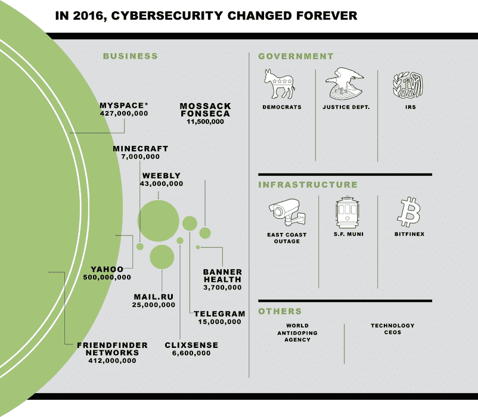

*Time Inc. 于 2016 年初收购了 MySpace 的母公司*

黑客攻击每年给全球经济带来 4000 亿美元损失。2016 年，几次重大数据窃取事件被曝光。以下是每家公司被盗账户或记录的数量：

412,000,000

成人网站网络的用户名、电子邮件和密码被盗取并在网上出售。

500,000,000

该公司透露，2014 年发生的用户账户黑客规模比此前认为的要得多，是历史上最大的泄密事件。

427,000,000

7,000,000

43,000,000

25,000,000

6,600,000

11,500,000

来自总部位于巴拿马的律师事务所的数 TB 泄露数据显示了名流、亿万翁和犯罪分子如何规避税收。

15,000,000

3,700,000

美国政府得出结论，该党遭到了俄罗斯间谍的攻击，以“影响”选举。

亲巴勒斯坦黑客泄露了约 30,000 份被盗的员工文件以示威。

该机构表示，2015 年的泄密规模比最初认为的要大，扩大到包含 70 万纳税人记录。

### 东岸断网

黑客利用受感染的摄像头等设备导致互联网访问中断一天。

黑客锁定了交通系统计算机，导致该市实施了两天的免费出行。

### BITFINEX

约 6500 万美元的数字货币从全球最大的比特币交易所之一被盗。

俄罗斯黑客发布了来自 13 个国家的 41 名运动员的医疗记录。

一个团体入侵了某些 CEO 和名人的社交媒体账号，似乎仅仅是为了证明他们能做到。

为了应对来自孤立黑客和受流氓国家支持组织的网络安全威胁，大量私人公司和政府机构应运而生。

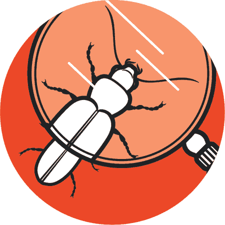

白宫已准备派遣军队保护投票免受俄罗斯黑客攻击。作者：MASSIMO CALABRESI

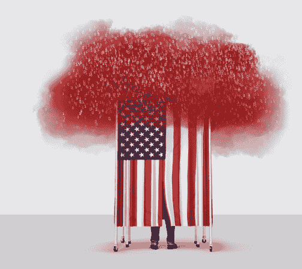

2016 年 6 月 7 日，河滨县地区检察官迈克尔·赫斯特林（`Michael Hestrin`）正坐在办公桌前，电话开始接接不断。那是加利福尼亚州总统初选的日子，愤怒的选民希望这位县最高检察官知道，他们被阻止了投票。“有人给我们的办公室打电话并投诉，说他们尝试投票，但他们的注册信息在他们不知情的情况下被更改了，”赫斯特林说。很快，问题报告就超过了 20 份，在该办公室工作了 19 年的资深员工、斯坦福法学院毕业的赫斯特林，派遣调查员前往县投票站查看发生了什么情况。

起初，他们发现的情况令他们宽慰。所有被阻止投票的人都获得了临时选票，大多数人已经以这种方式投了票。但随着调查人员的深入挖掘，情况看起来没那么简单了。投票后的几天里，更多人开始出来说，他们在初选当天选民注册也出了问题。赫斯特林和他的调查人员得出，在至少六个案件中，更改是由黑客做的，他们利用私人信息（如社会安全号码或驾照号码）访问了涵盖整个加利福尼亚州的中央选民登记数据库。

线索就此中断了。加利福尼亚州州卿办公室告诉赫斯特林的调查员，该州的系统没有记录做出更改的计算机 `IP` 地址，因此无法获知黑客的身份。赫斯特林无法继续调查，但事情并未结束。选民注册更改的悬而未决之谜在两党成员中引发怀疑。当地共和人公开指责民主党忽视了这个问题，并在私下指责他们试图压制共和党的选票。民主党人则认为共和党是在为他们在县投票站的失败找借口。“这是一个巨大的担忧，”这位当选的共和人赫斯特林说，“人们仍然应该对我们的选选举制度保持信心。”

直到几个月后，华盛顿的调查员们才意识到，动摇选民的信任可能一直是河滨县黑攻击的目的。在加利福尼亚州初选后的几个月里，联邦政府发现俄罗斯黑客入侵了 20 多个州级和地方选举系统，并试图更改其中几个系统中的选民注册。回顾河滨县的事件，白宫的网络安全官员怀疑这是否是俄罗斯人的首次演习。“这看起来像是一个网络攻击者在测试他们可以在选举日引发种种混乱，”一位调查过此案的前联邦网络安全官员说。“没有法证证据，我们可能永远无法确定，但情报告诉我们，俄罗斯人正在吹嘘他们做到了这一点。”

在不断的新闻流中，人们很容易忘记，俄罗斯针对 2016 年总统选举行动的持久目标，正如美国情报界所言，“动摇公众对美国民主进程的信任”。从 2016 年春初到 11 月 8 日全美各州各县投票结束，发生的是对我们选举公信力的激进攻击，以及联邦政府在很大程度上未被察觉且徒劳的反击。联邦调查局（`FBI`）、国土安全部（`DHS`）和美国情报机构致力于识别这些黑客，并确定他们恶意影响行动的范围有多大。联邦政府努力帮助各州保护其投票机和选民登记册，但在党派对立加剧的背景下，他们自己被怀疑干预了选举。最后，意识到他们无力阻止他们所恐惧的俄罗斯对投票的最后攻击时，联邦政府制定了一项异常计划，以限制选举日及随后几日的损害。

这份此前未公开的 15 页计划由总统巴拉克·奥巴马的网络安全官员制定，并被《时间》杂志（`TIME`）获得，显示了华盛顿有多有多担忧。在选举日发生的大多数网络事件中，它将权力交给了各州。但对于“可能对选举基础设施产生可证明影响”的严重攻击，它规定了应对的“增强程序”。该计划允许在黑客成功阻止投票时，向投票站部署“武装的联邦执法人员”。在危机时刻，它还预见到在“根据联邦机构的要求以及国防部长或总统的指示下”，部署“现役和预备役军力量”以及国民卫队成员。在选举后的三天内，一个特别的跨机构小组将负责处理“任何选后后的网络事件”，包括“质疑选举结果的蓄意发布的报道”。

11 月 1 日，白宫甚至对一次选举日攻击进行了兵演推习。在五个小时的时间里，国家安全委员会运行了一系列虚构的事件，演练联邦机构在真实攻击中将如何沟通和应对。某些场景涉及实际的投票干预，而另一些则侧重于动摇选举的虚假信息攻。随着噩梦场景的展开——从选民被拒之到投票站发生暴力——团队回顾了每个机构将采取的行动，以及他们所能做事的法律限制。

事实是，11 月 8 日就这样过去了，没有发生针对选举完整性的最终的、戏剧性的攻击。但俄罗斯的努力可能仍在奏效，并在唐纳德·特朗普的有意或无意帮助下进行。大多数美国人相信自己的票会被正确计算，但他们对选举诚实的信心正在崩溃。根据盖洛调查，2009 年，59%的美国人对选举的诚实有信心，而 40%没有。到 2015 年，这些数字发生了反转，在 11 月投票之前，在特朗普反复提到选举舞弊以及俄罗斯黑客攻击被广泛报道之际，盖洛发现只有 30%的美国人对我们选举的诚实有信心，而 69%没有。

在河滨县攻击约三周后，一名俄罗斯特工加入了伊利诺伊州 109 个选举管辖区之一的选民注册网站，每个辖区都有自己的投票系统。但黑客没有在姓名和地址的字段之一输入他的个人信息，而是上传了一串恶意的预写代码，执行了一种被称为`SQL 注入`的经典攻击。借此，黑客打开了自 2006 年以来该州所有 1500 万份过去和现有选民文件的后门。在近三周的时间里，没有人发现他在那里。

2016 年选举远超以往的任何情况。在伊利诺伊州遭受黑客攻击以及亚利桑那州同时发生类似事件后，前白宫网络安全协调员`Michael Daniel`表示：“我们意识到自己玩的是完全不同的游戏”。`Daniel`的团队得出结论，俄罗斯人不仅仅是为了收集情报而窃取信息，他们可能表现出了干预投票的意图。

伊利诺伊州于 7 月 12 日发现了这一入侵。黑客试图下载`15 million`份`voter`文件，其中包括`90,000`个`Social Security`号和`75,000`个驾执照号。攻击发生后，`FBI`和`DHS`与州官员合作，以确定泄露的范围。

对黑客攻击的调查显示，两个俄罗斯情报机构`GRU`和`VR`的运作方式不同。`GRU`和`Fancy Bear`针对州政府和州选举官员的电子邮件账户，而`GRU`还获得了某些选民注册系统的访问权限，并尝试更改`voter`编号。

此次行动的目标不仅是窃取信息，还在于破坏公众对选举过程的信任。`Michael Daniel`说：“目标是制造混乱，让人们怀疑投票的完整性。”

对 2016 年选举干预的调查仍在进行，关于俄罗斯的影响范围及其对最终结果的影响，仍有许多问题待解答。

更强大的力量在后方待命。白宫的计划中包含了部署军现役和预备役部队的可能性。该计划指出：“根据联邦机构的请求，并国防部长或总统的指示，国防部可能会支持民事当局应对网络事件。” 两位知情人士透露，这一构想的想法是让五角陆大楼的网络专家投入使用，以缓解和调查攻击。

2016 年选举当天凌晨 6 点，费兰特（`Ferrante`）开启了“第二号情势室”的大门，那是艾森豪威尔行政办公大楼内一石之隔、总统西翼安全会议的复刻版。在一个安全的视频电话会议系统上，团队拨通了正在处理选举日响应工作的`FBI`和`DHS`指挥部。加入他们的是来自司法部的选举犯罪协调员以及国家情报局长办公室的网络情报特员。`CIA`、`国家安全局`及其他情报机构的俄罗斯专家已经在机密的`全球联合情报通信系统`（`Joint Worldwide Intelligence Communications System`）邮件系统待命。

在这一天中，报告不断传来，让小组认为他们可能正在目睹河滨县事件重演，甚至更糟。在科罗拉多州，选举选民数据库宕机了 30 分钟。在犹州，由于埃文·麦克穆林（`Evan McMullin`）的独立竞选，那里已变成一个意料之外的战场，排起了长队。一度，收到了需要进行封锁的敏感情报。但最终，干扰程度并不超过任何正常的全国性选举，总而言之，投票进展顺利。随着投票站关闭，唐纳德·特朗普宣布当选，白宫网络团队的一些成员庆祝并没有发生破坏性攻击。

11 月 25 日，在对威斯康星州、宾夕法尼亚州和密歇根州选举提出挑战之际，奥巴马白宫发布一份声明称：“我们支持我们的选举结果，这些结果准确反映了美国人的意愿，且我们相信从网络安全的角度来看，我们的选举是自由且公正的。”但尽管重新计票的呼逐渐平息，对选举系统安全的疑虑仍在蔓延。

一位高级情报官员告诉《时代》周刊，尽管`FBI`、`DHS`和白宫的网络安全官员在整个秋天可能一直在忙于奔波确保投票安全，但该局旨在揭露俄罗斯行动是否试图帮助特朗普的局内反间谍行动，直到选举结束后才开始认真进行。鉴于`FBI`网络和反间谍官员重点关注希拉里·克林顿的邮件，回过来看，这看起来像是一场极其惨重的失误。这位高级官员表示，针对俄罗斯的反间谍调查“在选举之前从未获得过任何情报支持，因为我不认为有人会相信特朗普会赢，所以没有人真正看重俄罗斯的（[帮助他的]尝试’。”

与此同时，对于谁是美国选举系统的真正威胁仍存在分歧。据知情人士透露，乔治亚州是唯一没有接受联邦政府任何形式援助的州。但当乔治亚人自己寻找入侵者时，他们在 11 月 15 日发现一名`DHS`员工在扫描他们的系统。`DHS`调查了此事并表示，那是乔治亚州格林科联邦培训设施的一名员工，正在确认工作申请人是否持有武装守卫执照——这些信息与选民数据在同一个系统中。`DHS`监察长约翰·罗斯（`John Roth`）调查了此事，并在 6 月份得出结论，认为`DHS`员工没有对乔治亚州选举系统进行任何未经授权的扫描。

尽管一些州官员对认为联邦过度扩张感到愤怒，但许多人似乎对海外风险的程度处于否认状态。根据国土安全部高级官员珍内特·曼弗拉（`Jeanette Manfra`）介绍，俄罗斯人成功破解了超过 20 个州的系统。《时代》杂志对每个州选举官员办公室的询问显示，只有亚利桑那州和伊利诺伊州知道或愿意承认自己曾被黑客攻击。而当《时代》询问伊利诺伊州确认俄罗斯入侵者曾试图更改数据字段时，州官员最初否认发生这种情况，但在与其技术团队核实后，他们确认了确实发生过。

在河滨县，选举安全仍然是核心问题。2017 年 7 月，加利福尼亚州州长里·布朗（`Jerry Brown`）签署了《选民诚信保护法案》，允许县级在选民注册信息发生变化时通过短信或电子邮件通知选民。然而，检察官赫斯特林（`Hestrin`）仍在担心选民持续产生怀疑。他说：“人们对系统的信任是脆弱的。一旦人们失去了对选举公平诚实的信任，那么我们整个政体体系就会面临危险。”

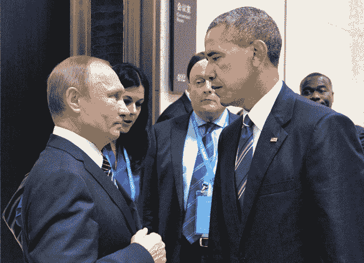

2016 年 9 月，在中国杭州举行的 G20 峰会上的一次“坦诚、直率且公事公”会议上，奥巴马总统警告弗拉基米尔·普京不要进行“西部西部”式的黑客战争。

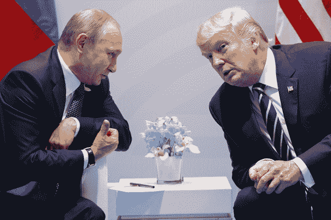

特朗普总统在 2017 年 7 月汉堡举行的 G20 峰会期间与普京会了两次。未公开的第二次会话发生在晚餐期间，且没有其他美国官员在场。

### 来源：现任及前任高级网络安全官员

39

显示扫描证据的

超过 20 个

被破解的

少于 12 个

显示尝试删除或更改选民名单信息的证据的

少于 12 个

显示尝试下载选民名单信息的证据

`Ormandy` 在 `Cloudflare` 没有熟人，而且在三天长假前的傍晚，他不忍心在这个时候拨打他们的通用支持热线。于是，他采取了他能想到的折中。`Ormandy` 上 `Twitter` 上向他在那里的数万关注者发起了求助。

“能不能请一位 `Cloudflare` 的安全人员紧急联系我？”

时间戳显示是太平洋标准时间下午 5:11。

`Ormandy` 并没有费心通过“@”符号标记该公司的 `Twitter` 账号来提醒他们。他不需要这样做。在狂热的信息安全专业人士社区中，他的声望极高，以至于在 `Ormandy` 点击“发送”后的 15 分钟内，世界上所有需要知道消息的人（以及许多不需要的人）都看到了这条备注。

当地时间凌晨 1:26，`John Graham-Cumming` 的手机插在伦敦床边的插座上，震动声将他吵醒。这位 `Cloudflare` 的首席技术官揉了揉眼睛，伸手去拿起震动的听筒。是一个未接来电。一位同事——`Graham-Cumming` 少数几个允许在午夜后联系他的白名单人员之一——打了电话。这位 `CTO` 发了一条短信询问怎么了。

他的同事立即回复了。

“非常严重的安全问题”

`Graham-Cumming` 惊恐地坐起并回复道：

“我这就上线”

`CTO` 从床上起来，下楼来到地下室，拿了为了应对这种情况而准备的应急包——充电器、耳机、备用电池。他启动笔记本电脑，迅速加入了与 `Cloudflare` 加州州总部同事的 `Google Hangout` 会议。

安全团队向他简报了正在演变的态势。`Google` 的 `Project Zero` 团队在 `Cloudflare` 的基础设施中发现了一个漏洞——一个严重的漏洞。运行超过 600 万个客户网站（包括 `FBI`、纳斯达克和 `Reddit` 的网站）的服务器发生了数据泄露。任何人都可以访问由 `Cloudflare` 支持的网站，并在某些情况下获取其网络上另一个网站用户的私密详细信息——如身份验证令牌、`Cookie`、私信，这些用户包括 `Uber`、`1Password`、`OKCupid` 和 `Fitbit`。

这些信息就隐藏在显眼处。糟糕的是，搜索引擎和其他网络爬虫过去几个月来已经在其缓存中存储了这些泄露的数据。仅仅堵住漏洞并不能完全解决问题。

“我把它比作溢油事故，”`Graham-Cumming` 说，“堵住油轮侧面的一个孔很容易，但你会有大量的海床需要清理。”

于是，`Cloudflare` 的工程师们开始工作。安全主管 `Marc Rogers` 在业余时间担任美国电视网黑客剧集《机器人小姐》的顾问，他领导了分拣工作。在不到一小时内，团队发布了首个缓解更新，在全球范围内堵住了该漏洞。几小时后，技术人员成功回滚了导致该错误的功能。在 `Ormandy` 发出推文近七小时后，`Cloudflare` 的工程师们成功促使主要搜索引擎（谷歌、微软、雅虎）清空了它们的历史网页缓存。

这是一个非常漫长的假假的开始。`Cloudflare` 的工程师们在剩下的时间里评估了泄露了多少以及什么类型的数据，以及这场混乱蔓延到了多大范围。

Google 的 Project Zero 团队最初对 Cloudflare 的快速响应留下了印象，Cloudflare 在安全事务方面以透明度闻名。但随着双方团队就何时公开发生的事情协商，关系开始出现裂痕。两家公司初步同意最早在 2 月 21 日周二发布公告。随着一天天晚，Cloudflare 决定需要更多时间清理。周二变成了周三。周三变成了周四。Google 态度硬了：周四下午是两家公司发布泄露细节的日子，Ormandy 将其称为“Cloudbleed”（云端出血），无论 Cloudflare 是否完成了评估并确保泄露的数据已从在线缓存中清除。

两份公告均于 2 月 23 日发布。随后发生了为期一周的互联网恐慌。

包括微软和苹果在内的许多公司都有内部安全研究团队来调查自己的软件。但很少有团队专门关注其他公司制造的软件。这让 Google 显得如此不同寻常。对于 Ormandy 和组成 Google Project Zero 的十几个左右顶尖计算机破解高手来说，他们的管辖范围没有边界——任何触及互联网的东西都是猎物。监管网络空间不仅对人类有益，对商业也有好处。

Google 于 2014 年正式成立了 Project Zero，但该小组的起源可以追溯到五年前。通常需要一个紧急情况才能驱动大多数公司认真对待安全。对于 Google 来说，那个时刻就是“极光行动”。

2009 年，一个与中国政府有关的网络间谍组织入侵了 Google 以及其他几家科技巨头，突破了他们的服务器，盗取了知识产权，并试图监视他们的用户。这次掠夺让 Google 的高层高管非常愤怒，以至于公司最终因此离开了退出了中国这一全球最大的市场。

这一事件特别让 Google 联合创始人 Sergey Brin 感到困扰。计算机取证公司和调查人员确定，公司被入侵并不是因为 Google 自身的软件有缺陷，而是通过 `Microsoft Internet Explorer 6` 中一个未修补的漏洞。他在想，为什么 Google 的安全要取决于其他公司的产品呢？

在随后的几个月里，Google 开始更加激进地要求竞争对手修复其软件代码中的漏洞。Google 与其同类公司之间的战斗很快变成了传奇。在其中几次冲突的中心，正是臭漏洞猎人 Tavis Ormandy，他以其修复漏洞的强硬手段而闻名。（Ormandy 拒绝了本文故事的采访。）

Google 静静地开始将后来在 2014 年成为 Project Zero 的内容正式化。公司建立了一套协议，并允许 Chris Evans（与美国队长无血缘）前 Google Chrome 安全负责人执政。Evans 随后开始招募 Google 员工和其他加入团队。

他签下了 Ian Beer，一位出生在英国、定居瑞士的安全研究人员，他展现出了破解 Apple 编码错误的天赋。他请来了 Ormandy，一位英国硬汉，以与微软之间引发的广为人知的冲突而闻名。Evans 招募了 Ben Hawkes，一位以消灭 Adobe Flash 和 Microsoft Office 漏洞而闻名的新西兰人。他还邀请了 George Hotz，这是一个早慧的青少年，今年早些时候在一次黑客大赛中破解 Google Chrome 浏览器后赢得了 15 万美元，担任实习生。（目前 Project Zero 的成员拒绝了多次就他们的工作接受采访的请求。）

在 Google 的 `Project Zero` 正式成立三年来，这支精英黑客小队已经建立了全球最有效的计算机漏洞消灭者之一的声誉。尽管普通消费者可能认不出他们中的任何一个名字——James Forshaw、`Natalie Silvanovich`、`Gal Beniamini`——但世界对他们感激之尽，因为是他们封堵了运行我们数字生活的设备和服务的漏洞。该团队负责了其他公司产品的一系列改进，包括发现并帮助修复了超过一千个针对操作系统、反杀病毒软件、密码管理器、开源代码库和其他软件的安全漏洞。`Project Zero` 至今已发布了近 80 关于其工作的博客文章，这些当今网络上最优秀的公共安全研究。

团队的工作间接惠及了 Google 的核心业务：在线广告。保护互联网用户免受威胁，意味着保护公司向这些用户投放广告的能力。`Project Zero` 向供应商施加压力的努力也迫使他们修复导致 Google 产品崩溃的漏洞。

根据 `Cloudflare` 首席执行官兼创始人 `Matthew Prince` 的说法，Google 顶尖漏洞猎人发现的泄露最初让他的公司损失了大约一个月的增长。如果他对比这段经历感到一丝酸涩，`Prince` 也没有表现出来。他知道被真正怀恶意的黑客针对是什么感受。几年前，一个名为“UGNazi”的黑客组织入侵了 `Prince` 的个人 `Gmail` 账号，利用它获取了他的企业邮箱的控制权，并劫持了 `Cloudflare` 的基础设施。这些暴徒本可以造成巨大的损害。相反，他们决定将 `4chan.org`（一个常见的黑客聚集地）重定向到他们的个人 Twitter 资料以进行宣传。

`Prince` 仍然遗憾没有在 Google 和 `Cloudflare` 发布最初调查结果之前就向客户说明 `Cloudbleed` 问题的全部范围。他希望公司能在客户从新闻报道中读到泄露消息之前就早地警了他们。尽管如此，`Prince` 回顾时认为，`Project Zero` 团队在披露时机上是正确的。“因为那 14 天，我多了很多白发，而且可能比以前少活一年，”`Prince` 在谈及该发现和泄露后果时说道，“感谢天谢，是 `Tavis` 和那个团队发现了它，而不是某个疯狂的黑客。”

**CHRIS EVANS** 他创立了 Google 的反黑客团队。

一些公司会奖励发现其产品缺陷的研究人员。以下是部分奖金示例：

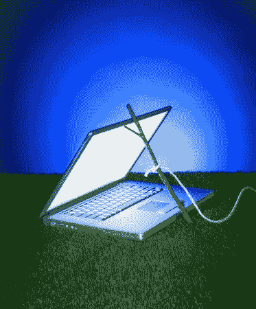

*   **GOOGLE**: Android 操作系统 — 每个漏洞高达 200,000 美元

*   **TESLA**: 特斯拉 Model S 轿 — 每个漏洞高达 10,000 美元

*   **APPLE**: Apple iOS 操作系统 — 每个漏洞高达 200,000 美元

*   **CLOUDFLARE**: 互联网服务 — 漏洞奖励 T 恤和免费试用

*   **UNITED AIRLINES**: 网站和应用 — 每个漏洞高达 100 万英里

*   **NETGEAR**: 路由器、应用和服务 — 每个漏洞高达 15,000 美元

*   **ORACLE**: 任何产品或服务 — “感谢”，即在修复建议中注明致谢

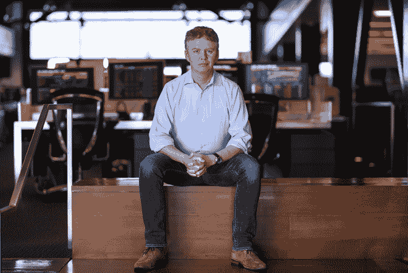

**MATTHEW PRINCE** 技术公司 `Cloudflare` 首席执行官

**KATIE MOUSSOURIS** Luta Security 首席执行官

正如 `Katie Mousssouris` 告诉 `Robert Hackett` 的那样：

> “漏洞有两个市场：进攻防御。前者由国家机器、有组织犯罪集团和其他攻击者组成。后者由漏洞赏金计划和销售安全产品的公司组成。进攻市场的价格更高，且没有上限。他们买的不只是漏洞或利用工具；他们买的是在不被发现的情况下使用它的能力。他们买的是沉默。防御市场付不了那么多。供应商并不会给他们的顶尖开发者支付百万美元。尽管大公司的代码质量正在提高，但复杂性仍在不断增加。这意味着更多的漏洞。安全研究人员如何处理特定漏洞取决于他们的财务需求、对某款软件或供应商的态度，以及他们个人的风险。这并不是简单的黑帽卖家对白帽黑客。”

互联网是一个战场。奖品是你的信息，而漏洞是武器 BY `LEV GROSSMAN`

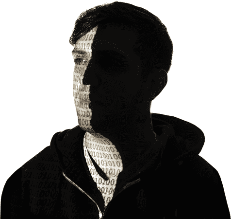

**HACK STAR** 安全专家 `Aaron Portnoy`

`Aaron Portnoy` 在还在读高中时就开始了他的黑客生涯，当时在位于伍彻斯特的马萨诸塞数学与科学学院，这并非巧合，那正是他入侵的那所学校。他是这样做的：`Portnoy` 让一个朋友打给其中一个宿舍，假装成技术支持。学生们非常乐意把密码交给了他。躲在这些借来的账号后面，并通过各种外国国家的代理服务器进行路由，`Portnoy` 通过系统中的一个漏洞进入学校网络，这种漏洞在技术上被称为漏洞，或者更技术地称为零日漏洞。“我访问了所有的邮件、成绩、一切内容，”他说。“他们的配置上存在许多问题，让我可以随意渗透到各处。”

回想起来，表现出相当克制的是，`Portnoy` 修改了学校的网站，写了一些关于另一个同学的负面评价。然后他离开了。后来学校请了技术专家追踪入侵行为，但他们无法将其追溯到他身上。

因此自然地，`Portnoy` 第二年又做了一次并被抓住了。学院鼓励他寻找其他的教育场所。这其实并不重要。他从当地的高中毕业，并进入了东北大学。这一切对于他现在的职业工作都是极佳的准备：研究并销售软件漏洞，自他高中时代起，这已成为行业中更新且更具争议的商品之一。

`Portnoy` 今年 32 岁，在防务安全公司 `Raytheon` 担任安全工程师，他在德克萨斯州奥斯汀创立了一家名为 `Exodus Intelligence` 的公司。其使命声明写道：“我们的目标是为客户提供独家零日漏洞的可操作信息、能力和背景支持。”

它们非常有价值，因为尽管你可能察觉不到，但互联网是一个战场。尽管它表面上变得越来越华丽、社交化且乐于取悦，但在表象之下，网络正变成一个充满敌意、充满争议的领土，私营公司、执法部门、犯罪分子、军方以及各种国际情报机构在这里进行着持续的低级网络战。这种冲突只是偶尔能被肉眼看到——例如在 2014 年 5 月，美国起诉了五名中国军人，指控他们从美国公司窃取数据，包括`Westinghouse`和`Alcoa`。他们目前仍列在`FBI`的通缉逃犯名单上。这并非异常，而是常态，而且这种正变得越来越常态。曾任`NSA`和美国网络司令部司令的退役陆军将基思·亚历山大（Keith Alexander）将中国持续的知识产权窃取行为称为“历史上规模最大的财富转移”。最近，几家安全公司证实，一个被认为受俄罗斯政府支持的团体至少从 2012 年起就在系统性地黑入美国能源基础设施。根据开展数据安全研究的`Ponemon Institute`的数据，平均机构在 2016 年共遭受了 28,512 次攻击。

网络战并非未来，而是已经到来。这已是常备饭。在这场战争中，战场无处不在，漏洞是武器，而像 Portnoy 这样的人则是军火商。软件漏洞可以价值真实的美元这种想法很奇特。漏洞是错误；人们通常付钱来修复它们。漏洞之所以存在市场，是因为我们当今时代更大荒诞性的结果——在这个时代里，我们的整个世界——我们的业务、医疗记录、社交生活——正以数据的形式一点一点地离开现实，迁移到计算机的软件内部。许多人对此感兴趣，原因既有好的也有坏的。其中有些人是间谍，另一些人是犯罪分子。

### 震网病毒（Stuxnet）案例

2009 年，关于什么让漏洞如此有用，提供了一个深刻的教训。美国和以色列共同开发了一种复杂的计算机蠕虫，旨在渗透并破坏伊朗纳坦兹（Natanz）的一处特定的铀富缩设施。这种现在被称为`Stuxnet`的蠕虫被认为可能是第一个真正的网络武器。它是由一名双面间谍通过优盘引入该设施计算机系统的。蠕虫检查了该场所并向其主人回传了详细的情报。然后它大显身手，开始攻击那些用于富铀的计算机。它最终摧毁了大约 20%的设备。这一切都是安全专家和记者推断出来的。是什么让`Stuxnet`如此有效？一言以之：漏洞。为了获得所需的访问，`Stuxnet`利用了至少四个不同的漏洞，包括`Microsoft Windows`中的一个。这些漏洞——或者说利用这些漏洞的知识——本身与伊朗人正在研究的铀不同，它们是以软件形式存在的：昂贵、高度精炼的弹药，构成了极其复杂的武器系统的核心。当`Stuxnet`从纳坦兹设施逃脱（这对任何看过《侏罗纪公园》的人来说都是不理性的）并感染了全球范围内约 10 万台计算机时，它的破坏性更显剧了。

### 漏洞赏金市场

为漏洞付钱的想法比`Stuxnet`要早得多。1995 年，`Netscape`宣布了一项名为“漏洞赏金”（Bugs Bounty）的计划，向任何能发现其浏览器缺陷的人支付现金。该公司并不是在试图摧毁离心机；它只是想修复其软件中的漏洞。2002 年，一家名为`iDefense`的安全公司开始购买各种类型的漏洞；另一家公司`TippingPoint`在 2005 年启动了类似的计划。这两项计划的创建是作为公开市场上日益活跃且混乱的“零日漏洞”（zero-days）交易的替代方案——本质上，它们充当了安全的零日处置设施，有点像放射性废物库。如果你发现了一个漏洞，与其把它卖给可能会对其做鬼知道是什么坏事的最高出价者，你也可以以可靠的价格卖给`iDefense`或`TippingPoint`，他们会向客户提醒该问题，并与软件供应商合作修补漏洞。`iDefense`和`TippingPoint`还有另一个共同点：它们在 2005 年和 2006 年连续两年聘佣了一个名叫阿伦·波特诺伊（Aaron Portnoy）的实习生。

`Portnoy`看起来完全不像《战争游戏》中的马修·布罗德里克里克（Matthew Broderick）。他是一个自信、随和、口齿伶道的男士，眼神交流良好，而且恰好是一个超级网络侵入专家。2006 年，`Portnoy`从东北大学（`Northeastern`）退学全职进入`TippingPoint`，2012 年他离开创业。2015 年 11 月，`Portnoy`离开了他的初创公司为雷神公司（Raytheon）工作。`Exodus Intelligence`加入了一个小众精英领域，该领域包括位于当地的`Vupen`。

还有一些机构不仅仅是在玩游戏。Exodus 对其客户名单非常谨慎，但其他机构则没那么小心。众所周知，`NSA`（国家安全局）和 `FBI`（联邦调查局）喜欢在目标计算机上植入监控软件以收集情报；在联邦局成功游说法院后，2016 年最高法院批准了一项规则变更，允许法官签发搜索或没收设备的授权，无论这些设备位于何处。如何在当事人不知情的情况下在其电脑上植入软件？一种方法是利用漏洞。2013 年，`FBI` 打破了一家名为 `Freedom Hosting` 的公司，将其描述为“全球最大的儿童色情传播便利者”。Freedom Hosting 运行在 `Tor` 网络上，该网络可以使 Web 流量匿名。为了绕过匿名性，`FBI` 利用了 `Firefox` 中的一个漏洞。

至于 `NSA`，《华盛顿邮报对爱德华·斯诺登泄密事件的分析显示，`NSA` 的预算中包含 2510 万美元用于“额外秘密购买软件漏洞”，这表明他们既购买零日漏洞，又在内部自行研发。（2013 年，调查新闻网站 `MuckRock` 获取了一份 `NSA` 与 `Vupen` 一家已倒闭的法国网络安全公司的合同副本。）同一笔预算揭示了一个代号为 `GENIE` 的秘密 `NSA` 计划，该计划资金达 6.52 亿美元，旨在大规模地在外国计算机网络上植入恶意软件。到 2013 年底，`GENIE` 预计将控制约 85,000 台机器。

同样根据斯诺登的文件，美国在 2011 年针对中国、俄罗斯、伊朗和北朝鲜等国家发起了 231 次攻性性网络行动——而这还是 2011 年，在网络时代已是远古的历史了。2017 年的国防预算包含了 67 亿美元的网络空间行动资金，这是一个非常通统的术语，指的是一个人们并不了解的领域。`Verizon` 在其年度《数据泄露调查报告》中估计，2016 年 21% 的数据泄露归因于网络间谍活动。`Verizon` 也承认，关于网络间谍活动的可靠信息很难获得。这种行动是秘密的，即使你能够发现它，网络间谍活动也很与工业间谍活动或普通的网络犯罪区分开来，因为很难确定攻击的源头和意图。

考虑到漏洞的攻击潜力，你可能会认为政府会像控制战斗机和陆雷贸易那样控制这些漏洞的交易。但监管机构才刚刚跟上。《瓦森纳军控协定》（`Wassenaar Arrangement`）是一项规范 `U.S.` 和其他 40 个参与国之间武器销售的国际协议，它在 2013 年经过修订，将“侵入软件”列入其限制性双用技术清单，但到目前为止该变更尚未执行。奥巴马政府的一位高级官员在 2014 年告诉《时代》杂志：“这目前还不是一个政府真正关注并监管的市场。我们一直更多地处于自愿性的最佳实践和标准领域。我认为你们将看到我们继续关注这一点。”2016 年，`U.S.` 官员宣布，他们希望未来能再次对该协议进行谈判。

当然，梦想是一个不再有漏洞的世界，软件可以被完美，安全将是绝对的，我们可以继续去寻找其他需要担心的事情。但趋势正向另一个方向发展。我们要求计算机为我们做的事情越多，我们就越需要它们保持安全——但计算机要做的事情越多，其软件就越复杂，因此 Bug 就越多，如此循环复始——这是一个恶性循环。你笔记本电脑上的操作系统由数千万行代码组成。

赫格利希表示，她担心的不仅是传播虚假信息的俄罗斯媒体，还有那些被称为“机器人”的自动化算法，这些算法帮助虚假报告在政治家或事实核查人员揭穿它们之前病毒式传播。2017 年 6 月，一项研究发现，59%的德国人曾在网上看到过虚假新闻；61%的人认为这种现象对民主构成了威胁。

因此，默克尔政府为围攻做了准备。她在议会的执政联盟通过了一项法律，对未及时删除“非法内容”的 Facebook 等公司处以超过 5900 万美元的罚款。默克尔政府使用这一术语来界定涵盖从仇恨言论、色情内容到诽性宣传的各种内容。“虚假新闻是对我们辩论文化的威胁，”该法律背后的官员、司法部长海因科·马斯在 2017 年 1 月告诉一家德国报纸。他随后补充道，“我们对社交网络上犯罪煽动行为的容忍度，应该和对街头行为一样小。”

德国的《网络执行法》是对莫斯科影响活动最激进的反应之一，尽管这绝不是唯一的反应。欧盟设立了一个专门负责揭穿虚假新闻和俄罗斯宣传的机构。捷克一家警察机构扫描社交媒体以寻找虚假信息和其他“混合威胁”。法国总统埃马纽埃尔·马克龙也于 4 月禁止了俄罗斯新闻机构 RT 和 Sputnik 进入他的竞选总部。

这些步骤指向了恐惧，或偏执——即政治破坏工具的进步已足以威胁西方的民主国家。“民主的核心在于公共舆论，”赫格利希回忆起在与默克尔会面时告诉过的话，“而且如果存在操纵舆论的新方法，那么我们将看到一种新型的民主。”

在某些方面，这种情况已经在发生了。在一个黑客可以窃取几乎任何政治家秘密的时代，在一个只需要一个互联网连接就能调动数百万观众群的时代，一条病毒式帖子——即使是虚造的——就足以扭转选举。没有任何民主国家能逃避这种风险。俄罗斯和德国已成为在适应这一新领域并在可能的情况下重塑这一领域方面最有决心的玩家。

康斯坦丁·克尼里克（`Konstantin Knyrik`）是“新闻前线”（`News Front`）网站的年轻创始人兼编辑，他认为自己与其说是记者，不如说是数字时代的信息战士，他也有自己的职业生涯和人脉来证明这一点。21 世纪 00 年代中期，作为一名青少年，他成为欧亚青年联盟的活跃成员，这是一个由强硬俄罗斯民族主义者组成的团体，主张莫斯科恢复在苏联解体后失去的帝国。当他仅 16 岁时，克尼里克就成为了该克里米亚地区（乌克兰南部的一片巨大半岛）的代表。2014 年春天，当俄罗斯军队入侵该地区并准备兼并它时，他领导了一支亲俄准军事部队占领了克里米亚调查新闻中心的总部，那里是该地区领先的独立新闻来源。士兵强行驱逐了该中心的记者并没收了他们的设备。克尼里克随后在原址创建了“新闻前线”。

如今，克尼里克的媒体在克里米亚首府辛费罗波尔的演播室拍摄节目，并受到该地区支持支持林的当局的监督。2017 年 6 月，在办公室电话采访时，克尼里克将自己定位为西方对俄罗斯宣传战的制衡力量：“我们希望人们看到另一种观点。”他说，在美国和欧洲，“他们拥有的只有信息真空，所有这些东西都被塞进他们的脑子里，所有来自官方宣传渠道的荒谬谎言。”这是俄罗斯国家媒体最喜欢的叙事；克里姆林资助的 `RT` 网络总编辑玛加丽塔·西莫扬（`Margarita Simonyan`）在 2015 年向《时间》杂志表达了类似的观点：“没有人展示客观现实，”她说。即使是客观报道的想法与这种世界观也是矛盾的。存在的只有竞争视角的转述，其中没有任何一个视角比其他的更有效。

在 2017 年 6 月发表的一份关于俄罗斯在德国影响行动的分析中，位于华盛顿的智库大西洋委员会数字取证实验室发现，“新闻前线”是克里姆林在德国的三个主要“放大器”之一，还有 `Sputnik` 和 `RT`。报告指出，“这个网络代表了一个潜在的渠道，虚假信息可以在选举之前注入德国的信息空间。”

如果说俄罗斯和德国正在建立这场新信息战争的前战线，那么欧洲的当局仍在试图集结部队。总部位于布鲁塞尔的东欧战略委员会（`East StratCom`）是欧盟于 2015 年为应对俄罗斯虚假信息而设立的，似乎设备极其匮乏。它的少数记者每周编制一份虚假新闻故事列表，并试图在 `Facebook` 和 `Twitter` 上揭穿它们。但该机构在社交媒体平台上的影响力微乎其微；其 `Facebook` 页面只有约 2.万个赞，而 `Sputnik` 的页面超过百万个赞。

还有另一个问题。在互联网上追逐骗局往往会引起人们更多的关注，在一个党派对立的时代，许多读者倾向于相信能够强化他们政治观的欺骗。“虚假新闻总是抢占先机，”荷兰莱登大学研究骗局传播的讲师彼得·伯格（`Peter Burger`）说，“即使我们对其进行事实核查，许多人也会说我们只是象牙塔里的自由派，或者是某些阴谋论的一部分。”

他说，更好的方法可能是在学校引入事实核查课程，让学生对自己的信息来源更加重视。但这种教育方法需要多年才能产生影响，在此期间，虚假新闻技术将继续进步。2017 年 7 月，华盛顿大学的学者揭露，他们可以“合成”一段巴拉拉克·奥巴马发表从未发表过的声明的视频。“你可以创建看起来完全真实的视频，”赫格利希说道，他在 11 月那次会面后继续为德国政府提供建议。现在，需要几个小时甚至几天才能出一份证明此类视频是伪造的鉴定报告，而到那时其影响几乎是不可逆转的。至少，这会让选民在投票时不确定该相信什么。

2014 年 11 月 3 日（周一），来自位于硅谷的小型“威胁情报”公司 `Norse Corp.` 的一个四人小组早早来到位于洛杉矶郊区库尔弗城（`Culver City`）的索尼影业娱乐片场，参加上午 11:30 的会议。他们计划见索尼的高级网络安全经理，推销 `Norse` 的服务，以帮助片厂抵御多年来一直扰索尼的黑客。

在大门经过快速的安全检查后，他们来到索尼园区东侧的乔治·伯恩大楼，`Norse` 小组直接走进了信息安全部门未锁门的一楼办公室，那里挂着一个写有 `INFO SEC` 的小牌子。那里没有接待员或保安人员检查他们的身份；事实上，现场根本没有别人。房间里有很多工位，上面的无人看管的电脑可以访问索尼的国际数据网络。

访客们找到了索尼信息安全高级副总裁杰森·斯帕尔罗（`Jason Spaltro`）办公室外的一个小休息区，坐下并等待。他们独自坐在那里，等了大约 15 分钟。

“我感到有点震惊，”`Norse` 的联合创始人兼首席技术官托米·斯蒂森（`Tommy Stiansen`）说，“他们的信息安全部门是空的，所有的屏幕都处于登录状态。基本上，清洁工可以直接走进他们的信息安全部门。”协助安排会议并出席当日的资深娱乐业律师米基·沙普罗（`Mickey Shapiro`）补充道：“如果我们是坏人，本可以做些可怕的事情。”

最后，自 1998 年起一直任职索尼的斯帕尔罗出现了，带领他们来到附近的一个会议室，另一位片厂信息安全高管在那里等候。会议开始了，当斯蒂森描述 `Norse` 如何评估潜在威胁时，斯帕尔罗打断了他：“天哪，这真的能对我们处理那部韩国电影非常有帮助！”根据四位 `Norse` 代表的说法，斯帕尔罗解释说，他担心一部由赛斯·罗根（`Seth Rogen`）主演的喜剧片《会面》（`The Interview`），片厂正计划在圣诞节上映。该片涉及刺杀该国实际领导金正正的情节。斯蒂森回忆道：“他们说朝鲜威胁他们。”（索尼否认了任何关于朝鲜网络威胁的说法。）

大约一小时后，根据 `Norse` 团队的说法，索尼团队宣布会议“非常有成效”，并承诺保持联系。他们离开了，让访客们自行寻找出口。

三周后——从太平洋时间 11 月 24 日（周一）上午约 7 点开始——索尼影业遭受了一场毁灭性的网络攻击。登录网络的员工听到枪声，看到屏幕滚动的威胁信息，以及一个巨大的火光骷髅笼罩在片厂前两位高管矮小僵尸化头部之上的威胁形象。

在索尼的 IT 人员来得及拔掉电源之前，黑客的恶意软件已经在整个园区及跨越大陆的机器之间跳跃，摧毁了索尼全球网络的一半。它删除了 6,797 台个人电脑中的 3,262 台以及 1,555 台服务器中的 837 台存储的所有内容。为了确保没有任何数据可以恢复，攻击者甚至添加了一点额外的“毒药”：一种特殊的删除算法，以七种不同的方式覆盖数据。完成后，代码击毁了每台电脑的启动软件，使机器陷入“脑死亡”。

从恶意软件发布的那一刻起——在黑客首次入侵几个月后——仅用一小时，索尼影业就回到了录像带（`Betamax`）时代。该片厂被迫使用传真机，通过张贴的消息交流，并用纸质支票向 7,000 名员工发放工资。

这只是索尼恐怖故事的开始。在销毁公司数据之前，黑客已经偷走了它们。在接下来的三周里，他们将九批机密文件上传到了公共文件共享网站：内容涵盖一切，从未完成的电影剧本、令人脸脸的邮件，到工资单以及超过 47,000 个社会安全号码。五部索尼电影（其中四部尚未发行）被泄露到盗版网站网站供人免费观看。随后，黑客威胁要对影院发动“9/11”式的袭击，迫使索尼放弃了《会面》在圣诞节上映的计划。一周后，在引发巨大骚动后，该片厂宣布，无论如何，他们都将通过视频点播和在几百家影院上映该电影。

12 月 19 日，联邦调查局将黑客归咎于朝鲜，朝鲜曾对该电影发布过威胁。白宫随后采取了经济制裁。索尼因其极其糟糕的判断（拍了一部描写杀害朝鲜领导人的喜剧片）以及其似乎的屈协而饱受指责。

## 索尼的防御

在索尼看来，公司是一个无辜的受害者。在 12 月接受国家公共广播电台（`NPR`）的采访时，林顿（`Lynton`）坚持认为他的公司已经“做了充分的准备”，但面对的是“历史上最糟糕的网络攻击”。他多次将其描述为一次“极其复杂的攻击”。索尼影业通过其首席发言人罗伯特·劳森（`Robert Lawson`）对问题提供了书面回复。他说，林顿没有解雇或惩罚任何人的计划。

劳森在声明中辩解道，“任何认为索尼娱乐能够防御这种攻击的建议都是深度错误的，并且忽略了联邦调查局和凯文·曼迪亚（`Kevin Mandia`）所提出的关键发现和评论——这两个人都是对此调查中……证据最了解的人。当时的联邦调查局网络部门助理局长约瑟夫·德马雷斯特（`Joseph Demarest`）在美国参议院听会上的表述再再清晰了：‘所使用的恶意软件会溜过，可能会绕过今天私营部门现有 90%的网络防御，我甚至敢说政府部门也是如此。’ ”声明继续道，“曼迪亚也解释了此次攻击中使用的外取方法的复杂性使得它们几乎无法被检测。曼迪亚和联邦调查局都表示，所使用的恶意软件是行业标准杀毒软件无法检测的。”

“没有任何一家公司会说：‘我们只是太疏忽了，所以人才才进来的’，”网络安全专家、战略与国际研究中心高级研究员詹姆斯·刘易（`James Lewis`）表示。“对方是一个国家级且难以击败，并不意味着你必须敞开大门并铺好欢迎垫。”

本文基于对索尼（`Sony`）现任及前任高管（他们均坚持不具名标识）、网络安全专家和执法人员的 50 多次采访。此外，它在很大程度上也基于被黑客窃取的索尼邮件和文件。除了能产生他们已经拥有的好莱坞八卦之外，这些材料还提供了一个观察黑客期间索尼影视业务的绝佳窗口：其领导者的个性、他们在与位于东京的母公司关系中面临的压力，以及在 21 世纪经营娱乐制片厂的挑战。（我们保留了邮件的原始标点符号和许多粗糙的拼写。）

这些邮件还揭示了无数惊喜和此前未报道的轶闻，其中包括索尼监视自己员工邮件的一个事件。矛盾的是，这些被黑客的邮件和文件提供了一个生动的窗口，展示了这场灾难性的攻击是如何以及为何能够成功，以及公司需要做什么来保护自己——这正是《财富》杂志选择使用这些材料的原因。

索尼发生的事件是一个里程碑式的事件。它让整个美国企业界的董事会陷入了恐惧，尽管索尼的情况具有独特元素，但这些教训适用于每一家公司。毕竟，用老的话说，公司只有两类：被黑客过的公司和尚未意识到自己被黑客过的公司。无数巨头曾遭受大规模的受害，包括 `Target`、`Anthem`、`Home Depot` 和摩根大通，它们为了利润为目的的数据窃取或企业间谍活动遭受了入侵。

美国企业界面临的危险似乎增长得比现在动员对抗电子犯罪的巨大资源还要快。（政府也未完全幸免，美国税务局（`IRS`）、白宫邮件系统和美国人事管理局都曾被备受注目的渗透。）但在大多数情况下，之前的企业入侵伤害的是客户而非企业。这次事件之所以触及核心，因为它展示了攻击者如何窃取甚至是高管最宝贵的秘密——并让一家公司陷入瘫痪。

这家日本电子巨头与好莱坞制片厂这种不可思议的结合可以追溯到 1989 年。当时的索尼公司是地球上最具主导地位的电子公司，当时日本企业的主导地位似乎是永久的。索尼花费了惊人的 48 亿美元收购了陷入困境的哥伦比亚影业（`Columbia Pictures`），宣布电影等同于提升其高端“硬件”（电视机、录像带机和音乐播放器）销售所需的“软件”。该制片厂被更名为索尼影视娱乐，但继续挣扎，导致在五年后进行了 27 亿美元的减值准备。

接下来的四分之一之世纪对索尼公司并不友好，当消费电子业务变得商品化时，它仍然固守着这项业务。今天，该公司仍然是一个巨头，拥有 132,000 名员工，截至 3 月份的财年收入为 747 亿美元。但索尼在过去的七个财年中亏损了 121 亿美元。当平平雄（`Kazuo Hirai`）于 2012 年 4 月成为首席执行官时，他宣布了“非常严重的危机感”，并宣布了一项转型战略，包括数千人的裁员。

（注：原文后续存在大量重复的段落，此处已根据要求不重复输出原文翻译内容。）

`Rogen` 并不总是计划要拍一部关于刺杀朝鲜实际统治者的喜剧片。根据采访记者编剧 `Dan Sterling` 的说法，早期脚本曾用过一个名为 `Kim Il-hwan` 的虚构角色。他坚持认为，最初建议使用 `Kim` 这个名字的是一位片厂高管（他拒绝透露该人的姓名）。`Rogen` 和 `Goldberg` 非常喜欢这个主意。与比如 `中国`（作为一个重要的电影市场，因此 `Sony` 不想疏远）不同，朝鲜被认为是好莱坞可以进行挑衅性素材创作的领域。`Pascal` 和 `Lynton` 批准了这一改变。

事后回来看，很容易对这个决定产生怀疑。朝鲜是一个（拥有核导弹的）流氓国家，由一位反复无常、不可预测的独裁者领导。一位曾与 `Sony` 合作过的电影制作人告诉《财富》杂志：“有必要点名金正恩吗？这在票房上真的会有那么大影响吗？如果你拍的是严肃电影那是一回事。但这是一部放屁电影！”

《终极记者》的剧情现在已广为人知。由 `James Franco` 扮演的笨蛋小报口秀主持人和他的兄弟制作人（`Rogen`）受邀前往朝鲜采访 `Kim Jong 恩`，后者是他们节目的秘密粉丝。随后，`CIA` 雇用两人刺杀 `Kim`。发生了一系列笑料。最后以 `Kim` 在直升机中惨死结束，`Franco` 和 `Rogen` 的角色用一台征用的坦克将其击落。

《终极记者》的制作耗资 4400 万美元（其中 820 万美元给了 `Rogen`），营销预算为 3200 万美元。`Sony` 对这部 R 级喜剧有很高的票房预期：1 亿到 1.35 亿美元。电影中出现了老虎、军事装备和昂贵的特效。即使是 `Rogen` 也对他享有的自由度感到惊叹，他在上映前告诉《滚石》杂志：“他们给了我们疯狂的资金，让我们随心所欲做什么。”

鉴于这对人的商业成功，`Sony` 有强烈的动力让 `Rogen` 和 `Goldberg` 保持愉快并留在片厂内，他们在一套办公室里工作，并在园区里散步抽大麻。`Sony` 线下营销总裁 `Dwight Caines` 在一封邮件中告诉 `Rogen`：“我们喜欢你的电影，坦率地说，你们是我们最重要的合作关系。”《终极记者》的试映表现非常好。`Pascal` 在 4 月写给 `Rogen` 及其团队时道：“被这部电影震撼了，也被你们震撼了。”“谢谢你们让我们拍这部电影，”`Rogen` 回道，“没有别人会这么做。”

`Rogen` 和他的合作者似乎真心想要对 `Kim` 政权疯狂且压迫的方式发表表态。`Sterling` 说：“我对于有机会拍出一部在色色笑话中夹杂一些政治评论的大众制片厂电影而感到非常兴奋。” `Sony` 高管们似乎也赞同。`Caines` 在 5 月写给 `Rogen`：“这部电影正在做一些非常大胆的事情，我不确定是否有过其他电影做过——将一个如此臭名昭著的人物作为题材。这种角度让电影引值得关注……幽默中带着一丝聪明。”

6 月 17 日，泄露的邮件显示，`Sony` 嘲讽“真实人物”的胃口立刻消失了。在电影首预告片在线上线几天后，刚看完完电影的 `Hirai` 打了 `Lynton` 的电话，担心日朝之间紧张的关系进一步恶化。在 `Hirai` 看来，这使得

克莱因表示，他也担心朝鲜可能会对制片厂发动网络攻击，试图阻止《采访记者》的上映。根据拉博夫的说法，罗根和戈德伯格将这一信息传达给了索尼高管。克莱因说：“我们觉得参与此事的每个人都必须保护好自己——包括制片厂和电影制作人。朝鲜人是非常具有侵略性的网络战士……令我惊讶的是，他们没有产生更强烈的警觉和谨慎意识。”（索尼发言人也否认收到过罗根和戈德伯格的警告。）

邮件显示，索尼并没有加强其网络防御，而是专注于如何以某种方式减少对朝鲜人的冒犯。其行为完全像是一场好莱坞闹剧。无管索尼正计划上映一部描绘真实国家元首暴力死亡的电影；该公司花费了 55 万美元，通过数字手段修改了电影中墙上壁画和电影角色佩戴胸针上金氏家族成员的图像。他们从索尼网站上删除了所有《采访记者》的营销材料。制片厂还准备了一份声明，坚称该电影是“一部虚构的喜剧片，与当前时事没有任何关系”。

8 月初，帕斯卡尔和家人前往亚洲开启了长假。莱林顿则搬到了马萨诸葡萄岛。那时，他们决定将《采访记者》的上映推迟到圣诞节，以争取时间处理另一个问题。在平岩的下，制片厂高管已开始与电影制作人展开为期三个月的斗争，要求软化中血腥的高潮场景——在该场景中，坦克炮弹击中了金的直升机，导致他在慢动作、头颅爆炸、血肉横飞的火球中死亡。

《好莱坞报道》捕捉到了这一消息，索尼影视公关执行官让·格瑞林在一封邮件中建议帕斯卡尔和其他高管。该报正准备报道，“索尼公司”已要求进行“几处关键修改”，包括“金正恩融化的脸部将从最终剪辑版中删除……”。制片厂否认是为了外部压力而做出改变。格瑞林告诉高管们：“我们正在驳斥[该记者的]前提，并在私下告知她，这是正常现象/是电影制作过程中本会发生的事。”

这篇于 8 月 13 日发表的文章暗示索尼正在修改电影以安抚朝鲜。罗根勃勃然。在他看来，这将他描绘成了一个叛徒。高管们召开了紧急会议策划损害控制。莱林顿被要求加入会议时，表示他当时正在马萨诸葡萄岛参加晚餐，无法离开。“我正坐在奥巴马总统和希拉里·克林顿之间……如果我们需要改变策略，在我们通话之前不想做任何决定。”

平岩和莱林顿觉得这部电影冒犯性大于趣味性，他们想要完全消除“头颅爆炸场景”。莱林顿在一封邮件中写道：“我们在这里不能耍小聪明。我们真正想要的是不要有融化的脸，而且根本不要看到他死。”但罗根强烈抵制对他口中那个“太极了”的镜头进行任何重大修改。

索尼对电影的剪辑拥有最终决定权。但根据采访和泄露的邮件，制片厂担心如果他们强加意愿，罗根就会与电影脱关系，造成票房和公关的灾难。“这部电影本该是有争议的，”他发邮件给帕斯卡尔，“艾米，那是你当初对我们推销的。一部被平庸过的电影没有任何争议可言。”

库珀的审计包含在被黑客入侵的文档中。报告指出：“因此，影响这些网络或基础设施设备的安全事件可能无法得到及时检测或解决。”根据审计显示，在为期 10 个月的时间里，团队向制片厂通报了 193 起安全“事件”。

2014 年 8 月，受聘加强索尼公司防御体系的高管菲利普·雷廷格（`Philip Reitinger`）辞去了全球首席信息安全官。索尼一位发言人表示，他的离开是“早已计划好的，并不意外”。但当时的邮件描绘了另一然不同的画面。“这让你感到意外吗？”索尼影视总法顾问莉亚·威尔尔（`Leah Weil`）写给安全主管斯帕洛。后者回复：“是的。”

雷廷格在任职期间一直是加强安全性的倡导者，他拒绝了采访请求。但他在该领域的许多仰慕者认为，他在索尼没有取得更多成就，是因为他缺乏足够的权限（公司对此表示否认），而且是因为东京总部没有足够的关注。他们说，即使在今天，美国人也很在索尼东京总部发挥重大影响力。网络专家刘易斯（`Lewis`）表示：“他感到有些沮丧。”

随后——`FBI` 局长詹姆斯·科米（`James Comey`）表示，他认为索尼的网络攻击者最早在 9 月就破解了制片厂的网络，通过一种名为“鱼叉式钓鱼”的常见手段——骗员工点击电子邮件附件或网页链接。

索尼传统的病毒检测程序无法对黑客的恶意软件提供保护，因为它们只拦截此前已识别的攻击，而黑客知道会对代码进行细微修改。事实上，这在网络安全领域已成为一种共识：攻击者可以渗透几乎任何公司的边界防御。

关键在于在入侵者造成巨大破坏之前迅速检测到他们。根据曼迪亚（Mandia）所属的公司在 2015 年发布的一份报告，公司通常需要 205 天才能发现自己被入侵，而只有三分之一的公司能自己检测到泄露。这并不意味着阻止攻击是不可能的；这证明大多数公司还没有采取正确的预防措施。

进入内部后，索尼攻击者的下一步目标是“提升权限”——通过窃取系统管理员的凭据来获得广泛访问权限。在两个多月的时间里，索尼的黑客自由地游荡，识别他们想要偷取的东西。之所以可能，是因为该制片厂在少数例外之外，甚至对其最珍贵的秘密进行隔离或提供额外的安全保护。实际上，一旦入侵者过了网络大门，他们就可以去任何想去的地方，因为索尼没有锁任何门——这就像该公司让其信息安全部门处于开放且无人看管的状态。

密歇根大学计算机科学教授 J·亚历克斯·霍尔德曼（J. Alex Halderman）表示，索尼黑客能够在不被发现的情况下移除这么多内容是“令人震惊的”的。大多数企业网络都部署了入侵检测软件，该软件旨在对异常文件传输发出警报——在异常时间向奇怪的地方发送大文件——或者系统用户访问通常不接触的物品的异常行为。这引发了人们的怀疑，即索尼攻击者有内部帮助提供系统访问——即有人将其秘密下载到便携式硬盘中（如爱德华·斯诺登在 NSA 做的那样），而不是通过互联网发送。

索尼聘请调查黑客事件的著名法医专家凯文·曼迪亚（Kevin Mandia）坚持认为没有证据。他主张，黑客通过在几周内从不同的公司服务器将数据分批次耐性地传输到世界各地受攻击者控制的地点，从而逃避了检测。作为一家媒体公司，索尼经常传输大文件，这使得发现窃取行为变得困难。

索尼不允许 FireEye 的首席运营官曼迪亚接受《财富》杂志的采访，仅允许他提供了一份简短的书面声明。索尼经常引用曼迪亚提供给林顿（Lynton）的一条说明，该说明声称没有一家公司能够“充分准备应对”这次攻击。但那条说明的措辞非常小心。例如，它指出“行业标准的杀毒软件”无法检测到该恶意软件。这并没有什么分量。对于网络专家来说，传统的杀毒保护对黑客攻击的能力有限。

“服从我们”的具体含义并不明确。黑客最初发出的信息中（他们随后在发给选定记者的邮件中自称为“和平守护者”），还顺便赞美了另一个团体：“非常感谢 God’sApstls 为世界和平贡献巨大努力。”

事实证明，“God’sApstls”在攻击发生三天前曾向林顿（Lynton）、帕斯卡（Pascal）和另外三名索尼高管发送邮件，要求索要。“索尼影业遭受了巨大的损失。我们需要金钱补偿。支付损失费，否则索尼影业将面临毁灭性的轰炸。你们对我们非常了解，我们不会等太久。你们最好明智一点。”这些威胁性信息并未说明具体的索要金额。根据发言人劳森（Lawson）介绍，索尼高管将该邮件转发给了`FBI`。

无论是“God’sApstls”（再也没有出现过）还是 GOP，都没有提到《会面》（The Interview）。

在索尼电脑瘫痪几小时后，索尼娱乐总裁尼科尔·塞尔格曼（Nicole Seligman）通知了`FBI`。当天下午，该局洛杉矶网络小组的探员抵达了片场。索尼还请了法医调查员曼迪（Mandia）。

在索尼影业内部，员工被迫用纸笔工作。制片厂向关键员工发放了 190 台`Blackberrys`。片场内的商店只收现金。制片厂建议他们：“这种干扰可能会持续到整个感恩节假期。我们感谢你们努力寻找通融方案。”

随后，从 12 月 1 日开始，黑客在再次通过邮件提醒记者后，开始在文件共享网站上倾倒大量被盗文件，其中许多涉及深度个人隐私。第一批文件包括机密绩效评估、家庭医疗记录、犯罪背景调查、关于职场事务的纪律备忘、护照信息以及索尼所有人的薪资详情。制片厂对即使是身份窃取者看重的敏感信息也几乎没有控制。例如，一家名为`Identity Finder`的数据保护公司通过分析发现，索尼在 600 多个缺乏密码保护或加密的文件中留下了 47,426 人的社会安全号码（包括许多已离开公司多年的员工）。

此后发生了更多泄露，每隔几天一次，随着记者仔细研读索尼的业务，尤其是其“丑闻”，每次泄露都引发了一场新的危机。“这是一场噩梦，”一位在片场工作的高管说，“正当你觉得已经度过了一个关头——一切开始变得安静平静时——砰的一声，你会被另一个更疯狂的事情击中。”

帕斯卡与制片人斯科特·鲁丁（Scott Rudin）的邮件往来显得格外的令人尴尬，并在媒体中广泛流传。其中包括对安吉丽娜·乔莉（Angelina Jolie）等名人的刻薄评论（鲁丁称她为“才华平平的任性野大女孩”）；以及对奥巴马总统可能偏好黑色主题电影的趣味性不敏感玩笑（她写道：“我应该问问他喜不喜欢`DJANGO`吗？”）；还有对他们电影交易的否认（“别他妈的威胁我，”帕斯卡在某处警告鲁丁。帕斯卡像她惯常做的那样，将最后这段对话转发给了林顿，林顿责备道：“你们两个疯了，竟然把这些发在邮件里。”）

在尴尬的头条之后，帕斯卡发布了公开道歉，随后在与索尼员工以及阿尔·沙尔普顿（Al Sharpton）牧师的会议上寻求原谅，后者威胁要因为奥巴马评论要她的命。“我觉得自己像被强奸一样，”她私下对一位访问者说，“而且我还因此遭到了埋备。”

索尼徒劳地试图压制这一切。12 月中旬，制片厂请了律师大卫·波伊斯（David Boies），他警告 40 多家媒体机构（包括`Fortune`）不要使用被盗信息，否则他们将对“任何损害或损失负责”。波伊斯声称这些文件分别是“私人的”、“机密的”和“商业秘密”，并受一系列美国和外国法律原则的保护。尽管如此，包括《华尔街日报》、彭博社和路透社在内的许多媒体仍发表了使用这些邮件的文章。（波伊斯甚至写信给`Twitter`，试图关闭名为`Bikini Robot Army`的独立乐队领领瓦尔·布鲁克斯斯米特（Val Broeksmit），后者在推特上发布的被盗索尼邮件截图为他赢得了 19,000 个粉丝。`Twitter`只封禁了他的账号一天。被波伊斯联系的布鲁克斯米特理理了他。）

那只是侧戏。索尼最大的问题是《会面》。媒体在 11 月 28 日（攻击发生四天后）首次提出朝鲜可能因为这部电影而黑了索尼的可能性。GOP 直到 12 月 8 日才提到《会面》，要求索尼在“拒绝接受”其之前的条款后，“立即停止放映这部恐怖电影”。与此同时，罗根（Rogen）和弗兰科（Franco）继续他们的宣传之旅，维持制片厂的立场——正如罗根在 12 月 15 日的《美国早晨节目》中所说，《会面》“从根本上不是为了引起争议”。

GOP 加剧了威胁。它已经就如果不满足其要求将对制片厂员工家属的安全做出不详的预言。随后，在 12 月 16 日，黑客宣称要给“在恐怖中寻求乐趣的人”带来“悲惨的命运”，声称将攻击放映“索尼影业娱乐制作的这部糟糕电影”的电影院。他们警告道：“世界将充满恐惧。记住 2001 年 9 月 11 日。我们建议你们远离当时的地点。”

这些由一个似乎掌握巨大权力的匿名团体发表的荒谬言论达到了预期。恐惧笼罩了电影界。所有五大电影院连锁店援引安全考虑，但也担心毁掉假期票房，告诉索尼他们不会放映这部电影。《会面》原计划在 3,500 个银幕院放映。在焦虑中：来自`国土安全部`的消息称，他们“没有可靠的情报表明有针对电影院的活跃阴谋。”

12 月 17 日，索尼发布了一份声明，表示对“这种压制电影发行的无耻行为深表哀遗憾”，并坚持认为，“我们支持我们的电影制作人员及其言论自由的权利。”但索尼并不是支持这部电影；而是将其搁置。“鉴于大多数放映方不放映该片的决定，”制片厂宣布，取消圣诞节上映。

林顿后来坚持认为连锁店的退出让他别无选择，并评论道：“这不是我们的决定。”事实上，有至少 150 家独立影院渴望放映这部电影。位于奥斯汀的`Alamo Drafthouse Cinema`首席官蒂姆·李格（Tim League）表示，他迅速通知了索尼，他的 19 家连锁店想放映这部电影，艺术院联盟（Art House Convergence）的其他成员也是如此。但索尼拒绝让他们放映。

12 月 17 日深夜，当记者问及通过视频点播（`VOD`）或`Netflix`等流媒体服务发行电影——一种绕过对电影院威胁的方法时——制片厂发布了第二份声明排除了任何可能：“索尼对该片没有进一步发行计划。”

一天后，黑客要求索尼撤掉与电影有关的所有内容，“包括预告片。”制片厂也这样做了，撤掉了电视广告，取消了首映，甚至放弃了宣传用的`Facebook`和`Twitter`账号。（索尼发言人说，“这并不是为了安抚黑客。由于没有全国性的发行，明智的做法是停止营销工作。”）媒体报道，《会面》没有见面日。黑客赢了。

是谁干的？

在攻击发生 25 天后，`FBI`将索尼攻击归因于朝鲜。这一结论得得极快，而且该机构认定政府为罪首是非常罕见的。

在书面声明和公开评论中，FBI 官员引用了与“DarkSeoul”事件的相似之处、索尼恶意软件是在带有韩语设置的计算机上构建的证据、攻击的互联网跳板，以及——最引入胜的是——来自“敏感来源和方法”的情报。在福特兰大学的一次网络安全会议上，FBI 局长科米表示，他对这一结论有“极高的信心”（《纽约时报》后来报道道，监视朝鲜的美国情报机构发现了其参与的证据）。

然而，许多专家仍然不信服。他们指出，黑客很容易植入虚假线索。如果攻击者的目标真的是罗根的电影，为什么他们没有立即提到它？朝鲜人如何知道要泄露哪些数据？他们如何能熟练地穿梭索尼的网络？为什么在《采访记者》（The Interview）发布后他们保持了沉默？

“这是一场群攻行为，”网络安全公司`Cylance`的首席执行官斯图亚特·麦克卢鲁说，“好吧，那是朝鲜，这个看起来像朝鲜，所以一定是朝鲜。’并没有客观证据。”

此外，在爱德华·斯诺登揭露政府秘密收集数据之后，电子世界的居民们不倾向于相信政府的话。（FBI 拒绝公开其证据。）参加了科米演讲的福特兰大学法学教授、信息技术学者`约尔·瑞登伯格`表示：“这有点像是‘相信我们吧，但我们不会让你们验证。’”

### 替代理论：内部人员理论

正如估计约四分之一的网络攻击一样，索尼黑客事件是一场内部人员。这种观点最详尽的维护来自`Norse`公司，该公司在攻击前曾访问索尼推销其产品。`Norse`表示，其自己的调查涉及几位精通 IT 但心怀不满的被裁员索尼员工。12 月 29 日，`Norse`高管抵达华盛顿 FBI 总部，在一场为期三小时的会议上阐述了他们的推理。此后，FBI 发布了一份公开声明，坚称没有“可靠信息”可以指向朝鲜以外的任何人。

### 怀疑论与内部冲突

在最初怀疑朝鲜是罪魁祸首的人中，包括艾米·帕斯卡（`Amy Pascal`），她不想相信自己支持的电影导致了如此破坏性的后果。1 月 21 日，她也私下与`Norse`会了面，在洛杉矶的家中与丈夫坐在一起听取`Stiansen`详细介绍他的理论。`Pascal`后来告诉一位访客，“在很长一段时间里，我认为是员工干的。”从那时起，`Pascal`告诉朋友不确定怎么想。`Norse`官员表示，他们现在相信朝鲜在索索尼员工的“某些协助”下完成了攻击。

对于`Pascal`来说，担任制片厂负责人一段时间以来一直并不愉快。但即使在被全世界阅读了她邮件的公开羞辱之后，她还没有准备放弃。在 12 月底从佛蒙特家庭旅行回来后，`Pascal`重新开始推动新合同，她曾告诉公司这将是她的最后一份合同。在过去的四年里，她赚了 4700 万美元，她想要一份同等的交易。从 6 月以来，她一直在与索尼谈判一项新协议。

### 艾米·帕斯卡的离职

但林顿（`Lynton`）还没有准备好继续推进。毕竟，电影片单——`Pascal`表现的最终衡量标准——在过去两年没有达到预期。还有另一个考虑。在`Lynton`看来，黑客事件的影响似乎创伤了她。他告诉其他人，自从圣诞节以来，`Pascal`很少出现在制片厂周围，这对每个人来说都是感性的时刻。对`Lynton`来说，这种领导力的缺失不可挽回地损害了她在员工中的地位（`Pascal`私下称这种说法是“胡说八道”）。

因此在 1 月下旬，当`Pascal`要求给出最终答复时，`Lynton`决定拒绝。他与平（`Hirai`）商量了这一变动。然后， 1 月 31 日星期六，他在家中会见了`Pascal`。`Lynton`告诉她，他不会为她提供制片厂负责人的新合同。对她来说，成为索尼的大制片更好，这也是他们讨论过的选项。根据`Pascal`的一位朋友说，她处于“震惊中”。

`Pascal`的离职于于下周四宣布。在新闻稿中，双方都将她的离职描述为她的决定。但几天后在旧金山的一次女性会议上，`Pascal`直言不讳地宣布她是被“开除了”。尽管如此，她将享受到一个软着陆，帮助制作索尼的一些大片，包括《蜘蛛侠》。知情人士证实，取决于这些电影的表现，`Pascal`的薪酬包将在四年内给她提供 3000 万到 4000 万美元，外加她所创造利润的抽成。

### 财务影响与法律挑战

《采访记者》创造了另一段历史。在`VOD`上点播几天且没有出现灾难性后果后，包括`Apple`、`PlayStation`在内的其他在线供应商开始提供它。到目前为止，它在`VOD`上已带来超过 4000 万美元的收入，院线 1200 万美元，成为索尼历史上最大的数字销售产品。

如果加上由于黑客攻击产生的支出，财务计算将更加严峻：根据公司说法，截至 3 月底，已有 4100 万美元。对于索尼这种规模的公司来说，这是一个可以承受的数字。但还有更多成本。除了调查攻击、IT 维修和电影利润损失的费用外，索尼还面临诉讼，指责其网络安全不力导致员工的隐私信息泄露。七起案件已在洛杉矶联邦法院合并为一项拟议的集体诉讼。

### 未来安全策略

在索尼努力修复其声誉时，它还承担了重建其被毁计算机网络的挑战，这次采取了一系列预防措施来抵御——真正抵御——下次攻击。索尼的“安全重建”策略预计需要一年时间，让制片厂缓慢恢复正常，同时堵补攻击者可以轻易利用的无数漏洞。

该计划的前提是“零信任”。它实施了索尼此前不会考虑的预防措施，因为这些措施太不方便且太昂贵。它的目标是将坏人隔之门外，防止他们在进入后接触任何有价值的东西，并在他们进入时阻止他们偷取。

为了安全地恢复运营，索尼首先建立了一个全新的“白色网络”，它与旧的“黑色网络”的潜在污染完全隔离。在开始，互联网访问受到了严格限制。索尼将在其活动网络上保留尽可能少的信息；其余部分将安全地存储、加密并切断网络连接。电子邮件将在几周后被存档。系统管理员将仅拥有其工作所需的区域。员工被禁止安装未预先批准的应用程序。

如果实施，这将代表索尼在网络安全领域迈出了一大步。这足以防止另一场灾难吗？网络专家路易斯（Lewis）认为，这个问题问错了。“把它看作风险的连续体，”他说，“如果你什么都不做，风险就是 100%。或者，你可以做很多工作，将风险降低到`10% to 15%`。”去年，公司的风险更接近 100%，而现在正向更低的水平下降。这是不可否认的进步。现在，索尼要做的就是找到一种停止挑衅黑客——以及报复性独裁者的方法。

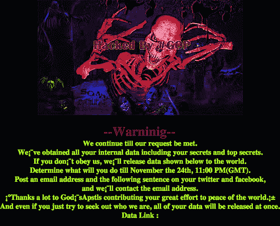

### 严厉警告

上方是索尼影视公司员工在 2014 年 11 月 24 日登录电脑时看到的屏幕。这次黑客攻击盗取了大量的文档和电子邮件，并删除了公司半数电脑和服务器上的所有数据。

### 奇特组合

索尼影视公司首席执行官迈克尔·林顿（Michael Lynton）和制片人主管艾米·帕斯卡尔（Amy Pascal）于 2010 年在索尼片场合影，他们性格上完全对立，但在十年里保持着高效合作。

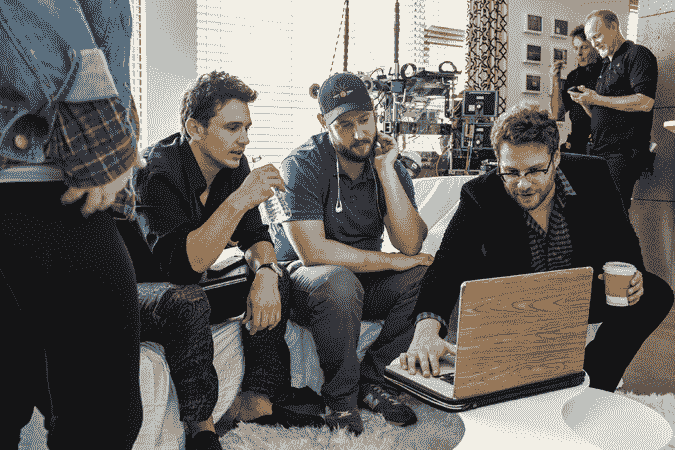

### 挑衅者

从左到右：演员詹姆斯·弗兰科（James Franco）、联合导演范·戈德伯格（Evan Goldberg），以及联合导演兼演员塞斯·罗根（Seth Rogen），他们位于《戏肉记者》片场。

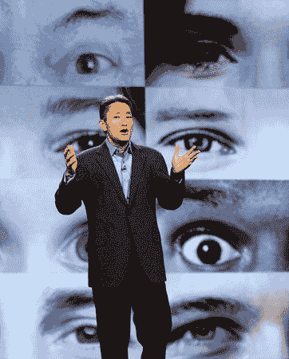

### 谨慎行事

2014 年春天，索尼公司首席执行官平井雄（Kazuo Hirai，见上）对《戏肉记者》对日与朝鲜之间已经紧张的关系的影响表示了担忧。

### 侮辱喜剧

在《戏肉记者》中，詹姆斯·弗兰科（左）扮演一名受 CIA 雇佣的笨拙记者，负责刺杀金正恩（由兰达尔·帕克（Randall Park，右）饰演）。

如今，索尼依然是一个巨头，拥有`128,400`名员工，在截至 2017 年 3 月结束的财年收入为`$67.9B`。但在过去的九个财年中，索尼已经损失了`$7.6B`。

# 第四章

## 如何保护你自己

对于政府或大型企业，更不用说个人了，网络安全可能是一个令人困惑的概念。本分步指南将帮助你防范骗子、黑客和病毒。

■ 免费 Wi-Fi ■ 网络钓鱼 ■ 设备与小用工具 ■ 恶意软件 ■ 身份盗用 ■ 广告 ■ 在职场中 ■ 在家中 ■ 密码 ■ 检查清单

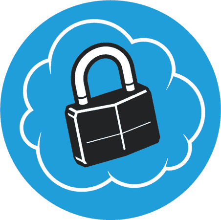

### 免费 Wi-Fi

当你的手机或电脑连接到公共无线网络时，如何防止入侵者进入

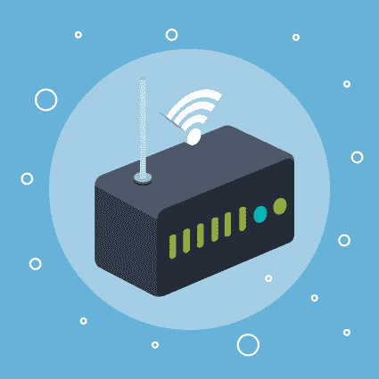

2017 年 10 月，研究人员发现几乎所有支持 Wi-Fi 的设备都存在一个重大安全漏洞。这种被称为`KRACK`的漏洞允许黑客绕过流行的 Wi-Fi 安全功能，并查看本应加密的网络上的 Web 流量。他们可以访问人们通过 Wi-Fi 网络传输的各种敏感信息，如密码和银行账户信息。Wi-Fi 设备制造商几乎立即开始发布补丁来解决这一问题，但许多旧的 Wi-Fi 设备不再接收此类更新，导致它们处于易受攻击状态。`KRACK`攻击强调了使用公共 Wi-Fi 的潜在危险。虽然不太可能有黑客徘伏在你的家庭网络中，但已知他们会在咖啡馆和机场安营，寄图入侵连接到那里的智能手机和电脑。要判断免费 Wi-Fi 网络上是否存在黑客几乎是不可能的，这使得问题变得更加严重。

1. **确保你连接到了正确的网络。** 假设仅仅因为网络与地点名称相同就连接到相应的网络可能是一个巨大的错误。例如，如果你在咖啡店或商店里，请员工核实其特定 Wi-Fi 网络的名称。这将让你避免连接到黑客设置的“欺骗性”或假网络。

## 仅连接到受密码保护的 Wi-Fi 网络

你可以通过名称旁边的锁图标识别它们。你通常可以从咖啡师或其他员工那里获得密码。当然，无法保证黑客没有拥有该密码，但它比完全开放的网络要好。

## 坚持访问在 WWW 地址之前带有“HTTPS”的网站

`HTTPS` 是一种安全协议，有助于保护你发送到特定网站的信息。

## 使用虚拟专用网络，或称 VPN

`VPN` 服务将帮助加密你在设备和互联网之间发送的所有数据，无论 Wi-Fi 网络是否受保护。许多 `VPN` 服务——如 `PureVPN` 和 `KeepSolid VPN Unlimited`——都需要支付小额费用。但这是值得的。

## 关闭手机、平板电脑或笔记本电脑上的任何文件共享和打印机共享选项

如果你没有使用任何无线配件，也请关闭 `Bluetooth`。黑客访问你设备的无线路径越少，你的整体安全性就越高。

## 网络钓鱼 (Phishing)

这不仅仅是一个听起来很奇怪的互联网词汇——它是一种严重的威胁。

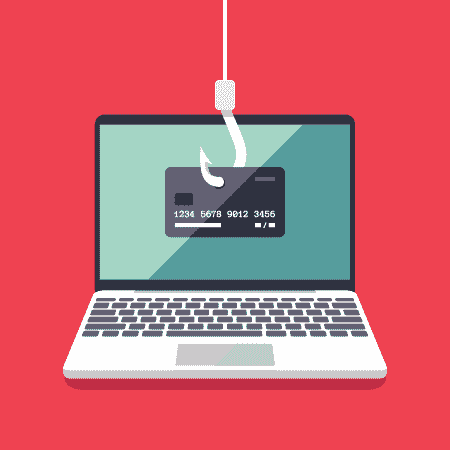

2017 年 5 月，大量记者开始收到电子邮件，其中包含一个分享给他们的 `Google Doc` 链接。这些邮件看起来很正常：在某些情况下，该文件似乎来自收件人认识的人。但事实证明这是一个复杂的网络钓鱼——试图通过将信息伪装成来自可靠来源来获取敏感信息，从而诱骗受害者交出 Google 账户。网络钓鱼诈骗并不新鲜，但犯罪分子已变得越来越擅长让这些诈骗看起来比旧式的“尼日利亚王子”求助请求更有说服力。

### 永远不要点击可疑链接

如果你通过电子邮件收到一个看起来陌生的链接，不要点击它。钓鱼者经常伪装成合法网站以获取登录凭据。谷歌垃圾邮件和滥用主管马克·里舍（Mark Risher）告诉《时代》杂志：“他们只是复制了你习惯看到的那个页面。”如果你收到一封看起来重要的邮件——无论是来自银行的警告，还是 Apple 通知你的 iCloud 服务——请尝试联系服务提供商确认该邮件是否已发送。

### 警惕威胁

钓鱼者通过诱导你点击链接或输入登录凭据获利，因此他们经常试图传达一种紧急感。邮件可能会促使你在特定时间内验证你的信息，否则他们将永久锁定或删除你的账户。这应该是一个红旗。

### 留意糟糕的语法

已知网络钓鱼邮件包含拼写和语法错误。与他们模仿的大型公司不同，钓鱼者没有作家和编辑团队。

### 仔细检查电子邮件

尽管图形、邮件别名和主题行可能很有说服力，但你通常可以通过仔细查看邮件地址来识别网络钓鱼诈骗。正如 CNET 发现的一封钓鱼邮件所示，伪装成 PayPal 的骗子使用的是这样的邮箱地址：`web-scured1@inc.pay1.com`。列出的 URL 情况通常类似。尽管发送者声称是 PayPal 或 Facebook，但邮件中包含的任何链接与这些网站的网址不同。不要通过点击链接来查看；你只需将鼠标悬停在上面通常就能看到 URL。因此，在可以使用笔记本电脑或台式电脑时查看可疑邮件可能是个主意，而不是在手机上查看。

## 设备与小用工具

数以亿计的连接设备意味着黑客有数以亿计的目标。

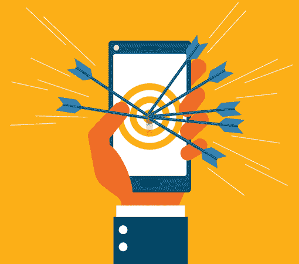

2014 年 11 月，黑客发布了大量来自索尼的敏感公司数据，其中包括高层高的个人信息、未上映电影的预告片以及尴尬的电子邮件。索尼的内部通信系统瘫痪，进一步限制了该公司的应对能力。这次攻击成了一大大新闻，部分是因为据报道黑客可能与北朝鲜政权有关，而且它发生在喜剧片《记者》（The Interview）发布之前，该片描述了一个针对北朝鲜领导人金正恩的暗杀计划。索尼黑客是手段复杂的攻击者，他们使用了多种方法绕过公司的防御。在事件发生后，一名声称参与了事件的人表示他获得了访问索尼公司电脑的物理权限。目前不清楚这是否真实还是仅仅是进一步的恐吓。但这一事件强调了个人和公司确保其设备物理安全的必要性。

1. 使用强密码保护手机、平板电脑和笔记本电脑等设备。离开家或办公室时，请确保注销或锁定设备。

2. 如果可以，使用你的“生物识别”安全功能，例如 iPhone 的 `TouchID` 指纹扫描仪。然而，请记住，这些某些功能已显示出弱性，意味着它们并非万无一失。

3. 务必使用加密，这是几乎每台现代电脑和智能手机上都有的一种安全功能。加密可以在你的设备被盗的情况下显著增加黑客访问你敏感数据的难度。企业加密提供商 `Covata` 的首席执行官 Trent Telford 这样描述加密数据：“从视觉上看，你只会看到一个由 1000 个无意义的字母组成的大区块。但当你解密时，你会发现里面隐藏着单词。”

4. 在旅行时不要离开视你的设备，设备保险公司 `Protect Your Bubble` 的董事总经理 Stacey Vogler 说道。“一旦它脱离你的视线，可能会发生很多事情——比如损坏或被盗，”她说。

5. 始终将你的智能手机和笔记本电脑放在身上或非常近的地方。把它想象成你的钱包。如果你晚上把任何设备留在办公室，将它们锁在抽屉里是个好主意，特别是如果你经常在很多人经常使用的开放区域工作。

## 恶意软件

也被称为病毒——最初的软件缺陷仅被网络放大了

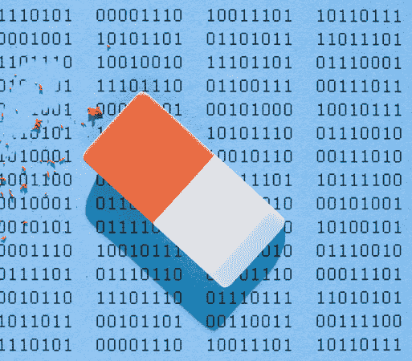

2017 年 5 月，全球各地的医院、企业和机构不幸遭遇了一场被恰切命名为 `WannaCry` 的网络攻击。这种恶意的勒索软件在公开时已传播到 150 个国家的 200,000 多台电脑。这种勒索软件源于微软 `Windows` 平台的一个漏洞，它通过加密受害者电脑的所有数据来锁定电脑，直到支付 300 美元的赎金。一旦你的系统被勒索软件感染，你几乎无能为力挽救它。但你可以采取一些预防措施，让你的电脑对恶意软件不那么敏感，并确保在发生攻击时你的所有信息都不会丢失。

### 安装软件更新

软件更新对于保持电脑安全至关重要，因为它们通常包含了黑客本可以利用的漏洞修复。不这样做会让你的电脑暴露在病毒、恶意软件和其他类型的攻击之下。赛门铁（Symantec）安全响应技术总监 Vikram Thakur 表示，“安装更新对于确保人们无法在未经许可的情况下在你的电脑上运行某些程序极其重要。”更新设备的方法取决于它运行的操作系统。`Windows 10` 和 `MacOS` 会自动应用安全软件更新。

### 更新你的手机软件

在 iPhone 上，打开 `Settings` 设置菜单，点击 `General` 通用选项并选择 `Software Updates` 软件更新。每个安卓手机型号的界面略有不同，但通常可以通过打开 `Settings` 设置菜单并导航到 `About` 关于部分来找到该选项。

### 备份你的数据

如果你能够在其他地方访问重要文件，那么失去电脑的访问权限就不会那么严重。这就是为什么对工作相关文件、家庭照片和其他个人数据备份至关重要。`Google`、`Microsoft`、`Dropbox` 和 `Apple` 等公司都提供了自己的云存储服务来这样做。你也可以选择在较大的外部硬盘上备份数据，例如 `SanDisk` 和 `Western Digital` 销售的硬盘。

### 使用杀毒软件

杀毒软件对于监控电脑的整体健康非常重要。`McAfee` 和 `Norton` 都提供了可以帮助防止病毒隐藏的产品。`McAfee` 的 `Total Protection` 可用于各种设备。`Norton` 提供了类似的产品。

## 身份盗窃

互联网最初的危险之一变得更加有害和普遍

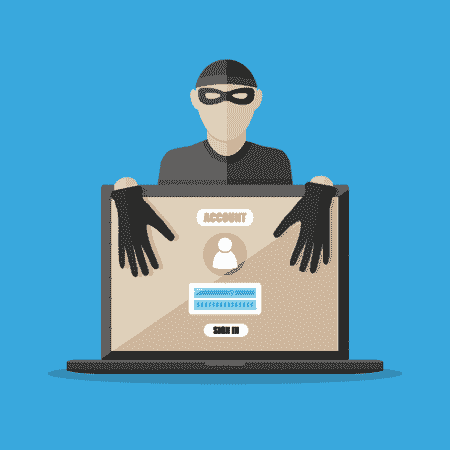

2017 年 9 月，消费者信誉报告机构 `Equifax` 宣布，去年夏天，黑客入侵了其网络并盗取了超过 1450 万美国人的个人信息——几乎是美国人口的一半。被盗数据包括人们的名字、出生日期、地址甚至是社会安全号码。较少的人（209,000 人）的信用卡信息也被盗了。安全专家现在担心某些缓存数据正在网上出售。一些专家认为该事件是历史上最大的单次个人信息泄露。`Equifax` 为泄露受害者提供了免费的信誉监控和信用冻结。但该公司因公布该事件太晚而受到批评。同时，一些受影响的人感到愤怒，因为他们在选择使用“三大”信誉报告机构中的哪一个时选择有限。预计事件的影响将继续持续几个月，很可能是多年。

1. 每周检查一次你的银行和信用卡账单。如果发现看起来不对，请致电你的银行或金融机构以获取更多信息。“这是定期检查在线银行和信用卡账单的第一原因，”`CreditCards.com` 的高级行业分析师 Matt Schulz 说道。

2. 也要密切关注你的信用分。如果身份盗窃者尝试用你的名义贷款或开信用卡，该活动将出现在信用报告上。

3. 如果你怀疑自己是身份盗窃或欺诈的受害者，你可以在信用报告上设置欺诈警报或信用冻结。“`NerdWallet` 的个人财务作家兼认证理财师 Liz Weston 说道，“信用冻结通常每个机构设置和移除费用为 3 美元到 10 美元。“如果你决定不冻结，你应该在三个机构的信用报告上都设置欺诈警报。”

4. 如果你是身份盗窃或欺诈的受害者，你可以在当地派出部门报警案。由于黑客和身份盗窃者通常在海外工作，当地警察很少能对他们做什么。但创建书面记录可以帮助你与银行和其他金融机构合作纠正任何问题。

5. 在范围巨大的 `Equifax` 泄露事件中，公司网站可以帮助你确定自己是否受到影响。`Equifax` 还向泄露受害者提供免费的信誉监控。

## 广告

在线广告不仅仅是分散注意力。它们内部还带有恶意软件

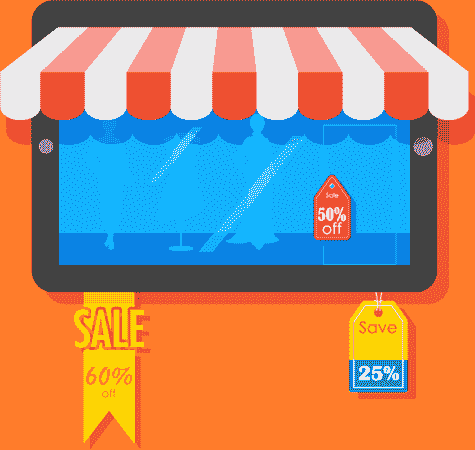

人们明显渴望逃避侵入性在线广告的骚扰。根据监控在线广告网站 `PageFair` 的数据，广告拦截插件（将网页广告替换为空白的小型软件）在全球范围内的普及率在 2016 年增长了 30%。谷歌也在 2018 年的 `Chrome` 浏览器中增加了一个项争议的新功能，将自动拦截不符合特定标准的广告（例如带有声音的自动播放视频广告和弹出广告）。在互联网上保持完全隐私可能意味着根本不上网。但最近出现了一系列技术，可以帮助你至少维持一些隐私。

## 安装广告拦截器

这些浏览器插件（如 `uBlock Origin`）可以阻止广告识别并追踪你。网络安全专家还建议安装禁用 `cookies` 的工具，它们存储了有关用户的信息，以使某些网站的使用更加顺畅。`Privacy Badger` 就是由电子前线基金会（Electronic Frontier Foundation）推出的示例，该组织是一个旨在保护用户数字权利的国际非营利组织。

## 考虑临时信用卡

如果你对在线广告的内容感兴趣，点击它并没有错。通过在线广告购买东西也没有错。如果你经常通过这种方式进行在线购物，一种保护自己的可靠方法是考虑获取临时卡进行购买。许多银行和像 `Privacy` 这样的第三方公司都提供创建具有短有效期的虚拟在线卡的选项。这些卡与你的实际信用卡绑定，但具有不同的号码、安全代码和有效期。它们还有由你自己设置的虚拟额度。

## 不要告诉他们你在哪里

不可否认的是，广告已经变得越来越复杂，能够根据消费者实际居住和工作的地方进行投放。检查你的 `Facebook`、`LinkedIn`、`Twitter` 以及其他社交媒体网站上的隐私设置，寻找如位置设置之类的选项并将其关闭。在你的智能设备上，如果不使用，也请关闭 `GPS`、`Wi-Fi` 和 `蓝牙` 连接。在手机的 `Settings` 部分，你还可以根据应用程序切换位置设置，为那些绝对不需要该功能的应用关闭它。

## 使用无痕模式

这种模式可以限制广告收集关于你的信息，并且不会存储你的浏览历史。在谷歌的 `Chrome` 浏览器上，使用 `File > New Incognito Window`；在苹果的 `Safari` 上，使用 `File > New Private Window` 来启动该功能。

## 在公司

仅仅是员工就可能让你成为虚假信息和操纵性目标

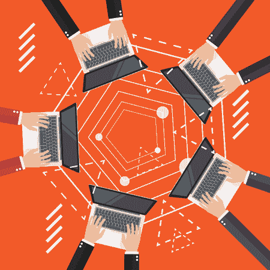

全球最大的银行之一 `JPMorgan Chase` 在 2014 年透露，黑客曾入侵了其网络，并获取了至少 7600 万户家庭消费者的姓名、地址、电话号码和电子邮件地址。该银行当时表示，“没有证据”表明任何账户信息在这次攻击中遭到泄露，但这次攻击仍被认为是对美国公司以来最严重的攻击之一。后来被发现，同一批黑客还针对了其他几家金融公司，包括 `E-Trade` 和 `Scottrade`。黑客使用的技术中包括：“鱼叉式钓鱼”，即欺骗公司员工交出登录信息。（该技术之所以这样命名，是因为它是针对特定个人或小群体的钓鱼尝试。）鱼叉式钓鱼通常以看似伪装成员工的工作邮件的形式出现。

1. 激活双重身份验证。

2. 报告任何可疑邮件。

3. 修改你的密码。

4. 删除你的录音。

5. 避免使用 USB 盘。

## 在家里

越来越多的人在家里充满了智能设备

现在从电视到扬声器的一切设备都具备监听能力，维护隐私可能比任何时候都更加困难。随着更多设备的连接，这个问题在未来几年可能只会增加。电视制造商 `Vizio` 在今年早些时候支付了 220 万美元和解了一项指控该公司收集数据的诉讼。诉状称，某些追溯到 2014 年的 `Vizio` 电视默认开启了软件，该软件会监控用户观看的内容。

### 遮住笔记本电脑摄像头

遮住电脑摄像头可能无法阻止黑客接管它，但有助于确保他们无法获得可以对付你的私人视频。黑客可以通过一种被称为公司远程管理工具（`RAT`）的软件访问你的网络摄像头及更多内容。即使是 `Facebook` 首席执行官 `Mark Zuckerberg` 也给他的笔记本摄像头贴上了胶带。

### 关闭某些电视功能

虽然将智能电视断开网络连接是确保敏感数据不被传输的最佳方法，但这样做会显著限制其功能。一些电视制造商允许你禁用特定的数据收集功能。例如，在 `Vizio` 电视上，导航到 `Menu > System > Reset & Admin > Viewing Data` 并将其切换到“off”即可解决。

### 关闭语音识别

包含 `Google Assistant` 的较新安卓机型以及支持苹果 `Hey Siri` 功能的 iPhone 会监听触发词，以便在无需按键的情况下回答问题并满足请求。如果这让你感到不舒服，可以通过长按 `Google Pixel 2` 的主键，点击看起来像三个点的图标，并选择 `Settings` 来关闭 `Google Assistant` 的此功能。在 iPhone 上，前往 `Settings > Siri & Search > Listen for “Hey Siri.”`。

### 删除你的 Amazon Echo 录音

如果你拥有一个 `Amazon Echo` 扬声器，很可能你已经接受了设备监听你对话的概念。亚马逊存储语音日志是为了更好地适应你的偏好。然而，你可以通过 `Alexa` 应用进入 `Settings > History` 来删除你的语音请求历史。从那里，你可以点击录音进行删除。你也可以通过访问 `Amazon Content and Devices` 网站，点击 `Your Devices` 标签，选择你的设备，然后选择 `manage your voice recordings` 进行操作。

它们确实很麻烦，但也是数字防御的第一道必要防线。

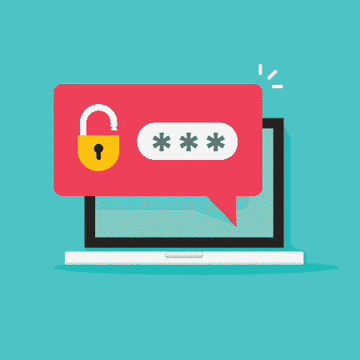

2017 年，雅虎（Yahoo）披露其约 30 亿用户账户均受到了此前披露的 2013 年数据泄露事件的影响。泄露的数据可能包括电子邮件地址、密码、出生日期和电话号码。这是史上规模最大的网络安全漏洞之一，但雅虎绝并非唯一受黑客之害的大型企业。Myspace 也在 2016 年确认曾遭受过攻击，导致 3.6 亿登录凭据泄露。虽然这些步骤可能无法防止你的密码落入他人之手，但它们确实可以帮助减轻潜在损害。

## 定期更改密码

经常更改密码可以增加黑客获取有效登录凭据的难度。如果你认为自己的信息可能已被盗取或破解，这是一个一个尤为重要的第一步。但要注意避免重复使用旧密码，或与你之前的密码相似的词汇和短语等常见陷阱。这样做只会让黑客更容易破解，特别是当他们了解你之前的密码时。

## 创建强密码

编写一个容易记忆的密码可能很有诱力，但这些密码通常也是犯罪分子和计算机算法最容易猜到的。让你的密码长一些，并尝试包含特殊字符、数字以及大写和小字母的混合。避免使用常用短语。

## 使用密码管理器

使用如 `1Password` 或 `LastPass` 等密码管理器会让创建复杂密码的理由变得更加充分。这些应用程序存储你的密码并为你自动填充，这样你就不需要记住登录凭据了。例如，`1Password` 和 `LastPass` 使用加密保护这些数据。你只能通过创建的主密码来访问它们。

## 设置双重身份认证

许多数字服务（包括社交媒体平台、电子邮件提供商和在线银行）都提供多因素认证。这本质上是在输入密码后的登录过程中增加了第二个步骤（即第二个“因素”）。它使得仅凭密码无法访问你的账户。大多数平台提供几种不同的双重认证选项，例如通过电子邮件或短信发送代码，或者通过电话。如果你在多种设备上接收短信或电子邮件，虽然可能稍微更费时间，但选择电话验证可能更稳妥。

## 清单

撕下这份实用的指南并严格遵守，特别是如果你刚开始接触网络世界。

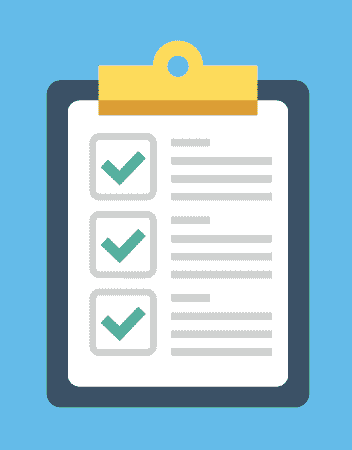

1. **使用复杂密码**

   使用“12345”作为密码就像用牙线锁住你的自行车。`LastPass` 和 `1Password` 可以帮助生成安全的密码。

2. **频繁更改密码**

   定期更改密码（例如每月一次甚至每周一次）可以帮助在黑客万一拿到你的旧密码时，防止他们访问你的账户。

3. **使用双步认证**

   确保在任何提供该服务的网站或应用上激活它，并将其视为你数字堡垒的第二道墙。

4. **避开公共 Wi-Fi 网络**

   如果你无法避免公共 Wi-Fi 网络，使用虚拟专用网络（或 `VPN`）是好的，可以让你的上网活动避开窥探。

5. **警惕可疑邮件**

   许多电子邮件提供商已经非常擅长在可疑邮件出现在收件箱之前对其进行检测和过滤。但某些恶意邮件仍可能发送到你这里。因此，请务必谨慎。

# 6. 更新你的设备

大多数设备制造商都会花费大量时间修补漏洞。但为了让你获得这些更新，你必须确保你的软件是最新的。

# 7. 使用病毒防护

`McAfee` 和 `Norton` 都提供顶尖的病毒防护解决方案，根据你的需求提供一系列订阅、功能和价格。也有非常好的免费选择，包括 `Avast` 和 `Bitdefender`。

# 8. 备份你的数据

备份数据最简单的方法是使用外部硬盘以及 `Windows` 或 `Apple` 电脑自带的备份软件。还有几种在线订阅服务可以让你将电脑备份到遥远的服务器上，这将确保在发生火灾或其他灾难时你有备份。

# 9. 贴住笔记本电脑的摄像头

黑客劫持你的电脑摄像头并秘密录制你尴尬视频的想法听起来像反乌托邦科幻小说，但对这种可能性采取预防措施并无害处。用一点胶带效果很好，而且当你需要和孩子进行 `FaceTime` 通话时很容易取掉。或者，确保在不使用笔记本电脑时保持盖子关闭。

# 10. 保持设备物理安全

永远不要在公共场所独自离开电脑。将工作电脑锁在锁好的抽屉里也是明智之举。你应该远离来源不明的 `USB` 盘。为了增加安全性，你可以设置电脑在每次开机以及每次从睡眠模式中唤醒时都需要输入密码。

—Lisa Eadicicco 和 Alex Fitzpatrick

# 英雄还是反派？好莱坞仍在思考

娱乐界为了理解和刻画黑客的漫长而奇特的努力 作者：ELIANA DOCKTERMAN

《黑客帝国》（`Mr. Robot`）这部 2015 年关于黑客的美剧，其上映时机非常完美——正值重大黑客事件开始成为头条新闻——它对黑客能做什么、不能做什么的描述获得了赞誉。

黑客是一个很有吸引力的反派。除非好人阻止他（或她），否则黑客可以发射导弹或勒索总统。黑客也具有当英雄的潜力。他完全可以发现一个政府阴谋，或者击败一家邪恶公司。自 80 年代以来，剧作家们一直在思考这个问题——有时比其他时候做得更好。问题是，为什么好莱坞在将计算机天才带入银幕方面一直表现不一？

一方面，看着人们在输入代码时皱脸并不特别吸引人，导演们长期一直如何让键盘这种微妙的武器变得像剑或激光束一样精彩。一部爱德华·斯诺登（`Edward Snowden`）阅读国家安全局（`NSA`）文件的传记，永远不会像《印第纳·琼斯》探索隐藏墓穴或《神奇女侠》与德国士兵搏斗那样精彩。为了让这些场景更有质感，一些电影人创造了充满二进制数字或唱歌病毒的迷幻空间，并因此发现自己成了真实黑客嘲笑的对象，更说每个用过电脑的人了。

更重要的是，《战争游戏》（`WarGames`）引起了罗纳德·里根的关注。在戴维营庄看完这部电影后，总统要求他的顾问研究是否真的有人能黑入核武器库库。他们很快给出了答案：肯定的。事实上，美国国家安全局已经对苏联和中国的通信系统进行了黑客入侵。这些国家开始做同样的事情只是时间问题。那次调查最终导致里根签署了一项国家安全指令，并使国会通过了《计算机欺诈滥用法》（`Computer Fraud Abuse Act`），这是一项至今生效的全面反黑客法案。

在整个 20 世纪 80 年代和 90 年代，电影剧作家和导演试图复制《战争游戏》在票房的成功。早期的电影，如 1982 年的《电子幻战》（`Tron`）将黑客行为描绘类似于玩视频游戏，而后来的电影则尝试增加现实感。这导致了一些令人发笑的缺陷：在 1995 年的《黑客帝国》（`Hackers`）中，安吉丽娜·乔莉的角色用一个卡通病毒兔嘲讽她的敌人；而在 1992 年的《偷天监控》（`Sneakers`）中，罗伯特·雷德福的角色带领着一支黑客团队，他们使用了一种可以破解所有加密术的不切实际万能钥匙。这两部电影虽然因为这种尝试而受到喜爱，但现在已完全过时。

与此同时，电影观众变得越来越老练。因此，一些导演决定转向奇幻风格。在 1999 年的《黑矩阵》（`The Matrix`）中，一名电脑黑客（基努·里维斯 饰）在网络上偶然了一个反抗军组织，他们揭示了大多数人生活在一个由意识机器创造的虚假世界中。这种构想利用了对计算机力量日益增长的偏执。它还巧妙地将现实战争作为网络战争的代名词：里维斯饰演的角色“尼奥”（`Neo`）进入另一个世界“矩阵”（`Matrix`），在那里对反派练习他受忍者启发的动作。大多数观众将“尼奥”视为一个战士，而不是一个电脑宅。

在整个 21 世纪 00 年代，黑客角色从英雄降级为团队的成员。他们在抢劫行动中总是大派用场。他们能让红灯变绿（《意大利大劫》，`The Italian Job`，2003）或制作伪造监控摄像头录像（《十一线谍》，`Ocean’s 11`，2001）。他们也是极好的助手。黑客会告诉你坏人正要去哪里（《蜘蛛侠：英雄回归》，`Spider-Man: Homecoming`，2017），或者那个坏蛋是否真的在找你（《24 小时》，始于 2001 年）。

最近，黑客作为主角回归了。一些电影人找到了颠覆我们对黑客刻板印象的方法，创造了引人入胜的新角色。2010 发布的《社交网络》（`The Social Network`）让黑客变得接地气。在早期场景中，马克·扎克伯格（杰西·艾森伯格 饰）通过黑入哈佛大学的学生数据库，创建了一个名为“脸书粉碎”（`FaceSmash`）的网站，用户可以根据吸引力对同学进行评分。（他确实这样做过。）黑客行为突然变得更加真实。它不仅是试图推翻政府的工具，也是试图推翻社会阶层的工具。

其他作品将黑客与更老的类型相结合。斯蒂格·拉尔松的小说《龙纹身的女孩》（`The Girl with the Dragon Tattoo`）以及它的两部电影改编版让黑客变得酷炫。它将经典的黑色电影与现代技术相结合，使黑客变得类似于侦探，而不是一个在地下室里打字的书呆。这部出版界的畅销书涵盖了从尼尔·斯蒂芬森到玛格丽特·阿特伍德等作家探讨过的话题。

接着是黄金时代的电视节目。2015 年，美国国家广播电台播出了《机器人总》（`Mr. Robot`），这是一部关于一群类匿名组织黑客的剧，他们自称为“F 社会”（`F Society`），并致力于击败邪恶的联合体“E 公司”（`E Corp`）。剧并没有把大部分时间花在主角艾利特（`Elliot`）的电脑屏幕上，而是创始人萨姆·埃斯梅尔关注迫使艾利特（拉米·马拉克 饰）进行黑客行为的环境——一家保守秘密的公司，一个日益由少数富有权势的人统治的世界。当需要展示艾利特的屏幕时，埃斯梅尔要求演员学习基础代码，并让美术设计在屏幕上放置真实的代码，以便演员能够对发送和接收的信息做出准确反应。《机器人总》以其准确性为傲，甚至在剧集中嘲讽了像《黑客帝国》（`Hackers`）这样的电影。

其他节目，如 HBO 的喜剧剧《硅谷》（`Silicon Valley`）——关于一群渴望成为创业者的人，以及《燃点风暴》（`Halt and Catch Fire`）——故事发生在“硅谷草原”（80 年代的德克萨斯州，是今日硅谷的前身），审视了编程文化以及随之而来的实战黑客行为。这些节目通过创造不仅仅是敲击键盘的有趣角色，赢得了评论界的好评。

与此同时，黑客又回到了电影院。在 2017 年的《速度与激情 7》（`Fate of the Furious`）中，查理兹·塞隆饰演的反派西西（`Cipher`）通过在天上的飞机上打字来控制地面事件，包括覆盖汽车的导航系统让它们成群结队地行驶——甚至冲出五楼高的停车场——以此让警察远离她的目标。《速度与激情 7》在国际票房上狂揽 12 亿美元，这是一个冷酷而现实的信号，表明好莱坞终于掌握了黑客的力量。如果这些热门影片预示了未来，我们可以期待看到更多精通技术的英雄——以及反派。

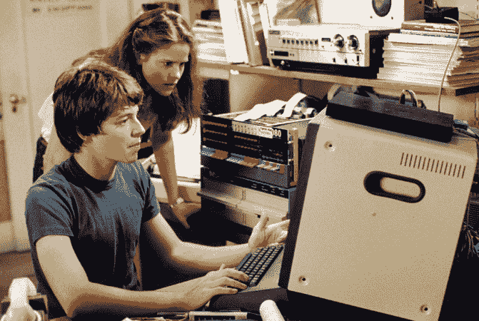

1983 年《战争游戏》

## 早期

《战争游戏》对于当代观众来说并不好懂，但它对甚至是业余黑客潜在影响的描绘却依然如此。像《龙纹身的女孩》（`The Girl with the Dragon Tattoo`）、《新设定》（`MaddAddam`）和《冲击波行者》（`The Shockwave Rider`）等书籍，以及多年来的许多其他作品，探索了黑客文化的各个方面以及它在高度连接的未来可能产生的结果。这些作品为黑客提供了模板，就像 1982 年的《电子幻战》（`Tron`）和 90 年代中期虽然完美的《黑客帝国》（`Hackers`）中呈现的那样。

《电子幻战》，1982

《冲击波行者》，1975

《龙纹身的女孩》，2005

《新设定》，2013

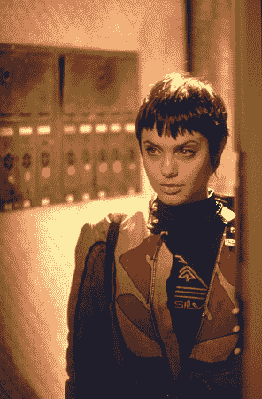

《黑客帝国》，1995

《社交网络》，2010

## 越来越近

随着互联网以及网络安全成为人们生活中更普遍的一部分，电影在描绘不同类型的黑客方面变得更好。《黑矩阵》（`The Matrix`）是一部高节奏、视觉特效丰富的冒险片，但至少部分基于现实的想法。像《社交网络》（`The Social Network`）和《斯登》（`Snowden`）这样的电影描述了黑客的传记，而像《十一线谍》（`Ocean’s`）这样的系列电影将他们作为可靠的助手，以保持剧情的新鲜感。

《黑矩阵》，1999

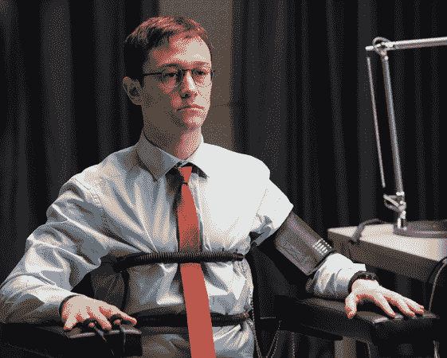

《斯登》，2016

《十一线谍》，2001

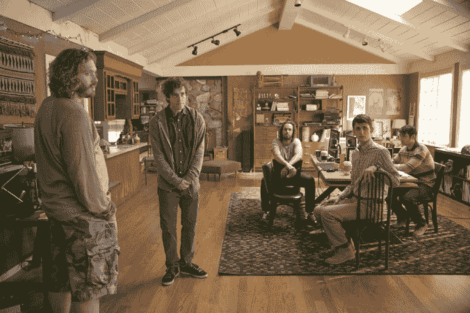

《硅谷》，2014

## 黄金时代电视

最近，黑客在电视上得到了广泛实现。除了美国广播电台色彩较重的《机器人总》（`Mr. Robot`），HBO 的《硅谷》（`Silicon Valley`）——关于一群笨书呆的搞笑喜剧——展示了轻松的一面。

# 破解黑客

插图：Jameson Simpson。Lightspring/Shutterstock。纽约州南部联邦检察官办公室通过《纽约时报》Redux。（左）iStock/Getty Images Plus；无署谢。Jack Ludlam/Alamy。Marzena Abrahamik 为《时代》（从左上顺时针）Sam Hodgson/《纽约时报》Redux；Scott Halleran/Getty Images；Theodore Wood/Camera Press/Redux。Donna Abbot-Vlahos，《Albany Business Review》（2017）；版权所有；经许可转载。Adam Ferriss。

# 给所有人的警示

插图：Jameson Simpson。Brobel Design 为《时代》（从上部开始）Alexei Druzhinin/AFP/Getty Images；Saul Loeb/AFP/Getty Images。插图：Tavis Coburn。插图：Francesco Francavilla。Ariel Zambelich/Wired © Conde Nast.Thom Lang/Corbis/Getty Images。David Paul Morris/Bloomberg 通过 Getty Images。Joe Pugliese/August。Brent Humphreys 为《时代》。来自 Malerapaso/iStock/Getty Images 照片的插图。（从上部开始）Krisztian Bocsi/Bloomberg 通过 Getty Images；Sean Gallup/Getty Images。

## 如何保护你自己

插图：Jameson Simpson。（从左到右）iStock/Getty Images Plus (2）；Digital Vision Vectors/Getty Images；Jorg Greuel/Getty Images；iStock/Getty Images Plus (6)。

# 流行文化

Michael Parmelee/USA Network。（从上部顺时针）MGM/UA Entertainment Co./Photofest；Penguin Random House (3）；United Artists/Photofest；© Buena Vista/由 Everett Collection 提供。（从上部顺时针）© Warner Bros./由 Everett Collection 提供 (2）；Open Road Films/Photofest；Merrick Morton/© Columbia Pictures/由 Everett Collection 提供。HBO/Photofest。Jeffrey Coolidge/Getty Images。Google/REX/Shutterstock。

## 从农到浏览器

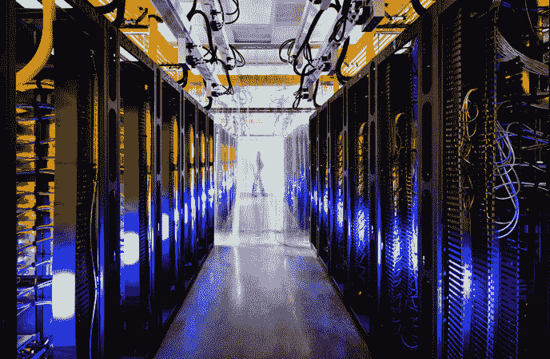

## 互联网存在哪里？

这个问题的答案可能并非“无处不在”——至少目前如此。答案很大一部分是数据中心，或称“服务器农场”，例如由 `Google` 运营的这一处。随着世界对信息的需求增加，这些巨大的计算机群数量不断增加。根据行业研究公司 `IDC` 分析师的数据，全球数据中心空间将继续膨胀，从 2013 年的 15 亿平方英英到 2018 年的 194 亿平方英。

编辑：Edward Felsenthal

创意总监：D.W. Pine

摄影指导：Kira Pollack

# 网络安全

## 黑客、暗网与你

编辑：Matt Vella

设计：Sharon Okamoto

作者：Charlotte Alter, Massimo Calabresi, Eliana Dockterman, Lisa Eadicicco, Peter Elkind, Alex Fitzpatrick, Erika Fry, Lev Grossman, Robert Hackett, Jay Newton-Small, Simon Shuster

摄影编辑：Patricia Cadley

记者：Andréa Ford

编辑制作：David Sloan

# 时代书丛

出版商：Margot Schupf

财务高级副总裁：Anthony Palumbo

营销副总裁：Jeremy Biloon

营销服务执行总监：Carol Pittard

营销总监：Jean Kennedy

销售总监：Christi Crowley

财务副总监：Jill Eary

营销副总监：Bryan Christian

助理法务总：Andrew Goldberg

制作副总监：Susan Chodak

财务高级经理：Ashley Petrasovic

高级品牌经理：Katherine Barnet

印前经理：Alex Voznesenskiy

项目经理：Hillary Leary

编辑总监：Kostya Kennedy

创意总监：Gary Stewart

摄影指导：Christina Lieberman

编辑运营总：Jamie Roth Major

高级编辑：Eileen Daspin, Alyssa Smith

编辑运营经理：Gina Scauzillo

助理艺术总监：Allie Adams

主编：Rina Bander

助理编辑：Courtney Mifsud

eISBN: 978-1-54784-241-4

特别感谢：Don Armstrong, Brett Finkelstein, Melissa Frankenberry, Kristina Jutzi, Seniqua Koger, Kate Roncinske

版权 © 2018 Time Inc. Books

由 Time Books 出版，Time Inc. Books 旗下品牌

225 Liberty Street • New York, NY 10281

版权所有。未经出版商书面许可，本书以任何形式或通过任何电子或机械手段（包括信息存储和检索系统）均不得复制，但评论者可在评论中引用简短段落。TIME 和红框设计在美国以及《时代》杂志发行的海外国家已通过商标注册保护。

我们欢迎对《时代书丛》的意见和建议。请将信件寄至：Time Books, Attention: Book Editors, P.O. Box 62310, Tampa, FL 33662-2310。

欲获取更多独一无二的《时代》特版和纪念品，请访问 [timespecialeditions.com](https://timespecialeditions.com)

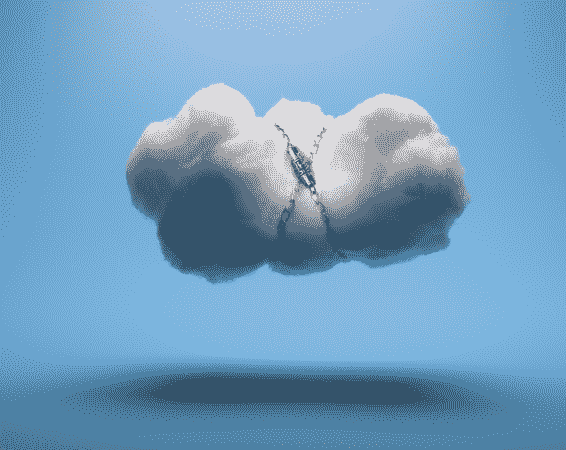
