## Tkinter、数据科学与机器学习


### 作者简介

**Vivian Siahaan** 是一位极具进取心的个体，对持续学习和探索新领域充满热情。她出生并成长于位于风景如画的多巴湖畔的 Hinalang Bagasan, Balige，在 SMAN 1 Balige 完成了高中学业。Vivian 的编程之旅始于深入钻研各种语言，如 `Java`、`Android`、`JavaScript`、`CSS`、`C++`、`Python`、`R`、`Visual Basic`、`Visual C#`、`MATLAB`、`Mathematica`、`PHP`、`JSP`、`MySQL`、`SQL Server`、`Oracle`、`Access` 等。从零起步，Vivian 勤奋钻研编程，专注于掌握基础语法与逻辑。她通过创建实用的 GUI 应用程序磨练技能，逐步积累专业知识。Vivian 特别感兴趣的领域之一是动画与游戏开发，她渴望在此领域做出重要贡献。除了编程和数学研究，她还乐于沉浸于小说阅读，培养对文学的热爱。

Vivian Siahaan 对编程的热情及其渊博的知识体现在她撰写的众多电子书中。她的作品由 Sparta Publisher 出版，涵盖广泛主题，包括《Java 数据结构》、《Java 编程：食谱》、《C++ 编程：食谱》、《面向高中/职高及学生的 C 语言编程》、《面向高中/职高的 Java 编程》、《Java 教程：GUI、图形与动画》、《Visual Basic 编程：从入门到精通》、《Java 动画与游戏编程》、《面向高中/职高及学生的 C# 编程》、《面向学生和研究人员的 MATLAB》、《JavaScript 图形学：快速学习系列》、《JavaScript 图像处理方法：从入门到精通》、《Java GUI 案例研究：AWT 与 Swing》、《CSS 与 JavaScript 基础》、《PHP/MySQL 编程：食谱》、《Visual Basic：食谱》、《面向高中/职高及学生的 C++ 编程》、《C++ 概念与实践》、《面向学生的 PHP/MySQL》、《C# 编程：从入门到精通》、《面向高中/职高及学生的 Visual Basic》以及《面向高中/职高及学生的 C# .NET 与 SQL Server》。

此外，在 ANDI Yogyakarta 出版社，Vivian Siahaan 参与了多部知名书籍的编写，包括《Python 编程理论与实践》、《Python GUI 编程》、《Python GUI 与数据库》、《从零构建基于 Python/MySQL 的学校数据库管理系统》、《Python/MySQL 数据库管理系统》、《用于犯罪记录数据库管理系统的 Python/MySQL》、《用于犯罪记录数据库管理系统的 Java/MySQL》、《使用 Java/MySQL 的数据库与密码学》以及《从零构建基于 Java/MySQL 的学校数据库管理系统》。

Vivian 在编程语言方面的多元化专长，加上她探索新天地的热情，使她成为技术领域一位充满活力且多才多艺的人物。她对学习的执着，加上其强大的分析和解决问题的能力，使她在任何编程项目中都是宝贵的资产。Vivian Siahaan 对编程世界和文学的贡献持续激励并赋能着有抱负的程序员和读者。


Rismon Hasiholan Sianipar 于 1994 年出生于 Pematang Siantar，是电气工程领域的杰出研究员和专家。在 SMAN 3 Pematang Siantar 完成学业后，Rismon 前往 Jogjakarta 城市开启其学术生涯。他在 Dr. Adhi Soesanto 和 Dr. Thomas Sri Widodo 等知名教授的指导下，分别于 1998 年和 2001 年在 Gadjah Mada 大学获得了电气工程学士（S.T）和硕士（M.T）学位。

求学期间，Rismon 专注于利用时频图研究非平稳信号及其能量分析。他探索了信号能量分布在时频图上的动态特性，并利用离散小波变换开发了创新技术，设计非线性滤波器用于数据模式分析。他的研究展示了这些技术在各个领域的应用。

凭借卓越的学术造诣，Rismon 于 2003 年荣获日本政府颁发的**文部科学省奖学金**（Monbukagakusho scholarship）。随后，他在 Prof. Dr. Hidetoshi Miike 的指导下，于山口大学攻读并获得了工学硕士（M.Eng）和工学博士（Dr.Eng）学位。Rismon 的硕士和博士论文围绕将 SR-FHN（随机共振 Fitzhugh-Nagumo）滤波器强度与 ECC（椭圆曲线密码学）4096 位密码系统相结合展开。这种创新方法在确保数字图像和视频真实性的同时，有效抑制了其中的噪声。

Rismon 的研究成果发表在知名国际科学期刊上，其专利也在日本正式注册。值得注意的是，其注册号为 2008-009549 的一项专利获得了认可。他积极与日本的多所大学和研究机构合作，专攻密码学、密码分析和数字取证，特别是在音频、图像和视频分析领域。

怀揣着分享知识的热情，Rismon 撰写了大量国家级和国际级科学论文，并编写了数本国家级书籍。他还积极参与与密码学、密码分析、数字水印和数字取证相关的研讨会。在这些研讨会上，Rismon 协助 Hidetoshi Miike 教授开发了与数字图像和视频处理、隐写术、密码学、水印技术等相关的应用，这些应用作为宝贵的培训材料。

Rismon 的研究兴趣涵盖多媒体安全、信号处理、数字图像和视频分析、密码学、数字通信、数字取证和数据压缩。他通过使用 Python、MATLAB、C++、C、VB.NET、C#.NET、R 和 Java 等编程语言开发应用程序，持续推进研究工作。这些应用程序服务于科研和商业目的，进一步促进了信号和图像分析的发展。

Rismon Hasiholan Sianipar 是一位致力于电气工程领域的研究员和专家，尤其在信号处理、密码学和数字取证方面造诣深厚。他的学术成就、专利发明和大量出版物彰显了他推动这些领域知识发展的决心。Rismon 对学术界的贡献以及与日本知名机构的合作，奠定了他在科学界受人尊敬的地位。通过持续的研究和创新应用的开发，Rismon 继续为电气工程领域做出重要贡献。

---

### 关于本书


### 特征分布与数据可视化

#### 主类

##### 定义主类

打开一个新的 Python 文件并将其保存为 `main_class.py`。然后，按如下方式导入两个库：

```python
##### main_class.py
import tkinter as tk
```


#### Tkinter GUI 应用程序结构

##### 导入 Tkinter

```python
from tkinter import *
```

这两行代码在 Python 中导入 `tkinter` 库，并使其类和函数可在脚本中使用。让我们分解一下这些行：

1.  `import tkinter as tk`：
    此行导入整个 `tkinter` 库并为其分配别名 `tk`。使用别名是一种常见做法，可使代码更简短、更具可读性，尤其是在需要从导入的库访问各种类和函数时。

2.  `from tkinter import *`：
    此行将 `tkinter` 库中的所有类和函数导入到脚本的命名空间中。星号 `*` 是一个通配符，代表 `tkinter` 库中的所有元素。它允许你直接使用 `tkinter` 类和函数，而无需使用 `tk` 前缀。

这两行代码共同提供了对 `tkinter` 库的访问，该库用于在 Python 应用程序中创建图形用户界面 (GUI)。使用 `tkinter`，你可以创建窗口、按钮、标签、文本框和其他 GUI 元素，以构建交互式桌面应用程序。

##### 定义主类

使用 `tkinter` 库创建一个基本的图形用户界面 (GUI) 应用程序。让我们分解一下代码：

###### 类定义 - `Main_Class`

```python
class Main_Class:
    def __init__(self, root):
        self.initialize()
```

这定义了一个名为 `Main_Class` 的类。它有一个构造函数 (`__init__`)，接受两个参数：`self` 和 `root`。`self` 是对正在创建的类实例的引用，而 `root` 预期是一个 `tkinter` `Tk` 实例（主应用程序窗口）。

###### 初始化方法 – `initialize()`

```python
def initialize(self):
    self.root = root
    width = 1500
    height = 750
    self.root.geometry(f"{width}x{height}")
    self.root.title("TKINTER AND DATA SCIENCE")
```

*   `initialize()` 方法在类的构造函数中被调用，负责设置主应用程序窗口。
*   它将 `root`（主 `tkinter` 窗口）赋值给 `self.root`，使其在类内部可访问。
*   它使用 `geometry` 方法将窗口的宽度和高度设置为 1500x750 像素。
*   它使用 `title` 方法将窗口标题设置为 "TKINTER AND DATA SCIENCE"。

###### 主执行块

```python
if __name__ == "__main__":
    root = tk.Tk()
    app = Main_Class(root)
    root.mainloop()
```

*   此块检查脚本是作为主程序运行（而非作为模块导入）。
*   它创建一个名为 `root` 的 `tkinter` `Tk` 实例，代表主应用程序窗口。
*   然后它创建 `Main_Class` 类的一个实例，并将 `root` 窗口作为参数传递。
*   最后，它使用 `root.mainloop()` 进入主事件循环，使应用程序保持运行并响应用户交互。

总之，这段代码定义了一个基本的基于 `tkinter` 的 GUI 应用程序及其主窗口。`Main_Class` 类用于封装窗口初始化逻辑。运行脚本时，它会创建主窗口、对其进行配置，并进入 `tkinter` 事件循环，从而允许 GUI 显示并供用户交互。

##### Design_Window 类

创建一个名为 `design_window.py` 的新 Python 文件。该类旨在封装使用 `tkinter` 库的图形用户界面 (GUI) 窗口的设计和布局。

###### `design_window.py`

```python
import tkinter as tk
from tkinter import ttk
from matplotlib.figure import Figure
from matplotlib.backends.backend_tkagg import FigureCanvasTkAgg

class Design_Window:
    def add_widgets(self, root):
        # 添加按钮
        self.add_buttons(root)
        # 添加画布
        self.add_canvas(root)
        # 添加标签
        self.add_labels(root)
        # 添加列表框控件
        self.add_listboxes(root)
        # 添加组合框控件
        self.add_comboboxes(root)
```

总之，`Design_Window` 类旨在提供一种结构化的方式，将各种 GUI 元素（按钮、画布、标签、列表框和组合框）添加到 `tkinter` 窗口中。这些元素的组织旨在为应用程序创建一个用户友好且功能齐全的图形界面。然而，要完全了解这些控件是如何配置和排列的，你需要参考 `design_window.py` 中的实际代码。

###### 添加按钮

代码在 `Design_Window` 类中定义了一个名为 `add_buttons()` 的方法。它向 `tkinter` GUI 窗口添加两个按钮：

```python
def add_buttons(self, root):
    # 添加按钮
    self.button1 = tk.Button(root, height=2, width=30, text="LOAD DATASET")
    self.button1.grid(row=0, column=0, padx=5, pady=5, sticky="w")
    self.button2 = tk.Button(root, height=2, width=30, text="SPLIT DATA")
    self.button2.grid(row=9, column=0, padx=5, pady=5, sticky="w")
```

让我们分解一下这些按钮是如何在窗口中创建和放置的：

###### `add_buttons()` 方法

*   此方法负责向 `tkinter` 窗口添加按钮。
*   它接受两个参数：`self`（对 `Design_Window` 类实例的引用）和 `root`（将添加按钮的 `tkinter` 主窗口）。

###### 添加按钮

在此方法中使用 `tk.Button(root, height=2, width=30, text="BUTTON_TEXT")` 添加了两个按钮，其中：

*   `root` 是将放置按钮的 `tkinter` 窗口。
*   `height=2` 将按钮的高度（以文本行数为单位）设置为 2 个单位。
*   `width=30` 将按钮的宽度（以字符数为单位）设置为 30 个单位。
*   `text="BUTTON_TEXT"` 将按钮上显示的文本标签设置为 "BUTTON_TEXT"。

##### 网格布局

*   使用 `grid()` 方法指定每个按钮在 `tkinter` 窗口中的行和列位置。
*   对于 `self.button1`，它被放置在网格的第 0 行、第 0 列。`padx` 和 `pady` 指定按钮周围的内边距（空间），`sticky` 指示按钮如何粘附在网格单元格中（在本例中，"w" 表示西，即左对齐）。
*   对于 `self.button2`，它被放置在第 9 行、第 0 列，具有类似的内边距和对齐设置。

一旦创建并放置，这些按钮将作为交互元素出现在 `tkinter` 窗口中。用户可以点击它们以触发与每个按钮关联的特定操作。按钮分别标记为 "LOAD DATASET" 和 "SPLIT DATA"，表明它们在 GUI 应用程序中的功能。

###### 添加标签

代码在 `Design_Window` 类中定义了一个名为 `add_labels()` 的方法，它是 `tkinter` GUI 应用程序的一部分。此方法负责向 GUI 窗口添加标签（文本标签）。

```python
def add_labels(self, root):
    # 添加标签
    self.label1 = tk.Label(root, text="CHOOSE PLOT", fg="red")
    self.label1.grid(row=1, column=0, padx=5, pady=1, sticky="w")
    self.label2 = tk.Label(root, text="CHOOSE CATEGORIZED PLOT", fg="blue")
    self.label2.grid(row=3, column=0, padx=5, pady=1, sticky="w")
    self.label3 = tk.Label(root, text="CHOOSE FEATURES", fg="black")
    self.label3.grid(row=5, column=0, padx=5, pady=1, sticky="w")
    self.label4 = tk.Label(root, text="CHOOSE REGRESSORS", fg="green")
    self.label4.grid(row=7, column=0, padx=5, pady=1, sticky="w")
    self.label5 = tk.Label(root, text="CHOOSE MACHINE LEARNING", fg="blue")
    self.label5.grid(row=10, column=0, padx=5, pady=1, sticky="w")
    self.label6 = tk.Label(root, text="CHOOSE DEEP LEARNING", fg="red")
    self.label6.grid(row=12, column=0, padx=5, pady=1, sticky="w")
```

让我们分解一下这些标签是如何在 `tkinter` 窗口中创建和放置的：

###### `add_labels()` 方法

*   此方法旨在向 `tkinter` 窗口添加标签。
*   它接受两个参数：`self`（对类实例的引用）和 `root`（将添加标签的 `tkinter` 主窗口）。

###### 添加标签

在此方法中使用 `tk.Label(root, text="LABEL_TEXT", fg="COLOR")` 创建了多个标签，其中：

*   `root` 是将放置标签的 `tkinter` 窗口。
*   `text="LABEL_TEXT"` 将标签的文本内容设置为 "LABEL_TEXT"。


#### Tkinter GUI 组件详解

##### 标签配置

*   `fg="COLOR"` 设置标签的前景色（文本颜色）为指定颜色（如 "red"、"blue"、"green" 或 "black"）。

##### 网格布局

*   `grid()` 方法用于指定每个标签在 tkinter 窗口网格中的行和列位置。
*   每个标签被放置在特定的行和列，可选内边距（`padx` 和 `pady`）和对齐（`sticky`）设置。

以下是每个标签在网格中的位置细分：

*   `self.label1` 放置在第 1 行，第 0 列。
*   `self.label2` 放置在第 3 行，第 0 列。
*   `self.label3` 放置在第 5 行，第 0 列。
*   `self.label4` 放置在第 7 行，第 0 列。
*   `self.label5` 放置在第 10 行，第 0 列。
*   `self.label6` 放置在第 12 行，第 0 列。

这些标签作为 tkinter 窗口中的描述性文本元素，向用户提供关于 GUI 应用程序中不同选项或功能的说明或信息。颜色用于区分标签，使其视觉上更具吸引力，或根据其用途或功能进行分类。

##### 添加图形和画布

代码在 `Design_Window` 类中定义了一个名为 `add_canvas()` 的方法。该方法负责向 tkinter GUI 窗口添加画布组件。

```python
def add_canvas(self, root):
    # Menambahkan canvas1 widget pada root untuk menampilkan hasil
    self.figure1 = Figure(figsize=(6.2, 7), dpi=100)
    self.figure1.patch.set_facecolor("lightgray")
    self.canvas1 = FigureCanvasTkAgg(self.figure1, master=root)
    self.canvas1.get_tk_widget().grid(row=0, column=1, columnspan=1,
                                      rowspan=25, padx=5, pady=5, sticky="n")

    # Menambahkan canvas2 widget pada root untuk menampilkan hasil
    self.figure2 = Figure(figsize=(6.2, 7), dpi=100)
    self.figure2.patch.set_facecolor("lightgray")
    self.canvas2 = FigureCanvasTkAgg(self.figure2, master=root)
    self.canvas2.get_tk_widget().grid(row=0, column=2, columnspan=1,
                                      rowspan=25, padx=5, pady=5, sticky="n")
```

###### 代码解析

####### 1. `add_canvas()` 方法

*   该方法旨在向 tkinter 窗口添加画布组件。
*   它接受两个参数：`self`（类实例的引用）和 `root`（将添加画布组件的 tkinter 主窗口）。

####### 2. 添加画布组件

在此方法中添加了两个画布组件，均用于显示图形结果。

####### 3. 创建 Figure 对象

*   为每个画布创建一个 `Figure` 对象。在 matplotlib 中，`Figure` 是所有绘图元素的顶级容器。
*   `Figure` 对象配置了特定的尺寸和背景颜色。`figsize` 参数设置图形的宽度和高度，`dpi`（每英寸点数）决定图形的分辨率。
*   `patch.set_facecolor` 方法用于将图形（画布）的背景颜色设置为 "lightgray"。

####### 4. 创建画布组件

*   为每个画布创建一个 `FigureCanvasTkAgg` 对象。该对象将 `Figure` 与 tkinter 画布组件关联。
*   `self.canvas1` 代表第一个画布，`self.canvas2` 代表第二个画布。
*   `FigureCanvasTkAgg` 构造函数接受两个参数：`Figure` 对象和主（`root`）tkinter 窗口。

####### 5. 网格布局

*   `grid` 方法用于指定每个画布组件在 tkinter 窗口网格中的行和列位置。
*   两个画布组件被放置在特定的行和列，带有可选的内边距（`padx` 和 `pady`）和对齐（`sticky`）设置。
*   它们并排放置在同一行的不同列中，暗示了水平布局。

总之，此方法向 tkinter 窗口添加了两个画布组件，每个都能显示图形结果。画布组件与 `Figure` 对象关联，允许在 GUI 中渲染各种类型的图表或图形内容。画布的背景颜色设置为 "lightgray" 以提高视觉清晰度。

##### 添加列表框

代码在 `Design_Window` 类中定义了一个名为 `add_listboxes()` 的方法。该方法负责向 tkinter GUI 窗口添加列表框组件并填充项目列表。

```python
def add_listboxes(self, root):
    # Menambahkan list widget
    self.listbox = tk.Listbox(root, selectmode=tk.SINGLE, width=35)
    self.listbox.grid(row=2, column=0, sticky='n', padx=5, pady=1)

    # Menyisipkan item ke dalam list widget
    items = [
        "Marital Status", "Education", "Country",
        "Age Group", "Education with Response 0",
        "Education with Response 1",
        "Country with Response 0", "Country with Response 1",
        "Customer Age", "Income", "Amount of Wines",
        "Education versus Response", "Age Group versus Response",
        "Marital Status versus Response", "Country versus Response",
        "Number of Dependants versus Response",
        "Country versus Customer Age Per Education",
        "Num_TotalPurchases versus Education Per Marital Status"
    ]
    for item in items:
        self.listbox.insert(tk.END, item)
    self.listbox.config(height=len(items))
```

###### 代码解析

####### 1. `add_listboxes()` 方法

*   该方法旨在向 tkinter 窗口添加列表框组件。
*   它接受两个参数：`self`（类实例的引用）和 `root`（将添加列表框的 tkinter 主窗口）。

####### 2. 添加列表框组件

使用 `tk.Listbox(root, selectmode=tk.SINGLE, width=35)` 创建列表框组件，其中：

*   `root` 是放置列表框的 tkinter 窗口。
*   `selectmode=tk.SINGLE` 指定一次只能选择一项。
*   `width=35` 将列表框组件的宽度设置为 35 个字符。

####### 3. 网格布局

*   `grid()` 方法用于指定列表框组件在 tkinter 窗口网格中的行和列位置。
*   列表框放置在第 2 行，第 0 列，带有可选的内边距（`padx` 和 `pady`）和对齐（`sticky`）设置。

####### 4. 填充列表框

*   在 `items` 列表变量中定义了一组项目（字符串）。这些项目代表将在列表框中显示的选项。
*   循环遍历 `items` 列表中的每个项目，并使用 `insert` 方法将其插入列表框，索引为 `tk.END`，这会将每个项目添加到列表框的末尾。

####### 5. 配置列表框高度

使用 `config()` 方法将列表框的高度配置为与 `items` 列表中的项目数量相匹配。这确保了列表框中的所有项目均可见，无需滚动。

总之，此方法向 tkinter 窗口添加了一个列表框组件，允许用户从预定义的选项列表中选择一项。列表框填充了项目，并调整了高度以容纳所有项目而无需滚动。这在 GUI 中常用于为用户提供选择。

##### 添加组合框

代码在 `Design_Window` 类中定义了一个名为 `add_comboboxes()` 的方法。该方法负责向 tkinter GUI 窗口添加组合框组件并填充选项列表。

```python
def add_comboboxes(self, root):
    # Create ComboBoxes
    self.combo1 = ttk.Combobox(root, width=32)
    self.combo1["values"] = [
        "Categorized Income versus Response",
        "Categorized Total Purchase versus Categorized Income",
        "Categorized Recency versus Categorized Total Purchase",
        "Categorized Customer Month versus Categorized Customer Age",
        "Categorized Amount of Gold Products versus Categorized Income",
        "Categorized Amount of Fish Products versus Categorized Total AmountSpent",
        "Categorized Amount of Meat Products versus Categorized Recency",
        "Distribution of Numerical Columns"
    ]
    self.combo1.grid(row=4, column=0, padx=5, pady=1, sticky="n")

    self.combo2 = ttk.Combobox(root, width=32)
    self.combo2["values"] = [
        "Correlation Matrix", "RF Features Importance",
        "ET Features Importance", "RFE Features Importance"
    ]
```


```python
self.combo2.grid(row=6, column=0, padx=5, pady=1, sticky="n")

self.combo3 = ttk.Combobox(root, width=32)

self.combo3["values"] = ["Linear Regression", "RF Regression",
    "Decision Trees Regression", "KNN Regression",
    "AdaBoost Regression", "Gradient Boosting Regression",
    "XGB Regression", "LGB Regression", "CatBoost Regression",
    "SVR Regression", "Lasso Regression", "Ridge Regression"]

self.combo3.grid(row=8, column=0, padx=5, pady=1, sticky="n")

self.combo4 = ttk.Combobox(root, width=32)

self.combo4["values"] = ["Logistic Regression", "Random Forest",
    "Decision Trees", "K-Nearest Neighbors",
    "AdaBoost", "Gradient Boosting",
    "Extreme Gradient Boosting", "Light Gradient Boosting", 
    "Multi-Layer Perceptron", "Support Vector Classifier"]

self.combo4.grid(row=11, column=0, padx=5, pady=1, sticky="n")
```

###### 代码解析

####### 1. `add_comboboxes()` 方法

该方法旨在向 Tkinter 窗口添加组合框（`Combobox`）控件。

它接受两个参数：`self`（类实例的引用）和 `root`（将添加组合框的 Tkinter 主窗口）。

####### 2. 添加组合框

在该方法中创建了多个组合框，每个组合框对应一组特定的选项。

每个组合框均使用 `ttk.Combobox(root, width=32)` 创建，其中：

*   `root` 是放置组合框的 Tkinter 窗口。
*   `width=32` 将组合框控件的宽度设置为 32 个字符。

####### 3. 填充组合框

每个组合框通过 `values` 属性填充一个值列表（选项）。

选项以字符串列表形式提供，例如 `["Option 1", "Option 2", ...]`。

####### 4. 网格布局

使用 `grid` 方法指定每个组合框控件在 Tkinter 窗口网格中的行和列位置。

每个组合框放置在特定的行和列，并可设置可选的内边距（`padx` 和 `pady`）和对齐方式（`sticky`）。

各组合框在网格中的具体位置如下：

*   `self.combo1` 放置在第 4 行，第 0 列。
*   `self.combo2` 放置在第 6 行，第 0 列。
*   `self.combo3` 放置在第 8 行，第 0 列。
*   `self.combo4` 放置在第 11 行，第 0 列。

每个组合框均提供下拉选项供用户选择。这些组合框允许用户在 GUI 应用程序中选择各种分析或建模选项，使其具有交互性和通用性。

##### 在根窗口添加控件

在 `Main_Class` 中添加导入语句 `from design_window import Design_Window`。该语句用于将 `design_window` 模块中的 `Design_Window` 类导入到当前 Python 脚本或程序中。具体解析如下：

*   `from design_window`：指定要导入的模块（Python 文件）名称，此处为 `design_window`。
*   `import Design_Window`：指定模块后，使用 `import` 关键字表示要从该模块导入的内容。此处导入 `Design_Window` 类。

执行此导入语句后，即可在 `Main_Class` 脚本中访问 `Design_Window` 类。你可以创建该类的实例，并根据需要使用其方法和属性。

随后，创建 `Design_Window` 类的实例并向其添加控件。将以下代码放入 `Main_Class` 的 `initialize()` 方法中：

```python
###### Creates necessary objects
self.obj_window = Design_Window()

###### Places widgets in root
self.obj_window.add_widgets(self.root)
```

代码功能解析：

1.  **创建 `Design_Window` 实例**

    `self.obj_window = Design_Window()`：创建 `Design_Window` 类的一个实例，并将其赋值给变量 `self.obj_window`。该实例代表一个可添加控件的 GUI 窗口。

2.  **向 `Design_Window` 添加控件**

    *   `self.obj_window.add_widgets(self.root)`：调用 `Design_Window` 实例（`self.obj_window`）的 `add_widgets()` 方法，并传入 `self.root` 作为参数。
    *   `add_widgets` 方法预期会向 `Design_Window` 实例（`self.obj_window`）添加各种控件（按钮、标签、列表框、组合框等）。

通过创建 `Design_Window` 实例并向其添加控件，你可以在 `Design_Window` 对象内组织 GUI 组件。这有助于保持代码模块化，并使 GUI 应用程序的布局和功能更易于管理。

现在，`main_class.py` 完整代码如下：

```python
##### main_class.py

import tkinter as tk
from tkinter import *
from design_window import Design_Window
import os

class Main_Class:
    def __init__(self, root):
        self.initialize()

    def initialize(self):
        self.root = root
        width = 1500
        height = 750
        self.root.geometry(f"{width}x{height}")
        self.root.title("TKINTER AND DATA SCIENCE")

        # Creates necessary objects
        self.obj_window = Design_Window()

        # Places widgets in root
        self.obj_window.add_widgets(self.root)

if __name__ == "__main__":
    root = tk.Tk()
    app = Main_Class(root)
    root.mainloop()
```

运行 `main_class.py`。你将看到如图 1 所示的所有控件均显示在根窗口中。

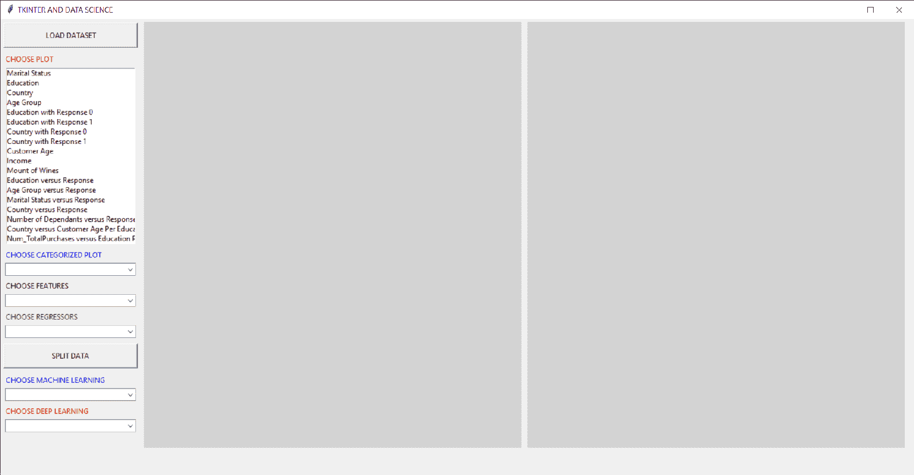

**图 1** 所有控件现已放置在根窗口中

######## `Process_Data` 类

创建一个名为 `process_data.py` 的新 Python 文件。

```python
####### process_data.py

import os
import numpy as np
import pandas as pd
from sklearn.preprocessing import LabelEncoder
from sklearn.ensemble import RandomForestClassifier, ExtraTreesClassifier
from sklearn.linear_model import LogisticRegression
from sklearn.feature_selection import RFE
```

该脚本的关键要素解析如下：

###### 1. 导入模块

*   `os`：提供使用操作系统相关功能的可移植方式，常用于文件和目录操作。
*   `numpy as np`：导入流行的数值计算库 NumPy，别名为 `np`（通用约定）。
*   `pandas as pd`：导入 Pandas 库，别名为 `pd`。Pandas 常用于数据操作和分析。
*   `LabelEncoder` from `sklearn.preprocessing`：用于将分类标签编码为数值。
*   `RandomForestClassifier` 和 `ExtraTreesClassifier` from `sklearn.ensemble`：基于随机森林和极端随机树的分类机器学习模型。
*   `LogisticRegression` from `sklearn.linear_model`：用于分类的逻辑回归机器学习模型。
*   `RFE` (Recursive Feature Elimination) from `sklearn.feature_selection`：用于机器学习中的特征选择。

###### 2. 数据处理与机器学习库

该脚本专注于数据处理和机器学习任务，导入了用于数据操作（`numpy` 和 `pandas`）及机器学习（`sklearn`）的库。

###### 3. 机器学习算法

脚本导入了多种机器学习算法，如随机森林、极端随机树和逻辑回归。这些算法将用于构建和训练分类模型。

###### 4. 特征选择

从 `sklearn.feature_selection` 导入 `RFE`（递归特征消除），表明将使用特征选择技术为机器学习模型挑选相关特征。

###### 5. 数据编码

来自 `sklearn.preprocessing` 的 `LabelEncoder` 常用于将分类数据编码为数值格式，这是许多机器学习算法的要求。

###### 6. 数据处理与操作

`numpy` 和 `pandas` 库常用于数据处理和操作任务。这些库为处理大型数据集提供了高效的数据结构和函数。

###### 读取数据集

在 `process_data.py` 中，创建一个名为 `Process_Data` 的类。然后，定义一个名为 `read_dataset()` 的新方法：

```python
class Process_Data:
    def read_dataset(self, filename):
        # Reads dataset
```


##### Process_Data 类方法详解

###### read_dataset() 方法

```python
curr_path = os.getcwd()
path = os.path.join(curr_path, filename)
df = pd.read_csv(path)
return df
```

`read_dataset()` 方法定义在 `Process_Data` 类中，负责从 CSV 文件读取数据集并返回 Pandas DataFrame。具体步骤如下：

1. **方法定义**  
   `def read_dataset(self, filename):` 接受两个参数：`self`（类实例引用）和 `filename`（要读取的 CSV 文件名）。

2. **文件路径构建**  
   - `curr_path = os.getcwd()`：调用 `os.getcwd()` 获取当前工作目录，赋值给 `curr_path`。  
   - `path = os.path.join(curr_path, filename)`：使用 `os.path.join()` 拼接完整文件路径。

3. **读取 CSV 文件**  
   `df = pd.read_csv(path)`：调用 Pandas 的 `read_csv()` 读取文件，生成 DataFrame 并赋值给 `df`。

4. **返回 DataFrame**  
   `return df`：返回包含数据的 DataFrame。

该方法便于在数据处理流程中读取 CSV 数据集，供后续分析使用。

---

###### preprocess() 方法

```python
def preprocess(self):
    df = self.read_dataset("marketing_data.csv")
    # Drops ID column
    df = df.drop("ID", axis=1)
    # Renames column name and corrects data type
    df.rename(columns={' Income ':'Income'}, inplace=True)
    df["Dt_Customer"] = pd.to_datetime(df["Dt_Customer"], format='%m/%d/%y')
    df["Income"] = df["Income"].str.replace("$","").str.replace(",","")
    df["Income"] = df["Income"].astype(float)
    # Checks null values
    print(df.isnull().sum())
    print('Total number of null values: ', df.isnull().sum().sum())
    # Imputes Income column with median values
    df['Income'] = df['Income'].fillna(df['Income'].median())
    print(f'Number of Null values in "Income" after Imputation: {df["Income"].isna().sum()}')
    # Transformasi Dt_Customer
    df['Dt_Customer'] = pd.to_datetime(df['Dt_Customer'])
    print(f'After Transformation:\n{df["Dt_Customer"].head()}')
    df['Customer_Age'] = df['Dt_Customer'].dt.year - df['Year_Birth']
    # Creates number of children/dependents in home by adding 'Kidhome' and 'Teenhome' features
    # Creates number of Total_Purchases by adding all the purchases features
    # Creates TotalAmount_Spent by adding all the Mnt* features
    df['Dt_Customer_Month'] = df['Dt_Customer'].dt.month
    df['Dt_Customer_Year'] = df['Dt_Customer'].dt.year
    df['Num_Dependants'] = df['Kidhome'] + df['Teenhome']
    purchase_features = [c for c in df.columns if 'Purchase' in str(c)]
    # Removes 'NumDealsPurchases' from the list above
    purchase_features.remove('NumDealsPurchases')
    df['Num_TotalPurchases'] = df[purchase_features].sum(axis=1)
    amt_spent_features = [c for c in df.columns if 'Mnt' in str(c)]
    df['TotalAmount_Spent'] = df[amt_spent_features].sum(axis=1)
    # Creates a categorical feature using the customer's age by binning them,
    # to help understanding purchasing behaviour
    print(f'Min. Customer Age: {df["Customer_Age"].min()}')
    print(f'Max. Customer Age: {df["Customer_Age"].max()}')
    df['AgeGroup'] = pd.cut(df['Customer_Age'], bins=[6, 24, 29, 40, 56, 75],
                            labels=['Gen-Z', 'Gen-Y.1', 'Gen-Y.2', 'Gen-X', 'BBoomers'])
    return df
```

`preprocess()` 方法在 `Process_Data` 类中，用于预处理 `marketing_data.csv` 数据集。主要步骤：

1. **读取数据集**  
   `df = self.read_dataset("marketing_data.csv")`：调用 `read_dataset()` 读取 CSV 到 DataFrame `df`。

2. **数据清洗与转换**  
   - `df = df.drop("ID", axis=1)`：删除 `ID` 列。  
   - `df.rename(columns={' Income ':'Income'}, inplace=True)`：重命名列，去除首尾空格。  
   - `df["Dt_Customer"] = pd.to_datetime(df["Dt_Customer"], format='%m/%d/%y')`：将 `Dt_Customer` 转为 datetime 格式。  
   - `df["Income"] = df["Income"].str.replace("$","").str.replace(",","")`：移除 `Income` 中的 `$` 和 `,`。  
   - `df["Income"] = df["Income"].astype(float)`：将 `Income` 转为 float 类型。  
   - `df['Income'] = df['Income'].fillna(df['Income'].median())`：用中位数填补 `Income` 缺失值。

3. **检查缺失值**  
   - `print(df.isnull().sum())`：打印各列缺失值计数。  
   - `print('Total number of null values: ', df.isnull().sum().sum())`：打印总缺失值数。

4. **特征工程**  
   - `df['Customer_Age'] = df['Dt_Customer'].dt.year - df['Year_Birth']`：计算客户年龄。  
   - `df['Dt_Customer_Month'] = df['Dt_Customer'].dt.month`、`df['Dt_Customer_Year'] = df['Dt_Customer'].dt.year`：提取月份和年份。  
   - `df['Num_Dependants'] = df['Kidhome'] + df['Teenhome']`：计算家属数量。  
   - `purchase_features = [c for c in df.columns if 'Purchase' in str(c)]`；移除 `NumDealsPurchases` 后，`df['Num_TotalPurchases'] = df[purchase_features].sum(axis=1)`：汇总购买次数。  
   - `amt_spent_features = [c for c in df.columns if 'Mnt' in str(c)]`；`df['TotalAmount_Spent'] = df[amt_spent_features].sum(axis=1)`：汇总消费金额。  
   - `df['AgeGroup'] = pd.cut(df['Customer_Age'], bins=[6, 24, 29, 40, 56, 75], labels=['Gen-Z', 'Gen-Y.1', 'Gen-Y.2', 'Gen-X', 'BBoomers'])`：按年龄分箱生成 `AgeGroup`。

5. **打印汇总信息**  
   - `print(f'Min. Customer Age: {df["Customer_Age"].min()}')`  
   - `print(f'Max. Customer Age: {df["Customer_Age"].max()}')`

6. **返回处理后的 DataFrame**  
   `return df`

该方法完成数据类型转换、缺失值处理、特征创建等预处理工作，为后续分析或建模做准备。

---

###### categorize() 方法

```python
def categorize(self, df):
    # Creates a dummy dataframe for visualization
    df_dummy = df.copy()
    # Categorizes Income feature
    labels = ['0-20k', '20k-30k', '30k-50k','50k-70k','70k-700k']
    df_dummy['Income'] = pd.cut(df_dummy['Income'],
                                [0, 20000, 30000, 50000, 70000, 700000], labels=labels)
    # Categorizes TotalAmount_Spent feature
    labels = ['0-200', '200-500', '500-800','800-1000','1000-3000']
    df_dummy['TotalAmount_Spent'] = pd.cut(df_dummy['TotalAmount_Spent'],
                                           [0, 200, 500, 800, 1000, 3000], labels=labels)
    # Categorizes Num_TotalPurchases feature
    labels = ['0-5', '5-10', '10-15','15-25','25-35']
    df_dummy['Num_TotalPurchases'] = pd.cut(df_dummy['Num_TotalPurchases'],
                                            [0, 5, 10, 15, 25, 35], labels=labels)
    # Categorizes Dt_Customer_Year feature
    labels = ['2012', '2013', '2014']
    df_dummy['Dt_Customer_Year'] = pd.cut(df_dummy['Dt_Customer_Year'],
                                          [0, 2012, 2013, 2014], labels=labels)
    # Categorizes Dt_Customer_Month feature
    labels = ['0-3', '3-6', '6-9','9-12']
    df_dummy['Dt_Customer_Month'] = pd.cut(df_dummy['Dt_Customer_Month'],
                                           [0, 3, 6, 9, 12], labels=labels)
    # Categorizes Customer_Age feature
```

`categorize()` 方法在 `Process_Data` 类中，将 DataFrame 中的数值型特征按预定义区间分箱为类别型特征，便于可视化。步骤如下：

1. **复制 DataFrame**  
   `df_dummy = df.copy()`：创建副本避免修改原数据。

2. **分箱处理**  
   依次对以下列调用 `pd.cut()` 并指定 `bins` 与 `labels`：  
   - `Income`：`[0, 20000, 30000, 50000, 70000, 700000]` → `['0-20k', '20k-30k', '30k-50k','50k-70k','70k-700k']`  
   - `TotalAmount_Spent`：`[0, 200, 500, 800, 1000, 3000]` → `['0-200', '200-500', '500-800','800-1000','1000-3000']`  
   - `Num_TotalPurchases`：`[0, 5, 10, 15, 25, 35]` → `['0-5', '5-10', '10-15','15-25','25-35']`  
   - `Dt_Customer_Year`：`[0, 2012, 2013, 2014]` → `['2012', '2013', '2014']`  
   - `Dt_Customer_Month`：`[0, 3, 6, 9, 12]` → `['0-3', '3-6', '6-9','9-12']`  
   - `Customer_Age`：代码未完整给出，但意图同理。

该方法将连续数值转为有序分类，适合后续绘图或分类建模。


##### 数据分类处理

###### `categorize()` 方法

```python
labels = ['0-30', '30-40', '40-50', '40-60', '60-120']

df_dummy['Customer_Age'] = pd.cut(df_dummy['Customer_Age'],
                                  [0, 30, 40, 50, 60, 120], labels=labels)

###### 对 MntGoldProds 特征进行分类
labels = ['0-30', '30-50', '50-80', '80-100', '100-400']

df_dummy['MntGoldProds'] = pd.cut(df_dummy['MntGoldProds'],
                                  [0, 30, 50, 80, 100, 400], labels=labels)

###### 对 MntSweetProducts 特征进行分类
labels = ['0-10', '10-20', '20-40', '40-100', '100-300']

df_dummy['MntSweetProducts'] = pd.cut(df_dummy['MntSweetProducts'],
                                      [0, 10, 20, 40, 100, 300], labels=labels)

###### 对 MntFishProducts 特征进行分类
labels = ['0-10', '10-20', '20-40', '40-100', '100-300']

df_dummy['MntFishProducts'] = pd.cut(df_dummy['MntFishProducts'],
                                     [0, 10, 20, 40, 100, 300], labels=labels)

###### 对 MntMeatProducts 特征进行分类
labels = ['0-50', '50-100', '100-200', '200-500', '500-2000']

df_dummy['MntMeatProducts'] = pd.cut(df_dummy['MntMeatProducts'],
                                     [0, 50, 100, 200, 500, 2000], labels=labels)

###### 对 MntFruits 特征进行分类
labels = ['0-10', '10-30', '30-50', '50-100', '100-200']

df_dummy['MntFruits'] = pd.cut(df_dummy['MntFruits'],
                               [0, 1, 30, 50, 100, 200], labels=labels)

###### 对 MntWines 特征进行分类
labels = ['0-100', '100-300', '300-500', '500-1000', '1000-1500']

df_dummy['MntWines'] = pd.cut(df_dummy['MntWines'],
                              [0, 100, 300, 500, 1000, 1500], labels=labels)

###### 对 Recency 特征进行分类
labels = ['0-10', '10-30', '30-50', '50-80', '80-100']

df_dummy['Recency'] = pd.cut(df_dummy['Recency'],
                             [0, 10, 30, 50, 80, 100], labels=labels)

return df_dummy
```

###### 方法解析

1.  **方法定义**：
    `def categorize(self, df):` 定义了 `categorize()` 方法，接收两个参数：`self`（类实例引用）和 `df`（包含待分类数据的 Pandas DataFrame）。

2.  **创建副本 DataFrame**：
    `df_dummy = df.copy()`：创建输入 DataFrame `df` 的副本并存储为 `df_dummy`，以保持原始 DataFrame 不变。

3.  **特征分类**：
    使用 `pd.cut()` 函数对 `df_dummy` 中的各数值特征进行分箱。每个特征基于预定义的区间（bins）进行分类，分类后的值存回 `df_dummy`。

4.  **特征分类详情**：
    每个特征被划分为特定的区间并分配标签。例如 `Income` 特征分为 `'0-20k'`, `'20k-30k'` 等标签（注：代码中未显示 Income 处理，文本仅作示例说明）。

5.  **返回结果**：
    `return df_dummy`：返回包含分类数据的 DataFrame。

> 该方法适用于将数值特征转换为带有业务含义标签的分类特征，便于后续分组分析、聚合、可视化等操作。

---

##### 提取分类与数值特征

###### `extract_cat_num_cols()` 方法

代码在 `Process_Data` 类中定义了 `extract_cat_num_cols()` 方法，用于将 DataFrame 的列分离为分类列列表和数值列列表。

```python
def extract_cat_num_cols(self, df):
    # Extracts categorical and numerical columns in dummy dataset
    cat_cols = [col for col in df.columns if
                (df[col].dtype == 'object') or (df[col].dtype.name == 'category')]

    num_cols = [col for col in df.columns if
                (df[col].dtype != 'object') and (df[col].dtype.name != 'category')]

    return cat_cols, num_cols
```

###### 方法解析

1.  **方法定义**：
    `def extract_cat_num_cols(self, df):` 接收 `self` 和 `df`（Pandas DataFrame）两个参数。

2.  **提取分类列**：
    列表推导式遍历 `df.columns`，若列的 `dtype` 为 `'object'` 或 `dtype.name` 为 `'category'`，则判定为分类列，加入 `cat_cols`。

3.  **提取数值列**：
    列表推导式遍历 `df.columns`，若列的 `dtype` 不为 `'object'` 且 `dtype.name` 不为 `'category'`，则判定为数值列，加入 `num_cols`。

4.  **返回结果**：
    `return cat_cols, num_cols`：返回分类列名列表和数值列名列表。

> 该方法可快速按数据类型分离列，便于后续对分类特征编码、数值特征缩放等差异化预处理。

---

##### 分类特征编码

###### `encode_categorical_feats()` 方法

`Process_Data` 类中的 `encode_categorical_feats()` 方法使用标签编码（Label Encoding）对 DataFrame 的分类特征进行编码。

```python
def encode_categorical_feats(self, df, cat_cols):
    # Encodes categorical features in original dataset
    print(f'Features that needs to be Label Encoded: \n{cat_cols}')

    for c in cat_cols:
        lbl = LabelEncoder()
        lbl.fit(list(df[c].astype(str).values))
        df[c] = lbl.transform(list(df[c].astype(str).values))

    print('Label Encoding done..')
    return df
```

###### 方法解析

1.  **方法定义**：
    `def encode_categorical_feats(self, df, cat_cols):` 接收 `self`、`df`（DataFrame）和 `cat_cols`（待编码分类列名列表）。

2.  **打印待编码特征**：
    `print(f'Features that needs to be Label Encoded: \n{cat_cols}')` 输出即将编码的特征名。

3.  **标签编码循环**：
    遍历 `cat_cols` 中的每一列 `c`：
    *   `lbl = LabelEncoder()`：实例化 `LabelEncoder`，该预处理器为每个类别分配唯一整数。
    *   `lbl.fit(list(df[c].astype(str).values))`：将列值转为字符串后拟合编码器。
    *   `df[c] = lbl.transform(list(df[c].astype(str).values))`：将列值转换为对应的整数标签。

4.  **打印完成确认**：
    `print('Label Encoding done..')` 提示编码完成。

5.  **返回编码后 DataFrame**：
    `return df`：返回完成标签编码的 DataFrame。


##### 标签编码

标签编码是一种常用技术，用于将分类数据转换为机器学习算法可处理的数值格式。每个类别被分配一个唯一的整数标签。值得注意的是，标签编码可能会在类别之间引入序数关系，这可能并不适用于所有分类特征。在某些情况下，根据数据性质和所用的机器学习模型，可能更倾向于使用独热编码或其他编码方法。

##### 提取输入和输出变量

在 `Process_Data` 类中，代码中的 `extract_input_output_vars()` 方法负责从 Pandas DataFrame 中提取输入变量（特征）和输出变量（目标）。

```
def extract_input_output_vars(self, df):
    # Extracts output and input variables
    y = df['Response'].values  # Target for the model
    X = df.drop(['Dt_Customer', 'Year_Birth', 'Response'], axis=1)
    return X, y
```

让我们分解一下该方法的工作原理：

###### 1. 方法定义

`def extract_input_output_vars(self, df):` 这是一个方法定义，接受两个参数：`self`，即类实例的引用；`df`，即包含数据集的 Pandas DataFrame。

###### 2. 提取输出变量

`y = df['Response'].values`：此行从 DataFrame `df` 中提取输出变量，通常称为目标变量。它假设 DataFrame 中的目标变量名为 "Response"。`.values` 属性将目标列转换为 NumPy 数组，这通常用作机器学习模型的目标。

###### 3. 提取输入变量

`X = df.drop(['Dt_Customer', 'Year_Birth', 'Response'], axis=1)`：此行从 DataFrame `df` 中提取输入变量（特征）。它从 DataFrame 中删除三列："Dt_Customer"、"Year_Birth" 和 "Response"。这些列从输入特征中移除，剩余的列作为输入变量。

###### 4. 返回提取的变量

*   `return X, y`：最后，该方法返回两个变量：
    *   `X`：包含机器学习模型的输入变量（特征）。
    *   `y`：包含模型旨在预测的输出变量（目标）。

该方法旨在促进机器学习任务的数据准备。它将特征（输入变量）与目标变量分离，使数据更易于与各种机器学习算法配合使用。通常，在监督学习中，`X` 代表自变量，`y` 代表模型将要预测的因变量。

##### 基于随机森林分类器的特征重要性

在 `Process_Data` 类中，代码中的 `feat_importance_rf()` 方法负责使用随机森林分类器计算并返回特征重要性。

```
def feat_importance_rf(self, X, y):
    names = X.columns
    rf = RandomForestClassifier()
    rf.fit(X, y)
    result_rf = pd.DataFrame()
    result_rf['Features'] = X.columns
    result_rf['Values'] = rf.feature_importances_
    result_rf.sort_values('Values', inplace=True, ascending=False)
    return result_rf
```

让我们分解一下该方法的工作原理：

###### 1. 方法定义

`def feat_importance_rf(self, X, y):` 这是一个方法定义，接受三个参数：`self`，即类实例的引用；`X`，即包含输入特征的 Pandas DataFrame；`y`，即包含目标变量的 NumPy 数组。

###### 2. 提取特征名称

`names = X.columns`：此行从 DataFrame `X` 中提取输入特征的名称（列），并将其存储在 `names` 变量中。这些特征名称将用于标记特征重要性。

###### 3. 随机森林分类器

`rf = RandomForestClassifier()`：创建了一个 `RandomForestClassifier` 实例。随机森林分类器是一种机器学习模型，以其通过分析每个特征对模型预测的贡献程度来评估特征重要性的能力而闻名。

###### 4. 拟合模型

`rf.fit(X, y)`：随机森林分类器在输入特征（`X`）和目标变量（`y`）上进行拟合。这意味着模型在提供的数据上进行训练。

###### 5. 创建结果 DataFrame

*   `result_rf = pd.DataFrame()`：创建一个名为 `result_rf` 的空 Pandas DataFrame，用于存储特征重要性。
*   `result_rf['Features'] = X.columns`：在 `result_rf` DataFrame 中创建一个名为 "Features" 的列，并用输入特征的名称填充。
*   `result_rf['Values'] = rf.feature_importances_`：创建另一个名为 "Values" 的列，并用随机森林分类器计算出的特征重要性填充。这些值代表每个特征对模型预测的贡献程度。

###### 6. 对特征重要性进行排序

`result_rf.sort_values('Values', inplace=True, ascending=False)`：`result_rf` DataFrame 根据特征重要性按降序排序。这意味着最重要的特征将出现在 DataFrame 的顶部。

###### 7. 返回结果 DataFrame

`return result_rf`：最后，该方法返回 `result_rf` DataFrame，其中包含特征名称及其由随机森林分类器计算出的相应重要性。

此方法有助于识别哪些特征对模型预测影响最大，这对于特征选择和理解预测模型中各种因素的重要性非常有价值。

##### 基于极端随机树分类器的特征重要性

在 `Process_Data` 类中，代码中的 `feat_importance_et()` 方法负责使用极端随机树分类器计算并返回特征重要性。该方法可用于在构建机器学习模型时理解数据集中不同特征的重要性。

```
def feat_importance_et(self, X, y):
    model = ExtraTreesClassifier()
    model.fit(X, y)
    result_et = pd.DataFrame()
    result_et['Features'] = X.columns
    result_et['Values'] = model.feature_importances_
    result_et.sort_values('Values', inplace=True, ascending=False)
    return result_et
```

让我们讨论一下该方法的工作原理：

###### 1. 方法定义

`def feat_importance_et(self, X, y):` 该方法定义用于使用极端随机树分类器计算特征重要性。它接受三个参数：`self`，指代类的实例；`X`，包含输入特征的 Pandas DataFrame；`y`，包含目标变量（标签或类别）的 NumPy 数组。

###### 2. 创建极端随机树分类器

`model = ExtraTreesClassifier()`：创建一个 `ExtraTreesClassifier` 实例。该分类器用于特征选择和分类任务。它是一种类似于随机森林的集成学习方法，但在构建和选择决策树的方式上有一些差异。

###### 3. 拟合模型

`model.fit(X, y)`：极端随机树分类器在输入特征 `X` 和目标变量 `y` 上进行拟合。此步骤涉及在提供的数据上训练分类器，以学习特征与目标变量之间的模式和关系。

###### 4. 创建结果 DataFrame

*   `result_et = pd.DataFrame()`：创建一个名为 `result_et` 的空 Pandas DataFrame，用于存储特征重要性。
*   `result_et['Features'] = X.columns`：向 `result_et` DataFrame 添加一个名为 "Features" 的列，其中包含输入特征的名称。
*   `result_et['Values'] = model.feature_importances_`：向 `result_et` DataFrame 添加另一个名为 "Values" 的列，其中包含由极端随机树分类器计算出的特征重要性。这些重要性代表每个特征对模型预测性能的贡献程度。

###### 5. 对特征重要性进行排序


result\_et.sort\_values('Values', inplace=True, ascending=False)：`result_et` DataFrame 根据 "Values" 列按降序排序。这意味着最重要的特征将出现在 DataFrame 的顶部。

1.  返回结果 DataFrame：

`return result_et`：最后，该方法返回 `result_et` DataFrame，其中包含特征名称及其由极端随机树分类器计算出的相应重要性。

该方法计算的特征重要性可用于特征选择、降维，以及深入了解哪些特征在使用机器学习模型进行预测时最具影响力。

##### 使用递归特征消除 (RFE) 计算特征重要性

在 `Process_Data` 类中，代码中的 `feat_importance_rfe()` 方法负责使用逻辑回归模型通过递归特征消除 (RFE) 计算并返回特征排名。

```
def feat_importance_rfe(self, X, y):

    model = LogisticRegression()

    #Creates the RFE model

    rfe = RFE(model)

    rfe = rfe.fit(X, y)

    result_lg = pd.DataFrame()

    result_lg['Features'] = X.columns

    result_lg['Ranking'] = rfe.ranking_

    result_lg.sort_values('Ranking', inplace=True , ascending = False)

    return result_lg
```

让我们分解一下该方法的工作原理：

1.  方法定义：

`def feat_importance_rfe(self, X, y):` 这是一个方法定义，接受三个参数：`self`（类实例的引用）、`X`（包含输入特征的 Pandas DataFrame）和 `y`（包含目标变量的 NumPy 数组）。

1.  创建逻辑回归模型：

`model = LogisticRegression():` 创建一个 `LogisticRegression` 分类器实例。逻辑回归被用作 RFE 过程中特征排名的基础模型。RFE 技术旨在通过迭代地使用不同特征子集训练模型来选择最重要的特征。

1.  创建 RFE 模型：

`rfe = RFE(model):` 创建一个递归特征消除 (RFE) 技术的实例，以 `LogisticRegression` 模型作为其基础估计器。RFE 通过递归地移除最不重要的特征来执行特征选择。

1.  拟合 RFE 模型：

`rfe = rfe.fit(X, y):` 使用输入特征 `X` 和目标变量 `y` 拟合 RFE 模型。在此过程中，RFE 迭代地使用不同的特征子集训练逻辑回归模型，并根据特征的重要性为每个特征分配排名。

1.  创建结果 DataFrame：

*   `result_lg = pd.DataFrame():` 创建一个名为 `result_lg` 的空 Pandas DataFrame，用于存储特征排名。

*   `result_lg['Features'] = X.columns:` 向 `result_lg` DataFrame 添加一个名为 "Features" 的列，包含输入特征的名称。

*   `result_lg['Ranking'] = rfe.ranking_:` 向 `result_lg` DataFrame 添加另一个名为 "Ranking" 的列，包含 RFE 过程分配的特征排名。**排名值越低表示特征越重要**。

1.  对特征排名进行排序：

`result_lg.sort_values('Ranking', inplace=True, ascending=False):` `result_lg` DataFrame 根据 "Ranking" 列按降序排序。这意味着排名较低（更重要）的特征将出现在 DataFrame 的顶部。

1.  返回结果 DataFrame：

`return result_lg:` 最后，该方法返回 `result_lg` DataFrame，其中包含基于 RFE 过程的特征名称及其相应排名。

RFE 技术用于特征选择，有助于识别给定机器学习任务中最重要的特征。在本例中，排名指示了使用逻辑回归模型进行预测时每个特征的相对重要性。

##### 保存预测结果

在 `Process_Data` 类中，代码中的 `save_result()` 方法负责将预测任务的结果保存到 CSV 文件中。该方法接收实际目标值 (`y_test`)、预测值 (`y_pred`) 和文件名 (`fname`) 作为输入，然后将结果保存到 CSV 文件中。

```
def save_result(self, y_test, y_pred, fname):

    # Convert y_test and y_pred to pandas Series for easier handling

    y_test_series = pd.Series(y_test)

    y_pred_series = pd.Series(y_pred)

    # Calculate y_result_series

    y_result_series = pd.Series(y_pred - y_test == 0)

    y_result_series = y_result_series.map({True: 'True', False: 'False'})

    # Create a DataFrame to hold y_test, y_pred, and y_result

    data = pd.DataFrame({'y_test': y_test_series, 'y_pred': y_pred_series, 'result': y_result_series})

    # Save the DataFrame to a CSV file

    data.to_csv(fname, index=False)
```

以下是该方法工作原理的分解：

1.  方法定义：

`def save_result(self, y_test, y_pred, fname):` 这是一个方法定义，接受四个参数：`self`（指代类的实例）、`y_test`（包含实际目标值的 NumPy 数组或 Pandas Series）、`y_pred`（包含预测值的 NumPy 数组或 Pandas Series）和 `fname`（表示用于保存结果的文件名的字符串）。

1.  转换为 Pandas Series：

*   `y_test_series = pd.Series(y_test):` `y_test` 数组被转换为名为 `y_test_series` 的 Pandas Series。这种转换使其更易于操作并与其他 Series 结合。

*   `y_pred_series = pd.Series(y_pred):` 同样，`y_pred` 数组被转换为名为 `y_pred_series` 的 Pandas Series。

1.  计算结果 Series：

*   `y_result_series = pd.Series(y_pred - y_test == 0):` 此行计算一个名为 `y_result_series` 的结果 Series。它逐元素比较预测值 (`y_pred`) 与实际值 (`y_test`) 并检查它们是否相等。结果是一个布尔 Series，其中 `True` 表示预测正确，`False` 表示预测错误。

*   `y_result_series = y_result_series.map({True: 'True', False: 'False'}):` `y_result_series` 中的布尔值被映射为字符串 'True' 和 'False'，使其更具可读性。

1.  创建结果 DataFrame：

`data = pd.DataFrame({'y_test': y_test_series, 'y_pred': y_pred_series, 'result': y_result_series}):` 创建一个名为 `data` 的 Pandas DataFrame，用于容纳三列：'y_test'（包含实际目标值）、'y_pred'（包含预测值）和 'result'（基于预测正确性包含 'True' 或 'False'）。该 DataFrame 将实际值和预测值与结果结合在一起。

1.  将 DataFrame 保存为 CSV：

`data.to_csv(fname, index=False):` `data` DataFrame 被保存为由 `fname` 参数指定名称的 CSV 文件。`index=False` 参数确保 DataFrame 索引不保存在 CSV 文件中。

总之，该方法接收实际值和预测值，计算每个预测是否正确，并将该信息连同原始值一起存储在 CSV 文件中，以便进一步分析和报告。这有助于评估机器学习模型的性能并比较实际结果与预测结果。

#### Helper_Plot 类

创建一个名为 `helper_plot.py` 的新 Python 文件。然后，定义一个名为 `Helper_Plot` 的类，作为用于绘图和可视化数据的工具类。它包含创建可视化所需的各种方法和导入库。

####### helper_plot.py

```
from tkinter import *

import seaborn as sns

import numpy as np

from pandastable import Table

from process_data import Process_Data

from sklearn.metrics import confusion_matrix, roc_curve, accuracy_score

from sklearn.model_selection import learning_curve

class Helper_Plot:

    def __init__(self):

        self.obj_data = Process_Data()
```

让我们梳理一下该类的关键方面：


###### 导入模块

*   `from tkinter import *`：此导入语句用于从 Tkinter 库导入必要的模块，Tkinter 常用于在 Python 中创建图形用户界面 (GUI)。
*   `import seaborn as sns`：Seaborn 是一个建立在 Matplotlib 之上的数据可视化库，常用于创建美观的统计图表。
*   `import numpy as np`：NumPy 是 Python 中用于数值计算的库。
*   `from pandastable import Table`：PandasTable 是一个提供在 Tkinter GUI 中显示 Pandas DataFrame 的控件的库。

###### 初始化

`def __init__(self):` 类构造函数 (`__init__`) 初始化 `Helper_Plot` 对象。在构造函数内部，创建了 `Process_Data` 类的一个实例 (`obj_data`)。这表明 `Helper_Plot` 类可能会与 `Process_Data` 类的数据处理方法协同工作。

###### 方法

`Helper_Plot` 类包含多种用于创建可视化的方法，例如绘图、表格以及数据的其他图形化表示。

###### 与 Process_Data 的集成

`Process_Data` 类实例 (`obj_data`) 的存在表明该类将与 `Process_Data` 类的数据处理和准备方法协同工作。在进行数据分析和机器学习项目时，通常会有一个单独的工具类用于绘图和可视化。

总体而言，`Helper_Plot` 类作为创建可视化和以图形形式处理数据的实用工具。它与其他类和方法结合使用，用于分析和可视化各种数据科学和机器学习任务的数据。

####### 显示表格

在 `Helper_Plot` 类中，代码中的 `shows_table()` 方法负责使用 Tkinter 在新窗口中将 Pandas DataFrame 显示为表格。

```python
def shows_table(self, root, df, width, height, title):
    frame = Toplevel(root)  # new window
    self.table = Table(frame, dataframe=df, showtoolbar=True, showstatusbar=True)
    # Sets dimension of Toplevel
    frame.geometry(f"{width}x{height}")
    frame.title(title)
    self.table.show()
```

让我们分解一下该方法的工作原理：

######## 方法定义

`def shows_table(self, root, df, width, height, title):` 这是一个方法定义，接受五个参数：

*   `self`：指代 `Helper_Plot` 类的实例。
*   `root`：对 Tkinter 根窗口或父窗口的引用，新窗口将在其中创建。
*   `df`：要作为表格显示的 Pandas DataFrame。
*   `width`：表示新窗口宽度（以像素为单位）的整数。
*   `height`：表示新窗口高度（以像素为单位）的整数。
*   `title`：表示新窗口标题的字符串。

####### 创建新窗口

`frame = Toplevel(root)`：此行创建一个新的 Tkinter `Toplevel` 窗口 (`frame`)，用于显示表格。

####### 创建表格控件

`self.table = Table(frame, dataframe=df, showtoolbar=True, showstatusbar=True)`：此行在新的 `Toplevel` 窗口 (`frame`) 中创建一个 PandasTable 控件 (`self.table`)。它将 DataFrame `df` 作为表格显示。参数 `showtoolbar=True` 和 `showstatusbar=True` 表示表格控件应包含工具栏和状态栏。

####### 设置窗口尺寸和标题

*   `frame.geometry(f"{width}x{height}")`：此行使用 `width` 和 `height` 参数中提供的值设置新窗口 (`frame`) 的尺寸（宽度和高度）。
*   `frame.title(title)`：此行使用 `title` 参数中提供的字符串设置新窗口 (`frame`) 的标题。

####### 显示表格

`self.table.show()`：最后，此行在新窗口 (`frame`) 中显示表格。

总之，`shows_table()` 方法允许你弹出一个包含 Pandas DataFrame 表格表示的新窗口。这对于在使用 Tkinter 构建的 GUI 应用程序中以交互方式可视化和探索数据非常有用。

##### 修改 Main_Class 以显示数据集表格

代码中的修改后的 `Main_Class` 已扩展，包含了使用 `Design_Window`、`Process_Data` 和 `Helper_Plot` 类进行数据预处理和可视化的功能。让我们分解一下修改和新增内容：

###### 导入语句

代码现在包含 `os` 模块的导入语句，表明它可能会与文件系统交互。

###### 对象创建

在 `initialize()` 方法中创建了三个新对象：

*   `self.obj_data = Process_Data()`：创建 `Process_Data` 类的一个实例，表明该类将用于数据处理。
*   `self.obj_plot = Helper_Plot()`：创建 `Helper_Plot` 类的一个实例，表明该类将用于数据可视化和绘图。

###### 数据预处理和可视化

创建 `Process_Data` 和 `Helper_Plot` 的实例后，代码执行以下步骤：

*   使用 `self.obj_data.preprocess()` 读取数据集。
*   使用 `self.obj_data.categorize(self.df)` 对数据集进行分类。
*   使用 `self.obj_data.extract_cat_num_cols(self.df)` 和 `self.obj_data.extract_input_output_vars(self.df_final)` 提取输入和输出变量。
*   绑定事件到 `self.obj_window.button1`，以便在点击“LOAD DATASET”按钮时将数据集作为表格显示。

###### 组合框状态

最初，代码将 `self.obj_window.combo4` 和 `self.obj_window.combo5` 的状态设置为 `'disabled'`。这些组合框对应某些功能，在数据分割完成之前最初处于禁用状态。

总体而言，修改后的 `Main_Class` 将数据处理和可视化集成到基于 Tkinter 的 GUI 应用程序中。它使用 `Process_Data` 类进行数据处理，使用 `Helper_Plot` 类进行可视化，并使用 `Design_Window` 类创建 GUI 界面。代码执行数据预处理任务并绑定事件以与 GUI 组件交互。它提供了一个使用 Tkinter 和相关类创建更全面的数据科学应用程序的示例。

##### main_class.py

```python
import os

import tkinter as tk

from tkinter import *

from design_window import Design_Window

from process_data import Process_Data

class Main_Class:

    def __init__(self, root):
        self.initialize()

    def initialize(self):
        self.root = root
        width = 1500
        height = 750
        self.root.geometry(f"{width}x{height}")
        self.root.title("TKINTER AND DATA SCIENCE")
        # Creates necessary objects
        self.obj_window = Design_Window()
        self.obj_data = Process_Data()
        self.obj_plot = Helper_Plot()
        # Places widgets in root
        self.obj_window.add_widgets(self.root)
        # Reads dataset
        self.df = self.obj_data.preprocess()
        # Categorize dataset
        self.df_dummy = self.obj_data.categorize(self.df)
        # Extracts input and output variables
        self.cat_cols, self.num_cols = self.obj_data.extract_cat_num_cols(self.df)
        self.df_final = self.obj_data.encode_categorical_feats(self.df,
                                                               self.cat_cols)
        self.X, self.y = self.obj_data.extract_input_output_vars(self.df_final)
        # Binds event
        self.binds_event()
        # Initially turns off combo4 and combo5 before data splitting is done
        self.obj_window.combo4['state'] = 'disabled'
        self.obj_window.combo5['state'] = 'disabled'

    def binds_event(self):
        # Binds button1 to shows_table() function
        # Shows table if user clicks LOAD DATASET
        self.obj_window.button1.config(command=lambda: self.obj_plot.shows_table(self.root, self.df, 1400, 600, "Dataset"))

if __name__ == "__main__":
    root = tk.Tk()
    app = Main_Class(root)
    root.mainloop()
```

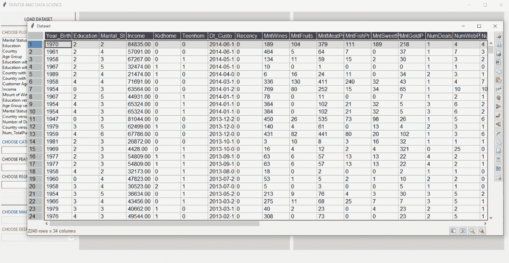

**图 2** 显示数据集表格

运行 `main_class.py` 脚本，然后点击 LOAD DATASET 按钮即可查看数据集表格，如图 2 所示。


##### 绘制饼图和条形图

在 `Helper_Plot` 类中，代码中定义的 `plot_piechart()` 方法负责在单个 Matplotlib 图形中创建饼图和相应的条形图作为子图。

```python
###### Defines function to create pie chart and bar plot as subplots
def plot_piechart(self, df, var, figure, canvas, title=''):
    figure.clear()

    # Pie Chart (left subplot)
    plot1 = figure.add_subplot(2, 1, 1)
    label_list = list(df[var].value_counts().index)
    colors = sns.color_palette("deep", len(label_list))
    _, _, autopcts = plot1.pie(df[var].value_counts(), autopct="%1.1f%%", colors=colors,
                               startangle=30, labels=label_list,
                               wedgeprops={"linewidth": 2, "edgecolor": "white"},  # Add white edge
                               shadow=True, textprops={'fontsize': 7})
    plot1.set_title("Distribution of " + var + " variable " + title, fontsize=10)

    # Bar Plot (right subplot)
    plot2 = figure.add_subplot(2, 1, 2)
    ax = df[var].value_counts().plot(kind="barh", color=colors, alpha=0.8, ax=plot2)
    for i, j in enumerate(df[var].value_counts().values):
        ax.text(.7, i, j, weight="bold", fontsize=7)
    plot2.set_title("Count of " + var + " cases " + title, fontsize=10)

    figure.tight_layout()
    canvas.draw()
```

让我们分解一下该方法的工作原理：

###### 1. 方法定义

```python
def plot_piechart(self, df, var, figure, canvas, title=''):
```

此方法定义接受以下参数：

*   `self`：指代类的实例。
*   `df`：包含待可视化数据的 Pandas DataFrame。
*   `var`：字符串，表示 DataFrame 中要可视化的变量/列。
*   `figure`：将在其中创建子图的 Matplotlib `Figure` 对象。
*   `canvas`：用于绘制子图的 Matplotlib `FigureCanvasTkAgg` 对象。
*   `title=''`：可选字符串，表示图表的标题。

###### 2. 清除图形

`figure.clear()`：此行清除 Matplotlib 图形中的任何先前内容。它确保新的饼图和条形图将在空白画布上绘制。

####### 3. 饼图（上部子图）

*   `plot1 = figure.add_subplot(2, 1, 1)`：此行在图形内创建饼图的上部子图。`add_subplot` 函数用于指定子图在 2x1 网格中的位置（2 行 1 列子图）。
*   使用 Matplotlib 的 `pie` 函数创建饼图。它显示 DataFrame `df` 中指定列 (`var`) 的值分布。设置了各种参数来自定义饼图，如标签、颜色、autopct（百分比标签）等。
*   `plot1.set_title("Distribution of " + var + " variable " + title, fontsize=10)`：此行设置饼图子图的标题。标题包含变量名 (`var`) 和作为参数提供的可选标题。

####### 4. 条形图（下部子图）

*   `plot2 = figure.add_subplot(2, 1, 2)`：此行在图形内创建条形图的下部子图。与饼图类似，它位于 2x1 网格的第二行。
*   使用 Matplotlib 的 `barh` 函数创建条形图。它显示 DataFrame `df` 中指定列 (`var`) 每个唯一值的计数。
*   向条形添加标签和注释以显示计数。
*   `plot2.set_title("Count of " + var + " cases " + title, fontsize=10)`：此行设置条形图子图的标题。标题包含变量名 (`var`) 和作为参数提供的可选标题。

###### 5. 紧凑布局和绘制

*   `figure.tight_layout()`：此行确保子图在图形内整齐排列。
*   `canvas.draw()`：此行在画布上绘制子图，使其在 Matplotlib 图形中可见。

总之，`plot_piechart()` 方法允许您在 Matplotlib 图形中创建饼图和条形图作为子图，直观地展示指定 DataFrame 列中值的分布和计数。可选的 `title` 参数允许您为图表添加标题。

##### 一对直方图

在 `Helper_Plot` 类中，代码中定义的 `another_versus_response()` 方法负责在单个 Matplotlib 图形中创建一对直方图作为子图。这些直方图表示两个不同响应类别（0 和 1，分别代表 "Not Responsive" 和 "Responsive"）的数值特征 (`feat`) 的分布。

```python
def another_versus_response(self, df, feat, num_bins, figure, canvas):
    figure.clear()

    plot1 = figure.add_subplot(2, 1, 1)
    colors = sns.color_palette("Set2")
    df[df['Response'] == 0][feat].plot(ax=plot1, kind='hist', bins=num_bins, edgecolor='black', color=colors[0])
    plot1.set_title('Not Responsive', fontsize=15)
    plot1.set_xlabel(feat, fontsize=10)
    plot1.set_ylabel('Count', fontsize=10)

    data1 = []
    for p in plot1.patches:
        x = p.get_x() + p.get_width() / 2.
        y = p.get_height()
        plot1.annotate(format(y, '.0f'), (x, y), ha='center',
                       va='center', xytext=(0, 10),
                       weight="bold", fontsize=7, textcoords='offset points')
        data1.append([x, y])

    plot2 = figure.add_subplot(2, 1, 2)
    df[df['Response'] == 1][feat].plot(ax=plot2, kind='hist', bins=num_bins, edgecolor='black', color=colors[1])
    plot2.set_title('Responsive', fontsize=15)
    plot2.set_xlabel(feat, fontsize=10)
    plot2.set_ylabel('Count', fontsize=10)

    data2 = []
    for p in plot2.patches:
        x = p.get_x() + p.get_width() / 2.
        y = p.get_height()
        plot2.annotate(format(y, '.0f'), (x, y), ha='center',
                       va='center', xytext=(0, 10),
                       weight="bold", fontsize=7, textcoords='offset points')
        data2.append([x, y])

    figure.tight_layout()
    canvas.draw()
```

让我们分解一下该方法的工作原理：

###### 1. 方法定义

```python
def another_versus_response(self, df, feat, num_bins, figure, canvas):
```

此方法定义接受以下参数：

*   `self`：指代类的实例。
*   `df`：包含待可视化数据的 Pandas DataFrame。
*   `feat`：字符串，表示 DataFrame 中要可视化的数值特征/列。
*   `num_bins`：整数，指定直方图的箱数或区间数。
*   `figure`：将在其中创建子图的 Matplotlib `Figure` 对象。
*   `canvas`：用于绘制子图的 Matplotlib `FigureCanvasTkAgg` 对象。

###### 2. 清除图形

`figure.clear()`：此行清除 Matplotlib 图形中的任何先前内容。它确保新的直方图将在空白画布上绘制。

###### 3. "Not Responsive" 和 "Responsive" 的直方图

*   `plot1 = figure.add_subplot(2, 1, 1)`：此行在图形内创建表示 "Not Responsive" 类别直方图的上部子图。`add_subplot` 函数用于指定子图在 2x1 网格中的位置（2 行 1 列子图）。
*   `colors = sns.color_palette("Set2")`：此行为直方图定义调色板。
*   `df[df['Response'] == 0][feat].plot(ax=plot1, kind='hist', bins=num_bins, edgecolor='black', color=colors[0])`：此行创建 "Not Responsive" 类别的直方图。它筛选 DataFrame 以仅选择 `Response` 为 0 的行，并使用指定的箱数 (`num_bins`) 绘制指定特征 (`feat`) 的直方图。设置了边缘颜色和颜色等自定义选项。
*   对于 "Responsive" 类别（`Response` 为 1），在下部子图 (`plot2`) 中重复相同步骤创建直方图。

###### 4. 自定义

*   为两个子图设置标题、x 轴标签和 y 轴标签，为直方图提供上下文。
*   在每个直方图条形的顶部添加注释，以显示每个箱中的数据点计数。

###### 5. 紧凑布局和绘制

*   `figure.tight_layout()`：此行确保子图在图形内整齐排列。
*   `canvas.draw()`：此行在画布上绘制子图，使其在 Matplotlib 图形中可见。


##### 绘制堆叠柱状图

在 `Helper_Plot` 类中，`put_label_stacked_bar()` 和 `dist_one_vs_another_plot()` 方法用于创建堆叠柱状图，以可视化两个分类变量之间的关系。

该代码旨在使用 Python 的 Tkinter 库创建一个图形用户界面（GUI）应用程序，用于数据科学背景下的数据分析和可视化。该应用程序旨在协助用户加载、探索和分析数据集，执行数据预处理任务，并生成各种数据可视化图表。

```python
###### Puts label inside stacked bar
def put_label_stacked_bar(self, ax, fontsize):
    # patches is everything inside of the chart
    for rect in ax.patches:
        # Find where everything is located
        height = rect.get_height()
        width = rect.get_width()
        x = rect.get_x()
        y = rect.get_y()

        # The height of the bar is the data value and can be used as the label
        label_text = f'{height:.0f}'

        # ax.text(x, y, text)
        label_x = x + width / 2
        label_y = y + height / 2

        # plots only when height is greater than specified value
        if height > 0:
            ax.text(label_x, label_y, label_text, \
                    ha='center', va='center', \
                    weight="bold", fontsize=fontsize)

###### Plots one variable against another variable
def dist_one_vs_another_plot(self, df, cat1, cat2, figure, canvas, title):
    figure.clear()
    plot1 = figure.add_subplot(1, 1, 1)
    group_by_stat = df.groupby([cat1, cat2]).size()
    colors = sns.color_palette("Set2", len(df[cat1].unique()))
    stacked_data = group_by_stat.unstack()
    group_by_stat.unstack().plot(kind='bar', stacked=True, ax=plot1, grid=True, color=colors)

    plot1.set_title(title, fontsize=12)
    plot1.set_ylabel('Number of Cases', fontsize=10)
    plot1.set_xlabel(cat1, fontsize=10)

    self.put_label_stacked_bar(plot1, 7)

    # Set font for tick labels
    plot1.tick_params(axis='both', which='major', labelsize=8)
    plot1.tick_params(axis='both', which='minor', labelsize=8)
    plot1.legend(fontsize=8)

    figure.tight_layout()
    canvas.draw()
```

让我们分解一下这些方法的工作原理：

####### 1. `put_label_stacked_bar` 方法

此方法负责在堆叠柱状图的每个柱子内部添加标签。

*   `ax`：此参数表示绘制堆叠柱状图的 `Axes` 对象（子图）。
*   `fontsize`：此参数指定标签的字体大小。

方法工作流程如下：

*   它遍历堆叠柱状图中的每个柱子（矩形）。
*   对于每个柱子，它检索其位置、高度、宽度和坐标信息。
*   柱子的高度（数据值）被用作标签文本。
*   标签的位置（`label_x` 和 `label_y`）计算为柱子的中心。
*   仅当柱子的高度大于指定值（0）时，才会在柱子内部放置标签（确保小柱子不会因标签而显得杂乱）。

####### 2. `dist_one_vs_another_plot()` 方法

此方法创建一个堆叠柱状图，以可视化一个分类变量相对于另一个分类变量的分布。该图表表示两个分类变量每种组合的案例数量。

*   `df`：此参数是一个包含待可视化数据的 Pandas `DataFrame`。
*   `cat1`：此参数是一个字符串，代表第一个分类变量。
*   `cat2`：此参数是一个字符串，代表第二个分类变量。
*   `figure`：此参数是一个 Matplotlib `Figure` 对象，堆叠柱状图将在其中创建。
*   `canvas`：此参数是一个 Matplotlib `FigureCanvasTkAgg` 对象，用于绘制图表。
*   `title`：此参数是一个字符串，指定图表的标题。

方法工作流程如下：

*   它首先清除 Matplotlib 图形中的任何先前内容。
*   它在图形中创建一个单一的子图（`plot1`）来显示堆叠柱状图。
*   数据按两个分类变量（`cat1` 和 `cat2`）分组，并计算每组的大小。
*   为 `cat1` 中的每个类别定义颜色。
*   然后对数据进行取消堆叠，并创建一个堆叠柱状图，柱子代表 `cat1` 和 `cat2` 每种组合的案例数量。
*   使用 `put_label_stacked_bar` 方法在每个柱子内部添加标签。
*   图表通过标题、轴标签、图例、网格和刻度标签字体进行自定义。
*   最后，图表绘制在画布上，并确保子图在图形内整齐排列。

总之，这些方法帮助您使用堆叠柱状图可视化分类变量之间的分布和关系，并确保标签放置在柱子内部以提高可读性。

##### 箱线图可视化

在 `Helper_Plot` 类中，`box_plot()` 方法旨在创建数据集的箱线图可视化，显示由两个分类变量（`x` 和 `hue`）指定的不同类别或组别的数值变量（`y`）的分布。这种类型的图表对于跨不同类别可视化数值变量的分布、识别每个类别内的潜在异常值或变化非常有用。

```python
def box_plot(self, df, x, y, hue, figure, canvas, title):
    figure.clear()
    plot1 = figure.add_subplot(1, 1, 1)

    # Creates boxplot of Num_TotalPurchases versus Num_Dependants
    sns.boxplot(data=df, x=x, y=y, hue=hue, ax=plot1)

    plot1.set_title(title, fontsize=14)
    plot1.set_xlabel(x, fontsize=10)
    plot1.set_ylabel(y, fontsize=10)

    figure.tight_layout()
    canvas.draw()
```

以下是该方法参数和功能的解释：

*   `df`：包含待可视化数据的数据集（`DataFrame`）。
*   `x`：第一个分类变量的名称，它决定了箱线图 x 轴上的组别或类别。
*   `y`：将使用箱线图可视化其分布的数值变量的名称。该变量的分布将使用箱体和须线表示。
*   `hue`：第二个分类变量的名称（可选）。如果指定，它决定了箱线图的颜色编码，允许您区分由 `x` 定义的主要类别内的组别。当您想要可视化第三个分类维度时，这非常有用。
*   `figure`：将在其中创建箱线图的 Matplotlib `figure` 对象。在创建新的箱线图之前，应清除 figure 对象，以避免与之前的可视化重叠。
*   `canvas`：与 figure 关联的 Matplotlib 画布。此画布用于显示更新后的图表。
*   `title`：箱线图的标题，显示在可视化图表上方。

`box_plot` 方法的主要步骤和功能如下：

1.  它清除 Matplotlib 图形中的任何现有内容，为新的箱线图做准备。
2.  它使用 `figure.add_subplot(1, 1, 1)` 在图形中创建一个子图。
3.  它使用 Seaborn 的 `sns.boxplot` 函数生成箱线图。箱线图显示由 `x` 定义的每个类别的 `y` 变量分布，如果指定了 `hue`，则进一步按其区分。
4.  它根据提供的参数（`title`、`x` 和 `y`）设置箱线图的标题、x 轴标签和 y 轴标签。


###### 5. 最后，它收紧图形中绘图的布局，确保绘图元素不重叠，然后更新画布以显示新的箱线图。

总之，`box_plot()` 方法允许用户可视化一个数值变量在由一个或两个分类变量定义的不同类别或组中的分布。生成的箱线图提供了关于每个类别内数据的中心趋势、离散程度和潜在异常值的见解，使其成为探索性数据分析的宝贵工具。

##### 婚姻状况分布

在 `Helper_Plot` 类中，`choose_plot()` 方法专注于根据用户从下拉菜单或输入框中选择的内容（`chosen`）来选择并显示特定类型的图表。

```python
def choose_plot(self, df1, df2, chosen, figure1, canvas1, figure2, canvas2):
    print(chosen)
    if chosen == "Marital Status":
        self.plot_piechart(df2, "Marital_Status", figure1, canvas1)
```

以下是该方法参数和功能的说明：

*   `df1` 和 `df2`：这些是代表不同数据子集的 DataFrame。其中 `df2` 是 `df1` 的修改版或分类版，可用于特定类型的可视化。
*   `chosen`：此参数代表用户的选择，通常来自下拉菜单或输入控件。它决定了根据用户的选择生成哪种类型的图表。
*   `figure1` 和 `canvas1`：这些是 Matplotlib 的图形和画布对象，第一种类型的图表将在此创建并显示。
*   `figure2` 和 `canvas2`：与 `figure1` 和 `canvas1` 类似，这些对象用于显示可能与第一个图表一同展示的另一种类型的图表。

这段代码的作用如下：

1.  它检查 `chosen` 参数的值，以确定其是否与特定选项匹配，本例中为 "Marital Status"。
2.  如果用户选择了 "Marital Status"，它将使用特定参数调用 `plot_piechart()` 方法：
    *   `df2`：包含与婚姻状况相关数据的 DataFrame。
    *   `"Marital_Status"`：这是 `df2` 中将用于创建饼图的变量（列）名。
    *   `figure1` 和 `canvas1`：这些是将显示饼图的 Matplotlib 图形和画布对象。
3.  `plot_piechart()` 方法预期将根据 `df2` 中的数据创建并显示婚姻状况分布的饼图。

总之，`choose_plot()` 方法负责根据用户的选择（`chosen`）确定要显示的图表类型。如果用户选择 "Marital Status"，它将触发使用 `df2` 中数据创建的婚姻状况分布饼图的生成。这种方法允许根据用户输入动态生成图表。

##### 修改 Main_Class 类

###### `main_class.py`

```python
import os
import tkinter as tk
from tkinter import *
from design_window import Design_Window
from process_data import Process_Data
from helper_plot import Helper_Plot

class Main_Class:
    def __init__(self, root):
        self.initialize()

    def initialize(self):
        self.root = root
        width = 1500
        height = 750
        self.root.geometry(f"{width}x{height}")
        self.root.title("TKINTER AND DATA SCIENCE")
        
        # Creates necessary objects
        self.obj_window = Design_Window()
        self.obj_data = Process_Data()
        self.obj_plot = Helper_Plot()
        
        # Places widgets in root
        self.obj_window.add_widgets(self.root)
        
        # Reads dataset
        self.df = self.obj_data.preprocess()
        
        # Categorize dataset
        self.df_dummy = self.obj_data.categorize(self.df)
        
        # Extracts input and output variables
        self.cat_cols, self.num_cols = self.obj_data.extract_cat_num_cols(self.df)
        self.df_final = self.obj_data.encode_categorical_feats(self.df, self.cat_cols)
        self.X, self.y = self.obj_data.extract_input_output_vars(self.df_final)
        
        # Binds event
        self.binds_event()
        
        # Initially turns off combo4 and combo5 before data splitting is done
        self.obj_window.combo4['state'] = 'disabled'
        self.obj_window.combo5['state'] = 'disabled'

    def binds_event(self):
        # Binds button1 to shows_table() function
        # Shows table if user clicks LOAD DATASET
        self.obj_window.button1.config(command=lambda: self.obj_plot.shows_table(self.root, self.df, 1400, 600, "Dataset"))
        
        # Binds listbox to a function
        self.obj_window.listbox.bind("<<ListboxSelect>>", self.choose_list_widget)

    def choose_list_widget(self, event):
        chosen = self.obj_window.listbox.get(self.obj_window.listbox.curselection())
        print(chosen)
        self.obj_plot.choose_plot(self.df, self.df_dummy, chosen,
                                  self.obj_window.figure1, self.obj_window.canvas1,
                                  self.obj_window.figure2, self.obj_window.canvas2)

if __name__ == "__main__":
    root = tk.Tk()
    app = Main_Class(root)
    root.mainloop()
```

这行代码将事件处理函数绑定到 `Listbox` 控件的 `<<ListboxSelect>>` 事件。

```python
####### Binds listbox to a function
self.obj_window.listbox.bind("<<ListboxSelect>>", self.choose_list_widget)
```

其作用如下：

1.  `self.obj_window.listbox`：指的是 `obj_window` 对象（`Design_Window` 类的实例）中创建的 `Listbox` 控件。
2.  `.bind("<<ListboxSelect>>", self.choose_list_widget)`：这是绑定语句。
3.  `"<<ListboxSelect>>"`：这是被绑定函数的事件。当 `Listbox` 中的项目被选中时，会触发此事件。
4.  `self.choose_list_widget`：这是当 `<<ListboxSelect>>` 事件发生时将要执行的函数（事件处理程序）。在本例中，它是 `Main_Class` 类的 `choose_list_widget` 方法。

当用户通过点击在 `Listbox` 中选择一个项目时，会触发 `<<ListboxSelect>>` 事件。当此事件发生时，将执行 `choose_list_widget` 方法（`self.choose_list_widget`）。这允许你定义当用户从 `Listbox` 选择项目时应发生的特定动作或行为。

然后，在 `Main_Class` 中添加一个名为 `choose_list_widget()` 的新方法。它是一个事件处理程序，当 `<<ListboxSelect>>` 事件发生时执行，即当用户在 `Listbox` 控件中选择一个项目时。

```python
def choose_list_widget(self, event):
    chosen = self.obj_window.listbox.get(self.obj_window.listbox.curselection())
    print(chosen)
    self.obj_plot.choose_plot(self.df, self.df_dummy, chosen,
                              self.obj_window.figure1, self.obj_window.canvas1,
                              self.obj_window.figure2, self.obj_window.canvas2)
```

以下是该函数功能的细分：

1.  `chosen = self.obj_window.listbox.get(self.obj_window.listbox.curselection())`：此行使用 `curselection()` 方法从 `Listbox` 控件（`self.obj_window.listbox`）检索当前选中的项目。它将选中的项目赋值给 `chosen` 变量。由于 `Listbox` 可以支持多选（如果配置为如此），`chosen` 将包含选中项目的列表。
2.  `print(chosen)`：此行仅将选中的项目打印到控制台。这是用于调试或信息目的，帮助你查看用户选择了什么。
3.  `self.obj_plot.choose_plot(...)`：此行调用 `self.obj_plot` 对象（`Helper_Plot` 类的实例）的 `choose_plot()` 方法。它向该方法传递几个参数：
    *   `self.df`：包含数据的主 DataFrame。
    *   `self.df_dummy`：另一个 DataFrame，是主 DataFrame 的修改版本，用于可视化目的。
    *   `chosen`：`Listbox` 中选中的项目，代表用户的选择。
    *   `self.obj_window.figure1` 和 `self.obj_window.canvas1`：用于在用户界面中显示图表的对象。
    *   `self.obj_window.figure2` 和 `self.obj_window.canvas2`：用于显示图表的附加对象。


根据选定的项目（`chosen`），`choose_plot()` 方法会使用提供的数据和 UI 元素生成并显示特定类型的数据可视化。

总之，`choose_list_widget()` 函数充当了用户在 Listbox 中的选择与应用程序中特定数据可视化生成之间的桥梁。它允许用户以交互方式选择他们想要查看的可视化类型。

然后，运行 `main_class.py`。在列表控件中选择**婚姻状况**，即可查看数据集中婚姻状况的分布，如图 3 所示。

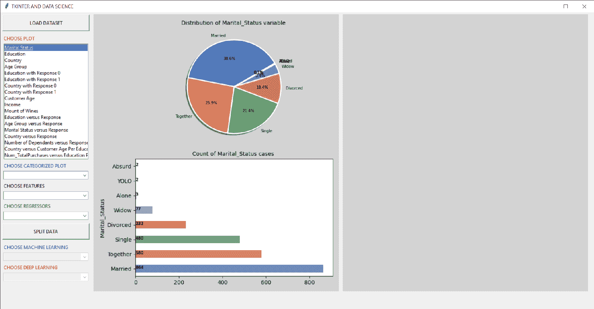

**图 3** 婚姻状况的分布

##### 受教育程度分布

将此代码添加到 `Helper_Plot` 类中 `choose_plot()` 方法的末尾。当用户在 Listbox 中选择“Education”（`chosen == "Education"`）时，将使用特定参数调用 `self.obj_plot.choose_plot()` 方法，以生成并显示与“Education”特征相关的饼图。

```
elif chosen == "Education":
    self.plot_piechart(df2, "Education", figure2, canvas2)
```

`choose_plot()` 方法根据 `chosen` 的值（在本例中为 "Education"），使用提供的数据（来自 `self.df` 和 `self.df_dummy`）生成特定类型的数据可视化（在本例中为饼图），并将其显示在 UI 元素（`self.obj_window.figure2` 和 `self.obj_window.canvas2`）中。

然后，运行 `main_class.py`。在列表控件中选择**Education**，即可查看数据集中受教育程度的分布，如图 4 所示。

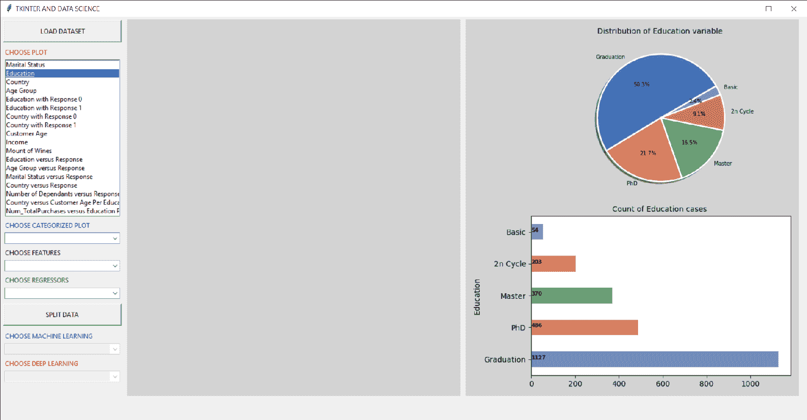

**图 4** 受教育程度的分布

##### 国家分布

将此代码添加到 `Helper_Plot` 类中 `choose_plot()` 方法的末尾：

```
elif chosen == "Country":
    self.plot_piechart(df2, "Country", figure1, canvas1)
```

当用户从 Listbox 中选择 "Country" 时，会生成并显示特定的数据可视化。此功能通过 `choose_list_widget()` 函数实现，该函数绑定到 Listbox 的选择事件。当选择 "Country" 时，它会触发 `self.obj_plot` 对象（`Helper_Plot` 类的实例）的 `choose_plot()` 方法。该方法接受多个参数，包括主数据 DataFrame（`self.df`）、用于可视化的修改后 DataFrame（`self.df_dummy`）以及用户的具体选择（"Country"）。此外，它还使用 UI 元素（`self.obj_window.figure1` 和 `self.obj_window.canvas1`）来显示生成的可视化结果。

`choose_plot()` 方法根据选择的值（本例中为 "Country"），根据 `self.df` 和 `self.df_dummy` 中提供的数据动态生成饼图。这使您的应用程序能够响应用户交互，让用户能够以可视化方式探索数据集的不同方面。通过将函数绑定到 Listbox 选择事件，您的应用程序增强了用户交互性，并通过直观的数据可视化促进了对数据类别的探索，使其更加用户友好且引人入胜。

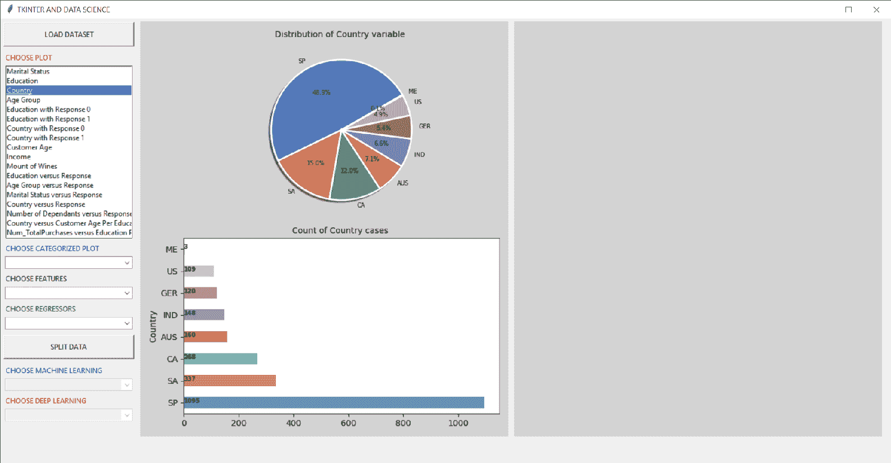

**图 5** 国家分布

##### 年龄段分布

将此代码添加到 `Helper_Plot` 类中 `choose_plot()` 方法的末尾：

```
elif chosen == "Age Group":
    self.plot_piechart(df2, "AgeGroup", figure2, canvas2)
```

在该代码中，当用户从 Listbox 中选择 "Age Group" 时，会触发 `choose_list_widget()` 函数的执行。在此函数中，有一个条件分支检查所选选项是否为 "Age Group"。如果满足此条件，它将调用 `self.obj_plot` 对象的 `plot_piechart()` 方法，传入修改后的 DataFrame `df2`，特别是 "AgeGroup" 列，以及 UI 元素（`figure2` 和 `canvas2`）。因此，当选择 "Age Group" 时，它会根据数据集中年龄段的分布动态生成饼图，为用户提供数据内年龄段人口统计的可视化表示，如图 6 所示。此交互功能通过允许用户通过直观的数据可视化探索和理解数据模式，增强了用户体验。

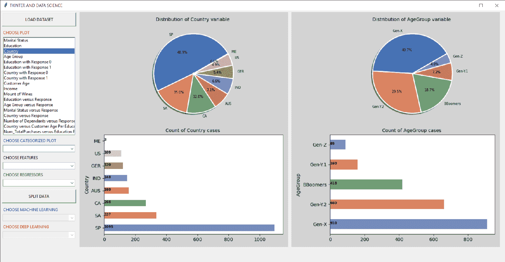

**图 6** 年龄段分布

##### 响应为 0 的受教育程度分布

将此代码添加到 `Helper_Plot` 类中 `choose_plot()` 方法的末尾：

```
elif chosen == "Education with Response 0":
    self.plot_piechart(df2[df2.Response==0], "Education", figure1, canvas1, " with Response 0")
```

在该代码中，当用户从 Listbox 中选择 "Education with Response 0" 时，会触发 `choose_list_widget()` 函数的执行。在此函数中，有一个条件分支检查所选选项是否为 "Education with Response 0"。如果满足此条件，它会筛选 DataFrame `df2` 以仅包含 "Response" 列等于 0（表示无响应）的行，然后调用 `self.obj_plot` 对象的 `plot_piechart()` 方法。它传入筛选后的 DataFrame，特别是 "Education" 列，连同 UI 元素（`figure1` 和 `canvas1`），以及一个额外的标题扩展 " with Response 0"。因此，当选择 "Education with Response 0" 时，它会动态生成一个饼图，表示无响应客户中受教育程度的分布，允许用户以可视化方式探索数据集中无响应客户的教育背景。此交互功能有助于分析未对营销活动做出响应的客户特征，如图 7 所示。

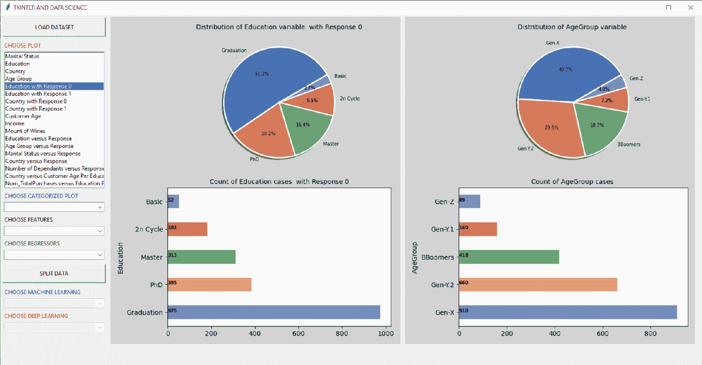

**图 7** 响应为 0 的受教育程度分布

##### 响应为 1 的受教育程度分布

将此代码添加到 `Helper_Plot` 类中 `choose_plot()` 方法的末尾：

```
elif chosen == "Education with Response 1":
    self.plot_piechart(df2[df2.Response==1], "Education", figure2, canvas2, " with Response 1")
```

在该代码中，当用户从 Listbox 中选择 "Education with Response 1" 时，会触发 `choose_list_widget()` 函数的执行。在此函数中，有一个条件分支检查所选选项是否为 "Education with Response 1"。如果满足此条件，它会筛选 DataFrame `df2` 以仅包含 "Response" 列等于 1（表示有响应）的行，然后调用 `self.obj_plot` 对象的 `plot_piechart()` 方法。它传入筛选后的 DataFrame，特别是 "Education" 列，连同 UI 元素（`figure2` 和 `canvas2`），以及一个额外的标题扩展 " with Response 1"。因此，当选择 "Education with Response 1" 时，它会动态生成一个饼图，表示有响应客户中受教育程度的分布，允许用户以可视化方式探索数据集中有响应客户的教育背景。此交互功能有助于分析对营销活动做出积极响应的客户特征，如图 8 所示。

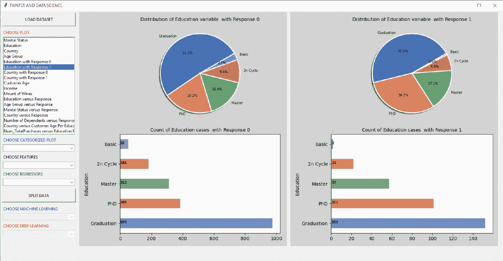

**图 8** 响应为 1 的受教育程度分布

##### 响应为 0 和 1 的国家分布

将此代码添加到 `Helper_Plot` 类中 `choose_plot()` 方法的末尾：

```
elif chosen == "Country with Response 0":
    self.plot_piechart(df2[df2.Response==0], "Country", figure1, canvas1, " with Response 0")

elif chosen == "Country with Response 1":
    self.plot_piechart(df2[df2.Response==1], "Country", figure2, canvas2, " with Response 1")
```


##### 国家与响应的分布

在这段代码中，当用户从列表框中选择“响应为 0 的国家”或“响应为 1 的国家”时，会触发 `choose_list_widget()` 函数的执行。在此函数内部，存在检查所选选项的条件分支。如果所选选项为“响应为 0 的国家”，则会筛选数据框 `df2`，仅保留“Response”列等于 0（表示无响应）的行。随后，它会调用 `self.obj_plot` 对象的 `plot_piechart()` 方法，传入筛选后的数据框（具体为“Country”列）、UI 元素（`figure1` 和 `canvas1`）以及附加标题扩展“ with Response 0”。这将生成一个饼图，展示无响应客户中各国家的分布情况。同样，如果所选选项为“响应为 1 的国家”，则会筛选数据框，仅保留“Response”列等于 1（表示有响应）的行，并使用 UI 元素（`figure2` 和 `canvas2`）及附加标题扩展“ with Response 1”生成有响应客户中各国家分布的饼图。这些功能使用户能直观探索客户居住国家对其营销响应度的影响，为营销策略提供有价值的洞见。结果如图 9 所示。

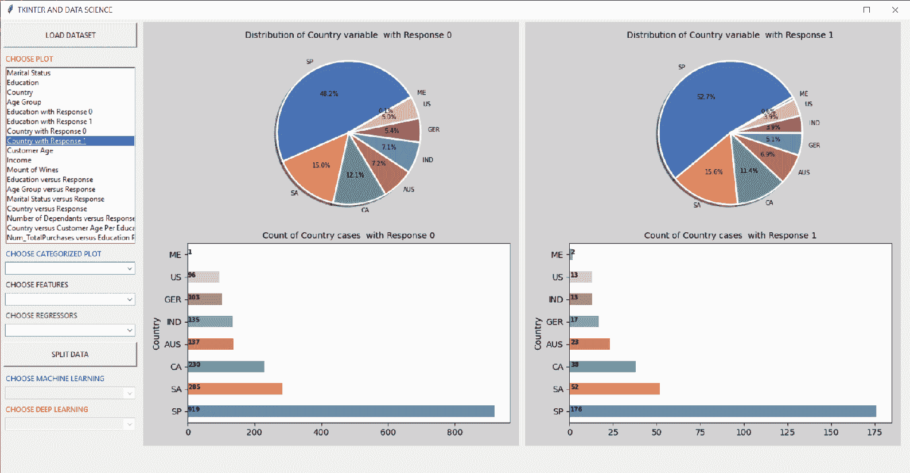

**图 9** 响应为 0 或 1 的国家分布

##### 收入直方图

将此代码添加到 `Helper_Plot` 类中 `choose_plot()` 方法的末尾：

```
elif chosen == "Income":
    self.another_versus_response(df1, "Income", 32, figure1, canvas1)
```

在这段代码中，当用户从列表框中选择“Income”时，会触发 `choose_list_widget()` 函数的执行。在此函数内部，存在一个条件分支，用于检查所选选项是否为“Income”。如果是，代码将调用 `another_versus_response()` 方法，传入数据框 `df1`、特征“Income”、箱数（设为 32）、UI 元素（`figure1` 和 `canvas1`）以及空标题。该方法生成一个包含两个直方图的子图。第一个直方图显示无响应客户（即“Response”等于 0 的客户）的收入分布，第二个直方图显示有响应客户（即“Response”等于 1 的客户）的收入分布。通过对比这些直方图，用户可以洞察收入水平如何影响客户对营销活动的响应度。结果如图 10 所示。

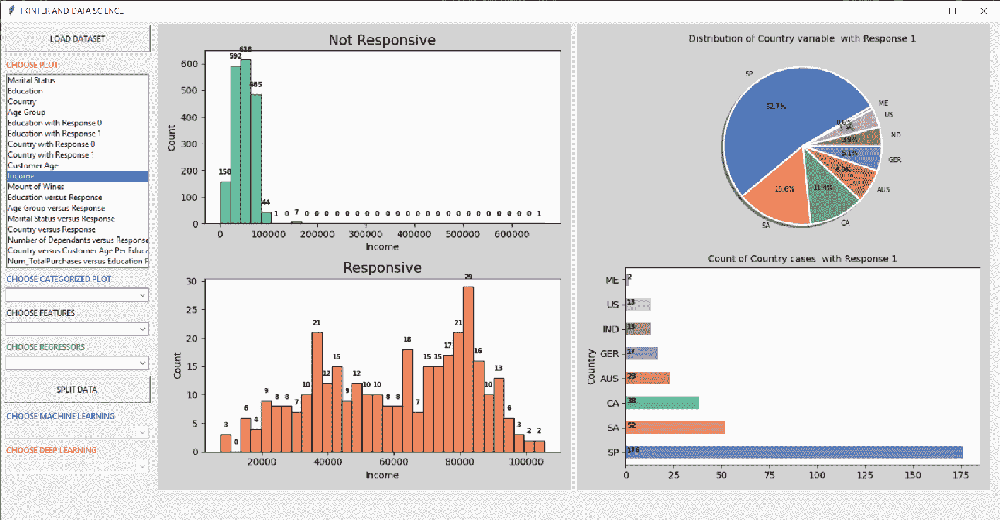

**图 10** 收入直方图

##### 客户年龄直方图

将此代码添加到 `Helper_Plot` 类中 `choose_plot()` 方法的末尾：

```
elif chosen == "Customer Age":
    self.another_versus_response(df1, "Customer_Age", 32, figure1, canvas1)
```

在这段代码中，当用户从列表框中选择“Customer Age”时，会触发 `choose_list_widget()` 函数的执行。在此函数内部，存在一个条件分支，用于检查所选选项是否为“Customer Age”。如果是，代码将调用 `another_versus_response()` 方法，传入数据框 `df1`、特征“Customer_Age”、箱数（设为 32）、UI 元素（`figure1` 和 `canvas1`）以及空标题。该方法生成一个包含两个直方图的子图。第一个直方图显示无响应客户（即“Response”等于 0 的客户）的年龄分布，第二个直方图显示有响应客户（即“Response”等于 1 的客户）的年龄分布。通过对比这些直方图，用户可以洞察客户年龄如何影响其对营销活动的响应度。结果如图 11 所示。

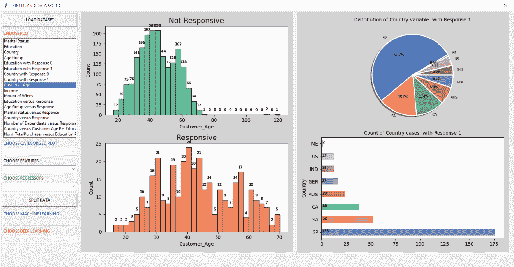

**图 11** 客户年龄直方图

##### 购买葡萄酒金额直方图

将此代码添加到 `Helper_Plot` 类中 `choose_plot()` 方法的末尾：

```
elif chosen == "Amount of Wines":
    self.another_versus_response(df1, "MntWines", 32, figure2, canvas2)
```

在这段代码中，当用户从列表框中选择“Amount of Wines”时，会触发 `choose_list_widget()` 函数的执行。在此函数内部，存在一个条件分支，用于检查所选选项是否为“Mount of Wines”。如果是，代码将调用 `another_versus_response()` 方法，传入数据框 `df1`、特征“MntWines”、箱数（设为 32）、UI 元素（`figure2` 和 `canvas2`）以及空标题。该方法生成一个包含两个直方图的子图。第一个直方图显示无响应客户（即“Response”等于 0 的客户）的葡萄酒购买金额分布，第二个直方图显示有响应客户（即“Response”等于 1 的客户）的葡萄酒购买金额分布。通过对比这些直方图，用户可以洞察葡萄酒购买金额如何影响客户对营销活动的响应度。结果如图 12 所示。

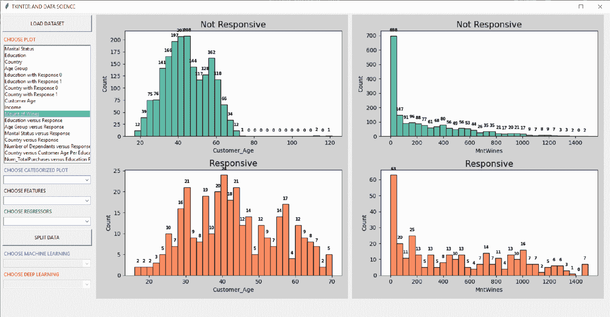

**图 12** 购买葡萄酒金额直方图

##### 教育程度与响应的分布

将此代码添加到 `Helper_Plot` 类中 `choose_plot()` 方法的末尾：

```
elif chosen == "Education versus Response":
    self.dist_one_vs_another_plot(df2, "Education", "Response", figure2, canvas2, chosen)
```

在这段代码中，当用户从列表框中选择“Education versus Response”时，会触发 `choose_list_widget()` 函数的执行。在此函数内部，存在一个条件分支，用于检查所选选项是否为“Education versus Response”。如果是，代码将调用 `dist_one_vs_another_plot()` 方法，传入数据框 `df2`、特征“Education”和“Response”、UI 元素（`figure2` 和 `canvas2`）以及标题“Education versus Response”。该方法生成一个堆叠条形图，用于可视化客户教育水平（如高中、大学学位）与其对营销活动的响应度（0 或 1）之间的关系。图中的每个条形代表一个特定的教育类别，条形内各分段的高度表示该教育类别中有响应和无响应客户的数量。这种可视化有助于用户理解教育水平如何影响客户响应度。结果如图 13 所示。

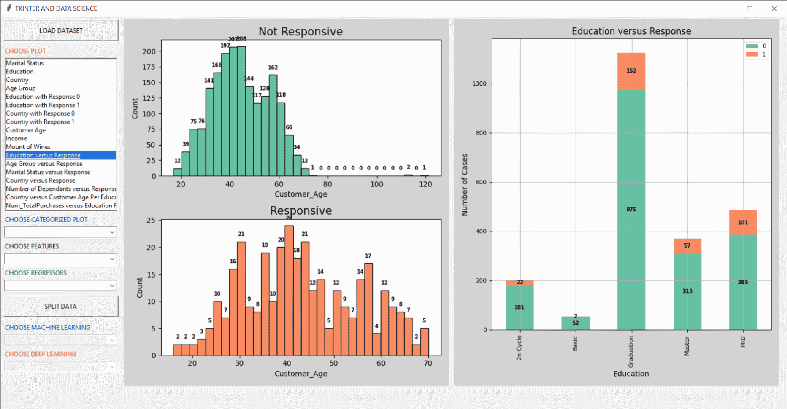

**图 13** 教育程度与响应的分布

##### 年龄组别与响应的分布

将此代码添加到 `Helper_Plot` 类中 `choose_plot()` 方法的末尾：

```
elif chosen == "Age Group versus Response":
    self.dist_one_vs_another_plot(df2, "AgeGroup", "Response", figure1, canvas1, chosen)
```

此代码旨在创建一个堆叠条形图，以直观展示不同客户年龄组别与其对营销活动响应度之间的关系。具体而言，它侧重于比较数据集中不同年龄组别对营销活动的响应情况。

其工作原理如下：

1.  `chosen` 是一个变量，保存着图形用户界面 (GUI) 中列表框当前选中的项目。
2.  当用户从列表框中选择“Age Group versus Response”时，满足此条件（`elif chosen == "Age Group versus Response"`），从而执行该代码块。
3.  调用 `dist_one_vs_another_plot()` 方法并传入特定参数：
    *   `df2` 是包含数据集的数据框，其中包括“AgeGroup”（分类后的年龄组别）和“Response”（指示客户是否响应营销）列。
    *   指定“AgeGroup”和“Response”作为图表中要分析的两个变量。
    *   `figure1` 和 `canvas1` 是用于显示图表的 UI 元素。
    *   “Age Group versus Response”作为图表的标题。


##### 年龄组别与响应的分布

生成的图表将直观地展示每个年龄组别（例如 X 世代、婴儿潮一代）是如何划分为不同区段的，每个区段代表对营销活动做出响应（`1`）和未做出响应（`0`）的客户数量。这种可视化有助于营销人员和数据分析师了解不同人群的响应情况，并做出与营销策略及特定客户群体定位相关的数据驱动决策。结果如图 14 所示。

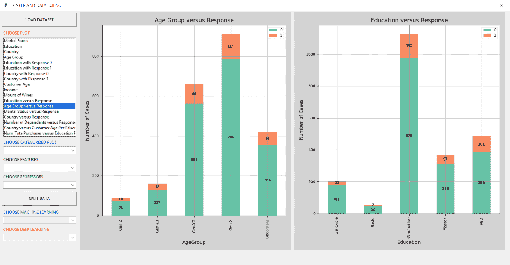

**图 14** 年龄组别与响应的分布

##### 婚姻状况与响应的分布

将此代码添加到 `Helper_Plot` 类中 `choose_plot()` 方法的末尾：

```python
elif chosen == "Marital Status versus Response":
    self.dist_one_vs_another_plot(df2, "Marital_Status", "Response", figure2, canvas2, chosen)
```

此代码的目的是创建一个堆叠条形图，以直观地展示客户不同婚姻状况与其对营销活动响应度之间的关系。具体而言，它侧重于比较数据集中不同婚姻状况如何影响客户对营销活动的响应。

生成的图表将直观地展示每个婚姻状况类别（例如：已婚、单身、离异）是如何划分为不同区段的，每个区段代表对营销活动做出响应（`1`）和未做出响应（`0`）的客户数量。这种可视化有助于营销人员和数据分析师了解婚姻状况对客户响应度的影响，从而辅助营销策略决策和定向营销活动。结果如图 15 所示。

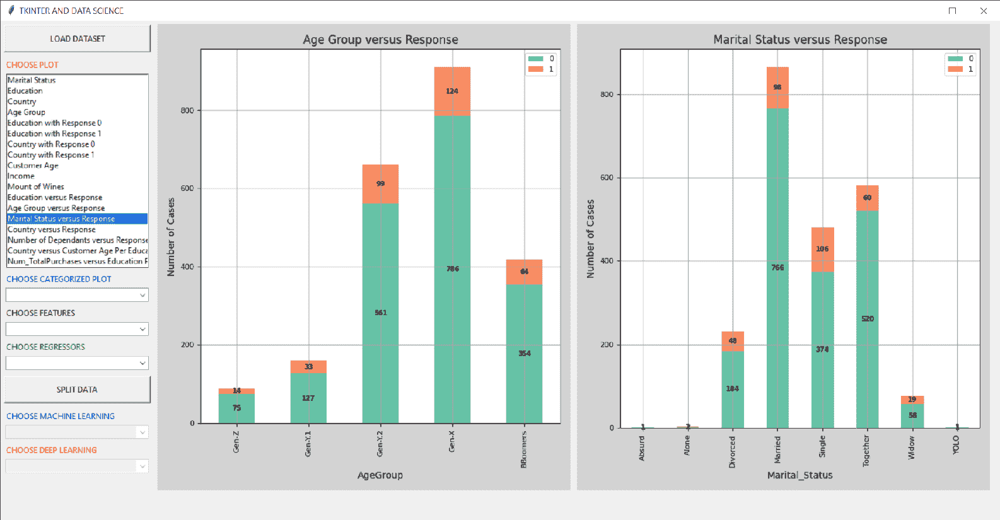

**图 15** 婚姻状况与响应的分布

##### 国家与响应的分布

将此代码添加到 `Helper_Plot` 类中 `choose_plot()` 方法的末尾：

```python
elif chosen == "Country versus Response":
    self.dist_one_vs_another_plot(df2, "Country", "Response", figure1, canvas1, chosen)
```

此代码块的目的是创建一个堆叠条形图，以直观地展示客户不同国家与其对营销活动响应度之间的关系。具体而言，它侧重于比较数据集中不同国家如何影响客户对营销活动的响应。

生成的图表将直观地展示每个国家类别（例如：西班牙、法国、德国）是如何划分为不同区段的，每个区段代表对营销活动做出响应（`1`）和未做出响应（`0`）的客户数量。这种可视化有助于营销人员和数据分析师了解居住国家对客户响应度的影响，从而辅助营销策略决策和定向营销活动。结果如图 16 所示。

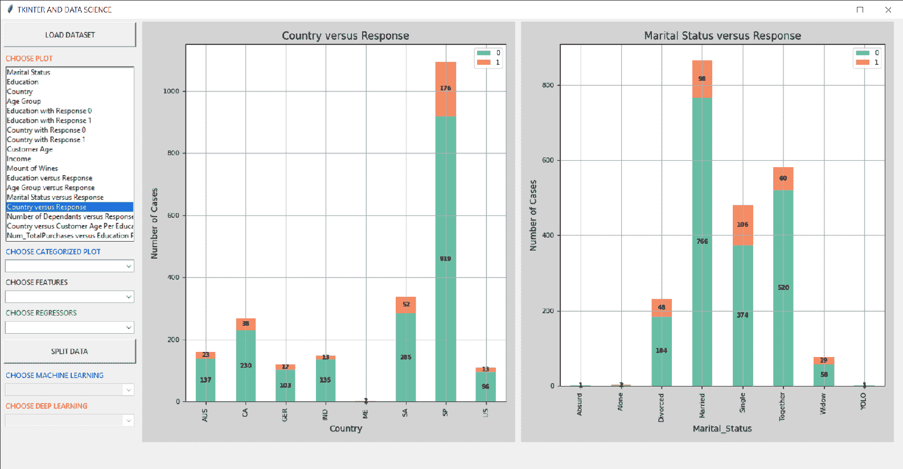

**图 16** 国家与响应的分布

##### 受抚养人数与响应的分布

将此代码添加到 `Helper_Plot` 类中 `choose_plot()` 方法的末尾：

```python
elif chosen == "Number of Dependants versus Response":
    self.dist_one_vs_another_plot(df2, "Num_Dependants", "Response", figure2, canvas2, chosen)
```

生成的图表将直观地展示客户家庭中受抚养人数如何影响其对营销活动的响应度。它将显示堆叠条形，每个区段代表基于受抚养人数做出响应（`1`）和未做出响应（`0`）的客户数量。这种可视化可以帮助营销人员和分析师了解家庭结构在客户响应中的作用，并据此指导营销策略。结果如图 17 所示。

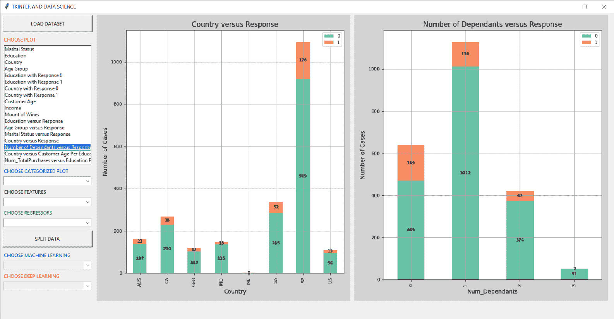

**图 17** 受抚养人数与响应的分布

##### 不同教育水平和国家中的客户年龄分布

将此代码添加到 `Helper_Plot` 类中 `choose_plot()` 方法的末尾：

```python
elif chosen == "Country versus Customer Age Per Education":
    self.box_plot(df1, "Country", "Customer_Age", "Education", figure1, canvas1, chosen)
```

该代码旨在生成一个箱线图，以可视化客户年龄在不同教育水平和国家中的分布情况。此代码旨在分析并展示特定教育群体内以及不同国家间客户年龄的变化。

当用户在图形用户界面 (GUI) 的列表框中选择 "Country versus Customer Age Per Education" 时，相关条件得到满足，从而触发此代码的执行。随后将调用 `box_plot()` 函数并传入特定参数。它以包含数据集的 DataFrame (`df1`) 作为输入，该数据集包含 "Country"、"Customer_Age"（代表客户年龄）和 "Education"（表示客户教育背景）列。"Country" 变量被指定为 x 轴，"Customer_Age" 为 y 轴，"Education" 为用于颜色分类的 hue 变量。此外，它还使用 `figure1` 和 `canvas1` 作为用于显示生成图表的 UI 元素，标题为 "Country versus Customer Age Per Education"。

生成的箱线图将显示多个箱体，每个箱体对应国家和教育水平的唯一组合。这些箱体直观地展示了这些特定群体内客户年龄的分布。分析此图表可以深入了解不同国家和教育背景客户之间的年龄差异。此类见解对于定制营销策略或定向营销活动以有效触达并吸引特定客户群体具有重要作用。结果如图 18 所示。

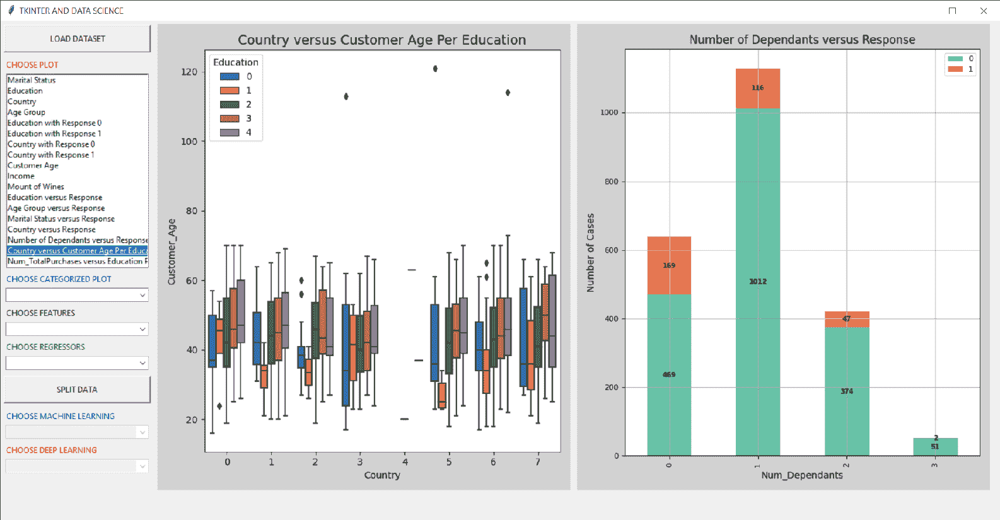

**图 18** 不同教育水平和国家中的客户年龄分布

##### 不同婚姻状况下的总购买次数与教育水平分布

将此代码添加到 `Helper_Plot` 类中 `choose_plot()` 方法的末尾：

```python
elif chosen == "Num_TotalPurchases versus Education Per Marital Status":
    self.box_plot(df1, "Education", "Num_TotalPurchases", "Marital_Status", figure2, canvas2, chosen)
```

该代码负责创建一个箱线图，说明客户总购买次数 ("Num_TotalPurchases") 与其教育水平 ("Education") 在不同婚姻状况类别 ("Marital_Status") 下的关系。这种可视化有助于了解不同婚姻状况群体中、具有不同教育背景的客户的购买次数变化情况。

当用户在图形用户界面 (GUI) 的列表框中选择 "Num_TotalPurchases versus Education Per Marital Status" 时，相关条件得到满足，并执行此代码。随后将调用 `box_plot()` 函数并传入特定参数。它以包含数据集的 DataFrame (`df1`) 作为输入，该数据集包含 "Education"、"Num_TotalPurchases" 和 "Marital_Status" 列。在生成的箱线图中，"Education" 被指定为 x 轴变量，"Num_TotalPurchases" 为 y 轴变量，"Marital_Status" 为用于区分不同婚姻状况类别的 hue 变量。此外，它还使用 `figure2` 和 `canvas2` 作为用于呈现生成图表的 UI 组件，标题为 "Num_TotalPurchases versus Education Per Marital Status"。


生成的箱线图将显示一系列箱体，每个箱体代表特定的教育水平和婚姻状况组合。这些箱体以可视化方式描绘了这些不同群体中客户总购买次数的分布。分析此图可深入了解客户的教育背景和婚姻状况如何与其购买行为相关联。此类洞察对于针对不同客户群体定制营销策略或产品供给、优化业务运营以及做出数据驱动决策极具价值。结果如图 19 所示。

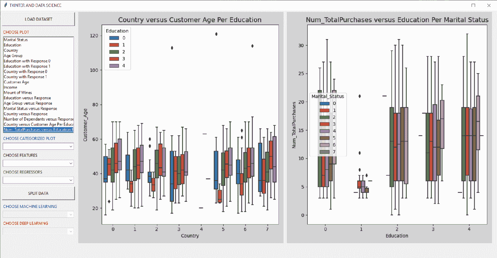

**图 19** 不同婚姻状况下总购买次数与教育水平的分布

###### 分类收入与响应的分布

将此代码添加到 `Main_Class` 中 `binds_event()` 方法的末尾：

```python
####### Binds listbox to a function
self.obj_window.listbox.bind("<<ListboxSelect>>", self.choose_list_widget)
```

此代码将一个函数绑定到 tkinter `Combobox` 控件（`self.obj_window.combo1`）的 `<<ComboboxSelected>>` 事件。此代码的目的是将特定动作或行为与从 `combo1` 中选择项目相关联。

当用户从 `combo1` 中选择一个项目时，将触发 `choose_combobox1()` 函数。该函数将负责处理用户的选择，并根据所选项目执行相关操作或显示相关信息。

以这种方式将事件绑定到控件是 GUI 应用程序中的常见做法，旨在使界面具有响应性和交互性。在该特定案例中，这表明代码旨在动态响应用户从下拉框中的选择，从而增强用户体验，并允许与应用程序进行更多样化的交互。

然后，在 `Main_Class` 中定义一个名为 `choose_combobox1()` 的新方法：

```python
def choose_combobox1(self, event):
    chosen = self.obj_window.combo1.get()
    self.obj_plot.choose_category(self.df_dummy, chosen,
                                  self.obj_window.figure1, self.obj_window.canvas1,
                                  self.obj_window.figure2, self.obj_window.canvas2)
```

此代码定义了 `choose_combobox1()` 函数，当在 `combo1` tkinter `Combobox` 控件中选择项目时将触发该函数。

以下是该函数功能的细分说明：

1.  `chosen = self.obj_window.combo1.get()`：它从 `combo1` `Combobox` 中检索当前选定的项目，并将其存储在 `chosen` 变量中。
2.  `self.obj_plot.choose_category(self.df_dummy, chosen, self.obj_window.figure1, self.obj_window.canvas1, self.obj_window.figure2, self.obj_window.canvas2)`：它调用 `self.obj_plot` 对象（`Helper_Plot` 类的实例）的 `choose_category` 方法，并向其传递多个参数：
    *   `self.df_dummy`：包含分类数据的 DataFrame。
    *   `chosen`：从 `combo1` 中选定的项目。
    *   `self.obj_window.figure1` 和 `self.obj_window.canvas1`：应用程序第一绘图区域的 Figure 和 Canvas 对象。
    *   `self.obj_window.figure2` 和 `self.obj_window.canvas2`：应用程序第二绘图区域的 Figure 和 Canvas 对象。

此函数的目的是响应用户从 `combo1` 中的选择，并根据所选项目触发相应的绘图或可视化操作。`Helper_Plot` 类中的 `choose_category()` 方法将根据所选类别确定生成哪种特定可视化。这种方法使应用程序具有交互性，允许用户根据其选择探索不同的可视化。

然后，在 `Helper_Plot` 类中定义一个名为 `choose_category()` 的新方法：

```python
def choose_category(self, df, chosen, figure1, canvas1, figure2, canvas2):
    if chosen == "Categorized Income versus Response":
        self.dist_one_vs_another_plot(df, "Income", "Response", figure1, canvas1, chosen)
```

此函数接收多个参数，包括一个 DataFrame（`df`）、一个字符串 `chosen` 以及四个与绘图相关的对象（`figure1`、`canvas1`、`figure2`、`canvas2`）。其目的是根据用户从 `chosen` 变量中选择的内容，启用不同可视化的选择。

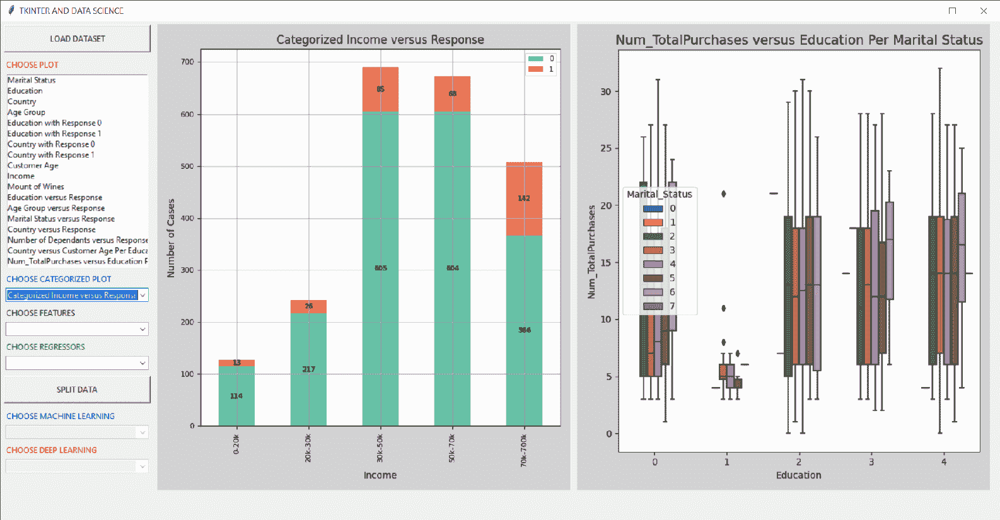

**图 20** 分类收入与响应的分布

在该特定代码块中，有一个单一的条件分支，检查 `chosen` 的值是否等于 "Categorized Income versus Response"。如果满足此条件，它将调用 `dist_one_vs_another_plot()` 函数以创建特定类型的图表。该可视化的目的是比较客户的分类收入水平（"Income"）与其响应行为（"Response"）。这种比较有助于分析不同收入类别与客户响应的关联，这对于理解客户行为并相应地定制营销策略或产品供给至关重要。结果如图 20 所示。

###### 分类总购买量与分类收入的分布

将此代码添加到 `Helper_Plot` 类中 `choose_category()` 方法的末尾：

```python
if chosen == "Categorized Total Purchase versus Categorized Income":
    self.dist_one_vs_another_plot(df, "Num_TotalPurchases", "Income", figure2, canvas2, chosen)
```

此代码旨在在应用程序中启用交互式数据探索功能。当用户选择此特定选项时，代码将生成一种特定类型的图表，以可视化方式展示分类总购买量与分类收入之间的关系。这有助于用户深入了解数据集中这两个变量的相关性，从而支持数据驱动的决策和探索。结果如图 21 所示。

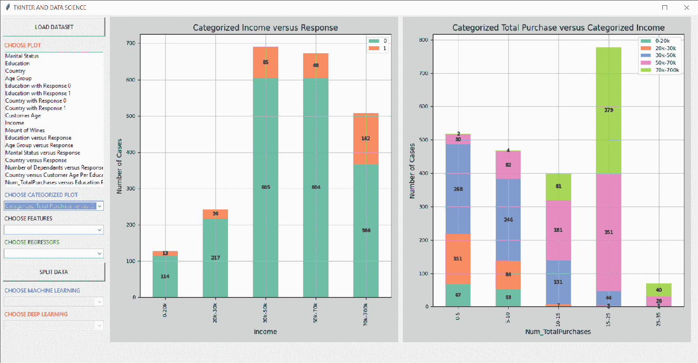

**图 21** 分类总购买量与分类收入的分布

###### 分类最近购买间隔与分类总购买量的分布

将此代码添加到 `Helper_Plot` 类中 `choose_category()` 方法的末尾：

```python
if chosen == "Categorized Recency versus Categorized Total Purchase":
    self.dist_one_vs_another_plot(df, "Recency", "Num_TotalPurchases", figure1, canvas1, chosen)
```

此代码的目的是在用户从用户界面元素（下拉框或组合框）中选择 "Categorized Recency versus Categorized Total Purchase" 时创建特定的数据可视化。该可视化涉及比较两个分类变量："Categorized Recency"（分类最近购买间隔）和 "Categorized Total Purchase"（分类总购买量）。

生成的图表使观察者能够了解总购买量分布如何随不同的最近购买间隔类别而变化。例如，它有助于回答以下问题：

*   在过去 10 天内购买的客户是否更有可能落入特定的总购买量类别？
*   最近购买间隔如何影响总购买量的分布？

通过以可视化方式呈现这些信息，图表使识别数据中的趋势和模式变得更加容易，并能得出与这两个分类变量交互相关的洞察。结果如图 22 所示。

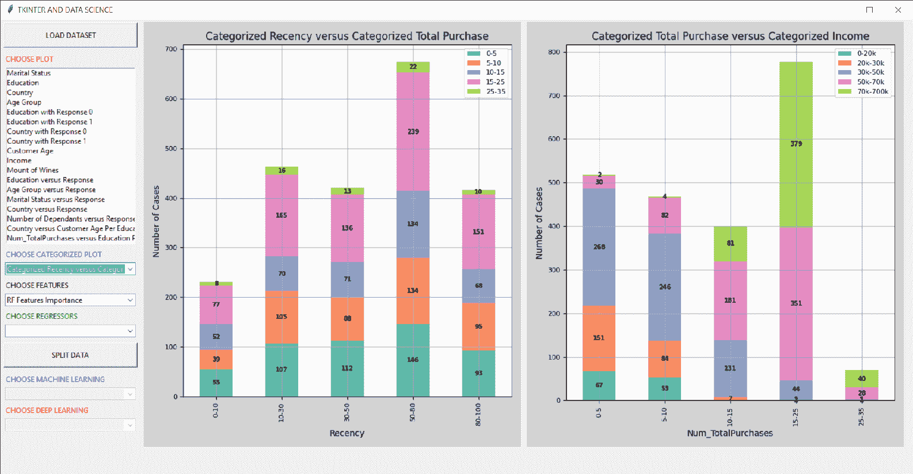

**图 22** 分类最近购买间隔与分类总购买量的分布

###### 分类客户月份与分类客户年龄的分布

将此代码添加到 `Helper_Plot` 类中 `choose_category()` 方法的末尾：

```python
if chosen == "Categorized Customer Month versus Categorized Customer Age":
    self.dist_one_vs_another_plot(df, "Dt_Customer_Month", "Customer_Age", figure2, canvas2, chosen)
```

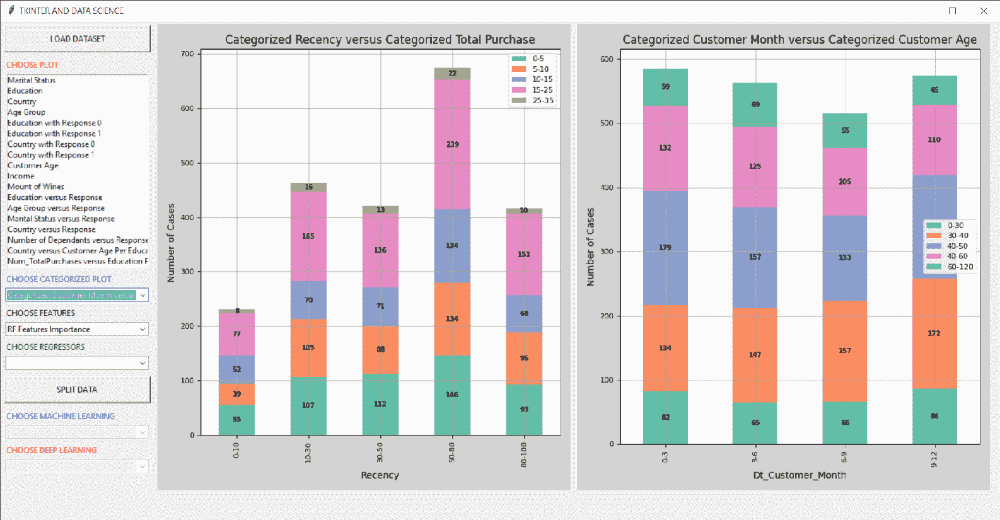

**图 23** 分类客户月份与分类客户年龄的分布


##### 代码可视化目的与分析

###### 客户月份与年龄分布的可视化

代码旨在创建一个可视化图表，展示两个分类变量之间的关系：**"Categorized Customer Month"**（分类客户月份）和 **"Categorized Customer Age"**（分类客户年龄）。该可视化呈现为堆叠条形图，具体解读如下：

*   **X 轴（Categorized Customer Month）**：代表 "Customer Month" 的不同类别或区间。这些类别表示客户加入或使用服务/产品的不同月份或月份组。
*   **Y 轴（Count of Cases）**：代表每个 "Categorized Customer Month" 和 "Categorized Customer Age" 组合内的案例数或观测值。图中的每个堆叠条形代表这两个分类变量特定组合的案例数。
*   **堆叠条形**：X 轴上每个 "Categorized Customer Month" 类别均显示为一个堆叠条形。每个条形内部分为多个段，每段对应一个特定的 "Categorized Customer Age" 类别。每段的高度代表落入该特定月份与年龄组组合的案例数。

此类可视化有助于理解客户年龄分布在客户加入或使用产品/服务的不同月份/时期中的变化情况。它允许观察者探究特定月份是否吸引特定年龄组的客户，以及数据中是否存在与这两个分类变量相关的模式或趋势。

###### 分类购买黄金产品数量与分类收入的分布

###### 代码实现

在 `Helper_Plot` 类的 `choose_category()` 方法末尾添加以下代码：

```
if chosen == "Categorized Amount of Gold Products versus Categorized Income":
    self.dist_one_vs_another_plot(df, "MntGoldProds", "Income", figure1, canvas1, chosen)
```

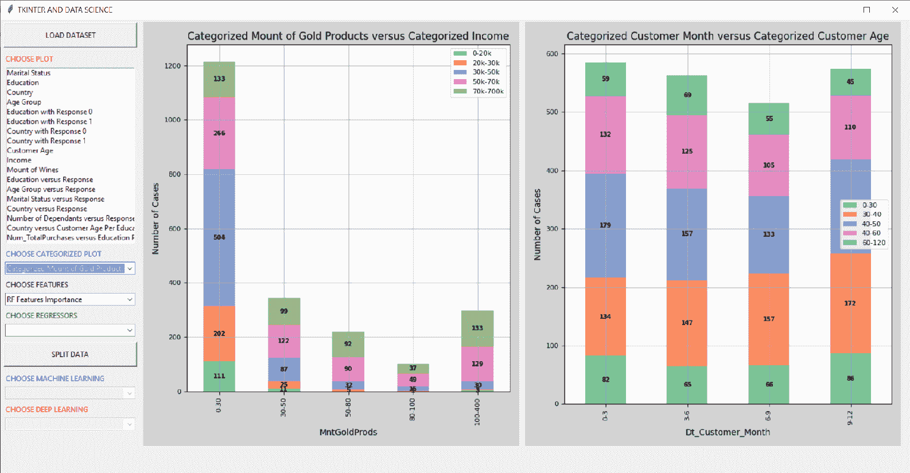

**Figure 24** The distribution of categorized amount of gold Products purchased versus categorized income

####### 可视化分析

该代码段用于生成堆叠条形图，以直观描绘两个不同变量间的关联：**"Categorized Amount of Gold Products"**（分类黄金产品购买量）和 **"Categorized Income"**（分类收入）。该可视化旨在提供关于客户收入水平与其在黄金产品上支出关系的洞察。

*   **X 轴**：代表黄金产品支出金额的各类别或区间，涵盖 "0-30"、"30-50"、"50-80" 等范围。
*   **Y 轴**：量化每个 "Categorized Amount of Gold Products" 与 "Categorized Income" 组合中的案例数或观测值。
*   **堆叠条形**：每个条形对应一个特定的 "Categorized Amount of Gold Products" 类别，展示该精确组合的案例数。条形由多个段组成，每段代表一个不同的 "Categorized Income" 类别。段的高度反映属于该特定黄金产品支出与收入类别组合的案例数。
*   **图例与标题**：图表预期包含图例，以阐释各 "Categorized Income" 类别的颜色编码；标题为 "Categorized Amount of Gold Products versus Categorized Income"，简明传达图表重点。结果见图 24。

此类可视表现作为强大的探索性工具，支持检验数据中的潜在趋势或模式。它允许调查高收入人群是否比低收入人群在黄金产品上支出更多，并有助于识别不同收入群体在黄金产品支出行为上的差异。通过该可视化，可获得关于消费者偏好和行为的宝贵洞察，为市场营销或业务策略的数据驱动决策提供支持。

###### 分类购买鱼类产品数量与分类总消费额的分布

###### 代码实现

在 `Helper_Plot` 类的 `choose_category()` 方法末尾添加以下代码：

```
if chosen == "Categorized Amount of Fish Products versus Categorized Total AmountSpent":
    self.dist_one_vs_another_plot(df, "MntFishProducts", "TotalAmount_Spent", figure2, canvas2, chosen)
```

####### 可视化分析

该代码负责生成直方图形式的可视化表示，对比两个不同变量：**"Categorized Amount of Fish Products"**（分类鱼类产品购买量）和 **"Categorized Total Amount Spent"**（分类总消费额）。该可视化旨在提供关于客户行为两个方面关系的洞察。

*   **X 轴**：划分代表鱼类产品支出金额的不同类别或区间，如 "0-10"、"10-20"、"20-40" 等。
*   **Y 轴**：量化落入每个 "Categorized Amount of Fish Products" 与 "Categorized Total Amount Spent" 组合内的案例数或观测值。
*   **条形**：每个条形对应一个特定的 "Categorized Amount of Fish Products" 类别，代表属于该两个分类变量特定组合的案例数。每个条形的高度反映该特定组合内的案例数。

该可视化旨在清晰简洁地概述鱼类产品支出与客户总消费额的关系。

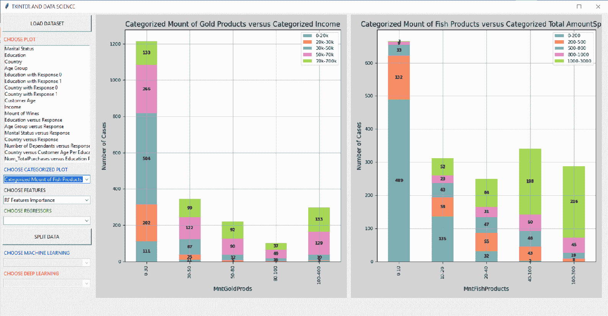

**Figure 25** distribution of categorized amount of fish products purchased versus categorized total amount spent

直方图是可视化变量分布及关系的宝贵工具。在该特定情境下，该可视化支持快速评估：在鱼类产品上支出更多的客户是否倾向于拥有更高的总支出，或是否存在明显的支出行为模式。它还允许识别特定支出类别组合内的案例集中情况。通过创建此直方图，可深入了解客户偏好和消费习惯，这对营销策略和业务决策极具价值。

###### 分类购买肉类产品数量与分类近期度的分布

###### 代码实现

在 `Helper_Plot` 类的 `choose_category()` 方法末尾添加以下代码：

```
if chosen == "Categorized Amount of Meat Products versus Categorized Recency":
    self.dist_one_vs_another_plot(df, "MntMeatProducts", "Recency", figure1, canvas1, chosen)
```

####### 可视化分析

该代码负责生成直方图形式的可视化表示，对比两个不同变量：**"Categorized Amount of Meat Products"**（分类肉类产品购买量）和 **"Categorized Recency"**（分类近期度）。该可视化旨在提供关于客户行为这两个方面关系的洞察。

*   **X 轴**：由代表肉类产品支出金额的不同类别或区间组成，如 "0-50"、"50-100"、"100-200" 等。
*   **Y 轴**：量化落入每个 "Categorized Amount of Meat Products" 与 "Categorized Recency" 组合内的案例数或观测值。
*   **条形**：每个条形对应一个特定的 "Categorized Amount of Meat Products" 类别，代表属于该两个分类变量特定组合的案例数。每个条形的高度反映该特定组合内的案例数。

该可视化旨在清晰简洁地概述肉类产品支出与客户互动近期度的关系。


##### 直方图

直方图是可视化变量分布及其相互关系的宝贵工具。在该特定场景下，此可视化能够快速评估：在肉类产品上花费更多的客户是否往往拥有更近期的互动，或者在支出行为与近期度方面是否存在明显模式。它还允许识别在特定支出类别与近期度区间组合内是否存在案例集中。通过创建该直方图，可以深入了解客户相对于其互动近期度的偏好和消费习惯，这对营销策略和商业决策极具价值。

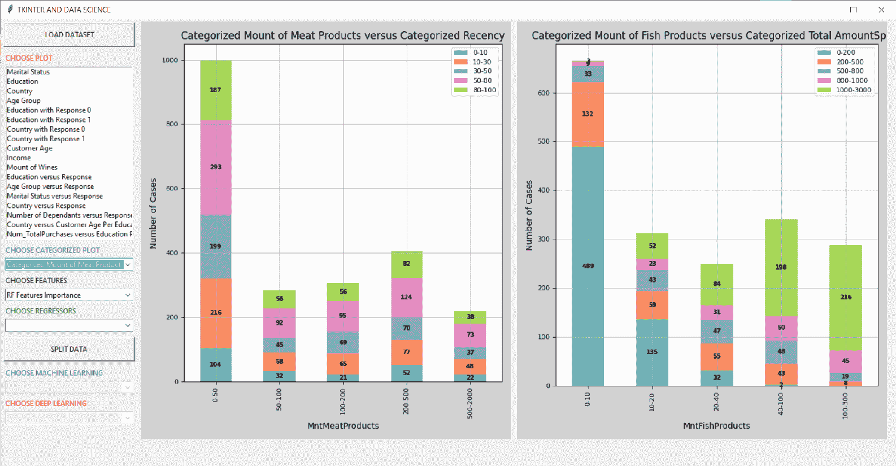

**图 26** 分类肉类产品购买金额与分类近期度的分布

##### 绘制相关性矩阵

在 `Helper_Plot` 类中添加一个名为 `plot_corr_mat()` 的新方法：

```python
def plot_corr_mat(self, df, figure, canvas):
    figure.clear()
    plot1 = figure.add_subplot(1, 1, 1)
    categorical_columns = df.select_dtypes(include=['object', 'category']).columns
    df_removed = df.drop(columns=categorical_columns)
    corrdata = df_removed.corr()
    annot_kws = {"size": 5}
    sns.heatmap(corrdata, ax=plot1, lw=1, annot=True, cmap="Reds", annot_kws=annot_kws)
    plot1.set_title('Correlation Matrix', fontweight="bold", fontsize=14)
    # Set font for x and y labels
    plot1.set_xlabel('Features', fontweight="bold", fontsize=12)
    plot1.set_ylabel('Features', fontweight="bold", fontsize=12)
    # Set font for tick labels
    plot1.tick_params(axis='both', which='major', labelsize=5)
    plot1.tick_params(axis='both', which='minor', labelsize=5)
    figure.tight_layout()
    canvas.draw()
```

该代码生成相关性矩阵热力图，以可视化数据集中数值特征之间的关系。以下是代码步骤：

###### 1. 清除现有绘图

函数首先清除指定图形上的任何现有内容，以确保为新绘图提供一个干净的画布。

###### 2. 创建子图

使用 `figure.add_subplot(1, 1, 1)` 向图形添加一个子图。这在 1x1 网格中为相关性矩阵热力图创建了一个单独的子图。

###### 3. 选择分类列

代码使用 `df.select_dtypes(include=['object', 'category']).columns` 识别并选择 DataFrame 中的分类列。这些分类列将从相关性矩阵计算中排除，因为它们不是数值型的。

###### 4. 移除分类列

使用 `df.drop(columns=categorical_columns)` 从 DataFrame 中移除选定的分类列。这将创建一个仅包含数值特征的新 DataFrame (`df_removed`)。

###### 5. 计算相关性矩阵

代码使用 `corrdata = df_removed.corr()` 计算 `df_removed` 中数值特征的相关性矩阵。该矩阵包含所有数值特征之间的成对相关性。

###### 6. 自定义热力图

*   `annot_kws` 是一个字典，用于指定热力图上注释的其他属性。在本例中，它将注释文本大小设置为 5。
*   `sns.heatmap()` 用于创建热力图，并将其绘制在先前创建的子图上 (`ax=plot1`)。
*   `annot=True` 参数确保在热力图上显示相关性数值。
*   `cmap` 参数指定热力图的颜色映射，本例中使用 "Reds"。
*   `annot_kws` 字典被传递以自定义注释属性。

###### 7. 设置标题和标签

*   绘图标题设置为 'Correlation Matrix'，并指定了字体属性。
*   x 轴和 y 轴的标签设置了字体属性，以表明两轴代表相同的特征集。

###### 8. 调整刻度标签

绘图坐标轴上主刻度和次刻度的标签字体大小均调整为 5。

###### 9. 紧凑布局

调用 `figure.tight_layout()` 以确保绘图布局调整得当，适配图形区域。

###### 10. 绘制图形

最后，调用 `canvas.draw()` 在用户界面的画布上渲染并显示相关性矩阵热力图。

然后，将此代码添加到 `Main_Class` 中 `binds_event()` 方法的末尾：

```python
##### Binds combobox2 to a function
self.obj_window.combo2.bind("<<ComboboxSelected>>", self.choose_combobox2)
```

这行代码将一个函数绑定到图形用户界面 (GUI) 应用程序中特定 Combobox（下拉框）控件的事件，通常使用 Python 的 `tkinter` 库创建。

以下是该行代码的解释：

*   `self.obj_window.combo2`：这部分代码引用了 `obj_window` 对象的一部分 Combobox 控件 (`combo2`)，该对象似乎是自定义窗口设计类的一个实例。此 Combobox 控件用于显示用户可选择的选项列表。
*   `.bind("<<ComboboxSelected>>", self.choose_combobox2)`：这部分代码使用 `bind` 方法将一个函数 (`self.choose_combobox2`) 与在 Combobox 中选择项目时生成的事件关联起来。所绑定的事件是 `<<ComboboxSelected>>`，这是 `tkinter` 中预定义的事件，当用户从 Combobox 下拉列表中选择一个项目时触发。
*   `self.choose_combobox2`：这是发生事件（在 Combobox 中选择项目）时将要执行的函数。该函数似乎负责处理用户的选择，并根据所选项目执行特定操作。

总之，这行代码为 GUI 应用程序中的第二个 Combobox (`combo2`) 设置了事件处理机制。当用户从此 Combobox 选择一个项目时，将调用 `self.choose_combobox2` 函数以响应用户的选择，可能通过更新 GUI 或根据所选项目执行其他相关操作。

接下来，在 `Main_Class` 中添加一个名为 `choose_combobox2()` 的新方法：

```python
def choose_combobox2(self, event):
    chosen = self.obj_window.combo2.get()
    self.obj_plot.choose_plot_more(self.df_final, chosen,
                                   self.X, self.y,
                                   self.obj_window.figure1,
                                   self.obj_window.canvas1, self.obj_window.figure2,
                                   self.obj_window.canvas2)
```

这段代码定义了一个名为 `choose_combobox2()` 的函数，它作为图形用户界面 (GUI) 应用程序中 Combobox (`combo2`) 的事件处理程序，使用 Python 的 `tkinter` 库创建。以下是该函数的功能解释：

1.  `event`：该函数接受一个 `event` 参数，表示触发函数执行的事件。在本例中，该事件是 `combo2` 中的项目选择。
2.  `chosen = self.obj_window.combo2.get()`：在函数内部，它使用 `get()` 方法从 `combo2` 检索当前选定的项目。所选项目存储在 `chosen` 变量中。
3.  `self.obj_plot.choose_plot_more(...)`：这行代码调用 `obj_plot` 对象实例上的一个名为 `choose_plot_more` 的方法。它向该方法传递多个参数，包括：
    *   `self.df_final`：数据集，预期为 Pandas DataFrame。
    *   `chosen`：从 `combo2` 选择的项目。
    *   `self.X` 和 `self.y`：用于数据绘图或分析的输入和输出变量。
    *   `self.obj_window.figure1`、`self.obj_window.canvas1`、`self.obj_window.figure2`、`self.obj_window.canvas2`：这些似乎是与 GUI 相关的图形组件（例如 Matplotlib 图形和画布）。

`obj_plot` 中的 `choose_plot_more()` 方法预期将处理所选项目，并可能根据用户的选择生成图表、显示数据或执行其他相关操作。该函数本质上架起了用户与 GUI Combobox (`combo2`) 交互与 `obj_plot` 对象提供的相应数据可视化或分析功能之间的桥梁。

然后，在 `Helper_Plot` 类中，定义一个名为 `choose_plot_more()` 的新方法：


###### `choose_plot_more` 方法

```python
def choose_plot_more(self, df, chosen, X, y, figure1, canvas1, figure2, canvas2):
    if chosen == "Correlation Matrix":
        self.plot_corr_mat(df, figure1, canvas1)
```

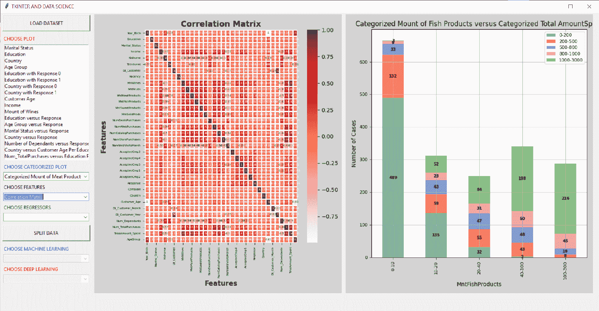

**图 27** 相关矩阵

`choose_plot_more()` 方法是应用程序的一部分，允许用户选择不同类型的图表或可视化。该方法处理用户的选择，并根据所选选项调用相应的绘图函数。以下是此特定代码块的功能说明：

1.  **`chosen`**：此参数代表用户的选择，即他们想要查看的图表或可视化类型。它作为参数传递给该方法。
2.  在方法内部，有一个 `if` 语句检查 `chosen` 的值。根据 `chosen` 的值，会调用特定的绘图函数。
3.  在此代码块中，如果 `chosen` 的值为 `"Correlation Matrix"`，则方法使用以下参数调用另一个名为 `plot_corr_mat()` 的函数：
    *   **`df`**：用于计算和可视化相关矩阵的数据集（推测为 Pandas DataFrame）。
    *   **`figure1`**：将在其中显示相关矩阵图的 Matplotlib 图形。
    *   **`canvas1`**：与 `figure1` 关联、用于渲染图表的 Matplotlib 画布。

`plot_corr_mat()` 函数预期会为给定数据集生成基于热力图的相关矩阵图，并将其显示在指定的图形和画布中。

这种代码结构允许用户从 GUI 中的 Combobox 选择不同类型的图表，并根据其选择执行相应的绘图函数。在此例中，它处理的是“Correlation Matrix”选项，如图 27 所示。

###### 使用随机森林分类器绘制特征重要性

在 `Helper_Plot` 类中添加名为 `plot_rf_importance()` 的新方法：

```python
def plot_rf_importance(self, X, y, figure, canvas):
    result_rf = self.obj_data.feat_importance_rf(X, y)
    figure.clear()
    plot1 = figure.add_subplot(1, 1, 1)
    sns.set_color_codes("pastel")
    ax = sns.barplot(x='Values', y='Features', data=result_rf, color="Blue", ax=plot1)
    plot1.set_title('Random Forest Features Importance', fontweight="bold", fontsize=14)
    plot1.set_xlabel('Features Importance', fontsize=10)
    plot1.set_ylabel('Feature Labels', fontsize=10)
    # Set font for tick labels
    plot1.tick_params(axis='both', which='major', labelsize=5)
    plot1.tick_params(axis='both', which='minor', labelsize=5)
    figure.tight_layout()
    canvas.draw()
```

`plot_rf_importance()` 方法用于生成并显示条形图，展示从随机森林模型获得的特征重要性得分。以下是该代码逐步功能的解释：

1.  **`X` 和 `y`**：这些参数分别代表机器学习模型的输入特征（自变量）和目标变量（因变量）。特征重要性得分将基于这些变量计算。
2.  **`figure` 和 `canvas`**：这些参数分别代表 Matplotlib 图形和画布。图形是显示条形图的地方，画布与图形关联，用于渲染图表。
3.  该方法首先使用 `obj_data` 对象的 `feat_importance_rf` 方法计算特征重要性。该方法推测是在提供的数据（`X` 和 `y`）上拟合随机森林分类器并返回特征重要性。
4.  使用 `figure.clear()` 清除图形，确保其准备好显示新图表。
5.  使用 `figure.add_subplot(1, 1, 1)` 向图形添加子图。这将在图形中创建单个子图。
6.  使用 Matplotlib 的 `sns.barplot` 函数创建条形图。它接受以下参数：
    *   `x='Values'` 和 `y='Features'`：指定在 x 轴和 y 轴上绘制的数据。在此例中，特征重要性得分在 x 轴上，特征标签在 y 轴上。
    *   `data=result_rf`：绘图的数据源，其中 `result_rf` 假定为包含特征名称及其重要性得分的 DataFrame。
    *   `color="Blue"`：设置条形图中条形的颜色。
7.  设置图表的标题和标签：
    *   `plot1.set_title(...)`：设置图表标题。
    *   `plot1.set_xlabel(...)`：设置 x 轴标签。
    *   `plot1.set_ylabel(...)`：设置 y 轴标签。
8.  使用 `plot1.tick_params(...)` 调整刻度参数以设置刻度标签的字体大小。这有助于提高图表的可读性。
9.  使用 `figure.tight_layout()` 紧凑地格式化图形，以确保图表的所有元素都适合图形范围内。
10. 最后，调用 `canvas.draw()` 在关联的画布上渲染图表。

总的来说，此方法允许您使用条形图可视化和探索从随机森林模型获得的特征重要性得分。

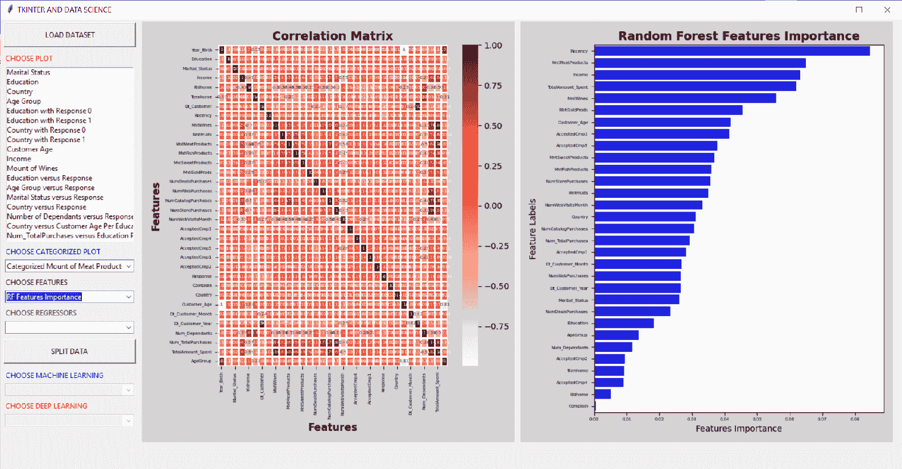

**图 28** 随机森林特征重要性

在 `Helper_Plot` 类的 `choose_plot_more()` 末尾添加此代码：

```python
if chosen == "RF Features Importance":
    self.plot_rf_importance(X, y, figure2, canvas2)
```

然后运行 `main_class.py`。在第二个 Combobox 中选择 “RF Features Importance” 以查看随机森林特征重要性，如图 28 所示。

###### 使用极端树分类器绘制特征重要性

在 `Helper_Plot` 类中添加名为 `plot_et_importance()` 的新方法：

```python
def plot_et_importance(self, X, y, figure, canvas):
    result_rf = self.obj_data.feat_importance_et(X, y)
    figure.clear()
    plot1 = figure.add_subplot(1, 1, 1)
    sns.set_color_codes("pastel")
    ax = sns.barplot(x='Values', y='Features', data=result_rf, color="Red", ax=plot1)
    plot1.set_title('Extra Trees Features Importance', fontweight="bold", fontsize=14)
    plot1.set_xlabel('Features Importance', fontsize=10)
    plot1.set_ylabel('Feature Labels', fontsize=10)
    # Set font for tick labels
    plot1.tick_params(axis='both', which='major', labelsize=5)
    plot1.tick_params(axis='both', which='minor', labelsize=5)
    figure.tight_layout()
    canvas.draw()
```

`plot_et_importance()` 方法与前面解释的 `plot_rf_importance()` 方法类似，但用于生成并显示条形图，展示从极端树模型（另一种集成机器学习算法）获得的特征重要性得分。以下是该代码逐步功能的解释：

1.  **`X` 和 `y`**：这些参数分别代表机器学习模型的输入特征（自变量）和目标变量（因变量）。特征重要性得分将基于这些变量计算。
2.  **`figure` 和 `canvas`**：这些参数分别代表 Matplotlib 图形和画布。图形是显示条形图的地方，画布与图形关联，用于渲染图表。
3.  该方法首先使用 `obj_data` 对象的 `feat_importance_et()` 方法计算特征重要性。该方法推测是在提供的数据（`X` 和 `y`）上拟合极端树分类器并返回特征重要性。
4.  使用 `figure.clear()` 清除图形，确保其准备好显示新图表。
5.  使用 `figure.add_subplot(1, 1, 1)` 向图形添加子图。这将在图形中创建单个子图。
6.  使用 Matplotlib 的 `sns.barplot` 函数创建条形图，类似于前面的解释。它指定了 x 轴、y 轴的数据、数据源和条形颜色。
7.  设置图表的标题和标签，类似于前面的解释。
8.  使用 `plot1.tick_params(...)` 调整刻度参数以设置刻度标签的字体大小，就像前面的方法一样。
9.  使用 `figure.tight_layout()` 紧凑地格式化图形，以确保图表的所有元素都适合图形范围内。
10. 最后，调用 `canvas.draw()` 在关联的画布上渲染图表。


####### 概述

此方法允许您使用条形图可视化和探索从 Extra Trees 模型获得的特征重要性分数，从而深入了解哪些特征对模型预测影响最大。

###### 代码实现

将以下代码添加到 `Helper_Plot` 类中 `choose_plot_more()` 方法的末尾：

```python
if chosen == "ET Features Importance":
    self.plot_et_importance(X, y, figure2, canvas2)
```

然后运行 `main_class.py`。在第二个下拉框中选择 “ET Features Importance”，即可查看随机森林特征重要性，如图 29 所示。

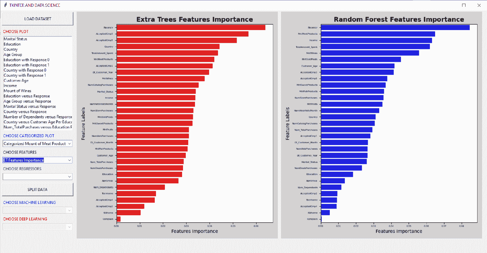

**图 29** Extra Trees 特征重要性

###### 使用递归特征消除 (RFE) 绘制特征重要性

在 `Helper_Plot` 类中添加一个名为 `plot_rfe_importance()` 的新方法：

```python
def plot_rfe_importance(self, X, y, figure, canvas):
    result_lg = self.obj_data.feat_importance_rfe(X, y)
    figure.clear()
    plot1 = figure.add_subplot(1, 1, 1)
    sns.set_color_codes("pastel")
    ax = sns.barplot(x='Ranking', y='Features', data=result_lg, color="orange", ax=plot1)
    plot1.set_title('RFE Features Importance', fontweight="bold", fontsize=14)
    plot1.set_xlabel('Features Importance', fontsize=10)
    plot1.set_ylabel('Feature Labels', fontsize=10)
    # Set font for tick labels
    plot1.tick_params(axis='both', which='major', labelsize=5)
    plot1.tick_params(axis='both', which='minor', labelsize=5)
    figure.tight_layout()
    canvas.draw()
```

`plot_rfe_importance()` 方法用于生成并显示一个条形图，展示使用逻辑回归模型通过递归特征消除 (RFE) 过程获得的特征排名。以下是该代码的分步解释：

1.  **X 和 y**：这些参数分别代表机器学习模型的输入特征（自变量）和目标变量（因变量）。特征排名将基于这些变量计算。
2.  **figure 和 canvas**：这些参数分别代表 Matplotlib 的图形和画布。图形用于显示条形图，画布与图形关联，用于渲染绘图。
3.  该方法首先使用 `obj_data` 对象的 `feat_importance_rfe` 方法计算特征排名。该方法推测在提供的数据（X 和 y）上使用逻辑回归模型执行 RFE，并返回特征排名。
4.  使用 `figure.clear()` 清除图形，确保其准备好显示新绘图。
5.  使用 `figure.add_subplot(1, 1, 1)` 向图形添加一个子图。这将在图形中创建单个子图。
6.  使用 Matplotlib 的 `sns.barplot` 函数创建条形图。它指定了 x 轴、y 轴的数据、数据源和条形颜色。
7.  设置绘图的标题和标签，类似于前面的方法解释。
8.  使用 `plot1.tick_params(...)` 调整刻度参数以设置刻度标签的字体大小，就像前面的方法一样。
9.  使用 `figure.tight_layout()` 对图形进行紧凑格式化，以确保绘图的所有元素都适合图形范围内。
10. 最后，调用 `canvas.draw()` 在关联的画布上渲染绘图。

总之，此方法允许您可视化和探索使用逻辑回归模型通过 RFE 过程获得的特征排名。条形图根据排名提供了每个特征重要性的见解。排名较低的特征被认为对模型更重要。

###### 代码集成

将以下代码添加到 `Helper_Plot` 类中 `choose_plot_more()` 方法的末尾：

```python
if chosen == "RFE Features Importance":
    self.plot_rfe_importance(X, y, figure2, canvas2)
```

然后运行 `main_class.py`。在第二个下拉框中选择 “RFE Features Importance” 以查看随机森林特征重要性，如图 30 所示。

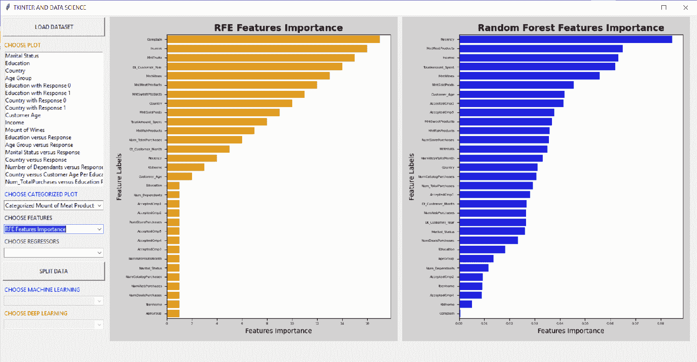

**图 30** RFE 特征重要性

#### 机器学习模型

##### Machine_Learning 类

创建一个名为 `machine_learning.py` 的新 Python 文件。在其中创建一个名为 `Machine_Learning` 的类。它是机器学习工作流的一部分，负责训练和评估各种分类模型。让我们分解其主要组件和职责：

*   **导入**：该类导入机器学习任务所需的各种库和模块。这些包括用于数据预处理、模型选择、评估指标和特定机器学习算法的库。
*   **初始化**：类的构造函数将 `Process_Data` 类的一个实例初始化为 `self.obj_data`。`Process_Data` 类包含用于数据预处理和特征工程的方法。

###### machine_learning.py

```python
import numpy as np
from imblearn.over_sampling import SMOTE
from sklearn.model_selection import train_test_split, RandomizedSearchCV, GridSearchCV, StratifiedKFold
from sklearn.preprocessing import StandardScaler
import joblib
from sklearn.linear_model import LogisticRegression
from sklearn.metrics import confusion_matrix, accuracy_score, recall_score, precision_score
from sklearn.metrics import classification_report, f1_score, plot_confusion_matrix
from sklearn.ensemble import RandomForestClassifier
from sklearn.neighbors import KNeighborsClassifier
from sklearn.tree import DecisionTreeClassifier
from sklearn.ensemble import AdaBoostClassifier, GradientBoostingClassifier
from xgboost import XGBClassifier
from sklearn.neural_network import MLPClassifier
from sklearn.svm import SVC
import os
import joblib
import pandas as pd
from process_data import Process_Data

class Machine_Learning:
    def __init__(self):
        self.obj_data = Process_Data()
```

###### 过采样与数据分割

在 `Machine_Learning` 类中，定义一个名为 `oversampling_splitting()` 的新方法，如下所示：

```python
def oversampling_splitting(self, X, y):
    sm = SMOTE(random_state=42)
    X, y = sm.fit_resample(X, y.ravel())
    # Splits the data into training and testing
    X_train, X_test, y_train, y_test = train_test_split(X, y, test_size=0.2, random_state=2021, stratify=y)
    # Use Standard Scaler
    scaler = StandardScaler()
    X_train_stand = scaler.fit_transform(X_train)
    X_test_stand = scaler.transform(X_test)
    # Saves into pkl files
    joblib.dump(X_train_stand, 'X_train.pkl')
    joblib.dump(X_test_stand, 'X_test.pkl')
    joblib.dump(y_train, 'y_train.pkl')
    joblib.dump(y_test, 'y_test.pkl')
```

`oversampling_splitting()` 方法在 `Machine_Learning` 类中执行以下任务：

1.  **过采样**：它使用合成少数类过采样技术 (`SMOTE`) 来解决类别不平衡问题。`SMOTE` 生成少数类的合成样本以平衡类别分布。这是为了防止模型偏向多数类。生成的过采样数据集存储在 `X` 和 `y` 中。
2.  **训练-测试分割**：过采样后，该方法使用 `sklearn.model_selection` 中的 `train_test_split` 将数据集分割为训练集和测试集。`test_size` 参数控制分配给测试集的数据比例（在本例中为 20% 的数据），`stratify=y` 确保训练集和测试集中的类别分布得以保留。
3.  **特征缩放**：它使用 `sklearn.preprocessing` 中的 `StandardScaler` 对训练集和测试集中的特征进行缩放。特征缩放对于确保所有特征具有相同的尺度至关重要，这可以提高许多机器学习算法的性能。
4.  **保存数据**：最后，该方法将缩放后的训练和测试数据以及相应的标签（`y_train` 和 `y_test`）保存到单独的 pickle (`.pkl`) 文件中。这些文件可用于将来训练和评估机器学习模型，而无需再次执行数据预处理。


###### 总体概述

`oversampling_splitting()` 方法通过解决类别不平衡问题、将数据拆分为训练集和测试集、执行特征缩放以及保存预处理后的数据以供后续使用，来为机器学习准备数据。这是机器学习工作流程中的关键步骤，旨在确保模型在合适的数据上进行训练，并能轻松复用于预测。

###### 加载文件

在 `Machine_Learning` 类中，定义一个名为 `loading_files()` 的新方法，如下所示：

```python
def load_files(self):
    X_train = joblib.load('X_train.pkl')
    X_test = joblib.load('X_test.pkl')
    y_train = joblib.load('y_train.pkl')
    y_test = joblib.load('y_test.pkl')
    return X_train, X_test, y_train, y_test
```

`Machine_Learning` 类中的 `load_files()` 方法负责从先前使用 `oversampling_splitting` 方法保存的 pickle (pkl) 文件中加载预处理后的训练和测试数据。以下是该方法的功能：

####### 1. 加载数据

它使用 `joblib.load` 函数加载以下数据文件：

*   `X_train.pkl`：该文件包含训练数据集经过预处理和缩放后的特征 (`X`)。
*   `X_test.pkl`：该文件包含测试数据集经过预处理和缩放后的特征 (`X`)。
*   `y_train.pkl`：该文件包含与训练数据集对应的标签 (`y`)。
*   `y_test.pkl`：该文件包含与测试数据集对应的标签 (`y`)。

####### 2. 返回数据

加载这些文件后，该方法返回四个变量：

*   `X_train`：训练数据集经过预处理和缩放后的特征。
*   `X_test`：测试数据集经过预处理和缩放后的特征。
*   `y_train`：与训练数据集对应的标签。
*   `y_test`：与测试数据集对应的标签。

该方法的目的是提供一种便捷的方式来访问预处理后的数据，随后可用于训练和评估机器学习模型，而无需再次执行数据预处理。将数据加载和预处理与建模过程分离，使得维护和复用机器学习流水线变得更加容易。

###### 训练模型与预测结果

在 `Machine_Learning` 类中，定义两个名为 `train_model()` 和 `predict_model()` 的新方法，如下所示：

```python
def train_model(self, model, X, y):
    model.fit(X, y)
    return model

def predict_model(self, model, X, proba=False):
    if not proba:
        y_pred = model.predict(X)
    else:
        y_pred_proba = model.predict_proba(X)
        y_pred = np.argmax(y_pred_proba, axis=1)
    return y_pred
```

`Machine_Learning` 类中的 `train_model()` 和 `predict_model()` 方法分别负责训练机器学习模型和使用该训练好的模型进行预测。以下是各方法的解释：

####### 1. `train_model(self, model, X, y)`

该方法接受三个参数：

*   `model`：待训练的机器学习模型。
*   `X`：用于训练的特征矩阵（输入数据）。
*   `y`：用于训练的目标标签。

在方法内部，对提供的 `model` 调用 `fit` 函数，并传入输入特征矩阵 `X` 和目标标签 `y`。此步骤在提供的训练数据上训练机器学习模型。

最后，将训练好的模型作为方法的输出返回。

####### 2. `predict_model(self, model, X, proba=False)`

该方法接受三个参数：

*   `model`：用于预测的已训练机器学习模型。
*   `X`：待预测的特征矩阵（输入数据）。
*   `proba`（可选，默认为 `False`）：一个布尔标志，指示是返回类别概率 (`True`) 还是类别标签 (`False`) 作为预测结果。

*   如果 `proba` 为 `False`，该方法使用模型的 `predict` 函数基于输入特征 `X` 进行类别标签预测。预测的类别标签存储在 `y_pred` 变量中。
*   如果 `proba` 为 `True`，该方法使用模型的 `predict_proba` 函数获取每个类别的概率。然后选择概率最高的类别作为预测的类别标签，并将其存储在 `y_pred` 变量中。

预测的类别标签（或概率）作为方法的输出返回。

这些方法具有通用性，可用于各种机器学习模型以执行分类等任务。它们提供了一种一致的方式来训练模型和进行预测，使得在不同模型间切换并评估其性能变得更加容易。

###### 运行模型

在 `Machine_Learning` 类中，定义一个名为 `run_model()` 的新方法，如下所示：

```python
def run_model(self, name, model, X_train, X_test, y_train, y_test, proba=False):
    y_pred = self.predict_model(model, X_test, proba)
    accuracy = accuracy_score(y_test, y_pred)
    recall = recall_score(y_test, y_pred, average='weighted')
    precision = precision_score(y_test, y_pred, average='weighted')
    f1 = f1_score(y_test, y_pred, average='weighted')
    print(name)
    print('accuracy: ', accuracy)
    print('recall: ', recall)
    print('precision: ', precision)
    print('f1: ', f1)
    print(classification_report(y_test, y_pred))
    return y_pred
```

`Machine_Learning` 类中的 `run_model()` 方法负责在测试数据集上运行训练好的机器学习模型并评估其性能。以下是该方法的解释：

######## `run_model(self, name, model, X_train, X_test, y_train, y_test, proba=False)`

该方法接受多个参数：

*   `name`：一个字符串，代表被评估模型的名称或标识符。
*   `model`：待评估的已训练机器学习模型。
*   `X_train`：训练数据的特征矩阵。
*   `X_test`：测试数据的特征矩阵。
*   `y_train`：训练数据的目标标签。
*   `y_test`：测试数据的目标标签。
*   `proba`（可选，默认为 `False`）：一个布尔标志，指示是返回类别概率 (`True`) 还是类别标签 (`False`) 作为预测结果。

在方法内部，调用 `predict_model()` 方法以获取模型在测试数据 `X_test` 上的预测结果。

根据预测标签和真实标签 (`y_test`) 计算多个评估指标。这些指标包括：

*   **准确率**：正确预测标签的比例。
*   **召回率**：各类别召回率的加权平均。
*   **精确率**：各类别精确率的加权平均。
*   **F1 分数**：各类别 F1 分数的加权平均。

随后，该方法打印模型名称及计算出的指标，以提供其性能的概览。

最后，该方法返回预测标签 (`y_pred`)。这可用于进一步的分析或可视化。

`run_model()` 方法作为一种标准化方式，用于在同一数据集上评估和比较不同的机器学习模型，从而更容易评估其在给定任务中的有效性。

####### 绘制混淆矩阵与 ROC 曲线

在 `Helper_Plot` 类中，定义一个名为 `plot_cm_roc()` 的新方法，如下所示：

```python
def plot_cm_roc(self, model, X_test, y_test, ypred, name, figure, canvas):
    figure.clear()
    # Plots confusion matrix
    plot1 = figure.add_subplot(2, 1, 1)
    cm = confusion_matrix(y_test, ypred)
    sns.heatmap(cm, annot=True, linewidth=3, linecolor='red', fmt='g', cmap="Greens", annot_kws={"size": 14}, ax=plot1)
    plot1.set_title('Confusion Matrix' + " of " + name, fontsize=12)
    plot1.set_xlabel('Y predict', fontsize=10)
    plot1.set_ylabel('Y test', fontsize=10)
    plot1.xaxis.set_ticklabels(['Responsive', 'Not Responsive'], fontsize=10)
    plot1.yaxis.set_ticklabels(['Responsive', 'Not Responsive'], fontsize=10)

    # Plots ROC
    plot2 = figure.add_subplot(2, 1, 2)
    Y_pred_prob = model.predict_proba(X_test)
    Y_pred_prob = Y_pred_prob[:, 1]
    fpr, tpr, thresholds = roc_curve(y_test, Y_pred_prob)
```


####### 绘制混淆矩阵与 ROC 曲线

```python
plot2.plot([0, 1], [0, 1], color='navy', linestyle='--', linewidth=3)
plot2.plot(fpr, tpr, color='red', linewidth=3)
plot2.set_xlabel('False Positive Rate', fontsize=10)
plot2.set_ylabel('True Positive Rate', fontsize=10)
plot2.set_title('ROC Curve of ' + name, fontsize=12)
plot2.grid(True)
figure.tight_layout()
canvas.draw()
```

`Helper_Plot` 类中的 `plot_cm_roc()` 方法负责绘制模型评估的两个关键可视化图表：混淆矩阵和接收者操作特征（ROC）曲线。以下是该方法的说明：

######## 方法签名

```python
plot_cm_roc(self, model, X_test, y_test, ypred, name, figure, canvas)
```

此方法接受以下参数：

*   `model`：待评估的已训练机器学习模型。
*   `X_test`：测试数据的特征矩阵。
*   `y_test`：测试数据的目标标签。
*   `ypred`：模型在测试数据上获得的预测标签。
*   `name`：表示被评估模型名称或标识符的字符串。
*   `figure`：用于绘制可视化图表的 Matplotlib `figure` 对象。
*   `canvas`：与该 figure 关联的 Matplotlib `canvas` 对象。

######## 执行流程

1.  **创建子图**：在指定的 `figure` 中创建两个子图，并排显示混淆矩阵和 ROC 曲线。
2.  **绘制混淆矩阵**：使用 `seaborn` 绘制混淆矩阵（`cm`）的热力图。热力图包含每个单元格的数值标注，颜色映射设为 "Greens"。同时添加坐标轴标签和刻度标签以提高清晰度。混淆矩阵提供了模型分类性能的洞察。
3.  **绘制 ROC 曲线**：使用 `roc_curve` 函数计算假阳性率（FPR）和真阳性率（TPR），并在第二个子图上绘制 ROC 曲线。对角虚线代表随机猜测，红线代表模型的 ROC 曲线。ROC 曲线下面积（AUC）是评估模型判别能力的常用指标。
4.  **渲染输出**：生成的混淆矩阵和 ROC 曲线显示在指定的 `figure` 中。调用 `canvas.draw()` 函数以渲染并更新关联画布中的图表。

该方法提供了模型性能的综合可视化总结，便于通过混淆矩阵评估分类准确性，通过 ROC 曲线评估类别判别能力。

---

######### 绘制真实值与预测值对比图及学习曲线

在 `Helper_Plot` 类中，定义一个名为 `plot_real_pred_val_learning_curve()` 的新方法，如下所示：

```python
####### Plots true values versus predicted values diagram and learning curve
def plot_real_pred_val_learning_curve(self, model, X_train, y_train, X_test, y_test, ypred, name, figure, canvas):
    figure.clear()

    # Plots true values versus predicted values diagram
    plot1 = figure.add_subplot(2, 1, 1)
    acc = accuracy_score(y_test, ypred)
    plot1.scatter(range(len(ypred)), ypred, color="blue", lw=3, label="Predicted")
    plot1.scatter(range(len(y_test)), y_test, color="red", label="Actual")
    plot1.set_title("Predicted Values vs True Values of " + name, fontsize=12)
    plot1.set_xlabel("Accuracy: " + str(round((acc * 100), 3)) + "%")
    plot1.legend()
    plot1.grid(True, alpha=0.75, lw=1, ls='-.')

    # Plots learning curve
    train_sizes = np.linspace(.1, 1.0, 5)
    train_sizes, train_scores, test_scores, fit_times, _ = learning_curve(
        model, X_train, y_train, cv=None, n_jobs=None, train_sizes=train_sizes, return_times=True
    )
    train_scores_mean = np.mean(train_scores, axis=1)
    train_scores_std = np.std(train_scores, axis=1)
    test_scores_mean = np.mean(test_scores, axis=1)
    test_scores_std = np.std(test_scores, axis=1)

    plot2 = figure.add_subplot(2, 1, 2)
    plot2.fill_between(train_sizes, train_scores_mean - train_scores_std,
                       train_scores_mean + train_scores_std, alpha=0.1, color="r")
    plot2.fill_between(train_sizes, test_scores_mean - test_scores_std,
                       test_scores_mean + test_scores_std, alpha=0.1, color="g")
    plot2.plot(train_sizes, train_scores_mean, 'o-', color="r", label="Training score")
    plot2.plot(train_sizes, test_scores_mean, 'o-', color="g", label="Cross-validation score")
    plot2.legend(loc="best")
    plot2.set_title("Learning curve of " + name, fontsize=12)
    plot2.set_xlabel("fit_times")
    plot2.set_ylabel("Score")
    plot2.grid(True, alpha=0.75, lw=1, ls='-.')

    figure.tight_layout()
    canvas.draw()
```

`Helper_Plot` 类中的 `plot_real_pred_val_learning_curve()` 方法负责绘制两个可视化图表：真实值与预测值对比图和学习曲线。以下是该方法的说明：

######## 方法签名

```python
plot_real_pred_val_learning_curve(self, model, X_train, y_train, X_test, y_test, ypred, name, figure, canvas)
```

此方法接受以下参数：

*   `model`：待评估的已训练机器学习模型。
*   `X_train`：训练数据的特征矩阵。
*   `y_train`：训练数据的目标标签。
*   `X_test`：测试数据的特征矩阵。
*   `y_test`：测试数据的目标标签。
*   `ypred`：模型在测试数据上获得的预测标签。
*   `name`：表示被评估模型名称或标识符的字符串。
*   `figure`：用于绘制可视化图表的 Matplotlib `figure` 对象。
*   `canvas`：与该 figure 关联的 Matplotlib `canvas` 对象。

######## 执行流程

1.  **创建子图**：在指定的 `figure` 中创建两个子图（垂直排列），分别显示真实值与预测值对比图和学习曲线。
2.  **绘制真实值与预测值对比图**：计算模型预测的准确率并将其添加到图表标题中。分别绘制预测值（蓝色）和实际值（红色）的散点图。图例指明哪些点代表预测值和实际值。该图表有助于直观展示模型预测与实际值的对齐情况。
3.  **绘制学习曲线**：使用 `learning_curve()` 函数计算不同训练集大小下的训练分数和交叉验证分数。绘制学习曲线，包含表示分数标准差的阴影区域。学习曲线有助于随着训练集大小的增加，评估模型在偏差和方差方面的表现。
4.  **渲染输出**：生成的对比图和学习曲线显示在指定的 `figure` 中。调用 `canvas.draw()` 函数以渲染并更新关联画布中的图表。

这些可视化图表提供了双重洞察：通过真实值与预测值对比图了解模型的预测性能，通过学习曲线了解模型的泛化能力。

---

###### 逻辑回归分类器与网格搜索

在 `Machine_Learning` 类中，定义一个名为 `logistic_regression()` 的新方法，如下所示：

```python
def logistic_regression(self, name, X_train, X_test, y_train, y_test):
    # Logistic Regression Classifier
    # Define the parameter grid for the grid search
    param_grid = {
        'C': [0.01, 0.1, 1, 10],
        'penalty': ['none', 'l2'],
        'solver': ['newton-cg', 'lbfgs', 'liblinear', 'saga'],
    }

    # Initialize the Logistic Regression model
    logreg = LogisticRegression(max_iter=5000, random_state=2021)

    # Create GridSearchCV with the Logistic Regression model and the parameter grid
    grid_search = GridSearchCV(logreg, param_grid, cv=3, scoring='accuracy', n_jobs=-1)

    # Train and perform grid search
    grid_search.fit(X_train, y_train)
```


####### 从网格搜索获取最佳逻辑回归模型

```python
best_model = grid_search.best_estimator_
```

########## 保存模型

```python
joblib.dump(best_model, 'LR_Model.pkl')
```

########## 打印找到的最佳超参数

```python
print(f"Best Hyperparameters for LR:")
print(grid_search.best_params_)
```

```python
return best_model
```

`Machine_Learning` 类中的 `logistic_regression()` 方法负责通过网格搜索进行超参数调优来训练逻辑回归分类器。以下是该方法的分步解释：

####### 1. 方法参数

*   `name`：表示正在训练的模型名称或标识符的字符串（例如 "Logistic Regression"）。
*   `X_train`：训练数据的特征矩阵。
*   `X_test`：测试数据的特征矩阵。
*   `y_train`：训练数据的目标标签。
*   `y_test`：测试数据的目标标签。

######## 2. 用于超参数调优的网格搜索

定义了一个参数网格 (`param_grid`)，指定了逻辑回归分类器的一系列超参数。这包括正则化强度 (`C`)、惩罚类型 (`penalty`) 和求解器方法 (`solver`) 的不同值。

######## 3. 逻辑回归模型初始化

使用一些配置初始化了一个逻辑回归分类器 (`logreg`)，包括最大迭代次数和随机种子。`max_iter` 参数设置为 5000 以确保求解器收敛，`random_state` 设置为 2021 以保证可复现性。

######## 4. 交叉验证网格搜索

使用 `GridSearchCV` 执行带有交叉验证的网格搜索。它接收初始化的逻辑回归模型 (`logreg`)、参数网格 (`param_grid`)、交叉验证折数 (`cv=3`)、评分指标 (`scoring='accuracy'`) 以及并行化搜索的选项 (`n_jobs=-1`)。

######## 5. 训练与模型选择

使用训练数据 (`X_train`, `y_train`) 调用网格搜索对象 (`grid_search`) 的 `fit()` 方法，以训练具有不同超参数组合的多个逻辑回归模型。

####### 6. 最佳模型选择

使用 `grid_search.best_estimator_` 获取具有最优超参数的表现最佳的逻辑回归模型。

####### 7. 模型保存

使用 `joblib.dump` 方法将表现最佳的逻辑回归模型保存到名为 `LR_Model.pkl` 的 pickle 文件中。这使得模型可以在以后重复使用，而无需重新训练。

######## 8. 打印最佳超参数

该方法打印在逻辑回归分类器的网格搜索过程中找到的最佳超参数。

######## 9. 返回值

表现最佳的逻辑回归模型作为该方法的输出返回。

总的来说，该方法自动化了逻辑回归分类器的超参数调优过程，确保模型使用网格搜索期间找到的最佳超参数进行训练。

然后，在 `Machine_Learning` 类中，定义一个名为 `implement_LR()` 的新方法，如下所示：

```python
def implement_LR(self, chosen, X_train, X_test, y_train, y_test):
    file_path = os.getcwd() + "/LR_Model.pkl"
    if os.path.exists(file_path):
        model = joblib.load('LR_Model.pkl')
        y_pred = self.run_model(chosen, model, X_train, X_test, y_train, y_test, proba=True)
    else:
        model = self.logistic_regression(chosen, X_train, X_test, y_train, y_test)
        y_pred = self.run_model(chosen, model, X_train, X_test, y_train, y_test, proba=True)
    # 将结果保存到 excel 文件
    self.obj_data.save_result(y_test, y_pred, "results_LR.csv")
    print("Training Logistic Regression done...")
    return model, y_pred
```

`Machine_Learning` 类中的 `implement_LR()` 方法负责为给定数据集和选定类别（目标变量）实现逻辑回归分类器。以下是该方法的分步解释：

####### 1. 方法参数

*   `chosen`：表示选定类别或目标变量的字符串。
*   `X_train`：训练数据的特征矩阵。
*   `X_test`：测试数据的特征矩阵。
*   `y_train`：训练数据的目标标签。
*   `y_test`：测试数据的目标标签。

####### 2. 检查预训练模型

该方法通过构建 `LR_Model.pkl` 的文件路径并使用 `os.path.exists(file_path)`，检查当前工作目录中是否存在预训练的逻辑回归模型。

######### 3. 模型加载或训练

*   如果存在预训练模型，则使用 `joblib.load('LR_Model.pkl')` 加载它。否则，调用 `logistic_regression` 方法通过超参数调优训练一个新的逻辑回归模型。
*   无论模型是被加载还是被训练，都将存储在 `model` 变量中。

####### 4. 模型评估与预测

*   调用 `run_model()` 方法在测试数据 (`X_test`, `y_test`) 上评估模型性能。`proba` 参数设置为 `True`，表示应计算类别预测的概率分数。
*   预测的类别概率或标签存储在 `y_pred` 变量中。

####### 5. 保存模型结果

该方法使用 `Process_Data` 类 (`self.obj_data`) 的 `save_result()` 方法将模型结果（包括实际标签和预测标签）保存到名为 `results_LR.csv` 的 Excel 文件中。

######### 6. 打印状态

打印一条消息以指示逻辑回归模型的训练或加载已完成。

####### 7. 返回值

训练或加载的逻辑回归模型 (`model`) 和预测的类别概率或标签 (`y_pred`) 作为输出返回。

总的来说，此方法允许您根据选定类别加载预训练的逻辑回归模型或训练一个新模型，然后在测试数据上评估其性能，同时保存结果以供进一步分析。

然后，在 `Helper_Plot` 类中，定义一个名为 `choose_plot_ML()` 的新方法，如下所示：

```python
def choose_plot_ML(self, root, chosen, X_train, X_test, y_train, y_test, figure1, canvas1, figure2, canvas2):
    if chosen == "Logistic Regression":
        best_model, y_pred = self.obj_ml.implement_LR(chosen, X_train, X_test, y_train, y_test)
        # 绘制混淆矩阵和 ROC
        self.plot_cm_roc(best_model, X_test, y_test, y_pred, chosen, figure1, canvas1)
        # 绘制真实值与预测值对比图和学习曲线
        self.plot_real_pred_val_learning_curve(best_model, X_train, y_train,
                                               X_test, y_test, y_pred, chosen, figure2, canvas2)
        # 显示结果表格
        df_lr = self.obj_data.read_dataset("results_LR.csv")
        self.shows_table(root, df_lr, 450, 750, "Y_test and Y_pred of Logistic Regression")
```

`choose_plot_ML()` 方法负责选择并显示与所选机器学习算法相关的特定图表和可视化。以下是该方法工作原理的细分：

####### 1. 方法参数

*   `root`：将在其中显示图表和表格的 Tkinter 根窗口。
*   `chosen`：表示所选机器学习算法的字符串。
*   `X_train`：训练数据的特征矩阵。
*   `X_test`：测试数据的特征矩阵。
*   `y_train`：训练数据的目标标签。
*   `y_test`：测试数据的目标标签。
*   `figure1`：用于第一组图表的 Matplotlib 图形对象。
*   `canvas1`：与 `figure1` 关联的 Matplotlib 画布对象。
*   `figure2`：用于第二组图表的 Matplotlib 图形对象。
*   `canvas2`：与 `figure2` 关联的 Matplotlib 画布对象。

####### 2. 基于所选算法的条件块

该方法检查 `chosen` 变量的值以确定选择了哪种机器学习算法。

####### 3. 逻辑回归（所选算法）


如果选择的算法是“Logistic Regression”，则会调用 `Machine_Learning` 类的 `implement_LR` 方法，根据模型文件是否存在来加载预训练模型或训练新模型。

针对 Logistic Regression 执行以下可视化和操作：

*   使用 `plot_cm_roc()` 绘制混淆矩阵和 ROC 曲线。
*   使用 `plot_real_pred_val_learning_curve()` 绘制真实值与预测值对比图及学习曲线。
*   使用 `shows_table()` 从 CSV 文件读取结果（包括实际标签和预测标签）并在表格中显示。

######## 显示可视化结果

所选机器学习算法生成的可视化图表和表格将显示在 Tkinter 根窗口（`root`）中，供用户交互。

总的来说，该方法提供了一种模块化且有条理的方式来选择机器学习算法、训练或加载模型，并根据所选算法显示相关的可视化图表和结果表格。这有助于在分析机器学习模型性能时保持清晰且易于使用。

接着，在 `Main_Class` 中定义一个名为 `train_ML()` 的新方法，如下所示：

```
def train_ML(self):
    file_path = os.getcwd() + "/X_train.pkl"
    if os.path.exists(file_path):
        self.X_train, self.X_test, self.y_train, self.y_test = self.obj_ML.load_files()
    else:
        self.obj_ML.oversampling_splitting(self.X, self.y)
        self.X_train, self.X_test, self.y_train, self.y_test = self.obj_ML.load_files()
    print("Loading files done...")
    # turns on combo4 and combo5 after splitting is done
    self.obj_window.combo4['state'] = 'normal'
    self.obj_window.combo5['state'] = 'normal'
    self.obj_window.button2.config(state="disabled")
```

`train_ML()` 方法用于准备机器学习所需的数据，包括加载或生成训练集和测试集。以下是该方法功能的详细说明：

######### 1. 检查现有数据文件

该方法首先检查数据文件（`X_train.pkl`、`X_test.pkl`、`y_train.pkl` 和 `y_test.pkl`）是否已存在于当前工作目录中。这些文件通常存储预处理和分割后的数据，以避免重复的数据预处理。

######### 2. 文件存在性检查

*   如果数据文件存在（`os.path.exists(file_path)` 为 `True`），则使用 `Machine_Learning` 类的 `load_files()` 方法加载训练集和测试集。
*   如果数据文件不存在，则执行以下数据准备步骤。

######### 3. 数据过采样与分割（如果文件不存在）

*   如果数据文件不存在，该方法调用 `Machine_Learning` 类的 `oversampling_splitting()` 方法。该方法执行以下步骤：
    *   应用合成少数类过采样技术（SMOTE）处理类别不平衡，生成合成样本以平衡类别。
    *   按 8:2 的比例将数据分割为训练集和测试集。
    *   对特征应用标准化缩放，确保它们具有相似的尺度。

######### 4. 加载文件并启用下拉框

*   数据准备完成后，使用 `load_files` 方法加载训练集和测试集。
*   将两个下拉框（`combo4` 和 `combo5`）的状态设置为 `'normal'`，启用用户交互。
*   最后，禁用 `button2` 以防止进一步的数据分割，因为数据已准备就绪。

总的来说，`train_ML()` 方法确保机器学习任务所需的训练集和测试集可用。如果数据文件已存在则加载它们；如果不存在则生成并保存它们，随后启用特定下拉框的交互并禁用进一步的数据分割，以保持机器学习的数据一致性。

接下来，在 `Main_Class` 中定义一个名为 `choose_combobox4()` 的新方法，如下所示：

```
def choose_combobox4(self, event):
    chosen = self.obj_window.combo4.get()
    self.obj_plot.choose_plot_ML(self.root, chosen, self.X_train, self.X_test,
                                 self.y_train, self.y_test, self.obj_window.figure1,
                                 self.obj_window.canvas1, self.obj_window.figure2,
                                 self.obj_window.canvas2)
```

`choose_combobox4` 方法负责处理应用程序图形用户界面（GUI）中第四个下拉框（`combo4`）的用户交互。当从 `combo4` 中选择某一项时，会触发此方法。以下是其目的和功能的解释：

######## 1. 事件绑定

该方法通过 `bind` 方法绑定到 `combo4` 的 `<<ComboboxSelected>>` 事件。这意味着每当用户从 `combo4` 选择一项时，该方法都会自动执行以响应该事件。

######## 2. 事件处理

当从 `combo4` 选择一项时，`event` 参数包含事件信息，尽管该方法中未使用它。

######## 3. 获取选定选项

该方法使用 `get` 方法从 `combo4` 检索选定的选项。该选项存储在 `chosen` 变量中，代表用户的选择。

######## 4. 调用 `choose_plot_ML()` 方法

将选定的选项连同其他必要数据（训练/测试数据集、图形对象、画布对象）作为参数传递给 `obj_plot` 对象的 `choose_plot_ML()` 方法。该方法负责根据用户的选择显示特定的机器学习相关图表和结果。

总之，`choose_combobox4()` 方法是一个响应 `combo4` 用户选择的回调函数。它获取用户的选择并触发相应的操作，以根据该选择显示机器学习相关的图表和结果。

最后，将以下代码添加到 `Main_Class` 中 `binds_event()` 方法的末尾：

```
###### Binds button2 to train_ML() function
self.obj_window.button2.config(command=self.train_ML)
###### Binds combobox4 to a function
self.obj_window.combo4.bind("<<ComboboxSelected>>", self.choose_combobox4)
```

这些代码行负责为应用程序中 GUI 元素的用户交互设置事件绑定：

1.  **将按钮绑定到函数**：
    `self.obj_window.button2.config(command=self.train_ML)` 将 `button2` 的 `command` 属性绑定到 `train_ML` 函数。这意味着当用户点击 `button2` 时，将执行 `train_ML` 函数。

2.  **将下拉框绑定到函数**：
    `self.obj_window.combo4.bind("<<ComboboxSelected>>", self.choose_combobox4)` 将 `combo4` 的 `<<ComboboxSelected>>` 事件绑定到 `choose_combobox4` 函数。当用户从 `combo4` 选择一项时，将调用 `choose_combobox4` 函数来处理该事件。

总之，这些代码建立了事件绑定，以确保在用户操作时执行指定的函数。点击 `button2` 时将调用 `train_ML()`，从 `combo4` 选择项目时将调用 `choose_combobox4()` 处理事件，使应用程序能够响应用户交互。

运行 `main_class.py`。接着，点击 **SPLIT DATA** 按钮。然后，选择 **Logistic Regression** 查看使用 Logistic Regression 的结果，如图 31 所示。

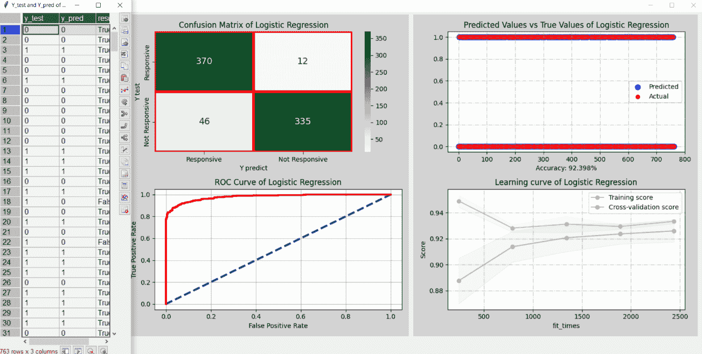

**图 31** 使用 Logistic Regression 的结果

输出：

```
Logistic Regression
accuracy: 0.9239842726081258
recall: 0.9239842726081258
precision: 0.9273706721853352
f1: 0.9238285627366127
 precision recall f1-score support
 0 0.89 0.97 0.93 382
 1 0.97 0.88 0.92 381
 accuracy 0.92 763
 macro avg 0.93 0.92 0.92 763
weighted avg 0.93 0.92 0.92 763
```

Logistic Regression 结果分析显示以下性能指标：

*   **Accuracy（准确率）**：模型达到了约 92.40% 的准确率，表明它正确预测了测试数据集中约 92.40% 样本的类别标签。


###### 模型评估指标

*   **Recall（召回率）**：约 92.40%。衡量模型正确识别正样本（响应性）的能力，表明模型有效识别了约 92.40% 的响应客户。
*   **Precision（精确率）**：约 92.74%。衡量模型避免假阳性的能力，表明当模型预测客户为响应时，约有 92.74% 的准确率。
*   **F1-Score**：约 92.38%。精确率和召回率的调和平均数，提供二者的平衡，表明模型的整体有效性。
*   **Support（支持度）**：表示每个类别的样本数量。此处类别 0 有 382 个样本，类别 1 有 381 个样本。

分类报告提供了类别 0 和类别 1 这些指标的详细细分。对于类别 0，模型的召回率略低（0.88），表明其识别非响应客户的效果稍弱。然而，对于类别 1，召回率很高（0.97），表明在识别响应客户方面表现强劲。总体而言，模型在平衡的精确率和召回率下表现良好，从而获得了较高的 F1-Score。

综上所述，`Logistic Regression` 模型在预测客户响应性方面似乎是有效的，在精确率和召回率之间取得了良好的平衡，并提供了较高的整体准确率。然而，在实际场景中评估模型性能时，必须考虑具体的业务需求以及假阳性和假阴性的后果。

###### Random Forest Classifier and Grid Search

在 `Machine_Learning` 类中，定义一个名为 `random_forest()` 的新方法，如下所示：

```python
def random_forest(self, name, X_train, X_test, y_train, y_test):
    # Random Forest Classifier 
    # Define the parameter grid for the grid search
    param_grid = {
        'n_estimators': [100, 200, 300],
        'max_depth': [10, 20, 30, 40, 50],
        'min_samples_split': [2, 5, 10],
        'min_samples_leaf': [1, 2, 4]
    }
    # Initialize the RandomForestClassifier model
    rf = RandomForestClassifier(random_state=2021)
    # Create GridSearchCV with the RandomForestClassifier model and the parameter grid
    grid_search = GridSearchCV(rf, param_grid, cv=3, scoring='accuracy', n_jobs=-1)
    # Train and perform grid search
    grid_search.fit(X_train, y_train)
    # Get the best RandomForestClassifier model from the grid search
    best_model = grid_search.best_estimator_
    # Saves model
    joblib.dump(best_model, 'RF_Model.pkl') 
    # Print the best hyperparameters found
    print(f"Best Hyperparameters for RF:")
    print(grid_search.best_params_) 
    return best_model
```

代码中的 `random_forest()` 函数负责训练 `Random Forest Classifier` 并使用网格搜索优化其超参数。以下是该函数功能的分步解释：

1.  **参数网格定义**：定义了一个参数网格（`param_grid`），包含 `Random Forest Classifier` 的各种超参数。这些超参数包括：
    *   `n_estimators`：森林中树的数量。
    *   `max_depth`：每棵树的最大深度。
    *   `min_samples_split`：分割内部节点所需的最小样本数。
    *   `min_samples_leaf`：叶子节点所需的最小样本数。
2.  **模型初始化**：使用指定的随机种子初始化 `Random Forest Classifier`（`rf`），以保证可复现性。
3.  **网格搜索**：创建 `GridSearchCV` 对象（`grid_search`），接收 `rf` 模型和 `param_grid`。它执行带有交叉验证（3 折交叉验证）的网格搜索，以找到使准确率得分最大化的最佳超参数组合。
4.  **网格搜索训练**：将 `grid_search` 对象拟合到训练数据（`X_train` 和 `y_train`）上，以寻找最佳超参数。
5.  **最佳模型选择**：网格搜索完成后，根据交叉验证期间产生最高准确率的超参数，检索最佳 `Random Forest` 模型（`best_model`）。
6.  **模型保存**：使用 `joblib` 库将 `best_model` 保存到名为 `RF_Model.pkl` 的文件中。这允许稍后检索和使用训练好的模型，而无需重新训练。
7.  **打印最佳超参数**：打印网格搜索过程中找到的最佳超参数以供参考。

总之，该函数通过在预定义的参数空间上进行网格搜索，自动化了 `Random Forest Classifier` 的超参数调优过程，最终根据指定的超参数返回表现最佳的模型。该优化模型可用于对新数据进行预测。

---

在 `Machine_Learning` 类中，定义一个名为 `implement_RF()` 的新方法，如下所示：

```python
def implement_RF(self, chosen, X_train, X_test, y_train, y_test):
    file_path = os.getcwd()+"/RF_Model.pkl"
    if os.path.exists(file_path):
        model = joblib.load('RF_Model.pkl')
        y_pred = self.run_model(chosen, model, X_train, X_test, y_train, y_test, proba=True) 
    else:
        model = self.random_forest(chosen, X_train, X_test, y_train, y_test)
        y_pred = self.run_model(chosen, model, X_train, X_test, y_train, y_test, proba=True)
    # Saves result into excel file
    self.obj_data.save_result(y_test, y_pred, "results_RF.csv")
    print("Training Random Forest done...")
    return model, y_pred
```

代码中的 `implement_RF()` 函数负责为选定任务实现和训练 `Random Forest Classifier`。以下是该函数功能的分步解释：

1.  **检查预训练模型**：首先检查文件系统中是否存在预训练的 `Random Forest` 模型（`RF_Model.pkl`）。如果找到预训练模型，则从文件加载该模型。此步骤旨在避免在模型已训练并保存的情况下重复训练。
2.  **模型训练**：如果未找到预训练模型，则调用 `random_forest` 函数执行训练。`random_forest` 函数使用网格搜索训练 `Random Forest Classifier` 以优化超参数。
3.  **预测**：加载预训练模型或训练新模型后，使用训练好的模型对测试数据（`X_test`）进行预测。
4.  **保存结果**：使用 `save_result` 函数将真实标签（`y_test`）和预测标签（`y_pred`）保存到名为 `results_RF.csv` 的 Excel 文件中。该文件可用于模型性能的进一步分析和评估。
5.  **打印状态**：打印一条消息，指示 `Random Forest` 模型的训练已完成。
6.  **返回模型和预测结果**：最后，返回训练好的 `Random Forest` 模型和预测标签（`y_pred`），以供潜在的进一步分析或使用。

总之，该函数处理 `Random Forest Classifier` 的训练、预测和结果存储，确保仅在没有可用预训练模型时才进行训练。这允许高效地复用模型和跟踪结果。

---

将以下代码添加到 `Helper_Plot` 类中 `choose_plot_ML()` 方法的末尾：

```python
if chosen == "Random Forest":
    best_model, y_pred = self.obj_ml.implement_RF(chosen, X_train, X_test, y_train, y_test)
    # Plots confusion matrix and ROC
    self.plot_cm_roc(best_model, X_test, y_test, y_pred, chosen, figure1, canvas1)
    # Plots true values versus predicted values diagram and learning curve
    self.plot_real_pred_val_learning_curve(best_model, X_train, y_train, 
                                           X_test, y_test, y_pred, chosen, figure2, canvas2)
    # Shows table of result
    df_lr = self.obj_data.read_dataset("results_RF.csv")
    self.shows_table(root, df_lr, 450, 750, "Y_test and Y_pred of Random Forest")
```


####### 代码实现与评估：随机森林分类器

该代码用于实现和评估机器学习模型，具体为随机森林分类器。以下是代码块功能的说明：

######## 1. 模型实现
代码块检查所选模型是否为 "Random Forest"。如果是，则通过调用 `obj_ml` 对象（机器学习类的实例）的 `implement_RF()` 方法来实现和训练随机森林模型。

######## 2. 模型评估
实现并训练随机森林模型后，分三步评估模型性能：

######### 2.1 混淆矩阵与 ROC 曲线
调用 `plot_cm_roc()` 方法生成并显示模型在测试数据上的预测混淆矩阵和 ROC 曲线。这些可视化有助于评估模型的分类性能。

######### 2.2 真实值与预测值对比
调用 `plot_real_pred_val_learning_curve()` 方法创建真实值与预测值的散点图及学习曲线。这些可视化提供了模型预测与实际值对齐情况及其随时间学习进度的洞察。

######### 2.3 结果表格显示
通过调用 `shows_table()` 方法显示结果表格。表格包含模型在测试数据上的性能相关指标和统计数据，如准确率、精确率、召回率和 F1-score，供进一步分析。

---

**总体而言，该代码块负责实现、评估和可视化随机森林分类器模型的性能。它提供了模型分类效果的洞察，并给出了评估其有效性的可视化和指标。**

####### 运行步骤
运行 `main_class.py`。接着点击 **SPLIT DATA** 按钮。然后选择 **Random Forest**，查看如图 32 所示的随机森林使用结果。

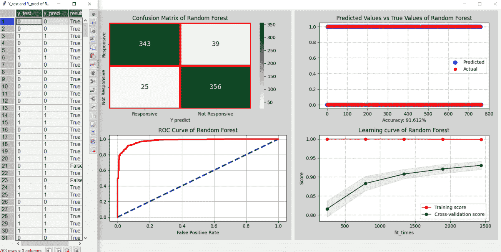

**Figure 32** 随机森林分类器的使用结果

####### 输出结果

```
Random Forest

accuracy: 0.9161205766710354
recall: 0.9161205766710354
precision: 0.9166857031775766
f1: 0.916094346335905

              precision    recall  f1-score   support
           0       0.93      0.90      0.91       382
           1       0.90      0.93      0.92       381
    accuracy                           0.92       763
   macro avg       0.92      0.92      0.92       763
weighted avg       0.92      0.92      0.92       763
```

上述输出为随机森林分类器模型的评估结果。以下是输出分析：

1.  **模型名称**：“Random Forest”表明本次分析使用了随机森林分类器。
2.  **准确率**：模型准确率约为 91.61%。准确率是正确预测实例数与测试数据集总实例数之比。这表明模型正确分类了约 91.61% 的样本。
3.  **召回率**：召回率（灵敏度或真阳性率）约为 91.61%。它衡量被正确分类的实际正样本比例。这表明模型捕获了约 91.61% 的正例。
4.  **精确率**：精确率约为 91.67%。精确率衡量所有正预测中真正例的比例。这表明模型预测为正例时，约有 91.67% 是正确的。
5.  **F1-Score**：F1-Score 约为 91.61%。F1-Score 是精确率和召回率的调和平均数，平衡了这两个指标。它表明模型在精确率和召回率之间取得了良好平衡。
6.  **混淆矩阵**：混淆矩阵提供了模型性能的更详细信息，显示真正例、真负例、假正例和假负例的数量。在此案例中，表明模型正确分类了大量正负样本。
7.  **分类报告**：分类报告汇总了各类指标，包括 "0"（Not Responsive）和 "1"（Responsive）两个类别的精确率、召回率和 F1-Score，以及宏平均和加权平均指标。加权平均在不平衡数据集中往往更重要。

**总体而言，基于这些结果，随机森林分类器在数据分类任务上表现良好，精确率和召回率均衡。但仍需结合具体应用场景和需求，判断该性能水平是否满意。**

---

###### K-近邻分类器与网格搜索

在 `Machine_Learning` 类中，定义一个名为 `knearest_neighbors()` 的新方法，如下所示：

```python
def knearest_neighbors(self, name, X_train, X_test, y_train, y_test):
    # KNN Classifier
    # Define the parameter grid for the grid search
    param_grid = {
        'n_neighbors': list(range(2, 10))
    }

    # Initialize the KNN Classifier
    knn = KNeighborsClassifier()

    # Create GridSearchCV with the KNN model and the parameter grid
    grid_search = GridSearchCV(knn, param_grid, cv=3, scoring='accuracy', n_jobs=-1)

    # Train and perform grid search
    grid_search.fit(X_train, y_train)

    # Get the best KNN model from the grid search
    best_model = grid_search.best_estimator_

    # Saves model
    joblib.dump(best_model, 'KNN_Model.pkl')

    # Print the best hyperparameters found
    print(f"Best Hyperparameters for KNN:")
    print(grid_search.best_params_)

    return best_model
```

该代码定义了一个名为 `knearest_neighbors()` 的函数，负责训练和优化 K-近邻（KNN）分类器模型。代码说明如下：

######### 1. 函数定义
函数 `knearest_neighbors()` 接受以下参数：
*   `name`：代表模型名称或标识符的字符串。
*   `X_train`：训练数据的特征矩阵。
*   `X_test`：测试数据的特征矩阵。
*   `y_train`：训练数据的目标标签。
*   `y_test`：测试数据的目标标签。

####### 2. 参数网格
定义了名为 `param_grid` 的参数网格，指定网格搜索期间将调整的超参数值。此处聚焦于超参数 `n_neighbors`，它控制预测时考虑的邻居数量。

####### 3. K-近邻（KNN）初始化
创建 KNN 分类器实例并赋值给变量 `knn`。

####### 4. GridSearchCV
使用 `GridSearchCV` 类进行超参数调优，对指定超参数网格执行穷举搜索。`GridSearchCV` 的参数包括：
*   `estimator`：待优化的机器学习模型（此处为 `knn`）。
*   `param_grid`：待搜索的超参数网格。
*   `cv`：交叉验证折数（此处为 3 折交叉验证）。
*   `scoring`：用于优化的评估指标（此处为 `'accuracy'`）。
*   `n_jobs`：用于并行计算的 CPU 核心数（此处为 `-1`，即使用所有可用核心）。

####### 5. 网格搜索
将 `GridSearchCV` 对象（`grid_search`）拟合到训练数据（`X_train` 和 `y_train`）上，以寻找 KNN 模型的最佳超参数组合。

####### 6. 最佳模型选择
从网格搜索获得的最佳 KNN 模型存储在 `best_model` 变量中。

####### 7. 模型保存
使用 `joblib.dump()` 函数将最佳 KNN 模型保存到名为 `'KNN_Model.pkl'` 的文件中。这使得模型可在无需重新训练的情况下复用。

####### 8. 打印超参数
将网格搜索找到的最佳 KNN 模型超参数打印到控制台，供参考。


####### 摘要

此函数使用网格搜索自动化 KNN 分类器的超参数调优过程。它为 KNN 模型找到最佳超参数集，并保存优化后的模型以供后续使用。这是机器学习中的常见做法，旨在确保模型在给定数据集上实现最优性能。

####### `Machine_Learning` 类中的实现

定义一个名为 `implement_KNN()` 的新方法：

```python
def implement_KNN(self, chosen, X_train, X_test, y_train, y_test):
    file_path = os.getcwd() + "/KNN_Model.pkl"
    if os.path.exists(file_path):
        model = joblib.load('KNN_Model.pkl')
        y_pred = self.run_model(chosen, model, X_train, X_test, y_train, y_test, proba=True)
    else:
        model = self.knearest_neigbors(chosen, X_train, X_test, y_train, y_test)
        y_pred = self.run_model(chosen, model, X_train, X_test, y_train, y_test, proba=True)
    # 将结果保存到 Excel 文件
    self.obj_data.save_result(y_test, y_pred, "results_KNN.csv")
    print("Training KNN done...")
    return model, y_pred
```

######## 代码解释

`implement_KNN()` 函数负责实现和训练 K-近邻 (KNN) 分类器，以及保存和评估结果。

######### 1. 函数定义
该函数接受以下参数：
*   `chosen`：表示所选模型名称或标识符的字符串（本例中为 "K-Nearest Neighbors"）。
*   `X_train`：训练数据的特征矩阵。
*   `X_test`：测试数据的特征矩阵。
*   `y_train`：训练数据的目标标签。
*   `y_test`：测试数据的目标标签。

######### 2. 文件路径检查
它检查当前工作目录 (`os.getcwd()`) 下是否存在名为 `KNN_Model.pkl` 的文件。该文件用于存储训练好的 KNN 模型。

######### 3. 模型加载或训练
*   如果 `KNN_Model.pkl` 存在，则有可用的训练好 KNN 模型。代码使用 `joblib.load` 加载此模型。
*   如果文件不存在，则需要训练模型。代码调用 `knearest_neigbors()` 函数来训练并优化 KNN 模型。

######### 4. 模型预测
加载或训练 KNN 模型后，函数调用 `run_model` 函数使用该模型对测试数据 (`X_test`) 进行预测。`proba` 参数设置为 `True`，表示该函数应返回预测概率。

######### 5. 结果保存
实际目标标签 (`y_test`) 和预测标签/概率 (`y_pred`) 用于通过 `obj_data` 提供的 `save_result` 函数将结果保存到名为 `results_KNN.csv` 的 Excel 文件中。该文件通常包含模型的预测结果和真实标签，以供后续分析。

######### 6. 打印状态
向控制台打印一条消息，指示 KNN 模型的训练或加载已完成。

######## 总结
此函数作为实现 KNN 模型的统一接口。它检查是否有可用的训练模型，若找到则加载，否则训练新模型。进行预测后，它将结果保存到 Excel 文件并提供状态消息。这种方法允许复用预训练模型，并简化了运行和评估 KNN 分类器的过程。

####### `Helper_Plot` 类中的实现

将此代码添加到 `choose_plot_ML()` 方法的末尾：

```python
if chosen == "K-Nearest Neighbors":
    best_model, y_pred = self.obj_ml.implement_KNN(chosen, X_train, X_test, y_train, y_test)
    # 绘制混淆矩阵和 ROC 曲线
    self.plot_cm_roc(best_model, X_test, y_test, y_pred, chosen, figure1, canvas1)
    # 绘制真实值与预测值对比图及学习曲线
    self.plot_real_pred_val_learning_curve(best_model, X_train, y_train,
                                           X_test, y_test, y_pred, chosen, figure2, canvas2)
    # 显示结果表格
    df_lr = self.obj_data.read_dataset("results_KNN.csv")
    self.shows_table(root, df_lr, 450, 750, "Y_test and Y_pred of KNN")
```

######## 代码解释
此代码负责执行 K-近邻 (KNN) 分类器，评估其性能并显示结果。

######### 1. 条件检查
代码以一个 `if` 语句开始，检查变量 `chosen` 的值是否等于字符串 `"K-Nearest Neighbors"`。此条件决定是否执行 KNN 分类器。

######### 2. KNN 实现与评估
如果条件满足，将执行以下操作：
*   代码调用 `obj_ml` 对象的 `implement_KNN()` 方法，传入 `chosen`、`X_train`、`X_test`、`y_train` 和 `y_test` 作为参数。该方法负责训练或加载 KNN 模型并进行预测。
*   获得训练好的模型和预测结果 (`y_pred`) 后，代码继续评估模型性能。

######### 3. 性能可视化与报告
*   代码调用 `plot_cm_roc()` 方法生成两个图表：混淆矩阵和接收者操作特征 (ROC) 曲线。这些图表提供了关于模型分类性能及其区分类别能力的洞察。
*   接着，它调用 `plot_real_pred_val_learning_curve()` 方法创建两个额外图表：
    *   真实值与预测值对比散点图，直观对比模型预测与实际目标值。
    *   学习曲线，展示模型性能随训练数据集大小增加而变化的情况。该曲线有助于评估模型的偏差-方差权衡。
*   最后，代码使用 `obj_data` 提供的 `read_dataset()` 方法从名为 `results_KNN.csv` 的 Excel 文件中读取 KNN 模型预测结果。该文件数据包含模型预测和真实标签。

######### 4. 表格显示
代码使用 `shows_table` 方法显示结果表格。该表格推测展示实际值和预测值，允许对模型性能进行详细分析。

####### 结论
此代码旨在实现、评估和可视化 K-近邻分类器的性能。它生成各种图表并显示结果表格，提供关于模型在给定数据集上表现如何的洞察。

####### 执行步骤
1.  运行 `main_class.py`。
2.  点击 **SPLIT DATA** 按钮。
3.  选择 **K-Nearest Neighbors** 查看结果，如图 33 所示。


**图 33** 使用 K-近邻分类器的结果

######## 输出
```text
K-Nearest Neighbors
accuracy: 0.8689384010484927
recall: 0.8689384010484927
precision: 0.8706714584974559
f1: 0.8687919116352781
 precision recall f1-score support
 0 0.90 0.84 0.86 382
 1 0.85 0.90 0.87 381
 accuracy 0.87 763
 macro avg 0.87 0.87 0.87 763
weighted avg 0.87 0.87 0.87 763
```

######## 输出分析
输出代表 K-近邻 (KNN) 分类器在数据集上的性能指标和评估结果。

######### 1. 分类器信息
*   **分类器名称**：K-Nearest Neighbors
*   **样本数量**：763（推测为测试数据集大小）

######### 2. 性能指标
*   **准确率**：KNN 分类器的准确率约为 0.869，意味着它在测试数据集中正确分类了约 86.9% 的样本。
*   **召回率**：召回率得分也约为 0.869，表明模型正确识别了约 86.9% 的正类（类别 1）样本。该指标衡量模型找出所有相关正类实例的能力。


######## 精确率

精确率得分约为 0.871，这意味着当模型预测为正类时，大约有 87.1% 的时间是正确的。该指标评估模型正类预测的准确性。

######## F1-Score

F1-Score 约为 0.869，它是精确率和召回率的调和平均数。它在精确率和召回率之间提供了平衡，使其适用于不平衡数据集。

######## 混淆矩阵

混淆矩阵显示如下：

######### 对于“0”类（推测为负类）

*   **精确率**：0.90（预测为负类的样本中 90% 是正确的）
*   **召回率**：0.84（实际负类样本中 84% 被正确预测）
*   **F1-Score**：0.86（精确率和召回率之间的平衡）

######### 对于“1”类（推测为正类）

*   **精确率**：0.85（预测为正类的样本中 85% 是正确的）
*   **召回率**：0.90（实际正类样本中 90% 被正确预测）
*   **F1-Score**：0.87（精确率和召回率之间的平衡）

######## 总结

*   KNN 分类器在该数据集上表现良好，准确率、召回率和精确率得分均在 87% 左右。这表明该模型能有效区分这两个类别。
*   两个类别的 F1-Score 也相似，表明正类和负类在精确率和召回率之间都取得了良好的平衡。
*   就精确率而言，模型在“0”类上的表现略好；而在召回率方面，模型在“1”类上的表现略好。

总体而言，根据输出结果，K-近邻分类器在对该数据集进行分类时展现出了令人满意的性能水平，且对正负两类均取得了平衡的结果。不过，在解读这些结果时，应考虑具体应用的背景和需求。

###### 决策树分类器与网格搜索

在 `Machine_Learning` 类中，定义一个名为 `decision_trees()` 的新方法，如下所示：

```python
def decision_trees(self, name, X_train, X_test, y_train, y_test):
    # Initialize the DecisionTreeClassifier model
    dt_clf = DecisionTreeClassifier(random_state=2021)

    # Define the parameter grid for the grid search
    param_grid = {
        'max_depth': np.arange(1, 51, 1),
        'criterion': ['gini', 'entropy'],
        'min_samples_split': [2, 5, 10],
        'min_samples_leaf': [1, 2, 4],
    }

    # Create GridSearchCV with the DecisionTreeClassifier model and the parameter grid
    grid_search = GridSearchCV(dt_clf, param_grid, cv=3, scoring='accuracy', n_jobs=-1)

    # Train and perform grid search
    grid_search.fit(X_train, y_train)

    # Get the best DecisionTreeClassifier model from the grid search
    best_model = grid_search.best_estimator_

    # Saves model
    joblib.dump(best_model, 'DT_Model.pkl')

    # Print the best hyperparameters found
    print(f"Best Hyperparameters for DT:")
    print(grid_search.best_params_)

    return best_model
```

该代码定义了一个名为 `decision_trees()` 的函数，它使用网格搜索进行超参数优化来训练和调优决策树分类器。让我们分解该函数的组成部分和用途：

####### 函数参数

*   `name`：代表分类器名称或标识符的字符串（用于显示或文档记录目的）。
*   `X_train`、`X_test`、`y_train`、`y_test`：训练和测试数据的划分，通常为特征矩阵（`X_train` 和 `X_test`）和目标向量（`y_train` 和 `y_test`）。

####### 决策树分类器初始化

该函数使用指定的随机种子（`random_state=2021`）初始化一个 `DecisionTreeClassifier`。

####### 网格搜索的参数网格

定义了一个参数网格（`param_grid`），作为一个包含决策树分类器各种超参数的字典：

*   `max_depth`：树的最大深度范围。
*   `criterion`：两种可能的节点分裂标准，即 `'gini'` 或 `'entropy'`。
*   `min_samples_split`：分裂内部节点所需的最小样本数。
*   `min_samples_leaf`：叶子节点所需的最小样本数。

####### 网格搜索交叉验证

*   该函数利用 `GridSearchCV` 通过交叉验证（`cv=3`）执行超参数调优。
*   `GridSearchCV` 旨在寻找在训练数据上产生最高准确率得分的超参数组合。
*   搜索在指定的超参数网格上进行，考虑不同超参数值的组合。
*   用于评估的评分指标为准确率（`'accuracy'`）。

####### 最佳模型选择

*   完成网格搜索后，函数根据交叉验证期间产生最高准确率的超参数，选择最佳的 `DecisionTreeClassifier` 模型。
*   最佳模型存储在变量 `best_model` 中。

####### 模型保存

最佳的 `DecisionTreeClassifier` 模型使用 `joblib` 库进行序列化，并保存到名为 `'DT_Model.pkl'` 的文件中。这使得模型可以在未来重复使用或部署，而无需重新训练。

####### 打印最佳超参数

该函数打印网格搜索期间找到的最佳超参数，提供对所选超参数值的洞察。

该函数的目的是自动化决策树分类器的训练和超参数调优过程。通过在一系列超参数上进行网格搜索，该函数有助于识别表现最佳的模型配置。随后，该调优模型可用于分类任务，与默认参数设置相比，可能提高准确率和预测性能。

然后，在 `Machine_Learning` 类中，定义一个名为 `implement_DT()` 的新方法：

```python
def implement_DT(self, chosen, X_train, X_test, y_train, y_test):
    file_path = os.getcwd() + "/DT_Model.pkl"

    if os.path.exists(file_path):
        model = joblib.load('DT_Model.pkl')
        y_pred = self.run_model(chosen, model, X_train, X_test, y_train, y_test, proba=True)
    else:
        model = self.decision_trees(chosen, X_train, X_test, y_train, y_test)
        y_pred = self.run_model(chosen, model, X_train, X_test, y_train, y_test, proba=True)

    # Saves result into excel file
    self.obj_data.save_result(y_test, y_pred, "results_DT.csv")

    print("Training Decision Trees done...")

    return model, y_pred
```

`implement_DT()` 函数负责训练和使用决策树分类器进行二分类任务。让我们分析其组成部分和功能：

####### 函数参数

*   `chosen`：代表所选分类模型或标识符的字符串。
*   `X_train`、`X_test`、`y_train`、`y_test`：训练和测试数据的划分，包含特征矩阵（`X_train` 和 `X_test`）和目标向量（`y_train` 和 `y_test`）。

####### 文件路径检查

该函数检查当前工作目录（`os.getcwd()`）下是否存在名为 `'DT_Model.pkl'` 的文件。该文件假定包含一个预训练的决策树模型。

####### 模型加载或训练

*   如果 `'DT_Model.pkl'` 文件存在，函数使用 `joblib` 加载预训练模型（`joblib.load`）。
*   否则，它通过调用 `decision_trees()` 函数来训练一个决策树分类器。
*   此过程的结果是训练好的模型，存储在变量 `model` 中。

####### 模型预测

*   函数通过调用 `run_model()` 函数并设置 `proba=True`，使用训练好的模型对测试数据（`X_test`）进行预测。
*   预测的标签或概率存储在变量 `y_pred` 中。

####### 保存结果

真实标签（`y_test`）和预测标签（`y_pred`）通过 `obj_data` 对象的 `save_result` 方法保存到名为 `"results_DT.csv"` 的 Excel 文件中。

####### 打印确认信息

打印一条消息，表明决策树训练已完成。

####### 返回模型和预测结果


训练好的模型（`model`）和相应的预测结果（`y_pred`）从函数中返回。

该函数的目的是为训练和使用决策树分类器提供统一接口。如果有预训练模型可用，则可以加载并用于预测。否则，将使用提供的训练数据训练新模型。然后函数保存结果，并返回模型和预测结果以供进一步分析或评估。

可以使用各种评估指标（如准确率、精确率、召回率和 F1 分数）来评估模型性能，这些指标可基于 `y_test`（真实标签）和 `y_pred`（预测标签）计算得出。

然后，在 `Helper_Plot` 类中，将以下代码添加到 `choose_plot_ML()` 方法的末尾：

```
if chosen == "Decision Trees":
    best_model, y_pred = self.obj_ml.implement_DT(chosen, X_train, X_test, y_train, y_test)
    # Plots confusion matrix and ROC
    self.plot_cm_roc(best_model, X_test, y_test, y_pred, chosen, figure1, canvas1)
    # Plots true values versus predicted values diagram and learning curve
    self.plot_real_pred_val_learning_curve(best_model, X_train, y_train, X_test, y_test, y_pred, chosen, figure2, canvas2)
    # Shows table of result
    df_lr = self.obj_data.read_dataset("results_DT.csv")
    self.shows_table(root, df_lr, 450, 750, "Y_test and Y_pred of Decision Trees")
```

该代码块是一个条件语句，用于检查选定的机器学习模型是否为 "Decision Trees"。如果是，则执行一系列与训练、评估和显示决策树分类器结果相关的操作。让我们分解代码的每个部分：

1.  **条件检查**
    代码检查变量 `chosen`（代表选定的机器学习模型）的值是否等于字符串 "Decision Trees"。

2.  **模型训练与预测**
    如果满足条件（即选定的模型是决策树），则调用 `implement_DT()` 函数来训练并获取决策树分类器的预测结果。该函数返回两个值：`best_model`（训练好的模型）和 `y_pred`（模型在测试数据上的预测结果）。

3.  **可视化与评估**
    获得训练好的模型和预测结果后，代码执行以下操作：
    *   使用 `plot_cm_roc()` 函数绘制决策树分类器的混淆矩阵和 ROC 曲线。这些可视化有助于从分类准确率以及真正例率与假正例率的权衡方面评估模型性能。
    *   使用 `plot_real_pred_val_learning_curve()` 函数绘制真实值与预测值对比图以及学习曲线。这些可视化提供了关于模型行为及其泛化新数据能力的见解。
    *   使用 `obj_data.read_dataset()` 方法读取 "results_DT.csv" 文件以显示结果表。该表包含与决策树模型相关的评估指标和性能统计数据。

4.  **结果显示**
    代码可能会将结果（如可视化图表和表格）显示在用户界面（UI）中，或与图形用户界面（GUI）工具包（如 Tkinter）交互以供用户操作。

总的来说，该代码块代表了当决策树分类器被选为机器学习模型时，用于训练、评估和可视化结果的逻辑。其目的是提供关于模型性能的见解，并根据模型的预测和评估指标帮助用户做出明智决策。

运行 `main_class.py`。接下来，点击 SPLIT DATA 按钮。然后，选择 Decision Trees 以查看使用决策树分类器的结果，如图 34 所示。

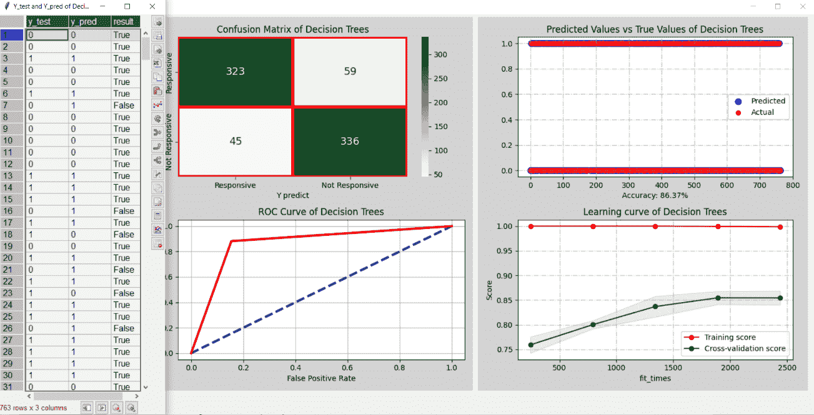

**Figure 34** The results of using Decision Trees classifier

Output:

```
Decision Trees
accuracy: 0.8636959370904325
recall: 0.8636959370904325
precision: 0.8641929000245966
f1: 0.8636533127958457
 precision recall f1-score support
 0 0.88 0.85 0.86 382
 1 0.85 0.88 0.87 381
 accuracy 0.86 763
 macro avg 0.86 0.86 0.86 763
 weighted avg 0.86 0.86 0.86 763
```

让我们详细分析 "Decision Trees" 模型并得出具体结论：

**分析：**

1.  **准确率**：模型达到了 86.37% 的准确率，表现相当不错。这意味着它在测试数据集中正确分类了约 86.37% 的总实例。
2.  **召回率**：召回率得分为 0.8637，也称为灵敏度或真正例率。这意味着模型正确识别了数据集中约 86.37% 的实际正例（响应客户）。在识别所有正例至关重要的场景中，较高的召回率是理想的。
3.  **精确率**：精确率得分为 0.8642。这表明在所有被预测为正例（响应客户）的实例中，约 86.42% 是真正例。精确率衡量模型做出准确正例预测的能力。
4.  **F1 分数**：F1 分数为 0.8637。F1 分数是精确率和召回率的调和平均数，提供了模型性能的平衡度量。在本例中，它表明精确率和召回率之间达到了良好的平衡。
5.  **类别特定指标**：
    *   **类别 0（响应）**：
        *   精确率：0.88
        *   召回率：0.85
        *   F1 分数：0.86
    *   **类别 1（不响应）**：
        *   精确率：0.85
        *   召回率：0.88
        *   F1 分数：0.87
    这些类别特定指标显示模型对响应和不响应客户的表现相似，两个类别的精确率和召回率均衡。
6.  **宏平均与加权平均**：考虑类别平衡的宏平均 F1 分数约为 0.86。考虑类别不平衡的加权平均 F1 分数也约为 0.86。这些值表明模型在各类别上的表现一致。

**结论：**

"Decision Trees" 机器学习模型在给定的分类任务中表现良好。它达到了约 86.37% 的准确率，并在响应和不响应客户类别上表现出均衡的精确率和召回率。这种平衡表明模型能有效正确识别这两类客户，使其成为该任务的合适选择。

模型在不同评估指标和类别特定度量上的一致性能进一步支持了其可靠性。因此，基于提供的结果，"Decision Trees" 模型可被视为对客户响应性进行分类的稳健有效解决方案。

###### 梯度提升分类器与网格搜索

在 `Machine_Learning` 类中，定义一个名为 `gradient_boosting()` 的新方法，如下所示：

```
def gradient_boosting(self, name, X_train, X_test, y_train, y_test):
    # Gradient Boosting Classifier
    # Initialize the GradientBoostingClassifier model
    gbt = GradientBoostingClassifier(random_state=2021)
    # Define the parameter grid for the grid search
    param_grid = {
        'n_estimators': [100, 200, 300],
        'max_depth': [10, 20, 30],
        'subsample': [0.6, 0.8, 1.0],
        'max_features': [0.2, 0.4, 0.6, 0.8, 1.0],
    }
    # Create GridSearchCV with the GradientBoostingClassifier model and the parameter grid
    grid_search = GridSearchCV(gbt, param_grid, cv=3, scoring='accuracy', n_jobs=-1)
    # Train and perform grid search
    grid_search.fit(X_train, y_train)
    # Get the best GradientBoostingClassifier model from the grid search
    best_model = grid_search.best_estimator_
    # Saves model
    joblib.dump(best_model, 'GB_Model.pkl')
    # Print the best hyperparameters found
    print(f"Best Hyperparameters for GB:")
    print(grid_search.best_params_)
    return best_model
```

这段代码定义了一个名为 `gradient_boosting()` 的函数，用于训练和超参数调优梯度提升分类器。让我们逐步分解代码：


####### 1. `gradient_boosting` 方法

```python
def gradient_boosting(self, name, X_train, X_test, y_train, y_test):
```

该函数接收以下参数：

*   `name`：模型名称，用于标记或日志记录。
*   `X_train`, `X_test`：训练集和测试集特征数据。
*   `y_train`, `y_test`：对应的训练集和测试集目标标签。

######## 1.1 初始化模型

```python
gbt = GradientBoostingClassifier(random_state=2021)
```

初始化一个梯度提升分类器（`gbt`），固定 `random_state=2021` 以保证可复现性。

######## 1.2 定义超参数网格

```python
param_grid = { ... }
```

定义用于超参数调优的参数网格，包含以下超参数的不同取值：

*   `n_estimators`：提升阶段的数量（树的数量）。
*   `max_depth`：集成中每棵树的最大深度。
*   `subsample`：用于拟合树的样本比例。
*   `max_features`：用于拟合树的特征比例。

######## 1.3 网格搜索与交叉验证

```python
grid_search = GridSearchCV(gbt, param_grid, cv=3, scoring='accuracy', n_jobs=-1)
```

创建 `GridSearchCV` 对象（`grid_search`）进行超参数调优：

*   `gbt`：待调优的模型。
*   `param_grid`：超参数搜索空间。
*   `cv=3`：3 折交叉验证。
*   `scoring='accuracy'`：以准确率作为评估指标。
*   `n_jobs=-1`：使用所有可用 CPU 核心并行加速搜索。

######## 1.4 训练与最佳模型获取

```python
grid_search.fit(X_train, y_train)
best_model = grid_search.best_estimator_
```

在训练数据上拟合 `grid_search` 以寻找最佳超参数，并通过 `best_estimator_` 获取最佳模型。

######## 1.5 模型持久化与结果输出

```python
joblib.dump(best_model, 'GB_Model.pkl')
print(f"Best Hyperparameters for GB:")
print(grid_search.best_params_)
```

将最佳模型保存为 `GB_Model.pkl`，并打印最佳超参数。

> **说明**：此代码属于机器学习工作流的一部分，用于训练和调优梯度提升分类器。

---

####### 2. `implement_GB` 方法

```python
def implement_GB(self, chosen, X_train, X_test, y_train, y_test):
    file_path = os.getcwd() + "/GB_Model.pkl"
    if os.path.exists(file_path):
        model = joblib.load('GB_Model.pkl')
        y_pred = self.run_model(chosen, model, X_train, X_test, y_train, y_test, proba=True)
    else:
        model = self.gradient_boosting(chosen, X_train, X_test, y_train, y_test)
        y_pred = self.run_model(chosen, model, X_train, X_test, y_train, y_test, proba=True)
    # Saves result into excel file
    self.obj_data.save_result(y_test, y_pred, "results_GB.csv")
    print("Training Gradient Boosting done...")
    return model, y_pred
```

######## 2.1 功能概述

`implement_GB()` 是机器学习工作流中的核心方法，负责实现和评估梯度提升分类器（GB）。它支持**模型复用**（加载预训练模型）与**从头训练**两种模式。

######## 2.2 参数说明

*   `chosen`：字符串，分类器标识符（预期为 "Gradient Boosting"）。
*   `X_train`, `X_test`：训练/测试特征集。
*   `y_train`, `y_test`：训练/测试标签集。

######## 2.3 执行流程

######### 步骤 1：检查预训练模型
构建路径 `file_path = os.getcwd() + "/GB_Model.pkl"`，通过 `os.path.exists(file_path)` 判断模型文件是否存在。

######### 步骤 2：加载预训练模型（若存在）
```python
model = joblib.load('GB_Model.pkl')
y_pred = self.run_model(chosen, model, X_train, X_test, y_train, y_test, proba=True)
```
调用 `joblib.load` 加载模型，随后调用 `self.run_model`（`proba=True` 表示返回概率分数）进行预测。

######### 步骤 3：从头训练新模型（若不存在）
```python
model = self.gradient_boosting(chosen, X_train, X_test, y_train, y_test)
y_pred = self.run_model(chosen, model, X_train, X_test, y_train, y_test, proba=True)
```
调用 `self.gradient_boosting` 完成超参数调优与训练，再进行预测。

######### 步骤 4：保存预测结果
```python
self.obj_data.save_result(y_test, y_pred, "results_GB.csv")
```
将真实标签 `y_test` 与预测标签 `y_pred` 保存至 `results_GB.csv`。

######### 步骤 5：输出完成信息并返回
打印 `"Training Gradient Boosting done..."`，返回元组 `(model, y_pred)` 供后续分析使用。

---

####### 3. `Helper_Plot.choose_plot_ML` 方法扩展

在 `Helper_Plot` 类的 `choose_plot_ML()` 方法末尾追加以下代码：

```python
if chosen == "Gradient Boosting":
    best_model, y_pred = self.obj_ml.implement_GB(chosen, X_train, X_test, y_train, y_test)
    # Plots confusion matrix and ROC
    self.plot_cm_roc(best_model, X_test, y_test, y_pred, chosen, figure1, canvas1)
    # Plots true values versus predicted values diagram and learning curve
    self.plot_real_pred_val_learning_curve(best_model, X_train, y_train,
                                           X_test, y_test, y_pred, chosen, figure2, canvas2)
    # Shows table of result
    df_lr = self.obj_data.read_dataset("results_GB.csv")
    self.shows_table(root, df_lr, 450, 750, "Y_test and Y_pred of Gradient Boosting")
```

######## 3.1 触发条件
当用户选择的分类器 `chosen` 为 `"Gradient Boosting"` 时执行。

######## 3.2 核心功能

1.  **模型实现与预测**  
    调用 `self.obj_ml.implement_GB(...)` 获取训练好的 `best_model` 与预测结果 `y_pred`。

2.  **可视化绘制**  
    *   `self.plot_cm_roc(...)`：绘制混淆矩阵与 ROC 曲线。
    *   `self.plot_real_pred_val_learning_curve(...)`：绘制真实值与预测值对比图及学习曲线。

3.  **结果表格展示**  
    *   通过 `self.obj_data.read_dataset("results_GB.csv")` 读取预测结果数据。
    *   调用 `self.shows_table(...)` 在 GUI 界面（`root`）指定位置（450, 750）显示标题为 `"Y_test and Y_pred of Gradient Boosting"` 的结果表格。


###### 评估指标的可视化

应用程序绘制混淆矩阵和 ROC 曲线。这些可视化有助于用户理解分类器的性能。

###### 真实值与预测值对比及学习曲线的可视化

*   另一张图表显示真实值与预测值的对比，允许用户查看模型预测与实际值的契合程度。
*   同时也绘制了学习曲线，展示了模型性能随训练数据集大小变化的情况。

###### 结果表格的显示

*   评估结果（通常存储在 CSV 文件 `results_GB.csv` 中）被加载到 DataFrame (`df_lr`) 中。
*   应用程序在图形用户界面 (GUI) 中以表格形式显示该 DataFrame。表格的位置、尺寸和标题均已预定义。

总之，当选择“梯度提升”作为分类器时，应用程序会执行一系列任务，包括模型实现、评估指标可视化，以及以用户友好的表格形式呈现结果。这些步骤旨在帮助用户评估梯度提升分类器在特定数据集上的性能。

运行 `main_class.py`。接着，点击 **SPLIT DATA** 按钮。然后，选择 **Gradient Boosting** 以查看使用梯度提升分类器的结果，如图 35 所示。

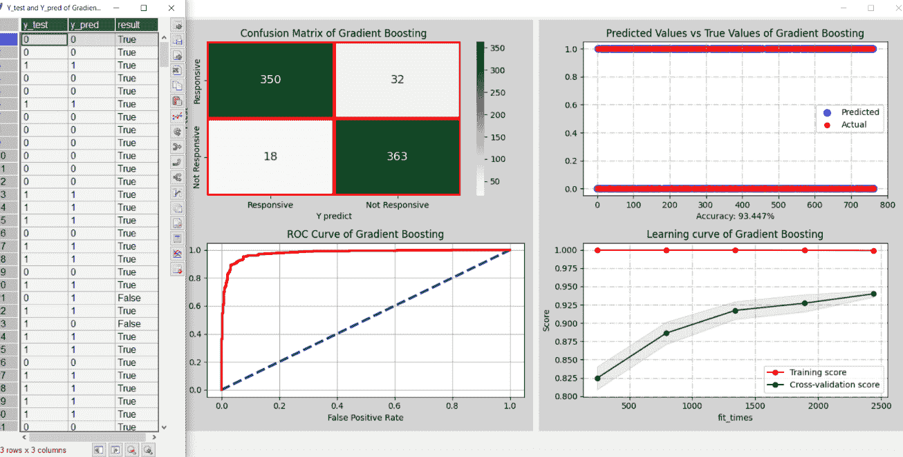

**图 35** 使用梯度提升分类器的结果

输出：

```text
Gradient Boosting

accuracy: 0.9344692005242464
recall: 0.9344692005242464
precision: 0.9350581842811196
f1: 0.9344487080749257

 precision recall f1-score support
 0 0.95 0.92 0.93 382
 1 0.92 0.95 0.94 381
 accuracy 0.93 763
 macro avg 0.94 0.93 0.93 763
 weighted avg 0.94 0.93 0.93 763
```

让我们详细分析一下性能指标及其含义：

*   **准确率**：准确率衡量模型预测的整体正确性。它计算为正确预测的实例数与总实例数的比率。对于“梯度提升”分类器，其准确率约为 93.45%。这意味着模型做出的预测中约有 93.45% 是正确的。
*   **召回率**：召回率，也称为灵敏度或真正例率，衡量模型正确识别正例（本例中为类别 1）的能力。它计算为真正例（正确识别的类别 1 实例）与实际类别 1 实例总数的比率。本例中，类别 1 的召回率约为 95%，表明模型在识别类别 1 实例方面非常有效。
*   **精确率**：精确率衡量模型在所有预测为正例的实例中正确分类正例的能力。它计算为真正例与预测为正例的实例总数的比率。本例中，类别 1 的精确率约为 92%，表明当模型预测某实例为类别 1 时，其正确率约为 92%。
*   **F1 分数**：F1 分数是精确率和召回率的调和平均数。它在精确率和召回率之间提供平衡，在处理不平衡数据集时尤为有用。类别 1 的 F1 分数约为 93.44%，在精确率和召回率之间取得了良好的平衡。
*   **分类报告**：分类报告提供了每个类别（类别 0 和类别 1）的精确率、召回率和 F1 分数的详细细分。它使我们能够单独查看模型在两个类别上的表现。

####### 结论

“梯度提升”分类器在该数据集上表现优异。它达到了 93.45% 的高准确率，表明具有很强的整体预测性能。模型还展示了极佳的类别 1 实例识别能力，召回率为 95%，精确率为 92%。这意味着它能有效捕获并正确分类正例，同时将假阳性降至最低。

总之，“梯度提升”分类器是针对给定数据集的一个稳健且准确的模型，在精确率和召回率之间实现了良好的权衡，适用于各种分类任务。

###### 极端梯度提升分类器与网格搜索

在 `Machine_Learning` 类中，定义一个名为 `extreme_gradient_boosting()` 的新方法，如下所示：

```python
def extreme_gradient_boosting(self, name, X_train, X_test, y_train, y_test):
    # Define the parameter grid for the grid search
    param_grid = {
        'n_estimators': [100, 200, 300],
        'max_depth': [10, 20, 30],
        'learning_rate': [0.01, 0.1, 0.2],
        'subsample': [0.6, 0.8, 1.0],
        'colsample_bytree': [0.6, 0.8, 1.0],
    }

    # Initialize the XGBoost classifier
    xgb = XGBClassifier(random_state=2021, use_label_encoder=False, eval_metric='mlogloss')

    # Create GridSearchCV with the XGBoost classifier and the parameter grid
    grid_search = GridSearchCV(xgb, param_grid, cv=3, scoring='accuracy', n_jobs=-1)

    # Train and perform grid search
    grid_search.fit(X_train, y_train)

    # Get the best XGBoost classifier model from the grid search
    best_model = grid_search.best_estimator_

    # Saves model
    joblib.dump(best_model, 'XGB_Model.pkl')

    # Print the best hyperparameters found
    print(f"Best Hyperparameters for XGB:")
    print(grid_search.best_params_)

    return best_model
```

`extreme_gradient_boosting()` 方法实现了极端梯度提升 (XGBoost) 分类器。让我们逐步分解该方法：

####### 1. 参数网格

它定义了一个参数网格，指定了网格搜索期间要搜索的超参数值范围。超参数包括：

*   `n_estimators`：提升轮数（基学习器的数量）。
*   `max_depth`：集成中每棵树的最大深度。
*   `learning_rate`：步长收缩，用于防止过拟合。
*   `subsample`：用于拟合树的样本比例。
*   `colsample_bytree`：用于拟合树的特征比例。

####### 2. 初始化 XGBoost 分类器

它使用特定设置初始化 XGBoost 分类器 (`XGBClassifier`)：

*   `random_state`：设置随机种子以保证可复现性。
*   `use_label_encoder`：禁用标签编码器以防止警告（XGBoost 通常期望标签编码为整数）。
*   `eval_metric`：指定评估指标为 "mlogloss"，通常用于多分类问题。

####### 3. GridSearchCV

它创建一个 `GridSearchCV` 对象，该对象将执行带有交叉验证的网格搜索。网格搜索旨在根据准确率作为评分指标找到最佳的超参数组合。交叉验证 (`cv`) 参数设置为 3，表示 3 折交叉验证。

####### 4. 训练并执行网格搜索

使用提供的超参数网格训练并评估 XGBoost 分类器。网格搜索尝试各种超参数组合，并使用交叉验证在训练数据上评估模型的准确率。

####### 5. 最佳模型选择

网格搜索完成后，根据交叉验证期间获得最高准确率的超参数，选择最佳的 XGBoost 分类器模型。

####### 6. 模型保存

使用 `joblib` 库将最佳模型保存到名为 `XGB_Model.pkl` 的文件中。这使您可以在未来的会话中重用训练好的模型，而无需重新训练。

####### 7. 打印最佳超参数

该方法打印网格搜索期间找到的最佳超参数。这些超参数代表了在训练数据上获得最高准确率的配置。


####### 概述

`extreme_gradient_boosting()` 方法使用带有交叉验证的网格搜索，对 XGBoost 分类器执行超参数调优。它有助于确定分类器的最佳超参数，并将最佳模型保存以供后续使用。此过程旨在提高模型在给定数据集上的预测性能。

####### `Machine_Learning` 类中的 `implement_XGB()` 方法

在 `Machine_Learning` 类中，定义一个名为 `implement_XGB()` 的新方法：

```python
def implement_XGB(self, chosen, X_train, X_test, y_train, y_test):
    file_path = os.getcwd() + "/XGB_Model.pkl"
    if os.path.exists(file_path):
        model = joblib.load('XGB_Model.pkl')
        y_pred = self.run_model(chosen, model, X_train, X_test, y_train, y_test, proba=True)
    else:
        model = self.extreme_gradient_boosting(chosen, X_train, X_test, y_train, y_test)
        y_pred = self.run_model(chosen, model, X_train, X_test, y_train, y_test, proba=True)

    # Saves result into excel file
    self.obj_data.save_result(y_test, y_pred, "results_XGB.csv")
    print("Training Extreme Gradient Boosting done...")
    return model, y_pred
```

`implement_XGB()` 方法负责实现极端梯度提升（XGBoost）分类器并执行各种操作。以下是该方法的逐步分解：

1.  **文件路径检查**：检查当前工作目录中是否存在名为 `XGB_Model.pkl` 的文件。该文件通常用于存储预训练的 XGBoost 模型以供复用。
2.  **条件执行**：
    *   **若 `XGB_Model.pkl` 文件存在**：意味着有预训练的 XGBoost 模型可用。此时使用 `joblib.load` 从文件加载预训练模型。
    *   **若文件不存在**：意味着没有可用的预训练模型，因此使用 `extreme_gradient_boosting()` 方法训练一个新的 XGBoost 模型。
3.  **模型训练与预测**：无论使用预训练模型还是训练新模型，均调用 `run_model()` 方法对测试数据进行预测。参数 `proba=True` 表示模型应返回概率估计。
4.  **结果保存**：使用 `obj_data.save_result()` 方法将模型预测的结果（真实标签和预测标签）保存到名为 `results_XGB.csv` 的 Excel 文件中。该文件通常包含评估指标和其他相关信息。
5.  **打印状态消息**：打印一条消息，指示 XGBoost 模型训练已完成。
6.  **返回模型与预测**：返回训练好的 XGBoost 模型及其在测试数据上的预测结果。

**总结**：`implement_XGB` 方法作为训练和使用 XGBoost 分类器的封装。它首先检查预训练模型是否存在，若可用则加载；否则通过超参数调优训练新模型。在对测试数据进行预测后，它保存结果并返回模型和预测值，以供进一步分析或使用。

####### `Helper_Plot` 类中 `choose_plot_ML()` 方法的更新

在 `Helper_Plot` 类中，将以下代码添加到 `choose_plot_ML()` 方法的末尾：

```python
if chosen == "Extreme Gradient Boosting":
    best_model, y_pred = self.obj_ml.implement_XGB(chosen, X_train, X_test, y_train, y_test)

    # Plots confusion matrix and ROC
    self.plot_cm_roc(best_model, X_test, y_test, y_pred, chosen, figure1, canvas1)

    # Plots true values versus predicted values diagram and learning curve
    self.plot_real_pred_val_learning_curve(best_model, X_train, y_train,
                                           X_test, y_test, y_pred, chosen, figure2, canvas2)

    # Shows table of result
    df_lr = self.obj_data.read_dataset("results_XGB.csv")
    self.shows_table(root, df_lr, 450, 750, "Y_test and Y_pred of Extreme Gradient Boosting")
```

该代码块实现并评估极端梯度提升（XGBoost）分类器，执行以下任务：

1.  **模型实现**：
    *   检查所选算法是否为 "Extreme Gradient Boosting"（XGBoost）。
    *   若为 XGBoost，则调用 `implement_XGB()` 方法实现 XGBoost 模型。该方法将训练新模型或在模型存在时加载预训练模型。
2.  **评估与可视化**：
    *   获得 XGBoost 模型和预测结果（`best_model` 和 `y_pred`）后，评估模型性能。
    *   使用 `plot_cm_roc()` 方法绘制混淆矩阵和 ROC 曲线。混淆矩阵提供模型正确分类样本能力的洞察，ROC 曲线展示模型的区分能力。
    *   使用 `plot_real_pred_val_learning_curve()` 方法绘制真实值与预测值对比图及学习曲线。对比图有助于直观展示模型预测与真实值的契合度，学习曲线提供随着训练数据量增加模型性能变化的信息。
3.  **结果表格**：
    *   使用 `obj_data.read_dataset` 方法从名为 `results_XGB.csv` 的 Excel 文件中读取 XGBoost 模型预测的结果。
    *   结果包含准确率、精确率、召回率和 F1 分数等指标，以及其他相关信息。
4.  **表格显示**：
    *   使用 `shows_table` 方法在图形用户界面（GUI）中显示结果表格。该表格提供模型性能指标的摘要，并可能包含关于预测的其他详细信息。

**总体而言**，此代码块允许训练、评估和可视化 XGBoost 分类器的性能，便于理解模型在给定数据集上的表现。它还提供了一种在 GUI 中查看结果的用户友好方式，有助于模型评估和决策制定。

####### 运行与结果展示

运行 `main_class.py`。接着，点击 **SPLIT DATA** 按钮。然后，选择 **Extreme Gradient Boosting** 以查看使用极端梯度提升分类器的结果，如图 36 所示。

**输出**：

```text
accuracy: 0.9187418086500655
recall: 0.9187418086500655
precision: 0.919159842964031
f1: 0.9187233804770313

              precision    recall  f1-score   support
           0       0.93      0.90      0.92       382
           1       0.91      0.93      0.92       381
    accuracy                           0.92       763
   macro avg       0.92      0.92      0.92       763
weighted avg       0.92      0.92      0.92       763
```

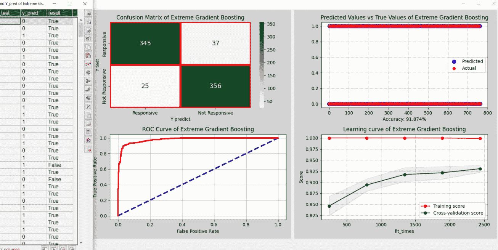

**图 36** 使用极端梯度提升的结果

上述输出为极端梯度提升（XGBoost）分类器的评估结果。以下是指标细分及模型性能分析：

*   **准确率**：模型准确率约为 91.87%，意味着模型正确预测了测试数据集中约 91.87% 样本的类别标签。
*   **召回率**：两个类别的召回率均约为 91.87%。该指标衡量模型正确识别正样本（类别 1）和负样本（类别 0）的能力。高召回率表明模型有效捕捉了真正例，同时将假负例最小化。
*   **精确率**：类别 0 的精确率约为 91.92%，类别 1 约为 91.91%。精确率衡量预测为正例的样本中真正例的比例。高精确率表明模型预测为正类时，大多是正确的。
*   **F1 分数**：两个类别的 F1 分数均约为 91.87%。F1 分数是精确率和召回率的调和平均数，提供了模型性能的平衡度量。它同时考虑了假正例和假负例，在处理不平衡数据集时特别有用。
*   **分类报告**：分类报告提供了每个类别（0 和 1）的精确率、召回率和 F1 分数摘要。同时包含支持度，即每个类别的样本数量。


####### 结论

Extreme Gradient Boosting (XGBoost) 分类器在给定数据集上表现良好，在两个类别上均实现了高准确率、召回率、精确率和 F1 分数。这些指标表明该模型能有效区分两个类别并做出准确预测。平衡的 F1 分数表明该模型适用于精确率和召回率均至关重要的任务，例如类别不平衡的二分类问题。

###### 多层感知机分类器与网格搜索

在 `Machine_Learning` 类中，定义一个名为 `multi_layer_perceptron()` 的新方法，如下所示：

```python
def multi_layer_perceptron(self, name, X_train, X_test, y_train, y_test):
    # Define the parameter grid for the grid search
    param_grid = {
        'hidden_layer_sizes': [(50,), (100,), (50, 50), (100, 50), (100, 100)],
        'activation': ['logistic', 'relu'],
        'solver': ['adam', 'sgd'],
        'alpha': [0.0001, 0.001, 0.01],
        'learning_rate': ['constant', 'invscaling', 'adaptive'],
    }

    # Initialize the MLP Classifier
    mlp = MLPClassifier(random_state=2021)

    # Create GridSearchCV with the MLP Classifier and the parameter grid
    grid_search = GridSearchCV(mlp, param_grid, cv=3, scoring='accuracy', n_jobs=-1)

    # Train and perform grid search
    grid_search.fit(X_train, y_train)

    # Get the best MLP Classifier model from the grid search
    best_model = grid_search.best_estimator_

    # Saves model
    joblib.dump(best_model, 'MLP_Model.pkl')

    # Print the best hyperparameters found
    print(f"Best Hyperparameters for MLP:")
    print(grid_search.best_params_)

    return best_model
```

`multi_layer_perceptron()` 函数是用于训练和评估多层感知机 (MLP) 分类器的机器学习流水线的一部分。以下是该函数关键组件的细分：

1.  **参数网格**：你定义了一个包含用于调优 MLP 模型的各种超参数的参数网格 `param_grid`。这些超参数包括神经网络架构（隐藏层大小）、激活函数、优化算法、正则化强度 (`alpha`) 和学习率调度。
2.  **MLP 分类器初始化**：你使用固定的随机种子 (`random_state=2021`) 初始化一个 MLP 分类器实例。MLP 分类器是一种用于分类任务的人工神经网络。
3.  **网格搜索**：你创建一个名为 `grid_search` 的 `GridSearchCV` 对象，它将对前面定义的超参数网格进行详尽搜索。网格搜索用于为 MLP 模型找到最佳的超参数组合。
4.  **训练与网格搜索**：你使用 `GridSearchCV` 对象在训练数据 (`X_train`, `y_train`) 上拟合（训练）MLP 模型。这将使用不同的超参数组合训练多个 MLP 模型，并使用交叉验证 (`cv=3`) 评估其性能。
5.  **最佳模型选择**：网格搜索完成后，你使用 `grid_search.best_estimator_` 从搜索结果中获得最佳 MLP 模型。
6.  **模型保存**：如果需要，你可以使用 `joblib` 将最佳 MLP 模型保存到名为 `'MLP_Model.pkl'` 的文件中。这使你可以在未来重用训练好的模型，而无需重新训练。
7.  **打印最佳超参数**：你打印出网格搜索找到的最佳超参数。此信息有助于你了解哪些超参数促成了最佳模型的性能。

总体而言，此函数自动化了 MLP 分类器的超参数调优过程，并允许你高效地搜索最佳配置，以在分类任务上实现最优性能。

---

然后，在 `Machine_Learning` 类中，定义一个名为 `implement_MLP()` 的新方法：

```python
def implement_MLP(self, chosen, X_train, X_test, y_train, y_test):
    file_path = os.getcwd() + "/MLP_Model.pkl"

    if os.path.exists(file_path):
        model = joblib.load('MLP_Model.pkl')
        y_pred = self.run_model(chosen, model, X_train, X_test, y_train, y_test, proba=True)
    else:
        model = self.multi_layer_perceptron(chosen, X_train, X_test, y_train, y_test)
        y_pred = self.run_model(chosen, model, X_train, X_test, y_train, y_test, proba=True)

    # Saves result into excel file
    self.obj_data.save_result(y_test, y_pred, "results_MLP.csv")

    print("Training Multi-Layer Perceptron done...")

    return model, y_pred
```

`implement_MLP()` 函数是机器学习流水线的一部分，用于为给定数据集实现和评估多层感知机 (MLP) 分类器。以下是该函数关键组件的细分：

1.  **模型加载或训练**：首先，该函数检查当前工作目录下名为 `'MLP_Model.pkl'` 的预训练 MLP 模型文件是否存在。如果存在，它使用 `joblib.load` 加载预训练模型。如果不存在，它将继续训练一个新的 MLP 模型。
2.  **模型训练**：如果预训练模型不存在，该函数调用 `multi_layer_perceptron()` 函数，传入选定的配置、训练数据 (`X_train` 和 `y_train`) 以及测试数据 (`X_test` 和 `y_test`)。此函数执行 MLP 模型的超参数调优和训练。
3.  **模型评估**：在加载预训练模型或训练新模型后，该函数通过调用 `run_model` 函数使用训练好的模型对测试数据 (`X_test`) 进行预测。它请求概率预测 (`proba=True`)，表明它想要每个类别的概率分数。
4.  **结果保存**：实际值和预测值（概率）使用 `obj_data` 对象的 `save_result()` 方法保存到名为 `'results_MLP.csv'` 的 Excel 文件中。这允许稍后分析和比较模型的性能。
5.  **打印状态**：最后，该函数打印一条消息，指示 MLP 模型的训练或加载已完成。

总体而言，此函数处理训练和评估 MLP 分类器的整个流水线，包括如果存在预训练模型则加载它的选项。这种方法通过避免在先前已训练相同配置时不必要地重新训练模型来节省时间和资源。

---

然后，在 `Helper_Plot` 类中，将此代码添加到 `choose_plot_ML()` 方法的末尾：

```python
if chosen == "Multi-Layer Perceptron":
    best_model, y_pred = self.obj_ml.implement_MLP(chosen, X_train, X_test, y_train, y_test)

    # Plots confusion matrix and ROC
    self.plot_cm_roc(best_model, X_test, y_test, y_pred, chosen, figure1, canvas1)

    # Plots true values versus predicted values diagram and learning curve
    self.plot_real_pred_val_learning_curve(best_model, X_train, y_train,
                                           X_test, y_test, y_pred, chosen, figure2, canvas2)

    # Shows table of result
    df_lr = self.obj_data.read_dataset("results_MLP.csv")
    self.shows_table(root, df_lr, 450, 750, "Y_test and Y_pred of Multi-Layer Perceptron")
```

以下是其逐步执行的操作：

1.  **模型实现 (`implement_MLP()`)**：如果选择的模型是 "Multi-Layer Perceptron"，它会加载预训练的 MLP 模型（如果存在，保存为当前工作目录下名为 "MLP_Model.pkl" 的文件）。如果预训练模型不存在，它会使用网格搜索来寻找最佳超参数来训练一个新的 MLP 模型。然后，它使用该模型对测试数据进行预测。

2.  **性能可视化 (`plot_cm_roc()` 和 `plot_real_pred_val_learning_curve()`)**：获得 MLP 模型的预测结果后，它继续创建两种类型的图表：
    *   **混淆矩阵和 ROC 曲线 (`plot_cm_roc()`)**：它生成混淆矩阵和 ROC 曲线，以直观地评估 MLP 模型在测试数据上的性能。


####### 真实值与预测值对比图及学习曲线 (`plot_real_pred_val_learning_curve`)

它创建一个将真实值与预测值进行对比的图表。此外，它还绘制一条学习曲线，以展示模型性能如何随不同训练数据集大小而变化。

####### 结果展示 (`shows_table`)

它从名为 `results_MLP.csv` 的 Excel 文件中加载 MLP 模型的结果。该 Excel 文件包含模型的各种性能指标。随后，它在 GUI 中以表格形式显示这些结果。

总之，这部分代码侧重于训练、评估和可视化 MLP 分类器的性能。它包含加载预训练模型、使用网格搜索进行超参数调优，以及通过各种可视化图表和表格展示结果等功能。

运行 `main_class.py`。接着，点击 **SPLIT DATA** 按钮。然后，选择 **Multi-Layer Perceptron** 以查看使用多层感知机分类器的结果，如图 37 所示。

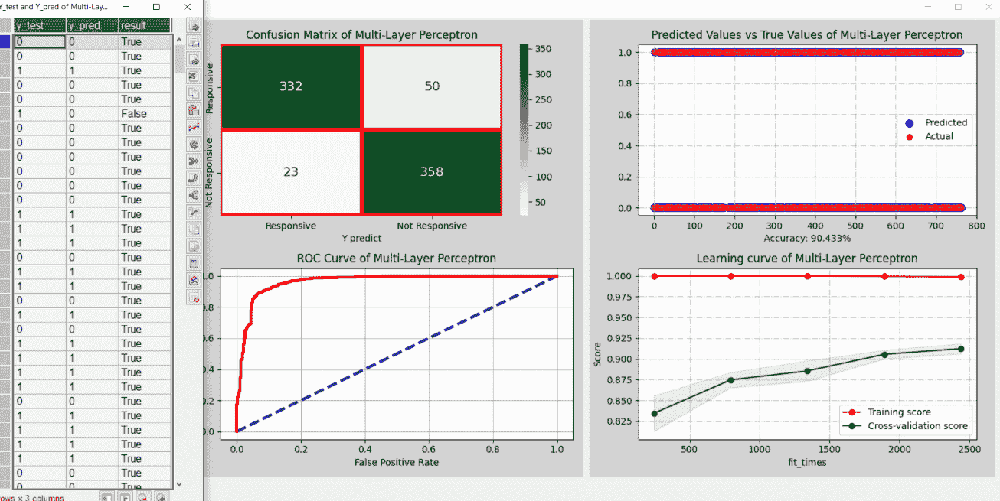

**图 37** 使用多层感知机分类器的结果

输出：

```
Multi-Layer Perceptron

accuracy: 0.9043250327653998

recall: 0.9043250327653998

precision: 0.9063689747768858

f1: 0.9042095303827421

 precision recall f1-score support

 0 0.94 0.87 0.90 382

 1 0.88 0.94 0.91 381

 accuracy 0.90 763

 macro avg 0.91 0.90 0.90 763

weighted avg 0.91 0.90 0.90 763
```

该输出为多层感知机 (MLP) 分类器的性能评估。让我们分解关键指标及其含义：

*   **准确率**：准确率衡量模型预测的整体正确性。在本例中，MLP 分类器达到了约 90.43% 的准确率。这意味着测试数据样本中约有 90.43% 被模型正确分类。
*   **召回率 (灵敏度)**：召回率量化模型在所有实际正例中正确识别正例的能力。对于正类（类别 1），MLP 分类器达到了约 90.43% 的召回率。这表明模型正确识别了所有实际正例中的约 90.43%。
*   **精确率**：精确率衡量模型在预测正例时的精确程度。MLP 分类器对于正类达到了约 90.64% 的精确率。这意味着在所有被预测为正例的实例中，约有 90.64% 确实是正例。
*   **F1 分数**：F1 分数是精确率和召回率的调和平均数，提供了这两个指标之间的平衡。对于正类，MLP 分类器达到了约 90.42% 的 F1 分数。较高的 F1 分数表明精确率和召回率之间有更好的平衡。
*   **分类报告**：分类报告提供了每个类别（0 和 1）的精确率、召回率和 F1 分数的摘要。它还显示了支持度，即测试数据集中每个类别实际出现的次数。

基于性能指标的结论如下：

多层感知机 (MLP) 分类器在测试数据集上表现良好，准确率约为 90.43%。它在精确率和召回率之间表现出均衡的性能，两个类别的 F1 分数均接近 0.90。这表明 MLP 分类器能有效地正确分类来自两个类别（0 和 1）的实例。不过，可能还需要进一步针对特定领域的分析，以确定该性能水平是否满足手头问题的具体要求。

###### 支持向量分类器与网格搜索

在 `Machine_Learning` 类中，定义一个名为 `support_vector()` 的新方法，如下所示：

```python
def support_vector(self, name, X_train, X_test, y_train, y_test):
    # Support Vector Classifier
    # Define the parameter grid for the grid search
    param_grid = {
        'C': [0.1, 1, 10],
        'kernel': ['linear', 'poly', 'rbf'],
        'gamma': ['scale', 'auto', 0.1, 1],
    }
    # Initialize the SVC model
    model_svc = SVC(random_state=2021, probability=True)
    # Create GridSearchCV with the SVC model and the parameter grid
    grid_search = GridSearchCV(model_svc, param_grid, cv=3, scoring='accuracy', n_jobs=-1, refit=True)
    # Train and perform grid search
    grid_search.fit(X_train, y_train)
    # Get the best MLP Classifier model from the grid search
    best_model = grid_search.best_estimator_
    # Saves model
    joblib.dump(best_model, 'SVC_Model.pkl')
    # Print the best hyperparameters found
    print(f"Best Hyperparameters for SVC:")
    print(grid_search.best_params_)
    return best_model
```

`support_vector()` 函数用于训练支持向量分类器 (SVC) 并使用网格搜索进行超参数调优。以下是函数各部分的解释：

####### 1. 参数网格定义

你定义了一个包含网格搜索期间待调优超参数的参数网格 `param_grid`。这些超参数包括：

*   **`C`**：该参数控制正则化强度。你提供了一组潜在值：`[0.1, 1, 10]`。
*   **`kernel`**：用于转换数据的核函数。你指定了三种核选项：`'linear'`、`'poly'` 和 `'rbf'`。
*   **`gamma`**：该参数定义核系数。你提供了一组值：`['scale', 'auto', 0.1, 1]`。

####### 2. SVC 模型初始化

你使用特定设置初始化支持向量分类器 (SVC) 模型。你设置 `random_state=2021` 以保证可复现性，设置 `probability=True` 以启用概率估计。

####### 3. GridSearchCV 设置

你创建了一个名为 `grid_search` 的 `GridSearchCV` 对象。该对象将 SVC 模型与参数网格相结合，用于超参数调优。它使用 3 折交叉验证 (`cv=3`)，以准确率衡量性能 (`scoring='accuracy'`)，并利用所有可用的 CPU 核心 (`n_jobs=-1`)。

####### 4. 网格搜索训练

你将 `grid_search` 对象拟合到训练数据 (`X_train` 和 `y_train`) 上。此过程会对 `param_grid` 中指定的超参数组合进行详尽搜索，以根据交叉验证准确率找到最佳组合。

####### 5. 最佳模型选择

网格搜索完成后，你根据产生最高交叉验证准确率的超参数获得最佳 SVC 模型 (`best_model`)。

####### 6. 模型保存

最佳模型通过 `joblib.dump()` 函数保存到名为 `SVC_Model.pkl` 的文件中。

####### 7. 打印超参数

你打印网格搜索期间找到的最佳超参数。

该函数返回具有选定超参数的最佳训练 SVC 模型。

这段代码演示了使用网格搜索对 SVC 模型进行超参数调优的过程，帮助你找到能在训练数据上优化模型性能的最佳超参数组合。

然后，在 `Machine_Learning` 类中，定义一个名为 `implement_SVC()` 的新方法：

```python
def implement_SVC(self, chosen, X_train, X_test, y_train, y_test):
    file_path = os.getcwd() + "/SVC_Model.pkl"
    if os.path.exists(file_path):
        model = joblib.load('SVC_Model.pkl')
        y_pred = self.run_model(chosen, model, X_train, X_test, y_train, y_test, proba=True)
    else:
        model = self.support_vector(chosen, X_train, X_test, y_train, y_test)
        y_pred = self.run_model(chosen, model, X_train, X_test, y_train, y_test, proba=True)
    # Saves result into excel file
    self.obj_data.save_result(y_test, y_pred, "results_SVC.csv")
    print("Training Support Vector Classifier done...")
    return model, y_pred
```

`implement_SVC()` 函数负责训练支持向量分类器 (SVC) 模型并执行预测。以下是该函数的细分说明：


####### 1. 文件路径检查

首先检查当前工作目录（`os.getcwd()`）下是否存在名为 `SVC_Model.pkl` 的预训练 SVC 模型文件。如果文件存在，则使用 `joblib.load` 加载预训练模型；否则，继续训练新模型。

####### 2. 模型训练或加载

如果不存在预训练模型，则调用 `support_vector()` 函数训练新的 SVC 模型。该函数执行超参数调优并返回最佳模型。新训练或加载的模型存储在 `model` 变量中。

####### 3. 模型预测

使用训练或加载的模型（`model`），通过 `run_model()` 函数（设置 `proba=True`）对输入数据（`X_train`、`X_test`、`y_train`、`y_test`）进行预测，返回概率估计值。

####### 4. 保存预测结果

使用 `save_result` 函数将预测值（`y_pred`）和对应的真实值（`y_test`）保存到名为 `results_SVC.csv` 的 Excel 文件中。

####### 5. 打印状态

打印一条消息，指示支持向量分类器的训练已完成。

####### 6. 返回值

该函数返回两个值：训练或加载的 SVC 模型（`model`）和预测值（`y_pred`）。

该函数本质上作为训练和使用 SVC 模型的包装器，确保如果存在预训练模型则加载它，否则训练新模型。它还处理预测结果的保存，以便后续分析或报告。

####### Helper_Plot 类中 choose_plot_ML() 方法的代码补充

在 `Helper_Plot` 类的 `choose_plot_ML()` 方法末尾添加以下代码：

```python
if chosen == "Support Vector Classifier":
    best_model, y_pred = self.obj_ml.implement_SVC(chosen, X_train, X_test, y_train, y_test)
    # Plots confusion matrix and ROC
    self.plot_cm_roc(best_model, X_test, y_test, y_pred, chosen, figure1, canvas1)
    # Plots true values versus predicted values diagram and learning curve
    self.plot_real_pred_val_learning_curve(best_model, X_train, y_train,
                                           X_test, y_test, y_pred, chosen, figure2, canvas2)
    # Shows table of result
    df_lr = self.obj_data.read_dataset("results_SVC.csv")
    self.shows_table(root, df_lr, 450, 750, "Y_test and Y_pred of Support Vector Classifier")
```

####### 代码功能总结

这段代码用于训练和评估支持向量分类器。以下是该代码块功能的总结：

######## 1. 模型选择

检查选定的机器学习模型是否为 "Support Vector Classifier"（`chosen == "Support Vector Classifier"`）。如果匹配，则继续训练和评估支持向量分类器。这是图形用户界面（GUI）或命令行界面（CLI）的一部分，用户可在其中选择要训练和评估的机器学习模型。

######## 2. 模型训练

如果选定模型为支持向量分类器，则调用 `implement_SVC` 方法，使用提供的训练数据（`X_train`、`y_train`）训练支持向量分类器，并在测试数据（`X_test`）上进行预测。返回训练好的模型（`best_model`）和预测结果（`y_pred`）。

######## 3. 评估与可视化

随后对模型进行评估并创建可视化：

*   使用 `plot_cm_roc()` 方法绘制支持向量分类器的混淆矩阵和接收者操作特征（ROC）曲线。这些可视化有助于评估模型性能及其区分不同类别的能力。
*   使用 `plot_real_pred_val_learning_curve()` 方法绘制真实值与预测值对比图及学习曲线。这有助于直观展示模型预测与实际值的契合度，以及性能随训练数据量变化的情况。
*   使用 `shows_table()` 方法显示支持向量分类器的结果表格。该表包含准确率、精确率、召回率和 F1-score 等评估指标，对比模型预测与实际测试数据。

######## 4. 结果存储

代码似乎使用 `save_result()` 方法将评估结果存储在名为 `results_SVC.csv` 的 Excel 文件中，便于后续分析和结果比较。

总体而言，这段代码是更大机器学习流水线的一部分，旨在训练、评估和可视化不同的机器学习模型，此处重点关注支持向量分类器。用户可选择要使用的模型，系统负责该模型的训练、评估和可视化。

####### 运行步骤

运行 `main_class.py`。接着点击 **SPLIT DATA** 按钮。然后选择 **Support Vector Classifier**，即可查看如图 38 所示的支持向量分类器结果。

####### Output

Support Vector Classifier

accuracy: 0.9003931847968545

recall: 0.9003931847968545

precision: 0.9022701737370328

f1: 0.9002818528428114

| precision | recall | f1-score | support |
| :--- | :--- | :--- | :--- |
| 0 | 0.93 | 0.87 | 0.90 | 382 |
| 1 | 0.87 | 0.93 | 0.90 | 381 |
| accuracy | | | 0.90 | 763 |
| macro avg | 0.90 | 0.90 | 0.90 | 763 |
| weighted avg | 0.90 | 0.90 | 0.90 | 763 |

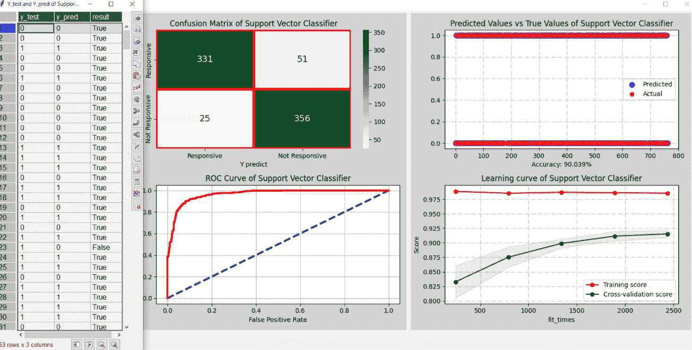

**Figure 38** The results of using Support Vector classifier

####### 输出详细分析

输出为支持向量分类器（SVC）模型的评估结果。以下是指标的详细分析及结论：

*   **Model Name**: Support Vector Classifier
*   **Overall Accuracy**: 0.9004

    准确率表示正确预测的实例数与数据集中总实例数的比率。此处模型准确率约为 90.04%，即正确分类了约 90.04% 的样本。

*   **Recall (Sensitivity)**: 0.9004

    召回率（灵敏度）衡量模型正确识别正例（此处为类别 1）的能力。约 90.04% 的召回率意味着模型正确识别了约 90.04% 的实际正例。

*   **Precision**: 0.9023

    精确率表示正确预测的正例数与模型预测为正例的总数之比。约 90.23% 的精确率意味着模型标记为正例的实例中，约 90.23% 确实为正例。

*   **F1-Score**: 0.9003

    F1-score 是精确率和召回率的调和平均数，平衡了二者。约 90.03% 的 F1-score 表明模型在精确率和召回率之间取得了良好平衡。

*   **Classification Report**:

    分类报告提供了各类别（0 和 1）的精确率、召回率和 F1-score 细分。

    *   对于类别 0（通常为负类），精确率 0.93，召回率 0.87，F1-score 0.90。
    *   对于类别 1（通常为正类），精确率 0.87，召回率 0.93，F1-score 0.90。

    这些数值分别反映了模型在各类别上的表现。

####### Conclusion

支持向量分类器（SVC）模型在给定数据集上表现良好，整体准确率约 90.04%。F1-score 约 90.03% 表明其在精确率和召回率间达到良好平衡。模型在类别 0 和类别 1 上表现相对一致，两者的精确率、召回率和 F1-score 数值相近。

###### AdaBoost Classifier and Grid Search

在 `Machine_Learning` 类中，定义一个名为 `adaboost_classifier()` 的新方法，如下所示：

```python
def adaboost_classifier(self, name, X_train, X_test, y_train, y_test):
    # Define the parameter grid for the grid search
    param_grid = {
        'n_estimators': [50, 100, 150],
        'learning_rate': [0.01, 0.1, 0.2],
    }

    # Initialize the AdaBoost classifier
    adaboost = AdaBoostClassifier(random_state=2021)

    # Create GridSearchCV with the AdaBoost classifier and the parameter grid
    grid_search = GridSearchCV(adaboost, param_grid, cv=3, scoring='accuracy', n_jobs=-1)
```


########## 训练并执行网格搜索

```python
grid_search.fit(X_train, y_train)

####### 从网格搜索中获取最佳 AdaBoost 分类器模型
best_model = grid_search.best_estimator_

########## 保存模型
joblib.dump(best_model, 'ADA_Model.pkl')

########## 打印找到的最佳超参数
print(f"Best Hyperparameters for AdaBoost:")
print(grid_search.best_params_)

return best_model
```

该代码定义了一个函数 `adaboost_classifier()`，用于设置 AdaBoost 分类器模型并使用网格搜索进行超参数调优。以下是代码各部分的解释：

####### 1. 参数网格定义

*   `param_grid` 是一个字典，定义了要调优的超参数以及网格搜索期间要考虑的取值范围。
*   它包含两个超参数：
    *   `n_estimators`：集成中要训练的弱学习器（基础估计器）的数量。
    *   `learning_rate`：每个弱学习器对最终预测的贡献权重。

####### 2. AdaBoost 分类器初始化

使用 `random_state=2021` 初始化一个 AdaBoost 分类器。该分类器是一种集成学习方法，通过组合多个弱学习器来创建一个强分类器。

####### 3. 网格搜索设置

使用 `GridSearchCV` 设置网格搜索。它接收 AdaBoost 分类器、参数网格（`param_grid`）和其他配置：

*   `cv=3`：在网格搜索期间执行 3 折交叉验证。
*   `scoring='accuracy'`：使用准确率作为评估模型性能的评分指标。
*   `n_jobs=-1`：利用所有可用的 CPU 核心进行并行处理。

####### 4. 网格搜索训练

*   `grid_search` 对象在提供的训练数据（`X_train` 和 `y_train`）上进行训练。
*   它对超参数网格进行穷举搜索，使用不同的超参数组合拟合 AdaBoost 分类器，并通过交叉验证评估其性能。

####### 5. 最佳模型选择

网格搜索完成后，根据交叉验证期间产生最高准确率的超参数组合，选择表现最佳的 AdaBoost 分类器模型。

####### 6. 模型保存

使用 `joblib.dump` 将最佳模型保存到名为 `ADA_Model.pkl` 的文件中，以供将来使用。

####### 7. 打印超参数

该函数打印网格搜索期间找到的最佳超参数。

该函数的目的是自动化 AdaBoost 分类器的超参数调优过程。它帮助你找到在训练数据上最大化模型准确率的最佳超参数组合。然后可以使用最佳模型对新数据进行预测。

然后，在 `Machine_Learning` 类中，定义一个名为 `implement_ADA()` 的新方法：

```python
def implement_ADA(self, chosen, X_train, X_test, y_train, y_test):
    file_path = os.getcwd() + "/ADA_Model.pkl"
    if os.path.exists(file_path):
        model = joblib.load('ADA_Model.pkl')
        y_pred = self.run_model(chosen, model, X_train, X_test, y_train, y_test, proba=True)
    else:
        model = self.adaboost_classifier(chosen, X_train, X_test, y_train, y_test)
        y_pred = self.run_model(chosen, model, X_train, X_test, y_train, y_test, proba=True)

    # 将结果保存到 Excel 文件
    self.obj_data.save_result(y_test, y_pred, "results_ADA.csv")
    print("Training AdaBoost done...")
    return model, y_pred
```

该代码定义了一个函数 `implement_ADA()`，用于实现针对二分类问题的 AdaBoost 分类器。以下是代码功能的细分说明：

####### 1. 模型加载或训练

*   该函数首先检查当前工作目录下是否存在名为 `ADA_Model.pkl` 的已保存 AdaBoost 分类器模型文件。
*   如果模型文件存在，则使用 `joblib.load` 加载该模型。这样做是为了避免在模型已经过训练并保存的情况下重复训练。
*   如果模型文件不存在，则调用 `adaboost_classifier()` 函数训练一个新的 AdaBoost 分类器。该函数使用网格搜索进行超参数调优，并返回训练好的最佳模型。

####### 2. 模型预测

无论模型是加载的还是新训练的，该函数都使用获得的 AdaBoost 分类器模型对提供的测试数据（`X_test`）进行预测。

####### 3. 结果保存

预测标签（`y_pred`）连同真实标签（`y_test`）一起，使用 `obj_data` 对象的 `save_result` 方法保存到名为 `results_ADA.csv` 的 Excel 文件中。该文件包含用于模型评估的指标和结果。

####### 4. 打印进度

该函数打印 "Training AdaBoost done..." 以指示模型已加载或训练完成，且预测已完成。

####### 5. 返回模型和预测结果

该函数返回 AdaBoost 分类器模型和预测标签（`y_pred`），以供进一步分析或使用。

该函数本质上封装了加载预训练 AdaBoost 模型（如果可用）或训练新模型、在测试数据上进行预测以及保存结果的过程。它为重用已训练模型提供了灵活性，并避免了在模型已在之前的运行中训练并保存时的冗余训练。

然后，在 `Helper_Plot` 类中，将此代码添加到 `choose_plot_ML()` 方法的末尾：

```python
if chosen == "AdaBoost":
    best_model, y_pred = self.obj_ml.implement_ADA(chosen, X_train, X_test, y_train, y_test)
    # 绘制混淆矩阵和 ROC 曲线
    self.plot_cm_roc(best_model, X_test, y_test, y_pred, chosen, figure1, canvas1)
    # 绘制真实值与预测值对比图及学习曲线
    self.plot_real_pred_val_learning_curve(best_model, X_train, y_train,
                                           X_test, y_test, y_pred, chosen, figure2, canvas2)
    # 显示结果表格
    df_lr = self.obj_data.read_dataset("results_ADA.csv")
    self.shows_table(root, df_lr, 450, 750, "Y_test and Y_pred of AdaBoost Classifier")
```

在这段代码中，程序检查所选的机器学习算法是否为 "AdaBoost"。如果确实是 AdaBoost，代码将执行以下步骤。首先，它从文件加载预训练的 AdaBoost 分类器模型，如果模型文件不存在则训练一个新模型。该训练好的模型用于对测试数据集进行预测，并存储生成的预测结果（`y_pred`）。接下来，代码生成各种可视化图表和报告以进行模型评估。它创建混淆矩阵和 ROC 曲线，展示模型的分类性能。此外，它还绘制真实值与预测值对比图以及学习曲线，以分析模型随时间变化的行为和性能。

此外，代码从先前保存的名为 `results_ADA.csv` 的 Excel 文件中读取结果，该文件包含与 AdaBoost 分类器性能相关的关键指标和统计数据。然后，它以表格形式在图形用户界面（GUI）中显示这些结果，增强了用户解读和分析分类器有效性的能力。总体而言，这部分代码简化了 AdaBoost 分类器的实现、评估和可视化流程，为明智决策提供了有价值的性能洞察。

运行 `main_class.py`。接下来，点击 **SPLIT DATA** 按钮。然后，选择 AdaBoost 以查看使用 AdaBoost 分类器的结果，如图 39 所示。

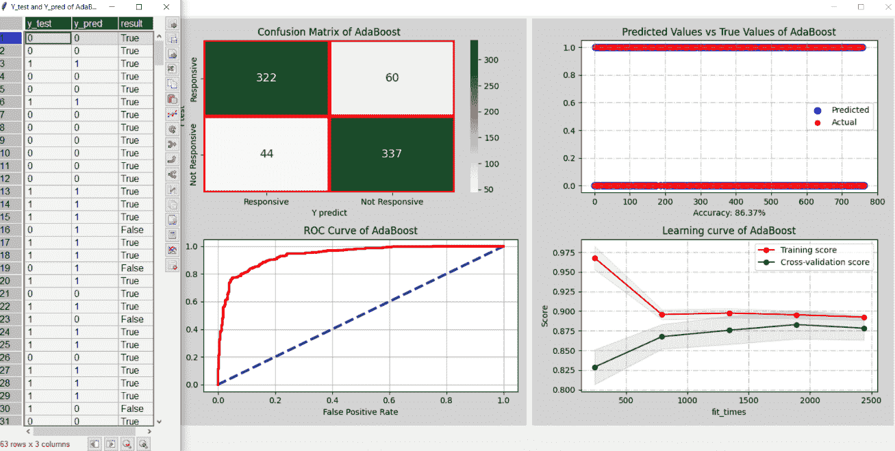

**图 39** 使用 AdaBoost 分类器的结果

输出：

```text
AdaBoost
accuracy: 0.8636959370904325
recall: 0.8636959370904325
precision: 0.8643442185483509
f1: 0.8636397238206017

              precision    recall  f1-score   support
           0       0.88      0.84      0.86       382
           1       0.85      0.88      0.87       381
    accuracy                           0.86       763
   macro avg       0.86      0.86      0.86       763
weighted avg       0.86      0.86      0.86       763
```


正如输出所示，AdaBoost 分类器在测试数据集上实现了约 86.37% 的准确率。这意味着它正确分类了测试集中约 86.37% 的实例。两个类别（0 和 1）的召回率相当平衡，其中类别 1（正类）的召回率略高于类别 0（负类）。具体而言，它对类别 1 实现了约 88% 的召回率，意味着它正确识别了约 88% 的正样本。对于类别 0，其召回率约为 84%，表明它成功识别了约 84% 的负样本。

在精确率方面，AdaBoost 分类器取得了良好结果，类别 0 的精确率约为 88%，类别 1 的精确率约为 85%。这意味着当模型预测某一类别时，其对类别 0 的预测有约 88% 的时间是正确的，对类别 1 的预测有约 85% 的时间是正确的。F1 分数（将精确率和召回率结合为单一指标）对类别 0 约为 86.36%，对类别 1 约为 87%。这些 F1 分数反映了每个类别精确率与召回率之间的平衡。总体而言，AdaBoost 分类器在该数据集上表现出了合理的性能，具有良好的准确率以及两个类别均衡的精确率和召回率值。

以下是完整的源代码：

###### `main_class.py`

```python
import tkinter as tk
from tkinter import *
from design_window import Design_Window
from process_data import Process_Data
from helper_plot import Helper_Plot
from machine_learning import Machine_Learning
import os

class Main_Class:
    def __init__(self, root):
        self.initialize()

    def initialize(self):
        self.root = root
        width = 1500
        height = 750
        self.root.geometry(f"{width}x{height}")
        self.root.title("TKINTER AND DATA SCIENCE")
        
        # 创建必要的对象
        self.obj_window = Design_Window()
        self.obj_data = Process_Data()
        self.obj_plot = Helper_Plot()
        self.obj_ML = Machine_Learning()
        
        # 读取数据集
        self.df = self.obj_data.preprocess()
        
        # 对数据集进行分类
        self.df_dummy = self.obj_data.categorize(self.df)
        
        # 提取输入和输出变量
        self.cat_cols, self.num_cols = self.obj_data.extract_cat_num_cols(self.df)
        self.df_final = self.obj_data.encode_categorical_feats(self.df, self.cat_cols)
        self.X, self.y = self.obj_data.extract_input_output_vars(self.df_final)
        
        # 在根窗口中放置控件
        self.obj_window.add_widgets(self.root)
        
        # 绑定事件
        self.binds_event()
        
        # 在数据分割完成前，初始禁用 combo4 和 combo5
        self.obj_window.combo4['state'] = 'disabled'
        self.obj_window.combo5['state'] = 'disabled'

    def binds_event(self):
        # 将列表框绑定到函数
        self.obj_window.listbox.bind("<<ListboxSelect>>", self.choose_list_widget)
        
        # 将下拉框 1 绑定到函数
        self.obj_window.combo1.bind("<<ComboboxSelected>>", self.choose_combobox1)
        
        # 将下拉框 2 绑定到函数
        self.obj_window.combo2.bind("<<ComboboxSelected>>", self.choose_combobox2)
        
        # 将按钮 1 绑定到 shows_table() 函数
        # 如果用户点击 LOAD DATASET 则显示表格
        self.obj_window.button1.config(command=lambda: self.obj_plot.shows_table(self.root, self.df, 1400, 600, "Dataset"))
        
        # 将按钮 2 绑定到 train_ML() 函数
        self.obj_window.button2.config(command=self.train_ML)
        
        # 将下拉框 4 绑定到函数
        self.obj_window.combo4.bind("<<ComboboxSelected>>", self.choose_combobox4)

    def choose_list_widget(self, event):
        chosen = self.obj_window.listbox.get(self.obj_window.listbox.curselection())
        print(chosen)
        self.obj_plot.choose_plot(self.df, self.df_dummy, chosen,
                                  self.obj_window.figure1, self.obj_window.canvas1,
                                  self.obj_window.figure2, self.obj_window.canvas2)

    def choose_combobox1(self, event):
        chosen = self.obj_window.combo1.get()
        self.obj_plot.choose_category(self.df_dummy, chosen,
                                      self.obj_window.figure1, self.obj_window.canvas1,
                                      self.obj_window.figure2, self.obj_window.canvas2)

    def choose_combobox2(self, event):
        chosen = self.obj_window.combo2.get()
        self.obj_plot.choose_plot_more(self.df_final, chosen,
                                       self.X, self.y,
                                       self.obj_window.figure1,
                                       self.obj_window.canvas1, self.obj_window.figure2,
                                       self.obj_window.canvas2)

    def train_ML(self):
        file_path = os.getcwd() + "/X_train.pkl"
        if os.path.exists(file_path):
            self.X_train, self.X_test, self.y_train, self.y_test = self.obj_ML.load_files()
        else:
            self.obj_ML.oversampling_splitting(self.X, self.y)
            self.X_train, self.X_test, self.y_train, self.y_test = self.obj_ML.load_files()
        print("Loading files done...")
        
        # 分割完成后启用 combo4 和 combo5
        self.obj_window.combo4['state'] = 'normal'
        self.obj_window.combo5['state'] = 'normal'
        self.obj_window.button2.config(state="disabled")

    def choose_combobox4(self, event):
        chosen = self.obj_window.combo4.get()
        self.obj_plot.choose_plot_ML(self.root, chosen, self.X_train, self.X_test,
                                     self.y_train, self.y_test, self.obj_window.figure1,
                                     self.obj_window.canvas1, self.obj_window.figure2,
                                     self.obj_window.canvas2)

if __name__ == "__main__":
    root = tk.Tk()
    app = Main_Class(root)
    root.mainloop()
```

###### `design_window.py`

```python
import tkinter as tk
from tkinter import ttk
from matplotlib.figure import Figure
from matplotlib.backends.backend_tkagg import FigureCanvasTkAgg

class Design_Window:
    def add_widgets(self, root):
        # 添加按钮
        self.add_buttons(root)
        # 添加画布
        self.add_canvas(root)
        # 添加标签
        self.add_labels(root)
        # 添加列表框控件
        self.add_listboxes(root)
        # 添加下拉框控件
        self.add_comboboxes(root)

    def add_buttons(self, root):
        # 添加按钮
        self.button1 = tk.Button(root, height=2, width=30, text="LOAD DATASET")
        self.button1.grid(row=0, column=0, padx=5, pady=5, sticky="w")
        self.button2 = tk.Button(root, height=2, width=30, text="SPLIT DATA")
        self.button2.grid(row=9, column=0, padx=5, pady=5, sticky="w")

    def add_labels(self, root):
        # 添加标签
        self.label1 = tk.Label(root, text="CHOOSE PLOT", fg="red")
        self.label1.grid(row=1, column=0, padx=5, pady=1, sticky="w")
        self.label2 = tk.Label(root, text="CHOOSE CATEGORIZED PLOT", fg="blue")
        self.label2.grid(row=3, column=0, padx=5, pady=1, sticky="w")
        self.label2 = tk.Label(root, text="CHOOSE FEATURES", fg="black")
        self.label2.grid(row=5, column=0, padx=5, pady=1, sticky="w")
        self.label3 = tk.Label(root, text="CHOOSE REGRESSORS", fg="green")
        self.label3.grid(row=7, column=0, padx=5, pady=1, sticky="w")
        self.label4 = tk.Label(root, text="CHOOSE MACHINE LEARNING", fg="blue")
        self.label4.grid(row=10, column=0, padx=5, pady=1, sticky="w")
        self.label5 = tk.Label(root, text="CHOOSE DEEP LEARNING", fg="red")
        self.label5.grid(row=12, column=0, padx=5, pady=1, sticky="w")

    def add_canvas(self, root):
        # 在根窗口添加 canvas1 控件以显示结果
        self.figure1 = Figure(figsize=(6.2, 7), dpi=100)
        self.figure1.patch.set_facecolor("lightgray")
        self.canvas1 = FigureCanvasTkAgg(self.figure1, master=root)
        self.canvas1.get_tk_widget().grid(row=0, column=1, columnspan=1, rowspan=25, padx=5, pady=5, sticky="n")
        
        # 在根窗口添加 canvas2 控件以显示结果
        self.figure2 = Figure(figsize=(6.2, 7), dpi=100)
        self.figure2.patch.set_facecolor("lightgray")
        self.canvas2 = FigureCanvasTkAgg(self.figure2, master=root)
        self.canvas2.get_tk_widget().grid(row=0, column=2, columnspan=1, rowspan=25, padx=5, pady=5, sticky="n")

    def add_listboxes(self, root):
        # 添加列表控件
        self.listbox = tk.Listbox(root, selectmode=tk.SINGLE, width=35)
        self.listbox.grid(row=2, column=0, sticky='n', padx=5, pady=1)
        
        # 向列表控件插入项目
```


##### Python 代码示例

###### GUI 列表框与下拉框初始化

```python
items = [
    "Marital Status", "Education", "Country",
    "Age Group", "Education with Response 0", "Education with Response 1",
    "Country with Response 0", "Country with Response 1",
    "Customer Age", "Income", "Mount of Wines",
    "Education versus Response", "Age Group versus Response",
    "Marital Status versus Response", "Country versus Response",
    "Number of Dependants versus Response",
    "Country versus Customer Age Per Education",
    "Num_TotalPurchases versus Education Per Marital Status"
]

for item in items:
    self.listbox.insert(tk.END, item)

self.listbox.config(height=len(items))
```

```python
def add_comboboxes(self, root):
    # 创建组合框
    self.combo1 = ttk.Combobox(root, width=32)
    self.combo1["values"] = [
        "Categorized Income versus Response",
        "Categorized Total Purchase versus Categorized Income",
        "Categorized Recency versus Categorized Total Purchase",
        "Categorized Customer Month versus Categorized Customer Age",
        "Categorized Mount of Gold Products versus Categorized Income",
        "Categorized Mount of Fish Products versus Categorized Total AmountSpent",
        "Categorized Mount of Meat Products versus Categorized Recency",
        "Distribution of Numerical Columns"
    ]
    self.combo1.grid(row=4, column=0, padx=5, pady=1, sticky="n")

    self.combo2 = ttk.Combobox(root, width=32)
    self.combo2["values"] = [
        "Correlation Matrix", "RF Features Importance",
        "ET Features Importance", "RFE Features Importance"
    ]
    self.combo2.grid(row=6, column=0, padx=5, pady=1, sticky="n")

    self.combo3 = ttk.Combobox(root, width=32)
    self.combo3["values"] = [
        "Linear Regression", "RF Regression",
        "Decision Trees Regression", "KNN Regression",
        "AdaBoost Regression", "Gradient Boosting Regression",
        "XGB Regression", "LGB Regression", "CatBoost Regression",
        "SVR Regression", "Lasso Regression", "Ridge Regression"
    ]
    self.combo3.grid(row=8, column=0, padx=5, pady=1, sticky="n")

    self.combo4 = ttk.Combobox(root, width=32)
    self.combo4["values"] = [
        "Logistic Regression", "Random Forest",
        "Decision Trees", "K-Nearest Neighbors",
        "AdaBoost", "Gradient Boosting",
        "Extreme Gradient Boosting", "Light Gradient Boosting",
        "Multi-Layer Perceptron", "Support Vector Classifier"
    ]
    self.combo4.grid(row=11, column=0, padx=5, pady=1, sticky="n")

    self.combo5 = ttk.Combobox(root, width=32)
    self.combo5["values"] = [
        "LSTM", "Convolutional NN", "Recurrent NN", "Feed-Forward NN", "Artifical NN"
    ]
    self.combo5.grid(row=13, column=0, padx=5, pady=1, sticky="n")
```

###### `helper_plot.py` 模块

```python
####### helper_plot.py
from tkinter import *
import seaborn as sns
import numpy as np
from pandastable import Table
from process_data import Process_Data
from machine_learning import Machine_Learning
from sklearn.metrics import confusion_matrix, roc_curve, accuracy_score
from sklearn.model_selection import learning_curve

class Helper_Plot:
    def __init__(self):
        self.obj_data = Process_Data()
        self.obj_ml = Machine_Learning()
        # self.obj_dl = Deep_Learning()

    def shows_table(self, root, df, width, height, title):
        frame = Toplevel(root)  # 新窗口
        self.table = Table(frame, dataframe=df, showtoolbar=True, showstatusbar=True)
        # 设置 Toplevel 尺寸
        frame.geometry(f"{width}x{height}")
        frame.title(title)
        self.table.show()

    # 定义函数以创建饼图和条形图作为子图
    def plot_piechart(self, df, var, figure, canvas, title=''):
        figure.clear()
        # 饼图（左侧子图）
        plot1 = figure.add_subplot(2, 1, 1)
        label_list = list(df[var].value_counts().index)
        colors = sns.color_palette("deep", len(label_list))
        _, _, autopcts = plot1.pie(
            df[var].value_counts(),
            autopct="%1.1f%%",
            colors=colors,
            startangle=30,
            labels=label_list,
            wedgeprops={"linewidth": 2, "edgecolor": "white"},  # 添加白色边框
            shadow=True,
            textprops={'fontsize': 7}
        )
        plot1.set_title("Distribution of " + var + " variable " + title, fontsize=10)

        # 条形图（右侧子图）
        plot2 = figure.add_subplot(2, 1, 2)
        ax = df[var].value_counts().plot(kind="barh", color=colors, alpha=0.8, ax=plot2)
        for i, j in enumerate(df[var].value_counts().values):
            ax.text(.7, i, j, weight="bold", fontsize=7)
        plot2.set_title("Count of " + var + " cases " + title, fontsize=10)

        figure.tight_layout()
        canvas.draw()

    def another_versus_response(self, df, feat, num_bins, figure, canvas):
        figure.clear()
        plot1 = figure.add_subplot(2, 1, 1)
        colors = sns.color_palette("Set2")
        df[df['Response'] == 0][feat].plot(ax=plot1, kind='hist', bins=num_bins, edgecolor='black', color=colors[0])
        plot1.set_title('Not Responsive', fontsize=15)
        plot1.set_xlabel(feat, fontsize=10)
        plot1.set_ylabel('Count', fontsize=10)

        data1 = []
        for p in plot1.patches:
            x = p.get_x() + p.get_width() / 2.
            y = p.get_height()
            plot1.annotate(format(y, '.0f'), (x, y), ha='center',
                           va='center', xytext=(0, 10),
                           weight="bold", fontsize=7, textcoords='offset points')
            data1.append([x, y])

        plot2 = figure.add_subplot(2, 1, 2)
        df[df['Response'] == 1][feat].plot(ax=plot2, kind='hist', bins=num_bins, edgecolor='black', color=colors[1])
        plot2.set_title('Responsive', fontsize=15)
        plot2.set_xlabel(feat, fontsize=10)
        plot2.set_ylabel('Count', fontsize=10)

        data2 = []
        for p in plot2.patches:
            x = p.get_x() + p.get_width() / 2.
            y = p.get_height()
            plot2.annotate(format(y, '.0f'), (x, y), ha='center',
                           va='center', xytext=(0, 10),
                           weight="bold", fontsize=7, textcoords='offset points')
            data2.append([x, y])

        figure.tight_layout()
        canvas.draw()

    # 在堆叠条形图内部放置标签
    def put_label_stacked_bar(self, ax, fontsize):
        # patches 是图表内的所有内容
        for rect in ax.patches:
            # 查找所有内容的位置
            height = rect.get_height()
            width = rect.get_width()
            x = rect.get_x()
            y = rect.get_y()
            # 条形的高度是数据值，可用作标签
            label_text = f'{height:.0f}'
            # ax.text(x, y, text)
            label_x = x + width / 2
            label_y = y + height / 2
            # 仅当高度大于指定值时绘制
            if height > 0:
                ax.text(label_x, label_y, label_text,
                        ha='center', va='center',
                        weight="bold", fontsize=fontsize)

    # 绘制一个变量对另一个变量的分布
    def dist_one_vs_another_plot(self, df, cat1, cat2, figure, canvas, title):
        figure.clear()
        plot1 = figure.add_subplot(1, 1, 1)
        group_by_stat = df.groupby([cat1, cat2]).size()
        colors = sns.color_palette("Set2", len(df[cat1].unique()))
        stacked_data = group_by_stat.unstack()
        group_by_stat.unstack().plot(kind='bar', stacked=True, ax=plot1, grid=True, color=colors)
        plot1.set_title(title, fontsize=12)
        plot1.set_ylabel('Number of Cases', fontsize=10)
        plot1.set_xlabel(cat1, fontsize=10)
        self.put_label_stacked_bar(plot1, 7)
        # 设置刻度标签字体
        plot1.tick_params(axis='both', which='major', labelsize=8)
        plot1.tick_params(axis='both', which='minor', labelsize=8)
        plot1.legend(fontsize=8)
        figure.tight_layout()
        canvas.draw()

    def box_plot(self, df, x, y, hue, figure, canvas, title):
        figure.clear()
        plot1 = figure.add_subplot(1, 1, 1)
        # 创建 Num_TotalPurchases 对比 Num_Dependants 的箱线图
        sns.boxplot(data=df, x=x, y=y, hue=hue, ax=plot1)
        plot1.set_title(title, fontsize=14)
        plot1.set_xlabel(x, fontsize=10)
        plot1.set_ylabel(y, fontsize=10)
        figure.tight_layout()
        canvas.draw()

    def choose_plot(self, df1, df2, chosen, figure1, canvas1, figure2, canvas2):
        print(chosen)
        if chosen == "Marital Status":
            self.plot_piechart(df2, "Marital_Status", figure1, canvas1)
        elif chosen == "Education":
            self.plot_piechart(df2, "Education", figure2, canvas2)
        elif chosen == "Country":
            # ... 后续逻辑省略
            pass
```


######## 绘图分发逻辑

```python
self.plot_piechart(df2, "Country", figure1, canvas1)

elif chosen == "Age Group":
    self.plot_piechart(df2, "AgeGroup", figure2, canvas2)

elif chosen == "Education with Response 0":
    self.plot_piechart(df2[df2.Response == 0], "Education", figure1, canvas1, " with Response 0")

elif chosen == "Education with Response 1":
    self.plot_piechart(df2[df2.Response == 1], "Education", figure2, canvas2, " with Response 1")

elif chosen == "Country with Response 0":
    self.plot_piechart(df2[df2.Response == 0], "Country", figure1, canvas1, " with Response 0")

elif chosen == "Country with Response 1":
    self.plot_piechart(df2[df2.Response == 1], "Country", figure2, canvas2, " with Response 1")

elif chosen == "Income":
    self.another_versus_response(df1, "Income", 32, figure1, canvas1)

elif chosen == "Mount of Wines":
    self.another_versus_response(df1, "MntWines", 32, figure2, canvas2)

elif chosen == "Customer Age":
    self.another_versus_response(df1, "Customer_Age", 32, figure1, canvas1)

elif chosen == "Education versus Response":
    self.dist_one_vs_another_plot(df2, "Education", "Response", figure2, canvas2, chosen)

elif chosen == "Age Group versus Response":
    self.dist_one_vs_another_plot(df2, "AgeGroup", "Response", figure1, canvas1, chosen)

elif chosen == "Marital Status versus Response":
    self.dist_one_vs_another_plot(df2, "Marital_Status", "Response", figure2, canvas2, chosen)

elif chosen == "Country versus Response":
    self.dist_one_vs_another_plot(df2, "Country", "Response", figure1, canvas1, chosen)

elif chosen == "Number of Dependants versus Response":
    self.dist_one_vs_another_plot(df2, "Num_Dependants", "Response", figure2, canvas2, chosen)

elif chosen == "Country versus Customer Age Per Education":
    self.box_plot(df1, "Country", "Customer_Age", "Education", figure1, canvas1, chosen)

elif chosen == "Num_TotalPurchases versus Education Per Marital Status":
    self.box_plot(df1, "Education", "Num_TotalPurchases", "Marital_Status", figure2, canvas2, chosen)
```

######## 方法定义

######### `choose_category(self, df, chosen, figure1, canvas1, figure2, canvas2)`

```python
if chosen == "Categorized Income versus Response":
    self.dist_one_vs_another_plot(df, "Income", "Response", figure1, canvas1, chosen)

if chosen == "Categorized Total Purchase versus Categorized Income":
    self.dist_one_vs_another_plot(df, "Num_TotalPurchases", "Income", figure2, canvas2, chosen)

if chosen == "Categorized Recency versus Categorized Total Purchase":
    self.dist_one_vs_another_plot(df, "Recency", "Num_TotalPurchases", figure1, canvas1, chosen)

if chosen == "Categorized Customer Month versus Categorized Customer Age":
    self.dist_one_vs_another_plot(df, "Dt_Customer_Month", "Customer_Age", figure2, canvas2, chosen)

if chosen == "Categorized Mount of Gold Products versus Categorized Income":
    self.dist_one_vs_another_plot(df, "MntGoldProds", "Income", figure1, canvas1, chosen)

if chosen == "Categorized Mount of Fish Products versus Categorized Total AmountSpent":
    self.dist_one_vs_another_plot(df, "MntFishProducts", "TotalAmount_Spent", figure2, canvas2, chosen)

if chosen == "Categorized Mount of Meat Products versus Categorized Recency":
    self.dist_one_vs_another_plot(df, "MntMeatProducts", "Recency", figure1, canvas1, chosen)
```

######### `plot_corr_mat(self, df, figure, canvas)`

```python
figure.clear()

plot1 = figure.add_subplot(1, 1, 1)

categorical_columns = df.select_dtypes(include=['object', 'category']).columns

df_removed = df.drop(columns=categorical_columns)

corrdata = df_removed.corr()

annot_kws = {"size": 5}

sns.heatmap(corrdata, ax=plot1, lw=1, annot=True, cmap="Reds", annot_kws=annot_kws)

plot1.set_title('Correlation Matrix', fontweight="bold", fontsize=14)

########## Set font for x and y labels
plot1.set_xlabel('Features', fontweight="bold", fontsize=12)
plot1.set_ylabel('Features', fontweight="bold", fontsize=12)

########## Set font for tick labels
plot1.tick_params(axis='both', which='major', labelsize=5)
plot1.tick_params(axis='both', which='minor', labelsize=5)

figure.tight_layout()
canvas.draw()
```

######### `plot_rf_importance(self, X, y, figure, canvas)`

```python
result_rf = self.obj_data.feat_importance_rf(X, y)

figure.clear()

plot1 = figure.add_subplot(1, 1, 1)

sns.set_color_codes("pastel")

ax = sns.barplot(x='Values', y='Features', data=result_rf, color="Blue", ax=plot1)

plot1.set_title('Random Forest Features Importance', fontweight="bold", fontsize=14)

plot1.set_xlabel('Features Importance', fontsize=10)
plot1.set_ylabel('Feature Labels', fontsize=10)

########## Set font for tick labels
plot1.tick_params(axis='both', which='major', labelsize=5)
plot1.tick_params(axis='both', which='minor', labelsize=5)

figure.tight_layout()
canvas.draw()
```

######### `plot_et_importance(self, X, y, figure, canvas)`

```python
result_rf = self.obj_data.feat_importance_et(X, y)

figure.clear()

plot1 = figure.add_subplot(1, 1, 1)

sns.set_color_codes("pastel")

ax = sns.barplot(x='Values', y='Features', data=result_rf, color="Red", ax=plot1)

plot1.set_title('Extra Trees Features Importance', fontweight="bold", fontsize=14)

plot1.set_xlabel('Features Importance', fontsize=10)
plot1.set_ylabel('Feature Labels', fontsize=10)

########## Set font for tick labels
plot1.tick_params(axis='both', which='major', labelsize=5)
plot1.tick_params(axis='both', which='minor', labelsize=5)

figure.tight_layout()
canvas.draw()
```

######### `plot_rfe_importance(self, X, y, figure, canvas)`

```python
result_lg = self.obj_data.feat_importance_rfe(X, y)

figure.clear()

plot1 = figure.add_subplot(1, 1, 1)

sns.set_color_codes("pastel")

ax = sns.barplot(x='Ranking', y='Features', data=result_lg, color="orange", ax=plot1)

plot1.set_title('RFE Features Importance', fontweight="bold", fontsize=14)

plot1.set_xlabel('Features Importance', fontsize=10)
plot1.set_ylabel('Feature Labels', fontsize=10)

########## Set font for tick labels
plot1.tick_params(axis='both', which='major', labelsize=5)
plot1.tick_params(axis='both', which='minor', labelsize=5)

figure.tight_layout()
canvas.draw()
```

######### `choose_plot_more(self, df, chosen, X, y, figure1, canvas1, figure2, canvas2)`

```python
if chosen == "Correlation Matrix":
    self.plot_corr_mat(df, figure1, canvas1)

if chosen == "RF Features Importance":
    self.plot_rf_importance(X, y, figure2, canvas2)

if chosen == "ET Features Importance":
    self.plot_et_importance(X, y, figure1, canvas1)

if chosen == "RFE Features Importance":
    self.plot_rfe_importance(X, y, figure1, canvas1)
```

######### `plot_cm_roc(self, model, X_test, y_test, ypred, name, figure, canvas)`

```python
figure.clear()

########## Plots confusion matrix
plot1 = figure.add_subplot(2, 1, 1)

cm = confusion_matrix(y_test, ypred)

sns.heatmap(cm, annot=True, linewidth=3, linecolor='red', fmt='g', cmap="Greens", annot_kws={"size": 14}, ax=plot1)

plot1.set_title('Confusion Matrix' + " of " + name, fontsize=12)
plot1.set_xlabel('Y predict', fontsize=10)
plot1.set_ylabel('Y test', fontsize=10)

plot1.xaxis.set_ticklabels(['Responsive', 'Not Responsive'], fontsize=10)
plot1.yaxis.set_ticklabels(['Responsive', 'Not Responsive'], fontsize=10)

########## Plots ROC
plot2 = figure.add_subplot(2, 1, 2)

Y_pred_prob = model.predict_proba(X_test)
Y_pred_prob = Y_pred_prob[:, 1]

fpr, tpr, thresholds = roc_curve(y_test, Y_pred_prob)

plot2.plot([0, 1], [0, 1], color='navy', linestyle='--', linewidth=3)
plot2.plot(fpr, tpr, color='red', linewidth=3)

plot2.set_xlabel('False Positive Rate', fontsize=10)
plot2.set_ylabel('True Positive Rate', fontsize=10)
```


```python
plot2.set_title('ROC Curve of ' + name, fontsize=12)
plot2.grid(True)
figure.tight_layout()
canvas.draw()
```

######### 绘制真实值与预测值对比图及学习曲线

```python
def plot_real_pred_val_learning_curve(self, model, X_train, y_train, X_test, y_test, ypred, name, figure, canvas):
    figure.clear()

    # 绘制真实值与预测值对比图
    plot1 = figure.add_subplot(2, 1, 1)
    acc = accuracy_score(y_test, ypred)
    plot1.scatter(range(len(ypred)), ypred, color="blue", lw=3, label="Predicted")
    plot1.scatter(range(len(y_test)), y_test, color="red", label="Actual")
    plot1.set_title("Predicted Values vs True Values of " + name, fontsize=12)
    plot1.set_xlabel("Accuracy: " + str(round((acc * 100), 3)) + "%")
    plot1.legend()
    plot1.grid(True, alpha=0.75, lw=1, ls='-.')

    # 绘制学习曲线
    train_sizes = np.linspace(.1, 1.0, 5)
    train_sizes, train_scores, test_scores, fit_times, _ = learning_curve(
        model, X_train, y_train, cv=None, n_jobs=None, train_sizes=train_sizes, return_times=True
    )
    train_scores_mean = np.mean(train_scores, axis=1)
    train_scores_std = np.std(train_scores, axis=1)
    test_scores_mean = np.mean(test_scores, axis=1)
    test_scores_std = np.std(test_scores, axis=1)

    plot2 = figure.add_subplot(2, 1, 2)
    plot2.fill_between(train_sizes, train_scores_mean - train_scores_std,
                       train_scores_mean + train_scores_std, alpha=0.1, color="r")
    plot2.fill_between(train_sizes, test_scores_mean - test_scores_std,
                       test_scores_mean + test_scores_std, alpha=0.1, color="g")
    plot2.plot(train_sizes, train_scores_mean, 'o-', color="r", label="Training score")
    plot2.plot(train_sizes, test_scores_mean, 'o-', color="g", label="Cross-validation score")
    plot2.legend(loc="best")
    plot2.set_title("Learning curve of " + name, fontsize=12)
    plot2.set_xlabel("fit_times")
    plot2.set_ylabel("Score")
    plot2.grid(True, alpha=0.75, lw=1, ls='-.')

    figure.tight_layout()
    canvas.draw()
```

######### 根据选择的模型绘制相关图表并显示结果表格

```python
def choose_plot_ML(self, root, chosen, X_train, X_test, y_train, y_test, figure1, canvas1, figure2, canvas2):
    if chosen == "Logistic Regression":
        best_model, y_pred = self.obj_ml.implement_LR(chosen, X_train, X_test, y_train, y_test)
        # 绘制混淆矩阵和 ROC 曲线
        self.plot_cm_roc(best_model, X_test, y_test, y_pred, chosen, figure1, canvas1)
        # 绘制真实值与预测值对比图及学习曲线
        self.plot_real_pred_val_learning_curve(best_model, X_train, y_train, X_test, y_test, y_pred, chosen, figure2, canvas2)
        # 显示结果表格
        df_lr = self.obj_data.read_dataset("results_LR.csv")
        self.shows_table(root, df_lr, 450, 750, "Y_test and Y_pred of Logistic Regression")

    elif chosen == "Random Forest":
        best_model, y_pred = self.obj_ml.implement_RF(chosen, X_train, X_test, y_train, y_test)
        self.plot_cm_roc(best_model, X_test, y_test, y_pred, chosen, figure1, canvas1)
        self.plot_real_pred_val_learning_curve(best_model, X_train, y_train, X_test, y_test, y_pred, chosen, figure2, canvas2)
        df_lr = self.obj_data.read_dataset("results_RF.csv")
        self.shows_table(root, df_lr, 450, 750, "Y_test and Y_pred of Random Forest")

    elif chosen == "K-Nearest Neighbors":
        best_model, y_pred = self.obj_ml.implement_KNN(chosen, X_train, X_test, y_train, y_test)
        self.plot_cm_roc(best_model, X_test, y_test, y_pred, chosen, figure1, canvas1)
        self.plot_real_pred_val_learning_curve(best_model, X_train, y_train, X_test, y_test, y_pred, chosen, figure2, canvas2)
        df_lr = self.obj_data.read_dataset("results_KNN.csv")
        self.shows_table(root, df_lr, 450, 750, "Y_test and Y_pred of KNN")

    elif chosen == "Decision Trees":
        best_model, y_pred = self.obj_ml.implement_DT(chosen, X_train, X_test, y_train, y_test)
        self.plot_cm_roc(best_model, X_test, y_test, y_pred, chosen, figure1, canvas1)
        self.plot_real_pred_val_learning_curve(best_model, X_train, y_train, X_test, y_test, y_pred, chosen, figure2, canvas2)
        df_lr = self.obj_data.read_dataset("results_DT.csv")
        self.shows_table(root, df_lr, 450, 750, "Y_test and Y_pred of Decision Trees")

    elif chosen == "Gradient Boosting":
        best_model, y_pred = self.obj_ml.implement_GB(chosen, X_train, X_test, y_train, y_test)
        self.plot_cm_roc(best_model, X_test, y_test, y_pred, chosen, figure1, canvas1)
        self.plot_real_pred_val_learning_curve(best_model, X_train, y_train, X_test, y_test, y_pred, chosen, figure2, canvas2)
        df_lr = self.obj_data.read_dataset("results_GB.csv")
        self.shows_table(root, df_lr, 450, 750, "Y_test and Y_pred of Gradient Boosting")

    elif chosen == "Extreme Gradient Boosting":
        best_model, y_pred = self.obj_ml.implement_XGB(chosen, X_train, X_test, y_train, y_test)
        self.plot_cm_roc(best_model, X_test, y_test, y_pred, chosen, figure1, canvas1)
        self.plot_real_pred_val_learning_curve(best_model, X_train, y_train, X_test, y_test, y_pred, chosen, figure2, canvas2)
        df_lr = self.obj_data.read_dataset("results_XGB.csv")
        self.shows_table(root, df_lr, 450, 750, "Y_test and Y_pred of Extreme Gradient Boosting")

    elif chosen == "Multi-Layer Perceptron":
        best_model, y_pred = self.obj_ml.implement_MLP(chosen, X_train, X_test, y_train, y_test)
        self.plot_cm_roc(best_model, X_test, y_test, y_pred, chosen, figure1, canvas1)
        self.plot_real_pred_val_learning_curve(best_model, X_train, y_train, X_test, y_test, y_pred, chosen, figure2, canvas2)
        df_lr = self.obj_data.read_dataset("results_MLP.csv")
        self.shows_table(root, df_lr, 450, 750, "Y_test and Y_pred of Multi-Layer Perceptron")

    elif chosen == "Support Vector Classifier":
        best_model, y_pred = self.obj_ml.implement_SVC(chosen, X_train, X_test, y_train, y_test)
        self.plot_cm_roc(best_model, X_test, y_test, y_pred, chosen, figure1, canvas1)
        self.plot_real_pred_val_learning_curve(best_model, X_train, y_train, X_test, y_test, y_pred, chosen, figure2, canvas2)
        df_lr = self.obj_data.read_dataset("results_SVC.csv")
        self.shows_table(root, df_lr, 450, 750, "Y_test and Y_pred of Support Vector Classifier")

    elif chosen == "AdaBoost":
        best_model, y_pred = self.obj_ml.implement_ADA(chosen, X_train, X_test, y_train, y_test)
        self.plot_cm_roc(best_model, X_test, y_test, y_pred, chosen, figure1, canvas1)
        self.plot_real_pred_val_learning_curve(best_model, X_train, y_train, X_test, y_test, y_pred, chosen, figure2, canvas2)
        df_lr = self.obj_data.read_dataset("results_ADA.csv")
        self.shows_table(root, df_lr, 450, 750, "Y_test and Y_pred of AdaBoost Classifier")
```


######## `plot_accuracy` 方法

```python
def plot_accuracy(self, history, name, figure, canvas):
    acc = history['accuracy']
    val_acc = history['val_accuracy']
    epochs = range(1, len(acc) + 1)

    # Cleans and Creates figure
    figure.clear()
    plot1 = figure.add_subplot(1, 1, 1)

    # Plots training accuracy in red and validation accuracy in blue dashed line
    plot1.plot(epochs, acc, 'r', label='Training accuracy', lw=3)
    plot1.plot(epochs, val_acc, 'b--', label='Validation accuracy', lw=3)

    # Set plot title and legend
    plot1.set_title('Training and validation accuracy of ' + name, fontsize=12)
    plot1.legend(fontsize=8)

    # Set x-axis label and tick label font size
    plot1.set_xlabel("Epoch", fontsize=10)
    plot1.tick_params(labelsize=8)

    # Set background color
    plot1.gca().set_facecolor('black')

    figure.tight_layout()
    canvas.draw()
```

######## `plot_loss` 方法

```python
def plot_loss(self, history, name, figure, canvas):
    loss = history['loss']
    val_loss = history['val_loss']
    epochs = range(1, len(loss) + 1)

    # Cleans and Creates figure
    figure.clear()
    plot1 = figure.add_subplot(1, 1, 1)

    # Plot training loss in red and validation loss in blue dashed line
    plot1.plot(epochs, loss, 'r', label='Training loss', lw=3)
    plot1.plot(epochs, val_loss, 'b--', label='Validation loss', lw=3)

    # Set plot title and legend
    plot1.set_title('Training and validation loss of ' + name, fontsize=12)
    plot1.legend(fontsize=8)

    # Set x-axis label and tick label font size
    plot1.set_xlabel("Epoch", fontsize=10)
    plot1.tick_params(labelsize=8)

    # Set background color
    plot1.gca().set_facecolor('lightgray')

    figure.tight_layout()
    canvas.draw()
```

###### `process_data.py` 模块

```python
####### process_data.py
import os
import numpy as np
import pandas as pd
from sklearn.preprocessing import LabelEncoder
from sklearn.ensemble import RandomForestClassifier, ExtraTreesClassifier
from sklearn.linear_model import LogisticRegression
from sklearn.feature_selection import RFE
```

######## `Process_Data` 类

######### `read_dataset` 方法

```python
def read_dataset(self, filename):
    # Reads dataset
    curr_path = os.getcwd()
    path = os.path.join(curr_path, filename)
    df = pd.read_csv(path)
    return df
```

######### `preprocess` 方法

```python
def preprocess(self):
    df = self.read_dataset("marketing_data.csv")

    # Drops ID column
    df = df.drop("ID", axis=1)

    # Renames column name and corrects data type
    df.rename(columns={' Income ':'Income'}, inplace=True)
    df["Dt_Customer"] = pd.to_datetime(df["Dt_Customer"], format='%m/%d/%y')
    df["Income"] = df["Income"].str.replace("$","").str.replace(",","")
    df["Income"] = df["Income"].astype(float)

    # Checks null values
    print(df.isnull().sum())
    print('Total number of null values: ', df.isnull().sum().sum())

    # Imputes Income column with median values
    df['Income'] = df['Income'].fillna(df['Income'].median())
    print(f'Number of Null values in "Income" after Imputation: {df["Income"].isna().sum()}')

    # Transformasi Dt_Customer
    df['Dt_Customer'] = pd.to_datetime(df['Dt_Customer'])
    print(f'After Transformation:\n{df["Dt_Customer"].head()}')

    df['Customer_Age'] = df['Dt_Customer'].dt.year - df['Year_Birth']

    # Creates number of children/dependents in home by adding 'Kidhome' and 'Teenhome' features
    # Creates number of Total_Purchases by adding all the purchases features
    # Creates TotalAmount_Spent by adding all the Mnt* features
    df['Dt_Customer_Month'] = df['Dt_Customer'].dt.month
    df['Dt_Customer_Year'] = df['Dt_Customer'].dt.year
    df['Num_Dependants'] = df['Kidhome'] + df['Teenhome']

    purchase_features = [c for c in df.columns if 'Purchase' in str(c)]
    # Removes 'NumDealsPurchases' from the list above
    purchase_features.remove('NumDealsPurchases')
    df['Num_TotalPurchases'] = df[purchase_features].sum(axis=1)

    amt_spent_features = [c for c in df.columns if 'Mnt' in str(c)]
    df['TotalAmount_Spent'] = df[amt_spent_features].sum(axis=1)

    # Creates a categorical feature using the customer's age by binning them,
    # to help understanding purchasing behaviour
    print(f'Min. Customer Age: {df["Customer_Age"].min()}')
    print(f'Max. Customer Age: {df["Customer_Age"].max()}')

    df['AgeGroup'] = pd.cut(df['Customer_Age'], bins=[6, 24, 29, 40, 56, 75],
                            labels=['Gen-Z', 'Gen-Y.1', 'Gen-Y.2', 'Gen-X', 'BBoomers'])

    return df
```

######### `categorize` 方法

```python
def categorize(self, df):
    # Creates a dummy dataframe for visualization
    df_dummy = df.copy()

    # Categorizes Income feature
    labels = ['0-20k', '20k-30k', '30k-50k', '50k-70k', '70k-700k']
    df_dummy['Income'] = pd.cut(df_dummy['Income'],
                                [0, 20000, 30000, 50000, 70000, 700000], labels=labels)

    # Categorizes TotalAmount_Spent feature
    labels = ['0-200', '200-500', '500-800', '800-1000', '1000-3000']
    df_dummy['TotalAmount_Spent'] = pd.cut(df_dummy['TotalAmount_Spent'],
                                           [0, 200, 500, 800, 1000, 3000], labels=labels)

    # Categorizes Num_TotalPurchases feature
    labels = ['0-5', '5-10', '10-15', '15-25', '25-35']
    df_dummy['Num_TotalPurchases'] = pd.cut(df_dummy['Num_TotalPurchases'],
                                            [0, 5, 10, 15, 25, 35], labels=labels)

    # Categorizes Dt_Customer_Year feature
    labels = ['2012', '2013', '2014']
    df_dummy['Dt_Customer_Year'] = pd.cut(df_dummy['Dt_Customer_Year'],
                                          [0, 2012, 2013, 2014], labels=labels)

    # Categorizes Dt_Customer_Month feature
    labels = ['0-3', '3-6', '6-9', '9-12']
    df_dummy['Dt_Customer_Month'] = pd.cut(df_dummy['Dt_Customer_Month'],
                                           [0, 3, 6, 9, 12], labels=labels)

    # Categorizes Customer_Age feature
    labels = ['0-30', '30-40', '40-50', '40-60', '60-120']
    df_dummy['Customer_Age'] = pd.cut(df_dummy['Customer_Age'],
                                      [0, 30, 40, 50, 60, 120], labels=labels)

    # Categorizes MntGoldProds feature
    labels = ['0-30', '30-50', '50-80', '80-100', '100-400']
    df_dummy['MntGoldProds'] = pd.cut(df_dummy['MntGoldProds'],
                                      [0, 30, 50, 80, 100, 400], labels=labels)

    # Categorizes MntSweetProducts feature
    labels = ['0-10', '10-20', '20-40', '40-100', '100-300']
    df_dummy['MntSweetProducts'] = pd.cut(df_dummy['MntSweetProducts'],
                                          [0, 10, 20, 40, 100, 300], labels=labels)

    # Categorizes MntFishProducts feature
    labels = ['0-10', '10-20', '20-40', '40-100', '100-300']
    df_dummy['MntFishProducts'] = pd.cut(df_dummy['MntFishProducts'],
                                         [0, 10, 20, 40, 100, 300], labels=labels)

    # Categorizes MntMeatProducts feature
    labels = ['0-50', '50-100', '100-200', '200-500', '500-2000']
    df_dummy['MntMeatProducts'] = pd.cut(df_dummy['MntMeatProducts'],
                                         [0, 50, 100, 200, 500, 2000], labels=labels)

    # Categorizes MntFruits feature
    labels = ['0-10', '10-30', '30-50', '50-100', '100-200']
    df_dummy['MntFruits'] = pd.cut(df_dummy['MntFruits'],
                                   [0, 1, 30, 50, 100, 200], labels=labels)

    # Categorizes MntWines feature
    labels = ['0-100', '100-300', '300-500', '500-1000', '1000-1500']
    df_dummy['MntWines'] = pd.cut(df_dummy['MntWines'],
                                  [0, 100, 300, 500, 1000, 1500], labels=labels)

    # Categorizes Recency feature
    labels = ['0-10', '10-30', '30-50', '50-80', '80-100']
    df_dummy['Recency'] = pd.cut(df_dummy['Recency'],
                                 [0, 10, 30, 50, 80, 100], labels=labels)

    return df_dummy
```

######### `extract_cat_num_cols` 方法

```python
def extract_cat_num_cols(self, df):
    # Extracts categorical and numerical columns in dummy dataset
    cat_cols = [col for col in df.columns if
                (df[col].dtype == 'object') or (df[col].dtype.name == 'category')]
    num_cols = [col for col in df.columns if
                (df[col].dtype != 'object') and (df[col].dtype.name != 'category')]
    return cat_cols, num_cols
```

######### `encode_categorical_feats` 方法

```python
def encode_categorical_feats(self, df, cat_cols):
    # Encodes categorical features in original dataset
    print(f'Features that needs to be Label Encoded: \n{cat_cols}')
    for c in cat_cols:
        lbl = LabelEncoder()
        lbl.fit(list(df[c].astype(str).values))
```


##### 代码文件概览

本文档包含两个核心 Python 模块：`process_data.py` 和 `machine_learning.py`，分别负责数据预处理与特征工程、机器学习模型训练与评估。

---

###### `process_data.py`

####### 导入依赖
```python
import pandas as pd
import numpy as np
from sklearn.preprocessing import LabelEncoder
```

####### 类 `Process_Data`

######## `__init__(self)`
初始化方法，目前无参数。

######## `label_encoding(self, df)`
对 DataFrame 中的所有列进行标签编码。

```python
def label_encoding(self, df):
    lbl = LabelEncoder()
    for c in df.columns:
        df[c] = lbl.transform(list(df[c].astype(str).values))
    print('Label Encoding done..')
    return df
```

######## `extract_input_output_vars(self, df)`
提取目标变量 `y` 和特征矩阵 `X`。

```python
def extract_input_output_vars(self, df):
    # Extracts output and input variables
    y = df['Response'].values  # Target for the model
    X = df.drop(['Dt_Customer', 'Year_Birth', 'Response'], axis=1)
    return X, y
```

######## `feat_importance_rf(self, X, y)`
使用 `RandomForestClassifier` 计算特征重要性。

```python
def feat_importance_rf(self, X, y):
    names = X.columns
    rf = RandomForestClassifier()
    rf.fit(X, y)
    result_rf = pd.DataFrame()
    result_rf['Features'] = X.columns
    result_rf['Values'] = rf.feature_importances_
    result_rf.sort_values('Values', inplace=True, ascending=False)
    return result_rf
```

######## `feat_importance_et(self, X, y)`
使用 `ExtraTreesClassifier` 计算特征重要性。

```python
def feat_importance_et(self, X, y):
    model = ExtraTreesClassifier()
    model.fit(X, y)
    result_et = pd.DataFrame()
    result_et['Features'] = X.columns
    result_et['Values'] = model.feature_importances_
    result_et.sort_values('Values', inplace=True, ascending=False)
    return result_et
```

######## `feat_importance_rfe(self, X, y)`
使用 `LogisticRegression` 配合 `RFE` (递归特征消除) 进行特征排序。

```python
def feat_importance_rfe(self, X, y):
    model = LogisticRegression()
    # Creates the RFE model
    rfe = RFE(model)
    rfe = rfe.fit(X, y)
    result_lg = pd.DataFrame()
    result_lg['Features'] = X.columns
    result_lg['Ranking'] = rfe.ranking_
    result_lg.sort_values('Ranking', inplace=True, ascending=False)
    return result_lg
```

######## `save_result(self, y_test, y_pred, fname)`
保存预测结果对比表到 CSV 文件。

```python
def save_result(self, y_test, y_pred, fname):
    # Convert y_test and y_pred to pandas Series for easier handling
    y_test_series = pd.Series(y_test)
    y_pred_series = pd.Series(y_pred)
    # Calculate y_result_series
    y_result_series = pd.Series(y_pred - y_test == 0)
    y_result_series = y_result_series.map({True: 'True', False: 'False'})
    # Create a DataFrame to hold y_test, y_pred, and y_result
    data = pd.DataFrame({'y_test': y_test_series, 'y_pred': y_pred_series, 'result': y_result_series})
    # Save the DataFrame to a CSV file
    data.to_csv(fname, index=False)
```

---

###### `machine_learning.py`

####### 导入依赖
```python
import numpy as np
from imblearn.over_sampling import SMOTE
from sklearn.model_selection import train_test_split, RandomizedSearchCV, GridSearchCV, StratifiedKFold
from sklearn.preprocessing import StandardScaler
import joblib
from sklearn.linear_model import LogisticRegression
from sklearn.metrics import confusion_matrix, accuracy_score, recall_score, precision_score
from sklearn.metrics import classification_report, f1_score, plot_confusion_matrix
from sklearn.ensemble import RandomForestClassifier
from sklearn.neighbors import KNeighborsClassifier
from sklearn.tree import DecisionTreeClassifier
from sklearn.ensemble import AdaBoostClassifier, GradientBoostingClassifier
from xgboost import XGBClassifier
from sklearn.neural_network import MLPClassifier
from sklearn.svm import SVC
import os
import joblib
import pandas as pd
from process_data import Process_Data
```

####### 类 `Machine_Learning`

######## `__init__(self)`
初始化 `Process_Data` 对象。

```python
def __init__(self):
    self.obj_data = Process_Data()
```

######## `oversampling_splitting(self, X, y)`
使用 `SMOTE` 过采样，划分训练/测试集，标准化并保存为 `.pkl` 文件。

```python
def oversampling_splitting(self, X, y):
    sm = SMOTE(random_state=42)
    X, y = sm.fit_resample(X, y.ravel())
    # Splits the data into training and testing
    X_train, X_test, y_train, y_test = train_test_split(X, y, test_size=0.2, random_state=2021, stratify=y)
    # Use Standard Scaler
    scaler = StandardScaler()
    X_train_stand = scaler.fit_transform(X_train)
    X_test_stand = scaler.transform(X_test)
    # Saves into pkl files
    joblib.dump(X_train_stand, 'X_train.pkl')
    joblib.dump(X_test_stand, 'X_test.pkl')
    joblib.dump(y_train, 'y_train.pkl')
    joblib.dump(y_test, 'y_test.pkl')
```

######## `load_files(self)`
加载之前保存的 `.pkl` 文件。

```python
def load_files(self):
    X_train = joblib.load('X_train.pkl')
    X_test = joblib.load('X_test.pkl')
    y_train = joblib.load('y_train.pkl')
    y_test = joblib.load('y_test.pkl')
    return X_train, X_test, y_train, y_test
```

######## `choose_feats_boundary(self, X, y)`
根据列索引 `feat_boundary` 选择特征子集，划分数据集并缓存。

```python
def choose_feats_boundary(self, X, y):
    file_path = os.getcwd()
    X_train_feat_path = os.path.join(file_path, 'X_train_feat.pkl')
    X_test_feat_path = os.path.join(file_path, 'X_test_feat.pkl')
    y_train_feat_path = os.path.join(file_path, 'y_train_feat.pkl')
    y_test_feat_path = os.path.join(file_path, 'y_test_feat.pkl')

    if os.path.exists(X_train_feat_path):
        X_train_feat = joblib.load(X_train_feat_path)
        X_test_feat = joblib.load(X_test_feat_path)
        y_train_feat = joblib.load(y_train_feat_path)
        y_test_feat = joblib.load(y_test_feat_path)
    else:
        # Make sure feat_boundary contains valid column indices from your X array
        feat_boundary = [1, 2]  # actual indices
        if all(idx < X.shape[1] for idx in feat_boundary):
            X_feature = X[:, feat_boundary]
            X_train_feat, X_test_feat, y_train_feat, y_test_feat = train_test_split(
                X_feature, y, test_size=0.2, random_state=2021, stratify=y
            )
            # Saves into pkl files
            joblib.dump(X_train_feat, X_train_feat_path)
            joblib.dump(X_test_feat, X_test_feat_path)
            joblib.dump(y_train_feat, y_train_feat_path)
            joblib.dump(y_test_feat, y_test_feat_path)
        else:
            raise ValueError("Indices in feat_boundary exceed the number of columns in X array")
    return X_train_feat, X_test_feat, y_train_feat, y_test_feat
```

######## `train_model(self, model, X, y)`
通用模型训练方法。

```python
def train_model(self, model, X, y):
    model.fit(X, y)
    return model
```

######## `predict_model(self, model, X, proba=False)`
模型预测，支持概率输出模式。

```python
def predict_model(self, model, X, proba=False):
    if ~proba:
        y_pred = model.predict(X)
    else:
        y_pred_proba = model.predict_proba(X)
        y_pred = np.argmax(y_pred_proba, axis=1)
    return y_pred
```

######## `run_model(self, name, model, X_train, X_test, y_train, y_test, proba=False)`
运行模型评估，打印准确率、召回率、精确率、F1 值及分类报告。

```python
def run_model(self, name, model, X_train, X_test, y_train, y_test, proba=False):
    y_pred = self.predict_model(model, X_test, proba)
    accuracy = accuracy_score(y_test, y_pred)
    recall = recall_score(y_test, y_pred, average='weighted')
    precision = precision_score(y_test, y_pred, average='weighted')
    f1 = f1_score(y_test, y_pred, average='weighted')
    print(name)
    print('accuracy: ', accuracy)
    print('recall: ', recall)
    print('precision: ', precision)
    print('f1: ', f1)
    print(classification_report(y_test, y_pred))
    return y_pred
```

######## `logistic_regression(self, name, X_train, X_test, y_train, y_test)`
逻辑回归模型训练，使用 `GridSearchCV` 进行超参数调优。

```python
def logistic_regression(self, name, X_train, X_test, y_train, y_test):
    # Logistic Regression Classifier
    # Define the parameter grid for the grid search
    param_grid = {
        'C': [0.01, 0.1, 1, 10],
        'penalty': ['none', 'l2'],
        'solver': ['newton-cg', 'lbfgs', 'liblinear', 'saga'],
    }
    # Initialize the Logistic Regression model
    logreg = LogisticRegression(max_iter=5000, random_state=2021)
    # Create GridSearchCV with the Logistic Regression model and the parameter grid
    grid_search = GridSearchCV(logreg, param_grid, cv=3, scoring='accuracy', n_jobs=-1)
    # Train and perform grid search
    grid_search.fit(X_train, y_train)
    # Get the best Logistic Regression model from the grid search
    best_model = grid_search.best_estimator_
    # Saves model
    joblib.dump(best_model, 'LR_Model.pkl')
    # Print the best hyperparameters found
    print(f"Best Hyperparameters for LR:")
    print(grid_search.best_params_)
    return best_model
```

######## `implement_LR(self, chosen, X_train, X_test, y_train, y_test)`
加载或训练逻辑回归模型并评估，保存结果。

```python
def implement_LR(self, chosen, X_train, X_test, y_train, y_test):
    file_path = os.getcwd() + "/LR_Model.pkl"
    if os.path.exists(file_path):
        model = joblib.load('LR_Model.pkl')
        y_pred = self.run_model(chosen, model, X_train, X_test, y_train, y_test, proba=True)
    else:
        model = self.logistic_regression(chosen, X_train, X_test, y_train, y_test)
        y_pred = self.run_model(chosen, model, X_train, X_test, y_train, y_test, proba=True)
    # Saves result into excel file
    self.obj_data.save_result(y_test, y_pred, "results_LR.csv")
    print("Training Logistic Regression done...")
    return model, y_pred
```

######## `random_forest(self, name, X_train, X_test, y_train, y_test)`
随机森林模型训练，使用 `GridSearchCV` 进行超参数调优（代码片段截断）。

```python
def random_forest(self, name, X_train, X_test, y_train, y_test):
    # Random Forest Classifier
    # Define the parameter grid for the grid search
    param_grid = {
        'n_estimators': [100, 200, 300],
        'max_depth': [10, 20, 30, 40, 50],
        # ... (后续参数省略)
    }
    # 后续训练逻辑同 logistic_regression
```


########## 随机森林实现

```python
'min_samples_split': [2, 5, 10],
'min_samples_leaf': [1, 2, 4]
}

########## 初始化 RandomForestClassifier 模型
rf = RandomForestClassifier(random_state=2021)

########## 使用 RandomForestClassifier 模型和参数网格创建 GridSearchCV
grid_search = GridSearchCV(rf, param_grid, cv=3, scoring='accuracy', n_jobs=-1)

########## 训练并执行网格搜索
grid_search.fit(X_train, y_train)

########## 从网格搜索中获取最佳 RandomForestClassifier 模型
best_model = grid_search.best_estimator_

########## 保存模型
joblib.dump(best_model, 'RF_Model.pkl')

########## 打印找到的最佳超参数
print(f"Best Hyperparameters for RF:")
print(grid_search.best_params_)

return best_model
```

######## `implement_RF` 方法

```python
def implement_RF(self, chosen, X_train, X_test, y_train, y_test):
    file_path = os.getcwd() + "/RF_Model.pkl"
    if os.path.exists(file_path):
        model = joblib.load('RF_Model.pkl')
        y_pred = self.run_model(chosen, model, X_train, X_test, y_train, y_test, proba=True)
    else:
        model = self.random_forest(chosen, X_train, X_test, y_train, y_test)
        y_pred = self.run_model(chosen, model, X_train, X_test, y_train, y_test, proba=True)

    # 将结果保存到 excel 文件
    self.obj_data.save_result(y_test, y_pred, "results_RF.csv")
    print("Training Random Forest done...")
    return model, y_pred
```

######## K 近邻实现

######### `knearest_neigbors` 方法

```python
########## KNN 分类器
########## 定义网格搜索的参数网格
param_grid = {
    'n_neighbors': list(range(2, 10))
}

########## 初始化 KNN 分类器
knn = KNeighborsClassifier()

########## 使用 KNN 模型和参数网格创建 GridSearchCV
grid_search = GridSearchCV(knn, param_grid, cv=3, scoring='accuracy', n_jobs=-1)

########## 训练并执行网格搜索
grid_search.fit(X_train, y_train)

########## 从网格搜索中获取最佳 KNN 模型
best_model = grid_search.best_estimator_

########## 保存模型
joblib.dump(best_model, 'KNN_Model.pkl')

########## 打印找到的最佳超参数
print(f"Best Hyperparameters for KNN:")
print(grid_search.best_params_)

return best_model
```

######## `implement_KNN` 方法

```python
def implement_KNN(self, chosen, X_train, X_test, y_train, y_test):
    file_path = os.getcwd() + "/KNN_Model.pkl"
    if os.path.exists(file_path):
        model = joblib.load('KNN_Model.pkl')
        y_pred = self.run_model(chosen, model, X_train, X_test, y_train, y_test, proba=True)
    else:
        model = self.knearest_neigbors(chosen, X_train, X_test, y_train, y_test)
        y_pred = self.run_model(chosen, model, X_train, X_test, y_train, y_test, proba=True)

    # 将结果保存到 excel 文件
    self.obj_data.save_result(y_test, y_pred, "results_KNN.csv")
    print("Training KNN done...")
    return model, y_pred
```

######## 决策树实现

######### `decision_trees` 方法

```python
########## 初始化 DecisionTreeClassifier 模型
dt_clf = DecisionTreeClassifier(random_state=2021)

########## 定义网格搜索的参数网格
param_grid = {
    'max_depth': np.arange(1, 51, 1),
    'criterion': ['gini', 'entropy'],
    'min_samples_split': [2, 5, 10],
    'min_samples_leaf': [1, 2, 4],
}

########## 使用 DecisionTreeClassifier 模型和参数网格创建 GridSearchCV
grid_search = GridSearchCV(dt_clf, param_grid, cv=3, scoring='accuracy', n_jobs=-1)

########## 训练并执行网格搜索
grid_search.fit(X_train, y_train)

########## 从网格搜索中获取最佳 DecisionTreeClassifier 模型
best_model = grid_search.best_estimator_

########## 保存模型
joblib.dump(best_model, 'DT_Model.pkl')

########## 打印找到的最佳超参数
print(f"Best Hyperparameters for DT:")
print(grid_search.best_params_)

return best_model
```

######## `implement_DT` 方法

```python
def implement_DT(self, chosen, X_train, X_test, y_train, y_test):
    file_path = os.getcwd() + "/DT_Model.pkl"
    if os.path.exists(file_path):
        model = joblib.load('DT_Model.pkl')
        y_pred = self.run_model(chosen, model, X_train, X_test, y_train, y_test, proba=True)
    else:
        model = self.decision_trees(chosen, X_train, X_test, y_train, y_test)
        y_pred = self.run_model(chosen, model, X_train, X_test, y_train, y_test, proba=True)

    # 将结果保存到 excel 文件
    self.obj_data.save_result(y_test, y_pred, "results_DT.csv")
    print("Training Decision Trees done...")
    return model, y_pred
```

######## 梯度提升实现

######### `gradient_boosting` 方法

```python
########## 梯度提升分类器
########## 初始化 GradientBoostingClassifier 模型
gbt = GradientBoostingClassifier(random_state=2021)

########## 定义网格搜索的参数网格
param_grid = {
    'n_estimators': [100, 200, 300],
    'max_depth': [10, 20, 30],
    'subsample': [0.6, 0.8, 1.0],
    'max_features': [0.2, 0.4, 0.6, 0.8, 1.0],
}

########## 使用 GradientBoostingClassifier 模型和参数网格创建 GridSearchCV
grid_search = GridSearchCV(gbt, param_grid, cv=3, scoring='accuracy', n_jobs=-1)

########## 训练并执行网格搜索
grid_search.fit(X_train, y_train)

########## 从网格搜索中获取最佳 GradientBoostingClassifier 模型
best_model = grid_search.best_estimator_

########## 保存模型
joblib.dump(best_model, 'GB_Model.pkl')

########## 打印找到的最佳超参数
print(f"Best Hyperparameters for GB:")
print(grid_search.best_params_)

return best_model
```

######## `implement_GB` 方法

```python
def implement_GB(self, chosen, X_train, X_test, y_train, y_test):
    file_path = os.getcwd() + "/GB_Model.pkl"
    if os.path.exists(file_path):
        model = joblib.load('GB_Model.pkl')
        y_pred = self.run_model(chosen, model, X_train, X_test, y_train, y_test, proba=True)
    else:
        model = self.gradient_boosting(chosen, X_train, X_test, y_train, y_test)
        y_pred = self.run_model(chosen, model, X_train, X_test, y_train, y_test, proba=True)

    # 将结果保存到 excel 文件
    self.obj_data.save_result(y_test, y_pred, "results_GB.csv")
    print("Training Gradient Boosting done...")
    return model, y_pred
```

######## Light Gradient Boosting（已注释掉）

```python
# def light_gradient_boosting(self, name, X_train, X_test, y_train, y_test):
#     # LGBM 分类器
#     # 定义网格搜索的参数网格
#     param_grid = {
#         'max_depth': [10, 20, 30],
#         'n_estimators': [100, 200, 300],
#         'subsample': [0.6, 0.8, 1.0],
#         'random_state': [2021]
#     }
#     # 初始化 LightGBM 分类器
#     lgbm = LGBMClassifier()
#     # 使用 LightGBM 分类器和参数网格创建 GridSearchCV
#     grid_search = GridSearchCV(lgbm, param_grid, cv=3, scoring='accuracy', n_jobs=-1)
#     # 训练并执行网格搜索
#     grid_search.fit(X_train, y_train)
#     # 从网格搜索中获取最佳 LightGBM 分类器模型
#     best_model = grid_search.best_estimator_
#     # 保存模型
#     joblib.dump(best_model, 'LGB_Model.pkl')
#     # 打印找到的最佳超参数
#     print(f"Best Hyperparameters for LGB:")
#     print(grid_search.best_params_)
#     return best_model

# def implement_LGB(self, chosen, X_train, X_test, y_train, y_test):
#     file_path = os.getcwd() + "/LGB_Model.pkl"
#     if os.path.exists(file_path):
#         model = joblib.load('LGB_Model.pkl')
#         y_pred = self.run_model(chosen, model, X_train, X_test, y_train, y_test, proba=True)
#     else:
#         model = self.light_gradient_boosting(chosen, X_train, X_test, y_train, y_test)
#         y_pred = self.run_model(chosen, model, X_train, X_test, y_train, y_test, proba=True)
#     # 将结果保存到 excel 文件
#     self.save_result(y_test, y_pred, "results_LGB.csv")
#     print("Training Light Gradient Boosting done...")
#     return model, y_pred
```

######## Extreme Gradient Boosting 实现

######### `extreme_gradient_boosting` 方法

```python
########## 定义网格搜索的参数网格
param_grid = {
    'n_estimators': [100, 200, 300],
    'max_depth': [10, 20, 30],
```


########## XGBoost 分类器实现

```python
'learning_rate': [0.01, 0.1, 0.2],
'subsample': [0.6, 0.8, 1.0],
'colsample_bytree': [0.6, 0.8, 1.0],
}

########## 初始化 XGBoost 分类器
xgb = XGBClassifier(random_state=2021, use_label_encoder=False, eval_metric='mlogloss')

########## 使用 XGBoost 分类器和参数网格创建 GridSearchCV
grid_search = GridSearchCV(xgb, param_grid, cv=3, scoring='accuracy', n_jobs=-1)

########## 训练并执行网格搜索
grid_search.fit(X_train, y_train)

########## 从网格搜索中获取最佳 XGBoost 分类器模型
best_model = grid_search.best_estimator_

########## 保存模型
joblib.dump(best_model, 'XGB_Model.pkl')

########## 打印找到的最佳超参数
print(f"Best Hyperparameters for XGB:")
print(grid_search.best_params_)

return best_model
```

######## `implement_XGB` 方法

```python
def implement_XGB(self, chosen, X_train, X_test, y_train, y_test):
    file_path = os.getcwd() + "/XGB_Model.pkl"
    if os.path.exists(file_path):
        model = joblib.load('XGB_Model.pkl')
        y_pred = self.run_model(chosen, model, X_train, X_test, y_train, y_test, proba=True)
    else:
        model = self.extreme_gradient_boosting(chosen, X_train, X_test, y_train, y_test)
        y_pred = self.run_model(chosen, model, X_train, X_test, y_train, y_test, proba=True)

    # 将结果保存到 excel 文件
    self.obj_data.save_result(y_test, y_pred, "results_XGB.csv")
    print("Training Extreme Gradient Boosting done...")
    return model, y_pred
```

######## 多层感知机实现

```python
def multi_layer_perceptron(self, name, X_train, X_test, y_train, y_test):
    # 为网格搜索定义参数网格
    param_grid = {
        'hidden_layer_sizes': [(50,), (100,), (50, 50), (100, 50), (100, 100)],
        'activation': ['logistic', 'relu'],
        'solver': ['adam', 'sgd'],
        'alpha': [0.0001, 0.001, 0.01],
        'learning_rate': ['constant', 'invscaling', 'adaptive'],
    }

    # 初始化 MLP 分类器
    mlp = MLPClassifier(random_state=2021)

    # 使用 MLP 分类器和参数网格创建 GridSearchCV
    grid_search = GridSearchCV(mlp, param_grid, cv=3, scoring='accuracy', n_jobs=-1)

    # 训练并执行网格搜索
    grid_search.fit(X_train, y_train)

    # 从网格搜索中获取最佳 MLP 分类器模型
    best_model = grid_search.best_estimator_

    # 保存模型
    joblib.dump(best_model, 'MLP_Model.pkl')

    # 打印找到的最佳超参数
    print(f"Best Hyperparameters for MLP:")
    print(grid_search.best_params_)

    return best_model
```

######### `implement_MLP` 方法

```python
def implement_MLP(self, chosen, X_train, X_test, y_train, y_test):
    file_path = os.getcwd() + "/MLP_Model.pkl"
    if os.path.exists(file_path):
        model = joblib.load('MLP_Model.pkl')
        y_pred = self.run_model(chosen, model, X_train, X_test, y_train, y_test, proba=True)
    else:
        model = self.multi_layer_perceptron(chosen, X_train, X_test, y_train, y_test)
        y_pred = self.run_model(chosen, model, X_train, X_test, y_train, y_test, proba=True)

    # 将结果保存到 excel 文件
    self.obj_data.save_result(y_test, y_pred, "results_MLP.csv")
    print("Training Multi-Layer Perceptron done...")
    return model, y_pred
```

######## 支持向量分类器实现

```python
def support_vector(self, name, X_train, X_test, y_train, y_test):
    # 支持向量分类器
    # 为网格搜索定义参数网格
    param_grid = {
        'C': [0.1, 1, 10],
        'kernel': ['linear', 'poly', 'rbf'],
        'gamma': ['scale', 'auto', 0.1, 1],
    }

    # 初始化 SVC 模型
    model_svc = SVC(random_state=2021, probability=True)

    # 使用 SVC 模型和参数网格创建 GridSearchCV
    grid_search = GridSearchCV(model_svc, param_grid, cv=3, scoring='accuracy', n_jobs=-1, refit=True)

    # 训练并执行网格搜索
    grid_search.fit(X_train, y_train)

    # 从网格搜索中获取最佳 MLP 分类器模型
    best_model = grid_search.best_estimator_

    # 保存模型
    joblib.dump(best_model, 'SVC_Model.pkl')

    # 打印找到的最佳超参数
    print(f"Best Hyperparameters for SVC:")
    print(grid_search.best_params_)

    return best_model
```

######### `implement_SVC` 方法

```python
def implement_SVC(self, chosen, X_train, X_test, y_train, y_test):
    file_path = os.getcwd() + "/SVC_Model.pkl"
    if os.path.exists(file_path):
        model = joblib.load('SVC_Model.pkl')
        y_pred = self.run_model(chosen, model, X_train, X_test, y_train, y_test, proba=True)
    else:
        model = self.support_vector(chosen, X_train, X_test, y_train, y_test)
        y_pred = self.run_model(chosen, model, X_train, X_test, y_train, y_test, proba=True)

    # 将结果保存到 excel 文件
    self.obj_data.save_result(y_test, y_pred, "results_SVC.csv")
    print("Training Support Vector Classifier done...")
    return model, y_pred
```

######## AdaBoost 分类器实现

```python
def adaboost_classifier(self, name, X_train, X_test, y_train, y_test):
    # 为网格搜索定义参数网格
    param_grid = {
        'n_estimators': [50, 100, 150],
        'learning_rate': [0.01, 0.1, 0.2],
    }

    # 初始化 AdaBoost 分类器
    adaboost = AdaBoostClassifier(random_state=2021)

    # 使用 AdaBoost 分类器和参数网格创建 GridSearchCV
    grid_search = GridSearchCV(adaboost, param_grid, cv=3, scoring='accuracy', n_jobs=-1)

    # 训练并执行网格搜索
    grid_search.fit(X_train, y_train)

    # 从网格搜索中获取最佳 AdaBoost 分类器模型
    best_model = grid_search.best_estimator_

    # 保存模型
    joblib.dump(best_model, 'ADA_Model.pkl')

    # 打印找到的最佳超参数
    print(f"Best Hyperparameters for AdaBoost:")
    print(grid_search.best_params_)

    return best_model
```

######### `implement_ADA` 方法

```python
def implement_ADA(self, chosen, X_train, X_test, y_train, y_test):
    file_path = os.getcwd() + "/ADA_Model.pkl"
    if os.path.exists(file_path):
        model = joblib.load('ADA_Model.pkl')
        y_pred = self.run_model(chosen, model, X_train, X_test, y_train, y_test, proba=True)
    else:
        model = self.adaboost_classifier(chosen, X_train, X_test, y_train, y_test)
        y_pred = self.run_model(chosen, model, X_train, X_test, y_train, y_test, proba=True)

    # 将结果保存到 excel 文件
    self.obj_data.save_result(y_test, y_pred, "results_ADA.csv")
    print("Training AdaBoost done...")
    return model, y_pred
```

##### 参考文献

- Vivian Siahaan and Rismon Hasiholan Sianipar. *STEP BY STEP TUTORIAL: SQL SERVER FOR DATA SCIENCE WITH PYTHON GUI*. North Sumatera: Balige Publishing, 2022.
- Vivian Siahaan and Rismon Hasiholan Sianipar. *FULL SOURCE CODE: SQL SERVER FOR STUDENTS AND DATA SCIENTISTS WITH PYTHON GUI*. North Sumatera: Balige Publishing, 2022.
- Vivian Siahaan and Rismon Hasiholan Sianipar. *Practical Data Science Programming for Medical Datasets Analysis and Prediction with Python GUI*. North Sumatera: Balige Publishing, 2021.
- Vivian Siahaan and Rismon Hasiholan Sianipar. *TEXT PROCESSING AND SENTIMENT ANALYSIS USING MACHINE LEARNING AND DEEP LEARNING WITH PYTHON GUI*. North Sumatera: Balige Publishing, 2022.
- Vivian Siahaan and Rismon Hasiholan Sianipar. *RFM ANALYSIS AND K-MEANS CLUSTERING: A CASE STUDY ANALYSIS, CLUSTERING, AND PREDICTION ON RETAIL STORE TRANSACTIONS WITH PYTHON GUI*. North Sumatera: Balige Publishing, 2022.
- Vivian Siahaan and Rismon Hasiholan Sianipar. *ONLINE RETAIL CLUSTERING AND PREDICTION USING MACHINE LEARNING WITH PYTHON GUI*. North Sumatera: Balige Publishing, 2022.

