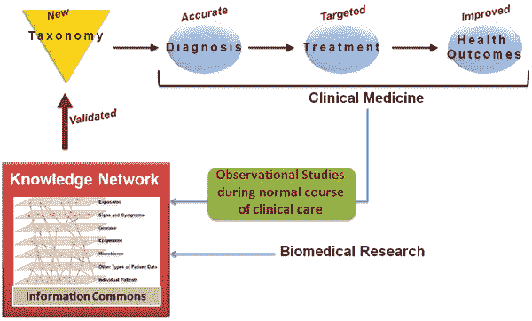
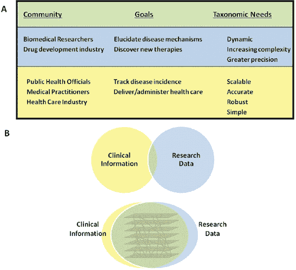
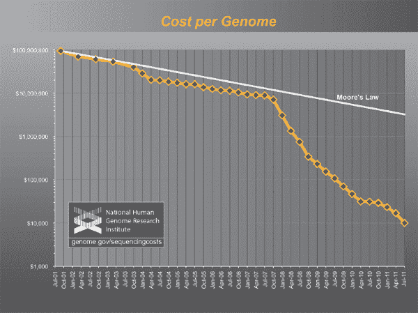
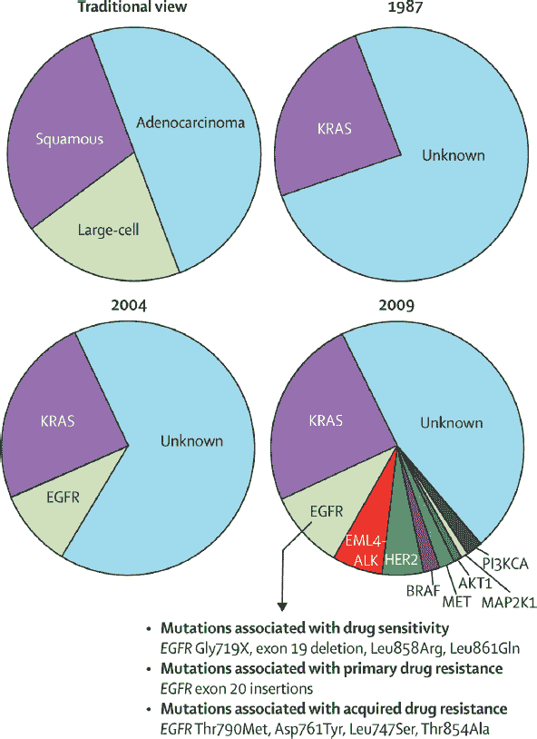
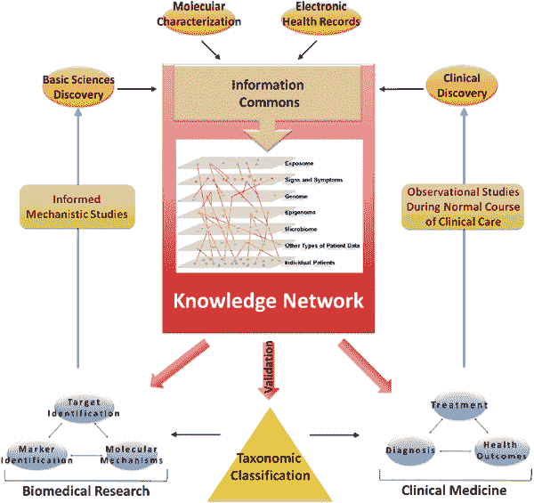
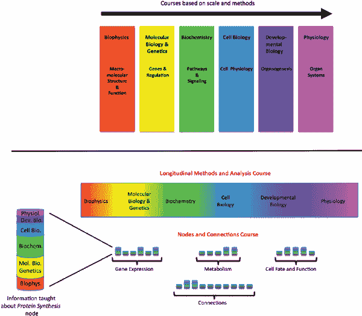

# 迈向精准医学：构建生物医学研究知识网络与疾病新分类法（环境健康重要倡议）

1. 运用费曼技巧，你只需花上`20 min`就能深入理解知识点，而且令人记忆深刻且难以忘记。

```
if (condVar > someVal) {console.log("xxx")}
```

## ALISON G. POWER，康奈尔大学，纽约州，伊萨卡

## BRUCE W. STILLMAN，冷泉港实验室，纽约州，冷泉港

## CYNTHIA WOLBERGER，约翰斯·霍普金斯大学医学院，巴尔的摩，马里里兰州

## MARY WOOLLEY，Research!America，亚历山大 way，弗吉尼亚州

## 工作人员

* **FRANCES E. SHARPLES**，主管
* **JO L. HUSBANDS**，学者/高级项目总监
* **JAY B. LABOV**，高级科学家/生物教育项目主任
* **KATHERINE BOWMAN**，高级项目官
* **MARILEE K. SHELTON-DAVENPORT**，高级项目官
* **INDIA HOOK-BARNARD**，项目官
* **KEEGAN SAWYER**，项目官
* **ANNA FARRAR**，财务助理
* **CARL-GUSTAV ANDERSON**，项目助理
* **SAYYEDA AYESHA AHMED**，高级项目助理
* **ORIN LUKE**，高级项目助理
* **AMANDA MAZZAWI**，高级项目助理

## 致谢

本报告的草案已根据国家研究委员会（National Research Council）报告评审委员会批准的程序，由因其多元视角和技术专业知识而被选出的人员进行了评审。此次独立评审的目的是提供坦诚且批判性的意见，以协助机构使其出版的报告尽可能严谨，并确保报告符合机构在客观性、证据以及对研究任务响应方面的标准。评审意见和草案手稿将保持保密，以保护审议过程的完整性。

我们感谢以下人员对本报告的评审：

* **Leslie Biesecker**，*美国国立卫生研究院*
* **Martin J. Blaser**，*纽约大学朗格尼医学中心*
* **Wylie Burke**，*华盛顿大学*
* **Christopher G. Chute**，*明尼苏达大学和梅西妙尔医学中心*
* **Sean Eddy**，*霍华德·休斯医学研究所杰内利亚亚农场研究*
* **Elaine Jaffe**，*美国国家癌症研究所*
* **Brian J. Kelly**，*安泰*
* **Chaitan Khosla**，*斯坦福大学*
* **Daniel R. Masys**，*华盛顿大学*
* **Stephen M. Schwartz**，*华盛顿大学*

尽管上述的评审员提供了许多建设性的意见和建议，但他们并未被要求背书结论或建议，也没有在报告发布前看到报告的最终草稿。报告的评审由 **Dennis Ausiello**（*哈佛医学院，马萨诸塞州总医院及合作伙伴医疗保健机构*）和 **Queta Bond**（*伯鲁斯-威尔尔姆基金*）监督。他们由国家研究委员会任命，负责确保按照机构程序对本报告进行独立审查，并仔细考虑了所有的评审意见。报告最终内容的责任完全由编写委员会和机构承担。

我们感谢加州大学旧金山分校医学院研究策略与特别项目主任 Theresa O’Brien 博士在整个研究过程中对委员会和 NRC 员工提供的周全建议和支持。感谢 Steve Olson 在写作和编辑方面的帮助。

我们感谢参加 2011 年 3 月 1 日和 2 日举办的“迈向疾病新分类法”研讨会（`Appendix C`）并与委员会讨论数据的人员。下列出的人士慷慨地提供了时间：

* **Charles Baum**，*研发副总裁*
* **Leslie Biesecker**，*美国国立卫生研究院*
* **Martin J. Blaser**，*纽约大学朗格尼医学中心*
* **John Brownstein**，*华盛顿大学*
* **Christopher G. Chute**，*明尼苏达大学和梅西妙尔医学中心*
* **Conrad**，*战略诊断*
* **Debra Lappin**，*安泰*
* **Elaine Jaffe**，*美国国家癌症研究所*
* **Elissa Appel**，*加州大学旧金山分校*
* **Sean Eddy**，*霍华德·休斯医学研究所杰内利亚亚农场研究*
* **Erin Ramos**，*人类基因组研究所*
* **Brian J. Kelly**，*安泰*
* **Kaiser Permanente**，*北加利福尼亚*
* **Catherine Schaefer**，*凯撒医疗*
* **Ingrid Scheffer**，*墨尔本大学儿科神经病*
* **John Glaser**，*华盛顿大学*
* **John Lorsch**，*斯坦福大学*
* **Klaus Lindner**，*哈佛医学院*
* **Chaitan Khosla**，*斯坦福大学*
* **Daniel R. Masys**，*华盛顿大学*
* **Stephen M. Schwartz**，*华盛顿大学*
* **Sanford Schwartz**，*宾夕法尼亚大学*
* **Janet Woodcock**，*美国食品药品监督管理局药物评估与研究中心*
* **Neil Risch**，*加州大学旧金山分校人类遗传学*
* **William Pao**，*范德比尔医学中心*
* **Helmut Zarbl**，*罗格斯大学-罗伯特·约翰逊医学院，环境与职业医学*

# 4 我们如何到达那里？

## 5 结语

- 1-2 弗莱克斯纳时刻？
- 2-2 前瞻性研究——特殊作用
- 2-4 药物开发
- 3-2 区分类型

## 总结

委员会的任务是探索“基于分子生物学的新型人类分类法”的可行性和必要性，并为其制定一个潜在的框架。显然，这项研究的动力是人类分子数据的爆炸式增长，特别是与患者相关的数据，而且人们感觉到存在巨大的尚未开发的机遇，利用这些数据来改善健康结果。委员会同意这一观点，并且确实认为，开发疾病新分类法的挑战仅仅是一个真正具有历史意义的挑战中的一个元素，尽管它非常重要。

考虑到委员会审议的范围，本报告的开头通过追踪一条统一委员会主要发现和建议的逻辑线索，并将其与其任务说明联系起来，是恰当的。委员会的任务强调了分类法在医学中的重要性，以及利用分子数据改进疾病分类的潜力。在医学实践中，分类法通常指的是《国际疾病分类》（ICD），这是一个 100 多年前建立的系统，世界卫生组织用它跟踪疾病发病率，医生将其作为标准化诊断的依据，医疗保健行业（特别是临床、医院和支付方）用它来确定护理报销。尽管委员会意识到任何新的分类计划必须服务于 ICD 及相关分类系统的需求，但他们得出结论，实现这一目标的最好方法是将未来的改进植根于`信息共享地`（Information Commons）和`知识网络`（Knowledge Network），这些还将发挥许多其他作用。

委员会构想了这项宏大的计划，其执行跨度将是十年而非几年，并将通过自上而下和自下而上的活动相结合的方式进行。一个主要的自上而下组成将由资助和监管生物医学研究的公立和私人机构发起，确保各个项目的结果能够整合起来，创建一个广泛适用且易于获取的`信息公社`（Information Commons），并为个人患者数据成为广泛共享的研究资源时，可能产生的无数社会、伦理和法律问题制定指南。然而，作为框架性研究的一部分，委员会并未尝试设计`信息公社`、`知识网络`（Knowledge Network）或`新分类法`（New Taxonomy）本身，并且不建议资助机构在尝试创建这些实体的初期阶段对其进行过度规定。委员会认为，需要的是一个创新的自下而上研究阶段，通过规模和程度不断增加的试点项目进行组织，委员会有信心从中将产生最佳实践。特别是考虑到医疗保健事业的规模和多样性，任何一种填充`信息公社`的数据方法都不可能适用于所有贡献者。与任何此类复杂的倡议一样，需要的是恰当的协调，并鼓励许多需要合作以创建`信息公社`和`知识网络`并开发`新分类法`的参与者。如果协调过于僵化，急需的创新对当地情况的适应将受到抑制；如果协调过于松散，则无法将收集的数据整合成一个整体，其整体的价值将远大于部分之和，而委员会认为这一目标通过有效的中央领导是可以实现的。



**图 S-1** 创建`新分类法`首先需要一个`信息公社`，其中大规模患者群体的数据可以广泛用于研究使用；以及一个`知识网络`，该网络通过强调数据之间的相互连接性并将其与不断发展的的基础生物学过程知识相结合，从而为这些数据增加价值。

来源：开发疾病新分类法框架委员会。

## 结论

委员会举办了一场为期两天的研讨会，召集了基础和临床疾病生物学领域的各类专家，讨论创建“基于分子生物学的人类疾病新分类法”的可行性、必要性、范围、影响和后果。研讨会上传递的信息和意见指导并影响了委员会在六个月内进行的一系列密集审议（线下和电话会议），并得出以下结论：

1. **新分类法将带来更好的医疗保健。** 由于生物医学研究中的新信息和概念无法以最优方式整合到当今的疾病分类中，我们错过了更精确地定义疾病和指导医疗决策的机会。许多具有不同分子原因的疾病亚型仍被归类为一种疾病；反之，多种不同的疾病共享的分子原因。未能优化整合新的生物学见解导致新实践指南的采用推迟，并对仅对特定亚组有效的治疗造成了医疗支出的浪费。

2. **现在是疾病分类法现代化的时机。** 分子生物学的巨大进展使得对临床样本进行快速、全面且具有成本效益的分析成为可能，导致相关数据爆炸式增长，具有从根本上改变疾病分类的潜力。基础发现研究正在从分子水平上定义和驱动生理功能的过程。这些发展，结合信息技术和电子病历的并行进展，为创建一个分类疾病的新系统提供了转型的契机。

3. **应当开发新分类法。** 以动态、迭代的方式将多参数分子数据与临床数据、环境数据和健康结果整合的新分类法是可行的，并且应当被开发。委员会构想了一种全面的疾病分类法，将生物医学研究、公共卫生和医疗保健社区聚集在一起，共同实现理解疾病发病机制和改善健康的相关目标。

   - 除了传统的物理“体征和症状”，还根据其内在生物学特性描述和定义疾病。
   - 超越描述，直接联系疾病机制、发病机制和治疗的更深层次理解。
   - 具有高度动态性，至少当作为研究工具时，不断纳入新出现的疾病信息。

4. **疾病知识网络将使新分类法成为可能。** 创建具有上述特征的`新分类法`所需的信息基础设施，与使许多其他生物医学研究和患者护理现代化所需的设施相重叠。这种基础设施需要一个`信息公社`，其中大规模患者群体的数据可以广泛用于研究使用；以及一个`知识网络`，该网络通过强调数据之间的相互连接性并将其与不断发展的的基础生物学过程知识相结合，从而为这些数据增加价值。

5. **基于人群的研究的新模型将实现知识网络的开发.** 目前基于人群的研究效率较低，可能产生与更广泛人群不相关的结论。电子病历在医疗系统中的广泛整合将使得在常规医疗服务过程中，“护理旁”（point-of-care）进行此类研究成为可能。此外，只有在常规诊疗过程中获取关联的表型数据，才可能在经济上对足够数量的患者进行特征描述，并最终创建一个给自足的系统（即收集个人患者分子数据的成本在成本效益方面上具有医学合理性的系统）。

6. **资源的重定向可以促进疾病知识网络的发展。** 开发新分类法的倡议——及其基础的`信息公社`和`知识网络`——是对当前整合分子、环境和表型数据方法的必要现代化改造，而不是对现有研究计划的“附加”。为了实现本报告中的许多目标，人们已经付出了巨大努力。委员会认为，缺乏的是一种系统性的重点，即将大规模分子数据的获取转移到护理旁环境，以及确保研究成果能聚合成`信息公社`和`知识网络`所需的协调，从而从中推导出`新分类法`（以及许多其他益处）。鉴于这一结论，委员会未对新分类法倡议的资源需求提出任何建议。显然，新的资源可以加速这一过程；然而，委员会建议的主旨可以通过重定向已用于增加个人患者大规模分子数据医学价值的资源来实现。

# 建议

为了创建`新分类法`及其基础的`信息公社`和`知识网络`，委员会提出以下建议：

## 1. 开展试点研究，开始向信息共享（Information Commons）填充数据。

应在医疗保健环境中开展试点观察性研究，以评估在临床护理过程中将分子参数与病史及健康结果相结合的可行性。这些研究将解决在创建、链接和广泛访问作为`新分类法`（New Taxonomy）基础数据集时涉及的实际和伦理挑战。试点研究定义的最佳实践随后应在范围和规模上进行扩展，以产生能够支持`新分类法`的`信息共享`和`知识网络`。随着这一过程的演变，应持续评估这些新的信息资源在多大程度上有助于改善健康结果并实现更具成本效益的医疗保健。

## 2. 整合数据以构建疾病知识网络。

随着个体床旁试点研究数据开始填充`信息共享`，应投入大量精力将这些数据与基础生物医学研究的结果整合，以创建一个动态的、交互的`知识网络`。该网络以及`信息共享`本身，应利用先进的信息技术，根据不同用户（例如基础研究人员、临床医生、结果研究人员、支付方）的不同需求，提供数据的多种视图。

## 3. 在适当的联邦机构内部启动流程，评估与创建信息共享所需的研究相关的隐私问题。

由于这些问题已过广泛研究，该过程无需从头开始。然而，在实践中，希望参加上述试点研究的调查人员，以及必须批准其人类受试者方案的机构审查委员会（IRB），需要就适用于这些项目的知情同意流程范围获得特定指导。在当前法律限制和流行伦理标准的约束下，委员会鼓励在提供的指导中尽可能保持灵活性。应尽可能依靠在不同医疗环境中开展的试点项目的实地经验，而非自上而下的指令，来主导这一敏感领域最佳实践的形成，而该领域的处理方式将对整个`信息共享`/`知识网络`/`新分类法`倡议产生决定性影响。在这些讨论中纳入医疗保健提供者、支付方以及学术社区之外的其他利益相关者将非常重要。

## 4. 确保数据共享。

广泛的数据共享对于委员会设想创建`新分类法`过程中每个阶段的成功至关重要。最根本的是，填充`信息共享`的个体患者分子和表型数据必须广泛开放，以便多样化的研究人员为了特定目的对其进行挖掘，并探索从中得出`知识网络`和疾病分类法的替代方法。由联邦资助基因组项目开发并采用的现有标准已解决了其中一些问题，但仍存在巨大障碍，特别是对于个体患者表型和健康结果数据的共享。应建立数据共享标准，既能尊重个人隐私顾虑，又增强数据向`信息共享`的提交。重要的是，这些标准应提供激励措施，鼓励数据共享，而非为了商业意图而建立专有数据库。解决这些障碍可能需要立法，或许还需要公众对医疗保健数据访问和隐私的预期发生演变。

## 5. 开发一种高效的验证流程，将疾病知识网络中的信息纳入新分类法。

从`信息共享`和派生`知识网络`中得出的疾病分类见解，在采纳用于临床之前，需要对其可重复性以及对于做出临床相关区分（例如关于预后或治疗选择）的效用进行验证。应建立一种流程，对此类信息进行验证并将其纳入`新分类法`，供医生、患者、监管机构和支付方使用。此类验证信息的出现速度和复杂性无疑将加速进程，并要求所有利益相关者使用新型决策支持系统。

## 6. 激励合作伙伴关系。

委员会设想，结合分子数据的`新分类法`可以通过更准确的诊断以及更有效、更具成本效益的治疗来加速提供更好的健康，从而实现自持续。然而，为了涵盖与`信息共享`收集和整合数据相关的初始成本，应开发激励措施，鼓励涉及政府、药物开发人员、监管机构、倡导小组和支付方的公私合作伙伴关系。

拟议的疾病`知识网络`和`新分类法`的主要受益者将是“精准医学”。委员会认为，要实现精准医学的全部潜力（其目标是为每个个体提供最佳可用护理），需要研究人员和医疗提供者能够访问与个体患者相关的海量健康和疾病相关数据。这些数据对于`信息共享`、`疾病知识网络`以及`新分类法`的开发和验证也至关重要。

# 1 介绍

### 当前的机遇

生物医学研究和医学实践，无论是单独还是共同，正处于一个转折点：描述和收集数据的能力正在剧烈扩张，但编译、组织、处理这些数据的效率——以及从中提取对基础生物过程的真实理解以及对人类健康和疾病的洞察的效率——并未跟上。进展的例子是孤立的：利用基因组学、蛋白质组学、代谢组学、系统分析和其他现代工具对某些疾病的研究开始取得切实的医学进展，而一些富有见地的临床观察引发了新的假设和实验室工作。然而，总体存在日益扩大的缺口：如果没有研究与医学内部及之间更好的信息整合，日益丰富的信息将被闲置。

作为说明，考虑以下临床场景；^(1) 在第一个例子中，对疾病的分子理解已开始在指导治疗决策方面发挥重要作用，而在第二个例子中，尚未如此。

患者 1 正在乳腺癌术后咨询她的肿瘤内科医生。二十五年前，患者的母亲曾患有乳腺癌，当时治疗选择很少：激素抑制或具有显著副作用的广谱化疗。今天，患者 1 的医生可以根据其癌症的分子特征建议一种精确的治疗方案，这些方案是从多种共同关注其特定肿瘤标志物的疗法中选择的。此外，患者的亲属可以接受检测以评估他们各自的乳腺癌易感性（Siemens Healthcare Diagnostics Inc. 2008）。

相比之下，患者 2 在 40 岁时被诊断患有 2 型糖尿病，这是一个不精确的类别，主要用于将其疾病与通常发生在较年轻时期（1 型糖尿病）或怀孕期间（妊娠期糖尿病）的糖尿病区分开来。该诊断对疾病特定的分子病理生理学及其并发症几乎没有启发；同样，根据患者的病理生理学来定制治疗方案也缺乏依据。患者的内科医生可能会开方`二甲双胍`，这是一种已使用 50 多年的药物，目前仍是美国 2 型糖尿病最常见的治疗方法。目前没有具体的分子信息可以定制患者 2 的治疗方案，以降低其肾衰竭、失明或其他糖尿病相关并发症的风险。也没有相应的测试可以衡量其兄弟姐妹和子女的糖尿病风险。患者 2 及其家人尚未从当今疾病病理生理学信息的爆炸式增长中受益（A.D.A.M. 医学百科书 2011; Gordon 2011; Kellett 2011）。


我们研究和医疗事业中的哪些元素使得患者 1 的情况成为特例，而患者 2 的情况成为典型？难道像我们目前的疾病分类系统如此基础的东西，实际上正在`抑制`进步吗？如今的分类系统很大程度上基于可衡量的“体征和症状”，例如乳腺肿块或血糖升高，以及对组织或细胞的描述，往往未能规定驱动疾病或作为治疗目标的分子通路。^(2)考虑这样一个世界：诊断本身就能常规提供对特定致病途径的洞察。考虑这样一个世界：临床信息（包括分子特征）成为巨大的“疾病知识网络”的一部分，支持精确诊断和个体化治疗。如果看似完全不同的疾病所共有的分子特征在暗示根本新治疗方案方面的潜力得到充分实现会怎样？在这样的世界中，一种新的、更准确更精确的“疾病分类法”可以使每位患者都能从已知知识中受益并做出贡献。

## 委员会的任务

考虑到这些可能性，并根据国家健康研究所（`National Institutes of Health`）主任的请求，国家研究委员会（`National Research Council`）成立了一个特别委员会（`Committee`），以探索创建“基于分子生物学的新人类疾病分类法”的可行性和需求，并制定一个潜在的框架（Box 1-1），聚集了基础生物学和临床医学领域的各类专家，探讨创建“基于分子生物学的新人类疾病分类法”的可行性、需求、范围、影响和后果。研讨会上传递的信息和意见指导并影响了委员会在六个月内进行的一系列密集审议（包括面对面和电话会议）。委员会强调，分子生物学是“新分类法”的重要信息基础（`base`）之一，而非限制或约束。此外，委员会并未将其任务视为规定一种特定的新疾病命名法。相反，委员会认为其挑战在于构建一个框架，整合快速扩展的生物学、行为和经验信息的范围及细节，以促进基础发现，并推动更准确更精确的疾病分类（即“新分类法”）的发展，从而实现更优的医疗水平。

### Box 1-1 任务声明

应`NIH`主任办公室的要求，国家研究委员会的一个特别委员会（`Committee`）将探索创建基于分子生物学的人类疾病“新分类法”的可行性和需求，并制定一个潜在的框架。作为审议的一部分，委员会将举办一个为期两天的大型研讨会，汇集基础和临床疾病生物学领域的各类专家，探讨定义这一新分类法的可行性、需求、范围、影响和后果。研讨会参与者还将通过讨论包括但不限于以下主题来考虑框架的核心要素：

*   汇编来自人类疾病分子研究的海量多样化数据，以评估已知情况、识别空白并为填补这些空白建议优先事项。
*   为数据的选择、收集、存储和管理制定有效且接受的机制和政策，以及访问和解释这些数据的方法。
*   定义利益相关者社区之间的角色和接口——包括公共和私立资助者、数据贡献者、临床医生、患者、行业和其他。
*   考虑如何应对此类计划启动后可能出现的许多伦理问题。

委员会还将考虑建议少数案例研究，将其作为该框架的初步测试。

特别委员会将在开发共识报告中的框架建议时，将研讨会的结果用于审议。该报告可以作为政府和其他研究资助机构关于人类疾病分子研究的依据。然而，报告将不包括与资金、政府组织或政策问题相关的建议。

受拟议的“知识网络”启发的新分类法愿景与广泛讨论的“个性化医疗”概念有某些相似之处，该概念近期由总统科学与技术顾问委员会（PCAST）定义为“根据每位患者的个体特征对医疗治疗进行定制……将个人分类为对特定疾病易感性或对特定治疗反应不同的亚群。然后，预防性或治疗性干预措施可以集中在那些将受益的人身上，从而为无法受益的人节省费用并减少副作用”（PCAST 2008, p. 1）。其他人使用了相关术语“精准医学”来指代非常相似的概念（见词表）。倾向于后者术语的人部分是因为它不太可能被误解为每个患者的治疗都与其他任何患者不同。然而，明确的是，本报告中任何术语的使用均指 PCAST 的定义。

## 疾病分类法简史

疾病科学分类的早期尝试之一是由林奈（Carolus Linnaeus）进行的，他开发了至今仍用于分类生物的分类系统。他在 1763 年出版的《疾病属》（`Genera Morborum`，Linné 1763）将疾病分为发疹性（伴有皮疹的发热）、炎症性（伴有脉搏沉重和局部疼痛的发热）和疼痛性（疼痛的）等类别。由于对疾病生物学基础缺乏足够的理解，这一努力在很大程度上失败了。例如，由于缺乏疾病病原学，狂犬病因为晚期出现的脑功能障碍而被描述为一种精神疾病。这说明了脱离疾病生物学基础的分类系统如何误导并阻碍开发更好治疗方法的努力。

即便在 100 年前，《国际死因清单手册》第二修订版（Wilbur 1911）——该手册随时间演变为《疾病和相关健康问题国际统计分类》（`ICD`）——也将肺癌和脑癌归类为“其他器官或未指明的癌症”。当时的分类方法未能对 1 型和 2 型糖尿病进行区分，内分泌疾病被归类为“一般疾病”，并存在“神经性热”、“衰竭”和“发现尸体”等类别。

如今，正处于第十次修订的 `ICD` 仍然是最常用的疾病分类方法（WHO 2007）。`ICD-10` 由世界卫生组织（WHO）发布，用于统计分析、报销和决策支持，使其成为全球医疗保健体系不可或缺的一部分。正如后文将讨论的，`ICD` 目前正在进行重大修订，预计于 2015 年左右发布 `ICD-11`。

# 生物医学研究与医学实践界的分类需求

分类法支撑着许多健康相关系统，例如医学教育课程的组织、已发表的生物医学文献^(3)、教科以及如 `ICD` 等疾病编码系统。尽管分类法基于对疾病的科学理解，但像 `ICD` 必须满足全球不断扩张的公共卫生和医疗保健社区的需求。像 WHO 这样的组织必须获取多个大陆准确且及时的疾病发病率和患病率数据以做出建议。同样，美国的医疗行业也依赖准确的疾病分类系统来跟踪医疗服务的提供并确定报销率。这两个社区都依赖高度稳健的数据收集实践来做出影响数百万人的决策。在这种背景下，正式的命名法对于清晰的交流和理解至关重要。目前定期更新 `ICD` 命名法的做法试图平衡两点：（1）需要一致的术语，以便根据公认标准定义的疾病进行清晰沟通；（2）需要确保分类系统（即分类法）能够充分反映我们对导致疾病起源和病变的分子通路及环境因素理解的进展。

然而，部分由于必须服务于公共卫生和医疗保健社区的行政需求，当前的 `ICD` 分类法与大部分生物医学研究社区是脱节的（参见图 1-1）。事实上，很少有基础研究人员知道 `ICD` 的存在，更少有人使用这种分类。因此，两个广泛的利益相关群体——一方面是生物医学研究人员、生物技术和制药行业，另一方面是临床医生、卫生机构和支付方——被广泛认为很大程度上相互独立，具有不同的利益和目标，因此具有不同的分类需求。这是遗憾的，因为来自基础研究的人类疾病新见解，以及基础生物学和医学信息的爆炸，潜力彻底变革疾病分类、诊断、治疗开发和临床决策。然而，在充分实现这一潜力并获得更多个性化治疗和改善患者预后等相关收益之前，还需要对这些多样化社区可用信息资源进行更多整合。



**图 1-1** 整合将使所有利益相关社区受益。

(A) 认为不同的利益相关社区具有不同的分类和信息需求。(B) 信息的整合和需求的合并可以更好地服务所有利益相关者。

来源：疾病新分类开发框架委员会。

# 当前分类法错失的机会

目前使用的疾病分类法具有限制其信息内容和可用性的属性。最重要的是，当前的疾病分类法（包括 `ICD-10`）主要基于症状、对患病组织和细胞的显微检查以及其他形式的实验室和影像研究，其设计未能优化整合或利用快速涌现的分子数据、患者偶然特征或社会环境对疾病的影响。当前分类系统整合基础知识的能力也受其基础结构的限制。从历史上看，分类法依赖层级结构，将单个疾病相继细分为类型和亚型。这种僵化的组织结构阻止了描述疾病之间以及疾病与大量病因之间复杂的相互关系。它还会导致根据不同症状将具有分子机制的疾病人为分开。例如，`LMNA` 基因的突变会导致一系列多样化的疾病，包括埃默里-德雷弗肌肉萎缩症、夏科特-马氏轴性神经病、脂肪营养不良和早早衰老疾病。然而，尽管这些疾病具有显著的遗传、分子和细胞相似性，它们目前仍被归类为关系较远。虽然这种方法在治疗主要针对症状而非病因的时代可能是充分的，但存在一个明显的风险：继续依赖层级分类法将阻碍（尽管某些疾病已成功）在治疗上利用快速扩展的知识的努力。

## 框 1-2 费克斯纳时刻？

1910 年，教育家亚伯拉罕·费克斯纳（Abraham Flexner）发布了一份报告，通过倡导专业化、高学术标准以及基础科学的紧密结合，彻底改变了医学教育（Flexner 1910）。随后，强调研究的学术医学中心的兴起——结合二战后通过国家卫生协会和其他公共私营实体大幅增加基于绩效的研究经费——使美国能够在医学研究领域占据全球领先地位，创立了生物技术行业，并引领了无数基于科学的医疗创新。

目前正在进行的分子知识大扩张，其收益可能与 20 世纪初医学和生物医学研究专业化所伴随的影响相当。事实上，在委员会研讨会的演讲中，梅奥医学学院教授、`ICD-11` 开发领导者 Christopher G. Chute 博士表示，基因组学转型医学的潜力“远超抗生素和无菌手术的引入”。然而，实现分子革命的全部潜力将需要——并在很大程度上能够——以费克斯纳规模重新思考生物医学研究和医疗保健。

分类系统的另一个局限性是其信息内容内在的静态性。`ICD` 系统设计为每十年更新一次，每三年进行一次小幅更新。但尽管 `ICD-10` 已于 1992 年发布，许多医疗机构仍在使用 1977 年发布的 `ICD-9`。由于在行政系统中实施 `ICD` 修订版需要时间，导致目前的分类系统始终处于过时的状态。此外，当前分类法的静态结构并不利于在新的疾病参数出现时对其进行持续整合。鉴于有关疾病分子特性的新数据正以不断加快速度出现，这一点变得尤为棘手。

目前修订 `ICD` 分类的努力试图解决这些局限性。`ICD-11` 将基于一个基础层，并在此基础上推导出“线性化”表示（Tu 等人，2010）。虽然这些线性化表示是相对静态且分层次的，但基础层的设计旨在支持多父级层级结构和连接，并进行持续更新.^(4)。重要的是，新的分类法将结合表型的现象学描述与基因组因素，后者可能解释或至少能区分表型。^(5)例如，不同的肺癌可以通过基因组学表征进行明确区分。这非常重要，因为有关导致特定类型肺癌生物学的特定分子通路的知识，可以指导为此类患者选择最合适的治疗方案。

尽管 `ICD-11` 的发布标志着向前的一步，但委员会认为，通过导致“疾病知识网络”（`Knowledge Network of Disease`）的两阶段过程可以大幅增加该工作的可用信息量。正如报告后续章节详细讨论的那样，开发该“知识网络”的第一阶段将涉及创建一个“信息公社”（`Information Commons`），其中包含分子数据、病史（包括有关社会和物理环境的信息）以及大量个体患者的健康结果。委员会设想这一阶段将与对这些患者持续提供的临床护理相结合进行，而不是在专门为研究目的而创建的特殊环境中进行。第二阶段是“知识网络”本身的构建，它将涉及对“信息公社”进行数据挖掘，并将这些数据与科学文献相结合——特别是与关于疾病基础生物机制的不断发展的知识相结合。

这种“疾病知识网络”将能够实现更加基于分子的分类法。这种“新分类法”例如可以根据患者基因中的特定突变，为肌营养不良症患者提供更具体的诊断和针对性治疗。在其他情况下，它可能为临床表现完全不同但疾病遗传机制相同的患者建议针对性治疗。

一个信息公社、一个知识网络以及一种整合多种类型信息并为所有利益相关者服务的分类系统

正如报告后面将描述的，委员会设想“信息公社”（`Information Commons`）作为“疾病知识网络”和“新分类法”的基础，它与地理信息系统（`GISs`）具有某些相似之处。GIS 旨在捕获、存储、处理和分析所有类型的地理引用数据，并使其在诸如 `Google Maps`（ESRI 1990）的应用中被广泛使用（图 1-2）。大多数用户将在高附加值层面（即“知识网络”和“新分类法”）与这些资源交互，而不是在底层的“信息公社”层面（图 1-3）。使用“疾病知识网络”的研究人员可以对各种层间和层内连接重要性提出假设，这些连接有助于疾病的起源、严重程度或进展，或者支持特定疾病的亚分类。

本报告阐述了开发疾病知识网络及相关新分类法的依据。`第 2 章` 提出了“为什么是现在？”它审视了研究、信息技术、临床医学和公众态度的基本趋势，这些趋势创造了前所未有的机会，能够影响生物医学研究和医疗服务交付，从而造福所有利益者。

`第 3 章` 提出了“疾病知识网络和新分类法会是什么样？”它描述了为什么该系统需要是动态的、不断演化的、整合的且灵活，以及为什么它需要让从基础科学家到临床医生、医疗工作人员和普通大众广泛用户进行查询。

`第 4 章` 提出了“我们如何到达那里？”它描述了需要一系列试点研究，以评估创建一个以个人为中心的信息公共地（Information Commons）并据此推导出知识网络和新分类法的可行性，并开始探索这些资源在改善个人健康结果方面的效用。本章还讨论了需要克服的障碍，以及在疾病知识网络及其产生的新分类法能够充分发挥其改善人类健康的潜力之前，医学教育需要进行的变革。

在`第 5 章` 中，报告以结语结束，总结了委员会对其建议的理由，并描述了本报告描述的新资源如何满足基础科学家、转化研究人员、政策制定者、保险公司、医学学员、临床医生和患者的需求。

^(1) 这些场景是描述典型患者的说明性示例。它们并非基于具体的个人，而是反映了当前的医疗实践。

^(2) 需要澄清的是，委员会并不是建议所有疾病都具有同样精确的分类法，而是每种疾病都应该根据关于疾病机制的现有最佳分子信息进行分类并提供治疗。

^(3) 例如，临床医生和研究人员广泛使用的信息资源 `PubMed/MEDLINE` 是基于 `MeSH` 疾病术语层结构构建的。

^(4) `ICD-11` 的修订过程与 `SNOMED` 密切协调——`SNOMED` 是由国际健康术语标准制定组织 (`IHTSDO`) 开发的医学系统化命名法。`SNOMED` 是一个大型、关注临床的本体，使用高层节点来聚合更细粒的数据。`WHO` 和 `IHTSDO` 签署了谅解备忘录，使这两个系统互补而非竞争。其意图是协调这两个系统，使 `SNOMED` 的聚合层与 `ICD-11` 对应，而 `ICD-11` 的扩展部分成为 `SNOMED` 的元素。

^(5) 应该注意的是，国际肿瘤疾病分类法 (`ICD-O`) 已经尝试获取与疾病定义相关的基因组数据。`WHO` 肿瘤病学与遗传学单行的第三系列试图将可用的基因组数据整合到疾病定义中，事实上，今天许多肿瘤类型已在分子水平上定义（Vardiman et al. 2009; Campo et al. 2011; Travis et al. 2011）。

`2`

# 为什么是现在？

## 为什么是现在？

数据密集型生物学的兴起、信息技术的进步以及医疗交付方式的变化，创造了一个引人注目的机会：通过开发知识网络及相关的新分类法来改善疾病的诊断和治疗，这将整合以往无法企及的生物学、患者和结果数据。这一机会的关键推动因素包括：

*   以 20 年前无法想象的规模汇总患者分子数据的新能力。
*   在利用分子信息改善疾病诊断和治疗方面日益取得成功。
*   信息技术的进步（例如电子健康记录的出现），使得获取大量个人患者的详细临床信息以及在海量数据集中搜索意外的相关性成为可能。
*   利益相关者之间的“完美风暴”增强了对整个生物医学研究和医疗服务交付系统根本性变革的接受度。
*   公众对分子数据和医疗信息隐私态度的转变。

科学研究、信息技术、医学和公众态度都在经历着前所未有的变化。生物学已经获得了以 20 年前无法想象的规模系统地汇编分子数据的能力。多样化的技术进步使得能够以促进生物医学研究和临床护理的方式来收集、整合、分析和传播与健康相关的生物数据。与此同时，健康和疾病的分子影响巨大的科学复杂性带来的挑战日益显而易见，表明需要强大的新的研究资源。所有这些变化为生物医学科学和临床社区提供了一个共同努力，以改进新知识的发现和医疗服务。正如本章讨论的，委员会得出结论，这一机会可以通过长期致力于创建一个信息公共地、疾病知识网络和分类法得到最佳利用。

## 生物学已成为数据密集型科学

`DNA-sequencing`技术的进步有力地说明了生物学向数据密集型科学的转变。描述实用`DNA`测序方法的首次论文发表于 1977 年（Maxam and Gilbert 1977; Sanger et al. 1977）。这些方法需要对`DNA`进行放射同位素标记、手工制作大型电泳胶，并在生物化学和重组 DNA 技术方面具有专业知识。尽管早期 DNA 测序方法对生物发现的影响是深远的，但直到 1997 年，此类数据的中央存储库 `GenBank` 中的序列总量才超过 10 亿个碱基（单个人类基因组长度的三分之一）（NCBI 2011a），而且在第一代自动仪器广泛使用后才达到这一里程碑（Favello et al. 1995）。此之后已有超过 300 亿个碱基（Benson et al. 2011）被存入，说明了过去 20 年基因组数据的持续爆炸。

美国人类基因组计划研究所估计，2001 年获取单个人类基因组序列的总成本为 9500 万美元（Wetterstrand 2011；参见图 2-1）。此后，成本按照电子领域描述的“摩尔定律”轨迹呈指数级下降，这意味着每两年就会降低 50%，直到 2007 年春季，此时单个人类基因组序列的估算成本仍接近 1000 万美元。那时，基于大规模并行、微型化分析的第二代自动 DNA 测序仪的引入，导致成本下降速度远快于摩尔定律的预测。2011 年 1 月的最新更新估计，完成全基因组序列的成本为 21,000 美元，且成本仍在快速下降，“`1000 美元基因组`”将在未来几年内成为一个现实目标（Wolinsky 2007; MITRE Corporation 2010; Mardis 2011）。虽然与大多数临床实验室检测的标准相比，全基因组测序仍然昂贵，但趋势线毫无疑问地表明，成本将在几年内下降到许多常规临床检测的范围内。全基因组测序很快将比目前许多广泛订购的特定基因检测更便宜，最终与常规医疗护理的成本相比，可能会变得微不足道。因此，DNA 测序的成本很快将不再是限制因素（MITRE Corporation 2010）。相反，基因组序列的临床用途以及公众对其使用的接受度将驱动未来的发展。




**图 2-1** 完成全基因组测序成本的骤降。

全基因组测序的成本下降速度快于摩尔定律。成本仍在快速下降，“1000 美元基因组”将在未来几年内成为一个现实目标。

来源：Wetterstrand 2011。

诚然，DNA 测序的成本轨迹是一个不寻常的成功案例，即使以高科技标准来看如此。然而，它绝非独特：分子分析其他领域的并行发展（例如大量小分子代谢物和蛋白质的分析，以及单分子检测）可能会消除许多数据密集型分子方法向生物医学研究和临床医学扩散的纯经济障碍。这些技术将使得监测并最终理解和预测健康与疾病中复杂分子网络成为可能。

## 将数据密集型生物学与医学结合

*   现在已经很清楚，大多数胃溃疡（曾被认为是由压力和其他非感染因素引起）是由于幽门螺杆菌 `Helicobacter pylori` 定植胃黏膜引起的，这种细菌在人类中非常常见（Atherton 2006）。这一发现彻底改变了这种疾病的治疗。`H. pylori` 感染也被认为会导致胃癌的发展，表明治疗这种感染既有助于治愈胃溃疡，也可能减少胃癌。此外，流行病学研究和其他数据提出 `幽门螺杆菌` 感染可能会降低个体患过敏疾病甚至肥胖的概率（Blaser and Falkow 2009），表明感染这种有机体与人类健康和疾病之间完整的复杂关系仍有待确定。

在过去的十年里，遗传学分析使得 2 型糖尿病的诊断分类更加精确。以往，患有轻度葡萄糖耐量异常且通常有糖尿病家族史的儿童和青少年被归类为“青少年发型糖尿病（MODY）”。现在，MODY 被认为代表一系列影响胰腺β细胞功能的特定基因变异（Fajans et al. 2001），因此美国糖尿病协会对 2 型糖尿病的分类已用特定的遗传缺陷取代了描述性术语 MODY（例如：7 号染色体，葡萄糖激酶；12 号染色体，肝核因子 1-α；等）。未来需要一个动态的、不断演化的疾病知识网络，以适应未来对这一 2 型糖尿病特定遗传易感性列表的补充（愿景是增加对患者诊断的清晰度）。

## 框 2-1 区分肺癌类型

肺癌是美国及全球癌症死亡的首要原因，每年导致超过一百万死亡（ACS 2011）。传统上，肺癌根据肿瘤的组织学外观分为两大主类：小细胞肺癌和非小细胞肺癌。非小细胞肺癌由三个亚组组成，每个亚组通过组织学定义，包括腺癌、鳞状细胞癌和大细胞癌。

自 2004 以来，关于非小细胞肺癌分子驱动因子的知识爆炸式增长（图 2-2）。驱动因子是导致细胞异常增殖的基因突变。这些驱动突变对于肿瘤的形成和维持是必要的。如果关闭突变蛋白的异常功能，可能会产生显著的抗肿瘤效果。

2004 年有两种药物正在研发中，即吉非替尼和厄洛替尼（Erlotinib），它们抑制某些受体酪氨酸激酶的功能，包括表皮生长因子受体（EGFR）。这些受体已知会发送促进细胞增殖和生存的信号，信号增强被认为会导致某些癌症。在早期试验中，这些药物在约 10%的非小细胞肺癌患者中产生了显著的抗肿瘤效果（MSKCC 2005）。其他患者似乎完全没有反应。然而，某些患者肿瘤的剧烈缩小已足以获得美国食品药品监督管理局在 2003 年的批准，尽管当时这种反应的分子基础尚未知。由于无法识别出反应性患者是一个生物学上不同的亚群，这些药物在广泛的肺癌患者中尝试均未成功，对大多数患者除了增加成本和副作用外没有产生任何作用。回溯起来，使用这些药物的某些临床试验可能失败，是因为实际的反应者在试验患者中所占的比例太小（Pao and Miller 2005）。

随后，发现反应性患者携带了激活其癌症中 EGFR 的突变（Kris et al. 2003; Lynch et al. 2004; Paez et al. 2004; Pao et al. 2004）。这使得预测哪些患者会对治疗产生反应并仅对这一亚组患者进行治疗成为可能。这导致了更有效的临床试验设计，并降低了治疗成本，提高了治疗效果。

从那时起，许多研究将肺癌进一步分为由驱动突变定义的亚组。目前并非所有的驱动突变都能通过药物靶向，而且在药物可用的情况下，癌细胞也能迅速对靶向药物产生耐药性。尽管如此，这些最新信息使得开发新的靶向疗法成为可能，从而延长并改善癌症患者的生活质量。



## 图 2-2 非小细胞肺癌知识在近几十年发生了显著演变

在过去的 20 年里，基于组织学的肺癌传统特征描述已被基于驱动突变的分类所取代。1987 年，这种分类是非常原始的，因为当时只鉴定出一种驱动突变——KRAS。然而，随着更多遗传信息的出现和更多驱动突变的鉴定，这种分子分类系统的精密复杂性得到了提高。类似的方法可以改善许多其他疾病的诊断、分类和治疗。

来源：Pao and Girard 2011。

人类基因组和微生物组计划只是具有医疗保健信息潜力的新兴生物信息的两个例子。同样，其他分子数据（如表观遗传学或代谢组学数据）、患者接触环境因素的历史信息以及心理社会或行为信息也可能需要纳入知识网络和新分类法中，以增强疾病的诊断和治疗。

虽然在理解分子特征与表型之间的关系方面取得了巨大进展，但迫切需要更好地理解这些联系，并制定策略应对它们对个体患者的影响。`BRCA1` 和 `BRCA2` 基因就是一个很好的例子。在某些人身上发现 `BRCA1` 和 `BRCA2` 突变，使得识别癌症风险增加的个体成为可能，允许他们通过增加癌症筛查和预防性手术来管理风险。一个记录 `BRCA1` 突变的数据库最近列出了该基因的 2136 种不同变异（NHGRI 2011）。其中，1167 个被数据库编辑判断为可能具有临床意义，而其余大部分被归类为“未知”临床意义。在认为具有临床意义的突变中，某些被认为比其他具有更高的癌症风险（Gayther et al. 1995），但对于大多数突变增加癌症风险的程度仍存在不确定性（Fackenthal and Olopade 2007）。

因此，携带 `BRCA1` 和 `BRCA2` 突变的个人被迫在信息不全的情况下做出改变生活的治疗决策。他们的突变在多大程度上增加了乳腺癌和卵巢癌的风险？风险如何随年龄变化？是否应该进行预防性乳腺切除术或卵巢切除术？如果是的话，什么时候进行？应该等到生育后？这将如何影响他们的风险？所有这些现实决策都带有深重的个人后果，并对医疗成本产生影响。

这些治疗决策不需要基于此类碎片化的信息做出。如果所有 `BRCA1` 或 `BRCA2` 突变呈阳性的患者都能受到其医疗保健人员的长期追踪，那么就能确定每种突变患者中患癌症的比例，以及患的是哪种癌症。我们可以评估预防性手术降低风险的程度。我们可以评估增加癌症筛查的有效性、筛选这些患者的最佳方法，以及由于增加筛查不可避免的假阳性结果而导致的并发症。到目前为止，这些努力主要基于较少患者数量或不能完全代表更大人群的队列，因为对大量未筛选的患者整合遗传信息、治疗决策和结果数据在实践上是不行的。然而，基因组和信息技术的最新进展使得通过整合已存在的大数据集来系统地解决这些问题成为可能（参见框 2-2）。

`BRCA1` 和 `BRCA2` 只是许多基因中的两个，个体之间的差异对疾病风险和治疗决策具有重要影响。人类基因组大约有 20,000 个基因，其中许多基因可能像 `BRCA1` 一样具有许多疾病相关的等位基因。即使这些变异中只有一部分对疾病风险或治疗反应具有重要影响，我们也有潜力通过大规模评估表型-基因型相关性的工作，大大提高疾病的检测、诊断和治疗。通过将患者的基因型与健康信息和结果数据相结合，新的分类法可以识别出许多对医疗保健具有重要意义的新遗传变异。

有充分理由预计遗传对大多数常见疾病的影响将是复杂的。在每个患者身上，多个基因的变异都会影响疾病的发生、进展和对治疗的反应，对这些过程的长期环境调节将是规律而非例外。虽然最近的突破专注于该领域技术快速发展的基因组学，但未来我们在理解表观遗传、环境、微生物和社会对疾病风险和进展的贡献方面可能会取得类似的进展。在这种情况下，迫切需要以更细的粒度、更多地参考底层生物学，并在一个能够多层次整合新信息的动态知识网络背景下对疾病进行分类。揭示这些对人类疾病的多样影响将是 21 世纪的一项重大科学挑战。

美国和其他国家目前正在投入数十亿美元的资金来实施电子健康记录（EHRs），以改善临床护理。此类记录的开发为整合医疗保健信息和生物学数据创造了若干新机会，并为寻找临床检测结果、患者数据和结果之间的新联系提供了可能。

*   `EHRs` 功能的增强和搜索工具性能的提升为对各种疾病进行大规模队列研究打开了大门。具有感兴趣特征的患者——例如，风湿性关节炎患者或对抗抑郁药物无反应的患者——可以通过 `EHRs` 进行筛选。这些组中的患者可以被招募提供样本，或对其丢弃的临床样本进行研究分析。

*   `EHRs` 可用于提供额外的临床描述，或帮助填充队列或生物库中研究受试者的缺失细节。无论哪种情况，结果都将是丰富的临床描述。

关于诱发复杂疾病的“风险因素”的大部分知识来自观察性研究，包括将病例组的生活经验与对照组比较的病例对照研究，或是对大量人群的前瞻性队列研究。

例如，关于在血浆或血清中测量的生化因子（如胆固醇或其他具有心脏发作风险的脂质）预测价值的许多已知，很大程度上源于前瞻性研究，如弗明格汉心脏研究（`FHS`）。前瞻性研究特别有价值，因为疾病的发生或治疗可能会改变水平，导致基于确诊病例水平的推断产生偏差。这些生物标志物可以与吸烟、体重指数等生活方式风险因素的信息，以及诊断后可能变化的测量值（如血压）相结合，创建出如弗明格汉风险评分之类的评分，广泛用于预测 10 年心脏发作风险（Anderson et al. 1991）。该风险评分基于略多 5,500 名受试者的数据，其中发生了数百例心脏病（`CHD`）事件。这种规模的研究对于像 `CHD` 等相对常见的疾病事件是充足的，但对于罕见疾病来说太小了。更大的前瞻性队列研究，如护士健康研究（Missmer et al. 2004）和欧洲癌症展望调查（`EPIC`）（Kaaks et al. 2005），探索了数万名女性队列中循环类固醇激素水平与乳腺癌风险之间的关系，尽管有数百例病例，但 `FHS` 中的病例数量仍然较少。对于效应较小的风险因素，或研究多个风险因素之间的相互作用，即使是最大的队列研究病例也不足以产生效力，因此需要如 NCI 乳腺与前列腺队列联盟（Campa et al. 2005）这样的联盟来产生所需的数千例病例。对于较不常见的疾病，再次需要联盟，因为单一研究将没有足够的病例。

一些国家已经建立了大型前瞻性队列研究，如英国生物库（约 50 万人）（Palmer 2007），一些国家也提议在美国进行类似的研究（Collins 2004）。然而，在美国这样的研究中招募 50 万或更多人员、追踪几十年、并为研究数据库获取医疗诊断信息，估计成本将达到数十亿美元（Willett et al. 2007），即使许多可行性问题可以得到解决。

一个具有适当信息处理和同意机制的公共信息共享与知识网络，可以通过提供常规医疗服务产生的大的纵向样本集和数据，而不是将这些视为医疗系统外部的研究项目。

虽然使用 `EHRs` 数据面临许多困难，但这些困难中没有不可逾越的。成本优势和推进临床护理的潜力使得扩大和加速使用 `EHRs` 的研究成为首要任务。美国的几个医疗保健系统已经开始积累与临床生物样本关联的大型 `EHR` 数据库。美国这些工作中值得关注的是哈佛大学/合作伙伴医疗机构的 i2b2 项目、范德堡的 BioVu 项目（Roden 等人，2008）、UCSF-Kaiser 合作项目（在 `第 4 章` 中讨论）以及多中心 eMERGE 网络（McCarty 等人，2011）（参见 `框 2-3`）。

## 框 2-3 eMERGE 网络

`eMERGE` 网络（[www.gwas.org](http://www.gwas.org)）是一个由 NIH 资助的联盟，其 DNA 数据与电子医疗记录关联。（所有机构均同意将其基因组关联结果提交给国家医学图书馆的 `dbGAP`。）联盟的目标是评估电子医疗记录 (`EMRs`) 作为基因组科学资源的效用。该项目包括伦理组成、社区参与以及使用自然语言处理来解释 `EMRs`。每个机构分别提议了针对约 3000 名具有特定感兴趣表型（例如 2 型糖尿病、白内障、痴呆、心脏病和外周血管疾病）及相关比较组的受试者的基因组关联研究 (`GWAS`)。

从联盟的经验中获得了几条重要的教训。首先，在常规医疗过程中获得的患者数据已被证明是复制基因-表型关联的有效来源，而这些关联之前仅在经过仔细筛选的研究队列中报告过。其次，尽管各机构最初认为他们的效应量和优势比足够大，具有足够的统计效能，但在大多数情况下，需要整个网络来确定全基因组关联。第三，高质量的源自 `EMR` 的表型需要四个要素：代码（包括 `ICD` 代码，尽管必须重复多次代码以获得有效性）、实验室医学结果、药史以及对医生注释的自然语言处理。从叙述性文本中提取高质量表型的能力与代码、实验室结果和药史同样至关重要，以获得高预测值。第四，尽管这五个电子医疗系统在结构、编码系统、用户界面和用户方面存在巨大差异，一旦在一个站点通过验证，跨越网络传输的信息其特异性和精确性几乎没有退化。

另一个至关重要的教训是，`eMERGE` 联盟必须解决的主要障碍与政策有关，而非技术有关。例如，一个特殊的挑战是在遵守适用法规和法律的同时，实现有意义的数据共享和对患者隐私关注的尊重（Kho 等人，2011；Masys 2011；McGuire 等人，2011）（`eMERGE` 通过开发简化的数据使用协议部分解决了这一问题——参见 `附录 D`）。

社交网络的爆炸式增长，特别是在健康问题背景下，也可以作为健康和疾病数据的新颖来源。已有证据表明，这些替代性和“非正式”的医疗数据来源（包括个人通过手机和社交网络等无处不在的技术共享的信息）对收集疾病和健康数据有重大贡献（Brownstein 等人，2008, 2009, 2010a,b）。

传统的医疗保健记录之外存在许多数据源，这些源在生物医学研究和医学实践中可能极其有用。来自人群的非正式报告（也称为“众包”）在经过适当过滤和提炼后，可以产生与传统来源信息互补的数据。一个例子是利用网络信息检测人群中疾病传播。HealthMap 系统每小时自动爬取约 50,000 个网站，在传统的公共卫生机构几周之前检测到墨西哥韦拉克鲁斯的一种罕见呼吸道疾病（Brownstein 等人，2009）。当没有特定的公共卫生机构或医疗资源能够产生此类图景时，它还能在全球范围内追踪 `H1N1` 的进展和扩散。

手机的使用也具有巨大的潜力，特别是开发者正在构建能够吸引患者群的应用程序。例如，最近一个名为 `Outbreaks Near Me` 的应用程序允许人们使用手机了解他们所在社区的所有疾病事件。人们还可以向系统反馈，将自己的健康信息输入系统。

许多围绕医学疾病建立的社交网站是针对特定患者的，允许个人分享有关健康结果的非结构化信息。在适当的伦理准则下挖掘这些信息为监测健康结果提供了新颖机会。例如，`Google` 挖掘了去标识的搜索数据以构建流感趋势图。这些廉价收集健康信息的方式出现为整合信息创造了新机会，从而增强疾病的诊断和治疗。

传统上，医生的办公室或诊所与学术研究实验室之间很少有直接联系。在这种环境下，以患者为导向的研究——特别是当涉及使用尖端科学技术和实验设计对患者或患者来源样本的研究时——需要在研究环境与临床环境之间进行大规模的分工。通常，研究人员利用非正式的转诊网络来与负责研究人员感兴趣疾病的医生建立联系。一旦加入研究项目，患者（或在某些情况下，仅是组织样本和少量临床信息）就会进入一个研究环境，该环境拥有自己的基础设施，包括机构审查委员会 (`IRBs`)、患者协调员、临床评估中心、仪器设备、实验室设施和数据分析中心。这种方法产生的结果往往是描述性和轶事性的，对于更大（且更多元）的患者群体而言相关性不确定。此外，做出贡献的患者不太可能与研究过程保持联系，也不会知晓结果。这种研究模型并不适用于患者的长期随访，因为它从一开始就不是为此目的设计的。

尽管这种传统的临床研究方法在测试明确假设的原始目标方面取得了巨大成功，但它并不适用于回答当前关于人类健康的问题，这些问题通常比过去通常解决的问题更具开放且范围更大。根据委员会的经验以及在研究过程中来自多个利益相关者的投入（包括为期两天的研讨会），委员会确定了当前研究设计与当前需求不匹配的几个原因。传统设计：

- 需要非常大的样本量——因此大多数研究不可避免地效能不足。如上所述，基因型-表型相关性中固有的问题数量和复杂性几乎是无限的。具有特殊信息量基因型和表型的患者（往往难以预先识别或无法识别）通常是稀有的。只有通过在巨大的患者队列中结合分子和临床信息，才可能识别并招募足够的患者，以获取关于其疾病的临床可操作信息。

- 涉及高昂成本，由于研究环境和临床环境基础设施之间冗余性的增加，这些成本在很大程度上是非必要的。执行大规模患者群体数据密集型分子研究所需的大部分内容已存在于医疗体系中，或者随着大型协调医疗机构吸收日益增长患者群体，未来将会存在：`EHRs` 得到了更广泛的实施，医疗决策越来越多地受分子分析驱动（特别是在肿瘤学领域，但其他亚专科也日益如此），且治疗的知情标准在结果和分子研究方面趋于一致。

- 鼓励建立封闭的而非开放的研究系统。将职业生涯致力于构建上述研究基础设施、培养医生网络以及应对 `IRB` 流程的研究人员，几乎没有动力广泛分享患者样本和数据。事实上，年轻研究人员为了渗透这一系统必须克服的一系列障碍是参与以患者为导向的研究的主要消极因素。此外，许多选择将工作集中在模型生物（如果蝇、线虫和老鼠）上的才华横溢的生物医学研究人员很少有机会与临床研究人员分享见解或合作。


- 让大多数研究人员和医生生活在分离的、很大程度上不联系的社区中。目前的生物医学培训系统从教育的最早期阶段就将研究人员和医生分开，创造了专业但有限的知识孤岛。当前生物医学系统的封闭性不利于跨学科合作，并对培训、研究设计、研究工作优先排序以及新研究发现的转化产生了重大的负面影响。

- 不适用于患者的长期随访。进行第一代基因型-表型研究并不需要长期随访。所调查的问题通常是“所有的囊性纤维化患者是否有 `CFTR` 基因的功能缺失突变？”。因此，寻求建立基因型在特定表型中因果作用的研究人员只需要确认患者得到了正确的诊断。然而，诸如“具有特定基因型的囊性纤维化患者在几十年内接受特定治疗的效果是否更好？”等问题则需要长期随访。

- 可能无法提供临床相关结果以整合到患者的临床护理中。在遗传生系变异和/或体细胞基因模式可预测预后或反应的范围内，结果对个体研究受者的临床反馈可能取决于复杂的因素，包括原始知情同意文件、重新联系受者的物流、科学结果的感知有效性（可能随时间变化）、样本采集与结果生成之间的时间，以及实验室工作是否在允许结果反馈的方案下进行。这些限制因素意味着大多数研究结果没有整合到临床护理中。对于“告知研究参与者临床相关结果的义务”，专家意见很大。事实上，许多研究人员不愿意向共同资源贡献数据，因为这可能会让他们暴露在关于对参与者提供反馈是否必要或理想的质疑中。

由于这些以及许多其他原因，开发信息公社、疾病知识网络和新分类法项目需要长期视角。在某种意义上，这一挑战与欧洲伟大大教堂的建造具有相似之处——由一代开始的研究将由另一代完成，计划将随着新技术的开发和知识的演变随时间改变。随着医疗体系的成本日益被长寿老龄化人口的健康问题占据，可以想象持续 5、10 年甚至 50 年的研究可以回答许多医生向研究人员寻求指导的关键问题。许多患者在 40、50 和 60 岁时就开始使用强效药物，并一直使用到终老。某些癌症治疗的成功将注意力从短期生存转向治疗的长期后遗症。由于所有这些原因，遗传研究人员只需要血液样本和可靠诊断的时代正在过去。

结果研究还为医学与数据密集型生物学的紧密结合创造了新机会。医疗服务的成本限制——以及对传统医学智慧错误频率日益增加认识——导致了日益增长的结果研究企业，这种企业在几十年前几乎不存在。结果研究人员对大规模患者群体统一医疗记录的需求，与分子导向研究人员的需求非常相似。

遗传学、分子生物学和信息技术近期取得了巨大进展，预计将带来新的治疗方法并改善医疗保健成果，同时降低整体医疗成本。然而，几乎没有证据表明这些益处正落实于主流医学（OECD 2011）。相反，医疗成本在稳步增长，而且这些成本的增加并不一定会导致临床结果的显著改善（OECD 2011）。这种局面为广泛的利益相关者（包括医疗提供者、付费方、监管机构、患者和药物开发人员）制造了“完美风暴”。现状的经济状况是不可持续的，需要发生改变。

临床和基础研究人员已经了解到，为了让他们集体努力能够提供负担得起的医疗保健改进，需要加强合作与协调。需要公私部门的合作，将纵向健康结果数据与技术和基础研究的新进展相结合。此类倡议对于获取和应用开发治疗和预防新方法所需的特定生物学知识至关重要。一个动态演化的 `Knowledge Network of Disease`（疾病知识网络）将提供一个框架，使临床与基础研究人员之间更密切、更有效的关系蓬勃发展。

在制药和生物技术行业，变革的需求比任何地方都更加明显和紧迫。尽管过去十年中可用基因组和分子信息量大幅增加，但每年开发的有效新疗法数量一直保持稳定，而开发每种成功疗法的成本却剧增（Munos 2009）。虽然新的分子技术识别了大量新药物靶点，但对这些靶点的生物学理解不足，导致昂贵的临床试验的失败率不断上升（Arrowsmith 2011a,b）。药物开发的现状是不可持续的。制药行业和生物技术行业现在正成为开发公私合作和联盟的领先倡导者，在这些联盟中，纵向临床结果数据可以与新的分子技术相结合，以开发基于生物学机制重新定义疾病所需的深度生物学理解。鉴于私人实体寻求投资回报的时间跨度，他们更有意愿将其中许多信息视为非竞争性信息。因此，信息本身以及获取这些信息的成本必须被广泛共享。

拟议的 `Knowledge Network of Disease and New Taxonomy`（疾病知识网络与新分类法）的主要受益者将是所谓的“精准医疗”。在精准医疗中，最终终点是选出一组具有共同疾病生物学基础的患者，这些患者最有可能从药物或其他治疗（如特定的手术程序）中获益。如今，研究人员在涉及未筛选患者的试验中，寻找受治疗患者与未治疗患者之间相对微小的差异，而对患者或疾病之间的生物学异质性缺乏洞察。与更具针对性的研究设计相比，这种方法在评估新疗法有效方面需要更多的患者、更多的时间和更高的成本。通过精准医疗方法关注药物开发过程中早期那些最有可能受益的患者，可能会产生更少的副作用并降低成本。在此类研究中，合从性可能会更好，治疗持续时间更长，治疗效益也比传统设计更明显。更大的治疗差异还可能导致更高效的监管审批，以及被医生和付费方更快地采纳。

### Box 2-4 用于药物开发的精准医疗

精准医疗方法开发药物的一个成功案例涉及药物 `Crizotinib`（克瑞替尼），它是 `MET` 和 `ALK` 激酶的抑制剂，在广泛的肺癌患者群体中开始临床开发（Kwak et al. 2010）。在制药行业科学家进行的首次 `Crizotinib` 临床试验早期，一个独立的学术科学家小组发表了发现：一种涉及编码 `ALK` 基因的特定染色体易位驱动了部分非小细胞肺癌患者的肿瘤生长（Soda et al. 2007）。获取这一知识使制药行业科学家能够修改他们的临床试验，专门针对具有这种易位的患者组进行，结果是惊人的。对于那些具有易位的患者，使用 `Crizotinib` 的中位无进展生存期为一年，而标准治疗法仅为短短几个月。因此，即使在一个仅涉及少数患者并与历史对照组进行比较的试验中，也显而易见该药物是有效的。相比之下，在未筛选的患者群体中，大多数患者并未从这种药物中获益，尚不清楚该药物是否有任何活性。

（`Crizotinib` 预计将在明年内获得治疗 `ALK` 易位阳性肺癌的监管批准。）

如 Box 2-4 所示，数据共享对于精准医疗的发展至关重要。数据共享需要在跨公司和跨学术机构之间进行，以确保每个人都能从基础生物学知识中获益。需要说服这些机构从开放中获益。需要广泛参与大量的公共和私人利益相关者，包括大学科学家、监管机构、医疗提供者、付费方、政府以及可能最重要的广大公众，以支持和维持基于拟议的 `Knowledge Network of Disease` 及相关新分类法开发创新疗法所需的改变。

遗传隐私是基因组学早期的核心关注，这导致了严格监管程序的实施，以限制遗传数据在以患者为向的研究中使用（Andrews and Jaeger 1991）。许多隐私问题——从保险覆盖到就业歧视、社会污名化以及简单的不被打扰的意愿——完全没有解决，尽管《遗传信息无歧视法》（GINA）的通过通过缓解了许多对此类歧视的担忧（Hudson et al. 2008）。在随后的几年里，互联网渗透到生活的每一个角落，正驱动着公众隐私态的发生巨大变化。对公众态度的研究显示了他们对信息隐私的深层矛盾心理。在遗传信息和健康记录的特定领域，焦点小组的成员通常能理解共享数据的广泛社会利益。一个贯的主题是，向公共数据库贡献信息的人希望被征求，获得有关数据如何使用的清晰解释，并被视为研究过程中的真正伙伴（Damschroder et al. 2007; Trinidad et al. 2010; Haga and O’Daniel 2011）。尽管隐私担忧仍然存在，但没有证据表明公众对遗传数据的敏感程度达到了许多研究人员 25 年前预想的那种程度。

影响基础学研究、信息技术、临床医学以及公众对健康记录和个人遗传信息隐私态度的强大力量，创造了一个前所未有的机会，以改变生物医学研究的开展方式并改善健康结果。拟议“疾病知识网络”（Knowledge Network of Disease）及其相关的“新分类法”（New Taxonomy）可以利用这些力量来激发革命性的变化。本委员会认为，致力于开发这些资源是一个强大的统一理念，它可以汇聚——并在适当程度上重新引导关键利益相关者的创造能量，以充分发挥生物学在改善健康结果方面的潜力。

也存在一些显著的例外，例如弗兰明汉心脏研究（Framingham Heart Study）和护士健康研究（Nurses’ Health Study），这些研究从一开始就旨在长期追踪一组患者。参见框 2-2：前瞻性队列研究——特殊作用。

在上一章中，委员会概述了其得出现在是时候开发疾病知识网络和新分类法的理由。但这些资源会是什么样？它们对疾病分类、基础研究、临床护理和医疗保健体系产生什么影响？本章描述了委员会对全面的疾病知识网络和新分类法的愿景，该网络将生物医学研究、公共卫生和医疗保健社区联合起来，共同实现推进疾病发病学理解和改善健康的共同目标。委员会预计拟议的资源将具有几个关键特征：

*   它们将推动疾病分类法的发展，除了传统的物理“体征和症状”外，还将根据内在生物学描述和定义疾病。
*   它们将超越描述，直接与对疾病机制、发病和治疗的更深理解联系起来。
*   它们将具有高度的动态性，不断纳入新出现的疾病信息。
*   它们将基于信息共享（Information Commons），从尽可能大量的个体患者中获取疾病相关信息。
*   填充信息共享的大部分数据将在常规护理过程中产生。

物理体征和症状是医生和患者观察到的疾病的显性表现。然而，症状并不是疾病最佳的描述符。症状往往是非特异性的，很少能明确识别出某种疾病。物理体征和症状通常也难以进行量化测量。此外，许多疾病——包括癌症、心血管疾病和 HIV 感染等一些常见疾病——在早期阶段是无症状的。事实上，从严格意义上说，所有疾病在病理过程开始后预计都会经历一段“潜伏期”。因此，仅基于传统的“体征和症状”进行诊断面临着错过预防机会的风险，或者早期干预可能完全误诊患者。即使进行了组织学分析（通常是在疾病变得临床明显后获取组织上进行的），获得最佳诊断结果也可能取决于在标准组织学基础上补充辅助的遗传或免疫组化检测，以识别特定的突变或标记蛋白。

基于生物学的疾病指标（如基因突变、标记蛋白分子和其他代谢产物）具有成为疾病精确描述符的潜力。它们可以被准确、精确地测量——无论是以标准生化分析的形式还是基因序列的形式——从而能够对独立研究获得的数据集进行比较。特别是当多个分子指标与传统的临床、组织学和实验室发现结合使用时，它们为疾病提供了更准确、更精确的描述和分类的可能。

已有许多基于分子的疾病标志，其数量在未来将迅速增长。疾病最突出的参数包括个体的：

*   基因组 (Genome)
*   转录组 (Transcriptome)
*   蛋白质组 (Proteome)
*   代谢组 (Metabolome)
*   脂质组 (Lipidome)
*   表观基因组 (Epigenome)

正如第 2 章讨论的，为每个个体患者获取有关这些生物特征的大量信息越来越可行。个体基因组测序的成本迅速下降，而在全球范围内廉价表征个体受蛋白质组、代谢组、脂质组、表观基因组和微生物组能力方面的重大进展将持续，为未来个体日益丰富的分子表征创造潜力。最终，对个体进行广泛的分子表征可能会作为医疗服务的常规部分出现——即使在疾病出现之前，从而允许远超目前水平的规模收集患者和健康个体的数据。除了为疾病过程的研究提供新资源外，这些数据还将提供一个比现在更灵活、更有用的“正常”状态定义，涵盖其所有多样性。这种对非受影响组织和受疾病改变的位点进行此类测量的能力，允许对许多疾病的发展和自然史进行监测，而目前这些疾病甚至最基本的信息都是缺失的。

众所周知，健康结果、疾病表型和治疗反应是由从分子到环境的各种因素单独和共同作用决定的（Collins 2004; IOM 2006; HealthyPeople.gov 2011）。基因环境相互作用涉及多种疾病和病理过程，包括一些心理疾病（Caspi et al. 2010）、高血压（Franks et al. 2004）、肿瘤生长（J.B. Williams et al. 2009）、HIV（Nunez et al. 2010）、哮喘（Chen et al. 2009）和心血管反应（Williams et al. 2001; Snieder et al. 2002）。此外，许多全基因组关联研究（GWASs）揭示了疾病风险的危险比相当小（尽管具有极高的统计学显著性），这一事实凸显了调查遗传和非遗传因素之间相互作用的必要性，以识别传统 GWAS 研究中未发现的特定疾病风险因素（Khoury and Wacholder 2009; Murcray et al. 2009; Cornelis et al 2010）。因此，添加到信息共享中的数据不应限于目前理解的分子参数：在对疾病特征的彻底描述中，还需要考虑与环境、行为和社会经济因素的患者相关数据（见框 3-1）。

尽管在创建信息共同体（Information Commons）时关注的是个体患者，但委员会预计，来自不同人群的患者，结合暴露组（exposome）包含的各种类型信息，将产生一个 `Knowledge Network`，该网络还可以指导群体水平干预措施的识别并改善人群健康。例如，从分子水平更好地理解久坐生活方式的影响，上可以促进早期体育教育新方法的发展。此外，`Knowledge Network` 和 `New Taxonomy`（新分类）的发现可能会揭示尚未识别的行为、社会和环境因素，这些因素与某些人群的特定疾病或疾病亚分类有关，并且易于公共卫生干预。

暴露组是对外源性和内源性暴露的表征，这些暴露在人生命中的不同阶段可能对疾病易感性产生不同影响（Wild 2005; Rappaport 2011）。新兴的暴露组学科学（exposomics）关注如何应用创新方法全面测量一个人从受精到死亡的暴露事件，并确定这些暴露与健康和疾病的关系（CDC 2010; NAS 2010; Rappaport 2011）。一个长期目标是通过评估这些暴露影响的生物标志物和疾病，确定这些暴露的综合效应。

从最广泛的定义来说，暴露组涵盖了整个生命期的所有暴露——内部（如本报告其他部分描述的微生物组）和外部暴露。物理环境（例如职业危害、工业和家庭污染物的暴露、水质、气候、海拔、空气污染和居住条件（Smith et al. 2008; Klecka et al. 2010; Alexeeff et al. 2011; Brookhart et al. 2011; Cutts et al. 2011; Yorifuji et al. 2011; Zanobetti et al. 2011; McMichael and Lindgren 2011））以及生活方式和行为（例如饮食、身体活动、文化实践和成瘾物质的使用[DHHS 2010; Hu and Malik 2010; Arem et al. 2011]），是一些较为明显的外源暴露。然而，暴露组的概念超出了这些因素，还包含了社会因素，例如社会经济地位、住房质量、社区、社会关系、服务获取情况以及歧视经历，这些因素可能导致心理压力、健康不良和健康不公（Epel et al. 2004; Krieger et al. 2005; IOM 2006; Cole et al. 2007; Unnatural Causes 2008; Bruce et al. 2009; Gravlee 2009; Williams and Mohammed 2009; Cardarelli et al. 2010; Kim et al. 2010; Pollack et al. 2010; CDC 2011; Karelina and DeVries 2011; Sternthal et al. 2011; WHO 2011）。

尽管在表征和测量这些变量面临许多实践和方法论上的挑战，但仍对人类暴露进行严谨评估。通过整合来自人类暴露的数据，`Knowledge Network` 可能会对疾病和健康产生更好的理解。

[健康人 2020](http://People.gov) 强调了群体水平的健康决定因素。

哮喘说明了社会、环境和遗传因素之间的相互作用。估计哮喘在全球范围内影响超过 3 亿人。`asthma` 一词现在指一组症状，包括 `气道狭窄`、`气道炎症`、`重塑` 和 `气道反应性`。这些发现导致了亚型的产生，如 `过敏性哮喘`、`运动诱发性哮喘` 和 `类固醇性哮喘`。

多年来，`连锁分析`、`候选基因` 和 `全基因组关联` 方法已应用于哮喘的研究。然而，这些发现使得哮喘的大部分遗传影响仍无法解释。

特别由于基因组学的进展，拟议的 `Knowledge Network of Disease` 具有前所未有的潜力来整合有关致病和疾病相关微生物剂的信息。数千万个微生物基因组已经测序，为病原体和非病原体提供了丰富的数据。这增强了对宿主-病原体相互作用分子机制的理解。比较不同菌、物种和临床分离物的序列，对于识别与耐药、发病和传染性等表型相关的遗传多态性至关重要。将这些信息与宿主的分子特征相结合，将提供关于个人疾病更完整的图景。

### 提议的疾病知识网络

疾病知识网络的目标是远超对疾病的描述。它寻求提供一个统一的框架，使基础生物学、临床研究和患者护理在该框架内共同演化。知识网络的影响范围涵盖：

使用多个基于分子的参数来表征疾病可能会导致更准确、更精细的疾病分类（参见框 3-2）。疾病分类不仅仅是一项学术活动：更细致的诊断准确性和识别疾病亚型的能力无疑将产生重要的治疗意义，允许根据患者疾病的精确分子特征来定制治疗方案。

### 疾病机制发现

在疾病知识网络中，疾病越来越多地从分子通路的角度被理解和定义，这具有加速潜在疾病机制的潜力。在基于分子的知识网络中，研究人员可以很容易将未知致病机制疾病的分子指纹（例如由转录组或蛋白质组定义的）与已了解疾病的可用信息进行比较。已知致病机制与未知致病机制疾病的分子谱之间的相似性可能直接指向共同的疾病机制，或者至少可以对可能涉及两种疾病发病机制的细胞通路进行定向分子探测的起点。


淋巴瘤分类的最新进展说明了知识网络如何帮助区分具有相似症状和临床表现的疾病或状态。基因表达谱发现 B 细胞淋巴瘤包含两种具有不同驱动突变和不同预后的不同亚型（Alizadeh et al. 2000; Sweetenham 2011）。一种亚型具有类似于生中心 B 细胞的基因表达谱，预后良好；而第二种亚型具有类似于激活 B 细胞的基因表达谱，预后不良。识别 B 细胞淋巴瘤亚型之间的这些生物和临床差异，更准确地预测患者预后并指导治疗决策成为可能。

同样，白血病现在根据驱动突变的差异进行分类，揭示了具有不同预后和对特定治疗方法反应不同的亚型。带有 `FLT3/ITD` 突变的急性髓性白血病预后比具有正常 `FLT3` 基因的急性髓性白血病更差（Kiyoi et al. 1999; Kottaridis et al. 2001）。因此，带有 `FLT3/ITD` 突变的患者更有可能接受异体骨髓移植或接受 `FTLs` 激酶抑制剂的实验治疗，而没有 `FLT3/ITD` 突变的患者更有可能仅接受化疗。这是许多已知示例中的两个，分子数据被用于区分具有不同预后并受益于不同治疗的恶性肿瘤亚型。提议的疾病知识网络有望带来更多此类见解。通过允许任何研究人员对长期追踪的大患者进行此类分析，白血病中 `FLT3` 突变的临床相关性等见解可能适用于许多其他癌症以及肿瘤行为取决于更复杂因素相互作用的情况。

整合了随时间从个体受试者收集的多个层面疾病数据的知识网络，通过识别多种数据集（包括临床、社会、经济、环境和生活方式因素）与疾病发生率、治疗决策、结果之间的关联，揭示检测和早期诊断的新机会。在某些情况下，这些进展将源于对上述致病机制的新见解。最稳健的早期检测测试——例如对无症状患者的 HIV 状态进行评估——是基于对致病机制的清晰理解。然而在其他情况下，分子谱在机制机理被理解之前可能就证明对患者健康具有足够的预测性。

## 疾病易感性

连接从遗传到环境等多个层面疾病信息的疾病知识网络将提高我们预测和调查疾病的能力。随时间跟踪个体患者的结果将允许对基于分子的分类的预后价值进行测试并在理想情况下进行验证。跨越整个疾病谱系的多参数数据将变得可用。显然，识别疾病易感性的临床用途取决于是否存在能够预防或延迟疾病发生、或许减轻疾病严重性的干预措施。

## 疾病治疗

大多数临床研究的最终目标是改善疾病治疗和健康结局。疾病知识网络及其派生的分类法预计会对疾病治疗产生影响，并为改善患者健康结局做出贡献。准确诊断是所有医疗干预的基础。正如已讨论的许多示例所示，更精细的诊断通常是选择最佳治疗的关键。在某些情况下，即使不同的疾病亚型接受相同的治疗，基于分子信息的疾病分类也为疾病的预防或管理提供了更好的选择（参见框 3-3）。

引言中描述的如 `Patient 1` 等乳腺癌患者示例说明了疾病知识网络的潜力：即使不同疾病亚型之间的治疗没有差异（例如散发性与 `BRCA1/2` 相关的乳腺癌），它也能为患者提供价值信息。虽然抑癌基因 `BRCA1` 和 `BRCA2` 的突变会增加女性患乳腺癌和卵巢癌风险，但这些基因中特定生殖系突变增加癌症风险的程度往往仍不确定（Gayther 等，1995）。因此，患者和医生目前在决定是否进行更密集的癌症监测（例如通过乳腺磁共振成像或阴道超声）时，无法清楚评估此类增加的筛查带来的益处，以及不可避免的假阳性所带来的焦虑和潜在发病率。此外，某些患者选择接受预防性乳腺切除术或卵巢切除术，但对于这些极端手术实际上在多大程度上降低了癌症风险缺乏明确信息。

试图量化这些风险的研究主要集中在特定的族群，在这些群体中，有限的突变发生频率足够高，允许通过实际规模的分析得出可靠结论。如果能将 `BRCA1/2` 基因型和健康史跨越目前不同医疗机构之间的大型数据集进行比较，将可能准确评估具有不同突变和遗传背景的人的癌症风险。此类数据将允许对风险降低策略做出更合理的建议，通过避免不必要的筛查和治疗，同时降低癌症发生率并促进早期发现，为个体患者、医疗保健提供者支付方创造巨大的价值。

看似不相关的疾病之间的分子相似性对药物发现也具有直接相关，因为它将导致对分子相关疾病共有的疾病相关通路进行针对性研究。此外，持续获取大量服用已批准药物患者的分子图谱和健康史，无疑将通过识别具有高于常常药物不良反应风险的个体，从而提高药物安全性。事实上，我们对罕见不良反应的理解有限，且缺乏研究这些反应的稳健系统，这是在我们日益规避风险且诉讼频繁的社会中引入新药的主要障碍。

在我们多元化的社会中，不同“种族”、民族和社会经济群体在健康状况方面的巨大差异已被证明极难改善，令人沮丧。如上所述，这些不平等的关键因素很可能通过公共卫生措施和其他公共政策得到最有效的解决，而这些措施与我们目前所理解的疾病分子基础关系较小。然而，委员会认为，信息公地和疾病知识网络是理解和解决健康不平等的潜在有力工具，因为它们将受到影响个体患者健康的环境和社会因素数据的支持。这些资源将首次在同一地点汇集分子图谱、健康史，以及关于影响健康和疾病的许多决定因素的数据，从而优化解码外源因素如何产生内源生物输入并直接影响健康的能力。研究人员和政策制定者随后能够更好地梳理观察到的个体和群体健康差异的各种可能性原因，并制定有效的策略来预防和应对这些差异。

知识网络的建立及其研究和临床应用，将取决于一个分层的、良好整合的大型数据集的可用，这些数据集描述了我们对人类疾病的认知。这些数据集将为“新分类法”以及整个医疗保健系统中许多其他基础和应用活动奠定基础。信息公地将包含个体患者的原始信息，从中可以推导出有意义的链接和关系。鉴于知识网络需要来自网络外部的海量信息支持，委员会预见医学信息学领域需要针对网络创建和策划的所有步骤进行实质性研究，同样重要的是，针对具有不同背景和目标的人员进行使用。知识网络的创建及其底层信息公地将实现在动态的共享平台上，对分子、环境、行为、社会和临床数据进行持续编译和分析。此类信息平台需要让整个研究和临床护理范围内的用户（包括支付方）访问。研究社区将持续提交数据，并直接从参与患者的病历中提取数据。不同数据集在这一信息资源中的作用在图 3-1 中进行了示意。

信息公地和疾病知识网络的精确结构仍待确定，并将如第 4 章所述，通过试点研究提供依据。然而，考虑到其目的，委员会将信息公地设想为（另见图 1-2）：

鉴于包含了从基因组到环境调节的疾病因素等多个参数，信息公地可能具有多层结构，每层包含一个疾病参数的信息，例如“体征和症状”、基因突变、表观遗传模式、代谢特征或其他风险因素（包括社会、行为和环境影响）。

信息公地应记录所有关于个体的测量数据，以便对病理生理状态的多种影响可以跨越从分子到社会水平的所有尺度进行观察。只有这样，例如才能将个体的环境暴露与个体分子图谱的变化相匹配。这些数据需要存储在托管的、加密的仓库中，根据所提的问题、提问者的访问权限以及在试点研究过程中无疑出现的其他参数，允许分级发布数据。委员会意识到这是一种激进的方法，因此关于信息公地对医学进步的价值进行强烈的公众教育和外展活动，对于利用知情自愿精神、获得特定疾病倡导小组的支持以及其他利益相关者的参与至关重要。委员会认为，确保隐私的谨慎政策处理是其对信息公地、疾病知识网络和新分类法整个愿景的核心问题。因此，这一主题在第 4 章中进行了更详细的讨论。

疾病知识网络通过整合信息公共池中的数据以及源自生物医学文献和现有社区数据库（如 `GenBank`）的基础生物学知识，成为新分类法底层信息资源的核心。委员会设该网络具有：

为了提取多个参数（例如转录组和暴露组）之间的关系信息，多个数据层必须相互连接（参见图 3-1）。理想情况下，每个信息层都将连接到其他所有层：因此，“体征”将与突变关联，突变与代谢缺陷关联，暴露组与表观基因组关联，以此此类推。这些链接可以是一对一，但最常见的是多对一和一对多（例如，当其他参数落在许多互不相关的簇时，会出现特定的体征）。此类特征在层内及层间之间的相互关系可以通过多种表示方法来表征，试图从信息公共池中提取意义。例如，不同的转录组可能定义多种 B 细胞淋巴瘤。同时，通过转录组分析定义的不同类型淋巴瘤可能具有不同的代谢组概谱。多种疾病的相似性可以从单个参数网络之间的关系（例如多种 B 细胞淋巴瘤的转录组）中，也可以从多个参数结合后出现的共同模式中发现。



**图 3-1** 构建用于基础发现和医学的生物医学知识网络。

综合生物医学信息网络的核心是一个信息公共池，它包含了与个体关联的当前疾病信息，并根据正常护理过程中观察研究产生的大量新数据不断更新。信息公共池和知识网络中的数据有三个用途：(1)它们为生成动态、自适应系统提供了基础，该系统指导疾病的分类；(2)它们为新型临床方法（诊断、治疗、策略）提供了基础；(3)它们为基础发现提供了资源。来自知识网络的经过验证的发现，例如定义新疾病或具有临床意义的疾病亚型（例如对患者预后或治疗有影响的亚型），将被纳入新分类法，以改进诊断（即疾病分类）和治疗。分类法的细粒度特征将通过更准确地定义疾病来辅助临床决策。

来源：建立疾病新分类法框架委员会。

高度互连的知识网络将以灵活的方式将多个参数的个体网络连接起来。用户可以选择将其分析限制在单个信息层，甚至是该层的一小部分，从而只查询网络的一小部分；或者，用户也可以查询多个参数之间复杂的相互关系。高灵活性确保了任何所需数据集都能轻松进行交叉比较和交叉相关分析，使其成为适用于从基础研究到临床研究以及健康系统管理的广泛应用领域的多功能工具。

## 广泛可访问性

知识网络需要供从基础科学家到临床医生、医疗工作人员和公众在内的广泛利益相关者访问和使用。此外，可用信息需要以针对不同用户需求定制的方式进行挖掘，这可能通过实现针对特定目的的用户界面来实现。

虽然委员会对上述列出的以及在图 3-1 中说明的关于信息公共池和知识网络——以及它们与新分类法之间关系的般性描述达成共识，但实施的具体细节，例如信息公共池的详细设计、用于创建它的信息技术平台、关于关键基础设施应物理存放在何处、谁来监督它以及信息公共池如何资助的问题，被认为超出委员会在框架研究中的职责范围。尽管如此，医学信息技术领域的巨大发展——以及第 2 章中讨论的其他进展——使委员会有信心认为创建和实施这一心心勃勃且新颖的基础是一个可行的目标。

在过去的 25 年里，在组织我们对基础生物学、健康和疾病的知识方面取得了巨大进展，尽管该知识库的许多组件呈超指数级增长。创建于 1988 年的国家医学图书馆及其国立生物技术信息中心（`NCBI`）部门维持着与委员会设想的信息基础设施最接近的当前对应物。`NCBI` 维护着关于基础生物学、健康和疾病的海量信息——从用于索引生物医学文献的 `PubMed` 系统到 DNA 序列数据的主要存储库 `GenBank`——其数据库每天被几乎参与生物医学研究的人员查询。那么，委员会设想的信息公共池和疾病知识网络，与 `NCBI` 已完成成就的合理推断之间有什么区别？

关键区别在于，作为其他数据库基础的信息公共池将是“以个体为中心的”。`NCBI` 策划的各种数据库通常只包含单一疾病参数，即使来自一个个体的多个部分信息进入了多个数据库——例如，一个乳腺癌患者的转录组存储在已发表微阵数据的 `GeneOmnibus` 数据库中，而她的染色体易位信息存储在 `Cancer Chromosome` 数据库中——但它们在数据库之间并没有关联。一个没有参与贡献这些条目研究的独立研究人员无法知道这些信息来自同一个个体。结果是决定给定个体疾病状态的多个参数之间的关系是不提取的。然而，受近期全基因组关联分析（GWAS）研究激增的推动，`NCBI` 开发了一个以个体为中心的数据库 `dbGap`（基因型与表型数据库）。该数据库“是为了存储和分发研究基因型与表型相互作用而开发的”（`NCBI 2011b`）。委员会认为 `NCBI` 在这方面的成功（尽管目前在共享个体表型信息方面存在严重限制）证明了克服创建信息公共池障碍是可能的。这个问题在第 4 章中进行了更详细的讨论。然而，重要点是，`NCBI` 目前的海量存储信息大部分即使在原则上也无法按照信息公共池建议的方式进行组织。这些信息的收集方式无法允许个体成为核心组织原则，对现有系统中不同条目之间的连接进行任何重新设计，也无法实现委员会所概述的目标。

委员会希望强调“以个人为中心”的信息共享空间的新颖性和力量。正如在第二章中讨论的，一个实用的类比是地理信息系统（GIS），例如 Google Maps（参见图 1-2）。

尽管对疾病（特别是发病机制的分子机制）的认识仍然有限，但进步的速度从未如此之快。通过丰富的分子方法，以及对环境因素重要性的新见解，关于疾病生物学的新见解正在迅速涌现。然而，更新当前疾病分类的系统间隔为多年，这并不允许新信息的快速纳入，从而导致了那些随时间推移可能指导主流实践的进展在引入时被推后。信息共享空间“以个人为中心”的特性是确保知识网络底层数据及其衍生分类法能够不断更新的重要手段。随着参与的患者接受新的测试和治疗，相关信息将进入信息共享空间，并基于这些数据，如 `ICD` 等分类法可以被持续更新。这种动态系统不仅能接受既有疾病参数的新输入，还能容纳由新开发的产生的新类型信息，这些技术用于识别、获取、测量和分析疾病的新生物学特征。

错误的信息比没有信息更糟糕。临床上有用分类法的一个关键特征是需要一个验证系统。分类方案的逻辑，特别是其在实际应用中的效用，需要经过仔细且持续的测试。当患者和医生使用新分类法来指导临床决策时，这一点尤为重要。新分类法应定期进行测试，为所有利益相关者提供数据，表明根据其引导的决策可以在多大程度上充满心地做出。显然，某些患者和医生在基于临床直觉而非事实证据做出决策时，会比其他人感到更自在。然而，医生应该能够查询新分类法底层的知识网络，以了解其他人是否也做过类似的决策，如果是，后果如何。

例如，如果一种药物被引入用于针对癌症中的特定驱动突变，医生需要知道是否已经通过严谨的临床测试确定该药物是安全有效的。该药物是否仅在某些可以通过方式识别的患者中有效（例如，通过分析影响细胞生长或药物代谢的基因变异）？同样，如果一个实验室检测被认为是疾病后期发展的候选预测因子，该假设是否经过了严谨的验证？该候选检测在某些患者组中有效而在另一些组中无效？无论给定的测试用于识别疾病的预测因子还是疾病的存在，测试结果都必须在结果“正常范围”的背景下进行解释。这一要求并非微不足道的考虑，特别是对于基于海量数据整合的测试，例如患者的基因组、转录组和代谢组。

即使是传统的测序测试，也很难以确定判断序列变化是致疾病的还是无关紧要的。对于基因组水平测试，这种困境增加了许多倍。来自全人类基因组测序数据的初步结果显示了这一问题的规模：大多数个体拥有数十到数百个序列变异，从生物化学角度来看很容易被识别为潜在致病性的：例如导致蛋白质过早截断或丢失正常终止密码子的变异（Ge et al. 2009; Pelak et al. 2010），然而几乎所有此类变异的临床意义仍然不明。要定义并不断完善我们对此类测试的正常“参考范围”的理解，需要能够访问并有效分析来自大型且种族多样化的人群的生物学和其他相关的临床数据。最终，新分类法底层的知识网络将使开发决策支持工具成为可能，这些工具将整合信息并提醒医疗保健提供者来自知识网络且与考虑的临床决策相关的所有经过验证的见解。

现有的疾病分类法（如 `ICD`）显然具有价值，并可能在未来的很长一段时间内继续被整个医疗体系采用。系统地替换这些系统所产生的组织和财务成本是巨大的。此外，如上述所示，负责修订 `ICD` 分类法的人员正积极将疾病的分子特征纳入该系统。因此，新分类法最终很有可能涵盖 `ICD` 系统，而后者将包含经过严格验证的疾病分类子集。这些问题必须得到解决，但考虑到启动 `信息公社` 和 `疾病知识网络` 的创建并完成其形成阶段的任务规模巨大，对这些问题的考虑可以安全地推迟多年。

## 拟议的信息基础设施将对全球健康产生影响

`疾病知识网络` 最终应能提供全球性的利益。不可避免的是，知识网络最初将主要通过获取数据、将其放入 `信息公社` 并由发达国家的研究人员和医疗机构进行分析来设计。然而，一个全面且充分完善的 `疾病知识网络` 必须包含许多疾病，包括传染性疾病，以及在范围内中低收入地区特有的、与地理局限的环境暴露相关的疾病。因此，`知识网络` 的努力应该扩展到包含对在这些环境下产生的数据进行分析。

在世界上医疗体系落后的地区，提高疾病定义的精确性尤为重要。在这些环境中，疾病的误诊导致了治疗的不当，并在致病传染原体中产生了广泛的耐药性。疟疾就是一种误诊常见的疾病，后果严重且成本高昂（D’Acremont et al. 2009）。通常情况下，在疟疾流行地区出现发热的患者在没有直接证据证明其实患有疟疾的情况下会接受抗疟药物治疗。在某种程度上，这种做法是因为资源有限——大多数地区先进的诊断方法是基于显微镜的血涂片诊断，这需要专家培训。缺乏足够的床时诊断测试来确定患者是否患有疟疾，构成了选择合适靶向治疗的重大障碍。因此，目前正在投入大力开发用于疟疾以及结核病等其他大杀杀手的分子诊断技术（Boehme et al. 2010; Small and Pai 2010）。最终，此类诊断将需要能够区分各种病原体的测试，并考虑到宿主中的遗传或分子标记，这些标记影响宿主对感染或潜在治疗的反应。一个全球相关的 `信息公社` 和 `知识网络` 可能有助于这一过程——例如，区分由间性疟虫（`Plasmodium falciparum`）和间间疟虫（`Plasmodium vivax`）引起的疟疾，后者对不同的抗疟药物敏感（malERA Consultative Group on Diagnoses and Diagnostics 2011）。`知识网络` 及其相关的分类法不应仅为具有先进医疗系统的国家的需求而设计。事实上，`信息公社` 以个人为中心的特征——以及包含贡献者的可用数据，包括关于他们生活何处及环境的信息——为建立 `疾病知识网络` 提供了一条前所未有的路径，能够满足全球医疗保健和疾病预防的需求。

与电子医疗记录中以及贡献给 `信息公社` 的所有患者相关数据一样，暴露组层中的信息需要关注数据共享、知情同意和隐私问题；参见第 4 章的讨论。


在对需要新分类法达成共识后，委员会对“我们如何到达那里？”这一问题进行了广泛辩论。在这种背景下，“那里”指的是成功创建一个系统，用于获取和分析与大量个体分子特征和健康史相关的信息。在`第 3 章`中，我们描述了我们预期`疾病知识网络`和新分类法具备的属性，以及创建它们所需的`信息公社`类型。然而，我们也强调了，这些资源将永远是“进行中的工作”。随着信息技术、基础科学、健康研究和医学经历一波又一波的变化，新分类法和`信息公社`的内容和结构预计将不断演变，且可能朝着目前无法想象的方向发展。类比一下，考虑早期对万维网概念的尝试与今天使用互联网的对比。委员会的观点是，我们目前缺乏生产大幅改进疾病分类法的基础设施。相反，我们提出了一条前进的道路，以开发创建`疾病知识网络`所需的基础设施和研究系统，我们认为这将是基于分子的分类法的关键基石。我们还讨论了这一倡议的可持续性。正如公共领导和投资在万维网的诞生中起着关键作用一样，我们认为，要实现数据密集型生物学和医学的大综合，这种投资将是至关重要的。然而，我们也意识到，正如万维网在真正繁荣之前需要自筹资金一样，`知识网络`及其底层的`信息公社`也需要。

委员会认为，需要在三个领域采取行动，以利用目前出现的关于疾病分子机制的丰富信息，方法是创建一个动态、全面且实用并广泛使用的`知识网络`：

1. **设计适当的策略收集并整合疾病相关信息。** `信息公社`将通过大规模将分子数据与患者信息连接起来来开发。创建一个为增加的个体建立这种关联的系统——并使产生的数据对研究人员广泛可用——是迈向`知识网络`和新分类法的关键步骤。此类耦合数据可以通过多种方式生成——包括目前实践主导的、针对患者材料的小规模针对性分子研究。然而，最直接、有效的发现范式涉及观察性研究，旨在将分子数据与日常医疗服务的副产品完整患者病历相关联。

2. **实施试点研究以建立一个实用的框架，发现分子数据与其他患者特有数据、患者诊断和临床结果之间的关系。** 新的发现模型将涉及对在日常医疗过程中获得的大型患者数据集进行挖掘。这是一种全新的、未经测试的发现方法。在出现一套“最佳实践”之前，需要设计试点研究来识别并克服成功实施该方法的障碍。

3. **逐步消除制度、文化和监管障碍，以广泛共享个人分子图谱和健康史，同时保护患者的权利。**

在多方（包括患者、医生、保险公司、制药行业和学术研究小组）之间共享个人患者数据是至关重要的。目前关于知情、保密、数据保护与所有权、医疗费用报销以及知识产权的政策需要进行修改，以确保研究数据在不损害患者利益的情况下在所有利益相关者之间自由流动。

目前将分子数据与诊断及临床结果联系起来的模型，通常涉及将少数患者的临床数据从临床环境抽象化并转移到研究环境，然后尝试在抽象的临床数据与分子数据（如遗传多态性、基因表达水平和代谢组图谱）之间建立相关性。当发现被判定为确定性且具有潜在价值时，将努力将这些信息返回临床环境——例如，作为遗传或基因组诊断测试。

这种模型在发现点和治疗点之间造成了巨大的鸿沟，导致关键利益相关者之间存在许多误解甚至不沟通的机会。例如，针对欧洲血裔的人群进行的全基因组关联研究（`GWASs`）数量是其他群体的约十倍（Need and Goldstein 2009）。随着个性化基因组学以及其他个性化“组学”成为临床环境的常态，目前的模型也未能利用未来可能常规生成的丰富分子数据。也许最严重的是，目前的发现模型没有为数据密集型生物学与医学之间经济上可持续的整合提供路径。

委员会认为，对这种发现模型进行根本性转变既是理想的，也是最终不可避免的。与其将临床数据和患者样本转移到研究小组进行分析，不如应该让患者的分子数据直接供研究人员和医疗保健供应商使用。委员会意识到这是对当前实践的彻底背离，面临着重大挑战，尽管如此，由于我们相信这种新发现模型将带来巨大的收益，我们认为应该采取激进的步骤来实现它。

科学、信息技术、医学和社会态度的变化——如`第 2 章`中讨论的——为实施这一模型提供了机会。事实上，已经有一些进行的研究倡议具有具体实例，证实了委员会的信念：通过特别努力实施其核心建议是可以实现的。除了`第 2 章`中讨论的`eMERGE 联盟`之外，一个很好的例子是`Kaiser-Permanente 北加州`与`加州大学圣弗朗西分校 (UCSF)`之间的合作。Kaiser 成员被邀请参加一项研究，该研究将允许遗传和其他分子数据与其完整的电子健康记录进行比较。这项研究面临了巨大的障碍，从概念化到大规模获取遗传数据花费了十多年时间。一个关键挑战是在 Kaiser 成员、管理层和监督小组（如相关的机构审查委员会）之间建立信任。虽然所有方都认为，让被要求“加入（opt in）”研究的 Kaiser 成员充分了解其目标是至关重要的，但用于教育成员的宣展基础设施几乎是从零开始创建的。第二个重大挑战是获得资金以涵盖生成与患者护理缺乏直接即时相关性的大量分子数据的成本——考虑到限制医疗成本的压力，不能期望 Kaiser 本身承担这项责任。此外，改变对何构成适当知情同意的认知，需要对参与者进行昂贵且耗时的重新征得同意。尽管如此，在强力支持的机构内工作的坚定研究人员克服这些障碍的能力令人印象深刻：近 20 万 Kaiser 成员加入了该研究，大规模数据收集现在正在进行。

开创性的 UCSF-Kaiser 研究清楚地表明，基于直接使用患者数据的发现模型是可能的，即使其实施面临着重大障碍。为了应对和解决这些障碍，委员会设想设计几项针对性的试点研究。这些研究将探测这一新研究范式的关键方面，并向医疗保健供应商证明基于分子信息的疾病分类的价值。通过证明对患者的价值，试点研究将寻求为可持续的发现模型奠定基础，在该模型中，相关的经过验证的分子数据将在“治疗点”常规生成，因为它们符合适用于所有临床测试结果的通用风险效益标准。

如上所述，委员会认为，开发`信息公社`所需的大部分初期工作应以观察性研究的形式进行。在这种情况下，我们说的观察性研究是指在正常的医疗过程中从个体身上收集分子和其他患者特定的数据，但对个人治疗的任何改变都不会取决于这些数据。这种发现方法已在使用，尽管目前大多数倡议引入的临床数据范围非常有限。值得注意的是，许多 `GWASs` 比较了确诊疾病的人与未确诊疾病的人的基因组成（McCarthy et al. 2008）。例如，比较患有克罗恩病和未患克罗恩病的人的 `GWASs` 确定了一些涉及克罗恩病病理生理学的基因变异，而对年龄相关性黄斑变性进行的类似比较则涉及补体因子 H（McCarthy et al. 2008; Ryu et al. 2010）。在其他情况下，在随机临床试验期间进行的观察性研究过程中，发现了临床相关的基因型-表型相关性。例如，进行了一项随机临床试验，以比较不同配方的干扰素 α 在治疗慢性肝炎病毒感染中的疗效。随后的观察性研究使用 `GWAS` 鉴定出 `IL28B` 基因附近的变异与治疗反应强相关（Ge et al. 2009）。该研究中识别出的基因变异检测已在广泛的临床中使用（PRNewswire 2011; Scripps Health 2011）。

个人参与这些研究对他们的诊断、治疗，以及大多数情况下对他们生活的其他任何情况都没有影响。这些观察性研究的目标仅仅是提出这样一个问题：“普通人群中是否存在某些基因变异，与最终获得特定诊断或产生特定治疗反应有关？”

虽然观察性研究将是开发关于患者分组的新型且临床实用方法假设的主要工具，但此类研究得出的结果需要通过其他方法进行确认和调查。例如，根据分子数据对患者进行分类的方法可能有很多，但只有部分具有临床实用价值。通常情况下，临床实用性需要通过随机临床试验来评估。

观察性研究之后还需要进行功能性研究，以确定观察到的分子关联与临床结果之间的机制基础。这种结合发现路径的一个示例是确定 `BCL11A` 是镰刀细胞贫血症程度的修饰因子。该基因最初在 `GWAS` 研究中被认为涉及这一作用，其关联的生物学基础通过重点分析迅速确定，证实了 `BCL11A` 作为胎血红蛋白的抑制因子发挥作用。正是在 `BCL11A` 位点具有特定变异的患者中，胎血红蛋白在成年期持续存在，缓解了镰刀细胞贫血的症状（Sankaran et al. 2008）。我们预计，此类实验室研究将有助于阐明分子数据与临床结果之间观察到的关联的底层原因，且这些机制见解将在建立`知识网络`和指导其使用方面发挥关键作用。

试点研究的设计标准：

1. 具有足够的规模以及科学和组织复杂性，以便根据实际经验揭示开发床旁发现工作方面面临的最重大障碍。
2. 解决一个或多个未满足的医疗需求，对疾病进行更深层次的生物学理解可能会导致治疗范式和健康结果的近期变化。
3. 包括生成和分析多种分子数据类型，可能包括但不限于基因组数据（序列和表达）、代谢组学数据、蛋白质组数据和/或微生物组数据。
4. 由一个负责提供医疗保健并与研究人员建立强大合作伙伴关系的组织领导。
5. 获得资金的支持以建立一个“原理证明”。
6. 涉及与广泛利益相关者（包括公共和私人）的合作，包括医疗提供者、患者、支付方以及在基因组学、流行病学、社会科学和分子生物学方面拥有知识的科学家。
7. 寻求消除数据共享障碍，并为保护和尊重个人权利提供伦理和法律框架。
8. 开发足够规模的 IT 网络，以便对整合数据集进行组装分析和共享。
9. 利用实验室研究来评估分子数据与临床结果之间关联的生物学基础。
10. 为临床、基于证据的决策建立验证标准。

以下，我们概述了两个试点研究的示例；第一个“百万美国基因组计划”被选中用于试点一种“准备就绪”的组学（‘omic）信息关键层的使用。该试点项目将有助于向`信息公社`填充相关数据，并促进学习如何与其他层建立联系。通过关注处于不同健康和疾病状态的医疗服务接收者，该项目还将通过允许在种系序列与广泛表型之间建立关联，有助于评估这种新的发现范式。第二个“2 型糖尿病的代谢组学谱”是针对特定疾病，旨在确保将另一种组学层（代谢组学）尽早引入`信息公社`，并对新发现范式中更具针对性的问题进行试点评估。

一百万个基因组的测序将涵盖足够范围的不同健康结果的个体，并具有足够的统计效力来检测关联。例如，阿莫西林克拉维酸是一种广泛使用的抗生素，在每 15,000 次暴露中会导致 1 例严重的肝损伤。在一百万名患者的样本中，我们预计将包含许多具有此类（以及同样罕见的）药物反应和其他医疗状况的个体。此外，样本量足够大以构建一个没有特定诊断的个体中基因变异分布的具体画像也是至关重要的。

最近对随后发生 2 型糖尿病的个体血液样本进行的代谢组学谱分析显示，血液中采样的支链氨基酸特征存在显著差异（Wang et al. 2011）。这些早期分析表明，代谢组学分析有助于识别患糖尿病风险最高的人群，特别是可能有助于阐明从胰岛素抵抗前期糖尿病向完全糖尿病转变过程中的生理步骤。因此，我们设想了一个专注于利用血液代谢组学谱理解这一转变的试点项目。这项工作将从目标定量代谢组学研究开始，随着时间的推移转向更全面的代谢组学谱。

试点研究旨在建立遗传或代谢组变异与疾病亚分类之间新的联系，这通常对疾病管理和预防具有意义。更重要的是，这些研究将为加速分子数据使用方式的转变提供必要的经验。例如，具有足够范围和规模的试点项目可能会导致新的发现模型的发展，包括患者小组根据共同的临床特征进行自组织，并随后努力产生相关的分子数据模型。此类倡议还允许以有利于未来的方式解决许多物流、伦理和生物信息学挑战，并引导床旁发现（point-of-care discovery）工作向可持续的实施迈进。

开发`疾病知识网络`的研究需要解决复杂的伦理和政策挑战，包括知情同意、保密、向患者返回个人结果以及监管（Cambon-Thomsen et al. 2007; Greely 2007; Hall et al. 2010）。

委员会对`疾病知识网络`的愿景及其对未来患者的相关利益，只有在公众支持“研究对材料和临床数据的访问”与“对捐赠者价值观和偏好的尊重”之间达成新平衡时才能成为现实。最终，“患者数据或材料”与“从这些研究中受益的人”之间不应存在二元对立。为研究提供材料和数据的患者也将获得研究导致`知识网络`以及由此产生的新分子基础分类法带来的益处。

如何解决这些伦理和政策挑战，以便前述试点研究能够进行？委员会建议由适当的联邦机构启动流程，以评估与创建`知识网络`和`信息公社`所需的研究相关的隐私问题。由于这些问题已经得到了广泛研究，该过程无需从头开始。然而，在实践中，希望参加上述试点研究的研究人员，以及必须批准其人类受试方案的机构审查委员会（`IRB`），需要关于适用于这些项目的知情同意流程范围的特定指导。在现行法律和通行伦理标准的限制下，委员会鼓励在提供的指导中尽可能保持灵活性。应尽可能通过在不同医疗环境中开展的试点项目中所获得的一线经验，而非自上而下的指令，来主导这一敏感领域最佳实践的形成，该领域的处理方式将对整个`信息公社`/`知识网络`/新分类法倡议产生决定性的影响。纳入医疗提供者和其他学术界以外的利益相关者是至关重要的。

解决这些问题的方法包括：

1. **关于包含健康和疾病个人中心数据的`信息公社`的收益进行深入对话。这种对话应包括研究人员、公众、患者代表和疾病倡导小组。** 那些因历史滥用行为而对研究产生怀疑的社区将加强信任。在委员会召开的研讨会上，我们听到患者倡导者和公众代表有力地认为，提高研究透明度以及加强研究人员、研究机构与公众之间的合作将促进研究。例如，在进行建设性参与时，倡导小组通过帮助设计对患者有吸引力的研究、宣传项目、帮助招募参与者以及募集资金支付研究经费，推动了生物医学研究的发展（Giusti 2011; Patients [LikeMe.com](http://LikeMe.com) 2011）。

2. **探索知情同意的方法，允许患者对细节尚不确定的未来研究提供广泛同意。** 一旦获得关于其数据和生物材料将如何用于研究的简洁、易懂的信息，许多患者只要被视为提供广泛公共利益的活动中的真实伙伴，就愿意同意（IOM 2010a; Trinidad et al. 2011）。另一方面，一些患者会普遍反对将最初为临床目的而收集的“剩余”标本进行研究使用，或者更具体地说，反对将其用于某些类型的研究。这些担忧必须得到审慎处理。目前的研究知情同意方法依赖于冗长、复杂的同意表，这可能会阻碍参与，同时对帮助参与者理解研究本质几乎没有帮助。正如下文所述，《健康保险可携带性与责任法案》（`HIPAA`）要求每项特定研究都需要获得授权或豁免：对这一要求的常见解释如此严苛，以至于研究人员和机构审查委员会阻碍或实质性地延迟了开发`信息公社`所需的此类类型的研究。

3. **在监管和治理方面提供强有力的公众代表和投入。** 公众对生物样本库和研究项目的参与将建立信任（Levy et al. 2010），并帮助解决研究过程中出现的问题，例如是否向分析了其生物材料的人员返回个人研究结果（Beskow et al. 2010a）。如前所述，关于研究人员可能对参与者具有临床相关结果的“告知义务”的灰色地带需要进一步明确。

委员会发现有必要重新解释——或者说重新制定——`HIPAA` 法规，并同意 2009 年医学研究院（`IOM`）的报告《超越 HIPAA 隐私规则：通过研究增强隐私、改善健康》。该报告指出，`HIPAA` 隐私规则未能实现预期的隐私保护作用（IOM 2009），而且按照目前的实施方式阻碍了重要的健康研究，并施加了沉重的行政负担（IOM 2009）。该 `IOM` 报告得出结论，与要求患者授权将可识别数据用于研究相比，更严格的安全措施将是保护隐私的更好方法。它建议许多基于现有材料和数据的研究应免受修订后的 `HIPAA` 隐私规则限制（IOM 2009）。例如，委员会建议研究人员与“安全、信誉且无冲突的中间机构”合作，开发一种协议或“密钥”，以链接来自不同来源的可识别数据（IOM 2009）。生物样本库可以作为上述试点项目的信誉中间机构，仅向研究人员提供没有明显标识符的数据和材料，但保留编码样本的密钥，以便在适宜时更新临床信息或重新联系患者或捐赠者。此外，`IOM` 报告建议“存储个人身份数据的研究人员、机构和组织应建立强大的安全保障措施，并对数据访问设置限制”（IOM 2009）。这些预防措施可能包括：对数据物理安全的要求，以及材料和数据传输协议中的规定，禁止接收去标识数据的研究人员尝试重新识别患者或捐赠者，或直接与他们联系。

此外，新的知情同意方法正在被提出和测试。一些示例包括：(1) 整合患者对其个人健康信息数据使用的高度特定偏好（PCAST 2010），(2) 针对参与生物样本库使用简版知情同意书，并为希望更多信息的参与者提供额外的补充信息（Beskow et al. 2010b），(3) Vanderbilt 和 `i2b2` 使用的基于去标识数据的退出模型（opt-out model）（Pulley et al. 2010），以及 (4) 同意全基因组测序和所有表型研究，同时尊重对返回临床验证结果的个性化偏好（Biesecker et al. 2009）。委员会预见，通过不同的同意模式以及向参与者返回具有临床意义的结果，将产生最佳实践和最终的共识标准。

## 竞争前协作

`../Text/contents.xhtml#a38`

为了加速基于`疾病知识网络`的新测试和产品的开发，非营利组织与行业之间以及不同营利公司之间的竞争前协作是理想的（IOM 2010b, 2011）。构建“`信息公社`”的研究需要涉及大量患者的海量数据项目，如果此类协作能够在学术界与工业界之间、以及历史上具有竞争关系的营利公司之间开展，将进展得更加高效（Altshuler et al. 2010）。

这些协作可能包括开发通用标准和数据库格式，以及建立促进数据共享的基础。可以组织财团来广泛共享虽没有直接市场潜力但对下游产品开发至关重要的上游研究发现。此类研究的示例包括生物标志物和药物不良反应预测的识别与验证。为了建立繁荣的竞争前协作文化，药物公司需要克服分享已完成临床试验所有数据的抵触情绪，而不仅仅是与监管程序相关的选定数据。最后，最重要的是，需要澄清知识产权指南，并解决对失去知识产权的担忧。只有当个人和组织有动力加入时，竞争前协作才会出现（Vargas et al. 2010）。委员会认为，如果没有此类激励，在精准医学（及其在改善健康成果和降低医疗成本方面的辅助效益）成为广泛现实之前，必须获取的新信息将证明是困难甚至是不可能的。


无论协作涉及商业实体还是局限于学术界，类似的原理都适用。为了鼓励收集材料和数据，收集这些内容的组织和研究人员应获得将其用于研究的优先权，同时确保其他人能够及时获得。在为了向“信息公地”填充数据并从中推导出知识网络而所需的研究背景下，委员会并不认为“人类基因组计划”期间采用的“即时数据发布”模型具有可行性或必要性。然而，它认为对于与创建者无关的研究人员来说，及时、无限制地访问数据集是至关重要的。向信息公地填充数据的成本使得公共资助的研究项目无法进行大量的冗余。同时，这些数据集的规模和复杂性——以及对其分析需要多样化、竞争性投入的需求——使得任何小组无法对其进行长期控制。它们必须被视为公共资源，供广泛且多样化的研究使用，以探索改善医疗和提高医疗交付效率的方法。

由于委员会怀疑“一刀切”的政策能够同时兼顾激励研究人员与确保数据充分访问之间的冲突价值观，它认为扩大范围和规模的试点项目应重点关注与数据共享相关的挑战，而不是专注于数据收集和分析。

一个独特且关键的问题是，支付方（如医疗保险公司）是否会开放其庞大的患者和结果数据数据库，以及他们是否愿意将这些数据与其他公司和研究人员的数据整合，以创建如`../Text/chapter03.xhtml`中描述的知识网络。一方面，这些组织意识到此类努力可能带来的潜在价值和成本节约。另一方面，存在巨大的障碍。主要障碍之一是文化上的：许多此类组织将其数据视为专有资产，用于产生相对于其他组织的竞争优势。例如，大型医疗系统和保险提供者有兴趣为医生开发决策支持工具，以减少误诊或不当治疗决策导致的巨大浪费。将生物数据、患者数据和结果信息整合到汇总多个来源数据的知识网络中，可以极大地加速此类努力。然而，如果数据和研究结果被共享，将削弱大型数据提供者可能拥有的某种竞争优势。这种情况下，对整个医疗系统有益的共享与个体提供者和支付者的短期竞争本能之间存在紧张关系。

除了竞争文化之外，还有其他与成本压力相关的障碍。医疗保健体系内部的成本压力使得提供者和付费方不太愿意为研究目的的生物数据收集投入大量资金（在某些情况下甚至完全不投入）。从长远来看，一旦此类数据被证明能产生临床有用信息，投入医疗保健资源来收集具有操作价值的数据将是合理的，就像目前标准诊断测试所那样。然而，在这些数据被证明具有临床用途之前，期望信息公地充斥从提供者和付费方获取的生物数据（如基因组序列）是不现实的。同样，与整合大型数据集和新疾病分类系统相关的信息技术挑战也是巨大的。例如，安泰（Aetna）目前正致力于一项为期多年的努力，更新其信息技术系统，以支持计划转换为 `ICD-10` 编码标准。单此项工作将花费数千万美元。虽然整合数据集和改变分类系统的目标在原则上是可以实现的，但对于除规模最大、技术最先进的提供者和付费方之外的人来说将超出其技术能力。因此，向存储所有数据的非专有知识网络进行过渡，将必须为付费方和提供者提供强有力的激励。这可能意味着政府最终需要要求参与此类知识网络以报销医疗费用。在更基础的层面上，如果知识网络中的数据要充分代表我们社会的多样性，那么长期以来存在的获取足够先进水平医疗服务的公平性问题也应该得到解决。

基于疾病知识网络和将包含大量参数的`新分类法`（the New Taxonomy）的决策制定，将代表初级保健医生实际工作中的一项重大调整。考虑到目前医疗保健环境中对医生和其他护理人员时间的需求，很少有人会有时间或自认为有能力来解读其患者的“组学”（omics）规模分析结果。随着知识网络及其关联的基于分子的分类法演变为一个其复杂性程度远超当前疾病分类方法的系统，这一问题的重要性将随着时间的推移而增加。

一个担忧是，将大型分子数据集注入临床记录将会加剧一种许多人认为已经存在的倾向，即赋予遗传和其他分子发现的权重超过了其应得的权重。在极端情况下，这种文化偏见已导致某些毫无临床价值的“组学”测试的推广和营销（Kolata 2011）。在其他情况下，在特定背景下具有真实价值的遗传或“组学”测试可能会被过度解读，从而掩盖对其他相关临床数据的考虑。为了开发疾病知识网络以及由此衍生出的新分类法，医疗保健提供者需要在分子数据的解释和应用方面培养出更丰富的素养。

为了应对这些挑战，医疗保健提供者既需要决策支持系统也需要新的培训范式。决策支持系统需要提供有关患者患病倾向的有用信息，促进正确诊断，引导选择预防或治疗疾病的最合适策略，告知患者疾病的预后和管理，并为医生和患者提供“根据兴趣”或“根据需要”获取更多关于疾病详细信息的机会。在可能的情况下，此类决策支持系统应实现患者及其护理人员的共同决策。随着获得有关疾病分类、特定测试结果预测疾病发生、进展或对治疗反应的能力，以及特定疾病预防和管理策略成功的信息不断增加，此类系统应当易于更新。



典型生物医学研究生课程第一年课程的当前模型（顶部）和替代模型（底部）。节点与连接课程中的彩色条形代表了跨越尺度的基本原理和基本事实。

来源：经 Lorsch 2011 许可修改。

为了让医生能够使用全面的、动态变化的知识网络，生物医学教育需要调整。Lorsch 和 Nichols (2011) 最近提出，研究生和医学科学课程如果从目前的学科特定模式转向垂直整合的“节点与连接”框架，将极大受益（见图 4-1）。这种模型不是组织教学以反映分子过程知识的唯一可能方法，但它展示了基于分子的分类法及其底层疾病知识网络如何导致教育的重大变革，同时让追求研究职业的学生能够在日益需要跨学科方法解决生物医学问题的科学环境中工作（NRC 2009; MIT 2011）。它还将为未来的医生提供更全面的生物过程视角，这反映了实现基因组学和个性化医疗承诺所需的能力（Ashley et al. 2010; Wiener et al. 2010）。

Lorsch 和 Nichols 提出的教学模型与第 3 章中描述的疾病知识网络的属性非常相似。在这种教学模型中，给定的主题（例如基因表达）将以垂直整合的方式进行教学，涵盖从原子尺度到整个有机体尺度的关键信息。调整教学策略以反映材料的生物学现实具有产生显著协同效应的潜力。当基础科学信息与医学直接联系时，学生可能会记住更多知识。在医学实践和研究中使用新分类法的能力增强将强化学生对生物学的概念。虽然对医学院课程进行详细建议超本报告的范围，但委员会想强调，充分发挥疾病知识网络及其衍生出的新分类法的力量，几乎肯定需要教育策略的重大转变。

`../Text/chapter01.xhtml` 以两个具有说明性的临床案例作为开篇。尽管这些案例并非基于特定的患者，但它们反映了当前的医疗实践，也是每天成千上万造访美国诊所的真实患者的缩影。患者 1 号——一位其他方面健康的乳腺癌女性——是近几十年来科学医学惊人进步的直接受益者。她的医生了解威胁她生命的病理过程的分子细节，并掌握了能够直接靶向患者 1 号细胞中发生的异常分子事件的疗法。这些疗法的安全性和有效性已通过与患者 1 号在疾病分子细节上高度匹配的其他患者的随机临床试验得到了证实。她的预后非常好。随着科学医学的不断进步，患有此类乳腺癌的类似患者（我们开始理解其分子病理学）有望获得更安全、更有效、成本更低且副作用更少的治疗方法。

患者 2 号的情况则是另一个故事。除了一个早已存在的诊断和治疗方案外，现代医学几乎无法为他提供任何帮助。在经过 50 年的密集研究后，人类对糖尿病的科学理解取得了实质性进展。与许多在生命早期突然发病的儿童不同，我们知道患者 2 号的体内循环胰岛素水平较高。他的医生最终可能会考虑尝试通过使用更多的胰岛素来控制他的糖尿病，但这个病例中的根本问题——以及数百万其他 2 型糖尿病患者的问题——是他的细胞对胰岛素的反应非常微弱。即使当细胞接收到摄取并代谢糖分的强烈信号时，血糖仍然保持异常高水平。高水平循环糖的隐性毒性影响威胁着患者 2 号血管的健康。随着年龄增长，许多 2 型糖尿病患者遭受血管系统恶化的严重后果。当他们脚部的轻微伤口无法愈合时，他们往往面临截肢的风险。当视网膜毛细血管破裂时，许多人会失明。治疗方法几十年来变化不大，运动和饮食习惯的改变对某些患者的影响大于其他患者。患者 2 号可能会面临医疗干预不断升级、健康下降和残障增加的未来。患者 2 号所面临的人类、社会和经济成本令人敬畏，且在老年人群中非常典型。

## 委员会的任务

委员会被分配的任务是“探索基于分子生物学的‘新分类法’的可行性和需求，并制定一个潜在框架”。虽然“新”一词在委员会的任务中引发了热烈的讨论——对于新的疾病分类法是否会与现有分类法有巨大差异意见不一——但在一个更重要的问题上立即达成了共识：委员会的每个人都同意需要一种更好的分类法，而且我们拥有绝大机会。此外，委员会清楚地认识，开发和实施疾病网络具有独特潜力，其影响远超疾病分类，成为改变研究方式和患者治疗的催化剂。患者 1 号很有可能克服她的致命疾病，并继续健康、富有活力的生活。这些前景直接取决于根据分子分析识别她所患癌症的具体类型并对其进行理性治疗的新能力。委员会认为，为患者 2 号创造一个同样光明前景的最佳途径在于通过建立疾病网络及其相关的新分类法来实现对其疾病的精确理解。

## 策略方法

委员会意识到其任务有两个关键点：首先，改进疾病分类法只是利用生物医学研究以获得更好健康结果这一挑战的一个方面（尽管这是一个非常重要的方面）；其次，生物医学研究界的任何单一活动流都无法独立完成这一有限目标。这两点表明，我们可以通过宽泛定义“新分类法”挑战来最好地应对我们的任务。许多结论和建议也可以适用于“转化研究”中的其他挑战，例如评估和完善现有治疗以及开发新疗法。然而，疾病分类与医学的所有进步密不可分，委员会认为，发起一项应对这一挑战的雄心勃勃的计划——特别是使所需研究的“发现模式”现代化——是一个极佳的起点。委员会认为，成功的关键在于建立跨越美国医学整个研究和患者护理活动领域的新关系。正如 `../Text/chapter02.xhtml` 中讨论的那样，由于基础研究和转化研究、信息技术、药物开发、公众态度以及医疗服务系统的变革，委员会认为现在是面对疾病网络并从中推导出新分类法这一挑战的良机。

# 委员会乐观主义的核心在于一种信念：生物学知识的巨大进展，可以比现在更有效地与改善个体患者健康结果的目标相结合。自从发现遗传的分子基础以来，在 50 多年来，生物学取得了蓬勃发展。在人类基因组计划的有力推动下，遗传学正处于发现的“黄金时代”。果蝇研究的基因与人类研究的基因之间的序列相似性，使得我们能够几乎瞬间识别出生物化学和细胞生物学领域最基础进展的潜在医学相关性。这一过程越来越多地也反过来起：异常的人类病例引起人们关注某些分子和生化通路，而这些通路在基础生物学中的性质曾被忽视或无法获取。事实上，在基础生物学的许多领域，人类研究正引导我们对生物体运作方式产生深层次的新见解。

色视觉就是一个很好的例子。仅仅因为一个简单的原因——我们可以询问受试者在观察光线图案时看到了什么，而不需要开发一种粗糙的行为测试来确定她是否能看到任何东西——我们对人类光感受分子细节的了解，远比通过研究小鼠能学到的多得多。特别是随着医学研究日益强调揭示行为的分子基础，从人类而非模型生物开始研究的优势可能会增加。经验告诉我们，将不断加深的基础生物学知识转化为临床进展是一项艰巨的任务。尽管如此，许多成功案例鼓舞了我们的乐观情绪。

此外，委员会也认同这样一种观点：基础生物学正处于一个“转折点”，有理由预期那些使我们走到这一步的大额基础科学投资将产生日益的回报。然而，将基础科学更有效地与医学相结合的这一宏大挑战，要求我们与挑战相称的规模对现行实践进行反思。委员会认为，其提议开发的`Information Commons`（信息公社）、`Knowledge Network`（知识网络）和`New Taxonomy`（新分类法）三体系具有潜力达到这一水平。

信息技术是委员会感知到的技术收敛的关键贡献者。简单来说，信息技术使数据密集型生物学的兴起成为可能：目前的分子生物学如果没有现代计算系统将无法存在。在医学领域，信息技术可能提供了提高效率和改进我们对哪些有效、哪些无效的集体学习的最佳希望。在整个社会，技术正在改变人们对信息的态度。在短短 20 年里，人们已经完成了转变，从认为大多数人类知识被锁在研究图书馆落灰的后室，转变为期望它们触手可及。

可以理解，公众对信息共享和传播的障碍正在失去耐心。社交网络现象是对信息态度变化以及相关的公共与私有界限模糊化的一个极具戏剧性色彩的说明。由于所有这些原因，委员会看到强大的力量正在汇聚，这种趋势有利于拆解生物医学研究环境、临床与公众之间现有的障碍——包括制度、文化、经济和法律。

## 实施策略与试点项目

委员会意识到，我们所设想世界的某些方面比其他方面更容易实现。即使是最容易的步骤也将具有挑战性。正如本报告贯穿强调的那样，在我们概述的道路上，进步面临着许多障碍。这就是为什么委员会建议将扩大范围和规模的试点项目作为前进的手段。

尽管我们认为建立改进疾病分类本身具有价值，但我们并不建议采取孤立于我们强调的更广泛改革的“突击计划”来追求这一目标。我们认为，在建议路径上的较小项目比那些会分散这些改革注意和资源的更大、更狭窄的倡议更佳。我们认为，在范围和规模不断扩大的试点项目背景下，能够得到最好的克服，`Information Commons`、`Knowledge Network` 和 `New Taxonomy` 的最佳设计也能得出来。

## 应对挑战与可持续性

即使是医疗保健系统中一些对委员会基本愿景深表认同的利益相关者也可能询问是否需要特殊的、有组织的努力来实现委员会的目标。特别是，有些人可能会认为，已经有足够的例子（本报告已引用了许多），数据密集型实验室测试对患者具有如此明显的益处，以传统的测试开发和保险报销系统将允许平稳过渡到分子医学的新时代。

我们对这一结论表示怀疑。事实上，过早声称基因医学的有效性存在反噬的风险（`Kolata 2011`）。避免这种反噬的关键在于建立一个稳健的系统来发现具有真实临床效益的应用，并通过开放过程验证这些主张。委员会认为，在没有关于特定应用安全性、有效性和经济可行性的明确证据的情况下，期望或迫使医疗保健系统的支付者承担整合数据密集型生物与医学的成本是失败的——事实上，这种努力很容易适得其反。

另一方面，正如上述描绘的一些情景所示，委员会认为，对创建委员会设想的系统进行良好的公共投资，将迅速导致建立稳健的公私合作伙伴关系，允许所有利益相关者在早期成功的基础上进行发展。可能更重要的是，委员会认为其方法为精准医学的最终可持续性提供了最现实的路径。对研究的公共投资可以在为精准医学建立坚实基础方面发挥关键作用，但它无法维持其传播：精准医学只有在能够自担时，才会成为医疗保健的常规方面。

## 结论

回到委员会的核心使命，由于诊断是医学的基础，准确精确地定义患者的状况不能确保有效治疗，但它无疑是这一切的起点。因此，在利用作用于整个医疗保健系统的收敛力量时，长期关注开发本报告提出的新信息资源，将成为生物医学研究人员、医生、患者以及这一巨大事业中所有利益相关者的强有力统一原则。

这种承诺的回报是否能及时帮助`Patient 2`（本报告开头描述的 40 岁 II 型糖尿病患者）是不可能得出的。然而，委员会认为，实施其核心建议将为改善该患者健康前景的事业带来许多新盟友，并为这些多元化的参与者提供强大的新工具和资源，而这些资源如果没有有组织的努力创造是不可能出现的。

2010 年，美国约有 190 万男女被诊断患有糖尿病，约有 261,100 人被诊断患有乳腺癌。[来源：[`www.diabetes.org/diabetes-basics/diabetes-statistics/`](http://www.diabetes.org/diabetes-basics/diabetes-statistics/) 以及 [`www.breastcancer.org/symptoms/understand_bc/statistics.jsp?gclid=CLeJwq7p76sCFUld5QodLz1TLw`](http://www.breastcancer.org/symptoms/understand_bc/statistics.jsp?gclid=CLeJwq7p76sCFUld5QodLz1TLw), [`www.cancer.org/Cancer/BreastCancer/OverviewGuide/breast-cancer-overview-key-statistics`](http://www.cancer.org/Cancer/BreastCancer/OverviewGuide/breast-cancer-overview-key-statistics)]]

ACS（美国癌症学会）。2011. 癌症事实与数据 2011。美国癌症学会 [在线]。可用：[`www.cancer.org/acs/groups/content/@epidemiologysurveilance/documents/document/acspc-029771.pdf`](http://www.cancer.org/acs/groups/content/@epidemiologysurveilance/documents/document/acspc-029771.pdf) [2011 年 8 月 18 日访问]。

A.D.A.M. 医学百科书。2011. 2 型糖尿病。PubMedHealth [在线]。可用：[`www.ncbi.nlm.nih.gov/pubmedhealth/PMH0001356/`](http://www.ncbi.nlm.nih.gov/pubmedhealth/PMH0001356/) [2011 年 10 月 4 日访问]。

Alexeeff, S.E., B.A. Coull, A. Gryparis, H. Suh, D. Sparrow, P.S. Vokonas, and J. Schwartz. 2011. 交通相关空气污染的中期暴露与炎症标志物及内皮功能的关系。Environ. Health Perspect. 119(4):481-486.


# 参考文献

Alizadeh, A.A., M.B. Eisen, R.E. Davis, C. Ma, I.S. Lossos, A. Rosenwald, J.C. Boldrick, H. Sabet, T. Tran, X. Yu, J.I. Powell, L. Yang, G.E. Marti, T. Moore, J. Hudson, Jr., L. Lu, D.B. Lewis, R. Tibshirani, G. Sherlock, W.C. Chan, T.C. Greiner, D.D. Weisenburger, J.O. Armitage, R. Warnke, R. Levy, W. Wilson, M.R. Grever, J.C. Byrd, D. Botstein, P.O. Brown, and L.M. Staudt. 2000. 通过基因表达谱分析识别出的不同类型的漫性大 B 细胞淋瘤。Nature 403(6769):503-511.

Altshuler, J.S., E. Balogh, A.D. Barker, S.L. Eck, S.H. Friend, G.S. Ginsburg, R.S. Herbst, S.J. Nass, C.M. Streeter, and J.A. Wagner. 2010. 开放前竞争性合作。Sci. Transl. Med. 2(52):52cm26.

Anderson, K.M., P.W. Wilson, P.M. Odell, and W.B. Kannel. 1991. 更新的冠心病风险模型。针对健康专业人员的。Circulation 83(1):356-362.

Andrews, L.B., and A.S. Jaeger. 1991. 职场中遗传信息的机密性。Am. J. Law Med. 17(1-2):75-108.

Arem, H., M.L. Irwin, Y. Zhou, L. Lu, H. Risch, and H. Yu. 2011. 基于人群的病例对照研究中的体力活动与子宫内癌。Cancer Causes Control 22(2):219-226.

Arrowsmith, J. 2011a. 试验观察：II 期失败：2008-2010。Nat. Rev. Drug Discov. 10(5): 328-329.

Arrowsmith, J. 2011b. 试验观察：III 期及提交失败：2007-2010。Nat. Rev. Drug Discov. 10(2):87.

Ashley, E.A., A.J. Butte, M.T. Wheeler, R. Chen, T.E. Klein, F.E. Dewey, J.T. Dudley, K.E. Ormond, A. Pavlovic, A.A. Morgan, D. Pushkarev, N.F. Neff, L. Hudgins, L. Gong, L.M. Hodges, D.S. Berlin, C.F. Thorn, K. Sangkuhl, M. Hebert, W.oon, R.iya, R.,.,..., A.V..uria, A.M. Rosenbaum, A.W. Zaranek, G.M. Church, H.T. Quake, R.B. Altman. 2010. 临床评估基因。Lancet 375(9725):1525-1535.

Atherton, J.C. 2006. `Helobacter pylori` 引起的胃指肠疾病。Annu. Rev. Pathol. 1:63-96.

Benson, D.A., I. Karsch-Mizr, D.J. Lipman, Ostell, and E.W. Sayers. 2011. `GenBank`。Nucleic Acids Res. 39:D32-37.

Beskow, L.M., N.N. Linney, R.A. Radtke, E.L. Heinzen, and D.B. Goldstein. 2010a. 基因型驱动招募的伦理挑战。Genome Res. 20(6):705.

Beskow, L.M., J.Y. Friedman, N.C. Hardy, L. Lin, and K.P. Weinfurt. 2010b. 为生物库开发简化的同意书。PLoS One 5(10):e1302.

Biesecker, L.G., J.C. Mullikin, F.M. Facio, C. Turner, P.F. Cherukuri, R.W. Blakesley, G.G. Bouffard, P.S. Cruz, N.F. Hansen, J.K. Teer, A.C. Young, A.M. Manolio, T.F. Hwang, A. Arai, R. Shamburek, and E.D. Green. 2009. `ClinSeq` 项目：基因组医学的大测序。Genome Res. 19(9):1665-1674.

Blaser, M.J., and S. Falkow. 2009. 微生物消失的后果是什么？Nat. Rev. Microbiol. 7(12):887-894.

Boehme, C.C., N. Nabeta, D. Hillemann, M.P. Nicol, S. Shenai, F. Krapp, J. Allen, R. Tahirli, R. Blakemore, R. Rustomjee, A. Milovic, M. Jones, S.M. O’Brien, D.H. Persing, S. Ruesch-Gerdes, E. Gotuzzo, C. Rodrigues, D. Alland, and M.D. Perkins. 2010. 结核和抗烟类耐性的快速检测。N. Engl. J. Med. 363(11):1005-1015.

Brookhart, M.A., B.D. Bradbury, J. Avorn, S. Schneeweiss, and W.C. Winkelmayer. 2011. 海拔变化对血液透析患者贫血治疗的影响。Am. J. Epidemiol. 173(7):768-777.

Brownstein, J.S., C.C. Freifeld, B.Y. Reis, and K.D. Mandl. 2008. 无国监测：基于互联网的监测疾病情报和 `HealthMap` 项目。PLoS Med. 5(7):e151.

Brownstein, J.S., C.C. Freifeld, and L.C. Madoff. 2009. 数字疾病检测：利用网络进行公共卫生监测。N. Engl. J. Med. 360(21):2153-2155.

Brownstein, J.S., S.N. Murphy, A.B. Goldfine, R.W. Grant, M. Sordo, V. Gainer, J.A. Colecchi, A. Dubey, D.M. Nathan, J.P. Glaser, and I.S. Kohane. 2010a. 使用电子健康记录快速识别与糖尿病相关的心肌梗死风险。Diabetes Care 33(3):526-531.

Brownstein, J.S., C.C. Freifeld, E.H. Chan, M. Keller, A.L. Sonricker, S.R. Mekaru, and L. Buckeridge. 2010b. 信息技术和对 2009 年 H1N1 流感病例的全球监测。N. Engl. J. Med. 362(18):1731-1735.

Bruce, M.A., B.M. Beech, M. Sims, T.N. Brown, S.B. Wyatt, H.A. Taylor, D.R. Williams, and E. Crook. 2009. 社会环境压力源、心理因素与肾病。J. Investig. Med. 57(4):583-589.

Cambon-Thomsen, A., E. Rial-Sebbag, and B.M. Knoppers. 2007. 生物库使用的伦理和法律框架的趋势。Eur. Respir. J. 30(2):373-382.

Campa, D., R. Kaaks, L. Marchand, C.A. Haiman, R.C. Travis, C.D. Berg, S.J. Chanok, W.R. Diver, L. Dostal, A. Fournier, S.E. Hankinson, B.E. Henderson, R.N. Hoover, C. Isaacs, M. Johansson, L.N. Kolonel, P. Kraft, I.M. Lee, C.A. McCarty, K. Overvad, S. Panico, P.H. Peeters, E. Riboli, M.J. Sanchez, F.R. Schumacher, G. Skeie, D.O. Stram, M.J. Thun, D. Trichopoulos, S. Zhang, R.G. Ziegler, D.J. Hunter, S. Lindström, and F. Canian. 2011. 基因变异与乳腺癌风险的相互作用。J. Natl. Cancer Inst. 103(16):1252-1263.

Campo, E., S.H. Swerdlow, N.L. Harris, S. Pileri, H. Stein and E.S. Jaffe. 2011. 2008WHO 淋巴瘤肿瘤分类：演进的概念和实际应用。Blood 117(19):5019-5032.

Cardarelli, R., K.M. Cardarelli, K.G. Fulda, A. Espinoza, C. Cage, J. Vishwanatha, R. Young, D.N. Steele, and J. Carroll. 2010. 无症状成年人自述的种族歧视、对不公平对待的反应与冠状钙化：德州健康心脏研究。BMC Public Health 10:285.

Caspi, A, A.R. Hariri, A. Holmes, R. Uher, and T.E. Moffitt. 2010. 环境的基因敏感性：血清素转运体基因案例及其对研究复杂疾病和特征的启示。Am. J. Psychiatry. 167(5):509-527.

CDC (疾病控制与预防中心). 2010. 暴露组与暴露组组学。疾病控制与预防中心 [在线]. 可获取：[`www.cdc.gov/niosh/topics/exposome/`](http://www.cdc.gov/niosh/topics/exposome/) [访问日期：2011 年 7 月 29 日]。

CDC (疾病控制与预防中心). 2011. 健康的社会决定因素。疾病控制与预防中心 [在线]. 可获取：[`www.cdc.gov/socialdeterminants/`](http://www.cdc.gov/socialdeterminants/) [访问日期：2011 年 7 月 29 日]。

Chen, E., G.E. Miller, H.A. Walker, J.M. Arevalo, C.Y. Sung, and S.W. Cole. 2009. 哮喘中全基因组转录谱分析与社会阶层的相关。Thor 64(1):38-43。

Cheong, H.S., S.M. Park, M.O. Kim, J.S. Park, J.Y. Lee, J.Y. Byun, B.L. Park, H.D. Shin, and C.S. Park. 2011. 鼻息肉全基因组甲基化谱：与哮喘患者对阿司匹林过敏的关系。Allergy 66(5):637-644。

Chute, C.G. 2011. ICD-11 与下一代临床分类。在开发新疾病分类法的 NAS 框架会议上的报告，2011 年 3 月 1 日，华盛顿特特区。

Cole, S.W., L.C. Hawkley, J.M. Arevalo, C.Y. Sung, R.M. Rose, and J.T. Cacioppo. 2007. 人类白细胞基因表达的社会性调节。Genome Biol. 8(9):R189。

Collins, F.S. 2004. 关于美国基因与环境的前瞻性队列研究的必要性。Nature 429(6990):475-477。

Cornelis, M.C., A. Agrawal, J.W. Cole, N.N. Hansel, K.C. Barnes, T.H. Beaty, S.N. Bennett, L.J. Bierut, E. Boerwinkle, K.F. Doheny, B. Feenstra, E. Feingold, M. Fornage, C.A. Haiman, E.L. Harris, M.G. Hayes, J.A. Heit, F.B. Hu, J.H. Kang, C.C. Laurie, H. Ling, T.A. Manolio, M.L. Marazita, R.A. Mathias, D.B. Mirel, J. Paschall, L.R. Pasquale, E.W. Pugh, J.P. Rice, J. Udren, R.M. van Dam, X. Wang, J.L. Wiggs, K. Williams, and K. Yu; GENEVA 财团。 2010. 基因、环境关联研究联盟 (GENEVA)：通过跨疾病的研究协作，化化从 GWAS 获取的知识。Genet. Epidemiol. 34(4):364-372。

Cutts, D.B., A.F. Meyers, M.M. Black, P.H. Casey, M. Chilton, J.T. Cook, J. Geppert, S. Ettinger de Cuba, T. Heeren, S. Coleman, R. Rose-Jacobs, and D.A. Frank. 2011. 美国住房不安全与幼儿幼儿的健康。Am. J. Public Health 101(8):1508-1514。

D’Acremont, V., C. Lengeler, H. Mshinda, D. Mtasiwa, M. Tanner, and B. Genton. 2009. 非洲发热儿童从推测性疟疾治疗转向实验室确认诊断与治疗的时间。PLoS Med. 6(1):e252.

Damschroder, L.J., J.L. Pritts, M.A. Neblo, R.J. Kalarickal, J.W. Creswell, and R.A. Hayward. 2007. 患者、隐私与信任：患者允许研究人员访问其医疗记录的意愿。Soc. Sci. Med. 64(1):223-235。

Denny, J.C., M.D. Ritchie, M.A. Basford, J.M. Pulley, L. Bastarache, K. Brown-Gentry, D. Wang, D.R. Masys, D.M. Roden, and D.C. Crawford. 2010. PheWAS：证明表型组扫描发现基因-疾病关联的可行性。Bioinformatics 26(9):1205-1210。

DHHS (美国健康与人类服务部). 2010. 香烟导致疾病：吸烟引起疾病的生物学与行为基础。医务长报告，美国健康与人类服务部，罗德维克[在线]. 可获取：[`www.surgeongeneral.gov/library/tobaccosmoke/report/index.html`](http://www.surgeongeneral.gov/library/tobaccosmoke/report/index.html) [访问日期：2011 年 7 月 29 日]。

Epel, E.S., E.H. Blackburn, J. Lin, F.S. Dhabhar, N.E. Adler, J.D. Morrow, and R.M. Cawthon. 2004. 压力反应下的端粒缩短。Proc. Natl. Acad. Sci. USA 101(49):17312-17315。

ESRI (环境系统研究机构). 1990. 《理解 GIS：ARC/INFO 方法》，第 1-2 页。加州红德兰：ESRI。

Fackenthal, J.D., and O.I. Olopade. 2007. 不同人群中 BRCA1 和 BRCA2 相关的乳腺癌风险。Nat. Rev. Cancer 7(12):937-948。

Fajans, S.S., G.I. Bell, and K.S. Polonsky. 2001. 青少年型糖尿病的分子机制与临床病生理学。N. Engl. J. Med. 345(13):971-980。

Favello, A., L. Hillier, and R.K. Wilson. 1995. 基因组 DNA 测序方法。Methods Cell Biol. 48:551-569.

Flexner, A. 1910. 美国与加拿医学教育。纽约：卡内基基金会。

FPA (火灾计划分析). 2011. GIS 概述。爱达荷州项目，BLM，波伊西[在线]。 可获取：[`www.fpa.nifc.gov/Library/Documentation/FPA_PM_Reference_Information/Output/GIS_overview.html`](http://www.fpa.nifc.gov/Library/Documentation/FPA_PM_Reference_Information/Output/GIS_overview.html) {访问日期：2011 年 8 月 19 日}

Franks, D.B., S. Bhattachary, J. Luan, C. Montague, S. Ekelund, S. Mazoyer, R. Coleman, D. Hill, A. Ware, T. Simon. 2001. 身体活动与血压的关系受 `IL2` 变异体的影响。Hypertension 43(2):224.


## 参考文献

Cutts, D.B., A.F. Meyers, M.M. Black, P.H. Casey, M. Chilton, J.T. Cook, J. Geppert, S. Ettinger de Cuba, T. Heeren, S. Coleman, R. Rose-Jacobs, and D.A. Frank. 2011. 美国住房不安全与幼儿的健康。*Am. J. Public Health* 101(8):1508-1514。

D’Acremont, V., C. Lengeler, H. Mshinda, D. Mtasiwa, M. Tanner, and B. Genton. 2009. 非洲发热儿童从推测性疟疾治疗转向实验室确认诊断与治疗的时间。*PLoS Med.* 6(1):e252.

Damschroder, L.J., J.L. Pritts, M.A. Neblo, R.J. Kalarickal, J.W. Creswell, and R.A. Hayward. 2007. 患者、隐私与信任：患者允许研究人员访问其医疗记录的意愿。*Soc. Sci. Med.* 64(1):223-235。

Denny, J.C., M.D. Ritchie, M.A. Basford, J.M. Pulley, L. Bastarache, K. Brown-Gentry, D. Wang, D.R. Masys, D.M. Roden, and D.C. Crawford. 2010. PheWAS：证明表型组扫描发现基因-疾病关联的可行性。*Bioinformatics* 26(9):1205-1210。

DHHS (美国健康与人类服务部). 2010. 香烟导致疾病：吸烟引起疾病的生物学与行为基础。医务长报告，美国健康与人类服务部，罗德维克[在线]. 可获取：[`www.surgeongeneral.gov/library/tobaccosmoke/report/index.html`](http://www.surgeongeneral.gov/library/tobaccosmoke/report/index.html) [访问日期：2011 年 7 月 29 日]。

Epel, E.S., E.H. Blackburn, J. Lin, F.S. Dhabhar, N.E. Adler, J.D. Morrow, and R.M. Cawthon. 2004. 压力反应下的端粒缩短。*Proc. Natl. Acad. Sci. USA* 101(49):17312-17315.

ESRI (环境系统研究机构). 1990. 《理解 GIS：ARC/INFO 方法》，第 1-2 页。加州红德兰：ESRI。

Fackenthal, J.D., and O.I. Olopade. 2007. 不同人群中 `BRCA1` 和 `BRCA2` 相关的乳腺癌风险。*Nat. Rev. Cancer* 7(12):937-948。

Fajans, S.S., G.I. Bell, and K.S. Polonsky. 2001. 青少年型糖尿病的分子机制与临床病生理学。*N. Engl. J. Med.* 345(13):971-980.

Favello, A., L. Hillier, and R.K. Wilson. 1995. 基因组 DNA 测序方法。*Methods Cell Biol.* 48:551-569.

Flexner, A. 1910. 美国与加拿医学教育。纽约：卡内基基金会。

FPA (火灾计划分析). 2011. GIS 概述。爱达荷州项目，BLM，波伊西[在线]. 可获取：[`www.fpa.nifc.gov/Library/Documentation/FPA_PM_Reference_Information/Output/GIS_overview.html`](http://www.fpa.nifc.gov/Library/Documentation/FPA_PM_Reference_Information/Output/GIS_overview.html) {访问日期：2011 年 8 月 19 日}

Franks, D.B., S. Bhattachary, J. Luan, C. Montague, S. Ekelund, S. Mazoyer, R. Coleman, D. Hill, A. Ware, T. Simon. 2001. 身体活动与血压的关系受 `IL2` 变异体的影响。*Hypertension* 43(2):224.

Huijgen, R., M.N. Vissers, J.C. Defesche, P.J. Lansberg, J.J. Kastelein, and B.A. Hutten. 2008. 家族性高胆固醇症：当前的治疗方法与管理进展。*Expert Rev. Cardiovasc. Ther.* 6(4):567-581。

IOM（医学学院）. 2006. 基因、行为与社会环境：超越遗传与培养的辩论。华盛顿特区：国家科学院出版社。

IOM（医学学院）. 2009. 超越 HIPAA 隐私规则：通过研究增强隐私并改善健康，S. Nass, L. Leavitt, and L. Gostin, 编。华盛顿特区：国家科学院出版社。

IOM（医学学院）. 2010a. 使用新生儿筛残留样本进行转化研究的挑战与机遇。华盛顿特区：国家科学院出版社。

IOM（医学学院）. 2010b. 扩大肿瘤研究中竞争前合作的范围：研讨会总结，M. Patlack, S. Nass, E. Balogh, 编。华盛顿特区：国家科学院出版社。

IOM（医学学院）. 2011. 建立模拟基因组驱动药物开发的竞争前合作：研讨会总结。华盛顿特区：国家科学院出版社。

Jones, R., M. Pembrey, J. Golding, and D. Herrick. 2005. 基因型/表型关联的寻找与表型扫描。*Paediatr. Perinat. Epidemiol.* 19(4):264-265。

Kaaks, R., S. Rinaldi, T.J. Key, F. Berrino, P.H. Peeters, C. Biessy, L. Dossus, A. Lukanova, S. Bingham, K.T. Khaw, N.E. Allen, H.B. Bueno-de-Mesquita, C.H. van Gils, D. Grobbee, H. Boeing, P.H. Lahmann, G. Nagel, J. Chang-Claude, F. Clavel-Chapelon, A. Fournier, A. Thiébaut, C.A. González, J.R. Quirós, M.J. Tormo, E. Ardanaz, P. Amiano, V. Krogh, D. Palli, S. Panico, R. Tumino, P. Vineis, A. Trichopoulou, V. Kalapothaki, D. Trichopoulos, P. Ferrari, T. Norat, R. Saracci, and E. Riboli. 2005. 绝经后血清激素、雌激素与乳腺癌风险：欧洲癌症与营养前瞻性研究。*Endocr. Relat. Cancer* 12(4):1071-1082。

Karelina, K., and A.C. DeVries. 2011. 社会健康的影响建模。*Psychosom. Med.* 73(1):67-74。

Kellett, A. 2011. 二型糖尿病。虚拟护理健康团队，密苏里大学哥伦比亚分校健康专业学院[在线]。可用地址：`http://www.vhct.org/case2600/index.htm` [访问于 2011 年 10 月 4 日]。

Kho, A.N., J.A. Pacheco, P.L. Peissig, L. Rasmussen, K.M. Newton, N. Weston, P.K. Crane, J. Pathak, C.G. Chute, S.J. Bielinski, I.J. Kullo, R. Li, T.A. Manolio, R.L. Chisholm, and J.C. Denny. 2011. 用于遗传研究的电子病历：eMERGE 联盟的结果。*Sci. Transl. Med.* 3(79):79re1。

Khoury, M., and S. Wacholder. 2009. 评：从全基因组关联研究到基因-环境全范围交互研究——挑战与机遇。*Am. J. Epidemiol.* 169(2):227-230。

Kim, D., K.E. Masyn, I. Kawachi, F. Laden, and G.A. Colditz. 2010. 社区社会经济地位与女性结直肠癌风险的行为途径。*Cancer* 116(17):4187-4196。

King, M.C., J.H. Marks, J.B. Mandell, and the New York Breast Cancer Study Group. 2003. `BRCA1` 和 `BRCA2` 遗传突变导致的乳腺癌和卵巢癌风险。*Science* 302(5645):643-646。

Kiyoi, H., T. Naoe, Y. Nakano, S. Yokota, S. Minami, S. Miyawaki, N. Asou, K. Kuriyama, I. Jinnai, C. Shimazaki, H. Akiyama, K. Saito, H. Oh, T. Motoji, E. Omoto, H. Saito, R. Ohno, and R. Ueda. 1999. 急性髓系白血中 `FLT3` 和 `N-RAS` 基因突变的预后意义。*Blood* 93(9):3074-3080。

Klecka, G., C. Persoon, and R. Currie. 2010. 五大湖地区新兴关注化学品：环境暴露分析。*Rev. Environ. Contam. Toxicol.* 207:1-93。

Kolata, G. 2011. 癌症检测的光明承诺是如何破灭的。*纽约时报*，2011 年 7 月 8 日[在线]。可用地址：`http://www.nytimes.com/2011/07/08/health/research/08genes.html` [访问于 2011 年 8 月 4 日]。

Kottaridis, P.D., R.E. Gale, M.E. Frew, G. Harrison, S.E. Langabeer, A.A. Belton, H. Walker, K. Wheatley, D.T. Bowen, A.K. Burnett, A.H. Goldstone, and D.C. Linch. 2001. 急性髓系白血病 (AML) 患者中 `FLT3` 内部串联重复的存在为细胞遗传学风险组和首周期化疗的反应增加了重要的预后信息：854 例分析。*Blood* 98(6):1752。

Krieger, N., J.T. Chen, B.A. Coull, and J.V. Selby. 2005. 终身社会地位与双胞健康：对 308 对美国双胞的分析。*PLoS Med.* 2(7):e162。

Kwak, E.L., Y.J. Bang, D.R. Camidge, A.T. Shaw, B. Solomon, R.G. Maki, S.H. Ou, B.J. Dezube, P.A. Jänne, D.B. Costa, M. Varella-Garcia, W.H. Kim, T.J. Lynch, P. Fidias, H. Stubbs, J.A. Engelman, L.V. Sequist, W. Tan, L. Gandhi, M. Mino-Kenudson, G.C. Wei, S.M. Shreeve, M.J. Ratain, J. Settleman, J.G. Christensen, D.A. Haber, K. Wilner, R. Salgia, A.I. Shapiro, J.W. Clark, and A.J. Iafrate. 2010. 非小细胞肺癌中间质性变激酶抑制。*N. Engl. J. Med.* 350(21):2129-2130。

Linné, C.V. 1763. 疾病分类。乌普萨拉：Steinert[在线]。可用地址：`http://gallica.bnf.fr/` [访问于 2011 年 8 月 3 日]。

malERA Consultative Group on Diagnoses and Diagnostics. 2011. 疟疾消灭的研究议程：诊断与诊断治疗。*PLoS Med.* 8(1):e1000396。

Malone, K.E., J.R. Daling, D.R. Doody, L. Hsu, L. Bernstein, R.J. Coates, P.A. Marchbanks, M.S. Simon, J.A. McDonald, S.A. Norman, B.L. Strom, R.T. Burkman, G. Ursin, D. Deapen, L.K. Weiss, S. Folger, J.J. Madeoy, D.M. Friedrichsen, N.M. Suter, M.C. Humphrey, R. Spirtas, and E.A. Ostrander. 2006. 35 至 64 岁美国白人及黑人女性乳腺癌人群研究中 `BRCA1` 和 `BRCA2` 突变的流行率及预测因素。*Cancer Res.* 66(16):8297-8308.

Mardis, E.R. 2011. DNA 测序技术的十年展望。*Nature* 470(7333): 198-203.

Masys, D. 2011. 从电子健康记录（EMRs）中提取遗传关联研究表型：eMERGE 联盟的经验及对新分类法的启示。在开发疾病新分类法的 NAS 框架会议报告，2011 年 3 月 2 日，华盛顿特区。

Maxam, A.M., and W. Gilbert. 1977. 一种 DNA 测序的新方法。*Proc. Natl. Acad. Sci. USA.* 74(2):560-564.

McCarthy, M.I., G.R. Abecasis, L.R. Cardon, D.B. Goldstein, J. Little, J.P. Ioannidis, and J.N. Hirschhorn. 2008. 复杂性状的全基因组关联研究：共识、不确定性与挑战。*Nat. Rev. Genet.* 9(5):356-369.

McCarty, C.A., R.L. Chisholm, C.G. Chute, I. Kullo, G. Jarvik, E.B. Larson, R. Li, D.R. Masys, M.D. Ritchie, D.M. Roden, J. Struewing, and W.A.Wolf. 2011. eMERGE 网络：一个通过生物库连接电子医疗记录数据的联盟，用于开展基因组研究。*BMC Med. Genomics* 4:13.

McGuire, A.L., M. Basford, L.G. Dressler, S.M. Fullerton, B.A. Koenig, R. Li, C.A. McCarty, E. Ramos, M.E. Smith, C.P. Somkin, C. Waudby, W.A. Wolf, and E.W. Clayton. 2011. 全基因组关联研究共享数据的伦理与实践挑战：eMERGE 联盟的经验。*Genome Res.* 21(7):1001-1007.

McMichael, A.J., and E. Lindgren. 2011. 气候变化：对健康的现状与未来风险及必要的应对。*J. Intern. Med.* 270(5)”401-413.

Missmer, S.A., A.H. Eliassen, R.L. Barbieri, and S.E. Hankinson. 2004. 绝经后女性内源性激素、雄激素和孕激素浓度与乳腺癌风险。*J. Natl. Cancer Inst.* 96(24):1856-1865.

MIT（麻省理工学院）. 2011. 第三次革命：生命科学、物理科学与工程学的交叉。麻省理工学院[在线]。可用：[`web.mit.edu/dc/policy/MIT%20White%20Paper%20on%20Convergence.pdf`](http://web.mit.edu/dc/policy/MIT%20White%20Paper%20on%20Convergence.pdf) [访问 2011 年 8 月 5 日]。

MITRE 公司. 2010. 100 美元基因组：对国防部（DoD）的影响。JSR-10-100. JASON 计划办公室，MITRE 公司，弗吉尼亚州麦克林。2010 年 12 月[在线]。可用：[`www.fas.org/irp/agency/dod/jason/hundred.pdf`](http://www.fas.org/irp/agency/dod/jason/hundred.pdf) [访问 2011 年 8 月 3 日]。

Moffatt, M.F., I.G. Gut, F. Demenais, D.P. Strachan, E. Bouzigon, S. Heath, E. von Mutius, M. Farrall, M. Lathrop, and W.O. Cookson. 2010. 一项基于联盟的大哮喘全基因组关联研究。*N. Engl. J. Med.* 363(13):1211-1221.

MSKCC（纪念斯洛恩-凯特林癌症中心）. 2005. 为什么某些肺癌对易瑞坦（Tarceva）和伊瑞沙（Iressa）不再反应。*EurekAlert. Org.*, 2005 年 2 月 21 日[在线]。可用：[`www.eurekalert.org/pub_releases/2005-02/mscc-wsl0211`](http://www.eurekalert.org/pub_releases/2005-02/mscc-wsl0211) [访问 2011 年 8 月 19 日]。


## 参考文献

Munos, B. 2009. 60 年的创新教训。Nat. Rev. Drug Discov. 8(12):959-968.

Murcray, C.E., J.P. Lewinger, and W.J. Gauderman. 2009. 全基因组研究中的基因环境交互。Am. J. Epidemiol. 169(2):219-226.

NAS（科学院）. 2010. 暴露组：评估暴露及其对疾病影响的有效方法。新兴科学决策委员会通讯。2010 年 6 月[在线]。可用：[`dels-old.nas.edu/envihealth/newsletters/3_exposomes.pdf`](http://dels-old.nas.edu/envihealth/newsletters/3_exposomes.pdf) [访问 2011 年 7 月 29 日]。

NCBI（美国生物技术信息中心）. 2011a. `GenBank` 统计[在线]。可用：[`www.ncbi.nih.gov/genbank/stats.html`](http://www.ncbi.nih.gov/genbank/stats.html) [访问 2011 年 4 月 29 日]。

NCBI（美国生物技术信息中心）. 2011b. `Gap`：基因型与表型数据库[在线]。可用：[`www.ncbi.nih.gov/gap`](http://www.ncbi.nih.gov/gap) [访问 2011 年 8 月 5 日]。

Need, A.C., and D.B. Goldstein. 2009. 下一代基因组学的差异：关注与补救。Trends Genet. 25(11):489-494.

Ng, S.B., E.H. Turner, P.D. Robertson, S.D. Flygare, A.W. Bigham, C. Lee, T. Shaffer, A. Bhattacharjee, E.E. Eichler, M. Bamshad, and J. Shendure. 2009. 12 个人类外子组的目标捕获与大规模并行测序。Nature 461(7261):272-276.

NHGRI（国家人类基因组研究所）. 2011. `BRCA1` 突变数据库[在线]。可用：[`www.research.nhgri.nih.gov/projects/bic/brca1_mutation_database.shtml`](http://www.research.nhgri.nih.gov/projects/bic/brca1_mutation_database.shtml) [访问 2011 年 4 月 30 日]。

NRC（国家研究委员会）. 2009. 21 世纪的新生物学。科学院出版社。

Nunez, M., A.M. Saran, and B.I. Freedman. 2010. HIV 相关肾病中的基因-基因与基因-环境交互：关注 `MYH9` 肾病易感基因。Adv. Chronic Kidney Dis. 17(1):44-51.

OECD（经济合作组织）. 2011. OECD 健康数据。经济合作组织[在线]。可用：[`www.oecd.org/document/30/0,3746,en_2649_37407_12968734_1_1_1_37407,00.html`](http://www.oecd.org/document/30/0,3746,en_2649_37407_12968734_1_1_1_37407,00.html) [访问 2011 年 8 月 3 日]。

[PatientsLikeMe.com](http://PatientsLikeMe.com). 2011. 来自像你一样的患者的治疗与副作用[在线]。可用：[`www.patientslikme.com/`](http://www.patientslikme.com/) [访问 2011 年 10 月 8 日]。

- PCAST（总统科学与技术顾问委员会）。2010。向总统报告。充分发挥健康信息技术以改善美国医疗保健服务的潜力：前行之路。总统办公室，总统科学与技术顾问委员会 [在线]。可用：[`www.whitehouse.gov/sites/default/files/microsites/ostp/pcast-health-it-report.pdf`](http://www.whitehouse.gov/sites/default/files/microsites/ostp/pcast-health-it-report.pdf) [访问于 2011 年 9 月 22 日]。

- Pelak, K., K.V. Shianna, D. Ge, J.M. Maia, M. Zhu, J.P. Smith, E.T. Cirulli, J. Fellay, S.P. Dickson, C.E. Gumbs, E.L. Heinzen, A.C. Need, E.K. Ruzzo, A. Singh, C.R. Campbell, L.K. Hong, K.A. Lornsen, A.M. McKenzie, N.L. Sobreira, J.E. Hoover-Fong, J.D. Milner, R. Ottman, B.F. Haynes, J.J. Goedert, and D.B. Goldstein。2010。二十个测序人类基因组的特征描述。PLoS Genet. 6(9):e1001111。

- Pollack, C.E., B.A. Griffin, and J. Lynch。2010。房主和租户的住房负担能力与健康状况。Am. J. Prev. Med. 39(6):515-521。

- PRNewswire。2011。Quest Diagnostics 推出基于 IL28B 基因变异的丙肝病毒治疗检测：AccuType® IL28B 检测现已供医生使用及临床试验研究。美快稿，2011 年 4 月 18 日 [在线]。可用：[`www.prnewswire.com/news-releases/quest-diagnostics-launches-hepatitis-c-virus-therapy-test-based-on-il28b-genevariants-120056609.html`](http://www.prnewswire.com/news-releases/quest-diagnostics-launches-hepatitis-c-virus-therapy-test-based-on-il28b-genevariants-120056609.html) [访问于 2011 年 8 月 2 日]。

- Pulley, J., E. Clayton, G.R. Bernard, D.M. Roden, and D.R. Masys。2010。应用于退出制、去标识化生物库的人类受试者保护原则。Clin. Transl. Sci. 3(1):42-48。

- Quinn, K., J.S. Kaufman, A. Siddiqi, and K. Yeatts。2010。压力与城市：住房压力与芝加哥低社会地位儿童的呼吸道健康相关。J. Urban Health 87(4):688-702。

- Rappaport, S.M. 2011。暴露组对暴露科学的影响。J. Expo. Sci. Environ. Epidemiol. 21(1):5-9。

- Roden, D.M., J.M. Pulley, M.A. Basford, E.W. Clayton, J.R. Balser, and D.R. Masys。2008。建立大型去标识化 DNA 生物库以实现个性化医疗。Clin. Pharmacol. Ther. 84(3):362-369。

- Roukos, D.H., and E. Brias。2007。遗传性卵巢癌的个体化预防与治疗管理。Nat. Clin. Pract. 4(10):578-590。

- Ryu, E., B.L. Fridley, N. Tosakulong, K.R. Bailey, and A.O. Edwards。2010。遗传、表型和环境风险的全基因组关联分析。Mol Vis. 16。

- Sanger, F., Nicklen, and A.R. Coulson。1977。链终止剂 DNA 测序。Proc. Natl. Acad. Sci. USA 74(12):5463-5467。

- Sankaran, V.G., T.F. Menne, J. Xu, T.E. Akie, B. Lettre, Van. Handel, H.K. Mikkola, J.N. Hirschhorn, A.B. Cantor, and S.H. Orkin。2008。人类血红蛋白表达受阶段特异性抑制因子 `BCL1A` 调节。Science 322(5909):1839-1842。

- Scripps Health。2011。丙肝患者的 IL28B 检测。新药，2011 年 2 月 25 日 [在线]。可用：[`hepatitiscnewdrugs.blogspot.com/2011/02/scripps-health-il28b-testing`](http://hepatitiscnewdrugs.blogspot.com/2011/02/scripps-health-il28b-testing) [访问于 2011 年 8 月 1 日]。

- Searing, D.A., Y. Zhang, J.R. Murphy, P.J. Hauk, E. Goleva, and D.Y. Leung。2010。哮喘儿童血清维生素 D 水平降低与皮质醇使用有关。J. Allergy Clin. Immunol. 125(5):995-1000。

- Siemens Healthcare Diagnostics Inc.2008。乳腺癌病例研究。西门子医疗健康公司，伊利诺伊州鹿 [在线]。可用：[`www.medical.siemens.com/siemens/en_GLOBAL/gg_diag_FBAs/files/Assays/HER2_neu/070195_BreastCancerStudy.pdf`](http://www.medical.siemens.com/siemens/en_GLOBAL/gg_diag_FBAs/files/Assays/HER2_neu/070195_BreastCancerStudy.pdf) [访问于 2011 年 10 月 4 日]。

- Small, P.M., and M. Pai。2010。结核诊断——游戏规则改变的时候。N. Engl. J. Med. 363(11):1070-1071。

- Smith, A.M., D.I. Bernstein, G.K. LeMasters, N.L. Huey, M. Ericksen, M. Villareal, J. Lockey, and G.K. Khurana Hershey。2008。环境烟草和白细胞素 4 多态性 (`C-589T`) 基因：增加美裔婴儿哮喘风险。J. Pediatr. 152(5):709-715。

- Snieder, H., G.A. Harshfield, P. Barbeau, D.M. Pollock, J.S. Pollock, and F.A. Treiber。2002。解析心血管和肾脏应激的遗传结构。Biol. Psychol. 61(1-2):73-95。

- Soda, M., Y.L. Choi, M. Enomoto, S. Takada, Y. Yamashita, S. Ishikawa, S. Fujiwara, H. Watanabe, K. Kurashina, H. Hatanaka, M. Bando, S. Ohno, Y. Ishikawa, H. Aburatani, T. Niki, Y. Sohara, Y. Sugiyama, and H. Mano。2007。非小细胞肺癌中转化 `EML4-ALK` 融合基因的鉴定。Nature 448(7153):561-566。

- Sternthal, M.J., B.A. Coull, Y.H. Mathilda Chiu, S. Cohen, and R.J. Wright。2011。母亲社会地位、脐血 IgE 水平与城市儿童反复哮喘之间的关联。J. Allergy Clin. Immunol. 128(2):337-345.e1。

- Sweetenham, J.W.2011。弥漫性大 B 细胞淋瘤诊断和管理中的分子特征。Curr. Opin. Hematol. 18(4)。

- Tu, S.W., O. Bodenreider, C. Çelik, C.G. Chute, S. Heard, R. Jakob, G. Jiang, S. Kim, E. Miller, M.M. Musen, J. Nakaya, J. Patrick, A. Rector, G. Reynoso, J.M. Rodrigues, H. Solbrig, K.A Spackman, T. Tudorache, S. Weber, and T.B. Üstün。2010。ICD-11 修订的内容模型。`BMIR-2010-1405`。斯坦福生物医学信息中心 [在线]。可用：[`bmir.stanford.edu/file_asset/index.php/1522/BMIR-2010-1405.pdf`](http://bmir.stanford.edu/file_asset/index.php/1522/BMIR-2010-1405.pdf) [访问于 2011 年 10 月 5 日]。

- Turnbaugh, P.J., R.E. Ley, M.Hamady, C.M. Fraser-Liggett, R. Knight, and J.I. Gordon。2007。人类微生物组计划。Nature 449(7164):804-810。

- [UnnaturalCauses.org](http://UnnaturalCauses.org)。2008。不自然因素 [在线]。[`http://www.unnaturalcauses.org`](http://www.unnaturalcauses.org) [访问于 2011 年 8 月 1 日]。

- Vardiman, J.W., J. Thiele, D.A. Arber, R.D. Brunning, M.J. Borowitz, A. Porwit, N.L. Harris, M.M. Le Beau, E. Hellstrom-Lindberg, A. Tefferi, and C.D. Bloomfield. 2009. 世界卫生组织（WHO）髓系肉肿瘤和急性白血病分类的 2008 年修订版：依据与重要变化。Blood 114(5):937-951。

- Vargas, G., B. Boutouyrie, S. Ostrowitzki, and L. Santarelli. 2010. 反对竞争前合作的论。Clin. Pharmacol. Ther. 87(5):527-529.

- Wang, T.J., M.G. Larson, R.S. Vasan, S. Cheng, E.P. Rhee, E. McCabe, G.D. Lewis, C.S. Fox, P.F. Jacques, C. Fernandez, C.J. O’Donnell, S.A. Carr, V.K. Mootha, J.C. Florez, A. Souza, O. Melander, C.B. Clish, and R.E. Gerszten. 2011. 代谢物谱与糖尿病的发生风险。Nat. Med. 17(4):448-453。

- Wetterstrand, K.A. 2011. DNA 测序成本：NHGRI 大规模基因组测序计划数据[在线]。可用 [`www.genome.gov/sequencingcosts/`](http://www.genome.gov/sequencingcosts/) [访问日期：2011 年 6 月 18 日]。

- WHO（世界卫生组织）。2007. 疾病及健康问题国际统计分类第 10 修订版。日内瓦：世界卫生组织[在线] [`apps.who.int/classifications/apps/icd/icd10online/`](http://apps.who.int/classifications/apps/icd/icd10online/) [访问日期：2011 年 8 月 3 日]。

- WHO（世界卫生组织）。2011. 健康的社会决定因素：关键概念世界卫生组织[在线]。可用：[`www.who.int/social_determinants/thecommission/finalreport/key_concepts/en/index.html`](http://www.who.int/social_determinants/thecommission/finalreport/key_concepts/en/index.html) [访问日期：2011 年 8 月 1 日]。

- Wiener, C.M., P.A. Thomas, E. Goodspeed, D. Valle, and D.G. Nichols. 2010. “基因到社会”——约翰斯霍普金斯大学医学院新课程的逻辑与过程。Acad. Med. 85(3):498-506。

- Wilbur, C.L. 1911. 国际死因分类手册，第 2 修订版。华盛顿特区：美国政府印刷局。

- Wild, C.P. 2005. 用“暴露组”补充基因组：分子流行病学中环境暴露的严峻挑战。Cancer Epidemiol. Bio-markers. 14(8):1847-1850。

- Willett, W.C., W.J. Blot, A.R. Folsom, B.E. Henderson, and M.J. Stampfer. 2007. 合并与新兴队列：不值得等待。Nature 445(7125):257-258。


- Williams, D.R., and S.A. Mohammed. 2009. 健康中的歧视与种族差异：证据与所需的研究。J. Behav. Med. 32(1):20-47。

- Williams, D.R., Sternthal, and J. Wright. 2009. 社会决定因素：考虑哮斯的社会背景。Pediatrics 123(suppl. 3):S174-S184。

- Williams, J.B., Delgado, Kochinsky, Tretiakova, T. Krausz, D. He, McClintock, S.D. Conzen. 2009. 基因-环境相互作用模型揭示了社会孤立后乳腺表达的改变和增长的增加。Cancer Prev Res. 2(10):850-861。

- Williams, R.B., Gadde, Kuhn, Schanberg, S.M. Clary, I.K. Siegler. 2001. 中枢神经系统功能和对压力的心血管反应。Psychosom. Med. 63(2):300-305。

- Wolinsky, H. 2007. 千美元基因组。遗传边缘政策还是个性化医学？EMBO Rep. 8(10):900-903。

- Yoruji, T., Kawachi, and Sakamoto. 2011. 室外空气污染与出血性脑中的相关性。J. Occup. Environ. Med. 53(2):124-126。

- Zanobetti, A., Baccarelli, and Schwartz. 2011. 基因-空气污染相互作用与心血管疾病：综述。Prog. Cardiovasc. Dis. 53(5):344-352。

# 附录 A：带有额外背景的任务说明

## 国家科学院

| 国家科学院 | 国家工程学院 |
| --- | --- |
| 医学研究所 | 国家研究委员会 |
| 地球与生命科学研究分会 | 科学科学委员会 |

## 项目描述

### 开发疾病新分类的框架

#### 任务说明

应美国国立卫生研究院（NIH）主任的请求，国家研究委员会的一个特别委员会将探索基于分子生物学的建立疾病“新分类”的可行性和需求，并制定一个潜在框架。作为其工作的一部分，委员会将举办一个为期两天的研讨会，召集基础和临床疾病学领域的专家，探讨该框架的可行性、需求和影响。研讨会参与者还将考虑但不限于以下主题：

- 汇总人类疾病的大量现有数据以评估已知情况、识别差距并建议优先级。
- 为数据的选择、收集和管理制定有效且接受的机制和政策。
- 定义利益相关社区（公共和私立资助者、数据提供者、医生、患者、行业等）之间的角色和界面。
- 考虑计划后可能出现的许多伦理问题。

委员会还将考虑建议少数案例研究作为该框架的初步测试。

特别委员会将在制定共识报告时利用研讨会的结果进行审议。该报告可能为政府和其他研究资助机构的疾病研究提供依据。然而，该报告将不包含与资助、政府组织或政策相关的建议。

### 项目背景与问题：

快速且廉价测序基因组和转录组的能力正在产生分子遗传学的重大进展。这些进展反过来为根据学机制定义疾病提供了新工具。疾病的识别和分类是医学实践的基础，准确诊断对于成功治疗至关重要。尽管诊断已开始采用分子机制的识别和测量，但疾病的分类很大程度上仍基于表型因素或“体症状”。命名疾病并不伴随着对其化学原因或患者间疾病表现变化的清晰理解。

分子生物学的巨大进展使生物医学研究达到了“转折点”，使生命科学处于能够极大改善疾病理解以获得基因计划计划健康的边缘。2010 年，我们现在准备利用基因组学、蛋白质组学、代谢组学、系统分析以及分子生物学的其他衍生物来：

- 基于生物化学机制而非临床表现或表型理解疾病；
- 转化疾病诊断；
- 改进疾病风险因素的筛查和管理；
- 通过预测个体反应发现新药并减少副作用；以及
- 转化临床医学实践。

然而，要实现这些收益，仍有许多工作需要完成。生命科学领域的某些人士呼吁启动一项广泛的新计划，利用分子和系统方法来构建一套人类疾病的新型“分类法”。此类计划的可行性，包括技术的准备就绪情况、科学界追求它的意愿，以及其将填补的空白的紧迫性，仍待探索。启动这样的计划需要对现有的将分子、环境和经验因素与疾病状态联系起来的数据进行调查和编制，并识别这些数据中的空白，设定优先级并采取行动来填补这些空白。此外，明确需要有效且可接受的机制和政策，用于数据的选择、收集、存储和管理，以及数据内部网络关系的感知、构建和操纵。还必须建立提供或拒绝访问数据以及解释数据的标准。需要探索和定义参与各社区（公立和私营资助者、数据贡献者、临床医生、患者、行业和其他）之间的角色和接口。而且，与此类计划有关的许多伦理考量也需要得到解决。

这些每一个领域在技术上都是复杂的。有些领域也非常庞大，例如现有知识的编制以及填补空白所需的科学研究工作。开展这样的计划显然需要许多政府和私营实体在相当长时间内的参与和协作。为了确保取得进展，需要开发可以衡量计划成功的目标和里程碑。美国国立卫生研究所（NIH）寻求专家 NRC 委员会的建议，该委员会负责探索潜在的“疾病新分类法”工作的可行性和需求，并制定一个框架。委员会将通过举办大型研讨会（约 100 名参与者），利用其他科学家、临床医生等人的知识，从更广泛的科学和医学界获取意见。研讨会结束后，委员会将利用会议结果将其关于框架结构和组成部分的发现和建议提炼成一份共识报告提交给 NIH。委员会还将考虑推荐少数案例研究，作为框架的初步测试。

# 附录 B

## 委员简介

## 委员会成员

`Susan Desmond-Hellmann`, M.D., M.P.H., 是加州大学旧金山分校校长。她于 2009 年 8 月 3 日任此职。

UCSF 是一所领先的大学，致力于通过先进的生物医学研究、生命科学和健康专业的研究生水平教育以及卓越的患者护理，促进全球健康发展。UCSF 是加州大学系统（共 10 个校区）中唯一专门从事健康科学的校区。

Desmond-Hellmann 博士曾在`Genentech`担任产品开发总裁，任时间从 2004 年 3 月到 2009 年 4 月 30 日。在此职位上，她负责`Genentech`的临床前和临床开发、工艺研发、业务发展和产品组合管理。她还从 1996 年开始担任`Genentech`执行委员会成员。她于 1995 年作为临床科学家加入`Genentech`，并于 1996 年被任命为首席医学官。1999 年，她被任命为开发和产品运营副总裁。在任职`Genentech`期间，公司的几种患者治疗药物（Lucentis、Avastin、Herceptin、Tarceva、Rituxan 和 Xolair）获得了美国食品药品管理局（FDA）的批准，该公司成为该国抗癌治疗药物的第一大生产商。

她在 UCSF 完成了临床训练，并获得内科和医学肿瘤学的董事会认证。她拥有内华达大学里诺分校的医学学士和医学，以及加州大学伯克利分校的公共卫生硕士学位。

在加入`Genentech`之前，Desmond-Hellmann 博士曾担任`Bristol-Myers Squibb`药物研究所的临床癌症研究副主任。在`Bristol-Myers Squibb`任职期间，她是抗癌药物紫杉醇（Taxol）的项目组长。

Desmond-Hellmann 博士还担任 UCSF 流行病学和生物统计学的兼职教授。在 UCSF 工作期间，她在乌甘达癌症学院担任了两年的访问教授，研究 HIV/艾滋和癌症。在回到临床研究之前，她曾从事了两年的医学肿瘤科实践。

2009 年 1 月，Desmond-Hellmann 加入了旧金山联邦储备银行的经济顾问委员会，任期三年。2008 年 7 月，她被任命为加州科学院信托会成员。Desmond-Hellmann 博士于 2007 年入选生物技术名人堂，并荣获 2006 年医疗行业女性协会年度女性。她曾在 2001 年以及 2003 年至 2008 年间列入《财富》杂志的“商界最有权力的 50 位女性”。2005 年和 2006 年，《华尔街日报》将 Desmond-Hellmann 博士列为“值得关注的女性之一”。2005 年至 2008 年，Desmond-Hellmann 博士担任美国癌症研究协会董事会成员，任期三年；2001 年至 2009 年，她担任生物技术行业协会董事会执行委员会成员。她于 2004 年至 2009 年担任`Affymetrix`公司的董事会。

`Charles L. Sawyers`, M.D., 是`Howard Hughes Medical Institute`的研究员，也是纪念斯隆凯特琳癌症中心（MSKCC）人类肿瘤与发病学计划（HOPP）的首任主任，他在那里正在建立一个跨多个临床学科和机构基础设施的实验室转化研究计划，以增强全球基因组学工具在临床试验中的应用。

Sawyers 博士的实验室专注于前列腺癌信号传导通路异常，并关注其转化意义。他的研究通过早期对慢性髓性白血病 BCR-ABL 酪氨酸激酶功能的研究得到了最好的证明，他与 Brian Druker 和`Novartis`合作开发了激酶抑制剂伊马替尼（imatinib/Gleevec）作为 CML 的首选疗法，并发现了伊马替尼耐药性是由 BCR-ABL 激酶域突变引起的。这一发现导致 Sawyers 博士开始评估第二代 Abl 激酶抑制剂，例如双重 Src/Abl 抑制剂达沙替尼（dasatinib），该药物于 2006 年 6 月获得了 FDA 快速通道批准。

Sawyers 博士在前列腺癌方面通过对小鼠模型人类组织的研究，定义了疾病发生和进展的关键信号通路。这项临床前工作促成了新型抗雄激素药物`MDV3100`的开发，这是与 UCLA 化学家`Michael Jung`合作发现的一种小分子抑制剂，旨在针对激素耐药性疾病中增加的雄激素受体水平。基于 I/II 期研究中令人印象深刻的临床结果，`MDV3100`目前正处于 III 期注册试验阶段。Sawyers 博士是美国临床调查协会前主席，曾任国家癌症研究所科学顾问委员会成员。他曾获得过众多荣誉和奖项，包括理查德和辛达·罗森哈尔基金会奖、美国癌症研究协会的多萝西·兰登奖、美国临床肿瘤学会的卫·A·卡尔诺夫斯基奖以及 2009 年拉斯克-德·贝基临床医学研究奖。他是医学研究所成员，并于 2010 年当选国家科学院院士。

`David R. Cox` 医学博士、哲学博士担任辉瑞全球研发部应用定量基因治疗部门首席科学官。这个新部门整合了人类遗传学、系统生物学和细胞生物学，将内部能力与外部合作相结合，专注于增加临床前靶标验证，旨在显著提高临床生存率。Cox 博士是`Perlegen`的联合创始人，且自公司 2000 年成立以来一直担任该公司的首席科学官。Cox 博士曾任斯坦福大学医学院遗传学和儿科教授，并任斯坦福基因组中心联合主任。他在布朗大学获得文学学士学位和科学硕士学位，在华盛顿大学西雅图分校获得医学博士和哲学博士学位。他在耶鲁-新哈文医院完成了儿科住院培训，并在加利福尼亚大学旧金山分校担任遗传学和儿科的研究员。Cox 博士拥有美国儿科科学委员会和美国医学遗传学委员会的认证。在进行涉及人类遗传疾病分子基础的研究时，他一直是人类基因组计划大规模制图和测序工作的积极参与者。Cox 博士曾担任多个委员会和理事成员，包括国家生物伦理咨询委员会（`NBAC`）和医学研究所健康科学政策委员会。他还担任过多个国际委员会成员，包括人类基因组组织委员会（`HUGO`）。他发表了超过 100 篇同行评审科学论文，并担任过多个编辑委员会。Cox 博士的荣誉包括当选国家科学院医学研究所院士。

`Claire M. Fraser-Liggett` 是巴尔的摩马里兰大学医学院基因组科学所长兼医学教授。在此之前，她是位于马里兰州罗克维尔`J. Craig Venter Institute`的院长兼主任。Fraser-Liggett 博士在人类、动物、植物和微生物基因组的测序和分析中发挥了作用，以更好地理解基因在发育、演化、生理和疾病中起的作用。她曾领导团队测序了多种微生物的基因组，包括重要的人类和动物病原体，因此帮助开启了比较基因组学时代。她曾担任国家研究委员会关于反生物恐怖主义、国内动物基因组、极地生物学和宏基因组学的多个委员会成员。Fraser-Liggett 博士拥有 200 多篇科学出版物，并担任国家科学基金会、能源部和国家卫生研究院的委员会成员。她在纽约州立大学获得药理学博士学位。

`Stephen J. Galli` 分别于 1968 年和 1973 年在哈佛大学获得文学学士和医学博士，并在马萨诸塞总医院（`MGH`）完成解剖病学的住院和主治培训。在`MGH`与`Harold Dvorak`完成博士后工作后，他于 1979 年至 1999 年担任哈佛医学院教员，直到 1999 年他加入斯坦福大学担任病理系主任、玛丽·休伊特·洛莱斯病理学教授以及斯坦福基因中心联合主任。Galli 博士的研究专注于肥大细胞和碱性细胞（过敏反应和过敏的关键参与者）的发育功能，以及开发动物模型来研究健康和疾病中的这些细胞。他因在人类群体遗传学方面工作获得英国首批国家颁发的拉斯克-沃尔夫森研究奖之一，并于 2008 年因对 HIV-1 控制宿主决定因素的研究获得《三角商业杂志》医疗英雄奖。最近，他被任命为 2011 年和 2013 年人类遗传学与基因组戈登研究会议的联合主席和主席。

`David B. Goldstein` 目前是杜克大学分子遗传学与微生物学教授兼人类基因组变异中心主任。他于 1994 年在斯坦福大学获得生物科学哲学博士，并在 1999 年至 2005 年担任伦敦大学学院遗传学教授。Goldstein 博士在群体遗传学和医学遗传学领域发表了 150 多篇学术论文。他的工作专注于人类疾病和治疗反应的遗传学，重点关注精神疾病和感染性反应的宿主决定因素。他因在人类群体遗传学方面工作获得英国首批国家颁发的拉斯克-沃尔夫森研究奖之一，并当选国家科学院医学与工程研究所院士。

`David J. Hunter` 目前是哈佛大学公共卫生学院学术事务院长，流行病学与营养系癌症预防系文森特·L·格雷戈里教授。他的研究兴趣包括癌症流行病学以及分子遗传流行病学。Hunter 博士利用分子技术和研究环境暴露的分子标志物分析癌症和其他慢性疾病的遗传易感性。他是美国癌症研究所乳腺和前列腺癌队列联盟的联合主席，也是美国癌症研究所癌症易感遗传标记（`CGEMS`）特别计划的联合主任。

`Isaac (Zak) S. Kohane` 是儿童医院信息学计划主任，同时也是哈佛医学院（HMS）儿科与健康科学及技术的亨德森教授。他还担任`HMS 生物医学信息学中心`的共同主任以及`HMS Countway 医学图书馆`的馆长。Kohane 博士在哈佛医学院及其附属医院领导了多项合作项目，利用基因组学和计算机科学来研究疾病（特别是癌症和自闭症）。他开发了多项计算机系统，允许多个医院系统作为“活实验室”，在保护患者隐私的同时研究疾病的遗传基础。其中，`i2b2`（整合生物学与临床床边的信息学）国家计算中心已部署在国际范围内的 52 多个学术医疗健康中心。

Kohane 博士在医学文献上发表了 180 多篇论文，并撰写了一本关于微阵列在整合基因组学广泛应用的著作。他被选入多个荣誉协会，包括美国临床调查协会、美国医学信息学学院和医学研究所。他领导哈佛和麻省理工健康科学与技术学院的基因组学与生物信息学博士课程。他也是一名执业儿科内分泌学家，三个充满活力的孩子的父亲。

`Manuel Llinás` 是普林斯顿大学分子生物学助理教授，也是该校 Lewis-Sigler 整合基因组学研究所的成员。Llinás 博士在加州大学伯克利分校获得分子与细胞生物学博士学位，并在加州大学旧金山分校的`Joseph DeRisi`实验室进行博士后工作。他于 2005 年加入普林斯顿大学教职工。Llinás 博士的实验室研究人类疟原虫中最致命的——恶性疟原虫（`Plasmodium falciparum`）。他的研究结合了功能基因组学、分子生物学、计算生物学、生物化学和代谢组学的工具，以理解导致这种寄生虫发育的基础分子机制。其重点范围内是红细胞发育阶段，这是疟疾疾病所有临床表现发生的阶段。他的研究集中在两个主要领域：转录调节在协调寄生虫发育中的作用，以及对疟原虫独特代谢网络的深度表征。在转录方面，Llinás 实验室致力于表征在`Plasmodium falciparum`基因组中发现的首类 DNA 结合蛋白——棘阿米巴`AP2`（`ApiAP2`）蛋白。代谢组学工作开始识别寄生虫中独特的生化通路结构，包括一种新型的分支 TCA 循环。这两种方法探索了疟疾领域相对处女的领域，旨在寻找治疗干预的新策略。

`Bernard Lo`医学博士是加州大学旧金山分校（UCSF）医学教授及医学道德计划主任。他还是生物伦理`Greenwall Faculty Scholars Program`的国家项目主任，这是一项针对生物伦理研究者的职业发展奖。他指导 NIH 资助的 UCSF 临床转化科学研究所的`监管知识支持部分`，并担任艾滋病预防研究中心`政策与伦理核心`的共同主任。他担任`UCSF 干细胞研究监督委员会`主席。他还是加州再生医学协会`标准工作小组`的共同主席，该小组负责为加州政府资助的干细胞研究提供监管建议。他是疾病控制预防中心（`CDC`）主任顾问委员会伦理小组的成员。他担任 NIH 资助的 HIV 疫苗试验、长期氧疗法试验（`LOTT`）的数据监察委员会（`DSMBs`）成员，以及 HIV 预防试验网络的伦理工作小组成员。他还是人类研究保护计划认证协会的董事会成员。他是医学研究所（`IOM`）成员，曾担任`IOM 委员会`成员以及`IOM 健康科学政策委员会`主席。他曾担任 2009 年关于医学利益冲突的 `IOM 委员会`主席以及此前若干报告的负责人。Lo 博士是《解决伦理困境：临床医生指南》（第 4 版，2010 年）和《临床研究中的伦理问题》（2010 年）的作者。

`Tom Misteli` 是美国国家癌症研究所（NIH）高级研究员及`基因组细胞生物学`组长。Misteli 博士在英国伦敦大学获得博士学位，在纽约`Cold Spring Harbor Laboratory`完成博士后工作后加入了`NCI`。他通过开发活细胞显微镜技术研究完整细胞中的基因组核组织和基因表达，开创了基因组细胞生物学领域，他的实验室旨在将这些知识用于开发癌症和衰老的新型诊断和治疗策略。Misteli 博士因其工作获得多项奖项，目前担任《细胞生物学杂志》和《当前细胞生物学观点》的主编。

`Sean J. Morrison` 博士是德克萨斯大学西南医学中心儿童研究中心主任及儿科遗传学玛丽·麦克德莫特·库克教授，同时也是霍华德·休斯医学研究所的研究员。


Morrison 实验室正在研究调节神经和造血系统中干细胞功能的机制，以及这些机制如何被癌症细胞劫持以实现肿瘤增殖和转移。Morrison 实验室特别关注调节干细胞自我更新、干细胞衰老的机制以及这些机制在癌症中的作用。在两种组织中对这些机制进行平行研究揭示了不同类型的干细胞和癌症细胞在多大程度上依赖相似机制来调节其功能。

Morrison 实验室发现了许多区分干细胞自我更新与限制性祖细胞增殖的关键机制。他们证明干细胞自我更新受原癌基因和肿瘤抑制基因网络的调节，且原癌基因与肿瘤抑制基因信号之间的平衡随年龄变化。这可能解释了为什么癌症患者的突变谱会随年龄变化，因为不同的机制在不同年龄的患者中能够过度激活自我更新通路。Morrison 实验室进一步表明，在某些癌症中，许多肿瘤细胞能够驱动疾病的生长和进展，而另一些癌症是由少数具有“干细胞”特征的细胞亚群驱动的。这些对自我更新细胞和分子机制的见解，为促进正常组织再生和癌症治疗提供了新方法。

Morrison 博士在达尔豪斯大学获得生物学和化学学士学位（1991 年），随后在斯坦福大学获得免疫学博士学位（1996 年），并在加州理工学院（Caltech）完成神经生物学博士后研究（1999 年）。1999 年至 2011 年间，Morrison 博士任于密歇根大学，担任干细胞生物学中心主任。近期，Morrison 博士迁至德克萨斯大学西南医学中心，担任新成立儿童研究所的创始院长。Morrison 博士曾是塞尔尔学者（2000–2003 年），获得总统早期科学家与工程师奖（2003 年）、国际血液学与干细胞学会 McCulloch 和 Till 奖（2007 年）、美国解剖学家协会 Harland Mossman 奖（2008 年）以及国立老龄研究所颁发的 MERIT 奖（2009 年）。

Morrison 博士还活跃于干细胞研究相关的公共政策问题。例如，他曾两次在国会作证，并在保护密歇根州宪法中干细胞研究的“2 号提案”运动中担任领导者。

### David G. Nichols

David G. Nichols 是约翰霍普金斯大学的麻醉学/重症医学及儿科教授，玛丽·华莱士·斯坦顿教育教授。自 1984 年加入医学院教职团队以来，他在麻醉与重症医学科以及全校范围内担任过众多领导职务。Nichols 博士于 2000 年被任命为教学副院长，负责本科生、研究生、住院医、博士后及继续医学教育计划，以及威尔奇医学图书馆的管理。他领导了多项重大倡议，以改进医学院在教育中对技术的创新应用；更新医学院课程；通过修订终身制和晋升指南来改进教职工发展；重组研究生医学教育；监督一座耗资 5000 万美元的新型医学教育大楼的设计；并增强整个约翰霍普金斯医学部的多样性。

1984 年至 1987 年，Nichols 博士担任麻醉与重症医学科住院医教育计划副主任。1988 年，他成为儿科重症监护室和儿童重症监护单元（PICU）的分部主任。在 Nichols 博士的领导下，该部门于 1997 年与儿科麻醉学合并。在此期间，他培训并指导了 50 多名博士后研究员，其中许多人现在是美国及国外的教授或 PICU 院长。Nichols 博士于 1998 年成为麻醉学/重症医学及儿科正教授，并于 2005 年获得玛丽·华莱士·斯坦顿教育教授。他撰写了 80 多篇专业期刊文章和摘要，担任过 17 次客座教授，主持了 20 多场座谈会，并进行了 115 多次客座演讲。他还担任了儿科重症医学领先教材的主编，并编校了《罗杰儿童重症监护学》（`Rogers Textbook of Pediatric Intensive Care`）和《婴儿和儿童严重心脏疾病》。

### Maynard V. Olson

Maynard V. Olson 是华盛顿大学医学与基因组荣誉教授。他于 1970 年在斯坦福大学获得化学博士学位，1965 年在加州理工学院获得化学学士学位。他的研究兴趣集中在细菌和人类自然遗传变异的研究。这项研究涉及人类遗传学、基因组学、分子遗传学、分析生物化学和计算生物学的活动。Olson 博士对跨学科研究有特殊兴趣，特别是在化学、计算机科学和生物学之间的交叉领域。

Olson 博士参与了人类基因组计划科学政策的制定，担任国家研究委员会人类基因组制图与测序委员会成员，以及国立人类基因组研究所计划规划委员会成员。为了其遗传学和基因组学方面的研究，他于 1992 年获得美国遗传学会奖章、2000 年获得医学城市奖、2002 年获得 Gairdner 国际奖以及 2007 年获得 Gruber 遗传学奖。

### Charmaine D. Royal

Charmaine D. Royal 是杜克大学基因组科学与政策研究所以及非洲及非裔美国人研究系的副研究教授。她在霍华德大学获得了遗传咨询硕士学位和人类遗传学博士学位。随后，她在美国国立卫生研究院（NIH）国立人类基因组研究所的生物伦理与特殊人群研究计划，以及霍华德大学癌症中心的流行病学与行为医学分部完成了博士后训练。

在 2007 年加入杜克大学教职团队之前，Royal 博士曾任霍华德大学儿科教授及国立人类基因组中心 GenEthics 单元主任。她担任了雏马基金会生物伦理咨询委员会、美国人类遗传学会社会问题委员会、《美国生物伦理杂志》（`American Journal of Bioethics`）编辑部以及其他专业委员会和董事会的成员。

Royal 博士的研究和学术工作主要关注遗传学/基因组学与“种族”、祖先、族裔和身份概念交汇处的伦理、心理社会、社会和生物医学问题。她的具体兴趣包括遗传变异和对种族的（重新）概念化、研究和临床实践中使用种族和祖先、健康与健康差异中的基因-环境交互、遗传祖先推断、历史边缘化和代表性不足群体在遗传和基因组研究中的参与，以及基因组学与全球健康。她在这些及其他相关领域教学、演讲、发表并获得了资助。她研究计划的一个核心目标是通过加强遗传和基因组研究与行为、社会科学及人文科学研究的整合，推动一种更全面、更符合伦理的方法来理解和改善人类健康与福祉。

`Keith R. Yamamoto` 博士是加州大学旧金山分校细胞与分子药理学教授，该医学院执行副院长。他自 1976 年以来一直是 UCSF 的教职人员成员，曾担任 `PIBS` 生物化学与分子生物学研究生计划主任（1988–2003 年）、生物化学与生物物理学系副主任（1985–1994 年）、细胞与分子药理学系主任（1994–2003 年）以及医学院研究副院长（2002–2003 年）。

Yamamoto 博士的研究关注细胞内受体的信号传导和转录调控，这些受体介导了多类必需激素和细胞信号的作用；他结合机制研究和系统方法，在纯分子、细胞和整个有机体中研究这些问题。Yamamoto 博士是《细胞分子生物学》杂志的创始编辑，并担任多个编辑委员会、科学顾问委员会以及关注公共与科学政策、公众对生物研究的理解与支持和科学教育的国家委员会的成员；他担任生命科学联盟（原公共政策联合指导委员会）主席，并在国家科学院担任生命科学委员会主席。

Yamamoto 博士长期参与美国国立卫生研究院（NIH）的同行评审过程及其管理该过程的政策，曾担任 `分子生物学研究分段`主席、`NIH` 主任关于研究拨款分工的工作组成员、`NIH` 科学评审中心（`CSR`）咨询委员会主席、`NIH` 主任同行评审监督小组成员，并担任 `NIH` 主任同行评审委员会成员，以及 `R01` 奖项转化委员会联合主席。Yamamoto 博士曾于 1988 年当选美国艺术学院成员，1989 年当选国家科学院成员，2003 年当选医学学会成员，并在 2002 年成为美国科学协会会员。

## 国家研究委员会工作人员

`India Hook-Barnard` 是国家研究委员会生命科学委员会的项目官员。她从国立卫生研究院进入国家科学院，在那里 2003 年至 2008 年担任博士后研究员。她的研究关注基因表达的 RNA 聚合酶相互作用。Hook-Barnard 博士在密苏里大学分子与免疫学系获得了博士学位。她的研究生研究了核糖体的结合机制。在国家科学院，她参与了分子生物学、微生物学、生物安全和基因组学等领域的项目。她是 2010 年基于序列的选择性因子报告的研究主任，并继续指导国际脑研究组织。

`Orin Luke` 是国家研究委员会生命科学委员会的项目助理。他从马里兰大学学院帕克分校获得英语学学士学位。自 2011 年加入生命科学委员会以来，他担任过多个项目助理，包括`分子动力学 (*2011)`、`跨课程的演变` (2011) 以及 `为国立卫生研究院关于波斯顿大学 NEIDL 的双重用途研究准备的额外风险评估` (2011) 提供持续协助等。在加入生命科学委员会之前，他曾担任环境研究与毒理学委员会的项目助理。

`Amanda Mazzawi` 最近在国家科学院担任高级项目助理，在那里协助了多次会议、项目、文件和报告的筹备。在 `NAS` 工作之前，她在北卡罗来纳州立大学卓越课程中心与高级管理层密切合作了两年。她领导了项目并实施了计划，大大扩大了学生在 `NCSU` 校园及周边社区服务学习项目的参与度。Amanda 目前与丈夫和两个月大的儿子住在纽约州伊塔卡。

`Carl-Gustav Anderson` 是国家研究委员会生命科学委员会的项目助理。他于 2009 年获得美国大学的哲学学士学位。他目前正在美国大学完成哲学史硕士学位学习。在 2009 年加入生命科学委员会之前，他曾与马来西亚全妇女行动协会密切合作，帮助年轻男性参与女性主义对话，并对当代马来西亚独特的身份政治提出女性主义的回应。他目前的研究重点是佛教哲学和美国实用主义对女性主义和酷儿认识论的潜在贡献。

自 2009 年加入生命科学委员会以来，他担任过多个项目的项目助理，包括`生物选择性因子和毒素的负责任研究` (2009)、`生命科学研究中双重用途教育的挑战与机遇` (2010)、`基于序列的选择性因子分类：更清晰的路线` (2010)、`美国国土安全部在堪萨斯州曼哈顿计划的国家生物农业防御设施的特定场地风险评估` (2010)、`生命科学中双重用途问题教育的挑战与机遇` (2010)、`生物防御研究中的前线保护：特殊免疫计划` (2011) 以及`具有双重用途潜力的生命科学研究：科学教育国际教师培养项目` (2011) 等。除了几项正在进行的研究外，他还担任国际脑研究组织美加区域委员会的助理助理。

# 第一天

## 上午 11:00 | 第三场：超越基因组——为新分类法提供信息

**小组讨论—— 主持：Manuel Llinas**

除了基因组序列外，还可以利用其他信息来作为“疾病网络新分类法”的一部分，以改善健康和研究。该网络中可以/应该包含哪些信息？这将实现纵向研究吗？

*   **Lewis Cantley:** *哈佛医学院信号转导分部门主任*——代谢组，蛋白质组
*   **Martin Blaser:** *纽约州立大学医学院内科系主任、弗雷德里克·H·金内科医学教授*——微生物组
*   **Jason Lieb:** *北卡罗来纳大学（UNC）生物系教授*——表观遗传学；ENCODE 项目
*   **Helmut Zarbl:** *罗格斯大学 UMDNJ-罗伯特·伍德约翰逊医学院环境与职业医学*——环境健康，毒理学
*   **Erin Ramos:** *国家人类基因组研究研究所流行病学家*——社会学贡献，PhenX

**小组讨论：约 30 分钟**

## 下午 12:45 | 午餐

## 下午 1:30 | 第四场：伦理与隐私

**小组讨论—— 主持：Bernie Lo**

*   **Alta Charo:** *威斯康星大学法学院法律与生物伦理学教授*——知情同意，隐私
*   **Sanford Schwartz:** *宾夕法尼亚大学医学、医疗管理与经济教授*——临床验证问题
*   **Debra Lappin:** *美国医疗创新协会主席*——患者倡导

**小组讨论：约 30 分钟**

## 下午 3:00 | 休息

## 下午 3:30 | 第五场：产品开发——制药；生物技术

**小组讨论—— 主持：David Cox**

1. 人疾病的新分类法如何使制药/生物技术领域能够更具成本效益且快速地开发有效、安全的药物？
2. 人疾病的新分类法如何促进制药/生物技术行业中临床与研究文化的整合？
3. 人疾病的新分类法如何促进工业界与学术界之间的公私合作伙伴关系？
4. 哪些是限制在制药/生物技术领域实施人疾病新分类法的关键因素？

*   **Klaus Lindpaintner:** *SDI 研发副总裁*
*   **Charles Baum:** *辉瑞全球研发副总裁*
*   **Corey Goodman:** *venBio 董事总经理兼联合创始人*

**小组讨论：约 30 分钟**

## 下午 5:00 | 当日总结、明日展望、讨论：Susan Desmond-Hellmann 和 Charles Sawyers

# 第二天

## 上午 7:15 | 中厅（Atrium Lounge）提供早餐

## 上午 8:00 | 开场辞：Susan Desmond-Hellmann 和 Charles Sawyers

## 上午 8:10 | 第六场：务实考虑——终端用户

**小组讨论—— 主持：David Hunter 和 David Nichols**

1. 哪种分类框架对您的终端用户群最有用？为什么？
2. 分类框架的哪些特征可能会损害您的终端用户群？为什么？
3. 应使用什么标准来评估新分类法的价值？（成本、伦理、实用性、医疗结果等？）
4. 普通公众是否应该理解疾病的新分类法？

*   **Janet Woodcock:** *CDER/FDA 局长*
*   **Jon Lorsch:** *约翰霍普金斯大学医学院生物物理学与生物物理化学教授*
*   **Brian Kelly:** *Aetna 信息学与战略对齐负责人*
*   **Sanford Schwartz:** *宾夕法尼亚大学医学、医疗管理与经济教授*——成本效益问题

**小组讨论：约 30 分钟**

## 上午 10:00 | 休息

## 上午 10:15 | 第七场：医疗保健交付系统的工具化，以定义和利用新分类法

**小组讨论—— 主持：Isaac Kohane**

关于认知、数据处理、可视化和用户界面的考虑。

*   **Daniel Masys:** *范德堡大学医学中心生物医学信息系主任*——eMERGE 联盟（使用医疗保健数据进行基因组研究）
*   **John Brownstein:** *哈佛医学院讲师*——非正式数据源，健康 [`map.org`](http://map.org)

**小组讨论：约 30 分钟**

## 下午 12:00 | 午餐

## 下午 12:45 | 第八场：新分类法的临床视角

**案例研究—— 主持：Charles Sawyers**

医生/科学家们考虑疾病的新分类法对他们研究的疾病意味着什么。

*   **William Pao:** *范德堡-因格拉姆癌症中心个性化癌症医学主任*——肺癌
*   **Ingrid Scheffer:** *墨尔本大学儿科神经学教授*——癫痫
*   **Elissa Epel:** *UCSF 精神医学系驻座教授*——慢性压力

**小组讨论：约 30 分钟**

## 下午 2:15 | 总结讨论与闭幕：Susan Desmond-Hellmann 和 Charles Sawyers

（委员会将在闭门会议中会一小时）

## 下午 3:00 | 休息

# 附录 D：eMERGE 联盟数据使用协议

## 条款与定义

电子医疗记录与基因组 (`eMERGE`) 网络是由美国国立健康研究院（NIH）组织并资助的美国医疗研究机构联盟 (`eMERGE Network`)。`eMERGE Network` 的主要目标是开发、传播和应用将 DNA 生物库与电子医疗记录 (`EMR`) 系统相结合的研究方法，用于大规模、高通量的遗传研究。参与该联盟的机构利用全基因组关联 (`GWAS`) 分析技术，研究遗传变异与临床相关人类特征之间的关系。此类研究涉及在患有和不患某种疾病的人身上检测数十万个被称为单核苷酸多态性的全基因组遗传变异。此外，联盟还关注隐私、机密性和与更广泛社区互动等社会伦理问题。有关 eMERGE 网络的详细信息可以查阅 eMERGE 网站 (`www.gwas.org`)。

## 网络成员

以下实体为 eMERGE 网络成员 (`eMERGE Network Members` 或 `Members`)：

*   `Group Health/University of Washington`、`Marshfield Clinic`、`Mayo Clinic`、`Northwestern University` 和 `Vanderbilt University` 担任临床站点 (`Clinical Sites`)。
*   `Vanderbilt University` 同时也担任联盟的协调中心 (`Coordinating Center`)。
*   `Broad Institute` 和 `Center for Inherited Disease Research` 均担任基因分型设施 (`Genotyping Facilities`)。
*   `国家生物技术信息中心 (NCBI)、NIH`；`国家人类基因组研究所 (NHGRI)、NIH` (`Program Officials`) 担任科学和项目经理及技术顾问。

由 `eMERGE Network Member` 雇佣的在基因组学、统计学、伦理、信息学和临床医学方面拥有广泛知识的研究人员参与 `eMERGE network`，包括：`eMERGE 临床站点`、`协调中心`、`基因分型设施`的首席研究员，以及来自`国家生物技术信息中心`和`国家人类基因组研究所`的`项目官员`。

## 数据共享指导原则

所有数据共享将遵循：1) 研究参与者同意的同意条款；2) 适用的法律法规；以及 3) 原则，即网络内的各个站点根据每个项目，对于其站点数据是否被使用或共享拥有最终决定权。这些原则旨在最大限度地促进 eMERGE 成员生成的 GWAS 数据在成员内部、成员之间，以及与更广泛的科学社区之间的共享，同时在不损害数据安全或用于研究的数据和/或样本个人机密性的情况下进行。

## 数据共享责任


每个 eMERGE 临床站点的首席研究员（PI）可以指定用于完成 eMERGE 批准的研究项目中定义的活动的数据（eMERGE 数据），并按以下方式共享：(1) 通过 `dbGaP` 分发；(2) 在 eMERGE 网络内分发；和/或 (3) 发送到 eMERGE 协调中心。在 eMERGE 内部共享的 eMERGE 数据将仅提供给签署本协议的 eMERGE 网络成员。所有 eMERGE 网络成员和 eMERGE 协调中心可以汇总所有成员站点的 eMERGE 数据，并在贡献站点在每次提交前获得书面批准后，将上述 eMERGE 数据提交至 `dbGaP` 和/或由美国国立卫生（NIH）管理的其他数据库。每个 eMERGE 网络成员可以在无需其他成员批准的情况下将其自己的数据与外部合作者共享。如果另一个成员外部共享从任何成员接收的 eMERGE 数据，必须获得并记录提供该 eMERGE 数据的成员的事先批准。从外部共享 eMERGE 数据的成员还必须确保每个外部 eMERGE 数据接收者同意遵守本协议中概述或法律可能要求的关于 eMERGE 数据使用和披露的、适用于成员及成员代表的同等限制和条件。

# 保密声明

通过签署本协议，代表 eMERGE 网络成员的授权官员证明，其本人以及从事 eMERGE 相关项目的首席研究员、研究研究员、学生和研究人员（统称为“网络成员代表”）知晓该成员维护的关于研究参与者的数据具有机密性，并知晓维护该机密性的必要性。

eMERGE 网络成员同意不尝试根据 eMERGE 数据身份识别任何 eMERGE 参与者，并同意不尝试联系除其所属站点外的任何 eMERGE 参与者。该成员同意在与 eMERGE 的关联关系期间或结束后，除非本协议允许或法律要求，否则不传输或披露任何机密数据或任何个人 eMERGE 参与者的信息。该成员同意为 eMERGE 数据提供足够的安全保障，包括但不限于防止未经授权使用或披露此类信息的措施。此外，每个成员同意向其他成员书面报告其获悉的任何未获得本协议许可的数据任何部分的使用或披露，包括法律要求的披露。

eMERGE 网络成员同意确保其网络成员代表在遵守协议允许或法律要求的情况下，不向任何非 eMERGE 网络成员使用、披露或传输任何 eMERGE 数据。此外，该成员同意在终止与 eMERGE 网络的关联关系后，将所有 eMERGE 数据返回给 eMERGE 协调中心，或删除/销毁所有电子 eMERGE 数据，并在完成后通知 eMERGE 协调中心。

# 数据使用限制

eMERGE 网络成员同意确保网络成员代表仅以符合披露成员为特定研究指定并经指导委员会同意的任何限制的方式使用 eMERGE 数据，并确保遵守所有监管此类数据使用的适用州和联邦法律法规，包括适用的 1996 年《健康保险流通与责任法》（`HIPAA`），以及任何及所有未来的修订。

eMERGE 网络成员同意遵守所有规范 eMERGE 数据获取、分析、报告、出版、使用和分发的既有政策。

本协议取代并替换了 eMERGE 网络成员之间之前的所有协议。

# 同意：

eMERGE 机构授权官员姓名和职称（正楷）：\_\_\_\_\_\_\_\_\_\_\_

签名：\_\_\_\_\_\_\_\_\_\_\_\_\_\_\_\_\_\_\_\_\_\_\_\_\_\_\_\_\_\_\_\_ 日期：\_\_\_\_\_\_\_\_\_\_\_\_\_\_\_

# 阅读并理解：

网络成员代表姓名及职称（正楷）：\_\_\_\_\_\_\_\_\_\_\_\_\_\_\_\_\_\_\_\_\_\_\_\_\

签名：\_\_\_\_\_\_\_\_\_\_\_\_\_\_\_\_\_\_\_\_\_\_\_\_\_\_\_\_\_\_\_\_\_ 日期：\_\_\_\_\_\_\_\_\_\_\_\_\_\_\_

# 成员代表所属机构：

\_\_\_\_\_\_\_\_\_\_\_\_\_\_\_\_\_\_\_\_\_\_\_\_\_\_\_\_\_\_\_\_\_\_\_\_\_\_\_\_\_\_\_\_\_\_\_\_

# 附录 E

# 术语表

**生物库**：用于生物医学研究的生物样本库。

**生物标志物 (Biomarker)**：一种经过客观测量和评估的特征，作为正常生物过程、病理过程或对治疗干预产生药物反应的指标 (IOM 2010a)。

**生物样本 (Biosamples)**：生物材料的样本。

**候选基因 (Candidate gene)**：其染色体位置与特定疾病或其他表型相关的基因。由于其位置，该基因被怀疑会导致疾病或其他表型 (NHGRI 2011)。

**染色体易位 (Chromosomal translocation)**：染色体片段断裂并附接到另一条染色体上的情况。取决于哪块染色体移动到何处，这会导致多种问题，如白血病、乳腺癌、精神分裂症或肌肉不良症 (USC 2011)。

**临床实用性 (Clinical utility)**：筛选或诊断测试根据测试结果采取有效治疗以预防或改善不良健康结果（如死亡、发病或残疾）的能力 (Khoury 2003)。

**众包 (Crowd sourcing)**：大量非正式报告

**基因型与表型数据库 (dbGap)**：用于存档和传播基因型与表型相互作用的研究结果 (NCBI 2011)。

**数据密集型生物学 (Data-intensive biology)**：通过数学、统计和计算机科学的模型与算法，利用新技术产生的海量数据来理解生物过程 (`http://sc11.supercomputing.org/schedule/event_detail.php?evid=wksp120`)。

**决策支持系统 (Decision-support systems)**：支持业务和组织决策活动的特定计算机信息系统 (Information Builders 2011)。

**疾病标记 (Disease marker)**：特定的分子特征、生理测量、基因型结构或功能特征、代谢变化或其他决定因素，这些因素可以简化诊断过程、提高诊断准确性、区分疾病病因或使医生能够在症状出现前进行诊断并跟踪疾病进展 (Medical Dictionary 2011)

**疾病风险 (Disease risk)**：最初无疾病的个体在特定时间或年龄间隔内（例如一年或终身）发生给定疾病的概率 (Pigeot 2005)。

**疾病分类学 (Disease taxonomy)**：疾病分类的科学。

**DNA（脱氧核糖酸）**：编码遗传物质的聚合物，因此决定了蛋白质结构和许多动物特征。

**EHR（电子健康记录）**：每个医疗数据组织（CDO）电子医疗记录（EMR）的一个集，目前认为包含摘要，如 `ASTM` 的连续护理记录 (`CCR`) 和 `HL7` 的护理记录摘要 (`CRS`)，并可能包含来自药品福利管理公司、参考实验室和其他机构关于社区患者健康状况的信息（Garets and Davis 2005）。

**EHR 衍生表型**：基于电子健康记录（`EHR`）的表型。

**电子医疗记录（EMS）**：在医疗数据组织（CDOs）如医院和医生诊所中创建的计算机法律临床记录（Garets and Davis 2005）。

**表观遗传**：与、属于或涉及基因表达的修饰，这种修饰与基因的 DNA 序列无关（例如，表观遗传致癌、表观遗传遗传）（Merriam-Webster 2007）。

**表观基因组**：表观基因组由化学化合物组成，这些化合物以一种方式修改或标记基因组，告诉基因组做什么、在何做以及何时做。不同的细胞具有不同的表观遗传标记。这些表观遗传标记不是 DNA 本身的一部分，可以随着细胞分裂从细胞传递到细胞，并从一种代传递到下一代（NHGRI 2011）。

**副现象**：疾病过程中的额外状况或症状，不一定与疾病有关（Houghton Mifflin Company 2007）。

**病因学**：对所有可能参与疾病发展的因素进行的研究，包括患者的易感性、病原体的性质以及病原体入侵患者身体的方式（Mosby 2009）。

**暴露组**：对外源性和内源性暴露的表征，这些暴露在人一生中的不同阶段可能产生差异性影响（Wild 2005; Rappaport 2011）。

**凝胶电泳**：一种电泳技术，其中分子（如蛋白质和核酸）通过凝胶（特别是聚丙酰胺胶）迁移，并根据大小分离成条带（Merriam-Webster 2007）。

**GenBank**：`GenBank` 序列数据库是一个所有公开的核苷酸序列及其蛋白质翻译的注释合集（Mizrachi 2002）。

**基因与环境相互作用**：基因与环境之间的相互作用导致对特征表达的影响。某些特征受基因强烈影响，而另一些特征受环境强烈影响。然而，大多数特征受一个或多个基因以复杂方式与环境相互作用的影响（NHGRI 2011）。

**基因表达**：是利用基因中编码的信息指导蛋白质分子组装的过程。细胞以三个碱基为一组读取基因序列。每组三个碱基（`密码子`）对应于构建蛋白质的 20 种不同氨基酸之一（NHGRI 2011）。

**基因表达谱分析**：一次测量数千个基因的活性，以创建细胞功能的全局图谱。这些谱谱可以区分正在活跃分裂的细胞，或显示细胞如何对特定治疗做出反应。此类许多实验同时测量整个基因组，即测量特定细胞中存在的每一个基因（InfoGlobalLink 2011）。

**遗传多态性**：群群中特定特征的两种或两种不连续遗传变异的复发，其比例使其无法简单地通过突变维持。示例包括镰形细胞细胞特征、Rh 因子和血型（Mosby 2009）。

**遗传隐私**：保护个人、家庭或人群的遗传信息免受未经授权的披露（Kahn and Ninomiya 2010）。

**基因组**：生物体中 DNA 编码的遗传物质的完整序列。

**全基因组关联研究（GWAS）**：一种通过识别跨基因组标记来寻找与疾病或状况相关的遗传变异的研究（PCAST 2008）。

**基因型**：个体生物的遗传序列，通常根据已知的遗传变异进行分类。这可以是指单个基因的已知等位基因（或类型），也可以是指基因集合。例如，某些肺癌具有突变的 `Egf` 受体基因型，而另一些肺癌具有野生型（或正常）的 `Egf` 受体基因型。

**地理信息系统（GIS）**：一种组织的计算机硬件、软件、地理数据和人员集合，旨在高效地采集、存储、更新、处理、分析和显示所有形式的地理参考信息（ESRI 1990）。

**健康保险流通性与责任法案（HIPAA）**：1996 年通过的一项国会法，为受医疗计划保障的人员提供某些保护，包括更换工作时的保障连续性、电子医疗保健标准以及对个人可识别身份的患者信息的隐私保护措施（Mosby 2009）。

**杂合**：从每个父母那里继承了特定基因的不同形式。杂合基因型与纯合基因型形成对比，后者是指个体从每个父母那里继承了特定基因相同的形式（NHGRI 2011）。

**组织学**：涉及细胞和组织显微镜识别的科学（Mosby 2009）。

**人类微生物组计划（HMP）**：美国国立卫生研究院的一项倡议，旨在表征发现人体几个不同部位的微生物群落，包括鼻腔、口腔、皮肤、胃肠道和尿生殖道，并分析这些微生物对人类健康和疾病的认知。

**机构审查委员会（IRB）**：由医生、科学家、伦理学家、律师和社区成员组成的群体，负责审查人类受试者研究以确保研究符合伦理并对患者有利。个人机构（如大学）通常有自己的 `IRBs`，必须在进行前批准人类受试者研究。

**国际疾病分类（ICD）**：世界卫生组织（`WHO`）发布的物理和精神疾病分类官方列表。主要用于发病率和死亡率数据的统计目的。任何属于 `WHO` 的国家都可以调整分类以满足特定需求（Mosby 2009）。

**连锁分析（LA）**：一种基因搜索技术，通过追踪高风险家族中的遗传模式，试图通过识别与其共遗传的状来定位致病基因突变；对状况遗传与特定染色体位点关联的正式研究；LA 基于遗传学的某些基本规则（McGraw-Hill 2002）。

**脂质组**：细胞中脂质的总和（Quehenberger et al. 2010）。

**纵向研究**：一种在长时间内对同一对象进行重复观察的研究（PCAST 2008）。

**代谢图谱分析**：鉴定生物学样本中存在的代谢中间产物的类型和数量。

**代谢组**：可以定义为特定细胞、器官或生物体中发现的所有小分子（<1500 Da）代谢产物的完全补充。它是基因组、转录组和蛋白质组的密切对应物。这四个“组”共同成了系统生物学的基石（Wishar et al. 2007）。

**微生物组**：用于描述我们土著微生物群集体基因组的术语（Hooper and Gordon 2001 见 IOM 2010b）。识别生物学样本中存在的或与其他生物（如人类）相关的微生物类型。

# 生物与医学术语表

**分子生物学**：(A) 生物学的一个分支，涉及生命物质的终极物理化学组织，特别是遗传和蛋白质合成的分子基础（Merriam-Webster 2007）；(B) 关注分子水平上生物现象化学结构和过程的科学领域（Merriam-Webster 2007）。

**摩尔定律**：集成电路上可以廉价的晶体管数量大约每两年增加一倍（Moore 1965）。

**国家生物技术信息中心 (NCBI)**：国家生物技术信息中心通过提供生物医学和基因组信息的访问来促进科学和健康（NCBI 2011）。

**自然语言处理**：一系列具有理论依据的计算技术，用于在一种或多个语言分析水平上对自然文本进行分析和表示，目的是针对一系列任务或应用实现类人类的语言处理（Liddy 2001）。

**观察性研究**：尽管会在常规护理过程中从个体中收集分子数据，但对个体的治疗方案将不会取决于所收集的数据。

**本体论**：形而上学的一个分支，关注存在的本质和关系（Merriam-Webster 2007）。

**卵巢切除术**：手术移除卵巢（Merriam-Webster 2007）。

**结局研究**：对不同治疗干预对健康结果影响的系统性研究。

**发病机制**：疾病的起源和发展（Merriam-Webster 2007）。

**病理学**：(A) 研究疾病的本质，特别是由疾病引起的结构和功能变化；(B) 异常现象：*a*：构成疾病或描述特定疾病的偏离正常的结构和功能偏差（Merriam-Webster 2007）。

**病理生理学**：异常状态的生理学；*特别是*：伴随特定综合征或疾病的功能变化（Merriam-Webster 2007）。

**以患者为中心的研究**：对个体或小组成受试者进行观察和科学研究，以了解其生理和病理生理特征。研究重点是定义这些机制的临床观察和实验室研究的疾病机制，以及改变疾病进程的干预措施（APOR 2011）。

**个性化医疗（另见：精准医学）**：“指根据每个患者的个体特征量身定制医疗治疗。它的字面意思并不是为每个患者创建独特的药物或医疗设备，而是能够将个体分类为亚群体，这些亚群体对特定疾病的易感性或对特定治疗的反应有所不同。这样可以将预防或治疗干预集中在那些将受益的人身上，从而为无益的人节省开支并避免副作用”（PCAST 2008）。该术语现在被广泛使用，包括在商业产品的广告中，有时会被误解为意味着为每个个人设计独特的治疗方案。因此，委员会认为“精准医学”一词比“个性化医疗”更能传达本报告的意图。

**全表型组关联研究 (PheWAS)**：类似于目前广泛使用的基因组范围关联研究 (GWAS)，后者用于寻找在人群中与特定疾病状具有遗传关联的单核苷酸多态性 (SNPs)——只不过 PheWAS 是 GWAS 的相反。GWAS 将基因型与给定的表型（如身高或遗传疾病）相关联。相反，PheWAS 试图确定与给定基因型相关的临床表型范围（Mak 2011）。

**表型**：生物体表现出的特有特征，通常根据已知的特征变异进行分类。这可以是指某个特定特征，也可以指一组特征。例如，蓝眼睛和棕眼睛是人类某些群体中表现出的表型。

**表型-基因型关联（或相关性）**：某些突变或突变（基因型）的存在与产生的物理性状、异常或异常模式（表型）之间的关联。对于基因检测而言，在特定基因型存在时观察到某种表型的频率决定了测试的正性预测值（[`ghr.nlm.nih.gov/glossary=genotypephenotypecorrelation`](http://ghr.nlm.nih.gov/glossary=genotypephenotypecorrelation)）。

**精准医学（另见：个性化医疗）**：本报告中所使用的“精准医学”是指根据每个患者的个体特征量身定制医疗治疗。它的字面意思并不是为每个患者创建独特的药物或医疗设备，而是能够将个体分类为亚群体，这些亚群体在对特定疾病的易感性、其可能发展的疾病的生物学和/或预后，或对特定治疗的反应有所不同。这样可以将预防或治疗干预集中在那些将受益的人身上，从而为无益的人节省开支并避免副作用。虽然“个性化医疗”一词也被用于表达这一含义，但该术语有时会被误解为意味着为每个个人设计独特的治疗方案。因此，委员会认为“精准医学”一词比“个性化医疗”更能传达本报告的意图。应该强调的是，在“精准医学”中，“精准”一词是口语化的用法，兼指“准确”和“精确”（在科学方法中，测量系统的**准确性**是指数量测量值与该量实际（真）值之间的接近程度，而测量系统的**精确性**（也称为可重复性或重复性）是在不改变条件下进行的重复测量显示相同结果的程度）。（[`en.wikipedia.org/wiki/Accuracy_and_precision`](http://en.wikipedia.org/wiki/Accuracy_and_precision)）。药物基因组学与个性化医疗的汇点（《经济学人》2009）。

**竞争前协作**：竞争者之间的合作，以实现通过集体努力更有效地完成且可能对所有人有利的目标（IOM 2010a）。

**蛋白质组**：生物体产生的全部蛋白质及相关修饰（PCAST 2008）。

**公私伙伴关系**：公共机构（联邦、州或地方）与私营部门实体之间的协议。通过这种协议，双方（公共和私营）共享技能和资产，为大众提供服务或设施（NCPP 2011）。

**放射性同位素标记**：将放射性原子掺入 DNA，以便根据其发射的放射进行检测可视化。

**重组 DNA**：利用基因工程技术人工合成自然界中可能不存在 DNA 序列。这些技术是许多分子生物学以及现代药物开发的核心。


## 术语表

**后遗症** 疾病、受伤或攻击后的病理状态（[MedicineNet.com](http://MedicineNet.com). 2011）。

**单核苷酸多态性 (SNP)** 单碱基变异；基因组特定位置单碱基变化引起的 DNA 序列变异。（PCAST 2008）。

**社交网络** 指由家庭、工作或爱好聚集在一起的人类关联。

**医学系统命名术语标准 (SNOMED)** 一种全面的临床术语，最初由美国病理学家学院（CAP）创建，截至 2007 年 4 月，已由位于丹麦的一家非营利协会国际健康术语标准制定组织（IHTSDO）所有、维护并分发。

**系统分析** 指对项目的所有方面进行分析，以及收集有关其部分运行信息的方法（[wordnetweb.princeton.edu/perl/webwn](http://wordnetweb.princeton.edu/perl/webwn)）。

**转录组** 指基因组在任何时刻产生的 RNA 转录本的完整集合。转录组是动态的，会由于基因表达模式的不同而在不同情况下发生变化。对转录组的研究被称为转录组学（[MedicineNet.com](http://MedicineNet.com). 2011）。

**转化研究** 将来自实验室、临床或人群研究的科学发现转化为临床应用，以降低癌症的发生率、发病率和死亡率。（NCI 2011）。[`www.cancer.gov/researchandfunding/trwg/TRWG-definition-and-TR-continuum`](http://www.cancer.gov/researchandfunding/trwg/TRWG-definition-and-TR-continuum)。

**全基因组测序** 确定组成整个基因组的脱氧核糖核酸序列。

## 术语表参考文献

APOR (患者导向研究协会)。 2011 APOR [`www.apor.org/`](http://www.apor.org/) [访问 2011 年 10 月 10 日]。

Economist. 2009. 个人化：廉价基因组测序的承诺. 《经济学人》，2009 年 4 月 16 日 [在线]。可用：[`www.economist.com/node/13437974?story_id=13437974`](http://www.economist.com/node/13437974?story_id=13437974) [访问 2011 年 9 月 13 日]。

ESRI (环境系统研究中心，有限公司)。 1990. 在理解 GIS 中：ARC/ INFO 方法. 加州红尔德兰斯: ESRI, 第 1-2 页。

Garets, D., and M. Davis. 2005. 电子病历：EMRs 和 EHRs. 健康信息学 [在线]。可用：[`www.providersedge.com/ehdocs/ehr_articles/Electronic_Patient_Records-EMRs_and_EHRs.pdf`](http://www.providersedge.com/ehdocs/ehr_articles/Electronic_Patient_Records-EMRs_and_EHRs.pdf) [访问 2011 年 8 月 25 日]。

Hooper, L.V., and J.I. Gordon. 2001. 肠道共生宿主-细菌关系。《科学》292(5519):1115-1118。

Houghton Mifflin Company. 2007. 美国遗产医学词典. 马萨诸塞州波士顿: Houghton Mifflin Company。

InfoGlobalLink. 2011. 基因表达 [在线]。可用：[`www.infogloballink.com/gene-sequencing/`](http://www.infogloballink.com/gene-sequencing/) [访问 2011 年 9 月 13 日]。

Information Buiders. 2011. 决策支持系统-DSS [在线]。可用：[`www.informationbuilders.com/decision-support-systems`](http://www.informationbuilders.com/decision-support-systems) [访问 2011 年 8 月 30 日]。

IOM (医学学院)。 2010a. 肿瘤学竞争合作光谱。M. Patlack, S. Nass, 编。华盛顿特区: 国家科学院出版社。

IOM (医学学院)。 2010b. 微生物进化与共同适应。华盛顿特区: 国家科学院出版社。

Kahn, T.J., and H.S. Ninomiya, 编。2010. 遗传学生物伦理词典。华盛顿特区: 乔治大学 [在线]。可用：[`genethx.georgetown.edu/BioethicsThesaurusForGenetics.pdf`](http://genethx.georgetown.edu/BioethicsThesaurusForGenetics.pdf) [访问 2011 年 10 月 10 日]。

Khoury, M.J. 2003. 实践中的遗传学与基因组学：从遗传信息到健康。《医学医学》5(4):261-268。

Liddy, E. 2001. 自然语言处理。《图书馆与信息科学百科全书》第 2 版。纽约: Marcel Decker [在线]。可用：[`www.cnlp.org/publications/03NLP.pdf`](http://www.cnlp.org/publications/03NLP.pdf) [访问 2011 年 10 月 10 日]。

Mak, H.C. 2011. 数据存储库的发现。《生物技术》29:46-47。

McGraw-Hill. 2002. 现代医学简明词典。McGraw-Hill 公司。

医学词典。 2011. 医学词典 [在线]。可用：[`de.dict.md/definition/markers`](http://de.dict.md/definition/markers)。

[MedicineNet.com](http://MedicineNet.com). 2011. 医学词典 [在线]。可用：[`www.medterms.com/script/main/hp.asp`](http://www.medterms.com/script/main/hp.asp) [访问 2011 年 9 月 13 日]。

Merriam-Webster. 2007. 韦氏词典 [在线]。可用：[`www.merriamwebster.com/dictionary/a.htm?t=13147094`](http://www.merriamwebster.com/dictionary/a.htm?t=13147094) [访问 2011 年 8 月 30 日]。

Mizrachi, I..2002. GenBank: 核苷酸序列数据库。[`../chapter01.xhtml`] 在 NCBI 手中，J. McEntype 和 J. Ostell, 编。贝塞斯达: 国家生物技术中心。

Moore, G. 1965. 在集成电路上挤更多元件。《电子》38(8) [在线]。可用：ftp://download.intel.com/museum/Moores_Law/Articles-Press_Releases/Gordon_Moore_1965_Article.pdf [访问 2011 年 9 月 13 日]。

Mosby. 2009. Mosby 医学词典第 8 版. Elsevier。

NCBI (国家生物技术信息中心)。 2011. dbGap: 基因型与表型数据库。国家生物技术信息中心 [在线]。可用：[`www.ncbi.nlm.nih.gov/`](http://www.ncbi.nlm.nih.gov/) [访问 2011 年 8 月 5 日]。

NCI (美国癌症研究所)。 2011. TRWG 转化研究定义 [在线]。可用：[`www.cancer.gov/researchandfunding/trwg/TRWG-definition-and-TR-continuum`](http://www.cancer.gov/researchandfunding/trwg/TRWG-definition-and-TR-continuum) [访问 2011 年 9 月 13 日]。

NCPP (国家公私伙伴关系委员会)。 2011. PPP 如何运作 [在线]。可用：[`ncppp.org/howpart/index.shtml`](http://ncppp.org/howpart/index.shtml) [访问 2011 年 10 月 10 日]。

NHGRI (国家人类基因组研究所)。 2011. 遗传学术语通俗版 [在线]。可用：[`www.genome.gov/Glossary/index.cfm`](http://www.genome.gov/Glossary/index.cfm) [访问 2011 年 8 月 25 日]。

PCAST (总统科学委员会)。 2008. 个性化医疗的优先级。科学与技术顾问委员会，2008 年 9 月 [在线]。可用：[`www.whitehouse.gov/files/documents/ostp/PCAST/pcas_report_v2.pdf`](http://www.whitehouse.gov/files/documents/ostp/PCAST/pcas_report_v2.pdf) [访问 2011 年 8 月 3 日]。

Pigeot, I. 2005. 流行病学手册.柏林: Springer, P. 95。

Quehenberger, O., A.M. Armando, A.H. Brown, S.B. Milne, D.S. Myers, A.H. Merrill, S. Bandyography, K.N. Jones, S. Kelly, R.L. Shaner, C.M. Sullards, E. Wang, R.C. Murphy, R.M. Barkley, T.J. Leiker, C.R. H. Raetz, Z. Guan, G.M. Laird, D.A. Six, D.W. Russell, J.G. McDonald, S. Subramaniam, E. Fahy, and E.A. Dennis. 2010. 质组学揭示了人类血中脂质的多样性。《脂质研究》51(11):3299-3305。

Rappaport, S.M. 2011. 暴露组对暴露科学的启示。《暴露科学环境流行病学》21(1):5-9。

Science Dictionary. 2011. 科学 [Dictionary.com](http://Dictionary.com) [在线]。可用：[`www.science-dictionary.com/definition/epigenome.html`](http://www.science-dictionary.com/definition/epigenome.html) [访问 2011 年 10 月 10 日]。

USC (南加州大学)。 2011. 术语表. 南加州大学诺里斯综合癌症中心 [在线]. 可用：[`uscnorriscancer.usc.edu/glossary/`](http://uscnorriscancer.usc.edu/glossary/) [访问日期：2011 年 8 月 25 日]。

Wild, C.P. 2005. 用“暴露组”补充基因组：分子流行病学中环境暴露测量面临的严峻挑战。*Cancer Epidemiol. Bio-markers Prev.* 14(8):1847-1850。

Wishar, D.S, D. Tzur, C. Knox, R. Eisner, A.C. Guo, N. Young, D. Cheng, K. Jewell, D. Arndt, S. Sawhney, C. Fung, L. Nikolai, M. Lewis, M.A. Coutouly, I. Forsythe, P. Tang, S. Shrivastava, K. Jeroncic, P. Stothard, G. Amegbey, D. Block, D.D. Hau, J. Wagner, J. Miniaci, M. Clements, M. Gebremedhin, N. Guo, Y. Zhang, G.E. Duggan, G.D. Macinnis, A.M. Weljie, R. Dowlatabadi, F. Bamforth, D. Clive, R. Greiner, L. Li, T. Marrie, B.D. Sykes, H.J. Vogel, and L. Querengesser. 2007. HMDB：人类代谢组数据库。*Nucleic Acids Res.* 35:D521-D526。
