# 交易解密：金融领域的人工智能应用：算法/量化交易机器学习

献给我们的父母，

Rajesh Kakkar 少将（博士，荣卓越服务勋章）

以及 Shipra Kakkar 女士

&

Manjit Singh Sahni 先生和 Gurprit Kaur 博士

以及我们美丽的女儿 Antara，希望她长大后能发现我们研究中的错误。

¬ Avirath 和 Arvin

献给我的母亲 Anandhi

¬ Raja

# 致谢

特别感谢 EIS global 董事兼首席官 Ajay Agarwal 先生，没有他在智力、财务和技术方面的帮助，这项研究将无法实现，价值也只有现在的一半。Ajay 和他的兄弟 Vivek 在 17 岁时创立了 EIS，并在过去的二十多年里成功进行市场交易并取得了巨大成就。我们将在前言再次见到他。

非常感谢 A stars Advisors 董事 Simon Sywak，他对手稿进行了极其详尽的校对，并提供了极具价值的反馈。Simon 在股票、外汇和商品市场拥有超过 25 年的经验。他最近领导了摩根大利的亚洲电子交易工作。

非常感谢 Amitesh Sinha，他一直是我们的支持支柱，并在过程中我们提供了巨大的指导，并随时准备讨论交易策略。他曾任澳银行外汇奇异期权业务全球主管。

非常感谢 Brandon Liu，摩根士丹亚洲和美国美信美林银行的 eFX 量化交易员，他对书的各个技术方面提供了宝贵的反馈。

最后，我们要感谢我们亲爱的朋友 Michael Annerl，他在整个职业生涯中一直是我们巨大的支持支柱。他从高盛亚洲商品结构化部门主管退休。如既往一样，他慷慨地分享了他对这本书的读后。

# 前言

我很荣幸也很兴奋为《交易解码：人工智能在金融领域的应用》一书写前言。在会议上的初次见面，Avirath 就给我留下了深刻印象。从那时起，在每一次合作互动中，他总是用自己的才智和知识不断超出我的预期。作者团队在各个领域拥有广泛的知识，从高级工程、技术、数学、统计及其在金融领域的应用（无论是期权、商品交易，还是将先进机器学习技术应用于金融领域）。

读者将获得作者团队多年来在不同银行、对冲基金和技术公司从事交易和 AI 算法的不同角色和领域中积累的丰富经验和知识。我们特意简化了复杂的数学、科学和金融概念，以便读者更容易吸收。这本书将帮助读者开发与定量金融相关的概念，并为他们探索新的思路。这本书对于所有读者来说都将真正的宝藏，他们将在未来几年里反复翻阅。

祝愿他们好运

Ajay Agarwal

董事

EIS Global Pte Ltd

# 作者简介

Avirath Kakkar 在过去的 13 年里在金融行业担任过交易员、结构化师、策略师、企业家和创始人等多种职务。他加入新加坡摩根大利的结构化商品团队，负责为资产端和负债端的客户结构化、定价并执行奇异期权和其他衍生品交易。随后，他在标准银行亚洲地区负责贵金属期权交易和市场做市。Avirath 加入了 Balyny 资产管理（香港），在那里他跨外汇和股票领域执行策略。Avirath 随后创立了自己的事业。他目前是在线学院的兼职教师，教授机器学习。

Arvin Sahni 在数据科学和软件工程领域拥有共 13 年的工作经验。他从 Oracle 开始职业生涯。在完成 MBA 后，他加入了花银行新加坡的商品团队。鉴于目前优秀的职业发展，Arvin 读了加州大学伯克利分校的数据科学硕士学位。他还拥有印度管理学院加尔各答（印度）的 MBA 学位和特里奇里国立理工学院（印度）的计算机科学工程学士学位。

Rajalingamani 目前在伦敦的一家科技公司工作。在此之前，他在新加坡 SAP 担任高级机器学习主管。他拥有印度理工学院——马德拉斯分校的硕士学位。他编写了 6 本书，并在同行评审的期刊和会议上发表了关于机器学习专利的文章。在空余时间，他指导学生编程和机器学习。

# 证言

“为了深入了解机器学习和人工智能在金融资产建模中的应用，这本书是必读之作。它既针对对这些技术知识有限的金融专家，也针对想要更多了解金融市场运作以及如何将 AI 应用于金融资产建模的科技型人士。在整书中，作者提供了极佳的案例，说明了如何应用这些技术来预测未来。Avirath 在提醒读者避免过度拟合 AI 模型等陷阱，以及如何正确衡量模型性能方面做得非常出色。我向每一位想要开始开发 ML 和 AI 模型并将其应用于金融资产的人强烈推荐这本书。”

Jerome Cohen

Viseroij Capital 管理合伙人

前全球复杂外汇产品主管

《交易解码》在多个方面都是必读之作。首先，对于交易员来说——他们的市场知识从初学者到专家不等，且对 ML 和 AI 技术理解有限——这本书清楚地解释了如何应用这些技术来改进他们现模型，并开发新的见解和交易模型，否则由于变量的海量排列和组合导致的巨大时间限制，这些模型是无法学习、测试和部署的。此外，《交易解码》通过提供每种 ML 和 AI 技术的陷阱列表优化了学习曲线，为读者在决定采用哪些技术时节省了大量宝的时间精力。书中使用的真实案例也让读者能够更好地理解所使用的技术以及如何实现它们。其次，《交易解码》是为对 AI 和 ML 有深入理解但对交易和金融市场了解较少的人写的。在阅读《交易解码》后，这第二类读者应该能够将 ML 和 AI 应用于构建交易系统、模拟金融时间序列，并在金融时间序列之间发现重要的、有时是隐藏的关系。”

《交易解码》（Trading Decoded）填补了交易和系统开发文献中的重要空白。它让交易员和精通技术的人都能利用计算能力和技术进步的力量来与大玩家竞争，而不至于在阿尔法（alpha）不断被侵蚀的传统交易策略中被抛弃。在读过许多交易书籍并一贯感到失望后，《交易解码》在其他书籍失败的地方取得了成功，因为它为读者提供了成功的所需的工具。

Michael Annerl

Viseroij Capital Management 首席合伙人

前高盛亚洲大宗商品结构化负责人

# 前言

我们生活在这个知识分享的美妙时代，从社区分享的见解和经验中获益良多。这是我们回馈和表达谢意的方式。金融业将大规模地使用机器。这一趋势已经开始，但与其他行业适应这一技术的规模相比，还无可比日的。坐在银行、基金和其他金融机构的交易员也将随着时间的推移而演变。

在本书书中，我们试图将人工智能技术与投资管理科学（如果它能是一门科学的话）相结合。本书从第一章开始介绍 AI 背景下的交易。后续章节解释了各种机器学习算法和概念。书中使用了实际的金融案例来解释 AI 概念，以帮助联系这两个领域。套利交易（Carry trading）章节是一个例外，你可以在那里学习如何将金融概念应用于算法交易。最后一章包含了最大的收获，并为读本书的人提供了一个直观的指南。

本书面向希望建立人工智能算法专业知识并以此增强其阿尔法搜索能力的专业交易员和投资管理专业人士。对于那些熟悉人工智能算法并希望建立交易和投资专业知识的读者来说，这本书同样有用。我们尽力保持解释非常直观，即将开启金融或 AI 世界之旅的读者应该会发现这些内容很有帮助。机器学习算法的介绍将在假设没有先验知识的基础上。

我们必须事先声明，我们没有通过本书出售任何交易系统或方法。我们只在认为 `python` 函数有助于用户理解时才提供了这些代码。我们的目标是建立概念、强调挑战，并建立一个在市场中寻找阿尔法时需要遵循的流程。

请分享您的意见、反馈以及您希望我们如何改进这本书。期待您的回复。请通过 `tradingdecoded@gmail.com` 与我们联系。

Avirath, Arvin, Raja

# 目录

## 滚动调整

### 考虑的资产

### 数据

### 特征

### 目标

## 训练/验证/测试集

### 结果

### 风险管理

### 总结

### 参考文献

## 第八章 - 支持向量机

### 基础线性代数

#### 点积

#### 分类

#### 最大间隔分类器

#### 允许分类错误

#### 引入非线性

### 总结

### 参考文献

## 第九章 - 深度学习

### 神经元

#### 激活函数

#### Sigmoid

#### Tanh

#### Relu（线性整流单元）

#### Leaky-Relu

#### 线性激活

#### Softmax 激活

#### 层

#### 输入层

#### 隐藏层

#### 输出层

#### 全连接网络

#### 轮 Epoch

#### 参数与超参数

#### 网格搜索

#### 随机搜索

#### 从粗到精细的搜索

#### 过拟合

#### 更多数据

#### 正则化

#### Dropout（丢弃）

#### 早停

#### 改进优化的方法

#### 输入缩放/归一化

#### 批量归一化

#### 参数初始化

#### 批量梯度下降

#### 带动量的梯度下降

#### RMSprop（均方根传播）

#### Adam 优化

#### 分类与回归的损失函数

#### 多类分类

#### 回归

#### Keras 实现

#### 金融应用：处理不平衡数据

### 总结

### 参考文献

## 第十章 - 卷积神经网络

### 卷积操作

#### 金融应用：交易模式

#### 填充 Padding

#### 步长 Strides

#### 多滤波器

#### 多通道输入

#### 池化

#### 金融应用：多资产交易的特征提取

### 总结

## 第十一章 - RNN - 循环神经网络

### 在神经网络中实现循环函数

#### 各向量的维度

#### 金融应用：交易 CME 期货

#### 符号

#### Keras 实现：设置特征

#### Keras 实现：设置目标 Y

#### 多对一

#### 多对多

#### 时间反向传播

#### LSTM

### 总结

### 参考文献

## 第十二章 - 最近邻算法

### KNN 算法

#### 金融应用：股票风格的宏观择时

#### 数据集

#### 当前策略的陷阱

#### 测试性能

#### 宏观经济的最优组合

#### 特定策略的最优宏观环境

### 参考文献

# 正文

数据具有结构，并且存在需要学习的内容。有一句古老的英语谚语：“如果你手里只有一把锤子，那么看什么都像钉子”。AI 是一个非常强大的工具，但当被误用时，它完全有能力从纯随机的噪声中生成交易信号。我们在此过程中讨论各种潜在的陷阱。首先，我们倾向于关注数据集和交易策略，因为它们存在经济逻辑。我们可以使用 AI 来量化它们，或改进现有策略。

对于信号更强、噪声含量更低的较小数据集，可能使用传统的统计工具最好。使用传统统计工具的巨大优势在于模型是可解释的，这在交易中具有巨大的价值。

## 动量交易：高买高卖

动量存在的经济逻辑是什么？我们认为它深根于价格发现过程。基本面和新闻驱动价格波动，但我们无法确定所有基本面和新闻因素被正确且充分定价的价格水平。这结合了信息不对称以及不同类型投资者对市场的理解，使其成为过去几十年和多个资产类别中表现最好的因子之一。

动量是价格的一阶导数。作为一种交易策略，它在今天仍然最流行。模糊之处在于如何定义动量、识别其最盛行的时期，以及识别最可能受益的资产。作为一个洞察，图 1.1 显示了钯期货在 2019 年的爆炸式增长（在几个月内上涨了 60%）。图 1.2 绘制了定义为价格一日变化的动量。图 1.2 比图 1.1 中看似线性的/指数价格波动杂嘈得多。在这个充满噪声的图 1.2 数据集中寻找信号是一项挑战。

图 1.1 是随时间变化的钯期货价格。

图 1.2 动量，定义为价格的环比变化。

问题是：我们想要包含什么来定义动量？

我们应该如何定义像动量这样抽象的东西？

### 价格动量

价格动量可以用多种方式定义。谁能说价格的环比变化是定义动量的最佳方式呢？周环、月环、同比或者任何非标准周期又如何？或者，使用上述所有方法并尝试在这个极其嘈的数据集中寻找信号如何？本质上，我们暗示，既然没有已知的定义动量的最佳方法，我们将接受所有可能的定义为合法的，并使用 AI 来学习一个某种优的定义。

### 相关工具的动量

钯是一个相对较小的市场，其价格波动也受黄金情况、一般风险资产（例如 `S &P` 期货）总体情况，或广义美元指数情况的影响。

如果你在交易台度过一些时间（交易宏观工具），你可能只需要知道你所选择的一个或两个工具在隔夜的表现如何，这就能给你其他工具表现的参考。

因此，为了尝试定义钯的动量，我们可能还会考虑包含相关工具的动量，即黄金的动量、广义美元指数的动量，以及风险工具（如股票指数）的动量。所以，如果我们最初有 100 种定义动量的方法，现在又有 300 种（3 个工具 × 每个工具 100 种定义）。

### 状态变量

需要注意的是，与其他工具的这种可能会随时间改变。

在某些情况下，风险偏升可能与美元走软相关联，这可能支持钯等资产。然而，同样的由追求高收益率/股息工具驱动的风险偏升环境可能对黄金等不提供收益/股息的资产产生不利。此外，钯作为黄金的密切盟友，其实际实际上可能会受损。

因此，我们可能想要添加关于情绪的信息或关于市场所处状态的信息，这进一步增加了我们的数据集。

### 市场微观结构

我们可能还将关于市场微观结构的信息加入我们的动量定义中。例如，图 1.3 提供了一级订单簿的的快照。让我们逐一分析。

| 序号 | 买入量 | 买入价 | 卖出量 | 卖出价 | 成交量 | 成交价 |
| --- | --- | --- | --- | --- | --- | --- |
| 1 | 16 | 6989 | 7 | 6990 | 0 | 6989 |
| 2 | 16 | 6989 | 7 | 6990 | 5 | 6990 |
| 3 | 16 | 6989 | 2 | 6990 | 0 | 6990 |
| 4 | 16 | 6989 | 2 | 6990 | 2 | 6990 |

图 1.3 限价订单簿快照。

序号 1：

在一个流动性较好的工具中，买入价有 16 手，卖出价有 7 手。由于买入量 16 大于卖出量 7，买入压力可能大于卖出压力。但到目前为止证据很弱。

序号 2：

5 手以 6990 的价格成交。

序号 3：

我们现在买入端有 16 手，卖出端仅剩 2 手。在这个阶段，“动量”倾向于买方，原因有两个：(1) 16 大于 2 ；(2) 卖单很大一部分（5）被消耗掉了。

序号 4：

如预期的那样，2 手以 6990 成交，完全基于订单簿的动量。

现在我们将这些关于订单簿的信息加入到我们的动量定义中。

因此，总结一下，对我们来说动量是一个抽象的噪声信号，我们通过四个大类来定义它：

- 我们试图预测的工具的动量
- 相关工具的动量
- 状态 (Regime)
- 市场微观结构中的动量

现在的问题是如何结合所有这些信息做出买入、持有或卖出的决策。数据集爆炸了——我们有大约 500 种不同但相关的定义。在这种情况下，我们如何提取内容来做出三个决策之一？这就是 AI 模型上场帮助我们的地方。

关于可以用什么定义动量交易策略的内容有很多。让我们现在尝试理解套利交易，并看看如何使用 AI 来增强性能。

## 套利交易

套利交易是一种涉及低利率贷款资金并投资于提供更高回报资产的策略。我们试图通过套利交易建立的假设是，具有正套利的资产是否随时间增值。我们将在随后的文中使用单一工具进行测试，而不使用 AI。理想情况下，我们希望在多个工具和多个状态下测试这一假设。然后我们简要讨论如何使用 AI 来提高该组合的性能。这次练习的目的有二：

- 理解什么是“套利”。
- 防止“锤子钉子症”，即盲目使用 AI 来改进、微调和量化。

在过去的几年里，受低基准利率和投资者对高收益追求的推动，这些策略吸引了大量的资金。这些策略的表现也相当出色；然而，这并不意味着未来的表现预期也会同样良好。

## 载利收益（Carry）的驱动因素

让我们来看看其中一种策略的风险和特征。这将为我们如何增强这些策略的性能提供一些见解。我们将分析 `VX-Cboe 波动率指数 (VIX)` 期货的空头寸，该合约大部分时间处于升水状态（向上倾斜的期货曲线）。

我们将从明确定义期货交易让我们面临的两种收益开始：

* 现货收益（Spot return）
* 展期收益（Roll return）

通过一个简单的示例可以最好地理解。

## 假设的市场设定

假设我们有一个在特定交易所交易的假设商品合约，该合约每月上市，近月合约的价格为 100 美元。我们还假设该合约在所有日的波动率均为零，这基本上意味着价格不随时间变化。然而，在特定月份结束时，下个月的交易价格总是高出 2 美元开始。图 1.4 显示了 3 个月的价格历史情况。

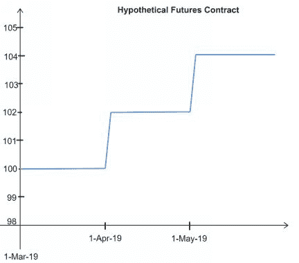

图 1.4 显示了我们简单示例的价格历史图表，它从 100 美元开始交易，在整个 3 月保持不变，在 4 月跳到 102 美元并在整个 4 月保持，最后在 5 月跳到 104 美元。

### 交易 1

2019 年 3 月 1 日，我们买入了一手假设合约的多头，当时交易价格为 100 美元。价格保持在 100 美元，直到 2019 年 3 月 31 日到期，我们将其卖出。

### 交易 2

2019 年 4 月 1 日，我们买入了一手假设合约的多头，当时交易价格为 102 美元。该合约在一个月内保持在 102 美元，直到 2019 年 4 月 30 日到期，我们将其卖出。

### 交易 3

最后，我们在 2019 年 5 月 1 日以 104 美元买入了一手合约的多头，并在 2019 年 5 月 31 日以 104 美元平仓。

现在，我们所有交易的盈亏（PnL）是多少？

当商品价格从 100 美元上涨到 104 美元时，我们获得了 4 美元的“现货收益”。我们在 2019 年 3 月 1 日以 100 美元买入合约，并在 2019 年 5 月 31 日以 104 美元卖出，这就是 4 美元的现货收益。然而，我们又多进行了几次交易。

2019 年 3 月 31 日，我们以 100 美元卖出 3 月合约，并在 2019 年 4 月 1 日以 102 美元买入商品。

2019 年 4 月 30 日，我们以 102 美元卖出 4 月合约，并在 2019 年 5 月 1 日以 104 美元买入 5 月合约，产生了另外 2 美元的损失。

这些跨期交易的总亏损为 4 美元，我们称之为“展期收益”，它恰好抵消了我们在“现货收益”中获得的收益。这笔交易的总盈亏为零。


为了清楚起见，我们错误地将价格变化称为收益，但我们将继续。最后，为了总结这个假设示例，我们可以将图 1.4 重新绘制为图 1.5，其中我们在每个阶段都根据到该点为止的累计展期调整了价格。

### 提示 补充材料

**贴水（Backwardation）**：当远期合约以低于现货合约的折价交易时，期货曲线即为贴水状态。

**升水（Contango）**：当远期合约以高于现货合约的溢价交易时，期货曲线处于升水状态。

在贴水市场中持有多头部位的展期收益是正的。在升水市场中持有空头部位的展期收益是负的。

图 1.5 期货合约的另一种表示形式。现在，让我们回到现实世界。图 1.6 显示了持有当月 VIX 多头部位的累计“现货收益”。

图 1.6 持有多当月 VIX 期货的累计现货收益。

图 1.7 持有 VIX 期货多头的累计展期收益。

图 1.8 持有 VIX 期货多头的累计现货收益和展期收益。

图 1.9 持有 VIX 期货空头的累计现货收益和展期收益。

从这项分析中得出的几点结论是：

1. 展期收益是性能的重要驱动因素。
2. 在极端波动时期（2008 年大衰退和 2011 年欧洲债务危机），现货收益往往占据主导地位并拉低表现。
3. 展期收益在压力时期会改变方向。

我们现在有了关于机器需要做什么的线索。我们可以保持空空 VIX 当月期货，并依靠我们的机器向我们提供平补空头部位的信号。机器需要关注：

1. 展期收益即将改变方向时。
2. 现货收益即将爆发的时刻。

因此，一个好的开始可以是：

1. 提供历史展期收益作为预测展期收益何时改变方向的输入。
2. 提供关于现货收益何时爆发的输入。

## 总结

AI 提供了一系列非常强大的工具来量化我们的想法。在本章中，我们讨论了 AI 如何量化交易想法并改进交易策略。

## 参考文献

* John C hull Options, Futures, and Other Derivatives, 用于期货和期权的基础定义。
* Lepiere, Yves & Deremble, Cyril & Seager, Philip & Potters, Marc & Bouchaud, Jean-Philippe (2014). 趋势跟踪两个世纪。Journal of Investment Strategies. 3. 10.2131/JOIS.2014.
* Baz, Jamil and Granger, Nicolas and Harvey, Campbell R. and Le Roux, Nicolas and Rattray, Sandy, Dissecting Investment Strategies in the Cross Section and Time Series (December 4, 2015).
* Jusselin, Paul and Lezmi, Edmond and Malongo, Hassan and Masselin, Côme and Roncalli, Thierry and Dao, Tung-Lam, Understanding the Momentum Risk Premium: An In-Depth Journey Through Trend-Following Strategies (September 24, 2017).

# 第二章 数据类型

在本章中，我们将讨论各种数据集以及我们在金融领域可能遇到的数据类型。我们还将考虑如何向机器呈现这些数据，以提取最大的智能。我们将讨论一个适用于所有人工智能（AI）任务的通用框架。

## 学习目标

1. 读者将介绍数值型、分类型和日期/时间特征
2. 读者将接触各种数据预处理方案

## 通用设置

想象一个典型的电子表格，其中行和列包含了大量数据。对于将 AI 算法应用于金融的任务，我们以表格形式呈现数据，看起来非常像图 2.1。数据的行被称为样本、观测值或实例。列被称为特征或预测变量。

### 图 2.1 典型的表格数据看起来是什么样的

样本（`samples`）是为了发现模式或经验关系而记录的观测值。观测频率可以是任何频率——每月、每日甚至是每次波动（`tick`）。特征（`features`）或列是数据的属性，我们认为这些属性将帮助我们发现模式。这些特征可以是多种不同的数据类型。

*   **数值型 (`Numeric`)**：通常指价格收益率、基本面数据（如收益公告）、大宗商品库存数据等。通常在任何编程语言中，这些数据被设置为 `float` 或 `integer` 数据类型。

*   **分类型/有序分类型 (`Categorical/Ordered categorical`)**：这些是代表有限离散项目集合的数据类型。例如，“1 月”代表一年的前 31 天；“第 1 周”代表一个月的前 7 天，“优于预期”代表所有收益超过预期的公司等。我们如何以有意义的方式将这些信息呈现给机器？我们将在下一节中讨论。

*   **时间类型 (`Date time`)**：当天的日期和时间可能包含有意义的信息。不仅在日历月份中，在月的某几周和星期也存在季节性模式。甚至当天的某个时段（`session`）可能具有某些预测能力。以下是我们在市场上看到的几个例子：

    1.  铂金和钯期货在 1 月和 2 月持续表现优异（图 2.2）。
    2.  每月数据密集的前两周，各种工具的价格波动性更高。
    3.  各种期货合约成交量的日内季节性模式（图 2.2）。

图 2.2 彭博的一张截图，显示了 1 月和 2 月的预期正收益（“来源：Bloomberg Finance L.P。经 Bloomberg Finance L.P. 许可使用”）

图 2.3 e-mini 标普 500 期货成交量的日内季节性，由第二个面板中的双峰红线表示（“来源：Bloomberg Finance L.P。经 Bloomberg Finance L.P. 许可使用”）

*   **图像 (`Images`)**：用于研究农产品预期收益率的卫星数据。我们没有研究或交易过这一概念，因此本书将不会涵盖该内容。

在深入研究这些内容之前，值得强调的是你将数据呈现给机器的方式有时取决于你打算部署哪种机器。从这个角度来看，我们遇到两种类型的机器。像决策树（见第 4 章）这样的模型依赖于将样本放入特征空间的各种矩形区域。这些模型是**尺度无关（`scale independent`）**的，改变输入的尺度对解决方案不会产生意义的影响。根据我们的经验，这有时会对性能产生不利影响。

此外，还有诸如逻辑回归和人工神经网络等模型，特征的尺度对解决方案有非常显著的影响。

让我们讨论一个例子来理解特征缩放（`scaling`）背后的直觉。假设我们只有两个特征：`x1` 和 `x2`。决策树解决方案通常解释如下：

1.  所有 `x1 < a` 且 `x2 > b` 的样本都属于同一个隔室，预测值为 .35。这里 `a` 和 `b` 是算法求解的参数。所有满足此条件的样本都在区域 1。
2.  所有其他样本的预测值为 .75。所有满足此条件的样本都在区域 2。

将 `x1` 的尺度改变 3 倍，将 `x2` 的尺度改变 2 倍，只会以相似的比例改变 `a` 和 `b` 的值。属于区域 1 和区域 2 的样本不会改变。在这种情况下，解决方案不会改变，因为我们感兴趣的是特定样本所属的区域。特别是，我们感兴趣的是被分组在一起的样本。

另一方面，回归（**尺度依赖模型**）的解决方案如下：

这里的 `a` 和 `b` 值再次是模型的输出。如果 `x1` 和 `x2` 的尺度发生变化，`a` 和 `b` 的值改变，输出 `Y` 也随之改变。

现在让我们开始讨论如何处理各种数据类型。

## 数值型 (`Numeric`)

作为决策树等尺度无关模型的通用指南，数值特征可以直接以给定的格式使用。在尺度依赖模型中，最好对它们进行预处理。可以使用 Scikit Learn 的 `MinMaxScaler` 或 `StandardScaler`。`MinMaxScaler` 确保所有特征值都在预定义的范围内。

在 Scikit Learn 中进行缩放的简单方法在加载数据后的下方框中所示。

相反，`StandardScaler` 确保所有缩放后特征值的平均值为 0，标准差为 1。它所做的是从特征中减去平均值，并将结果除以结果的标准差。这些缩放技术对优化技术产生巨大影响，例如用于某些尺度依赖模型（如人工神经网络）的 `gradient descent`。在 Scikit Learn 中实现此点的简单方法如下。

## 分类数据 (`Categorical data`)

这些特征本质上代表某些类别，例如月份或星期。这些是非常有用且强大的特征，当处理正确时，可以为机器增加大量价值。

如果我们对捕捉金融工具的季节性感兴趣，我们需要从将月份作为特征开始。某些日子比其他日子波动性更大。例如，周三发布石油库存数据，周四在每个月的第一个周五发布就业报告。这些日子已知比其他日子更具方向性/波动性。无需说明，星期因此可能为机器增加价值。大多数美国经济数据在每月的前两周发布，这将其作为是否在上半月还是下半月的特征是合理的。

如果分类数据的类别代表某种形式的顺序或排名，那么分类数据集被称为**有序数据集 (`ordinal data sets`)**。

假设我们正在跟踪市场对降息的预期与美联储（`FED`）中值预测之间的偏差。我们可以将差异分类为高（`High`）、中（`Inline`）和低（`Low`）：

*   高——意味着市场比美联储更鹰派
*   中——意味着市场与美联储观点一致
*   低——意味着市场比美联储更鸽派

在这里，高、中、低意味着它们所代表的数据具有某种排名或顺序。

问题仍然我们如何呈现这些数据？

### 独热编码 (`One Hot Encoding`)

假设我们的数据集如图 2.4 所示，我们将月份名称作为特征之一。

| 序列号 | 10 天期间平均收益 | 月份 | 下一个 10 天的平均收益 |
| --- | --- | --- | --- |
| 1 | -2% | DEC | -3.00% |
| 2 | -2.50% | NOV | -3.00% |
| 3 | 3% | JAN | -2.00% |
| 4 | 1% | FEB | 0.75% |
| 5 | 2% | JAN | 1.50% |
| 6 | 1.70% | MAR | 2.30% |
| 7 | -8% | DEC | -2.00% |
| 8 | 7% | JAN | -2.20% |

独热编码（`one hot encoding`）转换如图 2.5 所示：

| 序号 | 过去 10 天的平均收益率 | 月份 | 未来 10 天的平均收益率 | 1 月 | 2 月 | 3 月 | 4 月 | 5 月 | 6 月 | 7 月 | 8 月 | 9 月 | 10 月 | 11 月 | 12 月 |
| --- | --- | --- | --- | --- | --- | --- | --- | --- | --- | --- | --- | --- | --- | --- | --- |
| 1 | | -2% | 十月 | -3.00% | 0 | 0 | 0 | 0 | 0 | 0 | 0 | 0 | 0 | 0 | 1 |
| 2 | | -2.5% | 十一月 | -3.00% | 0 | 0 | 0 | 0 | 0 | 0 | 0 | 0 | 0 | 1 | 0 |
| 3 | | 3% | 一月 | -2.00% | 1 | 0 | 0 | 0 | 0 | 0 | 0 | 0 | 0 | 0 | 0 |
| 4 | | 1% | 二月 | 0.75% | 0 | 1 | 0 | 0 | 0 | 0 | 0 | 0 | 0 | 0 | 0 |
| 5 | | 2% | 一月 | 1.50% | 1 | 0 | 0 | 0 | 0 | 0 | 0 | 0 | 0 | 0 | 0 |
| 6 | | 1.70% | 三月 | 2.30% | 0 | 0 | 1 | 0 | 0 | 0 | 0 | 0 | 0 | 0 | 0 |
| 7 | | -8% | 十月 | -2.00% | 0 | 0 | 0 | 0 | 0 | 0 | 0 | 0 | 0 | 0 | 1 |
| 8 | | 7% | 一月 | -2.20 | 1 | 0 | 0 | 0 | 0 | 0 | 0 | 0 | 0 | 0 | 0 |

图 2.5 图 2.4 中数据的独热表示

在图 2.5 中，`Month` 特征被替换为 12 个特征。对于任何一个样本（行），这 12 个特征中只有一个会被赋值为 1，其他所有都设置为 0。这是一种非常简单的表示方法。缺点是，它是非常稀疏的表示，包含大量的冗余零。

### 标签编码 (`Label Encoding`)

继续使用图 2.4 中的数据，我们可以将 `Month` 特征替换为标签，如下表所示。

| 序号 | 过去 10 天的平均收益率 | 月份 | 标签 |
| --- | --- | --- | --- |
| 1 | | -2% | 十月 | 12 |
| 2 | | -2.50% | 十一月 | 11 |
| 3 | | 3% | 一月 | 1 |
| 4 | | 1% | 二月 | 2 |
| 5 | | 2% | 一月 | 1 |
| 6 | | 1.70% | 三月 | 3 |
| 7 | | -8% | 十月 | 12 |
| 8 | | 7% | 一月 | 1 |

图 2.6 标签编码。

这种方法对于决策树效果很好，但对于人工神经网络并不合适。

### 频率编码 (`Frequency Encoding`)

在每个样本中，类别特征被其出现的频率替换，例如在图 2.4 中，共有八个样本 `DEC`（十二月）在其中出现了两次，而 `NOV`（十一月）只出现了一次。我们将 `DEC` 替换为其出现频率 `2/8 = 25%`，并将 `NOV` 替换为 `12.5%`。实现此操作的简单代码如下：

```
# 示例代码
```

如果我们有时间序列数据，在使用这种形式的方法时需要非常小心。如果我们从整个数据集计算频率编码，那么我们实际上是在“预测未来”。第一个样本的 `DEC` 是类别特征值，将其替换为 `25%` 实际上是告诉我们未来只有一个具有该值的样本。

我们展示的一些算法非常强大。只要给它们一个数据集，它们就非常有能力学习一切，并产生近乎零误差的预测。问题是，这种零误差预测仅限于机器训练过的数据，即**训练数据**。如果我们将这台机器用于未见过的数据（如新进入的市场数据），预测误差将会飙升，你很容易就能推断出这台机器是零智能的。我们将这第二类数据称为**测试数据集**。

因此，我们希望机器在它见过的数据（训练数据）上表现良好，在测试数据上的表现也足够合理。然而，这是否意味着我们要不断迭代各种可能性，直到最终找到一个在训练数据和测试数据上都表现良好的机器？答案是“否”的，因为如果我们对训练数据进行无限迭代以实现在训练数据和测试数据上获得良好结果，我们实际上是在两个数据集上都训练了机器，从而将两者合二为一了。

因此，我们需要另一个数据集，称为**验证数据集**。现在我们在训练数据和验证数据之间进行这种反复迭代，一旦我们有了在训练和验证数据上表现良好的满意模型，我们就只引入一次测试数据集来查看性能。

## 验证数据的特征

*   它在质量和分布上应该与我们预期表现良好的测试数据非常相似。
*   训练数据与验证数据之间、验证数据与测试数据之间存在零泄露。
*   样本应该是 IID（独立同分布）的。

在设计验证数据集时，我们喜欢回答的一个有用问题是：如果验证数据是我们的测试数据，我们还会得到相同的结果吗？我们是否能够现实地实施完全相同的验证过程？在需要时，验证数据集的所有信息是否都可用，以便对验证数据集做出必要的预测？

这些看似理论的考虑是极其重要的，并且可能是算法有效或无效的背后的原因。在详细讨论这些考虑之前，让我们先讨论一下通常采用哪些验证方法。

## 验证策略

### 独立的验证数据集

我们将整个数据宇宙划分为三个不相等的部分，即训练集、验证集和测试集。训练数据通常占据整个集的 60–75%；剩余部分平均分配给测试数据和验证数据。更重要的考虑是验证数据，它在分布和特征上应该与测试数据相似。这种验证方法简单且稳健。然而，它有两个局限性。

*   **昂贵**：训练被强制在较小的数据集上进行，因为大约 20% 数据被留作验证。
*   **特定时期模型选择**：假设你正在设计一种基于收盘日数据交易黄金期货的策略。过去的 20 年将为提供大约 5000 个样本，其中我们保留 3000 个用于训练，750 个用于验证，750 个用于测试。通常，3000 个样本对于大多数 AI 算法来说是不够的，对于深度学习算法更是明显不够。此外，我们被迫留出 3 年的样本用于验证。更重要的是，如果我们的验证数据包含 2009 年、2010 年、2011 年，而测试数据包含 2012 年、2013 年、2014 年，那么大多数情况下，验证时期是一个平静的上升趋势（除 2011 年的一段短时间外），而测试数据主要是下降趋势。这种设置的问题在于，验证数据在特征上本质上与测试数据不同，因此预期在验证数据上表现良好的模型在测试数据上的表现可能实际上很差。

k 折交叉验证帮助我们解决这两个问题。

### k 折交叉验证

1.  我们将数据宇宙划分为训练集和测试集。验证数据以以下方式从训练数据中：我们**随机**将训练数据分为 `K(=3)` 个相等的部分，并称它们为 A、B 和 C。然后我们执行三次操作。

    *   在数据集 A 和 B 上训练模型，并在数据集 C 上验证。
    *   在数据集 A 和 C 上训练模型，并在数据集 B 上验证。
    *   在数据集 B 和 C 上训练模型，并在数据集 A 上验证。

`K` 可以取任何值，如 3、5 和 10。这是大多数软件包实现它的方式。k 折交叉验证数据集可以通过几行代码来创建。

这会将原始数据分为不同的子集。

对于读者来说可能显而易见，这种验证过程确实解决了上一节讨论的两个局限性。但对于大多数金融数据集来说，这个过程是错误的，并在多个层面上失败了。

在上述过程中，我们在验证数据上做了一些事情，如果验证数据被视为我们的测试数据，我们将无法做这些事情。我们还暴露自己允许训练数据和验证数据之间发生泄露。

让我们来看一个简单的例子来获取直觉。


在我们只有 2 个月的极小训练数据中（跨越 2018 年 1 月 1 日到 2018 年 2 月 28 日），假设我们正尝试预测 5 天后的市场情况。如果上涨，目标设置为“1”，如果下跌，目标设置为“−1”，否则设置为“0”。作为特征，我们提供的仅是过去 5 天的每日市场收益率。

1. 通过**随机**将训练数据中的样本分配到 `k = 3` 折中，我们往往会使用未来的数据来预测过去。如果我们的验证数据被处理得像测试数据一样（即未来要看到的数据），这是我们显然无法做到的。因此，我们希望避免对每个折进行随机选择。

2. **数据的独立性**：为了更好地理解这一点，让我们看以下示例：

| 折份 | 训练数据 |
| --- | --- |
| A | 2018 年 1 月 1 日 | 2018-1 月 2 日 | 2018-1 月 3 日 | 2018-1 月 4 日 | 2018-1 月 5 日 | 2018-1 月 8 日 | 2018-1 月 9 日 | 2018-1 月 10 日 | 2018-1 月 11 日 | 2018-1 月 12 日 | 2018-1 月 15 日 |
| | 验证数据………… | | | | | | | | | | |
| B | 2018 年 1 月 16 日 | 2018-1 月 17 日 | 2018-1 月 18 日 | 2018-1 月 19 日 | 2018-1 月 22 日 | | | | | | |

图 3.1 训练和验证日的示例，违反了 IID 标准中的独立性部分。

图 3.1 显示了特定折份的 2018 日历训练和验证日的视觉化表示。1 月 15 日（训练数据的最后一天）的目标直到 1 月 22 日才已知。此时，我们需要问自己一个转瞬即逝的问题：我们可以使用截至 1 月 15 日的训练数据预测 1 月 16 日的验证数据吗？答案是明显的“否”，因为在 1 月 16 日，我们不知道 1 月 9 日到 1 月 15 日样本的目标。1 月 9 日到 1 月 15 日的信息不能用于预测 1 月 16 日的结果。在将 1 月 16 日纳入我们的验证数据时，绝对需要考虑到这一点。然而，正如之前设计验证数据集时提到的，我们应该将其视为测试数据。如果它可以作为测试数据，它就可以作为验证数据。

所以如果 1 月 16 日包含在我们的验证数据中，为什么 1 月 9 日到 1 月 15 日不适合训练？我们需要意识到，如果 1 月 9 日到 15 日的目标与 1 月 16 日之间存在非常强的关系，我们的机器将会关注并捕捉到这种关系。我们可能会被验证准确率所吸引，但测试数据的准确率将会很糟糕。重要的是，如果训练数据中存在某些可能导致在测试集中发现有意义 alpha 的实际智能，我们阻碍了这一过程。

通常，机器会更快、更早捕捉到较简单的关系。如果这些简单的关系是错误的，我们可能无法达到让机器实际上关注那些确实存在、不那么明显但有效的关系的阶段。

图 3.2 显示了针对时间序列数据的推荐 `k = 3-折交叉验证策略` 可视化，其中我们假设已经对数据集进行了训练、验证和测试划分，并考虑了上述关于样本非随机选择以及训练集与验证集之间相互不独立的两个考量。

图 3.2 一种适用于时间序列数据的合理三折交叉验证策略。

我们已经详细讨论了如何创建验证数据集以及我们需要避免哪些陷阱。接下来我们讨论用于衡量性能的各种指标。

## 回归指标

我们在第 1 章中讨论了可以作为动量模型输入输入的各种因素。基于这些输入，我们可能感兴趣的是预测明天、下周或下个月的收益率。本质上，我们感兴趣的是预测一个数值结果。以下是用于评估回归机器性能的指标。

### 均方误差 (MSE)

`MSE` 是所有样本实际值与预测值之间差的平方和。

其中 `N` 是样本总数，`yi` 是第 `ith` 个样本的目标，`y_cap` 是第 `ith` 个样本的预测值。以下有助于我们理解该指标用法的一些观察结果：

计算 `MSE` 需要对预测误差进行平方，因此 `MSE` 往往更容易受到预测值与实际值差异显著的样本的影响。对于我们的问题，我们真的需要那样吗？

那么，良好的 `MSE` 值是多少？这里有几条指南：

* 将每个预测值替换为所有目标的平均值并计算 `MSE`；我们的机器的 `MSE` 应该低于此值。
* 在尝试预测明天的收益率时，可以使用今天的实际收益率作为代理并计算一个基准 `MSE` 值。我们最终部署的机器其 `MSE` 值应该低于这个基准。通过这样做，我们实际上是确保了今天的价格不是明天价格的最优预测器。
* 将预测值替换为前几天的平均实际值并计算一个基准 `MSE` 值。同样，我们希望机器的 `MSE` 低于这个基准。

### 平均绝对误差 (MAE)

平均绝对误差 (`MAE`) 定义为样本实际值与预测值之间差的绝对值。给出的公式为：

其中 `n` 是样本总数，`yi` 是第 `ith` 个样本的目标，`y_cap` 是第 `ith` 个样本的预测值。

在回归设置中，如果我们不希望过度强调较大的误差项，则使用 `MAE`。

1. 由于我们没有像计算 `MSE` 那样对预测误差进行平方，`MAE` 计算不会对较大的误差施加更多压力。
2. 良好的 `MAE` 值是多少？
3. 在尝试预测明天的收益率时，可以使用今天的实际收益率作为代理并计算一个基准 `MAE` 值。我们最终部署的机器其 `MAE` 值应该低于这个基准。通过这样做，我们实际上是确保了今天的价格不是明天价格的最优预测器。
4. 将预测值替换为前几天的平均实际值并计算一个基准 `MAE` 值（注：原文此处为 MSE，根据上下文应为 MAE）。

### MSPE/MAPE

这些只是通过因变量实际值标准化的 `MSE` 和 `MAE`。

最好是在我们尝试同时预测多种资产收益率的情况下使用它。为了举例，假设我们正试图通过同一台机器预测 E-mini S&P 500 期货、国债期货和原油期货的下一个跳动。E-mini S&P 500 期货的跳动幅度为 25 分，国债期货为 0.015625 分，原油为 1 分。在这种情况下，使用标准化的误差衡量是有意义的。`MSPEs`/`MAPEs` 是推荐的指标。

## 分类指标

基于我们在第 1 章中说过的动量设置；我们可能感兴趣的是预测钯价格明天预计是上涨还是下跌。如果预计上涨，我们为这些样本分配类别标签 1。同样，如果预计下跌，我们为它们分配类别标签 0。分类机器将帮助我们对这些情况设定概率。

分类算法的输出是条件概率。对于标记为 1 和 0 的二分类问题，输出为：

`P(Y=1 | Feature set)`：在给定特征的情况下 Y 等于 1 的概率。

`P(Y=0 | Feature set)`：在给定特征的情况下 Y=0 的概率。

一旦有了概率测量，我们需要假设一个阈值，即高于该概率值的样本分配到类别 1，低于该值的分配到类别 0。

也就是说，如果：

`P(Y = 1 | Feature set) > Threshold` 意味着类别 1，或者

`P(Y = 0 | Feature set) > threshold` 意味着类别 0

以下是最适合分类问题的指标列表。在此之前，我们需要理解混淆矩阵。

### 混淆矩阵

混淆矩阵是一个包含四个象限的表格，有助于我们分析（二）分类机器的性能。在标记为 1 和 0 的二分类问题中，我们输入每个象限的样本数量。每个象限包含满足实际类别和预测类别条件的样本，例如，后文中第二个象限将包含所有预测属于类别 1 但实际属于类别 0 的样本。

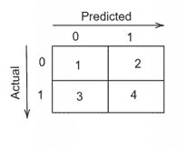

使用以下代码在 sklearn 中构建：

```
# 代码示例缺失，原文仅提及“使用以下代码在 sklearn 中构建”
```

基于混淆矩阵，定义了以下易于理解的指标：

### 准确率

在所有预测中，预测正确的占总比例是多少？它是第一象限和第四象限样本数除以样本总数。

### 精确率

让我们假设我们是一家只做多的基金。我们只对买入信号的时机感兴趣。一旦机器给出我们概率，我们设定一个特定的阈值并将概率转换为可操作的买入信号。现在，我们的范围仅限于这些买入信号。在这些买入信号中，有多少是为我们盈利的？或者，这些预测的买入信号中有多少属于 `Class 1`？这就是**精确率（precision）**，它的定义为第四象限的样本数除以第二象限和第四象限的样本总数。

### 灵敏度/召回率 (Sensitivity/Recall)

继续之前的只做多基金例子，我们根据买入概率和阈值假设获得了某些买入信号。我们可能会发现这些信号的数量太少，无法在统计学上提供可靠的估计；或者我们发现信号太多，从而显著降低了单笔交易的盈利能力。无论哪种，我们都感兴趣与市场提供的总买入信号相比，我们获得了多少个买入信号。这就是**召回率（recall）**。它的计算方法是第四象限的样本数除以第三象限和第四象限的样本总数。

### 特异性 (Specificity)

**特异性**是预测预测为属于类 `0` 的样本数除以实际属于类 `0` 的样本数。它的计算方法是混淆矩阵中第一象限样本数除以第一象限和第二象限样本的总数。

### F1 分数 (F1 score)

基于对精确率和召回率的讨论，合理的假设我们不仅希望最大化买入预测的准确性（精确率），还希望最大化买入预测占市场能提供的总买入信号数的百分比。`F1 score` 正代表了这一点。它是精确率和召回数的调和平均数。

上述代码可以提供精确率、召回率、f1 分数和准确率。

### AUC

你可能已经注意到，样本分配到混淆矩阵的哪一个象限取决于阈值。退一步说，一旦我们有了概率，样本被分配到哪一类取决于我们选择的阈值。在不同的阈值值下，将灵敏度（y 轴）与 x 轴上的 `1 – specificity` 进行绘图，就得到了我们的 `ROC`（接收者操作特征）曲线。ROC 曲线下的面积（`AUC`）是衡量分类性能的指标。`AUC = .5` 基本上意味着没有学习，而 `AUC = 1` 则意味着最好的机器。

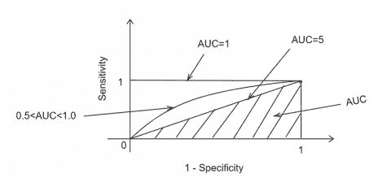

本章最大的收获是我们讨论的关于如何构建验证策略的方法论。在此处的一个错误可能就是成功与失败的区别。

我们还向你介绍了用于评估分类和回归机器的各种指标。

## 总结

1. 我们详细讨论了验证数据集的特性和要求。
2. 关键是将验证数据视为测试数据或从未来逐个样本流式传输的数据，而不是从数据库中读取整个块数据。这两种预测应该给出完全相同的结果。点在于，预测验证样本所需的所有信息在当时应该是可用的，并且不应该从未来泄露。
3. 最后，我们讨论了衡量机器性能的各种指标。

# 第四章 - 树模型

在本章中，我们引入决策树作为金融领域可以部署的最强大且可解释的算法之一。根据我们的经验，这些算法最适用于数据有限但非稀缺的问题。有些人会认为决策树类似于人类的学习过程，它们依赖于模块化并排除低概率的情景。

在开始时，重要的是，决策树本质上是弱学习器，但通过几个简单且极其直观的修改就可以使其变得非常强大。我们说的“弱学习器”是指什么？弱学习器是指那些在训练数据集上表现非常好，但在验证或测试数据集上难以良好泛化的算法。

到本章结束，你将理解用于分类和回归任务构建决策树的逐步过程。这种理解对于理解我们在接下来几章中讨论的应用至关重要。

## 决策树

让我们来看一个回归设置下的决策树，我们只有五个样本和两个特征。这只是一个玩具示例，我们需要更多的样本来进行有意义的学习，理想情况下也更多特征。作为目标，我们试图预测 E-mini S&P 500 期货次日的收益率。作为特征 1，我们有 e-mini 期货的前一日收益率；作为特征 2，我们有活跃原油期货的前一日收益率。我们的假设数据集看起来如图 4.1 所示。

| 样本编号 | 特征 1 | 特征 2 | 目标 |
| --- | --- | --- | --- |
| 1 | 0.50% | 1% | 0.25% |
| 2 | 1% | 2% | 0.25% |
| 3 | 2% | -2% | -1.00% |
| 4 | -0.50% | -1% | -0.25% |
| 5 | -1% | -2% | -0.25% |

图 4.1 假设数据集。

图 4.2 F1, F2 特征空间中的样本表示。

在 F1, F2 特征空间中表示的一种方法如图 4.2 所示，括号中的数字代表样本编号。我们将样本分配到这些矩形区域。例如，样本编号 1 和 2 属于一个矩形区域，其中：

`0 <= F1 <= 1%`

且 `0 <= F2 <= 2%`

预测值仅仅是分配到该区域的样本目标的平均值。这意味着任何来自测试数据集并被分配到此矩形区域的样本，其预测值都将是 0.25%。

决策树就是如此简单。

总结来说，决策树将特征空间划分为矩形区域，结果导致训练数据集中的样本被分配到这些矩形中。当测试样本到达时，根据其特征值 F1 和 F2 将被分配到一个矩形区域。因变量简单地假设等于该特定区域训练数据集样本 `target` 值的平均值。

图 4.3 F1, F2 特征空间中的样本表示。

数据集的树状表示如图 4.3 所示，我们有根、节点、分支和叶子。

节点是做出决策的地方。连接节点的线是分支。顶部的节点是根。最底部的节点是叶子或终止节点。终止节点就像我们训练数据本质上所在的矩形区域。现在我们来讨论构建这些决策树的内容。

## 决策树的构建 - 回归设置

决策树算法本质上将我们的表格数据作为输入并构建决策树。

我们期望算法产生两个输出：

1. 分裂点帮助我们在每个节点做出决策，或定义早期表示中矩形区域的边界。因此，我们的一个节点可以做出如 `x <= 2%` 的决策。这个 `2%` 的分裂点将由算法输出。
2. 执行划分的特征正确层次结构。哪些特征位于根节点，哪些特征位于根节点之下的节点，此类推。

让我们粗略查看产生这些输出的算法。目前，我们坚持使用回归设置。为了算法的创新应用，这种程度的细节是必要的。

我们首先考虑所有的特征都作为形成根节点的潜在候选。对于每个特征，我们考虑各种可能的划分点。对于每种可能的特征和划分点组合，我们都会在训练数据集中所有样本上计算 `Equation 4.1` 的值。

```
MSE = ∑(Yi - Yavg)²                              Equation 4.1
```

其中

- `Yi`：每个样本的目标值
- `Yavg`：每个样本目标值的平均值

让我们回到矩形区域表示法来完全理解这一点。我们从特征 `F1` 开始，取 `1%` 作为划分点。我们将 `(特征, 划分点)` 组合标记记为 `(F1, 1%)`。在 `F1 = 1%` 左侧的区域中有四个样本 `(1, 2, 4, 5)`，右侧有一个样本 `(3)`。

图 4.4 `(F1, 1%)` 形成了根节点。

对于样本 1、2、4 和 5，我们计算 `Equation 4.1`

```
Yavg = 0
∑(Yi − Yavg)² = .025%                            Equation 4.2
```

同样，对于样本 3，我们也计算 `Equation 4.1`

```
∑(Yi − Yavg)² = 0                               Equation 4.3
```

我们将 `Equation 4.2` 和 `Equation 4.3` 中的结果相加。这种计算对每个特征和划分点组合重复进行。记录值最低的组合形成根节点。为了这个例子，我们假设 `(F1, 1%)` 形成了根节点。

重复之前描述的过程，以找到所有节点的特征/划分点组合。唯一的修改是，我们限制在尝试进一步细划分的区域样本内。因此，在我们的玩具示例中，样本 1、2、4 和 5 现在被合并形成 `region A`（具有 `F1 < 1%`），样本 3 形成 `region B`（具有 `F1 > 3%`）。我们现在只关注 `region A` 以寻找树的第二层节点。`Region B` 仅包含一个样本，不能进一步划分，这实际上是一个终端节点或叶子节点。重复此过程直到满足停止标准。

我们在 `Scikit Learn` 中实现此点如下：

进入 `DecisionTreeClassifier` 的某些参数

- `criterion`: “mse”
- `max_depth`: 的最大深度控制过拟合。默认情况下所有叶子节点都是纯的。
- `min_samples_split`: 划分内部节点所需的最小样本数。

## 决策树的构建 - 分类设置

分类问题的处理非常相似，只有几处变化。

1. 预测是基于投票。因此，一旦我们形成了矩形区域，与之相关的类别标签将是出现次数最多的那个。
2. 用于寻找特征、划分点组合的指标不再是均方误差 (`MSE`)。我们使用 `Gini index`（基尼指数）或 `cross entropy`（交叉熵）。

让我们看一些定义来理解后一点。

我们需要分类错误率，即区域中被错误分类的样本比例。图 4.1 表示了分类设置。目标类别 1 意味着 `return > 0`，目标类别 0 意味着 `return < 0`。

图 4.5 分类设置的假设数据集。

对于由 `F1 <= 2%` 定义的区域，大多数样本属于类别 0。因此，错误率为 40%。

- `P0`：区域内目标为 0 的样本比例 (60%)。
- `P1`：区域内目标为 1 的样本比例 (40%)。

```
Classification error rate = 1 – max(P0, P1)
Cross entropy = −P0 log(P0) – P1 log(P1)
Gini index = P0(1 − P1)
```

代价复杂度剪枝（Cost-complexity pruning）改进了早期停止策略的短视性。它从构建一棵完整的树开始。从这棵完整的树中，创建出不同的子树。生成的树中的任何一个都可能是最优解。最优树通过交叉验证来选择。

有趣且重要的是，我们对代价复杂度剪枝算法有一点见解，通过该算法我们能够生成树的子集。有助于实现代价复杂度剪枝算法的代价函数如公式 5.1。

```
∑(Yi - Yavg)² + α |T|                              公式 5.1
```


该公式的第一部分不需要任何解释，与第 4 章讨论的内容相同。`α |T|` 是正则化项，其中 `|T|` 代表树中终端节点或叶子节点的数量，而 `α` 是我们需要提供的参数。因此，如果 `α = 0`，公式 5.1 简化为最小化均方误差（MSE）。我们得到的树是整个未剪枝的树。然而，随着我们开始增加 `α`，拥有大量的终端节点是需要代价的，因此公式 5.1 将倾向于让终端节点较少的树最小化。随着 `α` 增加，我们得到的树越越小，使代价函数的值最小。例如，当 `α` 等于无穷大，我们需要 `T` 为零，将树简化为单个节点。通过这种方式，我们能够将 `α` 映射到 `|T|`，从而得到特定的子树。

我们使用的树是在验证数据集上性能最好的那一个。

## 装袋法（Bagging）

减少决策树过拟合或高方差问题的另一种方法是装袋法。装袋法是一个两步过程，首先是“自助”（bootstrapping），然后是“平均”（averaging）。

如图 5.1 所示，我们首先从原始数据集中创建创建几个样本，然后在每个数据集上构建决策树的集成。最终的树集成只是所有这些决策树的预测结果的平均值。其思想是，这个过程创建了一组互不相关的树——每棵树都学习一些信息，并且不可避免地包含一些噪声。对多个这样的树进行平均可以减少噪声分量并保留信息。

图 5. 1 自助法的概念图示。

从原始数据集中提取多个数据集的过程称为自助。假设原始数据集有 `m` 个样本。我们随机有放回地选择 `n(<m)` 个样本。重复此 `b` 次。因此，我们现在有了 `b` 个每个包含 `n` 个样本的数据集，而不是一个包含 `m` 个样本的数据集。我们创建了 `b` 棵树，每个新创建的数据集一个。最终的机器是这 `b` 棵树结果的聚合。

如果是回归问题，我们将简单地对每个 `b` 树的结果取平均；如果是分类问题，我们将对这些分类器生成的预测进行多数投票。

### 袋外样本（Out-of-bag samples）

原始数据集中的每个样本要么被用于创建特定的树，要么在自助过程中被留出。因此，每棵树都有其构建所需的训练数据。每棵树还拥有一些未见过的数据，这些数据可以作为验证数据。因此，为了获得我们构建的所有 `b` 棵树的验证性能，我们只需聚合每棵树在其对应的验证数据集上的结果。这非常棒而且真正高效利用数据，因为我们实际上不需要单独的验证数据集。

只有一个重要问题需要注意——在自助时，我们随机有放回地选择 `m (<n)` 个样本。正如我们在书中之前强调的，在处理时间序列数据时，这种方法并不完全适用。此外，由于我们使用验证数据作为袋外样本，我们正在通过破坏数据集的时间序列属性来阻碍学习过程（这正是随机选择的结果）。

样本之间不是相互独立的。提醒一下，在设计验证策略时，我们需要能够回答以下问题：如果我们的验证数据是测试数据，我们是否能在足够的时间内拥有所有信息来预测测试数据？

如果上述问题的答案是“否”，那么我们正在使用一个次优的机器来做出预测。数据中可能存在我们尚未尝试学习的信息。

为了解决这个问题，我们每次进行自助时，都需要确保所选样本是有序的。可以使用如下方案（也如图 5.2 所示）：

1. 从 `1` 到 `(n – m)` 随机选择一个数字 `i`
2. 选择 `i` 到 `(i + m)` 的样本作为一个袋袋
3. 重复 `b` 次

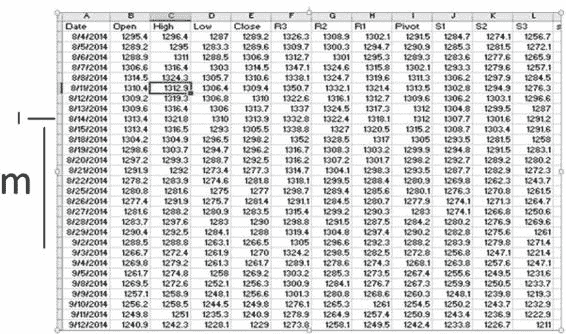

图 5. 2 时间序列数据的理想自助方法。

装袋法的优势源于以下两个来源：

*   多个预测变量的平均减少了方差。
*   每个袋都迫使树关注更少的样本，而不仅仅是显著样本，从而迫使树努力学习可能被忽略的信息内容。

让我们看看通过随机森林还可以做些什么来处理高方差问题。

## 随机森林（Random Forest）

正如之前提到的，装袋算法的驱动因素之一是每棵树都关注不同的样本集，因此被迫学习不显而易见的信息。随机森林做了这一切，甚至更多。图 5.3 显示了这些步骤。

在形成树的节点时，我们需要确定在节点处放置哪个特征以及在何时进行分裂。我们目前的算法可以在可用特征中选择这种分裂。随机森林改变了这一点。我们从原始 `p` 个特征中随机选择一个 `m` 个特征的子集（`m/p ≤ 1`）。我们在这个子集中识别节点特征。我们不再拥有从原始 `p` 集中选择特征的奢侈。我们被限制在子集中选择分裂候选。

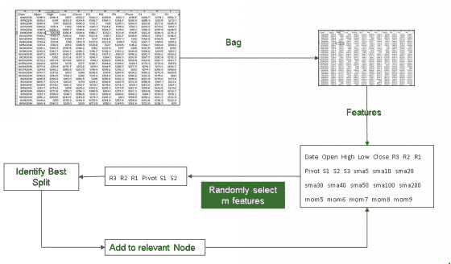

图 5. 3 随机森林示意图。

随机森林的优势源于以下两个来源：

*   多个预测变量的平均减少了方差。
*   每个袋都迫使树关注更少的样本，而不仅仅是显著样本，从而迫使树努力学习可能被忽略的信息内容。

数据集中经常发生的情况是只有少数特征是相关的。此外，有时整个特征空间的一个子集对模型的预测能力贡献了大部分。通过在每次分裂时仅关注较小的特征子集，随机森林迫使学习即使是最不明显的特征。这不仅减少了集成中各种树模型之间的相关性，从而在平均时减少了方差，还从数据集中学习了更有价值的信息。

## 提升（Boosting）

让我们先看算法，稍后再解释直觉。

提升算法的步骤如下：

1. 对训练数据集拟合一棵树（`T1`）。
2. 计算残差/错误/分类错误。
3. 对 `T1` 的残差拟合棵树 `T2`。
4. 更新模型为 `T1 + shrinkage*T2`。
5. 对 `T2` 的残差拟合一个模型 `T3`。
6. 更新模型为 `T1 + shrinkage*T2 + shrinkage*T3`。
7. 对 `TN-1` 的残差拟合模型 `TN`。

在我们进入更多细节之前，让我们快速了解一下什么是收缩（shrinkage）。它是一个超参数（即需要由用户提供的参数），也被称为学习率。它帮助我们控制在每个阶段我们想要整合到最终模型中的学习量（以减少过拟合）。如果收缩过高，我们可能会面临对训练数据集过拟合的风险；如果收缩过低，我们可能会面临欠拟合的风险且无法学到任何东西。接下来，我们需要理解的第一个直觉是，这是一个阶段性的加法模型（stage wise additive model）。它的加法方式与袋法（bagging）和随机森林相同，即最终模型是 N 个模型预测结果的聚合。

提升（boosting）与袋法和随机森林的区别在于，它是一个阶段性的加法模型。`T2` 只有在 `T1` 之后才能构建，`T3` 只有在 `T2` 之后才能构建，依此类推。在袋法和随机森林中，`T1`、`T2` 和 `T3` 可以同时构建且彼此独立。提升法则不能。我们首先需要构建 `T1`，计算训练数据上的误差，构建 `T2` 来拟合这些残差，计算 `T2` 在训练数据上的误差，然后构建 `T3` 来拟合 `T2` 在训练数据上的预测误差。因此，`T1`、`T2`、`T3` 等是相互依赖的，不能并行创建。它们需要一个接地串行创建。

因此，与大多数大多数在自变量上拟合模型的算法不同，在这里我们拟合了多个模型。第一个模型基于自变量拟合，其余的基于上一个模型的误差拟合。所以，让我们尝试理解为什么我们需要构建模型来拟合上一个模型的误差。

阶段性加法模型的基本结构如下：

`Fm(X)=Fm−1(X) + bm*Tm(X,Ym−1)` 方程 5.2

`Fm(X)` 是第 `m` 次迭代后的集成模型。

`Tm` 是第 `m` 次迭代构建的树。

当 `m> 1` 时，`Ym−1` 是使用 `Tm−1` 作为预测器的误差。

当 `m = 1` 时，`Ym−1 = Y`。

`bm` 是学习率，控制我们想要从每个阶段向前推进的学习量。

方程 5.2 表达的意思是，任何阶段 `m` 的模型（`Fm`）都等于上一个阶段 `m` 的模型（`Fm−1`）和一个新模型 `Tm`。

### 为什么要对上一阶段的残差拟合模型？

现在我们的损失函数是一个简单的 MSE（均方误差）：

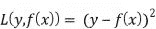

使用方程 5.2，我们将损失函数修改为

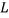(y,Fm-1(X) + bm*Tm(X,Ym−1) )`(y-Fm−1(X)- bm*Tm(X,Ym−1))2 = (rm - bm*Tm(X,Ym−1))²`

因此，第 `m` 阶段的树必须被构建以拟合上一阶段的残差 `r`。

在查看实际实现之前，让我们快速了解树中的正则化。

### 正则化

正则化是减少高方差问题的方法。该目标通过修改损失函数来实现。因此，我们不是简单地最小化损失函数 `L`，而是最小化损失函数 `L + gamma*|T|`，其中 `|T|` 代表叶子数量。树的复杂度与 `|T|` 直接正比。`gamma` 是需要用户提供的参数。如果 `gamma` 为零，则 `gamma * T = 0`，这实际上意味着我们保留了原始损失函数，因此并不打算减少高方差问题。当我们增加 `gamma` 的值到无穷大时，防止损失项爆炸的唯一方法是减少 `T` 的值，这实际上意味着我们正在降低树的复杂度。因此，通过改变上述方程中的 `gamma`，我们能够控制树的复杂度，从而影响偏和方差。

### XGBOOST 包

XGBOOST 包的损失函数包含两个部分：

1. 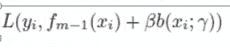

这与我们在方程 5.2 中讨论的相同，并在所有样本上进行计算。

2. 正则化部分表示为

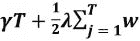j2

`T` 之前在讨论代价复杂度剪枝的方程 5.1 中引入，具有相同的含义。`T` 是树中的终端节点数量。第二项是 L2 正则化项，其中 `w` 是每棵树每个叶子的权重或得分。如果 `` 很大，那么 `w` 就需要很小，即叶子中的得分（例如准确率、AUC 等）需要很小，这意味着我们减少了过拟合。如果 `` 很小，我们可以允许更高的准确率，从而允许在训练数据上进行更好的拟合。每棵树都受到这种正则化的影响，因此这部分在我们加法构建的所有树上进行求和。

使用的最终损失函数如下：

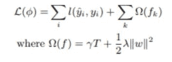

其中 `i` 是所有样本的求和，`k` 是所有树的求和。

XGBOOST 中其他重要参数如下：

1. `Eta`：我们之前讨论的收缩就是学习率
2. `Gamma`：所需的最小损失减少
3. `Lambda`：权重上的 L2 正则化
4. `Alpha`：权重上的 L1 正则化
5. `Maximum depth`：最大深度
6. `Minimum child weight`：最小子权重
7. 样本树、层、节点（参考 XGBoost 文档获取详细描述）

### 应用

现在我们学习了决策树集成的直觉后，让我们考虑一个简单的例子。我们在第 2 章中提到过。均值编码是一种非常有用的工具，有时对数值特征进行处理是有益的。在对数值特征进行均值编码之前，我们需要对其进行分箱或将其类别化。对于本例，我们的数据集的前 10 行所示（图 5.4），其中每一列本质上都是 CME 期货的收益。例如，`GC_ret` 是黄金期货的收益（这里为了提高分辨率乘以 1000）。

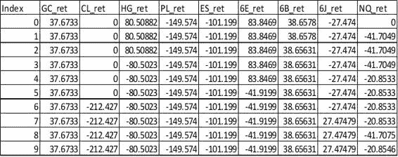

图 5.4 CME 交易品种的收益（黄金 GC、原油 CL、铜 HG、铂 PL、标普 500 指数 ES、欧元 6E、英镑 6B、日元 6J、纳斯达克 NQ）。

这是我们的自变量矩阵或特征。我们想利用这些信息预测标普 500 指数在 10 个 tick 后会发生什么。我们有三种情况：上涨、下跌或持平，分别编码为 2、1 和 0。图 5.5 显示数据集的快照。

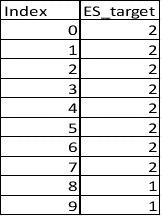

图 5.5 分类问题的目标。

现在我们定义随机森林分类器并对其进行拟合，如下：

```
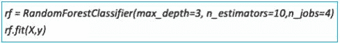
```

在这里我们构建了 10 棵树的集成。下一行有助于获取每棵树中样本 X 所在的叶子索引：

```
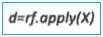
```

到目前为止，有一个尚未被明确说明但非常重要的考虑因素与我们获取平均编码的数据集有关。到目前，我们一直且仅关注训练集、验证集和测试数据集。然而，当我们为训练集获取平均编码时，我们不能使用整个训练集。如果我们这样做，本质上是将目标中的信息嵌入到了我们的特征中，导致我们的模型产生过拟合。在理想情况下，也是最合适的情况下，我们需要保留一个名为`pre training`（预训练）的独立数据集，从从中获取平均编码。或者，我们可以设计一种`k-fold validation strategy`来获取训练集的平均编码。

为了获取验证集的平均编码，我们可以使用整个训练数据集集。

最后，为了获取测试集的平均编码，我们可以使用训练集和验证数据集。

## 总结

我们在这一章中涵盖了相当多的内容。总体主题是尝试修改弱学习器以获得强大的学习算法。因此，我们讨论了早停和代价复杂度剪枝，但最常用的技术仍然是装袋法（bagging）、随机森林和提升法（boosting）。我们讨论了如何使用决策树将数值数据转换为分类数据的应用，以及我们需要避免的平均编码陷阱。

## 参考文献

*   Constructing Equity Portfolios from SEC 13F Data Using Feature Extraction and Machine Learning. Alexander Fleiss, Han Cui, Sasha Stoikov and Daniel M. DiPietro The Journal of Financial Data Science Winter 2020, 2 (1) 45-60; DOI: [`doi.org/10.3905/jfds.2019.1.022`](https://doi.org/10.3905/jfds.2019.1.022)
*   [`www.kaggle.com/c/two-sigma-financial-news/notebooks`](https://www.kaggle.com/c/two-sigma-financial-news/notebooks)
*   [`xgboost.readthedocs.io/en/latest/tutorials/model.html`](https://xgboost.readthedocs.io/en/latest/tutorials/model.html)
*   [`medium.com/kaggle-blog/two-sigma-financial-modeling-code-competition-5th-place-winners-interview-team-best-fitting-279a493c76bd`](https://medium.com/kaggle-blog/two-sigma-financial-modeling-code-competition-5th-place-winners-interview-team-best-fitting-279a493c76bd)

# 第六章 - 偏差与方差的权衡

这是一个短章节，但仅仅基于这一概念的普遍适用性，我们希望专门用一章讨论这个主题。在本章结束时，你应该能够理解偏差-方差权衡，识别有偏差的机器，识别高方差机器，并在任何机器中实现偏差-方差权衡。

如果你的机器没有给出理想的结果，你该怎么办？我们有一整套方案可选。我们可以：

1.  更改特征
2.  更改目标
3.  更换机器
4.  更改超参数
5.  延长训练时间
6.  更改验证策略

我们也可以使用上述任何点的组合。这些每一个点及其组合都有几个子选项，显著增加了我们为拟合机器可以做的方法。进行穷举搜索实际上是不可能的。理解偏差-方差权衡为我们提供了一个框架，使得我们的搜索更有针对性。通常来说，理解偏差-方差权衡是解决大多数机器学习问题的第一步。

## 偏差 (Bias)

顾名义，有偏差的机器是指对结果具有偏差视见的机器。在极端情况下，结果甚至不会随着输入的变化而改变。像方程 6.1 中定义的、独立变量 `X` 取值范围在 `[0,1]` 之间的机器，其等式为：

```
P(Y = 1 |X) = 0.6 +.00002 * X
```

方程 6.1

这里 `X` 是唯一的特征。这是一个高度偏差的机器，因为 `X` 的系数（`.00002`）非常小，且结果几乎总是非常接近 `0.6`。某些机器比其他机器更容易产生有偏差的结果。例如，使用逻辑回归而不是决策树更有可能得到有偏差的机器。为什么会发生这种情况？特征的简单性以及缺乏易于发现的关系可能会导致偏差机器。在 particular 关系中，概率与 `X` 之间可能不存在机器被设定去捕捉的线性关系。如果我们创建一个特征 `X²`，我们可能会发现 `X²` 的系数更大，从而使得概率值开始变得不那么偏差。某些机器可能会因为过度正则化而产生偏差。

### 检测有偏差的机器

以下两个准则有助于我们识别有偏差的机器：

*   训练数据上的错误率很高 - 本质上意味着机器没有学到东西。
*   预测概率的范围相当。

### 降低机器的偏差

*   增加非线性。
*   减少正则化。
*   增加机器复杂度。

## 方差 (Variance)

遭受高方差问题的机器是指那些良好学习了训练数据，但在未见数据（验证/测试数据）上表现非常差的机器。这就好比一个很好地学习了教科书但发现难以应用于现实问题中的学生。

某些算法比其他算法更容易过拟合。正如提到的，决策树将特征空间划分为区域并将样本分配到这些区域中。如果运行得足够长，它们会将特征空间划分到极细的程度，在训练数据上产生零误差。

### 检测高方差机器

*   在训练数据上性能良好，但在未见数据上非常差。
*   预测结果随特征的微小变化而发生剧烈变化。

### 如何解决高方差问题？

*   特征选择、降维技术和正则化。
*   减少运行时间。
*   降低机器复杂度。


为了说明，我们展示了在样本数据集上训练 `XGBoost` 算法的一些模拟。该样本数据集是一个二分类问题，46% 的样本属于类别 1，54% 的样本属于类别 0。我们感兴趣的是预测类别 1 的样本。这里的想法是为偏差-方差权衡提供更多的见解。我们关注 `XGBoost` 算法的三个参数，即学习率 (`lr`)、树的数量 (`n_est`) 和最大深度 (`max_depth`)。随着这些参数每个值的增加，训练误差应该会减少。对于图 6.1 所示的 set，我们有一个高方差机器。训练准确率 70.4% 远高于验证准确率 46.6%。

此时，我们可能已经过度进入了高偏置设置。我们对 `max_depth` 和 `n_est` 进行了更多的参数搜索，看到验证准确率增加到 48.9，代价是允许一些方差的出现。如图 6.5 所示

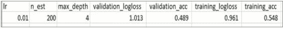

图 6.5

## 总结

*   有偏的机器具有主观性，甚至无法学习训练集。
*   高方差机器能很好地学习数据集，但很难在未见的数据上进行泛化。

# 第七章 - 应用：套利交易

让我们来看看我们目前为止所学过的工具和技术的一些实际应用。在本章中，我们将介绍有关如何使用人工智能（`AI`）进行交易的几个重要考虑。我们将讨论数据预处理、特征工程、超参数优化、风险管理，以及最重要的——结果分析，以识别机器在哪些方面做得好，哪些方面不好。

在本章结束时，你将能够：

1. 理解套利交易（carry trading）的概念以及它如何应用于商品、股票、货币和利率。
2. 理解使用 AI 将经济概念转换为交易算法所需的所有构建模块。
3. 理解并体会之前章节中涉及的几个细节。

这种方法可以应用到几个金融概念，这些概念在第 1 章中讨论过。我们在这里选择揭示“套利（Carry Trading）”。套利本质上是指如果你拥有资产，在扣除购买资产的资金成本后所提供的收益。这种净收益可以是正的也可以是负的，这意味着只需通过拥有资产就可以获得净正收益，或者可能需要为拥有资产而支付净额。

## 外汇中的套利

让我们通过外汇市场的一个简单示例来使其更具体。澳元（AUD）对比美元（USD）。在本章时，澳元的基准利率为 1%，美元基准利率为 2%。`AUD/USD` 现汇汇率为 1 澳元兑 0.6771 美元。

美国中央银行对美国经济似乎更加鹰派，而澳大利亚中央银行对澳大利亚经济持有更鸽派的观点。因此，如果我们借入期限为一月的澳元并用所得购买美元，我们需要支付 1% 的澳元利率，因为这是我们借入的货币。作为回报，我们在美元持仓上获得 2% 的收益，因为这是我们的资产。我们资产的收益（2%）高于在澳元购买的资金成本（1%）。因此，这笔交易的套利是正的。

显然，市场已经将此考虑在内。因此，在那个瞬间，`AUD/USD` 的一个月期远期汇率为 .6777，这意味着预计一个月后的澳元现汇将为 .6777。因此，预计澳元将从 .6771 走强到 .6777，这恰好抵消了我们通过卖出美元买入澳元所预期的净套利收益。这就是有效市场假设下市场对工具定价的方式。

实际上，如果我们借入澳元并按 .6771 的汇率转换为美元，我们将在美元资产上赚 2% 的收益，并对澳元负债支付 1%。同时，我们承诺在一个月后偿还我们借入的澳元。我们打算通过出售资产（美元）并使用所得购买澳元来实现此，这实际上意味着我们买入期限为一月的澳元并卖出美元。远期价格将使得持有美元一个月相对于澳元的 1% 净收益被恰好抵消。因此，远期价格将为 `.6771*(1+.01/12) = .6777`。

我们想要测试的假设是，远期价格不能准确代表持有 `AUD/USD` 一个月可能产生的收益或损失。我们想看看持有净套利为正的工具相对于一组净套利为负的工具是否有收益。如果我们能通过持续持有净套利为正的资产相对于一组净套利为负的工具赚钱，那么我们就可以得出结论：远期没有准确定价未来结果。我们显然打算使用机器学习和我们之前讨论过的一些技术来证明或反驳这一假设。在此之前，让我们理解套利应用于其他资产类别的概念。在外汇市场中，如之前所述，套利简单来说是外国利率与国内利率之间的差。

持有即可获得收益的资产是正套利。需要付费才能拥有的资产是负套利。我们想看看持有正套利工具的表现是否优于负套利工具。

我们想分享的最后一个见解是，利率是货币的“价格”。如果商品的价格很高，意味着它需求很大，反之亦然。我们想测试如果我们系统地拥有受青的资产是否能赚钱。

让我们看看套利在其他资产中是如何计算的。

## 商品中的套利

大多数流动性商品至少有两个期货，反映了那两个月的供需情况。

期货合约（`F`）可以用等式 1 进行定价：

```
F = S0*(1 + (rfunding – rcommodity) *T/365)
```

这里 `T` 是到期天数，`F` 是期货价格（第一个或第二个流动性合约），`S0` 是现货价格（分别为现货价格或第一个期货合约），`rfunding` 是商品计价货币的利率，`rcommodity` 是商品的隐含利率（更常见的名称是便利收益）。如果 `rcommodity>rfunding`，则 `F<S` 且商品处于贴水（backwardation）。如果 `rcommodity<rfunding`，则 `F>S` 且商品处于升水（contango）。如果 `rcommodity` 很高，意味着对该商品的需求很高，应该预期其表现会优异。

## 股指数中的套利

大多数流动性指数通过期货合约进行交易。期货的定价方式类似：

```
F = S0*(1 + (rfunding – rindex) *T/365)
```

这里 `T` 是到期天数，`F` 是期货价格（第一个或第二个流动性合约），`S0` 是现货价格（现金指数），`rfunding` 是指数计价货币的利率，`rindex` 是股息率。

通常，现金指数和期货的收盘时间之间存在差异，因此如果我们使用日终数据，需要小心。

更合适的方法是使用构成指数的公司实际支付的股利，并根据构建指数时使用的权重对其进行加权。我们也可以从指数期权市场的“认沽期权平价”关系中推出股息率，假设有足够的流动性。

## 利率中的套利

短期利率与长期利率（2 年期对比 10 年期）之间的差额可以作为政府债券市场套利的衡量标准。

在本章中，我们将重点放在商品期货上。让我们先进行一些预处理。

## 展期调整（Roll）

我们这里的目标是创建一个连续合约，并调整我们在到期时展期头寸时看到的的价格不连续性。

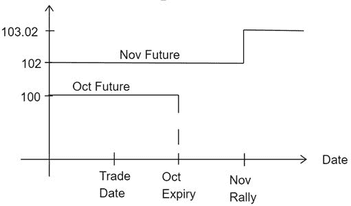

图 7.1 10 月和 11 月期货价格走势。

如图 7.1 所示，某商品的 10 月期货交易价格为$100，而 11 月期货（第二个活跃合约）交易价格为$102。对于 1000 的投资，我们购买了 10 份 10 月期货。我们一直持有直到 10 月合约到期，然后展期到 11 月合约。假设展期时，10 月和 11 月合约的价格仍分别为$100 和$102。展期后，我们拥有 1000/102 份 11 月合约。现在价格上涨了 1%到$103.02，我们平仓了头寸。我们的资金现在是$1010。

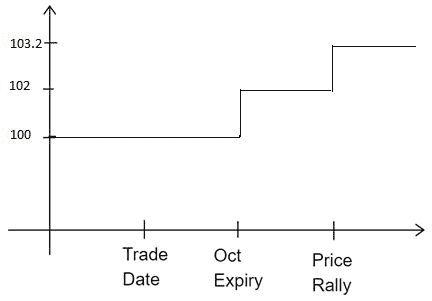

图 7.2 通用第一个合约的价格。

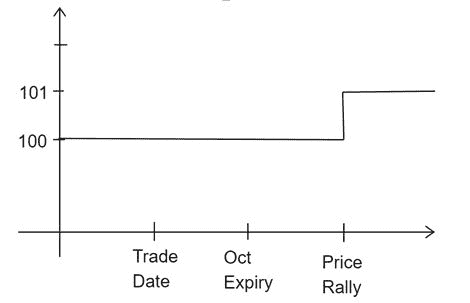

图 7.3 通用第一个合约的价格。

例如，如果我们从 Bloomberg 下载数据，通用第一个月合约的价格看起来就像图 7.2a 所示。让我们换一种角度来看待。我们的目标是创建一个连续合约。我们不希望处理展期（roll）的麻烦。我们只需要通过 `100/102 = 98.039%` 来调整 `Nov` 合约。因此，原先的 $102 变成了 $100（图 7.2b）。此外，当 `Nov` 合约上涨 1% 达到 $103.02 时，我们调整后的 `Nov` 合约也上涨到 `103.02*.98039 = $101`。这种好处是显而易见的；我们在模拟中不需要操心展期问题。

我们从 $100 的价格开始大商品交易，在 $100 处停放了 $1000 的资金，当调整后的 `Nov` 合约变到 $101 时，我们平仓了头寸。

## 考虑的资产

下面是我们想要交易的商品期货列表。正如之前讨论的，我们对所有价格进行了预处理，以考虑展期：

1. 玉米 (C 1)
2. 大豆 (S 1)
3. 铜 (HG1)
4. 原油 (CL1)
5. 豆油 (BO1)
6. 豆粕 (SM1)
7. 铂 (PL1)
8. 钯 (PA1)
9. 取暖油 (HO1)
10. IPE 柴油 (QS1)
11. 小麦 (W1)

## 数据

我们使用了从 2000 年 1 月到 2019 年 7 月的数据。

## 特征

让我们定义几个变量。此时，图 7.3 显示了我们数据的快照，每一列都包含展期调整后的资产价格。例如，`W1` 是小麦期货第一个活跃的展期调整合约，`W2` 是第二个活跃的展期调整小麦合约，依此类推。

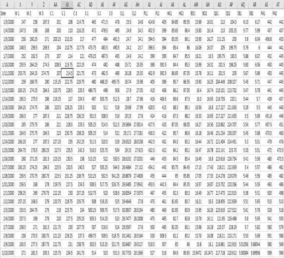

图 7.4 数据集。

Ret：价格的对数收益率。

Carry：`(rfunding – rcommodity)`

基于方程 3 中的公式

```
F = S0*(1+ (rfunding – rcommodity) *T/365)
```

方程 3

我们通过反推方程来计算 `(rfunding – rcommodity)`，得到：

```
(rfunding – rcommodity) = (F/S0 – 1) *365/T
```

方程 4

在小麦的情况下，结果为：

```
(rfunding – rcommodity) = (W2/W1 – 1) *365/T
```

我们将 `(rfunding – rcommodity)` 称为 `carry`。`rcommodity` 越高，`carry` 越低，意味着对该商品的需求越高。

标准差：我们还计算了收益率的 20 日标准差 `σret`。

持仓波动率比：我们定义 `carry-vol ratio = carry/σret`。作为特征，我们将前几周计算出的 `carry-vol` 作为输入。

## 目标

我们将此视为分类问题，因此有几种方法定义目标。为了简单起见，我们将其定义如下：

目标为：

* 如果次日收益率 > 0，则为 1
* 如果次日收益率 < 0，则为 -1
* 如果次日收益率 = 0，则为 0

注意，我们定义的第 1 天的目标取决于第 2 天的收益率。然而，第 2 天的收益率是 `log (第二天价格/第一天价格)`。承认，这样做会引入一些误差，因为它假设我们可以在第一天收盘时交易，这并不完全真实，模型需要收盘价作为计算特征。为了避免这一点，将收益率定义为 `log (第一天收盘/开)`，这意味着我们需要在第二天开盘时交易。

## 训练/验证/测试数据集

我们在 500 天的数据上训练模型，并在 50 天的数据上进行测试。

对于此类时间序列（如图 7.5、7.6 和 7.7 所示），适当的验证策略如下：我们在三个不同的验证集上建立三个模型。

模型 1：

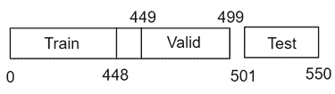

图 7.5 创建模型 1 的验证策略。

模型 2：

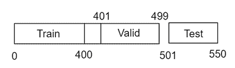

图 7.6 创建模型 2 的验证策略。

模型 3：

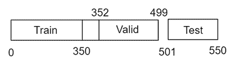

图 7.7 创建模型 3 的验证策略。

机器学习：我们使用了 `random forest`。我们搜索的参数如下：

* max_depth: [1, 3, 5, 7, 9]
* max_features: all
* min_samples_leaf: [1, 3]
* Number_estimators: 50

我们在图 7.8 中展示了整体方法。

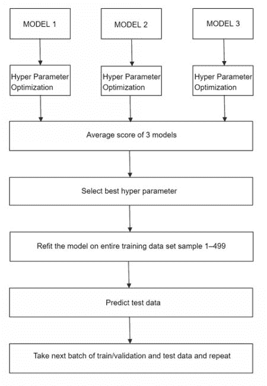

图 7.8 整体方法。

## 结果

通过执行此，我们得到了资产在特定一天上涨、下跌或保持不变的概率。

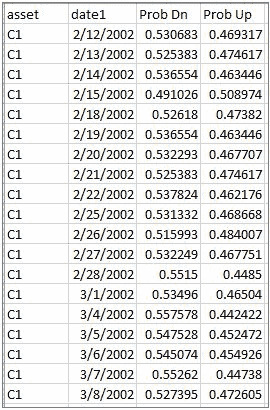

## 风险管理

一个简单的风险管理规则可以部署在这里：根据概率损益表进行头寸。

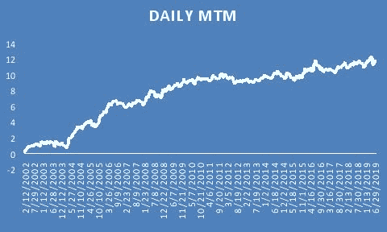

图 7.9 收益曲线。

收益曲线如图 7.9 所示。一些观察结果：

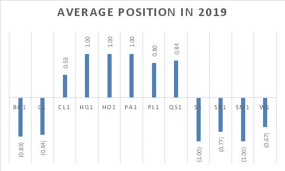

1. 看到该策略能够做多钯并做空农产品市场令人振奋。钯处于明显的背水状态。农产品市场处于巨大的升水状态。
2. 核心观点在于 AI 学习到了：如果借贷成本很高，价格会有上涨压力。


3. AI 在 2019 年 1 月做多原油表现良好，但它在 2 月做空、5 月做多，这并不完全聪明。我们可以做什么？
4. AI 在 15 日到 31 日期间做多玉米，在 7 月的大部分时间做空。

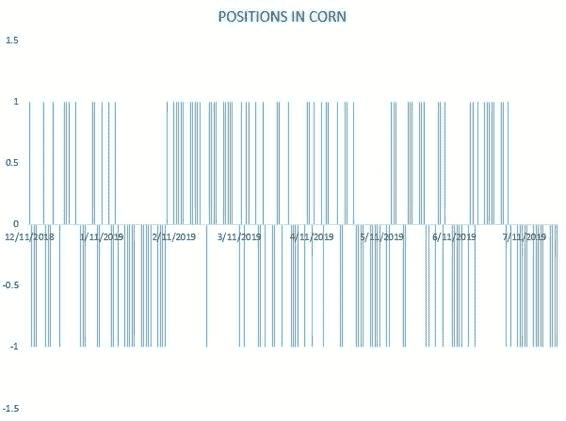

![手机截图，自动生成]

## 总结

* AI 能够从数据本身发现基于经济原理的交易策略。
* 在本章中，我们提供了创建和测试所需的完整步骤。

## 参考文献

* Christian L. Dunis&Jia Miao (2007) 使用波动率过滤器交易外汇组合：套利模型的回归，Applied Financial Economics, 17:3, 249-255. DOI: [10.1080/096031005004758](https://doi.org/10.1080/096031005004758)
* Daniel, Kent &Hodrick, Robert &lu, Zhongjin (2017). The Carry Trade: Risks and Drawdowns. Critical Finance Review. 6. 211-262. 10.1561/104.00000051
* ECB 工作论文系列：从套利交易到曲线交易

# 第八章 - 支持向量机

SVM 是用于分类和回归问题的监督学习算法。我们将从一些基础线性代数概念开始，以帮助理解极大间隔分类器。这将扩展到带有非线性内核的 SVM。

## 基础线性代数

### 点积

假设我们在二维坐标系 (x,y) 中有一个向量 u，如图 8.1 所示。

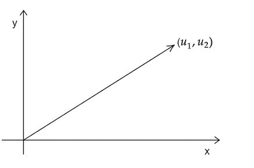

图 8.1 卡卡尔坐标系中的向量 U。

`u` 与另一个向量 `v` 的点积（图 8.2）由下式给出

`u.v = uTv = ǁuǁǁvǁcosθ` 其中 `θ` 是两个向量之间的角。

项 `ǁuǁcosθ` 是向量 `u` 沿向量 `v` 的投影

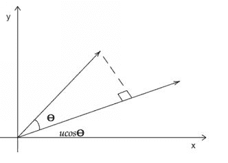

图 8.2 向量 `u` 与向量 `v` 的点积。

### 点到直线的垂直距离

假设我们有一个形式如下的方程

`βTX + β0 =0`

点 `u` 到此直线的垂直距离由下式给出

`d = Abs(βTu + β0 )/ǁβǁ`

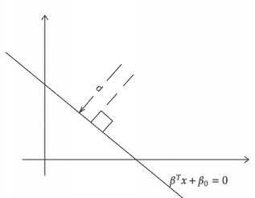

图 8.3 点 `u`到直线的垂直距离。

另一个重要的考虑因素是向量 `β` 垂直于直线 `βTX + β0`。

假设我们有两个位于直线 `L` 上的向量 `u` 和 `v`。向量 `u-v`（图 8.4）平行于该直线。

`βTu + β0 = 0`

`βTv+ β0 = 0`

`βT(u-v)= 0`

`β.(u-v) = ǁβǁ ǁu-vǁcosθ = 0`

`θ = 90 degrees`

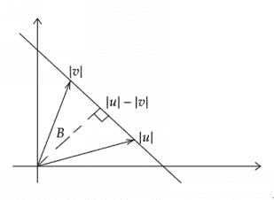

图 8.4 向量 `u` – `v` 垂直于向量 `β`。

这些应该是理解 SVM 所需的最少线性代数知识。让我们开始利用这些信息来理解 SVM。

### 分类

正如你现在可能知道的，分类问题如图 8.5 所示：

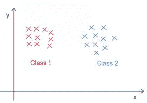

图 8.5 典型的分类设置。

我们有两个 (p=2) 特征 `X` 和 `Y` 以及两个由红色和蓝色叉分别表示的类别 `class1` 和 `class2`。我们将目标变量称为 `T`，`class1` 样本的目标为 1 (`T=1`)，而 `class2` 的目标为 -1 (`T=-1`)。

其核心思想是找到一个 (p-1) 维超平面（在这种情况下是直线），它能够完美地分离所有样本。

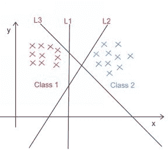

图 8.6 分离两个类的几种可能方法

如图 8.6 所示，有几种可能的解决方案。让我们理解我们所追求的解唯一性背后的直觉。我们从计算所有样本到直线的垂直距离开始（`L1`、`L2`、`L3` …… 线中的任意一条，在本情况下我们选择了 `L1`）（图 8.7）。

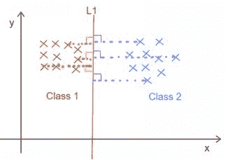

图 8.7 计算每个类别样本到 `L1` 的垂直距离

对于每个类别，我们只识别那些具有最小距离的样本，如图 8.8 所示（未按比例绘制）。

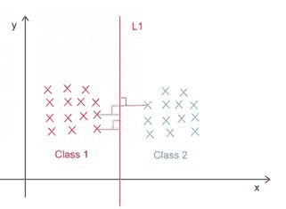

图 8.8 每个类别到该直线的最小距离。

并在此基础上，我们按照图 8.9 所示的虚线画出边界（margin）。我们将此距离标记为 `M`。

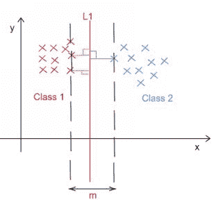

图 8.9 `L1` 的边界 `M`

我们对所有可能的直线集合重复此过程，因此对于 `L2`，它看起来像下面的图 8.10

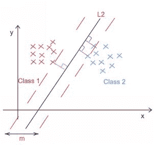

图 8.10 `L2` 的边界 `M`

我们选择 `M` 值最大的直线，因此在 `Line L1` 和 `L2` 之间，我们将选择 `Line L1`，因为它具有更高的边界（`M`）。

重要的考虑因素是：

* 我们希望选择一个线性分类器
* 所选的分类器不仅应该完美地分类所有样本，而且应该允许最大边界（`M`）误差
* 距离直线最近的样本决定了直线的形状；这些样本被称为支持向量。距离直线较远的样本对定义直线的影较小。

现在我们已经知道如何选择分离我们两个类的直线，让我们形式化我们的理解。

## 最大边界分类器

一旦有了直线，我们如何对样本（`u`）进行分类？我们只需取 `βTu + β0` 的符号。

如果大于 0，则它属于 class1。如果小于 0，则它属于 class2。

重要的考虑因素是：

* 我们希望选择一个线性分类器
* 所选的分类器不仅应该完美地分类所有样本，而且应该允许最大边界（`M`）误差
* 距离直线最近的样本决定了直线的形状；这些样本被称为支持向量。距离直线较远的样本对定义直线的影较小。

为了修改方程我们需要的是：

寻找 $\beta_0, \beta_1, \beta_2 \dots \beta_p, \beta_{12}, \beta_{22} \dots \beta_{p2}$ 的值


# 第八章 - 支持向量机

## 优化问题表述

1. 使得 $M$ 最大化

2. 使得对于所有 $n$ 个样本，$y_i(\beta_0 + \beta_1 x_{i1} + \beta_2 x_{i2} + \beta_3 x_{i3} \dots \beta_p x_{ip} + \beta_{12} x_{i1} + \beta_{22} x_{i2} + \beta_{32} x_{i3} \dots \beta_{p2} x_{ip}) \ge M$

3. 且 $\beta_{12} + \beta_{22} + \beta_{22} \dots + \beta_{p2} + \beta_{122} + \beta_{222} + \beta_{222} \dots + \beta_{p22} = 1$

某些文本对优化问题的陈述略有不同。让我们尝试理解其等价性。

问题的另一种表述是：

最小化 $\beta_0^2 + \beta_{12} + \beta_{22} \dots + \beta_{p2}$

如果 $y_i = 1$，$\beta^T x_i \ge 1$

如果 $y_i = -1$，$\beta^T x_i \le -1$

正如本章开头所述，向量 $\beta$ 于直线 $\beta^T x$。并且

$\beta^T x_i = \|\beta\| \|x_i\| \cos\theta \ge 1$

$\|x_i\| \cos\theta$ 是向量 $x_i$ 沿向量 $\beta$ 的投影，因此 $\|x_i\| \cos\theta$ 沿着一个垂直于分类器 $\beta^T x$ 的向量。由于我们的优化目标是最小化 $\|\beta\| = \beta_0^2 + \beta_{12} + \beta_{22} \dots + \beta_{p2}$，这等同于目标是最大化 $\|x_i\| \cos\theta$。这本质上是在说明我们需要选择一个能最大化 $\|x_i\| \cos\theta$ 的分类器，即样本到分类器的垂直距离。

## 核技巧

我们现在看到引入非线性的方法之一是引入非线性特征。一种更稳健的方法是核技巧（kernel trick）。

我们在核技巧中所做的是取每个样本，将其通过核变换并得到样本的新表示。然后我们对这些转换后的特征应用上述的算法。

那么，什么是核呢？核仅仅是一个函数。它可以是任何形式，但对于我们讨论的内容，它经常采取下面的形式：

$K(x, x_i) = e^{-(x-x_i)^2/2(\sigma^2)}$

当 $x$ 接近 $x_i$ 时，$K(x, x_i)$ 接近 1。

当 $x$ 与 $x_i$ 差异很大时，$K(x, x_i)$ 接近 0。

因此，对于特定的样本 $(x_u, y_u)$，我们为从 1 到 $n$ 的所有 $i$ 值计算 $K(x_u, x_i)$，其中有 $n$ 个样本。因此，原本是 $p$ 维的 $x_u$，现在在特征空间中是 $n$ 维的。我们将原始数据集中的所有 $n$ 个样本表示为这些 $n$ 维特征。原本的 $n \times p$ 现在变为了 $n \times n$。然后我们对这个特征空间应用 SVM 算法。

可以使用与树相同的特征，并如下所示训练一个 SVM 分类器：

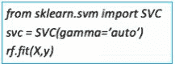

对相同输入比较不同的分类器通常是一个好主意。对于给定的特征集，建议对超参数进行网格搜索以获得最佳模型。当特征数量远高但可用数据很少时，SVM 的性能通常优于其他分类器。

## 总结

我们从一些线性代数的基础知识开始本章，并讨论了一个理想且过度限制的分类器“最大间隔超平面”。然后我们放宽了一些限制条件以构建了 SVM。

## 参考文献

* [`appliedpredictivemodeling.com/`](http://appliedpredictivemodeling.com/)
* [`faculty.marshall.usc.edu/gareth-james/ISL/`](http://faculty.marshall.usc.edu/gareth-james/ISL/)

# 第九章 - 深度学习

机器学习的使用日益等同于神经网络的使用，或更具体地说，与深度学习的使用。在本章中，我们将详细探索深度学习模型的工作原理。为了对神经网络的工作原理建立直观的理解，我们将探索使用神经网络来解决监督学习问题。我们将网络拆解为它的组件，以便你（读者）可以尝试并构建符合你特定要求的模型。换句话说，我们将试图揭开这个黑箱的迷秘。

## 神经元

神经网络正如其名，是一个神经元网络。每个神经元都是一个特殊的计算单元，通过两步操作将输入转换为输出。根据架构的不同，每个神经元将其输出传递给一组或多个神经元。假设神经元的输入是 $X$，神经元的输出是 $Y^*$。每个神经元关联着几个参数（稍后会详细介绍）。这些参数被称为权重 $W$ 和偏置 $b$。这些参数出现在每个神经元执行的两步骤的第一步。

### 第一步

计算一个值，我们称其为 $Z$，使得：

$Z = W^T X + b$

上标 $T$ 意味着我们需要对矩阵 $W$ 取转置。我们将 $W$ 的转置矩阵与输入 $X$ 相乘。然后我们将偏置加到该值上，生成我们的中间输出 $Z$。

### 第二步

涉及对中间输出 $Z$ 应用非线性函数以获得输出 $Y^*$。非线性函数被称为激活函数，$A(Z)$。

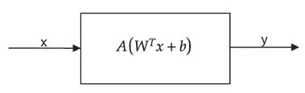

图 9.2 每个神经元执行的步骤：第一步和第二步。

为什么我们需要这些激活函数是“非线性”的？虽然我们有线性激活函数（如后所述），但在网络中很少单独使用。我们需要引入非线性的是因为能够近似所有可能的关系，或者从数学上说，连接我们的输入到最终预期输出的所有可能的函数。这种从任何输入到输出映射的能力被称为通用函数近似。换句话说，正是这种非线性有助于创建通用函数近似器——从而为神经学习系统提供了预测多个领域变量的能力。

### 激活函数

一些常用的激活函数如下：

#### Sigmoid

$A(Z) = 1/(1 + e^{-Z})$

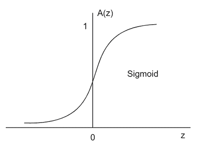

图 9.3 Sigmoid 激活函数。

如图 9.3 所示，sigmoid 激活函数始终为正，且处于 0 到 1 之间。假设 `Z` 是一个非常小的数字，即 `Z` 趋于负无穷，`e^{-Z}` 趋于无穷大，`A(Z)` 将趋于 0。同样，当 `Z` 非常大，即 `Z` 趋于无穷大，`e^{-Z}` 趋于 0，`A(Z)` 将趋于 1。它被用于分类任务——特别是带有交叉熵损失的二分类最终输出。

#### Tanh

`A(Z) = (e^Z – e^{-Z})/(e^Z + e^{-Z})`

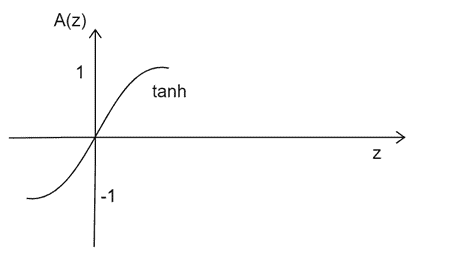

图 9.4 Tanh 激活函数。

##### 特性

1. 于 -1 和 1 之间（图 9.4）

如果我们使用交叉熵作为损失函数，不建议在输出层使用 `tanh` 作为激活函数。

#### ReLU (整流线性单元)

`A(Z) = max(0,Z)`

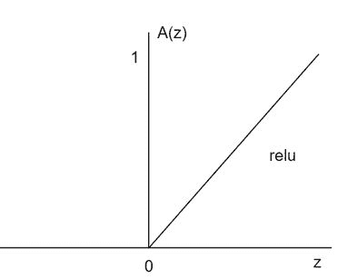

图 9.5 ReLU 激活函数。

##### 特性

1. 始终为正（图 9.5）
2. 目前最流行的激活函数之一
3. 它不能很好地映射负值，因为所有负值都会被映射为零。

#### Leaky-ReLU

`A(Z) = max(aZ,Z)`

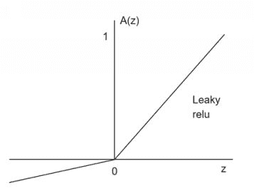

图 9.6 Leaky ReLU 激活函数。

##### 特性

1. 试图减少 `ReLU` 中负值映射的问题。（图 9.6）。
2. 需要决定超参数 `a` 的值。它通常是一个小值，如 `0.01`、`0.001` 等。

#### 线性激活

`A(Z) = Z`

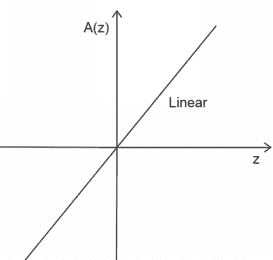

图 9.7 线性激活函数。

不能单独使用，因为无论你的网络有多深，你本质上都在反复计算同一个函数（图 9.7）。

#### Softmax 激活

对于具有 `C` (>=2) 个可能类别值的多分类问题，`softmax` 输出定义为

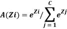

这确保了每个样本的所有 `C` 个预测值之和为 1。

### 层

一组连接到另一组神经元的神经元，但神经元之间并不一定相互连接。构成神经网络架构框架的层类型如下：

#### 输入层

如名所示，这是包含来自数据集输入特征的层。这是神经网络的第 0 层。它连接到一个或多个隐藏层。

#### 隐藏层

这些是神经网络的“力马”。它们接收来自输入层或其他隐藏层的输入，并将其输出提供给其他隐藏层或网络的输出层。

#### 输出层

这是网络的最后一层，提供处理的输出。根据我们处理的是分类问题还是回归问题，输出可以是概率、类别、实数等。

如果隐藏层和输出层的总数等于“L”，则该神经网络被称为“L 层网络”。因此，一个具有一个输入层、一个输出层和一个隐藏层的神经网络（NN）被称为二层网络（输入层是第 0 层）。此类网络的示例如图 9.8 所示。“深度学习”一词本质上意味着网络中存在大量的隐藏层。在图 9.8 中，我们只展示了前向传播的方向。反向传播在相反方向进行（此处未显示）。

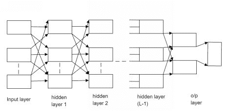

图 9.8 前向传播与反向传播示意（注：此处原文表述略显重复，意指展示方向）。

图中我们仅展示了前向传播的方向。反向传播在相反方向进行（此处未显示）。

### 全连接网络

在神经网络中，每一层的所有神经元都连接到下一层的所有神经元，这被称为全连接网络。全连接网络在深度学习中非常常见，尽管它们计算开销较大。

## 轮次 (Epoch)

一个 epoch 指整个训练数据集通过神经网络前向传播一次。

## 参数与超参数

如前文所述，多个变量会影响神经网络的结果。其中某些变量称为参数，它们是在前向传播和反向传播过程中学习到的。权重和偏置属于这一类。另一方面，还有一些由用户提供的，例如学习率。这些变量被称为超参数。它们是用户选择的，但会影响网络的结果。我们目前为止的其它超参数包括层数、每层的神经元数量等。为了获得网络最佳性能，调整这些超参数至关重要。有几种方法可以选择最佳超参数。

### 网格搜索

为所有超参数指定值范围。

1. 为所有可能的超参数值组合训练神经网络。
2. 从所有可能的组合中选择构建性能最好的神经网络值。
3. 这种方法最大的问题是超参数组合数量呈指数级增长。

在给定范围内选择值时，没有必要通过均匀选择值来搜索。应该根据取值的范围来选择值。例如，如果某个超参数的观察范围是 2–8，可以选择 2, 3, 4, 5, 6, 7 和 8 等均匀值。如果范围是 32–1024，可以按照 2 的幂次间隔选择值，即 32, 64, 128, 256, 512 和 1024。需要注意的是，如果允许训练足够长的时间或使用足够复杂的网络，神经网络架构能够针对训练集提供的输入学习到精确的输出。然而，它并不一定能够预测在未见数据上的输出。这被称为**过拟合**。

### 过拟合

让我们来看减少过拟合的一些重要且常见的方法。

#### 更多数据

如果神经网络在现有的训练数据上发生了过拟合，那么解决此问题的逻辑步骤就是添加更多的训练数据。然而，这并不总是容易的，因为这可能耗时且成本昂贵。

#### 正则化

通过在反向传播中添加正则化组件来对网络的复杂度进行惩罚。这在本质上有助于减少大量隐藏单元的影响，实际上使网络变得简单得多。

#### Dropout（丢弃）

对于神经网络训练的每一个示例，都会随机丢弃一些神经元。被选择丢弃的神经元随每个示例而变化。这使得网络更简单，并防止任何神经元在确定输出中占据主导。使用 dropout 时需要记住两点：

*   Dropout 仅用于训练，而不用于预测阶段。
*   由于激活值的期望值随丢弃神经元的比例而减少，激活值的期望值会被放大以补偿这种减少。这被称为反向 Dropout（inverse dropout）。

上述两个问题都由所有神经网络的标准实现处理，因此你不需要显式地编写代码。

#### 早停

确定是否发生过拟合的视觉化工具之一是绘制代价函数随迭代次数的变化图。如果训练集和开发/验证集的代价都随着迭代次数的增加而减少，我们可以继续训练。

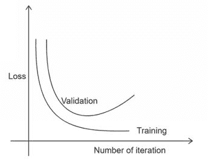

图 9. 识别何时发生过拟合

早停的问题在于，它混合了防止过拟合和优化代价函数这两个正交（或独立）的任务。

### 改进优化的方法

这引出了下一个主题：我们如何优化代价函数，也就是说，我们如何让训练更快更高效？

#### 缩放/归一化输入

缩放参数仅基于训练集。验证集和测试集的输入或特征需要根据训练集学习到的缩放参数进行缩放。缩放有什么帮助？缩放确保了即使底层输入的实际值发生变化，其均值和方差也是预知的。通过使用缩放，可以构建更优的模型。

#### 批量归一化 (Batch normalization)

与前文逻辑类似，归一化从一层传递到另一层的激活值是有益的。关于应该归一化中间值 `Z = wX + b` 还是激活值 `Act(Z)`，存在争议。

另一个注意的点是，你可能不希望所有的隐藏单元具有 0 均值 1 方差。为了避免这种情况，将归一化的中间值乘以参数 `gamma` 并加上参数 `Beta`。这些都是通过梯度下降或其他方法（如后续描述的 `RMSprop`、`Adam` 优化器）学习的参数。

#### 参数初始化

在训练开始之前，需要对各个层和神经元链接的权重和偏置进行初始化。根据实践经验，很明显初始化方法通过减少梯度消失或梯度爆炸的影响来影响网络的可学习性。神经网络的标准实现提供了各种初始化方法，如 He 初始化、Xavier 初始化（细节超出本书范围）等，或者你也可以使用自定义的初始化器。注意，权重矩阵不应初始化为 0，因为这将由于多层结构而导致学习失效。

#### 小批量梯度下降 (Mini-batch gradient descent)

将训练集分成若干较小的子集，并每次对其中一个较小的批次应用梯度下降。这被称为小批量梯度下降。如果每个子集的大小为 1，则被称为随机梯度下降。小批量大小（Mini-batch size）也是一个超参数。

#### 动量梯度下降 (Gradient descent with momentum)

这利用梯度的指数平均来更新权重和偏置等可学习参数。

#### RMSprop(均方根传播)

在每次迭代中，计算梯度平方的指数加权平均。通过当前梯度的缩放值（由梯度平方的指数加权平均的平方根缩放）来更新权重和偏置。

#### Adam 优化

它结合了带动量的梯度下降和 RMSprop。大多数标准库都内置了 Adam 优化。

## 用于分类和回归问题的损失函数

### 多类分类

如果我们有具有具有 C 个可能类别值的分类问题，则交叉熵损失定义为

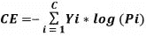

其中 `images/00098.jpeg` 是真实值，`images/00099.jpeg` 是属于类别 `i` 的概率。这适用于一个样本可能属于多个类别的情况，因此 `Yi` 可以是维度为 `C` 且包含多个值的向量。

### 回归

回归设置中最常用的损失函数是均方误差、平均绝对误差和平均百分比误差。

### Keras 实现

实现深度网络的首选包是 Keras。让我们来看示例代码。

`y_train`、`y_test` 和 `y_valid` 表示的目标值每个样本具有 1、-1 或 0，并如下所示转换为 ONE HOT 表示。


在下方添加第一个隐藏层，具有 `dl1= 64` 个神经元、`af1="relu"` 激活函数，权重使用 `l2` 正则化，参数为 0.08


添加下一层作为 dropout，丢弃概率设置为 .25


添加输出层，具有三个神经元且激活函数为 softmax


编译并拟合，损失函数设置为交叉熵，`Adam` 优化器且学习率为 `lr1`。在训练数据上拟合，在验证数据上验证，并在验证准确率上设置早停


针对 `lr1(学习率)`、`dfl1` 和 `af1(激活函数)` 的超参数优化。


## 金融应用：处理不平衡数据集

之前提到的，神经网络是通用函数近似器，可以解决金融领域的各种问题。让我们讨论这样一种设定。

我们在分类问题中经常遇到不平衡类别。假设我们对预测 CME 黄金期货的下一个跳价感兴趣。我们将其设定为一个 3 类问题，其中我们为样本分配

# 第十章 - 卷积神经网络

标签 1：对应下一个 tick 高于当前 tick 的样本。我们称之为 `class1`。

标签 0：对应下一个 tick 与当前 tick 相同的样本。我们称之为 `class 0`。

标签 -1：对应下一个 tick 低于当前 tick 的样本。我们称之为 `class 2`。

图 9.10 是我们的数据集可能呈现的快照。

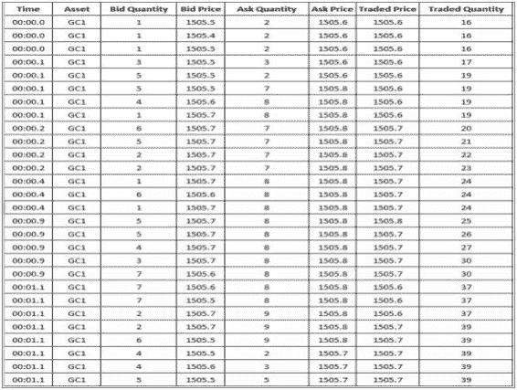

图 9.10 CME 黄金期货高频数据的快照。

在整个 2018 年，我们大约有 2000 万个样本，其中 15% 属于 `class 1`，15% 属于 `class 2`，70% 属于 `class 0`。因此，如果我们的机器预测所有样本都属于 `class 0`，我们的准确率将达到 70%，这可能是相当合理的。在训练期间，我们的机器 70% 的时间都会看到属于 `class 0` 的样本。如果超参数的选择使得机器具有“偏见”，那么很有可能所有样本都被预测为属于 `class 0`，这本质上意味着我们不会进行交易，因此不会盈利。这是我们在处理不平衡数据集时的一个经典问题。我们提出的解决方案涉及对代价函数的修改。让我们来看细节：

对于一个特定样本，三分类问题的分类交叉熵为：


# 代价函数修改与卷积神经网络

## 代价函数

标准交叉熵代价函数为：

```
CE = -y0log(p0) – y1log(p1) – y2log(p2)
```

其中 `Yi = 1, ∀ i = 0,1,2`，且 `pi` 为样本属于 `class i` 的概率。

针对不平衡类别的修改后代价函数为：

```
CEmodified = -(w0y0log(p0)) – (w1y1log(p1)) – (w2y2log(p2))
```

其中 `wi` 是 `class i` 的权重，计算方法为该类别在训练数据集中出现频率的倒数。由于 `class 1` 出现在 15% 的样本中，`w1 = 1/(15%) = 6.66`，`w0 = 1/(70%) = 1.42` 且 `w2 = 6.66`。

最后，这是我们在 Keras 中实现它的方式：

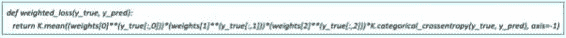

该函数在编译模型时被调用：


## 总结

- 我们引入了构建深层神经网络架构所需的所有构建组件。
- 我们还向你介绍了用于实现神经网络的 Keras API。
- 最后，我们讨论了如何修改代价函数来处理不平衡数据集。

## 参考文献

1. “Dropout: A Simple Way to Prevent Neural Networks from Overfitting” 由 Srivastava, Hinton 等撰。
2. [`www.deeplearningbook.org/`](https://www.deeplearningbook.org/)
3. [`keras.io/`](https://keras.io/)
4. Gu, Shihao & Kelly, Bryan & Xiu, Dacheng (2018). Empirical Asset Pricing Via Machine Learning. SSRN Electronic Journal. `10.2139/ssrn.315957`。
5. Lim, Bryan & Zohren, Stefan & Roberts (2019). Enh Time Series Momentum Strategies Using Deep Networks.

# 卷积操作

本章介绍卷积网络。然后我们尝试揭示这种网络如何被用于发现用于交易的图表模式，这是一些交易员已经能够部署的方法。首先讨论点积操作，以及它如何与神经网络语境下定义的卷积操作相关。

## 点积与相似度

让我们从观察两个简单向量 `U` 和 `V` 开始。


两个向量之间的点积操作产生 `U·V`。

让我们取另一个定义如下的向量 `W`：


请注意 `||W|| = ||V||`。向量 `U` 和 `W` 之间的点积操作产生 `U·W`。

两个向量越相似，在对它们的模长 `||·||` 进行调整后，它们的点积值越高。由于向量 `U` 和 `V` 的点积大于向量 `W`，即 `U·V > U·W`，我们推断向量 `U` 和 `V` 比 `W` 更为相似。

## 卷积操作

我们现在将讨论两个向量之间的卷积操作，以及它应用于卷积神经网络的方式。让我们定义一个长度为 6 的向量 `U` 为：


一个我们称为长度为 2 的滤波器向量 `f` 定义为 `|f=2|`。我们取 `U` 与 `f` 的点积。

因此，如果 `f` 假设的形状如图 10.8 所示（虚线代表滤波器的离散性），并且我们将其与图 1 中的时间序列 `P` 进行卷积，那么卷积操作将在波形 1 和波形 3 附近的某处产生高值，这就是时间序列 `P` 与滤波器 `f` 之间相似度最高的地方。因此，卷积操作有助于我们找到时间序列 `P` 中何处出现了滤波器 `f` 的形状。


**图 10.8** 一个假设的离散滤波器。

到目前为止，我们已经理解了卷积的含义以及它的作用。神经网络在这一切中处于什么位置呢？

神经网络帮助我们找到这个滤波器 `f`。换句话说，时间序列中哪些形状是必须出现以满足目标的，即哪些形状导致了抛售。

神经网络本质上需要找到该滤波器的形状/数值和长度，使得市场发生抛售。反向传播算法将用于训练和调整滤波器的数值，以确保发生抛售。从这个意义上说，卷积神经网络帮助我们在时间序列中找到符合我们目标的模式，而这些目标是由目标函数定义的，即市场抛售。这有助于特征抽象。

无论滤波器值是多少，都是应用于整个时间序列的同一组值，以找到某种模式。只要时间序列中任何地方出现相同的模式，滤波器就能识别它。滤波器的值不需要改变即可实现寻找模式的目标。这种属性被称为**平移不变性**（translation invariance）。希望我们已经解释了如何使用 CNN 来寻找符合目标函数的特征。在接下来的几个章节中，我们将讨论 CNN 架构的更多重要元素。

## 填充

在目前的形式下，向量边缘的价格点似乎没有中间的价格点重要。


**图 10.9** 与滤波器卷积的时间序列

在图 10.9 中，卷积过程中，`P1` 和 `P5` 只被使用了一次；分别对应滤波器值 `f1` 和 `f2`。相比之下，`P2`、`P3` 和 `P4` 与滤波器使用了两次。此外，每当我们对长度为 `n` 的时间序列与长度为 `f` 的滤波器进行卷积时，得到的时间序列长度为 `n-f+1 < n`。随着架构的加深，这可能会负面影响学习能力。我们可以选择在时间序列两侧填充 `2p` 个零，每侧 `p` 个，如图 10.10。现在时间序列的长度变为 `n+2p`，当与滤波器 `f` 卷积时，产生长度为 `n+2p-f+1` 的时间序列。


**图 10.10** 填充时间序列

如果我们希望保持时间序列长度不变，则 `n+2p-f+1 = n`，即：

```
P = (f - 1) / 2
```

这被称为**“相同卷积”**（same convolution）。

如果 `P = 0`，则被称为**“有效卷积”**（valid convolution）。

## 步长

当我们执行每次点积操作后沿向量移动滤波器时，我们是以 1 步为单位移动的。步长实际上被假设为 1。但这并不总是如此。假设我们有一个给定的向量 `u`：


以及给定的滤波器 `f`：


步长为 `2` 的卷积操作由图 10.11 所示的步骤组成：


**图 10.11** 步长为 2 的卷积操作

实际上：


泛而言之，当我们将一个 `n` 维向量与 `f` 维滤波器进行卷积并使用步长 `s` 时，我们得到大小为 `[(n+2p-f)/s + 1]` 的输出。

```
1 × n © 1 × f = 1 × [(n + 2p - f)/s + 1]
```

为什么我们要对交易时间序列添加步长呢？一种思考是，我们正在跨时间框架寻找机会。感兴趣的模式并不一定需要出现在最细粒的时间步上——它在更高的时间步上可能更可见。相同的步长允许月线、日线和日内框架的使用。

## 多滤波器

到目前为止，我们一直在使用一个滤波器。然而，我们可以根据需要添加许多滤波器。

## 多通道作为输入

多维输入也被称为多通道。同一时间序列的不同表示形式可以放入这些不同的通道中。

当池化操作应用于具有多个通道的输入时，它会独立地应用于每个通道。因此，输出的通道数与输入相同。

卷积神经网络的典型配置如图 10.16 所示：


**图 10.16** 全卷积配置

在图 10.16 中，我们从一个维度为 `1×100` 的输入开始，假设这是过去 `100` 天的收益率。我们将其通过六个过滤器；每个过滤器的维度为 `1×5`。输出的维度为 `1×(100−5+1) = 1×96`，由于有 `six` 个过滤器，我们将它们各自的输出堆叠起来，得到维度为 `1×96×6` 的输出。

然后，我们将此输出通过一个参数 `f = 2`、步长 `s = 2` 的最大池化层。池化操作不会改变通道数（通道数设置为 `6`）。最大池化将维度从 `1×96×6` 缩小到 `1×[(96−2)/2+1]×6 = 1×48×6`。

接着，我们将此 `1×48×6` 的输出通过 `10` 个过滤器——每个大小为 `1×10`——但这次我们使用了步长 `2`，导致输出维度为 `(1×(48−10)/2 + 1×10) = 1×20×10`。

随后，我们将此二维表示扁平化为一个一维向量，其长度简单地为 `1*20*10 = 200`。然后将其通过一个具有 `20` 个神经元的普通全连接多层感知机。连接扁平化向量与该全连接密集层的权重矩阵维度为 `20*200 = 4000` 参数。

最后，这 `20` 个神经元的输出被传递给 `softmax` 函数，它帮助我们预测市场上涨还是下跌。

上述是一个包含许多超参数的通用配置，需要彻底的随机搜索。

让我们来看一个具体的例子。

## 金融应用：为多资产交易提取特征

我们的示例数据集如图 10.17 所示：


**图 10.17** 数据模板

其中目标假设两个值：`0`（市场下跌）和 `1`（市场上涨）。

我们将其修改为如图 10.18 所示：


**图 10.18** 重新调整原始数据

其中 `n_col` 是某个特定的回溯窗口，例如 `100`。执行此转换的函数如图 10.19 所示：


**图 10.19** 重新调整原始数据以获取图 10.16 所示形状的代码

我们现在在图 10.20 中定义我们的架构：


**图 10.20** 卷积操作的示例代码

当输入是像卫星图像之类的图像时，`CNN` 应该是首选。对于其他类型的数据，则需要进行实验。

## 总结

* 我们分享了关于如何使用卷积操作进行特征生成的见解。
* 卷积神经网络具有参数共享和连接稀疏的属性。
* 整个时间序列使用相同的权重和偏置。这被称为**参数共享**。
* 连接的稀疏性存在是因为时间序列的“局部”部分连接到了网络。
* 与全连接多层感知机相比，连接的稀疏性和参数共享减少了潜在的过拟合。

# 第十一章 - RNN：循环神经网络

在本章中，我们将理解循环性，并讨论捕捉循环关系的架构。让我们先开始解释什么是循环关系以及为什么需要它。然后我们将修改对普通神经网络的理解，并看看需要做哪些更改以便我们能够捕捉循环关系。我们将讨论几种架构，即 `RNN`（循环神经网络）、`LSTM` 和 `GRU`。最后，我们将通过一个示例讨论如何向这种架构提供数据，以及需要训练哪些参数。

## 在神经网络中实现循环函数

神经网络被称为通用近似器。也就是说，给定一组输入，我们可以对一个函数进行建模。假设 `Xt` 依赖于 `Vt`。我们想要创建一个函数，使得：

```
Xt = F(Xt-1, Vt)
```

其中 `n` 是回溯窗口。如果 `m = 1`，那么：

```
Xt = F(Xt-1, Vt)
```

本质上，`Xt` 依赖于 `Xt-1`。这意味着：

```
Xt = F(Xt-1, Vt)
```

根据我们在图 11.1 中讨论的内容，隐藏层的输出可以是：

```
Xt = F(Xt-1, Vt)
```

现在，在 `RNN`（循环神经网络）中，我们设置 `At = Ht+1`。这种方式是可学习的。

```
Xt = F(Xt-1, Vt)
```

输出如下：

```
Xt = F(Xt-1, Vt)
```

关注时间步 t（图 11.2），隐藏层的输出可以为：

```
Xt = F(Xt-1, Vt)
```

此外，`Xt` 为：

```
Xt = F(Xt-1, Vt)
```

现在，在 `RNN` 中，我们设置 `At = Ht+1`。这种方式是可学习的。

```
Xt = F(Xt-1, Vt)
```

输出为：

```
Xt = F(Xt-1, Vt)
```

隐藏层的输出可以是：

```
Xt = F(Xt-1, Vt)
```

此外，`Xt` 为：

```
Xt = F(Xt-1, Vt)
```

现在，在 `RNN` 中，我们设置 `At = Ht+1`。这种方式是可学习的。

```
Xt = F(Xt-1, Vt)
```

隐藏层的输出可以是：

```
Xt = F(Xt-1, Vt)
```

隐藏层的输出可以是：

```
Xt = F(Xt-1, Vt)
```

隐藏层的输出可以是：

```
Xt = F(Xt-1, Vt)
```

隐藏层的输出可以是：

```
Xt = F(Xt-1, Vt)
```

隐藏层的输出可以是：

```
Xt = F(Xt-1, Vt)
```

隐藏层的输出可以是：

```
Xt = F(Xt-1, Vt)
```

隐藏层的输出可以是：

```
Xt = F(Xt-1, Vt)
```

隐藏层的输出可以是：

```
Xt = F(Xt-1, Vt)
```

隐藏层的输出可以是：

```
Xt = F(Xt-1, Vt)
```

隐藏层的输出可以是：

```
Xt = F(Xt-1, Vt)
```

隐藏层的输出是：

```
Xt = F(Xt-1, Vt)
```

隐藏层的输出是：

```
Xt = F(Xt-1, Vt)
```

### 金融应用：交易 CME 期货

这里的例子将帮助我们具体化这个想法。我们将尝试预测明天 CME 黄金期货的收益率。

### 符号

- `Xt = (CPt+1 – CPt) / CPt`，其中 `CPt` 代表第 `t` 天的收盘价。
- `XLt = (LPt+1 – LPt) / LPt`，其中 `LPt` 代表第 `t` 天的低价。
- `XtR = (CPt+1 – CPt) / CPt`，其中 `CPt` 代表相关性（如美元指数）第 `t` 天的收盘价。
- `XORt = (OPt+1 – OPt) / OPt`，其中 `OPt` 代表相关性（美元指数）第 `t` 天的开盘价。
- `XHRt = (HPt+1 – HPt) / HPt`，其中 `HPt` 代表相关性（美元指数）第 `t` 天的最高价。
- `XLRt = (LPt+1 – LPt) / LPt`，其中 `LPt` 代表相关性（美元指数）第 `t` 天的低价。

理想情况下，我们希望拥有更有意义的特征，这些特征源自订单簿，例如关于预期当天类型的信息（经济数据高/低）、任何季节性影响、期权偏斜、隐含—历史波动率差、CFTC 持仓量分布、每日成交量等。在这里我们只是讨论结构；因此，我们将保持简单。让我们进一步定义：

```
Vt−1 = [Xt−1, XOt−1, XHt−1, XLt−1, Xt−1R, XORt−1, XHRt−1, XLRt−1]
m = 8
```

让我们取 `h = 32`，这是我们在前述图表中指定为 `MLP` 的隐藏层神经元数量。为了后文的起见，我们将称其为 `RNN` 而不是 `MLP`。

我们将此设定为一个分类问题：

- `Yt = 1`，如果 `Xt > 0`
- `Yt = 0`，如果 `Xt = 0`
- `Yt = -1`，如果 `Xt < 0`

我们将使用 `Keras` 来实现这一点。还有另一个重要的超参数需要解释，即时间步数。在我们到目前的定义中，时间步数等于 `n`。

如果 `n = 10`，我们的设置将如图 11.5 所示。


**图 11.5** RNN 的 10 个时间步展开视图

重申一下我们正在做的：我们获取 `V0` 和 `h0`（初始化为 0），通过 `RNN` 学习它们的关系并预测 `Y1`。


**图 11.6** 使用 RNN 预测第一个时间步的输出。

接下来，我们获取这些学习结果 `h1` 以及下一个时间步的输入 `V1`，并将其通过同一个网络以预测 `Y2`。我们还更新了对映射 `Vi` 到 `Yi` 的函数的理解，也就是说，我们将 `h1` 更新为 `h2`，旨在更好地理解预测 `Y0` 和 `Y1` 的因素是什么。


**图 11.7** 使用与图 11.6 相同的 RNN 预测第二个时间步的输出。

现在我们更好地理解了什么将 `V0` 和 `V1` 映射到 `Y1` 和 `Y2`，我们移动到下一个时间步，在那里我们获取 `h2` 和 `V2` 来得到 `Y3`。此外，在过程中我们再次更新了对 `Vi` 和 `Yi` 之间关系的理解。更新后的关系被记录在 `h3` 中，如图 11.8 所示。


**图 11.8** 使用与图 11.6 和 11.7 相同的 RNN 预测第三个时间步。

我们重复这个过程，直到达到 `n = 10` 个时间步。

还剩下一些考虑因素。我们是如何更新 `RNN` 的权重和偏置的；换句话说，我们是如何进行反向传播的。在此之前，让我们先完成设置，即我们如何向 `Keras` 等包提供数据。

### Keras 实现：设置特征

在我们的原始数据中，目前的样本看起来如下：

- 样本 1：`[V0, Y1]`
- 样本 2：`[V1, Y2]`
- 样本 3：`[V2, Y3]`
- 样本 4：`[V3, Y4]`
- …
- 样本 t：`[Vt, Yt+1]`

然而，RNN 需要一次性呈现 `n = 10` 个时间步作为一个样本。因此，一个 RNN 样本看起来像：

```
[[V0], [V1], [V2], [V3], [V4], [V5], [V6], [V7], [V8], [V9]]
```
用于预测
```
[[Y1], [Y2], [Y3], [Y4], [Y5], [Y6], [Y7], [Y8], [Y9], [Y10]]
```


由于每个向量 `V` 有八个元素，因此这是一个 10 × 8 的矩阵，10 是时间步数。因此，一个样本被表示为维度为 `[10, 8]` 的矩阵。因此，我们的整个批次将表示为形状为 `[batch size, 10, 8]` 的三维矩阵。这就是 RNN 输入的形状。其中 `V` 的形状为 `[batch size, 10, 8]`（注：此处原文描述似乎有重复或表述偏差，已根据语意按原逻辑翻译）。

`C(t) = GU*At + (1−GU) * C(t−1)`

如果 `GU = 0`，`C(t) = C(t−1)`，因此内存不更新。

如果 `GU = 1`，`C(t) = At`，因此内存被 `At` 覆盖。

描述 GRU 行为的方程如下：

`At = tanH (WA [C(t−1), X(t−1)] + bA)`

`GU = Sigmoid (WU [C(t−1), X(t−1)] + bU)`

`C(t) = GU*At + (1 − GU) * C(t−1)`

`At = C(t)`

这些方程看起来可能很复杂，但在 `Keras` 中的实现相对简单。

### LSTM

LSTM 背后的概念非常相似，它只是有更多的门控。其中，LSTM 区分了 `At` 和 `C(t)`。

它定义了输出门，这桥接了 `At` 和 `C(t)` 之间的差距。

`GO = Sigmoid (WO[C(t−1), X(t−1)] + bO)`

`At = GO*tanH(Ct)`

LSTM 保留了 `GU`，即更新门。`(1 – GU)` 或遗忘门的作用被建模建模：

`GF = Sigmoid (WF[C(t−1), X(t−1)] + bF)`

因此，内存的更新写为：

`C(t) = GU*At + (GF)* C(t−1)`

描述 LSTM 行为的方程如下：

`At = tanH (WA[C(t−1), X(t−1)] + bA)`

`GU = Sigmoid (WU [C(t−1), X(t−1)] + bU)`

`GF = Sigmoid (WF [C(t−1), X(t−1)] + bF)`

`GO = Sigmoid (WO[C(t−1), X(t−1)] + bO)`

`C(t) = GU*At + (GF)* C(t−1)`

`At = GO*tanH(C(t))`

所有这些方程和其他点起初可能看起来令人 overwhelming，但如果你理解了我们为什么要用 `GRUs` 和 `LSTMs` 替换 `RNN`，那么就是一个很好的开始。绝大多数 `APIs`（应用程序接口）都为我们处理了这些严谨性，坦白说，我本人几乎不关心这些方程。

让我们来看一个简单的例子。我们的输入快照如图 11.14 所示：

| 日期 | 开盘价 | 最高 | 最低 | 收盘价 | 目标 |
| --- | --- | --- | --- | --- | --- |
| 19950112 | -2.05 | -4.9 | -2.5 | -5.25 | 0 |
| 19950113 | -3.8 | 0.85 | -1.8 | 2.3 | 1 |
| 19950116 | 0.9 | 1.45 | 1.5 | 1.2 | 1 |
| 19950117 | 1.75 | -1.2 | -0.3 | -2.85 | 0 |
| 19950118 | -2.45 | -4.25 | -2.5 | -1.8 | 0 |
| 19950119 | -2 | 1.35 | -1.7 | -1.35 | 0 |
| 19950120 | -1 | -1.4 | -1.4 | -0.45 | 0 |
| 19950123 | -2.4 | -0.95 | 3.2 | 2.7 | 1 |
| 19950124 | 4 | 3.45 | -0.9 | -0.25 | 0 |
| 19950125 | 0.2 | 0.2 | 0.1 | 0.65 | 1 |
| 19950126 | 0.6 | 0.5 | -0.05 | -0.4 | 0 |
| 19950127 | -0.6 | 0.1 | 6.25 | 3.25 | 1 |
| 19950130 | 4.5 | 3.7 | -1.2 | 1.25 | 0 |
| 19950131 | 0.3 | 0.6 | 1.3 | 1.9 | 1 |
| 19950201 | 1.7 | 0.7 | 0.4 | -1.1 | 0 |
| 19950202 | -1.2 | 0.2 | -1.5 | -0.05 | 0 |
| 19950203 | -0.35 | -0.4 | 0.3 | -0.05 | 0 |
| 19950206 | 0.8 | 0.8 | 0.7 | 0.4 | 0 |
| 19950207 | 0.1 | 0.45 | -0.2 | 1.1 | 0 |
| 19950208 | 0.95 | -0.25 | 0.1 | -1.2 | 0 |

图 11.14 输入 LSTM

我们将 `time steps = 50` 和 `features = 4`。在通过 `data_generator` 函数后，我们将输入重塑为：

`(样本数, 50, 4)`

我们如下设置 `LSTM`，内存大小为 32。


模型看起来如下：


在此设置中，一个内存大小为 32 的 `LSTM` 层有 436 个参数，这是权重和偏置的总数。我们是如何得到的？

`Xt = (batch size, 4)`

`ht−1 = (batch size, 32)`

因此输入大小为 `[Xt, ht−1] = [batch size, 36]`

输出维度为 `[batch size, 32]`。

权重矩阵 = `36*32`。

偏置参数 = `32`。

`WA, WC, WO = 4*36`

`bA, bU, bO = 4*32`

## 总结

在本章中，我们学习了 RNN、LSTM 和 GRU 等新概念。通过例子，我们解释了如何设置循环网络以及各种参数的含义。这些概念有助于自动化交易。

## 参考文献

* [`deeplearning.cs.cmu.edu/`](http://deeplearning.cs.cmu.edu/)
* [`www.deeplearningbook.org/`](https://www.deeplearningbook.org/)
* Lim, Bryan & Zohren, Stefan & Roberts (2019). Using Deep Neural Networks to Enhance Time Series Momentum
* [`colah.github.io/posts/2015-08-Understanding-LSTMs/`](https://colah.github.io/posts/2015-08-Understanding-LSTMs/)

# 第十二章 - K 近邻

在本章中，我们将讨论适用于分类和回归任务的 K 近邻（KNN）算法。我们将讨论如何将该算法作为股票市场的“择时指标”。一如既往，重点将放在建立直觉，而不是开发一个完整的系统。最后，我们将根据机器学习的内容对股票市场得出见解。

## KNN 算法

要理解 `KNN` 算法，首先需要理解 Minkowski 距离。图 12.1 给出了我们数据集的快照。


图 12.1 考虑的数据集

让我们从数据集中选取样本 `xa` 和 `xb`，如图 12.2 所示，具有 `n` 个样本和 `P` 个特征。


图 12.2 从我们的数据集中采样的 `xa` 和 `xb`

`minkowski distance` 的定义如下方的方程 12.1：


方程 12.1

当 `q = 1` 时，被称为曼哈顿距离；当 `q = 2` 时，我们称之为欧几里得距离。因此，它是用户需要指定的超参数。

我们在 `KNN` 算法中所做的是，对于一个测试样本，计算它与训练数据每个样本的 Minkowski 距离，并选择距离该测试样本最近的 `k` 个样本。当然，距离是通过 Minkowski 距离衡量的。这些 `k` 个样本形成了近邻。

预测仅仅是这些 `k` 近邻目标值的聚合或投票。`k` 本身是一个超参数，通过交叉验证过程找到。我们也可以选择根据到测试样本的距离对 `k` 近邻的目标值进行加权。最后，有两个重要的考虑：

* 由于我们的距离测量高度依赖于每个特征的尺度，强烈建议在输入特征上应用 `standard scalars`。可以使用第 2 章中讨论的任何 `standard scalars`。
* 计算可能很慢。对于每个测试样本，我们需要找到与训练数据集每个样本的 Minkowski 距离，然后从中选择 `k` 近邻。这可能非常耗时，已经建议了一些修改方案。`k-dimensional tree`（或 `k-d tree`）就是一种修改，其中在 Minkowski 中，距离仅通过选定的样本计算。我们建议读者参考参考文献以进一步阅读。

## 金融应用：各种股票风格的宏观择时

我们将尝试在宏观经济变量中发现模式，帮助我们针对各种股票市场的波动进行布局。我们考虑的宏观经济变量如图 12.3 所示。这些变量最多可以代表不同的状态，但并非详尽。这些变量将作为模型的输入并帮助我们识别不同的状态。基于这些状态，我们希望能够决定最佳的投资风格或策略。通俗地说，这些宏观经济变量是我们模型的特征。


图 12.3 作为模型输入的宏观经济变量

## 数据集目标

作为目标，我们为各种股票投资风格创建指数。我们本质上是将美国上市的股票根据全球行业分类标准（GICS）划分归类到不同的板块，如图 12.4 所示。


图 12.4 [`https://www.msci.com/gics`](https://www.msci.com/gics)

每个行业板块中的股票根据其基本面和技术面信息进一步分为四个子桶。

应用于每个板块的四个子桶及其相应的定义如下：

### 1. 价值

根据下述的三个标准对股票进行排名。每个标准的权重相等，我们寻求购买前 10% 分位的股票。投资组合每月进行一次再平衡。

1. `过去 12 个月每股运营性现金流`
2. `预计在未来 12 个月内支付的股利`
3. `过去 12 个月每股销售额除以每股企业价值`

### 2. 动量

根据以下评分对股票进行排名，我们购买前 10% 分位的股票。投资组合每月进行一次再平衡。

1. `(12 个月收益率 – 1 个月收益率) / 1 个月标准差`

### 3. 增长

根据以下两个标准对股票进行排名。每个标准的权重相等，我们寻求购买前 10% 分位的股票。投资组合每月进行一次再平衡。

1. `过去 12 个月每股收益较前 12 个月的百分比变化`
2. `过去 12 个月销售额较前 12 个月的百分比变化`

### 4. 质量

根据下述标准对股票进行排名。每个标准的权重相等，我们寻求购买前 10% 分位的股票。投资组合每月进行一次再平衡。

1. `毛利率`
2. `每股收益的标准差`，越低越好

实际上，我们为每个行业和每种风格都建立了一个索引。我们在示例中创建并使用的索引如图 12.5 所示。这些索引将起到目标的作用。


图 12.5 我们数据集的目标。

为了确保不偏离目标，我们将构建一个以宏观经济变量为输入并预测各风格表现的机器。

## 训练、验证和测试数据集

我们的完整数据集范围从 2005 年至 2020 年。

- 2005 年 1 月 – 2017 年 7 月 训练数据
- 2017 年 8 月 – 2019 年 2 月 验证数据
- 2019 年 3 月 – 2020 年 3 月 测试数据

理想情况下，我们应该使用更严谨的验证策略，如我们在书中之前讨论过的那些策略，但这里的思想不是设计一个稳健的交易系统，而是理解如何实现它。

1. 帮助我们进行数据划分和预处理的 Python 代码见图 12.6。
2. 对于超参数 `param` 的特定值（本质上是 `k` 个最近邻），我们如图 12.7 所示拟合 `KNN` 对象，并对验证数据集进行预测，这意味着对于给定的宏观经济条件，我们能够预测每种策略的收益率。
3. 随后，我们对验证集中每个样本的性能进行排名（图 12.8），做多最好的 10 种策略并做空最差的 10 种策略，然后计算投资组合的盈亏。
4. 对不同的 `param` 值重复步骤 1)、2) 和 3)，并选择盈亏最高的那一个。


图 12.6 用于划分和预处理数据的 Python 代码


图 12.7 用于拟合和预测验证数据的 python 代码


图 12.8 用于排名和计算的 python 代码


图 12.9 超参数选择

我们处理这个问题的方法与目前为止看到的任何方法略有不同。我们的灵感来源于对特征重要性的研究。到目前为止，我们非常擅长在给定的宏观经济条件下预测策略的预期性能。这是我们需要的第一步，并记录预期的盈亏。

接下来，我们将其中一个宏观经济变量替换为随机数（来自标准正态分布，因为我们已经对输入进行了标量化）。重新计算预期盈亏，并记录与第一步计算结果之间的变化。如果现在的盈亏远低于第一步的结果，那么这个特定的宏观经济变量在预测策略收益方面就是重要的。对所有宏观经济变量重复此过程，然后根据其与第一步计算结果相比的盈亏差异进行排序。

### 步骤 1

- 基于宏观经济变量做多 `ConsumerDiscretionaryValueLong` 并做空 `ConsumerStaplesValueLong` 创建的索引在训练数据中每年增 25%。执行该操作的代码如图 12.15 所示。我们所做的只是：如果预期收益为正，我们就做多投资组合（做多 `ConsumerDiscretionaryValueLong` 并做空 `ConsumerStaplesValueLong`）。如果预期收益为负，我们就做空投资组合（做空 `ConsumerDiscretionaryValueLong` 并做多 `ConsumerStaplesValueLong`）。


图 12.15 计算投资组合的盈亏 (PnL)。

### 步骤 2

- 我们一次将每个宏观经济变量替换为随机数（从标准正态分布采样），并按照步骤 1 的方法重新计算盈亏。`PnL` 越低，该宏观经济变量的重要性就越高。图 12.16 列出了对投资组合影响最重要的特征。


图 12.16 `ConsumerDiscretionaryValueLong` 与 `ConsumerStaplesValueLong` 最重要的特征。

图 12.17 显示了投资组合在 2008 年的持仓情况，大部分它是做多 `ConsumerStaples` 并做空 `ConsumerDiscretionary`。


图 12.17 投资组合的持仓。

通过分析该模型，我们有了许多其他发现，这些为我们提供了无数机会。

- 在衰退 2 个月后，哪种策略表现最好？
- 这种上涨具有牛市特征，还是熊市挤压导致的推升？
- 当这些策略之一的排名发生突然剧烈变化时，宏观环境发生了什么？
- 在给定的经济环境下，预计会有多少资金流入特定策略？目前流入了多少？风险和机会是什么？
- 在给定的宏观经济环境下，策略的平均值、中位数、最大值和最小值是多少？到目前为止表现如何？机会和风险是什么？
- 为什么价值股突然停止了表现？为什么增长股表现更优？哪些看似过度扩张并开始疲软的主要长期趋势是什么？当此类趋势疲软时之前发生了什么？
- 当我们的模型失效时会发生什么？即当我们的宏观经济指标看空而市场看涨时，会发生什么？

这个列表是无尽的，并且可以进行大量研究并会有很多发现。这就是我们本章和本书的结语。

## 参考文献

- Bentley J (1975). “Multidimensional Binary Search Trees Used for Associative Searching.”
- [`www.msci.com/gics`](https://www.msci.com/gics)
