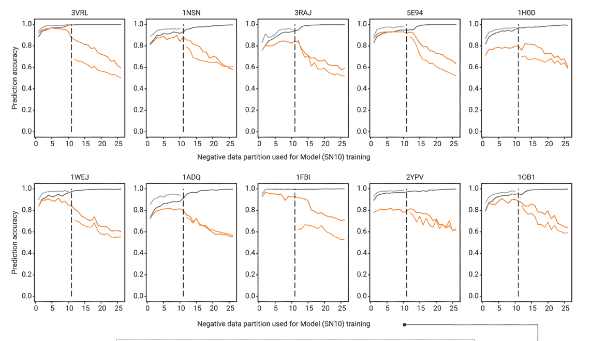
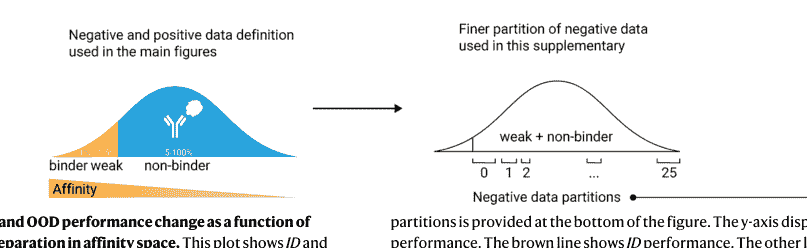

# 训练数据构成决定机器学习泛化与生物规则发现

**Table 1** | 用于适应性免疫受体结合预测的二进制数据集组成和生成

| 数据集类型 | 正数据集 | 负数据集 | 实际相关性 |
|---|---|---|---|
| ‘vs non-binder’ | 具有高亲和力的结合序列，针对目标抗原（范围：零至第一百分位） | 对阳性类别抗原亲和力低至无（第五至第一百百分位）的序列，即非结合者。 | 一种常见的实验数据集类型，其中结合者和非结合者通过针对特定抗原的测试确定并按结合亲和力的幅度分离，确保非结合者不表现出显著的结合水平。该数据集可通过荧光分选或展示筛选实验生成。或者，它可以从没有特异性信息的广谱测序实验中获得。在 TCR 领域，它类似于‘negatives from background data’¹²。 |
| ‘vs weak’ | 具有高亲和力的结合序列，针对目标抗原（范围：零至第一百分位） | 对阳性类别抗原具有中等亲和力（第一至第五百分位）的序列，即弱结合者。 | 一个正负数据在亲和力上接近的数据集。它可以通过上述相同的筛选实验获得，但通过沿结合亲和力梯度选择相邻的区间。 |
| ‘vs 1’ | 具有高亲和力的结合序列，针对目标抗原（范围：零至第一百分位） | 对另一种抗原具有高亲和力的结合序列（范围：对另一种抗原零至第一百分位）。 | 一个仅由对两种抗原具有高亲和力的结合者组成的数据集。可轻松从公共数据库组装。在 TCR 领域，它类似于‘negatives by shuffling’，其中正结合对中的相同表位和 TCR 被重复使用，但每个 TCR 与不同的表位配对¹²。 |
| ‘vs 9’ | 具有高亲和力的结合序列，针对目标抗原（范围：零至第一百分位） | 来自另外九种抗原的高亲和力结合者的序列。 | 由对十种抗原的单个结合者组装而成。它需要每个抗原的数据较少，并且据推测覆盖了更广的负数据范围。也类似于 TCR 背景下的 negatives by shuffling¹²。 |

以及抗体–抗原结合25–27和 TCR 特异性预测12,28–31中的泛化。对抗体结合预测的负数据集的影响不仅在序列水平上研究，也在结构上研究，使用模拟27和实验数据25。本文探讨了训练集组成对预测准确性和泛化能力的影响，重点在于结合规则的发现（图 1b）。我们将结合规则的学习定义为序列水平结合能和结合的残基水平贡献（能量）的识别。

免疫受体与其对应抗原的结合主要由序列多样的互补决定区（CDRs）32,33决定。特别是存在于抗体重链（CDRH3）或 TCR β链（CDR3β）中的 CDR3 区域对免疫受体–抗原结合有实质性贡献32–34。因此，在本研究中，CDRH3 区域被用作全长免疫受体序列的代理来训练 ML 模型。现有的最先进的免疫受体–抗原结合数据库包含 <10⁴ 个数据点35–40，具有已知的序列/结构，但大多数没有结合亲和力。为弥补这一差距，合成数据已成为基准测试 ML 方法的可行解决方案14,41,42。合成数据能够无限制地访问真实数据，从而实现训练数据集的任意组成，因此可以更可控地分析泛化和规则发现。我们之前开发了抗体–抗原结合模拟框架 Absolut!27，可实现大规模生成带亲和力注释的合成抗体–抗原复合物结构。在早期工作中，已显示训练于实验数据的 ML 方法的基于准确性的排名在相同方法训练于 Absolut! 生成的数据时得以保留，既适用于基于序列的预测任务，也适用于基于结构的预测任务43–45。

在本工作中，我们使用 Absolut! 框架27生成具有不同负数据组成的合成训练数据集，反映了免疫受体–抗原预测中的常见做法（图 1c）。我们在这些数据集上训练 ML 模型，并评估训练数据组成如何影响泛化和生物学规则恢复（图 1d,e）。规则恢复使用可解释性方法46–48进行，旨在通过识别对输出影响最大的数据特征来揭示模型预测背后的推理。我们使用来自文献 49 的大规模实验 HER2 亲和力标记抗体序列数据集验证了我们的发现。我们的结果表明，泛化和生物学规则发现都关键地依赖于训练数据集组成——包括负例的选择（图 1f）。

## 结果

### 训练数据集序列组成影响 ID 和 OOD 二元分类任务中的预测性能

合成和实验数据的 ML 设置。我们首先研究了负数据组成如何影响监督二元分类中抗体–抗原结合预测的性能和泛化能力。使用 Absolut!27 框架，我们模拟了一大批 CDRH3 序列与十种抗原的结合。对每种抗原，我们定义了四个分类任务（表 1 和图 2a），所有任务共享相同的正数据（前 1% 亲和力序列），但具有不同类型的负例：

1. ‘vs non-binder’（底部 95%）
2. ‘vs weak’（1%–5% 范围）
3. ‘vs 1’（对另一种抗原的前 1% 结合者）
4. ‘vs 9’（对另外九种抗原中任意一种的前 1% 结合者）。

每个数据集包含 20,000 个正序列和 20,000 个负序列，其中各 10,000 个用于测试。ML 任务根据抗原和数据集类型命名。

我们训练了一个简单的全连接神经网络，包含十个隐藏神经元（SN10），以实现可解释性。为确保稳健性，我们使用多个随机训练-测试划分和权重初始化重复训练，并监控验证集上的性能以避免过拟合（补充图 3f）。该架构和流程被默认用于所有涉及 SN10 模型的分析。我们还将 SN10 与逻辑回归（LR）和 Transformer 模型进行了比较（补充图 3c,e 和补充表 4），显示出没有性能优势，与类似设置中的先前发现一致27。

最后，我们使用来自文献 49 的 24,790 个 CDRH3 序列的实验数据集复制了内分布（ID）和外分布（OOD）性能分析，这些序列标记了与抗原 HER2 的结合亲和力，其结构与合成数据相似。

### ID 预测准确性是训练数据集组成的功能

为评估模型学习可泛化规则的能力，我们在与训练数据分布匹配的 ID 测试集上评估了其性能（图 2a）。在此设置下，模型在所有任务上均实现了较高的中位准确率（>0.85），呈现出明显的性能趋势：‘vs non-binder’最高（范围：0.97–1.00；中位数：0.99），其次是‘vs 1’（0.94–1.00；中位数：0.98）和‘vs 9’（0.91–0.98；中位数：0.94），‘vs weak’最低（0.85–0.98；中位数：0.92；图 2b），确定‘vs weak’为最具挑战性的任务。

如预期，训练于洗牌对照数据集的模型准确率为 0.5，证实原始数据包含可学习模式（补充表 1）。SN10 超过了 LR 模型

### 负数据影响规则学习

我们发现负数据集的组成影响了模型在序列和残基水平上学习结合规则的能力（图 3）。模型对数与抗体结合能之间的相关性在‘vs weak’和‘vs non-binder’任务中最强，每残基能量贡献与模型归因之间的相关性也是如此。相比之下，‘vs 1’和‘vs 9’中的规则学习变化更大，失真的归因提示了混杂负例的干扰（图 3d）。这表明尽管仅正数据可能足以学习，但负数据可以支持或损害规则发现。

一个根本性的挑战是如何完全破译模型归因所捕获的信息。我们没有观察到归因-能量相关性超过 -0.6 至 -0.7，可能由于归因方法的局限性、能量建模不完整（例如仅 CDRH3）或残基水平效应的内在复杂性。有趣的是，使用 DeepLIFT 获得的归因与 LR 权重表现出不同程度的相关性（补充图 7c）。‘vs non-binder’任务的归因与 LR 权重相关性更强，而‘vs weak’任务的归因在不同抗原间显示出混合相关性。这表明 DeepLIFT 捕获了一些非加性规则，但缺乏特征交互的显式可解释性。在分析基于表位的数据集时出现了进一步的复杂性，其中阳性结合特定表位而非整个抗原（补充文本 2 和补充图 9）。虽然这些在对数水平上改善了规则发现，但在基于归因的分析中没有一致的优势。因此，尽管结合规则可以在两个水平上学习，但每残基规则更难以分离。

### ML 规则学习与预测性能

我们没有发现规则学习与高预测性能之间的明确依赖。例如，训练于‘vs 9’和‘vs 1’的模型通常比训练于‘vs weak’的模型实现更高的 ID 性能，尽管后者在所有抗原上更有效地学习结合规则。这为来自 TCR 领域的一项研究提出的假设提供了一个反例，即性能更高的模型更可能依赖生物学规则37。我们的发现表明，虽然 ID 性能可能对规则发现是必要的，但单独不足。相反，模型学习详细结合信息的能力代表了其整体性能的额外维度。

对这一解释的细微改进是，具有更高 OOD 性能的模型更可能依赖稳健的生物学规则。尽管我们的结果显示训练于‘vs non-binder’和‘vs weak’的模型表现出相似水平的结合规则学习，但 OOD 性能在所有任务中对‘vs non-binder’最低，对‘vs weak’最高（图 2d 和补充图 3d）。这种差异源于每个任务捕获特征交互方式的不同；如前所述，‘vs weak’任务允许更大程度地考虑氨基酸贡献之间的相互作用。我们建议 OOD 性能应作为基准测试规则恢复方法的正交指标，其中成功的规则集和模型可解释性方法将捕获 OOD 稳健性。

### 合成抗体–抗原结合数据使训练数据集组成对 ML 性能影响的详细研究成为可能

合成数据使我们能够系统地研究训练数据集组成如何影响 ML 性能，特别是在基于亲和力构建的任务中。单序列亲和力注释的实验数据集，如本工作所用，仅开始变得可用49,58。可用的实验数据集规模低一到两个数量级（我们的合成数据集有 ~700k 序列，而实验约为 ~25k），并且合成数据集涵盖了更多抗原。

Absolut! 之前已被证明可指导实验数据的 ML 开发27，可被视为抗体–抗原数据集复杂性的下限。它通过保留真实蛋白质的表面氨基酸组成并探索 CDRH3 的多种结构构象来保持生物学相关性，从而将非线性纳入序列到亲和力的对应关系。所使用的 CDRH3 数据源自小鼠库，并表现出生理氨基酸组成和位置依赖性。

此外，合成数据具有避免可解释性研究中确认偏误的优势41,59,60，因为存在真实值。事实上，数据分布于一系列特征中，其中一些与给定预测任务相关，其他则不相关。这些特征可能是结构属性、亲和力、k-mer 分布、氨基酸组成和 CDRH3 长度。通常事先不知道哪些特征无关，因此在训练数据（正负）中应平衡哪些特征。一旦识别，无关特征可在正负数据集之间平衡，以防止模型学习虚假相关性。作为实现这一目标的第一步，我们探讨了负类别对正数据学习的影响。

### ML 考虑

在本研究中，我们专注于反映最常见免疫受体数据集的分类任务，这些数据集通常是二元或半定量的22,61,62（即根据结合强度分为类别）。此外，‘vs 1’和‘vs 9’数据集中的负例通常未按对阳性类别靶标的亲和力注释12,29,30。因此，我们将连续亲和力值二值化以创建半定量类别，并评估这些是否足以学习结合规则等亲和力属性。然而，当亲和力注释数据可用时，可能可行采用两步方法：初始分类后在连续标签上微调63,64。

在分类框架内，我们评估了几种 ML 模型。我们专注于 SN10，因其可解释性直接且已知其性能67。我们还测试了基于 Transformer 的模型和基于蛋白质语言模型嵌入的模型，但这些没有提高性能。SN10 作为神经网络，可以捕获位置间依赖性，这通过相对于 LR 的性能提升得到说明（补充表 4 和 5）。因此，对于我们的任务，SN10 提供了模型复杂性和可解释性的实用平衡。

未来的工作可以探讨规则学习如何同时受类别平衡和负类别类型、输入表示（序列与结构）以及模型架构的影响。最近的研究65,66表明，更简单的模型通常捕获结合相互作用，而更复杂的模型倾向于反映更广泛的生物物理属性，例如蛋白质折叠。

## 结论

构建负数据时存在两种主要实践方法：（1）对现有非特异性（负）数据进行子采样和（2）实验生成负数据。基于我们的发现，我们建议在应用子采样策略时使用选择‘困难’或‘半困难’负例的方法14,67，从未标记数据中选择。然而，我们的工作主要推进了第二种方法——在对数据生成过程有控制时构建负数据。在这种情况下，我们建议收集在感兴趣的度量（例如结合亲和力）上接近的分类或连续数据，以创建更具挑战性的训练集。在此情景下，正负数据源自同一实验和同一序列分布。然而，如果正负数据通过单独的实验生成，实验特异性偏差可能会掩盖细微差异

在具有相似结合亲和力的序列之间。这也解释了为什么‘vs I’和‘vs 9’负数据集可能不可靠。因此，在正负数据通过不同实验生成时，我们建议谨慎。

深度突变扫描方法允许创建在序列和亲和力上接近的正负数据集 56,68,69 并提供关于上位性相互作用的信息 51。 我们的工作表明，深度突变扫描数据集对于向机器学习模型教授序列到功能的映射至关重要，其中非常小的序列差异可能产生大的功能效应（补充图 2）。

我们的发现虽然源于基于序列的免疫受体-抗原相互作用，但对其他涉及二元分类且依赖于难以定义的负样本的生物学机器学习任务具有更广泛的相关性，例如小分子药物发现和基于转录组学的表型分析。关键信息可以概念上推广：使用硬负样本进行训练（即在特征或标签空间中与正样本相似的样本）可促进分布外泛化和生物学上有意义的规则学习。我们的结果表明，使用具有低但可测量的活性（例如弱抑制剂）的化合物作为负样本，可以产生对未见化合物泛化更好且避免过度拟合过于简单决策边界的模型。同样，在从转录组特征预测表型时，从表型上接近的条件构建负样本集可以创建更具生物学基础且更稳健的分类器。总的来说，通过在训练中减小类别之间的间隔来增加分类任务的难度，会促使机器学习模型学习更细致且可迁移的规则。我们认为这是在生物学基础机器学习中广泛适用的原则，值得进一步的领域特异性验证。

## 方法

### 使用 Absolut! 生成的合成抗体–抗原结合数据集

我们使用了之前生成的半合成抗体-抗原结合数据集 27,45。简而言之，该数据集包含真实世界的抗原和抗体（CDRH3）蛋白，抗体序列来自小鼠库 70，抗原的三维结构来源于蛋白质数据库并转化为三维晶格格式。这些数据集的作者应用了穷举对接方法来评估离散刚性抗原与抗体侧长度为 11 的柔性 CDRH3 的结合。结果包括结合能值、最小化自由能的结合位置，以及抗原（表位）和 CDRH3（抗原结合位点）之间相互作用氨基酸的鉴定。每个抗原都与一组源自 CDRH3 的 11-mer 相关，并根据结合能进行排序。最低的第一百分位内的序列，平均为 51,814.7 个序列，被标记为高亲和力结合体（或简称为‘结合体’）。第一到第五百分位的序列，平均为 205,069.3 个序列，被标记为弱亲和力结合体。最后，最高九十五百分位的序列，平均为 391,498.8 个序列，被标记为非结合体。这种标记方案与参考文献 27 中使用的方法一致。对于我们的研究，我们使用了来自十种抗原的抗体结合数据，其蛋白质数据库 ID 为 3VRL、1NSN、3RAJ、5E94、1HOD、1WEJ、1ADQ、1FBI、2YPV 和 1OB1。

### 预测任务及训练和测试数据集

我们使用了平衡的 CDRH3 数据集（训练用 30k 个抗体序列（15k 个正类和 15k 个负类）和测试用 10k 个抗体序列（5k 个正类和 5k 个负类）），其根据正类抗原和负数据集类型而变化（表 1）。数据集的正类由结合体序列组成，即结合能介于零到第一百分位之间的序列。

每个数据集的负类根据结合预测任务类型构建如下：

- ‘vs I’：对另一抗原为结合体但对正类抗原不是结合体的序列。
- ‘vs 9’：结合九种其他抗原中的一种且不结合正类抗原的序列，按相等比例表示。举例来说，在训练集中总共 15,000 个序列中，每种抗原约有 1,666（±1）个相关序列（~15,000/9）。
- ‘vs weak’：结合正类抗原但结合能在第一到第五百分位内的序列。
- ‘vs non-binder’：对正类抗原结合能处于 >第五百分位的序列。

我们生成了重复实验以确保实验的可重复性。具体而言，对每个预测任务和正抗原生成了六个不同的训练-测试划分。对于其中一个划分，我们使用不同的种子训练并评估模型四次，从而控制模型初始化和训练的随机性。数据集的正类在任务和每次重复实验中保持不变。例如，1ADQ 结合体‘vs weak’中的正类数据与 1ADQ 结合体‘vs 9’中的正类数据相同。每个正负数据集对应的序列均随机抽样以达到前述数据集大小。在整个工作中，我们通过随机打乱每个任务序列的类别标签来使用负对照。预测性能在留出测试数据集上使用准确率指标进行评估，计算为正确预测数除以预测总数。分布外性能通过计算在其他任务的测试集上的性能来评估，例如‘vs 9’在‘vs weak’测试集上的性能。分布外估计在与内部情况相同的重复集上进行。

### 机器学习模型架构、训练和评估

我们训练了一个简单的神经网络，之前称为 27，此后称为 SN10（参考文献 27），用于使用 CDRH3 序列的结合预测任务。序列每个由 11 个氨基酸组成，经过独热编码后，维度为 220。神经网络架构由输入层 220 个神经元、隐藏层 10 个神经元（激活函数为整流线性单元）和 1 个输出神经元（激活函数为 S 型）组成。对于训练，在探索参数空间后，我们使用二元交叉熵损失、Adam 优化器、批量大小为 64、学习率为 0.001、动量为 0.9，且无权重衰减。我们训练模型 50 个 epoch 并检查损失曲线，未显示过拟合迹象（补充图 3f）。为进一步提高模型性能，我们实现了随机权重平均技术 71,72，该技术涉及在训练过程中对多组权重进行平均以降低方差并提高模型的泛化性能。我们在第 3/50 个 epoch 后应用随机权重平均，使用 PyTorch v.1.12.1 中可用的随机权重平均实现（参考文献 73）。还进一步实现了基于 LR 的模型作为二元分类的基线进行比较。该模型在与 SN10 之前所述相同的独热编码 CDRH3 序列数据集上进行训练和评估（参考文献 27）。在评估使用 SN10 作为研究主要模型的过程中，我们测试了更复杂的架构。Transformer 模型架构由维度为 24 的编码器、词汇表大小为 30、4 个注意力头和单个前馈层维度为 128 组成。它包含 0.1 的 dropout 率并使用整流线性单元作为激活函数。该模型在用于 SN10 评估的数据集子集上训练，使用 Adam 优化器（动量为 0.9，权重衰减为 0）、批量大小为 128、学习率为 1 × 10−6 训练 500 个 epoch。该架构使用

PyTorch的Transformer构建模块，其代码可在GitHub上获取。所使用的训练循环与SN10所用的相同。对于基于蛋白质语言模型（PLM）的SN10，我们利用ESM2b蛋白质语言模型74生成CDRH3的1,280维嵌入，以及使用AntiBERTa2（简称为AntiBERTa2）生成1,024维嵌入75,76。在实现方面，我们使用了本实验室开发的EmbedAIRR工具（https://github.com/csi-greifflab/embedairr）。这些嵌入被用作SN10的输入，将其架构转换为一个前馈神经网络，输入维度为1,280，10个隐藏单元和1个输出单元——最后2层与原始SN10设计保持一致。在确认针对SN10的训练方案不会导致基于PLM的SN10模型过拟合后，我们采用了上述相同训练方案。基于Transformer和基于PLM的SN10的汇总结果见补充表4和补充表5。

### 基于信息论的计算

JSD是衡量两个概率分布之间不相似性的度量。它源自Kullback–Leibler（KL）散度，并通过以下公式计算：

JSD(P||N) = sqrt( [KL(P||M) + KL(N||M)] / 2 ),

KL(P||M) = sum_{x in X} P(x) log [ P(x) / M(x) ],

M = (P + N) / 2.

在我们的研究中，P和N分别表示正数据和负数据序列的概率分布。作为衡量正数据集与负数据集边际分布总体差异（即不包括统计相互作用差异）的指标，我们使用了PWM（位置权重矩阵），它表示每个氨基酸在结合序列或非结合序列中特定位置出现的概率。这里，X指PWM位置的集合，x对应于PWM中的一列，代表特定序列位置。在我们的设定中，JSD是每个位置上JSD的总和。JSD使用scipy.spatial.distance包计算。PWM使用Biopython的bio.motifs包计算77。

### 归因分析

为了更好地理解SN10学到的规则，我们采用可解释性技术并将其应用于测试集示例，以评估每个序列输入特征的重要性；这里的重要性指对预测的贡献。我们使用来自Captum库v.0.5.0（参考文献78）的DeepLIFT48实现，作为一种近似积分梯度79的快速方法。该计算需要基线序列，基线序列通过对输入序列进行随机重排获得，这种技术在文献中被称为洗牌方法80。尽管在某些应用中使用零输入向量作为基线是常见且合理的，但在序列的情况下，这是有问题的，因为零输入向量不代表任何序列，也就是说，不存在一个序列会被独热编码为零输入向量。洗牌方法基于随机序列，并且是近期文献中生物序列的首选方法80,81。

我们为每个CDRH3序列生成了十个洗牌版本，并对每个序列运行了十次DeepLIFT，每次分别对应一个洗牌基线。最终归因值通过对这十次运行结果求平均获得。归因是针对预测的logits（而非输出）进行估计的。我们使用局部归因82，因为我们感兴趣的是每个序列中每个氨基酸对预测的影响。在Captum78中实现此计算涉及将multiply_by_inputs设置为‘True’。归因分析应用于合成数据和实验数据。然而，由于实验数据集中没有每个氨基酸的结合能数据，我们只能在合成数据集中将归因与每个残基的实际能量进行比较。归因在所有重复中计算，但‘vs1’除外，由于数据集数量多得多，我们限制每个数据集计算一次。

### 基于表位的分析

在基于表位的分析中，我们生成了新的数据集，并在每种情况下将正数据集限制为仅包含与抗原的主要（即最常见）表位结合的序列。对于此分析，我们选择了包含足够数量表位特异性序列的抗原，以便训练集大小与基于抗原的分析相同（Ntrain = 30,000）。然而，由于序列可用性较低，测试集大小不得不相对于基于抗原的分析进行缩减（Ntest = 6,000）。由于训练集大小的限制，我们不得不将基于表位的分析限制在三个抗原：1HOD、1WEJ和1OBL。在我们所有的工作流程和结果中，为了区分基于抗原和基于表位的分析，我们用相同的抗原ID后跟‘E1’（表示最常见表位）来标示基于表位的数据集：1HODE1、1WEJE1和1OBLE1。为了生成训练集和测试集，我们过滤并调整了正数据集，仅保留只与主要表位结合的序列，并保持与相应基于抗原分析相同的负数据集。生成相应数据集后，我们执行了与正文中所示基于抗原分析相同的计算。

### Absolut! 结合能计算

关于结合能计算的详细说明，我们请读者参考Absolut!77。简而言之，在三维晶格中，只有非共价结合的相邻氨基酸才被认为发生相互作用。然后通过将Miyazawa–Jernigan势能对每个相互作用的残基对求和来计算结合能。通过对CDRH3残基参与的所有相互作用的Miyazawa–Jernigan势能求和，计算该残基对CDRH3–抗原结合能的能量贡献。

### 实验性抗体–抗原结合数据集

#### 实验数据集

我们确定了一个公开可用的实验数据集49，该数据集是为使用下一代测序、核糖体展示和亲和力筛选技术进行高通量抗体发现而生成的，在本文中称为‘Porebski数据集’或‘实验数据集’。该技术生成抗体文库的结合动力学数据，可用于推导抗体亲和力的度量，从而进行筛选。荧光标记的抗原在高亲和力结合物周围积累，并处理在不同抗原浓度下获取的图像，以根据荧光强度推导出每个序列的空间积分信号，该信号与亲和力相关。该研究的作者对两个抗HER2抗体文库进行了筛选，一个文库（HER2affmat）通过G98A（一种低亲和力抗HER2单链可变区片段，scFv）的亲和力成熟产生，另一个文库（HER2mllib）具有更高亲和力抗体，是使用在HER2affmat上训练的蛋白质语言模型生成的。为了处理更高亲和力的抗体，我们使用了HER2mllib。

## 参考文献

- 71. Izmailov, P., Podoprikhin, D., Garipov, T., Vetrov, D. & Wilson, A.G. Averaging weights leads to wider optima and better generalization. Preprint at https://arxiv.org/abs/1803.05407 (2018).
- 72. Athiwaratkun, B., Finzi, M., Izmailov, P. & Wilson, A.G. There are many consistent explanations of unlabeled data: why you should average. Preprint at https://arxiv.org/abs/1806.05594 (2018).
- 73. Paszke, A. et al. PyTorch: an imperative style, high-performance deep learning library. Preprint at https://arxiv.org/abs/1912.01703 (2019).
- 74. Lin, Z. et al. Evolutionary-scale prediction of atomic-level protein structure with a language model. Science 379, 1123–1130 (2023).
- 75. Leem, J., Mitchell, L. S., Farmery, J. H. R., Barton, J. & Galson, J. D. Deciphering the language of antibodies using self-supervised learning. Patterns 3, 100513 (2022).
- 76. Barton, J., Galson, J.D. & Leem, J. Enhancing antibody language models with structural information. Preprint at bioRxiv https://doi.org/10.1101/2023.12.12.569610 (2024).
- 77. Cock, P. J. A. et al. Biopython: freely available Python tools for computational molecular biology and bioinformatics. Bioinformatics 25, 1422–1423 (2009).
- 78. Kokhlikyan, N. et al. Captum: a unified and generic model interpretability library for PyTorch. Preprint at https://arxiv.org/abs/2009.07896 (2020).
- 79. Sundararajan, M., Taly, A. & Yan, Q. Axiomatic attribution for deep networks. In Proc. 34th International Conference on Machine Learning (eds Precup, D. & Teh, Y. W.) 3319–3328 (PMLR, 2017).
- 80. Novakowski, G., Dexter, N., Libbrecht, M. W., Wasserman, W. W. & Mostafavi, S. Obtaining genetics insights from deep learning via explainable artificial intelligence. Nat. Rev. Genet. 24, 125–137 (2023).
- 81. Huang, D. et al. Weakly supervised learning of RNA modifications from low-resolution epitranscriptome data. Bioinformatics 37, i222–i230 (2021).
- 82. Ancona, M., Ceolini, E., Öztireli, C. & Gross, M. Towards better understanding of gradient-based attribution methods for deep neural networks. Preprint at https://arxiv.org/abs/1711.06104 (2017).
- 83. Ursu, E. & Minnegalieva, A. Training data composition determines machine learning generalization and biological rule discovery. Zenodo https://doi.org/10.5281/zenodo.11191740 (2024).
- 84. Porebski, B. Rapid discovery of high-affinity antibodies via massively parallel sequencing, ribosome display and affinity screening. Zenodo https://doi.org/10.5281/zenodo.8241732 (2023).

## 作者贡献

V.G.构思了这项研究。V.G.、A.M.和E.U.设计了分析和可视化。A.M.、E.U.、P.R.和P.A.R.执行了分析和可视化。M.C.在统计问题上提供咨询。V.G.、A.M.和E.U.撰写了论文初稿。所有作者均修改了手稿并批准其内容。鉴于贡献完全平等，A.M.和E.U.可自由在各自简历中将各自的名字列在首位。

## 利益冲突

V.G.在aiNET GmbH、Enpicom B.V、Absci、Omniscope和Diagonal Therapeutics担任顾问委员会成员。V.G.还担任Adaptive Biosystems、Specifica Inc、Roche/Genentech、immunai、LabGenius和FairJourney Biologics的顾问。其他作者声明无利益冲突。

## 补充信息

本文的扩展数据可在 https://doi.org/10.1038/s42256-025-01089-5 获取。

补充信息 在线版本包含补充材料，可在 https://doi.org/10.1038/s42256-025-01089-5 获取。

通讯和材料请求应联系Victor Greiff。

同行评审信息 《自然·机器智能》感谢Tianxu Lv和另一位匿名审稿人对本工作的同行评审所做的贡献。

重印和许可信息可在 www.nature.com/reprints 获取。

出版商注 施普林格·自然对已出版地图和机构隶属关系中的管辖权主张保持中立。

### 致谢

我们感谢Leona M.和Harry B. Helmsley慈善信托基金（编号2019PG-T1D011，授予V.G.）、UiO世界领先研究社区（授予V.G.）、UiO：生命科学融合环境Immunolingo（授予V.G.和G.K.S.）、欧盟Horizon 2020 iReceptorplus（编号825821；授予V.G.）、挪威癌症协会基金（编号215817，授予V.G.）、挪威研究理事会项目（编号300740和331890，授予V.G.）、挪威研究理事会IKTPLUSS项目（编号311341，授予V.G.和G.K.S.）以及Kristian Gerhard Jebsen基金会（K.G. Jebsen乳糜泻研究中心，授予G.K.S.）。本项目从创新药物计划2联合事业（Innovative Medicines Initiative 2 Joint Undertaking）获得资金（授予V.G.），资助协议编号101007799（Inno4Vac）。该联合事业获得欧盟Horizon 2020研究与创新计划和EFPIA的支持。本通讯反映作者观点，IMI、欧盟、EFPIA或任何关联伙伴均不对其中所含信息的任何使用负责。由欧盟资助（ERC，AB-AG-INTERACT，101125630，授予V.G.）。本项目根据Marie Skłodowska-Curie资助协议编号801133（授予P.R.）从欧盟Horizon 2020研究与创新计划获得资金。

### 扩展数据图 1 | ID 和 OOD 性能随亲和力空间中正负数据分离的变化

该图显示了 SN10 模型在亲和力方面与正数据逐渐更远的负数据分区上训练后的 ID 和 OOD 性能。x 轴表示分区编号，每个分区包含 20,000 条序列，其中较高的分区编号表示与目标抗原亲和力较低的一组序列。分区 0–10 对应“弱”负样本，而分区 11–25 对应“非结合物”，一条虚线垂直线标记了它们之间的分隔。负数据分区的图形解释在图底部提供。y 轴显示 ID 和 OOD 性能。棕色线显示 ID 性能。其他线条（蓝色、红色和黄色）表示主图（图 2a）中使用的任务上的 OOD 性能。蓝色线显示“vs Non-binder”任务上的 OOD 性能，仅针对对应‘弱’负样本的分区定义（虚线之前）。黄色线表示“vs Weak”任务上的 OOD 性能，仅针对对应‘非结合物’负样本的分区定义（虚线垂直线之后）。每个模型均使用单一种子和数据分割进行训练。

测试任务类型：— ID — vs Non-binder OOD — vs 9 OOD — vs Weak OOD
— — vs Weak 与 vs Non-binder 之间的分隔 ID

预测准确率

用于模型 (SN10) 训练的负数据分区

主图中使用的负数据和正数据定义

本补充中使用的负数据的更细分区

### 特定材料、系统和方法报告

我们要求作者提供有关许多研究中使用的某些类型材料、实验系统和方法的信息。在此，请指出所列的每种材料、系统或方法是否与您的研究相关。如果您不确定某项是否适用于您的研究，请在选择回复之前阅读相应部分。

材料与实验系统

| 不适用 | 研究中涉及 |
| ☒ | ☐ 抗体 |
| ☒ | ☐ 真核细胞系 |
| ☒ | ☐ 古生物学和考古学 |
| ☒ | ☐ 动物和其他生物 |
| ☒ | ☐ 临床数据 |
| ☒ | ☐ 令人担忧的双重用途研究 |
| ☒ | ☐ 植物 |

方法

| 不适用 | 研究中涉及 |
| ☒ | ☐ ChIP-seq |
| ☒ | ☐ 流式细胞术 |
| ☒ | ☐ 基于 MRI 的神经影像学 |

#### 植物

| 种子库 | N/A |
| 新型植物基因型 | N/A |
| 鉴定 | N/A |
