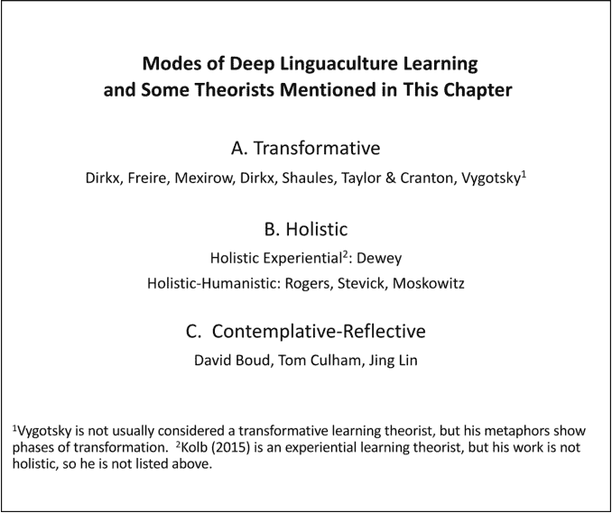
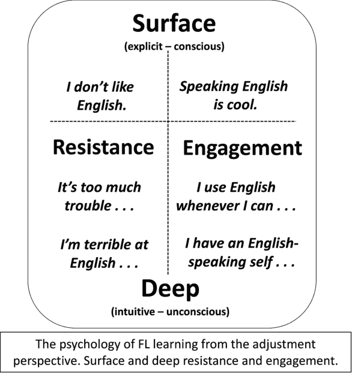
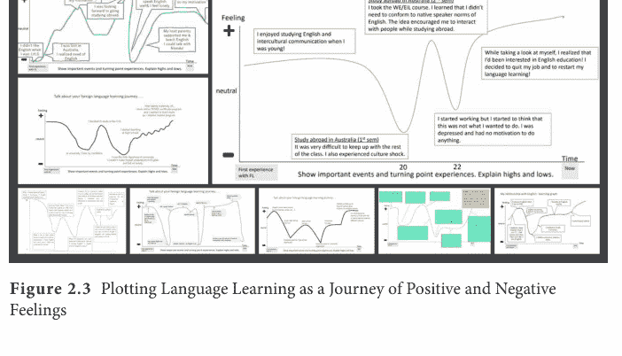
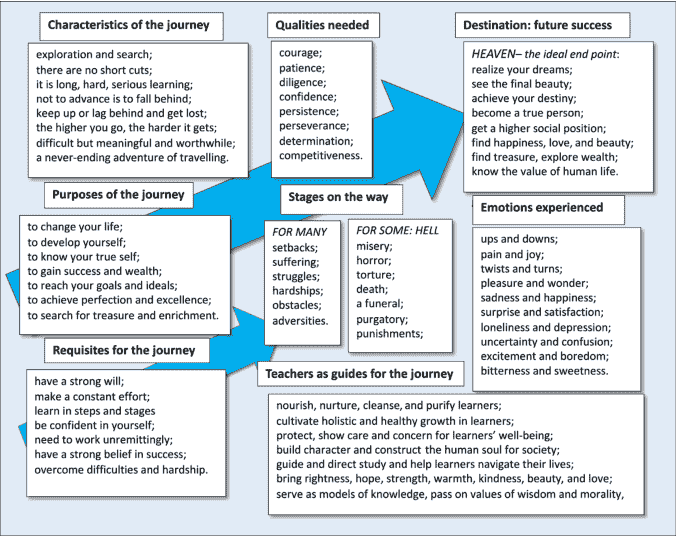
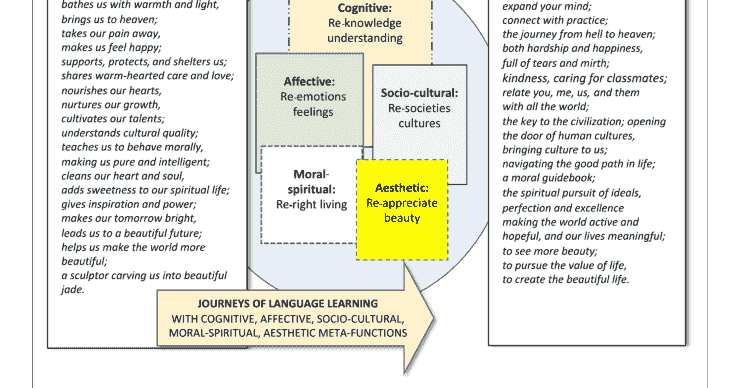
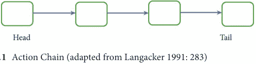
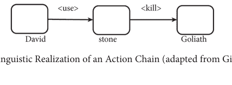
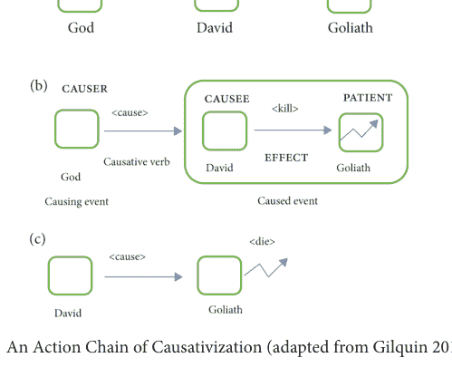
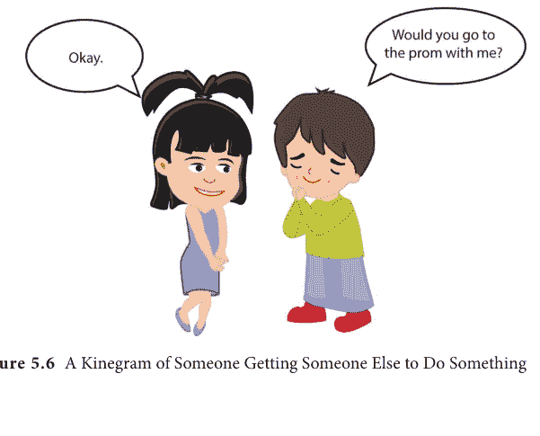
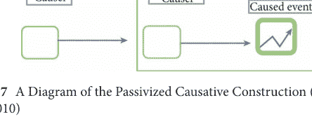

# 外语教学中的转化、具身与幸福感：践行深度学习

# 贡献者

**María Celina Barbeito** 是阿根廷里奥夸尔托国立大学的副教授兼研究员。她是英语教师教育项目的教师，并担任应用语言学硕士项目的负责人。她拥有美国亚利桑那大学 TESOL 的文学硕士学位。Celina 在学习策略、信念和情感领域拥有近三十年的教师、培训师和研究员经验。她目前致力于探索通过积极心理学视角帮助未来英语作为外语教师提升福祉的方法。

**Martin Cortazzi** 是英国华威大学应用语言学系和中国澳门城市大学的访问教授。他曾在小学、中学和大学任教，并在这些领域国际上培训教师。他的研究和200多篇出版物聚焦于开发创新定性研究方法；将语言学应用于教育和语言教学；学习文化与跨文化交际；以及英语教学材料。

**Lixian Jin** 在中国澳门城市大学人文社会科学学院担任应用语言学讲座教授兼院长，此前曾在诺丁汉大学宁波校区担任讲座教授四年以上，并在英国大学工作二十三年。她获得过研究资助，并领导多个国际研究团队研究领导力和商业情境中的跨文化交际。她开发了定性研究方法以探索参与者的见解。她200多篇出版物聚焦于学习文化、跨文化交际、隐喻、叙事分析以及双语临床评估的研究。

**Duncan Lees** 是英国华威大学应用语言学助理教授，在那里教授与跨文化交际相关的各类课程。他的博士论文《中国高等教育中的莎士比亚》由经济与社会研究理事会资助，并基于他在中国南方大学教授文学和戏剧的十三年经验。他的研究兴趣包括戏剧与跨文化语言教育、民族方法学/会话分析以及跨文化语用学。

**Troy McConachy** 是英国华威大学应用语言学副教授。他的研究聚焦于语言教育中的跨文化学习，特别是从意识、身份、意识形态与表征以及教师教育视角。他的论文广泛发表于《ELT Journal》、《Language Awareness》、《国际与跨文化交际杂志》、《跨文化交际研究杂志》和《跨文化教育》等国际期刊。他是期刊《跨文化交际教育》的主编，也是剑桥跨文化交际系列丛书的共同编辑。

**María Matilde Olivero** 是阿根廷里奥夸尔托国立大学的第二语言教师教育者兼研究员。她的主要研究兴趣包括语言教育中的情感因素与和平建设方法，以及教师福祉。Matilde 在美国南佛罗里达大学获得第二语言习得博士学位。近年来她通过理论模型、实证研究和教学材料设计努力拓展语言教育中的和平建设领域。她在专业领域发表了大量论文。最近她共同编辑了《语言教育中的和平建设：理论与实践创新》。

**Rebecca L. Oxford**（美国马里兰大学荣休教授兼杰出学者教师）是语言学习专家、和平专家、教育心理学家、演讲者（四十三个国家）以及前语言教师。她十五本书中，七本涉及语言学习，五本涉及和平与灵性主题。她2021年的著作是 *《语言教育中的和平建设》*（Oxford, Olivero, Harrison, and Gregerson）。她与 Jing Lin 等人共同编辑两套书系：《灵性、宗教与教育》和《为未来转型教育》。她共同编辑了69卷的 ESL/EFL 教学《Tapestry》系列，并是一位出版诗人兼业余艺术家。

**Adelina Sánchez Centeno** 是阿根廷里奥夸尔托国立大学的英语作为外语教师兼研究员，自2003年起在该校工作。她拥有该校的应用语言学文学硕士学位。她的研究探索关于口头纠正的信念和情感

关于英语作为外语（EFL）情境中反馈的作用，以及学生情绪自我调节策略对其语言学习过程的影响。她发表过论文，合作撰写过书籍章节，并参加过国内和国际会议。阿德琳娜目前正在参与一个研究项目，涉及设计和实施基于积极心理学的课堂干预措施，以帮助未来的EFL教师提升幸福感。

**约瑟夫·肖尔斯**是日本东京庆应义塾大学特聘教授，也是日本跨文化研究所所长。他还在津田塾大学TESOL研究生项目任教。他的研究和出版物集中于跨文化适应、跨文化教育、文化与认知、跨文化体验心理学以及语言文化学习。著作包括*语言、文化与具身心智*（2019）；*跨文化心智*（2015）；*深层文化*（2007）。他还是“深层文化播客”的主持人。

**王梓**目前是英国华威大学的国际化协调员。她的研究兴趣包括动机、语言学习和多语现象。她的博士项目调查了中国学习者学习英语和日语的动机。她发表了关于语言学习和翻译研究的论文。她最近的第一作者出版物是*在中国多语学习中协商身份张力：语言学习动机与多语身份的情境视角*（2021）。

**尚特尔·沃纳**是美国亚利桑那大学德语研究副教授，也是第二语言习得与教学专业的教师成员。自2014年起，她一直负责德语语言项目。她还共同指导了文化、语言与读写教育资源中心（CERCLL），这是亚利桑那大学的一个国家语言资源中心。沃纳博士的研究聚焦于语言使用和学习的情感、体验和审美维度，外语读写能力发展，教学文体学以及批判性多语研究，她已在这些领域广泛发表论文并做学术报告。她目前的书稿项目主张扩展第二语言教学与学习中的读写能力发展模型及相关教学法，不仅要更好地整合更广泛的实践和模态，还要整合不同的审美和情感规则，这些规则潜移默化地塑造着我们对不同语言使用的反应。

**大卫·维贾亚**是澳大利亚昆士兰大学语言与文化学院的应用语言学博士生。他的研究兴趣包括应用认知语言学、具身教学法、为说而思、第二语言印尼语，以及教师的技术、教学法和内容知识（TPACK）。他曾在应用认知语言学（2018年、2021年）和教师的技术、教学法和内容知识（TPACK）（2021年）方面发表论文。他最近的出版物有：*探索语言教师基于语料库的语言教学课程规划：聚焦语料库和DDL的TPACK发展*（2021）和*调查印尼EFL学习者对英语迂回使役结构的知识和使用*（2021）。

# 引言：在外语教学法中实践深度学习

约瑟夫·肖尔斯与特洛伊·麦康纳奇

## 引言

语言学习长期以来被视为丰富我们生活、拓展我们思维的一种方式。13世纪时，苏菲派神秘主义者鲁米曾说过：“说一门新语言，世界就会成为一个新世界。”这提醒我们，语言学习是一种具有强大心理体验的过程，能够为学习者开启全新的经验世界。这不应当令人惊讶。语言是人之为人的核心体验——我们用语言与周围的人建立联系，满足日常需求，向他人表达自己本质的独特性，并归属特定的社群。调整这些自我基本要素，既令人大开眼界，也必然是一项重大挑战。它需要的不仅是脑力投入，还有心理韧性——将外来模式内化到自我中所需要的时间和努力、参与尴尬交流的意愿、在陌生的交际领域找到方向的勇气，以及对跨文化复杂性的开放态度。难怪外语学习会带来个人成长与改变的潜力。

尽管很少有人会否认这种转变潜力，但外语学习常常主要被以工具主义的方式讨论——作为一种找到工作或为简历增值的方式——这种话语推动了将外语视为一种可“获得”的商品的倾向（Ushioda 2017）。这鼓励了语言教学法过度强调“交易性，即信息传递，将语言学习与职业机会和全球交流的扩展联系起来”（Ros-i-Solé 2016: 3）。然而，这可能导致“成功”的定义变得狭隘，被市场对可量化的语言水平和“功能性”技能的需求所左右（Leung & Scarino 2016），并低估了语言学习事业中固有的心理需求和回报。然而，正如Kramsch（2009）提醒我们的那样，学习语言的*体验*“既非成功，也非不成功。无论达到什么水平，它都可以被生活得或多或少有意义，也或多或少具有转变性”（第4页）。因此，尽管熟练度目标和功能性需求本身就是重要的目标，但转变视角提醒我们，在学习过程中让完整的人参与进来是至关重要的。

本卷旨在重新聚焦鲁米在很久以前所谈到的个人充实潜能。它希望与语言教育中的人本主义潮流相连接，并在理论和教学法层面为关于语言学习对个人产生深远影响的持续讨论做出贡献。它使用*深度学习*这一概念来概括语言学习的理解以及强调以下三点的教学方法：(1) 语言学习和使用的具身性；(2) 学习过程的转变性；(3) 学习者和教师的幸福感。本卷收录的文章将结合这三个概念——具身性、转变性和幸福感——来审视深度学习，以激发关于如何通过语言学习促进成长与发展的各种人本主义目标的讨论。基于此，本章将首先更广泛地审视深度学习的概念，然后描述本卷中深度学习的概念化方式。

## 深度学习视角

对学习体验中更深层次、更具个人意义元素的兴趣并不新鲜。Stevick（1976）很久以前就强调了那种感觉“被强加给我们”并威胁到我们自我价值感的外语所带来的心理压力（Stevick 1980: 9）。因此，他写道，需要将学习者当作一个完整的人来关注（参见本卷Oxford）。对学习者体验的关注也体现在诸如社区语言学习（Curran 1972）和暗示法（Lozanov 2005）等方法中。最近，人们对语言与学习心理学的兴趣日益浓厚，许多学者现在强调需要对语言学习动机（Dörnyei & Ushioda 2009；本卷Zi Wang）、幸福感（Mercer 2021）和身份（Block 2014）等问题采取以人为本或生态学的方法。语言学习越来越被视为一种具身现象，它激发一系列情绪，并与学习者的审美、身体、精神与道德感受性相关联（Oxford等，2021）。Dewaele（2019）谈到了第二语言学习领域情绪研究的“腾飞”，这有助于凸显学习者语言学习主观体验的不同维度。Prior（2019）提到“关注焦点从人类语言和生活的实验面向扩展到体验面向，以及它如何塑造并被多样的交流、认知、行动、存在、生成、归属、渴望和感受方式所塑造”（第517页）。该领域不仅对负面情绪作用（如外语焦虑带来的心理压力）的兴趣日益增加（Gkonou等，2017），而且对学习者积极情绪体验（如快乐、幸福、希望和渴望）的兴趣也在增长（Helgesen 2019；Macintyre等，2019）。

更严格地说，*深度学习*一词有多种用法。深度学习的概念出现在教育心理学领域（Kirschner & Hendrick 2020; Smith & Colby 2007），在那里它被用来指一种更抽象、反思性和情境化的理解，而不是对事实和信息的浅层关注（Halbert & Kaser 2006; Rhem 1995）。Shaules在语言和跨文化教育的背景下，将深度学习描述为“在一种对学习者有意义且具吸引力的过程中，将复杂技能整合到直觉心智中”（Shaules 2019: 60）。他将这种用法追溯到*深层文化*的概念——即那些在很大程度上不被我们知晓却影响我们的文化直觉元素（Shaules 2007）。Tochon（2010, 2014）发展了一种所谓*深层方法*的语言学习路径，该方法以符号学视角为基础，聚焦于由学生主导的项目，以具有社会意义的方式主题性地、整体性地整合语言与文化。再往后，深度学习一词被用来指代允许多台计算机自行学习的模式识别算法，例如在人脸识别和语言处理等领域（Jones 2014）。将其中许多用法联系在一起的是一条概念主线：深度学习超越了对信息的表层接触，从而发展出更内隐、更整体的认知形式。

## 深度学习的基础：具身性、转变性与幸福感

本卷的深度学习视角所关注的不是学习的量化，而是首先关注*学习体验的质量*。深度的概念以两种互补的方式被使用

senses: (1) 对个体学习者而言具有 *有意义的* 学习体验，从而鼓励心理投入并增加个人成长与转变的体验潜能；以及 (2) 考虑到 *具身的* 元素的教学法，特别是学习、心智和自我方面的情感、直觉、躯体、美学和道德维度。深度学习视角鼓励将语言学习理解为一种复杂的、具身的过程，它不仅导致知识或技能的增加，而且为学习者丰富自我感并体验更大的福祉创造了潜能。这不仅仅是指让学习更有趣——上一个有趣的课或进行一个引人入胜的活动——而是对语言学习对学习者具有心理影响的基础性认识。正如本卷第二章中 Shaules 所论证的那样，语言学习会扰乱社会认知习惯，因此在心理上既具有挑战性又可能带来回报。当学习过程进展不顺利时，它会造成心理抗拒，甚至可能造成创伤。深度学习视角鼓励语言教育者不仅仅是语言专家或课堂管理者。他们承担起帮助学习者应对语言学习中的个人、人际和跨文化挑战的责任。他们可能是语言专家，但他们也是心灵的守护者，需要理解语言、身体和心智的具身本质。

不存在单一的“最佳”方法来实现深度学习成果，鉴于外语学习的高度复杂、个人化和情境依赖性。然而，本卷提出，有三个相互交织的概念应支撑语言教育中深度学习的实施：具身性、转变和福祉。这些思想为探索和反思提供了一个起点——一种将我们的注意力集中在有助于将教学导向更深、更有意义的学习体验的关键学习要素上的方式。

### 具身性

具身性的概念是深度学习观的核心，并得到社会认知过程的经验性理解的支持。脑与心智科学的研究表明，心理过程与整个有机体相整合，而非存在于某种分离的心智空间中（Farina 2021）。其中很大一部分研究集中于 *具身认知* 的概念。该领域的工作寻求理解身体在认知过程中所扮演的角色，并以“认知过程深深植根于身体与世界的互动之中”（Farina 2021: 74）作为理论起点。这代表着远离这样一种想法的转变，即认知是一种主要发生在“我们的大脑”中抽象思维领域和/或作为信息处理形式的现象。

与此一致，越来越多的证据表明语言远不止是一种象征性代码——其使用与身体、情感和道德功能密切相关。Hall（2019）反思了第二语言习得领域中语言观的转变，认为来自儿童语言发展、心理语言学、神经语言学和认知语言学等领域的汇聚证据支持一种更动态、具身的语言观。她解释道：

> (i) 相反于人类心智的固定属性，语言知识被揭示为一套复杂的、动态的建构，它源于我们神经和领域一般的认知-情感过程与我们多样的、终生的社会世界经验之间的持续互动。
>
> (p. 23)

这种观点将语言定位为不仅仅是一种离散的认知功能，而是作为有机体在其环境中运作的整体不可分割的一部分，依赖于并与更一般的学习能力相互关联，并且是一种与情感和身体的社会-生物结构不可分离的具身过程。

对语言学习具身本质的理解具有重要的教学意义。正如本卷中 Wijaya 的章节所论证的那样，理解和创造意义的过程植根于我们对世界的身体经验，因此语言与感官经验和身体状态以及对物理和社会世界的隐喻性理解紧密相连（另见 Atkinson 2010；Bergen 2012）。具身性也与情感密切相关，包括动机状态和情绪（Brookman 2016；Price et al. 2012）。关于认知双重加工模型的研究阐明了分析性和直觉性认知形式各自的作用（Evans & Frankish 2009），以及它们如何与社会和道德领域的决策和动机相关（Haidt 2012）。因此，具身性与学习体验的主观质量密切相关——我们对学习和使用新语言的直觉“感觉”。例如，本卷中 McConachy 的章节认为，学习者的道德直觉与新语言的学习以及学习者在学习过程中所接触到的内容与他们现有的关于社会关系假设和对情境中“适当”语言使用的理解之间的调和尝试高度相关。

对语言、心智和学习的具身本质的这种加深理解为以整体学习者为重点的人文主义提供了经验基础。它也与源自西方二元论传统之外的学习观产生共鸣，这些观点强调心智与身体在知识培养和自我完善中的整合参与（Li 2012）。

### 转变

将语言学习理解为一种具身现象，引起了人们对语言学习体验的转变潜能的关注。这最简单地指的是这样一种观点：语言学习不仅仅是知识增加或新技能的累加过程——它是一种复杂的、整体身体的体验，在心理上具有强大力量，因此“导致学习者在某种程度上发生变化——思维、行为、对他者的接纳、价值观、心态和/或情绪”（Leaver 2021: 16）。Leaver 等人（2021）进一步阐述，认为“个人转变涉及个体内部发生的认知、情感和文化转变，即发展自我意识、解决令人迷惑的困境、识别认知扭曲、管理情绪，以及在自身 terms 上整合两种或两种以上文化”（第 2 页）。他们进一步认为，语言教育领域目前正在经历一场范式转变，远离以交易为重点的语言教育，转向更具转变重点的教育。

语言学习的转变性变化既有力又微妙。它们并非以突然的压倒性或震惊性的转变体验到，而是在调整新的思考、行动和存在方式的生活体验中体验到。然而，这种转变性变化可能被学习者忽视，因为它在很大程度上是一种直觉性的、整合性的过程——曾经被体验为陌生或笨拙的东西开始感觉自然，甚至成为自我的延伸。它在语言练习中逐时刻发生——例如一个 *啊哈！* 的语言或文化洞察时刻；一种“忘记”自己正在使用外语的感觉——但也累积地发生，因为我们总体上获得了“成为”外语使用者的主观感觉（Kramsch 2009）。正如 Oxford（本卷）指出的那样，转变性、整体性、体验性和沉思/反思性学习方法强调了有助于这种内在变化过程的深度学习。这提醒我们，语言学习的转变过程不是单一的、统一的现象或离散的认知变化——它对每个学习者来说都是复杂而独特的。事实上，它本身就是个人成长的体验。与此一致，Zi Wang（本卷）表明，语言参与以及在学术、美学和伦理领域的成长体验可以产生新的自信和自我意识基础，从而激发语言学习的人文主义动机。Warner

本卷论证了语言与读写学习中审美维度的重要性，并展示了审美阅读如何以出人意料且具有变革性的方式影响学习者的幸福感。

### 幸福感

接受语言学习具有强大心理影响力这一前提，将焦点放在教育者的伦理责任上，即关注学习者的整体需求和总体幸福感。这一观点在近期关于外语教学和语言教师教育中教师与学习者幸福感的研究中得到了广泛共鸣（例如 Barbeito & Sánchez Centeno 2021; Gkonou & Miller 2019; Mercer 2021）。我们赞同 Mercer（2021）的观点，即在外语学习中处理幸福感问题需要一种综合方法，将享乐（hedonic）视角与幸福（eudemonic）视角结合起来。也就是说，它不仅关注积极情感的主观体验（享乐），也关注学习者的志向倾向和追求个人有意义之事的愿望（幸福）。

在实施深度学习时，教育者需要考虑让语言学习成为一种具有内在价值的学习体验——而不仅仅是知识或技能的积累。Cortazzi 和 Jin（本卷）探讨了用来理解这一充满挑战而又回报丰厚的学习历程的丰富多样的隐喻，并认为通过理解学习文化，教育者可以实现真正以学习者为中心的教学法。Shaules（本卷）指出，语言学习对心理要求很高，可能引发负面结果——抵抗——以及幸福感的增强。他秉承外语学习（FLL）中的人本主义传统，呼吁教育者扮演“咨询”角色，在学习者适应 FLL 体验的适应性要求时给予支持。Rebecca Oxford（本卷）认为，深层语言文化学习应与一种超越个体学习者、考虑学习者在社会中如何发挥作用并做出贡献的幸福感视角相联系。Olivero 等人（本卷）也鼓励我们不要忽视教师自身的幸福感问题，认为积极心理学活动有助于教师调节自身的情绪和幸福感。

简而言之，本卷中的深度学习视角强调，语言学习是一种具身现象（不仅仅是心理操作或信息处理的一种形式），涉及一个心理要求很高的成长和变化过程（它具有变革潜力）。因此，它意味着语言教师承担一种伦理承诺，不仅要关注工具性目标和可测量的交际成果，还要关注作为整体人的学习者的幸福感。

## 本卷的目的与结构

本卷介绍了一些强调具身参与语言、语言学习体验的变革潜力以及学习者和教师幸福感重要性的教学方法和实证研究。本卷各章从不同的理论视角审视深度学习的实践，包括积极心理学、具身认知、认知语言学、动机理论、文学理论和道德心理学。每一章都结合相关理论文献的批判性综合、实证数据分析或特定教学情境中的实例，具体讨论了这些理论视角如何为教育者的深度学习方法提供启示。我们提供这些多样化的视角，以激发关于何种教学法能够鼓励更深度学习体验的讨论。

本卷以 Rebecca Oxford 的一章开篇，该章探讨了深层语言文化学习的本质，并将其与三个学习传统中的关键理论和理论家联系起来：变革性学习、整体性学习以及沉思-反思性学习。Oxford 认为，这些模式中的每一种对深层语言文化学习都具有价值，并强调需要以幸福感概念（既包括个体学习者，也包括整个社会）作为外语教育的伦理框架。她认为，深层语言文化学习有助于发展学习者的内在才能和优势，以及内在的韧性之井。通过创建支持、尊重和关怀的共同体，聚焦于深度学习形式的教学法不仅促进学习者自身的变革，也促进整个世界的变革。这样，学习的变革性元素就与学习者和更广泛人类的幸福感密切相关。

在第2章中，Joseph Shaules 强调了外语学习的双面性，认为需要认识到语言学习既可能带来心理挑战，也可能带来心理回报。本章认为，外语学习的心理挑战和回报密切相关，而跨文化适应理论为理解这种相互关系提供了有益的理论视角。在这种观点看来，语言学习中因异质性体验所产生的适应性要求，与跨文化适应的心理动力相似。学习者会在动机层面回应这些要求——通过抵抗和/或参与学习过程来实现。本章试图将语言学习视为既包含参与也包含抵抗的过程，并认为变革性学习成果取决于学习者和教师如何管理适应性要求。

第三章由 Martin Cortazzi 和 Lixian Jin 合著，探讨了语言学习者对语言学习的隐喻性概念化的重要性，以及这些概念如何从学生和教师自身的角度揭示学习体验的深层意义和具身性。作者利用中国英语学习者和教师提供的大量隐喻语料，突显了学习的认知、情感、社会文化、道德-精神和审美维度，他们认为这些维度对将语言学习视为技能习得的观点构成了挑战。本章特别强调了若干关键隐喻，这些隐喻揭示了教师培育、以关心和关注滋养学生幸福感以及学生自身的自我改变和转化等概念。这一探索揭示了学习者理解其语言学习历程的多种方式、他们自身隐喻理解的具身性，以及他们赋予其中的心理意义。

在第四章中，Zi Wang 基于中国英语和日语学习者的经验，提出了对语言学习动机的人本主义理解。本章强调了语言和语言学习的工具主义意识形态可能掩盖第二语言习得（SLA）研究中更为人本主义目标的可能性。接着，本章综合了动机研究中与广义上人本主义语言学习理解相一致的一些关键概念。来自中国学习者的数据表明，作者所称的“人本主义动机”在学习者的语言参与中浮现，因为他们在学术、审美和伦理领域体验到了个人成长感。这有助于增强自我意识，并帮助改变学习者对自身及其与这些语言关系的认知。本章最后就教师如何培养自己学习者的人本主义动机提出了建议。

在第5章中，David Wijaya 提出了一种利用认知语言学和具身认知洞见来理解英语使役构式的方法。本章呼吁认识语言知识、身体经验和身体感知之间的紧密联系，并认为具身学习活动为促进深度学习提供了潜在的有力途径。本章在认知语言学的指导下，对迂回使役构式进行了理论概念化，并提出了如何将其与作者所认为的深度方法相融合的建议。

语法学习方面，它力求超越将语法主要视为由规则和抽象属性支配的结构系统的概念化。本章提出了若干具体的教学策略，教师可借以教授使役结构及其他语法方面，从而促进深度学习。

第六章由邓肯·利斯撰写，认为虽然在英语课堂中使用莎士比亚文本根据许多外语教育的工具主义逻辑似乎不切实际或适得其反，但其“陌生性”实际上可以帮助教师鼓励深度学习。本章概述了一种教学法，它将主动式或“排练室”式莎士比亚教学中的协作、具身体验和游戏化技巧与语言教学的跨文化视角相结合。通过作者本人在中国和英国大学英语学习者课堂中的实际例子，本章展示了所涉及的（去）熟悉化与调停过程如何鼓励学习者不仅更深入地反思莎士比亚的“陌生”语言，也反思自身的语言和文化假设及身份。随着学习者将英语学习视为一种跨文化体验，这种反思鼓励他们以更丰富、更有意义的方式投入学习过程。

在第七章中，尚泰勒·沃纳从审美体验和读者回应的视角考察德语课堂中的深度学习。在语言学中，“交易性”通常指工具性的语言使用，而在路易丝·罗森布拉特的读者回应理论中，它描述的则是读者与文本之间一种深层的、审美的关系。以这一张力为出发点，本章探讨了交易性方法在第二语言读写能力培养中的潜力，使学习者能够将他们的审美体验与逐渐形成的多语主体自我意识联系起来（Kramsch 2009）。本章认为，审美阅读能够以出乎意料且具有转化意义的方式影响学习者的幸福感。讨论的核心是一个涉及创意写作的案例研究，在该创作中，学习者探索她的故事和经历如何与她课堂上读过的叙事交织在一起。本章最后提出了语言文化教学中交易性读写能力的初步教学原则。

第八章由特洛伊·麦科纳奇撰写，探讨“语用抵抗”现象，这一术语指的是学习者对目标语言语用规范产生的厌恶反应。本章借鉴作者自身的经验、已发表的案例以及道德心理学的见解，主张有必要将语用抵抗和更广泛的语用决策视为一种具身现象，它与个人对社会和道德上可取行为的直觉密切相关。该领域现有的许多研究往往强调学习者的理性决策作为能动性的基础，而本章则提出道德情感，尤其是所谓的“谴责他人情感”和“自我意识情感”，在学习者感知和评价语境中语言使用的适切性方面发挥着重要作用。本章主张为学习者创造空间以探索由语言使用引发的困难情感具有重要意义，这种语言使用似乎违反了学习者自身对交流行为对错的感觉。随后，本章提出了若干教学策略，促进对导致对语用差异负面评价的身体感受、情绪和思想的正念观察。

本卷最后一章由玛丽亚·玛蒂尔德·奥利韦罗、玛丽亚·塞莉娜·巴尔贝托和阿德琳娜·桑切斯·森特诺共同撰写，强调将基于整体学习方法的积极心理学活动纳入语言教师教育项目的价值，以此增强教师的情绪调节和幸福感。本章首先回顾了语言教育中幸福感与情绪调节以及整体学习方面的最新理论趋势和实证研究。这为下文所述的活动提供了框架，并阐明其基本原则。本章认为，为了使教师在整个职业生涯中体验幸福感并关爱语言学习者的幸福感，在语言教师教育项目中纳入对幸福感的关注至关重要。随后，本章提供了若干基于积极心理学的活动，这些活动已用于语言教师教育课程，旨在帮助未来教师在学习外语教学的同时调节情绪、增强幸福感。

总体而言，本卷各章挑战语言教师和教师培训者去质疑语言学习的工具主义观点，认识到语言学习经历的深刻影响力，并思考语言教学法如何促进学习者作为完整个体的发展。每一章都基于这样一种观念：语言学习是一个具身的、具有转化意义的过程，并带来强大的心理后果。自然，通往深度学习的道路有很多——每一条都反映了特定的教学环境以及每位教育者独特的经验和能力。通过反思本卷中的各种视角，希望读者能受到启发，探索深度学习体验的不同方面，并为如何使外语学习成为其本应成为的强大而改变人生的体验这一持续讨论做出贡献。

## 致谢

我们对以下项目外部人士表示衷心感谢，他们欣然同意审阅各章：Sal Consoli、Jean-Marc Dewaele、Mike Fleming、Christina Gkonou、Geoff Hall、Noriko Ishihara、Jim King、Jeannette Littlemore 和 Melina Porto。你们富有洞见的评论和批评受到投稿人及我们自身的高度重视。

## 参考文献

- Atkinson, D. (2010), “Extended, Embodied Cognition and Second Language Acquisition.” *Applied Linguistics*, 31 (5): 599–622.
- Barbeito, M. C. and Sánchez Centeno, A. (2021), “Inner Peace and Emotion Regulation during Oral Production in ESL/EFL Teacher Education.” in R. L. Oxford, M. M. Olivero, M. Harrison & T. Gregersen (eds), *Peacebuilding in Language Education. Innovations in Theory and Practice*, 63–79, Bristol: Multilingual Matters.
- Bergen, B. K. (2012), *Louder than Words: The New Science of How the Mind Makes Meaning*. New York, NY: Basic Books.
- Block, D. (2014), *Second Language Identities*. London: Bloomsbury Academic.
- Brookman, A. (2016), “Learning from Educational Neuroscience.” *The Psychologist*, 29 (10): 766–9.
- Curran, C. A. (1972), *Counseling-Learning: A Whole Person Approach for Education*. New York, NY: Grune and Stratton.
- Dewaele, J.-M. (2019), “When Elephants Fly: The Lift-off of Emotion Research in Applied Linguistics.” *The Modern Language Journal*, 103 (2): 533–6. doi:https://doi.org/10.1111/modl.12576
- Dewaele, J.-M., Chen, X., Padilla, A. M., & Lake, J. (2019), “The Flowering of Positive Psychology in Foreign Language Teaching and Acquisition Research.” *Frontiers in Psychology*, 10 (2128): 1–13. doi:10.3389/fpsyg.2019.02128
- Dewaele, J.-M., & MacIntyre, P. D. (2014), “The Two Faces of Janus? Anxiety and Enjoyment in the Foreign Language Classroom.” *Studies in Second Language Learning and Teaching*, 4 (2): 237–74.
- Dörnyei, Z. (2019), “Psychology and Language Learning: The Past, the Present and the Future.” *Journal for the Psychology of Language Learning*, 1 (June): 27–41.
- Dörnyei, Z., MacIntyre, P., & Henry, A. (eds). (2015), *Motivational Dynamics in Language Learning*. Bristol: Multilingual Matters.
- Dörnyei, Z. & Ushioda, E. (eds). (2009), *Motivation, Language Identity and the L2 Self*. Bristol, UK: Multilingual Matters.
- Evans, J. & Frankish, K. (eds). (2009), *In Two Minds: Dual Processes and Beyond*. Oxford, UK: Oxford University Press.

Farina, M.（2021），“具身认知：维度、领域与应用。” *适应行为*，29（1）：73–88. doi:10.1177/1059712320912963

Gkonou, C., Daubney, M. & Dewaele, J.-M.（编）。（2017），*语言焦虑的新见解：理论、研究与教育启示*。英国布里斯托尔：多语言事务出版社。

Gkonou, C. & Miller, E. R.（2019），“关爱与情绪劳动：私立语言学校课堂中语言教师与焦虑学习者的互动。” *语言教学研究*，23：372–87.

Haidt, J.（2012），*正义之心：为什么好人会因宗教和政治而分裂*。纽约：万神殿图书出版社。

Halbert, J. & Kaser, L.（2006），“深度学习：实践探究共同体。” *加拿大教育*，46（3）：43–5.

Hall, J. K.（2019），*二语教师的二语习得基础：跨学科框架*。纽约：劳特利奇出版社。

Helgesen, M.（2019），*英语教学与幸福科学：面向语言学习的积极心理学交际活动*。东京：Abax出版社。

Jones, N.（2014），“学习机器。” *自然*，505（7482）：146–8.

Kirschner, P. A. & Hendrick, C.（2020），*学习如何发生：教育心理学中的开创性著作及其在实践中的意义*。纽约：劳特利奇出版社。

Kramsch, C.（2009），*多语言主体*。牛津：牛津大学出版社。

Langacker, R. W.（2008），*认知语法：基础导论*。纽约：牛津大学出版社。

Leaver, B. L.（2021），“变革性语言学习与教学：下一个范式转变及其历史背景。” 载于B. L. Leaver、D. E. Davidson & C. Campbell（编），*变革性语言学习与教学*，13–22，剑桥：剑桥大学出版社。

Leaver, B. L., Davidson, D. E. & Campbell, C.（编）。（2021），*变革性语言学习与教学*。英国剑桥：剑桥大学出版社。

Leung, C. & Scarino, A.（2016），“重新概念化语言教育中目标与结果的性质。” *现代语言杂志*，100（S1）：81–95. doi:https://doi.org/10.1111/modl.12300

Li, J.（2002），“学习的文化模型：中国‘求学之心’。” *跨文化心理学杂志*，33（3）：248–69.

Li, J.（2012），*学习的文化基础：东方与西方*。剑桥和纽约：剑桥大学出版社。

Lozanov, G.（2005），*暗示教学法——人类心智潜能层面上的去暗示教学交际法*。维也纳：国际去暗示学中心。

Macintyre, P. D., Gregersen, T. & Mercer, S.（2019），“为二语习得中的积极心理学设定议程：理论、实践与研究。” *现代语言杂志*，103（1）：262–74. doi: https://doi.org/10.1111/modl.12544

Mercer, S.（2021），“英语教学中的幸福感议程：生态学视角。” *英语教学杂志*，75（1）：14–21. doi:10.1093/elt/ccaa062

Oxford, R. L., Olivero, M. M., Harrison, M. & Gregersen, T.（编）。（2021），*语言教育中的和平建设：理论与实践创新*。多语言事务出版社。

Price, T. F., Peterson, C. K. & Harmon-Jones, E.（2012），“具身的情绪神经科学。” *动机与情绪*，36：27–37.

Prior, M. T.（2019），“房间里的大象：一次‘情感转向’，还是只是在摸索前行？” *现代语言杂志*，103（2）：516–27. doi: https://doi.org/10.1111/modl.12573

Rhem, J.（1995），“深度/表层学习法：导论。” *全国教与学论坛*，5（1）：1–5.

Rivers, D. J. & Houghton, S. A.（编）。（2013），*外语教育中的社会身份与多重自我*。伦敦：布鲁姆斯伯里出版社。

Ros I Solé, C.（2016），*语言学习者的个人世界*。英国伦敦：帕尔格雷夫·皮沃特出版社。

Shapiro, L.（编）。（2014），*劳特利奇具身认知手册*。纽约：劳特利奇出版社。

Shaules, J.（2007），*深层文化：全球生活的隐性挑战*。英国克利夫登：多语言事务出版社。

Shaules, J.（2019），*语言、文化与具身心智：语言文化学习的发展模型*。纽约：施普林格出版社。

Smith, T. W. & Colby, S. A.（2007），“为深度学习而教。” *交流平台：教育策略、问题与观念杂志*，80（5）：205–10. doi: https://doi.org/10.3200/TCHS.80.5.205-210

Stevick, E. W.（1976），*记忆、意义与方法：语言学习的若干心理学视角*。马萨诸塞州罗利：纽伯里书屋出版社。

Stevick, E. W.（1980），*语言教学：一种方法及多种方法*。马萨诸塞州剑桥：纽伯里书屋。

Tochon, F. V.（2010），“深层教育。” *教育者、教师与培训者杂志*，1：1–12.

Tochon, F. V.（2014），*帮助他们深度学习一门语言*。威斯康星州布鲁芒兹：深度大学出版社。

Ushioda, E.（2017），“全球英语对其他语言学习动机的影响：走向理想的多语言自我。” *现代语言杂志*，101（3）：469–82.

# 变革性、整体性与沉思反思性形式中的深层语言文化学习

Rebecca L. Oxford

## 引言

本章的目的是探索变革性、整体性（整体-体验性与整体-人本主义，两者高度重叠）以及沉思反思性的学习方法。这些方法有助于实现*深层语言文化学习*，借用Shaules（2019）的术语。*语言文化*是语言与文化的融合（参见Risager 2020）。我们本原的语言文化是我们生活、活动并拥有存在的环境，同时它也在我们内部，塑造着我们的所思、所行与所感。遗憾的是，许多语言教师、语言课程管理者以及学校、大学和机构的负责人认为，学习者需要（或者至少会接受）多年的离身式语言教学，外加一点点文化知识来活跃气氛。然而，学习者最终真正需要的是全身体验的深层语言文化学习，在这种学习中，语言与文化既被尊重又彼此融合。

本章认为，深层语言文化学习最终不仅旨在促进个体学习者的幸福感，更旨在促进他人乃至整个社会的幸福感。我相信，这样的学习能够创建充满支持、尊重与关爱的共同体；促进学习者与世界的转化；关照完整的学习者；提供令人惊叹的语言与文化体验，这种体验日益被称为语言文化；并不断提供反思的机会。在这一过程中，学习者会发现意想不到的内在天赋与力量。挑战出现，恐惧或困惑浮现，困境无处不在，然而学习者会找到内在的韧性之井。这一切都不是在孤立或孤独中完成的。这种魔力很大程度上来自人际关系。

从伦理上讲，深层语言文化学习应旨在提升学习者及所有相关者的幸福感。积极心理学之父马丁·塞利格曼（Martin Seligman，2011：16）创造了缩写PERMA来概括他的幸福感版本：积极情绪、投入、（积极的）_关系_、_意义_和_成就_。PERMA指向的是这样一个个体的幸福感：他投入某种努力，与人建立关系，并寻求意义、积极情绪和成就。PERMA提供了个人幸福感的快照，这本身没错；但在我看来，它并不明确表达对他人幸福感的深切关怀，而没有这种关怀，我自己的幸福感就无法完整。PERMA是个人主义文化的产物，我也是如此。为平衡这种个人主义关注，南非的_乌班图_传统提供了另一种视角，其大致含义是“我只能通过你而成为人”或“我之所以为我，是因为我们同在”。正如荣休大主教德斯蒙德·图图（Desmond Tutu，1999）所解释的：“_乌班图_ […]道出了人之为人的本质[:]……慷慨……好客……友善、关爱且富有同情心……也就是说，‘我的人性与你的人性紧密相连、不可分割。’我们同属于生命之束。我们说，‘一个人通过他人才成为人’”（第196页）。个人主义的幸福感文化观并没有错，但_乌班图_的精神为这首交响曲增添了一些必要的音符。语言文化学习在以_乌班图_精神将人们聚集在一起方面尤其有价值。

在本章中，深层语言文化学习——深度学习一种并非自己原有的语言文化——所关联的幸福感概念远不止个人自身的幸福感。在这里，_幸福感_的定义是：关心所有人；对他人和自身怀有同情；正念地倾听，珍爱家人与朋友，善待所有人；参与和/或支持任何形式的深度学习；进行有意义的探索；保持好奇；日益灵活并乐于学习。深层语言文化学习的幸福感还意味着以新的方式进行沟通和思考；对新观念持开放态度；理解情感与认知不可分割，正如语言与文化不可分割。对有些人而言，上述幸福感要素显而易见，但这些要素似乎并未出现在每个人的视野中。然而，任何人都可以努力发展这些潜能，并在运用中使其焕发光彩。深层语言文化学习可以成为这一幸福感过程的核心部分，其中蕴含着人生中最伟大的冒险之一。

本章首先探讨语言文化深度学习的本质，然后进一步[content]
本章首先探讨语言文化深度学习的本质，然后进一步突出那些对转型学习、整体-体验式/整体-人文主义学习以及沉思-反思性学习提供了不同视角的理论和理论家。

## 理论探索

### 关于深度语言文化学习

最近，约瑟夫·绍尔斯（Joseph Shaules，2019）提出，语言文化的学习可以通过“深度学习”的概念得到有意义的理解，目的是在语言学习与文化学习之间寻找共同点。绍尔斯（2019）将深度学习定义为“体现社会认知知识复杂领域的[content]
本章首先探讨语言文化深度学习的本质，然后进一步突出那些对转型学习、整体-体验式/整体-人文主义学习以及沉思-反思性学习提供了不同视角的理论和理论家。

## 理论探索

### 关于深度语言文化学习

最近，约瑟夫·绍尔斯（Joseph Shaules，2019）提出，语言文化的学习可以通过“深度学习”的概念得到有意义的理解，目的是在语言学习与文化学习之间寻找共同点。绍尔斯（2019）将深度学习定义为“体现社会认知知识复杂领域的[content]
本章首先探讨语言文化深度学习的本质，然后进一步突出那些对转型学习、整体-体验式/整体-人文主义学习以及沉思-反思性学习提供了不同视角的理论和理论家。

## 理论探索

### 关于深度语言文化学习

最近，约瑟夫·绍尔斯（Joseph Shaules，2019）提出，语言文化的学习可以通过“深度学习”的概念得到有意义的理解，目的是在语言学习与文化学习之间寻找共同点。绍尔斯（2019）将深度学习定义为“体现社会认知知识复杂领域的过程”（9）。他将显性、概念性的表层学习（记忆字母、声音、词语、句子和语法模式，通常与文化语境无关）与深度（直觉的、隐性的）语言文化学习区分开来。通过深度学习并怀着投入的态度，个人的社会、文化和语言边界会扩大。我认为这提供了机会去遭遇和解读新的视角、思想、生活方式和交流；扩展社会互动并形成新的纽带；发掘个人优势和新兴身份；并在深度学习新语言文化的同时更好地理解自己的原有语言文化。

语言是文化的一部分，同时也是文化得以表达的关键载体。所有形式的语言——口语、书面语、副语言的（例如声调、音高和语速）以及非语言的（例如手势和凝视）——都体现了文化。艺术、音乐和舞蹈常被称为“语言”，它们同样体现并表达文化。通过不断进行与语言文化各方面丰富而富有刺激性的遭遇，学习者会直觉地——隐性地知道——语言文化的惊人复杂性和深度。在表层学习中，语言和文化几乎是脱节的，但在隐性、直觉学习的更深层次，它们变得日益整合（Shaules 2019）。请考虑这个类比。在表层知识的层面，语言和文化就像海洋中的两个岛屿：分离、相距遥远、互不互动。如果从上方观看，每个岛看起来都会扭曲或变形。然而，如果潜水员不断深入海洋水域，他们会发现表面所隐藏的东西。在深度知识的层面，海洋潜水员会遇到色彩绚丽、光泽夺目、厚重的知识之网。这些网络被如此紧密地包裹和编织在一起，以至于它们似乎构成了一个深海的语言文化大陆，在其中语言和文化完全整合、交织、不可分离、不可分割。

仅仅在现有的语言目标上添加文化目标并不会导致深度语言文化学习（Shaules 2019）；它有造成大量不可能实现的目标清单的风险。如果希望整合语言和文化，以下任何一种都不够：把文化课附加到语言课上然后寄希望于最好；计划每四天语言学习中有一天进行文化学习；或为无特定目的而堆积随机的表层文化知识和语言知识堆。在一门大学俄语课上，我们获得了极其肤浅的俄语词汇知识。避免了死记硬背文化事实，但课程的唯一要求是记忆来自一部庞大俄英词典的按字母顺序排列的页码集，每周进行测试，而没有机会使用所记忆的词语。这导致了表层知识的堆积，而这些知识在不用时迅速消亡。如果教师额外再添加无语境的文化事实供记忆，待记忆的东西的随机展示会变得更大。

根据绍尔斯（2019），深度语言文化学习涉及一种心理调整过程，学习由适应性需求触发。许多压力同时发生。学习者会遇到语言的陌生感以及尽快内化新的交流系统的要求，同时还要努力在文化和心理上适应。绍尔斯（本卷）认为，这些对学习者的适应性需求产生了抗拒和投入的潜力。抗拒可以表现为对整个学习经历的拒绝，或更矛盾的动机状态。抗拒也可以表现为对语言某些特征的心理厌恶（McConachy，本卷）。这些关于抗拒的观点将绍尔斯章节（本卷）讨论的适应性需求与本章关注的福祉联系起来。当学习者能够成功协商和适应对陌生性的新体验并克服退缩的冲动时，转型和福祉的可能性就会出现。其思想是我们需要认识到外语语言文化学习既有用又在心理上具有挑战性的潜力，因此将学习者福祉置于首位。这是我自己的观点强烈共鸣的看法。

深度语言文化学习可以从其对学习者转型的强调、对学习整体性和体验性的承诺，以及对其认识到沉思（也称为反思）作为学习关键组成部分的需求等方面得到有益的概念化。如图1.1所示，深度语言文化学习与这三种不同但重叠的学习传统有着重要的联系。虽然这些传统是通过各自的历史和理论轨迹形成的，但所有这些都有可能为理解深度语言文化学习的本质提供重要见解。在接下来的章节中，我将依次处理它们，并在过程中突出关键理论家和其他相关工作。

这些学习维度之间存在相似之处。差异往往在于侧重点和细节，而目的相似。例如，绍尔斯（2019，2020）关于深度语言文化学习的工作经常提及其他术语。关于转型语言学习与教学的文集（Leaver et al. 2021）和转型学习（Cranton & Taylor 2012）使用了诸如体验式、整体、深度和反思性等词语。每种学习方法都有其独特的风格，与其他方法相比，某些风格更吸引一些学习者和教师。我首先转向转型学习。

**Figure 1.1** Three Overlapping Approaches to Deep Linguaculture Learning

### Mezirow's Approach to Transformative Learning

杰克·米齐罗（Jack Mezirow）的认知-分析方法无意中、本质上支持了苏格拉底的说法：“未经审视的生活不值得过”，尽管米齐罗并未使用这一格言。按照米齐罗的个体转型学习涉及众多理性阶段，初始阶段始终是令人困惑的困境，即个人生活中的一个真实问题或危机，最终通过阶段导致对个人未经审视的意义图式或信念的重新思考。这种转型帮助个人逐步产生新的视角，这些视角已被理性、分析地仔细审视，作为指导行动的手段。这些转化的信念可能对每个人都不相同，但它们应被有意识地选择、有意义且对塑造个人情境中的行动有用。

起初，米齐罗将阶段描述为随机且非顺序的，个人可以跳过阶段（1978），其目的是转化个人未经审视的视角，如上所述。在下一个十年，米齐罗（1981）确定了他偏好的方法，其中包括十个顺序的、必需的阶段，仍涉及持续的理性分析。

这些是米齐罗在1981年阐述的视角转型的十个阶段：经历令人困惑的困境或危机，审视自己的假设，批判性地评估假设，认识到不满及其来源，探索替代方案（即新的角色选项），规划行动方案，获取新知识，尝试新角色，建立能力，并将新视角整合到自己的生活中（Baumgartner 2012）。正如鲍姆加特纳所述，米齐罗的方法受到批评，因为它（1）过于理性，忽略了情绪（除焦虑外）和直觉；（2）描绘了单一身份，而非承认个人的多重身份；（3）未能批判性地认识到个人的社会语境，包括意识形态、权力、种族、性别和阶级。他的回应（Mezirow 2006）是继续忽略情绪和直觉，尽管他表示它们可能被考虑；并将社会语境视为政治而忽略，尽管他说他的转型阶段可以成为采取社会行动的基础。换句话说，米齐罗在方法上没有做出可辨别的、与批评相关的改变。此外，正如奥克斯福德（2021）指出的，米齐罗的方法明显面向支持个人自主的个人主义文化，并且该方法忽略了弗雷雷（1970/2018）关于集体主义文化基于群体的解放性自主的概念。

我在两门面向EFL/ESL教师教育的硕士课程中使用了梅兹罗的模型（见Oxford 2021）。在这些课程中，文化未被视作附加内容；我鼓励未来的教师将语言与文化视为一个整体，尽管当时我并不知道*语言文化*或*深层语言文化学习*这些术语。其中一门硕士课程是教授EFL/ESL读写能力，即涉及听说的阅读与写作。另一门硕士课程则聚焦于如何教授成人EFL/ESL学习者。两门课程的学生都欣赏梅兹罗方法中的迷乱困境，因为所有学生都经历过先前的危机，并愿意讨论这些危机。然而，除了迷乱困境之外，这些未来教师中只有一部分人发现梅兹罗那种高度理性、分析性和序列性的方法具有极大的吸引力。在我的硕士课程中，这群“具体有序型”学习者不得不将模型中的某些阶段合并起来，因为没有足够的时间慢慢走完所有十个阶段。这群人中少数几位非常热心的成员独立决定采访来自不同国家的现任或前任EFL/ESL成人学习者，了解这些学习者由危机引发的转化。

### 迪尔克斯的转化学习理论

在同一批EFL/ESL教师教育课程中，直觉型学生更偏好非分析性、较少序列性的学习方式，因此他们对迪尔克斯的情感整合（意象）方法感到兴奋。迪尔克斯（2012）受到荣格（1957–79）深度心理学的影响，该心理学强调关系的、情感的以及很大程度上无意识的个体议题和人际的、社会的互动。荣格的心理学，因而也即迪尔克斯的转化方法，强调个人无意识和超个人（集体）无意识，这两者在个体化阶段都能成为意识。个体化并非人人都能达成，它涉及成为一个转化了的、整合的、独特的人，能够理解并反思个人的、社会的、文化的和普遍的记忆与神话。

迪尔克斯的方法强调转化性的“情感灵魂工作”，因为在他看来，情感是“灵魂的信使”。他的方法包括以想象的方式阐释情感在个人生命中的意义，而不是用理性来剖析情感（Dirkx 2001；也可参见Dirkx、Mezirow和Cranton之间的讨论）。他主张，灵魂可以在课堂上，甚至在合作的在线环境中被唤醒、培育和表达。这一过程是否不可言喻、无法描述？并非如此，因为主题内容和指定的文本阅读可以激发动态的讨论和参与，从而将潜藏的形象、符号和情感带到明处。在这样的讨论之后，引导者或教师会通过四个步骤帮助学生进行反思总结。

- 第一步要求每位学生思考讨论中什么在情感上具有意义及其原因；然后注意并描述讨论期间从无意识中浮现的充满情感的意象；接着识别该意象中的背景、人物和关系。
- 第二步是将当前的经验，尤其是小组讨论中的经验，与该意象出现时的类似过往经验联系起来，从而理解个体的私人神话。
- 第三步是利用流行文化、文学和神话来放大原始意象的意义，从而将意象从个人扩展到超个人的、集体的神话。
- 最后，第四步让学生将承载神话的意象拟人化，然后通过双向沟通与之互动，可以是书面对话，也可以是人与意象之间的“空椅子”角色扮演，以揭示意象的集体（包括文化）意义。

总之，迪尔克斯的情感整合（意象）深度心理学方法利用情感和意象，从个人层面走向集体/文化层面。与梅兹罗的方法类似，迪尔克斯的方法并未体现对社会当前弊病的批判理论，但与梅兹罗的模型不同，迪尔克斯的方法能够顺畅地引导个体从个人关注进入广阔而深厚的文化语境。这种成长发生在一个小型、支持性的群体中。

迪尔克斯“情感灵魂工作”的宏伟心理灵性，与厄尔·斯特维克（1923–2013）的生平和著作有着重要的关联，后者的作品主要被称为整体人本主义（见后文）。斯特维克（1990）撰写了关于语言与文化的“圣礼式”教学以及发生这种教学的神圣空间（教室）。他是国际人本主义语言教学运动的知名领袖。他曾在美国国务院下属的外交学院工作多年，在那里为较少被教授的语言编写课程，并帮助确保外交官在抵达下一个派驻地点之前，尽可能熟练地掌握该地的语言和文化（如今我们会称之为语言文化）。在他的众多语言教学著作中，有《语言教学中的人本主义》（1990）、《教学语言：一种方式与多种方式》（1982）和《记忆、意义与方法：语言教学之视角》（1996）。情感与认知、社会关系与个人主义的交汇，使斯特维克的转化式教学案例极具力量。人们对他作为一位深具智慧的语言与文化教师的赞誉不胜枚举（例如见Arnold & Murphey 2013）。除了所有日常本职工作之外，斯特维克还抽出时间指导像我这样初出茅庐的学者。我在出版第一本书（Oxford 1990）时，受益于他亲切而详尽的反馈。

### 维果茨基与转化学习的关联

列夫·维果茨基（1978）自认为是一位历史-文化理论家。其他人则视他为儿童发展专家。还有一些人在他37岁不幸去世很久之后，将他尊为社会文化理论家的第一人。就本章而言，维果茨基可以被视为一位转化性中介学习的理论家。维果茨基的学习模型始于他对儿童发展的研究，但它与所有年龄段的转化性学习都相关。这一模型涉及“中介学习”，由一位更有能力（技能更娴熟、知识更渊博）的人作为中介者（引导者），他最初强烈地调节或引导学习者，当学习者需求减少时逐渐放松控制，最后在学习者准备好自我调节时完全交出控制权。中介学习并不涉及从一个阶段平稳地过渡到另一个阶段；相反，它涉及跨越维果茨基（1978）所称的“最近发展区”（ZPD）的若干重大转化或阶段间的过渡。最近发展区是个体可以经过的比喻性的学习空间范围，先是在协助下，后是无需协助。最近发展区界定了那些尚未成熟但正处于成熟过程中的功能。

除了最近发展区这一比喻，维果茨基还使用了至少另外两个重要的比喻来描述发展性转化过程。其中之一是言语比喻。学习者最初高度依赖于作为中介者的更有能力的人，后者通过“社会言语”互动引导学习者。在下一阶段，学习者通过使用自我中心言语（口头自我引导）而变得更为独立，同时仍部分需要中介者。到了第三阶段，转化变得完整，此时学习者借助内在声音（内在言语）进行自我调节。维果茨基还使用了一个园艺比喻来描述学习者的转化（维果茨基1978）。在第一阶段，中介者兼引导者播下学习者发展的种子，但种子隐藏在地下。虽然转化已经开始，但什么也看不见。在第二阶段，转化变得明显，此时“蓓蕾”和“花朵”显现出来，但尚未成熟。到了第三阶段，植物已经成熟，因此“发展之果”是显而易见的。

这些关于学习、成长和发展的隐喻，与语言文化学习密切相关。当调解者—引导者主导学习过程时，发生的是表层学习。此时，语言和文化在学习者看来可能截然不同，学习者忙于按照调解者或教师的指示行事。调解者帮助学习者变得更加自主，最终，用维果茨基的隐喻来说，学习者达到自我调节、成熟且富有成果的状态。当我将维果茨基的发展性、转化性学习模式与肖尔斯的发展性、转化性“从表层到深层学习”的语言文化模式进行比较时，我发现处于自我调节阶段的维果茨基式学习者与肖尔斯所描述的学习者有很多共同之处——在后者的身上，语言文化以内隐、直觉的方式呈现并具身化。

维果茨基的模式描述了个人通过社会中介实现转化的过程。他的中介概念（由他人或书籍及其他文化“符号”和工具作为中介）在社会、文化和教育领域具有重要意义；遗憾的是，他未能亲眼见证这一切的发生。由此，无论是在面对面学习还是数字学习中，中介学习运动得以兴起。杜利特尔（Doolittle，1997）将维果茨基的“最近发展区”（ZPD）理念描述为合作学习的基础，即学习者在他人引导下，直到能够自我调节为止。维果茨基的著作成为此后社会文化学习理论大量研究的基础（如 John-Steiner & Mahn 1996；Kozulin 2002），并在众多学科领域产生了广泛共鸣。正如纽曼（Newman，2021：4）所解释的那样：

> 维果茨基的著作被广泛应用于教师教育及其他教育相关文献中，用于讨论社会文化视角，并与第二语言习得、数学教学、教学方法等主题相关联。

在我任教的大学里也是如此。在我作为教师教育者的35年职业生涯中，维果茨基成为许多未来语言教师心中的变革偶像。在我教授的第二语言习得和语言教学法课程中，他比其他大多数理论家更受欢迎。尽管他的一些非常深奥的理论难以理解，但他的许多观点产生了深远的影响。未来的教师（我的学生）很容易掌握最近发展区这一概念，以及从社会言语向个体内部言语（自我调节）的转变。他们很高兴地发现，脚手架式教学——即给予恰到好处的、恰当类型的帮助，并在学习者不再需要时逐渐撤除——与维果茨基所描述的“更有能力的他者”（教师或调解者）的任务非常相似。

### 更多转化性资源

琼斯和理查兹（Jones & Richards，2016）的著作《语言教学中的创造力》（*Creativity in Language Teaching*）指出，创造力带来了能动性（个人实现特定社会情境目标的意志、意图和能力）的转化。作者认为，创造力不仅具有转化性，而且是语言学习和教学的核心；它是每个人潜在的能力，而非仅属于杰出人物；它发生在真实情境中日常话语里对语言的创新运用，而非仅在人为环境中的机巧；它需要通过协作和“学习对话”建立社会联系。琼斯和理查兹的这本书从语言技能、课堂声音、多元文化文本、语言教学中的技术应用、语言教育中的叙事探究以及作为抵抗形式等角度描绘了转化性创造力。题为《面向人类与地球生存的转化性生态教育》（*Transformative Eco-Education for Human and Planetary Survival*，Oxford & Lin 2011）的论文集收录了多种适用于语言教育的转化性学习活动。

## 整体体验式学习与整体人本学习

整体学习关注完整的人：认知、情感、精神、身体和社会层面。平衡、平和与积极是整体学习的产物。它具有参与性、创造性、反思性、直觉性、自发性的特点，且常常富有艺术性（音乐、游戏、仪式）。整体学习被描述为品格的课程（Leggo 2018）；爱与心灵能力培养的教学法（Culham et al. 2019）；以及深层反思与内在工作、具有个人意义体验、对爱、关怀、和平与正义的有意识关注的结合（Miller et al. 2019）。正如马斯洛（Maslow，1971）所描述的，整体学习还提供了“高峰体验”的可能性，从而带来“存在性认知……和幸福的技艺”，以及洞见、超越和自我实现（第169页）。

## 约翰·杜威

约翰·杜威1938年的著作《经验与教育》（*Experience and Education*）极好地阐释了他作为哲学家和教育家对深层、具身体验式学习的理解。据我所知，他并未使用“深度学习”一词，但他的著作展现了许多与深度学习非常相似的内容。杜威的重要性在肖尔斯（Shaules，2019）关于深度学习的著作中得到了强调。

在杜威看来，人类通过一种转化性的方式来学习，这种方式是体验式的、动手实践的、整体性的、实验性的（不一定指实验室意义上的实验），并且与生活相关。他认为，经验指的是有机体具身的、生理的和心理的自我与其物理和社会环境之间进行有意义的互动。在杜威这一富有影响力的体验式方法中，学生通过反思自我与环境互动中的经验来成长和学习。因此，体验式学习也包含沉思—反思性学习的要素。在杜威看来，仅仅拥有不加反思的经验并不能促进学习。我还要补充一点：没有沉思—反思的经验，只能肤浅地帮助记住所经历的事情，而无助于新的认知。此外，我认为，缺乏沉思—反思的经验可能会带来预感、愤怒、悲伤、内疚、羞耻、愉悦、快乐、满足、兴奋或好奇等情绪，但留下的只是经验的模糊感受或微弱残余。

尽管杜威并不以关于情感和反思的论述而闻名，但他有两段话极具启发性。根据杜威（1933：100，引自 Felten et al. 2006）的观点，有结构的反思有助于学习从经验的混乱中产生：“反思的功能是带来一种新的情境，使困难得到解决，困惑得以澄清，麻烦得到化解，它提出的问题得到回答。”杜威（1934：42，引自 Felten et al.）还说过：“情感是推动和粘合的力量。它选择合适的内容，并为其染上自己的色彩，从而赋予外部彼此不同且不相似的材料以质的统一性。”关于杜威情感观点的更多信息可见索利莫西和舒克（Solymosi & Shook，2014）的著作。

对于杜威而言，不仅需要反思，学习者还需要对学习的环境和情境产生主人翁感和控制感。他认为项目工作是促进学习目标以及独立思考与实验目标的理想方式。在他的教育哲学中，教师和学生将在项目上共同进行体验式学习。基于项目的学习是杜威最喜欢的整体体验式学习形式。他认为，项目应当涉及在较长时期内对现实世界挑战和问题的积极探索，从而带来深层知识、独立思考、实验以及为社区和社会做出贡献的善行。贝克特和斯莱特（Beckett & Slater，2020）编辑的论文集表明，基于项目的语言学习（PBLL）对语言学习与发展、话语、参与、协作学习技能以及语言学习的许多其他方面产生了积极影响。该书收录了来自许多情境和世界地区的PBLL案例研究。例如，书中指出，PBLL在跨语言实践、高级语言学习、语言学共学和基于技术的PBLL等方面都取得了成功。

“分析和其他进步的课堂学习实践，莫斯科维茨博士帮助重塑了传统的面向研究生课程[面向未来的语言教师]，将其转变为个人化、参与式和以学生为中心的练习。而且，正如昔日学生所说，她以坚定与同情的独特融合做到了这一点。”弗兰德斯系统追踪教师言语行为的定量和定性影响以及整体课堂氛围。在我看来，莫斯科维茨将她心灵与思想的光辉带入了她进入的每一间教室，并温暖了她触及的每一位教师的生活。

许多今天在世界各地工作的语言教育工作者分享了罗杰斯、斯蒂维克和莫斯科维茨的理想。人本主义语言教育方法催生了关于语言教师的丰富隐喻：治疗师、顾问、慈爱的父母、园丁、建议者、解放者、促进者、反思性倾听者、灵魂的滋养者，以及在语言学习者破茧而出时给予协助的人（Cortazzi & Jin 1996；Stevick 1982, 1990, 1996；Underhill 1989）。布林（1985）将语言教师和学生描述为错综复杂的“珊瑚花园”的居民，他们共同探索着它。在一项人本主义研究中，牛津（2001）报告了学生用来描述他们最喜爱的语言教师的积极隐喻。

## Contemplative-Reflective Learning

变革性以及整体-体验式和整体-人本主义教育都由沉思-反思性学习滋养，后者也被称为主动反思、沉思实践和沉思探究。情感，尤其是基于差异和异常的情感，可以成为反思性学习的催化剂。布德、基奥和沃克（1985）将反思定义为人们从事以审视自身经验并获得新理解的认知和情感活动的总称。布德以创立“布德反思模型”而闻名。

沉思学习鼓励学习者的转变，而批判性思维（通常是对严重社会问题的批判）对此是不够的。沉思学习可以包括以深慢呼吸冥想、正念并活在当下、使用创造性视觉化，以及培养对所有存在和万物的谦卑、感恩、爱和尊重之感（Culham & Lin 2020；Zajonc 2009）。事实上，扎琼斯将沉思学习中的冥想讨论为“成为爱的知晓”。此外，沉思学习可以涉及心理意象、祈祷和在自然中行走。写日记是一种书面的沉思方式，表达关于既定身份模式挑战的情感和想法。与写日记类似，沉思诗歌可以揭示一系列情感，如悲伤、喜悦、满足、愤怒和幻灭。沉思学习还可以包括参与戏剧、艺术和讲故事；举行仪式和典礼；进行精神舞蹈；以及以瑜伽或太极进行正念反思（Burggraf & Grossenbacher 2007；Oxford 2016；Zajonc 2009）。此外，沉思学习可以涉及艺术，如绘画、素描和拼贴；反思色彩、形状、图像和象征；以及讨论艺术创作过程的体验（Malchiodi 2007；Meyer et al. 2018）。

学生和教师都可以有意地在行走冥想中体验沉思学习（参见彩虹漫步，Olivero et al. 2021）。更自由的沉思-反思形式可以涉及进行无引导的散步，没有任何特定目标，除了独自（或与伴侣同行）安静地反思。沉思学习可以涉及慈悲：向自己发送慈悲；向所爱之人、身处不同地方或持有不同想法的人，或向世界各地每一个存在发送慈悲。所有这些沉思/反思体验都已在我的课程以及其他人的语言教师教育课程中使用。

我们在变革学习部分遇到的维果茨基致力于“再次看见”的概念，但他没有使用“反思”，而是采用了“折射”的隐喻。维列索夫和弗利尔（2016）认为，折射而非反射表明环境在心理发展中发挥作用的本质差异。他们解释说，反射涉及光波在观察者的眼睛与玻璃等反射表面之间沿直线路径传播，反射光返回观察者的眼睛，且无失真。相比之下，折射发生在光线穿过棱镜等介质时，并根据其折射率发生扭曲；具体而言，光波被弯曲，图像并非被反射而是发生改变。对于维列索夫和弗利尔（2016）而言，维果茨基对折射的兴趣表明他认为环境刺激心理发展，但并不决定它。

我认为，对于维果茨基而言，反射确实会暗示环境具有决定性的作用，但他反而认为环境是被折射的——由个体根据其心理赋予意义、赋予相关性，而非仅仅在头脑中被均匀反射。维列索夫和弗利尔（2016）认为，要理解这种关系需要考虑“我在经历什么”（本体论的）和“我如何经历它”，即我对经验的经验（p. 2）。我补充说，对于任何一个人，对“我在经历什么”和“我如何经历它”的解释差异可能因许多内部因素而剧烈变化，这些因素会波动。

沉思学习在帮助学习者反思（或用维果茨基的话说，“折射”，如同棱镜）不同文化方面具有变革性。反思和折射契合深层语言文化学习体验，当学习者在所学的深层语言文化中通过口语或写作事后处理这些经验时。

## Conclusion

本章已讨论了深层语言文化学习在三种潜在模式中的体现。第一种模式是*transformative learning*（Cranton 2009；Dirkx 2012；Mezirow 1981；Vygotsky 1978）。变革性学习改变我们的思想和心灵。它改变了我们认为自己是谁，并在新的积极方向上拓展我们，尽管在成长和改变的过程中并非没有一些成长的阵痛。理想情况下，变革性学习可以在我们参与深层语言文化学习时在认知、情感和社会层面推动我们。第二种模式是*holistic learning*，其重叠的侧重点包括：*holistic-experiential*（e.g., Dewey 1933；Maslow 1971）和*holistic-humanistic*（Moskowitz 1978；Rogers 1969；Stevick 1990）。整体学习涉及整体存在，与深层语言文化学习非常契合。它不等同于一千片拼图；相反，它是一段深远、广阔、有引导的旅程，学习者在其中发现语言文化和自我。在整体教育中，学生可以与教师共同学习；体验无条件的积极关注；在巅峰体验中品尝无限，随后就此展开深入讨论；并感受到深层语言文化学习发生的空间的神圣之美；并且可以变得更加丰富地人性化且完整。第三种模式是*contemplative-reflective*（Oxford 2016；Zajonc 2009），其中学习者和教师发现沉思、折射/反思、冥想、艺术、音乐和运动如何深化人类理解，并将我们所学的一切融入内部不断演化的语言文化和伴随的自我觉察中。这三种广泛的学习取向提供了身心俱全、深刻且愉悦的深层语言文化学习体验。在这样的体验中，一个共同体共同成长并探索语言文化。参与者变得更加丰富、更加充实的存在。

正如导论中所述，本章的伦理指南针指向远离“个体福祉已足够”的信念。我们生活在一个全球化的星球上。我们是整个世界的一部分，世界也是我们的一部分。深层语言文化学习

告诉我们，我们并不完全由工作或家庭构成，尽管它们至关重要。我们正处于一段旅程中，在这段旅程中，所有人的福祉——而不仅仅是少数个人——很重要。在本章所述的语言文化学习类型中，福祉是一种集合体，一种整体体验，无法被拆分成小块（Atkinson 2013）。它属于所有人。福祉就像深度语言文化教育一样，不仅仅是为我们一两个人，或仅仅为我们的社区、我们的国家或我们的半球。在原则上，深度语言文化教育，如无条件的积极关注，是每个人的权利，因为我们共享同一种人性。我们可以通过让学生日益体现并深度分享他们正在学习的语言文化，使这一原则成为日常现实。我们可以让世界各地的社区采纳深度语言文化教育，尽管这需要大量的工作。

我们可以通过关心所有人的福祉，以及通过拥抱和体现深度语言文化教育，在哲学、心理和社会层面与世界相连。为了促进每个人的福祉，我们需要在深度语言文化教育中（以及生活的其他所有领域）提供我们自己希望得到的东西：尊重、诚实、正义、同情、爱、善良、智慧、同理心、感恩、关怀和分享。几十年前，我认为 Moskowitz（1978）的书名，*外语课堂上的关怀与分享*，对我的口味来说有点太甜了。现在我知道“关怀与分享”使得深度语言文化学习和教学成为福祉过程的一部分成为可能。深度学习或教授一种语言文化，包括其人民、地方、色彩、声音、层次和质地（不回避历史的伤疤），是福祉过程的一部分。深度语言文化教育和福祉都是这个焦躁且有时绝望的星球所需要的力量。这些力量可以以新的方式将人们聚集在一起，让我们认识到自己最好的自我，并为更大的和平提供希望。

## 致谢

我由衷感谢 Joseph Shaules 和 Troy McConachy 邀请我踏上撰写本章的旅程。我很高兴能与他们一起探索深度语言文化学习的概念。对我来说，能与他们一起享受这个“更新的世界”真是美妙。感谢你们的关怀，并分享你们的指导，以及你们的极大耐心。我对我的亲爱丈夫 Clifford Stocking 表示最深的感激，他对我写作日程的容忍度无所不包。

## 参考文献

Arnold, J. & Murphey, T. (2013), *有意义的行动：Earl Stevick 对语言教学的影响*. 剑桥：剑桥大学出版社。

Atkinson, S. (2013), “超越福祉的组成部分：关系性和情境性集合的影响。” *Topoi*, 32: 137–44. doi:10.1007/s11245-013-9164-0

Baumgartner, L. M. (2012), “Mezirow 变革性学习理论从1975年至今。” In E. W. Taylor & P. Cranton (eds), *变革性学习手册：理论、研究与实践*, 99–155, 旧金山：John Wiley & Sons。

Beckett, G. & Slater, T. (eds). (2020), *基于项目的语言学习、教学与评估视角，关键方法、技术工具与框架*. 纽约：Routledge。

Boud, D., Keogh, R. & Walker, D. (1985), *反思：将经验转化为学习*. 阿宾顿，英国：RoutledgeFalmer。

Breen, M. P. (1985), “语言学习的社会情境：一个被忽视的情况？” *第二语言习得研究*, 7 (2): 135–58. doi:10.1017/S0272263100005337

Burggraf, S. & Grossenbacher, P. (2007), “自由艺术教育中的沉思性探究模式。” *Liberal Arts Online*. www.liberalartswabash.edu

Cohan, A. & Howlett, C. F. (2017), “全球冲突粉碎世界和平：John Dewey 对和平教育者与实践者的影响。” *教育与文化*, 33 (1): Article 5. https://docs.lib.purdue.edu/eandc/vol33/iss1/art5

Cortazzi, M. & Jin, L. (1996), “语言课堂中的学习文化。” In H. Coleman (ed.), *社会与语言课堂*, 169–206, 剑桥：剑桥大学出版社。

Cranton, P. (2009), *理解与促进变革性学习：成人教育者的指南*, 2nd edn. 霍博肯，NJ：Jossey-Bass。

Cranton, P. & Taylor, E. W. (2012), “变革性学习理论：寻求更统一的理论。” In E. W. Taylor & P. Cranton (eds), *变革性学习手册：理论、研究与实践*, 3–20, 旧金山：John Wiley & Sons。

Culham, T. & Lin, J. (2020), *道家气与德的培养：为生活、智慧与学习*. 纽约：Palgrave Macmillan。

Culham, T., Oxford, R. L. & Lin, J. (2019), “培养心的能力：通过爱的教学法进行教育。” In J. P. Miller, K. Nigh, M. J. Binder, B. Novak & S. Crowell (eds), *整体教育国际手册*, 170–7, 纽约：Routledge。

Dewey, J. (1916), *民主与教育：教育哲学导论*. 纽约：Macmillan。

Dewey, J. (1933), *我们如何思考：反思性思维与教育过程关系的重述*, new edn. 波士顿：D. C. Heath and Co。

Dewey, J. (1934), *艺术即经验*. 纽约：Minton, Balch & Co。

Dewey, J. (1936), “权威与社会变革。” *学校与社会*, 44: 457–66。

Dewey, J. (1935), *自由主义与社会行动*. 纽约：G. P. Putnam’s Sons。

Dewey, J. (1938), *经验与教育*. 纽约：Macmillan。

Dewey, J. (1939), *自由与文化*. 纽约：G. P. Putnam’s Sons。

Dirkx, J. M. (2001, Summer), “图像、变革性学习与灵魂的工作。” *成人学习*, 12 (3): 15–16。

Dirkx, J. M. (2012), “培育灵魂工作：变革性学习的荣格方法。” In E. W. Taylor & P. Cranton (eds), *变革性学习手册：理论、研究与实践*, 116–30, 旧金山：John Wiley & Sons。

Dirkx, J. M., Mezirow, J. & Cranton, P. (2006), “对变革性学习意义、情境与过程的沉思与反思：John M. Dirkx 与 Jack Mezirow 的对话。” *变革性教育杂志*, 4 (2): 123–39。

Doolittle, P. (1997), “维果茨基的最近发展区作为合作学习的理论基础。” *学院教学卓越杂志*, 8 (1): 83–103。

Felten, P., Gilchrist, L. Z. & Darby, A. (2006), “情感与学习：在服务学习中感受通向反思新理论之路。” *密歇根社区服务学习杂志*, 12 (2): 38–46。

Freire, P. (1970/2018), *被压迫者教育学*. 50th Anniversary Edition, 4th edn. 纽约：Bloomsbury。

Galtung, J. (1996), *以和平手段实现和平：和平与冲突、发展与文明*. 国际和平研究所. 奥斯陆：Sage Publications, Inc。

John-Steiner, V. & Mahn, H. (1996), “学习与发展的社会文化方法：维果茨基框架。” *教育心理学*, 31: 91–206。

Jones, R. H. & Richards, J. C. (eds). (2016), *语言教学中的创造力：研究与实践视角*. 纽约，NY：Routledge。

Jung, C. (1957-79), *全集*. Bollingen 系列. 20 vols. R. F. C. Hull (trans). 普林斯顿，NJ：Princeton University Press。

Kolb, D. (2015), *体验学习：学习与发展的源泉*, 2nd edn. 纽约：Pearson Education。

Kozulin, A. (2002), “社会文化理论与中介学习经验。” *国际学校心理学*, 23 (1): 7–35. doi:10.1177/0143034302023001729

Leaver, B. L., Davidson, D. & Campbell, C. (2021), *变革性语言学习与教学*. 剑桥：剑桥大学出版社。

Leggo, C. (2018), “品格课程：关于变老（er）的诗意沉思。” In J. P. Miller, K. Nigh, M. J. Binder, B. Novak & S. C. Crowell (eds), *整体教育国际手册*, 240–51, 纽约：Routledge。

Lyubomirsky, S. (2008), *幸福的方法：科学地获得你想要的生活*. 纽约：Penguin Press。

Malchiodi, C. (2007), *艺术治疗资料来源*. 纽约：McGraw Hill。

Maslow, A. (1971), *人性更远的境界*. 纽约：Viking。

# 语言学习：作为抗拒、调整与变革的转化性体验

Joseph Shaules

## 引言

外语学习（FLL）是一种在心理上极具影响力、可能改变人生的体验。我们看到学生“迷上”一门新语言；我们看到这带来开阔眼界的异国体验，甚至形成新的自我感。对某些学习者而言，外语学习成为一次个人求索——一场发现、转化和成长的旅程。与此同时，负面体验也很常见。语言练习常常令人紧张，学习者常常感到沮丧、焦虑和慌乱。这种心理影响既是情境性的，也是累积性的——他们既有一刻接一刻的情感反应，如愉悦、兴趣、焦虑、好奇、沮丧，也有对整个过程的长期反应（Dewaele 2011）。在极端情况下，外语学习可能是一场肯定生命的冒险，也可能成为令人憎恶之事。

这些反差鲜明的结果提醒我们，外语学习对学习者幸福感的情绪和心理影响极其重大（Dewaele 等，2019）。就教育者而言，他们面临双重挑战——既要帮助学习者应对可能充满压力的学习过程，又要设法让他们将外语学习体验为一项本质上有益于内心的努力。这种挑战与回报的二元性，正体现了 Dewaele 和 MacIntyre（2014）所说的外语学习“雅努斯式”（Janus-faced）心理本质：它既可能引发焦虑，也可能带来愉悦；它可能带来压力，但也蕴含着丰富我们生活的潜能。作为教育者，我们需要帮助学习者成功穿越这片既有挫折又有希望的心理学地形。

本章提出一个理论视角，以帮助理解外语学习的雅努斯式心理——即其心理挑战与回报的相互关联性质。本章还试图倡导将外语学习视为一种转化性体验。这最根本地指向这样一种观点：外语学习在心理上并非中性——它涉及一个内在变化和发展的过程，在此过程中，学习者必须应对外来性体验所施加的适应性要求。外语学习涉及*适应性*要求，即学习者需要调整心理习惯以及自身与世界相处的方式。从根本上说，外语学习的心理挑战与回报，在重要方面与旅居者在异国环境中面临的调整挑战相似。能否获得促进成长与福祉的积极学习体验，在很大程度上取决于学习者能否成功适应这些要求。

这一论点受益于调整心理学，该学科旨在理解人们对压力源和变化的心理反应。调整心理学帮助我们理解，具有挑战性的经历不仅可能导致压力，也可能带来成长和发展（Matsumoto 等，2006）。这涉及本章的一个关键前提——外语学习既可能带来压力，也可能带来回报，因为它在心理上具有破坏性——它涉及改变深层具身化的心智习惯、行为和自我。本章将借鉴跨文化调整（CCA）心理学的洞见，论证外语学习所涉及的深度学习过程在心智和自我等多个层面影响我们（Shaules 2019），并可能触发*抗拒*（一种心理保护机制）和/或*投入*（好奇与对变化的开放）。重要的是，跨文化调整心理学告诉我们，心理抗拒是体验外来性时的一种自然（尽管并非理想）反应（Shaules 2007）。

调整视角有助于我们理解外语学习何以能被体验为转化性的。正如适应不同国家的生活一样，将外来元素融入自我涉及经验的演变（Bennett 1993）。那些曾让人感到陌生、不适或具有威胁性的东西，变得可理解且有用——成为自我的创造性延伸（Shaules 2007）。它可能使我们形成一种作为外语使用者的新自我感（Kramsch 2009）。这种转化是复杂的——涉及自我的各个方面：智识的、情感的、身体的——然而它又是整体且直觉地被体验的。人们会对使用一门新语言产生一种*感觉*；会对文化模式或语言用法产生一些“*啊哈时刻*”的洞察；会感到使用这门语言越来越*自在*，或是在以前感觉……的互动中越来越*做自己*。

Merriam, S. & Bierema, L. (2014), 《成人学习：理论与实践》。旧金山：Jossey-Bass.

Meyer, M., Maeshiro, M. & Sumida, A. (2018), 《艺术与写作转化教育：文化与生态回应性教学法的综合方法》。英国谢菲尔德：Equinox.

Mezirow, J. (1978), “视角转化。”《成人教育季刊》，28: 100–10. doi:10.1177/074171367802800202

Mezirow, J. (1981), “成人学习与教育的批判理论。”《成人教育季刊》，32 (3): 3–24.

Mezirow, J. (2006), “转化性学习概述。”载于 P. Sutherland 和 J. Crowther（主编），《终身学习：概念与情境》，24–38，纽约：Routledge.

Miles, G. (2021年10月19日。10月20日更新)， “讣告：天普大学外语教育开拓性教授格特鲁德（特鲁迪）莫斯科维茨逝世，享年93岁。”《费城问询报》.

Miller, J. P., Nigh, K., Binder, M. J., Novak, B. & Crowell, S.（主编），(2019)， 《整体教育国际手册》。纽约：Routledge.

Moskowitz, G. (1978), 《外语课堂中的关怀与分享：人本主义技巧资料集》。马萨诸塞州罗利：Newbury House Publishers.

Moskowitz, G. (1994), “人本主义想象：语言课堂的精神食粮。”《语言学习与教学中的想象力杂志》。http://www.njcu.edu/cill/vol2/moskowitz.html[12].

Newman, S. & Latifi, A. (2021), “维果茨基、教育与教师教育。”《教学教育杂志》，47:1, 4–17. doi:10.1080/02607476.2020.1831375

Oxford, R. L. (1990), 《语言学习策略：每位教师都应知道的事》。波士顿：Heinle & Heinle.

Oxford, R. L. (2001), “‘故事的白骨’：学习者对语言教师的建构。”载于 M. Breen（主编），《学习者对语言学习的贡献：研究新方向》，86–111，伦敦：Longman.

Oxford, R. L. (2016), “创造灵修学作为汲取多种信仰的精神研究范式。”载于 J. Lin、R. L. Oxford 和 T. Culham（主编），《迈向精神研究范式：探索认识、研究和存在的新方式》，199–232，北卡罗来纳州夏洛特：Information Age Publishing.

Oxford, R. L. (2020), “听力技能的教学与研究：基于理论和研究的实践。”载于 N. Polat、T. Gregersen 和 P. D. MacIntyre（主编），《研究驱动的教学法：二语习得理论与研究对语言技能教学的启示》，10–34，纽约：Routledge.

Oxford, R. L. (2021), “撼动根基：英语及其他语言教学领域的转化性学习。”载于 B. L. Leaver、D. E. Davidson 和 C. Campbell（主编），《转化性语言学习与教学》，23–31，英国剑桥：Cambridge University Press.

Oxford, R. L. & Lin, J.（主编）。(2011), 《为了人类与地球生存的转化性生态教育》。北卡罗来纳州夏洛特：Information Age Publishing.

Olivero, M. M., Harrison, M. & Oxford, R. L. (2021), “通过课堂活动建设和平：内在、人际、群体间、跨文化、国际与生态和平。”载于 R. L. Oxford、M. M. Olivero、M. Harrison 和 T. Gregersen（主编），《语言教育中的和平建设：理论与实践创新》，245–71，英国布里斯托尔：Multilingual Matters.

Risager, K. (2020), “语言文化与跨国性：语言的文化维度。”载于 J. Jackson（主编），《劳特利奇语言与跨文化交际手册》，109–23，第二版。伦敦和纽约：Routledge.

Rogers, C. (1969), 《学习的自由》。俄亥俄州哥伦布：Charles E. Merrill Publishing.

Rogers, C. & Freiberg, H. J. (1994), 《学习的自由》。纽约：Pearson.

Seligman, M. E. P. (2011), 《兴盛：对幸福与福祉的富有远见的新理解》。纽约：Atria/Simon & Schuster.

Shaules, J. (2019), 《语言、文化与具身心智：语言文化学习的发展模型》。新加坡：Springer Nature.

Shaules, J., Fritz, R. & Miyafusa, S. (2020), “测量抗拒与投入：语言文化动机剖析工具。”载于 P. Clements、A. Krause 和 R. Gentry（主编），《教师效能、学习者能动性》，92–9，东京：JALT.

Solymosi, T. & Shook, J. R.（主编）。(2014), 《实用主义神经哲学：美国哲学与大脑》。伦敦：Bloomsbury.

Stevick, E. (1982), 《语言教学与学习》。剑桥：Cambridge University Press.

Stevick, E. (1990), 《语言教学中的入本主义》。牛津：Oxford University Press.

Stevick, E. (1996), 《记忆、意义与方法：语言学习的一些心理学视角》。20周年纪念版，第二版。波士顿：Heinle & Heinle.

Taylor, E. W. & Cranton, P.（主编）。(2012), 《转化性学习手册：理论、研究与实践》。旧金山：John Wiley & Sons.

Tutu, D. (1999), 《没有宽恕就没有未来》。纽约：Image Book/Random House.

Underhill, A. (1989), “人本主义教育中的过程。”《英语教学期刊》，43 (4): 250–60.

Veresov, N. & Fleer, M. (2016), “‘Perez……幼儿发展’。”《心智、文化与活动》，23 (4): 1–11. doi:10.1080/10749039.2016.1186198

Vygotsky, L. (1978), 《社会中的心智：高级心理过程的发展》。马萨诸塞州剑桥：Harvard University Press.

Zajonc, A. (2009), 《冥想作为静观探究：当认知成为爱》。科罗拉多州奥罗拉：Lindisfarne.

尴尬；或者最简单地说，一个人会感到“沉浸于”学习这门语言之中。然而，由于这一过程在很大程度上是直觉性的，学习者可能不会自觉地注意到这些微妙而复杂的内心动态。对这些适应性需求的抗拒可能仅仅被解读为“缺乏动力”，而投入与成长则可能被描述为对语言的“着迷”。通常，学习者并不习惯于从有意义的个人挑战或获得新体验的机会的角度来思考外语学习。他们可能对自己即将进入的领域缺乏认识——涉及多少时间、承诺和挫败，或者深刻的成长、探索和改变的潜力。调适视角为我们提供了一种以此类术语讨论外语学习的途径。

## 语言学习作为一种变革性体验

理解外语学习的压力与成长潜力的一个重要出发点是变革性学习理论。该理论最早由杰克·梅齐罗详加阐述，他是一位教育工作者，对选择重新接受教育的女性所经历的观点转变产生了兴趣（梅齐罗 2000）。他工作的核心在于，当先前持有的假设、信念和价值观受到质疑时，学习者可能会经历认知上的范式转变。梅齐罗将*信息性学习*（我们已知内容的变化）与*变革性学习*（我们如何认知的变化）进行了对比。这通常在一个人的参考框架变化中讨论——这种转变发生在学习者因迷失方向的困境和/或反思与质疑的过程而“修正其思维习惯”时。这些转变之所以具有变革性，是因为学习者不仅获得了新知识，“他们还在重新诠释自我与世界的关系中的意义感”（克兰顿 2016: 302）。变革性学习理论也受到了保罗·弗莱雷的社会政治视角的影响，他将教育学视为提升意识与对抗压迫的途径（弗莱雷 2000）。

变革性学习的方法已引起外语教育者的关注。利弗等人（2021b）探讨了“将变革性原则应用于世界语言的学习与教学中”（第 1 页），利弗（2021）认为变革性学习是外语教育中新兴范式转变的一部分。传统上，语言学习被认为是一种*传递*——一种基于信息的、侧重于了解语言的方法。近来，这一范式已转向*交互*，强调技能和在现实生活中使用语言的能力。利弗将*转换*描述为下一个（新兴的）范式，在这种范式中，教学法“使学习者在某些方面发生变化——思维、行为、对他者的接纳、价值观、心态和/或情感”（第 15 页）。牛津（2021）认为，变革性学习正在“撼动”外语教育的基础，并呼吁采取一种认知与情感整合的观点，从而引向自我实现的巅峰体验。其他人则从课程设计（坎贝尔 2021）、文化变革与跨文化能力（加尔萨 2021）、沉浸式项目（戴维森等人 2021）、学习者自主性（利特尔 2021）以及教师发展（尼科斯 2021）等方面探索了外语学习中的变革性学习。

关于变革性学习的理论化研究往往聚焦于我们对世界体验的转变。这种转变可能涉及感知和自我的不同方面：认知（例如，我们如何概念化或思考某事物）、情感（例如，我们如何对情境作出反应，或解读自己的感受）、社会政治（例如，我们如何看待社会正义问题）、身份认同（例如，我们如何体验或表征自我）（克兰顿 2016；利弗等人 2021a）。在与外语学习相关的变革性学习学术研究中，一个常见的脉络是强调学习者社会政治视角或意识的转变。这催生了宏大的教学形式，强调真实且未经改编的教材、沉浸式的实地体验、高度个性化的项目、无课本的课堂以及灵活的工作空间，从而适应基于场景的教学、现实生活体验和模拟（利弗等人 2021a）。外语教育中的变革性学习通常将语言学习视为批判性反思和学习者感知转变的契机。这与对全球公民意识的兴趣以及利用语言学习鼓励对全球化和多样性议题采取批判性视角总体上一致（拜拉姆等人 2017）。简而言之，正在发生的“转变”通常被认为与增强的社会政治意识或觉悟相关。

## 转变作为一种具身过程

本章的立场是，外语学习中转变的本质远不止认知重构。更确切地说，语言的具身性意味着学习一门新语言有可能促成感官体验的复杂重新校准（新的思维、感受、感知和理解方式），以及对世界中自我体验的调整；我们必须改变自己的行为，以不同的方式互动，并以考虑外来规范、价值观和世界观的方式与他人建立联系。我们不仅仅是在扩展自己的行为库；我们必须改变根深蒂固的思维习惯、感受、行为和自我。变革性学习的学术研究往往强调认识论的突破——例如，获得更高层次的社会或政治意识。另一方面，调适视角将转变视为一个长期的、具有破坏性的过程，包含持续的内在挑战、成长和变化。它需要的不仅仅是新的参考框架或批判性视角。它可能带来回报，但往往充满压力，并可能导致积极、消极和混合的结果。

调适视角强调教育者有责任帮助学习者应对学习过程中的压力与回报。这一点尤其重要，因为学习者往往只能隐约意识到外语学习的变革性本质。正如保罗（2014）所指出的，新的体验以我们无法预测的方式改变我们对世界的理解。特别是，任何涉及适应性变化的情感都会以不可预测的方式影响我们：在人生较晚阶段重返校园、移居国外、生儿育女、接受新的宗教信仰或开启新的职业生涯。这往往涉及一种“变革性选择”，个人在本质上决定跃入未知。他指出，个人在获得新体验之前并不知道其价值——他们的“体验前信息极其不完整（第 49 页）”——然而他们仍然必须作出继续前行的决定。就外语学习而言，学习者被要求将大量精力投入到一个长期的努力转变过程中，然而很难甚至不可能想象成功的感觉是什么（例如，掌握双语的感觉）。因此，学习者可能对涉及的时间、精力和调整缺乏认识，并且很大程度上意识不到成长和满足的潜力。

在更广泛的外语学习学术研究中，关于外语学习体验的变革性元素有多种讨论方式。通常，它们在学习者身份的背景下被讨论——学习外语涉及扩展一个人作为外语使用者的自我意识（克拉姆施 2009；诺顿 2013），以及成为一个日益具有跨文化或多文化特质的人（拜拉姆等人 2017；里萨格 2006）。拥抱新的自我意识的意愿和渴望通常被视为语言学习动机的关键要素（克拉克与亨尼格 2013；多尔涅伊与乌希奥达 2009），并被认为与学习者自主性密切相关（默里等人 2011）。更普遍地，人们普遍认为，当外语学习对学习者而言有意义时，它会被体验为成功的（罗斯·索莱 2016）。也有学术研究专门关注外语教育背景下的变革性学习体验（利弗等人 2021a）。尽管这些学术研究中的许多并未明确使用“转变”一词，但人们广泛认识到，外语学习具有心理影响，并能在自我的深层产生作用。

## 外语学习（FLL）与调适的心理学

调适视角建立在近期强调学习心理学的学术研究之上（Dörnyei & Ryan 2015）。出现了从将外语学习（FLL）主要视为发生在“头脑中”的心理过程，转向更具身体性和心理复杂性的观点的趋势。这包括了对情绪在语言学习中作用的兴趣（Dewaele 2019）以及对学习者整体心理福祉的关注（Mercer 2021）。它还包括了如何降低学习者焦虑（Toyama & Yamazaki 2021）以及如何提高学习者参与度（Hiver et al. 2021）的探索。人们对将积极心理学见解应用于外语教育（Dewaele et al. 2019）的兴趣也在增加。积极心理学领域起源于从关注病理学转向试图理解积极状态的举动，例如心流体验（Csikszentmihalyi 1997），以及幸福和福祉（Seligman 2012）。教育者借此探索外语课堂中的心流（Egbert 2003），以及积极心理学的心理见解如何应用于教学法（Helgesen 2019; Macintyre et al. 2019）。

人们对外语学习心理上具有挑战性的方面，例如学习者焦虑（Toyama & Yamazaki 2021）表现出浓厚兴趣，它被视为学习者不精通目标语言所产生的焦虑感（Trang et al. 2013）。对许多人来说，语言学习会引发焦虑，这已被证明会抑制语言成就（Dewaele 2011）。Dewaele 和 MacIntyre（2014）发现，焦虑水平在初级和中级水平保持较高，仅在高级学习者中急剧下降，同时语言享受感相应增加。年长的学习者也报告焦虑水平较低。这表明处理焦虑是语言学习的一部分，需要一个长达数年的过程。这些压力也从人本主义视角得到了探索。例如，Earl Stevick 讨论了语言学习如何导致无知、无力以及不断被评价的感觉，这可能威胁到学习者的自我价值感（Stevick 1980）。Charles Curran（1972），一位与心理学家 Carl Rogers 合作的天主教神父和咨询专家，发展出一种咨询式学习的外语教学法。他认为教师的角色是咨询师，学生则是心理上的来访者。他试图使用咨询技巧并考虑学习者对学习体验的感受。

正如 Carl Rogers 所认识到的，帮助学习者管理压力并获得积极的学习体验要求教育者承担某种

这些要求在心理上具有挑战性，因为它们涉及调整思维和自我习惯的方式，这会让我们感到不舒服、脆弱和无能。实际上，我们必须在被剥夺正常的社会交际能力的同时构建一个外语自我。从这个角度来看，外语课堂在心理上重要的方面相当于在异国度过时光。被剥夺了我们通常依赖的熟悉的沟通模式和自我 withouts（抵抗）以应对学习的挑战。那些最渴望学习的人甚至可能因进步缓慢而更强烈地感到挫败。学习者可能有意识地认为外语很重要且有趣（表面参与），但同时也会感到挫败以及缺乏努力或练习的欲望（深层抵抗）。这些复杂动机状态的心理动态可以如 Figure 2.2 所示表示。

**图 2.2** 表层与深层阻抗及投入

## 调整与转化的案例分析

使用诸如*阻抗*、*适应性要求*和*心理调整*这样的术语，可能会让人联想到极端的情绪状态或剧烈的心理紊乱。然而，阻抗与投入的动态过程常常发生在自我的细微层面。最近，东京地铁的扬声器中就上演了这样一个例子。运营地铁系统的其中一家公司决定改变其关于车内英文广播的政策（Iki 2021）。该公司不再使用“母语者”的自动录音，而是鼓励列车司机亲自用英文播报到站信息。这一决定是基于外国乘客的反馈，他们认为“完美”的录音播报意味着列车工作人员无法用英文进行交流。即便是最基本的英文互动，也能让国际旅行者感到安心。

据新闻报道，这一政策起初遭到了列车司机的阻抗，他们觉得自己的英文水平不足以传达如此重要的信息。为了克服这种犹豫，公司并没有依赖英语培训或强制变革。相反，它采取了更纯粹的心理方法，开展了一场以同伴为基础的信息宣传活动，重点在于改变司机们对使用英文的看法。已经转为在工作中使用英文的司机们分享了他们的经验，包括与外国乘客的积极互动。英文不再被谈论为必须“正确”传递的信息，而是被呈现为一种帮助心怀感激的乘客的方式——这是司机们将来可以拿来向孙辈们炫耀的事情。得益于这场宣传活动，越来越多的司机做出了转变，并对在工作中使用英文感到满意。

虽然这不是一项严谨的研究，但这个案例说明了调整视角所强调的不同要素，同时也展示了调整过程如何能够带来一次变革性的学习体验。

## 适应性要求与跃入未知

公司要求司机开始用英文播报列车到站信息，实际上是在向他们施加适应性要求。司机们面临着一个选择——要么继续使用日语，要么跃入尝试使用英文这一未知领域。对许多司机来说，使用英文是一种全新的体验，我们可以想象他们感到压力重重，且对如何处理这一要求毫无把握。在这个案例中，适应性要求与面对此类选择时所经历的心理压力有关。这提醒我们，尝试使用一门外语——即便是完成语言上“简单”的任务（例如播报到站信息）——也可能产生重要的心理后果。即便最基本的外语使用也可能带来高度压力，或具有深远意义。从变革性视角来看，因为一项语言任务只涉及有限的语言知识就将其视为“简单”，从根本上是一种误解。同样，课堂中的学习者在每次走进教室、收到家庭作业、在课堂上被点名、或被分到小组进行语言练习时，都面临一系列选择。他们也必须决定在这跃入使用新语言的未知领域中投入多少。

**阻抗。** 至少部分司机的犹豫也揭示了人们面对使用外语所带来的不确定性、脆弱性和责任（即心理要求）时，有一种自然的*阻抗*倾向。阻抗不一定会被体验为强烈的情绪反应——它可能仅仅表现为不愿尝试新事物、对做家庭作业的反感，或对完全投入练习活动的犹豫。鉴于阻抗相当于一种应对适应性压力的自我保护机制，降低阻抗就需要提供支持与安全感。在这个案例中，司机并非因公司政策而被迫违背意愿使用英文。相反，他们拥有同事作为榜样的示范，并被鼓励去看到使用英文可以多么有意义。更强制性的做法（如强制培训）反而可能*增加*对英文的阻抗。

**投入。** 如果说阻抗是一种心理自我保护的形式，那么投入就是向学习挑战敞开心扉。这最根本地要求学习者觉得这项努力是有意义的。这个案例提醒我们，创造有意义的语言使用机会在心理上的重要性。在这个案例中，司机们被鼓励将英文播报视为为乘客提供重要服务的一种方式，并承担一项他们可以引以为傲的挑战。有意义的学习情境（在这个案例中，即现实中的列车播报）既可能增加语言使用的潜在压力，也可能增加潜在的回报。正因为如此，若努力与有意义的结果无关，那么试图在课堂上营造心理“中立”的环境，或只是单纯让活动变得“有趣”，可能并不会显著提升投入度。

**转化。** 司机们的经历提醒我们，外语学习涉及自我体验的改变——它是一个*成为*外语使用者的过程，而不仅仅是一项需要精通的技能。这突显了脑力劳动——例如记忆播报到站所需的短语——与将语言整合到自我意识中所必需的心理*调整*（例如，在用英文播报到站时感到自在）之间的区别。关于学习的假设也会影响我们体验学习过程的方式。日本以其应试驱动型的外语教育而闻名。因此，司机们更倾向于从“正确”用法和“完美”发音的角度来思考语言学习。通过转变他们对语言使用的看法，这场宣传活动让他们对语言使用有了不同的体验。从调整视角来看，这种“不同的体验”是外语学习中的一个转化性要素——体验外语的方式发生了演变和发展，进而使外语越来越被体验为自我中自然的一部分。

## 教学反思

对本文作者而言，接受语言学习涉及心理调整过程这一理念需要时间。多年来，我把跨文化交际作为一门学科来教授，并认为自己所从事的英语教学在很大程度上与之是分离的。我研究长期驻外人员的适应过程，但没有将其与我在外语课堂上的所作所为联系起来。然而，在某个时刻，我意识到在研究跨文化适应时所遇到的对异质性的心理阻抗，与我的语言学生们面临的学习动机挣扎惊人地相似。那些未能学会当地语言的长期驻外人员，在谈论语言学习时所使用的措辞，与我所在大学里那些“缺乏动力”的英语学生惊人地相似。他们常常说这非常重要，但又发现很难深度投入学习。他们下定决心要取得进展，却又常常显得停滞不前、灰心丧气。通常，这些挣扎中的学习者对语言学习如何能让自己受益只有肤浅的认识。他们常常以交易性的语言来谈论它（把英语视为完成事情、更有效地旅行、推进职业发展的工具）。他们还经常做出自我批评的评论，比如“我是个糟糕的语言学习者”或“我知道自己不应该这么懒惰”。

## 语言学习如同一段旅程

这些认识对我的教学选择产生了渐进但显著的影响。我开始把语言学习描述为一段需要导航的发展之旅，而非一套必须积累的技能（另见本卷第三章）。我强调意识活动，帮助学习者意识到并更好地管理他们对这段旅程挑战的个人反应。例如，我可能会在学期开始时组织活动，让学习者通过在图示上描绘他们的负面和正面感受/经历，来反思自己的“与英语的关系”（图 2.3）。这一活动及其他反思活动鼓励他们主动管理自己的感受和挫败感，并将对语言学习挑战的阻抗视为

图2.3 将语言学习描绘为积极与消极情感交织的旅程

作为学习过程中一个正常的组成部分，那些让学习者感到紧张的活动（例如，在同学面前做演示）被描述为让学习者逐渐适应作为英语使用者的过程——就像一场模拟比赛，帮助我们准备好将外语运用到真实世界中。我并没有刻意追求让学生感到“好玩”（例如，通过玩游戏的方式）。相反，我越来越强调外语学习是一种人生选择，是一段充满挑战的旅程，在这段旅程中，挑战与满足感相伴而生。

调整的视角帮助我理解了学生身上那些我此前觉得矛盾复杂的动机状态——例如，心怀良好意图却未能付出努力；喜欢一门外语却感觉自己作为学习者很失败。我开始认识到，消极的学习体验不仅仅是短暂的焦虑反应。抵触是一种心理上的自我保护形式，它可能让学习者长期对语言学习失去兴趣，也可能使学习者变得自我苛责——将自己的失败归咎于自己（例如，我英语很差；我是个懒惰的学生）。当这种情况发生时，语言学习过程带来的就是破坏性的改变，而非积极的转变。理想情况下，帮助学习者认识到抵触是学习过程中自然的一部分，可能有助于他们获得自主性和自我效能感，而这是变革性学习体验的一个重要元素（Little 2021）。此外，我现在更少用二元对立的术语（如“有动力”与“无动力”）或学习者“拥有”或“失去”动机——仿佛它是个物体或某种珍贵物质——来谈论动机了。

## 结论

本章从调整与转变的视角讨论了外语学习的心理层面。此处的观点所蕴含的意义涉及外语学习中的多个关注领域——学习心理、学习者福祉、动机、自主性与效能感、语言（学习）意识、外语身份等等。希望这里提出的观点能够激发关于一种更全面、更具身体性、更注重成长的学习者观的价值的讨论。作为一种哲学立场，人们很容易认同外语学习能够且应当促成学习者的成长和变革性体验。然而，这也带来了教学上的挑战。它迫使我们把学习者的复杂性纳入考量，并对学习体验所产生的心理影响承担责任。它提醒我们，外语学习不过是一个人生挑战，我们理应这样去对待它。

## 参考文献

- Alcorn, M. W. (2013), *Resistance to Learning: Overcoming the Desire-Not-to-Know in Classroom Teaching*. New York: Palgrave Macmillan.
- Bennett, M. J. (1993), “Towards Ethnorelativism: A Developmental Model of Intercultural Sensitivity.” In M. R. Paige (ed.), *Education for the Intercultural Experience*, 21–71, Yarmouth, ME: Intercultural Press.
- Byram, M., Golubeva, I., Han, H. & Wagner, M. (eds). (2017), *From Principles to Practice for Intercultural Citizenship*. Bristol: Multilingual Matters.
- Campbell, C. (2021), “Open Architecture Curricular Design: A Fundamental Principle of Transformative Language Learning and Teaching.” In B. L. Leaver, D. E. Davidson & C. Campbell (eds), *Transformative Language Learning and Teaching*, 43–50, Cambridge: Cambridge University Press.
- Carta, M. G., Balestrieri, M., Murru, A. & Hardoy, M. C. (2009), “Adjustment Disorder: Epidemiology, Diagnosis and Treatment.” *Clinical Practice and Epidemiology in Mental Health*, 5 (1): 15.
- Clarke, M. & Hennig, B. (2013), “Motivation as Ethical Self-Formation.” *Educational Philosophy and Theory*, 45 (1): 77–90.
- Cook, V. & Li, W. (eds). (2016), *The Cambridge Handbook of Linguistic Multi-Competence*. Cambridge Handbooks in Language and Linguistics. Cambridge: Cambridge University Press.
- Cranton, P. (2016), *Understanding and Promoting Transformative Learning*. Sterling, VA: Stylus Publishing.
- Csikszentmihalyi, M. (1997), *Finding Flow: The Psychology of Engagement with Everyday Life*. New York: Basic Books.
- Curran, C. A. (1972), *Counseling-Learning: A Whole Person Approach for Education.* New York: Grune and Stratton.
- Davidson, D. E., Garas, N. & Lekic, M. D. (2021), “Transformative Language Learning in the Overseas Immersion Environment: Exploring Affordances of Intercultural Development.” In B. L. Leaver, D. E. Davidson & C. Campbell (eds), *Transformative Language Learning and Teaching*, 109–19, Cambridge: Cambridge University Press.
- Dewaele, J.-M. (2011), “Reflections on the Emotional and Psychological Aspects of Foreign Language Learning and Use.” *Anglistik: International Journal of English Studies*, 22 (1): 23–42.
- Dewaele, J.-M. (2019), “When Elephants Fly: The Lift-off of Emotion Research in Applied Linguistics.” *The Modern Language Journal*, 103 (2): 533–6.
- Dewaele, J.-M. & Botes, E. (2019), “Does Multilingualism Shape Personality? An Exploratory Investigation.” *International Journal of Bilingualism*, 24: 811–23.
- Dewaele, J.-M., Chen, X. A., Padilla, M. & Lake, J. (2019), “The Flowering of Positive Psychology in Foreign Language Teaching and Acquisition Research.” *Frontiers in Psychology*, 10 (2128): 1–13.
- Dewaele, J.-M. & Li, W. (2013), “Is Multilingualism Linked to a Higher Tolerance of Ambiguity?” *Bilingualism: Language and Cognition*, 16 (1): 231–40.
- Dewaele, J.-M. & MacIntyre, P. D. (2014), “The Two Faces of Janus? Anxiety and Enjoyment in the Foreign Language Classroom.” *Studies in Second Language Learning and Teaching*, 4 (2): 237–74.
- Dörnyei, Z., MacIntyre, P. D. & Henry, A., eds. (2015), *Motivational Dynamics in Language Learning.* Bristol: Multilingual Matters.
- Dörnyei, Z. & Ryan, S. (2015), *The Psychology of the Language Learner Revisited.* New York: Routledge.
- Dörnyei, Z. & Ushioda, E. (2009), “Motivation, Language Identities and the L2 Self: A Theoretical Overview.” In Z. Dörnyei and E. Ushioda (eds), *Motivation, Language Identity and the L2 Self*, 1–8, Bristol: Multilingual Matters.
- Egbert, J. (2003), “A Study of Flow Theory in the Foreign Language Classroom.” *The Modern Language Journal*, 87 (4): 499–518.
- Freire, P. (2000), *Pedagogy of the Oppressed (30th anniversary edition).* New York: Continuum.
- Gardner, R. (2010), *Motivation and Second Language Acquisition.* New York: Peter Lang Publishing.
- Garza, T. J. (2021), “Cultural Transformation: Virtual Communities, Autonomous Contact, and Intercultural Competence.” In B. L. Leaver, D. E. Davidson & C. Campbell (eds), *Transformative Language Learning and Teaching*, 89–97, Cambridge: Cambridge University Press.
- Helgesen, M. (2019), *English Teaching and the Science of Happiness: Positive Psychology Communication Activities for Language Learning.* Tokyo: Abax.
- Henry, A. & Davydenko, S. (2020). “Thriving? Or Surviving? An Approach–Avoidance Perspective on Adult Language Learners’ Motivation.” *The Modern Language Journal*, 104: 363–80.
- Hiver, P., Al-Hoorie, A. H. & Mercer, S. (eds). (2021), *Student Engagement in the Language Classroom*. Bristol: Multilingual Matters.
- Iki, M. (2021), “This train is . . .’: Bit by Bit Progress Towards Live Train Announcements” (“Disu turein izu” nikusei annai kotsu kotsu). In *Asahi Shimbun*, 9, Tokyo: The Asahi Shimbun Company.
- Kim, Y. Y. (2001), *Becoming Intercultural: An Integrative Theory of Communication and Cross-Cultural Adaptation*. London: Sage.
- Kramsch, C. (2009), *The Multilingual Subject*. Oxford: Oxford University Press.
- Lanvers, U. (2016), “Lots of Selves, Some Rebellious: Developing the Self Discrepancy Model for Language Learners.” *System*, 60: 79–92. doi:10.1016/j.system.2016.05.012.
- Leaver, B. L. (2021), “Transformative Language Learning and Teaching: The Next Paradigm Shift and Its Historical Context.” In B. L. Leaver, D. E. Davidson & C. Campbell (eds), *Transformative Language Learning and Teaching*, 13–21, Cambridge: Cambridge University Press.
- Leaver, B. L., Davidson, D. E. & Campbell, C. (eds). (2021a), *Transformative Language Learning and Teaching*. Cambridge: Cambridge University Press.
- Leaver, B. L., Davidson, D. E. & Campbell, C. (2021b), “Introduction.” In B. L. Leaver, D. E. Davidson & C. Campbell (eds), *Transformative Language Learning and Teaching*, 1–9, Cambridge: Cambridge University Press.
- Lee, N. (2004), “The Neurobiology of Motivation.” In Schumann, J. H., Crowell, S. E., Jones, N. E., Lee, N., Schuchert, S. A. & Wood, L. A. (eds), *The Neurobiology of Learning: Perspectives from Second Language Acquisition*, 23–42, New York: Routledge.
- Little, D. (2021), “Language Learner Autonomy and Transformative Classroom Practice.” In B. L. Leaver, D. E. Davidson & C. Campbell (eds), *Transformative Language Learning and Teaching*, 176–83, Cambridge: Cambridge University Press.
- MacIntyre, P. D., Gregersen, T. & Mercer, S. (2019), “Setting an Agenda for Positive Psychology in SLA: Theory, Practice, and Research.” *The Modern Language Journal*, 103 (1): 262–74.
- Matsumoto, D., Hirayama, S. & LeRoux, J. A. (2006), “Psychological Skills Related to Intercultural Adjustment.” In P. T. P. Wong & L. C. J. Wong (eds), *Handbook of Multicultural Perspectives on Stress and Coping*, 387–405, New York: Springer.
- Mercer, S. (2021), “An Agenda for Well-being in ELT: An Ecological Perspective.” *ELT Journal*, 75 (1): 14–21.
- Mercer, S. & Dörnyei, Z. (2020), *Engaging Learners in Contemporary Classrooms*. Cambridge: Cambridge University Press.
- Mezirow, J. (ed.). (2000), *Learning as Transformation: Critical Perspectives on a Theory in Progress*. San Francisco, CA: Jossey-Bass.
- Murray, G., Gao, X. & Lamb, T. (eds). (2011), *Identity, Motivation and Autonomy in Language Learning*. Second Language Acquisition. Bristol: Multilingual Matters.
- Norton, B. (2013), *Identity and Language Learning*. Bristol: Multilingual Matters.
- Nyikos, M. (2021), “Incremental Drivers of Transformative Learning among World Language Preservice Teachers.” In B. L. Leaver, D. E. Davidson & C. Campbell (eds),

《变革性语言学习与教学》，195–204页，剑桥：剑桥大学出版社。
Oberg, K. (1960)，《文化冲击：适应新的文化环境》，《实用人类学》，7(4): 177–82。
Oxford, R. L. (2021)，《撼动基础：向其他语言使用者教授英语领域的变革性学习》，载于B. L. Leaver、D. E. Davidson 与 C. Campbell 主编《变革性语言学习与教学》，23–31页，剑桥：剑桥大学出版社。
Paul, L. A. (2014)，《变革性体验》，牛津：牛津大学出版社。
Risager, K. (2006)，《语言与文化：全球流动与地方复杂性》，克莱夫登：多语言事务出版社。
Risager, K. (2015)，《语言文化：跨国视角下的语言—文化联结》，载于Farzad Sharifian主编《劳特利奇语言与文化手册》，87–99页，纽约：劳特利奇出版社。
Ros i Solé, C. (2016)，《语言学习者的个人世界》，伦敦：帕尔格雷夫·皮沃特出版社。
Rutherford, H. J. V. & Lindell, A. K. (2011)，《繁荣与生存：接近与回避动机及侧化》，《情绪评论》，3(3): 333–43。
Schumann, John H. (2004)，《动机的神经生物学》，载于John H. Schumann主编《学习的神经生物学：第二语言习得的视角》，23–42页，纽约：劳特利奇出版社。
Seligman, M. (2012)，《蓬勃：对幸福与福祉的远见卓识的新理解》，纽约：自由出版社。
Shaules, J. (2007)，《深层文化：全球生活的隐藏挑战》，克莱夫登：多语言事务出版社。
Shaules, J. (2017)，《语言文化阻力：日本消极学习者态度的跨文化调适视角》，《顺天堂全球研究杂志》，2: 66–78。
Shaules, J. (2019)，《语言、文化与具身心智：语言文化学习的发展模型》，纽约：施普林格出版社。
Stevick, E. W. (1980)，《语言教学：一条路与多条路》，剑桥，马萨诸塞州：纽伯里出版社。
Thompson, A. S. (2017)，《别命令我！反应该自我与语言学习动机》，《系统》，67: 38–49。
Toyama, M. & Yamazaki, Y. (2021)，《课堂干预与外语焦虑：采用叙事方法的系统综述》，《心理学前沿》，12(80). doi: 10.3389/fpsyg.2021.614184.
Trang, T. T. T., Baldauf, R. B. & Moni K. (2013)，《外语焦虑：理解其现状及内部人员的意识与态度》，《TESOL季刊》，47(2): 216–43。
Ward, C., Bochner, S. & Furnham, A. (2001)，《文化冲击心理学》，霍夫，东萨塞克斯郡：劳特利奇出版社。

# 隐喻概念化中语言学习的整体观

Martin Cortazzi & Lixian Jin

## 引言

对于有效的语言教学和教师专业发展而言，语言教师反思自己关于“语言学习”的个人概念、以及学习者的概念和期望可能与其自身有何不同，这一能力至关重要。学生的学习概念可能明显不同于源自语言学习心理学或第二语言习得的权威概念和理论（如 Cook 2016; Ellis & Shintani 2014; Mitchell 等 2019; van Patten 等 2020）。尤其值得注意的是，受西方第二语言习得研究和流行方法论启发的学习与教学观念，可能与世界其他地区的“学习文化”形成对比；这些地区自有其偏好的学习方式、期望、经验以及偏好的课堂参与模式（Jin & Cortazzi 2019）。正如我们先前所论证的，认识到学习与教学的设想和实施具有文化差异性，就产生了对*以学习为中心*的方法的需求（如 Cortazzi & Jin 1996, 2002; Jin & Cortazzi 1998, 2019），其重点在于从文化学习方式中学习并有意识地扩展其种类。

通常，对语言学习的研究取向是自上而下的，将理论应用于实践，即便是对语言学习概念化的一些专门描述（如 Seedhouse 等 2010）也很少真正询问学习者本人对此的看法，尽管这可以产生一种互补的自下而上的视角。如果不了解学习者如何将语言学习观念作为其带入课堂互动的信念和价值观的一部分，就很难真正采用以学习者为中心（如 Nunan 1984）或以学习为中心（如 Hutchison & Waters 1987）的方法。有了这种了解，教师就能更有力地从教学上应对学生对语言学习的态度，并基于学习者已有的明显观念进一步发展。

在本章中，我们旨在基于对数千个关于“学习之旅”的隐喻的分析，阐述学习者对语言学习的看法的重要性。这些隐喻来自一系列中国参与者——他们既是英语学习者也是高级使用者的群体：包括中国学校中的学生、中国大学中的学生、在英国的国际学生，以及中国大学中的英语教师。本章还阐述了一个由五类“元功能”构成的模型——认知功能、情感功能、社会文化功能、道德-精神功能、审美功能——这些元功能是从中国参与者的隐喻中归纳出来的。与教育哲学或课程理论中提到的类似功能不同，这些元功能之所以重要，是因为它们是从成百上千名学生和教师中自下而上地归纳得出的。

本章将聚焦于学习者对外语学习的构想，主要出于三个目的。首先，它将表明，对参与者而言，语言学习不仅是认知性、社会性和情感性的，还具有道德和审美特征，这些共同构成了一种调动全人参与的语言学习整体观。其次，这些隐喻展现了一系列特点，反映了学生对其语言学习经历的视角（包括艰辛和旅程中的种种复杂情绪），以及被认为成功所必需的品质（如不断付出努力时的耐心与坚持、克服困难的决心）。与之并行的是教师在旅程隐喻中所体现的角色（例如关心和关注学生的福祉，培育和滋养学生的全面发展，并充当全面引导者）。这类示例可能有助于教师反思自身处境，并为学生培养类似的品质和角色。教师可以反思这些内容，也可以反思自己的隐喻，并考虑这些观念如何丰富自己的语言教学。

其次，我们展示了如何运用隐喻分析来确定学习的概念化。通过有关学习之旅的隐喻集群的具体细节，教师被鼓励与学生一起探索相关隐喻。这里分析的隐喻可能为学生提供信息、洞见和想象，使他们能够明确表达自己关于学习之旅的想法、经历和期望。这样的活动可以以学习文化方法为框架，在此框架中，教师和学习者相互发展各自及彼此的学习与教学文化观念资源，逐步走向文化协同。

第三，我们表明，中国的许多学生（和教师）已经持有整体性、人性化的观念和理想，强调通过外语学习实现个人和社会成长（另见本卷第四章）。这些观念和理想在他们的隐喻中强烈显现。有些隐喻将学习与身体体验相关联，另一些隐喻则将学习与头脑、心灵和灵魂相关。为了概括这些特征，我们勾勒了一个由参与者的学习之旅隐喻推导出的五类元功能模型。该模型作为语言学习之旅的整体概念化，可普遍应用于语言教学，或为教师培训和专业发展提供一个框架。

在接下来的部分中，我们首先概述学习文化的概念及相关的文化协同理念，我们将其视为研究隐喻以及隐喻教学和学习活动的框架。然后，我们介绍一些关于隐喻的基本观点，并作一个概述，说明旅程隐喻告诉了我们什么。随后，一个部分展示了隐喻方法的简要理由，包括参与者的详细情况以及与学习之旅相关的隐喻分析。接下来几节探讨旅程隐喻，以展示隐喻作为反映旅行经验的具象化方式，以及从隐喻数据中浮现的其他特征，包括学习者如何看待自我的转变及其整体成长的特征，以及教师如何以“朋友”、“父母”或“培育者”的身份表现出关怀和关注。五类元功能模型通过隐喻示例加以勾勒；这些内容在图3.1和图3.2中进一步展现。本章最后提出了教师反思的可能方向，以通过隐喻进一步参与学习的概念化。我们建议学生（和教师）开展一些小任务，通过隐喻获得洞见和灵感。因此，本章提供了专业发展材料，教师可以据此反思这些学习之旅的细节特征是否以及如何成为他们当前实践的一部分，或者是否可能纳入未来的教学。

## 理解学习文化

“学习文化”一词一般可以指学生对学习的文化背景，或者在一个机构内部，指为学习而设计的特定实践风气，也许是以学习者为中心。然而，这里的重点在于学习是如何在文化上被建构的（Yuan & Xie 2013）。这意味着学习的文化实践是建立在

逐步提升，通常隐性地，通过家庭和社区社会化实践。例如，学习主要可以通过观察和模仿，或通过聆听故事和谚语。这些方式可能与学校和学院中的制度性期望不同。因此，在不同的社区中，学生可能对认知方式和表达方式有不同的文化偏好（包括对如何学习外语的明显偏好）。认识到这一点，许多教师现在努力认识和融入本土教学法，以发展文化响应性教学实践。这是对澳大利亚原住民学习者（Craven 1999）、新西兰毛利学生（Metge 2015；Pihama et al. 2015）以及美国原住民群体（Cazden et al. 1985）和加拿大（Battiste & Barman 1995；Canadian Council on Learning 2009）的教师专业发展的方向。学习者青睐的这些本土教学法通常非常重视隐喻、图像和符号作为重要学习的媒介；超越课堂技能，它们强调学习是个体和社区福祉的整体过程。

在语言学习背景下，“学习文化”这一概念为理解学习者（或教师）偏好的课堂实践以及与学习、沟通、互动和评价课堂中发生的事情相关的文化上被视为理所当然的信念提供了一个框架。如我们在与中国学习者的工作中所显示的（例如，Cortazzi & Jin 1996；Jin & Cortazzi 1993, 1998），学习文化可能在教师和大多数学习者之间共享——也可能不共享。例如，一些中国学习者可能不认同“西方”语言教师对课堂互动、提问和讨论的期望，甚至不认同关于何为“好”的教师或学习者的观念。另一个问题是，学生和教师可能很大程度上不了解彼此的学习文化，或对之感到不欣赏和不舒服（Cortazzi & Jin 1996, 2002）。通过阐明与不同学习文化相关的假设和期望，我们可以反驳对“中国”学生被动、相对安静且似乎不提问的刻板印象，据报道他们在“西方”教师期望的方式上很少参与课堂互动（Yuan & Xie 2013）。因此，我们探明中国及其他学习文化的内部视角（Cortazzi & Jin 2002；Jin & Cortazzi 2008, 2019）。

“学习文化”概念在多样性和国际化背景下日益重要，当语言学习者和教师 to how people think and act 时。所以探索替代隐喻可以使教师在问卷或访谈中关注不同的方式 ofs，但通常参与者自己创造隐喻时在情感和想象上参与度更高。学生的隐喻可能是常见的、传统的，或富有创造性和深思熟虑的。然而，隐喻并非任意的，也不仅仅是装饰性工具。隐喻被认为与之密切相关

与学习历程中的成功和失败相关。这种空间定向和运动方向在情感和精神上得到延伸：“天堂”是前方的一个学习目的地，一个更高的积极场所或状态；“地狱”则是负面的，在下方，是一种需要忍受或避免的学习经历。有些隐喻具有神圣的含义。它们反映了学习如何是“一架梯子，一条通向天堂也通向地狱的路”，“一条布满荆棘的路，通往天堂的路，走起来太痛苦，但路的尽头是鲜花盛开的天堂”，“一场朝圣：路途漫长而艰辛，但最终你可能到达一个圣地。”

强烈的身体运动意象体现在176个“攀登”隐喻中：“语言学习就是爬山。”学生们通过其蕴含进一步阐述：“你必须努力前行”，“每前进一步，就意味着你在进步”，“每迈出一小步，你就达到一个新的高度”，“我们越爬越高，向着知识之巅”。体现在运动、方向性和身体攀登的感知意象中的具身性很明显。这在日常生活的隐喻中容易被忽视：这些意象在认知上被语言所承载，用以表达抽象概念（Littlemore 2019）。这种普遍表达的认知补充了语言课堂中的字面具身性，后者通过详细考察参与者在互动中的注视、手势、面部表情和身体动作来进行研究（Hall & Looney 2019）。“登山”隐喻强调持续身体努力的必要性：“我们只有付出巨大的努力才能到达顶峰”；“有时前进，有时后退，但我们只需要坚持不懈地攀登。”然而，这是一项引人入胜且值得的活动：“如果你中途放弃，你将一无所获”，“这很困难，但你必须去做”，“当你汗流浃背地到达顶峰时，你知道这一切真的值得。”过程和结果都与显著的情感相关联，“攀登既艰辛又快乐”；“攀登的过程是苦涩的，但到达顶峰后获得的快乐是无法替代的。”持续“攀登”的语言学习者逐步获得全景视野，“你站得越高，看到的风景就越美。”

虽然“旅程”和“旅行”隐喻在其他地方的语言学习者中似乎很常见，但有一个特定的隐喻对中国学生产生了强烈的共鸣：对于五十三位参与者来说，“学习是逆水行舟”。同样，这表达了向前逆流而上的身体运动，但关键在于，它描绘了学习者以艰苦、不懈的努力“划桨”对抗逆流，这些逆流威胁着那些不为即时进步而努力的人。学生们将其描述为一个二元选择，即

以及他们道德美德的引领者。一张双语海报提醒大家，教师是“引路人”：“加强教师职业道德：做学生品格的引路人，做学生知识的引路人，做学生创新思维的引路人，做学生奉献精神的引路人”；“做一个有理想信念、道德情操、扎实学识、仁爱之心的好教师。”

这四点说明了这里讨论的隐喻与中国外语教育中较新的社会文化理念的强烈契合，例如，培养学生的态度、人格、价值观和品格素质（Liu & Wu 2015）。

## 在通往目的地的竞争旅程中面对逆境

学习旅程的更多细节让我们得以深入了解这些中国参与者对语言学习的思考和感受。参与调查的中国英语教师将学习之旅视为“一条无尽的路”，“边界不断扩大”，“你学得越多，越看不到尽头”。许多学生对此表示赞同：语言学习是“一段永无止境的旅程”；“无论你爬得多高，总有更高的地方要爬。”教师（作为曾经的学生）认识到学习之旅的艰辛和辛劳：“你会面临许多困难和障碍、风险、曲折和危险”，“你可能会找到宝藏，也可能失去一切，包括生命。”学生们同意并详细阐述了这些情感：“我们走在一条荆棘丛生的路上，我们沾满鲜血，因孤独而沮丧，但我们可以听到悠闲的鸟鸣，看到渴望的朝阳”，“这是克服逆境、成为天才的独特之路，艰难而危险，没有捷径。”

无论是学生还是教师，参与者都重申在困难面前坚持不懈的必要性；他们强调学习者必须持续坚定地努力克服障碍。教师建议：“你征服一个困难后，另一个困难又会到来；继续前进，这需要付出很多努力，但值得奋斗”；“勤奋是通往知识之山的路径。”学生们再次在情感上加以阐述：“那是数月的忍耐艰辛，在云雾中醒来，在迷雾中行走，在沙漠中行走，你必须坚持直到到达阳光之下”，“你必须不遗余力，这需要不懈的努力”，“我们的态度决定结果——你必须坚持努力，才能让梦想成真。”

中国学生经常将学习描绘成一场激烈的竞争，“你周围总是有许多竞争者，人们总是朝着目标冲去。”中国在校学生证实了这一点，他们面临着著名的高竞争性“高考”全国大学入学考试；在英国以英语为媒介的环境中与终身英语使用者一起竞争性学习的中国学生也是如此。学习是“一场长跑马拉松”，“一场艰苦卓绝的竞赛：只有通过刻苦训练、耐心、决心和信心才能获胜”；“在这场竞赛中，每个人都竭尽全力争第一：如果你只放弃学习一天，就会落后于他人。”这些隐喻强调学生需要耐力、坚强的意志和无穷的决心，以保持不懈的努力，“在道路上超越他人并胜过他们。”通过英语争取教育机会的高度选择性竞争，可以用一句俗语来象征：“学英语就像一支军队在独木桥上渡过一条危险的河流”：“在这座桥上，你只有一个方向，必须一直走，否则就会掉下去。”

旅程的一个显著特征是设想中的成功终点。许多学习者想象着“通过‘跨越成功之桥’获得‘光明的工作前景’”，“达到理想的终点，成功的顶峰”，“通往成功的路，充满泪水和欢笑；过程是苦涩的，结果是甜蜜的。”这是“充实自我的过程”，“你可以从较低的社会地位攀升到更高的地位”，“实现你的梦想。”“桥”被进一步描述为“连接过去与未来的桥梁”，“让农村学生走出大山、创造美好生活的桥梁”，“连接梦想与现实的桥梁，连接理想与现实。”对于其他在英国的中国学生来说，重要的是学习旅程的过程，“结果并不那么重要，我享受旅行的过程”；“我们享受旅程的过程，而不是我们到达的目的地。”

## 学习者：自我的转变与成长

我们的数据集显示，许多学生将学习之旅视为一个自我改变和发展自我认知的过程，这一过程基于获取真理。学习是“在追求真理的道路上前行”，“改变你生活的路径，获得智慧的方式。”对一些人来说，这种“道”或“路”可能具有道家、儒家、佛教和伊斯兰传统中中国遗产世界观的哲学或精神共鸣。在隐喻中，学生们断言：“学习之道是寻求自我的过程”，“认识真实自我的途径”，“通往内心的路径”，“完善自我的方式。”这可能以顿悟为特征：“你突然的领悟就像花朵在你心中骤然绽放。”这可能会让人想起儒家教学传统的特征（Jin & Cortazzi 2008, 2020）：它是“沿着祖先走过的道路前行”，因为“教师在儒家思想的熏陶中帮助我们健康成长。”

知识启迪的反思性思维，端正的品行与道德操守（金与科尔塔齐，2020）。在这里，学生将学习者视为“花朵”或“植物”：“老师培育知识之花”，“老师用知识和经验浇灌我们”，“滋养我们的心灵”。在这些隐喻中，老师“修剪”、“整饰”和“修枝”学生，“以去除我们学习中的坏习惯”，他们“培养学生；使我们正直成长……健康而聪慧……成为好人”，“塑造学生的品格，使学生更加完善，通过‘传授良好行为准则，我们的缺点随之消失’”。老师“作为知识的播种者”和“人类灵魂的播种者”能产生变革性的影响，“将平凡之物化为非凡之景”。这种转变被以离心式的方式想象为对地球的影响：“他们教导人们成长并拥有精神追求，这将影响他们的一生，贯穿整个世代，进而影响国家和整个世界。”

语言教学作为一种“培育”意味着教师通过变革性的辛勤付出而自我牺牲。学生们回忆起那些园丁般的教师，他们“竭尽全力帮助学生成长”，“以至于废寝忘食”。这些教师“用自己的汗水浇灌花朵，让自己受苦”，“将心血和汗水倾注于我们，使我们成为美丽的花朵”，“用辛勤的汗水培育祖国的花朵”；“我们是祖国的花朵；他们用美好创造我们的学习”。

## 教师：关怀学习者的福祉

更多隐喻聚焦于教师如何对学生福祉表现出人文关怀。本质上，这类隐喻将语言教学框定为“育人”（中文“育人”，即“教导人”）。因此，在九十条隐喻中，“教师是父母”：“一位好父母：给予我无微不至的关怀，关心我们的成长，要求我们认真学习”，“一位慈母：她指导我们的学习，关心我们的思想”，以及“我们神圣的母亲，在我们感到孤独时给予我们温暖和力量”。

更普遍的是，“教师是朋友”出现在132条隐喻中：显然，这与父母的关爱和分享关系相似。它具有强烈的社会与情感功能。期望教师“友善”在世界各地都很常见；然而，对于中国参与者而言，教师作为“朋友”体现出更大的亲近感，包含温暖的推心置腹的分享，并成为培养完整人格的榜样。学生们解释道：“我的老师是一位朋友，关心学生并引导他们，与他们分享快乐，关心我们的健康。”“老师与我们同甘共苦；他们与学生交流以分享快乐与悲伤；我们可以分享感受并寻求帮助和支持，与他们交谈或相处会让你感到温暖。”“老师是我们的朋友，解决我们的困难，分担我们的悲伤；当我们难过时，我们可以向他们敞开心扉。”两位教师详细阐述这种关系：“语言教师是真正的朋友，在你遇到困难时给予帮助，帮助我们解决学习问题和生活困难……我认为大多数人会喜欢不只是教师同时也是朋友的老师，并且关心我们（有时是我们的敌人）”。

> 语言教师在我心中是一位朋友，能与学生推心置腹地交谈并成为他们的朋友，不仅教我们知识，更重要的是通过自身行为示范教我们如何做人，关心我们、照顾我们，培养我们在社会中的生存能力，教我们许多不仅仅是语言的东西，是学习上的向导，更是生活中的朋友。

学习旅程的关键特征总结于图3.1中，该图使用了参与者隐喻中的表达。

**图3.1** 中国学生与教师隐喻话语中描述的学习旅程

## 隐喻的整体模型

图3.1基于所呈现的证据，结合数据集中的许多其他隐喻，直观地展示了一个整体性的学习旅程模型。该模型整合了参与者关于旅程目的、目的地和特征的观点，以及学生所需的品质和所经历的情感。如图3.1所示，参与者不仅将学习视为认知、社交和情感的过程，还认为其具有道德和审美的特征。从整体来看，这些代表了一种完整的学习观，涉及整个人的参与（另见本卷第四章）。

在这些旅程中，教师的整体性角色显得尤为突出。除了作为关心学习者“福祉”的“朋友”（如上所述），在137条隐喻中，教师还是“向导”。在认知层面，一位教师解释道：“教师是知识海洋中的向导，指引我们未来的方向，带领我们走向光明，培养专业素养并解答疑惑。”另一位教师补充了榜样学习和示范知识的道德功能：“教师指导我们的学习方法，不辞辛劳，给我们基础知识，教授技能，在日常生活中他们应以自身行为为榜样激励我们所有人，因此他们应具备高能力，语言教学专业需要知识和技能，同时也需要高尚的道德标准。”其他教师进一步阐述：“教师是人生的领航员，当我们感到困惑时，他们会引导我们走向正确的方向而不忘保护我们”；“作为导游，这是一个重要但困难的角色，尤其对英语教师而言，一个带我们到达目的地的向导，一个带领我们的奔跑者，传递价值观并在专业上引导我们走向光荣的未来，告诉我们要如何做正直的人。”一些学生在“导游”这类隐喻中阐明了社会文化与审美功能：“语言教师是导游：他们带我们欣赏不同国家和文化的众多美景”；“他们教导学生许多关于社会的知识以及如何生存”；“他们引导学生享受知识之美……享受生活的美丽风景”；“他们带我们去风景名胜，并让我们自己去感受美。”作为向导，一些语言教师似乎对学习文化有明确认识；他们教会学生如何学习，“他们总是启发学生思考和探索；作为领航员，他们引导我们在浩瀚的知识中找到正确的学习路径；他们能引导我们找到自己的学习方法。”在这些元功能组合中（见图3.2），隐含了一种全人教学法：“语言教师是领航员：他们引导我们走上正确的道路并走向生活的幸福，他们不仅在学业上帮助我们，还教导我们如何成为一个有修养的人。”

在图3.2中，“学习是旅程”的五个元功能被呈现为包含数百条具体隐喻的类别。它们基于中国的学习文化，对语言学习的整体观提供了概括性见解。可以比较中国（金与科尔塔齐，2020）、马来西亚（科尔塔齐与金，2020b）和伊朗（科尔塔齐等人，2015）参与者的教师相关隐喻在细微差别上的差异。在图3.2中，我们列出了示例（引用隐喻来源和蕴含），以展示“学习旅程”和“在旅程中引导学生”的“语言教师”共同的元功能。

对于课程与学习理论家而言，学习具有不同的主要功能：一些认知功能主要涉及知识与理解；一些情感功能涉及学生的情绪与动机；社会与文化功能涉及在社会中生活以及文化遗产中的传承与创新。一些理论家试图将学习的认知、情感、社会和文化基础结合起来（伊莱里斯，2016，2018；乔伊斯等人，2008；威尔斯与克拉克斯顿，2002），一些理论家则增加了伦理、道德和精神维度（比格与布朗，2012；尤德，2008；卢卡斯与克拉克斯顿，2010；卢卡斯等人，2013），并主张审美（阿布斯，2012）作为具身学习的一部分。

图3.2 教师引导学生在中国文化语境中的学习旅程，以隐喻方式由他们自己的话语表达

(Bresler 2004)。与此同时，语言教学特有的人文取向以及积极心理学强调将认知与情感结合起来，以促进学习者的幸福感和全人发展 (Arnold 1999; Gabryś-Barker et al. 2016; MacIntyre et al. 2016)，这些又进一步与文化变迁和转化性学习相关联 (Leaver et al. 2021; Shaules 2019)。然而，图3.2中的这些元功能具体而言是语言学习概念化的一部分，即“*学习之旅*”，它们为中国学生和教师参与者所持有，而他们中的大多数人不太可能熟悉这些“西方”课程理论家或全人语言教学学术界的观点。

## 发展协同学习文化的应用

我们的应用建议以学习文化方法为框架，旨在发展更强的协同。在这一视角下，以学习者为中心的方法必须认真关注学习者对学习的看法，此处通过他们的隐喻来了解（学生想必已经了解了教师关于语言学习的专业概念——如果不是通过明确解释，也是通过活动潜移默化地了解的）。学习文化方法是互惠的；它力求让教师和学生共同致力于更多地了解彼此对学习的观点，此处以隐喻视角为例。

> “文化协同”是国际化、多元文化的语言学习情境中教学互动的一个概念。这不仅仅是承认或尊重不同的文化、社群和学习实践 (Cortazzi & Jin 2002; Jin & Cortazzi 1995, 2020)。它以学习为中心，因为它在参与者的文化视角下构成了*对学习的学习*。隐喻能让我们洞察这一点。学生从教师（或同伴学习者）那里学习如何学习语言。反过来，教师可以通过明确关注学生的学习文化，从专业发展和实际教学两方面进一步了解学习。教师可以用自己的隐喻清楚地解释他们期望学习者如何学习，以及他们自己如何教学，并附上有理有据的理由。同样，鼓励学生分享隐喻，以展示他们在学习之旅中所描绘的特定学习愿景。创造和分享隐喻为此提供了实用的工具。协同承认参与者之间的相互调适（但不一定各让一半），以实现更全面的和谐。

协同意味着发展出一套源自学习者群体、教师群体及其他群体的学习隐喻库。协同强调文化互动如何产生某种新事物，这种新事物大于各部分之和。在这个意义上，在国际范围内，学习者和教师可以通过来自中国的隐喻来发展对学习和教学的概念化（反过来，中国的概念化也可以借鉴他人的隐喻）。因此，如果教师和学习者与这些隐喻互动，他们可以问：中国参与者的隐喻所展现的学习文化，对我们有什么启示和影响？我们能否积极接触这些想法，以扩展我们在自己的学习文化中的隐喻库？

## 教学建议

教师、教师培训者和语言教育者可以使用隐喻系统地反思“什么是语言学习？”这一问题。他们可以审视自己在学习之旅中的隐喻以及教师在此类旅程中的角色。他们的隐喻可能是个人性的（属于个人）、专业性的（在培训中遇到的）、研究性的（通过语言学习和教学法理论传播的）、制度性的（见于官方文件和报告，或在同事讨论中听到的），或文化性的（如本文所研究的）。这里的例子鼓励通过隐喻的蕴含和聚类进行富有想象力的阐述。学习之旅的明显特征可能会引发特定问题：如何减轻学生的困难和痛苦？教师如何努力确保学生想法和理想的切实实现？

教师可以了解自己学生所持有的学习之旅隐喻，或相关的隐喻概念（关于一般语言或特定外语、关于具体语言技能、或关于特定语言使用群体和语境）。教师可以选择一些关键隐喻（语言学习是“过桥”、“登山”或“行船”），并问学生：他们认为大多数人会如何理解这些隐喻？我们通过这些隐喻来思考学习，会带来什么不同？这涉及什么情感或社会文化意涵？这里呈现的例子可以作为课堂上创造隐喻的刺激物，从而调动学生的想象力和创造力。如果学生画出自己的学习之旅，或制作海报、漫画，或构建个人时间线，并附上相应阶段、所描绘的人物、情境和情绪“高潮与低谷”的注释，他们可能会觉得这更容易。

可以在课堂上利用本文图表中的例子讨论语言学习之旅的特征。学生可以分组进行微型任务，采访几位说另一种语言的公众，话题是“学习外语是一段旅程。”采访者询问人们学过哪些语言、他们的经历如何，尤其是人们如何理解旅程隐喻。相关问题可能是：“外语学习是从地狱到天堂的旅程吗？是通往实现梦想的旅程吗？它如何帮助你成为一个更好的人？”然后将结果汇总，制作海报或电子演示，并附上口头评论和结论。同样，职前或新手教师可以根据对学生的调查以及他们的个人-专业经验制作协作图表。上述内容的一个主要目的是考虑隐喻聚类的意涵，并比较和评估那些在熟悉情境中识别优势与局限的特征，以及它们在国际上其他情境中的应用。族裔和少数群体学生，或来自国际背景的学生，在这样的活动中应会感到自己的声音特别受重视。

五种隐喻模型及其相关的隐喻阐述值得反思、进一步研究和富有想象力的应用。它可以作为反思语言课程和具体项目的一个“工具”（或“织布机”，一个编织多色织物的框架）。这些当然包括认知、情感、社会文化元素，但道德-精神和审美功能在多大程度上能融入其中？这五种隐喻能否更加整合、更平衡，以实现更全面和转化性的语言学习？在大学层面的应用语言学项目中，隐喻功能可能会在教材与材料设计、语言学习的水平和阶段方面被考虑。如果道德-精神或审美维度受到强调，会产生什么结果？教师如何将特定材料的后续教学与促进学生幸福感的整体视角联系起来？该模型可以扩展用于审视本地情境、进行国际比较，并以地理、历史、政治或经济元功能来扩展这五种元功能。

从学习之旅的隐喻出发，在协同方法中，本地和国际的学生与教师都可以通过获取关于学习文化的知识，并从中学习。理解他人如何在文化上学习是整体学习观的一部分。课堂参与者常常在学习文化中隐性地学习，有时是边缘性地，但通过隐喻讨论关键实践，可以使这一点更加明确。由于有许多

学习方式，教师和学生可以从专业来源以及本土和其他文化教学法中发展出一套方法，以*通过*不同的学习文化来学习。这可能发生在出国留学的国际学生身上，或在不同文化背景下工作的国际教师身上。“Cultural synergy”因此意味着教师和学习者可以发展出教学和学习方式的储备，这些方式扩展并补充了先前实施的方式。对学习旅程隐喻的密切关注可以成为实现这一目标的一种实用方法。

## 结论

这里分享的隐喻在累积上有助于拓宽对语言学习的概念化。它们提出了一系列替代性方式，以设想学习外语是什么样的，以及对中国学生和教师或更广泛的国际背景而言感觉如何。这些隐喻为教师反思以及教师讨论小组中的潜在专业发展提供了资源材料。对于以学习者为中心的教学法而言，了解*关于*学习者和教师的隐喻并*通过*学习者和教师的隐喻了解更多至关重要。分享教师和学习者的隐喻可以将我们推向文化协同，以指导互动并影响涵盖思想、理想和想象力的实践。本研究为在认知语言学课堂教学法方法中教授隐喻提供了具体的隐喻示例（Holme 2009），但这可以通过五种元功能变得更深入、更广泛。这里确定的隐喻元功能适用于语言学习的许多特征和方面——这一见解与学习者分享后，可能促进学习者参与更整体导向的学习并谈论它的信心。值得探索语言学习学生对其认知、情感、社会文化、道德精神和审美能力的参与程度的理解、欣赏和发展。教师可以通过诱发法询问学生关于他们的隐喻并分享自己的隐喻。教师们可以共同使用隐喻来明确其机构中的学习文化，然后在机构内更明确地让学习者参与其中，以实现更自觉的元认知参与。因此，对隐喻和元功能的知识和理解可以作为学习文化的关键模型，为发展文化协同的实践做出贡献。这使学习之旅更进一步，有更多隐喻路径可供探索。

## 参考文献

- Abbs, P. (2012), 《A 代表美学：创造性与美学教育论文集》。伦敦：Routledge.
- Arnold, J. (ed.). (1999), 《语言学习中的情感》。剑桥：Cambridge University Press.
- Battiste, M. & Barman, J. (eds). (1995), 《加拿大原住民——圆环展开》。温哥华：University of British Columbia.
- Bigger, S. & Brown, E. (2012), 《精神、道德、社会和文化教育：探索课程中的价值观》。伦敦：Routledge.
- Bresler, L. (ed.). (2004), 《认识身体，移动心智：走向具身化教学与学习》。多德雷赫特：Springer Science.
- Canadian Council on Learning (2009), 《加拿大原住民学习的现状：衡量成功的整体方法》。渥太华：CCL.
- Cazden, C., John, V. & Hymes, D. (eds). (1985), 《课堂中语言的功能》。哥伦比亚：Teachers College Press.
- Cook, V. (2016), 《第二语言学习与语言教学》，第5版。伦敦：Routledge.
- Cortazzi, M. & Jin, L. (1996), “学习文化：中国语言课堂”。载于 H. Coleman (编)，《社会与语言课堂》，169–206，剑桥：Cambridge University Press.
- Cortazzi, M. & Jin, L. (2002), “学习文化：教育身份的社会建构”。载于 D. C. S. Li (编)，《寻找成员的话语》，49–78，纽约：University Press of America.
- Cortazzi, M. & Jin, L. (2020a), “诱发隐喻分析：接近教学与学习”。载于 S. Delamont & M. Ward (编)，《教育质性研究手册》，第2版，486–503，奇切斯特：Edward Elgar.
- Cortazzi, M. & Jin, L. (2020b), “好教师：大学学生隐喻中的价值观与美德愿景”。《KEMANUSIAAN Asian Journal of Humanities》，27 (2): 145–64.
- Cortazzi, M. & Jin, L. (2021), “语言的隐喻性概念化：意义网络与元功能”。《International Journal of Education and Literacy Studies》，9 (1): 2–14.
- Cortazzi, M., Jin, L., Kaivanpanah, S. & Nemati, M. (2015), “照亮学习之旅的蜡烛”。载于 C. Kennedy (编)，《伊斯兰共和国伊朗的英语教学》，123–39，伦敦：The British Council.
- Craven, R. (1999), 《走向原住民儿童的适当教学法》。悉尼：Allen & Unwin.
- Eaude, T. (2008), 《儿童的精神、道德、社会和文化发展》，第2版。埃克塞特：Learning Matters.
- Ellis, R. & Shintani, N. (2014), 《通过第二语言习得研究探索语言教学法》。伦敦：Routledge.
- Gabryś-Barker, D. & Galajda, D. (eds). (2016), 《外语学习与教学的积极心理学视角》。Cham：Springer.
- Gibbs, R. W. (2017), 《隐喻之战：人类生活中的概念隐喻》。剑桥：Cambridge University Press.
- Hall, J. K. & Looney, S. D. (eds). (2019), 《教学的具身工作》。布里斯托：Multilingual Matters.
- Holme, R. (2009), 《认知语言学与语言教学》。巴辛斯托克：Palgrave Macmillan.
- Hutchinson, T. & Waters, A. (1987), 《专门用途英语：以学习为中心的途径》。剑桥：Cambridge University Press.
- Illeris, K. (2016), 《我们如何学习：学校内外学习与非学习》，第2版。伦敦：Routledge.
- Illeris, K. (2018), 《当代学习理论：学习理论家亲口述说》，第2版。伦敦：Routledge.
- Jin, L. & Cortazzi, M. (1993), “文化取向与学术语言使用”。载于 D. Graddol, L. Thompson & M. Byram (编)，《语言与文化》，84–97，克利夫顿：Multilingual Matters.
- Jin, L. & Cortazzi, M. (1995), “学术语言使用的文化协同模型”。载于 P. Bruthiaux, T. Boswood & B. Du-Babcock (编)，《专业交流英语探索》，41–56，香港：City University.
- Jin, L. & Cortazzi, M. (1998), “学习者带来的文化：桥梁还是障碍？”。载于 M. Byram & M. Fleming (编)，《跨文化视角下的语言学习》，98–118，剑桥：Cambridge University Press.
- Jin, L. & Cortazzi, M. (2008), “中国学习文化中的教师、学习与提问形象”。载于 E. Berendt (编)，《学习隐喻：跨文化视角》，177–202，阿姆斯特丹：John Benjamins.
- Jin, L. & Cortazzi, M. (2011), “不止一次旅程：中国学生和教师隐喻中的‘学习’”。载于 L. Jin & M. Cortazzi (编)，《研究中国学习者：技能、认知与跨文化适应》，67–92，伦敦：Palgrave Macmillan.
- Jin, L. & Cortazzi, M. (2019), “通过诱发隐喻研究探究中国学习文化”。载于 C.-R. Huang, Z. Jing-Schmidt & B. Meisterernst (编)，《Routledge 应用中文语言学手册》，131–48，伦敦：Routledge.
- Jin, L. & Cortazzi, M. (2020), “追求金标准：隐喻与优秀大学教师”。《Chinese Journal of Applied Linguistics》，43 (2): 131–49.
- Joyce, B., Calhoun, E. & Hopkins, D. (eds). (2010), 《学习模型——教学工具》，第3版。白金汉：Open University Press.
- Joyce, B., Weil, M. & Hopkins, D. (2018), 《学习模型 - 教学工具》，第3版。白金汉：Open University Press.
- Kövecses, Z. (2005), 《文化中的隐喻：普遍性与变异》。剑桥：Cambridge University Press.
- Lakoff, G. & Johnson, M. (1999), 《肉身中的哲学》。纽约：Basic Books.
- Lakoff, G. & Johnson, M. (2003), 《我们赖以生存的隐喻》，第2版。芝加哥：The University of Chicago Press.
- Leaver, B. L., Davidson, D. E. & Campbell, C. (eds). (2021), 《变革性语言学习与教学》。剑桥：Cambridge University Press.
- Littlemore, J. (2019), 《心智中的隐喻：具身隐喻变异的来源》。剑桥：Cambridge University Press.
- Liu, D. & Wu, Z. (2015), 《中国英语语言教育：过去与现在》。北京：人民教育出版社.
- Lucas, B. & Claxton, G. (2010), 《新型智慧：可学习智力科学如何改变教育》。梅登黑德：Open University Press.
- Lucas, B., Claxton, G. & Spender, F. (2013), 《扩展教育：为真实世界培养学习者》。梅登黑德：Open University Press.
- MacIntyre, P. D., Gregersen, T. & Mercer, S. (eds). (2016), 《SLA 中的积极心理学》。布里斯托：Multilingual Matters.
- Metge, J. (2015), 《Tauira：毛利学习与教学方法》。奥克兰：Auckland University Press.
- Mitchell, R., Myles, F. & Marsden, E. (2019), 《第二语言学习理论》，第4版。伦敦：Routledge.
- Nunan, D. (1984), 《以学习者为中心的课程：第二语言教学研究》。剑桥：Cambridge University Press.
- Pihama, L., Tiakiwai, S. J. & Southey, K. (eds). (2015), 《Kaupapa Rangahau：读本》，第2版。汉密尔顿：Te Kotahi Research Institute.
- Shaules, J. (2019), 《语言、文化与具身心智：语言文化学习的发育模型》。新加坡：Springer.
- Seedhouse, P., Walsh, S. & Jenks, C. (eds). (2010), 《概念化语言学习》。巴辛斯托克：Palgrave Macmillan.
- Van Patten, B., Keating, G. D. & Wulff, S. (2020), 《第二语言习得理论》，第3版。纽约：Routledge.
- Wells, G. & Claxton, G. (eds). (2002), 《21世纪为生活而学习》。牛津：Blackwell.
- Yuan, Y. & Xie, Q. (2013), “学习文化：一个不断演进的概念与不断扩展的领域”。载于 M. Cortazzi & L. Jin (编)，《研究学习文化：语言学习与教育的国际视角》，21–40，巴辛斯托克：Palgrave Macmillan.

# 人文动机与变革性语言参与

Zi Wang

## 引言

在全球化背景下，语言教育领域见证了由与全球资本主义相关的新自由主义意识形态推动的工具主义语言观和语言学习观的日益盛行。在全球经济中，存在一种趋势：人被看作技能的集合体，语言则被商品化为一种软技能，并被视为一种资本形式（Heller 2010; Holborow 2012）。这种新自由主义强调语言的价值“在于其实现特定功利目标的实用性，如获得经济发展或社会流动的机会”（Wee 2008: 32），催生了市场驱动的语言教育议程（Leung & Scarino 2016），并使语言教育的人文主义路径边缘化。这种边缘化有可能限制我们对语言学习的变革潜力的思考，以及限制我们对许多语言学习者和教师不仅仅为了获得技能而学习这一事实的思考（例如，Muir 2020; Pinner & Sampson 2021; Ushioda 2020）。

事实上，语言教育领域出现了越来越多的呼吁，要求对语言学习采取更人文主义的理解，将学习者视为一个完整的人，并认识到学生体验个人成长的潜力（例如，Kramsch 2009; Leaver et al. 2021; Leung & Scarino 2016; Ros i Solé 2016; Shaules 2019; The Douglas Fir Group 2016）。

最近，动机研究也开始更加重视采取人文主义视角，这涉及理解语言学习者的主观世界，以及学习动机如何被学习者对语言的个人理解所塑造——这种理解将语言视为在多维生活中实现自我转变和个人成长的手段（例如，Clarke & Hennig 2013; Harvey 2017; Ushioda 2011; Wang et al. 2021）。这种视角有助于阐明学习者如何理解他们对语言学习过程各个方面的参与（Dörnyei 2019），并如何相对于他们更广泛的生活动机动态地塑造和调节他们的语言学习动机（Harvey 2017）。从教学角度来看，在人文主义视角下进行的动机研究也有可能为那些旨在创建鼓励学习者动机和自我转变的学习环境的教师提供启示（Ushioda 2017）。因此，本章采用广泛的人文主义视角来回答以下问题并讨论教学启示：

1. 学习者在语言参与中如何体验转变？
2. 学习者的语言学习动机如何受到其转变性体验的影响？

值得注意的是，本章中“参与”是一个宽泛的术语，指的是一个人对以语言为媒介的任务和活动的个人和主观体验，这与Dörnyei（2019）从参与角度对语言学习体验的理解一致。

## 采取人文主义视角看待语言学习动机

在这一节中，我讨论了语言学习动机中的若干人文导向的观点和概念。人文主义动机观的一个关键定义要素是将学习者理解为“一个有身份、个性、独特历史和背景的、会思考和感受的人”（Ushioda 2009: 220），这一点体现在Ushioda关于涌现动机的“语境中的人”关系性观点中。这种观点认识到，学习者可以个性化地使用语言，例如“扩展和表达我们的身份或自我感……拓宽我们的经验和视野……”（Ushioda 2011: 204）。从这个意义上说，它凸显了学习者的能动性、个人意义建构以及学习者体验超越工具性目标的成长取向的潜力。“投资”是另一个具有人文共鸣的概念：它指的是

## 研究概述

本章使用的数据来自一个更大的纵向定性数据集，该数据集是我博士项目的一部分，旨在调查学习者在多语言学习中的动机体验。该研究包括三轮深度半结构化访谈（2018年9月至2019年7月）以及与十九名主修日语同时继续学习英语的中国大学生的每月在线交流（自2018年9月起仍在进行）。在数据收集期间，他们年龄在十几岁末或二十岁出头。在访谈中，参与者被问及他们的语言选择、语言观念、语言参与体验和生活计划，并被要求在一张空白图上绘制他们的动机轨迹，其中*x*轴为时间，*y*轴为从0到10的动机水平，以激发他们的回顾并促进他们叙述个人经历（Henry 2015）。在最后一轮访谈中，还使用了隐喻（更确切地说是明喻）诱导任务“学习日语就像……，因为……”，作为了解参与者观点和信念的补充手段（Cameron & Low 1999）。在在线交流中，参与者每月被要求给自己的当前语言学习动机打分（0到10分），并简要解释原因，这为他们提供了实时反思的空间。访谈被录音，逐字转写，并与交流数据一起分析。

本研究采用叙事分析方法来考察学习者主观体验的内容，并寻找他们故事中的突出主题（Barkhuizen 2015; Duff 2017）。我仔细阅读了多次数据并注意到一个模式：对于日语学习动机源于其语言参与的参与者，他们也在此过程中经历了某种形式的个人转变。在分析过程中，我确定了与语言参与体验类型相关的主题，即作为学术体验、审美体验和伦理体验的语言参与。然后，我专门检查并交叉验证了有关他们语言参与体验的数据，以共同构建动机涌现与个人转变的叙事。在本章中，我选择了三位参与者小堂、小明和程远义（化名）作为重点案例，因为他们的个人故事有力地说明了语言学习的变革潜力。下面我将为每位参与者提供一段简要介绍，总结他们的背景信息以及与本项研究相关的个人历程：

**小堂**被日语专业录取，而不是她的首选专业（如法律）。大学初期，她日语学习困难，但逐渐建立了自信。与此同时，她转专业学习法律的申请失败，不得不留在当前学位项目。

**小明**初中时对日本动漫迷略有反感，但高中时因感到社交孤立，自己也成了动漫迷。之后，他开始自学日语，并继续阅读日本文学。他申请大学日语专业并成功被录取。

**程远义**初中时因历史和政治原因对日本持负面态度。高中时，他感到孤独，开始看日本动漫，这改变了他之前对日本的态度。他自学日语，并考虑移民日本。他申请大学日语专业并成功被录取。

## 体验转变与动机：三个故事

在本节中，我强调参与者在与日语和日文化的接触中所识别出的三种主观体验类型，它们与转变和动机相关。我用小堂的经历来说明，学习者的自信心如何在语言学习作为一种学术活动的参与过程中得到转变，其动机如何丰富，进而涉及未来人生目标。然后，我借助小明的案例来展示，学习者与语言和文化的审美接触如何有助于增强其自我理解，并引发学习该语言的动机。最后，我引用程远义的历程来展示，学习者如何能够重塑对语言、文化和国家的理解，在语言参与的伦理体验中重新定位自己，并发展动机。

### 在学术体验中增强自信心

小堂并非自愿成为日语专业学生，她开始大学生活时缺乏学习日语的动机。日语并不是她大学申请中的首选之一，但她的高考成绩并不高

足以让她被录取到她申请的其他专业，如中文、历史和法律。起初她认为“日语看起来很像中文，我以为学起来会很容易”，她意识到日语其实很难，并将日语学习的开始视为一个“低（动机）期”：

1. 进入大学后，我想反正要从零开始，先玩玩也无妨。然后十月份时，我意识到其他人这么厉害，我需要努力学习。随着学习的继续，我觉得自己很差，不想学了。我感到很糟糕很沮丧。我感到沮丧，同时又想参加大学转学考试，所以决定先搁置日语。

从上述摘录可以看出，她对日语能力的感知不足导致了挫败感，并削弱了她学习日语的动机。同时，她忙于转学到另一所大学学习法律的计划。然而，随着她在日语系学习的继续，她进行了自我反思，这加深了她的自我理解并有助于她的自信心，如下文按时间顺序列出的我们沟通数据中的摘录所示：

2. 日语（动机）九（满分十）：我经常被老师批评，我的水平与同学相比低很多。我觉得不应该是这样。我认为我实际上在语言学习方面有些天赋。我确实没有足够努力或学习效率不高。我需要从现在开始努力，证明我有能力并给别人惊喜，哈哈哈……（2018年11月）

3. 日语（动机变化）从六到九：我期中考试失败了。我对自己的日语学习能力感到失望。我的学习动机确实在一定程度上受到了影响。然而，从初中和高中时的经验来看，我知道自己是那种起初慢后来越来越好的学生，所以我仍然对自己有信心。我在咨询老师和其他同学后尝试了不同的学习方法来适应自己。（2018年12月）

4. 日语（动机）九：没什么特别的，就像之前一样学习。但最近老师表扬了我取得的进步，所以我很高兴，想继续进步……（2019年4月）

5. 日语（动机）七：期中成绩令人满意，我在一定程度上掌握了日语。我正在准备（大学转学）考试，所以只要能跟上，我就把日语搁置。（2019年5月）

6. 日语（动机）九：自从我的日语学习步入正轨，我就觉得没有那么难了。学得越多，我越有信心。我不再痛苦，所以开始喜欢学习。我也得到了老师的鼓励和肯定……（2019年6月）

上述五段摘录显示了她在2018年11月至2019年6月的七个月时间里自信心变化。在摘录（2）和（3）中，她对日语的不胜任感因课堂上收到的批评、与同伴的负面比较以及第一学期期中考试的失败而得到强化。在不愉快的学习过程中，她开始以语言学习潜能和自己的学习风格为出发点反思自己作为学习者的身份，并主动调节学习。随着学习的继续，她开始取得进步，获得良好的考试成绩并得到积极反馈，这有助于建立她的自信心。

她不仅作为语言学习者发展了自信心，如前所述，而且作为一个整体的人也发展了自信心，正如她在最后一次访谈中所说：

7. 访谈者：……学习多种语言如何影响你的个人成长或发展？

Xiaotang：首先，它增强了我的自信心。我以前认为我一无所知，没学到多少。现在我想，哇，如果我告诉系外的人我会说日语，他们会觉得我很酷。然后我觉得我的存在是有意义的、有价值的。关于我的未来职业发展，我觉得它给我提供了更多的思考。

从摘录（7）可以看出，她在学习日语的过程中对自己产生了更强的自信。她还有另一条评论：“语言是一种独特的优势。如果我能（说它），我觉得我拥有一项技能，这有助于增强我的自信心。”因此，能够说日语让她感到与众不同，并进一步促进了她作为存在于世界中的人类所具有的意义感和价值感。

以这种方式，Xiaotang在日语学习中取得进步的同时，从曾经缺乏自信的人转变为更自信的人。随着她对日语能力的感知增强，自信心的提升从她对自己作为日语学习者的认知扩展到她对自己作为一个人的认知，并促进了日语融入其未来职业规划。正如从三次访谈中可以总结的那样，她未来计划的主要焦点从参加大学转学考试学习法律，转变为研究法律或日本研究，然后在转学失败后研究与日本相关的话题。她对日语的认知从摘录（1）至（6）中主要作为学习科目，扩展到摘录（7）中包括日语作为与他人区别的手段以及其未来职业的可能组成部分。总之，随着她自信心增强和转学尝试失败，Xiaotang的日语学习动机从关注当前学习参与发展为也包括其未来计划。

### 审美体验中的自我理解增强

Xiaoming学习日语的动机源于他在从初中过渡到高中时对情感支持和自我表达的需求。他最初对日本动漫持负面态度，因为在初中时“有些同学一直在谈论动漫，我觉得那真的很烦人”，但他在进入高中后与动漫的后续接触改变了他对动漫的先前态度，并引发了他的日语学习动机：

8. 他们（我的同学）在进入高中时有了自己的小团体，而我被排斥。然后我感到极度孤独并接触了动漫。然后我发现动漫中有些非常治愈的东西。我的第一部动漫是夏目友人帐¹，我觉得它非常温暖人心……在我高中的第一年，我处于那种环境中，觉得那些东西没那么令人厌恶，所以计划开始学习日语。我的最初动机是因为动漫。后来我发现光靠动漫是不够的……我想学习日语并用日语表达我的想法，这样我周围的人就不会理解我在说什么，然后我就可以自由地表达我的想法。无论是写作还是口语，没有人会评判我。这是我第二个动机……我认为日本文学通过其语言和我的理解传达给了我一种（疏离）感。那与我在高中那个艰难时期中的心态一致……当时我在想，我以后可能会学习一些日本文学，因为它与我的心态一致。那是我目的的又一次改变，我的目的一直保持那样……

上述摘录是Xiaoming关于他在大学选择主修日语的回答。当他进入高中并在新环境中感到孤独时，他观看了《夏目友人帐》，并从“治愈”和“温暖人心”的动漫中获得了情感和社会支持。他后来进一步评论了日语语言的美学：“日语的发音非常治愈”；“我被整个音系所感动，这让我觉得学习日语可能很不错。”同一个形容词“治愈”首先用来描述日本动漫，然后用来描述日语语言，这表明他可能将自己对日语媒介文化产品的审美欣赏和情感依恋投射到了日语语言上。在与日本动漫接触后，他通过学习语言和阅读文学寻求更多与日语语言的接触。此外，在人际交往困境时期，他希望用除中文——与同伴共享的母语——和英语——他说得不好的外语——之外的语言表达自己。日语作为他娱乐中已存在的潜在替代品，因此成为他自我表达的新目标媒介。

随着他与日本文化——包括动漫和文学——的接触增加以及日语语言学习进展，他开始欣赏日语语言和文化的审美方面，感受到一种疏离感并与之产生个人认同。以下两段摘录是对他对疏离感认知的阐述：

9. 在练习过程中，我注意到日语中有一些特别之处。那就是，如果你将某个固定语法表达的字面翻译成中文，你就会知道其中蕴含着一种思想，一种疏离的思想。例如，日语中“这就是这样”是“to iu kotodesu”…我认为这个表达包含了一种疏离感，我认为它与当时我的心态一致。

10. 在高中时，我是少数派，我的想法和行为与他人不同，所以我被孤立……我的性格是喜欢独处，不打扰别人也不被别人打扰……所以在日本文学中，如村上春树的作品里，有

只是长篇故事中的少数人物。我认为疏离感非常明显……这与我的心态相符。阅读（日语）文学极大地影响了我的性格，也解释了他为何在日语系。这一回应，加上他那句“到目前为止我对日语仍有极大的兴趣，而且这种兴趣永远不会消失，”的评论，指向了他对日语学习的投入，以及在他所想象的共同体中的想象身份。

### 人文动机的出现

本章呈现的三个故事表明，学习者的语言参与体验超越了主要在正规教育环境中定义的第二语言学习体验（Dörnyei 2009, 2019, 2020）。小棠在考试中的失败与成功、来自教师的负面与正面反馈以及同伴比较等经历，都是学习者在当下正规语言学习环境中的参与实例。小明和程远一的故事表明，语言学习也发生在课堂之外，贯穿于学习者的日常生活；在正规教育之外与日语中介文化产品的语言参与能够激发动机。就本研究而言，这种非正式语言参与之所以成为可能，很大程度上是因为日语及其文化产品在中国的显著存在，尤其是日本动漫和漫画的流行（Hashimoto 2018）。三位参与者的数据也展示了语言参与的多面性和转化潜力（Dörnyei 2019）：他们对语言参与中学术、审美和伦理层面的投入，使其获得了自信、自我理解和自我认同方面的转化体验。

语言参与各方面所经历的自我转化，通过学习者在自我认知及其与语言关系上的变化，与语言学习动机相互作用。本章三位参与者的转化都与日语参与存在某种程度的联系，因此在一定程度上改变了他们对日语的个人化看法。语言参与的学术方面涉及在正规教育中为学术目的而学习，这可能给学习者带来挑战，也提供转化机会。例如，在正式学习日语的过程中，小棠不仅在学术领域，而且在整体领域转化了自信，这使她意识到日语不仅是一门学科，也是她彰显自身特色的手段。审美体验包括从语言自身形式或作为文化的一部分来艺术地欣赏语言，和/或利用其表达功能（Kramsch 2009; Ros i Solé 2016）。伦理语言参与涉及学习以外语为媒介的文化产品所呈现的价值观和伦理。对于像小明和程远一这样的学习者，日本动漫和文学等文化产品为他们提供了一个平台，让他们获得情感和社会支持，并从审美和伦理层面参与语言。在这个作为第三空间的平台上，他们可以通过作为多语主体的情感、认知和社会体验，在感知的自我与被呈现的他者之间穿梭（Kramsch 2009）；建构和重构他们的（想象的）身份（Norton & Pavlenko 2019）；并将学习动机体验为自身成熟和自我形成的一部分（Clarke & Hennig 2013; Harvey 2017）。当学习者处于过渡阶段，其对自我的看法和社会定位受到挑战时，语言参与尤其具有转化性。本章呈现的三个故事都是如此：在经历自我转化时，小棠正从中学教育过渡到高等教育，而小明和程远一则处于从初中到高中的过渡期。有了这样的转化体验，学习者往往会将语言学习视为“一种……在多个领域——智力、情感和精神——转化自我的手段”（Clarke & Hennig 2013: 86）。需要指出的是，尽管我呈现的三个故事分别聚焦于语言参与的某一个维度，但不同维度并非相互排斥，而是相互关联、彼此重叠的。

通过在转化性体验中反思语言和语言学习，学习者在其动机中发展出一种人文取向，这种取向源于语言参与或由语言参与丰富。换言之，学习者的语言学习动机指向语言的人文价值，更具体地说，指向语言参与在提升自信、增强自我理解和在社会中定位自身方面的转化潜力。学习者对语言学习转化潜力的意识源于其语言参与，并产生进一步持续自觉参与的动机，这表明转化力量作为手段和目标具有激励作用（The Douglas Fir Group 2016）。通过关注对学习者及其生活有意义的事物，人文动机纳入了他们的社会身份目标（Norton 2013; Wang et al. 2021）、思想形成（Harvey 2017）、伦理建构（Clarke & Hennig 2013）以及更多与个人发展相关的内容。在下一节中，我将探讨个人反思在鼓励语言学习人文动机方面的教学启示。

## 鼓励人文动机

从本章呈现的三个故事来看，学习者的人文动机的出现似乎基于其独特的生命经验，教师对此能做的不多。诚然，动机无法被设计或强迫，因为这种人文动机是涌现的，正如前文所呈现和讨论的那样。然而，仔细审视这三个故事可以发现，个人反思是学习者转化体验和人文动机的核心（Leung & Scarino 2016; Muir 2020; Ros i Solé 2016），教师可以借此鼓励人文动机的出现。

在整个大学经历中，小棠意识到自我反思对她动机的积极影响。在最后一次访谈中，她回顾了自己参与研究的经历，说：“如果你只是一味地做某件事，可能会走错方向；但如果你反思，就会突然意识到我不应该那样做，并能及时改变方向。这很有帮助。”她回顾性和内省性的自我反思是由参与本研究引发和促进的（Lamb 2018），正如她在最后一次访谈中明确评论的那样：

> 16. 过去我不会分析得这么详细。通过这项研究，我需要认真思考、仔细回顾。之后我会反思是否需要调整自己的学习之类的。

对于小明和程远一来说，虽然他们故事中呈现的转化发生在青春期早期，但他们仍指出持续反思在增强自我理解方面的作用。小明评论说，参与研究“是一种让我了解自己的方式”，程远一也评论了自己的参与：

> 17. 有时发生了某件事，我没有太在意，因此没有意识到它对我的影响；但当你问起时，我会去想，并意识到也许那真的（有影响）。我会对自己有所了解，包括某些事情对我的影响。我不能说（我的参与）真的（对我）产生了什么不同，但还有什么比了解自己更令人愉快的呢？

因此，似乎给学习者留出一些时间和空间进行个人反思和意义建构，有助于鼓励人文动机。

有兴趣在教学中引入自我反思的教师，需要向学习者明确说明，这是一个不带评判、不作评价的空间，供学习者做自己。学习者需要知道，他们在自我反思中的感受和想法不会受到评判或评价，这样才能敞开心扉。这对处于过渡阶段的学生尤其有帮助，因为他们可能在个人生活和/或学业进步中经历挣扎，本章的三位参与者就是如此。他们的动机旅程和个人转化伴随着课堂内外积极和消极的情绪感受，如沮丧、失望、（不）快乐、孤独，以及被感动和愉悦。虽然积极情绪使人成为更好的学习者并增强动机（Helgesen 2016），但教师也应当正视课堂内外消极情绪的存在，并承认其潜在价值（另见本卷第一章）。这样做，教师或许能够帮助促进学习者的过渡，同时也有助于人文动机的出现。

从三位参与者的故事可以看出，在语言学习中引发人文动机的个人反思并不局限于语言学习活动。相反，这些反思围绕学习者自身展开，如他们的生活经历、情感情绪、能力、个性、愿望和身份，从而使他们能够综合形成个人视角。虽然应该给学生时间和空间，让他们以自己的方式将反思集中于自身，但教师可以使用下面这组问题作为学习者个人反思的起点：

- 1. 我与这种语言有什么个人故事？
- 2. 语言学习如何影响了我的个人成长和发展？
- 3. 我现在感觉如何（作为一个拥有包括语言学习者在内的多重角色的人）？我为什么会有这种感觉？

问题1）和2）旨在引发学习者对其语言参与历史的回顾，并邀请他们构建自己的叙事或故事，使他们的生活经验具有个人意义（Barkhuizen 2015; Kramsch 2009）。由于语言参与是一种潜在的颠覆性且赋能的体验（Ros i Solé 2016），这两个问题有望帮助学习者认识到语言参与促进的过去转化，和/或意识到其转化潜力。问题3）鼓励学习者思考他们当前作为语言学习者的体验。

作为学习者以及具有其他角色的人，并探索他们与语言学习过程各个方面的关系（Dörnyei 2019, 2020）。这也可以作为未来反思的参考点和比较依据，有望促进他们自我理解的发展。

个人反思的时间投入可能令人担忧，尤其是在正规教育环境中的教师，而个人反思的频率确实是一个值得斟酌的问题。举例来说，虽然晓棠认为反思很有帮助，但她认为口语模块中的每周反思作业“太频繁”和“无聊”，而较少频率的反思（每四到五个月进行一次深入访谈）则“更有意义”。给教师的启示是，在鼓励学习者的人文动机方面，重要的是思考的深度而非时间的多少。

## 结论

在本章中，通过分析三个学习者的故事，我强调了人文动机源于语言学习者的转变体验，即学习者将语言学习与理解自身能力、欲望和身份联系起来。研究结果不仅呼应了对更具人文性的动机观的呼吁，也揭示了变革性语言参与的动机力量。从人文视角来看，学习者学习语言的动机与其发展自我意识和实现个人成长的动机相关联。本章还为语言教师提供了启示，帮助他们通过让学习者参与个人反思来培养学习者的人文动机。

## 注释

- 1. *夏目友人帐*讲述了青少年夏目贵志的旅程，他能够看见灵体并被同龄人孤立，要将祖母笔记本中的契约归还给灵体。
- 2. *斩！赤红之瞳*讲述了一个年轻男孩加入刺客组织对抗腐败帝国的故事。
- 3. 在*悠久之翼*中，男性主角与他的双胞胎姐姐有浪漫关系。
- 4. *刀剑神域*讲述了当他和其他玩家被困在虚拟现实模拟中时，一个青少年男孩努力打败游戏的故事。

## 参考文献

Barkhuizen, G. (2015), "叙事探究." In B. Paltridge & A. Phakiti (eds), *应用语言学研究方法*, 169–85, London: Bloomsbury.

Benson, P. (2019), "观察之道：应用语言学研究方法论中的个体与社会." *语言教学*, 52 (1): 60–70.

Cameron, L. & Low, G. (1999), "隐喻." *语言教学*, 32: 77–96.

Clarke, M. & Hennig, B. (2013), "动机作为伦理自我形成." *教育哲学与理论*, 45 (1): 77–90.

Darvin, R. & Norton, B. (2021), "语言学习中的投入与动机：有何不同？" *语言教学*. doi:10.1017/S0261444821000057

Dörnyei, Z. (2009), "第二语言动机自我系统." In Z. Dörnyei & E. Ushioda (eds), *动机、语言身份与第二语言自我*, 9–42, Bristol: Multilingual Matters.

Dörnyei, Z. (2019), "更好地理解第二语言学习体验——第二语言动机自我系统的灰姑娘." *第二语言学习与教学研究*, 9 (1): 19–30.

Dörnyei, Z. (2020), *语言学习动机中的创新与挑战*. Oxon: Routledge.

The Douglas Fir Group. (2016), "多语世界中第二语言习得的跨学科框架." *现代语言杂志*, 100: 19–47.

Duff, P. A. (2017), "评述：在英语主导的世界中学习除英语以外语言的动机." *现代语言杂志*, 101 (3): 597–607.

Hashimoto, K. (2018), "酷日本与日语：日本为何需要‘日本粉丝’？" In K. Hashimoto (ed.), *亚洲的日语与软实力*, 43–62, Singapore: Palgrave Macmillan.

Harvey, L. (2016), "‘我在世界中是意大利人’：一位流动学生的语言学习与意识形态生成故事." *语言与跨文化交际*, 16 (3): 368–83.

Harvey, L. (2017), "语言学习动机作为意识形态生成." *System*, 65: 69–77.

Helgesen, M. (2016), "ESL/EFL 中的幸福感：将积极心理学带入课堂." In P. D. MacIntyre, T. Gregersen & S. Mercer (eds), *第二语言习得中的积极心理学*, 305–23, Bristol: Multilingual Matters.

Heller, M. (2010), "语言的商品化." *人类学年度评论*, 39: 101–14.

Henry, A. (2015), "第三语言动机的动态：基于访谈/观察的研究" In Z. Dörnyei, P. D. MacIntyre & A. Henry (eds), *语言学习中的动机动态*, 315–42, Bristol: Multilingual Matters.

Holborow, M. (2012), "什么是新自由主义？话语、意识形态与现实世界" In D. Block, J. Gray & M. Holborow (eds), *新自由主义与应用语言学*, 14–32, London: Routledge.

Kramsch, C. (2009), *多语主体：外语学习者谈论他们的经历及其重要性*. Oxford: Oxford University Press.

Lamb, M. (2018), "当动机研究产生动机：长期实证研究中的问题." *语言学习与教学创新*, 12 (4): 357–70.

Leaver, B. L., Davidson, D. E. & Campbell, C. eds. (2021), *变革性语言学习与教学*. Cambridge: Cambridge University Press.

Leung, C. & Scarino, A. (2016), "重新概念化语言/教育中目标与成果的本质." *现代语言杂志*, 100 (S1): 81–95.

Muir, C. (2020), *定向动机流与语言教育*. Bristol: Multilingual Matters.

Norton, B. (2013), *身份与语言学习：延续对话*. Bristol: Multilingual Matters.

Norton, B. & Pavlenko, A. (2019), "想象的共同体、身份与多语世界中的英语学习." In X. Gao (ed.), *英语教学第二手册*, 703–18, Switzerland: Springer.

Pinner, R.S. & Sampson, R. J. (2021), "通过复杂性思维视角人性化 TESOL 研究." *TESOL 季度刊*, 55 (2): 633–42.

Ros I Solé, C. (2016), *语言学习者的个人世界*. London: Palgrave Macmillan.

Shaules, J. (2019), *语言、文化与具身心智：语言文化学习的发育模型*. Singapore: Springer.

Ushioda, E. (2009), "情境中人的关系观：涌现的动机、自我与身份." In Z. Dörnyei & E. Ushioda (eds), *动机、语言身份与第二语言自我*, 215–28, Bristol: Multilingual Matters.

Ushioda, E. (2011), "语言学习动机、自我与身份：当前理论视角." *计算机辅助语言学习*, 24 (3): 199–210.

Ushioda, E. (2017), "全球英语对学习其他语言动机的影响：迈向理想的多语自我." *现代语言杂志*, 101 (3): 469–82.

Ushioda, E. (2020), *语言学习动机：研究的伦理议程*. Oxford: Oxford University Press.

Wang, Z., McConachy, T. & Ushioda, E. (2021), "在中国多语学习中协商身份张力：语言学习动机与多语身份的情境视角." *语言学习杂志*, 49 (4): 420–32.

Wee, L. (2008), "新加坡的语言工具主义." In R. Rubdy and P. Tan (eds), *语言作为商品：全球结构、地方市场*, 31–43, London: Bloomsbury.

# 开发具身学习活动以教授英语使役句

David Wijaya

## 引言

第二语言（L2）课堂上的语法教学与学习通常与教师宣读目标语法结构的一套规定性规则以及规则的例外清单相关联（Tyler 2012）。这种做法是生成语言观的应用，该观点将语言视为一个结构系统，其规则和属性在很大程度上是抽象和任意的。生成观还认为，人类心智中存在一种先天的语言习得装置，负责语言习得，同时与认知其他部分相分离（Chomsky 1965）。这种语言学习观认为，语言习得是学习者内部心理状态变化的结果，而包含抽象语言规则解释的语法教学可能有助于塑造学习者的底层语言能力（White 2015; Whong et al. 2013）。

毫无疑问，一些规则相当直接，因此教师相对容易引入，学习者也相对容易学习。例如，考虑英语一般过去时的规则，该规则指出这种时态，通常用动词词尾 -ed 表示，用于谈论已完成的过去事件。然而，其他一些语法特征具有多重、复杂且不太直接的规则，例如英语冠词、介词和情态动词。此外，即使是看似规则直接的语法结构，如一般过去时，也有似乎违背规则的用法。例如，过去完成的动作概念可能通过简单

现在时用来营造即时感（例如，*我正坐校车去学校时，有人突然从我口袋里抢走我的手机*），而过去时形式也可能用来指现在事实以产生特殊的交际效果（例如，*对不起，你的名字再说一遍？*）(Radden & Dirven 2007)。

虽然试图明确涵盖与某一语法特征相关的所有规则和例外很可能确保对语法项目的穷尽式处理，但也更难呈现规则之间如何相互联系的连贯图景。因此，教学可能变得枯燥且无效，因为学习者在这种学习任务中认知超载。

相比之下，目前对语言和语言学习的具身化观点兴趣日益增加，这些观点提供了一种更深入且可能更具成效的二语语法学习方式（例如，De Knop 2020；Giovanelli 2015；Süner & Roche 2021）。具身化语言学习观的核心思想是，语言知识与我们的身体运动和感知密切相关，因此利用身体和感知器官可以优化新语言的学习。这种观点在认知语言学（CL）领域尤为突出，认知语言学是本章的主要理论灵感来源。鉴于其对具身化意义的强调，本章认为，CL 对语言意义的分析可用于支持二语课堂中的具身化学习活动，并有助于创造深度学习的潜力。本章探讨了受 CL 启发的具身化方法在教授和学习二语语法结构方面的效用，并旨在证明这种方法有效。以英语周旋使役结构作为目标结构，我将探讨如何利用具身化学习活动教授这些结构。

## 认知语言学（CL）作为一种具身化的语言方法

CL 认为语言反映了我们的认知过程、高度社会化的本性，以及我们与物理世界的日常互动和经验，指向具身化意义的思想（Tyler 2012）。例如，用法如“*约翰正处于事业的巅峰*”和*梅根将在那家公司升到顶端*既有社会基础也有物理基础：“地位与社会权力相关，而（物理）权力是向上”（Lakoff & Johnson 1980: 17）。CL 还认为语言是基于使用的。这意味着语言不是天生的或遗传赋予的；相反，它是通过在使用的语境中发生的经验习得的（Ortega et al. 2016；Tyler 2012）。通过强调意义和使用中的语言，CL 将语言结构视为语言使用者在语境中为实现交际目标而使用的语法选择范围（Giovanelli 2015；Wijaya & Hidarto 2018）。这些核心特征使 CL 成为一种有吸引力的描述性教学语法（Giovanelli 2015），并且可以说是语法学习的深度方法，因为 CL 提供了“更全面、更具揭示性且描述上更充分”的语义解释，可为二语语法教学提供信息（Langacker 2008: 8）。以 CL 为基础的具身化教学还能使语法教学和学习更具吸引力，因为学习者被鼓励使用身体和眼睛在二语中建构意义。如下面将进一步阐述，意义的参与是深度学习方法的特征（Smith & Colby 2007）。

在下文中，我首先将考虑因果概念，并从 CL 视角概述英语周旋使役结构。随后我将讨论 CL 如何成为发展语法深度学习方法的基础，以及 CL 理论如何与具身化认知概念相兼容。在此讨论之后，我将提出一系列利用身体运动和视觉的具身化学习活动，英语教师可使用这些活动来促进对目标结构的更深入理解。最后，我将呈现一项实验研究的简要定量报告，该报告表明具身化方法教授使役结构具有潜在的有效性，从而为将受 CL 启发的具身化方法应用于二语语法教学和学习提供支持。

## 因果概念

随着我们日常生活，我们经常直接、有意地操纵周围的物体以带来物体状态的预期变化，例如缩短裙子、打开门。这种行为通常被称为因果，这是一个基本概念，我们始终将其应用于活动领域，以便在社会物理世界中作为人类成功运作（Lakoff & Johnson 1980）。这一概念如此基础，以至于它是人类语言底层结构不可或缺的一部分（Baron 1973）。因果在许多语言中以广泛的结构表达。例如，在英语中，我们说，“裁缝缩短了我的黑色长裤”，“我撕破了我的黑色长裤”，和“我让裁缝修好我的黑色长裤”。这些句子都被称为“使役结构”。在英语教学（ELT）中，前两种句子分别被标记为形态使役结构和词汇使役结构，通常作为词汇项目和一般过去时实例教授。第三个句子是句法周旋使役结构，由使役动词（例如，*make*、*have*和*get*）控制补语从句（例如，bare infinitive 和 *to*-infinitive），并作为语法结构教授。

周旋使役结构传达这样一个思想：一个 CAUSER 对 CAUSEE 做某事以产生 EFFECT。这种结构 arguably 比其他两种使役结构更复杂，因为它涉及知道使用哪个使役动词，以及如何构建补语以传达实际发生的因果。这一复杂性甚至给高级二语（L2）学习者带来了很大困难（Gilquin 2010, 2016；Wijaya & Winstin 2021）。例如，我们如何向二语学生解释以下句子的差异？

- 1. 我爸爸让我打扫浴室。
- 2. 我爸爸强迫我打扫浴室。
- 3. 我爸爸让我哭了。
- 4. 我爸爸让我去打扫浴室。

英语第一语言（L1）使用者直觉上知道这些句子的意义各不相同，但向英语二语学习者解释每个句子是什么意思以及它与其他句子有何不同可能具有挑战性。许多教材开发者和 ELT 从业者普遍意识到这一点，并提出了使役结构的定义和规则。然而，ELT 资源中常见的定义和规则远不够全面和准确，且主要关注结构模式，对每个使役动词的含义和何时使用几乎没有关注（Gilquin 2010）。例如，在解释三个动词含义不完全相同方面，Azar 和 Hagen（2016）指出，如果因果者因施事者的坚持而使受事者别无选择，则使用 *make*，如果施事者要求受事者去做，则使用 *have*，如果施事者能够说服受事者，则使用 *get*。为 *make* 提供的意义描述可能有助于理解句子（1）。然而，它无法用来解释句子（3），而句子（3）是更频繁使用的 *make* 结构（Gilquin 2010）。*have* 和 *get* 的意义描述含糊不清，可能导致学习者（错误地）假设要决定使用这两个动词中的哪一个，他们只需要观察施事者是否必须提供充分理由才能使受事者执行某项行动，而这并不总是如此。Azar 和 Hagen（2016）还断言，被动使役 *get* 和 *have* 之间几乎没有或没有意义差异，忽视了这两个使役动词的语用方面和词汇偏好。同样重要的局限在于这些结构的表现方式：仅使用语言来传达解释。正如下面将展示和阐述的那样，周旋使役结构承载抽象概念意义。因此，完全依赖言语描述或规则会限制学生的学习体验，这将导致对所讨论结构简单或不足的知识。

## 认知语言学对英语使役结构的解释

如本章前面所述，CL 认为我们使用的语言反映了我们的认知过程和与社会物理世界的互动。认知语言学家认为，周旋使役结构是认知概念行动链的语言实现。该概念“反映了从一个实体（人类、动物、具体物体、抽象概念等）向一个或多个实体的能量传递”（Gilquin 2010: 61）。行动链有一个头部，即能量的来源。头部将能量传递给另一个实体，然后该实体将能量传递给另一个实体，直到能量到达尾部，能量传递在那里停止（Langacker 1991）。图 5.1 说明了行动链的概念。

这可以通过句子（5）来举例说明。在该句子中，大卫是头部并充当启动能量传递的施事者。能量首先传递给一块石头，对应于工具的角色。石头中的能量随后传递给歌利亚，后者具有受事者的角色并通过死亡消耗能量。这一行动链由图 5.2 中的图表表示，可以通过句子（6）和（7）等其他结构实现。

## 图5.2 动作链的语言实现（改编自Gilquin 2010）

- 5. 大卫用石头杀死了歌利亚。
- 6. 大卫用一块石头杀死了歌利亚。
- 7. 大卫向歌利亚扔了一块石头，歌利亚就死了。

迂回使役结构通过增加一个环节来延伸动作链，在句子（5）的情况下，还可以将原始的能源包含在内，如（8）所示。迂回使役句如图5.3a所示。在（8）中，链首和原始能源是上帝，而大卫接收了能量。此外，正如Gilquin（2010）所指出的，像（8）这样的句子可以被解释为涉及两个不同的事件，即“引起”和“杀死”，如图5.3b所示。图5.3b中的动作链表示“一系列相互独立但具有因果关联的事件，正如叠瓦状方框所标示的那样”（Gilquin 2010: 64）。在第一个事件中，链首上帝以其能量开启了影响大卫的能量传递过程；在第二个事件中，作为第一个事件的结果，大卫杀死了歌利亚（锯齿状箭头表示歌利亚对能量的消耗，即动作链的链尾）。Gilquin（2010）还指出，因果关系也可以通过双要素动作链以不同方式概念化，在这种情况下能量只在使役者和被使役者之间传递（见图5.3c）。在句子（9）中，“死亡”这一组成部分被解释为比在其他情况下更为突显。

- 8. 上帝使大卫杀死了歌利亚。
- 9. 大卫使歌利亚死了。

此外，认知语言学家认为，结构上不同的构式在意义和功能上也必然不同，这一原则被称为“无同义原则”（Goldberg 1995），因此应该逐一考虑（Gilquin 2010）。迂回使役结构当然也是如此；传统上人们认为它们在意义上基本同义，因为它们产生自相同的深层结构（Brame 1976）。通过遵循“无同义原则”，认知语言学家能够解释使这些构式彼此区分的结构和语义方面。

## 图5.3 使役化的动作链（改编自Gilquin 2010: 65）

将自然语义元语言方法应用于英语迂回使役结构时，Wierzbicka（2006）认为，构式中的每个动词都反映了对维护人际关系中个人自主性的强调，这是盎格鲁文化的核心特征。也就是说，使役动词的选择取决于一个人的个人自主性如何被对待，以及使役者与被使役者之间的权力关系如何被构想。即使在因果关系事件经常发生的层级关系中（例如侍者与顾客、父母与孩子、老板与下属之间的关系），被使役者的个人自主性也不应被忽视。在这种关系中，被使役者承认自己必须愿意并准备好接受使役者的指示或指导，而使役者尽管对被使役者拥有权威，也必须承认被使役者的个人自主性。换言之，虽然被使役者不会对已经表达意愿的使役者说“我不想做”，但也不能期望被使役者去做使役者想让他做的任何事情。这种关系通过使役动词have来隐含，如例句（10）所示。另一方面，在使役者对被使役者没有这种权力或权威的情况下，使役者意识到被使役者有可能拒绝执行使役者的意愿。因此，使役者需要做点什么来影响被使役者。如果成功，被使役者就会心甘情愿地执行使役者的意愿。这就是使役动词get所隐含的意思，并在例句（11）中得到例证。在某些情况下，个人自主性被使役者剥夺，导致被使役者感到有压力，不情愿地去做使役者想让他做的事情。这种情形由使役动词make表达，并在例句（12）中说明。

- 10. 老板让她的秘书安排她明天的日程。
- 11. 我让我的表弟送我去机场。
- 12. 抢劫犯迫使那个男孩把他的钱交给他。

这些分析虽然具有启发性，但只关注人际使役结构。此外，这些分析没有考虑语域。也就是说，没有提及某个使役动词在书面语或口语中是否出现得更频繁。通过分析自然产生的语言数据，Gilquin（2010）同意使役动词make表达强迫，如例句（12）所示。然而，她还发现，make主要用于传达某事在不受被使役者意志左右的情况下发生。被使役者可以是有生命或无生命的对象，如例句（13）和（14）所示。

此外，她发现使役动词get传达困难和努力的含义。这解释了为什么例句（11）是恰当的：使役者（即“我”）需要付出努力来说服被使役者执行使役者的意愿。例句（15）可能是一个更清晰的例子，可以注意到使役者通过manage一词表达其努力和困难。句（17）也传达了同样的含义，因为做家庭作业需要努力。另一方面，使役动词have通常指涉及付费的专业服务，如例句（16）和（18）所示。她还发现，使役动词get和have（如句（17）和（18））在非正式口语中常与过去分词连用，而在书面语中很少出现。

- 13. 那部电影让我哭了。
- 14. 让我们让它发生吧！
- 15. 我们设法让他分享了他的烹饪秘诀。
- 16. 我们请芭芭拉——她是一位建筑师——建造了这座漂亮的房子。
- 17. 今晚我会尽力完成我的家庭作业。
- 18. 我妈妈总是在那家美甲沙龙做指甲。

句法上的差异（即补足方式和被动化）也会带来意义和功能上的差异。Levshina、Geeraerts和Speelman（2013）观察到，不同的补语“反映了引起事件和被引起事件的不同整合程度”（第829页）。现在分词表明，被引起的事件在习得之后仍被理解为会持续一段时间（或处于进行中），从而导致更深层的加工。这与表层学习法形成对比；在表层学习法中，学生只是被要求识别和记忆诸如规则之类的“细节”。正如本章开头所提到的，在表层进行语法教学（即让学生记忆规则并通过机械操练来练习使用目标语言）一直是二语课堂的主流做法（Tyler 2012）。尽管人们对任务型教学法的兴趣日益增加，但语法结构的呈现仍然倾向于围绕规则和例外展开。另一方面，认知语言学将语法视为有意义的、处于语言使用核心地位的，因而能够提供更全面、更具揭示性的语法解释（Langacker 2008）。认知语言学方法为学生提供了分析工具，能引导学生发现自然话语中特定语法构式背后的意义和功能（Tyler 2012）。因此，当有机会使用目标语言时，它有助于学生构建和表达意义。

如上所述，认知语言学家认为语言反映了一般的认知过程，概念意义植根于人类的身体体验及其与社会物理世界的互动。因此，认知语言学理论被认为是最早支持认知科学中具身认知概念的理论之一（Barsalou 2008）。这一概念认为，“我们的身体”在直接物理环境中的运动以及与环境的互动影响着我们心智运作的方式（Giovanelli 2015: 43）。大多数语言结构不被视为任意的；相反，它们是由“具身体验的反复模式（即意象图式）驱动的，这些模式通常被隐喻性地延伸”（Gibbs 2005: 12）。如果语言是有动因的，那么某个特定语法结构的使用就可以得到有意义的解释。我们已经在上面看到了迂回使役结构如何被解释，以及为什么某个迂回使役结构可以表示某种特定意义，从而将其与其他迂回使役结构区分开来。接下来的问题是，语言教师如何让学生参与这些构式？如果我们认识到认知的具身性，那么我们的教学就应该采用具身学习活动。

具身学习活动是指利用言语、身体运动和实物可视化来开展的活动（Giovanelli 2015）。这三个特征可以作为学习资源，帮助学生在课堂上构建和表达意义。利用身体进行语言学习已经得到了神经科学和认知科学研究的实证支持

(Macedonia & Mueller 2016; Macedonia 2019)。如 Atkinson (2010) 所列，这两个领域的研究包含一些重要发现：

- 负责语言的大脑区域在感觉运动体验期间会被激活 (Bonda et al. 1994)
- 当我们阅读指代身体部位的动作词时，大脑“运动区域”会被激活（例如 kicking、licking 和 picking）(Hauk et al. 2004)
- 当我们执行身体动作时被激活的一组神经元，在我们感知他人执行相同动作时也会被激活，这一现象被称为“镜像神经元”(Gallese & Goldman 1998; Rizzolatti & Craighero 2004)
- 身体化效应存在于记忆中 (Glenberg 1997)
- 对物体的具身体验有助于我们理解它们 (Carlson & Kenny 2005)

认为身体在学习中可以发挥重要作用这一观点，对许多语言教师来说并不新鲜。许多教师在语言课堂上会使用角色扮演和戏剧活动。在这些活动中，他们教授 L2 使用者为增强沟通而使用的手势，并鼓励学生将手势融入其 L2 表达中。在课堂上使用手势的另一种方式是采用一种称为全身反应法 (TPR) 的技巧 (Asher 1988)。然而，Littlemore (2009) 指出，TPR 并未被用于教授抽象语法概念，也不是一种交际性方法。需要一种利用 CL 指导手势来学习抽象概念，并且可以与任务型语言教学等更具交际性的方法相结合的教学法。

这种教学法由法国认知语言学家 Jean-Rémi Lapaire 发展出来。他发展了一种学习抽象语法概念的动觉方法，称为 kinegrams (Lapaire 2007)。他认为语法概念包含可产生有意义的意象-动觉表征的感知和运动等价物。特定语法概念的意象-动觉表征可以通过被称为 kinegrams 的隐喻手势表达出来。通过这种动势图方法，本质上抽象的语法概念被赋予了具体的形态，使其对学习者而言变得“可把握”。根据 Giovanelli (2015)，动势图方法是一种 Holme (2012) 所指的“实际具身体验”的实例，因为动势图允许学习者通过主动的身体运动体验概念意义。Giovanelli (2015) 还补充说，学习者也可以从诸如图表和图片等可视化策略中受益，这些策略将概念外化。这样，学习者获得的是“虚拟具身体验”，与“实际具身体验”相对 (Giovanelli 2015: 54)。

## 创建具身学习活动以教授英语使役结构

我在此介绍的教授和学习英语使役结构的具身学习活动，最优地使用了身体和眼睛。也就是说，遵循 Giovanelli (2015) 为教授其他语法概念而提出的具身学习活动，它们利用学习者的身体运动（实际具身学习活动）和通过图表和图片进行视觉感知（虚拟具身学习活动）。

由于 action chain 的概念是使役结构的认知基础概念，在教授周遍使役结构时，教师应首先从它开始。事实上，本章提出的虚拟具身学习活动将利用图 5.3b 和 5.3c 中的图表。鉴于该概念的具身性质，任何突出一个实体向另一个实体转移能量的实际具身学习活动都适合教授该概念。在课堂上，教师可以简要向学生解释，人类语言在我们感知和体验社会-物理世界的方式上有坚实的基础，为了更好地理解语言结构的意义和功能，我们应首先理解该结构背后的物理概念。然后，教师可以利用学校 readily 可得的资源来介绍 action chain 概念。例如，教师可以通过竖放一排三本书，每本书之间留有间隙来演示多米诺效应。用手指推倒第一本书后，后面的书会被撞倒，击中最后一本书，导致所有书都掉到地上。教师随后展示图 5.1 中的图表，并指出教师是头部，尾部是地面。教师介绍 action chain 概念并解释能量来自头部，传递到第一本书，依此类推，而地面作为尾部消耗能量。教师告诉学生，这一概念在使役结构中得以实现，并向他们展示诸如 (5)、(6) 和 (7) 等句子，以及大卫与歌利亚的配图，并解释该概念如何支撑这些句子。

教师现在告知学生，今天他们将学习一种称为分析使役结构的使役结构。然后，教师给出如 (21) 的例句，通过把揉皱的纸放在手上并吹它来表演，并要求学生制作揉皱的纸并做同样的事情。教师可以简要讨论句子 (21) 与 action chain 概念之间的联系。教师随后告诉学生，结构 X make Y V_inf 是一种分析使役结构，而 make 是一个使役动词。教师随后引导学生关注 make 结构背后的意义，强调这种使役结构用于表示非自愿行为（即独立于施事者意志发生的动作）。为了帮助学生更好地理解这一意义并使其能够有意义地使用该结构，可以向学生展示能够影响他们的图片和陈述，并在他们受到影响后要求他们使用 make 结构作出回应。诸如笑话表情包之类的图片可以生成句子“笑话让我笑了起来”，而新闻剪报的图片则可以根据新闻内容生成诸如“这则新闻让我感到（难过）”之类的句子。教师通过重申使役 make 的意义来结束这一活动。

21. 我让纸飞走了。

仍使用图 5.3b 中的图表，教师随后向学生解释，使役 make 的意义也可以扩展到“胁迫”的概念，并且与“强迫”同义。在 PowerPoint 幻灯片上，教师展示句子 (12) 与图 5.3b 以及描绘持刀抢匪和正在交出钱的男孩的图像（见下图 5.4），以增强解释。可以呈现更多带配图的句子以强化这一知识。

图 5.4 某人让他人做某事的动势图

在将胁迫概念与非自愿行为概念联系起来时，教师强调与句子 (21) 类似，句子 (12) 中的 CAUSEE 执行了非自愿行为。也就是说，CAUSEE 实际上并不想这么做，但还是做了。教师可以指出 CAUSER 的皱眉作为线索，表明 CAUSER 强迫 CAUSEE 做它。

教师现在介绍另一个使役动词，即使役 have。在介绍 have 的概念意义时，教师解释该动词通常指涉及付款的专业服务，同时展示句子 (16) 和 (18) 及其配图和图 5.3b。图 5.5 所示的 kinegram 示例可用于为学生探索这一意义提供一种方式。可以引导学生注意手指向的手势，这是一种人们在命令下属做某事时通常会做的手势。教师还强调 CAUSER 与 CAUSEE 之间的关系，这使得下令变得合适。

最后，教师通过句子 (11)、(15) 和 (17) 及其配图介绍使役 get。在解释该动词表达困难和努力之后，教师展示图 5.6，该图描绘了一个双手合拢的男孩和一个女孩。如对话气泡所示，男孩正在请求女孩做某事，女孩同意了。教师还指出男孩与女孩之间的关系（即朋友之间）。随后引导学生关注男孩的双手，并告诉他们我们在提出请求时经常做出这种手势。提出请求与命令某人不同，前者比后者需要更多的努力。

图 5.5 某人让他人做某事的动势图

图 5.6 一个人让别人做某事的动态示意图

教师现在通过询问学生 [X make Y do Z]、[X have Y do Z] 和 [X get Y to do Z] 这三种结构之间的差异，来提高学生对使役动词 *get* 补足语的认识。教师解释说，*to*\-不定式表示在使役动词 *get* 中，由于使因者所付出的努力和经历的困难，所导致的事件被认为发生得没那么直接；而 *make* 和 *have* 使役结构中的不带 *to* 不定式则表示所导致的事件立即发生。为了帮助学生理解这些含义，教师可以请两名学生上台进行角色扮演，分别表现这三种结构，并询问学生使因者是否在努力让使役对象执行其意愿。在 [X get Y to do Z] 的对话中可以加入表达说服的语句（例如：我想知道你能不能做这件事），而在 [X make Y do Z] 和 [X have Y do Z] 的对话中则可以分别加入表达强迫的语句（例如：做，否则我就……）和表达指示的语句（例如：请做这件事）。这样的角色扮演能让学生更充分地参与到学习过程中，并强化对使役动词概念意义的理解。

图 5.7 被动化使役结构示意图（改编自 Gilquin 2010）

教师告知学生，在非正式口语中，*have* 和 *get* 结构常以被动语态加过去分词的形式使用。为了教授被动化使役结构 *get* 和 *have*，教师可以展示图 5.7，并告诉学生，在这些被动使役结构中，焦点是所导致的事件（如粗线框所示），而承受者因不重要而不被提及（如小虚线所示）。教师还指出，在被动使役结构 *get* 中，主语通常就是使役对象本人，并给出句子（17）作为示例。为了强化学生的这一认识，教师可以展示这些结构的一些视觉化实例。例如，一张外卖员将餐盒递给女士的图片可以用来生成句子“The lady had the meal delivered”，一张男孩费力做作业的图片和另一张同一男孩开心地完成作业的图片可以用来生成句子“He got his homework done.”

这些具身学习活动可以与教学任务相结合，以进一步增强学习效果，并鼓励学生建构意义。教师可以从 [X make Y V_inf] 和 [X have Y V_inf] 开始。让学生思考自己必须做的家务，并将家务分为两类：一类是他们顺从地做的家务，另一类是他们感到被迫做的家务。然后，让他们使用 [X make Y V_inf] 和 [X have Y V_inf] 结构根据列表造句。为了让学生练习使用 [X get Y to do Z] 并与其与 [X have Y V_inf] 进行比较，可以创设一段关于一对双胞胎姐妹正在筹备即将到来的生日派对的对话。在对话中，双胞胎讨论她们会请谁帮忙（例如：我们请安迪帮我们拍照吧）以及会雇谁（例如：我们付钱让安妮塔帮我们重新设计旧生日礼服吧）来帮助她们举办派对。基于这段对话，让学生使用 [X get Y to do Z] 和 [X have Y V_inf] 结构造句。例如：“The twins will get Andy to take their photos”和“They will have Anita redesign their old birthday dresses.”对于被动化结构 [X get Z done] 和 [X have Z done]，让学生思考并列出一些为了省钱而自己完成的工作（例如：自己剪头发），以及一些因自己做不了而花钱请专业人士完成的工作（例如：修理水管）。然后，让他们根据列表使用 [X get Z done] 和 [X have Z done] 结构写出句子。

## 探究具身学习活动对学习使役结构的效果

与其他教学方法一样，具身式语言教学途径也理应接受实证检验。从理论角度来看，关于具身学习活动对特定语法结构学习效果的研究仍然很少，因此此类研究可以丰富有关具身教学途径有效性的文献。从实践角度来看，研究结果有助于获得教师的认可，并鼓励教师重新思考他们对语言以及语言学习方式的看法。因此，在本节中，我将概述我所进行的一项实验研究，该研究旨在探索具身学习活动在向印度尼西亚英语学习者教授目标结构方面的效用。

如上所述，迂回使役结构因其语义和句法的复杂性，对英语二语学习者构成了巨大挑战。Wijaya 和 Winston（2021）关于印度尼西亚英语学习者使役结构知识与使用情况的研究表明，学习者在使役结构 *have* 和 *get* 的使用以及补足语的产出方面存在困难。学习者通常也难以展现出足够的显性知识，而这些知识本可以帮助他们选择恰当的使役动词并产出正确的补足语。该研究还表明，英语学习者可能会受益于基于认知语言学的语法教学。这成为与另一位同事合作设计此类语法教学的基础，该教学面向印度尼西亚雅加达一所私立学校的高中生，并对其有效性进行了测试（Novita & Wijaya 2018）。

研究问题主要关注基于认知语言学的显性教学对印度尼西亚英语学习者在使役结构产出表现上的影响，并通过即时后测和延迟后测来衡量。参与者为 31 名 16 至 18 岁的高三学生。作为教学干预，我们提供了由 PowerPoint 幻灯片呈现的教师讲解，以及分布在 4 × 45 分钟内的教学任务。幻灯片包含代表上述示意图和动态图示的卡通插画、简要的意义说明和例句。每种使役结构的讲解之后都跟有基于理解和基于产出的任务。前测在干预前一天进行，即时后测在干预结束后立即进行，延迟后测在干预一周后进行。测试包含若干任务（即填空任务、自由产出任务和判断任务）；但限于篇幅，这里仅呈现填空任务的结果，该任务要求参与者用正确的使役动词和正确的补足语完成 12 个句子。测试中的所有句子都改编自美国当代英语语料库，以确保使役结构是英语母语者的自然产出。

**表 5.1** 描述性统计

|  | 平均值 | 标准差 | *N* |
|---|---:|---:|---:|
| 前测分数 | 12.612 | 3.508 | 31 |
| 后测分数 | 14.871 | 4.849 | 31 |
| 延迟后测分数 | 15.838 | 3.152 | 31 |

结果显示，参与者在即时后测和延迟后测中均取得了进步（见表 5.1）。对前测、后测和延迟后测进行单因素重复测量方差分析表明，三次测试之间存在显著差异，*F*(2, 60) = 10.471，*p* = .000，偏 η² = .259，属于中等效应量。采用 Bonferroni 校正的事后检验显示，前测与即时后测之间存在显著差异（*p* = .030），前测与延迟后测之间也存在显著差异（*p* = .000）。即时后测与延迟后测之间未观察到显著差异（*p* = .456）。

这些发现表明，具身学习活动的可视化呈现有效地帮助学习者处理有关使役结构的新信息。教学任务进一步帮助他们直觉地掌握目标结构。为了获得更佳的具身学习体验，教师可以将虚拟呈现与强调学生身体活动的任务结合起来，并通过前测和后测来探究其潜力。然后，教师可以通过问卷调查学生的学习体验，来探究学生对这种具身式语法学习途径的看法。

## 结论

本章论证了具身语言意义的认知语言学分析可以发展为具身学习活动，从而鼓励学习者通过具身体验来创造意义并与意义互动。

使基于CL的具身学习活动成为深度学习的一种途径。这类活动有可能使语法教学更有意义、更具吸引力、更有收获，因为它们能有效帮助学习者习得目标语言构式。虽然本章聚焦于使役构式，但应用认知语言学家已经分析了英语中许多其他语法构式，提供了英语教学（ELT）专业人士会觉得富有洞见的语义解释（参见 Tyler 等，2010）。此外，这些富有洞见的解释可以通过具身学习活动的形式传授给学生。一个主要挑战是设计出既能完全保留理论模型所识别的潜在意义和功能，又能在二语课堂中切实可行的具身学习活动。克服这一挑战的一个方法是：深入理解目标意义，识别最能代表目标语法概念的手势、身体动作和视觉图像，将其转化为学习活动，并在课堂中进行检验。本章探讨了这样一种流程，因此代表了一种渐进式方法，与那些依赖口头记忆抽象语言规则的方法截然不同。

诚然，我们对语言和语言学习的看法指导着我们的教学实践。鉴于越来越多的证据表明，语言反映了人类对社会物理环境的体验，并且身体参与有助于学习，尤其是语言学习，语法教学法应努力走向一种更具具身性的观点，这种观点有利于更深层、更有意义、更直观的学习形式。

## 参考文献

- Atkinson, D. (2010), “扩展的具身认知与第二语言习得。” *应用语言学*, 31 (5): 599–622.

- Asher, J. (1988), *通过动作学习另一种语言：教师指南*. 洛斯加托斯，加利福尼亚州：Sky Oaks出版社.

- Azar, B. S. 和 Hagen, S. A. (2016), *理解与使用英语语法*, 第5版. 纽约：培生朗文.

- Baron, N. S. (1974), “英语使役结构。” *语言*, 33: 299–342.

- Barsalou, L. (2008), “具身认知。” *心理学年评*, 59: 617–45.

- Bonda, E., Petrides, M., Frey, S. 和 Evans, A. (1994), “额叶皮层参与手部运动的有组织序列：来自正电子发射断层扫描研究的证据。” *神经科学学会摘要*, 20 (1): 353.

- Brame, M. K. (1976), *句法与语义中的猜想与反驳*. 阿姆斯特丹：北荷兰出版社.

- Carlson, L. 和 Kenny, R. (2005), “空间语言理解的制约：功能与几何。” 见D. Pecher 和 R. Zwaan（编），*具身认知*, 35–64, 纽约：剑桥大学出版社.

- Chomsky, N. (1965), *句法理论面面观*. 剑桥，马萨诸塞州：麻省理工学院出版社.

- De Knop, S. (2020), “从构式语法到具身构式实践。” *构式与框架*, 12 (1): 121–48.

- Gallese, V. 和 Goldman, A. (1998), “镜像神经元与读心的模拟理论。” *认知科学趋势*, 2 (12): 493–501.

- Gibbs, R. (2005), *具身与认知科学*. 纽约：剑桥大学出版社.

- Gilquin, G. (2010), *语料库、认知与使役构式*. 阿姆斯特丹和费城：约翰·本杰明出版社.

- Gilquin, G. (2016), “输入依赖的二语习得：英语作为外语和第二语言中的使役构式。” 见S. De Knop 和 G. Gilquin（编），*应用构式语法*, 115–48, 柏林和纽约：德·格鲁伊特·穆顿出版社.

- Giovanelli, M. (2015), *教学语法、结构与意义：探索16岁后英语语言教师的理论与实践*. 纽约，纽约州：劳特利奇出版社.

- Glenberg, A. (1997), “记忆的用途。” *行为与脑科学*, 20: 1–55.

- Goldberg, A. E. (1995), *构式：论元结构的构式语法方法*. 芝加哥，伊利诺伊州：芝加哥大学出版社.

- Hauk, O., Johnsrude, I. 和 Pulvermüller, F. (2004), “人类运动和前运动皮层中动作词的躯体定位表征。” *神经元*, 41: 301–7.

- Holme, R. (2012), “认知语言学与第二语言课堂。” *TESOL季刊*, 46 (1): 6–29.

- Lakoff, G. 和 Johnson, M. (1980), *我们赖以生存的隐喻*. 芝加哥，伊利诺伊州：芝加哥大学出版社.

- Langacker, R. W. (1991), *认知语法基础，第二卷：描述性应用*. 斯坦福，加利福尼亚州：斯坦福大学出版社.

- Langacker, R. W. (2002), *概念、意象与象征：语法的认知基础*, 第2版. 柏林：穆顿·德·格鲁伊特出版社.

- Langacker, R. W. (2008), “认知语法对语言教学的相关性。” 见S. De Knop 和 T. De Rycker（编），*教学语法的认知方法：纪念勒内·德尔文文集*, 7–36, 纽约：穆顿·德·格鲁伊特出版社.

- Lapaire, J. (2007), “无意义语法单位的意义——或空性再探。” 见W. Oleksy 和 P. Stalmaszczyk（编），*语言与语言数据的认知方法*, 241–58, 法兰克福：彼得·朗出版社.

- Levshina, N., Geeraerts, D. 和 Speelman, D. (2013), “绘制构式空间：英语与荷兰语分析型使役的对比分析。” *语言学*, 51 (4): 825–54.

- Littlemore, J. (2009), *将认知语言学应用于第二语言学习与教学*. 英国汉兹米尔斯：帕尔格雷夫出版社.

- Littlemore, J. (2010), *将认知语言学应用于第二语言学习与教学*. 英国汉兹米尔斯：帕尔格雷夫出版社.

- Macedonia, M. 和 Mueller, K. (2016), “在词汇识别任务中通过表演学习新词的神经表征探究。” *心理学前沿*, 7: 953.

- Macedonia, M., Repetto, C., Ischebeck, A. 和 Mueller, K. (2019), “外语词汇学习中通过观察手势实现的编码深度。” *心理学前沿*, 10: 33.

- Marton, F. 和 Säljö, R. (1976), “论学习的质性差异：结果作为学习者任务概念的函数。” *英国教育心理学杂志*, 46: 115–27.

- Novita, S. 和 Wijaya, D. (2018年4月), “应用构式语法教授英语迂回使役构式” [论文报告]. 2018年第十六届阿特玛·查亚年度国际语言学会议，印度尼西亚雅加达.

- Ortega, L., Tyler, A. E., Park, H. I. 和 Uno, M.（编）(2016), *基于使用的语言学习与多语研究*. 乔治城大学出版社.

- Radden, G. 和 Dirven, R. (2007), *认知英语语法*. 阿姆斯特丹：约翰·本杰明出版社.

- Rizzolatti, G. 和 Craighero, L. (2004), “镜像神经元系统。” *神经科学年评*, 27: 169–92.

- Süner, F. 和 Roche, J. (2021), “概念型二语语法教学中的具身性：以德语轻动词构式为例。” *国际应用语言学与语言教学评论*, 80 (3): 421–47. doi: http://doi.org/10.1515/iral-2018-0362.

- Tracy, W. S. 和 Colby, S. A. (2007), “为深度学习而教。” *交流中心：教育策略、问题与理念杂志*, 80 (5): 205–10.

- Tyler, A. (2012), *认知语言学与第二语言学习：理论基础与实验证据*. 纽约，纽约州：劳特利奇出版社.

- Tyler, A., Huang, L. 和 Jan, H.（编）(2018), *什么是应用认知语言学？：来自当前二语习得研究的回答*. 柏林和纽约：穆顿·德·格鲁伊特出版社.

- Tyler, A., Mueller, C. M. 和 Ho, V. (2010), “将认知语言学应用于有指导的二语学习：英语情态动词。” *国际应用语言学协会评论*, 23 (1): 30–49.

- Verspoor, M. (1996), “-ing的故事：主观视角。” 见M. Pütz 和 R. Dirven（编），*语言与思维中的空间识解*, 417–54, 柏林：穆顿·德·格鲁伊特出版社.

- White, L. (2015), “语言学理论、普遍语法与第二语言习得。” 见B. VanPatten 和 J. Williams（编），*第二语言习得理论*, 34–53, 纽约，纽约州：劳特利奇出版社.

- Whong, M., Gil, K. H. 和 Marsden, H.（编）(2013), *普遍语法与第二语言课堂*. 纽约，纽约州：施普林格出版社.

Wierzbicka, A. (2006), *英语：意义与文化*。纽约，纽约州：牛津大学出版社。

Wijaya, D. & Ong, G. (2018), “将认知语言学应用于英语介词的EFL课堂教学。” *印尼应用语言学杂志*, 8 (1): 1–10。

Wijaya, D. & Winstin, E. (2021), “调查印尼EFL学习者对英语使役结构知识与使用的研究” *语言教学应用语言学国际评论*。待刊。doi: https://doi.org/10.1515/iral-2021-0031

英语：指某物“外国的、陌生的、来自国外的”（Crystal & Crystal 2002: 425）。而今天“strange”已不完全具有同样的含义，莎士比亚的语言本身已被与某种异域感联系起来。尽管莎士比亚时代的英语与今天的英语相对接近，即使以英语为母语的人也常将莎士比亚视为古老而陌生的——技术上是同一种语言，但在体验上却是外来的（Blank 2014）。这种认知，加上莎士比亚崇高的文化地位，会使他的语言成为英语国家学生的焦虑和困惑之源——尤其是那些文化和语言背景使他们与英语已有复杂关系的学生（Esponosa 2016）。对于英语作为外语（EFL）的学习者而言，挑战似乎更大，回报也更不明确。随着主流外语教育强调与交际效率和就业能力相关的工具性目标（Ros-i-Solé 2016），学习数百年前的戏剧文学似乎不切实际且适得其反。如果莎士比亚的英语对那些据称生活在这种语言中的人来说是陌生的，为何还要强加给英语对他们而言本就外来的学生呢？

但语言——或任何事物——变得陌生难道就一定是坏事吗？在莎士比亚的时代，除了传达异域感或距离感之外，“strange”一词还具有大量其他含义，而这些含义在詹姆斯时期被用于各种创造性和文化目的（Davies 2021）。事实上，David 和 Ben Crystal 的 *莎士比亚的词语* 列出了“strange”多达九种不同的含义，其中一些具有积极的含义：“罕见、独特、非凡”以及“特别、特定、非常大”（2002: 424–5）。本章认为，在外语教育语境中，让语言变得陌生或使其变得陌生也并非坏事。无论是当代意义上的不熟悉，还是早期现代意义上的既外来又特别，本章认为如果莎士比亚的语言是“strange”的，那么这实际上有助于在英语语言课堂上促进更深入的学习。它通过概述一种借鉴了各种被称为主动、创造性或排练室方法的莎士比亚教学法（Banks 2014; Gibson 1998; RSC 2013; Stredder 2009），并将其与语言教学与学习的跨文化视角相结合（Liddicoat & Scarino 2013; McConachy 2018）来实现这一点。

在介绍莎士比亚语言的语境及其教学法灵感的理论基础之后，本文给出了我在中国和英国大学教授英语学习者时的实践示例。这些示例展示了这种方法根本上的社会性和具身性，因为学生在协作地玩味、解读和演绎莎士比亚另一部历史剧《约翰王》中的独白时，体验到莎士比亚戏剧语言的兴奋感。这种参与本身也是内在跨文化的，因为（去）熟悉化和中介过程鼓励学习者更深入地反思其语言和文化假设与身份。

因此，它可以用来培养一种超越工具性获取将在狭义交际语境中部署的语言和文化“事实”的深度学习，而这种学习更关注对意义建构在其全部复杂性中的更整体、更具转化性的参与。与其遥远或抽象，莎士比亚的“strange”语言因此成为英语学习者承认其情感和内心生活，并反思其对自身和他人的理解的媒介。

# 莎士比亚语言的语境

认为莎士比亚的语言不仅值得特别关注，而且需要专业知识才能完全理解，这一想法有着悠久的历史。从 Abbott 1869 年的《莎士比亚语法》到更近期的例子（例如 Blake 2002; Crystal 2008; Crystal 2016; Crystal & Crystal 2002; Johnson 2014; Kermode 2000; Magnusson with Schalkwyk 2019），众多书籍提供了从对莎士比亚语言的一般探讨到专门涵盖语法、发音和词汇的指南等内容。然而，Culpeper & Archer（2020: 191）认为这些写作表现出某种“分裂人格”，在实践中往往偏向其中一方。从历史角度看，莎士比亚生平的基本传记轮廓——他出生于1564年，逝于1616年——将其定位为现在所称的早期现代英语（EME）的使用者。然而，当今人们提到莎士比亚的语言时，通常指的是他在戏剧和诗歌中使用的语言。如果正如 Culpeper 和 Archer 所论，妥善处理语言和文学对学者来说是挑战，那么在 EFL 语境中使用莎士比亚也似乎是一个巨大的障碍。在最具工具性的层面，主流 EFL 偏爱实用英语，即据称在日常情境中遇到——因此有用——的那种英语。鉴于世界各地 EFL 学习者截然不同的社会经济和文化状况，界定“有用”和“日常”实际上可能非常有争议。然而，事实是，极少学习者会在其教育和工作生活中主动 *需要* 用 EME 写演讲或诗歌。更少的人需要知道在遇到女巫（*麦克白*）或仙女（*仲夏夜之梦*）时该说什么，更不用说在宣布自己把敌人的儿子烤进馅饼时（*泰特斯·安德洛尼克斯*）该说什么了。这一事实反映在我每次开始与我的 MA TESOL 学生进行莎士比亚课程时提出的一个问题：“教学习者这种过时、不实用的语言有什么意义？”

尽管这种保留是可以理解的，但它们对莎士比亚的语言和 EFL 教学做出了值得进一步审视的假设。确实，莎士比亚的语言过时——因此比今天的英语更难、更不实用——这一想法需要被探讨。在严格的历史意义上，尤其是与古英语和中古英语相比，EME 在技术上与今天的英语并没有 *那样* 不同。基于此，Crystal 和 Crystal（2002）认为莎士比亚中有许多段落的词汇几乎与今天的英语相同，甚至更多不熟悉的术语在语境中很容易理解。本章后面使用的《约翰王》摘录之一（见示例 2）中就有一个这样的例子：

> 我没有疯：我撕扯的这根头发是我的：
> 我的名字是康斯坦丝：我是杰弗里的妻子：
> 亚瑟是我儿子，他失踪了： (*KJ* 3.3.46–8)

在句法或词汇方面，这里没有什么困难，也没有什么在外来或不熟悉意义上的“strange”。最后的“lost”可能不像摘录其余部分的词语那样字面化，但在场景的语境中，康斯坦丝谈论她儿子可能已死——而不仅仅是迷路——这一点变得清晰。无论如何，这种“lost”的含义在英语中仍然通用，对于适当水平的 EFL 学习者来说，这将是一个完全合理的教学内容。这样的例子证明了 Crystal 和 Crystal 的论点，即莎士比亚中有大量内容并不比今天使用的英语更难，也没有多大不同。

然而，虽然从教学法角度看，向学习者呈现——甚至可能出乎意料地——那些比他们预期更容易、更熟悉的莎士比亚片段是有良好理由的，但必须承认他们的体验并不总是如此顺畅。事实上，虽然从本章选用的摘录中挑选上述例子很容易，但其中——以及莎士比亚整体——仍有许多内容——

这似乎更加明显困难，也更加陌生。当然，墨菲等人（2020）发现学生（包括 EFL 学习者）在莎士比亚作品中识别出的许多难点——包括古语、缩约形式和复杂词汇——都出现在本章的节选片段中。例如，上面短段之前的一行是 “Thou art not holy to belie me so”（KJ 3.3.45），使用了 you（thou）和 are（art）的早期现代英语形式。随后的话语继续使用早期现代英语缩约形式（“’tis” 表示 it is）、情态动词（“shalt” 表示 shall），以及高度文化特定的词汇（“thou shalt be canonized, cardinal”）或古语（“clouts” 表示 cloths 或 rags）。甚至可以说，我选择的其他节选片段包含更明显的困难和陌生例子，包括复杂古旧的词汇、故意令人不安的意象，以及从词汇或拼写上看根本不像英语的词语（例1中的 “adieu” 和 “[A]ssurèd”）。由于这些思想跨越数行，句法也变得更加复杂甚至费解。

因此，尽管克里斯特尔和克里斯特尔（2002: xii）声称“莎士比亚作品中几乎没有段落会因为陌生语法和词汇的组合而使其文本堪比外语”，但这可能仅仅在技术层面而非体验层面成立（布兰克 2014, 2018）。这无疑为 EFL 学习者接受莎士比亚增加了另一个维度，例如我在中国一所大学举办的工作坊中，有位参与者评论道：“莎士比亚的语言是外语中的外语。”

面对这种情况，最明显的回应可能是干脆避免让 EFL 学习者接触莎士比亚。然而，上述那位学生是在讨论自己多么喜欢用英语挑战莎士比亚时发表这番评论的——其中包括享受由此带来的挑战，以及因能够迎接这一挑战而感到的满足。同样，墨菲等人（2020）并没有得出结论说学生的困难体验意味着莎士比亚在 EFL 教学中没有位置。相反，他们建议采用一种“混合教学法”来教授莎士比亚，将基于语料库的元素与更常见的“文本、语境和表演方面”结合起来（2020: 22）。至关重要的是，他们强调在课堂上使用基于语料库的活动的前提是“学习者的积极参与，以情境化的方式处理语言，并关注语言本身”（2020: 2）。本章关注的正是这种“学习者的积极参与”，以此将 EFL 学习者接触看似困难且陌生的语言变成一种优势。然而，这里的重点不是语料库方法，而是墨菲等人所说的“表演”方面，即利用和探索对莎士比亚语言的情感性、具身性和想象性参与。具体来说，本章借鉴了一种被称为主动、创造性或排练室方法的传统（班克斯 2014; 吉布森 1998; RSC 2013; 斯特雷德 2009），下一节将对此进行介绍。

## 主动莎士比亚教学法概述

正如班克斯（2014）和奥利夫（2015）所指出的，涉及表演元素的莎士比亚“主动”技巧早在二十世纪头二十年就得到了提倡。然而，现在普遍称为“主动”方法的莎士比亚教学法，最常与雷克斯·吉布森（1998）联系在一起，他的“莎士比亚与学校”项目对英国教育中的莎士比亚教学产生了巨大影响（温斯顿 2015）。吉布森的影响可见于多本在英国广受欢迎的教师指南，尤其是斯特雷德的《莎士比亚的北面》（The North Face of Shakespeare, 2009）、皇家莎士比亚剧团的《莎士比亚教师工具包》（The RSC Shakespeare Toolkit for Teachers, 2013），以及班克斯的《创造性莎士比亚》（Creative Shakespeare, 2014），后者概述了莎士比亚环球剧院的主动方法版本。鉴于其影响力之大，有必要引用吉布森的原始定义：

> 主动方法包含一系列广泛的表达性、创造性和身体活动。它们认识到莎士比亚为表演而写剧本，并且他的剧本需要通过某种形式的演出才能完成。戏剧语境要求的课堂实践，与那些让学生被动坐着、缺乏智识或情感参与的方法截然相反。
>
> （1998: xii）

尽管个人和机构实践存在差异，也有“排练室”或“创造性”方法等替代名称，但上述所有著作都呼应了吉布森的信念，即重要的是演出剧本——而不仅仅是阅读剧本。然而，这并不意味着目标总是要制作出可供教室之外观众欣赏的表演。相反，他们提倡各种“表达性、创造性和身体活动”（吉布森 1998: xii），帮助学生在表演他的文本、与其文本互动的过程中参与并理解莎士比亚。最后，也是最具争议的是，所有这些方法都被视为对一种普遍印象中的、以教师为中心的、文学批评式莎士比亚教学的改进，这种教学被视为强化了莎士比亚像冰封的山峰一样“冷漠而不可攀登”的观念（斯特雷德 2009: 3）。

这些共同原则转化为具体的教学实践，强调将莎士比亚教学视为一种协作、游戏和身体性的努力。课桌椅常常被推到一边，象征着教室转变为排练室（班克斯 2014; RSC 2013）、舞台，甚至是“戏剧实验室”（斯特雷德 2009: 8）。相应地，学生和教师变得更像演员和导演，尽管强调以学习者为中心的协作探索。这使焦点从教师兼导演转向学生兼演员，他们是“共同拥有者”和“行动者”（斯特雷德 2009: 11）。教师因此成为知识渊博的“促进者和共同探索者”（RSC 2013: 9），让学习者能够提出问题并主动创造意义。通常，这是通过将文本“站起来”的活动来实现的，这些活动借鉴专业排练室的游戏化技巧。除了重新构想教室及其中的角色外，这种方法也意味着对莎士比亚采取不同的态度。吉布森（1998: 7）坚持认为，莎士比亚的戏剧应作为“剧本”（scripts）而非“文本”（texts）呈现给学习者，因为后者“意味着权威、敬畏和确定性”，而前者“暗示着一种临时性和不完整性，需要并期待富有想象力的戏剧演出来完成”。对于这一传统中最有影响力的倡导者而言，这种方法恢复了那些为演出而写的剧本的戏剧性，而这是更偏向文本和/或历史的方法所无法做到的。因此，这些方法之所以是“主动的”，不仅是因为身体上的活动，还因为它们赋予学生处理文本的能动性，使他们在情感、智力和想象上回应莎士比亚。

与这一传统相关的技巧在许多情况下是通过多年艺术和教育实践发展起来的，但温斯顿（2015）为 RSC 的“排练室”方法提供了理论依据，该方法大致适用于整个传统。他将此围绕五个学习领域展开——*通过游戏学习、通过体验学习、通过身体学习、通过美学习，以及共同学习*——现在将结合本章对语言教育的重点进行简要阐述：

- *通过游戏学习：* 温斯顿（2015: 76）指出，游戏常常被贬低为“令人愉快，因此不难或不具挑战性”，以及“不严肃，因此不必认真对待”。他将其与约翰·赫伊津哈和理查德·谢克纳等学者所强调的游戏作为生活基本方面的重要性进行对比，后者认为游戏可以极其严肃且富有意义。重要的是，温斯顿特别关注了库克（2000）关于语言游戏的研究，该研究认为，

关于马克·约翰逊（2008），他写道，“拒绝无身体的头脑观念并将身体经验置于...”，而更高的命题性内容在温斯顿（2015）的论述中也被认为对通过游戏学习至关重要，以及教育相遇如何成为显著的体验，与日常生活不加反思的特征相区别。
- *责任：* 正如在将剧团或合奏视为在社会中体现一种存在方式的莎士比亚主动教学法中可以识别出道德维度，跨文化语言教育被视为有助于
体现一种“多元共存”的伦理方式（Liddicoat 2013）。与其以学习者为中心的原则保持一致，这要求学习者承担责任，在课堂之外培养并践行跨文化敏感性和理解力。

这五项原则通过一系列相互关联的过程付诸实践：注意、比较、反思和互动（Liddicoat & Scarino 2013）。这些要素将在下面举例说明的练习中显现，但在此需要重申的一个关键点是，解释在这种跨文化语言教育观以及更广泛的沟通观中扮演的角色（Crutchfield & Schewe 2017）。借鉴维特根斯坦（1953）的研究，Liddicoat 和 Scarino（2013: 48）认为学习和沟通是语言游戏，从根本上依赖于解释，并且在其中“语言与行动相整合以实现局部目标”。同一个词可以被不同的人在不同情境中用来做完全不同的事情——这对语言学习者保持警觉至关重要，但某些类型的英语教学和教材中发现的狭隘规定性语言公式却并不总是充分解决这一问题。对意义的建构、解释和协商以根植于社会世界为重点的强调，在 McConachy（2018）将跨文化视角应用于外语教育语用学探索的工作中得到了另一种表达。他强调，学习者发展对语言使用的跨文化视角的一个关键部分是其“将语言使用视为一种社会行动并反思意义和印象如何在说话者之间被建构和协商的能力”（2018: 57）。

McConachy 为实现这一目标提出的一种方法是他称之为情境分析的活动，该活动涉及学习者协作分析建构的会话对话，考虑说话者的语言选择、对这些选择可能产生的社会文化影响，以及这些选择在其互动情境中的后果。因此，这一活动体现了 Liddicoat 和 Scarino（2013）提出的跨文化学习的实践——注意、比较、反思和互动——以及他们从跨文化视角教授和学习语言的五项原则。因此，它也体现了跨文化语言教育如何涉及一种深度学习形式，能够容纳课堂之外的身份认同和理解，因为学习者积极参与丰富的、多层次的意义建构过程。在关于跨文化教育中使用表演式方法的研究中，这种以学习者为中心且具有深度解释性的视角得到了进一步增强

通过对积极的身体和情感投入的强调（Bräuer 2002；Crutchfield & Schewe 2017；Fleming 1998）。

然而，正如莎士比亚戏剧中构建的对话与例如 McConachy（2018）的语境分析活动中的对话非常不同，探讨莎士比亚如何适用于跨文化语言教育就显得很重要。正如 Liddicoat 和 Scarino（2013: 95）指出的那样，资源的真实性不仅仅是一个问题，即它们是否是“真实的”日常当代语言使用的例子——莎士比亚显然不是——而取决于“资源、其使用方式以及它们旨在产生的学习之间的动态互动”。因此，针对跨文化语言教育的莎士比亚积极方法利用并回应了莎士比亚文本在互动、跨文化方式上的特定品质。因此，虽然莎士比亚的作品是虚构的，并且创作于历史的距离之外，但在积极方法中使用它们时，语言与地方行动的整合是根本性的。正如 Kao 和 O’Neill（1998: 4）在他们关于过程戏剧和第二语言学习的有影响力的著作中所写：

> 戏剧用词语做事。它将语言引入作为一种基本且真实的交流方式。戏剧在目标语言中维持学生之间的互动，创造出一个社会角色和社会关系的世界，在其中学习者是积极的参与者。

因此，尽管莎士比亚的戏剧文本涉及可能被认为在历史上和文化上遥远的高度情境，通过具身化的演绎和诠释过程，学习者探索了许多他们在语境分析等活动中会探索的相同要素。具体而言，下面举例说明的活动涉及对语言选择的积极探索（莎士比亚及其角色/说话者的），这些选择可能受到社会文化影响（既在戏剧内部的戏剧语境方面，也在作品写作的语境方面），以及这些选择带来的后果（对角色、表演者和观众而言）。

此外，莎士比亚语言本身的美丽与陌生为从跨文化视角教授英语提供了可能性。对于 Pulverness（2014）来说，在接触和学习（关于）其他语言和文化时，某种疏离感是不可避免的。因此，他提倡使用文学文本作为有效处理这一问题的方式，通过探索与“外国”相关的疏离感，并挑战对“熟悉”的理所当然的假设。借鉴 *ostranenie*（Остранение），即俄罗斯形式主义批评家在二十世纪早期

她自己（I, me）。随着阅读的继续，请询问还有谁被提及，并请志愿者为当被提及时会被指出的其他角色代言。帮助澄清两方面的区别：英格兰（布兰奇的叔叔、约翰王和祖母（grandam）） versus 法国（布兰奇的丈夫和公公）。将小组分成两组，让一名学习者朗读布兰奇的部分，视情况在英格兰和法国之间快速移动。这将直观地说明布兰奇的困境，并戏剧化地呈现朗读，因为扮演布兰奇的学习者的呼吸会随着其移动而改变。在舒适身体接触的小组中，每个军队都可以字面地“ha[ve] a hand”，迫使扮演布兰奇的学习者在试图与不同角色交谈时挣脱出来（同时另一名学生为其举起剧本）。如果时间允许，这可以成为一次短暂的表演，学习者决定台词如何分配（单独、齐诵？）以及如何呈现（说出、吟诵、歌唱？），以及使用何种动作和身体安排。（注意目标不是像在舞台上那样通常表演这段独白。）

## 示例 2：“Thou art not holy to belie me so”

### CONSTANCE

> 你不配以此诽谤我：
> 我没有疯：我撕扯的这根头发是我的：
> 我名叫康斯坦丝：我是杰弗里的妻子：
> 年轻的亚瑟是我儿子，他失踪了：
> 我没有疯：但愿上天让我疯了才好！
> 因为那样我大概会忘记自己：
> 哦，如果我能，我该忘记多少悲痛！
> 传讲些哲学让我发疯吧，
> 那么你，枢机主教，就会被封圣；
> 因为我并非疯癫，而是深切感受着悲痛，
> 我的理性部分产生出理由
> 如何摆脱这些苦难，
> 并教我自杀或上吊：
> 如果我疯了，我会忘记我的儿子，
> 或疯狂地以为他是个布娃娃：
> 我没有疯：我感受得太清楚、太清楚了
> 每一种灾祸带来的不同瘟疫。

(KJ 3.3.45–61)

*General notes:* 在本段摘录中，康斯坦丝是约翰王兄弟的遗孀，她担心被视为王位竞争者的儿子亚瑟的生命安全。这里她是在回应指责她说出疯话的一位枢机主教。本摘录的前七行与示例 1 形成相对简单的对比，因此对于某些小组，甚至可以只截取这一第一部分。

*Reading in a circle:* 围成一圈，剧本放在左手，每个人向右边的同伴读一个词（后来是一行），触碰其肩膀并进行眼神接触（如果合适）。这强调了康斯坦丝传达内容的紧迫性，因为学习者协作完成整段独白。这也有助于教师在朗读之间敏感地处理可能引起困难的地方，而不是将其识别为某人的“错误”。起点和方向如有必要可以更改。经过几次朗读后，请询问学习者听到的重复词有哪些（“mad”和“grief”都很突出）以及他们认为康斯坦丝是如何使用它们的。

*Tackling unfamiliar words:* 在圈中，或成对/小组，学习者识别不熟悉的词，并根据语境和他们现有的语言资源看看能做出什么解释。有些词需要解释（例如，“babe of clouts”（布娃娃）、“canonized”），但学习者有望会推断出“thou”（你）、“art”（是）、“shalt”（将）以及“'tis”（it is），帮助他们更好地理解这段及其他莎士比亚文本。（所有这些示例活动的目标都是让学习者先探索和玩味语言，解释和定义在必要时稍后提供，以避免它们变成以词典为驱动的练习。）

*Punctuation shift/walking the punctuation:* 学习者分散开来，在房间里低声朗读独白，读到逗号时转九十度，遇到其他所有标点时转一百八十度。有些时候他们在转身前会有整句或多句的陈述，有时只有单个“ O”。这样做，学习者身体上跟随康斯坦丝独白的内在逻辑，帮助他们解读她关于疯狂和悲痛的论点，并理解她的情感。（应告知学习者，现代版本的标点并非莎士比亚本人，而是经过抄写员、印刷商和历代编辑的 mediation。然而，对于选得好的独白——包括真实的政治演说——这可以是非常富有成效的活动。）

## 示例 3：“No, I defy all counsel, all redress”

### CONSTANCE

> 不，我蔑视一切劝告，一切补救，
> 除了结束一切劝告的真正补救，
> 死，死；哦，可爱的美丽的死：
> 你，臭气熏天的秽物：腐烂的臭味：
> 从永恒黑夜的床榻上崛起，
> 你是繁荣的仇恨与恐惧，
> 我将亲吻你可憎的骨头，
> 并把我的眼球放在你拱形的眉间，
> 用你家中的蛆虫为这些手指戴戒指，
> 用腥臭的尘土堵住这口气的缺口，
> 并成为像你一样的腐尸怪物：
> 来，对我咧嘴笑吧，我会以为你在微笑
> 并像亲吻妻子一样亲吻你：苦难之爱，
> 哦，来找我吧！

(KJ 3.3.23–36)

*General notes:* 本段摘录中，康斯坦丝拒绝就亚瑟的命运被安抚，这实际上促使枢机主教在示例 2 中称她为疯子。这两段可以一起使用也可以独立使用，但如果以此逆序呈现，本段摘录中奇怪、凄惨的并置可以真正让那些一直在审视上面摘录逻辑的学习者感到惊讶。在下面的活动中，鼓励学习者享受玩味陌生和不熟悉的词语的声音和感觉，并反思语言所产生的意义和理解如何依赖于远不止词语的字面含义。

*Initial readthrough:* 对于这些练习，学习者大声说出并听到词语至关重要——无论是在圈中还是成对/小组——而不是默读。这将帮助他们听到某些重复（例如，“death”、“redress”），以及某些显得生动或令人惊讶的东西（“kiss”、“monster”、“worms”等）。学习者随后可以呼出其他似乎与这些相匹配的词，构建对摘录更完整的图景。你也可以询问他们能否根据语境推断出哪个词是“亲吻”的古语（“buss”）。

*Exploring polarities:* 经过几次朗读后，学习者很可能会注意到一些词语的奇怪并置，有时在一个矛盾修辞中（例如，“amiable lovely death”）。这些明显的矛盾可以通过学习者在听到明显积极/消极的词语时竖大拇指/竖小拇指来探索。这种

这将帮助他们理解为什么康斯坦丝在悲痛中似乎在拥抱死亡的想法，并且随着模式的浮现，学习者也可能能够推断出一些更不熟悉的术语的大意（例如意识到“sound”在“rottenness”之前在此语境中很可能为褒义）。从这里出发，尤其是如果学习者对什么是正面或负面存在分歧时，可以展开讨论关于语境的重要性，以及人际和跨文化因素在解读意义中的作用。

*想象/演绎表达：* 单独或小组中，学习者取一段演讲的短句，并从每行中挑选一个他们认为最引人注目的词，无论是在意义上还是在音效上。然后他们需要以适当夸张的方式说出所选的词，并设计出相匹配的大胆身体动作。准备好后，学习者将他们的词语和动作作为“精彩集锦”与小组分享。从这里开始，学习者可以转向朗读整篇演讲，同时以各种方式玩弄词语的声音（例如夸张元音或辅音），并注意这样做时哪些地方脱颖而出。由于这是戏剧，莎士比亚和康斯坦丝都在力求产生影响，应鼓励学习者尽可能放大他们的表达和动作，真正突出生动的行末词语，并利用以“And”开头的系列句子来不断增强戏剧性。两个“O”音尤其令人愉快地可以练习。学习者可以尝试以不同方式相互传递声音，玩味并比较英语和其他他们使用的语言中不同长度、音高和语调的语用后果。如同示例1一样，这很容易被学习者构建成一个协作的非自然主义表演作品。或者，学习者可以用一段创意写作来回应，玩弄不同词语的声音和/或通过看似矛盾的词语和意象的并置来产生另一种意义。

## 结论

上文的独白是经过刻意挑选的，用以展示即使是单一说话者的词语也能被转化为跨文化意义建构的主动、协作式探索。当然，对话片段或短场景也能非常有效，而诸如“Five Point Chase”、“One-Word Dialogues”和“Scene Studies”（RSC 2013: 293–7）等技巧的使用为探索跨文化互动提供了更多可能性。然而，无论摘录中出现的是一个说话者还是多个说话者的词语，本章试图说明莎士比亚戏剧语言的陌生感——其不熟悉和差异，但也其罕见的美与力量——如何被用来促进EFL语境中的互动式、跨文化学习。

与其教授为在狭义定义的交际语境中有用而设计的语言和文化“事实”，这种方法寻求一种更深层次的学习，调动情感和智力，并帮助学习者反思并发展他们对他人、文化、语言——以及他们自身——的理解。这种更深层次的学习可以通过将主动方法（Banks 2014；Gibson 1998；RSC 2013；Stredder 2009）——将莎士比亚教授为一种协作、游戏性的、身体性的努力——与跨文化语言教育（Liddicoat & Scarino 2013）的原则和实践相结合来实现，通过这些原则和实践，学习者积极参与互动中多层次的意义解读和协商过程。共同而言，这些方法将学习者置于强大的教育体验的中心，这些体验激发情感、身体和智力的反应，并涉及学习者在课堂内外身份。

在本章开头的莎士比亚《亨利八世》摘录中，凯瑟琳王后担心“陌生语言”会让她显得更加疏离，并使她的事业更少获得同情。因此她希望改用英语交流，这是一种她通过“生活在”其中而深入了解的语言。在凯瑟琳岌岌可危的处境下，这可以理解，但当谈到语言教育时，我们不必采取同样的态度。一种互动的、跨文化的莎士比亚方法可以提醒我们，正如我们已经生活其中的语言可以变得陌生——既不熟悉又令人惊奇——我们也可以在开始生活于并通过那些可能对我们来说显得“外语”的语言时找到兴奋和认同，但它们可能不再如此。

## 注释

- 1 请参阅 https://www.shakespeare.org.uk/explore-shakespeare/shakespedia/shakespeares-plays/king-john/ 获取《约翰王》的书面和视频概要，以及 https://www.rsc.org.uk/king-john/trailer 获取RSC预告片。

## 参考文献

- Banks, F. (2014), *创意莎士比亚*. London: Bloomsbury Arden Shakespeare.
- Blake, N. F. (2002), *莎士比亚语言语法*. Basingstoke: Palgrave.
- Blank, P. (2014), “介绍‘跨语言学’：莎士比亚与早期/现代英语。” In M. Saenger (ed.), *跨语言性、国际性与莎士比亚*, 138–55, Montreal: McGill Queen’s University Press.
- Blank, P. (2018), *Shakesplish：我们如何阅读莎士比亚的语言*. Stanford: Stanford University Press.
- Bräuer, G. (2002), *身体与语言：通过戏剧进行跨文化学习*. Westport: Ablex.
- Byram, M. (1997), *跨文化交际能力的教学与评估*. Clevedon: Multilingual Matters.
- Byram, M. & Fleming, M. (1998), “引言。” In M. Byram & M. Fleming (eds), *跨文化视角的语言学习：通过戏剧与民族志的方法*, 1–10, Cambridge: Cambridge University Press.
- Cheng, A. Y. M. & Winston, J. (2011), “作为第二语言的莎士比亚：ESL课堂中的游戏性、权力与教学法。” *戏剧教育研究*, 16 (4): 541–56.
- Cohen, R. A. (2018), *Shakesfear及其疗法*. London: Bloomsbury Arden Shakespeare.
- Coles, J. (2009), “将莎士比亚推向极限：九年级课堂中的《麦克白》教学。” *教育中的英语*, 43 (1): 32–49.
- Cook, G. (2000), *语言游戏，语言学习*. Oxford: Oxford University Press.
- Crutchfield, J. & Schewe, M. (2017), *跨文化教育中的表演性转向*. Bristol: Multilingual Matters.
- Crystal, D. (2008), *思考我的话语：探索莎士比亚的语言*. Cambridge: Cambridge University Press.
- Crystal, D. (2016), *牛津莎士比亚原音词典*. Oxford: Oxford University Press.
- Crystal, D. & Crystal, B. (2002), *莎士比亚的词语：词汇表与语言伴侣*. London: Penguin.
- Culpeper, J. & Archer, D. (2020), “莎士比亚的语言：通过计算机的风格与意义。” *语言与文学*, 29 (3): 191–202.
- Davies, C. (2021), *雅各宾戏剧中的陌生感*. Abingdon: Routledge.
- Dewey, J. (1916), *民主与教育*. New York: Macmillan.
- Dewey, J. (1938), *教育与经验*. New York: Macmillan.
- Espinosa, R. (2016), “陌生的莎士比亚。” *莎士比亚季刊*, 67 (1): 51–67.
- Fleming, M. (1998), “文化意识与戏剧艺术形式。” In M. Byram & M. Fleming (eds), *跨文化视角的语言学习：通过戏剧与民族志的方法*, 147–57, Cambridge: Cambridge University Press.
- Fletcher, J. & Shakespeare, W. (2012), “亨利八世之生平。” In J. Bate & E. Rasmussen (eds), *RSC莎士比亚：约翰王与亨利八世*, 163–2, Basingstoke: Macmillan.
- Gibson, R. (1998), *教授莎士比亚*. Cambridge: Cambridge University Press.
- Johnson, K. (2014), *莎士比亚英语：实用语言学指南*. Abingdon: Routledge.

# 读者回应、美学与德语语言文化课堂中的深度学习

## 引言

从一系列理论和实证视角出发，第二语言和文化教学领域的学者日益强调有意义的体验对深度学习的重要性（例如 Dubreil & Thorne 2017）。在这些讨论的背景下，过去几十年来以熟练度导向和交际语言教学为标志的“交易性”语言使用的主导地位受到了日益增长的批评（例如 Byrnes et al. 2010；另见 Allen & Paesani 2010: 121–2；Warner & Dupuy 2018）。“交易性”在此通常理解为 Brown 和 Yule（1983）所说的服务于信息交换的语言，与另一个主要功能——互动性，即用于维系和协商社会关系的语言使用——形成对比并互补。语言的内在社会性已在语言教育框架中得到强调，这些框架提出了对交易性、通常是口语语言使用作为学习目标和衡量标准的优先性的替代方案。其中最值得注意的是受社会文化理论启发的方法，其根源在于 Lev Vygotsky 的理论（例如 Lantolf & Thorne 2006；Levine 2020），以及受 M.A.K. Halliday 语言模型启发的社会符号学（例如 Byrnes 2007）。这两种理论都突出了语言使用和学习中的社会化和符号化。作为人类理解世界及其与他人角色和关系的主要符号（读作：意义建构）系统之一，这些方法

本文认为，语言以深刻的方式中介着我们的经验、观念和人际关系。巧合的是，这种复杂性在某种程度上被一位从事文学研究而非语言学研究的学者所概念化的“交易”概念所捕捉；对路易丝·罗森布拉特而言，“交易性阅读”涉及一种独特的、潜在地具有审美性的体验，在这种体验中，读者与文本持续地相互作用、相互影响。

本章将“交易性”语言使用与“交易性阅读”之间的这种张力作为出发点，试图从理论上阐明语言与读写学习中审美维度的重要性——而这些维度在以交际、社会文化和社会符号学为主导框架的模型中常常被忽视（这是本书的主张）。当代第二语言读写能力的设计方法已经隐含了对这种审美维度的关注，这些方法强调从可获得的物质、社会和个人符号资源中建构意义时所涉及的“创造性人类过程”（Kern 2015: 2；另见 Allen 2018）。借鉴罗森布拉特的读者反应理论，并以美国一所大学中级德语语言文化课的案例研究为基础，我提出：将交易性阅读和审美反应作为第二语言读写能力方法的核心部分，能够使语言教育者实现教学上的理想目标——超越“交易性”（即命题性）意义，将语言的其他功能与情感和伦理有意地联系起来。这被设想为第二语言文化教育方法的一部分，该方法不仅将学习者视为潜在的、能够“以言行事”的社会行动者，而且视为反思性的语言使用者（Phipps & Gonzales 2004），他们关注不同的意义建构方式如何为他们提供存在于世界的不同方式。而文学文本的阅读与写作是这类转化性学习的重要组成部分。

在接下来的章节中，我首先概述罗森布拉特读者反应模型中对语言文化课堂中的交易性阅读讨论最为重要的方面，并将这些理论与应用语言学和语言教育领域内的相关讨论联系起来。随后，我以学生克拉拉为案例，分析她在一门中级德语语言文化课程中针对一组文本的反应，以说明审美阅读如何以出人意料且具有转化性的方式影响学习者的福祉。本讨论的一个核心焦点将是克拉拉所写的一篇创意写作作业，她在这篇作业中探索了自己的故事与经历如何与课堂上所读的叙事相交织。最后，我将提出一些建议，说明交易性读写能力如何成为教育者在语言与文化教学中的教学实践的一部分。

## 迈向语言文化课堂的交易性理论：罗森布拉特的读者反应与当代第二语言及读写研究的对话

在应用语言学、读写研究和语言教育等领域中，路易丝·罗森布拉特最常被引用的观点是她在“效验性阅读”与“审美性阅读”之间所做的区分——这两个概念常常被简化为“为了获取信息而阅读”和“为了愉悦而阅读”。而在文学研究——这一她毕生从事的学科——中，罗森布拉特（直到最近）几乎完全被忽视。在2007年的一期*《大学英语》*聚焦罗森布拉特与“文学研究中的伦理转向”的投稿中，伊丽莎白·弗林提出，这可能是因为罗森布拉特犯了双重失礼——她既对教学法感兴趣，又是一位女性，而当时文学理论几乎是男性的专属领域。在过去十年中——部分与对伦理和情感的新兴兴趣相关——她的作品重新成为关注对象。例如，现代语言协会（北美最大的语言与文学学者专业组织）2019年年会的主题“超越文本与交易”，就刻意呼应了她的核心概念之一“文本交易”。

罗森布拉特对教学法的兴趣是其文学理论的延伸，其核心是对将文本首先视为对象的倾向的批判。她认为，这种倾向会导致对文学文本的阅读陷入贫乏的效验性模式；而要阅读文学之所为文学，则需要一种审美性的交易。罗森布拉特主张，通过弄清自己对文学作品的反应为何如此，读者能够澄清自己的价值观，并分享他人的价值观。因此，在我们处理文学文本的方法中为审美反应留出空间，可以成为伦理活动的基础——而她将这种伦理活动与民主教育联系在一起，这种联系植根于二战后的反权威情绪（参见 Vytniorgu 2018）。

在对效验性阅读与审美性阅读的粗略引用中，人们常常忽略一点：罗森布拉特的文学阅读理论具有深刻的生态性——这种生态性与应用语言学中的社会文化和社会符号学模型（例如 Byrnes 等 2006；Levine 2020；van Lier 2004；参见 Leander 等 2017）相呼应，也可能补强第二语言读写能力的模型。利奥·范利尔的著作*《语言学习的生态与符号学》*在语言教学与学习的生态方法讨论中具有开创性意义，他将生态理解下的语言自我描述为“不仅仅是一个通过心灵之窗感知世界的超然观察者，而是……一个不断确立自己在世界中的位置的持续计划”（2004: 115）。在类似的观点中，罗森布拉特主张语言不应被视为“一个自足、无根基、现成的能指与所指代码，而应体现于个体与其社会和自然语境之间的交易之中”（1986: 123）。在这些语境中，我们不断参与“选择活动”；在阅读事件中，读者有意识或无意识地选择一种立场，一种“选择性态度”，“将某些方面带入注意力的中心，而将其他方面推向边缘”（Rosenblatt 1988: 5）。罗森布拉特将这种注意力的推拉概念化为一个动态的连续体，介于效验性与审美性之间，具体取决于注意力是更多地集中在阅读结束后要做什么（效验性），还是读者欢迎阅读所唤起的感受、意象、情感和观念进入意识（审美性）。当转化为教学实践时，前者可能会优先考虑为获取信息而读，或为文学学习指南和维基百科文章所特有的名称、日期和情节亮点而读；只有通过审美性阅读，才能实现更具转化性的学习。

读者反应理论，尤其是罗森布拉特的理论，有时被指责为一种唯我论或过度个人化，似乎与当代的跨文化性和读写理论格格不入——后者强调意义建构的社会与文化属性（例如 Kern 2000；Kramsch 1993；Liddicoat & Scarino 2013）。¹ 当代多元读写理论在过去二十年中对北美语言文化教学产生了重要影响（例如 Allen & Paesani 2010；Paesani 等 2015），它们提供了一个框架，将个人审美反应与社会文化的意义建构实践之间的关联重新概念化为*设计*。这一概念最初由新伦敦小组（1996）提出，深受韩礼德社会符号学的启发，将语言及其他交流模式视为用于意义建构的动态资源，即*可用设计*。这些资源通过*设计*行为不断发生变化，因为语言使用者试图在新语境中实现自己的目的。*设计*行为促成了*再设计*的出现，即新的意义，通过这些意义，世界和意义建构者都得以转化（New London Group 1996: 73–6）。*设计*意在凸显语言的创造性与生成性潜能，同时也为概念化许多可用设计在实践中被反复、惯例化地采用的方式提供了一个框架。

罗森布拉特的交易性阅读模型与这一*设计*概念并非不相容，尽管它在范围和侧重点上也有一些关键差异。对罗森布拉特而言，个体的、个人的反应应该是一个起点，而不是

交易过程的全部，她批判极端的唯心主义形式；深度审美阅读需要审慎且负责任，保持对文本作者意图的关注。我们毕竟假设，正如（compare Council of Europe 2018）。

罗森布拉特将这种审美阅读体验描述为“一种相互的、相互定义的关联，其中要素或部分是整体情境或事件的方面或阶段”（Rosenblatt 1986: 122–3）。审美阅读因此不仅仅是愉悦阅读，也不是一种独断的反应，即读者将自己的意义强加于文本，而是一种复杂的唤起与回应的过程，我们作为读者

> … 回应我们在与文本交易过程中所唤起的正是那个故事或诗歌。为了塑造作品，我们借助我们与人和世界相处的过去经验的储备，我们对词语与事物之间内在联系的过去经验，我们与口头或书面文本相遇的过去经验。我们聆听词语在内耳中的声音；我们将我们的感官、我们的情感、我们活着的感觉，赋予给我们感觉与文本相对应的新体验。我们参与故事，我们认同人物，我们分享他们的冲突和感受。同时，一股回应的流正在产生。我们可能会在自己的创造性活动中感受到愉悦，对词语中令人愉快或笨拙的声音和运动有所觉察，对人物及其行为产生赞同或不赞同的感觉。我们可能意识到一种对比，即我们在阅读时带入的生活假设或期望，与我们在与文本交易中创造的世界里所经历的态度、道德准则、社会情境之间的对比（1982: 270）。

文本与读者之间这种“相互作用的”关系（Rosenblatt 1978: 53）启发她选择“交易”一词而非“互动”，因为她认为后者暗示这是两个独立的实体。出于同样的原因，她警告不要强加*professional readers*、如评论家和学者的解读，或推动学生过快地转向抽象的*reading*，这会削短“唤起的被感知、被感受、被思考的本质”（p. 135）。文本的初次相遇对罗森布拉特至关重要，因为与评论家或学者不同，读者的“主要研究对象是情感、感觉、意象、思想的网络”，这些网络编织在他们与文本之间（1978: 137；另见 Flynn 2007: 65）。

罗森布拉特对阅读的 lived 经验中心性的承诺预示了文学研究内部对设计方法的更近期批判（例如 Leander & Boldt 2013；Pahl & Rowsell 2020），以及应用语言学家内部的后结构主义情感理论（例如 Kong 2019；Prior 2019）。在指出多识读框架对于扩展读写与语言教育的范围具有价值的同时，Kevin Leander 和 Gail Boldt 于 2013 年对新伦敦集团 1996 年有影响力的宣言的批判性重读，针对设计隐喻中常暗示的过度理性提出质疑，其依据是与读写相关的活动往往并非指向某个文本终点或明确定义的目的，而是“在持续的当下活出自己的生命，在符号、物体和身体之间形成往往出乎意料的关联与联系”（p. 26）。Leander 和 Boldt 进一步认为，读写活动“充满了情感和情绪；它创造并被一系列持续的情感强度所滋养，这些强度不同于对意义和形式的理性控制”（p. 26）。文学研究学者 Christian Ehret 借鉴非表征理论提出，读写事件具有主要和次要的调性；前者与“根据预先确定的价值定义自行组织的结构性倾向”有关，（Manning 2016: 1；引自 Ehret: 567）例如设计，而后者“产生主要以感受为基础的转变”（p. 571）。Ehret 的总体论点是，我们作为语言与读写的研究者和教育者，必须努力关注两者。这种调性概念是一个可能有用的启发式工具，既能认识到构成读写事件的许多方面是涌现的且无方向性的，也存在这些感受与情感与我们阅读的社会历史所塑造的价值结构之间的拉扯，包括课堂的价值结构。

罗森布拉特的交易性读者在当下具有回应性，但他们也是自我觉察和反思的，这正是伦理学习潜能进入之处。通过帮助个体读者弄清他们为何以某种方式唤起一部文学作品，并促使他们与他人谈论自己对同一文本的体验，所培养的不仅是读者反应，更是读者责任，这正是审美阅读中发挥作用的种种觉察所促成的，而这对罗森布拉特而言就是文学的伦理潜能，因为它使我们能够（至少暂时地）参与其他人格——文本中的人物和其他读者的——需求、抱负和情感倾向，并有可能发展出对自身更深的觉察。

罗森布拉特对审美阅读民主潜能的讨论预示了当代教育话语中批判性教学框架和社会正义取向的某些方面，但也反映了她写作的历史时刻的关切与偏见。注意到其颠覆潜能，Suzanne Keen  heavily 依赖罗森布拉特的交易理论来发展她的叙事共情模型，认为“身份的交叉轴”在读者反应中发挥重要作用（2013: 53）——尽管她也指出，罗森布拉特对个体阅读的承诺并不能阻止她经常假定读者似乎没有种族或阶级，我们也可以补充说他们的性别多样性仅限于二元之内（Keen 2013: 59）。这至少在一定程度上是她那个时代的症状；罗森布拉特提出读者不必是“理想的”或“受过教育的”，他们当然也不必是男性文学评论家，这本身就是一种挑衅。

尽管存在这些盲点，罗森布拉特仍然致力于文化多元性的理念，她认为这可以通过审美导向的教育来培养。对她而言，文学是一种“帮助我们理解自己和他人、拓宽我们的视野以纳入与我们不同的气质和文化、帮助我们澄清价值观冲突、照亮我们的世界”的方式（1982: 276）。因此，尽管罗森布拉特作为英语文学学者生活在英语主导的国家，并未直接讨论第二语言和文化学习的特殊性，她的交易阅读模型的某些方面很容易适用于第二语言-文化课堂的跨文化空间，甚至与 Claire Kramsch 等人的跨文化理论产生共鸣。在早期著作中，Kramsch 提出了第三空间的概念，一个保留多样性——“风格、目的和兴趣”的多样性（1993: 247）——的地方，作为对跨文化能力模型的替代，在这些模型中差异常被视为需要克服的东西。Kramsch 认为，通过语言学习者内部/外部身份所促成的反思性，允许一种不同于语言教学中常唤起的、优先考虑恰当性的外国访客身份的参与模式。在 Kramsch 的近期著作中，第三空间的概念被扩展为象征性能力，它以话语为基础，具有历史根基，对审美敏感，并考虑到我们所生活的真实、想象和虚拟世界（Kramsch 2011: 354）。象征性能力更清晰地将第三空间的反思潜能导向与

“具身经验、情感共鸣和道德想象”（2006：251），因此 Kramsch 认为象征性能力“应在语言课程的各个层面得到文学想象的滋养”（2006：251）。这呼应了 Rosenblatt 的论断，即个人反应可以作为分析读者社会文化影响的矩阵，并且进一步表明，像交易性识读事件中所唤起的这类审美体验，可以有助于个人自我感的发展，即 Kramsch（2009）所描述的 *多语主体*，这意味着在多种语言和符号系统中思考、感受和行动的能力。

接下来的一节中，Klara 在中级/高级德语语言文化课上的案例研究提供了一个例子，说明交易性阅读如何在受指导的语言课堂中以意想不到的方式展开。尽管当代关于情感与识读的许多研究都基于民族志数据，通常来自课堂之外，我将依赖 Klara 的课程作业、我的笔记、教授该课程时的印象，以及课程结束后我们之间的电子邮件交流。因为我关注的是教育工作者和课程开发者如何在语言教学的情境中为审美反应腾出空间，虽然这些数据缺乏真正民族志研究的一些实证丰富性，但它也提供了一个机会，让我们反思如何在教学实践的流动中识别识读活动的 major 和 minor 关键（Ehret 2018）。我将在最后一节再次回到这一点，该节以对第二语言识读教师学者的启示作结。

## Klara 的故事：德语课堂中创造性虚构作为读者反应的案例

在本次案例研究时，Klara 是在美国西南部一所大型公立大学教授的第五学期德语作为第二语言课堂中的一名本科生。该课程通常被描述为中级/高级，因为它包括直接来自基础语言序列的学生，即前两年教学或从高中转入的学生，以及像 Klara 一样在学期前参加过强化留学项目并归来的学生。尽管课堂上代表了不同水平的熟练程度和经验，但学生们在此时 overwhelmingly 主修或辅修德语。Klara 在此时已宣布辅修德语，并在学期开始时的一份学生调查中表示她希望有一天能在德国学习医学。

该课程受多识读启发的课程围绕三个主题构建，每个主题都与一个特定的文体家族相关联（见表 7.1）。每个单元的阅读材料与主题相关，同时也被选为该文体或其方面的范例。例如，第二单元——本研究中心课程所处的单元——包含了多种模态和多种形式的叙事范例，包括诗歌、散文、电影和录制证词。主要评估是跨多稿完成的三个识读任务：描述性文本、叙事和议论文。相应单元的阅读材料作为设计这些作文的范例，但与主题的联系更为隐含。这是故意的，以便在任务中留出足够的开放性，让学生在写作内容上有一定的自由，同时也让他们对可能相关的可用设计进行足够的反思，例如叙事中的过去时动词、因果副词和时间表达。此外，学生被要求在日志中对课堂上阅读或观看的每篇文本写一份更非正式的回应，该日志每两周根据完成情况进行评估。学生有时会为这些日志提供建议的写作提示，但它们被设想为一个空间，让学生更自由地对阅读材料做出回应，同时也让教师有机会与每位学生的想法进行少量对话——因为这在班级规模较大（22名学生）的情况下 otherwise 并非容易实现。

虽然课程的陈述目标围绕特定的可用设计组织，即与每个单元相关的三个文体家族，我的共同授课教师和我整个学期都在广泛讨论如何也为学生对文本的反应腾出空间。与在第二语言文化教材中经常做的那样突出历史背景或主流解读（见 Gramling & Warner 2011；Warner 2014）不同，我们试图促进一种迭代的阅读过程，其中学生首次反应和唤起的讨论被引导向允许学生以新的自我意识形式重新审视文本的问题。例如，在本案例研究将聚焦的第二单元中，学生被提供了一份包含超链接解释和与文本中某些文化典故相关的互文性参考的数字文本版本，但被鼓励仅在首次阅读时被感动时才查阅。在课堂上，当关于背景以及我们如何在那个文化历史时刻解读叙述者的行为的问题出现时，学生

## 表 7.1 课程概览

| 主题焦点 | 特色文体家族 |
|---|---|
| **社会中的个人**  *(Das Individuum in der Gesellschaft)* | **描述/描绘/片段** |
| **德国历史的故事**  *(Geschichten aus der deutschen Geschichte)* | **叙事** |
| **游戏与游戏文化**  *(Gaming und Spielkulturen)* | **立场文件/评论文章** |

被要求返回注释以查看可能找到的答案。通过这种方式，文本和语境都更开放于读者反应。

第二单元包括四个主题子模块，每个子模块代表二十世纪或二十一世纪德国历史的一个不同时刻：战后德国、学生运动、当代德国社会，以及柏林墙和东德的日常生活。这些子模块的预期学习目标并不是让学生掌握特定的历史背景——尽管文本、媒体和补充材料为他们提供了关键事件、人物和话语的感受；相反，所有微型模块都通过一组关于个人叙事如何代表更广泛经历的问题联系在一起。该单元的核心评估随后是一篇个人记述，学生被告知可以是虚构的也可以是非虚构的。

我将重点关注的案例来自这些微型模块的最后一个。主要阅读材料包括 Sarah Kirsch 的诗歌“ Naturschutzgebiet ”（1982；自然保护区），这是一篇关于柏林墙周围空间的第一人称描述，Thomas Brussig 的小说《 Helden wie wir 》（1995；我们这样的英雄）中的一段摘录，这是一部关于成长并被社会化到东德社会中，特别是青年组织 Die junge Pioniere （青年先锋队）的讽刺回忆录，以及 Claudia Rusch 的文集《 Meine freie deutsche Jugend 》（2003；我自由的德国青春）中的两篇自传性片段，描绘了她作为东德政治异议人士子女的经历。后三篇文本都参与了 1990 年代和 2000 年代初期常被描述为 Ostalgie 的文化现象，这是一个由德语单词“东”（Ost）和“怀旧”（Nostalgie）组成的混成词。与 Ostalgie 相关的文学作品的一个决定性特征是对弄清在东德成长意味着什么的关注，幽默通常被唤起以表达这对许多作者所唤起的矛盾感受。Kirsch 的

*我现在正在奔跑，很快，但还不够快吗。我的故事应该从哪里开始？我曾是个孩子，我是？我？不，那不是我的故事。那是1961年8月14日，我在朋友的家里。*

在接下来的几行中，很明显这位年轻的男性叙述者正在东德拜访朋友，墙建起来时他被困在了那里。他走近一名“军官”并请求帮助，但被拒绝了。

Ich hatte kein Pass, keine Mutter, kein Vater, und keine Schwester. Ich war ein Kind hinter dem eisernen Vorhang.

*我没有护照，没有母亲，没有父亲，也没有姐妹。我在铁幕后面。*

叙述者随后描述了他被朋友接纳到家中但思念家人的情况。他在那里上学，学习俄语，并且必须从周一到周六上课——这些都是克拉拉在阅读中遇到的关于东德日常生活的细节。叙述者随后越来越深地陷入抑郁，因为生活变成了一个枯燥的循环，“Schule, junge Pioniere … und dann?”（学校，青年先锋队……然后呢？）。最后，在绝望之举中，他决定跳跃。

Es war der 13. August 1964, ich bin nun 15 Jahre alt. Ich stand, ich wartete, ich dachte über meine Mutter und meinen Vater und meine Schwester, ich hatte für nichts zu leben. Ich lief. Jetzt laufe ich gerade, Ich springe über die erste Wand. Ich sehe die zweite Wand. Ich springe und ich höre einen Schuss und ich kann meine Beine fühlen nicht. Ich vermisse meine Eltern und meine Schwester. Ich habe für nichts zu leben.

*那是1964年8月13日，我现在15岁了。我站着，我等待，我想着我的母亲和我的父亲和我的姐妹，我没有什么可爱的。我跑了。现在我正在奔跑。我跳过第一道墙。我看见第二道墙。我跳跃，我听到一声枪响，我感觉不到我的腿了。我想念我的父母和我的姐妹。我没有活下去的理由。*

Klara的作文在当时以几种方式给我留下了深刻印象。首先值得注意的是，根据我们用来阐述本单元学习目标的与体裁相关的金属语和与个人记述相关的可用设计，Klara显然完成了作业，并在与叙事相关的词汇语法形式方面展现了实质性的掌握，而这正是课程这一部分关注的重点。她还在对学校的描述中展示了文化历史知识，并认识到叙述者要穿越柏林墙不仅要跳一次而是要跳两次（实际上柏林墙是由中间隔着一条土地的两道墙组成的）。知道Klara对*Ostalgie*文学感到沮丧，因为它感觉太不严肃了，我也觉得她选择写一部悲剧很有趣，而且这部悲剧让她能够将自己不断扩大的语言和文化知识融入到一个可能更熟悉的叙事中，即柏林墙作为由恶意国家构建的监禁机制。Klara故事的前提，即一个西德公民的青少年会被柏林墙囚禁，在历史上是难以置信的，但似乎为Klara提供了机会，让她理解自己对课堂阅读的美学反应。通过这种方式，创意写作提供了交易性读写能力的机会，作为一系列相互关联的美学事件的一部分。

课程结束一年多一点后，我在整理本课程的各种学习资料作为研究项目的一部分时，重新遇到了Klara的作文。虽然Klara不再是我班上的学生，但我们保持着足够的联系，让我知道她搬回了距离我们校园一小时外的城市与家人同住。我联系她询问她是否记得写这个故事以及她为什么选择写她所写的。她通过电子邮件回复，确认她非常清楚地记得这次作业，并继续分享了以下内容：

> > 我生命中的这段时间特别艰难，我妈妈得了癌症，这给我的很多写作都带来了一种令人沮丧的基调……我重新读了你发给我的那篇，我有一半的想法想把它改过来，哈哈。
> >
> > 德语帮助我走出了我的抑郁[...]
> >
> > 我真的对柏林墙一无所知，但对阅读。

## 结论

Klara和班上许多学生一样，最初对*Ostalgie*文本感到沮丧，因为它们包含了很多对她来说晦涩难懂的典故，她是在不同的时代和地方长大的，而且它们不符合东德在柏林墙时期更熟悉的悲剧叙事。语言文化课堂中文学教学的理解和历史主义模式可能会促使我们通过帮助学习者理解理想的（即以母语为母语的）读者如何理解这些作品来解决这些抱怨。例如，我们可能会尝试在开始时提供有关*Ostalgie*文化背景的相关信息，也许谈谈这些作品在德语空间的接受情况。这种方法本身并没有什么固有的错误；然而，在罗森布拉特的帮助下，我们可能会思考在决定如何最好地引入这些背景和观点时，我们为学习者提供了哪些立场和位置。

如果我们专注于阐释文本中他们可能觉得不熟悉或困惑的日常生活方面，学习者可能会获得有关东德历史背景的新知识。但在优先考虑更偏向效用的立场而非美学立场时，可能会失去的是*Ostalgie*以设计方式在某种程度上具有排他性和颠覆性的方式，正是因为它为那些同样数着日子等待毕业于*Junge Pioniere*的人或那些在西柏林的*KaDeWe*庆祝重要里程碑的人提供了另一种内部性，而*KaDeWe*很难获得西方的特产，这与统一的规范化效应形成鲜明对比。我们必须问自己，在我们试图帮助学习者更轻松地理解文本并克服使他们感到被排除在外的文本方面时，我们是否注定要让他们错过进入并非为他们建造的空间所带来的乐趣、刺激，甚至是挫折？将解释框定为学习者需要用正确的信息到达的预定地点，往往会导致第三种阅读立场，Cheryl Hogue Smith（2012）在她的

罗森布拉特理论的扩展已经将一种阅读方式界定为*尊奉式*阅读。尊奉式阅读关注的是意义的*发现*而非意义的*创造*，因此呈现出一种带有说教意味的捉迷藏游戏的形式。Hogue Smith指出，尊奉式阅读确实常常包含情感或情绪反应；然而，这些反应与其说是审美的，不如说是麻醉性的，因为阅读变成了一个情感麻木的过程。重点在于表演一种公认的解读，而不是学生的体验。这同样关闭了那些有意义的*象征性斗争*（Warner & Richardson 2017）的空间——这些斗争本可以通过让学习者探索，揭示那些超出我的教学模型和学习目标、却与作为一种生活经验的读写密切相关的正在发生之事。

对Klara而言，阅读群组文学文本并创造性地进行写作回应的体验，似乎不仅使她能够针对*东德怀旧*文本的象征意义展开某种对抗性实践（Kramsch & Nolden 1994），还能通过借助并非属于自己的情感世界和伦理价值，编织进与她当时生活息息相关的、非常个人化的情感体验。创造性地写作回应，而不是被立即要求用文学分析的结构逻辑来合理化她的反应，也使她得以在不得不谈论这些碰撞之前，先探索文本与生活之间相互碰撞的情感世界。正如Prior所指出的，“思考或谈论情绪并不等于拥有这些情绪”（2019: 519）。

回想起来，即使不知道Klara母亲的病情，我也希望当时自己会提出一些问题，帮助我发现她是否彻底拒绝了所读文本中叙述者所表达的矛盾情感，转而投向她更舒适、更熟悉的情感世界，在那个世界里东德是压抑和黑暗的。再次遵循罗森布拉特关于伦理学和阅读的民主潜力的论点，这或许不仅让我能证实Klara对阅读的反应，还能将其更多地作为一个机会，去思考以截然不同的方式体验生活、历史和语言可能意味着什么。同时，只有在课堂语境中为审美体验及其表达留出空间，我才可能开始提出这些问题——也就是说，只有借助那些“差异、惊喜和展开的时刻，它们沿循的路径既非理性也非线性，也非明显批判性或政治性”（Leander & Boldt 2013: 22, 44），因此有可能偏离我们的课程设计。在这两者之间的张力中，交易式读写为语言文化教育者提供了一种潜力，使学生不仅能对其作用产生*批判性意识*，还能意识到作为审美对话的一部分，文本可能在他人心中唤起不同的感受和反应。

对于语言和文化教学的学者与实践者而言，交易式读写为我们提出了两个需要持续思考的主要问题：

- 1. *我们如何在课堂和课程的其他约束与义务之中，为审美反应开辟空间？* 在这里，我们可以想到Ehret关于大调和小调的讨论。如果学习目标——例如德语课堂焦点案例中与叙事设计相关的目标——对应大调，我们如何确保这些目标既突出又不至于压制那些小调？本案例研究提出了一些可能的答案，比如为学生提供在不同阶段通过口语活动（如课堂讨论、数字社交阅读）和书面活动（如日志、创造性写作）拥有并反思自己反应的机会，并通过将这些反应视为可能效果与体验星座中的一部分来加以证实。普遍存在的专业解读也属于这个星座的一部分，但如果将这些解读呈现为纠正性的，则会鼓励一种尊奉式而非审美式的阅读姿态。这涉及学习活动结构方式的开放性，这就引向了第二个问题。
- 2. *作为教育者，当交易式读写的机遇在活动流转中意外出现，并且在某些时刻与课程的学习目标无法直接通约时，我们该如何回应？* Klara的故事表明，这首先需要倾听的意愿。如果我的合作教师和我责骂或纠正了学生对东德叙事的不适感，我们很可能会将他们的贡献削弱为尊奉式阅读。通过将他们的反应与文化历史语境的探索交织在一起，我们得以鼓励他们对东德成长者可能拥有的不同价值观、感知、感受和体验建立不同类型的联系。Klara的短篇小说显示了这有多难；事实上，她试图将她汇集的一些新信息整合成一个更熟悉的叙事。但如果我没有询问她写作这个故事的决定，我就会错过这一点——即这个故事也是由于文学文本具有的讽刺、简短的情感世界与她当时感受之间的不可通约性而唤起的。我可能会倾向于只关注她哪里写得不对，即最初前提的不合理性，以及我自己对美国倾向将东德故事变成悲剧的感受。为了在教学活动的流转中回应审美体验，教育者需要培养倾听实践，并调谐自己对于指定阅读和学生贡献的审美反应，以便我们能够对交易式读写的复杂性保持开放。我们还必须开始阐明交易式阅读与课程中更以能力为导向的目标之间的联系，例如新CEFR描述符中与文学阅读相关的目标，同时认识到我们不能将审美反应与“休闲阅读”或“创造性文本分析”混为一谈（参见Council of Europe 2018）。与此同时，我们也必须接受并非总能知道学生对文本的感受这一点。Klara是出于信任才与我分享这些个人细节的，但学生不能被强制要求透露他们生活中作为阅读体验一部分的私密细节。这使得教育者对产生读写事件的各种个人性和非个人性力量保持开放态度变得更为重要，即使我们自己并不总能知晓这些力量。

总之，将审美反应作为语言文化学习的一部分认真对待，并以一种承认学习者作为完整之人的方式来进行，并不要求我们完全放弃对可用设计或交际功能的关注——这些功能常常塑造了我们的课程和学习目标——但它确实要求我们在帮助学习者实现这些学习形式的活动中注入运动的空间，让学习者和我们自己能够被那些共享与未共享的思想、情感和关系所打动，并让意义的创造既存在于与文本关联的生活的即时体验中，也存在于最终的目的地中。

## 注释

1 这一概念性张力在2018年出版的《欧洲语言共同参考框架》最新增补卷中得到了明确的实践体现。新描述符包括一个“作为休闲活动的阅读”量表（2018: 65）、一个“对创造性文本（包括文学）表达个人反应”的量表（2018: 206–7），以及一个“创造性文本（包括文学）的分析与批评”量表（2018: 208）。后两个量表侧重于读者反应的交际表达，确实为如何将交易式读写与其他类型的以能力为导向的胜任力联系起来提供了可能的指导；然而，其中隐含了一个假设，即这些活动区别于“愉悦”——后者是第一个量表承认的审美反应的主要形式。正如第二语言教学中关于情感的研究中常见的那样，只有积极情绪才被视为可取或富有成效的。

2 Klara是化名。

3 另一位学生写了一部虚构作品，但背景设定在未指明的时间和地点，似乎没有直接回应任何阅读材料的内容。

## 参考文献

Allen, H. W. (2018), “Redefining Writing in the Foreign Language Curriculum: Toward a Design Approach.” Foreign Language Annals, 51: 513–32.

Allen, H. W. & Paesani, K. (2010), “Exploring the Feasibility of a Pedagogy of Multiliteracies in Introductory Foreign Language Courses.” L2 Journal, 2 (1): 119–42.

Brown, G. & Yule, G. (1983), Discourse Analysis. Cambridge: Cambridge University Press.

Byrnes, H. (ed.). (2007), Advanced Language Learning: The Contribution of Halliday and Vygotsky. London: Bloomsbury.

Byrnes, H., Crane, C., Maxim, H. & Sprang, K. (2006), “Taking Text to Task: Issues and Choices in Curriculum Construction.” International Journal of Applied Linguistics, 152: 85–109.

Byrnes, H., Maxim, H. H., & Norris, J. M. (2010), “Realizing Advanced Foreign Language Writing Development in Collegiate Education: Curricular Design, Pedagogy, Assessment.” The Modern Language Journal, 94 (S1).

Council of Europe (2001), Common European Framework of Reference for Languages: Learning, Teaching, Assessment. Cambridge: Cambridge University Press.

Council of Europe (2018), Common European Framework of Reference for Languages: Learning, Teaching, Assessment. Companion Volume with New Descriptors. Strasbourg: Council of Europe.

- Dewaele, J.-M. (2005), “探究教学语言学习中的心理与情感维度：障碍与可能性。” *The Modern Language Journal*, 89 (3): 367–80.
- Dubreil, S., & Thorne, S. L. (2017), “社会教学法与语言与世界的交织。” 载于 S. Dubreil & S. L. Thorne (编), *与世界互动：社会教学法与语言学习*, 1–11, Boston (MA): Cengage.
- Ehret, C. (2018), “从情感理论出发的命题：通过事件感受读写能力。” 载于 D. E. Alvermann, N. J. Unrau, M. Sailors & R. B. Ruddell (编), *读写能力的理论模型与过程*, 563–81, New York: Routledge.
- Flynn, E. (2007), “Louise Rosenblatt 与文学理论中的伦理转向。” *College English*, 70 (1): 52–69.
- Gramling, G. & Warner, C. (2011), “迈向文学的接触语用学：惯习、文本与高级二语课堂。” 载于 G. Levine & A. Phipps (编), *批判与跨文化理论与语言教学法, AAUSC Issues in Language Program Direction*, 57–75, Boston, MA: Heinle.
- Keen, S. (2013), “阅读中的共情：性别与族裔的考量。” *Anglistik: International Journal of English Studies*, 24 (2): 49–65.
- Kern, R. (2000), *读写与语言教学*. Oxford: Oxford University Press.
- Kern, R. (2015), *语言、读写与技术*. Cambridge: Cambridge University Press.
- Kirsch, S. (1982), “Naturschutzgebiet.” 载于 *Erdreich. Gedichte*, Stuttgart: DVA.
- Kong, K. (2019), “拥抱语言教学与学习中情感的整合性方法。” *Modern Language Journal*, 103 (2): 539–44.
- Kramsch, C. (1993), *语言教学中的语境与文化*. Oxford: Oxford University Press.
- Kramsch, C. (2006), “从交际能力到象征能力。” *Modern Language Journal*, 90 (2): 249–52.
- Kramsch, C. (2009), *多语主体*. Oxford: Oxford University Press.
- Kramsch, C. (2011), “跨文化的象征维度。” *Language Teaching*, 44 (3): 354–67.
- Kramsch, C. & Nolden, T. (1994), “外语读写作为（对）立性实践。” 载于 Roche, J. & Salumets, T. (编), *建构中的日耳曼学：跨文化与跨学科前景*, 61–76, Munich: iudicium.
- Kramsch, C. & Whiteside, A. (2008), “多语环境中的语言生态学。迈向象征能力理论。” *Applied Linguistics*, 29: 645–72.
- Lantolf, J. & Thorne, S. (2006), *社会文化理论与二语发展的起源*. Oxford: Oxford University Press.
- Leander, K., Aziz, S., Botzakis, S., Ehret, C., Landry, D. & Rowsell, J. (2017), “多模态的阅读与体验。” *Literacy Research: Theory, Method, Practice*, XX (X): 1–22.
- Leander, K. & Boldt, G. (2013), “重读《多读写能力教学法》：身体、文本与涌现。” *Journal of Literacy Research*, 45 (1): 22–46.
- Levine, G. (2020), “人类生态语言教学法。” *Modern Language Journal* (Monograph Issue), 104 (S1): 1–130.
- Liddicoat, A. & Scarino, A. (2013), *跨文化语言教学与学习*. Oxford: Wiley-Blackwell.
- Manning, E. (2016), *微小姿态*. Durham, NC: Duke University Press.
- NCSSFL and ACTFL (2017), NCSSFL-ACTFL 可做陈述。 [https://www.actfl.org/publications/guidelines-and-manuals/ncssfl-actfl-can-do-statements].
- New London Group (1996), “多读写能力教学法：设计社会未来。” *Harvard Educational Review*, 66 (1): 60–92.
- Paesani, K., Allen, H. W. & Dupuy, B. (2015), *大学外语教学的多读写能力框架*. Upper Saddle River (NJ): Pearson Education.
- Pahl, K. & Rowsell, J. (2020), *鲜活的读写能力：为社会变革而读写*. Cambridge, MA: MIT Press.
- Phipps, A. & Gonzales, M. (2004), *现代语言：跨文化领域的学习与教学*. London: Sage.
- Prior, M. (2019). “房间里的象：‘情感转向’，还是仅仅在摸索前行？” *Modern Language Journal*, 103 (2): 516–27.
- Rosenblatt, L. M. (1938/1976), *文学即探索*. New York: Noble & Noble.
- Rosenblatt, L. M. (1978/1994), *读者、文本、诗歌：文学作品的交易理论*. Carbondale (IL): Southern Illinois University Press.
- Rosenblatt, L. M. (1982), “文学交易：唤起与回应。” *Theory into Practice*, 21 (4): 268–77.
- Rosenblatt, L. M. (1986), “审美交易。” *Journal of Aesthetic Education*, 20: 122–7.
- Rosenblatt, L. M. (1988), *写作与阅读：交易理论*. Center for the Study of Reading. Champaign (IL): University of Illinois at Urbana-Champaign.
- Rosenblatt, L. M. (1994), “阅读与写作的交易理论。” 载于 R. B. Ruddell, M. R. Ruddell & H. Singer (编), *阅读的理论模型与过程*, 1057–92, Newark (DE): International Reading Association.
- Smith, C. H. (2012), “质询文本：从顺从到效用与审美阅读实践。” *Journal of Basic Writing*, 31 (1): 59–79.
- van Lier, L. (2004), *语言学习的生态学与符号学：社会文化视角*. Boston: Kluwer Academic.
- Vytniorgu, R. (2018), “伦理理想？Louise Rosenblatt 与民主——个人主义再思考。” *Humanities*, 7 (29): 1–13.
- Warner, C. (2014), “在读写导向的外语教学与学习中绘制新课堂：阅读体验的作用。” 载于 K. Arens, J. Swaffar & P. Urlaub (编), *高等教育中外语课程的转型：来自美国的新视角*, 157–76, Heidelberg/New York: Springer.

# 探索外语学习中的语用抵抗与道德情感

Troy McConachy

## 引言

近年来，第二语言语用学学习的研究越来越强调学习者理解和使用第二语言的主观体验（Eslami et al. 2014；Ishihara 2010, 2017, 2019a, b；Ishihara & Tarone 2009；McConachy 2018）。与旨在比较学习者的语用表现与第二语言“母语者”的比较研究方法不同，这一研究脉络旨在阐明语言学习者如何在多语和跨文化框架下自行解读和评价语言使用、语境和人际关系等问题（McConachy & Liddicoat 2022）。这一研究中的一个重要理论前提是，语用学的学习深刻地调动了作为社会性和道德性存在的人的整体。许多在教学情境中常受关注的语用特征和言语行为，如问候、请求、道歉、赞美、提供等，不仅是构建和维系人际关系的核心，也是个体和社会身份的体现，以及说话者对社会和道德上恰当行为的具身感受的核心（Garcés-Conejos Blitvich & Kádár 2021；McConachy 2018）。诸如使用何种请求形式、如何回应赞美、是否/如何向陌生人问候、是否/如何表达不同意见等语用决策，从根本上依赖于对社会关系维度（如距离、等级、权力或性别）、态度（如尊重）以及更广泛的价值观（如平等或公平）的（无意识）假设。这意味着学习附加语言的语用学体验可能挑战学习者在不同角色、关系和语境中对社会和道德上理想的语言行为的认知，以及他们作为语言使用者的舒适感（Ishihara 2019a；Ishihara & Porcellatto 2022；McConachy 2018）。

在文献中，“语用抵抗”一词已用来指语言学习者因认为规范与其自身主体性中的某些要素不一致，而策略性地偏离二语语用规范的情形，包括文化身份或对社会世界和正确行为的根深蒂固的假设（例如 Gomez-Laich 2016；Ishihara 2009, 2017, 2019a；Ishihara & Tarone 2009；McConachy 2018；Siegal 1996）。虽然许多研究倾向于从学习者对其自身语言使用的理性决策和能动性角度来看待语用抵抗，本章将更侧重于语用抵抗的情感层面，具体是影响学习者语用决策的厌恶性情感反应。正如本章将讨论的，语用抵抗的情感层面之所以重要，不仅因为它与学习者能动性相关，而且因为它有可能导致对语言和文化差异的负面评价，且学习者难以应对。我认为，语用决策——包括策略性地偏离目标语言规范的决策——并非纯粹的理性过程，而是一种具身过程，其根植于学习者对社会行为的对错的感受，因而触发具有认知、情感和躯体维度的复杂评价过程。我借鉴语用学与道德心理学交叉领域的研究，以深入了解道德情感在行为评价中的作用，并提出教师如何在学习语用的过程中让学习者探索道德情感的方式。

## 语用抵抗现象

关于语用抵抗的研究有助于凸显这样一个事实：第二语言的学习不仅仅是记忆语言规则、获得新的认知表征并形成新的语言习惯的过程；它是一个复杂的进程，调动了学习者作为合法社会行动者的感受，以及关于社会关系和语境中恰当语言使用的根深蒂固的假设。它表明，语言学习者可能对二语中广泛的语用特征产生厌恶，包括人称代词（Liddicoat 2006）、礼貌

惯例（Ishihara 2010）、敬语（McConachy & Fujino 2022; Siegal 1996）、会话惯例（Davis 2007）、请求实现序列（Eslami et al. 2014）、拒绝（Al-Issa 2003）等等。由于这些语用方面与人际领域的概念化以及个人和群体维持关系的社会实践的实施密切相关，跨语言的语用差异可能对学习者的自我意识和相对于他人的定位产生深远影响。

文献中的一个显著趋势是，语用抗拒往往被定位为一种能动性行为——有时甚至是抗议行为——以对抗个体认为在个人层面不可取甚至有问题的语用规范。从行为角度看，语用抗拒可以采取多种形式，例如省略行为（不执行预期的语用行为），或遵循母语语用规范或混合替代方案。例如，Al-Issa（2003）研究中的约旦英语学习者似乎认为，英语中常见的拒绝邀请、请求或帮助的语用策略，通常不允许像阿拉伯语那样细致地表达对他人的尊重、拒绝理由的模糊性，或融入宗教指涉，而这些在他们用阿拉伯语时认为是重要的。这表明语用抗拒研究的一系列情况，即抗拒源于学习者希望传达的象征性自我与他们认为可用的目标语言资源之间的不匹配感知（Kramsch 2011）。

Ishihara（2019a）提出，“通过语用抗拒，学习者行使能动性，并在独特构建的第三空间（Bhabha 1994）中协商其文化混合的主体性，第三空间是一个隐喻性的场所，供文化多元的说话者在互动中构建‘话语主体位置’”（第623页）。换言之，语用抗拒发生在支撑第二语言语用规范的社会世界的规范性结构和理解，与学习者自主做出语言决策的能动性意识之间的张力地带。因此，文献往往赞同这样的观点：如果学习者认为这些语用规范与自己所希望维持的自我形象以及在社交圈中希望确立的身份位置不一致，那么他们违背语用规范是合理的。在这个意义上，语用抗拒往往被视为一种相对正常和普遍（但相对研究不足）的现象，它源于学习者在不同语言中维持自我感的需要。

需要指出的是，主张学习者在决定自身语用选择时能动性重要的学者，通常并不提倡忽视第二语言语用规范。事实上，对语用规范的意识被视为做出明智决策的重要因素（House 2008; Ishihara 2019b; Koutlaki & Eslami 2018; Liddicoat & McConachy 2019; McConachy 2018; van Compernolle & Williams 2013）。Ishihara（2019a）谨慎地将语用抗拒与负向语用迁移区分开来，因为前者意味着学习者有意识地选择如何互动，因此需要意识到互动的各种选项。van Compernolle（2016）认为，学习者作为语言使用者的能动性部分地由他们对“特定社区中可识别的意义和语言模式”的意识（第63页）以及学习者创造特定意义的意图所塑造。在这个意义上，当学习者对语用形式在一系列语境中的意义潜势有更清晰的理解时，其能动性得以增强。这并非将过于简单的语用经验法则内化，而是与学习者反思正式性和距离等人际关系不同维度的能力相关。从跨文化视角看，Liddicoat和McConachy（2019）认为，能动性并不取决于学习者狭义上对第二语言语用规范的意识，而取决于他们从多种文化视角解读语言形式意义生成潜势的能力，以及识别关于社会关系的不同假设如何导致对语言适当性/不适当性的不同感知。在这个意义上，他们强调学习者对自己假设具有反思性意识以及认识到不同解释可能都有效的重要性。尽管上述作者来自不同的理论视角，但他们都强调有意识地理解语用规范的作用，以及学习者思考自己希望如何定位自己的能力。

鉴于现有文献强调分析过程和看似理性的对更优行动方案的考量，情绪在学习者感知和应对语用差异中的作用往往未被明确理论化。这是一个重要话题，开始引起语用学与道德心理学交叉领域跨学科研究的关注（例如，Spencer-Oatey & Xing 2019; Spencer-Oatey & Kádár 2021）。在深入探讨这一理论领域之前，首先有必要考察一些语用抗拒的例子，以凸显学习者与差异的具身互动的不同方面。

## 语用抗拒的示例

作为探索语用抗拒现象的一个易于理解的切入点，我将呈现两个来自英语背景日语学习者的语用抗拒例子，其中一个来自我作为第二语言日语学习者和使用者的亲身经历。

### 对代词的语用抗拒：“Watashi”的案例

这段反思涉及我对日语第一人称代词*watashi*（我）的抗拒体验。尽管这是一个多用途代词，男性和女性都常用，但它在职业语境中主要作为中性代词使用，使其成为最不能体现明显男性身份的代名词。有趣的是，当我在十几岁前刚开始语言学习之旅时，我对*watashi*并无特别想法——我只是将其视为日语中表达“我”的方式。那时我仍主要把语言看作代码，这些代词只是为了表达同一事物而大致可互换的部分。直到我在澳大利亚大学主修日语，并将其作为与家乡日本朋友交流的语言时，我才意识到自己用这个词指称自己时感到挣扎。我对另外两个男性常用的第一人称代词更自在，即*ore*和*boku*。前者是表达“我”的最随意或可能“粗鲁”的方式，而后者介于*ore*和*watashi*之间。显然，这不是语法问题。

从现象学的角度来看，我对*watashi*的抗拒很难解释，因为当时我在概念上并不理解这一点。准确地说，当我想表达一个想法、偏好或立场时，用这个“词”指称自己让我感到尴尬和局促不安。这个词似乎带来了一种与我通常在语言中“感受自我”的方式相脱离的人格。它显得没有色彩、生硬，甚至有些女性化。它剥夺了我以自己认为（当时）的那种悠闲的澳大利亚冲浪者形象呈现自己的能力。称自己为*watashi*会显得过于严肃，不够“酷”。这会与我的日本冲浪朋友之间的“氛围”格格不入——我当时几乎每天与他们互动，他们已成为我理解日语现实的主要参照点，超越了教科书所教的内容。即使在日本生活了几年，并且明白了……

*Watashi*（我）是专业语境中称呼自己的常用方式，而我使用起来却非常困难。尽管我知道“ore”在专业语境中完全不合适，但在日本的头几年里，我总会让它不经意间溜出口。事实上，我常常知道自己正在这样做。

我自己对*watashi*（我）的回避在某些时候无疑是有意识且故意的，尽管这样做几乎总是伴随着一种内疚感，因为选择某个代词（即*boku*（仆）或*ore*（俺））时，明知这可能会惹恼我的日本对话者，而他们常常是我的上级。同样可能的是，我非传统的代词使用方式，加上我“外国人”的身份，促成了混合主体性和独特主体位置的建构（Ishihara 2019b）。毕竟，我的对话者可能并不总是期望我的语言使用“像母语者一样”。我还意识到，我对*watashi*（我）的抵触发生在情感层面——事实上，是一种带有审美和躯体特征的厌恶——远在我开始将其理性化为可能源于自身身份的特定方面，更具体地说，源于根植于澳大利亚冲浪文化中的自我概念和男性气质观念之前。这从根本上意味着，我的决策并非真正基于源自于有意识、理性理解的能动性。它主要基于一种具身化的厌恶反应，这种反应基于我当时对日语代词体系微妙差异的（诚然是部分性的）理解。直到我在大学系统内担任第一份教员工作后，我才逐渐能够使用*watashi*（我）而不感到别扭，因为到那时我可能已经内化了对日语角色关系和代词索引潜力的更好理解，并且已经离开澳大利亚六年。

### 对日语敬语的语用抗拒：以“Tim”为例

我现在转向第二个例子，它同样涉及另一位盎格鲁背景学习者学习日语的情况，正如Ishihara & Tarone（2009）所报告的那样。这个例子涉及“Tim”，一位盎格鲁-美国学习者，他总共学了三年日语，并在日本生活了十八个月。Ishihara和Tarone（2009）报告说，尽管Tim最初表示非常有动力说得像日本人一样，并曾深深浸淫于武术等日本文化实践，但他后来对日语礼貌体系，尤其是敬语（*keigo*），产生了抗拒。在谈到最初接触日语礼貌的经历时，他在给研究者的一封电子邮件中评论道：

> 我不知道该怎么用，然后我就会感到沮丧，因为当我们和朋友一起出去时，会碰见比如他们的年长朋友，他们必须对他们说敬语，而他们有点像被当作小孩对待，我当时就想，这，你知道，这不对。所以我没学会。

由此可见，Tim所报告的抵触不仅针对自己的语言使用，更普遍地也针对他人的语言使用。他似乎对以下想法感到不安：相对较小的年龄差异竟然需要选择不同的语言形式来标示垂直等级中的相对位置。第一段引文中有趣的是，他将语用规范体验为一个道德问题——“这不对”——并且他在观察他人用母语互动时个人感到沮丧。下面，Tim的抗拒是从他自己语言使用的角度表达的，他将语言差异与建立交际和关系壁垒联系起来。

> 在使用敬语时，我觉得我在自己与交谈对象之间筑起了一堵墙。这堵墙让我在说话时感到不舒服，也变得无法充分表达自己……在日语中，语言差异的程度如此之大，以至于可能导致某人说的话不被听见。

Tim传达出一种不适和无力感，似乎希望交流能在更平等的层面上进行，让每个交流者都处于平等地位。因此，Tim的语用抗拒与对二语语用规范有效性的否定，以及对（感知到的）语言标记的等级区分被过度强调的道德反对有关。他的反应似乎基于对社会关系的平等主义假设，这些假设导致了对日语礼貌实践的负面评价。

## 具身视角下的语用判断与道德

虽然篇幅限制使我们无法详细呈现更多例子，但上述例子有助于说明这样一个事实：学习语用的体验不仅可能对学习者关于自我和他人的理性、概念性理解构成挑战，更根本的是对他们作为社会行动者的感受以及关于适当/不适当行为的直觉判断构成挑战。正如Kramsch（2009）在其著作中所强调的，“语言在说话者自身中引发主观反应：情感、记忆、幻想、投射、认同。因为它不仅仅是一套代码，也是一个意义创造系统，语言构建了我们称之为‘自我’的意义的历史沉淀”（第2页）。因此，学习者决定如何用二语互动，以及是否——或者在多大程度上——愿意遵循特定的二语语用规范，其过程在根本上是具身的。也就是说，它不仅唤起理性的意义建构过程，还唤起审美感受、身体反应以及由情感驱动的关于对错的判断。

即使是那些从语法角度看可能相对简单的语言方面，例如用于标示礼貌的人称代词或动词词尾，也可能与对自我象征表达根深蒂固的情感依恋纠缠在一起。重要的是，这种对熟悉事物的依恋会影响语言学习者感知和评估语用以及更广泛文化差异的方式。正是出于这个原因，McConachy和Liddicoat（2022）主张应认识到，语用学习“涉及应对通过语言实施社会行为的适应性需求，而这些方式可能与学习者现有的身份或对社会关系的假设相冲突，因此它涉及学习管理对新的语用行为和人群可能存在的种族中心主义判断”（第10页）。

最近，语用学与道德心理学交叉领域的研究增进了人们对语言行为感知与道德评价之间关系的理解（例如，Culpeper 2014; Kádár & Haugh 2013; McConachy 2018, 2019, 2021; Spencer-Oatey & Xing 2019; Spencer-Oatey & Kádár 2021）。道德心理学家Turner和Stets（2006）解释说，“道德最终围绕着评价性规范展开，这些规范规定了什么是对或错、好或坏、可接受或不可接受”（第544页）。此外，他们提出，“任何文化规范只要带有评价性成分，规定了什么是*好-坏、对-错、恰当-不恰当*，就具有道德性”（第546页，斜体为原文所有）。语用学研究者同样强调了这样一个事实：个体倾向于用诸如礼貌/不礼貌、真诚/不真诚、谦虚/不谦虚等带有效价的范畴来评价自己和他人的交际行为及所感知到的特征。此外，当被要求为其评价辩护时，个体往往会诉诸带有道德意味的概念，如“恰当行为”、“礼貌”、“公平”、“尊严”、“关爱”、“尊重”，尤其是在感知到语用规范被违反时（例如，Kádár 2020; Sharifian & Tayebi 2017; Spencer-Oatey & Kádár 2021）。

Spencer-Oatey和Kádár（2021）在其关于语用与道德评价的研究中，提请人们注意这样一个事实：尽管对语言使用恰当性的评价可能包含有意识的理性成分，但它们常常以快速判断的形式出现，这些判断源于由差异体验引发的情感反应。因此，他们提请注意双加工认知模型在解释评价如何发生方面的效用。在道德心理学领域，双加工认知理论的发展强调了直觉式认知（与情感和躯体体验密切相关）与更理性的认知形式在道德判断中各自发挥的作用（例如，Haidt 2012; Kahneman 2011）。例如，Haidt的社会直觉主义认知模型援引大象与骑手的隐喻，来描述直觉（大象）和理性（骑手）认知形式之间的关系及其在道德判断中的作用。Haidt认为，道德判断最常由道德直觉和情感体验而非理性思维过程所驱动。

虽然对于“情感”或“感受”等概念的精确理论理解未必存在普遍共识，但情感的一个关键特征是它们代表着对情境的内部评估。也就是说，情感是一种评价性反应，通常伴随着生理反应，针对的是即时环境中的事件或情况，以及个体自身的思维过程（Myers 2004）。在这个意义上，Haidt（2012）认为，情感并非独立于认知，而是认知的核心。他指出，尽管骑手（理性思维）拥有掌控的错觉，但其实际角色是辩护和证明大象（直觉）的移动。这与Kahneman（2011）的认知观一致，后者强调直觉性、自动化的认知形式（系统1）与更有意识、理性的认知形式（系统2）之间的区别。本质上，理性思维试图理解经由身体和情感过滤的经验与反应。

上述双加工认知模型为以下观点提供了理论支持：对二语语用行为的评价，尤其是那些涉及学习者厌恶反应的评价，与由情感体验驱动的直觉判断密切相关（Spencer-Oatey & Kádár 2021）。这并不是否认判断也会被合理化，而是要指出，情绪驱动因素需要得到更多承认。

在二语语用学学习中的判断。我认为，许多语用决策以及大量语用抵制的实例，都与个体对差异的直觉性、道德化反应，以及“捍卫”自己对那些被感知为与伤害、不公和不忠相关的行为所持有的既有反应方式的需要紧密相连（Chapman 2018）。从这个意义上说，取决于语言和文化，语言使用中的许多方面都可能触发厌恶这种道德情感，例如被视为将某人置于另一人之下的指人形式（如人称代词、敬语）、缺乏预期的谦逊表现（如对恭维回应的取向）、缺乏预期的感激表现（如省略感谢形式）、严重的言语攻击形式（如尖锐批评）等等。

从上面 Tim 的例子中可以看出，他将所目睹的日语礼貌实践体验为一种道德违规——它们不仅仅是不同，而且是“错误”的。同样可以看出，正是这种感受性反应让他不想学习。这与道德心理学的研究一致，该研究表明，不同的谴责他人的情绪往往会导致不同的行为反应。具体而言，人们认为，愤怒导致接近行为，而厌恶和蔑视则往往导致回避（Ford et al. 2018; Hutcherson & Gross 2011）。因此，厌恶情绪与心理抵制密切相关，并会产生回避动机。

就我在上文介绍的语用抵制的个人案例而言，尽管我在一般意义上并未觉得日语人称代词在道德上有问题，但（事后看来）当我身处一个被期待使用 `watashi` 来指代自己的情境时，我可能确实对该代词产生了一种轻微的厌恶反应。它似乎带有一种我不想表达的女性特质，而这一点最初是通过感受性经验而非意识理解浮现出来的。日语代词系统变得相当不便，我承认我当时确实想知道它为什么需要如此复杂。实质上，我的感知是民族中心主义的。它们不仅植根于我的生活经验和主体性，而且（再次事后看来）基于对日语代词系统复杂性以及每个代词能够索引广泛意义之能力的相对有限的理解。与文献一致，我确实行使了自己作为语言使用者的能动性，但这不可避免地发生在相对有限理解的框架内，并受到一种倾向的制约，即从我作为在澳大利亚阳刚冲浪亚文化中长大的英语使用者的经验出发，强加对语言与性别的理解。还需要提及的一点是，这种能动性不一定伴随着情感上的轻松或清晰感。在意识到自己偏离语用规范和文化期待的情况下，协商自己对人称代词的使用使我备受内疚感的折磨。毕竟，是我——工作场所中初来乍到的外国人——做出了可能让他人不舒服的语言决策。正是在这一领域，道德情感的研究再次变得有用。

如上所列，羞耻和内疚等情绪被视为有助于调节道德行为的“自我意识情绪”。尽管关于语用抵制的文献倾向于强调学习者能动性和决策的积极方面，但明知故犯地违背语用规范的经历不太可能完全没有某种程度的情感矛盾或内疚感、羞耻感。特别是在需要在新文化环境中确立自己作为合法社会行动者的情境中，语用决策可能不仅对表达自身主体性具有重大影响，而且对于尊重当地做事方式以及建立人际关系也至关重要（McConachy & Fujino 2022）。如果学习者有动机通过二语媒介建立有意义的社会联系，却又对建立这些联系所必需的特定交际实践感到厌恶，他们就很可能经历相互冲突的动机拉力，以及因未达到期待而产生的内疚或羞耻。在应对这些情绪时，个体要么自己承受这些情绪的重担，要么将其转移到他人身上。与厌恶体验一样，这意味着如果个体因难以按自己想要的方式互动而感到羞耻或内疚，也可能产生贬低该语言或其使用者的防御性倾向。因此，避免体验自我意识情绪的尝试采取了“归因、期待状态、压抑、转移或投射等形式，这些形式将羞耻等情绪的初始唤起转化为愤怒、恐惧、厌恶和仇恨”（Turner & Stets 2006: 544）。由此，个体试图将自己的反应正常化为与事物的自然秩序相关，并将他者疏远为不寻常或有问题的。

尽管现有的语用抵制研究倾向于低估民族中心主义在学习者感知和反应他们发现有问题的二语语用方面可能发挥的作用，但承认道德情绪能够产生学习者可能难以管理的厌恶反应这一点十分重要。上述讨论并非要否认能动性在成为二语使用者过程中的重要作用，而是承认关于如何互动的决策受到学习者对语言使用的感受性经验的影响，并且尤其可能受到道德情绪的调节，而道德情绪可能导致防御性或民族中心主义的反应。这意味着在课堂上有工作要做，以帮助学习者识别和理解此类情绪的性质，以及这些情绪如何影响他们对语用特征和实践的判断。

正念练习旨在将注意力集中在当下的体验上，并通过观察思想、感受和身体感觉来帮助调节感知。正如 Feldman 和 Kuyken（2019）所解释的那样，“身体感觉、情绪、心理状态和当下时刻的经验被觉知并保持在意识中，从而可以带着好奇、耐心和友善的态度去探索它们”（第12-3页）。这旨在抵消分析性思维将注意力从当下时刻和具身体验的直接性上转移开的倾向。目标不是评判分析性思维这样做，而是观察其倾向，并在一份对自己和他人友善的整体精神中，逐渐将其带回到当下时刻的经验中。

Feldman 和 Kuyken（2019）提出了一个有助于促进正念练习的体验四成分模型。他们建议个体关注以下方面：身体感觉、情绪、思想、有意识的评价、行为冲动和行为。这样做的目的不是将这些元素视为彼此分离，而是逐渐意识到它们的相互关联性。他们解释道：

> 我们可以看到我们的思想如何塑造我们的情绪和身体感觉；我们可以看到我们的身体状态，尤其是疲劳，如何塑造我们的思维和情绪；我们可以看到行为冲动如何与情绪和身体状态相关联；我们可以看到情绪如何塑造我们的思想和行为。
>
> （第47页）

在语用学方面，McConachy（2018）也论证了学习者在经历抵制或不协调感时觉察自身情绪反应的重要性。

> ……反思起作用的重要方式之一是帮助学习者关注自身情绪反应的性质，识别该反应，并尝试确定该反应的来源。注意的初始对象是一种情绪负荷——例如“不适”或“陌生”的体验——而反思行为帮助学习者更有意识地识别——即注意到——情绪，为其贴上标签，从而将其置于更有意识的注意控制之下，以便探索外部触发因素。
>
> （第157页）

因此，在这种表述中，目标是首先意识到自己内在的情绪体验——即使最初几乎察觉不到——然后努力更清晰地感知这种情绪体验并探索其起源。

尽管上文引文中并未明确说明，但这应被理解为对自身内在体验的一种不加评判的“观察”，旨在接纳体验本身，包括任何身体感觉（Feldman & Kuyken 2019）。这种对内在体验现实的关注与觉察为自我意识奠定了基础，进而可以扩展到对他人内在体验的考量。在此，正念从内在个人层面的关注转向人际层面的关注。这与Ting-Toomey（2015）将正念应用于跨文化互动中的理解大体相似，后者不仅强调关注内在体验，还强调对他人情绪状态和感知保持开放、灵活和共情的必要性。同样，McConachy和Spencer-Oatey（2020）提出，“正念意味着在与（a）情境语境以及（b）自我与他人的假设、想法、心理类别和情绪相关时，进行注意、关注、觉察、探寻、创造和运用共情”（第411页）。

正是在这样一种概念框架下，正念与元语用意识之间存在明显的相似之处，试图明确划分二者确实不太可能富有成效。作为一种总体理解，可以说，元语用意识通常与对语用规范和社会文化假设的分析性理解相关联，而正念则最根本地植根于个体即时的、前分析的内在反应。它是一种对“是什么”的不加评判的观察，以便在转向“为什么”之前先理解其本质。正念可以被视为一种更接地气的对内在体验的观察和注意，是元语用意识所特有的更具分析性和抽象性思维的有益补充，尽管二者存在重叠之处。

在下一节中，我将概述一些教学建议，教师可利用这些建议引导学习者以正念的方式探索自身的语用判断。

## 探索具身反应与评价性判断的教学策略

尽管语言学习者在学习和使用外语语用过程中可能遇到各种情绪，但此处教学建议的重点是通过正念探索道德情绪（关于正念在教师教育中的应用，请参阅第9章）。需要注意的是，在以下建议中，正念首先针对学习者自身的内在体验进行练习，并面向不加评判的观察。这作为自我意识的基础，使注意力能够逐渐扩展至交际场景以及其他说话者的潜在视角。

## 在语用判断任务中练习正念

帮助学习者探索其对二语语用方面的评价性反应的一种有用方法是设置简单的语用判断任务。语用判断任务长期以来一直是语言教师和二语语用研究者的工具之一，旨在帮助学习者思考特定语境中语言选择的适当性/不适当性。与通常要求学习者进行某种形式产出的语篇补全任务不同，语用判断任务通常只要求学习者考虑呈现给他们的场景。下面，我呈现若干可能触及学习者“谴责他人”情绪（即愤怒、厌恶、谴责）或“自我意识”情绪（即羞耻、内疚）的场景，当然这在一定程度上取决于学习者的背景及其个人性格。虽然场景A和B以第三人称构建，可能允许一定程度的抽离感，但场景C和D的撰写方式则突出了阅读/聆听场景的个体想象中的参与感。

### 场景A

学生X因在课堂测试中获得最高分而受到老师表扬，他回应道：“太棒了！我想我比其他人学习更努力。”

### 场景B

一名学生在作业截止日期前一周得了流感，并给老师发了一封礼貌的邮件请求延期。老师拒绝了请求，说：“你应该总是预料到这些事情可能发生。按时提交作业是你的责任。”

### 场景C

你坐在一列拥挤的火车上，决定给一位刚上车的老乘客让座。你说：“您好，请坐。我不需要坐。”老乘客说：“其实我也不需要坐。我看上去有那么老吗？！”

### 场景D

你参加一个重要的工作会议迟到了。会后，你走向老板解释。你简短道歉，然后尽可能详细地解释你迟到的原因，并说你真的不是故意迟到的。你的老板说：“你花太多时间解释了。我不喜欢借口。”

在处理这类场景（或由任课教师设计的类似场景）时，一个挑战是不要立即跳入对场景本身的分析。相反，此处的初步目标是让学习者正念地观察自己在面对这些场景时的具身反应。可以告诉学生，他们将被呈现一个场景，并被鼓励将注意力导向自己对场景的即时内在反应，尤其是情绪和身体感觉。可以鼓励他们只是观察自己的反应。过一会儿，学生可以被要求单独思考以下问题，即使他们不说出答案，或者被鼓励私下写下一些东西。这有助于将反思性注意力引向其体验的各个方面。

- 问）你听到这个场景时有什么感觉？
- 问）你在身体的某个特定部位感觉到这种感觉吗？
- 问）伴随这种感觉有什么想法？

一旦学习者花了一些时间调谐其个体反应，教师可能希望帮助学习者将注意力更多地转向场景本身以及其与自身内在反应的关系。以下是一些示例问题，可能有助于实现这一目标，并可用于个人思考或与其他学生讨论。

- 问）你觉得这个场景中（角色）的反应如何？
- 问）你认为这合理吗？为什么？为什么不？
- 问）你认为在这种情况下人们有什么想法和感受？为什么？
- 问）你会用什么形容词来描述这种情况中的人？为什么？
- 问）你在这种情况下会如何反应？为什么？

在上述问题中，注意力转向更多地关注他人的反应，同时鼓励学习者对场景中发生的事情采取个人立场。他们被鼓励明确评价行动或态度，并思考自己在类似情况下会怎么做。因此，这实现了从正念观察自身反应到更具分析性和评价性参与的转变。最后一系列提问可以鼓励学习者探索其自身即时反应与对场景评价之间的界面。

- 问）当你听到/读到这个场景时，你花多长时间产生了情绪反应？
- 问）当你注意它时，这种反应有变化吗？发生了什么？
- 问）分析这个场景如何影响了你的感受？

虽然这类问题最初可能让学习者难以回答，但它们有助于引起人们对语用判断的具身性以及我们迅速对交际场景产生评价性反应这一事实的关注。

在提出这些引导学生进行正念观察和反思的建议时，并非假定学习者对这些场景的思考必然就此结束。正如先前许多关于（元）语用意识的研究所论证的那样，提问发挥着重要作用，它能帮助学习者更明确地思考跨语言和跨文化的语用策略（例如请求、感谢、赞美），并深入挖掘自身的语境期望、关于社会关系的假设以及价值观（参见McConachy & Spencer-Oatey 2020）。调谐自身具身反应的初步工作是这种更具分析导向性的工作和抽象思维的重要补充。

## 语用抵制探索任务

语用判断任务允许学习者从相对“抽离”的视角评估场景并探索自身反应，而我下面建议的内容旨在帮助学习者识别和探索他们对二语语用中不愿采纳的方面。学习者对自身语用抵制的探索可以从学习早期阶段就鼓励进行，但在学习者开始

参与语言的积极使用——即使用语言来表达其自身的主观性并完成关系性任务。我在这里的意思是，探索在参与新的交际实践或探索相对不熟悉的语用特征时产生的任何不适感或身份失调感是很重要的。这对于那些沉浸在 L2 环境中的学习者尤其重要，例如留学。在留学期间，学习者很可能会体验到语用差异在他们自身异国情怀的具身体验方面更为强烈，并且从身份角度来看更为重要（例如 Devlin 2018；McConachy & Fujino 2022）。

在这里，再次强调，初始目标是让学习者以正念的方式探索自己的反应作为起点。我提出了一系列过程，学习者可以通过这些过程开始探索特定 L2 语用特征的具身体验。该过程始于识别学习者感到不舒服的特定语用特征（例如，赞美回应、拒绝策略、人称代词）。这一过程部分尤其重要，可以花一些时间静默地将情感体验的方面带入注意，并将其映射到特定的语言特征或互动行为上。由于学习者可能难以详细解释，下一个描述阶段涉及他们对自己的情绪及其体验的情境进行标记。使用形容词（例如，愤怒、失望）有助于传达情感效价。随后是对情绪唤醒强度进行描述。最后，探索两个主要界面：感受/思维和感受/身体。下面以斜体给出示例。

- 识别语用触发因素（语用抗拒的对象）
  - *我对日语中的人称代词“watashi”没有积极的感觉。*
- 描述情绪和情境
  - *我看到人们对只大一点的人使用敬语时感到愤怒/失望。*
- 描述感受的强度
  - *这让我感到非常不舒服。*
- 探索感受/思维界面
  - *当我有这些感受时，我倾向于认为我不想学习日语。*
- 探索感受/身体界面
  - *我感到胸部/喉咙/全身有失望感。*

在遵循上述过程序列时，保持尽可能关注学习者的内部体验并旨在深入了解他们自身的反应模式是很重要的。换句话说，这是一个旨在培养自我觉察的非评判性过程。一旦花了一些时间建立这一基础，教师可能希望转向分析性和反思性的问题或任务，帮助学习者解释他们的想法和感受以及为何会如此反应。如上所述，还可以鼓励学习者将非评判的态度扩展到其他 L2 使用者，并考虑不同语用行为背后的逻辑。

## Conclusion

在本章中，我主张更明确地理论化语用抗拒的情感维度以及更广泛的语用判断。与语用学与道德心理学交叉点的最新研究一致，我认为学习语用学可能挑战学习者对正确行为的感觉——无论“正确”是指个人契合度而言，还是指更深层次的社会和道德判断而言。尽管现有的关于语用抗拒的大量研究倾向于强调理性决策以及学习者决定自身交际行动方式和建构象征性自我的能动性，但必须承认构成能动性的语用决策受到学习者对差异的具身反应所中介。也就是说，这不是理性的“选择”过程，而是一个心理后果重大的过程，与学习者如何感知和应对对其“适当”语言使用感觉的挑战密切相关。从理论观点来看，对学习语用学的情感和躯体方面以及学习者对语用的评价如何塑造其学习轨迹和潜能进行更多跨学科研究是很重要的。从实践观点来看，承认学习语用学在自我深层层面调动学习者并可能触发厌恶反应，要求转向以福祉为导向的人文教学法。作为教师，我们的目标不仅仅是帮助学习者成为更有效的交际者，也是帮助他们更正念地评价自我与他人，并更熟练地调节自身的反应。

## References

- Al-Issa, A. (2003), “L2言语行为中的社会文化迁移：证据与动机因素。” *国际跨文化关系期刊*, 27 (5): 581–601.
- Bhabha, H. K. (1994), *文化的定位*. London: Routledge.
- Byram, M. (2021), *教学与评估跨文化交际能力：再探*. Blue Ridge Summit, PA: Multilingual Matters.
- Byram, M., Nichols, A. & Stevens, D. (2001), “导论。” In M. Byram, A. Nichols & D. Stevens (eds), *实践中发展跨文化能力*, 1–8, Clevedon: Multilingual Matters.
- Chapman, H. A. (2018), “厌恶、愤怒与道德判断的成分过程模型。” In K. Gray & J. Graham (eds), *道德心理学图集*, 70–80, New York and London: The Guilford Press.
- Culpeper, J., Schauer, G., Martí, L., Mei, M. & Nevala, M. (2014), “跨文化视角下的不礼貌与情感。” *SPELL：瑞士英语语言与文学论文集*, 30: 67–88.
- Davis, J. M. (2007), “澳大利亚 ESL 语境中对 L2 语用的抗拒。” *语言学习*, 57 (4): 611–49.
- Devlin, A. M. (2018), “在 L2 中成为我：在留学语境中，社会语用发展作为新兴核心身份的指标。” In A. Sánchez-Hernández & A. Herraiz-Martínez (eds), *超越传统语境学习第二语言语用学*, 255–85, Berlin: Peter Lang.
- Eslami, Z. R., Kim, H., Wright, K. L. & Burlbaw, L. M. (2014), “学习者主观性与韩国英语学习者语用选择的作用。” *罗兹语用学论文集*, 10 (1): 117–45.
- Feldman, C. & Kuyken, W. (2019), *正念：古老智慧遇见现代心理学*. New York: The Guilford Press.
- Ford, M. T., Agosta, J. P., Huang, J. & Shannon, C. (2018), “工作中对他人的道德情感及其对员工行为的影响：基于关键事件的质性分析。” *商业与心理学期刊*, 33 (1): 155–90.
- Garcés-Conejos Blitvich, P. & Kádár, D. Z. (2021), “社会语用学中的道德。” In M. Haugh, D. Z. Kádár & M. Terkourafi (eds), *剑桥社会语用学手册*, 385–407, Cambridge: Cambridge University Press.
- Gómez-Laich, M. P. (2016), “第二语言学习者偏离目标语言语用规范。” *第二语言学习与教学研究*, 6 (2): 249–69.
- Haidt, J. (2003), “道德情感。” In R. J. Davidson, K. R. Scherer & H. H. Goldsmith (eds), *情感科学手册*, 852–70, New York: Oxford University Press.
- Haidt, J. (2012), *正义之心：为何好人因政治和宗教而分裂*. New York: Pantheon Books.
- Siegal, M. S. (1996), “学习者主观性在第二语言社会语言能力中的作用：学习日语的西方女性。” *应用语言学*, 17 (3): 356–382.
- Spencer-Oatey, H. & Kádár, D. Z. (2021), *跨文化礼貌：跨文化关系管理*. Cambridge: Cambridge University Press.
- Spencer-Oatey, H. & Xing, J. (2019), “人际关系与评价过程的跨学科视角：文化、规范与道德秩序。” *语用学杂志*, 151: 141–54.
- Ting-Toomey, S. (2015), “正念。” In J. M. Bennett (ed.), *SAGE 跨文化能力百科全书*, Vol. 2, 620–6, Los Angeles, CA: SAGE.
- Turner, J. H. & Stets, J. E. (2006), “道德情感。” In J. E. Stets & J. H. Turner (eds), *情感社会学手册*, 544–66, Boston, MA: Springer.
- van Compernolle, R. A. (2016), “社会语言真实性与课堂 L2 学习者：产出、感知与元语用。” In R. A. van Compernolle & J. McGregor (eds), *真实性、语言与第二语言语境中的互动*, 61–81, Bristol: Multilingual Matters.
- van Compernolle, R. A. & Williams, L. (2013), “将社会语言能力重新概念化为中介行动：身份、意义建构、能动性。” *现代语言杂志*, 96 (2): 234–50.
- Žegarac, V., Spencer-Oatey, H. & Ushioda, E. (2014), “概念化跨文化互动中的正念-正念缺失。” *语言与文化国际期刊*, 1 (1): 75–97.

# 在语言教师教育中促进情绪调节与幸福感的积极心理学活动

María Matilde Olivero, María Celina Barbeito, and Adelina Sánchez Centeno

## 引言

研究表明，成为一名（职前）语言教师是一种高度情绪化的体验（例如，Dewaele et al. 2019; Hiver 2016; Gkonou & Mercer 2017; Kostoulas & Lämmerer 2020; MacIntyre et al. 2020）。例如，已有研究显示，负面情绪往往源于繁重的工作负担、机构内部成员之间不良的人际关系、与语言和教学技巧相关的不安全感，以及（职前）教师的设想与现实之间的差距等。这些情况往往会引发不愉快的情绪，如果得不到适当调节，可能导致不利后果，如高度压力和职业倦怠。然而，（职前）教师也可能因工作中愉悦的体验而感受到积极情绪，这些体验通常伴随着有意识地运用策略来增强积极性（Gkonou et al. 2020）。

鉴于语言教学的情绪性本质，语言教师教育领域已开始更加关注情绪的作用。尽管语言教师教育传统上很大程度上以认知为主，但人们越来越关注旨在以整合方式发展人的认知、情绪和社会层面的整体性方法（例如，Barbeito & Sánchez Centeno 2021; Burns 2017; Helgesen 2017; Olivero et al. 2021; Olivero 2017; Olivero & Oxford 2019; Oxford 2017）。换言之，整体性方法旨在策略性地调动自我的多个维度，促进整体性学习，从而提升职前教师的幸福感。例如，整合积极心理学教学法的整体性方法可以帮助未来教师增强积极性、调节不愉快情绪，从而带来更高的乐观程度，以及培养韧性和同理心等品质（例如，Mercer 2016; Olivero 2017）。基于积极心理学的实践也旨在提升参与者的幸福感（Gregersen & MacIntyre 2021），这有助于未来教师在教师教育项目中茁壮成长，并拥有更有意义的旅程。

在本章中，我们强调将基于整体性学习方法的积极心理学活动纳入语言教师教育项目的价值，以此作为增强情绪调节和幸福感的一种途径。本章首先介绍语言教育中幸福感与情绪调节以及整体性学习的理论背景，以此作为后续所描述活动的框架，并阐明其基本原则。本章提供了一系列基于积极心理学的活动范例，这些活动已在语言教师教育课程中使用，旨在帮助未来教师在学习外语教学的过程中调节情绪、增强幸福感。最后，本章讨论了对第二语言教师教育（SLTE）的启示，其中涉及培养未来教师茁壮成长的必要性。

## 幸福感与积极心理学

幸福感意味着对个人生活感到满足，并受到个人、职业和情境层面相互关联因素的影响（Mercer & Gregersen 2020）。根据Holmes（2005）的观点，个体经历四种相互关联的幸福感：身体幸福感（身体健康状况良好）；情绪幸福感（能够产生积极情绪和想法，并在压力情境中适应）；心理幸福感（能够实现自身潜能并应对正常压力）；精神幸福感（在生活中找到深层目标与意义）。

积极心理学是心理学中一个著名的子领域，用于理解幸福感。它研究使人茁壮成长的人类优势与美德（Seligman & Csikszentmihalyi 2000）。与传统心理学关注精神障碍和情绪困扰的根本原因不同，积极心理学聚焦于帮助人们提升幸福感的积极因素。这个相对较新的心理学子领域，其起源可追溯至1998年，与人本主义心理学密切相关，但更强调实证研究（MacIntyre & Mercer 2014）。

积极心理学旨在提升个体的幸福感。其中一种有影响力的方法是PERMA模型（Seligman 2011），该模型通过提升积极情绪（P）、投入（E）、积极关系（R）、意义（M）和成就（A）来强调*茁壮成长*的概念。*积极情绪*与感受良好重要性相关，它涵盖多种愉悦情绪，如自豪、希望、喜悦、宁静等。正如PERMA模型所理解的，*投入*是指通过完全沉浸于一项任务而达到心流状态。*关系*涉及拥有并维持高质量的人际关系。积极心理学中的另一个关键成分是*意义*，它意味着过一种有目的的生活并从事有意义的活动。*成就*作为PERMA模型的最后一个因素，强调体验并认可我们成就与成功的重要性。基于该模型，积极情绪、投入、关系、意义和成就之间的积极互动会带来幸福感（Mercer & Gregersen 2020）。从起源来看，积极心理学一直致力于解决三个主要领域，包括情绪的功能、积极的个体特征，以及影响人们幸福感的制度（MacIntyre & Mercer 2014）。

在过去十年中，积极心理学对外语教育领域的影响日益增强。MacIntyre和Gregersen（2012）关于积极与消极情绪的扩展与窄化功能的开创性工作，为随后几年出现的各种理论、实证和干预性研究开辟了道路（例如，Dewaele et al. 2019; Fresacher 2016; Gabryś-Barker 2016; Gregersen et al. 2020; Helgesen 2019; MacIntyre & Ayers-Glassey 2021; MacIntyre & Mercer 2014; MacIntyre et al. 2019; Oxford 2016）。

## 语言教师教育中的积极心理学

PERMA模型中的关键积极心理学成分已在语言教育领域得到探索，以提升学习者、教师和职前教师的幸福感。在语言教师教育课程中培养积极性的众多重要原因之一是，它有助于提高职前教师的乐观程度，培养韧性和希望（Hiver 2016），并增强内心平静（Barbeito & Sánchez Centeno 2021; Olivero 2017）。此外，积极情绪的发展可以通过促进创新性思维和行动来带来更好的推理和表现（Oxford 2015）。积极性还有助于缓解紧张情绪，提高教师应对焦虑的能力（Gregersen et al. 2016; Mercer & Gregersen 2020），并通过培养教师与学生之间以及学生之间的高质量关系来建立和谐的学习氛围（Gkonou & Mercer 2017; Mercer 2016）。

投入是一个在语言教育领域日益受到关注的概念（例如，Edstrom 2015; Hiver et al. 2021; Mercer & Dörnyei 2020; Svalberg 2018）。尽管PERMA模型将投入定义为达到心流状态，但语言教育领域的学者更具体地将投入与学习的承诺和积极参与联系起来。Mercer（2019）指出，对于学习者投入的发生而言，存在一些关键的心理方面，包括培养掌握目标和取得成功的能力感；增强自我调节和主体性；帮助学习者识别学习语言的有意义目的并参与任务；以及基于与教师和同伴的高质量关系，促进对课堂的归属感。

由于人们日益认识到师生之间的高质量关系对学习的发生非常有益，这一概念也已成为语言教育中研究的问题。尽管研究仍然很少，但在第二语言习得（SLA）文献中可以观察到对高质量关系的兴趣日益增长。例如，Gkonou和Mercer（2018）发现，具有社会情绪能力的语言教师努力与学生发展高质量关系，他们通过表现出同理心、对学生需求和情绪敏感、建立相互尊重的关系以及营造信任氛围来做到这一点。此外，一项研究表明，语言教师与学生建立积极关系是为了帮助他们应对语言焦虑（Gkonou & Miller 2019）。

意义，即人们在多大程度上找到目的并理解自己的生活，在语言教学领域的人本主义教学方法中一直受到强调（Stevick 1990）。对于Stevick而言，采用关注学习者特质、并让语言学习者能够将所学与现实生活相联系的教学方法至关重要。Oxford和Cuéllar（2014）使用学习者叙事来帮助语言学习者理解学习经历的意义。整体性方法将在本章后面深入讨论，它已被发现在语言教师教育背景下具有高度意义性和变革性（Olivero 2017; Olivero & Oxford 2019；另见本卷第一章），因为它们带来了未来教师情绪、信念和身份的改变，从而促进了教师发展。

在他们近期关于教师幸福感的著作中，Mercer和Gregersen（2020）提出，语言教师获得成就感的方式包括参与新项目、在课堂中创新、庆祝（微小的）工作相关成功，以及参与专业发展活动。此外，他们指出，为了能够体验到完成任务时产生的积极情绪，教师可以进行*品味（savoring）*，这意味着觉察发生在我们身上的美好事物（积极体验、感受等）。品味不仅能帮助教师意识到当下的成就，也能帮助他们从过去的成就中汲取对未来的积极态度。

如上所述，积极心理学在旨在提升语言学习者和教师幸福感的外语教学法中已占据重要地位。需要强调的一个重要方面是，为了使教师在整个职业生涯中都能体验到幸福感，并关爱语言学习者的幸福感，在语言教师教育项目中纳入关注幸福感的内容和方法似乎至关重要。此外，由于学习教授外语所涉及的复杂性，在语言教师培养期间纳入幸福感内容似乎也是合理的。在语言教师教育中处理幸福感的一个重要部分是情绪调节，本章下一节将对此进行讨论。

## 语言教师教育中的情绪调节

教学是一种充满情绪的体验，这些情绪往往令人不快且难以管理。众所周知，教学是一份压力很大的工作，原因包括：难以平衡个人生活与职业生活、薪资偏低，以及随着教育日益复杂而不断产生的新要求（Day & Gu 2010）。此外，教师的情绪往往与其信念和态度一起，似乎会直接影响课堂。由于认识到情绪在教师表现和幸福感中发挥的重要作用，近几十年来，教师教育领域对情绪和情绪调节的兴趣日益增加。

除了上述说明教师教育需要关注情绪的一般原因外，语言学习和教学中还存在着特定的压力源，这些压力源凸显了在语言教师教育背景下关注情绪的必要性。此类压力源包括：与语言能力相关的不安全感；不得不应对语言学习者的情绪困境；同一学习者群体内熟练程度的差异；以及与教学中的跨文化方面相关的困难等（MacIntyre et al. 2020）。

语言教师更好地应对职业中的情绪挑战并体验更大幸福感的一种方式，是学会调节自己的情绪。情绪调节发生在“情绪被认为是不受欢迎的时候，因此个体有意识地努力避免痛苦感受、寻求愉悦感受、保护他人的感受，并假装某种情绪”（Gkonou et al. 2021: 33）。Gross（2014）的情绪调节理论描述了个体试图上调积极情绪以增强其强度和持续时间，并下调消极情绪以减少不愉快经历及其可能引发的反应的影响的过程。

由于情绪具有多维性，Gross（2002: 282）指出，情绪调节涉及“行为、体验或生理领域中反应的潜伏期、上升时间、强度、持续时间和消退时间”的变化。Gross（2014）提出了不同类型的情绪调节。*情境选择*指采取能够促发可能引发积极情绪的情境的行为。另一种宽泛的情绪调节类型是*情境修正*，即通过改变外部情境来改变其情绪影响。*注意部署*指转移注意力并将其导向特定情境，以管理往往令人不快的情緒。第四种情绪调节被称为*认知改变*或重新评估，即重新构建、改变个体对某一情境的思考方式。最后，*反应调整*指尝试调节由充满情绪的情境所引发的反应，包括深呼吸、反应前数到十等。

语言教师教育领域的不同学者都强调了在学习教学和教授第二语言时，情绪调节策略的价值。例如，Gregersen、MacIntyre和Macmillan（2020）探讨了在国外工作时的语言教师职场压力。通过一项案例研究，他们考察了一种积极心理学认知重估策略（*寻找一线希望*）的效果，该策略旨在减轻压力通常带来的不愉快影响。*寻找一线希望*干预已被证明对语言教师是一种有效的情绪调节方式。此外，Kostoulas和Lämmerer（2020）在用于研究奥地利某大学职前教师的教师韧性模型中，解释了情绪调节策略等因素如何帮助职前教师发展出适应性韧性系统，这可能会带来积极的职业成果。

Gkonou、Olivero和Oxford（2021）提出了一个框架，用于教授以增强和平建设为目标的重要能力，其中包括情绪调节。他们认为，语言教师教育项目应培养未来的教师发展民族移情、跨文化理解、认知灵活性和情绪调节能力，这可以通过基于整体教学方法的特定活动来实现，包括基于积极心理学的干预措施。

我们，本章的作者，曾参与多个涉及在语言教师教育背景下使用情绪调节策略的项目，并认识到学生教师在尝试调节情绪时所面临的困难。这些项目包括在外语教师教育项目的语音学、教学法和实习课程中开展的教学干预，旨在帮助未来的语言教师培养调节与学习教授外语相关情绪的工具。Olivero（2017）发现，*内心平静活动*——旨在增进内心和谐的语言活动——帮助职前教师下调实习期间经历的恐惧和不安全感等不愉快情绪。同时，*内心平静活动*使实习学生在教学实践中增强了积极性，这促使他们更加创新，并加强了与学生的关系（Olivero 2017; Olivero & Oxford 2019）。Barbeito和Sánchez Centeno（2021）强调了在教师培养的初始阶段教授情绪调节策略的重要性。更具体地说，他们强调纳入基于积极心理学的活动对于帮助未来教师应对在语音课上必须进行口头表达时遇到的困难，以及在整个课程中获得更愉悦体验的价值。

正如我们所讨论的，情绪调节对于培养幸福感至关重要。在概念化情绪调节并讨论其在语言教师教育领域的重要性之后，现在让我们将注意力转向一种有助于在语言教师教育中处理幸福感的教学方法。

## 语言（教师）教育中的整体学习

整体学习指的是一种旨在发展完整个人的教育方法。换言之，它关注学习者的认知、情感、社会、文化和精神方面（Olivero & Oxford 2019; Oxford,

本卷）。整体学习法基于深度反思和内在工作，让学习者参与个人有意义的体验，它们具有具身性、情境性、直觉性和创造性（Oxford等人，2021），并关注爱、和平与正义（Miller等人，2018）。

整体教育有多种形式，如沉思式、具身式、转化式、体验式和深度学习（Oxford & Olivero 2019）。通过沉思式学习，学习者通过沉思和深度反思来发展内在自我。沉思式学习中常用的技巧包括瑜伽、冥想、写日志等。具身式学习旨在通过情感工作和实践经验来增强学习。具身实践不仅涉及智力工作，还涉及用身体和精神进行学习。转化式学习也旨在发展学习者的整体自我，通过帮助学习者反思和修正他们的信念、情感和行为来实现。体验式学习提供通过具体经验并对其进行反思来学习的机会。

另一种以整体学习为中心的学习形式是深度学习（Shaules 2019: 60）。在他最近的书中，他将深度学习定义为“在有意义且让学习者投入的过程中，将复杂技能整合到直觉思维中”。深度学习基于个人有意义的体验，是一种旨在促进发展和成长的整全人方法。Shaules（2019）声称，语言教学法应基于这样一种认识：语言学习涉及注意性和直觉性两种心理过程，它们必须协同工作。深度学习被视为一种具身过程，可以促进参与、心流状态和自我转化。

在语言教育领域，关于整体学习的研究仍然很少。原因之一是语言教师教育传统上忽视了整体实践（Olivero & Oxford 2019），尽管整体学习在该领域已确立数十年（Stevick 1990）。这个问题不仅存在于语言教师教育，也存在于一般高等教育中，后者往往主要采用认知方法，常常没有认识到自我的其他方面（如情感和社交）在教育中的重要作用（Bai等人，2013；London，2013）。对认知的强烈关注已成为世界各地语言教师项目的特征，这导致语言教师在成为在职教师后，在自己的课堂中复制类似的做法（Johnson & Golombek 2016）。鉴于语言教学涉及认知、社交和情感方面，将整体方法纳入语言教师教育似乎非常合理。

整体教育形式在语言教师教育中的融入近年来有所增长（例如，Barbeito & Sánchez Centeno 2021；Burns 2017；Helgesen 2017；Olivero 2017；Olivero等人，2021；Olivero & Oxford 2019；Oxford 2017）。已有研究表明，整体语言教育能够增强幸福感、积极性、创造力、教师发展，并有助于加强重要的人类美德（Olivero & Oxford 2019）。在语言（教师）教育中，整体方法可用于发展学习者（和未来教师）的认知、情感和身份认同，以及他们的语言能力。例如，写日志和创意写作等整体学习技巧涉及用文字进行反思。非言语的反思形式也可以通过可视化、冥想等技巧在课堂上培养。此外，课堂中可以使用各种艺术形式，包括唱歌、绘画、素描和舞蹈，目的是反思自我的不同方面。非言语语言活动可以与言语语言活动相结合。

当未来教师在其语言教师教育课程中以渐进和系统的方式体验整体学习活动时，这些活动所涉及的内容、能力和技巧很可能会成为他们教学内容知识的一部分（Shulman，1986），这将帮助他们在开始教学后在自己的课堂中融入类似的做法。在本章的下一节，我们将描述一组基于整体学习方法的积极心理学活动示例，可用于语言（教师）教育。这些活动旨在培养幸福感和情绪调节能力，帮助未来教师在整个课程学习和职业生涯中茁壮成长。

## 语言（教师）教育的积极心理学活动

本节描述的积极心理学活动旨在帮助未来的语言教师在学习教育外语教学的同时增强幸福感和情绪调节能力。这些活动旨在融入语言教师教育课程的常规课程中。近年来，我们在阿根廷里奥夸尔托国立大学本科英语作为外语教师教育项目的实习课程中使用了这些活动。需要注意的是，这些活动在该项目中有效性的实证证据仍在调查中。

这些活动涉及通过反思经验来学习，旨在发展自我的认知、情感和社交方面。在体验式学习中，实习教师有机会通过具身方式经历与幸福感和情绪调节相关的个人有意义体验，即通过具体机会运用自我调节策略和增强幸福感的方法，他们之后可以将这些融入自己的教学实践。通过反思，实习教师可以确认、塑造、修正他们的信念和情感，并识别所提议的活动如何与他们作为未来教师的行为以及整体职业身份相关联。对经验的反思有助于自我转化。

为了更好地引导读者，所提议的四项活动遵循相同的组织模式。每项活动以（a）包含理论依据的简要介绍开始，然后是（b）活动的主要目的，（c）程序的详细描述。我们还包含了可选的（d）后续任务，教师教育者可以纳入以扩展学习机会，以及（e）涉及技术使用的任务。

尽管这些活动用于正在参加实习课程的实习教师，但它们可以适用于其他语言教师教育课程，包括文学、教学法、语音学和外语等。此外，这些活动可以轻松调整到其他情境，如语言课堂或专业发展课程。我们相信，本章中对下文提议活动感兴趣的读者将发挥他们的创造力，并采取批判性立场，以便根据其特定教学情境的不同变量进行调整。

### 活动一：建立积极关系

关系对于成功的课堂至关重要（Gkonou & Mercer 2018）。在语言课堂中建立高质量关系和社区感主要取决于教师与学生建立联系的意愿。课堂中发生的许多互动都是非言语的。Gregersen和McIntyre（2021: 44）指出：“丰富意义、传达情感和促进目标语言学习的许多线索都蕴含在非言语交流中。”与学生建立深层联系的一个有效方式是进行闲聊、专注倾听以及目光接触（如果文化上合适的话）。

根据作者的经验，在实习教学期间，实习教师过于关注遵循课程的计划阶段，以至于往往忽略花时间营造积极、关怀的环境并与学生建立联系，而这对于许多教育者来说当然可以是一种常见做法。在实习课中体验教师教育者与实习教师之间的深层联系，并随后反思如何实现这种联系，可以使他们在开始教学后更自然、更轻松地实施这些宝贵的做法。

**目的：** 与学生建立高质量关系并加强相互尊重。

**程序：** 在此活动中，我们鼓励实习教师认识到言语和非言语交流对于在课堂中建立深层联系都至关重要。

1. 进入课堂，花五分钟与实习教师进行真诚而专注的对话，通过言语和非言语语言对他们所说的话表现出兴趣。作为教师教育者，你应该致力于营造社区感和安全的环境，这是积极健康人际关系的特点。
2. 在数周将这些行动作为上课开始时的例行程序后，引导讨论你每天开始上课时做了什么。请实习教师表达他们对这一课堂常规的感受。告诉他们，他们将轮流以同样的方式开始后续课程，以了解他们是否有信心这样做，以及这是否适合他们的教学风格。邀请实习教师在实际教学中尝试这一活动。
3. 当实习教师计划课程时，鼓励他们在教案开头加入一个部分来纳入这一常规。
4. 实习教师在指定环境教授实践课后，请他们反思自己的情绪和学生对该常规的反应，并与全班分享。

**跟进活动：** 请师范实习生将他们的经历以日志形式写下来。提示问题可包括：a) 具体描述他们在课程开始时实施的常规流程；b) 在实施过程中所经历的个人情绪；c) 对学生产生的效果等。

**技术选项：** 在虚拟课堂中，与学生建立高质量的关系可能更加困难。花时间与学生聊天并认真倾听他们所说的话非常重要，这有助于师生超越屏幕，感受到彼此的联系。为了加强与学生的关系，你还可以假装握手、使用聊天框发送问候表情符号、倒计时并与摄像头击掌，以及发送虚拟拥抱。

### 活动二：截止日期与生命线

“你生活中的所有领域，无论是工作之内还是工作之外，都与你对生活的满足感、充实感和幸福感密不可分”（Mercer & Gregersen 2020: 12）。当教师有意识地追求积极状态时，他们的思维会“拓宽”（Fredrickson 2001），幸福感也会随之提升；他们会更具创造力、心态更开放，并且能够更好地与自己及他人建立联系。

师范实习生常常感到被日常事务压得喘不过气来，难以找到属于自己的自我关怀时刻。这种情况发生的一个原因可能是，自我关怀在他们的日程中并没有位置，而日程往往被截止日期塞得满满的。“截止日期”（deadline）一词最初指的是“军事监狱周围的边界，囚犯越过这一界限就可能被警卫射杀”（collinsdictionary.com）。这一历史含义或许正反映了教师所过的那种紧张忙碌的生活。尽管教师无法取消截止日期，但他们可以有意识地在截止日期后留出一段空隙，并紧跟着添加一条“生命线”。

我们所说的“生命线”是什么意思？它指的是自我关怀时刻，也就是我们喜欢做的活动，提醒我们应努力保持或重新建立学业与个人生活之间的健康平衡。珍惜这些自我关怀时刻，并像对待截止日期一样认真投入其中，这一点非常重要。在完成截止日期后享受自我关怀时刻，也是一种庆祝成就的方式，而这是理解幸福感的一个重要方面。

**目的：** 关注重新建立学业与个人生活的平衡，并庆祝学业上的成功。

**步骤：** 在本活动中，我们鼓励师范实习生在忙碌时期有意识地规划正念自我关怀时刻，并反思保持健康的学业/个人平衡的重要性。

- 1. 请师范实习生截取或拍摄自己的日程安排，并与全班同学分享。作为实习指导教师，你也可以参与本活动，展示你自己的日程安排。
- 2. 询问师范实习生他们的日常惯例。然后，讨论截止日期的含义及其影响。
- 3. 引入“生命线”这一概念：告诉师范实习生，生命线是在完成任务和达到截止日期后可以进行的自我关怀时刻。例如，不携带手机或笔记本电脑，休息十五分钟，在完全安静的环境中正念地喝一杯水。着重说明每个人对平衡的理解各不相同，所选自我关怀时刻的频率和类型应适合每个人（Mercer & Gregersen 2020）。
- 4. 与全班一起，制作一份包含师范实习生想做且切实可行的活动的自我关怀清单。邀请师范实习生分享他们的选择，以启发其他同学。
- 5. 引导师范实习生反思在日历中寻找空隙以安排简短的有意识活动的重要性，这些活动有助于重新建立学业与个人生活的平衡，并庆祝学业上的成功。鼓励师范实习生采取行动，将这些自我关怀活动纳入日程，并履行这些“生命线”。

**跟进活动：** 在接下来的一周，询问师范实习生是否能够抽出时间进行自我关怀时刻，以及他们的感受。鼓励他们细细品味在休息期间体验到的积极、放松的时刻，并且“像保护重要会议一样保护它们”（Mercer & Gregersen 2020: 155）。

**技术选项：** 如果师范实习生表示很难记住进行自我关怀时刻，建议他们在手机上设置生命线闹钟。这样，他们最终会习惯将这些休息时间纳入日常惯例。你也可以鼓励他们使用自己喜爱的应用程序，为特定的一周或一个月制定自我关怀日程，并与全班同学或在社交媒体上与朋友分享。

### 活动三：我的自信激励歌

音乐拥有将我们的灵魂带往想象不到的境界的力量。音乐和歌曲曾帮助语言教师呈现词汇和语法、建立课堂常规、打破僵局、培养跨文化能力等。同样，正如普拉多等人（Prado et al. 2021: 113）所言，“充满符号、图像、艺术、音乐、诗歌和故事的环境……能够在我们的意识世界与无意识自我之间建立联系。”

音乐和歌词时刻伴随着我们，它有助于产生愉悦的情绪并提升幸福感（Murphey 2014，引自 Gregersen 2016）；当我们需要灵感来实现目标时更是如此。师范实习生在实习期间可以从音乐中受益，因为音乐可以充当信息和情感的传递者或催化剂（Fonseca-Mora & Machancoses 2016）。

**目的：** 通过增强自信和体验喜悦来下调师范实习生的不愉快情绪，并增加积极性。

**步骤：** 本活动涉及利用音乐和艺术，基于一系列已发表的歌曲选取内容创作一首激励歌，并设计一幅艺术拼贴画（见下图）。

- 1. 与师范实习生讨论音乐在他们生活中的作用，例如他们是否有最喜欢的歌曲，何时收听这些歌曲，这些歌曲是关于什么的，他们是否会唱歌或演奏乐器等。宣布下节课将有一个与音乐相关的项目。为此，请他们在家中挑选三到五首最喜爱的励志歌曲的歌词，并将它们保存在手机中（或确保能够访问），并将歌词打印在彩色纸上带到课堂上。
- 2. 回到课堂后，让师范实习生参与讨论音乐作为灵感来源的价值，以及音乐如何在紧张时期帮助我们。询问师范实习生选择了哪些歌曲及其原因。在他们自行阅读歌词时，播放器乐作为背景音乐。
- 3. 当他们读完所有歌曲后，告诉师范实习生根据刚才阅读的歌曲歌词创作自己的激励歌（图9.1）。他们应从每首歌曲中选取一些词句或段落，以创作出自己的激励歌。他们可以独立完成、两人一组或小组合作，并且应随意修改歌词，以符合他们想要传达的信息。

图 9.1 自信激励歌的创作过程

- 4. 激励歌完成后，为师范实习生提供彩色铅笔、画笔、剪刀以及制作拼贴画所需的所有材料。
- 5.
  - a. 请师范实习生与全班分享他们的作品，并将艺术作品展示在墙上。
  - b. 让师范实习生向其他人讲述他们激励歌中的一些词句及其对他们的意义。

**跟进活动：** 在社交媒体上展示师范实习生的作品，并邀请全班同学为彼此的作品*点赞*并发表评论。

**技术选项：** 让师范实习生每人推荐一首鼓舞人心的歌曲，为课程创建一个Spotify公开播放列表并为其命名。每年，教师教育者和师范实习生都会添加新歌曲，用于课堂中类似上述活动的场合。

对于本活动，我们建议师范实习生聆听以下歌曲以获得灵感：凯蒂·佩里的《Firework》、Lady Gaga的《Born This Way》、莎拉·巴莱勒斯的《Brave》、D. Khalid的《Know Your Worth》、惠特妮·休斯顿的《When You Believe》以及酷玩乐队的《Adventure of a Lifetime》。

### 活动四：回首来路，你已经走了这么远……

关注我们所取得的成就和成功，可以赋予我们力量，帮助我们增强幸福感。大量研究表明，学生对过往成就的评价以及他们体验到的满足感，将在很大程度上决定他们未来如何对待学习（Dörnyei & Muir 2019）。鼓励积极的回顾

对成就的反思可以在提升积极性方面发挥重要作用（Helgesen 2016）。

一般来说，学生不会花时间反思自己的成功，而且随着学业生活从一项任务转向另一项任务，他们往往会忽略这些成功。花时间品味自己的成就可以激发学生增强乐观和自豪等愉悦情绪。

#### 目的：
关注成就并品味它们。

#### 步骤：
在此活动中，师范生有机会认可并反思自己的成功，并与全班分享。

1. 当师范生进入教室时，播放带有掌声和欢呼声效的音频文件，热情欢迎他们。观察他们的反应。
2. 向师范生说明，你组织这样的欢迎是为了祝贺他们迄今为止所取得的学术成就。开放讨论，探讨花时间关注成就的力量，因为这可以帮助他们增强动力、掌控感和自豪感等方面。
3. 在黑板上画一张图表，让师范生写下他们认为自己迄今为止的主要学术成就。引导师范生包括与不同方面相关的成功，包括学术、情感和社交。
4. 让师范生反思自己已取得了多少成就以及这些成就给他们带来的感受。询问他们为实现目标所遵循的过程。然后，讨论这样一个观点：他们达成目标的方式才是最重要的。
5. 邀请师范生面对面或书面方式互相祝贺。这样，你将给班上每位师范生品味自己成就的机会。

#### 后续跟进：
谈论师范生希望在未来取得的成就。促使他们专注于为实现这些目标而可采取的具体、可行的行动。鼓励师范生保持积极、乐观和充满希望。

#### 技术选项：
在活动结束时，师范生可以通过短信互相祝贺、打电话或视频通话，或在社交媒体上写下美好留言。

那些对更多基于积极心理学的语言教师教育活动感兴趣的读者，可能会发现以下资源很有用。适用于教师教育者和学生。愿这些想法能传到那些致力于世界各地语言教师福祉的人手中。

## 参考文献

- Bai, H., Cohen, A. & Scott, C. (2013), “Re-envisioning Higher Education: The Three-Fold Relationality Framework.” In J. Lin, R. L. Oxford & E. J. Brantmeier (eds), *Re-envisioning Higher Education: Embodied Pathways to Wisdom and Social Transformation*, 3–22, Charlotte: Information Age Publishing.
- Barbeito, M. C. & Sánchez Centeno, A. (2021), “Inner Peace and Emotion Regulation during Oral Production in ESL/EFL Teacher Education.” In R. L. Oxford, M. M. Olivero, M. Harrison & T. Gregersen (eds), *Peacebuilding in Language Education: Innovations in Theory and Practice*, 63–79, Bristol: Multilingual Matters.
- Burns, A. (2017), “Innovating Teacher Development: Transformative Teacher Education through Classroom Inquiry.” In T. Gregersen & P. D. MacIntyre (eds), *Innovative Practices in Language Teacher Education*, 187–203, Switzerland: Springer.
- Day, C. & Gu, Q. (eds). (2010), *The New Lives of Teachers*. Abingdon: Routledge.
- Dewaele, J. M., Chen, X., Padilla, A. M. & Lake, J. (2019), “The Flowering of Positive Psychology in Foreign Language Teaching and Acquisition Research.” *Frontiers in Psychology*, 10.
- Dörnyei, Z. & Muir, C. (2019), “Creating a Motivating Classroom Environment.” In X. Gao (ed.), *Second Handbook of English Language Teaching*, 719–36, Sydney: Springer.
- Edstrom, A. (2015), “Triads in the L2 Classroom: Interaction Patterns and Engagement During a Collaborative Task.” *System*, 52: 26–37.
- Fonseca-Mora, M. C. & Machancoses, H. (2016), “Music and Language Learning: Emotions and Engaging Memory Pathways.” In P. D. MacIntyre, T. Gregersen & S. Mercer (eds), *Positive Psychology in SLA*, 359–73, Bristol: Multilingual Matters.
- Fredrickson, B. L. (2001), “The Role of Positive Emotions in Positive Psychology: The Broaden-and-build Theory of Positive Emotions.” *American Psychologist*, 56: 218–26.
- Fresacher, C. (2016), “Why and How to Use Positive Psychology Activities in the Second Language Classroom.” In P. D. MacIntyre, T. Gregersen & S. Mercer (eds), *Positive Psychology in SLA*, 344–58, Bristol: Multilingual Matters.
- Gabrys-Barker, D. (2016), “Caring and Sharing in the Foreign Language Class: On a Positive Classroom Climate.” In D. Gabrys-Barker & D. Gałajda (eds), *Positive Psychology Perspectives on Foreign Language Learning and Teaching*, 155–74, New York: Springer.
- Gkonou, C., Dewaele, J. M. & King, J. (2020), “Introduction to the Emotional Rollercoaster of Language Teaching.” In C. Gkonou, J. M. Dewaele & J. King (eds), *Language Teaching: An Emotional Rollercoaster*, 43–77, Bristol: Multilingual Matters.
- Gkonou, C. & Mercer, S. (eds). (2017), *Understanding Social and Emotional Intelligence among English Language Teachers*. London: British Council.
- Gkonou, C. & Mercer, S. (2018), “The Relational Beliefs and Practices of Highly Socio-emotionally Competent Language Teachers.” In S. Mercer and A. Kostoulas (eds), *Language Teacher Psychology*, 158–77, Bristol: Multilingual Matters.
- Gkonou, C. & Miller, E. R. (2019), “Caring and Emotional Labour: Language Teachers’ Engagement with Anxious Learners in Private Language School Classroom.” *Language Teaching Research*, 23: 372–87.
- Gkonou, C., Olivero, M. M., & Oxford, R. L. (2021), “Preparing Language Teachers to be Influential Peacebuilders: Knowledge, Competencies, and Activities.” In R. L. Oxford, M. M. Olivero, M. Harrison & T. Gregersen (eds), *Peacebuilding in Language Education. Innovations in Theory and Practice*, 29–42, Bristol: Multilingual Matters.
- Gregersen, T. (2016), “The Positive Broadening Power of a Focus on Well-being in the Language Classroom.” In D. Gabrys-Barker & D. Gałajda (eds), *Positive Psychology Perspectives on Foreign Language Learning and Teaching*, 59–73, Cham: Springer.
- Gregersen, T. & MacIntyre, P. D. (2021), “Acting Locally to Integrate Positive Psychology and Peace: Practical Applications for Language Teaching and Learning.” In R. L. Oxford, M. M. Olivero, M. Harrison & T. Gregersen (eds), *Peacebuilding in Language Education. Innovations in Theory and Practice*, 179–95, Bristol: Multilingual Matters.
- Gregersen, T., MacIntyre, P. D. & Macmillan, N. (2020), “Dealing with the Emotions of Teaching Abroad: Searching for Silver Linings in a Difficult Context.” In C. Gkonou, M. Daubney & J. M. Dewaele (eds), *The Emotional Rollercoaster of Language Teaching*, 228–46, Bristol: Multilingual Matters.
- Gregersen, T., MacIntyre, P. D. & Meza, M. (2016), “Positive Psychology Exercises Build Social Capital for Language Learners: Preliminary Evidence.” In P. D. MacIntyre, T. Gregersen & S. Mercer (eds), *Positive Psychology in SLA*, 147–67, Bristol: Multilingual Matters.
- Griffiths, C. (2021), “What about the Teacher?” *Language Teaching*: 1–13.
- Gross, J. J. (2002), “Emotion Regulation: Affective, Cognitive, and Social Consequences.” *Psychophysiology*, 39: 281–91.
- Gross, J. J. (ed.). (2014), *Handbook of Emotion Regulation*, 2nd edn. New York: Guilford Press.
- Helgesen, M. (2016), “Happiness in ESL/EFL: Bringing Positive Psychology to the Classroom.” In P. D. MacIntyre, T. Gregersen & S. Mercer (eds), *Positive Psychology in SLA*, 305–23, Bristol: Multilingual Matters.
- Helgesen, M. (2017). “Jobs, Careers, and Callings. Adapting Positive Psychology Tasks for Use in ESL/EFL and Other Language Classes and Teacher Education.” In T. Gregersen & P. D. MacIntyre (eds), *Innovative Practices in Language Teacher Education*, 165–83, New York: Springer.

Helgesen, M.（2019），《英语教学与幸福科学：语言学习中的积极心理学交际活动》。东京：Abax ELT出版社。

Hiver, P.（2016），“战胜经验：新手二语教师中的希望与坚韧。”载于P. D. MacIntyre、T. Gregersen与S. Mercer（编），《二语习得中的积极心理学》，168–92页，布里斯托：Multilingual Matters出版社。

Hiver, P.、Al-Hoorie, A.与Mercer, S.（编）。（2021），《语言课堂中的学生参与》。布里斯托：Multilingual Matters出版社。

Holmes, E.（编）。（2005），《教师幸福感：在课堂中关照自我与职业生涯》。伦敦：Taylor and Francis出版社。

Johnson, K. E.与Golombek, P. R.（2016），《正念二语教师教育》。纽约：Routledge出版社。

Kostoulas, A.与Lämmerer, A.（2020），“语言教学中的韧性：职前教师的适应性与非适应性结果。”载于C. Gkonou、J. M. Dewaele与J. King（编），《语言教学中的情绪过山车》，206–47页，布里斯托：Multilingual Matters出版社。

London, R.（2013），“教师教育的变革性路径：在‘非整体性’环境中成为整体性教育者。”载于J. Lin、R. L. Oxford与E. J. Brantmeier（编），《重新构想高等教育：通向智慧与社会转型的具体化路径》，77–94页，夏洛特：Information Age Publishing出版社。

MacIntyre, P. D.与Ayers-Glassey, S.（2021），“积极心理学。”载于T. Gregersen与S. Mercer（编），《Routledge语言学习与教学心理学手册》，61–73页，伦敦：Routledge出版社。

MacIntyre, P. D.与Gregersen, T.（2012），“促进语言学习的情绪：想象力的积极拓展力量。”《第二语言学习与教学研究》，2（2）：193–213。

MacIntyre, P. D.、Gregersen, T.与Mercer, S.（2019），“为二语习得中的积极心理学设定议程：理论、实践与研究。”《现代语言杂志》，103（1）：262–74。

MacIntyre, P. D.、Gregersen, T.与Mercer, S.（2020），“新冠疫情转至在线教学期间语言教师的应对策略：与压力、幸福感和消极情绪的相关性。”《系统》，94：1–13。

MacIntyre, P. D.与Mercer, S.（2014），“将积极心理学引入二语习得。”《第二语言学习与教学研究》，4（2）：153–72。

Mercer, S.（2016），“透过你的眼睛看世界：语言学习与教学中的共情。”载于P. D. MacIntyre、T. Gregersen与S. Mercer（编），《二语习得中的积极心理学》，91–111页，布里斯托：Multilingual Matters出版社。

Mercer, S.（2019），“语言学习者参与：背景铺垫。”载于X. Gao（编），《英语教学第二手册》，643–60页，湛姆：Springer出版社。

Mercer, S.与Dörnyei, Z.（2020），《在当代课堂中激发语言学习者参与》。剑桥：Cambridge University Press出版社。

Mercer, S.与Gregersen, T.（编）。（2020），《教师幸福感》。牛津：Oxford University Press出版社。

Miller, J. P.、Nigh, K.、Binder, M. J.、Novak, B.与Crowell, S.（编）。（2018），《国际整体教育手册》。纽约：Routledge出版社。

Murphey, T.（2014），“歌唱幸福成长：学生音乐疗愈案例研究。”《第二语言学习与教学研究》，2：205–35。

Olivero, M. M.（2017），“通过语言教学培育和平：阿根廷英语教学实习中职前教师的信念与情绪。”博士论文，艺术与科学学院，南佛罗里达大学，坦帕。

Olivero, M. M.、Harrison, M.与Oxford, R. L.（2021），“通过课堂活动建设和平：内在、人际、群际、跨文化、国际与生态和平。”载于R. L. Oxford、M. M. Olivero、M. Harrison与T. Gregersen（编），《语言教育中的和平建设：理论与实践创新》，245–71页，布里斯托：Multilingual Matters出版社。

Olivero, M. M.与Oxford, R. L.（2019），“为和平而教育：实施与评估面向未来教师及其学生的变革性、多维度和平语言活动。”载于L. Walid Lofty与C. Toffolo（编），《通过实践、学术与艺术促进和平》，184–206页，赫尔希：IGI Global出版社。

Oxford, R. L.（2015），《将创新和平活动融入语言教师教育课程》。在美国应用语言学协会年会上宣读的论文，加拿大。

Oxford, R. L.（2016），“走向语言学习者幸福感心理学：‘EMPATHICS’愿景。”载于P. D. MacIntyre、T. Gregersen与S. Mercer（编），《二语习得中的积极心理学》，10–90页，布里斯托：Multilingual Matters出版社。

Oxford, R. L.（2017），“通过理解实现和平：作为语言教师教育创新的和平活动。”载于T. Gregersen与P. D. MacIntyre（编），《语言教师教育中的创新实践》，125–63页，纽约：Springer出版社。

Oxford, R. L.（2021），“情绪。”载于T. Gregersen与S. Mercer（编），《Routledge语言学习与教学心理学手册》，178–90页，伦敦：Routledge出版社。

Oxford, R. L.与Cuéllar, L.（2014），“跨文化学习者叙事中的积极心理学：墨西哥学生在学习汉语时发现自我。”特刊，《第二语言学习与教学研究》，4（2）：173–203。

Oxford, R. L.与Olivero, M. M.（2019），“扩展和平的涟漪并思考新隐喻：在教师教育与学校中运用变革性和平语言活动。”载于J. Lin、S. Edwards与T. Culham（编），《变革性教学、学习与存在中的沉思教学法》，101–19页，夏洛特：Information Age Publishing出版社。

Oxford, R.、Olivero, M. M.与Gregersen, T.（2021），“在文化与语言研究中促进和平。”载于N. Johnson（编），《和平教育的人文学科视角：重新接续和平研究的核心》，55–78页，夏洛特：Information Age Publishing出版社。

Prado, J.、Ugrualp-Cannon, G.、Harrison, M.与Fratz Smith, L.（2021），“通过差异寻求联结：寻找变革性学习、和平建设与语言教学的结合点。”载于R. L. Oxford、M. M. Olivero、M. Harrison与T. Gregersen（编），《语言教育中的和平建设：理论与实践创新》，80–109页，布里斯托：Multilingual Matters出版社。

Seligman, M.（编）。（2011），《蓬勃：对幸福与福祉的全新愿景式理解》。纽约：Atria出版社。

Seligman, M. E. P.（2011），《蓬勃：对幸福与福祉的全新愿景式理解》。纽约：Atria出版社。

Seligman, M. E. P.与Csikszentmihalyi, M.（2000），“积极心理学：导论。”《美国心理学家》，55（1）：5–14。

Shaules, J.（编）。（2019），《语言、文化与具身心智：语言文化学习的發展模型》。新加坡：Springer出版社。

Shulman, L. S.（1986），“那些理解的人：教学中的知识成长。”《教育研究者》，15（2）：4–14。

Stevick, E.（编）。（1990），《语言教学中的人本主义：批判性视角》。纽约：Oxford University Press出版社。

Svalberg, A. M. L.（2018），“研究语言参与：当前趋势与未来方向。”《语言意识》，27（1–2）：21–39。

# 索引

- Abbott，《莎士比亚文法》 131
- 动作链 111–12, 118–19
- 主动方法 134, 138
- 主动反思 30。另见 沉思性/反思性学习
- 适应性需求 7–9, 18, 40–1, 45, 48–51, 182
- 调适视角 40–1, 43–4, 47–9, 51–2, 54–5
  - 与转化 50–1
- 审美阅读 7, 10, 154–9, 168
- 评价 47, 183, 189, 206, 215
- 假设 5, 10, 21, 41, 48, 52, 64, 157
  - 跨文化方法 131–2, 139, 142–3
  - 务实抵抗 175, 177–8, 181–2, 184, 188, 193
- 态度 17, 28–9, 48, 62, 71, 135, 150, 156–7, 175, 189, 193, 195, 205
  - 人本主义动机 89, 92, 95–7

- 巴赫金 87
- 美
  - 语言教学 74, 76
  - 通过美学习 137–8, 150
  - 排练室方法 135
  - 空间之美 32
- 行为 6, 11, 28, 30, 40–2, 45, 74–6, 157, 206, 208
  - 务实抵抗 175–7, 182–7, 189, 194–5
- 信念 21, 28, 32, 41, 43, 61, 64–6, 71, 88, 134, 187–8, 204–5, 208, 210
- Boud反思模型 30

- 案例研究，调适与转化 50–1
- 使役结构 9–10
  - 动作链 113, 119
  - 使役者与被使役者 114
  - 认知语言学 111–18, 125
  - 概念 109–10, 115, 120
  - 定义 110
  - 具身学习活动 118–24
  - 母语者 124
  - 被动式 111, 122
  - 迂回使役 110–13, 116, 123
  - 结构差异 121
  - 目标 108
  - 类型 118–19
- 中文
  - 英语学习者 9, 62, 74
  - 日语学习 88, 90, 93, 97–8
  - 旅程与旅行隐喻 69, 71–2, 79, 81, 87
  - 学习文化 64–6, 70–1, 77, 96
  - 教师 67
  - 大学工作坊 133
- 认知 5, 8, 16, 20, 23, 26–7, 42, 68–9, 78, 81, 107, 109, 183, 208
- 认知语言学（CL）
  - 双过程模型 183–4
  - 具身观 108–9
  - 英语使役结构 111–15
  - 语法教学 115–18
- 沉思性学习 30–2
- 沉思性/反思性学习 6, 8, 15
  - 体验式学习 27
  - 更自由的形式 31
  - 冥想 30–2
  - 目的 30–2
- 创造力 26, 79, 209–10
- 跨文化调适（CCA） 8, 40, 45, 47–9, 53

- 深度学习。另见 德语；莎士比亚的语言
  - 调适心理学 40
  - 定义 17
  - 杜威的观点 26–8
  - 基本原则 3–7
  - 二语课堂 108
  - 语言与文化的作用 25

## 目录

- 人本主义学习 26
  - 杜威，约翰论述 26–8
  - 罗杰斯，卡尔论述 28–30
- 人本主义动机
  - 巴赫金的意识形态 87
  - 提升自信心 89–92
  - 增强自我理解 92–5
  - 道德自我形成 87
  - 正式环境 99–100
  - 投入概念 86–7
  - 日本案例 87–99
  - 关键概念 87
  - 语言教育 85–6
  - 学习者经验，研究 88–9
  - 多重维度 85–6
  - 教学启示 86
  - 人在情境中的关系观 86
  - 重塑社会身份 95–8
  - 转化性体验 101–3
- 信息性学习 41
- 跨文化视角
  - 适应过程 53–5
  - 情绪调节 207
  - 评价性反应 187
  - 人际关系 175, 178
  - 语言教学与学习 139–43, 159
  - 正念 190
  - 音乐与歌词 214
  - 心理动力 45
  - 转化性学习 42–3
- 日语
  - 人本主义动机 87–99
  - “Tim”一位英美学习者，案例 180–1
  - *watashi*，第一人称代词 179–80
  - 记日记 30–1
- 语言教育
  - 主动建构 140
  - “外向”与“审美”阅读 155–6
  - 五大学习领域 135–8
  - 跨文化视角 139–43
  - 共同学习 136
  - 建立联系 140
  - 教学方法 135–8
  - 反思与责任 140–1
  - 社会互动 140
  - 通过美 137–8
  - 通过体验 137
  - 通过身体概念 136–7
  - 通过游戏 135–6
- 教师的积极心理学活动 209–17
- 语言学习
  - 挑战 53–4
  - 情境分析 141–2
  - 文化维度 139–43
  - 生态学方法 155–6
  - 体验 2
  - 五项原则 140–1
  - 学习者的（元）语用意识 187–8
  - 元功能 62–3
  - 心理调整 45–6, 52–3
  - 转化性体验 41–3
- 迈向未知 43, 47, 51
- L1（第一语言） 110, 124, 177
- L2（第二语言） 99, 107–10, 116–17, 123, 125
  - 语用抵抗 176–9, 181–4, 186, 188, 191, 193–5
- 麦康纳奇，特洛伊 5, 10, 18, 47, 130, 139, 141–2
  - 论外语学习的语用抵抗与道德情感 175–8, 182, 186–7, 189–90, 193–4
- 中介者 24–5
- 隐喻性概念化
  - 中国教师与学生 62, 64–7, 69–74, 77, 79, 81
  - 课堂参与 61, 64
  - 认知语言学 62, 67–70, 76–7, 80–1
  - 文化协同 62–3, 65, 78–9, 81
  - 学习文化 61–5, 67, 76–81
  - 多元情境 64–5
  - 目标达成 68–70
  - 整体模型 76–8
  - 本土教学法 64
  - 语言学习之旅 65–70
  - 以学习者为中心的方法 78
  - 学习者的自我转变与成长 72–4
  - 教学建议 79–81
  - 到达目的地 71–2
  - 社会文化地位 70–1
  - 学生视角 62–3
  - 教师讨论 67
  - 教师关怀学习者福祉 74–5
  - 自上而下与自下而上观点 61–2
- 梅齐罗，杰克
  - 认知分析方法 21
  - 深度语言文化学习 20, 22
  - 转化性学习 21–2
  - 女性教育 41
- 正念 188–90
  - 定义 188
  - 教育领域 188
  - 四成分模型 189
  - 跨文化互动 190
  - 元语用意识 190
  - 语用判断任务 191–3
  - 当下体验 189
- 混合状态 49
- 道德情感
  - 具身视角 183–4
  - 四大主要类型 184
  - 学习者的主观体验 175–6
  - 现象学视角 179–80
  - 语用抵抗 176–86
- 莫斯科维茨，格特鲁德 29–30, 32–3
- 动机 2, 5–6, 8–9, 18, 43, 47–9, 53–4, 56
  - 定义 86
- 教学建议
  - “主动”莎士比亚教学法 134–8
  - 评价性判断 190–5
  - 语法教学 115–18
  - 隐喻性概念化 79–81
  - 转化性体验 53–4
- PERMA模型 16, 203–4
- 个人成长 1, 4, 6, 9, 45, 47, 55, 85–7, 91, 102–3
- 积极心理学活动
  - 建立积极关系 210–12
  - 音乐与歌词 214–15
  - 自我关怀时刻 212–13
  - 学生对过去成就的评价 215–17
- 语用抵抗
  - 具身视角 181–4
  - 探索任务 193–5
  - 举例说明 179–81
  - 语言学习者 176
  - 正念 188–93
  - 教学策略 190–5
  - 现象 176–8
  - 道德情感的作用 187–8
- 外语语用
  - 学习者的主观体验 175–6, 181–2
  - L2课堂 184, 188, 193
  - 正念 191
  - 道德心理学 178, 183
  - 教学策略 190–1
- 外语学习心理学
  - 调整与转化 50–1, 56
- 反思，定义 30
- 抵抗。另见语用抵抗
  - 适应需求 9, 18, 41
  - 调整视角 40, 47–52, 54
  - 参与与 52, 55
  - 对异域性的抵抗 45, 53
  - 叙事探究 26
  - 语言学习的负面结果 7
  - 实用主义 10
  - 心理创伤 4
- 罗杰斯，卡尔 32, 44
  - 人本主义心理学与人本主义教育 28–30
  - 人本主义学习原则 29
- 罗森布拉特，路易丝 10, 154–60, 167
- RSC模型 134–6, 144, 149–50
- 第二语言与读写研究 155–60
- 莎士比亚语言
  - 主动方法 134
  - 课堂作为排练室 135
  - 情境分析 142
  - 历史术语 132
  - 跨文化视角 142–3
  - *King John*，案例 143–9
  - 语言与文化假设 130–1
  - 文学视角 131
