# 
机器学习中的 Transformers：深入探索


The first step is to understand the basic structure of a transformer model. The transformer architecture relies on self-attention mechanisms, which allow the model to weigh the importance of different parts of the input data when generating output.


自 2012 年以来，深度学习架构开始在机器学习领域占据主导地位。然而，大部分突破主要出现在计算机视觉应用中。导致这种成功的主要驱动力是卷积神经网络（CNN）架构。CNN 的高效性和并行化能力使得计算机视觉架构能够在海量数据上进行预训练，这被证明是其成功的关键因素。多年以后，自然语言处理（NLP）应用并未受到新的深度学习革命的显著影响。传统的序列建模架构，如循环神经网络（RNNs）和长短期记忆（LSTM），长期被用于 NLP 应用。这类架构的顺序性限制了它们在与计算机视觉中同样有价值的数据规模上进行训练的可能性。

2017 年，Google 推出了 Transformer 架构，用于处理序列数据，并实现了更大的并行化。该架构使得在比以往更大的数据集上进行高效训练成为可能。这使得 Transformer 在 NLP 领域实现了与 CNN 在计算机视觉领域所带来的变革。

Transformer 如今已成为 NLP、语音识别、时间序列和计算机视觉等多个领域中广泛应用的神经网络架构的核心部分。OpenAI 在其 GPT2/GPT3 中使用 Transformer，这些模型在各类 NLP 任务中展现出最先进的性能水平。DeepMind 的 AlphaStar 程序，它击败了顶尖职业 StarCraft 玩家，同样采用 Transformer 架构。Transformer 经历了许多适应和修改，催生了新的技术和方法。没有一本专著能够在一个地方涵盖 Transformer 的基础知识及其各种变体。

本书作为独特的资源，为数据科学家和研究人员（学术及工业领域）提供：

*   一本涵盖 Transformer 每个算法和技术的详细解释的全面参考书。

*   以全面方式覆盖了 60 多种 Transformer 架构。

*   一本帮助理解如何在不同的 NLP 应用、语音、时间序列和计算机视觉中应用 Transformer 技术的书籍。

*   针对每种架构的实用技巧和技术，以及如何在现实世界中使用它们的指南。

*   提供动手实践案例，涵盖机器翻译、主题挖掘、零样本多语言分类、情感分析、语音识别、文本分类/分类等多个真实场景，从任务、过程和分析角度详细说明，并可直接在 Google Colab 中运行。


Transformer 架构的理论解释将吸引研究生和研究人员（学术及工业）的关注，因为它提供了一个单一入口，对快速发展的领域进行深入讨论。实践性的动手案例和代码将吸引本科生、实践者和专业人士，因为它便于快速实验，并降低了进入该领域的门槛。

Transformer 已经成为 NLP 深度学习架构的基石，同时也迅速应用于计算机视觉和音频等其他领域。任何关于神经网络、深度学习或人工智能的课程都必须讨论 Transformer 作为当前最先进的架构。本书可作为参考，帮助读者巩固特定理解点，或探索 Transformer 在特定挑战中的应用。我们希望本书成为读者反复参考的资源，在面对不同挑战或理解不足时，能够获得洞见并加以应用。


本书以深入的方式通过数学理论和实际应用案例，介绍 Transformer 的基础知识。


1.  第 1 章 将向读者介绍 Transformer 的时间线、历史及其对学术和工业世界的影响。随后，我们将根据分类学构建完整的路线图，说明每章如何从理论、实践和应用三个维度展开。本章还将深入探讨实际操作层面，包括所需资源、工具、书籍和课程，这些内容将在后续章节中被使用。

2.  第 2 章 首先介绍序列到序列（sequence-to-sequence）模型及其局限性。接着，本书逐步阐述 Transformer 的各个构建块，包括注意力机制、多头注意力、位置编码、残差连接以及编码器-解码器框架。这些功能单元均获得理论与实践的详细解析，帮助读者全面掌握该主题。最后，本章以机器翻译任务的真实案例展示 Transformer 的实际运作，结束本章。

3.  BERT 的出现彻底改变了自然语言处理（NLP）领域，使得在许多传统上困难的任务上接近人类水平的性能成为可能。第 3 章 详细介绍 BERT 架构及其在预训练和微调过程中的应用，用于单文本/文本对分类、词符标记和问答系统等经典 NLP 任务。本章还讨论 BERTology——关于 BERT 内部工作机制及其如何处理和分析文本与信息的研究领域。此外，还介绍了为提高效率而对 BERT 进行修改的深度学习架构（如 RoBERTa），以及其他 NLP 应用（如表格数据处理的 TaBERT）。章节以使用 BERT 进行情感分类和主题建模的实际案例结束。

4.  多语言迁移学习是 Transformer 架构产生重大影响的领域。第 4 章 介绍 Transformer-based 多语言架构的概览，以及跨语言迁移学习的预训练和微调方法。本章还提供了用于多语言 NLP 的最新基准指标的概述。进一步探讨了影响跨语言和零样本迁移学习的研究与技术，识别影响跨语言和零样本迁移的关键因素。最后，展示了使用多语言通用句子编码器进行零样本跨语言情感分类的实际案例。

5.  在第 5 章 中，我们讨论了对标准 Transformer 架构的多种修改，以应对长序列受限内存、提升模型速度和质量、以及改善文本生成和摘要效果。本章还探讨了知识蒸馏等核心思想，以及通过降低注意力机制的复杂度来提升计算效率的方法。本章包含一个案例研究，使用预训练 Transformer 模型进行情感分类，并深入分析模型多头注意力机制的内容。


6. 由于 BERT 以来，已有许多领域的预训练模型被提供，这些模型可以在科学、医学和金融等领域的特定领域数据上微调。此外，语言特定的预训练模型在下游语言特定任务上提供的结果越来越具竞争力。在 Chapter 6，我们讨论了可用的预训练模型，展示了它们在计算机视觉、语音、时间序列和文本等特定领域的益处和应用。本章包含一个案例研究，比较了三种基于 Transformer 的自动语音识别模型的性能。

7. 在许多关键应用中，需要从可解释性角度理解模型，而基于 Transformer 的模型具有黑盒特性。在 Chapter 7，我们将介绍模型的可解释性特性、影响可解释性的相关领域、基于 Transformer 和注意力机制的可解释方法的分类法，以及在电子健康记录系统中使用不同可解释技术的详细案例研究，使其更具实用性。

# Authors
`Uday Kamath` 在超过二十年的分析产品开发工作中积累了经验，并将其与统计学、优化、机器学习、生物信息学和演化计算的学习相结合。他为许多期刊、会议和书籍作出贡献，是 《XAI: An Introduction to Interpretable XAI, Deep Learning for NLP and Speech Recognition, Mastering Java Machine Learning, and Machine Learning: End-to-End Guide for Java Developers》 的作者。他担任过多个高级职务：Digital Reasoning 首席分析师，Falkonry 顾问，BAE Systems Applied Intelligence 首席数据科学家。Kamath 拥有众多专利，并利用 AI 在合规、网络安全、金融犯罪和生物信息学等领域构建商业产品。他目前担任 Smarsh 首席分析师。他负责金融和医疗领域的深度学习、Transformer、可解释人工智能以及语音和文本现代技术的分析产品研究。

`Kenneth L. Graham` 在多个领域（包括 Monte Carlo 模拟、自然语言处理、异常检测、网络安全和行为分析）解决了二十年的量化问题。过去十年来，他专注于为政府和工业领域构建可扩展的 NLP 解决方案，包括实体核心 ference 解析、文本分类、主动学习、自动语音识别和时间标记。他目前在 AppFolio 担任高级机器学习工程师。Graham 拥有五项自然语言处理专利，七篇研究论文，以及凝聚态物理博士学位。

`Wael Emara` 拥有二十年的学术和工业经验。他拥有计算机工程和计算机科学博士学位，研究重点是机器学习和人工智能。他的技术背景和研究涵盖信号与图像处理、计算机视觉、医学影像、社交媒体分析、机器学习和自然语言处理。Emara 在多个机器学习主题上发表了许多同行评审论文，并在大纽约地区的技术社区中保持活跃。他目前在 Smarsh, Inc. 的 Digital Reasoning 担任首席数据科学家，负责研究最先进的人工智能 NLP 系统。

**Krishna Choppella**

BAE Systems AI

Toronto, Canada

**Mitch Naylor**

Smarsh, Inc.

Nashville, Tennessee

**Vedant Vajre**

Stone Bridge High School

Ashburn, Virginia

DOI: [`10.1201/9781003170082-1`](https://doi.org/10.1201/9781003170082-1)

`TRANSFORMERS` 是深度学习模型，在自然语言处理、计算机视觉和语音识别等多个领域实现了最先进的性能。事实上，近年来提出的大量 Transformer 模型变体使得研究人员和实践者难以保持节奏。本章提供了与变压器创新直接或间接相关的多样化研究概述。随后，我们讨论了基于架构变化的效率分类法（计算效率、内存效率、应用效率等），帮助在复杂的创新空间中导航。最后，我们提供工具、库、书籍和在线课程等资源，供读者在追求相关知识时使用。

## 1.1 Deep Learning: A Historic Perspective

在 1940 年代初，S. McCulloch 和 W. Pitts 使用一种简单的电路，称为“阈值逻辑单元”，通过模拟大脑的工作方式模拟了智能行为 \[179\]。该简单模型的第一个神经元有输入和输出，当“加权和”低于阈值时输出 0，否则输出 1，这后来成为所有神经网络架构的基础。权重不是学习的，而是调整的。在他的著作 *The Organization of Behaviour*（1949）中，Donald Hebb 提出了神经通路可以通过多个神经元同时放电并随时间增强的假设，从而奠定了复杂神经处理的基础 \[108\]。Frank Rosenblatt 在其开创性工作中，将 McCulloch–Pitts 神经元扩展，称之为“Mark I Perceptron”；在给定输入时，它通过线性阈值逻辑生成输出 \[212\]。

感知器的权重通过重复传递输入并减小预测输出与期望输出之间的差异，从而“学习”这些权重，这促成了基本的神经学习算法的诞生。Marvin Minsky 和 Seymour Papert 后来出版了《Perceptrons》一书，揭示了感知器在学习简单的异或（XOR）函数时的局限性，从而引发所谓的“第一次人工智能冬季” \[186\]。

John Hopfield 引入了“Hopfield Networks”，这是一种最早的循环神经网络（RNN），充当内容可寻址记忆系统 \[117\]。

1986 年，David Rumelhart、Geoff Hinton 和 Ronald Williams 发表了具有里程碑意义的论文“Learning representations by back-propagating errors”，证明多层神经网络利用多个“隐藏”层可以克服感知器在学习复杂模式方面的弱点，并采用相对简单的训练程序。该工作的基础由多年来 S. Linnainmaa、P. Werbos、K. Fukushima、D. Parker 和 Y. LeCun 的研究奠定 \[91, 149, 164, 196, 267\]。

LeCun 等人通过研究和实现，使神经网络首次被广泛应用于识别美国邮政服务使用的手写数字 \[150\]。这项工作是深度学习历史上的关键里程碑，证明了卷积操作和权重共享在学习计算机视觉特征方面的实用性。

Backpropagation 作为关键的优化技术，面临诸如消失梯度、爆炸梯度以及难以学习长期信息等问题 \[115\]。Hochreiter 和 Schmidhuber 在其工作中展示了“长短期记忆（LSTM）”架构如何克服长期依赖带来的 backpropagation 问题 \[116\]。


Hinton 等人于 2006 年发表了一篇突破性论文，题为《A fast learning algorithm for deep belief nets》，它是深度学习复兴的重要原因之一 \[113\]。该研究强调了使用非监督方法层层训练，随后通过监督的“微调”实现卓越的字符识别结果。

Bengio 等人在该工作之后的重要论文中，深入阐述了多层深度学习网络如何比浅层神经网络更能够层次化学习特征 \[27\]。在他们的研究中，Bengio 与 LeCun 强调了通过卷积神经网络（CNN）、受限玻尔兹曼机（RBM）以及深度信念网络（DBN）等架构，以及非监督预训练后微调等技术的优势，从而激发了下一波深度学习浪潮 \[28\]。斯坦福大学人工智能实验室主任李飞飞及其合作者创建了 ImageNet，这一举措形成了规模最大的图像集合，并首次凸显数据在学习关键任务（如目标识别、分类和聚类）方面的重要性 \[70\]。随着计算机硬件的提升（尤其是 GPU），计算吞吐量每五年几乎提升 10 倍，以及大量可用的训练数据，使得领域出现范式转变。过去依赖手工设计特征的高级应用，现在通过大规模训练数据让必要特征自动涌现，使得深度学习网络成为许多最先进技术的基石。

Mikolov 等人与 Graves 提出了基于循环神经网络（RNN）和长短期记忆（LSTM）的语言模型，这些模型后来成为众多自然语言处理（NLP）架构的基础块 \[97, 184\]。Collobert 与 Weston 的研究论文在展示预训练词向量、用于文本的卷积神经网络以及多任务学习中共享嵌入矩阵的概念方面发挥了重要作用 \[60\]。Mikolov 等人进一步通过消除隐藏层并构建近似目标来提升 Bengio 等人提出的词向量训练效率，从而催生了“word2vec”，这是一种高效的大规模词向量实现 \[183, 185\]。Sutskever 提出的黑森免费优化器能够高效训练长期依赖的 RNN，标志着 RNN 在 NLP 领域使用的复兴 \[237\]。Sutskever 等人引入了序列到序列学习，这是一种通用的神经框架，由编码器网络处理输入序列，解码器网络根据输入状态和当前输出状态预测输出 \[238\]。因此，序列到序列框架成为众多 NLP 任务（如句法分析、命名实体识别（NER）、机器翻译、问答和摘要）的核心结构。此外，即使是 Google 也开始用序列到序列神经机翻译模型取代其单体短语基机翻译模型 \[272\]。

为克服序列到序列框架的瓶颈，Bahdanau 等人提出了注意力机制，它在 transformer 及其变体中发挥关键作用 \[17\]。

### 1.2 Transformers and Taxonomy

Transformer 架构 \[254\] 于 2017 年在论文 *Attention Is All You Need* 中引入，用于处理序列到序列问题，它是取代循环层或卷积层的替代方案。自问世以来，研究者在多种方面改进标准 transformer，调研调查将 transformer 相关论文分为两类 \[163, 243\]。Transformer 研究主要聚焦于三个方面：架构修改、预训练方法以及应用。本书将重点讨论架构修改的子集、大语言模型的预训练方法（如 BERT）\[71\] 以及部分应用。

#### 1.2.1 Modified Transformer Architecture

变换器架构可分为两大类 \[163\]：变换器块内部结构的改动，以及变换器块本身的层级改动。下表展示了变换器块修改的类型：

TABLE 1.1 Types of modifications to the transformer block

| Modification || Transformer |
| --- | --- |
| Lightweight transformers || |
|  || Lite Transformer \[274\]Funnel Transformer \[66\]DeLighT \[180\] |
| Cross-block connectivity || |
|  || Realformer \[107\]Transparent Attention \[19\] |
| Adaptive computation time || |
|  || Universal Transformer \[69\]Conditional Computation Transformer \[18\]DeeBERT \[276\] |
| Recurrent || |
|  || Transformer-XL \[67\]Compressive Transformer \[204\]Memformer \[287\] |
| Hierarchical || |
|  || HIBERT \[296\]Hi-Transformer \[270\] |
| Different architectures || |
|  || Macaron Transformer \[174\]Sandwich Transformer \[201\]Differentiable Architecture Search \[299\] |

#### 1.2.1.1 Transformer block changes

到目前为止，变换器块的修改主要落在以下五类：

*   降低内存占用和计算开销  
*   在变换器块之间增加连接  
*   引入自适应计算时间（例如训练时提前停止）  
*   引入循环或层次结构  
*   对结构进行更剧烈的改变（如神经结构搜索）

本书将重点讨论那些能够让 transformer 处理更长序列或降低注意力机制计算复杂度的架构修改。下面给出变换器的部分改进列表：

#### 1.2.1.2 Transformer sublayer changes

在第 2 章中，我们将详细探讨变换器块的结构，涵盖其四个组成部分，以便后续讨论研究者如何对它们进行修改。总体而言，变换器块包含四个部分：位置编码、多头注意力、带有层归一化的残差连接以及位置式前馈网络。对子层的改动主要集中在这四类组件上，尤其是多头注意力的实现方式 \[163, 243\]。下表列出了在多头注意力上进行修改的若干变换器变体：

Table 1.2 选取的变换器变体，展示其对多头注意力机制的改动。


## 1.2 多头注意力模块的修改类型

| 修改 | Transformer |
| --- | --- |
| Low-rank | |
| | Performer \[53\]Nystromformer \[277\]Synthesizer \[241\] |
| Attention with prior | Gaussian Transformer \[102\]Realformer \[107\]Synthesizer \[241\]Longformer \[25\] |
| Improved multi-head attention | Talking-heads Attention \[227\]Multi-Scale Transformer \[234\] |
| Complexity reduction | Longformer \[25\]Reformer \[142\]Big Bird \[292\]Performer \[53\]Routing Transformer \[214\] |
| Prototype queries | Clustered Attention \[256\]Informer \[302\] |
| Clustered key-value memory | Set Transformer \[151\]Memory Compressed Transformer \[167\]Linformer \[259\] |

**Multi-head attention** 大量工作已投入多头注意力机制的研究；研究其计算复杂度为二次，解决该复杂度的方法，以及如何针对特定问题修改它。大部分工作可分为两大类：降低注意力机制的计算复杂度，或修改注意力机制以使其能够学习更多内容。

如文献 \[163, 243\] 所述，解决注意力机制复杂度问题的方法有很多。低秩近似方法，如 Linformer \[259\] 和 Performer \[53\]。还有几种稀疏化注意力机制的方法，其中一些能将复杂度降至与序列长度线性。例如，Longformer \[25\] 和 BigBird \[292\] 通过固定 token 可关注的位置来引入稀疏性。其他变换器，如 Reformer \[142\]，通过对输入 token 进行排序或聚类来实现可学习的稀疏性。还有其他方法通过缩小注意力矩阵的大小 \[163\] 来降低复杂度。

此外，还有一系列工作致力于改进多头注意力机制 \[163\]。例如，注意力头可以相互“通信”或共享信息 \[65, 158, 226, 227\]，学习最优的关注范围 \[235\]，以及在不同注意力头中使用不同的关注范围 \[103\]。此列表并不 exhaustive。我们在 第 5 章 中讨论了几种此类方法。

### 1.2.2 预训练方法和应用

大量工作集中在如何对 transformer 进行预训练。有编码器-only 模型，如 BERT \[71\]，解码器-only 模型如著名的生成式预训练变换器模型 GPT-3 \[32\]，以及编码器-解码器模型如 T5 \[205\] 和 ByT5 \[280\]。BERT 在 第 3 章 中详细讨论，T5 在 第 5 章 中讨论，ByT5 在 第 6 章 中讨论。

此外，还为特定数据域（如金融或医疗文本）和特定数据类型（如图像或视频）开发了许多领域特定的 transformer。我们在 第 6 章 中讨论了若干此类应用。

## 1.3 资源

本节将讨论对研究人员和实践者有用的一些资源。

### 1.3.1 库和实现

下面是一些有用的库、工具和实现（表 1.4）：

TABLE 1.4 库和工具

| 组织 | 语言和框架 | API | 预训练 |
| --- | --- | --- | --- |
| AllenNLP | Python 和 PyTorch | Yes | Yes |
| HuggingFace | Jax, PyTorch, and TensorFlow | Yes | Yes |
| Google Brain | TensorFlow | Yes | |
| GluonNLP | MXNet | Yes | Yes |

### 1.3.2 书籍

我们发现以下书籍很有用：

* Transfer Learning for Natural Language Processing by Paul Azunre \[12\]

* Transformers for Natural Language Processing by Denis Rothman \[213\]

* Deep Learning Algorithms: Transformers, gans, encoders, rnns, cnns, and more by Ricardo A. Calix \[35\]

* Python Transformers By Huggingface Hands On by Joshua K. Cage \[33\]

* Deep Learning for NLP and Speech Recognition by Uday Kamath, John Liu, and James Whitaker \[248\]

### 1.3.3 课程、教程和讲座

下面是一些相关的在线课程和教程：

* The Annotated Transformer by Alexander Rush et al. [`nlp.seas.harvard.edu/​2018/​04/​03/​attention.html`](http://nlp.seas.harvard.edu)

* HuggingFace course on transformers [`huggingface.co/​course`](https://huggingface.co)

* DeepLearning.AI course on sequence models [`www.coursera.org/​learn/​nlp-sequence-models`](https://www.coursera.org)

* DeepLearning.AI course on transformers and BERT [`www.coursera.org/​learn/​attention-models-in-nlp`](https://www.coursera.org)


-   [斯坦福大学 CS224N: 使用深度学习进行 NLP（Christopher Manning）](http://web.stanford.edu/class/cs224n/)
-   [加州大学伯克利分校应用自然语言处理（David Bamman）](https://people.ischool.berkeley.edu/~dbamman/info256.html)
-   [使用 spaCy 进行高级 NLP（Ines Montani）](https://course.spacy.io/en/)
-   [使用 fastai 和 PyTorch 进行深度学习的程序员（Sylvain Gugger 和 Jeremy Howard）](https://course.fast.ai/)
-   [杰伊·阿拉马的变换器及相关架构可视化解释](https://jalammar.github.io/)

### 1.3.4 案例研究和细节

在第 2 章–第 7 章的末尾，我们包含一个案例研究，让读者看到如何将本章中讨论的一个或多个模型和方法应用于问题，或者它们在相同问题上如何相互比较。案例研究的目标是为使用变换器模型提供一个小起点，以便进一步深入。每个案例研究都被选定可以在至少与 NVIDIA K80 同等性能的 GPU 上运行大约一小时内。本案例研究也可在随本书的 GitHub 仓库中找到：[`github.com/​CRCTransformers/​deepdive-book`](https://github.com)。

DOI: [10.1201/9781003170082-2](https://doi.org/10.1201/9781003170082-2)

MANY natural language processing and speech recognition techniques need the ability to handle large sequences as inputs and transform them to specific outputs. Traditional approaches, such as recurrent neural networks (RNN) have several shortcomings that prohibit real-world solutions. Transformers have become the fundamental design piece overcoming most of these limitations, and they have state-of-the-art results. This chapter starts by introducing the sequence-to-sequence models and their limitations. The chapter then lays out various building blocks of transformers such as attention, multi-head attention, positional encodings, residual connections, and encoder-decoder frameworks in a step-by-step manner. All these functional units get detailed treatment from a theoretical and practical perspective for the reader to get a complete handle on the topic. Finally, a real-world case study concludes the chapter by showing the operative aspects, using well-known libraries and datasets.

## 2.1 Encoder-Decoder Architecture

Many NLP problems, such as machine translation, question answering, and text summarization, to name a few, use pairs of sequences as inputs to train the model. Generally, the sequences are of variable lengths. The use of an encoder-decoder architecture, as shown in Fig. 2.1 is a common practice to solve the problem. The encoder component takes a variable-length sequence and converts it into a fixed-length output-state. The decoder component takes a fixed-length state and converts it back into a variable-length output.

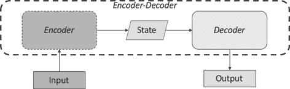

Figure 2.1 Encoder-Decoder architecture.

## 2.2 Sequence-To-Sequence

Machine translation and many other NLP problems produced promising results using sequence-to-sequence architecture (abbreviated as seq2seq) with a recurrent neural network (e.g., RNN) based encoder and decoder \[51, 238\]. Fig. 2.2 shows an example of machine translation where a French sentence, *J'aime le thé.*, and it's English equivalent, *I love tea.* form the sentence pair as an example of input for the training. The tokens <eos> and <bos> are special ways to handle the end and beginning of the sentence, respectively. As shown in Fig. 2.2 the final hidden state of the encoder acts as the input for the decoder.

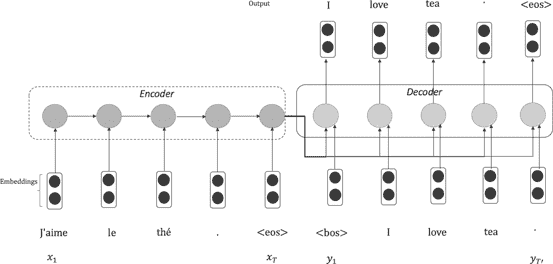

Figure 2.2 RNN-based sequence-to-sequence for machine translation.

### 2.2.1 Encoder

The input sentence is tokenized into words and words are mapped into feature vectors which are the inputs for the encoder. Suppose that the input sequence is represented by *x*[1], ⋯, *x*[*T*] such that token *x*[*t*] in the input text sequence is the *t*th token. Embedding mappings transform the input tokens *x*[1], …, *x*[*T*] to **x**[1], ⋯, **x**[*T*] vectors. A unidirectional RNN at any time *t* with a previous hidden state **h**[*t* − 1] and input x[*t*] generates a new hidden state

$$\\begin{array}{l} {\\mathbf{h}\_{t} = f(\\mathbf{h}\_{t - 1},\\mathbf{x}\_{t})} \\\\ \\end{array}$$  

(2.1)

The above equation can be more concretely written as

$$\\begin{array}{l} {\\mathbf{h}\_{t} = \\tanh(\\mathbf{W}^{(hh)}\\mathbf{h}\_{t - 1} + \\mathbf{W}^{(hx)}\\mathbf{x}\_{t})} \\\\ \\end{array}$$  

(2.2)

The state **h**[*t*], known as the **context variable** or the **context vector**, encodes the information of the entire input sequence and is given by:

$$\\begin{array}{l} {\\mathbf{c} = m(\\mathbf{h}\_{1},\\cdots,\\mathbf{h}\_{T})} \\\\ \\end{array}$$  

(2.3)

where *m* is the mapping function and in the simplest case maps the context variable to the last hidden state

$$\\begin{array}{l} {\\mathbf{c} = m(\\mathbf{h}\_{1},\\cdots,\\mathbf{h}\_{T}) = \\mathbf{h}\_{T}} \\\\ \\end{array}$$  

(2.4)

Adding more complexity to the architecture, the RNN can be bidirectional and thus the hidden state would not only depend on the previous hidden state **h**[*t* − 1] and input **x**[*t*], but also on the next state **h**[*t* + 1].

### 2.2.2 Decoder

The decoder has the output of the encoder, the context variable **c**, and the given output sequence *y*[1], …, *y*[*T*]^′ to generate the decoded outputs. In Sutskever et al., the context variable from the encoder—the final hidden state—initiates the decoder, whereas in Cho et al. the context variable is passed to every time step.

Similar to the encoder, decoder hidden state at any time *t*^′ is given by

$$\\begin{array}{l} {\\mathbf{s}\_{t^{\\prime}} = g(\\mathbf{s}\_{t - 1},\\mathbf{y}\_{t^{\\prime} - 1},\\mathbf{c})} \\\\ \\end{array}$$  

(2.5)

The hidden state of the decoder flows to an output layer and the conditional distribution of the next token at *t*^′ is given by

$$\\begin{array}{l} {P(\\mathbf{y}\_{t^{\\prime}}|\\mathbf{y}\_{t^{\\prime} - 1},\\cdots,y\_{1},\\mathbf{c}) = \\text{softmax}(\\mathbf{s}\_{t - 1},\\mathbf{y}\_{t^{\\prime} - 1},\\mathbf{c})} \\\\ \\end{array}$$  

(2.6)

### 2.2.3 Training

The decoder predicts a probability distribution for the output tokens at each time step, and the softmax gives the distribution over the words. Thus, the encoder and decoder are jointly trained, and the cross-entropy loss is used for optimization and is given by

$$\\begin{array}{l} {\\max\\limits\_{\\theta}\\frac{1}{N}\\sum\\limits\_{n = 1}^{N}\\log p\_{\\theta}(\\mathbf{y}^{(n)}|\\mathbf{x}^{(n)})} \\\\ \\end{array}$$  

(2.7)

The process of concatenating the < bos > and the original output sequence, excluding the final token, as the input to the decoder during the training is called **teacher forcing**. The teacher forcing helps in addressing the slow convergence and instability problems when training RNNs.

### 2.2.4 Issues with RNN-Based Encoder-Decoder


如上文所述，解码器组件使用一个上下文变量压缩并编码源句子的完整信息。输入规模增大时，压缩过程中会丢失信息。句子中的词语也可能因语言而具有复杂结构和长距离关联。将这些信息以压缩方式存储在单个向量中也会导致低效。另一方面，编码器侧的每个时间步的隐藏变量都可用，并携带信息供解码器网络使用。解码器的每个时间步都会受到编码器隐藏变量的不同影响。循环神经网络（RNN）也存在消失和爆炸梯度的问题 \[115\]。RNN 的一个计算问题在于其依赖于前一个时间步的递归或依赖，使得结构难以并行化。

### 2.3 注意力机制

#### 2.3.1 背景

注意力机制是选择性地关注特定元素并过滤掉不那么相关的元素。人眼接收到的信息量约为每秒十亿比特，而大脑处理的能力远低于此。视觉注意力是一种注意力形式，它涉及将注意力导向并维持对刺激（如人物、无生命物体或特定任务）的聚焦，从而使大脑高效处理。因此，注意力机制使人类能够只关注感兴趣的那部分信息，从而实现最优的资源利用，提升生存和成长。

“美国心理学之父”威廉·詹姆斯创建了两元组件框架来解释视觉注意力机制 \[133\]。在该框架中，注意力的“聚光灯”使用非自愿（ involuntary）和自愿（ voluntary）线索来偏向感官输入。非自愿线索是自发的，基于环境中目标的显著性和易注意性。相反，自愿线索是基于主体自愿努力有意集中注意力的目标。例如，通过给特定物体上不同颜色来吸引注意力，或关注哭泣的婴儿，都是非自愿线索。相反，为回答问题或解决特定问题而关注特定文本则是自愿线索。

在深度学习中的注意力机制中，自愿线索对应于查询（queries），非自愿线索对应于键（keys），感官输入对应于值（value）。每个感官输入（value）都映射到该输入的非自愿线索（key）。因此，注意力机制可以被视为通过注意力聚合，利用查询（自愿线索）和键（非自愿线索）来偏向选择值（感官输入）的过程，如图 2.3 所示 \[17\]。

形式化地，考虑由 *n* 个键-值对（k[1], v[1]), …, (k[n], v[n]）组成的记忆单元，其中 k[i] ∈ ℝ^(d[k]) 且 v[i] ∈ ℝ^(d[v])。注意力层接收的输入是查询 q ∈ ℝ^(d[q])，输出为 o ∈ ℝ^(d[v])，其形状与值 v 相同。

注意力层使用一个评分函数 α 计算查询与键之间的相似度，返回对键 k[1], …, k[n] 的得分 a[1], …, a[n]：

$$\\begin{array}{l} {a_{i} = \\alpha(\\mathbf{q},\\mathbf{k}\_{i})} \\\\ \\end{array}$$  

(2.8)

注意力权重通过对得分应用软最大函数计算：

$$\\begin{array}{l} {\\mathbf{b} = \\text{softmax}(\\mathbf{a})} \\\\ \\end{array}$$  

(2.9)

每个元素 b_i 的计算方式为：

$$\\begin{array}{l} {b\_{i} = \\frac{\\exp(a\_{i})}{\\sum\_{j}{\\exp(a\_{j})}}} \\\\ \\end{array}$$  

(2.10)

输出是注意力权重与值的加权和：

$$\\begin{array}{l} {\\mathbf{o} = {\\sum\\limits\_{i = 1}^{n}b\_{i}}\\mathbf{v}\_{i}} \\\\ \\end{array}$$  

(2.11)

Fig. 2.4 捕捉了从输入查询到输出的各种向量和标量之间的交互。

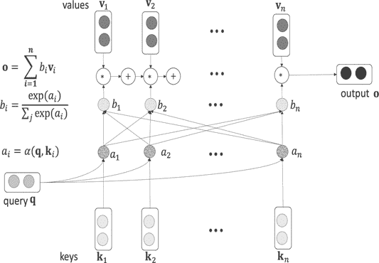

Figure 2.4 Attention mechanism showing query, keys, values, and output vector interactions.

注意力机制的设计是为了克服 RNN 编码器-解码器结构所存在的问题。

如图 2.3 所示，注意力机制可以被视为一个拥有键和值的记忆体，以及在有人查询时生成输出的层，输出由 value 的 keys 映射到输入 \[17\]。

形式化地，考虑由 *n* 个键-值对（k[1], v[1]), …, (k[n], v[n]）组成的记忆单元，其中 k[i] ∈ ℝ^(d[k]) 且 v[i] ∈ ℝ^(d[v])。注意力层接收的输入是查询 q ∈ ℝ^(d[q])，输出为 o ∈ ℝ^(d[v])，其形状与值 v 相同。

注意力层使用评分函数 α 计算查询与键之间的相似度，返回对键 k[1], …, k[n] 的得分 a[1], …, a[n]：

$$\\begin{array}{l} {a_{i} = \\alpha(\\mathbf{q},\\mathbf{k}\_{i})} \\\\ \\end{array}$$  

(2.8)

注意力权重通过对得分应用软最大函数计算：

$$\\begin{array}{l} {\\mathbf{b} = \\text{softmax}(\\mathbf{a})} \\\\ \\end{array}$$  

(2.9)

每个元素 b_i 的计算方式为：

$$\\begin{array}{l} {b\_{i} = \\frac{\\exp(a\_{i})}{\\sum\_{j}{\\exp(a\_{j})}}} \\\\ \\end{array}$$  

(2.10)

输出是注意力权重与值的加权和：

$$\\begin{array}{l} {\\mathbf{o} = {\\sum\\limits\_{i = 1}^{n}b\_{i}}\\mathbf{v}\_{i}} \\\\ \\end{array}$$  

(2.11)

Fig. 2.4 捕捉了从输入查询到输出的各种向量和标量之间的交互。


Figure 2.4 Attention mechanism showing query, keys, values, and output vector interactions.

### 2.3.2 基于得分的注意力类型

如前所述，评分函数 α(q, k) 可以采用多种形式，从而催生了多种注意力机制，每种都有其优势。

#### 2.3.2.1 点积（乘积）

点积基于的评分函数最简单，不需要调参 \[176\]。

$$\\begin{array}{l} {\\alpha(\\mathbf{q},\\mathbf{k}) = \\mathbf{q} \\cdot \\mathbf{k}} \\\\ \\end{array}$$  

(2.12)

#### 2.3.2.2 缩放点积或乘积

缩放点积基于的评分函数将点积除以 √d_k，以消除维度 d_k 的影响 \[254\]。根据 Vaswani 等人，随着维度增加，点积会变大，导致 softmax 函数进入极端梯度区域。

$$\\begin{array}{l} {\\alpha(\\mathbf{q},\\mathbf{k}) = \\frac{\\mathbf{q} \\cdot \\mathbf{k}}{\\sqrt{d\_{k}}}} \\\\ \\end{array}$$  

(2.13)

#### 2.3.2.3 线性、MLP 或加性

卢昂等人还尝试将查询和键投射到隐藏层的维度 h，学习权重（W_k, W_q），并使用 sigmoid 函数将它们与值结合，如下所示：

$$\\begin{array}{l} {\\alpha(\\mathbf{q},\\mathbf{k}) = \\mathbf{v}^{\\text{T}}\\tanh(\\mathbf{W}\_{k}\\mathbf{k} + \\mathbf{W}\_{q}\\mathbf{q})} \\\\ \\end{array}$$  

(2.14)

缩放点积或点积基于的评分函数比加性注意力机制更快且更节省内存。

### 2.3.3 基于注意力的序列到序列

在编码器-解码器中加入注意力层并映射到查询、键和值的一般修改如图 2.5 所示，具体为：

1.  使用最后编码器状态作为键 k 和值 v。

2.  使用解码器在时间步 t‑1 的最后状态作为查询 q。

3.  注意力层的输出 o（上下文变量）用于下一个解码状态 t。

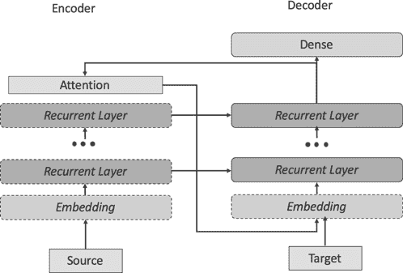

Figure 2.5 编码器-解码器带注意力层。

为了更详细地理解流程，考虑法语翻译示例，其中键和值是编码器状态，对应于词 {*J*^′*a**i**m**e*, *l**e**, *t**h**é*, .}，解码器在时间步 t‑1 已生成的词为 *I*, *love*。如图 2.6 所示，解码器在 t‑1 的输出 *love* 作为查询进入注意力层，与键结合生成未归一化的得分 a = α(q, k)，随后归一化得到注意力权重 b。注意力权重再与值（编码器输出）相乘得到上下文变量或输出向量 o。输出 o 再与前一个解码状态结合，生成下一个词 *tea* 在时间步 t。


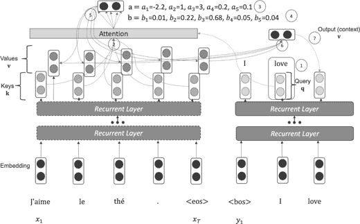

Figure 2.6 序列到序列，在时间 `t` 处，当解码器在 `t - 1` 生成了 `love` 时，token `tea` 将作为输出生成。

## 2.4 Transformer

如 Fig. 2.7 所示，Vaswani 等人提出的主要 Transformer 结构基于前文描述的编码器-解码器架构。Transformer 将卷积神经网络 (`CNN`) 的并行计算优势与循环神经网络 (`RNN`) 的捕获长距离、变长序列信息的能力相结合。Transformer 架构中提出了许多系统性变化，下面的若干子节将逐一详细说明。

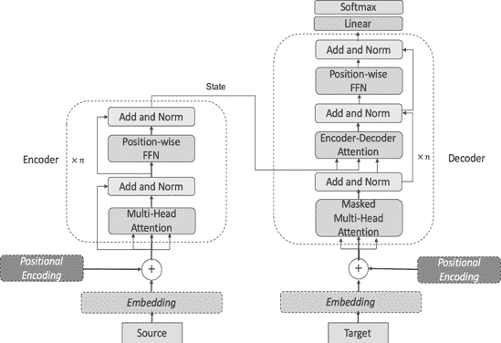

Figure 2.7 Transformer 架构。

### 2.4.1 源表示和目标表示

源词和目标词都进行分词，分词后的 token 经过词嵌入和位置编码，得到所有句子的位置编码表示。

#### 2.4.1.1 词嵌入

标准的词嵌入查找可以将句子长度为 *l* 的句子转换为维度为 (*l*, *d*) 的矩阵 **W**，即 **W** ∈ ℝ^(*l* × *d_)。

#### 2.4.1.2 位置编码

词序和位置在大多数 NLP 任务中起关键作用。循环神经网络通过逐词处理本质上已经将词序纳入模型。在 Transformer 架构中，为加快速度并实现并行化，循环神经网络被多头注意力层取代，后文将详细说明。因此，必须显式将词序信息作为输入传递给模型层，以此方式捕获词序。这种词序信息的编码被称为位置编码。可以推导出多种有效位置编码的要求，具体包括：

1. 每个时间步（句子中的词）拥有唯一的编码值。

2. 跨不同长度句子的两个时间步之间的距离保持一致。

3. 编码结果对句子长度是泛化的、独立的。

4. 编码是确定性的。

实现上述所有要求的简朴方法是使用二进制表示。Fig. 2.8 展示了在维度为 3 的向量中，如何通过二进制值生成 8 个满足上述要求的位置编码。将每个比特表示为灰色（0）和白色（1），显示出每个位置的差异以及恒定的差值。使用二进制值在内存方面成本很高。

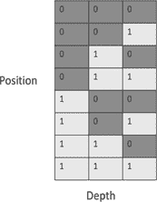

Figure 2.8 维度为 3 的位置编码，对应 8 个位置。

若句子长度为 *l*，嵌入维度为 *d*，位置编码 **P** 为维度相同的二维矩阵，即 **P** ∈ ℝ^(*l* × *d_)。每个位置可以通过以下公式表示，其中 *i* 表示位置索引（范围 0 到 *l*‑1），*j* 表示维度索引（范围 0 到 ⌊(*d*‑1)/2⌋）：

$$\\begin{array}{l} {\\mathbf{P}\_{i,2j} = \\sin(i/1000^{2j/d})} \\\\ \\end{array}$$  

(2.15)

$$\\begin{array}{l} {\\mathbf{P}\_{i,2j + 1} = \\cos(i/1000^{2j/d})} \\\\ \\end{array}$$  

(2.16)

*f**o**r**i* = 0, ⋯, *l* − 1, *j* = 0, ⋯, ⌊(*d* − 1)/2⌋。上述函数表明，频率随向量维度递减，在 wavelength 上从 2π 到 10000 × 2π 形成等比数列。当 *d* = 512 维且最大句子长度 *l* = 50 时，位置编码可视化如 Fig. 2.9 所示。

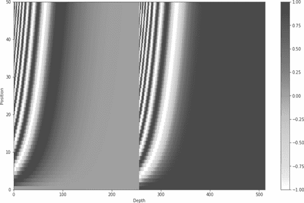

Figure 2.9 维度为 512 的位置编码，对应 50 个位置。

如 Fig. 2.7 所示，词嵌入矩阵 **W** 与位置编码矩阵 **P** 相加，得到输入表示 **X** = **W** + **P** ∈ ℝ^(*l* × *d_)。

### 2.4.2 注意力层

Transformer 中的基本构件是自注意力（self‑attention），在编码器和解码器中均有使用，只是在使用方式上略有差异。下面的子节将逐步构建注意力层，从最基础的自注意力开始。

#### 2.4.2.1 自注意力

要理解多头注意力，必须先拆解并理解其单头部分——自注意力。Fig. 2.10 展示了输入向量 **x**[*i*] 如何通过自注意力层转换为输出向量 **z**[*i*]。每个输入向量 **x**[*i*] 会生成三个不同的向量：查询（query）、键（key）和值（value），记作 (**q**[*i*], **k**[*i*], **v**[*i*])。查询、键、值向量通过对应的可学习权重矩阵 **W**[*q*]、 **W**[*k*]、 **W**[*v*] 对输入向量 **x**[*i*] 进行线性投影得到。这些权重矩阵在训练开始时随机初始化，随后在训练过程中联合学习。对于编码器和解码器的第一层注意力，输入是单词嵌入与位置编码之和。

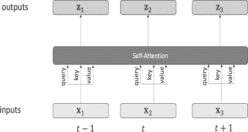

Figure 2.10 自注意力：输入向量映射为查询、键、值，并生成对应的输出向量。

与前文章节 2.3 讨论的查询、键、值的作用类似，自注意力的三个向量各自承担不同职责：

1. 查询向量 **q**[*i*] 的作用是将其与所有其他键向量的点积 $\\sum\_{j = 0}^{l}{\\mathbf{q}\_{i}\\mathbf{k}\_{j}\\ ^{T}}$ 聚合，从而影响其自身输出 **z**[*i*] 的权重。

2. 键向量 **k**[*i*] 的作用是与其他查询向量配对，计算相似度，并通过查询‑键乘积得分影响输出。

3. 值向量 **v**[*i*] 的作用是结合查询‑键得分的结果，提取相应信息，形成输出向量 **z**[*i*]。

下面的 Fig. 2.11 展示了每个 token 从输入到输出的完整计算流程。

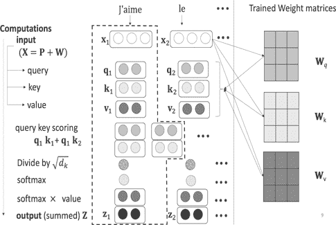

Figure 2.11 虚线显示自注意力层中一个输入的完整计算流程。

为了避免对每个 token 进行标量计算，输入矩阵 **X** ∈ ℝ^(*l* × *d_)（其中 *l* 为句子最大长度，*d* 为输入维度）会一次性与查询、键、值矩阵进行乘法运算，得到整体注意力：

$$\\begin{array}{l} {attention(\\mathbf{Q},\\mathbf{K},\\mathbf{V}) = \\text{softmax}(\\frac{\\mathbf{Q}\\mathbf{K}^{\\text{T}}}{\\sqrt{\\text{d}\_{\\text{k}}}})\\mathbf{V}} \\\\ \\end{array}$$  

(2.17)

#### 2.4.2.2 多头注意力


Instead of a single self-attention head, there can be `h` parallel self-attention heads; this is known as multi-head attention. In the original transformer paper, the authors used `h` = 8 heads. Multi-head attention provides different subspace representations instead of just a single representation for the inputs, which helps capture different aspects of the same inputs. It also helps the model expand the focus to different positions. Each head can learn something different, for example, in machine translation, it may be about learning grammar, tense, conjugation, etc.

Multi-head attention have multiple sets of query/key/value weight matrices, each resulting in different query/key/value matrices for the inputs, finally generating output matrices `z`[*i*]. These output matrices from each head are concatenated and multiplied with an additional weight matrix, `W`[*O*], to get a single final matrix, `Z`, with vectors `z`[*i*] as output for each input `x`[*i*]. The parallel input to output transformations for all the heads is depicted in Fig. 2.12.

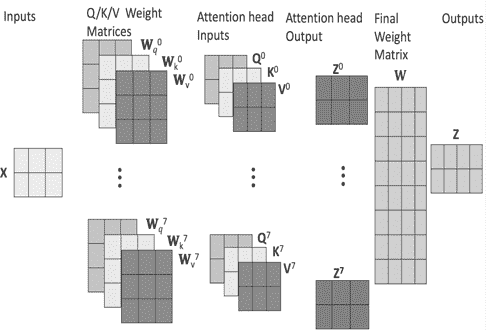

Figure 2.12 Multi-head attention.

``` 
head_i = attention(W_q_i^i Q, W_k_i^i K, W_v_i^i V)
```

(2.18)

``` 
multihead(Q, K, V) = W_O concat(head_1, ..., head_h)
```

(2.19)

#### 2.4.2.3 Masked multi-head attention

We want the decoder to learn from the encoder sequence and a particular decoder sequence, which has been already seen by the model, to predict the next word/character. Thus, for the first layer of the decoder, similar to the sequence-to-sequence architecture, only previous target tokens need to be present and others to be masked. This special alteration results in the masked multi-head attention. This is implemented by having a masking weight matrix **M** that has -∞ for future tokens and 0 for previous tokens. This computation is inserted after the scaling of the multiplication of **Q** and **K**^(*T*) and before the softmax so that the softmax results in the actual scaled values for previous tokens and the value 0 for future tokens.

``` 
masked~Attention(Q, K, V) = softmax( (QK^T + M) / sqrt(d_k) ) V
```

(2.20)

#### 2.4.2.4 Encoder-decoder multi-head attention

In the decoder side there is a need to learn the attention relationship between the entire source input and the target output at a given time. Therefore, the query vectors from the target sequence (before a given time) and the keys and values from the entire input sequence of the encoder are passed to the self-attention layer in the decoder as shown in Fig. 2.7.

### 2.4.3 Residuals and Layer Normalization

Similar to ResNets, the inputs, **X**, are short circuited to the output, **Z**, and both are added and passed through layer normalization *addAndNorm*(**X** + **Z**) \[105\]. Layer normalization ensures each layer to have 0 mean and a unit (1) variance.

For each hidden unit, *h*[*i*], we can compute

``` 
h_i = (g / σ)(h_i - μ)
```

(2.21)

where *g* is the gain variable (can be set to 1), *μ* is the mean given by $\\frac{1}{H}{\\sum\_{i = 1}^{H}h\_{i}}$ and *σ* is the standard deviation given by $\\sqrt{\\frac{1}{H}{(h\_{i} - \\mu)}^{2}}$.

Layer normalization reduces the **covariance shift**, i.e., the gradient dependencies between each layer, and therefore speeds up the convergence as fewer iterations are needed \[13\]. This is related to batch normalization, where batch normalization happens at one hidden unit level and a 0 mean and a unit (1) variance is achieved on that one batch \[130\]. Advantage of layer normalization is that it works independent of the batch size, i.e., can give a single example, small batch or a large batch.

### 2.4.4 Position wise Feed-forward Networks

Both encoder and decoder contain a fully connected feed-forward network after the attention sub layers. For each position, similar linear transformations with a ReLU activation in between is performed.

``` 
FFN(x) = max(0, xW_1 + b_1)W_2 + b_2
```

(2.22)

Every position goes through the same transformations and they are different only at the layer level.

### 2.4.5 Encoder

The encoder block in the transformer consists of *n* blocks of {*multiheadAttention*, *addAndNorm*, *FFN*, *addAndNorm*} as shown in Fig. 2.7. Every layer of multi-head attention in the encoder side attends to the input or the source, i.e., attention between inputs and inputs. Tenney et al. show that each layer of transformer in the encoder side performs a different NLP task in classical sense such as part-of-speech, constituents, dependencies, entity resolution, etc. \[244\].

### 2.4.6 Decoder

The decoder block in the transformer consists of *n* blocks of {*maskedMultiheadAttention*, *addAndNorm*, *encoderDecoderAttention*, *addAndNorm*, *FFN*, *addAndNorm*} as shown in Fig. 2.7. The first layer of multi-head attention in the decoder side attends to the target, i.e., attention between masked outputs with themselves. The encoder-decoder attention layer creates attention between the source and the target.

## 2.5 Case Study: Machine Translation

### 2.5.1 Goal

This section will go through a real-world use case of sequence to sequence in the NLP domain—machine translation between English and French sentences. We will apply attention-based and transformer-based techniques to understand, compare, and contrast between the two architectures.

### 2.5.2 Data, Tools, and Libraries

The English-French parallel corpus from [`www.manythings.org/​anki/​`](https://www.manythings.org) is used for the machine translation. For necessary data wrangling and visualization, we use standard Python libraries like Pandas, NumPy, and Matplotlib. We use TorchText and spaCy for basic text processing such as tokenization. Attention-based and Transformer-based sequence-to-sequence are implemented using the PyTorch library.

### 2.5.3 Experiments, Results, and Analysis

#### 2.5.3.1 Exploratory data analysis

Basic data preprocessing like converting sentences to ASCII and filtering out the pairs that are too long is performed as a text normalization step. Then we tokenize the sentences, convert the words to token IDs, and append < bos > and < eos > IDs to the beginning and end of the token ID sequences. Padding the variable-length sequences to the maximum observed length in the batch using the < pad > token ensures a fixed-size tensor for training and evaluation.

The total of 135,842 language pairs after filtering reduce to 131,951 and we further split it into 80% training, 10% validation and 10% test data, i.e., 105,460, 13,308, and 13,183 respectively.

Figs. 2.13 and 2.14 show the distribution plots as histograms for English/French and joint distribution. Most of the sentences in the parallel corpus are between 4 and 8 tokens/words length.

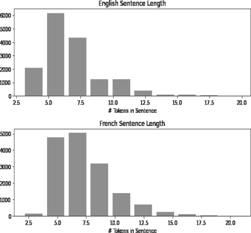

Figure 2.13 Sentence length distribution for English and French sentences.

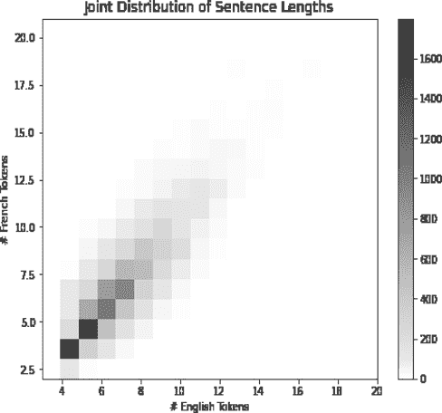

Figure 2.14 Joint distribution for English and French sentences based on length.


# 第三章 来自变形器的双向编码表示 (BERT)

DOI: [10.1201/9781003170082-3](https://doi.org/10.1201/9781003170082-3)


# THE advent of Bidirectional Encoder Representations from Transformer (BERT) \[72\] is considered the onset of a revolution in the field of Natural Language Processing (NLP). BERT uses unlabeled text to pre-train deep bidirectional contextual representations. This resulted in rich pre-trained language models that can be fine-tuned with a simple additional output layer and a reasonably sized labeled dataset to produce state-of-the-art performance in a broad range of NLP tasks. These developments lowered the barrier of entry for the wide adoption of these powerful pre-trained models. It is now common practice in the artificial intelligence field to share pre-trained models and fine-tune them with minimal cost as opposed to the old paradigm of designing task-specific architectures. In this chapter, we cover BERT's basic design concepts, developments, and applications.

## 3.1 bert

### 3.1.1 Architecture

**Core layers** One of the major contributions of BERT is the simplicity of design and the diversity of covered downstream tasks. BERT's architecture consists of multi-layers of the bidirectional transformer encoder \[253\]. The capacity of the BERT architecture is characterized by (i) the number of transformer layers *L*, (ii) the size of hidden representations *H*, and the number of bidirectional self-attention heads *A*.

**Input and Output Representations** Given the simplicity of the BERT's core architecture, just a stack of bidirectional transformer encoders, the ingenuity of BERT lies in the design of input and output representations that can be used to train many downstream NLP tasks with the same architecture. To that end, BERT's input is designed to distinctly represent NLP downstream tasks involving a single or a pair of sentences using the same input representation design. Most major NLP downstream tasks can be covered using a single sentence (e.g., text classification, sequence tagging, summarization, etc.) or paired sentences (e.g., question answering, natural language inference, etc.).

For any input sequence, BERT prefixes a special \[CLS\] token. The hidden vector of this token in the last BERT layer will be used as an aggregate representation for the entire input sequence and usually used for classification tasks. For NLP tasks with paired sentences, BERT concatenates the sentences into one sequence with a separator token \[SEP\] in between, which serves as one way BERT uses to distinguish the two sentences. BERT also uses a learned segment embedding to indicate to which sentence a token belongs. BERT employs WordPiece \[272\] to tokenize and embed input sequences. Finally, BERT uses position embedding layer to encode the order of tokens within the input. The input to BERT is the sum of the aforementioned token embedding, segment embedding, and positional embedding for each token as illustrated in Fig. 3.1.

![Figure 3.1 BERT input configuration \[71\].](images/fig3_1.jpg)

Figure 3.1 BERT input configuration \[71\].

### 3.1.2 Pre-Training

**Masked Language Model (MLM)** The idea is to randomly mask-out a percentage of the input sequence tokens, replacing them with the special \[MASK\] token. During pre-training, the modified input sequence is run through BERT and the output representations of the masked tokens are then fed into a softmax layer over the WordPiece vocabulary as practiced in standard language models pre-training. The bidirectional attention of the transformer encoder forces the \[MASK\] prediction task to use the context provided by the other non-masked tokens in the sequence. BERT is pre-trained with a 15% mask-out rate. This simple MLM task has a downside where a mismatch is created between pre-training and fine-tuning tasks as the special \[MASK\] token does not appear during fine-tuning. To overcome this issue, every token in the 15% masked-out tokens is subjected to the following heuristic:

*   With a probability of 80%, the token is replaced with the special \[MASK\] token.

*   With a probability of 10%, the token is replaced with a random token.

*   With a probability of 10%, the token is left unchanged.

The occasional insertion of random tokens (i.e., noise) pushes BERT to be less biased towards the masked token, especially when the masked token is left unchanged, in its bidirectional context attention. The MLM task uses cross-entropy loss only over the masked tokens and ignores the prediction of all non-masked ones.

**Next Sentence Prediction (NSP)** Many downstream NLP tasks require understanding the relationship between two sentences, such as Question Answering (QA) and Natural Language Inference (NLI). Standard language models do not pick up this type of knowledge. This motivates the NSP task, where BERT is fed pairs of sentences and pre-trained to predict if the second sentence should follow the first one in a continuous context. As discussed earlier, the first sentence is prefixed with the \[CLS\] token, then the two sentences are delimited by the special token \[SEP\]. During NSP task pre-training, the model is given sentence pairs where 50% of the time the second sentence comes after the first sentence and the other 50% the second sentence is a random sentence from the full training corpus. The self-attention of Transformer layers encourages the BERT representation of \[CLS\] token to encode both input sentences. Therefore, NSP pre-training is performed by adding a single layer MLP with softmax atop the \[CLS\] token representation to predict the binary NSP label. BERT pre-training involves combined training with both MLM and NSP tasks by optimizing the model parameters over their combined loss function. Fig. 3.2 illustrates BERT's pre-training tasks.

![Figure 3.2 BERT pre-training architecture \[71\].](images/fig3_2.jpg)

Figure 3.2 BERT pre-training architecture \[71\].

### 3.1.3 Fine-Tuning

With BERT simple and yet versatile design, fine-tuning a pre-trained model for many downstream tasks is a straightforward task that involves simply plugging in the proper inputs and outputs and fine-tuning all the model's parameters end-to-end. As discussed earlier many NLP tasks can be modeled using two sentences input to BERT. For tasks like Question Answering (QA) and Natural Language Inference (NLI), the input to BERT is a concatenated question-answer sentence pair and the hypothesis-premise sentence pair, respectively. Other tasks with single input sentence, such as text classification and sequence tagging (e.g., POS, NER), the input to BERT is modeled again as concatenated sentences but with one of them empty. For token level tasks (e.g., QA, POS, and NER), BERT output tokens representations are fed into an output layer for token tagging. Fig. 3.3 provides an illustration for the BERT fine-tuning for token level tasks. For tasks like text classification and NLI, the output representation of the special token \[CLS\] is used as input to an output layer to produce a label. Figs. 3.4 and 3.5 depict BERT fine-tuning architectures for single sequence and paired-sequences classification tasks.

![Figure 3.3 BERT fine-tuning architecture for token tagging tasks (e.g., POS, NER, and QA) \[71\].](images/fig3_3.jpg)

Figure 3.3 BERT fine-tuning architecture for token tagging tasks (e.g., POS, NER, and QA) \[71\].

![Figure 3.4 BERT fine-tuning architecture for single sequence classification tasks \[71\].](images/fig3_4.jpg)

Figure 3.4 BERT fine-tuning architecture for single sequence classification tasks \[71\].


![Figure 3.5 BERT fine-tuning architecture for paired-sequence classification tasks (e.g., NLI) \[71\].](images/fig3_5.jpg)

Figure 3.5 BERT fine-tuning architecture for paired-sequence classification tasks (e.g., NLI) \[71\].

## 3.2 Bert Variants

### 3.2.1 Robustly Optimized BERT Pre-training Approach (RoBERTa)

RoBERTa \[170\] is a Robustly Optimized BERT Pre-training Approach that improves on the original BERT model in terms of pre-training tasks, training hyperparameters, and pre-training data. As discussed earlier, BERT uses two pre-training tasks, Masked Language Model (MLM) and Next Sentence Prediction (NSP). For the MLM task, BERT randomly masks token during the data pre-processing stage. Therefore, the masks stay static throughout the entire model training process. RoBERTa on the other hand follows a dynamic masking strategy where masked tokens are randomly chosen for each training epoch. RoBERTa also drops the NSP pre-training task and only uses the dynamic MLM task. Another contribution for RoBERTa is the size of input sequences, where full sentences of at most 512 tokens, are sampled contiguously from one or more documents. If the end of a document is reached before getting the required input sequence size, sentence sampling continues with the next document after adding an extra separator token.

On the hyperparameters front, RoBERTa showed that using large mini-batches with increased learning rates during pre-training improves the perplexity of the dynamic MLM task as well as the downstream task performance. RoBERTa is also pre-trained on an order of magnitude more data than BERT, the pre-training data consists of 160 GB including Books Corpus, English [Wikipedia](http://Wikipedia), and CommonCrawl News dataset (63 million articles, 76 GB), Web text corpus (38 GB) and Stories from Common Crawl (31 GB).

To summarize, using the same basic architecture as BERT, RoBERTa has shown that the following design changes significantly improves RoBERTa performance over BERT.

1.  Pre-training the model for longer time

2.  Using bigger batches

3.  Using more training data

4.  Removing the NSP pre-training task

5.  Training on longer sequences

6.  Dynamically changing the masking pattern applied to the training data.

## 3.3 Applications

### 3.3.1 TaBERT

TaBERT \[289\] is the first model to have been pre-trained on both natural language sentences and tabular data formats. These representations are advantageous for problems involving cooperative reasoning over natural language sentences and tables. Semantic parsing over databases is a sample example, in which a natural language inquiry (e.g., “Which nation has the largest GDP?”) is translated to a program executable over database (DB) tables. This is the first technique of pre-training that spans structured and unstructured domains, and it opens up new possibilities for semantic parsing, where one of the primary issues has been comprehending the structure of a database table and how it fits with a query. TaBERT was trained on a corpus of 26 million tables and the English phrases that accompany them. Historically, language models have been trained only on free-form natural language text. While these models are excellent for jobs that need reasoning only in free-form natural language, they are insufficient for activities such as database-based question answering, which involves reasoning in both free-form language and database tables.

Two commonly used benchmarks for database-based question answering were utilized: a traditional supervised text-to-SQL job over structured data from the Spider dataset and a weakly supervised parsing task over a semi-structured dataset from the WikiTableQuestions dataset. Weakly supervised learning is substantially more difficult than supervised learning, since the parser lacks access to the labeled question and must instead explore a very vast search space of queries. TaBERT is a Natural Language Processing (NLP) model built on top of the BERT model that accepts natural language queries and tables as input. TaBERT acquires contextual representations for sentences as well as the constituents of the DB table in this manner. These representations may then be utilized to generate real database instructions in other neural networks. TaBERT's representations may then be fine-tuned further using the training data for that job.

TaBERT is trained via content snapshots, in which the model only encodes the bits of a table that are most relevant to a query. Due to the enormous amount of rows in certain database tables, encoding them is a computationally intensive and inefficient procedure. By encoding just the portion of material that is most relevant to the utterance, content snapshots enable TaBERT to handle with enormous tables. For instance, the phrase “In which city did Piotr finish first last time?” (sample extracted from the WikiTableQuestions dataset) may be accompanied with a table including information on the year, venue, position, and event. A snapshot of content will take a subset of three rows. This subset will not include all of the table's data, but it is sufficient for the model to understand that, for example, the venue column comprises cities. TaBERT describes table structure using a mix of traditional horizontal self-attention, which captures the dependence between cells in specific rows, and vertical self-attention, which catches the information flow between cells in different rows. The ultimate outputs of layers of such horizontal and vertical self-attention are distributed representations of utterance tokens and table columns, which may be utilized to calculate the database query by downstream semantic parsers.

### 3.3.2 BERtopic

Topic modeling is one of the challenging topics in NLP. The advances in BERT and its variants motivate the NLP community to leverage BERT in topic modeling. Grootendorst \[101\] introduced an elegant idea, BERTopic, to extract interpretable topics in documents using BERT and transformers embeddings. Hence, takes advantage of the state-of-the-art pre-trained transformers model. The method starts by creating the embeddings of the documents of interest using BERT models. Since documents can be very large and BERT models have limit on the token size, the documents are preprocessed before extracting the embeddings. Preprocessing divides the document to smaller paragraphs or sentences that are smaller than the token size for the transformer model. Then, clustering is performed on the document embeddings to cluster all the documents with similar topics together. It is worth noting that dimensionality reduction for the embeddings is recommended before performing the clustering. Dimensionality reduction algorithms such as t-Distributed Stochastic Neighbor Embedding (t-SNE) or Uniform Manifold Approximation and Projection (UMAP) can be used to lower the dimensions. The topics are then derived from the clustered documents using the novel class-based metric introduced by Grootendorst in \[101\]. Class-Based Term Frequency-Inverse Document Frequency (c-TF-IDF) is modification of the classic Term Frequency-Inverse Document Frequency (TF-IDF) in which all documents in a certain category is considered as a single document then compute TF-IDF. Therefore, the TF-IDF in this case would represent the importance of words in a topic, not in a document. The Class-Based Term Frequency-Inverse Document Frequency (c-TF-IDF) is computed as

$$\\begin{array}{l} {c - TF - IDF\_{i} = \\frac{t\_{i}}{w\_{i}} \\times \\log\\frac{m}{\\sum\\limits\_{j}^{n}t\_{j}}} \\\\ \\end{array}$$  

(3.1)


where the frequency of each word `t` is extracted for each class `i` and normalized by the total number of words and this is weighted by the normalized number of documents per the total frequency of the word `t` across all the classes `n`. In other words, instead of computing the relative importance of a word in a document as compared to the other documents, the metric in (3.1) computed the relative importance of a word in a class (i.e., topic) as compared to the other topics.

## 3.4 Bert Insights

### 3.4.1 BERT Sentence Representation

Due to self-attention in the Transformer encoder, the BERT representation of the special token \[CLS\] encodes both the two sentences from the input. Hence, the output layer of the MLP classifier takes X as the input, where X is the output of the MLP hidden layer whose input is the encoded \[CLS\] token. Because a pre-trained model is not fine-tuned on any downstream tasks yet. In this case, the hidden state of \[CLS\] is not a good sentence representation. If later you fine-tune the model, you may use \[CLS\] as well.

BERT sentence representation can also be obtained by pooling the individual token representations. However, the last layer is too close to the target functions (i.e., masked language model and next sentence prediction) during pre-training, therefore may be biased to those targets.

### 3.4.2 BERTology

The great push BERT has provided to the NLP field triggered much research into understanding how it works and the type of knowledge it extracts through massive pre-training. BERTology aims to answer some of the questions about why BERT performs well on so many NLP tasks. Some of the topics addressed by BERTology include the type of knowledge learned by BERT and where it is represented. In general there three types of knowledge BERT acquires: `Syntactic knowledge`, `Semantic knowledge`, `World knowledge`.

`BERT` representations of `syntactic knowledge` are hierarchical rather than linear, i.e., they include a syntactic tree structure in addition to the word order information. Additionally, `BERT` embeddings store information about speech segments, grammatical chunks, and roles. `BERT`'s understanding of syntax, on the other hand, is incomplete, since probing classifiers were unable to retrieve the labels of distant parent nodes in the syntactic tree. In terms of how syntactic information is represented, it seems that self-attention weights do not directly encode syntactic structure, but they may be changed to reflect it. When executing the cloze task, `BERT` takes subject-predicate agreement into consideration. Additionally, it was shown that `BERT` does not ”understand” negation and is indifferent to input that is faulty.

Regarding aspects of `semantic knowledge`, `BERT` has shown some knowledge for semantic roles. Also `BERT` encodes information about entity types, relations, semantic roles, and proto-roles. However, it was found that `BERT` struggles with representations of numbers. Research probing into `BERT`'s world knowledge capabilities showed that, for some relation types, vanilla `BERT` is competitive with methods relying on knowledge bases. However, `BERT` cannot reason based on its world knowledge. Essentially `BERT` can “guess” the affordances and properties of many objects, but does not have the information about their interactions (e.g., it “knows” that people can walk into houses, and that houses are big, but it cannot infer that houses are bigger than people.)

Additionally, `BERTology` is concerned with the localization of linguistic information inside the `BERT` architecture, either at the self-attention heads or at the layer level. It was shown that the majority of self-attention heads do not encode any non-trivial linguistic information directly, since fewer than half of them exhibited the ”heterogeneous” pattern2. The vertical pattern was stored in a large portion of the model (attention to \[CLS\], \[SEP\], and punctuation tokens). Additionally, certain `BERT` heads seem to specialize in particular sorts of syntactic relations, with heads paying much more attention to words in specific syntactic places than a random baseline. Other studies discovered that no one head contains the whole syntactic tree. Additionally, attention weights are illustrative of subject-verb agreement and reflexive anaphora. Additionally, it was shown that even when attention heads specialize in monitoring semantic relations, they do not always help `BERT` perform well on related tasks.

For layer-level knowledge localization, provided that the first layer of `BERT` gets representations in the form of a mix of token, segment, and positional embeddings as input. It comes to reason that the bottom levels contain the most linear information about word order. It was shown that the knowledge of linear word order decreases around layer 4 in the `BERT-base`. This is followed by an enhanced understanding of the hierarchical structure of sentences. Numerous studies have shown that the middle `BERT` layers contain the most syntactic information and that the last `BERT` levels include the most task-specific information. Additionally, it was shown that, although the majority of syntactic information may be localized in a few levels, semantic information is distributed across the model, which explains why some non-trivial cases are initially handled wrong then successfully at higher layers.

## 3.5 Case Study: Topic Modeling With Transformers

### 3.5.1 Goal

In this chapter, we looked at several applications of the Transformer architecture. In this case study, we see how to use pre-trained (or finetuned) Transformer models to do topic modeling. If one is exploring a new dataset, this method could be used during exploratory data analysis.

### 3.5.2 Data, Tools, and Libraries


Listing 3.1 Python environment setup

We will use pre-trained transformers to explore the Yelp reviews dataset (from [`huggingface.co/​datasets/​yelp\_review\_full`](https://huggingface.co)) and see what kind of topics are in the reviews. We'll generate sentence embeddings with the sentence-transformers library (see [`github.com/​UKPLab/​sentence-transformers`](https://github.com)) which provides models pre-trained for specific tasks, such as semantic search. Lastly, we're going to use BERTopic \[101\] (see [`github.com/​MaartenGr/​BERTopic`](https://github.com)) for topic modeling and Huggingface Datasets for loading the data. We can install these as shown in Listing. 3.1.

#### 3.5.2.1 Data

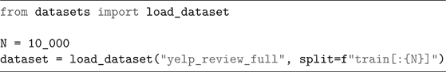

Listing 3.2 Load dataset

We begin by loading the Yelp Review Full dataset via Huggingface Datasets in Listing 3.2. There are 650,000 reviews in the dataset. To keep the runtime of this case study within reason, we'll only process the first 10,000 reviews. To process more reviews, simply change the value of `N` in Listing 3.2.

#### 3.5.2.2 Compute embeddings

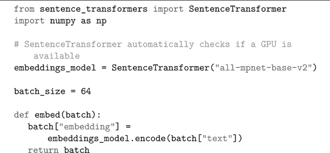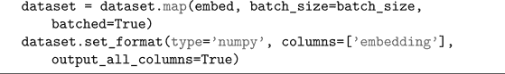

Listing 3.3 Compute embeddings

We'll generate embeddings using the “all-mpnet-base-v2” model from sentence-transformers in Listing 3.3. It's built to perform well on semantic search when embedding sentences and longer spans of text.

### 3.5.3 Experiments, Results, and Analysis

#### 3.5.3.1 Building topics

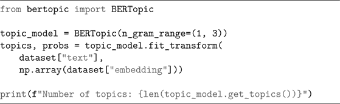

Listing 3.4 Compute topics

Now that we've computed the embeddings for the specified subset of Yelp reviews, we can proceed with the topic modeling in Listing 3.4.

#### 3.5.3.2 Topic Size Distribution


Listing 3.5 Sampling the topics


在我们计算主题分布后，我们需要查看每个主题中的评论类型。让我们先看主题大小的分布情况。

`Listing 3.5` 中的命令将输出主题大小的摘要表格。请注意，主题的大小是包含该主题的评论数量。表格在 `Fig. 3.6` 中显示。


Figure 3.6 Table showing sizes and names of largest and smallest topics.

请注意，主题 ID 为 -1 的情况。这对应于 HDBSCAN 算法输出的未分配聚类。未分配聚类包含所有未能分配到其他聚类的事物。它通常可以被忽略，*但如果它过大，则说明我们选择的参数可能不适合我们的数据。* 可以查看未分配聚类的内容来验证其是否包含不相关的词汇。

#### 3.5.3.3 主题可视化

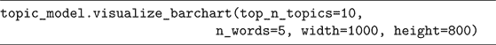

Listing 3.6 Visualizing the 10 largest topics

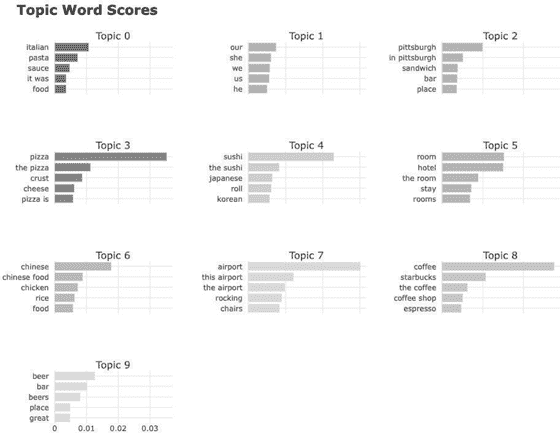

Figure 3.7 The 10 largest topics.


Listing 3.7 Visualizing the cosine similarity of the 20 largest topics

BERTopic 还可以使用 *v**i**s**u**a**l**i**z**e**[*h*]*e**a**t**m**a**p* 方法显示主题嵌入向量的余弦相似热图，如 Listing. 3.7 所示。热图在 Fig. 3.8 中显示，并展示了每对主题的嵌入向量之间重叠程度。

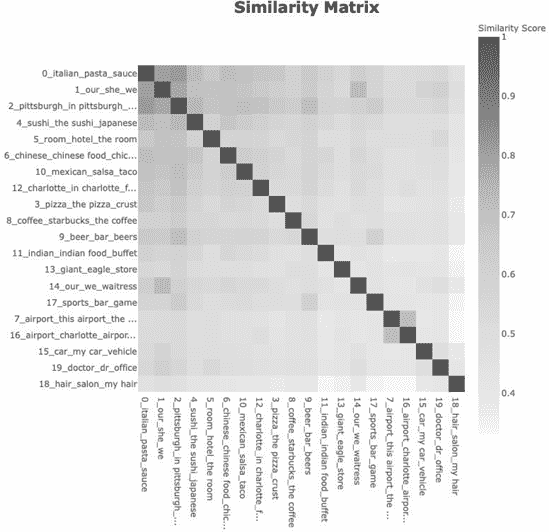

Figure 3.8 Heatmap of the cosine similarity of the 20 largest topics.

#### 3.5.3.4 主题内容

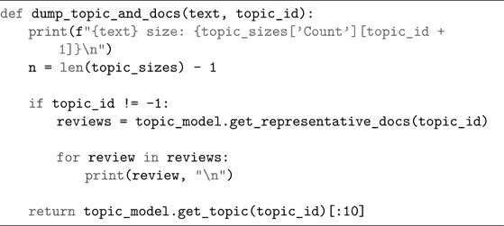

Listing 3.8 Print the topic size and representative words

现在我们来看一个主题的示例。我们在 Fig. 3.7 中查看了最大的 10 个主题，因此这里我们将查看最大和最小主题、中位数主题以及未分配聚类的内容。Listing 3.8 展示了一个简单的辅助函数，用于打印主题的大小以及与该主题最相关的 10 个词汇。

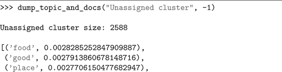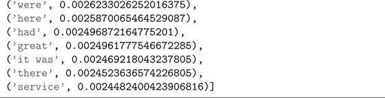

Listing 3.9 Unassigned cluster

首先，我们查看未分配聚类（主题 ID 为 -1），以验证我们可以安全忽略其内容。它在 Listing 3.9 中。

如我们所见，未分配聚类的内容包含不强烈属于任何主题的词汇。最大、最小和中位数主题分别在 Listings 3.10、3.11 和 3.12 中显示。


Listing 3.10 Largest topic: Italian food restaurants

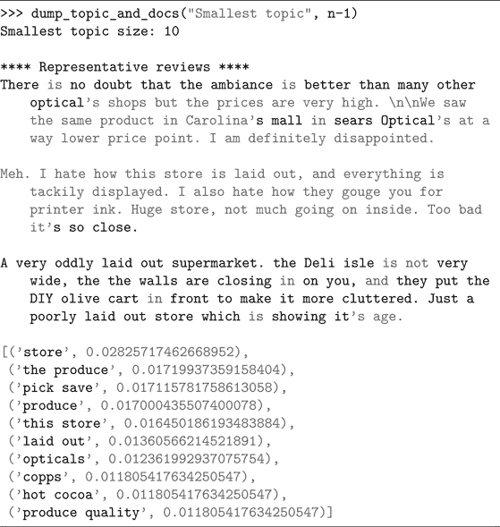

Listing 3.11 Smallest topic: the ambiance and arrangement of stores

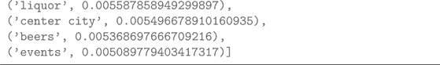

Listing 3.12 Median topic: Nightlife in Charlotte, NC

## 3.6 案例研究：微调 Bert

### 3.6.1 目标

本案例研究的目标是提供微调标准 BERT 模型的逐步演示，用于任何句子分类任务，我们选择情感分类作为样本流行任务。

### 3.6.2 数据、工具和库

我们选择 Google Play 应用评论数据集。该数据集包含 15,746 条样本，分为三类：负面、中性和正面。我们使用 Huggingface 转换器库进行微调任务，并使用标准的 Python 数据科学栈进行其他数据处理和可视化 \[249\] (Fig. 3.9, Fig. 10, Fig. 3.11)。

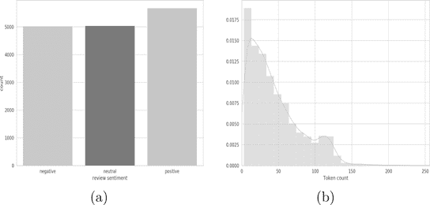

Figure 3.9 Exploratory data analysis of the sentiment classification dataset.

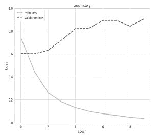

Figure 3.10 Training and validation loss throughout training.

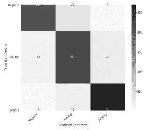

Figure 3.11 Confusion matrix of test set.

我们使用 BERT[BASE] 作为起始预训练 BERT 模型。Listing 3.6.3 展示了如何从转换器库加载预训练的 BERT 模型，并说明了用于微调 BERT 模型的分词输出 \[249\]。

### 3.6.3 实验、结果和分析

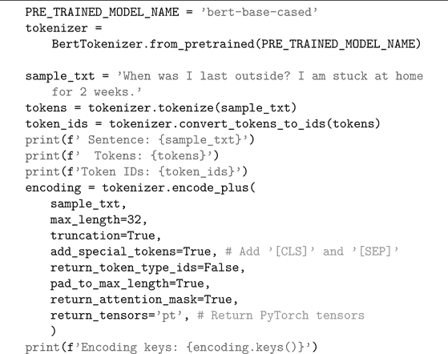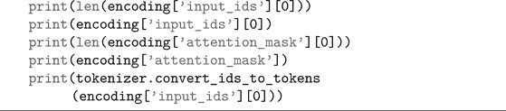

Listing 3.6.3 提供了将我们的数据集加载并分为训练、验证和测试的工具，同时创建每个数据分割的数据加载器，供微调迭代使用 \[249\]。

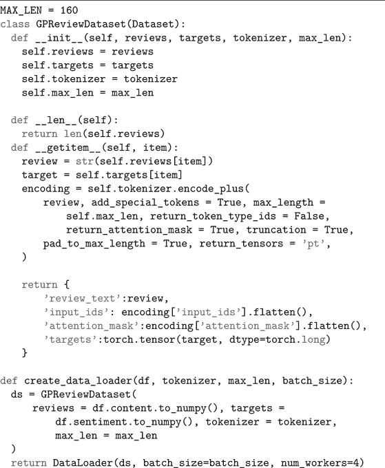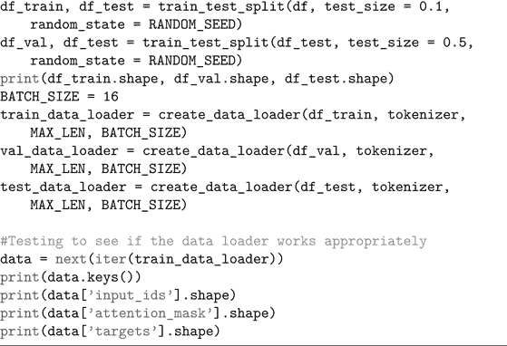

Listing 3.6.3 创建微调模型并设置相关损失、优化器和学习率调度的参数 \[249\]。

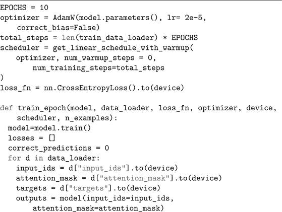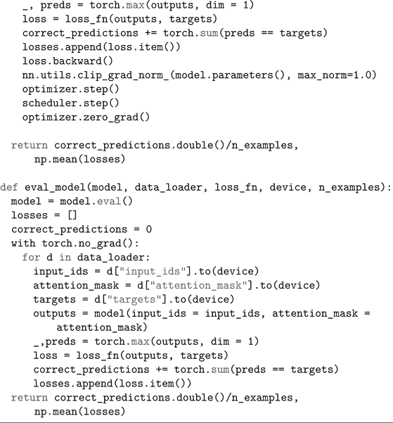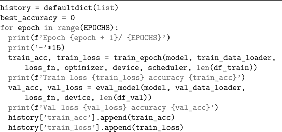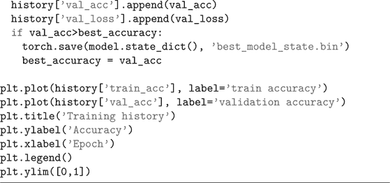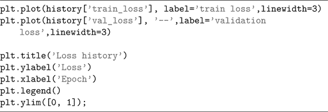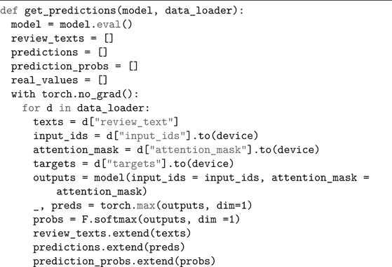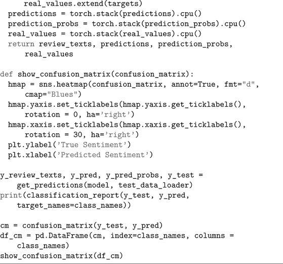

# CHAPTER 4Multilingual Transformer Architectures

DOI: [10.1201/9781003170082-4](https://doi.org/10.1201/9781003170082-4)

THE introduction of BERT \[72\] has transformed the area of Natural Language Processing (NLP) and resulted in state-of-the-art performance on a broad range of tasks. In the recent past, training NLP algorithms worked only with labeled data, which hindered their progress for years due to the limited availability and cost of collecting data for every new task and every new project. One major contribution of BERT is introducing a new pipeline for training NLP systems where algorithms can learn about core and generic natural language concepts from huge amount of cheap unlabeled data, a process also known as self-supervised learning or model pre-training. A pre-trained model is then fine-tuned for any specific downstream task using much smaller task-specific labeled datasets. This new pipeline of pre-training followed by fine-tuning constitutes the core of most advances in the machine learning field. The major success of BERT for English NLP tasks has motivated its use for other languages. However, using BERT's pipeline is only possible for languages with sufficiently large unlabeled data for pre-training. This motivated the development of multilingual models where models are pre-trained on multiple languages with the hope that the models will transfer core NLP knowledge from high-resource languages to low-resource ones and we end up with a polyglot model that aligns multilingual representations across languages.


本章涵盖了多语言 Transformer 架构的最新发展。多语言 Transformer 架构完全由以下几项定义：

`* 模型架构（层和组件）`

`* 预训练任务`

`* 预训练数据`

`* 微调任务和基准`

本章首先介绍不同的多语言 Transformer 架构用于自然语言理解（NLU）和自然语言生成（NLG）。第 4.2 节 接着描述多语言数据的最新状态，包括用于下游 NLP 任务的无标签预训练数据和微调基准。第 4.3 节 提供对多语言 Transformer 模型内部工作机制的一些见解。最后，第 4.4 节 提供一个零射多语言情感分类的实践案例研究。

## 4.1 多语言 Transformer 架构

本节讨论多语言 Transformer 的不同结构设计。我们将多语言 Transformer 划分为 (i) 自然语言理解（NLU）架构和 (ii) 自然语言生成（NLG）架构。表 4.1\[74\] 提供了本书出版时可用的具有影响力的多语言 Transformer 模型的摘要。

TABLE 4.1 多语言语言模型摘要 \[74\]

| **模型** || 架构 || 预训练 || # 语言 || Ref. |

| --- | --- | --- | --- | --- |

| **# 参数** || **目标函数** || **单语** || **平行** ||  ||  |

| IndicBERT || 33M || MLM || IndicCorp || ✗ || 12 || \[137\] |

| --- | --- | --- | --- | --- | --- | --- |

| mBERT || 172M || MLM || [Wikipedia](http://Wikipedia) || ✗ || 104 || \[72\] |

| Amber || 172M || MLM, TLM, CLWA, CLSA || [Wikipedia](http://Wikipedia) || ✓ || 104 || \[121\] |

| MuRIL || 236M || MLM, TLM || CommonCrawl + [Wikipedia](http://Wikipedia) || ✓ || 17 || \[141\] |

| VECO-small || 247M || MLM, CS-MLM || CommonCrawl || ✓ || 50 || \[175\] |

| Unicoder || 250M || MLM, TLM, CLWR, CLPC, CLMLM || [Wikipedia](http://Wikipedia) || ✓ || 15 || \[125\] |

| XLM-15 || 250M || MLM, TLM || [Wikipedia](http://Wikipedia) || ✓ || 15 || \[63\] |

| InfoXLM-base || 270M || MLM, TLM, XLCO || CommonCrawl || ✓ || 94 || \[48\] |

| XLM-R-base || 270M || MLM || CommonCrawl || ✗ || 100 || \[61\] |

| HiCTL-base || 270M || MLM, TLM, HICTL || CommonCrawl || ✓ || 100 || \[266\] |

| Ernie-M-base || 270M || MLM, TLM, CAMLM, BTMLM || CommonCrawl || ✓ || 100 || \[194\] |

| HiCTL-Large || 559M || MLM, TLM, HICTL || CommonCrawl || ✓ || 100 || \[266\] |

| Ernie-M-Large || 559M || MLM, TLM, CAMLM, BTMLM || CommonCrawl || ✓ || 100 || \[194\] |

| InfoXLM-Large || 559M || MLM, TLM, XLCO || CommonCrawl || ✓ || 94 || \[48\] |

| XLM-R-Large || 559M || MLM || CommonCrawl || ✗ || 100 || \[61\] |

| RemBERT || 559M || MLM || CommonCrawl + [Wikipedia](http://Wikipedia) || ✗ || 110 || \[54\] |

| X-STILTS || 559M || MLM || CommonCrawl || ✗ || 100 || \[198\] |

| XLM-17 || 570M || MLM, TLM || [Wikipedia](http://Wikipedia) || ✓ || 17 || \[63\] |

| XLM-100 || 570M || MLM, TLM || [Wikipedia](http://Wikipedia) || ✗ || 100 || \[63\] |

| VECO-Large || 662M || MLM, CS-MLM || CommonCrawl || ✓ || 50 || \[175\] |

### 4.1.1 基础多语言 Transformer

多语言 Transformer 模型通常基于 mBERT 架构 \[72\]。本节描述多语言 Transformer 架构的基本组件。

**输入层** 输入是一系列 token，它们来自有限词汇表的一对一热表示，通常是子词库。该词汇表一般通过拼接多个语言的单语言数据，使用诸如 BPE \[223\]、WordPiece \[273\] 或 SentencePiece \[144\] 等算法学习。为确保不同语言和脚本在词汇表中得到良好表示，可采用指数加权抽样，或为语言簇学习独立的词汇表，从而分割词汇表大小 \[55\]。

**Transformer 层** 多语言语言模型（mLM）通常构成 Transformer 的编码器。它由 *N* 层组成，每层包含 *k* 个注意力头，随后是前馈神经网络。注意力头通过对输入序列中所有其他 token 的表示，使用加权线性组合计算每个 token 的嵌入。将所有注意力头的嵌入拼接后，再经过前馈网络，得到每个输入词的 *d* 维嵌入。

**输出层** 通常，最终 Transformer 层的输出被用作每个 token 的上下文表示，而 \[CLS\] token 对应的嵌入被视为整个输入文本的嵌入。也可以通过对 token 嵌入进行池化来生成文本嵌入。输出层包含一次线性变换，随后是 Softmax，它以前一层的 token 嵌入为输入，并产生词汇表中 token 的概率分布。


$$\\begin{array}{l} {\\mathcal{L}\_{MLM}^{(x)} = - \\frac{1}{|M\_{x}|}{\\sum\\limits\_{i \\in M\_{x}}}l}ogP(x\_{i}|x\\_{\\smallsetminus M\_{x}})} \\\\ \\end{array}$$  

(4.1)

Fig. 4.1 图 4.1 展示了 MLM 任务，其中 *x* 和 *y* 代表不同语言中的单语言输入句子。尽管该任务不考虑汇聚的掩码输入的多语言信息，但它已展示出在生成跨语言表示方面的巨大价值，这些表示在不同语言之间高度对齐。下文的“洞察”部分将提供更多细节，说明导致这种行为的因素。

![Figure 4.1 Illustration of multilingual MLM task \[71, 194\]. x and y are monolingual sentences in different languages that are not parallel.](images/fig4_1.jpg)

Figure 4.1 图 4.1 展示了多语言 MLM 任务 \[71, 194\]. *x* 和 *y* 是不同语言中的单语言句子，且不平行。

**Next Sentence Prediction (NSPAN<s><s>**  


-   [构建代码切换数据时，使用工具在平行语料库的源句和目标句之间进行词对齐，并使用机器翻译技术提取双语短语表。随后，根据比例 `α` 替换源句和目标句来构建代码切换数据。由于 `α` 随机决定从源句还是目标句中选取短语，每个句子对可以生成多个代码切换序列，这对于克服通常有限的平行语料库规模非常有用。随后，ALM 通过在代码切换数据上使用标准 MLM 预训练任务进行处理。形式上，对于平行句子对 (*x*, *y*)，设 *z* 为从 *x* 和 *y* 生成的代码切换句子，则 ALM 损失定义为：

$$\\begin{array}{l} {\\mathcal{L}\_{ALM}^{(z(x,y))} = - \\frac{1}{|M|}{\\sum\\limits\_{i \\in M}l}ogP(z\_{i}|z\_{\\smallsetminus M})} \\\\ \\end{array}$$

(4.5)

其中 *z*[ ∖ *M*] 是 *z* 的掩码版本，*M* 是 *z*[ ∖ *M*] 中被掩码的 token 位置集合。

Fig. 4.3 展示了 ALM 如何利用平行句子对创建一组代码切换训练数据，这些数据随后用于训练 MLM Transformer。

![Figure 4.3 Illustration of Alternating Language Model (ALM) \[282\] where a parallel sentence pair (x,y) is used to generate multiple code-switch examples that are used to train an MLM transformer.](images/fig4_3.jpg)

Figure 4.3 Illustration of Alternating Language Model (ALM) \[282\] where a parallel sentence pair (*x*, *y*) is used to generate multiple code-switch examples that are used to train an MLM transformer.

#### 4.1.2.5 Unicoder

Unicoder \[125\] 是另一种利用平行语料库学习跨语言表示的架构。它采用与 XLM 相同的结构，并引入了三种新的跨语言预训练任务，即跨语言词汇恢复（CLWR）、跨语言 paraphrase 分类（CLPC）和跨语言掩码语言模型（CLMLM）。

**跨语言词汇恢复（CLWR）** CLWR \[125\] 使用平行语料库学习两种语言之间的词对齐。预训练任务首先使用一个可训练的注意力矩阵 \[17\] 来学习将源语言 token 嵌入表示为目标语言 token 嵌入的线性组合。该注意力矩阵所学得到的转换随后提供给跨语言模型，以学习重构源 token 嵌入。形式上，给定平行句子对 (*x*, *y*)，其中 *x* = (*x*[1], *x*[2], …, *x*[*m*]) 为源语言 *s* 的 *m* 个词， *y* = (*y*[1], *y*[2], …, *y*[*n*]) 为目标语言 *t* 的 *n* 个词。CLWR 先用 *y* 中所有词的嵌入对 *x*[*i*] 进行加权求和，得到 *x*[*i*] 的跨语言表示 *x*[*i*]^(*t*) ∈ *R*^(*h*)：

$$\\begin{array}{l} {x\_{i}^{t} = {\\sum\\limits\_{j = 1}^{n}\\text{softmax}}(A\_{ij})y\_{j}^{t}} \\\\ \\end{array}$$

(4.6)

其中 *x*[*i*]^(*s*) ∈ *R*^(*h*) 与 *y*[*j*]^(*t*) ∈ *R*^(*h*) 分别表示 *x*[*i*] 与 *y*[*j*] 的表示，*h* 为表示维度，*A* ∈ *R*^(*m* × *n*) 为定义为：

$$\\begin{array}{l} {A\_{ij} = W\\lbrack{x\_{i}^{s},y\_{j}^{t},x\_{i}^{s} \\odot y\_{j}^{t}}\\rbrack} \\\\ \\end{array}$$

(4.7)

其中 *W* ∈ *R*^(3 × *h*) 为可训练权重矩阵，⊙ 表示逐元素乘法。Unicoder 以 *X*^(*t*) = (*x*[1]^(*t*), *x*[2]^(*t*), …, *x*[*n*]^(*t*)) 作为输入，并预测原始词序列 *x*。

**跨语言 paraphrase 分类（CLPC）** CLPC \[125\] 通过提出一种新的利用平行数据的方式，引入 paraphrase 分类预训练任务。平行句子对 (*x*, *y*) 被视为正样本，而非平行对 (*x*, *z*) 被视为负样本。训练数据样本通过使用较小的 paraphrase 检测模型选取，使得对每个 (*x*, *y*) 与 (*x*, *z*) 句子对， *z* 与 *x* 相近但不等于 *y*。

**跨语言掩码语言模型（CLMLM）** CLMLM \[125\] 是 TLM 的扩展，同样采用跨语言注意力机制。不同之处在于，TLM 接收平行句子对，而 CLMLM 的输入在文档级别构建：多句平行文档（即包含多个平行翻译的完整文档）中的句子会被其他语言的翻译所替换。此设计受到一些在使用更长单语文本进行预训练时取得成功的启发。Unicoder 模型初始化自 XLM，随后在结合 MLM、TLM、CLWR、CLPC 和 CLMLM 任务的基础上进行预训练，并在 XNLI 和 XQA 基准上进行微调。

#### 4.1.2.6 Information-Theoretic Cross-Lingual Model (INFOXLM)

Information-Theoretic Cross-Lingual Model (INFOXLM) \[47\] 从信息理论角度来看待跨语言表示对齐问题，表明多语言预训练任务可以被视为在不同粒度上最大化多语言上下文之间的相互信息。例如，InfoXLM 表明，多语言掩码语言模型（mMLM）预训练任务本质上最大化了同一语言内被掩码 token 与其上下文之间的相互信息。另一方面，跨语言锚 token 促使不同语言的上下文高度相关。TLM 也有信息理论解释，显示其最大化被掩码 token 与平行语言上下文之间的相互信息，从而作为隐式跨语言表示对齐机制。基于提供的信息理论框架，InfoXLM 提出了一种新的对比学习基础的跨语言预训练任务，即跨语言对比学习。

**跨语言对比学习（XLCO）** XLCO \[47\] 提出一种信息理论方法，利用平行语料库生成跨语言表示。XLCO 鼓励 Transformer 编码器在平行句子与非平行句子的表示之间最大化相互信息，从而进行对比学习。TLM 在信息理论框架下被证明最大化 token‑sequence 之间的相互信息。相反，XLCO 最大化平行句子之间的 sequence‑level 相互信息。设 (*x*[*i*], *y*[*i*]) 为一对平行句子，其中 *y*[*i*] 是 *x*[*i*] 的翻译，{*y*[*j*]}[*j* = 1, *j* ≠ *i*]^(*N*) 为与 *y*[*i*] 同语言但不是 *x*[*i*] 翻译的句子集合。XLCO 通过 InfoNCE \[251\] 定义的损失函数最大化 *x*[*i*] 与 *y*[*i*] 之间的信息内容：

$$\\begin{array}{l} {\\mathcal{L}\_{XLCO}^{(x,\_{i},y\_{i})} = - \\log\\frac{\\exp(f{(x\_{i})}^{\\top}f(y\_{i}))}{{\\sum\\limits\_{j = 1}^{N}{\\exp}}(f{(x\_{i})}^{\\top}f(y\_{j})}} \\\\ \\end{array}$$

(4.8)

其中 *f*(*x*[*i*]) 与 *f*(*y*[*i*]) 分别为句子 *x*[*i*] 与 *y*[*i*] 的 Transformer 编码器表示。对于负样本采样，XLCO 不显式从 {*y*[*j*]}[*j* = 1, *j* ≠ *i*]^(*N*) 中抽取，而是利用 mixup 对比 \[47\] 与 momentum \[104\] 来构造更具挑战性的负样本。


INFOXLM 是基于 XLM-R 模型参数初始化，然后使用结合 mMLM、TLM 和 XLCO 任务的相互信息最大化任务进行预训练；单语言序列互信息（MMLM）、跨语言序列互信息（TLM）和跨语言序列级互信息（XLCO）。

### 4.1.2.7 Aligned Multilingual Bidirectional EncodeR (AMBER)

Aligned Multilingual Bidirectional EncodeR (AMBER) \[121\] 是一种利用平行数据（具有词级和句级对齐预训练任务，即跨语言词对齐（CLWA）和跨语言句子对齐（CLSA）任务）来创建跨语言表示的技术。

**跨语言词对齐（CLWA）** 类似于 CLWR，CLWA \[121\] 也旨在利用平行语料库学习不同语言之间的词对齐。CLWA 使用两种不同的注意力面具作为输入到变换器模型。训练完成后，在顶层变换器层中得到两个注意力矩阵，即源到目标注意力 *A*[*x* → *y*] 和目标到源注意力 *A*[*y* → *x*]。由于 *A*[*x* → *y*] 衡量源到目标转换的对齐，反之亦然，因此希望在 *A*[*x* → *y*] 或 *A*[*y* → *x*] 注意力矩阵中对词的对齐相似。为此，训练过程中鼓励最小化 *A*[*x* → *y*] 与 *A*[*y* → *x*] 之间的距离。

**跨语言句子对齐（CLSA）** CLSA \[121\] 旨在通过平行数据强制跨语言句子表示对齐。设 ℳ 和 𝒫 分别为单语言数据和平行数据，对于每个平行句子对 (*x*, *y*)，分别为 *x* 和 *y* 生成独立的句子嵌入，即 *c*[*x*] 和 *c*[*y*]。 *c*[*x*] 与 *c*[*y*] 通过编码器最后一层的嵌入求平均得到。对齐通过以下损失函数实现，该函数利用输入句子 *x* 的正确翻译 *y* 进行预测：

$$\\begin{array}{l} {\\mathcal{L}\_{CLSA}^{(x,y)} = - \\log\\frac{e^{\\mathbf{c}\_{x}^{T}\\mathbf{c}\_{y}}}{\\sum\\limits\_{y^{\\prime} \\in \\mathcal{M} \\cup \\mathcal{P}}e^{\\mathbf{c}\_{x}^{T}\\mathbf{c}\_{y^{\\prime}}}}} \\\\ \\end{array}$$  

(4.9)

其中 *y*^′ 在 ℒ[*C**L**S**A*]^((*x*, *y*)) 中可以是任意句子，且不受语言限制。

AMBER 采用 MLM、TLM、CLWA、CLSA 任务的组合进行训练，并在 XTREME 基准上评估，表现优于 XLM-R 和 Unicoder。

### 4.1.2.8 ERNIE-M

许多技术表明，利用平行语料和单语言语料可以获得更好的跨语言表示。然而，平行语料始终比单语言数据规模有限，除非收集大量平行语料，否则进展受限。ERNIE-M \[194\] 使用大规模单语言语料和有限的平行语料来生成跨语言表示。为增强表示，ERNIE-M 通过单语言语料生成伪平行句子，并将其与平行数据一起用于提升跨语言表示的对齐。ERNIE-M 提出了两个预训练任务：跨注意力掩码语言模型（CAMLM）和回译掩码语言模型（BTMLM）。

**跨注意力掩码语言模型（CAMLM）** CAMLM \[194\] 是一种与 TLM 密切相关的平行语料预训练任务。如前所述，对于给定的平行句子对 (*x*, *y*)，被掩盖的 token 在 *x* 中可以访问并可能关注 *x* 的上下文以及 *y* 的上下文，同理，被掩盖的 token 在 *y* 中也如此。然而，CAMLM 限制了 TLM，仅保留对应平行句子的上下文。因此，被掩盖的 token 在 *x* 只能利用 *y* 的上下文进行预测，反之亦然。禁止同句上下文的关注迫使算法学习对应语言的表示；否则，算法可能更倾向于使用同句上下文进行预测。使用与 TLM 相同的设置，令 (*x*, *y*) 的掩盖位置集合分别为 *M*[*x*] 与 *M*[*y*]，则 *x*[ ∖ *M*[*x*] ] 与 *y*[ ∖ *M*[*y*] ] 表示掩码后的 *x* 与 *y*。CAMLM 的损失函数定义为：

$$\\begin{array}{l} {\\mathcal{L}\_{CAMLM}^{(x,y)} = - \\frac{1}{|M\_{x}|}{\\sum\\limits\_{i \\in M\_{x}}}l}ogP(x\_{i}|y\_{\\smallsetminus M\_{y}}) - \\frac{1}{|M\_{y}|}{\\sum\\limits\_{i \\in M\_{y}}}l}ogP(y\_{i}|x\_{\\smallsetminus M\_{x}})} \\\\ \\end{array}$$  

(4.10)

图 4.4 说明了 CAMLM 的跨语言注意。如图所示，token *h*2 只关注句子 *y* 的 token，而 *h*5 与 *h*6 仅关注句子 *x* 的 token。

![Figure 4.4 Cross-attention Masked LM (CAMLM) where a masked token can only attend to the opposite sentences for prediction \[194\].](images/fig4_4.jpg)

Figure 4.4 Cross-attention Masked LM (CAMLM) where a masked token can only attend to the opposite sentences for prediction \[194\].

**回译掩码语言模型（BTMLM）** BTMLM \[194\] 利用回译 \[222\] 来缓解平行语料不足的问题，从而学习跨语言表示。它包含两个步骤：第一步从给定的单语言语料生成伪平行数据；第二步对原单语言句子的 token 进行掩码，并将其与生成的伪平行句子拼接。模型最后预测被掩盖的 token。Fig. 4.5 展示了 BTMLM 的两个步骤。

![Figure 4.5 Illustration of BTMLM \[194\] pre-training task. The first step on the left is where a pre-trained CAMLM is used to generate pseudo-parallel sentences. The second step on the right is where the generated pseudo-parallel sentences are then used to further train the CAMLM.](images/fig4_5.jpg)

Figure 4.5 Illustration of BTMLM \[194\] pre-training task. The first step on the left is where a pre-trained CAMLM is used to generate pseudo-parallel sentences. The second step on the right is where the generated pseudo-parallel sentences are then used to further train the CAMLM.

由于在 XLM 架构中 mMLM 和 TLM 预训练任务表现优异，ERNIE-M 在训练时同样采用这两项任务。ERNIE-M 使用 96 种语言的单语言和平行语料进行训练，并初始化为 XLM-R 权重。ERNIE-M 在多个下游任务（包括命名实体识别、跨语言问答、跨语言句子相似度判别和跨语言句子检索）上展现出最先进的性能。

### 4.1.2.9 Hierarchical Contrastive Learning (HICTL)

Hierarchical Contrastive Learning (HICTL) \[266\] 是另一种跨语言预训练任务，使用基于 InfoNCE 的损失函数。虽然 XLCO 是基于句子的，HICTL 同时提供句子级和词级跨语言表示。


-   [句子层次表示]的构建方式与 XCLO 相同，但负样本采样方面，使用了从{*y*[*j*]}[*j* = 1, *j* ≠ *i*]^(*N*)的平滑线性插值来构建硬负样本 \[31, 300\]。

-   对于世界层次表示，对比损失的相似度分数是基于平行句子(*x*[*i*], *y*[*i*])的[CLS] token 表示与其他词表示之间计算的。对于每一个平行句子对 (*x*[*i*], *y*[*i*])，维护一个词袋 𝒲，其中 𝒲 中的所有词被视为正样本，而词汇表中除这些词外的所有词被视为负样本。为了高效地采样负词，HICTL 不会从整个词汇表中采样，而是构建一个与平行句子 (*x*[*i*], *y*[*i*]) 的[CLS] token 表示非常接近的负词集合。

### 4.1.3 Dual-Encoder Multilingual NLU

#### 4.1.3.1 Language-agnostic BERT Sentence Embedding (LaBSE)

Language-agnostic BERT Sentence Embedding (LaBSE) \[88\] 是一种用于训练跨语言句子表示的架构，结合了 XLM 中的 Masked Language Model (MLM) 和 Translation Language Model (TLM) 预训练任务，并通过双向双编码器的加 itive margin softmax loss 进行翻译排序任务 \[146, 283\]。如 Fig. 4.6 所示，双编码器由两个配对的 mBERT 编码器组成，两个编码器的[CLS] token 句子表示分别输入到评分函数中。Fig. 4.6 为 LaBSE 架构提供了示意图。

![Figure 4.6 Illustration of Language-agnostic BERT Sentence Embedding (LaBSE) architecture \[88\].](images/fig4_6.jpg)

Figure 4.6 Illustration of Language-agnostic BERT Sentence Embedding (LaBSE) architecture \[88\].

**Bidirectional Dual Encoder with Additive Margin Softmax** 双编码器架构 \[283\] 在排序任务（如 LaBSE 用于跨语言嵌入的翻译检索）中表现出色。形式上，对于平行句子对 (*x*[*i*], *y*[*i*])，翻译检索是一个排名问题，目标是将 *y*[*i*]（ *x*[*i*] 的真实翻译）在所有可能的翻译 𝒴 中排在更高的位置。  

$$\\begin{array}{l} {P({y\_{i}\\mid x\_{i}}) = \\frac{e^{\\phi({x\_{i},y\_{i}})}}{\\sum\\limits\_{\\overline{y} \\in \\mathcal{Y}}e^{\\phi({x\_{i},\\overline{y}})}}} \\\\ \\end{array}$$  

(4.11)

其中 *ϕ* 是 *x*[*i*] 与 *y*[*i*] 表示之间相似度的评分函数。

在训练时，P(*y*[*i*] ∣ *x*[*i*]) 通过从同一批次的翻译对中采样负样本 *y*[*n*] 来近似：

$$\\begin{array}{l} {P\_{\\text{approx~}}({y\_{i}\\mid x\_{i}}) = \\frac{e^{\\phi({x\_{i},y\_{i}})}}{e^{\\phi({x\_{i},y\_{i}})} + {\\sum\\limits\_{n = 1,n \\neq i}^{N}e^{\\phi({x\_{i},y\_{n}})}}}} \\\\ \\end{array}$$  

(4.12)

因此，对于源句 *x*[*i*] 与目标句 *y*[*i*] 的平行对，模型可通过以下对数似然目标进行优化 \[283\]：

$$\\begin{array}{l} {\\mathcal{L}\_{s} = - \\frac{1}{N}{\\sum\\limits\_{i = 1}^{N}\\frac{e^{\\phi({x\_{i},y\_{i}})}}{e^{\\phi({x\_{i},y\_{i}})} + {\\sum\\limits\_{n = 1,n \\neq i}^{N}e^{\\phi({x\_{i},y\_{n}})}}}} \\\\ \\end{array}$$  

(4.13)

该损失 ℒ[*s*] 旨在识别正确的 *y*[*i*]，因此使用 ℒ[*s*] 会导致 *x*[*i*] 与 *y*[*i*] 表示之间的不对称关系。为解决这一问题，Yand 等人 \[283\] 引入了双向学习目标 ${\\overline{\\mathcal{L}}}\_{s}$，显式优化平行对 (*x*[*i*], *y*[*i*]) 的正向和逆向排序：

$$\\begin{matrix} {{\\mathcal{L}^{\\prime}}\_{s} = - \\frac{1}{N}{\\sum\\limits\_{i = 1}^{N}\\frac{e\\phi(yi,xi)}{e\\phi(yi,xi) + \\sum\_{n = 1,n \\neq i}^{N}e^{\\phi}(yi.x\_{n})}}} \\\\ {{\\overline{\\mathcal{L}}}\_{\\mathcal{S}} = \\mathcal{L}\_{\\mathcal{S}} + {\\mathcal{L}^{\\prime}}\_{\\mathcal{S}}} \\\\ \\end{matrix}$$  

(4.14)

为了进一步区分正确的翻译和最接近但非翻译的句子，评分函数 *ϕ* 通过加 itive margin softmax 扩展，在正样本 (*x*[*i*], *y*[*i*]) 周围加入 margin *m*：

$$\\phi^{\\prime}(x\_{i},y\_{j}) = \\begin{cases} {\\phi(x\_{i},y\_{j}) - m} & {~if~i = j} \\\\ {\\phi(x\_{i},y\_{j})} & {~if~i \\neq j} \\\\ \\end{cases}$$  

(4.15)

将 *ϕ*^′(*x*[*i*], *y*[*j*]) 代入双向损失 ${\\overline{\\mathcal{L}}}\_{s}$，得到加 itive margin 双向损失：

$$\\begin{array}{ll} {\\mathcal{L}\_{ams} = - \\frac{1}{N}} & {\\sum\\limits\_{i = 1}^{N}\\frac{e^{\\phi({x\_{i},y\_{i}}) - m}}{e^{\\phi({x\_{i},y\_{i}}) - m} + {\\sum\\limits\_{n = 1,n \\neq i}^{N}e^{\\phi({x\_{i},y\_{n}})}}}} \\\\ \\ & {{\\overline{\\mathcal{L}}}\_{ams} = \\mathcal{L}\_{ams} + \\mathcal{L}\_{ams}^{\\prime}} \\\\ \\end{array}$$  

(4.16)

如前所述，LaBSE 使用单语言和平行语料库分别对 mBERT 编码器进行 Masked Language Model (MLM) 和 Translation Language Model (TLM) 预训练。LaBSE 采用三阶段渐进堆叠的方式训练变换器编码器：对于 *L* 层编码器，先训练 *fracL*4 层，再训练 *fracL*2 层，最后训练全部 *L* 层。后续训练步骤中，前一阶段模型的参数会复制到后一阶段。

#### 4.1.3.2 Multilingual Universal Sentence Encoders (mUSE)

Multilingual Universal Sentence Encoders (mUSE) \[49, 284\] 提出了一种通过结合单语言句子表示的多任务学习与用于平行文检索的双编码器的方法，实现跨语言句子嵌入。通过将两种方法结合，mUSE 将在单语言任务上学到的强性能转移到其他语言的零样本学习中。基本上，对于某一语言对（源语言、目标语言），模型使用多任务架构学习以下三类任务：(i) 源语言单语言任务， (ii) 目标语言单语言任务， (iii) 源语言到目标语言的翻译任务，作为桥梁任务，以鼓励所有已训练任务之间的跨语言表示对齐。Fig. 4.7 展示了用于 QA、NLI 以及桥接翻译任务的架构示意图。

![Figure 4.7 Illustration of mUSE architecture for QA, NLI and the bridging translation tasks \[284\].](images/fig4_7.jpg)

Figure 4.7 Illustration of mUSE architecture for QA, NLI and the bridging translation tasks \[284\].

mUSE 使用双编码器对可以表示为输入‑响应句子对的任务进行多任务学习。某些任务（如 QA、翻译）自然符合该框架，而其他任务（如 NLI）则需要特殊的 reformulation。输入‑响应排序可形式化为：对于输入‑响应对 (*s*[*i*]^(*I*), *s*[*i*]^(*R*))，目标是使 *s*[*i*]^(*R*) 高于所有可能的响应 *s*[*j*]^(*R*) ∈ 𝒮^(*R*)。换句话说，条件概率 *P*(*s*[*i*]^(*R*) ∣ *s*[*i*]^(*I*)) 应该被定义为：


$$\\begin{array}{ll} {P({s\\_{i}^{R}\\mid s\_{i}^{I}})} & {= \\frac{e^{\\phi({s\_{i}^{I},s\_{i}^{R}})}}{\\sum\\limits\_{s\_{j}^{R} \\in \\mathcal{S}^{R}}e^{\\phi({s\_{i}^{R},s\_{j}^{R}})}}} \\\\ {\\phi({s\_{i}^{I},s\_{j}^{R}})} & {= g^{I}{(s\_{i}^{I})}^{\\top}g^{R}(s\_{j}^{R})} \\\\ \\end{array}$$
(4.17)

where `g`^(`I`) is the input sentence encoding function and `g`^(`R`) is response sentence encoding function, `g`^(`I`) and `g`^(`R`) make up the dual-encoder. Both `g`^(`I`) and `g`^(`R`) are implemented using transformers and are trained with the log-likelihood loss function, $\\overset{\\sim}{P}(s\_{i}^{R} \\mid s\_{i}^{I})$, for each task.

As illustrated in Fig. 4.7, mUSE uses a single shared encoder supporting multiple downstream tasks. The training tasks include: QA prediction task, NLI task, and translation ranking. Task-specific layers for the QA and NLI tasks are added after the shared encoder to help accommodating representational needs for each task.

### 4.1.4 Multilingual Natural Language Generation (Multilingual NLG)

All cross-lingual pre-training tasks discussed in the previous section are used for Natural Language Understanding (NLU) tasks only. This section discusses a few of the pre-training tasks used by generative multilingual models such as MASS \[231\], BART \[155\], mBART \[169\], and XNLG \[46\].

**Sequence-to-Sequence LM (Seq2SeqLM)** As discussed earlier, Masked Language Model (MLM) is handled as a token-level classification problem over the masked tokens, in which the original words are predicted by feeding the masked token vectors to a Softmax layer over the vocabulary. MLM also is used to pre-train encoder-only transformer architectures which are then used for NLU tasks. Seq2SeqLM extends conventional MLM to pre-train encoder-decoder transformer models such as T5\[205\], mT5 \[281\], and MASS \[231\]. While the context of MLM includes all tokens in the input sequence, the context of Seq2SeqLM includes all tokens in the input masked sequence and the left side tokens in the predicted target sequence. With the encoder's masked sequence as input, the decoder predicts the masked words sequentially from left to right. This allows transformer architectures pre-trained with Seq2SeqLM to be used for NLG tasks. For a given input sequence of tokens *x*, let *x̂* be the masked version of *x*, that is *x* with masked n-gram span. With *l*[*s*] defined as the length of masked n-gram span, then Seq2SeqLM loss is defined as

$$\\begin{array}{l} {\\mathcal{L}\_{Seq2SeqLM}^{(x)} = - \\frac{1}{l\_{s}}{\\sum\\limits\_{s = i}^{j}l}ogP(x\_{s}|\\hat{x},x\_{i:s - 1})} \\\\ \\end{array}$$  

(4.18)

**Denoising Auto-Encoder (DAE)** Similar to Seq2SeqLM, DAE \[155, 169\] is a pre-training task for encoder-decoder transformer architectures. While Seq2SeqLM is based on predicting masked tokens, DAE does not mask textual elements but rather corrupts them and then reconstructs the original values. DAE corrupts text at the token level by token deletion and token masking, at the sentence level by sentence permutation, at a text span level by text infilling, or at the document level by document rotation. DAE is more sample efficient than Seq2SeqLM since it provides more signals for model training. DAE generates more training signal since it reconstructs the complete original text, while Seq2SeqLM reconstructs just the masked tokens. BART \[155\] encodes corrupted input sequences using a bidirectional encoder and reconstructs the original text using a left-to-right decoder. Similar to Seq2SeqLM definition, for a given input text *x* , let *x̂* be the corrupted version of *x*, then DAE loss is defined as

$$\\begin{array}{l} {\\mathcal{L}\_{DAE}^{(x)} = - \\frac{1}{|x|}{\\sum\\limits\_{i = 1}^{|x|}l}ogP(x\_{i}|\\hat{x},x\_{< i})} \\\\ \\end{array}$$  

(4.19)

**Cross-lingual Auto-Encoding (XAE)** While DAE is trained on a variety of languages, the encoding input and decoding output are always identical. As a result, models detect improper correlations between linguistic symbols and produced phrases. In other words, models may disregard the provided language symbols and create sentences directly in the input language. XNLG \[46\] offers the cross-lingual auto-encoding (XAE) job to overcome this problem. Unlike DAE, XAE's encoding input and decoding output are in distinct languages, comparable to machine translation. Additionally, XNLG does a two-stage optimization of parameters. It initially trains the encoder using MLM and TLM jobs. Then, in the second step, it repairs the encoder and trains the decoder using the DAE and XAE tasks. This method effectively pre-trains all parameters, and also bridges the gap between MLM pre-training and autoregressive decoding fine-tuning.

## 4.2 MULTILINGUAL DATA

### 4.2.1 Pre-Training Data

Multilingual Language Models (mLMs) use different sources of data during the pre-training stage. More specifically, large monolingual corpora are commonly used in individual languages and parallel corpora are used between some languages. The source of the monolingual corpora varies for the different existent mLMs. For example, mBERT \[72\] uses [Wikipedia](http://Wikipedia) for pre-training. Whereas, in \[61\], Conneau et al. used a much larger common-crawl corpus to train XML-R. Other models use custom crawled data. For example, IndicBERT \[137\] is trained on custom crawled data in Indian languages. Table 4.1 provides a summary for the datasets used for pre-training the different mLMs.

Some models such as IndicBERT \[137\] and MuRIL \[141\] are designed to support only small set of languages. Other mLMs such as XLM-R are massively multilingual and can support  ∼ 100 languages. Managing large number of languages poses a challenge of the possible imbalance between the amount of data used for pre-training for the different languages. For example, when using [Wikipedia](http://Wikipedia) and CommonCrawl for pre-training, it is obvious that the number of available articles in English is much higher than other languages such as Persian or Urdu. Similarly, the amount of parallel data available for pairs of languages differ highly depending of the popularity of such languages. To overcome these challenges, most mLMs use exponentially smoothed weighting of the data while creating the pre-training data. This weighting prevents the low resource languages from being under represented. More specifically, if *m*% of the total pre-training data belongs to language *i*, then the probability of this language is $p\_{i} = \\frac{k}{100}$. Each probability is then modulated by an exponential factor *α*, then the resulting values are normalized to provide the final probability distribution over the languages. This probability distribution is used to the sample the pre-training data from the different languages. Therefore, low-resource languages will be over sampled while high-resource languages will be under sampled. Such process guarantees the use of a reasonable set of vocabulary (while training the WordPiece \[220\] or SentencePiece model \[144\]) in the low resource languages. Table 4.1 summarizes the number of languages supported by different mLMs and the total vocabulary used by them. Typically, mLMs which support more languages have a larger vocabulary.

### 4.2.2 Multilingual Benchmarks


The most often used methods for evaluating mLMs is cross-lingual performance on downstream tasks, which requires fine-tuning the model using task-specific data from a high-resource language such as English and evaluating it on other languages. XGLUE \[160\], XTREME \[122\], XTREME-R \[216\] are some of the state-of-the-art cross-lingual learning benchmarks. As shown in Table 4.2, these benchmarks provide training/evaluation data for a broad range of tasks and languages. These tasks can be categorized into: classification, structure prediction, question answering, and semantic retrieval.

TABLE 4.2 Multilingual language models benchmarks categorized by NLP task \[74\]

| **Task** || Corpus || Train || Dev || Test || Test Sets || #Langs. || Task || Metric || Domain || Benchmark |

| --- | --- | --- | --- | --- | --- | --- | --- | --- | --- | --- |

|  || XNLI || 392,702 || 2,490 || 5,010 || Translations || 15 || NLI || Acc. || Misc. || XT, XTR, XG |

|  || PAWS-X || 49,401 || 2,000 || 2,000 || Translations || 7 || Paraphrase || Acc. || Wiki / Quora || XT, XTR, XG |

|  || XCOPA || 33,410+400 || 100 || 500 || Translations || 11 || Reasoning || Acc. || Misc || XTR |

|  Classification || NC || 100k || 10k || 10k || \- || 5 || Sent. Labeling || Acc. || News || XG |

|  || QADSM || 100k || 10k || 10k || \- || 3 || Sent. Relevance || Acc. || Bing || XG |

|  || WPR || 100k || 10k || 10k || \- || 7 || Sent. Relevance || nDCG || Bing || XG |

|  || QAM || 100k || 10k || 10k || \- || 7 || Sent. Relevance || Acc. || Bing || XG |

|  || UD-POS || 21,253 || 3,974 || 47-20,436 || Ind. annot. || 37(104) || POS || F1 || Misc. || XT, XTR, XG |

|  Struct. Pred || WikiANN-NER || 20,000 || 10,000 || 1,000-10,000 || Ind. annot. || 47(176) || NER || F1 || [Wikipedia](http://Wikipedia) || XT, XTR |

|  || NER || 15k || 2.8k || 3.4k || \- || 4 || NER || F1 || News || XG |

|  || XQuAD || 87,599 || 34,736 || 1,190 || Translations || 11 || Span Extraction || F1/EM || [Wikipedia](http://Wikipedia) || XT, XTR |

|  QA || MLQA ||  ||  || 4,517-11,590 || Translations || 7 || Span Extraction || F1/EM || [Wikipedia](http://Wikipedia) || XT, XTR |

|  || TyDiQA-GoldP || 3,696 || 634 || 323-2,719 || Ind. annot. || 9 || Span Extraction || F1/EM || [Wikipedia](http://Wikipedia) || XT, XTR |

|  Retrieval || BUCC || \- || \- || 1,896-14,330 || \- || 5 || Sent. Retrieval || F1 || Wiki / News || XT |

|  || Tatoeba || \- || \- || 1,000 || \- || 33(122) || Sent. Retrieval || Acc. || Misc. || XT |

|  || Mewsli-X || 116,903 || 10,252 || 428-1,482 || ind. annot. || 11(50) || Lang. agn. retrieval || mAP@20 || News || XTR |

|  || LAReQA XQuAD-R || 87,599 || 10,570 || 1,190 || translations || 11 || Lang. agn. retrieval || mAP@20 || [Wikipedia](http://Wikipedia) || XTR |

#### 4.2.2.1 Classification

For classification, the downstream task is to categorize an input consisting of a single sentence or a pair of sentences into one of *k* classes. One example is the problem of Natural Language Inference (NLI), which requires the input to be a pair of phrases and the output to be one of three classes: implies, neutral, or contradicts. XNLI \[64\], PAWS-X \[285\], XCOPA \[200\], NC \[160\], QADSM \[160\], WPR \[160\], and QAM \[160\] are some of the prominent cross-lingual text classification datasets used to evaluate mLMs.

#### 4.2.2.2 Structure prediction

The task is to predict a label for each word in an input sentence. Two often performed tasks are Part-of-Speech (POS) tagging and Named Entity Recognition (NER). The WikiANN-NER \[193\], CoNLL 2002 \[246\] and CoNLL 2003 \[247\] shared task datasets are popular for NER, and the Universal Dependencies dataset \[192\] is used for POS tagging.

#### 4.2.2.3 Question answering

QA task involves extracting a response span from a context and a question. Typically, training data is only accessible in English, but assessment sets are available in a variety of languages. XQuAD \[9\], MLQA \[156\], and TyDiQA-GoldP \[56\] datasets are often used for QA evaluation.

#### 4.2.2.4 Semantic retrieval

Semantic retrieval is concerned with finding a matched sentence in the target language from a collection of sentences given a sentence in the source language. This task is evaluated using the following datasets: BUCC \[305\], Tateoba \[11\], Mewsli-X \[216\], and LAReQA XQuAD-R \[215\]. Mewsli-X and LAReQA XQuAD-R are believed to be more challenging since they involves matching sentence recovery in the target language from a pool of multilingual sentences.

## 4.3 MULTILINGUAL TRANSFER LEARNING INSIGHTS

### 4.3.1 Zero-Shot Cross-Lingual Learning

One of the ultimate goals of multilingual transfer learning is to create mLMs with zero-shot cross-lingual performance commensurate with supervised monolingual models. The standard workflow to create a zero-shot cross-lingual model entails using many languages to pre-train a mLM, where the mLM learns cross-lingual representations. The model is then fine-tuned with a task-specific supervised dataset from a source language. Finally, the fine-tuned model is then used to perform inference on the same task from multiple different target languages. Transformers has shown remarkable progress in cross-lingual transfer learning, especially when it comes to zero-shot learning. The details of how transformers perform cross-lingual transfer learning is still an active research area. This section discusses the active areas of research to understand the main factors affecting cross-lingual transfer learning \[74\]. The discussed factors include: (i) data related factors, (ii) model architecture factors, and (iii) training tasks factors.

#### 4.3.1.1 Data factors


## 共享词汇

在训练多语言语言模型（mLM）之前，所有语言的文本都使用 WordPiece \[220\] 或 SentencePiece \[144\] 模型进行分词。核心概念是将每个单词分解为其出现频率最高的子词。模型的词汇表随后由所有语言中识别出的这些子词组成。这种组合分词确保子词在大量密切相关或甚至遥远的语言之间共享。因此，如果目标语言的测试集中存在的子词也出现在源语言的训练集中，模型性能可能会通过这种共享词汇传递。跨语言零射传递能力与语言间词汇重叠大小之间的关系已在 \[199\] 和 \[271\] 中被研究，结果显示两者呈强烈正相关，且这种正面效应在多个不同领域中均保持一致，包括命名实体识别（NER）\[246, 247\]、词性标注（POS）\[192\]、XNLI \[64\]、MLDoc \[221\] 和依存分析（Dependency parsing）\[192\]。这些观察是直观的，为在仅使用单语言语料库进行多语言训练时的跨语言表示对齐提供了一些解释。然而，这一研究领域仍然新颖，正在收集更多证据以验证这些观察。例如，Karthikeyan 等人 \[135\] 人工将词汇重叠减至零，但跨语言零射学习中的性能下降却很小，这削弱了词汇重叠对跨语言零射传递学习的影响。另一项工作 \[10\] 表明，即使没有词汇重叠，通过正确微调除输入嵌入层外的所有变换器层，跨语言传递学习仍然会发生。

**预训练数据规模**

预训练数据规模对跨语言性能的影响已在 \[165\] 中得到评估，结果表明当 mBERT 在大规模语料上预训练时，跨语言传递能力得到提升。Lauscher 等人 \[148\] 也指出，用于预训练 mLM 的目标语言数据量与零射传递性能强相关，尤其在 XNLI 和 XQuAD 等高层次任务中表现更为显著。对于较低层次任务如 POS、依存分析和 NER，也存在正相关，但其强度不如 XNLI 和 XQuAD。

**使用平行语料库**

尽管 mLMs 在未专门使用跨语言信号的情况下也能表现良好，但直观上，有意使用此类信号的训练应能进一步提升性能。事实上，XLMs 在 \[63\] 和 InfoXLM 在 \[47\] 中展示了将平行语料库与 TLM 预训练任务结合使用能够提升性能。如果没有平行语料库，\[79\] 主张使用类似的语料（如 [Wikipedia](http://Wikipedia) 或 CommonCrawl）训练 mLMs 优于使用跨语言来源的分散语料。

## 4.3.1.2 模型架构因素

多语言模型的容量取决于其层数、注意力头的数量以及隐藏表示的尺寸。Karthikeyan 等人 \[135\] 表明，跨语言传递学习性能高度依赖于网络的深度，而对注意力头的数量影响较小。他们特别表明，即使只有一个注意力头，也能实现足够的跨语言传递。此外，模型总参数量对跨语言传递的有效性影响小于层数。有趣的是，在 \[79\] 中，mBERT 的跨语言传递被认为是由于其参数量小、容量有限，这迫使它利用共享结构来对齐不同语言的表示。

另一个关键的架构决策是自注意力上下文窗口，它指在训练 mLM 时输入的 token 数量。Liu 等人 \[165\] 表明，当预训练数据稀缺时，使用较小的上下文窗口更为理想；而当拥有大量预训练数据时，使用更长的上下文窗口更好。

在 \[260\] 和 \[45\] 中指出，由于 mLMs 的模型容量有限且被多种语言共享，它们无法像单语言预训练模型那样捕捉所有语言的细微差别。他们展示了从单语言模型中进行知识蒸馏可以提升 mLM 的跨语言性能。

## 4.3.1.3 模型任务因素

**微调策略**

在 \[171\] 中讨论了微调 mLM 会改变其参数，从而损害其跨语言能力，因为在微调过程中会抹去预训练期间学习的部分对齐。他们通过展示当 mLM 微调用于词性标注时，其跨语言检索性能显著下降来说明这一点。为解决此问题，他们建议采用持续学习框架进行微调，以避免忘记预训练时的原始任务（MLM）。该方法在跨语言词性标注、命名实体识别（NER）和句子检索方面取得了改进。

**表示对齐**

在 \[168, 261\] 中，研究了通过 mLMs 隐式对齐的表示与随后使用平行语料显式对齐的单语言表示在零射跨语言传递中的表现比较。结果表明，显式对齐能够提升性能。基于此，Wang 等人 \[263\] 提出在 mBERT 训练时，通过在损失函数中加入最小化对齐词嵌入欧氏距离的方式，显式对齐匹配词对在不同语言之间的表示。Zhao 等人 \[298\] 也报告了当词对表示被显式对齐且向量空间进一步归一化时，结果相似。

### 4.3.2 语言无关的跨语言表示

尽管变换器模型（如 BERT）在推动 NLP 与机器学习领域发展方面取得了巨大成功，其内部工作机制——即如何提取和存储知识——仍未完全理解，仍是活跃研究的焦点。多语言变换器也不例外，但它们更具趣味性，因为它们在多个语言之间使用并共享知识，即实现跨语言传递学习。这引发了一个问题：多语言变换器是否学习语言无关的跨语言表示？为此，已提出多种方法，角度各异：(i) 消去研究（Ablation Studies），(ii) 任务探针（Task Probes），(iii) 平行语料表示（Parallel Corpora Representations）。


# 消融研究

已提出多项消融研究，以检验多语言变换器中语言无关表示有效性的若干假设。首先在 `199` 中测试的假设是，高资源语言的共同脚本是影响优秀多语言变换器性能的混淆因素。然而，事实证明这并非真的，因为多语言转移发生在不共享脚本的语言之间，例如乌尔都语使用阿拉伯脚本，印地语使用天城文脚本 `199`。其他工作 `229` 检查了输入标记化作为混淆因素，发现使用子词标记化使模型更倾向于学习语言无关表示，而不是词级或字符级标记化。预训练任务也被视为可能的混淆因素，结果表明，使用平行语料库预训练任务（如 XLM）的模型在编码器的更高层中比基于单语言语料库训练的模型（如 mBERT 和 XLMR）更强地保留语言无关表示 `52`。

# 平行语料库表示

另一种研究语言无关表示假设的方法是使用不同语言的平行语料库，并检查其在模型嵌入空间中的对齐情况。相关性分析（CCA）是一种用于分析平行表示对齐的技术。在 `229` 中，CCA 分析表明 mBERT 并未将平行表示投射到同一空间。机器翻译也被用于检验语言无关表示，其中一方提供源语言句子，另一方提供多个目标语言句子，任务是使用最近邻算法在目标候选句中找出正确的翻译。在 `199` 中观察到，正确的翻译（即表示对齐）取决于模型产生表示的层。结果显示，mBERT 的中间层（5–8），在英语-德语、印地语-乌尔都语等同语系语言中，最近邻准确率为 75%。有人认为，一个合理的结论是，大容量的多语言变换器模型能够创建并保留语言无关和语言特定的表示。语言无关的表示足够丰富，能够对齐多语言词汇并检索语义相似的句子。然而，这些表示不足以应对诸如机器翻译等困难问题 `161`。

# 探测任务

另一种研究语言无关表示的方法是使用在各层获得的表示进行探测任务。例如，一致的依存树可能从 mBERT 中间层的表示中学习，表明其捕捉了语法抽象 `44, 162`。然而，主语-动词-宾语（SVO）语言（如英语、法语、印尼语）的依存树准确率高于主语-宾语-动词（SOV）语言（如土耳其语、韩语、日语）。这种 SVO 与 SOV 语言之间的差异在词性标签（POS）的标注中也可见 `199`。每一层都有其独特的专长，因此混合多层数据以获得最佳结果是有利的，而不是仅凭整体性能选择单一层，这一点已在荷兰语的多种 NLP 任务中得到证明 `68`。在同一实验中，还发现多语言模型在词性标签任务上，其早期层的表示比单语言荷兰模型更具信息性。

## 4.4 CASE STUDY

### 4.4.1 Goal

本节提供一个实际的案例，展示如何训练一个多语言情感分类器。我们的目标是说明多语言模型的零样本分类能力：模型仅在英文数据上训练，然后直接用于非英文数据的预测，无需进一步训练。

### 4.4.2 Data, Tools, and Libraries

本案例使用二分类情感分类数据集 Yelp Polarity `297`。数据集包含 560K 条高度极化的 Yelp 评论用于训练，以及 38K 条用于测试。原始 Yelp 评论的评分从 1 到 5 星。该数据集通过将 1 星和 2 星评分归为负面情感类别，将 3 星和 4 星评分归为正面情感类别来构建。

本案例将使用多语言通用句子编码器（mUSE） `49, 284` 进行特征生成。mUSE 是一种 Transformer 编码器，使得不同语言但含义相似的文本产生相似的编码，这类似于意义相似的词在词向量中具有相似的嵌入。mUSE 支持 16 种语言：阿拉伯语、中文（简体）、中文（繁体）、英语、法语、德语、意大利语、日语、韩语、荷兰语、波兰语、葡萄牙语、西班牙语、泰语、土耳其语、俄语。

在本案例中，我们使用 TensorFlow Hub 加载 mUSE 模型，使用 Huggingface Datasets 加载 Yelp Polarity 数据集，并使用 PyTorch Lightning 简化训练过程。mUSE 内部使用 TensorFlow Text 进行分词，因此需要安装该库。可以通过运行在 Listing 4.1 中所示的 shell 命令进行安装。

``` 

```

Listing 4.1 Python 环境设置

### 4.4.3 Experiments, Results, and Analysis

环境准备好后，即可加载编码器，如在 Listing 4.2 所示。我们还定义了一个简单的函数，接受字符串列表作为输入，并返回 Numpy 数组列表。注意我们使用了 Python 3 的类型注解以提高可读性，但不强制使用。

``` 
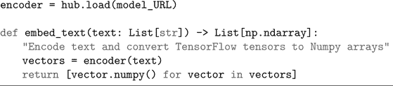
```

Listing 4.2 加载通用句子编码器

#### 4.4.3.1 Data Preprocessing

为简化模型训练，本案例使用 PyTorch Lightning，其要求实现 LightningDataModule 类，该类封装了所有数据加载、预处理和批量处理。我们在 Listing 4.3 中展示了如何为 Yelp Polarity 数据集实现此类模块。为了将模型训练时间保持最短，我们使用了训练和测试集的小子集。读者可以自行扩展到更大的子集或整个数据集。

``` 
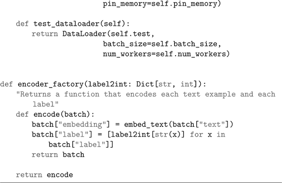
```

Listing 4.3 加载模型和分词器

#### 4.4.3.2 Experiments

接下来，我们在 Listing 4.4 中定义模型架构。

``` 
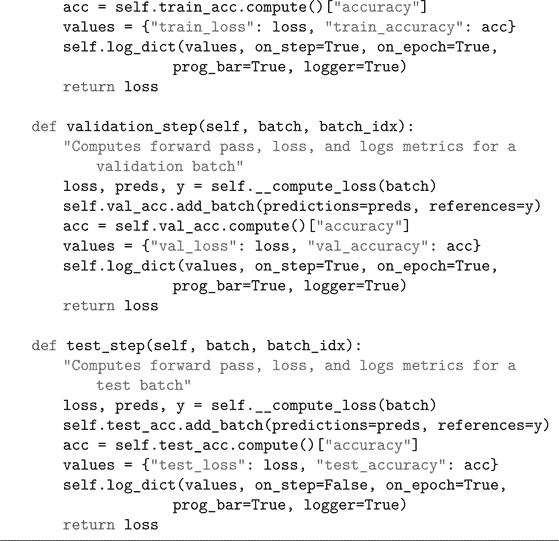
```

Listing 4.4 多语言二分类分类器架构

模型定义完成后，我们加载数据，然后进行训练和评估。我们最多训练五个 epoch，在训练过程中监控验证损失，并保存验证损失最低的三个模型检查点（每个 epoch 一个），存储在名为 “model” 的目录中。这些选项通过 PyTorch Lightning 的 Trainer 对象的 ModelCheckpoint 回调传递。


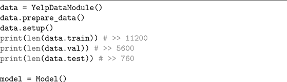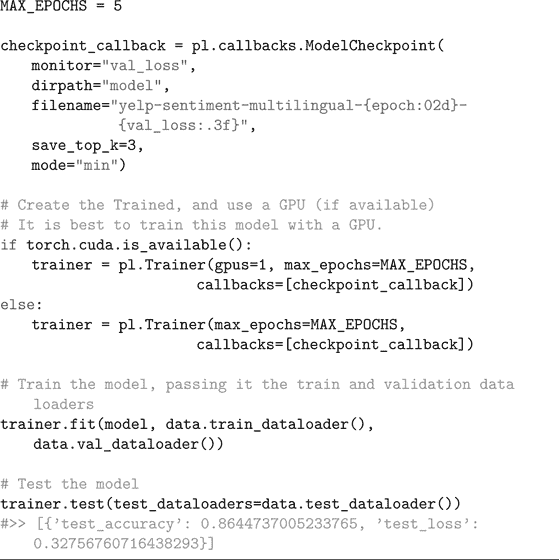

Listing 4.5 Load data, train, and evaluate the model

We've trained a model, now let's try it out. In Listing 4.6, we define a function that predicts sentiment for input text using the model checkpoint with lowest validation loss.

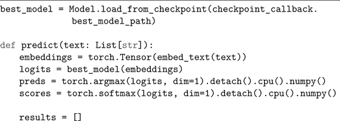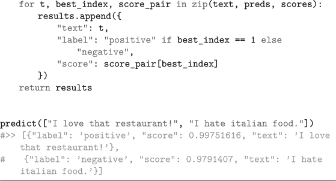

Listing 4.6 Load best model and run inference

Since we used USEm embeddings, we should be able to predict sentiment for non-English languages. Let's try it out. As mentioned earlier, USEm supports 16 languages: Arabic, Chinese-simplified, Chinese-traditional, English, French, German, Italian, Japanese, Korean, Dutch, Polish, Portuguese, Spanish, Thai, Turkish, Russian. In Listing 4.7, we compare sentiment predictions between pairs of languages, finding that even though our model was trained on a small subset of the Yelp Polarity training set, it can still perform well. We also find that the model can make accurate predictions for at least one language that is *not* one of the 16 supported languages. We use input text in four languages in Listing 4.7: English, German, Italian, and Finnish.

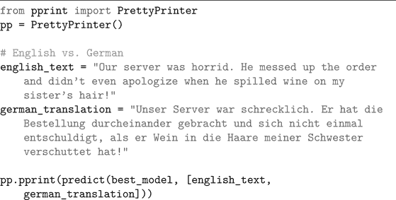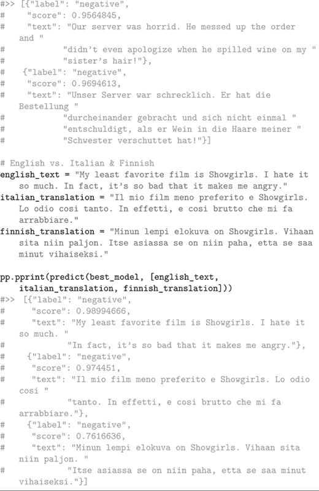

Listing 4.7 Load best model and run inference

USEm even works on Finnish. But why? Without digging into things, it would be difficult to know for sure. Our guess is that in the training process, the subword units used in USEm's tokenization let the Transformer learn which subword units are used across languages, similar to what has been seen with the speech subunits in wav2vec2 \[16\]. The layers we added onto USEm, which are trained for classification, then let the model learn which subword units are related to positive or negative sentiment. Perhaps the subword units used in Finnish are close enough to those in one of the 16 languages that USEm supports.

# CHAPTER 5Transformer Modifications

DOI: [10.1201/9781003170082-5](https://doi.org/10.1201/9781003170082-5)

THERE have been many modifications made to the Transformer architecture introduced in *Attention Is All You Need*\[254\]. As discussed in section 1.2, there are two broad types of modifications: changes to the organization of the Transformer block itself and changes to the submodules inside the Transformer block. This chapter discusses specific examples the Transformer block changes in section 1.2.1.1 and the Transformer submodule changes in section 1.2.1.2.

## 5.1 Transformer Block Modifications

In this section we'll take a detailed look at several models with altered Transformer blocks.

### 5.1.1 Lightweight Transformers

#### 5.1.1.1 Funnel-transformer

Funnel-Transformer \[66\] compresses the output of a transformer encoder layer via pooling before it is passed to the next layer, thus reducing computation cost. It then uses the saved computation to support a deeper or wider model, thereby increasing the model capacity.

**Encoder** The standard transformer uses the same sequence length for all layers. Funnel-Transformer changes this by placing a pooling layer between the transformer layers to reduce the sequence length. It typically has multiple transformer layers in a block of the same sequence length before the pooling operation. This is shown in Fig. 5.1. If the output of a given layer is **h**, then the output of the pooling layer is **h**^′ = *P**o**o**l**i**n**g*(**h**), where **h** ∈ ℝ^(*T* × *d*) and **h**^′ ∈ ℝ^(*T*^′ × *d*), for some *T*^′ < *T*.


Figure 5.1 Schematic architecture diagram for Funnel-Transformer's encoder. Each layer represents a block composed of several transformer layers with the same sequence length. Shows three pooling operations between blocks, with each decreasing the sequence length of the output by half.

**h**^′ is used to construct the query and the residual connection for the self-attention block, **h** is used for the key and value vectors:

$$\\begin{array}{ll} \\mathbf{Q} & {= \\mathbf{h}^{\\prime}\\mathbf{W}\_{Q}, \\in {\\mathbb{R}}^{T^{\\prime} \\times d\_{k}}} \\\\ \\end{array}$$  

(5.1)

$$\\begin{array}{ll} \\mathbf{K} & {= \\mathbf{h}\\mathbf{W}\_{K}, \\in {\\mathbb{R}}^{T \\times d\_{k}}} \\\\ \\end{array}$$  

(5.2)

$$\\begin{array}{ll} \\mathbf{V} & {= \\mathbf{h}\\mathbf{W}\_{V}, \\in {\\mathbb{R}}^{T \\times d\_{v}}} \\\\ \\end{array}$$  

(5.3)

This relationship between the unpooled and pooled outputs and the query, key, and value matrices of the next layer is shown in Fig. 5.2. The output of the (*n* + 1)^(*s**t**) layer is then

$$\\begin{array}{l} {\\mathbf{h}^{(n + 1)} = LayerNorm(\\mathbf{h}^{\\prime}\\ ^{(n)} + multihead(\\mathbf{Q}(\\mathbf{h}^{\\prime}\\ ^{(n)}),\\mathbf{K}(\\mathbf{h}^{(n)}),\\mathbf{V}(\\mathbf{h}^{(n)}))} \\\\ \\end{array}$$  

(5.4)


Figure 5.2 Shows how the pooling operation between Funnel-Transformer's encoder layers affect the input of the next layer. **h** is the output of the layer before the pooling and **h**^′ is the output of the pooling operation. The query matrix for the next layer is constructed from the pooled output, **h**^′. The key and value matrices for the next layer are made from the unpooled output, **h**.

The attention weight matrix of each attention head is (*T*^′ × *T*), which has decreasing complexity for each successive layer. The output of multi-head attention has the same dimensions as **h**^′.

By constructing the query from the pooled sequence and the key and value from the unpooled sequence, the attention mechanism tries to learn how the pooled and unpooled sequences should best attend to each other to result in high quality compression. Funnel-Transformer uses mean pooling with stride and window size both set to two.

**Decoder** To support token-level prediction tasks where the model needs to produce a full output sequence, like machine translation, Funnel-Transformer has an optional decoder that upsamples the compressed encoder output to a full sequence length. *M* encoder layers will have the output sequence **h**^((*M*)) that has length *T*[*M*] = *T*/2^(*M* − 1). It will be upsampled in a single step to **h**^((*u**p**)) = [*h*[1]^((*u**p*)), …, *h*[*T*]^((*u**p**))\] by repeating each hidden vector 2^(*M* − 1) times:

$$\\begin{array}{ll} h\_{i}^{up} & {= h\_{i//2^{N - 1}}^{(M)},\\forall i = 1,\\ldots,T} \\\\ \\end{array}$$  

(5.5)

$$\\begin{array}{ll} {x//y} & {= floor(x/y)} \\\\ \\end{array}$$  

(5.6)

To address the duplicate information in Funnel-Transformer's upsampling process, the hidden state output of the first encoder layer is added to the upsampled representation: **g** = **h**^((*u**p**)) + **h**^((1)). This acts as a residual connection. They then add a few transformer layers on top of **g** for it to learn how to best combine the features.


# Scaling

Funnel-Transformer 的时间复杂度为 `O(d) ⋅ T² + T ⋅ d²`。由于 `T` 在每个连续的编码层中会减半，因此每层的复杂度会以四倍的因子下降。由于 `O(T ⋅ d²)` 包含一个较大的常数 `d²`，它倾向于占主导地位，从而提供线性加速，而不是二次加速。

由于层间池化的复杂度降低，可以在不显著增加计算负载的情况下，添加额外的编码层或使现有层更宽。

# Performance

与标准 Transformer 相比，对比了几种 Funnel-Transformer 配置，每种配置的预期浮点运算次数与所比较的 Transformer 相近：

- **large**：24 层，`d` = 1024  
- **base**：12 层，`d` = 768  
- **small**：6 层，`d` = 768  

质量比较在 GLUE 和文本分类任务上进行，当 Funnel-Transformer 减少序列长度并增加层数时，它在文本分类及除 STS-B 外的所有 GLUE 数据集上均优于标准 Transformer。当序列长度减少但深度未增加时，GLUE 文本分类数据集的性能会下降。

## 5.1.1.2 DeLighT

DeLighT \[180\] 是一种修改后的 Transformer 架构，它在机器翻译和语言模型任务上与标准 Transformer 表现相当，同时使用的参数和 FLOPs 远少。它在 Transformer 块的输入阶段引入了一种变换，该变换在投影到查询、键、值空间之前进行。

**DeLighT block** DeLighT block 使用 N 层分组线性变换 (GLT) \[181\] 来将 d-维向量首先转换为更高维空间 *d*[*m**a**x*] = *w*[*m*] *d*[*i**n*]，在前 ⌈*N*/2⌉ 层完成；随后，利用剩余的 *N* − ⌈*N*/2⌉ 层将 *d*[*m**a**x*] 向量转换为更低维空间 *d*[*o*]。随后，*d*[*o*] 向量被用于查询、键和值空间的投影。DeLighT 块靠近模型输出端的部分被设计得更宽更深，而靠近模型输入端的部分则相对较窄。DeLighT 采用 *d*[*o*] = *d*/2，并通过 GLT 中的混合连接 \[182\] 对特征进行洗牌，结合输入，类似于残差连接。DeLighT 块的扩展阶段如下 Fig. 5.3。

``` 
Figure 5.3 The expansion phase of the DeLight transformation, showing the three grouped linear transformations (GLT).
```

Figure 5.3 The expansion phase of the DeLight transformation, showing the three grouped linear transformations (GLT).

Mehta et al. 提出，通过增加 DeLighT 块的深度和其 GLT 层的宽度，Transformer 的表示能力将提升，从而可以将多头注意力替换为单头注意力。同时，他们指出，DeLighT 块宽阔的线性层使得可以将前馈层的大小缩小多达 16 倍。

**Performance** DeLighT 在机器翻译任务上表现与标准 Transformer 相当或更好，尽管参数数量显著减少。当 DeLighT 被赋予更多参数时，它会超越标准 Transformer。此外，DeLighT 在机器翻译方面的质量与最新水平模型相当或更好。同时，DeLighT 的性能随网络参数数量的增加而提升。

## 5.1.2 Connections between Transformer Blocks

### 5.1.2.1 RealFormer

RealFormer，即 Residual Attention Layer Transformer \[107\]，在 transformer 的前一层的所有注意力头的原始注意力对数（query-key 点积）上加入残差分数。注意力权重随后是加和后的注意力对数的 softmax。该过程在 Fig. 5.4 中以示意图展示，在数学公式 (5.7)–(5.9) 中给出。

``` 
$$\\begin{array}{l} {ResidualMultiHead(\\mathbf{Q},\\mathbf{K},\\mathbf{V},\\mathbf{Prev}) = \\text{concat}(head\_{1},\\ldots,head\_{h})\\mathbf{W}\_{o}} \\\\ \\end{array}$$  

(5.7)
```

``` 
$$\\begin{array}{l} {head\_{i} = ResidualAttn(\\mathbf{Q}\_{i},\\mathbf{K}\_{i},\\mathbf{V}\_{i},\\mathbf{Pre}\\mathbf{v}\_{i})} \\\\ \\end{array}$$  

(5.8)
```

``` 
$$\\begin{array}{l} {ResidualAttn(\\mathbf{Q}^{\\prime},\\mathbf{K}^{\\prime},\\mathbf{V}^{\\prime},\\mathbf{Pre}\\mathbf{v}^{\\prime}) = \\text{softmax}\\left( {\\frac{\\mathbf{Q}^{\\prime}\\mathbf{K}^{\\prime}\\ ^{\\text{T}}}{\\sqrt{\\text{d}\\_\\text{k}}}\\text{+}\\mathbf{Pre}\\mathbf{v}^{\\prime}} \\right)\\mathbf{V}^{\\prime}} \\\\ \\end{array}$$  

(5.9)
```

其中 **P****r****e****v** ∈ ℝ^(*h* × *d*[*i**n**] × *d*[*o**u**t*]) 是前一层 transformer 的注意力对数。`d`[*i**n**]` 是该层的输入序列维度，`d`[*o**u**t*`] 是该层的输出序列维度。softmax 的输入（即注意力对数或注意力分数）会传递给下一层 RealFormer。

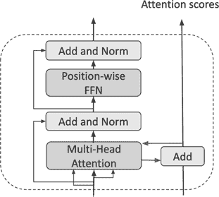

Figure 5.4 RealFormer's residual attention connection.

该方法可应用于其他 transformer 架构，包括解码器层。当 transformer 中包含多种注意力模块时，可以跳过边缘以支持每种注意力类型的独立残差连接。

**Performance** RealFormer 通常优于标准 transformer 架构，包括在 BERT 中的使用，且无需增加模型参数。

## 5.1.3 Adaptive Computation Time

### 5.1.3.1 Universal transformers (UT)

如前几章所述，transformer 解决了 RNN 的主要问题——序列计算的瓶颈和消失梯度问题。此外，自注意力这一关键创新使得 per-symbol context-based vectors 的并行计算成为可能，并为每个符号提供了全局受体场，能够获取所有符号的信息。另一方面，RNN 缺乏固有的递归感应偏置，在处理具有内在层次结构的任务或训练数据与预测数据长度差异较大的情况下会出现问题。此外，transformer 的序列计算次数独立于输入大小，仅取决于层数，这使其在计算通用性上不足，即它们是不可通用的或图灵不完全的。transformer 对所有输入应用相同的计算量，导致在可以有条件计算的场景中出现低效。

Dehghani 等人 \[69\] 提出的通用变换器（Universal transformers, UT）是对 transformer 的扩展，它在保留并行性和全局受体场优势的同时，加入了 RNN 的递归感应偏置，从而实现计算通用性。与固定层数的 transformer 不同，UT 采用通用变换器块，即一个自注意力机制后跟一个循环变换，为每个输入符号提供并行的递归感应偏置。如 Fig. 5.5 所示，通用变换器是一种在深度而非时间维度上演化隐藏状态的循环函数，每一步都基于前一步的隐藏状态序列，并同时处理所有输入符号。

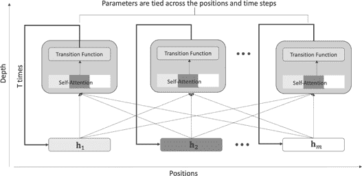


# 通用变换器利用自注意力结合来自不同位置的信息，并应用循环转换函数。

UT 与现有的神经网络架构（如 Neural GPU \[136\] 和 Neural Turing Machine \[98\]）有许多共同点。它也可以被视为具有层间共享参数的多层变换器。Graves 提出自适应计算时间（ACT），使得循环神经网络（RNN）能够动态决定在接受输入和输出之间进行多少计算步骤（思考时间），以克服固定步骤数带来的问题。UT 在每个位置上引入了基于 Graves 的 ACT 的动态停止机制，使得每个符号的计算能够根据复杂度进行有条件的控制。研究表明，UT 在各种 NLP 和 NLU 任务上表现优于标准变换器，并在诸如 LAMBADA 语言建模等复杂任务中实现了新的最先进的性能。

## 5.1.4 Transformer 块之间的循环关系

### 5.1.4.1 Transformer-XL

Transformer-XL \[67\] 能够建模超出固定长度的依赖关系，同时尊重句子边界。它被提出是因为标准变换器架构的固定上下文窗口阻碍了它学习在固定窗口之外的依赖关系。Transformer-XL 可处理比标准变换器更长 450% 的依赖关系，且推理速度比 Transformer 快约 1800 倍。

**段级循环** Transformer-XL 通过一种称为段级循环的方法扩展其上下文，超出固定窗口。段级循环通过在处理当前文本段时，使用前一段文本作为额外的上下文来工作。为此，前一段必须被缓存，并且每个层对该段的变换器输出也需缓存。

在标准变换器中，第 *n* 层的输出（$\\mathbf{h}\_{t}^{(n)}$）以第 *n* − 1 层的输出（$\\mathbf{h}\_{t}^{(n - 1)}$）为输入：

$$\\begin{array}{l} {\\mathbf{h}\_{t}^{(n)} = Transformer(\\mathbf{h}\_{t}^{(n - 1)})} \\\\ \\end{array}$$  

(5.10)

它内部从 $\\mathbf{h}\_{t}^{(n - 1)}$ 生成查询、键和值：

$$\\begin{array}{ll} \\mathbf{Q}\_{t}^{(n)} & {= \\mathbf{h}\_{t}^{(n - 1)}\\mathbf{W}\_{q}} \\\\ \\mathbf{K}\_{t}^{(n)} & {= \\mathbf{h}\_{t}^{(n - 1)}\\mathbf{W}\_{k}} \\\\ \\mathbf{V}\_{t}^{(n)} & {= \\mathbf{h}\_{t}^{(n - 1)}\\mathbf{W}\_{v}} \\\\ \\end{array}$$  

(5.11)

这里 *n* = 1 表示第一层变换器层，*n* = 0 表示输入到第一层的内容，即 $\\mathbf{h}\_{t}^{(0)} = \\mathbf{X}$。

当加入前一段时，Eqns. (5.11) 会改变。考虑两个连续的文本段，其嵌入表示分别为 $\\mathbf{X}\_{t}$ 与 $\\mathbf{X}\_{t+1}$（*t* 仅用于标识段顺序）。在计算当前段 $\\mathbf{X}\_{t+1}$ 的第 *n* 层变换器输出时，会有来自前一段第 *n* − 1 层的输出 $\\mathbf{h}\_{t}^{(n - 1)}$ 的贡献：

$$\\begin{array}{l} {\\mathbf{h}\_{t + 1}^{(n)} = \\text{TransformerXL}(\\mathbf{h}\_{t + 1}^{(n - 1)},\\mathbf{h}\_{t}^{(n - 1)}).} \\\\ \\end{array}$$  

(5.12)

依赖于前一段的关键在于计算当前段的键和值：

$$\\begin{array}{ll} \\mathbf{Q}\_{t + 1}^{(n)} & {= \\mathbf{h}\_{t + 1}^{(n - 1)}\\mathbf{W}\_{q}} \\\\ \\mathbf{K}\_{t + 1}^{(n)} & {= {\\widetilde{\\mathbf{h}}}\_{t + 1}^{(n - 1)}\\mathbf{W}\_{k}} \\\\ \\mathbf{V}\_{t + 1}^{(n)} & {= {\\widetilde{\\mathbf{h}}}\_{t}^{(n - 1)}\\mathbf{W}\_{v}} \\\\ \\end{array}$$  

(5.13)

$$\\begin{array}{l} {{\\widetilde{\\mathbf{h}}}\_{t + 1}^{(n - 1)} = \\lbrack\\text{StopGradient}(\\mathbf{h}\_{t}^{(n - 1)});\\,\\mathbf{h}\_{t + 1}^{(n - 1)}\\rbrack} \\\\ \\end{array}$$  

(5.14)

其中 StopGradient 表示在该操作期间不计算梯度。

Eqns. (5.13) 与 (5.14) 表明注意力机制被用于计算一种修改后的注意力，该注意力结合了前一输入序列的信息，以计算当前输入序列的表示。除此之外，还有更多内容。当前序列的变换器输出依赖于前一序列的变换器输出，而前一序列的输出又依赖于该序列之前的序列以及前一层的变换器输出。这意味着，随着变换器层数的增加，模型能够处理的有效上下文大小也随之增大。形式上，我们可以说第 *n* 层在第 *t* 个段的输出会受到从第 *t* − *n* 个段起的输入序列的影响。例如，在 Table 5.1 中展示了四个文本段和三层 Transformer-XL 的情况。

TABLE 5.1 在层深度为三的情况下，第四段的变换器输出会受到第一段的影响。为了简洁，$T$ 表示如 (5.12) 所述的 Transformer-XL 操作。

| 层 (n) | *S*[1] | *S*[2] | *S*[3] | *S*[4] |
| --- | --- | --- | --- | --- |
| 0 (输入) | *h*[1]^((0)) = *S*[1] | *h*[2]^((0)) = *S*[2] | *h*[3]^((0)) = *S*[3] | *h*[4]^((0)) = *S*[4] |
| 1 | *h*[1]^((1)) = *T*($h$[1]^((0))) | *h*[2]^((1)) = *T*($h$[2]^((0)), $h$[1]^((0))) | *h*[3]^((1)) = *T*($h$[3]^((0)), $h$[2]^((0))) | *h*[4]^((1)) = *T*($h$[4]^((0)), $h$[3]^((0))) |
| 2 | *h*[1]^((2)) = *T*($h$[1]^((1))) | *h*[2]^((2)) = *T*($h$[2]^((1)), $h$[1]^((1))) | *h*[3]^((2)) = *T*($h$[3]^((1)), $h$[2]^((2))) | *h*[4]^((2)) = *T*($h$[4]^((1)), $h$[3]^((1))) |
| 3 | *h*[1]^((3)) = *T*($h$[1]^((2))) | *h*[2]^((3)) = *T*($h$[2]^((2)), $h$[1]^((2))) | *h*[3]^((3)) = *T*($h$[3]^((2)), $h$[2]^((3))) | *h*[4]^((3)) = *T*($h$[4]^((2)), $h$[3]^((2))) |

#### 位置编码在 Transformer-XL 中

*位置编码* 如前所述，由于 Transformer 不包含循环或卷积层，词序通过位置编码显式构建。每个输入序列会得到一个位置编码 $\\mathbf{P}\\in\\mathbb{R}^{L\\times d}$，其中 *L* 为序列最大长度，*d* 为嵌入维度；同时给出词嵌入 $\\mathbf{E}\\in\\mathbb{R}^{L\\times d}$。完整的输入序列表示为 $\\mathbf{X}=\\mathbf{E}+\\mathbf{P}$，这是本章后续公式（如 (5.22)）中使用的相同 **X**。

**p**[*i*] 是位置 *i* 的位置编码；**e**[*i*] 是位置 *i* 的词嵌入。由于位置编码是确定性的且与序列中的 token 无关，任何位置 *i* 的词都会拥有相同的位置编码。这在段级循环中会带来问题。

考虑两个连续的文本序列 $\\mathbf{X}\_{t+1}$ 与 $\\mathbf{X}\_{t}$，第 1 层 TransformerXL 的输出分别为：

$$\\begin{array}{l} {\\mathbf{h}\_{t + 1}^{(1)} = \\text{TransformerXL}(\\mathbf{X}\_{t + 1},\\mathbf{X}\_{t})} \\\\ \\end{array}$$  

(5.15)

而 (5.14) 表示：

$$\\begin{array}{l} {{\\widetilde{\\mathbf{h}}}\_{t + 1}^{(0)} = \\lbrack\\text{StopGradient}(\\mathbf{X}\_{t});\\,\\mathbf{X}\_{t + 1}\\rbrack} \\\\ \\end{array}$$  

(5.16)


由于 `X`[*t*] = `E`[*t*] + `P` 且位置编码与序列中的 token 无关，${\\widetilde{\\mathbf{h}}}\_{t + 1}^{(0)}$ 是拼接相同的位置编码。这有问题，因为 ${\\widetilde{\\mathbf{h}}}\_{t + 1}^{(0)}$ 表示扩展的有效上下文大小，因此序列中的每个位置都应有独立的位置编码。如果没有独立的位置编码，模型会丢失单词顺序的信息。解决此问题的方法是使用相对位置编码。

*相对位置编码* 早期工作 \[124, 224\] 将相对位置编码引入，以让注意力机制学习序列中两个位置之间的距离，而不是使用标准 Transformer 的绝对位置编码，后者会偏向注意力机制认为绝对位置很重要。相反，信息关于 **q**[*i*] 与 **k**[*j*] 之间的相对距离会被纳入注意力权重的计算，使注意力机制关注距离 *i* − *j*，而不是位置 *i* 和 *j*。

Transformer XL 修改了注意力矩阵的计算，使用正弦相对位置编码\[67\]。我们可以通过先展开 (5.23) 中的 (*i*, *j*) 项 **QK**^(*T*)，即 **q**[*i*]**k**[*j*]^(*T*)，来看到这一点。回顾 (5.22)、(5.24) 和 (5.25)，我们可以看到 **X** 的第 *i*^(*t**h**) 行是 **x**[*i*] = **e**[*i*] + **p**[*i*]，并且

$$\\begin{array}{ll} \\mathbf{q}\_{i} & {= \\mathbf{x}\_{i}\\mathbf{W}\_{q}} \\\\ \\mathbf{k}\_{j} & {= \\mathbf{x}\_{j}\\mathbf{W}\_{k}} \\\\ \\end{array}$$  

(5.17)

利用 (5.17)，我们展开 **q**[*i*]**k**[*j*]^(*T*) 得到

$$\\begin{array}{ll} A\_{ij} & {= (\\mathbf{e}\_{i}\\mathbf{W}\_{q} + \\mathbf{p}\_{i}\\mathbf{W}\_{q})(\\mathbf{W}\_{k}^{T}\\mathbf{e}\_{j}^{T} + \\mathbf{W}\_{k}^{T}\\mathbf{p}\_{j}^{T})} \\\\ \\ & {= \\mathbf{e}\_{i}\\mathbf{W}\_{q}\\mathbf{W}\_{k}^{T}\\mathbf{e}\_{j}^{T} + \\mathbf{e}\_{i}\\mathbf{W}\_{q}\\mathbf{W}\_{k}^{T}\\mathbf{p}\_{j}^{T}} \\\\ \\ & {\\quad + \\,\\mathbf{p}\_{i}\\mathbf{W}\_{q}\\mathbf{W}\_{k}^{T}\\mathbf{e}\_{j}^{T} + \\mathbf{p}\_{i}\\mathbf{W}\_{q}\\mathbf{W}\_{k}^{T}\\mathbf{p}\_{j}^{T}} \\\\ \\end{array}$$  

(5.18)

Transformer XL 将 *A*[*i**j*] 用五个新量度重新参数化：**R**[*i* − *j*]、 **u**、 **v**、 **W**[*k*, *E*] 和 **W**[*k*, *R*] \[67\]：

1. **R**[*i* − *j*] 是相对于距离 *i* − *j* 的位置编码，用于替换 (5.18) 中的 **p**[*j*]。 **R**[*i* − *j*] 是相对位置编码矩阵 **R** ∈ ℝ^(*L* × *d*) 的第 (*i* − *j*)^(*t**h**) 行。

2. **u** 替换 (5.18) 中第三项的 **p**[*i*]**W**[*q*]。

3. **v** 替换 (5.18) 中第四项的 **p**[*i*]**W**[*q*]。

4. TransformerXL 将键 *K* 替换为两组键：基于内容和基于位置。此更改导致键权重矩阵 **W**[*k*] 被两个权重矩阵 **W**[*k*, *E*] 和 **W**[*k*, *R*] 取代，其中 **W**[*k*, *E*] 生成基于内容的键，**W**[*k*, *R*] 生成基于位置的键 \[67\]。

因此， (5.18) 变为

$$\\begin{array}{l} {A\_{ij} = \\mathbf{e}\_{i}\\mathbf{W}\_{q}\\mathbf{W}\_{k,E}^{T}\\mathbf{e}\_{j}^{T} + \\mathbf{e}\_{i}\\mathbf{W}\_{q}\\mathbf{W}\_{k,R}^{T}\\mathbf{R}\_{i - j}^{T} + \\mathbf{u}\\mathbf{W}\_{k,E}^{T}\\mathbf{e}\_{j}^{T} + \\mathbf{v}\\mathbf{W}\_{k,R}^{T}\\mathbf{R}\_{i - j}^{T}} \\\\ \\end{array}$$  

(5.19)

注意到通过消除显式位置依赖， **x**[*i*] = **e**[*i*] 意味着 **X** = **E**，因此 **q**[*i*] = **e**[*i*]**W**[*q*]， **k**[*j*] = **e**[*j*]**W**[*k*, *E*]。

利用 (5.19)，我们得到 Transformer-XL 第 *n*^(*t**h**) 模型层的最终注意力机制形式

$$\\begin{array}{l} {\\mathbf{Att}\\mathbf{n}\_{t}^{(n)} = \\text{softmax}\\left( \\frac{\\mathbf{A}\_{\\text{t}}^{(\\text{n})}}{\\sqrt{\\text{d}\_{\\text{k}}}} \\right)\\mathbf{V}\_{\\text{t}}^{(\\text{n})},} \\\\ \\end{array}$$  

(5.20)

其中 *A*[*t*]^((*n*)) 是 (5.19) 按 (5.13) 修正后的形式

$$\\begin{array}{l} {A\_{t,ij}^{(n)} = \\mathbf{q}\_{t,i}^{(n)}\\mathbf{k}\_{t,j}^{{(n)}^{T}} + \\mathbf{q}\_{t,i}^{(n)}\\mathbf{W}\_{k,R}^{{(n)}^{T}}\\mathbf{R}\_{i - j}^{T} + \\mathbf{u}\\,\\mathbf{k}\_{t,j}^{{(n)}^{T}} + \\mathbf{v}\\,\\mathbf{W}\_{k,R}^{{(n)}^{T}}\\mathbf{R}\_{i - j}^{T}} \\\\ \\end{array}$$  

(5.21)

注意到 softmax 分母中的求和是掩码求和，覆盖查询所关注的所有键位置集合 *S*[*i*]，如 (5.27) 所示。此外，由于 **x** = **e**[*i*]，**h**[*t*]^((0)) = **X**[*t*]。

### 5.1.5 层次化 Transformer

层次化 Transformer 的两个例子是 Vision Transformer \[78\]，用于图像识别，以及 TimeSformer \[29\]，用于视频分类/动作识别。这两个模型将在 第 6 章 中讨论。

## 5.2 带修改的多头自注意力的 Transformer

### 5.2.1 多头自注意力的结构

多头注意力是将多个注意力机制组合的一种方式，使模型能够学习输入和输出之间的不同类型的依赖关系。多头注意力机制是每个 Transformer 块的核心。编码器和解码器块都使用多头自注意力，解码器块还有一个额外的多头注意力，用于关注编码器块的输出，并加入因果约束。

本节描述单个长度为 *L* 的输入序列（嵌入维度为 *d*）的多头自注意力计算结构。输入序列可以用矩阵 **X** ∈ ℝ^(*L* × *d*) 表示：

$$\\begin{array}{l} {\\mathbf{X} = \\left\\lbrack \\begin{array}{l} \\mathbf{x}\_{1} \\\\ \\vdots \\\\ \\mathbf{x}\_{L} \\\\ \\end{array} \\right\\rbrack} \\\\ \\end{array}$$  

(5.22)

其中 **x**[*i*] = (*x*[0]^((*i*)), …, *x*[*d* − 1]^((*i*))) 是第 *i*^(*t**h**) 个 token 的嵌入向量。

如 章节 2.4.2.1 所示，注意力机制的输出（在头部拼接之前）可以表示为

$$\\begin{array}{l} {\\mathbf{Attn}(\\mathbf{Q},\\mathbf{K},\\mathbf{V}) = \\text{softmax}\\left( \\frac{\\mathbf{Q}\\mathbf{K}^{\\text{T}}}{\\sqrt{\\text{d}\_{\\text{k}}}} \\right)\\mathbf{V},} \\\\ \\end{array}$$  

(5.23)

其中 **Q**、 **K**、 **V** 分别是查询、键和值矩阵。它们分别将输入序列转换到不同的向量空间：

$$\\begin{array}{ll} \\mathbf{Q} & {= \\mathbf{X}\\mathbf{W}\_{q}, \\in {\\mathbb{R}}^{L \\times d\_{k}}} \\\\ \\mathbf{K} & {= \\mathbf{X}\\mathbf{W}\_{k}, \\in {\\mathbb{R}}^{L \\times d\_{k}}} \\\\ \\mathbf{V} & {= \\mathbf{X}\\mathbf{W}\_{v}, \\in {\\mathbb{R}}^{L \\times d\_{v}}} \\\\ \\end{array}$$  

(5.24)

其中 *d*[*k*] 是查询和键空间的维度，通常设为 *d*， *d*[*v*] 是值的维度。矩阵 **W**[*q*]、 **W**[*k*] ∈ ℝ^(*d* × *d*[*k*])， **W**[*v*] ∈ ℝ^(*d* × *d*[*v*]) 相当于旋转矩阵。每行对应于第 *i*^(*t**h**) 个 token 的查询/键/值向量：

$$\\begin{array}{l} {\\mathbf{Q} = \\left\\lbrack \\begin{array}{l} \\mathbf{q}\_{1} \\\\ \\vdots \\\\ \\mathbf{q}\_{L} \\\\ \\end{array} \\right\\rbrack,\\mathbf{K} = \\left\\lbrack \\begin{array}{l} \\mathbf{k}\_{1} \\\\ \\vdots \\\\ \\mathbf{k}\_{L} \\\\ \\end{array} \\right\\rbrack,\\mathbf{V} = \\left\\lbrack \\begin{array}{l} \\mathbf{v}\_{1} \\\\ \\vdots \\\\ \\mathbf{v}\_{L} \\\\ \\end{array} \\right\\rbrack} \\\\ \\end{array}$$  

(5.25) 


-   [5.2.1.1 多头自注意力] 迄今为止，我们只讨论了单头自注意力。多头注意力主要是将上述矩阵划分为 *h* 份，其中 *h* 为注意力头的数量。

    每个注意力头都有自己的查询/键/值，通过将单头版本划分为 *h* 等大的片段获得，这些片段的索引为 *n* = 1, …, *h*：

    $$
    \begin{array}{ll}
    \mathbf{Q}\_{n} & {= \\mathbf{X}\\mathbf{W}\_{n}^{(q)},\\, \in {\\mathbb{R}}^{L \\times d\_{k}/h}} \\
    \mathbf{K}\_{n} & {= \\mathbf{X}\\mathbf{W}\_{n}^{(k)},\\, \in {\\mathbb{R}}^{L \\times d\_{k}/h}} \\
    \mathbf{V}\_{n} & {= \\mathbf{X}\\mathbf{W}\_{n}^{(v)},\\, \in {\\mathbb{R}}^{L \\times d\_{v}/h}} \\
    \end{array}
    $$

    (5.28)

    这并不意味着我们现在有 *h* 个查询、键和值矩阵，而是 (5.28) 中的矩阵是 (5.24) 中矩阵的一部分。这一点在 Fig. 5.6 中明确说明。

    

    Figure 5.6 查询矩阵 `Q` 可以按照 (5.28) 的描述划分为 *h* 个头。

    键和值矩阵也以相同的方式划分为注意力头，第 *n* 个头的注意力计算如下：

    $$
    \begin{array}{l}
    {\\mathbf{Att}\\mathbf{n}^{(n)}(\\mathbf{Q}\_{n},\\mathbf{K}\_{n},\\mathbf{V}\_{n}) = \\text{softmax}\\left( \\frac{\\mathbf{Q}\_{\\text{n}}\\mathbf{K}\_{\\text{n}}^{\\text{T}}}{\\sqrt{\\text{d}\_{\\text{k}}\\text{/h}}} \\right)\\mathbf{V}\_{\\text{n}},} \\
    \\end{array}
    $$

    (5.29)

    注意：在多头情况下，$\\mathbf{Q}\\_n\\mathbf{K}\\_n^{\\text{T}}$ 除以 $\\sqrt{d\_{k}/h}$ 而不是 $\\sqrt{d\_{k}}$。此变化考虑了查询和键空间的有效维度变为 *d*[*k*]/h。随后，注意力头如 (2.19) 所述进行合并。

    #### 5.2.1.2 自注意力的空间和时间复杂度

    计算 5.27 节中描述的注意力权重矩阵需要 *O*(*L*² ⋅ *d*[*k*]) 的矩阵乘法，计算 5.23 节中的上下文向量需要 *O*(*L*² ⋅ *d*[*v*]) 的矩阵乘法，因此自注意力的时间复杂度为 *O*(*L*² ⋅ *d*[*k*] + *L*² ⋅ *d*[*v*])。

    考虑一个长度为 *L* 的单个输入序列，且查询、键、值的维度相同，即 *d*[*k*] = *d*[*v*] = *d*[*model*]。这意味着 **Q**、**K**、**V** 均为 *L* × *d*[*model*] 的矩阵，而 (5.23) 中的注意力权重矩阵为 *L* × *L*。假设使用 32 位浮点数，显存使用量会迅速增长，如 Table 5.2 所示。当加入批量大小时需求更大。例如，若批量大小为 32 且序列长度为 20,000，则需要 51.2 GB 来存储自注意力权重。时间复杂度同样是二次的 *L*。随着序列长度的增加，这种线性增长变得不可持续。例如，若序列长度翻倍，计算和存储注意力权重所需的时间将增加四倍。

    TABLE 5.2 自注意力权重的显存使用情况，针对 32 位浮点数 \[142\]

    | L | Memory |
    |---|---|
    | 600 | 4 MB |
    | 1K | 1.4 MB |
    | 20K | 1.6 GB |
    | 64K | 16.384 GB |

    ### 5.2.2 降低自注意力复杂度

    本节讨论几种降低多头自注意力计算复杂度的 Transformer 模型。

    #### 5.2.2.1 Longformer

    在计算自注意力（忽略编码器‑解码器块之间的因果要求）时，通常没有限制哪些序列位置可以相互注意。理论上，每个头的注意力权重矩阵可能是稠密的。将其视为图时，对应于完全连通的加权双部分图。若序列包含 *L* 个 token，则会有 *L*(*L* − 1)/2 条边。Longformer \[25\] 通过限制哪些位置可以相互注意来改变这种情形，从而在所有头上得到稀疏的注意力权重，相当于从注意力图中删除边。

    Longformer 将全局注意力与两种局部注意力相结合：滑动窗口注意力和扩展滑动窗口注意力。每种注意力模式对应一种注意力面具。

    **滑动窗口注意力** 与其能够注意到序列中任意 token 不同，滑动窗口注意力为每个 token 设定固定大小的上下文窗口 *w*，使其只能关注其邻居。例如，若序列有九个 token（*w*[1], …, *w*[9]），且窗口大小 *w* = 4，则中间 token *w*[5] 的上下文窗口会向右覆盖 *w*[3]、*w*[4]，向左覆盖 *w*[6]、*w*[7]。如 Fig. 5.7 所示。

    

    Figure 5.7 滑动窗口注意力模式，L = 9，w = 4。行 *i* 对应查询 *i*。带 • 的列是查询 *i* 关注的键，⋅ 表示缺乏注意（缺失边）。

    在图视图中，这意味着每个顶点最多与 *w* − 1 个顶点相连。因此，边的数量从 *L*(*L* − 1)/2 降至 *L*(*w* − 1)。这一简单改变将复杂度从二次（*O*(*L*²)）降至线性（*O*(*L* · *w*)），因为滑动窗口注意力权重矩阵在每行（或每列）最多有 *Lw* 个非零值。


# Dilated sliding window attention

这种注意力模式通过在上下文窗口中加入长度为 `d` 的间隙，扩展了滑动窗口注意力的范围。实际上，这扩展了上下文窗口的有效大小。例如，在前面使用的九个 token 的序列中，若设定膨胀 `d` = 2，则在生成 `w[5]` 的上下文时，会跳过中间的一个词。因此，`w[5]` 的左上下文为 (`w`[1], `w`[3])，右上下文为 (`w`[7], `w`[9])。注意，尽管整体上下文宽度增大，这种注意力模式仍然阻止 token 关注其紧邻的 token，或距离窗口中心 `d` − 1 的 token，或窗口内已被关注的位置。不同的注意力头可以使用不同的 `d` 值，从而缓解上述问题。Fig. 5.8 展示了 `L` = 2、`w` = 4、`d` = 2 时的 dilated sliding window attention。


Figure 5.8 Dilated sliding window attention pattern, for `L` = 12, `w` = 4, and `d` = 2. Row `i` corresponds to query `i`. Columns with a • are keys that query `i` attends to and ⋅ represents a lack of attention (a missing edge).

# Global attention

全局注意力模式允许部分 token 关注序列中任意其他 token。此类情况下，序列中所有 token 都关注该 token。这相当于在注意力权重矩阵中选择特定的行及其转置的列。

Longformer 根据训练任务决定哪些 token 允许拥有全局注意力。例如，在问答任务中，问题中的所有 token 都拥有全局注意力。拥有全局注意力的 token 数量通常与序列长度无关，因此全局注意力的时间复杂度也是线性于序列长度。Longformer 将全局注意力与滑动窗口注意力相结合。

全局注意力和局部（短范围）注意力的权重分别通过为全局和滑动窗口模式提供各自的查询、键和值矩阵来计算：**Q**[*g*], **K**[*g*], **V**[*g*] 与 **Q**[*s*], **K**[*s*], **V**[*s*]， respectively。

Longformer 在低层使用小窗口大小，在高层使用大窗口大小。这使得高层具有层次化结构。事实上，稀疏滑动窗口仅用于高层，使得低层能够专注于局部上下文。

## 5.2.2.2 Reformer

Reformer，如文献\[[142\]\] 所述，通过修改注意力机制来降低注意力机制的复杂度，并通过使用可逆残差网络来减少内存使用。这些技巧使得 Reformer 能够包含几乎是 Transformer 中数个数量级更大的上下文窗口（最高可达 1,000,000 个词）。

### 注意力与局部敏感哈希

如 section 5.2.1.1 所述，Transformer 核心的缩放点积注意力的时间复杂度为 *O*(*L*²)，随着序列 token 数量 *L* 增加，这一复杂度变得不可接受。Reformer 通过修改注意力机制并采用局部敏感哈希（locality‑sensitive hashing）来解决这一问题，从而将时间复杂度降至 *O*(*L*log *L*)。

回顾在缩放点积注意力中，查询、键和值矩阵是将 `d[m]` 维输入向量转换后得到的，查询和键的维度为 `d[k]`，值的维度为 `d[v]`。

在 *A* 的公式中，最耗时的项是 **QK**<sup>(`T`)</sup> 的乘积，且在应用软 max 函数后，仅在每个 `d[m]` 维度中保留最大的项。这意味着对每个查询向量 **q**[*i*]，只需要在 **K** 中与它最接近的键。为此，他们将 **Q** = **K**，即每个查询向量只需找到最接近的键。这是一个近似最近邻问题，可以使用局部敏感哈希（LSH）来解决。

### 局部敏感哈希

局部敏感哈希（LSH）于 1998 年在\[[129\]\] 中被提出，作为基于哈希的近似相似度搜索方法。形式上，LSH 基于一族哈希函数 ℱ，作用于 item 集合，若两个 item *x* 与 *y* 满足 *P*(_r_∘_o_∘_b_∈ℱ)_h_(_x_) = _h_(_y_) = _s_(_x_, _y_) = s**i**m(_x_, _y_)，其中 _s_(_x_, _y_) ∈ [0, 1] 为定义在 item 集合上的相似度函数\[[39\]\]。换句话说，只要能够为数据集中的 items 进行哈希，使得两个相近的 items 碰撞概率远高于相远的 items，即可视为一种 LSH 方法。

LSH 实现方式多样，Reformer 采用文献\[[6\]\] 中定义的角度 LSH 方案。请注意，查询矩阵 **Q**（同样是键矩阵 **K**）的形状为 *l* × `d[k]`。计算 **Q** 的哈希如下：首先生成一个 `d[k]` × *b*/2 的随机矩阵 **R**，其每列仅含一个非零值，均匀采样自 ±1，且 *b* 为哈希数量。随后计算 **QR**，对查询（以及键）矩阵进行旋转。最后，哈希结果为 _h_(**Q**) = arg max(**QR**, ‑**QR**) \[[142\]\]。哈希后，查询和键的索引会被 permute，使得映射到同一桶的序列位置相邻。随后，在每个哈希桶内计算完整注意力。

通过上述信息，我们可以看到 LSH 对注意力计算的影响：先将自注意力公式 (5.23) 重写为 (5.27)：

$$
\\begin{array}{l}
a_{i} = {\\sum\\limits\_{j \\in S\_{i}}{\\exp}}\\left( {\\frac{\\mathbf{q}\_{\\mathbf{i}}\\mathbf{k}\_{j}^{T}}{\\sqrt{d\_{k}}} - \\log Z(i,S\_{i})} \\right)\\mathbf{v}\_{j}, \\\\
\\end{array}
$$

(5.30)

其中 *S*[*i*] 为查询 *i* 关注的键位置集合，且 $Z(i,S\_{i}) = {\\sum\\limits\_{r \\in S\_{i}}{\\exp}}\\left( \\frac{\\mathbf{q}\_{\\mathbf{i}}\\mathbf{k}\_{r}^{T}}{\\sqrt{d\_{k}}} \\right)$ 为软 max 归一化项。

在没有失去一般性的前提下，我们可以将 (5.30) 重新表述为对扩展键位置集合 $\\tilde{S}\\_i$（包含 *S*[*i*] 可能不关注的位置）的求和：

$$
\\begin{array}{ll}
a_{i} & {= {\\sum\\limits\_{j \\in {\\widetilde{S}}\\_i}{\\exp}}\\left( {\\frac{\\mathbf{q}\_{\\mathbf{i}}\\mathbf{k}\_{j}^{T}}{\\sqrt{d\_{k}}} - m(i,S\_{i}) - \\log Z(i,S\_{i})} \\right)\\mathbf{v}\_{j}} \\\\
\\end{array}
$$

(5.31)

$$
\\begin{array}{ll}
m(i,S\_{i}) & {= \\begin{cases}
\\infty, & j \\notin S\_{i} \\\\
0, & \\text{otherwise}
\\end{cases}} \\\\
\\end{array}
$$

(5.32)

项 *m*(*i*, *S*[*i*]) 是掩码项，确保查询 **q**[**i**] 不关注的键位置不参与求和。

如前所述，*S*[*i*] 是查询 *i* 关注的键位置集合。在上述 LSH 方案下，*S*[*i*] 仅包含哈希到相同桶的键位置，即

$$
\\begin{array}{l}
S_{i} = \\{ j:h(\\mathbf{q}\_{\\mathbf{i}}) = h(\\mathbf{k}\_{j})\\} \\\\
\\end{array}
$$

(5.33)

从理论上看，查询可能没有任何键可关注。为解决此问题并保证 _h_(**q**[**i**]) = _h_(**k**[*j*])，文献\[[142\]\] 对键 **k**[*j*] 进行归一化，使其满足 $\\mathbf{k}\_{j} = \\frac{\\mathbf{q}\_{j}}{||\\mathbf{q}\_{j}||}$。为提高计算效率，Reformer 进行了两项简单操作：


1. 查询按哈希桶排序，同一哈希桶内的元素保持原始顺序。

2. 将排序后的查询分组为每 `m` 个连续查询的块  

$$\begin{array}{l} m = \frac{2L}{\\text{Number~of~buckets}} \\\\ \end{array}$$  

(5.34)

在每个块内，每个位置被允许关注到该块内的其他位置以及前一个块中的位置。这两项修改定义了一个新的键位置集合，查询 *i* 可以关注到的位置：

$${\\widetilde{S}}\_{i} = \\left\\{ {j:\\left\\lfloor \\frac{s\_{i}}{m} \\right\\rfloor - 1 \\leq \\left\\lfloor \\frac{s\_{j}}{m} \\right\\rfloor \\leq \\left\\lfloor \\frac{s\_{i}}{m} \\right\\rfloor} \\right\\},$$  

(5.35)

其中 *s*[*i*] 是位置 *i* 在排序矩阵中的位置。 (5.35) 可用于 (5.31) 计算 LSH 方案下的注意力。

*多轮 LSH* 由于 LSH 固有的随机性，相似的元素很容易分散到不同的桶中。为此，通常采用多轮 LSH。例如，在使用 LSH 近似特征向量时，可能会对向量进行多次哈希以生成 LSH 签名。随后，而不是使用共振相似度比较两个特征向量，而是使用哈明距离比较它们的 LSH 签名。同样，在 Reformer 中可以为查询和键计算多个哈希值，然后将它们组合。

如前所述，查询在位置 *i* 可以关注到的键位置在 *S*[*i*] 中。但如果执行 *n* 轮 LSH，则查询位置 *i* 可以关注到的键位置集合变为  

$$\\begin{array}{l} S\_{i} = {\\underset{r = 1}{\\overset{n}{\\cup}}S\_{i}^{(r)}}, \\\\ \end{array}$$  

(5.36)

其中 *S*[*i*]^((*r*)) = {*j* : *h*^((*r*))(**q**[*i*]) = *h*^((*r*))(**q**[*j*])}。关于按哈希桶排序的查询，(5.35) 变为  

$${\\widetilde{S}}\_{i}^{(r)} = \\left\\{ {j:\\left\\lfloor \\frac{s\_{i}^{(r)}}{m} \\right\\rfloor - 1 \\leq \\left\\lfloor \\frac{s\_{j}^{(r)}}{m} \\right\\rfloor \\leq \\left\\lfloor \\frac{s\_{i}^{(r)}}{m} \\right\\rfloor} \\right\\}.$$  

(5.37)

我们可以类似地更新 (5.31) 以适用多轮 LSH：

$$\\begin{array}{l} a\_{i} = {\\sum\\limits\_{r}^{n}{\\exp}}\\left( {\\log Z(i,S\_{i}^{(r)}) - \\log Z(i,S\_{i})} \\right)a\_{i}^{(r)} \\\\ \end{array}$$  

(5.38)

$$\\begin{array}{l} a\_{i}^{(r)} = {\\sum\\limits\_{j \\in {\\widetilde{S}}\_{i}^{(r)}}{\\exp}}\\left( {\\frac{\\mathbf{q}\_{\\mathbf{i}}\\mathbf{k}\_{j}^{T}}{\\sqrt{d\_{k}}} - m\_{i,j}^{(r)} - \\log Z(i,S\_{i}^{(r)})} \\right)\\mathbf{v}\_{j}} \\\\ \end{array}$$  

(5.39)

$$\\begin{array}{l} m\_{i,j}^{(r)} = \\begin{cases} \\infty & {j \\notin S\_{i}^{(r)}} \\\\ 10^{5} & {\\text{if~}i = j} \\\\ {\\log N\_{i,j}} & \\text{otherwise} \\\\ \\end{cases} \\\\ \end{array}$$  

(5.40)

$$\\begin{array}{l} \\left. N\_{i,j} = \\middle| \\{ r^{\\prime}:j \\in S\_{i}^{(r^{\\prime})}\\} \\right| \\\\ \\end{array}$$  

(5.41)

请注意，在多轮 LSH 的情况下，Reformer 将掩码项修改为包含（并下调）查询位置 *i* 关注到键位置 *i* 的情况。这一修改之所以必要，是因为在 LSH 注意力中 **Q** = **K**，而标准 Transformer 允许位置关注到自身，但在 LSH 中这种自关注是毫无意义的，因为任何位置的哈希值 *h*(**q**[*i*]) 都等于自身。

*可逆层和记忆* Reformer 还通过可逆残差层降低了标准 Transformer 的内存占用。

*残差层* 设计用于在网络深度增加时提升训练误差，同时避免消失梯度问题。通过将神经网络表示为残差函数，可以使训练精度随网络深度增加：

$$\\begin{array}{l} y = x + F(x), \\\\ \end{array}$$  

(5.42)

其中 *x* 为层输入，*y* 为层输出 \[105\]。ResNets 是这些残差层的堆叠。

在标准 Transformer 中，每个 Transformer 层包含多个残差层。例如，一个 Transformer 编码器块包含两个残差块。第一个残差块是多头注意力 \[254\]，随后是层归一化 \[13\]。第二个残差块是位置-wise 全连接网络（FFN） \[254\]，随后是层归一化。注意，层归一化的形式为 *x* + *S**u**b**l**a**y**e**r*(*x*)，其中 *Sublayer* 表示输入子层。第一个残差块的子层是多头注意力，第二个残差块的子层是 FFN 层。

**可逆残差层** 是一种用于图像识别的可逆残差层变体，旨在提供更低的内存占用 \[94\]。每个可逆层接收一对 (*x*[1], *x*[2]) 作为输入，并返回一对 (*y*[1], *y*[2]) 作为输出：

$$\\begin{array}{l} y\_{1} = x\_{1} + F(x\_{2}) \\\\ y\_{2} = x\_{2} + G(y\_{1}) \\\\ \\end{array}$$  

(5.43)

要逆转该层，只需从两边减去残差：

$$\\begin{array}{l} x\_{2} = y\_{2} - G(y\_{1}) \\\\ x\_{1} = y\_{1} - F(x\_{2}) \\\\ \\end{array}$$  

(5.44)

假设我们有一个包含 *n* 个可逆层的堆栈，使得第 *n*^(*t*h) 层的输入是第 *n* − 1 层的输出。公式 (5.43) 和 (5.44) 变为递推关系：

$$\\begin{array}{ll} y\_{1}^{(n)} & {= y\_{1}^{(n - 1)} + F(y\_{2}^{(n - 1)})} \\\\ \\end{array}$$  

(5.45)

$$\\begin{array}{ll} y\_{2}^{(n)} & {= y\_{2}^{(n - 1)} + G(y\_{1}^{(n)})} \\\\ \\end{array}$$  

(5.46)

$$\\begin{array}{ll} y\_{2}^{(n - 1)} & {= y\_{2}^{(n)} - G(y\_{1}^{(n)})} \\\\ \\end{array}$$  

(5.47)

$$\\begin{array}{ll} y\_{1}^{(n - 1)} & {= y\_{1}^{(n)} - F(y\_{2}^{(n - 1)})} \\\\ \\end{array}$$  

(5.48)

因此，层 *n* − 1 的激活可以通过层 *n* 的激活以及层 *n* 的残差 *F* 和 *G* 的值来计算。这也是为什么可逆残差层的激活在反向传播时无需存储，从而降低了模型的记忆使用（不牺牲性能）。

*可逆层在 Transformer 中* 现在我们了解了可逆残差层的概念及其如何节省内存，接下来看它们在 Reformer 中的应用 \[142\]。注意力机制作为残差函数 *F*，位置-wise 全连接网络作为 *G*。层归一化被纳入残差块，因为它的形式为 *x* + *S**u**b**l**a**y**e**r*(*x*)，其中 *Sublayer* 代表相应的残差函数。Ref. \[142\] 表明，使用可逆残差层的 Transformer 与标准 Transformer 具有相同的性能。

#### 5.2.2.3 Performer

Performer \[53\] 模型通过一种称为 *Fast Attention Via positive Orthogonal Random features* (FAVOR+) 的方法降低注意力机制的复杂度。Performer 在前置注意力模式之前并不预先偏向注意力机制，而是使用核函数来近似 softmax 计算。

**注意力作为核** 通过重写公式 (5.23) 的自注意力，可以明显看到核形式：

$$\\begin{array}{ll} Attn(\\mathbf{Q},\\mathbf{K},\\mathbf{V}) & {= \\text{softmax}\\left( \\frac{\\mathbf{Q}\\mathbf{K}^{\\text{T}}}{\\sqrt{\\text{d}\_{\\text{k}}}} \\right)\\mathbf{V}} \\\\ \\end{array}$$  

(5.49)


$$\\begin{array}{ll} \\ & {\\Rightarrow\\left\\lbrack \\frac{\\exp\\left( \\frac{\\mathbf{q}\_{i}\\mathbf{k}\_{j}^{T}}{\\sqrt{d\_{k}}} \\right)}{{\\sum\\limits\_{r \\in S\_{i}}{\\exp}}\\left( \\frac{\\mathbf{q}\_{i}\\mathbf{k}\_{r}^{T}}{\\sqrt{d\_{k}}} \\right)} \\right\\rbrack\\mathbf{V}} \\\\ \\end{array}$$  

(5.50)

$$\\begin{array}{ll} \\ & {= \\mathbf{D}^{- 1}\\left\\lbrack {\\exp\\left( \\frac{\\mathbf{q}\_{i}\\mathbf{k}\_{j}^{T}}{\\sqrt{d\_{k}}} \\right)} \\right\\rbrack\\mathbf{V},} \\\\ \\end{array}$$  

(5.51)

where **D** is the diagonal matrix of terms $D\_{ij} = \\delta\_{ij}{\\sum\\limits\_{r \\in S\_{i}}{\\exp}}\\left( \\frac{\\mathbf{q}\_{i}\\mathbf{k}\_{r}^{T}}{\\sqrt{d\_{k}}} \\right)$. Note that each diagonal element is part of the sum in the softmax denominator and the inverse of **D** is simply the matrix of reciprocals. Within the Reformer, we can then redefine the attention weights as $A\_{ij} = \\exp\\left( \\frac{\\mathbf{q}\_{i}\\mathbf{k}\_{j}^{T}}{\\sqrt{d\_{k}}} \\right)$, so that $D\_{ij} = \\delta\_{ij}{\\sum\\limits\_{r \\in S\_{i}}A\_{ir}}$. Thus *A**t**t**n*(**Q**, **K**, **V**) = **D**^( − 1)**A****V**. The queries and keys can be scaled so that the key dimension is absorbed into them, *A*[*i**j*] is simply exp (**q**[*i*]**k**[*j*]^(*T*)).

Since *A*[*i**j*] depends on the inner product of the query and key vectors, it is a measure of similarity between **q**[*i*] and **k**[*j*]. These attention weights can be approximated using the FAVOR+ algorithm:

$$\\begin{array}{l} {A\_{ij} = \\langle\\phi{(\\mathbf{q}\_{i}^{T})}^{T}\\phi(\\mathbf{k}\_{j}^{T})\\rangle,} \\\\ \\end{array}$$  

(5.52)

where mapping *ϕ* maps **Q**, **K** ∈ ℝ^(*L* × *d*[*k*]) to **Q**^′, **K**^′ ∈ ℝ^(*L* × *r*), respectively, with *r* > 0. The rows of **Q**^′ are *ϕ*(**q**[*i*]^(*T*))^(*T*) and the rows of **K**^′ are *ϕ*(**k**[*j*]^(*T*))^(*T*); then (5.49) becomes

$$\\begin{array}{l} {\\hat{Attn}(\\mathbf{Q},\\mathbf{K},\\mathbf{V}) = {\\hat{\\mathbf{D}}}^{- 1}(\\mathbf{Q}^{\\prime}({(\\mathbf{K}^{\\prime})}^{T}\\mathbf{V}),\\,{\\hat{D}}\_{ij} = \\delta\_{ij}{\\sum\\limits\_{m \\in S\_{i}}\\phi}(\\mathbf{q}\_{i}^{T})\\phi{(\\mathbf{k}\_{m}^{T})}^{T}.} \\\\ \\end{array}$$  

(5.53)

When the kernel functions *ϕ*(**x**) are as defined in \[53\\), the attention weights *A*[*i**j*] = exp (**q**[*i*]**k**[*j*]^(*T*)) can be approximated by

$$\\begin{array}{l} {\\exp(\\mathbf{q}\_{i}\\mathbf{k}\_{j}^{T}) = \\Lambda{\\langle\\cosh(\\omega^{T}(\\mathbf{q}\_{i} + \\mathbf{k}\_{j}))\\rangle}\_{\\omega},} \\\\ \\end{array}$$  

(5.54)

where *Λ* = exp ( − (∥**q**[*i*]∥² + ∥**k**[*j*]∥²)/2) and *ω* is sampled from the *d*[*k*]\-dimensional standard normal distribution. If *ω* in (5.54) is replaced with $\\sqrt{d}\\frac{\\mathbf{\\omega}}{\\|\\mathbf{\\omega}\\|}$, then *ω* is any point on the surface of the *d*[*k*]\-dimensional sphere of radius $\\sqrt{d\_{k}}$.

This kernel approximation of the softmax calculation reduces the quadratic complexity to one that is nearly linear in sequence length, and the approximation error can be decreased by periodically resampling *ω*.

#### 5.2.2.4 Big Bird

Big Bird is another effort to give the Transformer a sparse attention mechanism that allows for linear scaling. It is also proven to be Turing complete and a universal sequence function approximator \[292\].

**An Attention mechanism is a directed graph** Big Bird describes the attention mechanism as a directed graph. The vertices represent the *L* positions in the input sequence. The directed edges represent the pre-softmax attention weights. In other words, the directed edges are the inner products between the query and key vectors, where the *i*^(*t**h**) vertex will only have directed edges with the vertices that correspond to the key positions that it can attend to, as described by the set *S*[*i*] in (5.27).

**Adjacency matrix** The graph representation casts the problem of reducing the complexity of the attention mechanism as a graph sparsification problem, which can be tackled with graph theory. Big Bird describes the attention graph with its *L* × *L* adjacency matrix, **A**:

$$\\begin{array}{l} {A(i,j) = \\begin{cases} {1,} & {j \\in S\_{i}} \\\\ {0,} & \\text{otherwise} \\\\ \\end{cases}} \\\\ \\end{array}$$  

(5.55)

When the adjacency matrix is all ones, *A*(*i*, *j*) = 1, ∀ (*i*, *j*), then we have a fully connected graph where each vertex is connected to every other vertex and an attention mechanism with quadratic complexity. Whenever *A*(*i*, *j*) = 0, it means that edge (*i*, *j*) does not exist and thus query position *i* (**q**[*i*]) cannot attend to key position *j* (**k**[*j*]).

**Attention graph patterns** Using the graph theoretical framework, Big Bird combines three attention patterns: random attention, sliding window attention, and a global attention. Each attention pattern corresponds to a particular way of initializing the adjacency matrix.

***Random attention*** Big Bird's random attention pattern is inspired by the type of Erdős-Renyi random graph \[84\] that connects vertices at random with a uniform probability. In Big Bird's random attention, each query **q**[*i*] attends to a random number of keys. In terms of the adjacency matrix, *A*(*i*,  : ) = 1 for *r* key positions that are chosen at random, with equal probability. An example adjacency matrix for the random attention pattern is shown in Fig. 5.9.


Figure 5.9 Random adjacency matrix, for *L* = 12 and *r* = 7. Row *i* corresponds to query *i*. Columns with a • are keys that query *i* attends to and ⋅ represents a lack of attention (a missing edge).

***Sliding window attention*** Big Bird's local attention is derived from a Watts-Strogatz \[265\] small world graph on a ring lattice, where each vertex is connected to *w* neighbors, so there are *w*/2 neighbors to either side. This allows the query at position *i* to attend to keys at positions in the window \[*i* − *w*/2, *i* + *w*/2\]. In terms of the adjacency matrix, *A*(*i*, *i* − *w*/2 : *i* + *w*/2) = 1. This is similar to the sliding window attention in the Longformer that was discussed in Sec. 5.2.2.1.1. An example adjacency matrix for the sliding window attention is shown in Fig. 5.10.


Figure 5.10 Sliding window attention adjacency matrix, for *L* = 12 and *w* = 4. Row *i* corresponds to query *i*. Columns with a • are keys that query *i* attends to and ⋅ represents a lack of attention (a missing edge).

***Global attention*** Big Bird also allows some tokens to attend to all tokens in the sequence. These global tokens are also attended to by all tokens. Big Bird uses two types of global tokens: internal transformer construction and external transformer construction.

In the internal transformer construction, a subset of the *L* vertex, *G*, are promoted to global tokens. Thus the queries or keys in those positions attend to all other positions. Here, *A*(*i*,  : ) = *A*(:,*i*) = 1, ∀ *i* ∈ *G*. The expanded adjacency matrix *B* is shown in Fig. 5.11.


Figure 5.11 全局注意力邻接矩阵用于内部 Transformer 构造，适用于 *L* = 12 和 *G* = 3、4、7。行 *i* 对应查询 *i*。带有 • 的列是查询 *i* 关注的键，⋅ 表示缺乏注意（缺失边缘）。

外部 Transformer 构造在已有的 *L* 令牌上额外添加 *g* 个全局令牌。这些额外的令牌是全局的。示例包括变压器中使用的特殊令牌，如 \[CLS\]\[CLS\]。这实际上会创建一个新的邻接矩阵 *B*，它在 *A* 前面添加 *g* 行和列以包含特殊令牌。这里 *B*(*i*, :) = *B*(:,*i*) = 1，其中 *i* = 1,…, *g*，且 *B*(*g* + *i*, *g* + *j*) = *A*(*i*, *j*)，其中 *i* 和 *j* = 1,…, *L*。扩展后的邻接矩阵 *B* 如 Fig. 5.12 所示。


Figure 5.12 全局注意力邻接矩阵用于外部 Transformer 构造，适用于 *L* = 9 和 *g* = 3。行 *i* 对应查询 *i*。带有 • 的列是查询 *i* 关注的键，⋅ 表示缺乏注意（缺失边缘）。

最后，一个组合了随机、滑动窗口和全局注意力（外部构造）的邻接矩阵示例如 Fig. 5.13 所示。


Figure 5.13 Big Bird 注意力邻接矩阵用于外部 Transformer 构造，适用于 *L* = 12、*g* = 2、*w* = 4 和 *r* = 4。行 *i* 对应查询 *i*。带有 • 的列是查询 *i* 关注的键，⋅ 表示缺乏注意（缺失边缘）。

**高效稀疏矩阵乘法** 通过使邻接矩阵（以及对应的注意力矩阵）稀疏，GPU 提供的加速被移除。这是因为任意稀疏矩阵的乘法在 GPU 上并不高效。然而，矩阵的稀疏性如果被分组为块，则可以在 GPU 上高效乘法 \[100\]。

为此，Big Bird 将查询和键分块，并按块添加稀疏性 \[292\]。选择块大小 *b*，然后将序列长度 *L* 分成 *L*/*b* 个块。于是，原来的 *L* 个查询和键变为 *L*/*b* 个查询和键。这对前面讨论的每种注意力模式都有相对简单的修改：

1. **随机注意** 查询 *i* 关注的键数 *r* 变为查询块关注的键块数 *r*（即块层面的随机数量）。

2. **滑动窗口注意** 查询块 *i* 关注键块 *i* − (*w* − 1)/2 到 *i* + (*w* − 1)/2。

3. **全局注意** 其定义保持不变，只是改为以块为单位而非序列位置来定义。

### 5.2.3 提升多头注意力

我们现在专注于一些改进 Transformer 注意力机制的方法，以提升性能。

#### 5.2.3.1 Talking-heads attention

Vaswani et al \[254\] 表明多头注意力使得 Transformer 能够进行 *h*（注意力头数量）个独立的注意力计算。Talking‑Heads Attention \[227\] 则让注意力头共享信息。它通过在查询‑键乘积（注意力对数） **QK**^(*T_) 与注意力权重 *S**o**f**t**m**a**x*(**Q****K**^(*T_)）之间加入两层线性投影，将它们映射到新的空间。

Talking‑Heads Attention（THA）还将注意力头分为三类：用于查询和键的头、用于值的头、以及用于注意力对数和注意力权重的头。下面详细说明。

请回顾 第 5.2.1.1 节 中的多头注意力公式，两个长度分别为 *L*[1] 和 *L*[2] 的序列 **X**[1]、 **X**[2] 的多头注意力如下：

$$\\begin{array}{ll} \\mathbf{Q} & {= \\mathbf{X}\_{1}\\mathbf{W}\_{q},\\, \\in {\\mathbb{R}}^{L\_{1} \\times d\_{k} \\times h}} \\\\ \\mathbf{K} & {= \\mathbf{X}\_{2}\\mathbf{W}\_{k},\\, \\in {\\mathbb{R}}^{L\_{2} \\times d\_{k} \\times h}} \\\\ \\mathbf{V} & {= \\mathbf{X}\_{2}\\mathbf{W}\_{v},\\, \\in {\\mathbb{R}}^{L\_{2} \\times d\_{v} \\times h}} \\\\ \\end{array}$$  

(5.56)

where **X**[1] ∈ ℝ^(*L*[1] × *d*)、**X**[2] ∈ ℝ^(*L*[2] × *d*)，**W**[*q*]**W**[*k*] ∈ ℝ^(*d* × *d*[*k*] × *h*)，以及 **W**[*v*] ∈ ℝ^(*d* × *d*[*v*] × *h*)，

$$\\begin{array}{ll} \\mathbf{\\alpha} & {= \\mathbf{Q}\\mathbf{K}^{T}, \\in {\\mathbb{R}}^{L\_{1} \\times L\_{2} \\times h}} \\\\ \\end{array}$$  

(5.57)

$$\\begin{array}{ll} {\\mathbf{A}(\\mathbf{Q},\\mathbf{K})} & {= \\text{softmax}\\left( \\frac{\\mathbf{\\alpha}}{\\sqrt{\\text{d}\_{\\text{k}}}} \\right),\\, \\in {\\mathbb{R}}^{\\text{L}\_{\\text{1}} \\times \\text{L}\_{\\text{2}} \\times \\text{h}}} \\\\ \\end{array}$$  

(5.58)

$$\\begin{array}{ll} {\\mathbf{C}(\\mathbf{Q},\\mathbf{K},\\mathbf{V})} & {= {\\sum\\limits\_{L\_{2}}\\mathbf{A}}(\\mathbf{Q},\\mathbf{K})\\mathbf{V},\\, \\in {\\mathbb{R}}^{L\_{1} \\times d\_{v} \\times h}} \\\\ \\end{array}$$  

(5.59)

其中 *α* 是注意力对数，*A*(**Q**, **K**) 为注意力权重，*C*(**Q**, **K**, **V**) 为“上下文”向量，表示在头部拼接和最终投影层之前的 *h* 个注意力头的输出。

**注意力头的划分** THA 对注意力机制进行如下修改。首先，它将 **Q** 和 **K** 的注意力头维度改为查询‑键注意力头数 *h*[*k*]，将 **V** 的注意力头维度改为值注意力头数 *h*[*v*]。这通过修改生成查询、键和值矩阵的投影矩阵的维度来实现，即 (5.56) 变为

$$\\begin{array}{ll} \\mathbf{Q} & {= \\mathbf{X}\_{1}\\mathbf{W}\_{q},\\, \\in {\\mathbb{R}}^{L\_{1} \\times d\_{k} \\times h\_{k}}} \\\\ \\mathbf{K} & {= \\mathbf{X}\_{2}\\mathbf{W}\_{k},\\, \\in {\\mathbb{R}}^{L\_{2} \\times d\_{k} \\times h\_{k}}} \\\\ \\mathbf{V} & {= \\mathbf{X}\_{2}\\mathbf{W}\_{v},\\, \\in {\\mathbb{R}}^{L\_{2} \\times d\_{v} \\times h\_{v}}} \\\\ \\end{array}$$  

(5.60)

其中 **W**[*q*]**W**[*k*] ∈ ℝ^(*d* × *d*[*k*] × *h*[*k*])，以及 **W**[*v*] ∈ ℝ^(*d* × *d*[*v*] × *h*[*v*])。

**对注意力对数的投影** 接下来，注意力对数 *α* 通过线性层 **W**[*α*] ∈ ℝ^(*h*[*k*] × *h*) 进行投影，混合查询‑键注意力头与注意力对数/权重头；注意力权重则通过线性层 **W**[*A*] ∈ ℝ^(*h* × *h*[*v*]) 进行投影，混合值注意力头与注意力对数/权重头。于是 (5.57)–(5.59) 变为

$$\\begin{array}{l} {\\mathbf{\\alpha} = \\mathbf{Q}\\mathbf{K}^{T}, \\in {\\mathbb{R}}^{L\_{1} \\times L\_{2} \\times h\_{k}}} \\\\ \\end{array}$$  

(5.61)

$$\\begin{array}{l} {\\mathbf{P}\_{\\alpha} = \\mathbf{\\alpha}\\mathbf{W}\_{\\alpha},\\, \\in {\\mathbb{R}}^{L\_{1} \\times L\_{2} \\times h}} \\\\ \\end{array}$$  

(5.62)


$$\\begin{array}{l} {\\mathbf{A}(\\mathbf{Q},\\mathbf{K}) = \\text{softmax}\\left( \\frac{\\mathbf{P}\_{\\alpha}}{\\sqrt{\\text{d}\_{\\text{k}}}} \\right),\\, \\in {\\mathbb{R}}^{\\text{L}\_{\\text{1}} \\times \\text{L}\_{\\text{2}} \\times \\text{h}}} \\\\ \\end{array}$$  

(5.63)

$$\\begin{array}{l} {\\mathbf{P}\_{A}(\\mathbf{Q},\\mathbf{K}) = \\mathbf{A}\\mathbf{W}\_{A},\\, \\in {\\mathbb{R}}^{L\_{1} \\times L\_{2} \\times h\_{v}}} \\\\ \\end{array}$$  

(5.64)

$$\\begin{array}{l} {\\mathbf{C}(\\mathbf{Q},\\mathbf{K},\\mathbf{V}) = {\\sum\\limits\_{L\_{2}}\\mathbf{P}\_{A}}\\mathbf{V},\\, \\in {\\mathbb{R}}^{L\_{1} \\times d\_{v} \\times h\_{v}}} \\\\ \\end{array}$$  

(5.65)

where **P**[*α*] are the projected attention logits and **P***A* are the projected attention weights.

**Performance** Talking-Heads Attention (THA) was evaluated by training a T5 model using THA and the same hyperparameters as the T5 paper (except for omitting dropout during pre-training) and similarly training an ALBERT model. The authors found that THA consistently performed better than multi-head attention \[227\]. Just projecting the attention logits or just the attention weights is only *slightly* better than using pure multi-head attention. Significant performance increases came from using both projections. Using talking-heads attention on the encoder block's self-attention layers has a larger effect on model performance than using talking-heads attention on the decoder block's attention layers.

Multi-head attention already comes at a cost and the projections that THA adds, **W**[*α*] and **W**[*A*], increase that cost. Computing the projected attention logits, **P**[*α*], adds *L*[1] ⋅ *L*[2] ⋅ *h*[*k*] ⋅ *h* matrix multiplications and computing the projected attention weights, **P**[*A*], adds *L*[1] ⋅ *L*[2] ⋅ *h* ⋅ *h*[*v*] matrix multiplications. Together, THA adds *L*[1] ⋅ *L*[2] ⋅ *h* ⋅ (*h*[*k*] + *h*[*v*]) matrix multiplications, which will make the calculation more costly. The authors note that if *h* < *d*[*k*] and *h* < *d*[*v*], then the cost of the THA projections are less than the cost of the existing multi-head attention calculations. So, in summary, Talking-Heads Attention improves model quality at the cost of increased computation time; allowing the user to decide what kind of tradeoffs they wish to make.

### 5.2.4 Biasing Attention with Priors

This section discusses a few models that bias the attention mechanism by fixing which positions can attend to which. The Longformer model, discussed in section 5.2.2.1, and Big Bird model, discussed in section 5.2.2.4 are both examples of attention with priors, since each uses specific attention patterns, like sliding window attention in sections 5.2.2.1.1 and 5.2.2.4.2. We also discussed another example of biasing attention with priors in section 5.1.2.1, the Realformer.

### 5.2.5 Prototype Queries

#### 5.2.5.1 Clustered attention

Clustered attention \[256\] is a method to avoid self-attention's *O*(*L*² ⋅ *d*[*k*] + *L*² ⋅ *d*[*v*]) time complexity that linearizes the self-attention weight computation by clustering LSH hashed queries with the k-means clustering algorithm. And using the query centroids as the queries to compute the attention matrix.

**Clustering query vectors** Clustered attention happens in two stages. First, each query vector is hashed with locality-sensitive hashing. The hashed queries are then grouped into *C* clusters with k-means. The distance metric used for k-means is the Hamming distance. The centroid of the *j*^(*t**h**) cluster is given by

$$\\begin{array}{l} {\\mathbf{q}\_{j}^{c} = \\frac{{\\sum\\limits\_{i = 1}^{L}S\_{ij}}\\mathbf{q}\_{i}}{\\sum\\limits\_{i = 1}^{L}S\_{ij}}} \\\\ \\end{array}$$  

(5.66)

where **q**[*j*]^(*c*) is the centroid of the *j*^(*t**h**) cluster and the matrix *S* ∈ {0, 1}^(*L* × *C*) partitions the query vectors into *C* non-overlapping clusters, so if *S*[*i**j*] = 1, then **q**[*i*] is in cluster *j*. The centroid queries are grouped into **Q**^(*c*),  ∈ ℝ^(*C* × *d*[*k*]), the matrix of centroid vectors. We can then substitute the real query matrix with the query centroid matrix, **Q**^(*c*) and compute the clustered attention matrix:

$$\\begin{array}{l} {\\mathbf{A}^{c} = \\text{softmax}\\left( \\frac{\\mathbf{Q}^{\\text{c}}\\mathbf{K}^{\\text{T}}}{\\sqrt{(}\\text{d}\_{\\text{k}})} \\right), \\in {\\mathbb{R}}^{\\text{C} \\times \\text{L}}} \\\\ \\end{array}$$  

(5.67)

You can stop here and just use the clustered attention weights to compute the output of the attention mechanism. This calculation has time complexity of *O*(*C**L** ⋅ *d*[*k*] + *L**C** ⋅ *d*[*v*]), which is explicitly linear in the sequence length. But, the clustered attention approximation can be improved finding *k* keys that have the highest attention score within each of the *C* clusters. And, for each of the top-*k* keys for a cluster, compute the attention with the queries in that cluster:

$$\\begin{array}{ll} A\_{il}^{t} & {= \\begin{array}{ll} \\left\\{ \\frac{{\\hat{m}}\_{j}\\exp({\\mathbf{q}\_{i}\\mathbf{k}\_{l}\\ ^{T}})}{{\\sum\\limits\_{r = 1}^{L}T\_{jr}}\\exp({\\mathbf{q}\_{i}\\mathbf{k}\_{r}\\ ^{T}})}, \\right. & {\\text{if}\\, T\_{jl} = 1} \\\\ {A\_{jl}^{c},} & \\text{otherwise} \\\\ \\end{array} \\\\ \\end{array} \\\\ \\end{array}$$  

(5.68)

where ${\\hat{m}}\_{j} = {\\sum\\limits\_{i = 1}^{L}T\_{ij}}A\_{ij}^{c}$ and *T* ∈ {0, 1}^(*C* × *L*): if *T*[*i**j*] = 1, then **k**[*i*] is one of the top-k keys for in cluster *j*.

Then compute the context vectors (weighted average of the values) of the clustered attention and use it as the value matrix: **V̂** = **A**^(*t*)**V**,  ∈ ℝ^(*L* × *d*[*v*]). This makes the complexity of the clustered attention calculation to *O*(*C**L** ⋅ *d*[*k*] + *L**C** ⋅ *d*[*v*] + *k**L**max (*d*[*k*], *d*[*v*])), which is linear in the sequence length.

**Performance** Clustered attention outperforms standard transformer and Reformer on automatic speech recognition with WSJ and Switchboard audio datasets. It also approximates pre-trained RoBERTa on GLUE and SQuAD, with minute performance loss. It performs better on GLUE that RoBERTa, but not SQuAD, where it is slightly worse.

As number of clusters increases, the approximation becomes more accurate. It converges up to twice as fast as the standard transformer, for long sequence lengths and, for short sequence lengths, clustered attention is *not* faster than the standard transformer.

### 5.2.6 Compressed Key-Value Memory

#### 5.2.6.1 Luna: Linear Unified Nested Attention

Luna \[177\], which stands for Linear Unified Nested Attention, replaces the attention weight computation in each attention head with two nested linear attention computations using an extra, learnable, input sequence that learns to encode contextual information: **P** ∈ ℝ^(*l* × *d*), where *l* is the length of the sequence.

As discussed earlier, the output of an attention head between a query sequence, **X** ∈ ℝ^(*n* × *d*) and a context sequence, **C** ∈ ℝ^(*m* × *d*), can be written as

$$\\begin{array}{l} {\\mathbf{Y} = Attn(\\mathbf{X},\\mathbf{C}) = \\text{softmax}\\left( \\frac{\\mathbf{X}\\mathbf{W}\_{\\text{q}}{(\\mathbf{C}\\mathbf{W}\_{\\text{k}})}^{\\text{T}}}{\\sqrt{\\text{d}\_{\\text{k}}\\text{/h}}} \\right)\\mathbf{CV}, \\in {\\mathbb{R}}^{\\text{n} \\times \\text{d}}} \\\\ \\end{array}$$  

(5.69)

where **W**[*q*], **W**[*k*], **W**[*v*] are the linear projections that project an input sequence into the query, key, and value spaces, respectively, as in (5.24).

##### Luna attention


-   [费曼学习法](https://wiki.example.org/feynmans_learning_method)的灵感源于诺贝尔物理奖获得者**Richard Feynman**。

1.  运用费曼技巧，你只需花上`20 min`就能深入理解知识点，而且记忆深刻，*难以遗忘*。

```
if (condVar > someVal) {console.log("xxx")}
```


Training begins with the generator chooses a random set of *k* positions, `m` = (*m*[1], …, *m*[*k*]), from the input sequence, such that each position *m*[*i*], with *i* = 1, …, *k*, is drawn uniformly from [*1,*L*], where *L* is the sequence length. Each token in the input sequence **x** = (*x*[1], …, *x*[*L*]) that is at the positions in **m** will be replaced with the \[MASK\] token. The masked sequence is

``` 
$$\\begin{array}{l} {\\mathbf{x}^{\\text{masked}} = \\text{REPLACE}(\\mathbf{x},\\mathbf{m},\\lbrack MASK\\rbrack)} \\\\ \\end{array}$$  
```  

(5.71)

The generator then learns the unmasked versions of the masked tokens in **x**. The probability that the generator outputs a particular token *x*[*t*] is

``` 
$$\\begin{array}{l} {Prob\\_{G}(x\_{t}|\\mathbf{x}) = \\frac{\\exp({\\mathbf{e}\_{t}^{T}\\mathbf{h}\_{G}{(\\mathbf{x})}\_{t}})}{{\\sum\\limits\_{t^{\\prime}}{\\exp}}({\\mathbf{e}{(x^{\\prime})}^{T}\\mathbf{h}\_{G}{(\\mathbf{x})}\_{t}})},} \\\\ \\end{array}$$  

(5.72)

where **e**[*t*] is the embedding vector for the token *x*[*t*].

The discriminator learns to tell which tokens in a sequence were produced by the generator. This works by creating a sequence where the masked tokens have been replaced with samples (“corrupt” tokens) from the generator:

``` 
$$\\begin{array}{l} {\\mathbf{x}^{\\text{c}} = \\text{REPLACE}(\\mathbf{x},\\mathbf{m},\\mathbf{\\hat{x}}\_{i})} \\\\ \\end{array}$$  

(5.73)

where **x̂**[*i*] are the tokens generated by the generator:

``` 
$$\\begin{array}{l} {\\mathbf{\\hat{x}}\_{i} \\sim Prob\_{G}(x\_{i}|\\mathbf{x}^{\\text{masked}})} \\\\ \\end{array}$$  

(5.74)

where *i* ∈ **m**. The discriminator then learns to identify which tokens in **x**^c were in the original input **x**. Here, unlike a GAN, the generator is not being trained to trick the discriminator and a noise vector is not added to the generator's input.

### 5.3.2 T5

T5, the Text-to-Text Transfer Transformer \[205\], is the result of a survey aimed at understanding which transfer learning methods work best. It reframed standard NLP tasks as text-to-text transformations, where the input and output are strings. This is in contrast to masked language models like BERT, which output either class labels or a span of the input.

The reformulation of training tasks means you can use the same model and loss function on any NLP task. Using text-to-text transformations (sequence transduction) allows you to train one model on multiple tasks at once, reusing model architecture, loss functions, and hyperparameters. Appendix D of Raffel et al. has examples of how input was formatted for each of the datasets the T5 model was trained or fine-tuned on.

## 5.4 Transformer Submodule Changes

This section discusses modifications to the Transformer that do not modify the attention mechanism or the model's memory profile.

### 5.4.1 Switch Transformer

The Mixture of Experts (MoE) model has contributed to many successes at the expense of complexity and training cost \[225\]. However, the mixture of expert models does not share the parameters, resulting in a sparse model with a substantial computational cost and training instabilities. Switch transformers address most of these issues with a novel routing algorithm between the experts, enabling an increase in the number of the parameters without an increase in computational cost \[87\]. The core innovation of switch transformers is replacing the feed-forward layer in the transformer with a switching feed-forward layer, as shown in Fig. 5.15.


Figure 5.15 Switch Transformer encoder block illustrating two input tokens **x**[1] and **x**[2] being processed through the network. The dense FFN is replaced with switching FFN as one of the experts.

In the standard transformer, a single feed-forward network follows the outputs from the multi-head attention layer. It is responsible for translating the representation token-by-token to the next transformer input block. As shown in Fig. 5.15, in a switch transformer, instead of one feed-forward network, there are multiple feed-forward networks, also known as the experts. After the multi-head attention, each token representation, **x**, gets routed to only *one* expert. The expert is chosen from a set of *N* experts, {*E**i*}[*i* = 1]^(*N*) by computing a probability distribution over the experts:

``` 
$$\\begin{array}{l} {\\mathbf{p}(\\mathbf{x}) = \\text{softmax}({\\mathbf{W}\_{\\text{r}} \\cdot \\mathbf{x}})} \\\\ \\end{array}$$  

(5.75)

where **W**[*r*] ∈ ℝ^(*N* × *d*) is a learnable weight matrix that determines which expert is selected and *d* is the dimensionality of the token representation, **x**. The expert with largest probability corresponds to the largest component of 5.75: **p**(**x**) = (*p*[1], …, *p*[*N*]), call it *p*[*j*], and is used to compute the updated token representation. Thus, though the parameters have increased four times because of four feed-forward networks, hard routing guarantees that the computational cost remains the same. Thus the switching feed-forward network enables the scaling of experts to any number (bound by memory capacity) without increasing computational cost and not needing any transfer helps in the sharding process.

Model parallelism shards the model across the devices (cores/machines) while consuming the same data in the batch, resulting in a large model with slower processing due to sequential flow; the bottleneck introduced by communication. On the other hand, data parallelism keeps the model weights constant and shards the data across, allowing improved computational speed but a lower capacity model due to size. Switch Transformer employs data and expert parallelism—i.e., each data gets sharded to one expert on one device, which uses its expert weights for computations. The experts themselves are distributed and not communicating with each other, resulting in total parallelism and lower computation overheads. The authors use experts, data, and model parallelism to scale up to a gigantic model where even a single expert doesn't fit a device.

Compared to T5-Base and T5-large, the switch transformers show that given the same FLOPS, the models can be substantially large and excel across a diverse set of natural language tasks and in different training regimes, such as pre-training, fine-tuning and multi-task training. The multilingual results are more impressive as they show the gain compared to an equivalent MT5 model across 101 languages.

## 5.5 Case Study: Sentiment Analysis

### 5.5.1 Goal

This case study examines the attention weights of a T5 model that was fine-tuned for sentiment span extraction. The input to this span extraction model is a span of text containing positive or negative sentiment. The output is the subsequence of the input text that causes the span to have the specified sentiment.

### 5.5.2 Data, Tools, and Libraries


Listing 5.1 Python environment setup

To use this model, we'll need three Python libraries: Huggingface's transformers, Google's sentencepiece, and the bertviz library. They can be installed by running the shell command shown in Listing 5.1. Once the environment is setup, the model and tokenizer can be loaded into memory, as shown in Listing 5.2.


Listing 5.2 Load model and tokenizer

To make extract sentiment spans with this model, you can use the function defined in Listing 5.3.


Listing 5.3 Extract sentiment span from input text

The model takes input in the following form:

$$\\begin{array}{l} {\\text{question}:\\lbrack\\text{positive/negative}\\rbrack\\text{context}:\\lbrack\\text{textofspecifiedsentiment}\\rbrack.} \\\\ \\end{array}$$  

This case study focuses on positive sentiment in a sequence of text with both positive and negative sentiment. The text is *“You're a nice person, but your feet stink.”* Thus, for positive sentiment, the full input text to the span extraction model is *“question: positive context: You're a nice person, but your feet stink.”*

### 5.5.3 Experiments, Results, and Analysis

There are a variety of methods that have been used to analyze the influence of attention mechanisms on model output.

We will look at just one: simply visualizing attention weights (with BertViz \[255\]).

#### 5.5.3.1 Visualizing attention head weights

The T5 model has 12 layers, each of which has three attention mechanisms:

1.  encoder self-attention

2.  decoder self-attention

3.  cross-attention

Each attention mechanism has 12 heads, and thus has 144 sets of attention weights, one for each choice of layer and attention head. We'll use the BertViz \[255\] library to view the weights of the attention heads, this is shown in Listing 5.4.


Listing 5.4 Visualizing attention weights

For starters, we want to see if the weights of any of the attention heads show the word “positive” in the input text attending to any of the tokens in the extracted subsequence.

We can see that “positive” attends to “nice” in three heads of the encoder attention. These are shown in Fig. 5.16. In five heads of the cross-attention mechanism, “positive” and “nice” both attend to “person”. These are shown in Fig. 5.17.


Figure 5.16 Encoder attention heads from layers 3 (head 5), 4 (head 11), and 6 (head 11), from left to right.


Figure 5.17 Cross-attention heads from layers 8, 9, and 10. The top row shows heads 1, 2, and 11 of layer 8 (left to right). The bottom row shows head 0 of layer 9 and head 1 of layer 10.

#### 5.5.3.2 Analysis

While there are 11 attention heads (out of 432) that show strong attention between “positive” and attention, there are even more that do not. Many of the other attention heads in the span extraction model fall into the type of attention patterns shown in \[57\], particularly the broad attention where each token attends to nearly every other token and the type where each token attends to the following token.

The analysis above calls into question the ability to use attention weights themselves to explain predictions. And recently, \[143\] found the attention weight analysis shown above to be a poor method for analyzing an attention mechanism. There are several papers that suggest other analysis methods. We'll describe one of them below.

**Attention mechanism output norm** Analyzing an attention mechanism using the norm of the components of its output was suggested by \[143\]. Recall (5.29), which shows how self-attention is defined in the standard transformer, for a single attention head. As shown in (2.19), after the attention heads are concatenated, we apply a linear layer to obtain the output of the attention mechanism. The linear layer has weights **W**[*O*], giving the mechanism the following output:

$$\\begin{array}{ll} \\mathbf{y}\_{i} & {= \\left( {{\\sum\\limits\_{j = 1}^{L}A\_{ij}}\\mathbf{v}(\\mathbf{x}\_{j})} \\right)\\mathbf{W}\_{O}} \\\\ \\end{array}$$  

(5.76)

$$\\begin{array}{ll} \\ & {= {\\sum\\limits\_{j = 1}^{L}A\_{ij}}\\mathbf{f}(\\mathbf{x}\_{j})} \\\\ \\end{array}$$  

(5.77)

where *A*[*i**j*] are the attention weights from (5.27), **v**(**x**[*j*]) is a value vector from 5.25, and *f*(**x**[*j*]) = **v**(**x**[*j*])**W**[*O*]. *f*(**x**[*j*]) is the output of the attention mechanism corresponding to the *j*^(*t**h*) input token **x**[*j*].

In \[143\], Kobayashi et al. specifically suggest using ||*A*[*i**j**]*f*(**x**[*j*])|| as it's the degree to which token *i* attends to token *j*. They also show that ||*f*(**x**[*j*])|| and *A*[*i**j*] are meaningful quantities and sometimes play opposing roles in determining model behavior.

# CHAPTER 6Pre-trained and Application-Specific Transformers

DOI: [10.1201/9781003170082-6](https://doi.org/10.1201/9781003170082-6)

THE transformer architecture was introduced as a language model that transformed text in one language into text in another language \[254\]. Since that initial application to machine translation, the transformer architecture has been applied to computer vision, audio processing, and video processing, as well as other problems in NLP. The transformer architecture has been shown to be a somewhat reliable way of taking in an input sequence and converting it into something else.

## 6.1 Text Processing

This section describes some of the ways that transformers have been applied to domain-specific text processing and a recent advancement made in text sequence to text sequence processing.

### 6.1.1 Domain-Specific Transformers

Transformers have been made for domain-specific applications by fine-tuning pre-trained models like BERT. We'll look at a few.

#### 6.1.1.1 BioBERT

BioBERT \[152\] is domain-specific language model constructed by fine-tuning BERT on a large collection of biomedical text. BioBERT was created because ELMo and BERT did not perform well on biomedical text because their training data did not include it. BioBERT outperformed previous models on three NLP tasks useful for biomedical text mining: named entity recognition (NER), relationship extraction, and question answering (QA).

There are three steps to go from a pre-trained BERT model to a BioBERT model. The starting point is a pre-trained BERT model. The next step is to pre-train the model on PubMed abstracts and PubMed Central full-text articles. Finally, after the pre-training is over, BioBERT is further fine-tuned on the NER, relationship extraction, and question answering tasks, using task-specific datasets.

BioBERT used the cased BERT vocabulary, unchanged. Had they not done this, they would not have been able to start with a pre-trained BERT model. BioBERT was trained in 23 days, on eight NVIDIA Volta V100 GPUs.

#### 6.1.1.2 SciBERT

SciBERT \[24\] is a language model built to process scientific text. It uses the BERT architecture, but was trained on the full text and abstracts of 1.4 million papers from the Semantic Scholar website ([semanticscholar.org](http://semanticscholar.org)).


-   与 BERT 相比，SciBERT 使用 WordPiece 词元化方式，词表大小为 30,000 个词，但它不使用 BERT 的词表。相反，SciBERT 的词表是基于 Semantic Scholar 语料库构建的。SciBERT 在五个自然语言处理任务上进行了评估：命名实体识别（NER）、临床试验 PICO 提取、文本分类、关系提取和依存分析。PICO 提取是一种序列标记任务，用于临床试验论文，模型会提取提及试验参与者、干预措施、对比组或结果的跨度。训练过程在单台 8 核 TPU 上耗时一周。

### 6.1.1.3 FinBERT

-   利用 ULMFit 模型 \[[119\]，Howard 和 Ruder 表明，在目标域语料上对已预训练语言模型进行微调可以提升分类指标。FinBERT \[7\] 是验证该思想是否同样适用于 BERT、甚至取得更好效果的结果。FinBERT 通过以下两种方式实现：(1) 在大规模金融语料上进一步预训练；(2) 仅在金融情感分析语料的句子上进行预训练。预训练时，FinBERT 使用经过过滤金融关键词的 Reuters TRC2 数据子集。该语料包含超过 2900 万词，涵盖 46,143 篇文档。情感分析则使用 Financial Phrasebank 数据集，包含来自 LexisNexis 的 4845 条句子。

### 6.1.2 Text-to-Text Transformers

-   如在第 5.3 节 \[205\] 讨论，Raffel 等人提出的 T5 模型将标准 NLP 任务重新框架为文本到文本的转换，输入和输出均为字符串。T5 问世后出现了两项重要进展：一种是支持 101 种语言的多语言版本 mT5 \[281\]，另一种是直接在 UTF-8 字节上运行的无 token 变体 ByT5 \[280\]。本节讨论 ByT5。

#### 6.1.2.1 ByT5

-   ByT5 \[280\] 是基于字节的模型，利用字符串以 UTF-8 字节序列的形式存储。其动机之一是字节级（token‑free）模型对未登录词、拼写错误、大小写和形态变化更具鲁棒性。字节级模型不依赖固定词表将测试数据映射到 token，只需要 256 个嵌入向量，而使用固定词表时则需要更大量的嵌入向量。词表规模的大幅下降使得模型的其余参数可以用于其他位置。

-   由于字节序列比 token 序列更长，而 transformer 的计算复杂度（除线性注意力外）随序列长度的平方增长，早期工作尝试通过各种方式降低字节级和字符级序列带来的计算开销。ByT5 以 mT5 架构为起点，但在以下几点上与 mT5 有所不同：(1)  rid of SentencePiece tokenization；(2) 直接使用原始 UTF-8 字节作为输入，并为每个字节学习嵌入；(3) 在词表中加入三个特殊 token：padding、EOS（结束）和未知（UNK）；(4) 调整预训练任务，使得被掩码的输入跨度长度大于 T5 中的长度；(5) 移除 encoder 与 decoder 层数相同的限制，encoder 层数为 decoder 的三倍；(6) 在输出时剔除非法 UTF-8 字节。

-   如前所述，使用字节而非 token 的鲁棒性是假设的主要好处之一。为验证这一假设，作者在数据上加入了六种噪声类型并观察对性能的影响：

1.  以 10% 的概率删除每个字符。  
2.  以 10% 的概率对每个字符进行添加、删除或修改（三者等概率）。  
3.  以 20% 的概率将字符复制 1‑3 次。  
4.  对每个字符大写并用空格填充。  
5.  将每个字符转为大写（仅在语言使用大小写的情况下）。  
6.  对每个字符随机设置大小写（仅在语言使用大小写的情况下）。

-  噪声可以以两种方式注入：在微调和评估数据中，或仅在评估数据中。对于问答任务，噪声仅加在上下文中，不影响问题或答案；对于句子蕴涵训练任务，噪声加在前提和假设上。无论哪种噪声类型，论文均表明 ByT5 在噪声抵抗方面优于 mT5。

### 6.1.3 Text Generation

-   变换器语言模型最著名的成功之一是文本生成，GPT‑2 与 GPT‑3 是典型代表，它们由多层 transformer‑decoder 堆叠而成。

#### 6.1.3.1 GPT: Generative pre‑training

-   生成式预训练模型属于语言模型范畴，首先在无监督数据上进行通用训练，随后在特定任务上进行微调。GPT 这一家族的首个模型，即同名的 GPT \[202\]，先在大量未标记文本上训练一堆 transformer decoder 层，随后在有标签的任务数据上微调。GPT 是自回归模型，意味着它利用序列前面的输入来预测后面的值。GPT 在四类自然语言理解任务上进行了评估：自然语言推理、问答、语义相似度和文本分类。

**Unsupervised pre‑training**  
在该阶段，GPT 从标记为 *U* = (*w*[1], …, *w*[*n*]) 的语料库开始，逐句学习预测下一个 token，给定前面的上下文。形式上，模型学习在给定前 *k* 个 token 的条件下预测 token *w*[*t*] 的概率  
$$P(w_t \mid w_{t-1}, \ldots, w_{t-k})$$  
并通过最小化负对数似然  
$$L_1(U) = -\sum_t \log P(w_t \mid w_{t-1}, \ldots, w_{t-k}; \Theta)$$  
(6.1)  
其中 Θ 为模型参数。优化采用随机梯度下降。

**Supervised fine‑tuning**  
在微调阶段，模型在标记数据集 *C* 上进行训练，每个样本为 token 序列 **x** = (*x*[1], …, *x*[*m*]) 与类别标签 *y*。预训练的解码器被用作特征生成器，随后在其上附加一个全连接线性层（softmax 激活）并训练最小化第二个负对数似然  
$$L_2(C) = -\sum_{(\mathbf{x},y)} \log P(y \mid \mathbf{x}; \mathbf{W})$$  
(6.2)  

Radford 等人发现，将无监督阶段的语言模型目标 (6.1) 与微调阶段的目标 (6.2) 相加后，模型收敛更快且泛化更好。于是全局目标为加权和 *L*₂(*C*) + λ·*L*₁(*C*)。

*Formatting data for fine‑tuning*  
针对四类训练任务的数据格式如下：

- 文本分类：每个实例被开始和结束 token 包围，输入格式为 \[⟨*s*⟩, *text*, ⟨/*s*⟩\]。  
- 自然语言推理（NLI）：包含前提 *p* 与假设 *h*，标签可为 entailment、contradiction 或 neutral。输入格式为 \[⟨*s*⟩, *p*, &$, *h*, ⟨/*s*⟩\]，其中 $ 为分隔符 token。  
- 文本相似度：包含两段文本序列（顺序可任意），输入格式同 NLI。  


对于问答和常识推理（即多选题），每个实例包含上下文序列、问题以及一组 `k` 个可能答案，{`a`[`k`]}。从一个实例中，通过将上下文、问题、$ 分隔符 token 以及每个可能答案拼接，构建出 `k` 个模型输入。每个输入都作为独立的输入使用。

模型训练 该模型由 12 层 transformer decoder 组成，每层包含 12 个面具自注意力头。模型尺寸为 768，feedforward 层使用 `d[f f]` = 3072。位置嵌入是通过学习获得的，而不是标准 Transformer 使用的固定嵌入。

*Pre-training data* 语言模型预训练使用了 BooksCorpus \[303\] 和 1B Word Benchmark \[197\] 数据集。

*Fine-tuning data* 部分数据来自 GLUE 多任务基准 \[257\]。使用了五个 NLI 数据集：SNLI、MNLI、QNLI、SciTail 和 RTE。多选题数据来自 RACE 数据集 \[145\]。评估在 Story Cloze Test 数据集 \[190\] 上进行。语义相似度在 Microsoft Paraphrase 语料库 (MRPC) \[75\]、Quora 问题对 (QQP) 数据集 \[43\] 以及 Semantic Textual Similarity 基准 (STS-B) \[38\] 上进行。文本分类在 The Corpus of Linguistic Acceptability (CoLA) \[264\] 和 Stanford Sentiment Treebank (SST-2) \[230\] 上评估。

#### 6.1.3.2 Gpt-2

如果第一个 GPT 模型展示了生成式预训练的力量，那么 GPT-2 \[203\] 表明语言模型可以在不显式训练的情况下学习特定的 NLP 任务。这与文献中讨论的模型零样本应用相同，见 Chapters 3 和 4。

模型架构 与 GPT 类似，GPT-2 使用 transformer decoder 块的堆栈。解码器略有修改：在标准 transformer 中，层归一化模块位于多头注意力和位置向量 feedforward 之后，作为残差连接的一部分。而在 GPT-2 中，层归一化模块位于多头注意力和位置向量 feedforward 之前。残差连接现在仅包含加法，而不包含层归一化。最终解码块中额外增加了一个层归一化模块，位于多头注意力之后。残差层的权重初始化方式与 GPT 模型不同。残差层的权重被除以 $1/\\sqrt{N}$，其中 *N* 为整个模型中残差层的数量。

GPT-2 采用字节对编码（BPE）分词 \[92\]，使得任意 UTF-8 字符串都可以用只有 256 个字节的词表表示。这里没有直接使用原始 UTF-8 字节进行计算，因为字节级语言模型的表现低于词级语言模型。

训练了四种架构变体。其中参数最多的模型名为 “GPT-2”，拥有 15.42 billion 参数，使用 48 层 transformer decoder。每个模型均在多个语言建模数据集上评估，未进行额外微调。GPT-2 在八个数据集中的七个上达到了最先进的性能。

#### 6.1.3.3 GPT-3

GPT-3 \[32\] 属于参数规模增加导致语言模型在下游任务上表现更好、需要极少或无需特定任务训练的趋势。

**模型架构** GPT-3 与 GPT-2 使用相同的模型架构，唯一区别在于 transformer 层的注意力机制在稠密和局部带约束稀疏模式之间交替。局部带约束稀疏模式在 Sparse Transformer \[50\] 中使用，仅计算查询-键对中有限选择的注意力。

为研究参数数量对上下文学习的影响，Brown 等人训练了八个不同规模的模型。最小的模型 “GPT-3 Small” 拥有 125 million 参数，12 层 transformer decoder，模型尺寸 768，12 个注意力头，每个头的维度为 64（*d*[*k*] = *d*[*v*] = 64），处理批量大小为 500,000，学习率 6e-4。最大的模型 “GPT-3 175B” 或简称 “GPT-3” 拥有 175 billion 参数，96 层 transformer decoder，模型尺寸 12288，96 个注意力头，头维度为 128（*d*[*k*] = *d*[*v*] = 128），处理批量大小为 3.2 million，学习率 0.6e-4。GPT-3 的参数量是 GPT-3 Small 的 1000 倍以上。所有模型均在 300 billion 个 token 上训练，并使用 2048 个 token 的上下文窗口。注意位置向量 feedforward 网络的 *d*[*f f*] = 4*d*[*m o d e l*]。使用更大批量的更大模型则使用更小的学习率。

**性能** 对 GPT-3 各规模模型进行了零样本、一射和少样本学习评估，这三种学习方式被 Brown 等人称为不同类型的上下文学习。在少样本学习中，模型会在上下文窗口（10–100 条示例）内提供尽可能多的任务示例。一射学习提供一个示例和任务描述，零样本则只提供任务描述，不提供示例，也不进行梯度更新或微调。模型在 12 个 NLP 数据集上进行评估。

结果表明，模型参数规模越大，达到给定准确率目标所需的示例数量越少（即需要的演示越少）。在少样本学习场景下，模型规模越大，性能提升速度越快，说明更大的模型在上下文学习方面更出色。

*Evaluation and conditioning the model* 对于少样本学习，随机从训练集（若无标记训练集则从验证集）抽取 *K* 条示例作为条件，示例之间用 1–2 个换行分隔。 *K* 可取 0 到上下文窗口大小之间的任意值。有些示例仅包含任务描述作为条件。对于多选题，使用包含正确选项的上下文示例作为条件，并额外提供一个仅包含上下文的示例作为待完成项。与 GPT-2 类似，语言模型对每个可能完成的可能性进行评分。二分类任务通常被视为多选题，可能的答案为有意义的词汇，如 “positive” 或 “negative”。在某些情况下，任务格式与 T5 模型相同。填空任务使用 beam search 完成。请参考基础论文获取用于评估 GPT-3 的每个数据集的示例。

每个 GPT-3 规模模型还在以下任务上使用零样本、一射或少射条件进行测试：单词乱序、SAT 类比、算术、在看到词义后使用不寻常的词在句子中、生成新闻文章文本、纠正英文语法。

#### 6.2 Computer Vision

变压器在图像处理中最明显的应用是图像识别（即图像分类）。在变压器出现之前，卷积神经网络（CNN）提供了最高质量的图像识别效果 \[150\]。本节聚焦于 Vision Transformer (ViT) \[78\]，该模型用于探索纯变压器模型在计算机视觉中的有效性。

### 6.2.1 Vision Transformer


给定一个分辨率为 *H* × *W*、 *C* 通道的图像，图像可以用 **x** ∈ ℝ<sup>(*H* × *W* × *C*)</sup> 表示。ViT 首先将二维图像划分为 *N* 个图像补片，**x**[*p*] ∈ ℝ<sup>(*N* × (*P*² ⋅ *C*)</sup>，补片分辨率为 *P* × *P*，其中 *N* = *H* **W** /*P*²。图像补片序列类似于标准 transformer 中的 token 序列 \[254\]。

在将补片序列送入嵌入层之前，会在每个补片向量前预置一个可学习的嵌入，类似于 BERT 中的 \[*CLS*] token，即 **x**[*cls*]。因此 **x**[*p*] → [**x**[*cls*];**x**[*p*]]。利用嵌入层 **E** ∈ ℝ<sup>((*P*² ⋅ *C*) × *D*)</sup>，以及一维位置编码 **E**[*pos*] ∈ ℝ<sup>((*N* + 1) × *D*)</sup>，我们得到 Transformer 的输入。 *D* 为 Transformer 的隐藏维度。

$$\begin{array}{l} \mathbf{z}\_{0} = [\mathbf{x}\_{cls}; \mathbf{x}\_{p}^{(1)}\mathbf{E}; \cdots; \mathbf{x}\_{p}^{(N)}\mathbf{E}] + \mathbf{E}\_{pos} \end{array}$$  

(6.3)

在此之后，\\(\\mathbf{z}[0]\\) 进入一个基本的 transformer 编码器结构，包含 *L* 个编码层：

$$\begin{array}{ll} \mathbf{z}^{\\prime}\_{l} & = \\text{MultiHeadAttn}(\\text{LayerNorm}(\\mathbf{z}\_{l-1}) + \\mathbf{z}\_{l-1}) \\\\ \mathbf{z}\_{l} & = \\text{FeedFwd}(\\text{LayerNorm}(\\mathbf{z}\_{l}) + \\mathbf{z}^{\\prime}\_{l}) \end{array}$$  

(6.4)  

(6.5)

$$\\begin{array}{ll} \\mathbf{y} & = \\text{LayerNorm}(\\mathbf{z}\_{L}^{0}), \\\\ \\end{array}$$  

(6.6)

其中 *l* = 1,…, *L*，\\(\\mathbf{z}[L]^{0}\\) 是最终编码层的分类嵌入。Feed‑forward 层包含两个全连接层，随后使用 GELU 激活函数。

ViT 与标准 transformer 的一个区别在于，ViT 在残差连接之前对前一层的输出应用 LayerNorm；而在标准 transformer \[254\\) 中，残差连接是在 LayerNorm 之前进行。

通过一系列实验，\[78\\) 表明，卷积神经网络（CNN）引入的先验偏置对小数据集有用，但对大数据集则不然。随着数据规模增大，模型能够自行学习相关关联，这一点在各种 Transformer 中均已得到验证。ViT 还表明，补片之间的空间关系（距离）是通过位置编码学习的。相邻的补片会得到相似的位置编码；二维空间相关性同样由位置编码学习，即同一行或同一列的补片具有相似的位置编码。实验还表明，将图像补片的二维结构硬编码到位置编码中并不会提升质量。这可能是因为在结构多变的 transformer 中加入先验偏置限制了模型自行学习何为重要、何为不重要的能力。

最后，Vision Transformer 探索了一种对自注意力机制的修改——轴向注意力 \[114, 126\\)。轴向注意力是指注意力在同一行或同一列的补片之间进行。ViT 实际上创建了轴向 transformer 块，先进行行注意力，再进行列注意力。

### 6.3 自动语音识别

自动语音识别（ASR）是指系统自动将语音音频信号转换为文本，这一挑战在计算机视觉和 NLP 任务中并不存在。音频信号是连续值的序列，而不是像图像或文本那样的离散值。这意味着不能像在计算机视觉或 NLP 中那样进行预训练。例如，在 NLP 中，输入信号本身定义了离散的词或子词单元；在计算机视觉中，输入信号包含像素等子单元。音频信号中没有天然的子单元。这使得预训练变得困难，无论是掩码还是不掩码。本节介绍了三种 transformer 在 ASR 中的应用方式。

#### 6.3.1 Wav2vec 2.0

wav2vec 2.0 的第一步 \[16\\) 使用卷积特征编码器（即 CNN）将输入的语音音频 **X** 转换为一系列表示 (**z**[1], …, **z**[*T*])。序列长度 *T* 表示音频的时间步数。随后，音频表示的某些时间段会被掩码。

这些编码能够被学习，因为语音被分解为类似于 WordPiece 子词的离散 speech units。这些 speech units 是有限的离散单元集合，长度短于音素（约 25 ms）。隐含的 speech 编码类似于文本 transformer 初始嵌入层学习的嵌入。这些被掩码的编码随后送入 transformer，以构建上下文化的表示。对比损失函数 \[219, 250\\) 使 wav2vec 2.0 transformer 能够学习各个 speech units 的相对重要性。

注意，离散 speech units 使得跨语言训练成为可能，模型能够学习哪些单元仅用于特定语言、哪些单元在多种语言之间共享。

**训练过程** 正如本书前面所述，transformer 可以在大语料上进行预训练，学习自然语言的各种特征，然后在特定任务上微调。wav2vec 2.0 的做法类似，只是它结合了非监督和自监督预训练，只需要少量标记数据进行微调。

#### 6.3.2 Speech2Text2

Speech2Text2 \[258\\) 是另一种利用 transformer 非监督预训练进行 ASR 的强大应用，它在 wav2vec 2.0 编码器之上加入了一个解码块。预训练完成后，模型使用 CTC 损失进行微调。解码块仅在微调阶段训练，不在预训练阶段。

由于 Speech2Text2 使用解码块，它还可以结合机器翻译与 ASR，即音频为英语，转录为法语。Wang 等人还对 Speech2Text 进行了微调，实现了若干语言对的最新状态。

#### 6.3.3 HuBERT: Hidden Units BERT

为了解决缺乏预定义 speech units 的问题，Hsu 等人提出了 HuBERT（Hidden Units BERT） \[120\\)。HuBERT 通过聚类生成噪声的 speech 子单元，这些子单元随后被视作可以像子词一样进行 BERT 预训练。

HuBERT 将噪声标签作为序列输入，并对其进行掩码，以进行 BERT 预训练。正如 BERT 学习未掩码文本以正确预测掩码 token，HuBERT 学习未掩码、噪声 speech 子单元以正确预测掩码 speech unit。

在 HuBERT 中，原始语音信号先通过 CNN 编码器得到编码信号 *X* = [*x*[1], …, *x*[*T*]]，长度为 *T*，与 wav2vec 2.0 类似。随后，对编码信号 *X* 中的某些索引进行掩码。掩码后的序列作为 BERT‑like transformer 的输入。HuBERT 也与 wav2vec 2.0 采用相同的掩码方式。


HuBERT 使用 `k-means` 对 `MFCC` 特征 \[279\] 进行聚类，以在原始语音信号中找到非平凡的离散隐藏单元 \[290\]。它称这些 \[*z*[1], …, *z*[*T*]\]，其中 *z*[*t*] ∈ \[*C*] 是 *C* 类别的类别变量。这些 *z*[*t*] 作为 BERT 预训练所需的输出“token”，用于准确预测。

Hsu 等人还尝试在单个 k-means 之外使用聚类模型的集合，随后进行产品量化 \[99\]。

在预训练之后，HuBERT 使用标准的连接式时序分类（CTC）损失，利用标记音频数据微调模型。注意，在微调过程中，CNN 特征编码器保持冻结。

## 6.4 Multimodal And Multitasking Transformer

在证明在许多 NLP 任务中极为有效后，transformers 也展现出在包含多种模态（如图像、文本、视频）的综合任务中的效果。尤其是围绕图像与文本的任务，许多 transformer 架构被提出，将基础 BERT 模型扩展以同时处理视觉输入和语言输入 \[123, 173\]。本节将介绍几个更通用、被广泛采用的架构。

### 6.4.1 Vision-And-Language Bert (Vilbert)

Vision-and-Language BERT (VilBERT) 是一个用于学习图像和文本任务无关表示的联合模型 \[173\]。图像首先通过物体检测网络转换为一系列映射到特征向量的区域流。文本则遵循常规的 token 流，映射到位置嵌入和词嵌入，形成序列流。如图 \Fig. 6.1 所示，VilBERT 使用标准的变换器块（TRM）以及一种提供两种模态之间稀疏交互的协同变换器块（Co-TRM）。Co‑TRM 与标准变换器块类似，计算查询、键和值矩阵，用于视觉和语言表示在任意中间层。不同之处在于，来自每种模态的键和值会作为输入提供给另一种模态的多头注意力块。因此，Co‑TRM 的多头注意力块会生成对每种模态的注意力聚合特征，并基于另一种模态进行条件，从而实现联合学习。该架构支持多层 TRM 和 Co‑TRM 的堆叠，以进行细化，且高度依赖任务。输出为任务而定，可简单为多层感知器（MLP）后接 soft‑max 层，计算图像与文本相似度的得分；也可对应多个任务，所有任务并行学习。


Figure 6.1 ViLBERT processing text and image for learning joint representation for multi-modal tasks.

VilBERT 的训练过程类似于 inception 网络的训练。首先，文本和图像分别独立训练。BERT 模型在大规模语料上端到端训练，完成两项任务：掩码语言模型（MLM）和下一句预测（NSP）。基于更快 R-CNN 的预训练对象检测网络从图像中提取边界框及其视觉特征，并将其送入网络。随后，使用 Conceptual Captions 数据集（包含大量图像及其说明）进行联合学习，实现图像区域与文本的对应以及图像中被掩码词的预测。最后，模型在具体的视觉与文本任务上进行训练，如视觉问答（VQA）、视觉常识推理（VCR）、图像检索和区域锚定。研究表明，VilBERT 在这四项任务上均实现最新状态，优于现有专任模型。

### 6.4.2 Unified Transformer (UniT)

在 *Transformer is All You Need: Multimodal Multitask Learning with a Unified Transformer* \[123\] 论文中，Hu 和 Singh 提出 Unified Transformer (UniT)，能够在文本和图像两种模态上共同学习并执行七项任务。

如图 \Fig. 6.2 所示，每种模态都有一个编码器网络，其输出被拼接形成联合表示。拼接后的编码器输出随后进入解码器网络，利用多头跨注意力块对任务特定的输入嵌入进行处理，输出结果到各任务特定的头部，如对象类别检测、视觉问答、情感分类等。


Figure 6.2 UniT processing text and image for learning joint representation for multi-modal tasks.

在训练视觉-only 与视觉语言特定任务时，图像首先经过卷积神经网络块，再进入变换器编码器，得到隐藏的视觉表示。由于不同视觉相关任务（如对象检测、VQA）可能需要任务特定信息，会在变换器编码器中加入任务嵌入向量。文本编码器使用预训练的 BERT，结合文本嵌入和任务特定嵌入向量，与图像编码器结构相同。解码器是模态无关的，它接收来自不同模态的拼接输入，并将任务特定的查询送入解码器的多头注意力块。训练采用多任务联合方式，每次迭代随机选择一个任务和对应的数据集来构建 batch。UniT 模型在八个数据集上七项任务上表现可比且稳健，与各领域已有的代表性工作相媲美，同时保持参数规模相近。

## 6.5 Video Processing With Timesformer

变换器可以以多种方式应用于视频。本节讨论一种应用方式：视频分类/动作识别。

TimeSformer \[29\] 回答了是否可以使用自注意力而非卷积实现高性能视频分类或动作识别的问题。TimeSformer 采用修改后的注意力机制，并以 Vision Transformer 将二维图像划分为 patch 序列的方式作为起点。

### 6.5.1 Patch Embeddings

TimeSformer 将视频片段分割为一系列图像 patch，类似于在 \section 6.2 中将二维图像划分为 patch 序列。输入是包含 *F* 帧的 RGB 视频，分辨率为 *H* × *W*，可表示为四维矩阵 **X** ∈ ℝ^(*H* × *W* × 3 × *F*)。每个帧（ℝ^(*H* × *W* × 3)）随后被分解为 N 个不相交的大小为 *P* × *P* 的 patch，其中 *N* = *H* W / *P*²。每个 patch 被转换为长度为 3*P*² 的向量 **x**[(*p*, *t*)] ∈ ℝ^(3*P*²)，其中 *p* = 1,…, *N* 为 patch 索引，*t* = 1,…, *F* 为时间/帧索引。

下一步是为每个 patch 生成嵌入向量 **z**[(*p*, *t*)]^((0)) ∈ ℝ^(*D*)，其中 *D* 为 Transformer 的隐藏尺寸：

``` 
z_(p,t)⁰ = x_(p,t)E + e_(p,t)^pos,
``` 
(6.7)


where `e`[(*p*, *t*)]^(*p**o**s*) ∈ ℝ^(*D*) is a positional encoding that includes the spatial location and frame index, `E` is a learned embedding layer, and `D` is a hidden dimension (similar to `d`[*m**o**d**e**l*] in the standard transformer). Note that the superscript (0) in `z`[(*p*, *t*)]^((0)) represents that this is for the first TimeSformer layer, which has index 0. Just like in the Vision Transformer, TimeSformer prepends a learned embedding onto `z`[(*p*, *t*)]^((0)) that corresponds to BERT's special classification token, `z`[(0, 0)]^((0)).

### 6.5.2 Self-Attention

In TimeSformer, the self-attention mechanism is *nearly* identical to every other transformer. In most transformers, the inputs to the multi-head attention are the query, key, and value matrices. Similar to 5.24, each is the result of transforming the input embedding into a different vector space. Each vector space is parameterized by the matrices **W**[*Q*], **W**[*K*], and **W**[*V*], respectively. The *W* matrices are used to rotate the input embeddings into the query, key, and value spaces. Thus, the query, key, and value vectors for a single patch in TimeSformer layer *l* are

``` 
\mathbf{q}\_{(p,t)}^{(l,h)} = LayerNorm(\mathbf{z}\_{(p,t)}^{(l - 1)})\mathbf{W}\_{Q}^{(l,h)} ∈ ℝ^{D/H}
```

(6.8)

``` 
\mathbf{k}\_{(p,t)}^{(l,h)} = LayerNorm(\mathbf{z}\_{(p,t)}^{(l - 1)})\mathbf{W}\_{K}^{(l,h)} ∈ ℝ^{D/H}
```

(6.9)

``` 
\mathbf{v}\_{(p,t)}^{(l,h)} = LayerNorm(\mathbf{z}\_{(p,t)}^{(l - 1)})\mathbf{W}\_{V}^{(l,h)} ∈ ℝ^{D/H}
```

(6.10)

*H* is the number of attention heads, *l* is the layer index, and *h* is the attention head index. *D*/*H* is similar to the key/value dimension used in the vanilla Transformer. Note that TimeSformer gives query, key, and value the same dimension and that each **W** matrix is  ∈ ℝ^(*D*/*H* × *D*). Note that the previous layer's output is put through the *LayerNorm* operation before query, key, and value computation; this is just like in the Vision Transformer, as shown in section 6.6.

#### 6.5.2.1 Spatiotemporal self-attention

TimeSformer uses scaled dot-product attention, as seen in section 5.23. Using the query, key, and value vectors defined above, we can compute the attention weights between patch (*p*, *t*) and patch (*p*^′, *t*^′) in layer *l*:

``` 
a\_{(p,t),(p^{\\prime},t^{\\prime})}^{(l,h)} = softmax(\mathbf{q}\_{(\\text{p},\\text{t})}^{(\\text{l},\\text{h})} \\cdot \\mathbf{k}\_{(\\text{p}^{\\prime},\\text{t}^{\\prime})}^{(\\text{l},\\text{h})}\\ ^{T})
```

(6.11)

``` 
= \\frac{\\exp\\left( {\\mathbf{q}\_{(p,t)}^{(l,h)} \\cdot \\mathbf{k}\_{(p^{\\prime},t^{\\prime})}^{(l,h)}\\ ^{T}} \\right)}{{\\sum\\limits\_{(u,r)\\mspace{2mu} \\in S\_{(p,t)}}{\\exp}}\\left( {\\mathbf{q}\_{(p,t)}^{(l,h)} \\cdot \\mathbf{k}\_{(u,r)}^{(l,h)}\\ ^{T}} \\right)} \\\\ \\end{array}
```

(6.12)

where *S*[(*p*, *t*)] is the set of patches that patch (*p*, *t*) can attend to. Note that since `z`[(*p*, *t*)]^((*l*)) contains the classification embedding at (0, 0), the query, key, and value include the classification token term: `q`[(*p*, *t*)] = [`q`[(0, 0)]; `q`[(*p*, *t*)]]. The square root factor in section 6.12 has been omitted for brevity.

The *N**F** + 1 weights for patch (*p*, *t*) can be grouped into a single vector

``` 
\mathbf{a}\_{(p,t)}^{(l,h)} = softmax(\\mathbf{q}\_{(\\text{p},\\text{t})}^{(\\text{l},\\text{h})} \\cdot \\lbrack{\\mathbf{k}\_{(\\text{0},\\text{0})}^{(\\text{l},\\text{h})}\\ ^{T};\\,\\mathbf{k}\_{(\\text{p}^{\\prime},\\text{t}^{\\prime})}^{(\\text{l},\\text{h})}\\ ^{T}}\\rbrack)
```

(6.13)

By looking at the relative position of patch (*p*, *t*) and patch (*p*^′, *t*^′), one sees that there are two types of attention in section 6.12. The case where (*p*, *t*) is only allowed to attend to patches in the same frame, i.e., *t*^′ = *t*, is spatial attention. This reduces the number of dot products that need to be computed from *N**F** + 1 to *N* + 1. The case where (*p*, *t*) is only allowed to attend to patches in different frames, but at the same position (*p*^′ = *p*), then we have temporal attention. This reduces the number of dot products that need to be computed from *N**F** + 1 to *F* + 1. Both of the above simplifications amount to an attention mask and would need to be added to *S*[(*p*, *t*)] when computing the normalization factor of the softmax operation. The remainder of the multihead self-attention calculation proceeds as expected in a transformer.

#### 6.5.2.2 Spatiotemporal Attention Blocks

The paper \[29\] considers four ways of restricting *S*[(*p*, *t*)]: only spatial attention, divided space-time attention, sparse local and global attention, and axial attention.

Divided space-time attention is having separate spatial and temporal attention mechanisms; a temporal block, followed by a spatial block. The output embedding of the multi-head temporal attention, `z`^′ [(*p*, *t*)]^((*l*)), is computed and then fed into the multi-head spatial attention block as input. In this scheme the temporal and spatial blocks each have their own separate query, key, and value spaces. Because the blocks are in sequence, there are *F* + 1 + *N* + 1 = *N* + *F* + 2 query-key comparisons per patch (*p*, *t*). Note that the ordering of the attention blocks was found via experiments. Sparse local and global attention is the combination of local space-time attention, where locality is defined as the neighboring *F* × *H*/2 × *W*/2 patches, and global attention with stride of 2 in temporal and spatial dimensions. As defined, sparse local and global attention is a coarse-grained approximation to the full spatiotemporal attention. Lastly, the axial attention is similar to that in the Vision Transformer, where there is spatial attention between patches in within a frame that are in the same row or column; there is also temporal attention between patches at the same location in different frames.

As spatial resolution increases and the videos get longer, divided space-time attention scales better than the joint space-time attention because the spatial and temporal components are separated in the divided case. Note that, for a single patch, the spatial and temporal attention are both linear. Spatial is *O*(*N*) and temporal is *O*(*F*), so the divided scales as *O*(*N* + *F*). The joint attention is *O*(*N* ⋅ *F*).

The paper finds that in many cases, spatial attention is more important than temporal attention. But, there are cases where the temporal attention is very important. Another finding is that the divided space-time attention is able to learn more than the full, joint space-time attention because the divided case treats them as two separate attention mechanisms, and thus it has twice the parameters and can learn more, in principal. Because of this, the recommended attention method is divided space-time attention.

## 6.6 Graph Transformers


-   [变换器能否应用于图数据集？] 当变换器使用全注意力机制，即没有硬编码稀疏性时，它将输入序列视为完全连接的图。这适用于文本、图像、视频等。我们在 Big Bird 章节 5.2.2.4 中看到过文本数据，在 Vision Transformer 章节 6.2.1 中看到过图像，以及在 TimeSformer 章节 6.5 中看到过视频。全连接注意力使模型能够学习每条连接的相对重要性。然而，对于图数据集，任意节点可能拥有大量链接，使用全连接注意力会因其二次复杂度而变得计算不可行，因为即使是简单序列的全注意力也已是二次复杂度。因此，本文介绍了 **图变换器**（Graph Transformer），它通过让节点只关注其局部邻域中的其他节点来缓解自注意力的复杂性。

### 6.6.1 图中的位置编码

如 章节 5.2 所述，缩放点积注意力机制在时间和内存上都具有二次复杂度。由于图中的节点数量可能非常大，要使图变换器在计算上可行，必须在任意节点的注意力中加入局部稀疏性。此举的难点在于，一般图中缺乏节点之间的距离概念，使得使用位置编码来提供距离或局部度量（如标准 Transformer 所做）变得非平凡。正如 文献 80 所述，该问题通过使用 **拉普拉斯位置编码**（Laplacian positional encodings）解决，这些编码通过光谱嵌入到欧几里得空间生成。

#### 6.6.1.1 拉普拉斯位置编码

对于包含 *n* 个节点的图，拉普拉斯位置编码是根据图的邻接矩阵 **A** 和度矩阵 **D** 计算得到的：

$$\begin{array}{ll} \\mathbf{\\mathrm{\\Delta}} & {= \\mathbb{I} - \\mathbf{D}^{- 1/2}\\mathbf{A}\\mathbf{D}^{- 1/2}} \\\\ \\end{array}$$  

(6.14)

$$\begin{array}{ll} & {= \\mathbf{U}^{T}\\mathbf{\\Lambda U},} \\\\ \\end{array}$$  

(6.15)

其中 **A** 为邻接矩阵，**D** 为度矩阵，**Λ** 为特征值矩阵（对角），**U** 为特征向量矩阵。

节点 *i* 的位置编码 **λ**[*i*] 通过取 *k* 个最小的非平凡特征向量构建，每个向量归一化，并随机为每个向量赋予 -1 因子。

### 6.6.2 图变换器输入

我们可以把图 𝒢 表示为节点的集合以及节点之间的边。每个节点 *i* 的特征 **α**[*i*] ∈ ℝ^(*d*[*n*] × 1)，其中 *d*[*n*] 为节点特征数。每条连接节点 *i* 与 *j* 的边的特征 **β**[*i**j*] ∈ ℝ^(*d*[*e*] × 1)，其中 *d*[*e*] 为边特征数。图变换器的输入层包含两个嵌入层：一个用于节点嵌入，另一个用于边嵌入。两个嵌入层均产生 *d* 维嵌入，从而得到节点 *i* 的节点嵌入 **h̃**[*i*]^((0)) 和节点 *i* 与 *j* 之间的边嵌入 **ẽ**[*i**j*]^((0))：

$$\begin{array}{ll} \\mathbf{\\widetilde{h}}\_{i}^{(0)} & {= \\mathbf{A}^{(0)}\\mathbf{\\alpha}\_{i} + \\mathbf{a}^{(0)}} \\\\ \\end{array}$$  

(6.16)

$$\begin{array}{ll} \\mathbf{\\widetilde{e}}\_{ij}^{(0)} & {= \\mathbf{B}^{(0)}\\mathbf{\\beta}\_{ij} + \\mathbf{b}^{(0)},} \\\\ \\end{array}$$  

(6.17)

其中 **A**^((0)) ∈ ℝ^(*d* × *d*[*n*]) 为节点嵌入矩阵，**B**^((0)) ∈ ℝ^(*d* × *d*[*n*]) 为边嵌入矩阵，**a**^((0)) 与 **b**^((0)) 分别为节点与边的偏置项。上标 (0) 表示这是输入层。

拉普拉斯位置编码 **λ**[*i*] 也通过一个可学习的嵌入层 **C**^((0)) ∈ ℝ^(*d* × *k*) 映射到 *d* 维空间，生成嵌入式 **λ**[*i*]^((0))：

$$\begin{array}{ll} \\mathbf{\\lambda}\_{i}^{(0)} & {= \\mathbf{C}^{(0)}\\mathbf{\\lambda}\_{i} + \\mathbf{c}^{(0)}} \\\\ \\end{array}$$  

(6.18)

$$\begin{array}{ll} \\mathbf{h}\_{i}^{(0)} & {= \\mathbf{\\widetilde{h}}\_{i}^{(0)} + \\mathbf{\\lambda}\_{i}^{(0)}} \\\\ \\end{array}$$  

(6.19)

其中 **c**^((0)) ∈ ℝ^(*d*) 为拉普拉斯位置编码的偏置，**h**^((0)) 为完整的节点嵌入，而拉普拉斯位置编码仅在输入层计算，后续 Transformer 层不使用。

#### 6.6.2.1 无边属性的图

当图不包含边属性时，第 *l* 层的多头注意力机制的输出有两种表达方式：

$$\begin{array}{ll} \\mathbf{\\widetilde{h}}\_{i}^{(l + 1)} & {= \\lbrack{\\mathbf{Attn}(1,l,i);\\ldots;\\mathbf{Attn}(H,l,i)})\\mathbf{O}^{(l)}} \\\\ \\end{array}$$  

(6.20)

$$\begin{array}{ll} {\\mathbf{Attn}(m,l,i)} & {= {\\sum\\limits\_{j \\in S\_{i}}w\_{ij}^{(m,l)}}\\mathbf{W}\_{v}^{(m,l)}\\mathbf{h}\_{j}^{(l)}} \\\\ \\end{array}$$  

(6.21)

$$\begin{array}{ll} w\_{ij}^{(m,l)} & {= \\text{softmax}\_{\\text{j}}\\left( \\frac{\\mathbf{W}\_{\\text{q}}^{(\\text{m},\\text{l})}\\mathbf{h}\_{\\text{i}}^{(\\text{l})} \\cdot \\mathbf{W}\_{\\text{k}}^{(\\text{m},\\text{l})}\\mathbf{h}\_{\\text{j}}^{(\\text{l})}}{\\sqrt{\\text{d}\_{\\text{k}}}} \\right)} \\\\ \\end{array}$$  

(6.22)

其中 *S*[*i*] 为节点 *i* 查询时关注的键位置集合，*m* 为注意力头索引，**W**[*q*]^((*m*, *l*))、**W**[*k*]^((*m*, *l*))、**W**[*v*]^((*m*, *l*)) ∈ ℝ^(*d*[*k*] × *d*)，*d*[*k*] 为键-值维度，**O**^((*l*)) ∈ ℝ^(*d* × *d*)。注意力权重的指数在 softmax 计算中被限制在 \[‑5, 5\] 区间以保证数值稳定性。另外，这里使用的查询、键、值矩阵的乘数矩阵是本书其他章节定义的转置形式。

**h̃**[*i*]^((*l* + 1)) 再经过变换器层的其余部分，得到输出 **h**[*i*]^((*l* + 1))：

$$\begin{array}{ll} \\mathbf{h}\_{i}^{(l + 1)} & {= Norm(\\mathbf{h}^{\\prime}\\ \_{i}^{(l + 1)} + \\mathbf{h}^{\\prime\\prime}\\ \_{i}^{(l + 1)})} \\\\ \\end{array}$$  

(6.23)

$$\begin{array}{ll} {\\mathbf{h}^{\\prime}\\ \_{i}^{(l + 1)}} & {= Norm(\\mathbf{h}\_{i}^{(l)} + \\mathbf{\\widetilde{h}}\_{i}^{(l + 1)})} \\\\ \\end{array}$$  

(6.24)

$$\begin{array}{ll} {\\mathbf{h}^{\\prime\\prime}\\ \_{i}^{(l + 1)}} & {= \\mathbf{W}\_{2}^{(l)}\\text{ReLU}\\left( {\\mathbf{W}\_{\\text{1}}^{(\\text{l})}\\mathbf{h}^{\\prime}\\ \_{\\text{i}}^{(\\text{l+1})}} \\right)} \\\\ \\end{array}$$  

(6.25)

其中 **W**[1]^((*l*)) ∈ ℝ^(2*d* × *d*)，**W**[2]^((*l*)) ∈ ℝ^(*d* × 2*d*)，且 *Norm* 可为层归一化或批量归一化。图变换器的结构如 Fig. 6.3 所示。


Figure 6.3 图 6.3 为无边属性的图变换器编码器示意图，左侧展示编码器结构，右侧展示多头注意力机制。正如 章节 6.6.1.1 所述，拉普拉斯嵌入仅在输入层（*l* = 0）使用。


For graphs that have attributes on the edges, (6.21)–(6.25) are modified and expanded to account for the edge embeddings. The node embeddings are updated in mostly the way. The only change is that the attention weights that go into the softmax operation now have a contribution from the edge embeddings:

$$\\begin{array}{ll} \\mathbf{\\widetilde{h}}\_{i}^{(l + 1)} & {= \\lbrack{\\mathbf{Attn}(1,l,i);\\ldots;\\mathbf{Attn}(H,l,i)}\\rbrack\\mathbf{O}^{(l)}} \\\\ \\end{array}$$  

(6.26)

$$\\begin{array}{ll} \\mathbf{\\widetilde{e}}\_{ij}^{(l + 1)} & {= \\lbrack{{\\widetilde{w}}\_{ij}^{(1,l)};\\ldots,{\\widetilde{w}}\_{ij}^{(H,l)}}\\rbrack\\mathbf{O}\_{edge}^{(l)}} \\\\ \\end{array}$$  

(6.27)

$$\\begin{array}{ll} {\\mathbf{Attn}(m,l,i)} & {= {\\sum\\limits\_{j \\in S\_{i}}w\_{ij}^{(m,l)}}\\mathbf{V}^{(m,l)}\\mathbf{h}\_{j}^{(l)}} \\\\ \\end{array}$$  

(6.28)

$$\\begin{array}{ll} w\_{ij}^{(m,l)} & {= \\text{softmax}\_{\\text{j}}\\left( {\\widetilde{\\text{w}}}\_{\\text{ij}}^{(\\text{m},\\text{l})} \\right)} \\\\ \\end{array}$$  

(6.29)

$$\\begin{array}{ll} {\\widetilde{w}}\_{ij}^{(m,l)} & {= \\left( \\frac{\\mathbf{W}\_{q}^{(m,l)}\\mathbf{h}\_{i}^{(l)} \\cdot \\mathbf{W}\_{k}^{(m,l)}\\mathbf{h}\_{j}^{(l)}}{\\sqrt{d\_{k}}} \\right) \\cdot \\mathbf{W}\_{E}^{(m,l)}\\mathbf{e}\_{ij}^{(l)},} \\\\ \\end{array}$$  

(6.30)

where, again, *S*[*i*] is the set of key positions that query *i* attends to, *m* indexes the attention head, **W**[*q*]^((*m*, *l*)), **W**[*k*]^((*m*, *l*)), **W**[*v*]^((*m*, *l*)), **W**[*E*]^((*m*, *l*)) ∈ ℝ^(*d*[*k*] × *d*), *d*[*k*] is the key-value dimension. The **W**[*E*]^((*m*, *l*)) are the weights for a value layer for the edges; it transforms the edge embeddings analogous to how **W**[*v*]^((*m*, *l*)) transforms the node embeddings.

Note that while there is a single multi-head attention mechanism when there are edge attributes, that there is a separate linear layer for combining the final attention for nodes and the final attention for edges. This can be seen from the existence of **O**^((*l*)), **O**[*e**d**g**e*]^((*l*)) ∈ ℝ^(*d* × *d*). As in the case without edge attributes, the exponents in the softmax calculation above are clamped to \[ − 5, 5\] for numerical stability.

`h̃`[*i*]^((*l* + 1)) is passed into the remainder of the Transformer layer as follows, resulting in two outputs for the Transformer layer, **h**[*i*]^((*l* + 1)) for nodes (as shown in (6.31)) and **e**[*i**j*]^((*l* + 1)) for edges:

$$\\begin{array}{ll} \\mathbf{h}\_{i}^{(l + 1)} & {= Norm(\\mathbf{h}^{\\prime}\\ \_{i}^{(l + 1)} + \\mathbf{h}^{\\prime\\prime}\\ \_{i}^{(l + 1)})} \\\\ \\end{array}$$  

(6.31)

$$\\begin{array}{ll} {\\mathbf{h}^{\\prime}\\ \_{i}^{(l + 1)}} & {= Norm(\\mathbf{h}\_{i}^{(l)} + \\mathbf{\\widetilde{h}}\_{i}^{(l + 1)})} \\\\ \\end{array}$$  

(6.32)

$$\\begin{array}{ll} {\\mathbf{h}^{\\prime\\prime}\\ \_{i}^{(l + 1)}} & {= \\mathbf{W}\_{n,2}^{(l)}\\text{ReLU}\\left( {\\mathbf{W}\_{\\text{n},\\text{1}}^{(\\text{l})}\\mathbf{h}^{\\prime}\\ \_{\\text{i}}^{(\\text{l+1})}} \\right)} \\\\ \\end{array}$$  

(6.33)

$$\\begin{array}{ll} \\mathbf{e}\_{ij}^{(l + 1)} & {= Norm(\\mathbf{e}^{\\prime}\\ \_{ij}^{(l + 1)} + \\mathbf{e}^{\\prime\\prime}\\ \_{ij}^{(l + 1)})} \\\\ \\end{array}$$  

(6.34)

$$\\begin{array}{ll} {\\mathbf{e}^{\\prime}\\ \_{ij}^{(l + 1)}} & {= Norm(\\mathbf{e}\_{ij}^{(l)} + \\mathbf{\\widetilde{e}}\_{ij}^{(l + 1)})} \\\\ \\end{array}$$  

(6.35)

$$\\begin{array}{ll} {\\mathbf{e}^{\\prime\\prime}\\ \_{ij}^{(l + 1)}} & {= \\mathbf{W}\_{e,2}^{(l)}\\text{ReLU}\\left( {\\mathbf{W}\_{\\text{e},\\text{1}}^{(\\text{l})}\\mathbf{e}^{\\prime}\\ \_{\\text{ij}}^{(\\text{l+1})}} \\right)} \\\\ \\end{array}$$  

(6.36)

where **W**[*n*, 1]^((*l*)), **W**[*e*, 1]^((*l*)) ∈ ℝ^(2*d* × *d*), **W**[*n*, 2]^((*l*)), **W**[*e*, 2]^((*l*)) ∈ ℝ^(*d* × 2*d*), and *Norm* can be layer normalization or batch normalization. Subscripts *n* and *e* are for nodes and edges, respectively. This is shown schematically in Fig. 6.4.


Figure 6.4 Diagram of the Graph Transformer encoder, with edge attributes. The encoder structure is shown on the left. The multi-head attention mechanism is shown on the right. As described in section 6.6.1.1, Laplacian embeddings are only applied to the input layer, *l* = 0.

## 6.7 Reinforcement Learning

Reinforcement Learning (RL) is a machine learning method that uses rewards to train an autonomous agent that can choose its next action so that it gets the best cumulative reward, given its current state.

To understand the process of reinforcement learning, we can start with a finite Markov decision process \[239\], which is a formal way of looking at a sequence of decisions that an agent which interacts with an environment can take. The agent and the environment interact at a sequence of time steps *t* = 0, …, *T*. At each *t*, the agent gets the environment's state *s*[*t*] ∈ 𝒮 and then chooses an action *a*[*t*] ∈ 𝒜(*s*). At time *t* + 1, the agent receives a reward from the environment *r*[*t* + 1] ∈ ℝ and the environment's state is updated to *s*[*t* + 1]. This simple idea is illustrated in Fig. 6.5. Note that generally speaking, the reward will be a function of the state and action, *r*[*t*] = *R*(*s*[*t*], *a*[*t*]). As time progresses, a sequence of states, actions, and rewards accumulates: (*s*[0], *a*[0], *r*[1], *s*[1], *a*[1], *r*[2], *s*[2], *a*[2], *r*[3], …). This sequence can be called a trajectory.


Figure 6.5 Depiction of the interaction between the agent and environment in reinforcement learning. At time *t*, the state observed by the agent is *s*[*t*]. The agent then selects an action *a*[*t*]. In the next time step, *t* + 1, the environment updates it state to *s*[*t* + 1] and issues a reward to the agent, *r*[*t* + 1]. After this, the cycle can repeat.

In practice, *r*[*t*] and *s*[*t*] are random variables with probability distributions. The probability of moving to state *s*^′ and earning reward *r*, given that action *a* was taken in state *s* is given by

$$\\begin{array}{ll} {p(s^{\\prime},r|s,a)} & {= Prob({s\_{t} = s^{\\prime},r\_{t} = r|s\_{t - 1} = s,a\_{t - 1} = a})} \\\\ {{\\sum\\limits\_{s^{\\prime} \\in \\mathcal{S}}{\\sum\\limits\_{r \\in \\mathcal{R}}p}}(s^{\\prime},r|s,a)} & {= 1,\\,\\,\\forall s \\in \\mathcal{S},\\, a \\in \\mathcal{A}(s)} \\\\ \\end{array}$$  

(6.37)

The transition probabilities *p* fully characterize the dynamics of the environment and the agent does not know the set of rewards or the transition probabilities.

The task of RL is to learn the probability that the agent chooses action *a* while in state *s*. This probability distribution is called a policy.

### 6.7.1 Decision Transformer

Decision Transformer \[41\] is the result of an attempt to replace reinforcement learning (RL) methods with a transformer that models the sequence of states, actions, and rewards that is used to train an autonomous agent. This application is far from the language modeling tasks to which most transformers are applied.


-   [存在一个重要区别] [在] [上] [面] [有] [限] [定] [马尔可夫决策过程] [和] [用] [于] [决策] [转换器] [所] [使] [用] [的] [过程] [之间] [。] [决策] [转换器] [适用] [于] [一种] [称为] [离线] [RL] [的] [强化学习] [类型] [。] [在] [离线] [RL] [中] [,] [而不是] [让] [代理人] [与] [环境] [交互] [,] [并在] [采取] [行动] [后] [得到] [状态] [更新] [和] [奖励] [,] [存在] [一个] [固定] [数据集] [,] [其中] [包含] [从] [任意] [策略] [中] [绘制] [的] [轨迹] [。] [这是] [代理人] [学习] [的] [更] [难] [的] [方式]。

[For] [offline] [RL] [,] [the] [trajectories] [in] [the] [dataset] [are] [of] [the] [form]

$$\\begin{array}{l} {({\\hat{R}}\_{1},s\_{1},a\_{1},{\\hat{R}}\_{2},s\_{2},a\_{2},\\ldots,{\\hat{R}}\_{T},s\_{T},a\_{T})} \\\\ \\end{array}$$  

(6.38)

where ${\\hat{R}}\_{t} = {\\sum\\limits\_{t^{\\prime} = t}^{T}r\_{t^{\\prime}}}$ [是] [“] [返回] [到] [去] [] [,] [即] [是] [需要] [生成] [的] [奖励] [数量] [,] [才] [能] [到达] [轨迹] [的] [末端] [。] [从] [t] [开始] [到] [结束] [。]

[These] [fixed] [trajectories] [are] [used] [for] [autoregressive] [training] [。] [The] [previous] [K] [steps] [are] [passed] [to] [the] [Decision] [Transformer] [。] [Each] [step] [contains] [three] [“] [tokens] [”:] [the] [state,] [action,] [and] [return-to-go] [。] [Each] [type] [of] [token] [has] [its] [own] [linear] [embedding] [layer,] [which] [is] [followed] [up] [by] [a] [LayerNorm] [。] [There] [are] [also] [learned] [positional] [embeddings] [added] [to] [each] [type] [of] [token] [embeddings] [that] [are] [different] [from] [the] [standard] [transformer] [because] [each] [time] [step] [has] [three] [tokens] [instead] [of] [one] [。] [The] [embeddings] [are] [then] [passed] [to] [a] [GPT-2] [model,] [for] [autoregressive] [training] [。] [Note] [that] [for] [image] [inputs,] [the] [embedding] [layer] [is] [a] [convolutional] [encoder,] [as] [commonly] [used] [in] [computer] [vision] [。] [A] [diagram] [of] [the] [Decision] [Transformer] [architecture] [is] [shown] [in] [the] [link] [to] [Fig.] 6.6。


Figure 6.6 [Decision] [Transformer] [architecture] [for] [offline] [RL] [。] [The] [first] [two] [time] [steps] [are] [shown] [。] [*E*[*R*] [,] *E*[*S*] [,] [and] *E*[*A*] [represent] [the] [combined] [embedding] [layer] [positional] [encoding,] [and] [layer] [norm] [for] [the] [returns-to-go,] [states,] [and] [actions,] [respectively] [。] [The] [layer] [after] [GPT-2] [contains] [three] [linear] [submodules] [for] [predicting] [the] [next] [element] [of] [the] [sequence] [。] [Next] [state,] [action,] [and] [return-to-go] [are] [predicted] [using] [different] [submodules] [。]

[Since] [the] [input] [tokens] [are] [a] [sequence] [of] [rewards-to-go,] [states,] [and] [actions,] [the] [multi-head] [self-attention] [mechanism] [computes] [attention] [between] [rewards,] [states,] [and] [actions] [。] [This] [includes] [the] [cross-attention] [between] [the] [input] [tokens] [and] [the] [partially] [generated] [output] [tokens,] [which] [are] [only] [actions] [。] [Chen] [et] [al.] [surmise] [that] [the] [attention] [mechanism] [is] [what] [makes] [Decision] [Transformer] [able] [to] [learn] [the] [relationship] [between] [states,] [actions,] [and] [rewards] [。] [Chen] [et] [al.] [also] [believe] [that] [Decision] [Transformer] [may] [be] [useful] [for] [online] [RL] [methods,] [where] [it] [could] [be] [used] [to] [generate] [diverse] [behavior] [。] [Decision] [Transformer] [achieves] [state-of-the-art] [on] [various] [RL] [benchmarks] [。]

### 6.8 Case Study: Automatic Speech Recognition

#### 6.8.1 Goal

In this chapter, we looked at several applications of the transformer architecture. In this case study, we compare the transcription quality of Wav2vec 2.0 \[16\] to Speech2Text2 \[258\], and HuBERT \[120\], each of which is transformer-based and was discussed earlier in this chapter. We'll measure transcription quality with the word error rate and character error rate metrics.

#### 6.8.2 Data, Tools, and Libraries


Listing 6.1 [Python] [environment] [setup]

We'll use Huggingface Transformers to load pre-trained models and Huggingface Datasets to load an automatic speech recognition (ASR) dataset, TIMIT \[93\]. After loading the necessary libraries in the environment, as shown in Listing 6.1, we can load the dataset


Listing 6.2 [Load] [dataset]

#### 6.8.3 Experiments, Results, and Analysis

#### 6.8.3.1 Preprocessing speech data


Listing 6.3 [Preprocess] [speech]

#### 6.8.3.2 Evaluation

There are three types of errors we can make during transcription:

*   substitution: swapping a correct word or character for an incorrect one

*   deletion: removing a correct word or character

*   insertion: inserting a word or character

We can compute the word error rate and character error rate metrics by summing the three kinds of errors and dividing by the number of words (or characters):

$$\\begin{array}{ll} {WER} & {= \\frac{S + D + I}{N}} \\\\ \\end{array}$$  

(6.39)

$$\\begin{array}{ll} {CER} & {= \\frac{S + D + I}{N}} \\\\ \\end{array}$$  

(6.40)

where *S* is the number of substitutions, *D* is the number of deletions, *I* is the number of insertions, and *N* is the number of words (or characters, for CER) in the transcript. The Huggingface datasets library has both metrics built-in, so we will use those instead of writing our own.


Listing 6.4 [Load] [WER] [and] [CER] [metric]

Now we load each model and then transcribe and compute quality metrics.

**Wav2vec 2.0** After running the listings up to and including Listing 6.5, we find that Wav2vec 2.0 achieves a WER of 0.09291(9.29%) and a CER of 0.02212(2.2%) on the TIMIT test set.


Listing 6.5 [Transcribe] [and] [evaluate] [with] [Wav2vec] [2.] [0]

**Speech2Text2** \[258\] is a transformer decoder model that can be used with *any* speech encoder, such as Wav2Vec2 or HuBERT \[120\]. We'll use a Speech2Text2 model of comparable size to the Wav2vec2 model used in Listing 6.5.


Listing 6.6 [Transcribe] [and] [evaluate] [with] [Speech2Text2]

In Listing 6.6, you'll notice that we are explicitly passing the attention mask to the model. This turns out to be important for Speech2Text2. If the attention mask is omitted, then the model may generate a transcription that is longer than the target. With a GPU with speed comparable to a K80, the listing should run in about 4 minutes. The Speech2Text2 model achieves a WER of 0.10283(10.28%) and a CER of 0.03624(3.62%) on the TIMIT test set.

**HuBERT** \[120\], short for Hidden-Unit BERT, is a transformer-based self-supervised speech representation learning model that is able to learn an acoustic model and a language model directly from labeled audio data.


Listing 6.7 [Transcribe] [and] [evaluate] [with] [HuBERT]

HuBERT achieves a WER of 0.11544(11.54%) and a CER of 0.2872(2.87%) on the TIMIT test set. For comparison, the WER and CER scores are gathered into Table 6.1, which shows Wav2vec 2.0 performs the best on TIMIT test, with Speech2Text2 in second place; HuBERT is in third.

TABLE 6.1 [WER] [and] [CER] [metrics] [on] [the] [TIMIT] [test] [set] [for] [Wav2vec] [2.] [0,] [Speech2Text2,] [and] [HuBERT] [。] [Best] [score] [is] [in] [boldface]

| Model || WER || CER |

| --- | --- | --- |

| Wav2vec 2.0 || **0**.**09291** || **0**.**02212** |

| --- | --- | --- |

| Speech2Text2 || 0.10283 || 0.03624 |

| HuBERT || 0.11544 || 0.02872 |


# CHAPTER 7 解释性和可解释性技术在 Transformer 中

DOI: [10.1201/9781003170082-7](https://doi.org/10.1201/9781003170082-7)

在医疗、立法、执法或金融等关键领域的实际应用中，除了预测结果外，还需要从可解释性角度理解模型。遗憾的是，大多数最先进的 Transformer 模型和本文中涵盖的技术仍被视为“黑盒”，这会显著阻碍其采用。因此，有迫切的需求在从理解和诊断两个角度为这些复杂的最先进的模型构建可解释性。正如 Xie 等人所提议，我们将介绍能够提升可解释性的模型特性、影响可解释性的相关领域、针对基于 Transformer 和基于注意力系统的可解释方法的分类法，以及在使用不同可解释技术的电子健康记录系统中进行的详细案例研究，以获得实用的洞见 \[275\]。

## 7.1 可解释系统的特征

可解释系统的决定性目标之一是让系统的最终用户能够理解输入与输出之间的关系。因此，特征可以定义为用户可以评估和测量的系统属性。正如 Xie 等人所提议，必要的四个特征如下：

1. **置信度**。当最终用户（决策者）能够根据输入和输出将 Transformer‑based 模型的处理过程与自己的思考过程对齐时，系统的置信度会提升。注意力热图在图像或文本上突出模型在决策（分类、识别、问答等）时认为重要的输入部分，输出模拟人类通过关注机制进行关联的形式，从而作为一种解释 \[106, 127, 154, 195, 254\]。

2. **安全**。在直接或间接影响人类生命的应用中，Transformer‑based 模型应被认为是安全的。安全可以从以下几个方面衡量：(i) 行为一致且确定性，即相同的输入始终产生相同的输出；(ii) 在标准和异常条件下保持稳健可靠；(iii) 能够防止对社会整体产生负面影响的选择 \[191\]。

3. **信任**。可靠的模型不需要额外验证。已证明，预测置信度高的模型并不保证可信度 \[95, 189, 191, 291\]。Xie 等人提出了两个重要的可信度标准：(i) 满意的测试，即模型在训练数据上表现与在未见测试数据上的表现相似；量化上，当训练集和测试集的准确率、精确率等指标相近时，信任度提升。经验是一种更质性的评估，判断系统是否足以在不进行检查的情况下完成任务。真实部署中的数据和概念漂移会进一步降低系统的信任。近年来有许多研究探讨从模型预测角度对安全进行研究 \[5, 22, 134, 252\]。

4. **伦理**。如果模型的决策过程不违背最终用户设定的伦理原则，则可以视为在伦理层面上是可接受的。为伦理人工智能制定框架和指南的研究本身就是一个 rapidly growing 研究领域 \[20, 26, 59, 268\]。

## 7.2 影响可解释性的相关领域

Xie 等人指出四个与可解释性紧密相关且与前文定义的特征相呼应的领域：

* **学习机制**：能够提供模型训练过程的洞察有助于提升模型的置信度和信任度。模型达到的学习状态的形成过程可以通过以下方式进一步探讨：从滤波器、权重和激活的视角理解不同层在学习概念或统计模式上的演变；研究不同层在输入和权重影响下的收敛情况，并从记忆和统计力学角度分析网络的泛化特性 \[294, 301\]。对不同层的收敛性进行输入和权重分析，以及从记忆和统计力学角度分析网络的泛化属性 \[206\]。

* **模型调试**：类似于软件调试，模型调试指对模型架构、网络中数据处理以及训练和运行过程中引入的错误进行检查。常见的研究方法是构建辅助模型，作为诊断和检查的探针 \[140\]。Amershi 等人提出的 ModelTracker 允许对标记错误数据、缺失特征的识别、训练数据不足导致标签学习不足的洞察、异常影响、特征空间可视化、性能总结等进行可视化交互，是一种模型无关的调试方法 \[4\]。Fuchs 等人提出的神经听诊器（Neural stethoscopes）是另一种通用框架，通过量化重要因素的影响并通过促进/抑制信息来分析学习过程 \[90\]。

* **对抗攻击与防御**：对抗示例是人工工程的输入，用于检验模型的判别能力。构建对抗示例需要理解输入空间以及分类问题中类别边界。对抗攻击和防御是从可解释性和诊断角度探索模型的两种不同方式 \[291, 295\]。黑盒攻击和白盒攻击是两种主要的对抗攻击类型，用于生成误导模型的示例 \[76, 86, 233\]。最近的研究表明，在输入上加入不可感知的噪声会暴露模型的脆弱性 \[178\]。对抗防御是使模型对抗示例保持鲁棒的方法。两种常见的防御手段是：(i) 对抗训练，即在训练数据集中加入对抗示例以提升鲁棒性；(ii) 扰动消除，即模型识别并拒绝对抗示例 \[95, 218\]。


-   [公平性与偏见]: 许多部署在影响人类关键领域的模型的关键目标之一是使其在决策过程中“公平”且无偏见。尽管这是一个不断发展的领域，公平性意味着 (i) 群体公平，也称为人口平等或统计平等，关注种族、性别、性取向等 (\[34\]), 以及 (ii) 个体公平，关注具有相似特征和属性的个体，其模型输出应相似 (\[82\])。解决公平性的不同技术可分为 (i) 预处理方法，即从数据中移除敏感特征；(ii) 在处理方法，即在训练过程中加入公平约束；以及 (iii) 后处理方法，即在训练后对模型预测进行调整 (\[30, 36, 96, 139\])。

## 7.3 EXPLAINABLE METHODS TAXONOMY

有许多关于可解释人工智能的调查，不同的策略生成了许多用于分类可解释性技术的分类法。Xie 等人的分类法基于基础可解释性方法，仅限于通用或特定的基于变换器的模型，本节将对其进行讨论，如图 7.1 所示 (\[Fig. 7.1\])。


Figure 7.1 可解释性方法分类法。

### 7.3.1 可视化方法

可视化方法通过在黑盒模型中突出输入与输出之间的影响来提供解释，如图 7.2 所示。常见的可视化和解释方式是通过置信图（saliency maps），突出对模型行为影响最大的最显著输入。Xie 等人进一步将可视化方法细分为基于反向传播的可视化和基于扰动的可视化。


Figure 7.2 可视化方法。不同的置信技术 *S*(*E*) 应用于输入和隐藏层，以 respect 输出。

#### 7.3.1.1 基于反向传播的方法

该组的典型程序是利用训练时从输出传递到输入的梯度信号来理解输入数据的显著性。

*   **激活最大化**：在其开创性工作中，Erhan 等人提出了一种通用方法，通过保持参数 θ 固定并优化输入 **x** 来可视化网络任意层的重要特征，即激活 *a*[*j*]^(*i*) 对应于单元 *i* 和层 *j* 的激活，可通过保持参数 θ 固定并优化输入 **x** 来最大化该激活。其核心思想是计算 *a*[*j*]^(*i*)(**x**, **θ**) 的梯度并沿梯度方向更新输入 **x**。

*   **层级相关传播 (LRP)**：LRP 方法测量每个输入特征对网络输出的相关性 (\[14, 73, 147, 188\])。最通用的 LRP 类型是基于深度泰勒分解的，假设网络 *f* 是可微的，并可通过在某个根点 \\(\\hat{\\mathbf{x}}\\) 处的泰勒展开来逼近 *f*，且满足 \\(f(\\hat{\\mathbf{x}}) = 0\\)。根点的选择需确保其与输入 **x**  insignificantly different，即 \\(f\\) 生成不同预测的输入 **x** 应与 \\(\\hat{\\mathbf{x}}\\) 相差不大 (\[187\\))。

    $$\\begin{array}{l} {f(\\mathbf{x}) = f(\\hat{\\mathbf{x}}) + \\nabla\\_{\\hat{\\mathbf{x}}}f \\cdot (\\mathbf{x} - \\hat{\\mathbf{x}}) + \\epsilon} \\\\ \\end{array}$$  

    (7.1)

    $$\\begin{array}{l} {f(\\mathbf{x}) = {\\sum\\limits\_{i}^{N}\\frac{\\partial f}{\\partial x\_{i}}}(\\hat{x\_{i}}) \\cdot (x\_{i} - \\hat{x\_{i}}) + \\epsilon} \\\\ \\end{array}$$  

    (7.2)

    其中 \\(\\epsilon\\) 表示泰勒展开中二阶及更高阶项的总和。输入特征的相关性分数可从上述方程推导为：

    $$\\begin{array}{l} {r\_{i} = \\frac{\\partial f}{\\partial x\_{i}}(\\hat{x\_{i}}) \\cdot (x\_{i} - \\hat{x\_{i}})} \\\\ \\end{array}$$  

    (7.3)

    对于包含多层的深度网络，深度泰勒分解假设从输出到输入通过中间层分解相关性分数。节点 *i* 在层 *l* 中与层 *l* + 1 中的 *M* 个节点相连，其相关性分数假设可分解并给出为：

    $$\\begin{array}{l} {r\_{i}^{l} = {\\sum\\limits\_{j}^{M}r\_{i,j}^{l}}} \\\\ \\end{array}$$  

    (7.4)

*   **Deep Learning Important FeaTures (DeepLIFT)**：Shrikumar 等人提出了 Deep Learning Important FeaTures (DeepLIFT)，该方法将相关性分数分配给输入特征，基于输入 **x** 与参考输入 \\(\\mathbf{x}'\\) 之间的差异，其中 \\(\\mathbf{x}'\\) 是问题特定的。参考输入的选择具有域特定性，例如在 MNIST 分类中，全零输入可视为常见背景，常被选为参考输入。

    \\(\\Delta\\mathbf{t} = f(\\mathbf{x}) - f(\\mathbf{x}')\\) 表示输入 **x** 与参考输入 \\(\\mathbf{x}'\\) 之间神经元输出的差值。为计算包含 *N* 个神经元的输入特征 *x*[*i*] 的相关性分数 *R*[*Δx*[*i*]\\(\\Delta t\\)]，公式如下：

    $$\\begin{array}{l} {\\Delta t = {\\sum\\limits\_{i = 1}^{N}R\_{\\Delta x\_{i}\\Delta t}}} \\\\ \\end{array}$$  

    (7.5)

    Shrikumar 等人提供了多种计算 \\(\\Delta\\mathbf{x}[i]\\) 对 \\(\\Delta\\mathbf{t}\\) 影响的方法，包括 *Linear* 规则、*Rescale* 规则和 *RevealCancel* 规则。定义一个标量 *m*[*Δx*Δ*t*] 来衡量 \\(\\Delta\\mathbf{x}\\) 相对于 \\(\\Delta\\mathbf{t}\\) 的相关性，并以 \\(\\Delta\\mathbf{x}\\) 为平均：

    $$\\begin{array}{l} {m\_{\\Delta\\mathbf{x}\\Delta t} = \\frac{R\_{\\Delta\\mathbf{x}\\Delta t}}{\\Delta\\mathbf{x}}} \\\\ \\end{array}$$  

    (7.6)

    DeepLIFT 论文采用链规则逐层计算相关性分数。Arkhangelskaia 和 Dutta 将 DeepLIFT 应用于 BERT 模型预测，并通过监测输入问题-回答应用中注意力值的变化来评估其效果 (\[8\])。

*   **集成梯度 (Integrated Gradients, IG)**：由 Sundarajan 等人提出的集成梯度是一种通过计算网络 *f* 的相关性来实现的解释技术，基于两个公理：敏感性和实现不变性 (\[236\])。敏感性公理：若输入 **x** 与基线输入 \\(\\mathbf{x}'\\) 在特征 *x*[*i*] 上有所不同，且 \\(f(\\mathbf{x}) \\neq f(\\mathbf{x}')\\)，则 *x*[*i*] 必须具有非零相关性。实现不变性公理：当两个网络 *f*[1] 和 *f*[2] 的输出在所有可能输入上相等时，每个输入特征 *x*[*i*] 的相关性分数在 *f*[1] 和 *f*[2] 上应相同。

    若 *f* 为深度网络，输入为 **x**，基线输入为 \\(\\mathbf{x}'\\)，且输出范围为 [0,1]，则输入特征 *x*[*i*] 在 **x** 上相对于 *f* 的相关性分数定义为从 \\(\\mathbf{x}'\\) 到 **x** 的路径上梯度的积分：

    $$\\begin{array}{l} {IG\_{i}(\\mathbf{x}) = (x\_{i} - x\_{i}^{\\prime}){\\int\_{0}^{1}\\frac{\\partial f(\\mathbf{x}^{\\prime} + \\alpha(\\mathbf{x}) - \\mathbf{x}^{\\prime})}{\\partial x\_{i}}}} \\\\ \\end{array}$$  

    (7.7)

    其中 \\(\\alpha\\) 平滑分布在 [0,1] 范围内，表示从 \\(\\mathbf{x}'\\) 到 **x** 的路径。该公式可通过适当步数的里曼求和进行近似，如论文所述。


-   [基于扰动的方法](https://example.org)的核心是通过比较原始输入和修改后输入的输出差异来计算特征重要性。

*   **表示擦除**：Li 等人提出一种通用的解释技术，通过擦除输入表示来观察对输出的影响，从而识别对模型决策起关键作用的表示 \[157\]。擦除可以在不同的表示层级进行，如输入词向量维度、输入词或词组、以及中间隐藏单元。最直接的方法是计算标签在表示被擦除时的对数概率差异；更高级的方法则使用增强学习模型，找出最小的词集，使得模型决策发生改变。

*   **有意义的扰动**：Fong 和 Vedaldi 提出一种元预测器，利用扰动技术在输入中给出本地解释，聚焦于预测输出的敏感区域 \[89\]。他们为图像分类提供了三类扰动：(i) 常数，将图像区域替换为常数值；(ii) 噪声，向区域添加小噪声；(iii) 模糊，对区域进行模糊处理。例如，针对黑盒图像分类器 *f* 将输出为“狗”的情况，解释如下：

    $$\\begin{array}{l} \\left. D(\\mathbf{x},f) = \\{\\mathbf{x} \\in \\mathbf{X}\_{d}\\Leftrightarrow f(\\mathbf{x}) = 1\\} \\right. \\\\ \\end{array}$$  

    (7.8)

    其中 *f*(**x**) = 1 表示图像中为狗的预测，\\mathbf{X}[d] 是分类器将图像归类为狗的所有图像集合。对于新图像 **x**⁰，解释方法会在输入上使用上述扰动技术，找出局部敏感区域，使得 *f*(**x**⁰) 符合解释规则。

*    **预测差异分析**：Zintgraf 等人基于 Robnik‑Sikonja 与 Kononenko 的研究，提出一种测量概率分类器中输入信息影响的方法，通过改变输入信息来评估影响 \[210, 304\]。它通过计算特征 *x*[*i*] 对类 *c* 的边际概率差异来评估重要性：

    $$\\begin{array}{l} {p(c|\\mathbf{x}\_{- i}) = {\\sum\\limits\_{x\_{i}}p}(x\_{i}|\\mathbf{x}\_{- i})p(c|\\mathbf{x}\_{- i},x_{i})} \\\\ \\end{array}$$  

    (7.9)

    其中 *m**a**t**h**b**f**x* 表示所有输入特征，\\mathbf{x}[ − *i*] 表示除 *x*[*i*] 之外的所有特征。特征 *x*[*i*] 的重要性通过以下公式衡量：

    $$\\begin{array}{l} {\\text{Diff}\_{i}(c|\\mathbf{x}) = {\\log}\_{2}(\\text{odds}(c|\\mathbf{x})) - {\\log}\_{2}(\\text{odds}(c|\\mathbf{x}\_{- i}))} \\\\ \\end{array}$$  

    (7.10)

### 7.3.2 模型蒸馏

Xie 等人将模型蒸馏归类为训练后方法，即把模型中编码的知识蒸馏为用户可以解释的表示，如图 Fig. 7.3 所示。Xie 等人进一步将该类别划分为两个子类别：局部近似和模型翻译。


Figure 7.3 模型蒸馏。

#### 7.3.2.1 局部近似

所有局部近似方法都假设在流形上学习局部边界比在整个空间上学习全局判别模型要简单 \[15\]。例如，简单的线性分类器可以在流形的密集区域上对数据子集进行区分，并为该区域内的实例提供简洁解释。下面介绍几种常用且可插拔的技术。

*   **Local Interpretable Model‑agnostic Explanations (LIME)**：Ribeiro 等人提出的 LIME 是最流行的局部近似方法之一 \[208\]。LIME 通过在感兴趣实例的局部邻域内扰动样本生成新实例，测量每个样本的模型输出，并对新样本拟合一个局部线性可解释模型。通过覆盖全局模型的大部分实例和预测，可以构建诸如加权线性分类/回归或决策树等易解释的局部模型。设 *f* 为整个深度学习模型的函数，*x* 为感兴趣实例，*h* 为从可解释模型类 ℋ（如线性、逻辑或决策树）中选取的解释模型，则本地可解释模型的目标等价于优化目标 *ζ*(*x*)：

    $$\\begin{array}{l} {\\zeta(x) = \\underset{h \\in \\mathcal{H}}{\\text{arg}\\,\\text{min}}\\,\\mathcal{L}({f,h,\\pi\_{x}(z)}) + \\Omega(h)} \\\\ \\end{array}$$  

    (7.11)

    其中 *π*[*x*] 是权重函数，衡量样本 *z* 与感兴趣实例 *x* 距离的大小，ℒ 为损失函数，Ω 为复杂度惩罚（如决策树的深度）。损失函数 ℒ 衡量解释模型在 *x* 附近与真实模型 *f* 的接近程度。

*   **SHapley Additive exPlanations (SHAP)**：Shapley 值源自博弈论，特别是合作博弈论。可以把每个特征视为游戏中的玩家，目标是公平地分配总收益。特征的边际贡献在所有可能 coalition 中的平均值即为 Shapley 值。

    设整个深度学习模型由函数 *f* 表示，输入包含 *d* 个特征 **x** = {*x*[1], *x*[2], …, *x*[*d*]}，则第 *j* 个特征的 Shapley 值 *ϕ*[*j*] 为：

    $$\\begin{array}{l} {\\phi\_{j}(f) = \\frac{|S|!(d - |S| - 1)!}{d!}\\lbrack{f({S \\cup \\{ x\_{j}\\}}) - f(S)}\\rbrack} \\\\ \\end{array}$$  

    (7.12)

*   **Anchors**：Anchors 克服了许多局部解释方法使用线性近似的局限性。对于许多真实世界领域，线性近似可能导致不准确的决策。Anchors 是一种高精度的本地解释技术，通过在特征空间中推断一组 if‑then 规则来生成本地解释，这些规则作为“锚”使解释在数据分布变化和未见数据上更具鲁棒性 \[209\]。

    设 *x* 为待解释实例，*A* 为谓词集合（即规则或锚），使得 *A*(*x*) = 1，*f* 为黑盒模型，*D* 为已知的扰动分布，*z* 为从条件分布 *D*(*z*|*A*) 中抽取的样本，*τ* 为给定的精度阈值，则锚的定义为：

    𝔼[*D*(*z*|*A*)]\[∥[*f*(*x*) = *f*(*z*)]\] ≥ *τ*, *A*(*x*) = 1  

    (7.13)

    在连续空间中求解锚可能不可行，引入参数 *δ* 将精度要求转化为概率形式：

    $$\\begin{array}{l} {\\Pr\\lbrack{\\rho(A) \\geq \\tau}\\rbrack \\geq 1 - \\delta} \\\\ \\end{array}$$  

    (7.14)

    若存在多个满足条件的锚，则优先选择覆盖率 *c**o**v*(*A*) 最高的锚，其中 *c**o**v*(*A*) 定义为


$$\\begin{array}{l} {cov(A) = \\mathbb{E}\_{D(z)}\\lbrack A(z)\\rbrack} \\\\ \\end{array}$$  

(7.15)

如果 *A*^′ 是满足 (7.14) 的锚点集合，那么锚点生成则变成一个组合优化问题，表示为：

$$\\begin{array}{l} {\\underset{A \\in A^{\\prime}}{\\max}\\,\\, cov(A)} \\\\ \\end{array}$$  

(7.16)

在实际中，会使用各种基于启发式的方法。例如，采用自上而下的贪心搜索技术，即从空规则集开始，逐步通过在锚点上添加一个附加特征谓词来生成候选规则集，从而以贪心方式构建该规则集。可以使用 Beam-search 来改进这种贪心搜索方法，在迭代搜索过程中保持候选规则集。

#### 7.3.2.2 Model translation

模型翻译是指在整个数据集上以输入数据的形式训练一个“较小”的替代模型，并以黑盒模型的输出作为训练数据。因此，它以可解释的方式捕捉整体行为，与上文所述的局部近似技术相比。替代模型的选择可以基于模型大小、部署便利性以及可解释算法（如决策树、基于规则的分类器、图等）\[21, 112, 118, 288\]。Tan et al. 提出的一种技术，即将黑盒模型分解为可解释模型（如样条或袋装树）并构建由它们组成的加性模型，也是一种方法\[240\]。

### 7.3.3 Intrinsic Methods

内在方法直接使用模型架构本身，并通过隐藏层的权重或注意力权重等表示来提供解释，例如\[207\]。内在方法可以进一步分为以下两类：(i) 探测机制基于和 (ii) 联合训练基于。

#### 7.3.3.1 Probing mechanism

近年来，一种新兴趋势是将一个简单的层（例如一个神经分类器）插入已经训练用于主要任务的深度学习模型的注意力头或任意中间层，以通过“辅助任务”来验证“信息”，从而用于诊断或解释。例如，在用于情感分类的 BERT 模型上，可以在训练好的模型的中间层上插入一个探测分类器，以测量其识别语言信息的能力。探测分类器可以用于在句法层面（如动词、名词）和语义层面（如实体、关系、蕴涵等）验证信息，这些信息对整体情感分类任务有用。创建一个包含原始句子（用于情感分类）以及标记动词、名词、实体等的辅助任务数据集。探测分类器在新的辅助任务上进行训练和测试时，会冻结该层（或层）的信息，从而得到该层在识别或解释方面的定量表现\[23\]。

表示探测 在早期的工作中，Hupkes 等人提出了使用“诊断分类器”进行探测的概念，以揭示循环和递归网络在精确语法与语义的算术语言任务以及有限词汇下如何处理层次结构。该工作还展示了神经架构如何处理具有层次组合语义的语言，并对黑盒 NLP 架构进行探测。

Conneau et al. 将探测任务引入，以全面评估不同神经架构在不同任务上的表现，从而理解和量化编码器上学习的句子嵌入的语言属性。他们将探测任务分为表面信息、句法信息和语义信息三类。表面信息探测任务回答问题，例如“句子嵌入是否保留句子长度？”，使用以句子长度为标签的分类数据集。句法信息探测任务考察句法属性，例如“嵌入是否对词序敏感？”，使用将双词前后移动的数据集作为正样和负样。语义信息探测任务考察语义属性，例如“嵌入是否理解时态？”，使用时态分类数据集，其中 VBP/VBZ 形式被标记为现在时，VBD 为过去时。本文通过对不同架构和下游任务的全面实验，为模型架构及其保持不同语言属性的能力提供了深刻的洞察。

Tenney et al. 引入“边缘探测”，以理解像 ELMO、GPT 和 BERT 这样的深度学习架构中的隐藏表示\[245\]。该方法通过冻结层并使用神经分类器在诸如词性标注（POS）、短语标注、依存标注、实体标注、语义角色标注（SRL）、核心 ference、语义原角色和关系分类等任务上进行训练和测试，探讨每个位置的词在编码结构、句法、语义以及长距离现象时的作用。他们发现，上下文感知嵌入相较于非上下文感知嵌入在句法任务上表现更好，而在语义任务上表现相对较弱。

Tenney et al. 进一步发现，像 BERT 这样的模型可以以可解释且可定位的方式重新发现与传统 NLP 流程相似的语言信息\[244\]。他们发现 BERT 学习的序列包括词性标注、句法分析、实体识别、语义角色、核心 ference，这些都是整体 BERT 模型的一部分。他们提出了两种互补的指标：标量混合权重和累计得分。标量混合权重是依赖于训练语料的指标，用于突出整个 BERT 模型中对探测分类器最相关的层。累计得分是依赖于评估集的指标，用于估计在加入每一层后，在探测任务上可以获得更高的得分。

Hewitt 和 Liang 提出了一种控制任务策略，以解决探测混淆问题\[110\》。探测混淆问题可以定义为：给定需要解释的主神经架构、用于探测的分类器（如 MLP 或逻辑回归）以及监督的辅助任务，如何将测试准确率的性能归功于这三者中的某一？他们设计了控制任务，这些任务可以被诊断分类器轻松学习，但并不包含在表示（即神经模型或层）中。通过比较不同探测分类器在控制任务和辅助任务上的测试准确率差异，作为选择性度量，可以轻松将学习的归功于表示还是探测分类器。该工作还回答了“探测设计如何影响探测任务性能？”以及“探测器能否捕获伪影？”等问题。

注意力探测 通过在现有神经架构上添加注意力层，或利用已有层的注意力权重，将其映射为“注意力图”以探索两者之间的关系，这是一种正在迅速发展的有效解释技术。


Rocktäschel 等人在序列到序列网络中提出了一种神经词级注意力机制，用于对词对的蕴含进行推理 \[211\]. 词级注意力在前提和假设之间的可视化显示，前提中无关紧要的部分（如意义捕获度低的词）在进行蕴含推理时被正确忽略。前提和假设通过更深层的语义关联后，注意力权重能够正确体现相关性。

Xu 等人利用注意力机制进行自动图像标题生成任务 \[278\]。该工作表明，注意力机制不仅实现了最先进的结果，还在生成输出序列的同时突出了图像中的显著物体，从而有助于解释。

Yang 等人采用层次化注意力机制用于文档分类 \[286\]。两个注意力机制的层次，一个是词水平，另一个是句子水平，使模型在构建文档表示时能够对内容进行差异化的关注。注意力层的可视化表明，模型会选择有信息的词和句子进行分类。

Jesse Vig 介绍了一个名为“BertViz”的工具，用于在 Transformer 的所有层次上可视化注意力，即整体模型层面、注意力头层面以及单个神经元层面 \[255\]。模型视图为给定输入提供了一个跨所有层和头的模型整体高层次单一视图。模型视图有助于可视化注意力头在所有层中的注意力模式如何演变。注意力头视图可视化给定层中一个或多个注意力头产生的注意力模式，有助于检测偏见（如性别偏见）。神经元视图可视化查询和键向量中的单个神经元以及它们产生注意力的相互作用，从而提供详细的视图，说明模式是如何形成的。

#### 7.3.3.2 Joint training

在基于联合训练的方法中，解释任务与实际学习任务相关联，使模型能够在联合学习解释和实际任务时获得知识。解释任务可以是生成自然语言格式的解释，或将输入与人类可理解的概念关联，或学习可用于解释数据的原型。

通过在深度学习架构中加入文本解释生成组件，并在预测时生成用户（专家或普通用户）友好的解释，同时与原始任务一起学习解释，这是一种不断发展的可解释性方法 \[37, 109, 111, 166, 293\]。大多数方法需要在训练数据中与主任务的标记数据一起包含解释，这使得该方法变得 prohibitively 昂贵。

将输入特征（词或图像组件）或潜在特征与概念或对象进行关联，以作为解释的方法，要么通过将显著图与输入关联，要么通过使用正则化项或模型修改将潜在激活与语义概念关联，这也是该类别中的另一种方法 \[3, 77, 131, 153\]。

特别是在计算机视觉架构中，分类问题的模型在训练过程中会学习原型，这些原型随后可以用于将新的未见实例与之关联，从而作为解释 \[40, 159\]。

## 7.4 Attention and Explanation

如前一节所讨论，特别是在 NLP 领域，一个新兴的模式是将注意力权重的大小与输入关联，并利用它来解释模型行为。接下来，我们讨论一些论文和研究，这些研究影响人们如何看待注意力机制及其在可解释性方面的贡献。

### 7.4.1 Attention is Not an Explanation

在本论文中，Jain 和 Wallace 对注意力及其解释提出了根本性的问题 \[132\]。例如，当我们创建如 Fig. 7.4 所示的注意力图，直接将注意力权重与输入 token 或权重关联时，未考虑许多转换或计算的影响，如中间隐藏状态、查询向量、注意力技术等。论文提出了两个关键问题——(i) 注意热图是否揭示词/token 的重要性？(ii) 注意机制是否提供透明度，即模型是如何得出预测的？


Figure 7.4 注意力探测，使用上下文双向 LSTM 作为神经模型和注意力层。

这些抽象问题可以映射到以下假设以进行验证：

1. 注意力权重应与具有语义关联的特征重要性度量（如梯度基度量和留一出法）相关联。

2. 如果我们关注不同的输入，预测结果是否会不同？

对各种 NLP 任务（如文本分类、问答（QA）和自然语言推理（NLI））使用上下文双向 LSTM 和非上下文化的前馈网络，并采用标准注意力机制进行分析。

#### 7.4.1.1 Attention weights and feature importance

针对第一个假设，实验将输入中的词按照注意力权重和特征重要性得分（梯度和留一出）进行排名，并使用 Kendall τ 来衡量两者的相关性。特征重要性得分的语义意义由实验通过对具有相同注意力和上下文的个别词进行扰动来测量输出的变化。

算法遵循直接的过程：首先编码输入以获取隐藏状态（**h**←Enc(**x**)），计算注意力(*α̂*←softmax(*ϕ*(**h**,**Q**)))，以及输出（*ŷ*←Dec(**h**,**Q**)}。

对于梯度基方法，计算每个输入的梯度以得到梯度分数和相关性分数：

$$\\begin{array}{l} \\left. g\_{t}\\leftarrow|{\\sum\\limits\_{w = 1}^{|V|}1}\\lbrack\\mathbf{x}\_{tw} = 1\\rbrack\\frac{\\partial y}{\\partial\\mathbf{x}\_{tw}}|,\\forall t \\in \\lbrack 1,T\\rbrack \\right. \\\\ \\end{array}$$  

(7.17)

$$\\begin{array}{l} \\left. \\tau\_{g}\\leftarrow\\text{Kendall}\\tau(\\alpha,g) \\right. \\\\ \\end{array}$$  

(7.18)

对于留一出方法，每次移除一个词，并使用总变异距离（TVD）作为度量来计算输出分布的变化，从而得到相关性分数：

$$\\begin{array}{l} \\left. \\Delta{\\hat{y}}\_{t}\\leftarrow\\text{TVD}(\\hat{y}(\\mathbf{x}\_{- t}),\\hat{y}(\\mathbf{x})),\\forall t \\in \\lbrack 1,t\\rbrack \\right. \\\\ \\end{array}$$  

(7.19)

* 实验表明，注意力权重与特征重要性分数在所有数据集中持续呈现低相关性，尤其是针对上下文感知编码器。

#### 7.4.1.2 Counterfactual experiments

为验证第二个假设，作者提出了两个实证问题：

1. 如果将注意力分数随机置换，输出会发生多大变化？

2. 能否找到最大化不同的注意力，使其对输出的影响不超过预定义的阈值 epsilon？

##### Attention Permutation

Algorithm 2 捕捉了当注意力权重被打乱时，模型行为的实验，用于刻画模型在注意力权重被打乱时的行为。


# Algorithm 1: Permuting attention weights.

The results for this experiment are different for different datasets. Some datasets highlight that the attention weights might infer explaining an output by a small set of features, but where perturbing the attention makes little difference to the prediction, while for other datasets, this was not observed.

## Adversarial attention

The intuition for this experiment is to explore new attention weights that differ as much as possible from the observed attention distribution and yet give the exact prediction. A `ϵ` value is specified to simplify the optimization process that defines the slight change in the prediction. Once the `ϵ` value is given, the aim to find k adversarial distributions {`α`^((1)), … , `α`^((k))}, such that each `α`^(*i*) maximizes the distance from original `α̂` but does not change the output by more than `ϵ`. The Jensen-Shannon Divergence is used to measure the difference between the distributions. The optimization equation is given by:

$$
\\begin{array}{l} {\\text{maximize}\_{\\alpha^{(1)},\\cdots,\\alpha^{(k)}}f({\\{\\alpha^{(i)}\\}}\_{i = 1}^{k})} \\\\ \\end{array}
$$

(7.20)

where *f*({`α`^((*i*))}[*i* = 1]^(*k*)) is:

$$
\\begin{array}{l} {{\\sum\\limits\_{i = 1}^{k}\\text{JSD}\\lbrack\\alpha^{(i)},\\hat{\\alpha}\\rbrack + \\frac{1}{k(k - 1)}{\\sum\\limits\_{i < j}^{k}\\text{JSD}\\lbrack\\alpha^{(i)},\\alpha^{(j)}\\rbrack}} \\\\ \\end{array}
$$

(7.21)

The first part of the equation $\\sum\_{i = 1}^{k}{JSD\\lbrack\\alpha^{(i)},\\hat{\\alpha}\\rbrack}$ finds maximally different attention from the observed `α̂` and the second part $\\frac{1}{k(k - 1)}{\\sum\_{i < j}^{k}{JSD\\lbrack\\alpha^{(i)},\\alpha^{(j)}}}$ is maximally different from each other. The adversarial attention finding algorithm can be summarized as:


# Algorithm 2: Finding adversarial attention weights.

Similar to the permutation attention weights experiments, the results for the adversarial attention experiments also varied based on the data.

*The attention distribution does not uniquely characterize why a particular prediction was made by the model as you can find alternative attention heatmaps that give the same predictions*.

The overall conclusion drawn from the research was—attention does not provide a consistent interpretation of why a model made a particular prediction.

### 7.4.2 Attention is Not Not an Explanation

Wiegreffe and Pinter contest the claims and assumptions made by Jain and Wallace in the research above and show through experiments the usefulness of attention mechanisms for explainability \[269\]. Wiegreffe and Pinter's main contention from Jain and Wallace's research is that their “explanation” study is ambiguous, correlation experiments are insufficient, and the adversarial weight experiments were vague and impractical.

Contextualizing explainability in AI literature and the NLP domain shows two forms of explanations—(i) plausible explanation and (ii) faithful explainability. The goal of plausible explanation is to provide human-understandable rationales for the model's behavior. The plausible explanation is subjective and requires human-in-the-loop to judge whether the explanation is justified and builds trust in the model. Faithful explainability is a more rigorous form of explanation and aligns more closely with the desired properties of transparency and interpretability and what the authors explore in their work. The goal of the technique is to quantify the correlation between the input (tokens/words) and the output (predictions) for a predictive task. One of the requisite for this form of explanation is that—model explanations are exclusive, i.e., a predictive model should exhibit one set of behavior for one reasoning process.

The authors lay the following three requirements for faithful explanations for attention mechanisms.

1.  Attention mechanism should be a NECESSARY component for good model performance.

2.  Attention distributions should be hard to manipulate, i.e., if any trained model can vary the distribution of attention weights and yet have similar predictions, they may not be suitable for the explanation. This directly corresponds to the exclusivity requisite for faithful explanations and will guide the search for adversarial models.

3.  Attention distributions should work well in uncontextualized settings. Since the attention weights are typically learned on contextualized hidden layer outputs, to see the impact on input tokens, one needs to use uncontextualized settings to judge their usefulness.

#### 7.4.2.1 Is attention necessary for all tasks?

The authors use the same three sets of tasks and six classification datasets using the BiLSTM model from the Jain and Wallace setting and create another model where the attention weights are uniform in distribution compared to the learned weights. Based on the F1 scores on all six classification datasets comparing the uniform and learned attention weights, the news datasets show no variations and hence are not used for the subsequent two analyses. The Stanford Sentiment Treebank (SST) is a borderline case and shows a small difference as compared to the MIMIC (III) and IMDB dataset.

#### 7.4.2.2 Searching for adversarial models

To find attention weight distributions that mimic the base model predictions, the authors propose a model-consistent training protocol for finding adversarial attention distributions through a combined parameterization that holds for all training examples. The two measures they employ for the adversarial training are Total Variation Distance (TVD) and Jensen-Shannon Divergence (JSD).

Total Variation Distance (TVD) is used for comparing the class predictions from two models and is given by:

$$
\\begin{array}{l} {\\text{TVD}({\\hat{y}}\_{1},{\\hat{y}}\_{2}) = \\frac{1}{2}{\\sum\\limits\_{i = 1}^{|y|}|}{\\hat{y}}\_{1i} - {\\hat{y}}\_{2i}|} \\\\ \\end{array}
$$

(7.22)

Jensen-Shannon Divergence (JSD) is used for comparing the two attention distributions and is given by:

$$
\\begin{array}{l} {\\text{JSD}(\\alpha\_{1},\\alpha\_{2}) = \\frac{1}{2}\\text{KL}\\lbrack\\alpha\_{1}\\|\\overline{\\alpha}\\rbrack + \\frac{1}{2}\\text{KL}\\lbrack\\alpha\_{2}\\|\\overline{\\alpha}\\rbrack\\,\\text{where}\\,\\overline{\\alpha} = \\frac{\\alpha\_{1} + \\alpha\_{2}}{2}} \\\\ \\end{array}
$$

(7.23)

The adversarial training algorithm is first to train a base model(*M*[*b*]). Then train an adversarial model (*M*[*a*]) that minimizes the output prediction score from the base model yet maximizing the changes in the learned attention distribution from the base model using following instance-wide loss function:

$$
\\begin{array}{l} {\\mathcal{L}(M\_{a},M\_{b}) = \\text{TVD}({\\hat{y}}\_{1}^{(i)},{\\hat{y}}\_{2}^{(i)}) - \\lambda\\text{KL}(\\alpha\_{a}^{(i)}\\|\\alpha\_{b}^{(i)})} \\\\ \\end{array}
$$

(7.24)

where *ŷ*^((*i*)) and *α*(i) denote predictions and attention distributions for an instance i, and *λ* controls the trade-off between the prediction distance and attention distribution changes.

For the diabetes dataset (and the anemia and the IMDB), they find it challenging to find adversarial weights that produce divergent attention weights and not losing the predictive performance, thus supporting the use of attention for the faithful explanation. On the contrary, Stanford Sentiment Treebank (SST) dataset shows no use of attention weights for the faithful explanation.

#### 7.4.2.3 Attention Probing


为验证在无上下文环境下注意力分布的表现，将 BiLSTM 的注意力权重施加到使用词向量表示的未上下文训练 MLP 层上。因此，任务表现高意味着注意力分数能够捕捉输入与输出之间的关系。除 Stanford Sentiment Treebank (SST) 数据集外，所有任务和数据集均表现出 BiLSTM 训练的注意力权重优于 MLP 和均匀权重，表明注意力权重的有用性。

总之，研究提出了三个验证注意力机制有用性的基本组成部分以及三种量化方法，以实现可靠解释。注意力机制的有用性表现为任务依赖性。

## 7.5 量化注意力流

如前两节讨论，将注意力权重与输入关联用于解释简单 BiLSTM（在输出前仅有一个注意力层）的研究仍是一个开放课题。在具有自注意力、多头注意力以及编码器中多个注意力层的 Transformer 中，问题更为复杂。Abnar 和 Zuidema 在研究中提出了几种技术来解决此问题，即 **Attention Rollout** 和 **Attention Flow**，它们都计算从该层到输入 token（即 token attention）的注意力分数，用于可视化和解释 \[1！]

### 7.5.1 信息流为有向无环图 (DAG)

Transformer 模型在任意层的注意力模块具有来自输入的残差连接，因此任意层 *l* + 1 的值 *V*[*l* + 1] 由 *V*[*l*] + *W*[*att*]·*V*[*l*] 给出，其中 *W*[*att*] 为注意力矩阵。作者建议在残差连接上加上单位矩阵 *I*，并计算经残差调整的原始注意力：

$$
\\begin{array}{l}
{A = 0.5 \\cdot W\_{att} + 0.5 \\cdot I \\cdot A}
\\end{array}
$$

(7.25)

该公式可用于在 Transformer 模型的任意节点或层创建信息流图。研究建议使用以输入 token（或隐藏嵌入）为节点、原始注意力权重为边的有向无环图 (DAG)。

### 7.5.2 Attention Rollout

在已从 Transformer 模型构建的 DAG 之后，**Attention Rollout** 机制通过递归计算每条链路将信息传递至所有输入 token 的比例来量化注意力对输入 token 的影响。对于给定层 *i* 以及前序层的所有注意力权重，Attention Rollout 通过从输入层递归乘以注意力矩阵，直至层 *i*，可表示为：

$$
\\begin{array}{l}
{\\widetilde{A}(l_{i}) = \\left\\{ \\begin{array}{l}
{A(l_{i})\\widetilde{A}(l_{i - 1})\\, if,\\, i > j} \\\\
{A(l_{i})\\, if,\\, i = j}
\\end{array} \\right.}
\\end{array}
$$

(7.26)

Fig. 7.5 展示了通过前序层注意力矩阵的递归乘法计算注意力滚动机制在输入 token（源）与输出之间的过程。


Figure 7.5 Example of attention rollout mechanism between two nodes.

### 7.5.3 Attention Flow

在图论中，流网络是带有“容量”的每条边的有向图。最大流算法在给定源与汇之间找到最大可能的流值。本技术中，当 Transformer 的图映射为流网络时，边对应注意力权重；最大流算法即可计算从任意层的任意节点到输入 token（节点）的最大注意力流。

Fig. 7.6 展示了通过容量（最小权重）计算注意力流的过程，从输入 token（源）到输出。


Figure 7.6 Example of attention flow mechanism between two nodes.

研究表明，这两种方法提供互补的视角，与仅仅“关注”相比，它们在梯度基于方法和消除实验（ablation method）中与输入 token 重要性得分的相关性更高。

## 7.6 案例研究：使用可解释性技术的文本分类

### 7.6.1 目标

在医疗领域，机器学习模型的透明度和可解释性至关重要，这对其采用具有决定性影响。本节通过对最先进的 Transformer 进行可解释性技术的应用，展示其解释的价值。我们将比较传统可解释算法（如逻辑回归）与最新的 BERT 与临床 BERT（Clinical BERT），评估性能提升以及后验（post‑hoc）技术在解释黑盒模型中的应用。

### 7.6.2 数据、工具和库

医疗数据受 HIPAA 隐私法规限制，使用受限。为克服此限制，[MTSamples.com](http://MTSamples.com) 收集了四十种医学专科及工作类型的转录医疗报告样本来提升可及性。Kaggle 的医疗转录数据集及分类任务即基于此数据集。医学 NLP 项目进一步将数据转换为四个标签（Surgery、Medical Records、Internal Medicine、Other）以匹配医学分类体系。我们将使用转换后的数据集和分类任务进行案例研究。

我们使用 pandas 进行基本文本预处理和探索性数据分析；Sklearn 库用于传统 NLP 流水线和逻辑回归模型。我们采用 Huggingface 实现的 BERT 与 Bio_ClinicalBERT 作为 Transformer 实现。Captum 库用于通过梯度（saliency）方法进行输入归因。为理解和可视化 BERT 层和头的工作方式，我们使用 exBERT 可视化包。

### 7.6.3 实验、结果与分析

#### 7.6.3.1 探索性数据分析

我们进行基础 EDA，以从分布和语料角度了解数据。

Figs. 7.7 到 7.10 展示了词云、文档长度分布、高频词以及类别分布的有趣结果。词云（Fig. 7.7）和高频词统计图（Fig. 7.9）清晰显示出 *diagnoses*、*injury*、*chronic* 等术语的偏向，这些术语构成医疗转录和记录的基础语言。文档长度分布图（Fig. 7.8）呈现长尾分布，超过 25% 的文档长度超出 BERT 的最大序列长度。最后，将 40 类转换为 4 类（Fig. 7.10）后，类别分布几乎平衡，这有助于消除失衡对分类器比较的影响。

#### 7.6.3.2 实验

我们采用 90–10% 的训练‑测试划分，并额外构建 10% 的验证集用于调参和学习曲线。首先比较基础 BERT 与 Bio_ClinicalBERT，两者均在训练数据上微调并在测试数据上评估。


Figure 7.7 Word cloud.


Figure 7.8 Document length distribution.


Figure 7.9 Top words.


Figure 7.10 Class distribution.


Tables 7.1 and 7.2 show that the BIO_ClinicalBERT with its pre-training on a large corpus of medical records has a slight advantage over the base BERT for classification.

TABLE 7.1 Fine-tuned base BERT on Test Data 

| Class/Metrics || 精确率 || 召回率 || F1 |
| --- | --- | --- | --- |
| Surgery || 0.792 || 0.768 || 0.779 |
| Medical Records || 0.612 || 0.510 || 0.556 |
| Internal Medicine || 0.588 || 0.642 || 0.614 |
| Other || 0.587 || 0.670 || 0.626 |
|  |
| accuracy ||  || 0.67 |
| macro avg || 0.645 || 0.648 || 0.644 |
| weighted avg || 0.673 || 0.670 || 0.670 |

TABLE 7.2 Fine-tuned Bio_Clinical BERT on Test Data

| Class/Metrics || 精确率 || 召回率 || F1 |
| --- | --- | --- | --- |
| Surgery || 0.796 || 0.788 || 0.792 |
| Medical Records || 0.605 || 0.676 || 0.639 |
| Internal Medicine || 0.690 || 0.633 || 0.660 |
| Other || 0.589 || 0.582 || 0.586 |
|  |
| accuracy ||  || 0.694 |
| macro avg || 0.670 || 0.670 || 0.669 |
| weighted avg || 0.696 || 0.694 || 0.694 |

#### 7.6.3.3 Error analysis and explainability

Next, we will try to perform error analysis using explainable techniques to get more insights. The error analysis on the 500 sized test data shows

1.  The BIO_ClinicalBERT performs better than the base model on 51 instances.

2.  The BIO_ClinicalBERT performs worse than the base model on 39 instances.

3.  Both models miss on 114 instances.

4.  Both models predict correctly on 296 instances.


Listing 7.1 Saliency explanations

The Listing 7.1 shows the saliency-based implementation for visualization of input attributions.

In Figs. 7.11 and 7.12, we can see the difference in explanations for each of the models on the same record—we are attributing each token for the correct class **Surgery**. The base BERT model gives an incorrect prediction for this example. At a glance, we can see that the most significant negative attributions for the base BERT model come from kidney-related terms (kidney, renal, etc.), possibly indicating that the base BERT model associates such terms with a class other than **Surgery**. The domain-adapted Bio_Clinical BERT has positive and negative attributions for *bladder* as well as positive explanations for the descriptions of the procedures (e.g., “placed in dorsal lithotomy position” and “prepped and draped in the standard fashion”). This may give us some insight into how the additional pre-training is helping Bio_Clinical BERT achieve a relatively better performance.


Figure 7.11 Saliency-based visualization for a correct prediction for the base BERT.


Figure 7.12 Saliency-based visualization for a correct prediction for the domain adapted BIO_ClinicalBERT.


Figure 7.13 Saliency-based visualization for an incorrect prediction for the base BERT.

In the example as shown in Figs. 7.14 and 7.12, we can see that the BIO_ClinicalBERT correctly predicts **Medical Records** while the base BERT predicts **Internal Medicine**. Highlights on context words such as “past medical history”, “present”, “admitted”, etc. in the BIO_ClinicalBERT saliency visualization further highlights reasons why *Medical Records* is the predicted class for the BIO_ClinicalBERT.


Figure 7.14 Saliency-based visualization for an incorrect prediction for the domain adapted BIO_ClinicalBERT.


Figure 7.15 Sample example visualized at a layer by two different architectures: (a) BERT and (b) BIO_ClinicalBERT.

We can also visualize the self-attention weights to gain another view into the representations learned by the BERT models. The BertViz library provides an interactive front-end to explore these token weights. Unfortunately, BertViz does not scale well to long sequences, so we truncated the inputs to illustrate local attention effects for BERT and BIO_ClinicalBERT to highlight the relationship between the token weights and class token at a layer. These are shown in Fig. 7.15.

# Bibliography

1.  [\[1\]](#ch7.xhtml#refbib_1b) S. ABNAR AND W. ZUIDEMA, *Quantifying attention flow in transformers*, arXiv preprint arXiv:2005.00928, (2020).

2.  [\[2\]](#ch7.xhtml#refbib_2b) G. ALAIN AND Y. BENGIO, *Understanding intermediate layers using linear classifier probes*, arXiv preprint arXiv:1610.01644, (2016).

3.  [\[3\]](#ch7.xhtml#refbib_3b) D. ALVAREZ-MELIS AND T. S. JAAKKOLA, *Towards robust interpretability with self-explaining neural networks*, arXiv preprint arXiv:1806.07538, (2018).

4.  [\[4\]](#ch7.xhtml#refbib_4b) S. AMERSHI, M. CHICKERING, S. M. DRUCKER, B. LEE, P. SIMARD, AND J. SUH, *Modeltracker: Redesigning performance analysis tools for machine learning*, in Proceedings of the 33rd Annual ACM Conference on Human Factors in Computing Systems, 2015, pp. 337–346.

5.  [\[5\]](#ch7.xhtml#refbib_5b) D. AMODEI, C. OLAH, J. STEINHARDT, P. CHRISTIANO, J. SCHULMAN, AND D. Mané, *Concrete problems in ai safety*, arXiv preprint arXiv:1606.06565, (2016).

6.  [\[6\]](#ch5.xhtml#refbib_6b) A. ANDONI, P. INDYK, T. LAARHOVEN, I. P. RAZENSHTEYN, AND L. SCHMIDT, *Practical and optimal lsh for angular distance*, in NIPS, 2015.

7.  [\[7\]](#ch6.xhtml#refbib_7b) D. ARACI, *Finbert: Financial sentiment analysis with pre-trained language models*, ArXiv, abs/1908.10063 (2019).

8.  [\[8\]](#ch7.xhtml#refbib_8b) E. ARKHANGELSKAIA AND S. DUTTA, *Whatcha lookin'at? deeplifting bert's attention in question answering*, arXiv preprint arXiv:1910.06431, (2019).

9.  [\[9\]](#ch4.xhtml#refbib_9b) M. ARTETXE, S. RUDER, AND D. YOGATAMA, *On the cross-lingual transferability of monolingual representations*, in Proceedings of the 58th Annual Meeting of the Association for Computational Linguistics, Online, July 2020, Association for Computational Linguistics, pp. 4623–4637.

10.  [\[10\]](#ch4.xhtml#refbib_10b) M. ARTETXE, S. RUDER, AND D. YOGATAMA, *On the cross-lingual transferability of monolingual representations*, in Proceedings of the 58th Annual Meeting of the Association for Computational Linguistics, ACL 2020, Online, July 5-10, 2020, D. Jurafsky, J. Chai, N. Schluter, and J. R. Tetreault, eds., Association for Computational Linguistics, 2020, pp. 4623–4637.

11.  [\[11\]](#ch4.xhtml#refbib_11b) M. ARTETXE AND H. SCHWENK, *Massively multilingual sentence embeddings for zero-shot cross-lingual transfer and beyond*, Trans. Assoc. Comput. Linguistics, 7 (2019), pp. 597–610.

12.  [\[12\]](#ch1.xhtml#refbib_12b) P. AZUNRE, Transfer Learning for Natural Language Processing, Manning, 2021.

13.  [\[13\]](#ch1.xhtml#refbib_13b) L. J. BA, J. R. KIROS, AND G. E. HINTON, *Layer normalization*, CoRR, abs/1607.06450 (2016).

14.  [\[14\]](#ch7.xhtml#refbib_14b) S. BACH, A. BINDER, G. MONTAVON, F. KLAUSCHEN, K.-R. MÜLLER, AND W. SAMEK, *On pixel-wise explanations for non-linear classifier decisions by layer-wise relevance propagation*, PloS one, 10 (2015), p. e0130140.


15. [\[15\]](#ch7.xhtml#refbib_15b) D. BAEHRENS, T. SCHROETER, S. HARMELING, M. KAWANABE, K. HANSEN, AND K.-R. MÜLLER, *How to explain individual classification decisions*, The Journal of Machine Learning Research, 11 (2010), pp. 1803–1831.

16. [\[16\]](#ch4.xhtml#refbib_16b) A. BAEVSKI, H. ZHOU, A. RAHMAN MOHAMED, AND M. AULI, *wav2vec 2.0: A framework for self-supervised learning of speech representations*, ArXiv, abs/2006.11477 (2020).

17. [\[17\]](#ch1.xhtml#refbib_17b) D. BAHDANAU, K. CHO, AND Y. BENGIO, *Neural machine translation by jointly learning to align and translate*, CoRR, abs/1409.0473 (2014).

18. [\[18\]](#ch1.xhtml#refbib_18b) A. BAPNA, N. ARIVAZHAGAN, AND O. FIRAT, *Controlling computation versus quality for neural sequence models*, ArXiv, abs/2002.07106 (2020).

19. [\[19\]](#ch1.xhtml#refbib_19b) A. BAPNA, M. CHEN, O. FIRAT, Y. CAO, AND Y. WU, *Training deeper neural machine translation models with transparent attention*, in EMNLP, 2018.

20. [\[20\]](#ch7.xhtml#refbib_20b) S. BAROCAS AND D. BOYD, *Engaging the ethics of data science in practice*, Communications of the ACM, 60 (2017), pp. 23–25.

21. [\[21\]](#ch7.xhtml#refbib_21b) O. BASTANI, C. KIM, AND H. BASTANI, *Interpreting blackbox models via model extraction*, arXiv preprint arXiv:1705.08504, (2017).

22. [\[22\]](#ch7.xhtml#refbib_22b) K. BAUM, M. A. KÖHL, AND E. SCHMIDT, *Two challenges for ci trustworthiness and how to address them*, in Proceedings of the 1st Workshop on Explainable Computational Intelligence (XCI 2017), 2017.

23. [\[23\]](#ch7.xhtml#refbib_23b) Y. BELINKOV, *Probing classifiers: Promises, shortcomings, and alternatives*, arXiv preprint arXiv:2102.12452, (2021).

24. [\[24\]](#ch6.xhtml#refbib_24b) I. BELTAGY, K. LO, AND A. COHAN, *Scibert: A pretrained language model for scientific text*, in EMNLP, 2019.

25. [\[25\]](#ch1.xhtml#refbib_25b) I. BELTAGY, M. E. PETERS, AND A. COHAN, *Longformer: The long-document transformer*, ArXiv, abs/2004.05150 (2020).

26. [\[26\]](#ch7.xhtml#refbib_26b) E. M. BENDER, D. HOVY, AND A. SCHOFIELD, *Integrating ethics into the nlp curriculum*, in Proceedings of the 58th Annual Meeting of the Association for Computational Linguistics: Tutorial Abstracts, 2020, pp. 6–9.

27. [\[27\]](#ch1.xhtml#refbib_27b) Y. BENGIO, P. LAMBLIN, D. POPOVICI, AND H. LAROCHELLE, *Greedy layer-wise training of deep networks*, in Proceedings of the 19th International Conference on Neural Information Processing Systems, NIPS'06, MIT Press, 2006, pp. 153–160.

28. [\[28\]](#ch1.xhtml#refbib_28b) Y. BENGIO AND Y. LECUN, Scaling learning algorithms towards AI, MIT Press, 2007.

29. [\[29\]](#ch5.xhtml#refbib_29b) G. BERTASIUS, H. WANG, AND L. TORRESANI, *Is space-time attention all you need for video understanding?*, in ICML, 2021.

30. [\[30\]](#ch7.xhtml#refbib_30b) A. BEUTEL, J. CHEN, Z. ZHAO, AND E. H. CHI, *Data decisions and theoretical implications when adversarially learning fair representations*, arXiv preprint arXiv:1707.00075, (2017).

31. [\[31\]](#ch4.xhtml#refbib_31b) S. R. BOWMAN, L. VILNIS, O. VINYALS, A. DAI, R. JOZEFOWICZ, AND S. BENGIO, *Generating sentences from a continuous space*, in Proceedings of The 20th SIGNLL Conference on Computational Natural Language Learning, Berlin, Germany, August 2016, Association for Computational Linguistics, pp. 10–21.

32. [\[32\]](#ch1.xhtml#refbib_32b) T. B. BROWN, B. MANN, N. RYDER, M. SUBBIAH, J. KAPLAN, P. DHARIWAL, A. NEELAKANTAN, P. SHYAM, G. SASTRY, A. ASKELL, S. AGARWAL, A. HERBERT\-VOSS, G. KRUEGER, T. HENIGHAN, R. CHILD, A. RAMESH, D. M. ZIEGLER, J. WU, C. WINTER, C. HESSE, M. CHEN, E. SIGLER, M. LITWIN, S. GRAY, B. CHESS, J. CLARK, C. BERNER, S. MCCANDLISH, A. RADFORD, I. SUTSKEVER, AND D. AMODEI, *Language models are few-shot learners*, ArXiv, abs/2005.14165 (2020).

33. [\[33\]](#ch1.xhtml#refbib_33b) J. CAGE, *Python Transformers By Huggingface Hands On: 101 practical implementation hands-on of ALBERT/ViT/BigBird and other latest models with huggingface transformers*, 2021.

34. [\[34\]](#ch7.xhtml#refbib_34b) T. CALDERS, F. KAMIRAN, AND M. PECHENIZKIY, *Building classifiers with independency constraints*, in 2009 IEEE International Conference on Data Mining Workshops, IEEE, 2009, pp. 13–18.

35. [\[35\]](#ch1.xhtml#refbib_35b) R. A. CALIXN, *Deep Learning Algorithms: Transformers, gans, encoders, rnns, cnns, and more*, 2020.

36. [\[36\]](#ch7.xhtml#refbib_36b) F. P. CALMON, D. WEI, B. VINZAMURI, K. N. RAMAMURTHY, AND K. R. VARSHNEY, *Optimized pre-processing for discrimination prevention*, in Proceedings of the 31st International Conference on Neural Information Processing Systems, 2017, pp. 3995–4004.

37. [\[37\]](#ch7.xhtml#refbib_37b) O.-M. CAMBURU, T. ROCKTäSCHEL, T. LUKASIEWICZ, AND P. BLUNSOM, *e-snli: Natural language inference with natural language explanations*, arXiv preprint arXiv:1812.01193, (2018).

38. [\[38\]](#ch6.xhtml#refbib_38b) D. M. CER, M. T. DIAB, E. AGIRRE, I. LOPEZ\-GAZPIO, AND L. SPECIA, *Semeval-2017 task 1: Semantic textual similarity multilingual and crosslingual focused evaluation*, in SemEval@ACL, 2017.

39. [\[39\]](#ch5.xhtml#refbib_39b) M. CHARIKAR, *Similarity estimation techniques from rounding algorithms*, in STOC ‘02, 2002.

40. [\[40\]](#ch7.xhtml#refbib_40b) C. CHEN, O. LI, C. TAO, A. J. BARNETT, J. SU, AND C. RUDIN, *This looks like that: deep learning for interpretable image recognition*, arXiv preprint arXiv:1806.10574, (2018).

41. [\[41\]](#ch6.xhtml#refbib_41b) L. CHEN, K. LU, A. RAJESWARAN, K. LEE, A. GROVER, M. LASKIN, P. ABBEEL, A. SRINIVAS, AND I. MORDATCH, *Decision transformer: Reinforcement learning via sequence modeling*, ArXiv, abs/2106.01345 (2021).

42. [\[42\]](#ch2.xhtml#refbib_42b) S. F. CHEN, D. BEEFERMAN, AND R. ROSENFELD, *Evaluation metrics for language models*, (1998).

43. [\[43\]](#ch6.xhtml#refbib_43b) Z. CHEN, H. ZHANG, X. ZHANG, AND L. ZHAO, *Quora question pairs*, 2017.

44. [\[44\]](#ch4.xhtml#refbib_44b) E. A. CHI, J. HEWITT, AND C. D. MANNING, *Finding universal grammatical relations in multilingual BERT*, in Proceedings of the 58th Annual Meeting of the Association for Computational Linguistics, ACL 2020, Online, July 5–10, 2020, D. Jurafsky, J. Chai, N. Schluter, and J. R. Tetreault, eds., Association for Computational Linguistics, 2020, pp. 5564–5577.

45. [\[45\]](#ch4.xhtml#refbib_45b) Z. CHI, L. DONG, F. WEI, X. MAO, AND H. HUANG, *Can monolingual pretrained models help cross-lingual classification?*, in Proceedings of the 1st Conference of the Asia-Pacific Chapter of the Association for Computational Linguistics and the 10th International Joint Conference on Natural Language Processing, AACL/IJCNLP 2020, Suzhou, China, December 4–7, 2020, K. Wong, K. Knight, and H. Wu, eds., Association for Computational Linguistics, 2020, pp. 12–17.

46. [\[46\]](#ch4.xhtml#refbib_46b) Z. CHI, L. DONG, F. WEI, W. WANG, X. MAO, AND H. HUANG, *Cross-lingual natural language generation via pre-training*, in The Thirty-Fourth AAAI Conference on Artificial Intelligence, AAAI 2020, The Thirty-Second Innovative Applications of Artificial Intelligence Conference, IAAI 2020, The Tenth AAAI Symposium on Educational Advances in Artificial Intelligence, EAAI 2020, New York, NY, USA, February 7–12, 2020, AAAI Press, 2020, pp. 7570–7577.

47. [\[47\]](#ch4.xhtml#refbib_47b) Z. CHI, L. DONG, F. WEI, N. YANG, S. SINGHAL, W. WANG, X. SONG, X. MAO, H. HUANG, AND M. ZHOU, *Infoxlm: An information-theoretic framework for cross-lingual language model pre-training*, in Proceedings of the 2021 Conference of the North American Chapter of the Association for Computational Linguistics: Human Language Technologies, NAACL-HLT 2021, Online, June 6–11, 2021, K. Toutanova, A. Rumshisky, L. Zettlemoyer, D. Hakkani-Tür, I. Beltagy, S. Bethard, R. Cotterell, T. Chakraborty, and Y. Zhou, eds., Association for Computational Linguistics, 2021, pp. 3576–3588.


48. [\[48\]](#ch4.xhtml#refbib_48b) Z. CHI, L. DONG, F. WEI, N. YANG, S. SINGHAL, W. WANG, X. SONG, X.-L. MAO, H. HUANG, AND M. ZHOU, *InfoXLM: An information-theoretic framework for cross-lingual language model pre-training*, in Proceedings of the 2021 Conference of the North American Chapter of the Association for Computational Linguistics: Human Language Technologies, Online, June 2021, Association for Computational Linguistics, pp. 3576–3588.

49. [\[49\]](#ch4.xhtml#refbib_49b) M. CHIDAMBARAM, Y. YANG, D. M. CER, S. YUAN, Y.-H. SUNG, B. STROPE, AND R. KURZWEIL, *Learning cross-lingual sentence representations via a multi-task dual-encoder model*, in RepL4NLP@ACL, 2019.

50. [\[50\]](#ch6.xhtml#refbib_50b) R. CHILD, S. GRAY, A. RADFORD, AND I. SUTSKEVER, *Generating long sequences with sparse transformers*, ArXiv, abs/1904.10509 (2019).

51. [\[51\]](#ch2.xhtml#refbib_51b) K. CHO, B. van MERRIËNBOER, C. GULCEHRE, D. BAHDANAU, F. BOUGARES, H. SCHWENK, AND Y. BENGIO, *Learning phrase representations using RNN encoder–decoder for statistical machine translation*, in Proceedings of the 2014 Conference on Empirical Methods in Natural Language Processing (EMNLP), Doha, Qatar, October 2014, Association for Computational Linguistics, pp. 1724–1734.

52. [\[52\]](#ch4.xhtml#refbib_52b) R. CHOENNI AND E. SHUTOVA, *What does it mean to be language-agnostic? probing multilingual sentence encoders for typological properties*, arXiv preprint arXiv:2009.12862, (2020).

53. [\[53\]](#ch1.xhtml#refbib_53b) K. CHOROMANSKI, V. LIKHOSHERSTOV, D. DOHAN, X. SONG, A. GANE, T. Sarlós, P. HAWKINS, J. DAVIS, A. MOHIUDDIN, L. KAISER, D. BELANGER, L. J. COLWELL, AND A. WELLER, *Rethinking attention with performers*, ArXiv, abs/2009.14794 (2021).

54. [\[54\]](#ch4.xhtml#refbib_54b) H. W. CHUNG, T. FEVRY, H. TSAI, M. JOHNSON, AND S. RUDER, *Rethinking embedding coupling in pre-trained language models*, in International Conference on Learning Representations, 2021.

55. [\[55\]](#ch4.xhtml#refbib_55b) H. W. CHUNG, D. GARRETTE, K. C. TAN, AND J. RIESA, *Improving multilingual models with language-clustered vocabularies*, in Proceedings of the 2020 Conference on Empirical Methods in Natural Language Processing, EMNLP 2020, Online, November 16–20, 2020, B. Webber, T. Cohn, Y. He, and Y. Liu, eds., Association for Computational Linguistics, 2020, pp. 4536–4546.

56. [\[56\]](#ch4.xhtml#refbib_56b) J. H. CLARK, E. CHOI, M. COLLINS, D. GARRETTE, T. KWIATKOWSKI, V. NIKOLAEV, AND J. PALOMAKI, *Tydi qa: A benchmark for information-seeking question answering in typologically diverse languages*, Transactions of the Association for Computational Linguistics, (2020).

57. [\[57\]](#ch5.xhtml#refbib_57b) K. CLARK, U. KHANDELWAL, O. LEVY, AND C. D. MANNING, *What does bert look at? an analysis of bert's attention*, ArXiv, abs/1906.04341 (2019).

58. [\[58\]](#ch5.xhtml#refbib_58b) K. CLARK, M.-T. LUONG, Q. V. LE, AND C. D. MANNING, *Electra: Pre-training text encoders as discriminators rather than generators*, ArXiv, abs/2003.10555 (2020).

59. [\[59\]](#ch7.xhtml#refbib_59b) M. COECKELBERGH, AI ethics, MIT Press, 2020.

60. [\[60\]](#ch1.xhtml#refbib_60b) R. COLLOBERT AND J. WESTON, *A unified architecture for natural language processing: Deep neural networks with multitask learning*, in Proceedings of the 25th International Conference on Machine Learning, ACM, 2008, pp. 160–167.

61. [\[61\]](#ch4.xhtml#refbib_61b) A. CONNEAU, K. KHANDELWAL, N. GOYAL, V. CHAUDHARY, G. WENZEK, F. GUZMÁN, E. GRAVE, M. OTT, L. ZETTLEMOYER, AND V. STOYANOV, *Unsupervised cross-lingual representation learning at scale*, in Proceedings of the 58th Annual Meeting of the Association for Computational Linguistics, ACL 2020, Online, July 5–10, 2020, D. Jurafsky, J. Chai, N. Schluter, and J.R. Tetreault, eds., Association for Computational Linguistics, 2020, pp. 8440–8451.

62. [\[62\]](#ch7.xhtml#refbib_62b) A. CONNEAU, G. KRUSZEWSKI, G. LAMPLE, L. BARRAULT, AND M. BARONI, *What you can cram into a single vector: Probing sentence embeddings for linguistic properties*, arXiv preprint arXiv:1805.01070, (2018).

63. [\[63\]](#ch4.xhtml#refbib_63b) A. CONNEAU AND G. LAMPLE, *Cross-lingual language model pretraining*, in Advances in Neural Information Processing Systems 32: Annual Conference on Neural Information Processing Systems 2019, NeurIPS 2019, 8–14 December 2019, Vancouver, BC, Canada, H. M. Wallach, H. Larochelle, A. Beygelzimer, F. d'Alché-Buc, E. B. Fox, and R. Garnett, eds., 2019, pp. 7057–7067.

64. [\[64\]](#ch4.xhtml#refbib_64b) A. CONNEAU, R. RINOTT, G. LAMPLE, A. WILLIAMS, S. R. BOWMAN, H. SCHWENK, AND V. STOYANOV, *Xnli: Evaluating cross-lingual sentence representations*, in Proceedings of the 2018 Conference on Empirical Methods in Natural Language Processing, Association for Computational Linguistics, 2018.

65. [\[65\]](#ch1.xhtml#refbib_65b) J.-B. CORDONNIER, A. LOUKAS, AND M. JAGGI, *Multi-head attention: Collaborate instead of concatenate*, ArXiv, abs/2006.16362 (2020).

66. [\[66\]](#ch1.xhtml#refbib_66b) Z. DAI, G. LAI, Y. YANG, AND Q. V. LE, *Funnel-transformer: Filtering out sequential redundancy for efficient language processing*, ArXiv, abs/2006.03236 (2020).

67. [\[67\]](#ch1.xhtml#refbib_67b) Z. DAI, Z. YANG, Y. YANG, J. CARBONELL, Q. V. LE, AND R. SALAKHUTDINOV, *Transformer-xl: Attentive language models beyond a fixed-length context*, in ACL, 2019.

68. [\[68\]](#ch4.xhtml#refbib_68b) W. DE VRIES, A. VAN CRANENBURGH, AND M. NISSIM, *What's so special about bert's layers? A closer look at the NLP pipeline in monolingual and multilingual models*, in Proceedings of the 2020 Conference on Empirical Methods in Natural Language Processing: Findings, EMNLP 2020, Online Event, 16–20 November 2020, T. Cohn, Y. He, and Y. Liu, eds., vol. EMNLP 2020 of Findings of ACL, Association for Computational Linguistics, 2020, pp. 4339–4350.

69. [\[69\]](#ch1.xhtml#refbib_69b) M. DEHGHANI, S. GOUWS, O. VINYALS, J. USZKOREIT, AND L. KAISER, *Universal transformers*, ArXiv, abs/1807.03819 (2019).

70. [\[70\]](#ch1.xhtml#refbib_70b) J. DENG, W. DONG, R. SOCHER, L.-J. LI, K. LI, AND L. FEI‑FEI, *ImageNet: A Large-Scale Hierarchical Image Database*, in CVPR09, 2009.

71. [\[71\]](#ch1.xhtml#refbib_71b) J. DEVLIN, M.-W. CHANG, K. LEE, AND K. TOUTANOVA, *Bert: Pre-training of deep bidirectional transformers for language understanding*, in NAACL-HLT, 2019.

72. [\[72\]](#ch3.xhtml#refbib_72b) J. DEVLIN, M.-W. CHANG, K. LEE, AND K. TOUTANOVA, *BERT: Pre-training of deep bidirectional transformers for language understanding*, in Proceedings of the 2019 Conference of the North American Chapter of the Association for Computational Linguistics: Human Language Technologies, Volume 1 (Long and Short Papers), Minneapolis, Minnesota, June 2019, Association for Computational Linguistics, pp. 4171–4186.

73. [\[73\]](#ch7.xhtml#refbib_73b) Y. DING, Y. LIU, H. LUAN, AND M. SUN, *Visualizing and understanding neural machine translation*, in Proceedings of the 55th Annual Meeting of the Association for Computational Linguistics (Volume 1: Long Papers), 2017, pp. 1150–1159.

74. [\[74\]](#ch4.xhtml#refbib_74b) S. DODAPANENI, G. RAMESH, A. KUNCHUKUTTAN, P. KUMAR, AND M. M. KHAPRA, *A primer on pretrained multilingual language models*, CoRR, abs/2107.00676 (2021).

75. [\[75\]](#ch6.xhtml#refbib_75b) W. B. DOLAN AND C. BROCKETT, *Automatically constructing a corpus of sentential paraphrases*, in IJCNLP, 2005.

76. [\[76\]](#ch7.xhtml#refbib_76b) Y. DONG, F. LIAO, T. PANG, H. SU, J. ZHU, X. HU, AND J. LI, *Boosting adversarial attacks with momentum*, in Proceedings of the IEEE Conference on Computer Vision and Pattern Recognition, 2018, pp. 9185–9193.


77. [\[77\]](#ch7.xhtml#refbib_77b) Y. DONG, H. SU, J. ZHU, AND B. ZHANG, *Improving interpretability of deep neural networks with semantic information*, in Proceedings of the IEEE Conference on Computer Vision and Pattern Recognition, 2017, pp. 4306–4314.

78. [\[78\]](#ch5.xhtml#refbib_78b) A. DOSOVITSKIY, L. BEYER, A. KOLESNIKOV, D. WEISSENBORN, X. ZHAI, T. UNTERTHINER, M. DEHGHANI, M. MINDERER, G. HEIGOLD, S. GELLY, J. USZKOREIT, AND N. HOULSBY, *An image is worth 16x16 words: Transformers for image recognition at scale*, ArXiv, abs/2010.11929 (2021).

79. [\[79\]](#ch4.xhtml#refbib_79b) P. DUFTER AND H. SCHÜTZE, *Identifying elements essential for BERT's multilinguality*, in Proceedings of the 2020 Conference on Empirical Methods in Natural Language Processing (EMNLP), Online, November 2020, Association for Computational Linguistics, pp. 4423–4437.

80. [\[80\]](#ch6.xhtml#refbib_80b) V. P. DWIVEDI AND X. BRESSON, *A generalization of transformer networks to graphs*, ArXiv, abs/2012.09699 (2020).

81. [\[81\]](#ch6.xhtml#refbib_81b) V. P. DWIVEDI, C. K. JOSHI, T. LAURENT, Y. BENGIO, AND X. BRESSON, *Benchmarking graph neural networks*, ArXiv, abs/2003.00982 (2020).

82. [\[82\]](#ch7.xhtml#refbib_82b) C. DWORK, N. IMMORLICA, A. T. KALAI, AND M. LEISERSON, *Decoupled classifiers for group-fair and efficient machine learning*, in Conference on Fairness, Accountability and Transparency, PMLR, 2018, pp. 119–133.

83. [\[83\]](#ch5.xhtml#refbib_83b) C. ECKART AND G. M. YOUNG, *The approximation of one matrix by another of lower rank*, Psychometrika, 1 (1936), pp. 211–218.

84. [\[84\]](#ch5.xhtml#refbib_84b) P. ERDÖS, On random graphs, *i*, 1959.

85. [\[85\]](#ch7.xhtml#refbib_85b) D. ERHAN, Y. BENGIO, A. COURVILLE, AND P. VINCENT, Visualizing higher-layer features of a deep network, University of Montreal, 1341 (2009), p. 1.

86. [\[86\]](#ch7.xhtml#refbib_86b) K. EYKHOLT, I. EVTIMOV, E. FERNANDES, B. LI, A. RAHMATI, C. XIAO, A. PRAKASH, T. KOHNO, AND D. SONG, *Robust physical-world attacks on deep learning visual classification*, in Proceedings of the IEEE Conference on Computer Vision and Pattern Recognition, 2018, pp. 1625–1634.

87. [\[87\]](#ch5.xhtml#refbib_87b) W. FEDUS, B. ZOPH, AND N. SHAZEER, *Switch transformers: Scaling to trillion parameter models with simple and efficient sparsity*, arXiv preprint arXiv:2101.03961, (2021).

88. [\[88\]](#ch4.xhtml#refbib_88b) F. FENG, Y. YANG, D. CER, N. ARIVAZHAGAN, AND W. WANG, *Language-agnostic BERT sentence embedding*, CoRR, abs/2007.01852 (2020).

89. [\[89\]](#ch7.xhtml#refbib_89b) R. C. FONG AND A. VEDALDI, *Interpretable explanations of black boxes by meaningful perturbation*, in Proceedings of the IEEE International Conference on Computer Vision, 2017, pp. 3429–3437.

90. [\[90\]](#ch7.xhtml#refbib_90b) F. B. FUCHS, O. GROTH, A. R. KOSIOREK, A. BEWLEY, M. WULFMEIER, A. VEDALDI, AND I. POSNER, *Neural stethoscopes: Unifying analytic, auxiliary and adversarial network probing.*, (2018).

91. [\[91\]](#ch1.xhtml#refbib_91b) K. FUKUSHIMA, *Neural network model for a mechanism of pattern recognition unaffected by shift in position—Neocognitron*, Trans. IECE, J62-A(10) (1979), pp. 658–665.

92. [\[92\]](#ch6.xhtml#refbib_92b) P. GAGE, *A new algorithm for data compression*, The C Users Journal archive, 12 (1994), pp. 23–38.

93. [\[93\]](#ch6.xhtml#refbib_93b) E. A. GAROFOLO, JOHN S., *Timit acoustic-phonetic continuous speech corpus*, 1993.

94. [\[94\]](#ch5.xhtml#refbib_94b) A. N. GOMEZ, M. REN, R. URTASUN, AND R. B. GROSSE, *The reversible residual network: Backpropagation without storing activations*, in NIPS, 2017.

95. [\[95\]](#ch7.xhtml#refbib_95b) I. J. GOODFELLOW, J. SHLENS, AND C. SZEGEDY, *Explaining and harnessing adversarial examples*, arXiv preprint arXiv:1412.6572, (2014).

96. [\[96\]](#ch7.xhtml#refbib_96b) P. GORDALIZA, E. DEL BARRIO, G. FABRICE, AND J.-M. LOUBES, *Obtaining fairness using optimal transport theory*, in International Conference on Machine Learning, PMLR, 2019, pp. 2357–2365.

97. [\[97\]](#ch1.xhtml#refbib_97b) A. GRAVES, *Generating sequences with recurrent neural networks.*, CoRR, abs/1308.0850 (2013).

98. [\[98\]](#ch5.xhtml#refbib_98b) A. GRAVES, G. WAYNE, AND I. DANIHELKA, *Neural turing machines*, CoRR, abs/1410.5401(2014).

99. [\[99\]](#ch6.xhtml#refbib_99b) R. M. GRAY AND D. L. NEUHOFF, *Quantization*, IEEE Trans. Inf. Theory, 44 (1998), pp. 2325–2383.

100. [\[100\]](#ch5.xhtml#refbib_100b) S. GRAY, A. RADFORD, AND D. P. KINGMA, *GPU kernels for block-sparse weights*, 2017.

101. [\[101\]](#ch3.xhtml#refbib_101b) M. GROOTENDORST, *Bertopic: Leveraging bert and c-tf-idf to create easily interpretable topics.*, 2020.

102. [\[102\]](#ch1.xhtml#refbib_102b) M. GUO, Y. ZHANG, AND T. LIU, *Gaussian transformer: A lightweight approach for natural language inference*, in AAAI, 2019.

103. [\[103\]](#ch1.xhtml#refbib_103b) Q. GUO, X. QIU, P. LIU, X. XUE, AND Z. ZHANG, *Multi-scale self-attention for text classification*, in AAAI, 2020.

104. [\[104\]](#ch4.xhtml#refbib_104b) K. HE, H. FAN, Y. WU, S. XIE, AND R. GIRSHICK, *Momentum contrast for unsupervised visual representation learning*, 2020.

105. [\[105\]](#ch2.xhtml#refbib_105b) K. HE, X. ZHANG, S. REN, AND J. SUN, *Deep residual learning for image recognition*, 2016 IEEE Conference on Computer Vision and Pattern Recognition (CVPR), (2016), pp. 770–778.

106. [\[106\]](#ch7.xhtml#refbib_106b) R. HE, W. S. LEE, H. T. NG, AND D. DAHLMEIER, *Effective attention modeling for aspect-level sentiment classification*, in Proceedings of the 27th International Conference on Computational Linguistics, 2018, pp. 1121–1131.

107. [\[107\]](#ch1.xhtml#refbib_107b) R. HE, A. RAVULA, B. KANAGAL, AND J. AINSLIE, *Realformer: Transformer likes residual attention*, in FINDINGS, 2021.

108. [\[108\]](#ch1.xhtml#refbib_108b) D. O. HEBB, The organization of behavior: A neuropsychological theory, Wiley, 1949.

109. [\[109\]](#ch7.xhtml#refbib_109b) L. A. HENDRICKS, Z. AKATA, M. ROHRBACH, J. DONAHUE, B. SCHIELE, AND T. DARRELL, *Generating visual explanations*, in European conference on computer vision, Springer, 2016, pp. 3–19.

110. [\[110\]](#ch7.xhtml#refbib_110b) J. HEWITT AND P. LIANG, *Designing and interpreting probes with control tasks*, arXiv preprint arXiv:1909.03368, (2019).

111. [\[111\]](#ch7.xhtml#refbib_111b) M. HIND, D. WEI, M. CAMPBELL, N. C. CODELLA, A. DHURANDHAR, A. MOJSILOVIĆ, K. NATESAN RAMAMURTHY, AND K. R. VARSHNEY, *Ted: Teaching ai to explain its decisions*, in Proceedings of the 2019 AAAI/ACM Conference on AI, Ethics, and Society, 2019, pp. 123–129.

112. [\[112\]](#ch7.xhtml#refbib_112b) G. HINTON, O. VINYALS, AND J. DEAN, *Distilling the knowledge in a neural network*, arXiv preprint arXiv:1503.02531, (2015).

113. [\[113\]](#ch1.xhtml#refbib_113b) G. E. HINTON, S. OSINDERO, AND Y.-W. TEH, *A fast learning algorithm for deep belief nets*, Neural Comput., 18 (2006), pp. 1527–1554.

114. [\[114\]](#ch6.xhtml#refbib_114b) J. HO, N. KALCHBRENNER, D. WEISSENBORN, AND T. SALIMANS, *Axial attention in multidimensional transformers*, ArXiv, abs/1912.12180 (2019).

115. [\[115\]](#ch1.xhtml#refbib_115b) S. HOCHREITER, *The vanishing gradient problem during learning recurrent neural nets and problem solutions*, International Journal of Uncertainty, Fuzziness and Knowledge-Based Systems, 6 (1998), pp. 107–116.

116. [\[116\]](#ch1.xhtml#refbib_116b) S. HOCHREITER AND J. SCHMIDHUBER, *Long short-term memory*, Neural Comput., 9 (1997), pp. 1735–1780.

117. [\[117\]](#ch1.xhtml#refbib_117b) J. J. HOPFIELD, *Neural networks and physical systems with emergent collective computational abilities*, Proceedings of the National Academy of the United States of America, 79 (1982), pp. 2554–2558.

118. [\[118\]](#ch7.xhtml#refbib_118b) B.-J. HOU AND Z.-H. ZHOU, *Learning with interpretable structure from rnn*, arXiv preprint arXiv:1810.10708, (2018).


119. [\[119\]](#ch6.xhtml#refbib_119b) J. HOWARD AND S. RUDER, *Universal language model fine-tuning for text classification*, in ACL, 2018.

120. [\[120\]](#ch6.xhtml#refbib_120b) W.-N. HSU, B. BOLTE, Y.-H. H. TSAI, K. LAKHOTIA, R. SALAKHUTDINOV, AND A. MOHAMED, *Hubert: Self-supervised speech representation learning by masked prediction of hidden units*, ArXiv, abs/2106.07447 (2021).

121. [\[121\]](#ch4.xhtml#refbib_121b) J. HU, M. JOHNSON, O. FIRAT, A. SIDDHANT, AND G. NEUBIG, *Explicit alignment objectives for multilingual bidirectional encoders*, 2021.

122. [\[122\]](#ch4.xhtml#refbib_122b) J. HU, S. RUDER, A. SIDDHANT, G. NEUBIG, O. FIRAT, AND M. JOHNSON, *XTREME: A massively multilingual multi-task benchmark for evaluating cross-lingual generalisation*, in Proceedings of the 37th International Conference on Machine Learning, ICML 2020, 13–18 July 2020, Virtual Event, vol. 119 of Proceedings of Machine Learning Research, PMLR, 2020, pp. 4411–4421.

123. [\[123\]](#ch6.xhtml#refbib_123b) R. HU AND A. SINGH, *Transformer is all you need: Multimodal multitask learning with a unified transformer*, ArXiv, abs/2102.10772 (2021).

124. [\[124\]](#ch5.xhtml#refbib_124b) C.-Z. A. HUANG, A. VASWANI, J. USZKOREIT, N. M. SHAZEER, C. HAWTHORNE, A. M. DAI, M. HOFFMAN, AND D. ECK, *An improved relative self-attention mechanism for transformer with application to music generation*, ArXiv, abs/1809.04281 (2018).

125. [\[125\]](#ch4.xhtml#refbib_125b) H. HUANG, Y. LIANG, N. DUAN, M. GONG, L. SHOU, D. JIANG, AND M. ZHOU, *Unicoder: A universal language encoder by pre-training with multiple cross-lingual tasks*, in Proceedings of the 2019 Conference on Empirical Methods in Natural Language Processing and the 9th International Joint Conference on Natural Language Processing, EMNLP-IJCNLP 2019, Hong Kong, China, November 3–7, 2019, K. Inui, J. Jiang, V. Ng, and X. Wan, eds., Association for Computational Linguistics, 2019, pp. 2485–2494.

126. [\[126\]](#ch6.xhtml#refbib_126b) Z. HUANG, X. WANG, L. HUANG, C. HUANG, Y. WEI, H. SHI, AND W. LIU, *Ccnet: Criss-cross attention for semantic segmentation*, 2019 IEEE/CVF International Conference on Computer Vision (ICCV), (2019), pp. 603–612.

127. [\[127\]](#ch7.xhtml#refbib_127b) D. A. HUDSON AND C. D. MANNING, *Compositional attention networks for machine reasoning*, arXiv preprint arXiv:1803.03067, (2018).

128. [\[128\]](#ch7.xhtml#refbib_128b) D. HUPKES, S. VELDHOEN, AND W. ZUIDEMA, *Visualisation and ‘diagnostic classifiers’ reveal how recurrent and recursive neural networks process hierarchical structure*, Journal of Artificial Intelligence Research, 61 (2018), pp. 907–926.

129. [\[129\]](#ch5.xhtml#refbib_129b) P. INDYK AND R. MOTWANI, *Approximate nearest neighbors: towards removing the curse of dimensionality*, in STOC ‘98, 1998.

130. [\[130\]](#ch2.xhtml#refbib_130b) S. IOFFE AND C. SZEGEDY, *Batch normalization: Accelerating deep network training by reducing internal covariate shift.*, CoRR, abs/1502.03167 (2015).

131. [\[131\]](#ch7.xhtml#refbib_131b) R. IYER, Y. LI, H. LI, M. LEWIS, R. SUNDAR, AND K. SYCARA, *Transparency and explanation in deep reinforcement learning neural networks*, in Proceedings of the 2018 AAAI/ACM Conference on AI, Ethics, and Society, 2018, pp. 144–150.

132. [\[132\]](#ch7.xhtml#refbib_132b) S. JAIN AND B. C. WALLACE, *Attention is not explanation*, arXiv preprint arXiv:1902.10186, (2019).

133. [\[133\]](#ch2.xhtml#refbib_133b) W. JAMES AND F. H. BURKHARDT, *The principles of psychology, the works of William James*, Transactions of the Charles S. Peirce Society, 19 (1983).

134. [\[134\]](#ch7.xhtml#refbib_134b) H. JIANG, B. KIM, M. Y. GUAN, AND M. R. GUPTA, *To trust or not to trust a classifier*., in NeurIPS, 2018, pp. 5546–5557.

135. [\[135\]](#ch4.xhtml#refbib_135b) K. K, Z. WANG, S. MAYHEW, AND D. ROTH, *Cross-lingual ability of multilingual BERT: an empirical study*, in 8th International Conference on Learning Representations, ICLR 2020, Addis Ababa, Ethiopia, April 26–30, 2020, [OpenReview.net](http://OpenReview.net), 2020.

136. [\[136\]](#ch5.xhtml#refbib_136b) L. KAISER AND I. SUTSKEVER, *Neural GPUs learn algorithms*, arXiv: Learning, (2016).

137. [\[137\]](#ch4.xhtml#refbib_137b) D. KAKWANI, A. KUNCHUKUTTAN, S. GOLLA, G. N.C., A. BHATTACHARYYA, M. M. KHAPRA, AND P. KUMAR, *IndicNLPSuite: Monolingual Corpora, Evaluation Benchmarks and Pre-trained Multilingual Language Models for Indian Languages*, in Findings of EMNLP, 2020.

138. [\[138\]](#ch4.xhtml#refbib_138b) K. S. KALYAN, A. RAJASEKHARAN, AND S. SANGEETHA, *AMMUS: A survey of transformer-based pretrained models in natural language processing*, CoRR, abs/2108.05542 (2021).

139. [\[139\]](#ch7.xhtml#refbib_139b) F. KAMIRAN AND T. CALDERS, *Data preprocessing techniques for classification without discrimination*, Knowledge and Information Systems, 33 (2012), pp. 1–33.

140. [\[140\]](#ch7.xhtml#refbib_140b) D. KANG, D. RAGHAVAN, P. BAILIS, AND M. ZAHARIA, *Model assertions for debugging machine learning*, in NeurIPS MLSys Workshop, 2018.

141. [\[141\]](#ch4.xhtml#refbib_141b) S. KHANUJA, D. BANSAL, S. MEHTANI, S. KHOSLA, A. DEY, B. GOPALAN, D. K. MARGAM, P. AGGARWAL, R. T. NAGIPOGU, S. DAVE, S. GUPTA, S. C. B. GALI, V. SUBRAMANIAN, AND P. TALUKDAR, *Muril: Multilingual representations for Indian languages*, 2021.

142. [\[142\]](#ch1.xhtml#refbib_142b) N. KITAEV, L. KAISER, AND A. LEVSKAYA, *Reformer: The efficient transformer*, ArXiv, abs/2001.04451 (2020).

143. [\[143\]](#ch5.xhtml#refbib_143b) G. KOBAYASHI, T. KURIBAYASHI, S. YOKOI, AND K. INUI, *Attention is not only a weight: Analyzing transformers with vector norms*, in EMNLP, 2020.

144. [\[144\]](#ch4.xhtml#refbib_144b) T. KUDO AND J. RICHARDSON, *SentencePiece: A simple and language independent subword tokenizer and detokenizer for neural text processing*, in Proceedings of the 2018 Conference on Empirical Methods in Natural Language Processing: System Demonstrations, Brussels, Belgium, November 2018, Association for Computational Linguistics, pp. 66–71.

145. [\[145\]](#ch6.xhtml#refbib_145b) G. LAI, Q. XIE, H. LIU, Y. YANG, AND E. H. HOVY, *Race: Large-scale reading comprehension dataset from examinations*, in EMNLP, 2017.

146. [\[146\]](#ch4.xhtml#refbib_146b) G. LAMPLE AND A. CONNEAU, *Cross-lingual language model pretraining*, Advances in Neural Information Processing Systems (NeurIPS), (2019).

147. [\[147\]](#ch7.xhtml#refbib_147b) S. LAPUSCHKIN, A. BINDER, G. MONTAVON, K.-R. MULLER, AND W. SAMEK, *Analyzing classifiers: Fisher vectors and deep neural networks*, in Proceedings of the IEEE Conference on Computer Vision and Pattern Recognition, 2016, pp. 2912–2920.

148. [\[148\]](#ch4.xhtml#refbib_148b) A. LAUSCHER, V. RAVISHANKAR, I. VULIC, AND G. GLAVAS, *From zero to hero: On the limitations of zero-shot cross-lingual transfer with multilingual transformers*, CoRR, abs/2005.00633 (2020).

149. [\[149\]](#ch1.xhtml#refbib_149b) Y. LECUN, *Une procédure d'apprentissage pour réseau a seuil asymmetrique (a learning scheme for asymmetric threshold networks*)*, in Proceedings of Cognitiva 85, 1985, pp. 599–604.

150. [\[150\]](#ch1.xhtml#refbib_150b) Y. LECUN, B. BOSER, J. S. DENKER, D. HENDERSON, R. E. HOWARD, W. HUBBARD, AND L. D. JACKEL, *Backpropagation applied to handwritten zip code recognition*, Neural Computation, 1 (1989), pp. 541–551.

151. [\[151\]](#ch6.xhtml#refbib_151b) J. LEE, Y. LEE, J. KIM, A. R. KOSIOREK, S. CHOI, AND Y. TEH, *Set transformer: A framework for attention-based permutation-invariant neural networks*, in ICML, 2019.

152. [\[152\]](#ch6.xhtml#refbib_152b) J. LEE, W. YOON, S. KIM, D. KIM, S. KIM, C. H. SO, AND J. KANG, *Biobert: a pre-trained biomedical language representation model for biomedical text mining*, Bioinformatics, 36 (2020), pp. 1234–1240.


153. [\[153\]](#ch7.xhtml#refbib_153b) T. LEI, R. BARZILAY, AND T. JAAKKOLA, `Rationalizing neural predictions`, arXiv preprint arXiv:1606.04155, (2016).

154. [\[154\]](#ch7.xhtml#refbib_154b) G. LETARTE, F. PARADIS, P. GIGUÈRE, AND F. LAVIOLETTE, `Importance of self-attention for sentiment analysis`, in Proceedings of the 2018 EMNLP Workshop BlackboxNLP: Analyzing and Interpreting Neural Networks for NLP, 2018, pp. 267–275.

155. [\[155\]](#ch4.xhtml#refbib_155b) M. LEWIS, Y. LIU, N. GOYAL, M. GHAZVININEJAD, A. MOHAMED, O. LEVY, V. STOYANOV, AND L. ZETTLEMOYER, `BART: Denoising sequence-to-sequence pre-training for natural language generation, translation, and comprehension`, in Proceedings of the 58th Annual Meeting of the Association for Computational Linguistics, Online, July 2020, Association for Computational Linguistics, pp. 7871–7880.

156. [\[156\]](#ch4.xhtml#refbib_156b) P. S. H. LEWIS, B. OGUZ, R. RINOTT, S. RIEDEL, AND H. SCHWENK, `MLQA: evaluating cross-lingual extractive question answering`, in Proceedings of the 58th Annual Meeting of the Association for Computational Linguistics, ACL 2020, Online, July 5–10, 2020, D. Jurafsky, J. Chai, N. Schluter, and J.R. Tetreault, eds., Association for Computational Linguistics, 2020, pp. 7315–7330.

157. [\[157\]](#ch7.xhtml#refbib_157b) J. LI, W. MONROE, AND D. JURAFSKY, `Understanding neural networks through representation erasure`, arXiv preprint arXiv:1612.08220, (2016).

158. [\[158\]](#ch1.xhtml#refbib_158b) J. LI, Z. TU, B. YANG, M. R. LYU, AND T. ZHANG, `Multi-head attention with disagreement regularization`, ArXiv, abs/1810.10183 (2018).

159. [\[159\]](#ch7.xhtml#refbib_159b) O. LI, H. LIU, C. CHEN, AND C. RUDIN, `Deep learning for case-based reasoning through prototypes: A neural network that explains its predictions`, in Proceedings of the AAAI Conference on Artificial Intelligence, vol. 32, 2018.

160. [\[160\]](#ch4.xhtml#refbib_160b) Y. LIANG, N. DUAN, Y. GONG, N. WU, F. GUO, W. QI, M. GONG, L. SHOU, D. JIANG, G. CAO, X. FAN, R. ZHANG, R. AGRAWAL, E. CUI, S. WEI, T. BHARTI, Y. QIAO, J. CHEN, W. WU, S. LIU, F. YANG, D. CAMPOS, R. MAJUMDER, AND M. ZHOU, `XGLUE: A new benchmark dataset for cross-lingual pre-training, understanding and generation`, in Proceedings of the 2020 Conference on Empirical Methods in Natural Language Processing, EMNLP 2020, Online, November 16–20, 2020, B. Webber, T. Cohn, Y. He, and Y. Liu, eds., Association for Computational Linguistics, 2020, pp. 6008–6018.

161. [\[161\]](#ch4.xhtml#refbib_161b) J. LIBOVICKÝ, R. ROSA, AND A. FRASER, `How language-neutral is multilingual bert?`, arXiv preprint arXiv:1911.03310, (2019).

162. [\[162\]](#ch4.xhtml#refbib_162b) T. LIMISIEWICZ, D. MARECEK, AND R. ROSA, `Universal dependencies according to BERT: both more specific and more general`, in Proceedings of the 2020 Conference on Empirical Methods in Natural Language Processing: Findings, EMNLP 2020, Online Event, 16–20 November 2020, T. Cohn, Y. He, and Y. Liu, eds., vol. EMNLP 2020 of Findings of ACL, Association for Computational Linguistics, 2020, pp. 2710–2722.

163. [\[163\]](#ch1.xhtml#refbib_163b) T. LIN, Y. WANG, X. LIU, AND X. QIU, `A survey of transformers`, ArXiv, abs/2106.04554 (2021).

164. [\[164\]](#ch1.xhtml#refbib_164b) S. LINNAINMAA, `The representation of the cumulative rounding error of an algorithm as a Taylor expansion of the local rounding errors`, Master's thesis, Univ. Helsinki, 1970.

165. [\[165\]](#ch4.xhtml#refbib_165b) C. LIU, T. HSU, Y. CHUANG, AND H. LEE, `A study of cross-lingual ability and language-specific information in multilingual BERT`, CoRR, abs/2004.09205 (2020).

166. [\[166\]](#ch7.xhtml#refbib_166b) H. LIU, Q. YIN, AND W. Y. WANG, `Towards explainable nlp: A generative explanation framework for text classification`, arXiv preprint arXiv:1811.00196, (2018).

167. [\[167\]](#ch1.xhtml#refbib_167b) P. J. LIU, M. SALEH, E. POT, B. GOODRICH, R. SEPASSI, L. KAISER, AND N. M. SHAZEER, `Generating [Wikipedia](http://Wikipedia) by summarizing long sequences`, ArXiv, abs/1801.10198 (2018).

168. [\[168\]](#ch4.xhtml#refbib_168b) Q. LIU, D. MCCARTHY, I. VULIĆ, AND A. KORHONEN, `Investigating cross-lingual alignment methods for contextualized embeddings with token-level evaluation`, in Proceedings of the 23rd Conference on Computational Natural Language Learning (CoNLL), Hong Kong, China, November 2019, Association for Computational Linguistics, pp. 33–43.

169. [\[169\]](#ch4.xhtml#refbib_169b) Y. LIU, J. GU, N. GOYAL, X. LI, S. EDUNOV, M. GHAZVININEJAD, M. LEWIS, AND L. ZETTLEMOYER, `Multilingual denoising pre-training for neural machine translation`, Transactions of the Association for Computational Linguistics, 8 (2020), pp. 726–742.

170. [\[170\]](#ch3.xhtml#refbib_170b) Y. LIU, M. OTT, N. GOYAL, J. DU, M. JOSHI, D. CHEN, O. LEVY, M. LEWIS, L. ZETTLEMOYER, AND V. STOYANOV, `Roberta: A robustly optimized bert pretraining approach`, ArXiv, abs/1907.11692 (2019).

171. [\[171\]](#ch4.xhtml#refbib_171b) Z. LIU, G. I. WINATA, A. MADOTTO, AND P. FUNG, `Exploring fine-tuning techniques for pre-trained cross-lingual models via continual learning`, CoRR, abs/2004.14218 (2020).

172. [\[172\]](#ch2.xhtml#refbib_172b) I. LOSHCHILOV AND F. HUTTER, `Decoupled weight decay regularization`, arXiv preprint arXiv:1711.05101, (2017).

173. [\[173\]](#ch6.xhtml#refbib_173b) J. LU, D. BATRA, D. PARIKH, AND S. LEE, `ViLBERT: Pretraining task-agnostic visiolinguistic representations for vision-and-language tasks`, arXiv preprint arXiv:1908.02265, (2019).

174. [\[174\]](#ch1.xhtml#refbib_174b) Y. LU, Z. LI, D. HE, Z. SUN, B. DONG, T. QIN, L. WANG, AND T.-Y. LIU, `Understanding and improving transformer from a multi-particle dynamic system point of view`, ArXiv, abs/1906.02762 (2019).

175. [\[175\]](#ch4.xhtml#refbib_175b) F. LUO, W. WANG, J. LIU, Y. LIU, B. BI, S. HUANG, F. HUANG, AND L. SI, `{VECO}: Variable encoder-decoder pre-training for cross-lingual understanding and generation`, 2021.

176. [\[176\]](#ch2.xhtml#refbib_176b) M. LUONG, H. PHAM, AND C. D. MANNING, `Effective approaches to attention-based neural machine translation`, CoRR, abs/1508.04025 (2015).

177. [\[177\]](#ch5.xhtml#refbib_177b) X. MA, X. KONG, S. WANG, C. ZHOU, J. MAY, H. MA, AND L. ZETTLEMOYER, `Luna: Linear unified nested attention`, ArXiv, abs/2106.01540 (2021).

178. [\[178\]](#ch7.xhtml#refbib_178b) A. MADRY, A. MAKELOV, L. SCHMIDT, D. TSIPRAS, AND A. VLADU, `Towards deep learning models resistant to adversarial attacks`, arXiv preprint arXiv:1706.06083, (2017).

179. [\[179\]](#ch1.xhtml#refbib_179b) W. S. MCCULLOCH AND W. PITTS, `Neurocomputing: Foundations of research`, MIT Press, 1988, ch. A Logical Calculus of the Ideas Immanent in Nervous Activity, pp. 15–27.

180. [\[180\]](#ch1.xhtml#refbib_180b) S. MEHTA, M. GHAZVININEJAD, S. IYER, L. ZETTLEMOYER, AND H. HAJISHIRZI, `Delight: Deep and light-weight transformer`, in ICLR, 2021.

181. [\[181\]](#ch5.xhtml#refbib_181b) S. MEHTA, R. KONCEL‑KEDZIORSKI, M. RASTEGARI, AND H. HAJISHIRZI, `Pyramidal recurrent unit for language modeling`, in EMNLP, 2018.

182. [\[182\]](#ch5.xhtml#refbib_182b) \_\_\_\_, `Define: Deep factorized input word embeddings for neural sequence modeling`, ArXiv, abs/1911.12385 (2020).

183. [\[183\]](#ch1.xhtml#refbib_183b) T. MIKOLOV, K. CHEN, G. CORRADO, AND J. DEAN, `Efficient estimation of word representations in vector space`, CoRR, abs/1301.3781 (2013).

184. [\[184\]](#ch1.xhtml#refbib_184b) T. MIKOLOV, M. KARAFIÁT, L. BURGET, J. CERNOCKÝ, AND S. KHUDANPUR, `Recurrent neural network based language model.`, in INTERSPEECH, T. Kobayashi, K. Hirose, and S. Nakamura, eds., ISCA, 2010, pp. 1045–1048.


185. [\[185\]](#ch1.xhtml#refbib_185b) T. MIKOLOV, I. SUTSKEVER, K. CHEN, G. S. CORRADO, AND J. DEAN, *Distributed representations of words and phrases and their compositionality*, in Advances in Neural Information Processing Systems 26, C. J. C. Burges, L. Bottou, M. Welling, Z. Ghahramani, and K. Q. Weinberger, eds., Curran Associates, Inc., 2013, pp. 3111–3119.

186. [\[186\]](#ch1.xhtml#refbib_186b) M. MINSKY AND S. A. PAPERT, Perceptrons: An introduction to computational geometry, MIT press, 2017.

187. [\[187\]](#ch7.xhtml#refbib_187b) G. MONTAVON, S. LAPUSCHKIN, A. BINDER, W. SAMEK, AND K.-R. MÜLLER, *Explaining nonlinear classification decisions with deep Taylor decomposition*, Pattern Recognition, 65 (2017), pp. 211–222.

188. [\[188\]](#ch7.xhtml#refbib_188b) G. MONTAVON, W. SAMEK, AND K.-R. MÜLLER, *Methods for interpreting and understanding deep neural networks*, Digital Signal Processing, 73 (2018), pp. 1–15.

189. [\[189\]](#ch7.xhtml#refbib_189b) S.-M. MOOSAVI‑DEZFOOLI, A. FAWZI, O. FAWZI, AND P. FROSSARD, *Universal adversarial perturbations*, in Proceedings of the IEEE Conference on Computer Vision and Pattern Recognition, 2017, pp. 1765–1773.

190. [\[190\]](#ch6.xhtml#refbib_190b) N. MOSTAFAZADEH, M. ROTH, A. LOUIS, N. CHAMBERS, AND J. F. ALLEN, *LSDSem 2017 shared task: The story cloze test*, in LSDSem@EACL, 2017.

191. [\[191\]](#ch7.xhtml#refbib_191b) A. NGUYEN, J. YOSINSKI, AND J. CLUNE, *Deep neural networks are easily fooled: High confidence predictions for unrecognizable images*, in Proceedings of the IEEE Conference on Computer Vision and Pattern Recognition, 2015, pp. 427–436.

192. [\[192\]](#ch4.xhtml#refbib_192b) J. NIVRE, M. ABRAMS, Ž. AGIĆ, L. AHRENBERG, L. ANTONSEN, K. APLONOVA, M. J. ARANZABE, G. ARUTIE, M. ASAHARA, L. ATEYAH, M. ATTIA, AND et. al.,*Universal dependencies 2.3*, 2018. LINDAT/CLARIAH-CZ digital library at the Institute of Formal and Applied Linguistics (ÚFAL), Faculty of Mathematics and Physics, Charles University.

193. [\[193\]](#ch4.xhtml#refbib_193b) J. NIVRE, R. BLOKLAND, N. PARTANEN, AND M. RIESSLER, *Universal dependencies 2.2*, November 2018.

194. [\[194\]](#ch4.xhtml#refbib_194b) X. OUYANG, S. WANG, C. PANG, Y. SUN, H. TIAN, H. WU, AND H. WANG, *ERNIE-M: Enhanced multilingual representation by aligning cross-lingual semantics with monolingual corpora*, 2021.

195. [\[195\]](#ch7.xhtml#refbib_195b) D. H. PARK, L. A. HENDRICKS, Z. AKATA, A. ROHRBACH, B. SCHIELE, T. DARRELL, AND M. ROHRBACH, *Multimodal explanations: Justifying decisions and pointing to the evidence*, in Proceedings of the IEEE Conference on Computer Vision and Pattern Recognition, 2018, pp. 8779–8788.

196. [\[196\]](#ch1.xhtml#refbib_196b) D. B. PARKER, *Learning-logic*, Tech. Rep. TR-47, Center for Comp. Research in Economics and Management Sci., MIT, 1985.

197. [\[197\]](#ch6.xhtml#refbib_197b) M. PETERS, M. NEUMANN, M. IYYER, M. GARDNER, C. CLARK, K. LEE, AND L. ZETTLEMOYER, *Deep contextualized word representations*, in Proceedings of the 2018 Conference of the North American Chapter of the Association for Computational Linguistics: Human Language Technologies, Volume 1 (Long Papers), New Orleans, Louisiana, June 2018, Association for Computational Linguistics, pp. 2227–2237.

198. [\[198\]](#ch4.xhtml#refbib_198b) J. PHANG, I. CALIXTO, P. M. HTUT, Y. PRUKSACHATKUN, H. LIU, C. VANIA, K. KANN, AND S. R. BOWMAN, *English intermediate-task training improves zero-shot cross-lingual transfer too*, in Proceedings of the 1st Conference of the Asia-Pacific Chapter of the Association for Computational Linguistics and the 10th International Joint Conference on Natural Language Processing, AACL/IJCNLP 2020, Suzhou, China, December 4–7, 2020, K. Wong, K. Knight, and H. Wu, eds., Association for Computational Linguistics, 2020, pp. 557–575.

199. [\[199\]](#ch4.xhtml#refbib_199b) T. PIRES, E. SCHLINGER, AND D. GARRETTE, *How multilingual is multilingual bert?*, in Proceedings of the 57th Conference of the Association for Computational Linguistics, ACL 2019, Florence, Italy, July 28–August 2, 2019, Volume 1: Long Papers, A. Korhonen, D. R. Traum, and L. Màrquez, eds., Association for Computational Linguistics, 2019, pp. 4996–5001.

200. [\[200\]](#ch4.xhtml#refbib_200b) E. M. PONTI, G. GLAVAŠ, O. MAJEWSKA, Q. LIU, I. VULIČ, AND A. KORHONEN, *XCOPA: A multilingual dataset for causal commonsense reasoning*, in Proceedings of the 2020 Conference on Empirical Methods in Natural Language Processing (EMNLP), 2020.

201. [\[201\]](#ch1.xhtml#refbib_201b) O. PRESS, N. A. SMITH, AND O. LEVY, *Improving transformer models by reordering their sublayers*, in ACL, 2020.

202. [\[202\]](#ch6.xhtml#refbib_202b) A. RADFORD AND K. NARASIMHAN, *Improving language understanding by generative pre-training*, 2018.

203. [\[203\]](#ch6.xhtml#refbib_203b) A. RADFORD, J. WU, R. CHILD, D. LUAN, D. AMODEI, AND I. SUTSKEVER, *Language models are unsupervised multitask learners*, 2019.

204. [\[204\]](#ch1.xhtml#refbib_204b) J. W. RAE, A. POTAPENKO, S. M. JAYAKUMAR, AND T. LILLICRAP, *Compressive transformers for long-range sequence modelling*, ArXiv, abs/1911.05507 (2020).

205. [\[205\]](#ch1.xhtml#refbib_205b) C. RAFFEL, N. M. SHAZEER, A. ROBERTS, K. LEE, S. NARANG, M. MATENA, Y. ZHOU, W. LI, AND P. J. LIU, *Exploring the limits of transfer learning with a unified text-to-text transformer*, ArXiv, abs/1910.10683 (2020).

206. [\[206\]](#ch7.xhtml#refbib_206b) M. RAGHU, J. GILMER, J. YOSINSKI, AND J. SOHL‑DICKSTEIN, *SVCCA: Singular vector canonical correlation analysis for deep learning dynamics and interpretability*, arXiv preprint arXiv:1706.05806, (2017).

207. [\[207\]](#ch7.xhtml#refbib_207b) G. RAS, M. VAN GERVEN, and P. HASELAGER, *Explanation methods in deep learning: Users, values, concerns and challenges*, in Explainable and Interpretable Models in Computer Vision and Machine Learning, Springer, 2018, pp. 19–36.

208. [\[208\]](#ch7.xhtml#refbib_208b) M. T. RIBEIRO, S. SINGH, AND C. GUESTRIN, *“why should i trust you?” explaining the predictions of any classifier*, in Proceedings of the 22nd ACM SIGKDD International Conference on Knowledge Discovery and Data Mining, 2016, pp. 1135–1144.

209. [\[209\]](#ch7.xhtml#refbib_209b) \_\_\_\_, *Anchors: High-precision model-agnostic explanations*, in Proceedings of the AAAI Conference on Artificial Intelligence, vol. 32, 2018.

210. [\[210\]](#ch7.xhtml#refbib_210b) M. ROBNIK‑ŠIKONJA AND I. KONONENKO, *Explaining classifications for individual instances*, IEEE Transactions on Knowledge and Data Engineering, 20 (2008), pp. 589–600.

211. [\[211\]](#ch7.xhtml#refbib_211b) T. ROCKTÄSCHEL, E. GREFENSTETTE, K. M. HERMANN, T. KOČISKÝ, AND P. BLUNSOM, *Reasoning about entailment with neural attention*, arXiv preprint arXiv:1509.06664, (2015).

212. [\[212\]](#ch1.xhtml#refbib_212b) F. ROSENBLATT, *The perceptron: A probabilistic model for information storage and organization in the brain*, Psychological Review, (1958), pp. 65–386.

213. [\[213\]](#ch1.xhtml#refbib_213b) D. ROTHMAN, Transformers for Natural Language Processing, Packt, 2021.

214. [\[214\]](#ch4.xhtml#refbib_214b) A. ROY, M. SAFFAR, A. VASWANI, AND D. GRANGIER, *Efficient content-based sparse attention with routing transformers*, Transactions of the Association for Computational Linguistics, 9 (2021), pp. 53–68.

215. [\[215\]](#ch4.xhtml#refbib_215b) U. ROY, N. CONSTANT, R. AL‑RFOU, A. BARUA, A. PHILLIPS, AND Y. YANG, *LAReQA: Language-agnostic answer retrieval from a multilingual pool*, in Proceedings of the 2020 Conference on Empirical Methods in Natural Language Processing (EMNLP), Online, November 2020, Association for Computational Linguistics, pp. 5919–5930.


216. 216 S. RUDER, N. CONSTANT, J. BOTHA, A. SIDDHANT, O. FIRAT, J. FU, P. LIU, J. HU, G. NEUBIG, AND M. JOHNSON, `XTREME-R: towards more challenging and nuanced multilingual evaluation`, CoRR, abs/2104.07412 (2021).

217. 217 D. E. RUMELHART, G. E. HINTON, AND R. J. WILLIAMS, `Neurocomputing: Foundations of research`, MIT Press, 1988, ch. Learning Representations by Back-propagating Errors, pp. 696–699.

218. 218 P. SAMANGOUEI, M. KABKAB, AND R. CHELLAPPA, `Defense-GAN: Protecting classifiers against adversarial attacks using generative models`, arXiv preprint arXiv:1805.06605, (2018).

219. 219 S. SCHNEIDER, A. BAEVSKI, R. COLLOBERT, AND M. AULI, `wav2vec: Unsupervised pre-training for speech recognition`, in INTERSPEECH, 2019.

220. 220 M. SCHUSTER AND K. NAKAJIMA, `Japanese and Korean voice search`, 2012 IEEE International Conference on Acoustics, Speech and Signal Processing (ICASSP), (2012), pp. 5149–5152.

221. 221 H. SCHWENK AND X. LI, `A corpus for multilingual document classification in eight languages`, in Proceedings of the Eleventh International Conference on Language Resources and Evaluation (LREC 2018), N. C. C. chair), K. Choukri, C. Cieri, T. Declerck, S. Goggi, K. Hasida, H. Isahara, B. Maegaard, J. Mariani, H. Mazo, A. Moreno, J. Odijk, S. Piperidis, and T. Tokunaga, eds., Paris, France, may 2018, European Language Resources Association (ELRA).

222. 222 R. SENNRICH, B. HADDOW, AND A. BIRCH, `Improving neural machine translation models with monolingual data`, 2016.

223. 223 R. SENNRICH, B. HADDOW, AND A. BIRCH, `Neural machine translation of rare words with subword units`, in Proceedings of the 54th Annual Meeting of the Association for Computational Linguistics (Volume 1: Long Papers), Berlin, Germany, August 2016, Association for Computational Linguistics, pp. 1715–1725.

224. 224 P. SHAW, J. USZKOREIT, AND A. VASWANI, `Self-attention with relative position representations`, in NAACL-HLT, 2018.

225. 225 N. SHAZEER, A. MIRHOSEINI, K. MAZIARZ, A. DAVIS, Q. LE, G. HINTON, AND J. DEAN, `Outrageously large neural networks: The sparsely-gated mixture-of-experts layer`, arXiv preprint arXiv:1701.06538, (2017).

226. 226 N. M. SHAZEER, `Fast transformer decoding: One write-head is all you need`, ArXiv, abs/1911.02150 (2019).

227. 227 N. M. SHAZEER, Z. LAN, Y. CHENG, N. DING, AND L. HOU, `Talking-heads attention`, ArXiv, abs/2003.02436 (2020).

228. 228 A. SHRIKUMAR, P. GREENSIDE, AND A. KUNDAJE, `Learning important features through propagating activation differences`, in International Conference on Machine Learning, PMLR, 2017, pp. 3145–3153.

229. 229 J. SINGH, B. MCCANN, R. SOCHER, AND C. XIONG, `Bert is not an interlingua and the bias of tokenization`, in Proceedings of the 2nd Workshop on Deep Learning Approaches for Low-Resource NLP (DeepLo 2019), 2019, pp. 47–55.

230. 230 R. SOCHER, A. PERELYGIN, J. WU, J. CHUANG, C. D. MANNING, A. NG, AND C. POTTS, `Recursive deep models for semantic compositionality over a sentiment treebank`, in EMNLP, 2013.

231. 231 K. SONG, X. TAN, T. QIN, J. LU, AND T.-Y. LIU, `Mass: Masked sequence to sequence pre-training for language generation`, in ICML, 2019.

232. 232 J. SU, Y. LU, S. PAN, B. WEN, AND Y. LIU, `Roformer: Enhanced transformer with rotary position embedding`, ArXiv, abs/2104.09864 (2021).

233. 233 J. SU, D. V. VARGAS, AND K. SAKURAI, `One pixel attack for fooling deep neural networks`, IEEE Transactions on Evolutionary Computation, 23 (2019), pp. 828–841.

234. 234 S. SUBRAMANIAN, R. COLLOBERT, M. RANZATO, AND Y.-L. BOUREAU, `Multi-scale transformer language models`, ArXiv, abs/2005.00581 (2020).

235. 235 S. SUKHBAATAR, E. GRAVE, P. BOJANOWSKI, AND A. JOULIN, `Adaptive attention span in transformers`, in ACL, 2019.

236. 236 M. SUNDARARAJAN, A. TALY, AND Q. YAN, `Axiomatic attribution for deep networks`, in International Conference on Machine Learning, PMLR, 2017, pp. 3319–3328.

237. 237 I. SUTSKEVER, `Training recurrent neural networks`, Ph.D. Thesis from University of Toronto, Toronto, Ont., Canada, (2013).

238. 238 I. SUTSKEVER, O. VINYALS, AND Q. V. LE, `Sequence to sequence learning with neural networks`, in Advances in neural information processing systems, 2014, pp. 3104–3112.

239. 239 R. S. SUTTON AND A. G. BARTO, `Reinforcement learning: An introduction`, IEEE Transactions on Neural Networks, 16 (2005), pp. 285–286.

240. 240 S. TAN, R. CARUANA, G. HOOKER, P. KOCH, AND A. GORDO, `Learning global additive explanations for neural nets using model distillation`, arXiv preprint arXiv:1801.08640, (2018).

241. 241 Y. TAY, D. BAHRI, D. METZLER, D.-C. JUAN, Z. ZHAO, AND C. ZHENG, `Synthesizer: Rethinking self-attention in transformer models`, ArXiv, abs/2005.00743 (2021).

242. 242 Y. TAY, D. BAHRI, L. YANG, D. METZLER, AND D.-C. JUAN, `Sparse Sinkhorn attention`, in ICML, 2020.

243. 243 Y. TAY, M. DEHGHANI, D. BAHRI, AND D. METZLER, `Efficient transformers: A survey`, ArXiv, abs/2009.06732 (2020).

244. 244 I. TENNEY, D. DAS, AND E. PAVLICK, `BERT rediscovers the classical NLP pipeline`, in Proceedings of the 57th Annual Meeting of the Association for Computational Linguistics, July 2019, pp. 4593–4601.

245. 245 I. TENNEY, P. XIA, B. CHEN, A. WANG, A. POLIAK, R. T. MCCOY, N. KIM, B. VAN DURME, S. R. BOWMAN, D. DAS, et al., `What do you learn from context? probing for sentence structure in contextualized word representations`, arXiv preprint arXiv:1905.06316, (2019).

246. 246 E. F. TJONG KIM SANG, `Introduction to the CoNLL-2002 shared task: Language-independent named entity recognition`, in COLING-02: The 6th Conference on Natural Language Learning 2002 (CoNLL-2002), 2002.

247. 247 E. F. TJONG KIM SANG AND F. DE MEULDER, `Introduction to the CoNLL-2003 shared task: Language-independent named entity recognition`, in Proceedings of the Seventh Conference on Natural Language Learning at HLT-NAACL 2003, 2003, pp. 142–147.

248. 248 J. L. UDAY KAMATH AND J. WHITAKER, `Deep Learning for NLP and Speech Recognition`, 2019.

249. 249 V. VALKOV, `Sentiment Analysis with BERT and Transformers by Hugging Face using PyTorch and Python`. [`bit.ly/​32Mb2mw`](https://bit.ly), 2020.

250. 250 A. VAN DEN OORD, Y. LI, AND O. VINYALS, `Representation learning with contrastive predictive coding`, ArXiv, abs/1807.03748 (2018).

251. 251 A. VAN DEN OORD, Y. LI, AND O. VINYALS, `Representation learning with contrastive predictive coding`, 2019.

252. 252 K. R. VARSHNEY AND H. ALEMZADEH, `On the safety of machine learning: Cyber-physical systems, decision sciences, and data products`, Big data, 5 (2017), pp. 246–255.

253. 253 A. VASWANI, N. SHAZEER, N. PARMAR, J. USZKOREIT, L. JONES, A. N. GOMEZ, L. KAISER, AND I. POLOSUKHIN, `Attention is all you need`, CoRR, abs/1706.03762 (2017).


254. [\[254\]](#ch1.xhtml#refbib_254b) A. VASWANI, N. M. SHAZEER, N. PARMAR, J. USZKOREIT, L. JONES, A. N. GOMEZ, L. KAISER, AND I. POLOSUKHIN, *Attention is all you need*, ArXiv, abs/1706.03762 (2017).

255. [\[255\]](#ch5.xhtml#refbib_255b) J. VIG, *A multiscale visualization of attention in the transformer model*, in Proceedings of the 57th Annual Meeting of the Association for Computational Linguistics: System Demonstrations, Florence, Italy, July 2019, Association for Computational Linguistics, pp. 37–42.

256. [\[256\]](#ch1.xhtml#refbib_256b) A. VYAS, A. KATHAROPOULOS, AND F. FLEURET, *Fast transformers with clustered attention*, ArXiv, abs/2007.04825 (2020).

257. [\[257\]](#ch6.xhtml#refbib_257b) A. WANG, A. SINGH, J. MICHAEL, F. HILL, O. LEVY, AND S. BOWMAN, *GLUE: A multi-task benchmark and analysis platform for natural language understanding*, in Proceedings of the 2018 EMNLP Workshop BlackboxNLP: Analyzing and Interpreting Neural Networks for NLP, Brussels, Belgium, November 2018, Association for Computational Linguistics, pp. 353–355.

258. [\[258\]](#ch6.xhtml#refbib_258b) C. WANG, A. WU, J. M. PINO, A. BAEVSKI, M. AULI, AND A. CONNEAU, *Large-scale self- and semi-supervised learning for speech translation*, ArXiv, abs/2104.06678 (2021).

259. [\[259\]](#ch1.xhtml#refbib_259b) S. WANG, B. Z. LI, M. KHABSA, H. FANG, AND H. MA, *Linformer: Self-attention with linear complexity*, ArXiv, abs/2006.04768 (2020).

260. [\[260\]](#ch4.xhtml#refbib_260b) X. WANG, Y. JIANG, N. BACH, T. WANG, F. HUANG, AND K. TU, *Structure-level knowledge distillation for multilingual sequence labeling*, in Proceedings of the 58th Annual Meeting of the Association for Computational Linguistics, ACL 2020, Online, July 5–10, 2020, D. Jurafsky, J. Chai, N. Schluter, and J.R. Tetreault, eds., Association for Computational Linguistics, 2020, pp. 3317–3330.

261. [\[261\]](#ch4.xhtml#refbib_261b) Y. WANG, W. CHE, J. GUO, Y. LIU, AND T. LIU, *Cross-lingual BERT transformation for zero-shot dependency parsing*, in Proceedings of the 2019 Conference on Empirical Methods in Natural Language Processing and the 9th International Joint Conference on Natural Language Processing, EMNLP-IJCNLP 2019, Hong Kong, China, November 3–7, 2019, K. Inui, J. Jiang, V. Ng, and X. Wan, eds., Association for Computational Linguistics, 2019, pp. 5720–5726.

262. [\[262\]](#ch1.xhtml#refbib_262b) Z. WANG, Y. MA, Z. LIU, AND J. TANG, *R-transformer: Recurrent neural network enhanced transformer*, ArXiv, abs/1907.05572 (2019).

263. [\[263\]](#ch4.xhtml#refbib_263b) Z. WANG, J. XIE, R. XU, Y. YANG, G. NEUBIG, AND J. G. CARBONELL, *Cross-lingual alignment vs joint training: A comparative study and A simple unified framework*, in 8th International Conference on Learning Representations, ICLR 2020, Addis Ababa, Ethiopia, April 26–30, 2020, [OpenReview.net](http://OpenReview.net), 2020.

264. [\[264\]](#ch6.xhtml#refbib_264b) A. WARSTADT, A. SINGH, AND S. R. BOWMAN, *Neural network acceptability judgments*, arXiv preprint arXiv:1805.12471, (2018).

265. [\[265\]](#ch5.xhtml#refbib_265b) D. WATTS AND S. STROGATZ, *Collective dynamics of ‘small-world’ networks*, Nature, 393 (1998), pp. 440–442.

266. [\[266\]](#ch4.xhtml#refbib_266b) X. WEI, R. WENG, Y. HU, L. XING, H. YU, AND W. LUO, *On learning universal representations across languages*, in 9th International Conference on Learning Representations, ICLR 2021, Virtual Event, Austria, May 3–7, 2021, [OpenReview.net](http://OpenReview.net), 2021.

267. [\[267\]](#ch1.xhtml#refbib_267b) P. J. WERBOS, *Beyond Regression: New Tools for Prediction and Analysis in the Behavioral Sciences*, PhD thesis, Harvard University, 1974.

268. [\[268\]](#ch7.xhtml#refbib_268b) J. WHITTLESTONE, R. NYRUP, A. ALEXANDROVA, AND S. CAVE, *The role and limits of principles in ai ethics: towards a focus on tensions*, in Proceedings of the 2019 AAAI/ACM Conference on AI, Ethics, and Society, 2019, pp. 195–200.

269. [\[269\]](#ch7.xhtml#refbib_269b) S. WIEGREFFE AND Y. PINTER, *Attention is not not explanation*, arXiv preprint arXiv:1908.04626, (2019).

270. [\[270\]](#ch1.xhtml#refbib_270b) C. WINDOWS, F. WU, T. QI, AND Y. HUANG, *Hi-transformer: Hierarchical interactive transformer for efficient and effective long document modeling*, ArXiv, abs/2106.01040 (2021).

271. [\[271\]](#ch4.xhtml#refbib_271b) S. WU AND M. DREDZE, *Beto, Bentz, Becas: The surprising cross-lingual effectiveness of BERT*, in Proceedings of the 2019 Conference on Empirical Methods in Natural Language Processing and the 9th International Joint Conference on Natural Language Processing, EMNLP-IJCNLP 2019, Hong Kong, China, November 3–7, 2019, K. Inui, J. Jiang, V. Ng, and X. Wan, eds., Association for Computational Linguistics, 2019, pp. 833–844.

272. [\[272\]](#ch1.xhtml#refbib_272b) Y. WU, M. SCHUSTER, Z. CHEN, Q. V. LE, M. NOROUZI, W. MACHEREY, M. KRIKUN, Y. CAO, Q. GAO, K. MACHEREY, et al., *Google's neural machine translation system: Bridging the gap between human and machine translation*, arXiv preprint arXiv:1609.08144, (2016).

273. [\[273\]](#ch4.xhtml#refbib_273b) Y. WU, M. SCHUSTER, Z. CHEN, Q. V. LE, M. NOROUZI, W. MACHEREY, M. KRIKUN, Y. CAO, Q. GAO, K. MACHEREY, J. KLINGNER, A. SHAH, M. JOHNSON, X. LIU, L. KAISER, S. GOUWS, Y. KATO, T. KUDO, H. KAZAWA, K. STEVENS, G. KURIAN, N. PATIL, W. WANG, C. YOUNG, J. SMITH, J. RIESA, A. RUDNICK, O. VINYALS, G. CORRADO, M. HUGHES, AND J. DEAN, *Google's neural machine translation system: Bridging the gap between human and machine translation*, CoRR, abs/1609.08144 (2016).

274. [\[274\]](#ch1.xhtml#refbib_274b) Z. WU, Z. LIU, J. LIN, Y. LIN, AND S. HAN, *Lite transformer with long-short range attention*, ArXiv, abs/2004.11886 (2020).

275. [\[275\]](#ch7.xhtml#refbib_275b) N. XIE, G. RAS, M. VAN GERVEN, AND D. DORAN, *Explainable deep learning: A field guide for the uninitiated*, arXiv preprint arXiv:2004.14545, (2020).

276. [\[276\]](#ch1.xhtml#refbib_276b) J. XIN, R. TANG, J. LEE, Y. YU, AND J. J. LIN, *DeeBERT: Dynamic early exiting for accelerating bert inference*, in ACL, 2020.

277. [\[277\]](#ch1.xhtml#refbib_277b) Y. XIONG, Z. ZENG, R. CHAKRABORTY, M. TAN, G. M. FUNG, Y. LI, AND V. SINGH, *Nyströmformer: A Nystöm-based algorithm for approximating self-attention*, in AAAI, 2021.

278. [\[278\]](#ch7.xhtml#refbib_278b) K. XU, J. BA, R. KIROS, K. CHO, A. COURVILLE, R. SALAKHUDINOV, R. ZEMEL, AND Y. BENGIO, *Show, attend and tell: Neural image caption generation with visual attention*, in International conference on machine learning, PMLR, 2015, pp. 2048–2057.

279. [\[279\]](#ch6.xhtml#refbib_279b) M. XU, L. YU DUAN, J. CAI, L. CHIA, C. XU, AND Q. TIAN, *HMM-based Audio Keyword Generation*, in PCM, 2004.

280. [\[280\]](#ch1.xhtml#refbib_280b) L. XUE, A. BARUA, N. CONSTANT, R. AL‑RFOU, S. NARANG, M. KALE, A. ROBERTS, AND C. RAFFEL, *ByT5: Towards a token-free future with pre-trained byte-to-byte models*, ArXiv, abs/2105.13626 (2021).

281. [\[281\]](#ch4.xhtml#refbib_281b) L. XUE, N. CONSTANT, A. ROBERTS, M. KALE, R. AL‑RFOU, A. SIDDHANT, A. BARUA, AND C. RAFFEL, *mT5: A massively multilingual pre-trained text-to-text transformer*, in NAACL, 2021.

282. [\[282\]](#ch4.xhtml#refbib_282b) J. YANG, S. MA, D. ZHANG, S. WU, Z. LI, AND M. ZHOU, *Alternating language modeling for cross-lingual pre-training*, Proceedings of the AAAI Conference on Artificial Intelligence, 34 (2020), pp. 9386–9393.

283. [\[283\]](#ch4.xhtml#refbib_283b) Y. YANG, G. H. ÁBREGO, S. YUAN, M. GUO, Q. SHEN, D. CER, Y. SUNG, B. STROPE, AND R. KURZWEIL, *Improving multilingual sentence embedding using bi-directional dual encoder with additive margin softmax*, CoRR, abs/1902.08564 (2019).

284. [\[284\]](#ch4.xhtml#refbib_284b) Y. YANG, D. M. CER, A. AHMAD, M. GUO, J. LAW, N. CONSTANT, G. H. ÁBREGO, S. YUAN, C. TAR, Y.-H. SUNG, B. STROPE, AND R. KURZWEIL, *Multilingual universal sentence encoder for semantic retrieval*, in ACL, 2020.


285. [\[285\]](#ch4.xhtml#refbib_285b) Y. YANG, Y. ZHANG, C. TAR, AND J. BALDRIDGE, `PAWS-X: A Cross-lingual Adversarial Dataset for Paraphrase Identification`, in Proc. of EMNLP, 2019.

286. [\[286\]](#ch7.xhtml#refbib_286b) Z. YANG, D. YANG, C. DYER, X. HE, A. SMOLA, AND E. HOVY, `Hierarchical attention networks for document classification`, in Proceedings of the 2016 Conference of the North American Chapter of the Association for Computational Linguistics: Human Language Technologies, 2016, pp. 1480–1489.

287. [\[287\]](#ch1.xhtml#refbib_287b) Q. YANG WU, Z. LAN, J. GU, AND Z. YU, `Memformer: The memory-augmented transformer`, ArXiv, abs/2010.06891 (2020).

288. [\[288\]](#ch7.xhtml#refbib_288b) J. YIM, D. JOO, J. BAE, AND J. KIM, `A gift from knowledge distillation: Fast optimization, network minimization and transfer learning`, in Proceedings of the IEEE Conference on Computer Vision and Pattern Recognition, 2017, pp. 4133–4141.

289. [\[289\]](#ch3.xhtml#refbib_289b) P. YIN, G. NEUBIG, W.-t. YIH, AND S. RIEDEL, `TaBERT: Pretraining for joint understanding of textual and tabular data`, in Proceedings of the 58th Annual Meeting of the Association for Computational Linguistics, Online, July 2020, Association for Computational Linguistics, pp. 8413–8426.

290. [\[290\]](#ch6.xhtml#refbib_290b) C. YING LEE AND J. R. GLASS, `A nonparametric Bayesian approach to acoustic model discovery`, ACL, 2012.

291. [\[291\]](#ch7.xhtml#refbib_291b) X. YUAN, P. HE, Q. ZHU, AND X. LI, `Adversarial examples: Attacks and defenses for deep learning`, IEEE transactions on neural networks and learning systems, 30 (2019), pp. 2805–2824.

292. [\[292\]](#ch1.xhtml#refbib_292b) M. ZAHEER, G. GURUGANESH, K. A. DUBEY, J. AINSLIE, C. ALBERTI, S. ONTAÑÓN, P. PHAM, A. RAVULA, Q. WANG, L. YANG, AND A. AHMED, `Big bird: Transformers for longer sequences`, ArXiv, abs/2007.14062 (2020).

293. [\[293\]](#ch7.xhtml#refbib_293b) R. ZELLERS, Y. BISK, A. FARHADI, AND Y. CHOI, `From recognition to cognition: Visual commonsense reasoning`, in Proceedings of the IEEE/CVF Conference on Computer Vision and Pattern Recognition, 2019, pp. 6720–6731.

294. [\[294\]](#ch7.xhtml#refbib_294b) Q. ZHANG, R. CAO, Y. N. WU, AND S.-C. ZHU, `Growing interpretable part graphs on ConvNets via multi-shot learning`, in Proceedings of the AAAI Conference on Artificial Intelligence, vol. 31, 2017.

295. [\[295\]](#ch7.xhtml#refbib_295b) W. E. ZHANG, Q. Z. SHENG, A. A. F. ALHAZMI, AND C. LI, `Generating textual adversarial examples for deep learning models: A survey`, CoRR, abs/1901.06796, (2019).

296. [\[296\]](#ch1.xhtml#refbib_296b) X. ZHANG, F. WEI, AND M. ZHOU, `Hibert: Document level pre-training of hierarchical bidirectional transformers for document summarization`, ACL, 2019.

297. [\[297\]](#ch4.xhtml#refbib_297b) X. ZHANG, J. J. ZHAO, AND Y. A. LECUN, `Character-level convolutional networks for text classification`, ArXiv, abs/1509.01626 (2015).

298. [\[298\]](#ch4.xhtml#refbib_298b) W. ZHAO, S. EGER, J. BJERVA, AND I. AUGENSTEIN, `Inducing language-agnostic multilingual representations`, CoRR, abs/2008.09112 (2020).

299. [\[299\]](#ch1.xhtml#refbib_299b) Y. ZHAO, L. DONG, Y. SHEN, Z. ZHANG, F. WEI, AND W. CHEN, `Memory-efficient differentiable transformer architecture search`, in FINDINGS, 2021.

300. [\[300\]](#ch4.xhtml#refbib_300b) W. ZHENG, Z. CHEN, J. LU, AND J. ZHOU, `Hardness-aware deep metric learning`, in Proceedings of the IEEE/CVF Conference on Computer Vision and Pattern Recognition (CVPR), June 2019.

301. [\[253\]](#ch7.xhtml#refbib_301b) B. ZHOU, A. KHOSLA, A. LAPEDRIZA, A. OLIVA, AND A. TORRALBA, `Object detectors emerge in deep scene cnns`, arXiv preprint arXiv:1412.6856, (2014).

302. [\[302\]](#ch1.xhtml#refbib_302b) H. ZHOU, S. ZHANG, J. PENG, S. ZHANG, J. LI, H. XIONG, AND W. ZHANG, `Informer: Beyond efficient transformer for long sequence time-series forecasting`, AAAI, 2021.

303. [\[303\]](#ch6.xhtml#refbib_303b) Y. ZHU, R. KIROS, R. S. ZEMEL, R. SALAKHUTDINOV, R. URTASUN, A. TORRALBA, AND S. FIDLER, `Aligning books and movies: Towards story-like visual explanations by watching movies and reading books`, 2015 IEEE International Conference on Computer Vision (ICCV), (2015), pp. 19–27.

304. [\[304\]](#ch7.xhtml#refbib_304b) L. M. ZINTGRAF, T. S. COHEN, T. ADEL, AND M. WELLING, `Visualizing deep neural network decisions: Prediction difference analysis`, arXiv preprint arXiv:1702.04595, (2017).

305. [\[305\]](#ch4.xhtml#refbib_305b) P. ZWEIGENBAUM, S. SHAROFF, AND R. RAPP, `Overview of the second BUCC shared task: Spotting parallel sentences in comparable corpora`, in Proceedings of the 10th Workshop on Building and Using Comparable Corpora, Vancouver, Canada, August 2017, Association for Computational Linguistics, pp. 60–67.

# Index

*   `activation maximization`, 192

*   `adversarial attacks`, 189

*   `adversarial defense`, 189

*   `ALM`, 77

*   `AMBER`, 81

*   `anchors`, 197

*   `Applications`, 91, 92, 97

*   `attention`, 14, 114, 117, 120, 127, 131, 172 

    *   `attention logits`, 114, 132, 137–139, 171

    *   `attention mechanism complexity`, 111, 112, 123, 124, 126, 131–133, 140, 144, 157, 173

    *   `axial attention`, 164, 172

    *   `cross-attention`, 121, 142, 150

    *   `dilated sliding window`, 125

    *   `global attention`, 124, 125, 135, 137, 171

    *   `kernel formalism`, 131

    *   `masked multi-head attention`, 25, 160

    *   `multi-head attention`, 24, 111, 113, 120, 122, 137–139, 142, 147, 160, 170, 174, 176

    *   `nested attention`, 141

    *   `parameter sharing`, 144

    *   `pooled attention`, 167

    *   `self-attention`, 23, 110, 115, 121, 124, 131, 150, 164, 170

    *   `short-range attention`, 124, 171, 173

    *   `sliding window`, 124, 125, 133, 137, 140

    *   `sparsity`, 124, 133, 137, 161, 171, 172

    *   `spatial attention`, 171, 172

    *   `spatiotemporal attention`, 171

    *   `temporal attention`, 171, 172

*   `attention flow`, 210

*   `attention rollout`, 209

*   `automatic speech recognition`, 164, 180

*   `autoregressive`, 158

*   `Benchmarks`, 80, 91, 92


*   BERT, `[43`](`#ch3.xhtml#p43`), `[51`](`#ch3.xhtml#p51`), `[145`](`#ch5.xhtml#p145`)

*   BERTology, `[52`](`#ch3.xhtml#p52`)

*   BERTopic, `[50`](`#ch3.xhtml#p50`)

*   clustering, `[140`](`#ch5.xhtml#p140`), `[166`](`#ch6.xhtml#p166`)

    *   k-means, `[166`](`#ch6.xhtml#p166`)

*   compression, `[109`](`#ch5.xhtml#p109`)

    *   pooling, `[109`](`#ch5.xhtml#p109`), `[111`](`#ch5.xhtml#p111`)

    *   product quantization, `[166`](`#ch6.xhtml#p166`)

*   Cross-lingual, `[71`](`#ch4.xhtml#p71`), `[75`](`#ch4.xhtml#p75`), `[80`](`#ch4.xhtml#p80`), `[91`](`#ch4.xhtml#p91`), `[93`](`#ch4.xhtml#p93`), `[94`](`#ch4.xhtml#p94`), `[96`](`#ch4.xhtml#p96`), `[97`](`#ch4.xhtml#p97`)

*   encoder-decoder, `[11`](`#ch2.xhtml#p11`), `[157`](`#ch6.xhtml#p157`)

*   ERNIE-M, `[82`](`#ch4.xhtml#p82`), `[84`](`#ch4.xhtml#p84`)

*   explainability, `[153`](`#ch5.xhtml#p153`), `[190`](`#ch7.xhtml#p190`)

*   fairness, `[190`](`#ch7.xhtml#p190`)

*   feature importance, `[202`](`#ch7.xhtml#p202`)

*   few-shot learning, `[162`](`#ch6.xhtml#p162`), `[163`](`#ch6.xhtml#p163`)

*   graph embeddings

    *   edge embeddings, `[174`](`#ch6.xhtml#p174`), `[175`](`#ch6.xhtml#p175`)

    *   node embeddings, `[174`](`#ch6.xhtml#p174`), `[175`](`#ch6.xhtml#p175`)

*   HITCL, `[84`](`#ch4.xhtml#p84`)

*   image recognition, `[120`](`#ch5.xhtml#p120`), `[130`](`#ch5.xhtml#p130`), `[163`](`#ch6.xhtml#p163`)

*   in-context learning, `[162`](`#ch6.xhtml#p162`)

*   INFOXLM, `[80`](`#ch4.xhtml#p80`), `[94`](`#ch4.xhtml#p94`)

*   integrated gradients, `[193`](`#ch7.xhtml#p193`)

*   LaBSE, `[85`](`#ch4.xhtml#p85`), `[87`](`#ch4.xhtml#p87`)

*   language model

    *   domain-specific, `[155`](`#ch6.xhtml#p155`), `[156`](`#ch6.xhtml#p156`)

    *   masked language model, `[145`](`#ch5.xhtml#p145`), `[167`](`#ch6.xhtml#p167`)

*   layer-wise Relevance Propagation (LRP), `[192`](`#ch7.xhtml#p192`)

*   LIME, `[196`](`#ch7.xhtml#p196`)

*   local approximation explainability, `[195`](`#ch7.xhtml#p195`)

*   locality-sensitive hashing, `[126`](`#ch5.xhtml#p126`), `[127`](`#ch5.xhtml#p127`), `[129`](`#ch5.xhtml#p129`), `[140`](`#ch5.xhtml#p140`)

*   machine translation, `[27`](`#ch2.xhtml#p27`), `[113`](`#ch5.xhtml#p113`)

*   mBERT, `[72`](`#ch4.xhtml#p72`), `[74`](`#ch4.xhtml#p74`)

*   model debugging, `[189`](`#ch7.xhtml#p189`)

*   model distillation, `[195`](`#ch7.xhtml#p195`)

*   Multilingual

    *   ALM, `[77`](`#ch4.xhtml#p77`)

    *   AMBER, `[81`](`#ch4.xhtml#p81`)

    *   ERNIE-M, `[82`](`#ch4.xhtml#p82`)

    *   HICTL, `[84`](`#ch4.xhtml#p84`)

    *   INFOXLM, `[80`](`#ch4.xhtml#p80`), `[94`](`#ch4.xhtml#p94`)

    *   LaBSE, `[85`](`#ch4.xhtml#p85`), `[87`](`#ch4.xhtml#p87`)

    *   mBERT, `[74`](`#ch4.xhtml#p74`)

    *   mUSE, `[87`](`#ch4.xhtml#p87`)

    *   Pre-training, `[90`](`#ch4.xhtml#p90`), `[94`](`#ch4.xhtml#p94`)

    *   Unicoder, `[78`](`#ch4.xhtml#p78`)

    *   XLM, `[75`](`#ch4.xhtml#p75`)

    *   XLM-R, `[77`](`#ch4.xhtml#p77`)

*   mUSE, `[87`](`#ch4.xhtml#p87`), `[97`](`#ch4.xhtml#p97`)

*   named entity recognition, `[156`](`#ch6.xhtml#p156`)

*   natural language understanding, `[159`](`#ch6.xhtml#p159`)

*   one-shot learning, `[162`](`#ch6.xhtml#p162`), `[163`](`#ch6.xhtml#p163`)

*   perplexity, `[34`](`#ch2.xhtml#p34`)

*   perturbation-based explainability, `[194`](`#ch7.xhtml#p194`)

*   pooling, `[109`](`#ch5.xhtml#p109`), `[110`](`#ch5.xhtml#p110`)

*   positional encoding, `[170`](`#ch6.xhtml#p170`)

*   positional encodings, `[21`](`#ch2.xhtml#p21`), `[118`](`#ch5.xhtml#p118`), `[142`](`#ch5.xhtml#p142`), `[160`](`#ch6.xhtml#p160`), `[163`](`#ch6.xhtml#p163`), `[164`](`#ch6.xhtml#p164`), `[167`](`#ch6.xhtml#p167`)

    *   absolute positional encodings, `[119`](`#ch5.xhtml#p119`)

    *   Laplacian positional encodings, `[173`](`#ch6.xhtml#p173`)

    *   positional encodings, `[173`](`#ch6.xhtml#p173`)

    *   relative positional encodings, `[119`](`#ch5.xhtml#p119`)

    *   sinusoidal relative positional encodings, `[119`](`#ch5.xhtml#p119`)

*   Pre-training, `[45`](`#ch3.xhtml#p45`), `[46`](`#ch3.xhtml#p46`), `[76`](`#ch4.xhtml#p76`), `[78`](`#ch4.xhtml#p78`), `[82`](`#ch4.xhtml#p82`), `[90`](`#ch4.xhtml#p90`), `[94`](`#ch4.xhtml#p94`)

*   probing, `[198`](`#ch7.xhtml#p198`)

*   Question Answering, `[46`](`#ch3.xhtml#p46`), `[75`](`#ch4.xhtml#p75`), `[92`](`#ch4.xhtml#p92`)

*   question answering, `[156`](`#ch6.xhtml#p156`), `[158`](`#ch6.xhtml#p158`), `[159`](`#ch6.xhtml#p159`), `[162`](`#ch6.xhtml#p162`), `[168`](`#ch6.xhtml#p168`)

*   reinforcement learning, `[177`](`#ch6.xhtml#p177`)

*   relationship extraction, `[156`](`#ch6.xhtml#p156`)

*   residual connection, `[110`](`#ch5.xhtml#p110`), `[112`](`#ch5.xhtml#p112`), `[114`](`#ch5.xhtml#p114`), `[161`](`#ch6.xhtml#p161`), `[164`](`#ch6.xhtml#p164`)

    *   reversible residual layer, `[130`](`#ch5.xhtml#p130`)

*   RoBERTa, `[48`](`#ch3.xhtml#p48`)

*   saliency, `[190`](`#ch7.xhtml#p190`)

*   score function, `[16`](`#ch2.xhtml#p16`)

    *   additive, `[18`](`#ch2.xhtml#p18`)

    *   dot product, `[17`](`#ch2.xhtml#p17`)

    *   scaled dot product, `[17`](`#ch2.xhtml#p17`), `[127`](`#ch5.xhtml#p127`), `[171`](`#ch6.xhtml#p171`)

*   Semantic Retrieval, `[92`](`#ch4.xhtml#p92`)

*   sequence-to-sequence, `[12`](`#ch2.xhtml#p12`)

*   Shapley values, `[196`](`#ch7.xhtml#p196`)

*   special token, `[135`](`#ch5.xhtml#p135`)

    *   `\[CLS\]`, `[135`](`#ch5.xhtml#p135`)

    *   `\[MASK\]`, `[145`](`#ch5.xhtml#p145`)

*   Structure Prediction, `[92`](`#ch4.xhtml#p92`)

*   TaBERT, `[49`](`#ch3.xhtml#p49`)

*   traits of explainable system, `[187`](`#ch7.xhtml#p187`)

    *   confidence, `[188`](`#ch7.xhtml#p188`)

    *   ethics, `[188`](`#ch7.xhtml#p188`)

    *   safety, `[188`](`#ch7.xhtml#p188`)

    *   trust, `[188`](`#ch7.xhtml#p188`)

*   transformer, `[19`](`#ch2.xhtml#p19`), `[109`](`#ch5.xhtml#p109`)

    *   hierarchical transformer, `[120`](`#ch5.xhtml#p120`)

    *   multilingual, language model multilingual, `[157`](`#ch6.xhtml#p157`)

    *   reinforcement learning, `[178`](`#ch6.xhtml#p178`)

*   Unicoder, `[78`](`#ch4.xhtml#p78`), `[80`](`#ch4.xhtml#p80`)

*   unsupervised learning, `[158`](`#ch6.xhtml#p158`), `[159`](`#ch6.xhtml#p159`)

*   video classification, `[169`](`#ch6.xhtml#p169`)

*   visualization methods, `[150`](`#ch5.xhtml#p150`), `[190`](`#ch7.xhtml#p190`)

*   XLM, `[75`](`#ch4.xhtml#p75`)

*   XLM-R, `[77`](`#ch4.xhtml#p77`)

*   Zero-shot, `[87`](`#ch4.xhtml#p87`), `[93`](`#ch4.xhtml#p93`), `[97`](`#ch4.xhtml#p97`)

*   zero-shot learning, `[162`](`#ch6.xhtml#p162`), `[163`](`#ch6.xhtml#p163`)
