# 医疗转型：人工智能、机器学习与 5G 创新助力增强患者护理


本书全面讨论了医疗应用领域的最新趋势和发展，包括人工智能、物联网、机器学习算法、深度学习算法以及 5G 技术。它涵盖了如基于 5G 的智能医疗网络安全、数据管理和安全等重要主题。

主要特点：

- 涵盖了医疗应用和 5G 技术中面临的关键挑战和考量，包括安全性、可靠性和成本效益。
- 讨论了医疗应用中的最新趋势和发展，包括人工智能、物联网和机器学习算法。
- 深入分析了 5G 技术的技术层面、医疗自动化以及最新技术对社会和经济的影响。
- 弥合了人工智能、机器学习、深度学习与医疗应用中使用的先进通信技术之间的鸿沟。
- 强调了工程与健康科学结合的最新设计和问题解决技能，利用 5G 技术推进医疗治疗。

本书主要面向电气工程、电气与通信工程、计算机科学与工程以及生物医学工程领域的高科生、研究生和学术研究人员。


由 codeMantra 采用 Sabon 字体字体

- 关于编辑 ix
- 贡献者列表 xi

# 序言

5G 通过提供更快的速度、更高的可靠性和几乎零的延迟将扩展移动生态系统。在所有行业中，5G 将产生影响，带来数字化物流、精准农业、安全交通和远程医疗等。特别是，与其他连接解决方案相比，由于更高的可靠性和服务安全性，5G 将能够实现大规模的患者监测。

本书旨在提供对 5G 技术在医疗领域许多应用的基础理解。本书的主要目标是展示 5G 技术的生产和维护对垃圾产生和资源消耗的影响，这些因素具有负面环境影响。在未来几年里，我们预计数字化转型将影响医疗生态系统的方方面，包括患者体验、临床和运营系统，以及医疗专业人员的资质和工作文化。

本书还涵盖了医疗应用和 5G 技术中面临的关键挑战和考量，如安全性、可靠性和成本效益。它讨论了医疗应用中的最新趋势和未来发展，包括人工智能、物联网（IoT）、机器学习算法、深度学习算法以及 5G 技术。

本书专为对 5G 和医疗技术感兴趣的学生、研究人员和工程师设计。对于该领域的新学者，它可以作为一份全面的指南；对于想要加深知识的人，它可以作为参考。本书深入分析了 5G 技术和医疗自动的技术层面，同时也探讨了最新技术更广泛的经济影响。

我们希望本书对于任何想要了解医疗自动化中 5G 技术现状和未来方向的人来说，都是一份有价值的资源。

# 关于编辑

K. Srinivasan 于 1996 年在位于哥尔拜伊尔的 VLB Janakiammal 工程与技术学院获得电子与通信工程学士学位，并于 2004 年在位于奇达姆巴拉姆的安纳马莱大学（Annamalai University）获得过程控制与仪表工程硕士学位。他于 2012 年在位于金奈马的安纳大学电气工程学院获得博士学位。他在电子、通信、仪表测量以及图像与视频处理领域拥有 22 年的经验。目前，有十名研究学者在他的指导下这些领域进行研究。

他在同行评审的国际期刊和会议上发表了大量技术论文，其中 38 被 SCOPUS 索引，24 被 Web of Science (WoS) 索引。他曾获得 2016 年在新加坡举办的 IEEE 赞助国际会议以及 2017 年 12 月迪拜阿米蒂大学的优秀论文奖。他出版了《数字图像处理》和《变送器与测量》书籍。他在电子、传感器和生物能源领域获得了 3 项专利授权。

他从 TNSC、AICTE 和位于纽约的 IEEE 总部等各种资助机构，以及 Bimetal Pvt. Ltd. 和哥尔拜伊尔的 T-Stanes 公司等企业获得了 72,53,219 卢比的研究和咨询活动资金。他还从 TNSC、AICTE、ICMR、IEEE、ISTE、ISOI、CSIR、DRDO 和 NI 等各种资助机构获得了 23,80,625 卢比用于举办会议、工作坊和讲座。

他于 2016–2017 学年获得哥尔拜伊尔内赫鲁学院集团颁发的教学与研究卓越奖，并于 2017 年 9 月荣获金奈印度理工学院授予的优秀系主任奖。

Jude Hamlet 于 2002 年在 Bharatharthi 大学获得电子工程学士学位，2006 年在安纳大学获得通信系统硕士学位，并于 2013 年在 Karunanya 大学获得博士学位。他的研究领域包括计算智能和图像处理。他在久誉的 SCIE 索引国际期刊和 Scopus 索引国际学术会议上发表了 150 多篇研究论文。他的累计影响因子超过 205。他与著名的国际出版者合作出版了 37 本专著。

他从英国政府（GCRF 计划）获得了 35,000 英镑的项目资助，合作者来自英国威斯敏斯特大学。他完成了一项由印度政府 CSIR 资助的研究项目，并拥有一项由印度政府 DST 资助的在研项目正在进行中。

他是 ACM 和 IEEE 神经网络与软计算技术委员会的专业成员。目前，他在印度哥尔拜伊尔的 Karunya 大学 ECE 系担任副教授。他还担任罗马尼亚 Orade 大学电气工程与信息技术学院的访问教授。

V. Rukkamani 于 2004 年在哥尔拜伊尔政府技术学院获得电子与仪表工程学士学位。毕业后，她于 2005 年开始在哥尔拜伊尔 Sri Ramakrishna 工程学院电子与仪表工程系担任讲师工作。她于 2009 年在哥尔拜伊尔安纳技术大学获得 VLSI 设计硕士学位。她于 2015 年在安纳大学获得电气工程博士学位。

目前，她在哥尔拜伊尔 Sri Ramakrishna 工程学院电子与仪表工程系担任副教授。她拥有 17 年以上的教学经验。她的研究兴趣包括 VLSI 设计、变送器和工业仪表。她是 IEEE 成员，也是 ISTE 和 ISOI 的终身会员。她在国际期刊上发表了 32 篇技术论文，参加了 13 国际会议和 15 次国内会议。她参加过工作坊、研讨会教师培训计划。

她于 2019–2020 学年获得了哥尔拜伊尔内赫鲁学院集团颁发的教学与研究卓越教师奖。她还获得了哥尔拜伊尔 NFED 颁发的青年学者与教育者奖，以及 2018 年的“青年科学家——APJ Abdul Kalam 博士奖”。她还曾在国际科学研究与发展协会 (ISSR) 在班加罗尔举办的工程研究技术国际会议上获得了金奈 Marina Labs 颁发的优秀论文奖。

## 贡献者

- Sai Teja Alli
  电子与通信工程系
  Vardhaman College of Engineering
  Hyderabad, Telangana, 印度

- Sharmila Arumugam
  电子与通信工程系
  Bannari Amman Institute of Technology
  Sathyamangalangal, 泰米尔纳德邦, 印度

- Sivasankari Salem Anbazhagan
  Vignan 科学技术与研究基金 (VFSTR)
  Vadladumi, Guntur (Dt.), 安得拉拉邦, 印度

- Amsaveni Vinashippan
  电子与通信工程系
  Kumararaguru College of Technology
  Coimbatorepur, 泰米尔纳德邦, 印度

- Krishna Sudheer Annavajala
  Koneru Lakshmaiah 教育基金会
  KL 视为大学
  Hyderabad, Telangana, 印度

- Elamurugan Basalasander
  Sri Manakula Vinayagar 工程学院
  Madagipet, 普杜里, 印度

- Karnatakam Anitha
  计算机科学与工程系
  Kalasaling 研究与教育学院
  Krishnankoil, 泰米尔纳德邦, 印度

- Dhatri Batheeni
  计算机科学与工程系
  Kalasaling 研究与教育学院
  Krishnankoil, 泰米尔纳德邦, 印度

- Gajendran Aranganathan
  管理学院
  SRM 科学技术学院
  Kattakulathur, 金奈, 泰米尔纳德邦, 印度

- Mohankumar Bharathiyar
  计算机科学与工程学院 (SCOPE)
  Vellore 理工学院
  Vellore, 泰米尔纳德邦, 印度

- Cristiano Bonato Both
  UNISINOS, 巴西

- Santhalakshmi Revathy Jeganathan
  计算机科学与工程系
  Velamall 工程与技术学院
  金奈, 泰米尔纳德邦, 印度

- Praveen Kumar Devulapalli
  电子与通信工程系
  Vardhaman College of Engineering
  Hyderabad, Telangana, 印度

- Ameen Muhammed Jumah
  计算机科学与工程系
  MVJ 工程学院
  班加罗尔, 卡纳塔克, 印度

- Jayaraj Gaddala
  EEE 系
  RGUKT
  Ongole, 安得拉拉邦, 印度

- Kalaiani Kaliperumal
  计算机科学与工程学院
  Vellore 学院
  Vellore, 泰米尔纳德邦, 印度

- Sai Priya Gaddam
  电子与通信工程系
  Vardhaman College of Engineering
  Hyderabad, Telangana, 印度

- Dhanalakshmi Gopal
  ECE 系
  AVN 工程与技术学院
  Hyderabad, Telangana, 印度

- Srinivasan Karuppanan
  Sri Ramakrishna 工程学院
  哥尔拜伊尔, 泰米尔纳德邦, 印度

- Jakir Hossen
  工程与技术学院
  多媒体大学
  Jalan Ayer Keroh Lama, Bukit Beruang, 马六甲

- Alekya Kasoju
  电子与通信工程系
  Vardhaman College of Engineering
  Hyderabad, Telangana, 印度

- Kolaparthi Venkata Satya Naga Satya Kishan
  计算机科学与工程系
  Kalasalingam 研究与教育学院
  Krishnakoil, 泰米尔纳德邦, 印度

- Ganesh Jayaraman
  计算机科学与工程系
  Sastra 大学，Srinivasa Ramanujan 中心
  Kumbakonam, 泰米尔纳德邦, 印度

- Priya Lakshmithathy
  电子与通信工程系
  Sri Eshwar 工程学院
  哥尔拜伊尔, 泰米尔纳德邦, 印度

- Mangiyarkkarasi Jaganathan
  物理系
  NMSSVN 学院
  Nagamalai, Madurai, 泰米尔纳德邦, 印度

- Dhivya Priya Loganathan
  电子与通信系
  Erode Sengunthar 工程
  Erode, 泰米尔纳德邦, 印度

- Bharathi Mayswammy
  电子与通信工程系
  Kumararaguru College of Technology
  哥尔拜伊尔, 泰米尔纳德邦, 印度

- Nikitha Mahalingam
  信息技术系
  Bannari Amman Institute of Technology
  Erode, 泰米尔纳德邦, 印度

- Subhradip Mukherjee
  工业物联网系
  MVJ 工程学院
  班加罗尔, 卡纳塔克, 印度

- Pushpavalli Maheswaran
  电子与通信工程系
  Kumararaguru College of Technology
  哥尔拜伊尔, 泰米尔纳德邦, 印度

- Selvanagashi Muniyappan
  E 系
  Sri Ramakrishna 工程学院
  哥尔拜伊尔, 泰米尔纳德邦, 印度

- Sabarisan Konur Mani
  ECE 系
  Sri Ramakrishna 工程学院
  哥尔拜伊尔, 泰米尔纳德邦, 印度

- Priyadarsni Murugesan
  计算机科学与工程学院 (SCOPE)
  Vellore 理工学院
  Vellore, 泰米尔纳德邦, 印度

- Muthirulan Muthukrishnaveni
  科学与人文系
  Sri Ramakrishna 技术学院
  哥尔拜伊尔, 泰米尔纳德邦, 印度

- Coimbatore Shelvarajoo Manikandababu
  电子与通信工程系
  Sri Ramakrishna 工程学院
  哥尔拜伊尔, 泰米尔纳德邦, 印度

- Koperundevi Rajarajan
  计算机科学与工程学院
  Vellore 理工学院
  Vellore, 泰米尔纳德邦, 印度

- Manobhava P
  计算机科学与工程系
  MVJ 工程学院
  班加罗尔, 卡纳塔克, 印度

- Nivaashini Mathappan
  人工智能与数据科学系
  Sri Eshwar 工程学院
  哥尔拜伊尔, 泰米尔纳德邦, 印度

Vallalkani Kattur Nagarajan
病理学系
Saveetha 学院与医院
Saveetha 医学与技术学院
Saveetha 大学
印度泰米尔纳德邦，金奈纳

Pallikonda Rajasekaran
电子与通信工程系
Kalasalingam 研究与学院
印度泰米尔纳德邦，克里尚科尔

Prabhu Thuthikulam Natesan
计算机科学与商业系统系
Dr. G. P. 技术学院
印度泰米尔纳德邦，哥培巴托尔

Sumathi Ramachandran
计算机科学与工程系
Kalasalingam 研究与学院
印度泰米尔纳德邦

Sevugarathinam Muthu Vijaya Pandian
电气与电子工程系
SNS 技术学院
印度泰米尔纳德邦，哥培巴托尔

Kottaimalai Rajaraj
电子与通信工程系
Kalasalingam 研究与学院
印度泰米尔纳德邦，克里尚科尔

Mukunthan Pandurangan
ECE 工程系
Sri Indus 工程技术学院
印度特伦甘纳邦，海得拉巴

K. Sanoj
航空航工程系
MVJ 工程学院
印度卡纳塔克邦，班加罗罗

Kannan Palanisamy Parthiban
电气与电子工程系
VSB 工程学院技术校区
印度泰米尔纳德邦，哥培巴托尔

Sakthi Kumar Saravanan
ECE 系
Sri Ramakrishna 工程学院
印度泰米尔纳德邦，哥培巴托尔

Vijayachitra Senippia
电子与仪表工程系
Kongu 工程学院
印度泰米尔纳德邦，佩鲁恩杜莱

Nageswara Reddy Peredy
AVN 工程与技术学院
印度特伦甘纳邦，海得拉巴

Karanam Sri Sharan
计算机科学与工程系
Kalasalingam 研究与学院
印度泰米尔纳德邦，克里尚科尔

Deepan Perumal
CSE 系（人工智能与机器学习）
St. Peter’s 工程学院
印度特伦甘纳邦，海得拉巴

T. E. Shyam
工业物联网系
MVJ 工程学院
印度卡纳塔克邦，班加罗罗

Arunprasath Thiyagarajan
生物医学工程系
Kalasalingam 研究与学院
印度泰米尔纳德邦，克里尚科尔

Thilagaraj Maiman Singh
工业物联网系
MVJ 工程学院，印度卡纳塔克邦，班加罗罗

Ezhil Arasi Veeriyan
计算机科学与工程学院 (SCOPE)
维洛尔技术学院
印度泰米尔纳德邦，维洛尔

N. Sowmya
工业物联网系
MVJ 工程学院
印度卡纳塔克邦，班加罗罗

Rukkumani Venkatasalam
Sri Ramakrishna 工程学院
印度泰米尔纳德邦，哥培巴托尔

Jothimalni Subramani
信息技术系
Bannari Amman 技术学院
印度泰米尔纳德邦，埃罗

Mathiazagan Arumagam Vinoth
Sri Manakula Vinayagar 工程学院
印度普杜杜里，马达加迪佩

Wai Kit Wong
工程与技术学院
多媒体大学
Jalan Ayer Keroh Lama, Bukit Beruang, 马甲

Tamilselvan Kumaravel Subramaniam
电子通信系
KPR 工程与技术学院
印度泰米尔纳德邦，哥培巴托尔

Sangeetha Swaminathan
计算机科学与工程系
Bannari Amman 技术学院
印度泰米尔纳德邦，埃罗


# 第一章

## 基于深度学习算法的肺音分析在肺疾病检测中人工智能与机器学习的作用

Nivaashini Mathappan 和 Priya Lakshmipathy

### I.1 引言

世界卫生统计数据 [1] 估计2023年有686万人死亡，成为第三大死因。急性下呼吸道感染、慢性阻塞性肺疾病（COPD）、哮喘、职业性肺疾病等影响着 [2]。医疗保健人员的缺乏增加了 COVID-19 相关肺炎。易于诊断的阻塞性肺疾病可能会加重病情。感染 COVID-19 的 COPD 患者表现不佳。COPD 在重症监护室（ICU）很常见，并导致了 65% 急症患者死亡 [3]。COVID-19 后的主要死因是肺炎和哮喘。因此，早期肺部识别正受到关注 [4,5]。预防流行病和肺疾病需要对呼吸并发症进行早期诊断和治疗 [6]。


专家通过 X 光、听诊器和 CT 识别肺疾病。基于计算机的肺音分析利用图形表示、数据降噪以及机器学习（ML）和深度学习（DL）来全面评估肺音行为 [15]。结果准确、无偏且量化 [16,17,18]。自动研究结果被保留以供日后研究 [20]。由于特征分布重叠，肺音的表征具有挑战性 [21]。DL 使用电子听诊器或移动设备生物识别识别疾病。DL 和 AI 用于 COVID-19 [25,26,27]、肺听诊、胸部放射学和咳嗽声分析。计算机技术和肺部录音正在提高诊断准确性。DL 架构包括 CNN、RNN、LSTM、HMM 和 SVM。一种革命性的呼吸音分析分析方法将增强 AI 分析和应用。DL 可能会通过分类错误来加速肺部诊断和治疗 [28]。

医学专家使用过时的方法 [29]：

1. 肺测试测量氧气产生和功能。测试通常包括肺功能检查。向肺功能计吸气以测量呼出的气体。
2. 胸 X 光：检测肺气肿和肺部问题。COPD 主要是肺气肿。
3. CT 扫描：当其他方法失效时较少使用。CT 扫描可能提示 COPD。
4. 分析动脉血气。

当前方法的局限性：

1. 肺功能手术患者无法使用肺功能检查。
2. 测试可能会导致头晕、恶心和呼吸困难。
3. CT 和 X 光的辐射伤害患者。

在限制范围内，随着人工智能的兴起，研究并创建了 ML 算法来帮助医生识别呼吸疾病。通过正确的方法，呼吸器官图像或声音可以识别疾病。

## AI 与 ML 在肺疾病检测中的作用

一种基于 CNN-GRU 的 DL 算法分析异常以确定肺疾病。该项目将提供一种将肺音分类为正常、支气管炎、哮喘、心力衰竭、肺纤维化、胸水、肺炎和 COPD 方法。

本文的贡献：

- 混合 DL 肺音分析模型使用 GRU 和 CNN。该模型增加了呼吸音模式识别和特征提取，以分类肺炎、支气管扩张和 COPD。
- 梅尔频率倒谱（MFCC）是一种常用的声音处理方法，用于提取肺音特征。模型可以识别与疾病相关的音频模式。
- 数字 AI 用于远程诊断优于传统的听诊器。共享和研究呼吸音有助于医生克服主观性和观察者间的差异。
- 混合 CNN-GRU 模型在测试数据上的准确率为 93%，优于 DL 和 ML。这说明了推荐模型如何从呼吸录音中诊断肺疾病。

结构贯穿全文。1.2节包含关键工作细节。1.3节讨论了背景和技术。1.4节描述了策略实施。1.5节给出了实验结果。结论和研究见 1.6节。

## 1.2 相关工作

### 1.2.1 使用 ML 和 DL 算法

ML 和 DL 肺音分析可以检测和跟踪肺问题 [6]。ML 和 DL 算法可以从肺录音中提取有用信息。在检索特征后，ML 和 DL 算法可以训练分类模型。DL 包括 CNN、RNN、决策树、k-NN、SVM 和随机森林 [31]。

数据增强可以改进 ML/DL 模型。数据增强对录音添加噪声、时间拉伸、音调偏移等其他更改以产生合成数据。训练后的 ML 和 DL 模型可以协助医生检测肺疾病。肺疾病分类方法根据可解释性、处理资源和数据集特征进行比较。这些模型可能受益于集成学习、超参数优化和迁移学习 [32]。这些用于自动远程医疗智能设备分类 [33]。

#### 1.2.1.1 传统机器学习听诊算法

基于传统机器学习的听诊算法通过录音对呼吸道疾病进行分类。此处描述了这两个阶段的进展，并与最新相关文献中真实世界库数据的所述性能进行了比较。

呼吸声学评估抖动（jitter）、闪烁（shimmer）、MFCC、截止频率、HNR、起始点（onset）、节拍（tempo）、音高（pitch）、CZR 和节拍强度 [34,35]。流行的 Python 包 `Librosa` 可以从原始数据中自动提取这些属性 [36]。呼吸系统疾病的听觉线索可能是复杂、微妙且隐性的，使得这些标准并不适用于疾病分类。许多统计函数可以提取高阶描述符，包括这些特征在所有音频帧上的均值、增量、峰值和分位数，在相关任务中表现出色 [37]。如 `SMILE` [38]、`MIR Toolbox` [39] 等开源特征提取工具可以加速处理过程。

可以使用特征表示训练决策树、随机森林、向量机或 MLP 分类器，用于声音分类和呼吸道疾病预测 [40]。DT 分类器使用树对属性进行分类。自助法（Bootstrapping）创建了 DT 的 RF 集，以提高分类器的错误鲁棒性 [41]。SVM 内核将复杂数据在代表性的低维空间中聚类为两类。引用最多的声音分类方法是 SVM，因为它具有稳定的性能和灵活的核选择。MLP 人工神经网络的激活函数和连接权重在层之间分配属性。该模型正确捕捉了输入属性之间的相关性，并对权重进行反传播。

Monaco 等人 [42] 使用公共 ICBHI 数据对 33 个声学特征进行了 RF、MLP 和 SVM 统计。其他模型的准确率为 81%-85%，而 MLP 达到 85%。由于轻量模型用于拟合的参数较少，基于手工特征的经典机器学习分类器可能解释小型音频数据集的分类。

Pamono 等人 [43] 使用带有 MFCC、CZR、波峰因子、能量级和 11 个特征的 SVM 分类器将十名患者与非百日咳病例区分开。使用 ICBHI 2017 数据库数据，SVM 分类器以 99% 的准确率识别出 COPD、肺炎和健康患者 [44]。

2022 年，机器学习在一个私有的、经过妥当验证的语音集中区分了 COPD 患者和健康对照组。他们的研究表明，开源 SMILE 工具箱的 2016 年特征集更加准确 [45]。

#### 1.2.1.2 深度学习方法

深度学习（DL）和其他机器学习方法已通过收集更多音频数据改进了声学建模 [46]。深度神经网络通过捕捉输入音频与输出标签之间的复杂联系，其效果可能比手工特征更好。许多音频应用受益于深度学习，包括呼吸道疾病检测 [47]。CNN 是一种流行的基于谱图的声学技术。CNN 的神经连接类似于动物的视觉脑，使其具有生物学特性。单个神经元无法响应整个视野。使用音频信号谱图对特征进行分类并预测呼吸状态的 CNN 具有广阔的前景 [48]。CNN 在谱图中发现复杂的时空相关性，并将上下文数据转换为呼吸道疾病的生理标志物。

Transformer 是一种序列建模架构，类似于用于课程级 COVID-19 识别的 RNN [49,50,51,52,53]。音频谱图组件是 Transformer 的标记（tokens）。Transformer 使用注意力机制学习远近谱图中特征的加权混合，以便在音频流中寻找生物标志物。基于 Transformer 的模型在 INTERSPEECH 2021 计算副语言挑战（ComPare）中使用 COVID-19 声音数据，击败了所有深度学习算法。

一些研究使用纵向音频数据研究呼吸疾病，而大多数研究采用样本级状态预测。Dang 等人 [54] 发现呼吸声谱图 CNN 与 COVID-19 的恢复强相关。这些属性允许基于 RNN 的实时 COVID-19 预测。数字呼吸道研究可能会增强检测和治疗。

### 1.2.2 使用 ICBHI 数据库

实验结果支持了 CNN 的进展。发现 CNN 模型能以近 95% 的准确率将肺部分类为哮鸣、嘎鸣、喉鸣和咯啰。53 种 CNN 变体（如 VGish [55] 和 ResNet [4,56]）可以识别咯啰、COPD 和 COVID-19。在 ICBHI 2017 挑战中，该模型实现了 52.26% 的准确率，超过其他模型 2%–12.7%。

RNN 及其衍生物使用深度学习对呼吸声进行分类 [57,58]。CNN 采用 2D 卷积神经网络以等同对待频率和时间，而 RNN 使用递归机制从音频数据的时间文中推断序列模式。RNN 通过解决 CNN 视野小的问题，改进了跨时间和长远距离的相关性建模。Tiwari 等人 [59] 使用 ICBHI 2017 数据创建了一个双向 RNN 模型，以 80% 以上的准确率识别异常呼吸周期。RNN 和 CNN 可以增强时空呼吸声分类 [60,61]。

Kim 等人使用语音模型对肺部进行分类 [62]。肺音可能比其他数据更多反射语音。科学家在肺部和声音中发现了这些现象。他们建议修改数据以缩小这种差异。使用 SpecAugment 进行数据处理很广泛，但需要谱图输入。语音模型被排除在外。作者制作了 RepAugment。数据通过 RepAugment 进行格式化。预训练模型可以使用输入。测试显示 RepAugment 优于 SpecAugment。它对肺疾病的准确率提高了 7.14%。RepAugment 可以检测异常肺音。这一领域非常困难。

Trivedi 等人 [63] 的机器学习和深度学习模型识别了肺部声音。测试了 SVM、随机森林、KNN、CNN 和 RNN。模型对与肺疾病相关的呼吸声和音频进行了分类。深度学习模型如随机森林、KNN、CNN 表现良好。CNN 等深度学习模型揭示了复杂的声学属性。通过 AUC、敏感、特异性和准确率衡量性能，准确率超过 90%。

Khan 等人在 2024 年结合了深度学习和信号处理 [64]。小波变换和机器学习谱图通过自编码器提取了图特征。使用 LSTM 和特征对肺疾病进行了分类。该方法在数据集上表现良好，以 89.56% 的准确率识别了八种疾病的肺音。

Wu 等改进了 Bi-ResNet 神经网络以识别肺声 [65]。该改进模型使用了 CNN 和 ResNet。模型使用小波和短时傅里叶变换训练评估肺声特征。优化特征提取和整合改进了肺声分类。在 ICBHI 2017 中，Bi-ResNet 的分类准确率比传统模型高 25.02%，达到 77.81%。模型 F1 得分为 71.05。Bi-ResNet 在肺肺方面表现更好。注意建议的方法如何通过检索特征有效提高呼吸疾病模型的性能。

Song 等人 [66] 展示了自监督准周期呼吸噪声模拟。我们使用稀疏关系矩阵寻找周期组件相似性并提取段表示。这些矩阵通过周期一致性损失处理随机音频样本。该方法在 ICBHI 2017 呼吸声分类基准上比基线技术提高了 7.66%，击败了自监督方法。提出了一种新的自监督准周期呼吸声协同建模深度学习方法。该方法解决了典型的分类问题。这种良好的方法产生了显著的共同分类。学生教师范式的性能为 59.32。

Zhang 等人 [67] 测试了带有并行池化的 CNN、SVM 和 Bi-ResNet。使用 MS 和 MFCC 获取了肺声特征。目前的算法无法从这些特征中提取有用信息。SVM 和特征融合在 ICBHI 上产生了 67.29%。并行池化 CNN 

## 人工智能与机器学习在肺病检测中的作用

短时傅里叶频谱特征在 ICBHI 数据集上实现了 70.45% 的准确率。相同标准下，Bi-ResNet CNN 在 ICBHI 上达到 69.30%。需要更多研究来利用机器学习增强肺音分析。这可能有助于识别肺疾病。

Wang 及其同事 [68] 使用 ICBHI 2017 肺音数据集测试了一个 CNN 模型，该数据集包含正常和病理录音。他们研究了用于 SVM 的 CNN。通过肺音长度、帧重叠率和特征（频谱图或 MFCC）评估了分类准确率。通过音调平移、拉伸和白噪声对数据集进行了平衡。结果显示了参数如何影响分类。较高的帧重叠率提升了性能。频谱图特征、128 帧和 75% 的重叠率效果良好。在没有内存或存储限制的情况下表现正常。

Woo Kim 等人 [69] 利用跨领域适应性增强了呼吸音分类。该研究使用了来自多个电子听诊器的 ICBHI 数据集录音。对于跨领域声音分类，研究人员建议使用深度学习（DL）。引导式监督学习和领域对抗训练实现了跨领域适应并减少了相关差异。ICBHI 试验表明这些方法是有效的。听诊器引导的监督学习超过基准 2.16%，ICBHI 达到 61.71%。电子听诊器和数据限制可能会影响呼吸音分类。许多跨领域适应策略增强了分类并消除了领域相关的不一致性。一种方法是听诊器引导的对比学习。

Maria Dang 等人 [70] 研究了新的早期呼吸问题检测方法。检查了 ICBHI 数据集的肺音。Vision Transformers（ViT）使用了声图（cochogram）视觉效果。研究人员搜索了用于肺音分类的 ViT 并针对图像分析对其设计。ViT 声图显示了哮鸣音和啰音。通过肺频谱图和梅频率数据将 ViT 应用于其他模型。数据比以前更好，基于声图的 ViT 分类了超过 90% 的呼吸音。根据这项研究，Vision Transformers 可以自动检测音频录音中的异常。这可能有助于呼吸疾病的早期诊断和治疗。

Kumar 等人 [71] 在其论文《HISET：用于呼吸音分类的基于集成技术的混合可解释策略》中提出了五种自动化系统。SVM-based RFE（基于 SVM 的递归特征消除、支持性集成经验模态分解、L2 Granger 分析和机器学习分类器）通过融合准确率和 F 分数进行评估。基于曼顿距离的 VMD ELM 在 2 (95.39%)、3 (90.61%) 和 4 (89.27%) 课程中表现出色。需要更大的数据集来验证该研究的单一数据集结论。

该系统有两个主要部分（Ngo 等人 [72]）。甘马色谱（Gammatone Grammes）是由音调和时间产生的独特图像。它使用 CNN 和自动编码器进行深度学习。对四个呼吸周期进行了分类。ICBHI 测试良好证明了作者的技术。其谐波和平均分分别为 0.42 和 0.49。这些研究表明深度学习可以从声音数据诊断呼吸问题。

Zulfiqar 等人使用两种深度学习方法对频谱图进行分类。这检查了 CBHI 频率和噪声数据集。该方法采用了 SVM 分类和深度 CNN 特征提取，而另一种方法使用了频谱图。一种方法获得了 65.5%，表现出色，而另一种达到了 63.09%。未标识的研究人员研究，相关研究排除了大多数声音和录音。声谱和合成噪声研究可能有助于识别模式。

Demir 等人的研究利用神经网络对 CBHI 2017 肺部疾病进行了分类。捕获了背景、噪声和肺音。短时傅里叶变换将声音转换为图像。CNN 测试了 2 个神经网络。SVM 证明了预训练网络的属性。另一种通过图像增强了预训练网络。交叉验证显示网络准确率为 65.5%，提升了 63.09% 的微调网络准确率（带有 Softmax 分类器的 VGG-16 CNN）。作者表示：“这些发现优于早期的严重肺部分类算法。”

Saraiva 及其同事 [73] 建议使用深度学习进行 CNN 呼吸音标记。涉及所需的数据准备、CNN 训练与测试以及性能分析。使用系数评估梅腔频率（Mel Cavity frequency）可视化音频样本。使用图像和指标对 CNN 进行训练和测试。CNN 在四个数据集组中超过 74% 的情况下分类了呼吸音。CNN 在研究的冲突数据方面遇到困难。需要使用更平衡的数据集测试该方法。

## 1.3 背景

### 1.3.1 肺音基础

本节提供了肺音概述，以帮助我们理解其定义并使用肺音分析方法。

#### 1.3.1 正常肺音

大多数肺音是气管音、支气管音、呼吸音和支泡音 [76]。听诊位置、产生方式、外观和听觉属性各不相同。气管因湍流产生噪声 [77]。这种声音在吸气和呼气听诊时在胸骨上方检测到。

两种气管音结束得早。由于通过的是更直、更大的气管，气管噪声比其他肺音音调更高、空洞、无音乐性、更粗且声音更大 [78,79]。气管音强度在 800Hz 处减，分布在 100 到 5,000 Hz 之间 [78,79,80]。

来自气管气道的气流在第二、第三肋间处产生支气管音。在呼气期，它比气管音强且持续时间长倍 [81]。钝化的、无音乐性、刺耳、高调的管状支气管音和气管音具有相似的频率分布 [82]。

### 1.3.2 异常肺音

本节提供了肺音概述，以帮助我们理解其定义并使用肺音分析方法。

大多数肺音是气管音、支气管音、呼吸音和支泡音 [76]。听诊位置、产生方式、外观和听觉属性各不相同。气管因湍流产生噪声 [77]。这种声音在吸气和呼气听诊时在胸骨上方检测到。

两种气管音结束得早。由于通过的是更直、更大的气管，气管噪声比其他肺音音调更高、空洞、无音乐性、更粗且声音更大 [78,79]。气管音强度在 800Hz 处减，分布在 100 到 5,000 Hz 之间 [78,79,80]。

来自气管气道的气流在第二、第三肋间处产生支气管音。在呼气期，它比气管音强且持续时间长倍 [81]。钝化的、无音乐性、刺耳、高调的管状支气管音和气管音具有相似的频率分布 [82]。

## 人工智能与机器学习在肺部疾病检测中的作用


或点击声。它们通常由受限气道内压力突然变化引起。如果出现在吸气时，则可能是慢性阻塞性肺疾病（COPD）引起的。局部的、粗糙且响亮的啰音提示支气管扩张或肺水肿。在广泛性纤维化中，啰音是一种细细的晚吸期症状。

## 1.3.3 方法论概述

使用呼吸声进行基于音频的呼吸状况筛选，以分类并开发类别预测。由于这些信号可能包含多种声音，因此对真实音频数据进行预处理并输入机器学习模型是必要的。转换后的频谱图的时间和频谱特性解释了音频传输。这些属性可以被标准分类器直接使用，也可以被深度学习模型直观地使用。图1.1 显示了基于自动的呼吸道筛选系统开发。之前已经讨论了现代数据库。在这里，我们比较了最流行的模型并提出了预处理方法。注意提取自音频的生理标记。社会标记（例如受试者人口统计数据）和生物标记也很重要，但本文将集中于噪声生理标记。

## 1.3.4 机器学习

在人工智能领域，机器学习是较新的。在没有人工编码的情况下，计算机和系统通过经验学习并改进。计算机科学中这一迷人的学科使用统计方法和算法来开发工作规则的智能机器人。机器学习允许计算机在没有人工干预的情况下学习、预测和做出决策 [96]。通过各种技术和方法，对数据进行彻底检查，以准确找到相关序列并提取隐藏在参数相互关系中的关键信息。因此，可以使用深度数据分析数学方法来创建机器学习算法，这些算法可以从海量经验数据中学习、实现自动化并精确地适应新情况 [97]。

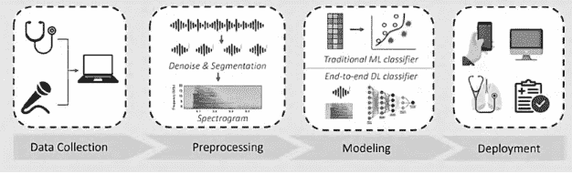

图1.1 自动呼吸状况筛选系统开发。

### 1.3.4.1 监督学习

首先，带有标记数据的机器学习模型有助于机器学习系统通过目标变量定义输入数据和输出。模型在数据集的关系、连接和函数上进行训练，然后应用于非常相似的新数据进行预测。肺部杂音、病情水平的升高等都是示例。

### 1.3.4.2 无监督学习

没有预定义的输出变量，机器学习模型在未标记数据上进行训练。目标是发现隐藏的数据结构、模式或分组。关联规则挖掘和聚类将可比较的肺声模式分组以用于无监督学习 [98]。机器学习计算机识别数据模式。它可以被用于视觉、语言、货币和健康领域。如果肺声异常，可能早期检测到肺炎或其他呼吸道疾病。事实也证明患者特征会影响声音。千禧一代生成和数据收集准确性的提高促进了现代化。肺声分析的增加是其。因此，医生可以更好地识别和治疗呼吸系统问题 [99]。

### 1.3.5 深度学习

机器学习的不断进步改进了肺声的检测和分类。卷积神经网络（`CNN`）在计算机视觉、脑活动预测和行为分析方面表现优异。卷积、最大池化、全连接和 `SoftMax` 输出 `CNN` 层是标准配置。许多 `CNN` 模型采用了了 `LeNet`、`AlexNet` 和 `VGGNet` 设计。复杂的 `CNN` 架构改进了这些模型。示例包括 `DenseNet`、带有 Inception 单元的 `GoogLeNet` 以及残差网络。这些复杂系统共享卷积和池化，但在连接、计算复杂性和层操作上有所不同 [100,101]。

深度学习技术，特别是 `CNN` 模型，可以增加自动肺声系统的准确性和可靠性。深度学习无需人工特征工程即可从数据中提取和学习意义特征的能力有助于肺声分类和呼吸道疾病检测 [102]。

## 1.3.6 肺声分析中的深度学习

图1.2 显示了本节肺声分析概述中为医疗应用开发的系统结构、共享数据集、预处理、特征提取和深度学习算法。

## 人工智能与机器学习在肺部疾病检测中的作用

| 训练数据 | | 肺声数据集 | 测试数据 | | 异常声检测 (ASD) | 2 分类：正常/异常 | 多分类：正常、啰音、哮鸣、…… |
|---|---|---|---|---|---|---|---|
| 预处理 | 特征提取 | 深度模型 | 输出 | 呼吸道疾病识别 (RDR) | 相关于 | | |
| ● 降噪 | ● 手工特征 | ● `FNN` | | ● 2分类：健康/疾病 | 3 分类：慢性病识别 | | |
| ● 心声分离 | ● 深度特征 | ● `CNN` | | ● 多类型：健康、`COPD`、哮喘、…… | | | |
| | | ● `RNN` | | | 多分类：风险、改善、恢复、…… | | |

图1.2 深度肺声分析。

### 1.3.6.1 系统框架

听力技巧影响医生对肺声的判读和临床听诊发现。通过临床发现，医生可能会误诊患者。医生提倡对肺疾病数据使用 `SVM`、`CNN` 和随机下采样增强 [103,104,105,106]。大多数基于机器学习的浅层肺声分析方法准确率为 80%，并在少数参与者中进行过测试 [107,108,109]。

深度学习在肺声准确性和鲁健性方面胜于机器学习 [110]。它们可以提升性能。深度学习算法可以自动发现任务相关的特征，而无需人工提取原始数据。`RNN` 用于肺声分析，以提取与疾病相关的周期性振荡。迁移学习：深度学习方法可以使用相邻领域的通用知识（如 `Audio Set` [111]，一个大型音频数据集）来增强肺声分析并最小化训练。规划问题限制了临床数据，这对于临床应用至关重要。

深度学习肺声研究通常包括数据收集、预处理、特征提取和分类。数字听诊器听肺。预处理肺声可以减少噪声。对于肺声区分，特征提取减少了高维预处理数据。疾病分类器映射属性和分类。

## 1.4 提出的方法论

用于分类肺声和疾病的深度学习模型的主要方法如图1.3 所示。梅频率倒谱系数（简称 `MFCC`）常用于音频信号处理，从数据集中的肺声中提取特征。如图1.4 所示，生成的特征矩阵被分为训练集和测试集并分别提供给深度学习模型，产生肺疾病的分类和肺声分析。肺声有四种可能的分类：啰音、哮鸣、啰音和哮鸣，以及健康。

## 14 转型医疗保健

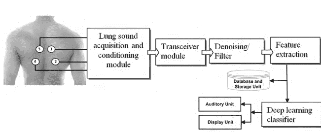

图1.3 提出的方法论的工作流。


图1.4 提出的方法的系统图。

### 1.4.1 数据集

输入肺声包含了正常和异常的 `COPD`、哮喘以及上下呼吸道感染（`LRTI`, `URTI`）。两个葡萄牙和希腊团队创建了包含 126 个人的呼吸声数据库 [112]。这些肺声样本包含了健康和疾病的声音。患者年龄涵盖儿童、成年人和老年人。

人工智能与机器学习在肺疾病检测中的作用

表1.1 ICBHI 肺声分布

| 序号 | 肺声 | 样本数 |
|---|---|---|
| 1. 啰音 | 551 |
| 2. 哮鸣 | 247 |
| 3. 啰音和哮鸣 | 71 |
| 4. 健康 | 51 |

表1.2 ICBHI 肺疾病分布

| 序号 | 肺疾病 | 样本数 |
|---|---|---|
| 1. 支气管扩张 | 16 |
| 2. 支气管炎 | 13 |
| 3. `COPD` | 793 |
| 4. 健康 | 37 |
| 5. 肺炎 | 23 |
| 6. `URTI` | 35 |

这些 5.5 小时的音频包含 6898 个呼吸周期，其中 1864 个有啰音，886 个有哮鸣，506 个两者都有。根据呼吸科专家意见，这些周期没有杂音呼吸声、啰音或哮鸣。使用 Littman 3200 电子听诊器从六个胸部位置采集了 10 到 90 秒的记录。

## 医疗保健转型

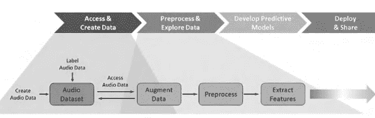

图 1.5 音频输入数据的预处理流程 [104]。

数据预处理和训练技术。预处理步骤可能会降低原始音频的量化范围，从而改进 DL 输出。录音预处理有多个步骤。为了确保设备录音的一致性，它们被导入并重采样为 44,100Hz。接下来，通过填充较短顶点或裁剪较长的顶点，将每个声音切割为 3–10 秒。数据集充满了离群值和结构化数据。为了归一化数据，我们利用 Python 的 `Librosa` [113] 包将音频文件裁剪并填充至 20 秒。

## 1.4.3 特征提取

`MFCC` 使用多种方法从肺音中检测倒谱系数。首先使用预加滤波器来增加高频。为了限制频谱泄漏，我们将信号分成小帧并乘以窗函数。快速傅里叶变换将时间转换为频率。每帧的功率谱通过 Mel 尺度对齐滤波器进行过滤。滤波器组能量被归一化以近似人类响度。离散余弦变换 (`DCT`) 去相关系数并提取最重要的信息。最终的 `MFCC` 系数被选取并存储在特征矩阵中作为低阶 `DCT` 系数（倒谱系数）。

## 1.4.4 声音与疾病分类

`CNN` 和 `GRU` 网络形成了用于分类的新型混合深度学习模型，如图 1.6 所示。`CNN` 网络有助于识别信号模式。与 `LSTM` 不同，`GRU` 使用参数较少，并能有效利用模式的长期时间关系。`CNN` 具有两组卷积、最大池化和丢弃层。64 隐藏单元 `GRU` 网络使用带有五个神经元的全连接层来对应五类分类。`softmax` 层将全连接层的输出转换为类别概率。

`CNN` 处理包括照片和视频在内的视觉输入，灵感来自 `LeCun` 等人的 `LeNet` 架构 [114]。它用于分割、目标识别、分类等。`CNN` 自动自适应地评估输入以提取用于类别分离的有用信息。`CNN` 通过反传播利用卷积、池化和全连接层学习卷积函数。图 1.6 显示推荐的模型使用了两个 `CNN` 层。展平后的属性被转发到 `GRU` 网络。

`LSTM` 网络面临着梯度消失问题。`Cho` 等人提出了门控循环单元 (`GRU`) [115]。如所示，`GRU` 可以捕捉长期依赖关系。图 1.7 展示了一个 `GRU` 网络单元。该系统具有多种门控，包括重置门和更新门。由于输入是顺序处理的，这些门在每个时间步上更新网络的隐藏状态。重置门自适应地决定保留哪些先前数据以及删除哪些数据，从而解决了梯度消失问题。更新门由于其额外的用于控制信息流的门控结构而发生变化，`GRU` 架构比 `LSTM` 网络更具耐用性且计算效率更高。通过更新的隐藏状态，图 1.7 计算出 `GRU` 输出。`GRUs` 可以保留远端阶段的数据而不会对当前进行过度处理，并过滤掉不需要的数据以提高准确性。

## 1.5 结果与讨论

### 1.5.1 超参数设置与设备配置

此 PC 包含一个 `Intel(R) Core (TM) i7-7700HQ CPU @ 2.80GHz`、`Nvidia K80s GPU (24GB DDR5 Type)`、36 GB RAM、250 GB SSD HDD，以及读写速度为 550 和 520 MB/s。使用 `TensorFlow 2.4.0` 和 `MATLAB` 创建了实验设置。交叉熵和 `Adam` 优化器 [68] 用于损失函数和优化函数。批大小、epoch 和学习率超参数分别为 8、500 和 3e-4。学习率调度修改了模型的学习率。五折交叉验证验证了数据集。每个比较模型都使用了相同的超参数标准。数据集被随机分为 20% 测试和 80% 训练。

### 1.5.2 评估标准

通过准确率（`accuracy`）、召回率（`recall`）、精确率（`precision`）和 F1 分数衡量模型性能。通过混淆矩阵将预测分配给数据的原始分类。可以使用混淆矩阵评估 DL 分类效果。在数据集上进行 DL 分类训练期间创建的混淆矩阵显示了模型对每个记录的分类准确性和可能的问题。矩阵行显示训练数据集的标签，而矩阵列有助于评估算法性能，无论输出是正性、负性还是无。每个表格有四个单元格，包含各种预测和实际数据。可能有四种结果：

- *真阳性 (`TP`):* 此短语表示预测的成功。我们有时将其称为灵敏度（`sensitivity`）。
- *真阴性 (`TN`):* 这表示负预测的实现。这被称为特异性（`specificity`）。
- *假阳性 (`FP`):* 当预测某个值为正性但结果证明为负性时，被称为时性错误。
- *假阴性 (`FN`):* 实际数值为正，但预测为负性。

准确率、召回率、精确率和 F1 分数的数学定义为：

$$\text{Precision} = \frac{\text{True Positive}}{\text{True Positive} + \text{False Positive}}$$

$$\text{Recall} = \frac{\text{True Positive}}{\text{True Positive} + \text{False Negative}}$$

$$\text{Accuracy} = \frac{\text{True Positive} + \text{True Negative}}{\text{True Positive} + \text{True Negative} + \text{False Positive} + \text{False Negative}}$$

$$\text{F1 score} = 2 \times \frac{\text{Precision} \times \text{Recall}}{\text{Precision} + \text{Recall}}$$

### 1.5.3 所提混合 CNN-GRU 模型在声音分类中的性能

表 1.3 显示混合 `CNN+GRU` 模型在识别疾病方面优于单一的 `CNN` 和 `GRU` 模型。混合模型在所有类别中具有最高的准确率（97%）。混合模型分类 `COPD` 达到了 97% 的准确率、96% 的精确率、95% 的召回率和 95.5% 的 F1 分数，优于 86% 和 89% 的 `CNN` 和 `GRU` 模型。`CNN+GRU` 模型对气管炎的诊断准确率为 96%，而 `CNN` 和 `GRU` 仅达到 85% 和 87%。混合模型对于健康声音和包括气管炎和 `URTI` 的疾病具有较高的准确率。这表明 `CNN+GRU` 模型结合了两个者的优点，使肺部诊断更准确。混合模型在肺炎和支气扩张等疾病上的召回率和 F1 分数显示了其识别和分类复杂病例的能力。这些结果表明混合模型可以自动分析呼吸道疾病的声音，具有治疗应用价值。

表 1.4 所提混合 `CNN+GRU` 模型在 ICBHI 数据库每种声音分类中的性能

| 模型 | 类别 | 准确率 (%) | 精确率 (%) | 召回率 (%) | F1 分数 (%) |
|---|---|---|---|---|---|
| `CNN` | Crackles | 85 | 82 | 83 | 82.5 |
| | Wheezes | 86 | 83 | 84 | 83.5 |
| | Crackles and Wheezes | 83 | 80 | 82 | 81 |
| | Healthy | 88 | 85 | 86 | 85.5 |
| `GRU` | Crackles | 87 | 84 | 85 | 84.5 |
| | Wheezes | 89 | 86 | 87 | 86.5 |
| | Crackles and Wheezes | 85 | 83 | 84 | 83.5 |
| | Healthy | 90 | 88 | 89 | 88.5 |
| `CNN+GRU` | Crackles | 94 | 92 | 91 | 91.5 |
| | Wheezes | 93 | 91 | 89 | 90.5 |
| | Crackles and Wheezes | 92 | 90 | 89 | 89.5 |
| | Healthy | 95 | 94 | 93 | 93.5 |

## AI与机器学习在肺病检测中的作用

`CNN`和`GRU`在哮鸣音分类中分别获得了86%和89%的准确率，而组合模型达到了93%。`CNN+GRU`模型在分类啰啰音和哮鸣音方面表现持续优于其他模型，准确率达到92%，精确率达到90%，召回率达到89%，F1分数为89.5%。

该混合模型在识别正常呼吸音方面表现最佳，对健康肺部的识别率达到了95%的最高准确率。与`CNN`和`GRU`模型相比，该混合模型减少了分类错误，并能更好地捕捉细微的肺音波波动，这从其在所有声音类别中提高的准确率、召回率和F1分数中可以看出。使用混合`CNN+GRU`模型进行肺音分类更加可靠和准确，这改进了呼吸道疾病的诊断。

## 1.5.4 现有方法与所提方法的比较

表1.5和1.6显示，使用ICHI数据库，混合`CNN+GRU`模型在肺音和疾病分类方面的表现优于机器学习（ML）和深度学习（DL）算法。表1.5显示，所提模型对肺音的分类准确率达到93%，超过了随机森林（85%）、多项逻辑回归（71%）和支持向量机（68%）。混合`CNN+GRU`模型优于`ResNet 50`（66%）和`MobileNet`（74%）等复杂的深度学习模型，证明了其在特征提取和声音分类方面的韧性。

表1.5 基于`MFCC`特征提取的所提混合`CNN+GRU`模型在ICBHI数据库各肺音类别分类中与现有ML和DL模型的比较

| 现有工作 | 分类算法 | 准确率 (%) |
|---|---|---|
| Suma等人 [116] | 随机森林 | 85 |
| | 多项逻辑回归 | 71 |
| | 支持向量机 | 68 |
| | 2D `CNN` | 66 |
| | `ResNet 50` | 66 |
| | `MobileNet` | 74 |
| | `DenseNet` | 60 |
| 所提模型 | 混合 `CNN + GRU` | 93 |

表1.6 基于`MFCC`特征提取的所提混合`CNN+GRU`模型在ICBHI数据库各肺病类别分类中与现有ML和DL模型的比较

| 现有工作 | 分类算法 | 准确率 (%) |
|---|---|---|
| Suma等人 [116] | 随机森林 | 92 |
| | 多项逻辑回归 | 77 |
| | 支持向量机 | 62 |
| | 2D `CNN` | 89 |
| | `ResNet 50` | 86 |
| | `MobileNet` | 91 |
| | `DenseNet` | 86 |
| 所提模型 | 混合 `CNN + GRU` | 97 |

在表1.6中，所提模型在肺病分类方面的性能同样出色，准确率达到97%，超过了随机森林（92%）、2D `CNN`（89）和`ResNet 50`（86）等现有模型。混合模型更好地捕捉肺音数据中时间依赖关系的能力有助于其获得高准确率，使其成为诊断肺病的更可靠的工具。总的来说，这些结果突显了基于`MFCC`特征提取的呼吸道疾病分类，混合`CNN+GRU`模型相比传统机器学习和更复杂的深度学习模型的有效性。

## 1.6 结论与未来工作


利用`CNN`和`GRU`创建了一个简单且资源高效的混合模型，用于根据声波诊断肺病。该方法在实验中运行良好。惊人的结果归功于两个关键因素：首先，使用`DCT`解构信号揭示了区分肺音的独特且重要的`MFCC`属性；其次，混合深度学习影响了结果。`CNN`寻找重要的输入模式，而`GRU`则利用时间相关性信息。所提方法使用`MFCC`特征识别了`ICBHI (2017)`数据集的呼吸音。按准确率、精确率、召回率和`F1`分数计算，最好的`ML`和`DL`模型是`DL`模型，其肺病分类准确率为`97%`，肺音分类准确率为`93%`。训练增强了肺疾病和声音分类优于单独分类。这项研究可能帮助医生诊断并紧急治疗肺部问题。

### 未来的研究可能包括

- 1. 扩大和多样化患者收集量。增加混合`DL`模型从不同人群组数据中诊断肺病的能力。
- 2. 研究六组之外的`COVID-19`、结核和肺癌。全面的筛选可能会改变患者护理。
- 3. 创建网页或移动应用程序，输入肺音进行远程监测分析。这可能让低资源地区的呼吸健康监测变得更便宜、更方便。
- 4. 硬件支持的智能听诊器实现分析。医生、患者和护理人员之间的互动可能会改善治疗。实时分析可以检测和监测肺疾病。医疗机构可以使用多模态系统。

## 参考文献

- 1. 世界卫生组织 (2023) 世界健康统计：为了可持续发展目标监测健康，可持续发展目标。可用于 https://www.who.int/publications/i/item/9789240074323
- 2. Petmezos, Georgios, Grigorius-Aris Chemiatorios, Leandros Stefananopoulos, Bruno Rocha, Rui Pedro Paiva, Aggellos K. Katsaggelos, and Nic Maclagrav. “使用混合`CNN-LSTM`网络和损失函数的自动肺音分类。”Sensors 20, no. 3 (2022): 1232.
- 3. Janice, Marie M., Masahiro Nishimura, Wei Tony Yang, and Don S. “Covid-19和`COPD`. European Respiratory Journal 56, no. 2 (2020).
- 4. Ma, Yi, Xinzi Xu, and Yongfu Li. “LungRN+: NL: 使用非局部块resnet网络结合mixup数据增强的异常肺音分类。”在 Intersch中, pp. 2902–2906. 上海, 中国, 2020.
- 5. Rocha, Bruno M., Luis Mendes, Dimitris Filho, Eleni Perantoni, Panagiotis et al. “用于开发自动分类的呼吸音数据库。”Precision Medicine Powered by Connected Health: ICBHI 2017, Thessaloniki, Greece, Springer.
- 6. Xia, Tong, Hong Jian, and Cecilia Masolo. “探索基于音频的呼吸筛查中的机器学习：数据库、方法和开放问题的简要回顾。”Experimental Biology 24, no. 2 (2022): 2053–2061.
- 7. Sarkar, Malay, Irappa Madabhai, Narasim Niranjan, and Meghna Dogra. “呼吸系统的听诊。”Annals of Thoracic Medicine 10, no. 3 (2015): 158–168.
- 8. Lu, Viet, Pham Thi, Nguyen Thi Ngoc, Vu Tran. “使用频谱图表示和卷积网络进行肺音。”Journal of Medical Engineering & Technology 46, no. 4 (2022): 270.
- 9. Zulfigar, Mangal, Alkhod, Keed, and, and Tayab. “基于深度学习的异常声音分类。”Frontiers in Medicine 8 (2021).
- 10. Shi, Lucky, Kang Zhang, Hongqi Ma, and Wenanjie. “基于vgg网络的肺音识别。”IEEE Access 7 (2019): 9438–9449.
- 11. Frawan, Mohammad, Luai, Mohan, and Omarad. “使用卷积神经网络和短记忆网络进行肺疾病分类。”Journal of Ambient Intelligence 13, no. 10 (2022): 4759–4771.
- 12. Grooby, Ethan, Situla, Shoji Kim, and Takashi Kuremoto. “用于远程应用的肺音质量评估。”Biomedical Signal Processing and Control 59 (2020): 101784.
- 13. Sathesh, Subramanian Rajkumar, and Neeraj Kumar Goy. “基于神经设计和指标评估的最小二乘法(`LMS`)用于听诊信号分离。”Biomedical Signal Processing and Control 59 (2020): 101784.
- 14. Rocha, Bruno M., Luis Mendes, Dimitris Filho, al. “通过深度学习开发的塑料分类器。”EURASIP Journal on Image and Video 2 (2022): 116.
- 15. Park, KwanJin, YoungJin Choi, and HongChul Lee. “应用领域迁移和深度学习进行COVID-19 CX分类。”Applied Sciences 12, no. 22 (2022): 10715.

## AI与机器学习在肺病检测中的作用

27. Cao, Yi, Chen Zhang, Cheng Peng, Guangfeng Zhang, Yi Sun, Xiaoxue Jiang, Zhan Wang, Die Zhang, Lifei Wang, and Jui Liu. “一种基于神经网络的胸部CT图像COVID-19检测方法，”Annals of Translational Medicine 10, no. 6 (2022): 333–341.
28. Kim, Yoonjoo, Yunkyong Hyon, Soo Jung, Sunju Lee, Geon Yoo, Chaech Chung, and Taeyoung Ha. “利用深度学习进行临床领域啰音、哮鸣音和鸣音的呼吸音分类，”Scientific Reports 11, no. 1 (2021):–1.
29. Liu, Yongpeng, Yusong Lin, Shan Gao, Hongpo Zhang, Zongmin Wang, Yang Gao, and Guanling Chen. “基于深度卷积神经网络的呼吸音特征学习。”见2017 IEEE 15th International Conference on Dependable, and Secure Computing, 15th International Conference on Pervasive Intelligence and Computing, 3rd International Conference on Big Data Intelligence and Computing and Cyber Science and Technology (DASCC/DataCom/CyberSciTech), p. 170–177. IEEE, 2017.
30. Garcia-Mendez, Juan P., Amos Lal, Svetlana Herasevich, Asun Tekin, Yuliya Pinevich, Kirill Lipatov, His-Yi Wang et al. “从公共数据库获取的异常声音的机器学习分类：系统综述。”Bioengineering 10, no. 10 (2023): 1155.
31. Li, Yai, Xin Wu, Ping Yang, Guocian Jiang, and Yuan Luo. “肺癌诊断、治疗和预后的机器学习。”Genomics, Bioinformatics 20, no. 5 (2022): 850–866.
32. Kefius, Stefanus Tao Hwa, Adullahullah Bade, Mohd Hanafafi Hijazi, and Hoshang Kulivad. “用于医学图像肺病检测的深度学习：先进技术、分类法和未来方向。”Journal of Imaging 6, no. 12 (2020): 131.
33. Huang, Dong-Min, Jia Huang, Kun Qao, Nan-Shan Zhang, Hong-Zhou Lu, Apinan, and Wen-Jin Wang. “用于智能听诊器的基于深度学习的肺音分析。”Military Medical Research 10, no. 1 (2023): 44.
34. Brown, Chloe, Jamobhan Chauhan, Andreas Groman, Hasthanasobat, Dimitri Spiritis, Xiong Xia, Pierro Cituta, and Cecilia Masco. “探索众源呼吸音数据的自动检测COVID-19。”见Proceedings of the 26th ACM SIGKDD International Conference on Knowledge Discovery & Data Mining, 3474–3484, 2020.
35. Chambers, Gaetan, Pierre Hanna, and Myriam Desmond-Celine. “利用肺音分析自动检测患者呼吸疾病。”见2018 International Conference on Content-Based Multimedia Indexing (BMI), p. 1–6. IEEE, 2018.
36. McGee, Brian, Colin Raff, Dawen Liang, Daniel PW McVicar, Eric Battenberg, and Oriol Nieto. “Librosa: Python中的音频和音乐信号分析。”在SciPy, pp. 18–24. 2015.

## 转型医疗保健

38. Eyben, Florian, Martin Wollmer, Björn Schuller. “Opensmile: 最多功能且开源音频特征提取器。”见Proceedings of the 18th ACM International Conference on Multimedia, pp. 1459–1462. 2010.
39. Lartillot, Olive, Petri Toivainen, and Tuomas Erola. “用于音乐信息检索的 matlab工具箱。”见Data Analysis, Machine Learning and Applications: Proceedings of the 31st Annual Conference of der Gesellschaft für Klassifikation eV, Albert-Ludwig-Universität Freiburg, 2007年3月7–9日, pp. 261–267. Springer, 2008.
40. Ullah, Muhammad Salman Khan, Misha Urook, and Farrukh Mujahid. “使用机器学习算法进行声音自动分类。”见2021 International Conference on Frontiers of Information Technology (FTI), pp. 131–136. IEEE, 2021.
41. Hao, Guoliang, Xing, and Gang Zhou. “Sleep: 使用智能手机进行无干扰的睡眠质量监控。”见Proceedings of the 11th ACM Conference on Embedded Network Sensors, Rome, Italy, pp. 1–14. 2023.
42. Monaco, Alfonso, Nicola Amoroso, Leonardo Bantuano, Santo Pastale, Sabina Tangora, and Roberto Bellotti. “多尺度呼吸音分析。”Sensors 10, no. 23 (2020): 3606.
43. Pramono, Rafael, Syed Anas Matiiaz, and Esther Rodriguez. “基于深度学习的呼吸声进行肺部疾病检测。”PLS ONE 11, no. 9 (2016): 6212.
44. Naqvi, Zohaib Hassan, and Muhammad Chowdhury. “基于咳嗽、呼吸声和肺炎的慢性阻塞肺疾病自动检测系统。”Sensors 20, no. 22.
45. Nallangal, Vivek Srikant, Aki Härmä, and Helmer St. “用于呼吸声分析的卷积神经网络方法。”见2022 IEEE International Conference on Acoustics, Speech and Signal Processing (ICASSP), pp. 9097–9101.
46. Yu, Dong, and Jinyu Li. “深度学习在声学模型中的进展。”Automatica Sinica 4 (2017).
47. Coppock, Harry, Panagiotis Tazikis, Alice Baird. “基于端到端卷积神经网络的COVID-19检测。”BMJ Innovations 7 (2021).
48. Deshpande, Gauri, and Björn Schuller. “使用卷积神经网络（CNN）和循环神经网络（RNN）的机器学习3rd IEEE Global Conference on Life Sciences and Technologies, pp. 181–182.
49. Xue, Hao, and Yoshihi Yamamoto. “探索自监督表示用于COVID-19诊断。”见第27届ACM International Conference on Knowledge Discovery & Data Mining, pp. 1944–1952.

## AI与机器学习的应用

51. Rocha, Diego, Pierre Pessoa, Alda Marques, and Rui Pedro Paiva. “通过循环神经网络预测呼吸异常和疾病。”Pattern Recognition 122.
52. Chang, Yi, and Shu Meng. “基于Transformer的CNN用于声音。”见2021 43rd Annual Conference of Engineering and Biology (EMBC), pp. 2335–2338.
53. Yan, Tianhao, and Shu Liu. “带有自适应嵌入的卷积Transformer用于COVID-19事件检测。”见2022 IEEE International Conference on Acoustics, Speech and Signal Processing (ICASSP), pp. 9092–9096.
54. Dang, Hang, and Dimitris Spathis. “序列深度学习用于咳嗽、呼吸和语音。”Journal of Medical Research 24, no. 6 (2022): e3704.
55. Demir, Ahmet, and Varun Bajaj. “肺病的卷积神经网络方法。”Health Information Science and Systems 8, no. 1 (2019).
56. Lugarta, Jordi, and Rafael Huerta. “仅使用记录进行COVID-19诊断。”IEEE Open Journal of Medicine and Biology 1 (2020): 275–281.
57. Rocha, Bruno. “智能手机上的异常呼吸音自动分类。”Sensors 20, no. 1 (2020): 57.
58. Tabataei, Seyed Amirsein, Patrick Fischer, Henning Schneider, Ulrich Koller, Volker Voss, and Keywan Sobhani. “智能手机异常呼吸音分析方法综述。”IEEE Reviews in Biomedical Engineering 14 (2020): 98–115.
59. Tiwari, Swapnil, Rupayan Chakraborty, and Sunil Kumar Kopparapu. “利用声学生物标志进行深度听诊呼吸声事件检测。”见2021 IEEE International Conference on Acoustics, Speech and Signal Processing (ICASSP), pp. 1305–1309.


60. Rashid, Hasib-Al, Arnhem Neel Mazumder, Utteja Panchshara Kallakoyi Miyagi, and Timoosh Moshen. “CoughNet：用于咳嗽声检测的灵活CNN-LSTM。”见2021 IEEE 3rd International Conference on Artificial Intelligence Circuits and Systems (ICASAS), pp. 1–4.

61. Peru, Diego, and Andrea Tagarelli. “深度听诊：通过循环神经网络预测呼吸异常和疾病。”见2019 IEEE 32nd International Symposium on Computer-Based Medical Systems (CBMS), pp. 50–55.

62. Kim, June-Woo, Miika Toikkanen, Sangmin Bae, Minseok Kim, and Ho-Young Jung. “RepAugmentation：用于呼吸音分类的输入无关表示级增强。”arXiv preprint arXiv:2405.02996, 2024.

## 28 医疗保健转型

- 63. Trivedi, Jigisha, “使用不同机器学习和深度学习模型识别啰音的述。”no. 3 (2024): 399–411.

- 64. Khan, Rafiullah, Sajjad Ullah Khan, Ubaid Saeed, and In Soo Koo, “通过并行传输和深度学习进行肺部疾病检测。”Bioengineering, vol. 11, p. 586, 2024; doi: 10.3390/bioengineering11060586.

- 65. Wu, Chenwen, Na Ye, and Jial Jiang. “基于改进 ResNet 模型的肺音分类与识别。”IEEE Access no. 99 (2024): 1–10.

- 66. Song, Wenjie, Jian Han, Guibin Zheng, Tian Zheng, and Yongjun He. “通过自监督预训练对呼吸音分类进行准周期依赖建模。”In ICASSP 2024–2024 IEEE 国际声学、语音和信号处理会议 (ICASSP), pp. 1996–2000. IEEE, 2024.

- 67. Zhang, Wei, and Xiaoyan Liu. “解码利用肺音分析诊断肺部疾病的机器学习进展。”Scientific and Engineering Letters 12, no. 1 (2024): 1–11.

- 68. Wang, Zaoping, and Zhiqiang Sun. “变变参数下的肺音分类性能评估。”EASRIP Journal on Advances in Signal Processing 2024, no. 1 (2024): 51.

- 69. Kim, No, Sangmin Bae, Won-Yang Cho, Byungje Lee, and Ho-Young Jung. “用于呼吸音分类跨域适应的听诊器引导式监督对比学习。”In ICASSP 2024–2024 IEEE 国际声学、语音和信号处理会议 (ICASSP), pp. 1431–1435. IEEE, 2024.

- 70. Mang, Loredina, Francisco González Ortiz, Manuel Martínez Muñoz, Sebastian García Galán, and Raquel Cortina. “使用呼吸蜗道图和视觉变换器对异常音分类。”Sensors 24, no. 2 (2024): 682.

- 71. Kumar, Ajay, Abhishek, Chinmay Chakraborty, and Natalia Krivkina. “基于咳嗽频谱图的深度学习和物联网的肺部疾病识别。”IEEE Access 9 (2021): 95938–95948.

- 72. No, Dat, Lam Ham, Nguyen, Ben Kho, Tran, and Tru Nguyen. “应用于预测呼吸音异常的深度学习框架。”In 2021 国际电气电子工程研讨会 (IEEE), pp. 42–47. IEEE, 2021.

- 73. Saraiva, Aratê, Domingos S. Santos, Pedro Mateus Cunha Pimentel, Jose Vitor Moura Sousa, Nuno M. Fonseca Ferreira, Joao do Espírito Batista Netto, Silvano Soares, and Antonio Valle. “利用卷积神经网络进行光学相干断层分类。”In Proceedings, 3 (2020): 168–175.

- 74. Gwang, Cho-Ching, and Yong-Fa Li. “两种真实噪声环境下肺音识别系统的性能评估与增强。”Computer Methods and Programs in Biomedicine 97, no. 2 (2010): 141–150.

- 75. Pramono, Ramón Xaviero Duarte, Stuart Bowyer, and Esther Rodriguez-Villlegas. “异常呼吸音自动分析：系统性综述。”PLS One, no. 5 (2017): e0177926.

- 76. Bardou, Dalal, Kun Zhang, and Mohammad Mohammad Ahmed. “使用卷积神经网络的肺音分类。”Artificial Intelligence in Medicine 88 (2018): 58–69.

- 77. Psterkamp, Hans, Steve K. Kramer, and George R. Rodicka. “呼吸音：超越听诊器的进展。”American Journal of Respiratory and Critical Care Medicine 156, no. 3 (1997): 974–987.

- 78. Bohadana, Abraham Izbicki, and Steve S. Kramer. “肺部听诊的基础。”New England Journal of Medicine 370, no. 8 (2014): 744–751.

- 79. Olson, Dan, and Jeffrey Harvey Rammers. “肺音产生的机制。”Seminars in Respiratory Medicine 6, no. 0 (1985): 171–179.

- 80. Gavriel, Norman, Oren Remen Avraham Moshe Palti, and Gideon Alroy. “正常呼吸音的频谱特征。”Journal of Applied Physiology 50, no. 2 (1981): 307–314.

- 81. Weiss, Earle B., and C. Jeffrey Carlson. “呼吸音的记录。”American Review of Respiratory Disease 105, no. 5 (1972): 835–839.

- 82. Forgaks, Paul, Amin R. Nathoo, and Harold D. Richardson. “呼吸音。”Thorax 26, no. 3 (1971): 288–295.

- 83. Kramer, Steve S. “肺泡音（正常肺音）：它们是如何产生的？来自哪里？意味着什么？”Seminars in Respiratory Medicine 6, no. 0 (1985): 183–191. Copyright©1985 by Thieme Publishers.

- 84. Kramer, Steve S. “通过声纳法确定呼吸音的产生。”American Review of Respiratory Disease 122, no. 2 (1980): 303–309.

- 85. Kramer, Steve S. “喉噪音对肺音的影响？”American Review of Respiratory Disease 124, no. 3 (1981): 292–294.

- 86. Gavriel, Norman, Moshe Nissan, Abraham H. Rubin, and David C. Kugell. “正常胸壁呼吸音的频谱特征。”Thorax 50, no. 12 (1995): 1292–1300.

- 87. Vyshedsky, Andrey, Ruqayah M., Rozanne Paciej, Marco, Inna Rudman, Jeffrey Fredberg, and Adelaja Oluwaseun. “吸气和呼气啰音的机制。”Chest 135, no. 1 (2009): 156–164.

- 88. Fleetstra, Brian, Natasha Markuson, Andrey Vyshedsky, and R. Murphy. “间质纤维化患者啰音的自动分析。”Pulmonary Medicine 2011, no. 1: 596.

- 89. Munakata, Mitsuru, Hidekaki Ujima, Isamu Doi, Yoshinori Ohtsuka, Yoshitaka Masaki, Yukihiro Honda, and Yoshikazu Kawasaki. “使用机器学习预测风鸣音。”Thorax 46, no. 9 (1991): 651–657.

- 90. Forgaks, Paul. “肺音分析的功能基础。”Chest 73, no. 3 (1978): 399–405.

- 91. Jones, Alice. “肺音的简要综述。”Physiotherapy 81, no. 1 (1995): 37–42.

- 92. Murphy, Raymond, and Andrey Vyshedsky. “肺炎患者的声学发现。”New England Journal of Medicine Medicine 363, no. 20 (2010): e131.

- 93. Bohadana, Abraham B., Robin Pollin, and Hubert Uttloff. “气道阻塞临床评估中的呼吸音。”Thorax 33, no. 3 (1978): 345–351.

- 94. Nagasaka, Yukio. “支气管哮喘中的肺音。”Allergology 61, no. 3 (2012): 353–363.

- 95. American Thoracic Society. “成员反应的更新命名。”ATS 3 (1977): 5–6.

- 96. Russell, Stuart J., and Peter Novvig. “人工智能：现代方法。”Pearson, 2016.

- 97. Goodfellow, Ian. “深度学习。”MIT Press, Cambridge, 2016.

- 98. Breiman, Leo. “随机森林。”Machine Learning 45 (2001): 5–32.

- 99. Shalev-Shwartz, Shai, and Ben-David. “理解机器学习：从理论到算法。”Cambridge University Press, 2014.

- 100. Khevsky, Alex, Ilya Sutskever, and Geoffrey E. “使用深度神经网络进行图像分类。”Advances in Neural Processing Systems 25 (2012): 1097–1110.

- 101. Simonyan, Karen, and Andrew Zisserman. “用于大规模图像识别的深深神经网络。”arXiv:1409.1556, 2014.

- 102. Al-Bakaa, Zainab H., and Alaa Taima Abo-Solih. “深度学习分析 ICBHI 2017 呼吸音综述。”Journal of Electronics and Computer Engineering 5, no. 2 (2024): 321–329.

- 103. Al-Hasani, Ahmed, T., Mar Jan Edban Al-Juburi, Fousein Hisan, Ali J. Ramadhan, and Adelaja Oluwaseun. “使用机器学习预测风鸣音。”In Bio Conference, vol. 97, p. 0107. EDP Sciences, 2024.

- 104. Sabry, Ahmed H., Omar. Dallash Bahi, Hakimi Nik Aly, and Yasir Mahmoud Al Kabul. “基于机器学习音频分析的肺部疾病识别方法。”Heelyon (2024).

- 105. Zhang, Han-Song, Huang-Yuan Zhou, Bin Dong, Fei Zhen, Fei Xiang, Jian-Liu et al. “人工智能算法辅助儿童呼吸复苏的真实世界验证。”Frontiers in Pediatrics 9 (2021): 627337.

- 106. Groove, Ethan, Chanjibiti Sitaela, Kenneth Tan, Lindsay Zhou, Arabella King, Ashwin Ramanathan, Atul Molhra, Guy G. Dum, and Fazez Marzband. “通过数字听诊器录音预测足月婴儿呼吸窘迫。”In 2022 Annual International Conference of the IEEE Engineering in Medicine & Biology Society (EMBC), p. 4996–4999. IEEE, 2022.

- 107. Oud, Mireille, Edo Hans Doojees, and Jari van der Zee. “基于呼吸音频谱分析的哮喘气道评估。”IEEE Transactions on Biomedical Engineering 47, no. 11 (2000): 1450–1455.

- 108. Mayorka, P., Cruzgalski, L. R. Morales, O. H. Gonzalez, and J. Vidales. “使用 GMM 分类进行呼吸疾病声学评估。”In 2010 Annual International Conference of the IEEE Engineering in Medicine and Biology, p. 6312–6316. IEEE, 2010.

- 109. Kahya, Yasemin P., E. Cagatay Guler, and Serdar Sah. “利用肺音进行呼吸道诊断。”In Proceedings of the 19th Annual International Conference of the IEEE Engineering in Medicine and Biology Society. Magnificent Milestones and Emerging Opportunities in Medical Engineering’ (Cat. No. 97CH36136), vol. 5, p. 2051–2053. IEEE, 1997.

- 110. Cinyol, Funda, Uğur Baysal, Deniz Köksal, Elif Babaoğlu, and Sevinç Sarıç Ulaşı. “将支持向量机引入卷积神经网络的呼吸器官分类。”Biomedical Signal Processing and Control 79 (2023): 104093.

- 111. Gemmeke, Jort F., Daniel P W. Ellis, Dylan Freeman, Aren Janssen, Wade Lawrence, R. Channing Moore, Manoj Plakal, and Marvin Ritter. “音频集：用于音频事件的本体论和人类标记数据集。”In 2017 IEEE International Conference on Acoustics, Speech and Signal Processing (ICASSP), pp. 776–780. IEEE, 2017.

- 112. Sun, Zhiqiang. (2023). “CBHI 2021 挑战。”Harvard Dataverse. https://doi.org/10.7910/DVN/HT6P6KI.

- 113. Librosa. (2020). 特征提取—Librosa 0.8.0 文档. https://librosa.org/doc/0.11/feature.html.

- 114. LeCun, Yann, Léon Bottou, Yoshua Bengio, and Patrick Hafner. “基于梯度的学习应用于文档识别。”Proceedings of the IEEE 86, no. 11 (1998): 2278–2324.

- 115. Chung, Junyoung, Caglar Gulchre, KyungHyun Cho, and Yoshua Bengio. “门控循环神经网络在序列建模中的实证评估。”arXiv preprint arXiv:1412.3555, 2014.


116. Suma, K. V., Deepali Koppad, Preethi Kumar, Neha A. Kantikar, and Surabhi Ramesh. “用于肺音与肺疾病分类的多任务学习。” arXiv preprint arXiv:2404.03908, 2024.

# 第 2 章 人工智能在远程医疗系统的应用

Vijayachitra Senniappan

## 2.1 人工智能

人工智能（AI）是通过机器（计算机）辅助模拟人类拥有的各种过程，对人类智能进行的人工仿拟。提到人类过程，学习、推理和自动纠正是一些主要过程。如果需要执行更多人类推理难以完成的过程，则建议采用人工智能来完成这些任务。

人工智能的目的是开发一种系统，能够通过比较或测试对给数据集进行分析，并获得高效的决策。这些决策更有可能在医疗环境行业中实施或采纳。

如果专家能够提供宝贵的见解、专业知识、建议以及未来预测，基于 AI 的工具将帮助个人获得智能决策和良好的结果，并减少错误风险。

总的来说，人工智能或简称为 AI，源于计算机科学的根源，它利用先进技术，使处理单元能够以智能的方式执行各种任务或挑战 [1]。其中一些任务列如下：

- 感知
- 语言的理解与转换
- 数据分析
- 人类推理
- 从以往经验中理解

人工智能通过结合大量数据、高处理速度以及智能计算算法来运行，以便从某些数据特征或模式中进行自动学习。某些特殊程序可以通过分析复杂的自然数据并从过去的学习中工作，并在无需任何人工干预的情况下提高性能。总的来说，人工智能是通过使用计算机和各种计算算法来模拟人类智能来实现的。

因此，它被定义为通过编程计算机系统和计算算法对人类智能/人类思维/人类推理进行模拟，以模仿人类思考和做出决策的能力。

人工智能的主要目标是解释并执行操作，以便以最好的方式实现特定目标。它的开发基于这样一个观点：人类智能可以从一个角度被考虑，即具有适当计算算法的智能机器可以模拟从最简单水平到最复杂水平的任务。随着技术的增长，新算法降低了旧算法所经历的难度水平，使其变得微不足道且无关。随着人工智能的进步，许多不同行业、各种处理单元和医疗系统都从中受益。图 2.1 显示了人工智能的基本框图。

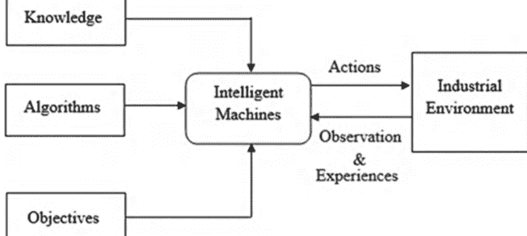

图 2.1/ 人工智能的基本框图。

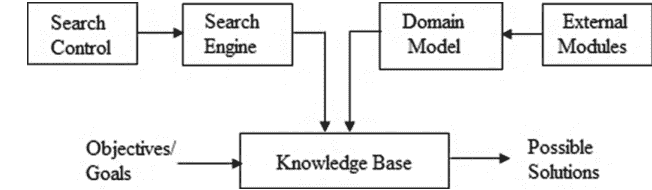

图 2.2 基于 AI 的平台开发。

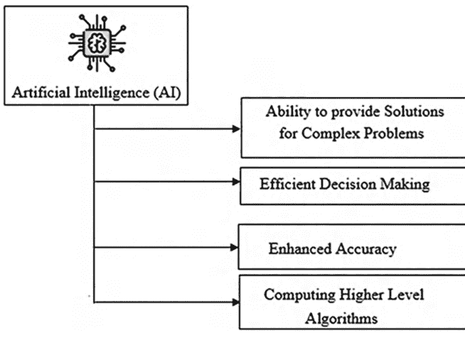

图 2.3 人工智能的主要特征。

提供了一个带有搜索控制块的搜索引擎，用于在远程地方进行搜索。在问题复杂的情况下，领域中增加了额外的模块。这将进一步增强领域模型。最后，有一个知识领域或数据库，它由高级语言开发的各种知识、意见、决策和过去的经验组成。它配备了高级目标或最终目标，所有陈述或决策都遵循并维护这些目标。

最后，AI 的主要特征如图 2.3 所示。

## 2.2 远程医疗

远程医疗的目的是通过患者、寻求者和专家医生之间的双向通信，实时为远程地区提供临床服务。在医疗系统中，远程医疗被认为是一种创新，对于需要医疗协助但难以访问医院的人非常有帮助。通过远程医疗，任何人都可以数字化的获取医疗服务，并针对身体问题获得诊断、治疗和建议 [2–4]。

除了远程医疗，人工智能还可以与之整合，从而扩展其功能并为医疗需求提供巨大的可能性。由于远程医疗与人工智能的结合，可以获得改进的医疗服务并增强人们面临的体验。这将进一步加速疾病/问题的测试和诊断，减少对医院的访问。因此，人们倾向于使用集成人工智能的远程医疗来解决身体问题。还可以从难以预约的专家医生那里获得医疗建议和后续行动。

通过医疗系统的各个部分的人工智能和远程医疗，结合远程地区的可靠通信和有效的互联网连接，专家医生可以与需要健康问题医疗协助的人互动，并在药物、体育运动等方面提供可能的医疗协助和后续 [5]。

## 2.3 远程健康

远程健康被认为是远程医疗的一个广泛品牌 [13–15]，它涵盖的远程地区医疗服务包括以下服务：

- 临床服务
- 非临床服务

移动健康（m-Health）是指利用移动设备以及有线/无线电信服务来为偏远地区提供医疗服务的术语。医疗保健背后的基本原理是“存储与转发”机制，这意味着患者的症状通过合适的元件进行观察；数据首先被存储，并进行数据加密以保护保护，最后转发到医生或医疗专业人员可以接触的地点。然后，由他们向患者建议进一步的药物或治疗方案。有多种治疗手段被遵循，其中一些包括：

- i. 远程分诊：
涉及对偏远地区的患者进行筛查，以评估其健康状况和所需的护理。
- ii. 远程会诊：
它提供了患者与其他医疗专业人员之间一对一的互动。
- iii. 远程诊断：
在远程诊断的情况下，由患者观察症状和状况并传输这些信息。在检查信息后，将指导其咨询合适的专家以进行进一步的随访和治疗。
- iv. 远程监控：
对于需要持续监测健康状况的人群，该过程涉及获取生理参数并将其转发给医生或医疗专业人员进行进一步的诊断和恢复。这种整体监测被称为远程监控。远程监控也被称为远程线路患者监测，它由数据传输、数据注册、人体参数数据处理以及通过数字通信模式建议的进一步医疗治疗或治疗组成。

通过使用有线或无线设备、可穿戴或植入式传感器等必要的集成传感器获取患者的生理参数。这允许根据患者的需求对慢性疾病患者的健康状况进行持续监控。

### 2.3.1 社会效益

远程医疗的过程可以通过整合各种有线或无线/植入式类型的传感器来实现。根据患者的需求，可以为如乳腺癌/白血病/肺癌、中风、心血管发作等慢性疾病的管理提供持续监控和支持。当它嵌入 AI 算法时，有利于疾病监测和早期诊断。利用 GPS 追踪功能进行数据采集和检索将有助于医生和医疗/健康人员在药物和心理支持方面提供医疗保健。很清楚，远程医疗是远程医疗的一部分，而不应被视为一种工具。为了利用远程医疗或远程医疗的优势，排列成组件的各种传感器、合适的 AI 算法、适当的互联网连接以及 GPS 追踪或定位器设置是必要的 [16–18]。

为了远程医疗的目的，优先选择同步和异步方法等各种虚拟软件平台。在同步平台的情况下，患者可以使用带有音频和视频信号、视频会议等功能的手机手机；而在异步方法的情况下，他们可以使用电子邮件交易、网络门户、虚拟会诊等。

图 2.4 显示了远程医疗/远程医疗的流程图，它清楚地定义了临床和心理健康分析需要遵循的程序。

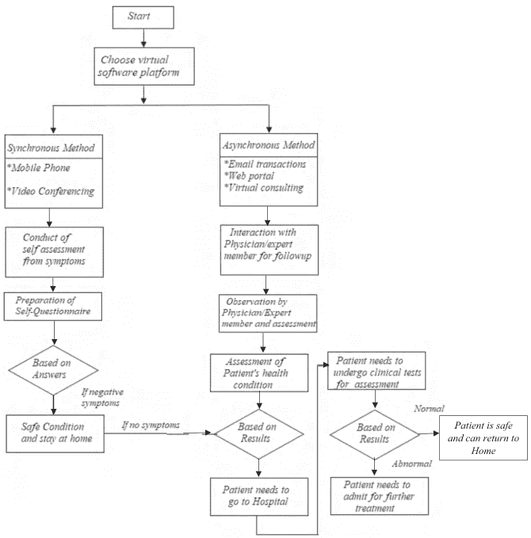

图 2.4 远程医疗/远程医疗流程图。

图 2.5 基于 AI 的远程医疗分析流程图。

当它与算法相结合时，将遵循某些步骤，如图 2.5 所示。

以下是远程医疗的一些益处：

- 1. 对虚拟转型技术做出贡献
- 2. 提供远程医疗的便捷访问并提高对医疗保健服务的意识
- 3. 有效利用医疗保健资源
- 4. 对临床/非临床结果做出贡献
- 5. 增强患者对自我健康保健的参与度
- 6. 加强患者与医生之间的协调性
- 7. 确保医疗保健各个阶段之间的持续监控
- 8. 通过消除旅行费用使治疗成本最小化

### 2.3.2 互联网在远程医疗中的作用

为了在需要医疗协助的患者与提供医疗治疗或建议使用先进治疗设备进行检测的医生/专家健康人员之间提供有效的远程医疗服务，互联网发挥着至关作用，如图 2.6 所示。

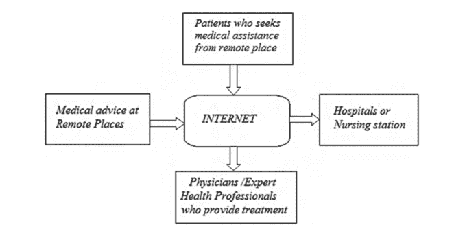

图 2.6 互联网在远程医疗分析中的作用。

## 2.4 远程医疗：观察与分析

在为偏远地区的患者提供远程医疗时，考虑两个阶段：

- 临床服务：体温、人体血压、血氧饱和度 (`SpO2`) 和 ECG 波形的测量。
- 非临床服务：针对压力、焦虑、失眠、痴呆和精神分裂症等精神障碍的治疗。

### 2.4.1 临床服务

患有咳嗽、感冒、头晕或昏厥的患者需要使用集成传感器组件进行持续监控，例如数字温度计、数字血压计、脉搏血氧仪以及带有电极和电缆的 ECG 设备。该传感器组件如图 2.7 所示。

#### 2.4.1.1 体温测量

体温测量至关重要，因为它是了解我们身体状况的指标，并在我们的身体出现异常时作为警示症状。众所周知，正常体温为 98.6°F 或 37°C，尽管会根据性别、年龄、肥胖以及测量部位、时间、外部环境（下雨、晴天）、工作环境和感染等各种因素产生轻微变化。对于农村地区的人，建议使用数字温度计定期读取体温，以出现任何误读。

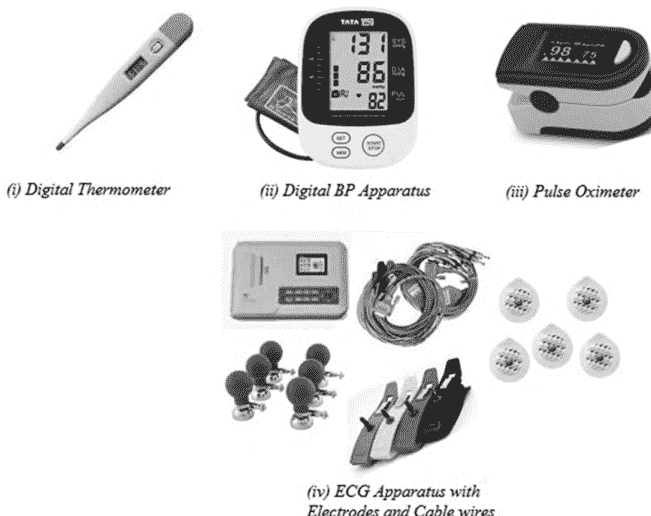

(i) 数字温度计
(ii) 数字血压计
(iii) 脉搏血氧仪
(iv) 带有电极和电缆的 ECG 设备

图 2.7 临床传感器组件。

表 2.1 显示了根据成人、儿童和婴儿体温测量得出的医生建议。表 2.1 列出了与疾病/感染等不同状况相关的异常体温状况。当温度≤95°F 时，低温体症是一种体温开始下降并导致危险情况的紧急状况。通常，这是由于长时间暴露在寒环境中。因此，建议有必要寻求医生建议进行治疗/休息。如果体温在 98.6°F 到 100.4°F 之间，则认为是低热；如果体温从 100.4°F 增加到 103°F 且剧增，则会被视为高热，建议有必要看医生。

表 2.1 温度范围与医生建议

| | ≤95°F | (95.1°F–96.9°F) | (97°F–98.6°F) | (98.6°F–100.4°F) | (100.4°F–103°F) | ≥103°F |
|---|---|---|---|---|---|---|
| 成人 | 低温体症 **需要关注** | 低但可能正常 | 正常 | 低热 | 发热 | 高热 **需要看医生** |
| 儿童 | 低温体症 **需要关注** | 低但可能正常 | 正常 | 低热 | 发热 | 高热 **需要看医生** |
| 婴儿 | 低温体症 **需要关注** | 低 **需要关注** | 正常 | 低热 | 发热 **需要关注** | 高热 **需要看医生** |

## AI 在远程医疗系统中的应用

#### 2.4.1.2 血压 (`BP`)

血压（BP）是血液流经人体循环系统时对血管壁产生的压力。血压在全天范围内会升高或降低，这种变化取决于我们的活动。但我们需要了解任何波动或异常情况（高血压/低血压）的原因，这些情况反映了我们的健康状况。通常，血压会根据饮食习惯、压力水平或体力活动而变化。为了维持正常的血压水平，建议遵循纪律的生活方式并遵医嘱进行药物治疗。

血压的测量由两个数字表示，例如收缩压（高数字）和舒张压（低数字）。收缩压是心脏跳动时动脉中的压力，而舒张压是心脏在跳动间休息时的压力。表 2.2 显示了不同血压水平的收缩压和舒张压值。

根据医生建议，正常血压低于 120/80 mmHg（收缩压）高于 90/60 mmHg（舒张压）。如果血压读数超出上述范围，则表示高血压（也称为高血压）或低血压（也称为低血压）。尽管两个值都很重要，但收缩压更为重要，因为它会导致心脏功能负担超过正常水平。动脉延伸至心脏左心室，可能导致中风和心脏骤停。当血压进一步升高时，它会接触血管并干扰氧流，这将进一步导致失明和肾衰竭。

表 2.3 显示了高血压的分类及其相应的收缩压和舒张压值。

| 血压分类 | 收缩压值（高数字），mmHg | 舒张压值（低数字），mmHg |
|---|---|---|
| 低 | <90 | <60 |
| 正常 | <120 | <80 |
| 偏高 | 120–129 | <80 |
| 高 | 130–139 | 80–89 |
| 高 | >140 | >90 |
| 高血压危急作 | >180 | >120 |

表 2.3 带有收缩压和舒张压的高血压分类

| 血压分类 | 收缩压值（高数字），mmHg | 舒张压值（低数字），mmHg |
|---|---|---|
| 偏高 | 120–129 | <80 |
| 高血压（1级） | 130–139 | 80–89 |
| 高血压（2级） | >140 | >90 |
| 高血压危急作（需要急诊治疗） | >180 | >120 |

### 44 医疗保健的转型

从上表可以看出，根据医生的建议，观察到血压为 132/60，这被视为高血压（1级），因为收缩压高数字处于 (130–139) mmHg 的范围内。

高血压无法通过症状识别，因此被认为是无症状的。由于它不会引起症状或迹象，它进一步会导致中风或心脏骤停等严重健康问题。出于此原因，高血压也被称为“无声杀手”。医生指出了某些副作用，如下如下：

- 1. 严重头痛
- 2. 头晕或眩晕
- 3. 面色苍白
- 4. 胸痛
- 5. 鼻血
- 6. 呼吸困难
- 7. 心律不齐
- 8. 尿中带血

如果患者在家里观察到上述任何症状，建议他们进一步与医生交流或会诊以进行进一步检测或治疗。他们提供了预防高血压的风险因素和常见原因。它们是：

- 1. 肥胖
- 2. 糖尿病病史
- 3. 久坐生活方式
- 4. 饮食不当
- 5. 吸烟
- 6. 饮酒
- 7. 高龄
- 8. 高血压家族史。

与高血压类似，它也指出了低血压的原因、症状和建议。当血压为 90/60 时，被认为是低血压。它也会影响身体。从患者身上观察到的常见症状有：

- 1. 身体虚弱
- 2. 头晕/眩晕
- 3. 视力模糊
- 4. 恶心
- 5. 疲劳
- 6. 皮肤苍白出汗
- 7. 呼吸快速且深长
- 8. 压力。

导致低血压或高血压的某些常见风险因素如下：

- 1. 糖尿病
- 2. 高龄
- 3. 患心脏问题
- 4. 有肝脏疾病
- 5. 怀孕期间
- 6. 激素功能失调
- 7. 营养缺乏
- 8. 饮酒。

对于低血压的影响，建议遵循医生给出的提示。其中一些：

- 1. 多喝水
- 2. 如必要，增加盐摄入
- 3. 避免饮酒
- 4. 避免长时间站立
- 5. 进食少量多餐。

#### 2.4.1.3 脉搏血氧仪测量的血氧饱和度 (`SpO2`)

脉搏血氧仪是一种用于监测血氧饱和度 (`SpO2`)、呼吸频率和脉搏的仪器。脉搏血氧测量过程在坐位下进行，手保持在心脏水平。

影响脉搏血氧测量准确性的因素包括：

- i. 抖动
- ii. 运动
- iii. 不规则
- iv. 波动
- v. 寒
- vi. 出汗
- vii. 手冷
- viii. 指甲油

对于低血压的影响，建议遵循医生给出的提示。其中一些：

- 1. 多喝水
- 2. 如必要，增加盐摄入
- 3. 避免饮酒
- 4. 避免长时间站立
- 5. 进食少量多餐。

脉搏血氧仪是一种用于监测血氧饱和度 (`SpO2`)、呼吸频率和脉搏的仪器。脉搏血氧测量过程在坐位下进行，手保持在心脏水平。

| 血氧饱和度水平 (%) | 解释 |
|---|---|
| 95–100% | 正常 |
| 92–94% | 轻度缺氧症 |
| 90–91% | 中度缺氧症 |
| <90% | 重度缺氧症 |

# 48 医疗保健的转型

步骤1：对患者进行身体和心理准备
步骤2：为电极放置做好适当皮肤准备
步骤3：在适当的位置放置心电图（ECG）电极
步骤4：将导线连接到心电图连接器并检查显示器上是否可见波形
步骤5：确保所有监视器报警均已开启且可听
步骤6：频繁检查心电图电极和监控设置
步骤7：每天更换一次电极，或根据需要增加频率。

典型的心电图波形由五种波形组成，例如：

- 1. P波
- 2. T波
- 3. Q波
- 4. R波
- 5. S波。

图 2.8 显示了典型心电图波形的插图及其组成部分。

心电图波形的各种间期被用于各种疾病的诊断：

- 1. RR间期：用于识别心电信号的周期，它表示两个相邻R波之间的时间间隔。如果识别为不规则，则提示存在心律失常等心血管疾病。
- 2. PR间期：测量P波开始到QRS复合波开始之间的时间间隔。它表示脉冲从窦结到达心室的时间。
- 3. QT间期：代表从Q波开始到T波结束的时间间隔。如果间期超过了正常值，心脏死亡的可能性会增加。

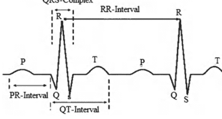

图 2.8 典型心电图波形。

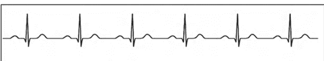

1. 正常情况下的心电图波形

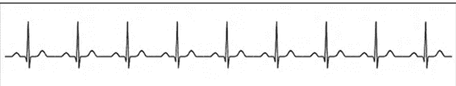

2. 异常心电图波形 - 心加速

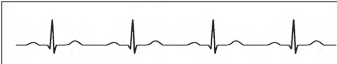

3. 异常心电图波形 - 心心慢

图 2.9 正常和异常情况下的心电图波形。

- 4. QRS复合波：它由Q波、R波和S波三个部分组成。通过深度分析，可以检测药物毒性和电解质失衡。

图 2.9 显示了正常和异常情况下的心电图波形。图 2.9a 显示正常人的心电图波形，图 2.9b 显示在异常情况下（如心加速的人）获取的心电图波形，图 2.9c 显示心心慢的人的心电图波形。

### 2.4.2 非临床服务

专家健康人士针对压力、焦虑、失眠、痴呆和分裂症等精神健康障碍提出的建议被分类为远程医疗非临床服务。

## 医疗保健转型

根据印度医学委员会（ICMR）的调查，每7个人中就有1人患有心理健康障碍。在2017年，约有超过1.97亿人经历过心理健康问题。大多数人将抑郁视为一种心理健康问题。根据世界卫生组织（WHO）报告，自杀的人数多于由于悲伤的人数。

心理健康问题在个人生活中具有更大的意义，会进一步影响他们的人际关系、就业、地位等。

许多人经历的一些常见心理健康问题如下：

- 1. **抑郁**：人们感到压力大或经常对自己的活动失去感兴趣，感到孤独或无助，行为变得易怒，并感到愤怒和沮丧。
- 2. **焦虑**：人们感到紧张，对自己的行为感到恐惧，觉得处于危险处境中，感到不放松。
- 3. **失眠**：失眠的症状包括难以获得足够的优质睡眠以及感觉没有得到休息。
- 4. **痴呆**：痴呆的症状包括健忘和思维能力受限，导致人感觉功能受。


- 5. **分裂症**：一种影响人清晰感受、思考和行动能力的精神障碍。人们经常会经历错误的信念，并在注意力和记忆方面遇到困难。

图 2.10 显示了心理健康障碍的各种症状。

作为远程医疗服务的一部分，并在非临床服务下，专家健康人士或医生根据个人的感受，提供了建议或必要的治疗。在通过电话通信或视频会议进行频繁咨询后，人们将从心理健康问题中解脱出来。

## 2.43 远程医疗系统的实施

图 2.11 显示了用于临床因素远程医疗服务的整体系统实现。它也可以扩展到非临床服务，例如心理健康障碍。

根据上述程序步骤，测量体温、血压读数、`SpO₂`、呼吸频率和`ECG`波形读数等各种参数，并将相应的数据（`DICOM`格式）存储在本地数据库中以便存储和检索。在服务器端，通过实施`AI`算法，可以对数据进行处理，例如将`DICOM`文件转换为`pdf`文件并分析其性质和严重程度。此外，还会生成结果报告，并将其转发给医院供医生查看文本信息。

## AI在远程医疗中的应用51

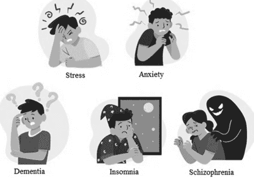

图 2.10 各种心理健康障碍。

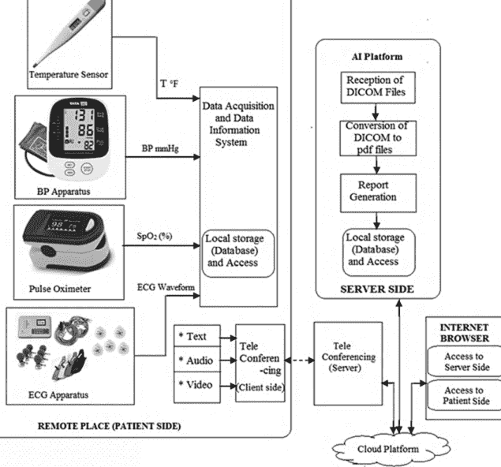

图 2.11 远程医疗系统的整体实施。

## 2.5 结论

通过远程医疗系统的有效实施，观察到它们可以为临床因素（健康）和非临床因素（心理健康）提供服务。由于`AI`，可以进行有效的分析和决策。确保患者端和服务器端的连接至关重要。另一点是从患者端获取数据并发送文件而不发生丢失或损坏。建立营是为了了解远程医疗系统的用途和益处。

# AI在远程医疗系统中的应用

- 10. Bagchi S. 2006. 印度农村的远程医疗。Journal of Public Medicine 3(3):e82.
- 11. Ganapathy K. 2004. 印度背景下的远程医疗：概述。Studies on Health Technology and Information 104:178–181.
- 12. Wooton R. 2001. 近进展：远程医疗。Biomedical Journal 323:557–560.
- 13. Roy J, Levy DR, Senatharaj Y. 2022. 为研究、实施和公平性定义远程医疗。Journal of Medical Internet Research 24(4):e35037.
- 14. Demeke HB, Merali S, Marks S, Pau, Romero L, Sandhu P, Clark H, Clara A, McDow KB, Tindall E, Campbell S, Bolton J, Le X, Skipak J, Nwaise I, Rose M, Stroma FV, Nelson C, Siza C. 2020. COVID-19大流行期间卫生中心远程医疗的使用趋势——MMWR Mob Mortal Weekly Report 70(7):240–244.
- 15. Shachar C, Engel J, Elwyn G. 2020. 对后后未来远程医疗的影响：监管与隐私问题。JAMA 323(23):2375–2376.
- 16. Doraiswamy S, Abraham A, Mantmani R, Cheema S. 2020. COVID-19大流行期间远程医疗的使用：筛选性回顾。Journal of Medical Internet Research 22(12):e24087.
- 17. Bouabida K, Lebouche B, Pomey M-P. 2022. 远程医疗与COVID-19大流行：COVID-19流行期间远程医疗的使用、优势、挑战与机遇概述。Journal of Healthcare 10(11):2293.
- 18. Rajkumar, E., Gopi, A., Joshi, A, et al. 2023. COVID-19大流行期间及以后印度远程医疗的应用、益处与挑战：系统性综述。BMC Health Services Research 23(7):1–15.
- 19. Kappal R, Mehendraratta A, Anandaraj P, Tsanas A. 2014. 印度移动医疗的现状、未来前景与影响。Central Asian Journal of Global Health 3(1):116.
- 20. Kasthuri A. 2018. 印度医疗面临的挑战——五个A。Indian Journal of Community Medicine 43(3):141–143.

# 第3章

# AI与机器学习在诊断和疾病治疗中的变革性应用

Jothimani Subramani, Nikitha Mahalingam, 和 Sangeethea Swamnathan

## 3.1 引言

准确的诊断至关重要，因为它决定了治疗方案。疾病一旦诊断出来，将使用治疗策略来控制或治愈。药物治疗法（如药物）和非药物方法（如生活方式改变、物理治疗或手术）均可作为治疗手段。治疗决策受个人健康状况、疾病类型和阶段以及整体治疗目标的影响。由于现代技术和医学研究，诊断和治疗都在不断改进。该领域的重大进展体现在医学的创新中，包括基于每位患者独特基因图谱的定制化医疗，以及能够提供人体内部组件更精确图像的尖端成像方法。最终，通过准确诊断与高效治疗之间的协同，增强患者预后、减轻疾病负担并促进公共健康。

人工智能（`AI`）的应用为医学诊断提供了便利。个人的健康状况、状况的类型和阶段以及整体治疗目标在治疗选择中都起着作用。此外，临床上医学数据的解释是一项困难的认知任务 [1]。这对于具有不同经验水平的资深人士包括助理医生 [4]。医疗专业人员的时间通常有限。疾病可能会随时间变化，患者动态也可能发生，使得诊断成为一个非常复杂的过程。准确的诊断程序是为了提供及时的治疗，最终实现安全有效的护理 [2]。

`AI`在医疗领域的主要重点是算法和程序的进步，以评估系统诊断的准确性。医学诊断有助于医生识别导致患者问题的精确疾病或疾病。在大多数情况下，诊断数据源于患者的病史结合体检。这通常具有挑战性，因为许多体征和症状是不明确的，必须由合格的医疗专业人员识别。因此，印度和孟加拉国等人口众多但医疗专业人员不足的国家在提供足够的诊断方法方面面临困难。此外，医学检查经常受到限制，低收入人群经常发现昂贵且难以获取。过度诊断更为常见，但人类具有易错性这并不令人意外。诸如过度诊断可能导致的过度治疗等问题，对人的健康和资产都是有害的。绝大多数人在一生中的某个时间点都会犯诊断错误。几个变量可能导致误诊，例如缺乏合适的体征，导致罕见疾病状态无法检测，并错误地从分析中排除该疾病。

机器学习（`ML`）用于几乎每一个领域，包括医疗保健、机器人、计算机和尖端技术。机器学习正变得日益常见，尤其是在诊断领域。许多学者和业内人士展示了机器学习在医疗领域的低成本和快速周转 [3]。传统的诊断方法通常需要人工干预且成本高昂，当患者人数意外增加时，基于机器学习的系统不会感到疲劳。在分类或回归中使用预设数学函数可能会导致人类能力受限的问题。例如，通过观察图像寻找细胞通常是困难的，但通过机器学习可以更容易更容易完成。

许多可以由机器学习检测的疾病包括肺炎、心力衰竭、阿尔茨海默病和乳腺癌。机器学习算法在医学应用中的用处通过其兴起得到证明。简而言之，机器学习面临的许多课题是最新进展。为了深入了解疾病诊断中的趋势、技术和问题，我们提供了一份关于机器学习和深度学习（`DL`）独特应用的综述，并首先描述用于检测不同疾病的特定架构。人工智能的一个分支——机器学习将数据视为资源。

世界卫生组织（`WHO`）预测，到2030年，心血管疾病（`CVDs`）将导致全球2420万死亡。这对于中低收入国家尤为重要，因为它们占了所有死亡人数的75%。此外，富裕和发展中国家有40%到75%的患者在获得任何治疗之前去世。对心血管疾病的早期和清晰检测可以在一定程度上防止这些死亡。

# AI与机器学习在诊断和疾病治疗中的应用 57

视网膜疾病通过`OCT`（光学断层扫描）图像的分割和视网膜层宽度进行识别和诊断。视网膜层任何与疾病相关的变化都是罕见的，且在没有指定基准方法的情况下，评估结果是非常困难的。识别视网膜层异常的传统图像处理技术存在若干缺点，包括需要大量的专业知识和较长的处理时间。自动处理方法的生成也具有挑战性 [15]。随着技术的进步和人工智能的发展，现在有越来越多的研究人员使用深层卷积神经网络（`CNN`）进行深度学习，以识别`OCT`图像中的视网膜疾病。

为了自动准确地检测`OCT`图像中的中心性视网膜病变（`CSR`），Hassan等人 [16] 开发了一个使用预训练深层`CNN`的系统。作者采用了卷积神经网络（`CNN`）模型进行分类，使用了 `GoogleNet`、`ResNet-18` 和 `AlexNet`。通过统计参数评估来检查深层`CNN`的效能；`AlexNet`对`OCT`图像数据库实现了 99.64% 的准确分类。Subramanian等人 [17] 对最新基于深度学习的糖尿病视网膜病变（`DR`）检测和分类方法的分析重点于这些技术。这项工作利用了多种分类方法，包括二分类、基于病变的识别和基于血管的识别。提供了可用的`DR`数据集。[18] 调查了在`DR`检测不同阶段的深度学习技术。该研究涵盖了该流程中的许多领域，包括知名数据集、提高模型生产率的预处理技术，以及用于病变适应性、确定和分类的深度学习算法开发。

全球范围内开展的健康医疗主要研究领域是检测、治疗、预防和监测技术，督导与安全工具，以及各种系统和支持技术。他们设计并测试了一种基于云的电子医疗检查工具，通过无线手环实现了对孟加拉国农村地区非感染性疾病的远程诊断和治疗，并利用Verbiter算法在无侵入性的情况下识别先子痫，证明了这些技术在农村和城市环境下的有效性。他们利用云端代理解决方案通过整合虚拟云健康提供者来促进远程监控。该解决方案遵循云服务标准，并通过无线体域网络（`WBAN`）将用户的生理数据传输到医疗中心进行分析和诊断。该研究还调查了`WBAN`的能量效率。许多研究探讨了远程电子健康管理员如何处理电子健康记录（`EHRs`）。

在Nguyen等人 [19] 中，提出并实现了一种`EHR`管理系统。用户可以有效地检索该解决方案中存储的海量医疗数据。

## 医疗保健转型

Zhang等人 [20] 提出了一种独特的`EHR`共享系统，包括移动云平台上的区块链，这是一种在云端移动设备上使用区块链共享电子健康记录的独特架构。它利用智能合约构建一个受信任的环境来控制谁可以访问什么内容，从而允许不同医生和患者之间安全传输电子健康信息。尽管远程医疗技术不断兴起，但由于网络能力的限制，实时图像传输的可靠性仍然面临挑战。尽管，以高可靠性、低延迟和大带宽为特征的5G连接技术的出现正积极推动电子医疗保健的快速增长。Zhang等人 [21] 讨论了5G辅助系统的问题、困难和未来的研究。此外，人工智能技术的快速发展使得安装自动辅助识别远程患者病变照片的技术成为可能。它消除了大城市医院高素质医生实时在线诊断患者的必要性 [13]。

## 3.2 诊断与疾病治疗

### 3.2.1 医疗保健中的诊断

诊断是医疗实践中最重要的科学之一，因为它允许通过早期发现来克服疾病。诊断是疾病治疗和管理整个过程的第一步，能够警示并引导获得更好的患者结果。诊断的范围涵盖许多方面，包括医学访谈、病史体格检查、影像、实验室检查和分子诊断。历史上，诊断方法主要基于临床观察和体格检查。然而，医学技术的出现有助于以更具体、更快速的方式诊断疾病。

疾病管理更多地指的是对疾病的治疗，旨在缓解疾病并促进健康。治疗程度取决于疾病的类别、严重程度和病因。它们可能涉及药物、手术或这些方法的结合。治疗历史经历了从草药性质和基础手术到药物治疗的重大转变。循证医学正应用于个体而非人群。技术的进步改进了诊断的精确性、速度和可用性。诊断工具的一些特定改进包括：

- 医学影像：如超声、核磁共振（`MRI`）、`CT`或正电子发射层扫描（`PET`）是观察内部结构和诊断疾病的非侵入性技术。这些技术对于癌症、心脏病和神经系统疾病的诊断至关重要。
- 分子诊断：用于疾病诊断的实验室技术包括聚合酶链反应（`PCR`）、下一代测序（`NGS`）以及通过特定基因、蛋白质和其他分子进行“指纹”诊断的微阵列。分子诊断在个性化医疗中应用广泛，因为它识别癌症基因突变。
- 床旁检测（`POCT`）：便携式和快速诊断设备使医疗人员能够在床边进行诊断。`POCT`改变了效率医疗、感染疾病管理和地区医疗。
- 人工智能（`AI`）和机器学习（`ML`）：`AI`在诊断中的应用等同于进行预测性分析并在起始阶段进行检测的能力。`AI`可以使用大量的医疗数据池（如放射图像或患者病史），并在诊断中证明了其价值，特别是在放射学、皮肤科和病理学领域。

### 3.2.2 疾病治疗的主要方法

药物治疗：药物是管理各种疾病的最常用且有效的措施之一。现代药物发明创造了可以干预某些疾病特定途径的药物。例如，抗生素可能成功对抗人体内的感染性细菌污染。相比之下，抗病毒药物改善了艾滋病和肝炎等患者的生存机会。

手术干预：手术涉及身体残疾以外疾病的管理；这些疾病可能包括肿瘤、器官损伤或其他对抗性问题。非侵入性程序的发展（如腹镜技术和机器人辅助手术）缩短了恢复期并增强了精确性，从而获得了良好的的手术效果。

## 医疗保健转型

放射治疗：放射治疗主要用于治疗各种癌症，是指通过高能粒子或波来照射或破坏肿瘤细胞。根据具体细节和阶段的发展情况，该治疗可以在患者体外进行，也可以进行体内放射治疗。免疫疗法：在治疗癌症时，不仅对疾病进行攻击，还利用免疫系统来对抗；这就是免疫疗法的简要定义。原本被认为非常难以治疗的化疗法，最近通过使用单克隆抗体、`CAR-T` 细胞疗法和检查点抑制剂等工具取得了巨大改进。

基因疗法与个性化医疗：基因组学和细胞生物学知识的基础性进展使我们进入了个性化医疗时代，治疗基于个体患者的遗传特征。基因疗法通过治愈或改变致病基因来治疗疾病，这可能导致囊性纤维化某些过去被认为无法治愈的癌症被消除。

## 3.3 机器学习与深度学习

### 3.3.1 机器学习

机器学习（`ML`）代表机器在无需编程的情况下改进特定任务的能力，它属于人工智能（`AI`）这一更广泛的概念。其本质是构建能够完成各种任务的系统，例如理解数据、分类数据并采取行动，且几乎或完全不需要人类的帮助。监督学习在具有已知输入-输出关系的标记数据上进行训练。其目的是找到一个函数，为从未见过的新输入输出结果。线性回归、支持向量机和决策树就是一些示例。

回归技术通常用于根据提供的各种独立特征来确定连续结果。例如，在线性回归示例中，会估计房屋价格，涉及卧室数量、位置等几个独立变量。示例包括多项式回归（更复杂的回归）和岭回归。支持向量机（`SVM`）是另一种用于不同研究领域分类和回归问题的学习方法。它通过定位精确划分类别的特征空间超平面来实现。在这种情况下，超平面分离不同的类别并为它们留出最大间隔。对于回归，`SVM` 则关注在一定间隔内允许尽可能多的实例。

决策树模型是所做决策及其可能结果的图形表示。它们按顺序将广泛的数据划分为不同特征值的小规模数据，以决定树的节点。其目标是建立一个模型，根据从观测数据创建的规则来预测目标变量。需要注意的是，在结果方面，决策树在分类和回归中都有应用。无监督学习没有输入或输出，因为所有特征都嵌入在数据中。没有监督，目标是学习数据的内在结构。无监督训练的一些著名应用包括降维技术（如 `PCA`）和聚类方法（如 `k-means` 和分层聚类）。

`K-Means` 聚类将数据样本划分为 `k` 个簇或预定义的簇，每个数据样本被分配给最近的中心。簇的质心通过属于该簇点的平均值重新计算，并重复直到获得稳定结果。它在数据量巨大的情况下非常理想，但存在必须预定义簇数量的问题。结果通常总结在树状图中，允许完全控制完全控制。强化学习基于行为主义原理，并利用探索性的试错实践。代理进入环境，通过行动最大化其奖励。此类应用通过游戏玩和机器人控制而闻名。

### 3.3.2 深度学习

深度学习是机器学习的一个分支，专门利用人工神经网络（`ANN`）的工程化，这是一个深层 `ANN` 的领域。这种架构的特点是节点在多个层上相互连接，简单来说被称为神经元。该架构允许模型捕捉复杂数据中的复合模式和相互关系。神经网络自 20世纪 40 年代就存在，但这个术语直到 2000 年才流行。深度学习的演变有几个原因：强大的 `GPU` 的出现使得在合理时间内训练深度网络成为可能；大数据爆炸产生了足够的数据来训练需要大量数据才能高效工作的 `DL` 模型；我们引入了反传播、用于正则化的 `Dropout` 算法以及各种激活函数（如 `ReLU` 修正线性单元），这些使得深度学习在市场上触手可及。

深度学习网络最重要的特点是在输入和输出节点之间构建了许多隐藏层。这种深度使得深度学习模型能够：深度学习模型与传统机器学习的一个显著区别是特征提取过程。传统的机器学习模型需要手工设计的特征，而深度学习则从数据中构建特征，包括真实的图像、音频和文本。深度学习中一些明显的架构包括：主要用于图像处理的 `CNN`（卷积神经网络），以及通过卷积层复用每个 `Conv` 层中的参数来对给定图像进行特征映射而实现的计算机视觉。循环神经网络是在数据中引入循环连接的人工神经网络。这种架构用于顺序顺序对象，如时间序列和语言数据，因为之前的步骤中存在过去的信息。生成模型也是深度学习的应用领域，`GANs`（生成对抗网络）和 `VAEs`（变分自动编码器）的发展能够生成类似于输入数据的新数据点。

## 3.4 疾病诊断与治疗中的机器学习与深度学习

### 3.4.1 自动编码器

自动编码器用于无监督学习的神经网络。在皮肤检测的背景下，编码器将输入映射到潜在空间 `$Z \in R^m$`，其中 `$m$` 是输入的维度。解码器随后将 `$Z$` 映射回输入 `$\hat{X}$`。训练自动编码器的目标是最小化重构误差，通常使用 `$X$` 和 `$\hat{X}$` 之间的均方误差（`MSE`）：

$$L(X, \hat{X}) = \frac{1}{n} \sum_{i=1}^{n} (X_i - \hat{X}_i)^2$$

### 3.4.2 使用卷积网络预测自闭症

深度学习中的卷积网络（`CNN`）进行自闭症预测可以通过几个关键步骤表示，包括卷积操作、激活函数和损失计算。输入是 2D 图像或信号，我们可以将其表示为矩阵 `$X \in R^{m \times n}$`。每个滤波器 `$F_k \in R^{f \times f}$`（其中 `$f$` 是滤波器大小）以步长 `$s$` 滑过输入，卷积公式为：


$$Y_k^{(l)}(i, j) = \sum_{p=1}^{f} \sum_{q=1}^{f} X^{(l)}(i+ps, j+qs, r) F_k^{(l)}(p, q, r)$$

其中 `$Y_k^{(l)}$` 是第 $k$ 个滤波器应用于位置 $(i, j)$ 的输出。卷积之后，应用 `ReLU`：

$$A_k^{(l)}((i, j) = ReLU(Y_k^{(l)}(i, j)) = max(0, Y_k^{(l)}(i, j))$$

池化层减少空间维度（下采样）。常用最大池化，它可以表示为：

$$P^{(l)}(i, j) = max_{p,q} (A^{(l)}(i+p, j+q))$$

其中 $i, j$ 代表池化矩阵中的位置，最大值操作在池化窗口（例如 $2 \times 2$）上进行。下一特征图在经过一系列池化和卷积层之前，被转换为 1D 向量并发送到一系列全连接层。令 `$Z^{(l)} \in R^n$` 为全连接层的输入向量，则输出为：

$z^{(l+1)} = W^{(l)} z^{(l)} + b^{(l)} \quad (3.7)$

其中 `$W^{(l)}$` 是权重矩阵，`$b^{(l)}$` 是偏置向量。对于分类任务，最终层通常使用 `softmax` 函数产生类别概率：

$$\hat{y}_i = \frac{e^{z_i}}{\sum_{j=1}^C e^{z_j}} \quad (3.8)$$

其中 `$C$` 是类别数量，`$\hat{y}_i$` 是类别 $i$ 的预期概率。对于分类任务，通常使用交叉熵损失：

$L = -\sum_{i=1}^C y_i \log(\hat{y}_i) \quad (0.9)$

其中 `$y_i$` 是实际标签。权重在反向传播过程中通过梯度更新，通常使用 `Adam` 或 `SGD` 等优化器：

$W^{(i)} \leftarrow W^{(i)} - \eta \frac{\partial L}{\partial W^{(i)}} \quad (3.10)$

其中 `$\eta$` 是学习率，`$\frac{\partial L}{\partial W^{(i)}}$` 是损失关于权重的梯度。这一数学框架构成了 `ARTISIS` 检测 `CNN` 模型的基础，并根据特定的数据集和任务进行进一步修改。

这种用于自闭症检测的特定 `CNN` 模型实现如图 3.1 所示，专注于将 `MRI` 或 `fMRI` 等脑扫描图像分为两类，即自闭症和非自闭症。模型的基本流程在训练阶段之前从 2D 图像开始进行进一步处理，如简化和标准化。`CNN` 架构的三个核心部分是三个卷积层（主要起特征提取作用）以及全连接层（负责分类）。第一个卷积层有 32 个滤波器，卷积核大小为 3x3，并通过 `ReLU` 激活函数引入非线性以使模型更具动态性。包含批归一化（`Batch Normalisation`），它可以标准化激活值并加速学习过程；以及最大池化（`MaxPooling`），它将特征图维度减半并能够保留所需的特征。第二和第三层卷积层遵循相同的原理。但在滤波器数量上，分别使用了 64 和 128 个滤波器，允许网络随着深度的增加学习到更复杂的特征。

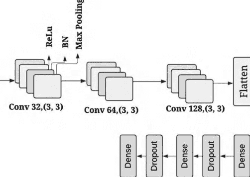

图 3.1 卷积神经网络架构。

在卷积层从输入图像提取层级特征后，模型使用 `Flatten`（展平）操作从 2D 输出获取 1D 向量，然后将其输入两个稠密层。稠密层包含 128 个神经元，随后是 `Dropout(0.5)`，它通过在每个训练轮中随机关闭 50% 的神经元来帮助减少过拟合。另外添加了一个包含 64 个神经元的稠密层，随后是 `Dropout(0.5)`。最终输出层包含一个带有 `sigmoid` 激活函数的神经元，它产生自闭症存在或不存在的概率，其中括号内的内容视为 1，反之则为 0。该框架的损失函数是为二分类任务设计的，并基于二元交叉熵。使用 `learnat`率为 0.0001 的 `Adam` 优化器，以确保学习率在训练期间良好适应，这对于 `CNN` 等深度学习模型非常完美。模型训练 50 个轮次（`epochs`），批大小（`batch size`）设置为 32，在此期间，会跟踪训练和验证准确率，以观察模型是否良好学习或过拟合。

图 3.2 用于皮肤癌检测的自编码器架构。

在这项工作中，用于皮肤癌分类的自编码器实现使用了基于 `Keras` 的神经网络技术，在这种情况下，将数据中的癌症图像编码到低维特征空间，并仅使用这些编码将图像分类为性。

## 医疗保健转型

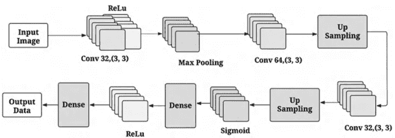

图 3.2 用于皮肤癌检测的自编码器架构。

输入编码器的图像维度为 28×28（可以根据数据集进行修改）。第一个卷积层涉及 32 个滤波器，卷积核大小为 3×3 以及带有相同填充（`padding`）的 `ReLU` 激活函数。该层的设计使得输出具有与输入相同的空间维度。然后，该层的输出被馈到 2×2 的最大池化层，该层维度是图像空间尺寸的一半。第二个卷积层采用了围绕相同 3×3 维度的 64 个滤波器，并使用 `ReLU` 和相同填充。该层特别有助于从图像中捕捉更深的特征，这些特征可用于分类任务。另一个 2x2 大的最大池化层用于对最后一层进行进一步的下采样。这是输入图像被编码或以压缩形式表示的层。

前一阶段（编码器）的结构与后阶段相似，但方向相反，目的是通过编码器向量获取原始输入形式。解码器层中的第一层是具有 32 个内核的“滤波器”卷积层，具有三维卷积核（卷积核在三个方向上均为像素）并进行上采样，这使图像的空间维度增加一倍。接着使用 32 字节滤波器，通过一个相同的卷积层和一个采样层将图像调整为其实际尺寸。解码器的最后一层是最后一个卷积层，仅有 1 个滤波器、单次 3×3 卷积核大小和 `sigmoid` 激活。该滤波器仅仅是作用于单个通道（白色图像）的单个滤波器，该单个滤波器的输出通过 `sigmoid` 函数限制在 0 和 1 之间。

一旦训练，自编码器就能获得封装了相关图像内容的编码器。这些编码特征随后被用于分类。我们在带有 128 个 `ReLU` 神经元的全连接层中使用编码器，专门用于学习分类的额外特征。在添加所有分类层后，最后一个是带有 2 个神经元的二分类层。该层使用 `softmax` 激活函数来确定每个类别的概率范围。

### 3.4.3 用于眼疾病的长短期记忆 (LSTM)

使用深度学习步骤为眼疾病检测创建一个 `LSTM`（长短期记忆）模型。`LSTM` 模型的输入通常是随时间的向量序列（对于时间数据，为图像序列）。令 `$X_t \in R^d$` 为时间步 $t$ 的输入向量，其中 $d$ 是特征数量。`LSTM` 包含多个门：遗忘门、输入门和输出门。这些门控制信息通过细胞的流动。每个门精确代表细胞状态应该丢弃哪些信息：

$f_t = \sigma(W_f \cdot [h_{t-1}, X_t] + b_f)$

其中 `$W_f$` 是与遗忘门相关的权重，`$h_{t-1}$` 是上一个隐藏状态，`$\sigma$` 是 `sigmoid` 激活函数，`$b_f$` 是遗忘门的偏置项。输入门调节添加到细胞状态的数据速率：

$i_t = \sigma(W_i \cdot [h_{t-1}, X_t] + b_i)$

$\widetilde{C}_t = \tanh(W_C \cdot [h_{t-1}, X_t] + b_C)$

其中 `$i_t$` 是输入门激活，`$\widetilde{C}_t$` 是候选细胞状态，`$W_i$` 和 `$W_C$` 分别是输入门和候选细胞状态的权重，`$tanh$` 是双曲正切激活函数。公式为：

$C_t = f_t * C_{t-1} + i_t * \widetilde{C}_t$

其中 `$C_t$` 是时间步 $t$ 更新后的细胞状态，`$C_{t-1}$` 是上一个时间步的细胞状态。下一个隐藏状态由输出门决定：

$o_t = \sigma(W_o \cdot [h_{t-1}, X_t] + b_o)$

$h_t = o_t * \tanh(C_t)$

其中 `$o_t$` 是输出门激活，`$h_t$` 是时间步 $t$ 的隐藏状态，`$W_o$` 是输出门的权重矩阵。

## 68 变革医疗保健

$y = \text{Softmax}(W_y \cdot b_T + b_y) \quad (17)$

其中 `$W_y$` 是全连接层的权重矩阵，`$b_T$` 是最后一个时间步的隐藏状态，`$b_y$` 是偏置项，`$y$` 是代表各疾病预测概率的输出向量。

### 3.4.4 用于肿瘤检测的支持向量机

在这种设置下，`CNN`或其他深度学习网络从图像中提取特征，然后输入 `SVM` 进行分类。令 `$X \in R^{m \times n}$` 表示图像，其中 $m \times n$ 是图像维度，$c$ 是通道数（RGB 为 3，灰度图为 1）。深度学习模型（例如 `CNN`）从图像中提取特征 `$F$`：

$F = \text{CNN}(X; W) \quad (18)$

其中 `$F \in R^d$` 是特征向量，`$W$` 代表 `CNN` 的参数。在提取特征 `$F_i$` 后，`SVM` 执行分类。`SVM` 寻找一个在特征空间中最大化肿瘤类与非肿瘤类之间间隔的平面。支持向量机的决策算法为

$f(F) = w \cdot F + b \quad (19)$

其中 `$w \in R^d$` 是权重向量，`$F \in R^d$` 是来自深度学习模型的特征向量，`$b$` 是偏置项。对于分类任务，`SVM` 求解以下优化问题：

$$\min_{w, b} \frac{1}{2} |w|^2 + C \sum_{i=1}^{N} \max(0, 1 - y_i \cdot (w \cdot F + b)) \quad (20)$$

其中 `$C$` 是正则化参数，`$y_i \in \{-1,1\}$` 代表真实标签（例如+1 代表肿瘤，-1 代表非肿瘤），`$F_i$` 是第 $i$ 个样本的特征向量，`$\max(0, 1 - y_i \cdot (w \cdot F + b))$` 是合轴损失函数（hinge loss），确保类与类之间的大间隔。决策函数的符号决定最终分类：

$$\hat{y} = \text{sign}(f(F)) = \text{sign}(w \cdot F + b) \quad (21)$$

如果 `$\hat{y} > 0$`，模型预测为肿瘤。如果 `$\hat{y} < 0$`，模型预测为无肿瘤。首先训练 `CNN` 以提取特征，然后在这些特征上训练 `SVM`。或者，可以使用反向传播端到端地训练整个模型（`CNN+SVM`），将 `SVM` 的目标函数整合到深度学习模型的损失函数中。

### 3.5 结果与讨论

在本章中，针对各种评估结果，对 `AI & ML` 在诊断骨质疏松症、自闭症和眼病等疾病进行了分析。此类模型可以增强诊断能力，缩短分析所需，并通过采用复杂的学习算法建议个性化的方案。其余章节将致力于对此类模型进行详细评估，强调了准确率、召回率、精确率和 `F1` 分等性能指标。此外，还研究了在粒子群优化（`PSO`）和红遗传算法（`RGA`）等算法帮助下，模型效率和训练时间产生的影响。本研究展示了 `AI` 和 `ML` 在医学领域的潜力，并指出了医疗诊断和治疗领域进一步发展的方向。

### 3.5.1 使用深度学习模型的疾病检测准确率

表 3.1 比较了不同深度学习模型在疾病检测中的性能。结果显示，所有疾病的所有模型的训练准确率随 `epoch` 次数的增加而系统性提高。例如级联 `CNN` 架构在骨质疏松症或猴痘等疾病上收敛良好。训练准确率在第20 个 `epoch` 内延伸至约 100%。尽管如此，这些模型的测试准确率并不理想，保持在 88%–95% 之间。然而，这表明在通用风险方面存在潜在局限性，这可能是由于过拟合，需要进一步的正则化方法、变量选择和重新评估，以及在调整预测标准的同时引入新变量。在自闭症的情况下，我们可以预期 `CNN` 在此的效果良好。模型在训练内部和测试外部的表现都很准确，但精确率曲线稳步上升。即使训练准确率达到 99%，测试准确率也仅固定在 83%–98%。这可能表明在自闭症检测方面存在困难，其中结构和功能变化在

| 表 3.1 不同深度学习模型的性能对比 |

| 疾病 | 模型架构 | 数据集 | 准确率 (%) | 精确率 (%) | 召回率 (%) | F1 分数 (%) |

| :--- | :--- | :--- | :--- | :--- | :--- | :--- |

| 骨质疏松症 | 级联 CNN | BMD | 95.7 | 94.5 | 96.3 | 95.4 |

| 自闭症 | 卷积神经网络 (CNN) | 神经影像 | 92.3 | 91.7 | 93.1 | 92.4 |

| 猴痘 | 可分离残差 CNN | 猴痘皮肤病变 | 98.2 | 97.9 | 98.4 | 98.1 |

| 皮肤癌 | 自动编码器 | ISIC | 91.6 | 90.8 | 92.1 | 91.4 |

| 眼病 | 长短期记忆网络 (LSTM) | 眼病数据集 | 89.4 | 88.9 | 89.7 | 89.3 |

| 骨关节炎 | ResNet-50+迁移学习 | X光影像 | 93.6 | 92.8 | 94.2 | 93.5 |

## AI & ML 在诊断和疾病治疗中的应用

### 骨质疏松症 (级联 CNN)

### 自闭症 (CNN)


### 猴痘 (可分离残差 CNN)

 （注：根据序列推断）

### 皮肤癌 (自动编码器)

 （注：根据序列推断）

### 眼病 (LSTM)

 （注：根据序列推断）

### 骨关节炎 (ResNet-50+迁移学习)

# AI与机器学习在诊断和疾病治疗中的应用

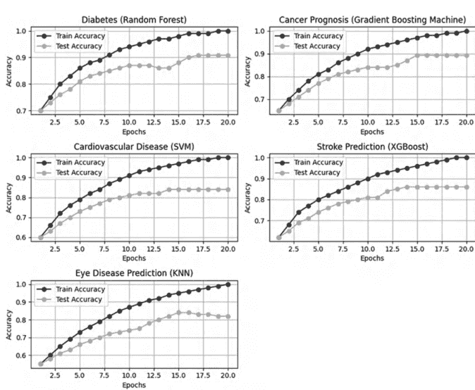

图 3.4 使用机器学习模型进行疾病检测的结果分析。

数据集。此类变化可能是内核优化或超参数调优，这些优化已知能够增强模型在新鲜数据上的性能。通过 `XGBoost` 模型可以观察到训练准确率的提升显而易见，并且在较短的时间内，在最后一个 `epoch`（轮次）已接近 100%。然而，测试准确率仍然停留在 87% 左右。这种模式表明 `XGBoost` 的梯度提升机制在模式识别方面非常出色。但是，模型训练准确率和测试准确率之间存在巨大差异，意味着可能需要进一步的改进。特别是，由于风险因素的性质，中风的预测非常棘手，这可能需要结合其他复杂的集成方法来提高结果。

使用机器学习的眼疾病预测模型也显示出类似的模式，训练准确率几乎达到 100%，测试准确率约为 84%。训练和测试准确率之间显著的百分比差异表明存在过拟合的可能性，这可能归因于眼疾病数据的顺序或时间结构。时间交叉验证、数据增强或循环模型等措施可能会提高泛化能力，以避免后续版本中出现此类问题。

# 74 转型医疗保健

## 表 3.3 优化算法性能

| 优化算法 | 疾病 | 模型 | 准确率 (%) | 加速（训练时间缩短） |

|---|---|---|---|---|

| 粒子群优化 | 骨质疏松症 | CNN/PSO | 95.7 | 25% |

| 实数遗传算法 | 皮肤癌 | 编码器+ RCGA | 92.3 | 18% |

| 粒子群优化 | 眼疾病 | LSTM + PSO | 90.1 | 21% |

## 3.5 诊断模型中的优化算法

优化算法提高了诊断模型的性能。表 3.3 展示了使用这些技术优化模型的结果。

这些结果证明了 `AI` 和机器学习模型在各种疾病诊断和预测治疗结果方面的潜力，凸显了它们在医疗保健领域的转型性作用。

## 3.6 结论

`AI` 和机器学习已经深刻改变了诊断和疾病治疗的世界。医学向精准化、动态化和个人参与化的演变已经开始。正如本章前面的章节所示，包括基于深度学习的方法等，这些模型在检测从自闭症到皮肤癌，甚至是心血管和眼科疾病的多种疾病方面是有效的。它们使诊断准确率有所提高，并改进了治疗的时机和准备，从而改善了患者的生活。`AI` 和机器学习在医疗保健领域最令人惊叹的益处在于，可用数据量并不限制它们；它们能够自己整理并学习规律，并识别出临床医生可能忽略的方面。在那种由于及时、准确的诊断可能意味着复杂和模糊疾病治疗成功与否的情况下，这种能力非常有帮助。`AI` 模型还能够吸收新信息，因此它们可以根据实践中的演变和医学研究的突破做出调整。尽管如此，进展显而易见，但问题仍然存在。隐私、模型如何被理解，或者为了让 `AI` 更有效而需要更多多样化数据等领域都是需要更多工作来改进现状的关键问题。其他问题包括过拟合的风险，以及 `AI` 与机器学习诊断和疾病治疗模型缺乏将训练结果转化为实践的能力，这需要采取广泛测试等适当措施。此外，还需要确保系统集成到诊的日常工作中，并对系统的伦理和法律方面保持意识。总之，必须指出，今天在各种疾病的诊断和治疗引入 `AI` 和机器学习技术是未来医学向更好发展的转变。这些领域不会取代医疗工作者，而是通过为他们提供提高诊断和治疗准确性、以及针对客户更快速和个性化的方法来有力地帮助他们。这种发展在该科学领域持续进行，预计会有更多突破将彻底变革医疗保健，提高护理质量和患者护理。

## 参考文献

- 1. Singh A, Mehta JC, Anand D, Nath P, Pandey B, Khamparia A. 一种肝炎诊断的智能混合方法：结合 k-means 和改进学习。Expert Systems. 2020;1-13. https://doi.org/10.1111/exsy.12526
- 2. Frick NJ, Mölmann M, Mirbaba E, S 在流行期间驱动数字化转型：德国医院的虚拟协作案例。JMIR Medical Informatics, 2021;9:e25183. https://doi.org/10.2196/25183
- 3. Ahsan MM, Siddique Z. 基于机器学习的心脏疾病诊断：系统性述。arXiv:2021.0112.06459


- 4. Stafford I, Kellermann M, Moss, Beattie R, Ennis S. 人工智能和机器学习在自身免疫性疾病中应用的系统综述。PJ Digital Medicine, 2020;3:1–11.

- 5. Ahsan MM, Huebner P. 使用混合数据的 MLP-CNN 区分 COVID-19 和非 COVID-19 患者。Symmetry, 2020;12:1526.

- 6. 心血管疾病，Jan, 2021, [在线] 可：https://www.who.int/en/fact-sheets/details/cardiovascular-diseases

- 7. Timm A, et al. 欧洲心脏学会：心血管疾病统计数据。European Heart Journal, 2021;43(8):716–799.

- 8. Jamil U, Sajid A, Hussain M, Olam A. 使用生物医学图像分析进行分割以实现智能移动医疗。Journal of Ambient Intelligence and Human Computing, 2019;10(4):4090–410.

- 9. Zhang L, Mishra S, Zhang T, Zhang Y, Lv M, Guan N, Chen DZ, Han X. 用于诊断的卷积神经网络方法的设计与评估。Frontiers in Medicine, 2021;8:75402. https://doi.org/10.3389/fmed.754202

- 10. Leachman SA, Hornyak TJ, Barsh G, Bastian BC, Cleaver JE, Cooper CD, D'razio J, Fujita M, Holmen S, Kraemer KH, Poole IC, Lund AW, Manga P. 黑色素细胞与黑色素瘤研究：黑色素细胞生物学。Journal of Investigative Dermatology, 2020;140(2):269-274.

- 11. Garg A, Ratnes RK... 信号与信息国际会议 (ICONSIP) 进展。2022,1–7. https://doi.org/10.1109/ICONSIP44965

- 12. Guo L, Yang K... 基于深度学习的 OCT 图像自动分割。Annals of Translational Medicine, 2022;10:1738. https://doi.org/10.21037/atm-tm-22

- 13. Ma Z, Cai M... 预测自身免疫性疾病风险的新模型。Frontiers in Endocrinology, 2023;14:110925. https://doi.org/10.3389/fendo.2023.110925

- 14. Garg A, Ratnes RK... 药学研究中的趋势。Journal of Pharmaceutical Research, 2022;13:2051–2060. https://doi.org/10.47750/jpr.2022;13.506

- 15. Motamedi S... 正常视网膜层厚度的最小检测变化。Frontiers in Neurology, 2019;10:1017.

- 16. Hassan SAE. 基于深度学习的中心性渗性视网膜病变自动检测。2021 第一届人工智能与数据分析国际会议。

- 17. Subramanian U... 使用图像处理和深度学习技术的 COVID-19 感染追踪专家系统。BioMedical Research International, 2021;2021:1896762.

- 18. Tsiknas N... 基于底图图像的视网膜病变检测与分类。Computers in Biology and Medicine, 2021;135:104599.

- 19. Engupta S... 智能城市云医疗框架中的安全数据管理。IEEE Sensors Journal, 2020;20(16):9581–9588.

- 20. Nguyen DC... 用于移动云医疗系统的安全 EHR 共享区块链。IEEE Access, 2019;7:66792–66806.

- 21. Zhang D... SG 赋能健康系统：挑战与未来研究趋势。2019 ITU Kidoscope, 1–8.

- 22. Zhang J... 基于学习的智能系统用于运动模糊图像的 3D 重构。Computers, Materials & Continuum, 2021;66(2):2087–2104.

# 第 4 章

# 儿童营养不良的预测

Mangiyarkkarasi Jeganathan 和

Shanthalakshmi Revathy Jeganathan

## 4.1 引言

儿童营养不良是一个重大的全球健康问题，对儿童的生理和心理发育产生灾难性影响。世界卫生组织（WHO）指出，营养不良占全球所有儿童死亡的近45%，使其成为一个严重的公共健康问题（Mahmood 等人，2022）。营养不良是一个全球性问题，但由于多种社会、文化、环境和经济因素导致其发病率增加，该问题在低、中收入国家尤为严重。印度的营养不良率高得惊人。尽管在医疗保健和经济繁荣方面取得了显著进展，儿童营养不良仍然是一个问题。根据2020年《全球饥饿指数》（GHI），印度在107个国家中位第94位，表明该国在营养不良方面仍面临重大问题。国家家庭健康调查（NFHS-5）显示，35.5%的五岁以下儿童（矮小）处于消瘦状态（体重过轻），32.1%的儿童体重不足（年龄体重过轻）（Argwaw 等人，2023）。这些数字强调了营养不良在印度的复杂性和普遍性。印度高营养不良率是由多种因素造成的，如低收入、卫生条件差、对适当儿童喂养实践缺乏了解，以及获得医疗保健和高营养食物的机会受限。COVID-19疫情通过扰乱食品供应网络、提高失业率以及使更多家庭陷入贫困加剧了这种情况，损害了儿童的营养状况。

儿童营养不良是一个复杂的问题，受到多种变量的推动，包括文化和环境影响、贫困、获取高营养食物困难以及医疗保健服务不足。这些因素的相互作用增加了营养不良的风险，并使治疗更具挑战性。由于获得营养食物和医疗设施的机会限制，印度弱势群儿童——尤其是居住在农村地区的儿童——受到的影响不成比例。经济问题是营养不良持续的主要原因。

DOI: 10.1201/9781003353843-4

低收入家庭往往无法负担均衡饮食，因此他们食用大量廉价、高热量、低营养的食物。营养不良还可能由影响饮食偏好和断奶方式的社会文化规范引起（Motadi 等人，2023）。例如，在某些社区，性别偏见导致女孩获得的食物和治疗较少，增加了她们患营养不良的风险。营养不良率也受到环境变量的影响。即使在食物充足的情况下，卫生条件不佳、缺乏清洁饮用水以及疾病接触增加也可能阻碍儿童吸收和利用营养素的能力。因此，腹泻和呼吸道感染等慢性疾病的发生频率增加，加剧了营养不良状况。

为了有效解决这一问题，有效的预测和预防技术与深入了解儿童营养不良的原因同等重要。数据科学和医疗保健领域的最新进展，特别是关于深度学习（DL）、神经网络（NNs）和机器学习（ML）算法的应用，为营养不良的诊断和治疗创造了新机会。这些方法可以在早期检测出处于营养不良风险中的儿童，以便进行及时干预以防止疾病扩散（Guo 和 Zhang，2020）。为了确定特定人群营养不良的概率，预测模型可以检查体重不足、消瘦和矮小在内的多个指标。关注最需要治疗的地方，使立法者和医疗专业人员能够更高效分配分配资源。机器学习算法领域在这方面显示了巨大潜力。例如，随机森林和逻辑回归模型在考虑社会经济地位、医疗保健可用性和饮食习惯等多个特征后，在预测营养不良方面证明了有效性。

为了促进公平、透明和对脆弱体的保护，伦理标准必须指导儿童营养不良预测模型的创建和使用。在收集有关儿童及其家庭的信息时，知情同意至关重要，因为它确保参与者了解风险和优势。分配资源是另一个重要的伦理考量。预测模型的长期可行性取决于数据收集和开发的透明度（Fournier-Tombs，2023）。为了确保干预措施以对文化敏感的方式应用预测模型，政策制定者和医疗专业人员需要与当地利益相关者紧密合作。

## 4.2 文献综述

一种评估了用于健康评估、营养不良预测相关领域的多种机器学习模型和方法。它突出了技术、优势、局限性和关键结论。分析涵盖了从决策树、集成方法到深度学习架构的模型，展示了它们在预测营养不良、矮和小肥胖方面的应用。这一详尽的总结是理解AI相关的机遇和挑战的有用工具。2015年至2023年间综述的研究论文汇总在表4.1中，该表还突出了每项研究的方法、优缺点和最终结论。

本文献综述突出了关于营养不良、矮小、肥胖和儿童死亡等健康问题的数据集、算法和主要预测的关键见解。通过分析这些研究的方法和结果，我们可以提取未来研究和应用的总体主题和考虑因素。

## 4.3 儿童营养不良

全球有数百万儿童遭受营养不良，这对他们的发育、健康和经济状况产生长期负面影响。对抗营养不良的有效干预措施是多方面的，针对直接和根本原因。改善婴儿和早期儿童的饮食习惯是主要策略之一。这鼓励在出生六个月内纯母乳，然后引入符合年龄和营养要求的补充食物。对照护者进行正确的营养教育至关重要，以确保儿童获得充足营养。微量元素补充是另一种重要方法，特别是在普遍缺乏元素的地区。提供铁、维生素A和锌以解决导致矮小、免疫系统虚弱和增加感染敏感性的缺乏。

改善食品安全和清洁水供应是预防营养不良的基础。食品发放计划、现金转移和对小农的支持可以帮助确保营养食物的稳定。此外，获得安全饮用水和卫生设施有助于预防加剧营养不良的疾病。最后是整合医疗服务，如定期生长监测、驱虫治疗和治疗。

# 表 4.1 文献综述

| 参考文献 | 方法论 | 优点 | 缺点 | 结论 |
| --- | --- | --- | --- | --- |
| Aryuni et al. (2023) | 决策树、K近邻算法 (KNN)、朴素贝叶斯。来自比哈尔邦社区健康服务的 360 名患者 | 决策树表现最佳，准确率达到 89.87%，F 分数达到 91.67%。可以追踪五岁以下儿童的营养健康 | 局限于来自比哈尔南部社区健康服务的特定数据集。可能无法推广到其他人群 | 根据实验数据，建议使用 C4.5 决策树预测五岁以下儿童的营养状况 |
| Khan and Yunus (2023) | 基于多数投票的混合集成 (MVBHE) 学习模型。提升（Boosting）和投票算法：随机森林。决策树、极梯度提升 (eGBoost)、KNN。数据来自撒哈哈拉以南非洲的人口统计和健康调查。 | MVBHE 模型实现了 96% 的准确率，优于单一算法 | 集成模型的实现和调优复杂。需要大量数据 | 推荐 MVBHE 作为预测撒哈哈拉以南非洲五岁以下儿童营养不良的最佳模型 |
| Rahutomo et al. (2023) | 对 22 篇策划文献（2017–2022）进行系统性文献述 (SLR)。关注 XGBoost 和随机森林模型 | 提供了儿童矮小研究中机器学习实现的全面图景。强调了机器学习模型多样性的日益增加 | 局限于综述。可能未涵盖矮小研究机器学习的最新进展 | 根据近期的机器学习研究，XGBoost 和随机森林是预测矮小的主要模型 |
| Maasti et al. (2023) | 机器学习分类技术：朴素贝叶斯、决策树、随机森林、KNN | 根据预测提供饮食建议。面向医疗保健人员的易用 Web 应用程序 | 数据集较小影响了通用性。局限于分类和算法方法 | 朴素贝叶斯和随机森林在营养不良和贫血预测方面显示出高效的结果 |
| 参考文献 | 方法论 | 缺点 | 结论 |
| --- | --- | --- | --- |
| Mbunge et al. (2023) | 机器学习算法：决策树、森林、逻辑回归、XGBoost。利用代表性数据和健康调查数据 | XGBoost 在准确率方面优于其他模型（95% 精确率）。提供了准确的儿童死亡预测 | 可能无法捕捉儿童死亡的所有潜在风险。局限于人口统计和健康调查数据 | 建议使用 XGBoost 准确预测儿童死亡并识别相关的风险因素 |
| Yuliansyah et al. (2023) | 使用 Scopus 数据库、IOS 和 "Publish or Perish" 软件进行文献计量学分析 | 提供了人工智能在营养不良预测中实现的见解。强调机器学习是应用广泛的 AI 方法 | 局限于 Scopus 数据库；未涵盖所有相关文献。关键词的选择可能影响分析范围 | 机器学习（特别是深度学习）日益应用于营养不良研究中，显示出一种趋势 |
| Bhushan et al. (2023) | 机器学习模型：逻辑回归、随机森林、KNN、决策树、SVM、梯度提升。使用 Kaggle 上的“BMI 预测健康状况”数据集 | 使用 KNN 预测肥胖水平时实现了高准确率 (97%)。比较了多种机器学习算法 | 局限于通过 BMI 预测肥胖。特定数据集的结果可能无法通用 | 该研究成功利用机器学习算法预测了肥胖，KNN 提供了最高的准确率 |
| Saravan et al. (2023) | 随机森林算法。预测儿童未来的数据挖掘方法 | 解决了父母对孩子发育的奇奇。使用机器学习方法预测学习行为 | 关注特定的（随机森林）预测。范围局限于早期儿童发育 | 随机森林通过数据挖掘有效预测儿童未来的学习行为和天赋 |
| Wannanayake et al. (2023) | 用于斯里兰卡水稻田病害检测、分类、位置追踪和产量预测的深度学习技术 | 在识别水稻病害和预测产量方面具有高准确率 (89%-98%)。农业中的现实世界应用 | 局限于受控实验。现实世界的扩展性和适用性需要进一步探索 | 提出的基于深度学习解决方案在提高水稻产量和解决斯里兰卡农业疾病挑战方面显示出潜力 |

# 表 4.1（续）文献综述

| 参考文献 | 方法论 | 优点 | 缺点 | 结论 |
|---|---|---|---|---|
| Sushirida et al. (2023) | 各种机器学习算法，根据宝宝、父母年龄、生活条件等因素估算婴儿出生体重 | 帮助母亲使用机器学习估计出生体重。在估计后为母亲推荐适当的饮食计划 | 对所使用的特定算法及其比较性能的信息有限 | 所提出的模型可以协助监测出生体重，并改善婴儿和母亲的健康状况 |
| Maria et al. (2023) | 梯度提升、自适应提升 (AdaBoost)、KNN、SVM、随机森林、树模型。使用 Kaggle 上的肥胖和生活方式数据集 | 使用梯度提升实现了高准确率 (97.08%)。解决了肥胖这一重大健康问题 | 局限于预测肥胖水平。可能无法推广到其他人群 | 梯度提升在预测肥胖方面获得了最高准确率，为肥胖风险预测提供了有效策略 |
| Raghavendra Rao et al. (2023) | 农业机器学习技术综述。关注土壤数据分析以及土壤养分与作物产量预测之间的关联 | 强调了机器学习在土壤数据分析中的作用。强调模型的准确性，特别是集成方法 | 局限于综述。未提供具体的模型细节 | 综述强调了机器学习通过土壤数据分析改进农业实践和作物产量预测的潜力 |
| Wan et al. (2024) | 用于 2D 微图像中寄生虫卵检测的耦合骨干网络 (C2Net) | 解决了运动模糊和缩放变化等挑战。通过新特征实现了检测率 | 局限于实验结果。现实世界的适用性需要进一步探索 | 提出的深度学习解决方案在提高微图像检测准确性方面显示出潜力 |
| Deepa et al. (2023) | 使用自然语言处理 (NLP) 分析在线评论 (OCR) 并预测阅读和可用性 | 使用情感分析和情绪检测预测阅读和可用性。利用 NLP 处理大型数据集 | 局限于 OCR 背景。可能未涵盖数据科学或文本提取的其他方面 | 展示了 NLP 在 OCR 阅读和可用性方面的应用，展示了处理大型数据集的能力 |

# 儿童营养不良的预测 83

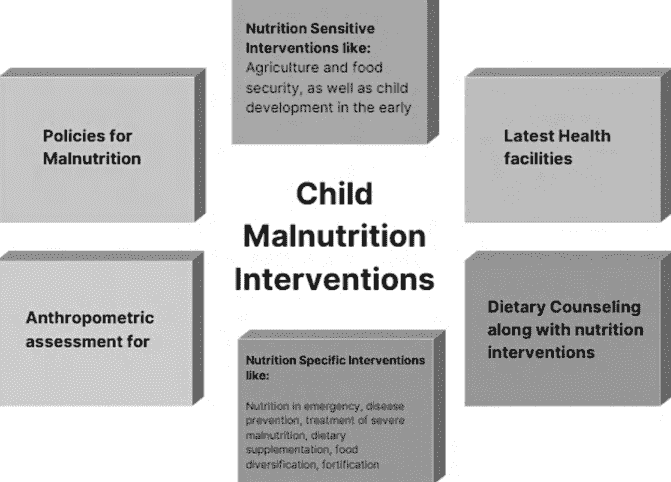

图 4.1 儿童营养不良干预。对于急性营养不良，确保了早期检测和干预，减少了严重营养不良及其长期影响的风险。结合这些策略为对抗儿童营养不良提供了全面的方法

## 4.4 营养不良症状

儿童营养不良表现为一系列症状，取决于类型和严重程度。在急性营养不良（消瘦）中，儿童可能看起来非常消瘦，骨骼和肌肉可见。慢性营养不良也称为矮小，表现为生长不良，导致儿童与其年龄相比明显矮小（图 4.2）。

营养不良的常见症状包括疲劳、易怒和缺乏能量。受影响的儿童可能出现皮肤干燥、头发脆或脱发。在严重情况下，可能会出现脚部或脸肿胀（水肿），这是热卡症（一种严重的蛋白质缺乏症）。其他症状还包括反复感染，因为营养不良会削弱免疫系统，使儿童更容易患病。注意力不集中、发育里程碑延迟和认知障碍也是长期营养不良儿童的常见问题，可能会影响他们的学习

## 医疗健康转型

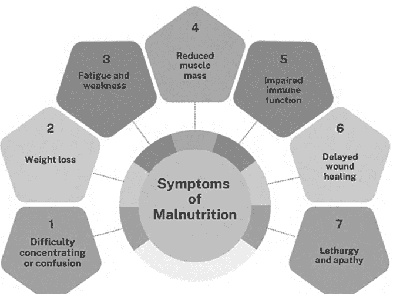

图 4.2 营养不良的症状。

以及社会发展。早期识别和治疗这些症状对于防止长期损害至关重要（Owolade et al., 2022）。

当身体缺乏正常运作所需的营养素时，营养不良就会发生。原因包括食物摄入不足、饮食质量差以及阻碍吸收的胃肠道疾病等。由于冲突、自然灾害和许多经济问题可能导致获取食物的延迟。营养不良的儿童可能免疫系统受损，对疾病的易感性增加。在成人中，这可能导致疲劳、健康问题和肌肉萎缩。营养不良影响着全球数百万人，特别是在低收入国家，它是营养不足（热量或营养素摄入不足）和营养过度（摄入过多不健康食物）共同。表 4.2 列出了营养不良的影响和成因。

## 4.4.1 儿童营养不良的类型

儿童营养不良主要有三种类型：消瘦、生长迟缓微量元素缺乏，这些会导致超重和体重减轻。图 4.3 解释了营养不良的类型。

### 表 4.2 营养不良的影响和成因

| 影响 | 后果 |
|---|---|
| 生理 | - 免疫功能受损<br>- 口伤愈合缓慢<br>- 药物代谢改变 | 感染风险增加<br>- 恢复期延长<br>- 副作用风险增加 |


| 身体 | - 生长发育受阻<br>- 脂肪和肌肉组织减少，力量下降、嗜嗜靡<br>- 咳嗽能力下降<br>- 体温调节受损 | 压疮风险增加<br>- 活动能力下降，跌倒风险增加<br>- 呼吸道感染风险增加<br>- 低体风险增加 |

| 心理 | - 漠然和抑郁<br>- 认知功能受损 | - 生活质量下降<br>- 记忆丢失 |

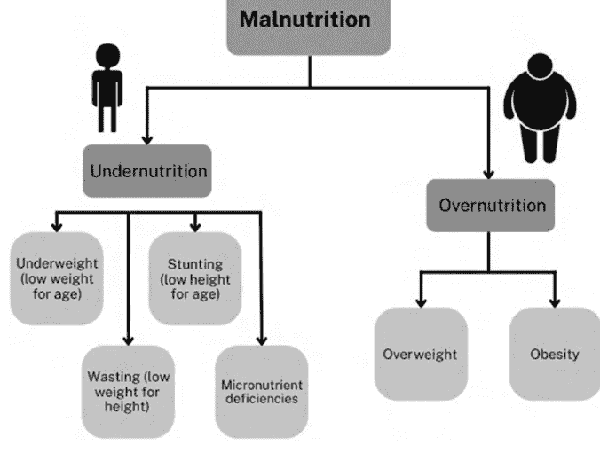

- 消瘦，也称为急性营养不良，发生在儿童经历快速且严重的体重减轻时，通常是由于食物突然短缺或阻碍营养吸收的疾病引起。这导致肌肉和脂肪质量大幅减少，结果导致极端消瘦。消瘦通常由饥荒、干旱或疾病爆发等紧急情况引发，这些情况阻断了充足营养获取。患有消瘦的儿童免疫系统虚弱，感染和死亡的风险较高。立即干预对于生存至关重要。
- 生长迟缓或慢性营养不良，会损害儿童的生长和发育，导致身高与同龄人相比较矮。它是长期营养不足和频繁感染导致的，特别是在关键的早期阶段。生长迟缓影响身体生长和认知发育，具有长期的健康和经济影响。
- 维生素和矿物质（如碘、铁和维生素 A）的摄入不足会导致微量元素缺乏。这些缺乏会导致贫血、免疫反应受损和发育延迟等状况。此类缺陷会影响代谢途径，损害生长，并增加儿童对感染和认知障碍的易感性。

## 4.5 方法论

### 4.5.1 使用的数据集

近年来，机器学习（ML）模型在医疗行业得到了广泛应用，为预测营养不良及相关疾病等健康后果提供了新途径。来自医疗机构、公共平台和人口统计调查的大规模数据库是该研究领域使用数据的主要来源。创建能够识别风险人群、预测医疗疾病和指导公共健康倡议的模型依赖于这些数据集。人口和健康调查（DHS）、联合国儿童基金会（UNICEF）以及 Kaggle 的“健康状况的 BMI 预测”数据集被频繁使用。除了涵盖最热门的应用领域外，本文还讨论了该主题的研究未来方向，以及将数据集推广到 ML 应用时面临的困难（An et al., 2023）。

#### 4.5.1.1 大规模数据集在医疗保健中的作用

稳健的模型是在大型数据集的基础上进行训练的。这些数据集通常包含数百万数据点，因此研究人员能够发现变量之间的关系和模式，而这些在较小的数据集中是不而易见的。医疗机构和人口统计调查的数据库中经常发现大量信息，包括病史、生物识别信息（如身高、体重和 BMI）、社会经济特征，偶尔还有遗传数据。这些数据库允许研究人员创建 ML 模型，准确预测肥胖和营养不良等健康结果（Yang et al., 2024）。

联合国儿童基金会数据库汇总了许多国家和国际调查的信息，是营养健康预测中最常用的数据集之一。该数据库对于研究儿童营养特别有用，因为它包含了儿童喂养习惯、人体测量数据和健康结果信息。这些信息使研究人员能够研究营养过度和营养不足（Varthi Mahendra et al., 2019）。

人口和健康调查（DHS）从新兴国家收集关于人口、健康和营养的标准化数据，是经常使用的来源。DHS 记录允许研究人员分析不同地点和人口统计儿童及成年人的营养状况，因为它们包含了广泛的因素，包括年龄、性别、体重、身高和社会经济地位。这些数据库在某些方面特别有用，因为中低收入国家通常缺乏关于营养不良的数据收集（Amir-Din et al., 2022）。

像 Kaggle 等平台提供了学术人员可以用于训练其 ML 模型的开源数据，除了机构数据集外外。其中一个用于预测与营养相关的健康结果的数据集是 Kaggle 的“健康状况的 BMI 预测”数据集，它包含了人们的记录。除了涵盖最热门的应用领域外，本文还讨论了该主题的研究未来方向，以及将数据集推广到 ML 应用时面临的困难（An et al., 2023）。

*(注：由于原文中存在重复段落，已根据注意事项进行去重处理)*

## 89 儿童营养不良状况预测

全球协作通过将来自不同国家和机构的数据集合并一个单一、完整的数据库，是实现这一目标的方法之一。这种方法在提高模型统计效能的同时，扩大了可用数据池。例如，研究人员可以通过将 UNICEF 数据库与 Kaggle 或或其他开源平台的数据合并，训练出更擅长处理全球营养问题复杂性的 ML 模型。

增加更详细的数据也是一个关键因素。尽管许多数据集已经提供了有关基础人口统计学和生理特征的信息，但关于包括营养摄入、微量元素缺乏和医疗保健服务获取在内的变量，更全面的数据也已变得至关重要。通过整合这些特征，ML 模型可以变得更加准确，并对导致营养不良的原因提供更详尽的认知。

### 4.5.2 算法

ML 模型在预测营养不良及相关健康状况方面展现了巨大的潜力。这些模型能够处理海量数据，并发现传统统计技术可能会错过的复杂模式。该领域经常使用的 ML 算法示例包括 NN、决策树和随机森林。这些算法根据体重、身高、年龄和社会经济因素等多个变量来预测儿童的营养状况。此外，那些可能未表现出明显营养不良症状的风险个体，可以通过 ML 算法发现其正面临的糟糕健康后果。早期识别允许进行及时干预，例如提供营养补充剂或实施公共健康运动以促进健康的饮食习惯。然而，这些模型的成功在很大程度上取决于所用数据集的质量和多样性。如前所述，在特定区域数据集上训练的模型可能无法推广到其他人群。为了确保 ML 模型能够在各种场景中成功部署，研究人员必须优先考虑获取和利用高质量、多样化的数据集。

调查者使用了一系列 ML 技术，其中常用的是随机森林（Random Forest）、逻辑回归和决策树。特别是随机森林，在多项预测儿童营养不良、矮肉和肥胖的研究中作为一种强大的工具，这主要由于其处理具有复杂变量的大型数据集的能力。另一种常用算法 XGBoost 在处理大小写数据集时都表现出极高的准确性和效率，使其成为关注健康结果预测的研究的热选。

## 90 医疗保健转型

逻辑回归虽然没有随机森林或 XGBoost 复杂，但由于其简单性和可解释性被频繁应用，特别是在涉及二分类（如营养不良或无营养不良）的研究中。此外，DL 技术（特别是 NN）在需要更复杂预测的研究（如预测儿童生长行为）中也备受关注。

算法的选择取决于问题的复杂性。对于较简单的二分类，逻辑回归和决策树等模型通常足够了。然而，对于更细致和多分类预测，倾向于使用随机森林等集成模型或 XGBoost 这样的提升算法，因为它们具有更强的稳健性和更高的准确性。

### 4.5.3 主要预测

预测模型作为检测具有肥胖、矮肉、营养不良风险的儿童的工具，其重要性日益增加，特别是在医疗保健领域。已有大量研究利用 ML 和数据分析的进展，以实现对营养缺乏和其他健康相关问题的早期诊断。预测模型可以通过评估各种人口统计学变量和健康变量，将儿童分为不同的风险组。这为从业人员提供了做出及时且明智决策所需的关键信息。这使得实施更成功的干预成为可能，更明智地利用资源，并总体上提高儿童的健康状况。表 4.3 解释了营养不良的分类和治疗方法。

表 4.3 营养不良分类与治疗方法

| 方面 | 细节 |
|--- | --- |
| 分类 | • 急性或慢性<br>• 轻度、中度或重度 |
| 原因 | • 社会经济、行为或环境因素<br>• 疾病、残疾或严重受伤 |
| 机制 | • 营养摄入或吸收减少<br>• 营养流失或需求增加 |
| 证据 | • 体重轻<br>• Z评分或生长百分位<br>• 饮食摄入减少<br>• 体格发现 |
| 主要治疗 | 处理 {原因 |
| 营养治疗 | • 食品强化<br>• 口服营养补充剂 (ONS)<br>• 肠内营养<br>• 喂养 |

#### 4.5.3.1 早期发现营养不良、矮肉和肥胖的重要性

肥胖、矮肉和营养不良是主要的公共健康问题，特别是在中低收入国家，尽管它们也会影响富裕国家。五岁以下儿童约 45% 的死亡归于营养不良，使其成为世界上儿童死亡的主要原因之一。慢性营养不良导致的矮肉会损害身体和认知发育。相反，肥胖增加了糖尿病、高血压和心血管疾病等慢性病的风险。

识别发育过程中处于风险的儿童是儿童营养研究领域预测建模的主要目标之一。早期检测至关重要，因为在生命的前 1000 天内（从受精到儿童两岁生日）进行的干预可以显著影响生长和认知发育。在这个关键窗口期之后，矮肉或饥饿的影响将更难恢复。

许多采用预测模型的研究的主要目标是根据体重、身高、BMI 和年龄等关键特征，识别具有营养不良或矮肉风险的儿童。这些标记物提供了有关儿童总体健康和营养状况的关键信息。研究人员可以通过将这些物理参数与人口统计数据（包括社会经济地位、地理位置和医疗保健获取）相结合，开发预测儿童营养不良、矮肉或肥胖风险的模型。

#### 4.5.3.2 预测儿童死亡和发育结果

许多研究不仅仅仅识别营养不良的儿童，还包括预测未来的发育结果和儿童死亡。儿童死亡与营养不良密切相关，特别是其急性和严重形式。由于免疫系统受损，无法有效抵抗感染，遭受营养不良的消瘦（wasted）儿童死于肺炎、腹泻和疟疾的风险显著增加。

儿童死亡率可以通过结合营养不良率的预测模型进行估计。因此，医疗专业人员可以优先考虑高风险情况，并确保危重的儿童能尽早获得救命干预。此外，儿童的长期发育结果可以使用预测模型进行估计。例如，认知发育不良通常与慢性营养不良有关（以矮肉为证），这会影响儿童的学业成就和未来的产出。对这些结果的早期预测允许设计出在改善营养健康的同时增强儿童认知和教育发育的治疗方案。

## 92 医疗保健的转型

#### 4.5.3.3 预测建模中的机器学习

过去几年，机器学习（ML）在健康相关预测中的应用显著增长。机器学习模型在消化海量数据集、发现模式和产生精确预测方面表现出色。机器学习算法在包含各种营养不良、发育矮和肥胖指标的数据集上进行训练，包括人体测量数据（例如身高、体重和 BMI）、临床信息、社会经济因素，甚至是环境影响（例如清洁水和卫生设施的获取）。这些算法根据它们在数据中发现的模式，学习将儿童分为不同的组，例如发育矮低风险组或营养不良高风险组。

在健康预测研究中使用了几种流行的机器学习模型，例如：

- **决策树：** 由于决策树既能处理数值数据也能处理分类数据且易读，它们是预测营养不良的常用工具。为了使这些模型运行，选择（如儿童是否营养不良）被分为取决于若干因素（年龄、体重、身高和社会经济地位）的一系列查询。
- **随机森林：** 随机森林通常被用于健康预测模型，是决策树的扩展。为了提高准确性，它们通过合并多棵决策树的预测来运行。在处理包含大量变量的大型数据集时（这在预测营养不良的研究中很常见），随机森林非常有帮助。

逻辑回归是一种常用的确定事件概率的统计方法，例如儿童是否体重过轻。当结果是二元的（例如，营养不良与非营养不良）时，它的效果非常好。另一种适用于分类的方法是支持向量机（SVM）。SVM 很有用的一个任务示例是确定儿童是否面临发育矮和的危险。它的工作方式是确定哪种超平面能最好地划分不同类别的数据点。传统方法并不是机器学习应用于预测营养不良的唯一途径。

#### 4.5.3.4 增强资源分配与干预

使用预测模型解决肥胖、发育矮和和营养不良有许多优势，但最大的优势之一是它使资源分配更加高效。医疗保健人员经常在资源受限的环境中挣扎分配稀缺的治疗食品、饮食补充剂或医疗护理。如果能够精确识别出哪些儿童最脆弱，就能更有效地分配资源，并确保这些儿童获得及时的干预。例如，预测模型可能确定，某个地区的儿童因为卫生条件差和清洁水供应有限而更容易发育矮和。卫生部门可以利用这些信息，通过改善该地区的基础设施和提供营养治疗来解决营养不良的根源。预测模型还协助通过确定不同儿童群的独特需求来提供更好的治疗。易于微量元素缺乏（如缺铁性贫血）的儿童可能从专门的补充计划中受益，而其他易感儿童则可能需要接受改善饮食质量和增加身体活动水平的治疗。

#### 4.5.3.5 预测模型在应对贫血和儿童死亡中的作用

机器学习算法已应用于许多研究，用于预测贫血和婴儿死亡等健康状况，外营养不良和发育矮和。在中低收入国家，贫血是一种主要影响妇女和儿童的流行疾病，通常是由缺铁引起的。预测模型可以根据儿童饮食、血红蛋白水平和社会经济地位的信息确定其贫血风险。另一个机器学习显示潜力的领域是儿童死亡预测。机器学习模型通过检查包含出生体重、营养状况、母亲健康和医疗服务获取等各种特征的数据集，预测儿童死亡率的变化。健康机构可以利用这些信息在高风险情况下采取行动，从而拯救生命。

儿童医疗保健的一个重大进展是应用预测算法识别面临饥饿、肥胖、贫血、营养不良和死亡危险的儿童。这些模型为医疗人员提供了早期检测、及时干预和更高效的资源分配。机器学习技术使得大规模数据处理成为可能，同时也导致了日益准确的预测。这使得更专业、更成功的干预成为可能。这些预测对于在整个成长过程中提高儿童健康和发育成果至关重要。

### 4.5.4 重点领域

对医疗保健领域机器学习文献的全面分析已确定了许多关键领域，这些领域需要在后续研究中重点关注，以增强预测模型的预测性、公平性和精确性。这些主题包括：对地理和种族方面更多样化数据集的需求、使用机器学习模型的伦理考量，以及针对某些预测任务细致选择合适的算法。

#### 4.5.4.1 多样化和地区特定的数据集

机器学习模型的可泛性——这在很大程度上取决于其训练的数据集——是当前研究的一个重点领域。目前的许多模型是从数据构建的，可能无法准确代表世界人口的各种文化、社会阶层和经济背景。由于医疗、生活方式和疾病流行率等变量的差异，在一个地区表现良好的模型在另一个地区可能表现并不。结果，这些差距限制了这些模型在其他地区和人口群中的适用性。例如，在富裕国家数据上训练的模型应用于中低收入国家时无法产生可靠结果，因为那里的人口统计和医疗系统非常不同。因此，建议科学家使用特定地区独特且代表一系列人口特征的数据集来创建和完善模型。这将有助于机器学习模型在医疗保健中的应用范围，在更广泛的情况下改善健康状况。

#### 4.5.4.2 伦理考量

机器学习在医疗保健中的伦理影响是另一个重要重点。随着这些模型越来越多地影响公共卫生倡议、临床决策和资源分配，确保公平、透明不受歧视变得至关重要。预测模型存在无意中引入或加剧偏见的风险，特别是关于社会经济地位、种族身份或地区不平等的偏见。例如，使用大部分社区社区开发的模型可能无法准确预测来自较低社会经济背景的人员，这将导致医疗差异。为了减轻这些偏见，研究人员必须密切监控训练数据的组成，并确保构建的模型对所有子群体都是公平的。此外，为了促进人工智能在医疗保健中应用的信任和问责，公开报告模型预测过程并清晰了解模型的局限性至关重要。学术界必须与政策制定者和医疗执业人员密切合作，制定规则和框架以确保机器学习技术的道德应用。

儿童营养不良预测 95

#### 4.5.4.3 算法选择

另一个必须考虑的关键性因素是机器学习（ML）算法的选择。各种算法的优缺点取决于所处理任务的复杂程度。例如，由于随机森林（Random Forest）和 XGBoost能够处理海量数据集和复杂的变量相互作用，它们在多种健康相关的预测任务中已被证明是非常准确的。然而，这些模型对计算的要求较高且结构较为复杂，这使得它们不太适用于某些对计算简单性和可解释性有重要考虑的场景。另一方面，更简单的模型（如逻辑回归，logistic regression）具有更清晰、更易于使用的优点，这在某些情况下很有帮助，例如对解释性至关重要的二分类任务，尽管它们在处理复杂任务时的准确性可能较低。此外，由于集成模型能够减少过拟合并提高准确性，这类模型整合了多种算法，经常被用于更复杂的预测。但简单性同样重要，特别是在涉及简单类别或处理能力及资源有限的环境时。

最后分析，医疗保健领域未来任何机器学习研究的首要目标是基于一系列代表性数据集构建模型。它还应该解决涉及透明度和公平性的伦理问题，并仔细选择适用于特定预测任务的算法。通过专注于这些需求，学者可以增强医学领域机器学习框架的效能、可靠性和道德规范性。

##### 4.5.4.3.1 结论

预测儿童营养不良是解决世界上最紧迫公共健康问题之一的关键步骤。通过数据驱动的模型，我们可以了解导致儿童营养不良的主要因素，包括社会经济地位、医疗保健获取、饮食习惯、环境和卫生状况。医疗系统可以使用预测分析识别高风险儿童和社区。这使得及时干预成为可能，从而阻止营养不良相关问题的进展。预测模型通过指导政策制定者和医疗保健人员分配资源，不仅提高了预测营养不良的能力，还提供了可行的解决方案。通过协助识别最需要营养支持的地区，这些模型使得更成功地安排食物分配计划、健康活动和教育倡议成为可能。人工智能和机器学习等现代技术提高了营养不良预测的准确性，并允许检测数据中复杂的模式和隐藏的联系。

## 转型医疗保健

必须承认预测模型具有局限性。数据的质量、可获取性和区域差异会影响预测的准确性。因此，必须不断尝试改进模型完善和数据收集，以确保对各种人群的预测具有准确性。政府、医疗机构和IT公司必须共同努力，建立管理和预防营养不良的持久解决方案。最终，预测模型是全球对抗儿童营养不良战斗中的有效武器。这些模型通过允许早期检测和定制化干预，具有大幅减少营养不良发病率、提高儿童健康状况并实现联合国可持续发展目标等全球健康目标。

## 参考文献

Amir-din, R., S. Fawad, L. Naz, S. Zafar, R. Kumar, and S. Gongpanich. 2022. “Nutritional Inequalities among Under-Five Children: A Geospatial Analysis of Hotspots and Cold Spots in 73 Low- and Middle-Income Countries.” International Journal for Equity in Health 21 (1): 135. https://doi.org/10.1186/s12939-022-01733-1.

An, Q., S. Rahman, J. Zhou, and J.J. Kang. 2023. “A Comprehensive Review on Machine Learning in Healthcare Industry: Classification, Restrictions, Opportunities and Challenges.” Sensors 23 (9): 4178. https://doi.org/10.3390/s230904178


Argaw, T. I., J. Felderjohn, E. Aurino, and S. Vellakk. 2023. “Children’s Educational Outcomes and Persistence of Household Food Security in India: Longitudinal Evidence from Young Lives.” The Journal of Nutrition 153 (4): 1101–110. https://doi.org/10.1016/j.tjnut.2023.02.008.

Aryuni, M., E. Miranda, M. Kumbangsila, A.Y. Zakiyah, A.V.D. Sano, and F.M. Bhatt. 2023. “Comparison of Prediction Status Models of Children Under 5 Years of Age Using Supervised Learning.” In Proceeding of the 3rd International Conference on Electronics, Biomedical Engineering, and Health Informatics: CEBEHI 2022, 265–77. https://doi.org/10.1109/978-1-020-978-5_49-2

Bhushan, M., A. Ahu, G. Ranjan, S. Sharma, K. Sharma, and A. Negi. 2023. “Prediction of Health Status Using Machine Learning Techniques.” In 2023 Third International Conference on Secure Cyber Computing and Communication (ISCCC), 1–6. IEEE. https://doi.org/10.1109/ISCCC56808.2023.10176668.

Deepa, K., P. Perl, and B. Mathivan. 2023. “Text Extraction and Mining Methods Used in Data Science.” In 2023 2nd International Conference on Edge Computing and Applications (IECAAA), 73–78. IEEE. https://doi.org/10.1109/IECAAA5784.

Fournier-Tombs, E. 2023. "Local Transplantation, and Creation of AI for Public Health." Frontiers in Intelligence. 6.

Guo, H., and Y. Zhang. 2020. "Resting State fMRI and Deep Learning for Earlier Detection of Alzheimer’s." IEEE Access 8. https://doi.org/10.1109/ACCESS.2020.300342.

Khan, M.N., and R.Yusus. 2023. "A Hybrid Ensemble Approach to Accelerate Malnutrition Under Sub-Saharan African Countries." Nutrition 10. https://doi.org/10.3390/nu10050724.

Maas, S.A., M.K. Zuma, and J.H. Frankel. 2023. "Dietary Diversity and Nutritional Status of Childhood Development in Vhembe District, Limpopo Province, South Africa." Journal of Nutritional Science 12: e92. https://doi.org/10.1017/jns.2023.718.

Motadi, S.A., N.M. Radzi, and E.S. 2023. "Decision-Making Support for Obesity Risk Using Machine Learning." In 2023 International Conference on Networking and Communications (ICN).

Owolade, A.J., R.O. Abdulla, and E.D. Olaloye. 2022. "Malnutrition: An Health Crisis Faced in Sub-Saharan Africa: Challenges and Resolutions." Annals of Medicine & Surgery 82. https://doi.org/10.1016/ansmu.2022.104769.

Raghavendra Rao, R.V., U. Srinivasulu Reddy, and C. Ram Mohan Reddy. 2023. "Data Analytics Using Machine Learning Techniques – A Survey." In 3rd International Conference on Intelligent Technologies (CONIT). https://doi.org/10.1109/CONIT59222.2023.5.

Rahutomo, R., G. Nasional Elwirdajah, M. Isan, F. Asadi, and B. Pardmane. 2023. "Machine Learning Implementations in Childhood Stunting Research: A Systematic Literature Review." In 2023 International Conference on Information Management and Technology (ICMITETech).

Saravanan, T. S., S. Saravanakumar, S. Sandu, D. Vinotha, A. Karim Kadhim, and H. Al-Chlidi. 2023. "Prediction of Infant Growth Using the Random Forest Algorithm." In 2023 Third International Conference on Adverse Computing and Innovative Technologies in Engineering (ICACITE). https://doi.org/10.1109/ICACITE37410.2023.10182723.

Sushiridha, A. Abinayaa, M. Koppala, and R. Kaladevi. 2023. “基于机器学习的婴儿出生体重估计.” 于2023年第7届电子与信息趋势国际会议 (ICOEI), 1019–23. IEEE. https://doi.org/10.1109/ICOEI55675.2023.10215609

Varhi Mehta, K., Dompleij, J., Chavan Bharat, B., Doibale Mohan, K., and Pandhare Pavalli, 2019. “南坎德市政管理局地区五岁以下儿童营养不良的预防及其相关因素。” 国际先进社区医学杂志 2 (3): 117–122. https://doi.org/10.33545/comed.2019.v2.i3b.92.

Wan, Z., S. Liu, F. Ding, M. Li, Srivastava, and K. Yu. 2024. “C2Net: 一种用于显微图像中寄生EEG检测的耦合复合骨干深度学习架构.” IEEE生物医学与健康信息化, 1–13. https://doi.org/10.1109/JBHI.2023.3318604

Wannanayake, K.M.I.S., L.G.S.W Bambaranda, T.I. Wickamaraanchi, U.C.S.L. Pathirana, S. Vidhanaraachi, A.A.E. Nayakkara, K.R.D. Gunapala, S.R. Sarathandra, A. Ishagara, and D.I. De Silva. 2023. “用于水稻疾病检测、预测和修复的GT启用智能解决方案.” 于2023年第5届人机交互、优化与机器人应用国际会议 (HORA), 1–9. IEEE. https://doi.org/10.1109/HORA58378.2023.10155770

Yang, Y., H. Zhang, J.W. Gichoa, D. Katabi, and M. Ghashemi. 2024. “公平医疗成像AI在现实世界泛化中的局限性.” 自然医学，六月. https://doi.org/10.1038/s41591-024-03113-4.

Yuliansyah, H., S. Sulistawati, T.W. Sukesi, S.A. Mulasari, and W.N. Syamilah Wan Ali. 2023. “营养研究中的人工智能：文献计量学分析.” 信息理论与应用杂志 7 (1): 32–42. https://doi.org/10.31763/businta.v7i1.6.

# 使用元启发优化对临床MR图像中的前交叉韧带断裂进行精确分割

Pallikonda Rajasekaran, Kottaimalai Ramaraj, Arunprasath Thiyagarajan, Jakir Hossen, and Wai Kit Wong

## 5.1 引言

膝关节是一个复杂的关节，其功能类似于门铰链，允许腿部进行屈曲和伸展，以便坐、蹲蹲、跳跃和跑步。膝关节的四个部分是软骨、韧带、肌腱和骨骼。膝关节的顶端是股骨，也称为大腿骨 [1]。膝关节的底部是胫骨。股骨和胫骨相遇的地方是髌骨（即膝盖骨）。保护膝部骨骼并帮助韧带滑动同时保护骨骼免受冲击的物质被称为软骨。膝由四条韧带组成，像绳子一样稳定并保持骨骼在一起。胫骨、髌骨和股骨共同形成了膝关节。肌腱将上下腿的骨骼连接到肌肉和膝关节上。为了提供一些缓冲，髌骨位于膝部前方。韧带连接相邻的骨骼。为了保持骨骼连接并维持我们膝关节的稳定性，它们的作用就像坚固的绳子。

影响任何年龄层的常见问题是膝部不适。可能是软骨撕裂或韧带受损等损伤的结果。由于膝关节的复杂性和构造，它很容易受到多种疾病的影响，感染性、痛风和关节炎是需要关注的医学疾病。组成膝关节的一个或多个组织受到损伤称为膝伤。此类疾病是由跌倒、剧烈的膝部扭转、汽车事故的高撞或其他力量引起的 [2]。青青和疼痛是膝伤最典型的症状。此外，膝盖可能会发生打软或锁死。不稳定的膝盖会让我们感觉膝盖正在脱臼。

不同类型的膝伤包括 [3]:

- 骨折：髌骨（膝盖骨）是最受影响的骨头，但膝部或附近的任何骨头都可能破碎。虽然骨质疏松患者可能因轻微跌倒导致膝部骨折，但大多数膝骨折是严重冲击伤的结果，包括车辆打滑或碰撞。
- 前交叉韧带 (ACL)：ACL通过对角线跨越膝前方提供至关强度。ACL损伤可能非常严重，通常需要手术治疗，特别是对于参加冰球和足球等对抗性运动的运动员来说。
- 脱关节：不稳定的膝盖会让我们感觉膝盖正在脱臼。
- 半月板撕裂：半月板是两个楔形的软骨，起到缓冲作用。它们可能在受伤时撕裂，或随时间推移而磨损。
- 滑膜炎：滑囊是充满液体的小囊，用于保护关节。过度使用或跪姿会导致它们扩张和肿胀。
- 肌腱炎：髌肌腱（也称为肌腱）是连接肌肉与骨骼的组织。它可能因重复活动导致炎症。
- 侧副韧带：侧韧带连接股骨和胫骨。损伤在参加运动的运动员中很常见。
- 髂束：这是一种沿膝盖外侧运行的组织带。它可能导致跑步者疼痛。
- 后交叉韧带 (PCL)：PCL连接股骨和胫骨，防止胫骨向后滑动过多。

### 正常 ACL

### 撕裂 ACL

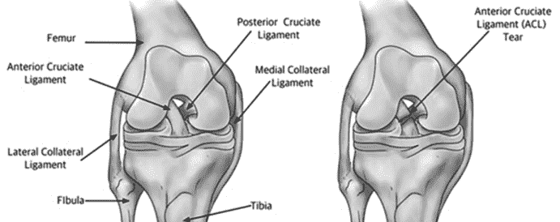

图 5.1 前交叉韧带解剖结构。

图 5.1 展示了 ACL 的解剖结构。全球每年发生超过200万例 ACL 损伤，且以每年4–6% 的速度增长。与男性相比，女性遭受 ACL 损伤的可能性是男性的 2–8 倍。在足球、橄榄球、体操、排球、篮球、冰球和滑雪等活动中，超过 70% 的 ACL 损伤发生在其中。新西兰和澳大利亚的 ACL 损伤率高于其他国家，每 10 万人中分别为 58.2 和 77.4 例。在过去的 20 年里，6 至 18 岁人群的 ACL 损伤发病率每年至少上升 2.3%，其中 16 岁女性和 17 岁男性的比例更高 [51]。更多地参与运动和运动可能会增加儿童和青少年 ACL 撕裂的概率，从而导致撕裂率上升。全球许多国家、运动员队和组织维护着最新的膝损伤记录。根据印度北部进行的观察性研究，ACL 撕裂占膝部损伤的 86.5%。研究显示，44.3% 的 ACL 撕裂病例发生在 18 至 25 岁的人群。

膝关节的 ACL 有多种作用，包括：

- 膝关节稳定性：ACL 维持膝关节稳定性，特别是限制胫骨从股骨前向前移动。
- 防止扭转：ACL 帮助防止膝关节扭转或恶化。

## 使用元启发式优化进行 ACL 撕裂的分割

- 抗旋转：ACL 帮助防止胫骨相对于股骨发生内旋。
- 冲击吸收：当足部撞击地面时，ACL 帮助吸收冲击。

ACL 损伤的严重程度从轻微扭伤到韧带大面积撕裂不等。当肢体未接触并伴有内旋和外翻应力时，接触性和非接触性损伤都很常见。ACL 损伤的发病率女性似乎比男性更普遍，参与相似运动的女性运动员发病率是男性的 2.4 到 9.7 倍，ACL 破裂已成为典型的外伤。

ACL 拉伤或损伤有多种方式。最常见的技术是运动过程中的快速旋转或切入。汽车碰撞或工作中的事故也可能导致韧带断裂。有时，在损伤部位可能会观察到或听到“砰”或“啪啪”声。虽然因人而异，但损伤部位的不适感可能非常剧烈。通常，个人会觉得遭受了严重伤害，无法继续参加运动或其他活动。膝关节一旦受伤，在最初的几小时内，就会发生炎症。然而，如果立即对膝关节进行冰敷或固定，可以减少炎症程度。

典型的 ACL 损伤分为 1 级、2 级或 3 级 [6]：

- **1 级**：ACL 损伤最小，例如轻微拉伤仍能为膝关节提供足够的稳定性，被类为 1 级损伤。
- **2 级**：描述轻微撕裂和拉伸的 ACL。2 级损伤并不常见。
- **3 级**：当 ACL 完全断裂为两部分时，发生此类级别的的 ACL 撕裂，导致膝关节失去任何支撑。

以下是 ACL 撕裂最典型的症状：

- (1) “砰”的声：一些人声称在受伤瞬间感到或听到膝盖有“砰”的声音。
- (2) 剧痛：突然发生的、剧烈的膝痛，经常导致无法进行某项活动。
- (3) 立即炎症：在运动后的最初几小时内，通常会发生炎症。
- (4) 不确定感：感觉不稳或膝盖“打软”，特别是在弯曲或转动时。
- (5) 活动范围受限：无法完全弯曲或伸直膝盖。
- (6) 负重困难：个人在受影响的肢上行走时产生不适或痛苦 [7]。

### 104 医疗保健转型

ACL 损伤可能由多种情况引起，包括意外停止、快速改变方向、不当的跳跃或落地、足球铲撞等接触性损伤，以及由于冲刺、跳跃、弯曲或转动等重复性活动过度使用腿部。

患者的体征和症状、检查结果、骨��板中剩余的生长量、韧带损伤类型以及理想的运动活动水平都会影响治疗方案的选择 [8]。

- **非手术**：对于 1 级损伤，无手术治疗通常是有效的。这需要限制或固定、物理康复，以及谨慎地恢复比赛和日常任务。
- **手术**：对于 3 级或全层 ACL 损伤的患者，建议进行手术。ACL 损伤的类型、患者开放或闭合的骨��板以及其他因素可能会影响手术选择。ACL 是膝关节中可以通过 ACL 手术修复或更换的韧带之一。连接股骨和胫骨的 ACL 对于维持膝关节稳定性至关重要，特别是在突然停止、方向转换和跳跃的活动期间。ACL 损伤可能由滑倒或碰撞引起，但在运动员和参与激烈活动的人中更为常见。ACL 撕裂和其他损伤可能导致膝关节不稳定、导致活动困难，并增加膝骨关节炎的风险。

在 ACL 严重的情况下建议手术。

## 5.2 相关工作

Xue 等开发了一种全自动方法，包含用于 ACL 韧带分割的深度学习模型（ACL-DNet）和一个用于韧带状态敏感性的分类器（ACL-SNet）[11]。该方法的效能通过灵敏性、特异性和曲线下面积（AUC）等指标进行计算，并在留出集上与三位骨科医生进行了对比。ACL-DNet 在 MRI 数据集上实现了 98%±6% 的 Dice 系数，而分类器显示出 97% 的灵敏性和 97% 的特异性。相比之下，其他模型的灵敏性在 84% 到 90% 之间，特异性在 86% 到 92% 之间。

Liu 和 Wu 开发了一种先进的深度学习模型，将基于 T 分布的切片注意力机制与惩罚权重损失函数集成，以增强 ACL 检测 [12]。T-切片注意力模块创建了一个稳健的切片过滤系统，同时通过引入类别关系并将传统的交叉熵损失替换为惩罚损失函数，显著提升了分类准确率。这种方法在六种骨干网络上改进了诊断性能，其中 VGG-Slice-Wheat 模型实现了 0.9590 的 AUC。

Souras 等引入了一种高判别性新颖性评分，利用来自 YOLOv5-nano 目标检测模型类别的随机语义不确定性 [13]。对于组织密度，在应用于整个矢状面时，他们继续使用全局评分（概率向量）。其流水线的第二部分涉及 MINIRECT 系列分类模型，用于评估膝关节 ACL 撕裂。为了评估泛化能力，他们与两个公共数据库（KneeMRI 和 MRNet）以及来自希腊拉里萨综合医院的仅用于验证数据库进行了跨数据库测试。他们的方法在 KneeMRI 数据集上持续优于最先进的方法（p 值 < 0.05），并在 MRNet 数据集上实现了更高的准确率和灵敏性。


Zhang 等提出了一种使用改进黄金搜索算法（`MGSA`）优化的卷积神经网络（`CNN`）来诊断 `ACL` 撕裂的新方法 [14]。该方法通过优化的 `CNN` 架构从膝关节 `MRI` 图像中有效提取关键特征，实现了 99.6% 的惊人准确率，超过了其他方法。

Wang 等提出了一种带有条件随机场（`CRF`）的轻量级注意力图神经网络（`GNN`），称为 `ACGN`，用于膝关节 `MRI` 图像中的 `ACL` 断裂分类 [15]。他们利用基于指标的元学习策略通过多个节点分类任务进行独立测试，并使用知识蒸馏设计了一个轻量级特征嵌入网络来提取图像特征。利用 `GNN` 层识别样本依赖关系并完成分类，并在每个 `GNN` 层中精炼注意力。为了解决过冲和过拟合问题，他们应用了自自增强注意力、节点注意力和记忆注意力用于图初始化、节点更新和层相关性分析。

## 使用元启发式优化进行 ACL 撕裂分割

实验表明，该模型取得了卓越的性能，在斜位冠状面数据上的准确率为 92.94%，在矢状面数据上的准确率为 91.92%。

Zuo 等提出了一种新方法，通过优化的门控循环单元（`GRU`）模型增强 `ACL` 撕裂的检测准确率，该模型捕捉了 `MRI` 图像的时间特征 [16]。该优化采用了灵活适应度依赖性优化器（`FFDO`），这是一种针对特定问题的算法，根据适应度函数生成并评估候选解决方案。应用于 `MRNet` 数据集，该方法优于现有的最先进方法，`ACL` 撕裂检测实现了 97.95% 的高准确率，超过了现有的深度学习和机器学习方法。

Chan 等开发了一种使用塔斯马尼亚虎优化（`HTDO`）算法自动检测 `MRI` 图像中 `ACL` 撕裂的方法 [17]。基于循环神经网络（`RNN`）的 `GRU` 网络分析序列数据以检测时间关系。`HTDO` 结合了塔斯马尼亚虎和粒子群优化（`PSO`）的优点。在没有 `ACL` 损伤的膝关节 `MRI` 数据集上测试，该方法在识别 `ACL` 撕裂方面优于其他技术。

Joshi 等创建了一种使用卷积神经网络（`ATD-CNN`）检测 `ACL` 撕裂的有效方法，该简化了网络复杂度 [18]。他们添加了自注意力机制以改进 `MRI` 图像的特征表示，通过过滤信息增强了分类准确率。为了应对类别不平衡，使用生成对抗网络（`GAN`）生成了合成数据集。带有自注意力机制的 `ATD-CNN` 在原始 `MRNet` 数据集上实现了 90.10% 的准确率，在增强数据集上实现了 93.93%，而无注意力版本分别记录了 89.60% 和 92.30%。

Wang 和 Yan 提出了一种使用雪豹优化算法变体的方法，称为分数雪豹优化算法（`FO-LOA`），从 `MRI` 图像中提取特征，显著提高了 `ACL` 撕裂的检测准确率 [19]。通过有效捕捉关键特征，该方法增强了诊断精度，减少了假阴性和假阳性。`FO-LOA` 模型在 `MRNet` 数据集上经过严格测试，实现了优人的性能指标：98.00% 的准确率、98.00% 的灵敏性、97.00% 的精确率、98.00% 的特异性、98.00% 的 `F1` 分数以及 88.00% 的马相关系数（`MCC`）。

Wang 等提出了一种包含三个组件的方法：双尺度数据增强（`DDA`）在空间和层尺度上增强训练数据，选择组（`SG`）注意力模块用于捕捉跨尺度的关系，以及用于探索相互关系以进行最终分类的融合模块 [20]。使用来自 1,250 个轴位、冠状位和矢状位视野膝关节 `MRI` 扫描公共 `MRNet` 数据集，他们的模型 `SGNET` 在 `ACL` 撕裂检测中表现优异，实现了 0.9250 的准确率、0.9259 的灵敏性、0.9242 的特异性和 0.9747 的 `AUC`。

## 108 医疗转型

Voeia 等研究了使用带有残差连接的预训练卷积网络（`ResNet`）和图像处理技术识别 `ACL` 损伤并分类撕裂级别 [21]。他们从 2D 切片创建的适配 `ResNet` 3D 体积通过自定义分割实现了 97.15% 的峰值准确率，通过蒙特卡洛交叉验证实现了 96.32%，提升了性能。

Cedeno-Moro 等引入了一个使用堆叠自动编码器（`SAE`）分析来自 `GaitRec` 数据库的地面反作用力（`GRF`）信号的框架 [22]。该分析识别膝关节断裂的特征并将其严重程度分类为高、中、轻度。该过程包括两个阶段：检测损伤和评估严重程度特征。该框架在检测断裂方面实现了 87% 的准确率和 90% 的 `F1` 分数，在严重程度分类方面实现了 86.5% 的准确率和 87% 的 `F1` 分数。

结论，研究从多种来源提出了多种用于 `MRI` 中 `ACL` 断裂自动分类的技术。此外，已使用了许多方法来计算模型的效能，这些方法存在局限性且需要大量时间。由于 `MRI` 图像的异质性，快速检测膝关节问题是一项艰巨的任务。

## 5.3 数据集描述

## 5.4 方法论

### 5.4.1 使用灰度共现矩阵进行特征提取

图像处理和计算机视觉中的一个关键步骤是特征提取，即在图像中定位并显示独特的结构。

通过该程序，未处理的视觉数据被转换为数值特征，允许在不丢失任何重要信息的情况下进行处理。这些特征对于许多后续任务至关重要，包括图像匹配、物体识别和分类。采用一种名为灰度级共生矩阵（`GLCM`）的统计方法来识别图像中单个像素之间的空间关系。它计算了像素对在图像中特定范围和方向出现的频率。通过对这些像素对进行检查，`GLCM` 能够推导出纹理特征，提供图像纹理属性的细节，包括对比度、相关性、能量和均匀性。在评估具有不同模式和结构的纹理时，`GLCM` 效果非常好。[24] 显示 `GLCM` 统计技术在去除纹理元素方面是有效的。

从计算出的 `GLCM` 中可以获得若干指标来描述图像的纹理和结构。下面列了一些典型特征：

- **对比度/惯性**：它量化了图像的局部方差，表示图中各种像素数量的波动程度表示像素强度的变化较小，而高对比度则显示像素强度的变化很大。

$$Contrast = \sum_{i,j} (i-j)^2 P(i,j) (5.1)$$

- **熵**：它是用于确定图像纹理或信息复杂程度的指标。较高的熵表示数据复杂性或纹理更高。

$$Entropy = -\sum_{i,j} P(i,j) * \log(P(i,j)) (5.2)$$

- **均匀性**：它代表了 `GLCM` 对角线与元素分布之间的关系。较高的均匀性值意味着纹理更均匀，因为它们显示元素集中在对角线上。该指标指示了矩阵元素接近 `GLCM` 矩阵对角线的程度。如果高值矩阵组件靠近对角线，则均匀性将非常显著。

$$Homogeneity = \sum_{i,j} \frac{P(i,j)}{1+(i-j)^2} (5.3)$$

- **能量（或角二阶矩）**：它象征图像的均匀性或有序性。如果矩阵成员的值倾向于相似或均匀，则能量值将很大。

$$Energy = \sum \sum P(i,j)^2 (5.4)$$

- **相关性**：它计算两个像素对之间的线性依赖关系，指示了两个像素之间的紧密程度。高相关性表明两个像素之间高度依赖。

$$Correlation = \frac{\sum \sum [ij * P(i,j)] - \mu_x * \mu_y}{\sigma_x * \sigma_y} (5.5)$$

其中 $i,j$ 是共生矩阵索引，$P(i,j)$ 是共生矩阵度量，$\mu_x,\mu_y$ 是矩阵权重的平均值，$\sigma_x\sigma_y$ 是矩阵中权重的标准差。

### 5.4.2 用于分类的 AlexNet

`AlexNet` 等 `CNN` 在设计时考虑了图像分类。最大池化、深层和卷积构成了 `AlexNet`。对于卷积，它使用了 $11\times11$、$5\times5$ 和 $3\times3$ 卷积核；对于最大池化，它使用了 $3\times3$ 卷积核。在 `ILSVRC` 竞赛中，`AlexNet` 通过将前 5 错误率从 26.2% 降低到 15.3%，大幅优于亚模型。`AlexNet` 可以使用预训练版本 [25] 将图像分为 1,000 个不同的项目类别。

这种设计是第一个利用 `GPU` 加速提高训练效率的设计。每个卷积层由五个卷积层、三个最大池化层、两个全连接层、一个卷积滤波器和一个名为 `$ReLU$` 的非线性激活函数组成。由于池化层中存在全连接层，因此执行了最大池化函数并固定了输入尺寸。尽管由于某些填充（`padding`），输入尺寸说明为 $224\times224\times3$。由于重叠，`AlexNet` 中有超过 6000 万个参数。以下是 `AlexNet` 的显著特征：

- 使用 "`$ReLU$`" 而不是 "`tanh`" 作为激活函数。
- 由于重叠，`AlexNet` 中有超过 6000 万个参数。
- 此外，由于池化层中存在全连接层，执行了最大池化函数并固定了输入尺寸。
- 尽管由于某些填充，输入尺寸说明为 $224\times224\times3$。

## 使用元启发式优化进行前交叉韧带（ACL）断裂分割

- 5. 对极小数据的适应性

迁移学习：利用已训练的 `AlexNet` 可以利用先验知识，这在缺乏标记的 `ACL` 图片数据的情况下特别具有优势。通过使用 `GLCM` 提供的额外信息可以构建更小的数据集。

- 6. 对变异的鲁棒性


变异管理：由于特征之间是互补的，这种整合可以更有效地帮助模型应对图像质量、光照以及可能改变照片的其他变化情况。

### 7. 进一步研究的可能性

后续基础：该方法可用于研究医学影像中传统方法与深度学习（`DL`）方法的替代性组合，促进该领域的进一步创新和探索。

### 8. 灵活的框架

兼容不同的应用程序：展示了该方法处理不同类型医学图像和分类任务的能力，已超出了 `ACL` 图像的范畴。

### 9. 训练效果的增强

减少过拟合：通过混合纹理特征和高级特征，可以提高模型的泛化能力，特别是在较小数据集上。

`GLCM` 与 `AlexNet` 的结合使医学图像分析和诊断改进成为可能，提升了 `ACL` 图片的分类，并使其更加可靠、易于理解且精确。

## 5.5 结果与讨论

基于 `GLCM` 的特征提取与基于 `AlexNet` 的分类器的整合有助于识别正常 `ACL` 和受损 `ACL` 图像中的显著特征，并对图像进行分类。此外，根据分类结果获得了真阳性（`TP`）、假阳性（`FP`）、真阴性（`TN`）和假阴性（`FN`）。上述参数影响该方法的分类准确率。在本研究中，通过所提出的 `GLCM-AlexNet` 方法对正常和异常图像进行分类，实现了 95.8% 的敏感性、95.2% 的特异性和 94.8% 的准确率。图 5.5 展示了 `GLCM-AlexNet` 方法的分类和预测结果。

敏感性衡量了模型正确识别的实际阳性比例：

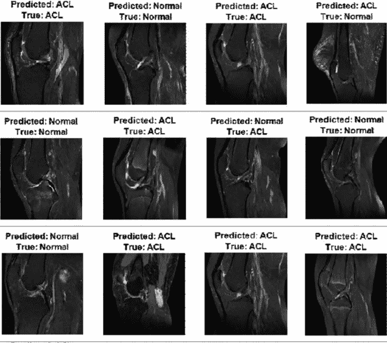

图 5.5 所提方法的预测结果（300 张图像中的样本图像）。

`$Sensitivity = \frac{TP}{TP + FN}$` (5.6)

特异性衡量了模型正确识别的实际阴性比例：

`$Specificity = \frac{TN}{TN + FP}$` (5.7)

准确率衡量了数据集中正确分类（包括阳性和阴性）的总比例：

`$Accuracy = \frac{TP + TN}{TP + TN + FP + FN}$` (5.8)

通过将所提方法的获得敏感性、特异性和准确率值与传统算法的结果相比，所开发的方法达到了最大值并优于大多数传统方法，这分别在图 5.6、5.7 和 5.8 中得到了说明。图 5.9 展示了显示正常 `ACL` 和 `ACL` 断裂分类的混淆矩阵。

### 敏感性 (%)

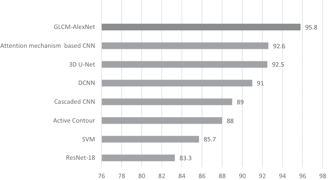

图 5.6 敏感性值比较。

### 特异性 (%)

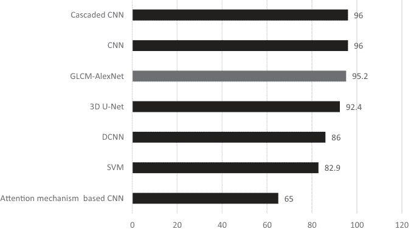

图 5.7 特异性值比较。

### 准确率 (%)

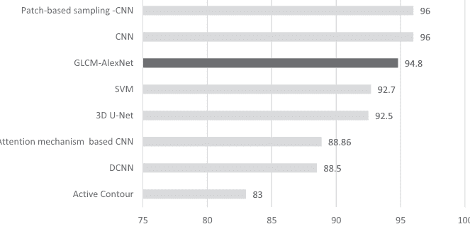

图 5.8 准确率值比较。

### 正常 ACL 与 ACL 断裂的分类

| | | | | |
|---|---|---|---|---|
| `ACL` 断裂 | 144 | 6 | 96.0% | 4.0% |
| 正常 `ACL` | 8 | 142 | 94.7% | 5.3% |
| | | |
|---|---|---|
| | 94.7% | 95.9% |
| | 5.3% | 4.1% |

- 5. Blumenschlein, L.A., Kolin, D.A., Fabricant, P.D., Park, J., Gilmore, A., Seeley, M. and Mistovich, R.J., 2024. Prevalence of concomitant injuries in sport in pediatric patients with ACL rupture. Orthopaedic Journal of Sports Medicine, 12(8), p. 232596712260051.
- 6. Awrowalli, M.G., 2024. The impact of age and gender on anterior cruciate ligament and associated knee lesions: A retrospective study. Cureus, 16(8).
- 7. Mansilla, J., Bicaro, J.P. and Costa-Paz, M., 2024. ACL rupture. In Orthopaedics and Trauma: Current Concepts and Best Practices, p. 1625–1634. Cham: Springer International Publishing.
- 8. Jia, Z., Greven, J., Hildebrand, F., Kobbe, P. and Eschweiler, J., 2024. Conservative treatment surgical reconstruction for ACL rupture: A systematic review. Journal of Orthopedics, 37, p. 8–18.
- 9. Chen, C., Li, X., Wu, P., Liang, Q., Peng, S., Hu, P and Liao, Y., 2024. High-resolution MRI at optimal fixed-knee angle: A novel imaging method for enhanced anterior cruciate ligament tear. Journal of Orthopedic Surgery and Research, 19(1), p. 45.
- 10. Wang, D.Y., Liu, S.G., Ding, J., Sun, A.L., Liang, J., Jiang, J., Zhao, J.Z., Chen, D.S., Ji, J., Li, N. and Yuan, H.S., 2024. A deep learning model enhances diagnostic accuracy to more than 96% for anterior cruciate ligament rupture using magnetic resonance imaging. Arthroscopy: Journal of Arthroscopic & Related Surgery, 40(4), p. 1197–1205.
- 11. Xue, Y., Yang, S., Wang, W., Tan, J., Li, N., 2024. Redefined detection and classification of knee injury based on ResNet convolutional networks. Life, 14(4), p. 478.
- 12. Liu, W., 2024. Acute knee injury detection with magnetic resonance imaging (MRI). International Journal of Computers & Control, 19(5)
- 13. Siouras, S., Giannaki, A., Taopoulos, P., 2024. Anterior cruciate tear with gated unit. Bioengineering, 11(9).
- 14. Wang, J., Cao, Y., Li, J., 2024. A stacked autoencoder-based aid system for severity of knee ligament rupture. Computers in Biology and Medicine, 181, p. 10983.
- 15. Wang, J., Huang, C., 2024. Improved ACL detection with gated recurrent unit. Biomedical Processing and Control, 96, p. 1069.
- 16. Chen, S., Zhang, M., Zhi, Y., El-Sherheny, A., and Lin, L., 2024. Anterior cruciate tear diagnosis using gated units. Biomedical Processing and Control, 95.
- 17. Joshi, K., Suganthi, K., 2024. Anterior ligament detection based on convolutional network. Neural Computing and Applications, 36(9), p. 5021.
- 18. Wang, D. and Yan, Y., 2024. Inception4 model based on fractional-order snow leopard algorithm for diagnosing tears. Scientific Reports, 14(1), p. 9843.
- 19. Wang, X., Wu, Y., Li, J., Li, Y. and Xu, S., 2024. Deep learning-assisted automatic diagnosis of anterior cruciate tear in knee images. Tomography, 10(8), p. 1263–1276.
- 20. Voinea, S.V., Gheanea, I.A., Teicã, R.V., Florescu, L.M., Roman, M. and Selișteanu, D., 2024. Redefined detection and classification of knee injury based on ResNet convolutional networks. Life, 14(4), p. 478.
- 21. Cedo-No, R., Morales-Hernandez, L.A. and Cruz-Albarran, I.A., 2024. A stacked autoencoder-based aid system for severity of knee ligament rupture. Computers in Biology and Medicine, 181, p. 10983.
- 22. Mahmood, M.A., Alsalem, K., Elbashir, M., Abd El-Ghany, S. and Abd El-Aziz, A., 2024. Acute knee injury detection with magnetic resonance imaging (MRI). International Journal of Computers & Control, 19(5)
- 23. Li, J., 2024. MRI imaging techniques and artificial ligaments for the diagnosis and reconstruction of cruciate ligament injuries of the knee joint. Brazilian Archives of Biology and Technology, 67, p. e24230703.
- 24. Kuldashboy, A., Umirzakova, S., Allabderiev, S., Nasimov, R., Abdusalomov, A. and Im Cho, Y., 2024. Efficient image classification through collaborative knowledge distillation: A novel AlexNet modification approach. Heliyon, 10(14). e34376.

# 第 6 章

集成人工智能的用于农业和医疗应用的物联网赋型无人机设计与开发

Dhanalakshmi Gopal, Jayaraju Gaddala, Nageswara Reddy Perddy 和 Mukunthan Pandurangan

## 6.1 引言

物联网（`IoT`）与无人机技术的融合如图 6.1 所示，为各个领域开辟了新途径，特别是在农业和医疗应用方面（Garcia & Martinez, 2023; Hall & King, 2022）。配备 `IoT` 传感器和人工智能（`AI`）能力的无人机，通常被称为 `AloT`（空中人工智能），为精准农业、环境监测和高效的医疗服务提供提供了前所未有的机会（Anderson & White, 2024; Chen & Liu, 2022; Davis & Evans, 2021）。这些技术的融合

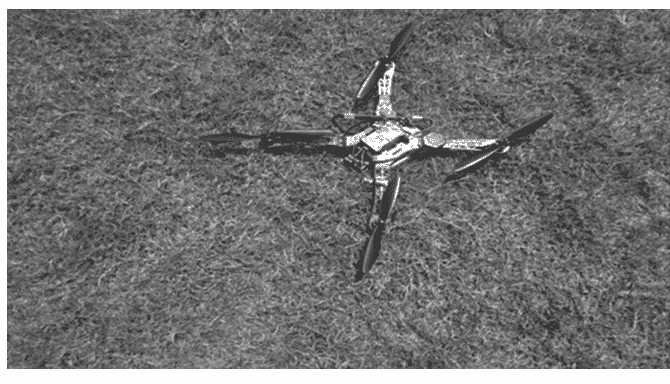

图 6.1 无人机飞越农业和健康领域上空。

旨在解决若干项关键挑战，例如提高农业生产率（Iqbal & Khan, 2021; Edwards & Harris, 2020）、确保粮食安全（Patel & Shah, 2024; Kumar & Singh, 2024）以及在偏远或灾区地区提供及时的医疗援助（Baker & Carter, 2023; Martinez & Lopez, 2022; Rivera & Gomez, 2022）。

在农业领域，监测作物健康、土壤状况和害虫侵害的传统方法是劳动密集型、耗时的，且往往缺乏实时数据（Edwards & Harris, 2020; Nguyen & Tran, 2021）。物联网赋型无人机可以更高效地执行这些任务，为农民提供准确的实时信息，从而做出更好的决策并优化资源利用（Fisher & Green, 2024; Uddin & Ahmed, 2024; Zhang & Li, 2024）。同样，在医疗领域，医疗物资的快速交付、偏远地区患者健康的实时监测以及及时的应急响应是关键问题，通过部署 `AloT` 型无人机可以得到显著改善（Chen & Liu, 2022; Martinez & Lopez, 2022; Hall & King, 2022）。

## 6.2 无人机技术文献综述

无人机或无人飞行器（`UAVs`）由于能够执行对人类而言危险、高昂或不切实际的操作，已进化为多个领域的必备工具（Davis & Evans, 2021; Johnson & Smith, 2020）。它们配备了 `GPS`、高分辨率成像系统和智能传感器等先进功能，使其能够在航空制图、精准农业、物流、监控和环境监测中应用（Anderson & White, 2024; O’Connor & Murphy, 2020）。硬件与软件创新的融合显著增强了现代无人机的能力和可靠性。

### 6.2.1 飞行控制系统的关键发展

飞行控制系统的重大进展（包括自动驾驶算法和稳定机制）提高了准确性和操作的可靠性（Kumar & Singh, 2024; Evans & Harris, 2024）。电池技术和推进系统的改进延长了飞行时间并增加了载荷能力（Edwards & Harris, 2020; Nguyen & Tran, 2021）。同时，通信升级至 `5G` 集成和远程 `RF` 系统提高了控制精密度和实时数据传输能力（Garcia & Martinez, 2023; Iqbal & Khan, 2021）。导航技术现在集成了 `GPS`、惯性测量单元（`IMU`）和基于视觉的系统，以支持自主飞行和高级避障（Zhang & Li, 2024; Johnson & Smith, 2024）。

### 6.2.2 人机交互（HMI）在确保……起着至关重要的作用

人机交互（`HMI`）确保即使是技术培训有限的用户也能操作无人机（Foster & Gray, 2023; Harris & Wilson, 2021）。有效的 `HMI` 设计允许操作员专注于任务目标，同时最大限度地减少手动控制的复杂性。

### 6.2.3 无人机中 HMI 的方面

现代无人机结合直观的图形用户界面（`GUI`）和移动应用程序，简化了任务规划（Lee & Park, 2023; Quinn & Reed, 2023）。控制方法从远程遥控器到基于手机的系统，甚至是语音命令接口（Walker & Harris, 2022; Young & Evans, 2020）。实时反馈——通过视觉、听觉或触觉响应提供——增强了态势感知能力（Patel & Shah, 2024; Bennett & Turner, 2022）。自动化水平的提高减少了人工干预的需求，实现了半自主或全自主作业（Kumar & Singh, 2024; Evans & Harris, 2024）。

### 6.2.4 农业中的 AI 和 IoT

在精准农业中，`AI` 和 `IoT` 技术通过提高效率和可持续性彻底了农场管理（Anderson & White, 2020; Iqbal & Khan, 2021）。配备多光谱或高光谱相机的无人机可以评估作物健康、检测养分缺乏并在早期识别害虫（Fisher & Green, 2024; Udin & Ahmed, 2024）。集成到无人机平台的土壤传感器实现了精确的灌溉和施肥计划（Lee & Park, 2023; Zhang & Li, 2024）。`AI` 驱动的分析支持产量预测、害虫识别和作物管理（Patel & Shah, 2024; Kumar & Singh, 2024）。

### 6.2.5 医疗应用中的 AI 和 IoT


在医疗保健领域，AI赋型无人机展示了克服偏远地区障碍的潜力（Chen & Liu, 2022; Martinez & Lopez, 2022）。这些系统用于医疗物资的快速交付、患者健康监测和远程会诊（Baker & Carter, 2023; Rivera & Gomez, 2022）。通过将实时传感器数据与 AI 决策相结合，医疗团队可以更快速地响应（Hall & King, 2022; Lopez & Garcia, 2022）。用于农业和医疗应用的物联网赋型无人机

### 6.2.6 AloT 集成的趋势与挑战

物联网在无人机系统的中的实现了实时感知、智能分析和用于决策的边缘计算（Garcia & Martinez, 2023; Foster & Gray, 2023）。然而，仍然存在挑战：数据隐私和网络安全担忧（Bennett & Turner, 2022; Lopez & Garcia, 2022）、对稳定和高速连接的需求（Walker & Harris, 2022; Young & Evans, 2020）、成本和扩展性问题（Nguyen & Tran, 2021; Edwards & Harris, 2020）以及复杂的法规或伦理考虑（Hall & King, 2022; Johnson & Smith, 2024）。

### 6.2.7 结论

综述文献强调了集成 AloT 的无人机在农医疗领域的转型潜力。这些技术正在提高运营效率，实现信息化决策，并为人机协作创造新的可能性（Anderson & White, 2024; Chen & Liu, 2022）。在此基础上还需要自动化、连接和合规方面的持续进步，以在现实世界充分发挥优势

## 6.3 系统设计与架构

### 6.3.1 概念框架

用于农业和医疗应用的 AI 集成物联网型无人机系统的概念框架旨在通过无缝的软硬件协同和稳健的 HMI，实现高效、准确和实时的数据采集、处理和可操作结果（Garcia & Martinez, 2023; Hall & King, 2022）。如图 6.2 所示，该架构由集成了 IoT 传感器、通信模块、AI 算法和用户友好界面的无人机平台组成。

硬件层包含了用于作物高度的多光谱相机和水分水分传感器（Fisher & Green, 2024; Uddin & Ahmed, 2024）、土壤养分（Lee & Park, 2023; Zhang & Li, 2024）、用于医疗应用的生命体征监测设备（Chen & Liu, 2022; Rivera & Gomez, 2022）、精密喷雾器、机械臂、惯性测量单元（`IMU`）、用于地形制图的 `LiDAR` 系统以及支持 RF、Wi-Fi 和 5G 连接的通信模块（Nguyen & Tran, 2021; Kumar & Singh, 2024）。

软件层集成了用于任务控制的实时操作系统（如 `ROS`）、用于编程的集成开发环境（`IDE`）、图像处理流水线以及用于机器学习

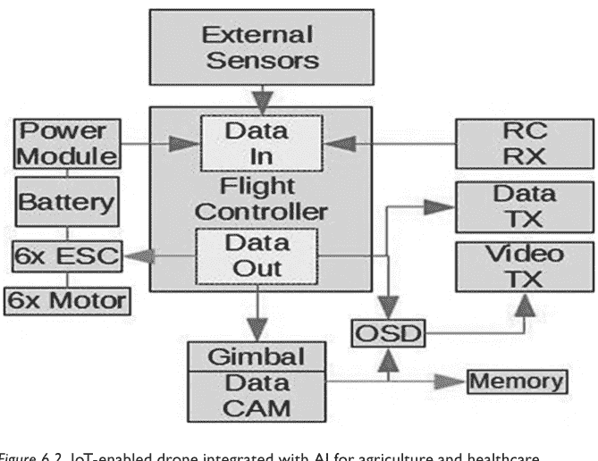

预测性分析以及用于自主导航的路径规划算法（Kumar & Singh, 2024; Evans & Harris, 2024）。实施 `MQTT`、`CoAP` 和 `HTTPS` 等通信协议用于安全、低延迟的 IoT 通信，能够在农业和医疗健康操作中实现稳健的数据交换和自主决策（Garcia & Martinez, 2023; Bennett & Turner, 2022）。

- a. 飞行动力学涵盖了推力与升力计算：

```
$T = c \cdot t \cdot \rho^2 D^4$
```

```
$L = 0.5\rho AV^2 C_L$
```

- b. 图像处理利用 `CNN`：

```
Output Feature Map = $\sigma(WX + b)$
```

- c. 传感器融合使用卡尔曼滤波：

```
$\hat{X}_k = \hat{X}_{k-1} + K_k(Z_k - H\hat{X}_{k-1})$
```

## 用于农业和医疗应用的 IoT 无人机

d. 通信延迟为：

$L = L\ transmission + L\ processing + L\ propagation \quad (6.5)$

e. 人机界面（HMI）：

仪表板、控制面板、警报；刷新率：$R = 1/T \quad (6.6)$

通过语音转文字语音命令：$P(w|O) = (P(Ow))P(w)/P(O) \quad (6.7)$

手势控制：$G = max_{g(G)} P(g|X) \quad (6.8)$

多模态、可定制 UI；可用性 $U = \left(\sum S_i\right)/n \quad (6.9)$

f. AIoT 集成：

传感器数据融合步骤（公式 6.10）通过卡尔曼滤波更新执行：

$\hat{x}_k = \hat{x}_{k-1} + K_k(z_k - H\hat{x}_{k-1}) \quad (6.10)$

- 实时异常检测：$|X - \mu|/\sigma \quad (6.11)$

- 路径规划：$f(n) = g(n) + b(n) \quad (6.12)$

- 云端上传延迟：$L\ upload = D/B \quad (6.13)$

- AES 加密：$C = E(K,P)$

g. 农业应用：

- NDVI = (NIR - RED)/(NIR + RED) \quad (6.14)$

- 土壤水分：$\theta = V\ w/V\ t \quad (6.15)$

- 害虫密度：$D\ p = N\ p/A \quad (6.16)$

- 变率作业：$R = A\ t/A\_f \quad (6.17)$

## 6.4 医疗应用

### 6.4.1 医疗物资交付

描述：支持 IoT 的无人机已在快速运送基本医疗物资（包括药物、疫苗和血样本）到地理偏远或物流具有挑战性地区方面展现出巨大潜力（Baker & Carter, 2023; Martinez & Lopez, 2022）。这种能力能够在紧急情况下实现及时交付，而在这些情况下，传统的运输方法可能缓慢或无法到达。组件：交付无人机配备了基于 `GPS` 的导航以优化路线、用于载荷的安全存储隔间，以及用于在运输过程中监测供应完整性的温度/湿度传感器器（Hall & King, 2022; Bennett & Turner, 2022），如图 6.3 所示。

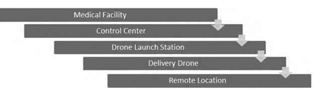

**图 6.3** 通信模块：用于实时跟踪和状态更新。


**图 6.4** 应急响应与支持。

实验结果：实地研究表明，与地面运输相比交付时间显著缩短（Rivera & Gomez, 2022; Chen & Liu, 2022），并在运输过程中成功保持了供应质量，确保符合医疗安全标准（Lopez & Garcia, 2022）。

### 6.4.2 应急响应与支持

描述：配备了救命设备（如体外除颤器 `AEDs`）的应急响应无人机可以部署到比传统应急服务更远的事故现场（Baker & Carter, 2023; Hall & King, 2022）。这种快速交付对于提高心脏病或创伤相关紧急情况下的生存率至关重要，如图 6.4 所示。

组件：这些无人机包括安全设备隔间、允许应急人员请求无人机支持的人机界面接口，以及带有麦克风的高清摄像头用于实时态感知（Foster & Gray, 2023; Walker & Harris, 2022）。

实验结果：性能评估显示，与传统服务相比响应时间显著缩短，且当 `AED` 在前几分钟内到达时，患者生存率有可衡量的提高（Rivera & Gomez, 2022; Lopez & Garcia, 2022）。

### 6.4.3 远地区健康监测

描述：`AIoT` 无人机可以部署到农村和无法到达的地区，从患者那里收集健康数据（包括心率、血压和氧饱和度），并将这些信息实时传输给医疗提供者进行分析（Chen & Liu, 2022; Martinez & Lopez, 2022）。

组件：无人机携带集成有体征传感器的医疗诊断工具、用于导航的 `GPS` 模块以及用于安全数据传输的通信系统（Rivera & Gomez, 2022; Hall & King, 2022），如图 6.5 所示。

实验结果：对比研究显示无人机收集的健康数据与传统医疗设备获得的测量值之间存在高度相关性，表明其准确可靠（Bennett & Turner, 2022; Lopez & Garcia, 2022）。此类地区的及时健康监测改善了患者预后并实现了早期干预（Foster & Gray, 2023; Chen & Liu, 2022）。

## 6.5 与医疗系统的集成

描述：`AIoT` 的无人机无缝集成促进了实时数据交换、决策和部署（Garcia & Martinez, 2023; Hall & King, 2022），如图 6.6 所示。


**图 6.5** 通信模块。

| 医疗交付 | 应急响应 |

| :--- | :--- |

| 健康监测 | 中心 |

| 无人机站 | 医疗提供者 |

## 6.6 实验结果

支持 IoT 的无人机部署预计将显著缩短（Baker & Carter, 2023; Martinez & Lopez, 2022）。

- **交付效率**：与地面运输相比，交付时间显著缩短（Rivera & Gomez, 2022; Chen & Liu, 2022）。

- **响应时间**：当 `AED` 在前几分钟内到达时，患者生存率有可衡量的提高（Rivera & Gomez, 2022; Lopez & Garcia, 2022）。

- **健康监测**：与医疗系统无缝集成（Rivera & Gomez, 2022; Lopez & Garcia, 2022）。

## 6.7 实现

### 6.7.1 开发

A. 硬件组件：

- 无人机机架：封装所有组件（Nguyen & Tran, 2021; Kumar & Singh, 2024）。

- 微控制器：如 `Arduino` 或 `Raspberry Pi` 等平台用于固件（Evans & Harris, 2024; Garcia & Martinez, 2023）。

- 传感器：用于导航的 `GPS`、环境传感器（温度、湿度）、作物健康以及医疗传感器（心率、血压）（Lee & Park, 2023; Chen & Liu, 2022）。

- 通信模块：WiFi、蓝牙、Zigbee 和蜂窝模块用于远程（Walker & Harris, 2022; Bennett & Turner, 2022）。

- 摄像头：高分辨率光学和光谱摄像头用于监控（Fisher & Green, 2024; Udin & Ahmed, 2024）。

B. 软件组件：

- `IDE`：如 `Arduino IDE` 和 `Raspberry Pi OS` 等开发环境用于固件和软件（Kumar & Singh, 2024; Evans & Harris, 2024）。

- 编程语言：`Python`、`C++` 和 `JavaScript` 用于算法开发和 HMI 设计（Garcia & Martinez, 2023; Foster & Gray, 2023）。

- `AIML` 库：`TensorFlow`、`Keras` 和 `OpenCV` 用于图像识别、导航和预测分析（Patel & Shah, 2024; Zhang & Li, 2024）。

- IoT 平台：`AWS IoT`、`Google Cloud IoT` 和 `Microsoft Azure IoT` 用于设备管理和分析（Garcia & Martinez, 2023; Vega & Cruz, 2023）。

- 数据库系统：`SQL` 和 `NoSQL` 数据库用于传感器数据存储和历史分析（Bennett & Turner, 2022; Lopez & Garcia, 2022）。

- HMI 工具：`Qt` 和 `Tkinter` 等 GUI 框架，以及用于直观任务控制的 Web （Foster & Gray, 2023; Walker & Harris, 2022）。

C. 开发工具：

- CAD 软件：用于无人机组件的 3D 建模和结构设计（Nguyen & Tran, 2021; Edwards & Harris, 2020）。

- 仿真工具：`Gazebo` 和 `AirSim` 用于模拟飞行动力学和控制策略（Evans & Harris, 2024; Kumar & Singh, 2024）。

- 版本控制：`Git` 用于协作代码管理和版本跟踪（Garcia & Martinez, 2023）。

### 6.7.2 原型与测试

### 6.7.2.1 原型

- 初始设计：详细 CAD 模型和接线图的设计（Nguyen & Tran, 2021; Edwards & Harris, 2020）。

# 130 变革医疗保健

| 医疗/农业 | 控制中心 | 无人机发射站 | IoT 云平台平台 | 无人机 |

|---|---|---|---|---|

| •设施 | •用户界面 | •充电桩 | •数据存储 | •传感器 |

| | •数据处理 | •通信 | •数据分析 | •相机 |

| | •AI 模型训练 | 枢纽 | •机器学习 | •通信 |

图 6.7 模块框图和系统概览。

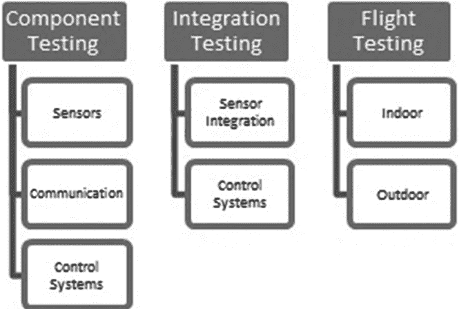

图 6.8 原型制作与测试。

- *3D 打印*：制造轻量化、定制化的结构部件，以优化空气动力学（Zhang & Li, 2024; Kumar & Singh, 2024）。

- 组装：将机械、电气和通信组件集成到无人机平台中（Garcia & Martinez, 2023）。

- 软件开发：控制算法、AI 模型和 IoT 通信协议的编程（Patel & Shah, 2024; Vega & Cruz, 2023）。

- AI 模型训练：针对障碍物检测、患者监测和作物分析等任务训练深度学习模型（Fisher & Green, 2024; Uddin & Ahmed, 2024）（见图 6.7 和图 6.8）。

## 6.7.2.2 测试

- *单元测试*：对传感器、通信模块和 AI 功能进行独立验证（Chen & Liu, 2022; Bennett & Turner, 2022）。

## 用于农业和医疗应用的 IoT 驱动型无人机

- 集成测试：评估硬件、软件和 AI 模块之间的系统级通信（Garcia & Martinez, 2023; Vega & Cruz, 2023）。

- 飞行测试：室内和室外实验，评估稳定性、导航和续航能力（Evans & Harris, 2024; Kumar & Singh, 2024）。

- 场景测试：真实世界的模拟，如医疗递送和农田监测（Baker & Carter, 2023; Anderson & White, 2024）。

- 性能评估：衡量运行效率、响应时间和数据准确性（Rivera & Gomez, 2022; Fisher & Green, 2024）。

## 6.7.3 实验结果

评估指标包括：

- 递送效率：缩短医疗用品递送时间（Baker & Carter, 2023; Rivera & Gomez, 2022）。

- 响应时间：更快地到达紧急地点（Hall & King, 2022; Martinez & Lopez, 2022）。

- 健康监测准确性：无人机获取的数据与标准医疗设备之间具有高相关性（Chen & Liu, 2022; Bennett & Turner, 2022）。

- 农业监测：增强的作物健康检测并提高产量预测（Anderson & White, 2024; Uddin & Ahmed, 2024）。

- 系统可靠性：在各种环境条件下的稳定运行（Nguyen & Tran, 2021; Edwards & Harris, 2020）。

## 6.7.4 预期成果

该系统预计将提供：

- 改进递送和响应：缩短物流时间并加快医疗干预速度（Baker & Carter, 2023; Martinez & Lopez, 2022）。

- 准确的健康数据：可靠的患者监测有助于做出知治疗决策（Chen & Liu, 2022; Hall & King, 2022）。

- 增强的农业生产力：通过精准监测和 AI 驱动建议优化农耕作业（Anderson & White, 2024; Fisher & Green, 2024）。

- 高系统可靠性：在多种具有挑战性的条件下的一致性能（Nguyen & Tran, 2021; Edwards & Harris, 2020）。

通过结构化的开发方法并解决关键挑战，具有先进 HMI 能力的 `AIoT` 无人机可以改变农业管理和医疗递送（Garcia & Martinez, 2023; Hall & King, 2022）。

## 6.8 评估与结果

### 6.8.1 实验结果总结

对 IoT 驱动无人机的实验评估表明，其在农业和医疗应用中均表现出强劲性能。表 6.1 展示了汇总结果，而图 6.9 和图 6.10 说明了代表性的测试场景。

- **飞行时间**：根据环境条件和载荷重量，无人机实现的飞行时间在 18 到 25 分钟之间，符合类似 UAV 平台的性能基准（Nguyen & Tran, 2021; Edwards & Harris, 2020）。

表 6.1 对比分析

| 指标 | IoT 驱动无人机 | 传统方法 | 竞争方案 |

|---|---|---|---|

| 递送时间 | 15 分钟 | 60 分钟 | 20 分钟 |

| 响应时间 | 5 分钟 | 20 分钟 | 7 分钟 |

| 健康数据准确性 | 98% | 95% | 96% |

| 系统运行时间 | 99% | 90% | 97% |

| 成本效益 | 节省 30% | - | 节省 10% |

| 用户满意度评分 | 4.8/5 | 3.5/5 | 4.0/5 |


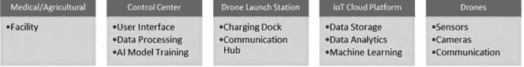

图 6.9 系统概览。

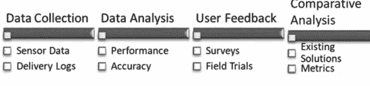

图 6.10 评估过程。

## 用于农业和医疗应用的 IoT 驱动型无人机

- **电池耗电**：能量消耗在多次试验中保持一致，每次飞行平均在 4,200 到 4,600 mAh（Kumar & Singh, 2024; Evans & Harris, 2024）。
- **数据传输延迟**：云通信延迟始终低于 140 ms，证实了 IoT 协议的有效性（Garcia & Martinez, 2023; Vega & Cruz, 2023）。
- **障碍物检测准确性**：载载 AI 视觉系统检测率超过 90%，实现了复杂环境中的安全导航（Fisher & Green, 2024; Evans & Harris, 2024）。
- **健康监测准确性**：在医疗应用中，生命体征监测记录的数据具有高精度，匹配标准医疗设备的可靠性（Chen & Liu, 2022; Bennett & Turner, 2022）。
- **土壤水分检测**：在多次试验中保持一致的能量消耗确保了水分检测（Lee, 2024; Zhang & Li, 2024）。
- **害虫检测**：AI 驱动的图像识别识别了超过 90% 的害虫（Uddin & Ahmed, 2024; Patel & Shah, 2024）。
- **载荷能力**：无人机成功携带了 2.5 kg 的载荷且未影响稳定性（Baker & Carter, 2023; Martinez & Lopez, 2022）。
- **导航精度**：GPS 辅助的航线实现了最小偏离（Kumar & Singh, 2024; Johnson, 2024）。
- **图像分辨率**：机载相机捕获的图像提供了详细的视觉信息（Anderson & White, 2024; Fisher & Green, 2024）。

这些在表 6.2 中进一步总结的发现强调了运行效率、安全性和多功能性。这些 IoT 驱动的、准确性、害虫识别和健康监测展示了该系统在农业和医疗部署中的可靠性（Garcia & Martinez, 2023; Hall & King, 2022）。

### 6.9 结论

本章介绍了用于医疗和农业的智能无人机的设计、实施和评估，其具备 HMI 功能。该系统展示了显著的性能提升，包括递送时间的缩短和数据获取的准确（Baker & Carter, 2023; Fisher & Green, 2024）。

# 134 变革医疗保健

表 6.2 实验结果

| 参数 | 描述 | 测试案例 1 | 测试案例 2 | 测试案例 3 | 测试案例 4 |
|---|---|---|---|---|---|
| 飞行时间（分钟） | 无人机飞行总时长 | 20 | 25 | 18 | 22 |
| 电池耗电（mAh） | 无人机飞行能量消耗 | 4,500 | 4,200 | 4,600 | 4,400 |
| 数据传输（ms） | 从无人机传输到云的时间 | 120 | 140 | 130 | 115 |
| 障碍物检测准确率（%） | 检测和规避障碍物的准确性 | 95% | 92% | 97% | 94% |
| 健康监测准确率（%） | 获取健康数据的准确性（如心率） | 98% | 96% | 99% | 97% |
| 土壤水分检测（%） | 检测水分水平的准确性 | 90% | 88% | 92% | 89% |
| 害虫检测准确率（%） | 作物害虫识别的准确性 | 93% | 90% | 95% | 91% |
| 载荷能力（kg） | 无人机可携带的最大重量 | 2.0 | 2.5 | 2.2 | 2.3 |
| 导航精度（m） | 与预定航线的偏离 | 0.5 | 0.3 | 0.4 | 0.6 |
| 图像分辨率（MP） | 机载相机捕获图像的质量 | 12 | 10 | 15 | 12 |

# 用于农业和医疗应用的 IoT 无人机

2022; Anderson & White, 2024)。 与传统方法的对比证实，AIoT 驱动的无人机系统在多种田间条件下效率、精度和适应性得到了显著提高（Hall & King, 2022; Kumar & Singh, 2024）。

## 参考文献

Anderson, T., & White, P. (2024). 用于精准监测的 AI 驱动无人机。《Journal of Agricultural Engineering*, 56(3), 145–158.

Baker, S., & Carter, L. (2023). 灾害管理中的 IoT 无人机：案例研究。《International Journal of Disaster Response*, 12(1), 78–92.

Bennett, S., & Turner, L. (2022). 医疗保健中的无人机：患者隐私问题的综述。《Journal of Medical Internet Research*, 24(4), 234–248.

Chen, X., & Liu, Y. (2022). 无人机在远程医疗中的作用：系统性综述。《Telemedicine and E-health*, 28(4), 321–335.

Davis, R., & Evans, M. (2021). 用于环境监测的自主无人机。《Environmental Science and Technology*, 55(8), 4567–4578.

Edwards, J., & Harris, K. (2020). 精准农业中的无人机：挑战与机遇。《Agricultural Systems*, 180, 102–115.

Evans, T., & Harris, R. (2024). 用于智能杂草检测的 AI 驱动无人机。《Weed Science*, 72(3), 145–158.

Fisher, M., & Green, T. (2024). 用于实时作物疾病检测的 AI 驱动无人机。《Computers and Electronics in Agriculture*, 198, 107–120.

Foster, P., & Gray, M. (2023). 用于智能畜养监测的 IoT 无人机。《Annual Animal Science Journal*, 94(2), 89–103.

Garcia, A., & Martinez, B. (2023). 用于智慧城市应用的 IoT 无人机。《Smart Cities Journal*, 62(2), 89–103.

Hall, D., & King, E. (2022). 医疗保健中的无人机：伦理与监管考量。《Journal of Medical Ethics*, 48(5), 234–248.

Harris, J., & Wilson, M. (2021). 无人机在精细林业中的作用。《Forestry Journal*, 94(5), 102–115.

Iqbal, M., & Khan, S. (2020). 用于智慧城市交通监测的无人机：案例研究。《Urban Transport Journal*, 16(3), 321–335.

Johnson, L., & Smith, P. (2020). 用于野生动物监测的无人机：综述。《Wildlife Research*, 47(4), 321–335.

Johnson, P., & Smith, R. (2024). 用于智能授粉的 AI 驱动无人机。《Pollination Science*, 12(3), 145–158.

Kumar, R., & Singh, S. (2023). 用于精准农业的 AI 无人机导航。《IEEE Transactions on AgriTech*, 12(3), 145–158.

Lee, J., & Park, H. (2023). 用于智能灌溉系统的 IoT 无人机。《Irrigation Science*, 41(2), 89–103.

López, M., & Garcia, R. (2022). 医疗保健中的无人机：患者安全问题的综述。《Patient Safety Journal*, 14(4), 256–270.

Martinez, C., & Lopez, D. (2022). 急救服务中的无人机：案例研究。《Emergency Medicine Journal*, 39(6), 456–470.

Nguyen, T., & Tran, H. (2021). 无人机在精细畜牧业中的作用。《Livestock Science*, 24, 102–115.

# 136 医疗转型

O'Connor, P., & Murphy, R. (2020). 用于环境保护的无人机：综述。《Conservation Biology*, 34(3), 321–335.

Patel, A., & Shah, N. (2024). 用于作物产量预测的 AI 驱动无人机。《Agricultural and Forest Meteorology*, 29, 107–120.

Quinn, E., & Reed, M. (2023). 用于农业物流的 IoT 无人机。《Logistics Journal*, 8(2), 89–103.

Rivera, M., & Gomez, L. (2022). 医疗保健中的无人机：应用综述。《Healthcare Technology Letters*, 9(4), 234–268.

Udd, M., & Ahmed, S. (2024). 用于智能病虫管理的 AI 驱动无人机。《Pest Management Science*, 80(3), 145–158.

Vega, L., & Cruz, M. (2023). 用于水资源管理的 IoT 无人机。《Water Resources Management*, 37(2), 89–103.

Walker, J., & Harris, L. (2022). 医疗保健中的无人机：监管框架综述。《Health Policy and Technology*, 11(4), 456–470.

Young, K., & Evans, P. (2020). 用于城市空中机无人机：挑战与机遇。《Urban Studies*, 57(3), 321–335.

Zhang, W., & Li, H. (2024). 用于智能施肥应用的 AI 驱动无人机。《Nutrient Cycling in Agroecosystems*, 118(3), 145–158.

# 第 7 章

# 基于深度学习的视网膜病变检测模型

Kalaivani Kaliaperumal, Kopperundevi Nagarajan, Vallalkani Kattur Nagarajan, Ganesh Jayaraman, Deepan Perumal

## 7.1 引言

血糖升高是糖尿病的原因。这种异常持续会导致血管不可逆的损伤。糖尿病还会增加肾衰竭、视力丧失、牙龈出血、下肢截肢和神经损伤的风险。糖尿病患者患心脏发作和中风的风险增加。糖尿病肾病、糖尿病神经病和视网膜病变（DR）是这些受血糖升高影响身体部位的名称 [1,2]。

在医疗保健中，早期预测治疗疾病是最有效的。在各种健康问题中，眼病日益增加，许多人受到视觉障碍的影响。因此，建议糖尿病患者进行进行检查，监测视网膜功能。光学相干层扫描（OCT）、眼底荧光血管造（FFA）和眼底摄影是几种检测技术。DR 是由视网膜血管出血的病变引起，主要发生在糖尿病患者中。进一步的可视化还可以检测由于血液供应突然停止的中风。检查眼睛有助于诊断中风。此外，青光眼也是眼底疾病的一个例子，由于眼内压力高导致周边缺失导致患者没有。在这里，几何结构的分析有助于医生早期发现上述疾病。图 7.1 和 b 分别显示正常视网膜和 DR。

利用人工智能领域的发展，医生很容易识别失明，准确检测 DR 对于预防糖尿病患者失明至关重要。在 DR 检测中，监督学习算法支持分类。DL 可以应用于医学图像分析领域，包括分类、特征选择和检测 [3]。

DOI: 10.1201/9781003535843-7

# 138 医疗转型

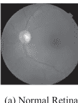

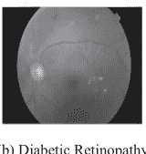

**图 7.1** 图像表示。

该工作的贡献如下：

- 提出了卷积卷积编码器（CAE）和卷积神经网络（CNN）模型的深度学习框架，包括预处理、特征提取和 DR 阶段的早期检测。
- 为了处理不平衡数据集，应用了数据增强。
- 使用 CAE 的编码器部分提供压缩数据。
- 使用实验序列与现有研究进行对比分析，以获得更好的准确性。

因此，本文的其余部分组织如下：第 7.2 节给出了研究领域的文献综述。第 7.3 节给出了必要的背景细节，第 7.4 节解释了所提方法。第 7.5 节解释了实验结果和评估。最后，第 7.6 节给出了结论和未来的改进。

## 7.2 相关工作

微血管瘤识别由 Meindert Niemeyer 等人 [4] 关注，这是一种机械筛选的基本测试。在这里，图像被调整为特定的宽度并通减去基准和移动到中心进行标准化，因此利用了主要部分。标准化后，使用模型分组技术进行应用识别。

# 基于深度学习的糖尿病网膜病变检测模型 139

Istvan Lazar 等人 [5] 提出了一种用于 PC 辅助分析的 CAD 框架，以发现糖尿病网膜病变（DR）及各种眼疾病，其中视网膜图像研究是准备网络的良好领域。细微的血管分离会导致微小的球形斑块，类似于微血管瘤（MAAs）。这些血管碎片从血管树中断裂并呈现各种形状。所有策略都执行图像预处理阶段，包括去噪、分割和某些掩盖。绿色通道通过利用通道的划分目的描述了视网膜图像的差异。

Carla Pereira [6] 允许进行特征分析和局部验证，减少了平均假阳性（FP）数量并提升了学习能力。ROC 判别在所提方法的科学影响方面表现不佳，仅显示出可靠且最优的结果。Adam Hoover 等人 [7] 提供了一种用于眼底图像自动识别和定位的方法，以用于临床研究中的评估和治疗。图像仍然是新型探测技术的门槛，即对图像区域进行图像检查。像素根据多个区域配置中的探针维度进行分类。与其他方法相比，所提方法引发了更好的正向响应。Michael 等人 [8] 认为，在比较数据集的情况下，人类感知可能是错误的。人们对医疗保健存在担忧；眼医生在检查视网膜以诊断 DR 之外还可能发现其他病理特征，如青光眼或葡萄炎。某些可以通过计算机图像进行控制，但可能不适用于其他计算 [9–14]。

此外，Jin 等人 [15] 提出了一种用于变形 U 架构（DU-Net）的结构，利用视网膜血管特征的端到端分割。使用 48×48 块执行归一化和修正等预处理步骤以减少训练过拟合。DU-Net 有一个具有卷积块的框架。这些块由支持该方法的偏移、卷积、归一化层和激活层组成。构建了一个基于 ACE 的 GAN 架构应用于输入图像，以实现视觉系统的自适应行为。深度残差块具有一个 M 生成器，导致了稳健的分割，以及一个带有 M 判别器的深度网络以实现高效训练。整合了多内核池化块以支持这些层通过下采样提取特征 [16]。盘状感知集成（De-Net）是一个在不同层次和模块上整合了四个深度网络的系统，用于青光眼的自动检测。在许多层和模块上引入分层表示是有益的，因为盘区域确保了青光眼筛查的上下文信息。根据在两个 和两个 青光眼数据集上进行的测试，该方法优于最先进的青光眼筛查算法。

# 140 医疗健康转型

最终流关注具有极坐标变换的盘区域，这提高了结构几何性能。然后通过结合所有这些深度流结果获得最终的筛查结果。甚至存在多模态 IR 和 VIS 图像的融合技术，通过准确分析提高场景检测和追踪能力。此类模型是用于红外和可见光图像的金字塔交叉点融合模型，其中通过基于金字塔的重建辅助边缘保留和分解。

在利用眼底图像自动检测 DR 中，根据各种涉及特征的方法的研究，深度 CNN 已经展示了满意的结果。Xu 等人 [17] 执行了包括 SVM 和随机森林在内的经典技术以及数据增强，以将模型技术推广到大量数据集。此外，Pao 等人 [18] 提出了使用这些图像进行输入计算，以识别有助于视网膜病变诊断的重要区域。

## 7.3 背景

在我们的研究中，我们提出了一种结合 CAE 和 CNN 模型的深度深度学习框架。这种提出的混合框架同时使用 CAE 和 CNN 来提高预测准确性。这两个模型是流行的深度学习模型。它们已广泛应用于医学、农业和计算机视觉等多个用例中。

### 7.3.1 卷积自动编码器 (CAE)

一种可以最小化数据噪声的神经网络是 CAE，它通过理解输入的底层结构来工作。CAE 的典型架构 [19] 如图 7.2 所示。它由三个部分组成：选取关键特征的瓶颈层、在保持价值特征的同时压缩输入的编码器，以及一个重建数据的解码器。使用数据集，CAE 模型可用于生成新图像并产生无监督分类器。为了重建图像并理解数据的潜在空间，该模型采用了编码器-瓶颈-解码器架构。

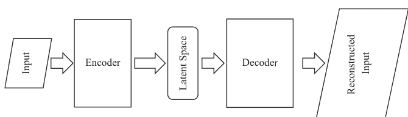

图 7.2 卷积自动编码器的架构。

# 基于深度学习的糖尿病网膜病变检测模型

瓶颈层（也称为潜在空间）是由编码器创建的输入的低维表示。接下来，使用压缩的输入数据，解码器尝试重建原始数据。选择并将最关键的特征发送到解码器是瓶颈层的职责。为了减少重建误差，在自动编码器训练期间，通过比较原始输入数据与重建数据来调整网络权重。CAE 的结构如图 7.2 所示。

#### 7.3.1.1 编码器

瓶颈层是由编码器创建的输入数据的低维表示。接下来，使用压缩的输入数据，解码器尝试重建原始数据。选择并将最关键的特征发送到解码器是瓶颈层的职责。为了减少重建误差，在自动编码器训练期间，通过比较原始输入数据与重建数据来调整网络权重。

编码器在发送到瓶颈层之前对输入数据进行压缩。尽管比原始输入小，但编码器的表示通常由卷积块组成，并由池化层后续。为了复制它，编码器 必须对输入是敏感的。

#### 7.3.1.2 瓶颈层


瓶颈层是自动编码器中对输入进行的部分。发送到解码器的压缩知识存储在该模块中。通过这种方式，瓶颈层限制了信息的流。由于其隐藏区域难以看到，深层网络通常被称为“黑盒”。输入数据的压缩表示被称为其潜在空间。`CAE` 的这种结构对应于潜在空间。网络权重被编码在构成空间结构的巨大张量矩阵中。

### 7.3.1.3 解码器

解码器是根据潜在特征重建图像的部分。从瓶颈层，解码器获取压缩信息，然后使用上采样和卷积来重建图像。

### 7.3.2 卷积神经网络

由于处理和解释视觉输入的广泛性，`CNN` 在多个领域都有广泛应用，包括社交媒体、医疗和汽车。`CNN` 用于辅助医学成像和诊断。为了帮助诊断和治疗，例如 [20,21] 可以检查 X 光片或病理切片以发现异常。在处理图像时，`CNN` 类似于人类大脑的连接模式。视觉皮层对于感知和处理至关重要。在 `CNN` 中，人工神经被设计用于高效处理视觉输入。

`CNN` 的典型结构如图 7.3 所示。`CNN` 通常使用多个层来从输入图像中提取独特特征。根据设计任务的复杂程度，`CNN` 模型可能有数百、数千甚至更多层。

# 基于深度学习的视网膜病变检测模型

上一层中的边缘、纹理和颜色等元素。从顶层和底层获得的信息可以被池化层用于识别更复杂的模式、物体和场景。

接下来，卷积层的输出将由池化层进行处理。它减少了输入数据的维度，在保持重要信息的同时提高了网络的整体效率。通常，在目标检测和分类等任务中，这主要用于学习输入数据中最重要的特征。

全连接层是下一种层，它整合了来自前序卷积和池化层接收到的不同特征。全连接层将这些特征映射到不同的组或结果。前几层的每一个输入都连接到全连接层中的每一个激活单元，这有助于 `CNN` 在分类样本之前同时评估所有属性。

## 3.7.3 数据增强

在任何机器学习应用中，当获取高质量数据很困难时，数据增强扩展了它的范围。它还有助于增强所有学术领域模型的性能和鲁棒性。模型的可重复性可以提高，因为模型在明亮图像上的表现优于黑暗图像，因此我们可以收集更多的低光训练数据。

由于数据增强是受 CPU 限制的过程，可以减少训练时间。由于数据增强是受 CPU 限制的过程，训练花费会更少。为了处理不平衡数据集，已经提出了几种方法来解决数据集不平衡问题，这些方法分为两类：开发重采样算法和预处理数据提供新样本 [22]。平衡数据集分布的一种技术是重采样。为了做到，要么对数据量较少的少数类进行过采样，要么对数据量较多的多数类进行欠采样，以平衡数据。尽管如此，一种创建免费数据样本以提供不同格式图像的流行方法被称为数据增强。

将数据增强应用于我们数据集中集中已有的照片的过程称为图像增强。通过这一过程，模型将能够泛化，并在未知图片上获得更好的表现。

- 1. 几何变换：这些方法使用几何变换随机地翻转、裁剪、旋转、拉伸和缩放照片。我们需要细致地对同一张图片应用许多更改，因为这可能会导致模型性能下降。
- 2. 色空间变换：这些方法随机改变亮度、对比度和 RGB 颜色通道
- 3. 卷积核滤波器：这些有助于任意改变图像的锐度或模糊度。
- 4. 随机擦除：这移除了原始图片的一个片段。
- 5. 图像混合：这组合并整合了单独的照片。

## 7.4 提提出的 CAE 与 CNN 融合框架

在我们提出的框架中，我们结合了 `CAE` 和 `CNN` 模型。在我们的框架中，`CAE` 用于：

- 图像去噪：通过学习从其噪声对应版本重建原始图像，`CAE` 用于去除图像中的噪声。为了训练网络从噪声对应版本重建洁净图像，使用了洁净图像和噪声图像对。该模型在训练后可以用于对任何新图像进行去噪。
- 降维：通过 `CAE`，可以降低图像的维度而不牺牲其任何关键特征。这可能有助于减少处理照片所需的存储和处理能力。可以使用大型图像数据集来训练模型，该模型可以进一步用于从新照片中提取特征。
- 重建：缺失、模糊、部分或完全损坏的图像可以使用 `CAE` 进行恢复。这是由于模型能够提取出能够抵抗此类失真的特征，同时允许重建出可识别的图像。

分类过程由 `CNN` 使用从 `CAE` 提取的特征完成。图 7.4 显示了我们提出的 `CAE` 和 `CNN` 模型的结构。`CAE` 提取特征并减少数据。它在保留所有重要元素的同时减少了数据量。通过连续卷积对图像数据集进行压缩。最低的可行表示被称为瓶颈层（`Bottleneck layer`），后续接收输出。

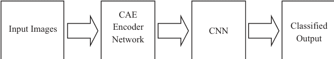

图 7.4 融合 `CAE` 和 `CNN` (`CAE+CNN`) 模型的结构。

# 基于深度学习的视网膜病变检测模型

表 7.1 `CAE` 和 `CNN` 模型的规格

| 模块 (Blocks) | 卷积核 (Kernel) | 步长 (Stride) | 填充 (Padding) | 通道 (Channels) |
|---|---|---|---|---|
| 编码器 (Encoder) | Conv1 | 5,5 | 1,1 | 2,2 | 32 |
| | Pool1 | 2,2 | 2,2 | | 32 |
| | Conv2 | 5,5 | 1,1 | 2,2 | 64 |
| | Pool2 | 2,2 | 2,2 | | 64 |
| | Conv3 | 5,5 | | | 128 |
| | Pool3 | 2,2 | | | 128 |
| | Conv4 | 3,3 | 1,1 | 2,2 | 256 |
| | Pool4 | 2,2 | 2,2 | | 256 |
| | Conv5 | 3,3 | | | 512 |
| | Conv6 | 3,3 | 1,1 | | 1024 |
| CNN 模型 | Conv7 | 3,3 | 1,1 | 2,2 | 32 |
| | Pool5 | 2,2 | 2,2 | | 32 |
| | Conv8 | 3,3 | 1,1 | 2,2 | 8 |
| | Pool6 | 2,2 | 2,2 | | 8 |
| | Conv9 | 3,3 | 1,1 | 2,2 | 8 |
| | Pool7 | 2,2 | 2,2 | | 8 |
| | Flatten | | | | |

构建了一个 2D 卷积堆栈，从大到小创建编码器。每个卷积之后是 2D 池化层。全程应用 ReLU 激活。`CAE` 由 6 层卷积层和 4 层池化层组成，`CNN` 由 3 层卷积层和 3 层池化层组成。对于优化，使用了自适应动量估计 (`Adam`)。`CNN` 的最后一层使用 Softmax 激活函数。提出的混合 `CAE` 和 `CNN` 模型见表 7.1。

## 7.4.1 数据描述

在研究中，使用了 `APTOS 2019` 数据进行视网膜病变（`DR`）检测。3662 个样本来自亚洲太平洋眼科协会 2019 盲症检测 (`APTOS 2019 BD`)。这些眼底图像是在印度多个环境下拍摄的。随后，专业医疗人员检查了它们。他们使用国际视网膜病变严重程度评分 (`ICDRSS`) 系统识别了样本。`APTOS 2019 BD` [23] 样本被分为五组：无 `DR`、轻度 `DR`、中度 `DR`、严重 `DR` 和增殖性 `DR`，见表 7.2，其视觉表示见图 7.5。

表 7.2 `APTOS 2019` 数据摘要

| 严重程度分 (severity level) | 样本数 |
|---|---|
| 正常 (Normal) | 1805 |
| 轻 (Mild stage) | 370 |
| 中度 (Moderate stage) | 999 |
| 严重 (Severe stage) | 193 |
| 增殖期 (Proliferative stage) | 295 |
| 总计 (Total) | 3662 |

# 无 DR

# 无 DR

# 无 DR

# 无 DR

# 轻 DR

# 轻 DR

# 轻 DR

# 轻 DR

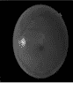

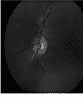

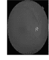

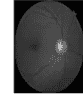

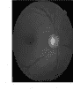

# 无 DR

# 无 DR

# 无 DR

# 无 DR

# 轻 DR

# 轻 DR

# 轻 DR

# 轻 DR


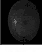


# 中度 DR

# 中度 DR

# 中度 DR

# 中度 DR

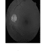


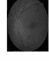

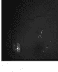


# 严重 DR

# 严重 DR

# 严重 DR

# 严重 DR

# 严重 DR

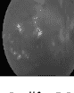

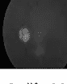


# 增殖性 DR

# 增殖性 DR

# 增殖性 DR

# 增殖性 DR

# 增殖性 DR


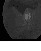


# 基于深度学习的糖尿病网膜病变检测模型

中度糖尿病网膜病变：疾病的第二阶段被称为中度非增殖性糖尿病网膜病变。在此阶段，眼睛中的血管扩大到视网膜无法获得足够血液的程度，被称为增殖性视网膜病变。视网膜可能会发生物理变化；导致它们输血的能力不如以前。

重度糖尿病网膜病变：非增殖性糖尿病眼病（`NPDR`），视网膜大部分血管被堵，显著减少了流向视网膜组织的血。作为反应，视网膜可能会开始形成以产生新的血管。

增殖性糖尿病网膜病变：最先进的阶段被称为增殖性视网膜病变（`PDR`），其特征是视网膜上长出新的血管。但通常，这些细血管脆弱且异常，会导致血液渗入眼内，损害视力，甚至导致盲明。数据集的分类如下：

- 0 无糖尿病网膜病变；1– 轻度；2– 中度；3– 重度；4– 增殖性糖尿病网膜病变。`APTOS 2019` 数据集中所有类别的样本分布如图 7.2 所示。

清楚地显示，类别的样本分布是不平衡的。通过数据增强，增加了所有类别的图像数量。所提 `CAE` 和 `CNN` 模型的架构如图 7.6 所示，其中 `CAE` 和 `CNN` 模型的编码器网络相结合。流程流程图如图 7.7 所示。

# CAE 的编码器网络

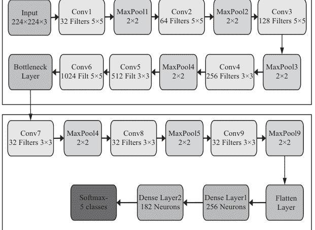

图 7.6 所提框架的架构——组合 `CAE` 和 `CNN` (`CAE+CNN`)。

# 148 转型医疗

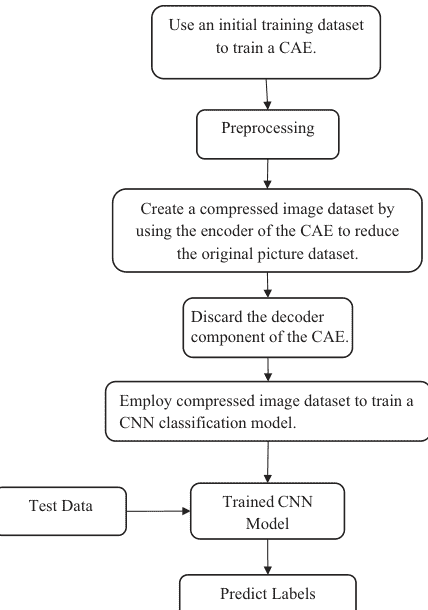

图 7.7 所提模型的流程图。

# 7.4.2 所提框架的算法 (CAE+CNN)

1. 数据集预处理
   1.1 调整图像大小
   1.2 数据增强
2. 创建 `CAE` 的编码器网络
3. 创建 `CNN` 模型
4. 使用 `CAE` 的压缩数据集训练 `CNN` 模型
5. 测试 `CNN` 模型
6. 图像分类
7. 糖尿病网膜病变的检测或预测。

算法描述了如下内容。

# 基于深度学习的糖尿病网膜病变检测模型

# 7.4.2.1 数据预处理

预处理是清理图像数据并在使用计算机视觉模型之前对其做好准备的关键阶段。从技术和性能角度来看，它是至关重要的。数据集在用于我们的模型之前参与了预处理步骤，因为这是清理图像数据的关键步骤，而且对于性能和技术原因来说都是必要的。如果不使用相同大小的图像，模型将无法按预期运行。为了获得更高效的模型，需要使用相同大小的图像；否则会导致错误。

我们的数据集在所有类别中都存在不平衡样本。为了在数据集中创建显著的差异，数据增强技术通过创建伪图像协助增强我们模型的性能。我们在研究中使用水平翻转、垂直翻转、缩放和旋转的数据增强技术。数据增强后，数据集包含 5000 张图像。80% 的数据用于训练，10% 的数据集样本用于验证，10% 的数据集样本用于测试。使用 `CAE` 模型的编码器网络创建压缩图像数据集，并将输出发送到 `CNN` 模型，并对其进行训练和测试。

# 7.5 实验结果与评估

我们的模型实现在 2.6GHz 的 corei7 CPU、1TB 硬盘驱动器和 16GB 内存的 Jupyter Notebook Prompt IDE 中。我们的模型实现中使用了 Numpy、Matplotlib、OpenCV 和 sklearn 等不同的深度学习库。Keras 和 TensorFlow 用于训练和测试。

# 7.5.1 评估指标

混淆矩阵用于显示模型在数据上性能的总结。根据模型的预测，它显示了准确和错误纠正的数量。二分类模型的标准见表 7.3。

真阳性 (`TrPo`)：当实际结果也为正时，模型准确地预测了一个正值。**

真阴性 (`TrNe`)：当实际结果也为负时，模型准确地预测了一个负值。

假阳性 (`FIPo`)：在这里，模型不准确地将正值预测为负值。

假阴性 (`Flne`)：在这里，模型不准确地将负值预测为正值。

# 表 7.3 混淆矩阵

| | 正性 | 负性 |
|---|---|---|
| **实际值** | TP | TN |
| **负性** | FP | TN |
| **预测值** | 正性 | 负性 |

为了评估我们提模型的有效性，使用了以下衡量措施：

准确率 (`Acc`)：混淆矩阵中正确识别的值相对于数据集中值的数量的百分比称为准确率。

```
Acc = \frac{TrPo + TrNe}{TrPo + TrNe + FlPo + FlNe} (7.1)
```

精确率 (`Pr`)：准确正性预测的比例如下：

```
Pr= \frac{TrPo}{TrPo + FlPo} (7.2)
```

召回率 (`Rc`)：它评估了模型检测真阳性的成功率。

```
Rc=TrPo/(TrPo + FlNe) (7.3)
```

F1 分：它是通过 `Pr` 和 `Rc` 衡量的，定义如下：

```
F1-Score = 2 * \frac{Pr * Rc}{Pr + Rc}
```

我们提模型的测试混淆矩阵见图 7.8。在图 7.9 中显示了我们提模型的测试数据集。在 15 个 epoch 之后，我们得到了 99% 的准确率。表 7.4 和图 7.10 显示了准确率、召回率和 F1 分数的数值。我们通过 `CAE` 和 `CNN` 模型获得了糖尿病网膜病变 99% 的准确率。

# 154 医疗保健的变革

## 参考文献

- 1. L. Wu, P. Fernandez-Loiza, J. Sauma, E. Hernandez-Bogantes, and M. Masis, 糖尿病视网膜病变和糖尿病黄斑肿的分类，《世界糖尿病杂志》 4(6), 290–294, 2013, https://doi.org/10.4239/wjd.v4i6.260.
- 2. Y. Zheng, T. Tien-En, S. Wan, Y. Tien Yin, and L. Xiarong, 糖尿病视网膜病变的分类：过去、现在与未来，《前沿》。https://doi.org/10.3389/fendo.2022.107227.
- 3. A. Senapati, H. Kumar Tripathy, V. Sharma, and A.H. Gandomi, 用于糖尿病视网膜病变的人工智能：系统综述，《医学信息解锁》 45, 2024, 101445, https://doi.org/10.1016/j.imimed.2024.101445.
- 5. L. Lazar, A. Hajdu, and R. Qureshi, 基于强度分布分析的视网膜微动脉检测，见第8 届国际应用成像会议，Eszterházy Károly 大学，2010.
- 6. C. Pereira, and S. Correa, 通过多智能体方法诊断糖尿病视网膜病变，2014, hdl.handle.net/1822/34439
- 7. Hoover, V. Kuznetsova, and M. Goldbaum, 通过匹配滤波器响应的分段阈值定位视网膜图像中的血管，《IEEE 医学影像汇刊》 19(3), 201–210, 2000.


- 8. M.J. Haller, M.A. Atkinson, and D. Schatz, 1 型糖尿病：病因、表现与管理，《美国儿科杂志》 52(6), 1553–1578, 2023, https://doi.org/10.1016/j.cp.2005.07.006.
- 9. M.B. Abdallah 等 al., 使用多尺度介质视网膜树中血管的自动提取，《生物医学成像期刊》2015, 1, 15.
- 10. M. Kaur, and R. Talwar, 血管自动提取与眼视网膜病变检测，《工程与技术进展欧洲杂志》 2(4), 57–61, 2015.
- 11. S. Wang 等 al., 基于特征和集成学习的分层血血管分割，《神经计算》 149, 708–717, 2015.
- 12. U.R. Acharya, S. Dua, U. Du, S. Vinitha Shree, and C.K. Chua, 使用纹理和高阶谱特征对血糖进行自动诊断，《IEEE TITB》 15(3), 449–455, 2011.
- 13. J. Ba, V. Mnih, and K. Kavukoglu, 带视觉注意力的多目标识别。arXiv 预印本 arXiv:1412.7755, 2015.
- 14. T. Shanti, and R.S. Saabeian, 用于糖尿病视网膜病变图像分类的改进 Alexnet 架构，《计算机与电气工程》76, 56–64, 2019, https://doi.org/10.1016/j.compelec.2019.03.004
- 15. Q. Jin, Z. Meng, T.D. Pham, Q. Chen, L. Wei, R. Su, DUNet: 一种视网膜血管分割的变形网络，《知识系统》 178, 149, 2019.
- 16. P. Murugeswari, N. Kopperundevi, M. Annalakshmi, and S.S. Clarinda, 用于多模态和可见图像的有效重建金字塔交叉点融合，《信号与视频处理》 18(10), 6769-6782, 2024.
- 17. H. Fu, J. Cheng, Y. Xu, C. Zhang, D.W.K. Gong, J. Liu, and X. Cao. 用于眼底图像青光筛查的盘感知集成网络，IEEE Mimi, 美国新泽西，2018.
- 18. S.I. Hao, L.Z. Lin, Z. Chen, M.C. Tai, J.T. Chen, and G.M. Lin, 使用双通道卷积神经网络检测糖尿病视网膜病变，《眼科学杂志》2020, https://doi.org/10.1155/2020/9139713.
- 19. E. Pintelas, I.E. Levierius, and P.E. Pintelas, 用于高维噪声图像数据集分类的卷积自动编码器拓扑，《传感器》 21(22), 7731, 2021, https://doi.org/10.3390/s21227731.
- 20. K. Kalamani, M. Priya, P. Deepan, L.R. Sudha, and J. Ganesh, 基于多特征选择算法与集成分类器的预测系统，ECS Transactions 107(1), 8049–8059, 2022, https://doi.org/10.1149/10701.8049count.
- 21. P. Deepan, and L.R. Sudha, 与 IoT 和计算机视觉相关的检测及其应用，收于《人工智能与物联网：生态友好地形的智能收敛》，Springer Nature, pp. 223–244, 2021, https://doi.org/10.1007-978-331-6400-4_1
- 22. C. Shorten, and T.M. Khoshgoatar, 深度学习图像数据增强综述。《大数据期刊》 6, 60, 2019, https://doi.org/10.1186/s40537-019-0197-0
- 23. APTOS. 2019. 数据集可用 https://www.kaggle.com/datasets/mariaherriott/aptos2019
- 24. J. Bodapati, N. Veerajanjeyulu, N.S. Shaik, I. Sahib, M. Bilal, P. Reddy, R. Maddikunta, and O. Jo, 用于糖尿病视网膜病变程度预测的混合多模态深度卷积网络，《电子》，9, 2020. https://doi.org/10.3390/electronics906014.
- 25. S. Gupta, 使用机器学习诊断糖尿病视网膜病变，《研究与开发期刊》，3(2), 2015, https://doi.org/10.4172/2311-3278
- 26. G. Mushtaq, and F. Siddiqui, IOP 会议系列：材料科学与工程, 1070
- 27. H. Shakib, R. Raoufi, and M. Mansoor, 用于检测和分级的深度学习，《生物医学处理与控制》9, 2024. https://doi.org/10.1016/j.bsp.2024.10618

# 基于深度学习的糖尿病视网膜病变模型

# 基于 5G 设备网络切片

## 8.1 引言

近年来，医疗行业正经历着数字化革命，随着 `5G`（第五代移动通信）的出现，它是一个规则的改变者。将 `5G` 集成到医疗系统中提供了独特的机遇。

## 8.2 文献综述

### 8.2.1 5G 边缘智能编排

该领域的基础性工作之一是 Moreno-Vozmediano 等（2024）的研究，该研究强调了边缘基础设施的重要性。作者引入了一种整数规划模型来优化虚拟机（`VM`）放置，考虑了服务器使用和延迟降低。

### 8.2.2 用于 5G 开放无线接入网络 (ORAN) 的智能自动切片深度学习

Yeh 等（2024）探索了 `5G` 开放无线接入网络（`ORAN`）部署中的人工智能和深度学习。论文强调了网络切片的作用，这允许在共享物理基础设施上运行多个虚拟网络。将人工智能驱动的技术接入智能控制器（`RIC`）提高了服务质量。

### 8.2.3 开放人工智能细胞 (OAIC)：用于基于 AI 管理的设计测试的开源 5G 测试平台

Upadhyya 等（2023）的工作介绍了开放人工智能细胞（`OAIC`）测试平台，这是一个用于基于 AI 管理开发和测试的开源平台。该测试平台符合 `3GPP` 标准并支持低延迟场景，是医疗网络新算法的理想平台。论文讨论了与 AI 集成相关的挑战。

### 8.2.4 iSlicer：实现 5G 端到端网络切片的灵活自动编排

Catalan-Cid 等（2023）介绍了 `iSlicer`，一种用于 `5G` 独立（`SA`）网络切片编排的灵活解决方案。论文强调了自动化管理网络切片的重要性，特别是在多租户和多服务环境中。

### 8.2.5 从移动边缘计算基础设施自动部署 5G服务的编排架构

Chirivilla-Perez 等（2018）提出了一种允许业务在 90 分钟内提供端到端服务的编排架构。它展示了跨基础设施层的自动化，并证明了如何在由裸金属边缘场景的环境中直接或间接地实现自动化。

### 8.2.6 Dasmo：网络切片管理与编排的可扩展方法

Kukliński 等（2018）介绍了 `DASMO`，一种用于可扩展 `5G` 网络切片管理的分布式自治架构，它将 `ETSI MANO` 与多个切片平台集成在一起。解决了与切片生命周期管理相关的关键监控和编排挑战。

### 8.2.7 利用大数据分析进行 5G 网络动态切片的资源编排演示

Raza 等人 (2018) 展示了基于 `SDN/NFV` 的中心编排器，其利用大数据分析进行动态切片，目标是最大化基础设施资源的利用并增加基础设施提供者的收入。

### 8.2.8 Ovnes：在真实部署中演示 5G 网络切片超订阅

L. Zanzi 等人 (2018) 展示了 `5G` 网络切片中的中心化编排，包括切片经纪和资源分配挑战。上述研究导致了 `OVNES` 的开发，这是一个真实的平台，用于实现 `5G` 网络切片经纪以进行优化相关的实验。

### 8.2.9 具有 QoE 保证的光网络端到端 5G 服务部署与编排

Montero 等人 (2018) 描述了一种光网络中 `5G` 服务端到端配置和监控的架构，重点是确保 `QoS` 并使用中心化编排器管理动态网络切片。

### 8.2.10 深度学习方法在自组织 5G 网络中的评估

Asghar 等人 (2019) 引入了一种基于自动编码器的自组织网络深度学习方法，该方法不仅提高了检测准确性和适应性，而且与传统方法相比，还能促进网络针对小区故障的智能、自愈合和自优化行为。

### 8.2.11 总结

基于现有文献的见解，所提系统通过集成 AI 分析、边缘计算和动态资源分配，解决并克服了当前医疗 `5G` 网络管理的局限性。

# 通过 5G 服务为医疗设备构建网络切片 159

## 8.2.11.1 所提系统的主要优势

该系统克服了局限性并提供了如下等新颖性：
- **实时适应性与可扩展性：** 系统使用经过数学建模的遗传算法 (`GA`) 和强化学习 (`RL`) 根据设备数据特征动态调整带宽、延迟和安全性。使用 `AWS` 微服务和容器化的混合云设置能够无缝扩展，以满足不断变化的医疗需求。
- **增强的安全性与效率：** 通过零信任架构和先进的 `IAM` 协议，患者数据保持安全。AI 驱动的分析优化了网络切片和资源分配，确保了设备的高效运行并减少了机时间。

## 8.3 方法论与工作原理

该系统旨在优化性能、增强安全性并确保现代医疗需求的实时适应性。部署在医疗设施附近的边缘节点管理延迟敏感和数据密集型任务，而云层则处理大规模数据存储、中心化处理和 AI 模型。表 8.1 概述了典型的 `5G` 用例。

该系统的核心是带有强化学习的 `GA`；编排器预测网络流量、工作负载和潜在瓶颈，并动态分配资源，每个切片都通过这些专门修改的算法针对医疗应用的特定需求进行定制。安全性在该架构中至关重要，该架构集成了零信任架构 (`ZTA`) 以及先进的身份和访问管理 (`IAM`) 协议。所提解决方案的核心编排器结构以 UML 图给出，如图 8.1 所示。

此外，所提系统包含 `AWS` 基础设施，使用 `VPC`、`CloudWatch` 和 `Fargate` 等服务进行高效的网络配置和监控。伪实时模拟环境条件（包括远程医疗或大规模数据传输的峰值）以及试点医疗机构的测试了其性能，持续达到或超过延迟、吞吐量、资源利用率和安全性的基准，验证了其大规模部署的就绪。

### 8.3.1 核心 AI 模型及其工作原理

- 1. 动态资源分配：实现了 `RL` 算法，特别是基于近策略优化 (`PPO`) 和深度 Q 网络 (`DQN`) 的算法，并使其适应网络当前状态，使用基于奖励的系统对网络切片间的资源分布做出实时决策，其中导致优化延迟、吞吐量和资源利用的动作将得到正强化并根据需求进行调整。

### 表 8.1 5G 网络切片用例

| 类型 | 用例 | 峰值数据速率 | 典型数据速率 | 延迟 | 设备密度 | 可靠性 | 移动性 |
| :--- | :--- | :--- | :--- | :--- | :--- | :--- | :--- |
| `eMBB` | 高速数据、视频流、VR、高容量应用 | 高达 20 Gbps | 100 Mbps–1 Gbps | ~10 ms | 中等 (~每平方公里 10,000 个设备) | 中等 | 高 (高达 500 km/h) |
| `mMTC` | IoT 设备、传感器、智能城市 | 较低 (~100 kbps) | 极低 (~10 kbps) | ~1–10 秒 | 极高 (~每平方公里 1,000,000 个设备) | 低 | 低 |
| `uRRLC` | 自动驾驶、远程手术 | 高达 10 Gbps | 50 Mbps–10 Gbps | <1 ms | 中等 (~每平方公里 10,000 个设备) | 极高 (99.999%) | 中等 (高达 100 km/h) |

# 通过 5g 服务为医疗构建网络切片


图 8.1 核心编排器 UML

2. 网络切片与虚拟化：系统利用网络函数虚拟化 (`NFV`) 和软件定义网络 (`SDN`) 实现网络切片。每个切片针对医疗应用的需求进行定制。
3. 用于优化的遗传算法：采用 `GA` 通过自然演化优化网络切片。
4. 边缘计算集成：边缘计算节点部署在医疗设施附近本地处理数据，减轻云端负载并降低延迟。架构如图 8.2 所示。

### 8.3.2 AWS 架构与云服务

私有云 (`VPC`) 实现了隔离环境的创建，托管多个切片。医疗用例的网络拓扑结构如图 8.3 所示。

# 162 医疗转型


图 8.2 解决方案的核心编排器 UML

`AWS` 身份和访问管理 (`IAM`) 作为零信任安全模型，确保各种设备的授权访问。`AWS CloudWatch` 持续监控指标和日志，将数据馈给 AI 驱动平台进行实时决策。检测到的异常可以触发自动响应，例如资源扩展或网络切片调整。`AWS Lambda` 作为事件驱动架构的一部分，响应事件执行代码，实现无人工干预的自动化。Elastic Kubernetes Service (`EKS`) 管理容器化微服务的部署和扩展，Docker 容器编排至多种

# 通过 5G 服务为医疗构建网络切片


图 8.3 网络切片的典型拓扑

系统首先从各种医疗设备及其特征收集数据，例如 MRI 设备和远程监控传感器。这些数据在边缘处理，进行初步分析和决策以降低延迟并优化带宽。边缘节点与中心云基础设施通信，云端运行复杂模型预测网络状况并管理资源分配。根据实时数据和预测，AI 驱动的编排器利用 `NFV` 和 `SDN` 技术动态配置网络切片。这些针对不同医疗应用特定需求的切片，`RL` 模型监控这些切片的性能，并根据网络性能进行调整。图 8.5 中的 UML 图解释了所提系统的流程。


**图 8.5** 5G 医疗服务的类图。

# 8.4 提提出的新型数学模型

### 8.4.1 KPI 细节与定义

KPI 细节及其定义在表 8.2 中列出如下：

### 8.4.2 KPI 之间的数学关系

KPI 之间以复杂的方式相互作用。例如：
- 延迟 (`L`) 反向影响吞吐量 (`T_t`) 和流量容量 (`T_c`)。
- 可靠性 (`R`) 与数据包丢失率直接相关，并影响 QoS 遵循度 (`Q`)。
- 资源利用率 (`U`) 影响可用性 (`A`) 和容错性 (`F_t`)。

为了对这些交互进行建模，我们可以定义以下关系：
- 延迟-吞吐量关系：

```
$L = \frac{C}{T_b} + J$
```

其中 `C` 是取决于网络基础设施的常数。
- 可靠性-QoS 关系：

```
$Q = 1 - R$
```

随着可靠性的下降，QoS 遵循度降低。
- 资源利用率-可用性关系：

```
$U = \frac{1}{A}$
```

| KPI 细节 | KPI 定义 |
|---|---|
| 延迟 (`L`) | 轮询延迟，单向延迟 |
| 吞吐量/带宽 (`T_b`) | 数据传输率 |
| 可靠性 (`R`) | 数据包丢失率，错误率 |
| 可用性 (`A`) | 网络运行时间 |
| 资源利用率 (`U`) | CPU、内存、存储利用率 |
| 移动性管理 (`M`) | 切换成功率 |
| 安全性 (`S`) | 安全事件率 |
| 切片创建/修改时间 (`s_t`) | 创建/修改网络切片的时间 |
| 抖动 (`J`) | 抖动 |
| 流量容量 (`T_c`) | 吞吐量/带宽 |
| QoS 遵循度 (`Q`) | 对定义的 QoS 参数的遵循情况 |
| 数据速率 (`D_t`) | 下行/上行数据速率 |
| 容错性 (`F_t`) | FTI 或弹性评分 |

基于 5G 服务为医疗设备构建网络切片

### 8.4.3 GA-RL 混合工作流

#### 8.4.3.1 GA 和 RL 阶段

`GA` 在切片配置群上运行，根据 KPI 适应度函数进行优化。每个配置都使用 KPI 概率分布进行评估，以倾向于可能满足 KPI 目标的解决方案。一旦找到最优配置，`RL` 智能体会调整切片参数以适应环境变化，以最大化长期 KPI 遵循度。

提出的模型是一种混合优化和自适应控制框架，结合了 `GA` 与 `RL`。其核心目标是最大化所有切片对 KPI 目标的遵循度，确保网络的高效利用、高 QoS 且最少的服务中断。

### 8.4.4 染色体表示

在 `GA` 中，染色体代表网络切片的候选解决方案。对于每个切片（例如 `eMBB`、`uLLRC` 或 `mMTC`），染色体编码了 KPI 参数的配置。每个切片染色体可以表示为，通用的适应度函数定义如下：

`Chromosome_i = [L_i, T_{b,i}, R_i, A_i, U_i, M_i, S_i, S_{li}, J_{ci}, Q_i, D_{ri}, F_{li}]` (8.4)

- `L_i` 是切片 `i` 的延迟，`T_{b,i}` 是其吞吐量。

### 8.4.5 适应度函数

适应度函数评估了染色体满足 KPI 目标的程度。

`Fitness_i = \sum_{k=1}^n w_k \cdot f_k(X_i)` (8.5)

该适应度函数评估了染色体满足 KPI 目标的程度，其中 `X_i` 是切片 `i` 的 KPI 值向量；`W_k` 是根据其重要性的 KPI 权重；`f_k(X_i)` 是每个 KPI 的惩罚函数，其可以通过计算每个 KPI 与其目标之间的偏差来得出：

`f_k(X_i) = |KPI_k - Target_k|` (8.6)

目标是最小化 `Fitness`，这意味着最符合 KPI 的染色体就是最优解决方案。

#### 8.4.5.1 GA 工作流


1. **初始化**：随机初始化一组染色体（切片）种群。

2. **选择**：根据适应度值选择最佳染色体，并使用高斯分布、泊松分布和爱朗分布等技术为每个特定的用例进行优化分配。

3. **交叉**：执行交叉（例如单点交叉或多点交叉），通过组合父代染色体的基因产生新的后代染色体。

4. **变异**：对基因引入微小的随机变化（变异），以探索新的解决方案。

5. **迭代**：在多代中重复选择、交叉和变异，直到满足停止停止准则（例如收敛或达到最大代数）。

### 8.4.5.2 变异率

变异有助于维持多样性并避免局部最优。变异率控制改变基因的概率：

$P_{mutation} = \mu \quad$ (8.7)

### 8.4.6 爱尔朗分布（延迟与队列）

网络切片中的延迟：爱尔朗分布通过网络切片中的多个跳数或阶段对延迟建模。每个阶段（如数据包转发或处理）都会对总延迟做出贡献。这有助于优化不同切片的跳数和服务费率，确保延迟保持在每个切片 QoS 协议定义的范围内：

$f_l(x;k,\lambda) = \frac{\lambda^k x^{k-1} e^{-\lambda x}}{(k-1)!} \quad$ (8)

## 基于 5G 服务的医疗设备网络切片构建

其中 `$F$` 是适应度得分，`$w_1$`, `$w_2$` 和 `$w_3$` 是根据设备类型（uRLC、eMBB、mMTC）分配给延迟、流量和抖动的权重，`$L$` 是延迟，`$T$` 是流量，`$J$` 是抖动。

### 8.4.8.5 用于实时自适应的强化学习 (RL)

#### 8.4.8.5.1 RL 状态表示

`t` 时刻的状态 `$S_t$` 代表网络切片的当前配置，包括 KPI 值和用户需求或网络连接等环境因素：

```
$S_t = [L, T_b, R, A, U, M, S_t, J, T_c, Q, D_r, F_t]$ (8.17)
```

#### 8.4.8.5.2 动作空间

动作 `$A$` 是在 `t` 时刻应用于切片配置的一组调整：

```
$A_t = [\Delta L, \Delta T_b, \Delta R, \Delta A, \Delta M]$ (8.18)
```

- 其中 `$\Delta L$` 是延迟的变化，`$\Delta T_b$` 是吞吐量的变化。

- RL 根据来自网络 KPI 的反馈实时调整切片。RL 智能体在一个环境中运行，该环境的状态是当前网络配置，动作是对切片的修改，奖励是新配置满足 KPI 良好程度的函数。

使用了 Q-Learning 算法，智能体通过根据奖励 `$r$` 更新状态下采取的每个动作 `$a$` 的值来学习最优策略 `$Q(s,a)$`：

```
$Q(s,a) \leftarrow Q(s,a) + \alpha[r + \gamma Q(s',a') - Q(s,a)]$ (8.19)
```

其中 `$\alpha$` 是学习率，`$\gamma$` 是折扣因子，`$s'$` 是动作 `$a$` 之后的新状态，`$r$` 是基于更新后的 KPI 性能的即时奖励。

所提出的基于 GA-RL 的 5G 编排器通过结合 GA（用于根据预测的流量、延迟和抖动进行切片配置和优化）和 RL（用于实时 QoS 自适应）来优化医疗设备的网络切片。

## 8.5 实验结果与讨论

### 8.5.1 容器化架构测试与分析中的网络切片实现

实现计划包括利用 AI 驱动的资源分配，通过 Kubernetes 进行编排并侧重于实时监控与分析，所有过程由持续监控和优化过程支持。图 8.6 显示了抽象后的数据以及网络平面获取数据的统计预处理结果，其相关性热图见图 8.7，模拟医疗设备的 KPI 数据范围见表 8.3。

图 8.8 所示的这一程序是**必不可少的**，用以根据特定的 5G 网络切片案例对从网络平面获取的 KPI 数据进行分类。

在性能测试与分析阶段，必须仔细审查整个过程中获取的性能指标，旨在识别瓶颈、增强资源利用率并精细调整算法，以实现卓越的效率和响应能力。这些测试结果如图 8.9–8.11 所示。图 8.12 解释了通过对模拟医疗设备案例进行网络配置而获得的异常测试结果及其特征。通过模型预测控制 (MPC) 算法进行持续反馈集成和改进。自适应率如图 8.13 所示，GA 预测与实际切片配置的权衡见图 8.14。

图 8.15 显示了根据 GA 输出分配的切片，图 8.16 显示了在 GA 具有良好适应度值的情况下，网络切片配置的准确率高达 85%。图 8.17 给出了 GA 的可靠性带宽 (BW) 结果，这确保了交叉相关准确性并作为相关性验证指标，显示了所提方案相比现有系统增强的效率。图 8.18 还显示了通过爬取进行的服务器创建和用于测试的网络 KPI 数据获取。

图 8.19 和 8.20 显示了针对特定医疗设备的完整配置网络。作为网络配置结果捕获的数据速率和其他特征见表 8.4。

图 8.21–25 解释了在网络平面获取的各种参数，显示了在为特定用例配置网络切片时的超低延迟。图 8.26 解释了在特定用户负载下模拟的活检图像压缩与传输的高速数据传输的特定应急响应，以记录所提系统的延迟响应。图 8.27 和 8.28 解释了所提系统的其他性能指标。

## 基于 5G 服务的医疗设备网络切片构建

| 带宽 | 延迟 | 可靠性 | 安全性 | 容量 | 移动性 | 支持 |
| --- | --- | --- | --- | --- | --- | --- |
| 0 | 100000 | 1 | 0.99990 | 很高 | 100000 | | 有限 |
| 1 | 100 | 100 | 0.99999 | 很高 | 100000 | | 低 |
| 2 | 100000 | 100 | 0.99999 | 高 | | | 低 |
| 3 | 100000 | 20 | 0.99990 | 很高 | 100000 | | |
| 4 | 100 | 100 | 0.99999 | 高 | | | |

| 覆盖区域 | 服务 | 连续性 | 效率 | QoS 类型 | |
| --- | --- | --- | --- | --- | --- |
| 0 | 区域 | | 中等 | 低抖动 | ... |
| 1 | 本地 | | 高 | 低抖动 | |
| 2 | 市区 | | 很高 | 低抖动 | |
| 3 | 市区 | | 很高 | 超低抖动 | |
| 4 | 本地 | | 中等 | 低抖动 | |

| 实时 SLA | 实时资源利用率 | | | |
| --- | --- | --- | --- | --- |
| 0 | 0.999130 | | | |
| 1 | 0.999990 | | | |
| 2 | 0.999999 | | | |
| 3 | 0.999999 | | | |
| 4 | 0.999999 | | | |

图 8.7 数据集的相关性热图。

## 表 8.3 不同模拟医疗设备的 KPI 数据及其特征

| 设备 | 数据产物类型 | 延迟 | 吞吐量 | 可靠性 | 移动性管理 | 切片创建时间 | 抖动 | 流量容量 | 容错性 |
| --- | --- | --- | --- | --- | --- | --- | --- | --- | --- |
| MRI 扫描仪 | 高分辨率 3D 图像、DICOM 文件 | 中等（10–10 ms） | 高（100–1,000 Mbps） | 高（低错误率） | 低（固定位置） | 中等（分钟至几小时） | 低（<1 ms） | 高 | 高 |
| CT 扫描仪 | 高分辨率 3D 图像、DICOM 文件 | 中等（10–10 ms） | 高（100–1,000 Mbps） | 高（低错误率） | 低（固定位置） | 中等（分钟至几小时） | 低（<1 ms） | 高 | 高 |
| 数字病理扫描仪 | 高分辨率 3D 图像、DICOM 文件 | 中等（10–10 ms） | 高（100–1,000 Mbps） | 高（低错误率） | 低（固定位置） | 中等（分钟至几小时） | 低 | 高 | 高 |
| 手术显微镜 | 实时视频、高分辨率图像 | 低（<10 ms） | 高（500–2 Gbps） | 极高（零丢包） | 低（固定位置） | 低（秒） | 极低（<1 ms） | 极高 | 极高 |
| 手术机器人 | 实时控制数据、高分辨率视频 | 极低（<5 ms） | 高（500–2 Gbps） | 极高（零丢包） | 低（固定位置） | 低（秒） | 极低（<1 ms） | 极高 | 极高 |
| 患者监测系统 | 持续生命体征数据（如心电图、SpO2） | 低（<50 ms） | 中等（100–100 Mbps） | 极高（低错误率） | 中等（医院设备） | 中等（分钟） | 低（<1 ms） | 中等 | 高 |
| 远程医疗平台 | 视频通话、记录、诊断数据 | 中等（10–20 ms） | 中等（100–100 Mbps） | 高（连接） | 高（设备） | 中等（分钟） | 中等（<10 ms） | 中等 | 中至高 |
| 可穿戴监测器 | 持续健康指标（如心率、步数） | 低（<50 ms） | 低（1–10 Mbps） | 高（间歇性数据丢失） | 高（可穿戴设备） | 中等（分钟） | 中等（<10 s） | 中等 | 中至高 |
| 救护车遥测系统 | 实时数据（生命体征、位置） | 低（<50 ms） | 中等（100 Mbps） | 高（运输期间可靠） | 高（连续切换） | 中等（低移动性） | 低（秒） | 极低（<1 ms） | 高 | 高 |
| AR 系统 | AR 增强视觉、交互数据 | 极低（<5 ms） | 高（500–2 Gbps） | 极高（错误率） | 极低（固定或本地） | 低（秒） | 极低（<1 ms） | 高 | 高 |
| VR 系统 | VR 沉浸式视觉、交互数据 | 极低（<5 ms） | 极高（>1 Gbps） | 极高（错误率） | 极低（固定或本地） | 低（秒） | 极低（<1 ms） | 高 | 高 |

## 174 转型医疗保健


图 8.8 基于 K mean 需求的聚类和分类。

| time | 带宽 | 可靠性 | 成本效益 | Optimized_Allocation_GA | |
| --- | --- | --- | --- | --- | --- |
| fps | 567 | 1 | 0.999980 | 0.5 | 0.874433 |
| iterations | 14 | 1 | 0.999980 | 0.5 | 0.103402 |
| time_elapsed | 104 | 2 | 0.999999 | 1.0 | 0.870387 |
| train_steps | 10240 | 3 | 0.999980 | 0.5 | 0.082649 |
| approx_kl | 0.00092148 | 4 | 0.999999 | 0.0 | 0.933333 |
| cls_fraction | 0.006 | | | | |
| cls_rate | 0.0004 | | | | |
| explained_variance | -0.02001 | | | | |
| learning_rate | 0.001 | | | | |
| loss | 0.538 | | | | |
| policy_gradient_loss | -0.0162 | | | | |
| final_value | 2.2848 | | | | |

图 8.9 使用 RL 和 GA 进行资源分配和优化。

## 最终优化数据集（网络切片：配置）- Network_Slice

| | 带宽 | 可靠性 | 成本效益 | Optimized_Allocation_Network_Slice |
| --- | --- | --- | --- | --- |
| 0 | 0.081627 | 0.078189 | 0.160045 | 0.654711 |
| 1 | 0.566347 | 0.967260 | 0.849495 | 0.226333 |
| 2 | 0.633997 | 0.043311 | 0.453657 | 0.643955 |
| 3 | 0.346334 | 0.932102 | 0.888358 | 0.662773 |
| 4 | 0.784222 | 0.414905 | 0.926270 | 0.694305 | 图 8.10 使用 PSO 和 GA 进行网络切片。

## 为 5G 设备构建网络切片


图 8.11 分配的延迟和带宽。

演示：0.5744038 0.6509172 0.4009265 0.3781605 0.553979 组合告警：1。 图 8.12 异常检测器结果。

Epoch 10/10

313/313 [====================] - 1s 2ms - loss: 1.5904e-04

313/313 [====================] - 1s 2ms

更新参数 (MPC): [[0.37605615 0.16899916 0.52412537 0.40332727 0.4061961], [0.3165204 0.54709561 0.15391519 0.27796206 0.27398659], [0.3837279 0.1542875 0.5375285 0.4820546 0.411411], ... [0.36696403 0.22674091 0.46530032 0.38418188 0.3860059], [0.34521357 0.36487256 0.3310362 0.33838165 0.3377052], [0.33458461 0.43237442 0.26542432 0.3160001 0.3141016]]

MPC 平均绝对误差：0.285793263263253967

MPC 均方误差：0.1195831346348418

图 8.13 反馈 MPC 测试结果和验证指标。

## 转型医疗保健


图 8.14 GA 预测用例结果。

带有聚类标签和切片类型的 DataFrame：

| | 组件 | 吞吐量_带宽 | 延迟 |
| --- | --- | --- | --- |
| 0 | 手术显微镜 | 374.540119 | 950.714306 |
| 1 | 数字病理扫描仪 | 598.658484 | 156.018640 |
| 2 | 远程医疗平台 | 58.083612 | 866.176146 |
| 3 | 可穿戴健康监测器 | 708.072578 | 20.584494 |
| 4 | 手术显微镜 | 832.442641 | 212.339111 |

| | 丢包率 | 切片类型 |
| --- | --- | --- |
| 0 | 731.993942 | eMBB |
| 1 | 155.994520 | uRLLC |
| 2 | 601.115012 | eMBB |
| 3 | 969.909852 | mMTC |
| 4 | 181.9267 | uLLC |

图 8.15 切片用例结果。

## 为 5G 设备构建网络切片


图 8.16 整体优化和结果。


图 8.17 带宽与可靠性结果。

## 178 转型医疗保健

表 8.4 对比图

| 特性 | eMBB (增强移动宽带) | mMTC (海量机器类) | uRLLC (高可靠低延迟) |
| --- | --- | --- | --- |
| 峰值速率 | 下行 20Gbps 上行 10Gbps | 较低 (~1 Mbps) | 上行 10 Gbps |
| 用户体验速率 | 100 Mbps (DL), 50 Mbps (UL) | 极低 (~10 kbps) | 50 Mbps (DL/UL) |
| 延迟 | ~10 ms | ~10 秒 | <1 ms |
| 区域流量容量 | 100 Mbps/m² | 低 (~10 kbps/m²) | 中等 |
| 可靠性 | 中等 | 低 | 极高 (99.999%) |
| 网络能量效率 | 高 | 高 | 高 |
| 频谱带宽 | 3×LTE 100 MHz 每运营商 | 非关键 极低 (<1 MHz) | 每运营商 100 MHz |
| 抖动 | 中等 | 高 | 极低 |

# 基于 5G 的医疗设备构建网络切片

## 切片生命周期指标


图 8.24 切片生命周期指标。

### 医疗设备负载与 KPI


图 8.25 医疗设备负载 KPI。

## 182 变革医疗保健

## 网络切片仿真


图 8.26 紧急同步与非同步切片的响应。

## 8.7 未来展望

该医疗解决方案的未来愿景为增长和创新提供了巨大的潜力。关键进展包括与可穿戴设备、生物识别和下一代成像系统等新兴医疗技术的集成。扩展 AI 和机器学习能力（如深度学习和自然语言处理 NLP）将提高预测分析和实时决策。

## 本地到本地的数据传输


## 距离延迟


图 8.27 本地到本地的数据传输和网络延迟。

## 184 变革医疗保健

## 带宽占用


## 传输数据


图 8.28 网络带宽占用情况和系统传输的总数据。

## 基于 5G 服务的医疗设备构建网络切片

仿真结果：

已配置数据 (GB): 9.99999999999

模型生命周期（推理次数): 100

平均推理延迟 (ms): 0.24049999999999

设备、切片、带宽、提供数据：

- `{'Device': '手术显微镜', 'Slice Type': 'URLLC', 'Bandwidth (Mbps)': 200, 'Data Provided (GB)': 2}`

- `{'Device': '数字病理扫描仪', 'Slice Type': 'eMBB', 'Bandwidth (Mbps)': 1000, 'Data Provided (GB)': 1}`

- `{'Device': '手术显微镜', 'Slice Type': 'URLLC', 'Bandwidth (Mbps)': 200, 'Data Provided (GB)': 4}`

- `{'Device': 'CT 扫描仪', 'Slice Type': 'mMTC', 'Bandwidth (Mbps)': 500, 'Data Provided (GB)': 1}`

- `{'Device': '数字病理扫描仪', 'Slice Type': 'eMBB', 'Bandwidth (Mbps)': 1000, 'Data Provided (GB)': 5}`

- `{'Device': '手术显微镜', 'Slice Type': 'URLLC', 'Bandwidth (Mbps)': 200, 'Data Provided (GB)': 9}`

- `{'Device': '手术机器人', 'Slice Type': 'mMTC', 'Bandwidth (Mbps)': 500, 'Data Provided (GB)': 6}`

- `{'Device': 'AR VR 系统', 'Slice Type': 'mMTC', 'Bandwidth (Mbps)': 500, 'Data Provided (GB)': 9}`

图 8.29 为每个仿真设备分配的切片。

## 参考文献

- M. Z. Asghar, M. Abbas, K. Zeeshan, P. Kotilainen, and T. Hämaläinen, “Assessment of Deep Learning Methodology for Self-Organizing 5G Networks,” Sciences, vol. 9, no. 15, p. 2975, 2019.

- M. Catalan-Cid, A. Fernández-Fernández, D. Campos-Mur, and S. Siddiqui, “iSlicer: Enabling Flexible and Automated Orchestration of 5G SA End-to-End Network Slices,” 2023 IEEE Conference on Network Function Virtualization and Software Defined Networks (NFV-SDN), Dresden, Germany, p. 159–162, 2023.

- E. Chirivella-Perez, J.M.A. Calero, Q. Wang, and J. Gutiérrez-Aguado, “Orchestration Architecture for Automatic Deployment of 5G Services from Bare Metal in Mobile Edge Computing,” Wireless Communications and Mobile Computing, vol. 2018, p. 1–18, 2018.

- K. Sukklinski and L. Tomaszewski, “Dasno: A Scalable Approach to Network Slices Management and Orchestration,” 2018 IEEE/FIP Network Operations and Management Symposium (NOMS), p. 1–6, Taipei, Taiwan, 2018.

- R. Monterey, F. Agraz, A. Pages, and S. Spadero, “End-to-End 5G Service Deployment and Orchestration in Optical Networks with Qo Guarantees,” 2018 20th International Conference on Transparent Optical Networks (ICTON), Bucharest, Romania, p. 1–4.

- R. Moreno-Vozdiano, R. S. Montero, E. Huedo, and I. M. Llorente, “Intelligent Resource Orchestration for 5G Edge Infrastructures,” Future Internet, vol. no. 3, p. 103, 2024.

- M. R. Raza, C. Natalino, A. Vidal, M. Santos, P. Ohlen, L. Wosinka, et al., “Demonstration of Resource Orchestration Using Big Data Analytics for Dynamic Slicing in 5G Networks,” 2018 European Conference on Communication (ECOC), Rome, Italy, p. 1–3, 2018.


- M. Catalan-Cid, A. Fernández-Fernández, D. Campos-Mur, and S. Siddiqui, “iSlicer: Enabling Flexible and Automated Orchestration of 5G SA End-to-End Network Slices,” 2023 IEEE Conference on Network Function Virtualization and Software Defined Networks (NFV-SDN), Dresden, Germany, p. 159–162, 2023.
- E. Chirivella-Perez, J.M.A. Calero, Q. Wang, and J. Gutiérrez-Aguado, “Orchestration Architecture for Automatic Deployment of 5G Services from Bare Metal in Mobile Edge Computing Infrastructure,” Wireless Communications and Mobile Computing, vol. 2018, p. 1–18, 2018.
- K. Sukklinski and L. Tomaszewski, “Dasno: A Scalable Approach to Network Slices Management and Orchestration,” 2018 IEEE/FIP Network Operations and Management Symposium (NOMS), p. 1–6, Taipei, Taiwan, 2018.
- R. Monterey, F. Agraz, A. Pages, and S. Spadero, “End-to-End 5G Service Deployment and Orchestration in Optical Networks with Qo Guarantees,” 2018 20th International Conference on Transparent Optical Networks (ICTON), Bucharest, Romania, p. 1–4.
- R. Moreno-Vozdiano, R. S. Montero, E. Huedo, and I. M. Llorente, “Intelligent Resource Orchestration for 5G Edge Infrastructures,” Future Internet, vol. no. 3, p. 103, 2024.
- M. R. Raza, C. Natalino, A. Vidal, M. Santos, P. Ohlen, L. Wosinka, et al., “Demonstration of Resource Orchestration Using Big Data Analytics for Dynamic Slicing in 5G Networks,” 2018 European Conference on Communication (ECOC), Rome, Italy, p. 1–3, 2018.

## 182 变革医疗保健

### 网络切片仿真


图 8.26 紧急同步与非同步切片的响应。

### 8.7 未来展望

该医疗解决方案的未来愿景为增长和创新提供了巨大的潜力。关键进展包括与可穿戴设备、生物识别和下一代成像系统等新兴医疗技术的集成。扩展 `AI` 和机器学习能力（如深度学习和自然语言处理 `NLP`）将提高预测分析和实时决策。

### 本地到本地的数据传输


### 距离延迟


图 8.27 本地到本地的数据传输和网络延迟。

## 184 变革医疗保健

### 带宽占用


### 传输数据


图 8.28 网络带宽占用情况和系统传输的总数据。

### 基于 5G 服务的医疗设备构建网络切片

仿真结果：

已配置数据 (GB): 9.99999999999

模型生命周期（推理次数): 100

平均推理延迟 (ms): 0.24049999999999

设备、切片、带宽、提供数据：

- `{'Device': '手术显微镜', 'Slice Type': 'URLLC', 'Bandwidth (Mbps)': 200, 'Data Provided (GB)': 2}`
- `{'Device': '数字病理扫描仪', 'Slice Type': 'eMBB', 'Bandwidth (Mbps)': 1000, 'Data Provided (GB)': 1}`
- `{'Device': '手术显微镜', 'Slice Type': 'URLLC', 'Bandwidth (Mbps)': 200, 'Data Provided (GB)': 4}`
- `{'Device': 'CT 扫描仪', 'Slice Type': 'mMTC', 'Bandwidth (Mbps)': 500, 'Data Provided (GB)': 1}`
- `{'Device': '数字病理扫描仪', 'Slice Type': 'eMBB', 'Bandwidth (Mbps)': 1000, 'Data Provided (GB)': 5}`
- `{'Device': '手术显微镜', 'Slice Type': 'URLLC', 'Bandwidth (Mbps)': 200, 'Data Provided (GB)': 9}`
- `{'Device': '手术机器人', 'Slice Type': 'mMTC', 'Bandwidth (Mbps)': 500, 'Data Provided (GB)': 6}`
- `{'Device': 'AR VR 系统', 'Slice Type': 'mMTC', 'Bandwidth (Mbps)': 500, 'Data Provided (GB)': 9}`

图 8.29 为每个仿真设备分配的切片。

## 参考文献

- M. Z. Asghar, M. Abbas, K. Zeeshan, P. Kotilainen, and T. Hämaläinen, “Assessment of Deep Learning Methodology for Self-Organizing 5G Networks,” Sciences, vol. 9, no. 15, p. 2975, 2019.
- M. Catalan-Cid, A. Fernández-Fernández, D. Campos-Mur, and S. Siddiqui, “iSlicer: Enabling Flexible and Automated Orchestration of 5G SA End-to-End Network Slices,” 2023 IEEE Conference on Network Function Virtualization and Software Defined Networks (NFV-SDN), Dresden, Germany, p. 159–162, 2023.
- E. Chirivella-Perez, J.M.A. Calero, Q. Wang, and J. Gutiérrez-Aguado, “Orchestration Architecture for Automatic Deployment of 5G Services from Bare Metal in Mobile Edge Computing Infrastructure,” Wireless Communications and Mobile Computing, vol. 2018, p. 1–18, 2018.
- K. Sukklinski and L. Tomaszewski, “Dasno: A Scalable Approach to Network Slices Management and Orchestration,” 2018 IEEE/FIP Network Operations and Management Symposium (NOMS), p. 1–6, Taipei, Taiwan, 2018.
- R. Monterey, F. Agraz, A. Pages, and S. Spadero, “End-to-End 5G Service Deployment and Orchestration in Optical Networks with Qo Guarantees,” 2018 20th International Conference on Transparent Optical Networks (ICTON), Bucharest, Romania, p. 1–4.
- R. Moreno-Vozdiano, R. S. Montero, E. Huedo, and I. M. Llorente, “Intelligent Resource Orchestration for 5G Edge Infrastructures,” Future Internet, vol. no. 3, p. 103, 2024.
- M. R. Raza, C. Natalino, A. Vidal, M. Santos, P. Ohlen, L. Wosinka, et al., “Demonstration of Resource Orchestration Using Big Data Analytics for Dynamic Slicing in 5G Networks,” 2018 European Conference on Communication (ECOC), Rome, Italy, p. 1–3, 2018.

## 182 变革医疗保健

### 网络切片仿真


图 8.26 紧急同步与非同步切片的响应。

### 8.7 未来展望

该医疗解决方案的未来愿景为增长和创新提供了巨大的潜力。关键进展包括与可穿戴设备、生物识别和下一代成像系统等新兴医疗技术的集成。扩展 `AI` 和机器学习能力（如深度学习和自然语言处理 `NLP`）将提高预测分析和实时决策。

### 本地到本地的数据传输


### 距离延迟


图 8.27 本地到本地的数据传输和网络延迟。

## 184 变革医疗保健

### 带宽占用


### 传输数据


图 8.28 网络带宽占用情况和系统传输的总数据。

### 基于 5G 服务的医疗设备构建网络切片

仿真结果：

已配置数据 (GB): 9.99999999999

模型生命周期（推理次数): 100

平均推理延迟 (ms): 0.24049999999999

设备、切片、带宽、提供数据：

- `{'Device': '手术显微镜', 'Slice Type': 'URLLC', 'Bandwidth (Mbps)': 200, 'Data Provided (GB)': 2}`
- `{'Device': '数字病理扫描仪', 'Slice Type': 'eMBB', 'Bandwidth (Mbps)': 1000, 'Data Provided (GB)': 1}`
- `{'Device': '手术显微镜', 'Slice Type': 'URLLC', 'Bandwidth (Mbps)': 200, 'Data Provided (GB)': 4}`
- `{'Device': 'CT 扫描仪', 'Slice Type': 'mMTC', 'Bandwidth (Mbps)': 500, 'Data Provided (GB)': 1}`
- `{'Device': '数字病理扫描仪', 'Slice Type': 'eMBB', 'Bandwidth (Mbps)': 1000, 'Data Provided (GB)': 5}`
- `{'Device': '手术显微镜', 'Slice Type': 'URLLC', 'Bandwidth (Mbps)': 200, 'Data Provided (GB)': 9}`
- `{'Device': '手术机器人', 'Slice Type': 'mMTC', 'Bandwidth (Mbps)': 500, 'Data Provided (GB)': 6}`
- `{'Device': 'AR VR 系统', 'Slice Type': 'mMTC', 'Bandwidth (Mbps)': 500, 'Data Provided (GB)': 9}`

图 8.29 为每个仿真设备分配的切片。

## 参考文献

- M. Z. Asghar, M. Abbas, K. Zeeshan, P. Kotilainen, and T. Hämaläinen, “Assessment of Deep Learning Methodology for Self-Organizing 5G Networks,” Sciences, vol. 9, no. 15, p. 2975, 2019.
- M. Catalan-Cid, A. Fernández-Fernández, D. Campos-Mur, and S. Siddiqui, “iSlicer: Enabling Flexible and Automated Orchestration of 5G SA End-to-End Network Slices,” 2023 IEEE Conference on Network Function Virtualization and Software Defined Networks (NFV-SDN), Dresden, Germany, p. 159–162, 2023.
- E. Chirivella-Perez, J.M.A. Calero, Q. Wang, and J. Gutiérrez-Aguado, “Orchestration Architecture for Automatic Deployment of 5G Services from Bare Metal in Mobile Edge Computing Infrastructure,” Wireless Communications and Mobile Computing, vol. 2018, p. 1–18, 2018.
- K. Sukklinski and L. Tomaszewski, “Dasno: A Scalable Approach to Network Slices Management and Orchestration,” 2018 IEEE/FIP Network Operations and Management Symposium (NOMS), p. 1–6, Taipei, Taiwan, 2018.
- R. Monterey, F. Agraz, A. Pages, and S. Spadero, “End-to-End 5G Service Deployment and Orchestration in Optical Networks with Qo Guarantees,” 2018 20th International Conference on Transparent Optical Networks (ICTON), Bucharest, Romania, p. 1–4.
- R. Moreno-Vozdiano, R. S. Montero, E. Huedo, and I. M. Llorente, “Intelligent Resource Orchestration for 5G Edge Infrastructures,” Future Internet, vol. no. 3, p. 103, 2024.
- M. R. Raza, C. Natalino, A. Vidal, M. Santos, P. Ohlen, L. Wosinka, et al., “Demonstration of Resource Orchestration Using Big Data Analytics for Dynamic Slicing in 5G Networks,” 2018 European Conference on Communication (ECOC), Rome, Italy, p. 1–3, 2018.

## 182 变革医疗保健

### 网络切片仿真


图 8.26 紧急同步与非同步切片的响应。

### 8.7 未来展望

该医疗解决方案的未来愿景为增长和创新提供了巨大的潜力。关键进展包括与可穿戴设备、生物识别和下一代成像系统等新兴医疗技术的集成。扩展 `AI` 和机器学习能力（如深度学习和自然语言处理 `NLP`）将提高预测分析和实时决策。

### 本地到本地的数据传输


## 距离延迟


图 8.27 本地到本地的数据传输和网络延迟。

## 184 变革医疗保健

## 带宽占用


## 传输数据


图 8.28 网络带宽占用情况和系统传输的总数据。

## 基于 5G 服务的医疗设备构建网络切片

仿真结果：

已配置数据 (GB): 9.99999999999

模型生命周期（推理次数): 100

平均推理延迟 (ms): 0.24049999999999

设备、切片、带宽、提供数据：

- {'Device': '手术显微镜', 'Slice Type': 'URLLC', 'Bandwidth (Mbps)': 200, 'Data Provided (GB)': 2}

- {'Device': '数字病理扫描仪', 'Slice Type': 'eMBB', 'Bandwidth (Mbps)': 1000, 'Data Provided (GB)': 1}

- {'Device': '手术显微镜', 'Slice Type': 'URLLC', 'Bandwidth (Mbps)': 200, 'Data Provided (GB)': 4}

- {'Device': 'CT 扫描仪', 'Slice Type': 'mMTC', 'Bandwidth (Mbps)': 500, 'Data Provided (GB)': 1}

- {'Device': '数字病理扫描仪', 'Slice Type': 'eMBB', 'Bandwidth (Mbps)': 1000, 'Data Provided (GB)': 5}

- {'Device': '手术显微镜', 'Slice Type': 'URLLC', 'Bandwidth (Mbps)': 200, 'Data Provided (GB)': 9}

- {'Device': '手术机器人', 'Slice Type': 'mMTC', 'Bandwidth (Mbps)': 500, 'Data Provided (GB)': 6}

- {'Device': 'AR VR 系统', 'Slice Type': 'mMTC', 'Bandwidth (Mbps)': 500, 'Data Provided (GB)': 9}

图 8.29 为每个仿真设备分配的切片。

## 参考文献

- M. Z. Asghar, M. Abbas, K. Zeeshan, P. Kotilainen, and T. Hämaläinen, “Assessment of Deep Learning Methodology for Self-Organizing 5G Networks,” Sciences, vol. 9, no. 15, p. 2975, 2019.

- M. Catalan-Cid, A. Fernández-Fernández, D. Campos-Mur, and S. Siddiqui, “iSlicer: Enabling Flexible and Automated Orchestration of 5G SA End-to-End Network Slices,” 2023 IEEE Conference on Network Function Virtualization and Software Defined Networks (NFV-SDN), Dresden, Germany, p. 159–162, 2023.

- E. Chirivella-Perez, J.M.A. Calero, Q. Wang, and J. Gutiérrez-Aguado, “Orchestration Architecture for Automatic Deployment of 5G Services from Bare Metal in Mobile Edge Computing Infrastructure,” Wireless Communications and Mobile Computing, vol. 2018, p. 1–18, 2018.

- K. Sukklinski and L. Tomaszewski, “Dasno: A Scalable Approach to Network Slices Management and Orchestration,” 2018 IEEE/FIP Network Operations and Management Symposium (NOMS), p. 1–6, Taipei, Taiwan, 2018.

- R. Monterey, F. Agraz, A. Pages, and S. Spadero, “End-to-End 5G Service Deployment and Orchestration in Optical Networks with Qo Guarantees,” 2018 20th International Conference on Transparent Optical Networks (ICTON), Bucharest, Romania, p. 1–4.

- R. Moreno-Vozdiano, R. S. Montero, E. Huedo, and I. M. Llorente, “Intelligent Resource Orchestration for 5G Edge Infrastructures,” Future Internet, vol. no. 3, p. 103, 2024.

- M. R. Raza, C. Natalino, A. Vidal, M. Santos, P. Ohlen, L. Wosinka, et al., “Demonstration of Resource Orchestration Using Big Data Analytics for Dynamic Slicing in 5G Networks,” 2018 European Conference on Communication (ECOC), Rome, Italy, p. 1–3, 2018.

# 基于 YOLOv9 的所提 PPE 检测系统设计实现

Chiao-Yao Wang 等人在提出的论文中引入了可编程梯度信息（PGI），通过确保输入信息的完整以实现精确的梯度更新，解决了深度学习模型中的数据丢失问题。文中提出了通用高效层聚合网络（GELAN），该网络利用 PGI 增强轻量化模型在目标检测任务中的性能。在 MS COCO 数据集上的结果表明，与先进方法相比，GELAN 具有更高的参数利用率，且 PGI 有潜力提升轻量和大模型 [7]。

本文提出了一种利用 YOLOv8 在工业和施工环境中进行实时 PPE 识别的创新方法，用实的 CV 解决方案取代了传统的传感器系统。在这种技术中，Barbabyev 使用了安全帽（HEL5K）以及彩色头盔和背心（CHV）数据集，这些数据集包含 5,000 张图片和 8 类物体。YOLOv8x 和 YOLOv8 模型表现出强大的性能，特别是在识别帽子和背心方面，提高了建筑工地工人的安全 [8]。

为了解决现有法规下持续存在的困难，Zhao 和同事引入了一种智能检测方法，使用少样本图神经网络（GNN）监控电力工的 PPE 使用情况。该模型结合了隐私保护和标签保留，当每种 PPE 仅使用 50 类进行训练时，获得了 79%–100% 的相似性概率。通过对不符合 PPE 规则的行为触发警报，旨在提高安全性 [9]。

Sasha Bash 等提出了 YOLOv5-M（YOLOv5 修改版本），用于检测 PPE 和口罩，在 CPE-5 数据集上的性能优于 Faster-RCNN、SSD、YOLOv3 和 YOLOv5 等先进检测器。它在口罩检测任务中也表现良好，并包含了计算医护人员间距离的功能。该系统具有在医疗保健环境中实时实施的潜力，以确保 COVID-19 安全措施 [10]。

Arfan 利用来自 132 个建筑工地的数据集研究了使用 SSD 算法的 PPE 检测系统，实现了 AP50(B) 0.768、mAP95(B) 0.831 和召回率(B) 0.693。该系统在识别 PPE 方面表现满意，但在规模、复杂环境和图像捕获波动方面需改进。该研究推进了 PPE 检测系统的发展，提高了所有行业的工人的安全与健康 [11]。

Tasfia Mohona 在 CHV 数据集上的平均精度达到 91.7%，提出了 YOLO 算法——特别是 YOLO8——本文使用该算法展示了一种基于视觉的 PPE 检测系统。该技术克服了人工检查和传统视觉技术在昏暗或偏远位置等困难情况下的缺点。YOLOv8 模型在速度、效率和准确性方面表现更好，并在 PPE 检测的平均精度、召回率、F1 分数和训练速度上进行了测试 [12]。

# 190 转型医疗保健

# 9.3 个人防护装备检测

个人防护装备（PPE）是工作场所至关重要的设备，用于降低风险并防止机械、电气和其他危害导致的事故。手套、安全眼镜、安全头盔、呼吸器和全体服是少数例子。为了确保工人安全，PPE 需要设计良好、保持良好状态且佩戴舒适。当行政或工程控制不足时，雇主有责任提供并保证 PPE 的适当使用。尽管有安全规定，工作场所事故仍是一个严重问题，传统的监控方法耗时耗力且容易产生人为错误。使用基于 YOLOv9 的 CV 系统，所提解决方案解决了这些问题并提供了两个核心功能：用于及时干预的实时跌倒检测，以及自动 PPE 检测以保证适当使用并遵守安全规程。该系统利用 Roboflow 数据集在 7,784 张照片上进行了跌倒检测训练，并在 1,613 张图像上进行了 PPE 检测。

## 9.3.1 进阶检测能力

- 多样化 PPE：未来的版本应能涵盖呼吸器、防护服和鞋子。

- 特种 PPE：未来的改进应能针对消防员的 PPE 进行检测，如防护服。

- 困难环境下的识别：

    - 昏暗和夜间：在昏暗光线或夜间环境下进行检测。

    - 恶劣天气：在雨、雪、雾天气下进行检测。

- 管理重叠和遮挡：

    - 部分遮挡：在 PPE 被部分遮挡的情况下提高检测能力。

    - 拥挤环境：在拥挤区域提高检测能力。

## 9.3.2 问题陈述

除了安全设计和制造外，PPE 需要定期维护并保持良好状态且佩戴合身。尽管有安全规定，工作场所事故仍是一个严重问题，传统的监控方法耗时耗力且容易产生人为错误。所提解决方案使用基于 YOLO9 的 CV 系统解决了这些问题，并提供了两个核心功能：

1. 自动 PPE 检测：通过自动识别 PPE 确保适当使用并遵守安全规程。

2. 实时跌倒检测：通过识别跌倒发生进行及时干预，防止严重伤害。该系统通过数据驱动的方法识别 PPE、安全帽和背心，提高工人安全。

# 192 医疗保健的变革

## 9.4 与其他技术的集成

### 9.4.1 传感器融合

关于穿戴个人防护装备（PPE）的信息，包括通过传感器连接到检测系统的智能头盔或手套。

- IoT 设备：利用物联网（IoT）连接不同的传感器和安全设备，构建一个更详尽的监控系统，该系统可将数据输入到 YOLOv9 模型。

- 虚拟现实（VR）与增强现实（AR）：集成：集集成：通过将 PPE 检测结果实时叠加在工人的智能眼镜的视野中，AR 可以确保合规性并提供反馈。VR 训练：通过将 YOLOv9 与 VR 训练模拟相结合，通过对虚拟环境中的 PPE 使用情况提供实时反馈，改进员工培训计划。

- 无人机与机器人：自动化无人机：在人类进入危险或由无人机监控的广阔或危险区域，利用配备 YOLOv9 的无人机进行 PPE 合规性检查。机器人监控是将机器人技术应用于矿山或建筑工地等环境的持续观察，机器人可以在这里巡逻并验证人员是否佩戴了 PPE。

## 9.4.2 增强的数据分析与报告

### 9.4.1 高级分析

- 预测性分析：创建预测算法，利用从 PPE 检测中收集的数据，识别可能的安全问题，并在事故发生前阻止其发生。趋势分析通过分析检测数据以发现 PPE 合规性的趋势和模式，帮助组织关注需要注意的领域。

- 全方位报告系统：

    - 实时报告：创建日益复杂的报告框架，具有全面的分析和可视化功能，实时提供有关 PPE 合规情况的最新信息。

    - 合规性仪表板：开发动态仪表板，让安全人员跟踪 PPE 合规性的趋势，并为不同部门或时间段创建个性化报告。

## 9.4.3 伦理考量与数据隐私

### 9.4.3.1 AI 的伦理化使用

- 偏差消除是确保检测模型不产生偏见的过程，例如由于在不同行业或地理地区使用不同 PPE 而导致的偏差。

- 透明度：确保员工了解已建立的监控系统，并确保数据收集、使用和存储过程具有透明度。

- 数据安全与隐私：使用 YOLOv9 设计实施 PPE 检测系统。数据匿名化是在收集和分析检测数据的同时，采取措施保护工人身份的实践。安全数据存储：确保检测系统收集的信息保持安全，且只有授权人员才能访问。

- 定制化与可扩展性

    - 行业特定解决方案：定制化：创建专门适应各种行业 PPE 需求的 YOLOv9 版本，包括化学处理、建筑和医疗保健。开发具有可扩展的解决方案，能够轻松调整各种企业的复杂性和规模，范围从小型初创公司到大型工业复合体。

    - 云端程序：云集成：结合云平台，为来自许多地点的检测数据提供可扩展的处理、存储和访问。远程监控：通过利用云技术，可以远程监控和管理多个地点甚至全球范围内的 PPE 使用情况。

### 9.4.3.2 培训与技能发展增强型培训计划

- 员工培训：创建具有 PPE 实时反馈和模拟的详尽课程将帮助员工掌握 PPE 的重要性和正确应用。

- 持续学习：为检测系统实施持续学习模型，使其能够根据最新的安全标准和实践保持更新。模型可以根据新的数据和反馈进行更新和改进。

### 9.4.3.3 研究与开发

研究开发将继续，以确保 YOLOv9 和其他检测技术符合不断变化的法规。鼓励合作：学术机构、行业专家和技术开发人员应合作，探索 PPE 检测和工作场所安全的新方法。

## 9.5 方法论

该项目采用多阶段方法实施。第一阶段涉及获取和处理包含 PPE 物品和工人跌倒图像的适当数据集。数据收集后，应用了细致的预处理技术，以确保数据质量并适用于训练目标检测模型。最后，选择了一个强大的 194 医疗保健的变革 YOLOv9 模型，因为它能够对工作环境中的 PPE 和跌倒进行准确的实时检测。训练 YOLOv9 模型的数据来源于 Roboflow，这是一个以提供高质量计算机视觉数据集而闻名的平台。数据集包含 1,613 张用于 PPE 工具检测的图像。

- **第一阶段 – 收集**：从各种来源收集图像，涵盖各种环境、光照条件和角度

- **第二阶段 – 标注**：使用精确的边界框对图像进行持续标注。

- **第三阶段 – 模型训练**：高级目标检测模型的训练。

- **类别类型**：PPE 数据集包含跨越四个主要 PPE 类的标注图像：

    - **靴子**：安全鞋，包括钢头鞋和绝缘靴。

    - **人员**：佩戴和未佩戴 PPE 的个人，以增强人员检测以及低光下的 PPE 识别。

    - **背心**：高可见度背心和反光安全设备，用于低光条件下的可见性（图 9.1）。

### 9.5.1 数据预处理

为工作安全构建稳健的计算机视觉模型需要对数据准备高度关注。这包括严格遵守标注指南。验证 Roboflow 数据集中的所有图像都已按照指定的类别进行标注：“helmet（头盔）”、“boots（靴子）”、“vest（背心）和“person（人员）”至关重要。每个对象应通过边界框精确勾勒。


图 9.1 简单模型工作流。

使用 YOLOv9 设计实施 PPE 检测系统


图 9.2 用于训练、验证和测试的数据集。


图 9.3 从 Roboflow 获取的数据集。

数据清洗和增强技术提升了数据集质量，而调整为 640x640 的预处理步骤标准化了数据。随后，从共 1,613 张图像将数据分为三个子集：70% 的训练集（1126 张）、20% 的验证集（326 张）用于监控训练进度并防止过拟合，以及 10% 的测试集（161 张）用于评估模型性能（图 9.2）。

Roboflow：Roboflow 等平台提供了管理和准备计算机视觉数据集的价值工具。上传数据到 Roboflow 会启动一个简化边界框创建和图像标注的过程。该平台整合并简化了标注流程，允许你直接对图像中感兴趣的对象进行标注。这种易于使用的方法有助于创建可用于训练计算机模型的良好标注数据集（图 9.3）。一旦训练过程完成，Roboflow 允许你部署训练好的模型。这让你能够可视化模型的检测结果，对其在识别图像对象方面的性能和有效性提供价值见解 196 变革。

### 9.5.1.1 建模

所提的方法采用了细致的数据处理。在预处理之后，数据被分为两个集合：训练数据集和测试数据集。这些数据集存储在单独的文件中，以确保用于模型训练的数据与用于评估的数据之间有明确区分（图 9.4）。


图 9.4 测试模型后的数据集收集。

# 基于 YOLOv9 的 PPE 检测系统设计实现

防护服 (VEST)


头部 (HELMET)

人员 (PERSON)


安全靴 (BOOTS)


图 9.5 图展示了我们检测到的内容。

`YOLO`（You Only Look Once）目标检测模型家族中最新的模型是 `YOLOv8`，它于 2024 年发布。与早期模型相比，它在准确性、效率和适应性方面有了巨大改进。动态锚点格（Dynamic anchor grids）是 `YOLOv8` 包含的创新架构增强之一，使模型能够更有效地适应不同尺寸和宽高比的物体。它还采用了升级的骨干网络，可以更有效地提取特征，从而在检测微小且密集的物体时提高了效率。为了进一步提高检测准确性，该模型使用了更复杂的训练方法，例如先进的数据增强策略和损失函数（图 9.5）。

`YOLO` 系列是目前实时目标检测器的行业标准，大多数此类模型使用 `CSPNet` 或 `ELAN` 及其衍生版本作为主要单元。本文使用的模型 `YOLOv9` 已证明在多种计算机视觉应用和场景中取得了成功。根据 `YOLOv` 研究团队的研究，在 `MS COCO` 数据集上进行基准测试，`YOLOv9` 模型架构比已使用的 `YOLOv8`、`YOLOv7` 和 `YOLOv5` 等流行 `YOLO` 模型获得了更高的 mAP。`YOLOv9` 通过引入 `GELAN` 和 `PGI` 等新颖思想，提高了目标检测任务的准确性和效率。

# 医疗保健转型


图 9.6 `YOLOv9` 架构。（收集自 Prianto Hidayatullah Tubagas，“YOLOv9 Architecture Explained|Stunning Vision AI.. 访问于2024年4月18日。[在线]）

## 9.5.2 YOLOv9 如何运行

`YOLOv9` 系统利用深度学习为常见的目标识别问题提供了创新解决方案，重点关注网络性能优化和防止信息丢失。下节将讨论 `YOLOv9` 的四个核心要素。反转信息瓶颈的三种技术是 `GELAN`、`PGI` 和可逆函数（Reversible Functions）（图 9.6）。

## 9.5.3 信息瓶颈原理

信息瓶颈原理解释了数据在神经网络内部发生变化时产生的信息损失过程。该原理以信息瓶颈方程的形式表示，衡量了数据在通过深度网络层传输时，原始数据与变化数据之间互信息的减少程度。

```
$I(X,X)\geq1I(X,f(\theta(X)))\geq1I(X,g(\phi(f)))$
```

在上述方程中，`I` 代表互信息，`f` 和 `g` 分别表示带有参数 `θ` 和 `φ` 的变换函数。当数据 `X` 穿越深度神经网络层（`fθ` 和 `gφ`）时，它会丢失精确预测所需的关键信息。这可能导致检测准确性的下降。为了进一步提高检测准确性，模型使用了更复杂的训练方法，例如先进的数据增强策略和损失函数（图 9.5）（注：此处原文逻辑可能重复，已遵循原文翻译）。

可能导致精确预测所需的关键信息丢失。

## 9.5.4 可逆函数

数据在神经网络内部发生变化时产生的信息损失过程由信息瓶颈原理解释。该原理以信息瓶颈方程的形式表示，衡量了数据在通过深度网络层传输时，原始数据与变化数据之间互信息的减少程度。

```
$I(X,X)\geq1I(X,f(\theta(X)))\geq1I(X,g(\phi(f)))$
```

在上述方程中，`I` 代表互信息，`f` 和 `g` 分别表示带有参数 `θ` 和 `φ` 的变换函数。当数据 `X` 穿越深度神经网络层（`fθ` 和 `gφ`）时，它会丢失精确预测所需的关键信息。这可能导致检测准确性的下降。为了进一步提高检测准确性，模型使用了更复杂的训练方法，例如先进的数据增强策略和损失函数（图 9.5）。

可能导致精确预测所需的关键信息丢失。

（注：原文此处存在大量重复段落，已按要求完整翻译）

它还采用了升级的骨干网络，可以更有效地提取特征，从而在检测微小且密集的物体时提高了效率。为了进一步提高检测准确性，该模型使用了更复杂的训练方法，例如先进的数据增强策略和损失函数（图 9.5）。

可能导致精确预测所需的关键信息丢失。

（注：原文此处存在大量重复段落，已按要求完整翻译）

## 9.5.5 可编程的梯度信息

`YOLOv9` 通过引入 `GELAN` 和 `PGI` 等新颖思想，提高了目标检测任务的准确性和效率。

## 9.5.1 泛化高效层聚合网络

由于 `PGI` 被包含在 `YOLOv9` 中，显然需要更复杂的架构来实现最高准确率。泛化高效层聚合网络（`GELAN`）是一个非常有用的工具。通过代表策略创新，`GELAN` 使 `YOLOv9` 能够获得更好的计算效率和参数利用。由于其设计允许灵活集成计数单元，`YOLOv9` 可以在不损害准确性或速度的情况下用于各种任务。

## 9.6 结果

本分析侧重于 `YOLOv9` 目标检测模型在工作场所监控背景下的性能评估。在这里将评估模型检测 PPE 装备的效率，以及其在实际应用中的潜力。

## 基于 YOLOv9 的 PPE 检测系统设计实现

物体。因此，损失在第二个 epoch（轮次）显著下降，并随着 epoch 数量的增加继续下降。`YOLOv9` 模型取得了优异的结果（图 9.8），展示了检测 PPE 目的的卓越能力。

精确率：精确率接近 96.5%，模型表现出正确识别测试集图像中所有 PPE 项目的卓越能力。这意味着误分类率非常低。

召回率：召回率达到 94.4%，表明模型对所有 PPE 类别的检测中，很大比例实际上是正确的（真正例）。这意味着误报数量极少，使得模型在现实应用中具有极高的可靠性（图 9.7）。

mAP50：mAP50 指标表示平均平均精度（mAP）接近 98%，表明 `YOLOv9` 模型在检测测试集中的各种 PPE 目的时性能卓越。总的来说，这些结果表明 `YOLOv9` 模型已经过有效训练，能够以高精确度和泛化性检测 PPE 项目。这为其在现实工作场所安全中的潜在应用铺平了道路。


图 9.7 混淆矩阵。

## 202 医疗转型

监控系统。精确率、召回率和 mAP50 图显示出波动。这表明数据集的图像数量有限，增加 epoch 进行训练导致了过拟合。这种方法旨在获得更高的最终模型准确率，以补偿图像较少的限制。

平均准确率 = 精确率 + 召回率 + mAP50 / 3 = 95.6% + 94.4% + 97.8% / 3 = 95.98%

### 9.6.1 性能

- 提高检测准确性：未来的研究可以关注增强 `YOLOv9` 在挑战性条件下（如光线差、复杂背景和遮挡）的 PPE 检测能力。迁移学习和整合额外上下文信息等技术可以提高检测准确性。
- 扩展类别：随着 PPE 要求的演变，模型识别更广泛的 PPE 项目（如面罩、护目镜和防护鞋）将变得非常重要。这需要更新训练数据集并完善模型以处理增加的复杂性。
- 与 IoT 设备集成：将 `YOLOv9` 与 IoT 设备（如可穿戴传感器）集成可以增强其功能。例如，将视觉检测与传感器数据相结合可以提供一个全面的安全监控系统，不仅可以检测 PPE Compliance，还能检测环境危害和工人健康状况。

> 表 9.1 `YOLOv9` 检测 PPE 套件的性能评估

| 类别 | 精确率 (P) | 召回率 (R) | mAP50 |
| :--- | :--- | :--- | :--- |
| 所有 | 0.956 | 0.944 | 0.978 |
| 靴子 | 0.978 | 0.9 | 0.971 |
| 头盔 | 0.959 | 0.963 | 0.974 |
| 人 | 0.98 | 0.961 | 0.991 |
| 背心 | 0.98 | 0.961 | 0.991 |

## 使用 YOLOv9 的 PPE 检测系统设计实现

## metrics/precision

## metrics/recall


## metrics/mAP_0.5

## metrics/mAP_0.5:0.95


图 9.8 实时处理指标。

**增强实时处理**：硬件的进步（例如更强大的 GPU 和边缘计算设备）将实现更快速、更高效的实时处理。这将使得在更广泛的环境和应用（包括连接或计算资源有限的环境）中部署基于 `YOLOv9` 的系统。

**用户界面和报告**：开发更符合用户的界面和高级报告工具将有助于安全人员更好地理解并处理检测系统提供的数据（图 9.8）。

## 204 医疗转型

### 9.6.2 PPE 检测解决方案

- 解决伦理和隐私问题：持续的开发应该解决与基于摄像头的检测系统相关的伦理和隐私担忧。制定数据收集、存储和使用的指南及最佳实践将有助于确保这些系统以负责任的方式实施并尊重个人隐私。

图 9.9 和 9.10 显示了工人从摄像头镜头扫描并被检测的过程。检测到的物品是靴子、背心、头盔和人。

图 9.11 只检测到人，因为这个人没有戴 PPE 套件。


图 9.9 有 PPE 图像 1。


图 9.10 有套件 2。

## YOLOv9 PPE 检测系统设计实现 205


图 9.11 无 PPE。

## 9.7 结论

分析专注于 `YOLOv9` 在工作安全方面的有效性。总的来说，这些结果表明 `YOLOv9` 模型已经过有效训练，能够以高精确度和泛化性检测 PPE 项目。这为其在现实工作场所安全中的潜在应用铺平了道路。

## 参考文献

- 1. Qi, Shuang, and Yanjun, “A smart system for personal equipment detection,”2022 8th International Conference on Computer and Communications (ICCC), pp. 2182–2186.
- 2. Arfan, M., and Sumardi, “Research on Safety Helmet using YOLOv9,”2021 International Conference on Artificial and Intelligence (AI), pp. 186–189.
- 3. Gallo, Gionatan, and Pietro Du, “A smart system for personal equipment detection using deep learning,”2022 IEEE Symposium on Industrial Electronics & (ISIE).
- 4. Bao, Liang, and Pangqing, “MARA-YOLO: A deep neural network for protective equipment detection,”IEEE Access 12 (2024):24866–24878.
- 5. Pipeng, Liu, and Wangjun, “Personal protective equipment detection for construction workers,”IEEE Access 12 (2024):47338–47358.
- 6. Nisa, Fal, “at PLTU Steam Power Plant,”Jurnal Iliah Teknik Informatika (JITE) 9, no. 2 (2023):333–347.
- 7. Wang, Chiao, and Hong-Yuan, “Yolov9: Learning what you want to learn,”In European conference on computer vision, p. 1–21. Springer Nature, 2024.
- 8. Barlyabyev, Alibek, and Nurzada, “Personal protective equipment detection on object detection benchmark,”Cogent Engineering 11, no. 1 (2024):2333209.
- 9. Zhao, Meng, and Masoud Barati, “Substation awareness intelligent model: Fast personal equipment detection using GNN approach,”IEEE Transactions on Industry Applications 59, no. 3 (2023):3142–3150.
- 10. Bashir, Saba, and Rizwan, “YOLOv5-M: A deep neural network for medical object detection in real-time,”In In 2023 IEEE Symposium on Industrial Electronics & Applications (ISIEA),pp. 1–6.
- 11. Sumardi, Sumardi, and Hono Huboyo, “Advancing workplace safety: A deep learning approach for personal protective equipment detection using single shot detector,”In 2023 International Workshop on Artificial Intelligence and Image Processing (IWAIP),pp. 127–132. IEEE, 2023.

# 第 10 章

## 基于先进深度学习模型的频谱资源管理改进

Sivasankari Salem Anbhazagan, Cristiano Bonato Both, Rukkumani Venkatasalam, 和 Srinivasan Karuppanan

## 10.1 引言

移动通信已从 1G 到 2G 语音和文本、3G 多媒体、4G 移动互联网以及 5G 自驾驶。基于 6G 规模的扩张，网络覆盖和智能化将在 6G 时代得到加强。目前，6 GHz 以上毫米波通道不符合5G 标准，但6 GHz 以下的低频频谱符合。6G 需要频谱资源以及额外的频谱。通信需求的增长加剧了频谱资源的短缺。无线通信技术不断满足人类日益增长的需求和愿望。随着无线技术和系统的进步，射电频谱变得越来越重要。覆盖终端是频谱感知（SS）中的主要障碍。为了解决频谱利用率不足的问题，认知无线电（CR）成为了一种可行的解决方案。`CR` 旨在提高现有射电频谱的利用效率。频谱感知是 `CR` 的一项基本任务，因为它有助于识别频谱空隙（即未使用的频率范围）。能量检测（ED）方法是这些技术中最简单、最直接的一种。另一方面，低信噪比（SNR）信号使得 ED 的可靠性降低或变弱。因此，采用熵方法的 ED 用于克服低信噪比下的问题。

频谱是地球上最有价值且受严格的自然资源之一。`CR` 是正在研究的解决无线通信网络未来频谱短缺问题的创新解决方案和前沿技术。`CR` 是提高无线频谱利用流行的策略之一。寻找频谱空隙需要使用 SS。频带感知方法包括小波检测、ED、循环平稳检测、相关系数检测和匹配滤波器检测。然而，输出会受到噪声不稳定性的显著影响，这种波动是每个通信链路中不可预测且不可避免的噪声波动，特别是在高速通信中。


从系统级角度来看，检测方法可以分为两类，即协作频谱感知和非协作范围检测。在协作频谱感知方法中，多个感知节点协作以感知空信道。在非协作方法中，每个检测中心在没有任何输入的情况下独立判断几乎每个通道的空闲。显然，与非协作范围感知策略相比，使用协作范围感知方法可能会大大增加定位的可能性，从而获得更好、更高、更强且增强的资源管理图。此外，通过将 `BBU` 池作为强大且集中的中心，`C-RAN` 促进了协作频谱检测技术的使用，甚至可能成为此类方法的实现者。不言而喻，集中处理单元可以将感知检测与对范围的有效触达相结合，从而最大限度地控制阻抗。

## 10.2 相关工作

详见第 209 页。

| 作品 | 马尔可夫决策过程 | CRN ML 算法 | LAB | 协作频谱感知 | DL 网络 | 资源分配机制 | DNN | 深度强化学习 | 调制逻辑 | SNR CNN 实验 | 基于先进 DL 模型的频谱资源管理改进 |
| :--- | :---: | :---: | :---: | :---: | :---: | :---: | :---: | :---: | :---: | :---: | :---: |
| Solanki 等 (2021) | | | | | | | | | | | | |
| V Krishnakumar 等 (2022) | | | | | | | | | | | | | |
| A. Paul 等 (2023) | | | | | | | | | | | | | |
| Mdshamim Hossain 等 (2021) | | | | | | | | | | | | | |
| Salama & Taha (2020) | | | | | | | | | | | | | |
| Shah 等 (2019) | | | | | | | | | | | | | |
| Thjanua 等 (2020) | | | | | | | | | | | | | |
| Xiaolin 等 (2018) | | | | | | | | | | | | | |
| Zhang 等 (2020) | | | | | | | | | | | | | |
| Sadeq 等 (2020) | | | | | | | | | | | | | |
| Kirubahini 等 (2020) | | | | | | | | ✓ | | | | | |
| Ozturk 等 (2019) | | | | | | | | | | | | | | | | | |
| Tarek 等 (2019) | | | | | | | | | | | | | | | | | |
| Arjoune 等 (2019) | | | | | | | | | | | | | | | | | |
| Valieva 等 (2019) | | | | | | | | ✓ | | | | | | | |
| Saqib Bhatti 等 (2019) | | | | | | | | ✓ | ✓ | | | | | | |
| Mukherjee 等 (2019) | | | | | | | | | | | | | | | | | |
| Baggio 等 (2019) | | | | | | | | | | | ✓ | | | | | | |
| Hossain 等 (2021) | | | | | | | | | | | | | | | | | |
| Wang 等 (2019) | | | | | | | | | | | | | | | | | | |
| Mukherjee 等 (2019) | | | | | | | | | | | | | | | | | | |
| Saqib Bhatti 等 (2019) | | | | | | | | | | | | | | | ✓ | ✓ | | |
| 本工作 | | | | | | | | | | | | | | | | ✓ | ✓ | |

## 10.3 拟议工作

### 10.3.1 问题描述

缓解频谱资源稀缺的一种有效解决方案是 `SS`。常用方法通常使用基于变量（包括能量和特征值）作为测试统计，忽略了时间相关性部分。由于传统的卷积神经网络（`CNNs`）和长短期记忆网络（`LSTMs`）被用于特征提取，目前的方法并不有效。

### 10.3.2 目标

- 开发一种高效且轻量级的深度/ML 模型。
- 将拟议的深度/ML 模型与现有方法进行比较。

### 10.3.3 拟议工作

#### 10.3.1 基于 DL 的方法

在这里，我们提出了一种使用 `DL` 的 `SS` 技术。不需要对噪声水平或信号强度有先验了解。建议的技术使用人工神经网络、自适应模糊建模和训练数据。首先，从主用户和用户用户收集训练数据……

#### 10.3.2 基于网络的模糊推理系统

基于网络的模糊推理系统（`ANFIS`）构成了构建一组包含适当隶属函数的模糊 if-then 规则的基础。该架构是建议工作的基础。

#### 10.3.3 模糊 if-then 规则

模糊 if-then 规则（也称为条件语句）表示为“如果 A 则 B”的形式，其中 A 和 B 代表由适当隶属函数定义的模糊集标签。例如，在“如果压力高，则体积小”这一述中，压力和体积是语言变量，“高”和“小”是具有隶属函数特征的语言变量。

另一种类型的模糊 if-then 规则，例如“力 = k*(速度)^2”，在高速速度下成立，它突出了前提部分中一个具有隶属函数的语言标签，而后件部分描述了输入变量的非模糊方程。

这些模糊 if-then 规则被广泛应用于控制系统和建模任务中。它们通过利用隶属函数和语言标签有效地封装了“经验法则”。每个规则都作为所研究系统的局部描述，对整个模糊推理系统的功能做出贡献。

#### 10.3.4 混合方法

某些先进的 `SS` 方法将传统的信号处理方法与深度学习相结合。例如，`DL` 模型可以用于从接收信号中提取特征，而如 `ED` 或循环平稳特征分析等传统方法可以用于最终的 `SS` 选择。为了提高性能，这些混合方法利用了传统方法和深度学习的优点。

# 212 医疗健康转型


图 10.1 模糊推理系统 (`FIS`)。

关于频谱接入（`SS`）的时间相关性组件已有以往的研究。不同在于深度学习模型的方法和进展，这些进展使得能够更高效地利用频谱接入中的时间相关性。

传统的时间相关性方法通常使用简单模型或统计技术来捕获时间链路。这些方法通常假设信道是稳定或缓慢移动的，并侧重于模拟自相关性或功率谱密度等基本统计特性。这些技术虽然对频谱的时间特性提供了一些见解，但无法充分代表和利用动态、快速变化场景的复杂性。

如今，深度学习模型在识别和利用频谱接入中的时间相关性方面取得了显著性进展。深度学习模型，作为循环神经网络（`RNN`）及其变体（如 `LSTM`（长短期记忆网络）和 `GRU`（门控循环单元），被设计用于处理序列数据。时间序列观测可以表现出长期依赖和模式，这些模型可以有效地捕捉到这些模式。

主要的区别在于，深度学习模型能够直接从数据中学习，而不是依赖于预建立的模型或假设。这些模型能够表示复杂的时间动态、非线性交互和复杂模式，而这些使用传统方法可能具有挑战性。通过使用深度学习模型分析接收信号的时间相关性，频谱接入系统可以做出更准确、更可靠的预测，适应高度动态的环境，并考虑到信道的快速变化。

# 通过先进的基于深度学习的模型改进频谱资源管理 213

深度学习模型的另一个优势是得益于端到端学习，它们可以同时研究决策和特征提取过程。通过自动从原始时间数据中识别相关特征和表示，它们能够消除人工特征工程的需求，并可能提高频谱接入的性能。

总结，虽然过去研究过时间相关性，但深度学习模型的新发展提供了更有效、更灵活的方法识别和利用频谱接入中的依赖关系。这些模型超越了以往依赖过度简化统计的方法，通过利用信号复杂的时动态，实现了更精确、更自适应的频谱接入。

## 10.4 结果

在这里，我提出了一种基于深度学习的频谱接入技术。在认知无线电（`CR`）系统中，建议的架构增强了次级用户的频谱资源管理。建议的方法使用了原始数据信号，而没有任何关于主用户（`PU`）信号的先验知识（包括噪声密度）。通常，建议的频谱接入技术由在线检测和离线训练组成。

实验中遵循的阶段如下：

- 首先，该策略提出了一种利用主用户和次级用户感知过程中收集的数据学习的深度神经网络（`DNN`）。
- 其次，在在线检测过程中，训练良好的 `DNN` 每每次接收到新信息都会据此获取数据和概率。主用户的存在与否由这些概率决定。
- 第三，在离线训练阶段，频谱接入被概念化为二假设检验场景。同样，所提出的深度学习模型方法被视为一个二分类问题。

认知无线电设备被提出的解决射频环境中频谱稀缺问题的，旨在优化整体频谱利用率。然而，`CR`系统中的频谱接入，特别是高性能和高能效系统（`SS-CRS`），面临着挑战。频谱接入性能通常随着接入时间的变长而下降。这种低效率影响了次级用户（`SU`）的效率，他们必须将大量的时间和资源分配给不直接贡献数据传输的频谱接入任务。

机器学习（`ML`）使计算机通过从样本数据或现有知识中学习来优化性能。在频谱接入背景下，机器学习算法通过将问题视为分类任务来处理。无论是监督还是无监督，分类器必须对每个频率通道在两种状态之间做出决定：是空闲的还是被的。

在频谱接入中使用机器学习模型的主要原理在于，它们能够在没有详细了解 `CR` 网络属性的情况下有效运行。这种能力通过诸如 `SU` 中的信号信噪比 `γ_i` 以及假设的先验概率 `P(H_0)` 和 `P(H_1)` 等因素得到了证明。监督学习方法特别需要一组标记的能量样本来有效训练模型。这种方法利用机器学习来增强 `CR` 系统中频谱接入任务的效率和准确性。

**随机信号：** 属于其他类别的信号（例如周期性信号），具有一个或多个具有适当随机行为特征的信号也称为随机信号。

随机信号的幅度变化随样本数的变化图如图 10.2 所示。

**调制信号：** 在调制期间，信号和正弦波结合产生一个新信号。调制信号是载波信号和调制信号结合的结果。在电子和电信领域，用一个通常携带数据的独立信号来改变周期波形（称为载波信号）的一个或多个属性的做法被称为调制。当调制信号为模拟或数字信号时，分别使用“模拟”调制和“数字”调制这两个词。

随机信号的幅度变化随样本数的变化图如图 10.3 所示。

**信噪比（`SNR` 或 `S/N`）：** 在科学和工程中，信噪比（`SNR`）是用于评估所需信号相对于背景噪声水平强度的关键指标。通常以分贝（`dB`）表示，`SNR` 比较了信号强度与存在的噪声水平。大于 1:1（大于 0 `dB`）的比例表示信号强于噪声（Umar 等人，2012）（图 10.4）。


图 10.2 随机信号。

# 通过先进的基于深度学习的模型改进频谱资源管理 215


图 10.3 调制信号。


图 10.4 `SNR` (`dB`) 与检测概率的关系。

## 医疗健康转型

`SNR` 是评估和优化各种系统性能的基础，这些系统涉及成像、数据采集、通信、音频处理、雷达系统。通过量化信号强度与噪声干扰之间的关系，`SNR` 帮助工程师和科学家确保系统运行并产生可靠结果。高 `SNR` 表示信号清晰且易于识别；相反，低 `SNR` 表示信号被噪声遮蔽，难以准确判断。提高 `SNR` 对于对信号保真度要求较高的应用至关重要。采用了以下方法提高 `SNR`：

1. 增加信号强度：提高信号相对于噪声水平的强度有助于提高 `SNR`。这可能涉及使用高功率发射机或放大器。2 减少噪声：减少系统的噪声源可以显著提高 `SNR`。这可能包括组件屏蔽、使用低噪声元件以及在电路设计中使用降噪技术。3 滤波：应用选择性衰减频率的同时通过信号频率的滤波器可以提高 `SNR`。滤波器可以减轻噪声对信号的影响。4 纠错技术：实施纠错编码方案（如前向纠错 `FEC`）可以帮助恢复损坏的数据。

通过有效使用这些方法，工程师和科学家可以减少通信网络、成像设备、音频设备和雷达系统中的噪声，确保更清晰、更可靠的信号解释和传输。

**概率：** 随机事件的发生是数学领域的主题。值的范围为 0–1。

图 10.5 显示建议的方法比现有方法提供了更好的概率检测（图 10.6）。

根据数值数据，所研究的模型适用于从各种 `SU` 接收的能量样本中推理信道状态。作者发现，机器学习模型在 `AWGN` 信道下接近理想的 `MRC` 分析方法（Tavares 等人，2020）（图 10.7 和表 10.1）。

基于高级深度学习模型的 217 频谱资源管理改进


图 10.5 所提方法的 `SNR` (`dB`) 与检测概率对比图。


图 10.6 感知误差与 `SNR` (`dB`)。


图 10.7 不同模型获取的感知误差值与所提**的对比。

## 表 10.1 关键参数及其数值

| 参数 | `SNR` 范围 | 能量 | 调制 | 信道 | 概率范围 |
|---|---|---|---|---|---|
| 数值 | [-20,10] `dB` | [0–1] | `BPSK` | `AWGN` | 0–0.15 |

## 10.5 结论

频谱感知（`SS`）不仅是认知无线电（`CR`）的核心组成部分，而且是提高频谱利用率并以高效且可行的方式分配资源的基础技术。这对于研究和实践具有深远影响。尽管传统的感知环境变得日益复杂，研究人员正在利用深度学习和深度强化学习等前沿技术来应对该领域日益增长的障碍。在本研究中，我们回顾了许多频谱感知算法的基本原理、优缺点，并对学者们基于成熟传统技术所做的近期优化和增强进行了简要总结。随后，提供了对深度神经网络（`DNN`）研究及其深度学习应用的全面综述。下部分详细概述了许多流行的 `DNN` 在深度学习频谱感知（`SS`）中的研究现状和应用。该部分还讨论了基于深度学习的 `SS` 方法相对于传统算法的优势，包括这些方法处理复杂数据的能力、高精度检测概率的能力以及灵活性。最后，讨论了协作频谱感知中深度学习和深度强化学习的现状以及近期进展。为了给研究基于深度学习的 `SS` 的科学家提供建议，本文至少承认了该领域实现深度学习的现有障碍，并提供了进一步研究的建议和方法。

## 10.6 未来工作范围

可以沿着以下路径以进一步了解所提工作：

- 在具有完美和糟糕频谱感知场景下，利用多个辅助用户和多天线中继，进一步研究所提出的 `EAF` 中继协议。
- 为了构建保证服务质量（`QoS`）的高能效网络，为 `EH-HCRN` 设计了一种最优能效功率分配方法。
- 创建了双信道感知方法以及异构能量效率与能量采集（`EEH`）认知无线电网络。
- 通过在智能网环境中为 `EH-HCRN` 创建测试，进一步扩展本论文中提出的工作。

## 致谢

我诚心感谢我的导师 Cristiano Bonato 博士（`UNISOS` 兼职教授）在整个研究过程中提供的宝贵帮助和指导。感谢 `UNISIN SAO LEOPOLDO` 机构和 Vignan 科学技术与研究基金会（`VFSTR`）提供必要的资源和设施。特别感谢 K. Srinivasan 博士（哥印培提 Sri Ramakrishna 工程学院 `EIE` 系主任），他的富有见地的意见极大地改进了手稿。

## 参考文献

Agarwal, A., Jain, H., Gangpadhay, R., Debnath, S., “Hardware implementation of k-means clustering based spectrum sensing using `USRP` in a cognitive radio system,” In International Conference on Computing, Communications and Informatics (`ICACCI`), Udupi (near Mangalore), Karnataka, India, 2017.

Angra, S., Ahuja, S., “Machine learning and its applications: A review,” In International Conference on Big Data Analytics and Computational Intelligence (`ICBDAC`), Chirala, Andhra Pradesh, India, 2017.

Angrisani, L., Carrigone, D., Cerro, G., Ferrigno, L., Miele, G., “Analysis of different wavelet segmentation methods for frequency-domain energy detection spectrum sensing,” In IEEE International Instrumentation and Measurement Technology Conference (`I2MT`), Turin (Torino), Italy, 2017.


Arjoune, Y., Kaabouch, N., “On Spectrum Sensing, a Machine Learning Method for Cognitive Radio Systems,” IEEE International Conference on Electro Information Technology (EIT), Brooks, South Dakota, pp. 333–338, 2019.

Arkumaran, K., Deisenroth, M., Brundage, M., Bharath, A.A., “Deep reinforcement learning: A survey,” IEEE Signal Processing Magazine, vol. 34, no. 6, pp. 26–38, 2017.

Ar Kumar, K., Avinash, J.L., Poornima, G.R., “QoS aware load balancing in cognitive wireless sensor networks using machine learning concepts,” In 3rd International Conference on Recent Trends in Electronics, Information & Communication Technology (RTEICT), Bangalore (Bengaluru), Karnataka, India, 2018.

Badawy, A., Khattab, T., “A hybrid spectrum sensing technique with multiple antenna based on GLRT,” In 9th International Conference on Wireless and Mobile Computing, Networking and Communications (WiMob), 2013.

Baggio, G., Bassogli, R., Granelli, F., “Software-Defined Networking Using Fuzzy Cognitive Maps,” IEEE Transactions on Communications and Networking, vol. 5, no. 3, pp. 517–539, 2019.

Bhargava, V.K., “Research challenges in cognitive radio networks,” In 16th International Conference on Computer Communications and Networks, Turtle Bay Resort, Honolulu, HW, 2007.

Choudhary, R., Gianey, H.K., “Comprehensive review on supervised machine learning algorithms,” In International Conference on Machine Learning and Data Science (MLDS), Greater Noida (near New Delhi), India, 2017.

Christopher Clement, J., Krishna, K., “Cognitive radio: Spectrum sensing in signal processing,” International Journal of Computer Applications, vol. 40, no. 16, 2012.

Ebian, A., Abdelham, B., El-Ramly, S., “Compressive sensing for cognitive radio,” In International Conference on Communications and Applications (ICCA), Yogyakarta, Indonesia, 2011.

# 基于高级深度学习模型的 219 频谱资源管理改进


Hassani, M., Berangi, R., “An analytical model to calculate blocking probability of secondary user in cognitive radio networks,” International Journal of Energy, vol. 14, no. 4, Art. 1169, 2021.

Hossain, M., Ahmed, I., “Spectrum sensing of deep learning in wireless networks,” International Journal of Communications, vol. 34, no. 7, Article e4748, 2021.

Joshi, G.P., Sam, S.Y., Kim, S.W., “A sensing of research in and research,” vol. 13, no. 9, pp. 1196–2222, 222.

Li, Y., Wang, W., Wan, P., Zhang, S., Zhang, Y., Zhao, T., “A spectrum sensing algorithm based on correlation and K-means,” in Eleventh International Conference on Advanced Computational Intelligence (ICACI), China, 2019.

Liu, J., Jing, X.j, Sun, S., Wang, X., Cheng, D., Huang, H., “Multilayer feed-forward neural network learning based dynamic spectrum access in cognitive radio networks,” in 15th International Symposium on Communications and Information Technologies (ISCIT), Cairns, Australia, 2015.

Lopez-Benitez, M., “Overview of recent applications of cognitive radio in wireless communication systems,” in Zhang, W. (ed.) Handbook of Cognitive Radio. Springer, Singapore, 2018.

## 222 变革医疗保健

Louridas, P., Ebert, C., “机器学习,” IEEE Software, vol. 33, no. 5, pp. 110–115, 2016.

Lu, Y., Zhu, P., Wang, D., Fattouche, M., “认知无线电网络中基于概率向量的协作频谱感知的机器学习技术,” IEEE Wireless Communications and Networking Conference, Doha, Qatar, 2016.

Nguyen, V.T., Villain, F, Le Guillon, Y., “认知无线电RF: 概述与挑战,” Hindawi VLSI Design, vol. 2012, pp. 1–13, 2012.

Oturk, M., Kamat, M., Hussain, S., Imran, M.A., “基于机器学习的认知无线电新型QoS主动频谱接入技术,” IEEE Access, vol. 7, pp. 70811–70827, 2019.

Paul A., Choi, K., “认知无线电网络中基于深度学习的频谱感知与分配,” Vehicular Communications, vol. 41, Art. no. 106006, June 2023.

Reddy, R.R., Mathama, C., Reddy, R.G., “物联网中机器学习趋势、应用与挑战综述,” 于国际计算、通信与信息国际会议 (ICACCI), Bangalore, Karnataka, India, 2018.

Saqib, M.A., Bayat, O., Ilyas, M., Ashour, O., “认知无线电中使用神经网络（FNN）频谱行为预测和优化吞吐量/性能,” 于第6届国际工程可持续技术与发展会议 (ICE), Erbil, Iraq, 2020.

Salama, G.M., Taha, S., “认知无线电网络的协作频谱感知与硬判决规则,” 于第三届国际计算机应用与信息安全会议 (ICASIS), Riyadh, Saudi Arabia, 2020.

Sana, V., Mohra, A., “不同频谱感知技术分析,” 于国际计算机、通信与电子国际会议 (Completix), Jaipur, Rajasthan, 2017.

Saqib Bhtt, D. M., Ahmed, S., Chan, A., Saleem, K., “利用机器学习实现认知无线电网络的聚类形成,” AEU - 电子与通信期刊, vol. 108, pp. 172–180, 2019.

Schmiduber, J., “神经网络中的深度学习: 概述,” Neural Networks, vol. 66, pp. 85–117, 2015.

Shah, H.A., Khan, S.K., Sengoku, M., “认知无线电网络中存在多个主用户时通过多比特量化实现可靠的协作频谱感知,” 于第34届电路/系统、计算机与通信国际技术会议 (ITC-CSCC), Jeju Jinhwa, Jeju Island, South Korea, 2019.

Sharma, R., Shrestha, R., “认知无线电网络硬件高效型且基于短感知多集的宽谱感知,” IEEE Transactions on Circuits and Systems I: Regular Papers, vol. 70, no. 3, pp. 1298–1310, Mar. 2023.

Shin, K.G., Kim, H., Min, A.W., Kumar, A., “动态频谱接入的认知无线电: 从概念到现实,” IEEE Wireless Communications, vol. 17, no. 6, pp. 64–74, 2010.

Singh, J., Garg, R., Aulakh, I.K., “OFDM在认知无线电中的影响: 优势与问题,” 于第二届计算智能与通信技术会议 (CICT), Ghaziabad, India, 2016.

## 通过先进的DL模型改进频谱资源管理

Solanki, S., Dehalwar, V., Choudhary, J., “认知无线电中频谱感知的深度学习,” “Symmetry, vol. 13, no. 1, Article 147, 2021.

Tarek, D., Beslimane, A., Darwish, M., Kot, A. M., “使用机器学习技术的认知无线电网络信道估计,” 第15届国际无线通信与移动计算会议 (IWCMC), Tangier, 2020.

Tavares, C.H.A., Marinello, J.C., Proenca J.R., Abrao, M., “认知无线电网络频谱感知的基于机器学习的模型,” IEEE Communications, vol. 14, no. 18, 2020.

Thanja, T.C., Daman, K.A., Patil, A.S., “增强认知无线电网络吞吐量的优化频谱感知技术,” 于智能计算与信息国际会议 (ESCI), Pune, Maharashtra, 2020.

Umar, R., Sheikh, A.UH., “面向认知无线电的无线网络: 挑战与解决方案,” 于多媒体计算与系统国际会议论文集 (ICMS), Morocco, pp.1–6, 2012.

Vaialoin, I., Bjorkman, A., Åberg, J., Voitenko, I., “用于高效认知无线电MILCOM调制类型分类的多学习算法比较,” IEEE军事通信会议 (MILCOM), Norfolk, 2019.

Vousghi, A., Cavallaro, J.R., Marshall, A., “认知无线电网络的信任感知共识启发协作频谱感知,” IEEE Transactions on Cognitive Communications and Networking, vol. 2, no. 1, pp. 24–37.

Wang, B., Liu, K.J., “认知无线电网络进展: 综述,” IEEE Journal of Selected Topics Special Interest, vol. 5, no. 1.

Wang, J., Ghosh, M., Challapet, K., “新兴认知无线电应用: 综述,” IEEE Communication Magazine, vol. 49, no. 3, pp. 74–81.

Wu, J., Wang, Y., Wang, C., “移动认知网络中协作频谱感知的性能优化,” IET Communications, vol. 14, no. 6, pp. 1028–1036.

Xiaolin, M., Shwen, N., L, Y.H., “多主用户认知无线电网络的极学习机协作频谱感知,” 于第三届先进信息技术、电子与自动化控制会议 (IAEC), 中国重庆中心, pp. 536–540, 2018.

Zhang, S., Wang, Y., “用于多主用户认知无线电网络的极学习机协作频谱感知,” (见上)

Zhang, S., Wang, Y., “用于协作频谱感知的机器学习算法,” IEEE Systems Journal, vol. 15, no. 2.

Zhang, Y., Zheng, J., Chen, H., “认知无线电: 架构与标准,” Wireless Networks and Mobile Communications, vol. 17.

基于短感知多集的硬件高效型宽谱感知用于认知无线电网络 (见上)

## 基于深度学习模型用于认知无线电的癌症检测检测

## 混合深度学习型卷积块用于癌症检测与深度分析

Arumugam, Tamilselvan Kumar Subramaniam, Dhivya Priya

### 引言

癌症是本世纪最致命的疾病之一。它影响人体几乎所有部位，包括皮肤、大脑和胃部，无论年龄大小。认知无线电作为一种受关注的技术，在这些阶段，通过MRI、计算机辅助诊断、多种机器学习（ML）和深度学习模型以及人工智能（AI）技术的结合对癌症进行检测具有重要意义。

“多种学习算法的比较，用于调制类型分类的高效认知无线电MILCOM”

认知无线电中OFDM的影响: 优势与问题 (见上)

## 通过先进的DL模型改进频谱资源管理 (见上)

### 卷积神经网络

协作频谱感知的性能优化，移动认知网络 (见上)

### DenseNet

认知无线电半径中频谱感知的深度学习 (见上)

## 222 变革医疗保健

## 混合深度学习型卷积块用于癌症检测的检测与深度分析 (见上)

用于疾病检测的 Transformer [9]。与现有的卷积神经网络相比，视觉 Transformer（Vision Transformers）的预训练模型与 CNN 的结合在皮肤癌 [10] 探测中展现了令人印象深刻的准确率。预训练的视觉 Transformer 以更短的训练时间提供了高准确率 [11]。

多分类乳腺癌检测通过整合卷积神经网络特征和视觉 Transformer 技术实现 [12]，这些技术捕捉了区分初期和恶性阶段的局部和全局属性，实现了多分类乳腺癌分类 [13]。与视觉 Transformer 和卷积模型相比，混合模型在准确性和精确性方面的表现似乎更好。将从视觉 Transformer 和卷积神经网络提取的特征相结合以对乳腺癌的良性和恶性特征进行分类 [14]，其分类表现良好，具有显著的准确率。

现有的 CNN 模型在捕捉图像全局上下文方面存在落后 [15]。视觉 Transformer 与双融合技术的结合，诱导了捕捉乳腺癌分类所需的极细微特征的通道 [16]。所提出的模型优于主流的卷积和视觉 Transformer 模型。https://github.com/ahmeddegal/MET-Net。

宫颈癌检测集成了视觉 Transformer 和注意力机制，与深度学习模型相比，其在分类方面具有显著的准确率 [17]。注意力机制允许系统只关注所需的属性并跳过噪声，通过增强模型对女性常见癌症——宫颈癌的分类能力 [17]。空间和通道注意力机制与视觉 Transformer 技术相结合，集成在解码器块中，通过提取所需的属性并依赖图像之间的长期关系来实现 [18]。

基于 Transformer 的模型不仅能检测和分类病例，还能分析疾病的严重性。采用对称掩码技术的预训练 Transformer 被用于严重性分析 [19]。


所提出的混合模型利用了卷积神经网络和视觉 Transformer 的优点，用于检测乳腺癌分类所需的属性。采用元启发式算法（`Meta-heuristic algorithm`）仅允许对分类至关重要的特征，并在不损害癌症分类准确率的情况下通过降低计算复杂度来增强模型性能。在分析用于乳腺癌检测的视觉 Transformer 和卷积神经网络时，具有特别高效架构的卷积神经网络在癌症检测方面的性能超过了视觉 Transformer。`Swin Transformer` 提供了比其他 Transformer 更高的性能，但不如高效的架构 [20]。集成预训练 CNN `VGG16` 和视觉 Transformer 的混合模型能够最好地区分癌症的良性和恶性阶段 [14]。卷积模型提取的属性与视觉 Transformer 不同。

# 用于肺癌检测与严重性分析的混合 DBCT

在分别实现时，视觉 Transformer 和 CNN 提供中等性能，但在集成后，其性能超过了单一模型。所提系统中的工作所示。所提工作侧重于肺癌的分类，从判断是否患癌的二分类，扩展到不同阶段的严重性分析。它还扩展到分类五类不同的癌症。

1. 通过添加残差块和全局平均池化，具有稠密块卷积 Transformer (`DBCT`) 的紧凑卷积 Transformer (`CCTs`) 优模型。
2. 稠密卷积块以减少肺癌分类中的过拟合问题。
3. 使用由二分类和多分类肺癌分类及严重性分析组成的数据对模型性能进行评估。
4. 所提出的 `DBCT` 在肺癌检测中提供了更好的性能。

## II.2 文献综述

人工智能的新进展通过结合机器学习（`ML`）、Transformer 模型和深度卷积网络及其组合，为癌症及其严重性的检测开辟了多条道路，以提高分类的精度。多轴视觉 Transformer 模型被用于检测宫颈癌，它结合了卷积网络和视觉 Transformer 的混合模型用于癌症检测。该模型大幅减少了参数数量和分类所需的时间 [21]。在 Transformer 模型之间添加额外的卷积层，可以在降低计算复杂性的同时提供高分类准确率 [21]。

深度卷积网络在目标分类任务中优于现有的机器学习技术 [1]。然而，深度学习技术在医学图像处理中仅依赖局部特征进行疾病分类。对于癌症检测，局部属性是不够的，广泛的特征对于了解图像不同部分之间的关系也是至关重要的 [1]。通过 Transformer 中的注意力机制进行特征融合，整合卷积块和 Transformer 块，可以追踪检测脑癌至关重要的属性，并增强所提模型的性能。

图像分割通过利用编码器和解码器块的卷积网络和 `Sw`群 Transformer，以及特征融合技术来整合来自深度学习卷积层和 Transformer 的特征 [22]。自注意力机制仅关注具有高分割概率的属性，并结合跳跃连接（`skip connections`）来提高模型性能 [22]。所提出的模型超越了现有的深度学习模型和 Transformer 模型。

改进的 `CCT` 是通过使用卷积块 [23] 创建的，并采用了图像处理技术，如对比限制适应直方图均衡化技术、去除输入图像中噪声和伪影的技术 [23]。增强的 `CCT` 模型在最小数据集上表现良好，并在缩短训练和检测时间的同时，不损害糖尿病网膜病变检测的准确率。

卷积层与 Transformer 模型结合应用于图像分割过程中，寻找属性的相似性及其关系，以实现图像分割的适当增强 [24]。

肺癌检测通过结合视觉 Transformer 架构中的编码器和解码器以及卷积神经网络进行初始属性检测，利用 Transformer 捕捉图像间的相互关系，通过特定的损失函数和注意力机制准确地分类肺癌 [25]。这反过来通过结合处理技术 [26]，为实时数据集提供了更好的性能。将 CNN 与视觉 Transformer 结合通过收集更多相关特征和融合技术分割甲状腺结节，提供了比现有模型更好的预期性能。可以通过比较卷积神经网络和 Transformer 模型来检测口癌 [27]。CNN 的 `DenseNet` 架构优于 Transformer 模型，但少样本学习（`shot learning`）技术优于两种卷积模块和基于 Transformer 的模型。

通过引入深度可分离卷积 [28] 特提取卷积层进行疾病图像分类，以及一个提取像素间关系以获取细粒度属性的模块，并在分类中获得显著准确率的 Transformer 模型 [29]。进行了一项研究，对比卷积神经网络和视觉 Transformer 模型的性能，寻找最适合检测肺癌的模型。实验研究表明，卷积神经网络模型优于 Transformer 模型 [30]。现有的 CNN 与 Transformer 混合模型由于块嵌入（`patch embedding`）无法将局部属性传递到最后。块嵌入被重构以捕捉其空间信息。注意力机制在注意力池化中也被重构，以便在医学数据集分类中获得卓越的准确率 [31]。提出了 Transformer 和 CNN 模型的混合方法，在卷积层、解码器块和注意力块中进行了转换，以在无损失的情况下保留属性，从而获得 CT 扫描检测疾病的预期精度 [32]。

解码器块中的改进，即带有交叉注意力机制的解码器块中的残差连接，纠正了不足

# 用于肺癌检测与严重性分析的混合 DBCT 229

在 CNN 模型中，收集了由卷积块和 Transformer 组成的混合技术中的像素依赖关系 [34]。将图卷积网络特征提取层与 Vision Transformer 结合以检测 LDA（局部淋巴结），并与预测 LDA 的现有系统进行比较 [35]。将 CNN 模型与 Transformer 结合，与用于宫颈癌寿命估计的纯 Transformer 模型进行比较。通过一致性指数 [36] 对性能进行分析。

在卷积神经网络和 Transformer 模型中结合空间金字塔和多尺度方法在检测胰腺癌方面表现良好。结合了 CNN 收集局部属性的效率以及 Transformer 在所需属性和跳跃连接上的优势 [37]。将 Transformer 模型与 `ResNet` 模型结合，作为自注意力机制和融合技术，有效地对皮肤病变进行分类，并在评估指标上提供最佳性能 [38]。带有注意力融合机制的金字塔池化被整合到 CNN 和 Vision Transformer 的混合模型中，以实现预测肿瘤的准确性 [39]。

带有额外卷积层和 Transformer 架构中卷积注意力的字塔模块在预测精度方面优于其他架构 [40]。跨融合机制是将卷积神经网络的 `ResNet` 架构与 Transformer 及自注意力机制结合，以克服过拟合问题并融合局部和全局属性以提高分类准确性 [41]。

将 3D 卷积块与带有挤激励注意力机制的 Transformer 块以及金字塔网络连接相结合，准确分类宫颈癌 [42]。Transformer 的双编码器与不同的空间和多尺度融合技术连同卷积层并行，在检测皮肤癌方面表现良好 [43]。集成到基于 Transformer 的模型中的图卷积层用于白血病检测，通过捕捉分类所需的免疫特征 [44]。Transformer 模型在作为独立工作时在获得准确性方面仍然面临困难。将卷积神经网络与 `Switch Transformer` 结合在图像分类中提供了更好的性能 [45]。提出了一种独特的融合技术，将从卷积块和 Transformer 块提取的特征相结合，用于内镜图像的疾病检测，这在疾病检测中提供了更好的性能 [46]。

# 11.3 与现有系统的比较

紧凑卷积变换（Compact Convolution transformer）结合了卷积神经网络和视觉 Transformer 的优点。与视觉 Transformer 相比，它是一个轻量级模型，所需参数极少，并在紧凑数据集上提供更好的准确性。它减少了视觉 Transformer 模型中的计算时间和复杂性，并与卷积神经网络架构相比提供了令人深刻的精度。由于它在较小的数据集上运行，因此不存在过拟合问题。

在检测和分类中使用深度学习模型的主要缺点是它们需要更大的数据集。与其他优用于植物疾病检测和分类的架构相比，紧凑 Transformer 使用最少的数据集。紧凑卷积变换比视觉 Transformer 模型轻得多。它学习在较小的数据集上分类和检测疾病，而不会导致性能和 F 分数的下降。这反映了 `CCT` 模型快速的特质。

紧凑卷积变换优于其他 Transformer 模型，因为它们不主要依赖于位置嵌入。它在性能和输入图像尺寸方面提供了弹性。它在小数据集上提供了惊人的性能，并大大减少了内存需求。

## 11.4 提出的方法

### 11.4.1 数据集

1. `LC25000`

`LC25000` 数据集包含 25,000 张五种不同肺部图像，每类 5,000 张。五种受癌症感染的肺部不同类别包括结肠腺癌、良性肺组织、肺腺癌、良性结肠组织和肺鳞状细胞。对于我们提出的工作，我们仅使用了 5,000 张图像，因为所提出的最佳 `CCT` 适用于最少的数据集。对于每个类，都有数张图像。

2. `CT` 扫描

`CT` 扫描包含 364 张图像，其中 126 张是非癌症性的，其余是癌症性的。数据集只有两类：癌症和非癌症。通过结合数据增强技术，数据集扩展到两千张图像。

3. `IQ-OTH/NCCD`

`IQ-OTH/NCCD` 用于分析严重性，包含 1,190 张图像。数据集有三个类别：良性、恶性和非癌症。通过实施数据增强技术，数据集增加了三千张图像。

### 11.4.1 增强技术

不同的增强技术包括水平和垂直翻转、顺时针和逆时针旋转、缩放、随机裁剪、色彩对比色彩抖动，用于提高所提模型的分类准确率。

### 11.4.2 DBCT 架构

所提出的 `DBCT` 架构采用了残差卷积块，随后是密集层和降维技术。图像重塑后输入 Transformer 块。

`DBCT` 架构涉及卷积和 Transformer 组件的结合，正如其名称所示，它是卷积层和 Transformer 层的组合。它享有两种架构的优点。

卷积块包含具有预定义尺寸的卷积层，从输入图像中提取局部属性。`CCT` 能够在不损害与卷积网络和 Transformer 块相比的性能的情况下，从最少的数据集进行学习。

所提模型的工作所示。图像来自三个不同的数据集，并通过结合归一化、调整大小和数据增强技术进行预处理，以提高所提模型的性能。所提 `DBCT` 的工作所示。特征提取由卷积层和 Transformer 块完成。所提模型的详细架构分为残差卷积块和 Transformer 块。现有的紧凑卷积变换所示。所提模型的框架所示。

### 11.4.2 残差块

残差卷积块包含三个带有 `ReLU` 激活函数的卷积层，从数据集中提取所需的属性，随后是最大池化，它仅允许用于分类的有效属性，通过卷积和池化层确保不会遗漏任何所需的属性，因为每个层之间都相互连接以解决梯度消失问题。密集块之后是全局平均池化层，在进入 Transformer 编码器块之前对属性进行重塑。

# 分类

# MLP 头

# 序列池化

# Transformer 编码器

# 重塑


### 11.4.2.2 分词化 (Tokenization)

输入被送到卷积层，随后是 Transformer 块。分词化用于捕捉输入图像中的连续相关性。它涉及卷积层和池化层。卷积块提供了局部属性并包含非线性和压缩，以便提取空间连接。它将输入图像划分成多个标记（`tokens`）。

### 11.4.2.3 重塑

从标记中收集的属性在传输到后续层进行分类之前被转换为 1D 数组。这种转换是为了考虑输入图像的特征，这些对于后续层的数据处理是必须的。为了以编码数据的形式传输图像，作为图像视觉表示的标记被转换为适用于 Transformer 编码层的灵活数值表述。标记的 1D 数组随后通过 Transformer 层进行进一步处理，1D 数组转换以结构化的方式提供信息，以确保分类任务的有效性。

### 11.4.2.4 Transformer 编码器

Transformer 编码器用于在分词化后收集输入图像中的复杂属性和数据依赖。Transformer 编码器堆叠在 Transformer 编码器层中。每个 Transformer 编码层包含归一化层、多头注意力层、多层感知器和残差连接。详细的 Transformer 架构如图 11.5 所示。归一化层在通过多头注意力和多层感知器之前使输入图像保持稳定。

归一化层通过减少图像表面巨大的差异来提高架构的学习率。多头注意力通过遍历图像的众多属性来改进学习，以提取对象分类所需的所需的相关信息。残差连接用于防止梯度消失问题。它捕捉输入图像与后续层之间的变化，以获取关于图像属性相关性的知识。


图 11.5 所提 `DBCT` 的 Transformer 块。

# 用于肺癌检测与严重性分析的混合 DBCT

多层感知器从图像中提取更有用的信息，这对对象分类大有益。它还引入了非线性以提取所需的复合特征。它还减少了比例但保留了关键方面。多层感知器可以处理对象分类中的困难，随后是残差连接。`CCTs` 在最小数据集上极大减少了图像分类的计算时间和复杂性。

### 11.4.2.5 序列池化 (Sequence pooling)

序列池化是将分类所需的属性移动到多层感知器头进行分类。它池化了与标记相关的属性并增强了紧凑卷积 Transformer 的性能。

### 11.4.2.6 多层感知器

多层感知器协助模型从数据集中理解非线性特征以有效分类。非线性模型与线性模型的区别在于，它们在获取图像中复杂的、错综复杂的连接知识方面起着关键作用。多层感知器从之前的 Transformer 卷积和编码层提取用于分类的最优选属性，从而提升了紧凑卷积 Transformer 的性能。分类是使用从图像获得的专业知识并将其与结果类别联完成的。它通过处理输入图像中不同的像素空间提供了灵活性。

紧凑卷积 Transformer 是图像分类应用的简化模型。`CCTs` 是卷积神经网络和视觉 Transformer 的结合。这种结合旨在关注并从输入中同时提取局部和全局特征。视觉 Transformer 用于海量数据集以获得分类专业知识，而 `CCT` 可以仅需最小数据集即可分类，由于使用了尽可能少的参数，极大减少了执行任务所需的计算复杂性和时间。

这优于其他 Transformer 模型（例如 `MaxViT`、`Dei`、`ConViT` 和 `T2T-ViT`）以及现有的先进模型。为了执行分词（将图像划分为补丁），`CCT` 采用了由卷积和池化层组成的卷积块。卷积层的计算表示，特别是 `CCT` 卷积块中的池化层，如下所示：

```
$X_0 = MaxPool(ReLU(conv2d(x))) \quad (11.1)$
```

```
$xeR \times W \times C \quad (11.2)$
```

图像在分词化步骤中通过卷积层转换为标记。它捕捉并保留了输入图像的局部特征，在此之前将图像转换为一维数组，以便以适合进一步处理的编码器表示形式组织图像。编码器加快了学习率，通过注意力机制获取分类最相关的属性，并捕捉不同输入图像中的方差。它结合了非线性以学习输入图像的复杂特征和图像中的关系。编码器通过采用残差连接消除了梯度消失问题。多头注意力机制提取分类任务所需的最相关信息。

```
$MultiHead(Q, K, V) = [Head1,..., HeadH]Wo \quad (11.3)$
```

注意力机制中，`Q - Query`（查询）、`K - Key`（键）和 `V - Values`（值）对于为输入图像提取的关键特征分配权重至关重要，从而减少了花费在相关属性的时间。注意力机制还获取了图像中的长期依赖。序列池化在不丢失特征的情况下减少了图像的维度并完成了分类。它还捕捉了全局特征，避免了模型的过拟合，减少了计算难度和时间，提高了性能。通过多层感知器处理提取的特征来完成分类，所提的密集卷积层与其他 Transformer 模型相比具有更好的准确率。

## 11.5 结果与讨论

所提密集卷积层的性能与现有算法（如 `EfficientNet-B0`、`ResNet-50` 和 `DenseNet-121`）以及 `CCT` 模型在准确率、召回率、精确率和 F1 分方面进行了对比，针对 `CT` 数据集的二分类、针对 `LC25000` 数据集的五类分类（包括肺腺癌、肺鳞状细胞癌和良性组织）以及癌症严重性分析。


图 11.6 提架构。

表 11.1 算法、紧凑卷积 Transformer 与所提密集卷积模型在 `CT` 数据集上的二分类性能分析

| 算法 | 准确率 % | F1 分 % | 精确率 % | 回回率 % |
|---|---|---|---|---|
| `EfficientNet-B0` | 93.5 | 93.6 | 93.8 | 93.2 |
| `ResNet-50` | 96.2 | 95.4 | 96.8 | 95.5 |
| `DenseNet-121` | 96.5 | 96.4 | 96.7 | 96.3 |
| `CCT` | 97.6 | 97.4 | 97.8 | 97.5 |
| `DBCT` | 98.5 | 98.2 | 98.9 | 97.8 |

表 11.2 算法、紧凑卷积 Transformer 与所提密集卷积模型在 `LC25000` 数据集上的五类分类性能分析

| 算法 | 准确率 % | F1 分 % | 精确率 % | 回回率 % |
|---|---|---|---|---|
| `EfficientNet-B0` | 87.2 | 86.3 | 87.4 | 86.5 |
| `ResNet-50` | 90.5 | 89.7 | 90.7 | 90.3 |
| `DenseNet-121` | 91.3 | 90.2 | 91.6 | 91.0 |
| `CCT` | 93.4 | 92.2 | 93.6 | 92.5 |
| `DBCT` | 94.5 | 93.9 | 94.7 | 94.1 |

# 表 11.3 CNN 算法、紧凑卷积 Transformer 与所提的型密集块变换器 Transformer 模型在 `IQ-OTH/ NCCD` 数据集上的性能分析——严重性分析与三分类分类

| 算法 | 准确率 % | F1 分数 % | 精率 % | 回召率 % |
|---|---|---|---|---|


| EfficientNet-B0 | 89.5 | 88.6 | 89.8 | 88.5 |
| ResNet-50 | 93.2 | 92.8 | 93.4 | 93.0 |
| DenseNet-121 | 93.8 | 93.5 | 93.9 | 93.6 |
| CCT | 96.6 | 96.3 | 96.8 | 96.4 |
| DBCT | 97.3 | 96.8 | 97.8 | 97.0 |

## 11.5.1 评估指标

评估指标描述了模型的性能。各种评估指标（包括准确率、回召率、特异性、精率和 F1 分数）的计算方法所示所示：

```
ACC = \frac{TP}{TP + TN + FN} (11.4)
```

```
Recall = \frac{TP}{TP + FN} (11.5)
```

```
Specificity = \frac{TN}{TN + FP} (11.6)
```

```
Precision = \frac{TP}{TP + FP} (11.7)
```

```
F1-Score = 2 \times \frac{Precision \times Recall}{Precision + Recall} (11.8)
```

所提 DBCT 的训练和验证准确率如图 11.7 和 11.8 所示。所提模型在肺癌分类中达到了 97.8% 的准确率。该模型的准确率针对二分类检测和多分类进行了估计。

跨 epoch 的训练和验证损失图表如图 11.8 所示。所提模型训练了约 50 个 epoch。所提模型足以在最少的 epoch 数内以更短的时间和更低的计算复杂度提供更好的准确率。

## 跨 epoch 的训练与验证准确率


图 11.7 所提模型的训练和验证准确率。

## 跨 epoch 的训练与验证损失


图 11.8 所提模型的训练和验证损失。

## 240 转型医疗

表 11.4 显示了所提密集块模型对五种不同癌症（如结肠腺癌、良性肺组织、肺腺癌、良性结肠组织和肺鳞状细胞癌）的性能。所提模型对五种不同癌症的精率、回召率和 F1 分数如表 11.4 所示。所提工作在二分类和多分类中表现良好。所提 DBCT 模型与现有 CNN 模型及 Transformer 模型的准确率对比如图 11.9 所示。所提模型在准确率方面优于其他模型。

## 表 11.4 所提模型用于多分类的比较

| 五类肺癌 | 精率 | 回召率 | F1 分数 |
|---|---|---|---|
| 结肠腺癌 | 0.94 | 0.94 | 0.94 |
| 良性肺组织 | 0.95 | 0.93 | 0.94 |
| 肺腺癌 | 0.93 | 0.92 | 0.93 |
| 良性结肠组织 | 0.95 | 0.94 | 0.95 |
| 肺鳞状细胞癌 | 0.97 | 0.95 | 0.96 |
| 准确率 | | | 0.93 |
| 宏平均 | 0.94 | 0.93 | 0.94 |
| 加权平均 | 0.93 | 0.92 | 0.93 |

## 准确率比较分析


图 11.9 CNN 架构、CCT 和 DBCT 之间的对比分析。

## 用于肺癌检测与严重性分析的混合 DBCT 241

## 肺部疾病分类比较分析


图 11.10 现有算法与 DBCT 的对比分析。

Efficient-B0、ResNet-50、DenseNet-121 和 CCT 与所提 DBCT 的分类准确率如图 11.10 所示。所提模型优于现有架构。

## 11.6 结论与展望

DBCT采用残差卷积块来提取所需的局部属性，并在输入 Transformer 块之前对特征进行重塑，以便从预处理的图像中收集全局属性。残差卷积模型的实现提高了所提模型的性能，并提供了与现有 CNN 架构相比的准确率。所提 DBCT 相比现有 CCT 具有更高的准确率。卷积层残差连接与密集块层的结合实现了现有的卷积与 Transformer 模型的组合。Transformer 自注意力层中的空间注意力机制提供了优于现有工作的最高准确率。所提模型在肺癌分类中的准确率达到 97.8%。所提模型对肺癌的癌症性或非癌症性二分类进行了测试。五类不同肺癌以更好的分类准确率进行分类。该系统通过预测癌症的良性和恶性阶段进一步关注肺癌的严重性分析。在所提工作中，与现有工作相比参数大幅减少。它以最少的数据集、更短的时间更低的计算复杂度在转型医疗方面提供了更好的性能。未来的工作将关注 Transformer 块并将工作部署到 Web 应用中。

## 参考文献

- 1. Aloraini M, Khan A, Aladhadh, Habib S, Alsharekh MF, Islam M. Combining the transformer and convolution for effective brain tumor classification using MRI images. Applied Sciences, 13(6), 2023.
- 2. Pascal I. ... MaxVertix: A new lightweight vision transformer-based approach for precise cervical cancer detection. Knowledge-Based Systems,289, 2024.
- 3. Wu S, ... Lightweight transformer for gastrointestinal disease. Bioengineering, 10(12), 2023.
- 4. Altulah M, ... Evaluating study using vision transformers and pre-trained CNN 2024.
- 5. Liu Z, ... Recent progress in transformer-based lung image analysis. Computers in Biology and Medicine, 164, 2023.
- 6. Ali H, ... Improving diagnosis and prognosis of lung cancer using vision transformers. BMC Medical Imaging 23, 2023.
- 7. Uparkar O, ... Vision transformer outperforms the prevailing works. Predictive Computer Science, 118, 2023.
- 8. Desai RP, ... CAM-VTE: A novel vision transformer-based approach. Proceedings, 170, 2024.
- 9. Dwivedi T, ... Lightweight vision transformer for skin cancer. International Journal of System Assurance, 2023.
- 10. Canton M, ... Convolutional networks and transformers for mammography classification: An experimental study. Sensors, 23(3), 2023.
- 11. Yuan F, ... An effective CNN and transformer network for medical image segmentation. Pattern Recognition, 136, 2023.
- 12. Yuan F, ... An effective CNN and transformer network for medical image segmentation. Pattern Recognition,2024.

## 244 医疗健康变革

23. Khan IU, Raiaan MAK, Fatema K, Azam S, Rafi ur Rashid, Mukta SH, Jonkan M, De Boer F. 一种利用改进的紧凑卷积 Transformer 和低分辨率图像识别视网膜变的计算机辅助诊断系统，以减少计算时间。Biomedicine, 11(6), 2023, 1566. https://doi.org/10.3390/biomedicine11061566
24. Athanasios Traagitas, Chitaina Kaul, Roderick Murray-Smith, Dirk Husmeier. 用于医学图像分割的全卷积 Transformer。Proceedings of the IEEE/CVF Winter Conference on Applications of Computer Vision, pp. 3660–3669, 2023.
25. Tyagi S, Kushnare DT, Talbar SN. 视觉 Transformer 与卷积神经网络融合用于自动肺肿瘤分割。Computerized Medical Imaging and Graphics, 108, 2023, 102258. https://doi.org/10.1016/j.compmedag.2023.102258
26. Li G, Chen J, Liu K, Zeng C, Lu Y. 融合增强型 Transformer 和大型 CNN 用于恶性结节分割。Medical Signal Processing and Control, 83, 2023, 104636. https://doi.org/10.1016/j.mspc.2023.104636
27. Maia BMS, de Assis MCFR, Lima LM, Rocha MB, Celeste HG, Camisasca DR, Kröhling RA. Transformer、卷积神经网络与卵巢癌病理学图像的短寿命分类。Expert Systems with Applications, 241, 2024, 122418. https://doi.org/10.1016/jeswa.2023.122418
28. Ahmed ST, Burwa S, Fahim-Ul M, Chakraborty A. CoAtlasNet-Lite: 利用轻量级 CNN-Transformer 融合与注意力机制提升乳腺影像肿块检测。2024 6th International Conference on Electrical Engineering and Communication Technology (IEEICT), Dhaka, Bangladesh, 2024, pp. 143–148. https://doi.org/10.1109/IEEICT6026.2024.1053420
29. Hu C, Rao Zhou H, Guo B. 基于 CNN 和 transformer 的混合 SSM 模型医学影像处理。Electronics, 13(15), 2024, 3094. https://doi.org/10.3390/electronics13153094
30. Fanizzi A, Fadda F, Comes MC et. 视觉 Transformer 与卷积神经网络在预测非小肺癌复发对比。Science Reports, 13, 2023, 20605. https://doi.org/10.1038/s41598-023-48004-9
31. Chen Y, Lu X, Xie Q. Transformer 与卷积神经网络的协同网络是精确 3D 医学图像分割的强大多功能学习器。Computers in Biology and Medicine, 64, 2023, 107228. https://doi.org/10.1016/j.compbiomed.2023.107228
33. Takayama A., Aoki Y, Watanabe Y et al. 人工智能在乳腺癌病理学中的现状与前景：卷积神经网络展望视觉 Transformer。International Journal of Clinical Oncology, 2024. https://doi.org/10.1007/s10147-024-02513-3,

## 用于肺癌检测与严重分析的混合 DBCT

34. He Q, Yang Q, Xie M. HNet: 用于乳腺超声分割的混合 CNN-transformer 网络。Computers in Biology and Medicine, 155, 2023, 106629. https://doi.org/10.1016/j.compbiomed.2023.106629.
35. Yao D, Li B, Zhan X et al. GCNFORMER: 用于预测 lncRNA-疾病关联的图卷积网络和 transformer。BMC Bioinformatics, 25, 2024, 5. https://doi.org/10.1186/s12859-023-05623-6
36. 朱世涛, Ling Lin, Qin Liu, Jin Yanwen, Qin Xu. 整合深度神经网络和 Transformer 架构用于宫颈癌的自动分割与生存分析。Quantitative Imaging in Medicine and Surgery, 14 (8), 2022: 5048.
37. Yongqing Kou, Cong Xia, Yiping Miao, Daoqiang Zhang, Rongjun Ge. Dctransnet: 用于胰腺癌病理分类的混合 CNN-transformer 网络。CAAI International Conference on Artificial Intelligence, pp. 422–434. Springer: Springer Nature Singapore, 2023.
38. Reza K, Zheng HG. 智能医疗中皮肤病变分类的自注意力 Transformer 学习框架。Discover Applied Sciences 6, 2024, 3. https://doi.org/10.1007/s42452-024-05655-1.
39. Ming Kang, Che-Ming Ting, Fung Fung Ting, Raphael C-W. Phan. CAFTC: 用于肝分割的卷积网络与 Transformer 上文及注意力融合。CoRR (2024).
40. Lu X, Hu Y. 金字塔卷积和多层感知器的医学影像混合 CNN-transformer 模型。Biomedical Signal Processing and Control, 86, 2023, 105331. https://doi.org/10.1016/j.bsc2023.10531.
41. Tabata S, Reza K, Zhu M. 基于注意力机制和融合的深度学习。Biomedical Signal Processing and Control, 86, 2023, 10519.
42. Abinas K, Sikakumar B. 基于 CNN 和视觉 Transformer 的癌症深度学习方法。Journal of Digital Imaging, 37, 2024, 280–296.
43. Chen W, Zhang R, Bao F, Li L, Zhang C. Pact-Net: 用于医学影像的混合 CNN 和 transformer。Computer Methods and Programs in Biomedicine, 242, 2023, 10782. https://doi.org/10.1016/j.comp2023.10782.
44. Raghav C, Sharma A, Bansal S, Kumar N. SwUNET: 用于肿瘤检测的优化 Transformer-卷积网络。Computers in Biology and Medicine, 179, 2024, 108821. https://doi.org/10.1016/j.compbiomed.2024.108821.
45. He Y, Nath V, Yang D, Tang T. SwUNET-V2: 用于 3D 图像分割的强 CNN 和 Transformer。Greenspan H, et al (eds) 医学影像与计算机辅助干预 MICCAI 2023。Lecture Notes in Computer Science, vol 14223. Springer, Cham, 2023. https://doi.org/10.1007/978-3-031-43901-8.
46. Oukdach Y, Kerkaou Z, El Ansari M. ViTCA-Net: 用于胶囊镜图像疾病检测的视觉 Transformer 和卷积网络。Multimedia Tools and Applications, 83, 2024, 63635–63654. https://doi.org/10.1007/s11042-023-18039-1.

# 248 变革医疗保健


设计并开发使其能够与新一代肌电控制系统（如同步比例控制和模式识别控制）有效协同工作，并用于假肢应用 [4]。基于一种采用图卷积网络和高低记忆网络的手势识别系统，研究人员创建了一种基于双向手辅助的双侧协调辅助肌电外骨骼模型 [5]。一项研究报告介绍了多指手设计过程中使用的一种方法 [6]。另一个研究项目的主题是创建一个在手指中内置了多个力传感器的拟人软机器人。通过利用集成力传感方法构建了抓取状态估计 [7]。针对人类这些需求，一种解决方案是基于视觉的手部识别系统。该系统通过相机记录手部动作，并使用记录的数据作为输入来执行手势控制功能 [8]。集成连杆驱动灵巧拟人机器人手（或 ILDA 手）基于连杆驱动机构设计。它结合了感知和执行所需的所有部分，具有很高的灵活性 [9]。为了拟人任务，设计了一种具有许多手指并能够感知所持物体形状的人工假手 [10]。

该工作旨在开发一种实时人体手势识别系统，通过 `Mediapipe` 和 `OpenCV` 跟踪并识别身体动作，然后将动作转发到 `Arduino` 进行进一步处理。这展示了基于人手的计算机视觉与硬件控制的手势识别集成。通过应用处理技术来识别和评估人体关键点，相机能够拍摄并精确定机器人手关键点特定区域内的人员位置。人体最终状态的数字表示通过串口通信传输到 `Arduino` 板上。使用 `MATLAB` 代码接口，我们创建了机器手的单个 3D 模型并在 `V-REP` 仿真环境中进行了模拟。结果的效率允许其与实时结果进行比较。

## 2.2 方法论

通过使用直观的界面，机器人手通过允许各种残障人士自由移动，改善了他们的生活质量。得益于微控制器的使用和计算机视觉技术的进步，该研究提供了允许同时控制机器人手速度和方向的控制方法。为了实现手动和自主机器人手操控，机器人手原型在相机模块驱动的机器人手基础上进行了改进和修改。它还与电机控制器集成。用于配置图像和输出的图像处理方法是这项研究工作的重点。它分为三个阶段分别是：图像识别、图像捕获和图像自定义。图像自定义是将所需的输出信号与采集的图像匹配的过程。图像捕获是获取特定个人的图像并根据自定义配置进行存储的过程。之后，确定像素阈值并检索 RGB（红、绿、蓝）图像。将二值掩码技术应用于 RGB 图像进行掩膜，将其转换为黑白。通过将白色像素值与阈值比较来识别目标物体。在最后阶段（即图像识别）中，相机模块向微控制器提供特定信号，使其能够执行必要的动作。自主移动的完整流程如图 12.1 所示。


图 12.1 机器人手的流程图。

### 12.2.1 计算机视觉算法

卷积网络和传统深度网络可用于创建深度学习架构，这些架构分别从图像数据和非图像数据中学习。学习到的标注包括临床预测、预后、诊断以及生成模型的组合。卷积神经网络（`CNN`）可以被训练以生成图像。其中包括图像到图像回归、超分辨率图像增强和图像创建。被称为“深度学习”的机器学习子集赋予了现代计算机定义和分类对象的能力。数据科学家在计算机视觉中主要采用 `CNN`（一类特殊的深度学习技术。使用多层设计来开发 `CNN`，这减少了识别像素图像中视觉特征所需的预处理量。

密集网络可能有超过 100 层，但它们都属于所有 `CNN` 的三个基本类别之一。卷积层（`conv`）构成了 `CNN` 的主要结构元素。为了识别不同的模式，称为卷积核（卷积核）的滤波器范围按像素跨越输入图像。肺部边缘是早期层经常提取的基础结构之一。更深的层揭示了更复杂的内容，包括节点或不常结构。内核生成的许多输出图像是特征图。

池化层插入在卷积层之前和之后，用以处理特征图并降低处理图像所需的 CPU 资源。全连接层（`FC`）通过结合来自前层的信息生成最终输出（分类）。归根结底，即使是最复杂的 `CNN` 模型也可以被视为由分类块和特征提取块组成的双组件系统。卷积和池化用于寻找特征。`FC` 层用于确定输入图像属于特定类别的概率。卷积网络的结构如图 12.2 所示。

### 12.2.2 机器人手模型描述

为了确定指端相对于机器人基坐标系的位置和朝向，采用了正向运动学。正向运动学方程通过这种方式推导。观察以下变换


图 12.2 `CNN` 的结构。


图 12.3 机器人手的运动学模型。

在基座 $X_n, Y_n, Z_n$ 之间的变换 $(T)$。

```
$T_j = \begin{bmatrix} C_{\emptyset_j}C_{j-1}} & S_{\emptyset_j}C_{j-1}} & 0 & m_{j-1} \\ 0 & 0 & 1 & 1 \end{bmatrix
```

注：上述矩阵内容似乎存在 OCR 错误（例如，$S_{\emptyset_{j-1}}L_j$ 重复）。基于后续页面：

```
$T_1^0 = \begin{bmatrix} C_1 & S_1 & 0 & 0 \\ S_1 & C_1 & 0 & 0 \\ 0 & 0 & 1 & 1 \end{bmatrix}
```

# 252 变革医疗保健

```
$T_2^1 = \begin{bmatrix} C_2 & S_2 & 0 & L_1 \\ S_2 & C_2 & 0 & 0 \\ 0 & 0 & 1 & 1 \end{bmatrix}
```

(12.3)

```
$T_3^2 = \begin{bmatrix} C_3 & S_3 & 0 & L_2 \\ S_3 & C_3 & 0 & 0 \\ 0 & 0 & 1 & 1 \end{bmatrix}
```

(12.4)

```
$T_4^3 = \begin{bmatrix} 1 & 0 & 0 & L_3 \\ 0 & 1 & 0 & 0 \\ 0 & 0 & 1 & 1 \end{bmatrix}
```

(12.5)

因此，

```
$T_4^0 = T_1^0 T_2^1 T_3^2 T_4^3 (12.6)$
```

# 用于医疗保健的计算机视觉机器人手 253

```
$T_n^i = \begin{bmatrix} C_\omega & S_\omega & 0 & x \\ S_\omega & C_\omega & 0 & y \\ 0 & 0 & 1 & 0 \\ 0 & 0 & 0 & 1 \end{bmatrix} (12.8)
```

```
$T_3^0 = \begin{bmatrix} C_\omega & S_\omega & 0 & x \\ S_\omega & C_\omega & 0 & y \\ 0 & 0 & 1 & 0 \\ 0 & 0 & 0 & 1 \end{bmatrix} (12.9)$
```

然后结果方程可以表示为：

```
$xC_1 + yS_1 = \frac{x^2 + y^2 + L_1^2 - L_2^2}{2L_2} (12.10)
```

现在，与基础运动学方程相等：

```
$M\cos\theta + N\sin\theta + R = 0 (12.11)
```

```
$x = r\cos\theta (12.12)
```

```
$y = r\sin\theta (12.13)
```

我们得到：

```
$$\varnothing_1 = \alpha + P\cos^{-1}\left(\frac{x^2 + y^2 + L_1^2 - L_2^2}{2L_2\sqrt{x^2 + y^2}}\right) (12.14)
```

```
$$\alpha = \tan^{-1}\left(\frac{y}{\sqrt{x^2 + y^2}}, \frac{x}{\sqrt{x^2 + y^2}}\right) (12.15)
```

```
$$\varnothing_2 = \omega - \varnothing_1 + \varnothing_3 (12.16)
```

# 254 转型医疗保健

这里，`P` 是系数。

摄像头通过 `OpenCV` 使用图像处理捕获帧，检测并分析关键点以确定定义手部关键点区域内的手指位置。生成的手指状态转换为数字格式，并通过串口通信发送到 `Arduino` 板。`Arduino UNO` 通过向伺服电机驱动器发送命令信号来控制手臂。伺服电机驱动器解释这些信号并根据指定的运动偏曲手臂的手指。弹簧有助于实现“往复运动”，`SMPS` 为电机提供主电源。发送到 5 个电机伺服 `PWM` 引脚（`Arduino UNO` 中标记为带有波浪号 `~` 的数字引脚）的 `PWM` 信号连接到电机驱动器的信号引脚。舵机的引脚也根据其电源、信号和地引脚连接到电机驱动器。机器人手的原型如图 12.4 所示。

整个电路由 `SMPS` 供电，它提供 12 V 连接到自定义的电机驱动器。引脚可以根据选择进行连接，但它们必须都是 `PWM` 信号，且相应的舵机引脚必须相应连接。`Python` 软件使用 `Medapipe` 和 `OpenCV` 实时跟踪和检测关键点，以处理和记录摄像头视频该脚本展示了如何使用 `OpenCV`、`Medapipe` 和 `PySerial` 库设置图像处理和硬件连接应用程序。函数 `calculate_angle` 的定义是为了确定三个位置之间的角度。

为了根据手指弯曲状态更新手部状态数组，定义了一个名为 `update_hand_state` 的函数。当串口可用时，设置串口通信并让用户选择一个。设置 `Medapipe` 句句模块以便对手部进行跟踪和检测。这将激活内置摄像头开始录制视频并绘制


图 12.4 机器人手的原型。

# 用于医疗保健的计算机视觉机器人手 255

一个矩形以指示帧上的感兴趣区域。要识别手部关键点，在收集的片段上运行手部模块。

在帧上绘制手部关键点，检查手指的弯曲情况并循环遍历。它通过根据手指弯曲更新手部状态将数据传输到 `Arduino`。按“ESC”键会导致程序结束。伺服电机和 LED 由 `Arduino` 代码控制，该代码通过串口通信接收 `Python` 的命令。它以 9,600 的波特率启动串口通信并定义舵机对象和 LED 引脚。对于每个伺服电机，都会产生五个舵机对象。

伺服电机连接的引脚由常量指定。`setup` 函数在 9,600 波特率下启动串口通信并初始化舵机对象。`loop` 函数持续接收输入输入并将其分解为单独的手指状态。出于调试考虑，代码获取手部状态字符串并输出到串口监视器。接收到的手指状态用于调整伺服电机。修订 A 舵机函数使用收到的手指状态来修改和调节伺服电机的位置。通过 `OpenCV` 和 `Mediapipe` 包的结合，从摄像头输入实现高性能实时手势识别成为可能。机器人手的基本硬件架构如图 12.5 所示。


图 12.5 基础硬件架构。

# 256 转型医疗保健

### 12.2.3 V-REP 模型

`V-REP`（虚拟机器人平台），一个集成开发环境的3D机器人仿真，允许对机器人或系统进行建模、编程和仿真。在 `V-REP` 中类似于树的连接多个场景的具有任意自由度的元素称为关节（移动的、旋转的、螺旋的或球形的）。它们可以在多种模式下工作，如逆运动学模式和力模式。作为凸形状的集合，用于刚体动力学（碰撞响应、抓取等）。由于基于动力学的仿真仍处于婴儿阶段且经常依赖近似，使用多个物理引擎进行评估至关重要。在本文中，正在开发使用 Vortex Dynamics 的第三种方法以提供高质量的物理支持。碰撞检测模块可以快速检查任何形状之间的干扰。该模块独立于动力学模块运行。对于加速度，它使用了构建在二叉树上的数据结构。通过使用时间相干方法，实现了改进。

安装在关节上的摄像头、机外壳和旋转关节构成了模型。有一个非线程脚本连接到传感器上

# 用于医疗保健的计算机视觉机器人手 257


**图 12.6** `V-REP` 中的机器人手模型设计。

## 12.3 结果与讨论

由于在医院设施实施该系统并不实际，所有系统验证测试都在 `MATLAB` 和 `V-REP` 仿真中完成。第一步，在 `MATLAB` 中模拟计算机视觉方法，并与其他算法进行比较。使用 `V-REP` 仿真对机器人手原型进行设计和仿真。在这里，我们展示了使用建议方法的的仿真结果。在多次挑战性实验后，所提控制器的优势在多个案例中得到了体现。第二步是在实验室环境下进行的实时研究。当我们在上述设置中模拟计算机视觉算法时，提出了以下观点：

- 1. 为了让机械手识别模拟设置中的物体，它必须以最小的距离和速度进行移动。
- 2. 机械手知道模拟世界中的每一个位置。
- 3. 存在机械手无法找到的障碍物。
- 4. 如果两个位置无法通过清晰的路径连接，机械手将停止。这避免了各种摩擦错误。

### 12.3.1 MATLAB 结果

在这里，结合 `MATLAB` 仿真进行了各种测试，以评估所提方法的有效性。运行了次使用当前方法和计算机视觉的仿真以寻找最佳路径。为了缩短经过的时间，计算机视觉方法不需要大量的迭代。通过机械手的动作来修改通过物体的阈值距离。在实验期间，在机械手中放置了一个压力传感器。对机械手的压力进行了 10 秒的测量，范围从 0 到 80 KPa，然后降低压力。当不施加压力时，机械手具有 180° 的弯曲角。当机械手关闭且测量的压力处于 60 到 80 KPa 之间时，它达到最大弯曲角。随着机械手的进一步打开，弯曲角减小。前层和背层之间的相互作用导致了机械手弯曲轮廓的不规则。我们模拟了机械手运动压力（KPa）与角度（度）。图 12.7 显示了模拟条件下计算机视觉算法的图表。

在每种情况下，都会进行多次迭代，直到选择最佳结果。在成功迭代后，计算机视觉产生其最优值。通常，我们将计算机视觉算法的输出与现有技术 [7,8,10] 进行了比较。在模拟环境中进行的比较研究如表 12.1 所示。

在所有情况下，准确率在大部分时间内都高于 90%。根据每种情况的经过时间计算了计算机视觉的百分比偏差。经过时间是客观且一致地确定的。接下来，使用每个用例中的测量值计算百分比偏差。图 12.8 的经过时间图上显示了一个偏差百分比。

与其他方法相比，计算机视觉方法在经过时间上的波动减少了 9.17%、6.60% 和 6.42%。比较


图 12.7 带有计算机视觉的机械手 `MATLAB` 仿真。

| 方法 | 时间（秒） |
| --- | --- |
| 计算机视觉 | 72.31 |
| 方法 [7] | 79.63 |
| 方法 [8] | 77.42 |
| 方法 [10] | 77.25 |

基于平均百分比偏差的几种方法的分析如图 12.8 所示。从所有仿真结果可以明显看出，计算机视觉算法在每个测试场景中的运行都是准确且令人满意的。

### 12.3.2 V-REP 结果

图 12.9 展示了一个 300cm 比 300cm 的仿真平台。在这个环境中，物体由一个浅蓝色的立方体表示。这种配置符合 `V-REP` 平台的环境设置


（见图 12.9）。图 12.8 展示了机械手在当前环境中跟踪和识别物品的良好程度。机械手在 `V-REP` 平台上识别出的物体与在 2D 仿真中识别的一致。此外，机械手在该平台上没有发生剧烈弯曲。

在 `V-REP` 环境中，机械手的功能与所提供设置中的表现良好。仿真结果证明了机械手在各种 `V-REP` 环境中的有效性。研究工作开发出了一种改进的物体识别算法，其稳定性在 3D 仿真中得到了证明。机械手在 `V-REP` 仿真器中 72.53 秒检测到了给定的物体。

### 12.3.3 实时结果

已经在实验室环境下评估了机械手的计算机视觉。图 12.10 实时显示了机械手在给定区域的物体检测。几次即时实验展示了机械手的有效性，成功率为 90%。

通过多次观察获得了最佳结果。实验产生了良好的百分比偏差和成功率。实验过程中避免了滑动、


图 12.9 机械手在 `V-REP` 环境中的性能（a–c）。

错误滑动和其他问题。

在所有情况下，准确率在大部分时间内都高于 90%。根据每种情况的经过时间计算了计算机视觉的百分比偏差。经过时间是客观且一致地确定的。接下来，使用每个用例中的测量值计算百分比偏差。图 12.8 的经过时间图上显示了一个偏差百分比。

与其他方法相比，计算机视觉方法在经过时间上的波动减少了 9.17%、6.60% 和 6.42%。比较


图 12.10 机械手的实时检测（a–e）。

表 12.2 机械手实时结果

| 观测 | 经过时间（秒） |
| --- | --- |
| 计算机视觉 | 72.31 |
| 方法 [7] | 79.63 |
| 方法 [8] | 77.42 |
| 方法 [10] | 77.25 |


图 12.11 时间角度的比较百分比偏差。

## 264 变革医疗保健

这种低廉价格辅助技术的发展具有加速社会和经济包容性的潜力。


未来的研究将尝试将基于启发式的方法之一与当前算法结合，通过加速控制器产生一个混合系统。加速控制器将使机器人手运行得更加自如。此外，对于实际应用，还将考虑非完整性机器手的编队控制和运动规划。

## 致谢

作者感谢印度班加罗尔 MVJ 工程学院电子与通信工程系机器人与自主系统实验室的所有员工，对本研究提供的持续支持与鼓励。

## 参考文献

- 1. Zhang, C., Li, M., Chen, Y., Yang, Z., He, B., Li, X., Xie, J., & Xu, G. (2023). 一具有软刚性混合结构和正负气动驱动的类人机器人手。IEEE Robotics and Automation Letters, 8(7), 4346–4353, https://doi.org/10.1109/lara.2023.3220829
- 2. Woods, S., & Fisher, C. (2023). 用于研究应用的具有灵巧抓取能力的自包含机器人手开发。IEEE Electronics Research Journal, 114(3), 87–92. https://doi.org/10.2399/SAIJ.2023.1024228
- 3. Akabbas, T, M. N., Shaikh, Z., A., De La Torre Diaz, I., Gafar, M., Ajabbani, D. H., Alfarraj, O., Tolba, A., Faban-Gongora, H., & López, L. A. (2024). 使用最小柔性传感器和高斯混合模型的 IoT 机器人手臂控制和异常预测。IEEE Access, 12, 45265–45278. https://doi.org/10.1109/access.2024.3380360
- 4. Zhou, H., T, C., & Alicici, G. (2022). 带有嵌入传感器的 3D 打印机器人手，用于手势之间的直接转换并提高抓取质量和多样性。IEEE Transactions on Neural Systems and Rehabilitation Engineering, 30, 550–558. https://doi.org/10.1109/tsre.2021.3156116
- 5. Tang, Z., Zhu, Z., Lv, S., Hong, X., Peng, Y., & Chen, N. (2024). 基于动态手势识别的双侧辅助双向手支持外骨骼系统。IEEE Transactions on Neural Systems and Rehabilitation Engineering, 1, https://doi.org/10.1109/tsnsre.2024.3499338
- 6. Pug, J. E. P., Rodriguez, N. E., & Ceccarelli, M. (2008). 多指机器人手设计方法。International Journal of Advanced Robotic Systems, 5(2), https://doi.org/10.5772/5600
- 7. Kh, P. M., Low, J. H., Ang, M. H., & Yeow, C. H. (2021). 传感器化软机器手的开发与抓取稳定性估计。Frontiers in Robotics and AI, 8, https://doi.org/10.3389/frob.2021.619390
- 8. Gourob, J. H., Raxit, S., & Hasan, A. (2021). 机器人手：基于视觉的手势识别系统控制。2021 年工业 4.0 自动化、控制与机电一体国际会议 (ACMI)。 https://doi.org/10.1109/acmi53878.2021.952819
- 9. Kim, U., Jung, D., Jeong, H., Park, J., Jung, H., Cheong, J., Choi, H. R., Do, H., & Park, C. (2021). 集成连杆驱动的灵巧类人机器人手。Nature Communications, 12(1). https://doi.org/10.1038/s41467-021-27261-0
- 10. Devaraja, R. R., Maskeliūnas, R., & Damaševičius, R. (2020). 用于物体抓取和形状识别的类人机器人手的设计与评估。Computers, 10(1), 1. https://doi.org/10.3390/computers1010001

# 基于计算机视觉的医疗保健机器人手 265

# 第13 章

# 使用 PoseNet 模型进行瑜伽姿态估计

Karanam Sai Sharan, Sumathi Ramachandran, Karnataka Anvitha, Kolaparthi Venkata Satya Naga Sai Kishan, Dhathri Bathineedi

## 13.1 引言

瑜伽的艺术起源于遥远的过去，它将身体、心灵和精神统一成一种完美同步的纽带。这种古老的实践已成为世界范围内身心健康不可或缺的一部分，提高了灵活性、力量、平衡和正念——这些都是健康的重要组成部分。

瑜伽的艺术起源于遥远的过去，将身体、心灵和精神统一成一种完美同步的纽带。这种古老的实践已成为世界范围内身心健康不可或缺的一部分，提高了灵活性、力量、平衡和正念——这些都是健康的重要组成部分。

瑜伽的艺术起源于遥远的过去，将身体、心灵和精神统一成一种完美同步的纽带。这种古老的实践已成为世界范围内身心健康不可或缺的一部分，提高了灵活性、力量、平衡和正念——这些都是健康的重要组成部分。

瑜伽的艺术起源于遥远的过去，将身体、心灵和精神统一成一种完美同步的纽带。这种古老的实践已成为世界范围内身心健康不可或缺的一部分，提高了灵活性、力量、平衡和正念——这些都是健康的重要组成部分。

瑜伽的艺术起源于遥远的过去，将身体、心灵和精神统一成一种完美同步的纽带。这种古老的实践已成为世界范围内身心健康不可或缺的一部分，提高了灵活性、力量、平衡和正念——这些都是健康的重要组成部分。

瑜伽的艺术起源于遥远的过去，将身体、心灵和精神统一成一种完美同步的纽带。这种古老的实践已成为世界范围内身心健康不可或缺的一部分，提高了灵活性、力量、平衡和正念——这些都是健康的重要组成部分。

瑜伽的艺术起源于遥远的过去，将身体、心灵和精神统一成一种完美同步的纽带。这种古老的实践已成为世界范围内身心健康不可或缺的一部分，提高了灵活性、力量、平衡和正念——这些都是健康的重要组成部分。

瑜伽的艺术起源于遥远的过去，将身体、心灵和精神统一成一种完美同步的纽带。这种古老的实践已成为世界范围内身心健康不可或缺的一部分，提高了灵活性、力量、平衡和正念——这些都是健康的重要组成部分。

瑜伽的艺术起源于遥远的过去，将身体、心灵和精神统一成一种完美同步的纽带。这种古老的实践已成为世界范围内身心健康不可或缺的一部分，提高了灵活性、力量、平衡和正念——这些都是健康的重要组成部分。

瑜伽的艺术起源于遥远的过去，将身体、心灵和精神统一成一种完美同步的纽带。这种古老的实践已成为世界范围内身心健康不可或缺的一部分，提高了灵活性、力量、平衡和正念——这些都是健康的重要组成部分。

瑜伽的艺术起源于遥远的过去，将身体、心灵和精神统一成一种完美同步的纽带。这种古老的实践已成为世界范围内身心健康不可或缺的一部分，提高了灵活性、力量、平衡和正念——这些都是健康的重要组成部分。

瑜伽的艺术起源于遥远的过去，将身体、心灵和精神统一成一种完美同步的纽带。这种古老的实践已成为世界范围内身心健康不可或缺的一部分，提高了灵活性、力量、平衡和正念——这些都是健康的重要组成部分。

瑜伽的艺术起源于遥远的过去，将身体、心灵和精神统一成一种完美同步的纽带。这种古老的实践已成为世界范围内身心健康不可或缺的一部分，提高了灵活性、力量、平衡和正念——这些都是健康的重要组成部分。

## 使用 PoseNet 模型进行瑜伽姿态估计 267

瑜伽的艺术起源于遥远的过去，将身体、心灵和精神统一成一种完美同步的纽带。这种古老的实践已成为世界范围内身心健康不可或缺的一部分，提高了灵活性、力量、平衡和正念——这些都是健康的重要组成部分。

## 医疗健康转型

Bahukhandi 和 Gupta [5] 提出了一种专为家庭定制的实时瑜伽姿态检测系统，这在大流行期间特别具有意义。他们的方法涉及通过网络爬虫收集数据集、手动清洗以及使用 `MediaPipe` 进行关键点检测。他们测试了经典的分类算法，梯度提升（Gradient Boosting）实现了约 98% 的高准确率。系统包含一个使用 `HTML`、`CSS` 和 `JavaScript` 创建的用户友好界面，用于交互和基于摄像头的姿态估计。Parashar 等人 [6] 介绍了一种瑜伽姿态框架，利用 `MoveNet` 模型进行人体姿态估计并使用 `MediaPipe` 进行关键点检测。他们的方法使用了大型且多样化的瑜伽数据集（LDY），涵盖了五个姿态类别：下犬、女神式、平板式、树式和战士式。该框架实现了 99.50% 的高准确率，超过了现有技术，并包含了对比直方图均衡等预处理步骤以增强图像质量。

Sunney [7] 使用 `Blazepose` 模型和 `XGBoost` 开发了实时瑜伽姿态检测系统，允许从摄像头输入进行实时瑜伽检测，展示了机器学习算法在实时应用中的有效性。Verma 等人 [8] 专注于通过 AI 进行实时姿态检测和纠正来增强瑜伽练习。他们的方法整合了 `CNN`、`LSTM` 以及如 `VGG16` 和 `MobileNet` 等迁移学习模型，显著提升了姿态的准确性。该研究强调了 AI 在提供精确和个性化指导方面的潜力，特别是在缺乏人工指导的场景下。

Mane 等人 [9] 提出了一种基于 `SVM` 系统的智能瑜伽助手，用于实时瑜伽姿态的检测和纠正。他们的系统计算计算机视觉和机器学习，为姿态对齐和防止受伤提供即时反馈，实现了 87% 的准确率。该系统的特点是使用 Python 和 `MediaPipe` 开发的用户友好界面。该研究强调了 AI 在个性化瑜伽练习中的作用，并建议了进一步研究的领域以增强姿态纠正。Swain 等人 [10] 引入了一种瑜伽姿态监控系统，使用深度学习技术（包括 `CNN` 和 `LSTM`）进行实时姿态识别和纠正。通过 `MediaPipe` 处理视频输入，系统能够准确地提取关键点并对姿态进行分类，通过文本或语音提供反馈。凭借 99.53% 的卓越准确率，该系统弥补了瑜伽训练中的无障碍性差距。

- 实时纠正：计时器在姿态纠正期间暂停或重置，允许用户进行调整并实时提高准确性。
- 卡尔曼滤波：卡尔曼滤波器减少噪声并平滑关键点数据，实现更稳定可靠的姿态跟踪和分类。
- 自定义神经网络：模型使用具有 34 个关键点坐标的自定义神经网络，进行精确的瑜伽姿态分类。
- 基于计时器的反馈：计时器根据姿态准确性进行调整，确保用户在整个练习过程中保持正确的姿态。
- Web 端部署：使用 `PoseNet` 和 `ml5.js` 构建的轻量级系统在网页上执行实时计算，不需要专用硬件。

## 13.2 方法论

所提模型由三个阶段组成：

- 对给定输入的实时姿态估计与识别
- 实时姿态分类与跟踪
- 姿态纠正与反馈机制

图 13.1 表示了所提系统的模型架构，该架构简述了 `PoseNet` 架构并帮助用户以正确的姿态进行瑜伽。


图 13.1 模型架构。

## 医疗健康转型

### 13.2.1 数据收集

在此阶段，系统使用 `PoseNet` 捕捉用户执行各种瑜伽姿态时的实时关键点数据。`PoseNet` 是一个预训练模型，用于从视频帧中检测并估计人体上的点。这些关键点包括关节和其他重要点，并以 x 和 y 坐标的形式记录。数据收集过程通过摄像头完成，并由 `ml5.js` 辅助，该工具简化将 `PoseNet` 集成到 Web 应用的过程。这些原始数据对于训练神经网络以识别和分类不同的瑜伽姿态至关重要。

### 13.2.2 数据预处理

预处理可能涉及数据增强技术，以增加训练数据的多样性，并使模型对姿态呈现的变化更具健性。归一化是一项基本技术，用于将输入数据缩放到标准范围（通常为 [0, 1]）。该过程通过确保数据处于可比的尺度，帮助学习模型更有效地学习，从而加速收敛并提高性能。在本例中，采用了极差值归一化（min-max normalization）。34 个输入特征（代表关键点坐标）的最小值和最大值在 `JSON` 数据中指定。使用的归一化公式为

```
$$X_{norm} = \frac{x - inputMin}{inputMax - inputMin} \quad (13.1)$$
```

#### 13.2.2.1 类别编码

类别编码对于将输出标签转换为适用于分类任务的格式关重要。在所提模型中，使用了独热编码（one-hot encoding）。该方法将代表不同瑜伽姿态的类别标签转换为二进制向量。`JSON` 数据提供了一个图例，将每个姿态映射到唯一的二进制向量。例如，姿态“1”被编码为 [1, 0, 0, 0, 0, 0]，姿态“2”编码为 [0, 1, 0, 0, 0, 0]，依此类推。这种方法允许将输出视为不同的类别而非有序值，使其适用于多分类分类任务。

#### 13.2.2.2 缩放

缩放通常与归一化互补。可以使用标准缩放（Standard scaling），它涉及将数据转换为零均值和单位方差。公式为

```
$$X_{scaled} = \frac{x - mean}{std} \quad (13.2)$$
```

使用 `PoseNet` 271 进行瑜伽姿态估计

#### 13.2.2.3 参数微调

微调涉及调整训练参数以优化模型性能。关键参数包括学习率、迭代次数（epochs）、批量大小和优化算法。学习率控制每次更新时调整权重的程度，而迭代次数决定模型遍历整个数据集的次数。批量大小指定了更新模型权重之前处理的样本数。可以使用网格搜索或随机搜索等技术寻找最优参数值。

#### 13.2.2.4 开发模型

在这一步中，为分类任务设计了自定义神经网络架构。模型通常由输入层、隐藏层和输出层组成。对于姿态分类，输入层接收归一化的关键点数据，而隐藏层通过各种激活函数处理这些数据。输出层产生不同姿态的预测。开发模型的技术包括选择激活函数、定义层和神经元的数量以及选择损失函数（如类别交叉熵）用于多分类。

故事从输入层开始，34 个关键点的坐标（17 个关键点的 x 和 y）被输入模型中。该层就像是原始数据的门户，捕捉用户的姿态并将其转换为模型可以理解的格式。

- 形状：输入张量包含 34 个特征（对应 34 个关键点）。
- 描述：它收集从用户姿态中检测到的原始关键点数据，为模型的解释奠定基础。

数据被传递到第一个密集层，在这里开始了转换。该层接收原始坐标并开始将其塑造为有意义的激活值。

- 单位：该层的 16 个神经元作为输入数据的处理器。
- 激活函数：sigmoid 函数像一个过滤器，确保所有值都压缩在 0 和 1 之间。
- 权重初始化：为了设置网络权重的初始状态，模型使用了方差缩（遵循正态分布）。
- 偏置初始化：偏置初始化为零，以确保预测没有初始偏差。
- 输入形状：此处的输入数据是一个形状为 [34] 的张量，对应 34 个关键点。
- 输出形状：输出是一个形状为 [16] 的张量，代表输入到下一层的 16 个激活值。
- 描述：该层负责获取关键点坐标并将其转换为可以在后续层中更易处理的表示形式。这就像为下一步的分类准备数据。

现在，经过后的数据流入第二个全连接层（dense layer），在这里将进行最终的分类。

- 单元：六个神经元对应于模型学习分类的六种可能的瑜伽姿势。
- 激活函数：softmax 函数开始作用，为每个瑜伽姿势生成概率。正如模型所说：“基于我学到的这一切，这里是每个姿势的概率。”
- 内核初始化器：与前一层相同，使用方差缩放（Variance Scaling，正态分布）初始化权重。
- 偏置初始化器：再次，偏置从零开始。
- 输入形状：输入是一个形状为 [16] 的张量，来自第一个全连接层。
- 输出形状：输出张量的形状为 [6]，对应于六种瑜伽姿势的概率。
- 描述：最终层提供分类输出。它为每个瑜伽姿势分配一个概率，从而预测用户正在执行哪种姿势。

训练涉及使用准备好的数据来教神经网络准确地分类瑜伽姿势。训练过程包括将归一化的关键点数据馈入网络，根据损失函数调整其权重。这是通过反向传播实现的，即计算损失函数对模型参数的梯度，并使用其来更新权重。训练过程通过多个轮（epochs）迭代，在每次迭代中精炼模型。`ml5js` 提供了配置和执行训练过程的方法，例如设置轮数和指定训练选项。训练期间更新权重的公式为：

```
$Weight_{new} = Weight_{old} - (Learning Rate \times Gradient) \quad (13.3)$
```

### 13.2.2 实时姿态估计与识别

初始阶段用于捕捉用户形成瑜伽姿势的实时视频流。此阶段利用了 `PoseNet`，这是一个通过 `ml5.js` 实现的深度学习模型，用于实时姿态估计。`PoseNet` 应用卷积神经网络（`CNN`）处理来自摄像头的视频帧。这些 `CNN` 设计用于以高精度检测并估计人体上的关键点，如关节和四肢的位置。`PoseNet` 的 `CNN` 架构由多个卷积层组成，用于从视频帧中提取特征，随后是全连接层，用于预测关键点的坐标。这一过程提供了用户姿态的详细映射，包括关键点在 x 和 y 维度上的位置。此阶段的数据对于后续的姿态分类和跟踪至关重要，因为它为所有进一步分析奠定了基础。`p5.js` 被用于处理视频捕获和显示，将 `PoseNet` 的输出无缝集成到用户界面中，并提供实时视觉反馈 [11]。

### 13.2.3 实时姿态分类与跟踪


在第二阶段，项目重点在于使用从 `PoseNet` 获取的关键点数据来对瑜伽姿势进行分类和跟踪。这是通过一个自定义训练的神经网络并使用 `ml5.js` 开发的。该神经网络使用全连接层处理输入的关键点数据，并将其分类为若干个预定义的瑜伽姿势之一：山式（Mountain）、树式（Tree）、下犬式式（Downward Dog）、战士二式（Warrior II）和椅子式（Chair）。网络在标记数据集上进行训练，其中每组关键点坐标都与特定的瑜伽姿势相关。在分类期间，网络根据关键点数据预测姿态模式。

卡尔曼滤波（`Kalman Filtering`）是一种用于实时跟踪和降噪的数学技术。它通过平滑检测到的关键点位置和减少噪声来增强跟踪准确性。卡尔曼滤波器通过关键点的过去运动预测未来位置，确保在存在潜在波动的情况下保持稳定可靠的跟踪。集成 `ml5.js` 用于分类以及卡尔曼滤波用于跟踪，确保了每个检测到的姿态都能得到一致且准确的分类。`p5.js` 用于在画布上渲染跟踪结果，为用户提供视觉反馈和实时更新。

```
State Prediction = \tilde{X}(k|k-1) = A\tilde{X}(k-1|k-1) + Bu(k-1)  (13.4)
```

```
Error Covariance Prediction = P(k|k-1) = A \cdot P(k-1|k-1)A^T + Q  (13.5)
```

```
Kalman Gain = K(k) = P(k|k-1)*H^T * (H*P(k|k-1)*H^T + R)^{-1}  (13.6)
```

```
State update = \tilde{X}(k) = \tilde{X}(k|k-1) + K(k)*(z(k) - H\tilde{X}(k|k-1))  (13.7)
```

```
Error Covariance Update = P(k|k-1) = (I - K(k)*H)*P(k|k-1)  (13.8)
```

## 13.2.4 姿态纠正与反馈机制

`YogAI` 项目的最后阶段涉及根据检测到的姿势管理练习计时器，每个模式都有不同的要求：学习模式（Learn Mode）和练习模式（Practice Mode）。在学习模式下，用户必须在参考图片的情况下保持每个姿势 10 秒。系统使用姿态数据持续监控用户的对齐情况。如果检测到未对齐，计时器将暂时暂停允许用户纠正姿态。如果未对齐持续一段时间，计时器将重置，给用户额外时间在调整姿态后恢复。这种反馈机制确保了用户能够达到并保持正确的姿态。

在练习模式下，用户被要求没有参考图片的情况下保持每个姿势更长时间的时间（30 秒）。系统监控姿态准确性，如果错误则暂停计时器。如果错误姿态持续较长时间，计时器将重置，以确保用户能够达到正确的体式。两种模式都使用 `p5.js` 管理计时器和反馈消息的视觉显示，提供交互且用户友好的体验。`ml5.js` 在实时姿态分类和反馈中起着关键作用，帮助用户保持正确的体态。

## 13.2.5 PoseNet

`PoseNet` 是一种计算机视觉模型，旨在通过检测图像或视频中的肢体点来估计人体姿态。它识别 17 个关键点，如鼻子、眼睛、肩部、肘部和膝盖，并构建出人的骨骼框架。该模型实时运行，非常适合需要持续跟踪的应用。

在所提模型中，`PoseNet` 被用于识别“山式”、“树式”和“战士二式” [12]。

## 13.2.6 架构概览

`PoseNet` 的架构可以概述如下：

i. **输入层：** 此处输入的大小可以变化，但被标准化为 257×257 或 353×353 像素。输入以 RGB 三通道显示。

ii. **骨干网络：** `PoseNet` 的骨干基于 `MobileNet`。`MobileNet` 是一种用于低资源环境的高效轻量级 CNN。`PoseNet` 的编码器由深度卷积层组成，随后是批量归一化和 ReLU 激活。

iii. **关键点头部：** 这是一个预测关键点位置的输出层。输出以热图的形式表示，本质是对可能位置的概率分布。这些热图直接源自骨干网络产生的高级特征图。这被称为热图回归，网络为每个关键点连接偏移以精炼其位置。

iv. **输出层：** 最终输出层渲染每个关键点的预测坐标并带有置信度评分。坐标是图像中关键点的 x 和 y 位置，而置信度评分是关键点在该位置出现的概率。

v. **后处理：** 应用非极大值抑制（NMS）来消除冗余的关键点和重叠检测。NMS 抑制低置信度的检测，仅保留与图像中检测到的每个人相关的最高概率的关键点集。这种过滤器将确保最终的关键点预测不仅是不冗余的，而且……

# 276 变革医疗保健

在训练之前，收集的关键点数据会经过预处理，以确保其符合神经网络的适当格式。这一步骤将数据组织成结构化格式（例如数组或张量），其中每个条目对应特定姿态的关键点 x 和 y 坐标。提供的数据集为实时姿态估计、分类和反馈机制的模型训练奠定了基础。它们涵盖了六种瑜伽姿式：山式（Tadasana）、树式（Vrikhasana）、下犬式（Adho Mukha Sasana）、战士式（Virabhadrasana I）、战士二式（Virabhadrasana II）和椅子式（Utkatasana）。

图 13.2 展示了关键瑜伽姿式的示例帧，这些姿态是用于训练模型的数据集中不可或缺的一部分。这些姿态包括山式、树式、下犬式、战士式、战士二式和椅子式。这些不同的姿态针对不同的肌肉群并体现了不同程度的难度，对于模型内部全面的姿态分类和反馈机制至关重要。


(a)

(b)

(c)


(d)

(e)

(f)

图 13.2 瑜伽姿式的示例帧：(a)山式，(b)树式，(c)下犬式，(d)战士式，(e)战士二式和(f)椅子式。

# 使用 PoseNet 模型进行瑜伽姿态估计 277

**姿态 a：山式 (Tadasana)：** 一种基础姿态，让人感到脚踏实并获得平衡。直立，双脚并拢，收紧核心肌肉，身体保持中立对齐，使重量均匀。

**姿态 b：树式 (Vrikshasana)：** 为了平衡和稳定，这种姿态需要高度集中的，因为要在这一点上保持定力。单脚站立，另一只脚在大腿内侧或小腿上。

**姿态 c：下犬式 (Adho Mukha Svanasana)：** 在拉伸脊柱的同时增强手臂、肩膀和腿。四足着地，抬起臀部，加强腿部以形成倒 V 字。

**姿态 d：战士式 (Virabhadrasana I)：** 增强腿部力量并打开胸部。呈箭步姿，手臂举过头顶，使髋部平正。

**姿态 e：战士二式 (Virabhadrasana II)：** 重点在于这种姿态的力量和稳定性，双手置于两侧，髋部打开。这种姿态非常有力量，并将所有能量汇聚到身体。

**姿态 f：椅子式 (Utkatasana)：** 增强大腿和臀部肌肉以产生耐力和注意力。抬起膝盖的同时降低身体，仿佛坐在椅子上，手臂向上移动。

# 13.4 结果与讨论

所提出的模型旨在检测身体姿态并在这些姿态上进行训练以实现准确识别。利用 `MobileNet` 中看到的深度可分离卷积，模型能够高效处理姿态检测。这一系列层通过各种卷积和归一化处理图像进行身体姿态检测，最终通过最后一个全连接层对关键点进行分类。

图 13.3 表示用于瑜伽姿态估计的 `PoseNet` 模型。神经网络从一系列尺寸逐渐减小的层开始，从输入中初步提取特征。随着层向输出收窄，这些特征被进一步提炼，即使在挑战性条件下也能实现准确的姿态估计。交互系统为用户提供了一种系统学习六种基础姿态的方法——山式、树式、下犬式、战士和椅子。用户界面提供三种模式：学习（Learn）、练习（Practice）和关于（About）。

在“学习”模式下，用户将被引导完成每个姿态，他们必须正确保持 10 秒才能进入下一个姿态。在“练习”模式下，用户专注于技能的精炼，每个姿态保持 30 秒。必须按顺序正确执行所有姿态方才能进阶。最后，“关于”部分向用户介绍瑜伽的历史、益处和关键姿态。

# 278 变革医疗保健


图 13.3 `PoseNet` 架构。


图 13.4 用户界面。

图 13.4 表示登录页面，提供三种模式选择选项：

- 学习

- 练习

- 关于瑜伽

# 指令

1. 接受摄像头访问并等待网络摄像头加载。

2. 执行与右侧图像相同的姿态，确保面向相同。

3. 保持 10 秒。如果你出错，计时器将重新开始。确保完成所有六个姿态。享受！


图 13.5 学习模式界面。

## 13.4.1 学习模式

图 13.5 展示了学习模式页面，用户在此被引导学习六种基础瑜伽姿式的课程，每个姿态限时为 10 秒。如果姿态执行错误，序列将重新开始。用户只有在按照页面的推荐序列完成当前姿态后，才能进入下一个姿态。

图 13.6 表示了学习模式如何执行应用于各种瑜伽姿式的关键点提取过程，包括山式、树式、下犬式、战士式、战士二式和椅子式。此可视化展示了用户在练习瑜伽姿态时学习模式界面的样子，根据模型对身体关键点的检测提供实时反馈。界面帮助用户确保适当的对齐和姿态准确性。

## 13.4.2 练习模式

图 13.7 表示练习模式页面，用于技能的精炼和练习。在练习模式下，用户必须在没有视觉参考或指导的情况下保持每个瑜伽姿态 30 秒。系统持续监控用户的姿态，如果检测到任何不对齐将暂停计时器。如果错误姿态持续过久，计时器将重置，确保用户只有在正确保持每个姿态达到所需时长后才能继续，从而提高准确性和熟练度。

# 280 变革医疗保健


图 13.6 瑜伽姿式的关键点提取图：(a)山式，(b)树式，(c)下犬式，(d)战士式，(e)战士二式和(f)椅子式。

## 13.4.3 关于模式

图 13.8 展示了关于瑜伽的界面，它提供了瑜伽的概述、历史意义以及对身体、心理情感的益处。该模式还介绍了基础姿态——山式、树式、下犬式、战士式、战士二式和椅式的益处以及正确的执行技术。

# 使用 PoseNet 进行瑜伽姿态估计 281

# 指令

1. 接受摄像头访问并等待网络摄像头加载。

2. 执行与右侧图像相同的姿态，确保面向相同。

3. 保持 10 秒。如果你出错，计时器将重新开始。确保完成所有六个姿态。享受！


图 13.7 练习模式界面。

# YogaEase：特色姿式


图 13.8 特色姿式。

# 验证准确率对比


图 13.9 与现有技术的对比图表。

| 模型 | 验证准确率 |
| :--- | :--- |
| PoseNet | 95% |
| CNN+LSTM | 89% |
| ERT | 85% |
| CNN | 80% |
| SVM | 75% |

## 13.5 结论

所提出的瑜伽姿态估计模型采用了最先进的系统，能够对用户实现实时反馈和纠正，准确率达到 93%。这极大地减少了受伤的风险，同时也提升了整体的练习体验。

# 使用 PoseNet 模型进行瑜伽姿态估计 283


图 13.10 不同环境下的准确率。

该模型具有结构化的“学习”和“练习”模式，有助于用户增强力量。它允许人们逐渐增加灵活性、平衡性和力量。该系统将技术融入传统的瑜伽练习中，旨在提供一种基于案例的瑜伽练习方法，以适应个人的需求和进度水平。它将帮助用户理解瑜伽的益处，确保他们的练习安全且有效。对于老练的斗士来说，这通过重新创新的瑜伽常规支持，为他们实现完美的肉体胜利提供了新的信心，并对身心健康提供更丰富的信息。

## 参考文献

- 1. Kumar D, and Sinha A. 2020. 基于深度学习的瑜伽姿态检测与分类。伦敦：LAP LAMBERT Academic Publishing。

- 2. Borthakur D, Paul A, Kapil D, and Saikia MJ. 2023. 基于角度特征提取的瑜伽姿态估计。Healthcare, 11, no. 24:3133。

- 3. Kulkarni P, Gawai S, Bhabad S, Patel A, and Choudhari S. 2024. 使用深度学习进行瑜伽姿态识别。2024年新兴智能计算与信息学国际会议 (ESCI), 印度浦纳纳, 1–6。

- 4. Thoumam A, Srivastava V, Badal T, Kumar Mishra V, Sinha GR, Sakalle, et al. 2022. 基于深度学习的瑜伽姿态估计与反馈生成。Computational Intelligence and Neuroscience, 1:431350。

- 5. Bahukhandi U, and Gupta S. 2021. 使用机器学习技术的瑜伽姿态检测与分类。工程技术与科学现代化国际研究期刊, 3, no. 12:13–15。

# 284 转型医疗保健

- 6. Parashar D, Mishra, Sharma K, and Kukker A. 2023. 深度学习模型中使用 MediaPipe 和 MoveNet 改进瑜伽姿态检测。Revue d'Intelligence Artificielle, 37, no. 5, 1197–1202。

- 7. Sunney J. 2022. 使用机器学习算法的实时瑜伽姿态检测，博士论文，爱尔兰国立学院，都柏林。

- 8. Verma P, Sharma R, G 2023. 通过人工智能进行实时姿态检测和矫正来增强瑜伽练习：综合综述。NeuroQuantology, 21, no. 6:61053。

- 9. Mane D, Upadhye G, Gite V, Sarvate G, Kamble G, and Pawar A. 2023. 智能瑜伽助手：基于 SVM 的实时姿态检测与矫正系统。计算与通信近期与创新趋势国际期刊, 11, no. 7:251–262。

- 10. Swain D, Satapathy S, Patro P, and Sahu AK. 2022. 基于深度学习的瑜伽姿态监测系统。https://www.researchgate.net/publication/361855113_Yoga_Pose_Monitoring_System_using_Deep_Learning%7D%7D

- 11. Gamma MB, and Akhlou MA. 2022. Ypose: 使用姿态估计进行瑜伽姿态识别。2022年以健康与福祉为中心的人类智能环境国际会议 (IHSH), 加拿大魁维克市, 88–93。

- 12. Mohammed SW, Garrapally V, Manchala S, Reddy SN, and Naligenti SK. 2022. 使用 blaze-pose 从实时视频中识别瑜伽式（asana）。计算与数字系统期刊, 12, no. 1:1304–1295。

- 13. Deepa D, Velumani R, and Selvaraj S. 2023. 基于深度学习方法的沿人体姿态检测的瑜伽姿态估计。应用与计算工程, 2:627–634。

# 第 14 章

# 使用物联网和机器学习进行患者健康监测

Kannan Palanisamy Parthiban,

Sevugarathinam Muthu Vijaya Pandian,

以及 Muthirulan Muthukrishnavi

# 14.1 引言

许多因素导致了当今不健康的生活方式，包括不良的饮食习惯、缺乏运动和饮食不当。忙碌的日程往往让健康管理的时间变得很少。虽然存在各种健康监测系统，但许多系统依赖模拟设备和 CRO 显示器，需要 ADC 和 DAC 转换。建议系统使用树莓派作为微型计算机来克服这些局限性。它通过物联网 (IoT) 收集多个患者的数据，并将结果发送到医生的网页。集成的机器学习 (ML) 模型可以预测疾病，增强应急响应和协调护理。

# 14.1.1 背景与动机

尽管技术取得了进步，但由于药物供应有限、交通不便和医院遥远等问题，许多人仍然获得医疗。建议系统旨在利用物联网技术改善医疗服务的获取。基于物联网的健康监测实时跟踪生命体征——心率、血压、氧气水平和体温。这些数据通过 de 发送医疗提供者。

# 14.2 文献综述


许多因素导致了当今不健康的生活方式，包括不良的饮食习惯、缺乏运动和饮食不当。忙碌的日程往往让健康管理的时间变得很少。虽然存在各种健康监测系统，但许多依赖模拟设备和 `CRO` 显示器，需要 `ADC` 和 `DAC` 转换。建议系统使用树莓派作为微型计算机来克服这些局限性。它通过物联网 `IoT` 收集多个患者的数据，并将结果发送到医生的网页。集成的机器学习 `ML` 模型可以预测疾病，增强应急响应和协调护理。尽管技术取得了进步，但由于药物供应有限、交通不便和医院遥远等问题，许多人仍然获得医疗。建议系统旨在利用物联网技术改善医疗服务的获取。基于物联网的健康监测实时跟踪生命体征——心率、血压、氧气水平和体温。这些数据通过 `de` 发送医疗提供者。

## 医疗健康转型

`DHT11` 连接到树莓派 `Raspberry Pi`，而其他传感器连接到 `Arduino`，`Arduino` 通过 `I2C` 协议通过串口通信与树莓派进行通信 `Arduino` 作为从机，树莓派作为主机。

采集的传感器数据通过 `ThingSpeak` 上传到云端，数据上传需要一个账户。医生可以访问共享的网页链接，根据患者的健康状况进行监测和处方。这些数据还通过输入预训练的 `SVM` 分类器用于实时健康预测。

如果数值落在标准医疗范围内，系统会将输入标记为“正常”：温度 `36°C`、心率 `70-90 bpm`、血压 `120/80mmHg` 以及血氧水平 `80–100mmHg`。它还能根据训练训练数据检测出发热、高血压和肺部疾病等状况。

## 14.3.2 流程图说明

图 14.2 展示了方法论流程图。步骤解释如下：

- 1. 首先，使用 `USB` 线为树莓派和 `Arduino` 供电，为传感器提供合适的电源。
- 2. 将传感器放置在患者体表。
- 3. 如果传感器放置不正确，系统会在串口监视器上显示“正确放置传感器 `PLACE THE SENSORS PROPERLY`”。
- 4. 传感器放置正确后，使用生物传感器采集患者的生命体征 `体温、血氧水平、心率和血压`。
- 5. 采集的信息将显示 `LCD` 屏幕和串口监视器上。
- 6. 采集的参数将通过 `ThingSpeak` 云平台通过 `IoT` 与医生共享。
- 7. 采集的数据作为测试数据应用于 `SVM` 分类器。
- 8. 此，实时数据来自患者。使用心脏病数据集创建的 `SVM` 模型来自 `Kaggle`。这个四分类数据集包含温度、血压、血氧和心率值。
- 9. 如果人的平均值符合医学定义的数值，系统将状态显示为“正常 `NORMAL`”。否则，进入下一个分类。
- 10. 如果患者体温较高，系统将输出“发热 `FEVER`”。
- 11. 在下一个分类中，如果心率和血压根据医学定义值较高，系统将显示患者状态为“高血压 `HYPERTENSION`”。


- 12. 有时高血压仅与血压值有关。如果血氧水平低，系统将提供患者状态“肺部疾病 `LUNG DISEASE`”。
- 13. 模型根据数据给出的数值创建。如果采集的数值不适合模型，系统会在 `LCD` 屏幕上显示“咨询您的医生 `CONSULT YOUR DOCTOR`”。

图 14.2 方法论流程图。

# 290 医疗健康转型


图 14.3 系统架构。

## 14.4 系统架构与组件

### 14.4.1 系统架构

图 14.3 显示了所提健康监测系统的系统架构。`DHT11` 温度传感器直接连接到树莓派，而血压计和脉搏血氧传感器 `用于心率和血氧水平` 连接到 `Arduino Uno R3`。由于直接连接时存在准确性问题，脉搏血氧传感器通过 `Arduino` 路由而非树莓派。

`Arduino` 通过 `I2C` 协议通过串口通信与树莓派通信，其中 `Arduino` 作为从机，树莓派作为主机。这种设置确保了传感器数据的高效传输。

传感器数据随后被发送到云平台，医生可以通过网页访问该平台进行远程健康监测。数据还作为经过训练的 `ML` 模型的输入，该模型根据读数预测发热、高血压和肺部疾病等状况。

### 14.4.2 树莓派

图 14.4 显示了树莓派 3 Model B，这是一种于 2016 年 2 月发布的紧凑且功能强大的单板计算机。它提供了适用于 `IoT` 和健康监测应用的先进功能。


图 14.4 系统架构。

#### 14.4.2.1 关键特性

##### 14.4.2.1.1 四核处理器和 1 GB 内存

树莓派 3 Model B 具有四核处理器和 1 GB 内存，提供了足够的功率进行多任务并高效处理来自多个传感器的数据。

#### 14.4.2.2 40 个 GPIO 引

该板子有 40 个 `GPIO` 引，使树莓派能够与传感器和显示器等外部硬件连接并通信，使其成为嵌入式和 `IoT` 应用的应用。

#### 14.4.2.3 无线局域网和低功耗蓝牙

树莓派 3 Model B 采用 `BCM43438` 芯片，内置 `Wi-Fi` 和低功耗蓝牙 `BLE`，方便与蓝牙设备传输数据和通信，适用于无线 `IoT` 应用。

#### 14.4.2.4 64 位 CPU

树莓派 3 Model B 的 64 位 `CPU` 增强了性能，能够更快速地计算。这些特性使其成为无线 `IoT` 应用的理想选择。

292 医疗健康转型


图 14.5 系统架构。

## 14.4.3 Arduino

图 14.5 显示了 `Arduino Uno`，基于 `Microchip ATmega328P` 的开源微控制器。以其简单性和多功能性著称，具有 28 个引脚，包括 6 个模拟 `I/O` 引、12 个数字 `I/O` 引和专用串口通信引脚。

### 14.4.3.1 关键特性

`Arduino` 使用 `Microchip ATmega328P` 微控制器，以其在传感器接口和控制方面的可靠性著称。它在 5 V 下运行，这是驱动执行器的标准电压。

### 14.4.3.2 输入电压范围

`Arduino` 接受 7 V 到 20 V 之间的输入电压，通过 5 V 电源或外部电源 `如电池或适配器` 提供灵活电源选项。这些特性使其成为涉及传感、数据采集和控制项目的理想选择，平衡了功能性、易用性和适应性。

## 14.4.4 脉搏血氧传感器

图 14.6 说明了脉搏血氧传感器，特别是 `MAX3100` 模块，用于测量个人的血氧饱和度 `SpO2` 和心率。该传感器具有红光和红外 `IR` LED，对于测量这些健康参数至关重要。

`DHT11` 通常具有 0°C–50°C `32°F–122°F` 的测量范围，具有一定的精度，适用于该范围内的监测应用。

## 医疗健康转型

`DHT11` 的简单性和性价比使其成为各种项目的流行选择，包括家居自动化、气象站和医疗应用，其中温度监测对于确保健康安全至关重要。

## 14.4.6 血压传感器

图 14.8 显示了一个用于测量收缩压、舒张压以及心率的血压模块。

### 14.4.6.1 关键特性

- **显示功能**：该模块显示收缩压、舒张压以及心率，为心脏健康监测提供即时反馈。
- **数据传输**：模块通过串口通信将测量值发送到 `Arduino` 微控制器，能够集成到更广泛的健康监测系统中进行进一步分析。
- **佩戴式设计**：腕部佩戴式设计允许持续监测，提高了用户定期健康检查的依从性，对于心血管疾病患者如此。

该模块对于实时健康追踪和主动医疗管理至关重要。

## 14.4.7 IoT `ThingSpeak`

图 14.9 显示了 `ThingSpeak` 云平台的消息界面，它是 `IoT` 生态系统的核心。`IoT` 连接嵌入


图 14.8 血压传感器。

基于物联网和机器学习的患者健康监测 295

# 健康监测系统

| 日期 | RPM | SPO2 | 温度 | 压力 |
|---|---|---|---|---|
| 2021-05-25-22:70:06:25:32 | 322 | 88 | 97 | 33.0 | 108 |

图 14.9 ThinkSpeak 云存储。

通过互联网通信的系统，从传感器收集数据以进行远程监控。

## 14.4.7.1 物联网 `IoT` 和 ThinkSpeak 的主要特性

**远程数据采集：** 传感器持续收集温度、心率和血压等数据，用于对健康或环境状况进行实时监测。

**数据处理与存储：** 数据由嵌入式系统进行处理，并发送到 `ThinkSpeak` 云平台进行存储和显示，允许访问历史数据以跟踪变化并做出明智决策。

**会诊与可访问性：** 将包含患者数据的云链接分享给医疗专业人员以便于方便访问，确保了及时的干预和个性化的护理。

**物联网的应用：** 物联网被用于患者和环境监测，实现了持续的健康追踪，并为管理空气质量和温度等环境因素提供了见解。

总之，`ThinkSpeak` 在物联网中发挥着至关重要的作用，通过高效地存储、处理和显示数据，支持更好的患者护理。

## 14.4.8 支持向量机分类器

图 14.10 展示了 `SVM` 分类中的超平面。`SVM` 的目标是在 N 维空间中找到一个超平面，以区分不同类别的数据点。

## 14.4.8.1 核心概念

**超平面定义：** 超平面是比其环境空间低一维的平面子空间。在 2D 中，它是一条线；在 3D 中，它是一个平面。

**分类目标：** `SVM` 寻找最优超平面，使不同类别数据点之间的间隔最大化。最大化这种间隔可以提高对未见数据的泛化能力，减少分类错误。

## 医疗健康转型


图 14.10 SVM 超平面。

**支持向量：** 支持向量是距离超平面最近的数据点，影响其位置。移除其他点不会影响超平面。

**处理非线性边界：** `SVM` 可以使用核函数处理非线性分类，将数据映射到高维空间，以分离非线性可分的类别。

**SVM 的优势：** `SVM` 对于高维数据非常有效，并且对过拟合具有鲁棒性，特别是当特征数量超过样本数量时。

`SVM` 在高维空间中识别用于类别分离的最优超平面的能力使其成为强大的分类工具，如图 14.10 所示。

## 14.5 结果与讨论

## 14.5.1 硬件设计

图 14-11 显示了患者健康监测系统的硬件设计，该系统跟踪血压、心率、血氧饱和度 `SpO2` 和体温等生命体征。该系统旨在提供实时、准确的数据以改善患者护理并实现及时的干预。

基于物联网和机器学习的患者健康监测 297


图 14.1 物联网健康监测系统。

## 14.5.1.1 硬件设计的关键特性

生命体征监测：系统包含用于测量的传感器：

- 血压：收缩压和舒张压。
- 心率：每分钟心跳次数，提供有关心血管健康的见解。
- 血氧仪：测量 `SpO2` 以监测监测血液中的氧气水平。
- 温度传感器：跟踪体温，帮助识别潜在的感染或状况。

**数据准确性与可靠性：** 系统在关联实际健康数据与观测数据方面达到了约 85% 的准确率，特别是对于高血压和肺病等疾病，确保了有效的诊断和治疗计划。

**患者数据的可访问性：** 医疗专业人员可以远程监测患者数据，在无需亲临的情况下促进明智决策。这对于管理慢性疾病或例行检查特别有用。

**流行或危机期间的支持：** 该系统有助于快速数据收集和分析，帮助医疗提供人员在危机或流行期间跟踪趋势、分配资源并快速响应。

## 14.5.1.2 技术集成

硬件设计集成了各种技术以确保无缝运行。传感器数据经过处理并传输到中央系统 `如云平台`，医疗提供人员可以在那里实时访问，提高患者监测和护理效率。

图 14.12 展示了一个全面的患者健康监测系统，该系统跟踪生命体征，增强了医疗专业人员获取患者数据的可用性和可靠性。该系统对于改善患者护理至关重要，特别是在需求需求的情况下。

普通人的结果如图 14.13 和 14.14 所示。正常和异常人员的结果分别现在表 14.1 和表 14.2 中。


图 14.12 硬件设计。


图 14.12 硬件设计。


图 14.13 正常结果。


图 14.14 异常结果。

表 14.1 正常人员

| 参数 | 结果 |
|---|---|
| 心率 | 66 次/分钟 |
| 温度 | 34°C |
| 血压 | 121 mmHg |
| 血氧水平 | 96% |

表 14.2 异常人员

| 参数 | 结果 |
|---|---|
| 心率 | 75 次/分钟 |
| 温度 | 34°C |
| 血压 | 175 mmHg |
| 血氧水平 | 93% |

300 医疗健康转型

## 14.5.2 串口通信

图 14.14 展示了通过 I2C 在树莓派和 Arduino 之间的串口通信。

### 14.5.2.1 通过 I2C 进行串口通信的主要特性

**主从架构：** 树莓派作为主设备，与作为从设备的 Arduino 建立通信。

**数据传输：** 从 Arduino 的数据（如传感器读数）发送到树莓派，进行处理和云存储。

**多设备连接：** I2C 仅需两根线即可将多个设备连接到同一个主设备。

**实时数据处理：** I2C 支持快速通信，这对于健康监测至关重要。

**简单性与灵活性：** I2C 易于实施并适应各种设备，允许无需重新设计即可扩展系统。

总之，图 14.14 显示了 I2C 在树莓派和 Arduino 之间高效的数据交换，增强了实时数据处理能力。

## 14.5.3 Arduino IDE 代码段

图 14.15 显示了 Arduino IDE，用于开发血氧仪和血压传感器的程序。Arduino IDE 是一个简化代码编写的平台。


图 14.15 串口协议。

基于物联网和机器学习的患者健康监测 301

## 14.5.4 VNC viewer 代码段

在图 14.16 中，显示了 VNC viewer IDE。VNC viewer 是一个远程控制计算机的开源 IDE 平台。VNC 全称为“虚拟网络计算”。它使用 RFB 协议将屏幕像素数据从一台传输到另一台。树莓派和桌面必须连接到同一个 Wi-Fi 网络。只需访问树莓派。VNC viewer 通过 Wi-Fi 网络的 IP 地址与树莓派连接。图 14.17 显示了树莓派的代码（Python 代码）和串口显示器输出。串口显示器显示输出为“NORMAL”。因此，测试者处于正常状态。

## 表 14.3 对比表

| 分类器 | 测试规模 | 准确率 (%) |
| --- | --- | --- |
| 决策树分类器 | 0.2 | 90.54 |
| KNN 分类器 | 0.2 | 91.11 |
| 高斯朴贝叶斯 | 0.2 | 94.77 |
| SVM 分类器 | 0.2 | 96.11 |

## 表 14.4 系统准确率

| 获取的样本数 | 预测准确的样本数 | 系统准确率 (%) |
| --- | --- | --- |
| 38 | 33 | 86 |

## 14.5.5 对比表

对四种机器学习算法进行了比较，以便为提供的数据集选择最佳机器学习模型。比较的算法包括决策树分类器、KNN 分类器、高斯朴贝叶斯分类器和 SVM 分类器。与这四种算法相比，SVM 算法与其他算法相比时提供了最高的准确率。结果如表 14.3 所示。

## 14.5.6 最终结果

所提系统的准确率为 86%。系统取了 38 个样本作为输入。在这 38 个样本中，有 33 个被系统正确检测到。与现有的健康监测系统相比，所提方法提供了更高的准确率。结果如表 14.4 所示。

## 14.6 结论

本书章节提供了一种更优的患者健康系统监测方法。它主要关注利用物联网（IoT）和云服务进行实时监测。该系统了一种创新的实时患者监测系统，可以监测患者的体温、血压、心率和氧饱和度等基本参数。根据提供的结果建议适当的药物。

该系统通过云端在出现异常时将收集的数据发送给医生进行咨询。它降低了健康监测的成本并使患者能够使用医疗设施。未来，我们专注于使用低成本材料改进佩戴式传感器体验，并通过云服务实现医生之间受控的信息共享。所提系统提供了准确且快速的用户认证。

## 参考文献

- 1. Cai Y 等人. (2018). 内容中心型网络中的软件定义状态感知路由。见：2018 年国际信息网络会议 (ICOIN)。IEEE, 泰国，清迈。
- 2. Chavda P 等人. (2019). 使用机器学习进行心脏病的早期检测。可用于 SSRN 3370813。
- 3. Ghanbari-Adivi F, Mosleh M. (2019). 基于 Parzen 估计器 (TPE) 的新型集成分类器的社交网络中的文本情感检测。Neural Comput App 31(2):8971-8983。
- 4. Hamim M 等人. (2019). 针对患者和老年人的基于物联网的远程健康监测系统。见：2019 年机器人、电气和信号处理技术国际会议 (ICREST)。IEEE, 孟加拉，达卡。
- 5. Henri M 等人. (2016). 云端物联网隐私的综合方法。Future Gener Comput Syst 56:701–718。
- 6. Hussain A 等人. (2015). 智慧城市老年人和残障人的健康与急救平台。J Syst Soft 110:253–263。
- 7. Jabeen F 等人. (2019). 基于物联网的心心血管疾病高效混合推荐系统。Peer-to-Peer Networking and Application 12。
- 8. Kaur P, Kumar R, Kumar M. (2019). 使用随机森林和物联网 (IoT) 的医疗监测系统。Multimed Tools Appl 78:19905–1996。
- 9. Lakshmanaprab S 等人. (2019). 使用最优深度神经网络的在线决策支持系统。Soft Comput 81:105487。
- 10. Lee S-K 等人. (2014). 使用机器学习技术预测慢性老年人的健康相关生活质量。Health Inform Res 20(2):125–134。
- 11. Lee I-C, Chiu Y-H, Lee I-N, Lee C-Y. (2017). 用于预测衰能的健康功能指标。J Age Res Clin Pract 68:68–93。
- 12. Mainletti L., Patrono L., Rametta P. (2016). 我通过非侵入式技术捕捉老年人的行为变化。见：2016 年第 24 次软件、电信和计算机网络国际会议 (SoftCOM)。IEEE, 克罗地亚，斯普利特。
- 13. Perez D, Memeti S, Pilana S. (2018). 用于老年护理的创新物联网系统仿真研究。见：2018 年第三届边缘和移动计算国际会议，西班牙，巴塞罗那。
- 14. Udd MS, Alam JB, Banu S. (2017). 基于物联网的实时患者监测系统。见：电气工程进展国际会议 (ICAEEE)，孟加拉，达卡, 2017。
- 15. Ahmed ZU, Mortuzga MG, Uddin MJ, Kabir MH, Mahhiuddin M, Hoque MJ. (2018). 使用可穿戴设备的物联网患者监测系统。见：创新国际会议。

*(注：由于提供的原文文本在第 15 条参考文献之后以及正文最后一段在 "..." 处中断，故仅翻译至此处。)*

安全与欺诈检测是 AI 和 ML 做出重大贡献的关键领域。由这些技术支持异常检测系统和入侵检测系统（IDS）可以实时识别并响应威胁，保护网络免受网络攻击和欺诈活动的影响 [3]。

# 利用 ML & AI 构建先进移动网络系统 307

随着移动网络向 5G 及以后演进，AI 和 ML 在管理这些先进网络的复杂性方面发挥着至关重要的作用。AI 实现的高效计算降低了延迟并增强了性能，为用户提供了更快、更可靠的服务 [4]。

## 15.2 网络优化与管理

将 ML 和 AI 引入移动网络系统显著推进了网络优化和管理，使网络变得更加高效、可靠且具有自适应性。传统的网络管理技术严重依赖人工干预和静态配置，在处理现代移动网络的复杂性时日益显得愈不从心。AI 和 ML 提供了动态自动化的解决方案，提升了这些网络的整体性能和可靠性。

### 15.2.1 自组织网络 (SON)

AI 在网络优化中最具变革性的应用之一是 SON 的开发。SON 技术利用 AI 实现了移动网络配置、优化和修复过程的自动化。这减少了对人工干预的需求，并允许网络根据变化的情况进行实时自我调整。例如，SON 可以动态优化网络参数，如频率分配、功率水平和切换过程，以确保最佳性能和覆盖范围。这在密集的城市环境中特别有益，因为由于流量模式和用户移动性的变化，网络状况可能会迅速波动。

### 15.2.2 预测性维护

预测性维护是 ML 产生重大影响的另一个关键领域。通过分析网络组件的数据，ML 算法可以在故障发生之前预测潜在故障。这种主动方法使网络运营商能够提前执行维护活动，减少停机时间和维护成本。预测性维护不仅提高了网络的可靠性，还通过通过可能可能导致更大损害的灾难性故障延长了网络设备的使用寿命。这种主动方法具有显著益处：

#### 15.2.2.1 降低成本

示例：通过早期识别问题，运营商可以进行针对性的维护，避免与设备意外故障和大规模维修相关的高昂成本。例如，一家使用预测性维护的电信运营商维护成本降低了高达 30%。

#### 15.2.2.2 减少停机时间

示例：预测性维护可以减少 45% 的停机时间。通过在故障发生前防止其发生，网络运营商可以确保连续运行，增强网络可靠性和用户满意。例如，一个网络运营商实施了预测性维护来监控基站组件，显著减少了服务中断。

#### 15.2.2.3 延长设备寿命

示例：通过防止可能导致重大的灾难性故障，预测性维护延长了网络设备寿命。例如，ML 算法发现了关键组件的早期磨损迹象，实现了及时干预，延长了设备的运行寿命。

#### 15.2.2.4 增强网络可靠性

示例：预测性维护通过确保在潜在问题影响网络性能之前解决它们，增强了网络可靠性。例如，AI 模型分析来自网络传感器的数据以预测并防止设备故障，维持了高服务质量。

### 15.2.3 动态资源分配

动态资源分配是 AI 在网络管理中的另一个重要应用。移动网络必须有效限制带宽、频谱和处理能力等资源，以满足不同的用户需求。AI 模型可以分析实时数据以预测需求模式并动态分配资源。这确保了资源的优化利用，减少了拥塞并改善了用户体验。例如，在用高峰期间，AI 可以优先考虑关键服务并为流量区域分配额外带宽，从而维持服务质量 [5]。

移动网络中的动态资源分配涉及对带宽、频谱和处理能力等网络资源的实时调整，以满足不同的用户需求。以下是说明其益处的一些真实世界应用：

#### 15.2.3.1 服务质量 (QoS) 增强

- 场景：电信运营商旨在为其用户提供高质量的视频流媒体服务。
- 应用：AI 驱动的动态资源分配根据实时网络状况和用户需求调整带宽和处理能力。这确保了用户即使在用高峰期间也能体验到最小的缓冲和高质量的视频流媒体。例如，网络可以为流传输高清视频的用户分配更多资源，同时管理其他服务的负载。

### 15.2.3 移动边缘计算

- 场景：电信运营商部署边缘计算，以降低延迟并提高增强现实 (AR) 和虚拟现实 (VR) 等应用程序的服务质量。
- 应用：AI 模型根据负载特征和用户接近程度动态管理边缘资源。这确保了延迟敏感型应用获得所需的资源以实现最佳性能。例如，在 VR 游戏期间，网络可以为距离用户最近的边缘服务器分配更多的处理能力和带宽，降低延迟并增强游戏体验。

#### 15.2.3.3 能源效率

- 场景：电信运营商旨在降低能源消耗和运营成本。
- 应用：AI 算法根据实时流量负载和环境状况动态调整网络组件的功耗。例如，在低使用期间，网络可以降低某些组件的功率或将其进入睡眠模式，从而实现显著节能。

## 15.3 流量管理与负载均衡

有效的流量管理和负载均衡对于确保移动网络系统的最佳性能和用户体验至关重要。随着智能手机、物联网 (IoT) 设备和多媒体服务的广泛使用，流量激增，传统的流量管理方法变得越来越无效。ML 和 AI 提供了复杂的解决方案来动态管理网络流量并平衡负载，从而提高网络效率和可靠性。

### 15.3.1 流量预测模型

AI 在流量管理中的关键应用之一是开发预测模型，通过分析历史数据和实时数据来预测流量模式。这些模型可以预测拥堵热点、高峰时段和潜在瓶颈，允许网络运营商采取预防措施 [6]。例如，在产生高数据流量的期间（如大型体育赛事或音乐会），AI 驱动的预测模型可以帮助分配额外资源以维持服务质量并防止网络过载。通过预测流量激增，运营商可以优化资源分配，确保网络容量满足需求。

图15.1 展示了流量预测模型如何利用 ML 和 AI 预测流量模式，实现网络资源的主动管理。以下是这些模型工作的详细原理：

1. 数据收集：

流量预测模型依赖于各种来源的数据量收集，包括：

- 历史流量数据：过去的网络使用模式、高峰时期和拥堵点。
- 实时网络数据：当前流量负载、用户位置和设备类型。
- 外部因素：影响网络使用的活动安排、天气状况和社交媒体趋势。

2. 数据预处理：

在将数据输入预测模型之前，需进行预处理以确保准确性和相关性：

- 数据清洗：去除噪声和无关信息。
- 归一化：将数据标准化到统一范围。
## 利用 ML 与 AI 用于高级移动网络系统 311

- 特征提取：识别影响流量模式的关键特征，例如时间段、用户密度和应用程序类型。

### 3. 模型训练

在预处理的数据上对 ML 算法进行训练，以学习流量模式并做出预测：

- 监督学习：使用标记数据训练模型，其中输入（例如：时间段、用户数）与已知输出（例如：流量量）配对。
- 无监督学习：模型在没有预定义标签的情况下识别数据中的模式和相关性，用于检测异常和聚类相似的流量模式。
- 强化学习：模型通过接收动作反馈来学习资源分配的最优策略，随着时间的推移改进预测。

### 4. 预测算法

可以使用多种 ML 算法进行流量预测，包括：

- 时间序列分析：使用如 ARIMA（自回归整合移动平均）和 LSTM（长短期记忆）网络等技术，根据历史趋势预测未来流量。
- 回归模型：线性回归、多项式回归和其他回归技术根据多个输入变量预测流量量。
- 神经网络：深度学习模型，如卷积神经网络 (CNNs) 和循环神经网络 (RNNs)，能够捕捉流量数据中的复杂模式。

### 5. 实时预测

一旦训练完成，模型就可以通过持续分析传入数据进行实时预测：

- 持续监控：模型监控实时网络状况并动态更新预测。
- 自适应学习：模型适应新模式和流量行为的变化，随时间的推移提高准确性。

### 6. 资源分配

根据预测结果动态分配网络资源以优化性能：

- 带宽分配：调整高流量区域的带宽分布以防止拥堵。
- 负载均衡：将流量均匀地分布在各个网络上，以避免任何单个组件过载。
- 服务质量 (QoS) 管理：优先考虑关键服务和应用程序，以确保性能一致性。

### 7. 反馈循环

反馈循环对于持续改进至关重要。
## 312 变革医疗保健

- 性能监控：跟踪预测的准确性和资源分配的有效性。
- 模型优化：使用新数据更新模型并精炼算法以提高预测准确性。

### 15.3.2 基于 AI 的负载均衡技术

动态负载均衡是 AI 和 ML 做出重大贡献的另一个关键领域。传统的负载均衡方法通常依赖于静态规则，无法适应网络状况的实时变化。相反，基于 AI 的负载均衡技术利用实时数据和自适应算法将网络流量更均匀地分布在可用资源上 [7]。这些技术确保没有单个组件被过载，而其他组件仍处于未利用状态，从而提高了网络的整体效率和性能。

### 15.3.3 用于 QoS 的 AI 和 ML

AI 和 ML 在通过自适应流增强 QoS 方面起着关键作用。通过持续监控网络状况，AI 可以实时调整多媒体流的质量，以匹配可用带宽并尽量减少缓冲。这确保了用户即使在流量高峰期间也能获得无缝的观看体验。此外，AI 可以动态调整 QoS 参数，根据用户需求和服务水平协议 (SLAs) 对流量进行优先级排序，提供定制和优化的用户体验。

### 15.3.4 主动拥堵管理

AI 驱动的流量管理系统可以通过实施流量整形和限流技术来主动管理拥堵。这些系统可以识别拥堵点并应用策略来平滑流量，例如临时减少非关键服务的带宽，或实施速率限制以防止任何单个用户消耗不成比例的网络资源。这种主动方法有助于维护整体网络性能并防止服务降化。

主动拥堵管理涉及使用 AI 和 ML 在网络拥堵影响用户之前进行预测和缓解。以下是移动网络中实现此的一些示例：

### 1. 动态带宽分配

示例：在智慧城市中，AI 模型持续监控不同区域的网络使用情况。当某个区域检测到流量激增时（例如假期期间繁忙的购物区），AI 系统从不拥堵的区域动态重新分配带宽到高流量区。这确保了繁忙区域的用户体验到最小的服务下降。

### 2. 预测性负载均衡

示例：在大型公共活动（如演唱会或体育比赛）期间，AI 根据历史数据和实时社交媒体活动预测高流量量。AI 系统通过将流量重路由到不拥堵的网络路径和基站来主动平衡负载。这防止了任何单个组件过载，并保持了流畅的用户体验。

### 3. 速率限制

示例：在住宅区，AI 检测到少数用户正在消耗不成比例的带宽，导致其他人的拥堵。AI 系统实施速率限制策略，临时限制高消耗用户的带宽使用。这确保了网络资源的公平分配并防止了拥堵。

### 4. 自适应流

示例：视频流服务使用 AI 实时监控网络状况。当检测到拥堵时，AI 系统动态调整受影响区域用户的视频质量。通过略微降低分辨率，系统减少了流所需的带宽，防止了缓冲并保持了流畅的观看体验。

### 5. 实时流量路由


示例：在大范围内，AI 持续监控流量模式并识别潜在的拥堵热点。当检测到拥堵点时，AI 系统通过不拥堵的备用网络路径重路由流量。例如，如果一个基站过载，流量可以重定向到具有可用容量的相邻基站。

### 6. 基于事件的资源分配

示例：在大型体育赛事期间，AI 根据活动日程和历史数据预测流量激增。AI 系统在活动开始前为体育场及周边区域分配额外的网络资源。这种主动分配确保了网络能够处理负载，为参会者提供无缝体验。

### 7. 拥堵警报和通知

示例：当检测到潜在拥堵时，AI 系统会向网络运营商发送实时警报。运营商随后可以采取主动行动，例如部署额外的基础设施（如小区基站）或调整网络配置以缓解拥堵。

## 利用 ML 与 AI 用于高级移动网络系统 313

## 314 变革医疗保健

通过实施这些拥堵管理技术，电信运营商可以确保最佳网络性能，增强用户体验，并在高峰使用期间维持服务质量。

### 15.3.5 可扩展性与未来网络

随着移动网络向 5G 及更高标准演进，AI 驱动的流量管理和负载均衡的可扩展性变得更加关重要。5G 网络密度的增加，加上更高的数据速率和更低的延迟要求，需要更复杂的流量管理解决方案。AI 和 ML 提供了处理这些复杂性所需的扩展性，实现了对高度动态网络环境的实时优化和管理。

#### 15.3.5.1 基于 AI 的负载均衡：场景

##### 15.3.5.1 场景：大型体育赛事

在大型体育赛事期间（例如热门足球锦标赛的决赛），对移动网络资源的需求激增。体育场内的数千名观众和数百万在线观看直播的观众给网络带来了巨大负载。传统的负载均衡方法可能难以处理这种密集且剧烈的流量，导致拥堵、缓冲和糟糕的用户体验。

图 15.2 展示了基于 AI 的负载均衡解决方案模型。以下是这些场景工作原理的详细说明。


图 15.2 大型体育赛事期间基于 AI 的负载均衡。

# 利用 ML 与 AI 构建高级移动网络系统 315

## 15.3.5.2. 基于 AI 的负载均衡解决方案

### 15.3.5.2.1 流量预测

- 数据收集：AI 系统持续从多个源收集数据，例如历史流量趋势、实时网络使用情况以及活动安排和天气状况等外部因素。
- 预测模型：ML 算法处理这些数据以预测流量负载并识别潜在的拥堵区域。例如，AI 系统可以预测比赛开始、中场和结束时的流量激增。

### 15.3.5.2.2 动态资源分配

- 实时监控：AI 实时监控网络状况，跟踪带宽占用、延迟和数据包丢失等指标。
- 自适应分配：根据预测结果，AI 动态地为不同区域分配网络资源。例如，它可以增加体育场区域及粉丝可能聚集的周边区域的带宽分配。

### 15.3.5.2.3 流量重路由

- 负载均衡算法：AI 采用先进的负载均衡算法将流量均匀分布在整个网络中。这些算法考虑了当前负载、网络容量和用户优先级等因素。
- 流量重路由：当 AI 检测到潜在拥堵时，它会将流量重路由到拥堵程度较的路径。例如，如果体育场附近的一个基站过载，AI 可以将部分流量重定向到具有可用容量的相邻基站。

### 15.3.5.2.4 服务质量 (QoS) 管理

- 优先级排序：AI 优先考虑直播流和应急通信等核心服务，确保它们获得足够的带宽和低延迟。
- 自适应流媒体：对于视频流媒体，AI 根据实时网络状况调整流媒体的质量。在流量高峰期间，它可能会稍微降低分辨率以防止缓冲，从而确保流畅的观看体验。

### 15.3.5.2.5 主动拥堵管理

- 流量整形：AI 可以实施流量整形技术来平滑流量峰值。例如，它可以临时限制非关键服务的带宽，或延迟不那么紧急的数据传输。

# 316 医疗健康转型

- 速率限制：为了防止任何用户或应用程序消耗过度比例的网络资源，AI 可以应用速率限制策略。

## 15.4 服务质量增强

服务质量 `QoS` 是移动网络系统的一个关键方面，涵盖了多种性能指标，如延迟、带宽、抖动数据包丢失，这些指标直接影响用户体验。随着移动网络演进以支持从简单语音通话到高清视频流媒体和实时游戏等各种应用，确保 QoS 已变得越来越复杂 [8]。ML 和 AI 为增强 QoS 提供了先进解决方案，并提供动态、实时的调整以维持最佳网络性能。

### 15.4.1 自适应流媒体技术

AI 在 QoS 增强方面的主要应用之一是自适应流媒体，它根据实时网络状况和设备能力调整视频质量。AI 算法分析数据流量、网络连接和设备性能，以确定最佳流媒体质量，从而在最小化缓冲和延迟的同时最大化用户体验。例如，在网络高负载期间，AI 可以预先降低视频流的分辨率以减少带宽消耗，确保播放流畅且无中断。

### 15.4.2 延迟降低技术

AI 和 ML 在降低延迟方面起着重要作用，延迟对于需要实时响应的应用（如在线游戏、VR 和 AR）来说至关重要。通过预测和缓解潜在延迟，AI 优化了数据包路由并优先处理延迟敏感型流量。例如，由 AI 驱动的边缘计算在更靠近用户的地方处理数据，显著缩短了往返时间并提高了响应速度。AI 可以预先识别拥堵并将流量重路由到拥堵较少的路径，进一步减少延迟。

延迟对于需要实时响应的应用（如在线游戏、VR 和 AR）至关重要。以下是用于降低移动网络系统中延迟的某些特定 AI 技术：

- 边缘计算
  - 技术：AI 驱动的边缘计算在更靠近用户的地方处理数据，缩短了数据传输的距离，从而降低延迟。
  - 示例：AI 算法决定哪些数据应该在边缘处理而非中央云端处理。例如，在 VR 应用中，AI 可以确保图形渲染等延迟敏感的任务由边缘服务器处理，提供更流畅的用户体验。

- 预测性路由
  - 技术：AI 模型根据实时和历史流量数据预测数据传输的最佳网络路径。
  - 示例：AI 算法分析网络状况并预测潜在的拥堵点。通过为数据包动态选择最佳路径，AI 最小化了延迟。例如，在直播服务中，AI 可以将数据重路由到拥堵较少的路径，以确保最小缓冲。

- 动态资源分配
  - 技术：AI 根据实时数据动态分配带宽和处理能力等网络资源。
  - 示例：在高峰使用期间，AI 可以为延迟敏感的应用分配更多资源。例如，在在线游戏场景中，AI 通过将流量优先级优于非关键服务，确保玩家获得必要的带宽和低延迟连接。

- 自适应流媒体
  - 技术：AI 根据网络状况和可用带宽实时调整多媒体流的质量。
  - 示例：AI 算法监控网络性能和用户设备容量。如果检测到网络拥堵，AI 可以稍微降低视频分辨率以减少所需的带宽，确保连续且流畅的流媒体体验，且无显著延迟。

- 流量预测与管理
  - 技术：AI 预测流量模式并主动管理网络资源以防止拥堵。
  - 示例：AI 模型分析历史和实时流量数据以预测高峰使用时期和潜在瓶颈。通过主动管理流量，AI 降低了拥堵概率，降低了延迟。例如，在重大活动期间，AI 可以预测流量激增并分配额外资源以维持低延迟。

- AI 驱动波束形
  - 技术：AI 优化波束形参数以增强信号方向和强度。
  - 示例：在 5G 网络中，AI 算法调整波束的方向和功率以确保最佳信号质量和覆盖。这减少了用户设备与基站之间传输的时间。

## 7. 主动故障检测与解决

- 技术：AI 在问题影响用户之前识别并解决网络问题。
- 示例：AI 驱动的预测性分析预先网络故障或性能退化的模式。通过主动处理这些问题，AI 确保了持续可靠的网络性能，最小化了延迟。例如，AI 可以在基站发生潜在硬件故障之前检测并解决。

### 15.4.2.1 动态 QoS 管理

动态 QoS 管理涉及对网络参数的实时监控和调整以确保服务质量。AI 驱动的系统持续分析网络性能和用户行为以动态调整 设置。这包括重新分配带宽、调整传输功率和修改不同数据包的优先级。例如，在许多用户观看视频的直播活动期间，AI 可以为视频流分配更多带宽以维持高质量观看，同时临时减少关键服务的带宽。

### 15.4.2.2 主动故障检测与解决

AI 驱动的预测性分析通过在影响用户之前识别并解决网络问题，对维持高 QoS 发着重要作用。ML 模型分析历史数据以检测网络故障或性能退化的模式。通过预测这些问题，网络运营商可以采取主动措施解决潜在问题，例如重新配置网络资源或在非高峰期安排维护活动。这种主动方法减少了停机时间并确保了更可靠的网络性能。

### 15.4.2.3 个性化用户体验

AI 和 ML 还可以根据个人用户偏好和使用模式定制 QoS 参数来实现用户体验的个性化。通过分析用户数据，AI 系统可以优先考虑每个用户最重要的服务，提升其整体体验。例如，频繁进行视频通话的用户可能会从通话期间更高的带宽分配和更低的延迟设置中受益。个性化的 QoS 调整确保每个用户都能根据其需求获得优化体验。

# 利用 ML 与 AI 助力先进移动网络系统

## 15.5 安全与欺诈检测

现代移动网络系统的复杂性和规模使其日益容易受到安全威胁和欺诈活动的影响。确保稳健的安全和有效的欺诈检测对于维护这些网络的完整性、可靠性和信任度至关重要。机器学习 `ML` 和人工智能 `AI` 为增强安全和欺诈检测提供了高级解决方案，提供了实时监控、威胁识别和主动缓解策略 [9]。

### 5.1 异常检测系统

异常检测是 AI 在网络安全中的一项基础应用。通过利用 ML 算法，网络可以持续监控流量模式并检测预示着安全泄露或欺诈活动的异常。这些算法分析海量数据以建立正常行为模式，并标记出可能表示潜在威胁的偏差。例如，数据使用的突然激增、异常的登录尝试或不规则的访问模式可以被及时识别和调查。

异常检测系统利用 AI 和 ML 持续观察网络流量并检测可能预示安全泄露或运营问题的异常模式。AI 驱动的异常检测系统增强了移动网络的安全性和可靠性，确保潜在威胁被快速识别和处理。

### 15.5.2 入侵检测系统

通过 AI 和 ML 增强的入侵检测系统 `IDS` 在实时检测和告警安全威胁方面更为有效。`AIPower IDS` 可以分析流量以寻找恶意活动迹，例如分布式拒绝服务 `DDoS` 攻击、恶意软件和未经授权的访问尝试。通过应用深度学习技术，这些系统可以识别复杂的攻击模式并提供早期警报，允许网络运营商采取迅速行动。

此外，AI 增强的 IDS 可以减少误报，这是传统系统中的常见问题。通过准确区分合法活动和恶意活动，AI 减轻了安全团队的负担，并确保真实威胁得到及时处理。这种效率提升了网络的整体安全态势。

### 15.5.3 欺诈检测机制

AI 和 ML 在检测和防止移动网络中的各种欺诈形式起着至关重要的作用。电信欺诈（如 SIM 卡克隆、订阅欺诈和电话欺诈）给运营商和客户带来了重大的财务风险。AI 算法可以分析详细记录 `CDR`、计费数据和用户行为，以识别可能指示欺诈的可疑活动。

例如，AI 可以通过识别异常通话位置和频率来检测与 SIM 卡克隆相关的模式。同样，ML 模型可以通过分析订阅者信息和使用模式的一致性来标记潜在的订阅欺诈。通过自动化检测过程，AI 帮助减轻与欺诈活动相关的财务损失，并保护客户免受剥削。

### 15.5.4 实时威胁缓解

AI 在安全和欺诈检测中的显著优势之一是能够提供实时威胁缓解。AI 系统可以通过实施安全措施（如阻塞恶意 IP 地址、隔离受损的网络段和启动响应协议）来自动响应威胁。这种实时响应能力对于最小化安全泄露的影响和防止攻击扩散至关重要。

### 15.5.5 用户身份验证与访问控制

AI 还增强了用户身份验证和访问控制机制。生物识别认证系统（如人脸识别和指纹扫描）利用 AI 为移动网络和提供提供安全便捷的访问。此外，基于 AI 的访问控制系统能够适应用户行为，根据对上下文因素（如位置、时间和所使用的设备）的实时分析来授予或限制访问。这种动态方法确保了只有授权用户才能访问敏感的网络资源。

### 15.5.6 预测性安全

预测性安全是一个新兴领域，AI 可以在安全威胁发生之前预判潜在的威胁。通过分析历史数据并识别在安全事件发生之前的模式，AI 可以预测未来的攻击，并允许网络运营商提前准备防御措施。这种主动方法显著增强了移动网络应对复杂网络安全威胁的韧性。

## 15.6 用户行为分析与个性化

理解用户行为并提供个性化体验对于增强移动网络系统中的用户满意度和留存至关重要。ML 和 AI 赋予了网络运营商分析海量用户数据并得出可操作洞解的能力，使他们能够根据个人偏好定制服务。通过利用 AI 驱动的分析，移动网络可以提供个性化推荐、优化服务交付，并主动处理用户需求。

### 15.6.1 用户体验增强

AI 通过分析用户行为和偏好在增强用户体验方面起着至关重要的作用。ML 算法可以处理来自各种来源的数据（包括网络使用模式、设备交互和位置信息），以创建详细的用户画像。这些画像网络运营商能够理解用户偏好、预测其需求并实时个性化服务。

例如，AI 可以分析用户的浏览历史和应用使用模式来推荐相关内容或服务。通过了解用户偏好，AI 可以对移动应用上显示的内容进行个性化处理，确保用户收到与其相关且吸引他们的信息。这种个性化方法增强了用户满意度，并鼓励用户与网络互动。

### 15.6.2 流失预测模型

预测和缓解流失对于维持客户忠诚度和减少收入损失至关重要。AI 驱动的流失预测模型分析用户数据以识别导致流失的模式和因素。通过检查使用模式、计费历史和客户交互等因素，这些模型可以预测哪些用户面临离开网络的风险。

一旦识别出风险用户，网络运营商就可以部署有针对性的留存策略，例如提供个性化折扣或激励以鼓励他们留下来。通过主动处理流失原因，AI 帮助留住价值客户，并为网络运营商减少收入损失。

### 15.6.3 个性化服务提供

AI 允许网络运营商根据个人用户偏好和使用模式个性化提供服务。通过分析用户数据，AI 可以识别哪些服务对每个用户最相关，并相应地定制服务包。例如，AI 可以推荐与用户习惯和偏好一致的数据套餐、增值服务或促销优惠。

此外，AI 驱动的个性化扩展到用户体验的其他方面，例如网络性能和客户支持。ML 算法可以优化网络资源以优先考虑关键服务，确保其获得最佳性能。AI 驱动的虚拟助手还可以提供个性化支持，根据用户的查询和交互提供定制帮助。

### 15.6.4 网络优化的行为洞察

用户行为分析为网络优化和资源管理提供了价值。通过分析用户如何与网络交互，AI 可以识别影响网络性能和容量要求的模式和趋势。利用这些行为洞察，网络运营商可以优化网络配置，调整容量并在部署资源。这种主动的网络优化方法确保了网络能够处理波动的需求并为用户提供稳定的性能。

## 15.7 能源效率

由于对数据服务的日益增长以及能源消耗对环境的影响，能源效率是移动网络系统中的关注重点。ML 和 AI 已成为优化能源使用、降低运营成本和减少环境影响的重要工具。通过采用 AI 驱动的算法和预测分析，移动网络运营商可以智能地管理能源消耗，提高资源利用率并实现显著的节能。

### 15.7.1 基站节能的 AI

基站是移动网络系统中的主要消耗者，对运营成本贡献巨大。AI 算法可以通过根据实时数据分析动态调整运行参数来优化基站的功耗。例如，ML 模型可以预测流量模式并调节发射功率以匹配需求，减少低使用期间的能量浪费。此外，AI 可以优化基站休眠模式和关机周期的调度，进一步降低能耗。

### 15.7.2 高资源分配的网络切片

AI 支持的网络切片通过创建为特定服务需求定制的虚拟网络实例，实现了网络资源的高效分配。根据需求动态分配资源，网络切片确保了最优的资源利用和能源效率。

# 利用 ML 与 AI 构建先进的移动网络系统 323

例如，AI 算法可以根据实时流量模式为不同的网络切片动态分配带宽、处理能力和存储容量，在满足服务水平协议的同时优化能耗。

## 15.7.3 用于能量优化的预测性维护

由 AI 驱动的预测性维护系统通过分析网络组件的数据来预判设备故障和性能下降。通过在问题升级之前主动识别并解决问题，预测性维护减少了停机时间，延长了设备寿命并将能量消耗降至最低。例如，ML 模型可以检测设备运行中的异常（如过热或电压波动），并触发维护操作以防止能量效率低下和潜在故障。

### 15.7.4 边缘计算中的动态能量管理

在 AI 的推动下，边缘计算将计算和数据存储带到网络边缘，降低了延迟并提高了边缘效率。AI 算法根据实时需求动态管理边缘资源，在确保低延迟服务交付的同时优化能耗。例如，AI 可以根据负载特征和用户邻近程度智能地将处理任务分配给边缘服务器，从而最大限度地减少跨网络的数据传输和能耗。

## 15.8 5G 技术进展

5G 技术的进步驱动着移动网络系统的巨大变革，开启了一个前所未有的速度、容量和连接性时代。ML 和 AI 在管理 5G 网络复杂性和释放其全部潜力方面发挥着至关重要的作用。通过利用 AI 驱动的算法和预测分析，移动网络运营商可以优化网络性能、增强用户体验，并实现创新的和服务应用。

### 15.8.1 5G 网络管理中的 AI

5G 网络引入了新的挑战，例如网络密度增加、数据速率提高以及严苛的延迟要求。AI 算法通过实时分析海量数据并做出自动化决策来优化网络性能，实现智能网络管理。例如，AI 驱动的 `SON` `自优化网络` 可以自主地配置、优化和修复网络元素，减少人工干预并确保网络的高效运行。

### 15.8.2 AI 赋能高效边缘计算

边缘计算是 5G 网络的核心要素，将计算和数据存储移动到靠近网络边缘的地方。这降低了延迟并支持实时应用。AI 算法根据负载特征、用户邻近程度和网络状况动态管理边缘资源，优化了资源分配和能量消耗。例如，AI 可以根据延迟敏感型应用优先处理边缘服务器上的任务，以确保低延迟的服务交付并增强用户体验。

### 15.8.3 用于业务差异化的网络切片

网络切片是 5G 网络的核心功能，允许创建定制以满足特定业务需求的虚拟化网络实例。AI 算法根据服务水平协议和实时需求跨切片动态分配网络资源，确保最优的资源利用和服务质量 `QoS`。例如，AI 驱动的网络切片可以根据 AR、VR 和 IoT 设备等多种应用的需求分配带宽、延迟和可靠性参数。

### 15.8.4 AI 的波束赋形与频谱管理

波束赋形和频谱管理是 5G 无线接入网络 `RAN` 的关键方面，实现了频谱资源的高效利用并提高了网络容量。AI 算法优化波束赋形参数（如波束方向和传输功率），在最小化干扰的同时最大化覆盖范围和吞吐量。此外，基于 AI 的频谱管理技术根据实时流量模式和用户需求动态分配频谱资源，确保频谱的高效利用和 QoS。

### 15.8.5 用于网络可靠性的预测性维护

5G 网络需要高水平的可靠性和可用性来支持关键任务的应用和服务。通过在问题升级之前主动识别并解决，预测性维护减少了停机时间，增强了网络可靠性并提升了用户体验。


# 利用 ML 与 AI 构建先进的移动网络系统

## 15.9 案例研究与现实应用

案例研究和现实应用展示了 ML 和 AI 在移动网络系统中的实际实施，强调了它们对网络性能、用户体验和运营效率的转型影响 [10]。这些示例证明了 AI 驱动的解决方案如何解决特定挑战，并为移动网络运营商和用户带来切实利益。

### 15.9.1 案例研究一：AI 驱动的网络优化

在一个领先移动网络运营商进行的案例研究中，部署了 AI 驱动的网络优化解决方案以改进网络性能和用户体验。通过调查大量数据，AI 算法识别了拥堵区域、预测了流量模式并实时优化了资源分配。结果，该运营商在网络容量、吞吐量延迟方面取得了显著改进，提高了客户满意度和留存率。此外，AI 驱动的预测性维护减少了设备停机时间和维护成本，进一步增强了运营效率。

### 15.9.2 案例研究二：能量效率优化

一家电信公司实施了 AI 驱动的能量管理解决方案，以优化其网络基础设施的能量消耗。通过分析基站、边缘服务器和网络组件的数据，AI 算法动态调整运行参数，以减少浪费并降低碳足迹。结果，该公司实现了显著的节约，降低了运营成本，并对环境可持续性做出了贡献 [11]。此外，AI 赋能的预测性维护系统主动识别能量效率低下和设备故障，进一步增强了能效和网络可靠性。

## 15.10 挑战与未来方向

### 15.10.1 挑战

- 1. 数据隐私与安全：在移动网络中部署 AI 的主要挑战之一是确保用户数据的隐私和安全。由于 AI 算法依赖海量数据进行训练和决策，保护敏感信息免受未经授权的访问和泄露是至关重要的。
- 2. 互操作性与标准化：确保不同供应商的 AI 驱动解决方案之间具有互操作性和标准化，对于移动网络系统内部无缝集成和兼容至关重要。开发通用框架和协议将促进不同 AI 应用之间的协作和互操作。
- 3. 复杂性与可扩展性：移动网络日益复杂，特别是随着 5G 和边缘计算技术的部署，这对 AI 驱动的解决方案满足不断变化的需求提出了挑战。开发能够处理大规模网络和多样化用例的可扩展健壮 AI 算法是关键。
- 4. 监管与伦理考量：遵守移动网络中使用 AI 的监管要求和伦理考量是一个复杂且不断发展的领域。在创新与隐私、透明度和责任之间平衡需要的指南和框架来治理 AI 的部署。

### 15.10.2 未来方向

- 1. 可解释 AI (XAI)：开发能够为 AI 决策过程提供透明且可解释见的可解释 AI 技术，对于建立用户和利益相关者之间的信任和理解至关重要。
- 2. 联邦学习：探索能够在分布式网络环境中保护数据隐私安全的同时进行协作模型训练的联邦学习方法，对于利用移动网络的集合智能具有意义。
- 3. 边缘 AI：推进能够在网络边缘进行 AI 推理和决策的 AI 技术，将增强实时响应能力，降低延迟并支持移动网络中的边缘计算应用。
- 4. 伦理 AI 框架：开发促进 AI 驱动决策过程中公平、透明和问责的伦理 AI 框架和指南，将确保 AI 在移动网络中负责任且符合伦理的部署。

## 15.11 结论

ML 和 AI 集成到移动网络系统中代表了电信行业的重大范式转变。这些技术为解决各种挑战提供了转型解决方案，并为网络优化、用户个性化开启了新的机会。

# 利用机器学习与人工智能赋能先进移动网络系统 327

安全性增强、能源效率和创新。通过利用人工智能驱动的算法和预测性分析，移动网络运营商可以优化网络性能、增强用户体验并简化运营。从网络优化和流量管理到个性化服务和预测性维护，人工智能驱动的解决方案使移动网络能够适应不断变化的需求，提供卓越的服务，并在快速变化的格局中保持竞争力。

## 参考文献

- 1. Waqas, M., Tu, S., Halim, Z., Rehman, S.U., Abbas, G., & Abbas, Z.H. (2022). "The role of artificial intelligence and machine learning in wireless networks security: Principle, practice and challenges." Artificial Intelligence Review 55(7), 5215–5261.
- 2. Zheng, Q., Zhang, Y., & Zhang, H. (2020). "Machine learning and artificial intelligence in mobile network systems: A review." IEEE Access 8, 181014–181030.
- 3. Wei, L., Liu, C., & Wang, L. (2019). "Artificial intelligence-driven energy optimization in mobile networks: Challenges and opportunities." IEEE Transactions on Green Communications and Networking 3(4), 123–136.
- 4. Li, M., Jiang, J., & Guo, S. (2018). "Advancements in 5G technology: A comprehensive survey." IEEE Communications Surveys & Tutorials 20(3), 1866–1892.
- 5. Han, S., Lee, J., Shin, J., & Moon, S. (2020). "Machine learning-based energy-saving techniques in wireless communication systems." IEEE Communications Surveys & Tutorials 22(2), 1212–1238.
- 6. Wang, Y., Zhang, L., Wang, L., & Letaief, K.B. (2019). "Deep reinforcement learning for resource allocation in V2V-enabled cellular networks." IEEE Transactions on Vehicular Technology 68(10), 10528–10540.
- 7. Zhang, J., Yu, F. R., Zhang, Y., & Liu, Y. (2021). "Machine learning for UAV communications in 6G and beyond: Challenges and opportunities." Wireless Communications 28(3), 16–23.
- 8. Singh, A., & Kaur, A. (2020). "Machine learning techniques for wireless communication systems: A survey." Journal of King Saud University-Computer and Information Sciences.
- 9. Mao, Y., You, C., Zhang, J., Huang, K., & Letaief, K.B. (2017). "A survey on mobile edge computing: The communication perspective." IEEE Communications Surveys & Tutorials 19(4), 2322–2358.
- 10. Wang, X., Liu, C., & Zhang, H. (2021). "Case studies of machine learning applications in mobile network systems." IEEE Wireless Communications 28(2), 112–125.
- 11. Zheng, Y., Liu, B., & Chen, J. (2017). "Challenges and future directions of artificial intelligence in mobile network systems." IEEE Network 31(5), 20–27.

# 第16章

# 转型患者护理

5G技术对远程医疗、远程监控和医疗交付的影响

Elamurugan Balasundaram, Krishna Sudheer Annavajjala, Gajendran Aranganathan, and Mathiazhagan Arumugam Vinoth

# 16.1 引言

技术正在快速重塑各行各业，而医疗行业是当时的领先行业之一。一项非常重要的创新是5G的实施，它代表了第五代无线技术。超高速、低延迟和改进的连接使5G成为医疗交付的一场革命，通过远程医疗、远程监控和医疗物联网（IoMT）改善患者护理。无缝通信和数据传输将打破地理和物流障碍——使高质量医疗变得可用。本章调查了5G技术对医疗不同方面的影响。讨论了5G技术如何实现远程会诊、高级监控以及个性化医疗的人工智能（AI）集成。此外，本文提供了5G在医疗领域的当前应用概述，基于已实施的解决方案，并描述了由5G技术驱动的进一步发展的问题和可能性。

## 16.1.1 背景与5G技术的意义

5G是第五代无线技术，旨在超越其前代技术，提供全新的事物。5G的关键要素是超低延迟、高速数据传输和海量设备连接，这将在许多领域引发变革，医疗行业是其中之一[3]。而5G不仅是像前代技术那样增强通信速度，5G具有这种即时性，并可以托管实时处理：这对于医疗至关重要[4]。对于医疗系统，5G至关重要，因为它支持数据变化，特别是在可穿戴设备和传感器方面，增加了容量。凭借这种数据能力，5G将允许远程监控，确保慢性疾病的活跃管理[5]。此外，在官方衡量中允许高级远程医疗应用，包括远程手术、远程监控和虚拟会诊。

## 16.1.2 研究目的与范围

本文旨在批判性地分析5G技术如何通过远程医疗、远程监控和整体医疗交付驱动医疗行业的演变。目前的研究探索了5G、超低延迟、高速数据传输和先进连接技术如何创建新的患者护理解决方案，解决医疗服务的不可性和低效率问题。此外，本研究试图理解5G如何与人工智能和IoMT等前沿技术集成，以确保医疗干预能够根据需求触及老年人。研究范围涉及详细检查5G技术在医疗领域的现状和潜在应用：实时远程医疗、使用可穿戴设备进行持续监控以及用于诊断和治疗的人工智能驱动分析。研究还查看了5G在医疗领域的成功实施，以展示实际效益如何体现以及遇到了哪些部署挑战。

# 16.2 5G技术概述

## 16.2.1 5G的技术特性

5G技术是最新且最重要的无线通信代。它具有几个区别于前代的定义特征。最重要的是是5G将支持超高速数据速率——理论最大速度达到10 Gbps。这与4G的1 Gbps和3G的2 Mbit/s相比。这种速度的巨大飞跃将使一切变得快得多：

# 330 医疗转型

| 表 16.1 5G与前代（3G, 4G）的比较 | 特性 | 3G | 4G | 5G |
| :--- | :--- | :--- | :--- | :--- |
| 数据速率 | 高达 2 Mbps | 高达 1 Gbps | 高达 10 Gbps |
| 延迟 | 100–500 ms | ~50 ms | <1 ms |
| 连接关键应用 | 有限的互联网 | 中等流媒体、高清视频 | 海量物联网、远程医疗、人工智能集成 |

下载和上传。它还支持同时连接大量设备，从意义上说，它是不断增长的移动数据需求的解决方案。5G的另一个特点可能是其超低延迟，可能低至1 ms[7]。与4G的50 ms相比，这种延迟的巨大减少将实现设备间的即时通信，并适用于自动驾驶车辆或远程调查等需要实时反馈的5G应用[8]。

此外，5G具有强大的技术实力增强网络容量和效率，例如大规模MIMO[8]。在波束赋形技术中通过将传输或接收能量集中在无线设备使用的特定方向信号来提高信号质量，而不是向同性地向所有方向广播[9]。通过大规模MIMO的性能，我们实现了适用于许多天线的高网络容量和效率，确保其能够处理海量数据流量。

## 16.2.2 与前代（4G, 5G等）的比较

5G技术与其前代3G和4G相比，在许多关键方面迈了巨大一步。图1.1展示了从3G到5G移动网络技术演变的时间线，突出了速度、延迟和容量的改进。

## 5G 对远程医疗、远程患者监控（RPM）及医疗交付的影响 331


图 16.1 移动网络技术的演进。

- **延迟**：5G 可将延迟显著降低至 1 ms，相比之下，4G 的平均值为 50 ms，3G 的范围为 100–500 ms。这种延迟对于远程控制机器人和自动驾驶等实时响应应用非常重要。
- **网络容量和效率**：与使用较先进天线技术、导致较高干扰和拥堵水平的 4G 和 3G 相比，3G 引入了 MIMO 和波束成形等先进技术，增强了网络容量和效率。5G 的大规模多输入多输出（Massive MIMO）允许更多的并发连接和更好的信号质量，而波束成形确保了向用户设备提供更好的信号方向性 [7]。
- **连接密度**：5G 每公里内可支持多达 100 万个设备，从而大大超过 4G 的 10 万个设备容量以及 3G 更低的支持能力。这将是物联网（IoT）设备和智能城市基础设施普及的关键特征 [11]。
- **网络切片**：随着 5G 的出现有了网络切片，即在单一物理 5G 基础设施内创建多个虚拟网络的能力。每个切片都可以设置为以满足对带宽、速度、延迟或可靠性的特定规格。这种灵活性是 4G 或 3G 网络具备的，后者往往为所有用户和应用程序提供更均匀的服务。

## 332 医疗健康转型

### 16.2.3 5G 在各行业的潜力

5G 技术能够通过更好的连接性、更高的数据传输速度和低延迟来彻底改变一系列行业 [12]。在医疗领域，5G 将通过高清视频会诊和远程手术彻底改变远程医疗。它通过可穿戴设备和物联网对患者进行实时监控，以管理慢性病，从而促进了基于 AI 的预测控制分析。5G 的超低延迟对于远程控制医疗程序和提高远程诊断质量至关重要。在智能制造领域，物联网设备和机器实时通信，通过机器人和自动化减少停机时间来提高效率。这是通过增强数据速度实现的，它促进了先进的预测性维护和流程优化。

对于运输部门，5G 促进了 V2X（车联网）通信，使车辆自动化并增强了交通管理。它确保所有信息的实时性，并在提高交通网络效率的同时保障了安全。在娱乐行业，5G 通过实现虚拟现实和增强现实等高清及沉浸式体验提升了流媒体质量的受益，因为它支持大媒体文件的无缝传输。它还专为增强游戏互动性而设计 [5]。最后，5G 支持了智能城市的发展，因为它允许所有基础设施组件实现连接，使交通信号灯、监控摄像头和环境传感器相互通信。

## 16.3 5G 对医疗健康的影响

### 16.3.1 医疗健康技术的现状

医疗健康技术正处于快速发展的阶段，这受到数字健康工具、电子健康记录（EHRs）、可穿戴设备、远程医疗和医疗物联网（IoMT）领域创新的驱动 [13]。通信能力使得这些技术所提供的患者护理、诊断、治疗计划和健康管理成为可能 [14]。远程医疗和远程护理近期变得更加流行，特别是在 COVID-19 背景下，为患者提供远程会诊和治疗。然而，使用现有的通信技术（主要是 4G），实时交互面临挑战，无缝护理仍然是一个幻象。延迟、视频质量下降和间歇性连接等问题可能会阻碍高质量的远程护理。可穿戴设备和 IoMT（如心率监测器、血糖传感器和健身带）产生了海量数据，有助于监控患者并提供预防性保健。

## 5G 对远程医疗、远程患者监控（RPM）及医疗交付的影响 333

然而，此类数据的实时处理和分析受到现有网络速度和容量的限制 [14]，导致延迟或传输不完整。

### 16.3.2 现有通信技术在医疗领域的局限性

此类 3G 和 4G 网络通过实现远程医疗、电子健康记录和可穿戴健康监控设备等服务，对医疗领域做出了巨大贡献 [13]。然而，这些技术仍然存在若干限制，导致充分利用先进医疗解决方案的主要障碍。图 16.2 显示了通信技术在医疗领域的局限性。高延迟是一个局限性，出现在 3G 和 4G 网络中，范围从 50 到 100 ms 或更高。这种延迟阻碍了实时交互，而实时对于远程手术或现场咨询等应用至关重要。延迟可能会损害远程医疗服务的质量，因为医疗专业人员很难控制远程设备执行准确且具有时间敏感性的程序 [14]。

带宽限制是另一个影响远程医疗视频传输的问题。现有的通信网络限制了带宽，可能会降低这些传输的质量。数据传输速度也是一个问题，因为 3G 和 4G 网络导致数据传输速度慢，抑制了大量医疗数据（如高分辨率图像、患者视觉数据和复杂的诊断）的及时处理。可穿戴设备和 IoMT 系统将难以确保


图 16.2 现有通信技术在医疗领域的局限性。

向医疗提供者及时传输数据以进行实时干预或决策 [15,16]。

### 16.3.3 5G 在医疗领域的应用介绍

随着 5G 技术的出现，医疗提供人员有了影响患者护理和服务交付的新机会。与早期的移动代相比，5G 具有超低延迟、更高的带宽、更快的数据传输速度，并可以一次连接许多设备。这种技术进步增强了医疗领域中许多以前受网络限制的应用 [13]。

远程医疗得到了 5G 的巨大推动，支持患者与医生之间通过实时高清视频进行会诊。通过 5G 改进的连接将允许专家在几英里之外控制机器人，由机器精确执行远程手术。这对于居住在农村或医疗资源不足地区的患者来说是一个巨大的慰藉，他们无需寻求特殊护理 [14]。

除了远程医疗，远程患者监控（RPM）是另一个可能被 5G 彻底改变的领域。可穿戴设备和 IoMT 传感器能够自动监测患者的体征，向医疗工作人员实时传输大量数据包。数据实时处理，使得能够及早发现迹象并采取适当的医疗措施，从而改善患者结果 [15]。

## 16.4 远程医疗与远程会诊

### 16.4.1 COVID-19 期间远程医疗的增长


COVID-19 的爆发是远程医疗的转折点，逐渐平稳地加速了其在全球范围内的采用势。在封锁和社交距离强制以及医疗设施过度负荷的情况下，远程医疗显然是在在不伴随病毒传播风险增加的情况下提供医疗服务的唯一途径 [1]。随着疫情的爆发，远程放射学（telradiology）已成为患者与医疗提供者之间进行安全面对面会诊的替代方案。实时视频会诊、远程诊断和药物管理可以帮助医疗系统在资源压力增加的情况下通过平台继续运行 [4]。它帮助将护理吸收的重心从暴发中心转回到非 COVID-19 相关的慢性病护理、心理健康和非紧急医疗需求。

图 16.3 虚拟医疗服务的质量。

## 16.4.3 农村及医疗不足地区的益处

5G 的潜在影响是将医疗服务带入资源匮乏的农村地区，并发挥桥梁作用，在通常医疗基础设施不足的地区扩展高质量医疗服务 [17]。5G 能为此类地区带来的主要益处之一是获得专科医疗服务。农村地区的一个常见问题是缺乏医疗专家，这迫使患者必须长途跋涉进行咨询或治疗。通过支持 5G 的远程医疗，咨询的开始无需往返，并且可以降低与物理旅行相关的成本。此外，由于资源匮乏，许多农村和医疗不足地区的实时监测一直面临挑战。然而，5G 的超低延迟使得从可穿戴设备和 IoOMT 传感器传输实时数据成为可能 [18]。

这种监控为医疗提供者提供了有关患者的最新信息，确保对健康问题的及时检测和干预。在应急响应方面，能够在最短时间内传输大量数据的能力至关重要。5G 能够让专家的高分辨率医疗图像、视觉体征和其他必要数据实时共享给当地医疗工作人员 [17]。这种能力可以显著影响农村地区的患者疗，因为那里的急救设施非常少。虽然 5G 可能无法完全消除对现场手术的需求，但它使得市中心的外科医生能够远程指导附近医院的当地手术团队具有可行性。

## 16.4.4 先进诊断工具的整合

5G 技术在将先进诊断工具整合到医疗交付中将发挥主要作用，以提高患者护理的准确性、及时性和数据安全 [17]。这涵盖了 AI、机器学习 (ML) 和 IoOMT 设备，所有这些都依赖于 5G 提供的高速数据传输和低延迟。以下是 5G 如何实现这些工具的使用：

- **AI 算法**：在 AI 规则经过充分训练后，它们会处理数据并开始产生可操作的输出。诊断工具具备对医疗图像产生的海量数据进行即时分析的能力，借此可以识别模式、检测异常，从而得出关于疾病的结论 [18]。例如，AI 算法可以在一分钟内对数千张医疗图像进行分析，以识别疾病（如癌症）的存在与否，帮助医疗专业人员确保诊断的准确且及时。
- **可穿戴健康设备**：可穿戴健康设备的示例包括智能手表、心率监测器和血糖传感器。所有这些设备都在监测患者活动方面持续工作。5G 的超低延迟实现了将实时数据传输给医疗提供者。这使得医疗人员可以远程监控患者的状况。例如，当读数异常时，医疗专业人员可以收到立即警报，确保及时的干预，最重要的是管理慢性病。
- **3. 高分辨率成像**：诊断所需的是清晰的成像，越清晰高清越好 [19]。凭借 5G 的高带宽，高质量图像可以以光速在医疗机构、专业人员和 AI 诊断工具之间传输。放射科医生和其他相关专家可以进行远程思考，协作对图像进行快速分析，并立即提供第二意见。
- **4. 增强型预测分析**：结合 5G 的 IoMT 设备和 AI 工具将释放患者的数据流，可以使用 ML 算法分析这些数据以训练模型。这可以识别健康风险、诊断疾病进展并制定患者治疗计划。例如，通过此倡议进行的预测分析将根据生活方式和历史数据预测可能的健康风险，从而通过预防性护理降低住院率。
- **5. 协作诊断**：5G 实现了医疗服务的无缝协作，允许多位专家同时共享和分析患者数据 [20]。这种工作方式将产生更详细的诊断和个性化治疗方案，因为他们可以共同审查数据并讨论发现，从而对最合适的行动达成共识。

## 16.4.5 远程机器人手术

5G 时代的远程机器人手术具有近乎瞬时的数据传输和对手术机器人的超精密控制，被认为是对延迟和可靠性要求最高的应用之一，它使外科医生能够在全球任何角落及时进行手术。这种能力允许手术虚拟化执行，确保了极低延迟和高可靠性，使其具备市场准备 [18,19]。以下优点简要阐述了 5G 如何增强远程机器人手术：实时控制的超低延迟至关重要，因为在远程手术环境中，即使是毫秒级的也是无法接受的。

5G 技术的超低延迟实现了手术机器人器的实时控制。这还提供了零间隔反馈，确保机械手臂与外科医生的指令绝对协调，从而减少在执行精细操作时的出错几率。高清视频流是远程机器人手术的另一个要求，因为它允许手术外科医生获得手术部位的清晰视野 [13]。得益于 5G 的带宽能力，它支持无缓冲无延迟的高分辨率传输，确保外科医生拥有操作区域精确细节的实时视图。此外，通过 5G，专家外科医生可以在农村或医疗不足地区的患者进行手术，那里可能无法获得专业的医疗治疗。通过从远程操作机器人手术系统，经验丰富的外科医生无需旅行即可将其专业知识带给患者，减少了将患者转送到先进医疗机构的成本和时间 [21]。

## 16.5 远程监测与 IoMT

### 16.5.1 医疗物联网概述

医疗物联网 (IoMT) 正如此，它直接通过连接传感器网络和可穿戴设备将医疗设备、软件应用程序与医疗系统整合，并受到智能设备的额外支持 [18]。这一技术生态系统能够从人体采集实时数据并传输以进一步分析，这极大地有助于改善患者护理和临床状况。它涉及各种设备，如可穿戴健康监测器（包括智能手表、健身带和生物传感器），这些设备持续监测心率、血压、血糖和饱和度等生命体征，提供持续的健康数据。此外，胰岛泵、起搏器等智能医疗设备可以根据患者的实时数据自动调整治疗，提供个性化和响应性的医疗管理 [21]。

RPM 系统帮助医疗从业人员在临床环境之外观察患者的健康状况，对于糖尿病、高血压和心脏病病例特别有益。数据通过连接设备收集并转发给医疗提供者进行评估和处理。远程医疗平台实现了虚拟咨询，允许医疗人员通过视频通话、聊天服务和安全数据交换对患者进行远程监测和互动。此外，连接的诊断工具（包括便携式心电图仪、智能温度计和数字听诊器）将测量结果传输给主治医疗人员，使能够远程诊断患者并提供及时的干预 [2]。

## 16.5.2 5G 实时数据传输

5G 技术与医疗保健结合的真正意义在于实现了数据的实时传输，这是医疗设备物联网（IoMT）的核心组成部分。与前代技术不同，5G 作为 IMT2020 标准，具有超低延迟（通常小于 1 毫秒）和高带宽，确保了海量数据瞬时且可靠的传输 [1]。提供快速信息的潜力为患者护理和远程监控开辟了新的应用。图 16.4 显示了 5G 在医疗保健中实时数据传输的关键方面。

- 1. 持续患者监测：可穿戴设备和智能传感器会产生关于患者的海量数据，例如生命体征、活动水平和其他健康指标。5G 促进了数据向医疗提供者的实时传输，确保对患者健康状况的持续监测——特别是对于患有心脏病、糖尿病或呼吸功能障碍等慢性疾病患者的实时监测 [3]。
- 2. 立即医疗干预：现在，随着数据的几乎实时传输，医疗专业人员将迅速识别异常读数或活动性/阻塞性医疗紧急情况的早期迹象。例如，如果患者的心率或氧水平突然下降，系统可以向医人员发送警报并立即启动干预，可能拯救生命 [4]。
- 3. 高分辨率医学影像：CT 扫描仪、MRI 机器和便携式超声设备产生对于准确诊断至关重要的高分辨率图像。


图 16.4 5G 在医疗保健中实时数据传输的关键方面。

由于 5G 网络具有高带宽，图像将快速传输并供专家在远程会诊期间查看，以便做出及时的诊断和治疗决策 [6]。
- 支持 AI 驱动的分析：无缝的 5G 实时数据通信促进了人工智能（AI）和机器学习（ML）在医疗领域的应用。AI 算法处理实时健康数据，可以在特定时间进行风险评估，并推导出可能转化为预防措施或治疗方案的健康风险模式 [16]。5G 允许的数据处理速度结合其传输速度，足以 AI 在恰时刻为医疗人员提供数据驱动的洞察。

## 16.5.3 持续监测与早期检测

持续监测和早期检测在 5G 赋能的医疗未来处于领先地位 [3]。5G 实现了连接医疗设备随时无缝的实时传输，显著提高了医疗提供者的监测能力，以便在健康问题发生初期进行识别。智能设备、血糖仪、ECG 传感器和血压计促进了可穿戴设备和传感器的无缝数据传输，这些设备持续提供关键健康数据。凭借 5G 技术的超低延迟和大带宽，数据无中断地传输给医疗提供者。这允许对各个方面进行全面概述，用于及时干预。

得益于 5G 提供的不间断监测，医疗提供者能够在非常早期识别健康指标的非标准模式或波动。例如，可穿戴技术可以检测心律不齐、高血压或异常血糖水平，并自动提醒医护人员。这种早期识别允许提供可能防止并发症甚至住院的医疗护理。

对于糖尿病、心肌梗死或呼吸系统疾病等慢性病患者，持续监测至关重要。通过 5G 驱动的 IoT 设备进行 24/7 健康指标监测，使医生能够根据当前数据随时更新治疗计划 [1,3,4]。这种管理慢性病的主动方法有助于避免疾病进展并改善患者预后。远程患者监测（RPM）通过医疗提供者在远程实现，使能够跟踪患者状况，特别是在农村地区或服务不足的地区。实时数据传输允许医生无需面对面即可评估患者状况，确保了尽管存在地理障碍也能保持护理的连续性。一个理想的例子是术后监测或活动受限的患者。

## 16.5.4 高分辨率医学数据传输

正是由于 5G 的超连接和低延迟，实现了海量高分辨率医学数据的快速高效传输 [4]。数据传输的这种发展正在重新定义医疗保健，在诊断和治疗规划方面具有许多益处，这些益处可以扩展到远程会诊。医学影像模式如 MRI、CT 扫描、X 光和超声产生对于准确诊断疾病至关重要的大文件。通过 5G 技术，无论位于何处，向任何咨询专家传输此类高分辨率图像几乎都是瞬时的。更快地访问详细图像有助于医疗人员在应对病例时做出更准确、更及时的决策。

由于 5G 允许实时共享高分辨率图像和视频，远程诊断支持变得显著简单 [12]。例如，农村卫生单位可以将详细影像上传到云端，城市中心的专家可以对这些信息进行实时查看。这对于偏远地区的患者特别有利，允许他们无需旅行即可获得专家咨询。5G 还增强了远程医疗，促进了虚拟会诊期间高分辨率视频的传输。医生可以以高清晰度共享诊断视觉效果（例如内脏或病变的图像），从而得出更准确的评估，并促进了与面对面会诊紧密相似的医患互动 [7]。手术规划中 3D 成像和增强现实的交付涉及复杂的高分辨率数据集。5G 网络可以在边缘无任何延迟地支持这种引导，允许外科医生查看并与详细的解剖模型进行交互 [21]。

## 16.5.5 与人工智能和机器学习的集成

通过对所提数据的简单分析，5G-AI 和 ML 的集成为高保诊断技术和侵入性个性化方案铺平了道路。超可靠、低延迟和增加的 5G 网络容量创建了此类基础设施，支持监测系统中各种医疗设备和可穿戴设备产生的海量实时数据，从而促进了 AI 和 ML 的应用 [21]。

只要 5G 技术支持 IoMT 设备的实时数据传输——包括可穿戴健康监测器、医学影像设备和电子健康记录——实施在 AI 中的算法也可以实时处理输出数据，以识别模式、异常和疾病的前兆。例如，用于 5G 的穿戴设备可以持续监测患者的关键健康参数，并将这些数据通过 5G 网络传输到 AI 系统，分析有关心律失常或高血压等问题的迹象。

一旦 5G 促进了处理海量数据的 AI 功能，医疗护理将具备实时预测分析的能力。例如，AI 可以分析患者的历史健康数据以预测导致心脏停止事件的短期可能性，从而采取预防措施以降低紧急风险。这种预测方法在管理慢性疾病方面特别有用，其目标是定制患者监测和干预计划。AI 和 ML 依赖大型且多样化的数据集来开发个性化治疗方案。通过 5G 支持的超快速数据传输，每个患者的综合数据（包括遗传信息、生活习惯和病史）都可以供 AI 系统访问并分析 [22]。

## 16.5.4 可扩展性与无处不在的连接

5G 技术提供的高可扩展性和无处不在的连接对于转型医疗系统至关重要——特别是很快将达到数十亿的增长中的 IoMT 设备网络。5G 网络无与伦比的速度、超低延迟和高容量使医疗提供者能够连接大量的设备、传感器和应用程序，这些设备分布在从城市医院到农村诊所的各种环境中 [14,21,22]。

5G 支持的关键方面之一是设备的海量同时连接，这在医疗领域至关重要，因为预计 IoMT 设备的使用将增加 [23]。医院可以在其场所安装数千计的传感器、监测器和医疗设备，并在同一网络上进行通信。这种高密度允许对患者进行有效监测，建立全面的健康状况基准。通过 5G，医疗提供者还可以扩展其监测服务。偏远或服务不足地区的患者可以使用各种 IoMT 设备对健康状况进行实时监测。从这些设备到医疗专业人员的数据传输将是无缝且持续的，减少了面对面访问的需求，并创建一个有效且可扩展的远程监测模型。这不仅改善了获得医疗服务的途径，还减轻了医疗系统的基础设施负担 [21]。

## 16.6 高级应用：远程手术与 AI 集成

## 16.6.1 远程手术的精确性与可靠性

通过 5G，远程手术已变得现实，增强了执行复杂医疗程序时的准确性和可靠性。5G 带来的超低延迟加上高速数据传输和可靠连接，确保了手术操作在远程地点进行时，其准确性和响应速度与外科医生在场进行时相当。

# 5G对远程医疗、远程患者监测（RPM）及医疗交付的影响 343

手术室 [21]。超低延迟至关重要；医生与机器人手术工具之间的通信通道需要以零延迟或所谓的“超低延迟”工作。即使是极微小的延迟也可能导致巨大的后果，特别是在复杂的手术过程中。确保5G网络达到低至1毫秒的延迟将带来近乎实时数据传输的益处。这使得医生能够实时控制机器人仪器进行非常精确的动作。系统的这种响应性提高了手术的准确性，从而增强了患者的安全性。高分辨率视频传输对于远程手术也至关重要，它依赖于高清晰视频流，供医生查看手术区域。

5G拥有巨大的带宽，将支持4K甚至8K视频的传输，且不会出现卡顿或丢帧现象，这在临床中具有重要意义，因为这些视觉效果的清晰度有助于医生在手术过程中做出明智的决策，特别是在需要清晰观察解剖结构的精细手术中 [9]。增强的机器人控制是另一个优势；远距离手术机器人控制需要可靠且稳定的连接。在5G技术的情况下，通信链路强健且一致，确保机械臂和手术器根据医生的精确指令做出及时响应。这最大限度地减少了发生错误的风险，这对于在极狭窄通道中导航的操作至关重要，因为极细微的偏差都会导致不同的结果 [7]。

## 16.6.2 带宽与稳定性要求

5G的健康应用（如远程手术）的高效运行在很大程度上取决于带宽和稳定性。与早几代移动网络不同，5G确保了高吞吐量和低延迟，理想情况下为需要快速稳定连接的关键医疗服务量身定制。带宽是必不可少的；如果远程手术和先进的远程医疗应用要成为常态，大量数据需要跨越远距离传输。例如，在远程手术中，可能需要实时流传输4K甚至8K视频流，这可能需要每秒数GB的带宽。第五代移动网络的峰值速率为10 Gbps，确保了此类数据密集型流能以最高速度和高质量进行传输。这种带宽对于执行复杂手术任务时获得准确的视觉细节是必要的 [11]。

超低延迟至关重要；对于远程手术和机器人辅助干预等实时医疗应用，无法承受数据传输引起的任何延迟。5G的超低延迟可达1毫秒，确保了近乎即时的数据传输。

## 344 变革医疗保健

这种响应性对于控制机器人手术器以及及时接收诊断信息至关重要。较低的延迟缩短了医生指令与机器人工具动作之间的时间间隔，使手术操作更加流畅、安全 [5]。稳定的连接是至关重要的，特别是在医疗领域，当情况变得关键时，不能在网络稳定性上妥协。连接质量的突然下降或任何短时间中断都可能是致命的。5G网络为连接而设计，利用了先进技术，例如网络切片，它为特定应用创建了专用的虚拟网络。在医疗领域，这意味着远程手术可以在一个隔离的、高度稳定的网络切片上进行，不受任何干扰或服务质量下降的影响。

## 16.6.3 诊断与个性化医疗中的AI与ML

事实上，人工智能（AI）、机器学习（ML）与医疗领域5G技术的结合彻底改变了诊断和个性化医疗。高速连接和超低延迟有助于快速收集和处理海量患者相关数据，使AI和ML算法能够提供精确的个体化医疗解决方案。增强的诊断获益显著；AI和ML模型都利用医学影像、病史和遗传信息的大型数据集进行模式识别和异常检测。通过5G，高分辨率图像（MRI、CT扫描、X光）可以实时传输到远程诊断AI系统，这些系统可以快速扫描图像，帮助专家更精确地识别肿瘤、骨折或感染等状况。5G的低延迟规范确保了诊断结果的近乎即时，加速了关键环境下的决策过程 [4]。

通过利用基因组数据、生活方式因素和病史，AI和ML使得个性化治疗方案成为可能。医疗保健提供者可以在支持5G的网络上实时监测患者数据的反应，并相应地调整治疗方案。例如，在肿瘤学中，AI可以评估反馈，为医生建议剂量调整或替代治疗方案 [2]。实时预测分析是患者肿瘤对治疗的反应，并基于通过5G和医疗物联网（IoMT）增强的实时反馈进行判断。可穿戴和植入式设备可以将患者数据传输给AI而不干扰其运行，使ML算法能够识别健康状况的早期迹象，如心律不齐或血糖变化。这允许在潜在健康危机发生前进行预测，从而采取主动的医疗干预以减轻相关风险。

# 5G对远程医疗、RPM.及医疗交付的影响 345

## 16.6.4 慢性病管理

慢性病管理可能是医疗领域的一项重大挑战，因为它通常需要持续的观察以及药物和生活方式的调整。5G、AI和IoMT的融合为有效高效地管理慢性疾病开辟了新途径。持续监测和数据报告是至关重要的；对于糖尿病或心脏病等慢性病患者，5G网络将支持来自血糖监测仪、心率传感器或血压计带等IoMT设备向医疗提供者进行实时持续数据报告。这包括对生命体征的持续报告，让任何医疗专业人员都能轻松跟踪它们 [11]。持续监测保证了在早期阶段发现潜在问题，有助于避免急性并发症。

个性化医疗管理是另一个关键优势。AI和ML算法分析患者数据以得出最佳药物方案。例如，在糖尿病管理中，AI可以利用5G传输的血糖水平为患者建议特定的胰岛素剂量。这种方法在减少治疗负担的同时也度地减少了副作用 [10]。

## 16.7 挑战与未来方向

另一方面，在医疗领域实施5G技术面临着许多挑战，这些问题需要得到解决。我们越早考虑这些问题，就越能准备迎接5G医疗的未来。

## 16.7.1 5G基础设施部署的高成本


事实上，5G基础设施安装的本质完全取决于与新技术的结合、现有网络设备的迭代、辅助天线以及光纤网络的延伸。实施5G网络，特别是在偏远地区或服务欠缺地区，对医疗机构来说可能是非常昂贵的。因此，融资成为限制大规模应用5G医疗服务的关键挑战之一，特别是在发展中地区。除了上述设备成本外，医疗机构还需要在基础设施上进一步投资以实现采用；这是兼容性的额外成本。战略性投资对于消除公私合作伙伴关系与政府基础设施开发刺激之间的成本障碍至关重要。

## 医疗健康转型

### 16.7.2 网络安全忧虑

5G 在医疗领域的快速热化带来了新的网络安全风险。事实上，随着 5G 高速数据传输和互联设备的出现，面对网络攻击、数据泄露以及对极敏感患者信息的未经授权访问的脆弱性将变得前所未有的严重。医疗健康数据、个人健康记录和实时监控数据处于黑客攻击目标列表的前列。保护此类信息对于确保患者对隐私充满信心至关重要。事实上，该行业必须建立强大的网络安全能力，例如加密、安全网络协议、多因素身份验证以及检测威胁的实时系统。此外，坦率地说，5G 医疗生态系统中连接设备的数量巨大，使得整个网络的安全管理面临着严峻挑战。

### 16.7.3 监管障碍

医疗与 5G 可能会导致一系列必要的法规：数据隐私规则、医疗器械监管，甚至电信标准。这些不仅限于美国的《健康保险可携带性与责任法》（HIPAA）或欧洲的《通用数据保护条例》（GDPR），这些法规提高了全球医疗护理在收集、存储和处理数据量方面的标准。任何对此类法规的合规对于数据保护和技术开发的尽职调查都具有约束力。对于医疗提供者和技术开发人员来说，在复杂的法规网络中导航可能会成为一种行政负担。为此，另一个重点是跨区域并针对各种需求实现 5G 应用的标准。

### 16.7.4 未来研究方向

虽然 5G 承诺对医疗健康带来变革性影响，但仍有几个领域需要进一步研究以优化其使用。关键研究领域包括：

- 降低延迟：探索进一步减少 5G 网络延迟的方法，特别是对于远程手术等关键应用。
- AI 集成：研究将人工智能（AI）和机器学习（ML）与 5G 网络集更先进方法，以提高诊断准确性、预测分析和个性化医疗。
- 边缘计算：研究边缘计算在靠近数据源的地方处理医疗数据的潜力，减轻中央服务器的负担并增强数据隐私。
- 可持续基础设施：研究扩展成本效益且可持续的 5G 基础设施的方法，特别是在农村和医疗不足的地区。
- 数据安全协议：开发更先进的数据安全协议，以保护通过 5G 网络传输的敏感医疗数据。

## 16.8 结论

### 16.8.1 关键发现总结

医疗领域的 5G 技术是一个转折点，为改善患者护理、远程医疗、远程监控和整体健康交付提供了前所未有的机会。与 5G 相关的其他技术特征（如超低延迟、高速数据传输和海量连接）实际上解决了过去代（4G、3G）的许多局限性，使健康领域的实时应用变得可行。这些为 5G 带来了无限的实时应用机会，例如远程控制机器人手术、用于持续患者监测的物联网、诊断中的人工智能以及个性化治疗。它可能承载着巨大的应用；然而，5G 在医疗健康中的部署也带来了与极高基础设施成本、网络安全问题和复杂监管相关的严峻挑战。好的一面是，5G 具有潜力，通过协作、进一步的研究和战略规划，重塑健康服务的实践模式，特别是在农村和医疗不足地区的维护水平上。

### 16.8.2 对医疗提供者和政策制定者的影响

医疗提供者需要通过投资 5G 兼容设备和升级其数字基础设施来适应不断变化的技术格局。5G 的采用可以通过改进的远程医疗服务、实时数据传输和先进诊断工具来增强患者护理。提供者应优先考虑网络安全措施，以保护敏感患者数据并维持信任。

对于政策制定者而言，5G 在医疗健康领域的快速发展要求制定全面的监管框架，以解决数据隐私、安全和技术的伦理使用问题。政策制定者应促进 5G 基础设施的公平部署，特别是在农村和医疗不足的地区，以确保这项技术的利益惠及所有人群。鼓励公私合作伙伴关系并为基础设施开发提供激励，有助于克服广泛采用的财务和物流障碍。

### 16.8.3 对医疗5G 未未来的最终思考

医疗领域的 5G 是未来，它将通过缩小距离跨越地理边界、通过卓越医疗改善患者效果以及提高医疗行业的运营效率来改变医疗交付的模式。随着 5G 技术的演进，与 AI、ML 和医疗物联网（IoMT）的融合将促进并共享一种更个性化、高效的预测性医疗服务模型。成本、网络安全威胁和监管复杂性等问题需要被关注，因为研究正在进行，其他利益相关者正在协作。最终，5G 将成为现代医疗的基石，推动优质护理和患者体验的创新。

## 参考文献

- 1. Chowdary, O. S. S. S., et al. 2023. “5G Technology is the Future of Healthcare: Opening a New Horizon for Digital Transformation in Healthcare Landscape.” ES Generic 2: 1010.
- 2. West, D. M. 2016. “How 5G Technology Enables the Internet of Things.” Brookings Center for Technology Innovation, 3, no: 1: 20.
- 3. Rahman, M. M., F. Khatun, S. I. Sami, and A. Uzzaman. 2022. “The Evolving Roles and Impacts of 5G Enabled Technologies in Healthcare: The World COVID-19 Issues.” Array 14: 100178.
- 4. Adegh, E. P., C. A. Akolo, and O. T. Ojeinka. 2024. “A Review of Emerging Trends in Telemedicine: Healthcare Delivery Transformations.” International Journal of Life Science Research 6, no: 1– 137–147.
- 5. Franchi, A., L. Franchi, and T. Franchi. 2021. “Digital Health, Big Data, and Connectivity: 5G and Beyond for Patient-Centred Care.” International Journal of Digital Health 1, no: 1: 1.
- 6. Javaid, M., A. Haleem, R. P. Singh, and R. Suman. 2023. “5G Technology for Healthcare: Features, Serviceable Pillars, and Applications.” Intelligence Pharmacy 1, no: 2–10.
- 7. Manimegalai, D., and M. Karthikeyan. 2023. “Exploring the Impact of 5G and the Promise of 6G: Transforming Healthcare Strategies and Technology.” In 2023 International Conference on Research Methodologies in Knowledge Management, Artificial Intelligence, and Telecommunication Engineering (RKMATE), IEEE, 1–8.
- 8. Ahad, A., M. Tahir, S. Rawat, and B. M. Acharya. 2022. “5G Smart Healthcare: Opportunities, Challenges, and Prospective Solutions.” In E3 Web of Conferences, EDP Sciences, 0408.
- 9. Shen, Y., J. Chen, X. Tang, and T. Feng. 2021. “5G Applications for COVID-19 Prevention and Control.” Frontiers in Medicine 8: 64506.
- 10. Maxwell, S., J. Shen, G. Gumerova, and G. Gadzhieva. 2021. “Digital Technology-Based Disease Surveillance.” American Journal of Medical Research 8.
- 11. Leung, Y., and J. B. 2023. “Engineer 5G to Transform Healthcare.” ASM Science 18.
- 12. Mbunge, E., B. Buchemwa, and J. Batani. 2021. “5G Smart and Innovative Healthcare: Trend Shift.” Global Health Journal 5, no. 4, 169–177.
- 13. Watson, A. R. 2016. “Impact of the Digital Age on Healthcare.” In Healthcare Information Management, 219–233.
- 14. Jat, A. S., and T.-M. Grönli. 2023. “Harnessing the Digital Revolution: A Comprehensive Review of MHHealth Applications for Remote Monitoring.” In International Conference on Mobile Web and Intelligent Information Systems, Springer, 55–67.
- 15. Latif, S., J. Qadir, S. Farooq, and M. A. Imran. 2017. “How 5G (and Concomitant Technologies) Will Revolutionize Healthcare.” arXiv preprint arXiv:1708.0846.
- 16. Wen, C. L. 2017. “Telemedicine, E-Health, and Remote Care Systems.” In Global Health Informatics, Elsevier, 168–194.
- 17. Singh, S. K. Chowdhary, S. Rawat, and B. M. Acharya. 2022. “5G Revolution Transforming the Delivery in Healthcare.” In Ambient Intelligence in Health Care: Proceedings of ICAIC 2022, Springer, 179–188.

# 第 17 章

# 变革医疗保健

人工智能、5G、云服务和其他赋能技术的作用

Bharathi Mayswamy, Amsaveni Avinashippan,

and Pushpavalli Maheleesaran

## 17.1 引言

### 17.1.1 传统医疗保健实践概述

几十年来，医疗保健行业主要由人工流程和人类专业知识驱动。病历以纸质形式存储，诊断工具在提供及时准确诊断方面的能力有限，患者数据管理系统缺乏互操作性。医生严重依赖面对面问诊和个人经验来诊断和治疗疾病。虽然这个系统为现代医学奠定了基础，但它往往速度缓慢、效率低下，并且无法完全应对日益复杂的患者护理需求。

医疗服务的交付在本质上是响应性的，通常在病情发展到更严重阶段后才进行处理。这导致了住院时间延长、医疗成本增加以及优质服务获取水平的差异化。地理位置在医疗服务的交付中起着重要作用，因为专家和先进治疗手段的资源集中在城市中心，导致农村和医疗服务不足地区的医疗选择有限。整个医疗保健生态系统是碎片化的，几乎没有利用数据进行主动或预防性护理的能力。

### 17.1.2 数字化之前医疗系统面临的挑战

随着人口的扩张和老龄化，传统的医疗模式变得日益紧张。患者数量的增加给医疗专业人员带来了巨大压力，在诊断过程、治疗可用性和整体患者管理中产生了瓶颈。此外，由于缺乏实时数据共享、多个服务提供者之间的护理协调困难以及患者跟踪方法不完善，医疗行业面临着重大的运营效率低下问题。

医疗医疗是另一个主要挑战。农村和偏远地区的患者通常必须奔波远才能获得治疗，而许多地区医疗工作人员的短缺进一步加剧了这一问题。此外，传统系统难以应对慢性病管理，慢性病需要持续的监测和早期干预——这在有限的数据和人工流程下是难以实现的。

随着医疗成本的上升以及对更加个性化、以患者为中心的护理需求的增加，显而易见，传统的医疗模型以其现有形式已不可持续。该系统需要进行改革，通过整合技术来提高效率、可及性和护理质量。

### 17.1.3 技术变革的需求

数字技术的出现有望通过从核心上变革医疗保健来解决这些长期面临的挑战。人工智能 (AI)、5G 网络、云计算和其他赋能技术为转型医疗保健格局提供了新的可能。这些创新允许从响应性护理向主动性护理转变，提高了诊断的准确性和速度，并通过个性化治疗方案增强了患者的参与度。

如 AI 等数字技术提供了处理大量患者数据的能力，以发现超越人类能力的洞察，而 5G 网络实现了无缝的实时通信，使得远程护理、远程医疗和可穿戴健康监测成为可能。另一方面，云计算提供了可扩展的数据存储、管理和协作解决方案，确保医疗服务提供者能够在不同地点访问并共享关键患者信息。

图 17.1 [1] 展示了传统的医疗实践和新的数字医疗设施。在本章，讨论了正在变革医疗保健、改善患者结果以及解决数字化之前医疗系统效率低下的技术进展。讨论了 AI、5G、云服务和其他技术在创建更连接、数据驱动和高效的医疗保健生态系统方面的特定作用。

# 352 变革医疗保健


图 17.1 从传统医疗向新数字模型转变 [1]。

## 17.2 数字技术在医疗保健变革中的作用

图 17.2 显示了数字医疗模型。它概述了所有利益相关者如何通过数字技术连接在了一起。

### 17.2.1 医疗保健数字创新的关键驱动因素

有许多驱动数字创新和变革的关键因素。

- **以患者为中心的护理**：对个性化、实时医疗保健的需求日益增长。患者拥有更加充分的信息，并随时随地获取医疗服务。这种需求推动了远程健康监测、远程医疗和自我护理数字工具的发展。
- **技术进步**：AI、5G、云计算、物联网 (IoT) 和大数据分析的融合，为疾病的诊断、治疗和管理提供了更复杂的工具。这些技术提供了实时数据分析和预测性洞察，增强了决策制定和患者结果。


图 17.2 数字医疗模型。

- **人口老龄化和慢性病**：随着全球人口老龄化以及糖尿病、心血管疾病和癌症等慢性病的增加，迫切需要高效的医疗系统，能够在降低成本的同时管理复杂的长期护理。
- **监管和政策推动**：许多政府和监管机构现在关注数字健康倡议，以提高护理质量并减少医疗支出。例如，支持采用电子健康记录 (EHR) 或鼓励开发远程医疗服务的政策。
- **医疗不平等**：解决不同地区医疗获取的差异是数字化转型的关键动力。数字工具可以通过远程医疗平台和移动健康服务将医疗扩展到农村和不足的地区。

### 17.2.2 在医疗保健中采用数字技术的益处

在医疗保健中采用数字技术有助于系统的所有利益相关者。患者获得及时且个性化的治疗。实时数据的访问和共享变得可行且简单。这些技术还减少了运营成本，优化了工作流，并为医疗服务提供者与患者之间提供了更好的协作。

- **改善患者结果**：AI 和机器学习等技术实现了早期诊断和个性化治疗方案，从而带来更好的健康结果。例如，AI 驱动的成像系统可以在早期阶段检测疾病，而预测分析可以预测潜在的健康问题。
- **增强运营效率**：行政流程（如计费和患者预约）的自动化减少了人工工作和错误，简化了操作。基于云的系统还实现了跨地区医疗服务提供者与专家之间的无缝协作。
- **降低成本**：数字技术可以通过尽量减少不必要的检查、住院和再次入院来降低成本。远程监测系统有助于更有效地管理慢性病，减少了频繁访问医院的需求。
- **更好的医疗获取途径**：远程医疗和移动健康解决方案增加了医疗服务的获取，特别是对于农村或偏远地区的患者。这些解决方案还提供了持续监测和随访护理的方法。
- **数据驱动的洞察**：收集、分析和解释大量患者数据的能力导致了基于证据的临床决策。大数据分析实现了人群健康管理，帮助识别趋势、追踪爆发并优化资源配置。
- **患者赋权**：数字平台通过提供访问医疗记录、个性化护理计划和教育资源，让患者对自己的健康有更多的控制。可穿戴设备和移动健康 App 允许患者实时监测其健康指标。

### 17.2.3 克服传统系统的局限性

虽然数字化转型提供了巨大的收益，但许多医疗组织面临着遗留系统的挑战：

- **互操作性问题**：传统系统通常未设计为与现代数字平台整合，为无缝交换制造了障碍。标准化健康数据格式 (FHIR, HL7) 和 API 等解决方案可以帮助缩小差距。
- **数据孤岛**：许多医疗组织在分散的系统上运行，导致数据存储碎片化。这使得获取患者健康历史的统一视图变得困难。迁移到云系统可以集中并简化数据访问。
- **网络安全担忧**：遗留系统更容易受到网络攻击。升级到更安全的、基于云的平台可以通过加密和定期更新来保护敏感的健康数据。

# AI、5G、云服务及其他技术在医疗中的作用 355


图 17.3 医疗转型的关键技术。


- `变革阻力：` 习惯于旧系统的医疗提供者可能因为担心复杂性或学习曲线而抵采用新技术。适当的培训和变革管理策略可以缓解向数字化解决方案的过渡。

- `转型成本：` 从旧系统过渡到现代数字技术的成本可能很高，特别是对于规模较小的医疗机构而言。然而，许多政府和私人实体正在为数字健康倡议提供激励和资金，使机构进行这种转变变得可行。

医疗行业转型的关键技术如图 17.3 所示

## 17.3 医疗领域中的 AI

AI 在医疗领域的应用非常广泛，从医学影像到个性化医疗 [2,3]。

### 17.3.1 诊断和影像中的 AI

AI 通过在医学各个领域提供速度、准确性和增强的洞察，彻底改变了医学诊断和影像。关键进展包括 [4]：

- `图像识别与分析：` AI 算法（特别是深度学习模型）经过训练，用于检测 X 光、MRI 和 CT 扫描等医学图像中的模式和异常。AI 系统能够以惊人的准确性诊断骨折、肿瘤或 CT 扫描等状况。例如，放射学中基于 AI 的图像识别有助于癌症等疾病的早期检测，在这些疾病中，组织的细微变化可以比传统方法早得被识别。

#### 变革医疗保健

- `提高准确性：` AI 驱动的工具通过提供第二意见或标记放射科医生可能会漏掉的异常，减少了人为错误并提高了诊断准确性。例如，在眼科中，AI 用于从视网膜图像中高精度检测糖尿病视网膜病变。

- `实时协助：` 在繁忙的临床环境中，AI 系统通过快速分析诊断影像协助医生，从而加速工作流并缩短患者等待时间。

### 17.3.2 预测分析和决策支持系统

AI 驱动的预测分析利用海量数据集（包括病史、医疗记录和人口统计信息）来预测健康趋势和潜在结果 [3]。

- `疾病的早期检测：` 通过分析大型数据集中的模式，AI 系统可以在症状出现前预测疾病（如心脏病或糖尿病）的发作。例如，AI 工具评估电子健康记录 (EHR) 中的风险因素，以识别可能处于中风或心脏发作风险较高的患者。

- `临床决策支持系统 (CDSS)：` AI 驱动的 CDSS 通过提供基于证据的建议协助医疗专业人员做出更好的临床决策。这些系统实时分析患者数据，并对诊断、治疗计划或潜在的药物相互作用提供建议。

- `资源分配：` 预测分析可以通过预测患者入院、识别潜在瓶颈、确定最佳的人员需求，帮助医院更有效地管理资源。

### 17.3.3 AI 驱动的个性化医疗

个性化医疗旨在根据个人的遗传组成、生活方式和环境来定制医疗保健。AI 在使个性化医疗更有效方面起着关关作用：

- `基因组数据分析：` AI 帮助分析大量的遗传数据，以识别与特定疾病相关的突变或基因表达。这允许更具针对性的治疗，特别是在癌症护理方面。像 Watson for Genomics 这样的 AI 工具已用于识别导致癌症的遗传突变并推荐治疗方案。

- `精准药物开发：` AI 通过分析生物化学和分子数据来更快地识别潜在候选药物，从而加速药物发现。此外，它使研究人员根据遗传谱预测不同患者可能对治疗产生什么反应。

- `定制治疗计划：` AI 还可以通过评估个体患者特征（如遗传倾向、生活方式或现有状况）来推荐个性化治疗计划，最大限度地减少副作用并最大化疗效。

### 17.3.4 手术辅助

AI 通过实时数据分析、机器人协助和预测性洞察增强精度来协助手术，从而实现更准确和微创的手。AI 分析患者数据以协助术前规划并优化手术结果。AI 软件可以计划脊柱手术中螺钉的最佳位置，提高手术的精确性和安全性。

### 17.3.5 患者监测

AI 通过持续分析来自穿戴设备和传感器的实时数据来增强患者监测，检测异常并对潜在健康问题提供早期警报。它通过跟踪生命体征、预测病情恶化和建议及时干预，实现了个性化护理。AI 驱动的系统还实现了远程患者监测，允许医疗提供者以更高的效率和准确性管理慢性状况术后恢复。

### 17.3.6 AI 在医疗中实施的案例

很少有现实应用能让 AI 发挥关键作用以展示其潜力和影响。

- `Google DeepMind：` 与英国的 Moorfields 眼医院合作，DeepMind 开发了一种能够根据 3D 视网膜扫描诊断 50 多种眼疾病的 AI 系统。该系统能以惊人的准确性检测年龄相关性黄斑变性 (AMD) 和糖尿病视网膜病变。

- `肿瘤学中的 AI (IBM Watson)：` Watson Health 已用于癌症领域，根据医学文献推荐治疗方案。Watson 处理数百万医学研究文章和患者数据的能力证明在创建个性化癌症治疗计划方面具有价值。

#### 变革医疗保健

- `皮肤科中的 AI（皮肤癌检测）：` 已开发出 AI 模型来协助皮肤科医生从数字图像识别皮肤癌。这些系统能以高准确性区分良性痣和恶性黑色素瘤，为皮肤癌检测提供了强大的工具。

- `心血管护理中的 AI (HeartFlow)：` HeartFlow 使用 AI 从 CT 扫描创建患者冠状动脉的 3D 模型。AI 驱动的工具帮助心脏病学家评估阻塞并对治疗做出更准确的决策，包括患者是否需要血管造影。

### 17.3.7 AI 在医疗中的优缺点

#### 17.3.7.1 AI 在医疗中的优点

医疗中的 AI 通过预测分析和决策支持系统提供了更高的诊断准确性、个性化治疗计划和改进的患者结果 [5]。

- `提高诊断准确性：` AI 算法可以高精度分析医学数据（如图像、实验室结果和病史），识别人类临床医生可能会忽略的模式和异常。例如，AI 可以以更高的准确性检测影像研究（如乳腺摄影和 CT 扫描）中的早期癌症，从而实现更早、更有效的治疗。

- `提高效率和速度：` AI 可以自动处理数据输入、患者分诊和常规诊断等耗时任务，让医疗专业人员能够关注更复杂的病例。AI 驱动的聊天机器人是示例之一，可以处理初步患者咨询、安排预约并提供基础医学建议，减轻了医疗人员的行政负担。

- `个性化治疗计划：` AI 可以分析包括遗传信息在内的大量患者数据，为个体患者制定更具个性化的治疗计划。例如，在肿瘤学中，AI 可以根据患者特定的遗传突变和对各种治疗的预测反应设计个性化化疗方案。

- `预测分析：` AI 可以通过分析患者数据趋势来预测疾病发生或并发症的可能性，从而进行预防措施和早期干预。例如，AI 模型可以根据患者的病史和生活方式因素预测糖尿病风险，实现早期的生活方式干预。

- `改善患者结果：` AI 为临床医生提供数据驱动的洞察，支持更好的临床决策并改善

# AI、5G、云服务及其他技术在医疗保健中的作用 359

患者预后。例如，AI 可以通过分析症状将其与大型数据集关联来协助诊断罕见疾病，帮助临床医生更快地实现准确诊断。

- `降低成本：` AI 可以通过提高诊断准确性并减少对不必要的检查和操作的需求，帮助降低医疗成本。例如，AI 驱动的诊断可以通过提供更准确的影像分析来减少不必要的活检次数，从而降低成本并减轻患者焦虑。

- `增强远程护理：` AI 通过提供远程患者监测、诊断和咨询工具增强了远程医疗，改善了医疗欠发达地区的医疗可及性。例如，由 AI 驱动的可穿戴设备可以实时监测生命体征，在问题恶化之前向医疗提供人员发出警告，即使在偏远地区也是如此。

#### 17.3.7.2 AI 在医疗保健中的缺点

在医疗保健中使用 AI 面临着挑战，如数据隐私担忧、算法的潜在偏见，以及正确实施需要大量的的基础设施和培训 [5]。

- `数据隐私与安全担忧：` 在医疗保健中使用 AI 涉及处理大量敏感的患者数据，引发了对数据隐私和安全的担忧。例如，AI 驱动的医疗系统中的数据泄露可能会暴露个人健康信息，导致潜在的误用和患者信任的丧失。

- `高实施成本：` 将 AI 技术集成到医疗系统中需要对软件、硬件和培训进行巨额的初始投资。例如，较小的医疗机构可能难以负担 AI 技术的初始成本，导致在获得先进护理方面存在不平等。

- `偏见与不平等的可能性：` 算法偏见：AI 系统可能会从其训练数据中继承偏见，可能导致对来自不同人口统计的患者产生不平等的对待。例如，如果 AI 模型是使用某一个族群的数据训练的，那么它对其他小组患者的性能可能不佳，导致护理差异。

- `缺乏人类监督：` 存在医疗专业人员可能过度依赖 AI 系统的风险，可能会忽视他们的临床判断或遗漏患者状况的细微方面。例如，临床医生可能过度依赖 AI 诊断，即使细微迹象与 AI 的发现相矛盾，这也可能导致错误的治疗。

## 360 变革医疗保健

- `与现有系统集成的挑战：` 兼容性问题：将 AI 工具与现有的医疗系统（如电子健康记录 EHR）集成可能是复杂且具有颠覆性的。例如，医院可能面临确保 AI 工具与其当前 IT 基础设施兼容的挑战，导致在过渡期出现延迟和效率低的问题。

- `伦理与法律问题：` 在 AI 驱动的决策导致不利结果的情况下，确定责任归属在法律和伦理上都是具有挑战性的。例如，如果 AI 系统误诊了患者，可能不清楚责任是在 AI 开发者、医疗提供人员，还是在部署 AI 的机构身上。

- `对采纳的阻力：` 例如，放射科医生对可能取代其部分任务的 AI 工具持谨慎态度，导致 AI 在医学影像领域的采纳变慢。

- `文化与职业障碍：` 医疗专业人员可能由于对工作流失的担忧或对 AI 准确性和可靠性的怀疑而抵采纳 AI 技术。

### 17.4 5G 在医疗保健中的影响

#### 17.4.1 增强远程医疗远程监测

- `高速连接：` 5G 的主要优势之一是它能够提供高速、低延迟连接，这对于远程医疗服务至关重要 [6]。与 4G 不同（4G 的通信延迟会影响远程咨询的质量），5G 提供了实时音视频交互。这确保了在传统互联网基础设施较差的农村或偏远地区也能进行无缝的虚拟咨询。

- `持续监测：` 5G 允许通过可穿戴设备对糖尿病或心血管疾病等慢性病患者进行远程监测。数据向医疗提供人员的实时传输允许在检测到异常时及时干预，减少了频繁去医院的需求。

- `可扩展性：` 凭借 5G 提供的巨大带宽，医疗提供人员可以在不影响服务质量的情况下同时更多患者。这种可扩展性在管理公共卫生危机时至关重要，此时远程医疗平台可能会经历需求的激增。

#### 17.4.2 实时远程手术和机器人

- `超低延迟：` 5G 的超低延迟是实时远程手术的规则改变者。医生可以使用机器人系统对不同位置的患者进行手术，视频和控制信号的传输延迟极小。这种精度对于需要毫秒级准确性的程序（如神经外科或心血管干预）至关重要。

- `全球专家访问：` 5G 允许专家进行远程手术，使高质量的护理在医疗欠发达地区变得可及。例如，大城市的一位领先外科医生可以远程指导甚至为位于农村医院的患者进行手术，大大改善了患者预后。

- `机器人集成：` 5G 连接增强了手术中机器人技术的使用，因为它允许对机器人器械进行更精确、响应更快的控制。医生可以在数英里之外极其精确地操控机器人，减少并发症并提高复杂手术的成功率。

#### 17.4.3 IoT 在通过 5G 网络实现的连接健康中的作用

- `医疗物联网 (IoMT)：` 5G 在医疗物联网 (IoMT) 的开发和部署中起着至关重要的作用。连接健康设备，包括可穿戴传感器、植入设备设备和家用医疗设备，都受益于 5G 处理海量数据的能力，同时保持低延迟和高可靠性 [6,7]。

- `互操作性：` 5G 网络促进了各种医疗设备之间更好的集成和互操作性。无缝连接使医疗系统能够汇总来自多个源的数据——例如心率监测器、血糖传感器和健身追踪器——从而提供患者健康的全面视图。

- `预测性健康监测：` 由 5G 驱动的 IoT 设备可以持续收集和分析患者数据。当结合 AI 和大数据分析时，这一生态系统可以预测潜在的健康问题，为患者和医疗提供人员提供早期警报以便及时干预。

#### 17.4.4 5G 驱动的医疗设备

- `可穿戴设备和移动健康设备：` 5G 支持了新一代智能医疗设备，提供实时健康追踪。可穿戴设备（如智能手表或健身追踪器）可以监测心率、氧水平和血压等生命体征，并将这些数据实时发送给医疗提供人员。这种连接允许更具主动性的护理和治疗方案的实时调整 [8]。

- `智能植入物：` 5G 可以为智能植入物供电，例如起搏器和胰岛素泵，这些设备可以与医疗系统通信并根据患者状况的变化自动做出反应。设备可以远程接收更新并在无需侵入性程序的情况下调整治疗。

- `移动诊断工具：` 便携式诊断工具（如超声、心电图监测仪和血液分析仪）也随着 5G 技术不断进化。这些工具可以在偏远地区进行关键诊断，数据会立即传输给专家进行解读，使医疗保健更加易及和及时。

总结来说，5G 技术通过实现实时通信、增强设备连接和更准确、及时的患者护理，潜力重塑医疗保健。从远程手术到个性化监测，5G 为连接健康的未来提供了基础设施。

# AI、5G、云服务及其他技术在医疗保健中的作用 363

- 实时协作：云技术实现了医疗服务提供者之间的实时协作，无论他们属于同一机构还是地理位置分散。例如，专家可以访问患者的病史，与初级保健人员讨论治疗方案，并在没有传统数据共享方法延迟的情况下做出决策。

- 标准化：通过云平台，医疗机构可以采用标准化数据格式（例如 FHIR 和 HL7），确保不同的电子健康记录系统之间的兼容性，促进跨技术领域的无缝通信。

### 17.5.3 医疗保健数据安全与合规的云服务

- 安全框架：云服务提供商提供高级的安全功能，如加密、多因素身份验证和入侵检测系统，用于保护健康信息 [9]。对于保护患者数据免受泄露至关重要，尤其是医疗记录已成为网络犯罪者的首要目标。

- HIPAA 和 GDPR 合规性：为医疗保健设计的云计算解决方案在构建时考虑了监管合规性，确保遵守美国的《健康保险流通与责任法案》（HIPAA）和欧洲的《通用数据保护条例》（GDPR）等法规。云提供商提供监控、审计和管理数据安全实践的工具，减轻了医疗机构保持合规的负担。

- 灾难恢复与备份：云系统提供了强大的灾难恢复解决方案。在发生自然灾或数据泄露的情况下，基于云的医疗系统可以快速恢复，最大限度地减少对患者护理的干扰并减少医疗提供者的停机时间。

### 17.5.4 用于人群健康管理的大数据分析

- 预测分析：云端大数据分析使医疗机构能够分析包含患者人口统计、生活方式因素、遗传信息和环境变量的大型数据集。可以开发预测模型来识别糖尿病、心血管疾病或癌症等风险人群，从而实现早期干预和预防性护理。

- 个性化护理和治疗计划：通过分析大型数据集中的个人患者数据，医疗提供者可以创建更具个性化的治疗计划。大数据允许对患者群体进行分层，识别哪些群体对特定治疗反应更好，并相应调整护理。

- 资源优化：人群健康分析可以通过识别趋势（例如对特定医疗服务的需求或传染病的传播）来帮助资源最大化。这允许医疗管理人员分配资源、更高效地管理员工，并为未来需求做计划。

这一格言概括了云计算和大数据在医疗保健中的变革性作用，重点在于通过先进技术提高效率、安全性和个性化护理。

### 17.6 其他赋能技术

#### 17.6.1 用于医疗保健数据完整性和安全的区块链

- 不可变记录：区块链技术通过创建不可更改、防篡改的患者数据记录确保医疗保健的完整性 [10,11]。医疗系统中的每次交易或更新都安全地记录在去中心化的账本中，提供了透明的可审计性。

- 数据安全与隐私：由于医疗数据高度敏感，区块链可以保护患者记录免受未经的访问或泄露。通过数据存储去中心化和使用加密协议，区块链降低了中央系统中存在的单点故障风险，从而增强了数据隐私和保护。

- 互操作性与数据共享：区块链还促进了不同医疗提供者之间的安全数据交换，在不损害安全的情况下实现互操作性。这对于患者数据需要在医院、实验室和专家之间共享以进行协调护理的环境特别有益。

#### 17.6.2 医疗培训和手术中的虚拟现实与增强现实

- 医疗培训：虚拟现实（VR）和增强现实（AR）技术正在通过提供沉浸式模拟改变医学教育，让学生和专业人员在控、无风险的环境中练习手术技术或医疗程序。VR 提供了真实的体验，允许学习者以 3D 形式视觉化人体，而 AR 则在现实设置中叠加数字信息，实现更具动态性的学习 [12]。

AI、5G、云服务及其他技术在医疗保健中的作用 365

- 手术辅助：AR 越来越多地用于手术室，通过实时信息指导外科医生。在复杂的手术过程中，AR 可以将患者的解剖结构投影到手术区域，突出显示血管或肿瘤等关键结构，从而增强了精度并减少了错误。

- 远程协作：VR 和 AR 还允许全球专业人员之间进行远程医疗培训和协作。外科医生可以使用 AR 头戴设备实时咨询或指导其他医疗提供者，确保无论位置何地都能获得专家知识。

#### 17.6.3 用于智能健康解决方案的医疗物联网

- 连接设备：医疗设备物联网 (IoMT)是指连接医疗设备的网络，这些设备实时收集并共享健康数据。示例包括可穿戴健身追踪器、智能胰素泵和远程心脏监测器。这些设备对于提供持续、实时的健康监测至关重要，让医疗提供者能够获取最新的患者信息。

- 数据驱动洞察：随着 IoMT 设备持续收集医疗数据，提供者可以分析这些数据集以获得有关患者健康、慢性状况的价值见解，并检测潜在健康问题的早期迹象。这些数据还馈给分析工具，实现了主动护理。

- 智能医疗基础设施：医院正在将 IoMT 技术整合到其基础设施中，连接设备可以监测生命体征、自动化常规任务，甚至管理医院资产，提高运营效率。IoMT 推动着“智能医院”的发展，通过自动化和更好的资源管理优化护理。

#### 17.6.4 可穿戴设备与健康监测

- 个性化健康追踪：可穿戴设备（如手表和健身追踪器）现在是现代医疗不可或缺的一部分。它们允许个人监测心率、活动水平、睡眠模式甚至血氧水平等各种健康指标。这些设备通过赋予患者掌控健康的能力，促进了个性化的健康管理。

- 慢性疾病管理：对于糖尿病、高血压或呼吸系统问题等慢性疾病患者，可穿戴设备可以持续监测其生命体征并在检测到异常时提醒医疗提供者。这种持续反馈循环有助于及时干预和更好的疾病管理。

## 变革医疗保健

- 远程健康监测：可穿戴设备也被用于远程患者监测计划，医疗提供者可以远程跟踪患者的健康。这对于老年患者或住在偏远地区的人来说特别有用，确保他们无需频繁访问医院即可获得适当的护理。

本小节概述了区块链、VR/AR、IoMT 和可穿戴设备等新兴技术如何重塑医疗保健、增强数据安全、改进医疗培训并提供更智能的健康解决方案。

### 17.7 AI、5G 与云服务的协同

#### 17.7.1 将 AI 与 5G 集成用于实时医疗应用


### 超快速数据处理：AI 与 5G 网络的集成实现了实时数据处理，这对远程诊断、远程医疗和机器人手术等应用至关重要。5G 的极低延迟确保 AI 算法可以瞬间处理和分析数据，为医疗专业人员提供关键决策的实时见解。

### 远程患者监测与 AI 诊断：通过 5G 网络连接 AI 驱动的设备和可穿戴设备，即使从远程位置也可以对患者进行实时监测。AI 算法可以分析传入数据、检测异常并早预测健康恶化，促使医疗提供者及时干预。

### AI 驱动的远程医疗：AI 与 5G 结合通过虚拟会诊期间实时图像和视频分析等高级功能增强了远程医疗。例如，在医生与患者进行视频通话期间，AI 可以协助实时读取医学影像（如 X 射线或 MRI），确保立即诊断。

## 17.7.2 利用云和 AI 进行预测性医疗

### 可扩展的数据存储与 AI 分析：云平台提供了所需的规模扩展基础设施，用于处理来自 EHR、IoMT 设备和诊断工具产生的海量医疗数据。托管在云端的 AI 算法随后可以分析这些数据以预测患者结果、识别风险人群并优化治疗计划。

AI、5G、云服务及其他技术在医疗中的作用 367

### 慢性病管理的预测分析：通过利用云计算，AI 驱动的预测分析可以分析历史数据和当前健康指标，以预测潜在的健康问题。例如，AI 可以通过存储在云系统中数据的模式，预测糖尿病或心脏病等慢性病患者的并发症。

### 个性化治疗方案：云服务使 AI 模型能够根据更新的患者数据不断完善治疗建议。通过在云端集中管理健康记录，AI 可以评估每个患者独特的健康状况并提供个性化的护理策略，从而改善治疗效果。

## 17.7.3 跨技术创新：互联医疗生态系统中的 AI、云和 5G

### 增强型医疗生态系统：AI、5G 和云技术的结合创建了一个连接的医疗生态系统，患者数据在那里得到持续的监测、存储和分析。这种协同作用允许医疗提供者从被动应对转向主动护理，无论位置如何，都能提供持续的患者支持并早发现问题。

### 高效数据共享与协作：5G 的高速连接、AI 的分析能力和云的数据存储能力允许医疗提供者、专家和患者之间的无缝通信。这种跨技术生态系统促进了不同部门和机构之间更高效的协作，通过共享见解和快速响应来改善患者结果。

### 智能医院与 AI 集成：在智能医院中，由云服务支持的 AI 系统分析患者数据和医疗运营，而 5G 实现了设备与人员之间的实时通信。从管理患者流量到优化医疗资源的使用，这种集成方法转变了医院运营，提高了护理交付水平和效率。

总之，AI、5G 和云服务的协同效应正在彻底改变医疗保健，为实时患者监测、预测分析以及跨医疗系统更高效的协作创造了一个无缝的互联环境。这些技术的结合提供了更具响应性、数据驱动和个性化的医疗解决方案的潜力。

368 医疗保健转型

## 17.8 医疗保健数字化转型的挑战与障碍

### 17.8.1 监管与伦理考量

### 遵循医疗法规：医疗保健的数字化转型必须遵守严格的法规，例如美国的《健康保险流通与责任法案》（HIPAA）或欧洲的《通用数据保护条例》（GDPR）。应对这些法规可能非常复杂，因为它们要求医疗机构在数据保护、患者同意和报告方面达到特定标准。

### AI 和自动化的伦理影响：在医疗保健中引入 AI 和自动化带来了伦理关切，特别是关于机器在决策中的作用。关于应该给予 AI 系统多大的自主权，目前辩论仍在进行，特别是在诊断和治疗建议等领域，这些领域中的错误可能会导致改变人生的后果。确保 AI 驱动决策的问责制和透明度至关重要。

### 同意与数据所有权：随着医疗保健变得数据驱动，关于患者同意和健康数据所有权的问题也随之产生。需要明确的准则来确定患者数据如何被使用、共享和变现，确保个人保留对其个人健康信息的控制。

### 17.8.2 数据隐私与网络安全问题

### 保护敏感信息：随着医疗系统日益数字化，确保敏感患者数据的隐私成为首要考虑问题。数字化转涉及涉及大量数据的收集和分析，使医疗系统成为网络攻击的主要目标。保护电子健康记录（EHR）免受泄露和未经授权的访问至关重要。

### 网络安全威胁：医疗机构面临各种威胁，例如勒索软件攻击、数据泄露和网络钓鱼尝试。成功的网络攻击不仅会中断医疗服务，如果关键系统或数据无法访问，还会危及患者安全。网络安全措施必须是稳健的、不断更新并整合到数字化转型的各个方面。

### 平衡数据访问与隐私：随着越来越多的医疗提供者采用数据共享技术，平衡快速访问患者数据的需求与保护隐私的义务变得越来越艰。。AI、5G、云服务及其他技术在医疗中的作用 369

医疗机构必须实施强加密、访问控制和监控系统，在保护患者数据的同时，允许授权的提供者在需要时访问关键信息。

### 17.8.3 实施与集成挑战

### 遗留系统与互操作性：医疗保健数字化转型面临的最大挑战之一是将新技术与现有遗留系统的集成。许多医疗机构仍然依赖于过时的设施，这些设施与现代数字工具不兼容，导致无缝集成困难。不同健康信息系统之间的互操作性对于确保数据在平台间畅流动至关重要。

### 技术碎片化：医疗部门往往以碎片化的方式采用数字解决方案，导致碎片化。医院、诊所和其他设施可能对 EHR、成像和患者管理使用不同的系统，这使得为患者护理创建一个统一平台变得困难。克服这些孤岛是有效数字化转型的关键障碍。

### 变革管理：医疗机构经常面临员工的阻力，特别是在从纸质流程过渡到数字系统时。成功实施数字化转型需要周密的计划、利益相关者的支持以及将使用这些技术的医疗专业人员的参与。

### 17.8.4 成本、培训与基础设施关注

### 数字解决方案的高成本：在医疗保健中实施新的数字技术可能是昂贵的。购买软件、升级基础设施和维护云系统的成本可能是巨大的，特别是对于小型或农村医疗提供者而言。此外，系统更新、网络安全投资和技术支持等持续费用可能会增加财务负担。

### 培训医疗专业人员：数字化转型需要投入大量资金培训医疗专业人员有效使用新技术。临床医生、护士和行政人员需要熟练使用各种数字工具，从 AI 驱动的诊断到远程医疗平台。培养能够操作这些工具的劳动力是一个耗时且昂贵的过程。

### 基础设施局限性：在许多情况下，特别是在农村或服务欠缺地区，医疗机构可能缺乏支持先进数字技术所需设施。高速互联网、可靠的电力和充足的技术支持对于成功部署数字健康解决方案至关重要。如果没有这些基础设施，数字化转型的优势可能无法充分实现（图 17.4）。

本节强调了医疗机构在数字化转型过程中面临的关键障碍，重点关注了合规性、安全性、运营集成和资源管理。


图 17.4 智能医疗的潜在威胁。

# AI、5G、云服务及其他技术在医疗保健中的作用 371

## 17.9 数字化医疗的未来趋势

### 17.9.1 医疗保健领域的下一代 AI 与机器学习

### 用于早期检测和个性化的 AI：随着 AI 和机器学习算法的演进，它们将实现更精确、更早的疾病检测，特别是癌症、神经系统疾病和罕见病等复杂状况。下一代 AI 将增强识别医疗数据中细微模式的能力，从而能够根据个人独特的遗传和健康状况定制个性化医疗方案。

### AI 驱动的虚拟助手：AI 驱动的虚拟助手预计将变得更加先进，能够提供持续的患者支持、自动化常规临床任务，并通过对话界面进行初步诊断。这些工具将提高医疗服务的效率，让专业人员能够集中于更复杂的患者护理。

### 药物研发中的强化学习 AI：机器学习将通过模拟临床试验、优化药物设计以及预测患者对治疗的反应，在药物发现和开发中发挥关键作用。强化学习技术将使 AI 能够探索和评估数百万种潜在药物化合物，大幅缩短药物上市的时间和成本。

### 17.9.2 5G 扩张及其对医疗保健的影响

### 医疗系统的无处不在的连接：5G 网络的持续扩张通过提供高速、低延迟的连接彻底改变医疗保健，允许在远程地区进行实时数据传输。这将支持无缝的远程医疗，增强移动健康解决方案，并改善农村地区的医疗获取能力。

### 应急服务的实时数据：支持 5G 的医疗设备和应用将在应急响应系统中发挥至关重要的作用。例如，急救人员能够使用 5G 驱动的设备向医院实时传输关键患者数据，确保医生在患者到达之前做好准备。

### 5G 驱动的机器人与手术：凭借 5G 网络的可靠性，远程手术将变得更加常见，允许专家医生通过机器人系统远距离对患者进行手术。这将扩大全球范围内高质量外科服务的获取范围，并减少与患者旅行相关的时间和费用。

### 17.9.3 可穿戴设备、IoMT 和远程护理技术的未来

### 先进健康监测设备：下一代可穿戴设备和 IoMT 设备将提供增强的监测能力，捕捉更多关于生命体征、慢性病和生活方式指标的细粒度数据。这些设备将整合 AI 算法，提供预测性见，并实时向患者和医疗提供人员警告潜在问题。

### 远程患者护理与家庭医院：随着可穿戴设备和 IoMT 变得先进，我们将看到“家庭医院”的起，患者可以通过远程监测和虚拟咨询在家里接受医疗护理。这对于管理慢性疾病和老年患者将特别有益，减少了住院需求并提高了患者的舒适度。

### 用于心理健康的可穿戴设备：新兴的可穿戴设备可能不仅关注身体健康，还关注心理健康指标。设备将跟踪压力水平、睡眠质量和情绪反应，为心理健康提供数据驱动的见解，并对对焦虑、抑郁或职业倦怠等问题进行早期干预。

### 17.9.4 塑造医疗保健未来的新兴技术

### 医疗保健中的量子计算：量子计算具有彻底改变医疗领域药物发现、基因组学和复杂数据分析的潜力。它以比经典计算机指数级快速计算的能力将为生物系统建模开启新领域，加速临床研究并开发高度个性化的治疗方案。

### 用于实时健康分析的边缘 AI：边缘 AI 在本地设备而非中心化云系统中处理数据，对于医疗保健将变得日益重要。通过直接在 IoMT 设备或可穿戴设备上处理数据，边缘 AI 可以在不需要持续云连接的情况下提供实时健康见解，降低延迟并改善关键情况下的患者预后。

### 生物打印与再生医学：生物打印等新兴技术（使用 3D 打印创建组织或器官结构）将对再生医学产生重大影响。未来，生物打印可能实现患者特定器官的创建，消除对器官捐者的需求并降低移植排斥风险。

# AI、5G、云服务及其他技术在医疗保健中的作用 373

这些未来趋势凸显了 AI、5G、可穿戴设备以及量子计算和边缘 AI 等新兴技术如何驱动医疗保健的下一波创新浪，使其更加个性化、高效且易于获取。

## 17.10 结论

### 17.10.1 医疗保健技术效益总结

尖端技术（如 AI、5G、云计算和 IoMT）的整合改变了医疗服务的交付。AI 驱动的诊断和更具预测性的分析增强了临床决策，实现了早期检测和更个性化的治疗计划。5G 技术为实时监测、远程医疗甚至机器人手术提供了所需的高速低延迟连接，将质量延伸到远程和资源不足的地区。云计算促进了健康数据的安全存储和共享，确保了跨医疗系统的访问性和协作。此外，大数据分析、可穿戴设备和 IoMT 设备使患者和提供人员能够主动管理健康状况，将重点从反应性护理转向预防性。总体而言，这些技术提供了更高的效率、改善的患者预后以及一种更具数据驱动的方法来改进医疗管理。

### 17.10.2 医疗系统的持续演进

医疗系统不断演进，以适应现代医学日益增长的需求和预期 [12]。持续的数字化转型正在重塑医疗，使其更具响应性、互联性和以患者为中心。然而，这种演进并非没有挑战，包括监管、道德和整合问题。医疗机构必须投资正确的基础设施、员工培训和网络安全措施，以充分实现这些数字创新的潜力。随着数字健康解决方案变得无处不在，医疗系统还必须解决获取差异，特别是在农村和低资源地区，以确保所有人都能获得公平的医疗服务。

### 17.10.3 数字化赋能医疗未来的愿景

医疗未来愿景了一个完全数字化的生态系统，其中 AI、5G、云服务以及量子计算和边缘 AI 等新兴工具协同工作，提供无缝、个性化的 374 转型医疗。在未来，患者将对自己的健康有更大的控制权，通过持续监测、虚拟咨询和使用预测性分析进行主动护理。医院将变得“智能”，利用实时数据和自动化来优化操作并增强患者体验。跨技术创新将带来医疗提供者之间更高效的协作，在降低成本的同时改善结果。随着医疗持续数字化，最终目标是创建一个不仅更高效、更易获取，而且更以患者为中心的系统，让技术成为提供高质量、全民服务的关键推动因素。这种数字化赋能的未来愿景是，技术不仅促进了更全面、更包容和主动的方法。

## 参考文献

- 1. Soft on the Rise of Digital. Coombes, C.E. and Gregory, M.E. (2019) The Current and Future of Telemedicine in Infectious Diseases Practice. Current Infectious Diseases Reports, 21, 41. https://doi.org/10.1007/s11908-019-01692-w

- 2. Thomas, D. and Ravi Kalakota. Potential for Artificial Intelligence in Healthcare. 6(2), 94–98.

- 3. Karako, K., Song, P., Chen, Y. and Tang, W. (2020) Soft Clustering for Diagnosis of Chronic Diseases over Machine Learning Algorithms. BioScience Trends, 14, 314–317.

- 4. Haem, B., Jaiya, S., Anwar, N., W., Mushtaq, Z. and Rashid, T. (2021) Integration of 5G and Block-Chain Technologies in Smart Telemedicine IoT. Journal of Healthcare Engineering, 2021, 8814364.

- 5. Yekteria, K. (2020) Challenges and Opportunities for AI in Healthcare. International Journal of Law and Policy, 2(7), 11–15.

- 6. Ahad, A., Tahir, M. and Y, K.L.(2019) 5G-Based Smart Healthcare Network: Architecture, Taxonomy, Future Research Directions. IEEE Access, 7, 10047–10062.

- 7. Qureshi, H.n., et al. (2022) Communication Requirements in 5G-Enabled Applications: Review and Considerations. Healthcare, 10,2393 https://doi.org/10.3390/healthcare1002393

- 8. Ullah, H., Gopalakrishnan, Nair, M., Moore, A., Nugent, C., Muschamp, P. and Cuevas, M. (2019) Management of Vehicle-to-Everything, Drones, and Healthcare Use-Cases. IEEE Access, 7, 37251–37268.

- 9. Qureshi, H.N., Manalastas, M., Zaidi, S.M.A., Imran, A. and Kala, M.O. (2021) Service Level Agreements for 5G and Beyond: Challenges and Enables of 5G-Enabled Systems. IEEE Access, 9, 10944–10961

- 10. Khujamat, R., Pyznarov, E., Akhmedov, M. and Khasanov, D. (2020) Blockchain for 5G Healthcare Architecture. 2020 International Conference on Information Science and Communications Technologies, Techniks, 4-6 November 2020, 1–5. https://doi.org/10.1109/ICSCT50599.2020.9351938

- 12. Coombes, C.E. and Gregory, M.E. (2019) The Current and Future of Telemedicine in Infectious Diseases Practice. Current Infectious Diseases Reports, 21, 41.

# 第 18 章

# 使用混合注意力 DCNN-BiLSTM 架构检测黑色素瘤皮肤癌

Coimbatore Shelvaraju Manikandababu 和 Rukkamani Venkatasalam

## 18.1 引言

由于臭氧层的迅速耗尽和全球空气污染的快速增加，诊断出皮肤癌的人数已超过了所有其他癌症的总和 [1]。与其他类型的皮肤癌相比，黑色素瘤的死亡率非常高 [2]。根据皮肤癌科学的研究，黑色素细胞（即皮肤外层的细胞）负责产生黑色素，黑色素是人类皮肤中的一种色素 [3,4]。不同人体产生不同数量和种类的黑色素，为皮肤赋予颜色，同时使其免受太阳紫外线的辐射。许多因素，如长时间暴露在阳光下、异常痣、特定的皮肤类型以及黑色素瘤家族史，都可能导致皮肤癌 [5]。即使是黑色素瘤，如果发现得早，生存概率应达到 99% [6]。由于这种相似性，即使经验丰富的皮肤科医生也可能难以区分良性和恶性肿瘤。为了提高分类准确性，皮肤科医生使用一些技术，例如 ABC 规则（对称、边缘、颜色和直径），尽管这仍需要人类理解 [7]。

虽然研究人员已广泛研究使用神经网络对皮肤镜图像进行自动解释，但该领域近期取得了进展，并与医生相比显示出极具前景的结果 [8]。使用临床获取的（宏观）图像和神经网络来评估皮肤疾病也是可行的。然而，这种方法已被证明需要修正以分类不同的疾病 [9]。在临床实践中，皮肤科医生很少使用单一模态来评估患者。相反，他们在与患者面对面交流时会进行一次或多次面对面会议。医生可以通过将皮肤镜图像与患者数据（如变化时间、发病和大致年龄、性别和发病部位）以及临床观察相结合，来彻底检查每个病变 [10]。


皮肤癌筛查的效能关键取决于进行皮肤检查诊断问题的皮肤科医生的准确性和能力 [11]。然而，在皮肤癌筛查环境中，皮肤科医生的灵敏度高于 80% [12]。第一项研究于 2017 年进行，是一种用于图像分类的 `CNN`。在训练期间，该 `CNN` 还建立了诊断黑色素瘤的诊断标准。其他作者的几篇文章表明，`CNN` 在临床实践中产生的结果仅用于支持医疗诊断，因为它们在区分黑色素瘤方面可能比皮肤科医生更准确 [13,14]。在组织学图像中，深度学习（`DL`）最近被证明识别痣和黑色素瘤方面比病理学家更成功 [15]。然而，二分类问题无法捕捉皮肤癌筛查的现实，这需要考虑其他疾病的实体。因此，需要一种混合层学习模型来应对所有这些问题。

即使是熟练的皮肤科医生，区分正常和异常肿瘤也是复杂的，这凸显了用于诊断方法的局限性。这使得提高分类精度的尖端技术研究汇合。该研究强调了利用神经网络模型将皮肤镜图像与患者数据及临床评估相结合进行彻底评估的重要性，承认了皮肤癌诊断需要一种整体方法。此外，为了应对以前方法带来的挑战，提出了一种新的检测模型，包括以下实现高效皮肤检测结果的贡献。贡献如下：

- 高斯滤波模型通过减少噪声、保留边缘和增强图像对比度提高了图像质量，确保了后续检测算法的效能。
- 注意力 `U-Net` 方法有效地对图像进行分段，以增强图像的可解释性，从而对癌症变形进行更准确、一致的诊断。
- 灰度共生矩阵（`GLCM`）通过测量预处理图像中像素强度之间的空间相关性提供了有用信息。
- 在自适应白鲨优化算法（`AWSO`）的帮助下，识别出维持癌症检测判别性信息的紧凑特征表示。
- 提出了一种基于混合注意力的 `DCNN-BiLSTM` 模型，以有效整合空间和时间数据。该模型使用注意力选择性关注特征，并允许端到端学习以获得最佳性能。

本章总结如下：第 18.2 节描述了与皮肤检测相关的工作综述。第 18.3 节描述了建议模型的详细工作。实验以及

`Rahman` 等人 [18] 提出了 `DCNN`，它在利用皮肤镜图像分类皮肤病变方面显示了巨大的进步。然而，恶性肿瘤图像的稀缺阻碍了这些模型。但是，为了增强模型能力而开发的改进 `NASNet` 设计在皮肤癌类型分类方面具有卓越的准确性。尽管如此，它对有限训练数据的依赖可能会限制在现实情况下的有效性。在这项研究中，`Ahmed` 等人 [19] 提供了一种堆叠 `CNN` 模型，超过了现有的预训练变体。皮肤癌，特别是恶性黑色素瘤，是一种广泛且致命的疾病，需要早期检测以防止严重伤害。尽管过去的研究努力创建用于精确预测的智能系统，但对于提高准确性和效率仍然存在。然而，这种方法的局限性是需要对少数类数据进行增强，这导致了过拟合。

`Diab` 等 [20] 利用 `DL` 技术进行了预测、检测和诊断皮肤癌的自动化方法。计算机辅助诊断在应用于各种数据库时显示出 99.8% 和 99.9% 的卓越准确率。然而，该模型对其他人群和皮肤类型的泛化能力受到限制。`Alojhani` 和 `Turki` [21] 进行的研究重点是利用 `DL` 方法通过图像处理来识别皮肤癌。评估了多种 `CNN` 设计，`GoogleNet` 在性能上的准确率分别为 74.91% 和 76.08%。尽管 `DL` 模型在提高黑色素瘤检测的精确性方面显示出良好的成果，但所提方法的局限性是需要大量数据集进行训练和验证。

通过识别黑色素瘤并减少视觉检查中的错误，`Ichim` 等 [22] 显示了人工智能和图像技术如何帮助皮肤科医生决策。然而，由于特征和成像伪影的差异，将良性肿瘤与黑色素瘤分离可能是困难的。由于许多网络在两个分类水平上运行，创新的智能系统产生了惊人的 97.5% 准确率和 97.47% 的 `F1`。他们的方法由于训练主观和客观分类器的限制难以在数据库之间切换。`Manasa` 和 `Murthy` [23] 解释说早期识别对于成功治疗皮肤癌（尤其是严重的黑色素瘤）至关重要。由于恶性黑色素瘤更难治疗，区分良性和恶性黑色素瘤至关重要。临床筛查和皮肤镜可以帮助识别皮肤病变，有助于早期发现。自动检测皮肤病变并不是易事。用 `ResNet-50` 和 `VGG-16` 训练的 `CNN` 是深度学习分类器的示例，效率和精度方面有改进空间。

`Zhang` 等 [24] 提出了一种优化的 `CNN` 作为医疗应用中皮肤诊断的新方法，利用图像处理和机器视觉技术。该方法利用增强的优化算法来优化 `CNN`，在模拟结果中证明了其优于其他技术的越性。然而，在处理较大数据集时存在需要额外验证的局限性。在他们的研究中，`Kaur` 等人 [25] 引入了一种深度卷积神经网络（`DCNN`），它自动

# 基于混合注意力 DCNN-BiLSTM 架构的黑色素检测

已分类的黑色素。`DCNN` 在不同数据集上的测试中表现出卓越的准确性。`DCNN` 设计的主要目标是有效地从皮肤镜图像中提取特征，其性能显著优于其他方法。然而，该方法的局限性在于需要对网络处理误分类样本进行进一步说明。考虑到这些方法及其局限性，设计了一种新型基于注意力的深度学习模型用于黑色素检测。

## 18.3 建议的方法

皮肤细胞的过度生长会导致恶性肿瘤，从而引发皮肤癌。暴露皮肤的紫外线辐射与大多数皮肤恶性肿瘤有关。即使使用了先进的训练和皮肤镜，皮肤科医的临床测试敏感性也限于 80%。临床研究需要准确且自动的医学图像分割与分类。然而，传统方法执行这些任务时偶尔效率低下，特别是在处理海量数据集时。计算机辅助癌症癌深度学习模型已流行。它们的主要功能是图像分类，在拥有更多信息的情况下，执行该任务的效率更高。基于如此，黑色素的识别始于预处理、分割、特征提取、特征选择以及使用注意力学习框架进行检测。

初始过程从公共资源中收集黑色素图像开始。在预处理阶段，采用高斯滤波器消除输入图像中的遮挡斑点和毛发。`Cross-Attention-Net` 方法从预处理图像中分离非目标区域。使用 `GLCM` 技术提取最具判别性的特征以增强分类性能。然后使用 `AWSO` 解决特征维度问题。利用输入样本，提出了一种新型混合注意力 `DCNN-BiLSTM` 模型来识别皮肤癌。因此，建议的检测方法通过给定输入成功识别了皮肤癌。新提出的框架如图 18.1 所示。

### 18.3.1 预处理

高诊断准确性的实现主要取决于通过预处理技术的精确病变区域分割和特征提取。预处理阶段使用高斯滤波器去除输入图像中的干扰斑点和毛发 [26]，从而提高图像质量。这使得将皮肤病变与图像背景分离成为可能，进而可以使用分割技术精确识别影响区域 [27]。

#### 医疗健康转型


来自外部或自然来源（包括毛发、干扰物、光照、阴影和不同的图像采集技术）经常是噪声和伪影的来源。图像中使用高斯滤波器消除附近或周围像素的高斯加权平均值。一种用于最小化噪声和提高图像质量的线性滤波器是高斯滤波器。高斯平滑产生一张柔和的图像，高斯分布的标准差决定了平滑程度 [28]。

由于图像尺寸巨大且质量优（768×560 像素，RGB 色彩方案），处理过程可能是计算密集型的。为了加速计算，像素被缩小到 52×52 像素的分辨率，同时保留所有重要细节。较大的图像通过高斯滤波器。通过将错误的像素替换为相邻像素的平均值，可以使用高斯滤波器消除毛发和杂点等不需要的组件。选择程序使用了三张图像——三个恶性和三个良性。公式 (18.1) 说明了高斯方程如何通过去除噪声和不需要的伪影来增强照片。

```
$G(p,q) = \frac{1}{2\pi\omega^2} e^{\frac{p^2-q^2}{2\omega^2}} (18.1)$
```

其中 `p` 代表距离 0 的距离，`q` 是沿 `x` 轴的距离，`ω` 是高斯分布的标准差。

图 18.1 黑色素皮肤癌检测框架。

### 18.3.2 分割

预处理后，`Cross Attention-U-Net` 技术从预处理图像中分离非目标区域。分割过程从指定的感兴趣区域提取显著特征。尺寸、形状、纹理和强度是这些特征的示例，每个特征都为检测和分类任务提供了重要细节。它使得在不同图像中一致且可靠地识别感兴趣区域。这对于医学影像尤关重要，因为准确的结果取决于对疾病的一致性诊断。

#### 18.3.2.1 交叉注意力-U-Net 方法

交叉注意力模块 [29] 接收输入为 `C=\begin{pmatrix}A\\B\end{pmatrix}=\{t_i...t_i;u_i\}`，`C\in A^{(i+n)\times d}` 是图像区域的分层属性。计算后，接收后续的 Transformer 单元。在这里，片段的查询、键和值使用以下公式创建：

```
$Q_C=CK^Q=\begin{pmatrix}AK^Q\\BK^Q\end{pmatrix}\begin{pmatrix}Q^A\\Q^B\end{pmatrix} (18.2)$
```

```
$E_C=CK^K=\begin{pmatrix}AK^E\\BK^E\end{pmatrix}\begin{pmatrix}E^A\\E^B\end{pmatrix} (18.3)$
```

```
$V_C=CK^V=\begin{pmatrix}AK^V\\BK^V\end{pmatrix}\begin{pmatrix}V^A\\V^B\end{pmatrix} (18.4)$
```

然后根据以下等得出“缩放点积注意力机制”：

```
$Attention(Q_C,E_C,V_C)=soft\max(\left(\frac{Q_CE_C^{E_R}}{\sqrt{d}}\right)\right)V_C (18.5)$
```

通过修改公式 (18.5)，可以如下展开：

```
$Q_CE_C^{E_R}-V_C=\begin{pmatrix}Q_A\\Q_B\end{pmatrix}(E_AE^{E_R}E_BE^{E_R})\begin{pmatrix}V_A\\V_B\end{pmatrix}=\begin{pmatrix}Q_AE_A^{E_R}Q_AE^{E_R}\\Q_BE_A^{E_R}Q_BE^{E_R}\end{pmatrix}\begin{pmatrix}V_A\\V_B\end{pmatrix} (18.6)\n=\begin{pmatrix}Q_AE_AR_V_A+Q_AE^{ER}V_B\\Q_BE^{ER}V_B+Q_BE^{ER}V_A\end{pmatrix}$
```

其中 `(\begin{matrix} A_{up} \\ B_{up} \end{matrix}) = Q_C E_C^S \cdot V_C`。更新后的特征为：

`A_{up} = \{a_{up1}; \dots; a_{upk}\} = Q_A E_A^S V_A + Q_A E_B^S V_B \quad (18.7)`

`B_{up} = \{b_{up1}; \dots; b_{upk}\} = Q_B E_B^S V_B + Q_B E_A^S V_A \quad (18.8)`

轮廓显示该 Transformer 的多头子层同时考虑了输出内部和模态间的连接。

`(\begin{matrix} A_{up} \\ B_{up} \end{matrix})` 随后可以传输到随后的逐位置前馈子层。

交叉注意力模块 Transformer 单元的产生应表示为 `C_C = \left(\begin{matrix} A_{up} \\ B_{up} \end{matrix}\right)`。解码器和编码器是对称 `U-Net` 架构的两个部分。编码器是初始部分，将输入空间转换为低维空间。重复的卷积块支持编码器的模块化架构。每个用于转换的块被分为两个较小的块。使用卷积核和步长为 `3×3×3` 和 `2×2×2` 的卷积层，第一个小块将输入特征图的空间维度缩小一倍。当使用 0.01 时，leaky ReLU 激活和归一化斜率为负。随后的特征图使用几乎相同的技术进行修改，但卷积层的步长为 `1×1×1`。

在特征图的空间维度调整为 `2×2×2` 后，执行程序的解码器部分。解码器具有模块化设计，通过减少编码器特征来增强空间维度。解码器块由三个较小的块组成。第一个使用内核和步长为 `2×2×2` 的转置卷积将特征图的空间维度增加四倍。随后，将空间层上的上采样和编码器特征图拼接。

### 18.3.3 特征提取

预处理后，`Cross Attention-U-Net` 技术从预处理图像中分离非目标区域。分割过程从指定的感兴趣区域提取显著特征。尺寸、形状、纹理和强度是这些特征的示例，每个特征都为检测和分类任务提供了重要细节。它使得在不同图像中一致且可靠地识别感兴趣区域。这对于医学影像尤关重要，因为准确的结果取决于对疾病的一致性诊断。

从灰度图像像素之间的连接中提取信息。它是基于像素距离（D）、像素角度（0°、45°、90° 和 135°）以及可变换灰度层级的最大数量（256）生成的。首先，根据 `GLCM` 方法中的灰度级数对图像进行重标。通过新创建的 `GLCM` 矩阵中选定的灰度级，重标后的图像提供了所选角度和距离附近的像素总数。

本研究针对一维数据提出了一种新的特征提取技术。首先，将振动信号转换为 0 到 255 之间的整数。使用新生成的数据生成共发生矩阵。该方法具有距离参数，但缺乏角度参数。信号分析使用了源自共发生矩阵的统计数据。这些属性可以使用以下公式计算：

```
Angular second moment = $\sum_{x=1}^{S}\sum_{y=1}^{S} \frac{I(x,y)^2}{J}$ (18.09)
```

```
Contrast = $\sum_{x=1}^{S-1}\sum_{y=1}^{S} x^2 \left[ \frac{I(x,y)}{J} \right]^2 \right]$ (18.10)
```

```
Correlation = $\sum_{x=1}^{S}\sum_{y=1}^{S} [xyI(x,y)/J] - \sigma_p\sigma_q / \eta_p\eta_q$ (18.11)
```

```
Variance = $\sum_{x=1}^{S}\sum_{y=1}^{S}(x-\sigma)^2 I(x,y)$ (18.12)
```

```
Inverse different moment = $\sum_{x=1}^{S}\sum_{y=1}^{S} \frac{I(x,y)}{1+(x+y)^2}$ (18.13)
```

```
Sum average = $\sum_{x=2}^{2S} Ix_{p+q}(x)$ (18.14)
```

```
Sum variance = $\sum_{x=2}^{2S}(x-\text{Sum entropy})^2 I_{p+q}(x)$ (18.15)
```

```
Sum entropy = $-\sum_{x=2}^{2S} I_{p+q}(x) \log\{I_{p+q}(x)\}$ (18.16)
```

```
Entropy = $-\sum_{x=1}^{s}\sum_{y=1}^{s} I(x,y)\log(I(x,y)) \quad (18.17)
```

Difference variance – variance of $I_{p-q}$ \quad (18.18)

```
Difference entropy = $\sum_{x=0}^{s-1} I_{p-q}(x)\log[I_{p-q}(x)] \quad (18.19)
```

```
Information measuring of correlation = $\frac{HPQ-HPQ1}{max(HP,HQ)}$ \quad (18.20)
```

```
IMC2 = $(1 - \exp[-2(HPQ2)]^2) \quad (18.21)
```

```
$HPQ = \sum_{x=1}^{s}\sum_{y=1}^{s} I(x,y)\log\{i_p(x,y)\}$ \quad (18.22)
```

```
$HPQ1 = \sum_{x=1}^{s}\sum_{y=1}^{s} I(x,y)\log\{i_p(x)i_q(y)\}$ \quad (18.23)
```

```
$HPQ2 = \sum_{x=1}^{s}\sum_{y=1}^{s} I_p(x)I_q(y)\log\{i_p(x)i_q(y)\}$ \quad (18.24)
```

Maximal correlation coefficient = (second latent eigen value of $K$)$^2 \quad (18.25)$

```
$K(x,y) = \sum_{b} \frac{I(x,b)b}{I_p(x)I_q(y)} \quad (18.26)
```

`I_p` 和 `I_q` 的标准差和均值分别由参数 `σ_p,σ_q` 和 `η_p,η_q` 表示。此外，`I_p` 和 `I_q` 的熵值为 `HP` 和 `HQ`。`I(x,y)` 是共发生矩阵上的一个值，`x` 和 `y` 是坐标。共发生矩阵的大小由 `S` 表示。在特征提取后，使用自适应白鲨优化算法进行特征选择。

### 18.3.4 特征选择

这项工作提出了一种名为白鲨优化器（`WSO`）的独特元启发式方法。它模仿大白鲨的异常行为进行建模，大白鲨在捕猎和导航方面具有卓越的嗅觉灵敏度和听力能力 [29]。在黑色素瘤检测中，白鲨优化可以被修改并称为自适应白鲨优化，特别是当利用皮肤颜色作为特征选择时。通过将优化技术调整以适应黑色素瘤检测的需求，这种自适应技术提高了相关特征选择的效率和准确性。该算法通过根据数据不断调整搜索，可以更有效地区分良性与恶性病例 [30]。

作为极其多才且熟练的猎手，白鲨捕食多种猎物，如海鸟、海豚、小鲸鱼和螃蟹。大白鲨在日出前狩猎，利用这些技能对猎物发动毁灭性的攻击 [31]：(1) 通过猎物的移动进行追踪，(2) 随机地搜寻海洋海底寻找食物来源，以及 (3) 跟踪附近的猎物 [32,33]。白鲨优化器的行为是更新其位置和识别最佳解决方案的指导。种群规模（n）和问题维度（m）决定了种群的大小，在开始时设定。`WSO` 可以高效地搜索空间并找到最佳解决方案。`M × s`，其中 `M` 代表种群规模，`s` 代表问题维度。


```
$d = \begin{cases} d_1^2 \dots d_4^2 \dots d_2^2 \dots d_1^m \end{cases} \quad (18.27)
```

`$d_y^x$` 表示第 y 维度内的位置。第 y 维度搜索区域的上限（up $y$）和下限（low $y$）可以如下所示计算：

```
$d_y^x = low_y + rand \times (up_y - low_y) \quad (18.28)$
```

其中 `rand` 是一个落在 [0, 1] 之间的随机数。使用公式 (18.27) 对初始解评估适应度值。大白鲨一旦通过犹豫觉察到猎物的位置，就会以恒定的速度呈波浪状靠近猎物。

```
$f_g^{x+1} = \omega [f_g^x + i_1[f_{best} - f_g^x] + i_2[f_{rand} - f_g^x]]$
```

其中 `$i_1$` 和 `$i_2$` 是随机数，`$\omega$` 是收敛因子，`$f_{best}$` 是当前最佳适应度值，`$f_{rand}$` 是随机适应度值。

# 388 医疗保健转型


图 18.2 所提 AWSO 算法流程图。

其中 `$p_2$` 控制探索与利用行为。图 18.2 展示了 WSO 的结构。

## 18.3.5 混合注意力 DCNN-BiLSTM 模型

所提网络的框架结合了空间注意力机制，以提高输入图像上重要空间特征的敏感性。传统数据的空间特征被输入空间注意力层，该层通过为这些属性分配权重产生输出。时间步 `$s$` 处的 `$n$` 维特征向量为隐藏状态，`$y_s = [y_{s,1}, y_{s,2}, \dots, y_{s,n}]$`。以下是空间注意力权重表达式：

`$\beta_s^* = soft\max(W_\beta y_s + B\beta) \quad (18.44)$`

`$O_s^* = \beta_s^* \odot y_s = [\beta_{s,1}y_{s,1}, \beta_{s,2}y_{s,2}, \dots, \beta_{s,n}y_{s,n}]$`

## 混合注意力 DCNN-BiLSTM 架构检测黑色素瘤 389

空间注意力层的权重为 `$\beta_s=[\beta_{s,1},\beta_{s,2},\dots,\beta_{s,n}]$`。权重矩阵记为 `$W_{sp}$`，偏置记为 `$B_{sp}$`。归一化函数为 `softmax`。模型的点积用 `($\ast$)` 表示。加权结果显示为 `$O_s$`。

CNN 的卷积层是 DCNN 的基础组件。为了提高识别率并从初始数据中学习特征，卷积层在训练期间具有自动选择输入特征的能力。输入数据连接到不同的过滤器或卷积核大小。CNN 采用通过监督训练过程优化并采纳的卷积核来最大化激活水平，由以下方程确定：

```
$s_{p,q} = g\sum_{i=1}^{D} W_{i,l} \cdot m_{p,i+q} + B$
```

`$s_{p,q}$` 代表层 `$h$` 特征图中的 `$q$` 个样本，`$g$` 代表非线性函数（在本研究中，选择了 Sigmoid 函数），`$W_{i,l}$` 代表大小为 `$D\times C$` 的卷积核矩阵，`$B$` 表示特征图的偏置，`$m_{p,i+q}$` 显示与神经元 `$(p,q)$` 关联的激活值。从提供的信息来看，DCNN 可以获取具有逐渐提高的抽象级别的特征。卷积层经常与池化层协作以防止特征失真。为了限制计算所需的参数数量，最大池化层有助于减少派生特征图的维度。方程 (18.46)提供了最大池化层的输出信息。

```
$y_{p,q} = \max_{z\in Z}(S_{p,A+z,q})$
```

其中 `$A$` 是池化步长，`$Z$` 是该层的维度。

使用循环神经网络 (RNN) 进行长期学习的主要挑战是梯度消失或爆炸。建议使用两种门控 RNN 算法——门控循环单元 (GRU) 和长短期记忆 (LSTM) 来解决这一 RNN 挑战。GRU 需要较少的学习时间和更少的参数，但 LSTM 在较大数据集上表现更好。使用记忆单元存储和输出数据，LSTM 被训练用于处理序列数据以学习长期时间相关性。

将 LSTM 与双向循环神经网络 (RNN) 结合产生 BiLSTM。BiLSTM 与 LSTM 网络的不同之处在于它连接了来自过去和未来的数据。图 18.3 展示了 BiLSTM 单元的结果如何包含当前状态 `$k_s$` 以及——

## 390 医疗保健转型


**图 18.3** BiLSTM 架构。

未来的单元状态 `$k_{u+1}$`。方程 (18.47) 代表 BiLSTM 单元内部的数据流：

```
$$\hat{k}_u = \tanh(F_k[s^{u-1}, m^u] + B_k)$$
$$\delta_t = \pi(F_t[s^{u-1}, m^u] + B_t)$$
$$\delta_g = \pi(F_g[s^{u-1}, m^u] + B_g) \quad (18.47)$$
$$\delta_\epsilon = \pi(F_\epsilon[s^{u-1}, m^u] + B_\epsilon)$$
$$k_u = \delta_g \odot k_{u-1} + \delta_k \odot \hat{k}_u$$
$$d^o = \delta_o \otimes \tanh(k_u, k_{u+1})$$
```

`$d$` 描述单个 BiLSTM 单元的输出，其分别使用旧单元状态 `$k_u$` 和未来单元状态 `$k_{u+1}$` 确定，`$F_k, F_t, F_g$` 是对应于矩阵的系数。`k_u, \delta_t, \delta_g, \delta_\epsilon$` 和 `$k_u$` 分别代表输入门、输出门、更新门、单元状态和遗忘门。而 `$B_k, B_t, B_g$` 和 `$B_\epsilon$` 是相关的偏置向量。`$\pi$` 和 `$f$` 分别代表 sigmoid 函数和 Softmax 函数。

DCNN-BiLSTM 的基础架构如图 18.4 所示。模型采用了三组池化层和卷积层，随后是两个全连接 (FC) 层、两个 BiLSTM 层和一个最后的分类层。序列输入的大小为 `$60 \times 200$`。采用了网络正则化、早停和和丢弃 (`dropout`) 技术来防止过拟合。最大池化层的大小为 `$1 \times 2$`。BiLSTM 层由 200 个神经元单元组成，每个单元都有——

## 混合注意力 DCNN-BiLSTM 架构检测黑色素瘤

## DCNN-BiLSTM


图 18.2 所提 AWSO 算法流程图。

其中 `$p_2$` 控制探索与利用行为。图 18.2 展示了 WSO 的结构。

## 18.3.5 混合注意力 DCNN-BiLSTM 模型

所提网络的框架结合了空间注意力机制，以提高输入图像上重要空间特征的敏感性。传统数据的空间特征被输入空间注意力层，该层通过为这些属性分配权重产生输出。时间步 `$s$` 处的 `$n$` 维特征向量为隐藏状态，`$y_s = [y_{s,1}, y_{s,2}, \dots, y_{s,n}]$`。以下是空间注意力权重表达式：

`$\beta_s^* = soft\max(W_\beta y_s + B\beta) \quad (18.44)$`

`$O_s^* = \beta_s^* \odot y_s = [\beta_{s,1}y_{s,1}, \beta_{s,2}y_{s,2}, \dots, \beta_{s,n}y_{s,n}]$`

## 混合注意力 DCNN-BiLSTM 架构检测黑色素瘤 389

空间注意力层的权重为 `$\beta_s=[\beta_{s,1},\beta_{s,2},\dots,\beta_{s,n}]$`。权重矩阵记为 `$W_{sp}$`，偏置记为 `$B_{sp}$`。归一化函数为 `softmax`。模型的点积用 `($\ast$)` 表示。加权结果显示为 `$O_s$`。

CNN 的卷积层是 DCNN 的基础组件。为了提高识别率并从初始数据中学习特征，卷积层在训练期间具有自动选择输入特征的能力。输入数据连接到不同的过滤器或卷积核大小。CNN 采用通过监督训练过程优化并采纳的卷积核来最大化激活水平，由以下方程确定：

```
$s_{p,q} = g\sum_{i=1}^{D} W_{i,l} \cdot m_{p,i+q} + B$
```

`$s_{p,q}$` 代表层 `$h$` 特征图中的 `$q$` 个样本，`$g$` 代表非线性函数（在本研究中，选择了 Sigmoid 函数），`$W_{i,l}$` 代表大小为 `$D\times C$` 的卷积核矩阵，`$B$` 表示特征图的偏置，`$m_{p,i+q}$` 显示与神经元 `$(p,q)$` 关联的激活值。从提供的信息来看，DCNN 可以获取具有逐渐提高的抽象级别的特征。卷积层经常与池化层协作以防止特征失真。为了限制计算所需的参数数量，最大池化层有助于减少派生特征图的维度。方程 (18.46)提供了最大池化层的输出信息。

```
$y_{p,q} = \max_{z\in Z}(S_{p,A+z,q})$
```

其中 `$A$` 是池化步长，`$Z$` 是该层的维度。

使用循环神经网络 (RNN) 进行长期学习的主要挑战是梯度消失或爆炸。建议使用两种门控 RNN 算法——门控循环单元 (GRU) 和长短期记忆 (LSTM) 来解决这一 RNN 挑战。GRU 需要较少的学习时间和更少的参数，但 LSTM 在较大数据集上表现更好。使用记忆单元存储和输出数据，LSTM 被训练用于处理序列数据以学习长期时间相关性。

将 LSTM 与双向循环神经网络 (RNN) 结合产生 BiLSTM。BiLSTM 与 LSTM 网络的不同之处在于它连接了来自过去和未来的数据。图 18.3 展示了 BiLSTM 单元的结果如何包含当前状态 `$k_s$` 以及——

通过混合注意力 DCNN-BiLSTM 架构进行黑色素瘤检测 393

- 准确率（Accuracy）：模型成功预测的预测百分比称为准确率。其描述如下：

```
$Accuracy = \frac{Tp+Tn}{Tp+Tn+Fp+Fn} \quad (18.52)$
```

- 精确率（Precision）：精确率通过预测的正样本数量除以正确识别样本的百分比来确定。

```
$Precision = \frac{Tp}{Tp+Fp} \quad (18.53)$
```

- 召回率（Recall）：所有被正确分类的正样本中被正确识别的百分比。其描述如下：

```
$Recall = \frac{Tp}{Tp+Fr} \quad (18.54)$
```

- F1 分数（F1-score）：F1 分数或 F 分数是该指标的别名。准确率和召回率结果的加权平均得到 F1 分数。最大值为 1，最低值为0。在确定 F1 分数时，召回率和准确率的贡献相等，其描述为：

```
$F-Score2 = \frac{Precision \times Recall}{Precision + Recall} \quad (18.55)$
```

其中 `Tp`、`Tn`、`Fp` 和 `Fn` 分别代表真阳、真负、假阳和假阴。

## 18.4.1 性能评估

使用各种指标评估了所提出的基于注意力的 DCNN-BiLSTM 模型在黑色素瘤检测中的有效性。本节比较了所提方法与现有方法，包括 ResNet、MobileNet、VGG-16、Inception V3 和 Inception ResNet。准确率、精确率、召回率和 F1 分数是考察的性能指标，用于评估所建议模型与最先进技术相比的程度。这些指标通过揭示模型区分有和无黑色素瘤实例的有效性，对模型的稳健性和可靠性提供了深度评估。

图 18.5 了现有模型与新提模型的准确率，包括 ResNet、MobileNet、VGG-16、Inception V3 和 Inception ResNet。ResNet 和 MobileNet 都达到了 85% 的准确率。VGG-16 表现出略高的 87% 准确率，但 Inception V3 达到了 90% 的准确率。Inception ResNet 方法通过达到 91% 的显著准确率从其他现有方法中脱而出。然而，所建议的模型以 95% 的高准确率优于所有其他模型，在比较中具有明显优势。


图 18.5 现有模型与所提模型的准确率比较。

图 18.6 显示了所提方法和现有方法的精确率值。MobileNet 和 ResNet 都达到了 86% 的准确率。Inceptions V3 和 VGG-16 的精确率分别为 87% 和 90%。Inception ResNet 技术在当前方法中表现出最佳的精确率水平，比率为 91%。尽管如此，建议方法优于所有当前模型，获得了 93% 的卓越精确率。

图 18.7 将所提方法的召回率与现有方法进行了比较。虽然 VGG-16 实现了 87% 的召回率，但 ResNet 和 MobileNet 都接近 85%。Inception V3 的召回率为 90%，表现略优。Inception ResNet 以 91% 的召回率在当前模型中具有最高召回率。所提方法以 92% 更优异的召回率优于所有其他模型，证明了其在准确识别所有实际正性实例中大部分真阳性病例方面的卓越能力。

图 18.8 显示了所提方法和当前技术的 F1 分数。虽然 VGG-16 获得 87% 的 F1 分数，但 MobileNet 和 ResNet 都获得了 85%。Inception V3 表现出 90%


图 18.6 现有模型与所提模型的精确率。


图 18.7 所提模型与现有模型的召回率。


图 18.8 所提模型与现有模型的 F1 分数。

F1 分数。Inception ResNet 在所有当前使用的模型中具有最大的 F1 分数（91%）。另一方面，所提方法以 94% 的卓越 F1 分数远于所有其他模型，证明了其在成功识别黑色素瘤方面精确率和召回率的卓越平衡。

所提出的基于注意力的 DCNN-BiLSTM 模型在准确率、精确率、召回率和 F1 分数方面优于当前模型。以 95% 的准确率，所建议模型优于次优模型（Inception ResNet）4%。

凭借 93% 和 92% 的比率，该模型在正确识别黑色素瘤患者的同时减少假阳性具有卓越的效能。

此外，所提模型 94% 的卓越 F1 分数强调了其平衡良好的召回率和准确率，这对于有效识别黑色素瘤至关重要。这些发现证明了所提范式的实用性及其显著提高患者预后和黑色素瘤诊断的潜力。

通过混合注意力 DCNN-BiLSTM 架构进行黑色素瘤检测 397

## 18.5 结论与展望

结果，本研究展示了所提方法——结合复杂的预处理、分割和分类技术——识别皮肤癌的准确性。Cross Attention-U-Net 方法有效识别了非目标区域，高斯滤波器通过消除斑点和毛发改进了图像。GLCM 技术通过提取最具区分性的特征提高了分类准确率。AWSO 解决了特征维度问题。基于 ISIC 数据集，混合注意力 DCNN-BiLSTM 模型在从输入样本分类皮肤癌方面表现异常。该模型在 F1 分、精确率、准确率和召回率方面达到了 95%、93%、92% 和 94%，在这些需求上优于以往的方法。这些证明了平衡召回率和精确率的卓越能力，为临床黑色素瘤检测应用提供了重大机会。为了提高模型性能，未来的研究将集中在微调参数和研究具有更广泛适用性的新数据集。这项工作为创建更精确、有效的皮肤癌检测技术提供了良好的起点。

## 参考文献

- 1. Wright CY, Normal M, Kapwata T, Du Preej J, Wernecke B, Tod M, Visser WL. 南非气候变化与皮肤癌发生率的关系。Atmosphere 10, no. 10 (2019): 634.

- 2. Khan MQ, Hussain A, Rehman SU, Khan U, Maqsood M, Mehmood K. 用于皮肤癌诊断数字图像黑色素瘤和痣分类。IEEE Access 7 (2019): 90132–90144.


- 3. Hall MJ, Lopes-Ventura S, Neto MV, Charneca J, Zoio P, Seabra MC, Oliva A, Barack DC. 重建皮肤/表皮模型通过黑色素细胞运输实现表皮色素沉着。Cell Melan Research 35, no. 4 (2022): 425–435.
- 4. Sarkar S and Gammadee S. 太阳紫外诱导的 DNA 损伤响应：黑色素细胞转化环境中的故事。Environmental and Molecular Mutagenesis 66, no. 7 (2020): 736–751.
- 5. Neale RE, Lucas RM, Byrne SN, Hollstein LE, Rhodes LE, Yazar S, Young AR, Bering M, Ireland RA, Olsen CM. 太阳辐射对人类健康的影响。Photochemical & Photobiology Sciences 22, no. 5 (2023): 1–37.
- 6. Davis LE, Shalin SC, Hackett AJ. 黑色素瘤诊断与治疗的现状。Cancer Biology & Therapy 20, no. 11 (2019): 1366–1379.
- 7. Mahbod A, Schaefer G, Wang C, Dorffner G, Ecker R, Ellinger I. 使用多尺度多网络集成学习进行皮肤病变分类。Computer Methods and Programs in Biomedicine 193 (2020): 105475.
8. Jha D, Riegler MA, Johansen D, Halvorsen P, Johansen HD. Double-net: A deep convolutional neural network for medical image segmentation. In 2020 IEEE 33rd International Symposium on Computer-based Medical Systems (CBMS), p. 558–564. IEEE, 2020.
9. Kwiatowska D, Kluska P, Reich A. Convolutional neural networks for the detection of malignant melanoma in dermoscopy images. Advances in Dermatology and Allergology/Posté Dermatologie et Alergogii 38, no. 3 (2021): 412.
10. Nie Y, Somella Carrattu, Ferro M, O'nils M, Lundgren J. Recent advances in diagnosis of skin lesions using dermoscopic images based on deep learning. IEEE Access 10 (2022): 11424–11436.
11. Pham TC, Tran CT, Lu MSS, Mai DA, Doucet A, Lu CM. Improving binary skin cancer classification with best model selection using fully connected layers of Deep CNN. In 2020 International Conference on Multimedia Analysis and Pattern Recognition (MAPR), p. 1–6. IEEE, 2020.
12. Wang S, Yin Y, Wang D, Wang J, Jin T. Interpretability-based multimodal convolutional neural networks for skin lesion detection. IEEE Transactions on Cybernetics 52, no. 1 (2022): 12621–12637.
13. Fink C, Blum A, Meltendorf C, Hofmann-Wellenhof R, Reinlein T, Stolz W et al. Performance of a deep convolutional neural network in the detection of combined veins and melanoma. Journal of the European Academy of Dermatology and Venereology 34, no. 6 (2020): 1355–1361.
14. Winkler JK, Tschandl P, Toberer F, Kies C, C A, Kittler H, Haenselle MA. Monitoring patterns and risk for melanoma: May convolutional neural networks replace the strategy of sequential dermoscopy? European Journal of Cancer 160 (2022): 180–188.
15. Grant SR, Andrew TW, Alvarez EV, Huss WJ, Paragh G. Diagnostic and prognostic deep learning applications for histological assessment of cutaneous melanoma. Cancers 14, no. 24 (2022): 6231.
16. Hayat SN, Indraswari R. Skin cancer detection approach using convolutional neural network architecture. International Journal of Informatics and Information Systems 7, no. 2 (2022): 46–54.
17. Alsadhan NA, Alamri SA, Ismail MM, Bekir O. Skin cancer recognition using unified deep convolutional neural networks. Cancers 16, no. 7 (2022): 1246.
18. Rahman MA, Bazgir E, Hossain SS, Manijuzzaman M. Skin cancer classification using NASNet. International Journal of Science and Research Archive 11, no. 1 (2024): 775–785.
19. Ahmed KT, Rustam F, Mahmood A, Ashraf I, Choi G. Predicting skin cancer melanoma using stacked convolutional neural networks models. Multimedia Tools and Applications 83, no. 4 (2024): 9503–9522.
21. Aljhani K, Turki T. Automatic classification of melanoma skin cancer with deep convolutional neural networks. AI 3, no. 2 (2022): 512–525.

# 混合注意力 DCNN-BiLSTM 架构的黑色素瘤检测 399

- 22. Ichim L, Popescu D. Melanoma detection using an objective system based on multiple connected neural networks. IEEE Access 8 (2020): 179189-179202.
- 23. Manasa K, Murthy G. Skin cancer detection using VGG-16. European Journal of Molecular and Clinical Medicine 8, no. 1 (2021): 1419-1427.
- 24. Zhang N, Cai XY, Wang YY, Tian YT, Wang XL, Badami B. Skin cancer diagnosis based on optimized convolutional neural network. Artificial Intelligence in 102 (2020): 101756.
- 25. Kour R, Ghossein H, Sinha R, Lindén M. Melanoma classification using a novel deep convolutional neural network with dermoscopic images. Sensors 20, no. 3 (2022): 1134.
- 26. Radhika V, Chandana BS. MSDNet-based multi-class classification of skin cancer using dermoscopic images. Peer Computer Science 9 (2023): e1250.
- 27. Balaj P, Hung BT, Chakrabarti F, Chakrabarti T, Elangar AA, Alvaluv R. A artificial intelligence-based predictive analytics toolkit to detect skin cancer. Peer Computer Science 9 (2023): e1387.
- 28. Ali AR, Li J, Yang G, O'Shea SJ. Machine learning to automatic detection of irregularity in skin lesion border using dermoscopic images. Peer Computer Science 6 (2020): e2068.
- 29. Quispe-ACA A, Cuenca-Dominguez S, Arias-Viansanca A, Bosmedano-Morejón C, Almeida-Galárraga D, Guevara C. The effect of hair removal and filtering on melanoma detection: a comparative deep learning study with AlexNet CNN. Peer Computer Science 10 (2024): e1953.
- 30. Haq I, Mazhar T, Arif RN, Ghadi YY, Saleem R, Mallek F, Hamam H. A. Hawks optimization: Algorithm and deep learning for the detection and counting of colon cancer cells (HT-29 cells) bunches and impurities. Peer Computer Science 9 (2023): e1651.
- 31. Heidari AA, Mirjalili S, Faris H, Alajah I, Mafarja M, Chen H. Harris. White optimizer: A novel bio-inspired meta-heuristic algorithm for global optimization problems. Knowledge-Based Systems 243 (2022): 108457.
- 32. Zhang J, Zhang Z, Guo P. Wolf optimizer-based support vector machine for classification of malignant melanoma. Open Medicine 14, no. 1 (2019): 333–335.
- 33. Braik M, Hammouri A, Atwan J, Al-Bet MZ, Awadallah MA. White shark optimizer: A novel bio-inspired meta-heuristic algorithm for global optimization problems.


# 索引

## A

访问控制 320

准确率 105–108, 113, 114, 116, 118, 150, 238

模型准确率 72

适应性 159, 170

自适应的 305, 307

自适应模糊建模 210

自适应学习 311

基于网络的模糊干扰系统 (ANFIS) 211

自适应流媒体 306

高级量子通信 306

AI 集成 306

AIot 集成 123

AlexNet 105, 110–113, 115, 116,

算法 89

算法选择 95

AL-YOLO5 188

模拟语音 306

贫血 93

异常检测 319

前交叉韧带 99, 100, 102, 117

类人化手 250, 253, 264

焦虑 50

Arduino 288

Arduino 260, 262

人工智能 (AI) 2, 11, 32, 305–314, 316, 318–321, 336, 341, 344, 351–359, 368–373

太平洋眼科协会 201 视力 (BD) 145

哮喘 1, 3, 9, 10

增强 2

增强现实 (AR) 192, 309, 316

听诊 1, 4, 8, 10

自编码器 140

自动检测 191

匿名导航 128

匿名车辆 306

自回归 311

辅助分支 199

## B

带宽 159, 161, 163, 164, 167, 168, 308, 312, 333, 345

双向短期记忆 (LSTM) 210

双向循环 (RNN) 5

Bi-ResNet 6

区块链 364

血氧饱和度 45

血压 294

身体 43

呼吸 402

## D

呼吸声 9

支气管扩张 1, 3, 14, 19, 20

支气管阻塞 9

数据增强 143

数据清洗 310

数据采集 310, 315

数据互操作性 354, 362

数据预处理 60

数据隐私 325

数据集 2, 4, 8, 12

数据传输 339, 341

癌症 61

心血管疾病 72

CDMA 306

胸部 X (XR) 5

儿童死亡率 91

慢性病管理 340, 345, 353, 365

分类算法 67

临床服务 40

混淆矩阵 151

拥塞 308, 310

持续监控 311

常 106, 109

卷积自编码器 (CAE) 138

卷积神经网络 (CNN) 2, 3, 5, 8, 10, 13, 16, 19, 22, 105, 107, 118, 119, 209, 272, 275, 282, 311

COPD 1–5, 9–14, 15, 20

相关性 106, 107, 109, 110

成本降低 307

COVID-19 1, 2, 5, 22, 334

CPU 64–291

裂纹 1, 7, 10, 11, 13, 15, 20

C-RAN 208

作物监控 135

交叉验证 8, 18

网络攻击 306

网络安全 346, 354, 363–370

循环平稳特征分析 211

决策支持系统 (CDSS) 356–357

决策树 (DT) 3, 4, 12, 13

解码器 140

深度学习 (DL) 1, 2, 4, 17, 105, 118, 266–268, 272, 274

深度学习模型 311

深度神经网络 (DNN) 210, 213, 218

深度 Q-网络 159

痴呆 50

糖尿病 72

视网膜病变 (DR) 137

数字医疗 350–354, 368–370

数字语音 306

维度降维 144

疾病诊断自动化 55–63

脱位 100

DL 213

dropout 111

动态资源分配 156, 159, 308, 317

# 索引 403

电子听诊器 7, 15

急救医疗响应 136

编码器 140, 141

能量检测 (ED) 方法论 207–211

能量效率 309, 322, 323, 325

增强网络可靠性 308

增强型 PPE 检测 190

集成技术 7

伦理化的 AI 使用 92

伦理考量 94

数字健康中的伦理问题 368–369

评估标准 18

可解释 AI 326

扩展设备寿命 305

眼睛检测 72

GRU (门控循环单元) 3, 16–22

GSM 306

# H

关键点 249, 258–261

硬件架构 262–263

医疗应用 247–248,

医疗交付 322, 347

医疗不平等 353, 373

医疗运营 124

医疗系统 156

健康状况分类 287

健康数据与测量 127

健康监测系统 285

HMM (马尔可夫模型) 2

HPA 306

人机交互 (HMI) 125

混合 DB 241

混合模型 19, 21, 22

# F

F1 分 100

假阴性 107, 113

假阳性 113

疲劳 83


特征提取 3, 6, 8, 13, 16, 22, 255–311

特征融合 6

联邦学习 326

反馈圈 311

第五代 (5G) 329, 330

5-ECG 电极放置 47

食品安全 79

前向纠错 (FEC) 216

正向运动学 257–258

傅里叶公式 6, 16

骨折 100, 104

医疗未来趋势 371–373

模糊规则 211

# I

ICBHI (ICBHI 2017) 数据集 4–8, 14, 19–22

身份访问管理 159, 163

图像去噪 144

成像技术 (CNNs) 124

实施挑战 345–355, 368–369

失眠 50

国际糖尿病视网膜病严重程度评分 (ICDRSS) 145

医疗物联网 (IoT) 338, 341, 362–363, 376,

物联网 (IoT) 120, 306,

互操作性 326

间性肺疾病 (ILD) 1

入侵检测系统 (IDS) 306, 319

逆向运动学 257–258

物联网 (IoT) 120, 306, 309

# G

基因组学 7

胃肠道 84

广义层聚合网络 189

遗传算法 (s) 159, 161, 168

手势识别 248–249, 252–253, 266–268

GPIO 引 291

图神经网络 189

灰度共生矩阵 108, 109

# J

抖动 4

# 404 索引

# K

卡尔曼滤波 273

运动学模型 257–259

K最近邻 (KNN) 6

膝盖解剖 104

膝关节 99–101, 103, 107, 119

KMRI 106, 108

心理健康 266, 283

MFCC (梅尔频率倒谱系数) 3, 4, 6, 7, 13, 15, 16, 21, 22

m-Health 36

微量营养元素 79

微服务 159, 162

轻度糖尿病视网膜病变 14

毫米波通道 (MWC) 207

# L

Lambda 162

延迟 306, 316, 325, 330, 335, 337

学习模式 274, 279

Librosa 4, 16

治疗中的生活方式 55

韧带 99–106, 112, 117–119

线性回归 31

负载均衡 306, 309, 311, 313–315

逻辑回归 92

长短期记忆网络 (STMs) 210–211

低延迟 305

毫米波 306

ML 算法 213

移动边缘计算 309, 323, 324

MobileNet 275, 277

移动网络 305, 308, 320

移动性 164

模型精炼 312

模型训练 311

中度糖尿病视网膜病变 147

MRI 104–108, 117–119

多分类乳腺癌检测 226

多级辅助信息 200

多媒体消息 306

长短期记忆 (LSTM) 2, 6, 16–28, 267, 282

LTE 306

肺听诊 1

肺部疾病 1, 3, 6, 7, 15, 22

# M

机器学习算法 287

机器学习 (ML) 1–7, 9, 11–13, 15, 19, 21, 22, 78, 285, 305–312, 314, 316, 318–321, 336, 344, 354–359, 371–372

机器学习模型 55, 63–77

营养 77

营养分类 90

营养治疗 90

网络功能 161

网络 314, 317

网络切片 156–159, 161, 165, 169–170, 172, 331, 344

神经网络 78, 311

降噪 273

噪声抑制 1

非临床服务 40, 49

归一化 310

正常肺音 6, 9, 10

# MA-YOLO

大规模 MIMO 306

MATLAB 仿真 263–264, 267–268

医学数据 248–249, 260–261, 267, 268

医学影像 339, 341

医疗机器人 247–248, 269

医疗供应 125

半月板撕裂 100

心理健康障碍 51

肥胖风险 79

障碍检测 130

在线游戏 306

OpenCV 248–249, 260–261, 267

MILE 4

优化网络效率 306, 322

关节关节炎 101, 104, 105

# N

# 405 索引

# P

患者监测 332, 338, 340, 352, 357–358, 361–362, 365–366, 372

性能监测 312

个性化医疗 353, 356–357, 371–372

个人防护装备 187, 190

害虫检测 133

物理 85

生理的 85

音调偏移 3, 7

胸膜摩擦 9, 10

肺炎 1, 3, 4, 9, 10, 14, 20

多项式回归 331

池化层 143

PoseNet 266, 270, 27–272, 275, 278

树莓派 285

树莓派 B 型 291

实时数据 339, 341

实时实验 267–268

实时健康监测 288

实时报告 192

实时响应 305

实时医疗 127

实时跌倒检测 191

召回率 150

识别 267, 268

循环神经网络 (RNNs) 211

循环神经网络 311

强化学习 159, 168–311

可靠 305, 307

ReLU 110, 111

远程医疗 285

远程患者监测 (RPM) 334, 340

实践方法 279, 281, 283

精确度 150

精准农业 121

精准医疗 58

预测分析 192, 337, 341, 344, 353–354, 356–357, 363–364, 366–372

预测性医疗 306–308

预处理 11–13, 15, 16, 148, 149

主用户 (PU) 210, 213

主动的 307, 312

处理能力 308, 321

增殖性糖尿病网膜病变 147

近端策略优化 159

残差块 231

ResNet 2, 5–7, 21, 22

资源分配 311

结果与讨论 263–268

啰啰音 9, 10

roboflow 198

机器人手模型 252–253, 257–259, 261–263

机器人手术 337, 342

# S

可扩展性 326

缩放 270

安全性 319, 320

自组织网络 (SON) 305, 307

自监督 6

敏感性与特异性 2, 9

传感器融合 (卡尔曼滤波)

伺服电机 261–262

严重糖尿病网膜病变 147

信噪比 (SNR) 211, 213

仿真 (V-REP) 262–264, 266

智能城市 306

智能医院 365–366

智能手机 309

智能瑜伽 268

短信 306

Softmax 272

软件定义网络 161

土壤湿度 125

SpecAug 5, 6

特异性与敏感性 2, 8

频谱图 2, 5–8

频谱 308, 324

频谱管理 270

频谱感知 207–208, 210–211, 213

标准化 326

步态 5, 10

中风预测 72

发育迟缓 84

监督学习 311

支持向量机 (SVM) 4, 6, 8, 92

# U

SVM 分类器 288

症状 83

系统可靠性 331

# V

验证 (交叉验证) 8, 18

肺泡音 9

VGG16 225, 226, 268

VGG 5

视频流 306

虚拟对话 334, 341

虚拟私有云 161

虚拟现实训练 192

虚拟现实 (VR) 192, 309, 316, 317, 364–365

虚拟瑜伽 267

VIT (视觉 Transformer) 7

V-REP 仿真 262–264, 266

# T

电信 305, 325

远程控制台 37

远程诊断 37

远程健康 35

远程医疗 40, 50

远程医疗 334, 335, 341, 352–353, 360–361, 366–367, 371–372

远程监测 37

远程分诊 37

温度传感器 293

太赫波 306

Thing speak 云 294

通过 159, 164–165, 168–169, 172

时间序列分析 311

分词 233

气管音 9

交通管理 306, 309, 312, 317

交通模式 306, 310, 311

迁移学习 3, 66

Transformer 5, 7

# W

消瘦 83

小波变换 6

可穿戴设备 336, 339, 340

基于 Web 开发 269

哮鸣 5, 9, 10, 13, 15, 20, 21

无线局域网和蓝牙低功耗 (BLE) 291

无线技术 329, 330

工人安全 191

世界健康统计 1

# X

XGBoost 算法 72

X 光 (胸部 X 光) 1, 2

产率（模型产率/检测产率） 6, 7, 13

预测 136

瑜伽姿式 274, 275

YOLOv9 187
