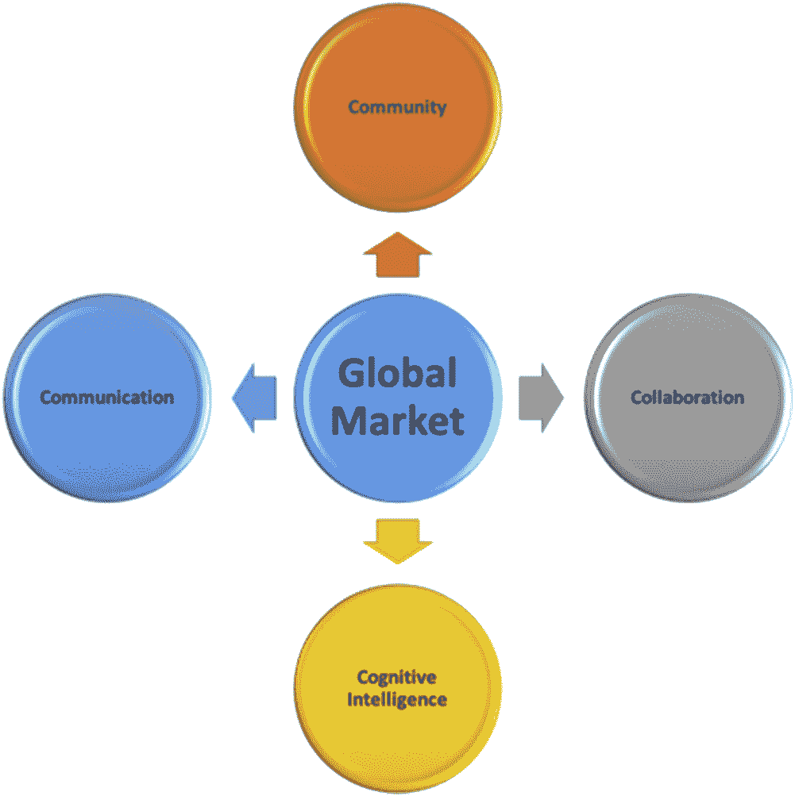
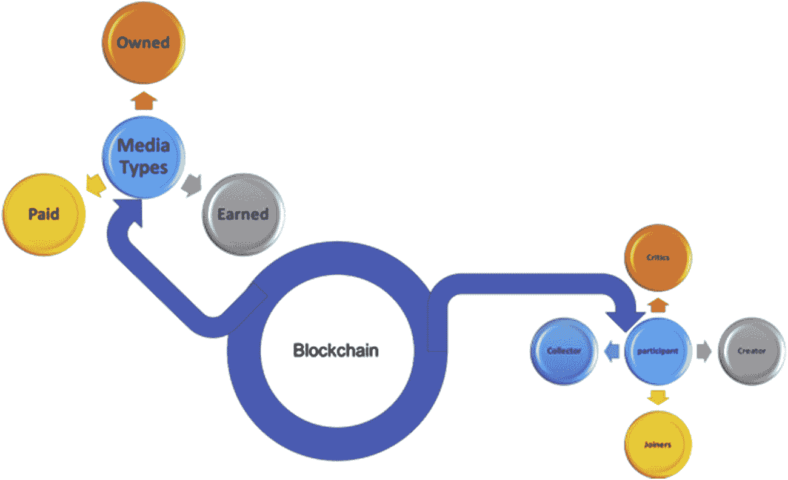
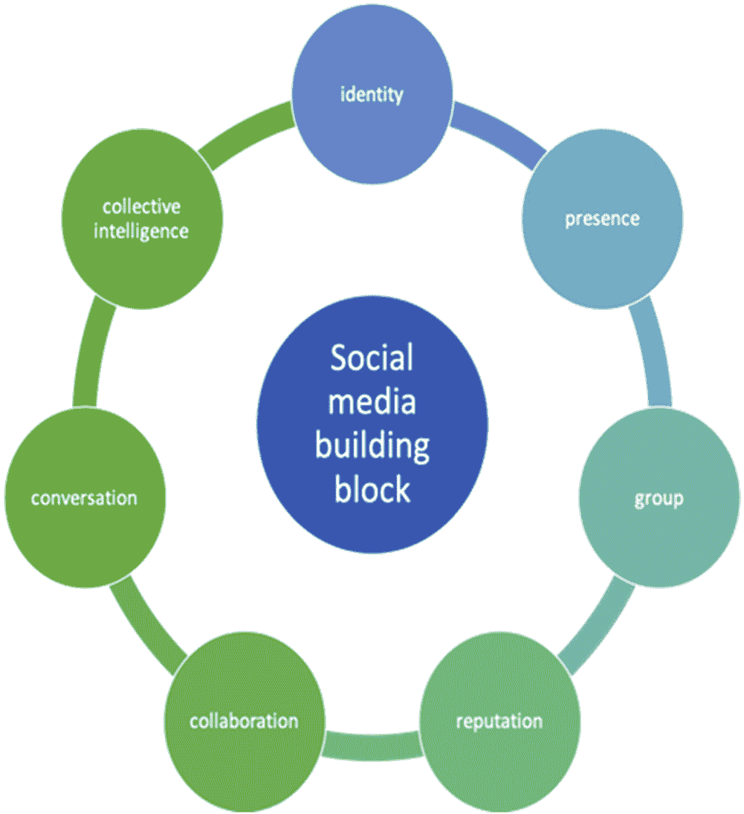
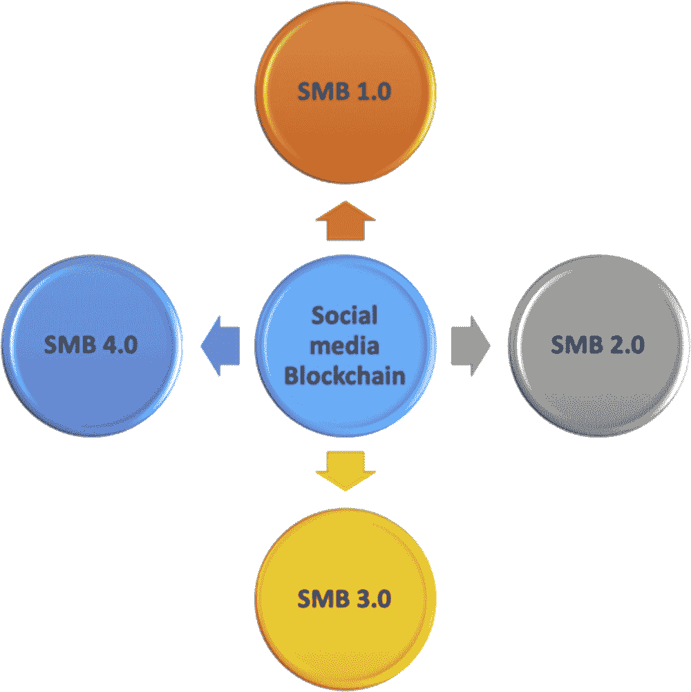

# 区块链重塑社交媒体商业模式 (Emerald Points)

|  | |  |
| --- | --- | --- |

*献给*
**Avatar Meher Baba**

*感念您的爱 Shalini, Meherika 和 Brownie。*

## 传记

Nitin Upadhyay 博士是一位研究员、发明家、创新者、顾问、领导者、教练、学者和多产作家。他是一位影响力人物，并定期以“博客作者”身份为《印度时报》、《经济时报》和《India Times》撰稿。他是享有盛誉的伦敦皇家艺术学会会士和印度工程师学会会士。多年来，他与部分世界 500 强企业有过合作。他是创新、设计、云计算、区块链、计算、大数据与分析、未来技术和用户体验方面的权威专家和演讲者。他目前从事信息技术领域的工作，是果阿管理学院大数据分析项目的核心成员。他还是果阿管理学院创新与数字商业创新中心的主任兼负责人。他拥有广泛的行业、学术、咨询和研究经验，是董事会成员、执行成员，并担任印度云计算创新委员会云 SLA（服务级别协议）主席。

他曾在韩国和班加罗尔的三星高级研究院参与多个旗舰项目，并推动了全方位的创新。

他是初创企业促进单元（SPC）、信息技术部（DIT）、果阿政府专家小组的专家成员，协助 SPC 落实果阿初创企业政策愿景，使果阿成为印度最受青睐的初创企业目的地之一，并力争在 2025 年前跻身亚洲前 25 大初创企业目的地。作为初创企业教练，他为创新流程和新产品的成功落地提供创新洞察、路线图和行动计划。他是 SkillTix 的创始人兼首席执行官，该公司的愿景是“通过提供‘正确’的技能组合和建立核心竞争力来塑造人们的未来”。

他发表了 100 多篇同行评审出版物/演示文稿/海报/演讲，并著有 12 本书。他贡献了最佳创意/专利/发明/创新。他担任多家知名期刊和学会的副主编/编辑/编委会成员/审稿人/会员。

他是“CABology”现象之父，这是 X/Y/Z 世代正在见证的现象。他的著作《CABology：云、分析与大数据三重浪的价值》（Springer Nature Palgrave Singapore 出版）和《大数据管理与分析》（Cengage 出版）已在知识和商业领域产生深远影响，并位列亚马逊畅销书类别。他合著的《印度云计算创新：框架与路线图》（IEEE-Standard USA 出版）已为业界、政府和学术界拥抱云计算创新树立了标杆。

他获得了许多国家和国际奖项及认可。他被列入《世界名人录》、《亚洲名人录》、《世界顶尖创新者》（IBC 剑桥），并多次获得诸如最佳信息技术研究教授、研究导师、明星研究员与创新者、杰出科学家、IEEE 会议荣誉嘉宾、美国终身成就奖、最佳研究奖（韩国，国际会议）等奖项。

他擅长画布绘画（丙烯/油画），并向广大观众及私人艺术展展出过作品（西班牙马德里和韩国）。他在国内外售出/捐赠了 100 多幅艺术品。此外，他参加马拉松、弹吉他、为文学创作贡献力量，也是一位贪婪的读者。

## 前言

互联网的出现改变了我们互动和进行商业交易的方式。没有任何业务能在实质上不受社交媒体影响。社交媒体已实现民主化，以至于它不再是企业的可选项，而是必要的战略。大多数时候，企业对社交媒体格局的战略优势和价值主张并不清晰。因此，他们无法建立能力、品牌、关系和商誉，从而受限于为提高效率、绩效和生产力做出贡献。许多 Web 和移动应用程序促进了全球社区的动态互动。正如我们所知，Web 2.0 为社交媒体平台提供了空间，是一个不断演变和扩展的领域。物联网、高端基础设施、智能设备和智能平台的进步，能够提供包容性和沉浸式体验，以及不同层面的参与与协作。世界不再局限于 Facebook、Twitter、LinkedIn、WhatsApp、Instagram、Snapchat 等，选择众多，每个应用的含义都为企业带来新的机遇和可能性。无论您从事哪个业务板块，采用社交媒体都可能带来声誉管理、信息不对称、信息溯源、完整性和可靠性等多重风险。

当前的社交媒体平台具有“中心化焦点”，内容的管理和控制因此掌握在中心化机构手中。缺乏社交媒体的集成使用来部署统一战略，以将参与者体验置于前沿。所有社交媒体平台都以中心化为重点，支持有限范围的触达和互动。早期行动者将获得优势，重新定义社交媒体，并利用区块链进行创新，开发新一代社交媒体社区。

社交媒体企业需要在平台层面推动技术，以实现其最佳性能。此外，由于该技术固有的点对点参与和共识机制组件，组织的边界将受到影响。然而，技术、市场和组织朝着统一增长战略的恰当交汇，将为采用和引入区块链以重新定义社交媒体企业铺平道路。

本书采用连贯的方法来定义社交媒体企业不断变化的格局。读者将了解区块链在重新定义社交媒体企业方面的效用。未来的社会企业经济将转变为信任与所有权的分布式网络，参与者只需拥有互联网连接和社交媒体应用程序，即可参与区块链网络上的社交交易。此外，当区块链技术与社交网络集成时，它为自我执行的社交代码提供了一个平台，使各种社交互动成为可能。

**Nitin Upadhyay 博士**

### 1 社交媒体商业模式

社交媒体平台已变得极受欢迎，并涉及人们在内容专业知识方面的参与。在本章中，读者将了解社交媒体平台不断变化的格局。

#### 简介

交易并非新鲜事物。人类社会一直在考量和观察它。亚当和夏娃之间的第一次神秘交易揭示了世界的真相。或许有人会争论触发交易的煽动者的重要性，但我们必须明白，交易发生在两个接受交易后果的人之间。交易是人们和社区互动、沟通、交谈、协作与共存的基本单位（Agnihotri, Kothandaraman, Kashyap, & Singh, 2012; An & Weber, 2015）。社交互动界面的变化维度催生了许多技术驱动的生态系统，互联网是首要因素。

互联网的出现影响了我们互动和进行商业交易的方式。当互联网商业化时，人们对其能力和适用性相当担忧。世界上大部分地区参与万维网的接入有限。正如研究人员所建议的，技术采用遵循钟形曲线，这非常适用于互联网（Anderson, 2006; Bjørn-Andersen, Rasmussen, & Rasmussen, 2009）。1990 年代只有少数采用者——创新者和早期采用者，他们通过在万维网上推出各种服务和解决方案进行了多种方式的尝试。

社交媒体已实现民主化，以至于它不再是企业的可选项，而是实现竞争力的必要战略和增维手段（Baghdadi, 2013; Bechmann & Lomborg, 2013）。根据麦肯锡的一份最新报告，社交媒体对商业的贡献可能在 9000 亿美元至 1.3 万亿美元之间。企业现在面临着社交媒体的巨大潜力，并拥有广阔的机会空间来利用并建立竞争优势（Ballantyne, 2014）。然而，增加价值的唯一来源不仅仅是纳入社交广告和营销活动，还包括在行业内部和跨行业拥有适当的战略性协作与合作构成。大多数时候，企业对社交媒体格局的战略优势和价值主张并不清晰。因此，他们无法建立能力、品牌、关系和商誉，从而受限于为提高效率、绩效和生产力做出贡献。

几乎没有任何业务能不受社交媒体影响。它提供了巨大的潜力，此前未被开发，可触达大众，说服他们了解其产品和服务（Berthon, Pitt, McCarthy, & Kates, 2007）。此外，企业的存在感和品牌印记已显著超越原有范围。社交媒体通过互联网催生了动态的全球社区，使其能够贡献、协作与合作。许多网页和移动应用程序促进了全球社区的动态互动。正如我们所知，Web 2.0 为社交媒体平台提供了场所，是一个持续演进和扩展的领域。它改进并使社交媒体应用程序更加用户友好。传统上，参与者仅限于查看企业网站上的内容。但在网络空间中，人们可以评论、分享、点赞、讨论、协作并生成自己的内容。对企业而言，此类互动触点正转化为宝藏触点。企业几乎可以从各处更多地了解其产品和服务。

#### 社交媒体在商业中的应用

无数应用程序促成了社交媒体的成功（Butterfield, 2003; Enders et al., 2008）。`物联网 (IoT)`、高端基础设施、智能设备和智能平台的进步，能够提供包容性和沉浸式的体验，以及不同层面的参与和协作（Choi & Varian, 2012）。世界不再局限于 `Facebook`、`Twitter`、`LinkedIn`、`WhatsApp`、`Instagram`、`Snapchat` 等，选择众多，每个应用程序的含义都为企业带来新的机遇和可能性。在新款 `iPhone XR` 上分享增强版虚拟形象，或在 `Samsung Note 9` 上发布实时消息，都能给参与带来完美的体验。连接设备打破了物理距离，让不同的世界相遇并提供令人难以置信的体验。当今时代的社交媒体平台和应用程序推动动态全球社区不仅更紧密地协作、合作和参与，更沉浸于其中的环境中。

企业可以通过使用单个或组合多个社交媒体应用程序来获得最佳收益（Chen, 2009）。随着对集成新技术的增值功能需求日益增长，这对企业来说已成为不小的挑战。它们需要了解下一代社交媒体平台和应用程序的范围、可行性和潜力（Chesbrough & Rosenbloom, 2002）。尽管社交媒体提供了无数机会，让我们了解如何系统地利用这些机会。存在五个理想机会（Kunz & Werning, 2013; Tuesta et al., 2015; Wang, White, & Chen, 2015），图 1.1：

**图 1.1.** 社交媒体机会。

##### 全球市场影响力

无论您在何处经营业务、在哪个市场运营，社交媒体都提供了前所未有的渠道，使您能触达几乎任何地方。

此外，通过利用搜索引擎优化技术，可以在巨大的网络上获得可见性。一个人在互联网上的可见性越高，预期拥有的市场影响力和商业机会就越大。社交媒体帮助 `Groupon`（高朋）使其业务成倍增长，并在短短五年内使其达到 120 亿美元的估值。`Groupon` 成为全球品牌，并因社交媒体而实现转型。

`Groupon` 通过引入社交媒体重新配置了行业，将其折扣券优惠扩展到大量客户。这些优惠通常有时效性，因此需要最优数量来兑换。社交媒体在优惠券营销中的融合，保证了 `Groupon` 扩大业务并获取客户细分市场。

##### 沟通

企业参与者可以通过适当使用社交媒体策略来实现经济高效的沟通。它既可用于正式讨论，也可用于非正式讨论。公司采用前者，而员工采用后者来疏导沟通。社交媒体应用可以放大非正式沟通结构，人们可以利用它来分享项目目标和工件，并提高效率和知识水平。此外，社交媒体应用带来了多元化的沟通，因为它允许共享和利用不同类型的媒体。

像 Salesforce.com 和 Cisco 这样的公司已将社交媒体战略性地引入各自的业务中。为了跟上其产品供应的步伐并在培训能力上保持优势，Salesforce.com 开始利用 YouTube 视频培训客户，从而减少了相当于数百名销售人员的工作量。Cisco 利用各种社交媒体平台与不同的利益相关者建立联系。它利用近 31 个博客来服务受众，涵盖公司信息、供应、产品等众多内容。

此外，它还利用 Facebook 粉丝页传播解决方案、供应、服务和相关信息。它还利用 Twitter 扩大客户群。Cisco 还使用 Flickr 来展示产品、活动和供应的照片。

##### 社区存在

在没有时间和空间障碍的情况下建立虚拟社区是轻而易举的。社交媒体应用提供了多种方式，让人们聚集在一起讨论、辩论和分享共同感兴趣的话题。例如，LinkedIn 为专业社区提供了聚集在一起、分享与群组相关的关切和解决方案的平台。企业可以战略性地识别社区中的子社区和影响者。通过影响者引导供应、服务和解决方案，有助于提升利润率和增长。

##### 集体智慧

管理、控制和管理由社交媒体利益相关者构建的集体知识是至关重要的一环。随着越来越多的人加入社区，参与沟通形成了知识语料库。企业可以深入了解其产品和服务，还可以收集竞争对手的业务产品组合。通过处理社交媒体社区产生的知识语料库，企业可以在竞争和绩效方面占据优势。

Starbucks 根据集体智慧战略性地构建产品、服务和供应。它运营一个 Facebook 粉丝页，并维护 MyStarbucksIdea 网站以收集潜在消费者的想法。通过社交媒体应用的集体智慧，Starbucks 获得了更多客户，开发了富有洞察力的体验，生产了实用的供应，并执行了社会责任项目。

可口可乐“Freestyle”自动售货机展示了 100 多种口味选择。顾客有机会混合口味、品尝并将体验分享给社交媒体上的朋友。此类富有洞察力的细节帮助公司推出了新的创新产品。

Cisco 举办了一场“十亿美元创意大赛”，吸引了来自 157 个国家的 3,000 名参与者贡献了 800 个创意。获奖者获得了 250,000 美元的奖金。社交媒体助推了 Cisco 的“十亿美元创意”，因为每个创意的成本约为 321 美元，却能产生十亿美元的业务。

##### 协作

社交媒体应用最强大的功能是协作。它为人们在个人和职业领域进行协作提供了多种途径。有确凿的记录表明，社区主动站出来，共同合作，在像“保护森林”这样成功的可持续项目上进行了协作。

埃森哲是一家全球性的咨询、技术服务和外包公司，在全球雇佣了 200,000 多名员工。它利用 Facebook 和 LinkedIn 构建了一个交互式协作平台，以连接和协作运行、管理和执行项目。

##### 风险与挑战

无论您从事业务的哪个领域，采用社交媒体都可能带来多种风险。这些风险——如声誉管理、信息不对称、信息溯源、完整性和可靠性、可见与不可见的影响范围——都会影响业务。一些风险与组织的核心（即其基因）息息相关，但有些可以通过技术干预来解决。一些公司是封闭文化，因为它们不相信共享和传播信息。因此，它们是受社交媒体采用影响最大的群体。对它们而言，拥有共同的社交媒体沟通语言和目标至关重要。此外，还需要解决实施、集成和互操作性问题，以促进不同社交媒体平台之间的融合并实现数据可移植性。

##### 新社交媒体

有趣的是，过去的社交媒体为我们提供了大量信息。其中一些有用，但许多却受到不可靠、质量低劣、缺乏完整性、不可追溯、可信度低和不道德等问题的困扰。现在是时候开发框架和标准来管理、控制、管制和监管社交媒体的各个方面了。监管应由 AI 和数据驱动技术的适当使用来管辖。

此外，重点需要从中心化控制（由一个中央权威控制社交媒体的各个方面）转移到同伴控制（参与的同伴对其行为拥有所有权和控制权）（Casey & Vigna, 2018）。我们应该拥有一种机制，共同商定正确信息的可信度和完整性。每个贡献者都应因其贡献获得回报，而不是仅由 Facebook 或 Google 等单一中央权威获取所有人贡献带来的所有收入。此外，对社交媒体上信息传播的信任至关重要。社交媒体需要发挥积极作用，确保所提供的信息和来源准确、可信且真实，以避免任何错误信息。

物联网已成为人类社会不可或缺的一部分，人机组合促成了数据的指数级增长（Dorri, Kanhere, & Jurdak, 2016; Kitchin, 2014）。三星健康支持许多活动和挑战，来自世界各地的人们参与并执行。它还提供排行榜，用户可以在其中查看自己在挑战中的表现，并评估自己相对于其他参与者的位置。

社交物联网正在改变人类社会的经济、物理和行为层面。当智能家居与社交媒体集成时，会生成关于家庭及其环境的有用信息。例如，每当房屋环境照明发生变化或有人签到进入房屋时，消息可能会自动发布到 Twitter 上。

信息搜索是最重要但也是最耗时的活动。许多商业模式通过在信息搜索模型上结合广告业务获益。虽然此类模式对广告商有利，因为他们的信息在搜索时会出现在巨大网络的顶端，但消费者并未真正获益。此外，如果搜索结果不当，搜索的完整性就会受到质疑。因此，未来的信息搜索社交媒体商业模式必须重新思考参与者和利益相关者的角色和责任，以提供真正的价值主张（Gillin & Schwartzman, 2010; Haenlein, 2011）。它必须在内容搜索和个性化过程中保障消费者的利益，而不应仅使社会的某一个阶层受益。

##### 新闻业与社交媒体挑战

新闻业因假新闻的存在而面临巨大动荡。每个人都能轻松地向覆盖面更广的社交媒体贡献信息。新闻类社交媒体竭尽全力确保受众关注媒体内容。但不知为何，它在确保信息来源和可靠性方面却有所欠缺。社交娱乐行业也未能幸免于社交媒体的影响。

##### 数字出版转型

数字出版行业通过其提供的价值主张实现了转型，引入了去中介化并吸纳了一批新参与者（Garci-Agreda, 2013; Wikström & Ellonen, 2012）。然而，创建和发布内容的核心角色依然保持不变。内容如今如何分发给大众并被他们消费，取决于社交媒体平台的潜在用途（Enders, Hungenberg, Denker, & Mauch, 2008; Frow, Nenonen, Payne, & Storbacka, 2015）。这有助于建立一个引人入胜的平台，因为受众可以参与讨论并成为创作过程的一部分。诸如 `Flipboard`、`Medium` 等多个社交媒体平台应运而生，它们运营着兴趣社区，并拥有强大的社交影响力。

用户生成内容是用户参与度的驱动力（Kaplan & Haenlein, 2010）。许多社交企业正在开发社交工具和框架以便利用户。媒体内容生成、获取和处理等功能，以及分发和变现内容的能力，均十分突出。

##### 中心化焦点与挑战

当前的社交媒体平台具有“中心化焦点”，并提供内容分发和共享渠道。此外，内容的管理和控制权因此掌握在中心化机构手中。该机构策划并整合需传递给社交网络参与者的相关内容。这一过程帮助机构洞察用户对特定内容的意图和偏好，并据此利用适当策略处理和利用用户生成内容。可以认为，“中心化焦点”是建立优质内容市场（面向目标广告主）以促进机构收入增长的主要焦点。此类社交媒体平台的中心化面临诸多挑战（Lehmkuhl & Jung, 2013; Okada & Yamamoto, 2011）：

*   无法控制信息的流向和结构
*   个性化推荐不精准
*   隐私和伦理管控过度宽松
*   与虚假信息和假新闻相关的信任问题日益严重

##### 增强型内容分发模型

通过引入考虑物联网重大影响的增强型内容分发模型，可以克服典型的中心化焦点。通过整合 AR/VR 环境，利用数字干预引入感官知觉，刺激了包容性环境的发展（Csik, 2015; Spaulding, 2010; Wang & Zhang, 2012）。当下一代社交媒体模型支持社交用户环境中的动态现实世界社交互动时，这并非遥不可及的目标。

如今，许多数字原住民和数字移民以不同方式使用社交媒体。同样，面向这两类人群的社交媒体企业也有独立的参与策略。在此环境下，组织正在通过将社交网络与动态现实世界相融合，打造创意画像以培育社交网络。我们可以发现，不仅需要与人进行更具现实包容性的互动，还需要与他们的环境互动。3D 技术与 AR/VR 的显著贡献将驱动更个人化、更深度的互动。因此，社交媒体平台将支持机器间通信，在理解人类行为和管理社区方面发挥主动作用。在动态环境中释放社交网络的用户信息，将带来更个性化和精准的营销。

##### 民主化与信息过载

由于移动设备的普及，数字新闻的分发和消费现已实现民主化。社交网络规模激增，晋升为新闻消费平台，尽管这仅意味着新一代用户现在可以轻松浏览并与呈现给他们的信息层进行交互。此外，由于信息过载这一额外维度的影响，相关信息不太可能被展示给他们。此外，整合多个社交媒体站点以推送信息的网状特性，使整体交互平台变得更加复杂。用户面临社交媒体平台的若干挑战，预计采用新技术的新商业模式将克服这些挑战（Dorri et al., 2016; He et al., 2015; Lewis, 2015）：

*   **真实性**：信息过载引发了信息真实性的关键问题。有时难以识别数据的有效来源和完整性。社交用户倾向于快速传递信息，这遵循滚雪球效应，导致难以追溯实际来源。
*   **偏见**：中心化社交媒体随时间形成其特定的法规、伦理和编辑政策，从而有意或无意地对信息施加特定偏见。中心化驱动的密集控制更侧重于社交网络中显性的偏见存在。这种偏见导致对新闻信息的不同解读。

##### 中心化风险与数据变现

社交媒体应用大多以中心化方式运营。但切勿将中心化与安全混为一谈。大多数平台易受信息泄露、身份盗窃、安全漏洞、审查、黑客攻击等问题困扰。Facebook 近期的信息泄露事件便是此类问题的例证。超过 8700 万人的个人信息被泄露，并被用于在上届美国总统大选中推广少数候选人。大多数在社交媒体平台上生成的客户数据被用于广告收入。平台充当广告主的中介。它帮助向客户投放定向广告以产生收入。内容质量在疏导流量方面也起着关键作用。不应为了牟取流量而牺牲内容质量，因为这并不直接关联内容价值。用户通过贡献知识语料库来充实社交媒体平台，却未获得奖励和激励。此外，他们现在意识到自己的数据被服务提供商用于牟利，而他们并未分得一杯羹。

在某些情况下，少数社交媒体平台增加了功能，向为数据做贡献的社交用户分享一小部分收益。这些用户通常在社区中具有影响力，从而在内容上聚集巨大流量。用户间价值分配不当引发了社交社区的不满。

##### 信息验证与宣传

呈现在社交网络用户面前的信息是压缩形式的，用户没有足够的时间和技能来核实和验证信息的真实性。大规模信息的采纳容易引发紊乱的情绪和感受，这在绝对意义上是不可避免的。某些宣传活动故意通过分享歪曲信息，在用户社区中煽动特定情绪。尽管控制此类宣传似乎是一项复杂的工作，但社交企业必须寻找途径，应对这种难以对付的宣传执行方式。

### 区块链

#### 区块链：一种去中心化的分布式公共账本

区块链为所有参与方提供了一个去中心化的分布式公共账本，并宣称无需中介参与。在本章中，读者将接触到区块链的各种特性，以实现其功能。

#### 简介

为什么我们需要另一场技术革命？值得尝试吗？我们需要担心即将到来的无信任经济技术浪潮吗？必须回答许多此类问题，才能揭示区块链的真实价值。竞争激烈，我们在互联网浪潮兴起期间见证了许多《财富》500 强企业的衰落。往昔的互联网不仅改变了商业的动态，也改变了社会。随着社交媒体平台的出现，商业、社会和人类作为“三位一体”走得更近，共同为彼此的发展、增长和利益做出贡献。

区块链技术实现了物理和数字资产的点对点交易，无需任何中介或中央机构参与。最初，它是为支持加密货币——比特币——作为金融交易模式而开发的。但令人惊讶的是，各种软件程序被实施以支持中央机构的职责，如验证、确认和共识。其目的是彻底消除任何形式的中介，价值交易必须在网络上无缝执行。后来，计算元素被添加到区块链平台，这为货币交易之外的大量创新打开了大门。

##### 什么是区块链？

在去中心化网络中实现点对点交易，同时在未知对等节点之间建立信任，并将交易记录在不可变的分布式账本中。

对于我们所有人来说，远离中心化权威、拥抱去中心化平台且不干扰整体结果，是一段漫长的旅程。让我们尝试了解针对特定物品进行交易的中心化和去中心化方式的场景。

###### 场景：使用信用卡购买物品

####### 中心化系统

考虑到利用中心化网络完成完整交易，让我们首先列举哪些中介会在部分或整体上促成交易。

*   信用卡机构
*   客户的银行
*   信用卡发卡行
*   交易所
*   商家的银行
*   商家

所有上述中介都需要验证和确认交易，以完成物品的购买。考虑同一场景，即在电商网站上购买物品，涉及五个不同的供应商进行配送。天哪！多么复杂的中介交互。这不仅因交易费用而增加成本，还会导致延迟（跨境处理时延迟更甚）。

####### 去中心化系统

去中心化系统提供底层基础设施以支持点对点交易。中介的角色由软件组件取代，将它们连同其对等节点推向边缘。对等节点彼此无需相识即可完成交易。此外，它们可以位于任何地方，物理位置不会阻碍交易。当系统通过建立验证、确认和共识确认流程，在对等节点间实现信任时，这种交易成为可能。

> **注意：** 在区块链网络中，交易被创建到区块的分布式账本中。一旦达到确认，这些区块将作为不可变记录添加到区块链中。

在区块链商业网络中，分布式账本在网络对等参与者之间复制和共享。每当发生新交易，一旦新区块被批准并添加到区块链，更新后的区块链即可用（Kraft, 2016）。对等复制提供了对等节点作为交易的发布者和订阅者的能力。每个参与者代表对等网络中的一个节点，数据和交易在系统中同步。由于验证交易所需的工作从中心转移到对等网络，区块链网络成为商业的一种经济且可行的选择（Buterin and Mougayar, 2016）。无需中介批准交易，且因共识机制验证交易，它们变得更加可靠、安全和可验证。交易的运作模式保持不变。例如，参与交易的参与者是相同的。但变化在于交易实现的方式。交易记录作为单一真相被共享并可供所有参与方获取。

区块链网络通常展示以下特征（Tuesta et al., 2015; Buterin and Mougayar, 2016）：

**共识：** 交易是系统中的基本单位，为批准交易，网络中的对等参与者应对其进行验证。存在多种共识机制，供对等节点验证交易。

**溯源：** 有助于识别资产的起源以及所有权如何随时间变更。用户可在敲定感兴趣的交易前，获取资产所有权的详细信息。

**不可变性：** 一旦交易记录在区块链上，便无法以任何形式篡改。因此实现了不可变的特性。即使交易导致错误，也无法修改，必须记录一笔新交易来纠正。两笔交易记录始终同时存在于区块链网络中。

**终局性：** 通过共享账本，可获得关于资产所有权或起源、或交易详情的单一真相。不存在交易的多个版本或与资产相关的多版本信息。

通过区块链网络很容易建立信任。它支持加密证明和基于共识的机制来记录交易。参与的对等社区负责认证、验证和确认交易，因此不再需要政府或监管机构等中央权威来执行此类操作。区块链网络通过以下方式实现信任（Lemieux, 2016; Lewis, 2015）：

**独立性：** 承载交易单一真相的账本在对等参与网络中复制和共享。没有任何单一权威或一方拥有这种分发。区块链的持续存在不依赖于中央权威，且不易遭受单点故障。

**可审计性：** 交易带有时间戳并有序排列，可近实时访问。在区块链网络上审计交易轨迹变得容易。每个人都有权访问数据。

**共识：** 要将交易记录为有效状态，网络中所有相关的对等参与者必须达成一致。批准交易的责任在于对等参与，并基于共识机制执行。

**编排：** 区块链网络可以重新定义和重构业务流程。此外，通过将智能合约纳入网络，端到端流程变得经济且可持续。

#### 区块链对商业的潜在价值

开展业务并不一定要使用公有区块链。面向商业的区块链可以是私有的、许可制的，参与者彼此知晓，且无需加密货币来建立交易。此外，一定程度的权力会分配给参与者。网络需要维护共享账本。共享账本可供许可网络中的参与者访问，但参与者只能看到他们被授权查看的那些交易。许可制区块链对区块链网络施加了一定程度的控制。例如，它可以设定约束，要求记录特定部分参与者（如审计员）的交易，必须经过审计员批准。

#### 区块链作为技术颠覆者

随着社交媒体平台的出现，数据呈指数级增长，这给商业和社会带来了诸多挑战——数据溯源、隐私、安全。一方面，人们担心身份泄露、隐私问题；另一方面，却不吝在社交媒体平台上公开他们的数据。企业一直在尝试利用各种工具和技术来管理社会关系的复杂性。随着技术进步和人类社会利用更多设备进行连接（物联网），为了高效管理，交互和数据的复杂性只会增加。区块链技术似乎遵循 Geroski 在其著作《新市场的演变》中提到的类似趋势。区块链的采用受以下因素影响：

*   早期行动者开发并提供解决方案
*   令人惊叹的产品横扫现有的竞争产品
*   缓慢的市场发展导致低迷，随后技术普及建立市场

区块链的拥护者和爱好者将其增长轨迹比作手机、个人电脑等其他技术。尽管如此，其特点是经历“缓慢增长”进入“等待期”，随后是爆发式的“起飞期”，最后进入“平稳期”。沿着创新采用生命周期走区块链路线图的参与者和玩家可分为：创新者（比特币）、早期采用者（其他加密货币）、早期大众（IBM、软银、咨询公司、系统集成商、联盟）。区块链技术尚未被晚期大众和落后者所接受。

区块链有助于缓解以下市场摩擦：

##### 信息摩擦

通常，在一笔交易中，信息细节不完整，或未以同等程度共享给参与方。此外，由于存储、处理和共享的复杂性，信息有时会变得不可用或无法访问。信息受损和隐私风险导致决策失误、流程延迟和品牌声誉受损。分布式共享账本有助于消除信息摩擦，随时为所有参与方提供交易所需的单一事实版本。

##### 交互摩擦

当参与方之间存在更多交互点时，交互摩擦会变得复杂。这可能是由于分离程度的存在，或交易流程的复杂性。区块链网络通过信任分发和共识机制，消除了不必要的交互点。智能合约消除了业务流程中的延迟，因为自动执行流程可以嵌入区块链网络中。

#### 区块链结构

比特币区块链的基本要素是交易。交易在网络中广播。随后，由参与网络中的对等节点进行验证。许多交易组合形成区块，许多区块通过不可变链接连接形成区块链。添加新区块并非一蹴而就，最好遵循预定义的流程。添加到区块链的每个区块必须基于底层共识机制达成一致。对等节点执行称为“挖矿”的验证和共识过程。矿工无非是运行软件执行计算以达成共识和验证的高算力节点。

##### 未花费交易输出

在任何给定时间点，比特币区块链的状态可以通过未花费交易输出（UTXO）集合获得。UTXO 同时存在于两个位置：首先作为交易的输入，然后作为交易的输出。这些 UTXO 由参与节点存储在数据库中。对于给定交易，会生成以下 UTXO 详情：

*   创建该 UTXO 的交易的唯一标识符
*   该 UTXO 在交易输出列表中的引用
*   交易金额
*   输出可被花费的可选条件

交易包含：

*   当前交易的引用编号
*   一个或多个输入 UTXO 的引用
*   一个或多个输出 UTXO 的引用
*   总输入和输出金额

去中心化网络中的操作是对等参与者及其各自计算和存储节点的责任。一些典型操作包括：

*   交易验证
*   收集交易
*   广播交易和区块
*   区块交易共识
*   链接区块

参与者存在两个主要角色：

*   发起交易
*   挖掘交易，将交易添加到区块并与现有区块链整合。此类参与者负责验证交易、广播交易、竞争创建区块、通过共识验证区块、广播新区块、确认交易。每个此类参与者都通过激励机制来维护区块链。所有矿工独立执行验证交易的任务。

共识确保链的完整性。不同的共识协议用于保证区块链中的共识。当参与者匿名时，验证成本高昂。在这种情况下，会采用工作量证明等共识机制，即挑战每个参与节点解决特定的计算问题。解出谜题的节点广播交易区块，经对等参与者验证其有效性和真实性后，将其整合或链接到区块链网络中。

区块链网络实现了隐私和机密性。隐私是保护数据、属性、资产不被非预期和未同意方观察的权利。数据机密性确保只有授权实体才能访问数据。隐私和机密性都是区块链的重要方面。比特币区块链是公有链，因此我们可以看到比特币区块链上发生的交易。Hyperledger 和以太坊等平台是许可制区块链。它们将区块链访问权限限制在选定的实体或参与者范围内。通过此类平台可以实现机密性和隐私。数据读、写、更新等操作权限受到控制和管理。一些区块链平台（如 MultiChain）要求交易节点必须在许可名单上。

#### 区块链与社交媒体

#### 区块链技术与社交媒体

十年间，区块链技术在技术 S 曲线上的位置使其适合拥抱创新、采用与投资 (Crosby, Nachiappan, Pattanayak, Verma, & Kalyanaraman, 2016)。它促进了包容性经济，并使个人能够参与民主进程。比特币的成功依赖于支持基于软件的验证、核实与共识的区块链基础设施。用于挖掘和创建区块的不断增长的算力来源，使区块链爱好者得以将目光投向货币转移之外的区块链应用 (Don & Alex, 2016)。

区块链的使用可能影响大量应用。更重要的是，以社会实体为中心的社交媒体平台和应用将得到适当的运营和治理。社交图谱关注的不是网站的连通性，而是体验。

遗憾的是，缺乏社交媒体的整合使用来部署统一战略，以将参与者的体验置于前沿 (Cortimigila, Ghezzi, & Renga, 2011)。所有社交媒体平台都以中心化为重点，支持有限范围的触达和互动。正如 Corcoran (2009) 所言，社交媒体生态系统包含三种典型的媒体类型——自有媒体、付费媒体和赢得媒体。

##### 自有媒体

此类媒体系统由组织治理和拥有。例如，公司的网站及其上关于服务、解决方案和产品的发布，完全由相关团队（如市场部门）控制。

##### 付费媒体

此类媒体系统有助于创造知名度和触达。通过赞助和广告关联公司的形象，是展示品牌效力的部分途径。

##### 赢得媒体

此类媒体系统既不受公司资源控制，也不由其管理。口碑或病毒式媒体通常会引发对特定关注点的即时热议。

根据 Li 和 Bernoff (2008) 的观点，在社交媒体生态系统中，活跃参与者根据不同的社会行为类型进行细分。

###### 创作者

他们是主动创造社交对象的人。他们还利用社交媒体平台支持的适当功能和工具，发布、维护、更新和上传对象。

###### 收集者

此类别下的人负责收集社交对象，并将其适当地与同伴或参与网络分享。

###### 加入者

有时人们确定要参与某个群体，或者他们参与是为了解群体情感，如果这与他们的诉求相符，则会进一步投入互动。

###### 评论者

该细分人群通常对社交对象进行评论和评分。他们负责成就或毁掉制品，此外，如果他们代表影响力核心区，则监控和管理其行为以避免不必要的风险变得至关重要。

去中心化数据库支持有效的通信或消息传输。例如，文件和视频共享正变得经济高效，以至于传统的中心化网络或电子平台（如 Google Drive、Yahoo、Gmail 等）变得不那么必要。通过去中心化机制，无需中央机构干预，即可发送、共享、检索和访问加密消息和文件。去中心化网络允许信息无缝发布和分发，消除了单一权力进行审查的能力。

因此，涉及基于区块链使用的社交媒体平台的组织，必须考虑媒体类型和活跃参与者细分来分析其适用性。在第 4 章中，我们将探讨寻找赋能因素和价值驱动因素，以将社交媒体领域与价值主张联系起来。基于区块链的社交媒体企业显著影响媒体类型和参与者。参与者因在区块链网络上为媒体类型做出贡献而获得奖励和激励。此外，智能合约的引入用于启动和执行记录交易和分发奖励代币的端到端流程，为同伴参与者创造了收入 (Chesebro, 2015)。作为区块链网络的内在属性，参与者拥有数据的所有权，并可将其用于变现目的。图 2.1 表示区块链作为底层基础的引入，以支持媒体类型和参与者。

**图 2.1.** 区块链与媒体类型和参与者。

早期进入者将获得优势，重新定义社交媒体并利用区块链进行创新，以开发新边缘社交媒体社区。社交媒体企业可以利用技术、市场和组织作为结构框架，来衡量和重新设计其进入区块链市场的战略。

社交媒体企业需要在平台层面推动技术，以发挥其最佳性能。此外，由于技术的内在组件——点对点参与和共识机制，组织的边界将受到影响。然而，技术、市场和组织朝向统一增长战略的恰当交汇，将为采用和引入区块链以重新定义社会企业铺平道路。

### 3 挑战与机遇

互联网创造了我们在其早期未曾预见的新可能性。区块链技术独一无二，具有渗透现有市场和开发新市场的巨大潜力。在本章中，读者将了解区块链在社交媒体行业相关的挑战与机遇。这将帮助他们探索现有业务如何转型，以及如何创造新市场。

#### 简介

利用区块链重新定义社交媒体，为贡献者带来了数据所有权的即时收益。由于该技术基于分布式账本上记录的点对点交易，没有任何单一中央机构对其进行控制。所有权从中央机构转移到了同伴的边缘。例如，传统社交媒体企业（如 Facebook）将无法窥探社交参与者在社交网络上共享的数据，除非他们获得权利和同意。社交互动交易将存储在区块链网络上，并支持隐私、保密性和不可篡改性 (Crosby, Nachiappan, Pattanayak, Verma, & Kalyanaraman, 2016; Don & Alex, 2016)。

此外，用户还可以将数据保存在链下的云端。社交用户是社交对象的关键贡献者。通过使用区块链，社交企业将无法存储和挖掘用户数据。既然用户现在可以决定谁有权访问数据以及数据将用于何处，他们就能获得公平的机会赚取收入分成。例如，用户可能对特定的一组广告感兴趣，与其由社交企业向用户推送广告，不如用户共享数据并根据获得的加密货币或代币份额来决定广告。

#### 区块链价值主张

区块链中的社交用户也能直接从代币经济和网络效应中获益（Kraft, 2016; Lewis, Larsen, Goh, Tan, & Tacchi, 2016）。社会企业可以在首次代币发行（ICO）期间分发代币，用户可以直接获取代币，而非用他们的数据换取。他们还可以使用代币来享受社会企业提供的服务。与只有中心化社交媒体平台能直接从规模网络中获益的知名企业不同，区块链社交媒体企业中的社交用户因其贡献和参与也能获得奖励并受到激励。像 Facebook 这样的组织必须重塑其商业模式，通过引入代币化、共识、去中心化、不可篡改性和透明度，在其综合性社会企业中采用区块链。

##### 社交用户——收益

基于区块链的社交媒体企业中的社交用户将获得以下收益：

###### 数据控制

与典型的社交媒体企业不同，基于区块链的社交媒体企业中的社交用户掌控自己的数据，并为了服务和奖励而向利益相关者发布数据。

###### 信息完整性与真实性

分布式账本和信息的不可篡改性帮助社交用户验证信息来源、信息完整性及其可靠性。一旦交易被验证，就会被记录在区块链上。社交用户将能够验证内容和信息溯源，以避免任何虚假新闻或错误信息。

###### 众筹机会

社交媒体企业可以集成区块链，为众筹项目提供透明度和开放性。智能合约可被高效用于执行金融交易，用户能实时了解流程执行状态，从而能够追踪和控制资产。用户可以无缝地追踪、监控和捕捉交互节点。

###### 直接客户

组织可以使用支持区块链的社交媒体应用程序直接与客户打交道，无需中介参与。因此，营销人员可以直接与客户互动。此外，随着越来越多的社交用户向心仪的组织分享其数据统计信息，他们成为收益分成模式的一部分。信息生产者和消费者之间将建立紧密联系。由于数据服务中没有中介参与，组织可以显著获得更高的每千次展示成本率（CPM）。

区块链将迅速改变用户在社交网络中互动和参与的方式。信息完整性和可靠性的责任在于对等参与者。系统将能够生成准确数据、保持可追溯性和溯源性、展示定向广告、开发增强的用户体验并提供透明度。去除中介将帮助组织提高投资回报率（ROI）。但它们也需要考虑对社交用户的激励模型，以在社交网络上生成社交内容。

表 3.1 总结了基于区块链的社交媒体平台的直接收益。

**表 3.1. 社交用户收益。**

| 属性 | 描述 |
| --- | --- |
| 产品认知 | 消费者将不再被视为产品。因为他们对生成的数据拥有更多控制权，所以有权同意并授权选定方访问其数据，以使用适当的服务或获取奖励或代币。 |
| 数据控制 | 用户将负责拥有数据，因为他们发起的交易由网络中的对等参与者验证。权力和所有权掌握在数据贡献者手中。 |
| 应用内支付 | 用户可以在社交媒体应用程序中使用代币化系统，通过贡献适当数量的代币来享受服务。 |
| 帖子与影响者的补偿 | 用户在贡献和扩大社交网络方面将占据优势。对于每一次此类贡献和参与，他们都会获得激励。 |
| 信息的合法性 | 用户的贡献只有在基于共识机制经对等参与网络批准和验证后，才会被记录在不可篡改的分布式账本上。此过程保证了信息的合法性。 |
| 数据溯源 | 用户可以追踪和溯源社交对象，因为交易被记录在不可篡改的分布式账本中。这有助于识别数据来源。 |

##### 社交用户——挑战

尽管在重新定义社交媒体企业方面使用区块链有诸多好处，组织也应考虑与之相关的挑战以规避风险。社交媒体网络以交易规模著称，而由于区块链需要执行共识协议，验证此类交易的速度通常较低。例如，基于区块链的社交游戏 CryptoKitties 曾导致以太坊平台上的流量拥堵。与 Facebook 或 Twitter 上的流量相比，CryptoKitties 在区块链平台上造成的流量微不足道。所有内容都必须经过验证和认证，这导致交易的周转时间较长。此外，交易挖掘消耗大量能源，考虑到每天数百万甚至数十亿次贡献交易，这对大规模社交网络而言效率低下。而且，贡献者在社交网络上执行的每一次贡献交易所产生的交易费用，阻碍了社交互动的初衷。

区块链从根本上基于对等参与并去除中介。区块链将受到社交网络上审核挑战的影响。设想社交参与者在网络上发布数千个视频，这使得对等网络难以审核视频内容。批准或拒绝视频交易将是一个巨大的挑战。这可能进一步引发一个根本问题：是否需要第三方来审核交易，这违背了区块链的原则。否则，我们将让对等参与网络承担此类审核的责任，但这将非常复杂。此外，社交媒体企业在更新 dApp 时面临挑战，因为必须考虑社交社区和参与者的信任与共识才能进行任何修改。表 3.2 总结了用户面临的挑战。

**表 3.2. 挑战。**

| 属性 | 描述 |
| --- | --- |
| 可扩展性 | 区块链需要执行共识协议，导致交易速度低。它无法支持高度可扩展的交易集。 |
| 经济价值 | 网络倾向于使用高计算和能源资源来执行和记录交易。 |
| 审核 | 网络上的可扩展性给内容审核带来挑战。 |
| 更新 | 对等节点需要就向参与网络推出更新达成一致。 |

## 4

# 区块链在社交媒体平台中的适用性

区块链在社交媒体平台中的适用性极为广泛；因此，企业可以创造真正的价值。所提出的价值主张模型将助力社交媒体行业在数字化转型中实现飞跃。在本章中，读者将了解如何利用区块链价值主张来转型社交媒体商业模式。

#### 简介

社交媒体商业模式帮助组织发掘途径，通过社交媒体工具和平台获取并创造价值，而这在以往是不可能实现的。通常，两类组织会利用社交媒体模式。首先是拥有并管理社交媒体平台和工具的组织。其次是利用它们在组织内外进行分享、沟通和协作的组织。商业模式帮助企业向潜在客户、客户、合作伙伴和利益相关者传递其价值（Wirtz, 2011; Zott, Raphael, & Massa, 2011）。商业模式涵盖的是业务构建要素，而非指导实施和行动计划的战略。这些构建要素有助于理顺整体业务愿景并对齐业务目标。尽管商业模式由来已久，但人们使用不同的术语和构建要素来定义它们。例如，Morris、Schindehutte 和 Allen（2005）在研究了 19 种商业模式定义后，提出了 24 个促成商业模式的不同要素。然而，更通用且广泛使用的要素包括价值主张、目标市场、客户关系、基础设施和经济模式。商业模式至少应涵盖价值主张、价值创造与提供，以及财务持久性（Wielki, 2010）。

#### 区块链与社交媒体的构建模块

企业应关注社交媒体商业模式的基本构建模块（Kietzmann, Hermkens, McCarthy, & Silvestre, 2011; Singaraju, Nguyen, Niininen, & Sullivan-Mort, 2016）。这些模块既不互斥，也非全部强制包含。相反，它们指导并帮助企业协调力量，以制定增长战略规划。每个模块都有助于组织理解特定的社交媒体用户体验及其影响。图 4.1 展示了社交媒体的构建模块。

**图 4.1.** 社交媒体构建模块。

表 4.1 总结了功能构建模块及其影响。

##### 表 4.1：社交媒体构建模块的影响

| 构建模块 | 描述 | 影响 |
| --- | --- | --- |
| 身份 | 用户透露其信息和身份的范围和程度。 | 用于创建、建立和管理身份的工具、功能和选项的可用性。 |
| 在场感 | 用户知晓他人可用状态的范围和程度。 | 用于在特定情境下创建、发展和管理亲密感、真实感和即时性的工具、功能和选项的可用性。 |
| 群组 | 允许用户形成社区的范围和程度。 | 用于创建、建立和管理社区的工具、功能和选项的可用性。支持管控成员资格规则和协议的功能。 |
| 声誉 | 用户知晓他人及内容的社会地位的范围和程度。 | 用于创建、建立和管理用户、品牌及内容的强度、热情、情感和影响力的工具、功能和选项的可用性。 |
| 协作 | 用户可以协作的范围和程度。 | 用于在特定情境下创建、建立和管理项目、目标和任务协作的工具、功能和选项的可用性。 |
| 对话 | 用户相互沟通并建立对话的范围和程度。 | 考虑到沟通速度以及发起和参与的风险；交换、分发和接收内容，用于创建、建立和管理沟通的工具、功能和选项的可用性。 |
| 集体智慧 | 用户贡献于集体智慧的范围和程度。 | 用于创建、建立和管理涵盖社交图谱、行为等的集体智慧的工具、功能和选项的可用性。 |

##### 身份

身份与个人相关联，用于将个体彼此区分。在社交媒体环境中，有多条信息有助于识别个人。这些信息可以包括姓名、年龄、性别、位置，以及揭示个人身份的其他关键信息。一项研究（Kaplan & Haenlein, 2010）披露，用户无论知情与否，都会通过有意识和无意识的努力，透露行为特征、思想、感受和情绪等主观信息。然而，为了应对此类问题，用户拥有社交媒体网站和应用程序提供的不同偏好设置和功能来管理其身份。

身份威胁是与社交媒体平台相关的主要威胁。通过使用虚假 ID �纵信息和影响社交网络的现象日益普遍。存在许多平台致力于解决人们设置 ID（个人档案）的问题。例如，`Facebook` 允许达到一定年龄的用户在加入社交网络前创建个人档案。他们还能通过各种控制来管理分享帖子或消息的方式。在多个社交媒体平台上维护多个 ID 令人望而生畏，因此像 `DandyID` 这样的二级 ID 服务越来越受欢迎，提供统一解决方案以安全地防范和管理所有 ID。

此外，社交媒体用户现在正通过 `Retaggr` 等服务推广社交媒体用户档案。它方便用户展示其不同的档案并鼓励他人关注他们。由于身份是社交媒体平台的核心，组织对其存在的隐私和安全，以及与其他网站和应用程序的互动表示担忧。已有多起诉讼因侵犯社交媒体网站相关隐私而被提起（Kravets, 2010）。社交社区已确定了一些策略，例如真实身份与虚拟身份，以便于开展工作，这有助于他们建立自我推广（如 `Facebook`）或自我品牌化（如 `LinkedIn`）。考虑到社区参与的关键背景，特定网站为用户提供匿名性。例如，`Divorce360` 为正在经历离婚阶段的社会群体提供帮助和支持，因此在匿名性得到保障时，人们才会参与讨论。多项技术进步也在进行中，例如 `OAuth` 协议的开发（Hammer-Lahav, 2007）。通过 `OAuth` 协议，个人可以在不透露身份信息的情况下授予信息访问权限。例如，`Twitter` 通过共享多个令牌和密钥提供 `OAuth` 协议的使用，以便个人进行握手验证，从而使用 `Twitter` 应用程序并处理 `Twitter` 数据。

> **注意：** 考虑到在共享身份与保护隐私之间取得平衡，社交媒体身份管理至关重要，因此需要一种能承诺这种平衡组合的解决方案。

##### 在场感

用户知晓他人可用性的范围和程度。这也意味着受众对社交用户的位置、地位或可用性感兴趣。现在，这具有三大关键优势：首先，受众有兴趣获取社交影响者的实时动态；其次，他们希望参与缩小现实世界与虚拟世界之间的鸿沟；第三，某人出现的真正重要性在于获取品牌建设、连接性和人际关系方面的收益。社交媒体平台正提供极具前景的工具、功能和选项，用于在该语境下创建、建立和管理亲密性、真实性和即时性。组织必须意识到，社交媒体形象是由社交用户在关系媒介上的积极且充满活力的参与所驱动的。高影响力的对话是改进且活跃的社交形象的结果。

> **注意：** 考虑到现实形象与虚拟形象之间平衡的社交形象管理至关重要，因此需要一种能提供此类平衡组合的解决方案。

##### 声誉

声誉是用户知晓他人（包括他们自己）的社会地位以及社交媒体平台上内容的范围和程度。从根本上说，声誉与信任相关联，由于技术基础设施在设计上并不支持信任因素，“机械土耳其人”成为社交媒体网站用来聚合社交媒体用户可信度的方式。例如，Guy Kawasaki 在 Twitter 上的 292,000 名粉丝，基于他在专业领域的推文，揭示了技术专家的声誉。同样，LinkedIn 通过背书和推荐来促进声誉的建立。获得影响者背书和推荐的人，其可信度显著增加的机会要大得多。然而，社交媒体声誉不仅关乎人，也关乎他们的内容，各种社交媒体网站采用不同的机制来执行声誉建立。例如，YouTube 通过“点赞”或“#观看数”的投票机制来建立/破坏内容的声誉。目前，社交媒体平台在奖励贡献者及其相关声誉方面存在缺失。大多数中心化治理的社交媒体平台分走了内容利润的大头，这基于广告和推广的收入模式。

> **注意：** 考虑到内容声誉与人员声誉之间平衡的社交媒体声誉管理至关重要，因此需要一种能提供此类平衡组合的解决方案。

##### 群组

Danbar 在研究工作中指出，由于认知极限的存在，人们为了维持关系中的社会稳定性，最多只能维持 150 个社交联系。然而，考虑到社区形成和构建的方式，社交媒体平台的成员数量已远远超出这一规模。建立群组的目的多种多样：人们参与群组是为了贡献知识库，或者他们可以成为观察者。社交媒体平台在促进群组活动方面越灵活，对社交媒体社区构成的脆弱性就越大。然而，对内容共享和访问的特定控制和偏好设置，为群组管理铺平了道路。建立群组的直接含义是管控聚焦任务和活动，而间接影响则比较复杂，例如，它可能导致认知智能和集体智能的产生，进而可用于开发新的任务和活动。

> **注意：** 考虑到直接含义与间接影响之间平衡的社交媒体群组管理至关重要，因此需要一种能提供此类平衡组合的解决方案。

##### 对话

对话是用户相互沟通并建立对话的范围和程度。通常，社交媒体平台促进个人与群组之间的对话。这些对话采取各种形式，企业需要了解哪种类型的对话能给他们的业务带来收益，或有助于建立品牌、推广服务和解决方案。对话的原因多种多样，因此，有意义的对话对于维持参与讨论的受众的注意力跨度至关重要。例如，Twitter 处理短消息，粉丝完全没有义务回复“推文”。组织必须将其视为一个对话平台，而非身份平台。一项研究（McCarthy 等人，2010）主张了对话速度对企业绩效的影响。企业需要识别对话的速度和主题，这些对企业声誉产生有利或不利的影响。

此外，试图驱动、参与和主导“操纵性对话”既有风险又有益处。一切取决于让社交受众参与此类对话的正确时机。例如，联合利华在 2004 年的 Dove 宣传活动期间，开启了“操纵性对话”。参与者感到受到重视，并更多地谈论产品和活动。

> **注意：** 考虑到直接对话与间接对话之间平衡的社交媒体对话管理至关重要，因此需要一种能提供此类平衡组合的解决方案。

##### 协作

协作是用户通过交换、分发和接收内容进行协作的范围和程度。Engeström (2005) 主张，“社会性”关乎中介社交参与者之间联系的对象的使用。因此，使用正确的对象和协议来管理这些对象以建立协作至关重要。不同社交媒体平台的社会性对象各不相同。例如，LinkedIn 使用职业，Flickr 使用照片作为社会性对象。在缺乏社会性对象的情况下，关系可能依然存在，但有意义的对话和协作可能会消失，因此，社交媒体平台必须提供工具、功能和选项，用于在语境中创建、建立和管理项目、目标、任务上的合作伙伴关系。此类社交平台应便于识别用于协作的有用社会性对象。

> **注意：** 考虑到直接与间接社会性对象使用之间平衡的社交媒体协作管理至关重要，因此需要一种能提供此类平衡组合的解决方案。

##### 集体智能

用户为集体智慧做出贡献的范围和程度对组织至关重要。了解社交性的目的、对象的参与度、信息交换以及有意义的对话是必不可少的。不重视身份的社交媒体平台也不重视关系。一些社交媒体平台为参与提供正式的结构、协议和规则，而另一些则不提供任何预定义的布局。一些社交媒体平台专注于维护关系而非扩展关系。例如，Skype 和 AOL 是相互认识的人使用的平台，而非用于任何形式的扩展。社交图谱中的结构和流向驱动着集体智慧，更密集和更大的连接图谱负责驱动集体智慧。社交媒体平台应提供工具、功能和选项，用于创建、建立和管理涵盖社交图谱、行为等方面的集体智慧。影响者或更密集的群体直接为语料库做出贡献。虽然遵循中心性规则的连接链可以治理分散的集体智慧，但利用这些链将提升认知表现。

> **注意：** 考虑到直接和间接集体智慧使用之间平衡的社交媒体集体智慧管理至关重要，因此需要一种能提供此类平衡组合的解决方案。

#### 区块链价值驱动因素与价值机遇

我们注意到，社交媒体平台的基础构建模块对于企业利用其潜力实现增长至关重要。然而，传统或 Web 2.0 社交媒体应用存在局限性，如表 4.2 所示。

##### 表 4.2. 社交媒体构建模块的局限性

| 构建模块 | 描述 | 局限性 |
| --- | --- | --- |
| 身份 | 用户透露其信息和身份的范围和程度 | 考虑到共享身份与保护隐私之间平衡的社交媒体身份管理是无效且受限的 |
| 在线状态 | 用户知晓他人可用的范围和程度 | 考虑到真实与虚拟在线状态之间平衡的社交在线状态管理是无效且受限的 |
| 群组 | 用户被允许形成社区的范围和程度 | 考虑到直接与间接影响之间平衡的社交媒体群组管理是无效且受限的 |
| 声誉 | 用户知晓他人及内容的社会地位的范围和程度 | 考虑到内容与人员声誉之间平衡的社交媒体声誉管理是无效且受限的 |
| 协作 | 用户可以协作的范围和程度 | 考虑到直接与间接社交性对象使用之间平衡的社交媒体协作管理是无效且受限的 |
| 对话 | 用户相互沟通并建立对话的范围和程度 | 考虑到直接与间接对话之间平衡的社交媒体对话管理是无效且受限的 |
| 集体智慧 | 用户为集体智慧做出贡献的范围和程度 | 考虑到直接与间接集体智慧使用之间平衡的社交媒体集体智慧管理是无效且受限的 |

未来的社会企业经济将转型为信任与所有权的分布式网络，参与者只需拥有互联网连接和社交媒体应用，即可在区块链网络上参与社交交易。任何拥有互联网接入权限的人都可以参与基于区块链的交易。区块链技术与社交网络相结合，为自我执行的社交代码提供了平台，使各种社交互动成为可能。由于没有中央或单一权威机构控制互动，所有参与者都可以使用并协助运行社会企业经济。因此，只要社交网络中有一个节点是安全的，社交交易和数字共享账本就可以访问。

表 4.2 展示了社交媒体平台的构建模块及其局限性。

通常有四个不同阶段（图 4.2）构成了社交媒体商业模式区块链基础的特征：

**图 4.2.** 社交媒体区块链阶段。

##### 社交媒体区块链 1.0

社交媒体 1.0 将区块链技术视为基础，并专注于交易。因此，用加密货币交换以推动内容、推广特定方面或建立更密集的网络是主要驱动力。社交媒体区块链 1.0 (`SMB 1.0`) 基于点对点交易，没有中央权威机构来监控和控制内容的生成、传递和交换。区块链的使用影响着社交媒体构建模块。身份模块不再由中央权威机构负责和管辖。社交交易可以在不知晓其他参与者身份详情的情况下进行。此外，贡献者因做出有意义的贡献而获得奖励，例如生成活跃且有意义的对话、领导和建设群组、执行协作项目。中央权威机构不管理内容和人员的声誉；相反，整个参与网络以民主方式决定声誉。

##### 社交媒体区块链 2.0

社交媒体区块链 2.0 (`SMB 2.0`) 是 `SMB 1.0` 的延伸，还集成了隐私保护、智能合约以及非原生资产、代币和功能。例如，Everipedia 帮助人们向去中心化平台贡献信息，该平台不受无理监管和信息压制的影响。此外，它通过智能合约为每一项合法贡献向贡献者提供奖励。

##### 社交媒体区块链 3.0

社交媒体区块链 3.0 专注于引入去中心化应用 (`dApps`) 以便于参与网络。`dApp` 利用开放的去中心化区块链网络和加密代币系统。

##### 社交媒体区块链 4.0

它涉及引入智能和自动化代理以及人工智能来驱动区块链上的社交媒体。基础构建模块的管理在 `SMB 4.0` 中可自动完成，但这仍是一个远期目标。

建立在区块链技术上的各种社交媒体商业模式通常共享基础方面，但服务于不同目的。组织应为 `SMB` 项目制定价值创造路线图。第一步是确定要提供或利用的社交模块功能，而非技术本身。例如，`SMB 1.0` 固有地支持加密货币金融流程中的安全性、透明度和交易优势。然而，`SMB 2.0` 通过在业务流程中引入智能合约，除金融交易外，还为参与用户提供了若干额外收益。在第二步中，将每个赋能器映射到社交媒体的基础模块，并检查各自的价值驱动因素以纳入其中。表 4.3 总结了 `SMB`、赋能器、价值驱动因素和基础模块的映射关系。

##### 表 4.3. 映射 – 社交媒体区块链（SMBs）、赋能要素、价值驱动因素和基础模块

| SMBs | 赋能要素 | 价值驱动因素 | 基础模块 |
| --- | --- | --- | --- |
| SMB 1.0 | 去中心化验证与共识 | 交易成本 | 身份 |
| SMB 2.0 | 智能合约 | 非原生、增值服务 | 身份、声誉、群组 |
| SMB 3.0 | 去中心化应用、流程、资源、存储和计算 | 组织范围与边界 | 状态、协作、对话 |
| SMB 4.0 | 去中心化自动化智能与人工智能 | 自主决策 | 集体智能 |

当社交媒体企业不从广告中获取收入时，可被用于广告目的。例如，音乐人和乐队可以宣传他们的创意作品，社交企业可成为创意艺术家的市场。智能合约可自动执行，以在每首歌曲播放或每件音乐售出时自动分配金额。SMB 还可通过集成 dApp 相结合，为社交用户提供统一空间。例如，社交媒体平台可允许参与者将他们正在观看的电影分享给他们的 Skype 联系人。而对于每一次被接受并观看的分享，参与者均可获得经济奖励。

### 5. 基于区块链的社交媒体企业

区块链为社交媒体企业提供了绝佳机会，通过融入包容性与集体增长来转型其商业模式。读者将在本章中有机会探索影响社交社区和业务的潜在商业用例。同时，也涵盖了新兴的基于区块链的社交企业，以了解其在新时代社交媒体业务中的战略优势和商业模式。

#### 简介

在本章中，我们将调查若干案例研究，展示区块链在新兴社交媒体企业中的实施情况。此外，我们将探讨并讨论技术在推动社交媒体业务成功方面的作用。然而，社交媒体企业拥抱区块链仍处于起步阶段。因此，用例仍在发展中。选择新兴社交媒体企业作为研究对象的根本理由有二。首先，是为了描述前几章已涵盖的基于区块链的社交媒体企业的特征与解决方案。其次，大多数新兴基于区块链的社交媒体企业已进入市场，从而展示了该技术在重新定义社交媒体平台方面的潜力。每个商业用例均辅以相关社交媒体企业的简要描述，重点突出该应用或软件的主要特征。此外，还涵盖了与关键利益相关者及产品背后动机相关的信息。同时，也讨论了上市时间和用户感知指标，以衡量所提解决方案的可行性。

#### 区块链实战用例

区块链正在重塑社交媒体企业，存在若干潜在用例以缓解传统社交媒体应用的风险与局限。

*   **用户不再是产品：** 社交媒体平台向客户提供服务，以便通过收集客户数据并将其共享给潜在广告商来建立营收帝国。此外，定向广告行业依此类账户蓬勃发展，变现收益归作为中介的服务提供商所有。区块链的去中心化特性赋能社交用户掌握其数据和贡献的所有权；因此，他们不再是产品，而可成为收益的一部分。`Sapien` 和 `Killi` 等区块链社交媒体组织正在解决这一问题。`Sapien` 向所有参与并为其网络做出贡献的用户提供控制权、访问权和所有权。`Killi` 为社交用户的贡献提供补偿。在这两种情况下，用户不再被视为产品；相反，他们为社交经济做出贡献。

*   **有效的内容控制：** 利用数据操纵社交用户情绪并不罕见，已有多起此类事件被记录在案。此类事件的一个潜在诱因是对数据利用的唯一掌控权，因为社交用户数据可被中央管理机构访问。有了区块链，没有单一实体能够左右内容，使得网络上的操纵性内容易于消除。得益于网络固有的去中心化特性，社交网络上的内容将得到更有效的控制。`DTube` 等组织正在解决这一问题。它是一个基于 `STEEM` 区块链的去中心化视频分发平台。其目的是消除中央权威，减少对内容分发的控制。`STEEM` 是一个去中心化的、基于区块链的公共内容系统。它通过基于奖励机制推广社交互动来支持社区建设。平台奖励做出优质贡献的社区参与者。`STEEM` 是一种流通货币，可在交易所买卖。

*   **安全性提升：** 社交媒体平台可不遗余力地触达并侵入社交互动，以管控社交用户行为。针对 `Facebook` 未经明确许可访问社交用户数据的指控屡见不鲜。此外，社交网络上安全性不足的通信渠道引发了许多潜在的数据泄露和身份盗窃问题。区块链技术为消息或通信的交换提供了便捷且稳健的安全层。`SoMee` 等组织正朝此方向努力，以提供安全的社交通信网络。它是一个基于去中心化区块链的平台，可对用户数据进行加密保护。

*   **拓展与保护言论自由：** 在表达的民主文化中，控制言论和表达的技术霸权在一定程度上不利于社会发展。曾多次尝试封锁和控制对社交媒体网站的访问。尽管主流网站承诺加密通信消息以避免身份问题，但由于消息附带元数据，它们仍具可识别性。区块链为这一问题提供了有效解决方案，因为元数据不与单一身份绑定，而是分布在网络中，从而提供真正的匿名性。`Civil` 等组织将其解决方案建立在去中心化区块链网络之上。它支持言论自由，并为小型媒体和记者提供服务。`Civil` 社区治理 `Civil` 注册表。社区成员批准新闻室加入 Civil 社区。`Civil` 代币可用于对任何新闻室提出质疑。

*   **应用内支付：** 社交媒体平台为其用户群提供多样化服务以提高参与度和价值主张，这并不罕见。少数社交媒体平台率先引入了应用内支付系统，用于在不离开社交媒体应用的情况下发起金融交易。这不仅增加了客户群，还提高了客户参与度和留存时间。然而，并非所有此类应用都能安全运行，它们容易发生数据泄露和身份盗窃；因此，许多知名社交媒体网站已撤回此类服务。区块链技术解决了此类问题并提供了有效的解决方案。除了通过 `Bitcoin` 加密货币提供金融交易外，基本交易还可通过 `smart contracts`（智能合约）提供支持。`Steemit` 和 `SocialX` 等组织正为其客户群推出多项应用内服务。`Steemit` 因用户对社交互动和影响力的贡献，向其奖励原生货币。`SocialX` 用户通过在社交网络中贡献视频和图片赚取 `SOCX` 代币，并利用这些代币获取服务和产品。

*   **补偿与奖励：** 社交经济增长的基本原则是包容性和集体贡献。知名社交媒体企业将社交用户置于一旁，专注于独占利益、赚取并保留大部分收入，从而忽视了真正的社会和经济增长。只有少数影响者能获得一小部分收入。例如，`YouTube` 根据内容贡献向影响者提供定向广告收入的一部分。此类模式不公平，且最有利于单一实体。区块链技术解决了这一问题，凡是通过有效、真实且经批准的交易为社交网络做出贡献者，均可获得奖励。内容创作者因创意贡献而得不到报酬的日子已成过去。流程中嵌入的 `smart contracts`（智能合约）能在贡献被接受且上链后，立即向贡献者处理补偿和奖励。`Steemit` 和 `Sapien` 是提供此类服务的新时代基于区块链的组织。`Foresting` 是区块链上的生活方式社交媒体平台，为其社区群体提供补偿政策，涵盖其内容创作、分享/活动、奖励及在网络上使用奖励等方面。

*   **确认内容合法性：** 由于社交媒体平台上流通和发布的信息质量问题，媒体公信力和真实性备受质疑。`MIT` 的一项研究发现，虚假新闻和信息传播至社交社区的速度更快，印象更深。要确定数据可信度的来源颇具挑战性。但区块链为假信息和误导信息提供了稳健的解决方案。区块链上的所有信息均视为交易，由于交易带有时间戳且可追溯，因此很容易追踪数据的起源和来源。

    此外，还可确立信息的可信度。社交网络 `Flixxo` 是一个去中心化的、基于区块链的点对点视频分享平台。平台社区用户通过 `Flixx` 代币因分享优质合法视频而获得奖励。平台用户需提供证据证明或关于视频合法性的信息，一经参与者批准，视频即可在网络上线。创作者可设置观看和分享视频所需的 `Flixx`。同样，广告商可在用户观看定向视频时投放一些 `Flixx`。社区用户需质押代币才能在平台上传视频。

*   **信息获取：** 传统社交媒体企业不仅推动社交互动，还能控制展示给用户的信息。此类信息也可能受到监管机构的限制和准入管控。例如，`Wikipedia` 的访问权限仅限于特定社区和地理位置。将区块链视为存储和传播信息的平台，只要网络中有节点在线，它就为用户提供了前所未有的数据访问选择。没有任何方式能让任何人对信息获取施加限制或实施任何形式的审查。`Everipedia` 是一个基于区块链的内容分发平台，旨在支持信息共享和社区共识。与中心化的 `Wikipedia` 形成对比，`Everipedia` 认可将通用信息作为点对点资源的使命。

*   **验证市场：** 社交市场因无法为客户提供价值而备受困扰，因为它们往往充斥着对客户非个性化或不相关的商品和服务。区块链网络上的社交网络中的社交互动，将使各利益相关方（如用户、商家、供应商和服务提供商）能够接受并发布其信息，从而提供一个更好、更有意义的市场。像 `Indorse` 这样的区块链社交平台为其用户提供了更好的职业市场。参与用户可声称拥有一组特定技能，这将由同伴参与者 `Indorsed`（背书/认证）。参与者获得奖励并向招聘人员展示获背书的声明，这在职业解决方案服务中变得突出。

*   **用户参与动力：** 社交媒体平台需要为社交社区提供持续的创新和功能，使其始终感到有动力成为社区一员。其中一种方式是补偿和奖励每位为社区做出贡献的用户。通过引入能够为记录在案的贡献转移金融价值的 `smart contracts`（智能合约），平台可将价值与社交社区的受欢迎程度挂钩。随着用户有资格参与更重要的变现流程，他们将被激励贡献更多。`YouNow` 是通过 `Props` 项目提供的应用，允许社交用户为社区做贡献，并在平台上跨多种应用分享奖励。

*   **身份：** 社交媒体平台受虚假身份和机器人贡献的影响，严重阻碍了社交社区的增长。验证贡献者的真实身份至关重要，以避免错误信息和信息过载的不必要流通、分发和泛滥。区块链可解决虚假身份问题。社交社区可对贡献者的合法身份进行投票并达成共识，从而在第一时间避免并消除来自虚假身份的贡献。若贡献不合法或涉及虚假身份，区块链网络还能通过没收质押代币来惩戒用户。`Civic` 提供的平台提供了控制和保护身份的工具。

#### 基于区块链的社交媒体

考虑到区块链处于初期阶段，我们将介绍一些具有潜力成为成功的基于区块链的社交媒体企业的实际商业案例。这些企业利用了支持去中心化、分布式共享账本、不可篡改交易、共识机制、 `smart contracts`（智能合约）和代币化系统的区块链底层框架。

##### Indorse

##### Indorse

Indorse 是一个基于新兴区块链驱动的社交网络平台的专业人士平台，涵盖代币化和去中心化。它成立于 2017 年，总部位于新加坡。Indorse 成立于 2017 年。Indorse 平台致力于推动专业人士在平台上分享专业技能，并由参与网络中的同行进行验证。这样做具有双重益处：首先，专业人士每获得一个背书就会得到激励；其次，专业人士的声望在社区中得到提升并变得可见。Indorse 社区设想了一个未来，成员将在其中建立专业档案并从其声誉中获益。

###### 平台模型

Indorse 将数据的所有权归还给贡献者。平台内的代币系统激励诚实的贡献，而对于每一个错误的背书，贡献者都会受到惩罚。Indorse 利用 `Ethereum` 平台作为计算引擎，存储方面使用 `Inter Planetary File System (IPFS)`。每个平台用户参与两种角色：

####### 声明者

负责对特定技能提出“声明”，从而将“声明”交易发起到 Indorse 平台。声明者还需要提交证据证明或信息来支持该声明。一旦“声明”及其相关数据在同行网络平台上可用，审核员就会选择处理这些声明，并给予背书或标记。

####### 审核员

审核员负责批准或标记声明者提出的声明。系统采用基于权益证明的 Indorse 评分，声明者和审核员在声明或背书上押注其声誉。

该平台支持以下第三方 DApp：

*   **Indorse DE**：它方便成员在平台上部署档案和内容。
*   **Attores 证书颁发 (CI) 平台**：它是一个证书颁发模块，可将证书与平台上的智能合约映射。
*   **IPFS**：它是去中心化存储，大多数文档、声明、信息都将存储在 IPFS 上。
*   **uPort**：它是一个自主身份系统，方便人们识别和认证自己。
*   **Truffle**：支持 `Ethereum` 智能合约的模块。
*   **Spectrum**：它是一个钱包，用户和开发者均可使用。
*   **Status**：它是一个开源消息平台和移动界面，方便与去中心化应用程序交互。

###### 用例

让我们通过用例场景来了解 Indorse 平台的运作。假设 Nick 首次加入 Indorse 平台。因此，他在平台上获得最低限度的合格 Indorse 代币。接着，他在平台上创建个人档案，并针对其技能提出多项声明。对于每一项技能声明，他都分享证据信息或证明。Indorse 平台随机选择审核员（假设为 John）来验证声明，随后声明进入孵化期。John 根据证据信息检查声明，并为 Nick 背书。孵化期结束，达成关于验证的共识。Nick 和 John 均获得 `SCR` 代币奖励，可用于享受 Indorse 平台上的服务。此外，Nick 和 John 的 Indorse 评分和声誉均有所提升。

声明者有两种技能背书选项。选择基于匿名背书协议。第一，通过平台随机选择的过程；第二，声明者可以通过向平台支付 `SCR` 代币来选择特定的审核员。平台采用的代币化模型提供两种代币：可交易代币（`IND` 代币）和内部核算代币（`SCR` 代币）。`SCR` 代币不可交易，永不离开平台。`IND` 代币是贡献收入模型的来源。例如，广告位可使用 `IND` 代币购买。广告主需通过交易所购买 `IND` 代币。此外，人力资源和人才招聘服务将仅通过可交易代币启用。

Indorse 平台通过去中心化方式将个人的身份、档案和成就与一个 `Ethereum` 地址关联，解决了“了解你的客户”方面的问题。此外，在预测市场方面更进一步，他们可以从专业人士那里获取数据，以预测未来专业技能的可行性和能力。

| 解决方案 | Indorse |
| --- | --- |
| 成立时间 | 2017 |
| 核心团队 | 七名成员 |
| 客户 | 企业 |
| 市场维度 | 增长中 |
| 竞争对手 | 较少 |
| 赋能基础设施 | Ethereum |
| 合作伙伴 | 不同层级的合作伙伴关系 |
| 用例 | KYC、广告、身份和专业技能声明 |

##### Everipedia

这是一个支持并促进世界任何地方、任何人贡献的平台。其目的是开发一个去中心化、分布式的知识共享平台。每位贡献者都可以参与并贡献其所知所重的内容给参与网络。它成立于 2014 年。基于区块链的平台将贡献信息复制到参与系统中的数千个节点上，从而使信息可被世界大部分地区访问。即使少数参与者试图封锁某些节点以阻止信息访问，由于区块链的固有特性，信息仍可通过网络中的其他节点访问，除非整个区块链被封锁，而理论上这是不可能的。相比于中心化的 Wikipedia，Everipedia 作为点对点资源支持普世信息的使命。

###### 平台模型

该平台支持点对点信息库，从而为参与网络提供不间断的信息访问。这也意味着信息网站可访问且实际上变得不可审查。Everipedia 构建于 `EOS` 之上。参与者需要持有并质押 `EOS` 以执行编辑或投票交易。`EOS` 代表计算资源（RAM 和带宽），并提供拥有支持 Everipedia 网络平台股份的能力。该平台支持代币化模型，向贡献者分发代币 `IQ`。代币系统承诺吸引更多贡献者共同努力，创建世界上最大的百科全书。该平台旨在开发通用知识库，参与者可在其中阅读、参与并贡献他们感兴趣的文章。最初，平台已导入所有来自 Wikipedia 的文章。贡献者可通过 `Scatter` 访问平台，并参与提议编辑的批准和拒绝。

贡献者通过参与 Everipedia 网络获得 `IQ` 代币。贡献者因在平台上创建和维护内容而获得激励。每位贡献者执行一些任务以领取代币：

*   编辑内容
*   添加内容
*   创建文章
*   对提议的编辑进行投票

贡献者可查看平台的活动动态，以查看所有建议编辑的活动日志。它包含两部分：

*   **最新编辑**：显示在活动日志顶部的活动编辑提议。
*   **即将过期**：列出即将过期、需尽快投票的活动编辑提议。

用户可以通过现有的社交媒体账户或 `Scatter` 登录。通过 `Scatter` 登录时，用户有机会授权提议的编辑。当使用 `OreID` 时，它通过现有的社交媒体账户生成，结合 PIN 码来确认提议的编辑。一旦 `Scatter` 或 `OreID` 授权了更改，文章或编辑就会向社区开放投票，一旦获得批准，编辑就会合并到文章中。

读者不再是被动地阅读文章，还可以通过投票来塑造呈现给世界的信息。任何拥有 `EOS` 账户、持有 `IQ` 代币并通过 `Scatter` 登录的用户都有能力投票。每位投票给多数派的贡献者都可以获得与其投票量成比例的奖励。如果提交的编辑被拒绝，或者投票给了少数派，则贡献者的代币会在“惩罚”阶段被锁定一段时间。

###### 用例

让我们通过用例场景来了解 `Everipedia` 平台的运作。假设 `Nick` 首次使用现有的社交媒体账户（例如 `Facebook`）加入 `Everipedia` 平台。`Nick` 默认获得 250 个 `IQ` 代币和最多五次编辑提议的能力。每次编辑提议消耗 `Nick` 50 个 `IQ` 代币。由于 `Nick` 是通过社交媒体账户加入的，他仅限于创建文章和提议编辑。他没有资格参与投票。

此外，由于账户功能访问受限，`Nick` 的任何贡献都不会获得奖励。另一方面，`John` 通过 `Scatter` 账户加入 `Everipedia` 网络并持有通过 `IQ` 代币的 `EOS`。他立即获得功能完整的特性集，可以为 `Everipedia` 网络做贡献。对于他参与的每一次编辑、贡献和投票（只要投票给多数派），他都能获得奖励。

| Solution | Everipedia |
| --- | --- |
| Founded | 2014 |
| Core team | Seven members |
| Client | Enterprise |
| Market dimensions | Growing |
| Competitors | Few |
| Enabling Infrastructure | EOS |
| Partners | Different levels of partnership |
| Use case | Peer-to-peer information creation and maintenance |

##### Sapien

它是一个社交区块链去中心化新闻平台。传统的社交媒体平台掌握所有数据并将其变现以谋取利益，还会推广虚假新闻和侵入式广告。为了推广准确的新闻，该平台使用 `SPN` 代币赋予贡献者生成优质内容的能力。平台上生成的内容也可以通过平台支持的微支付功能进行变现。用户可以选择与平台上的广告合作伙伴共享他们的数据，并获得额外奖励积分的收益。`Sapien` 市场和生态系统中的其他利益相关者（如商家、发布者等）参与其中，并通过奖励系统从他们的交易和贡献中获益。当贡献被社区中声誉良好的同行高度评价时，用户就会在社区中建立声誉。平台采用的全球声誉系统会阻止模糊和低质量的贡献。`Sapien` 是一个民主化的平台，支持同行参与者生成优质内容作为其真实价值。

###### 平台模型

`Sapien` 使用 `Ethereum` 区块链平台模型以及代币化系统。它使用 `SPN` 代币在网络上发布优质内容、评论、点赞并执行其他操作。该平台不仅仅是一个虚拟公告板。`Sapien` 平台承诺通过克服传统平台的局限性，支持所有类型的媒体和信息，而不必拥有像 `Facebook`、`Twitter`、`YouTube` 这样针对不同形式的新闻和媒体的多个社交媒体应用程序。此外，它还允许用户创建群组并成为信息共享社区的一部分。平台通过其奖励系统补偿内容策展人。`Sapien` 在其平台上推广几类用户：

*   **Creator（创作者）**：向网络提交原创贡献的用户
*   **Curator（策展人）**：在 `Sapien` 网络上其部落中发现并分享高质量内容的用户
*   **Freelancer（自由职业者）**：自愿为 `Sapien` 网络提供服务以换取 `SPN` 代币的用户
*   **Developer（开发者）**：通过开发第三方去中心化应用程序来增强生态系统功能，从而为平台做贡献的用户
*   **Media（媒体）**：可以成为合作伙伴建立独立发布业务，从而参与内容独家定价的用户

`SPN` 代币被质押以访问平台上的社交功能。质押的代币用于评论、提交提议、策展、分享和发布内容等。参与者在网络上做出的贡献会计入声誉分数。个人的声誉分数描述了该个人在网络或参与社区中的历史参与度和交易情况。社区根据用户的行为评估声誉分数，并相应地给予正面或负面评分。`Sapien` 网络还支持市场，用户可以在其中创建广告访问独家补偿、激励和组件，既可以在网络内部，也可以通过第三方企业。此外，由于平台赋予用户数据所有权，他们可以决定将数据共享给广告商，而不是在定向广告上分享收入。部落也可以参与在部落中投放特定广告并获得奖励。

###### 用例

让我们通过用例场景来了解 `Sapien` 平台的运作。假设 `Nick` 加入 `Sapien` 网络。为了获得发布、评论或投票的奖励，`Nick` 首先必须在平台上质押他的 `SPN` 代币。如果 `SPN` 代币没有质押，那么 `Nick` 在网络上执行社交活动将不会获得任何奖励。由于 `Nick` 质押了他的 `SPN` 代币，他参与了帖子的投票。帖子的质量根据点赞数进行评分，同时考虑声誉分数。奖励会分配给帖子的创作者和点赞该帖子的用户。平台通过限制 `Nick` 仅能使用固定数量的 `SPN` 代币进行活动，帮助他避免参与任何恶意活动。如果声誉分数为负，则他所有质押的代币都会转移给平台。

| Solution | Sapien |
| --- | --- |
| Founded | 2018 |
| Core team | Seven members |
| Client | Enterprise |
| Partners | DAOstack, BitClave, BlockchainLab, Civic |
| Market dimensions | Growing |
| Competitors | Few |
| Enabling infrastructure | EOS |
| Partners | Different levels of partnership |
| Use case | Peer-to-peer information creation and maintenance |

##### Props

###### Props 平台概述

这是一个旨在推动代币化数字媒体经济的平台。它支持数字媒体应用网络，并使贡献者能够因其在 Props 网络上的活动获得奖励。Props 代币授予社区中参与、贡献和参与内容创作的用户。Props 利用以太坊平台来支持 Props 应用，并通过数据层和代币化模型连接，以实现集体网络效应。用户可以累积 Prop 代币，以代表其声誉、身份和贡献。Props 网络构建了其首类应用，在区块链网络上实现交互式直播视频服务。Props 网络上的 “YouNow” 应用在交互式视频领域实现了由微交易驱动的双边虚拟经济。它为网络上的用户提供多项功能。例如，用户可以使用服务向现场观众广播视频，并与内容创作者、主播和其他用户互动。

###### 平台模型

该平台承诺通过整合奖励系统来支持众多面向消费者的应用。该平台为用户社区提供以下几项实用特性：

*   **Props 代币**：用户有机会利用 Props 代币享受网络上的服务。此外，代币可在网络中跨各类应用无缝使用。
*   **应用内钱包**：用户获得钱包以持有 Props 代币，可用于网络内的任何形式交易。
*   **数据共享**：用户可在网络内跨应用共享、移动或分发其数据。凭借其在 Props 网络中持有的声誉、关系和资本，即可实现访问。
*   **奖励**：用户可在 Props 网络的应用组合中获得 Props 奖励。奖励层整合网络上的任何此类体验，并相应地通过 Props 代币将其货币化。此外，Props 网络用户可以直接向其他用户 “打赏”，以推广其在网络上的内容。验证者需要质押其代币以获取奖励。

该平台的典型结构包含：

*   **Props 应用**：面向消费者的应用，通过促进奖励、数据共享和体验货币化能力。
*   **开源软件和工具**：此类资源有助于集成和连接网络上的多应用。
*   **智能合约**：基于贡献者的贡献，实现代币的自动交易。

###### 用例

让我们通过用例场景来了解 Props 平台的运作。假设 Nick 加入 Props 网络。Nick 决定主持一场广播会话并启动直播视频分享应用。参与者加入并观看该特定会话，为 Nick 贡献奖励。Nick 决定检查发布视频的内容合法性，为了获得内容验证奖励，他需要向网络质押 Props 代币。通过点赞和发表被 Props 社区接受的评论，Nick 有资格获得 Props 代币作为奖励。交互式视频内容的创作者也能获得 Props 代币作为奖励。

| 解决方案 | Props – YouNow |
| --- | --- |
| 成立时间 | 2017 |
| 核心团队 | 七名成员 |
| 客户类型 | 企业级 |
| 市场维度 | 增长中 |
| 竞争对手 | 较少 |
| 赋能基础设施 | 以太坊 |
| 合作伙伴 | 不同层级的合作伙伴关系 |
| 用例 | 应用内通信、内容分享 |

#### 参考文献

Agnihotri, R., Kothandaraman, P., Kashyap, R., & Singh, R. (2012). Bringing ‘social’ into sales: The impact of salespeople's social media use on service behaviors and value creation. *Journal of Personal Selling and Sales Management*, 32(3), 333–348.

An, J., & Weber, I. (2015). Whom should we sense in “social sensing” analyzing which users work best for social media now-casting. *EPJ Data Science*, 4(1), 1–22.

Anderson, C. (2006). *The long tail: Why the future of business is selling less of more* (1st ed.). New York, NY: Hyperion.

Baghdadi, Y. (2013). From e-commerce to social commerce: A framework to guide enabling cloud computing. *Journal of Theoretical and Applied Electronic Commerce Research*, 8(3), 12–38.

Ballantyne, D. (2014). Reexamining the place of servicescape in marketing: A service-dominant logic perspective. *Journal of Services Marketing*, 28, 374–379.

Bechmann, A., & Lomborg, S. (2013). Mapping actor roles in social media: Different perspectives on value creation in theories of user participation. *New Media & Society*, 15(5), 765–781.

Berthon, P., Pitt, L., McCarthy, I., & Kates, S. (2007). When customers get clever: Managerial approaches to dealing with creative consumers. *Business Horizons*, 50(1), 39–47.

Bjørn-Andersen, N., Rasmussen, L. B., & Rasmussen, S. (2009). Web 2.0 adoption by Danish newspapers—Urgent need for new business models? *Journal of Universal Computer Science*, 15(3), 692–703.

Buterin, V., & Mougayar, W. (2016). *The Business Blockchain: Promise, practice, and application of the next Internet technology hardcover*. Hoboken, NJ: John Wiley & Sons.

Butterfield, S. (2003). An article complaining about ‘social soft- ware’. Retrieved from [`www.sylloge.com/personal/2003_03_01_s.html#91273866`](http://www.sylloge.com/personal/2003_03_01_s.html#91273866). Accessed on June 5, 2019.

Casey, M., & Vigna, P. (2018). *The truth machine*. London: HarperCollins.

Chanal, V., & Caron-Fasan, M.-L. (2008). How to invent a new business model based on crowdsourcing: The Crowdspirit^® case. In *Conférence de l'Association Internationale de Management Stratégique* (pp. 1–27).

Chen, T. F. (2009). Building a platform of business model 2.0 to creating real business value with Web 2.0 for web information services industry. *International Journal of Electronic Business Management*, 7(3), 168–180.

Chesbrough, H. (2010). Business model innovation: Opportunities and barriers. *Long Range Planning*, 43(2), 354–363.

Chesbrough, H., & Rosenbloom, R. S. (2002). The role of the business model in capturing value from innovation: Evidence from Xerox Corporation's technology spin-off companies. *Industrial and Corporate Change*, 11(3), 529–555.

Chesebro R. (2015). A contract that manages itself: The time has arrived. *Defense AT&L*, January–February, pp. 1–5.

Choi, H., & Varian, H. (2012). Predicting the present with Google trends. *The Economic Record*, 88(1), 2–9.

Christidis, K., & Devetsikiotis, M. (2016). Blockchains and smart contracts for the internet of things. *IEEE Access*, 4, 2292–2303.

Corcoran, S. (2009, December 16). Defining owned, earned, and paid media. Retrieved from [`blogs.forrester.com/interactive_marketing/2009/12/defining-earned-owned-and-paid-media.html`](http://blogs.forrester.com/interactive_marketing/2009/12/defining-earned-owned-and-paid-media.html). Accessed on June 30, 2019.

Cortimiglia, N. M., Ghezzi, A., & Renga, F. (2011). Social applications: Revenue models, delivery channels, and critical success factors—An exploratory study and evidence from the Spanish-speaking market. *Journal of Theoretical and Applied Electronic Commerce Research*, 6(2), 18–19.

Crosby, M., Nachiappan, N., Pattanayak, P., Verma, S., & Kalyanaraman, V. (2016). Blockchain technology: Beyond bitcoin. *Applied Innovation Review*, 2, 6–10.

Csik, M. (2015). *The business model navigator: 55 models that will revolutionise your business* (2nd ed.). Upper Saddle River, NJ: FT Press.

Don, T., & Alex, T. (2016). *The blockchain revolution*. New York, NY: Penguin Random House.

Dorri, A., Kanhere, S. S., & Jurdak, R. (2016). *Blockchain in Internet of Things: Challenges and solutions*. ArXiv: abs/1608.05187.

#### 参考文献

Enders, A., Hungenberg, H., Denker, H.-P., & Mauch, S. (2008). The long tail of social networking: Revenue models of social networking sites. *European Management Journal*, 26(3), 199–211.

Engeström, J. (2005). Why some social network services work and others don't — Or: The case for object-centered sociality. Retrieved from [`www.zengestrom.com/blog/2005/04/why-some-social-network-services-work-and-others-dont-or-the-case-for-object-centered-sociality.html`](http://www.zengestrom.com/blog/2005/04/why-some-social-network-services-work-and-others-dont-or-the-case-for-object-centered-sociality.html). Accessed on June 30, 2019.

Frow, P., Nenonen, S., Payne, A., & Storbacka, K. (2015). Managing co-creation design: A strategic approach to innovation. *British Journal of Management*, 26(3), 463–483.

Garcia-Agreda, S. (2013). Entrepreneurial intervention in electronic markets: The influence of customer participation. *International Entrepreneurship and Management Journal*, 9(4), 521–529.

Gassman, O., Frankenberger, K., Froystad, P., & Holm, J. (2015). *Blockchain: Powering the internet of value*. White paper. EVRY Financial Services, Fornebu.

Gillin, P., & Schwartzman, E. (2010). *Social marketing to the business customer: Listen to your B2B market, generate major account leads, and build client relationships*. Hoboken, NJ: John Wiley & Sons.

Haenlein, M. (2011). The early bird catches the news: Nine things you should know about micro-blogging. *Business Horizons*, 54(2), 105–113.

Hammer-Lahav, E. (2007). Introduction: Explaining OAuth. Retrieved from [`hueniverse.com/hueniverse/2007/09/explaining-oaut.html`](https://hueniverse.com/hueniverse/2007/09/explaining-oaut.html). Accessed on June 25, 2019.

He, W., Schen, J., Tian, X., Li, X., Akula, V., Yan, G., & Tao, R. (2015). Gaining competitive intelligence from social media data. Evidence from two largest retail chains in the world. *Industrial Management & Data Systems*, 115(9), 1622–1636.

Kaplan, A., & Haenlein, M. (2010). Users of the world, unite! The challenges and opportunities of social media. *Business Horizons*, 53(1), 59–68.

Kietzmann, J. H., Hermkens, K., McCarthy, I. P., & Silvestre, B. S. (2011). Social media? Get serious! Understanding the functional building blocks of social media. *Business Horizons*, 54(3), Special Issue: Social Media), 241–251.

Kitchin, R. (2014). Big Data, new epistemologies and paradigm shifts. *Big Data & Society*, 1, 1–12.

Kraft, D. (2016). Difficulty control for blockchain-based consensus systems. *Peer-to-Peer Networking and Applications*, 9, 397–413.

Kravets, D. (2010). Judge approves $9.5 million Facebook ‘Beacon’ accord. *Wired*, March 17. Retrieved from [`www.wired.com/threatlevel/2010/03/facebook-beacon-2/`](http://www.wired.com/threatlevel/2010/03/facebook-beacon-2/). Accessed on June 30, 2019.

Kunz, R., & Werning, S. (2013). Media management and social media business: New forms of value creation in the context of increasingly interconnected media applications. In M. Friedrichsen & W. Mühl-Benninghaus (Eds.), *Handbook of social media management* (pp. 253–267). Berlin; Heidelberg: Springer-Verlag.

Lehmkuhl, T., & Jung, R. (2013). Value creation potential of web 2.0 for SME—Insights and lessons learnt from a European producer of consumer electronics. *International Journal of Cooperative Information Systems*, 22(3), 1–22.

Lemieux, V. L. (2016). Trusting records: Is blockchain technology the answer? *Records Management Journal*, 26, 110–139.

Lewis, A. (2015). *A gentle introduction to blockchain technology*. Singapore: Brave New Coin.

Lewis, A., Larsen, M., Goh, C. Y., Tan, G., & Tacchi, M. (2016). Understanding blockchain technology and what it means for your business. DBS Asian Insights Sector Briefing 19. Asian Insights Office, DBS Group Research.

Li, C., & Bernoff, J. (2008). *Groundswell: Winning in a world transformed by social technologies* (1st ed.). Boston, MA: Harvard Business Press.

McCarthy, I., Lawrence, T., Wixted, B., & Gordon, B. (2010). A multidimensional conceptualization of environmental velocity. *Academy of Management Review*, 35(4), 604–626.

Morris, M., Schindehutte, M., & Allen, J. (2005). The entrepreneur's business model: Toward a unified perspective. *Journal of Business Research*, 58, 726–735.

Okada, I., & Yamamoto, H. (2011). Effects of information diffusion in online word-of-mouth communication among consumers. *Journal of Advanced Computational Intelligence and Intelligent Informatics*, 15(2), 197–203.

Singaraju, S. P., Nguyen, Q. A., Niininen, O., & Sullivan-Mort, G. (2016). Social media and value co-creation in multi-stakeholder systems: A resource integration approach. *Industrial Marketing Management*, 54, 44–55.

Spaulding, T. J. (2010). How can virtual communities create value for business? *Electronic Commerce Research and Applications*, 9(1), 38–49.

Tuesta, D., Alonso, J., Cámara, N., Urbiola, P., Vegas, I., & Luisa Pérez, M. (2015). Smart contracts: The ultimate automation of trust? *Digital Economy Outlook*, October. BBVA Research.

Wang, C., & Zhang, P. (2012). The evolution of social commerce: The people, management, technology, and information dimensions. *Communications of the Association for Information Systems*, 31(1), article 5.

Wang, X., White, L., & Chen, X. (2015). Big data research for the knowledge economy: Past, present, and future. *Industrial Management & Data Systems*, 115(9), guest editorial.

Wielki, J. (2010). The impact of the Internet on the development of web-based business models. *Journal of Internet Banking and Commerce*, 15(3), 1–9.

Wikström, P., & Ellonen, H.-K. (2012). The impact of social media features on print media firms' online business models. *Journal of Media Business Studies*, 9(3), 63–80.

Wirtz, B. W. (2011). *Business model management: Design – Instruments – Success factors*. Wiesbaden: Gabler.

Zott, C., Raphael, A., & Massa, L. (2011). The business model: Recent developments and future research. *Journal of Management*, 37(4), 1018–1042.

#### 其他链接（第 5 章）

Indorse. (2018). Retrieved from [`indorse.io`](https://indorse.io). Accessed on May 26, 2019.

Props. (2018). Retrieved from [`www.propsproject.com`](https://www.propsproject.com). Accessed on May 26, 2019.

Sapien. (2018). Retrieved from [`www.sapien.network`](https://www.sapien.network). Accessed on May 27, 2019.

Everipedia. (2018). Retrieved from [`everipedia.org`](https://everipedia.org). Accessed on May 27, 2019.

FLixxo. (2018). Retrieved from [`www.flixxo.com`](https://www.flixxo.com). Accessed on June 27, 2019.

Steemit. (2018). Retrieved from [`steemit.com`](https://steemit.com). Accessed on June 27, 2019.

SocialX. (2018). Retrieved from [`socialx.network`](https://socialx.network). Accessed on June 27, 2019.

DTube. (2018). Retrieved from [`d.tube`](https://d.tube). Accessed on June 27, 2019.

SoMee. (2018). Retrieved from [`www.ongcoin.com`](https://www.ongcoin.com). Accessed on June 28, 2019.

