# SAS® Viya® 树基机器学习方法

February 2022

SAS and all other SAS Institute Inc. product or service names are registered trademarks or trademarks of SAS Institute Inc. in the USA and other countries. ® indicates USA registration.

Other brand and product names are trademarks of their respective companies.

SAS software may be provided with certain third-party software, including but not limited to open-source software, which is licensed under its applicable third-party software license agreement. For license information about third-party software distributed with SAS software, refer to [`support.sas.com/thirdpartylicenses`](http://support.sas.com/thirdpartylicenses).

## About This Book

## About the Author

## Acknowledgements

## Foreword

## Introduction

## Decision Tree – What Is It?

## Types of Decision Trees

## Tree-Based Models in SAS Viya

## Analytics Platform from SAS

## SAS Visual Data Mining and Machine Learning

## The Decision Tree Action Set

## TREESPLIT, FOREST, and GRADBOOST Procedures

## Decision Tree, Forest, and Gradient Boosting Tasks and Objects

## Introducing Model Studio

## Demo 1.1: Model Studio Introductory Flow

## Quiz

## 前言

决策树是流行的机器学习模型。它们直观自然，因为在某种程度上，它们模仿了我们在日常生活中做决定的方式。多个决策树可以组合成集合模型，从而获得比单个决策树更好的预测性能。决策树和树基集合模型是监督学习模型，用于分类和回归问题。它们主要用于预测，但也在建模过程及其 beyond 中具有其他用途。

为什么使用树基预测建模？树基模型在处理类别变量时不需要你创建哑变量。树基模型在决定分割时直接考虑类别级别。树基模型还可以处理存在缺失值的观测，而不必忽略该观测或强制插补缺失值。树可以将缺失值分配到其分支中。这种策略也可以用于在评分时出现的未知类别，这些类别在训练时未见过。树基模型还能够检测非线性关系。单个决策树可以解释为一组规则，也可以轻松在树形图中可视化。

SAS Visual Data Mining and Machine Learning 软件在 SAS Viya 上有三种树基预测建模技术——决策树、森林和梯度提升树。决策树直观且高度可解释。森林模型是树的装袋集合，预测能力高但比单个树更难解释。梯度提升模型是提升集合的树，难以解释但预测能力强。在 SAS Visual Data Mining and Machine Learning 中，很容易从一种树基模型开始构建，再转换为构建另一种模型。输出类似，因此你可以更容易地从一种模型过渡到另一种模型来理解结果。

这三种树基预测建模技术的分析可以在 SAS Viya 的 Decision Tree Action Set 中找到。这些技术可以通过 SAS Visual Data Mining and Machine Learning 的编程接口使用 `TREESPLIT`、`FOREST` 或 `GRADBOOST` 过程来访问。你可以通过 SAS Studio HTML 客户端访问这些过程。SAS Studio 还提供任务，帮助你生成代码。SAS Visual Analytics 提供对象，帮助你使用点击式界面交互式创建这些模型。SAS Viya 的操作也可以通过其他客户端（如 SAS Visual Analytics 客户端、Java 或 Python）来调用。本书主要考虑点击式可视界面，主要包括 Model Studio 中的管道，以及 SAS Studio 和 SAS Visual Statistics 的部分内容。同时也介绍了一些在 SAS 编程接口中调用 SAS Viya 操作的内容。

这本书包括对树结构预测模型的讨论以及生长、修剪和评估决策树、森林和梯度提升树的方法。你不仅能学习如何使用树模型进行分类和回归，以及它们的某些局限性，还能了解构成它们的相应算法的工作原理。每个示例都会引入新的数据问题，然后指导你调整建模方法、修改属性、更改超参数，从而构建出合适的树模型。在此过程中，你将获得构建能够为你工作的决策树、森林和梯度提升树的经验。

这本书还解释了隔离森林（一种用于异常检测的无监督学习算法）、深度森林（神经网络深度学习的替代方案）以及泊松和特维梯度提升回归树。此外，还对树的多种辅助用途进行了考察，例如探索性数据分析、维度降低和缺失值填补，并展示了在 SAS 和开源 SAS 中运行的开源实现。

## 这本书涵盖了什么？

这本书涵盖了从使用单棵树到更高级的装袋和提升集成方法的所有内容，适用于 SAS Viya。

### Chapter 1 提供树结构模型的介绍以及 SAS Viya 中可用的模型

决策树是强大的预测和解释建模工具，它们的灵活性使其能够处理区间、有序、名义和二元目标，并能够容纳非线性和交互作用。它们易于理解和展示。本章还介绍了 Model Studio。

### Chapter 2 讨论决策树的类型

树可以是分类树，用于建模分类目标；也可以是回归树，用于建模连续目标。模型以 if-then 语句的序列形式表达。对于每棵树，需要指定目标（因变量）变量以及一个或多个输入（自变量）变量。输入变量可以是类别型或连续型。根节点是初始节点，叶节点是终端节点。分区从根节点开始，根节点包含全部数据，随后反复划分直到满足停止条件。每一步，父节点通过选择输入变量和该变量的分割值来划分为两个或多个子节点。与其他建模工具一样，决策树模型会生成评分代码，并可通过 Model Studio 中的 Score 节点在新数据上生成预测。

### Chapter 3 说明如何生长决策树

递归分区是树从根节点向最大尺寸生长的方法。分裂标准用于评估和比较输入之间的分裂。这些标准衡量子节点相对于父节点的变异减少。目标是降低变异从而提高纯度。可以使用的指标包括 Gini 指数、熵以及残差平方和。构建决策树的过程是先生长一个大的完整树，完整树可能过拟合训练数据，导致模型在新数据上泛化不足。 exhaustive split searches（逐项分裂搜索）在计算上开销很大。决策树算法通过以下方式减少分裂搜索：限制子节点数量（例如 CART 树的二分）或使用聚类（如 CHAID）。

对于区间目标的决策树建模，与分类目标类似，分裂搜索的考虑因素保持不变，并使用相似或等价的分裂标准。回归和 ANOVA 中的方差相等假设如果被违反，可能导致决策树出现错误的分裂选择。目标转换（如取对数）可能改善分裂选择。SAS Viya 的交互式训练设施允许用户选择变量和分割点进行建模；用户可以自行构建完整模型，或先定义初始分裂，其余分裂则由树算法自动完成。

### Chapter 4 介绍决策树的常见优缺点以及一些突出的次要用途

决策树可以直接处理缺失值，无需进行填补。常见的做法包括将缺失值放入能够最大程度提升纯度的子节点，或放入案例最多的节点；也可以利用与主要分裂变量高度一致的输入来为子节点分配案例。

变量重要性可以通过输入对纯度减少的贡献度量，或通过比较包含输入与不包含输入的树在统计指标（如平均平方误差）上的表现来计算。与其他回归和分类方法相比，决策树的优势在于易于解释和可视化，尤其是树较小时；它们在大数据规模上表现良好，并且提供多种处理缺失值的方法，包括 `surrogate splits`（替代分裂）。但决策树也有局限：回归树在预测空间的矩形区域上保持常数，缺乏捕捉平滑关系的灵活性；小数据变化会导致截然不同的分裂，削弱模型可解释性。随机森林模型在一定程度上缓解了这些问题。

决策树还有许多其他用途。它们是多元数据探索的有力工具，因为其可解释的可视化输出和对输入预处理需求低；在某些情况下，它们可以帮助识别回归模型中应加入的交互项。树可以用于选择后续模型（如回归、神经网络）的重要变量，因为它们对维度诅咒具有抵抗力，并且能够计算变量重要性；它们还能通过将类别输入的水平合并来降低后续模型的维度——水平平均目标值相似的水平被归入同一叶子；树可以将区间输入离散化，以帮助后续模型解释或捕捉输入与目标之间的非线性模式；它们还能帮助识别在其中可以拟合回归模型的广泛 segment。树还可用于缺失值 imputation，缺失值会基于预测树模型进行填补，其中缺失变量被视为目标，其他变量作为模型输入。树填补在 Imputation node 中可用。

### Chapter 5 描述了如何调整决策树

可以通过使用顶向下或底向上标准来找到“合适大小”的树。顶向下标准限制树的生长。CHAID 算法倾向于使用此类标准，并依赖统计检验、α 值以及 p 值调整（Bonferroni），以限制最大树的大小。在底向上剪枝中，先生长一个大树，然后使用某些模型评估标准在后向方式剪除分支。该策略最初由 CART 决策树使用的成本复杂性剪枝提出。模型选择标准包括根据目标变量类型的准确率和平均平方误差，并应用于验证数据。在底向上剪枝时，树模型根据验证数据选择，如果存在验证数据。交叉验证是一种更经济的模型验证方法，它使用所有数据同时进行训练和验证。交叉验证在 Model Studio 的决策树节点中可用。

当拟合多个决策树时，您可以参考 CART 和 CHAID 方法来指导树属性设置的选择。如果您不确定在构建决策树时应使用哪些超参数的值，建议使用 SAS `Vi​a` `autotuning` 功能。

### Chapter 6 描述了树的集合并重点介绍森林模型

基于决策树的集合模型利用决策树固有的不稳定性，即小幅度的训练数据变化会导致大量竞争分裂，从而产生树结构的大幅变化。扰动并组合方法通过操纵数据分布或改变构建方法生成多个模型，然后取平均结果。Bagging 在训练数据上进行抽样（有放回）并为每个样本拟合模型。Boosting 通过重新加权后续样本（基于前一步样本在目标分类中出现的错误）来自适应地调整样本。集合模型可以平滑个别树模型生成的预测表面，从而提升模型性能。

森林模型就是字面意思。它是一组随机选取子集数据的决策树，全部合并为一个结果。使用森林可以解决单个决策树固有的过拟合问题。SAS Viya 中的森林模型使用数百棵决策树构建随机森林。森林由多棵决策树组成，它们在两方面不同：第一，树的训练数据是从所有可用观测中有放回抽取的样本；第二，用于节点分裂的输入变量是从所有可用输入中随机选取的。在这些随机选取的变量中，最常与目标关联的输入变量用于划分规则。其余方面，树的训练方式与标准树相同。单棵树的训练数据会排除用于评估模型拟合的部分可用数据。

SAS Viya 的森林模型接受区间型和类别型目标变量。对于区间型目标，单棵树叶节点的预测等于该叶节点中包含的 bagged 训练观测的目标值的平均值。对于类别型目标，单棵树叶节点的目标类别的后验概率等于该类别在该叶节点的 bagged 训练观测中的比例。将所有树的预测或后验概率取平均，预测的依赖性会因不同训练样本而降低。增加树的数量既不会增加过拟合的风险，还可能降低它。但如果不同树的预测相关，则增加树的数量几乎没有改进。

### Chapter 7 涵盖了额外的森林模型

隔离森林（isolation forest）是一种专门构建的森林，用于异常检测而非目标预测。创建隔离森林时，它会在得分数据表中写入异常分数。

最近提出的深森林（deep forest），也称为 gcForest（多粒度级联森林），是一种新型的决策树集合方法。该方法生成具有级联结构的深森林集合，能够进行表示学习，通过端到端训练找出更好的特征。其表示学习能力可以通过多粒度扫描进一步增强，特别是在输入维度很高时，可能使 gcForest 具备上下文感知或结构感知能力。深森林的性能声称比深度神经网络（DNN）更具竞争力。

### Chapters 8 解释了基于树的梯度提升模型

梯度提升树创建一个弱决策树的集合，以分阶段、迭代、顺序的方式构建。每棵树使用数据子集进行训练。梯度提升算法将弱学习者转化为强学习者。梯度提升的一个优势是它能够降低监督学习中的偏差和方差。所有点最初权重相同，分类正确的点赋予更低权重，分类错误的点赋予更高权重。模型随后专注于高权重点并使其分类正确，而之前正确分类的点现在可能被误分类。此过程会重复多次迭代。最终，所有模型根据其准确性赋予权重，模型结果合并为一个综合结果。

梯度提升模型可以通过 SAS Viya 的多种方式进行拟合，包括 Model Studio 中的 Gradient Boosting 节点、`GRADBOOST` 过程等。梯度提升模型中的决策树在新的训练数据上训练，这些数据来源于原始训练数据。在提升过程中使用不同的数据训练不同的树，能够降低树的预测相关性，从而提升整体模型的预测效果。

算法会在不放回的情况下对原始数据进行采样，生成单棵树的训练数据。整个运行过程中会多次采样，每个生成的训练数据集合称为子样本。在某些情况下，梯度提升模型可能出现过拟合，导致在验证或测试数据上表现不佳。对抗式过拟合的方法是提前停止（early stopping）。提前停止的另一个优势是，当停止准则在达到之前就满足时，可显著缩短训练时间。

### Chapter 9 探讨了额外的梯度提升模型

梯度提升可以用于转移学习。通过辅助数据增加训练样本数量。为防止模型过度偏向辅助数据，梯度提升算法会下调与训练观测差异大的辅助观测的权重。

您可以在梯度提升模型中指定目标函数的分布。默认分布为区间型、二元型或多类型目标的高斯、二元或多类分布；Poisson 分布适用于计数数据；Tweedie 分布适用于保险中总损失的建模。

超参数调优在三种基于树的模型——决策树、随机森林和梯度提升——中均可使用，以便为各种选项找到最佳值。这些选项包括决策树中的分割准则、最大深度以及决策树中的桶数；随机森林中的训练数据抽样比例、最大树深度、树的数量以及每次分裂时需考虑的变量数；梯度提升中的 L1 和 L2 正则化参数、学习率、训练数据抽样比例以及每次分裂时需考虑的变量数。优化算法可从多种目标函数中选择，同时搜索方法包括基于遗传算法的方法。

在最后，提供了一个实践案例研究。

# Is This Book for You?

构建能够在新数据上表现良好的代表性树基机器学习模型需要对用于训练模型的数据以及各种树基算法的假设进行仔细考虑。选择适当的选项和最佳超参数值对于所建模的数据以及面对的业务问题至关重要。

如果您想了解树基模型以及决策树、随机森林和梯度提升树的所有细节，那么这本书就是为您准备的！讨论将帮助您从中级到高级水平快速从树基模型中获益。本书最适合希望使用 SAS Visual Data Mining and Machine Learning 在 SAS Viya 中构建决策树及决策树集的预测建模者和数据分析师。

# What Should You Know about the Examples?

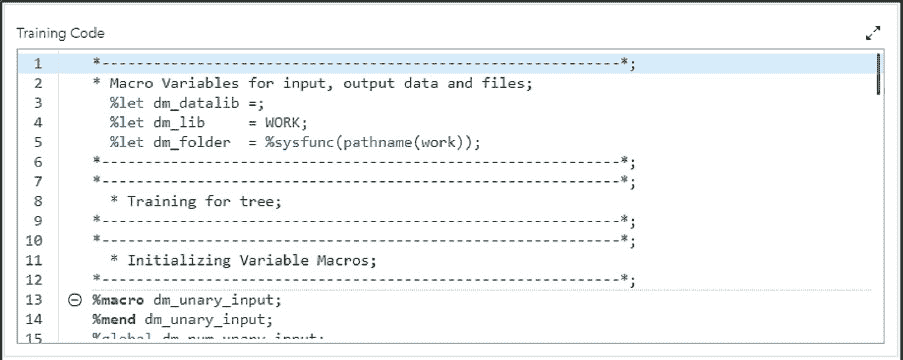

**注**：Model Studio 中有一个 Score Data 节点，可在管道的任意位置收集或累积计分代码。

最后，Output 窗口显示最终决策树模型参数、变量重要性表以及削减迭代。

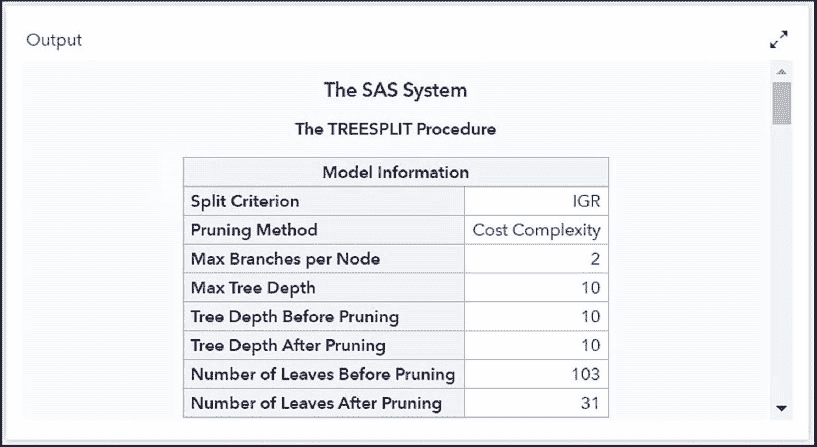

`TREESPLIT` 过程用于创建包含 31 个叶节点的决策树。信息增益比是默认分裂准则，成本复杂度削减是默认削减方法。相关知识将在课程第 3 课和第 5 课中讲解。

10. 点击 **Assessment** 标签。


第一个图表是 **Lift Reports**，显示模型深度随累计提升的关系。累计提升针对每个数据角色给出。若要查看其他随深度变化的统计量，请使用右上角的下拉菜单。其他统计量包括提升、收益、捕获响应百分比、累计捕获响应百分比、响应百分比和累计响应百分比。仅当目标为类变量时才显示此结果。

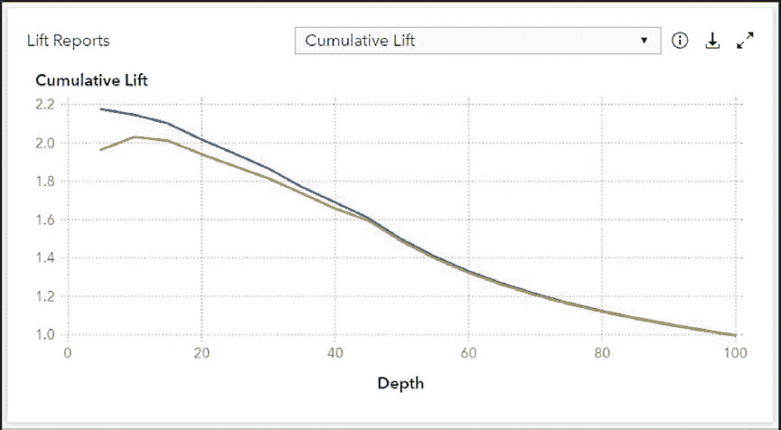

**ROC Reports** 显示模型的 ROC（受体特征）图，给出灵敏度随 1‑specificity 的变化。灵敏度针对每个数据角色给出。使用右上角的下拉菜单可查看其他统计量，如准确率和 F1 分数。仅当目标为类变量时才显示此结果。

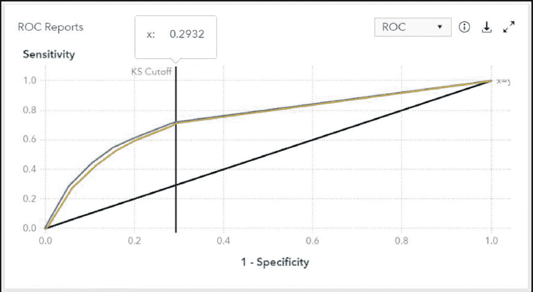

为帮助确定评分数据的最佳截断点，KS Cutoff 参考线会在 1‑specificity 取得最大灵敏度‑1‑specificity 差值的位置绘制。KS Cutoff 线在 0.2 处绘制，此时 1‑specificity 为 0.293，灵敏度为 0.714（移动鼠标可查看）。

Fit Statistics 输出显示按数据角色划分的模型拟合统计量表，最大化窗口即可看到完整内容。

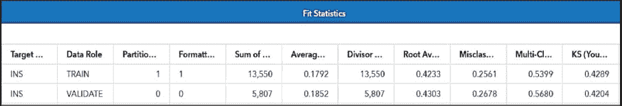

Fit Statistics 表显示在 VALIDATE 分区上的平均平方误差为 0.1852，误分类率为 0.2678。

最后，Event Classification 图展示了不同截断值下的混淆矩阵。

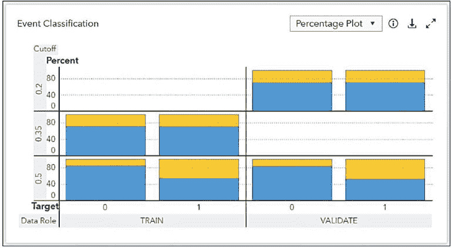

Event Classification 图是混淆矩阵在多个截断值下的可视化，使用的默认截断值为 0.5，以及 TRAIN 分区的 KS 值 0.35 和 VALIDATE 分区的 KS 值 0.2。

混淆矩阵包含真阳性（正确预测的事件）、假阳性（非事件被错误预测为事件）、假阴性（实际事件被错误预测为非事件）以及真阴性（正确预测的非事件）。使用下拉菜单可将图表信息以百分比或计数形式查看，也可查看汇总表格。仅当目标为二元变量时才显示此结果。


# 从 Event Classification 图可以直观看出，在我们的示例数据和模型中，几乎所有支持低偏差模型假设的分区都有大量正确（蓝色）预测。

11. 选择 `Node`，然后向上滚动返回 `Tree Diagram` 和 `Treemap` 结果窗口。

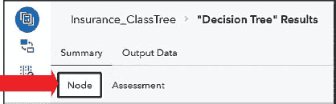

12. 点击  以展开 `Tree Diagram`，检查生成的决策树。移动鼠标指针至树节点时，会弹出包含节点信息的文本框，也可以滚动缩放查看细节。

13. 点击决策树顶层（根节点）的第一次分割后的左节点，向下滚动并缩放，查看该分区观测的特征。

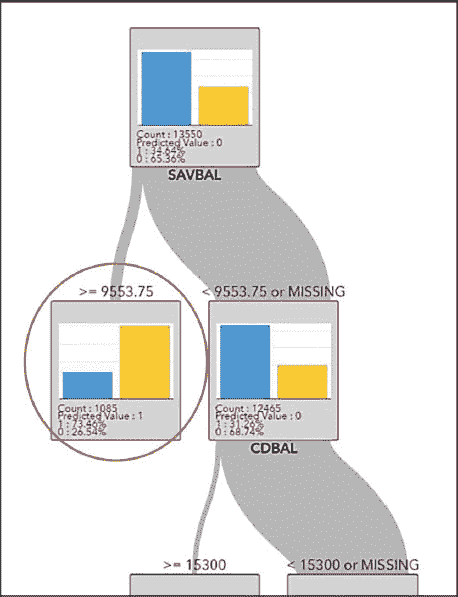

决策树会发现输入之间的交互关系。例如，保险年金（`INS`）与存单余额（`CDBAL`）可能不相关，除非储蓄余额（`SAVBAL`）小于 9553.75。树结构同时捕获了这两个输入，`CDBAL` 的分裂点为 15300。

此外，决策树会剔除冗余输入。储蓄余额（`SAVBAL`）和钱市余额（`MMBAL`）与保险年金（`INS`）高度相关，但树只需要其中一个输入——这里使用的是储蓄余额。相关性不等于冗余性。当 `SAVBAL` 与 `MMBAL` 相互相关时，它们是 **冗余** 的。决策树没有内置方法忽略冗余输入，可能会随意从相关输入集合中选择。因此，建议在使用决策树前先降低冗余度。

Finally, trees treat nominal and ordinal inputs on a par with interval ones. Instead of the categorical area classification (`RES`) input, the split could be at home value (`HMVAL`), an interval input.

A tree gives an impression that certain inputs uniquely explain the variations in the target. A completely different set of inputs might give a different explanation that is just as good.

By default, the growth process continues until the tree reaches a maximum depth of 10 (you can specify a different limit by using the `Maximum depth` property). The result is often a large tree that overfits the data and is likely to perform poorly in predicting future data. A recommended strategy for avoiding this problem is to prune the tree to a smaller subtree that minimizes prediction error, the concept discussed in lesson 5.

Note: The zoom functionality centers the diagram on your cursor. A good tip is to position the mouse pointer on the part of the tree that you are interested in investigating before zooming.

You can use a SAS Code node with the following code to compute the correlation coefficients.

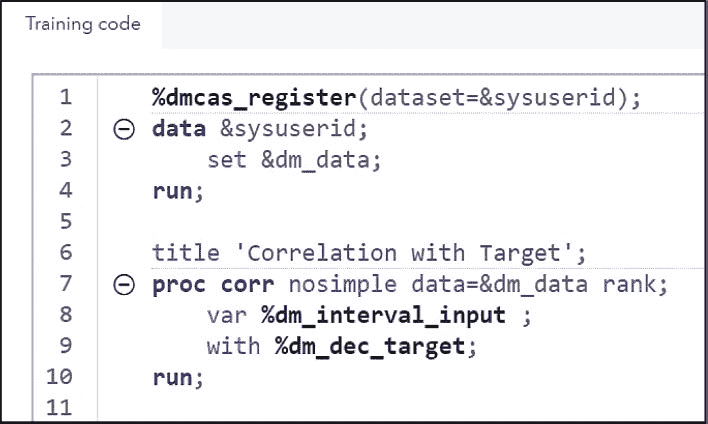

The ten most correlated inputs with the target are shown below.


14. Click  to exit the maximized view of the tree diagram. Click  to expand `Treemap`. Locate the same left node after the first split of the top (root) node of the decision tree.

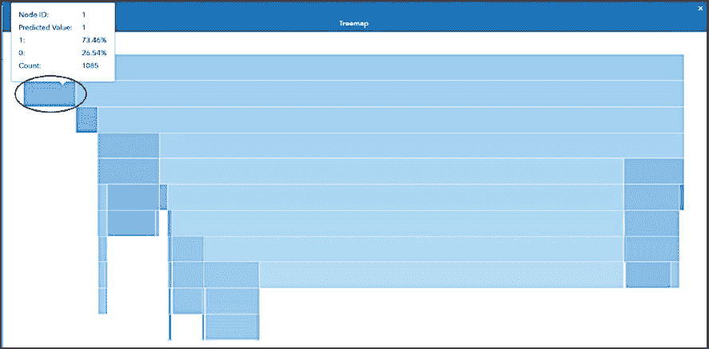

The darker the color, the higher the probability of event. The node width is proportional to the number of observations in the node. Selecting a node or hovering your pointer on a node displays information about the node.

The node shown above is one of the highest event probabilities, which contains almost three-fourths of the events.

15. Click  to exit the maximized view of the treemap. Click `Close` to discontinue the results.

16. Under `Tree Diagram Options`, deselect `Display embedded bar charts in tree diagram` and change `Class target node color` to `Proportion correctly classified`.

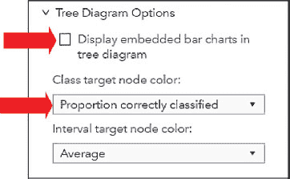

17. Click the `Run Pipeline` button.

18. Open the Results of the `Decision Tree` node again.

19. Observe that the embedded bar charts in the tree diagram have disappeared and that the nodes are colored per class target node color setting.

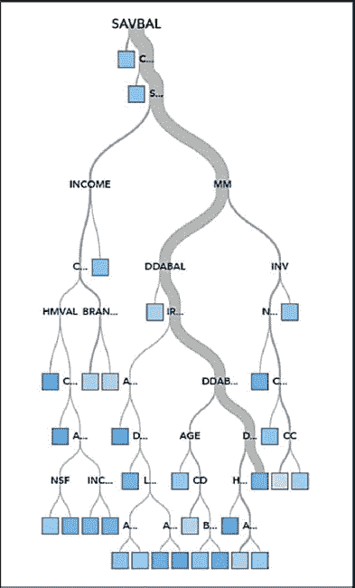

20. Observe the change in color composition in the treemap.

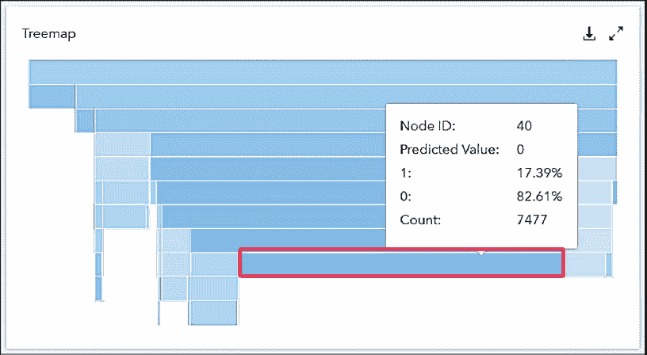

The darker the color, the purer the node. The node shown above is the purest one that has almost 17% versus 83% events and non-events into it.

21. Close the Results window.


# Model Scoring

After building a decision tree model, or for that matter any other model, we put the model to use by scoring new data. The scoring process is sometimes referred to as model deployment, model production, or model implementation. All tasks performed earlier in the analytics life cycle lead to this task: generating predictions through scoring. An organization gets value from the model when it is in production. To maximize that value, it is necessary to monitor model performance over time and update the model as needed.

For scoring, the model is first translated into another format (typically, score code). In the SAS Viya environment, score code is a SAS program that you can easily run on a scoring data set. Then the model is applied to the scoring data set to obtain predicted outcomes. Based on the predictions from the model, the enterprise makes business decisions and takes action.

After you download the score code, there are several model deployment options in SAS Viya:

* The `Score Data` node in Model Studio enables you to score a data table with the score code that was generated by the predecessor nodes in the pipeline. The scored table is saved to a caslib. By default, the scored table is temporary, exists only for the duration of the run of a node, and has local session scope. The `Score Data` node enables you to save the scored table to disk in the location that is associated with the specified output library. After it is saved to disk, this table can be used by other applications for further analysis or reporting.

    Note: This approach is shown in this book.

* Models that create ASTORE code can be scored in SAS Studio using the `ASTORE` procedure.

* You can also run a scoring test in SAS Model Manager.

* Model Studio creates API for score code to be called from SAS or Python or through a REST API. Within a project in Model Studio, you can go to the `Pipeline Comparison` tab and click the `Project pipeline` menu (three vertical dots) in the upper right and select `Download score API`. The code that it provides can be used directly in other applications. (You just need to modify the CAS server and port that you are calling, the data source that you want to score, and the name of the output caslib and scored output table.) Even when you call the score code through the API from a Python program, the score code runs in CAS, not in Python.

* Score code can also be published to Micro Analytics Services (web service) and to SAS Event Stream Processing.


# Demo 2.2: Scoring a Decision Tree Model in Model Studio

This demonstration builds on the `Insurance_ClassTree` project on the `insurance_part` data. You will score a decision tree model created in previous demonstration within Model Studio.

1. Ensure that the `Insurance_ClassTree` project is open in the Model Studio and that you are on the `Pipelines` tab with `Pipeline1` open.

2. Right-click the `Decision Tree` node and select `Add child node`  `Miscellaneous`  `Score Data`.

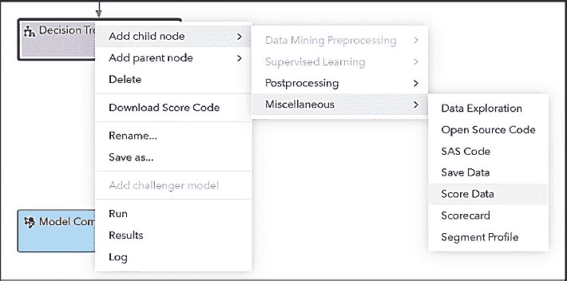

3. Select the `Score Data` node. The `Score Data` node enables you to score a data table with the score code that was generated by the predecessor nodes in the pipeline. The scored table is saved to a CAS library.

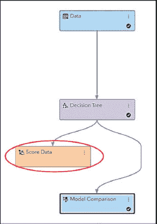

Note: Nodes cannot be added after the `Score Data` node because it does not prepare data for successor nodes.

4. Under `Score Data`, select the input table that you would like to score. Click `Browse` in the `Table name` field.


5. Import a SAS data set into CAS.

a. In the `Browse Data` window, click `Import`.

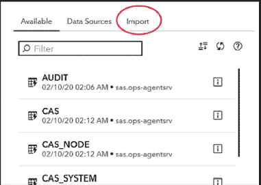

b. Under `Import`, expand `Local files` and then select `Local file`.


Navigate to the data folder.

c. Select the `score_insurance.sas7bdat` table. Click `Open`.

d. Select `Import Item`.

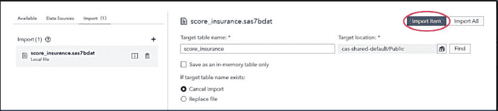

e. Click `OK` after the table is imported.

6. Under the `Output Data` property, click `Browse` in the `Output library` field.


7. Choose the `Public` library and then click `OK`.

By default, the scored table is temporary, exists only for the duration of the run of a node, and has local session scope. The `Score Data` node enables you to save the scored table to disk in the location that is associated with the specified output library. After it is saved to disk, this table can be used by other applications for further analysis or reporting.


8. Type `Ins_ScoredData` in the `Table name` field. Check the `Replace existing table` box.

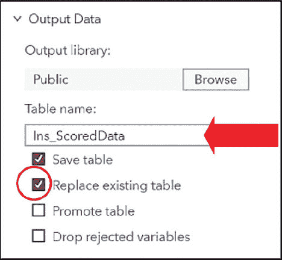

9. Right-click the `Score Data` node and click `Run`.


## 步骤

10. Right-click the **Score Data** node and click **Results**.

11. The scored input data that you specified in the **Table name** property is available on the **Output Data** tab. Click the **Output Data** tab.


12. Click **View Output Data**.


13. Click the **Enable sampling** box. Click the **Percentage of rows** radio button and enter `10`. Click **View Output Data**.

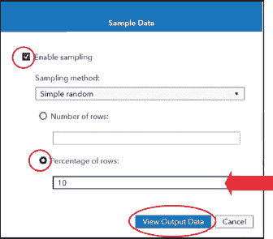

14. Scroll right until the end to see the predicted columns.

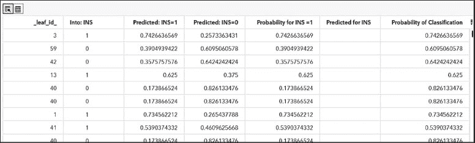

15. 关闭结果窗口。


## 回归树

现在考虑目标变量为区间的情况。回归树是决策树的另一种变体，用于逼近实值函数，而不是用于分类方法。

### 图 2.7：波士顿住房数据集（2 维）

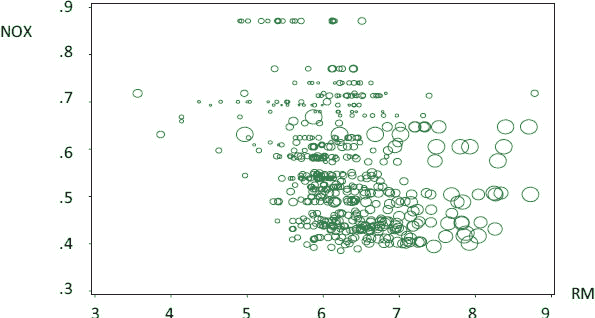

### 图 2.8：波士顿住房数据集（3 维）

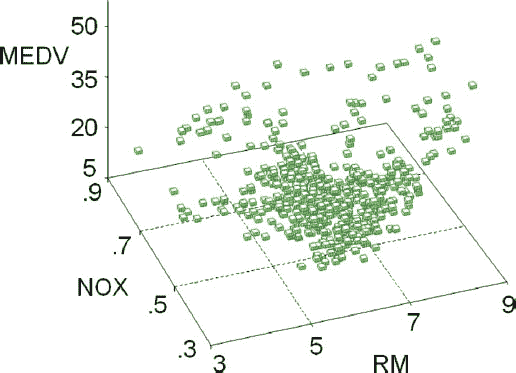

回归树是一种预测模型，其中目标变量不是固定的或连续的。随后使用决策树算法来预测目标变量的值。回归树的一个例子是预测住宅房屋的售价。

### 图 2.9：回归树

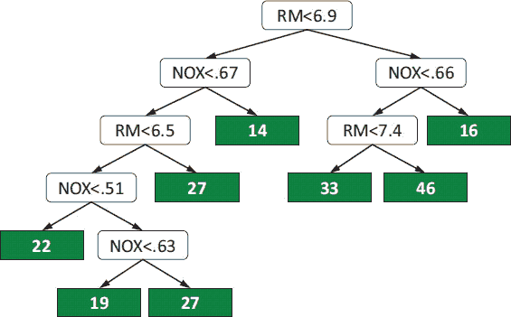

### 图 2.10：回归树的叶节点作为布尔规则

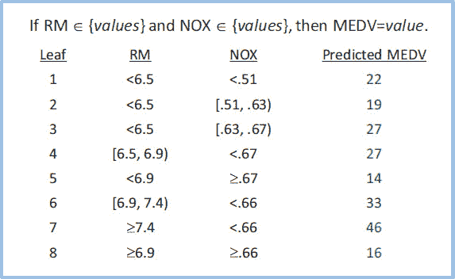

我将使用波士顿住房数据（可从 UCI 存储库获得，见 Blake et al. 1998），该数据包含 506 个波士顿人口普查区。目标是中位房价（`MEDV`）。下面展示了 13 个输入变量中的两个：

*   平均房间数（`RM`）
*   空气中氮氧化物浓度（`NOX`）

数据在**图 2.7**中以二维气泡图显示，气泡半径与中位房价（`MEDV`）成正比。

同一数据在**图 2.8**中以三维散点图呈现。

### 图 2.11：划分的输入空间

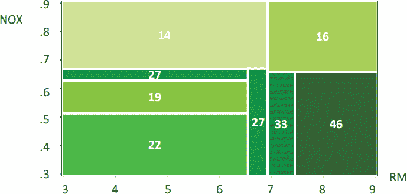

### 图 2.12：多变量阶梯函数

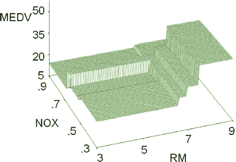

当目标是连续值时，模型称为回归树。回归树是分段常数模型，能够简洁地总结预测器如何决定预测结果，通常比线性回归模型更易解释。基于波士顿住房数据构建的回归树示例见图 **2.9**。

### 预测值与划分的输入空间

回归树的叶节点给出连续目标的预测值。所有到达特定叶节点的案例都被赋予相同的预测值，参见 **Figure 2.10**。

回归树中通往每个叶节点的路径可以用布尔规则表示，形式如下：

> 如果输入属于 {输入空间的某个区域}，则预测值 = 值。

输入空间的区域由分割值决定。对于区间尺度的输入，区域的边界垂直于分割变量。因此，区域是由单个分割变量定义的子空间的交集，如**图 2.11**所示。

决策树的叶节点将输入空间划分为轴对齐的区域。划分方式使得响应值相似的观测被归入同一组。划分完成后，在每个区域内预测一个常数的响应变量。因此，拟合的回归树模型是一个多变量阶梯函数，如**图 2.12**所示。

由于回归树将预测空间划分为若干区域并在每个区域内拟合常数值，它们有时被称为分段常数回归模型。树基回归模型的一个重要特点是，它们能够以命题逻辑的形式（树形）表示这些区域。树根到每个叶节点的每条路径对应一个区域。

该表面是分段常数的，在边界处不连续。阶梯函数高度灵活，能够建模非线性趋势。因此，决策树被称为万能逼近器。


## Demo 2.3：使用 SAS Visual Statistics 构建回归树管道

本演示使用波士顿住房数据，通过 SAS Visual Analytics 界面创建回归树模型，检查残差，并在 Model Studio 中构建管道。

1. 前往左上角的“应用”菜单（）。

2. 点击“探索和可视化”快捷方式区域，以启动 SAS Visual Analytics。

3. 将住房数据集导入 CAS。

    a. 点击 **Start with Data**。

    

    b. 在 **Choose Data** 窗口中，点击 **Import**。

    c. 在 **Import** 下展开 **Local Files**，然后选择 **Local File**。

    d. 导航到数据文件夹。

    e. 选择 `housing.sas7bdat` 表，点击 **Open**。

    f. 保持导入项目的默认设置。

    g. 点击 **OK**。

    h. 如果弹出 “Start your tour of SAS Visual Analytics!” 窗口，请关闭它。

4. 点击左侧窗格中的 **Objects** 图标。在 **SAS Visual Statistics** 下，双击或拖拽 **Decision tree** 到画布上。

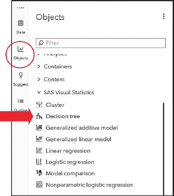

5. 点击右侧窗格中的 **Roles** 图标，将 **MEDV** 设为响应变量，其余变量设为预测器，但不包括 **RM** 和 **PTRATIO**。

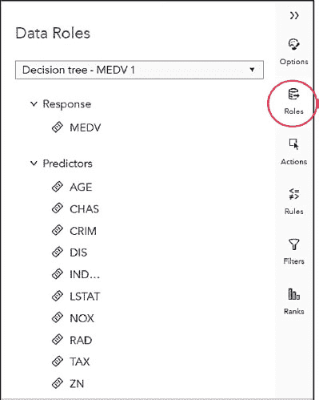

> **注**：当类别响应变量包含两个以上水平时，SAS Visual Statistics 将感兴趣的类别视为事件，其余视为非事件。**Event level** 属性用于选择感兴趣的事件水平。

6. 在 **Options** 窗格的 **Model Display** 下展开 **General properties**，将 **Plot layout** 改为 **Stack** 以在画布上扩展拟合摘要。仔细检查后，发现该回归树模型仅使用了 7 个输入变量中的 10 个。可以通过 **Variable importance** 图表进一步验证。

7. 点击决策树顶部根节点的第一个分割节点。

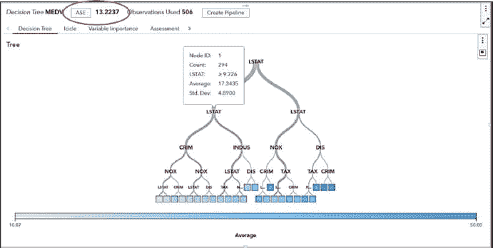

您可以滚动缩放以查看该分区中观测值的特征。观察到该模型的平均平方误差为 `13.2237`。

8. 点击 **Icicle** 标签。该图类似于 Model Studio 中的树状图（treemap）。

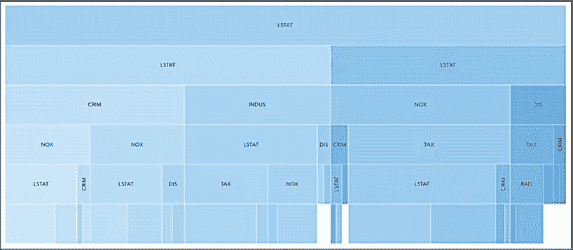

9. 点击 **Variable Importance** 标签。

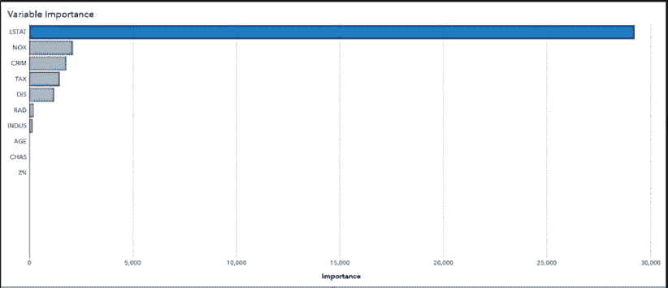

本模型中最重要的两个变量是 **LSTAT**（低社会经济地位人口百分比）和 **NOX**（氮氧化物浓度）。

10. 在变量重要性图中右键单击，选择 **Leaf Statistics**。

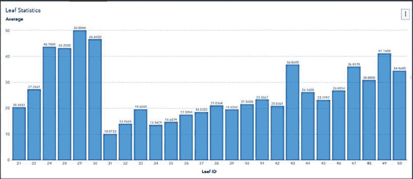

**Leaf Statistics** 面板显示每个叶节点的简单统计信息条形图，便于快速比较叶节点纯度。图中节点 29 的 `MEDV` 平均值最高，接近 `50.00`。

11. 在报告中，点击 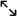（Maximize）图标进入最大化模式，查看 Details 表。

12. 点击底部窗格中的 **Node Rules** 标签，调整视图以查看英文规则。

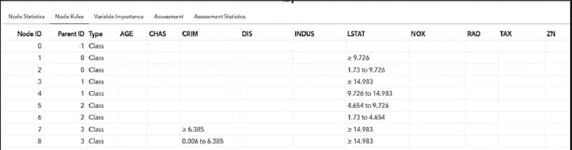

如图所示，`depth` 为 `3` 之前的节点规则。

13. 要关闭 Details 表并退出最大化模式，点击 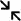（Restore）图标。

14. 点击 （More）图标（位于中央画布右上角），然后点击 **Derive predicted**。

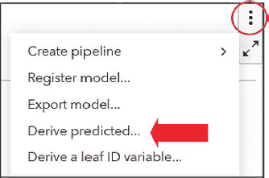

15. 点击 **OK**。

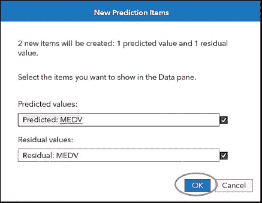

16. 选中当前页（Page 1），点击三个垂直点 （Options），选择 **Rename Page**，将 Page 1 重命名为 **RegTree**。

17. 点击 **+ (New page)** 开始新页，以便探索残差。

18. 点击左侧窗格中的 **Data** 图标。在 **Derived** 下选择 **Predicted: MEDV** 和 **Residual: MEDV**，同时按住 `Ctrl` 键并将它们拖放到画布上。系统会自动生成散点图。

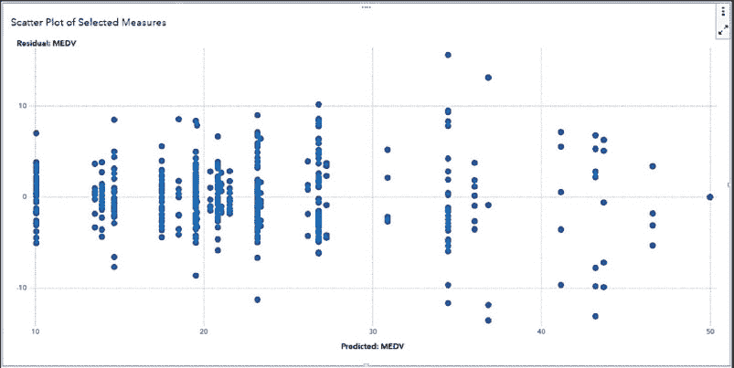

*   [残差与预测图](https://wiki.example.org/feynmans_learning_method)是回归诊断的标准方法，通常称为残差图。残差的绝对值表示变异性。明显的扩散模式表明变异随均值的增大而增大。决策树不假设方差恒定。然而，稳定方差可能会提高模型的预测精度。

19. 再次点击 (Options)  Rename Page。将 Page 2 重命名为 ResPlot。

20. 再次点击左侧窗格中的 Data 图标。

21. 创建对数转换的目标。

    a. 点击 `+ New data item`  计算项。

    b. 在 Name 字段中输入 `Log_MEDV`。

    c. 点击 Operators 选项卡  数值 (高级)  Ln (双击)。

    d. 点击 Data Items 选项卡。选择 `MEDV` 变量。可以双击或拖放到数值框中。

    e. 点击 OK。

    f. 观察到 `Log_MEDV` 变量已创建，并在 Data 窗格的 Measures 下出现。

22. 返回 RegTree 页面。要访问替代菜单，在画布右上角点击 (More)，然后按住 `Alt` 键  复制到新页面。

23. 在 Page 3 的画布中选择新的决策树，使其成为活动对象。在 Roles 菜单中，选择 `MEDV` 作为响应，并将其替换为 `Log_MEDV`。

24. 如果看到的是 Leaf Statistics 图，请选择该图。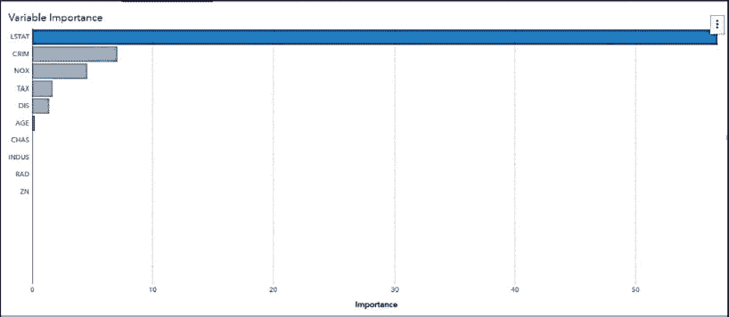 观察到与使用未转换目标的前一个模型相比，变量的相对重要性发生了变化，`CRIM`（犯罪率）现在位列第二重要。

25. 点击 (Options)  Rename Page。将 Page 3 重命名为 RegTreeLn。

26. 点击对象工具栏上的 (More)，然后点击 Derive predicted，点击 OK。

27. 新建一页，以探索使用转换目标的回归树的残差。点击 +（新页面）。

28. 点击左侧窗格中的 Data 图标。在 Derived 下，选中 `Predicted: Log_MEDV` 和 `Residual: Log_MEDV`，按住 `Ctrl` 键并拖放它们到画布上。创建了一个残差图。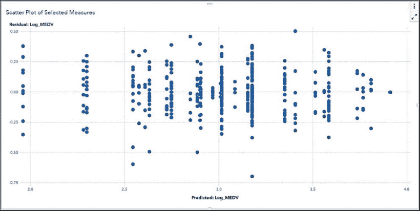 目标转换在一定程度上稳定了方差。

29. 点击 (Options)  Rename Page。将 Page 4 重命名为 ResPlotLn。

30. 探索预测值与树模型中最重要的两个变量 `CRIM` 和 `LSTAT` 之间的关系。

    a. 点击 +（新页面）。

    b. 点击左侧窗格中的 Data 图标。选择 Measures 下的 `LSTAT` 和 `CRIM`，以及 Derived 下的 `Predicted: Log_MEDV`。将它们拖放到画布上。创建了一个散点矩阵图。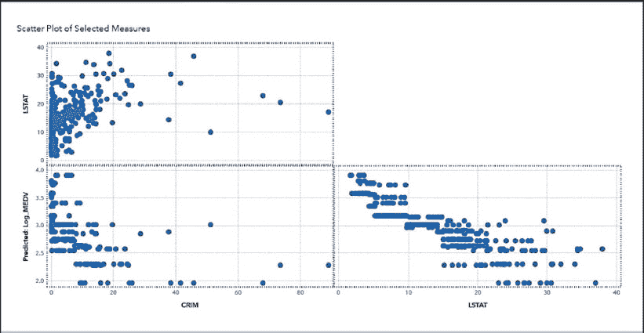 犯罪率与预测的 `log(MEDV)` 之间的关系似乎是非线性的。

与其他回归和分类方法相比，树模型的优势在于它们易于解释和可视化，尤其是当树较小时。基于树的方法能够很好地处理大数据集，并且提供多种处理缺失值的方法，包括代理分割。然而，树模型也有局限性。回归树模型在预测空间的矩形区域上是恒定的，因此往往缺乏捕捉预测变量与响应之间平滑关系所需的灵活性。另一个局限是，数据的微小变化可能导致非常不同的分割，这削弱了模型的可解释性。

31. 点击 (Menu)  Save as 在右上角。将此报告保存为 `Housing_RegTree`，位置在 My Folder。

32. 返回 RegTree 页面。点击 Create pipeline  Add to new project。 观察到 ASE 为 `13.2237`。

探索两棵决策树（一棵使用 `MEDV` 目标，另一棵使用 `Log_MEDV` 目标）的过程很有趣。您可以将其中任意一棵推入 Model Studio 进行进一步优化。

决策树的目的在于确定一系列 if-then 规则，以实现对案例的准确预测或分类。因此，决策树并不隐含假设目标与输入之间的关系是线性的、遵循特定的非线性链接函数，或者即使是单调的。这鼓励我们使用原始目标的决策树。

在 `Housing_RegTree` 项目中，新建一个管道，其名称与您为 SAS Visual Analytics 报告输入的名称相同，即 Interactive-Model Pipeline。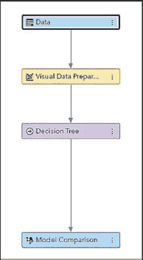 数据节点定义了数据集的所有信息。

可视数据准备节点表示从 SAS Visual Analytics 进行的交互式计算和转换。

决策树节点根据交互式决策树 fitting 一个模型。

33. 点击 Data 选项卡查看项目元数据，然后将 `RM` 和 `PTRATIO` 变量的角色改为 Rejected。

34. 返回 Pipelines 选项卡。

35. 点击运行管道按钮，打开 Decision Tree 节点的结果。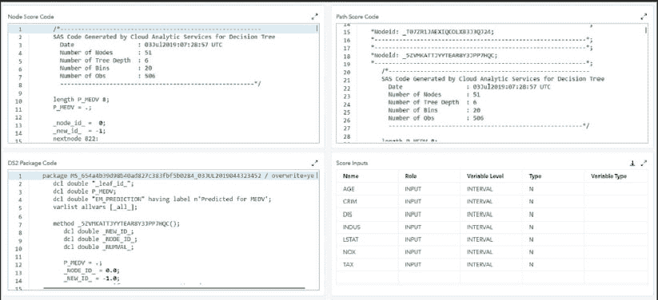 结果展示了从 SAS Visual Analytics 生成的交互式模型评分代码。模型评分代码用于对数据进行评估，生成 assessment 结果。

该节点的属性默认不可编辑。

36. 关闭 Decision Tree 节点的结果，打开 Model Comparison 节点的结果。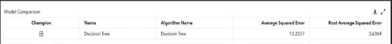 由于该树是在 SAS Visual Statistics 中创建的，ASE 为 `13.2237` 与之前相同。

37. 关闭 Model Comparison 节点的结果。

38. 右键单击 Decision Tree 节点，选择 Enable Properties。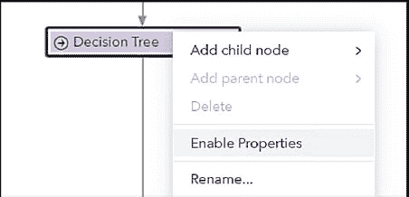

39. 在 Enable Properties 弹出框中选择 Yes。启用属性后，模型将重新训练，可能产生新的结果。此时无需在右侧进行任何属性更改。

40. 点击运行管道按钮，重新运行管道并打开 Decision Tree 节点的结果。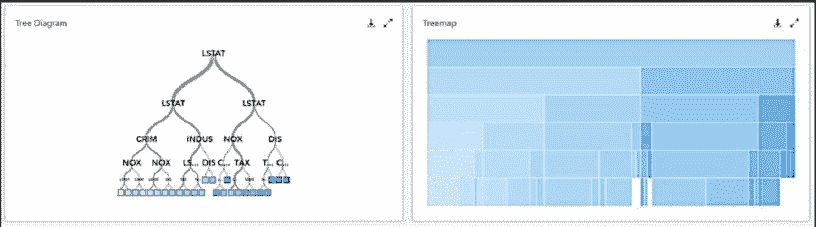 除了模型评分代码输出外，现在还可以看到训练后的输出，如树图和树图集。

按需探索结果。

41. 关闭结果。

42. 在 Interactive-Model Pipeline 选项卡上，点击 (Options)  Rename。

43. 在 Name 字段中输入 `VA Pipeline`，点击 OK。

## Quiz

1. 关于决策树的以下说法哪项是正确的？

    a. 通过应用一系列简单规则划分数据，因此它是一个无监督技术

    b. 可以用于分类观测，但不能用于估计响应

    c. 一个类似流程图的结构，内部节点表示对输入的测试，每条支路代表测试的结果，每个叶节点表示类标签或区间估计

    d. 以上全部

### Answers

| 1. c |

## 递归分区

一个简单的算法首先将整个数据集，根节点，分成至少两个节点。每个节点随后被分成更多节点，以此类推。每个节点随后被单独考虑。查找分割的过程不考虑其他节点如何分割。这个过程被称为递归分区，大多数树算法都使用它。

该算法将父节点分割成两个或多个子节点，使得响应变量在每个子区域中的值（或水平）尽可能相似。分割过程随后对每个子节点重复，递归继续，直到满足停止标准为止。此时，树已完全构建（生长）。在每一步中，分割是通过在父节点分割到的子节点中找到最佳预测变量和最佳分割值来优化响应变量的指定标准来确定的。

递归分区是近视的（Neville 1999）。它专注于优化单个分割，而不关注整个树的质量。虽然非递归分区的替代方法尚未流行，但它们实现困难且运行时间较长。此外，递归分区通常已经能提供足够的结果。

### 图 3.1：递归分区过程

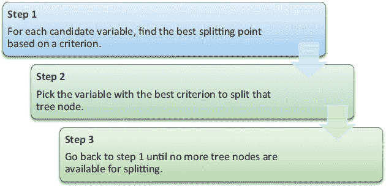

递归分区包含三个主要组成部分：

*   选择分割测试（分割搜索）的方法
*   确定树节点何时为终端（停止规则）的规则
*   为每个终端节点分配值的规则（分割规则）

我们将在本章后面讨论这些组成部分。

## 根节点分割与一层空间


# 递归分区

递归分区是一种自上而下、贪婪的算法。从根节点开始，会检查几个涉及单一输入的分割。对于区间输入，分割是输入值的不相交范围；对于名义输入，分割是输入类别的不相交子集。可以使用多种分割搜索策略来确定候选分割集合。分割标准用于选择分割，该标准衡量目标分布在子节点中的变异性减少量。目标是减少变异，从而增加子节点的纯净度。根节点中的案例随后根据选定的分割进行划分。

贪婪算法在每一步都做出局部最优选择。图 3.2（[Chapter03.xhtml#ch03fig02]）展示了前一章中所示的分类树的根节点。分析目标是预测手写数字是否为 1、7 或 9。

根节点表示每个数字的案例数量。从根节点开始，递归分区使用迭代过程选择节点的最佳分割。这个过程称为分割搜索。首先，递归分区根据分割标准为每个输入变量找出所有可能分割中最佳的分割。这些是候选分割。随后选择整体最佳分割（即基于单一输入的分割）。该分割表示为 IF-THEN-ELSE 规则。根节点中的案例随后根据选定的分割进行划分。在这棵树中，最优分割是：当 `X1` 小于 38.5 时向左分支，当 `X1` 大于或等于 38.5 时向右分支。根节点中的 1064 个观测值被划分，其中 698 个遵循左分支规则，366 个遵循右分支规则。

## 图 3.2：根节点分割在手写数字识别示例中

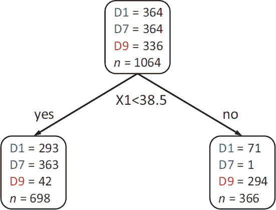

## 图 3.3：一层空间在手写数字识别示例中

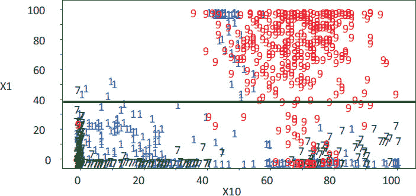

根节点分割对应于输入空间的一个分区，其边界垂直于图 3.3（[Chapter03.xhtml#ch03fig03]）中所示的一个输入维度。

## 深度为二和两层空间

分割过程在每个子节点中重复，如同该节点是新树的根节点一样。节点的分割完全取决于该局部输入空间中的案例。随着分割搜索向更深的树层深入，数据变得更加碎片化。分割标准和其他停止规则决定过程的结束以及最终树的深度。

在第二次分割搜索迭代后，生成的树深度为二，即两层空间。结果分割如图 3.4（[Chapter03.xhtml#ch03fig04]）所示。

这个节点分割对应于输入空间的一个分区，其边界垂直于图 3.5（[Chapter03.xhtml#ch03fig05]）中所示的另一个输入维度。

过程重复进行。深度由停止规则控制，这些规则在第 5 章中讨论。

递归分区本质上是一种简单的非参数方法，用于分类和回归任务。预测技术是非参数的，因为它不依赖于目标变量与输入之间的依赖关系的任何特定假设。当以标准方式使用时，递归分区提供了树形结构，展示了从输入到预测所需遵循的规则序列。这种简单的可视化解释了该方法在许多学科中的吸引力。

## 图 3.4：深度为二的分割在手写数字识别示例中

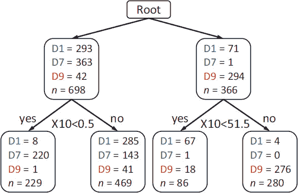

## 递归分区的替代方案

直观地认为，这种贪婪算法可以通过引入某种前瞻或回溯来得到改进。除了计算负担外，使用有限前瞻的树木并未显示出改进。在许多情况下，它们产生劣质树木（Murthy and Salzberg 1995）。

另一种变体是斜向分割。标准决策树使用与输入坐标平行的边界进行分割，如图 3.6（[Chapter03.xhtml#ch03fig06]）所示，该图展示了递归分区停止前发生的所有分割。这些基于坐标轴的分割使决策树易于解释，并能抵御维度诅咒。

## 图 3.5：两层空间在手写数字识别示例中


## 图 3.6：与输入坐标平行的决策边界

斜向分割使用输入的线性组合来创建边界。已开发出多种算法用于诱导斜向决策树（BFOS 1984，Murthy et al 1994，Loh and Shih 1997）。斜向决策树不被 SAS Viya 支持，且缺乏强有力的证据表明该方法始终能产生更强的模型。

## 交互式构建决策树

SAS Visual Statistics 中的 Decision Tree 对象允许您基于名义、有序和连续变量对数据库进行多路分割。该对象支持自动和交互式训练。运行 Decision Tree 对象的自动模式时，它会自动对输入变量根据其对树的贡献强度进行排名。此排名可用于选择后续建模的变量。您可以覆盖任何自动步骤，并显式剪枝子树。交互式训练使您在开发树木时能够探索和评估大量树木。

 图 3.1：在 SAS Visual Statistics 中交互式构建回归树

此演示使用波士顿住房数据，通过 SAS Visual Analytics 界面交互创建回归树模型，并基于前一份演示中的 Housing_RegTree 报告。

1. 前往左上角的 Applications 菜单（）。
2. 单击应用快捷方式区域中的 `Explore` 和 `Visualize`。SAS Visual Analytics 窗口出现。
3. 从左侧窗格中选择 `My Folder`。
4. 双击 `Housing_RegTree` 报表砖块以打开它。


5. 确保 `RegTree` 页面已打开。右键单击画布并选择 `Enter interactive mode`。

> **Note:** 你可以通过右键单击节点，直接在 `Tree` 窗口中对决策树进行修改。


观察 ASE 为 `13.2237`。我们将尝试改进它。可以通过进入交互模式，手动训练和剪枝节点来进行修改。进入交互模式后，增长属性被锁定。对预测器的某些修改是允许的，例如将度量转换为类别。当你在交互模式下修改预测器时，决策树仍保持交互模式，但使用相同的规则尝试重新生成分割和剪枝。

6. 请记住默认叶节点大小为 `5`，即叶节点（终端节点）至少需要五条观测。因此，选择足够大的叶节点，例如在最大深度的叶节点中最右侧的第一片叶子。右键单击并选择 `Split best` 从节点。


`Split best` 从节点选项根据信息增益比最佳的变量对节点进行拆分。


7. 现在选择另一个更大的叶节点，例如在最大深度的叶节点中最左侧的第一片叶子。右键单击并选择 `Split` 从节点。


`Split` 从节点选项打开拆分节点窗口。你可以选择用于拆分节点的变量。

8. 选择 `Age` 然后点击 `OK`。


变量按它们的 `logworth`（logworth 表示变量将数据划分得多好）降序排列。`NOX` 的 `logworth` 最高。不过，你可能有强有力的业务原因选择 `AGE`。

手动训练的决策树已在画布上构建并可用。


观察决策树两侧的手动修改的分割。ASE 从 `13.2237` 降至 `12.7290`。这已是一个好兆头！你可以进一步尝试修改该树。

但在使用与模型拟合时相同的数据对模型进行评估通常会导致乐观偏差（overfitting）。最简单的纠正乐观偏差的策略是使用保留样本（holdout sample）进行经验验证，或进行交叉验证（cross validation）。本例中的交叉验证在章节 5 中演示。

9. 虽然我们在第 5 章讨论剪枝，但请选择根节点，右键单击，然后选择 `Prune` 到节点。


`Prune` 到节点选项删除选定节点下的所有子节点，并将该节点转换为叶节点。

10. 选择根节点，右键单击，然后选择 `Train` 从节点。


`Train` 从节点选项在叶节点（此例为根节点，因为树已剪枝至根节点）以上训练多于一层。该节点的变量仍按 `logworth` 降序排列。

11. `Train` 节点窗口默认显示所有变量。取消选中列表中最后四个变量，使仅考虑前六个 `logworth` 最高的变量用于分割。将子树的 `Maximum depth` 从 `6` 增加到 `10`，然后点击 `OK`。


显然，会创建更深的树。


ASE 进一步降至 `11.6002`。

树是通过将源数据（根节点）划分为子集（子节点）形成的，拆分依据分类特征的规则（Shai and Shai 2014）。该过程在每个派生子集上递归进行。递归在以下两种情况下结束：节点子集的目标变量值全部相同，或进一步拆分不再增加预测价值。上述自上而下的决策树构建过程（Quinlan 1986）是一种贪心算法，它在每个节点上通过做出局部最优选择来实现全局近似最优解。通过这些局部最优选择，最终达到了近似全局最优解。

12. 在不退出交互模式的情况下，点击 `Create Pipeline` 并选择 `Add to existing project`。


> **Note:** 要退出交互模式，右键单击 `Tree` 窗口并选择 `Exit interactive mode`。退出交互模式后，你将失去所有更改。

13. 在 Model Studio 中选择 `Housing_RegTree` 项目，然后选择 `Add pipeline`。

14. 一个新管道被添加，自动命名为 `Interactive-Model Pipeline`。点击 `Run Pipeline` 按钮。


15. 点击 `Pipeline Comparison` 标签以比较两棵回归树。勾选两棵树的复选框，然后点击 `Compare` 按钮。


交互式创建的回归树似乎优于另一棵回归树。但它可能是过拟合模型。你可以修改属性并重新训练该树以进一步改进。

16. 关闭 `Compare` 窗口。

17. 返回 `Pipelines` 标签页。


# Feature Selection Using Split Search

在选择有用输入时，决策树使用分割搜索算法。决策树通过忽略无关输入来克服维度诅咒。

> **Curiously, trees have no built-in method for ignoring redundant inputs. Because trees can be trained quickly and have a simple structure, this is usually not an issue for model creation. However, it can be an issue for model deployment, in that trees might arbitrarily select from a set of correlated inputs. To avoid this problem, you should use an algorithm that is external to the tree to manage input redundancy.**

> **很有趣的是，树没有内置方法来忽略冗余输入。由于树可以快速训练且结构简单，这在模型创建时通常不是问题。但在模型部署时可能会成为问题，因为树可能会随意从相关输入集合中选择。为了避免此问题，你应该使用一个位于树之外的算法来管理输入冗余。**

> **考虑一个简单的预测问题，如图 3.7 所示，包含两个输入 `x1` 和 `x2` 以及二元目标。**

## Figure 3.7: Simple Prediction Illustration


输入 `x1` 和 `x2` 将案例定位在单位正方形中。目标结果以颜色表示；黄色为主要类别，蓝色为次要类别。分析目标是根据单位正方形中的位置预测结果。

为了预测案例，决策树使用基于输入变量值的规则，如图 3.8 所示。

规则以层次结构排列，形成树状结构，节点之间用线连接。节点代表决策规则，线条表示规则顺序。树的最底层（顶部）的第一条规则称为根节点。随后的规则称为内部节点。只有一条连接的节点称为叶节点。

## Figure 3.8: Decision Tree Prediction Rules


为评分新案例，检查其输入值并应用决策树中定义的规则。

新案例的输入值最终会指向树中的单个叶节点，如图 3.9 所示。叶节点提供一个决策（例如，归类为黄色）以及一个估计（例如，主要目标的比例）。

理解分割搜索算法有助于更好地使用 SAS Viya 中的决策树并解读结果。这里假设目标是二元的，但针对区间目标的算法类似。

- [分割搜索](https://example.org)首先选择用于分割训练数据的输入。如果所选输入的测量尺度是区间、分箱或聚类值，则这些值可作为潜在的分割点。如果输入是类别型的，则在每个类别输入水平内取目标值的平均值。这些平均值在随后讨论中充当分箱或聚类区间输入值的角色。

对于选定的输入和固定的分割点，会生成两个组。输入值小于分割点的情况称为“左分支”，输入值大于分割点的情况称为“右分支”。结合目标结果，这两个组构成如下 `Figure 3.10` 所示的 2×2 contingency 表。列指示分支方向（左或右），行指示目标值（0 或 1）。

基于根节点熵和每个分割分区的数据熵的信息增益统计量可以用来量化表格列中计数的分离程度。增益值越大，说明左分支中 0 与 1 的比例与右分支不同。目标比例差异越大，说明分割效果越好。

针对预测器的最佳分割是产生最高信息增益的那个分割。假设总共有 100 条观测，训练数据中黄色/蓝色呈 50/50 划分。 additionally，左侧有 52 条观测，右侧有 48 条观测。基于此以及 `Figure 3.11` 中表格的数值，增益可计算如下：

```
Figure 3.9: Scoring A New Case Using Decision Tree
```


| Entropy Total | | | | - 0.5 × log2(0.5) - 0.5 × log2(0.5) = 1 |
| --- | --- | --- | --- | --- |
| Entropy Left | | | | - 0.53 × log2(0.53) - 0.47 × log2(0.47) = 0.997 |
| Entropy Right | | | | - 0.42 × log2(0.42) - 0.58 × log2(0.58) = 0.98 |
| Gain | | | | 1 - (52/100) × 0.997 - (48/100) × 0.98 = 0.0112 |

熵在本章后面会有更详细的讨论。

分割过程会对训练数据中的每个输入重复进行。再次，输入的最佳分割是使增益函数达到最大值的那个，如 `Figure 3.12` 所示。


## Figure 3.11: Selecting Partition with the Maximum Gain


## Figure 3.12: Selecting Partition with the Maximum Gain on Input X2


确定每个输入的最佳分割后，树算法会比较每个最佳分割对应的增益。增益最高的分割被视为最佳。在此示例中，输入 x2 的最大增益（0.0273）大于输入 x1 的最大增益（0.0112），因此 x2 将用于分割，如 `Figure 3.13` 所示。

最佳分割规则用于对数据进行分区。该过程在树的每个子集中重复，如 `Figures 3.14` 到 `3.18` 所示。

在每个新叶节点内，分割搜索会重复进行，增益统计量也如前述进行比较。

得到的预测器变量空间的划分称为最大树。最大树的构建完全基于增益对数据的划分准则。SAS Visual Data Mining and Machine Learning 提供多种划分准则。


# 分割点

分割搜索是决策树算法的第一部分。分割搜索首先选择用于划分训练数据的输入。潜在的分割点取决于所选输入的测量尺度。

决策树对名义和有序测量尺度的输入进行划分时会有所不同。

## 对名义输入进行划分

对名义输入的划分不受限制。对于具有 L 个不同水平的名义输入，会划分为 B 个分支，分支数为 S(L,B)，其中 S(L,B) 为第二类斯特林数。总的分割数是 L 级数的贝尔数减 1，

$$
B_{L} = \sum_{i = 0}^{L} S(L,i).
$$

| 组合论中，第二类斯特林数是将 L 个对象划分为 B 个非空子集的方式数。$S(L,B) = \frac{1}{B!}\sum_{j = 0}^{B}(-1)^{j}\binom{B}{j}(B - j)^{2}$ |
| --- |


图示了名义输入级数增加时分割数量的增长，如 `Figure 3.20` 所示。分割数计算公式为 `S(L,B) = B.S(L – 1,B)+S(L – 1,B – 1)`。

下图右侧展示了一个四级名义变量的示例及其可能的分割，在 `Figure 3.20` 中也有说明。总共有 14 种可能的分割：七个两向分割、六个三向分割和一个四向分割。

### 名义变量的编码方式

在幕后，名义变量会被编码。对于给定的名义变量，首先使用格式化值进行唯一的连续索引映射，这一过程通常称为 levelization（例如，变量 `C` 包含 `C1`、`C2`、`C3`、`C4`，并被 levelized 为四个水平）。默认采用基于哈希的顺序，而不是字母顺序。因此，生成的映射可能如下：

| 格式化值 | 索引 |
| --- | --- |
| C1 | 1 |
| C2 | 0 |
| C3 | 3 |
| C4 | 2 |

**Figure 3.20: Number of Partitions Illustrated with Increasing Number of Nominal Levels**


数值未按顺序排列，因为 SAS Viya 通常使用决策树对高基数变量进行划分。排序会花费较高的计算成本。您无需关心排序，这些映射都是内部的。如果变量级数过多，排序可能导致不同的分割点。为了构建良好模型，建议对高基数变量进行预处理（合并水平数）。

如果二元目标变量 `Y` 仅包含 0 或 1，则必须将其加入名义列表以训练二元分类模型。由于水平未排序，内部索引可能如下：

| Y 的格式化值 | 索引 |
| --- | --- |
| 0 | 1 |
| 1 | 0 |

您不应依赖任何内部索引，而应仅使用格式化值（例如，用于评估模型性能）。

### 对有序输入进行划分

- 基于序数输入的分割受限于保持顺序。只对相邻值进行分组。随着序数输入的级别数增加，分区数量以示例图 3.21（章节 03.xhtml #ch03fig21）中的级别数递增而呈现。对于具有 `L` 个不同级别的序数输入，会产生 `B` 个分支的分区数为 $\binom{L - 1}{B - 1} = \frac{(L - 1)!}{(B - 1)!(L - B)!}$。对单个序数输入，可能的分割组合数为 $\sum_{l = 2}^{L}{\binom{L - 1}{l - 1} = 2^{L - 1} - 1}$。

**Figure 3.21: 使用递增序数级别数的分区数示意**


序数变量的示例（四级）及其可能的分区在 `Figure 3.21` 右侧所示。总计有七种可能的分区：三种两分法、三种三分法以及一种四分法。

### 关于区间输入的分割

如果所选输入的测量尺度为区间尺度，则每个唯一值都可作为数据的潜在分割点。这是所谓的**穷尽搜索**（exhaustive search）分割方法，如 `Figure 3.22` 所示。第一个表格展示了一个小数据集。假设 `X` 是区间变量，目标 `Y` 为二元（Yes/No）。需要收集的统计量是第二个表格中每个唯一的 `X` 与 `Y` 组合的交叉表计数。假设二分法（仅生成两个子树），则精确方法是枚举 `X` 所有可能的分组，并为每个组合计算分割收益。收益最大的组合胜出（后续章节讨论）。

**Figure 3.22: 穷尽搜索示意**


右侧展示了所有可能的分组。对于二分法，可能的组合总数为 `(2n‑1 – 1)`，其中 `n` 为 `X` 的不同取值数。在上述示例中，会有七种组合。穷尽搜索把区间变量视作名义变量，并在所有可能的分割点上搜索最优点。

在 SAS Viya 中，如果不希望使用贪心搜索，可采用基于 `k-means` 聚类的分割搜索（后文讨论）。当输入变量的取值数小于 16 时使用穷尽搜索；取值数更大时，先对级别进行排序。在提升（boosting）中，级别按平均梯度排序；在其他情况下，级别按频率排序。梯度和频率仅取决于当前分裂节点的数据。

穷尽搜索算法会在树的每个节点对所有输入进行完整的分区枚举。当区间输入的不同取值数目增长迅速时，可能的组合数量呈指数级增长，导致穷尽搜索成本高昂，几乎无法找到全局最优的分割点（即产生最大分割收益的点）。常用的近似方法包括：

- **排序**（ranking）
- **分箱**（binning）
- **k-means 聚类**
- **多路分割**（multi-way splits）

SAS Viya 决策树采用一种复杂的分割搜索策略，根据所需的分支数量和变量的不同取值数来决定使用贪心搜索还是穷尽搜索。只要计算成本可接受，贪心和穷尽搜索都会被应用。此外，还有一种独特的 `k-means` 聚类方法，用于在组合数量极大时将数值聚合为不同的组。SAS Viya 树的另一独特特性是支持**二分**以及**最多 10 条分支**的任意分割。

### 排名（Ranking）

为了降低可能的分割点数量，常用的近似方法是假设变量值有一定顺序。例如，若 `X` 为数值型，可直接按升序排序，只进行 `(n‑1)` 种分区（如 `Figure 3.23` 所示），从而将组合数降至 `O(n)`。为更明显地观察数据模式并降低变异，还可在排序前对数值取自然对数。此方法同样适用于名义变量。

对于基于 `Gini` 和 `entropy` 的分裂标准（后文讨论）以及区间或序数输入，决策树的分割仅取决于级别的顺序，这使得模型对输入空间中的离群值具有鲁棒性。对区间变量应用排名或任何单调变换不会改变拟合的树结构。

**Figure 3.23: 排名近似**


然而，对于依赖 `p-value` 的分裂标准（即 `ProbChisq` 和 `ProbF`，见下文），单调变换的不变性不一定成立。为避免过于严重的 `Bonferroni` 校正，区间变量的取值可以进行分箱。变换可能影响分箱过程，进而影响分割选择。下文后续章节会讨论 `Bonferroni` 校正，它是多重统计检验校正方法，用于同时进行多个依赖或独立的统计检验。

### 分箱（Binning）

当数值变量拥有数百万取值时，分割点的数量会导致计算成本高昂，尤其在数据分布在多个线程和 worker 之间时，收集所有统计量更是费时费力。因此需要进行近似。最流行的近似方法是**对数值变量进行分箱**，仅在每个箱中收集足够的统计量。分箱可采用**量位基**（quantile-based）或**等宽度**（equal-width）方法，如 `Figure 3.24` 所示。当数据高度偏斜时，量位基分箱更有帮助。箱数也是一个关键参数。

**Figure 3.24: 分箱近似**


随着箱数增加，通常能更准确地找到最优分割点，但计算时间也会相应增长。更多箱意味着需要更大的内存来存储交叉表计数，并且在多线程/多 worker 之间聚合最终统计时也需要更多时间。若数值变量和箱数都很大，内存需求可能轻易达到数百 GB。因此，箱数在**速度**与**精度**之间取得平衡。若某个数值变量只有少量不同取值，将其视为名义变量更合适，因为分箱会浪费大量内存。

> 决策树在 SAS Viya 中对数值变量的分箱仅在训练数据的整体阶段进行一次，分箱信息（最小值、最大值）在后续将数据划分为不同树节点时不会更新。这可能导致决策树或随机森林的准确性出现问题。然而，提升（gradient boosting）可以通过在每构建新树时更新目标信息来缓解此问题。增加箱数有助于提升准确性。森林和提升模型是后续章节讨论的树的集合。

模型 Studio 中关于决策树节点的分箱近似属性在 `Figure 3.25` 中所示。

**区间 bins 数量** 属性指定区间输入使用的分箱数。箱大小为 `(最大值 – 最小值) / 区间 bins`。默认值为 50。

- **区间 bin 方法** 属性指定用于对输入变量进行分箱的方法。选择 **Bucket** 可以根据最大值和最小值之间的差异将输入分成等距区间。选择 **Quantile** 可以将输入分成大约等大小的组。默认值是 **Bucket**。

### k-Means 聚类

在输入变量进行分箱后，你可以通过对每个输入变量进行聚类，然后选择能够优化所选标准的分割变量来确定每个节点的分割点。最常用的聚类方法是 **k-means** 算法。它是一种简单的算法，能够很好地扩展到大规模数据集。如果你认为区间输入变量可以进一步细分，可以使用 **Perform clustering-based split search** 属性，该属性指定在为每个树节点确定最佳分割时，使用基于聚类的搜索算法，而不是 `exhaustive search`（逐个枚举搜索）。选择该选项后，区间输入的分箱顺序将被忽略。默认情况下此选项处于未选中状态。

#### Figure 3.25: Binning Approximation Properties


#### Figure 3.26: Two-Means Clustering


一个集群分割会写入 `k` 个聚类（2 ≤ k ≤ 最大分支数），它最小化了以下各项的总和（在各聚类内）：

- `y` for `y` 区间
- 类内比例用于分类目标
- 增益的平均梯度

`Figure 3.26` 是一个两均值聚类的示例。聚类内的平方和是观测值在每个聚类内部的变异量的度量。对于分类目标，聚类内的平方和等于 C 类中观测值在各分箱和类别中的比例与类比例之差的平方之和。

### 多路分割

在理论上，多路分割并不比二路分割更具灵活性，只要允许足够的二路分割即可。因此，树可以保持浅层且拥有多个分支（≥2），模型体积也可以很小，如 `Figure 3.27` 所示。多路分割的树倾向于更宽且更矮，而二路分割的树则相反。然而，研究表明多路分割的树并不一定优于二路分割的树。

`Maximum number of branches`（最大分支数）属性指定分割规则能产生的最大分支数。默认值为 2，导致二路分割。可能的取值范围是 2 到 10。

#### Figure 3.27: Binary Split Versus Multi-Way Split


你通常关心的是根据属性对实例分类的贡献程度进行排序。可以通过从根节点开始追踪实例的分类，并收集被测试的属性来读取这种排序。当属性值形成全序集（例如数值属性）且在根到叶子路径中同一属性很少出现多次时，多路分割的决策树比传统的二路树更易理解，因为属性通常只在一条路径中出现一次。因此，多路分割往往产生更具可解释性的树，因为分割变量的使用次数较少。当仅有一个输入变量时，它们更受青睐；而二路分割因为需要考虑的分割数量较少且完整搜索更可行，通常也被偏好。此外，多路分割会在数据耗尽时导致更深层节点的统计量不足，从而削弱后续对其他变量的搜索。


**Demo 3.2: Exploring Split Search Tree Growth Options**

在本次演示中，你将回到之前在 **insurance_part** 数据集上创建的分类树，并尝试一些分割搜索选项。

1. 点击 **View all projects** 图标，返回 **Insurance_ClassTree** 项目。


2. 双击 **Insurance_ClassTree** 图标，打开项目。


3. 点击 **Pipelines** 选项卡，访问之前创建的管道。

4. 右键 **Data** 节点，选择 **Add child node** → **Supervised Learning** → **Decision Tree**。

5. 右键新添加的 **Decision Tree** 节点，选择 **Rename**，在 **Name** 字段中输入 **DT Multiway Splits** 以获得更明确的名称。

6. 在 **Splitting Options** 下，将 **Maximum number of branches** 设置为 4（拖动滑块或直接输入）。


你可以始终通过二路分割将节点分成两个分支，以避免决定合适的分支数量。但这种简便做法可能不能恰当地传达数据的结构，因为数据更自然地倾向于分成更多分支。

多路分割始终可以通过对同一输入变量进行二路分割的序列实现。执行二路步的算法能够在单一步骤中考虑更多多步分区，而单步多路分割则只能考虑有限的组合。额外的分支会在树的更深层次耗尽数据，削弱深层节点的统计量和分割质量。

7. 点击 **Run Pipeline** 按钮。


8. 右键 **Decision Tree** 节点，选择 **Log** 以查看处理时间。


二路分割的 **TREESPLIT** 过程耗时 **0.72 秒**。

（可使用 `Ctrl+F` 查找 “treesplit” 以加速定位。）

9. 关闭日志，重复上述步骤，针对 **DT Multiway Splits** 节点。


多路分割的 **TREESPLIT** 过程耗时更长（本例中为 **1.73 秒**）。

树算法通常会通过限制搜索范围为二路分割来取 shortcut，而多路分割则需要对所有 n-路分割的候选组合进行更多评估（例如，四路分割会评估所有二路、三路和四路分割的候选）。

10. 关闭日志，打开 **DT Multiway Splits** 节点的结果，查看多路分割是否带来收益。

11. 最大化树状图。


令人惊讶的是，所有分割都不超过二路分割。

12. 关闭树状图，观察 **Output** 窗口。


实际上，这是一个拥有 **137** 片叶子节点的复杂树，但在剪枝后仅剩 **13** 片。

13. 关闭 **DT Multiway Splits** 节点的结果。

14. 在 **Pruning Options** 下，将 **Selection method** 从 **Automatic** 改为 **Largest**，观察最大树。


> **注**：剪枝在下一章节中详细讨论。

15. 再次点击 **Run Pipeline** 按钮重新运行管道。

16. 打开 **DT Multiway Splits** 节点的结果，最大化树状图，并调整缩放视图，使多路分割的决策树清晰可见。


树中有大量二路分割，且许多节点产生了三路和四路分割（例如 **ACCTAGE**、**HMVAL**、**CDBAL** 和 **PHONE** 等有三路分割，而 **BRANCH**、**ATMAMT** 等有四路分割）。

17. 关闭树状图，关闭 **DT Multiway Splits** 节点的结果。

18. 打开 **Model Comparison** 节点的结果。


多路分割决策树的平均平方误差（ASE）为 **0.1937**，误分类率（MISC）为 **0.2752** 在验证分区上。尽管多路分割树结构更为复杂，但与二路分割树（ASE 0.1852，MISC 0.2678）相比，几乎没有显著提升。

19. 关闭 **Model Comparison** 节点的结果。

20. 返回二叉分割的决策树结果。右键单击决策树节点并打开结果。


默认两叉分割设置的树已生长至 103 叶子节点。

SAVBAL 是第一个变量（分割点为 9553.75），随后是 CDBAL（分割点为 15300），该变量用于分割。

21. 最大化变量重要性表。


决策树算法对所有输入逐一搜索最佳分割点，然后选择分割最佳的输入。对每个变量进行显著分割会使选择倾向于类别众多的名义变量。本数据中有两个名义变量：分行（BRANCH）和区域分类（RES），分别有 19 与 3 个类别。BRANCH 只用于一次分割，RES 甚至未使用。

> **注意**：您可以考虑对每个输入进行分割搜索，然后通过调整 `p-value` 来惩罚易产生偏差的分割。本章后面将讨论此点。

现在专注于最重要的变量。

前四个变量为存储余额（SAVBAL）、货币市场（MM）、证书存款余额（CDBAL）和活期存款余额（DDABAL）。货币市场是二元输入，其余三个为区间变量，分别拥有 8552、554 和 15269 个不同取值。（您可以在 SAS Visual Analytics 中进行探索。）

为什么 DDABAL 虽然拥有最多不同取值，却重要性较低？

`exhaustive search` 方法存在两个问题：一是计算复杂度，二是变量选择偏差，后者可能是树结构解释方面的更根本性问题。无限制搜索倾向于选择拥有更多分割的变量。这使得从树结构中得出可靠结论变得困难。区间变量通过分箱来限制这种现象。请回顾区间变量的分箱数为 50；因此，每个区间输入实际上有 49 个可能的分割点。值得注意的是，它们的重要性几乎与其对目标的相关性相匹配。

22. 关闭变量重要性表并关闭决策树节点的结果。

23. 保持决策树节点选中，在 **Splitting Options** 下将最小叶子大小从 5 改为 20，并将区间桶数从 50 改为 100。


桶数越多，越能更准确地找到最优分割点。但桶数越多，处理时间越长。增大最小叶子大小可避免生成更小的叶子，可能在一定程度上弥补树的复杂度。

24. 运行决策树节点并打开结果。


该树已生长至 67 叶子节点。

最终树是更简化的树，叶子节点为 14 个（相较于默认设置时的 31 个）。前几个变量的重要性顺序未变，但许多分割点已改变（例如，`SAVBAL` 的新分割点为 51845.51，而默认树中的分割点为 9553.75）。


25. 点击 `Assessment` 标签，向下滚动并最大化 `Fit Statistics` 表。


模型性能几乎没有改善。`ASE` 为 0.1897（默认树的 0.1852），`MISC` 为 0.2676（默认树的 0.2678）。

通常，用于区间输入的聚类算法能够提升准确性并减小树的大小。

26. 关闭决策树节点的结果，返回右侧的节点选项。

27. 将区间桶数改为 10，并勾选 `Perform clustering-based split search` 框。


由于这是二叉分割的决策树，聚类分割会对 `INS`（比例）类进行两均值聚类，最小化这两个聚类之间的内部加权平方距离之和。

区间输入的分箱与聚类分割搜索的方式相同。对已执行聚类分割搜索的数值输入，区间桶数即为初始聚类数。很多桶会产生大量可能的分割点，这可能不切实际。因此，您可以通过适当降低桶数来加以控制。

注意：启用 k‑means 快速搜索算法会忽略桶的顺序。如果您想使用贪心搜索方法并尊重桶顺序，请禁用此选项。

28. 再次运行决策树节点。

29. 右键单击决策树节点并打开结果。

30. 最大化 `Tree Diagram` 并集中观察根节点及其下一层节点。


使用聚类分割搜索的树叶节点数增至 172（相较于桶数设为 100 时的 67 叶子）。最终树略复杂，叶子节点为 18（相较于桶数设为 100 时的 14 个）。

`SAVBAL` 和 `DDABAL` 仍在树的早期被使用，但其分割点已完全不同。`CDBAL` 已成为不重要的变量。然而，名义输入 `BRANCH` 现在在树的早期被使用。

31. 关闭 `Tree Diagram` 并最大化变量重要性表。


前几个变量的重要性出现了一些变化。

32. 关闭变量重要性表，并在 `Assessment` 标签下最大化 `Fit Statistics` 表。


`ASE` 从 0.1897 略微提升至 0.1808，`MISC` 从 0.2676 提升至 0.2616。

33. 关闭 `Fit Statistics` 表并关闭结果。


## 分割准则

树模型的预测变量可以是类别型或连续型。模型基于将预测空间（所有预测变量的全组合）划分为不相交的段，这些段对应于树的终端节点（叶子）。划分从根节点开始，根节点包含全部数据，直到满足停止准则为止。每一步，父节点通过选择一个预测变量及其分割值来划分为子节点，该分割值使得根据指定的度量在子节点中的响应变量变异最小。无论是 `exhaustive search` 还是对可能分割点的近似，我们都会枚举所有 X 值的可能分组，并为每种组合计算分割收益。收益最大的组合获胜。Figure 3.28 展示了以星级形式表示的分割收益，易于理解。可用于评估每个节点候选分割的度量包括 `Gini` 指数、熵和残差平方和等。

**Figure 3.28: Splitting Gain**


**Figure 3.29: Splitting Criteria and Type of Decision Tree**


分裂父节点的两类准则：一类最大化节点不纯度（由不纯度函数定义），另一类由统计检验定义。准则的选择也取决于您希望构建的决策树类型。分裂准则在 Figure 3.29 中以连线形式展示，显示准则类型与树的类型之间的对应关系。

Model Studio 的 `Grow criterion` 属性指定了父节点划分为子节点的准则。可用的选项包括：

### 类目标标准属性

`Class` 目标标准属性指定用于在给定类目标的输入中确定最佳分割的准则。可能的值在 Figure 3.30 中显示。默认值是 `信息增益比`。

### 区间目标标准属性

`Interval` 目标标准属性指定用于在给定区间目标的输入中确定最佳分割的准则。可能的值在 Figure 3.30 中显示。默认值是 `方差`。

#### Figure 3.30: Splitting Criteria in Model Studio


你可以在树算法的分割搜索阶段更改分割的评估方式。对于类别目标，从卡方准则改为其他准则通常会在各输入的不同级别数相似的情况下产生相似的分割。如果不同，其他分割方法倾向于倾向于级别更多的输入，因为存在多重比较问题，后文将讨论。你也可以通过关闭 `Bonferroni` 调整，使卡方方法倾向于级别更多的输入。由于 `Gini` 减少和熵减少准则缺乏卡方准则的显著性阈值特征，它们倾向于生成巨大的树。

#### Figure 3.31: Impurity Reduction


## 基于杂质的分割标准

父节点的杂质是一个非负数，等于 0 表示纯节点（所有观测的响应变量值相同）。观测值响应变量差异很大的节点杂质较大。

令 `i(.)` 为某些节点内杂质的度量，令 `Δi` 表示整棵树的杂质整体下降。Figure 3.31 展示了从父节点到多个子节点的杂质下降。许多分割标准（包括 `Gini` 和熵）是基于节点杂质（即由分割诱导的节点内部变异的下降）的。

熵、`Gini` 指数和方差（`RSS` – 残差平方和）准则降低杂质。父节点 `τ` 的杂质定义为 `i(τ)`。算法选择最佳分割变量和最佳分割值，以实现杂质下降最高：

```
Δi(s,τ) = i(τ) - ∑_{b=1}^{B} p(τ_b|τ) i(τ_b)
```

其中 `τb` 表示第 b 个子节点，`p(τb|τ)` 是被分配到 `τb` 的观测在 `τ` 中所占的比例，`B` 是分割 `τ` 后的分支数。

#### Figure 3.32: Gini Impurity Example


## 分类树的杂质减少准则

### Gini 指数准则

该准则定义 `i(τ)` 为对应于类响应平均平方误差的 `Gini` 指数，公式为：

```
i(τ) = -∑_{j=1}^{j} p_j²
```

其中 `pj` 是拥有第 j 类响应值的观测比例。

这也可以表示为 `Gini` 不纯度或 `Gini` 多样性指数：`Pr(interspecific encounter) = 1 - Gini Index`。

`Gini` 指数是分类数据的变异度量（由著名的意大利统计学家 Corrado Gini 在 1912 年提出）。它可以作为节点杂质的度量，其中 `p1, p2, …, pr` 是节点中各目标类的比例。Breiman 等人（BFOS 1984）提出了 ∆Gini 分割准则。

`Gini` 指数可以解释为从多重集中随机（有放回）选取两个元素不同的概率。Figure 3.32 给出了一个例子，其中不同类型的动物代表节点中多样性及相应的纯度。纯节点的 `Gini` 指数为 0。随着类别的均匀分布增加，`Gini` 指数趋近于 1。更多信息请参见 Hastie, Tibshirani, and Friedman (2009)。

在数学生态学中，`Gini` 指数称为 `Simpson` 多样性指数。在密码分析中，它是 1 减去重复率（Patil and Taillie 1982）。

#### Figure 3.33: Entropy Example


### 熵准则

节点 `t` 的熵杂质定义为：

```
i(τ) = -∑_{j=1}^{j} p_j log_2(p_j)
```

熵使用信息增益或熵的减少来分裂每个变量，然后确定分割。可以指定最小的熵减少或信息增益比的增加。

Figure 3.33 将不同动物的例子扩展到熵准则。熵可以视为纯度的度量。熵值越高，纯度越低。

熵与 `Gini` 指数一样，是分类数据的变异度量。考虑 `r` 个互斥事件，概率为 `p1, p2, …, pr`。特定结果的罕见程度可以表示为 `-log2(pi)`。熵是平均罕见度，因此衡量结果的不确定性。在通信（信息）理论中，熵用于衡量传输消息的不确定性，单位为比特（Shannon 1948）。熵具有以下 desirable 属性：

```
0 ≤ H(p_1,p_2,...,p_r) ≤ H(1/r,1/r,...,1/r)
H(1/r,1/r,...,1/r) = log_2(r)
H(1,0,...,0) = 0
```

∆entropy 分割准则由 Quinlan (1993) 提出。该准则等价于使用似然比卡方检验统计量来衡量分支与目标类之间的关联（Ripley 1996）。Quinlan (1993) 更倾向于使用 gain ratio，这是对 ∆entropy 的修正，能够降低其对分支数和属性值多的偏见。

#### Figure 3.34: Relationship of Entropy and Gini Functions


这两个杂质度量通常产生相似的结果。Figure 3.34 的图表显示 `Gini` 指数和熵相似，作为杂质准则。熵的计算可能稍慢，因为它使用对数。

> 对于二分类树，Breiman (1996) 表明，∆Gini 准则倾向于在一个分支中孤立最大的目标类，而 ∆entropy 准则倾向于平衡分割。

### 信息增益准则

信息增益方法选择基于哪个属性带来最大的信息增益来进行分割。增益以比特为单位衡量。虽然该方法效果良好，但它倾向于对属性值多的变量进行分割。信息增益比率方法通过考虑分割的值来确定信息增益的有价值比例。信息增益比率最大的分割被选中。

Figure 3.35 展示了根据动物颜色（有两个级别：棕色和灰色）分割节点时的信息增益。

信息增益的计算首先确定训练数据的信息。响应值 `r` 的信息计算如下：

```
- log_2(freq(r,T) / |T|)
```

`T` 表示训练数据，`|T|` 是观测数。为了得到训练数据的期望信息，对所有可能的响应值求和：

```
I(T) = -∑_{i=1}^{n} (freq(r_i,T) / |T|) × log_2(freq(r_i,T) / |T|)
```

图 3.35：按动物颜色的信息增益


在此，`n` 是响应值的总数。该值也被称为训练数据的熵。

接下来，考虑在变量 `X` 上的一个分割 `S`，该变量有 `m` 种可能的属性。该分割提供的预期信息由以下公式计算：

```
I_s(T) = -∑_{j=1}^{m} (|T_j| / |T|) × I(T_j)
```

在此公式中，`Tj` 表示包含第 j 个属性的观测集合。

分割 `S` 的信息增益由以下公式计算：

```
G(S) = I(T) − I_S(T)
```

信息增益比通过引入分割信息值来修正信息增益计算。分割信息由以下公式计算：

```
SI(S) = -∑_{j=1}^{m} (|T_j| / |T|) × log_2(|T_j| / |T|)
```

顾名思义，信息增益比是信息增益与分割信息的比值：

```
GR(S) = G(S) / SI(S)
```

如图 3.36 所示，这是基于动物大小（小、大、巨大）三个层次对节点进行拆分时的信息增益。由于基于大小的信息增益高于基于颜色的信息增益，第一次拆分应在大小上进行。属性层数越多，通常占主导地位。

图 3.36：按动物大小的信息增益


现在，回顾上一章节中提到的基于笔迹识别手写数字的例子，该例子中案例为在压力敏感平板上书写的数字。图 3.37 展示了该分类树中 `Gini` 和熵准则的数值。

在确定一组候选分割后，使用分割准则来确定最佳分割。在某些情况下，分割的价值显而易见。如果目标分布在子节点中的分布与父节点相同，则未进行改进，分割是无用的。相反，如果分割产生纯子节点，则该分割是最佳的。

图 3.37：分类树 – Gini 和熵准则


在分类树中，最知名的三种分割准则基于吉尼指数（BFOS 1984）、熵（Quinlan 1993）和卡方检验（Kass 1980）。与这三种准则相关的著名算法和软件产品包括 `CART`（分类和回归树）；`C5.0`（由机器学习研究者昆兰开发）；以及 `CHAID` 算法（卡方自动交互检测）。

图 3.38：方差示例


## 回归树的不纯度减少准则

### 方差

回归树只有一种不纯度减少准则，即方差，也称为方差分析（`ANOVA`）准则或残差平方和（`RSS`）准则。该准则定义了 `i(τ)` 为残差平方和：

```
i(τ) = (1 / N(τ)) ∑_{i=1}^{N(τ)} (Y_i - Ȳ)²
```

其中 `N(τ)` 是 `τ` 中的观测数量，`Yi` 是观测 `i` 的响应值，`Ȳ` 是 `τ` 中观测的平均响应值。

节点的方差减少被定义为由于在该节点处的分割而导致目标变量方差的总减少。该方法使用标准方差公式选择最佳分割。方差计算是一个两步过程：首先计算每个节点的方差，然后计算每个分割的方差为各节点方差的加权平均。选择方差最小的分割作为分割标准。图 3.38 展示了分散性（多样性）以及随之而来的纯度以及方差值。

回顾上一课中提到的波士顿住房数据示例，该示例的案例为波士顿 506 个普查区。目标是中位房价（`MEDV`），其中一个输入变量是空气中的氮氧化物浓度（`NOX`）。

图 3.39：回归树 – 方差减少准则


回归树试图将输入空间划分为目标值相似的段，即每个段或节点具有低变异性，如图 3.39 所示。在纯节点中，所有目标值相等。换句话说，纯节点内的目标变量方差为零。

其他更稳健的传播度量，如最小绝对偏差（`LAD`），已被提出（BFOS 1984）。

## 基于统计检验的分割准则

卡方、`F` 检验和 `CHAID` 准则由统计检验定义。这些准则通过在分割定义的分支中检查响应变量的显著差异来计算分割的价值。

这是一个三步过程：

1. 计算每个输入变量分区的价值。
2. 选择价值最大的分区。
3. 对所有其他输入变量重复。

价值定义为 `-log(p)`，其中 `p` 是检验的 `p` 值。在模型工作室中，显著性水平属性指定了 `CHAID`、卡方和 `F` 检验的显著性水平。默认值为 0.2。

### 分类树的统计检验准则

任何分类树中的分割都可以用列联表表示。行代表子节点，列代表类别。每个单元格包含该类别在该子节点中的案例频数。

图 3.40：分类树 – 卡方准则


#### 卡方检验

Pearson 卡方检验可用于判断分割的价值。它检验列分布（类别比例）在每行（子节点）中是否相同。检验统计量衡量观测单元格计数与若行和列（子节点和目标类）相互独立时预期的计数之间的差异。在手写数字识别示例中，观测频数、预期频数和卡方统计量的计算如图 3.40 所示。

检验的统计显著性与卡方统计量的大小并不呈单调关系。检验的自由度为 `(r – 1)(B – 1)`，其中 `r`（目标级数）和 `B`（分支数）是表格的维度。与 `v` 个自由度的卡方统计量的期望值等于 `v`。因此，分支数越多（表格越大），卡方统计量自然越大。`p` 值是观测卡方统计量至少与所观测值相等的概率，前提是行和列之间不存在关联。（目标分布在各分支中相同。）

在分类变量的卡方准则中，价值基于 Pearson 卡方检验的 `p` 值，该检验比较各分支中响应级别的频数。

> 卡方分割准则使用卡方检验的 `p` 值（Kass 1980）。当 `p` 值非常小时，使用 `logworth = –log10(p‑value)` 更为便利，该值随 `p` 值的减小而增大。∆Gini 和 ∆entropy 分割准则也随分支数增加而增大，但它们缺乏类似的自由度调整。因此，它们倾向于偏好多分支且 `B` 较大的多分支。

### 统计检验标准用于回归树

基本回归树将数据集分割为更小的子组，然后为子组中的每个观测值拟合一个简单的常数。`F` 检验可以类似于卡方检验用于回归树。

#### F 检验


此树（`with a\=0.01`）的叶子数量较少（207 个，而前一棵树 `with a\=0.20` 有 415 个叶子）。


更改 logworth 阈值会改变树算法考虑分割所需的最小 logworth。卡方值越高，子节点与父节点之间差异的统计显著性越高。


8. `Close` 结果，并再次返回属性面板。

9. 保持选中 `DT Multiway Split` 节点。在 `Splitting Options`  `Grow Criterion` 下，勾选 `Bonferroni` 复选框。


Bonferroni 方法将根据检验次数调整显著性值，这与预测变量的类别数量和测量层级直接相关。这通常是可取的，因为它能更好地控制假阳性错误率。禁用此选项将增加分析发现真实差异的效能，但代价是假阳性率增加。对于小样本，建议禁用此选项。如果您想要生成大树并坚持使用卡方分裂 worth 准则，请取消激活 Bonferroni 调整。

10. `Click` `Run Pipeline` 按钮。

11. `Open` `DT Multiway Split` 节点的 `Results`。


经过 p 值调整的树是一棵简单得多的树，有 28 个叶子，最初生长最多可达 49 个叶子。


仔细查看下面的变量重要性表会发现一些更细致的观察结果。例如，`CD` 成为更重要的输入，取代了 `CDBAL`。在这个二元输入上只有一个可能的分裂。因为您调整了 p 值，`CDBAL` 的最大价值往往不会变得足够大。同样，`MMBAL` 变量现在变成了一个不重要的变量。底线是：在调整 p 值后，具有更多合理分裂的其他输入变量不再受青睐。


12. `Close` the Results of the DT Multiway Split node.

13. `Open` the Results of the Model Comparison node. Maximize the Model Comparison table.


多路分裂树的平均平方误差（ASE）已从 0.1882（无 Bonferroni 校正）提升至 0.1797，错误分类率已从 0.2903（无 Bonferroni 校正）提升至 0.2654。因此，该模型肯定优于双路分裂决策树，目前是冠军模型。

14. `Close` the Model Comparison table.

15. `Close` the Results of the Model Comparison node.


## Quiz

1. `Decision` trees in SAS Viya consider linear combinations of inputs in the split search.

   a. True

   b. False

2. `When` you evaluate the worth of a split of a parent node, decision trees in SAS Viya use a look-ahead algorithm that assesses the distribution of the target levels in both child and grandchild nodes.

   a. True

   b. False

3. `You` have created a decision tree for a binary target (events and nonevents). A leaf can be said to be purer if most of the data instances belong to which of the following?

   a. events

   b. nonevents

   c. either events or nonevents

   d. both events and nonevents

4. `Which` of the following statements is true regarding split worthiness in decision trees?

   a. The CHAID algorithm uses the chi-squared test to assess split worthiness.

   b. The CART algorithm uses the Entropy index to assess split worthiness.

   c. Machine learning algorithms use the Gini index to assess split worthiness.

   d. Multi-way (>2 branch) splits using Gini and Entropy in the Decision Tree node favor larger way splits.

   e. answers a. and d.

5. `Which` of the following statements is true regarding robustness in decision trees?

   a. Decision trees are robust to outliers in input space.

   b. Regression trees are robust to outliers in the target.

   c. Neither of the above

6. `SAS` Viya supports many splitting criteria in decision trees that are based on the reduction in node impurity induced by the split. Which of the following statements is true?

   a. Chi-square, Entropy, Gini, and Information Gain Ratio are splitting criterion for interval targets.

   b. CHAID can be used for both categorical and interval targets.

   c. F test and Variance are splitting criterion for categorical targets.

   d. A pure node has a Gini index of 1.

## Answers

| 1. False | 2. False | 3. c | 4. e | 5. a | 6. b |

---

# Chapter 4: Decision Trees: Strengths, Weaknesses, and Uses

## Missing Values in Decision Trees

您可能需要应对输入中的缺失值，如图 4.1 中的问号所示。与其他建模方法相比，决策树能非常好地处理缺失值。一次仅基于一个输入进行分裂的决策树，比结合多个输入的回归等模型更能容忍缺失数据。在回归模型中，缺失任何输入值的观测值都会被丢弃（完全病例分析）。

对于最简单的树算法，唯一需要排除的观测值是那些缺失当前正在考虑用于分裂的输入的观测值。在考虑基于不同输入进行分裂时（例如，将缺失观测值视为特殊值的树算法会使用所有观测值），它们可以被包含在内。因此，由于对缺失数据的容忍度、对不同数据类型的接受度以及对输入分布假设的稳健性，树模型可能是填补缺失值的最佳建模工具。

关于决策树中缺失值的一些重要注意事项包括：

* 缺失值不会阻止为构建决策树而分裂数据
* 缺失值可能影响分裂标准的选择
* 缺失性也可能存在于评分数据中，以及训练数据中

**Figure 4.1: Missing Values**


与其他回归和分类方法相比，决策树的优势在于易于解释和可视化，尤其是当树较小时。基于树的方法能很好地扩展到大数据，并提供处理缺失值的各种方法，包括替代分裂。替代分裂规则使您能够使用其他输入变量的值，为缺失值的观测值执行分裂。您可以指定如何在训练期间处理预测变量的缺失值，以及如何在评分期间处理缺失值和预测变量的未知水平（在应用所有替代规则之后）。分类预测变量的未知水平是指在训练数据中不存在但在评分期间遇到的水平。评分期间，未知水平被视为缺失值。

SAS Visual Data Mining and Machine Learning 中决策树处理缺失值有四种独立方式，如图 4.2 所示。

1. 最简单的方法是从训练中排除具有缺失值的观测值。
2. 另一种方法是以某种方式分配具有缺失值的观测值。它首先在没有缺失值观测值的情况下创建规则，然后程序使用缺失值来决定规则应将它们放入哪个分支。该规则随后在评分期间使用。
3. 一种计算量更大的方法是在评估分裂时包含具有缺失值的数据点。
4. 在将观测值分配给缺失值分支之前，使用替代规则作为备用分裂规则。这是一种更实用的方法。

**Figure 4.2: Handling Missing Values in Decision Trees**


考虑一个简单的例子：在热狗和冰淇淋摊附近的城市公园收集的人员数据。摊主想了解在最大日温、是否有额外钱花费以及是否真正渴望冰淇淋等属性的帮助下，什么因素会使人们倾向于购买冰淇淋。数据如表 4.1 所示。

**Table 4.1: Ice Cream Data**

| Case | DayTemp | Crave | Extra Money | Buy Ice cream |
| --- | --- | --- | --- | --- |
| 1 | 25 |  | No | Yes |
| 2 | 28 | Yes | Yes | Yes |
| 3 | . | No | No | No |
| 4 | 20 | Yes | Yes | Yes |
| 5 | 18 |  | Yes | No |
| 6 | 10 | Yes | No | No |
| 7 | 12 | No | Yes | No |
| 8 | . | Yes |  | Yes |

观察到有五个缺失值。一般来说，没有处理缺失值的最佳通用方法。使用这些示例数据探索这些方法会很有趣。

### Ignore

在训练阶段，`Ignore` 选项排除任何对预测变量有缺失值的观测值。在评分阶段，如果观测值对预测变量有缺失值或未知水平，则将该观测值分配给包含最多训练观测值的子节点。

使用忽略病例选项的冰淇淋数据决策树如图 4.3 所示。注意根节点只有 4 个观测值。

在训练和评分阶段，连续预测变量中的缺失值被视为最小可能值。

**Figure 4.3: Ignore Option**


# 处理缺失值的方法

所有属性值缺失的案例都会从数据集中删除。在统计学中，这也称为列表删除（或案例删除、完全案例分析）。显然，构建的树中丢失了大量信息（仅剩四个观测值）。然而，Allison (2002) 和 Little and Rubin (2002) 指出了一些认为这是一种好方法的理由。

| Model Studio 中的 Ignore 选项等同于 `TREESPLIT` 过程中的 `ASSIGNMISSING=NONE` 选项。 |

---

由于最大日温度是决策树中唯一的重要变量，为简单起见，让我们忽略其他预测变量，仅以 `DayTemp` 作为唯一输入变量重新创建决策树。观察图 4.4，根节点的计数已从 4 变为 6。

为简洁起见，我们将仅把 `DayTemp` 视为决策树中的唯一输入，以探索处理缺失值的其余选项。

## 最大分支

在训练阶段，**最大分支** 选项将预测变量中具有缺失值的任何观测值分配给拥有最多训练观测值的子节点。在评分阶段，如果观测值对预测变量有缺失值或未知水平，则将该观测值分配给包含最多训练观测值的子节点。

分配前，两个分支各有三个训练观测值，数量相等。因此，缺失值可以分配到任一分支。图 4.5 显示缺失值被分配到了左分支，因此左叶节点大小变为 5，而右分支叶节点大小为 3。

**图 4.4：缩减列后的 Ignore 选项**


**图 4.5：最大分支选项**


| Model Studio 中的最大分支选项等同于 `TREESPLIT` 过程中的 `ASSIGNMISSING=POPULAR` 选项。 |

---

## 最相关分支

在训练阶段，**最相关分支** 选项将预测变量中具有缺失值的任何观测值分配给其观测值与之最相似的子节点。这种相似性通过分类响应的卡方准则或连续响应的 F 检验准则来确定。如果所有观测值对某预测变量均无缺失值，则不选择任何分支来容纳缺失值观测。在评分阶段，如果观测值对预测变量有缺失值且未选择分支容纳缺失值观测，或观测值对预测变量有未知水平，则将该观测值分配给包含最多训练观测值的子节点。

**图 4.6：最相关分支选项**


**图 4.7：缺失值分配的竞争检验**


在图 4.6 所示的冰淇淋数据示例中，为什么缺失值被分配到左分支？实际上，如图 4.7 所示，使用了卡方检验进行评估。

顶部和底部的 2×2 列联表的 p 值均为 0.1429（Fisher 精确卡方检验），因此出现平局。否则，缺失值将被分配给 p 值较小的分支。此处，缺失值被分配到了左分支。

| Model Studio 中的最相关分支选项等同于 `TREESPLIT` 过程中的 `ASSIGNMISSING=SIMILAR` 选项。 |

---

## 单独分支

在训练阶段，**单独分支** 选项将预测变量中具有缺失值的任何观测值分配给一个专门创建的子节点（分支），前提是您设置了足够的最大分支数，否则可能根本不会发生分裂。

在冰淇淋数据示例中，请注意图 4.8 中所有缺失值都被分配到了一个单独的分支中。

如果所有观测值对某预测变量均无缺失值，则不会创建分支来容纳缺失值观测。在评分阶段，如果观测值对预测变量有缺失值且未创建专门分支容纳缺失值观测，或观测值对预测变量有未知水平，则将该观测值分配给包含最多训练观测值的子节点。

| Model Studio 中的单独分支选项等同于 `TREESPLIT` 过程中的 `ASSIGNMISSING=BRANCH` 选项。 |

---

**图 4.8：单独分支选项**


## 视为最小值

在训练阶段，**视为最小值** 选项将分类预测变量中的缺失值视为一个单独的、合法的值。如果所有观测值对某分类预测变量均无缺失值，则不选择分支来容纳缺失值观测。在评分阶段，如果观测值对分类预测变量有缺失值且未选择分支容纳缺失值观测，或观测值对预测变量有未知水平，则将该观测值分配给包含最多训练观测值的子节点。

在训练和评分阶段，连续预测变量中的缺失值均被视为最小可能值。

在图 4.9 所示的冰淇淋数据示例中，两个缺失值被纳入分裂搜索评估，通过将它们视为 `DayTemp` 的最小值，从而被分配到右分支（<18.6）。

**图 4.9：视为最小值选项**


| Model Studio 中的视为最小值选项等同于 `TREESPLIT` 过程中的 `ASSIGNMISSING=MACSMALL` 选项。 |

---

## 使用搜索

另一个简单的策略是将缺失值视为一种特殊的非缺失值。对于名值输入，缺失值仅仅构成一个新的类别值。对于输入值有序的情况，每个缺失值都构成一种特殊值，并被赋予在排序中能够产生最佳分割的位置。这个位置在树的不同节点中通常是不同的。

当缺失值能够预测特定的目标值时，这种策略是有益的。例如，收入较大的人可能比收入普通的人更不愿意透露自己的收入。如果收入能够预测目标值，那么缺失的收入值就能够预测目标值，缺失值会被视为一种特殊的高收入值。当缺失值的分布与目标值无相关性时，这种策略看似无害，因为无论选择哪个分支，都无法预测目标值。线性回归可以通过添加二元指示变量来使用相同的策略，以标记值是否缺失。

在训练阶段，**使用搜索** 选项将预测变量中的缺失值视为一个独立的、合法的值。如果所有观测值对预测变量都有非缺失值，则不会选择包含缺失值观测的分支。在评分阶段，如果观测值对预测变量有缺失值，且没有选择包含缺失值观测的分支，或者观测值对预测变量的水平是未知的，则该观测值会被分配到包含训练观测数量最多的子节点中。

您可以通过使用搜索政策指定使用的观测数量最小值。额外的“最小缺失使用在搜索”选项指定在分割搜索中使用缺失值的阈值。如果有缺失值的观测数量大于或等于您指定的数量，则只有决策树节点会使用缺失值的搜索政策。默认情况下，最小缺失使用在搜索=1。

使用搜索选项的冰淇淋数据示例在图 4.10 中显示。请注意，与使用“最小节点”选项不同，会构建一个不同的树。两者的区别在于决策树模型保存的数据表。`_MissingOnNode_` 列存在于 `USEINSEARCH` outmodel 表中，但不存在于 `MACSMALL` outmodel 表中。您可以使用 `TREESPLIT` 过程的 `OUTMODEL=` 选项获取 outmodel 表。缺失 `DayTemp` 的两条观测被包含在分割搜索中；生成的规则将缺失值分配到左分支（>=18.6）。在评分时，该规则保持不变（分配到左分支）。

| Model Studio 中的使用搜索选项等同于 `TREESPLIT` 过程中的 `ASSIGNMISSING=USEINSEARCH` 选项。 |

**图 4.10：使用搜索选项**


## 替代分裂

替代分裂可用于处理缺失值 (BFOS 1984)。替代分裂是使用不同的输入来模仿选定分裂的一种分区。完美的替代分裂将主分裂中同一节点内的所有案例映射到替代分裂的同一节点。两个分裂之间的一致性可以衡量为被发送到同一分支的案例的比例。一致性最高的分裂被视为最佳替代分裂。

替代分裂规则是主分裂规则的备份。例如，主分裂规则可能使用 `COUNTY` 作为输入，而替代规则可能使用 `REGION`。如果 `COUNTY` 未知而 `REGION` 已知，则使用替代规则。如果存在多个替代规则，则按顺序考虑每个替代规则，直到有一个可以应用于该观测值。如果都无法应用，则主规则将观测值分配给指定用于缺失值的分支。

**图 4.11：手写数字示例上的替代规则**


Consider the handwriting example that was discussed earlier, with inputs `X1` (on the Y axis) and `X10` (on the X axis). In this example (illustrated in Figure 4.11), let us say that the main splitting rule is based on `X1`, and the surrogate is based on `X10`. The plot above shows both splits. For the `X1` input and a fixed split point (38.5, as shown in the plot above), two groups are generated. Cases with input values less than 38.5 are said to branch bottom. Cases with input values greater than 38.5 are said to branch top. However, if `X1` is an unknown value and `X10` is known, then the surrogate rule is used. When the surrogate rule is used, cases with `X10` less than the split point 41.5 are said to branch left, and cases with input values greater than 41.5 are said to branch right. In this example, 76% of the decisions made by the surrogate rule agree with the decisions that the original rule would have made. The higher the agreement percentage, the better the surrogate rule is.

The surrogates are considered in the order of their agreement with the primary splitting rule. The agreement is measured as the proportion of training observations that the surrogate rule and the primary rule assign to the same branch. The measure excludes the observations to which the primary rule cannot be applied. Among the remaining observations, those on which the surrogate rule cannot be applied count as observations that are not assigned to the same branch. Thus, an observation that has used a missing value on the input in the surrogate rule but not the input in the primary rule counts against the surrogate.

When surrogate rules are requested and if a new case has a missing value on the splitting variable, then the best surrogate is used to classify the case. If the surrogate variable is missing as well, then the second-best surrogate is used. If the new case has a missing value on all the surrogates, it is sent to the branch that contains the missing values of the training data.

The **Surrogate rules** property specifies the number of surrogate rules. The default value is 0. You can determine the number of surrogates that are sought. A surrogate is discarded if its agreement is less than or equal to the largest proportion of observations in any branch. Consequently, a node might have fewer surrogates specified than the number in the **Surrogate rules** property.

## Missing Values in Ordinal Inputs

An ordinal input with missing values requires modifications of the split search strategy and the Bonferroni adjustment. The missing values cannot usually be placed in order among the input levels. The missing value acts as a nominal level. Consequently, the split search should not place any restrictions on the branch that contains the missing level. It might be in a branch by itself or mixed in with the adjacent ordinal levels. This increases the number of splits to consider from

$$
\left( \begin{array}{l} {L - 1} \\ {B - 1} \\ \end{array} \right) \text{to } {~B}\left( \begin{array}{l} {L - 1} \\ {B - 1} \\ \end{array} \right) + \left( \begin{array}{l} {L - 1} \\ {B - 2} \\ \end{array} \right).
$$

Figure 4.12: Splits to Consider for a Three-Level Input with Missing Values


For example, as shown in Figure 4.12, a three-level input with missing values has five binary splits, five three-way splits, and one four-way split. The total number of splits increased from $2L-1 - 1$ to $- 1{~t}{o~}{\sum\limits_{i = 2}^{L}{\left( {i\left( \begin{array}{l} {L - 1} \\ {i - 1} \\ \end{array} \right) + \left( \begin{array}{l} {L - 1} \\ {i - 2} \\ \end{array} \right)} \right) = 2^{L - 2}\left( {L + 3} \right) - 1}}$.

## Variable Importance

变量的重要性是模型成功的贡献。对于决策树，或者说任何预测模型，成功意味着预测准确。预测通常依赖于少数变量。一个良好的重要性度量能揭示这些变量。预测越好，模型就越接近现实，且重要变量代表预测的真实原因的可能性越大。有些人偏好简单模型以便理解，但简单模型通常会牺牲现实的细节。有时先找到一个良好的模型，再询问哪些变量重要，优于先询问哪个模型适合变量重要性，然后再训练该模型。

分析数据通常包含许多预测变量，其中一些对预测目标有用，另一些则没有。变量重要性指示哪些预测变量最有助于预测响应变量。最重要的变量不一定是树顶部的变量。决策树节点实现了多种计算变量重要性的方法。

<sup>BFOS (1984)</sup> 为树木制定了一种变量重要性的度量。它对于树的解释特别有用。

Figure 4.13: Variable Importance in Decision Trees


设 `s(xj,t)` 为第 `t` 个内部节点使用第 `j` 个输入的代理分割（包括主分割）。重要性是所有内部节点中使用第 `j` 个输入的代理分割的杂质减少量的加权平均。权重为节点大小。

$$
{Im}\text{por}\text{tan}\text{ce}(x_{j}) = {\sum\limits_{t = 1}^{T}{\frac{n_{t}}{n}\text{Δ}\left( i \right)}}\left( {s\left( x_{j} \right),t} \right),
$$

在此定义中，`Δ(i)` 表示基于残差平方和 (`RSS`) 的杂质减少。如图 4.13 所示，例如，输入 `x1` 在节点 1（根节点）作为主分割变量使用。然而，向下树，它在节点 3 和节点 2 中分别作为第一个和第二个代理分割变量被使用。

### 用于计算变量重要性的方法

`SAS Viya` 实现了多种计算决策树中变量重要性的方法，包括：

*   基于计数的重要性
*   残差平方和 (`RSS`) 重要性
*   相对变量重要性
*   随机分支分配 (`RBA`) 重要性

默认情况下，`SAS Viya` 决策树模型使用三种方法（基于计数、变化的残差平方和、相对重要性）计算变量重要性，并将结果写入包含“有效重要性”、“重要性标准差”、“相对重要性”和“计数”列的变量重要性表中。

您可以通过指定 `RBAIMP` 选项，要求 `TREESPLIT` 过程也使用随机分支分配 (`RBA`) 计算变量重要性。但是，该选项在 Model Studio 的决策树节点中不可用。请参见 `SAS Visual Statistics 8.5: Procedures` 文档以获取更多详情。

### 基于计数的变量重要性

基于计数的变量重要性简单统计树中变量用于分割的次数。如果 **Surrogate** 规则的值被设置为非 0，则基于计数的变量重要性也统计变量在代理分割规则中被使用的次数。

### 相对变量重要性

相对变量重要性基于节点发现分割时的残差平方和 (`RSS`) 的变化来衡量变量重要性。它是一个介于 0 和 1 之间的数值，计算为该变量的基于 `RSS` 的重要性除以所有变量中最大的基于 `RSS` 的重要性。`RSS` 和相对重要性是基于验证数据计算的。如果不存在验证数据，则它们是基于训练数据计算的。

因此，讨论基于 `RSS` 的变量重要性很重要。

### 残差平方和 (`RSS`) 重要性

残差平方和 (`RSS`) 是一种统计技术，用于测量数据集中未被 (回归) 模型本身解释的方差。它估计残差（或误差项）中的方差。更准确地说，它是数据与估计模型之间的差异度量。小 `RSS` 表示模型对数据的拟合紧密。回归树的残差平方和定义在 <sup>Figure 4.14</sup>。`RSS` 通过从叶节点的观测值中减去模型预测值，平方这些差异，然后在叶节点中所有数据点上取平均来估计。

> 请参阅 `SAS Visual Statistics 8.5: Procedures` 文档，获取分类树的残差平方和的定义。

Figure 4.14: Residual Sum of Squares (`RSS`)


变量重要性是通过在节点上对感兴趣的变量进行分割，导致的残差平方和 (`RSS`) 减少量来衡量的，并取所有变量被分割的节点的平均值。这类似于多元线性回归中基于 `RSS` 的方法，并且适用于所有树基方法。这种变量重要性度量也被称为节点纯度，见 <sup>Liaw and Wiener (2002)</sup>。

`RSS` 重要性是基于节点上发现分割时的 `RSS` 变化来衡量变量重要性。变量的变化 `RSS` 是节点被视为叶节点时的 `RSS` 与分割后节点的 `RSS` 之差。如果变化 `RSS` 为负（在验证集上测量时可能发生），则将其设置为 0。

变量 `u` 的变化为：

*Δ*[*d*]^(*v*) = *R**S**S*[*d*] − ∑[*i*]*R**S**S*[*i*]^(*d*)

其中 `d` 表示节点，`i` 表示该节点包含的子节点索引，`RSSd` 是节点作为叶节点时的 `RSS`，`RSSdi` 是分割后节点的 `RSS`。如图 <sup>Figure 4.15</sup> 所示，这通过一个简单的例子说明，该例子包括对右节点进行两种可能的二元分割。

> 如果启用代理规则，它们也会以比例分配节点间 `RSS` 变化的份额。份额与主分割和代理分割规则在节点之间的一致程度成比例。请参阅 `SAS Visual Statistics 8.3: Procedures` 文档以获取更多详情。

### 随机分支分配 (`RBA`) 重要性

计算变量 `u` 的重要性时，随机化涉及变量 `u` 中的分支分配规则，然后将随机模型应用于数据并计算拟合优度度量。随机规则是指随机将观测值分配到分支，概率与分支中的观测值数量成比例。例如，如图 <sup>Figure 4.16</sup> 所示，假设一个包含 100 个训练观测值的节点通过变量 `u` 分裂为两个节点：一个包含 25 个观测值，另一个包含 75 个观测值。在评估 `u` 的重要性时，到达节点的观测值会以概率 0.25 随机分配到较小的分支。

Figure 4.15: Change in `RSS`


Figure 4.16: Random Branch Assignment Example


Neville 和 Tan (2014) 声称 `RBA` 满足 Breiman 和 Strobl 等人的方法目标。其目的是通过对 `u` 的值进行置换，打破响应变量与 `u` 之间的任何关系，而不改变 `u` 的单变量分布。

The random branch assignment (`RBA`) method computes the importance of an input variable `u` by comparing how well the data fit the predictions before and after they are modified. To modify the predictions, all splitting rules that use variable `u` are replaced by a rule that randomly assigns an observation to a branch. The probability of assigning an observation to a branch is proportional to the number of observations that are assigned to the branch in the current data. The current data are the training data when `RBA` is computed during training. Otherwise, the current data are those being scored on an existing model.

The importance of a variable is proportional to the randomized fit minus the fit without randomization, illustrated in Figure 4.17. The `RBA` importance can be expressed mathematically as:

$$
I_{\text{RBA}}(v) \propto \sum_{i=1}^{n} \text{Loss}\left(y_i, \hat{y}_i\right) - \sum_{i=1}^{n} \text{Loss}\left(y_i, \tilde{y}_i\right)
$$

where $\tilde{y}_i$ is the modified prediction for observation `i` and $\hat{y}_i` is the standard prediction.

Figure 4.17: RBA-Based Importance


## Introducing the TREESPLIT Procedure

The `TREESPLIT` procedure builds tree-based statistical models for classification and regression in `SAS Viya`. It is a programmatic equivalent of the Decision Tree node in Model Studio.

```
PROC TREESPLIT <options>;

CLASS variables;

GROW criterion <options>;
```


MODEL `response` = `variable`...;

OUTPUT `OUT`=`CAS-libref.data-table` `output-options`;

PARTITION `<partition-options>`;

PRUNE `prune-method` `<(prune-options)>`;

WEIGHT `variable`;

The `PROC TREESPLIT` statement invokes the procedure.

The `CLASS` statement causes the specified variables to be treated as categorical variables in the analysis.

The `GROW` statement specifies the criterion by which to split a parent node into child nodes.

The `MODEL` statement causes `PROC TREESPLIT` to create a tree model by using `response` as the response variable and one or more `variables` as predictors.

The `OUTPUT` statement creates an output data table that contains the results of `PROC TREESPLIT`.

The `PARTITION` statement specifies how observations in the input data set are logically partitioned into disjoint subsets for model training, validation, and testing.

The `PRUNE` statement specifies the pruning method and related options.

The `variable` in the `WEIGHT` statement is used as a weight to perform a weighted analysis of the data.

 Demo 4.1: Handling Missing Values and Determining Important Variables

This demonstration builds further on the previous demonstration on the `insurance_part` data. You will experiment by changing the missing value methods and determine the variable importance. A SAS Code node is used to compute RBA-based variable importance.

1. Ensure that the `Insurance_ClassTree` project is open in Model Studio and that you are on the **Pipelines** tab.

2. Select the **Decision Tree** node. Under **Splitting Options**, observe that **Missing values** is set to **Use in Search**, which is the default.

3. Open the **Results** of the **Decision Tree** node. Maximize the **Variable Importance** table.


Recall that the **Variable Importance** table provides insight into the importance of inputs in the decision tree.

The **Validation Importance** column shows the maximum RSS-based variable importance.

The **Relative Importance** column measures variable importance based on the change of residual sum of squares (RSS) when a split is found at a node. It is a number between 0 and 1, which is calculated as the RSS-based importance of this variable divided by the maximum RSS-based importance among all the variables (for example, `218.9077 / 218.9077 = 1`; `137.1400 / 218.9077 = 0.6265` and so on). The magnitude of the relative importance statistic relates to the amount of variability in the target explained by the corresponding input relative to the input at the top of the table (for example, `DDABAL` explains 62.65% of the variability explained by `SAVBAL`). The RSS and relative importance are calculated from the validation data. If no validation data exist, they are calculated instead from the training data.

Notice that the input `IRA` has a negative validation importance. If the change in RSS is negative (which is possible when you measure it on the validation set), then the change is set to 0.

The **Importance Standard Deviation** column shows the dispersion of the importance taken over partially independent several trees. That is the reason it has all zero values for a single tree. The numbers would be nonzero for forest and gradient boosting, ensemble models discussed later in chapters 4 and 5. You can conveniently ignore this column here in a decision tree model.

The **Count** column shows how many times a variable is used in splitting in the decision tree. The `BRANCH` input seems to be the most important per count-based importance method.

4. Close the **Variable Importance** table and close the **results** of the **Decision Tree** node.

5. To identify the inputs with missing values, click the **Data** tab.

6. Click the **Missing** column heading twice.


The variables have been sorted by percentage of missing values. Quite a few variables have missing values. Focus on those variables that have missing values as well, as they appear in the variable importance table. For example, two of these variables, `ACCTAGE` and `INV`, were also important variables in the **Variable Importance** table, each used once and twice respectively in splitting. They have around 6% and 13% missing values, respectively.

7. Return to the **Pipelines** tab and reopen the **Results** of the **Decision Tree** node.

8. Maximize the **Tree Diagram** and adjust the view (zoom-in) to focus on the splits containing missing observations of the two variables.

Why are missing values assigned to the left branch of `ACCTAGE` and not to the right branch?


The **use in search** policy uses missing values in the calculation of the worth of a splitting rule. This consequently produces a splitting rule that assigns the missing values to the branch that maximized the worth of the split.

Note that the bin ordering is ignored because the k‑means fast search algorithm was enabled.

Regarding missing values as a special value in search is sometimes inappropriate. If a substantial proportion of values is missing, then they can unduly influence the creation of the split. Evaluating a split using only known information improves credibility.


The simple strategy is to regard a missing value as a special nonmissing value. For a nominal input, like `INV`, a missing value simply constitutes a new categorical value.

**Use in search** is a desirable policy when the existence of a missing value is predictive of a target value. If not, you can want to exclude the missing values from the split search, and a new policy is needed for assigning missing observations to branches. One policy is to use missing values in a separate branch.

Note: Unique missing value indicators were created (using an **Imputation** node) for these three variables and then pushed in a logistic regression model (using a **Logistic Regression** node). None of them significantly predicted the target. Close the **Tree Diagram** and then close the **Results**.

9. Keep the **Decision Tree** node selected and change the **Missing values** from **Use in Search** to **Separate branch**.

10. Click the **Run Pipeline** button.

11. Open the **Results** of the **Decision Tree** node and maximize the **Variable Important** table.


The top few important variables are the same as what you had in a decision tree with the **Use in search** option. However, the two variables with missing values (`ACCTAGE` and `INV`) did not appear as important variables.

- Assigning all missing value observations to a single branch reduces branch purity, thereby reducing split quality. If unavoidable, assigning to the largest branch results in minimal dilution of node purity.

12. Close the **Variable Importance** table and close the **Decision Tree** node **Results**.

13. Open the **Model Comparison** node **Results** and maximize the **Model Comparison** table.


The binary tree's Average Squared Error (ASE) and Misclassification Rate (MISC) deteriorate slightly, from 0.1808 to 0.1815 and from 0.2616 to 0.2633.

14. Close the **Model Comparison** table.

15. Close the **Model Comparison** node **Results**.

16. Go to step 27.

Note: Steps 18–26 provide optional steps for exploring surrogate rules.

17. Keep the **Decision Tree** node selected. In **Splitting Options**, change **Surrogate Rules** from 0 to 1.


Using surrogate splitting rules is another policy for assigning missing observations to branches when you want to exclude missing values from the split search. Surrogate splitting rules mimic the primary splitting rule. Using them to select more variables is a runner-up approach. Surrogate variables are usually correlated with the primary splitting variable, so the selected variables introduce some redundancy. However, surrogate rules make better use of the data.

18. Run the **Decision Tree** node.

19. Open the **Results** and maximize the **Variable Importance** table.


Observe an additional **Times Used as a Surrogate** column; the variable importance order has changed. Due to surrogate rules, some variables appear in the table without being truly used for splitting. For example, the `SAV` variable (second in the list) is used once in a surrogate rule but does not actually participate in decision tree splitting. Surrogate rules substitute for the primary rule when the primary rule cannot handle an observation. A good surrogate rule can mimic the primary rule very well even if it does not define a good split.

For example, the primary rule might split based on Home Value (`HMVAL`), while the surrogate rule splits based on Money Market Balance (`MMBAL`). The surrogate rule applies to observations where `HMVAL` is unknown but `MMBAL` is known. Because `MMBAL` has coarser information granularity than `HMVAL`, the surrogate rule might perform poorly as a primary splitting rule. This policy relies on redundant inputs. If no suitable surrogate rule exists, another policy is needed.

20. Close the **Variable Importance** table.

21. Click the **Assessment** tab and maximize the **Fit Statistics** table.


This is a smaller tree. However, performance has degraded. ASE and MISC increased from 0.1841 to 0.1900 and from 0.2636 to 0.2862. This is the price paid for selecting more variables and better handling of missing values.

22. Minimize the **Fit Statistics** table and close the **Results**.

23. Since the primary goal of this decision tree is prediction rather than variable selection, reset the **Surrogate Rules** property to 0.

24. Run the **Decision Tree** node again.

25. If the **Results** are closed, reopen the **Decision Tree** node **Results**, scroll down, and maximize the **Training Code** window.

26. Scroll down, copy (Ctrl+C) the component code to the clipboard.


27. Close the **Training Code** window and close the **Results**.

28. Right-click the **Data** node, select **Add Child Node** → **Miscellaneous** → **SAS Code**.

29. Click the **Open Code Editor** button.


30. Paste (Ctrl+V) the component code into the **Training Code** window.

31. Add the `ODS GRAPHICS ON` statement, change `ASSIGNMISSING` to `POPULAR`, and add the `RBAIMP` option in the `PROC TREESPLIT` statement.


This creates a different tree where missing values are assigned to the largest branch and generates a variable importance table using the Random Branch Assignment (RBA) method.

32. Click **Close**, select **Save** to save the **SAS Code** node changes.


33. 右键单击 SAS 代码节点  移动  监督学习。


34. 点击运行管道按钮。

35. 打开 SAS 代码节点的结果，向下滚动。

36. 最大化输出窗口，观察变量重要性表。


RBAIMP 选项创建了使用随机分支分配（RBA）方法的变量重要性表。该表在正常变量重要性表（基于残差平方和 RSS 错误）之外生成。

观察到两种方法的变量重要性有中等差异（例如，检查余额（DDABAL）和银行分支（BRANCH）输入在基于 RBA 的重要性中更为重要）。

注意：由于随机化，RBA 变量重要性值可能与上述所示略有不同。

37. 关闭输出窗口，关闭 SAS 代码节点的结果。


## 决策树的优势与劣势

决策树用于解决分类和回归问题。然而，决策树的主要缺点之一是会导致数据过拟合，这将在下一章节中讨论。Figure 4.18 总结了决策树的主要优势和劣势。

决策树的优势在于实现简单，直观易懂。事实上，模型结果对非技术人员极易解释。决策树可以快速拟合，并且能够轻松为新客户评分。

Figure 4.18: Strengths and Weaknesses of Decision Trees


与线性模型（如线性回归和逻辑回归）不同，决策树能够在不指定关系形式的情况下处理目标变量与预测变量之间的非线性关系。

缺失值的处理方式是将其纳入预测规则中（例如，若收入缺失，客户可被置于其自身输入空间而非从分析中删除）。

决策树对预测器变量的离群值具有鲁棒性，并且能够发现变量间的交互作用。交互作用是指当另一个预测变量的水平改变时，目标与预测变量之间的关系发生变化（例如，目标与收入的关系在男性与女性之间不同，决策树能够发现这一点）。应注意，交互作用属于非线性关系。

然而，像任何模型一样，决策树也有多项劣势。它们是不稳定的模型，即训练数据集的微小变化会导致树结构发生重大变化。

决策树通过忽略无关预测变量来应对维度诅咒，但缺乏内置方法忽略冗余预测器。由于决策树可快速拟合且结构简单，这通常不是创建模型的问题。但在部署模型时，决策树可能会随意从相关预测变量集合中选择，这可能导致问题。为避免此问题，建议在拟合决策树前先减少冗余。

大型决策树可继续生长直至每个节点尽可能纯净。此类树称为最大树，通常会对数据进行过拟合。

## 决策树的次要用途

决策树可用于除预测建模之外的多种分析任务。Figure 4.19 总结了决策树的重要次要用途。

### 初步数据分析（IDA）和探索性数据分析（EDA）

经验丰富的建模者在尝试拟合最终模型之前，会使用各种方法对数据进行探索和检查。初步数据分析（IDA）可能会发现输入或目标中的问题，如在第一个演示中（在 第 2 章 所示）的时间失真。IDA 有助于获得数据的预测能力的初步印象。性能极度不足或极度优异都可能表明数据存在问题。

图 4.19：决策树在决策树之外的用途


决策树非常适合用于探索性数据分析（EDA）。在使用探索树时，需要关注二分或多路分割的问题以及确定树的适当大小。通常有用构建多种树的变体，并使用不同的设置。

决策树适合用于 IDA 和 EDA，原因如下：

*   `interpretability`
*   `no strict assumptions about the functional form of the model`
*   `resistant to the curse of dimensionality`
*   `robust to outliers in the input space`
*   `no need for dummy variables for nominal inputs`
*   `no need to impute missing values`
*   `computationally fast (usually)`

树木对罕见目标事件不强。如果不小心处理非常不平衡的样本，结果往往是没有树——只有根节点。

许多预测建模者对树木作为最终模型感到不安。通常，树木被用作构建更熟悉模型（如逻辑回归）的辅助工具。标准回归模型受限于线性和加性（在链接尺度上）。它们需要更多的数据准备步骤，例如缺失值插补和名值变量的哑编码。当存在大量无关和冗余的输入变量时，其统计和计算效率可能会受到严重影响。

### 交互检测

CHAID 中的 AID 代表自动交互检测。树木常被宣传为有助于检测交互作用。检测到交互作用后，可以将相应的交互项（或项）纳入回归模型，例如 `logit(E(y)) = β0 + β1x1 + β2x2 + β3x3 + β13x1x3`。

树木如图 4.20 所示，通过输入的交互关系发现关系。例如，目标区间可能与输入 `x2` 不相关，除非 `x1` 小于 8。树木同时注意到了这两个输入。`x2` 在 2 处有分割。

AID 是夸张的。树木并不像 ANOVA 表那样直接产生严谨测试交互效应的表格。仅凭树状图很难判断交互作用的强度。树木可以更准确地描述为自动交互容纳器。定性（crossover）交互作用（效果逆转）在树中同一输入在不同区域的分割上更容易通过扫描检测。量化（magnitude）交互作用很少能够检测。

图 4.20：决策树中注意到的输入交互


### 识别重要变量

直观上，树中使用的变量具有不同程度的重要性。变量重要的关键在于其影响的强度以及影响的案例数量。

下面的公式捕捉了这种直观（Neville 1999）：

1.  测量模型预测个体的重要性。具体来说，个体的重要性等于预测值（或收益）在有模型和没有模型的情况下的差值的绝对值。
2.  将个体的重要性在用于预测该个体的变量之间进行分配，然后
3.  对所有个体的变量重要性进行平均。

变量重要性表在本章前面已讨论。

### 模型解释

对机器学习模型（例如神经网络、梯度提升等灵活模型）的常见批评是难以理解预测。

这种批评源于模型中复杂的参数化。虽然通过分析模型的实际参数很难获得深入的洞察，但通过分析得到的预测决策可以获得很多有价值的信息。

树木有时用于帮助理解其他模型的结果。熵或其他用于生成决策阈值的机制定义了输入空间中与主要决策相对应的区域。你可以用决策树代理模型来近似不可理解模型的预测。代理模型的思想是构建一个易于理解的模型，以描述该区域，如图 4.21 所示。通过这种方式，即使神经网络模型本身无法理解，也可以通过它所使用的特征来理解其主要决策。

图 4.21：决策树代理模型


### 变量选择

树木的另一种流行辅助用途是修改潜在输入变量集合。决策树选出的变量子集可以作为其他建模方法（尤其是非线性或非加性模型，如神经网络）的有前景的输入。对树木重要的变量不一定具有强线性加性效应。因此，使用树木进行输入选择在概念上更适合用于其他灵活模型，如神经网络。

你可以始终使用默认设置的决策树节点来选择输入。但这通常会导致为后续模型选择过少的输入。通过包含 surrogate 规则和创建最大树，可以选取更多输入。当你使用树木为灵活模型选择输入时，最好多选一些而不是少选。模型的复杂度优化方法通常可以弥补额外输入的影响。

改变 surrogate 的数量可以在变量选择过程中纳入 surrogate 分割。surrogate 输入通常与选定的分割输入相关联。虽然通常不建议在预测模型中包含冗余输入，但许多灵活模型对一定程度的输入冗余容忍度较高。将 surrogate 纳入变量选择的优势在于，它可以让那些在树中没有显式出现但仍然是目标预测的重要指标的输入得以被选入。

将 Subtree 方法改为 Largest 会导致树算法不剪枝。与在变量选择过程中添加 surrogate 分割类似，这会倾向于添加（可能无关）的输入到选择列表。

图 4.22：树木的输入选择


变量重要性表随后包括树木选出的所有变量的完整列表，如图 4.22 所示。只有 Importance 值为非零的变量是决策树选出的变量。该列表包括在树中未显现但仍是目标预测的重要指标的 surrogate 变量。

### 名值级别合并

类别输入对参数化预测模型（如回归和神经网络）构成重大问题。可以通过为每个类别水平使用二元指示器（哑变量）将名值输入纳入回归或神经网络模型。由于每个类别水平都需要一个指示变量，单个输入可以占用比其他所有输入加在一起还要多的模型参数。当名值输入拥有大量水平（例如 ZIP 代码）时，这种做法会导致维度急剧增加。

-   决策树在处理类别输入时表现出色。它们可以轻松地将类别变量的不同水平聚合在一起，并产生良好的预测。

Figure 4.23: `通过树木合并水平`


可以使用决策树来合并类别输入的水平。你只需使用感兴趣的类别变量作为唯一建模输入来构建决策树。如果树是仅使用一个名义输入来拟合的，叶节点代表输入水平的子集。分割搜索算法随后会将具有相似主要结果比例的输入水平进行分组。叶节点的 ID 替换输入的原始水平。任何类型的树都可以，但深度为一且具有多路径分割的树更易于直观理解。参见 Figure 4.23。

> 根据专业考虑合并水平通常优于任何数据驱动方法。然而，在许多情况下，关于可能重要输入的知识是缺乏的。

### 二进制化区间输入

树也用于对区间输入的水平进行二进制化，以考虑线性模型中的非线性。原始输入随后被每个 bin 对应的哑变量所取代。这种方法可能不必要地膨胀维度，应谨慎使用（例如，在强烈的线性趋势下，树会产生许多叶节点，导致自由度的无谓增加），如 Figure 4.24 所示。对区间输入的二进制化通常应与诊断图（例如经验对数比图）一起进行。

resulting model is a primitive spline function with discontinuous constant segments between the split values (knots). More sophisticated regression splines using higher order polynomials joined smoothly at the knots might be preferable.

### 缺失值插补

为了避免因完整案例分析（complete-case analysis）而在回归和神经网络中丢失数据，缺失值需要进行插补。回归插补（条件均值插补）是备受认可的方法。在回归插补中，缺失输入的值会作为其他输入的函数被预测。通常使用（广义）线性模型，其中目标是要插补的输入，预测者是其他输入。模型在非缺失案例上进行拟合。然后用拟合模型预测缺失案例的值。

Figure 4.24: `通过树对区间输入进行二进制化`


Figure 4.25: `通过树插补缺失值`


当存在多个存在缺失值的输入时，如 Figure 4.25 所示，该方法需要拟合并保存多个回归模型。一个严重的缺点是缺失值对其他输入的影响：用于在回归模型中插补某一输入的其他输入本身也需要先进行插补，以避免完整案例分析。

树非常适合用于回归插补。它们可以在线性模型的位置使用回归树预测非缺失案例。它们不要求其他输入先行插补。此外，它们对插补模型的功能形式不作任何假设。当要插补的输入是区间型时，使用回归树；否则，使用分类树。

### 分层建模

准备回归模型的分析师在数据代表两个亚群时还会面临另一个隐藏的陷阱：不同亚群之间输入与目标之间的关系可能存在差异。

分析师的问题是认识到需要进行两次回归而不是一次。为此，一些分析师首先创建一个小决策树，然后在每个叶节点上分别运行一次回归，如 Figure 4.26 所示。这称为分层回归。不幸的是，树通常不会以分析师希望的方式将数据分割。

Figure 4.26: `分层回归模型`


### 交互式培训

决策树是一种基本模型，它从数据出发，自动将数据分割成子集，以尝试将其分割成纯净子集以便预测目标。因此，它自然地构建出一套规则。然而，你经常需要能够在训练决策树时注入业务规则或域知识，而决策树本身并不了解这些信息。此时，你希望在训练过程中进行干预。这可以通过交互式训练决策树来实现。SAS Viya 中的交互式决策树在机器学习算法的自动化和人工输入之间取得了平衡。交互式决策树通过提问引导你走向合适的决策路径，形成一种用户友好的流程图。

运行 Decision Tree 节点后，你可以在打开决策树时修改节点的分割和修剪逻辑。你可以根据输入是类型变量还是区间变量来修改分割逻辑。无论输入类型如何，你可以在分割节点时指定以下内容：

*   **变量** — 指定用于分割选定节点的变量。变量按对数 worth 排序。对数 worth 用于判断变量划分数据的效果。
*   **分支** — 指定从节点发出的每个分支的分割标准。你还可以添加分支并为每个分支指定分割标准。
*   **缺失值** — 指定在分割节点时如何处理缺失值。

SAS Model Studio pipeline 根据手头数据和指定的分割与修剪设置，拟合一个“最优”树（见 Chapters 2 和 3）。有时用户希望根据业务规则和经验对该模型进行修改，以简化实现并提高可解释性。SAS Visual Statistics 中的交互式培训使用户能够部分或完全规避自动、算法驱动的树增长和修剪。

## 测验

1. 你可以使用 SAS 代码节点执行哪些任务？（多选）

    a. 将新的或现有的 SAS 代码纳入 Model Studio pipeline。
    b. 编写独立的训练代码和 DS1 评分代码。
    c. 使其他 SAS 程序可用于你的数据挖掘分析。
    d. 编写 SAS DATA 步骤，以创建定制的评分代码、有条件处理数据或操作现有数据集。

答案

| 1. a, b, c, and d. |

---

# 第 5 章：调整决策树

## 模型复杂度与泛化

如果你运行机器学习算法并不如预期工作，几乎所有情况下都是因为存在高偏差问题或高方差问题。了解你是存在偏差、方差或两者兼有至关重要。

拟合模型到数据需要在可能的模型空间中搜索。构建泛化良好的模型需要选择适当的复杂度。选择模型复杂度涉及偏差与方差之间的权衡，如 Figure 5.1 所示。复杂度不足的模型可能不够灵活，导致欠拟合。欠拟合系统性地漏掉信号（高偏差）。偏差是模型的平均预测值与实际值之间的差异。偏差高的模型对训练数据关注很少，过度简化模型。它在训练数据和验证数据上始终导致高错误。

-   一个天真模型化者可能会假设最复杂的模型始终能够战胜其他模型，但这并非事实。过于复杂的模型可能过于灵活，导致过拟合。过拟合是模型为了适应样本中的随机噪声（高方差）而进行的过度适应。方差是模型对给定数据点或值的预测变异性，反映了数据的离散程度。方差高的模型会过度关注训练数据，无法在未见过的数据上进行推广。因此，这类模型在训练数据上表现很好，但在验证数据上错误率很高。

Figure 5.1: Bias-Variance Trade-Off


-   当模型无法捕捉数据的底层模式时，就会出现欠拟合。这类模型通常具有高偏差和低方差。
-   当模型同时捕捉噪声和底层模式时，就会出现过拟合。这类模型具有低偏差和高方差。
-   具有适度灵活性的模型能够实现最佳的泛化效果。
-   一个大的决策树可以一直生长，直到每个节点尽可能纯净。如果至少有两条观测在输入变量上取相同的值但目标值不同，则无法实现完美的纯净度。在训练数据上纯净度最高的树即为最大分类树，如 Figure 5.2 所示。
-   最大树是过拟合的结果。它同时适应目标的系统性变化（信号）和随机变化（噪声），但通常在新（噪声）数据上泛化能力差，如 Figure 5.3 所示。
-   一个只有少数分支的小树可能会欠拟合数据，导致未能充分适应信号，进而产生泛化效果差。

Figure 5.2: Maximal Tree


Figure 5.3: Overfitting


Figure 5.4: Underfitting


-   树的复杂度是叶子数量、分裂数量以及树深度的函数。对于灵活模型（如决策树），确定复杂度至关重要。一个恰当拟合的树具有低偏差（适应信号）和低方差（不适应噪声）。模型复杂度的评估通常涉及偏差与方差之间的权衡。欠拟合的树（复杂度不足）具有高偏差和低方差，见 Figure 5.4；而过拟合的树具有低偏差和高方差。

### Pruning: Getting the Right-Sized Tree

你可以先按照前面章节的描述生长决策树，这通常会产生一个对训练数据拟合良好的大树。但这类大树容易过拟合，因为它可能过度针对训练数据，难以在新数据上泛化。解决办法是找到一个更小的子树，使其在未见实例上的错误率更低。剪枝（pruning）指的是选择树复杂度的各种方法，主要分为**预剪枝（pre‑pruning）**和**后剪枝（post‑pruning）**，如 Figure 5.5 所示。你可以使用任意一种或两种策略来得到合适大小的树。

Figure 5.5: Pruning Strategies


#### 预剪枝

预剪枝 防止在生长过程中生成无意义的分支。它通过设定终止条件，在树生成过程中提前停止某些分支。构建树时可以使用一些衡量分裂好坏的指标。预剪枝也称为**前向剪枝**或**自顶向下停止**。许多实践者认为停止规则无法奏效，其根本错误在于假设可以在不 deeply 理解数据的前提下设定合适的阈值。


- **后剪枝** 的另一种做法是先生成一个大的决策树，然后剔除无意义的分支。后剪枝即在生成最大树后，对其进行调整以提升在未见实例上的分类准确率。后剪枝也称为**后向剪枝**或**自底向上剪枝**。所有从大树中剪枝出的子树在同一时间可供比较，这为回溯剪枝提供了相对于只能逐个节点考虑的停止规则的优势。剪枝过程可以评估整个子树而非单个分裂点。选择的评估指标可以更贴合树的实际用途，而非分裂准则。常用的指标是误分类比例（Neville, 1999）。

- **停止/剪枝的必要性**：为了避免过拟合，需要进行停止或剪枝。顶向下剪枝类似于回归中的前向变量选择；底向上剪枝类似于后向变量选择。剪枝后的理想树应表现出低偏差和低方差。

- 评估所有子树的错误是非常昂贵的。更实用的做法是关注一系列嵌套的树，它们是通过依次剪枝叶子而得到的。例如，图中展示了剪除节点 3 的叶子（终端节点 4 与 5）来形成嵌套子树的过程。在嵌套子树中，节点 3 变为叶子，包含之前位于节点 4 与 5 的所有观测。此过程可重复，直到只剩根节点。也可以通过不让树在节点 3 之上继续生长（即停止或预剪枝）来实现相同效果。

- **Pre‑Pruning Options**

    树的大小可能是决定质量的最重要因素，往往比单个良好分裂更关键。树过小无法描述数据；树过大导致叶子数据量不足，难以在新样本上做出可靠预测。深层分裂若基于数据量过少，则不可靠。

    前向停止规则可以基于以下条件：

    1. 限制树的最大深度；
    2. 限制数据的碎片化程度；
    3. 统计显著性（如卡方或 F 检验），如 Figure 5.6 所直观展示。

- **Top‑down pruning options in Model Studio**：

    * 默认的显著性水平为 0.2（logworth=0.7），可通过“显著性水平”选项进行修改。
    * 决策树节点的默认最大深度为 10，可通过“最大深度”选项调整。
    * “最小叶子大小”选项规定每个分裂后子节点必须包含的最小观测数，低于该数值的分裂将被视为不显著。

- 若只希望进行预剪枝，可将 **Subtree Method** 设为 **Cost complexity** 或 **Reduced-error**，并将 **Selection method** 设为 **Largest**。

Figure 5.6: Top‑Down Stopping Rules (Pre‑Pruning)


1. 该属性组合将不会执行任何后剪枝。

   例如，若在满足某阈值以下的情况下不再对节点进行拆分，则可视为一种停止规则。若使用卡方或 F 检验作为分裂准则，则 p‑value 本身即为自然的停止条件，即当不存在统计显著的分裂时停止生长。此方法在 Figure 5.7 中示意，其中 m 为分裂数量。其缺点是多次选择会破坏检验的分布理论，导致 p‑value 过小。

   Kass (1980) 提出的 **Bonferroni 调整** 有两大用途：

    * 使得不同输入的潜在分裂数量之间的分裂选择保持一致。
    * `to correct the p‑values for the effects of multiple selection`

Figure 5.7: Top-Down Pruning Example


The Bonferroni adjustments are only useful approximations that are applied because the exact statistical distributions of the tests are intractable. (With trees, they are not necessarily conservative approximations.)

Even if you could determine the correct p‑value, there is no rational method for deciding what value is significant enough. In scientific applications of statistical inference, the custom is to use significance levels of 0.05 (logworth = 1.3) or 0.01 (logworth = 2).

## Post-Pruning Options

In bottom-up (post) pruning, a large tree is grown and then branches are removed in a backward fashion using some model selection criterion. The bottom-up strategy of intentionally creating more nodes than can be used is also called retrospective pruning.

One of the simplest forms of pruning is reduced error pruning. Two other commonly used pruning algorithms for error minimization are C4.5’s error-based pruning (Quinlan 1993) and CART’s cost-complexity pruning (Breiman et al. 1984). Figure 5.8 summarizes their salient features along with relevant property options in the Decision Tree node in Model Studio.

This post-order traversal of the tree replaces a subtree by a single leaf node when the estimated error of the leaf replacing the subtree is lower than that of the subtree. This involves finding an honest estimate of error, which is defined as one that is not exceedingly optimistic for a tree that was built to minimize errors in the first place. The resubstitution error (error rate on the training set) usually does not provide a suitable estimate since a leaf node replacing a subtree will never have fewer errors on the training set than the subtree.

### Cost-Complexity Pruning

Cost-complexity pruning is a widely used pruning method that was originally proposed by Breiman et al. (1984). You can request cost-complexity pruning for either a categorical or continuous target.

Figure 5.8: Bottom-Up Selection Criteria (Post-Pruning)


The cost-complexity pruning method helps prevent overfitting by making a trade-off between the complexity (size) of a tree and the error rate. Thus, large trees with a low error rate are penalized in favor of smaller trees. The cost complexity of a tree T is defined in Figure 5.9. It is also known as the CART pruning method.

For a categorical response variable, the misclassification rate is used for the error rate; for a continuous response variable, the residual sum of squares (RSS), also called the sum of square errors (SSE), is used for the error rate. Only the training data are used to evaluate cost complexity.

Breiman et al. (1984) show that for each value of a, there is a subtree of T that minimizes cost complexity. When α=0, this is the full tree, T0. As α increases, the corresponding subtree becomes progressively smaller, and the subtrees are in fact nested. Then, at some value of α, the root node has the minimal cost complexity for any α greater than or equal to that value. Optimal α is represented in Figure 5.10. Because there are a finite number of subtrees, each subtree corresponds to an interval of values of α; that is,

* [0, α1) = interval where T0 (the full tree) has minimal cost complexity
* [α1, α2) = interval where T1 has minimal cost complexity
* ::: ::: ::::
* [αm, ∞) = interval where Tm (the root node) has minimal cost complexity

Figure 5.9: Cost-Complexity of a Tree


The decision tree in SAS Viya uses weakest-link pruning, as described by Breiman et al. (1984), to create the sequence of α1, α2, …, αm values and the corresponding sequence of nested subtrees, T1, T2, …, Tm.

Finding the optimal subtree from this sequence is then a question of determining the optimal value of the complexity parameter α. This is performed either by using the validation partition or by using cross validation. In the first case, the subtree in the pruning sequence that has the lowest validation error rate is selected as the final tree. When there is no validation partition, k-fold cross validation can be applied to cost-complexity pruning to select a subtree that generalizes well and does not overfit the training data (Breiman et al. 1984; Zhang and Singer 2010).

### C4.5 Pruning

Quinlan (1987) first introduced pessimistic pruning as a method of pruning classification trees. In this method, the estimate of the true error rate is increased by using a statistical correction to prevent overfitting. C4.5 pruning (Quinlan 1993) evolved from pessimistic pruning to use an even more pessimistic (that is, higher) estimate of the true error rate. An advantage of methods such as pessimistic and C4.5 pruning is that they enable you to use all the data for training instead of requiring a holdout sample.

In C4.5 pruning, the upper confidence limit of the true error rate based on the binomial distribution was used to estimate the error rate. (See Figure 5.11.) Decision trees in SAS Viya implement a C4.5 algorithm variant that uses the beta distribution in place of the binomial distribution to estimate the upper confidence limit.

> The C4.5 pruning method is available only for categorical response variables, and it uses only training data for tree pruning.

Figure 5.11: Pessimistic Pruning in C4.5


Figure 5.12: Simplified Illustration of Steps Involved in C4.5 Pruning


The C4.5 pruning method follows these steps:

1. Grow a tree from the training data table, and call this full, unpruned tree T0.
2. Set i = 0, and do the following until Ti is only the root node:
    a. For each leaf (terminal node) in the tree Ti, solve the following equation for pl (which is the adjusted prediction error rate for leaf l):

```
\alpha = 1 - \frac{\Gamma\left( {N_{l} + 1} \right)}{\Gamma\left( {F_{l} + 1} \right)\Gamma\left( {N_{l} - F_{l}} \right)}{\int_{0}^{pl}{v^{F_{l}}\left( {1 - v} \right)^{N_{l} - F_{l} + 1}dv}}
```

Here the confidence level α is the value of the confidence level, Fl is the number of failures (misclassified observations) at leaf l, Nl is the number of observations at leaf l, and the function Γ(x) is defined as

```
\Gamma(x) = \int_{0}^{\infty} v^{(x - 1)} e^{-v} dv
```


生长过程将持续进行，直至树达到最大深度 `20`。将卡方检验和 F 检验的 p 值宽松地设为 `0.2`，其目的是生长一棵足以进行剪枝、但又不像极大树那样计算负担过重的树。较小的节点规模进一步有助于创建更大的树。结果通常是一棵过拟合数据的大树，很可能在预测未来数据时表现不佳。避免此问题的推荐策略是将树剪枝为一个能最小化预测误差的较小子树。

7. 运行 **DT Multiway Split** 节点并打开 **Results**。


选中了一棵较小但非极大的树。在本例中，预剪枝产生了一棵拥有 `148` 个叶子的树。其规模受限于深度 (`20`) 和显著性水平 (`0.2`)。随后，使用 cost‑complexity 准则检查这棵大树的子树。在本例中，选中了拥有 `21` 个叶子的子树，因为它具有最小的误分类率。


8. 关闭 **DT Multiway Split** 节点的 **Results**。

9. 现在选择 **Decision Tree** 节点。

10. 打开 **Decision Tree** 节点的 **Results**。


Recall that the subtrees of a 172‑leaf large tree were examined using the cost‑complexity criterion. Large trees with a low error rate were penalized in favor of smaller trees resulting in a 14‑leaf final tree with ASE and MISC of 0.1815 and 0.2633, respectively.

11. Keep the Decision Tree node selected, and under Pruning Options, change the Subtree method to Reduced error.


12. Click the Run Pipeline button.

13. Open the Results of the Decision Tree node.


This is a different tree than what you got earlier using cost‑complexity, which is default. In this case, the 59‑leaf subtree is selected from 172‑leaf trees. Subtrees are now examined using the reduced error criterion. The ASE and MISC have marginally improved from 0.1815 to 0.1769 and 0.2633 to 0.2578, respectively. This improvement comes with a cost of almost increasing the number of leaves by more than 75%. Is it worth it?

Remember that the cost‑complexity pruning method helps prevent overfitting by making a trade‑off between the complexity (size) of a tree and the error rate, whereas reduced error pruning takes into account only the error rate.

14. Close the Results of the Decision Tree node.

15. Open the Results of the Model Comparison node.


16. Close the Results of the Model Comparison node.

The default method for determining the right‑sized tree in the Decision Tree node is a blend of pre‑pruning and post‑pruning settings. The two pruning approaches are not mutually exclusive.


## Cross Validation

Data partitioning is a simple but costly approach to model validation. When the holdout set is small, performance measures can be unreliable. You can choose not to split and build a CHAID‑type tree using the p‑value associated with the chi‑square or F statistics as a forward stopping (stunting) rule.

Alternatively, you can split more efficiently using k‑fold cross validation (BFOS 1984; Ripley 1996; Hand 1997). In five‑fold cross validation, for example, the data are split into five equal sets. The model is refit on each four‑fifths of the data using the remaining one‑fifth for assessment. The five assessments are averaged. In this way, all the data are used for both training and assessment. A five‑fold cross validation along with relevant properties in Model Studio is illustrated Figure 5.20. In Model Studio, the `TREESPLIT` procedure computes cross validation estimates of a fit statistic for each subtree in the subtree sequence. It then uses those estimates to select the best subtree as the final model.

The final estimate of the fit statistic is the weighted average of the fit statistic computed for all k trees. Typically, the weights are the number of observations in the validation data.

BFOS (1984) proposed 10‑fold cross validation for decision trees. This is a feature of CART methodology. The complexity parameter, α, is used to map the optimal cross validated subtree to the final subtree fit to the entire data set.

The Cross validation folds property specifies the number of cross validation folds to use for cost‑complexity pruning when there is no validation data. Values range from 2 to 20. The default value is 10.

The 1–SE rule property specifies whether to perform the one standard error rule when performing cross validated cost‑complexity pruning. By default, this is deselected.

Figure 5.21 is the plot of unpartitioned insurance data on cross validation cost‑complexity. This plot is displayed only when cross validation cost‑complexity pruning is performed. INS is the target variable, which is categorical and therefore the plot displays the misclassification rate. For an interval target, this plot displays ASE as a function of the number of leaves in a subtree. Error bars are also given, indicating the average error rate plus or minus one standard error. A vertical reference line is drawn to indicate which subtree was selected as the final model. A horizontal reference line is drawn to represent the “1‑SE Rule” even if it is not used for subtree selection.

Figure 5.20: Five‑Fold Cross Validation


Figure 5.21: Cross Validation Cost‑Complexity Pruning with the 1‑SE Rule


The example shows that the minimum average misclassification rate, which is obtained by 10‑fold cross validation, is 0.317. On the plot, this value is indicated by a filled‑in circle. Information about the 1‑SE misclassification rate is also included.

Breiman’s 1‑SE rule chooses the parameter that corresponds to the smallest subtree for which the misclassification rate is less than one standard error above the minimum misclassification rate (Breiman et al. 1984). The parameter value that corresponds to the 1‑SE rule is indicated by a star. The value 0.0028 corresponds to a tree that has only six leaves. The dotted vertical line indicates the chosen tree.

The following code is used to produce the plot shown in Figure 5.21:

```
libname mycas cas;

libname local '/home/student/casuser/VBBF';

data mycas.insurance;

    set local.insurance;

run;

ods graphics on;

proc treesplit data=mycas.insurance;

class ins inv loc mm mtg moved nsf res sdb sav atm branch cc cd dda dirdep hmown ils ira inarea;

model ins = age acctage atmamt cashbk ccbal ccpurc atm branch cc cd cdbal crscore checks dda ddabal dep depamt dirdep hmown hmval ils ilsbal ira irabal inarea income inv invbal loc locbal lores mm mmbal mmcred mtg mtgbal moved nsf nsfamt pos posamt phone res sdb sav savbal teller;

grow igr;

prune costcomplexity(leaves=SE);

run;
```

Notice that the entire data set (without partition) is used for creating the decision tree. Therefore, cross validation is automatically performed. Observe that the `LEAVES=SE` suboption was specified.


## Demo 5.2: Performing Cross Validation in a Regression Tree

In this demonstration, you return to the regression tree created earlier on the housing data set and perform a 10‑fold cross validation cost‑complexity pruning. Recall that the regression tree that you last created was created interactively on the entire data (data was not partitioned) and no pruning was performed.

1. Click the View all projects icon to return to the Housing_RegTree project.


2. Double‑click the Housing_RegTree tile (or single‑click on the name of the project) to open the project.


3. 单击 `Pipelines` 选项卡，以访问先前创建的管道。

4. 选择 `Interactive-Model Pipeline`，选择 `Model Comparison` 节点并打开 `Results`。


请记住，交互式创建的决策树的 ASE 为 11.6002，RASE 为 3.4059。

5. 关闭 `Model Comparison` 节点的 `Results`。

6. 右键单击 `Decision Tree` 节点并选择 `Enable Properties`（如果之前未启用），弹出框中选择 `Yes`（如果出现）。

7. 为优化回归树的复杂度，调节若干预剪枝和后剪枝选项。

在 `Splitting Options` 下，将 `Maximum depth` 从 5 改为 10，`Minimum leaf size` 从 5 改为 20，`Number of interval bins` 从 50 改为 100。

在 `Pruning Options` 下，观察 `Selection method` 已设置为 `Automatic`，这意味着成本复杂性剪枝会使用 10‑fold 交叉验证进行。请注意，您没有对住房数据集进行划分。


调度器会将所有数据划分为 10 个子集（折叠）。对于每个折叠，模型在除该折叠（保留折叠）之外的所有折叠（即 9 个折叠）上进行训练，然后使用该保留折叠进行验证。折叠验证的目标函数值在所有折叠验证执行中取平均，得到一个单一的误差估计值。

**注意**：为提高效率，交叉验证过程可能在评估完所有 10 个折叠之前提前终止。交叉验证在满足以下任一条件时终止：第一个折叠后，验证得分比当前最佳得分差两倍；第二个折叠后，验证得分比当前最佳得分差 1.75 倍；三个或更多折叠后，验证得分比当前最佳得分差 1.5 倍。

8. 运行 `Decision Tree` 节点并打开 `Results`。


通过 10‑fold 交叉验证的成本复杂性剪枝选出了 18 叶子的树作为最优复杂度树，因为基于 10 个树的加权 ASE（误差估计）最低。水平参考线（“1‑SE 规则”）未用于子树选择，但它显示如果使用该规则，最终树会更简洁，叶子数少于五个。

9. 切换到 `Assessment` 标签页并最大化 `Fit Statistics` 表格。


ASE 为 19.7106，RASE 为 4.4397，表明之前交互式创建的树出现了过拟合，因为其 ASE 为 11.6002，RASE 为 3.4059（在训练数据上，数据未划分）。

10. 关闭 `Decision Tree` 节点的 `Results`。

11. 在 `Pruning Options` 下勾选 `1-SE rule` 框。


12. 运行 `Decision Tree` 节点并打开 `Results`。


选出了一个仅有四个叶子的更简洁的树。1‑SE 规则选择的成本复杂性参数对应于最小子树，其 ASE 小于当前最小 ASE 的一个标准误差。


## 13. 切换到 `Assessment` 标签页并最大化 `Fit Statistics` 表格


## 14. 为了获得更简洁的树，需要付出更大的 ASE 和 RASE

## 15. 关闭 `Decision Tree` 节点的 `Results`


## Autotuning

创建良好的决策树模型或其他基于树的模型时，需要做出许多参数选择。通常的做法是通过试错方法寻找最佳的属性组合。数据科学家常根据实践经验和个人偏好选择算法，这很合理，因为通常没有唯一且相关的解决方案来构建一个优秀的树模型。已开发出许多算法来自动化机器学习管道中手动且繁琐的步骤。然而，构建一个可信且可靠的机器学习模型仍需大量时间和精力。

大量手动工作集中在为所选模型算法找到最佳超参数集上。超参数是用于在数据集上自动提取信息的模型所定义的参数。

Autotuning 是两步过程（如图 5.22 所示）。首先，在 Model Studio 的 `Decision Tree` 节点（以及 `Forest` 和 `Gradient Boosting` 节点）中启用 `Perform Autotuning` 属性并确定需要调节的超参数。随后，选择搜索方法。Autotuning 通过使用搜索方法，在选定的目标函数（通常是模型误差度量）上最小化或最大化该函数。SAS Viya 提供多种搜索选项。

SAS Visual Data Mining and Machine Learning 的自动调参功能利用本地搜索优化（LSO）框架，提供灵活且有效的混合搜索策略。默认搜索策略先使用拉丁超立方抽样（LHS），其在超参数空间上的抽样更均匀，优于网格或随机搜索。LHS 的最佳样本随后用于启动遗传算法（GA），在迭代过程中对最佳样本进行交叉和变异。每次迭代生成新的模型配置人口。重要的是，SAS Viya 可以并行评估 LHS 样本，且 GA 在每次迭代中的人口也可以并行评估。其他搜索方法包括单一 LHS、纯随机抽样、网格搜索以及贝叶斯搜索方法。

### 图 5.22：自动调参决策树模型


## Demo 5.3：比较不同树设置及性能

在本次演示中，您将返回在 `insurance_part` 数据上创建的 `Insurance_ClassTree` 项目。请回顾，您上次创建的回归树是交互式在整个数据（未划分）上生成的，且未进行剪枝。

1. 点击 `View all projects` 图标，返回 `Insurance_ClassTree` 项目

   

2. 点击 `Insurance_ClassTree` 瓦片以打开项目

3. 点击 `Pipelines` 标签页，然后点击 `+` 新建管道

4. 在 `New Pipeline` 窗口中，将管道命名为 `Autotuned DT`，并在 `Template` 下选择 `Blank Template`

5. 点击 OK

6. 添加五个 `Decision Tree` 节点，并分别命名为 `CHAID-like`、`CART-like`、`CHAID-like+Validation`、`C4.5` 和 `Autotuning DT`。您的管道应如下所示

   

7. 按以下方式配置前四个决策树节点：

   **a. CHAID-like（自上而下剪枝）**

   - **Splitting Options（分割选项）**：类目标准：CHAID；显著性水平：0.0001；Bonferroni：是；最大深度：6；最小叶子大小：150；最大分支数：6
   - **Pruning Options（剪枝选项）**：选择方法：Largest

   该树配置用于近似 CHAID。由于未使用验证集调参，选择了较小的显著性水平适用于大数据集。（因为方法为 Largest，树不会剪枝。）多路径分裂和 Bonferroni 调整是 CHAID‑like 的特征。由于多路径分裂树可能很大且笨拙，因此要求最小叶子大小至少为 150。

   **b. CART-like**

   - **Splitting Options**：类目标准：Gini；最小叶子大小：60；Surrogate 规则：2
   - **Pruning Options**：默认

---

## 练习题

### 1. 选择预剪枝决策树选项，限制树的生长

a. significance level  
b. maximum depth  
c. minimum leaf size  
d. all of the above

### 2. 如何避免决策树的过拟合？

a. 使用 CHAID 来停止树的生长，之后不进行剪枝（纯粹的预剪枝）  
b. 对最大树进行剪枝，不在树生长前停止（纯粹的后剪枝）  
c. 使用 CHAID 停止树的生长，然后对该树进行剪枝（混合的预剪枝和后剪枝）  
d. all the above

### 3. 哪条陈述是错误的？

a. 使用平均平方误差进行剪枝得到的结果等同于使用整体 Gini 指数  
b. 十倍交叉验证是 CART 方法的一个特性  
c. 使用验证数据的子树选择可以通过在 Method 属性中选择 Method=Largest 或 Method=N 来消除  
d. None of the above

### 4. 如果您对决策树超参数一无所知，自动调优可能是一个好的起点

a. True  
b. False

### Answers

| 1. `d` | 2. `d` | 3. `c` | 4. `True` |

---

# Chapter 6: Ensemble of Trees: Bagging, Boosting, and Forest

> “Small changes in the training data can cause large changes in the topology of the tree. However, the overall performance of the tree remains stable.”
>
> – Breiman et al. (1984)

## Instability in a Decision Tree

Decision trees are among the simplest, yet most powerful, forms of models, both conceptually and in their interpretation, with the entire data set of observations being recursively partitioned into subsets along different branches so that similar observations get grouped together at the terminal leaves of the decision tree. However, the methods of constructing decision trees from data suffer from a major problem of instability. The symptoms of instability include variations in the predictive accuracy of the model and in the model topology. Instability can be revealed not only by using disjoint sets of data, but even by replacing a small portion of training cases, like in the cross-validation procedure. If an algorithm is unstable, the cross-validation results become estimators with high variance, which means that an algorithm fails to make a clear distinction between persistent and random patterns in the data. The instability problem of decision tree classification algorithms is that minor changes in input training samples can cause dramatically large changes in output classification rules.

Decision trees are unstable models. That is, minor changes in the training data can cause large changes in the topology of the tree. However, the overall performance of the tree remains stable (Breiman et al. 1984). For example, Figure 6.1 shows a scatter plot of two inputs and a binary target with the two outcomes green and gold. The plot also contains lines showing the results of recursive partitioning. This tree has an accuracy of 81%. Changing the outcome of one case from green to gold results in a completely different tree, as shown by the change in the results of recursive partitioning. However, the accuracy is almost identical: 80%.

The instability results from the substantial number of univariate splits that are considered and the fragmentation of the data. At each split, there are typically several splits on the same and different inputs that give similar performance (competitor splits) as represented in Figure 6.2. This plot shows the logworth for all values of two input variables, `X1` and `X2`, which are candidates for a single split. The input range is on the `X` axis and logworth is on the `Y` axis. A slight change in the data can easily result in a different split being chosen. This produces different subsets in the child nodes. The changes in the data are larger in the child nodes. The changes continue to cascade down the tree.

### Figure 6.1: Instability Illustration


### Figure 6.2: Competitor Splits


## Perturb and Combine (P&C)

Methods were devised to take advantage of the instability of trees to create models that are more powerful. Perturb and combine (P&C) methods generate multiple models by manipulating the distribution of the data or altering the construction method, such as changing the tree settings, and then averaging the results (Breiman 1998). Any unstable modeling method can be used, but trees are most often chosen because of their speed and flexibility.

Perturb and combine methods are used to create ensemble models in two steps.

### Step 1: Perturb

The perturb step creates different models by manipulating the distribution of the data or altering the construction method.

The three pairs of plots shown in Figure 6.3 represent three different trees created during the perturb step. These trees are based on data shown earlier, which has a binary target (with green and gold outcomes) and two inputs. For each tree, the top plot is a scatterplot of the data with lines showing the splits. The bottom plot shows the decision predictions from the tree. Notice that the data points are identical in all three scatterplots. From this, we can infer that the perturb method in this example involves altering the construction method, such as changing the splitting criterion, instead of manipulating the data distribution.

Some common perturbation methods include:

- `resample`
- `subsample`
- `add noise`
- `adaptively reweight`
- `randomly choose from the competitor splits`

### Step 2: Combine

The combine step then uses the predictions of the models built in the perturb step to create a single prediction. Different models then can be combined to create a unison model, a concept typically called ensembling. An ensemble model is the combination of multiple models. The combinations can be formed with the following methods:

- voting on the classifications
- weighted voting where some models have more weight
- averaging (weighted or unweighted) the predicted values

### Figure 6.3: Perturb Step


### Figure 6.4: Combine Step


Perturb and combine methods can be used with any unstable algorithm but they are mostly used with trees.


Figure 6.4 contains a graph of the ensemble model for the considered example. Graphical representations show that ensembles of trees have decision boundaries of much finer resolution than would be possible with a single tree. The decision boundaries of a single tree can be viewed as step functions. The benefit of ensembling many trees together is that, by adding more steps, the steps themselves are smoothed out.

Ensemble methods are a very active area of research in the fields of machine learning and statistics. Many other P&C methods were devised.

The attractiveness of P&C methods is their improved performance over single models. Bauer and Kohavi (1999) demonstrated the superiority of P&C methods with extensive experimentation. One reason why simple P&C methods give improved performance is variance reduction. If the base models have low bias and high variance, then averaging decreases the variance. In contrast, combining stable models can negatively affect performance. The reasons why adaptive P&C methods work go beyond simple variance reduction. They are the topic of much research (for example, see Breiman 1998). Graphical explanations show that ensembles of trees have decision boundaries of much finer resolution than would be possible with a single tree (Rao and Potts 1997).

A new case is scored by running it down the multiple trees and averaging the results. If the predictions are estimates, the results are averaged. If the predictions are decisions, results can be combined by voting or averaging the posterior probabilities as the basis for the final decision. Multiple models need to be stored and processed. The simple interpretation of a single tree is lost.

> “Bagging goes a long way towards making a silk purse out of a sow’s ear, especially if the sow’s ear is twitchy. …What one loses, with the trees, is a simple and interpretable structure. What one gains is increased accuracy.”
>
> – Breiman (1996)

## Ensemble Models

The ensemble approach relies on combining many relatively weak simple models to obtain a stronger ensemble prediction. Ensembling creates a new model by combining the predictions from multiple models to improve accuracy, reduce bias and variance, and provide robust models in the presence of new data. For prediction estimates and rankings, this is usually done by averaging. When the predictions are decisions, this is done by voting.

-   [集成学习](https://wiki.example.org/feynmans_learning_method)实际上是由多个模型组成的聚合，最终预测是组件模型预测的组合。集成模型生成一个单一的共识预测，如图 6.5 所示，由一条粗黑线表示，而许多组件模型则用细灰线表示，给出的点为观测点。

-   集成模型的常见优势是组合模型优于构成它的单个模型。需要注意的是，只有当单个模型相互不一致时，集成模型才能比单个模型更准确。

-   装袋（Bagging）和提升（Boosting）是常见的集成方法。

### 装袋（Bagging）

装袋包括为训练模型（例如决策树）并行创建多个样本，然后将它们的预测概率组合，如图 6.6 所示。核心思想是通过平均化许多噪声但无偏的模型，降低估计预测函数的方差。

**Figure 6.5: Ensemble Model**


**Figure 6.6: Parallel Ensemble Approach**


装袋的名字暗示了它使用带有放回的重复无权重样本来构建模型并将它们组合。把你的观测想象成一袋野米的颗粒。你的目标是识别黑色颗粒，因为单独出售时它们的转售价格是 10 倍。

1.  从袋中取一勺米。
2.  使用这勺米根据颗粒特征构建模型，但排除颜色特征。
3.  记录模型的分类逻辑和拟合统计。
4.  将勺子的米倒回袋中。
5.  好好摇晃袋子，然后重复。

勺子的大小与袋子的大小，以及取样的次数，会因行业和情境而异，但可以使用 25–30%的数据，取 7–10 个样本。这使得每个观测在模型中出现 1–2 次的可能性较高。

(上述米的例子改编自 SAS 博客“集成模型帮助做出更好预测”，作者 Jared Dean，[`blogs.sas.com/content/subconsciousmusings/2014/05/01/how-ensemble-models-help-make-better-predictions/`](https://blogs.sas.com/content/subconsciousmusings/2014/05/01/how-ensemble-models-help-make-better-predictions/))

Bagging stands for “bootstrap aggregating.”

---

Bootstrapping 是一种统计重新采样技术，通过有放回的随机抽样数据集实现。它常用于量化机器学习模型相关的不确定性。

装袋（bootstrap aggregation）是原始的保险和金融方法（Breiman 1996）。

1.  取 K 个 bootstrap 样本。
    bootstrap 样本是从样本大小 n 的经验分布中随机抽取的大小 n 的样本。也就是说，训练数据被放回抽样。样本中有些案例被遗漏，有些案例出现多次。
2.  在每个 bootstrap 样本上构建树。
    剪枝可能是有害的（Bauer and Kohavi 1999）。大树具有低偏差和高方差，是理想的。
3.  通过投票或平均组合预测。
    对于分类问题，取后验概率的平均值或取预测类别的多数票。Bauer and Kohavi (1999) 发现，平均后验概率的表现略优于投票。对于回归问题，取预测值的平均。Breiman (1996) 为分类使用了 50 个 bootstrap 复制，为回归使用了 25 个，并对后验概率进行平均。Bauer and Kohavi (1999) 为投票和平均都使用了 25 个复制。

**Figure 6.7: Bagging (Bootstrap Aggregation) Example**


简单的例子在图 6.7 中展示。从包含六个案例的训练数据集开始，第一步是取四个 bootstrap 样本。每个样本包含六个案例。装袋通过有放回的抽样生成样本，这意味着某些案例可能被遗漏，某些案例可能出现多次。例如，在第一个 bootstrap 样本中，案例 3 和 5 出现两次，案例 1 和 6 出现一次，案例 2 和 4 根本没有出现。

接下来，在每个 bootstrap 样本上构建树。在装袋方法中，树独立生长，可以并行构建，例如在 `SAS Viya` 分布式计算环境中实现，这使得装袋比其他 P&C 方法更快。最后，将每棵树的预测通过投票或平均组合。

### 提升（Boosting）

创建决策树的最大挑战之一是确定树的最佳大小，尤其是在数据稀缺或目标事件罕见时。提升的思想是按顺序迭代多个决策树，无需剪枝。该算法基于这样的前提：树不需要是强预测者，因为被错误分类的观测会在迭代中用于训练后续模型，模型学会捕捉这些错误分类的观测。分类树、回归树或其他任何预测模型，如果其性能较差（即准确率略高于随机猜测），则被称为“弱”学习者。多个弱学习者通过提升（以及装袋等方法）汇聚，形成“强”集成模型。

**Figure 6.8: Sequential Ensemble Approach**


提升与装袋的主要区别在于样本中的观测现在被加权。以之前的米的例子为例，在步骤 3 之后，你会把错误分类的米粒（例如，把黑色颗粒误认为非黑色，或把非黑色颗粒误认为黑色）拿出来放在一旁。然后从袋中取一勺米，并留出空间放入那些错误分类的米粒。通过以更高的比例包括先前误分类的米粒，算法更有机会识别正确分类的特征。这与给予未掌握的闪卡更多复习时间相同。

我们通常在预测问题中使用装袋模型，在分类问题中使用提升。通过取多个数据样本并迭代建模，我们允许那些原本较弱的因素被探索。这提供了更稳定且更具泛化性的解决方案。当模型准确率是最重要的考虑因素时，集成模型将是你的最佳选择。

Boosting stands for an approximation of the sequential bootstrap aggregation.

---

> “Boosting is a machine learning ensemble meta-algorithm for primarily reducing bias, and also variance.”
>
> – Breiman (1996)
>
> “The term boosting refers to a family of algorithms that are able to convert weak learners to strong learners.”
>
> – Zhou (2012)

**Figure 6.9: Boosting (Arcing) Example**


弯曲（adaptive resampling and combining）方法是提升的例子。它们会根据前一个模型的结果对训练数据进行逐步扰动。那些被错误分类的案例在后续模型中会获得更大的权重。Arc-x4（Breiman 1998）是 AdaBoost（自适应提升，也称为 Arc-fs）算法（Freund and Schapire (1996)）的简化版本。两者性能相似（Breiman 1998, Bauer and Kohavi 1999）。

在 k 步时，使用每个案例的权重拟合一个模型（决策树）。对于第 i 个案例，Arc-x4 权重（即选择概率）为

```
p(i) = (1 + m(i)^4) / Σ(1 + m(i)^4)
```

其中 0 ≤ m(i) ≤ k 是前序步骤中第 i 个案例被错误分类的次数。与 bagging 不同，剪枝单棵树能提升性能（Bauer and Kohavi 1999）。

每个 boosting 创建的树都依赖于上一轮的树。跨迭代，如 Figure 6.9 所示，算法会累计误分类次数。每个案例的权重取决于是否在当前迭代中误分类次数增加：误分类次数增加则权重上升，误分类次数不变则权重下降。权重影响下一迭代中该案例被选入样本的概率。

权重可以通过加权分析或通过抽样使第 i 个案例被选中的概率为 p(i) 来纳入模型。为便利，权重可乘以样本量 n 进行归一化为频率。Bauer and Kohavi (1999) 发现，对 arc-x4 采用抽样比加权表现更好，但对 AdaBoost 的性能没有改变。AdaBoost 使用更复杂的 p(i) 公式。两种公式都更倾向于给予误分类频繁的案例更大权重。

该过程重复 K 次，最终的 K 个模型通过投票或后验概率的平均结合。AdaBoost 采用加权投票，误分类较少的模型（尤其是难以分类的案例）获得更大权重。Breiman (1998) 采用 K=50，Bauer and Kohavi (1999) 采用 K=25。

与 bagging 相比，Arcing 能显著提升性能，但改进的稳定性不如 bagging（Breiman 1998，Bauer and Kohavi 1999）。

### 树基模型比较

将三种树基模型的准确率进行比较颇具兴趣：单个决策树、基于 bagging 的树基集合模型以及基于 boosting 的树基集合模型。如 Figure 6.10 所示，这三张图基于包含两个输入的数据集。单个决策树模型通过递归分割生成，所有树基模型都使用阶梯函数划分输入空间。单棵树的图示表明步数较少且步长较大，导致分类时步数不足，从而可能降低准确率。

两个集合模型的图示步数更多且步长更小。由于分类时使用的步数更多，准确率相较于单棵树有所提升。

请注意，boosting 在平滑预测面方面优于 bagging，因为 boosting 在训练时更强调误分类案例。

Bagging 与 boosting 都能降低单一估计的方差，因为它们结合了多个模型的估计结果，从而可能得到更稳健的模型。通常建议在降低决策树分类器方差时使用 bagging，而 boosting 用于构建预测器集合。Table 6.1 对 bagging 与 boosting 的特性进行了对比。

**图 6.10：单树、Bagged 树和 Boosted 树**


**表 6.1：Bagging 与 Boosting 对比**

| 特性 | Bagging | Boosting |
| :--- | :--- | :--- |
| 抽样 | 随机选取无权重的案例 | 对误分类案例赋予更高权重 |
| 目标 | 最小化方差 | 提高准确率 |
| 所用方法 | 随机子空间 | 梯度下降 |
| 组合模型 | 加权平均 | 加权多数投票 |
| 示例算法 | 森林（Random Forest） | 梯度提升 |

如果单个模型表现非常差，bagging 很少能获得低偏差；但 boosting 可能生成误差更小的组合模型，因为它在利用单模型的优势并减少其缺陷。相反，如果单模型的难点是过拟合，那么 bagging 是最佳选择。boosting 可能无法避免过拟合，事实上，boosting 本身也面临过拟合问题。

> Bagging 与 boosting 都是随机算法，因此实际结果可能与下文 章节 6 至 9 的演示结果不同。

---

### 森林模型


Leo Breiman (2011) 对如何利用 bootstrap 样本（bagging）对分类和回归树进行集成的研究作出了贡献，这部分工作在一定程度上帮助了统计学与计算机科学在机器学习之间的桥梁建设。

森林模型本质上是一个 bagging 算法，它通过构建多个分类或回归树的集合来生成预测模型。森林模型是一种集成学习方法，用于分类和回归任务，在训练时构建大量决策树，最终预测为各棵树的多数类（分类）或各棵树预测值的平均（回归）。

在发现 bagging 算法会导致树之间相关性较高后，对随机森林模型的需求出现。假设数据集中存在一个极强的预测变量以及其他中等强度的预测变量。在 bagging 中，每棵树在根节点都会考虑该极强预测变量，导致树木之间高度相似。对多个高度相关树的平均并不能显著降低方差。

随机森林与 bagging 的主要区别在于，随机森林在划分时只考虑一子集的预测变量，从而引入更大的树间变异。这使得各棵树的顶层分割使用不同的变量，树木之间不相关，平均输出更可靠。

#### 在森林中组合树木


# 调制森林

调制森林是建模过程中重要的一步，以获得最准确、有用且泛化的模型。Model Studio 中的 Forest 节点或 SAS Viya 的 FOREST 过程提供了多种调参选项。SAS 默认设置这些选项为在大多数情况下最有效的值，但进一步微调通常能进一步提升模型准确性。因此，本小贴士的核心在于：如何最有效地调参随机森林？

如 Figure 6.11 所示，最重要的两个特征是：

## 树的数量

森林是由大量决策树组成的集合，因此树的数量对模型准确性有显著影响。树的数量增加会正向提升模型准确性，使模型更准确、更通用。`Number of trees` 属性指定森林中的树的数量，默认值为 100。

## 类别目标投票方法

计算名义目标的预测概率时，需要确定预测类别的最高概率对应的类别。该选项影响森林模型的评分和统计指标。`Class target voting method` 属性指定计算类别预测概率的方法，可选值为 `probability`（默认）和 `majority`。

图 6.11：森林中树的组合的重要特征


The Probability option specifies that the predicted probability of each target level is equal to the probability of that level averaged over each tree in the forest.

The Majority option specifies that the predicted probability of each target level is equal to the number of trees in the forest that predicted that level as the target, divided by the total number of trees in the forest.

# Perturbing Trees in a Forest

Recall that bagging takes bootstrap samples of the rows of training data. All columns are considered for splitting at every step. The forest algorithm samples the rows and the columns at each step. The difference in trees in a forest model is illustrated in Figure 6.12. The forest algorithm perturbs the training data more than the bagging algorithm. This increased variation among the trees in the ensemble often leads to improved predictive accuracy.

The decision trees in a random forest are overtrained by letting them grow to a large depth and small leaf size. The theory behind this approach is that averaging the predicted probabilities of many overtrained trees is more robust than using a single fine-tuned decision tree.

The data used to train each tree is a random sample of the complete data set (with replacement). The input variables that are considered for splitting each node are a random subset of all variables (as opposed to all variables being candidates for defining the splitting rule), reducing bias toward the most influential factors and allowing secondary factors to play a role in the model.

The variation among the trees can be controlled by properties like the ones described in Figure 6.13.

Figure 6.12: Difference in Trees


Figure 6.13: Important Characteristics for Perturbing Trees in a Forest


The `In-bag sample proportion` property specifies the fraction of the random bootstrap sample of the training data to be used for growing each tree in the forest, where the number is a value between 0 and 1. The default value is 0.6.

The `Use default number of inputs to consider per split` property specifies whether to use the default number of inputs to consider per split, that is, the square root of the number of inputs. By default, this option is selected.

The `Number of inputs to consider per split` property specifies the number of input variables that are randomly sampled to use per split. This option is available only if you deselect `Use default number of inputs to consider per split`. The default value is 100.

The `Number of inputs to subset with Loh’s method` property specifies the number of input variables to further sample using the Loh’s method. When set to 0, no further sampling of inputs is performed. The default value is 0.

The `Seed` property specifies the seed for generating random numbers. This option is used to select training observations for each tree and to select candidate variables in each node to split on. The default value is 12345.

# Reducing Correlation of the Predictions of the Trees

A decision tree in a forest trains on new training data that are derived from the original training data. Using different data to train different trees reduces the correlation of the predictions of the trees, which in turn should improve the predictions of the forest.

As illustrated in Figure 6.14, the Forest node samples the original data with replacement to create the training data for an individual tree. The convention of sampling with replacement originated with Leo Breiman’s bagging algorithm (Breiman 1996, 2001). The word bagging stems from “bootstrap aggregating,” where “bootstrap” refers to a process that uses sampling with replacement. Breiman refers to the observations that are excluded from the sample as out-of-bag (OOB) observations. Therefore, observations in the training sample are called the bagged observations, and the training data for a specific decision tree are called the bagged data.

Figure 6.14: In-Bag and Out-Of-Bag Samples


Estimating the goodness of fit of the model by using the training data is usually too optimistic; the fit of the model to new data is usually worse than the fit to the training data. Estimating the goodness of fit by using the out-of-bag data is usually too pessimistic at first. With enough trees, the out-of-bag estimates are an unbiased estimate of the generalization fit. Some model assessments such as the iteration plots are computed using the out-of-bag sample as well as all the training and validation data.

# Loh’s Method

The Forest node trains a decision tree by splitting the bagged data, then splitting each of the resulting segments, and so on recursively until some constraint is met.

Splitting involves the following subtasks:

1.  selecting candidate inputs
2.  computing the association of each input with the target
3.  searching for the best split that uses the most highly associated inputs

Figure 6.15 represents this process. For example, if you have j input variables in the training data, the Forest node randomly selects m candidate input variables independently in every node, where m is the value of the `Number of inputs to consider per split` property. If you specify L as the value of the `Number of inputs to subset with Loh’s method` property and L < m, then the node chooses the best L input variables from the m variables according to the criterion described by Loh in a series of papers (Loh and Shih 1997; Loh 2002, 2009). This method selects the number of variables that have the smallest p-value of a chi-square test of association in a contingency table. These variables are selected from the m randomly selected variables that are chosen for a single decision tree in the forest.

Figure 6.15: Loh’s Method


A split search is performed on all L or m variables, and the best rule is kept to split the node. The reason for searching fewer input variables for a splitting rule instead of searching all inputs and choosing the best split is to improve the prediction on new data. An input that offers more splitting possibilities provides the search routine more chances to find a spurious split. Loh and Shih (1997) demonstrate the bias toward spurious splits that result. They also demonstrate that preselecting the input variable and then searching only on that one input reduces the bias. You can choose to preselect a few input variables by using the `Number of inputs to subset with Loh’s method` option.

The split search seeks to maximize the reduction in the gain for a nominal target and the reduction in variance of an interval target.

# Splitting Options You Already Know

By now you are already familiar with the splitting options for individual trees. They have been discussed in Chapter 3. Here is a quick discussion of such options in the context of forest models.

## Splitting Criteria

Figure 6.16 represents splitting criteria options in the Forest node in Model Studio. Visibly, many of the tree splitting options in the Forest node are similar to that of the Decision Tree node. You already know the following tree split options.


注意，在大约 50 棵树之后会出现明显的边际回报递减（曲线变平），在大约 60 棵树时，额外的训练时间和内存成本带来的精度提升很小。这些粗略的阈值会因问题而异，由您决定如何通过调整其他超参数来细化模型。关键是要使模型泛化良好，因此在获得极其微小的提升（如 MISC 或其他指标）时进一步微调是不值得的，因为树是独立的（与梯度提升不同），预计 60 棵树的森林表现应与 100 棵树的森林表现相当。您需要通过运行一棵树数设为 60 的单独森林来验证这一点。

森林通常不会过拟合。森林的出袋（或验证）性能在树木数量增加时不会因过拟合而下降。因此，在树木数量达到一定规模后，性能会趋于保持在某个固定值。这一点在上图中很明显。

在 X 轴上任意树木数量上，您可以根据该数量的树木在森林模型中对训练数据进行评分。误分类率是通过对每个观测在其所属终端节点上使用多数投票规则聚合正确/错误的情况来计算的。每棵树的多数投票规则意味着后验概率阈值为 0.50。

**注**：如果想在不同阈值上查看此图，可在 Decision Tree Action Set 界面中将该值修改为任意具体数值，例如 0.01：

a) 获得模型后，调用 `forestScore`。在传递 `modelTable` 时，可以使用 WHERE 子句选择子集（如 `_treeid_ > 10`），循环遍历不同子集并调用 `forestScore`（`encodedName=True`），为每个子集生成 `casout`。

b) 利用这些 `casout` 表，直接传入切断值，重新计算误分类率即可。

如果数据量很大，可使用单一 `casout`，立即重新计算误分类率，然后复用同一 `casout` 对其他子集进行计算。

9. 最小化错误图并返回至 Forest 节点的结果。

10. 最大化变量重要性表。


表格展示了基于前文所述的残差平方误差的变量重要性。行按重要性指标排序。请注意，与单棵决策树不同，Importance Standard Deviation 列的数值不为零。重要性的方差是基于部分相互独立

演示 6.2：调优森林模型

在此演示中，您将调整 Forest 节点的超参数以提高模型性能。您继续使用保险数据集进行操作。

1. 确保 Insurance_ClassTree 项目在 Model Studio 中打开。

2. 点击 Pipelines 标签页，选择 Forest Models pipeline。

3. 点击 Forest 节点以选择它。

4. 在右侧的选项面板中，将 Number of trees 更改为 `60`。

5. 将 Maximum depth 更改为 `10`。

6. 将 Minimum leaf count 更改为 `10`。

7. 点击 Run Pipeline 按钮，生成调整后的森林模型。

8. 打开 Forest 节点的结果。最大化 Error Plot 窗口。


Error plot 显示调整后的森林模型的误差统计信息。请注意，与默认模型相比，验证误差有所降低，表明模型泛化能力有所提高。

9. 最小化错误图并返回至 Forest 节点的结果。

10. 最大化变量重要性表。


表格展示了调整后模型的变量重要性。请注意，重要性排名可能与默认模型不同。

11. 关闭 Forest 节点的结果窗口。

12. 在 Pipelines 标签页中，右键单击 Forest Models pipeline，选择 Compare Models。

13. 在 Model Comparison 节点中，选择 Forest Models pipeline 中的两个 Forest 节点运行结果进行比较。

14. 点击 Run 按钮运行 Model Comparison 节点。

15. 打开 Model Comparison 节点的结果。查看模型比较表和 ROC 图等评估指标。


模型比较结果显示，调整超参数后的森林模型（60 棵树，最大深度 10，最小叶节点 10）在验证数据上的表现优于默认设置的森林模型（100 棵树，最大深度 20，最小叶节点 5），验证误差更低，AUC 值更高。

16. 关闭 Model Comparison 节点的结果窗口。


Note that there is an obvious point of diminishing returns (flattening of the curve) past around 50 trees, and by about 60 trees, you are not gaining much accuracy for the extra cost (time and memory) of training. These rough thresholds will be different for each problem, and it is your decision how finely you want to modify the model by adjusting other hyperparameters. The point is to generalize well, so fine tuning beyond some minuscule gain (in `MISC`, or other measure) is not worthwhile because the trees are independent (unlike gradient boosting), and a forest with 60 trees would be expected to perform equally well as one with 100 trees. You would want to verify this by running a separate forest with the number of trees set to 60.

Forests generally do not overfit. The out-of-bag (or validation) performance of forest does not decrease (due to overfitting) as the number of trees increases. Hence, after a certain number of trees the performance tends to stay around a certain value. This is quite evident from the chart above.

At any number of trees on the X axis above, you can score the training data based on that many trees in your forest model. The misclassification rate is calculated by aggregating over all observations classified correct/incorrect using the majority voting rule for each observation at the terminal node that each observation belongs to. For each tree, this majority voting rule implies that the posterior probability threshold is 0.50.

Note: If you want to see this plot computed on some different threshold, you can change this value to any specific value, 0.01 for example, using the `Decision Tree Action Set` interface:

a) After you get the model, call `forestScore`. When passing in the `modelTable`, you can use `WHERE` clause to select which subset of trees will be used to score the data, such as `_treeid_ > 10`. Loop each subset by changing the `WHERE` clause and calling `forestScore` with `encodedName=True` and a `casout` for each subset.

b) Using these `casout` tables, recompute the misclassification rate using a computed var by simply passing in your cutoff value.

If the data is big, you can use only one `casout` and recompute the misclassification rate immediately and keep using the same `casout` for other subsets.

9. Minimize the Error Plot and return to the Results of the Forest node.

10. Maximize the Variable Importance table.


The table displays variable importance based on residual sum of square errors explained earlier. The rows are sorted by the importance measure. Note that unlike decision trees, the Importance Standard Deviation column has nonzero values. The variance of the importance is taken over partially independent trees in the forest. A conclusion from fitting the forest model to these data is that `SAVBAL` is the most important predictor of annuity insurance; however, it is not consistently important across several trees in the forest (having the highest importance standard deviation).

11. Minimize the Variable Importance table.

12. Scroll down in the Results window and maximize the Properties table.


In the next demonstration, you modify these properties and try improving the forest model.

13. Minimize the Properties table and close the Results.

14. Open the Results of the Model Comparison node. Click the Assessment tab and maximize the Fit Statistics table.


The default forest model has a ROC Index of 0.7918, an ASE of 0.1730, and MISC of 0.2574.

15. Close the Results of the Model Comparison node.


## Tuning a Forest Model

Key differentiators in tree-based models are the splitting rules. The forest algorithm involves several hyperparameters controlling the structure of each individual tree (for example, minimum leaf size or maximum depth) and the size of the forest (for example, the number of trees) as well as its level of randomness (for example, number of inputs to consider per split or in-bag sample proportion). They are listed in Figure 6.22. The values of these tuning parameters must be optimized carefully because the optimal values are dependent on the data set at hand. Optimality here refers to a certain performance measure (for example, misclassification rate, average squared error, loss function) that must be chosen beforehand and evaluated on an out-of-bag sample to avoid overfitting.

Apart from the tuning parameters mentioned above, binning of interval variables is also one of the important tuners. Here are some recommendations:

*   Using quantile bins instead of bins of equal width often results in a better fit, especially when some inputs have outliers.
*   Using more bins sometimes improves and rarely degrades accuracy. However, training takes longer with more bins, and often much longer with many more bins.

Figure 6.22: How to Tune a Forest?


It is well known that in most cases, a forest works reasonably well with the default values of the hyperparameters specified in SAS Viya. Nonetheless, tuning the hyperparameters can improve the performance of your forest model.

“Hyperparameters and Tuning Strategies for Random Forest,” by Probst et al. (2019) is a good read for a detailed discussion on forest parameter tuning.

### Tuning Parameters Manually

#### Number of Trees

The number of trees in a forest is a parameter that is not tunable in the classical sense but should be set sufficiently high (Díaz-Uriarte and De Andres 2006; Oshiro et al. 2012; Probst and Boulesteix 2017).

The number of trees needed to obtain optimal performance depends on the characteristics of the data set at hand. Using many data sets, Oshiro et al. (2012) and Probst and Boulesteix (2017) empirically showed that the biggest performance gain can often be achieved when growing the first 100 trees. The convergence behavior can be investigated by inspecting the out-of-bag curves showing the performance for a growing number of trees in a forest.


The forest attains a lower out-of-bag or validation error only by variance reduction. Therefore, increasing the number of trees in the ensemble will not have any effect on the bias of your model. A higher number of trees will reduce only the variance of your model. You can achieve a higher variance reduction by reducing the correlation between trees in the ensemble. Note that the convergence rate of forest not only depends on the data set's characteristics but also on other hyperparameters that are discussed ahead.

Parameter tuning of number of trees in forest is summarized in `Figure 6.23`.

### Figure 6.23: Tuning Number of Trees

```

```

### In-Bag Sample Proportion

Decreasing the in-bag sample proportion leads to more diverse trees and thereby lower correlation between the trees, which has a positive effect on the prediction accuracy when aggregating the trees. However, the accuracy of the single trees decreases, because fewer observations are used for training. Therefore, the choice of the in-bag sample proportion is a trade-off between stability and accuracy of the trees. The optimal value is problem dependent and can be estimated with the out-of-bag predictions. It is generally observed that setting it to lower values gives better results and reduces the runtime (MARTINI-Uriarte and Suarez 2010).

- Parameter tuning of in-bag sample proportion is summarized in `Figure 6.24`.

### Number of Inputs to Consider per Split

The number of inputs to consider per split is one of the most important tuning parameters in a forest. Smaller values produce more diverse, less correlated trees, and aggregating these diverse trees yields a more stable model. A smaller number of inputs also favors the utilization of inputs with moderate effects on the target, rather than being masked by inputs with strong effects. However, a smaller number of inputs also leads to worse performance of individual trees, because they are built based on a randomly drawn subset of candidate variables (which might be non-important variables): non-important variables might be selected. You must trade off stability and accuracy of individual trees (`Probst et al. 2019`).

### Figure 6.24: Tuning In-Bag Sample Proportion

```

```

The optimal number of inputs is heavily influenced by the number of actually relevant input variables. If there are many relevant predictors, the number of inputs should be set small, so that not only the most influential variables are selected for splitting, but also variables with smaller but still meaningful effects, yielding a small but significant performance gain. Conversely, if there are few relevant variables, the number of inputs should be set large, so that the algorithm can find these relevant variables (`Goldstein et al. 2011`).

Computation time is approximately inversely proportional to the number of inputs (`Wright and Ziegler 2017`), because the majority of the forest's computation time is spent selecting splitting variables.

- In-bag sample proportion tuning within trees is in `Figure 6.25`.

### Minimum Leaf Node Size (Count or Proportion)

The minimum leaf node size tuning parameter specifies the minimum number of observations in a terminal node. Setting it to a smaller value leads to deeper trees, i.e., more splits before terminal nodes. If there are many noise variables in the data, a higher minimum leaf node size is needed (`Segal 2004`).

### Figure 6.25: Tuning Number of Inputs

```

```

The effect of the minimum leaf node size is quite interesting. If trees are allowed to split until leaves contain single observations, this usually yields the most accurate random forest model. But smaller leaves mean larger (deeper) trees, and accuracy comes at the cost of computation time and memory. Smaller leaves also tend to make the model more prone to capturing noise in the training data.

Computation time decreases approximately exponentially with increasing minimum leaf node size (`Probst et al. 2019`). In large sample datasets, setting this parameter to a value larger than the default might be helpful, as it significantly reduces runtime while usually not harming predictive performance much (`Segal 2004`).

Note that besides the minimum leaf node size, other hyperparameters can also be used to control tree size (for example, a closely related hyperparameter is the maximum depth of the tree, i.e., the maximum number of splits until a terminal node).

- Minimum leaf node size tuning within trees is in `Figure 6.26`.

### Maximum Depth

Deeper trees have more splits and can capture more information about the data. But they can also lead to overfitting of individual trees. If a smaller minimum leaf node size is chosen, a larger maximum depth is recommended to allow trees to grow deeper; and vice versa. Lower tree depth might even fail to identify useful signals in the data. Deeper trees usually take longer to run.

- Maximum depth tuning within trees is in `Figure 6.27`.

### Figure 6.26: Tuning Minimum Leaf Node Size (Count or Proportion)

```

```

### Figure 6.27: Tuning Maximum Depth

```
```

```
```

### Automatic Hyperparameter Tuning

Automatic tuning specifies whether to automatically tune any parameters of the forest. You can determine which hyperparameters to tune. `Figure 6.28` lists the forest hyperparameters that can be automatically tuned.

If **Perform Automatic Tuning** is selected, the following options are available:

- **Maximum Depth**: Whether to automatically tune the maximum depth parameter.
- **Minimum Leaf Node Size**: Whether to automatically tune the minimum leaf node size parameter.
- **Number of Bins**: Whether to automatically tune the number of bins parameter.
- **Number of Trees**: Whether to automatically tune the number of trees parameter.
- **In-Bag Sample Proportion**: Whether to automatically tune the in-bag sample proportion parameter.
- **Number of Inputs per Split**: Whether to automatically tune the number of inputs per split parameter.

If any of the above options are selected, the following options are available:

- **Initial Value**: The initial value of the hyperparameter set for automatic tuning. The default value is the default value of the hyperparameter. Use the **From** and **To** options to specify the range. The default From and To values are the default range of the hyperparameter.

> **Note:** Performing automatic tuning significantly increases runtime.

You can perform cross-validation in the **General Options** of **Perform Automatic Tuning**. However, if your data is already partitioned, that partition will be used, and all other options will be ignored: validation method, validation data proportion, cross-validation folds. If not partitioned, you can select **K-Fold Cross-Validation** in the **Automatic Tuning** options and specify the number of partition folds.

### FOREST Procedure

```
PROC FOREST < options > ;
CROSSVALIDATION < options > ;
GROW criterion ;
ID variables ;
INPUT variables < / LEVEL=NOMINAL | INTERVAL > ;
OUTPUT OUT=CAS-libref.data-table < option > ;
PARTITION partition-option ;
TARGET variable < / LEVEL=NOMINAL | INTERVAL > ;
```

- `PROC FOREST` statement initiates the procedure.
- `CROSSVALIDATION` statement performs k-fold cross-validation to obtain an average estimated validation error. This statement cannot be used if `AUTOTUNE` statement or `PARTITION` statement is also specified.
- `GROW` statement specifies the criterion used to split a parent node into child nodes. As the tree grows, `PROC FOREST` computes the specified criterion for each predictor variable and selects the variable that optimizes the criterion for splitting.
- `ID` statement lists variables to be copied from the input data table to the output data table (in the `OUT=` option and the `RSTORE=` option of the `SAVESTATE` statement).
- `INPUT` statement names input variables that share the same options. The `INPUT` statement can be used multiple times.
- `OUTPUT` statement creates an output data table containing the results of `PROC FOREST`.
- `PARTITION` statement specifies how to logically partition observations in the input data set into disjoint subsets for model training, validation, and testing.
- `TARGET` statement names the target variable, i.e., the variable that `PROC FOREST` attempts to predict.

```

```

### Demo 6.2: Tuning a Random Forest Model

- [In this demo, you are improving a previously created default forest model by adjusting specific parameters. You continue using the insurance dataset and try some options in the Forest node.](https://wiki.example.org/feynmans_learning_method)

1. Ensure the `Insurance_ClassTree` project is open in Model Studio, and you are working on the `Forest Models` pipeline.
2. Expand the `Tree-splitting Options` property and observe that `Use default number of inputs to consider per split` is selected by default.

```

```

`Number of inputs to consider per split` is one of the key aspects of a forest because it typically affects the degree of bias toward the most influential variables. Therefore, the question is how many variables should be considered at each node? This option is only available after clearing `Use default number of inputs to consider per split`.

Unlike manually changing this option in multiple training runs, we will use a programmatic approach to investigate the effect of modifying this option.

3. Right-click the `Data` node, select **Add Child Node** `` **Miscellaneous** `` **SAS Code**. Rename the SAS Code node to `#Inputs Evaluation`. Your pipeline should look like this.

```

```

4. With the `#Inputs Evaluations` node selected, click the `Open Code Editor` button on the left.
5. Ensure the cursor is in the `Training code` window, click the leftmost `Load source code file` icon, and navigate to `D:\Workshop\Winsas\VBBF`.

```

```

6. Select the `Forest_Var_Tries_Evaluation.sas` file containing the following code:


```sas
%macro forestStudy (nVarsList=10,maxTrees=200);

%let nTries = %sysfunc(countw(&nVarsList.));

/* 循环遍历指定的变量尝试数 */

%do i = 1 %to &nTries.;

%let thisTry = %sysfunc(scan(&nVarsList.,&i));

%put &nTries.;

/* 为该变量数运行森林 */

proc forest data=&dm_data ntrees=&maxTrees. vars_to_try=&thisTry.;

partition rolevar='_PartInd_'n (TRAIN='1' VALIDATE='0');

target 'INS'n / level=nominal;

input %dm_interval_input / level=interval;

input %dm_binary_input %dm_nominal_input %dm_ordinal_input %dm_unary_input / level=nominal;

id 'IDNUM'n;

ods output FitStatistics=&dm_lib..fitstats_vars&thisTry.;

run;

/* 将 varsToTry 的值添加到这些拟合统计中 */

data &dm_lib..fitstats_vars&thisTry.;

length varsToTry $ 8;

set &dm_lib..fitstats_vars&thisTry.;

varsToTry = "&thisTry.";

run;

/* 将结果追加到单一累积拟合统计表中 */

proc append base=&dm_lib..fitStats1

data=&dm_lib..fitstats_vars&thisTry. force;

run;

%end;

%mend forestStudy;

%forestStudy(nVarsList= 3 7 10 15 25 47, maxTrees=100);

data &dm_data_outfit;

set &dm_lib..fitstats1;

run;

%dmcas_report(reportType=table,dataSet=&dm_lib..fitStats1);

%dmcas_report(reportType=Seriesplot,dataSet=&dm_lib..fitStats1,  

x=Trees,y=miscOob,group=varsToTry,description=Out of Bag Misclassification Rate);
```

该宏用于接收变量尝试数列表 (`nVarsList`) 和训练树木数量 (`maxTrees`)，遍历列表中的每个数值，分别调用 `PROC FOREST`（针对不同的变量尝试数）并收集拟合统计结果。所有 `PROC FOREST` 模型的拟合统计保存到数据集中，供后续可视化模型性能之用。

7. 点击打开以加载程序。

8. 点击关闭按钮关闭编辑器，然后点击保存。

9. 运行 `#Inputs Evaluation` 节点并打开结果。

10. 关注 Out of Bag Misclassification Rate 图表。


更改每次分割时使用的变量数量的影响不如变量树木数量的影响直观。图表表明，对于较小的树木数量（当然，这不推荐用于森林），可能需要考虑更多的输入。这很合理，因为在树木较少时，需要确保最具影响的变量被考虑在内。对于较大的树木数量，图表显示中等数量的输入将提供最佳模型；数值过低会增加遗漏最具影响变量的风险，数值过高则会导致最具影响变量占主导，从而忽略重要的次要因素，降低模型的泛化能力。

尽管可以说中等数量的变量尝试值可能是最有效的，但实际值/范围取决于数据，因为特征数量和相对影响会有所不同。请注意，Breiman 建议使用变量数量的平方根作为良好默认值；本示例使用的数据集包含 47 个输入，因此建议从七个变量开始考虑。

11. 关闭结果。

12. 将 Forest 节点重命名为 Forest Default。

13. 右键单击 Data 节点，选择添加子节点 Supervised Learning Forest。将此 Forest 节点重命名为 Forest Tuned。您的管道应如下所示。


14. 将树木数量从 100 更改为 500。


森林模型的收敛不仅取决于数据，还可能取决于其他超参数。降低在袋样本比例、提高最小叶子大小以及减小每次分割时考虑的输入数量，会使树木之间的相关性降低。这些树木更加不同，预期能提供更不同的预测。因此，需要更多的树木才能为每个观测提供准确预测。

让我们尝试在类似思路上校准模型。

15. 展开 Tree-splitting Options，将类别目标标准从 Information gain ratio 更改为 Entropy，最大深度从 20 更改为 30，最小叶子大小从 5 更改为 20，在袋样本比例从 0.60 更改为 0.40。


16. 取消 Use default number of inputs to consider per split 并输入 5 作为 Number of inputs to consider per split。


较小的每次分割时考虑的输入数量会降低 ensemble 的方差，但会增加单棵树的偏差。让我们看看这会产生什么效果。

17. 点击 Run Pipeline 按钮运行管道。

18. 打开 Forest Tuned 节点的结果，最大化 Error Plot，并将 View Chart 更改为 Misclassification Rate。


创建 500 棵树是一个保守的选择。从效率角度看，较小的树木数量是可接受的。

19. 将树木数量从 500 更改为 200。

20. 再次点击 Run Pipeline 按钮，运行包含更少树木的管道。

21. 打开 Model Comparison 节点的结果。


两个模型性能相当。然而，Forest Tuned 模型的 KS (Youden) 统计值略高于 Forest Default 模型。观察其他性能指标也很有趣。

您可以进一步修改某些属性以寻找更大的性能提升。相反，我们将使用 SAS Viya 的自动调优功能。

22. 关闭 Model Comparison 节点的结果。

23. 右键单击 Data 节点，选择添加子节点 Supervised Learning Forest。将此 Forest 节点重命名为 Forest Autotuned。您的管道应如下所示。


24. 展开 Perform Autotuning 属性，将其设置为 On 并使用滑块按钮。


- 注意最大深度、最小叶子大小、间隔桶的数量、树的数量、袋内抽样比例和输入数的自动调节功能。默认情况下，所有这些参数都已设置为“On”，除了最小叶子大小。您可以展开每个参数并更改其自动调节属性。但本次运行无需进行任何更改。

- 25. 点击“运行管道”按钮。

- 26. 打开“森林自动调节节点”的结果，并最大化包含误分类率的视图图表中的错误图。


- 自动调节功能会生成一个树的数量多于默认树的森林。由于数据已经被分区，验证分区用于查找目标值。验证错误曲线和袋内错误曲线完全重合。

- 27. 最小化错误图。可以注意到其他超参数的最优值。

- 28. 专注于“自动调节最佳配置”表格。


- 自动调节的最佳配置显示了参数的结果。默认情况下，使用遗传算法作为自动调节搜索方法，该方法使用拉丁超立方样本来初始化，并在每次迭代中生成新的替代配置。

- 自动调节的最佳配置建议一个包含 150 棵树、每次分裂时考虑 24 个输入、袋内抽样约 10%以及最大树深度为 30 的森林。在多次迭代的搜索过程中，该配置产生了 0.4688 的 KS 值。

- 29. 关闭“森林自动调节节点”的结果。

- 30. 打开“模型比较节点”的结果。


- 三种模式在可调参数方面差异很大，但在多个评估统计指标上表现相当。然而，自动调节的森林在 KS（Youden）标准上脱颖而出，成为冠军。

| | 森林默认值 | 森林调节后 | 森林自动调节 |
| --- | --- | --- | --- |
| 树的数量 | 100 | 200 | 150 |
| 分裂标准 | IGR | 熵 | IGR |
| 袋内抽样比例 | 0.60 | 0.40 | 0.10 |
| 每次分裂考虑的输入数 | 7 | 5 | 24 |
| 最小叶子大小 | 5 | 20 | 5 |
| 最大树深度 | 20 | 25 | 29 |

- 与其他两个模型相比，自动调节的森林树的数量较少，但袋内抽样比例更小。每次分裂时考虑的输入数更多，这增加了集群的方差，降低了单棵树的偏差，可能有利于森林模型。

- 所有三个森林模型的最小叶子大小都较小。较小的叶子通常使模型更容易捕获训练数据中的噪声。这一特性直接与最大树深度相关。但您可以尝试多种最小叶子大小，找到最适合您的情况的值。最小叶子大小是可自动调节的。

- 因此，没有一种单一的配方能保证森林模型准确且高效。该模型高度依赖于数据，实验是关键！

- 31. 关闭“模型比较节点”的结果。


### Quiz

1. 一个单一的决策树会威胁模型的准确性和稳定性。

   a. True

   b. False

2. 哪些以下陈述为真？（多选）

   a. ensemble models can be created on the same sample.

   b. bagging and boosting models are created on the same sample.

   c. bagging is an approximation of the parallel bootstrap aggregation on different samples.

   d. boosting is an approximation of the sequential bootstrap aggregation on different samples.

3. 在森林模型中，可以生成许多树并聚合这些树的结果。关于森林模型中单个树的下列陈述是真实的？（多选）

   a. individual trees are built on a subset of input variables

   b. individual trees are built on all input variables

   c. individual trees are built on a subset of observations

   d. individual trees are built on full set of observations

4. 一个树的训练数据排除了部分可用数据，以评估森林节点中的模型拟合情况。被排除的数据称为：

   a. the validation sample

   b. the test sample

   c. the out-of-bag sample

   d. the holdout sample

5. 增加森林中的树的数量不会增加过拟合的风险。但是，如果不同树的预测是相关的，那么增加树的数量就收益很小或没有收益。

   a. True

   b. False

### Answers

| 1. False | 2. a, c and d | 3. a and c | 4. c | 5. True |

## Chapter 7: Additional Forest Models

### Open-Source Random Forest Models

近年来，许多数据科学家使用 SAS 软件、Python、R 和其他开源或供应商特定的工具来混合匹配分析生命周期的各种任务。SAS 可以将开源功能纳入其分析生态系统并扩展其能力。您可以通过将 SAS 与开源技术结合，充分利用两者的优势。术语“开放”表明 SAS 构建和部署分析的能力可以通过多种编程语言访问——不仅仅是 SAS，还包括 Python、R、Lua、Java 或 RESTful API。将 SAS 与开源技术集成通常有两种主要优势：

1. 程序化访问 SAS 使用开源软件
2. 将开源模型引入 SAS 进行并列比较。

这引出了 SAS Viya 中两种开放性的类型：第一种是 SAS 在开源中的应用，第二种是开源在 SAS 中的应用。如 Figure 7.1 所示。

#### SAS to Open-Source Languages and Interfaces (SAS in Open Source)

您可以使用多种开源语言管理数据并创建分析模型。多个 SAS 接口可用于连接 CAS，包括 SAS Studio、Model Studio、SAS Visual Analytics、SAS Enterprise Guide、SAS Display Manager 等。除了 SAS，您还可以使用 Java、Lua、Python 或 R 连接 CAS。

**Figure 7.1: SAS Viya Integration with Open-Source Software**


SAS 在开源中的应用将在 Chapter 9 中讨论。

#### Open Source to SAS Language and Interfaces (Open-Source in SAS)

有时，将开源技术组件纳入 Model Studio 可能很有好处。SAS Viya 的开源支持 Python 和 R 语言，需要 Python 或 R 及必要的包在与 SAS 计算服务器相同的机器上安装。它从 SAS Cloud Analytic Services 下载数据样本用于 Python 或 R 代码，并通过 Base SAS Java Object 使用数据框或 CSV 文件传输数据。

开源在 SAS 是本章的主要关注点。

> **参考资料**："SAS® and Open Source: Two Integrated Worlds" is a great paper for more information. ([`www.sas.com/content/dam/SAS/support/en/sas-global-forum-proceedings/2019/3415-2019.pdf`](https://www.sas.com/content/dam/SAS/support/en/sas-global-forum-proceedings/2019/3415-2019.pdf))

#### 开源代码节点

[开源代码节点](https://communities.sas.com/t5/SAS-Communities-Library/How-to-execute-Python-or-R-models-using-the-Open-Source-Code/ta-p/499463) 使得用户能够原型化可能存在于开源语言但尚未被纳入 Model Studio 作为直接节点的机器学习算法。随后，如果需要评估并将 Python 或 R 模型纳入模型比较，该节点可以移动到监督学习组。该节点可在任何版本的 Python 或 R 软件中执行。

**Figure 7.2: Salient Features of Open Source Code Node**


**Figure 7.3: Code Editor**


选择 Python 或 R 语言（在属性中）后，点击 Figure 7.3 中所示的 **Open Code Editor** 按钮，在编辑器中输入相应代码。由于该代码不会在 CAS 中执行，默认会生成并下载一个数据样本（10,000 条观测），以避免大数据的移动。使用 **Data Sample** 属性控制样本大小和方法。请谨慎使用，不要在输入数据量大时指定全部数据或过大的样本。在与其他监督学习节点进行模型比较时，请注意该节点可能并未使用全部数据。

输入数据可以通过 CSV（逗号分隔值）文件或数据框方式在 Python 或 R 代码中访问。选择 **Generate data frame** 后，会从 CSV 生成数据框，输入数据可在 `dm_inputdf` 中获得，该变量是 Python 中的 Pandas DataFrame 或 R 中的数据框。当数据被分区时，编辑器中还会提供 `dm_traindf` 数据框，其中包含训练数据。若构建 Python 或 R 模型并需要评估，则需在 `dm_scoreddf` 数据框中提供相应的预测值或后验概率。为此，右键单击并选择 **Move Supervised Learning**，表示模型预测应与输入数据合并，并进行模型评估。注意 `dm_inputdf` 与 `dm_scoreddf` 的观测数应相等，才能成功合并。

该节点不支持从 **Pipeline Comparison** 选项卡下的 **Download score code**、**Register models**、**Publish models** 和 **Score holdout data** 等操作，因为它不生成 SAS 评分代码。

代码编辑器窗口允许用户查看根据所用开源语言（Python 或 R）可用的 R 变量或 Python 变量列表。

> **Further information about the Open Source Code node in Model Studio, including a short video illustrating use of the node, can be found here:** [`communities.sas.com/t5/SAS-Communities-Library/How-to-execute-Python-or-R-models-using-the-Open-Source-Code/ta-p/499463`](https://communities.sas.com/t5/SAS-Communities-Library/How-to-execute-Python-or-R-models-using-the-Open-Source-Code/ta-p/499463)

 **Demo 7.1: Executing Open-Source Models in SAS Viya**

在此演示中，您使用面向 Python 和 R 脚本的 **Open Source Code** 节点，帮助您在管道内探索数据或构建模型。您将在保险数据上使用 R 和 Python 创建随机森林模型。

1. 确保 **Insurance_ClassTree** 项目在 Model Studio 中打开，且您位于 **Forest Models** 管道中。

2. 右键单击 **Data** 节点，选择 **Add child node Data Mining Preprocessing Imputation**。保持 **Imputation** 节点的默认设置。许多开源包不接受缺失值。


> **Note:** Python 与 R 包有时不支持缺失值。您有责任为这些包准备数据。强烈建议在 **Open Source Code** 节点之前添加 **Imputation** 节点以处理缺失值。如果训练数据不含缺失值，但验证或测试数据包含缺失值，请在 **Imputation** 节点中启用 **Impute nonmissing variables** 属性。

3. 右键单击 **Imputation** 节点，选择 **Add child node Miscellaneous Open Source Code**。

4. 右键单击 **Open Source Code** 节点并重命名为 **Python Forest**。您的管道应如下所示。


5. 在 **Open Source Code** 节点（现已重命名为 **Python Forest**）的属性面板中，验证语言是否设置为 **Python**。

6. 展开 **Data Sample** 属性，取消 **Include SAS formats** 的复选框。

该属性控制是否将下载的数据（发送至 Python 或 R 软件）保留 SAS 格式。强烈建议保留 SAS 格式，通常能正常工作。但某些数值格式（如 `DOLLARw.d`）会在导出 CSV 时在变量上添加美元符号并更改数据类型。在这种情况下，这些格式必须被移除。


> **Note:** 虽然我们使用 10,000 条观测进行抽样，但您也可以选择使用全部数据。该节点会将数据样本以 CSV 文件（`node_data.csv`）形式从 CAS 下载。默认采用分层抽样，分层依据分区变量或类别目标（如适用）。在进行模型比较时，该节点会使用样本数据。

> **Note:** **Include SAS formats** 属性要么保留全部变量的 SAS 格式，要么全部移除。如果输入或目标变量使用了显著修改数据的 SAS 或自定义格式，强烈不建议取消该选项，否则生成的模型可能与其他模型不可比。

7. 点击窗口右上角的 **Save** 图标保存 Python 代码，然后点击 **Close** 关闭 **Code Editor** 窗口。


8. 在 **Code Editor** 打开后，点击 **Clear all code** 图标，然后点击最右侧的 **Load source code file** 图标。进入 **data** 文件夹。


9. 从 **data** 文件夹中选择 **Python_Forest.py** 文件。


此代码用于在 Python 中拟合随机森林分类模型。树的大小控制参数（例如 `max_depth`（默认无限制）和 `min_samples_leaf`（默认 1））会导致完全生长且未剪枝的树，可能产生非常大的数据集。为降低内存消耗，可通过如上代码所示的参数值来控制树的复杂度和规模。

需要针对不同数据集进行修改的代码位于第 29 行，该行决定了预测的命名方式，采用 `P_ + "target"` 命名约定。

> **Note:** 目前我们仅对数据进行建模。在 **Open Source Code** 节点内部无法进行数据预处理，以便后续节点识别。如果需要，请在 **Open Source Code** 节点（预处理组）中进行开源数据预处理，或同时完成以下两步：(1) 在预处理组使用 **Open Source Code** 节点进行开源数据预处理；(2) 在监督学习组使用 **Open Source Code** 节点进行建模。

9. 在窗口右上角点击 **Save** 图标保存 Python 代码，然后点击 **Close** 关闭 **Code Editor** 窗口。

10. 运行 **Python Forest** 节点。

11. 重复上述步骤，完成 R 语言随机森林模型的拟合。右键单击 **Imputation** 节点，选择 **Add child node Miscellaneous Open Source Code**。

12. 右键单击 **Open Source Code** 节点并重命名为 **R Forest**。您的管道应如下所示。


13. 在 **Open Source Code** 节点（现已重命名为 **R Forest**）的属性面板中，将语言设置为 **R**，并取消 **Include SAS formats** 的复选框。


14. 单击“打开代码编辑器”按钮。当代码编辑器打开后，单击“清除所有代码”图标，然后单击“加载源代码文件”图标。导航到数据文件夹。


15. 从数据文件夹中选择 `R_Forest.r` 文件。


此操作符合 Breiman 和 Cutler 的随机森林分类模型在 R 中的适配。

需要为不同数据集修改的代码是第 9 行，该行使用 `P_ + "target"` 命名约定来命名您的预测结果。

> **注意：** 建议在空状态下执行节点，以验证 Python 或 R 是否已正确安装和配置。此外，您可以查看作为已执行代码一部分而添加的前置代码。添加的代码取决于所选属性的组合。前置代码是节点结果的一部分。

> **注意：** 如果满足以下条件，则自动执行模型评估：
> * 预测结果已保存在 `dm_scoreddf` 数据框或 `node_scored.csv` 文件中。
> * 预测变量名称遵循以下命名约定：
>     * `P_<targetVarName>` 用于区间型目标
>     * `P_< targetVarName ><targetLevel>` 用于类别目标（所有目标级别的概率均需计算）。

16. 单击保存图标以保存 R 代码，然后单击关闭按钮关闭代码编辑器窗口。

17. 运行 R 森林节点。

18. 打开 Python 森林节点（或 R 森林节点）的结果。


为什么“打开源代码节点”没有“评估”选项卡，尽管它已成功执行？

为了进行模型评估，您需要将节点移动到监督学习组。右键单击 Python 森林节点并选择移动  监督学习。

19. 对 R 森林节点重复上述操作。


两个节点的颜色均变为绿色，表明它们已移动到监督学习组，并已与模型比较节点相连。您可以将这些开源模型与在模型工作室中拟合的模型进行比较。

请注意，节点需要重新运行。

20. 单击“运行管道”按钮。

21. 打开 Python 森林节点（或 R 森林节点，或两者）的结果。


已执行的 Python 代码（或 R 代码）显示在窗口中。标准的 Python 输出（或 R 输出）也显示在窗口中。

22. 向下滚动并最大化输出窗口。

在监督学习模式下，预期的项目列表会显示。


此外，如果可用，将显示输入数据和评分数据的前 10 条记录。


> **注意：** Python（或 R）执行结果可以在保存有 `rpt_` 前缀的节点中查看。
> * `.csv` 扩展名的文件以表格形式显示，第一行为标题（`rpt_VariableImportance.csv`）。
> * `.png`、`.jpeg/.jpg` 或 `.gif` 扩展名的文件以图像形式显示（`rpt_MeanSquareErrorPlot.png`）。
> * `.txt` 扩展名的文件以纯文本形式显示（`rpt_GLMOutput.txt`）。
> 请记住，`rpt_` 前缀不区分大小写，且 `rpt_` 前缀与文件扩展名（`.csv`、`.txt`、`.png`、`.jpeg`、`.jpg`、`.gif`）对于识别要显示的文件至关重要。

23. 最小化输出窗口，然后单击左上角的“评估”选项卡。


通常的评估结果会显示。

24. 关闭 Python 森林节点的结果。

25. 打开模型比较节点的结果。


在此处，您可以在不同的评估指标下比较开源模型和 SAS 模型。基于 KS（Youden）统计量，SAS 自动调优模型被评为冠军。

26. 单击左上角的“评估”选项卡并最大化“提升报告”图表。在“查看图表”下，从下拉菜单中选择“累积提升”。在左侧窗格中，单击“显示”下的“单分区”单选按钮，然后从下拉菜单中选择“验证”。调整缩放视图。


根据您认为合适的结果进行推断。

27. 最小化“提升报告”图表。

28. 关闭模型比较节点的结果。


**Figure 7.4：异常检测常见示例**


### Isolation Forest 模型

在数据挖掘和机器学习中，异常检测是识别那些与大多数项目、事件或观测显著不同的罕见项目、事件或观测的过程。通常，这些异常项目有潜力转化为诸如网络入侵、结构缺陷、错误、传感器网络中的事件检测、生态系统扰动、在 MRI（磁共振成像）扫描中发现恶性肿瘤，或欺诈检测等问题。Figure 7.4 展示了一些异常检测的应用场景。

> **异常检测是指识别不符合预期模式或数据集中其他项目的项目或事件。**

#### 使用树基方法进行欺诈检测

欺诈是全球公司日益关注的问题。欺诈检测方法旨在检测或阻止涉及金融交易的非法活动。欺诈是故意进行的误导行为以获取财务利益。异常检测是检测欺诈的一种方式。您需要预测偶尔发生的事件，并识别数据中不符合预期行为的模式，例如信用卡上出现异常高额购买。

在机器学习中，识别欺诈时通常使用两种方法。它们简要说明于 Figure 7.5。第一种方法基于受监督的机器学习方法。该方法使用包含历史数据的数据集，数据集中已包含用户正在寻找的欺诈类型的示例。算法可以通过使用欺诈案例和非欺诈案例进行模型训练来检测欺诈事件。用于此类欺诈检测的典型建模方法包括逻辑回归、决策树、随机森林、梯度提升、神经网络以及其他分类模型。

**图 7.5：树基方法在欺诈检测中的应用**


除了受监督的方法外，还存在无监督方法，这些方法也被用于检测欺诈案件。这些方法之所以被称为“无监督”，是因为没有使用包含欺诈案例的历史信息来训练模型。受监督模型的训练数据集会包含一个指示欺诈/非欺诈的变量，而无监督模型的数据集则不包含此类变量。相反，无监督方法通过在数据集中找到与其他高密度区域相隔的观测来识别异常。通过相互分析客户或交易，我们能够发现异常观测。这些观测可能表明欺诈，通过识别它们，我们可以检查正在发生的情况以及其是否具有欺诈性质。

假设背后的假设是，欺诈行为通常会在数据集中表现为异常。需要注意的是，仅仅因为一个观测是异常，并不意味着它是欺诈行为或对用户有兴趣。同样，欺诈行为也可以伪装成更常规的行为类型来隐藏。然而，在没有标记训练数据的情况下，无监督学习是一个良好的方法，用于初步识别异常账户或交易。

使用无监督方法而不是监督方法的原因有几个。如前所述，用户可能没有历史上关于正在检测的欺诈类型的示例。没有标记的观测，监督学习的选项有限。

另一个使用无监督方法而不是监督方法，或在监督方法之外的原因，是尝试发现历史数据中可能未被捕获的新型欺诈行为。欺诈模式可以演变或改变，因此需要不断寻找尽早识别这些新模式的方法。如果仅依赖于基于历史数据构建的监督模型，这些新模式可能会被漏掉。然而，由于无监督方法不受历史数据中存在的模式的限制，它们有潜力在出现异常或不寻常行为时识别这些新模式。

用于识别异常的一个无监督方法是隔离森林（Isolation Forest）。

#### 什么是隔离森林？

隔离森林是一个算法，用于在多维空间中识别离群点，其原理与森林算法类似。隔离森林（Liu, Ting, and Zhou 2008）是一种专门构建的森林，用于异常检测而非目标预测。

隔离森林明确识别异常，而不是对正常数据点进行描述。像任何树集方法一样，隔离森林是基于决策树构建的。对于隔离森林中的每个分割，随机选择一个输入变量。如果该变量是连续变量，则在该节点中观测值的最大值和最小值之间的随机值进行划分。如果该变量是类别变量，则为每个变量的水平分配到随机分支上。通过这种构建方式，异常观测更有可能在从根节点到叶节点的路径上更短，而非异常观测则路径更长。

#### 无监督方法如何检测异常？

异常观测比正常观测更少见，并且在数值上与正常观测不同（它们在特征空间中距离正常观测更远）。因此，通过使用这种随机分区，异常观测应该更靠近树的根节点（平均路径更短，即观测从根节点到叶节点所经过的边数更少），并且需要更少的分割。这一点在 Figure 7.6 中描述。

可以通过视觉检查（如 Gillespie 2019 所提供）来理解最短路径将观测隔离的含义。在 Figure 7.7 中，你可以看到一个二维数据集，其中有两个被高亮的异常观测，一个是红色，一个是橙色。通过观察需要对 X1 和 X2 变量进行多少次划分来隔离每个观测，我们可以大致了解该观测被认为有多异常。

**Figure 7.6: Isolating Anomalies in a Completely Random Tree**


**Figure 7.7: 2-D Space with Two Highlighted Observations**


观察红色标记的观测，你可以看到需要两次划分将其与数据集中的其他记录隔离。参见 Figure 7.8。

然而，当你尝试隔离橙色观测时，你会发现需要三次划分。参见 Figure 7.9。

非异常观测需要的分割比异常观测更多。基于两次划分，我们可以说红色观测比橙色观测（需要三次划分）更异常。这是隔离森林的核心思想。然而，在算法的实现过程中，它是作为一系列决策树的平均路径长度来应用的，这些决策树用于构建隔离森林，如 Figure 7.10 所示。

**Figure 7.9: 2-D Space with the Orange Observation Isolated**


**Figure 7.10: Creating a Forest**


#### 测量异常

该算法会为每个观测返回一个异常分数，基于该观测在构建的树中的路径长度。异常分数计算如下：

$$\text{Anomaly~Score} = 2^{- {(\frac{\text{Average~path~length~for~observation}}{\text{Average~length~of~all~paths}})}}$$

指数中的数量是所有树中观测的平均路径长度与所有路径的平均长度的比值。

异常分数始终在 0 到 1 之间，值越接近 1，观测被异常的可能性越大。通过这个异常分数，你可以分析罕见观测的异常可能性（例如，欺诈行为）。

**Figure 7.11: Detecting Anomalous Observations**


当使用 `FOREST` 过程创建隔离森林时，它会在得分数据表中写入异常分数。

分数接近 1 表示异常。分数远小于 0.5 表示正常观测。如果所有分数都接近 0.5，则整个样本似乎没有明显的、区分开的异常。

验证隔离森林有效性的一种方法是将其与包含标记欺诈观测的数据集进行测试。

#### 使用 FOREST 过程进行隔离森林

`ISOLATION` 是 `PROC FOREST` 语句中的一个选项，用于生成隔离森林用于异常检测，而不是用于目标预测。

`ISOLATION < (SAMPLEN=number) >`

`ISOLATION < (SAMPLEN=number) >` 用于创建隔离森林用于异常检测，而不是创建用于目标预测的森林。

可以指定以下子选项：

`SAMPLEN=number` 指定在隔离森林的每棵树中使用的、不放回抽样的观测数量。默认情况下，`SAMPLEN=100`。

当指定了 `ISOLATION` 选项时，`GROW` 和 `TARGET` 语句被忽略，并且 `PROC FOREST` 语句中的 `BINMETHOD`、`INBAGFRACTION`、`RBAIMP`、`VARS_TO_TRY` 和 `VII` 选项也被忽略。不计算拟合统计量。

#### 欺诈示例


PaySim 是一个用于欺诈检测的模拟金融数据集，包含基于从非洲移动金融服务的一个月金融日志中提取的真实交易样本。原始日志由一家跨国公司提供，该公司是目前在世界各地超过 14 个国家运营移动金融服务的提供商。这个合成数据集是将原始数据集缩小到原来的四分之一，包含数值型和类别型特征，如交易类型、转账金额、发送方账户号码和接收方账户号码。

你将在接下来的演示中使用 SAS Studio 接口在该数据上实现隔离森林。作为替代接口，你也可以使用 Model Studio 管道中的 SAS Code 节点。

### Table 7.1: PaySim 数据字典

| 变量 | 描述 | 角色 | 级别 |
| --- | --- | --- | --- |
| amount | 交易金额（美元） | 输入 | 区间 |
| isFlaggedFraud | 当单笔交易中超过 200,000 美元从一个账户转到另一个账户时，标记非法尝试 | 拒绝 | 二元 |
| isFraud | 指示交易是否由欺诈代理人进行 | 目标 | 二元 |
| nameDest | 受款人姓名 | 拒绝 | 名义 |
| nameOrig | 发送人姓名 | ID | 名义 |
| newbalanceDest | 交易后受款人账户余额 | 输入 | 区间 |
| newbalanceOrig | 交易后发送人账户余额 | 输入 | 区间 |
| oldbalanceDest | 交易前受款人账户余额 | 输入 | 区间 |
| oldbalanceOrig | 交易前发送人账户余额 | 输入 | 区间 |
| step | 映射时间单位（1 步 = 1 小时） | 拒绝 | 区间 |
| type | 交易类型（现金入金 / 现金出金 / 借记 / 付款 / 转账） | 拒绝 | 名义 |

数据来源由 E. A. Lopez-Rojas、A. Elmir 和 S. Axelsson 提供。“PaySim: A financial mobile money simulator for fraud detection.” 第 28 届欧洲建模与模拟研讨会-EMSS，拉纳卡，塞浦路斯，2016。

 **Demo 7.2: 使用隔离森林在 SAS Studio 中检测欺诈**

在本演示中，您将创建一个隔离森林，以检测包含移动支付合成交易的数据集（即 PaySim 数据）中的欺诈行为。为了便于比较，我们将使用 `isFraud` 变量来检查我们无监督模型检测欺诈观测的能力。

1. 前往左上角的“应用程序”菜单（）。

2. 在应用程序快捷方式区域点击“开发 SAS 代码”。这将启动 SAS Studio。您可以在此处使用预定义任务生成 SAS 代码，或自行编写新任务。


3. 在左侧窗格点击“片段”图标。在“我的片段” VBBF 下，双击或拖放“隔离森林代码”到画布上。


程序会在代码编辑器窗口中打开。首先，启动一个 cas 会话并为所有默认库分配。

```sas
cas;

caslib _all_ assign;
```

4. 运行这部分代码。查看右侧的日志面板。


5. 返回代码面板。

接下来，程序加载 PaySim 数据 CSV 文件到 CAS，并通过目标变量对数据进行探索。

```sas
proc casutil;

load file="/home/student/casuser/VBBF/PaySimData.csv"
importoptions=(filetype="csv")
outcaslib= "public" casout="PaySimData"; *promote;

run;

proc freq data=public.PaySimData;

tables isFraud isFraud*type;

run;
```

6. 运行这部分代码。结果标签页将打开。


数据集包含约六百万笔交易，其中 8213 笔被标记为欺诈。欺诈交易占比仅为 0.13%。


数据集包含五类交易，分别为 CASH_IN、CASH_OUT、DEBIT、PAYMENT 和 TRANSFER。接下来，我们仅关注 CASH_OUT 和 TRANSFER 这两类，因为它们包含欺诈观测。将数据集限制在这两类中，总观测数减少为 2,770,409。

7. 返回代码面板。

接下来，使用 `FOREST` 过程的 `ISOLATION` 选项创建隔离森林模型，并展示得分数据的样本。

```sas
proc forest data=public.PaySimData (where=(type='CASH_OUT' or type='TRANSFER'))
     isolation outmodel=public.PaySimIsoForest seed=8844
     ntrees=50 numbin=32 minleafsize=1 maxdepth=8 vars_to_try=3;

input amount oldbalanceOrg newbalanceOrig oldbalanceDest newbalanceDest / level = interval;

target isFraud / level = nominal;

id nameOrig;

output out=public.PaySimScore copyvars=(_ALL_);

run;

proc print data=public.PaySimScore (obs=10);

var nameOrig amount oldbalanceOrg newbalanceOrig oldbalanceDest newbalanceDest isFraud _Anomaly_;

run;
```

这段代码运行 `FOREST` 过程，生成包含 50 棵树的隔离森林。`OUTPUT` 语句对训练数据进行评分，并将结果保存到名为 `PaySimScore` 的新表中，该表包含每条记录的异常分数。为了便于比较，我们将使用 `isFraud` 变量来检查无监督模型检测欺诈观测的能力。然而，作为模型输入，我们仅使用 `amount`、`oldbalanceOrg`、`newbalanceOrig`、`oldbalanceDest` 和 `newbalanceDest` 这五个变量。

> **注意**：`FOREST` 过程要求指定目标变量。使用 `ISOLATION` 选项时，目标变量被忽略。目标可以是常数或随机值。关键是必须指定一个目标，且不能将其作为输入。

8. 运行这部分代码。

9. 隔离森林模型已创建，包含 50 棵树。


> **注意**：隔离森林模型不会提供变量重要性表。

隔离森林得分通常包含每条记录的异常分数（`_Anomaly_`）。下图展示了前 10 条记录的样本。


分数越高，观测值越异常。

10. 返回代码面板。

最后，程序对得分表进行缩减，以便快速评估，生成可解释的图表，包括在两个输入变量之间的异常分数散点图，以及按实际欺诈情况分组的异常分数直方图。

```sas
proc partition data=public.PaySimScore samppct=7 seed=8844 partind nthreads=3;
  by isFraud;
  output out=public.SampledScore copyvars=(_ALL_);
run;

proc template;
   define statgraph anomalyPlot;
      begingraph;
         layout overlay;
            scatterplot y=amount x=newbalanceDest /
               name='color'
               markerattrs=(symbol=circlefilled)
               colormodel=(cyan ligr red)
               colorresponse=_Anomaly_;
               continuouslegend 'color'/ title='_Anomaly_';
         endlayout;
      endgraph;
   end;
run;

ods graphics on;

proc sgrender data=public.SampledScore (where=(_PartInd_=1)) template=anomalyPlot;
run;

proc sgplot data=public.SampledScore (where=(_PartInd_=1));
   histogram _Anomaly_ / group=isFraud;
   yaxis grid;
run;

ods graphics / reset;
```

该图表使用从青色到红色的色阶根据异常分数绘图。异常分数最高的观测值呈红色。

11. 现在运行这最后部分代码。


大多数异常观测值具有较高的交易金额和交易后受款人账户余额。在将此结果推广之前，请注意，这基于仅对得分数据的 7% 样本得出。在实际情况下，您可能没有目标标签来与之比较。


直方图显示，相当一部分欺诈（橙色）观测值的异常分数较高（仅显示异常分数高于 0.5 的部分）。然而，在实际情境中，您可能没有目标标签来进行比较。

在欺诈或其他罕见事件检测中，公司可能也受限于可以调查或评估的事件数量。因此，孤立森林也通过查看捕获在 1,000 观测值（例如）中 anomaly score 最高的事件数量来进行评估。其思路是：如果公司只能查看有限数量的观测值，他们会希望在这些受限的范围内最大化真阳数。

12. 从 Applications 菜单中选择 **Build Models** 以关闭 SAS Studio 并回到 Model Studio。（）


### Introduction to Deep Forest Models


2017 年，Zhi-Hua Zhou 和 Ji Feng 在论文 “Deep Forest: Towards an Alternative to Deep Neural Networks” 中引入了一种新的深度学习框架，作为深度神经网络（DNNs）的替代方案。该框架常被称为 **deep forest**，也称为 **gcForest**（多粒度级联森林），它将多种集成学习方法（包括随机森林和堆叠）组合成一种结构类似多层神经网络的模型，但每一层由随机森林取代神经元。

当前的深度学习模型大多基于神经网络，即由多层可训练的参数化可微分非线性模块组成，可通过反向传播进行训练。深度森林算法则基于不可微分的模块构建深模型。深度神经网络的成功很大程度上取决于三个特征：层层处理、模型内部特征转换以及足够的模型复杂度。深度森林具备相同的特征。它是一种基于决策树集合的方法，超参数数量少于深度神经网络，且模型复杂度可以在数据依赖的方式下自动确定。

由于超参数数量少，**deep forest** 训练简单，不使用反向传播，并且在训练数据规模较小时表现优于许多知名方法，包括深度神经网络。

受深度神经网络启发，**deep forest** 采用多层级联结构，但每一层包含许多随机森林而非神经元。deep forest 包含如 Figure 7.12 所示的两个集成组件。第一个组件是 **多粒度扫描**（multi-grained scanning），采用滑动窗口结构在高维空间中扫描局部上下文，以不同的随机森林学习输入数据的表示；在原始输入维度较高时可选用该组件。第二个组件是 **级联森林**（cascade forest），在每一层的输入表示监督下学习更具歧视性的表示，从而通过随机森林集合获得更精确的预测。若不使用多粒度扫描，原始特征直接作为输入传递给级联森林，而非经多粒度扫描后得到的特征向量。

深度森林使用传统随机森林作为子程序，主要创新点在于加入深度和滑动窗口应用。

如 Figure 7.13 所示，deep forest 采用级联结构，每一级的级联接收前一层处理后的特征信息并将处理结果传递给下一层。第一层森林的输入要么是特征向量，要么是原始数据（如果未进行多粒度扫描）。更深层的树的输入则是前一层森林的分类结果与原始数据的拼接。每一层都是决策树森林的集合，即“集合的集合”。

**图 7.12: Deep Forest: High-Level View**


**图 7.13: Cascade Structure**


为鼓励多样性，deep forest 包含多种类型的森林，这是集成学习的关键。例如，使用两棵完全随机树森林和两棵随机森林。完全随机树森林的树在每个节点处随机选择一个特征进行划分。同样，每棵随机森林的树通过随机选择 $\sqrt{d}$ 个特征作为候选（d 为输入特征数），并选择 Gini 值最佳的那个进行划分。

森林直接训练以对其关联的目标进行分类，无论其在深度森林中的层级如何。然而，只有最末层的预测会被平均作为整体评估用的预测；这与大多数深度神经网络不同，后者只有最后一层负责分类，其他层通过反向传播训练且难以解释。

由于每一级级联的特征表示的关键元素是每个随机森林的概率类向量，这些向量通过对该随机森林中所有树的决策树类向量取平均得到。可以通过控制权重来指定损失函数，利用训练数据对这些权重进行训练，并计算树类向量的加权平均，从而得到加权的类向量。这些特征本质上是经过训练的随机森林的预测结果，使用最终类标签进行堆叠。

在 DNNs 中，级联森林的表征学习主要依赖于层层处理原始特征。受此启发，deep forest 通过如 Figure 7.14 所示的多粒度扫描程序来利用这一思想。滑动窗口用于扫描原始特征。

**图 7.14: Multi-Grained Scanning**


例如，假设原始输入包含 400 个原始特征，并使用 100、200、300 三种窗口大小进行多粒度扫描。对于序列数据，滑动窗口每移动一个特征就会生成一个 100 维特征向量，总共产生 301 个特征向量。对于 n 个训练示例，窗口大小为 100 的滑动窗口会生成 301×n 个 100 维训练样本，这些样本用于训练一棵完全随机树森林和一棵随机森林，每棵包含约 500 棵树。

在二分类任务中，最终特征向量维度为 1,204 维 [(301+301)+(301+301)]。所有从滑动窗口提取的特征向量都被视为实例，并用于生成类向量。这些类向量随后被拼接为转换后的特征。滑动窗口提取的实例直接获得原始训练示例的标签。

转换后的训练集随后用于训练级联森林的第一层。在测试实例上，它会经历多粒度扫描得到对应的转换特征表示，然后依次通过级联直到最后一层。最终预测通过聚合最后一层的四个三维类向量并取最大值对应的类别得到。

#### Deep Forest Actions in SAS Viya

SAS Viya 具备训练和评分深度森林模型的能力。深度森林算法包含在 `decisionTree` 动作集中。请参见 Figure 7.15。你可以专注于两个动作。`deepForestTrain` 动作用于训练深度森林模型，`deepForestScore` 动作用于使用深度森林对表格进行评分。这两个动作目前均被隐藏。`tuneDeepForest` 是即将推出的另一个动作，用于调节深度森林模型的超参数。在每一层中，森林数量和每个森林中的树木数量是实际调参的超参数。

目前这些动作处于实验阶段，因此被隐藏。深度森林演示在此不包括。

**Figure 7.15: Deep Forest Actions in the decisionTree Action Set**


### Quiz

1. 哪项陈述关于隔离森林模型是 TRUE 的？

   a. 它基于隔离异常的原理，而不是常规的对正常点进行描述的方法。

   b. 它是受监督学习算法。

   c. 它用于特征提取。

   d. 以上全部

### Answers

| 1. a |

## Chapter 8: Tree-Based Gradient Boosting Machines

### Gradient Boosting Models


梯度提升是一种迭代方法，在训练数据上创建多个模型，通常是决策树。基于树的梯度提升机本质上是一种 boosting 算法，它按顺序创建一系列分类或回归树。boosting 在每次迭代中添加新的决策树到集合中。在每次特定迭代时，新的弱模型（base-learner）会基于已训练至今的整体集合的错误进行训练。

梯度提升模型通过最小化指定的损失函数（如平均平方误差）来提升其预测。第一步创建一个基准树。随后的每棵树都拟合前一棵树的残差，并最小化损失函数。该过程重复指定的次数。最终模型是一个单一函数，它是一系列树的聚合，可用于预测新观测的目标值。

允许树木从训练数据子样本中贪婪地构建，是集成方法（bagging）和森林模型的重大突破。这一优势也可以用于在梯度提升模型中降低树序之间的相关性。随机梯度提升（Stochastic gradient boosting）是此类提升的名称。

随机梯度提升指的是基于数据子样本训练每棵新树。这通常会导致更好的模型。对于梯度提升模型，每个新观测会经过一系列为预测该观测目标值而创建的树进行输入。

**Figure 8.1: Stochastic Gradient Boosting**


### 梯度提升的关键组件

梯度提升通常包含四个 imperative（强制性）组件，如 Figure 8.2 所示。第一，一个弱模型用于做出预测（例如，决策树模型）。第二，一个损失函数用于衡量观测目标与预测目标值之间的差异（例如，平均平方误差）。第三，一个数值优化方法用于优化损失函数（例如，梯度下降）。第四，一个加 itive ensemble 模型用于叠加多个弱模型（例如，boosting 算法）。梯度提升的名称来源于后两个元素——梯度下降和提升。

接下来将分别讨论这四个组件及其在 SAS Viya 中的相关属性。

**Figure 8.2: Components of a Gradient Boosting Model**


#### 弱模型（Weak Learner Model）

boosting 的核心思想是每个连续模型构建一个简单的弱模型，以改进剩余错误。弱模型是其错误率略高于随机猜测的模型。梯度提升几乎总是使用决策树作为弱模型，因为在许多实际应用中，小树和树桩（一种只有一个分割的特殊决策树，即只有两个端点的树）能够提供相当准确的结果（Wenxin 2002）。

每一次迭代中，每棵树都被视为弱模型，并在后续迭代中得到改进。许多弱模型组合在一起形成强预测模型。关于决策树，浅树（仅有 1 到 6 个分割）被视为弱模型。常见的做法是通过限制分支数、最大深度、叶子大小等方式对弱模型进行约束。

#### 树分割选项（You Already Know）

你已经熟悉个别树（作为梯度提升中的弱模型）的分割选项，这些在 Chapter 3 中已有讨论。以下是在此梯度提升语境下的快速回顾。

##### 树结构和复杂度

SAS Viya 中的梯度提升提供了如 Figure 8.3 所示的选项，用于控制弱模型（决策树）的结构和复杂度。

- **Maximum number of branches**（最大分支数）：指定在训练节点分割时可考虑的最大分支数。取值范围 2~5，默认值为 2。
- **Maximum depth**（最大深度）：指定节点生成的最大代数层数。原始节点为第 0 代（根节点），其子节点为第 1 代。取值范围 1~50，默认值为 4。
- **Minimum leaf size**（最小叶子大小）：指定一个叶子能容纳的最小训练观测数。默认值为 5。

##### 缺失值（Missing Values）

树基模型会使用包含缺失输入值的观测。如果目标变量缺失，该观测会被排除在训练和评估之外。SAS Viya 的梯度提升在处理缺失值方面提供的策略与森林模型几乎相同。Figure 8.4 展示了可用的选项。

- **Missing values**（缺失值处理）：指定在输入变量缺失时的操作。可选值为 Ignore（忽略）、Use as machine smallest（使用机器最小值）或 Use in search（在搜索中使用）。默认值为 Use in search。
- **Minimum missing use in search**（在搜索中使用缺失值的阈值）：指定在分裂搜索中使用缺失值的阈值。默认值为 1。

**Figure 8.4: Missing Values Options**


##### 区间二分（Interval Binning）

你已经熟悉树基模型中对区间变量的二分（binning）。Figure 8.5 展示了相关选项。

- **Number of interval bins**（区间 bins 数量）：决定对区间输入变量进行二分的 bin 数。bin 大小 = (最大值 - 最小值) / Number of interval bins。默认值为 50。
- **Interval bin method**（区间二分方法）：指定用于二分区间输入变量的方法。选择 **Bucket** 表示根据最大值与最小值的差值将变量均匀划分为区间；选择 **Quantile** 表示将变量划分为约等量大小的组。默认值为 Quantile。

**Figure 8.5: Interval Binning Options**


##### 划分时的输入变量数

梯度提升在 SAS Viya 中通过对子样本数据进行划分，然后递归地对每个得到的片段进行划分，直到满足某些约束为止。划分过程会在每个节点独立选择若干候选输入变量，然后在所有选定变量上进行搜索，找到最佳的划分规则并将节点划分。关于划分时输入变量数的属性如 Figure 8.6 所示。

The split search seeks to maximize the reduction in the gain for a nominal target and the reduction in variance of an interval target.

Use default number of inputs to consider per split specifies whether to use the default number of inputs to consider per split. By default, this option is selected.

Number of inputs to consider per split specifies the number of input variables randomly sampled to use per split. This option is not available if Use default number of inputs to consider per split is selected. The default value is 100.

**Figure 8.6: Number of Inputs Options**


#### 损失函数

Loss function measures the difference between the observed target and the predicted value of the target. Loss function is a method of evaluating how well your algorithm models your data set. If your predictions are totally off, obviously, the loss function will result in a higher number. If they’re pretty good, it will yield a lower number. The objective is to minimize this loss function in every iteration of the gradient boosting model.

The loss function used depends on the type of target. The gradient boosting in SAS Viya uses one of the following three loss functions:

* For the continuous target, the loss function is the L2 loss, also known as squared error loss, which is the sum of all the squared differences between the true value and the predicted value.
* For the binary target, the loss function is the logistic loss.
* For the nominal target, the loss function is the multiclass logistic loss.

You do not have a choice of changing them, and it is not required either.

#### 数值优化方法

The whole point of gradient boosting is to find the function that best approximates the data, and therefore, it is primarily an optimization problem. Here the objective is to minimize the cost function, which is the average of the loss functions for all the training examples represented in Figure 8.7.

A cost function (or the loss function) evaluates the performance of your model. The loss function computes the error for a single training example, and the cost function is the average of the loss functions for all the training examples. Henceforth, these terms will be used interchangeably in the book.

A tree ensemble that seeks to predict an observed target, yi, by using the input, xi, can be written as

$${\hat{y}}_{i} = F\left( x_{i} \right) = {\sum_{m = 1}^{M}{f_{m}(x_{i})}}$$

where fm is the functional representation of the mth tree.

The Gradient Boosting node (or GRADBOOST procedure) seeks to minimize the regularized objective function shown above where l(ŷi, yi) is the loss function that measures the difference between the observed target, yi, and the predicted value of the target, ŷi.

You use gradient descent to update the parameters of your model. The concept of gradients is more general and useful than the concept of residuals. This enables you to consider other loss functions and derive the corresponding algorithms in the same way.

**Figure 8.7: Objective Function in Gradient Boosting**


##### Gradient Descent

Gradient descent is one of the most generic optimization algorithms capable of finding optimal solutions to a wide range of problems. The general idea of gradient descent is to modify parameters iteratively in order to minimize a cost function. It measures the local gradient of the error function with regard to the parameter vector ϑ, and it goes in the direction of descending gradient. Once the gradient is zero, you have reached a minimum! You start by filling ϑ with random values (this is called random initialization), and then you improve it gradually, taking one baby step at a time, each step attempting to decrease the cost function, until the algorithm converges to a minimum.

The gradient descent optimization method minimizes a cost function by iteratively moving in the direction of steepest descent as defined by the negative of the gradient. This is graphically illustrated in Figure 8.8.

Gradient means steepness of a slope (incline or decline) that is commonly measured as a ratio of the vertical distance to the actual distance along the slope, that is, sine of the slope angle or a ratio of the vertical distance (elevation) to the horizontal distance, that is, tangent of the slope angle. One of the most trivial examples includes steepness of a straight line, and therefore, in a simple linear regression case, slope of the line is going to be the gradient. Gradient boosting essentially involves minimizing some loss function such as a squared error loss function. This is directly related to gradient descent, which is an optimization method for minimizing an objective function that is written as a sum of differentiable functions. Gradient descent is based on the observation that if the multi-variable function F(xij) is defined and differentiable in a neighborhood of a point a, then F(xij) decreases fastest if one goes from a in the direction of the negative gradient of F at (a, – ∇F(a)).

Suppose we have a loss function L(yi,F(xij)) = (yi – F(xij))2/2 that you want to minimize. Because F(xij) are only some numbers, we can treat F(xij) as parameters and take derivatives:

$$\frac{\partial J}{\partial F\left( x_{ij} \right)} = \frac{\partial{\sum_{i}{L\left( {y_{i},F\left( x_{ij} \right)} \right)}}}{\partial F\left( x_{ij} \right)} = \frac{\partial L\left( {y_{i},F\left( x_{ij} \right)} \right)}{\partial F\left( x_{ij} \right)} = F\left( x_{ij} \right) - y_{i}$$

**Figure 8.8: Gradient Descent Illustrated**


To find a local minimum of a function using gradient descent, one takes steps proportional to the negative of the gradient (or of the approximate gradient) of the function at the current point.

$$y_{i} - F\left( x_{ij} \right) = - \frac{\partial J}{\left. \partial \middle| F\left( x_{ij} \right) \right.}.$$

If G(xij) is an additional model that is added to compensate the shortcoming of the existing model, then

$$\begin{array}{lll} {F\left( x_{ij} \right):} & = & {F\left( x_{ij} \right) + G\left( x_{ij} \right)} \\ & = & {F\left( x_{ij} \right) + y_{i} - F\left( x_{ij} \right)} \\ & = & {F\left( x_{ij} \right) - 1\frac{\partial J}{\partial F\left( x_{ij} \right)}} \\ \end{array}$$

Therefore, residuals can be interpreted as negative gradients.

$$\theta_{i}: = \theta_{i} - \rho\frac{\partial J}{\partial\theta_{i}}$$

A gradient is a vector pointing at the greatest increase of a function, and a negative gradient is a vector pointing at the greatest decrease of a function. Therefore, we can minimize a function by iteratively moving a little bit in the direction of negative gradient.

##### Gradient Descent Characteristics

Because gradient is a vector, it has characteristics like direction and magnitude. If you compute the derivative of a function, you know in which direction to proceed to minimize it. The gradient always points in the direction of steepest increase in the cost. The gradient descent algorithm takes a step in the direction of the negative gradient in order to rapidly reduce the loss. These features and associated properties are represented in Figure 8.9.

**Figure 8.9: Optimization Properties**


To determine the next point along the cost function curve, the gradient descent algorithm adds some fraction of the gradient’s magnitude to the starting point and then repeats this process, edging ever closer to the minimum. The size of these steps is called the learning rate.

Learning rate specifies the step size for gradient descent optimization. The default value is 0.1.

学习率控制每棵树对结果的贡献，并决定算法在梯度下降（学习）时的进度快慢。该超参数也称为收缩率。

如果学习率过小（左图），则算法需要进行大量迭代才能收敛。你可以自信地沿负梯度方向移动，因为你频繁地重新计算它。学习率低更精确，但计算梯度耗时，因此到达最低点会耗时较长。（参见 Figure 8.10 左侧的图）

相反，如果学习率过高（右图），你可能会跨过谷底，落在另一侧，甚至比之前更高。这可能导致算法发散，数值变大，无法找到良好解。每一步走得更远，但因为坡度不断变化，你有可能跳过最低点。（参见 Figure 8.10 右侧的图）

#### Additive Ensemble Model

梯度下降用于最小化一组参数，例如回归方程中的系数或神经网络中的权重。计算误差或损失后，权重会被更新以最小化该误差。这里的参数是弱学习者决策树。计算损失后，为了执行梯度下降，算法会向集成模型中添加一棵树，以降低损失。这通过参数化树并修改其参数、沿正确方向（即沿梯度）进行实现，这种方法称为功能梯度下降或带函数的梯度下降。

**Figure 8.10: Learning Rate**


**Figure 8.11: Boosting**


梯度提升算法是一种加 itive ensemble model，它会添加多个弱学习者。它是 (β1...βM) 的加权线性组合，通常由简单的决策树 (T1...TM) 组成（Friedman 2001）。如 Figure 8.11 所示。

SAS Viya 中的 Gradient Boosting 节点（或 `GRADBOOST` 过程）会创建一系列树，它们共同构成一个单一的预测模型。树会逐一添加，已有的树不会被修改。每棵树使用数据的子样本。树的序列及其对后续树的影响在 Hastie, Tibshirani, and Friedman (2001)、Friedman (2001)以及 Chen and Guestrin (2016)中讨论。

Gradient Boosting 节点运行随机梯度提升，类似于标准提升，但每次迭代的目标是前一个决策树模型的残差。残差定义为损失函数的导数。使用梯度下降程序在添加树时最小化损失。每次使用数据生长树时，会计算树的准确性。后续样本会根据前一模型的准确性进行调整，每个后续样本的权重由前一模型的准确性决定。

从初始 guess F0 开始，按阶段方式依次拟合后续的 (m) 棵树模型，拟合“伪”残差 (ŷim)。残差由目标值 (yi) 与上一迭代预测 (Fm‑1(xi)) 计算得出。函数 Fm(x) 通过在 Fm‑1(x) 上加入拟合模型 vβmTm(x) 来更新。

收缩参数 v(0<v<1) 控制算法的学习率。Friedman (2001) 发现，小值（≤0.1）有助于更好地推广。

在回归树（目标为区间）且使用最小平方损失的情况下，“伪”残差 ŷim 与初始 guess F0 定义如下：

ŷim = yi−Fm‑1(xi)

F0 = ŷ

在二分类树（目标 y ∈ {–1,1}）且使用二项对数似然损失的情况下，“伪”残差和 F0 定义如下：

ŷim = 2yi/(1 + exp(2yiFm‑1(xi)))

$$F_{0} = \frac{1}{2}\log(\frac{1 + \overline{y}}{1 - \overline{y}}).$$

对 Boston housing 数据集（目标为区间，MEDV）拟合的梯度提升树示例在 Figure 8.12 中给出。这里迭代次数为两（M=2），最大树深度为一。模型由两棵决策树（T1 和 T2）组成，每棵树有两个叶节点。22.275 是数据的均值 MEDV（F0），P\_MEDV 为预测值。例如，LSTAT=6 且 RM=5 的观测值，其 P\_MEDV 为 22.275 + 0.95 – 0.17。

#### Perturbing and Combining Boosted Trees

在梯度提升模型中扰动和组合树时，有两个重要特征：树的总数量以及通过随机化样本来避免陷入损失函数梯度的局部极小值或平坦区。这些特征及其属性在 Figure 8.13 中表示。

梯度提升通常需要大量树。与随机森林不同，梯度提升容易过拟合，因此目标是找到能最小化损失函数的最优树数量。

**Figure 8.12: Simple Example of Gradient Boosting**


**Figure 8.13: Perturb and Combine Properties**


树的数量属性指定了提升系列中的迭代次数。对于区间和二元目标，迭代次数等于树的数量；对于名义目标，每个迭代会为每个目标类别创建一个单独的树。默认值为 100。

子采样（Subsampling）主要提高模型的泛化性能，同时降低计算开销（Sutton 2005）。其思想是引入随机性到学习过程。每次迭代只使用一部分随机抽取的训练数据来拟合弱学习者决策树。训练数据在抽样时不放回，你可以指定随机抽样的比例。

子采样率属性指定用于训练单棵树的训练观测比例。每个迭代使用不同的训练样本。同一迭代中训练的树使用相同的训练数据。默认值为 0.5。

子采样的另一个优势是，它自然适应大数据集，无需一次性使用所有可能巨大的数据量。

为了演示梯度提升，Natekin and Knoll (2013) 使用了人工生成的数据集。该数据集来源于 sinc(x) 函数，并加入了两种人工模拟噪声：高斯噪声 ε ~ N(0, σ2) 和冲击性噪声 ξ ~ Bern(p)。实验中使用了 L2 损失。输入维度为 1，因此选择了树桩（tree‑stumps）。得到的拟合模型在 Figure 8.14 中展示。为展示拟合过程的进展，迭代次数 nTrees 被从 1 变化到 500。随着 nTrees 增加，连续改进的准确性表现出相似的趋势。然而，迭代次数过多容易导致模型过拟合。

**Figure 8.14: Different Number of Boosts**


Image source:

Natekin and Knoll (2013). Gradient boosting machines, a tutorial. Front. Neurorobot. 7:21. doi: 10.3389/fnbot.2013.00021

### Avoiding Overfitting in Gradient Boosting

- 关于构建像梯度提升（gradient boosting）这样的机器学习模型，最重要的顾虑之一是模型的泛化能力。你可以轻易想象一种情况，即在集合中不断添加新的弱学习者树，直到数据被完全过拟合。

- 梯度提升具有许多超参数，它们的用途会有所重叠。树的复杂度可以通过最大深度、最小叶子大小或最大分支数来控制。这些参数的任何组合可能都是某些问题的最优解。过拟合也可以通过学习率与树的数量（以及早停）之间的权衡、抽样率以及各种正则化惩罚来应对。

- 这些不同的方法都有助于约束拟合过程，从而平衡模型的预测性能（Sutton 2005，Zhang and Yu 2005，Zou and Hastie 2005）。

- 正则化和早停是 SAS Viya 中两种重要的后剪枝方法，如图 8.15（Figure 8.15）所示。

- 正则化限制了树叶权重（或影响）在树中的极端程度。

- 另一种对梯度提升过拟合的对策是早停，它会在验证数据上某个误差指标满足时停止梯度提升过程。早停的另一个优势是，当满足停止条件时，训练时间会显著缩短，而不必等到达到预设的最大迭代次数。


# Figure 8.15: Post‑Pruning Ways to Avoid Overfitting


- 正则化实际上是通过对树叶得分进行正则化来间接降低树的深度，而不是像回归模型那样直接对特征进行正则化。因此，它倾向于削弱那些对预测贡献较小的特征，但效果不如在回归模型中直接删除特征那么显著。
- 客观函数中的 `Ω(fₘ)` 是正则化项，它对模型复杂度起惩罚作用。衰减参数 `Ω` 可取 0 ~ 1 之间，控制惩罚项的相对重要性。正则化项及其属性如图 8.16（Figure 8.16）所示。
- 可以指定两个正则化参数。L1 正则化与 L2 正则化类似，两者都会对目标函数中大的集合权重进行惩罚。不同之处在于，L2 正则化的惩罚量随权重大小线性变化，而 L1 的惩罚量相对固定，与权重的变化无关。这意味着在权重较大时，L2 会比 L1 更强烈地惩罚大权重；而在权重较小时，L2 的惩罚力度则小于 L1。
- L1 正则化参数通过 `GRADBOOST` 过程的 `LASSO=` 选项指定，默认值为 0。
- L2 正则化参数通过 `GRADBOOST` 过程的 `RIDGE=` 选项指定，默认值为 1。
- 早停（Early Stopping）利用了提升是迭代过程的事实，即可以在每一次迭代后用验证数据测量预测误差。当验证数据上的误差达到指定阈值时，梯度提升过程会停止，从而得到一个相对不过拟合的模型。若没有验证数据，早停通常无效。
- 误差度量分别为均方误差（区间目标）、误分类率（二元目标）和对数损失（名义目标）。误差在验证数据上计算。

# Figure 8.17: Early Stopping and Related Options


- “Perform Early Stopping” 属性决定是否在模型开始过拟合时停止训练。Gradient Boosting 节点（或 `GRADBOOST` 过程）使用两种早停方法：
  1. **停滞（Stagnation）方法**：在连续迭代之间的验证误差相对变化满足停滞、容差（Tolerance）和从最小误差（Start from minimum error）属性设定的条件时停止。
  2. **阈值（Threshold）方法**：在验证误差超过基于阈值（Threshold）和阈值迭代（Threshold iterations）属性设定的阈值时停止。

- 当连续 N 次迭代的相对误差小于阈值 `Tolerance` 时，训练停止。若没有验证数据分区，早停无法使用。默认情况下，此选项被选中。可用的选项包括：
  - **Early stopping method**：指定使用哪种早停方法。
  - **Stagnation**：表示用于停滞方法的连续迭代次数 N，默认值为 5。
  - **Tolerance**：表示停滞方法中验证误差的相对变化阈值，默认值为 0。
  - **Start from minimum error**：指示在停滞方法中是否从验证误差最小的迭代开始计数。
  - **Threshold**：指定阈值方法的误差阈值，误差等于或超过该值时训练停止。
  - **Threshold iterations**：指定在比较验证误差之前必须运行的最小训练迭代次数。

> 早停不会在没有验证分区时进行。启用早停且存在验证分区时，若选择自动调整树的数量，则不会进行自动调整。

 **Demo 8.1: 在 Model Studio 中构建默认梯度提升模型并使用 ASTORE 在 SAS Studio 进行评分**

- 在本演示中，你将使用 Model Studio 的 Gradient Boosting 节点创建一个随机梯度提升模型，并基于保险数据集（insurance_part）进行实验，观察 Gradient Boosting 节点的默认选项。

  1. 确保在 Model Studio 中打开 **Insurance_ClassTree** 项目。
  2. 点击 **Pipelines** 标签页，按 **+** 添加新管道。
  3. 在 **New Pipeline** 窗口中，将管道命名为 **GradBoost**，并从 **Blank Template** 中选择空白模板。
  4. 点击 **OK**。
  5. 右键单击 `Data` 节点并选择 `添加子节点`  监督学习  梯度提升。
  6. 点击 `运行管道` 按钮，生成默认设置的随机梯度提升模型。
  7. 打开 `Gradient Boosting` 节点的 `结果`，最大化 `误差图` 窗口。

一个包含 100 棵树的梯度提升模型被创建。


`误差图` 显示了平均平方误差随树的数量变化的曲线。平均平方误差为每个数据角色提供。

要查看误分类率随树数的变化，请使用右上角的下拉菜单。

由于树之间不独立（与森林不同），超过 60 棵树的梯度提升模型预计会过拟合数据。你可能需要运行一个独立的梯度提升模型，并将树的数量设置为 60 来验证这一点。

默认设置显示树的数量为 100 且启用了早停。然而，一个包含 100 棵树的梯度提升模型被创建，这意味着是否启用了早停？

8. 最小化 `误差图` 并返回到 `Gradient Boosting` 节点的 `结果`。
9. 在 `结果` 窗口中向下滚动并最大化 `输出` 窗口。
10. 观察 `拟合统计` 表。


梯度提升模型按顺序构建树。启用早停后，当满足停止条件时，它会停止构建更多树。默认情况下，对于名义目标，使用验证误分类率作为停止条件。但 `GRADBOOST` 过程也支持 `METRIC=LOGLOSS` 子选项用于早停。

默认设置显示已启用早停，停滞值设为 5，容差设为 0，这意味着当模型在五个连续树中没有改进时，梯度提升会停止构建更多树。从结果可以看出，前三棵树的误分类率相同；因此，它继续构建更多树，因为 3 小于停滞值 5。类似地，观察到 2、3、4 棵树的误分类率停滞，但 5 棵树的停滞情况未出现，直到 100 棵树。

11. 最小化 `输出` 窗口并关闭 `结果`。
12. 将停滞值从 5 改为 2。


13. 重新运行 `Gradient Boosting` 节点。
14. 打开 `Gradient Boosting` 节点的 `结果`。
15. 最大化 `误差图` 窗口，并将图表视图从平均平方误差切换为误分类率。同时查看 `输出` 窗口中的拟合统计表。


梯度提升返回了只有一棵树的模型，这很合理，因为它是最简单的模型，且在三次连续迭代中误分类率相同。如果将停滞值设为更大，可能会在误分类率后期改善时构建更多树。

16. 最小化 `输出` 窗口并关闭 `Gradient Boosting` 节点的 `结果`。
17. 将停滞值改回 5，即默认值。
18. 点击 `运行管道` 按钮。
19. 将 `Gradient Boosting` 节点重命名为 GB Default。
20. 打开 `GB Default` 节点的 `结果` 并最大化 `变量重要性` 表。


表格显示每个变量的重要性。这些统计量包括训练重要性、重要性标准差以及相对重要性。

21. 最小化 `变量重要性` 表。
22. 在 `结果` 窗口中向下滚动并最大化 `属性` 表。

观察默认值：树的数量（100）、学习率（0.1000）、抽样率（0.5000）、L1（0）、L2（1）以及使用默认输入考虑每次分割（True）。


由于使用默认输入考虑每次分割已被选中（`defaultVarsPerTree=true`），所有输入变量都会在每次分割时被考虑，因而“每次分割考虑的输入变量数”不适用。该值可以自动调优。

在下一个演示中，你将修改部分属性并尝试提升梯度提升模型的效果。

23. 最小化 `属性` 表并关闭 `结果`。
24. 打开 `模型比较` 节点的 `结果`，点击 `评估` 选项卡并最大化 `拟合统计` 表。


默认梯度提升模型的 ROC 指数为 0.8032，ASE 为 0.168，MISC 为 0.2500。

25. 关闭 `模型比较` 节点的 `结果`。
26. 右键单击 `GB Default` 节点并选择 `下载评分代码`。


一个 ZIP 文件，其中包含名为 `dmcas_epscorecode.sas` 的 SAS 程序，保存到包含 SAS Viya 安装的服务器上。更多信息请参阅《SAS Visual Data Mining and Machine Learning: User’s Guide》中的“导出模型用于生产”。

注意：模型工作室节点可以生成两种评分代码：DATA 步或分析存储（ASTORE）。决策树节点生成 DATA 步评分代码，而决策树森林和梯度提升节点生成 ASTORE。

27. 打开 `score_code_GB Default.zip` 文件。双击 `dmcas_epscorecode.sas` 打开它。默认会在 SAS 窗口环境中打开。


28. 将上面高亮显示的 ASTORE 文件名复制到剪贴板，并最小化 SAS 窗口环境和 Windows 资源管理器窗口（如有需要）。
29. 返回 SAS Viya，在左上角的应用程序菜单（）中点击 `开发 SAS 代码` 以启动 SAS Studio。
30. 在左侧窗格的 `片段` 图标中，找到 `My Snippets` 下的 `VBBF`，双击或拖放 `使用 ASTORE 进行评分` 到画布上。


第一段代码启动 CAS 会话并分配库名称。

```
options cashost="server" casport=5570;

cas mysess;

caslib _all_ assign;
```

接下来的代码加载用于评分的分析存储表。

```
proc casutil;

load casdata="_12RS1ETX25AOERXGTK267TPYB_ast.sashdat"
     incaslib="Models" casout="GBDefault" outcaslib="casuser";

quit;
```

最后一段代码使用 ASTORE 过程在数据上运行 EP 评分代码。

```
proc astore;

score data=public.score_insurance
out=casuser.ins_scored rstore=casuser.GBDefault;

run;
```


31. 将剪贴板上的名称替换为高亮显示的名称，点击运行图标执行代码。

32. 代码运行成功后，查看 `结果`。


会创建一个输出评分表。

33. 点击 `输出数据` 选项卡，查看评分表及其中的分数。


34. 再次进入左上角的应用程序菜单（），点击 `构建模型` 返回到模型工作室。


## 梯度提升决策树与其他基于树模型的比较

梯度提升算法类似于标准提升，但在每次迭代时，目标是前一个决策树模型的残差。

每次迭代计算树的准确率。

后续样本会根据之前的不准确性进行调整。

模型是（通常）简单树的加权线性组合。

核心思想是构建新的基学习器，使其与整个集成的负梯度函数的负梯度最大化相关。

梯度提升可以表示为：

**梯度提升 = 梯度下降 + 提升**

下面的表格 8.1（第 8 章）是三种树基模型的快速比较。每种模型都有优缺点。总体而言，集成学习非常强大，没有哪种模型在所有情况下都最佳。

## 调优梯度提升模型

你需要调整多个参数，以便正确地训练你的梯度提升模型。

**Table 8.1: Comparison of Tree-Based Models**

| Models | Advantages | Disadvantages |
| --- | --- | --- |
| Decision Tree | Easy to understand, interpret, and implement, extremely fast to train | Highly unstable, not powerful enough to handle complex data |
| Forest | More stable and robust because of "wisdom of the crowd" approach, fast to train, easier to tune, highly generalizable model, less prone to overfit | Very difficult in model interpretability and explainability |
| Gradient Boosting | High performing, effectively capture complex nonlinear function dependencies, solves interval target distributions other than normal | Slow to train due to sequential nature, a small change in the feature set or training set can create drastic changes in the model, not easy to understand predictions |

**Figure 8.18: Tree-Splitting Options for Tuning a Gradient Boosting Model**


There are a few tree-specific parameters that affect each individual tree in the model and are represented in Figure 8.18. This includes tree-splitting options like maximum number of branches, maximum depth, minimum leaf size, number of inputs to consider per split, and so on. You are already familiar with all of them. (See the discussion in the previous chapters.)

For example, a larger number of inputs to consider per split can lead to overfitting. Few other options are related to tree complexity, which controls whether interactions are fitted: a tree complexity of one (single decision stump; two terminal nodes) fits an additive model, a tree complexity of two fits a model with up to two-way interactions, and so on.

The sequential model-fitting process builds on trees fitted previously, and increasingly focuses on the hardest observations to predict. Accordingly, there are several boosting parameters that affect the boosting operation in a gradient boosting model such as the number of trees, the learning rate, the subsample rate, L1 and L2 regularizations, and so on. They are represented in Figure 8.19.

Our primary focus of discussion in this section revolves around the boosting hyperparameters.

**Figure 8.19: Boosting Options for Tuning a Gradient Boosting Model**


### Tuning Parameters Manually

Hyperparameter tuning is choosing a set of optimal hyperparameters for a learning algorithm. A hyperparameter is a model argument whose value is set before the learning process begins. Experienced modelers prefer to tune these hyperparameters manually. Another option is to use the SAS Viya autotuning feature that is discussed later.

#### Number of Trees

The number of trees represents the number of sequential trees to be modeled in gradient boosting. Most implementations of gradient boosting are configured by default with a relatively moderate number of trees, such as hundreds or thousands, although this number is data dependent. Usually, the higher the number of trees, the better to learn the data. However, adding a lot of trees can slow down the training process considerably.

Gradient boosting is fairly robust at a higher number of trees, but it can still overfit at a point. Recall that each new tree attempts to model and correct for the errors made by the sequence of previous trees, and therefore, the model reaches a point of diminishing returns. Hence, this should be tuned using a validation data for a particular learning rate (discussed ahead). In order to find the optimal number of trees, you can also use early stopping.

Parameter tuning of the number of trees in a forest is summarized in Figure 8.20.

#### Learning Rate

The learning rate scales the contribution of each tree. Gradient boosting starts with an initial estimate, which is updated using the output of each subsequent tree. The learning parameter controls the magnitude of this change in the estimates.

Lower values of the learning rate generally make the model robust to the specific characteristics of the tree and thus allow it to generalize well. A low learning rate would require more trees to model all the relations. A low learning rate is more precise, but calculating the gradient is time-consuming, so it is computationally expensive.

**Figure 8.20: Tuning the Number of Trees**


**Figure 8.21: Tuning the Learning Rate**


**Figure 8.22: A Good Learning Rate!**


Learning rate tuning in a gradient boosting model is summarized in Figure 8.21. Figure 8.22 further explains the trade-off between setting a high and low learning rate.

Setting the learning rate too high yields great progress in decreasing the error function in the first few iterations, but at a risk of diverging later in the training process. On the other hand, setting the learning rate too small can result in very long training times. A "good" learning rate is a balance between the two and is problem specific.

#### Trade-off Between Learning Rate and Number of Trees

By now you are aware that the learning rate shrinks the contribution of each tree as it is added to the model. Decreasing (slowing) the learning rate increases the number of trees required, and in general a smaller learning rate (and larger number of trees) is therefore preferred. The usual approach is to estimate the optimal number of trees and the learning rate with an independent test set or with cross validation, using reduction in the loss function as the measure of success. The trade-off between learning rate and number of trees is illustrated in Figure 8.23.

**Figure 8.23: Learning Rate Versus Number of Trees**


Friedman (1999) commented on the trade-off between the number of trees (M) and the learning rate (λ):

> "The λ‑M trade-off is clearly evident; smaller values of l give rise to larger optimal M-values. They also provide higher accuracy, with a diminishing return for λ < 0.125. The misclassification error rate is very flat for M > 200, so that optimal M-values for it are unstable. … the qualitative nature of these results is fairly universal."
>
> – Friedman 1999

He suggests to first set a large value for the number of trees, and then tune the shrinkage parameter to achieve the best results. Studies in the paper preferred a shrinkage value of 0.1, a number of trees in the range 100 to 500, and the number of terminal nodes in a tree between 2 and 8.

#### How does the shrinkage (learning rate) affect overfitting?

Presented in Figure 8.24 are the learning error curves for gradient boosting models with different shrinkage (λ) parameters using the sinc(x) data referred previously. The left graph shows the performance on the training data, whereas the right graph shows the performance on the validation data.

Observe that the training set error is substantially dropping, but the speed of this improvement heavily depends on the shrinkage parameter λ. The validation-error hyperparameter M, corresponding to the error minima of each of the models, is highlighted with circles. You can see that increasing the shrinkage leads to both finding a better hyperparameter M minima and to improving the generalization of the model. The latter corresponds to the fact that shrunk models have a flatter plateau beyond their error minima, and it takes them many more iterations to initiate overfitting. Yet, it also means that these models naturally take longer to learn. Hence, a high learning rate commonly results in overfitting (Natekin and Knoll 2013).

**Figure 8.24: Effect of Learning Rate on Overfitting**


**Image source:**

- Natekin and Knoll (2013)的梯度提升机器，一个综述。Front. Neurorobot. 7:21. doi: 10.3389/fnbot.2013.00021

#### Subsample Rate

`Subsample rate` 设置用于通过随机抽样对拟合单个基学习者所使用的样本分数。Friedman (1999) 发现几乎所有子抽样百分比都优于所谓的确定性提升（子抽样率=1）：

> "… 最佳采样分数 … 大约是 40%（f=0.4） … 然而，仅在每次迭代中对 30% 或甚至 20% 的数据进行抽样，就会相对于不抽样数据带来显著改进，相应的计算速度加快 3 倍和 5 倍。"
>
> – Friedman 1999

- 当数据量（以数据点 N 的数量）不在实际考虑范围内时，将默认值设置为 0.5 会给出合理的结果。如果对最佳子抽样率感兴趣，可以通过比较不同参数值下的预测性能来估计它。
- 较小的子抽样率通常会产生更多样化的树木，从而形成更强健且更通用的集成模型。但也应考虑减小样本量对模型估计的影响。如果子抽样率过低，可能会因自由度不足而导致模型拟合不佳。

**Figure 8.25: 调整子抽样率**


总体而言，用于拟合基学习者的数据越多，估计会更准确，前提是使用了足够的数据。因此，当有大量数据可用时，可能需要在每个基学习者使用的观测数量与其准确性提升之间进行权衡。

有时，使用更多基学习者、每个使用较小的子抽样率来达到所需准确度，可能比使用较少但更精心拟合的基学习者（子抽样率较高）更高效。

梯度提升的子抽样率调参总结在 Figure 8.25。

#### L1 和 L2 正则化

衰减参数控制惩罚项的相对重要性。惩罚项过大会导致模型欠拟合数据。

两个正则化项对权重的影响不同：`L2` 正则化鼓励权重较小，而 `L1` 正则化鼓励稀疏性，即使权重趋于 0。这在回归模型中有帮助，因为需要进行特征选择；但在决策树中，特征在树构建时已被选择，将其权重置 0 可能并无帮助。因此，可以设置高 `L2` 与低（或 0）`L1`。`L1` 正则化可视为对不具预测性特征更具攻击性，但也可能考虑同时使用两者：一些 `L1` 用于惩罚不具预测性特征，`L2` 用于进一步惩罚大叶子得分而不至于过于严苛。

梯度提升的 `L1` 和 `L2` 正则化调参总结在 Figure 8.26。

**Figure 8.26: 调整 L1 和 L2 正则化**


### 自动调参 (Autotuning)

自动调参指定是否对梯度提升的任何参数进行自动调参。自动调参会自动选择超参数的最优值。你可以决定对哪些超参数进行调参。Figure 8.27 列出了可自动调参的梯度提升超参数。

如果选择 **Perform Autotuning**，则可用的选项如下：

- **L1 正则化**：指定是否对 `L1` 正则化进行自动调参。
- **L2 正则化**：指定是否对 `L2` 正则化进行自动调参。
- **Learning Rate**：指定是否对学习率进行自动调参。
- **Maximum Depth**：指定是否对最大树深度（即节点生成代数）进行自动调参。
- **Minimum Leaf Size**：指定是否对最小叶子大小进行自动调参。

**Figure 8.27: 梯度提升的可自动调参数**


- **Interval Bins 数量**：指定是否对区间桶的数量进行自动调参。
- **Inputs per Split 数量**：指定是否对每次分割的输入数量进行自动调参。
- **Number of Trees**：指定是否对增强序列中的树木数量进行自动调参。

> 当启用早停止且存在验证分区时，若选中 **Number of Trees**，则不会进行自动调参。

 **Demo 8.2: 修改并自动调参梯度提升模型**

在这次演示中，你将尝试改进之前创建的默认梯度提升模型，通过调节特定参数。你将继续在保险 _part 数据集上操作，并尝试 **Gradient Boosting** 节点中的一些选项。

1. 确保在 Model Studio 中打开 **Insurance_ClassTree** 项目，并在 **GradBoost** pipeline 上工作。

2. 右键单击 **Data** 节点，选择 **Add child node**  **Supervised Learning**  **Gradient Boosting**。将此 **Gradient Boosting** 节点重命名为 **GB Tuned**。你的管道应如下所示：

   

3. 按照以下方式修改一些增强选项：将 **Number of trees** 从 100 改为 25，**Learning rate** 从 0.1 改为 0.3，**Subsample rate** 从 0.5 改为 1。

   

   目标是使用更少的树木和更大的步长，使所有树都使用全部数据，这正好是确定性梯度提升模型的特点。

4. 展开 **Tree-splitting Options**，将 **Maximum depth** 从 4 改为 6，**Number of interval bins** 从 50 改为 200。

   

5. 使用滑块关闭 **Perform Early Stopping**。

   

   考虑到树木数量很少，这也是合理的。

6. 点击 **Run Pipeline** 按钮。

7. 打开 **GB Tuned** 节点的结果，最大化 **Error Plot**。将 **View Chart** 切换为 **Misclassification Rate**。

   

   随着每个决策树的增加，误分类率在下降。因此，你可以尝试稍微增加树木的数量。

8. 关闭 **GB Tuned** 节点的结果。

9. 打开 **Model Comparison** 节点的结果。

   

   两个模型性能相当。然而，**GB Default** 模型的 Youden 统计量（KS）略高于 **GB Tuned** 模型。可以进一步观察其他拟合指标，如 ROC、lift、ASE 等。使用较少但更深的树木并利用全部数据似乎是一个有希望的选择。

你可以进一步修改属性并搜索更高的性能收益。不过，我们将使用 SAS Viya 中的自动调参功能。

10. 右键单击“数据”节点并选择“添加子节点”  监督学习  梯度提升。将此“梯度提升”节点重命名为“自动调制 GB”。您的管道应如下所示。


11. 展开“自动调制”属性，并使用滑块按钮将其设置为“On”。


请注意，`L1` 和 `L2` 正则化、学习率、最大深度、最小叶子大小、区间桶数、每次分割的输入数、树的数量以及抽样率均可自动调制。默认情况下，除最小叶子大小外，其余均设置为“On”。您可以展开每个项并更改其自动调制属性。但目前无需进行任何更改。

12. 单击“运行管道”按钮。


自动调制会生成一个包含 81 棵树的梯度提升模型，远多于手动调制的模型（25 棵树）。树的数量由早期停止准则决定。请注意，已启用了早期停止，因此即使在自动调制窗口中选择了树的数量，也不会进行树的自动调制。

13. 最小化错误图。观察其他超参数的最佳值会很有趣。

14. 关注“最佳自动调制配置”表格。


自动调制的最佳配置显示的参数值如下：默认采用遗传算法作为自动调制搜索方法。该最佳配置建议采用 17 个输入进行每次分割的考虑，采用随机（非确定性）梯度提升模型，抽样率为 83%，学习率为 0.1031，`L1` 正则化为 7.6401，`L2` 正则化为 1.7069。在多次迭代的搜索过程中，该配置的 K-S 值为 0.4866。

15. 关闭“GB 自动调制”节点的结果窗口。

16. 打开“模型比较”节点的结果窗口。


有趣的是，这三个模型在可调参数方面差异很大，但它们的性能并没有相差甚远。自动调制的梯度提升模型在几乎所有性能指标（包括 K-S（Youden）和 MISC）上均表现出色。


自动调制的梯度提升模型的树数少于默认模型，但多于手动训练的模型。抽样率高于默认模型，而手动训练模型未应用任何抽样。在每次分割时，考虑的输入数量很小。

所有三个梯度提升模型的最小叶子大小均较小。较小的叶子通常更容易捕获训练数据中的噪声，这一属性与最大深度直接相关。不过，您可以尝试多种叶子大小或自动调制，以找到最适合您用例的设置。

因此，没有一种单一的配方能够保证梯度提升模型既准确又高效。它高度依赖于数据，实验才是关键！

17. 关闭“模型比较”节点的结果窗口。


## Quiz

1. 梯度提升模型算法的第一步是什么？

   a. 为前一棵树的残差拟合，并最小化损失函数。
   b. 创建一个基线树。
   c. 重复多次拟合若干棵树，次数固定。
   d. 聚合一系列树，构建一个单一函数用于预测新观测的目标值。

2. 如果目标是名义型且有三个类别，且您对梯度提升进行了 100 次迭代（树的数量=100），则会创建多少棵树？

   a. 100
   b. 200
   c. 300
   d. 400

3. 提升方法比单棵决策树更不易过拟合，如果一棵决策树能够较好地拟合数据，则提升方法通常能够进一步提升拟合效果。

   a. True
   b. False

4. 在 Gradient Boosting 节点中，“Perform Early Stopping”属性指定是否在模型开始过拟合时停止训练。当连续 N 次迭代的相对误差（Stagnation）低于阈值（Tolerance）时，训练停止。如果没有验证数据分割，则无法使用早期停止。

   a. True
   b. False

5. 下列哪项陈述是 FALSE 的？

   a. 在 SAS Viya 中，提升涉及对带有放回抽样的随机数据子集进行拟合。
   b. 提升机可适用于决策树之外的任何预测模型。
   c. 梯度提升算法本质上是决策树的加权线性组合。
   d. 以上都不是

6. 请查看下面两张使用相同训练数据（包含原始特征）的梯度提升错误图，分别使用不同学习率。

   

   下列哪些陈述是 TRUE？（多选）

   a. 完全相反（先增后减）的日志损失模式不可能出现。
   b. 最好使用验证数据来选择合适的模型。
   c. 降低学习率通常是一个良好的起点。
   d. 进行特征工程后再构建梯度提升模型是一个好主意。

7. 对于下列超参数，哪些的更高值更好？

   a. 最大深度
   b. 每次分割的输入数
   c. 最小叶子大小
   d. 树的数量
   e. 超参数的最优值是问题特定的

8. 随机梯度提升与普通梯度提升在下列哪些方面不同？

   a. 为聚合使用的抽样数据不同。
   b. 每次迭代都使用相同的训练数据。
   c. 在每次迭代中，随机抽取一份训练数据子集用于拟合基学习器并计算当前迭代的模型更新。
   d. 以上都不是

**Answers**

| 1. b | 2. c | 3. True | 4. True | 5. a | 6. b, c, and d | 7. e | 8. c |

---

考虑一种情况，你拥有有限量的目标人群标记数据。然而，你拥有来自相似人群或旧领域的大量标记数据，如 `Figure 9.2` (`#Chapter09.xhtml#ch09fig02`) 所示。显然，输入和目标定义在两组数据中是相同的。

转移学习通过添加辅助数据来增强训练数据，并尝试降低那些与原始训练数据不具代表性的观测的影响。原始训练数据通常来自目标人群，从而难以获取。

在辅助人群中的一些观测与目标人群相似，因此可以用于训练。但那些与目标人群不同的观测则与建模无关，因此需要识别它们并减少其影响。

为了简化，你可以将与目标人群相似的辅助观测称为“朋友”，将其他辅助观测称为“外星人”。`Figure 9.3` (`#Chapter09.xhtml#ch09fig03`) 将它们表现为朋友和外星人。

梯度提升（Gradient boosting）试图识别并降低外星人的影响。一部分原始训练数据被保留为测试数据，用于公正评估。

**Figure 9.2: Transfer Learning**


**Figure 9.3: Friends and Aliens**


**Figure 9.4: Identify and Down-Weight Aliens**


## Transfer Learning Using the GRADBOOST Procedure

`PROC GRADBOOST` 试图识别并降低外星人的影响。`TRANSFERLEARN` 语句允许你使用辅助数据（添加到训练数据中）来训练梯度提升模型。为防止模型过度偏向辅助数据，`GRADBOOST` 过程会对与训练数据不相似的辅助观测进行下权重。

```
PROC GRADBOOST < options >;
CROSSVALIDATION < options >;
ID variables;
INPUT variables< / options >;
OUTPUT OUT=CAS-libref.data-table< option>;
PARTITION partition-option;
TARGET variable< / LEVEL=NOMINAL | INTERVAL >;
TRANSFERLEARN variable< / options >;
```

The `PROC GRADBOOST` statement invokes the procedure.

`CROSSVALIDATION` 语句执行 k 折交叉验证，以求得平均估计验证误差。如果指定了 `AUTOTUNE` 语句或 `PARTITION` 语句，则不能指定此语句。

`ID` 语句列出一个或多个变量，这些变量将从输入数据表复制到由 `OUT=` 选项指定的输出数据表，以及 `SAVESTATE` 语句中的 `RSTORE=` 选项指定的数据表。

`INPUT` 语句命名输入变量，这些变量具有共同选项。可以多次指定 `INPUT` 语句。

`OUTPUT` 语句创建一个输出数据表，包含 `PROC GRADBOOST` 运行的结果。

`PARTITION` 语句指定如何将输入数据集逻辑性地划分为用于模型训练、验证和测试的不相交子集。

`TARGET` 语句命名 `PROC GRADBOOST` 预测的变量。

`TRANSFERLEARN` 语句命名一个变量，其值指示观测是属于训练数据还是辅助数据。值在 0 到 1 之间表示训练数据，值大于等于 1 表示辅助数据。值为缺失或负数的观测将被忽略。

可以指定以下选项：

*   **BURN=number**  
    指定在对辅助数据中的任何观测进行下权重之前创建的树木数量。默认情况下，`BURN=0`。

*   **SHRINKAGE=number**  
    指定应用于对辅助数据进行下权重的加权因子的数值，该数值必须在 0 和 1 之间（不包括边界）。默认情况下，`SHRINKAGE=0.9`。

*   **TRIMMING=number**  
    指定在训练数据的梯度分布中，超过该数值的部分之后，辅助观测将被下权重的分数。该数值必须大于 0 且小于等于 1/2。默认情况下，`TRIMMING=0.01`。

> 要在 `GRADBOOST` 过程中使用转移学习，你必须将训练数据和辅助数据拼接起来，并在 `PROC GRADBOOST` 语句的 `DATA=` 选项中指定拼接后的数据表。为了区分两类数据，你必须创建一个指示变量。

### 演示场景

模拟数据用于展示使用 `GRADBOOST` 过程实现转移学习的应用。`DATA` 步骤生成了三个数据集：一个包含训练数据（朋友和外星人都包含）的数据集，一个不包含外星人的数据集，以及一个第三个数据集，其中测试观测从训练数据中被保留出来。Train、Test 和 NoAlien 三个数据集分别包含 6000、1000 和 4000 个观测，它们都包含以下列：

*   `X1` || (正态分布输入变量) |
*   `X2` || (正态分布输入变量) |
*   `Y` || (二元目标变量，编码为 1 或 -1) |
*   `constantZero` || (单元变量，所有值均为 0) |
*   `dataRole` || (数据角色指示器，编码为 -1、0、1 或 2，分别表示测试数据、目标人群、朋友和外星人) |

想法是运行三次梯度提升。请记住，`TRANSFERLEARN` 语句指定标识辅助观测的变量。

这三个数据集在 `Figure 9.5` (`#Chapter09.xhtml#ch09fig05`) 中以图示形式呈现。

第一个梯度提升模型在包含目标人群训练数据以及辅助数据（朋友和外星人都包含）的训练数据上运行，如 `Figure 9.6` (`#Chapter09.xhtml#ch09fig06`) 所示。`TRANSFERLEARN` 语句指定 `dataRole` 为指示观测是属于训练数据（`dataRole=0`）还是辅助数据（`dataRole=1,2`）的变量。

第二个梯度提升模型在包含目标人群训练数据以及朋友和外星人都包含的辅助数据上的训练数据上运行，如 `Figure 9.7` (`#Chapter09.xhtml#ch09fig07`) 所示。`TRANSFERLEARN` 语句指定 `constantZero` 为变量。当该变量在所有观测中均为 0 时，不进行转移学习。此处不使用 `dataRole` 变量。

第三个梯度提升模型在 NoAlien 数据集上运行，该数据集包含目标人群和仅包含朋友的辅助数据，如 `Figure 9.8` (`#Chapter09.xhtml#ch09fig08`) 所示。`TRANSFERLEARN` 语句指定 `constantZero` 为变量，其值（`constantZero=0`）不指示观测是属于训练数据还是辅助数据。此处也不使用 `dataRole` 变量。

即将进行的演示将实现这三个模型。

**Figure 9.8: Model 3: Without Aliens**


 **Demo 9.1: Transfer Learning Using Gradient Boosting**

此演示两次运行 `PROC GRADBOOST`，均不使用转移学习：一次使用所有数据，一次不使用外星人。所有模型均使用未包含在训练数据中的目标人群数据进行评估。包含转移学习的模型应提供比不包含转移学习的模型更好的拟合，但不如移除外星人人口的模型效果好。

1. 进入“应用程序”菜单  的左上角。

2. 点击“开发 SAS 代码”以在 SAS Studio 中启动。

3. 点击左侧窗格中的“Snippets”图标。在“My Snippets”下的“VBBF”下，双击或拖放“Transfer Learning Code”到画布上。


程序将在代码编辑器窗口中打开。

- [创建名为 `mycas` 的 `caslib` 后，接下来创建一个本地库 `local`。然后使用三个 `DATA` 步骤在内存中创建新数据集并保存。]
- `libname mycas cas;`
- `libname local '/home/student/casuser/VBBF';`
- `data mycas.TL_train;`
- `set local.TL_train;`
- `run;`
- `data mycas.TL_noAlien;`
- `set local.TL_noAlien;`
- `run;`
- `data mycas.TL_test;`
- `set local.TL_test;`
- `run;`
- 4. `运行此程序部分。`
- 5. `返回代码选项卡。`
- 程序的下一部分使用宏调用 `GRADBOOST` 过程两次：第一次用于训练模型，第二次用于在测试数据上应用模型并输出拟合统计信息。
- `%macro runProc(data=, auxVar=, outfit=);`
- `proc gradboost data=&data. outmodel=mycas.model seed=3331333;`
- `input x: /level=interval;`
- `target y /level=nominal;`
- `transferLearn &auxVar. / burn=10;`
- `run;`
- `proc gradboost data=mycas.TL_test inmodel=mycas.model;`
- `output out=mycas.score;`
- `ods output FitStatistics=&outfit.;`
- `run;`
- `%mend;`
- `%runProc(data=mycas.TL_train, auxVar=datarole, outfit=fit_train);`
- `%runProc(data=mycas.TL_train, auxVar=constantZero, outfit=fit_noTransfer);`
- `%runProc(data=mycas.TL_noAlien, auxVar=constantZero, outfit=fit_noAlien);`
- 用于控制观测下权重的因子由 `TRANSFERLEARN` 语句中的 `SHRINKAGE=` 选项控制。默认使用 `SHRINKAGE=0.9`。为了判断观测是否相似，`GRADBOOST` 过程为每个观测计算梯度。辅助数据中的观测如果与训练数据相似，则其梯度位于训练数据梯度的低或高量位。
- `TRIMMING=` 选项在 `TRANSFERLEARN` 语句中控制训练梯度之外的观测下权重的比例。默认 `TRIMMING=0.01`。
- `GRADBOOST` 过程在 `BURN=` 选项指定的 10 棵树之后才开始对辅助观测进行下权重。
- 6. `运行此程序部分，结果选项卡打开。`
- 
- 将生成六组梯度提升结果：一组使用转移学习、一组不使用转移学习、一组不包含外星人观测。每组都在测试数据上运行以进行公正评估。
- 7. `返回代码选项卡。`
- 程序的下一部分将三个模型的均方误差 (ASE) 合并到一个表中，然后根据树的数量绘制每个模型的 ASE 曲线。
- `%macro extractFit(data=, infit=);`
- `data &data.;`
- `set &infit.;`
- `keep trees ase;`
- `rename ase = &data._ase;`
- `run;`
- `%mend;`
- `%extractFit(data=train, infit=fit_train);`
- `%extractFit(data=noTransfer, infit=fit_noTransfer);`
- `%extractFit(data=noAlien, infit=fit_noAlien);`
- `data result;`
- `merge train noTransfer noAlien;`
- `by trees;`
- `run;`
- `proc template;`
- `define statgraph transferLearning;`
- `begingraph;`
- `layout overlay;`
- `scatterplot y=train_ase x=trees / markerattrs=(color=blue) name='with' legendlabel="With Transfer Learning";`
- `scatterplot y=noTransfer_ase x=trees / markerattrs=(color=red) name='without' legendlabel="Without Transfer Learning";`
- `scatterplot y=noAlien_ase x=trees / markerattrs=(color=brown) name='noAliens' legendlabel="Without Aliens";`
- `discretelegend 'without' 'with' 'noAliens';`
- `endlayout;`
- `endgraph;`
- `end;`
- `run;`
- `proc sgrender data=result template=transferLearning;`
- `run;`
- 8. `运行程序的最后部分。`
- 
- 图表显示三个模型的 ASE 与树数关系：使用转移学习的拟合优于不使用转移学习，但不如完全移除外星人观测的数据时的拟合效果好。由于在此示例中，下权重从第 11 棵树开始，因此转移学习拟合在前 10 棵树上与不使用转移学习的拟合相同。
- 9. `关闭转移学习代码窗口。`
- 10. `不要关闭 SAS Studio，因为您将在下一个演示中继续使用它。`
- 

### Transfer Learning 和自动调优

您可以对已训练好的梯度提升模型进行自动调优。

本样本程序使用 SAS 提供的 `Sampsio` 库中的 `HMEQ` 数据集，该数据集包含 5,960 名抵押贷款申请人的观测。变量 `Bad` 表示客户是否偿还贷款或违约。

默认情况下，自动调优从模型训练动作的默认超参数设置开始，除非显式设置。这些默认值作为基准模型，用于后续比较。可以通过直接设置参数值，或在调用 `tune` 动作时使用 `tuningParameters initValue` 选项来实现。

```
proc cas noqueue;
autotune.tuneGradientBoostTree result=r /
trainOptions={
table={name='HMEQ', vars={'CLAGE', 'DEBTINC', 'LOAN',
'MORTDUE', 'VALUE', 'REASON', 'JOB', 'bad'}},
inputs={'CLAGE', 'DEBTINC', 'LOAN', 'MORTDUE',
'VALUE', 'REASON', 'JOB'},
target='bad',
nominals={'REASON', 'JOB', 'bad'},
casOut={name='gbt_hmeq_model', replace=true}
nbins=55
}
tunerOptions={seed=3791538}
;
print r;
run;
quit;
```

另一种写法：

```
proc cas noqueue;
autotune.tuneGradientBoostTree result=r /
trainOptions={
table={name='HMEQ', vars={'CLAGE', 'DEBTINC', 'LOAN',
'MORTDUE', 'VALUE', 'REASON', 'JOB', 'bad'}},
inputs={'CLAGE', 'DEBTINC', 'LOAN', 'MORTDUE', 'VALUE',
'REASON', 'JOB'},
target='bad',
nominals={'REASON', 'JOB', 'bad'},
casOut={name='gbt_hmeq_model', replace=true}
}
tunerOptions={seed=3791538}
tuningParameters = {
{name="nBins", initValue=55}
};
;
print r;
run;
quit;
```

还有 `historyTable` 和 `lookupTable` 选项：

- `historyTable={history_table}` 指定 `autotune` 动作创建的 CAS 表，其中包含所有评估历史数据点。
- `lookupTable={lookup_table}` 指定 `autotune` 动作用于评估查找的 CAS 表。
- `lookupTable` 确保不重复配置，并允许从 `lookupTable` 选择之前调优作业的最佳模型作为初始模型，避免重新训练。

## 梯度提升泊松和 Tweedie 回归树

在 SAS Viya 梯度提升算法中，目标函数的默认分布为二元目标的 `BINARY`、类别目标的 `MULTINOMIAL`、区间目标的 `GAUSSIAN`。但在实际操作中，并非所有区间目标都服从正态分布。当观测的分布属于指数家族时，可以使用相应的广义线性模型分布函数。此外，还可以使用非正态分布构建梯度提升回归模型。图 9.9 展示了除正态分布之外常用的分布。

区间目标的属性（或 `GRADBOOST` 语句中的 `DISTRIBUTION=` 选项）决定在寻找节点划分时优化的目标度量。可能的取值为 `Normal`、`Poisson` 和 `Tweedie`。二元或类别目标的分布分别为二元或多项，相应地。

梯度提升可以视为具有相同底层分布的广义线性模型的扩展，但能够实现更好的预测。更多细节请参见 Friedman, 2001。

> Gradient boosting is a primary predictive modeling algorithm for tree-based models. If you want to specify some uncommon distributions to build a single regression tree, you can build a gradient boosting model with ntree=1 and DISTRIBUTION= option.

### 泊松分布

泊松分布常用于分析计数数据，其中因变量为非负整数（0、1、2、3 等）。在许多方面，泊松分布是计数数据的基准分布，就像正态分布是连续数据的基准分布一样。泊松分布也可用于建模事件的速率或发生频率。此类结果在医学、生物学、社会科学、农业、工程和商业等领域中普遍存在。`OFFSET=` 选项可用于对给定暴露度调整后的速率进行建模。保险建模者通常会分别构建频率和严重性模型，然后将两者结合。很多时候，计数数据的零值过多，无法使用标准泊松分布，此时必须使用零膨胀泊松分布或 Tweedie 分布。

**Figure 9.9: Objective Function Distribution**


### Tweedie 分布

Tweedie 分布族并不像指数族中的某些分布那样广为人知，尽管它们在保险、微生物学和基因组学等许多领域中被广泛使用。Tweedie 分布是指数分散族的一个特例，其方差等于 φμ^p，其中 μ 是均值，φ 是分散参数，p 是在 Tweedie (1984) 中发现的指数参数（参考链接 Tweedie (1984)）。当 p 在 0 到 1 之间时，该分布未定义。Tweedie 分布可简化为许多其他著名分布。例如：

- 当 p 为 0 时，分布为正态分布；
- 当 p 为 1 时，分布为泊松分布；
- 当 p 为 2 时，分布为伽玛分布；
- 当 p 为 3 时，分布为倒高斯分布；
- 当 1 < p < 2 时，分布为复合泊松-伽玛混合分布，可定义伽玛尺度参数；
- 当 p > 1 时，均值为正值。

最有趣的范围是 1 到 2 之间，在此范围内 Tweedie 分布逐渐失去 0 的质量，随着从泊松分布向伽玛分布转变。此情况下，Tweedie 随机变量可从复合泊松分布（参考链接 Smyth 1996）生成。这是在 `PROC GRADBOOST` 中的 `TWEEDIE` 分布，默认 `POWER=p` 为 1.5。在 Model Studio 中，Tweedie 功率参数指定在选择 Tweedie 作为区间目标分布时使用的功率参数。

 **Demo 9.2: Building a Gradient Tree-Boosted Tweedie Compound Poisson Model**

此演示使用 `DISTRIBUTION` 选项在 bigPVA 数据上运行 `PROC GRADBOOST`，构建一个针对美国退伍军人协会慈善捐赠数据的梯度提升 Tweedie 复合泊松模型。该数据反映了邮寄募捐活动的结果。

**注意**：您也可以在 Model Studio 中使用梯度提升节点（区间目标分布属性）和 GLM 节点（目标概率分布和链接函数属性）运行本演示。

1. 确保您在 SAS Studio – Develop SAS Code 应用程序中。

2. 单击左侧窗格中的 Snippets 图标。在 My Snippets  VBBF 下，双击或拖放 Tweedie Gradient Boosting Code 到画布上。


程序打开在代码编辑器窗口中。

首先，创建名为 `mycas` 的 `caslib`。随后创建名为 `local` 的本地库。然后使用 `DATA` 步骤创建新数据集并将其保存在内存中。

```
/* 定义库并加载数据 */
libname mycas cas;
libname local '/home/student/casuser/VBBF';
data mycas.bigpva;
    set local.bigpva;
run;
```

3. 运行程序的这部分。

4. 继续在 Code 标签页上执行代码。

接下来的程序部分列出所有变量、为区间和名义输入创建宏变量，并通过绘图探索目标分布。

```
/* 列出变量 */
proc contents data=mycas.bigpva out=contents(keep=name type);
run;

/* 为区间输入创建宏变量 */
proc sql; select name into: interval separated by " "
from work.contents
where type=1 and name not in("TARGET_B" "TARGET_D" "TARGET_D_with0" "StatusCatStarAll");
quit; %put &interval;

/* 为名义输入创建宏变量 */
proc sql; select name into: nominal separated by " "
from work.contents
where (type=2 or name = "StatusCatStarAll") and name ne "ID";
quit;
%put &nominal;

/* 探索数据 */
proc univariate data=mycas.bigpva;
    var Target_D Target_D_with0;
    histogram Target_D Target_D_with0;
run;
```

运行这部分后，Results 标签页会打开。

数据表包含 100,000 行以上、29 列。表中包含三个可能的目标变量（一种二元和两个区间变量）、一个 ID 变量以及 25 个潜在输入变量，这些变量涵盖受访者的 PVA 促销、历史和人口学数据。`TARGET_B` 是二元标志位，用于指示受访者是否响应呼吁，而 `TARGET_D` 则表示捐赠金额。`TARGET_D` 与 `TARGET_Dwith0` 的区别在于两者的正值相等；在 `TARGET_D` 中，0 值被替换为缺失（.），演示中使用该变量。两个候选输入变量包含缺失值，但树基模型能够很好地处理缺失值。

**注意**：尝试在 `GiftCntAll` 变量上使用 `DISTRIBUTION=POISSON` 建立梯度提升模型也很有趣。


`Target_D` 没有 0 值，而是缺失值。数据呈右偏分布。在传统回归建模中，常用对数变换来 regularize（平稳）右偏数据。


`Target_D_with0` 包含 0 值而非缺失值。其分布更右偏，可能呈零膨胀。使用高斯分布目标的提升模型在这类数据上表现不佳，因为在寻找节点分裂时会遇到困难。

5. 返回 Code 标签页。

接下来的程序部分运行一个使用 Tweedie 分布的提升模型，以及一个使用 Tweedie 分布的传统广义线性模型。

```
/* 提升模型与 Tweedie 分布 */
ods noproctitle;
proc gradboost data=mycas.bigpva distribution=tweedie;
    target Target_D_with0 / level=interval;
    input &interval / level=interval;
    input &nominal / level=nominal;
    ods output FitStatistics=Work._Gradboost_FitStats_;
    score out=mycas.GB_Tweedie copyvars=(_all_);
run;

/* 广义线性模型与 Tweedie 分布 */
ods noproctitle;
ods graphics / imagemap=on;
proc genmod data=MYCAS.BIGPVA;
    class &nominal / param=glm;
    model Target_D_with0= &interval &nominal /
        dist=tweedie(p=1.5) link=log;
    ods output FitStatistics=Work._GenMod_FitStats_;
    output out=work.Genmod_Tweedie pred=pred_ resraw=r_;
run;

/* 使 GenMod residuals 与 GradBoost residuals 可比较 */
data GenMod_Tweedie;
set Genmod_Tweedie;
r_=-r_;
run;
```

The `GENMOD` 程序适用于多种统计模型。采用 Tweedie 分布和 `log` 链接函数的广义线性模型用于比较梯度提升模型。Tweedie 功率参数 `p` 设置为 `1.5` 以使模型可比较。Tweedie 分布的支持范围为非负值，并且可以在零处有离散质量，这使其适用于模拟零值与正值混合的响应。Tweedie 分布属于指数族，因而便于在广义线性模型框架中使用。

7. 运行本程序部分。不要查看结果。

8. 保持在 `Code` 选项卡上运行程序。

程序的下一部分用于绘制两个模型的残差对实际值的图。

```
/* 为两个模型绘制残差对实际值的图 */
ods graphics / reset width=6.4in height=4.8in imagemap;
title 'Plot of Residuals by Actuals: Gradient Boosting Distribution=Tweedie';
proc sgplot data=mycas.GB_tweedie;
    scatter x=Target_D_with0 y=_Residual_ /;
    xaxis grid;
    yaxis grid;
run;

title 'Plot of Residuals by Actuals: Generalized Linear Model Distribution=Tweedie';
proc sgplot data=work.GenMod_Tweedie;
    scatter x=Target_D_with0 y=r_;
    xaxis grid;
    yaxis grid;
run;
```

9. 运行本程序部分。结果选项卡会打开。


已为两个模型生成残差对实际值的图。Tweedie 回归模型中存在若干异常大的残差，尤其是在捐赠金额较小且接近零时。两个模型均低估了目标值，尤其是在捐赠金额较大时。

10. 点击 `Code` 选项卡返回程序。

下一部分用于绘制两个模型的预测值对实际值的图。

```
/* 为两个模型绘制预测值对实际值的图 */
title 'Plot of Predicted by Actuals to plot by Actuals: Gradient Boosting Distribution=Tweedie';
proc sgplot data=mycas.GB_tweedie;
    scatter x=Target_D_with0 y=P_Target_D_with0 /;
    series x=Target_D_with0 y=Target_D_with0 /
        lineattrs=(color=red); *reference line;
    xaxis grid;
    yaxis grid;
run;

title 'Plot of Predicted by Actuals: Generalized Linear Model Distribution=Tweedie';
proc sgplot data=work.GenMod_Tweedie;
    where pred_ between 0 and 200;
    scatter x=Target_D_with0 y=pred_ /;
    series x=Target_D_with0 y=Target_D_with0 /
        lineattrs=(color=red); *reference line;
    xaxis grid;
    yaxis grid;
run;

ods graphics / reset;
```

11. 运行本程序部分。结果选项卡会打开。


梯度提升模型的拟合优度优于广义线性模型。这可能是因为树基模型相对于参数模型具有明显的优势。

当捐赠金额较低时，梯度提升模型的残差较小；但在捐赠金额较高时，残差更分散。相反，广义线性模型在捐赠金额较低和较高时的残差均较高。

12. 点击 `Code` 选项卡返回程序的最后一部分，用于计算平均平方误差以比较模型。

```
/* 评估模型拟合 */
title "ASE";
proc sql;
select sum(_Residual_**2)/count(*) as GradBoost_Tweedie
    from mycas.GB_Tweedie;
select sum(r_**2)/count(*) as GenMod_Tweedie
    from work.GenMod_Tweedie;
quit;
title;
```

13. 运行本程序部分。结果选项卡会打开。


梯度提升模型（使用 Tweedie 分布）的平均平方误差优于广义线性模型（使用 Tweedie 分布）。

调整 Tweedie 的功率参数可以进一步提升模型。

14. 关闭 Tweedie 梯度提升 `Code` 选项卡。

15. 从应用程序菜单中选择 `Build Models` 以关闭 SAS Studio 并返回模型工作区。


## SAS 梯度提升使用开源技术

在本书 earlier，您看到过 SAS Viya 的 Python 与 R 集成（参见 第 7 章）。“开放”一词在 图 9.10 中表示 SAS 的分析能力可以通过多种编程语言访问——不仅限于 SAS，还包括 Python、R、Lua、Java 或 RESTful API。这种集成使得各种背景和经验的分析团队能够协作，以新颖方式解决复杂问题。

本节讨论在开源语言中以编程方式访问并执行 SAS 分析的示例。为保持一致性，主要聚焦于通过 Python（流行的通用脚本语言）通过 API 调用 SAS。SAS 提供基础开源包 SWAT（Scripting Wrapper for Analytics Transfer），该包可在 GitHub 上获取，用于与 SAS Viya 进行交互。SWAT 包提供与 SAS Viya 的接口。

基础 SAS 提供一个 Java 对象，可用于将多种外部语言（包括 Python）集成。这使得 SAS 过程可以从开源工具中调用。SAS Jupyter 核心为 SAS 数据处理和分析能力带入 Jupyter Notebook，使得用户能够在 Notebook 中利用 SAS 的数据处理与分析能力。通过开源方式使用 SAS，可简化未曾使用 SAS 的用户的迁移。通过存储过程或 API 从其他编程接口调用 SAS，是开源程序员访问 SAS 的简便方式。

**图 9.10: SAS Viya 与开源软件的集成**


这种开放性使得数据科学家能够在其选择的语言和界面中编写代码，同时使 SAS 能够将开源应用扩展为高生产力并能够处理任意数据量。

 **演示 9.3：使用 Python 训练和评分 SAS 梯度提升模型**

本演示在 Jupyter Notebook 中使用 Python 脚本运行 SAS 梯度提升模型。`gbtreeTrain` 和 `gbTreeScore` 动作集中的决策树动作用于保险数据上，用于训练和评分梯度提升模型。

1. 最小化 SAS Viya 选项卡。

2. 在 Windows 操作系统中：启动  Anaconda3（64 位）  Jupyter Notebook（Anaconda3）。

3. Jupyter Notebook 启动。请确保处于 Files 选项卡，并且已上传一个笔记本文件。


4. 双击 `SAS_GradBoost_Py_Jupyter.ipynb` 打开用于在 SAS Viya 中执行梯度提升分析的 Python 脚本。


或者，选择 New 然后选择 Python 3。


从数据文件夹中复制 `SAS_GradBoost` Python 脚本文件的内容。


5. 运行下面的 Python 代码。

您可以逐行运行代码单元，也可以一次性运行整个笔记本。


### Python 代码用于 SAS 梯度提升

导入用于本示例的 SAS Scripting Wrapper (SWAT) for Analytics Transfer 库：


指定连接到 SAS Viya CAS 会话的 CAS 主机名称和端口号：


注意 `8777` 是 CAS 服务器监控进程所需的端口，客户端（如 Python REST 接口）使用该端口通过 REST HTTP 请求与 CAS 交互。更多细节请参阅 SAS Viya 3.5 for Linux: Deployment Guide 文档。

加载分析数据到 CAS：


返回表格信息：


该表格包含 19,357 条观测数据和 50 个变量。

---

- [费曼学习法](https://wiki.example.org/feynmans_learning_method)的灵感源于诺贝尔物理奖获得者 **Richard Feynman**。

1. 运用费曼技巧，你只需花上 `20 min` 就能深入理解知识点，而且记忆深刻，*难以遗忘*。


```
if (condVar > someVal) {console.log("xxx")}
```


## 2. 配置数据与分区

### 2. b) 配置数据
确保不因即使有更高比例的缺失值也拒绝任何输入。确保任何具有四个或更多水平的数值变量仍然被定义为区间级别。

### 2. c) 将数据分成两部分
保留 70% 用于训练，剩余部分用于验证。

### 2. d) 分配目标变量
你是否有任何变量被排除在分析之外？

## 3. Assaying the Data (数据探查)

### 3. a) 数据分区检查
你的项目中的数据是否已经分区？如果没有，请执行数据分割。

### 3. b) 探索分析数据
利用图形和数值方法获取变量知识。选择一子集变量，提供数据的代表性快照。
> **提示**：在分析中添加一个数据探索节点。

### 3. c) 变量重要性
哪个变量最重要？该最重要变量是否与母亲健康有关？
> **提示**：查看重要输入图表。

### 3. d) 低体重儿比例
在这组数据中，低体重儿占多少比例？
> **提示**：查看类别变量分布图。

### 3. e) 父母平均年龄
母亲和父亲的平均年龄是多少？
> **提示**：查看区间变量时刻表。

### 3. f) 缺失值分析
这些数据中是否有变量存在缺失值？哪个变量的缺失比例最高？虽然决策树能很好地处理缺失值，但你认为缺失比例最高的变量是否应该从分析中排除？为什么？
> **提示**：查看输出窗口中的缺失值表，然后查看目标与输入交叉分表。

### 3. g) 种族关联分析
父母种族与低体重儿之间是否存在关联？这些变量是否应该从分析中排除？
> **提示**：查看目标与输入交叉分表。

## 4. 创建决策树模型

### 4. a) 默认决策树
使用模型工作室的默认设置创建决策树模型。

### 4. b) 叶节点统计
模型有多少个叶节点？原始树上最多生长了多少个叶节点？
> **提示**：查看输出窗口中的模型信息表。

### 4. c) 极端概率段规则
定义概率最高和最低的低体重儿的段的规则是什么？
> **提示**：查看树状图，识别最暗和最亮的节点 ID，然后在树图中定位它们以查看规则。

### 4. d) 关键输入变量
在预测低体重儿时，最重要的输入变量有哪些？
> **提示**：查看变量重要性表。

## 5. 决策树模型的时序测试

### 5. a) 2001 年数据测试
你使用 2000 年的出生数据构建模型，并进行了时序验证，未进行测试。使用 2001 年的数据对决策树模型进行时序测试。
> **提示**：使用评分数据节点。

### 5. b) 时序性能指标
模型的时序性能的 ASE 和 MISC 指标是什么？你在时序测试中是否获得可比的结果？
> **提示**：查看评分数据节点和决策树节点的拟合统计表。

### 5. c) 方法优劣势
这种方法的优势和劣势是什么？

### 5. d) 性能差异应对
如果你的时序测试性能与时序验证性能差异很大，你能做什么？

## 6. 通过修改特定树增长选项改进决策树模型

### 6. a) 添加调制后的 DT
在管道中添加一个决策树，并将其重命名为调制后的 DT。

### 6. b) 超参数调整
更改特定树增长选项以改进决策树模型。你认为增加树深度、叶节点大小和区间桶数量会对改进决策树模型有帮助吗？
> **提示**：将最大深度设置为 18，最小叶节点大小设置为 70，区间桶数量设置为 85。尝试其他超参数组合，保持实验精神！

### 6. c) 模型对比
手动调制的决策树在与默认树的比较中表现如何？

## 7. 尝试剪枝策略

### 7. a) 剪枝后叶节点数
剪枝后，决策树模型有多少个叶节点？为什么选择了这么多叶节点？

### 7. b) 降低复杂度
通过剪枝降低 Tuned DT 的树复杂度，使叶节点数减少约 10 个，是否可接受？在模型工作室中有哪两种方法可以实现这一点？请应用其中任意一种方法运行管道。
> **提示**：你可以在决策树中明确指定想要的叶节点数，或者提供成本复杂度 α 值。

### 7. c) 准确率权衡
与前一个树相比，叶节点数减少的树在准确率上表现如何？降低树复杂度是否值得？
> **提示**：查看剪枝误差图。

### 7. d) 调制树与默认树对比
手动调制的树与默认设置树相比如何？
> **提示**：查看模型比较节点的结果。

## 8. 创建默认森林模型

### 8. a) 默认森林
使用默认设置创建森林模型。

### 8. b) 森林模型信息
构建森林模型时使用了多少棵树？森林的袋外样本比例是多少？该模型的袋外误分类率是多少？
> **提示**：查看输出窗口中的模型信息表。

### 8. c) 树的数量适配性
你认为构建包含一百棵树的森林是否合适？增加或减少树的数量是否是个好主意？
> **提示**：查看剪枝误差图。

### 8. d) 最重要预测指标
哪个输入变量是低体重儿的最重要预测指标？
> **提示**：查看变量重要性表。

### 8. e) 变量一致性
在重要输入变量中，哪些变量在所有树中保持一致？
> **提示**：查看变量重要性表，并使用适当列的排序和添加到排序功能进行排序。

### 8. f) 模型性能对比
森林模型与之前决策树模型的最佳 ASE 和 MISC 值相比如何？
> **提示**：查看模型比较节点的结果。

### 8. g) 缩短构建时间
虽然可能会导致预测准确率下降，但通过修改一些设置（例如，减少树的数量，并相应增加最大深度）来缩短森林模型的构建时间。
> **提示**：将树的数量改为 25，最大深度改为 25。尝试其他超参数组合，保持实验精神！

### 8. h) 浅层森林准确率
浅层森林的准确率是否与深层森林相当？
> **提示**：查看输出窗口中的模型信息表。

## 9. 使用 SAS Viya 自动调参功能对森林模型进行自动调参

### 9. a) 自动调参森林
创建另一个森林模型，并使用 SAS Viya 的自动调参功能对该森林的所有超参数进行自动调参。

### 9. b) 调参效果评估
自动调参是否对森林模型产生了神奇的改进？管道中所有模型的表现如何？
> **提示**：查看模型比较节点的结果。

### 9. c) 模型差异对比
自动调制的森林与之前的森林模型有何不同？
> **提示**：查看自动调制最佳配置表，并与之前的模型进行对比。

### 9. d) 可解释性权衡
随机森林模型的执行速度可能比单树慢，但它们通常在预测方面表现尤为出色。由于它们是由许多不同的树组成的集合，基于不同数据和不同变量，解释模型可能很困难或甚至不可能。如果模型解释是必不可少且重要的，你能做什么？

## 10. 构建默认梯度提升模型

### 10. a) 默认梯度提升
使用默认设置创建梯度提升机器学习模型（基于决策树）。

### 10. b) 模型特性
梯度提升模型是确定性还是随机的？梯度提升模型有多少棵树？模型中实际有多少棵树？
> **提示**：查看输出窗口中的模型信息表。

### 10. c) 树数量扩展
是否应该进一步增加树的数量？
> **提示**：查看误差图。

### 10. d) 早停机制
是否执行了早停？在梯度提升模型中，额外的四棵树的验证误分类率是多少？
> **提示**：查看输出窗口中的拟合统计表。

### 10. e) 变量贡献度
是否有太多变量对模型作出贡献？减少每次分裂时考虑的输入变量数量是否有助于降低重要变量的数量？
> **提示**：查看变量重要性表。

### 10. f) 学习率作用
梯度提升模型使用的学习率是多少？学习率起什么作用？
> **提示**：查看输出窗口中的模型信息表。

## 11. 尝试梯度提升模型的替代设置

### 11. a) 添加 GB Tuned
在管道中添加另一个梯度提升模型，并将其命名为 GB Tuned。

### 11. b) 超参数组合实验
更改某些基本选项和树生长选项以改进梯度提升模型。知道没有单一的配方可以改进默认的梯度提升模型，你认为增加树的数量、采样率以及稍微调整学习率是否会对梯度提升模型有益？如果减少间隔桶和树的最大深度呢？
> **提示**：将树的数量设置为 125，学习率设为 0.2，采样率设置为 0.85，最大深度设为 3，间隔桶数量设置为 30，以及每次分裂时考虑的输入变量数量设置为 25。尝试其他超参数组合，保持实验精神！

### 11. c) 实际生成树数与误差变化
虽然你增加了树的数量，梯度提升模型中有多少棵树？每加入一棵树后，平均平方误差如何变化？
> **提示**：查看误差图。

### 11. d) 模型横向对比
基于平均平方误差，哪些随机梯度提升模型看起来更好？它们与决策树和森林节点相比如何？
> **提示**：查看模型比较节点的结果。

### 11. e) 部署模型选择
你选择哪个模型进行部署？如何选择模型？

## References

Allison, P.D. 2002. *Missing Data*. Thousand Oaks, CA: Sage Publications.

Bauer, E. and R. Kohavi. 1999. “An Empirical Comparison of Voting Classification Algorithms: Bagging, Boosting, and Variants.” *Machine Learning* 36(1-2):105–139.

Blake, C., E. Keogh, and C. J. Merz. 1998. *UCI Repository of machine learning databases*. Irvine, CA: University of California, Center for Machine Learning and Intelligent Systems, Department of Computer Science. URL `http://archive.ics.uci.edu/ml/`

Breiman, L. 2001. “Random Forests.” *Machine Learning* 45(1):5–32.

Breiman, L. 1996a. “Technical Note: Some Properties of Splitting Criteria.” *Machine Learning* 24(1):41–47.

Breiman, L. 1996b. “Bagging Predictors.” *Machine Learning* 24(2):123–140.

Breiman, L. 1998. “Arcing Classifiers (with discussion).” *Annals of Statistics* 26(3):801–849.

Breiman, L., J. H. Friedman, R. A. Olshen, and C. J. Stone. 1984. *Classification and Regression Trees*. Boca Raton, FL: Chapman & Hall/CRC.

Chen, T. and C. Guestrin. 2016. “XGBoost: A Scalable Tree Boosting System”. Conference Paper, [KDD ‘16: Proceedings of the 22nd ACM SIGKDD International Conference on Knowledge Discovery and Data Mining](https://dl.acm.org/doi/proceedings/10.1145/2939672), San Francisco.

Dai, W., Q. Yang, G-R Xue, and Y. Yu. 2007. “Boosting for Transfer Learning.” [ICML ‘07: Proceedings of the 24th international conference on Machine learning](https://dl.acm.org/doi/proceedings/10.1145/1273496), Corvallis, OR.

Díaz-Uriarte, R. and S. A. de Andres. 2006. “Gene selection and classification of microarray data using random forest.” *BMC Bioinformatics* 7(3):1.

Freund, Y. and R. E. Schapire. 1996. “A Decision-Theoretic Generalization of On-Line Learning and an Application to Boosting.” *Journal of Computer and System Sciences* 55(1):119–139.

Friedman, J. H. 1999. “Greedy Function Approximation: A Gradient Boosting Machine.” *IMS 1999 Reitz Lecture*.

Friedman, J. H. 2001. “Greedy function approximation: A gradient boosting machine.” *The Annals of Statistics* 29(5):1189–1232.

Friedman, J. H. 2002. “Stochastic gradient boosting.” *Computational Statistics & Data Analysis* 38(4):367–378.

Grzymala-Busse, J. W. and W. J. Grzymala-Busse. 2005. “Handling Missing Attribute Values.” In: Maimon O., Rokach L. (eds) *Data Mining and Knowledge Discovery Handbook*. Springer, New York.

Hand, D. J. 1997. *Construction and Assessment of Classification Rules*. New York: Wiley.

Hastie, T., R. Tibshirani, and J. H. Friedman. 2001, 2009. *The Elements of Statistical Learning: Data Mining, Inference, and Prediction*. New York: Springer.

Kass, G. V. 1980. “An Exploratory Technique for Investigating Large Quantities of Categorical Data.” *Journal of the Royal Statistical Society. Series C (Applied Statistics)* 29(2):119–127.

Kohavi, R., D. Sommerfield, and J. Dougherty. 1997. “Data Mining Using `` a Machine Learning Library in C++” *International Journal on Artificial Intelligence Tools* 6(4):537-566.

Liaw, A. and M. Wiener. 2002. “Classification and Regression by randomForest.” *R News* 2(3):18–22.

Little, R. J. A. and D. B. Rubin. 2002. *Statistical Analysis with Missing Data, Second Edition*. Hoboken, NJ: Wiley.

Liu, F. T., K. M. Ting, and Z-H Zhou. 2008. “Isolation Forest.” *ICDM 2008. Proceedings of the Eighth IEEE International Conference on Data Mining*.

Loh, W-Y. and Y-S Shih. 1997. “Split Selection Methods for Classification Trees.” *Statistica Sinica* 7(4):815–840.

Loh, W-Y. and N. Vanichsetakul. 1988. “Tree-Structured Classification Via Generalized Discriminant Analysis (with discussion).” *Journal of the American Statistical Association* 83(403):715–728.

Loh, W-Y. 2002. “Regression Trees with Unbiased Variable Selection and Interaction Detection.” *Statistica Sinica* 12(2):361–386.

Loh, W-Y. 2009. “Improving the Precision of Classification Trees.” *The Annals of Applied Statistics* 3(4):1710–1737.

Lopez-Rojas, E. A., A. Elmir, and S. Axelsson. 2016. “PaySim: A financial mobile money simulator for fraud detection”. In: *The 28th European Modeling and Simulation Symposium-EMSS*, Larnaca, Cyprus.

Maldonado, M., J. Dean, W. Czika, and S. Haller. 2014. “Leveraging Ensemble Models in SAS®Enterprise MinerTM.” *Proceedings of the SAS Global Forum 2014 Conference*. Cary, NC: SAS Institute Inc. [`support.sas.com/resources/papers/proceedings14/SAS133-2014.pdf`](http://support.sas.com/resources/papers/proceedings14/SAS133-2014.pdf).

Martínez-Muñoz, G. and A. Suárez. 2010. “Out-of-bag estimation of the optimal sample size in bagging.” *Pattern Recognition* 43 (1):143–152.

Morgan, J. N. and J. A. Sonquist. 1963. “Problems in the Analysis of Survey Data, and a Proposal.” *Journal of the American Statistical Association* 58(302):415–434.

Murthy, S. K. and S. Salzberg. 1995. “Lookahead and Pathology in Decision Tree Induction.” *IJCAI-95: Proceedings of the Fourteenth International Joint Conference on Artificial Intelligence*, Montreal. pp.1025–1031.

Murthy, S. K., S. Kasif, and S. Salzberg. 1994. “A System for Induction of Oblique Decision Trees.” *Journal of Artificial Intelligence Research* 2:1–32.

Natekin, A. and A. Knoll. 2013. “Gradient boosting machines, a tutorial.” *Frontiers in Neurorobotics* 7:21.

NC Department of Health and Human Services. North Carolina State Center for Health Statistics. “Statistics and Reports.” Available [`www.schs.state.nc.us/data/archivedvitalstats.cfm#vol1`](http://www.schs.state.nc.us/data/archivedvitalstats.cfm#vol1).

Neville, P. G. 1999. “决策树用于预测模型。” Cary, NC: SAS Institute Inc.

Neville, P. G. 和 P-Y Tan. 2014. “一种对变量相关性具有抗性的变量重要性测度方法。” 在 2014 年联合统计会议论文集中。亚历山德里亚, VA: 美国统计学会。

Oshiro, T. M., P. S. Perez, 和 J. A. Baranauskas. 2012. “随机森林中树的数量是多少？” 在 Perner, P. (编), *机器学习和数据挖掘在模式识别中的应用*, 第 8 届国际会议, MLDM 2012, 德国柏林, 2012 年 7 月 13 日至 20 日。论文集。

Patil, G. P. 和 C. Taillie. 1982. “多样性作为概念及其测度（附讨论）.” *美国统计学会杂志* 77(379):548–567。

Probst, P. 和 A-L Boulesteix. 2017. “调整或不调整随机森林中的树的数量？” [`arxiv.org/abs/1705.05654`](https://arxiv.org/abs/1705.05654)。

Probst, P., B. Bischl, 和 A-L Boulesteix. 2018. “可调性：机器学习算法超参数的重要性。” [`arxiv.org/abs/1802.09596`](https://arxiv.org/abs/1802.09596)。

Probst, P., M. N. Wright, 和 A-L Boulesteix. 2019. “随机森林的超参数和调整策略.” *WIREs Data Mining and Knowledge Discovery*, 9(3):e1301。

Quinlan, J. R. 1986. “决策树的诱导.” *机器学习* 1(1): 81–106. doi:10.1007/BF0116251。

Quinlan, J. R. 1993. “C4.5: 机器学习程序.” San Mateo, CA: Morgan Kaufmann。

Quinlan, J. R. 1987. “简化决策树.” *人机交互国际期刊* 27:221-234。

Quinlan, J. R. 1993. *C4.5: 机器学习程序*. San Mateo, California: Morgan Kaufmann。

Rao, J. S. 和 W. J. E. Potts. 1997. “可视化袋装决策树.” *KDD-97: 第三届知识发现和数据挖掘国际会议论文集* (Heckerman, D., Mannila, H., Pregibon, D., 和 Uthurusamy, R., 编). Menlo Park, CA: AAAI Press。

Ridgeway, G. 1999. “提升的现状.” 在 Berk, K. 和 Pourahmadi, M. (编), *计算机科学与统计*, 第 31 届界面研讨会论文集. Fairfax Station, VA: Interface Foundation of North America, 31:171–181。

Ripley, B. D. 1996. *模式识别与神经网络*. New York: Cambridge University Press。

Schafer, J. L. 和 J. W. Graham. 2002. “缺失数据：我们的最新看法.” *心理方法* 7(2):147-177。

Scheffe, H. 1959. *方差分析*. New York: Wiley。

SCHS: 北卡罗来纳州健康统计中心. 2003. “2001 年及 1997-2001 年选定的重要统计数据.” [`www.schs.state.nc.us/data/vital/volume1/2001/nc.html`](http://www.schs.state.nc.us/data/vital/volume1/2001/nc.html)。

SCHS: 北卡罗来纳州健康统计中心. 2012. “2000 年及 1996-00 年选定的重要统计数据.” [`www.schs.state.nc.us/data/vital/volume1/2000/nc.html`](http://www.schs.state.nc.us/data/vital/volume1/2000/nc.html)。

Segal, M. R. 2004. “机器学习基准和随机森林回归.” 加州大学旧金山分校生物信息学与分子生物学中心, URL [`escholarship.org/uc/item/35x3v9t4`](http://escholarship.org/uc/item/35x3v9t4)

Shalev-Shwartz, S. 和 S. Ben-David. 2014. “决策树.” *理解机器学习：从理论到算法*. New York: Cambridge University Press。

Shannon, C. E. 1948. “信息论的数学理论.” *贝尔系统技术期刊* 27:379–423。

Smyth, G. K. 1996. “带有精确零值的数量数据回归分析.” *澳大利亚-日本第二届随机模型在工程、技术和管理中的研讨会论文集*. Technology Management Centre, University of Queensland, 572–580。

Sutton C. D. 2005. “分类和回归树、袋装和提升.” *统计手册* 24:303–329。

Tweedie, M. C. K. 1984. “一种区分若干重要指数家族的指数.” 在 Ghosh, J.K., Roy, J (编). *统计：应用与新方向*. 印度统计学院金禧国际统计会议论文集. 加尔各答: 印度统计学院. pp.579–604。

Van der Laan, M. J. 2006. “变量重要性的统计推断.” *国际生物统计学杂志* 2(1):1–31. 文章 2。

Jiang, W. 2002. “弱基假设及其对提升回归和分类的影响.” *统计学杂志* 30(1):51–73. [`citeseerx.ist.psu.edu/viewdoc/summary?doi=10.1.1.134.9366`](http://citeseerx.ist.psu.edu/viewdoc/summary?doi=10.1.1.134.9366)

Wujek, B., P. Hall, 和 F. Güneş. 2016. “机器学习应用的最佳实践.” *SAS Global Forum 2016 会议论文集*. Cary, NC: SAS Institute Inc.

Zhang, T. 和 B. Yu. 2005. “早期停止增强：收敛性和一致性.” *统计学杂志* 33(4):1538–1579。

Zhang, H. 和 B. H. Singer. 2010. *递归分区及其应用*. 2nd ed. New York: Springer。

Zhou, Z-H. 2012. *集合方法：基础和算法*. Boca Raton, FL: Taylor & Francis。

Zhou, Z-H 和 J. Feng. 2017. “深林：迈向替代深度神经网络的方法.” *2017 年人工智能国际联合会议(IJCAI-17)论文集*, 澳大利亚墨尔本。

Zou H., 和 T. Hastie. 2005. “正则化和变量选择 via the Elastic Net.” *皇家统计学会, 系列 B (统计方法)* 67(2):301–320。
