# R 语言统计学习基于树的方法：R 应用实用指南


致我的儿子，奥利弗。


# 前言

欢迎阅读 *基于树的统计学习方法（附R语言示例）*。在本书中，基于树的方法是指一类依赖于 *决策树* 的广泛算法家族，本书试图对其进行全面阐述。这既不是一本普通的统计学或机器学习书籍，也不是一本R语言书籍。因此，对两者有一定了解会有所帮助，但我尽量使核心材料对广大读者尽可能易懂和实用（即使你不是R程序员或统计学和机器学习大师）。话虽如此，我坚信“实践出真知”，并主张通过代码示例来理解概念。为此，本书几乎每个主要章节后面都跟有通用编程示例，以帮助进一步巩固所学内容。因此，本书必然包含大量代码片段。

## 本书适合谁阅读？

本书主要面向希望超越基于树方法基础理解（如决策树和基于树的集成方法）的研究人员和从业者。它也可以作为研究生水平统计学与机器学习课程的有用补充教材。本书某些部分必然涉及比其他部分更多的数学和符号，但尽可能地，我尝试使用代码使概念更易理解。例如，第3章涉及一些线性代数和令人生畏的矩阵符号，但数学导向的章节通常可以跳过，而不会过多牺牲对核心概念的理解；相邻的代码示例也应通过将数学与简单的编程逻辑联系起来，帮助巩固主要概念。

尽管如此，本书确实假设读者对统计学和机器学习的基础知识以及R编程语言有一定了解。第1章的介绍材料中提供了有用的参考资料和资源。虽然我尽可能提供足够的细节和背景，但某些主题只能进行浅显的处理；不过，尽可能地，我会为更有进取心的读者在参考资料方面指明正确方向。

## 配套网站

本书配套网站位于

https://bgreenwell.github.io/treebook/。

我计划在此处包含章节练习、用于复现书中大多数示例和图表的代码、勘误表以及各种补充材料。

社区的贡献受到热烈欢迎！如果您发现网站上缺少某些内容（例如，复现某个图表或示例的代码），或在书中发现问题（例如，笔误或材料问题），请随时联系。报告此类问题的一个好地方是配套网站GitHub问题标签页，位于

https://github.com/bgreenwell/treebook/issues。

即使您觉得材料的某个部分令人困惑或难以理解，我也希望听到您的反馈！

## treemisc包

除了配套网站外，还有一个名为treemisc [Greenwell, 2021c]的配套R包，其中包含本书中使用的许多数据集和函数。安装说明和文档可在该包的GitHub仓库中找到，位于

https://github.com/bgreenwell/treemisc.


## 色盲友好

本书包含许多彩色视觉元素。我已尽可能确保每个图表都色盲友好。大部分情况下，我使用由 Masataka Okabe 和 Kei Ito 设计的 Okabe-Ito 配色方案（https://jfly.uni-koeln.de/color/），该方案在 R (>=4.0.0) 中可用；有关详细信息，请参见 ?grDevices::palette.colors。如果您发现任何视觉元素难以阅读（无论是否由于色盲），请考虑报告，以便在下一个可用的印刷/版本中进行更正。

## 致谢

我非常感激 Bradley Boehmke，他于 2016 年请我帮他撰写“用 R 进行机器学习实战”[Boehmke and Greenwell, 2020]。没有那段经历，我就不会有信心（也没有技能或耐心）独立准备这本书。谢谢你，Brad。

另外，特别感谢 Alex Gutman 和 Jay Cunningham，他们都同意对本书早期草稿提供反馈。他们的审阅和对细节的关注最终使材料的呈现大大改善。谢谢你们两位。

最后，我无法表达我对我可爱的妻子 Jennifer 以及我们三个孩子 Julia、Lillian 和 Oliver 有多大的感激之情。你们激励我所做的一切，并让我保持理智，我真的很感激你们在我写这本书期间包容我。

Brandon M. Greenwell

## Taylor & Francis

Taylor & Francis Group
http://taylorandfrancis.com

# 1

### 引言

> “这是一个新游戏，”斯克鲁奇说。“半个小时，精灵，只有一个小时！”
>
> 这是一个名为“是与否”的游戏，斯克鲁奇的侄子要想一个东西，其余的人必须猜出是什么；他只对他们的问题回答“是”或“否”，视情况而定。他所经历的密集询问让他透露出他是，目标，或结果变量。通用特征用 x 或 x1、x2 等等表示，响应变量使用 y。在大多数情况下，粗体符号通常指矩阵（通常是大写拉丁字母）或列向量（通常是小写拉丁字母）。例如，X 通常表示来自具有 N 行（或观测/记录）的数据集的 p 个特征的 N × p 矩阵；xi 表示 X 的第 i 行，而 x（或有时 x0）指的是单个通用观测的 p 个预测器值。

就变量类型而言，本书主要关注三种：

- 名义型分类变量（即类别顺序无关的分类变量）。示例包括性别、眼睛颜色、邮政编码或血型。
- 有序型分类变量（即类别顺序重要的分类变量）。示例包括社会经济地位（例如，低 < 中 < 高）、年龄范围（例如，[0-10岁] < [11-20岁] < ...）或满意度评分（例如，不满意 < 有点满意 < 非常满意）。有序型分类变量有时也称为序数变量。
- 有序数值变量。示例包括在连续体上测量的年龄或温度、身高、体重或浓度。

b 从技术上讲，协变量是指我们认为与响应相关，但其效果不是直接关注点的预测器（例如，我们可能不关心解释其效果，但我们将其纳入模型以改善整体模型；可以考虑协方差分析）。


我经常将有序数值变量称为数值型或连续型，并将有序分类变量和数值变量统称为有序变量；请注意，只要保留原始顺序，有序分类变量可以任意映射为整数（例如，低 < 中 < 高 → 1 < 2 < 3）。

许多基于树的算法仅区分有序变量和名义变量。分类变量，无论是有序还是名义，通常被称为 *因子*（例如，温度被记录为具有以下水平的有序因子：冰点以下 < 寒冷 < 暖和 < 炎热）。还有 *删失变量* 的概念（通常是响应变量），但我将把删失结果的讨论推迟到第 1.4.9 节的示例中。

*学习样本*，也称为 *训练数据*，通常表示为 \(\boldsymbol{d}_{trn} = \{(\boldsymbol{x}_i, y_i)\}_{i=1}^N\)，其中 \(N\) 是样本量，\(\boldsymbol{x}_i\) 是训练特征的第 \(i\) 行（例如，\(x_{1i}, x_{2i}, \dots\)）。

在极少提及 *随机变量* 的场合，我通常使用大写拉丁字母（例如，\(Y\) 或 \(X\)）或小写希腊字母 \(\epsilon\)；其他希腊字母，如 \(\beta\) 或 \(\theta\)，通常表示模型固定但未知的参数。算子 E 和 V 分别表示随机变量的期望值（即均值）和方差。本书中还使用了几种概率分布，它们采用大写字母（有时为花体字体）和希腊字母的混合表示法，例如：

- \(\mathcal{U}(0, 1)\) 表示区间 \([0, 1]\) 上的连续均匀分布。
- \(N(\mu, \sigma)\) 表示均值为 \(\mu\)、标准差为 \(\sigma\) 的正态（或高斯）分布。
- \(\chi^2_\nu\) 表示具有 \(\nu\) 个自由度的卡方分布。

若要表示 \(X_1, X_2, \dots, X_p\) 是来自某个由 \(\boldsymbol{\theta}\) 参数化的任意分布 \(\mathcal{D}\) 的随机样本，我将写作 \(\{X_i\}_{i=1}^N \stackrel{iid}{\sim} \mathcal{D}(\boldsymbol{\theta})\)；其中 *iid* 代表 *独立同分布*。

只要可能，我会使用 *斜体文本* 来强调你可能不熟悉的词汇和术语，并鼓励你“谷歌”它们以获取更多详情，但不了解它们不应分散你对本书中所呈现的基本思想的注意力。

### 1.1.2 监督学习

监督学习通常可以被视为 *函数逼近* 的练习。为简单起见，我们通常假设响应变量 \(Y\) 通过带有加性误差的模型与一组预测变量 \(\boldsymbol{x}\) 相关：

\(Y = f(\boldsymbol{x}) + \epsilon, \quad (1.1)\)

其中 \(\epsilon\) 是均值为零的随机变量（即 E(\(\epsilon\)) = 0），并假设与 \(\boldsymbol{x}\) 独立。请注意，这里响应也是随机变量，因为它是 \(\epsilon\) 的函数。函数 \(f(\boldsymbol{x})\) 是固定的，代表 Y 与 \(\boldsymbol{x}\) 之间关系的系统性部分。与几乎总是如此一样，Y 与 \(\boldsymbol{x}\) 之间的真实关系通常具有统计学性质（即非确定性），加性误差有助于捕捉这种关系的非确定性方面（例如，未观察到的预测变量、测量误差等）。

由于我们假设 E(\(\epsilon\)) = 0，结果表明 \(f(\boldsymbol{x})\) 可以被视为条件期望：

\(E(Y|\boldsymbol{x}) = f(\boldsymbol{x}),\)

在此，我们可以将 \(f(\boldsymbol{x})\) 解释为所有预测变量值等于 \(\boldsymbol{x}\) 的观测值的平均响应。在 J 类分类的情况下（第 1.1.2.3 节），我们仍可将 \(f(\boldsymbol{x})\) 视为条件均值；在此情况下，它是特定类别的条件比例：E(Y = j|\(\boldsymbol{x}\)），可以解释为 Pr(Y = j|\(\boldsymbol{x}\)) 的估计值——即在给定特定预测变量值 \(\boldsymbol{x}\) 的情况下 Y 属于类别 j 的概率。从这个意义上说，类别概率估计本质上是一个回归问题。

监督学习中的“监督”一词指的是我们使用带标签的训练数据^c \(\{y_i, \boldsymbol{x}_i\}_{i=1}^N\) 和一个算法，来学习观测响应值 y_i 与一组预测变量值 \(\boldsymbol{x}_i\) 之间的合理映射。如果没有带标签的响应列，任务将是无监督的（第 1.1.1.3 节），分析目标也会不同。

对 \(f(\boldsymbol{x})\) 的估计 \(\hat{f}(\boldsymbol{x})\) 可用于描述或预测（或两者兼用）。我将简要分别讨论两者的含义。

#### 1.1.2.1 描述

在监督学习中，描述性任务通常关注确定哪些特征对 \(\hat{f}(\boldsymbol{x})\) 有最大影响以及如何影响。例如，在监督学习问题中，我们通常有兴趣确定

- 哪些预测变量对预测最“重要”（特征重要性）；
- 每个预测变量（或重要预测变量的一个子集）对预测结果的边际影响（特征效应）。

^c此处的标签由响应值 \(\{y_i\}_{i=1}^N\) 提供。

例如，在 Ames 房价数据（第 1.4.7 节）中，我们可能有兴趣确定哪些预测变量对已拟合模型中的预测售价影响最大。我们也可能有兴趣了解某个特定特征（例如，房屋总面积）如何与已拟合模型中的预测售价在功能上相关。

此类问题从更简单的模型（如加性线性模型或简单决策树）中提取相对容易。然而，此类信息通常隐藏在更复杂的非参数模型中——例如神经网络（NN）和支持向量机（SVM）——不幸的是，这催生了“黑箱”模型一词。在第 6 章中，我将探讨几种与模型无关的技术，这些技术有助于从任何监督学习模型中提取相关的描述性信息。

#### 1.1.2.2 预测

顾名思义，预测任务关注预测未来或未观察到的结果。例如，我们可能有兴趣根据一组相关特征预测新房屋的售价。从理论上讲，这可以作为设定房屋挂牌价格的有用起点，或帮助推断某栋房屋是被低估还是高估。然而，在处理此类问题时必须格外小心，因为结果变量（在此情况下为房屋售价）可能性质复杂，且可用数据可能不足以充分捕捉未来响应值分布中的突变；关于这一点将在第 1.4.7 节进一步说明。

应强调，预测与描述往往相辅相成。描述有助于提供模型预测生成方式的透明度。透明度有助于揭示潜在问题和偏差，从而有助于增加或降低对模型预测的信任。如果你不了解不同特征子集如何对模型预测做出贡献，你会愿意将模型投入生产吗？

单一决策树虽然通常是很好的描述器，但很少能成为好的预测器，至少与更现代的技术相比是如此。尽管如此，正如我们将在本书第一部分中看到的，单一决策树有时是完成工作的合适工具，但碰巧的是，更准确的决策树往往更难解释。这一点对于第 4 章中讨论的决策树尤其正确，这些树足够灵活以实现良好性能，但通常会在可解释性方面付出代价。


#### 1.1.2.3 分类与回归

监督学习任务通常分为两类：分类或回归。这里的回归用于非常广泛的含义，通常指任何具有有序结果的监督学习任务。有序结果的示例可能包括销售价格或 0–10 级的葡萄酒质量（本质上，是一个有序类别）。

在分类中，响应是分类的，目标是将新观测值“分类”到 J 个可能类别中的一个。例如，在蘑菇分类示例（第 1.4.4 节）中，目标是基于每个蘑菇的简单观察属性（如每个蘑菇的颜色和气味）将新蘑菇分类为可食用或有毒。在此示例中，J = 2（可食用或有毒），任务为二元分类。当 J > 2 时，该任务称为多类分类。

#### 1.1.2.4 判别与预测

纯粹的分类几乎从来不是目标，因为我们通常不直接将观测值分类到 J 个类别中的一个。相反，兴趣通常在于估计类别成员的条件概率。也就是说，估计 {Pr(Y = j|x0)}j=1J 通常比预测某个观测值 x0 的类别成员身份更具信息量。即使使用“分类”一词，其底层目标通常也是基于特征值估计类别成员概率。

著名生物统计学家 Frank Harrell 说得再好不过了：

> > 区分预测和分类很重要。在许多决策情境中，分类代表了过早的决策，因为分类将预测和决策结合在一起，并剥夺了决策者指定错误决策成本的权利。如果成本/效用或采样标准发生变化，必须重新制定分类规则。预测与决策分离，任何决策者都可以使用。

分类最适合用于经常发生的非随机/确定性结果，而不适用于两个具有相同输入的个体很容易有不同结果的情况。对于后者，建模趋势（即概率）是关键。

当结果明确且预测器足够强，能够为所有受试者提供某一结果接近 1.0 的概率时，应使用分类。

Frank Harrell
https://www.fharrell.com/post/classification/

一个相关问题，即类别不平衡，在 7.9.4 节中讨论。

#### 1.1.2.5 偏差-方差权衡

过拟合和欠拟合这两个术语贯穿全书（尤其是前者），但它们是什么意思？当模型过于复杂，超越了数据中的信号并开始拟合噪声时，就会发生过拟合。另一方面，欠拟合是指模型过于简单，无法充分捕捉数据中的任何信号。在这两种情况下，模型都无法很好地推广到新数据。

拟合过度的学习样本模型通常表现出较低的偏差但较高的方差，而拟合不足的模型通常表现出较高的偏差但较低的方差。这种权衡更具体地称为偏差-方差权衡。关于此主题的优秀讨论可以在 Matloff [2017, Sec. 1.11] 和 Hastie et al. [2009, Sec. 7.2–7.3] 中找到；后者提供了更多理论视角。

对于恒方差 \(\sigma^2\) 的加性误差模型 (1.1)，Hastie et al. [2009] 表明，任意观测值 \(\boldsymbol{x}_0\) 的均方预测误差可分解为

```
\(\text{E} \left[ \left( Y - \hat{f}(\boldsymbol{x}_0) \right)^2 \mid \boldsymbol{x} = \boldsymbol{x}_0 \right] = \sigma^2 + \text{Bias}^2 \left[ \hat{f}(\boldsymbol{x}_0) \right] + \text{V} \left[ \hat{f}(\boldsymbol{x}_0) \right] ,\)
```

其中 \(\sigma^2\) 表示无论我们多么好地估计 \(f(\boldsymbol{x}_0)\)，都无法消除的不可约误差。通常，增加 \(\hat{f}\) 的复杂度会导致平方偏差（中间项）减小，方差（最后一项）增大，反之亦然。

为示例，请考虑图 1.1 中显示的数据，它由来自带有加性高斯噪声的简单二次模型的 \(N = 100\) 个观测值的随机样本组成：

```
\(Y = 1 + 0.5X^2 + \epsilon ,\)
```

其中 \(X \sim \mathcal{U}(0, 1)\)，\(\epsilon \sim \mathcal{N}(0, \sigma = 0.1)\)。图 1.1 还显示了三个线性模型的拟合均值响应：简单线性回归模型（左）、二次多项式回归（中）和 20 次多项式回归（右）。显然，简单线性回归和 20 次多项式回归分别欠拟合和过拟合，而二次模型（正确拟合）提供了最佳权衡。

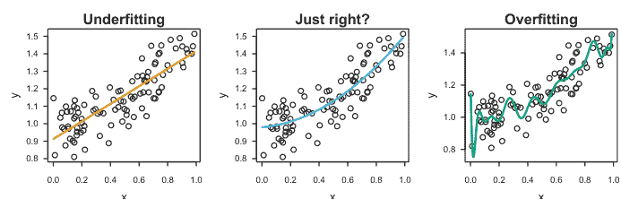

图 1.1：应用于二次示例的三个线性模型的拟合均值响应。左：简单线性模型（即一次多项式）。中：二次模型（即正确模型）。右：20 次多项式模型。

同样的权衡也同样适用于分类。例如，在概率分类中，真实类别概率与预测类别概率之间的 MSE 也可以分解为不可约误差、平方偏差和方差部分；详情见 Manning et al. [2008, pp. 308–314]。

为了直观说明分类中的偏差-方差权衡，图 1.2 显示了从简单的“twonorm”基准问题生成的 N = 500 个观测值；详情和参考文献请参见 R 中的 ?mlbench::mlbench.twonorm。在这里，类别对应于两个双变量正态分布，均值向量为 \(\mu_1 = (\sqrt{2}, \sqrt{2})^\top\)（黄点）和 \(\mu_2 = -\mu_1\)（蓝点），单位协方差矩阵（即 \(\Sigma = I_2\)）。图 1.2 还显示了两个不同的决策边界。虚线对应于最优或贝叶斯决策边界（即在此问题中我们能做到的最好），在此情况下为线性。第二个决策边界（实线）对应于 k = 1† 的简单 k-最近邻（k-NN）分类器。显然，1-NN 模型过拟合，与最优线性边界相比，产生了过于复杂的决策边界（例如，三个小岛）。

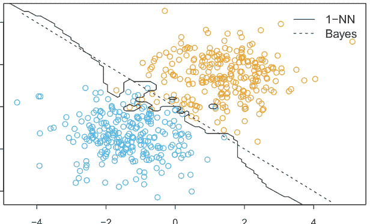

图 1.2：twonorm 基准示例的决策边界。在此情况下，贝叶斯决策边界是线性的（虚线）。还显示了 1-NN 模型（实线）的决策边界，这明显是过拟合；请注意三个小岛。

### 1.1.3 无监督学习

在无监督学习中，没有工作响应 y；因此，学习样本仅包含特征 {x_i}_{i=1}^N。总体目标是确定数据是否形成任何“有趣的组”；例如，数据是否形成自然簇。一个有用的应用是检测异常值或离群点。使用决策树进行异常检测的示例在 7.8.5 节中给出。另一个与识别可能标记错误的响应值相关的示例在 7.6.1 节中给出。

## 1.2 为什么使用树？

数据科学家可用的建模工具有很多。但什么使建模工具良好？能够实现有竞争力的准确性就足够了吗？当然不是。已故的 Leo Breiman 认为，良好的建模工具至少应该：

- 适用于分类（二元和多类）和回归；
- 在准确性方面具有竞争力；
- 能够处理大型数据集；
- 有效处理缺失值。

此外，Leo 还认为良好的建模工具应该能够：

- 告诉你哪些预测器很重要；
- 告诉你预测器如何与响应在功能上相关；
- 告诉你预测器是否以及如何交互；
- 告诉你数据如何聚类；
- 告诉你是否存在任何新案例或异常值。

正如我们将在本书中看到的，基于树的方法自然满足了其中许多要求。虽然单个树在处理各种问题方面特别有能力，但其主要缺点是它们通常不如更复杂的模型（如 NNs 或 SVMs）表现好；然而，在本书第二部分中，我将讨论将决策树组合成 *集成* 的强大方法，这些方法与当前最先进的算法相当有竞争力，同时仍然遵循上述良好建模工具的几个特点。

表 1.1 比较了不同统计学习算法的几个特征；这是 Hastie et al. [2009, p. 351] 中表 10.1 的修改重现。MARS（即 *多元自适应回归样条* [Friedman, 1991]）可以被视为 *线性模型* 的扩展，它自动处理变量选择、非线性关系以及预测器之间的交互；MARS 在书籍网站的在线补充材料中讨论。请注意，基于树的方法往往具有许多可取的特性。基于树的集成的理念是希望在保留许多这些有用特性的同时提高预测性能。

表 1.1 与其所基于的 Hastie et al. [2009, p. 351] 中的表 10.1 不完全一致。例如，单个树在表 1.1 中的预测性能获得 🟡，表明它们在某些问题上可以相当准确，尤其是现代决策树算法，如 GUIDE（第 4 章）。

树也是很好的 *现成* 建模工具。这里使用的“现成”一词，至少是指一种可以有效地应用于广泛数据集而无需太多预处理的程序

§“MARS” 实际上是商标，并授权给 Salford Systems（该公司于 2017 年被 Minitab 收购），因此，开源实现通常使用不同的名称。例如，MARS 的一个流行开源实现是 R 中出色的 **earth** 包 [Milborrow, 2021a]。


表 1.1：不同统计学习算法之间几个特性的比较。这是 Hastie 等人 [2009, p. 351] 中表 10.1 的修改重制版；此处，TBEs 代表“基于树的集成”，✗ 表示“差”，✔ 表示“良好”，● 表示“一般”。

| 特性 | NNs | SVMs | MARS | Trees | TBEs |
| :--- | :---: | :---: | :---: | :---: | :---: |
| 可自然处理混合类型数据 | ✗ | ✗ | ✔ | ✔ | ✔ |
| 可自然处理缺失值 | ✗ | ✗ | ✔ | ✔ | ✔ |
| 对预测变量中的异常值稳健 | ✗ | ✗ | ✗ | ✔ | ✔ |
| 对预测变量的单调变换不敏感 | ✗ | ✗ | ✗ | ✔ | ✔ |
| 在大 N 下扩展良好 | ✗ | ✗ | ✔ | ✔ | ✔ |
| 处理无关特征的能力 | ✗ | ✗ | ✔ | ✔ | ✔ |
| 提取预测变量线性组合的能力 | ✔ | ✔ | ✗ | ✗ | ✗ |
| 描述能力（可解释性） | ✗ | ✗ | ● | ● | ● |
| 预测能力 | ✔ | ✔ | ● | ● | ✔ |

或进行仔细调优。你通常只需点击“运行”即可获得有用的结果。这并不是说你不应该花时间和精力清理数据并仔细调优这些模型。相反，决策树可以在相当混乱的数据情况下无缝工作（例如，异常值、缺失值、偏态、混合数据类型等），而不需要其他算法为了“直接工作”（例如，神经网络）所需的预处理级别。例如，即使我没有将决策树用于最终模型，我也经常将其作为第一遍，因为它可以快速粗略地展示数据，任何严重问题（在探索阶段容易被忽略）通常都会被突出显示（例如，极端目标泄漏或意外保留 ID 列）。换句话说，决策树是极好的探索工具，尤其是在处理可能混乱的数据时。

### 1.2.1 决策树简史

决策树在统计学和计算机科学中都有着悠久而丰富的历史，并已存在数十年。然而，决策树可以说是在社会科学中真正起步的。出于在复杂调查数据中寻找交互效应的需求，Morgan 和 Sonquist [1963] 开发并发表了第一个用于回归的决策树算法，称为自动交互检测（AID）。从根节点开始，AID 通过最大化节点间平方和，将数据递归地划分为两个同质子组，称为子节点，类似于第 2.3 节中描述的过程。AID 继续依次二分每个生成的子节点，直到节点内平方和的减少小于某个预设阈值。

Messenger 和 Mandell [1972] 在其 theta 自动交互检测（THAID）算法中将 AID 扩展到分类。THAID 中用于选择分割的 theta 准则最大化了每个众数类别中观测值数量之和。

卡方自动交互检测（CHAID）算法由 Kass [1980] 引入，通过回应一些最初的批评改进了 AID；CHAID 最初为分类而开发，后来扩展到也处理回归问题。与第 3–4 章讨论的决策树算法类似，CHAID 使用统计检验和停止规则来选择分割变量和分割点。特别是，CHAID 依赖卡方检验，这需要将有序变量离散化为箱。与 AID 和 THAID 相比，CHAID 的独特之处在于它允许多分叉分割（通常需要较大样本量，否则子节点可能会很快变得太小），并为缺失值包含了一个单独的类别。

尽管 AID、THAID 和 CHAID 具有创新性，但直到 Breiman 等人 [1984] 引入更通用的分类和回归树（CART）算法，基于树的算法才开始在统计学界流行起来。类似 CART 的决策树是第 2 章的主题。另一个类似的基于树的算法，称为 C4.5 [Quinlan, 1993]，它演变成了当前的 C5.0 算法，在许多方面与 CART 非常相似；因此，我在这本书中专注于 CART，并在在线补充材料中讨论 C4.5/C5.0 的细节。

CART 有助于重新激发对划分方法的兴趣，我们在过去几十年中见证了这一演变的展开。尽管历史充满了进步，但本书第一部分将重点介绍三个最重要的基于树的算法：

- 第 2 章：分类和回归树（CART）。
- 第 3 章：条件推断树（CTree）。

# 第 4 章：广义、无偏、交互检测与估计（GUIDE）。

GUIDE 本身有着相当长而有趣的历史，并从几个早期著名的树算法演变而来——例如 QUEST [Loh and Shih, 1997] 和 CRUISE [Kim and Loh, 2001]。如果你对基于树算法的历史有更全面的了解感兴趣，我强烈建议你阅读 Loh [2014]。

### 1.2.2 简单决策树的结构

在本节中，我将探讨典型决策树的基本组成部分（也许树拓扑会是一个更酷的章节标题）。

图 1.3 显示了一棵典型的（二叉）决策树。树由节点和分支组成；两个连续分支之间的路径称为边。节点是发生分支的点。这里，我们有三个内部节点，标记为 I1、I2 和 I3，以及五个终端（或叶子）节点，标记为 L1、L2、L3、L4 和 L5。树是二叉的，因为它只使用二路分割；也就是说，在每个节点，分割只产生两个分支，标记为“是”和“否”。在每个内部节点所走的路径取决于相应的分割条件是否满足。例如，一个 x1 = 0.33 且 x5 = 1.19 的观测值会落在终端节点 L2 中，无论其他预测变量的值如何。

对于有序预测变量 x，分割条件（或简称分割）的形式为 x < c 对 x ≥ c，其中 c 在 x 的定义域内（通常是学习样本中两个连续 x 值的中点）；请注意，有序因子也使用相同类型的分割，因为我们只需要保留类别的自然顺序（例如，x < 中 vs. x ≥ 中）。对于（无序）分类变量，分割的形式为 x ∈ S1 对 x ∈ S2，其中 S = S1 ∪ S2 是 x 中所有唯一类别的完整集合。

每棵树都从包含整个学习样本的根节点开始。从根节点开始，训练数据被分割为两个不重叠的组，一组向左，另一组向右，具体取决于每个观测值是否满足第一个分割条件。该过程在每个子组（或子节点）上重复，直到每个观测值都到达终端节点。

在树中的每个节点，我们可以计算几个可能感兴趣的量，例如：

- 该节点中来自学习样本的观测值数量（或比例）；
- 对于分类模型，该节点中被正确（或错误）分类的观测值数量（由该节点中的多数类决定）。
- 对于概率模型，该节点中属于每个类别的观测值比例；
- 如果这是一个叶子或终端节点，当前的拟合或预测值（例如，平均响应或类别比例）。

终端节点本身通常由每个节点中训练响应值的统计摘要来表征，例如回归的样本均值、分类的频数表，或删失结果的 Kaplan-Meier 估计器/曲线（参见第 1.4.9 节中的示例）。这些摘要可用于为新观测值生成拟合值和预测。例如，如果响应是连续的（即回归树），那么占据终端节点的新观测值可能会被分配一个等于定义该节点的训练观测值平均响应的预测值。

#### 1.2.2.1 示例：泰坦尼克号上的生存

为了进一步说明，让我们看看图 1.4 中的树图。这个类似 CART 的决策树使用著名的泰坦尼克号数据集构建，试图使用关于每位乘客的易得信息来区分幸存者和未幸存者。该数据（我将在第 7.9.3 节中重新讨论）包含以下六个变量上的 N = 1,309 个观测值（即乘客）：

- survived：乘客生存的二进制指标（响应变量）；
- pclass：指定乘客等级的整数（即 1–3）；
- age：乘客年龄（岁）；
- sex：给出每位乘客性别的因子（即男性/女性）；
- sibsp：指定船上兄弟姐妹/配偶数量的整数；
- parch：指定船上父母/子女数量的整数。

变量 pclass 通常被视为名义/分类变量，但这里已考虑了自然顺序。树基于上述四个变量将乘客分成了六个相对同质的组（终端节点）。


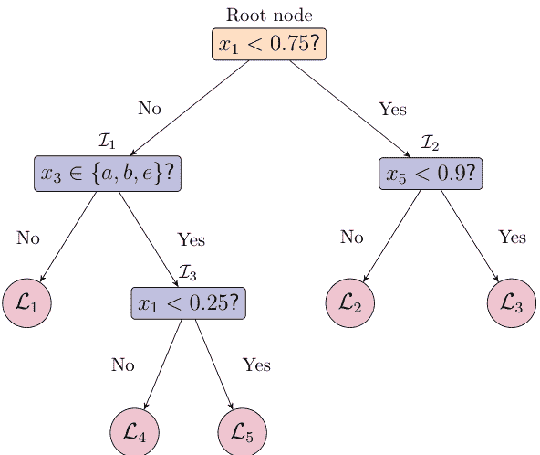

图 1.3：具有四个分割的基本（二元）决策树。

five available features; parch is the only variable not selected to partition the data. The terminal nodes (nodes 6–11) each contain a node summary giving the proportion of surviving passengers in that node. As we’ll see in later chapters, these proportions can be used as class probability estimates.

五个可用特征；parch 是未被选中用于划分数据的唯一变量。终端节点（节点 6–11）各包含一个节点摘要，给出该节点中幸存乘客的比例。如我们在后续章节中将看到的，这些比例可用作类概率估计。

For example, the tree diagram estimates that first and second class female passengers had a 93% chance of survival; the percentage displayed in the bottom of each node corresponds to the fraction of training observations used to define that node. Given what you know about the ill-fated Titanic, does the tree diagram make sense to you? Does it appear that women and children were given priority and had a higher chance of survival (i.e., “women and children first”)? Perhaps, unless you were a third-class passenger.

例如，树图估计一等舱和二等舱女性乘客的生存概率为 93%；每个节点底部显示的百分比对应于用于定义该节点的训练观测值的比例。根据你对不幸的泰坦尼克号的了解，这个树图对你来说合理吗？看起来女性和儿童是否获得了优先权并且生存机会更高（即“妇女和儿童优先”）？也许吧，除非你是三等舱乘客。

In Part I of this book, I’ll look at how several popular decision tree algorithms choose which variables to split on (splitters) and how each split condition is determined (e.g., age < 9.5). Part II of this book will then look at how to improve the accuracy and generalization performance of a single tree by combining several hundred or thousand individual trees together.

在本书第一部分中，我将探讨几种流行的决策树算法如何选择要分割的变量（分割器）以及如何确定每个分割条件（例如，age < 9.5）。本书第二部分将探讨如何通过将几百或几千棵单独的树组合在一起，来提高单棵树的准确性和泛化性能。

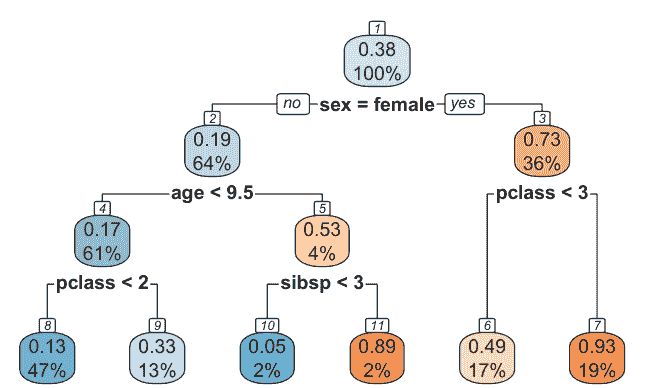

图 1.4：总结不幸泰坦尼克号上生存概率的决策树图。

## 1.3 为什么选择 R？

### 为什么不？

### 1.3.1 说真的，为什么选 R？

I grew up on R (and SAS), but I've chosen it for this book primarily for one reason: it currently provides the best support and access to a wide range of tree-based methods (both classic and modern-day). For example, I'm not aware of any non-R open source implementation of tree-based methods that provides full support for nominal categorical variables without requiring them to be encoded numerically. Another good example is conditional inference trees [Hothorn et al., 2006c], the topic of Chapter 3, which are only implemented in R (as far as I'm aware). Nonetheless, there is at least one Python example included in this book!

我从小使用 R（和 SAS），但我为本书选择它主要出于一个原因：它目前为广泛的基于树的方法（经典和现代）提供了最佳支持和访问。例如，据我所知，没有任何非 R 的开源基于树的方法实现能够完全支持名义类别变量，而无需将其数值编码。另一个很好的例子是条件推断树 [Hothorn et al., 2006c]，即第 3 章的主题，据我所知，它们仅在 R 中实现。尽管如此，本书中至少包含一个 Python 示例！

This book was also written in R (and LaTeX) using the wonderful knitr package Xie [2021].

本书还使用了出色的 knitr 包 Xie [2021]，以 R（和 LaTeX）编写。

There's been some progress in areas of scikit-learn and other open source software that will be discussed in Chapter 8.

scikit-learn 和其他开源软件的某些领域已取得一些进展，将在第 8 章中讨论。

While I have a strong appreciation for the power of base R (i.e., the core language), I'm extremely appreciative of, and often rely on, the amazing ecosystem of contributed packages. Nonetheless, I've decided to keep the use of external packages to a minimum (aside from those packages related to the core tree-based methods discussed in this book), and instead rely on vanilla R programming as much as possible. This choice was made for several (highly opinionated) reasons:

虽然我非常欣赏基础 R（即核心语言）的强大功能，但我非常感激，并且经常依赖于，令人惊叹的贡献包生态系统。尽管如此，我决定将外部包的使用降至最低（除了与本书讨论的核心基于树的方法相关的包之外），并尽可能多地依赖原生 R 编程。出于几个（非常主观的）原因，做出了这一选择：

- it will make the book easier to maintain going forward, as the code examples will (hopefully) continue to work for many years to come without much modification;
- using standard R programming constructs (e.g., `for` loops and their apply-style functional replacements, like `lapply()`) will make the material easier to comprehend for non-R programmers, and easier to translate to other open source languages, like Julia and Python;
- it emphasizes the basic concepts of the methods being introduced, rather than focusing on current best coding practices and cool packages, of which there are many. (Please don't send me hate mail for using `sapply()` instead of `vapply()` or the family of map functions available in `purrr` [Henry and Wickham, 2020].)

- 这将使本书未来更易于维护，因为代码示例（希望）在未来多年内无需太多修改即可继续工作；
- 使用标准 R 编程结构（例如，`for` 循环及其 apply 风格的函数式替代品，如 `lapply()`）将使非 R 程序员更容易理解材料，并更容易将其转译为其他开源语言，如 Julia 和 Python；
- 它强调所介绍方法的基本概念，而不是关注当前的最佳编码实践和众多酷炫包。（请不要因为我使用 `sapply()` 而不是 `vapply()` 或 `purrr` [Henry and Wickham, 2020] 中可用的 map 函数系列而给我发仇恨邮件。）

Note that I've tried to be as aggressive as possible in terms of commenting upon the various code snippets scattered throughout this book and the online supplementary material. You should pay careful attention to these comments as they often link a particular line or section of code to a specific step in an algorithm, try to explain a hacky approach I'm using, and so on.

请注意，我尽可能积极地对本书和在线补充材料中散布的各种代码片段进行了注释。你应该仔细关注这些注释，因为它们通常将代码的特定行或部分与算法中的特定步骤联系起来，试图解释我使用的 hacky 方法，等等。

Each chapter includes one or more software sections, which highlight both R and non-R implementations of the relevant algorithms under discussion. Additionally, each chapter also contains R-specific software example sections (usually at the end of each chapter), which demonstrate use of relevant tree-specific software on actual data (either simulated or real).

每章包含一个或多个软件部分，突出显示所讨论的相关算法的 R 和非 R 实现。此外，每章还包含 R 特定的软件示例部分（通常在每章末尾），演示在实际数据（模拟或真实数据）上使用相关的树特定软件。

There are many great resources for learning R, but I would argue that the online manual, “An Introduction to R”, which can be found at https://cran.r-project.org/doc/manuals/r-release/R-intro.html, is a great place to start. Book-wise, I think that Matloff [2011] and Wickham [2019] are some of the best resources for learning R (note that the latter is freely available to read online). If you're interested in a more hands-on introduction to statistical and machine learning with R, I'll happily self-promote Boehmke and Greenwell [2020].

有很多学习 R 的优秀资源，但我认为在线手册“R 语言入门”（可在 https://cran.r-project.org/doc/manuals/r-release/R-intro.html 找到）是一个很好的起点。就书籍而言，我认为 Matloff [2011] 和 Wickham [2019] 是学习 R 的一些最佳资源（注意后者可免费在线阅读）。如果你有兴趣获得更实用的 R 统计和机器学习入门，我很乐意自我推广 Boehmke 和 Greenwell [2020]。

### 1.3.2 软件信息和约定

Each chapter contains at least one software section, which points to relevant implementations of the ideas discussed in the corresponding chapter. And while this book focuses on R, these sections will also allude to additional implementations in other open source programming languages, like Python and Julia. Furthermore, several code snippets are contained throughout the book to help solidify certain concepts (mostly in R).

每章至少包含一个软件部分，指向相应章节中讨论的想法的相关实现。虽然本书侧重于 R，但这些部分也将提及其他开源编程语言（如 Python 和 Julia）中的其他实现。此外，本书中包含多个代码片段，以帮助巩固某些概念（主要是 R）。

Be warned, I occasionally use dots in variable and function names—old R programming habits die hard. Package names are in bold text (e.g., **rpart**), inline code and function names are in typewriter font (e.g., `apply()`), and file names are in sans serif font (e.g., path/to/filename.txt). In situations where it may not be obvious which package a function belongs to, I'll use the notation `foo::bar()`, where `bar()` is the name of a function in package `foo`.

请注意，我偶尔会在变量名和函数名中使用点号——老的 R 编程习惯很难改。包名使用粗体文本（例如，**rpart**），内联代码和函数名使用等宽字体（例如，`apply()`），文件名使用无衬线字体（例如，path/to/filename.txt）。在不明显函数属于哪个包的情况下，我将使用 `foo::bar()` 表示法，其中 `bar()` 是包 `foo` 中的函数名。

I often allude to the documentation and help pages for specific R functions. For example, you can view the documentation for function `foo()` in package `bar` by typing `?foo::bar` or `help("foo", package = "bar")` at the R console. It's a good idea to read these help pages as they will often provide more useful details, further references, and example usage. For base R functions—that is, functions available in R's `base` package—I omit the package name (e.g., `?kronecker`). I also make heavy use of R's `apply()`-family of functions throughout the book, often for brevity and to avoid longer code snippets based on `for` loops. If you're unfamiliar with these, I encourage you to start with the help pages for both `apply()` and `lapply()`.

我经常提及特定 R 函数的文档和帮助页面。例如，你可以在 R 控制台中输入 `?foo::bar` 或 `help("foo", package = "bar")` 来查看包 `bar` 中函数 `foo()` 的文档。阅读这些帮助页面是个好主意，因为它们通常会提供更多有用细节、进一步参考和示例用法。对于基础 R 函数——即 R 的 `base` 包中可用的函数——我省略包名（例如，`?kronecker`）。我还在全书中大量使用 R 的 `apply()` 函数族，通常是为了简洁并避免基于 `for` 循环的更长代码片段。如果你不熟悉这些，我建议你从 `apply()` 和 `lapply()` 的帮助页面入手。

R package vignettes (when available) often provide more in-depth details on specific functionality available in a particular package. You can browse any available vignettes for a CRAN package, say `foo`, by visiting the package's homepage on CRAN at

https://cran.r-project.org/package=foo.

R 包 vignettes（如有）通常会提供特定包中特定功能的更深入细节。你可以通过访问 CRAN 上包的主页来浏览任何可用的 CRAN 包（例如 `foo`）的 vignettes，

https://cran.r-project.org/package=foo.

You can also use the `utils` package to view package vignettes during an active R session. For example, the vignettes accompanying the R package `rpart` [Therneau and Atkinson, 2019], which is heavily used in Chapter 2, can be found at https://CRAN.R-project.org/package=rpart or by typing `utils::vignette("bar", package = "foo")` at the R console.

你还可以使用 `utils` 包在活动 R 会话期间查看包 vignettes。例如，R 包 `rpart` [Therneau and Atkinson, 2019]（在第 2 章中大量使用）的 vignettes 可在 https://CRAN.R-project.org/package=rpart 找到，或在 R 控制台中输入 `utils::vignette("bar", package = "foo")`。

There's a myriad of R packages available for fitting tree-based models, and this book only covers a handful. If you're unfamiliar with CRAN's task views, you should be. They provide useful guidance on which packages on CRAN are relevant to a certain topic (e.g., machine learning). The task view on statistical and machine learning, for example, which can be found at

https://cran.r-project.org/web/views/MachineLearning.html,

lists several R packages useful for fitting tree-based models across a wide variety of situations. For instance, it lists **RWeka** [Hornik, 2021] as providing an open source interface to the J4.8-variant of C4.5 and M5 (see the online supplementary material on the book website). A brief description of all available task views can be found at https://cran.r-project.org/web/views/.

有大量可用于拟合基于树模型的 R 包，而本书仅涵盖其中一小部分。如果你不熟悉 CRAN 的任务视图，那么你应该熟悉。它们提供了有关哪些 CRAN 包与某个主题（例如，机器学习）相关的有用指导。例如，统计和机器学习任务视图（可在 https://cran.r-project.org/web/views/MachineLearning.html 找到）列出了几种适用于各种情况拟合基于树模型的 R 包。例如，它列出了 **RWeka** [Hornik, 2021]，作为 C4.5 和 M5 的 J4.8 变体的开源接口（参见书籍网站上的在线补充材料）。所有可用任务视图的简要描述可在 https://cran.r-project.org/web/views/ 找到。

Keep in mind that the focus of this book is to help you build a deeper understanding of tree-based methods, it is not a programming book. Nonetheless, writing, running, and experimenting with code is one of the best ways to learn this subject, in my opinion.

请记住，本书的重点是帮助你更深入地理解基于树的方法，它不是一本编程书。尽管如此，在我看来，编写、运行和实验代码是学习这门学科的最佳方式之一。

This book uses a couple of graphical parameters and themes for plotting that are set behind the scene. So don’t fret if your plots don’t look exactly the same when running the code. This book uses a mix of base R and **ggplot2** [Wickham et al., 2021a] graphics, though, I think there’s a **lattice** [Sarkar, 2021] graphic or two floating around somewhere. For **ggplot2**-based graphics, I use the **theme_bw()** theme, which can be set at the top level (i.e., for all plots) using **theme_set(theme_bw())**. Most of the base R graphics in this book use the following **par()** settings (see **?graphics::par** for details on each argument):

本书在绘图时使用了一些在幕后设置的图形参数和主题。因此，如果运行代码时你的图形看起来不完全一样，请不要担心。本书使用基础 R 和 **ggplot2** [Wickham et al., 2021a] 图形的混合，不过，我想某处还有一两个 **lattice** [Sarkar, 2021] 图形。对于基于 **ggplot2** 的图形，我使用 **theme_bw()** 主题，可以使用 **theme_set(theme_bw())** 在顶层（即所有图形）上设置。本书中大多数基础 R 图形使用以下 **par()** 设置（有关每个参数的详细信息，请参见 **?graphics::par**）：

```
par(
  mar = c(4, 4, 0.1, 0.1), # may be different for a handful of figures
  cex.lab = 0.95,
  cex.axis = 0.8,
  mgp = c(2, 0.7, 0),
  tcl = -0.3,
  las = 1
)
```

Some of the base R graphics in this book use a slightly different setting for the **mar** argument (e.g., to make room for plots that also have a top axis, like Figure 8.12 on page 349).

本书中的一些基础 R 图形对 **mar** 参数使用略有不同的设置（例如，为同时带有顶部轴的图形腾出空间，如第 349 页的图 8.12）。

## 1.4 示例数据集

The examples in this book make use of several data sets, both real and simulated, and both small and large. Many of the data sets are available in the **treemisc** package that accompanies this book (or another R package), but many are also available for download from the book’s website:

https://bgreenwell.github.io/treebook/datasets.html.

本书中的示例使用了多个数据集，包括真实和模拟数据，以及小型和大型数据。许多数据集可在伴随本书的 **treemisc** 包（或另一个 R 包）中找到，但许多也可从本书网站下载：

https://bgreenwell.github.io/treebook/datasets.html.

In this section, I’ll introduce a handful of the data sets used in the examples throughout this book. Some of these data sets are pretty common, and are

在本节中，我将介绍本书示例中使用的一些数据集。其中一些数据集非常常见，并且


常用于其他文本或文章中，以说明概念或比较和基准测试性能。

### 1.4.1 瑞士钞票

瑞士钞票数据 [Flury 和 Riedwyl, 1988] 包含来自 200 张瑞士 1000 法郎钞票的测量值：100 张真钞和 100 张假钞。有六个可用预测变量，每个都给出每张钞票不同尺寸的长度（单位：mm）（例如，对角线的长度）。响应变量是一个 0/1 指示变量，用于指示钞票是否为真钞/假钞。这是一个小数据集，在探讨某些分类树如何构建时会很有用。下面的代码片段生成数据的简单散点图矩阵，如图 1.5 所示：

```
bn <- treemisc::banknote
cols <- palette.colors(3, palette = "Okabe-Ito")
pairs(bn[, 1L:6L], col = adjustcolor(cols[bn$y + 2], alpha.f = 0.5),
      pch = c(1, 2)[bn$y + 1], cex = 0.7)
```

注意某些特征在区分两个类别（例如，top 和 diagonal）方面效果有多好。这是一个小数据集，将在第 2–3 章中说明决策树构建的基本概念时使用。

### 1.4.2 纽约空气质量测量

纽约空气质量数据包含 1973 年 5 月至 9 月期间纽约每日的空气质量测量值（共 153 天）。这些数据方便地可在 R 的内置 datasets 包中获取；有关详细信息和原始来源，请参见 ?datasets::airquality。主要变量包括：

- 臭氧 (Ozone)：罗斯福岛 13:00 至 15:00 的平均臭氧浓度（单位：十亿分之一）；
- 太阳辐射 (Solar.R)：中央公园 08:00 至 12:00，频段 4000–7700 埃的太阳辐射（单位：兰利）；
- 风速 (Wind)：拉瓜迪亚机场 07:00 和 10:00 的平均风速（单位：英里/小时）；
- 温度 (Temp)：拉瓜迪亚机场的最高日温度（单位：华氏度）。

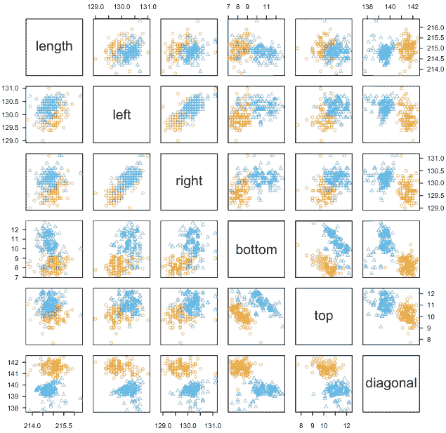

图 1.5：瑞士钞票数据的散点图矩阵。黑色圆圈和橙色三角形分别对应真钞和假钞。

月份（1–12）和日期（1–31）也分别可在 Month 和 Day 列中获取。在这些数据中，臭氧 (Ozone) 被视为响应变量。

这是另一个小数据集，在探讨某些回归树如何构建时会很有用。下面构建了数据的简单散点图矩阵；参见图 1.6。上三角散点图中每个都包含数据的 LOWESS 平滑^p（红色曲线）。请注意，与其他变量相比，臭氧 (Ozone) 与温度 (Temp) 和风速 (Wind) 之间存在相当强的非线性关系。

^p LOWESS 平滑器是一种基于局部加权多项式回归的非参数平滑方法；有关详细信息，请参见 [Cleveland, 1979]。

```
aq <- datasets::airquality
color <- adjustcolor("forestgreen", alpha.f = 0.5)
ps <- function(x, y, ...) { # custom panel function
panel.smooth(x, y, col = color, col.smooth = "black",
cex = 0.7, lwd = 2)
}
pairs(aq, cex = 0.7, upper.panel = ps, col = color)
```

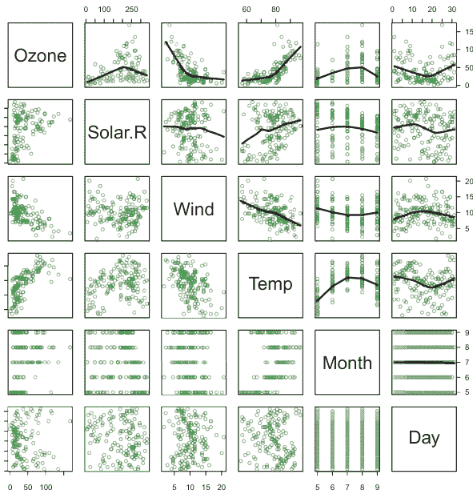

图 1.6：纽约空气质量数据的散点图矩阵。上面板中的每条黑色曲线都代表一个 LOWESS 平滑器。

### 1.4.3 Friedman 1 基准问题

Friedman 1 基准问题 [Breiman, 1996a, Friedman, 1991] 根据以下公式使用带有 10 个输入特征的模拟回归数据：

Y = 10 \sin(\pi X_1 X_2) + 20 (X_3 - 0.5)^2 + 10 X_4 + 5 X_5 + \epsilon, \quad (1.2)

其中 \(\epsilon \sim \mathcal{N}(0, \sigma)\)，且输入特征均为区间 \([0, 1]\) 上的独立均匀随机变量：\(\{X_j\}_{j=1}^{10} \stackrel{iid}{\sim} \mathcal{U}(0, 1)\)。请注意，\(X_6-X_{10}\) 与响应 \(Y\) 无关。

这些数据可以在 R 中使用 `mlbench` 包的 `mlbench.friedman1` 函数生成 [Leisch and Dimitriadou, 2021]。这里，我将使用 `treemisc` 包的 `gen_friedman1` 函数，它允许生成任意数量（\(\ge 5\)）的特征；类似于 Python 中 scikit-learn 的 `sklearn.datasets` 模块中的 `make_friedman1` 函数。有关详细信息，请参见 `?treemisc::gen_friedman1`。下面，我从 (1.2) 生成一个仅包含七个特征的 \(N=5\) 观测值样本（以便打印效果良好）：

```
set.seed(943) # for reproducibility
treemisc::gen_friedman1(5, nx = 7, sigma = 0.1)
```

```
#>        y    x1    x2    x3    x4    x5    x6    x7
#> 1 18.5 0.346 0.853 0.655 0.839 0.293 0.3408 0.0573
#> 2 13.7 0.442 0.691 0.214 0.108 0.543 0.1616 0.5055
#> 3 10.8 0.223 0.789 0.807 0.252 0.257 0.8595 0.7248
#> 4 18.9 0.859 0.520 0.891 0.129 0.936 0.0348 0.7105
#> 5 14.5 0.181 0.590 0.893 0.611 0.415 0.4104 0.2636
```

从 (1.2) 可以清楚地看出，特征 \(X_1-X_5\) 是最重要的！（其他特征根本不影响 \(Y\)。）此外，根据模型形式，我们预期 \(X_4\) 是最重要的特征，可能其次是 \(X_1\) 和 \(X_2\)（两者同等重要），而 \(X_5\) 可能不那么重要。由于 \(X_3\) 具有二次特性，其影响较难确定，但似乎这种非线性会在其观测范围（即 \([0, 1]\)）内抑制该变量的影响。由于 \(\text{E}(Y|\boldsymbol{x})\) 的真实性质已知（尽管有些复杂，例如非线性关系和显式交互效应），这些数据在测试不同的模型可解释性技术（至少针对数值特征）时很有用，如第 6 节所讨论的。由于这些数据易于生成，我将在本书中多次使用它们进行小规模模拟。

### 1.4.4 蘑菇可食性

蘑菇可食性数据是我最喜欢的数据集之一。它包含 8124 个蘑菇，根据 22 种不同的物理特征（如气味和孢子印颜色）进行描述。响应变量（可食性 Edibility）是一个二元指示变量，用于指示每个蘑菇是可食用还是有毒。这些数据可从 UCI 机器学习库 https://archive.ics.uci.edu/ml/datasets/mushroom 获取，也可以从 **treemisc** 获取；有关详细信息和原始来源，请参见 `?treemisc::mushroom`。

关于这些数据（至少对我来说）有趣的是，每一个变量（无论是预测变量还是响应变量）都是分类的。这些数据将有助于说明某些决策树算法在选择分割时如何处理分类预测变量。下面构建了一个显示蘑菇可食性与气味之间关系的 _马赛克图_（本样本中区分可食用和有毒蘑菇的较好判别因素之一）；参见图 1.7。

每个瓷砖的面积与特定类别中的观测值数量成正比。马赛克图表明，有毒组主要由气味强烈或难闻的蘑菇组成。因此，我们可能推测，有毒蘑菇往往与强烈或难闻的气味相关联。

```
mushroom <- treemisc::mushroom
mosaicplot(~ Edibility + odor, data = mushroom, color = TRUE,
           las = 1, main = "", cex.axis = 0.6)
```

### 1.4.5 垃圾邮件还是正常邮件？

这些数据指的是在惠普（HP）实验室收集的 _N_ = 4,601 封电子邮件，被分类为垃圾邮件（即 junk email）或非垃圾邮件（即“正常邮件 ham”）。除了类别标签外，还有 57 个预测变量，给出每封电子邮件中某些单词和字符的相对频率。例如，列 `charDollar` 给出每封电子邮件中美元符号 ($) 出现的相对频率。这些数据可从 UCI 机器学习库 https://archive.ics.uci.edu/ml/datasets/spambase 获取。

在 R 中，可以从 **kernlab** 包 [Karatzoglou 等人, 2019] 加载这些数据；有关更多详细信息，请参见 `?kernlab::spam`。

下面，我将数据加载到 R 中，检查垃圾邮件和非垃圾邮件的频率，然后查看每组中几个不同单词和字符的平均相对频率：

```
data(spam, package = "kernlab")
```

```
# Distribution of ham and spam
table(spam$type)
#>
#> nonspam   spam
#>   2788   1813
```


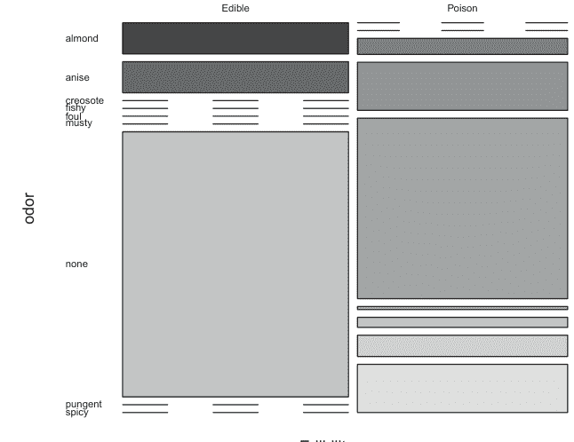

图 1.7：马赛克图，可视化蘑菇可食性与气味之间的关系。每个瓷砖的面积与特定类别中的观测数量成正比。

```
# Compute average relative frequency of different words and characters
aggregate(cbind(remove, charDollar, hp, parts, direct) ~ type,
          data = spam, FUN = mean)
```

```
#>  type remove charDollar  hp parts direct
#> 1 nonspam 0.00938 0.0116 0.8955 0.01872 0.0831
#> 2  spam 0.27541 0.1745 0.0175 0.00471 0.0367
```

请注意，前三个变量在垃圾邮件和非垃圾邮件之间显示出更大的差异；我们可能预期这些变量在将新的 HP 邮件分类为垃圾邮件或非垃圾邮件时是重要的预测因子（至少与其他两个变量相比）。例如，鉴于这些邮件都来自惠普实验室，非垃圾邮件中单词 "hp" 的相对频率要高得多这一事实是合理的（1998 年时垃圾邮件还不那么狡猾）。

作为即将到来内容的预览，下面的代码块将一个带有三个分割（即，它提出三个是或否问题）的基本决策树拟合到数据的 70% 随机样本上。它还考虑了指定的假设，即将非垃圾邮件误分类为垃圾邮件的成本是将垃圾邮件误分类为非垃圾邮件的五倍。我们将在第 2 章中了解关于 **rpart** 及以下步骤的所有内容。

```
library(rpart)
library(treeisc)

# Split into train/test sets using a 70/30 split
set.seed(852) # for reproducibility
id <- sample.int(nrow(spam), size = floor(0.7 * nrow(spam)))
spam.trn <- spam[id, ] # training data
spam.tst <- spam[-id, ] # test data

# Fit a simple classification tree
loss <- matrix(c(0, 1, 5, 0), nrow = 2) # misclassification costs
spam.cart <- rpart(type ~ ., data = spam.trn, cp = 0,
parms = list("loss" = loss))

cp <- spam.cart$cptable
cp <- cp[cp[, "nsplit"] == 3, "CP"] # CP associated with 3 splits
spam.cart.pruned <- prune(spam.cart, cp = cp) # grab smaller subtree

# Display tree diagram
tree_diagram(spam.cart.pruned)
```

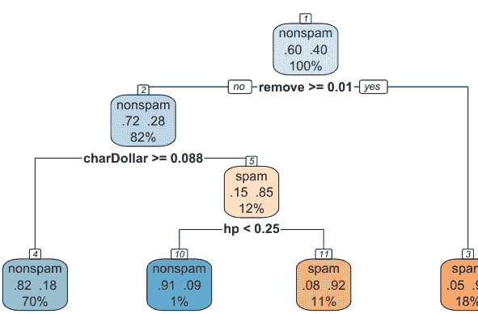

图 1.8：应用于电子邮件垃圾邮件学习样本的简单分类树的决策树图。

相关的树图在图 1.8 中显示。这棵树过于简单，对训练数据存在欠拟合（我将在第 5 章中使用集成方法重新分析这些数据）。尽管如此，简单的决策树通常可以显示为一小组简单的 *规则*。作为一组互斥且穷尽的规则，图 1.8 中的树图转换为：

```
Rule 1 (path to terminal node 3)
IF remove >= 0.01
THEN classification = spam (probability = 0.95)
```

```
Rule 2 (path to terminal node 11)
IF remove < 0.01 AND
| charDollar >= 0.088 AND
| hp < 0.25
THEN classification = spam (probability = 0.92)
```

```
Rule 3 (path to terminal node 10)
IF remove < 0.01 AND
| charDollar >= 0.088 AND
| hp >= 0.25
THEN classification = non-spam (probability = 0.91)
```

```
Rule 4 (path to terminal node 4)
IF remove < 0.01 AND
| charDollar < 0.088 AND
THEN classification = non-spam (probability = 0.82)
```

例如，第一条规则指出，如果单词 "remove" 的相对频率为 0.01 或更大，则我们将以 0.95 的概率将该电子邮件分类为垃圾邮件。

### 1.4.6 员工流失

员工流失数据包含（模拟）的人力资源分析数据，涉及留在和离开某家公司的员工。根据原始来源，使用这些数据的主要目标是“揭示导致员工流失的因素……”。此类因素包括年龄、工作满意度和通勤距离。响应变量是 Attrition，它是一个二进制指标，用于指示员工是离开了（**Attrition = Yes**）还是留下了（**Attrition = No**）。这些数据可以通过 R 包 **modeldata** [Kuhn, 2021] 方便地获取；也可以从以下 IBM GitHub 仓库获取：https://github.com/IBM/employee-attrition-aif360。要在 R 中加载数据，请使用：

```
data(attrition, package = "modeldata")
```

```
# Distribution of class outcomes
```

```
table(attrition$Attrition)
#> 
#>   No Yes 
#> 1233 237
```

### 1.4.7 预测艾奥瓦州艾姆斯的房价

艾姆斯房价数据 [De Cock, 2011] 可通过 R 包 **AmesHousing** [Kuhn, 2020] 获取，包含艾姆斯评估员办公室的信息，用于计算 2006–2010 年间在艾奥瓦州艾姆斯出售的个别住宅物业的评估价值；描述该数据集的在线文档可在 `http://jse.amstat.org/v19n3/decock/DataDocumentation.txt` 找到。这些数据常被用作对常被引用的——且在伦理上存有争议 [Carlisle, 2019]——波士顿房价数据 [Harrison and Rubinfeld, 1978] 的更当代替代方案。

该数据集包含 81 个变量上的 $N = 2,930$ 个观测值。此处的响应变量是房屋的最终售价（`Sale_Price`）。其余 80 个变量（我们将将其视为预测因子）是有序特征和分类特征的混合体。

在下面的代码块中，我将把数据加载到 R 中，并使用 70/30 分割将其分为训练集/测试集，我将在本书的多个示例中使用它（请注意，出于绘图目的，主要是为了避免 $y$ 轴上的大数字，我将通过除以 1,000 来重新缩放响应变量）：

```
ames <- as.data.frame(AmesHousing::make_ames())
ames$Sale_Price <- ames$Sale_Price / 1000 # rescale response
set.seed(2101) # for reproducibility
trn.id <- sample.int(nrow(ames), size = floor(0.7 * nrow(ames)))
ames.trn <- ames[trn.id, ] # training data/learning sample
ames.tst <- ames[-trn.id, ] # test data
```

图 1.9 显示了来自 70% 学习样本中售价与地上居住面积（平方英尺）（`Gr_Liv_Area`）的散点图。正如我们在后面章节中将看到的，地上居住面积可以说是该数据集中更重要的预测因子之一（如你所料）。从这张图中可以明显看出，存在 *异方差性*，即售价的变异性随房屋大小而增加。线性模型在依赖常规正态理论标准误和置信区间进行解释时，假设方差恒定。异常值是另一个潜在问题。

```
plot(Sale_Price ~ Gr_Liv_Area, data = ames.trn,
  col = adjustcolor(1, alpha.f = 0.5),
  xlab = "Above grade square footage",
  ylab = "Sale price / 1000")
```

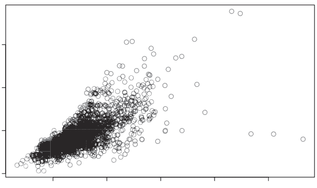

图 1.9：来自艾姆斯房价训练样本的售价与地上（地面）居住面积（平方英尺）的散点图；在这里你可以看到大约五个潜在的异常值。

请注意，仅基于这些数据的预测不应单独用于设定房屋的售价。我的意思是，它们可以这样做，但随着时间的推移可能表现不佳。房屋估值涉及许多复杂性，而且房地产市场会随时间变化。手头的数据使得预测此类变化可能很困难，尤其是在本书大部分内容撰写期间的初期 Covid-19 爆发期间（许多事情变得相当难以预测和预测）。然而，这样的模型可以作为一个有用的起点，尤其是出于描述性目的。

### 1.4.8 葡萄酒质量评级

这些数据与葡萄牙“Vinho Verde”葡萄酒的红色和白色变体相关；详情请参见 Cortez et al. [2009]。由于隐私和物流问题，只有理化和感官变量可用（例如，没有关于葡萄类型、葡萄酒品牌、葡萄酒售价等的数据）。此处的响应变量是葡萄酒质量评分（quality），它是 0–10 范围内的有序整数。

这些数据可在 R 包 treemisc 中获取，可用于分类或回归，但鉴于响应变量的序数性质，后者更合适；请参见 ?treemisc::wine。这些数据也可以从 UCI 机器学习库下载，网址为 https://archive.ics.uci。


edu/ml/datasets/wine+quality。异常值检测算法可用于检测少数优质或劣质葡萄酒。此外，尚不清楚所有可用预测变量是否都相关。

下面，我将数据加载到 R 中，并查看按葡萄酒类型（例如，红葡萄酒或白葡萄酒）划分的质量评分分布：

```r
wine <- treeisc::wine
xtabs(~ type + quality, data = wine)
```

| 类型 | 3 | 4 | 5 | 6 | 7 | 8 | 9 |
|------|---|---|---|---|---|---|---|
| 红葡萄酒 | 10 | 53 | 681 | 638 | 199 | 18 | 0 |
| 白葡萄酒 | 20 | 163 | 1457 | 2198 | 880 | 175 | 5 |

请注意，大多数葡萄酒（红葡萄酒或白葡萄酒）都属于中等水平，得分很高或很少的葡萄酒相对较少。这里的响应变量虽然真的是 0–10 范围内的整数，但通常通过将有序响应任意离散化为“低质量”和“高质量”葡萄酒而被当作二元变量处理。一种更合适的分析（利用响应是有序的事实）在 3.5.2 节中给出。

### 1.4.9  Mayo Clinic 原发性胆汁性胆管炎研究

本示例涉及 Mayo Clinic 于 1974 年 1 月至 1984 年 5 月间进行的关于肝脏原发性胆汁性胆管炎（PBC）的研究数据；随访持续至 1986 年 7 月。PBC 是一种自身免疫性疾病，会导致肝脏小胆管破坏。共有 N = 418 名患者的生存时间和删失指标已知（我将简要说明这些含义）。目标是比较 D-青霉胺药物与安慰剂在生存概率方面的效果。该药物最终被证明无效；例如，参见 Fleming and Harrington [1991, p. 2] 和 Ahn and Loh [1994]（后者采用基于树的分析）。还包含了另外 16 个潜在协变量，我将在 3.5.3 节中进一步将其作为预测变量进行研究。

下面，我从 survival 包 [Therneau, 2021] 加载数据并进行一些准备工作。首先，我将只考虑被随机分配到 D-青霉胺组和安慰剂组的患者子集；详情见 ?survival::pbc。其次，我将少数接受肝移植的受试者视为在移植当天删失$^9$：

```r
library(survival)
```

```r
pbc2 <- pbc[!is.na(pbc$trt), ] # omit non-randomized subjects
pbc2$id <- NULL # remove ID column
# Consider transplant patients to be censored at day of transplant
pbc2$status <- ifelse(pbc2$status == 2, 1, 0)
```

```r
# Look at frequency of death and censored observations
table(pbc2$status)
```

| | 0 | 1 |
|---|---|---|
| | 187 | 125 |

在此样本中，125 名受试者死亡（即，经历了感兴趣的事件），其余 187 名被视为删失（即，我们只知道他们在退出研究、接受移植或研究期结束前未死亡）。

在生存研究（如本例）中，感兴趣的因变量通常是*某事件发生的时间*；在本示例中，感兴趣的事件是死亡。然而，医学研究不能无限期进行，有时受试者会退出研究或以其他方式失访。在这些情况下，我们可能未观察到事件时间，但至少拥有一些部分信息。例如，一些受试者可能在研究期结束后仍然存活，或者有些人可能因其他情况退出。无论具体原因如何，我们至少对这些受试者拥有一些部分信息，生存分析（也称为*时间至事件*分析或*可靠性分析*）会将这些信息考虑在内。

图 1.10 的散点图显示了 PBC 数据中前十名受试者的生存时间，并标明每个观测值是否被删失。例如，第一名受试者记录在 $t = 400$ 天时死亡，而第二名受试者在 $t = 4,500$ 天时被删失。

在生存分析中，响应变量通常形式为

$Y = \min(T, C)$，

其中 $T$ 是生存时间，$C$ 是*删失时间*。在本书中，我将只考虑右删失（最常见的删失形式），其中 $T \ge Y$。在这种情况下，我们所知道的只是真实事件时间至少等于观察到的时间$^a$。例如，如果我们正在研究机器中某个电机的失效时间，我们可能观察到在 $t = 56$ 小时时发生了失效，或者研究在 $t = 100$ 小时时结束，因此我们所知道的只是真实失效时间会在该时间点之后的某个时刻发生。

为指示某个特定观测值被删失，我们可以使用删失指标：

- 左删失和*区间删失*是其他常见的删失形式。

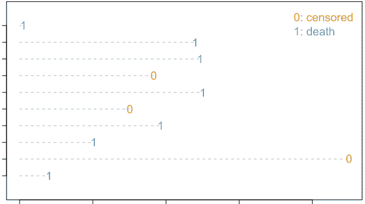

FIGURE 1.10：Mayo Clinic PBC 数据中前十名（随机分配）受试者的生存时间。

$$\delta = \begin{cases} 1 & \text{if } T \le C \\ 0 & \text{if } T > C \text{ (i.e., censored)} \end{cases}$$

其中 \(\delta = 1\) 表示我们观察到了真实生存时间，\(\delta = 0\) 表示右删失观测值（即，我们只知道受试者在时间 \(C\) 之后仍然存活）。医学研究中右删失的常见原因是研究在感兴趣事件（例如死亡）发生前结束，或者一些个体退出研究或失访；无论哪种情况，我们都只有部分信息。正如我们将看到的，几类决策树算法可以扩展以处理右删失结果。示例见 3.5.3 节（单棵决策树）和 8.9.1 节（决策树集成）。

生存研究中常见的感兴趣摘要是_生存函数_：

$S(t) = \text{Pr}(T > t), \quad (1.3)$

它描述了存活时间超过 \(t\) 的概率。Kaplan-Meier（或乘积极限）估计量是一种非参数统计量，用于在存在删失的情况下估计生存函数（如果没有任何删失，则可以直接使用普通的_经验分布函数_）。

细节超出了本书的范围，但 survival 包中的 survfit 函数可以为我们完成繁重的工作。

在下面的代码片段中，我调用 survfit 来估计并绘制药物组和安慰剂组的生存曲线；见图 1.11。在这里，你可以看到治疗组和对照组之间的估计生存曲线相似，表明 D-青霉胺相当无效。log-rank 检验可用于检验两组生存分布之间的差异。一些用于生存数据分析的决策树算法使用 log-rank 检验来帮助划分数据；例如，参见 Segal [1988] 和 Leblanc and Crowley [1993]。

```r
palette("Okabe-Ito")
plot(survfit(Surv(time, status) ~ trt, data = pbc2), col = 2:3,
     conf.int = FALSE, las = 1, xlab = "Days until death",
     ylab = "Estimated survival probability")
legend("bottomleft", legend = c("Penicillamine", "Placebo"),
       lty = 1, col = 2:3, text.col = 2:3, inset = 0.01, bty = "n")
palette("default")
```

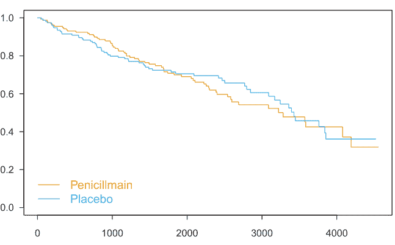

FIGURE 1.11：按治疗组（即药物组 vs. 安慰剂组）划分的 Mayo Clinic PBC 数据中随机受试者的 Kaplan-Meier 生存函数估计。中位生存时间分别为 3282 天（药物组）和 3428 天（安慰剂组）。

在 3.5.3 节中，我们将看到简单的基于树的分析如何通过将学习样本划分为生存率相似的非重叠组，来估计给定一组预测变量条件下的生存函数，记为 \(\hat{S}(t|\boldsymbol{x})\)；在这里，我们将看到进一步证据表明 D-青霉胺在改善生存方面并不有效。要全面了解生存分析，我一直推崇 Klein and Moeschberger [2003] 作为金标准。

## 1.5 天下没有免费的午餐

太频繁地，我们看到论文或听到观点，声称某个酷炫的新算法 A 在执行任务 D 时优于某些现有算法 B 和 C。这大多是胡说，因为任何经验丰富的统计学家或建模者都会告诉你，没有哪个程序或算法在所有情况下都均匀优越。话虽如此，你不应该带着基于树的方法优于任何其他算法或建模工具的印象离开这本书。它们当然是强大且灵活的工具，但这并不总是意味着它们是工作的正确工具。请将它们视为建模和分析工具箱中仅仅是另一种工具。

## 1.6 本书大纲

本书关于决策树，包括单棵决策树（第一部分）及其集成（第二部分）。存在大量的决策树算法，甚至有整本书专门介绍其中一些。因此，在选择本书中详细介绍的主题时，我不得不相当有选择性，这主要由我多年来在学术界和工业界对基于树的方法的经验所指导。正如 Loh [2014] 所述，“文献中存在如此多的递归划分算法，以至于如今很难见树木不见森林。”

我将讨论当前使用的一些主要且最重要的基于树的算法。然而，由于时间和篇幅限制，几个重要的算法和扩展未能入选，而是在书籍网站上可找到的（免费）在线补充材料中进行讨论。这些方法包括：

- C5.0 [Kuhn and Johnson, 2013, Sec. 14.6]，C4.5 [Quinlan, 1993] 的后继算法，它与 CART 足够相似，以至于将其单独列为一章与第 2 章在很大程度上是重复的；
- MARS，在 1.2 节中简要提及（见表 1.1），本质上是线性模型（和 CART）的扩展，它自动


- 处理变量选择、非线性关系以及预测器之间的交互作用；
- 基于规则的模型，如可证明最优规则列表 [Angelino et al., 2018]，简称 CORELS，它们非常类似于决策树，但强调产生少量简单规则（即，简短的是或否问题序列）。

决策树仍然是数据科学工具箱中最灵活、最实用的工具之一，无论用于描述还是预测。虽然它们最常用于集成中的预测问题（参见第 5–8 章），但单个决策树仍然是最有用的现成分析工具之一（例如，可用于缺失值插补、描述以及变量排名和选择，仅举几例）。

本书其余部分分为两个部分：

**第一部分：** 单个决策树。常见的决策树算法，如 CART（第 2 章）、CTree（第 3 章）和 GUIDE（第 4 章），将成为重点。我将讨论基础知识和那些在其他教材中常被略过、或在文献中被掩盖的细致入微的细节。这些算法构成了许多当前最先进预测算法的基础。此类算法是第二部分的重点。

**第二部分：** 决策树集成。虽然第一部分将介绍几种有用的决策树算法，但会发现单个树很少能成为好的预测器，至少与其他流行算法（如神经网络和随机森林（第 7 章））相比是如此。幸运的是，我们通常可以通过将几百或几千个单个树的预测结果结合起来来提高其性能。实现此目的有几种方法，第 5 章介绍了两种流行且通用的策略：装袋（bagging）和提升（boosting）。第 7–8 章随后将分别深入探讨装袋和提升的专门版本。

每章都包含大量软件示例，有助于巩固主要概念，通常仅涉及最小程度的包使用并从零开始开发思想。然而，特定于树的软件和更长的示例通常保留到每章末尾，在主要思想介绍之后。

# 第一部分

## 决策树

Taylor & Francis
Taylor & Francis Group
http://taylorandfrancis.com

# 2 使用 CART 进行二元递归分区

> > 我总是，以 ppb 为单位）用于纽约空气质量数据（第 1.4.2 节）；较亮的点表示较高的臭氧读数。区域的选择方式力求在满足一些额外约束的前提下，尽量减少每个区域内的响应方差。要预测新数据点 x 的臭氧水平，我们可以使用 x 所在区域的平均响应率（即，预测曲面是一个阶梯函数）。

这是 CART 的总体目标，即将特征空间划分为非重叠的矩形区域，每个区域内具有相似的响应率，然后可用于描述或预测。例如，从描述角度来看，我们可以看到伪造的瑞士银行券往往具有异常长的上边和下边。

在超过两个维度（即，超过两个预测器）的情况下，不相交区域由超矩形形成。为什么使用矩形区域？矩形区域更简单，计算上更可行；它们还倾向于产生更具可解释性的模型，可以使用方便的树图表示。特别是，我们希望生成的区域尽可能与响应变量同质。挑战在于定义区域。例如，我们应该使用多少个区域，以及在哪里划线？显然，我们可以继续细化每个

a 如前所述，在第 1.2 节中提到，“CART” 术语是商标；因此，所有开源实现都使用其他名称。为简洁起见，我将使用缩写 CART 来指代遵循 Breiman et al. [1984] 中原始思想的广泛实现类，其中包括 rpart 和 scikit-learn 的 sklearn.tree 模块 scikit-learn。

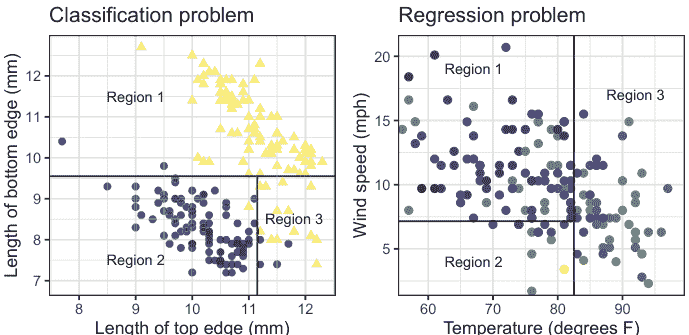

图 2.1：两个数据集的散点图，分为三个非重叠的矩形区域。区域的选择方式使得每个区域内的响应值尽可能同质。左侧：关于 200 张瑞士银行券的二元分类问题，这些银行券已被识别为真币（紫色圆圈）或伪币（黄色三角形）。右侧：一个回归问题（较亮的点表示每个箱内更高的平均响应率）。

图 2.1 左侧区域通过进行更多分区来细化，但这最终会导致过拟合。

“二元递归分区”这一术语对一般 CART 过程描述得相当准确，我将在下一节中针对分类情况详细讨论。单词 binary 指的是用于构建树的分割的二元（或双向）性质（即，每个分割将一组观测值划分为两个非重叠子集）。单词 recursive 指的是算法在依次选择分割时的贪婪性质（即，算法不会向前看以寻找在任何意义上全局最优的分割；它只试图找到下一个最佳分割）。当然，partitioning 指的是分割试图将一组观测值划分为具有同质响应值的非重叠子组的方式。

## 2.2 分类树

分类树（分类结果）和回归树（连续结果）的构建非常相似。然而，分类树涉及一些容易忽略的微妙细微差别，因此我将首先详细考虑它们。首先，让我们回到图 2.1 中的瑞士银行券数据。如第 1.4.1 节所讨论，这些数据包含 200 张瑞士 1000 法郎银行券的六个连续测量值：100 张真币和 100 张伪币。目标是使用六个可用特征将新的瑞士银行券分类为真币或伪币。

下面的代码块将数据加载到 R 并打印前几个观测值：

```
head(bn <- treemisc::banknote) # load and peek at data

#>  length left right bottom  top diagonal y
#> 1   215  131   131    9.0  9.7      141 0
#> 2   215  130   130    8.1  9.5      142 0
#> 3   215  130   130    8.7  9.6      142 0
#> 4   215  130   130    7.5 10.4      142 0
#> 5   215  130   130   10.4  7.7      142 0
#> 6   216  131   130    9.0 10.1      141 0
```

图 2.1 中瑞士银行券区域的树图表示在图 2.2 中显示。每个节点底部的数字给出通过该节点的观测值比例（因此，根节点显示 100%）。中间的值分别给出伪币和真币的比例，顶部打印的类对应于较大的比例（即，节点中占多数的类）。每个节点上方的数字给出相应的节点编号。这是一个示例分类树，可用于对新的瑞士银行券进行分类。例如，任何 bottom > 9.55 的瑞士银行券将被分类为伪币（y = 1）；请注意，图 2.2 中的分割点为了显示目的进行了四舍五入。该节点中伪钞的比例为 0.977，可用作 Pr (Y = 1|x) 的估计值；但这部分内容稍后再述。

从这棵树中，我们可以构建三条简单规则，仅使用每张钞票的 bottom 和 top 长度来对新的瑞士银行券进行分类：

```
Rule 1 (path to terminal node 2)
IF  bottom >= 9.55 (mm)
THEN classification = Counterfeit (probability = 0.977)
```

```
Rule 2 (path to terminal node 6)
IF  bottom < 9.55 (mm) AND top >= 11.15 (mm)
THEN classification = Counterfeit (probability = 0.765)
```

```
Rule 3 (path to terminal node 7)
IF  bottom < 9.55 (mm) AND top < 11.15 (mm)
THEN classification = Genuine (probability = 0.989)
```

这棵树是使用 rpart 中实现的 CART 算法找到的；相应的 R 代码在第 2.9.1 节中使用。但是 CART 如何确定


用于分割的特征以及每个特征应使用的分割点是什么？由于这是一个二分类问题，CART搜索了能够“最好”地将真钞与假钞分开的预测器/分割组合（我将在下一节讨论如何确定“最佳”）。

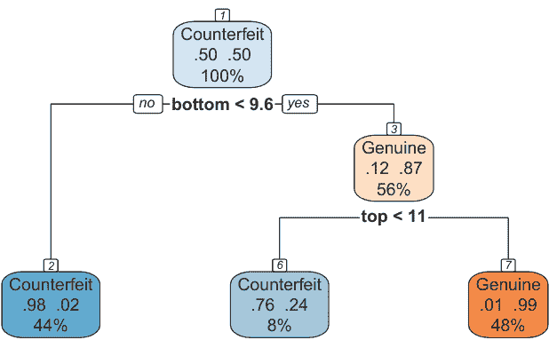

FIGURE 2.2: 用于将瑞士银行券分类为假钞或真钞的示例决策树图。

### 2.2.1 有序变量的分割

让我们先讨论一下CART如何为有序变量找到“最佳”分割。图2.3显示了将任意节点A分别分为左子节点和右子节点（记为A_L和A_R）的假设性分割S。如果A包含N个观测值，则S将A划分为子集A_L和A_R，节点大小分别为N_L和N_R；请注意N_L + N_R = N。由于我们即将描述的分割过程适用于树中的任何节点，我们可以不失一般性地假设A是根节点，即包含整个学习样本（也就是用于构建树的所有训练数据）的节点。目前，我将假设所有特征都是有序的，这包括连续变量和有序分类变量（我将在2.4节讨论名义分类特征的分割）。第一步是以“最佳分离”个体类别标签到两个子节点的方式划分根节点；我将稍后讨论衡量特定分割分离类别标签效果的方法。

图2.3所示的分割S可以通过一个2×2列联表来总结，该表给出了每个类别中进入左子节点或右子节点的观测值数量。表2.1给出了二元0/1结果的此类总结。例如，$N_{0,A_L}$是进入左子节点的属于类别$y=0$的观测值数量。行和列边缘也已显示。

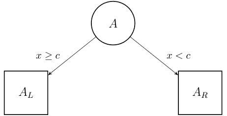

FIGURE 2.3: 使用连续特征x和分割点c，将某个父节点A假设性地分割为两个子节点。

TABLE 2.1: 总结图2.3所示分割S的混淆表。

| | $y=0$ | $y=1$ | |
|---|---|---|---|
| $A_L : x \ge c$ | $N_{0,A_L}$ | $N_{1,A_L}$ | $N_{A_L}$ |
| $A_R : x < c$ | $N_{0,A_R}$ | $N_{1,A_R}$ | $N_{A_R}$ |
| | $N_{0,A}$ | $N_{1,A}$ | |

CART在树构建中采用贪心策略。在分割过程的每一步，CART都会使用穷举搜索来寻找下一个最佳（即局部最优）分割，这不一定能导致全局最优的树结构。这在简单性和复杂性之间提供了合理的权衡——否则，算法在每一步都必须考虑所有未来的潜在分割，这将导致组合爆炸。现在，让我们将注意力转向CART如何选择分割节点。

让我们假设结果是二元的，包含$J=2$个类别，任意编码为0/1（例如，失败/成功）。对于具有$k$个不同值的连续特征$x$，CART将考虑$k-1$个潜在分割。$^{\text{b}}$ 通常，任何两个连续唯一值的中点被用作潜在分割点；例如，如果$x$在学习样本中具有唯一值$\{1, 3, 7\}$，则CART将考虑$\{2, 5\}$作为潜在分割点。在有$k-1$个潜在分割需要考虑的情况下，CART选择哪一个来划分数据？理想情况下，应是能够对类别标签（例如，真钞和假钞，或可食用蘑菇和有毒蘑菇）进行“最佳分离”的分割。那么，我们如何定义特定分割的优劣呢？引入节点不纯度度量。

理想情况下，我们希望两个生成的子节点$A_L$和$A_R$在类别标签方面尽可能同质（例如，如果可能，全部为0或全部为1）。为此，我们希望构建一个函数$i(A)$来衡量特定节点$A$的*不纯度*。在一个极端情况下，$A$可能是一个*纯节点*，即包含全部0或全部1，此时$i(A)=0$。在另一个极端情况下，$A$中的类别标签均匀分布（即0和1各占50%）——这是最坏的情况和最差的可能分割。在这种情况下，不纯度函数$i(A)$应达到最大值。

CART中使用的两种常见节点不纯度度量是*基尼指数*和*交叉熵*（或简称*熵*）。对于具有$J$个类别的响应，它们定义如下：

```
i (A) = \left\{ \begin{array}{ll} \sum_{j=1}^J p_j (A) (1 - p_j (A)) & \text{Gini index} \\ - \sum_{j=1}^J p_j (A) \log (p_j (A)) & \text{Cross-entropy} \end{array} \right., \quad (2.1)
```

其中，$p_j(A)$是$A$中属于类别$j$的观测值的预期比例；请注意，$i(A)$是$p_j(A)$（$j=1, 2, \dots, J$）的函数。为了避免(2.1)中$\log(0)$的问题，我们定义$0\log(0)\equiv0$。

另一种分割度量，称为*两分分割规则*[Breiman et al., 1984, pp. 104–106]，仅在专有软件中实现（至少我不知道任何支持该功能的开源CART实现）。与基尼或交叉熵方法相比，两分方法倾向于生成更平衡的分割。对于二元响应，两分准则等价于基尼指数。有关更多详细信息，请参见Breiman [1996c]。

在继续之前，我们需要引入一些更多的符号。设$N$为学习样本中的观测值数量，$N_j$为属于类别$j$的观测值数量（即，$\sum_{j=1}^J N_j = N$）。同样，设$N_A$为节点$A$中的观测值数量，$N_{j,A}$为节点$A$中属于类别$j$的观测值数量。我们可以用$N_{j,A}/N_A$来估计$p_j(A)$，即节点$A$中属于类别$j$的观测值比例。

对于二元0/1结果，如果我们设$p = p_1(A)$为$A$中1的预期比例，则(2.1)简化为

i (A) = \begin{cases} 2p (1 - p) \quad \text{Gini index} \\ -p \log (p) - (1 - p) \log (1 - p) \quad \text{Cross-entropy} \end{cases} . \quad (2.2)

这些在下图2.4中绘制。

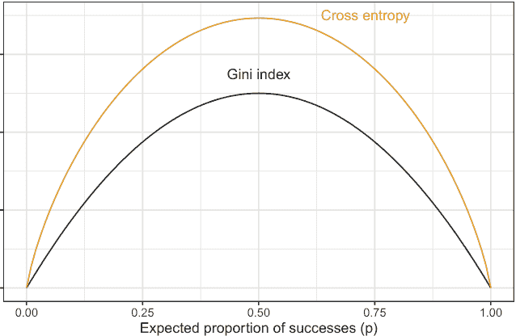

FIGURE 2.4: 二分类问题的常见不纯度度量，作为成功预期比例（p）的函数。

你可能会问，为什么我不考虑将误分类错误作为不纯度的度量。事实证明，误分类错误不是决定分割的有用不纯度度量；例如，请参见Hastie et al. [2009, Section 9.2.3]。然而，误分类错误可以是衡量树相关风险的有用度量，并用于决策树剪枝（第2.5节）。

c 从技术上讲，我们应该使用$p_j(A) \propto \pi_j(N_{j,A}/N_j)$，其中$\pi_j$表示感兴趣总体中类别$j$的真实比例（称为类别$j$的先验），但我将在2.2.4节再回到这一点。目前，让我们取$\pi_j = N_j/N$，即学习样本中属于类别$j$的观测值的观察比例——这个假设并不总是有效（例如，当数据被下采样时），但简化了本节的公式，因此我将复杂性留给2.2.4节。

现在我们有了节点不纯度的概念，可以定义特定分割质量的度量。本质上，有序分割\(S = \{x, c\}\)（见图2.3）的质量，通常称为\(S\)的*增益*，记为\(\Delta \mathcal{I}(S, A)\)，定义为两个生成的子节点\(A_L\)和\(A_R\)降低父节点\(A\)不纯度的程度：

```
\(\Delta \mathcal{I}(S, A) = p(A) i(A) - [p(A_L) i(A_L) + p(A_R) i(A_R)]\)
\(= p(A) i(A) - p(A_L) i(A_L) - p(A_R) i(A_R) \). (2.3)
```

这里，$p(A)$、$p(A_L)$和$p(A_R)$分别对应于节点$A$、$A_L$和$A_R$中新观测值的预期比例。例如，我们可以将$p(A_L)$解释为某个案例落入左子节点$A_L$的概率。如果$A$是根节点，则$p(A)=1$；否则，我们可以用$N_A/N$来估计它。对于二类问题（即$J=2$），我们可以用$A_L$和$A_R$中相应的训练案例比例来估计$p(A_L)$和$p(A_R)$。例如，我们可以用$N_{A_L}/N$来估计$p(A_L)$。

本质上，我们希望找到与最大增益相关的分割$S$（即$x < c$与$x \ge c$）：$S_{best} = \arg \max_S \Delta \mathcal{I}(S, A)$。为此，CART对所有特征及其中的潜在分割进行穷举搜索，并选择增益最大的分割将$A$划分为两个子节点。然后在每个生成的子节点中递归重复此过程，直到构建出一个*饱和树*（即，无法再进行分割）或满足某些合适的停止标准（例如，达到指定的树最大深度）。虽然CART选择最佳分割的方法似乎很复杂，但我们将在2.2.2节从头开始在R中实现它，并将其应用于瑞士银行券数据集。

#### 2.2.1.1 实际上，是基尼指数还是熵？

对于二叉树，Breiman [1996c]指出，基尼指数倾向于偏好将最频繁的类别放入一个纯节点、将其余类别放入另一个节点的分割。另一方面，熵和两分分割规则都强调平衡两个子节点中的类别大小。在类别数量较少的问题中（即$J=2$），基尼和熵准则倾向于产生相似的结果。

Géron [2019, pp.183–184]赞同Breiman的类似观点：“那么，应该使用基尼不纯度还是熵呢？事实是，大多数时候这并没有太大区别：它们会导致相似的树。基尼不纯度计算速度稍快，因此是一个良好的默认选择。然而，当它们不同时，基尼不纯度倾向于将最频繁的类别隔离在树的自己的分支中，而熵倾向于产生稍微更平衡的树。”


### 2.2.2 示例：瑞士钞票

回到瑞士钞票示例，我们的目标是找到第一个“最佳”分割条件，以将真钞与假钞分开。在这里，我们将注意力仅限于两个特征：顶部（top）和底部（bottom），它们分别给出了顶部和底部边缘的长度（单位：mm）。（我们只关注这两个特征，因为，正如我们稍后将看到的，对角线（diagonal）是一个过于好的预测器，会导致寻找分割点的示例不那么有趣。）由于这是一个分类问题，我们可以使用交叉熵或基尼系数来衡量每个分割的优劣；在这里，我们将使用基尼系数，并将实现交叉熵留给读者作为练习。

下面给出了一个用于计算二类情况下基尼系数的简单 R 函数。该函数以二元目标值作为输入，假设这些值编码为 0/1（在此示例中，对应于真钞/假钞）；将下面的函数与 (2.2) 进行比较。

```
gini <- function(y) { # y should be coded as 0/1
  p <- mean(y) # proportion of successes (or 1s)
  2 * p * (1 - p) # Gini index
}
```

要找到最优分割 \( S = \{x, c\} \)，其中 \( x \) 是一个有序（但为数值型）特征，\( c \) 在其定义域内，我们需要搜索 \( c \) 的每一个可能值。例如，可以通过搜索 \( x \) 的排序后唯一值的中点来实现这一点。对于每个分割，我们还需要计算当前（或父）节点的加权不纯度，以及生成的左子节点和右子节点的加权不纯度；然后找出哪个分割点产生了最大的增益（2.3）。

下面给出了一个名为 `splits()` 的简单 R 函数，用于执行这些步骤。这里，`node` 是一个包含特定节点中观测值的数据框（即学习样本的一个子集），而 `x` 和 `y` 分别给出 `node` 中对应感兴趣（有序数值型）特征和（二元或 0/1）目标的列名。参数 `n` 指定学习样本中的观测值数量；这是计算 (2.3) 中使用的概率 \( p(A) \)、\( p(A_L) \) 和 \( p(A_R) \) 所必需的。在变量 `left` 和 `right` 的定义中使用 `drop = TRUE` 可确保结果被强制转换为最低可能维度。在对数组和矩阵进行子集化时，`drop` 参数在这本书中被大量使用；有关详细信息，请参见 `?[` 和 `?drop`。

```
splits <- function(node, x, y, n) { # y should be coded as 0/1
  xvals <- sort(unique(node[[x]])) # sorted, unique values
  xvals <- c(xvals[-length(xvals)] + diff(xvals) / 2) # midpoints
  res <- matrix(nrow = length(xvals), ncol = 2) # to store results
  colnames(res) <- c("cutpoint", "gain")
  for (i in seq_along(xvals)) { # loop through each midpoint
    left <- node[node[[x]] >= xvals[i], y, drop = TRUE] # left child
    right <- node[node[[x]] < xvals[i], y, drop = TRUE] # right child
    p <- c(nrow(node), length(left), length(right)) / n # proportions
    gain <- c(p[1L] * gini(node[[y]]) - # Equation (2.3)
              p[2L] * gini(left) - p[3L] * gini(right))
    res[i, ] <- c(xvals[i], gain) # store split point and gain
  }
  res # return matrix of results
}
```

让我们在完整数据集上测试此函数（即 A 是根节点），并找到底部（bottom）的最优分割点。首先，我们将找出与每个可能分割点相关的增益并绘制结果：

```
res <- splits(bn, x = "bottom", y = "y", n = nrow(bn))
head(res, n = 5) # peek at first five rows
```

| | 分割点 | 增益 |
|---|---|---|
| [1,] | 7.25 | 0.00761 |
| [2,] | 7.35 | 0.01020 |
| [3,] | 7.45 | 0.01948 |
| [4,] | 7.55 | 0.03045 |
| [5,] | 7.65 | 0.03616 |

```
plot(res, type = "b", col = 2, las = 1,
     xlab = "Split value for bottom edge length (mm)",
     ylab = "Gain") # Figure 2.5
```

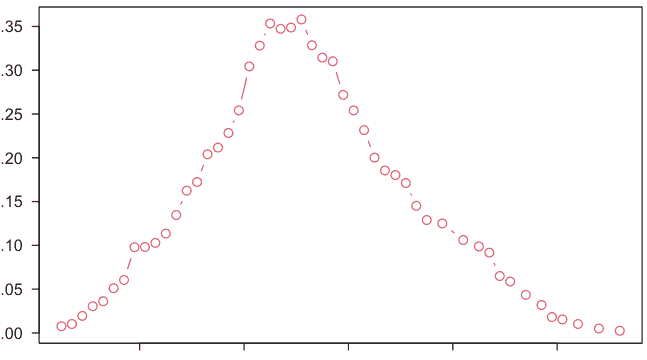

图 2.5：作为底部边缘长度（mm）的分割值 c 的函数，根节点不纯度的降低。

图 2.5 显示了分割值 c 作为增益（或分割优劣）的函数。我们可以使用以下命令提取与最大增益相关的精确分割点：

```
res[which.max(res[, "gain"]), ] # extract row with maximum gain
```

```
#> cutpoint   gain
#>   9.550   0.358
```

在这里，我们可以看到底部（bottom）的最优分割点为 9.55 mm。基于穷举搜索的典型树算法会对每个特征执行此操作，并选择总增益最大的一个特征。由于 banknote 中的所有特征都是连续的，我们可以将 splits() 应用于每个特征，以查看哪个预测器将用于首次分割训练数据（即根节点）。为了简化事情，让我们编写一个包装函数，它对任意数量的特征调用 splits()，找出每个特征相关的最大增益的分割点，然后返回最佳预测器/分割点对。这由下面的 find_best_split() 函数完成：

```
find_best_split <- function(node, x, y, n) {
  res <- matrix(nrow = length(x), ncol = 2) # to store output
  rownames(res) <- x # set row names to feature names
  colnames(res) <- c("cutpoint", "gain") # column names
  for (xname in x) { # loop through each feature
    # Compute optimal split
    cutpoints <- splits(node, x = xname, y = y, n = n)
    res[xname, ] <- cutpoints[which.max(cutpoints[, "gain"]), ]
  }
  res[which.max(res[, "gain"]), , drop = FALSE]
}
```

现在我们准备开始对银行券数据集进行递归分区。下面的代码块在根节点（即完整的学习样本）上使用 find_best_split() 来找到特征顶部（top）和底部（bottom）之间的最佳分割：

```
features <- c("top", "bottom") # feature names
find_best_split(bn, x = features, y = "y", n = nrow(bn))
```

```
#>     cutpoint gain
#> bottom   9.55 0.358
```

使用基尼系数，仅利用顶部和底部边缘的长度将真钞与假钞分开的最佳方法，是根据底部是否大于等于 9.55（mm）来分隔钞票，这将根节点（即完整的学习样本）划分为两个相对同质的子组（或子节点）：

```
left <- bn[bn$bottom >= 9.55, ] # left child node
right <- bn[bn$bottom < 9.55, ] # right child node
```

```
table(left$y) # class distribution in left child node
```

```
#>
#>  0  1
#> 2 86
```

```
table(right$y) # class distribution in right child node
```

```
#>
#>  0  1
#> 98 14
```

无论我们将哪个节点视为左子节点或右子节点，都没有区别；这里我选择它们是为了与图 2.2 中的树图保持一致。请注意，左子节点几乎是纯净的，因为该节点中 88 个观测值中有 86 个（98%）是假钞。虽然我们可以尝试使用另一个分割来进一步划分此节点，但这可能会导致过拟合。另一方面，右节点的同质性较低，其中 112 个观测值中有 14 个是假钞，可能从进一步分割中受益，如下所示：

```
find_best_split(right, x = features, y = "y", n = nrow(bn))
```

```
#>   cutpoint gain
#> top  11.15 0.082
```

下一个最佳分割使用了顶部（top），分割值 c = 11.15（mm），相应的增益为 0.082。此分割产生的子节点更加同质，但仍不纯净。

这两个分割与图 2.2 中的树结构相符，该结构是使用实际树拟合软件获得的，但我们稍后再讨论。如果没有定义任何停止标准，分区算法可以继续分割，直到所有终端节点都纯净（即饱和树）。在第 2.5 节中，我们将讨论如何选择最佳分割数量（例如，基于交叉验证）。饱和（或近乎完全生长）的树本身通常不太有用；然而，在第 5 章中，我们将讨论一种简单的集成技术，通过聚合数百个（甚至数千个）饱和树的结果来提高单棵树的性能。

### 2.2.3 拟合值与预测

新观测值的拟合值和预测是通过将记录传递下树并查看它们落入哪个终端节点来获得的。请回顾，拟合树中的每个终端节点都包含原始训练实例的某个子集。如果 A 是终端节点，那么任何落入 A 的观测值 x（训练或新）都将被分配给 A 中的多数类：arg max_{j \in {1,2,...,J}} N_{j,A}；平局处理可以有多种方式（例如，抽签）。x 属于类 j 的预测概率，这通常比 x 的分类更感兴趣（也更有用），


由 \(A\) 中属于类别 \(j\) 的训练观测值的比例给出：

\(\widehat{\text{Pr}}(Y = j|\boldsymbol{x}) = p_j(A) = N_{j,A}/N_A, \quad j = 1, 2, \dots, J.\)

在瑞士钞票树（图 2.2；第 43 页）中，任何底边（bottom）大于 9.55 毫米的瑞士钞票都会被分类为假币（因为相应终端节点中大多数观测值都是假币），其预测概率为 \(86/(86 + 2) = 0.977\)；请注意，图 2.2 中的拟合概率已四舍五入到两位小数，这就是它们与我们在上一节手工计算的结果不完全相同的原因。

总之，类 CART 树的终端节点由单一统计量（或有时是多个统计量，例如 \(J\) 类分类的各个类别比例）来总结，然后用于获得拟合值和预测——所有被预测为位于同一终端节点的观测值也将获得相同的预测。在分类树中，终端节点可以由多数类或各个类别比例来总结，然后分别用于为每个 \(J\) 个类别生成分类或预测类别概率。同样，类 CART 回归树（第 2.3 节）的终端节点可以由均值或中位数响应来总结，通常是前者。

### 2.2.4 类先验概率与误分类代价

在第 2.2.3 节中，我提到对新观测值进行分类是通过多数投票完成的。\(^\text{d}\) 同样，可以使用终端节点中观察到的类别比例来获得预测类别概率。如果数据是从感兴趣总体中随机抽取的样本，并且每个目标类别的观察频率反映了总体中的真实比例，那么这样做是合理的。如果观察到的类别频率不准确（例如，数据已被下采样、上采样，或者用于收集数据的设计故意过度采样了少数类以获得具有代表性的样本），那么以反映真实类别比例的方式对观测值进行重新加权可能是有益的，尤其是在寻找最佳分割时。

人为重新平衡类别标签的常见但常常是错误的做法尤其值得关注。我们在第 1.1.2.4 节中简要提到过的 Frank Harrell，曾写道

\(^\text{d}\)对于两个以上的类别（即 \(J > 2\)），使用相对多数投票。

分类器的一个特殊问题说明了一个重要问题。机器分类器的用户知道，关于二元结果变量 y 的高度不平衡样本会导致一个奇怪的分类器。例如，如果样本中有 1,000 名患病患者和 1,000,000 名非患病患者，最佳分类器可能将所有人都分类为非患病；你有 0.999 的时间是正确的。出于这个原因，使用对对照组进行子采样的奇怪做法，试图平衡频率并获得一些会导致看起来合理的分类器的变化（回归模型的用户永远不会为了得到答案而排除好的数据）。然后，他们必须以某种定义不明确的方式构建分类器，以弥补对样本的偏差。简单地说，在 1/2 患病率情况下训练的分类器不适用于 1/1,000 患病率的总体。分类器必须在新样本上重新训练，检测到的模式可能会发生很大变化。

Frank Harrell
https://www.fharrell.com/post/classification/

幸运的是，CART 可以在不改变学习样本的情况下灵活处理不平衡的类别标签。从高层次来看，我们可以逐个为每种误分类错误分配特定的不等损失或惩罚；在二元分类中，我们可能犯两种类型的误分类错误：将 0 误分类为 1（假阳性）或将 1 误分类为 0（假阴性）。CART 算法在决定分割和进行预测时可以考虑这些不等损失或误分类代价。不幸的是，许多从业者似乎要么不知道，要么未能利用这一特性。

我们在第 2.2.1 节中关于节点分割的讨论隐含地对可用数据做出了若干假设。例如，使用 \( N_{j,A}/N_A \)（即节点 \( A \) 中属于类别 \( j \) 的观测值比例）来估计 \( p_j(A) \)，假设训练数据是从感兴趣总体中随机抽取的样本。特别是，它假设观察到类别 \( j \) 的真实先验概率（记为 \( \pi_j \)）可以用训练数据中类别 \( j \) 观测值的观察比例来估计；即，\( \pi_j \approx N_j/N \)。如果观察到的类别比例不准确（例如，数据已被下采样，或者少数类被故意过度采样以过度代表罕见病例），那么 \( N_{j,A}/N_A \) 就不再是 \( p_j(A) \) 的合理估计。相反，我们应该使用 \( p_j(A) \propto \pi_j N_{j,A}/N_j \)，其中我们将 \( \{p_j(A)\}_{j=1}^J \) 缩放为总和为一。请注意，如果我们将 \( \pi_j \) 取为观察到的类别比例，那么 \( \pi_j = N_j/N \)，且 $p_j(A)$ 将简化为 \( A \) 中属于类别 \( j \) 的观测值的观察比例。同样，在确定第 2.2.1 节中的“最佳”分割时，我们按预期进入每个子节点的新观测值比例对两个生成的子节点 \( A_L \) 和 \( A_R \) 的不纯度进行了加权。如果数据不是随机样本，那么我们应该用 \( p(A) \approx \sum_{j=1}^J \pi_j N_{j,A}/N_j \) 来估计 \( p(A) \)；\( p(A_L) \) 和 \( p(A_R) \) 也是类似。

同样，如果我们将 $\pi_j$ 取为学习样本中观察到的类别比例，就像我们在第 2.2.1 节中假设的那样，那么我们可以用 $N_A/N$（即节点 \( A \) 中观测值的比例）来估计 $p(A)$。然而，这并不总是现实的。考虑一下瑞士钞票数据。这些数据由 50/50 的假币和真币组成，不太可能代表真实的类别分布。尽管如此，我找不到关于这些数据如何收集的任何背景信息。因此，在没有关于真实类别分布的额外信息的情况下，我们能做的不多。第 2.9.5 节给出的示例演示了使用带有来自历史数据的更新类别先验信息的 CART。

重要的是要记住，先验类别概率 $\{\pi_j\}_{j=1}^J$ 会影响树中分割的选择以及终端节点的总结方式（例如，如何计算拟合值和新预测）。

增加/减少某些类别的先验概率本质上是在诱导 CART 对这些类别赋予更多/更少的重要性。换句话说，它会更努力地正确预测与较高先验概率相关的类别，但代价是对其他类别预测的准确性降低；从这个意义上说，先验概率可以被视为决策树构建中的一个 *调整参数*，尤其是当你希望对正确分类某些类别赋予更多重要性时。然而，在某些情况下，思考与某些误分类相关的具体代价可能更自然。例如，对于二元结果，通常假阳性比假阴性更严重，或者反之亦然。在蘑菇分类示例（第 1.4.4 节）中，将有毒蘑菇误分类为可食用（假阴性，假设有毒代表阳性类或感兴趣类）远比将可食用蘑菇误分类为有毒（假阳性）要糟糕得多。下一节介绍了一种纳入不等损失的一般策略，称为 *调整的先验概率*；第二种策略称为 *广义基尼指数*，在“Rpart 入门” vignette 中讨论；有关详细信息，请参见 vignette("longintro", package = "rpart")。

#### 2.2.4.1 调整的先验概率

令 \(\boldsymbol{L}\) 为一个 \(J \times J\) 损失矩阵，其元素 \(L_{i,j}\) 表示将 \(i\) 误分类为 \(j\) 所关联的损失（或代价）。我们可以定义节点 \(A\) 的 *风险* 为


r(A) = \sum_{j=1}^{J} p_j(A) \times L_{j, \tau_A}, \tag{2.4}

其中 $\tau_A$ 是分配给 $A$ 的类别，如果 $A$ 是一个终端节点，这样风险被最小化。由于 $p_j(A)$ 取决于先验类概率，风险既是误分类成本的函数，也是类先验概率的函数。

因此，我们可以通过将误分类成本吸收到每个类的先验概率中来考虑误分类成本；这被称为 *调整后的先验概率* 方法。特别是，如果

L_{i,j} = \begin{cases} L_i & i \neq j \\ 0 & i = j \end{cases}

那么我们可以使用上面讨论过的先验方法，并根据以下公式调整先验概率：

\tilde{\pi}_i = \pi_j L_i / \sum_{j=1}^J \pi_j L_j \tag{2.5}

其中 $\pi_j$ 是与类别 $j$ ($j = 1, 2, \dots, J$) 相关的先验概率（观测值或指定值）。对于二分类问题（即 $J = 2$），这总是可行的。对于多类问题（即 $J \ge 3$），我们可以结合 (2.5) 使用 $L_i = \sum_{j=1}^J L_{i,j}$。

有关详细信息和进一步讨论，请参见 Berk [2008, pp. 122–128] 或包 **rpart** 中的“Rpart 入门” vignette（在 R 控制台中使用 `vignette("longintro", package = "rpart")`）。

### 2.2.4.2 示例：员工流失

为了说明，让我们使用员工流失数据集（第 1.4.6 节）进行详细示例。图 2.6 显示了两个拟合到员工流失数据的分类树，最大深度均为二。唯一的区别是左侧树使用了观测到的类先验概率 $\pi_{no} = 1233/1470 = 0.839$ 和 $\pi_{yes} = 237/1470 = 0.161$（即，它将两种误分类视为等同）。右侧树基于以下损失（或误分类成本）矩阵使用了调整后的先验概率：

$L = \begin{matrix} \text{No} & \text{Yes} \\ \text{No} & 0 & 1 \\ \text{Yes} & 8 & 0 \end{matrix}$ ,

其中行表示真实类别，列表示预测类别。例如，我们的意思是，将 Yes（员工将因流失而离职）误分类为 No（员工不会因流失而离职）的成本是将 No 误分类为 Yes 的 8 倍。使用此损失矩阵，我们可以按以下方式计算调整后的先验概率：

\(\tilde{\pi}_{no} \propto (0 + 1) \pi_{no} = 1233/1470 = 0.839\)
\(\tilde{\pi}_{yes} \propto (8 + 0) \pi_{yes} = 8 (237/1470) = 1.290\)

重新缩放使得 \(\tilde{\pi}_{no} + \tilde{\pi}_{yes} = 1\)，得到 \(\tilde{\pi}_{no} = 0.394\) 和 \(\tilde{\pi}_{yes} = 0.606\)。注意调整先验概率如何导致具有不同分割和节点摘要的树。

表 2.2 显示了将每棵树应用于学习样本得到的混淆矩阵。通过为误分类 Yes 指定更高成本来调整先验概率，使得真负数（假设 No 表示正类）的数量从 48 增加到 233，但代价是真正数从 1212 减少到 163。找到合适的平衡是特定于应用程序的，需要大量思考并与领域专家合作。

表 2.2：图 2.6 中树的混淆矩阵。

| | | 默认先验概率 | | 调整后的先验概率 | |
| | | No | Yes | No | Yes |
| 预测类别 | No | 1212 | 189 | 163 | 4 |
| | Yes | 21 | 48 | 1070 | 233 |

图 2.6 左侧的树结构使用了我们为瑞士钞票示例演示过的相同计算，因此让我们来看看右侧树的一些计算。

在任何特定节点 A 中，我们估计 \(p_{no}(A) \propto \tilde{\pi}_{no} \times N_{no,A}/N_{no}\) 和 \(p_{yes}(A) \propto \tilde{\pi}_{yes} \times N_{yes,A}/N_{yes}\)，并将其重新缩放为总和为一。例如，如果 A 是根节点，则 \(p_{no}(A) = \tilde{\pi}_{no} = 0.394\)，因为 \(N_{no,A}/N_{no} = 1233/1233 = 1\)。同样，\(p_{yes}(A) = 0.606\)。然后我们可以使用基尼指数计算根节点的不纯度：

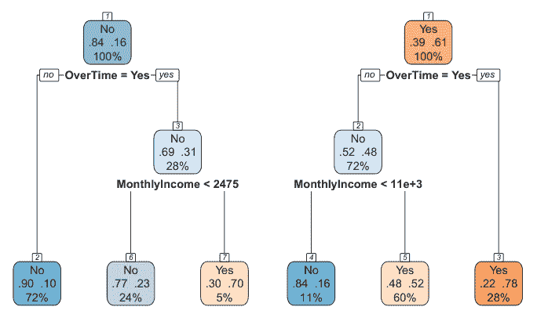

图 2.6：员工流失示例的决策树。左侧：默认（即观测到的）类先验概率。右侧：调整后的类先验概率。

$i(A) = 2 \times p_{no}(A) \times (1 - p_{no}(A)) = 0.478.$

如果根据 Overtime = Yes（右分支）与 Overtime = No（左分支）拆分数据，则有以下内容：

```
left <- attrition[attrition$Overtime == "No", ] # left child
right <- attrition[attrition$Overtime == "Yes", ] # right child
table(attrition$Attrition) # class frequencies
#>
#>
#>   No Yes
#> 1233 237
table(left$Attrition) # class frequencies (left node)
#>
#>
#>   No Yes
#> 944 110
table(right$Attrition) # class frequencies (right node)
#>
#>
#>   No Yes
#> 289 127
```

对于左子节点，我们有

$p(A_L) = \tilde{\pi}_{no} \times (944/1233) + \tilde{\pi}_{yes} \times (110/237) = 0.583,$
$p_{no}(A_L) = \tilde{\pi}_{no} \times (944/1233) / p(A_L) = 0.518,$
$p_{yes}(A_L) = 1 - p_{no}(A_L) = 0.482,$
$i(A_L) = 2 \times p_{no}(A_L) \times (1 - p_{no}(A_L)) = 0.499.$

同样，对于右子节点，我们有：

$p(A_R) = \tilde{\pi}_{no} \times (289/1233) + \tilde{\pi}_{yes} \times (127/237) = 0.417,$
$p_{no}(A_R) = \tilde{\pi}_{no} \times (289/1233) / p(A_R) = 0.221,$
$p_{yes}(A_R) = 1 - p_{no}(A_R) = 0.779,$
$i(A_R) = 2 \times p_{no}(A_R) \times (1 - p_{no}(A_R)) = 0.345.$

此分割的增益为

$p(A) \times i(A) - p(A_L) \times i(A_L) - p(A_R) \times i(A_R) = 0.043.$

在第 2.9.4 节中，我们将使用遵循相同 CART 类似过程来处理调整后先验概率的开源树软件来验证这些计算。

这结束了我们关于分类树中有序变量最佳分割搜索的 CART 讨论。在讨论分类特征分割搜索之前，我将介绍回归树的概念；即具有连续结果的决策树。

## 2.3 回归树

到目前为止，我们关于节点分割的讨论主要适用于类 CART 的分类树。在 CART 中，回归树的构建方式与分类树几乎相同。唯一的真正区别在于，我们不是寻找能最大程度减少节点内不纯度的预测器/分割组合，而是寻找能最大程度减少节点平方误差和（SSE）的预测器/分割组合：

\(\Delta \mathcal{I}(S, A) = SSE_A - (SSE_{A_L} + SSE_{A_R}),\)

例如，$SSE_A = \sum_{i=1}^{N_A} (y_i - \bar{y})$ 是节点 $A$ 内的 SSE；回顾 $N_A$ 是节点 $A$ 中的训练记录数量。这相当于选择在 *方差分析*（ANOVA）中最大化组间平方和的分割；事实上，在 **rpart** 中，此分割规则被称为 "anova" 方法（参见 `?rpart::rpart`）。请注意方程 (2.3) 和 (2.6) 之间的相似之处和差异。

为了加快最佳分割的搜索，像 **rpart** 和 scikit-learn 的 **sklearn.tree** 模块这样的开源实现，不会直接搜索最大化 (2.6) 的分割，而是搜索一个计算更高效的等效代理。例如，可以证明：

$SSE_A = SSE_{A_L} + SSE_{A_R} + \frac{N_{A_L}N_{A_R}}{N_A} (\bar{y}_L - \bar{y}_R)^2, \quad (2.7)$

其中 $\bar{y}_L$ 和 $\bar{y}_R$ 分别给出了 $A$ 的左子节点和右子节点的样本均值。这意味着最大化 (2.6) 等同于最大化 (2.7) 中的最后一项，这很合理，因为我们希望子节点尽可能不同（即平均响应差异更大）。

在回归情况下，我们不需要担心先验概率或节点概率。终端节点由每个节点中的平均响应总结（样本中位数是另一种可能性），这些用于生成拟合值和预测。例如，如果新观测值 $\mathbf{x}$ 占据某个终端节点 $A$，则 $\hat{f}(\mathbf{x}) = \sum_{i=1}^{N_A} y_{i,A} / N_A$，其中 $y_{i,A}$ 表示居住在终端节点 $A$ 中的学习样本的第 $i$ 个响应值。

除了本身有用之外，这里介绍的回归树还作为 *梯度树提升*（第 8 章）的基本构建块，后者是目前可用的最强大的基于树的集成算法之一。

### 2.3.1 示例：纽约空气质量测量

例如，考虑在第 1.4.2 节中介绍的 `airquality` 数据框，其中包含 1973 年 5 月至 9 月纽约每日空气质量测量数据。将带有单个分割的回归树拟合到数据中，相应的树图显示在图 2.7 的左侧。这里，所选的分割变量是温度（华氏度）。每个节点显示落入该节点的所有观测值的预测臭氧浓度（顶部数字）以及每个节点中训练观测值的比例（底部数字）。根据此树，预测的臭氧浓度由以下简单规则给出：


```
\widehat{Ozone} = \begin{cases} 26.544 & \text{if Temp} < 82.5 \\ 75.405 & \text{if Temp} >= 82.5 \end{cases}.
```

估计的回归曲面在图 2.7 的右侧绘制。请注意，回归树的估计预测曲面本质上是一个阶梯函数，这使得决策树难以捕捉任意平滑或线性的响应曲面。

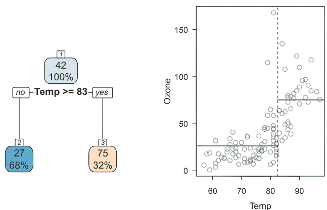

图 2.7: 根据温度预测臭氧浓度的决策树桩。左侧：树图。右侧：估计的回归函数；在分割点 c = 82.5 处绘制了一条垂直虚线（左侧的树图已四舍五入到最近的整数）。

要手动找到第一个分区并重建图 2.7 中的树，我们将先创建一个简单的函数来计算节点内 SSE。请注意，这些数据包含一些缺失值（即 R 中的 NA），因此我设置 na.rm = TRUE 以在计算结果前将其删除。

```r
sse <- function(y, na.rm = TRUE) {
  sum((y - mean(y, na.rm = na.rm)) ^ 2, na.rm = na.rm)
}
```

接下来，我将修改第 2.2.2 节中的 splits() 函数，使其适用于回归情况：

CART 在处理预测变量中的缺失值方面其实相当巧妙，但这部分内容将在第 2.7 节中详细介绍。

```r
splits.sse <- function(node, x, y) {
  xvals <- sort(unique(node[[x]])) # sorted, unique values
  xvals <- xvals[-length(xvals)] + diff(xvals) / 2 # midpoints
  res <- matrix(nrow = length(xvals), ncol = 2)
  colnames(res) <- c("cutpoint", "gain")
  for (i in seq_along(xvals)) { # loop through each feature
    left <- node[node[[x]] <= xvals[i], y, drop = TRUE] # left
    right <- node[node[[x]] > xvals[i], y, drop = TRUE] # right
    gain <- sse(node[[y]]) - sse(left) - sse(right) # Equation (2.6)
    res[i, ] <- c(xvals[i], gain) # store cutpoint and associated gain
  }
  res # return matrix of results
}
```

在将此函数应用于空气质量数据之前，我将删除包含缺失响应值的 37 行数据。Temp 的可能分割点及其相关增益如图 2.8 所示。（为了使图表上的 y 轴更美观，增益值已除以 1,000。）

```r
# Find optimal split for 'Temp'
aq <- airquality[!is.na(airquality$Ozone), ]
res <- splits.sse(aq, x = "Temp", y = "Ozone")
res[which.max(res[, "gain"]), ]
```

| 切分点 | 增益 |
|---|---|
| 82.5 | 60158.5 |

```r
# Plot results
res[, "gain"] <- res[, "gain"] / 1000 # rescale for plotting
plot(res, type = "b", col = 2, las = 1,
     xlab = "Temperature split value (degrees Fahrenheit)",
     ylab = "Gain/1000")
abline(v = 82.5, lty = 2, col = 2)
```

为了证明温度是根节点的最佳主要分割变量，我们可以使用 `sapply()` 来找出所有五个特征的最佳切分点：

```r
features <- c("Solar.R", "Wind", "Temp", "Month", "Day")
sapply(features, FUN = function(xname) {
  res <- splits.sse(aq, x = xname, y = "Ozone")
  res[which.max(res[, "gain"]), ]
})
```

| | Solar.R | Wind | Temp | Month | Day |
|---|---|---|---|---|---|
| 切分点 | 153 | 6.6 | 82.5 | 6.5 | 24.5 |
| 增益 | 29721 | 50591.2 | 60158.5 | 14511.3 | 10282.8 |

显然，增益最大的分割是 Temp，其次是 Wind、Solar.R、Month 和 Day。

单预测变量的回归树会产生一个阶梯函数，如图 2.7 右侧所示。同样的思想也可扩展到更高维度。

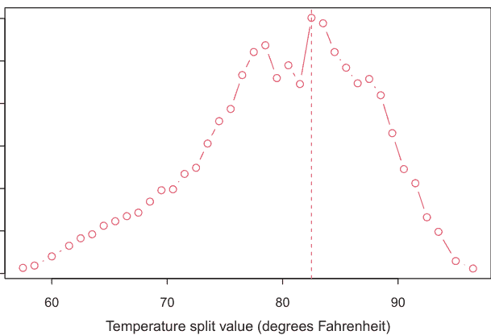

图 2.8: 作为增益函数的温度潜在分割点。最大增益出现在温度为 82.5 °F 处（垂直虚线）。

例如，假设我们接下来考虑对 Wind 进行分割。使用之前描述的相同程序，我们会发现下一个最佳分区出现在左子节点中，使用 Wind 且切分点为 7.15（mph）。相应的树图显示在图 2.9 的左侧。如果在此处停止分割，结果是一个具有两个特征的回归树。相应的预测函数显示在图 2.9 的右侧，它是一个在每个终端节点上保持不变的曲面。

## 2.4 分类拆分

到目前为止，我们只考虑过有序预测变量的分割，其形式为 x < c 与 x ≥ c，其中 c 属于 x 的定义域。但涉及名义类别特征的分割又该如何处理呢？如果 x 是有序的（即有序类别，例如 low < medium < high），则可以将其有序类别映射为整数 1, 2, ..., J，其中 J 是唯一类别的数量，并像 x 原本是数值一样进行分割。如果 x 是名义的（即类别的顺序没有意义），那么我们必须考虑将 x 分割为两个互不相交的组的所有可能方式。例如，如果 x 取自类别 {a,b,c}，则可以形成总共三种分割：

- $x \in \{a\}$ 与 $x \in \{b,c\}$；
- $x \in \{b\}$ 与 $x \in \{a,c\}$；
- $x \in \{c\}$ 与 $x \in \{a,b\}$。

对于具有 J 个类别的名义预测变量，可以通过首先按 x 的各个类别的平均响应值（例如，二元结果情况中的成功比例）对其进行排序，然后使用这个新的有序变量来寻找最佳分割，从而找到某个节点 A 上名义预测变量 x 的最佳分割。$^\mathsection$ 这将可能的分割总数从 $2^{J-1} - 1$ 减少到 $J - 1$，大幅减少了必须搜索的分割总数。使用之前讨论的基尼指数、交叉熵或 SSE 分割规则时，这也仍然会得到最佳分割。Ripley [1996, p. 218] 提供了基尼和熵度量的证明，Chou [1991] 提供了更一般杂质度量族的证明。对于多类问题（即 $J > 2$），不存在这样的计算捷径，尽管 Sleumer [1969] 和 Loh and Vanichsetakul [1988] 提出了高效的搜索方法。

### 2.4.1 示例：蘑菇可食性

为了说明，让我们回到蘑菇可食性示例，该示例包含所有类别特征和一个二元响应。该数据的简单分类树图如图 2.10 所示。该树包含对特征 `odor` 和 `spore.print.color` 的两个分割。由于响应（`Edibility`）是二元的，我们可以使用捷径方法来构建树，采用与有序分割相同的过程，只要应用基尼或熵分割准则；在这里，我将使用基尼指数，因为它已内置在我们之前定义的 `find_best_split()` 函数中。

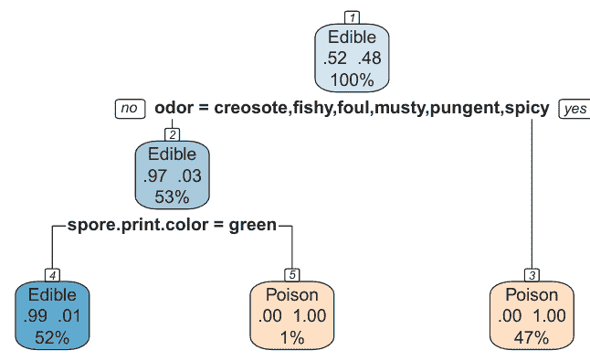

图 2.10: 确定蘑菇可食性的示例分类树。

对于每个蘑菇属性，各个类别需要映射到各自中的成功比例。在本示例中，我将结果类别 Poison 视为成功，并将目标重新编码为 0/1（分别对应 Edible/Poison）。我还将删除 `veil.type` 特征，因为它只取一个值（即方差为零），对分割没有任何贡献：

```r
m <- treemisc::mushroom # load mushroom data
m$veil.type <- NULL # remove useless feature
m$Edibility <- ifelse(m$Edibility == "Poison", 1, 0)
m2 <- m # make a copy of the original data
```

为了说明主要思想，让我们看看 `veil.color` 预测变量的频数表，它有四个唯一类别：

```r
table(m2$veil.color)
```

| | brown | orange | white | yellow |
|---|---|---|---|---|
| 计数 | 96 | 96 | 7924 | 8 |

我们需要找出每个类别内的平均响应——在此例中，即有毒蘑菇的比例——然后将这些值映射回原始特征值。例如，我们将 `veil.color` 中所有值为 "white" 的项重新编码为 0.493，因为约 3908/7924 ≈ 0.493 的 `veil.color` = "white" 的蘑菇是有毒的。这可以用多种方式完成，在这里我将编写一个名为 `ordinalize()` 的简单函数，它返回一个包含两个组件的列表：`map`，包含每个类别被映射到的数值；`encoded`，包含重新编码后的特征值。

```r
ordinalize <- function(x, y) { # convert nominal to ordered
  map <- tapply(y, INDEX = x, FUN = mean)
  list("mapping" = map, "encoded" = map[x])
}
```

接下来，我将检查 `veil.color` 被映射到哪些数值：

```r
ordinalize(m2$veil.color, m2$Edibility)$map
```

| | brown | orange | white | yellow |
|---|---|---|---|---|
| 映射值 | 0.000 | 0.000 | 0.493 | 1.000 |

接下来，我将编写一个简单的 `for` 循环，使用 `ordinalize()` 对 `m2` 数据框中的每个特征列进行数值重新编码：

```r
xnames <- setdiff(names(m2), "Edibility")
for (xname in xnames) { # mean/target encode each feature
  m2[[xname]] <- ordinalize(m2[[xname]], y = m2[["Edibility"]])$encoded
}
```

让我们来看看重新编码后的数据：

```r
m2[1L:8L, 1L:5L]
```

| | Edibility | cap.shape | cap.surface | cap.color | bruises |
|---|---|---|---|---|---|
| 1 | 1 | 0.467 | 0.552 | 0.447 | 0.185 |


```
#> 2 0 0.467 0.552 0.627 0.185
#> 3 0 0.106 0.552 0.308 0.185
#> 4 1 0.467 0.536 0.308 0.185
#> 5 0 0.467 0.552 0.439 0.693
#> 6 0 0.467 0.536 0.627 0.185
#> 7 0 0.106 0.552 0.308 0.185
#> 8 0 0.106 0.536 0.308 0.185
```

由于所有类别特征都已重新编码为数值，我们可以使用先前定义的 find_best_split() 函数来划分数据。从根节点（即完整的学习样本）开始，我们得到：

```
find_best_split(m2, x = xnames, y = "Edibility", n = nrow(m2))
```

```
#> cutoff gain
#> odor 0.517 0.471
```

# 汇总分割

```
left <- m[m2$odor >= 0.5170068, ]
right <- m[m2$odor < 0.5170068, ]
```

```
table(left$Edibility) # non-pure node
```

```
#>
#> 1
#> 3796
```

```
table(right$Edibility) # pure node
```

```
#>
#> 0 1
#> 4208 120
```

第一个分割使用 odor，其均值/目标编码的分割点为 c = 0.517，对应的增益为 0.471。由于生成的右子节点是纯节点（在此例中，全为有毒），让我们继续对左子节点进行划分：

# 对左子节点进行序数化并寻找下一个最佳分割

```
right.ord <- right
for (xname in xnames) { # mean/target encode each feature
  right.ord[[xname]] <-
    ordinalize(right.ord[[xname]],
               y = right.ord[["Edibility"]])$encoded
}
```

# 在新“序数化”的预测变量中寻找最佳分割

```
find_best_split(right.ord, x = xnames, y = "Edibility", n = nrow(m2))
```

```
#> cutoff gain
#> spore.print.color 0.538 0.017
```

下一个分割基于 spore.print.color，其均值/目标编码的分割点为 c = 0.538，对应的增益为 0.017，这相当于根据蘑菇是否具有绿色孢子印来分离它们。

要将这些分割映射回其对应的类别，可以查看每个分割变量上 `ordinalize()` 输出的 `$map` 组件：

```
sort(ordinalize(m$odor, m$Edibility)$map)
```

```
#>    almond   anise     none creosote    fishy     foul
#> 0.000  0.000  0.034   1.000   1.000   1.000
#> musty   pungent   spicy
#> 1.000   1.000   1.000
```

```
sort(ordinalize(right[["spore.print.color"]],
  y = right[["Edibility"]])$map)
```

```
#>     black    brown     buff chocolate   orange
#> 0.0000 0.0000 0.0000  0.0000  0.0000
#> purple   yellow   white   green
#> 0.0000 0.0000  0.0769  1.0000
```

例如，`odor` 的分割点为 0.517（即 0.034 和 1.00 的中点），每个映射到重新编码的 `odor` 值 ≥ 0.517 的特征都用于构建第一个分区；参见图 2.10 中的第一个分割。在第 2.9.2 节中，我们将使用类 CART 的 R 软件验证这些结果（例如，两个分割的计算分割增益）。

### 2.4.2 谨防基数高的类别特征

类 CART 决策树的一个缺点是它们倾向于偏好基数高的类别特征（即，大 _J_），即使这些特征大多无关紧要。<sup>h</sup> 例如，对于基数大的类别特征，潜在的分割非常多，因此树更有可能仅凭偶然找到一个良好的分割。考虑极端情况：一个名义特征 _x_ 在学习样本的每一行中都不同且唯一，就像行 ID 列一样。类 CART 决策树中的分割变量选择偏差在文献中已有广泛讨论；参见，例如，Breiman et al. [1984, p. 42]、Segal [1988] 和 Hothorn et al. [2006c]（以及其中的其他参考文献）。

为了说明这个问题，我向第 2.3.1 节的 `airquality` 数据集中添加了十个随机类别特征（`cat1`-`cat10`），每个特征的基数为 _J_ = 26（它们只是字母表中的随机字母）。使用 `rpart` 对数据拟合了一棵默认回归树，生成的树图显示在图 2.11 中。请注意，除了第一个分割外，所有分割都使用了添加的完全无关的类别特征！在第 2.5 节中，我们将介绍一种通用的剪枝技术，这有助于筛选出纯噪声变量。

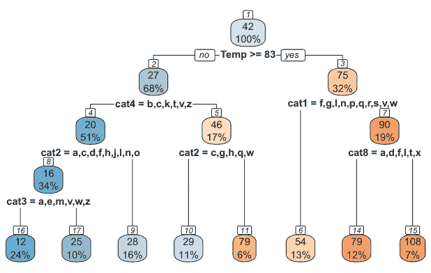

图 2.11：拟合于包含十个完全随机类别特征（每个特征基数为 26）的空气质量数据集副本的决策树。

在某些情况下，可以将潜在类别的数量减少到更易管理的程度——例如，将罕见类别合并在一起，或者将类别合并为一组较小的有意义子组（例如，将邮政编码或区号合并为一组较小的较大地理区域）。

第 3–4 章讨论的划分算法通过将每个特征上所有可能分割的穷举搜索分为两个连续步骤，更直接地解决了分割选择偏差问题，即仅在选择分割变量后才找到最优分割点。

### 2.4.3 编码还是不编码？

在处理类别数据时，我们常关心如何对这些特征进行编码。例如，在线性模型中，我们通常根据手头的任务采用虚拟变量编码或效应编码。同样，与虚拟变量编码密切相关的独热编码（OHE）也常用于（广义）线性模型之外的一般机器学习问题。此外，还有许多其他编码类别变量的方法，具体取决于所使用的算法和手头的任务。

如您已经看到，决策树可以自然地处理任何类型的变量，无需特殊编码，尽管我们确实看到，一种局部的均值/目标编码形式可用于减少名义类别分割所带来的计算负担。尽管如此，使用像 OHE 这样的编码策略有时可以提高基于树的模型的预测性能或可解释性；关于树方法中 OHE 的使用的简要讨论，请参见 Kuhn and Johnson [2013, 第 14.7 节]。此外，某些基于树的软件，例如 Scikit-learn 的 `sklearn.tree` 模块，要求所有特征都必须是数值——这迫使用户为类别特征采用不同的编码方案。有关不同编码策略的详细信息（附 R 语言示例）及更多参考文献，请参见 Boehmke and Greenwell [2020, 第 3 章]。

## 2.5 构建决策树

在前面的章节中，我们讨论了节点分割的基础知识（即，划分学习样本的某个子集）。构建类 CART 决策树始于分割根节点，然后递归地将相同的分割过程应用于每个生成的子节点，直到获得一棵饱和树（即，所有终端节点都是纯节点）或满足其他停止标准。本质上，当满足以下至少一个条件时，划分将停止：

- 所有终端节点都是纯节点；
- 已达到指定的最大树深度；
- 节点中必须存在的最小观测值数量（以尝试分割）已达到；
- 无法通过进一步分割将整体拟合优度降低指定因子；
- 等等。

这通常会导致一个过于复杂的树结构，从而对学习样本过拟合；也就是说，它具有低偏差但高方差。

为了说明，考虑一个大小为 \( N = 500 \) 的随机样本，它由以下带有高斯噪声的正弦波生成：

```
\( Y = \sin(X) + \epsilon, \)
```

其中 \( X \sim \mathcal{U}(0, 2\pi) \) 且 \( \epsilon \sim \mathcal{N}(0, \sigma=0.3) \)。数据的散点图连同真实响应函数如图 2.12 所示。

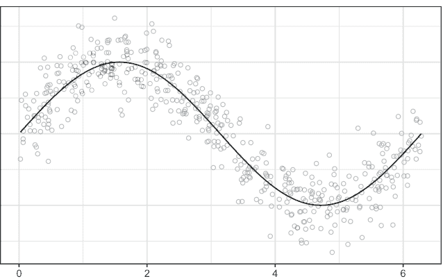

图 2.12：由带有高斯噪声的简单正弦波生成的数据。黑色曲线显示真实平均响应 E (Y|X = x) = sin (x)。

图 2.13 显示了拟合于同一数据的两棵回归树的预测函数。¹ 左边的树过于复杂，分割过多，表现出高方差但低偏差（即，它很好地拟合了当前样本，但树结构会因样本而异，因为它主要是在拟合噪声）；像这样的不稳定模型通常被称为 *不稳定学习器*（更多内容请参见第 5.1 节）。右边的树是一个简单的决策树桩（即，只有一个分割的树），过于简单，也不适用于预测，因为它具有极高的偏差但低方差（即，它对数据的拟合不太好，但树结构在不同样本之间会更稳定）；这种表现较弱的模型通常被称为 *弱学习器*（更多内容请参见第 5.2 节）。

这两棵树在应用于同一模型的不同样本时都不太可能准确；本书第二部分讨论的集成方法可以提高弱学习器和不稳定学习器的性能。然而，在使用单棵决策树时，我们需要回答的问题是：树应该构建得多复杂？理想情况下，我们应该在某个 *子树* 处停止分割节点，但应该在哪里？

一种相当粗心的方法是仅分割那些在预测误差上满足某个阈值的节点来构建树。然而，这是近视的，因为早期的低质量分割可能会导致树中后期出现非常好的分割。寻找最优子树的标准方法——基本上，是确定何时

¹相关的树图分别显示在图 2.14（第 73 页）的左上角和右下角。


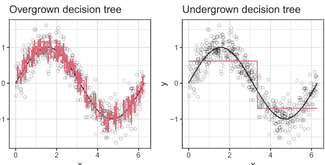

图 2.13: 将回归树应用于正弦波示例。左侧：这棵树过于复杂（即，低偏差和高方差）。右侧：这棵树过于简单（即，高偏差和低方差）。

本应停止分割节点——的方法称为代价复杂度剪枝，或最弱链接剪枝 [Breiman et al., 1984]，或简称剪枝。Ripley [1996, 第 226–231 页] 和 Zhang and Singer [2010, 第 44–49 页] 讨论了其他剪枝过程。对决策树进行剪枝与多元线性回归中的后向消元过程十分类似——从一棵分割过多的复杂树开始，剪掉那些贡献不足以抵消增加复杂度的叶子。详细内容将在下一节介绍。

### 2.5.1 代价复杂度剪枝

对决策树进行剪枝的思路与多元线性回归中的后向消元过程相似。本质上，我们构建一棵分割过多的大树，记为 T0，然后通过合并内部节点将其剪回，直到找到满足特定准则（例如交叉验证误差最小）的某个最优子树，记为 Topt。

设 {A_k}_{k=1}^K 为某棵树 T 的终端节点，其中 |T| = K 是终端节点的数量，即 T 的大小。回顾一下，CART 的总体目标是提取同质子组（即终端节点）。从这个意义上说，树的整体质量（或风险）取决于其终端节点的质量。我们定义树的风险为 R(T) = sum_{k=1}^K p(A_k) \times r(A_k)，其中 r(A_k) 是第 k 个终端节点质量的某种度量；参见第 55 页的 (2.4)。对于回归树，R(T) 是误差平方和（SSE）。对于基于观测类先验概率和等误分类代价（即，对于所有 \(i \neq j\) 均有 \(L_{i,j} = 1\)）的分类树，\(R(\mathcal{T})\) 仅仅是学习样本中被误分类的观测值的比例。

构建一棵以最小化 \(R(\mathcal{T})\) 为目标的树，总会导致一棵饱和树，产生偏差很小或没有偏差但方差通常很高的模型（即，过拟合学习样本）。相反，我们通过最小化来对树的复杂度（或大小）施加惩罚

\(R_\alpha(\mathcal{T}) = R(\mathcal{T}) + \alpha|\mathcal{T}|,\)

其中 \(\alpha \ge 0\) 是一个调参参数，用于控制树的复杂度 \(|\mathcal{T}|\) 与其对训练数据拟合程度 \(R(\mathcal{T})\) 之间的权衡。从这个意义上说，\(R_\alpha(\mathcal{T})\) 可以被视为一种惩罚型目标函数，类似于 *正则化回归* 中所使用的函数；例如，参见 Hastie et al. [2009, 第 3 章] 或 Bøhmeke and Grewell [2020, 第 6 章]。当 \(\alpha = 0\) 时，不施加惩罚，产生最复杂的树 \(\mathcal{T}_0\)。在另一极端，我们总能找到足够大的 \(\alpha\) 值，从而得到一棵没有分割的决策树（即，仅根节点）。选择合适的 \(\alpha\) 值很重要，可以通过交叉验证或其他方法完成；一种特定的交叉验证方法将在第 2.5.2 节中介绍。

Breiman et al. [1984, 第 10 章] 表明，对于每个 \(\alpha\)，都存在一个唯一的最小子树，记为 \(\mathcal{T}_\alpha$，可最小化 \(R_\alpha(\mathcal{T})\)。这一结果很重要，因为它保证了 \(\mathcal{T}_0$ 的两个大小相等的子树不会具有相同的 \(R_\alpha(\mathcal{T})\) 值。要得到 \(\mathcal{T}_\alpha$，从 \(\mathcal{T}_0$ 开始进行剪枝，依次合并产生 \(R(\mathcal{T})\) 最小每节点增量的内部节点，并继续直到到达根节点。该过程产生一系列嵌套子树（有限序列）（示例参见第 73 页的图 2.14），该序列包含 \(\mathcal{T}_\alpha$；详情见 Breiman et al. [1984, 第 10 章] 或 Ripley [1996, 第 7.2 节]。

为举例说明，取 \(\mathcal{T}_0$ 为图 2.12 中的左树，其共有 154 个分割。相应的树图显示在图 2.14 的左上角。图 2.14 中其余的树图对应于剪枝序列中的最后 15 棵树（不包括根节点），最终以决策桩结束。最优子树 \(\mathcal{T}_\alpha$ 共有 20 个分割（或 21 个终端节点），通过 10 折交叉验证找到，并以绿色突出显示。

为进行比较，我比较了每个子树在 500 个新观测值的独立测试集上的表现。对于剪枝序列中的每个子树，计算了测试集上的预测误差，其度量为 \(1 - R^2$，其中 \(R^2$ 是观测值与拟合值之间的皮尔逊相关系数的平方。测试误差和交叉验证误差均显示在图 2.15 中。在此，结果相似，但测试误差表明一棵只有 18 个分割的稍简单的树更合适。

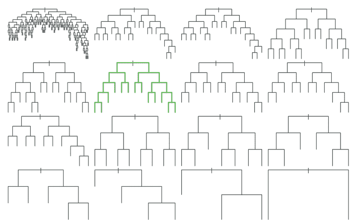

图 2.14: 正弦波示例的嵌套子树。通过 10 折交叉验证选择的最优子树以绿色突出显示。

那么 \(\alpha$ 值序列是如何确定的？对于任何内部节点 \(A$，我们可以使用以下公式找到 \(\alpha$：

```
\(\alpha = \frac{R(A) - R(\mathcal{T}_A)}{|\mathcal{T}_A| - 1},\)
```

其中 \(\mathcal{T}_A$ 是以节点 \(A$ 为根的子树。要开始剪枝，我们需要找到第一个阈值 \(\alpha_1$，它就是树 \(\mathcal{T}$ 中 \(|\mathcal{T}| - 1$ 个内部节点中最小的 \(\alpha$ 值。一旦得到 \(\alpha_1$，我们就通过合并 \(|\mathcal{T}| - 1$ 个内部节点中的一个并将其变为终端节点来剪枝，条件是

```
\(\alpha_1 \ge \frac{R(A) - R(\mathcal{T}_A)}{|\mathcal{T}_A| - 1}.\)
```

这将产生与 \(\alpha = \alpha_1$ 相关的最优子树 \(\mathcal{T}_{\alpha_1}$。从 \(\mathcal{T}_{\alpha_1}$ 开始，我们继续此过程，以与为完整树 \(\mathcal{T}$ 找到 \(\alpha_1$ 相同的方式找到 \(\alpha_2$。该过程持续进行，直到到达根节点。这听起来可能令人困惑，但我们将在下一节使用蘑菇示例演示计算过程。

本章广泛使用的 **rpart** 包采用了代价复杂度参数 \(\alpha$ 的一个略为友好且重新缩放的版本，他们将其表示为 \(cp$。具体来说，**rpart** 使用

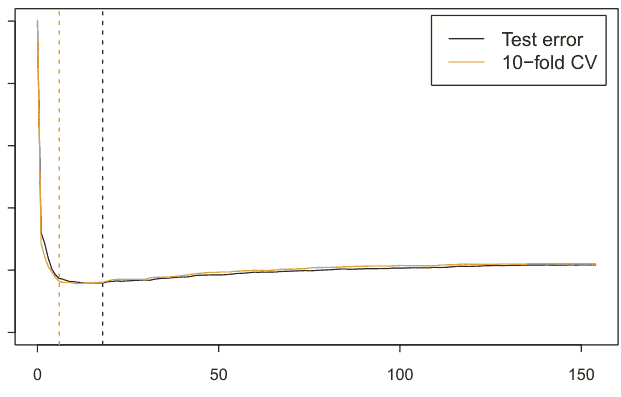

图 2.15: 基于测试集（黑色曲线）和 10 折交叉验证（黄色曲线）的相对误差与正弦波示例分割数量的关系。垂直黄线显示基于 10 折交叉验证的最优分割数量，而垂直黑线显示基于独立测试集的最优分割数量。

$R_{cp}(\mathcal{T}) \equiv R(\mathcal{T}) + cp \times |\mathcal{T}| \times R(\mathcal{T}_1)$，其中 $\mathcal{T}_1$ 是零分割的树（即，根节点）。与 \(\alpha$ 相比，$cp$ 是无用的，$cp = 1$ 的值将始终导致零分割的树。复杂度参数 $cp$ 也可在树构建过程中用作停止规则。在许多 CART 的开源实现中，只要 $cp > 0$，任何不能使整体拟合优度下降 $cp$ 倍的分割都不会被尝试。例如，在回归树中，这意味着每一步总体 $R^2$ 必须增加 $cp$，分割才会发生。主要思想是通过避免潜在不值得的分割来减少计算时间。然而，这存在可能无法发现树更深处潜在更好分割的风险。

#### 2.5.1.1 示例：蘑菇可食性

让我们通过计算几个 \(\alpha$ 值来剪枝蘑菇可食性数据的简单树，以深入理解主要思想。再次考虑图 2.16 中显示的蘑菇可食性数据的简单决策树。这是一棵只有三个分割的简单树，但我们将使用它来说明如何


修剪的工作原理以及 $\alpha$ 值序列是如何计算的。为清晰起见，每个节点内显示每个类别的观测数量，节点编号出现在每个节点的顶部。例如，节点 8 包含 4208 个可食用蘑菇和 24 个有毒蘑菇。分配的分类，或多数类，打印在每个节点的类别频率上方。这棵树也是使用观测到的类先验概率和等误分类成本构建的；因此，$R(T)$ 只是学习样本中误分类的比例：24/8124 $\approx$ 0.003。

设 $A_i, i \in \{1, 2, 3, 4, 5, 8, 9\}$ 表示图 2.16 中树的七个节点；在 **rpart** 中，任何编号为 $x$ 的节点的左子节点和右子节点始终分别编号为 $2x$ 和 $2x+1$（根节点始终对应 $x=1$）。我们可以使用 $R(A_i) = N_{j,A}/N_A$ 计算任何终端节点的风险。例如，节点 $A_5-A_7$ 的风险均为零（因为它们是纯节点）。

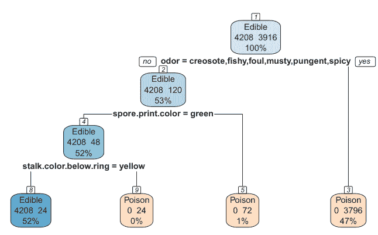

图 2.16：蘑菇可食性数据的三分割分类树。该树的总风险为 24/8124 $\approx$ 0.003。

要找到 $\alpha_1$，我们需要先计算树中 $|\mathcal{T}_0| - 1 = 3$ 个内部节点的每个 $\alpha$，并找出最小的一个；使用图 2.16 中的树图进行跟随。三个内部节点的 $\alpha$ 值计算如下：

```
\alpha_{A_1} = (3916/8124 - 24/8124) / (4 - 1) \approx 0.160
\alpha_{A_2} = (120/8124 - 24/8124) / (3 - 1) \approx 0.006 .
\alpha_{A_4} = (48/8124 - 24/8124) / (2 - 1) \approx 0.003
```

由于 $\alpha_{A_4}$ 是最小的，我们折叠节点 $A_4$，得到序列中的下一个最优子树 $\mathcal{T}_{\alpha_1}$，它显示在图 2.17 的左侧。该树的代价复杂度为 \(R_{\alpha_1}(\mathcal{T}_{\alpha_1}) = 0.015\)。要找到 $\alpha_2$，我们从 \(\mathcal{T}_{\alpha_1}\) 开始，重复该过程，先找出与 \(\mathcal{T}_{\alpha_1}\) 的 \(|\mathcal{T}_{\alpha_1}| - 1 = 2\) 个内部节点关联的最小 \(\alpha$ 值。这些值由以下给出：

```
\(\alpha_{A_1} = (3916/8124 - 48/8124) / (3 - 1) \approx 0.238\)
\(\alpha_{A_2} = (120/8124 - 48/8124) / (2 - 1) \approx 0.009\)
```

从而得到 \(\alpha_2 = 0.009$。然后我们通过将 \(A_2$ 折叠为终端节点来修剪当前子树 \(\mathcal{T}_{\alpha_2}$，得到图 2.17 右侧显示的决策树桩。这只有一种 \(\alpha_3 = (3916/8124 - 120/8124) / (2 - 1) \approx 0.467$ 的可能性，它在修剪决策树桩后得到根节点 \(\mathcal{T}_{\alpha_3}$。最终，我们得到以下 \(\alpha$ 值序列：\((\alpha_1 = 0.003, \alpha_2 = 0.009, \alpha_3 = 0.467)$。在实践中，我们将使用交叉验证或其他验证程序，从该序列中选择一个合理的复杂度参数 \(\alpha$ 值。接下来的两个部分讨论使用 \(k$-折交叉验证选择 \(\alpha$。

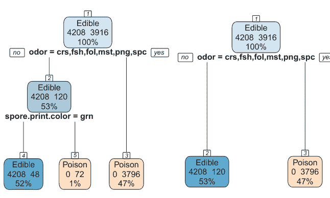

图 2.17：序列中具有最小代价复杂度的最优子树。由于原始树仅包含三个分割，因此只有两个可能的子树（不计零分割的树）。在此，类别名称已被截断为三个字母，以便在显示中更紧凑。

### 2.5.2 交叉验证

一旦找到序列 \(\alpha_1, \alpha_2, ..., \alpha_{k-1}$，我们仍需估计相应嵌套子树序列 \(R_{\alpha_i}(\mathcal{T})$ 的总体风险/质量，其中 \(i = 1, 2, ..., k - 1$。Breiman et al. [1984, Chap. 11] 建议使用单独的验证集或 \(k$-折交叉验证来选择 \(\alpha$。后者计算量更大，但通常更受青睐，因为它利用了所有可用数据，且两者通常会导致相似结果。下面描述的算法 2.1 遵循 R 中 **rpart** 包的实现（请参阅“Rpart 简介” vignette）：

### 算法 2.1 用于代价复杂度修剪的 \(K$-折交叉验证。

- 1) 将完整模型拟合到学习样本，以获得 \(\alpha_1, \alpha_2, ..., \alpha_{k-1}$。

- 2) 根据以下定义 \(\beta_i$：

\(\beta_i = \left\{ \begin{array}{ll} 0 & i = 1 \\ \sqrt{\alpha_{i-1}\alpha_i} & i = 2, 3, ..., m - 1 \\ \infty & i = m \end{array} \right.\)

由于区间 \((\alpha_i, \alpha_{i+1}]$ 中的任何 \(\alpha$ 值都会导致相同的子树，我们改为考虑 \(\beta_i$ 序列，它们使用几何中点表示每个范围内的典型值。

- 3) 将数据分为 \(k$ 组（或折），\(D_1, D_2, ..., D_k$，每组约有 \(k/N$ 个观测值（\(N$ 为学习样本的行数）。对于 \(i = 1, 2, ..., k$，执行以下操作：

- a) 将完整模型拟合到学习样本，但省略子集 \(D_i$，并找到最优子树序列 \(\mathcal{T}_{\beta_1}, \mathcal{T}_{\beta_2}, ..., \mathcal{T}_{\beta_k}$。

- b) 计算每棵树在验证集 \(D_i$ 上的预测误差。

- 4) 对每棵子树，通过平均 \(k$ 个外部样本预测误差来汇总结果。

- 5) 从基于完整学习样本的初始树序列中返回 \(\mathcal{T}_\beta$，其中 \(\beta$ 对应于步骤 4) 中预测误差最小的 \(\beta_i$。

### 2.5.2.1 1-SE 规则

使用 \(k$-折交叉验证选择 \(\alpha$ 时，Breiman et al. [1984, Sec. 3.4.3] 建议使用 1-SE 规则，并认为它有助于筛选掉无关特征。1-SE 规则建议使用最简洁的树（即分割最少的树），其交叉验证误差不超过最佳模型交叉验证误差一个标准误。这当然需要在交叉验证期间估计标准误。标准误的启发式估计可见 Breiman et al. [1984, pp. 306–309] 或 Zhang and Singer [2010, pp. 42–43]，但公式并不优雅！使用交叉验证应用代价复杂度修剪，无论是否使用 1-SE 规则，几乎肯定会移除图 2.11 中看到的所有荒谬分割。（事实上，应用 10-折交叉验证并使用 1-SE 规则后，情况正是如此。）

## 2.6 超参数与调参

与 CART 类决策树相关的超参数基本有三个：

- 1) 最大深度或分割数；
- 2) 任何终端节点的最大大小；
- 3) 代价复杂度参数 \(cp$。

不同软件对这些参数会有不同的名称和不同的默认值。可以说，\(cp$ 是 CART 中最灵活、最重要的调参参数，一个好的策略是尽可能放宽终端节点的最大深度和大小，并使用代价复杂度修剪通过 \(k$-折交叉验证或其他验证程序找到最优子树。在某些情况下，例如第 7 章，树会被故意生长到最大或接近最大深度（在某些情况下，每个终端节点只留下一个观测值）。

## 2.7 缺失数据与代理分割

CART 的最佳特性之一是其处理缺失值的灵活性。更传统的统计模型，如线性回归或逻辑回归，通常会丢弃任何带有缺失值的观测值。CART 通过使用代理分割，可以利用所有具有非缺失响应值且预测变量至少有一个非缺失值的观测值。代理分割本质上是使用其他具有非缺失值的可用特征进行的分割。基本思想在 Breiman et al. [1984, Sec. 5.3] 中有完整描述，即使用其他可用特征来估计（或插补）缺失数据点。

考虑图 2.18 中的决策树桩，它对应于使用所有可用特征时瑞士钞票数据的最优树。

如果我们想要分类一个在 diagonal 上具有缺失值的新观测值怎么办？代理方法通过为每个其他特征（在此例中为 length、left、right、bottom 和 top）构建决策树桩，来为缺失的分割变量寻找代理变量，以预测由原始分割形成的二进制响应，下文将其表示为 y*：

```
y* = \begin{cases} 0 & \text{if diagonal} \ge 140.65 \\ 1 & \text{if diagonal} < 140.65 \end{cases}
```

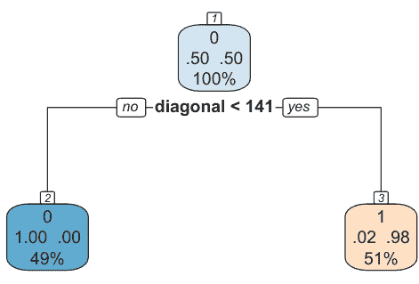

图 2.18：瑞士钞票示例的决策树桩。

对于每个特征，最优分割使用第 2.2.1 节描述的程序选择。（注意，在寻找代理时，我们不考虑纳入先验概率或损失，因为 y* 未定义这些。）除了每个特征的最优分割外，我们还考虑多数规则，即仅使用多数类。一旦确定了代理，它们将按误分类误差进行排名，任何表现不佳的代理


比多数类被丢弃。某些实现，如 R 的 rpart 包，还要求代理分割将至少两个观测值发送到左子节点和右子节点中的每一个。

回到瑞士钞票示例，让我们找出图 2.18 中对角线主分割的代理分割。我们可以使用与之前相同的分割过程来查找代理分割，只是我们的新目标变量 y* 不同。

```
bn2 <- treemisc::banknote # load Swiss banknote data
bn2$y <- ifelse(bn2$diagonal >= 140.65, 1, 0) # new target
bn2$diagonal <- NULL # remove column
features <- c("length", "left", "right", "bottom", "top")
res <- sapply(features, FUN = function(feature) {
find_best_split(bn2, x = feature, y = "y", n = nrow(bn2))
})
rownames(res) <- c("cutpoint", "gain")
res[, order(res["gain", ], decreasing = TRUE)]
```

| | bottom | right | top | left | length |
|---|---|---|---|---|---|
| cutpoint | 9.550 | 129.850 | 10.950 | 130.050 | 215.1500 |
| gain | 0.343 | 0.169 | 0.157 | 0.137 | 0.0344 |

在此情况下，按重要性降序排列的代理分割为 bottom、right、top、left 和 length；每个对应的分割点也在输出中显示（我们将在第 2.9 节使用真实树软件验证这些结果）。如果我们使用图 2.18 中的决策树桩来对角线值缺失的新钞票进行分类，树将改用下一个最佳代理分割（在此例中，即 bottom 是否 >= 9.550）。

对于每个代理分割，我们还可以计算其与主分割的一致性和调整后的一致性，这些用于 rpart 中变量重要性的定义（第 2.8 节）。主分割及其代理分割之间的一致性只是它们将观测值发送到同一方向的比例。调整后的一致性通过使用多数规则减去向某一方向发送的观测值数量来调整此比例。第 2.9 节给出了一个示例。

### 2.7.1 其他缺失值策略

除了能够直接处理缺失预测器值之外，分类树在检查缺失数据模式方面也非常有用。例如，CART 可用于描述倾向于有缺失值的观测（一个描述问题）。这可以通过使用仅指示感兴趣变量是否缺失的二元指标变量作为目标变量来生长分类树来完成；有关在 R 中使用真实数据的示例，请参见 Harrell [2015, pp. 302–304]。

为每个考虑中的预测器构建缺失值指标也可能很有信息量。例如，假设你在一家银行工作，工作的一部分是帮助确定谁应该被拒绝贷款，谁不应该。特定贷款申请中缺失的信用评分可能是一个明显的危险信号，表明某人信用记录不佳，因此是决定是否批准其贷款的重要指标。对于分类变量，类似的策略是将缺失值视为一个实际类别。如 van Buuren [2018, Sec. 1.3.7] 所指出，缺失值指标方法在特定情况下可能有用，但作为处理缺失数据的通用方法则失败（例如，它不允许响应中有缺失数据，并且在广泛的场景中可能导致有偏的回归估计）。

插值——用合理的猜测填充缺失值——是另一种常见策略，树是插值模型的绝佳候选者（例如，它们完全是非参数的，并且自然支持分类和回归）。

几位作者已建议使用 CART 进行缺失值插值；有关详细信息和多个参考文献，请参见 van Buuren [2018, Sec. 3.5]。一种通常有用的方法是通过 *自助法* 使用 CART 生成 *多重插值* [van Buuren, 2018, Sec. 3.5]（有关不同自助方法的概述，请参见 Davison and Hinkley [1997]）；多重插值现在被广泛接受为处理不完整数据的最佳通用方法之一 [van Buuren, 2018, Sec. 2.1.2]。

基本步骤在算法 2.2 中概述；有关在 **mice** 包中其实现的详细信息，另请参见 `?mice::cart` [van Buuren and Groothuis-Oudshoorn, 2021]。这里，假设响应 $y$ 对应于具有不完整观测（即包含缺失值）的预测器，而预测器对应于具有完整信息（即无缺失值）的原始预测器。

如 Doove et al. [2014] 和 van Buuren [2018, Sec. 3.5] 所述，可以使用自助法重复此过程 $m$ 次以生成 $m$ 个插值数据集。如 van Buuren [2018, Sec. 3.5] 所指出，算法 2.2 是一种 *预测均值匹配* [van Buuren, 2018, Sec. 3.4] 的形式，其中“预测均值”由 CART 计算，而不是由回归模型计算。第 7.9.3 节提供了使用 CART 进行多重插值的示例。

但是，如果你将决策树用作模型，而不仅仅是插值的手段：你应该依赖代理分割还是其他策略，

除非另有说明，自助样本是指从 $N$ 个观测值的集合中有放回地抽取的大小为 $N$ 的随机样本；因此，某些原始观测值会被抽取多次，而有些则一次都不会被抽取。

### 算法 2.2 基于树的缺失值插值。

- 1) 将决策树（例如，CART）拟合到完整观测上；
- 2) 找到每个缺失 y 值的观测所分配的终端节点；
- 3) 对于每个缺失 y 值，从其分配到的终端节点中随机抽取一个观测响应值（即总结该节点的学习样本中的完整响应值）作为插值。

如插值？Feelders [2000] 表明，如果正确执行，插值（尤其是多重插值）往往优于基于代理分割的树。然而，仍应考虑性能提升的潜力是否超过指定适当插值方案所需的额外工作。Feelders 还指出，对于“...中等数量的缺失数据（例如 10% 或更少），可以避免生成插值，而直接使用代理分割。”

## 2.8 变量重要性

在实践中，减少模型中的特征数量可能很有用，甚至是必要。一种实现方法是按某种重要性顺序对它们进行排名，并使用顶部特征的子集。Loh [2012] 表明，仅使用重要变量的子集可以提高预测准确性。减少特征数量还可以减少模型训练时间并提高可解释性。然而，缺乏对“重要性”的恰当定义导致提出了许多变量重要性度量；有关讨论和进一步参考文献，请参见 Greenwell and Boehmke [2020]。

决策树可能提供了量化预测器重要性的最自然的模型特定方法。在二元决策树中，在每个节点 A 处，使用单个预测器将数据划分为两个同质组。所选预测器是最大化 (2.3) 的那个。预测器 x 的相对重要性是 x 被选为主分割器的所有内部节点上的平方改进之和；有关详细信息，请参见 Breiman et al. [1984]。这一思想也扩展到回归树和决策树集成，例如在第 5–8 章中讨论的那些。

启用代理分割时，可以在变量重要性的量化中考虑它们。特别是，变量可能在树中出现多次，作为主分割器或代理分割器。特征的变量重要性度量是它作为主变量的每个分割相关增益之和，加上它作为代理的每个分割相关增益（按一致性调整）。记法有些复杂，但有兴趣的读者请参阅 Loh and Zhou [2021, Sec. 3]。

当存在强相关或冗余特征时，包含代理信息有助于改善解释。例如，想象两个基本冗余的特征 x1 和 x2。如果我们只计算每个变量作为主分割器的增益，这两个特征可能会分摊重要性，没有哪个显得像应该的那样重要。比较有无竞争分割器（即非主分割器）的变量重要性排名也可能很有信息量。那些看起来重要但很少分割节点的变量，可能与主分割器高度相关并包含非常相似的信息。

相对变量重要性标准化原始重要性值以便于解释。相对重要性通常定义为相对于最重要预测器的百分比改进，并且通常在统计软件中报告。最重要特征的相对重要性始终为 100%。因此，如果 x3 是最重要特征，而另一个特征（例如 x5）的相对重要性为 83%，则可以说 x5 大约是 x3 重要性的 83%。

然而，众所周知，类似 CART 的变量重要性得分是有偏的；有关详尽（且更新）的综述，请参见 Loh and Zhou [2021]。根据 Loh and Zhou，当所有预测器与响应独立时，如果所有预测器的平均重要性得分相同，则变量重要性程序被认为是无偏的。CART 变量重要性偏差的解决方案（这实际上源于 CART 的分割选择偏差（第 2.4.2 节））在本书的多个地方讨论；例如，请参见第 7.5.1 节的讨论。

## 2.9 软件和示例

包 rpart 和 tree [Ripley, 2021] 在 R 中提供了 CART 算法的现代实现，尽管推荐使用 rpart 而非 tree，因此我们不会讨论后者。rpart 这个名字来自（二元）递归分区（Recursive PARTitioning）的首字母缩写。除了简单的分类和回归树之外，rpart 还可用于建模泊松计数（例如，单位时间内某事件发生的次数）和删失结果。注意


that **rpart** 是可扩展^k 的，CRAN 上有多个 R 包以各种方式扩展 **rpart**。例如，**rpartScore** [Galimberti 等人, 2012] 可用于在相同的 CART 类似框架内构建用于有序响应的分类树，而 **rpart.LAD** [Dlugosz, 2020] 可用于基于 _least absolute deviation_ [Breiman 等人, 1984, 第 8.11 节] 拟合回归树。**treemisc** 包提供了一些实用函数来支持 **rpart**，例如，实现基于 1-SE 规则的剪枝（第 2.5.2.1 节）。R 包 **treevalues** [Neufeld, 2022] 可用于构建节点内均值响应的置信区间和 _p_-值，或 CART 类似回归树中两个节点之间均值响应的差异（使用包 **rpart** 构建）；详情见 [Neufeld 等人, 2021]。

CART 类似的决策树也在许多其他开源语言中实现。Scikit-learn 的 **sklearn.tree** 模块提供了广泛的决策树功能

以下示例说明了使用 **rpart** 构建决策树的基本用法。我们将验证之前章节中手动计算的结果，并为新数据集构建决策树。

Nolan 和 Lang [2015, 第 3 章] 提供了一个使用 R 中的决策树识别电子邮件垃圾邮件的绝佳案例研究。

### 2.9.1 示例：瑞士钞票

在第 2.2.2 节中，我只关注两个预测变量 top 和 bottom，并逐步讲解了如何手动构建一个二分树（即具有三个终端节点的树）。在这里，我将使用 **rpart** 包来重建同一棵树并验证我之前的分割计算。

默认情况下，**rpart** 在构建分类树时使用 Gini 分割规则、等误分类成本和观察到的类先验^n；因此，我们不需要设置任何其他参数（我们将在下一节中设置）。

^k 如“用户编写的分割函数”小故事中所述；请参阅 `vignette("usercode")`。

^l https://github.com/bensadeghi/DecisionTree.jl。

^m Spark 有多种接口，包括 R 和 Python；将在 7.9.5 节中给出一个使用 R 的示例。

^n 请注意，这些数据的平衡性并不十分现实，除非大约一半的瑞士钞票确实是伪币。然而，在没有关于真实类先验的任何其他信息的情况下，这里无能为力。

然而，为了便于解释，我将把结果 y 从 0/1 重新编码为 真币/伪币°：

```
library(rpart)

# Load the Swiss banknote data and re-encode the response
bn <- banknote
bn$y <- ifelse(bn$y == 0, "Genuine", "Counterfeit")

# Fit a CART-like tree using top and bottom as the only features
(bn.tree <- rpart(y ~ top + bottom, data = bn))

#> n= 200
#>
#> node), split, n, loss, yval, (yprob)
#>   * denotes terminal node
#>
#> 1) root 200 100 Counterfeit (0.5000 0.5000)
#>   2) bottom>=9.55 88   2 Counterfeit (0.9773 0.0227) *
#>   3) bottom< 9.55 112 14 Genuine (0.1250 0.8750)
#>     6) top>=11.1 17   4 Counterfeit (0.7647 0.2353) *
#>     7) top< 11.1 95   1 Genuine (0.0105 0.9895) *
```

请注意，这是与图 2.2（第 43 页）中显示的同一棵树。打印 "rpart" 对象的输出起初可能令人生畏，尤其是对于大型树，因此让我们仔细看一下。输出分为三个部分。第一部分给出 N，即学习样本（或根节点）中的行数。中间部分以“节点)”开头，指示随后的树结构格式。最后部分从 1) 开头，对树结构进行简要摘要。树中的所有节点都有编号，1) 表示根节点，以 * 结尾的行表示终端节点。树的拓扑结构通过缩进行传达；例如，节点 2) 和 3) 嵌套在 1) 中；对于任何编号为 x 的节点，其左子节点和右子节点始终分别编号为 2x 和 2x + 1。

对于每个节点，我们还可以看到使用的分割、它捕获的观测数量、偏差或损失（在此例中，该节点中被误分类的观测数量）、拟合值（在此例中，赋予该节点中观测的分类）以及节点中各类别的比例。以节点 2) 为例。这是一个终端节点，是节点 1) 的左子节点，包含 N = 200 个观测中的 88 个（其中两个是真币）。任何落入节点 2) 的观测都将被分类为伪币，预测概率为 0.977。

°我可以让响应以数值形式编码为 0/1，但那样的话，我就需要通过在 rpart() 调用中设置 method = "class" 来告诉 rpart 将此视为分类问题。

如果您想要更详细的输出，包含每个分割的详细信息，可以使用 summary() 方法：

```
summary(bn.tree)  # print more verbose tree summary
```

```
#>
#> Call:
#> rpart(formula = y ~ top + bottom, data = bn)
#>   n= 200
#>
#>    CP nsplit rel error xerror     xstd
#> 1 0.84      0     1.00   1.14 0.0700
#> 2 0.09      1     0.16   0.19 0.0415
#> 3 0.01      2     0.07   0.12 0.0336
#>
#> Variable importance
#>    bottom      top
#>        66      34
#>
#> Node number 1: 200 observations,    complexity param=0.84
#>   predicted class=Counterfeit   expected loss=0.5   P(node) =1
#>     class counts:   100   100
#>   probabilities: 0.500 0.500
#>   left son=2 (88 obs) right son=3 (112 obs)
#>   Primary splits:
#>       bottom < 9.55 to the right, improve=71.6, (0 missing)
#>       top < 11   to the right, improve=30.7, (0 missing)
#>   Surrogate splits:
#>       top < 11   to the right, agree=0.685, adj=0.284, (0 split)
#>
#> Node number 2: 88 observations
#>   predicted class=Counterfeit   expected loss=0.0227   P(node) =0.44
#>     class counts:   86   2
#>   probabilities: 0.977 0.023
#>
#> Node number 3: 112 observations,    complexity param=0.09
#>   predicted class=Genuine   expected loss=0.125   P(node) =0.56
#>     class counts:   14   98
#>   probabilities: 0.125 0.875
#>   left son=6 (17 obs) right son=7 (95 obs)
#>   Primary splits:
#>       top < 11.1 to the right, improve=16.40, (0 missing)
#>       bottom < 9.25 to the right, improve= 2.42, (0 missing)
#>
#> Node number 6: 17 observations
#>   predicted class=Counterfeit   expected loss=0.235   P(node) =0.085
#>     class counts:   13   4
#>   probabilities: 0.765 0.235
#>
#> Node number 7: 95 observations
#>   predicted class=Genuine   expected loss=0.0105   P(node) =0.475
#> class counts: 1 94
#> probabilities: 0.011 0.989
```

在这里，我们可以看到每个主要分割变量，以及其对应的分割点和增益（即分割质量的度量）。例如，使用 bottom < 9.55 得到了最大的改进，并被选为第一个主要分割。报告的改进（improve=71.59091）是 N x Delta I (s, A)，这就是为什么它与我们之前定义的 splits() 函数的输出不同，后者仅使用 Delta I (s, A)；但你可以验证一下数学：71.59091/200 = 0.358，这与我们在第 2.2.2 节中手动得到的值相同。太棒了！

在继续之前，让我们使用所有可用特征重新拟合树：

```
summary(rpart(y ~ ., data = bn, method = "class"))
```

```
#> Call:
#> rpart(formula = y ~ ., data = bn, method = "class")
#>   n= 200
#>
#>    CP nsplit rel error xerror     xstd
#> 1 0.98      0      1.00 1.12 0.0702
#> 2 0.01      1      0.02 0.03 0.0172
#>
#> Variable importance
#> diagonal   bottom     right      top     left   length
#>         28        22        15        14        14        6
#>
#> Node number 1: 200 observations,    complexity param=0.98
#>   predicted class=Counterfeit  expected loss=0.5 P(node) =1
#>   class counts:   100   100
#>   probabilities: 0.500 0.500
#>   left son=2 (102 obs) right son=3 (98 obs)
#> Primary splits:
#>     diagonal < 141 to the left,  improve=96.1, (0 missing)
#>     bottom < 9.55 to the right, improve=71.6, (0 missing)
#>     right < 130 to the right, improve=34.3, (0 missing)
#>     top < 11 to the right, improve=30.7, (0 missing)
#>     left < 130 to the right, improve=27.8, (0 missing)
#> Surrogate splits:
#>     bottom < 9.25 to the right, agree=0.910, adj=0.816, (0 split)
#>     right < 130 to the right, agree=0.785, adj=0.561, (0 split)
#>     top < 11 to the right, agree=0.765, adj=0.520, (0 split)
#>     left < 130 to the right, agree=0.760, adj=0.510, (0 split)
#>     length < 215 to the left, agree=0.620, adj=0.224, (0 split)
#>
#> Node number 2: 102 observations
#>   predicted class=Counterfeit  expected loss=0.0196  P(node) =0.51
#>   class counts: 100 2


```
#> probabilities: 0.980 0.020
#>
#> Node number 3: 98 observations
#> predicted class=Genuine   expected loss=0 P(node) =0.49
#> class counts:   0  98
#> probabilities: 0.000 1.000
```

使用所有预测器得到的决策树桩与图 2.18 中显示的相同。事实证明，最佳树仅对对角线长度（mm）进行一次分割，并且在学习样本中只误分类了两张真币。除了选定的分割变量 `diagonal` 外，我们还能看到竞争分割（默认四个）和替代分割（默认五个）的描述；请注意，这些与我在 2.7 节中手动找到的替代分割一致。例如，如果我不将 `diagonal` 作为潜在特征包含进去，那么 `bottom` 会被选为主分割变量，因为它给出了下一个最佳的加权不纯度降低（`improve=71.59091`）。

虽然 `rpart` 包分别提供 `plot()` 和 `text()` 方法用于绘制和标注树图，但生成的图形不如其他包生成的精美；例如，`rpart.plot` [Milborrow, 2021b] 和 `partykit` [Hothorn and Zeileis, 2021]。本章中所有树图都是使用围绕 `rpart.plot()` 的简单封装函数 `tree_diagram()` 构建的，该函数是 `treemisc` 的一部分；有关详细信息，请参见 `?rpart.plot::rpart.plot` 和 `?treemisc::tree_diagram`。例如，图 2.2（第 43 页）中的树图可以使用以下代码构建：

```
treemisc::tree_diagram(bn.tree)
```

图 2.19 显示了一个树图，描绘了主分割（左侧）以及第二最佳替代分割（右侧）。在 `summary()` 的输出中，我们还能看到每个替代分割的计算一致性和调整一致性。从图 2.19 可以看出，替代分割将约 0.785（即 (66 + 91) / 200）的观测值送向与主分割相同的方向（一致性）。多数规则正确分类了 102 个，给出的调整一致性约为 0.561（即 (66 + 91 – 102) / (200 – 102)）。

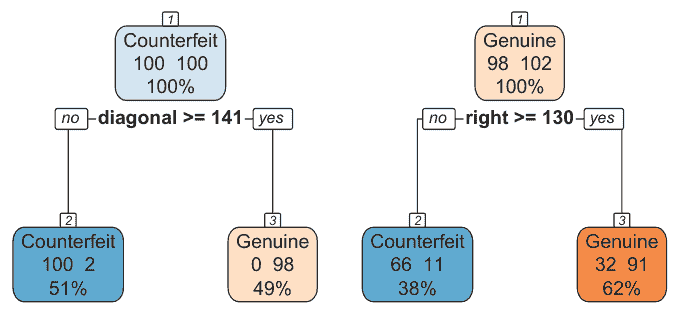

图 2.19：瑞士钞票示例的决策树桩（左侧）和其中一个替代分割（右侧）。

### 2.9.2 示例：蘑菇可食性

在本节中，我们将使用 `rpart` 为蘑菇数据拟合一棵分类树，并进一步探索输出和拟合过程。回顾 1.4.4 节，总体目标是（如果可能）找到一条简单的经验法则来避免潜在的有毒蘑菇。目前，我将坚持使用 `rpart` 的默认设置（例如，分割规则是基尼指数），但将复杂度参数 cp 设为零（cp = 0）以获得更复杂的树。

rpart 中的默认设置是 cp = 0.01。

虽然树的构建本身不是随机的，但内部交叉验证结果是随机的，因此在调用 rpart() 之前，我也会设置随机数种子：

```
mushroom <- treemisc::mushroom

# Fit a default tree with zero penalty on tree size
set.seed(1054) # for reproducibility
(mushroom.tree <- rpart(Edibility ~ ., data = mushroom, cp = 0))

#> n= 8124
#>
#> node), split, n, loss, yval, (yprob)
#>   * denotes terminal node
#>
#>  1) root 8124 3920 Edible (0.51797 0.48203)
#>  2) odor=almond,anise,none 4328 120 Edible (0.97227 0.02773)
#>  4) spore.print.color=black,brown,buff,chocolate,orange,purple...
#>    8) stalk.color.below.ring=brown,gray,orange,pink,red,white ...
#>  16) stalk.color.below.ring=gray,orange,pink,red,white 4152 ...
#>    32) habitat=grasses,meadows,paths,urban,waste,woods 3952...
#>    33) habitat=leaves 200   8 Edible (0.96000 0.04000)
#>    66) cap.surface=smooth 192   0 Edible (1.00000 0.00000...
#>  67) cap.surface=grooves,scaly 8   0 Poison (0.00000 1...
#> 17) stalk.color.below.ring=brown 80 16 Edible (0.80000 0...
#> 34) stalk.root=bulbous 64 0 Edible (1.00000 0.00000) *
#> 35) stalk.root=missing 16 0 Poison (0.00000 1.00000) *
#> 9) stalk.color.below.ring=yellow 24 0 Poison (0.00000 1...
#> 5) spore.print.color=green 72 0 Poison (0.00000 1.00000) *
#> 3) odor=creosote,fishy,foul,musty,pungent,spicy 3796 0 Poiso...
```

这是一棵包含许多分割的复杂树，因此让我们使用 **treemisc** 的 `tree_diagram()` 函数来绘制它（参见图 2.20）。

```
tree_diagram(mushroom.tree) # Figure 2.20
```

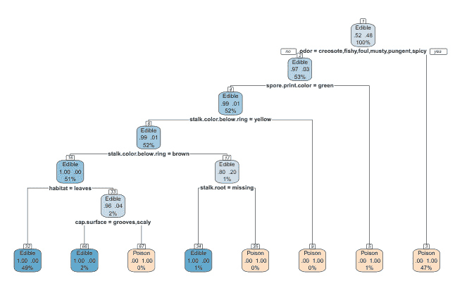

图 2.20：用于分类蘑菇可食性的决策树图。

将 cp = 0 不一定会得到最复杂或饱和的树。这是因为 rpart() 默认设置了许多其他参数，其中许多有助于控制树的最大尺寸；下面针对当前的 mushroom.tree 对象打印了这些参数。例如，默认值为 20 的 minsplit 控制在尝试分割之前节点中必须存在的观测值数量。

```
unlist(mushroom.tree$control)
#> minsplit minbucket cp
#> 20 7 0
#> maxcompete maxsurrogate usesurrogate
#> 4 5 2
#> surrogate.style maxdepth xval
#> 0 30 10
```

您可以通过 `rpart()` 的 `control` 参数更改这些参数中的任何一个，或者通过 `...`（读作 dot-dot-dot）参数将它们直接传递给 `rpart()`。例如，下面的两个 `rpart()` 调用是等价的。每个调用都拟合一棵分类树，但将默认复杂度参数从 0.01 更改为 0（`cp = 0`），并将内部交叉验证次数从十次更改为五次（`xval = 5`）；有关所有可配置参数的更多详细信息，请参见 `?rpart::rpart.control`。

```
ctrl <- rpart.control(cp = 0, xval = 5) # can also be a names list
tree <- rpart(Edibility ~ ., data = mushroom, control = ctrl)
tree <- rpart(Edibility ~ ., data = mushroom, cp = 0, xval = 5)
```

`rpart()` 中的另一个有用选项是 `parms` 参数，它控制树中节点的分割方式；每次提供时，它必须是一个命名列表。下面我们打印 `tree$parms` 组件，在此例中，它是一个包含类先验概率、损失矩阵和构建树时使用的不纯度函数的列表。

```
mushroom.tree$parms
#> $prior
#> 1 2
#> 0.518 0.482
#>
#> $loss
#> [,1] [,2]
#> [1,] 0 1
#> [2,] 1 0
#>
#> $split
#> [1] 1
```

`$prior` 组件默认为根节点中的类频率，这可以轻松验证：

```
proportions(table(mushroom$Edibility)) # observed class proportions
#>
#> Edible Poison
#> 0.518 0.482
```

由 `$loss` 组件给出的损失矩阵默认对假阳性和假阴性（非对角线元素）赋予相等的损失；正确分类不关联任何损失（即，对角线元素始终为零）。

9 在 R 中，函数可以有一个特殊的 `...` 参数，允许它们接受任意数量的其他参数；有关详细信息，请参见 Wickham [2019, Sec. 6.6]。

10 `parms` 参数仅适用于分类（分类树）、计数（泊松回归）或删失（生存分析）的响应变量。

`$split` 组件显示 1（`split = "gini"`）或 2（`split = "information"`）（允许部分匹配）。所有这些都可以通过在调用 `rpart()` 时向 `parms` 参数传递一个命名列表来更改，以偏离各自的默认值。例如，要使用熵分割规则，请运行以下代码：

```
parms <- list("split" = "information") # use cross-entropy split rule
rpart(Edibility ~ ., data = mushroom, parms = parms)
```

不幸的是，在 `rpart` 中指定损失矩阵的文档并不完善。对于二元结果，矩阵具有以下结构：

\( L = \begin{bmatrix} TP & FP \\ FN & TN \end{bmatrix}, \)

其中，行表示观察到的类别，列表示分配的类别。这里，TP、FP、FN 和 TN 分别代表 *真阳性*、*假阳性*、*假阴性* 和 *真阴性*；例如，假阴性是指树将 1 错误分类为 0 的情况。行/列的顺序与类别按字母顺序或数字顺序排序时的顺序相同。

由于正确分类没有成本，我们取 \( TP = TN = 0 \)。对于某个常数 \( c \)，设置 \( FP = FN = c`（即，同样对待 FP 和 FN），将始终导致相同的分割（尽管用于选择分割的内部统计量会以不同方式缩放）。当误分类成本不相等时，请在损失矩阵中指定适当的值。例如，下面的树将假阴性（即，将有毒蘑菇误分类为可食用）视为比假阳性（即，将可食用蘑菇误分类为有毒）贵五倍。我们也可以根据此损失矩阵计算调整后的先验概率并通过 `parms` 参数提供它们来获得相同的树，但这留给读者作为练习。

```
levels(mushroom$Edibility) # inspect order of levels
(loss <- matrix(c(0, 5, 1, 0), nrow = 2)) # loss matrix
rpart(Edibility ~ ., data = mushroom, parms = list("loss" = loss))
```

变量重要性得分（2.8 节）包含在 `mushroom.tree` 对象的 `$variable.importance` 组件中；它们也在 `summary()` 输出的顶部打印，但已重新缩放为总和为 100。


mushroom.tree$variable.importance
```
#>             odor       spore.print.color
#>        3823.407        2834.187
#>        gill.color   stalk.surface.above.ring
#>        2322.460        2035.816
#> stalk.surface.below.ring          ring.type
#>        2030.555        2026.526
#>     stalk.color.below.ring       stalk.root
#>        53.933           25.600
#>     stalk.color.above.ring       veil.color
#>        17.546           16.315
#>              cap.surface           cap.color
#>        15.360           14.032
#>              habitat           cap.shape
#>        13.409            3.840
#>        gill.attachment
#>         0.585
```

在许多情况下，树中未使用的预测器也会有非零的重要性得分。原因是代理分割也被纳入计算。特别是，一个变量可能在树中有效出现多次，既可以作为主分割变量，也可以作为代理分割变量。特定特征的变量重要性度量是它作为主变量的每个分割所关联的增益之和，加上它作为代理的每个分割所关联的增益（经过一致性调整）。你可以通过在 `rpart.control()` 中设置 `maxsurrogate = 0` 来关闭代理。

**rpart** 中的 _k_-折交叉验证（第 2.5.2 节）是如何工作的？`rpart()` 函数默认执行内部 10-折交叉验证。根据 **rpart** 的文档，10-折交叉验证是一个合理的默认值，并已被证明对于筛选出“纯噪声”特征非常可靠。然而，折数（_k_）可以通过 `rpart.control()` 中的 `xval` 参数进行更改。

你可以使用 `plotcp()` 可视化 "rpart" 对象的交叉验证结果，如图 2.21 所示，针对 `mushroom.tree` 对象。选择用于剪枝的 `cp` 的一个好经验法则是使用最左侧的值，使得平均交叉验证得分位于水平线下方；这与第 2.5.2.1 节讨论的 1-SE 规则一致。标记为 "`xerror`" 和 "`xstd`" 的列分别提供交叉验证风险及其相应的标准误差（第 2.5 节）。

```
plotcp(mushroom.tree, upper = "splits", las = 1) # Figure 2.21
mushroom.tree$cptable # print cross-validation results
```

```
#>        CP nsplit rel error   xerror      xstd
#> 1 0.96936      0 1.00000 1.000000 0.011501
#> 2 0.01839      1 0.03064 0.030644 0.002777
#> 3 0.00613   2   0.01226 0.012257 0.001764
#> 4 0.00204   3   0.00613 0.006129 0.001249
#> 5 0.00102   5   0.00204 0.002043 0.000722
#> 6 0.00000   7   0.00000 0.000511 0.000361
```

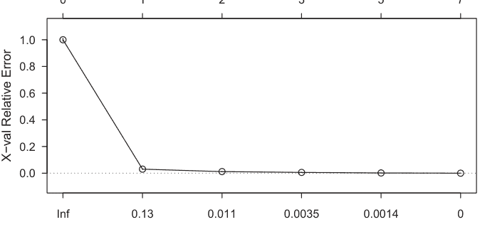

图 2.21：拟合的 mushroom.tree 对象的交叉验证结果。用于剪枝的 cp 的一个好选择通常是最左侧的值，使得均值位于水平线下方；这对应于基于 1-SE 规则的最优值。

不要被 printcp()（即 "rpart" 对象的 $cptable 组件）和 plotcp() 之间的 cp 值不匹配这一事实所混淆。后者只是绘制 printcp() 列出的 CP 列的几何平均值（这些与第 2.5 节描述的 k-折交叉验证程序中使用的 \(\beta_i\) 值相关）。任何两个连续行之间的 cp 值都会产生相同的树。例如，0.002 和 0.001 之间的任何 cp 值都会产生具有五个分割的树。此外，这些对应于第 2.5 节中的复杂度值 \(\alpha_i\) 的缩放版本。请注意，rpart 将 CP 列以及误差列按与根节点风险成反比的因子进行缩放，以便根节点的相关训练误差（“rel error”）始终为一（即表格中的第一行）；在此例中为 1 / (3916/8124) ≈ 2.075。除以此缩放因子应该返回原始 \(\alpha_i\) 值；前三个对应于我在第 2.5 节中手动计算的值：

```
mushroom.tree$cptable[1L:3L, "CP"] / (8124 / 3916)
#>   1   2   3
#> 0.46726 0.00886 0.00295
```

因此，设置 cp = 1 将始终导致没有分割的树。默认值 cp = 0.01 已被证明对于“预剪枝”树很有用，使得交叉验证步骤仅导致移除 1–2 层，尽管它也可能偶尔过度剪枝。在实践中，似乎最好设置 cp = 0 或其他小于默认值的数字，并使用交叉验证结果来选择最优子树。

使用 1-SE 规则会建议一个具有 5 个或可能 7 个分割的树。然而，由于我们的主要目标是为蘑菇食用性分类构建一个简单的经验法则，似乎只有一个分割（即决策桩）的更简单模型就足够了；它仅将 3% 的有毒蘑菇误分类为可食用。要剪枝 rpart 树，请使用带有指定复杂度参数值的 prune() 函数：

```
tree_diagram(prune(mushroom.tree, cp = 0.1)) # Figure 2.22
```

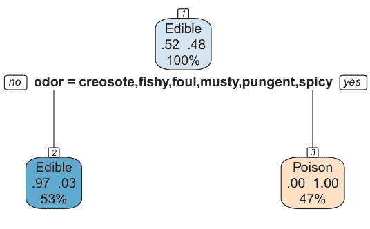

图 2.22：用于分类蘑菇食用性的决策树图；在此例中，结果是一个决策桩。

图 2.22 显示的树图为我们提供了一个将蘑菇分类为可食用或有毒的实用经验法则。如果蘑菇闻起来有鱼腥味、臭味、霉味、刺鼻味、辛辣味或像焦油油一样，那它很可能是有毒的。换句话说，如果它闻起来不好，就不要吃！

### 2.9.3 示例：预测房价

在本节中，我将使用 rpart 为 Ames 房价数据（第 1.4.7 节）构建回归模型。我还将展示如何通过 treemisc 的 prune_se() 函数使用 1-SE 规则轻松剪枝 rpart 树。下面的代码块在将数据按 70/30 分割为训练/测试集之前加载数据：

```
ames <- as.data.frame(AmesHousing::make_ames())
ames$Sale_Price <- ames$Sale_Price / 1000 # rescale response
set.seed(2101) # for reproducibility
trn.id <- sample.int(nrow(ames), size = floor(0.7 * nrow(ames)))
ames.trn <- ames[trn.id, ] # training data/learning sample
ames.tst <- ames[-trn.id, ] # test data
```

接下来，我将通过设置 cp = 0 故意拟合一棵过度生长的回归树；在回归树中，rpart 不会尝试分割，除非它使整体 R^2 增加 cp，因此设置 cp = 0 将导致树继续分割，直到满足其他停止标准，例如最小节点大小（在 rpart 中，尝试分割所需节点中必须存在的默认最小观测数为 20）。我还将比较训练集和测试集之间的 RMSE：

```
library(rpart)
library(treemisc) # for prune_se() function

# Fit a regression tree with no penalty on complexity
set.seed(1547) # for reproducibility
ame.tree <- rpart(Sale_Price ~ ., data = ames.trn, cp = 0)

rmse <- function(pred, obs) { # computes RMSE
  sqrt(mean((pred - obs) ^ 2))
}

# Compute train RMSE
rmse(predict(ame.tree, newdata = ames.trn), obs = ames.trn$Sale_Price)
#> [1] 23.4

# Compute test RMSE
rmse(predict(ame.tree, newdata = ames.tst), obs = ames.tst$Sale_Price)
#> [1] 31.4
```

该树可能过拟合，这由训练 RMSE 和测试 RMSE 之间的相对较大差异所表明。让我们看看剪枝树是否有帮助。treemisc 的 prune_se() 函数可以用于使用 1-SE 规则剪枝 rpart 树，如下所示：

```
ame.tree.1se <- prune_se(ame.tree, se = 1) # prune using 1-SE rule

# Train RMSE on pruned tree
rmse(predict(ame.tree.1se, newdata = ames.trn),
 obs = ames.trn$Sale_Price)
#> [1] 29.5

# Test RMSE on pruned tree
rmse(predict(ame.tree.1se, newdata = ames.tst),
 obs = ames.tst$Sale_Price)
#> [1] 34.1
```

差异较小，但剪枝后的树在测试集上略逊于未剪枝的树。那么剪枝在这里真的有帮助吗？这取决于你如何看待。两棵树都在图 2.23 中显示，没有文本或标签。未剪枝的树有 169 个分割，而使用 1-SE 规则和交叉验证进行剪枝后得到的子树只有 33 个分割——一棵更简洁的树

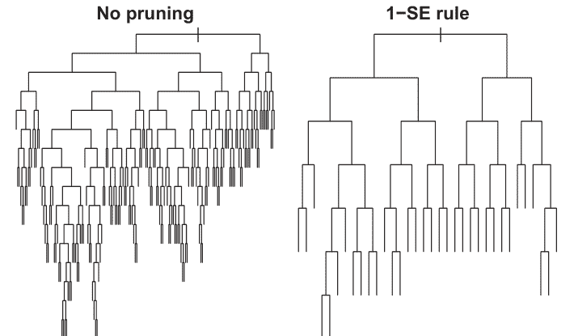

图 2.23：Ames 房价示例的回归树。左侧：未剪枝回归树。右侧：使用 10-折交叉验证和 1-SE 规则剪枝的回归树。

即使进行了剪枝，我们最终仍得到一棵过于复杂、难以轻松解释的子树。在这种情况下，使用不同的事后可解释性技术可能会有所帮助，以帮助最终用户以更易于人类理解的方式解释模型。例如，查看变量重要性得分图（如图 ?? 所示的克利夫兰点图）可能非常有信息量；在这里，重要性得分被缩放为总和为 1（请参见下面的代码块）。从结果中，我们可以看到整体质量


房屋的整体质量（Overall_Qual）、街区（Neighborhood）和地下室质量（Bsmt_Qual）是用于将数据划分为销售价格相似的房屋组的一些关键特征。

```
vi <- sort(ames.tree.lse$variable.importance, decreasing = TRUE)
vi <- vi / sum(vi) # scale to sum to 1
dotchart(vi[1:10], xlab = "Variable importance", pch = 19)
```

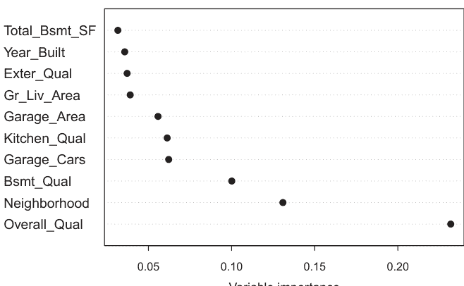

图 2.24：艾姆斯房屋数据剪枝决策树中前十个预测器的变量重要性图。

虽然变量重要性图很有用，但它们并不能告诉我们每个特征与预测结果之间关系的本质。例如，地上层面积（Gr_Liv_Area）平均如何影响预测的销售价格？部分依赖图（PDPs）正是可以告诉我们这一点的内容；参见第 6.2.1 节。简而言之，PDPs 是预测函数的低维图形呈现，以便更容易理解结果与感兴趣预测器之间的关系。PDPs 与其他可解释性技术一起在第 6 章中进行了更详细的讨论。现在，我将仅介绍 pdp 包 [Greenwell, 2021b]，并展示如何使用它来帮助可视化地上层面积与预测销售价格之间的关系：

```
library(ggplot2)
library(pdp)
```

```
# Compute partial dependence of predicted Sale_Price on Gr_Liv_Area
pd <- partial(ames.tree.lse, pred.var = "Gr_Liv_Area")
```

```
autoplot(pd, rug = TRUE, train = ames.trn) + # Figure 2.25
ylab("Partial dependence")
```

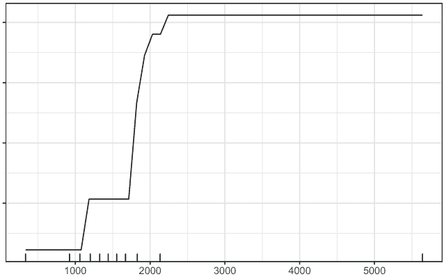

图 2.25：来自剪枝回归树中 Sale_Price 对 Gr_Liv_Area 的部分依赖。有证据表明，地上层面积（Gr_Liv_Area）与预测销售价格之间存在单调递增关系，同时考虑了所有其他预测器的平均效应。

请注意，y 轴与响应变量在同一尺度上，在此情况下，它表示 Gr_Liv_Area 一系列值在整个学习样本中的平均预测销售价格。x 轴上的地毯图（或一维图）显示了训练数据中 Gr_Liv_Area 的分布，在最小值/最大值和每个十分位数处都有刻度标记。如您所料，较大的房屋与较高的平均预测销售额相关。有关 pdp 包的完整细节见 Greenwell [2017]。

决策树，尤其是较小的树，通常相当能够自行解释。然而，一个有用的判别树往往太大，无法通过目测来解释。变量重要性得分、PDPs 和其他可解释性技术可用于帮助理解任何树，无论其大小或复杂程度如何；这些技术对于理解更复杂模型（如第 5–8 章讨论的基于树的集成模型）的输出甚至更为关键。

### 2.9.4 示例：员工流失

在本示例中，我将重新审视员工流失数据（第 1.4.6 节），并使用 rpart 构建一个带有修改先验概率的分类树，以帮助理解员工流失的驱动因素并验证我在第 2.2.4.1 节中的先前计算。

图 2.6 展示了员工流失数据的两棵分类树，一棵使用默认先验概率，另一棵基于具有不等误分类成本的特定损失矩阵使用修改后的先验概率。在 rpart 中，您可以指定损失矩阵、先验概率或两者兼用——这非常灵活！

下一段代码将三棵深度为二的分类树拟合到员工流失数据上。第一棵树（tree1）假设误分类成本相等，并使用默认（即观察到的）类先验概率。另外两棵树采用不同但等效的方法：tree2 使用第 2.2.4.1 节中先前定义的损失矩阵，而 tree3 使用我在第 2.2.4.1 节中手动计算的相关修改先验概率。尽管构建每棵树所使用的内部统计量略有不同，但两棵树在分割方面是等价的，并将做出相同的分类。生成的树图显示在图 2.26 中。

```
data(attrition, package = "modeldata")

# Fit classification trees with default priors and costs
set.seed(904) # for reproducibility
tree1 <- rpart(Attrition ~ OverTime + MonthlyIncome, data = attrition,
               maxdepth = 2, cp = 0)

# Specify unequal misclassification costs
loss <- matrix(c(0, 8, 1, 0), nrow = 2)
tree2 <- rpart(Attrition ~ OverTime + MonthlyIncome, data = attrition,
               maxdepth = 2, cp = 0, parms = list("loss" = loss))

# Equivalent approach using altered priors
tree3 <- rpart(Attrition ~ OverTime + MonthlyIncome, data = attrition,
               maxdepth = 2, cp = 0,
               parms = list("prior" = c(1 - 0.6059444, 0.6059444)))

# Display trees side by side (Figure 2.26)
par(mfrow = c(1, 3))
tree_diagram(tree1) # default costs and priors
tree_diagram(tree2) # unequal costs
tree_diagram(tree3) # altered priors
```

tree2 和 tree3 之间的微妙区别在于，tree2 的节内类别比例未针对成本/损失进行调整；因此，两棵树之间的预测类别概率不会匹配。本质上，基于损失矩阵的树（tree2）使用预测概率进行分类

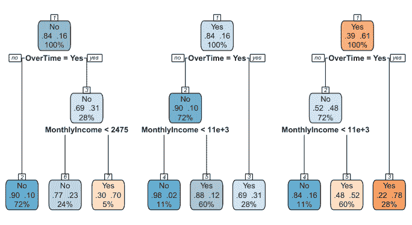

图 2.26：拟合到员工流失数据集的决策树。左侧：默认先验概率和等成本。中间：通过损失矩阵指定的不等成本。右侧：与中间树相关成本等效的修改先验概率。

阈值不同于 0.5"（即，分类不再基于多数票）。另一方面，在修改先验概率的树（tree3）中，预期的类别比例已调整，以便分类仍通过多数票进行（即，如果 A 是最右侧的终端节点，那么 A 中的任何观测值都将被分类为 Yes，因为 p_yes(A) = 0.779 > 0.5。

总结这个特定示例，指定损失矩阵生成了一棵树并调整了用于分类的概率阈值，而使用修改先验概率生成了一棵树并调整了预测概率以保持阈值为 0.5；但两者在分配给新观测值的分类方面是等价的。

请注意，损失矩阵的行和列顺序以及先验概率的顺序与响应类别的排序顺序相同。例如，在下面的矩阵中，第一行/列对应类 No，因为它在字母顺序中排在第一位：

```
levels(attrition$Attrition) # can be changed with relevel()
#> [1] "No" "Yes"
matrix(c(0, 8, 1, 0), nrow = 2)
```

一般来说，分类的默认概率阈值为 1/J，其中 J 是类别的数量。

```
#>   [,1] [,2]
#> [1,]    0    1
#> [2,]    8    0
```

尽管我将每棵树限制在最大深度为二，但图 2.26 最左侧的树实际上与我使用 10 折交叉验证和 1-SE 规则（当然，假设误分类成本不等）所能获得的最优树一致，并表明需要加班以及月收入较低与最高的流失预测概率（p = 0.70）相关

为了进一步说明在 rpart 中使用 1-SE 规则进行剪枝，让我们来看一棵基于修改先验概率（tree3）且使用完整特征集的树。下面，我使用所有可用特征将相同的修改先验概率树重新拟合到最大深度（即，故意生长过大的树）；交叉验证结果和剪枝后的树图显示在图 2.27（第 109 页）。图 2.27 中的上图显示了作为分割数函数（上轴）的代价复杂度剪枝结果。如果我要使用 1-SE 规则进行剪枝，我将选择位于水平线下方且最靠左的点对应的树（水平线对应于最小误差以上 1-SE）。在这种情况下，我们最终将得到一棵仅包含四个分割的树，如图 2.27 下图所示。

```
library(rpart)
```

```
# Saturated tree with altered priors using all predictors
att.cart <-
  rpart(Attrition ~ ., data = attrition, cp = 0, minsplit = 2,
        parms = list("prior" = c(1 - 0.6059444, 0.6059444)))
```

```
# Plot pruning results (Figure 2.27)
par(mfrow = c(2, 1))
plotcp(att.cart, upper = "splits")
(att.cart.1se <- prune_se(att.cart, se = 1))
```

```
#> n= 1470
#>
#> node), split, n, loss, yval, (yprob)
#>   * denotes terminal node
#>
#>  1) root 1470 579.0 Yes (0.394 0.606)
#>   2) OverTime=No 1054 413.0 No (0.518 0.482)
#>     4) TotalWorkingYears>=2.5 966 304.0 No (0.577 0.423)
#>       8) StockOptionLevel>=0.5 568 117.0 No (0.684 0.316) *
#>       9) StockOptionLevel< 0.5 398 163.0 Yes (0.465 0.535)
#>        18) JobRole=Healthcare_Representative,Human_Resources,Mana...
#>        19) JobRole=Laboratory_Technician,Research_Scientist,Sales...
#>     5) TotalWorkingYears< 2.5 88  27.7 Yes (0.203 0.797) *
```


```
#> 3) Overtime=Yes 416 136.0 Yes (0.221 0.779) *
tree_diagram(att.cart.lse, tweak = 0.8)
```

### 2.9.5 示例：字母图像识别

本示例的目标是构建一个图像分类器，使用简单的决策树，并结合关于多类结果（J = 26 个类）的真实类先验概率的附加信息。字母图像识别数据可通过 R 中的 mlbench 包 [Leisch and Dimitriadou., 2021] 获得，包含 17 个变量上的 20,000 个观测值。每个观测值对应英文字母表中大写字母（即 A–Z）的失真黑白矩形像素图像。从每个图像中派生了总共 16 个有序特征（例如，统计矩和边缘计数），然后将其缩放为 0–15 范围内的整数。目标是使用这 16 个有序特征识别每个字母。Frey 和 Slate [1991] 首先使用荷兰式自适应分类器分析了该数据，并报告了略高于 80% 的准确率。

首先，我将加载数据，并使用 70/30 分割将其分为训练集/测试集：

```
library(treeisc) # for prune_se()

data(LetterRecognition, package = "mlbench")
lr <- LetterRecognition # shorter name for brevity
set.seed(1051) # for reproducibility
trn.ids <- sample(nrow(lr), size = 14000, replace = FALSE)
lr.trn <- lr[trn.ids, ] # training data
lr.tst <- lr[-trn.ids, ] # test data
```

接下来，我将使用 rpart() 拟合一个使用 10 折交叉验证和 1-SE 规则剪枝的分类树，并查看其在测试样本上的准确率：

```
set.seed(1703) # for reproducibility
lr.cart <- rpart(letter ~ ., data = lr.trn, cp = 0, xval = 10)
lr.cart <- prune_se(lr.cart, se = 1) # prune using 1-SE rule

# Compute accuracy on test set
pred <- predict(lr.cart, newdata = lr.tst, type = "class")
sum(diag(table(pred, lr.tst$letter))) / length(pred)
```

```
#> [1] 0.813
```

该数据也可从 UCI 机器学习库获得：https://archive.ics.uci.edu/ml/datasets/Letter+Recognition.

不错，总体准确率为 81%——与 Frey 和 Slate [1991] 报告的最佳准确率相似。但不要被迷惑，数据已被人为平衡：

```r
table(lr$letter)
```

| 字母 | 频率 | 字母 | 频率 |
|--------|-----------|--------|-----------|
| A | 789 | N | 783 |
| B | 766 | O | 753 |
| C | 736 | P | 803 |
| D | 805 | Q | 783 |
| E | 768 | R | 758 |
| F | 775 | S | 748 |
| G | 773 | T | 796 |
| H | 734 | U | 813 |
| I | 755 | V | 764 |
| J | 747 | W | 752 |
| K | 739 | X | 787 |
| L | 761 | Y | 786 |
| M | 792 | Z | 734 |

如 Matloff [2017, Sec. 5.8] 所述，这不现实，因为某些字母在英文文本中出现的频率往往远高于其他字母。例如，假设类别平衡，`rpart()` 为字母“A”使用的先验概率为 $\pi_A = 1/26 \approx 0.0384$，而实际上 $\pi_A$ 更接近 0.0855。

适当的分析应考虑这些频率，使用分类树可以轻松做到这一点。幸运的是，正确的字母频率方便地可在 **regtools** 包 [Matloff, 2019] 中获得。下面，我将重新拟合包含更新（且更现实）的类先验概率的模型。然后，我将对测试数据进行采样，使得得到的类频率更准确地反映每个字母的真实先验概率：

```
data(ltrfreqs, package = "regtools")
```

```
# Compute correct class priors
priors <- ltrfreqs$percent
priors <- priors / sum(priors) # class priors should sum to 1
names(priors) <- ltrfreqs$ltr
priors <- priors[order(ltrfreqs$ltr)]
```

```
# Refit tree using correct priors
set.seed(1718) # for reproducibility
lr.cart.priors <- rpart(letter ~ ., data = lr.trn, cp = 0,
parms = list(prior = priors))
lr.cart.priors <- prune_se(lr.cart.priors, se = 1)
```

```
# Sample test set to reflect correct class frequencies
ltrfreqs2 <- ltrfreqs
names(ltrfreqs2) <- c("letter", "prior")
ltrfreqs2$prior <- ltrfreqs2$prior / sum(ltrfreqs2$prior)
temp <- merge(lr.tst, ltrfreqs2) # merge the two data sets
set.seed(1107) # for reproducibility
lr.tst2 <- temp[sample(nrow(temp), replace = TRUE,
prob = temp$prior), ]
```

最后，让我们在反映更准确类频率的修改后测试集上比较两个 CART 拟合：

基于 http://practicalcryptography.com 报告的英文字母频率。

```
pred2 <- predict(lr.cart, newdata = lr.tst2, type = "class")
pred3 <- predict(lr.cart.priors, newdata = lr.tst2, type = "class")
sum(diag(table(pred2, lr.tst2$letter))) / length(pred2)
#> [1] 0.803
sum(diag(table(pred3, lr.tst2$letter))) / length(pred3)
#> [1] 0.858
```

基于等先验概率的原始模型的错误有所下降（尽管不大），但结合真实先验信息的树表现好得多。太棒了！

## 2.10 讨论

CART 是现存最好的现成机器学习算法之一，但并非没有缺点。最后，让我们总结 CART 算法用于决策树诱导的许多优点和缺点。虽然这里的重点是 CART，但大部分讨论也同样适用于其他决策树算法（例如，C4.5/C5.0）。

### 2.10.1 CART 的优点

- **小树易于解释。** 决策树通常被赞誉为相对于更复杂的算法而言简单且可解释。然而，这确实仅适用于分割相对较少的小树，例如图 2.22（第 95 页）中的那棵树。

- **树在大 _N_ 下扩展良好。** 单个决策树在大数据集上扩展得非常好，尤其是当大多数特征是有序的，或者是类别较少的分类特征时。即使在极端情况下，也可以使用各种快捷方式和近似方法来降低计算负担（例如，参见第 2.4 节）。

- **叶节点形成数据的自然聚类。** 所有共存于终端节点的观测值在遍历树时必然满足相同的所有条件；从这个意义上说，终端节点内的记录在特征值方面应当相似，并可视为 _最近邻_。我们将在第 7.6 节重新探讨这一想法。

- **树可以处理各种类型的数据。** 树可以自然地处理混合类型的数据，分类特征不一定需要像在线性回归或神经网络中那样进行数值重新编码。树对预测变量的单调变换也具有不变性；也就是说，它们只关心每个有序特征值的排序顺序。例如，不需要像在线性模型中那样对任何特征应用对数或平方根变换。

- **自动变量选择。** CART 一次一步地选择变量和分割（“……像制作楼梯的木匠”）；因此有本章开头的引言。如果一个变量无法有意义地将数据划分为同质子组，它不太可能被选为主要分割变量。如果被选中，它在剪枝阶段很可能会被剪掉。

- **树可以自然地处理缺失数据。** 如第 2.7 节所述，CART 可以通过使用代理分割（即在预测过程中遇到缺失值时可使用的备用分割变量）来自然地避免缺失数据引起的许多问题。

- **树是完全非参数的。** CART 是完全非参数的。它不需要任何分布假设，用户不需要为模型指定任何参数形式，如在线性回归中。它还可以自动处理非线性关系（尽管由于使用阶梯函数来近似可能平滑的曲面，往往会相当有偏差）以及交互作用。

### 2.10.2 CART 的缺点

- **大树难以解释。** 大型树图，如图 2.23（第 97 页）中的那些，可能难以解释，并且对最终用户可能不太有用。幸运的是，各种可解释性技术，如变量重要性图和 PDP，可以帮助缓解此问题。此类技术是第 6 章的主题。

- **CART 的分割算法相当贪婪。** CART 进行局部最优的分割。也就是说，该算法不会遍历所有可能的树结构来全局优化某些性能指标；即使对于少量特征，这也是不可行的。相反，该算法通过在每个阶段寻找下一个最佳分割来递归地划分数据。这类似于 _前向逐步选择_ 和 _最佳子集选择_ 之间的区别。贪婪算法使用更受约束的搜索，倾向于具有较低方差，但往往要以偏差为代价。第 5–8 章讨论了通过组合许多决策树来打破偏差-方差权衡的几种策略。

- **树较低位置的分割准确性较低。** 每次分割后数据基本上被“拿走”了，使得树更深处的分割相比靠近根节点的分割准确性较低（且更嘈杂）。这也是为什么二进制


分割之所以被首先使用。虽然某些决策树算法允许多分支分割（例如，CHAID 和 C4.5/C5.0），但这通常不是一个好的策略，因为数据会过快地被碎片化，并且寻找局部最优分割变得更加具有挑战性。

**树包含复杂的交互作用。** CART 以顺序方式寻找分割，树中的所有分割都依赖于之前出现的任何分割。一旦确定了最终的树结构，生成的预测方程可以使用指示函数的线性模型来编写。例如，图 2.9（第 63 页）中树图的预测方程可以写成如下形式：

```
\widehat{\text{Ozone}} = 75.41 \times I(\text{Temp} \ge 82.50) + 55.60 \times I(\text{Temp} < 82.50 \ \& \ \text{Wind} < 7.15) + 22.33 \times I(\text{Temp} < 82.50 \ \& \ \text{Wind} \ge 7.15)
```

其中 \( I(\cdot) \) 是 *指示函数*，当其参数为真时求值为 1，否则为 0。右侧可以更一般地重写为 \( f(\text{Temp}) + f(\text{Temp, Wind}) \)，其中第二项显式建模 Temp 和 Wind 之间的交互效应。如你所想象，分割数量更多的更复杂的树容易导致具有高阶交互效应的模型。高阶交互效应的存在会使解释主效应（即，单个预测变量的效应）变得更加具有挑战性。

**有偏变量选择。** 如在第 2.4.2 节中简要讨论的那样，CART 的分割选择策略倾向于选择具有许多潜在分割点的特征，例如基数高的分类预测变量。更现代的决策树算法，如第 3-4 章中讨论的那些，在这方面是无偏的。

**树本质上是阶梯函数。** 树在适应平滑和/或线性响应表面方面可能会遇到困难。回顾第 1.1.2.5 节中的 twonorm 问题，其中最优决策边界是线性的。我使用 10 折交叉验证和 1-SE 规则，在同一样本上拟合了一个修剪过的 **rpart** 树；生成的决策边界（连同最优贝叶斯规则）显示在图 2.28（第 110 页）。当然，我可以增加分割数量从而产生更小的阶梯，但在实践中，这通常会导致过拟合和泛化能力差。这种缺乏平滑性在回归设置中会造成更多问题。

**树具有噪声。** 决策树的一个常见批评是它们被认为是 *不稳定的预测器*；这一点在原始 CART 专著中也有提及；参见 Breiman et al. [1984, Section 5.5.2]。所谓不稳定，是指方差较高，换句话说，树结构（因此预测结果）可能会从一个样本到下一个样本发生变化，而且往往变化剧烈。例如，在特定树的任何节点处，可能存在几个竞争性分割，它们导致节点不纯度几乎相同的下降，而不同样本可能会在这些表现相似的分割竞争者中做出不同的选择。

为了说明这一点，让我们来看看来自第 1.4.5 节中描述的电子邮件垃圾邮件数据的六个大小为 _N_ = 3,220 的独立样本（≈ 70% 训练样本），并对每个样本拟合一个最多使用四个分割的类 CART 树。结果显示在图 2.29 中。请注意六棵树之间结构和分割变量的差异。

幸运的是，树的稳定性并不总是听起来（或看起来）那么成问题。根据 Zhang 和 Singer [2010, p. 57]，“...[在实践中] 关于树稳定性的真正担忧原因是树的外观所产生的心理影响。” 尽管树的结构可能会从一个样本到下一个样本发生变化，但 Breiman et al. [1984, pp. 156–159] 认为，竞争性树虽然外观不同，但可以给出相当稳定和一致的预测。改进决策树稳定性和性能的策略在第 5-8 章中讨论。

不过，不稳定性并非树所特有。例如，线性回归中的传统模型选择技术——如前向选择、后向消除及其混合变体——都面临同样的问题。然而，通过方差减少，平均法可以提高不稳定预测器（如过度生长的决策树）的准确性 [Breiman, 1996a]；第 5 章将详细介绍这一点。

## 2.11 推荐阅读

首先，我强烈建议阅读原始 CART 专著 [Breiman et al., 1984]。要获得更易于理解且全面的 CART 讨论，我推荐 Berk [2008, Chap. 3]（请注意，这本书现在有第二版）。我还建议阅读随 rpart 包附带的 vignettes；R 用户可以从活跃的 R 会话中启动这些 vignettes，如本章中多次提到，但它们也可从 rpart 的 CRAN 页面获取：https://cran.r-project.org/package=rpart。Scikit-learn 的 sklearn.tree 模块文档也相当扎实：https://scikit-learn.org/stable/modules/tree.html。此外，Dan Steinberg 关于 CART 的一场精彩演讲，名为“Data Science Tricks With the Single Decision Tree”，可在 YouTube 上找到：https://www.youtube.com/watch?v=JVbU_tS6zKo&feature=youtu.be。

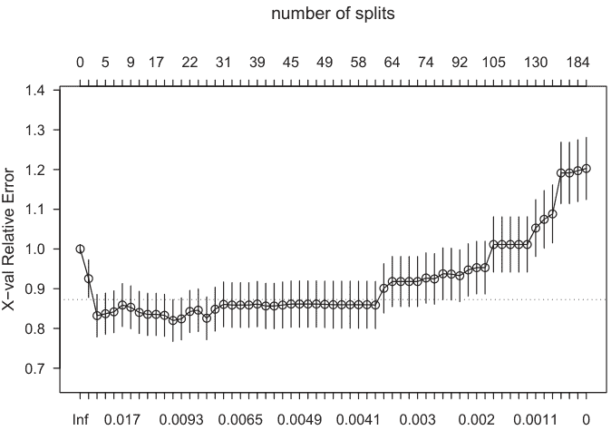

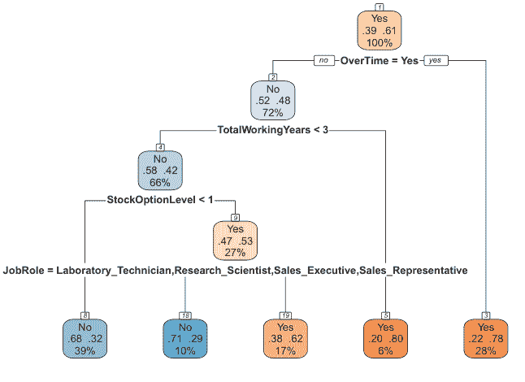

图 2.27：带有改变先验概率的员工流失决策树。顶部：10 折交叉验证结果。底部：使用 1-SE 规则修剪的树（对应于 10 折交叉验证结果中位于水平虚线下方的最左侧点）。

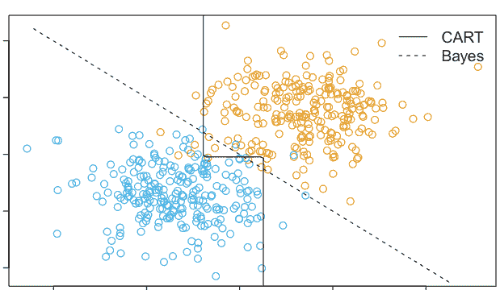

图 2.28：twonorm 基准示例的决策边界。在此情况下，贝叶斯决策边界是线性的（虚线）。还显示了修剪分类树的决策边界（实线）。决策树分割的轴导向特性使得难以适应线性或平滑的决策表面。

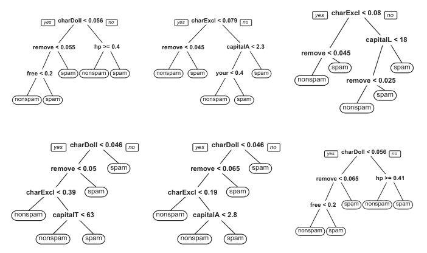

图 2.29：应用于电子邮件垃圾邮件数据六个独立样本的类 CART 树；出于绘图目的，每棵树仅限于四个分割。

# 3 条件推断树

> 生长缓慢的树结出最好的果实。
> 
> 莫里哀

大量不同的树算法使得跟上当前发展变得相当困难。虽然类 CART 的决策树（第 2 章）在分类和回归问题中仍然很受欢迎，但自 2000 年以来，在像 CART 这样的穷举搜索过程方面已经出现了众多发展和改进。在本章中，我将讨论其中一项重要的发展：通过条件推断进行无偏递归分区。

## 3.1 引言

如在第 2.4.2 节中讨论的那样，CART 存在选择具有许多潜在分割点的变量的偏差。这些问题也扩展到 C4.5 和 C5.0（在在线补充中讨论），或任何其他对所有可能分割进行穷举搜索以最大化某些节点不纯度度量的递归分区程序。

为了说明这一点，考虑一个回归场景，其中没有任何预测变量与响应变量有关联。遵循 Loh [2014]（参见他对讨论的回应），我将查看 5,000 个模拟数据集，每个数据集包含以下八个变量的 100 个观测值：

- y: 一个 N(0,1) 随机变量（响应变量）；
- ch2: 一个 \(\chi^2(2)\) 随机变量；
- m2: 一个具有 2 个等概率类别的随机因子；
- m4: 一个具有 4 个等概率类别的随机因子；
- m10: 一个具有 10 个等概率类别的随机因子；
- m20: 一个具有 20 个等概率类别的随机因子；
- nor: 一个 N(0, 1) 随机变量；
- uni: 一个 U(0, 1) 随机变量。

请记住，这七个预测变量都与响应变量无关。对于每个模拟数据集，拟合了两种回归树，每种都只有一个分割（即，决策树桩）：

- 类 CART 决策树，如第 2 章中讨论的；
- 条件推断树（CTree），将在本章后面讨论（参见第 3.4 节）。

图 3.1 显示了每个变量在每个场景中被选为主分割变量的频率。请注意，CART 超过 80% 的时间选择 m20（具有 20 个等概率类别的分类预测变量），大约 10% 的时间选择 m10（具有 10 个等概率类别的分类预测变量）！如果 CART 的分割变量选择策略是无偏的，我们预期每个特征被选中的频率大约为 1/7 ≈ 14.29%。另一方面，CTree 使用无偏的分割变量选择程序，以接近 1/7 的大致相等频率选择每个特征。虽然这不一定意味着 CART 的准确性较低，但它确实使解释变得更加困难（例如，变量重要性图将会有偏）。

## 3.2 无偏递归分区的早期尝试

无偏递归分区背后的基本思想是将分割搜索分为两个顺序步骤：1) 选择主分割变量，然后 2) 选择最优分割点。通常，首先通过比较适当的统计检验来选择主分割变量（例如，如果 X 和 Y 都是名义变量，则使用卡方检验；如果 X 和 Y 都是单变量连续变量，则使用相关性检验）。一旦确定了分割变量，就可以使用多种方法找到最优分割点，包括进一步的统计检验，或第 2.2.1 节中讨论的不纯度度量。

在递归分区中使用统计检验进行分割变量选择的想法并不新鲜。事实上，本章后面将讨论的 CTree 算法


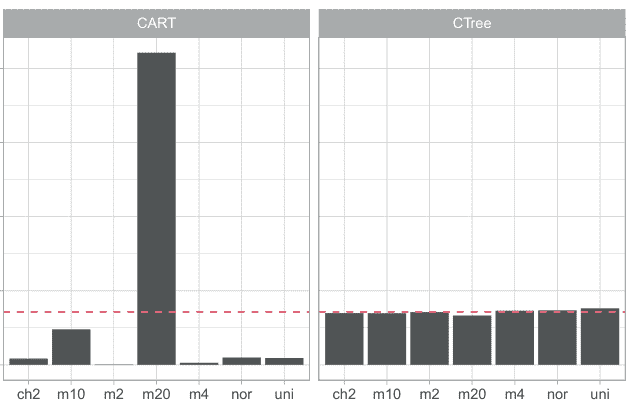

图 3.1：两种回归树程序（CART 和 CTree）的分割变量选择频率；y 轴显示每个特征（均与响应无关）在 5,000 次蒙特卡罗模拟中被选中用于分割根节点的比例。在 1/7 处给出了一条水平虚线红线，该频率对应无偏分割变量选择。

它受到若干先前方法的启发，例如 CHAID（第 1.2.1 节）。虽然这些算法相比于 CART 等穷尽搜索技术有助于减少变量选择偏差，但其中大多数仅适用于特殊情况。例如，CHAID 要求特征和响应均为分类变量，尽管 CHAID 最终被扩展以处理有序结果。如果将有序特征分箱为类别，则可以将 CHAID 用于有序特征；但这会引入偏差，并从一开始就违背了无偏分割变量选择的初衷。另一方面，CTree 提供了一个用于无偏递归分区的统一框架，适用于在任意尺度上测量的数据（例如，连续数据、名义分类数据、删失数据、有序数据和多变量数据）。在介绍 CTree 的细节之前，了解其所依赖的条件推断框架的基本知识将会有所帮助。

以下部分涉及一些数学细节和符号，主要围绕线性代数，不感兴趣的读者可以跳过。

## 3.3 条件推断简述

本节对条件推断程序的一般框架（通常称为*置换检验*）的要点进行了简要介绍；我们的讨论紧密遵循 Hothorn et al. [2006b]，该文基于 Strasser and Weber [1999] 为一类特殊的*线性统计量*推导的理论结果。有关（非参数）置换检验的更传统方法，见例如 Davison and Hinkley [1997, Sec. 4.3]。

假设 $\{(X_i, Y_i)\}_{i=1}^N$ 是从感兴趣总体中抽取的随机样本，其中 $X$ 和 $Y$ 分别来自样本空间 $\mathcal{X}$ 和 $\mathcal{Y}$，这些空间可能是多变量的（因此采用**粗体**表示法）并在任意尺度上测量（例如，有序、名义、连续等）。我们的主要兴趣在于检验 $X$ 和 $Y$ 之间独立性的原假设，即，

$$H_0 : D(Y|X) = D(Y),$$

其中 $D()$ 是 $Y$ 的分布函数。

执行此类检验有多种方法。例如，如果 $X$ 和 $Y$ 都是 $N \times 1$ 连续变量，则可以使用基于 Pearson 相关系数或 Spearman's $\rho$ 的简单相关性检验。如果 $X$ 和 $Y$ 都是 $N \times 1$ 名义分类变量，则简单的卡方检验是合适的。诸此类推。

拥有一种不受 $X$ 和 $Y$ 形状或尺度限制的检验 $H_0$ 的标准方法将非常方便。为此，Strasser and Weber [1999] 建议使用如下一般形式的线性统计量

$$T = \text{vec} \left( \sum_{i=1}^N g(X_i) h(Y_i)^\top \right) \in \mathbb{R}^{pq \times 1}, \quad (3.1)$$

其中 $\text{vec}()$ 是*矩阵向量化算子*，我将在随后的示例中加以说明，$g : \mathcal{X} \to \mathbb{R}^{p \times 1}$ 是指定 $X$ 值可能变换的变换函数，而 $h : \mathcal{Y} \to \mathbb{R}^{q \times 1}$ 称为*影响函数*，并指定对 $Y$ 值的可能变换。对 $g()$ 和 $h()$ 的适当选择使我们能够执行一般的独立性检验，包括：

- 相关性检验，类似于 Pearson 和 Spearman 秩相关检验；
- 两样本检验，类似于 $t$-检验和 Wilcoxon 秩和检验；
- 更一般的 $K$ 样本检验，类似于单因素方差分析 $F$-检验和 Kruskal-Wallis 检验；
- 任意维列联表的独立性检验；
- 以及更多。

通常，$g()$ 和 $h()$ 被选择为恒等函数（例如，$g(\mathbf{X}_i) = \mathbf{X}_i$）。

基于 (3.1) 的任何 $H_0$ 检验都需要知道 $\mathbf{T}$ 的抽样分布，在实践中这很少（如果有的话）是已知的。然而，在原假设（$H_0$）下，我们可以通过固定预测值并对响应值的所有可能置换 $S$ 进行*条件化*来消除这种依赖——因此称为条件推断。这一原则导致了称为置换检验的检验程序。

令 $\mu_h = \text{E}(h(\mathbf{Y}_i)|S) = \sum_{i=1}^N h(\mathbf{Y}_i)/N$ 为影响函数的条件期望，其对应的 \(q \times q\) 协方差矩阵为

$$\Sigma_h = \text{V}(h(\mathbf{Y}_i)|S) = \sum_{i=1}^N [h(\mathbf{Y}_i) - \text{E}(h(\mathbf{Y}_i)|S)] [h(\mathbf{Y}_i) - \text{E}(h(\mathbf{Y}_i)|S)]^\top .$$

Strasser and Weber [1999] 推导了 \(\mathbf{T}|S\) 的条件均值（\(\mu\)）和方差（\(\sigma^2\)），如下：

$$\mu = \text{E}(\mathbf{T}|S) = \text{vec} \left( \left( \sum_{i=1}^N g(\mathbf{X}_i) \right) \mu_h^\top \right) \in \mathbb{R}^{pq \times 1},$$

$$\sigma^2 = \text{V}(\mathbf{T}|S) = \frac{N}{N-1} \text{V}_h \otimes \left( \sum_{i=1}^N g(\mathbf{X}_i) \otimes g(\mathbf{X}_i)^\top \right) - \frac{1}{N-1} \text{V}_h \otimes \left( \sum_{i=1}^N g(\mathbf{X}_i) \right) \otimes \left( \sum_{i=1}^N g(\mathbf{X}_i) \right)^\top \in \mathbb{R}^{pq \times pq}, \quad (3.2)$$

其中 \(\otimes\) 表示*克罗内克积*。虽然 (3.1)–(3.2) 中列出的方程可能看起来非常复杂，但在许多标准情况下它们会大大简化——具体示例见第 3.3.1–3.3.2 节。

下一步是构建用于检验 \( H_0 \) 的检验统计量。为此，我们可以使用 \( \mu \) 和 \( \Sigma \) 对（可能是多变量的）线性统计量进行标准化。令 \( c() \) 为将 \( \boldsymbol{T} \in \mathbb{R}^{pq \times 1} \) 映射到实数轴（即标量或单个数字）的函数。Hothorn et al. [2006b] 建议使用标准化线性统计量的二次型或其绝对值的最大值：

$$c_q = c_q(\boldsymbol{T}, \mu, \Sigma) = (\boldsymbol{T} - \mu) \Sigma^+ (\boldsymbol{T} - \mu)^\top ,$$
$$c_m = c_m(\boldsymbol{T}, \mu, \Sigma) = \max \left| \frac{\boldsymbol{T} - \mu}{\text{diag}(\Sigma)^{1/2}} \right| , \quad (3.3)$$

其中 \( \Sigma^+ \) 表示 \( \Sigma \) 的 Moore-Penrose 伪逆。

为了构建用于检验 \( H_0 \) 的 \( p \)-值，我们需要知道 \( c_q \) 和 \( c_m \) 的抽样分布。重采样方法可以通过在所有可能的置换 \( S\) 下评估检验统计量，将抽样分布近似到任何所需的精度。在实践中，这通常不可行，因为需要考虑 \( N! \) 种可能的置换。然而，基于置换随机样本的近似可以非常有效；有关传统置换检验的详细信息，见 Davison and Hinkley [1997, Sec. 4.3]。对于某些特殊情况，小到中等样本量下某些检验统计量的精确抽样分布是可获得的 [Hothorn et al., 2006b]。

对于较大的样本量，无论 \( g() \) 和 \( h()\) 的选择如何，都可以使用正态近似。特别是，Strasser and Weber [1999] 表明，随着 \( N \to \infty \)，\(\boldsymbol{T}\) 的条件分布趋于均值为 \(\mu\)、协方差为 \(\Sigma\) 的多变量正态分布。因此，所提议的检验统计量 \(c_q\) 和 \(c_m\) 也具有渐近近似。例如，\(c_q\) 具有渐近 \(\chi^2(df)\) 分布，自由度（\(df\)）由 \(\Sigma\) 的秩给出；如果 \(p=q=1\)，则渐近地（即，当 \(N \to \infty\) 时），\(c_q \sim \chi^2(1)\) 且 \(c_m \sim N(0, 1)\)。掌握检验统计量的条件分布——无论是渐近的、近似的还是精确的——我们就可以计算用于检验 \(H_0\) 的 \(p\)-值（\(p\)），只要 \(p \le \alpha\) 就拒绝 \(H_0\)，其中 \(\alpha\) 是某个预设阈值。

这类似于独立性统计检验的“一种尺寸适合所有”方法，是一个强大的想法，为广泛的可能性敞开了大门。例如，如果结果是删失的，则可以选择 \( h() \) 将响应值映射到秩和检验得分，可以在 R 中使用 `coin` 包的 `logrank_trafo()` 函数获得；见例如 Hothorn et al. [2006b] 或前面提到的 `coin` 包中的“条件推断的乐高系统” vignette。

数学花招就此打住；让我们用一些具体示例来说明主要思想。


### 3.3.1 示例：X 和 Y 均为单变量连续变量

最简单的情况发生在 **X** 和 **Y** 均为单变量连续变量时；在单变量情况下，我们省略粗体表示法，只写 _X_ 和 _Y_。在此情况下，_p_ = _q_ = 1 且 \( T = \sum_{i=1}^N g(X_i) h(Y_i) \)。若将 _g_() 和 _h_() 取为恒等函数（例如，_g_(_X<sub>i</sub>_) = _X<sub>i</sub>_），则

```
T = \sum_{i=1}^N X_i Y_i,
\mu = \left( \sum_{i=1}^N X_i \right) \bar{Y},
\sigma^2 = S_Y^2 \sum_{i=1}^N X_i^2 - S_Y^2 \left( \sum_{i=1}^N X_i \right)^2 / N,
```

其中 \(\bar{Y} = \sum_{i=1}^N Y_i / N\) 和 \(S_Y^2 = \sum_{i=1}^N (Y_i - \bar{Y})^2 / (N - 1)\) 分别为 _Y_ 的样本均值和方差。由于 _T_ 是单变量的，标准化检验统计量（3.3）为 \(c_m = \left| (T - \mu) / \sqrt{\Sigma} \right|\) 和 \(c_q = c_m^2\)；因此，在此情况下无论使用哪种检验统计量都无关紧要，因为结果将相同。

让我们重新审视纽约空气质量数据集（第 1.4.2 节）以演示在 R 中所需的计算。令 _X_ = `Temp` 和 _Y_ = `Ozone` 为感兴趣的变量。为在 \(\alpha = 0.05\) 水平下检验 _X_ 和 _Y_ 之间总体独立性的原假设，我将使用二次检验统计量（_c<sub>q</sub>_），并利用渐近 \(\chi^2 (1)\) 近似计算检验的 _p_-值。我还将选择 _g_() 和 _h_() 作为恒等函数。第一行删除任何带有缺失响应值的行，我将在后续使用。

```
aq <- airquality[!is.na(airquality$Ozone), ]
N <- nrow(aq) # sample size
gX <- aq$Temp # g(X)
gY <- aq$Ozone # h(Y)
Tstat <- sum(gX * gY) # linear statistic
mu <- sum(gX) * mean(gY)
Sigma <- var(gY) * sum(gX ^ 2) - var(gY) * sum(gX) ^ 2 / N

# Quadratic test statistic (1.3)
(cq <- ((Tstat - mu) / sqrt(Sigma)) ^ 2)
#> [1] 56.1

1 - pchisq(cq, df = 1) # p-value
#> [1] 6.94e-14
```

在此，我们将在 \(\alpha = 0.05\) 水平下拒绝原假设（\(p < 0.001\)），并得出结论：Temp 和 Ozone 之间存在一定程度的关联。

为进行比较，我们可以使用 **coin** 包中的 `independence_test()` 函数，该函数提供了 Hothorn et al. [2006b] 中描述的条件推断程序的灵活实现；详情见 `?coin::independence_test`。以下代码片段演示了此过程：

```
library(coin)
independence_test(Ozone ~ Temp, data = aq, teststat = "quadratic")
#>
#>
#> Asymptotic General Independence Test
#>
#>
#> data:  Ozone by Temp
#> chi-squared = 56, df = 1, p-value = 7e-14
```

幸运的是，我们得到了完全相同的结果。请注意，\(c_m\) 和 \(c_q\) 仅在线性统计量（3.1）为多变量时才会不同。

### 3.3.2 示例：X 和 Y 均为名义类别变量

当 \(X\) 和 \(Y\) 均为类别变量时，\(T\) 本质上是 \(X\) 和 \(Y\) 之间的向量化（即展平）列联表；在本节中，我将继续省略粗体表示法。假设 \(X\) 和 \(Y\) 分别具有 \(q\) 和 \(p\) 个唯一类别。\(X\) 和 \(Y\) 之间的列联表只不过是一个 \(q \times p\) 表格，包含来自 \(X\) 和 \(Y\) 的每个 \(qp\) 类别对的观测频数。\(^\text{b}\) 回顾公式（3.1）-（3.2）中矩阵向量化算子 \(\text{vec}()\) 的出现。\(\text{vec}()\) 算子将一个 \(m \times n\) 矩阵转换为一个 \(mn \times 1\) 列向量。因此，向量化的 \(q \times p\) 列联表只是一个 \(qp \times 1\) 列向量，包含各个频数，其中向量化是按列进行的。例如，如果 \(A = \left( \begin{array}{cc} a & b \\ c & d \end{array} \right)\) 是一个 \(2 \times 2\) 矩阵（或列联表），则 \(\text{vec}(A) = (a, c, b, d)^\top\)，其中 \(\top\) 表示转置算子。

让我们回到蘑菇可食性示例（第 1.4.4 节）。令 \(X = \text{odor}\) 和 \(Y = \text{Edibility}\)；两者均为名义类别变量，分别具有九个和两个类别。下面使用 `xtabs()` 函数给出了对每个变量进行交叉分类的列联表（详情见 `?stats::xtabs`）。向量化列联表也通过调用 `as.vector()` 构建：

```
mushroom <- treemisc::mushroom
(ctab <- xtabs(~ odor + Edibility, data = mushroom))
```

b 此处假设 X 的 q 个类别定义了列联表的行，但通常这并不重要。

| 气味 | 可食 | 有毒 |
|------|--------|--------|
| 杏仁 | 400 | 0 |
| 茴香 | 400 | 0 |
| 木油腥 | 0 | 192 |
| 鱼腥 | 0 | 576 |
| 臭 | 0 | 2160 |
| 霉味 | 0 | 36 |
| 无 | 3408 | 120 |
| 刺鼻 | 0 | 256 |
| 辛辣 | 0 | 576 |

```
(Tstat <- as.vector(ctab)) # multivariate linear statistic
#> [1] 400 400 0 0 0 0 3408 0 0 0
#> [11] 0 192 576 2160 36 120 256 576
```

通常，当 \(X\) 和 \(Y\) 为类别变量时，转换函数 \(g()\) 和影响函数 \(h()\) 将每个类别映射为一组虚拟编码值的向量。例如，使用上述列联表（`ctab`）中的类别顺序，

\(g(X_i) = (0, 0, 0, 0, 1, 0, 0, 0, 0, 0)^\top\)

和

\(h(Y_i) = (0, 1)^\top\)

将表示一种气味难闻、有毒的蘑菇。本质上，\(g(X) = \mathbf{X}\) 和 \(h(Y) = \mathbf{Y}\) 分别是 \(X\) 和 \(Y\) 的相关独热编码模型矩阵。

在 \(X\) 和/或 \(Y\) 为二元变量的特殊情况下，只要它们编码为 0/1，恒等变换将导致相同的结果。例如，如果 \(X\) 和 \(Y\) 都是二元 0/1 编码变量，那么当 \(g()\) 和 \(h()\) 均为恒等函数时，第 3.3.1 节的公式将导致相同的结果。

克罗内克积（记为 \(\otimes\)）也出现在（3.2）中。两个矩阵之间的克罗内克积可以在 R 中使用 `kronecker()` 函数或 `%x%` 算子计算。摩尔-彭罗伪逆（在（3.2）中记为 \(\Sigma^+\)）可以使用推荐 **MASS** 包 [Ripley, 2022] 中的 `ginv()` 函数计算。

在下一个代码块中，我们使用（3.2）计算条件期望和方差。请注意，如果直接使用独热编码矩阵 \(g(X) = \mathbf{X}\) 和 \(h(Y) = \mathbf{Y}\)，公式将大大简化；在 R 中，可以使用 model.matrix() 函数获得这些矩阵。例如，（3.2）中的克罗内克积 \(\sum_{i=1}^N g(X_i) \otimes g(X_i)^\top\) 简化为 \(X^\top X\)——在此情况下，这是一个 \(p \times p\) 对角矩阵，其第 \(j\) 个对角元等于 \(X\) 的第 \(j\) 个类别的频数（或 \(X\) 的第 \(j\) 列的总和）。此外，（3.2）中的 \(\sum_{i=1}^N g(X_i)\) 只是一个 \(p \times 1\) 列向量，其第 \(j\) 个元素等于 \(X\) 的第 \(j\) 个类别的频数。请注意，我们使用 R 内置的 qr() 函数计算 \(\Sigma\) 的秩，该秩用于 \(c_q\) 的渐近卡方分布的自由度；在此示例中，\(df = \text{rank}(\Sigma) = 8\)。（由于舍入，打印输出显示 p 值为零。）

```
gX <- model.matrix(~ odor - 1, data = mushroom) # g(X)
hY <- model.matrix(~ Edibility - 1, data = mushroom) # h(Y)
mu <- as.vector(colSums(gX) %*% t(colMeans(hY)))
Sigma <- var(hY) %x% (t(gX) %*% gX) %*% t(colSums(gX)) / nrow(hY)
```

```
# Quadratic test statistic (1.3)
(cq <- t(Tstat - mu) %*% MASS::ginv(Sigma) %*% (Tstat - mu))
#> [,1]
#> [1,] 7659
1 - pchisq(cq, df = qr(Sigma)$rank) # p-value
#> [,1]
#> [1,] 0
```

同样，我们可以将结果与 coin 的 independence_test() 函数的输出进行比较。再次，结果是等价的。

```
independence_test(Edibility ~ odor, data = mushroom,
teststat = "quadratic")
```

```
#>
#>
#> Asymptotic General Independence Test
#>
#>
#> data: Edibility by odor (almond, anise, creosote, fishy, foul, musty, none, pungent...
#> chi-squared = 7659, df = 8, p-value <2e-16
```

### 3.3.3 应使用哪种检验统计量？

在之前的示例中，我们使用了（3.3）中检验统计量的二次形式及其渐近卡方分布，但关于最大值的


(3.3) 中的极大选择检验统计量 ($c_m$)? 当 \(\boldsymbol{X}\) 和 \(\boldsymbol{Y}\) 都是单变量连续变量，或编码为 0/1 的二元变量时，在 $c_q$ 和 $c_m$ 之间的选择没有区别，因为在这种情况下 $c_q = c_m^2$。但是，如果 \(\boldsymbol{X}\) 和/或 \(\boldsymbol{Y}\) 是多变量的（例如，当 \(\boldsymbol{X}\) 和/或 \(\boldsymbol{Y}\) 是多级分类变量时），则两种统计量可能导致不同的结果，尽管通常相似。关于何时一种检验统计量可能比另一种更有用的指导见 Hothorn et al. [2006b]。例如，如果 \(\boldsymbol{X}\) 和 \(\boldsymbol{Y}\) 都是分类变量，则使用 $c_m$ 和标准化列联表可以有助于深入了解 \(\boldsymbol{X}\) 和 \(\boldsymbol{Y}\) 之间的关联结构。对于一般独立性检验，通常使用哪种形式的检验统计量都无关紧要。正如我们将在接下来的几个部分中看到的，CTree 算法通常默认使用来自 (3.3) 的二次检验统计量（即，$c_q$）。

## 3.4 条件推断树

条件推断树提供了一个基于条件推断的无偏递归分区的统一框架，这是置换检验背后的相同思想，并且足够通用，可以处理多种不同类型的数据（例如，连续、分类、有序、删失、多变量等）。CTree 使用基于零假设显著性检验的通用两阶段过程进行递归分区，如下面的算法 3.1 所示。

接下来的两个部分将分别更深入地探讨步骤 1)–2)。

### 3.4.1 选择分割变量

算法 3.1 的步骤 1) 是决定响应与 $m$ 个预测变量中的任何一个之间是否存在（统计学上显著的）关联。这是通过对假设 $H_0^j : D(\boldsymbol{Y}|X_j) = D(\boldsymbol{Y})$ 进行 $m$ 个部分检验来完成的，其中 $j = 1, 2, \dots, m$。用于评估每个特征与响应之间关联的检验统计量取决于两者的测量尺度（例如，多变量、删失、连续、有序或名义分类）。例如，如果 $X$ 和 $Y$ 都是单变量连续变量，则可以进行基于相关性的检验。如果 $X$ 是分类变量且 $Y$ 是连续变量，则可以使用 $K$ 样本检验——例如 ANOVA $F$ 检验或 Kruskal-Wallis 检验。以此类推。

在实践中，预测变量通常会在不同的尺度上测量；因此，需要采用不同的检验统计量。因此，如果不考虑对分割变量选择的偏差，就无法直接比较每个检验相关的检验统计量。幸运的是，使用 $p$ 值提供了一种

### 算法 3.1 基于条件推断的无偏递归分区。

- 1) 使用第 3.3 节概述的条件推断方法，分别检验每个 \( m \) 个特征 \( X_1, X_2, \dots, X_m \) 与响应 \( Y \) 之间独立性的零假设。如果这些假设在预设的 \( \alpha\) 水平上均不能被拒绝，则停止该过程（即，不再发生进一步的分割）。否则，选择与 \( Y \) 具有“最强关联”的预测变量 \( X_j \)，其度量基于相应的多重性校正 \( p\) 值（例如，Bonferroni 校正的 \( p\) 值）。
- 2) 使用步骤 1) 中选择的分区变量 \( X_j \)，将数据分割为两个不相交的子集（或子节点），\( A_L\) 和 \( A_R\)。对于每个可能的分割 \( S\)，计算一个标准化检验统计量 (3.3)，并使用与最大检验统计量相关的分区将数据分割为两个子节点。
- 3) 在生成的子节点上以递归方式重复步骤 1)–2)，直到步骤 1) 中的全局假设在预设的 \( \alpha\) 水平上不能被拒绝。

标准尺度，以便比较每个特征与响应之间关联的强度，并得出一种用于选择分割变量的无偏方法，无论每个变量在何种尺度上测量 [Hothorn et al., 2006c]。

特别是，如果我们有 \( m\) 个特征，\( X_1, X_2, \dots, X_m \)，那么我们使用在第 3.3 节中简要讨论的条件推断框架构建 \( m\) 个一般独立性检验 \( H_0^j : D(\mathbf{Y}|X_j) = D(\mathbf{Y}) \)，其中 \( j = 1, 2, \dots, m\)。特征本身可以在不同的尺度上测量；因此，我们基于它们的 \( p\) 值来比较这 \( m\) 个检验。由于这涉及多重假设检验，因此需要调整 \( p\) 值以保持总体 *家族wise 错误率* \( \le \alpha\)。最简单的方法是使用 *Bonferroni 调整*；即，将每个 \( p\) 值乘以检验的总数：\( p_j^* = m \times p_j\)，其中 \( m\) 是正在考虑的特征数量，\( p_j\) 是来自第 \( j\) 个独立性检验 \( H_0^j\) 的 \( p\) 值。（R 具有用于使用多种不同方法调整 \( p\) 值的内置函数；有关详细信息，请参见 `?stats::p.adjust`。）与具有满足预选阈值（\( \alpha\)）的最小调整 \( p\) 值的检验相关的预测变量被选为分割变量。

有关多重假设检验相关问题的概述，请参见 Shaffer [1995] 和 Wright [1992]——后者讨论了调整 \( p\) 值的使用。

#### 3.4.1.1 示例：纽约空气质量测量

为了说明，让我们编写一个名为 `gi.test()` 的简单函数，它使用第 3.3 节中描述的条件推断过程来检验两个变量 X 和 Y 之间一般独立性的零假设。为了保持简单，此函数仅适用于单变量连续变量，并假设渐近 $\chi^2(1)$ 分布来计算近似 p 值（有关详细信息，请参见第 3.3.1 节）——尽管，修改 `gi.test()` 以使用置换分布而不是渐近分布来返回近似 p 值并不太困难。参数 g 和 h 分别允许对变量 x 和 y 进行适当的转换；例如，如果 X 和 Y 之间的关系是单调的但不一定是线性的，或者我们怀疑存在异常值，那么我们可以考虑将 X 和/或 Y 转换为秩（例如，g = rank）——将 X 和 Y 都转换为秩在精神上类似于基于 Spearman's $\rho$ 进行相关性检验。两个参数都默认为 R 的内置 `identity()` 函数，这对给定值没有影响。

```
gi.test <- function(x, y, g = identity, h = identity) {
  xy <- na.omit(cbind(x, y)) # only retain complete cases
  gx <- g(xy[, 1L]) # transformation function applied to x
  hy <- h(xy[, 2L]) # influence function applied to y
  lin <- sum(gx * hy) # linear statistic
  mu <- sum(gx) * mean(hy) # conditional expectation
  sigma <- var(hy) * sum(gx ^ 2) # conditional covariance
  var(hy) * sum(gx) ^ 2 / length(hy)
  c.quad <- ((lin - mu) / sqrt(sigma)) ^ 2 # quadratic test statistic
  pval <- 1 - pchisq(c.quad, df = 1) # p-value
  c("chisq" = c.quad, "pval" = pval) # return results
}
```

继续使用纽约空气质量示例，让我们看看是否有任何变量被选中来分割根节点。按照惯例，我将使用 $\alpha = 0.05$ 作为算法 3.1 步骤 1) 中不拒绝全局零假设的设定阈值。

以下代码块应用先前定义的 `gi.test()` 函数来检验五个特征与响应之间的一般独立性的零假设——如果你跳过了第 3.3 节，则可以将此视为一种简单的关联检验，默认使用一种检验统计量，其渐近分布（即，足够大的 N 时的近似分布）是 $\chi^2(1)$。请注意，前面提到的 `p.adjust()` 函数用于使用简单的 Bonferroni 调整对生成的 p 值进行调整，以考虑多重检验：


```r
xnames <- setdiff(names(aq), "Ozone") # feature names
set.seed(1938) # for reproducibility
res <- sapply(xnames, FUN = function(x) { # test each feature
  gi.test(airquality[[x]], y = airquality[["Ozone"]])
})
t(res) # print transpose of results (nicer printing)
```

| | chisq | pval |
|---|---|---|
| Solar.R | 13.3476 | 2.59e-04 |
| Wind | 41.6137 | 1.11e-10 |
| Temp | 56.0863 | 6.94e-14 |
| Month | 3.1127 | 7.77e-02 |
| Day | 0.0201 | 8.87e-01 |

```r
# Bonferroni adjusted p-values (same as 5 * pval in this case)
p.adjust(res["pval", ], method = "bonferroni")
```

| Solar.R | Wind | Temp | Month | Day |
|---|---|---|---|---|
| 1.29e-03 | 5.56e-10 | 3.47e-13 | 3.88e-01 | 1.00e+00 |

在此示例中，与最小调整 \(p\)-值相关的预测变量是 Temp，并且由于 \(p^*_{\text{Temp}} \approx 3.469 \times 10^{-13} < \alpha = 0.05\)，Temp 将是用于划分数据的第一个变量。下一步是确定划分数据时要使用的 Temp 的最佳分割点（算法 3.1 的步骤 2），这将在 3.4.2 节中讨论。

### 3.4.1.2 示例：瑞士钞票

让我们也尝试一个二分类问题。如果你跟随了 3.3 节并仔细注意，那么你可能已经发现，我们的 `gi.test()` 函数也应该适用于 0/1 编码的二元变量。

使用瑞士钞票数据（1.4.1 节），让我们看看可用特征中是否有任何特征可以用来有效划分根节点——请记住，所有特征都是数值型的，二元响应（y）已经编码为 0（代表真钞）和 1（代表假钞）：

```r
bn <- treemisc::banknote # start with the root node
xnames <- setdiff(names(bn), "y") # feature names
res <- sapply(xnames, FUN = function(x) { # test each feature
  gi.test(bn[[x]], y = bn[["y"]])
})
t(res) # print transpose of results (nicer printing)
```

| | chisq | pval |
|---|---|---|
| length | 7.52 | 6.11e-03 |
| left | 48.89 | 2.71e-12 |
| right | 68.51 | 1.11e-16 |
| bottom | 118.61 | 0.00e+00 |
| top | 72.22 | 0.00e+00 |
| diagonal | 160.90 | 0.00e+00 |

```r
# Bonferroni adjusted p-values (same as 6 * pval in this case)
p.adjust(res["pval", ], method = "bonferroni")
```

| length | left | right | bottom | top | diagonal |
|---|---|---|---|---|---|
| 3.67e-02 | 1.62e-11 | 6.66e-16 | 0.00e+00 | 0.00e+00 | 0.00e+00 |

使用 \(\alpha = 0.05\)，我们将选择 `diagonal` 作为主要分割变量（因为 `bottom`、`top` 和 `diagonal` 在最小调整 \(p\)-值方面基本持平，我们可以选择 \(\chi^2\) 统计量最大的那个）。

我们可以通过将结果与 `coin` 包的 `independence_test()` 函数生成的结果进行比较来双重检查我们的计算，结果如下；剧透警告，结果是一致的。结果一致，太好了！`independence_test()` 函数比我的 `gi.test()` 函数通用得多，可以处理在任意尺度上测量的单变量或多变量（例如，审查响应值、具有两个以上类别的分类变量等）。

```r
res <- sapply(xnames, FUN = function(x) {
it <- independence_test(bn[["y"]] ~ bn[[x]], teststat = "quadratic")
c("chisq" = statistic(it), "pval" = pvalue(it))
})
```

```r
t(res) # print transpose of results (nicer printing)
```

| | chisq | pval |
|---|---|---|
| length | 7.52 | 6.11e-03 |
| left | 48.89 | 2.71e-12 |
| right | 68.51 | 1.11e-16 |
| bottom | 118.61 | 0.00e+00 |
| top | 72.22 | 0.00e+00 |
| diagonal | 160.90 | 0.00e+00 |

```r
# Bonferroni adjusted p-values (same as 6 * pval in this case)
p.adjust(res["pval", ], method = "bonferroni")
```

| length | left | right | bottom | top | diagonal |
|---|---|---|---|---|---|
| 3.67e-02 | 1.62e-11 | 6.66e-16 | 0.00e+00 | 0.00e+00 | 0.00e+00 |

希望到此为止，你已经基本了解 CTree 如何在算法 3.1 的步骤 1 中选择分割变量。现在让我们将注意力转向为所选分割变量寻找最佳分割条件。

### 3.4.2 寻找最佳分割点

一旦选择了分割变量，下一步就是找到最佳分割点。CTree 使用第 2 章中讨论过的 CART 类似的二元分割；具体来说，连续变量和序数变量生成形式为 \(x \le c\) 与 \(x > c\) 的二元分割，其中 \(c\) 属于 \(x\) 的定义域，而分类变量生成形式为 \(x \in S\) 与 \(x \notin S\) 的二元分割，其中 \(S\) 是 \(x\) 的唯一类别的一个子集。

寻找最佳分割点可以使用多种策略，包括第 2 章中讨论的策略（例如，最大化节点不纯度的减少）。然而，不纯度函数的选择取决于响应变量的尺度（例如，分类用的基尼指数和回归用的平方和）。出于这个原因，CTree 在选择最佳分割点时使用与选择最佳分割变量相同的条件推断框架。然而，最佳分割点不是使用 \(p\)-值，而是使用单个检验统计量来选择（因为我们不需要担心不同的尺度）。

请注意，对于连续预测变量，CTree 从观察到的预测变量值中选择一个切分点。这与 CART 形成对比，CART 使用观察值的中点；例如，参见 Breiman et al. [1984, p. 30]。其他树算法对有序特征的分割点值选择有不同的方法（例如，在在线补充中讨论的 C4.5），但这一细节在实践中很少重要。

每个二元划分都会在各组的响应值之间诱导一个两样检验（例如，\(\{Y_i | X_{ji} \in S\}\) 和 \(\{Y_i | X_{ji} \notin S\}\)）。3.3 节讨论的条件推断框架在此步骤中再次使用，并为每个可能的分割计算一个检验统计量（3.3）。与最大检验统计量相关的分割用于划分数据，然后返回到算法 3.1 的步骤 1。

#### 3.4.2.1 示例：纽约空气质量测量

继续使用纽约空气质量示例，让我们找到 Temp 的最佳分割点，Temp 是之前在算法 3.1（第 122 页）的步骤 1 中选择的特征，用于划分根节点。下面的代码块计算了针对 Temp 的每个唯一值检验 \( H_0 : D(\text{Ozone}|\text{Temp} \le c) = D(\text{Ozone}) \) 的检验统计量；结果在图 3.2 中绘制。

```r
set.seed(912) # for reproducibility
xvals <- sort(unique(aq$Temp)) # potential cut points
splits <- matrix(0, nrow = length(xvals), ncol = 2)
colnames(splits) <- c("cutoff", "chisq")
for (i in seq_along(xvals)) {
  x <- ifelse(aq$Temp <= xvals[i], 0, 1) # binary indicator
  y <- aq$Ozone
  # Ignore pathological splits or splits that are too small
  if (length(table(x)) < 2 || any(table(x) < 7)) {
    res <- NA
  } else {
    res <- gi.test(x, y)["chisq"]
  }
  splits[i, ] <- c(xvals[i], res) # store cutpoint and test statistic
}
splits <- na.omit(splits)
splits[which.max(splits[, "chisq"]), ]
```

| cutoff | chisq |
|---|---|
| 82.0 | 55.3 |

```r
# Plot the test statistic for each cutoff (Figure 3.2)
plot(splits, type = "b", pch = 19, col = 2, las = 1,
xlab = "Temperature split value (degrees Fahrenheit)",
ylab = "Test statistic")
abline(v = 82, lty = "dashed")
```

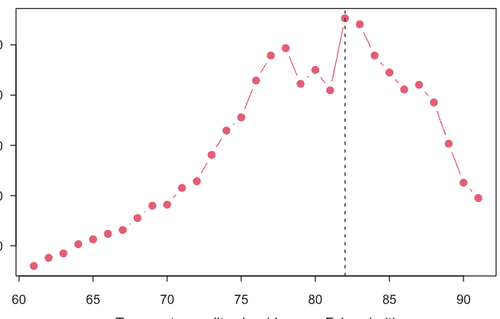

图 3.2：使用 `gi.test()` 得到的检验统计量，用于比较使用 Temp 的每个二元划分的两组 Ozone 值。虚线显示最佳分割点 c = 82。

从结果中可以看到，所有检验统计量的最大值为 c_q = 53.282，与分割点 c = 82 相关，这给了我们树中的第一个分割（即，Temp <= 82）。

按照算法 3.1，我们将继续分割每个生成的子节点，直到算法 3.1 步骤 1 中的全局原假设在指定的 alpha 水平下无法被拒绝。例如，将先前的代码应用于生成的左子节点（Temp <= 82）将导致使用 Wind <= 6.9 进行进一步划分。我将在 3.5.1 节中使用特定的 CTree 软件验证这些计算。


### 3.4.3 剪枝

与 CART 和其他穷举搜索过程不同，CTree 使用统计停止标准（例如，Bonferroni 调整的 _p_-值）来确定树的大小，不需要剪枝——当然，在某些情况下剪枝仍然有益（参见第 3.4.5 节）。这并不是说 CTree 不会过拟合。正如我们将在第 3.4.5 节和第 3.5 节中看到的，阈值 \(\alpha\) 对树的大小及其复杂性有直接影响，通常被视为调参参数。

### 3.4.4 缺失值

与 CART 类似，CTree 可以使用代理变量的思想来处理缺失值，但这不是当前 CTree 实现中的默认设置。默认情况下，由于缺失值而无法分类到子节点的观测值要么 1) 根据节点分布随机分配（如较新的 **partykit** 包 [Hothorn and Zeileis, 2021] 所示），要么 2) 与多数类一致（如较旧的 **party** 包 [Hothorn et al., 2021b] 所示）。

在预测变量 _X_ 中存在缺失值的观测值，在计算算法 3.1（第 122 页）第 1 步中的相关检验统计量时会被简单忽略。同样，与分割变量相关的缺失值在计算第 2 步中的检验统计量时也会被忽略。一旦找到分割，就可以使用类似于第 2.7 节中为 CART 描述的方法构建代理变量，特别是，使用问题中的二元分割作为响应创建二元决策树桩，并尝试使用算法 3.1（第 122 页）找到与其相关的最佳分割。

### 3.4.5 \(\alpha\)、\(g()\) 和 \(h()\) 的选择

从推断角度来看，\(\alpha\) 是算法 3.1 第 1 步中用于特征选择的一般独立性检验的预设名义水平，用于控制 I 类错误的概率。请回顾，I 类错误（或 _假阳性_）发生在我们拒绝真零假设时——或者在我们的情况中，当我们得出 **_X_** 和 **_Y_** 不独立的结论，而实际上它们是独立的（即，可能使用了不相关的分割变量）。显然，我们希望 I 类错误的概率较低，这就是为什么我们将 \(\alpha\) 设置为一个较小的数值（例如，\(\alpha = 0.05\)）。

虽然 \(\alpha\) 控制了在每个节点中错误拒绝 $H_0$ 的概率，但我们仍需要考虑每个检验的 _统计效力_；即在 $H_0$ 为假时拒绝它的概率。在递归分区的背景下，效力基本上决定了在每个节点选择相关预测变量的机会。正如 Hothorn et al. [2006c] 所指出的，CTree 中使用的一般独立性检验仅对独立性偏离的某些方向具有高效力，并且取决于 g() 和 h() 的选择。关于选择 g() 和 h() 的有用指南可以在 coin 的“实现一类置换检验：coin 包” vignette 的表 4 中找到；要查看，请在 R 控制台中使用 vignette("Implementation", package = "coin")。

在存在异常值的情况下，如果 g() 和 h() 将 X 和 Y 转换为秩（因为秩对异常观测值更稳健），那么在第 3.3 节中讨论的一般独立性检验在给定样本量和 \(\alpha\) 下将更具效力。

为了说明，让我们运行一个快速的蒙特卡罗实验。假设 X 服从标准正态分布，且 Y 等于 X 加上少量噪声：Y = X + ε，其中 ε ~ N(0, σ = 0.1)。图 3.3 显示了从 X 和 Y 生成的两个大小为 N = 100 的随机样本的散点图。图 3.3 左侧面板显示了 X 和 Y 之间明显的关联。右侧面板显示了同一样本的散点图，但其中三个观测值被替换为异常值。即使有异常值，X 和 Y 之间仍然存在明显的关系。

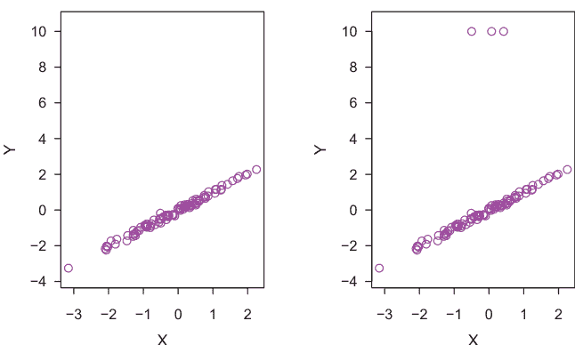

图 3.3：两个线性相关变量的散点图。左侧：原始样本。右侧：三个观测值被替换为异常值的原始样本。

下面的代码块对 X 和 Y 的 100 个随机样本应用 gi.test() 函数，同时使用恒等变换和秩变换，样本量范围从 10 到 100；请注意，每个样本包含三个异常 Y 值。对于每个样本量，每个检验的近似效力计算为在 100 次中在 \(\alpha = 0.05\) 水平下拒绝零假设的比例。结果在图 3.4 中绘制。显然，在本示例中，使用秩在样本量范围内提供了更具效力的检验。

```
set.seed(2142) # for reproducibility
N <- seq(from = 5, to = 100, by = 5) # range of sample sizes
res <- sapply(N, FUN = function(n) {
  pvals <- replicate(1000, expr = {
    x <- rnorm(n, mean = 0) # from each test
    y <- x + rnorm(length(x), mean = 0, sd = 0.1)
    y[1:3] <- 10 # insert outliers
    test1 <- gi.test(x, y) # no transformations
    test2 <- gi.test(x, y, g = rank, h = rank) # convert to ranks
    c(test1["pval"], test2["pval"]) # extract p-values
  })
})
apply(pvals, MARGIN = 1, FUN = function(x) mean(x < 0.05))
})
# Plot the results (Figure 3.4)
plot(N, res[2L, ], xlab = "Sample size", ylab = "Power", type = "l",
  ylim = c(0, 1), las = 1)
lines(N, res[1L, ], col = 2, lty = 2)
legend("bottomright",
  legend = c("Rank transformation", "No transformation"),
  lty = c(1, 2), col = c(1, 2), inset = 0.01,
  box.col = "transparent")
```

请记住，在递归分区中，随着树的深入，样本量会减少。因此，树越往下，检验的效力越低。类似于 CART 类决策树，更准确的分割倾向于出现在顶部。

Hothorn et al. [2006c] 建议，增加 \(\alpha\) 可以帮助确保检测到任何类型的依赖结构。然而，增加 \(\alpha\) 会导致更多分割，从而产生更复杂的树。为了避免这种情况下的过拟合，可以以多种方式应用剪枝，例如，合并不满足第二个阈值 \(\alpha' < \alpha\) 的终端节点。

类似于 CART（第 2.5.1 节）中的代价-复杂度参数（\(cp\)），您也可以将 \(\alpha\) 视为控制树整体复杂性（即终端节点数量）的调参参数——较小的 \(\alpha\) 值会导致更浅的树。因此，\(\alpha\) 可以使用交叉验证或类似技术进行优化，在这种情况下，与 I 类错误率相关的先前定义不再适用。

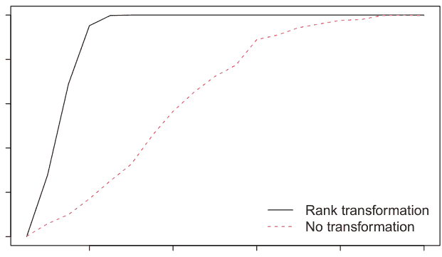

图 3.4：使用第 3.3 节概述的条件推断程序，两个单变量连续变量 $X$ 和 $Y$ 之间一般独立性检验的效力与样本量关系。实心黑色曲线对应使用秩，而虚线红色曲线对应恒等（即无变换）。

### 3.4.6 拟合值和预测

对于单变量回归和分类树，拟合值和预测的获取方式与 CART 相同。例如，终端节点内的类别比例可用于类别概率估计。对于回归，终端节点内响应值的样本均值可用作拟合值或用于预测新观测值。

然而，CTree 非常灵活，可以处理简单分类和回归之外的许多其他情况。例如，对于删失结果，每个终端节点可以使用 Kaplan-Meier 估计器进行总结；参见第 3.5.3 节。中位生存时间可用于进行预测。

### 3.4.7 类别不平衡

与 CART 不同，CTree 无法明确考虑先验类别概率，也无法考虑不等的误分类成本。然而，它可以为特定观测值分配更高的权重（为简洁起见，我省略了该情况


来自第 3.3 节公式中的权重，因此请参阅该处列出的参考文献以获取完整详情)。例如，我们可以为与更高误分类成本相关的观测分配更高的权重。然而，这种方法有一个缺点。增加案例权重本质上对应于增加算法 3.1 中使用的统计检验的样本量 $N$，这将导致更小的 $p$-值。因此，生成的树可能大得多，因为更多的分割将显著。降低 $\alpha$ 和/或采用第 3.4.5 节讨论的调谐策略可能有所帮助，但这可能是一项困难的平衡工作。

#### 3.4.8 变量重要性

与 CART（第 2.8 节）中使用的基于不纯度的变量重要性度量相反，CTree 使用一种基于 _置换_ 的框架，类似于算法 6.1（第 205 页）中概述的程序。这与“置换检验”中的“置换”不同，而是指在记录预测性能差异之前（与未对任何特征列进行置换的基线性能相比），单个特征列被随机置换，一次一个。

### 3.5 软件与示例

条件推断树可通过 **party** 包中的 **ctree()** 函数使用。[^f] 然而，**partykit** 包包含 **ctree()** 的改进重新实现，并推荐用于一般拟合单个条件推断树。**partykit** 中的 **ctree()** 函数模块化程度更高，并且几乎完全用 R 编写；然而，这种灵活性似乎要付出代价，因为 **partykit::ctree()** 可能比 **party::ctree()**（后者用 C 实现）慢得多。还值得指出的是，**partykit** 非常可扩展，并允许您将来自不同来源的树模型转换为 **partykit** 可以处理的标准格式（例如，导入保存为 _预测模型标记语言_ (PMML) 格式 [Data Mining Group, 2014] 的树）。这的一个好例子是 R 包 **C5.0** [Kuhn and Quinlan, 2021]，它提供了对 C5.0 的接口（C5.0 发展自 C4.5，在在线补充中讨论）。

R 包 **boot** [Canty and Ripley, 2021] 可用于执行一般置换检验，以及更一般的自助程序；对于置换检验，请参见 Davison and Hinkley [1997, Sec. 4.3] 中的示例代码。

**coin** 包实现了第 3.3 节简要讨论的条件推断程序；简而言之，**coin** 为一般独立性检验提供了一个通用框架，包括：两样本检验、K 样本检验和基于相关性的检验，适用于连续、名义、有序和多变量数据。

如果您不是 R 用户，那么可能就没办法了，因为我不知道有任何非 R 语言的 CTree 实现——这更是应该对多种开源语言保持开放态度的理由！

尽管 `partykit::ctree()` 和 `party::ctree()` 之间存在许多差异，但在默认设置下，两者几乎每次都会生成相同的树。有关两者差异的更多信息，请参见 `partykit` 的 "ctree: Conditional Inference Trees" vignette 的第 7.4 节，可以在 R 中通过调用 `utils::vignette("ctree", package = "partykit")` 查看。

以下示例说明了通过条件推断使用 `party` 和 `partykit` 进行无偏递归分区的基本用法。我将验证我之前在各节中手动计算的结果，并为新数据集构建条件推断树，包括回归和生存示例。

#### 3.5.1 示例：纽约空气质量测量

在前面的章节中，我们使用自己的 `gi.test()` 函数分割了 `airquality` 数据集的根节点。使用条件推断，我们发现第一个最佳分割发生在 `Temp <= 82`。现在，让我们使用 `partykit` 应用算法 3.1，并递归分割 `airquality` 数据集，直到我们无法再在 `alpha = 0.05` 水平上拒绝 `Ozone` 与五个数值特征中任何一个之间的一般独立性的原假设。

您可以使用 `ctree_control()` 来指定控制 CTree 算法的若干参数；在下面的代码块中，我们使用默认值；有关可设置的所有参数的说明，请参见 `?partykit::ctree_control`。在本章中，我们为算法 3.1 的步骤 1)–2) 使用了检验统计量 `c_q` 的二次形式，这是 `party` 和 `partykit` 中的默认值（`teststat = "quad"`）。我们还使用默认的 Bonferroni 调整 `p`-值。要指定 `alpha`，请在 `ctree_control()` 中设置 `alpha` 或 `mincriterion` 参数，其中 `mincriterion` 的值对应于 `1 - alpha`（仅 `party` 中可用 `mincriterion` 参数）；两个包都使用默认显著性水平 `alpha = 0.05`。在 `party` 的 `ctree()` 实现中，转换函数 `g()` 和 `h()` 可分别通过 `xtrafo` 和 `ytrafo` 参数指定；在 `partykit` 的实现中，仅提供 `ytrafo`。

接下来，我调用 `ctree()` 来递归分区数据，并使用 `partykit` 的内置 `plot()` 方法绘制生成的树图（参见图 3.5）：

```
library(partykit)
```

```
# Fit a default CTree using Bonferroni adjusted p-values
aq <- airquality[!is.na(airquality$Ozone), ]
(aq.cit <- ctree(Ozone ~ ., data = aq))

#>
#> Model formula:
#> Ozone ~ Solar.R + Wind + Temp + Month + Day
#>
#> Fitted party:
#> [1] root
#> | [2] Temp <= 82
#> | | [3] Wind <= 6.9: 56 (n = 10, err = 21946)
#> | | [4] Wind > 6.9
#> | | | [5] Temp <= 77: 18 (n = 48, err = 3956)
#> | | | [6] Temp > 77: 31 (n = 21, err = 4621)
#> | [7] Temp > 82
#> | | [8] Wind <= 10.3: 82 (n = 30, err = 15119)
#> | | [9] Wind > 10.3: 49 (n = 7, err = 1183)
#>
#> Number of inner nodes: 4
#> Number of terminal nodes: 5
```

```
plot(aq.cit) # Figure 3.5
```

请注意，我再次删除了带有缺失响应值的行。拟合的树仅在两个预测变量 `Temp` 和 `Wind` 上包含四个分割（即五个终端节点）。`ctree()` 对象的 `plot()` 方法非常灵活，我建议您阅读 `?partykit::plot` 中的文档。默认情况下，终端节点使用适当的图进行总结，该图取决于响应变量的尺度——在此例中为箱线图。算法 3.1 步骤 1) 的 $p$-值在每个节点中打印，以及选定的分割变量和节点编号：

在 `partykit` 中，我们可以使用 `strucchange` 包 [Zeileis et al., 2019] 的 `sctest()` 函数打印与任何节点相关的检验统计量和调整后的 p 值，如下所示；`1` 指定感兴趣的节点，根据打印输出和树图，该节点对应于根节点。这些对应于算法 3.1 步骤 1) 中进行的检验。结果与我们之前使用 `gi.test()` 和 `p.adjust()` 进行的计算一致，太棒了！据我所知，您目前无法在 `partykit` 中获得步骤 2) 的检验统计量，尽管这在 `party` 的 `ctree()` 实现中是可能的，我将在下一部分演示。

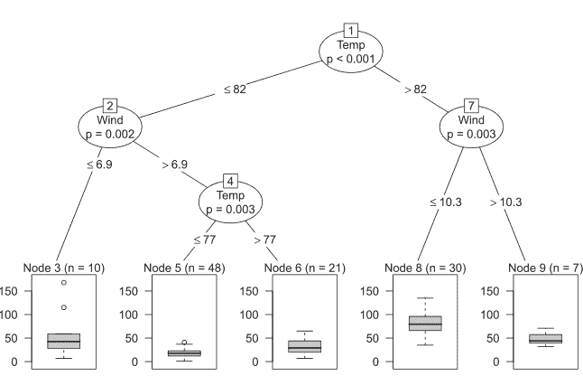

图 3.5：应用于纽约空气质量测量数据集的默认 CTree。

```
strucchange::sctest(aq.cit, 1)

##> Solar.R Wind Temp Month Day
##> statistic 13.34761 4.16e+01 5.61e+01 3.113 0.0201
##> p.value 0.00129 5.56e-10 3.47e-13 0.333 1.0000
```

使用 party 拟合条件推断树时，可以使用 `nodes()` 函数提取树的节点列表；`where` 参数指定节点 ID（即用于标记相关树图中节点的节点编号）。下面，我将使用 `party::ctree()` 重新拟合同一棵树，提取与根节点相关的分割，并绘制比较分割变量（在此例中为 `Temp`）不同切断点的相应检验统计量。请注意，`party::ctree()` 仅为算法 3.1 的步骤 2) 使用最优选统计量 (`c_m`)[^g]，但请回顾，在单变量情况下，`c_m^2 = c_q`，因此我将对它们进行平方，并与我之前在图 3.2（第 127 页）中绘制的结果进行比较。正如它们应该的那样，`party::ctree()` 的结果（显示在图 3.6 中）与我之前使用 `gi.test()` 函数获得的结果一致。

```
aq.cit2 <- party::ctree(Ozone ~ ., data = aq) # refit the same tree
root <- party::nodes(aq.cit2, where = 1)[[1L]] # extract root node
split.stats <- root$split$splitstatistic # split statistics
cutpoints <- aq[[root$split$variableName]][split.stats > 0]
cq <- split.stats[split.stats > 0] ^ 2
```

[^f]: 包名称显然是对“partition y”一词的戏仿。

[^g]: 相比之下，partykit 允许您选择在算法 3.1 的步骤 2) 中使用哪种检验统计量，并默认使用我们之前在 gi.test() 中使用的二次形式 c_q。


```
# Plot split statistics (Figure 3.6; compare to Figure 3.2)
plot(cutpoints[order(cutpoints)], cq[order(cutpoints)], col = 4,
     pch = 19, type = "b", las = 1,
     xlab = "Temperature split value (degrees Fahrenheit)",
     ylab = "Test statistic")
abline(v = root$psplit$splitpoint, lty = "dashed")
```

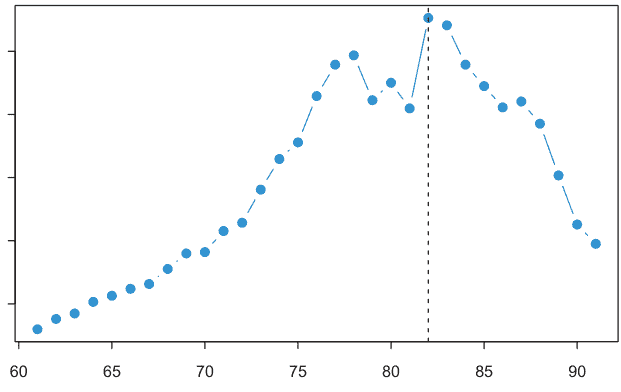

图 3.6：来自 `party::ctree()` 的检验统计量，使用 `Temp` 对每个二元划分的 `Ozone` 值的两组进行比较。虚线显示最佳分割点 c = 82。将这些结果与图 3.2 的结果进行比较。

您可以使用 `partykit::as.party()` 函数将各种其他实现生成的决策树强制转换为 "party" 对象。这意味着，例如，我们可以使用 `rpart` 拟合决策树，并使用 `partykit` 的 `plot()` 方法对其进行可视化。

为说明这一点，下一个代码块将 `rpart` 树拟合到相同的 `aq` 数据，将其强制转换为 "party" 对象，并绘制相关的树图。在此，我将复杂度参数 $c_p$ 设置为零（即，对树的大小无惩罚），并使用默认的 10 折交叉验证以及 1-SE 规则来修剪树（第 2.5.2.1 节）。在此示例中，CART 生成了一个决策桩（即，只有一个分割的树）。

```
set.seed(1525) # for reproducibility
aq.cart <- rpart::rpart(Ozone ~ ., data = aq, cp = 0)
aq.cart.pruned <- treemisc::prune_se(aq.cart, se = 1) # 1-SE rule
plot(partykit::as.party(aq.cart.pruned))
```

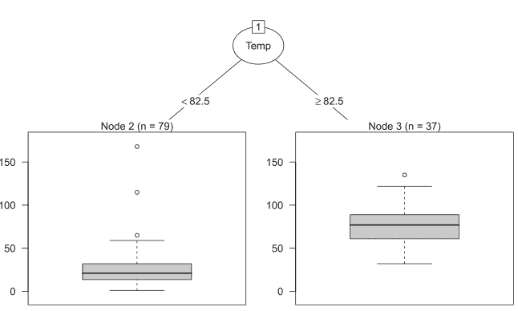

图 3.7：拟合于纽约空气质量测量数据集的类 CART 决策树。该树根据第 2.5.2.1 节讨论的 1-SE 规则进行了修剪。

### 3.5.2 示例：葡萄酒质量评级

有序结果在科学研究和日常实践中很常见。例如，在医学和流行病学研究中，有序响应通常表示标准测量量表的水平，例如疼痛程度（例如，无 < 轻度 < 中度 < 重度）[Harrell, 2015, p. 311]。

在此示例中，我将采用在第 1.4.8 节中介绍的葡萄酒质量数据。目标是仅基于理化测试（如酸度）来建模红葡萄酒的质量，并解释结果。目标变量（葡萄酒质量）是一个由人类专家品酒得出的 0–10 有序变量。但是请注意，在此数据集中，我们仅观察到 3–9 范围内的评级。有关更多背景和列信息，请参见 `?treemisc::wine`。

如第 1.4.8 节所述，这是一个众所周知的数据集，常用于统计学习教程。然而，许多人通过任意二分葡萄酒质量评分并将其视为二分类问题，将此视为分类问题。这是糟糕的统计实践，会导致信息损失。这种“二分狂热”[Senn, 2005]不幸也在医学和流行病学研究中普遍存在。

使用 CTree，我们可以轻松地将结果建模为有序变量。首先，我将从 **treemisc** 加载数据，并将（整数）响应强制转换为有序因子；有关详细信息，请参见 ?as.ordered：

```
wine <- treemisc::wine
reds <- wine[wine$type == "red", ] # reds only
rm(wine) # remove from global environment
reds$type <- NULL # remove column
reds$quality <- as.ordered(reds$quality) # coerce to ordinal
head(reds$quality) # print first few quality scores
#> [1] 5 5 5 6 5 5
#> Levels: 3 < 4 < 5 < 6 < 7 < 8
```

接下来，我将通过 **partykit** 拟合一个（默认的）条件推断树。不幸的是，树图太大，无法在此页面上整齐打印，因此我将改为显示拟合树的打印输出：

```
(reds.ct <- ctree(quality ~ ., data = reds))
#>
#> Model formula:
#> quality ~ fixed.acidity + volatile.acidity + citric.acid + residua...
#> chlorides + free.sulfur.dioxide + total.sulfur.dioxide +
#> density + pH + sulphates + alcohol
#>
#> Fitted party:
#> [1] root
#> | [2] alcohol <= 10.5
#> | | [3] volatile.acidity <= 0.3
#> | | | [4] sulphates <= 0.7: 5 (n = 27, err = 48%)
#> | | | [5] sulphates > 0.7: 6 (n = 58, err = 41%)
#> | | [6] volatile.acidity > 0.3
#> | | | [7] volatile.acidity <= 0.7
#> | | | | [8] alcohol <= 9.8
#> | | | | | [9] total.sulfur.dioxide <= 39: 5 (n = 171, er...
#> | | | | | | [10] total.sulfur.dioxide > 39
#> | | | | | | | [11] pH <= 3.4: 5 (n = 205, err = 22%)
#> | | | | | | | [12] pH > 3.4: 5 (n = 53, err = 42%)
#> | | | | [13] alcohol > 9.8: 6 (n = 228, err = 54%)
#> | | | | [14] volatile.acidity > 0.7
#> | | | | | [15] fixed.acidity <= 8.5: 5 (n = 172, err = 26%)
#> | | | | | [16] fixed.acidity > 8.5: 5 (n = 69, err = 35%)
#> | | [17] alcohol > 10.5
#> | | | [18] volatile.acidity <= 0.9
#> | | | | [19] sulphates <= 0.6
#> | | | | | [20] volatile.acidity <= 0.3: 6 (n = 33, err = 45%)
#> | | | | | [21] volatile.acidity > 0.3: 6 (n = 207, err = 45%)
#> | | | | [22] sulphates > 0.6
#> | | | | | [23] alcohol <= 11.5
#> | | | | | | [24] total.sulfur.dioxide <= 49
#> | | | | | | | [25] volatile.acidity <= 0.4: 7 (n = 72, e...
#> | | | | | | | [26] volatile.acidity > 0.4: 6 (n = 80, err...
#> | | | | | | | [27] total.sulfur.dioxide > 49: 6 (n = 55, err...
#> | | | | | | [28] alcohol > 11.5: 7 (n = 142, err = 48%)
#> | | | | [29] volatile.acidity > 0.9: 5 (n = 27, err = 59%)
#>
#> Number of inner nodes: 14
#> Number of terminal nodes: 15
```

为了查看模型在学习样本上的表现，我们可以将观察到的质量评级与拟合值（即来自学习样本的预测）进行交叉分类：

```
p <- predict(reds.cit, newdata = reds) # fitted values
table(predicted = p, observed = reds$quality) # contingency table
```

| 预测 \ 观察 | 3 | 4 | 5 | 6 | 7 | 8 |
|---|---|---|---|---|---|---|
| 3 | 0 | 0 | 0 | 0 | 0 | 0 |
| 4 | 0 | 0 | 0 | 0 | 0 | 0 |
| 5 | 9 | 33 | 483 | 194 | 5 | 0 |
| 6 | 1 | 20 | 191 | 361 | 85 | 3 |
| 7 | 0 | 0 | 7 | 83 | 109 | 15 |
| 8 | 0 | 0 | 0 | 0 | 0 | 0 |

例如，在所有质量评分为 7 的红葡萄酒中，有 5 种被预测为质量评级 5，85 种被预测为质量评级 6，其余（109）种被预测为质量评级 7。

那么，哪些变量似乎对葡萄酒质量评级最具预测性？乍一看，体积酒精含量（alcohol）和挥发性酸度（volatile.acidity）似乎是重要的预测因子，因为它们出现在树的顶部，并被多次用于划分数据。我们可以在 CTree 中使用 **partykit** 的 `varimp()` 函数来量化这一点。该函数使用基于置换的方法计算重要性，类似于第 6.1.1 节讨论的过程。目前，只需将返回的重要性分数视为移除相关预测因子的影响后导致的性能下降估计值。默认情况下，性能由 *负对数似然*<sup>h</sup> 衡量。

```
set.seed(2023) # for reproducibility
(vi <- varimp(reds.cit, nperm = 100)) # variable importance scores
dotchart(vi, pch = 19, xlab = "Variable importance") # Figure 3.8
```

| 变量 | 重要性 |
|---|---|
| alcohol | 0.5465 |
| volatile.acidity | 0.3537 |
| sulphates | 0.1852 |
| total.sulfur.dioxide | 0.0395 |
| pH | 0.0235 |
| fixed.acidity | 0.0188 |

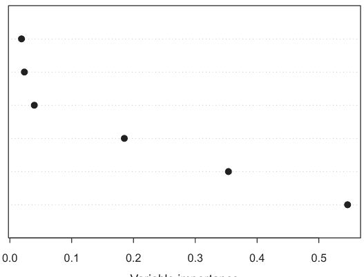

图 3.8：红葡萄酒质量条件推断树的变量重要性图。

正如我们从树的输出中所怀疑的那样，体积酒精含量和挥发性酸度，其次是硫酸盐，是该模型中葡萄酒质量评级最重要的预测因子。葡萄酒质量评级与前三个预测因子各自的部分依赖（第 6.2.1 节）在图 3.9 中给出；请注意，y 轴按与响应相同的尺度解释。在此，我们可以看到每个预测因子的功能效应。例如，酒精与预测质量评分呈单调递增关系。这很合理，这可能也是为什么我从不购买体积酒精含量低于 14% 的红葡萄酒。你觉得另外两个预测因子的效应合理吗？

### 3.5.3 示例：梅奥诊所肝移植数据

在此示例中，我将重新讨论在第 1.4.9 节中描述的 PBC 数据。Ahn 和 Loh [1994] 简要讨论了该数据的基于树的分析。下面我们加载 survival 包并准备数据：

- 与往常一样，复制此图的代码可在图书网站上找到。


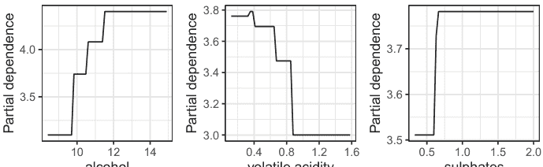

图 3.9：酒质评分对酒精体积含量（左）、挥发性酸度（中）和硫酸钾水平（右）的部分依赖。

```r
library(survival)

# Prep the data a bit
pbc2 <- pbc[!is.na(pbc$trt), ] # use randomized subjects
pbc2$id <- NULL # remove ID column
# Consider transplant patients to be censored at day of transplant
pbc2$status <- ifelse(pbc2$status == 2, 1, 0)
facs <- c("sex", "spiders", "hepato", "ascites", "trt", "edema")
for (fac in facs) { # coerce to factor
  pbc2[[fac]] <- as.factor(pbc2[[fac]])
}
```

如第 1.4.9 节简要讨论的那样，生存（或可靠性）分析关注寿命的分布，通常是指人类、动物或机器部件的寿命。生存分析中的响应变量是时间至事件，例如，时间至死亡或再入院（例如，用于比较两种药物的随机临床试验受试者）或机器中某个部件失效的时间（例如，运行中的电机）。

图 1.11 给出了对照组和治疗组（即药物组）生存函数的 Kaplan-Meier 估计。与所有生存曲线一样，生存概率随时间降低。通常我们不太关注总体生存曲线，而是关注其在组间的差异。在本示例中，我们的目标是查看额外协变量是否可用于有效区分具有不同生存分布的组。

Loh [2014] 提供了树结构生存模型的概述。CTree 采用的方法相当直接。随访时间（time）和事件指示器（status）被合并为单个数值响应，并视为单变量连续；因此，前面讨论的技术直接适用。在 CTree 中，右删失数据使用 coin 包中的 logrank_trafo() 函数转换为秩和检验得分；也就是说，影响函数 h() 将右删失生存时间转换为秩和检验得分。

为说明这一点，让我们检验预测因子 bili（血清胆红素（mg/dl））与响应的秩和检验得分之间总体独立性的原假设：

```r
library(coin)
```

```r
independence_test(Surv(time, status) ~ bili, data = pbc2,
  teststat = "quadratic")
```

```
#>
#> Asymptotic General Independence Test
#>
#> data: Surv(time, status) by bili
#> chi-squared = 77, df = 1, p-value < 2e-16
```

```
# Our 'gi.test()' function from earlier should also work
```

```r
lr.scores <- coin::logrank_trafo(Surv(pbc2$time, pbc2$status))
```

```r
gi.test(pbc2$bili, y = lr.scores)
```

```
#>
#> chisq pval
#> 77.5 0.0
```

使用 alpha = 0.05，我们将拒绝原假设（p < 0.001）并得出结论：血清胆红素水平与生存率相关。但这除此之外没能告诉我们太多。血清胆红素水平较高的受试者是否倾向于生存更长时间？要回答此类问题，我们可以使用 CTree，通过每个特征与秩和检验得分之间的基于条件推断的独立性检验，递归地划分数据：

```r
(pbc2.ct <- partykit::ctree(Surv(time, status) ~ ., data = pbc2))
```

```
#>
#> Model formula:
#> Surv(time, status) ~ trt + age + sex + ascites + hepato + spiders +
#> edema + bili + chol + albumin + copper + alk.phos + ast +
#> trig + platelet + protime + stage
#>
#> Fitted party:
#> [1] root
#> |   [2] bili <= 1.9
#> |   |   [3] edema in 0
#> |   |   |   [4] stage <= 2: Inf (n = 61)
#> |   |   |   [5] stage > 2: 4191 (n = 104)
#> |   |   [6] edema in 0.5, 1: Inf (n = 16)
#> |   |   [7] bili > 1.9
#> |   |   [8] protime <= 11.2
#> |   |   |   [9] age <= 44.5
#> |   |   |   |   [10] bili <= 5.6: 3839 (n = 29)
#> |   |   |   |   [11] bili > 5.6: 1080 (n = 7)
#> |   |   |   [12] age > 44.5: 1487 (n = 45)
#> |   |   |   [13] protime > 11.2
#> |   |   |   |   [14] albumin <= 3.6: 597 (n = 43)
#> |   |   |   |   [15] albumin > 3.6: 2540 (n = 7)
#>
#> Number of inner nodes:  7
#> Number of terminal nodes: 8
```

请注意，治疗组（药物）在任何节点均未被选为分割变量。这并不奇怪，因为 Fleming 和 Harrington [1991, p. 2] 得出结论：服用安慰剂者与服用药物者的生存时间之间没有实际显著差异。

我们还可以使用 `plot()` 方法显示树图；结果显示在图 3.10 中。对于删失结果，每个节点中显示生存曲线的 Kaplan-Meier 估计。图 3.10 中的树图清楚地表明，血清胆红素水平较高的受试者往往生存时间较短。你还能从树图中得出哪些其他结论？

```r
plot(pbc2.cit) # Figure 3.10
```

### 3.6 最后的想法

CTree 是过去二十年递归划分中更重要的发展之一；其他重要发展在第 4 章以及本书的在线补充中讨论。总结一下，与 CART 相比，CTree：

- 使用调整后的统计检验分别确定每个节点的分割变量和分割点（CART 只是使用穷举搜索）；
- 提供无偏的分割变量选择；
- 不需要剪枝（或大量调参）；
- 可以自然地考虑数据的性质——例如，当变量为任意类型时（例如，多变量、有序、右删失等）。

如果 CTree 在准确性方面与 CART 相当，不需要后剪枝，并提供无偏的分割变量选择，那么 CART 为何仍然如此流行？如 Loh [2014] 的答复中所指出的，“这似乎与第三种不良影响相关：许多提出或应用树算法的作者要么不了解，要么选择忽略该领域的类似工作。即使是近期的论文也不引用 2000 年以后的工作，因此忽略了十多年来可能高度相关的积极发展。” 另一个重要因素是软件可用性。许多树算法没有易于使用的开源实现。例如，在 Rusch 和 Zeileis 考虑的 99 种树算法中（参见 Loh [2014] 末尾的讨论），大约三分之一有免费开源实现可用（包括 CART 和 CTree）。类 CART 的决策树也在各种开源平台上广泛实现（参见第 2.9 节）。另一方面，据我所知，CTree 仅在 R 中可用。

使用类 CART 的决策树时，你应该担心变量选择偏差吗？当然应该。然而，如 Loh [2014] 的答复中所指出的，“……在某些情况下，如果树模型用于预测而非解释，选择偏差可能不会造成严重危害。” 虽然有偏的变量选择可能导致在无关特征上出现更多虚假分割，但如果样本量较大且此类变量不太多，使用交叉验证进行剪枝通常能有效移除它们。

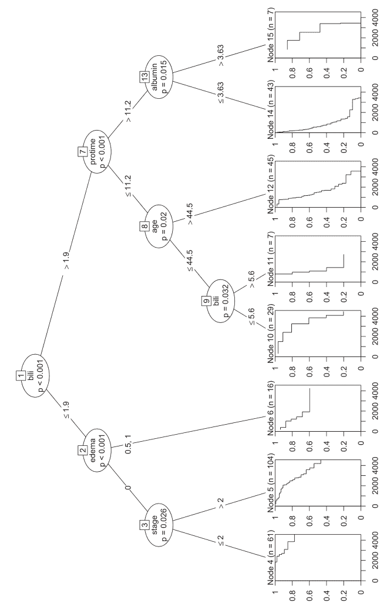

图 3.10：应用于 Mayo Clinic PBC 数据子集的条件推断树。终端节点使用生存函数的 Kaplan-Meier 估计进行总结。树图突出了与不同生存分布相关的潜在风险因素。

Taylor & Francis
Taylor & Francis Group
http://taylorandfrancis.com

# 现代决策树的用户指南 GUIDE

> 在我们可能撞到的所有树中，偏偏撞到了一棵会还击的树。
>
> J.K. Rowling
> 《哈利·波特与密室》

本章介绍了一种强大但似乎鲜为人知的决策树算法，用于 _广义、无偏、交互检测与估计_（GUIDE），该算法由 Loh [2002, 2009] 提出。不幸的是，与具有易于使用的开源实现的其他算法（如 CART（例如 **rpart**）和 CTree（例如 **partykit**））相比，GUIDE 在从业者和研究人员中似乎采用率要低得多。

与 CTree 类似，GUIDE 基于统计假设检验，力求实现无偏的分割变量选择。特别是，GUIDE 专门设计用于解决三个可能对决策树可解释性产生不利影响的问题：

- 1) 分割变量选择偏差；
- 2) 对局部交互不敏感；
- 3) 树结构过于复杂（例如，第 97 页图 2.23 中的 Ames 房价回归树）。


## 4.1 引言

GUIDE 从早期的树生长程序演变而来，始于 *快速且准确的分类树*（FACT）算法 [Loh and Vanichsetakul, 1988]。FACT 在当时因其使用 *线性判别分析*（LDA）来寻找基于两个预测变量线性组合的分割而具有创新性。FACT 仅适用于分类问题，任何基于线性分割的节点都会被划分为与类别标签数量相同的子节点（即，FACT 可以使用多分叉分割）。连续变量的分割变量选择基于比较基于 ANOVA 的 *F*-统计量；LDA 应用于具有最大 *F*-统计量的变量，以找到最佳分割点（即，\(x \le c\) 与 \(x > c\)，其中 \(c\) 在 \(x\) 的定义域内）来划分数据。分类预测变量通过使用 LDA 将其虚拟编码向量投影到最大判别坐标（也称为 *规范分析* 中的 *规范变量*）来转换为序数变量；最终分割以 \(x \in S\) 的形式表达，其中 \(S\) 是 \(x\) 的类别子集。由于 FACT 依赖于 ANOVA *F*-检验来进行分割变量选择，只有当所有预测变量都是有序时它才是无偏的（即，它偏向于名义分类变量）[Loh, 2014]。

*快速、无偏且高效的统计树*（QUEST）程序 [Loh and Shih, 1997] 通过对分类变量使用卡方检验（即，在每个分类变量和响应之间形成列联表）来改进 FACT 中的偏差。与 CART 类似，QUEST 仅允许二元分割。令 \(J_t\) 为任何特定节点 \(t\) 中的响应类别数量。每当 \(J_t > 2\) 时，QUEST 通过将 \(J_t\) 个类别合并为两个 *超类*，然后应用 *F*- 和卡方检验来选择分割变量，从而生成二元分割。有序预测变量的最佳分割点通过穷举搜索（如第 2 章中）或 *二次判别分析*（QDA）来找到。对于分类分割变量，最佳分割点的查找方式相同，即在将虚拟编码向量转换为最大判别坐标后，如同在 FACT 中一样。

Kim 和 Loh [2001] 引入了 *具有无偏交互选择和估计的分类规则*（CRUISE）算法，作为 QUEST 的继任者。然而，与 QUEST 不同，CRUISE 允许根据特定节点中的响应类别数量进行多分叉分割。此外，虽然 QUEST 对有序变量使用 *F*-检验，对名义变量使用卡方检验，但 CRUISE 在对有序变量离散化后对两者都使用卡方检验。对于分割变量选择，CRUISE 使用一个两步程序，在每个节点上同时检验 *主效应* 和 *双向交互作用*。

CRUISE 后来被 GUIDE [Loh, 2009] 取代，GUIDE 通过保留 QUEST 和 CRUISE 的优点并修复其主要弱点来改进两者。CRUISE 的一个缺点是交互检验的数量远多于主效应检验的数量；例如，有 k 个特征时，有 k 个主效应检验和 k (k − 1) 个双向交互检验。由于大部分 p 值来自交互检验，CRUISE 倾向于选择相对于其他预测变量可能具有弱主效应的分割变量。另一方面，GUIDE 将交互检验的数量限制为仅那些基于 Bonferroni 调整 p 值且主效应显著的预测变量。

接下来的两个部分分别介绍了 GUIDE 在标准回归和分类中的许多细节；但请注意，GUIDE 还已扩展以处理其他几种情况（例如，删失结果和纵向数据）。一般来说，GUIDE 在选择分割变量时使用两步程序。因此，与 CART（第 2 章）和 CTree（第 3 章）相比，GUIDE 涉及更多步骤。各个步骤本身并不复杂（大部分涉及连续特征的转换以及当交互检验显著时该怎么做），但为了简洁，我将只介绍关键细节，并在过程中指出有用的参考资料。

请注意，官方 GUIDE 软件——虽然免费可用，但不是开源的——多年来已经发生了很大变化；GUIDE 程序将在第 4.9 节中简要讨论。因此，各种 GUIDE 算法的一些精细细节可能自其原始出版以来已发生变化。任何重要更新都可能出现在官方 GUIDE 软件的修订历史中：

http://pages.stat.wisc.edu/~loh/treeprogs/guide/history.txt.

如果您有兴趣深入了解 GUIDE 在回归和分类中的应用，我建议您阅读 Loh [2002]（GUIDE 回归的官方参考）、Loh [2009]（GUIDE 分类的官方参考）、Loh [2011]（一个更新的概述，包含与其他树算法的一些比较）和 Loh [2012]（变量选择和重要性）。当前的 GUIDE 软件手册也很有用，可从 GUIDE 网站获取：

http://pages.stat.wisc.edu/~loh/guide.html.

## 4.2 回归的 GUIDE

无论构建分类树还是回归树，GUIDE 都在整个过程中使用卡方检验。这很方便，因为卡方检验计算速度快，并且可以检测大量模式（例如，曲率和交互效应）。因此，在尝试分割节点之前，响应和任何有序特征都必须转换为名义分类\(^b\)。在内部，GUIDE 将回归问题视为分类问题。具体来说，在树中的任何节点，GUIDE 将模型（例如，常数或线性回归模型）拟合到可用数据并计算残差。残差的符号（即，正/负残差映射为 +1/−1）被用作二元响应来分割节点。与 CART 不同，GUIDE 可以在终端节点中拟合常数或非常数拟合。这两种策略将在接下来的章节中讨论。

\(^b\) 我在第 3.5.2 节中提到了“二分法”的危险，但请记住，这里仅将预测变量离散化用于分割变量选择，而完整的预测变量信息用于选择分割点和进行预测。

### 4.2.1 分段常数模型

使用分段常数模型相当于标准回归树，其中常数（例如，平均响应值）用于总结每个终端节点。令 \(N_t\) 为任意节点 \(t\) 中的观测数量，并令 \(y_{t,1}, y_{t,2}, \dots, y_{t,N_t}\) 为 \(t\) 中的可用响应值。节点 \(t\) 的残差只不过是观测响应值与其样本均值之间的差：\(r_{t,j} = y_{t,j} - \sum_{i=1}^{N_t} y_{t,i} / N_t\)。然后可以使用残差的符号在零处将其二分，以在节点 \(t\) 中创建一个新的二元响应变量：

\[
y'_{t,j} = \left\{ \begin{array}{ll} 1 & \text{if } r_{t,j} > 0 \\ -1 & \text{if } r_{t,j} < 0 \end{array} \right.
\]

同样，在任何节点 \(t\) 中，有序特征（例如，有序分类或连续特征）也通过将其离散化为三个或四个间隔（取决于节点 \(t\) 中的样本量 \(N_t\)）转换为非有序（即，名义）分类。

与 CTree 类似，GUIDE 使用统计检验（特别是卡方检验）来选择分割变量。然而，与 CTree 不同，GUIDE 采用两阶段方法，同时检验所有特征对之间的主效应（称为 _曲率检验_）和双向交互效应。细节相当复杂，但基本步骤（跳过双向交互检验）在算法 4.1（第 151 页）中概述；GUIDE 的交互检验将在第 4.2.2 节中简要讨论。

### 算法 4.1 回归原始 GUIDE 算法的简化版本。请注意，由于官方软件多年来不断发展，其中一些细节可能已发生变化。

- 1) 以 t 作为根节点开始。
- 2) 从对数据的常数拟合（例如，平均响应）中获取带符号的残差。
- 3) 将有序预测变量（例如，连续特征）转换为分类变量，方法是根据样本四分位数（或如果 \(N_t < 60\) 则为三等分位数）将其离散化为四个区间。
- 4) 使用 t 中的 \(N_t\) 个观测值，对每个特征与带符号残差进行卡方独立性检验；二分后的残差形成相应列联表的两行。（将这些称为主效应，或曲率，检验。）令 \(x^*\) 为与曲率检验中最小 Bonferroni 调整 p 值相关的特征。
- 5) 使用穷举搜索找到 \(x^*\) 上的最佳分割，以实现节点 SSE 的最大减少（参见第 2.3 节）。默认情况下，GUIDE 使用与 CART 和 CTree 类似的单变量分割。具体来说，如果 \(x^*\) 是无序的，分割形式为 \(x^* \in S\)，其中 \(S\) 是 \(x^*\) 的类别子集。如果 \(x^*\) 是有序的，分割形式为 \(x^* \le c\)，其中 \(c\) 是 \(x^*\) 观测范围中的中点；为了速度，GUIDE 可选择使用 \(x^*\) 在节点内的样本中位数作为截止值 \(c\)。
- 6) 对所有生成的子节点递归应用步骤 2)–5)，直到所有节点纯净或满足合适的停止标准（例如，达到允许的最大分割数）。
- 7) 与 CART 类似，使用代价复杂度剪枝对生成的树进行剪枝（有关详细信息，请参见第 2.5 节）。

关于算法 4.1 中步骤 4) 的几点说明。首先，任何边际总计为零的行或列都会被删除。其次，为了避免计算非常小的 p 值时出现困难，并考虑到卡方检验之间的自由度不固定，GUIDE 有时会使用 Wilson-Hilferty 变换 [Wilson and Hilferty, 1931] 的修改版本，以确保所有检验统计量大约对应于 a


单自由度卡方分布。c 特别地，设 x 为来自 v 自由度卡方分布（\(\chi_\nu^2\)）的观测值。如果定义

```
$$w_1 = \left( \sqrt{2x} - \sqrt{2\nu - 1} + 1 \right)^2 / 2,$$
$$w_2 = \max \left\{ 0, \left( 7/9 + \sqrt{\nu} \left[ \sqrt[3]{x/\nu} - 1 + 2/(9\nu) \right] \right)^3 \right\},$$
$$w = \begin{cases} w_2 & \text{if } x < \nu + 10\sqrt{2\nu} \\ (w_1 + w_2) / 2 & \text{if } x \ge \nu + 10\sqrt{2\nu} \text{ and } w_2 < x \\ w_1 & \text{otherwise} \end{cases}$$
```

则可得 \(Pr(\chi_1^2 > x) \approx Pr(\chi_1^2 > w)\)；该变换在 treeemisc 包的 wilson_hilferty() 函数中实现（详情见 ?treeemisc:wilson_hilferty）。最后，为简洁起见，GUIDE 默认执行的双向交互检验被省略；详情见第 4.2.2 节。

尽管 GUIDE 全程使用卡方检验（这要求将有序特征离散化为 3-4 组），但 Loh [2002] 提供了一项模拟研究，给出了经验证据表明 GUIDE 的分割变量选择程序确实是无偏的，相对于像 CART 这样的穷尽搜索程序。

#### 4.2.1.1 示例：纽约空气质量测量

为示例说明，让我们回到第 1.4.4.2 节中介绍的纽约空气质量示例。下面是一个名为 guide.chisq.test() 的简单函数，用于执行算法 4.1 的步骤 2)-4)。为简洁起见，并且由于每次检验的自由度相同，它省略了之前讨论过的修正 Wilson-Hilferty 变换：

```
guide.chisq.test <- function(x, y) {
  y <- as.factor(sign(y - mean(y))) # discretize response
  if (is.numeric(x)) { # discretize numeric features
    bins <- quantile(x, probs = c(0.25, 0.5, 0.75), na.rm = TRUE)
    bins <- c(-Inf, bins, Inf)
    x <- as.factor(findInterval(x, vec = bins)) # quartiles
  }
  tab <- table(y, x) # form contingency table
  if (any(row.sums <- rowSums(tab) == 0)) { # check rows
    tab <- tab[which(row.sums == 0), ] # omit zero margin totals
  }
  if (any(col.sums <- colSums(tab) == 0)) { # check columns
    tab <- tab[, -which(col.sums == 0)] # omit zero margin totals
  }
  chisq.test(tab)$p.value # p-value from chi-squared test
}
```

c CTree（第 3 章）在内部通过对数尺度上使用 p 值来避免小 p 值问题。

接下来，我省略任何带有缺失响应值的行，并为每个特征计算算法 4.1 步骤 2) 中的 Bonferroni 调整 \( p \) 值：

```
aq <- airquality[!is.na(airquality$Ozone), ]
pvals <- sapply(setdiff(names(aq), "Ozone"), FUN = function(x) {
  guide.chisq.test(aq[[x]], y = aq[["Ozone"]])
})
p.adjust(pvals, method = "bonferroni") # Bonferroni adjusted p-values
#> Solar.R   Wind   Temp  Month    Day
#> 2.23e-03 1.40e-06 2.50e-14 2.83e-06 5.88e-01
```

与我们之前使用 CART 和 CTree 的发现一样，Temp 被选为拆分根节点（因为它具有最小的调整 \( p \) 值）。我们之前在 2.3.1 节中使用穷尽搜索发现 Temp = 82.5 是最佳拆分点。

### 4.2.2 交互检验

像 CART 这样的穷尽搜索程序可能对局部交互不敏感；根据 Loh [2002]，对双向交互效应敏感的拆分可以产生更短的树。GUIDE 通过显式检验响应与每对特征之间的双向交互来规避这一问题。基本思想是划分一对预测器之间的特征空间以形成新表的列，然后应用算法 4.1 步骤 4) 中概述的相同卡方检验。如果总共有 \( k \) 个预测器，那么每次选择拆分变量来划分数据时（即包括双向交互效应时），都会使用 \( k(k + 1)/2 \) 次卡方检验。

为示例说明，假设我们想要检验 \( (x_i, x_j) \) 与 \( y \) 之间的交互。如果 \( x_i \) 和 \( x_j \) 都是有序的，我们使用样本中位数将每个特征的范围分为两半，从而将 \( (x_i, x_j) \) 划分为四个象限。由此，可以形成一个 \( 2 \times 4 \) 列联表，其中行仍然表示离散化的残差，并可以应用卡方检验。如果 \( x_i \) 和 \( x_j \) 都是名义分类变量，分别具有 \( c_i \) 和 \( c_j \) 个唯一类别，那么我们形成一个 \( 2 \times c_i c_j \) 列联表，其中列基于 \( x_i \) 和 \( x_j \) 之间的所有可能类别对。最后，如果 \( x_i \) 是有序的而 \( x_j \) 是名义的（具有 \( c_j \) 个唯一类别），那么我们使用样本中位数将 \( x_i \) 的范围分为两半，并形成一个 \( 2 \times 2c_j \) 列联表，其中列对应于分箱的 $x_i$ 值和 $x_j$ 之间的所有可能值对。在上述任何一种情况下，在应用卡方检验之前，会省略边缘中包含零的行或列。

在包括交互检验时，我们需要修改算法 4.1 步骤 4) 中选择拆分变量 $x^*$ 的方式。如果最小的 $p$ 值来自曲率检验，则选择相关预测器来拆分节点。如果最小的 $p$ 值来自交互检验，那么拆分变量的选择取决于两个特征是否都是有序的。如果 $x_i$ 和 $x_j$ 都是有序的，则使用每个变量的样本均值来拆分节点（例如，$x_i \le \sum_{i=1}^{N_t} x_i / N_t$）。对于两个拆分中的每一个，将一个常数（例如，平均响应）拟合到生成的节点。选择 SSE 减少量最大（第 58 页）的拆分来拆分节点。另一方面，如果 $x_i$ 或 $x_j$ 中任何一个是名义的，则从相关曲率检验中选择具有最小 $p$ 值的变量。详情见 Loh [2002] 中的算法 2。

使用从交互检验中选择的拆分变量并不能保证交互变量将用于拆分子节点之一。虽然强制这种行为以在树中突出特定交互可能很直观，但 Loh [2002] 认为，让变量在每个单独的拆分中竞争可以导致更短的树。

### 4.2.3 非恒定拟合

与 CART 和 CTree 不同，GUIDE 不局限于在每个节点中拟合常数。这种普遍性是因为残差用于选择拆分变量。因此，任何产生残差的模型都可以用于构建树。GUIDE 软件（第 4.9 节）允许在每个节点中使用广泛的回归模型：简单线性回归、泊松回归、删失结果回归等。在每个节点中拟合非恒定模型的好处是可能减少树的大小并提高预测精度。当然，同样的想法可以应用于像 CART 这样的穷尽搜索程序，但这可能计算成本过高。通过放弃完全穷尽的搜索标准，GUIDE 可以在节点中拟合更丰富的模型类，同时大幅减少拆分变量选择偏差——可以说是双赢。

在树的节点中拟合非恒定模型意味着预测器在树构建过程中可能承担多个角色。特别是，预测器可以竞争拆分和/或在终端节点拟合中充当回归器。为简化起见，GUIDE 仅允许有序特征充当回归器，除非分类变量被虚拟编码并视为数值变量 [Loh, 2002, p. 371]。

借用 Loh [2002] 中的相同术语，预测器可以承担四种基本角色：

- n-variable: 用于拟合回归模型和拆分节点的数值特征；
- f-variable: 用于拟合回归模型但不用于拆分节点的数值特征；
- s-variable: 用于拆分节点但不用于拟合回归模型的数值特征；
- c-variable: 用于拆分节点但不用于拟合回归模型的分类特征。

因此，数值特征可以填充三种角色之一（例如，n-、f- 或 s-变量），而分类特征只能用于拆分节点。这在节点中拟合回归模型时提供了很大的灵活性。例如，我们可以在每个节点中通过将 $x_j^2$ 指定为 f-变量来拟合 $x_j$ 的二次模型，因此它不用于拆分任何节点。

在采用非恒定拟合时，算法 4.1 需要一些简单的修改，但详情我将参考 Loh [2002, Algorithms 3–4]。

#### 4.2.3.1 示例：预测房价

为示例说明，让我们回到 Ames 房价数据（第 1.4.7 节）。回顾一下，我最初使用 70/30 分割将数据分为训练/测试集；由于我不绘制任何图表，因此在这个示例中没有费心重新缩放响应。使用 GUIDE 软件（第 4.9 节），我构建了一棵默认回归树，每个节点中使用 *逐步线性回归* 模型。$^d$ 所有变量都允许竞争拆分，并且所有数值特征都允许作为预测器竞争应用于每个节点的逐步过程。该树使用 10 折交叉验证和 1-SE 规则进行剪枝。生成的树图显示在图 4.1 中——内部标题是 GUIDE 输出的一部分，并解释了树图。

用于 Ames 房价数据的基于 GUIDE 的 1-SE 剪枝树（使用非恒定拟合）比图 2.23（第 97 页）中的 1-SE 剪枝 CART 树小得多；它也更准确得多，测试集 RMSE 为 $28,870.78$。为进一步比较，使用 $\alpha = 0.05$ 的 CTree 产生了一棵具有 75 个终端节点的树，测试 RMSE 为 $35,331.88$。

GUIDE 还将输出一个文本文件，包含变量重要性得分（第 4.7 节）、每个终端节点的估计回归方程等。

$^d$由于线性模型用于总结终端节点，明智的做法是首先考虑对响应进行 log 变换，或使用类似的变换，因为它相当右偏，但为了与前几章的树拟合进行比较，我选择在这个示例中不这样做。

$^e$虽然大小更小，但有人可能会认为剪枝后的 GUIDE 树并不更难解释，因为终端节点使用不同子集预测器的回归拟合进行总结。


例如，任何带有三辆或以上车辆车库容量、优质地下室质量、良好地下室采光，且地上居住面积小于 2,088 平方英尺的住宅，其售价将根据以下方程估算：

```
Sale_Price = -149,100.00 + 283.30 First_Flr_SF, (4.1)
```

其中 First_Flr_SF 是第一层的面积。这对应于图 4.1 中的终端节点 24。

GUIDE 的输出文件还报告称，图 4.1 中的树在训练数据上解释了 Sale_Price 约 87.89% 的方差（即，R^2 = 0.8789）。


GUIDE v.38.0 用于预测 Sale_Price 的 0.25-SE 分段线性最小二乘回归树，带有逐步变量选择。树基于 2051 个观测值构建。最大分层数为 12，最小节点样本量为 20。在每次分裂时，观测值仅当条件满足时才进入左分支。集合 S1 = {Briardale, Brookside, Edwards, Iowa_DOT_and_Rail_Road, Landmark, Meadow_Village, Mitchell, North_Ames, Northpark_Villa, Old_Town, Sawyer, South_and_West_of_Iowa_State_University}。虚线圆表示没有显著分裂变量的节点。样本量（斜体）和 Sale_Price 的均值打印在节点下方。根节点中均值高于和低于 1.802E+05 的终端节点分别着黄色和紫色。根节点中第二好的分裂变量是 Neighborhood。

FIGURE 4.1: Example tree diagram produced by GUIDE for the Ames housing example. Stepwise linear regression models were fit in each node. The autogenerated caption produced by the GUIDE software is also included.

#### 4.2.3.2 自助法偏差校正

在节点中采用回归模型的回归树中，很难实现无偏的分裂变量选择，因为预测变量既可用于分裂（称为“split”变量），也可用于模型中的回归项（称为“fit”变量）[Loh, 2014]。

当向节点拟合非恒定模型时，GUIDE 中的分裂变量选择过程严重偏向 _c_- 和 _s_- 变量。这是因为 _n_- 变量既用于分裂也用作回归项，与所得残差不相关（这是 _普通最小二乘_ 的一个属性）。

Loh [2002, Algorithm 5] 提出了一种自助校准程序，以帮助纠正这种情况下的分裂变量选择偏差。我将省略细节，但基本思路是收缩与 _n_- 变量的卡方检验相关的 _p_-值。

### 4.3 用于分类的 GUIDE

用于分类的 GUIDE 与其回归对应物差别不大。与使用残差不同，分类结果直接用于分裂变量选择的卡方检验。此外，一旦选择了分裂变量（例如 _x_<sup>∗</sup>），最佳分裂点将通过穷举搜索找到，类似于 CART 基于基尼不纯度加权和的方法（参见第 2.2.1 节）。

### 4.3.1 线性/斜向分裂

虽然正交（或二元）分裂更具可解释性，但 Loh [2009] 为基于预测变量线性组合的分裂提出了有力论据（这些分裂被称为 _线性分裂_ 或 _斜向分裂_，因为它们不再正交于特征轴）。对两个连续特征 _x<sub>i</sub>_ 和 _x<sub>j</sub>_ 进行斜向分裂的形式为 _ax<sub>i</sub>_+_bx<sub>j</sub>_≤_c_，其中 _a_、_b_ 和 _c_ 是从数据中确定的常数；详情见 Loh [2009, Sec. 3]。

使用正交分裂可以得到更小的树和更高的预测精度。GUIDE 仅允许分类问题使用线性分裂$^{\text{f}}$，并且仅限于两个变量（例如 $x_i$ 和 $x_j$），前提是使用另一种 Bonferroni 校正对 $x_i$ 和 $x_j$ 之间的交互检验不显著。线性分裂的形式使用 LDA 选择；详情见 Loh [2009, Procedure 3.1]。在官方 GUIDE 软件中，斜向分裂的优先级可以高于或低于正交分裂（参见第 4.9 节）。Loh [2009] 还提到，虽然斜向分裂比正交分裂更强大，但没有必要将其应用于分裂每个节点，他通过一个鱼类物种分类示例来说明这一点。

$^{\text{f}}$Breiman et al. [1984, p. 248] 认为，与分类相比，基于预测变量线性组合的分裂在回归问题中效果较差，这显然是因为线性组合分裂在回归中划分特征空间时倾向于产生矩形状区域，类似于更常见但更容易获得的正交分裂。

#### 4.3.1.1 示例：分类 Palmer 企鹅

为了体会使用线性分裂的好处，让我们看一个使用 Palmer 企鹅数据的示例。这些数据可在 R 包 **palmerpenguins** [Horst et al., 2020] 中获得，包含南极洲 Palmer 站附近三种成年觅食企鹅的体型测量值（鳍肢长度、体重和喙尺寸）。在本示例中，我将尝试仅使用两个测量值来分类这三种物种：喙长（毫米）（**bill_length_mm**）和喙深（毫米）（**bill_depth_mm**）；参见图 4.2。


FIGURE 4.2: Artwork by Allison Horst. Source: https://github.com/allisonhorst/palmerpenguins/.

图 4.3 显示了三种企鹅喙长与喙深的散点图。虽然使用 **bill_depth_mm** 和 **bill_length_mm** 似乎能将三种物种相当好地分开，但对于使用正交于 x 轴和 y 轴的分裂的分类树（例如 CART 和 CTree）来说，这将是具有挑战性的。如果数据来自三种物种之间具有共同协方差矩阵的多元正态分布，那么 LDA 将给出最优线性决策边界（如果类别之间的协方差矩阵不同，则 QDA 将是最优的）。如果我们无法做出这些假设，那么使用斜向分裂的基于树的方法是一个很好的替代方案。


FIGURE 4.3: Scatterplot of bill depth (mm) vs. bill length (mm) for the three species of Palmer penguins.

为示例，请参考图 4.4 中的图表，这些图表展示了带有线性分裂的 GUIDE 决策树（左上）、LDA（右上）、CART（左中）、CTree（右中）、随机森林（左下）、梯度增强树集成（右下）的决策边界；后两者是基于树的集成的特殊类型，将在第 7–8 章中讨论。GUIDE 和 CART 均使用 10 折交叉验证和 1-SE 规则进行剪枝（对于 CTree，我使用了默认的 \(\alpha = 0.05\)）。请注意 GUIDE 和 LDA 产生的线性决策边界的相似性（和简单性）；这些模型可能更好地推广到同一总体的新数据。此外，GUIDE 仅误分类了 8 个观测值，而 LDA、CART 和 CTree 分别误分类了 13、21 和 15 个观测值。与 CART 和 CTree 相比，基于树的集成（底行）更灵活，能够适应线性决策边界，但在此示例中，它们不如 LDA 或 GUIDE 的决策边界平滑或易于解释。

### GUIDE（线性分裂）


### LDA


### CART


### CTree


### 随机森林


### 梯度增强树


FIGURE 4.4: Decision boundaries from several classification models applied to the Palmer penguins data. Top left: a single GUIDE decision tree with linear splits. Top right: linear discriminant analysis. Middle left: a single CART tree. Middle right: a single CTree. Bottom left: a random forest of 1000 CART-like trees. Bottom right: gradient boosted CART-like trees.


与相关的 CART 和 CTree 树（未显示）；前者使用两个分割，而后两者分别需要三个和七个分割。


GUIDE v.38.0 1.00-SE 用于预测物种的分类树，采用线性分割优先级、估计先验概率和单位误分类代价。该树基于 342 个观测值构建。最大分割层数为 10，最小节点样本量为 3。在每次分割时，仅当条件满足时，观测值才会进入左分支。浅灰色的中间节点表示线性分割。预测类别和样本量打印在终端节点下方；各物种（分别为 Adelie、Chinstrap 和 Gentoo）的类别样本比例显示在节点旁边。

图 4.5：GUIDE 为 Palmer 企鹅数据生成的示例树图（带描述），采用线性分割。GUIDE 软件自动生成的标题也已包含。

### 4.3.2 先验概率和误分类代价

与 CART 类似，GUIDE 可以纳入不同的先验概率和不等的误分类代价。详情见第 2.2.4 节和 Loh [2009]。

### 4.3.3 非恒定拟合

与回归中的 GUIDE 类似，我们可以通过在分类树的节点中拟合非恒定模型来提高灵活性。为了提高准确性或更大程度地减小树的规模，Loh [2009] 建议对每个节点拟合核密度估计或 k-近邻模型。然而，由于这些模型的灵活性，GUIDE 在允许非恒定拟合时不再使用线性分割。当存在弱主效应但强双向交互效应时，使用非恒定拟合构建的分类树可以在准确性和树的紧凑性方面取得显著提升。尽管它们比具有恒定拟合的分类树需要更多的计算，但 Loh [2009] 从经验上表明，其预测准确性通常相对较高。

#### 4.3.3.1 基于核和 k-近邻拟合

基于核的拟合本质上在每个节点中选择核密度估计最高的类别。例如，如果选定的分割变量 x 是有序的，那么对于节点 t 中的每个类别，核密度估计 $\hat{f}(x)$ 将按以下公式计算：

$$\hat{f}(x) = \frac{1}{N_t h} \sum_{i=1}^{N_t} \phi \left( \frac{x - x_i}{h} \right),$$

其中 $\phi(\cdot)$ 表示标准正态分布的密度函数，且

$$h = \begin{cases} 2.5 \min(s, 0.7413r) N_t^{-1/5} & \text{if } r > 0 \\ 2.5 s N_t^{-1/5} & \text{otherwise} \end{cases},$$

为带宽；在此，s 和 r 分别表示观测 x 值的样本标准差和四分位距（IQR）。Ghosh et al. [2006] 给出了使用此带宽的一些理由，该带宽比密度估计通常推荐的带宽大两倍多。

在将 k-近邻拟合应用于每个节点时，也采用了类似的思路。特别是，k 由以下公式给出：

$$k = \max(3, \lceil \log(N_t) \rceil),$$

其中 $\lceil x \rceil$ 仅表示将 x 向上取整到最近的整数。邻居数（k）的最小值为 3，以避免在处理平局时出现过多麻烦。

### 4.4 剪枝

GUIDE 算法将递归地执行分割，直到满足某些停止标准（例如，每个节点中达到进行分割所需的最小观测值数量）。与 CART 类似，这通常会导致过拟合以及分割过多的过于复杂的树。为规避此问题，GUIDE 采用与 CART 中相同的代价复杂度剪枝策略（详情请回顾第 2.5 节）。Loh [2002] 通过模拟表明，剪枝可以减少像 CART 这样的穷尽搜索过程中的变量选择偏差，前提是不存在交互效应。

### 4.5 缺失值

GUIDE 通过将缺失的类别值分配到新的“缺失”类别来解决缺失值问题。在构建卡方检验时，有序变量也会出现同样的情况；随后，它们的缺失值将被映射回 $-\infty$ 以用于分割点选择。因此，分割 $x^* \le c$ 将始终将缺失值发送到左子节点。如果足够有信息量，通过选择 $c = -\infty$ 可以完全隔离缺失值。有关更多详细信息以及与其他缺失值处理方法的比较，请参见 Loh et al. [2020]。

### 4.6 拟合值和预测

对于恒定拟合，拟合值和预测的获取方式与 CART 和 CTree 相同。例如，如果 $y$ 是连续变量，则使用节点内响应的平均值。对于分类，节点内的类别比例可作为预测类别概率。对于非恒定拟合，新观测值的拟合值和预测取决于每个节点的模型拟合（例如，多项式回归或 k-近邻）。后者倾向于产生更短且更准确的树，但计算强度更大，可解释性更低。

### 4.7 变量重要性

GUIDE 中的变量重要性得分基于树中各节点加权的一自由度卡方检验统计量之和，权重由相应节点样本量的平方根给出。具体来说，设 \( q_t(x) \) 为节点 t 中与预测变量 x 相关的一自由度卡方统计量。x 的变量重要性得分为

\(\text{VI}(x) = \sum_t \sqrt{N_t}q_t(x) ,\)

其中 \( N_t \) 是节点 t 中的样本量；详情见 Loh [2012]。后来，Loh et al. [2015] 建议使用 \( N_t \) 而非其平方根来对卡方统计量加权，这会增加用于分割根节点的特征具有最大重要性得分的概率。除非同时存在有序和名义类别变量，否则该方法近似无偏。Loh 和 Zhou [2021] 为回归提供了一个改进版本，以确保无偏性。

虽然计算变量重要性的方法有很多（尤其是来自决策树的方法），但很少包含用于识别无关（或纯噪声）特征的阈值。在 GUIDE 中，任何变量重要性得分低于 \(\text{VI}(x)\) 近似零分布 0.95 分位数的特征 \( x \) 都被视为不重要。例如，在 Ames 房价数据上以变量重要性模式运行 GUIDE（使用默认设置，将总分割数上限设为 4）将 80 个特征中的 64 个标记为高度重要，4 个标记为重要性较低，12 个标记为不重要。结果如图 4.6 所示（第 174 页）。

如前所述，GUIDE 软件在不断发展，上述细节可能与当前实现不完全一致。幸运的是，Loh 和 Zhou [2021] 对 GUIDE 的变量重要性方法进行了相对较新的阐述，并针对其他基于树的变量重要性计算方法（包括 CART、CTree 以及本书后面将讨论的许多基于树的集成方法）提供了详尽的比较。

### 4.8 集成方法

虽然我将把集成方法的讨论推迟到第 5 章，但值得注意的是，GUIDE 支持两种基于 GUIDE 的树集成方法：*装袋*（第 5.1 节）和随机森林（第 7 章）。

### 4.9 软件与示例

GUIDE 及其前身均非开源，以命令行程序的形式存在。QUEST、CRUISE 和 GUIDE 的编译二进制文件可从 http://pages.stat.wisc.edu/~loh/guide.html 免费获取，并与大多数主流操作系统兼容。如果您熟悉终端，GUIDE 的安装和使用非常简单；有关安装细节和示例用法，请参阅可用手册。尽管它是一个终端应用程序，但 GUIDE 可选择生成可在拟合树后用于评分的 R 代码。这使得在构建树后轻松运行模拟等操作成为可能。我对 GUIDE 唯一的批评是，它目前无法通过易于使用的开源代码（如 R 或 Python）获得；如果可以，它可能会被从业者更广泛地采用。

如前一节所讨论，GUIDE 是一个需要用户输入的命令行程序。因此，本节将仅限于一个示例；GUIDE 软件手册 [Loh, 2020] 提供了大量其他示例。请注意，GUIDE 可选择生成 R 代码以复现拟合树模型的预测，这对于模拟和部署很有用。此外，本章所有示例均使用了 GUIDE v38.0。

#### 4.9.1 示例：信用卡违约

信用卡违约数据 [Yeh and hui Lien, 2009] 可从 UCI 机器学习库获取，网址为 https://archive.ics.uci.edu/ml/datasets/default+of+credit+card+clients，

包含 2005 年台湾信用卡客户的人口统计和支付信息。该数据集包含以下 23 个变量的 30,000 个观测值：

- default：指示客户是否违约（是或否）的二元指标。
- limit_bal：授予客户的信用额度（新台币）。
- sex：客户性别（男性或女性）。
- education：客户教育程度（研究生院、大学、高中或其他）。
- marriage：客户婚姻状况（已婚、单身或其他）。


- age: 客户的年龄（岁）。
- pay_0, pay_2-pay_6: 过去付款记录；pay_0 = 2005 年 9 月的还款状态；pay_2 = 2005 年 8 月的还款状态；...；pay_6 = 2005 年 4 月的还款状态。还款状态的计量标准为：-1 = 按时还款；1 = 延迟一个月还款；2 = 延迟两个月还款；...；8 = 延迟八个月还款；9 = 延迟九个月及以上。
- bill_amt1-bill_amt6: 账单金额（新台币）。bill_amt1 = 2005 年 9 月的账单金额；bill_amt2 = 2005 年 8 月的账单金额；...；bill_amt6 = 2005 年 4 月的账单金额。
- pay_amt1-pay_amt6: 之前付款金额（新台币）。pay_amt1 = 2005 年 9 月的付款金额；pay_amt2 = 2005 年 8 月的付款金额；...；pay_amt6 = 2005 年 4 月的付款金额。

目标是构建一个模型来预测客户违约信用卡付款的概率。为此，我将构建一棵 GUIDE 分类树。我用于下载和清理数据的 R 代码如下所示。首先，我将数据下载到临时文件中，然后使用 readxl 包 [Wickham and Bryan, 2019] 读取生成的 XLS 文件（即 Microsoft Excel 电子表格），并使用 str() 打印数据的紧凑摘要：

```
# Download and read in the credit default data from the UCI ML repo
tf <- tempfile(fileext = ".xls")
url <- paste0("https://archive.ics.uci.edu/ml/", # sigh, long URLs...
              "machine-learning-databases/",
              "00350/default%20of%20credit%20card%20default%20clients.xls")
download.file(url, destfile = tf)
credit <- as.data.frame(readxl::read_xls(tf, skip = 1))

# Clean up column names a bit
names(credit) <- tolower(names(credit))
names(credit)[names(credit) == "default payment next month"] <-
  "default"

str(credit) # compactly display structure of the data frame
#> 'data.frame': 30000 obs. of 25 variables:
#>  $ id       : num 1 2 3 4 5 6 7 8 9 10 ...
#>  $ limit_bal: num 20000 120000 90000 50000 50000 50000 500 ...
#>  $ sex      : num 2 2 2 1 1 1 2 2 1 ...
#>  $ education: num 2 2 2 2 1 1 2 3 3 ...
#>  $ marriage : num 1 2 2 1 1 2 2 2 1 2 ...
#>  $ age      : num 24 26 34 37 57 37 29 23 28 35 ...
#>  $ pay_0    : num -1 -1 0 -1 0 0 0 -2 -2 ...
#>  $ pay_2    : num 2 2 0 0 0 0 -1 0 -2 ...
#>  $ pay_3    : num -1 0 0 0 -1 0 0 -1 2 -2 ...
#> $ pay_4  : num -1 0 0 0 0 0 0 0 -2 ...
#> $ pay_5  : num -2 0 0 0 0 0 0 0 -1 ...
#> $ pay_6  : num -2 0 0 0 0 0 0 0 -1 ...
#> $ bill_amt1 : num 3913 2682 29239 46990 8617 ...
#> $ bill_amt2: num 3102 1725 14027 48233 5670 ...
#> $ bill_amt3: num 689 2682 13559 49291 35835 ...
#> $ bill_amt4: num 0 3272 14331 28314 20940 ...
#> $ bill_amt5: num 0 3455 14948 28959 19146 ...
#> $ bill_amt6: num 0 3261 15549 29547 19131 ...
#> $ pay_amt1 : num 0 0 1518 2000 2000 ...
#> $ pay_amt2 : num 689 1000 1500 2019 36681 ...
#> $ pay_amt3 : num 0 1000 1000 1200 10000 657 38000 0 ...
#> $ pay_amt4 : num 0 1000 1000 1100 9000 ...
#> $ pay_amt5 : num 0 0 1000 1069 689 ...
#> $ pay_amt6 : num 0 2000 5000 1000 679 ...
#> $ default : num 1 1 0 0 0 0 0 0 0 ...
```

请注意，分类变量已被重新编码为数值。下一段代码块将删除 ID 列，并根据提供的列描述将某些分类特征从数值重新编码回实际类别，以进行清理：

```
# Remove ID column
credit$id <- NULL

# Clean up categorical features
credit$sex <- ifelse(credit$sex == 1, yes = "male", no = "female")
credit$education <- ifelse(
  test = credit$education == 1,
  yes = "graduate school",
  no = ifelse(
    test = credit$education == 2,
    yes = "university",
    no = ifelse(
      test = credit$education == 3,
      yes = "high school",
      no = "other"
    )
  )
)

credit$marriage <- ifelse(
  test = credit$marriage == 1,
  yes = "married",
  no = ifelse (
    test = credit$marriage == 2,
    yes = "single",
    no = "other"
  )
)

credit$default <- ifelse(credit$default == 1, yes = "yes", no = "no")

# Coerce character columns to factors
for (i in seq_len(ncol(credit))) {
  if (is.character(credit[[i]])) {
    credit[[i]] <- as.factor(credit[[i]])
  }
}
```

最后，我将使用 70/30 的分割比例将数据拆分为训练集/测试集，留出 21,000 条观测值用于训练，9,000 条用于估计泛化性能：

```
set.seed(1342) # for reproducibility
trn.ids <- sample(nrow(credit), size = 0.7 * nrow(credit),
                  replace = FALSE)
credit.trn <- credit[trn.ids, ]
credit.tst <- credit[-trn.ids, ]
```

在调用 GUIDE 程序之前，需要两个特殊的文本文件：

- 数据输入文件；
- 描述文件。

有关完整详情，请参阅 GUIDE 参考手册 [Loh, 2020]。数据输入文件本质上只是一个包含训练数据的文本文件，其格式可供 GUIDE 使用。描述文件提供一些基本元数据，例如缺失值标志和变量角色。这些文件生成起来可能很麻烦，尤其是对于列数众多的数据集，因此我在 **treemisc** 中包含了一个小助手函数来帮助生成它们；有关参数详情，请参见 `?treemisc::guide_setup`。

以下是我用于为信用卡违约示例生成数据输入和描述文件的代码。默认情况下，数值列既用于拆分节点，也用于拟合非恒定拟合的节点回归模型，而分类变量仅用于拆分。在我的设置中，我有一个 /guide-v38.0/credit 目录，其中包含 GUIDE 可执行文件，生成的文件将写入该目录：

```
treemisc::guide_setup(credit.trn, path = "guide-v38.0/credit",
                  dv = "default", file.name = "credit",
                  verbose = TRUE)
```

```
#> Writing data file to guide-v38.0/credit/credit.txt...
#> Writing description file to guide-v38.0/credit/credit_desc.txt...
```

这在 /guide-v38.0/credit（本示例的目录）中生成了两个文件：

- credit.txt（GUIDE 要求的格式的训练数据输入文件）；
- credit_desc.txt（描述文件）。

以下是生成的 credit_desc.txt 文件的内容。第一行给出训练数据文件的名称；如果文件不在当前工作目录中，则必须用引号给出其完整路径（例如，"some/path/to/credit.txt"）。第二行指定缺失值代码（如果包含非字母数字字符，则也必须加引号）。其余行指定数据输入文件中每个变量的列号、名称和角色。您可以想象，为变量众多的数据集创建此文件可能很乏味，因此编写了助手函数。

credit.txt  
NA  
2  

| 列号 | 变量名 | 角色 |
|:---:|:---|:---|
| 1 | limit_bal | n |
| 2 | sex | c |
| 3 | education | c |
| 4 | marriage | c |
| 5 | age | n |
| 6 | pay_0 | n |
| 7 | pay_2 | n |
| 8 | pay_3 | n |
| 9 | pay_4 | n |
| 10 | pay_5 | n |
| 11 | pay_6 | n |
| 12 | bill_amt1 | n |
| 13 | bill_amt2 | n |
| 14 | bill_amt3 | n |
| 15 | bill_amt4 | n |
| 16 | bill_amt5 | n |
| 17 | bill_amt6 | n |
| 18 | pay_amt1 | n |
| 19 | pay_amt2 | n |
| 20 | pay_amt3 | n |
| 21 | pay_amt4 | n |
| 22 | pay_amt5 | n |
| 23 | pay_amt6 | n |
| 24 | default | d |

拿到 credit.txt 和 credit_desc.txt 文件后（并将其放在 GUIDE 要求的相应目录中），我们可以打开终端并调用 GUIDE 程序。由于详细信息因操作系统而异，我将省略，但 GUIDE 参考手册将指导您完成每个步骤。调用程序后，GUIDE 会要求用户输入多个选项（例如，是构建分类树还是回归树、是使用恒定拟合还是非恒定拟合、交叉验证使用的折数等）。最终，GUIDE 会生成一个特殊的输入文本文件供软件使用。

以下是信用卡违约示例的输入文件 credit_in.txt 的内容，突出显示了我选择的所有选项（我基本上请求了一棵默认分类树，使用 1-SE 规则和 10 折交叉验证进行剪枝，但您可以在输出中看到几个可用选项）。

```
GUIDE (do not edit this file unless you know what you are doing)
38.0 (version of GUIDE that generated this file)
1 (1=model fitting, 2=importance or DIF scoring, 3=data con...
"credit_out.txt" (name of output file)
1 (1=one tree, 2=ensemble)
1 (1=classification, 2=regression, 3=propensity score group...
1 (1=simple model, 2=nearest-neighbor, 3=kernel)
2 (0=linear 1st, 1=univariate 1st, 2=skip linear, 3=skip li...
1 (0=tree with fixed no. of nodes, 1=prune by CV, 2=by test...
"credit_desc.txt" (name of data description file)
10 (number of cross-validations)
1 (1=mean-based CV tree, 2=median-based CV tree)
1.000 (SE number for pruning)
1 (1=estimated priors, 2=equal priors, 3=other priors)
1 (1=unit misclassification costs, 2=other)
2 (1=split point from quantiles, 2=use exhaustive search)
1 (1=default max. number of split levels, 2=specify no. in ...
1 (1=default min. node size, 2=specify min. value in next l...
2 (0=no LaTeX code, 1=tree without node numbers, 2=tree wit...
"credit.tex" (latex file name)
1 (1=color terminal nodes, 2=no colors)
2 (0=#errors, 1=sample sizes, 2=sample proportions, 3=poste...
3 (1=no storage, 2=store fit and split variables, 3=store s...
"credit_splits.txt" (split variable file name)
2 (1=do not save fitted values and node IDs, 2=save in a file)
"credit_fitted.txt" (file name for fitted values and node IDs)
2 (1=do not write R function, 2=write R function)
"credit_pred.R" (R code file)
1 (rank of top variable to split root node)
```

现在，您只需将此输入文件重新输入到 GUIDE 程序中（有关详情，请再次参阅官方手册）。建模过程完成后，您将根据初始设置中指定的选项生成多个文件。下面显示了 GUIDE 针对我的输入文件生成的输出文件的一部分；相应的树图显示在图 4.7 中。

```
Node 1: Intermediate node
A case goes into Node 2 if pay_0 <= 1.5000000
pay_0 mean = -0.15095238E-01
```


类别 | 数量 | 后验概率
---|---|---
no | 16354 | 0.7788E+00
yes | 4646 | 0.2212E+00

误分类的训练样本数 = 4646
预测类别为 no

### 节点 2：终端节点

类别 | 数量 | 后验概率
---|---|---
no | 15686 | 0.8331E+00
yes | 3143 | 0.1669E+00

误分类的训练样本数 = 3143
预测类别为 no

### 节点 3：终端节点

类别 | 数量 | 后验概率
---|---|---
no | 668 | 0.3077E+00
yes | 1503 | 0.6923E+00

误分类的训练样本数 = 668
预测类别为 yes

训练样本的分类矩阵：

预测类别 | 真实类别 no | yes
---|---|---
no | 15686 | 3143
yes | 668 | 1503
总计 | 16354 | 4646

用于构建树的样本数：21000
误分类数：3811
重代入估计的平均误分类成本：0.18147619

该树在训练集和测试集上的准确率分别为 81.85% 和 82.21%（我不得不使用 GUIDE 生成的 R 函数来计算测试准确率）。尽管准确率相当高，但我们有一个大问题！如果你在最初独立探索数据时没有先注意到，那么希望你现在能看到……该模型倾向于预测 yes，因为数据不平衡（这很自然，因为我们希望大多数人不会违约其信用卡付款）。

最初的目标是构建一个模型来预测违约概率（default = "yes"），但该特定类别的训练和测试准确率分别为 32.35% 和 33.87%。默认情况下，GUIDE（以及许多其他算法）将两种错误类型的误分类（即将 yes 预测为 no 以及反之）视为等同。幸运的是，与 CART 一样，GUIDE 可以将误分类成本矩阵纳入树构建中（参见第 2.2.4 节）。

假设出于某种原因，我们认为将 yes 误分类为 no（即预测某人不会在下次付款时违约，而实际上他们违约了）的成本是将 no 误分类为 yes 的五倍。在 GUIDE 中，这只需设置一个损失矩阵文本文件即可。为此示例，我创建了一个名为 credit_loss.txt 的文件（在与之前相同的 /guide-v38.0/credit 目录中），包含以下两行：

```
0 5
1 0
```

这对应于以下损失（或误分类成本）矩阵

| | 否 | 是 |
|---|---|---|
| 否 | 0 | 5 |
| 是 | 1 | 0 |

其中 \( L_{i,j} \) 表示将观测值分类为类别 \( i \) 的成本，而它实际上属于类别 \( j \)。请注意，GUIDE 按字母顺序对类别值进行排序（即先 "no" 后 "yes"）。重新运行前面的程序，但在提示时指定成本矩阵文件，将得到图 4.8 中所示的更有用的树结构。尽管总体测试准确率从 82.21% 下降到 60.00%，但感兴趣类别内的准确率（真阳性率或灵敏度）从 7.49% 提高到 17.79%——这是一个显著的改进。我将留给读者进一步探索线性分割和非恒定拟合，以查看结果是否可以进一步改进。

### 4.10 最后的想法

本章介绍了用于构建分类和回归树的 GUIDE 算法。GUIDE 的开发旨在解决穷尽搜索过程（如 CART）中经常遇到的三个问题：

- 分割变量选择偏差；
- 对局部交互作用不敏感；
- 树结构过于复杂。

与 CTree 类似，GUIDE 通过使用统计测试将分割变量的搜索与分割点选择解耦来解决第一个问题；与 CTree 不同，GUIDE 在整个过程中专门使用一自由度卡方检验。在选择分割变量时，GUIDE 还会考察双向交互作用效应，这些效应在仅考虑主效应时可能会掩盖分割的重要性。此外，GUIDE 通常可以通过允许对（两个）预测变量的线性组合进行分割，并在节点中拟合更复杂（即非恒定）模型（例如，k-最近邻或多项式回归），来生成更小且更准确的树结构。尽管这可能导致更短的树结构，但树本身不一定更容易解释（例如，基于逐步回归拟合的 Ames 住房示例的 GUIDE 回归树实际上是否那么容易解释？）。幸运的是，第 6 章中概述的事后解释程序是模型无关的，并允许我们轻松解释任何监督学习模型的各个方面（包括具有复杂终端节点摘要的 GUIDE 决策树）。

GUIDE 不仅用于简单的分类和回归问题，还可以用于各种实际情况，包括：

- 分位数回归；
- 泊松回归（即，用于建模计数数据和比率）；
- 多变量结果；
- 删失结果；
- 纵向数据 [Loh and Zheng, 2013]（例如，当多个受试者随时间持续测量时）；
- 倾向得分分组；
- 变量缩减；
- 亚组识别 [Loh et al., 2015]；
- 以及更多。

欲了解更多信息，请访问 Wei-Yin Loh 的网站 http://pages.stat.wisc.edu/~loh/guide.html。关于利鲁唑（一种由美国 FDA 批准用于治疗 ALS（肌萎缩侧索硬化症）的药物）有效性的示例，可参见 Loh and Zhou [2020]。


图 4.6：基于 GUIDE 的 Ames 住房示例变量重要性得分。GUIDE 区分了高度重要（H）、次要重要（L）和不重要（U）。


GUIDE v.38.0 1.00-SE 分类树，用于使用估计先验概率和单位误分类成本预测 `default`。树使用 21000 个观测值构建。最大分割层数为 30，最小节点样本量为 210。在每次分割时，观测值仅当条件满足时才进入左分支。预测类别和样本量打印在终端节点下方；节点旁显示 `default = yes` 的类别样本比例。根节点的第二最佳分割变量是 `pay_2`。

图 4.7：信用卡违约示例的基于 GUIDE 的分类树。还包含了 GUIDE 软件自动生成的标题。


GUIDE v.38.0 1.00-SE 分类树，用于使用估计先验概率和指定误分类成本预测 default。树使用 21000 个观测值构建。最大分割层数为 30，最小节点样本量为 210。在每次分割时，观测值仅当条件满足时才进入左分支。预测类别和样本量打印在终端节点下方；节点旁显示 default = yes 的类别样本比例。根节点的第二最佳分割变量是 pay_2。

图 4.8：带有不等误分类成本的信用卡违约示例基于 GUIDE 的分类树。还包含了 GUIDE 软件自动生成的标题。

# 第二部分

# 基于树的集成

Taylor & Francis
Taylor & Francis 集团
http://taylorandfrancis.com

## 集成算法

> > 你知道我的，我认为那里应该有一棵大老树。
> > 让我们给他找个朋友。每个人都需要一个朋友。
> >
> > Bob Ross

本章旨在对 *集成* 进行基本介绍；具体来说，是决策树的集成，尽管本章讨论的集成方法是通用算法，也可以应用于非树基方法。集成建模的理念是将许多模型结合起来，以尝试提高整体预测准确率。如本章所示，单个模型的创建和组合方式在不同的集成技术之间有所不同。

你有没有看过节目 *谁想成为百万富翁？*？如果没有，这个游戏非常简单。参赛者会被问及一系列难度递增的多项选择题（每个有四个选项），最高奖金为 1,000,000 美元。参赛者可以使用三条“求助线”，这是一种帮助参赛者解答难题的援助形式。多年来，提供了多种不同的求助线（例如，参赛者可以选择随机排除两个错误答案）。最有用的求助线之一（IMO）是投票询问观众。如果参赛者选择这条求助线，每位观众都可以使用设备投票，表示他们认为正确答案是什么。每个多项选择答案的得票比例会显示给参赛者，参赛者可以选择跟随大众投票或不跟随。这条求助线以其准确性而闻名；根据一些消息来源，主持人之一 Regis Philbin 曾表示，观众有 95% 的时间是正确的！

那么，为什么询问观众如此准确呢？事实证明，这一现象已被观察了几个世纪，并常被称为 *群众的智慧*。特别是，通常情况下，来自一个


一个庞大且多样化的群体的答案，其准确性不亚于，甚至可能超过群体中任何一个人的答案。作为一个有趣的例子，试着在搜索引擎中查找短语 "Francis Galton Ox weight guessing"。另一个有趣的例子是，请大量人猜猜一个罐子里有多少颗果冻豆，当然，前提是你先吃了一把。如果你看看个人的猜测，你可能会注意到它们五花八门。然而，平均猜测往往比大多数个人猜测更接近真实值。

从某种意义上说，集成方法利用相同的思想来帮助改进单个模型的预测（即，猜测），并且是现存最强大的监督学习算法之一。虽然存在多种不同类型的集成方法，但它们往往共享相同的基本结构：

```
f_B (x) = \beta_0 + \sum_{b=1}^B \beta_b f_b (x) , \quad (5.1)
```

其中 \( B \) 是集成的大小，集成的每个成员 \( f_b (x) \)（也称为*基学习器*）是从训练数据中得出的输入变量的不同函数。

本章我们主要关注使用决策树作为基学习者——通常是类CART的决策树（第2章），但任何树算法都可行。如Hastie et al. [2009, Section 10.2]所讨论，许多监督学习算法（不仅仅是集成方法）可以被视为类似(5.1)的某种形式的加性扩展。单棵决策树就是这种加性扩展的一个例子。对于单棵树，\( f_b (x) = f_b (x; \theta_b) \)，其中 \( \theta_b \) 共同表示通向第 \( b \) 个终端节点区域的分裂和分裂点，其预测由 \( \beta_b \) 给出（即，普通回归树的终端节点平均响应）。其他示例包括*单隐藏层神经网络*和MARS [Friedman, 1991]等。

存在多种不同类型的集成方法，它们在以下方面有所不同：

- 基学习者 \( f_b (x) \) 的选择（虽然，在本书中，基学习者始终是某种形式的决策树）；
- 基学习者如何从训练数据中得出；
- 获得估计系数（或权重）\( \{\beta_b\}_{b=1}^B \) 的方法。

本书讨论的集成算法分为两大类，将在接下来的两个节中介绍：*自助聚合*（第5.1节），即**b**ootstrap **agg**regat**ing**的缩写，以及*提升*（第5.2节）。首先，我将讨论自助聚合，这是构建集成最简单的方法之一。

## 5.1 自助聚合（bagging）

Bagging [Breiman, 1996a] 是一种基于聚合多个自助样本结果的*元算法*。在机器学习的语境下，这意味着聚合从独立自助样本中得出的不同基学习者的预测。当应用于对数据具有适应性的不稳定学习者（如过度生长/未剪枝的决策树）时，聚合预测通常比在原始学习样本上训练的单个基学习者的个别预测更准确。

虽然自助聚合是一种通用算法，可以应用于任何类型的基学习者，但它最常成功地应用于决策树，特别是那些未经任何剪枝就完全生长到近最大深度的树。如第2章所学，未剪枝的决策树被视为不稳定学习者且具有高方差（即，预测会因样本而异），这通常会导致过拟合和泛化性能差。然而，通过平均，自助聚合通常可以在保持低偏差的同时稳定并减少方差，从而提高性能。

我们将通过一个简单的例子来说明自助聚合的效果。考虑一个大小为 $N = 500$ 的训练样本，它由以下带有高斯噪声的正弦波生成：

$Y = \sin(X) + \epsilon,$

其中 $X \sim \mathcal{U}(0, 2\pi)$ 且 $\epsilon \sim \mathcal{N}(0, \sigma = 0.3)$。图5.1（左）显示了从一棵生长到近全深度的单棵（过拟合）决策树得到的预测曲面。$^a$ 相比之下，图5.1（右）显示了一个由 $B = 1000$ 棵此类树组成的自助聚合集成，它们的预测已被平均；在这里，每棵树都是从原始数据点的不同自助样本中诱导出来的。显然，单棵树过于复杂（即，低偏差和高方差），无法很好地泛化到新样本，但将许多此类树平均在一起得到了更平滑、更稳定的预测。来自10,000个观测值的独立测试集的MSE为：单棵树0.173，自助聚合树集成0.1；本示例的最优MSE为 $\sigma^2 = 0.3^2 = 0.09$。

$^a$在本示例中，每棵树都是使用 rpart() 且 minsplit = 2 和 cp = 0 进行拟合的。

袋装分类和回归树的一般步骤在算法5.1中概述。为了进一步说明，构建包含四棵树的自助聚合树集成过程的简单示意图见图5.2。请注意，自助聚合树集成可以扩展到简单分类和回归树之外。例如，也可以对*生存树* [Hothorn et al., 2004] 进行自助聚合。一种专门针对决策树的改进自助聚合策略，称为随机森林，是第7章的主题。


图5.1：模拟正弦波示例（$N = 500$）。左：一棵单棵（过度生长）回归树。右：一个由 $B = 1000$ 棵过度生长回归树组成的自助聚合集成，它们的预测已被平均；在这里，每棵树都是从原始数据点的不同自助样本中诱导出来的。单棵树过于复杂（即，低偏差和高方差），但将许多此类树平均在一起会得到更稳定的预测和更平滑的拟合。

算法5.1中步骤2)(b)中的（可选）OOB数据将在第7.3节讨论，因此暂时忽略它即可。$n_{min}$（树中任何终端节点的最小大小）的推荐默认值取决于响应变量的类型：

```
n_{min} = \begin{cases} 1, & \text{for classification} \\ 5, & \text{for regression} \end{cases}.
```

算法5.1的步骤4)提到了通过投票进行分类。这里所说的投票，是指每棵树进行一次分类（即，投出一票），集成分类通过多数投票（或在多类情况下的相对多数投票）获得，平票\(^\text{b}\)通常随机处理。分类结果的类概率估计也可以从自助聚合树集成中获得，不同方法的讨论推迟到第7.2.1节；通常，每棵树的类比例会在自助聚合集成的所有树之间取平均（类似于回归）。

### 算法5.1 用于分类和回归树的自助聚合。

- 1) 从一个训练样本开始，$d_{trn} = \{(x_i, y_i)\}_{i=1}^N$，并指定整数 $n_{min}$（特定树的最小节点大小）和 $B$（集成中的树的数量）。

- 2) 对于 $b$ 在 $1, 2, \dots, B$ 中：

  - a) 从 $d_{trn}$ 中选择一个大小为 $N$ 的自助样本 $d_{trn}^\star$。

  - b) **可选：** 记录 $d_{trn}$ 中哪些观测值未被选入 $d_{trn}^\star$；这些称为_外袋_（OOB）观测值。

  - c) 通过递归分割每个终端节点直到达到最小节点大小（$n_{min}$），将决策树 $\mathcal{T}_b$ 拟合到 $d_{trn}^\star$。

- 3) 返回树的集成：$\{\mathcal{T}_b\}_{b=1}^B$。

- 4) 为了获得新样本 $x$ 的自助聚合预测，记为 $\widehat{f}_B(x)$，将观测值传递下每棵树——这将产生 $B$ 个单独的预测（每棵树一个）——并按如下方式聚合：

  - 分类：$\widehat{f}_B(x) = vote\{\mathcal{T}_b(x)\}_{b=1}^B$，其中 $\mathcal{T}_b(x)$ 是集成中第 $b$ 棵树对 $x$ 的预测类别标签（换句话说，让每棵树对 $x$ 的分类进行投票，最后采用多数/相对多数投票）。

  - 回归：$\widehat{f}_B(x) = \frac{1}{B} \sum_{b=1}^B \mathcal{T}_b(x)$（换句话说，我们只是对集成中所有树的样本 $x$ 预测取平均）。

自助聚合与 (5.1) 具有相同的结构形式，其中 $\beta_0 = 0$ 且 $\{\beta_b = 1/B\}_{b=1}^B$，并且每棵树都是从原始训练数据的独立自助样本中诱导出来并生长到近最大深度（由 $n_{min}$ 指定）。

在自助聚合中，树的构建的一个重要方面是它们是从独立自助样本中诱导出来的，这使得自助聚合过程非常容易并行化。有关详细信息以及在R中使用Ames住房数据（第1.4.7节）的示例，请参见 Boehmke and Greenwell [2020, Sec. 10.4]，该示例使用了出色的 **foreach** 包 [Revolution Analytics and Weston, 2020]。


图 5.2：构建包含四棵树的装袋树集成过程的简单示意图。

### 5.1.1 装袋法何时有效？

一般来说，装袋法有助于提高不稳定程序的准确性，这些程序是训练数据的自适应非线性函数 [Breiman, 1996a]。令 \(\widehat{f}\) 表示在学习样本上训练的单个模型（例如，单棵决策树），\(\widehat{f}_B\) 表示其装袋集成。具体来说，如果 \(d_{trn}\) 的微小变化导致 \(\widehat{f}\) 的微小变化，则 \(\widehat{f}_B \approx \widehat{f}\)，在改进方面收获不大。另一方面，如果 \(d_{trn}\) 的微小变化导致 \(\widehat{f}\) 的大幅变化，则 \(\widehat{f}_B\) 通常会优于 \(\widehat{f}\)。在后一种情况下，我们常将 \(\widehat{f}\) 称为不稳定模型。Breiman [1996b] 指出，神经网络、CART 和线性回归中的子集选择等算法是不稳定的，而 \(k\)-最近邻方法等算法是稳定的；MARS 过程 [Friedman, 1991]（CART 的扩展）也可以被视为不稳定预测器，因此可能从装袋法中受益。

未剪枝的类 CART 决策树是特别不稳定的预测器；也就是说，树结构通常会从一个样本到下一个样本发生很大变化。因此，装袋法通常在应用于生长到最大（或接近最大）深度的未剪枝决策树时最为成功。

### 5.1.2 从零开始装袋：对电子邮件垃圾邮件进行分类

为举例说明，让我们回到在第 1.4.5 节中首次介绍的电子邮件垃圾邮件示例。在下面的代码片段中，我们从 kernlab 包加载数据，并使用与之前相同的 70/30 划分将观测值分为训练/测试集：

```
data(spam, package = "kernlab")
set.seed(852) # for reproducibility
id <- sample.int(nrow(spam), size = floor(0.7 * nrow(spam)))
spam.trn <- spam[id, ] # training data
spam.tst <- spam[-id, ] # test data
```

与其编写自己的装袋函数，不如我使用一个基本的 for 循环来构建装袋树集成，该循环将单棵树存储在名为 spam.bag 的列表中。请注意，我在调用 rpart() 时关闭了交叉验证（xval = 0）以节省计算时间。代码如下所示。

```
library(rpart)

B <- 500 # number of trees in ensemble
ctrl <- rpart.control(minsplit = 2, cp = 0, xval = 0)
N <- nrow(spam.trn) # number of training observations
spam.bag <- vector("list", length = B) # to store trees
set.seed(900) # for reproducibility
for (b in seq_len(B)) { # fit trees to independent bootstrap samples
  boot.id <- sample.int(N, size = N, replace = TRUE)
  boot.df <- spam.trn[boot.id, ] # bootstrap sample
  spam.bag[[b]] <- rpart(type ~ ., data = boot.df, control = ctrl)
}
```

现在我们有了单棵树，每棵树都拟合于训练数据的不同自助样本，我们可以获得预测并使用测试样本集评估集成的性能。为此，我将遍历每棵树以在测试集（spam.tst）上获得预测，并将结果存储在一个 N×B 矩阵中，集成中的每棵树对应一列。然后，我通过对树 1 到树 B 的预测进行累积聚合（采用投票方式）来计算测试误差作为 B 的函数（例如，如果我们仅使用前三棵树来计算装袋预测，则每个观测值的最终预测将简单地是三棵树中得票最多的类别）。

为帮助计算，我将编写两个小辅助函数 vote() 和 err()，分别用于执行投票和计算误分类误差：

```
vote <- function(x) names(which.max(table(x)))
err <- function(pred, obs) 1 - sum(diag(table(pred, obs))) /
  length(obs)
```

接下来，我获得预测的 N×B 矩阵，并对集成中的所有树进行累积聚合，以计算测试误差作为树数量的函数：

```
spam.bag.preds <- sapply(spam.bag, FUN = function(tree) {
  predict(tree, newdata = spam.tst, type = "class")
}) # N x B matrix of individual tree predictions

# Compute test error as a function of number of trees
spam.bag.err <- sapply(seq_len(B), FUN = function(b) {
  agg.pred <- apply(spam.bag.preds[, seq_len(b), drop = FALSE],
    MARGIN = 1, FUN = vote) # aggregate trees 1:b
  err(agg.pred, obs = spam.tst$type) # compute test error
})
min(spam.bag.err) # minimum misclassification error

#> [1] 0.0485
```

结果在图 5.3 中显示。误差在大约 200 棵树后稳定，并达到最小误分类误差率 4.85%（水平虚线）。作为参考，单棵树（使用 1-SE 规则剪枝）的测试误差为 9.99%。对几百棵过度生长树的预测进行平均，将误分类误差减少了一半！


图 5.3：电子邮件垃圾邮件装袋示例的测试误分类误差。误差在大约 200 棵树后稳定，并达到最小误分类误差率 4.85%（水平虚线）。

虽说装袋法在电子邮件垃圾邮件示例中相当成功，但有时装袋法可能会适得其反。有关装袋法如何加剧偏差和/或方差的良好讨论，请参见 Berk [2008, Sec. 4.5.2–4.5.3]。

### 5.1.3 不放回抽样

从原始训练数据的自助样本中独立学习集诱导树木，模仿了从感兴趣的真实总体中构建大小为 N 的独立样本上的树木的过程。虽然装袋法传统上使用自助抽样（即有放回抽样）来训练单个基学习者，但有时使用不放回子采样可能更有利；Breiman [1999] 将此称为粘贴法。特别是，如果 N“足够大”，那么使用大小为 N/2 的随机子样本（即不放回抽样）的装袋法可以作为基于自助法的装袋法的有效替代方案 [Friedman and Hall, 2007]。Strobl 等人 [2007b] 建议使用原始样本量 N 的 0.632 倍作为子样本大小——因为在自助抽样中，大约 63.2% 的原始观测值最终会出现在任何特定的自助样本中。

这非常幸运，因为不放回抽取一半数据效率更高，可以显著加快装袋过程。将此应用于上一节的电子邮件垃圾邮件数据（只需修改前一个示例中的一行代码），结果得到最小测试误差 5.21%，与之前使用自助法的结果相当可比，但训练速度快得多。

子采样有时可以提高装袋法性能的另一个原因是通过“去相关”。回顾一下，装袋法可以通过方差减少来提高不稳定学习者的性能。如在第 7.2 节中更详细地讨论，相关性限制了平均值的方差减少效果。这里的问题是，装袋集成中的树木通常会相关，因为它们都从同一训练集的自助样本中诱导而来（即，在某种程度上它们会共享相似的分割和结构）。使用大小为 N/2 的子样本将有助于去相关树木，从而进一步减少方差，提高泛化性能。第 7.2 节讨论了一种更有效的策略来去相关装袋集成中的树木。

### 5.1.4 超参数与调优

装袋树集成很方便，因为它们不需要太多调优。这并不是说你不能通过调优某些树参数（例如，树深度）来提高性能。然而，与梯度树提升（第 8 章）不同，增加树的数量（B）不一定会导致过拟合（参见第 193 页的图 5.4），并且它实际上不是一个调优参数——尽管计算时间随 B 增加，因此在验证集上监控性能以确定性能何时达到平台期或边际效益递减点可能是有利的。


### 5.1.5 软件

装袋法直接实现相当简单，如本章所示。尽管如此，存在多个可用于实现算法5.1的R包。R包ipred [Peters and Hothorn, 2021]（代表改进预测器）使用rpart包实现装袋决策树，并支持分类、回归和生存问题。R包adabag [Alfaro et al., 2018]也通过rpart实现装袋法，但仅支持分类问题。在Python中，装袋法在scikit-learn的sklearn.ensemble模块中实现，并可应用于任何基估计器（即，不仅限于决策树）。

一般来说，我认为使用随机森林软件来实现装袋法更高效，尤其是在R中。这是因为随机森林软件通常使用高效的编译代码构建整个集成模型，而例如ipred则利用现有的树软件，并以类似于我们在电子邮件垃圾邮件示例中所做的方式构建集成模型。第5.5节给出了使用随机森林软件实现装袋法的回归示例。随机森林是第7章的主题。

### 5.2 提升法

回顾一下，装袋法通过对多个不稳定学习器进行平均来降低方差。另一方面，提升法最初是为二元分类问题而设计的，作为提升弱学习器性能的一种方法——弱学习器是指仅比多数投票分类器好一点点的模型（即，始终预测学习样本中多数类的模型）。那么，提升法如何改善弱学习器的性能呢？基本思想非常直观：按顺序拟合模型，序列中的每个模型都在重新采样的训练数据上拟合，该数据对先前被误分类的观测赋予更多权重，从而“提升”先前模型的性能。提升序列中的每个后续模型实际上都会聚焦于先前模型出现最大错误的数据行。

存在多种不同的提升法变体，该过程自最初为二元分类而设计以来已有相当大的演变。在下一节中，我将讨论用于二元分类的最早和最流行的提升法变体之一：AdaBoost.M1 [Freund and Schapire, 1996]。需要指出的是，AdaBoost.M1及其许多变体假设基学习器（在我们的例子中，二元分类树）可以纳入案例权重。第8章将介绍一种更通用（且更灵活）的提升策略。

#### 5.2.1 用于二元结果的AdaBoost.M1

AdaBoost.M1——在Friedman et al. [2000]中也被称为*离散AdaBoost*，因为基学习器各自返回一个离散类标签——拟合如下形式的加法模型

```
C(\boldsymbol{x}) = \text{sign} \left( \sum_{b=1}^B \alpha_b C_b(\boldsymbol{x}) \right)
```

其中，\(\{\alpha_b\}_{b=1}^B\) 是为每个相应基学习器 \(C_b(\boldsymbol{x})\) 的贡献加权的系数，以及

```
\text{sign}(x) = \begin{cases} +1 & \text{if } x > 0 \\ -1 & \text{if } x < 0 \\ 0 & \text{otherwise} \end{cases}
```

本质上，序列中准确率更高的分类器获得更多权重，因此对最终分类 \(C(\boldsymbol{x})\) 有更大影响。

AdaBoost.M1的详细内容见算法5.2。该思想的核心如下：首先使用等权重案例 \(\{w_i = 1/N\}_{i=1}^N\) 从训练数据构建初始分类器，然后增加那些最常被误分类的案例的 \(w_i\)。该过程重复固定次数（\(B\)）。

与装袋法一样，提升法是一种*元算法*，可应用于任何类型的模型，但它通常最成功地应用于浅层决策树（即，分割/终端节点相对较少的决策树）。虽然装袋法依赖于聚合多个不稳定学习器的结果，但提升法往往受益于按顺序改进弱学习器（如简单的决策树桩）的性能。在下一节中，我将编写算法5.2的代码，并将其应用于电子邮件垃圾邮件数据，以与先前获得的装袋树集成模型进行比较。

尽管AdaBoost.M1在当时是最准确的分类器之一\(^c\)，但它仅产生分类这一事实是一个严重的局限性。为此，Friedman et al. [2000]将AdaBoost.M1算法推广，使弱学习器返回类概率估计，而不是离散类标签；对最终分类器的贡献是该概率估计的logit变换的一半。他们将此过程称为Real AdaBoost。其他推广（例如，针对多类结果）也存在。在第8章中，我将讨论一种更灵活的提升变体，称为随机梯度树提升，它可以自然地处理一般结果类型（例如，连续型、二元型、泊松计数、删失等）。

\(^c\)事实上，在AdaBoost推出后不久，Leo Breiman就将其称为“……世界上最好的现成分类器。”

#### 算法5.2 用于二元分类的基础版AdaBoost.M1算法。

- 1) 初始化案例权重 \(\{w_i = 1/N\}_{i=1}^N\)。
- 2) 对 \(b = 1, 2, \dots, B\)：
  - a) 使用案例权重 \(w_i\) 将分类器 \(C_b(\boldsymbol{x})\) 拟合到训练观测值。
  - b) 计算加权误分类错误
    \[
    err_b = \frac{\sum_{i=1}^N w_i I(y_i \neq C_b(\boldsymbol{x}))}{\sum_{i=1}^N}.
    \]
  - c) 计算 \(\alpha_b = \log(1/err_b - 1)\)。
  - d) 更新案例权重：\(\{w_i \leftarrow \exp[\alpha_b I(y_i \neq C_b(\boldsymbol{x}))]\}_{i=1}^N\)。
- 3) 返回加权多数投票：\(C(\boldsymbol{x}) = \text{sign}\left(\sum_{b=1}^B \alpha_b C_b(\boldsymbol{x})\right)\)

#### 5.2.2 从零开始提升：对电子邮件垃圾邮件进行分类

为了说明，让我们将AdaBoost.M1（算法5.2）应用于电子邮件垃圾邮件数据，并展示它如何“提升”单个rpart树的性能；我将继续使用第5.1.2节中先前示例的相同训练/测试划分。对于本示例，我将使用 \(B = 500\) 个深度为10的决策树。由于AdaBoost.M1要求 \(y \in \{-1, +1\}\)，我将重新编码响应（type），使得 type = "spam" 对应于 \(y = +1\)：

```
spam.trn$type <- ifelse(spam.trn$type == "spam", 1, -1)
spam.tst$type <- ifelse(spam.tst$type == "spam", 1, -1)
spam.xtrn <- subset(spam.trn, select = -type)  # feature columns only
spam.xtst <- subset(spam.tst, select = -type)  # feature columns only
```

遵循之前关于装袋法的示例，我将使用简单的for循环和list()依次构建和存储拟合的树。

对于AdaBoost.M1，我们还需要收集和存储 \(\{\alpha_b\}_{b=1}^B\) 系数，以便稍后进行预测。请注意，`predict.rpart()` 返回一个因子——在此情况下，因子水平为 "-1" 和 "1"——在进一步处理之前需要将其强制转换为数值；下面代码中的 `fac2num()` 辅助函数正是为此目的⁴：

```
library(rpart)

# Helper function to coerce factors to numeric
fac2num <- function(x) as.numeric(as.character(x))

# Apply AdaBoost.M1 algorithm
B <- 500 # number of trees in ensemble
ctrl <- rpart.control(maxdepth = 10, xval = 0)
N <- nrow(spam.trn) # number of training observations
w <- rep(1 / N, times = N) # initialize weights
spam.ada <- vector("list", length = B) # to store sequence of trees
alpha <- numeric(B) # hold coefficients
for (i in seq_len(B)) { # for b = 1, 2, ..., B
  spam.ada[[i]] <- rpart(type ~ ., data = spam.trn, weights = w,
                         control = ctrl, method = "class")

  # Compute predictions and coerce factor output to +1/-1
  pred <- fac2num(predict(spam.ada[[i]], type = "class"))
  err <- sum(w * pred != spam.trn$type) / sum(w) # weighted error
  if (err == 0 | err == 1) { # to avoid log(0) and dividing by 0
    err <- (1 - err) * 1e-06 + err * 0.999999
  }
  alpha[i] <- log((1 / err) - 1) # coefficient from step 2) (c)
  w <- w * exp(alpha[i] * (pred != spam.trn$type)) # update weights
}
```

接下来，我将使用前 \(b\) 棵树（其中 \(b\) 将在范围 \(1, 2, \dots, B\) 上变化）对测试数据（`spam.tst`）生成预测，并计算每个的误分类错误；请注意，我使用的是之前装袋法示例中定义的相同 `err()` 函数：

```
spam.ada.preds <- sapply(seq_len(B), FUN = function(i) {
  class.labels <- predict(spam.ada[[i]], newdata = spam.tst,
                          type = "class")
  alpha[i] * fac2num(class.labels)
}) # (N x B) matrix of un-aggregated predictions

# Compute test error as a function of number of trees
spam.ada.err <- sapply(seq_len(B), FUN = function(b) {
  agg.pred <- apply(spam.ada.preds[, seq_len(b), drop = FALSE],
                    MARGIN = 1, FUN = function(x) sign(sum(x)))
  err(agg.pred, obs = spam.tst$type)
}
```

⁴根据[R FAQ指南](https://cran.r-project.org/doc/FAQ/)，一种更高效但更难记住的解决方案是使用 `as.numeric(levels(x))[as.integer(x)]`。


)
min(spam.ada.err) # minimum misclassification error
#> [1] 0.0406

结果在图 5.4 中绘制，同时还包含之前获得的装袋树集成（即，使用有放回/无放回抽样）的结果。AdaBoost.M1 集成的最小测试误差为 0.041。将其与基于有放回抽样的装袋树集成进行比较，后者实现了 0.049 的最小测试误差。在此情况下，AdaBoost.M1 略优于装袋。

为进行比较，让我们看看单个深度-10 决策树——即我们 AdaBoost.M1 集成的基础学习器——在相同数据上的表现。

```
spam.tree.10 <- rpart(type ~ ., data = spam.trn,
 maxdepth = 10, method = "class")
pred <- predict(spam.tree.10, newdata = spam.tst, type = "class")
pred <- as.numeric(as.character(pred)) # coerce to numeric
mean(pred != spam.tst$type)
```

```
#> [1] 0.12
```

哇，提升将单个深度-10 树的误分类错误降低了大约 66.27%，不错！

### 5.2.3 调参

与装袋相反，基础学习器的数量通常是提升算法中的关键调参参数，因为当 $B$ 足够大时，它们往往会过拟合。虽然图 5.4 没有给出任何过拟合的迹象，但 AdaBoost.M1（以及任何提升算法）当然可能会过拟合；Hastie et al. [2009, p. 616; Figure 16.5] 中给出了 AdaBoost 过拟合的一个例子。提升树集成的性能也可能对树特定参数敏感，例如树深度或终端节点的最大数量。对 AdaBoost 的进一步改进，例如添加 *缩减* 和子采样，引入了其他重要的调参参数。这些内容将在第 8.3 节中更详细地讨论。

### 5.2.4 前向分阶段加法建模与指数损失

除了装袋之外，像 (5.1) 这样的加法展开通常通过最小化某个 *损失函数* 来拟合，例如 *最小二乘* 损失，


图 5.4：几种不同树集成在电子邮件垃圾邮件测试集上的误分类错误：1) 使用深度-10 分类树的 AdaBoost.M1 分类器（黑色曲线），2) 使用最大深度树和有放回抽样的装袋树集成（黄色曲线），以及 3) 使用最大深度树和有放回子采样的装袋树集成（蓝色曲线）。水平虚线表示每个集成获得的最小测试误差。

$$
\min_{\{\beta_b, \theta_b\}_{b=1}^B} \sum_{i=1}^N L \left( y_i, \sum_{b=1}^B \beta_b f_b(\boldsymbol{x}_i; \theta_b) \right) .
$$

对于许多损失函数和基础学习器的组合，解可能涉及复杂且昂贵的数值技术。幸运的是，当为单个基础学习器求解优化问题更可行时，通常可以使用一个简单的近似。这种近似解称为 *分阶段加法建模*，其详细信息如下算法 5.3 所示。

Friedman et al. [2000] 表明，AdaBoost.M1（算法 5.2）等价于使用指数损失函数的 *前向分阶段加法建模*

$$
L \left( y, f(\boldsymbol{x}) \right) = \exp \left( -y f(\boldsymbol{x}) \right) . \quad (5.2)
$$

乘积 $yf(\boldsymbol{x})$ 被称为“边际”，类似于连续结果的残差 $y - f(\boldsymbol{x})$。因此，AdaBoost.M1 可以

### 算法 5.3 分阶段加法建模

- 1) 初始化 $f_b(\boldsymbol{x}_i; \theta_b) = 0$（一个常数）。
- 2) 对于 $b = 1, 2, \dots, B$
  - a) 优化单个基函数的损失；具体地，求解
    $$
    (\beta_b, \theta_b) = \arg \min_{\beta_b, \theta_b} \sum_{i=1}^N L(y_i, f_{b-1}(\boldsymbol{x}_i) + \beta f(\boldsymbol{x}_i; \theta_b)).
    $$
  - b) 设置 $f_b(x) = f_{b-1}(\boldsymbol{x}_i) + \beta_b f(\boldsymbol{x}_i)$。

以与 (5.1) 完全相同的结构的等效方式推导。

第 8 章中讨论的提升程序更明确地遵循前向分阶段拟合方法，并将 AdaBoost 作为特例，关于这一点稍后将详细介绍。R 包 **gbm** [Greenwell et al., 2021b]（最初由 Greg Ridgeway 开发）通过这种方法实现了 AdaBoost.M1。

### 5.2.5 软件

不同变体的 AdaBoost（例如，离散 AdaBoost、实值 AdaBoost 和温和 AdaBoost）可在 R 包 **ada** [Culp et al., 2016] 中使用；AdaBoost.M1 和 AdaBoost.SAMME 也在 R 包 **adabag** 中实现，以及 scikit-learn 的 **sklearn.ensemble** 模块中。虽然 R 的实现为基础学习器使用类 CART 的决策树（使用 **rpart**），但 scikit-learn 的实现允许您提升任何支持案例权重的兼容 scikit-learn 模型。如前一节所述，R 包 **gbm** 将 AdaBoost.M1 实现为前向分阶段加法模型；关于 **gbm** 的更多内容将在第 8 章中介绍。

一种类似于 AdaBoost 的提升策略用于提升 C5.0 决策树，并可通过 **C5.0** 包使用。

### 5.3 装袋还是提升：你应该使用哪个？

在基于树的集成中，普遍认为提升优于装袋（及其变体，例如第 7 章中讨论的随机森林过程）。然而，情况并非总是如此，并且如前一章和第 8 章中简要讨论的那样，提升往往需要在调参方面投入更多的前期工作才能看到收益，而装袋树集成则往往开箱即用，几乎不需要调参$^{\text{f}}$；这一点对于随机森林尤其如此。我的观点由以下关系总结：

梯度提升树 ≥ 随机森林 > 装袋树 > 单棵树。

因此，虽然提升树集成往往优于其装袋对应物，但我通常认为性能提升不足以抵消额外调参带来的复杂性和时间成本。这是我们在处理具体问题时都必须考虑的权衡。还应指出，有时单棵决策树就是合适的工具，而集成则可能大材小用；例如，参见第 7.9.1 节。

### 5.4 变量重要性

回顾第 2.8 节，预测变量 $x$ 的相对重要性本质上是所有将 $x$ 选为分区变量的内部节点上的平方改进之和。这一想法也扩展到决策树集成，例如装袋和提升树集成。在集成中，每个预测变量的改进分数在集成中的所有树上取平均。由于平均的稳定作用，聚合的基于树的变量重要性分数在大型集成中通常更可靠；参见 Hastie et al. [2009, p. 368]，尽管，正如我们在第 7 章中将看到的，分割变量选择偏差也会影响使用类 CART 决策树的基于树的集成通常产生的变量重要性分数。

### 5.5 重要性采样学习集成

基于树的集成（尤其是第 7-8 章中讨论的那些）在构建预测模型方面通常效果不错，但归根结底可能涉及大量树木，这可能限制它们在生产环境中的使用，因为它们可能需要更多内存并且对新数据集进行评分需要更长时间。

为了帮助解决这些问题，Friedman 和 Popescu [2003] 引入了 *重要性采样学习集成*（ISLEs）的概念。本书中讨论的许多基于树的集成——包括装袋树集成——都是 ISLEs 的示例。这里的要点是，ISLEs 有时可以通过一种称为 LASSO 的技术进行后处理而受益，LASSO 代表 *最小绝对收缩和选择算子* [Tibshirani, 1996]。这种后处理通常可以保持或在某些情况下提高原始集成的准确性，同时显著提高计算性能（例如，降低内存需求和加快训练时间）。有关完整详情，请参见 Friedman 和 Popescu [2003]、Hastie et al. [2009, Sec. 16.3.1] 以及 Efron 和 Hastie [2016, 346–347]。

其想法是使用 LASSO 从已拟合的集成中选择一部分树并对其重新加权，这可以产生一个包含远少树木且（希望）具有可比甚至更好准确性的集成。在实际应用中，这一点很重要，因为基于树的集成有时需要成千上万棵决策树才能达到最佳性能，这通常会导致内存中需要维护的大型模型和较慢的评分时间（这些是在将模型部署到生产流程之前需要考虑的方面）。

基于 LASSO 的后处理程序本质上涉及拟合如下形式的 \(L_1\) 罚项回归模型

$$
\min_{\{\beta_b\}_{b=1}^B} \sum_{i=1}^N L \left[ y_i, \sum_{b=1}^B \widehat{f}_b(\boldsymbol{x}_i) \beta_b \right] + \lambda \sum_{b=1}^B |\beta_b|,
$$

其中，\(\widehat{f}_b(\boldsymbol{x}_i)\) (\(b = 1, 2, \dots, B\)) 是观测值 \(i\) 来自第 \(b\) 棵树的预测值，\(\beta_b\) 是固定但未知的系数，需通过 LASSO 进行估计，\(\lambda\) 是要应用的 \(L_1\) 罚项。

R 语言中出色且高效的 **glmnet** 包 [Friedman et al., 2021] 可用于拟合整个 LASSO 正则化路径\(^\S\)；也就是说，它可以高效地计算相关 \(\lambda$ 值整个网格上的估计模型系数。

\(^\S\) **glmnet** 包实际上为多种类型的广义线性模型实现了整个 *弹性网* 正则化路径。LASSO 只是弹性网的一个特例，弹性网结合了 LASSO 和岭（即，\(L_2\)）罚项。


\(\lambda\) 的最优值可通过交叉验证或独立测试集来选择。

请注意，并非所有集成模型在后处理后都能表现良好。如 Hastie et al. [2009, 第 16.3.1 节] 所述，单个树模型应在需要时覆盖预测变量空间，并且彼此之间应足够不同，以使后处理器发挥作用。Friedman and Popescu [2003] 为不同的树集成模型提供了策略（例如，在不放回抽样时使用较小的子样本，如 5–10%，以及用于装袋树集成模型的较浅树）。下一个示例展示了如何使用 Ames 房价数据（第 1.4.7 节）将此后处理策略应用于装袋树集成模型。

#### 5.5.1 示例：对装袋树集成模型进行后处理

为示例说明，让我们回到 Ames 房价示例。下面，我将把数据加载到 R 中，并应用与前一个示例相同的 70/30 划分。请注意，我继续通过除以 1000 来重新缩放 Sale_Price；这仅用于绘图目的。

```r
ames <- as.data.frame(AmesHousing::make_ames())
ames$Sale_Price <- ames$Sale_Price / 1000 # rescale response
set.seed(2101) # for reproducibility
id <- sample.int(nrow(ames), size = floor(0.7 * nrow(ames)))
ames.trn <- ames[id, ] # training data/learning sample
ames.tst <- ames[-id, ] # test data
ames.tst <- subset(ames.tst, select = -Sale_Price) # features only
```

接下来，我将使用 **randomForest** 包 [Breiman et al., 2018] 拟合一个装袋树集成模型（这样做的计算原因在第 5.1.5 节中讨论）。随机森林及其开源实现将在第 7 章中讨论。目前，只需注意，**randomForest** 包等可以通过调整一个特殊参数（通常称为 \(m_{try}\)，将在第 7.2 节中讨论）来实现装袋树集成模型，并将该参数设置为预测变量总数，即可得到普通装袋树集成模型。这比依赖 **ipred** 包要高效得多，并且还允许我们从单个树模型中获得预测，而不仅仅是聚合预测。对 RF 和提升树集成模型进行后处理的示例分别载于第 7.9.2 节和第 8.9.3 节。

这里，我将拟合两个模型，每个模型包含 \(B = 500\) 棵树：

- 一个标准装袋树集成模型，其中每棵树都完全生长到大小为 \(N\) 的自助样本（**ames.bag**）；
- 一个由浅层六节点树组成的装袋树集成模型，每棵树仅使用训练数据的 5% 随机样本（不放回）生长（ames.bag.6.5）。

两个模型均在下面的代码块中训练。请注意，我使用 system.time() 记录了每次拟合的训练时间，这将提供关于此后处理方法可能带来的计算节省的一些洞察。虽然准确性显著较低（参见图 5.6），但请注意训练 ames.bag.6.5 快得多：

```r
library(randomForest)
```

```r
# Fit a typical bagged tree ensemble
system.time({
set.seed(942) # for reproducibility
ames.bag <-
randomForest(Sale_Price ~ ., data = ames.trn, mtry = 80,
ntree = 500, xtest = ames.xtst,
test = ames.tst$Sale_Price, keep.forest = TRUE)
})
```

```
#> user system elapsed
#> 120.407 0.788 123.070
```

```r
# Print results
print(ames.bag)
```

```
#>
#> Call:
#> randomForest(formula = Sale_Price ~ ., data = ames.trn, mtry = 80...
#> Type of random forest: regression
#> Number of trees: 500
#>
#> No. of variables tried at each split: 80
#>
#> Mean of squared residuals: 690
#> % Var explained: 89
#> Test set MSE: 628
#> % Var explained: 90.6
```

```r
# Fit a bagged tree ensemble using six-node trees on 5% samples
system.time({
set.seed(1021)
ames.bag.6.5 <-
randomForest(Sale_Price ~ ., data = ames.trn, mtry = 80,
ntree = 500, maxnodes = 6,
sampsize = floor(0.05 * nrow(ames.trn)),
replace = FALSE, keep.forest = TRUE,
test = ames.xtst, ytest = ames.tst$Sale_Price)
})
```

请注意，在 R 中对表达式进行基准测试和计时有更好的方法；例如，参见 microbenchmark 包 [Mersmann, 2021]。

```
#> user system elapsed
#> 0.395 0.003 0.402
# Print results
print(ames.bag.6.5)
#>
#> Call:
#> randomForest(formula = Sale_Price ~ ., data = ames.trn, mtry = 80...
#> Type of random forest: regression
#> Number of trees: 500
#> No. of variables tried at each split: 80
#>
#> Mean of squared residuals: 1489
#> % Var explained: 76.2
#> Test set MSE: 1450
#> % Var explained: 78.2
```

接下来，我将使用 `glmnet` 对每个集成模型使用 LASSO 进行后处理。以下步骤由 `treemisc` 的 `isle_post()` 函数方便地处理，我将使用它来对 `ames.bag.6.5` 集成模型进行后处理。但首先，我认为使用 `ames.bag` 集成模型展示各个步骤是明智的。

首先，我将计算训练集和测试集的单个树模型预测，并将它们存储在一个矩阵中

```r
preds.trn <- predict(ames.bag, newdata = ames.trn,
                     predict.all = TRUE)$individual
preds.tst <- predict(ames.bag, newdata = ames.tst,
                     predict.all = TRUE)$individual
```

接下来，我将使用 `glmnet()` 函数使用 \(B = 500\) 棵单个树模型的训练预测来拟合整个正则化路径：

```r
library(glmnet)
```

```r
# Fit the LASSO regularization path
lasso.ames.bag <- glmnet(
  x = preds.trn, # individual tree predictions are the predictors
  y = ames.trn$Sale_Price, # same response variable
  lower.limits = 0, # coefficients should be strictly positive
  standardize = FALSE, # no need to standardize
  family = "gaussian" # least squares regression
)
```

关于上面的代码块，有几点需要说明。由于这是一个回归问题，我在调用 `glmnet()` 时设置了 `family = "gaussian"`（用于最小二乘法）。其次，由于单个树模型的预测都在同一尺度上，无需对输入进行标准化（`standardize = FALSE`）。最后，我们可以认为估计系数（每棵树一个）应该是非负的（`lower.limits = 0`）。

图 5.5 显示了估计系数的正则化路径。具体来说，\(\lambda\) 值（在对数尺度上）绘制在 \(x\)-轴上，\(y\)-轴对应估计系数值（每个系数/树一条曲线）。顶部轴突出显示了惩罚参数 \(\lambda\) 的每个特定值处的非零系数数量：


图 5.5：`ames.bag.6.5` 集成模型的 LASSO 系数剖面，随正则化参数 \(\lambda\) 的变化而变化。顶部轴指示特定 \(\lambda\) 值（在对数尺度上绘制）处的非零系数数量。

从这里开始，我们使用交叉验证或独立测试集来选择惩罚参数 \(\lambda\) 的合理值。这可以使用 `glmnet` 的 `assess.glmnet()` 函数轻松完成，使用测试集预测，如下所示（详情见 `?glmnet::assess.glmnet`）：

```r
# Assess performance of fit using an independent test set
perf <- assess.glmnet(
  object = lasso.ames.bag, # fitted LASSO model
  newx = preds.tst, # test predictions from individual trees
  newy = ames.tst$Sale_Price, #same response variable (test set)
  family = "gaussian" # for MSE and MAE metrics
)
perf <- do.call(cbind, args = perf) # bind results into matrix
```

```r
# List of results
ames.bag.post <- as.data.frame(cbind(
  "ntree" = lasso.ames.bag$df, perf,
  "lambda" = lasso.ames.bag$lambda)
)
```

```r
# Sort in ascending order of number of trees
head(ames.bag.post <- ames.bag.post[order(ames.bag.post$ntree), ])
```

```
#>   ntree mse mae lambda
#> s0   0 6658 59.6 6164
#> s1   4 5672 55.0 5616
#> s2   5 4851 50.7 5117
#> s3   8 4163 46.8 4663
#> s4   9 3592 43.3 4248
#> s5  10 3114 40.1 3871
```

```r
# Print results corresponding to smallest test MSE
ames.bag.post[which.min(ames.bag.post$mse), ]
```

```
#>   ntree mse mae lambda
#> s93  97 612 15.9 1.08
```

根据测试 MSE，惩罚参数 \(\lambda\) 的最优值为 1.077，对应 LASSO 模型中的 97 棵树或非零系数（相比原始的 500 棵有显著减少）。

在下一个代码块中，我将对 `ames.bag.6.5` 集成模型遵循完全相同的过程，但改用 `isle_post()` 函数：

```r
library(treemisc)
```

```r
# Post-process ames.bag.6.5 ensemble
preds.trn.6.5 <- predict(ames.bag.6.5, newdata = ames.trn,
  predict.all = TRUE)$individual
preds.tst.6.5 <- predict(ames.bag.6.5, newdata = ames.tst,
  predict.all = TRUE)$individual
ames.bag.6.5.post <-
  isle_post(preds.trn.6.5, y = ames.trn$Sale_Price,
            family = "gaussian", newX = preds.tst.6.5,
            newy = ames.tst$Sale_Price)
```

每个集成模型的总体结果如图 5.6 所示。这里，我展示了 MSE 作为每个模型树木数量（或 LASSO 中非零系数数量）的函数。在此示例中，更简单的 `ames.bag.6.5` 集成模型从后处理中获益显著，在 MSE 方面似乎与普通装袋树集成模型（`ames.bag`）不相上下，而只需要少量树木，训练速度快几个数量级！原始集成模型（`ames.bag`）从后处理中获得的改进远不如此。


图 5.6：多个装袋树集成在测试数据上的 MSE。虚线对应于基于 LASSO 的后处理版本。显然，ames.bag.6.5 集成从后处理中获益最多，其性能几乎与标准装袋树集成（ames.bag）相当。

## 5.6 最后的想法

Loh [2014] 使用真实数据集和模拟数据集，比较了单个决策树与树集成的准确性。他发现，平均而言，最佳单树算法的准确性比树集成低约 10%。尽管如此，树集成并不总能优于更简单的单个决策树 [Loh, 2009]。撇开这些观点不谈，树集成是一类强大的模型，在最先进的预测准确性方面具有很强的竞争力。第 7–8 章专门介绍两种强大的树集成技术。

还值得指出的是，虽然基于树的集成通常优于经过精心调整的单个决策树（如 CART、CTree 和 GUIDE），但与单个决策树相比，它们的可解释性较低；因此，它们常被称为“黑盒”模型。幸运的是，存在事后过程，可以帮助我们窥探“黑盒”，了解模型揭示的关系，并向他人解释其输出。这是第 6 章的主题。

# 6 窥探“黑盒”：事后可解释性

> 缺乏理解造成的伤害，不如缺乏理解的努力！
> Wordions

本章专门介绍日益流行的 *可解释机器学习*（IML）领域的精选主题，该领域完全值得单独成书，事实也是如此；例如，参见 Molnar [2019] 和 Biecek 和 Burzykowski [2021]（两者均可在线免费获取）。本章介绍的方法可以根据它们是帮助在全局还是局部（例如，单行或预测）层面解释“黑盒”模型进行分类。

老实说，我不太喜欢“黑盒”这个术语，尤其是当我们现在可以使用丰富的可解释性工具生态系统时。例如，线性回归模型常被誉为可解释模型。当然，但这只有在模型形式简单时才真正成立。一旦开始包含变换和交互效应——这些通常是提高准确性和满足假设所必需的——系数就会变得难以解释得多。

基于树的集成（尤其是接下来两章讨论的集成）可以提供最先进的性能，并且与其他流行的监督学习算法竞争相当，尤其是在表格数据集上。即使基于树的集成表现如宣传般出色，也需要在简洁性方面付出代价，因为我们失去了使用简单树图总结模型的能力。幸运的是，存在许多事后技术，使我们能够从树集成中提取与通常从查看简单树图中能够获取的相同信息（例如，哪些变量似乎最重要，每个预测变量的效果，以及潜在的交互作用）。请注意，本章讨论的技术是与模型无关的，这意味着它们可以应用于任何类型的监督学习算法，而不仅仅是基于树的集成。例如，它们也可用于帮助解释神经网络，或使用线性分割或在终端节点中使用非恒定模型的更复杂的树结构。

接下来的三个部分介绍事后方法，以帮助理解任何已拟合模型的各个方面：

- 特征重要性（第 6.1 节）；
- 特征效应（第 6.2 节）；
- 特征贡献（第 6.3 节）。

## 6.1 特征重要性

就本章而言，我们可以将变量重要性（VI）视为特征对预测结果产生“有意义”影响的程度。更正式的定义和处理方法可参见 van der Laan [2006]。基于这一观点，评估任意特征 xj 影响的一种自然方法是将其从训练数据中移除，并检查在不重新拟合模型的情况下性能下降的情况。该程序称为留一协变量外（LOCO）重要性；参见 Hooker et al. [2019] 及其中的参考文献。

显然，对于较大的数据集和复杂的拟合程序，LOCO 重要性方法在计算上是禁止性的，因为它需要为每个丢弃的特征重新训练一次模型。在下一节中，我将讨论一种基于随机排列每个特征（一次一个）后重新评估性能的近似方法。该程序称为排列重要性。

### 6.1.1 排列重要性

虽然某些算法（如基于树的模型）具有量化每个预测变量重要性的自然方法，但拥有一种可用于任何类型监督学习算法的与模型无关的程序很有用。这也使得可以直接比较不同类型模型中特征的重要性。在本节中，我将讨论一种用于衡量任何监督学习模型中预测变量重要性的流行方法，称为排列重要性。

基于排列的 VI 分数有多种形式，Breiman [2001] 将其推广用于随机森林（第 7 章），随后 Fisher et al. [2018] 对其进行了概括和扩展。下面的算法 6.1 概述了一般的基于排列的 VI 程序。其思想是，如果我们随机排列训练数据中重要特征的值，训练性能就会下降（因为排列特征的值实际上破坏了该特征与目标变量之间的任何关系）。这当然假设模型已得到适当调整（例如，使用交叉验证）且未过拟合。

排列方法使用某些基准性能指标（例如，回归中的 R^2 或 RMSE，概率估计中的 Brier 分数或对数损失，以及判别中的 AUC）与在训练数据中排列特定特征值后获得的同一性能指标之间的差异（注意，在随机排列特征值后，模型不会重新拟合到训练数据）。还需要注意的是，当存在高度相关的特征时，此方法可能不合适（因为一次排列一个特征可能导致不太可能或不现实的数据实例）。

**算法 6.1** 构建任何类型监督学习模型的基于排列的 VI 分数的一般步骤。

设 x_1, x_2, ..., x_p 为感兴趣的特征，M_orig 为训练模型的基准性能指标；为简洁起见，我假设越小越好（例如，分类错误或 RMSE）。基于排列的重要性分数可以按以下方式计算：

- 1) 对于 i = 1, 2, ..., p：
  - (a) 排列训练数据中特征 x_i 的值。
  - (b) 在排列后的数据上重新计算性能指标，记为 M_perm。
  - (c) 使用 VI(x_i) = M_perm - M_orig 记录与基准的差异。
- 2) 返回 VI 分数 VI(x_1), VI(x_2), ..., VI(x_j)。

算法 6.1 可以以多种方式改进或修改。例如，该过程可以（且应该）重复多次并对结果取平均。这有助于提供更稳定的 VI 分数，并有机会衡量其变异性。与在步骤 (c) 中取差异相比，Molnar [2019, sec. 5.5.4] 认为使用比率 M_perm/M_orig 使得重要性分数在不同问题之间更具可比性。还可以将重要性分数分配给特征组（例如，一次排列多个特征）；如果特征可以分类为互斥组，例如已进行独热编码的分类特征，这将很有用。

### 6.1.2 软件

变量重要性的排列方法在多个 R 包中实现，包括：vip [Greenwell et al., 2021a]、iml [Molnar and Schratz, 2020]、ingredients [Biecek and Baniecki, 2021] 和 mnmpf [Jones, 2018]。Greenwell 和 Boehmke [2020] 提供了更多细节、一些比较以及对 vip 的深入解释。从版本 0.22.0 开始，scikit-learn 的检查模块为任何已拟合模型提供了排列重要性的实现。

### 6.1.3 示例：预测房价

为说明基本步骤，让我们计算第 5.5.1 节中 Ames 房价装袋树集成（ames.bag）的排列重要性分数。我将先编写一个简单函数来计算 RMSE（即感兴趣的性能指标），并使用它来获取计算基于排列的重要性分数的基准值。

```
rmse <- function(predicted, actual, na.rm = TRUE) {
  sqrt(mean((predicted - actual) ^ 2, na.rm = na.rm))
}
(baseline.rmse <- rmse(predict(ames.bag, newdata = ames.trn),
                       actual = ames.trn$Sale_Price))
```

```
#> [1] 10.6
```

为获得更稳定的 VI 分数，我将对每个预测变量使用 30 次独立排列；由于排列是独立完成的，算法 6.1 可以轻松地在重复或特征之间并行化。这在下一个代码块中使用嵌套 for 循环完成：

```
nperm <- 30 # number of permutations to use per feature
xnames <- names(subset(ames.trn, select = -Sale_Price))
vi <- matrix(nrow = nperm, ncol = length(xnames))
colnames(vi) <- xnames
for (j in colnames(vi)) {
  for (i in seq_len(nrow(vi))) {
    temp <- ames.trn # temporary copy of training data
    temp[[j]] <- sample(temp[[j]]) # permute feature values
    pred <- predict(ames.bag, newdata = temp) # score permuted data
    permuted.rmse <- rmse(pred, actual = temp$Sale_Price) ^ 2
    vi[i, j] <- permuted.rmse - baseline.rmse # smaller is better
  }
}
```


```
}
}
# Average VI scores across all permutations
head(vi.avg <- sort(colMeans(vi), decreasing = TRUE))
#> Overall_Qual   Gr_Liv_Area Neighborhood
#>      2959       1211        725
#> Total_Bsmt_SF First_Flr_SF     Lot_Area
#>       334        308        167
```

请注意，单个置换重要性得分是相互独立计算的，因此将整个过程并行化相对简单；事实上，许多Algorithm 6.1的R实现，如**vip**和**iml**，都提供了使用多种不同并行后端进行并行处理的选项。

图6.1显示了前十个特征（按所有30次置换的平均值衡量）的未聚合置换得分箱线图。在这里，你可以看到，房屋的整体质量评级和其地上建筑面积是售价的两个最重要预测因子，其次是街区。绘制平均置换得分的简单点图就足够了，但无法显示单个VI得分的变异性。


图6.1: 艾姆斯住房装袋树集成中前十个特征的基于置换的VI得分，按所有30次置换的平均值衡量。

虽然置换重要性最自然地在训练数据上计算，但对新数据进行洗牌并衡量性能也可能有用。Molnar [2019, sec. 5.2]对此进行了深入讨论。接下来，我将讨论一种解释单个特征（主效应）或特征组合（交互效应）影响的一般技术。

## 6.2 特征效应

在任何监督学习问题中，确定预测器重要性都是一项关键任务，但对变量进行排名只是故事的一部分，一旦识别出“重要”特征的子集，通常就有必要评估它们（或其子集）与响应之间的关系。这可以通过多种方式完成，但在实践中，通常是通过构建部分依赖或个体条件期望图来实现；有关详细信息，请参见Friedman [2001]和[Goldstein et al., 2015]。

### 6.2.1 部分依赖

部分依赖（PD）图（或PDP）有助于可视化特征子集（通常为1–3个）与响应之间的关系，同时考虑模型中其他预测器的平均效应。它们对随机森林、支持向量机和神经网络等黑盒模型特别有效。

设\(\boldsymbol{x} = \{x_1, x_2, \dots, x_p\}\)表示模型中的预测器，其预测函数为\(\widehat{f}(\boldsymbol{x})\)。如果将\(\boldsymbol{x}\)划分为感兴趣集\(\boldsymbol{z}_s\)及其补集\(\boldsymbol{z}_c = \boldsymbol{x} \setminus \boldsymbol{z}_s\)，则响应对\(\boldsymbol{z}_s\)的“部分依赖”定义为

```
\(f_s(\boldsymbol{z}_s) = E_{\boldsymbol{z}_c} \left[ \widehat{f}(\boldsymbol{z}_s, \boldsymbol{z}_c) \right] = \int \widehat{f}(\boldsymbol{z}_s, \boldsymbol{z}_c) p_c(\boldsymbol{z}_c) d\boldsymbol{z}_c, \quad (6.1)\)
```

其中\(p_c(\boldsymbol{z}_c)\)是\(\boldsymbol{z}_c\)的边缘概率密度：\(p_c(\boldsymbol{z}_c) = \int p(\boldsymbol{x}) d\boldsymbol{z}_s\)。可以通过一组训练数据估计公式(6.1)

```
\(\bar{f}_s(\boldsymbol{z}_s) = \frac{1}{n} \sum_{i=1}^n \widehat{f}(\boldsymbol{z}_s, \boldsymbol{z}_{i,c}), \quad (6.2)\)
```

其中\(\{\boldsymbol{z}_{i,c}\}_{i=1}^N\)是训练样本中出现的\(\boldsymbol{z}_c\)的值；也就是说，我们对模型中所有其他预测器的影响进行平均。

抛开晦涩的数术不谈，在实践中计算部分依赖(6.2)相当简单。为简化起见，设\(\mathbf{z}_s = x_1\)为感兴趣的预测器变量，其唯一值为\(\{x_{1i}\}_{i=1}^k\)。响应对\(x_1\)的部分依赖可以通过遵循6.2中概述的基本步骤来构建。

### 算法6.2 构建响应对单个预测器\(x_1\)的部分依赖的简单算法

- 1) 对于\(i \in \{1, 2, \dots, k\}\)：
  
  - (a) 复制训练数据，并将\(x_1\)的原始值替换为常数\(x_{1i}\)。
  
  - (b) 从修改后的训练数据副本中计算预测值向量。
  
  - (c) 计算平均预测以获得\(\bar{f}_1(x_{1i})\)。
  
- 2) 绘制对\(\{x_{1i}, \bar{f}_1(x_{1i})\}_{i=1}^k\)。

算法6.2可能计算量相当大，因为它需要对训练记录进行\(k\)次遍历。幸运的是，该算法很容易并行化。它也可以轻松扩展到两个或更多特征的更大子集。有关更多详细信息和示例，请参见Greenwell [2017]。

#### 6.2.1.1 分类问题

传统上，对于分类问题，部分依赖函数的尺度与logit相似；例如，请参见Hastie et al. [2009, pp. 369—370]。假设响应是具有\(J\)个水平的分类变量；那么对于每个类别，我们计算

```
\(f_j(x) = \log [p_j(x)] - \frac{1}{J} \sum_{j=1}^J \log [p_j(x)], \quad j = 1, 2, \dots, J, \quad (6.3)\)
```

其中\(p_j(x)\)是第\(j\)个类别的预测概率。绘制\(f_j(x)\)有助于我们理解第\(j\)个类别的log-odds如何依赖于预测器变量的不同子集。尽管如此，没有理由不能在原始概率尺度上显示部分依赖。ICE图（第6.2.3节）也是如此。概率尺度上的PD图多类分类示例在6.2.6节中给出。

### 6.2.2 交互效应

虽然部分依赖可用于帮助可视化潜在的交互效应，但通常很有必要首先知道在哪里查找。为此，Friedman and Popescu [2008]提出了一种与模型无关的方法，称为H统计量，用于识别与其他变量存在交互的预测器、这些交互的强度以及它们交互的其他变量的身份。

例如，为了检验预测器\(x_j\)和\(x_k\)之间是否存在交互效应，我们可以使用统计量

```
\( H^2_{jk} = \sum_{i=1}^N [\bar{f}_{jk}(x_{ij}, x_{ik}) - \bar{f}_j(x_{ij}) - \bar{f}_k(x_{ik})]^2 / \sum_{i=1}^N \bar{f}_{jk}(x_{ij}, x_{ik}) . \quad (6.4) \)
```

本质上，(6.4)衡量了\(\bar{f}_{jk}(x_j, x_k)\)（即\(y\)对\(x_j\)和\(x_k\)的联合部分依赖）的方差中未被\(\bar{f}_j(x_j)\)和\(\bar{f}_k(x_k)\)（即\(y\)分别对\(x_j\)和\(x_k\)的个体部分依赖）捕获的比例，计算基于训练数据（或其代表性样本）。注意\(H^2_{jk} \ge 0$，零表示\(x_j\)和\(x_k\)之间没有交互。要确定单个预测器（例如\(x_j\)）是否与任何其他变量交互，可以计算类似的\(H\)统计量。不幸的是，这些统计量并未广泛实现；R `gbm`包[Greenwell et al., 2021b]可能拥有最高效的实现（有关详细信息，请参见`?gbm::interact.gbm`），但它仅适用于GBM（第8章）。

根据Friedman and Popescu [2008]，只有具有强主效应（例如，高相对重要性）的预测器才应接受潜在交互的检验；然后可以通过双向PD图进一步探索最强的交互。但是，请注意，预测器之间的多重共线性可能导致目标函数中不存在的虚假交互。

\(H\)统计量(6.4)的一个主要缺点是，它需要计算个体和联合部分依赖函数，这可能代价高昂；第8.6.1节的快速递归方法使得计算二元决策树（及浅树集成）的\(H\)统计量成为可能。Greenwell et al. [2018]讨论了一种基于仅联合部分依赖函数的更简单方法。

### 6.2.3 个体条件期望

在存在强交互效应的情况下，PD图可能具有误导性[Goldstein et al., 2015]（类似于解释线性模型中被截断的主效应）


也涉及交互项）。为解决此问题，Goldstein, Kapelner, Bleich, and Pitkin 提出了个体条件期望（ICE）图的概念。ICE 图显示每个观测值中响应与感兴趣预测变量之间的估计关系。因此，感兴趣预测变量的 PD 图可以通过对所有观测值的相应 ICE 图求平均得到。

如 [Goldstein et al., 2015] 所述，当各个曲线的截距范围很大并因此相互重叠时，模型中的异质性可能难以辨别。出于此原因，Goldstein, Kapelner, Bleich, and Pitkin 建议对 ICE 图进行居中处理，以生成居中 ICE 图（简称 c-ICE 图）。他们还建议其他修改，例如导数 ICE 图（简称 d-ICE 图），以进一步探索交互效应的存在。居中 ICE 图是通过将 ICE 曲线上下移动（从每条曲线中减去第一个值）获得的，这实际上将它们在起始处“捏合”在一起。

### 6.2.4 软件

PD 图和 ICE 图（及其许多变体）已在多个 R 包中实现。从历史上看，PD 图最初仅在特定的基于树的集成包中实现，例如 randomForest [Breiman et al., 2018] 和 gbm。然而，它们随后在 pdp 包中普遍可用，随后是 iml 和 ingredients 等包；这些包也支持 ICE 图；R 包 ICEbox [Goldstein et al., 2017] 提供了 ICE 图的原始实现及其多种变体，例如 c-ICE 和 d-ICE 图。PD 图和 ICE 图也已在 scikit-learn 的检查模块中提供，分别从版本 0.22.0 和 0.24.0 开始。

### 6.2.5 示例：预测房价

使用 Ames 房价袋装树集成模型，我将展示如何手动以及使用 pdp 包构建 PD 图和 ICE 曲线。首先，让我们为地上方形面积（Gr_Liv_Area）构建一个 PD 图，它是根据图 6.1（第 207 页）中的基于置换的 VI 分数排名靠前的预测变量之一。

第一步是创建用于构建图表的点网格。对于连续变量，使用足够细的百分位数网格即可，如下例所示。然后，我只需遍历每个网格点并 1) 复制训练数据，2) 将副本中 Gr_Liv_Area 的所有值替换为当前网格值，3) 对修改后的训练数据副本进行评分并将预测结果平均。最后，我只需将网格点与 for 循环中获得的平均预测结果绘制在一起。结果如图 6.2 所示，显示地上方形面积与预测售价之间存在相对单调递增的关系。

```r
x.grid <- quantile(ames.trn$Gr_Liv_Area, probs = 1:30 / 31)
pd <- numeric(length(x.grid))
for (i in seq_along(x.grid)) {
  temp <- ames.trn # temporary copy of data
  temp[["Gr_Liv_Area"]] <- x.grid[i]
  pd[i] <- mean(predict(ames.bag, newdata = temp))
}
```

```r
# PD plot for above grade square footage (Figure 6.2)
plot(x.grid, pd, type = "l", xlab = "Above grade square footage",
ylab = "Partial dependence", las = 1)
rug(x.grid) # add rug plot to x-axis
```


### 图 6.2：袋装树集成模型中售价对地上方形面积的部分依赖。

虽然查看响应对单个特征（即主效应）的部分依赖很有信息量，但同时查看对两个或三个预测变量^a（即交互效应）的依赖通常也很有用。幸运的是，修改上述 for 循环以适应多个预测变量相当简单；然而，这是一个展示使用简单数据处理操作计算部分依赖的替代方法的好机会，如果你在 SQL 或 Spark 中工作，这种方法可能更高效。

本质上，我们可以使用交叉连接将所有修改后的训练副本生成在一个堆叠的数据框中，对其进行一次评分，然后将预测结果聚合为部分依赖值。下面是使用基础 R 的示例，但将其转换为 data.table [Dowle and Srinivasan, 2021]、dplyr [Wickham et al., 2021b]、SparkR [Venkataraman et al., 2016]、sparklyr [Luraschi et al., 2021] 或任何其他可以执行简单交叉连接的语言应该相当简单——前提是你能将生成的笛卡尔积保存在内存中！（在 Spark 中完成此操作的示例在第 7.9.5 节中提供。）

为了说明，我将构建售价对地上方形面积和一楼方形面积的部分依赖。我仍然需要构建用于绘图的点网格；这里，我将使用 expand.grid() 对每个特征的百分位数进行笛卡尔积运算。

```r
x1.grid <- quantile(ames.trn$Gr_Liv_Area, probs = 1:30 / 31)
x2.grid <- quantile(ames.trn$First_Flr_SF, probs = 1:30 / 31)
df1 <- expand.grid("Gr_Liv_Area" = x1.grid,
                  "First_Flr_SF" = x2.grid) # Cartesian product
```

在下一步中，我对绘图值网格（df1）和移除了绘图特征的原始训练数据（df2）^b 执行交叉连接：

```r
df2 <- subset(ames.trn, select = -c(Gr_Liv_Area, First_Flr_SF))
# Perform a cross-join between the two data sets
pd <- merge(df1, df2, all = TRUE) # Cartesian product
dim(pd) # print dimensions
#> [1] 1845900 81
```

然后，我只需对数据进行评分，并通过计算每个网格点内的平均预测值来聚合，如下例所示：

```r
pd$yhat <- predict(ames.bag, newdata = pd) # might take a few minutes!
pd <- aggregate(yhat ~ Gr_Liv_Area + First_Flr_SF, data = pd,
                FUN = mean)
```

下面的代码片段使用内置的 lattice 包构建带有等高线的数据伪彩色分层图；结果如图 6.3 所示。在这里，你可以看到两个特征对预测售价的联合效应。

b 请小心，因为生成的数据集是笛卡尔积，可能非常大！

```r
library(lattice)
```

```r
# PD plot for above grade and first floor square footage
levelplot(yhat ~ Gr_Liv_Area * First_Flr_SF, data = pd,
          contour = TRUE, col = "white", scales = list(tck = c(1, 0)),
          col.regions = hcl.colors(100, palette = "viridis"))
```


### 图 6.3：袋装树集成模型中售价对地上方形面积和一楼方形面积的部分依赖。

在训练数据区域之外的区域从 PD 图（和 ICE 图）中得出结论是不明智的。Greenwell [2017] 描述了两种降低 PD 图中外推风险的方法：地毯图（如我在图 6.2 中使用的）和凸包（可用于双变量图，如图 6.3）。

构建 ICE 曲线同样简单；只需跳过聚合步骤并绘制每条单独的曲线即可。在下面的示例中，我将使用 pdp 包构建 c-ICE 曲线，以显示学习样本中每个观测值的地上方形面积对售价的部分依赖。没有必要为每个样本构建一条曲线，尤其是当你有数千个（或更多）数据点时；这里，我将只绘制 500 条曲线的随机样本。我将使用与图 6.2（第 212 页）中的 PD 图相同的百分位数来构建图表，通过在 partial() 调用中使用 quantiles 和 probs 参数；请注意，partial() 的默认值是在预测变量值范围内使用均匀间隔的点网格。

结果如图 6.4 所示；红线显示每个地上方形面积的平均 c-ICE 值（即居中部分依赖）。c-ICE 曲线中的异质性表明 Gr_Liv_Area 与至少一个其他特征之间存在潜在的交互效应。c-ICE 曲线还表明训练集中大多数房屋存在相对单调递增的关系，但你可以看到底部的几条曲线偏离了这一总体模式。

```r
ice <- partial(ames.bag, pred.var = "Gr_Liv_Area", ice = TRUE,
               center = TRUE, quantiles = TRUE, probs = 1:30 / 31)
set.seed(1123) # for reproducibility
samp <- sample.int(nrow(ames.trn), size = 500) # sample 500 homes
autoplot(ice[ice$yhat.id %in% samp, ], alpha = 0.1) +
  ylab("Conditional expectation")
```


### 图 6.4：使用 Ames 房价袋装树集成模型的地上方形面积的 500 条 c-ICE 曲线的随机样本。这些曲线表明样本中大多数房屋存在相对单调递增的关系。500 条 c-ICE 曲线的平均值以红色显示。

### 6.2.6 示例：Edgar Anderson 的鸢尾花数据

作为分类示例，我将考虑 R 的 datasets 包中 Edgar Anderson 的鸢尾花数据。iris 数据框包含三种鸢尾花（setosa、versicolor 和 virginica）各 50 朵花的萼片长度、萼片宽度、花瓣长度和花瓣宽度（厘米）。下面，我使用 randomForest 包将袋装树集成模型拟合到数据上：


library(randomForest)

# Fit a bagged tree ensemble
set.seed(1452) # for reproducibility
(iris.bag <- randomForest(Species ~ ., data = iris, mtry = 4))

#>
#> Call:
#> randomForest(formula = Species ~ ., data = iris, mtry = 4)
#>  Type of random forest: classification
#>  Number of trees: 500
#>No. of variables tried at each split: 4
#>
#>   OOB estimate of  error rate: 4.67%
#> Confusion matrix:

| | 山鸢尾 | 变色鸢尾 | 弗吉尼亚鸢尾 | 类别错误率 |
|---|---|---|---|---|
| 山鸢尾 | 50 | 0 | 0 | 0.00 |
| 变色鸢尾 | 0 | 47 | 3 | 0.06 |
| 弗吉尼亚鸢尾 | 0 | 4 | 46 | 0.08 |

接下来，我使用 pdp 包绘制了三个类别中 Species 对 Petal.Width 的部分依赖。下面的代码块利用一个简单的技巧，使用 partial() 同时计算多个类别的部分依赖。结果显示在图 6.5 中。在这里，你可以清楚地看到花瓣宽度对属于每个物种的概率的平均影响。

```
library(pdp)
library(ggplot2)
```

```
# Prediction wrapper that returns average prediction for each class
pfun <- function(object, newdata) {
  colMeans(predict(object, newdata = newdata, type = "prob"))
}
```

```
# Partial dependence of probability for each class on petal width
p <- partial(iris.bag, pred.var = "Petal.Width", pred.fun = pfun)
ggplot(p, aes(Petal.Width, yhat, color = as.factor(yhat.id))) +
  geom_line() +
  theme(legend.title = element_blank(),
        legend.position = "top")
```

请注意，如果没有用户提供的预测函数（通过 pred.fun 参数），pdp 的 partial() 函数只能计算关于单个类别的部分依赖；有关使用此包的更多详细信息，请参见 Greenwell [2017]。


图 6.5: 使用袋装树集成，三种鸢尾花物种中物种概率对花瓣宽度的部分依赖。

### 6.3 特征贡献

一般来说，_局部特征贡献_ 是分配给特征值的价值，与该特征在特定观测值的模型预测中的占比成正比。你可以将特征贡献视为个体预测层面的方向性变量重要性。虽然存在多种特征贡献方法，但下一节简要介绍了目前最流行的方法之一：_夏普利值_（或 _夏普利解释_）。夏普利值必然涉及大量数学符号，但我会尽量避免，同时试图传达主要概念。更多详细信息，请从 Štrumbelj 和 Kononenko [2014] 以及 Lundberg 和 Lee [2017] 开始阅读。

### 6.3.1 夏普利值

夏普利值 [Shapley, 2016] 是联盟/合作博弈论中的一个想法。在联盟博弈中，假设有 _p_ 名玩家组成大联盟（_S_），其价值为某个回报（\(\Delta_S\)）。假设还已知任何更小的联盟（\(Q \subseteq S\)）（即 _p_ 名玩家的任何子集）的价值（\(\Delta_Q\)）。目标是以“公平”的方式将总回报 \(\Delta_S\) 分配给个体 _p_ 名玩家；也就是说，使每个玩家获得其“公平”的份额。夏普利值是这样的一种解，也是唯一满足特定“公平性质”集合的解。

设 _v_ 为为每个玩家子集分配值的特征函数；特别是，$v : 2^p \rightarrow \mathbb{R}$，其中 $v(S) = \Delta_S$ 且 $v(\emptyset) = 0$，$\emptyset$ 表示空集（即零名玩家）。设 $\phi_i(v)$ 为在总回报为 $v(S) = \Delta_S$ 的特定博弈中归因于玩家 _i_ 的贡献（或总回报的一部分）。夏普利值满足以下性质：

- 效率：$\sum_{i=1}^p \phi_i(v) = \Delta_S$；
- 零玩家：$\forall W \subseteq S \setminus \{i\} : \Delta_W = \Delta_{W \cup \{i\}} \implies \phi_i(v) = 0$；
- 对称性：$\forall W \subseteq S \setminus \{i, j\} : \Delta_{W \cup \{i\}} = \Delta_{W \cup \{j\}} \implies \phi_i(v) = \phi_j(v)$；
- 线性：如果 $v$ 和 $w$ 是描述两个联盟博弈的函数，则 $\phi_i(v + w) = \phi_i(v) + \phi_i(w)$。

上述性质可解释如下：

- 个体玩家贡献之和等于总回报，因此是隐式归一化的；
- 如果玩家不对联盟做出贡献，则其回报为零；
- 如果两个玩家在所有联盟中的影响相同，则他们获得相等的回报；
- 局部贡献在不同博弈之间是可加的。

Shapley [2016] 表明，满足上述性质的唯一解由以下公式给出：

```
\(\phi_i(v) = \frac{1}{p!} \sum_{\mathcal{O} \in \pi(p)} \left[ v \left( S^{\mathcal{O}} \cup i \right) - v \left( S^{\mathcal{O}} \right) \right], \quad i = 1, 2, \dots, p, \quad (6.5)\)
```

其中 $\mathcal{O}$ 是玩家索引 $\{1, 2, \dots, p\}$ 的特定排列，$\pi(p)$ 是大小为 $p$ 的所有此类排列的集合，$S^{\mathcal{O}}$ 是在玩家 _i_ 之前加入联盟的玩家集合。

换句话说，夏普利值是玩家在博弈中所有可能联盟中的平均边际贡献。另一种解释 (6.5) 的方式如下。想象联盟（玩家子集）一次一个玩家地形成（可以以不同顺序发生），第 _i_ 名玩家要求公平的贡献/回报为 $v \left( S^{\mathcal{O}} \cup i \right) - v \left( S^{\mathcal{O}} \right)$。玩家 _i_ 的夏普利值由联盟形成的所有可能排列中该贡献的平均值给出。

一个简单的示例可能有助于澄清主要思想。假设三位朋友（玩家）——亚历克斯、布拉德和布兰登——决定下班后出去喝酒（这场博弈）。他们共喝了几壶啤酒，但没有人注意到每个人喝了多少（协作了多少）。分摊账单（总回报）的公平方式是什么？

假设我们知道以下信息，也许基于历史欢乐时光：

- 如果亚历克斯独自喝酒，他只需支付 $10；
- 如果布拉德独自喝酒，他只需支付 $20；
- 如果布兰登独自喝酒，他只需支付 $10；
- 如果亚历克斯和布拉德一起喝酒，他们只需支付 $25；
- 如果亚历克斯和布兰登一起喝酒，他们只需支付 $15；
- 如果布拉德和布兰登一起喝酒，他们只需支付 $13；
- 如果亚历克斯、布拉德和布兰登一起喝酒，他们只需支付 $30。

只有三名玩家，我们可以枚举所有可能的联盟。在表 6.1 中，我列出了三名玩家的所有可能排列，并列出了每个玩家的边际贡献。以第一行为例。在这个特定的排列中，我们从亚历克斯开始。我们知道如果亚历克斯独自喝酒，他会花费 $10，所以他先进入的边际贡献是 $10。接下来，我们假设布拉德加入联盟。我们知道如果亚历克斯和布拉德一起喝酒，他们总共支付 $25，剩下 $15 作为布拉德的边际贡献。同样，如果布兰登最后加入聚会，他的边际贡献将只有 $5（$30 和 $25 之间的差额）。每个玩家的夏普利值是所有六种可能排列中的平均值（这些是最后一行报告的列平均值）。在这种情况下，布兰登将获得最小的回报（即只需支付总账单中最小的部分）。下次调酒师问你如何分摊账单时，拿出一支铅笔，算一算！

### 6.3.2 使用夏普利值解释预测

从本节开始，让 $\{x_i\}_{i=1}^p$ 表示构成 $x^*$ 的 $p$ 个特征值，$x^*$ 是我们想要尝试解释其预测的观测值。Štrumbelj 和 Kononenko [2014] 建议使用夏普利值 (6.5) 来帮助解释监督学习模型的预测。在统计和机器学习的背景下，

- 一场博弈由单个观测值 $x^*$ 的预测任务表示；


| 玩家排列/顺序 | Alex | Brad | Brandon |
|---|---|---|---|
| Alex, Brad, Brandon | $10 | $15 | $5 |
| Alex, Brandon, Brad | $10 | $15 | $5 |
| Brad, Alex, Brandon | $5 | $20 | $5 |
| Brad, Brandon, Alex | $10 | $20 | $0 |
| Brandon, Alex, Brad | $5 | $15 | $10 |
| Brandon, Brad, Alex | $17 | $3 | $10 |
| Shapley 贡献： | $9.50 | $14.67 | $5.83 |

表 6.1: 每个玩家/啤酒饮者排列的边际贡献 {Alex, Brad, Brandon}（即他们到达的顺序）。Shapley 贡献是所有排列中的平均边际贡献。（注意每一行的总和都等于总账单 $30。）

- \(x^*\) 的总支付/价值（\(\Delta_S\)）是 \(x^*\) 的预测减去所有训练观测值的平均预测（后者称为基准线并表示为 \(\bar{f}\)）：\(\hat{f}(x^*) - \bar{f}\)；
- 玩家是 \(x^*\) 的单个特征值，它们协作以获得支付 \(\Delta_S\)（即，预测某个值）。

第二点，结合前一节所述的效率属性，意味着对于感兴趣的观测值 \(x^*\) 的 \(p\) 个 Shapley 解释（或特征贡献），表示为 \(\{\phi_i(x^*)\}_{i=1}^p\)，本质上是标准化的，因为 \(\sum_{j=1}^p \phi_i(x^*) = \hat{f}(x^*) - \bar{f}\)。

#### 6.3.2.1 Tree SHAP

实际中存在多种估计 Shapley 值的方法。最常见的或许是 Tree SHAP [Lundberg et al., 2020]，它是决策树及其集成模型精确 Shapley 值的高效实现。

Tree SHAP 是一种用于基于树的模型（包括树集成模型）估计 Shapley 值的快速且精确的方法，适用于关于特征依赖性的多种不同假设。Tree SHAP 的具体细节超出了本书的范围，因此我将把详细内容留给 [Lundberg et al., 2020]。它在 Python shap 模块中实现，并嵌入在多种开源语言的多个基于树的建模包中（例如 xgboost [Chen et al., 2021] 和 lightgbm [Shi et al., 2022]）。虽然 Tree SHAP 的细节超出了本书的范围，但我们将在第 8.9.4 节中看到它的实际应用示例。

在下一节中，我将讨论一种使用简单 Monte Carlo 方法估计任何监督学习模型 Shapley 值的通用方法。

#### 6.3.2.2 基于 Monte Carlo 的 Shapley 解释

除特殊情况（如 Tree SHAP）外，在大多数应用中，计算精确的 Shapley 值在计算上是不可行的。为此，Štrumbelj 和 Kononenko [2014] 建议一种 Monte Carlo 近似，我将其简称为 Sample SHAP，该方法假设特征独立^c。他们的方法在下面的算法 6.3 中描述。

这里，特征 \(x_i\) 对 \(f(x^*) - \bar{f}\) 的单个贡献估计只不过是两个预测之间的差值，其中每个预测都基于一组“弗兰肯斯坦实例”^d，这些实例是通过在被解释的实例（\(x^*\)）和从训练数据中随机选择的实例（\(w^*\)）之间交换值来构建的。为了帮助稳定结果，该过程重复大量次数，例如 \(R\) 次，并将结果平均：

```
Algorithm 6.3 Approximating the $i$-th feature's contribution to $\hat{f}(x^*)$ for some instance with predictor values $x^* = (x_1, x_2, \dots, x_p)$.

1) For $j = 1, 2, \dots, R$:

(a) Select a random permutation $\mathcal{O}$ of the sequence $1, 2, \dots, p$.

(b) Select a random instance $w$ from the set of training observations $X$.

(c) Construct two new instances as follows:

* $b_1 = x^*$, but all the features in $\mathcal{O}$ that appear after feature $x_i$ get their values swapped with the corresponding values in $w$.

* $b_2 = x^*$, but feature $x_i$, as well as all the features in $\mathcal{O}$ that appear after $x_i$, get their values swapped with the corresponding values in $w$.

(d) $\phi_{ij}(x^*) = f(b_1) - f(b_2)$.

2) $\phi_i(x^*) = \frac{1}{R} \sum_{j=1}^R \phi_{ij}(x^*)$.
```

算法 6.3 的一个简单 R 实现如下。在这里，obj 是带有评分函数 f（例如 predict()）的已拟合模型，nsim 是要执行的 Monte Carlo 重复次数，feature 是要解释的 x 中对应特征的名称，X 是特征的训练集。

```r
sample.shap <- function(f, obj, R, x, feature, X) {
  phi <- numeric(R) # to store Shapley values
  N <- nrow(X) # sample size
  p <- ncol(X) # number of features
  b1 <- b2 <- x
  for (m in seq_len(R)) {
    w <- X[sample(N, size = 1), ]
    ord <- sample(names(w)) # random permutation of features
    swap <- ord[seq_len(which(ord == feature) - 1)]
    b1[swap] <- w[swap]
    b2[c(swap, feature)] <- w[c(swap, feature)]
    phi[m] <- f(obj, newdata = b1) - f(obj, newdata = b2)
  }
  mean(phi) # return approximate feature contribution
}
```

为了说明，让我们继续使用 Ames 房价示例（ames.bag）。下面，我使用 sample.shap() 函数来估计 Gr_Liv_Area 的值对学习样本中第一个观测值的预测的贡献（ames.trn）：

```r
X <- subset(ames.trn, select = -Sale_Price) # features only
set.seed(2207) # for reproducibility
sample.shap(predict, obj = ames.bag, R = 100, x = X[1, ],
            feature = "Gr_Liv_Area", X = X)
#> [1] -6.7
```

因此，Gr_Liv_Area = 1474 有助于将预测的售价推向基准平均值；在此示例中，基准平均值只是整个训练集的平均预测售价：f̃ = $181.53（不要忘记我在此示例中重新缩放了响应）。

如果有 p 个特征和 m 个要解释的实例，这需要 2 × R × p × p × m 次计算（或对评分函数 f 的调用）。在实践中，这可能计算要求相当高，特别是因为 R 需要足够大以对每个 \(\phi_i(x^*)\) 产生良好的近似。R 需要多大才能产生准确的解释？这取决于观测训练数据中每个特征的方差，但通常 R ∈ [30, 100] 就足够了。R 包 fastshap [Greenwell, 2021a] 提供了算法 6.3 的优化实现，只需要 2mp 次对 f 的调用；有关详细信息，请参阅包文档。

如果您需要解释大型数据集，Sample SHAP 可能计算成本高昂（无论是否优化）。幸运的是，您通常只需要解释少数预测，例如最极端的预测。但是，为整个训练集或其足够大的样本生成解释，对于生成汇总全局模型摘要可能很有用。例如，基于 Shapley 的依赖图 [Lundberg et al., 2020] 显示特征值如何影响感兴趣数据集中每个观测值的预测。

### 6.3.3 软件

各种 Shapley 值的变体开始在 R 中广泛可用。例如，Sample SHAP 的实现已在 fastshap、iml 和 iBreakDown [Biecek et al., 2021] 中提供。Maksymiuk et al. [2021] 讨论了其他几种。

Python 中的 shap 模块或许是统计和机器学习中 Shapley 值最早且最著名的实现之一。它提供了多种不同的 Shapley 解释变体，包括 Tree SHAP、Kernel SHAP [Lundberg and Lee, 2017]、Sample SHAP，以及许多针对不同应用的更具体方法，例如深度学习。

### 6.3.4 示例：预测房价

在下面的示例中，我将使用 fastshap 来估计测试集中预测售价最高的记录的特征贡献，使用 R = 100 次 Monte Carlo 重复。请注意，fastshap 的 explain() 函数包含一个 adjustment 参数，以确保效率属性；有关详细信息，请参见 https://github.com/bgreenwell/fastshap/issues/6。

与 pdp 类似，fastshap 定义了自己的 autoplot() 方法，用于自动生成各种基于 ggplot2 的 Shapley 图；依我之见（IMO），手动从原始输出生成自己的图表要好得多（也更灵活）。在下面的代码块中，我使用 explain() 和 autoplot() 为预测售价最高的训练观测值生成特征贡献的条形图：

```r
library(fastshap)
library(ggplot2)

# Find observation with highest predicted sale price
pred <- predict(ames.bag, newdata = ames.tst)
highest <- which.max(pred)
```

使用瀑布图可视化单个特征贡献的替代方法在第 8.9.1 节中给出。


```r
pred[highest]
#> 433
#> 503
```

```r
# fastshap needs to know how to compute predictions from your model
pfun <- function(object, newdata) predict(object, newdata = newdata)
```

```r
# Need to supply feature columns only in fastshap::explain()
X <- subset(ames.trn, select = -Sale_Price) # feature columns only
newx <- ames.tst[highest, names(X)]
```

```r
# Compute feature contributions for observation with highest prediction
set.seed(1434) # for reproducibility
ex <- explain(ames.bag, X = X, nsim = 100, newdata = newx,
pred_wrapper = pfun, adjust = TRUE)
ex[1, 1:5] # peek at a few
```

```
#> # A tibble: 1 x 5
#>   MS_SubClass MS_Zoning Lot_Frontage Lot_Area Street
#>   <dbl> <dbl> <dbl> <dbl> <dbl>
#> 1 0.930 0.0275 0.472 3.80 0
```

```r
autoplot(ex, type = "contribution", num_features = 10,
feature_values = newx)
```


图 6.6：来自艾姆斯房价袋装树集成的最高训练预测的前十个（基于 Shapley 的）特征贡献。

接下来，我将使用 fastshap 和 R = 50 次蒙特卡洛重复为 Gr_Liv_Area 构建一个 Shapley 依赖图。结果显示在图 6.2 中。与图 6.2 和 6.4 一样，预测售价倾向于随地上方形面积的增加而增加。与图 6.4 中的 c-ICE 曲线一样，图中日益增加的离散程度表明与至少一个其他特征存在潜在交互作用。如果你知道要找什么，按另一个特征的值对 Shapley 依赖图进行着色可以帮助可视化这种交互作用。

```r
ex <- explain(ames.bag, feature_names = "Gr_Liv_Area", X = X,
nsim = 50, pred_wrapper = pfun)
```

```r
# Shapley dependence plot
autoplot(ex, type = "dependence", X = X, alpha = 0.3)
```


图 6.7：预测售价对地上方形面积的 Shapley 依赖。

## 6.4 现有方法的缺点

如 Hooker 等人 [2019] 所讨论，置换-预测方法——如部分依赖图（PD 图）、ICE 图和置换重要性——可能会产生高度误导的结果。例如，计算基于置换的 VI 分数的标准方法涉及独立地置换单个特征。这隐含地假设观察到的特征在统计上是独立的。然而，在实践中，特征通常并不独立，这可能导致荒谬的 VI 分数。缓解此问题的一种方法是使用 Strobl 等人 [2008b] 中描述的条件方法；Hooker 等人 [2019] 提供了其他替代方案，例如置换-重学习重要性。不幸的是，据我所知，此方法尚未用于通用目的。类似的修改可以应用于部分依赖图 [Parr and Wilson, 2019]。

我已经提到，在存在强交互作用效应时，部分依赖图可能会产生误导。如前所述，可以通过改用 ICE 图来缓解这一问题。另一种替代方案是使用累积局部效应（ALE）图 [Apley and Zhu, 2020]。与部分依赖图相比，ALE 图的优势在于计算更快，且较少受特征间强依赖的影响。然而，缺点是 ALE 图的实现更复杂。ALE 图可在 R 的 ALEPlot [Apley, 2018] 和 iml 包中使用。

Hooker [2007] 还认为，特征重要性（仅涉及主效应）在高维环境中可能会产生误导，尤其是当特征之间存在强依赖和交互作用效应时，并建议采用基于广义功能 ANOVA 分解的方法——然而，据我所知，此方法在开源软件中尚未广泛实现。

## 6.5 最后的想法

可解释机器学习（IML）正在兴起，与 IML 相关的开源软件也是如此。一个章节中要讨论的方法和有用的包实在太多，因此我只涉及了其中一小部分。如果您想了解更多，我建议从 Patrick Hall 托管的 IML awesome 列表开始：

https://github.com/jphall663/awesome-machine-learning-interpretability.

R 用户的一个好资源是 Maksymiuk 等人 [2021]。当然，Molnar [2019] 是一个免费可用的资源，包含直观的解释以及 R 和 Python 中相关软件的链接。Molnar 等人 [2021] 也值得一读，因为他们讨论了在使用模型无关的解释方法时需要注意的一些陷阱。

## 泰勒与弗朗西斯
泰勒与弗朗西斯集团
http://taylorandfrancis.com

# 随机森林

> 在一棵有十万棵树的森林里，没有两片叶子是相同的。
> 没有两段沿同一路径的旅程是相同的。
>
> Paulo Coelho

## 7.1 简介

随机森林（RF）本质上是带有额外变化的袋装树集成，在表格数据上，它们往往能提供与许多最先进的监督学习算法相似的准确性，同时相对较不难调参。换句话说，RF 开箱即用往往具有竞争力。但请注意，RF——像任何统计和机器学习算法一样——有其自身的缺点。正如我们在本章中将看到的，RF 还包含许多花哨的功能，数据科学家可以利用这些功能进行非预测任务，例如检测异常/离群值、填补缺失值等等。

## 7.2 随机森林算法

请回顾，袋装树集成（第 5.1 节）由数百（有时数千）棵独立生长的决策树组成，每棵树都在原始训练数据的不同自助样本上进行训练。每棵树都被有意地生长得很深（低偏差），并通过对集成中所有树的预测进行平均来减少方差。对于分类，使用单个树之间的相对多数投票。

不幸的是，相关性限制了平均值的方差降低效果。请参考以下示例进行说明。假设 $\{X_i\}_{i=1}^N \stackrel{iid}{\sim} (\mu, \sigma^2)$ 是来自某个分布的随机样本，均值为 $\mu$，方差为 $\sigma^2$。令 $\bar{X} = \sum_{i=1}^N X_i / N$ 为样本均值。如果观测值是独立的（如随机样本的通常标注），则 $\text{E}(\bar{X}) = \mu$ 且 $\text{V}(\bar{X}) = \sigma^2 / N$。换句话说，平均值的方差小于样本元素的方差。这当然假设 $X_i$ 之间不相关。如果任意两个观测值之间的成对相关性为 $\rho = \rho(X_i, X_j) (i \neq j)$，则

$$ \text{V}(\bar{X}) = \rho \sigma^2 + \frac{1-\rho}{N} \sigma^2, $$

当 $N \to \infty$ 时，这将收敛于 $\rho \sigma^2$。换句话说，无论样本量如何，相关性都限制了平均值的方差降低效果。图 7.1 对此进行了说明，其中每个箱线图均由 30,000 个样本均值构成，每个样本均值均基于大小为 $N = 30$ 的来自指定中心高斯分布且具有指定成对相关性（x 轴）的样本；请注意，当我们从 $\rho = 0$ 到 $\rho = 1$（从左到右）时，样本均值的变异性会增加。


图 7.1：来自大小为 $N = 30$ 的样本的 100 个模拟平均值，成对相关性从零增加到一。

同样，对一组相关预测器（即产生相似预测的模型）进行袋装只能将方差降低到一定程度。由于每棵树都是使用原始训练数据的独立自助样本构建的，袋装集成中的树之间会存在一定的相关性。如果我们能降低树之间的相关性，树将更加多样化，平均值可以进一步提高集成的预测和泛化性能。

图 7.2 显示了应用于电子邮件垃圾邮件训练数据的六棵袋装决策树；每棵树的最大深度均限制为三，以帮助可视化。由于每棵树都是从同一训练集的独立自助样本中诱导出来的，树之间自然非常相似。例如，请注意，终端节点 15（以绿色突出显示）的路径在六棵树中有四棵是相同的，尽管分割点略有不同。如果我们能使树更加多样化，组合集成的性能可能会得到改善。


图 7.2：应用于电子邮件垃圾邮件训练数据的六棵袋装决策树。每棵树中都突出显示了通往终端节点 15 的路径。

幸运的是，Leo Breiman 和 Adele Cutler 想出了一种在袋装树集成中降低相关性的巧妙方法；也就是说，使树更加多样化。其思路是将树中每个节点的潜在分割变量限制为可用预测器的一个随机子集，这通常会产生一个更加多样化的树集成。本质上，袋装通过有放回抽样在行中引入随机性来构建多样化的树集成，而随机森林还通过对特征进行子采样在列中引入随机性，从而进一步提高树的多样性。


换句话说，RF 只是一个带有额外随机性层的袋装树集成，这种随机性是在对每棵树的每个节点进行数据分区之前，从候选分割器中随机选择一个子集产生的——极度随机化树（第 7.8.4 节）将这种随机性进一步推进，试图进一步降低方差。令 \( m_{try} \le p \) 为在每棵树的每次分割前，从全部 \( p \) 个特征中随机选择的候选分割器数量。与袋装决策树相比，设置 \( m_{try} << p \) 通常可以显著提高性能；请注意，设置 \( m_{try} = p \) 将导致普通的袋装树集成。

就这么简单。这基本上就是普通袋装树集成与 RF 之间的区别。

构建传统 RF 的一般步骤在算法 7.1 中给出（将其与算法 5.1 进行比较）。

\( m_{try} \)（每次分割前随机采样的特征数量）和 \( n_{min} \)（任何终端节点的最小大小）的推荐默认值取决于结果类型：

- 对于分类，典型的默认值为 \( m_{try} = \lfloor \sqrt{p} \rfloor \)，其中 \( p \) 是特征数量，且 \( n_{min} = 1 \)。
- 对于回归，典型的默认值为 \( m_{try} = \lfloor p/3 \rfloor \) 和 \( n_{min} = 5 \)。

这些默认值在不同实现之间可能略有不同。请注意，\( \lfloor x \rfloor \) 只是将 \( x \) 向下舍入到最近的整数。如在第 7.4 节中将看到的，泛化性能通常对 \( m_{try} \) 的值最为敏感，但默认值通常已经比较合适，且 \( m_{try} \) 的调参空间很简单，因为 \( m_{try} \in \{1, 2, \dots, p\} \)，其中 \( p \) 是可用特征的总数。

传统上，CART 被用作 RF 中的基础学习器，但任何决策树算法都可以（例如，GUIDE 或 CTree）；我将在第 7.2.3 节中使用 CTree 从头构建一个 RF。此外，传统的 RF 算法对分类使用了基尼分割准则（2.1），对回归使用了 SSE 分割准则（2.6）。然而，许多其他分割准则也可以取得良好效果。例如，Ishwaran 等人 [2008] 提出了几种更适合右删失结果的分割规则，包括一种通过最大化 log-rank 检验统计量来分割节点的 log-rank 分割规则；另请参见 Segal [1988]、LeBlanc 和 Crowley [1992]。

### 7.2.1 投票与概率估计

算法 5.1 和 7.1 中步骤 4) 概述的分类投票方案称为硬投票。在硬投票中，每个基础学习器对类标签投出直接票，多数票（二元结果）或相对多数票（多类结果）用于确定观测值的总体分类。

然而，对于分类结果，我们通常更关心类成员的预测概率，而不是直接预测类标签。在 RF（或袋装树集成）中，有两种方法可以获得预测概率：

- 1) 计算整个森林中每个类别的投票比例。
- 2) 对森林中每棵树的类别概率进行平均。（在这种情况下，\(n_{min}\) 应被视为调参参数；例如，参见 Malley 等人 [2012]。）

第一种方法可能会出问题。例如，假设 \(\boldsymbol{x}\) 属于类别 \(j\) 的概率为 \(\text{Pr}(Y=j|\boldsymbol{x})=0.91\)。如果每棵树都正确地为 \(\boldsymbol{x}\) 预测类别 \(j\)，那么 \(\widehat{\text{Pr}}(\boldsymbol{x})=1\)，这是不正确的。如果 \(n_{min}=1\)，两种方法是等价的，且都无法对真实类别概率产生一致估计（例如，参见 Malley 等人 [2012]）。哪种方法更适合概率估计？Hastie 等人 [2009, p. 283] 认为，第二种方法往往能提供更好的类别概率估计，方差更低，尤其是在 \(B\) 较小时。

Malley 等人 [2012] 对二元情况提出了类似的论点，但从不同的角度出发。具体来说，他们建议将 0/1 结果视为数值，并使用标准 MSE 分割准则拟合回归森林（即所谓的 *概率机* 的一个例子）。在 0/1 结果上使用 MSE 似乎很奇怪，对吧？其实不然。回顾第 2.2.1 节，二元结果的基尼指数相当于使用 MSE。Malley 等人建议使用等于训练样本数量 10% 的最小节点大小：\(n_{min} = \lfloor 0.1 \times N \rfloor\)。然而，对于概率估计，将 \(n_{min}\) 视为调参参数似乎很自然。Devroye 等人 [1997, Chap. 21–22] 为决策树中一致概率估计的 \(n_{min}\) 选择提供了一些指导。

预测概率可以转换为类别预测（即，通过将每个概率与某个阈值进行比较），这为我们提供了一种称为 *软投票* 的硬投票替代方案。在软投票中，我们将 \(\boldsymbol{x}\) 分类到平均类别概率最大的类别。这种 RF 分类方法往往更准确，因为在平均步骤中，接近零或一的预测概率会被赋予更大的权重；因此，软投票对置信度更高（或标准误差更小；第 7.7 节）的投票赋予更多权重。

#### 7.2.1.1 示例：Mease 模型模拟

为了说明用于二元结果概率估计的分类森林与回归森林之间的区别，我将扩展 Malley 等人 [2012] 中的一项模拟研究，即 Mease 示例，特别是 [Mease 等人, 2007]。这是一个二维圆问题，具有二元结果（0/1）和两个独立特征。特征是独立的 \(\mathcal{U}(0, 50)\) 随机变量（即，点在正方形 \([0, 50]^2\) 中随机生成）。概率函数定义为

\( p(\boldsymbol{x}) = \text{Pr}(Y=1|\boldsymbol{x}) = \begin{cases} 1, & r(\boldsymbol{x}) < 8 \\ \frac{28-r(\boldsymbol{x})}{20}, & 8 \le r(\boldsymbol{x}) \le 20 \\ 0, & r(\boldsymbol{x}) \ge 28 \end{cases} \quad (7.1) \)

其中 \( r(\boldsymbol{x}) \) 是 \( \boldsymbol{x}=(x_1, x_2) \) 到点 \( (25, 25) \) 的欧氏距离。Mease 模型的 \( N=1000 \) 个观测样本显示在图 7.3 中；请注意，观察到的 0/1 结果是根据上述概率规则 \( p(\boldsymbol{x}) \) 生成的。（一如既往，复现模拟的代码可在配套网站上找到。）


图 7.3：Mease 模型的 \( N=1000 \) 个观测样本。

图 7.4–7.5 显示了模拟结果。在图 7.4 中，计算了所有 250 次模拟的中位预测概率，并将其与类别 1 成员的真实概率进行绘图；虚线 45 度线对应完美一致。这里很明显，回归森林（即，将 0/1 结果视为连续变量并使用 MSE 分割准则构建树）优于分类森林（除非 \( n_{min} = 1 \)，在这种情况下它们是等价的。）这也从图 7.5 中显而易见，该图显示了每个案例预测类别概率与真实概率之间的 MSE 分布。本质上，对于二元结果，回归森林产生真实类别概率的一致估计。\(^a\) 这表明 \( m_{try} \) 不是唯一重要的调参参数，当

\(^a\) 这里的一致性是指，当 \( N \to \infty \) 时，\( \widehat{\text{Pr}}(Y=1|\boldsymbol{x}) \to \text{Pr}(Y=1|\boldsymbol{x}) \)。

### 算法 7.1 用于分类和回归的传统 RF 算法。

- 1) 从训练样本 \( d_{trn} \) 开始，并指定整数 \( n_{min} \)（最小节点大小）、\( B \)（森林中的树的数量）和 \( m_{try} \le p \)（在每棵树的每个节点分割数据之前，随机选择的候选分割器预测变量数量）。
- 2) 对于 \( b \) 在 \( 1, 2, \dots, B \) 中：
  - (a) 从训练数据 \( d_{trn} \) 中选择大小为 \( N \) 的自助样本 \( d^*_{trn} \)。
  - (b) **可选：** 记录原始训练数据中哪些观测值未被选入自助样本；这些称为袋外（OOB）观测值。
  - (c) 根据以下规则将决策树 \( \mathcal{T}_b \) 拟合到自助样本 \( d^*_{trn} \)：
    - (i) 在每次尝试分割之前，选择 \( m_{try} \) 个特征的随机样本作为候选分割器。
    - (ii) 递归地继续分割每个终端节点，直到达到最小节点大小 \( n_{min} \)。
- 3) 返回树的“森林” \( \{\mathcal{T}_b\}_{b=1}^B \)。
- 4) 为了获得新案例 \( x \) 的 RF 预测，将观测值传递到每棵树中并按以下方式聚合：
  - 分类：\( \hat{C}^{rf}_B(x) = vote \left\{ \hat{C}_b(x) \right\}_{b=1}^B \)，其中 \( \hat{C}_b(x) \) 是森林中第 \( b \) 棵树对 \( x \) 的预测类别标签（换句话说，让每棵树对 \( x \) 的分类进行投票，并采用多数/相对多数投票）。
  - 回归：\( \hat{f}^{rf}_B(x) = \frac{1}{B} \sum_{b=1}^B \hat{f}_b(x) \)（换句话说，我们只是对森林中所有树对案例 \( x \) 的预测取平均值）。

相对多数票（多类结果）用于确定观测值的总体分类。


在概率估计方面，你也应该努力调整 $n_{min}$。


图 7.4：Mease 模拟中使用回归森林（黄色）和分类森林（黑色）进行类概率估计。从左上角开始顺时针，我们有：$n_{min} = 1$（分类森林的典型默认值），$n_{min} = 10$（R 的 **ranger** 包中概率森林的当前默认值 [Wright et al., 2021]），$n_{min} = 40$（学习样本的 1%），以及 $n_{min} = 400$（学习样本的 10%），分别对应。虚线 45 度线对应完美一致。

### 7.2.2 子采样（不放回抽样）

与传统的随机森林（算法 7.1）使用自助采样（即有放回抽样）不同，在构建每棵树之前，对训练数据进行不放回的子采样也很有用。这一点在第 5.1.3 节关于装袋树集成时已有提及，该讨论同样适用于随机森林。此外，正如我将在第 7.5 节中讨论的，有放回的子采样有助于消除计算预测器重要性时的某些偏差，从而使变量重要性得分在潜在预测器的测量尺度或类别数量有所不同的情况下，也能可靠地用于变量选择。大多数随机森林软件都包含使用有放回或不放回子采样的选项。


图 7.5：Mease 模拟中的均方误差（MSE）。这里，每次模拟中预测概率与真实概率之间的 MSE 使用箱线图显示。显然，在此示例中，$n_{min} > 1$ 的回归森林（RF）产生了更准确的类概率估计。

### 7.2.3 从零构建随机森林：预测房价

为了帮助巩固随机森林的基本概念，让我们从零开始构建一个。$^b$ 为此，我们需要一个决策树实现，它允许我们在树的每个节点随机选择一部分特征进行考虑。此类参数在 Python 的 sklearn.tree 模块中可用，以及 R 的 party 和 partykit 包中也可用——不幸的是，此选项目前在 rpart 中不可用。在此示例中，我将使用 party，因为它的 ctree() 函数比 partykit 的实现更快，尽管不够灵活。

以下是名为 crforest() 的函数定义，它构建条件随机森林（CRF）[Hothorn et al., 2006a, Strobl et al., 2008a, 2007b]，即使用条件推断树（第 3 章）作为基学习器的随机森林。$^c$ oob 参数将在第 7.3 节中用到，因此现在请忽略代码的那部分。请注意，该函数返回一个已拟合 CTrees 的列表，我们稍后可以将其聚合以用于预测。

```r
crforest <- function(X, y, mtry = NULL, B = 5, oob = TRUE) {
  min.node.size <- if (is.factor(y)) 1 else 5
  N <- nrow(X) # number of observations
  p <- ncol(X) # number of features
  train <- cbind(X, "y" = y)
  fo <- as.formula(paste("y ~ ", paste(names(X), collapse = "+")))
  if (is.null(mtry)) { # use default definition
    mtry <- if (is.factor(y)) sqrt(p) else p / 3
    mtry <- floor(mtry) # round down to nearest integer
  }
  # CTree parameters; basically force the tree to have maximum depth
  ctrl <- party::ctree_control(mtry = mtry, minbucket = min.node.size,
                               minsplit = 10, mincriterion = 0)
  forest <- vector("list", length = B) # to store each tree
  for (b in 1:B) { # fit trees to bootstrap samples
    boot.samp <- sample(1:N, size = N, replace = TRUE)
    forest[[b]] <- party::ctree(fo, data = train[boot.samp, ],
                                control = ctrl)
    if (isTRUE(oob)) { # store row indices for OOB data
      attr(forest[[b]], which = "oob") <-
        setdiff(1:N, unique(boot.samp))
    }
  }
  forest # return the "forest" (i.e., list) of trees
}
```

让我们在 Ames 房价数据上测试该函数，使用与之前示例相同的 70/30 划分（第 1.4.7 节）。这里，我将使用我们新的 `crforest()` 函数拟合一个默认 CRF（即，\(mtry = \lfloor p/3 \rfloor$ 和 $n_{min} = 5$）。（警告，此代码可能需要几分钟才能运行；书籍网站上的代码包含可选进度条以及使用 **foreach** 包 [Revolution Analytics and Weston, 2020] 进行并行运行的功能。）

```r
X <- subset(ames.trn, select = -Sale_Price) # feature columns
set.seed(1408) # for reproducibility
ames.crf <- crforest(X, y = ames.trn$Sale_Price, B = 300)
```

要从拟合模型中获得预测，我们可以遍历每棵树，提取预测，然后在最后将它们平均。这可以通过一个简单的 `for` 循环完成，如下面的代码块所示。这里，我从 `ames.crf` 获取测试数据上的平均预测，并计算测试 RMSE。

```r
B <- length(ames.crf) # number of trees in forest
preds.tst <- matrix(nrow = nrow(ames.tst), ncol = B)
for (b in 1:B) { # store predictions from each tree in a matrix
  preds.tst[, b] <- predict(ames.crf[[b]], newdata = ames.tst)
}
pred.tst <- rowMeans(preds.tst) # average predictions across trees

# Root-mean-square error function
rmse <- function(pred, obs, na.rm = FALSE) {
  sqrt(mean((pred - obs) ^ 2, na.rm = na.rm))
}

# Root mean square error on test data
rmse(pred.tst, obs = ames.tst$Sale_Price)

#> [1] 24.3
```

与其报告整个森林的测试 RMSE，不如为每个大小为 b <= B 的子森林计算它，以查看其随森林增长如何变化。我们可以使用一个简单的 for 循环来完成此操作，如下面的代码块所示。（注意，我在此处使用 drop = FALSE，以便当 b = 1 时，预测的子集矩阵不会丢失其维度。）

```r
rmse.tst <- numeric(B) # to store RMSEs
for (b in 1:B) {
  pred <- rowMeans(preds.tst[, 1:b, drop = FALSE], na.rm = TRUE)
  rmse.tst[b] <- rmse(pred, obs = ames.tst$Sale_Price, na.rm = TRUE)
}
```

上述测试 RMSE 在图 7.6（黑色曲线）中显示。为进行比较，我还包含了单个 CTree 拟合的测试误差（水平虚线）。在这里，CRF 明显优于单棵树，且测试误差在大约 50 棵树后稳定。接下来，我将讨论基于 OOB 数据的内部交叉验证策略。

### 7.3 袋外（OOB）数据

随机森林（RF）（或者更广泛地说，装袋法）最有用的副产品之一就是所谓的袋外（OOB）数据（参见算法 7.1 中步骤 2(b)）。$^d$ 请回顾，随机森林或任何装袋树集成是通过结合在不同自助样本上训练的决策树的预测来构建的。$^e$ 由于自助采样涉及有放回抽样，森林中的每棵树只使用原始学习样本的一个子集；因此，对于森林中的每棵树，

d 虽然 OOB 的概念通常在随机森林的背景下讨论，但它同样适用于涉及采样的装袋法和提升法，无论采样是有放回还是不放回。
e 此讨论也适用于不放回的子采样。

原始学习样本的一部分未被使用——这些观测值被称为袋外（或简称 OOB）数据。与特定树相关的 OOB 数据可用于获得预测误差的无偏估计。然后可以将森林中所有树的 OOB 误差聚合起来，以获得森林整体预测性能的总体外部样本（尽管是非结构化的）估计。

由于装袋/自助采样涉及有放回抽样，某个特定案例在某个特定自助样本中未被选中的概率为

\(\text{Pr}(\text{case } i \notin \text{bootstrap sample } b) = \left(1 - \frac{1}{N}\right)^N .\)

当 \(N \to \infty\) 时，可以证明 \(\left(1 - \frac{1}{N}\right)^N \to e^{-1} \approx 0.368\)。换句话说，平均而言，每个自助样本包含原始训练记录的约 \(1 - e^{-1} \approx 0.632\)；其余的 \(e^{-1} \approx 0.368\) 个观测值是 OOB，可用作相应树的独立验证集。无需数学推导，这很容易观察到。下面的代码计算了 \(B = 10000\) 个大小为 \(N = 100\) 的自助样本中非 OOB 观测值的比例，并对结果求平均：

```r
set.seed(1226) # for reproducibility
N <- 100 # sample size
obs <- 1:N # original observations
res <- replicate(10000, sample(obs, size = N, replace = TRUE))
inbag <- apply(res, MARGIN = 2, FUN = function(boot.sample) {
  mean(obs %in% boot.sample) # proportion in bootstrap sample
})
mean(inbag)
#> [1] 0.634
```

设 \(w_{b,i} = 1\) 表示观测值 \(i\) 在第 \(b\) 棵树中为 OOB，否则为零。此外，如果令 \(B_i = \sum_{b=1}^B w_{b,i}\) 为观测值 \(i\) 为 OOB 的树的数量，那么第 \(i\) 个训练观测值的 OOB 预测由以下公式给出

\(\hat{y}_i^{OOB} = \frac{1}{B_i} \sum_{b:w_{b,i}=1} \hat{y}_i^b, i = 1, 2, \dots, N.\) (7.2)

OOB 误差估计就是从这些 OOB 预测中计算出的误差。（关于使用自助采样估计预测误差及其表面偏差的更一般讨论，请参见 [Hastie et al., 2009, Sec. 7.11]。）

为了说明，我将计算我之前拟合的 Ames 房价数据 CRF 的 OOB RMSE。有许多方法可以


以编程方式完成，鉴于我们的设置；我选择了简单的路径。请回顾，我们的 rfo 对象中的每棵树都包含一个名为 "oob" 的属性，它存储了对该特定树来说为 OOB 的训练记录的行号。从这些中，我们可以轻松构建一个 N × B 矩阵，其中 (i,j)-th 元素由以下给出

```
\begin{cases} \hat{y}_i^b & \text{if } w_{b,i} = 1 \\ \text{NA} & \text{if } w_{b,i} = 0 \end{cases}
```

希望不久后能明白，之所以用 NA 替换非 OOB 观测值的预测，其原因将很快变得明显。

```
preds.oob <- matrix(nrow = nrow(ames.trn), ncol = B) # OOB predictions
for (b in 1:B) { # WARNING: Might take a minute or two!
  oob.rows <- attr(ames.crf[[b]], which = "oob") # OOB row IDs
  preds.oob[oob.rows, b] <-
    predict(ames.crf[[b]], newdata = ames.trn[oob.rows, ])
}

pred.oob <- rowMeans(preds.oob) # average OOB predictions across trees
```

```
# Peek at results
preds.oob[1:3, 1:6]
#>     [,1] [,2] [,3] [,4] [,5] [,6]
#> [1,] 184  NA  NA  NA  NA  163
#> [2,]  NA 143  NA  NA  NA  154
#> [3,]  NA 136 115  NA 136  NA
```

查看前几行和几列，你可以看到第一个训练观测值（对应上述矩阵的第一行）在第一棵和第六棵树中是 OOB（因为其余列都是 NA），而第二个观测值在第二棵和第六棵树中是 OOB，因此我获得了这些观测值对应的 OOB 预测。接下来，我按照公式 (7.2) 计算 \(\hat{y}_i^{OOB}\)，即计算矩阵 pred.oob 的行均值——在 rowMeans() 调用中设置 na.rm = TRUE 可确保矩阵中的 NA 不被计数，从而仅对 OOB 预测取平均（即将使用正确的分母 B_i）。请注意，OOB 误差略大于我之前计算的测试误差；在许多常见设置中这很典型，如 Janitza 和 Hornung [2018] 所指出。

```
pred.oob <- rowMeans(preds.oob, na.rm = TRUE)
rmse(pred.oob, obs = ames.trn$Sale_Price, na.rm = TRUE)
```

```
#> [1] 26.6
```

与我上一节所做的类似，我可以计算森林中树木数量作为函数的 OOB RMSE。结果如图 7.6 所示，还包括同一森林的测试 RMSE（黑色曲线）和单个 CTree 拟合的测试误差（水平蓝色线）。在这里，我们可以看到 OOB 误差始终高于测试误差，但两者在大约 50 棵树时开始稳定。

```
rmse.oob <- numeric(B) # to store RMSEs
for (b in 1:B) {
  pred <- rowMeans(preds.oob[, 1:b, drop = FALSE], na.rm = TRUE)
  rmse.oob[b] <- rmse(pred, obs = ames.trn$Sale_Price, na.rm = TRUE)
}
```


图 7.6：Ames 房价示例的 RMSE：CRF 测试 RMSE（黑色曲线）、CRF OOB RMSE（黄色曲线）以及单个 CTree 拟合的测试 RMSE（水平蓝色线）。

如 Hastie 等人 [2009] 所指出，OOB 误差估计几乎与 N 折交叉验证获得的结果相同，其中 N 是学习样本中的行数；这也被称为留一法交叉验证（LOOCV）。因此，产生 OOB 数据的算法可以在一个序列中拟合，并在过程中进行交叉验证。OOB 误差可以在拟合过程中监控，一旦 OOB 误差“稳定”，训练即可停止。在 Ames 房价示例（图 7.6）中可以看到，测试误差和 OOB 误差在大约 50 棵树后都趋于稳定。

虽然 OOB 误差计算成本低，但 Janitza 和 Hornung [2018] 观察到，在许多实际情况下，它倾向于高估真实误差，包括

- 在分类设置中类频率相当平衡时；
- 当样本量 $N$ 较大时；
- 当预测变量数量较多时；
- 当预测变量之间存在相关性时；
- 当主效应较弱时。

Bylander [2002] 也指出了 OOB 误差估计的正偏差。鉴于此，将 OOB 误差估计视为真实误差的上界似乎是合理的。幸运的是，Janitza 和 Hornung [2018] 认为，OOB 误差可以有效地用于 RF 的超参数调优——我将在下一节讨论——而不会显著影响性能。这是个好消息，因为 $k$ 折交叉验证在计算上可能很昂贵，尤其是在调优更复杂的模型（如基于树的集成模型）时。

### 7.4 超参数与调优

RF 是你可以了解的最有用的 *现成* 统计学习算法之一。这里的“现成”是指一种无需太多调整或调优即可有效使用的过程。请不要误解，你可以（并且应该尝试）通过少量调优来提高性能，但与其他算法相比，RF 在默认设置下通常表现相当不错。相比之下，*梯度树提升*（第 8 章）通常可以优于 RF，但通常需要更多的调优。

RF 中最重要的调优参数是 $m_{try}$。但我认为，典型的默认值（即，分类时 $m_{try} = \lfloor \sqrt{p} \rfloor$，回归时 $m_{try} = \lfloor p/3 \rfloor$）相当不错。对于选择 $m_{try}$，一个简单的启发式方法是尝试默认值、默认值的一半和默认值的两倍，并选择最佳者 [Liaw and Wiener, 2002]。根据 Liaw 和 Wiener [2002]，结果通常不会发生剧烈变化，甚至将 $m_{try} = 1$ 对某些数据也能给出非常好的性能。设置 $m_{try} < p$ 还减轻了分割变量选择的计算负担（例如，CART 对最佳分割的穷尽搜索），使得 RF 比装袋树集成模型在计算上更高效，尤其是对于较大的数据集。另一方面，如果你只怀疑一小部分预测变量是“重要”的，那么较大的 $m_{try}$ 值可能会给出更好的泛化性能。

森林中的树木数量（$B$）可以说不是一个调优参数。你只需要确保聚合了足够的树木使误差稳定（例如，见图 7.6）。然而，拟合超过必要数量的树木可能是浪费的，尤其是在处理大型数据集时。出于这个原因，一些 RF 实现提供了“提前停止”的选项，如果验证误差不再改善；R 包 **h2o** [LeDell et al., 2021] 包含一个支持多种性能指标提前停止的 RF 实现。这种提前停止可以基于独立测试集、交叉验证或 OOB 误差。

那使用 OOB 误差估计进行调优呢？尽管有人认为 OOB 误差在某些情况下倾向于高估真实误差（例如，参见 Mitchell [2011]），但 Janitza 和 Hornung [2018] 指出，这种高估似乎对调优参数选择几乎没有或没有影响，至少在他们的模拟中是如此。如果普通交叉验证太昂贵，且你无法使用独立的验证集和测试集，那么使用 OOB 误差当然是合理的，在许多情况下也更高效。

为了说明，我使用第 1.4.3 节介绍的 Friedman 1 基准问题进行了一次小规模模拟。对于这些数据，$m_{try}$ 参数有 10 个可能的值。对于每个值，我生成了 100 组独立的训练集和测试集，每组包含 \(N = 1,000\) 个观测值。对于每次重复，我计算了 OOB 和测试 MSE 并绘制了结果；结果如图 7.7 所示。在这个例子中，你可以看到 OOB 误差与测试误差非常一致，两者都表明 \(m_{try}\) 的最佳值大约为 5 或 6（这里的传统默认值，由虚线垂直线指示，是 \(m_{try} = \lfloor 10/3 \rfloor = 3$）。


图 7.7：使用 \(N = 2000\) 和 50/50 分割的 Friedman 基准数据中，OOB 和测试误差与 \(m_{try}\) 的关系。虚线表示回归的标准默认值；在此例中，\(m_{try} = 3$。


### 7.5 变量重要性

Breiman [2002] 为随机森林（RFs）提出了两种变量重要性度量：

- 一种基于节点不纯度平均下降的度量（第 7.5.1 节），我将称其为基于不纯度的度量。最初，仅使用基尼分裂准则（第 2.2.1 节）。该变量重要性度量在第 5.4 节中针对一般树集成进行了讨论。

- 一种新型基于置换的度量（第 7.5.2 节），我将称其为基于 OOB 的置换度量。该变量重要性度量在第 6.1.1 节中针对任何监督学习模型的通用用途进行了讨论。

虽然这些变量重要性度量最初是为分类情况引入的，但它们也自然扩展到回归情况。请注意，还定义了许多其他度量。Loh and Zhou [2021] 提供了关于不同基于树的方法中预测器重要性量化的最新且详尽的概述。

### 7.5.1 基于不纯度的重要性

如第 5.4 节所讨论，任何预测器的重要性都可以通过汇总森林中所有树上的单个变量重要性得分来衡量。对于任意特征 \(x\)，我们可以使用基于 \(x\) 分裂的节点不纯度总下降量（例如，回归中按 MSE 衡量，分类中按基尼指数衡量），在森林中所有 \(B\) 棵树上取平均：

\(\text{VI} (x) = \frac{1}{B} \sum_{b=1}^B \text{VI}_{T_b} (x) , \quad (7.3)\)

其中 \(\text{VI}_{T_b} (x)\) 是树 \(T_b\) 中 \(x\) 的相对重要性（第 2.8 节）。由于平均有助于稳定方差，\(\text{VI} (x)\) 往往比 \(\text{VI}_{T_b} (x)\) 更可靠 [Hastie et al., 2009, p. 368]。

CART 类决策树固有的分裂变量选择偏差也会影响其集成中的基于不纯度的重要性度量（7.3）。该偏差往往会导致具有更多潜在分裂点的预测器（例如，类别众多的分类变量）获得更高的变量重要性得分。几位作者提出了在使用基尼指数作为分裂准则时消除偏差的方法；例如，参见 Sandri and Zuccolotto [2008] 及其参考文献。Sandri and Zuccolotto [2008] 提供了一种有趣（且相当简单）的方法，后来由 Nembrini et al. [2018] 针对 RFs 进行了修改。

Sandri and Zuccolotto [2008] 的思想是认识到，来自单个 CART 类决策树的基于不纯度的重要性度量可以表示为两个组件之和：

\(\text{VI}_{T_b}(x) = \text{VI}_{T_b}^{true}(x) + \text{VI}_{T_b}^{bias}(x),\)

其中 \(\text{VI}_{T_b}^{true}(x_i)\) 是可归因于信息性分裂的部分，与 \(x_i\) 的“真实”重要性相关，而 \(\text{VI}_{T_b}^{bias}(x_i)\) 是可归因于非信息性分裂的部分，是偏差的来源。他们提出的算法试图通过减去 \(\text{VI}_{T_b}^{bias}(x_i)\) 的估计值来消除 \(\text{VI}_{T_b}(x_i)\) 中的偏差。此过程重复多次并对结果取平均。基本步骤如下面的算法 7.2 所示。

### 算法 7.2 偏差校正的基尼重要性。

- 1) 对于 \(r = 1, 2, \dots, R\)：
  - 1) 给定原始 \(N \times p\) 预测器值矩阵 \(\mathbf{X}\)，使用以下技术之一生成一个 \(N \times p\) 的 *伪预测器* 矩阵 \(\mathbf{Z}_r\)：
    - 随机置换原始预测器值 \(\mathbf{X}\) 的每一列（因此，\(\mathbf{Z}_r\) 的第 \(j\) 列可以通过随机打乱 \(\mathbf{X}\) 第 \(j\) 列中的值来获得）。
    - 随机置换 \(\mathbf{X}\) 的行；这有助于保持原始预测器之间的任何现有关系。
  - 2) 应用集成程序（例如，bagging、boosting 或 RF），使用 \(\bar{\mathbf{X}}_r = (\mathbf{X}, \mathbf{Z}_r)\) 作为可用预测器集（即，同时使用原始预测器和随机生成的伪预测器）。
  - 3) 使用公式 7.3 计算 \(\text{VI}(x_i)\) 和 \(\text{VI}(z_i)\)；即，为每个预测器 \(x_i\) 和伪预测器 \(z_i\) 计算通常的基于不纯度的变量重要性度量，其中 \(i = 1, 2, \dots, p\)。
- 2) 为每个预测器 \(x_i\) (\(i = 1, 2, \dots, p\)) 计算偏差校正的基于不纯度的重要性度量，即 \(\text{VI}^*(x_i) = R^{-1} \sum_{r=1}^R (\text{VI}(x_i) - \text{VI}(z_i))\)。

算法 7.2 可用于校正单个 CART 类树或其集成中的偏差变量重要性得分。此外，虽然原始算法是为基于基尼的重要性度量开发的，但 Sandri and Zuccolotto [2008] 表明它对于消除其他不纯度度量（如交叉熵和 SSE）的偏差也有效。然而，算法 7.2 的一个缺点是，它实际上将预测器数量翻倍至 2p 并需要多次（R）迭代。对于大型数据集，尤其是基于树的集成，这在计算上可能是禁止性的。幸运的是，Nembrini et al. [2018] 提出了一种专门针对 RFs 的类似技术，只需要一次复制。我将省略细节，但该过程可在 R 的 ranger 包中使用（该包也已移植到 Python，并在 sklearn 包 [Flynn, 2021] 中提供）；示例见图 7.8。

尽管我们在第 7.2.3 节中的 quick-and-dirty crforest() 函数使用了自助采样，但 Strobl et al. [2007b] 描述的实际 CRF 过程（在 R 包 party 和 partykit 中实现）默认是在训练数据的无放回随机子样本上生长树（默认情况下，每个样本的大小由 [0.632N] 给出），而不是自助采样。Strobl et al. [2007b] 表明，这有效地消除了 CRF 中由于预测器变量在测量尺度或类别数量上存在差异而导致的偏差。

### 7.5.2 基于 OOB 的置换重要性

RFs 提供了一种额外的（且无偏的）变量重要性方法；该方法与第 6.1.1 节讨论的更通用的置换方法非常相似，但它是基于在 OOB 数据中置换观测值。其思想是，如果预测器 x 很重要，那么当 x 在 OOB 数据中被扰动时，OOB 错误会上升。具体来说，我们首先计算每棵树的 OOB 错误。然后，在 OOB 数据中随机打乱每个预测器，并再次计算 OOB 错误。两个错误之间的差异针对 OOB 数据被记录，然后在森林中所有树上取平均。

与更通用的基于置换的重要性度量一样，这些得分在某些情况下可能不可靠；例如，当预测器变量在测量尺度或类别数量上存在差异 [Strobl et al., 2007a] 时，或者当预测器高度相关时 [Strobl et al., 2008b]。此外，Nembrini et al. [2018] 讨论的校正基尼基重要性具有计算更快且更节省内存的优势。

图 7.8 显示了第 3.1 节模拟示例中三种不同 RF 变量重要性度量的结果；该模拟比较了 CART 和 CTree 之间的分裂变量选择偏差。在这里，我们可以看到，传统的基于基尼的变量重要性度量偏向分类变量，而校正后的基尼和基于置换的变量重要性得分则相对无偏。


图 7.8：三种基于 RF 的变量重要性度量的平均特征重要性排名。左：传统的基于基尼的度量。中间：基于 OOB 的置换度量。右：校正后的基尼基度量。

接下来的两节讨论了更现代的 RF 置换方案，值得考虑。

#### 7.5.2.1 保留集置换重要性

计算变量重要性的一个普遍缺点是缺乏可用于区分“重要”和“不重要”预测器的自然截止值。已开发出若干基于零假设检验和阈值的方法来解决此问题；例如，参见 Altmann et al. [2010] 和 Loh and Zhou [2021, Sec. 6]。Janitza et al. [2018] 认为，基于 OOB 的置换度量的零分布不一定是对称的；特别是对于无关特征。这使得基于 OOB 的置换变量重要性得分不太适合使用基于假设的方法来选择相关特征。相反，Janitza et al. [2018] 提出了一种称为保留集变量重要性的方法，该方法对相关和不相关预测器都具有对称的零分布。其思想是将数据分为两半，在一半上生长一个 RF，并使用剩余的一半来计算基于置换的变量重要性得分。该方法可在 R 包 ranger 中使用。


#### 7.5.2.2 条件置换重要度

基于置换的重要度措施的一个主要缺点是其固有假设特征独立（例如，特征不相关）。例如，如果 x1 和 x2 之间存在强依赖关系，那么在保持 x2 不变的情况下随机置换 x1（或反之）就没有意义。为此，[Strobl et al., 2008b] 描述了一种条件置换重要度措施，用于调整预测变量之间的相关性。特别是，每个变量的条件置换重要度是通过在与感兴趣变量相关的协变量定义的网格内进行置换来计算的。根据 Strobl et al. [2008b]，得到的变量重要度得分在回归模型系数的意义上是条件性的，但代表了变量在主效应和交互作用中的效应。当预测变量中存在缺失值时，可以使用 Hapfelmeier et al. [2014] 描述的程序来衡量变量重要度。虽然这一想法一般适用于任何类型的 RF，但其实现目前似乎仅限于 R 语言中 party 和 partykit 包提供的条件推断树和森林；例如，参见 ?partykit::varimp。

### 7.6 个案近似度

迄今为止，本书主要讨论了用于监督学习问题的基于树的方法。然而，并非每个问题都是监督学习。例如，了解数据如何聚类——即数据的行是否形成任何“有趣”的组——通常很有意义。（这是无监督学习的一个应用。）许多聚类方法依赖于计算数据中任意两行之间的成对距离，但挑战在于选择合适的距离度量。例如，欧氏距离（即两点之间“普通”的直线距离，或“直线飞行”距离）对输入的尺度相当敏感。当特征是数值和类别类型的混合时，计算两行数据之间的欧氏距离也相当尴尬。幸运的是，还有其他距离（或类距离）度量可用，它们更自然地适用于混合数据类型。

从随机森林（RF）中可以获得的另一个有用输出（前提是已实现）是成对个案近似度。RF近似度是衡量任意两个观测值相似程度的类距离度量，可用于

- 监督和无监督（第 7.6.3 节）环境中的聚类；
- 检测异常值/新案例（第 7.6.1 节）；
- 缺失值插补（第 7.6.2 节）。

要计算RF中所有训练观测值对之间的近似度，请执行以下操作：

- 1) 将所有数据（包括训练数据和OOB数据）传递下每棵树；
- 2) 每当记录 i 和 j 在同一棵树的同一终端节点中共处时，将它们的近似度增加一；
- 3) 最后，通过除以森林中的树的数量来归一化近似度。

那么，这个度量如何衡量个案之间的相似性呢？请回顾，RF（以及一般的袋装决策树）故意构建深层、过度生长的决策树。为了使两个观测值落在同一终端节点中，它们必须满足通往该节点的所有相同条件。如果两个观测值在森林中大多数树的同一终端节点中占据位置，那么它们在特征值方面很可能彼此非常相似。请注意，使用所有训练数据可能导致不切实际的近似度。为规避此问题，近似度可以仅在OOB个案上计算。也可以为新个案计算近似度（示例应用在第 7.6.4 节中给出）。

最终结果是一个 N×N 近似度矩阵，其中 N 是正在计算近似度的数据集的样本量。事实证明，该矩阵是对称的（因为 prox(i, j) = prox(j, i)）、正定的（即，所有特征值均为正），并且上界为一，对角元素等于一（因为 prox(i, i) = 1）。因此，对于任意两个个案 i 和 j，我们可以将 1 - prox(i, j) 视为一个平方类距离度量，可用作任何基于距离的聚类算法的输入。例如，Shi et al. [2005] 使用RF近似度来帮助识别癌症的基本亚型。使用瑞士钞票数据的简要示例在第 7.6.3.1 节中给出。

当预测变量为混合类型（例如，数值和类别）且在不同尺度上测量时，RF提供的近似度是记录之间相似性的自然度量；它们对单调变换具有不变性，并自然支持类别变量。最大的缺点，与任何成对类距离度量一样，是需要存储一个 N×N 矩阵；但是，由于个案近似度矩阵是对称的，您只需存储上三角或下三角部分（例如，参见 ?treemisc::proximity）。近似度在大多数开源RF软件中也未实现。但是，如果您可以获得终端节点分配的 N×B 矩阵（大多数开源RF软件中均可用），那么自己计算近似度相当简单；特定于R包 ranger [Wright et al., 2021] 的示例可在 https://mnwright.github.io/ranger/r/oob-proximity-matrix/ 找到，而C++实现可在 treemisc 的 `proximity()` 函数中找到。接下来的两节讨论近似度在监督学习环境中更具体的用途。

### 7.6.1 检测异常值和离群点

离群点（或异常值）通常被定义为与数据主体分离的个案。在RF的语境下，Leo Breiman 将离群点定义为与数据中所有其他个案的近似度通常都很小的个案。对于分类问题，他提出了一种基于RF近似度值的简单“离群度”度量。定义类 j 中个案 m 到类 j 中其余训练数据的平均近似度为

```
prox^*(m) = \sum_{k \in class j} prox^2(m, k),
```

其中求和对象是属于类 j 的所有训练实例。类 j 中个案 m 到类 j 中所有其他个案的离群度定义为

```
out(m, j) = \frac{N}{prox^*(m)},
```

其中 N 是训练实例的数量。通常，高于 10 的值足以怀疑该个案为离群点 [Breiman, 2002]。显然，此度量仅限于较小的数据集和可以高效计算近似度的RF实现。在第 7.8.5 节中，我将探讨一种更适合检测离群点和异常值的专用RF扩展，尤其是在高维情况下。基于近似度的离群度度量的一个有趣用例将在下一节中介绍。

#### 7.6.1.1 示例：瑞士钞票

基于近似度的离群度度量的一个有趣用例是在分类问题中检测可能标记错误的响应类。例如，考虑第 1.4.1 节中的瑞士钞票数据。在拟合默认RF之前，我切换了观测值 101 的标签；该观测值据称是伪钞（y = 1），但我将类标签切换为真钞（y = 0）。基于近似度的离群度得分在图 7.9 中显示。有两个明显的潜在离群点，标记了它们对应的行号。在这里，您可以看到，我错误标记为真钞的伪钞（观测值 101）获得了最大的离群点得分。观测值 70 也很有趣，值得调查；也许它也被标记错误了？


图 7.9：瑞士钞票数据的基于近似度的离群点得分。最大的离群点得分对应观测值 101，该观测值是一张被错误标记为真钞的伪钞。

### 7.6.2 缺失值插补

许多决策树算法可以自然地处理缺失值；例如，CART 和 CTree 使用代理分割来处理缺失值（第 2.7 节）。不幸的是，这一想法并不适用于RF。我想这说得通：搜索代理将大大增加RF算法的计算时间。虽然某些RF软件可以在不进行个案删除的情况下处理缺失值（例如，R和Python中的 h2o 包），但大多数情况下，它们必须被插补或以其他方式处理。

Breiman 还开发了一种巧妙的方法，利用RF近似度来插补缺失值。其思路是先用简单方法（例如，对数值预测变量使用均值或中位数，对类别变量使用最常见值）插补缺失值。接下来，在 N 个完整观测值上拟合一个初始RF并生成 N×N 近似度矩阵。对于数值特征，可以使用加权均值来更新初始插补值，其中权重由近似度给出，求和范围是非缺失值。对于类别变量，插补值使用最频繁的非缺失值更新，其中频率由近似度加权。然后迭代，直到满足某些收敛准则（通常为 4-6 次迭代）。换句话说，这种方法只是使用加权均值/众数来插补缺失值，对非缺失个案赋予更大权重。


Breiman [2002] 指出，当RFs拟合到已插补的训练数据时，OOB误差估计往往过于乐观。与基于近似度的异常值检测类似，这种插补方法扩展性不佳（尤其是因为它需要拟合多个RFs并计算近似度）。此外，这种插补方法通常不如更现代的技术准确，例如R包 **mice** [van Buuren and Groothuis-Oudshoorn, 2021] 中实现的技术。

也许基于近似度的插补（像许多其他插补方法一样）最大的缺点是，它只生成一个完整的数据集。如van Buuren [2018, Chap. 1] 所讨论，我们对某个特定插补值的信心程度可以表达为多个完整数据集之间的变异。在第7.9.3节中，我将使用第2.7.1节讨论的基于CART的多重插补程序，并展示如何通过纳入多重插补运行相关的变异性，对RF输出的解释建立信心。

### 7.6.3 无监督随机森林

事实证明，RFs也可以用于无监督环境（即，没有定义响应变量时）。在这种情况下，目标是对数据进行聚类，即查看学习样本的行是否形成任何“有趣”的组。

在无监督RF中，想法是制定一个二类问题。第一类对应原始数据，而第二类对应从原始样本生成的合成数据集。生成对应第二类的合成数据有两种方法 [Liaw and Wiener, 2002]:

- 1) 从原始数据的每个预测器列生成一个自助样本；
- 2) 从原始数据的每个预测器列的范围内均匀生成一个随机样本。

然后将这两个数据集堆叠在一起，并使用普通RF构建一个二元分类器，以尝试区分真实数据和合成数据。（这里一个必要的缺点是，生成的数据集是原始学习样本的两倍大。）如果在新的二类问题中，OOB误分类错误率，比如说，≥ 40%，那么在RF看来，这些列看起来太像独立变量了；换句话说，列之间的依赖关系在区分两个类方面不起大作用。另一方面，如果OOB误分类率较低，那么依赖关系正在发挥重要作用。如果两个类之间存在一定的区分度，那么生成的近似度矩阵

#### 7.6.3.1 示例：瑞士钞票

继续使用瑞士钞票示例，我使用前一节概述的自助方法生成了数据集的合成版本，然后将数据堆叠在一起构成一个二类问题：

```
bn <- treemisc::banknote
X.original <- subset(bn, select = -y) # features only
X.synthetic <- X.original
set.seed(1034)
for (i in seq_len(ncol(X.original))) {
  X.synthetic[[i]] <- sample(X.synthetic[[i]], replace = TRUE)
}
X <- rbind(X.original, X.synthetic)

# Add binary indicator (doesn't)
X$y <- rep(c("original", "synthetic"), each = nrow(bn))
```

然后，我使用新创建的二元指标y拟合了1000棵树的RF，并为原始（即，前200个）观测值生成了近似度。那么，无监督RF对数据的聚类效果如何呢？嗯，我们可以将近似度矩阵转换为不相似度矩阵，并将其输入任何基于距离的聚类算法。另一种方法，也是我在这里采用的方法，是使用多维尺度法（MDS）来可视化不相似度。MDS是将（转换后的）多维数据显示在低维空间中的许多方法之一；详情请参见Johnson and Wichern [2007, Sec. 12.6]。基本上，MDS取一组不相似度——在这里是1减去近似度——并返回一组点，使得点之间的距离大约等于不相似度。图7.10显示了最佳拟合的二维表示。在这里，你可以看到真实钞票（黑色）和伪钞（黄色）之间有明显的分离。


图7.10：拟合到瑞士钞票数据的无监督RF的近似度的MDS坐标。可以看出，有两个明显的簇，尽管分离得不够完美。真实钞票（黑色圆圈）通常落入一个簇，而伪钞（黄色圆圈）倾向于落入另一个簇。

### 7.6.4 针对个案的随机森林

针对个案的RF [Xu et al., 2016] 是RF近似度的另一个有趣应用（第7.6节）。其想法是构建一个新的RF，以更准确地预测测试集中的每个单独观测值。个别RF会给训练观测值中那些与测试集中观测值具有更高近似度的观测值更多权重。

设d_trn和d_tst分别为包含N和N_tst个观测值的训练数据集和测试数据集。构建针对个案RF的一般步骤如下算法7.3所示：

#### 算法7.3 针对个案的随机森林算法。

- 1) 将普通RF（大小为B）拟合到训练数据d_trn。
- 2) 对于测试集中的每个观测值，例如x0，执行以下操作：
  - a) 使用第1步中的初始RF计算x0与d_trn中每个观测值之间的近似度；令{prox_i(x0)}^N_{i=1}为x0与d_trn中每个病例之间的近似度；即，x0在初始RF的B棵树中与每个训练实例共同落入同一终端节点的比例。
  - b) 定义相对于x0的训练病例i的病例权重为w*_i = prox_i(x0) / sum_{i=1}^N prox_i(x0)。
  - c) 使用病例权重{w*_i}^N_{i=1}和拟合到d_trn的新RF来预测x0。

本质上，针对个案的RF使用一个新的RF来预测新病例x0，该新RF给原始训练观测值中那些与\(\mathbf{x}_0\)具有更高近似度（即，更相似）的观测值更多权重。请注意，大多数开源RF软件都提供为训练观测值指定病例权重的选项，这些权重在抽取自助样本时用于对每一行加权（但许多实现不提供近似度）。虽然针对个案RF的想法很有道理，但它有几个局限性。首先，它需要拟合\(N_{tst} + 1\)个RF，当\(N\)或\(N_{tst}\)较大时，这可能代价高昂。其次，它需要从RF计算\(N \times N_{tst}\)个近似度，而软件并不总是提供这些近似度。

使用传统RF软件实现针对个案RF相对简单，前提是你可以计算近似度得分。R包 **ranger** 提供了针对个案RF的实现。我将此方法应用于Ames住房示例（第1.4.7节），与传统RF相比，这实际上导致测试RMSE略有增加；复现该示例的代码可在此书的配套网站上找到。

### 7.7 预测标准误

使用与OOB误差估计类似的技术，Wager et al. [2014] 提出了一种使用称为*刀切法*的技术来估计RF预测方差的方法。刀切法程序与LOOCV非常相似，但专门用于估计感兴趣统计量的方差。如果我们有一个从\(N\)条训练记录中估计的统计量\(\hat{\theta}\)，那么\(\hat{\theta}\)方差的刀切法估计量由以下公式给出：

```
\(\hat{V}_{jack} \left( \hat{\theta} \right) = \frac{N-1}{N} \sum_{i=1}^N \left( \hat{\theta}_{(i)} - \hat{\theta}_{(\cdot)} \right)^2, \quad (7.4)\)
```

其中，\(\hat{\theta}_{(i)}\)是除观测值\(i\)之外使用所有\(N\)个训练观测值计算的感兴趣统计量，而\(\hat{\theta}_{(\cdot)} = \sum_{i=1}^N \hat{\theta}_{(i)} / N\)。

为简洁起见，令\(\hat{f}(\mathbf{x}) = \hat{f}_B^{rf}(\mathbf{x})\)，其中\(\mathbf{x}\)为某个任意观测值（参见算法7.1）。RF预测\(\hat{f}(\mathbf{x})\)的一个自然刀切法方差估计量由以下公式给出

即使你无法使用能够计算近似度的RF实现，只要你能为新观测值计算终端节点分配（即，计算特定观测值在每棵\(B\)棵树中落入哪个终端节点），仍然可以获得近似度，大多数RF软件都可以轻松实现这一点。详情请参见第7.6节。


\(\hat{V}_{jack} \left( \hat{f}(\boldsymbol{x}) \right) = \frac{N-1}{N} \sum_{i=1}^N \left( \hat{f}_{(i)}(\boldsymbol{x}) - \hat{f}(\boldsymbol{x}) \right)^2 . \quad (7.5)\)

这是在假设森林中平均了 \(B = \infty\) 棵树的前提下推导出来的，而这当然从来都不是事实。因此，(7.5) 存在正偏差。幸运的是，用于构建森林的相同 \(B\) 个自助样本也可用于提供偏差校正后的方差估计

\(\hat{V}_{jack}^{BC} \left( \hat{f}(\boldsymbol{x}) \right) = \hat{V}_{jack} \left( \hat{f}(\boldsymbol{x}) \right) - (e-1) \frac{N}{B} \hat{v}(\boldsymbol{x}) , \quad (7.6)\)

其中 \(e = 2.718...\) 是欧拉常数，且

\(\hat{v} (\boldsymbol{x}) = \frac{1}{B} \sum_{b=1}^B \left( \hat{f}_b(X) - \hat{f}(\boldsymbol{x}) \right)^2 \quad (7.7)\)

它是单棵 RF 树预测方差的自助估计。幸运的是，计算 (7.6) 所需的所有量在大多数开源 RF 软件的输出中均可直接获得。该过程在 R 包 **ranger** 和 **grf** [Tibshirani et al., 2021] 中实现；后者是一个基于 RF 的非参数统计估计与推断的可插拔包，也称为 *广义随机森林* [Athey et al., 2019]。**forestci** 包 [Polimis et al., 2017] 提供了与 scikit-learn RF 对象兼容的 Python 实现。

一旦获得预测 \(\hat{y}\) 的估计标准误，使用形式为 \(\hat{y} \pm z_\alpha \hat{\sigma}\) 的基于高斯的置信区间对其进行总结可能很有用，其中 \(z_\alpha\) 是来自标准正态分布的分位数，\(\hat{\sigma}\) 是 \(\hat{y}\) 的估计标准误；详情见 Wager et al. [2014]。Zhang et al. [2020] 进一步讨论了使用多种方法对 RF 预测采用置信/预测区间，包括 *拆分符合预测* [Lei et al., 2018] 和 *分位数回归森林* (第 7.8.2 节)。

### 7.7.1 示例：预测电子邮件垃圾邮件

回到电子邮件垃圾邮件数据，让我们计算测试集预测类别概率的基于留一法的标准误。遵循 Wager et al. [2014]，我使用 \(B = 20,000\) 棵树和三个不同的 \(m_{try}\) 值拟合了一个 RF：5、19（基于 Breiman 用于分类的默认值）和 57（一个普通的装袋树集成）。

基于测试数据，每个 RF 对 type = "spam" 的预测类别概率在图 7.11（x 轴）中显示，并伴有其偏差校正后的留一法估计标准误（y 轴）。请注意，误分类情况（实心黑点）往往对应于预测类别概率更接近 0.5 的观测值。此外，看起来更受约束的 RF（$m_{try} = 5$）产生了较小的标准误，而默认 RF（$m_{try} = 19$）和装袋树集成（$m_{try} = 57$）产生了明显较大的标准误，其中装袋树集成表现最差。


图 7.11：使用垃圾邮件训练数据对预测概率的偏差校正后的留一法方差估计。实心黑点对应于误分类情况，这些情况似乎更紧密地集中在中心附近（即 0.5）。

### 7.8 随机森林扩展

以下小节介绍了一些 RF 算法的显著扩展。请注意，这绝非详尽无遗，因此我尝试选择那些已被证明在实践中有用，并且拥有可用（且当前维护）开源实现的扩展。

### 7.8.1 斜向随机森林

如第 4.3.1 节简要提及，线性（或斜向）分割——即基于预测变量线性组合的分割——有时可以提高预测准确性，即使它们会使树更难解释。许多决策树算法支持线性分割（例如 CART 和 GUIDE），Breiman [2001] 甚至提出了一种使用基于预测变量随机线性组合的线性分割的 RF 变体。这种方法并未像基于单变量分割的传统 RF 算法那样获得同等关注。事实上，我不知道有任何开源 RF 实现支持他基于随机系数的原始方法。

Menze et al. [2011] 提出了一种称为 *斜向随机森林* (ORFs) 的变体，它使用线性判别模型§在内部节点显式学习最优分割方向，而不是使用随机线性组合。与 *随机旋转集成* (第 7.8.3 节) 类似，ORFs 往往具有更平滑的拓扑结构；例如，见图 7.16。Menze et al. [2011] 甚至建议在应用于主要为数值特征时，使用 ORFs 而非传统 RF。尽管如此，RF 中非轴向分割的想法仍未普及。据我所知，ORFs 唯一的开源实现位于 R 包 **obliqueRF** [Menze and Splitthoff, 2012] 中，该包自 2012 年以来未更新。

§与 GUIDE (第 4.3.1 节) 中使用的基于 LDA 的方法类似。但是，GUIDE 将自己限制在一次只对两个特征进行线性分割，以帮助解释并减少缺失值的影响。

一种较新的方法，称为 *投影追踪随机森林* (PPforest) [da Silva et al., 2021a]，使用基于随机选择输入的线性组合的分割。每个线性组合通过优化投影追踪指数 [Friedman and Tukey, 1974] 来找到，以获得最能分离类别的特征投影；因此，此方法也仅适用于分类。PPforest 在 R 包 **PPforest** [da Silva et al., 2021b] 中实现。单个 *投影追踪树* (Pptrees) [Lee et al., 2013]（用作 PPforest 中的基学习器）可以使用 R 包 **PPtreeViz** [Lee, 2019] 进行拟合（该包似乎已取代较旧的 **PPtree** 包）。

### 7.8.2 分位数回归森林

许多监督学习算法的目标是推断响应与一组预测变量之间的关系。例如，在回归中，目标通常是估计某个观测 **x** 的条件均值 E(Y|**x**)。在典型的回归树中，条件均值的估计由 **x** 所属终端节点关联的平均响应给出。在 RF 中，终端节点均值只是在森林中所有树上简单平均。

然而，条件均值响应仅对条件分布函数 F(y|**x**) = Pr(Y ≤ y|**x**) 提供有限的总结。将 Y|x 的 α-分位数表示为 Qα(x)。换句话说，Pr(Y ≤ y|Qα(x)) = α。与条件均值相比，分位数对分布提供了更有用的总结。例如，α = 0.5 对应中位数。如果 Y|x 的条件分布是对称的，则条件均值和中位数将相同。但是，如果 Y|x 偏斜，那么与条件中位数相比，条件均值可能是对 Y|x 典型值的误导性总结。此外，为各种 α 值估计 Pr(Y ≤ y|Qα(x)) 可以深入了解围绕单点估计（例如条件中位数）的变异性。这就是 *分位数回归* 的思想。

同样的思想可以应用于 RF，并首次在 Meinshausen [2006] 中作为 *分位数回归森林* (QRF) 引入。在 QRF 中，Y|x 的条件分布由加权平均近似

```
\hat{F}(y|\boldsymbol{x}) = \sum_{i=1}^N w_i(\boldsymbol{x}) I(Y_i \le y) ,
```

其中 I(expression) 是指示函数，当 *expression* 为真时取值为 1，否则取值为 0。权重 w_i(x) 从森林中所有树的终端节点观测值估计得出，并在 Meinshausen [2006] 中定义。与传统回归森林不同，这需要存储每个节点中的所有观测值，而不仅仅是均值。

事实证明，QRF 和 RF 之间差别不大，除了每棵树存储的信息以及获得拟合值和预测的方式之外。RF 只需跟踪终端节点均值。要估计 Y|x 的完整条件分布，QRF 需要保留所有终端节点中的所有观测值。

#### 7.8.2.1 示例：预测房价（带预测区间）

为了说明，我使用与第 1.4.7 节讨论的相同的训练/测试划分，将传统 RF 和 QRF 拟合到 Ames 房价数据上；与之前类似，我使用 *Sale_Price*/1000 作为响应。对于测试集中的每栋房子，获得了预测的 0.025、0.5 和 0.975 分位数（这对应于预测的中位数房价和 95% 预测区间）。遵循 Meinshausen [2006] 中的 Boston 房价示例，测试集观测值根据相应预测区间的长度进行排序，并且每个观测值通过从相应预测区间的中点减去来居中。观察到的房价以黑色显示，估计的条件中位数以黄色显示。黑色线条


显示相应的 95% 预测界限。（注意，此处的预测区间是点向预测区间。）

测试集中最昂贵的房子以（重新缩放的）售价 $610 售出。传统 RF 估计的条件均值售价为 $472.59，而 QRF 产生的条件中位数售价为 $479.07，0.025 分位数为 $255.24，0.975 分位数为 $745。在此，QRF 对预测结果的变异性以及其分布的偏态有了更好的认识。


图 7.12：测试集中每个房屋的重新缩放售价，以及 QRF 预测的 0.025、0.5 和 0.975 分位数。为了增强可视化，观测值根据相应预测区间的长度进行了排序，并从所有观测值和预测区间中减去了预测区间上下端的均值。

### 7.8.3 旋转森林和随机旋转森林

在讨论旋转森林和随机旋转集成之前，简要讨论一下旋转矩阵可能会有所帮助。维度为 p 的旋转矩阵 R 是一个 p×p 方阵变换矩阵，用于在 N 维欧几里得空间中执行旋转。

旋转矩阵在统计学中的一个常见应用是主成分分析（PCA）。PCA 的细节超出了本书的范围，但有兴趣的读者可参阅 Johnson and Wichern [2007, Chap. 8] 等文献。尽管 PCA 有许多用例，但它实际上只是一种无监督降维技术，旨在通过这些变量的少数线性组合来解释一组变量的方差-协方差结构。

为了说明，请考虑图 7.13（左侧）中显示的 \(N=100\) 个数据点；\(x_1\) 和 \(x_2\) 的坐标轴分别用虚线黄色和蓝色线表示。数据由以下简单线性回归生成：

\(X_{2i} = X_{1i} + \epsilon_i, \quad i = 1, 2, \dots, 100, \quad (7.8)\)

其中 \(X_{1i} \stackrel{iid}{\sim} \mathcal{U}(0, 1)\) 且 \(\epsilon_i \stackrel{iid}{\sim} N(0, 1)\)。进一步，令 \(\mathbf{X}\) 为 \(100 \times 2\) 矩阵，其第一列和第二列分别由 \(X_{1i}\) 和 \(X_{2i}\) 给出。作为二维旋转，PCA 找到产生最大方差的坐标轴旋转。本示例中旋转后的坐标轴如图 7.13（中间）所示。请注意，第一个（即黄色）轴与样本中最大方差的方向对齐。另一种选择是旋转数据点本身（图 7.13 右侧）。在这种情况下，PCA 的变量载荷形成一个 \(2 \times 2\) 旋转矩阵 \(\mathbf{R}\)，可用于旋转 \(\mathbf{X}\)，使最大方差的方向与第一个（即黄色）轴对齐；这在图 7.13 右侧所示。旋转后的矩阵由 \(\mathbf{X}' = \mathbf{XR}\) 给出。请注意，\(x_1\) 和 \(x_2\) 之间点的相对位置得以保留，尽管围绕轴进行了旋转。


图 7.13：由简单线性回归模型生成的数据。左侧：原始数据点和坐标轴。中间：带有旋转坐标轴的原始数据（请注意第一个/黄色轴如何与样本中最大方差的方向对齐）。右侧：原始坐标轴上的旋转数据点（此处数据被旋转，使最大方差的方向与第一个/黄色轴对齐）。

这与 RF 有什么关系呢？请记住，模型平均中准确性的关键是多样性。在 RF 中，多样性是通过在每棵树的每次分裂前随机选择预测变量子集来实现的。另一方面，旋转森林 [Rodríguez et al., 2006] 通过在构建每棵树之前使用 PCA 构建旋转特征空间，为装袋树集成引入了多样性。旋转特征空间允许自适应非参数学习算法（如决策树）学习原始特征空间中可能未被注意到的潜在有趣数据模式。在构建每棵树之前对所有预测变量应用 PCA，即使使用有放回抽样，也不足以使集成多样化。相反，在构建每棵树之前，预测变量集被随机分割为 K 个子集，分别对每个子集运行 PCA，并通过汇总所有主成分（即旋转后的数据点）构建一组新的线性提取特征。K 被视为调参参数，但每个子集大约三个特征的 K 值似乎是建议的默认值 [Kuncheva and Rodríguez, 2007]。旋转森林可以被视为一种装袋树集成，在构建每棵树之前对预测变量应用随机特征变换。从这个意义上说，PCA 可以被视为一种特征提取方法。通过在拟合每棵树之前对随机特征子集执行 PCA，旋转森林可以提高装袋树集成的性能。在此情况下，派生特征来自对数据随机子集应用的 PCA，尽管也考虑了其他特征提取方法，但发现 PCA 是最合适的 [Kuncheva and Rodríguez, 2007]。

旋转森林已被证明与 RF 具有竞争性，并且在大多数变量为定量变量的数据集上可以实现更好的性能；尽管这似乎主要适用于较小的集成规模 [Rodríguez et al., 2006, Kuncheva and Rodríguez, 2007]。然而，我见过的大多数比较研究似乎都专注于分类准确性进行比较，而我们知道这并不是在分类场景中比较模型的最合适指标。旋转森林在 R 包 rotationForest [Ballings and Van den Poel, 2017] 中可用。

#### 7.8.3.1 随机旋转森林

一种类似的方法，称为随机旋转集成 [Blaser and Fryzlewicz, 2016]，在构建每棵树之前对所有特征应用随机旋转。Blaser and Fryzlewicz [2016] 讨论了生成随机旋转矩阵的两种算法，并提供了通用的 R 和 C++ 代码来实现此目的。treemisc 函数 rrm() 使用 Blaser and Fryzlewicz [2016] 中讨论的间接方法，如下所示。请注意，旋转仅应用于数值特征，并且对尺度和异常值都可能敏感，因此通常需要重新缩放数值特征；有关几项建议，请参见 Blaser and Fryzlewicz [2016]。随机旋转森林在开源软件中通常不可用，但你可以在 treemisc 包中找到我的简陋实现，我将在下一节中演示；有关详细信息，请参见 ?treemisc::rforest。

令 \( X_c \) 为完整特征集 \( X \) 中的数值/连续特征子集。在随机旋转森林中，在拟合第 \( b \) 棵树之前，数值特征使用 \( X_{c,b} = X_c R_b \)（\( b = 1, 2, \dots, B \)）随机转换，其中 \( R_b \) 是维度等于 \( X_c \) 列数的随机生成的旋转矩阵。

```
treemisc::rrm
#> function(n) {
#>   QR <- qr(matrix(rnorm(n ^ 2), ncol = n)) # A = QR
#>   M <- qr.Q(QR) %*% diag(sign(diag(qr.R(QR))))
#>   if (det(M) < 0) M[, 1L] <- -M[, 1L] # det(M) = +1
#>   M
#> }
#> <bytecode: 0x7ff296e1fe90>
#> <environment: namespace:treemisc>
```

为了说明对一组特征应用随机旋转的效果，让我们继续使用上一节中的模拟数据。在下面的代码块中，我重新生成来自 (7.8) 的相同 \( N = 100 \) 个点；原始数据以图 7.14（黑色点）显示，以及各种随机旋转下的观测值，包括 PCA（橙色点）。此类旋转保留预测变量之间的相互关系，但将它们投影到不同的空间，从而产生同样准确但更多样化的树。

```
set.seed(1038)
X1 <- runif(100, min = -5, max = 5)
X2 <- X1 + rnorm(length(X1))
X <- cbind(X1, X2)
palette("Okabe-Ito") # colorblind-friendly color palette
plot(X, xlim = c(-8, 8), ylim = c(-8, 8), col = 1, las = 1,
   xlab = expression(x[1]), ylab = expression(x[2]))
pcR <- loadings(princomp(X, cor = FALSE, fix_sign = FALSE)) # PCA
points(X %*% pcR, col = 2) # plot PCA rotation
abline(0, 1, lty = 2, col = 1) # original axis
abline(h = 0, lty = 2, col = 2) # axis after PCA rotation
for (i in 3:5) { # plot random rotations
  R <- treemisc::rrm(2) # generate a random 2x2 rotation matrix
  points(X %*% R, col = adjustcolor(i, alpha.f = 0.5))
}
legend("topleft", legend = "Original sample", pch = 1, col = 1,
   inset = 0.01, bty = "n")
palette("default")
```

#### 7.8.3.2 示例：高斯混合数据

在本节中，我将使用 Hastie et al. [2009] 的高斯混合数据来比较 RF、旋转森林和随机旋转森林的结果。每个类别的数据来自十个正态分布的混合，


图 7.14：\(x_1\) 与 \(x_2\) 的散点图。原始数据以黑色显示，虚线黑线给出最大方差方向。PCA 下的旋转点以深黄色显示，并伴随最大方差的新轴；注意在二维中，这如何将点移动到沿 \(x\) 轴具有最大方差。其余颜色显示随机旋转下的数据点。

whose individual means are also normally distributed. A full description of the data generating process can be found in Hastie et al. [2009, Sec. 2.3.3] and an application to RFs is provided in Hastie et al. [2009, Sec. 15.4.3]. The raw data are available at `https://web.stanford.edu/~hastie/ElemStatLearn/data.html`. For convenience, the data are also available in the **treemisc** R package that accompanies this book, and can be read in using:
`library(treemisc)`

```
eslmx <- load_eslmx()
class(eslmx) # should be a list
#> [1] "list"
names(eslmx) # names of components
#> [1] "x" "y" "xnew" "prob"
#> [5] "marginal" "px1" "px2" "means"
```

Note that this is not a data frame, but rather a list with several components; for a description of each, see ?treemisc::load_eslmx.

The code chunk below constructs a scatterplot of the training data (i.e., component x) along with the Bayes decision boundary; see Figure 7.15. The Bayes error rate for these data—that is, the theoretically optimal error rate—is 0.210.

```
x <- as.data.frame(eslmx$x) # training data
xnew <- as.data.frame(eslmx$xnew) # evenly spaced grid of points
x$y <- as.factor(eslmx$y) # coerce to factor for plotting
xnew$prob <- eslmx$prob # Pr(Y = 1 | xnew)
```

```
# Colorblind-friendly palette
oi.cols <- unname(palette.colors(8, palette = "Okabe-Ito"))
```

```
# Construct scatterplot of training points
p <- ggplot(x, aes(x = x1, y = x2, color = y)) +
geom_point(alpha = 1, show.legend = FALSE) +
scale_colour_manual(values = oi.cols) +
theme_bw()
```

```
# Add optimal (i.e., Bayes) decision boundary
p + geom_contour(data = xnew, aes(x = x1, y = x2, z = prob),
breaks = 0.5, color = oi.cols[4],
inherit.aes = FALSE, linetype = 2)
```

Next I fit three tree-based ensembles: a traditional RF, a rotation forest, and a random rotation forest. The rotation forest was fit using the rotationForest package, while the RF and random rotation forest were fit using treemisc's rforest() function. Note that this is a poor man's implementation of Breiman's RF algorithm I wrote that optionally rotates the features at random prior to the construction of each tree. It is based on the well-known randomForest package [Breiman et al., 2018] and is missing many of the bells and whistles, hence not recommended for general use, but it works. Also, this

h As noted in Hastie et al. [2009, Chap. 2], since the data generating mechanism is known for each of these two classes, the theoretically optimal decision boundary can be computed exactly. This makes it useful to compare classifiers visually in terms of their estimated decision boundaries.


FIGURE 7.15: Simulated mixture data with optimal (i.e., Bayes) decision boundary.

The resulting decision boundaries from each forest are in Figure 7.16. Here, you can see that the axis-oriented nature of the individual trees in a traditional RF leads to a decision boundary with an axis-oriented flavor (i.e., the decision boundary is rather “boxy”). The RF also exhibits more signs of overfitting, as suggested by the little islands of decision boundaries. On the other hand, using feature rotation (with PCA or random rotations) prior to building each tree results in a noticeably smoother and non-axis-oriented decision boundary. The test error rates for the RF, rotation forest, and random rotation forest, under this random seed, are 0.235, 0.239, and 0.226, respectively. (As always, the code to reproduce this example is available on the companion website for this book.)

### 7.8.4 Extremely randomized trees

Just as RFs offer an additional layer of randomization to bagged decision trees, *extremely randomized trees* (or extra-trees) [Geurts et al., 2006] are essentially an RF with an additional randomization step. In particular, the split point for any feature at each node in a tree is essentially selected at random from a uniform distribution. The extra randomization can further


FIGURE 7.16: Traditional RF vs. random rotation forest on the mixture data from Hastie et al. [2009]. The random rotation forest produces a noticeably smoother decision boundary than the axis-oriented decision boundary from a traditional RF.

decrease variance, but sometimes at the cost of additional bias [Geurts et al., 2006]; this is especially true if the data contain irrelevant features. To combat the extra bias, extra-trees utilize the full learning sample to grow each tree, rather than bootstrap replicas (another subtle difference from the bagging and RF algorithms). Note that bootstrap sampling can be used in extra-trees ensembles, but Geurts et al. argue that it can often lead significant drops in accuracy¹.

¹Most open source implementations of extra-trees optionally allow for bootstrap sampling.

The primary tuning parameters for an extra-trees ensemble are $K$ and $n_{min}$, where $K$ is the number of random splits to consider for each candidate splitter, and $n_{min}$ is the minimum node size, which is a common parameter in many tree-based models and can act as a smoothing parameter. A common default for $K$ is

```
\( K = \begin{cases} \sqrt{p} & \text{for classification} \\ p & \text{for regression} \end{cases} \)
```

where $p$ is the number of available predictors. The optimal split is chosen from the sample of $K$ splits in the usual way (i.e., the split that results in the largest reduction in node impurity). Note that \(n_{min}\) has the same defaults as it does in an RF (Section 7.2).

The extra-trees ensemble still makes use of the RF \(m_{try}\) parameter, but note that, in the extreme case where \(K=1\), an extra-trees tree is unsupervised in that the response variable is not needed in determining any of the splits. Such a *totally randomized tree* [Geurts et al., 2006] can be useful in detecting potential outliers and anomalies, as will be discussed in Section 7.8.5. Extra-trees can be fit in R via the **ranger** package. In Python, an implementation of the extra-trees algorithm is provided by the **sklearn.ensemble** module.

### 7.8.5 Anomaly detection with isolation forests

While the proximities of an RF can be used to detect novelties and potential outliers, they're rather computationally expensive to compute and store, especially for large data sets; also, as previously mentioned, many RF implementations do not support proximities. A more general approach to anomaly detection, called an *isolation forest*, was proposed in Liu et al. [2008]. An isolation forest is essentially an ensemble of *isolation trees* (IsoTrees). IsoTrees are similar to extra-trees with \(K=1\) (Section 7.8.4), except that the splitting variables are also chosen at random; hence, IsoTrees are unsupervised in the sense that the tree building process does not make use of any response variable information.

So how does it work? Isolation forests are quite simple actually. The core idea is to “isolate” anomalous observations, rather than creating a profile for “normal” ones—the latter seems to be the more common approach taken by other methods in practice. Isolation forests assume that

- 1) anomalies are rare in comparison to “normal” observations;
- 2) anomalies differ from “normal” instances in terms of the values of their features.

In other words, isolation forests assume anomalies are “few and different” [Liu et al., 2008]. If anomalies are “few and different”, then they are susceptible to *isolation* (i.e., easy to separate from the rest of the observations).

In an IsoTree, observations are recursively separated until all instances are isolated to their own terminal node; since the split variables and split points are determined completely at random, no response information is needed. Anomalous observations tend to be easier to isolate with fewer random partitions compared to normal instances. That is to say, the relatively few instances of anomalies tend to have shorter path lengths in an IsoTree when compared to normal observations. The path length to each observation can be computed for a forest of independently grown trees and aggregated into a single *anomaly score*. The anomaly score for an arbitrary observation \(\boldsymbol{x}\) is given by


$s(\boldsymbol{x}, N) = 2^{-\frac{1}{B} \sum_{b=1}^B h_b(\boldsymbol{x}) / c(N)},$ (7.9)

其中 \(N\) 是样本大小，\(h_b(\boldsymbol{x})\) 是第 \(b\) 棵树中到 \(\boldsymbol{x}\) 的路径长度，\(c(N)\) 是 *未成功搜索的平均路径长度*；在由 \(N\) 个观测值构建的二叉树中，\(c(N)\) 由以下公式给出

\(c(N) = 2H(N-1) - 2(N-1)/N,\)

其中 \(H(i)\) 是第 \(i\) 个 *调和数* (https://mathworld.wolfram.com/HarmonicNumber.html).

令 \(\bar{h}(\boldsymbol{x}) = \frac{1}{B} \sum_{b=1}^B h_b(\boldsymbol{x})\) 为实例 \(\boldsymbol{x}\) 在森林中所有树上的平均路径长度，并注意 \(0 < s(\boldsymbol{x}, N) \le 1\) 且 \(0 < \bar{h}(\boldsymbol{x}) \le N - 1\)。关于 (7.9) 的一些有用关系值得注意：

- \(s(\boldsymbol{x}, N) \to 0.5\) as \(\bar{h}(\boldsymbol{x}) \to c(N)\);
- \(s(\boldsymbol{x}, N) \to 1\) as \(\bar{h}(\boldsymbol{x}) \to 0\);
- \(s(\boldsymbol{x}, N) \to 0\) as \(\bar{h}(\boldsymbol{x}) \to N - 1\).

由于假设异常点更容易被隔离，因此它们的平均路径长度通常较短。因此，任何 \(s(\boldsymbol{x}, N)\) 值接近 1 的实例 \(\boldsymbol{x}\) 往往是高度异常的。如果 \(s(\boldsymbol{x}, N)\) 远小于 0.5，则可以安全地将 \(\boldsymbol{x}\) 视为“正常”实例。如果所有实例返回的值都接近 0.5，则可以安全地说样本中实际上不包含任何异常。请注意，这些只是指导原则。

隔离森林是检测潜在离群点和异常的一种表现优异的无监督方法 [Domingues et al., 2018]。与其他离群点检测算法相比，隔离森林具有可扩展性（例如，计算和内存需求相对较少），完全非参数化，且不需要类似距离的矩阵。LinkedIn 的反滥用 AI 团队使用隔离森林来帮助检测 LinkedIn 上的滥用行为（例如，虚假账户、账户接管和个人资料抓取）[Verbus, 2019]。

让我们用一个简单的模拟示例来说明总体思路。考虑图 7.17（左）中的数据。这里，点 \(\{(x_{1i}, x_{2i})\}_{i=1}^{2000}\) 独立地从标准正态分布中采样。然而，我将第一个观测值更改为 \((x_{11}, x_{21}) = (5.5, 5.5)\)（紫色点），与样本的其余部分相比，这相当异常。

图 7.17（右）显示了隔离森林中的一棵 IsoTree，以及 \(\boldsymbol{x}\) 所走的路径（紫色）。这里 \(\boldsymbol{x}\) 的路径长度为 2，你可以看到 \(\boldsymbol{x}\) 在树中走的路径相对比大多数其他可用路径都要短。


图 7.17：隔离树示例。左：来自标准正态分布的两个独立样本的散点图；坐标为 (5.5, 5.5) 的观测值是一个明显的异常。右：隔离树图；隔离紫色点的分支也以紫色突出显示。

#### 7.8.5.1 扩展隔离森林

*扩展隔离森林* [Hariiri et al., 2021] 通过使用随机斜分割（在此情况下为具有随机斜率的超平面），而非轴对齐分割，提高了标准隔离森林产生的异常分数的一致性和可靠性——这通常会带来更好的异常分数。图 7.17 中的树来自使用 **eif** 包 [Hariiri et al., 2021] 拟合的扩展隔离森林，该包也可在 R 中使用。

#### 7.8.5.2 示例：检测信用卡欺诈

为了说明隔离森林的基本用法，我将使用 Kaggle¹ 上的一个数据集，其中包含匿名的信用卡交易，标记为欺诈或真实，这些交易是在 2013 年 9 月的 48 小时内获得的；数据可以从 Kaggle 下载，网址为

https://www.kaggle.com/mlg-ulb/creditcardfraud.

识别欺诈性信用卡交易是信用卡公司的一项重要任务，以确保客户不会为其未购买的商品付款。由于欺诈交易相对较少（如人们所希望的那样），数据高度不平衡，在 N = 284,807 笔交易中有 492 笔欺诈（0.17%）。

出于保密原因，原始特征已使用 PCA 进行了转换，得到 28 个数值特征，标记为 V1、V2、...、V28。还有两个额外变量可用：Time（每笔交易与数据集中第一笔交易之间经过的秒数）和 Amount（交易金额）。这些是带标签的数据，二元结果 Class 取值为 0 或 1，其中 1 表示欺诈交易。虽然这当然可以被视为一个监督学习问题，但我将仅使用类标签来衡量我们基于隔离森林的异常检测的性能，该检测将是无监督的。我认为，你更可能面临这种性质的未标记数据，因为在大型数据库中准确标记每笔交易相当具有挑战性。

首先，我将把数据分为训练/测试样本，仅使用 N = 10,000 个观测值（3.51%）进行训练；其余 274,807 个观测值（96.49%）将用作测试集。不过，在这样做之前，我将打乱行，以确保它们首先是随机顺序的。（假设我已经将数据读入名为 ccfraud 的数据框中。）

```
# ccfraud <- data.table::fread("some/path/to/ccfraud.csv")

# Randomly permute rows
set.seed(2117) # for reproducibility
ccfraud <- ccfraud[sample(nrow(ccfraud)), ]

# Split data into train/test sets
set.seed(2013) # for reproducibility
trn.id <- sample(nrow(ccfraud), size = 10000, replace = FALSE)
ccfraud.trn <- ccfraud[trn.id, ]
ccfraud.tst <- ccfraud[-trn.id, ]

# Check class distribution in each
proportions(table(ccfraud.trn$Class))
proportions(table(ccfraud.tst$Class))

#>
#> 0 1
#> 0.9982 0.0018
#>
#> 0 1
#> 0.99828 0.00172
```

接下来，我将使用 isotree 包 [Cortes, 2022] 在训练集上拟合默认隔离森林，并为测试集提供异常分数。（注意我如何在构建隔离森林时排除真实类标签（第 31 列）！）

```
library(isotree)

# Fit a default isolation forest
ccfraud.info <- isolation.forest(ccfraud.trn[, -31], nthreads = 1,
                                 seed = 2223)

# Compute anomaly scores for the test observations
head(scores <- predict(ccfraud.info, newdata = ccfraud.tst))

#>   1   2   3   4   5   6
#> 0.320 0.341 0.324 0.325 0.340 0.325
```

虽然这不一定是一个分类问题，但我们可以将异常分数视为概率并构建信息图形。虽然精确率-召回率（PR）曲线$^k$在此可能有用，但我认为简单的累积提升图$^l$会更有信息量。下面我将两者都计算出来；参见图 7.18。

例如，查看提升图时，我们可以看到，如果审计测试集中得分最高的 5% 交易，那么我们将发现大约 87% 的欺诈案例。

PR 曲线看起来不太好，正如你查看提升图后可能预期的那样。例如，尽管我们只查看测试样本的 5% 就能识别大约 87% 的欺诈交易，但这仍然留下了 1300 多笔非欺诈交易也需要审计。在这个示例中，似乎我们无法在不接受大量假阳性的情况下检测出大多数欺诈行为。

```
#cutoff <- sort(unique(scores))
# Compute precision and recall across various cutoffs
cutoff <- seq(from = min(scores), to = max(scores), length = 999)
cutoff <- c(0, cutoff)
precision <- recall <- numeric(length(cutoff))
for (i in seq_along(cutoff)) {
  yhat <- ifelse(scores >= cutoff[i], 1, 0)
  tp <- sum(yhat == 1 & ccfraud.tst$Class == 1) # true positives
  tn <- sum(yhat == 0 & ccfraud.tst$Class == 0) # true negatives
  fp <- sum(yhat == 1 & ccfraud.tst$Class == 0) # false positives
  fn <- sum(yhat == 0 & ccfraud.tst$Class == 1) # false negatives
  precision[i] <- tp / (tp + fp) # precision (or PPV)
  recall[i] <- tp / (tp + fn) # recall (or sensitivity)
}
precision <- c(precision, 0)
recall <- c(recall, 0)
```

$^k$精确率（或阳性预测值）与阳性结果的患病率成正比。PR 曲线不适用于病例对照研究（例如，也包括病例对照采样——如下采样——用于不平衡数据集），并且只有在真实类先验概率在数据中得到反映时才应使用。

$^l$累积增益（或提升）图显示通过针对总案例数的一定百分比而“获得”的给定类别中总案例数的比例。


```r
head(cbind(recall, precision))
```

```
#>   recall precision
#> [1,]    1 0.00172
#> [2,]    1 0.00172
#> [3,]    1 0.00172
#> [4,]    1 0.00172
#> [5,]    1 0.00173
#> [6,]    1 0.00173
```

```r
# Compute data for lift chart
ord <- order(scores, decreasing = TRUE)
y <- ccfraud.tst$Class[ord] # order according to sorted scores
prop <- seq_along(y) / length(y)
lift <- cumsum(y) / sum(ccfraud.tst$Class) # convert to proportion
head(cbind(prop, lift))
```

```
#>   prop lift
#> [1,] 3.64e-06 0.00000
#> [2,] 7.28e-06 0.00000
#> [3,] 1.09e-05 0.00000
#> [4,] 1.46e-05 0.00000
#> [5,] 1.82e-05 0.00000
#> [6,] 2.18e-05 0.00211
```


图 7.18：信用卡欺诈检测测试集上孤立森林的精确率-召回率曲线（左）和提升/累积增益图（右）。

我们可以进一步使用 Shapley 值（第 6.3.1 节）来帮助解释异常分数最高/最低的观测值，具体取决于哪个更感兴趣。为了说明，让我们估计异常分数最高的测试观测值的特征贡献。请记住，此数据集中的特征已使用 PCA 进行匿名化，因此我们无法从上下文角度理解输出的大部分内容，但该想法适用于任何基于生成异常分数的模型的异常检测应用，例如孤立森林。我只是将分数视为普通预测，并以常规方式应用 Shapley 值。

在下面的代码块中，我找到测试数据中对应最高异常分数的观测值。在这里，我们看到 max.x 对应实际欺诈实例（Class = 1），并被分配了 0.843 的异常分数。训练数据上的平均异常分数为 0.336，差异为 0.507。我们想要尝试回答的问题是：每个特征如何为差异 0.507 做出贡献？这正是 Shapley 值可以提供帮助的问题类型。

```r
max.id <- which.max(scores) # row ID for max anomaly score
(max.x <- ccfraud.tst[max.id, ])
```

|   | Time | V1 | V2 | V3 | V4 | V5 | V6 | V7 | V8 |
|---|---|---|---|---|---|---|---|---|---|
| 1: | 166198 | -35.5 | -31.9 | -48.3 | 15.3 | -114 | 73.3 | 121 | -27.3 |
|   | V9 | V10 | V11 | V12 | V13 | V14 | V15 | V16 | V17 |
| 1: | -3.87 | -12 | 6.85 | -9.19 | 7.13 | -6.8 | 8.88 | 17.3 | -7.17 |
|   | V18 | V19 | V20 | V21 | V22 | V23 | V24 | V25 | V26 |
| 1: | -1.97 | 5.5 | -54.5 | -21.6 | 5.71 | -1.58 | 4.58 | 4.55 | 3.42 |
|   | V27 | V28 | Amount | Class | | | | | |
| 1: | 31.6 | -15.4 | 25691 | 0 | | | | | |

```r
max(scores)
```

```
#> [1] 0.843
```

接下来，我将使用 fastshap 生成基于 Shapley 的特征贡献，使用第 6.3.2.2 节讨论的蒙特卡洛方法，重复 1000 次。请注意，我们需要告诉 fastshap 如何从 isotree isolation.forest() 模型生成分数，方法是提供一个辅助预测函数。估计的贡献显示在图 7.19 中。在这里，您可以看到 Amount=25691.16 对于该观测值具有高于平均异常分数的最大（正）贡献（远高于整个数据集的第 99 百分位数）。

```r
library(fastshap)
X <- ccfraud.trn[, 1:30] # feature columns only
max.x <- max.x[, 1:30] # feature columns only!
pfun <- function(object, newdata) { # prediction wrapper
  predict(object, newdata = newdata)
}

# Generate feature contributions
set.seed(1351) # for reproducibility
ex <- explain(ccfraud.info, X = X, newdata = max.x,
              pred_wrapper = pfun, adjust = TRUE,
              nsim = 1000)
sum(ex) # should sum to f(x) - baseline whenever `adjust = TRUE`
```

```
#> [1] 0.507
```


图 7.19：异常分数最高的测试观测值的估计特征贡献。零处有一条虚线垂直线，用于区分正贡献/负贡献的特征。在此示例中，所有特征值都对差异 \(f(x^*) - E\left[\hat{f}(x)\right] = 0.501\) 产生了正贡献。

### 7.9 软件与示例

RF 在众多软件中均可获得，包括开源软件和专有软件。R 包 **randomForest**、**ranger** 和 **randomForestSRC** [Ishwaran and Kogalur, 2022] 实现了用于分类和回归的传统 RF 算法；后两者还支持生存分析以及其他多种扩展。需要指出的是，**ranger** 对 RF 算法的实现默认将分类变量视为有序变量；有关详细信息，请参阅 **?ranger::ranger** 中 **respect.unordered.factors** 参数的描述。**party** 和 **partykit** 包提供了使用条件推断树作为基础学习器（第 3.4 节）的实现；我们在第 7.2.3 节中的 **crforest()** 函数遵循相同的方法。CRAN 任务视图“机器学习与统计学习”包含一个专门针对 R 中 RF 的章节，也请务必查看：https://cran.r-project.org/view=MachineLearning。

虽然 **randomForest** 是 Breiman 原始 Fortran 代码的紧密移植，但 **ranger** 包可扩展性更强，并实现了本章讨论的许多现代扩展和改进（例如，RF 作为概率机、Gini 校正的重要性、分位数回归、特定于案例的 RF、极端随机树等）。另一个可扩展的实现可从 **h2o** [LeDell et al., 2021] 获得。RF 也是 Spark MLlib 库 [Meng et al., 2016] 的一部分，该库包含多个 R 和 Python 接口（特别是 **SparkR**、**sparklyr** 和 **pyspark**；使用 **SparkR** 的示例在第 7.9.5 节中提供）。

在 Python 中，RF、extra-trees 和孤立森林可在 **sklearn.ensemble** 模块中使用。Julia 用户可以通过 **DecisionTree.jl** 包拟合 RF。官方 GUIDE 软件（第 4.9 节）提供从单个 GUIDE 树构建 RF 的选项；有关详细信息，请参见 Loh et al. [2019] 和 Loh [2020]。

现在，让我们使用随机森林软件解决几个问题。

### 7.9.1 示例：蘑菇可食性

不！这些数据很简单，使用集成模型在这里属于大材小用。请记住，该问题的原始目标是制定一条准确但简单的规则来确定蘑菇的可食性。这可以使用单个决策树（例如，带有一些手动剪枝的 CART）或像 CORELS 这样的基于规则的模型轻松完成；例如，参见图 2.22。

### 7.9.2 示例：“去森林化”随机森林

在第 5.5 节中，我展示了如何使用 LASSO 有效地对基于树的集成模型进行后处理，方法是基本上将一些树的预测置零并对其余树重新加权。其理念是，我们通常可以大幅减少树的数量，而不会在性能方面做出太多牺牲。树的数量减少意味着我们至少在理论上可以更快地计算预测，这对模型部署具有重要影响（例如，在定期对大型数据集进行评分时）。但是，除非我们有办法从拟合的 RF 对象中移除被置零的树，否则我们无法真正获得所有好处。这就是 ranger 包中新 deforest() 函数<sup>m</sup> 的目的，我将在本节中使用 Ames 住房示例进行演示。

请记住，这种后处理方法不仅适用于装袋树集成模型和 RF，也可以有效地应用于其他类型的集成模型；有关使用 _梯度增强树集成模型_ 的示例，请参见第 8.9.3 节。

首先，我将加载几个包，准备数据，并创建一个辅助函数，用于计算基于 **ranger** 的 RF 中树数量的 RMSE：

```r
library(ranger)
library(treeisc) # for isle_post() function

# Load the Ames housing data and split into train/test sets
ames <- as.data.frame(AmesHousing::make_ames())
ames$Sale_Price <- ames$Sale_Price / 1000 # rescale response
set.seed(2101) # for reproducibility
trn.id <- sample.int(nrow(ames), size = floor(0.7 * nrow(ames)))
ames.trn <- ames[trn.id, ] # training data/learning sample
ames.tst <- ames[-trn.id, ] # test data
tst.tst <- subset(ames.tst, select = -Sale_Price) # test features only

# Function to compute RMSE as a function of number of trees
rmse <- function(object, X, y) { # only works with "ranger" objects
  p <- predict(object, data = X, predict.all = TRUE)$predictions
  sapply(seq_len(ncol(p)), FUN = function(i) {
    pred <- rowMeans(p[, seq_len(i), drop = FALSE])
    sqrt(mean((pred - y) ^ 2))
  })
}
```

接下来，我将拟合两个不同的 RF：

- **RFO** 一个默认 RF，带有 _B_ = 1,000 个最大深度树；
- **RFO.4.5** 一个带有 _B_ = 1,000 个浅层（深度-4）树的 RF，每棵树仅使用训练数据的 5% 随机样本（有放回抽样）构建。

我将使用 **system.time()** 记录每个拟合的计算时间（该函数也将在以后用于测量评分时间），这将提供一些关于这种后处理方法可能提供的计算节省的见解<sup>n</sup>：


```r
# Fit a default RF with 1,000 maximal depth trees
set.seed(942) # for reproducibility
system.time({
  rfo <- ranger(Sale_Price ~ ., data = ames.trn, num.trees = 1000)
})
```

| 用户 | 系统 | 已用时间 |
|------|--------|---------|
| 5.845 | 0.112 | 1.899 |

```r
# Fit an RF with 1,000 shallow (depth-4) trees on 5% bootstrap samples
set.seed(1021) # for reproducibility
system.time({
  rfo.4.5 <- ranger(Sale_Price ~ ., data = ames.trn, num.trees = 1000,
                    max.depth = 4, sample.fraction = 0.05)
})
```

| 用户 | 系统 | 已用时间 |
|------|--------|---------|
| 0.275 | 0.009 | 0.113 |

```r
# Test set MSE as a function of the number of trees
rmse.rfo <- rmse(rfo, X = xtst, y = ames.tst$Sale_Price)
rmse.rfo.4.5 <- rmse(rfo.4.5, X = xtst, y = ames.tst$Sale_Price)
c("Test RMSE (RFO)" = rmse.rfo[1000],
  "Test RMSE (RFO.4.5)" = rmse.rfo.4.5[1000])
```

| 测试 RMSE (RFO) | 测试 RMSE (RFO.4.5) |
|-----------------|---------------------|
| 24.8 | 36.7 |

RFO 模型的测试 RMSE 与第 7.2.3 节中条件 RF 拟合的测试 RMSE 相当。相比之下，RFO.4.5 模型的测试 RMSE 要大得多，考虑到每棵树的浅层结构以及每棵树构建所使用的学习样本比例极小，这也是我们可能预料到的。因此，RFO.4.5 模型的训练时间仅为 RFO 模型的一小部分。正如我们稍后将看到的，后处理将有助于提高 RFO.4.5 的性能，使其在性能上可与 RFO 媲美，同时大幅减少树的数量（即，性能相当、训练时间更快，最终树的数量更少）。

接下来，我将从每个森林中获取单棵树的预测，并使用 treemisc 包的 isle_post() 函数通过 LASSO 对其进行后处理。请注意，此处可以使用 k 折交叉验证来代替（或与）测试集；有关详细信息，请参见 ?treemisc::isle_post。为简洁起见，我将使用一个名为 treepreds() 的简单预测包装器，来计算并提取每个 RF 模型的单棵树预测：

```r
treepreds <- function(object, newdata) {
  p <- predict(object, data = newdata, predict.all = TRUE)
  p$predictions # return predictions component
}
```

```r
# Post-process RFO ensemble using an independent test set
```

```r
preds.trn <- treepreds(rfo, newdata = ames.trn)
preds.tst <- treepreds(rfo, newdata = ames.tst)
rfo.post <- treemisc::isle_post(
  X = preds.trn,
  y = ames.trn$Sale_Price,
  newX = preds.tst,
  newy = ames.tst$Sale_Price,
  family = "gaussian"
)
```

```r
# Post-process RFO 4.5 ensemble using an independent test set
preds.trn.4.5 <- treepreds(rfo.4.5, newdata = ames.trn)
preds.tst.4.5 <- treepreds(rfo.4.5, newdata = ames.tst)
rfo.4.5.post <- treemisc::isle_post(
  X = preds.trn.4.5,
  y = ames.trn$Sale_Price,
  newX = preds.tst.4.5,
  newy = ames.tst$Sale_Price,
  family = "gaussian"
)
```

结果如图 7.20 所示。在这里，我们可以看到两个模型都从后处理中受益，但默认 RFO 模型相比 RFO.4.5 仅经历了性能的边际提升。默认 RFO 模型略好的性能足以证明其更长的训练时间是合理的吗？也许在这个特定示例中是的，但对于更大的数据集，训练时间的差异可能非常大，因此这样做极其值得。对于后处理后的 RFO.4.5 模型，测试 RMSE 在仅使用 93 棵（重加权）树时被最小化。

```r
palette("Okabe-Ito")
plot(rmse.rfo, type = "l", ylim = c(20, 50),
     las = 1, xlab = "Number of trees", ylab = "Test RMSE")
lines(rmse.rfo.4.5, col = 2)
lines(sqrt(rfo.post$results$mse), col = 1, lty = 2)
lines(sqrt(rfo.4.5.post$results$mse), col = 2, lty = 2)
legend("topright", col = c(1, 2, 1, 2), lty = c(1, 1, 2, 2),
       legend = c("RFO", "RFO.4.5", "RFO (post)", "RFO.4.5 (post)"),
       inset = 0.01, bty = "n")
palette("default")
```

为了使其在实践中有用，我们需要一种方法来从已拟合的 RF 中移除树（即，“去树化”树林）。这可以大幅加快预测时间并减少最终模型的内存占用。幸运的是，**ranger** 包包含这样的函数；有关详细信息，请参见 **?ranger::deforest**。

在下面的代码片段中，我通过移除对应于归零 LASSO 系数的树来“去树化” RFO.4.5 集成，这需要


图 7.20: RFO 和 RFO.4.5 拟合的测试 RMSE。虚线对应于每个模型的后处理版本。请注意，RFO 模型相比 RFO.4.5 模型仅经历了性能的边际提升。

估计惩罚参数 \(\lambda\) 的最优值（阅读 ?glmnet::coef.glmnet 的帮助页面可能会有所帮助）：

```r
res <- rfo.4.5.post$results # post-processing results on test set
lambda <- res[which.min(res$mse), "lambda"] # optimal penalty parameter
coefs <- coef(rfo.4.5.post$lasso.fit, s = lambda)[, 1L]
int <- coefs[1L] # intercept
tree.coefs <- coefs[-1L] # no intercept
trees <- which(tree.coefs == 0) # trees to remove

# Remove trees corresponding to zeroed-out coefficients
rfo.4.5.def <- deforest(rfo.4.5, which.trees = trees)

# Check size of each object
c(
  "RFO.4.5" = format(object.size(rfo.4.5), units = "MB"),
  "RFO.4.5 (deforested)" = format(object.size(rfo.4.5.def), units = "MB")
)
```

| | RFO.4.5 | RFO.4.5 (去树化) |
|---|---|---|
| | "1 Mb" | "0.1 Mb" |

注意这对减小已拟合模型整体大小的影响。当内存要求是一个问题时，这通常可以产生一个更紧凑、更易于保存和加载的模型。

我们不能直接使用“去树化”的树集成；请记住，估计的 LASSO 系数意味着对剩余树进行重加权！为了从“去树化”模型中获得重加权的预测，我们需要做更多工作。在这里，我将创建一个名为 predict.def() 的新预测函数，它将使用估计的 LASSO 系数从剩余树中计算重加权的预测——类似于线性模型中预测的计算方式。

为了测试它，我将学习样本 (ames.trn) 自身堆叠 100 次，从而得到 N = 205,100 个用于评分的观测值。下面，我比较了原始（即，未处理）和“去树化”的 RFO.4.5 拟合的预测时间：

```r
ames.big <- # stack data on top of itself 100 times
do.call("rbind", args = replicate(100, ames.trn, simplify = FALSE))
```

```r
# Compute reweighted predictions from a ``deforested'' ranger object
predict.def <- function(rf.def, weights, newdata, intercept = TRUE) {
  preds <- predict(rf.def, data = newdata,
                   predict.all = TRUE)$predictions
  res <- if (isTRUE(intercept)) { # returns a one-column matrix
    cbind(1, preds) %*% weights
  } else {
    preds %*% weights
  }
  res[, 1, drop = TRUE] # coerce to atomic vector
}
```

```r
# Scoring time for original RFO.4.5 fit
system.time({ # full random forest
  preds <- predict(rfo.4.5, data = ames.big)
})
```

| 用户 | 系统 | 已用时间 |
|------|--------|---------|
| 37.15 | 2.64 | 13.35 |

```r
# Scoring time for post-processed RFO.4.5 fit using updated weights
weights <- coefs[coefs != 0] # LASSO-based weights for remaining trees
system.time({
  preds.post <- predict.def(rfo.4.5.def, weights = weights,
                            newdata = ames.big)
})
```

| 用户 | 系统 | 已用时间 |
|------|--------|---------|
| 4.17 | 0.73 | 4.47 |

最终模型仅包含 93 棵树，并实现了 26.59 的测试 RMSE，同时初始训练速度也快几个数量级。在更大的数据集上，计算优势更容易体会。

总之，我使用 LASSO 对一个大型浅层树集成（训练相对较快）进行了后处理和“去树化”，产生了一个包含更少树的更小集成，与默认 RFO 相比评分更快。虽然默认 RFO 模型的测试 RMSE 略小（24.72），而“去树化”的 RFO.4.5 测试 RMSE 为 111.29，但差异可以说是可以忽略不计的（尤其是当你同时考虑训练和评分时间的差异时）。

### 7.9.3 示例：泰坦尼克号上的生存

在此示例中，我将介绍对著名泰坦尼克号数据集的简单 RF 分析，其目的是了解这艘不幸的泰坦尼克号上的生存概率。Harrell [2015, Chap. 12] 提供了一个使用逻辑回归和基于样条的技术进行更深入分析的示例。

此数据集有几个公开可用的版本；例如，在 R 包 titanic [Hendricks, 2015] 中。在此，我将使用一个更完整的版本，可以使用 Hmisc 包 [Harrell, 2021] 的 getHdata() 加载；原始数据也可以从 https://hbiostat.org/data/ 下载。在此示例中，我将仅考虑原始变量中的少数几个：

```r
t3 <- read.csv("https://hbiostat.org/data/repo/titanic3.csv",
               stringsAsFactors = TRUE)
keep <- c("survived", "pclass", "age", "sex", "sibsp", "parch")
t3 <- t3[, keep] # only retain key variables
```

请注意，乘客年龄（以年为单位）的 age 变量中，大约有 20.09% 的值缺失：

```r
sapply(t3, FUN = function(x) mean(is.na(x)))
```

| 幸存 | 乘客等级 | 年龄 | 性别 | 兄弟/配偶数 | 父母/子女数 |
|----------|--------|-----|-----|-------|-------|
| 0.000 | 0.000 | 0.201 | 0.000 | 0.000 | 0.000 |

遵循 Harrell [2015, Sec. 12.4]，我使用决策树来调查哪类乘客倾向于年龄缺失。在下面的示例中，我使用 partykit 包应用 CTree 算法（第 3 章），以年龄缺失值指示器作为响应变量。从树的输出中可以看到，三等舱乘客的年龄缺失率最高（29.3%），其次是没有兄弟或

° 这些数据的原始来源描述见 Harrell [2015, p. 291]。


船上的配偶（22.8%）。这很合理，因为男性和三等舱乘客据称生存几率最低（“妇女和儿童优先”）。

```r
library(partykit)
```

```r
# Fit a conditional inference tree using missingness as response
temp <- t3 # temporary copy
temp$age <- as.factor(ifelse(is.na(temp$age), "y", "n"))
t3.ctree <- ctree(age ~ ., data = temp)
```

```
#>
#> Model formula:
#> age ~ survived + pclass + sex + sibsp + parch
#>
#> Fitted party:
#> [1] root
#> | [2] pclass <= 2
#> | | [3] sibsp <= 0
#> | | | [4] sex in female: n (n = 135, err = 6%)
#> | | | [5] sex in male
#> | | | | [6] pclass <= 1: n (n = 123, err = 23%)
#> | | | | [7] pclass > 1: n (n = 122, err = 11%)
#> | | [8] sibsp > 0: n (n = 220, err = 3%)
#> | [9] pclass > 2: n (n = 709, err = 29%)
#>
#> Number of inner nodes: 4
#> Number of terminal nodes: 5
```

```r
# plot(t3.ctree) # plot omitted
```

### 7.9.3.1 缺失值插补

接下来，我将使用第 2.7.1 节中概述的基于 CART 的多重插补程序，对每个缺失的年龄值进行 m = 21 次单独插补。为什么我选择 m = 21？White et al. [2011] 提议设置 m >= 100f，其中 f 是不完整病例的比例*。由于年龄是唯一缺失的变量，且 f = 0.201，我选择了 m = 21。使用多个不同的插补将让我们了解我们的（尚未拟合）RF 结果的敏感性。

```r
library(mice)
```

```r
set.seed(1125) # for reproducibility
imp <- mice(t3, method = "cart", m = 21, minbucket = 5,
    printFlag = FALSE)
```

```r
# Display nonparametric densities
densityplot(imp)
```


图 7.21：完整病例（蓝色线）和 15 个插补数据集的年龄非参数密度估计。

图 7.21 给出了乘客年龄的非参数密度。每个插补数据集（红色曲线）都有一个密度，原始完整病例（蓝色曲线）也有一个密度。总体分布可比，但 m = 21 次插补运行之间确实存在一些方差。我们的目标是对每个 m = 21 个完整数据集运行 RF 分析，并检查结果的变异性。例如，我可以图形化地显示每个特征的 m = 21 个变量重要性得分，以及均值或中位数。

接下来，我调用 complete()（来自 mice 包）来生成 m = 21 个完整数据集的列表，以便继续进行分析。唯一的区别是，我将对每个完整数据集执行相同的分析。9

```r
t3.mice <- complete(
  data = imp,    # "mids" object (multiply imputed data set)
  action = "all", # return list of all imputed data sets
  include = FALSE # don't include original data (i.e., data with NAs)
)
length(t3.mice) # returns a list of completed data sets
#> [1] 21
```

这种方法在分析成本较高的情况下可能并不理想（例如，因为数据“量大”且模型调优成本高）。在这种情况下，你可能不得不接受一个较小的、次优的 m 值。

为了比较，让我们看看使用第 7.6.2 节中讨论的基于近似的 RF 插补程序的结果。下面的代码片段使用 randomForest 包中的 rfImpute() 来处理基于近似的插补。结果与 MICE 的结果一起在图 7.22 中绘制。

```r
# Generate completed data set using RF's proximity-based imputation
set.seed(2121) # for reproducibility
t3.rfimpute <-
  randomForest::rfImpute(as.factor(survived) ~ ., data = t3,
                         iter = 5, ntree = 500)

#> ntree   OOB   1   2
#> 500: 20.70% 12.36% 34.20%
#> ntree   OOB   1   2
#> 500: 19.17% 10.75% 32.80%
#> ntree   OOB   1   2
#> 500: 19.56% 11.62% 32.40%
#> ntree   OOB   1   2
#> 500: 19.71% 11.74% 32.60%
#> ntree   OOB   1   2
#> 500: 19.10% 10.75% 32.60%
```

```r
# Construct matrix of imputed values
m <- imp$m # number of MICE-based imputation runs
na.id <- which(is.na(t3$age))
x <- matrix(NA, nrow = length(na.id), ncol = m + 1)
for (i in 1:m) x[, i] <- t3.mice[[i]]$age[na.id]
x[, m + 1] <- t3.rfimpute$age[na.id]

# Plot requests
palette("Okabe-Ito")
plot(x[, 1], type = "n", xlim = c(1, length(na.id)), ylim = c(0, 100),
     las = 1, ylab = "Imputed value")
for (i in 1:m) {
  lines(x[, i], col = adjustcolor(1, alpha.f = 0.1))
}
lines(rowMeans(x[, 1:m]), col = 1, lwd = 2)
lines(x[, m + 1], lwd = 2, col = 2)
legend("topright", legend = c("MICE: CART", "RF: proximity"), lty = 1,
       col = 1:2, bty = "n")
palette("default")
```

这里，你可以看到两种程序的插补值相似，但多重插补提供了一系列合理的值。此外，在少数情况下，两种程序的插补值之间存在一些差距。例如，考虑观测值 956 和 959，其记录如下所示。第一位乘客被记录为三等舱女性，带有三个兄弟姐妹（或配偶）和一位父母（或子女）上船。此人可能是个儿童。基于近似的插补为该乘客插补的年龄


图 7.22：263 个缺失年龄值的插补值。黄色线对应基于近似的插补。浅灰色线对应使用 MICE 进行的 15 次不同的插补运行，黑色线对应它们的平均值。

为该乘客插补为 17.522 岁，而 MICE 给出的平均值为 4.571 岁，合理范围为 0.75–8.00 岁。同样，近似方法将病例 959（一位带有三个子女的三等舱女性）的年龄插补为 23.52，而 MICE 给出的平均值为 40.238。你认为哪些插补更合理？

```r
t3[c(956, 959), ]
```

```
#>   survived pclass age   sex sibsp parch
#> 956      0     3  NA female     3     1
#> 959      0     3  NA female     0     4
```

### 7.9.3.2 分析插补数据集

有了 m = 21 个完整数据集，我可以继续进行 RF 分析。这里的想法是分别为每个完整数据集拟合一个 RF。然后，我将查看结果的方差（例如，OOB 误差、变量重要性得分等），以判断其对不同合理插补的敏感性。下面，我使用 ranger 包为每个 m = 21 个完整数据集拟合一个（默认）RF/概率机器。为了预先查看变量重要性得分的敏感性，我设置 importance = "permutation" 以采用第 7.5.2 节中讨论的基于 OOB 的排列变量重要性程序。

```r
library(ranger)
```

```r
# Obtain a list of probability forests, one for each imputed data set
set.seed(2147) # for reproducibility
rfos <- lapply(t3.mice, FUN = function(x) {
  ranger(as.factor(survived) ~ ., data = x, probability = TRUE,
         importance = "permutation")
})
```

```r
# Check OOB errors (Brier-score, in this case)
sapply(rfos, FUN = function(forest) forest$prediction.error)
#>  1  2  3  4  5  6  7  8  9
#> 0.134 0.133 0.135 0.134 0.134 0.134 0.135 0.134 0.132
#>  10 11 12 13 14 15 16 17 18
#> 0.133 0.132 0.133 0.133 0.135 0.135 0.135 0.133 0.134
#>  19 20 21
#> 0.134 0.134 0.133
```

每个模型的 OOB 误差可比；这是个好开端！平均 OOB Brier 分数为 0.134，标准差为 0.001。

接下来，我将查看变量重要性。在进行多重插补时，我认为最合理的做法是将每次运行的变量重要性得分一起绘图，以便你可以看到结果的变异性：

```r
# Compute list of VI scores, one for each model. Note: can use
# FUN = ranger::importance` to be safe
vis <- lapply(rfos, FUN = importance)
```

```r
# Stack into a data frame
head(vis <- as.data.frame(do.call(rbind, args = vis)))
```

| | pclass | age | sex | sibsp | parch |
|---|---|---|---|---|---|
| 1 | 0.0531 | 0.0370 | 0.122 | 0.0130 | 0.0149 |
| 2 | 0.0529 | 0.0404 | 0.125 | 0.0143 | 0.0145 |
| 3 | 0.0504 | 0.0323 | 0.124 | 0.0126 | 0.0139 |
| 4 | 0.0498 | 0.0336 | 0.125 | 0.0149 | 0.0131 |
| 5 | 0.0540 | 0.0393 | 0.122 | 0.0135 | 0.0161 |
| 6 | 0.0533 | 0.0407 | 0.123 | 0.0137 | 0.0142 |

```r
# Display boxplots of results
boxplot(vis, las = 1)
```

图 7.23 显示了每个特征的 m = 21 个变量重要性得分的箱线图；这些是第 7.5.2 节中讨论的基于 OOB 的排列得分。结果变化不大，因此我们可以对特征的总体排名相当有信心。显然，性别是最重要的


图 7.23：所有 m = 21 个随机森林拟合的变量重要性得分箱线图。

这些模型中生存能力的预测因子，其次是乘客舱位等级（`pclass`）和乘客年龄（`age`）。其余特征相对不那么重要，船上兄弟/配偶数量（`sibsp`）与船上父母/子女数量（`parch`）之间没有可辨别的差异。

在检查每个变量的重要性（即主效应）后，查看特征效应图是很自然的。常见的特征效应图是部分依赖图（第 6.2.1 节），简称 PD 图。采用类似策略，我们可以计算所有 m = 21 个已拟合随机森林中每个特征的部分依赖，并在同一图上显示结果。

下面的代码片段依赖于 `pdp` 包来构建每个部分依赖曲线；详情见 Greenwell [2021b]。首先，我定义了一个简单的预测包装器，用于从已拟合的 `ranger` 模型中提取预测；有关从 `"ranger"` 对象计算和提取预测的详细信息，请参见 `?ranger::predict.ranger`。请注意，PD 图本质上是基于平均预测构建的，因此下面的函数返回平均生存预测概率：

```
pfun <- function(object, newdata) { # mean(prob(survived=1|x))
  mean(predict(object, data = newdata)$predictions[, "1"])
}
```

由于有 m = 21 个插补数据集，我本质上在计算 m = 21 个三向 PD 图（即可视化三向交互效应），这在计算上可能相当繁琐。由于我们只有一个数值预测因子（年龄），在此示例中只需几分钟即可完成。对于更大的问题，或具有许多数值特征的问题，您可能希望考虑分别为每个特征计算 PD 图（即主效应），或使用并行计算（或其他计算技巧）。下面，我指示 pdp 的 partial() 函数在 pclass 和 sex 的每个唯一组合内，对年龄绘制 19 个等距百分位数（从第 5 个到第 95 个）的网格，总共给出 19 x 3 x 2 = 114 个绘图点。

```
library(pdp)
```

```
# Construct PD plots for each model
pdps <- lapply(1:m, FUN = function(i) {
  partial(rfos[[i]], pred.var = c("age", "pclass", "sex"),
          pred.fun = pfun, train = t3.mice[[i]], cats = "pclass",
          quantiles = TRUE, probs = 1:19/20)
})
```

```
# Stack into a single data frame for plotting
for (i in seq_along(pdps)) {
  pdps[[i]]$m <- i
}
head(pdps <- do.call(rbind, args = pdps))
```

| 年龄 | 舱位等级 | 性别 | yhat | m |
|---|---|---|---|---|
| 5.0 | 1 | female | 0.848 | 1 |
| 14.5 | 1 | female | 0.915 | 1 |
| 18.0 | 1 | female | 0.935 | 1 |
| 19.0 | 1 | female | 0.936 | 1 |
| 21.0 | 1 | female | 0.939 | 1 |
| 22.0 | 1 | female | 0.934 | 1 |

接下来，我绘制结果。下面的代码块中有一些 R 忍者技巧，以便获得我想要的图。使用 ggplot2，我想按两个变量对一组折线图进行分组，但只按其中一个变量着色。我们可以将两个分组变量粘贴到一个新列中。但是，base R 的 interaction() 函数可以为我们完成此操作；有关详细信息，请参见 ?interaction。

结果显示在图 7.24 中；请将其与 Harrell [2015, p. 308] 中的图 12.22 进行比较。我还在每个面板中包含了一个地毯表示（即一维图），显示原始（不完整）训练集中乘客年龄的十分位数（即第 10 个百分位数、第 20 个百分位数等）。这有助于指导图表可能外推的位置。使用十分位数意味着 10% 的观测值位于任何两个连续的地毯标记之间；有关解释 PD 图时避免外推的重要性的评论以及一些缓解策略（例如，使用地毯图和凸包），请参见 Greenwell [2017]。

```
library(ggplot2)
```

```
# Plot results
deciles <- quantile(titanic$age, prob = 1:9/10, na.rm = TRUE)
ggplot(pdps, aes(yhat, color = sex,
     group = interaction(m, sex))) +
geom_line(alpha = 0.3) +
geom_rug(aes(age), data = data.frame("age" = deciles),
     sides = "b", inherit.aes = FALSE) +
labs(x = "Age (years)", y = "Survival probability") +
facet_wrap(~ pclass) +
scale_colour_manual(values = c("black", "orange")) + # Okabe-Ito
theme_bw() +
theme(legend.title = element_blank(),
     legend.position = "top")
```


图 7.24：生存概率对乘客年龄、舱位等级和性别的部分依赖。每个 m = 21 个完整数据集都有一条曲线。

尽管结果存在一些变异性，但整体模式很明显。无论年龄或舱位等级如何，头等舱女性的生存机会最好。与女性相比，乘客年龄对男性乘客生存能力的负面影响似乎更强，无论舱位等级如何。男性和女性之间的生存能力差异在三等舱乘客中不那么明显。您同意吗？您可以从这个图中得出哪些其他结论？

最后，让我们使用 Shapley 值（第 6.3.1 节）来帮助我们理解单个乘客的预测。为了说明，让我们关注一名（假设/虚构）乘客。大家，尤其是那些没有看过电影的人，认识一下 Jack⁸。

```r
jack.dawson <- data.frame(
  #survived = 0L, # in case you haven't seen the movie
  pclass = 3L, # using `3L` instead of `3` to treat as integer
  age = 20.0,
  sex = factor("male", levels = c("female", "male")),
  sibsp = 0L,
  parch = 0L
)
```

这里，我将使用 **fastshap** 包来计算 Shapley 值，但您可以使用任何喜欢的 Shapley 值包（例如，R 包 **iml**）。首先，我们需要设置一个预测包装器——这是一个告诉 **fastshap** 如何从已拟合的 **ranger** 模型中提取预测的函数，下面的函数 **pfun()** 正是为此目的。接下来，我使用 1000 次蒙特卡洛重复计算 Jack 预测生存概率的近似特征贡献，这对每个 _m_ = 21 个完整数据集都进行了计算：

```r
library(fastshap)
```

```r
# Prediction wrapper for `fastshap::explain()`: has to return a single
# (atomic) vector of predictions
pfun <- function(object, newdata) { # compute prob(survived=1|x)
  predict(object, data = newdata)$predictions[, 2]
}
```

```r
# Estimate feature contributions for each imputed training set
set.seed(754)
ex.jack <- lapply(1:21, FUN = function(i) {
  X <- subset(t3.mice[i], select = -survived)
  explain(rfos[[i]], X = X, newdata = jack.dawson, nsim = 1000,
          adjust = TRUE, pred_wrapper = pfun)
})
```

```r
# Bind together into one data frame
ex.jack <- do.call(rbind, args = ex.jack)
```

```r
# Add feature values to column names
names(ex.jack) <- paste0(names(ex.jack), "=", t(jack.dawson))
print(ex.jack)
```

⁸我根据七年级时看的电影，对 Jack 的一些输入进行了估算。

```
# # A tibble: 21 x 5
#>   `pclass=3`  `age=20`  `sex=male` `sibsp=0` `parch=0`
#>   <dbl>       <dbl>       <dbl>     <dbl>     <dbl>
#> 1 -0.0836    -0.0136    -0.141    0.00721  -0.0174
#> 2 -0.0796   -0.0222    -0.144    0.0109   -0.00967
#> 3 -0.0743   -0.000271  -0.144    0.00995  -0.0170
#> 4 -0.0709   -0.0132    -0.139    0.00740  -0.0126
#> 5 -0.0807   -0.0192    -0.134    0.00768  -0.0159
#> 6 -0.0807   -0.0134    -0.136    0.0103   -0.0159
#> 7 -0.0840   -0.00355   -0.145    0.00999  -0.0147
#> 8 -0.0874    0.0110    -0.136    0.0103   -0.0254
#> 9 -0.0754   -0.00982   -0.143    0.00449  -0.0233
#> 10 -0.0663  -0.000338  -0.144    0.00519  -0.0165
#> # ... with 11 more rows
```

幸运的是，再次，结果在插补之间相对稳定。总体 Shapley 解释的摘要，连同 Jack 的预测，显示在图 7.25 中。在这里，我们可以看到，Jack 作为三等舱男性对其较差的预测生存概率贡献最大，除此之外，他还无法挤进 Rose 独占的浮动门上……

```
# Jack's predicted probability of survival across all imputed
# data sets
pred.jack <- data.frame("pred" = sapply(rfos, FUN = function(rfo) {
  pfun(rfo, jack.dawson)
}))

# Plot setup (e.g., side-by-side plots)
par(mfrow = c(1, 2), mar = c(4, 4, 2, 0.1),
    las = 1, cex.axis = 0.7)

# Construct boxplots of results
boxplot(pred.jack, col = adjustcolor(2, alpha.f = 0.5))
mtext("Predicted probability of surviving", line = 1)
boxplot(ex.jack, col = adjustcolor(3, alpha.f = 0.5), horizontal = TRUE)
mtext("Feature contribution", line = 1)
abline(v = 0, lty = "dashed")
```

我们刚刚完成了对著名的 Titanic 数据集的简单分析，重点是使用随机森林来了解哪些乘客最有可能生存以及原因。分析因一个变量（年龄）包含许多缺失值而变得复杂。因此，我进行了多重插补，然后对每个合理的插补数据集进行随机森林分析，以评估所得插补的敏感性。在此示例中，结果在插补之间似乎相对稳定，因此我们可以对我们的结论充满信心。


生存预测概率
特征贡献


图 7.25: 所有插补数据集中 Jack 的生存预测概率（左）及其相应的基于 Shapley 的特征贡献（右）。

### 7.9.4 示例：类别不平衡（好、坏、丑）

如第 7.2.1 节所讨论，我们通常不想预测类别标签，而是想要属于某个特定类别的概率——后者的好处是能提供一定的不确定性指示（例如，如果我们预测 Jack 在泰坦尼克号航行中生存的概率为 15%，那么我们也估计他不生存的概率为 85%）。然而，有些模型对类别概率的估计可能很差。*校准*通过允许你更好地校准已拟合模型的概率，或为那些本身无法自然生成概率的模型提供估计概率（例如支持向量机）来解决这个问题。

校准是指观测概率与预测概率之间的一致程度，其效用在统计文献中已有充分讨论（即使不常被实践）；参见，例如，Rufibach [2010]、Austin and Steyerberg [2014] 以及 Niculescu-Mizil and Caruana [2005]——后者在更广泛的背景下讨论了校准，并包含关于校准随机森林（RFs）的一些讨论。一个校准良好的（二元）概率模型应产生准确的类别概率，例如，在接近 0.7 的概率估计中，大约 70% 实际上属于正类，以此类推。

除非树被生长到纯净，否则随机森林通常能产生一致且校准良好的概率 [Malley et al., 2012, Niculescu-Mizil and Caruana, 2005]，而提升树（第 8 章）则不能*。不过，我们很快就会看到，情况并非总是如此。此外，校准曲线在比较已拟合概率模型的性能时也很有用。

现实中的二元数据通常不平衡。例如，在建模贷款违约时，目标类别（贷款违约）往往代表性不足。这是可以预料的，因为我们希望大多数人在还清贷款过程中不会违约。然而，许多从业者将类别不平衡视为影响“准确性”的问题。实际上，问题通常在于数据是平衡的 [Matloff, 2017, p. 193]。

在本示例中，我将模拟一些不平衡数据。具体来说，我将使用隐变量模型将 Friedman 1 基准回归数据（第 1.4.3 节）转换为二元分类问题。基本上，我将观测响应值视为逻辑回归模型的线性预测器并将其转换为概率。然后，我们可以使用二项随机数生成器来模拟观测类别标签。关于这项模拟研究需要记住的重要一点是，我们可以获取真实的基础类别概率！

下面给出了一个简单函数，用于如上所述将 Friedman 1 回归问题转换为二元分类问题。（请注意，行 d$y <- d$y - 23 移动截距项并有效控制生成的 0/1 结果的平衡——此处选择它是为了获得大约 0.95/0.05 的 0/1 类别平衡。）

```
gen_binary <- function(...) {
  d <- treemisc::gen_friedman1(...) # regression data
  d$y <- d$y - 23 # shift intercept
  d$prob <- plogis(d$y) # inverse logit to obtain class probabilities
  #d$prob <- exp(d$y) / (1 + exp(d$y)) # same as above
  d$y <- rbinom(nrow(d), size = 1, prob = d$prob) # 0/1 outcomes
  d
}

# Generate samples
set.seed(1921) # for reproducibility
trn <- gen_binary(100000) # training data
tst <- gen_binary(100000) # test data
```

令 \(N = N_0 + N_1\) 为学习样本中的观测数量，其中 \(N_0\) 和 \(N_1\) 分别表示属于类别 0 和类别 1 的观测数量。如果学习样本是来自感兴趣总体的随机（即具有代表性）样本，那么我们可以使用 \(\pi_i = N_i/N\)（\(i = 1, 2\)）从数据中估计真实类别先验概率；这在 CART 类决策树的第 2.2.4 节中已讨论。有三种情景需要考虑：

- a) 数据构成具有代表性的样本，且观测类别频率反映了总体中的真实类别先验概率（**好**）；
- b) 类别频率已被人为平衡，但真实类别频率/先验概率已知（**坏**）；
- c) 类别频率已被人为平衡，且真实类别频率/先验概率未知（**丑**）。

在下面的代码块中，我使用大小为 \(N = 10^6\) 的独立样本来估计 \(\pi_1\)（即总体中类别 1 观测的*患病率*）：

```
(pi1 <- proportions(table(gen_binary(1000000)$y))["1"])
```

```
#> 1
#> 0.0498
```

接下来，我将定义一个简单的校准函数，可用于*等渗校准*；关于不同校准方法的简要概述，参见 Niculescu-Mizil and Caruana [2005]、Kull et al. [2017]。请注意，有许多 R 和 Python 库可用于校准；例如，R 包 **rms** [Harrell, Jr., 2021] 中的 `val.prob()` 以及 **sklearn.calibration** 模块。

```
isocal <- function(prob, y) { # isotonic calibration function
  ord <- order(prob)
  prob <- prob[ord] # put probabilities in increasing order
  y <- y[ord]
  prob.cal <- isoreg(prob, y)$yf # fitted values
  data.frame("original" = prob, "calibrated" = prob.cal)
}
```

首先，让我们在原始（即不平衡）学习样本上拟合一个默认随机森林。请注意，在指定模型公式时，我排除了 prob 列。

```
library(ranger)
# Fit a probability forest (omitting the prob column)
set.seed(1446) # for reproducibility
(rfo1 <- ranger(y ~ . - prob, data = trn, probability = TRUE,
                verbose = FALSE))
```

```
#> Ranger result
#>
#>
#> Call:
#> ranger(y ~ . - prob, data = trn, probability = TRUE, verbose = FA...
#>
#> Type:                         Probability estimation
#> Number of trees:             500
#> Sample size:                 100000
#> Number of independent variables: 10
#> Mtry:                          3
#> Target node size:              10
#> Variable importance mode:    none
#> Splitrule:                   gini
#> OOB prediction error (Brier score): 0.0256
```

OOB 预测误差（在此例中为 Brier 分数）为 0.026。测试数据上的 Brier 分数也可以计算，但既然我可以获取真实概率，不妨也将其与预测进行比较（为此，我将计算预测概率与真实概率之间的 MSE）。在此例中，我们看到测试集上的 Brier 分数与 OOB Brier 分数相当。

```
prob1 <- predict(rf01, data = tst)$predictions[, 2]
```

```
mean((prob1 - tst$y) ^ 2) # Brier score
```

```
#> [1] 0.0255
```

```
mean((prob1 - tst$prob) ^ 2) # MSE between predicted and true probs
```

```
#> [1] 0.00319
```

仅查看单一指标（或多个指标）无法呈现全貌，因此查看特定的可视化（如校准曲线）有助于进一步评估模型预测概率的准确性（提升图也可能有用）。图 7.26 中最左侧的图显示了测试集的实际 vs. 预测概率，以及上述随机森林的基于等渗的校准曲线。在此例中，随机森林在准确性方面似乎做得不错。该模型在 0.5 以下的概率上似乎校准良好，但在 0.5 以上的概率上似乎存在轻微负偏差，这是合理的，因为大部分概率质量集中在零附近（考虑到真实类别频率，我们本可能预料到这一点）。

为了天真地应对被认为的类别标签不平衡问题，学习样本通常会被人为重新平衡（例如，使用下采样），以便类别结果具有大致相同的分布。一般来说，这是一个糟糕的主意，对于概率模型，并且可能导致预测概率出现严重偏差——事实上，任何要求你删除好数据以优化性能的算法都是可疑的。尽管如此，有时数据在我们无法控制的预处理步骤中已被人为重新平衡，或者你可能决定下采样数据以减少计算时间（在这种情况下，你应该尝试保留原始类别频率，或至少将其存储以供以后调整）。无论如何，让我们看看当我们对多数类进行下采样时，我们的预测会发生什么变化。


在场景 b)-c) 中，我们无法从学习样本中估计 $\pi_0$ 和 $\pi_1$；然而，在场景 b) 中，我们可能有 $\pi_0$ 和 $\pi_1$ 的估计值，也许来自历史数据。如果数据已被人为平衡，那么可以使用 $\pi_0$ 和 $\pi_1$ 的良好估计值来“校正”（或调整）输出的预测概率。使用 CART 和 GUIDE，可以提供真实先验概率，并让树算法处理调整（我们在 2.2.4 节中了解了 CART 中的处理方式，并使用 **rpart** 在 2.9.5 节中提供了字母图像识别示例）。如果您的软件中没有可用的 priors 参数怎么办？幸运的是，您可以对输出的预测概率应用简单的调整，如 Matloff [2017, pp. 197-198] 所讨论。下面给出了一个调整预测概率的简单函数。这里，**p** 是正类的预测概率向量（即，$\widehat{\Pr}(Y=1|x)$），**observed.ratio** 是观察到的类频率比（即，$N_0/N_1$），**true.ratio** 是真实类先验概率比（即，$\pi_0/\pi_1$）。

```r
prob.adjust <- function(p, observed.ratio, true.ratio) {
  f.ratio <- (1 / p - 1) * (1 / observed.ratio)
  1 / (1 + true.ratio * f.ratio)
}
```

让我们在训练数据的下采样版本上尝试在 RF 上运行此操作。下面，我通过移除对应于主导类（即，y = 0）的行来人为平衡类别：

```r
trn.1 <- trn[trn$y == 1, ]
trn.0 <- trn[trn$y == 0, ]
trn.down <- rbind(trn.0[seq_len(nrow(trn.1)), ], trn.1)
table(trn.down$y)
#>
#>   0   1
#> 5018 5018
```

接下来，我将拟合另一个（默认）RF，但这次是针对下采样的训练集。然后，我将调整公式应用于测试集中正类的预测概率：

```r
set.seed(1146) # for reproducibility
rfo2 <- ranger(y ~ . - prob, data = trn.down, probability = TRUE)

# Predicted probabilities for the positive class: P(Y=1|x)
prob2 <- predict(rfo2, data = tst)$predictions[, 2]
mean((prob2 - tst$y) ^ 2) # Brier score
#> [1] 0.0756

mean((prob2 - tst$prob) ^ 2) # MSE
#> [1] 0.0538

prob3 <- prob.adjust(prob2, observed.ratio = 1,
true.ratio = (1 - pi1) / pi1)
mean((prob3 - tst$y) ^ 2) # Brier score
#> [1] 0.0285
mean((prob3 - tst$prob) ^ 2) # MSE between predicted and true probs
#> [1] 0.00609
```

图 7.26 显示了三种不同情况下的预测概率与真实概率：1) 应用于原始训练数据的 RF 的预测概率（prob1）（左侧显示），2) 应用于原始训练数据下采样版本的 RF 的预测概率（prob2），但使用原始类频率进行了调整（中间显示），以及 3) 应用于原始训练数据下采样版本且未进行调整的 RF 的预测概率（prob2）（右侧显示）。


图 7.26：来自拟合于原始和下采样（即，人为平衡）训练集的 RF 的测试集真实概率与预测概率。左侧：来自原始 RF 的概率。中间：来自事后调整的下采样 RF 的概率。右侧：来自下采样 RF 的概率。校准曲线以橙色显示，蓝色曲线表示完美校准。

与拟合于原始（即，不平衡）学习样本的 RF 的预测概率相比，下采样似乎产生了有偏且校准不佳的概率，尽管调整公式似乎提供了一些缓解，但需要访问真实类先验概率（或其良好估计值）。

基本上，根据基于任意阈值强制分类的度量来选择模型是不明智的。相反，应使用适当的评分规则（例如，Brier 分数）来选择模型，该规则利用预测概率的完整范围，并在恢复真实概率时达到最优。下采样，无论是否调整，似乎都会严重低估或高估真实类概率。

### 7.9.5 示例：使用 Spark MLlib 的部分依赖

在本节中，我将研究一个来自 UC Irvine 机器学习库 [Moro et al., 2014] 的著名银行营销数据集。该数据涉及一家葡萄牙银行机构的直接营销活动，这些活动基于电话。通常，需要多次联系同一客户，以评估产品（银行定期存款）是否会被订阅；因此，这是一个二元分类问题，响应变量 y 取 yes/no 值，具体取决于客户是否订阅了银行定期存款。有关详细信息和不同列的描述，请访问 https://archive.ics.uci.edu/ml/datasets/Bank+Marketing。

此外，我将通过 Apache Spark 和 MLlib 的一个 R 前端进行分析：SparkR [Venkataraman et al., 2016]。从 Spark 3.1.1 开始，SparkR 还提供了分布式数据帧实现，支持常见的数据处理操作，如选择、过滤、聚合等（类似于在 R 数据帧上使用 data.table 或 dplyr，但针对无法装入内存的大型数据集）。有关安装 Spark 的说明，请访问 https://spark.apache.org/docs/latest/sparkr.html。

虽然银行营销数据包含 41,188 条记录的 21 列，但这绝非“Spark 领域”。然而，您可能会发现自己处于需要使用 Spark MLlib 进行可扩展分析的情况，因此我认为展示如何在 Spark 和 MLlib 中执行常见的统计和机器学习任务（如拟合 RF、评估性能和计算 PD 图）是有用的。

首先，我将下载一个包含完整银行营销数据集目录的压缩文件。该代码将压缩文件下载到临时目录，解压缩它，并读取感兴趣的 CSV 文件。（如果以下代码对您不起作用，那么您可能会发现手动下载 bank-additional-full.csv 并自行将其读入 R 更容易。）

```r
url <- paste0("https://archive.ics.uci.edu/ml/machine-learning",
                      "-databases/00222/bank-additional.zip")
temp <- tempfile(fileext = ".zip") # to store zipped file
download.file(url, destfile = temp)
bank <- read.csv(unz(temp, "bank-additional/bank-additional-full.csv"),
                 sep = ";", stringsAsFactors = FALSE)
unlink(temp) # delete temporary file
```

接下来，我将稍微清理一下数据。首先，我将列名中的点替换为下划线；Spark 不喜欢列名中的点！其次，我将响应（y）从因子（no/yes）强制转换为二进制指标（0/1），并将其视为数值以拟合概率森林/机器。最后，我将删除名为 duration 的列。我太经常看到对同一数据的在线分析，分析人员被误导，以为 duration 是判断客户是否会订阅银行定期存款的有用指标。如果您仔细阅读数据文档，您会注意到，在向客户拨打电话之前，duration 的值是未知的。换句话说，duration 的值在预测时是未知的，因此不能用于训练模型。这是目标泄露的教科书示例。了解您的数据！最后，数据使用 50/50 分割分为训练/测试集；我可以手动完成，但这里我将使用 caret 包的 createDataPartition() 函数，该函数使用分层抽样以确保生成的分区之间的类分布相似：

```r
names(bank) <- gsub("\\.", replacement = "_", x = names(bank))
bank$y <- ifelse(bank$y == "yes", 1, 0)
bank$duration <- NULL # remove target leakage
```

```r
# Split data into train/test sets using a 50/50 split
set.seed(1056)
trn.id <- caret::createDataPartition(bank$y, p = 0.5, list = FALSE)
bank.trn <- bank[trn.id, ] # training data
bank.tst <- bank[-trn.id, ] # test data
```

接下来，我将加载 ggplot2、SparkR，并初始化 SparkSession——这是进入 SparkR 的入口点（有关详细信息以及可设置的各种 Spark 属性，请参见 ?SparkR::sparkR.session）。如果您是 Spark 新手，请从在线文档开始：https://spark.apache.org/docs/latest/index.html；您也可以在此处找到 SparkR 的链接。请注意，SparkR 不在 CRAN 上，但包含在 Apache Spark 的标准安装中。要在现有的 R 会话中加载 SparkR，例如在 RStudio 中，您需要


告知 ) 包的位置。（注意，下面的代码片段可能需要根据你安装 Spark 的位置进行调整；对于我来说，它位于 C:\spark\spark-3.0.1-bin-hadoop2.7\R\lib。）

```
library(SparkR, lib.loc = "C:\\spark")
```

```
library(ggplot2)
```

```
# Start a local connection to Spark using all available cores
```

```
sparkR.session(master = "local[*]")
```

接下来，我将通过调用 spark.randomForest() 应用 MLlib 的 Spark 支持的随机森林算法；在这里，我将使用 B = 500 棵树，最大深度为 10。请注意，SparkR 使用 Spark DataFrame，而不是 R 数据框，因此在应用任何 Spark 操作之前，我必须使用 createDataFrame() 将我们的训练/测试集转换为 Spark DataFrame（理想情况下，我应该直接将原始数据读入 Spark DataFrame 并使用 Spark 操作处理数据，但我偷懒了）：

```
bank.trn.sdf <- createDataFrame(bank.trn)
```

```
bank.tst.sdf <- createDataFrame(bank.tst)
```

```
# Fit a regression/probability forest
```

```
bank.rfo <- spark.randomForest(
 bank.trn.sdf, y ~ ., type = "regression",
 numTrees = 500, maxDepth = 10, seed = 1205
)
```

为了评估概率森林的性能，我可以在测试集上计算 Brier 分数。关于下面的代码块，有几点值得注意。首先，predict() 方法在应用于 SparkR MLlib 模型时，会返回预测值以及所提供 Spark DataFrame 中的原始列。其次，请注意，我必须使用 Spark DataFrame 操作（如 SparkR 的 summarize() 函数）来计算 Brier 分数，在这种情况下）。

```
p <- predict(bank.rfo, newData = bank.tst.sdf) # Pr(Y=yes|x)
```

```
head(summarize(p, brier_score = mean((p$prediction - p$y)^2)))
```

```
#> brier_score
#> 1 0.07815544
```

对于该模型，如果你仅关心鉴别能力，测试集上的 AUC 为 0.798*，这与我在这些数据上看到的一些更高级分析相一致。太棒了！此外，图 7.27 显示了基于等渗回归的校准曲线（左侧）和累积增益图，两者均从测试数据计算得出。该模型似乎校准得相当合理（正如我们从概率森林中所期望的那样）。累积增益图告诉我们，例如，通过联系预测订阅概率最高的前 20% 的客户，我们可以期望大约 1,500 个订阅。


图 7.27：测试集性能的图形评估。左侧：基于等渗回归的校准曲线。右侧：累积增益图。

接下来，我将查看基于随机森林的变量重要性得分。不幸的是，SparkR 不会以友好的格式返回基于树模型的变量重要性得分；它只是给出一个长长的难看的字符串，如下所示：

```
rfo.summary <- summary(rfo) # extract summary information
(vi <- rfo.summary$featureImportances) # gross...
#> [1] "(52,[0,1,2,3,4,5,6,7,8,9,10,11,12,13,14,15,16,17,18,19,20,21,...
```

尽管如此，我可以使用一些正则表达式（regex）技巧将输出解析为更友好的数据框。（我绝不声称这是最佳解决方案；我肯定不是正则表达式专家——ba dum tsh。）

```
vi <- substr(vi, start = regexpr('"', text = vi)[1] + 1,
             stop = nchar(vi) - 1)
vi <- gsub("\\\\", replacement = "c(", x = vi)
```

文档中并未明确说明 MLlib 在其随机森林实现中使用哪种变量重要性指标，但我怀疑它是基于不纯度的指标（第 7.5 节），因为据我所知，MLlib 的随机森林实现不支持 OOB 观测值的概念（第 7.3 节）。

```
vi <- gsub("\\]", replacement = "", x = vi)
vi <- paste0("cbind(", vi, ")")
vi <- as.data.frame(eval(parse(text = vi)))
names(vi) <- c("feature.id", "importance")
vi$feature.name <- rfo.summary$features[vi[, 1] + 1]
head(vi[order(vi$importance, decreasing = TRUE), ], n = 10)
```

| 特征 ID | 重要性 | 特征名称 |
|---|---|---|
| 51 | 0.1915 | nr_employed |
| 50 | 0.1447 | euribor3m |
| 43 | 0.1141 | pdays |
| 0 | 0.0711 | age |
| 49 | 0.0496 | cons_conf_idx |
| 47 | 0.0469 | emp_var_rate |
| 48 | 0.0341 | cons_price_idx |
| 42 | 0.0329 | campaign |
| 44 | 0.0192 | previous |
| 46 | 0.0171 | poutcome_failure |

输出表明，员工数量（nr_employed，一项季度经济指标）、Euribor 月利率（euribor3m)^z，一项日度经济指标，以及自上次市场活动联系客户以来经过的天数（pdays）都是重要预测变量。

为了进一步研究这些特征对模型输出的影响，我们可以查看特征效应图（例如 PD 图和 ICE 图）。在这里，我将为经济指标 euribor3m^aa 构建一个 PD 图。在 Spark 中计算 PD 图的诀窍是，如果内存允许，应预先生成所有必要数据，以便只需调用一次评分函数。获得所有预测后，只需通过对感兴趣特征的每个唯一值内的预测值求平均，将结果后处理为部分依赖值；同样的想法也适用于 ICE 图（第 6.2.3 节）。我们在第 6.2.5 节中使用 Ames 数据展示了如何在基础 R 中实现这一点。即使是无法装入内存的大型训练数据集，聚合后的部分依赖值也足够小，可以作为普通 R 数据框装入内存，并使用你喜欢的绘图库进行绘制。

遵循第 6.2.5 节中概述的相同步骤，我将首先创建一个值网格，用于覆盖 euribor3m 的 PD 图。例如，我们可以使用均匀间隔的点网格，覆盖感兴趣预测变量值的范围，或者使用样本分位数；后者的好处是可能将异常值/极端值排除在结果图之外。由于数据位于 Spark 数据框中，我们不能直接使用基础 R 功能。幸运的是，SparkR 通过 approxQuantile() 提供了我们需要的功能，我们使用它来构建一个仅包含 euribor3m 绘图值的新 Spark DataFrame。然后，我们只需与原始训练数据（不包括变量 euribor3m）或其代表性样本创建笛卡尔积。这在下一个代码块中完成。

此处需提醒注意。尽管 Spark 旨在以分布式方式处理大型数据集，但笛卡尔积仍然可能代价高昂！因此，如果你的学习样本量相当大（例如，达到百万级别，如果你使用 MLlib 很可能就是这种情况），请记住，你不一定需要使用整个训练样本来计算部分依赖等内容。例如，如果你有 5000 万条训练记录，则可以考虑只使用一小部分，比如说 10,000 条，来构建特征效应图。

```
euribor3m.grid <- as.DataFrame(unique( # DataFrame of unique quantiles
  approxQuantile(bank.trn.sdf, cols = "euribor3m",
                 probabilities = 1:29 / 30, relativeError = 0)
))
names(euribor3m.grid) <- "euribor3m"
```

```
# Training data without euribor3m
trn.wo.euribor3m <- bank.trn.sdf # copy of training data
trn.wo.euribor3m$euribor3m <- NULL # remove euribor3m
```

```
# Create a Cartesian product
pd <- crossJoin(euribor3m.grid, trn.wo.euribor3m)
dim(pd) # nrow(euribor3m.grid) * nrow(trn.wo.euribor3m)
```

```
#> [1] 514850 20
```

最后，我们可以通过使用简单的分组算子结合汇总函数来聚合预测值，从而计算部分依赖值（对于 PD 图，我们只需对预测值求平均）。结果显示在图 7.28 中。在这里，你可以看到感叹号的相对频率与垃圾邮件呈正相关（注意 y 轴处于概率尺度上）。

```
ggplot(pd, aes(x = euribor3m, y = yhat)) +
  geom_line() +
  geom_rug(data = as.data.frame(euribor3m.grid),
           aes(x = euribor3m), inherit.aes = FALSE) +
  xlab("Euribor 3 month rate") +
  ylab("Partial dependence") +
  theme_bw()
```

```
sparkR.stop() # stop the Spark session
```

*即使鉴别能力是目标，AUC 也未考虑先验类别概率，在类别严重不平衡的情况下不一定适用；在这种情况下，PR 曲线下面积会更具信息性 [Davis and Goadrich, 2006].*

^z3 个月期 Euribor 利率是一组欧洲银行相互拆借资金（以欧元计价）的利率，这些贷款的期限为 3 个月。^aa你可以在此处找到使用 dplyr 与 Spark 的 sparklyr 前端的类似示例：https://github.com/bgreenwell/pdp/issues/97.


图 7.28：银行营销概率森林中 Euribor 3 个月利率对订阅概率的部分依赖。x 轴沿线的地毯图通过 29 个均匀间距的分位数网格总结了 euribor3m 的分布。

### 7.10 最后的想法

哎呀，这是一个很长的章节，但不得不如此。虽然 RFs 最初由 Breiman [2001] 引入，但许多想法之前已经出现过。例如，“随机森林”（random forest）这一术语实际上是由 Ho [1995] 创造的，他使用随机子空间方法来组合在原始特征的随机子空间中生长的树。Breiman [2001] 引用了几项其他尝试，通过在“森林”中的树之间引入更多多样性来进一步改进 bagging。

Leo Breiman 是一位杰出的统计学家（也是理论概率学家），对统计学和机器学习领域产生了深远影响。如果你有兴趣了解他的更多工作，尤其是关于 RF 的开发以及涉及的众多合作，请参见 Cutler [2010]。Adele Cutler 是与 Breiman 在 RFs 方面的密切合作者，她仍在维护他们最初的 RF 网站 https://www.stat.berkeley.edu/~breiman/RandomForests/。这个网站仍然是理解 Breiman 最初 RF 的最佳参考之一，并包含几篇相关论文和原始 Fortran 源代码的链接。

为了结束本章，我将留给你们一段引用，来自 Breiman 和 Cutler 的 RF 网站下的哲学部分，它比仅适用于 RFs 更具普遍性：

> 随机森林是一个在科学数据分析中有用的工具的示例。但最聪明的算法也无法替代人类智能和对问题中数据的知识。不要将随机森林的输出视为绝对真理，而应将其视为可能有助于更深入理解问题的智能计算机生成的猜测。
> 
> Leo Breiman and Adele Cutler
> https://www.stat.berkeley.edu/~breiman/RandomForests/

## Taylor & Francis
Taylor & Francis Group
http://taylorandfrancis.com

# 梯度提升机

> 一步一个脚印就是你到达那里所需的一切。
> 
> Emily Dickinson

我喜欢 RFs，因为它们强大且灵活，但在概念上很简单：将一堆“去相关”的树平均在一起，希望产生准确的预测。然而，RF 并不总是使用中最高效或最准确的树集成。梯度树提升提供了另一类丰富且灵活的基于树的集成，从高层次来看，我认为这在概念上也很简单。然而，使用梯度树提升时，魔鬼藏在细节中。

在第 5.2.1 节中，我们了解了 AdaBoost.M1，这是一个针对二分类问题的特别简单的提升算法。提升最初是作为一种提高弱二分类器性能的方法而开始的。随着时间的推移，提升已经发展成一种极其灵活的过程，像 RFs 一样，可以处理各种监督学习问题。

在本章中，我将介绍目前最流行的提升变体的基础知识：随机梯度提升，也称为梯度提升机（或简称 GBM）a。

a. 这种提升变体在文献中有几个名称。例如，R 包 gbm [Greenwell et al., 2021b] 拟合这类模型，但代表广义增强模型。

## 8.1 最陡下降（简要概述）

在参数建模中（即预测函数的形式预先已知），我们通常关心估计预测函数 $f(x; \theta)$ 的参数，其中 $\theta \in \mathbb{R}^p$ 是一个 $p$ 维的固定但未知参数向量（例如，线性回归模型中的系数）。我们通过最小化使用 $f(x; \theta)$ 在一组训练数据上预测 $y$ 时的“损失”来做到这一点，其中损失函数定义为

$$ L(\theta) = \sum_{i=1}^N L[y_i, f(x_i; \theta)] . $$

目标是关于 $\theta$ 最小化 $L(\theta)$。一个简单的例子是最小二乘回归，其中损失定义为残差平方和（此后我将称其为 LS 损失），并作为系数 $\theta$ 的函数进行最小化。LS 损失在解析上可处理，对于线性模型易于求解。对于任何可微分损失函数，更通用的方法是使用数值优化方法来求解

$$ \theta^* = \arg \min_{\theta} L(\theta) . \quad (8.1) $$

求解 (8.1) 的一种流行方法是 _最陡下降_ 法，这是更通用的 _梯度下降_ 法的一个特例。梯度下降是一类通用的迭代优化算法，它将 (8.1) 的解表示为分量之和：

$$ \theta^* = \sum_{b=0}^B \theta_b , $$

其中 $\theta_0$ 是某个初始猜测，$\{\theta_b\}_{b=1}^B$ 是朝着最优解 $\theta^*$ 的连续“步骤”或“提升”，并通过更新方程找到

$$ \theta_b = \theta_{b-1} + \gamma \Delta \theta_{b-1} , $$

其中 $\Delta \theta_{b-1} = -\partial L(\theta) / \partial \theta$ 是 $L(\theta)$ 关于 $\theta$ 的 _负梯度_，代表 $L(\theta)$ 的“最陡下降”方向，而 $\gamma > 0$ 是沿该方向采取的 _步长_。最陡下降方法在确定 $\gamma$ 方面有所不同。

这是一个解释梯度下降的非常常见的类比，无需任何数学或花哨的符号。想象一下，蒙着眼睛试图到达一座大山的底部（即试图找到全局最小值）。在无法看见，并且假设你不是在玩 Marco Polo 的情况下，你将不得不依赖你周围地面上能感觉到的东西（即局部信息）来找到通往底部的路。理想情况下，你会在当前位置（\(\theta_{b-1}\)）周围摸索地面，以了解最陡下降的方向（\(\Delta \theta_{b-1}\)）——即最快下山的方式——并沿该方向前进，同时定期使用当前可用的局部信息重新评估前进方向。你在每个方向上走多远由你的步长 \(\gamma_b\) 决定。

这个简单的类比忽略了许多细节，比如陷入坑中（即找到局部最小值），但希望梯度下降的基本思想相对清晰：为了找到 \(L(\theta)\) 的全局最小值，我们沿着由当前点处 \(L(\theta)\) 的负梯度提供的最陡下降方向采取增量步骤。每次迭代要采取的步长可以是固定的，也可以通过求解另一个最小化问题来估计：

$$ \gamma_b = \arg \min_{\gamma} L(\theta_{b-1} - \gamma \Delta \theta_b) . \quad (8.2) $$

在后一种情况下，通过最小化 (8.2) 来找到 \(\gamma_b\) 被称为沿 \(\Delta \theta_b\) 方向的“线搜索”，整个过程被称为最陡下降法。值得注意的是，(8.2) 的解通常通过简单的近似来找到（例如，使用单个 Newton-Raphson 步骤）。

## 8.2 梯度树提升

现在，最陡下降与提升决策树有什么关系？想象一下，试图找到某个通用预测函数 \(f\)，使得

$$ f^* = \arg \min_f L(f) , $$

其中 \(L(f) = \sum_{i=1}^N L[y_i, f(x_i)]\) 是在学习样本上评估的损失函数，并鼓励 \(f\) 拟合数据良好 [James et al., 2021, p. 302]。

与 (8.1) 相反，这里要优化的参数是在每次迭代中在训练数据 \(x_i\) 上评估的 \(f(x_i)\) 得到的 \(N\) 个拟合值 \(f \in \mathbb{R}^N\)：

$$ \boldsymbol{f} = \{ f(\boldsymbol{x}_i) \}_{i=1}^N . $$

在“函数空间”中的最陡下降可以用来找到最优 \(\widehat{\boldsymbol{f}}\)，作为 \(B\) 个 \(N\) 维分量向量之和：

$$ \boldsymbol{f}_B = \sum_{b=0}^B \boldsymbol{f}_b, \quad \boldsymbol{f}_b \in \mathbb{R}^N, $$

与之前类似，\(\boldsymbol{f}_0\) 是初始猜测，每个分量 \(\boldsymbol{f}_b\) 依赖于当前估计 \(\boldsymbol{f}_{b-1}\)，以此类推。最陡下降使用以下方法找到下一次更新：

$$ \boldsymbol{f}_b = \boldsymbol{f}_{b-1} - \gamma \boldsymbol{g}_b, $$

其中

$$ \boldsymbol{g}_b = \left\{ \left[ \frac{\partial L(f)}{\partial f} \right]_{f=f_{b-1}(\boldsymbol{x}_i)} \right\}_{i=1}^N \quad (8.3) $$

是一个长度为 \(N\) 的列向量，其第 \(j\) 个分量（\(g_{jb}\)）是在 \(f = f_{b-1}(\boldsymbol{x}_j)\) 处评估的 \(L(\boldsymbol{f})\) 的梯度。

一个缺点是 (8.3) 中的梯度分量 \(\boldsymbol{g}_b\) 仅在观察到的训练样本 \(\boldsymbol{x}_i\) (\(i=1,2,\dots,N\)) 上定义，而我们希望最终预测函数 \(f_M(\boldsymbol{x})\) 在新数据点上定义；否则，我们如何进行新预测？此外，该过程没有考虑到特征值相似的观测值可能具有相似预测这一事实 [Ridgeway, 1999]。为此，Friedman [2001] 提议使用一类利用导数信息在每个步骤近似梯度的函数。例如，在梯度树提升中（本章的重点），回归树被用来在每个步骤近似梯度。特别是，在每个步骤中，我们拟合一棵 \(J\) 个终端节点的回归树\(^\text{b}\)，其形式为

$$ f(\boldsymbol{x}_i; \boldsymbol{\theta}, \boldsymbol{R}) = \sum_{j=1}^J \theta_j I(\boldsymbol{x}_i \in R_j), $$

其中 \(\boldsymbol{\theta} = \{ \theta_j \}_{j=1}^J\) 表示终端节点估计（即每个终端节点中的平均响应），\(\boldsymbol{R} = \{ R_j \}_{j=1}^J\) 表示不相交区域


构成 $J$ 个终端节点，且 $I(\cdot)$ 是通常的指示函数，当其参数为真时取 1（否则取 0）。通过拟合一个模型——在此情况下为回归树——到观测到的负梯度，我们可以在新数据点上定义它。使用回归树，更新变为

```
f_b (\boldsymbol{x}) = f_{b-1} (\boldsymbol{x}) + \gamma_b \sum_{j=1}^J \theta_j I(\boldsymbol{x} \in R_{jb})
= f_{b-1} (\boldsymbol{x}) + \sum_{j=1}^J \gamma_j I(\boldsymbol{x} \in R_{jb}) .
```

因此，为选择步长 $\gamma_b$ 而进行的线搜索等同于使用指定损失函数更新终端节点估计：

```
\{\gamma_{jb}\}_{j=1}^J = \arg \min_{\{\gamma_j\}_{j=1}^J} \sum_{i=1}^N L \left[ y_i, f_{b-1} (\boldsymbol{x}_i) + \sum_{j=1}^J \gamma_j I (\boldsymbol{x} \in R_{jb}) \right] . \quad (8.4)
```

根据 Friedman [2001]，由于 $J$ 个终端节点区域互不相交，我们可以将 (8.4) 改写为

```
\gamma_{jb} = \arg \min_{\gamma} \sum_{\boldsymbol{x}_i \in R_{jb}} L[y_i, f_{b-1} (\boldsymbol{x}_i) + \gamma] , \quad (8.5)
```

这是基于指定损失函数 $L$ 和当前迭代 $f_{b-1}(\boldsymbol{x}_i)$ 对每个终端节点区域 $\{R_{jb}\}_{j=1}^J$ 进行的最优常数更新。求解 (8.5) 等同于带有 *偏移量*（offset）的 *广义线性模型*（generalized linear model）拟合 [Efron and Hastie, 2016, p. 349]。此步骤非常重要，因为对于某些损失函数，原始终端节点估计可能不够准确。例如，使用 *最小绝对偏差*（least absolute deviation，LAD）损失（参见第 8.2.0.1 节）时，观测到的负梯度 $\boldsymbol{g}_b$ 仅取 $\{-1, 1\}$ 中的整数值；因此，拟合值不太可能非常准确。总之，“线搜索”步骤 (8.5) 修改当前拟合的终端节点估计以最小化损失。

c 粗略地说，偏移量（offset）是一个调整项（在此情况下为固定常数），用于添加到模型的预测中；这在广义线性模型中更为常见，其中它以固定系数 1（而非估计系数）添加到 *线性预测器*（linear predictor）中。

对于 LS 损失，(8.5) 变为

```
\gamma_{jb} = \arg \min_{\gamma} \sum_{x_i \in R_{jb}} ((y_i - f_{b-1}(x_i)) - \gamma)^2
= \arg \min_{\gamma} \sum_{x_i \in R_{jb}} (r_{i,b-1} - \gamma)^2
= \frac{1}{N_{jb}} \sum_{x_i \in R_{jb}} r_{i,b-1}
```

其中 \( r_{i,b-1} \) 和 \( N_{jb} \) 分别是第 $b$ 次迭代中第 $j$ 个终端节点的第 $i$ 个残差和观测数量。这得到第 $b$ 次迭代中每个终端节点的残差均值，这正是原始回归树在第 $b$ 次迭代中用于预测的内容（即，终端节点摘要）。换句话说，对于 LS 损失的特殊情况，第 $b$ 次迭代的原始终端节点估计已经是最优的，因此不需要更新（即线搜索）。

对于 LAD 损失，\( L(f) = |y - f(x)| \)，(8.5) 得到第 $b$ 次迭代中第 $j$ 个终端节点当前残差的中位数。对于一般损失函数（如常用于二元或多类分类设置的损失函数），求解 (8.5) 可能比较困难，通常会采用快速近似（参见第 8.2.0.1 节）。

完整的梯度提升树算法在算法 8.1 中给出。请注意，这是 Friedman [2001] 提出的原始梯度提升树算法。文献中已提出多种变体，各有其自身的改进，我将在后续章节中讨论其中一些修改。

### 8.2.0.1 损失函数

通过在算法 8.1 中指定不同的（代理）损失函数 \( L(y, f) \)，可以定义各种提升算法。虽然它不是调参参数，但为手头问题使用合适的损失函数很重要——例如，LS 损失并不适用于每个回归问题。GBM 及其实现中常用的几种损失函数，其中一部分在表 8.1 中有所描述。

对于回归，LS 和 LAD 损失是常见选择。LAD 损失的优点在于对长尾误差分布和响应异常值具有鲁棒性。无论损失函数如何，梯度提升树由于单个基学习者（在此情况下为回归树）的鲁棒性，已对特征空间中的长尾分布或异常值具有鲁棒性。请回顾，树对预测变量的严格单调变换具有不变性（例如，对第 $j$ 个预测变量使用 \( x_j \)、\( e^{x_j} \) 或 \( \log(x_j) \) 都会产生相同的结果）。

### 算法 8.1 标准梯度提升树算法。

- 1) 初始化 $f_0(\boldsymbol{x}) = \arg \min_\theta \sum_{i=1}^N L(y_i, \theta)$（一个常数）。
- 2) 对 $b$ 在 $1, \dots, B$ 中执行以下操作：
- a) 计算在训练数据上评估的负梯度，作为当前工作响应
- $y_{ib}^* = - \left[ \frac{\partial L(y_i, f(\boldsymbol{x}_i))}{\partial f(\boldsymbol{x}_i)} \right]_{f(\boldsymbol{x}_i)=f_{b-1}(\boldsymbol{x}_i)}, \quad i=1, 2, \dots, N.$
- b) 使用 CART 的分层树生长策略拟合带有 $J_b$ 个终端节点区域的回归树：$R_{jb}, j=1, 2, \dots, J_b$。
- c) 使用以下公式更新终端节点预测
- \(\gamma_{jb} = \arg \min_\gamma \sum_{\boldsymbol{x}_i \in R_{jb}} L(y_i, f_{b-1}(\boldsymbol{x}_i) + \gamma), \quad j=1, 2, \dots, J_b.\)
- d) 将 $f_b(\boldsymbol{x})$ 更新为
- \(f_b(\boldsymbol{x}) \leftarrow f_{b-1}(\boldsymbol{x}) + \sum_{j=1}^{J_b} \gamma_{jb} I(\boldsymbol{x} \in R_{jb}).\)
- 3) 返回 \(\widehat{f}(\boldsymbol{x}) = f_B(\boldsymbol{x})\)。

因此，在大多数基于树的集成中，几乎不需要担心特征的变换。对于误差服从正态分布（或近似正态分布）的结果，LAD 损失的效率将低于 LS 损失，泛化性能会下降。Friedman [2001] 和 Hastie et al. [2009, p. 360] 中描述的 Huber M-回归的 Huber 损失函数提供了一个令人满意的折中方案。Huber 损失函数对异常值和长尾误差分布具有抗性，同时在误差更接近正态分布的情况下保持高效率。

与指数损失（第 5.2.4 节）相比，对二元结果使用二项偏差（或对数损失）对标记错误的示例具有一定的鲁棒性 [Hastie et al., 2009, Section 10.6]。对于 $y \in \{0, 1\}$ 的二元情况，二项偏差可写为

\(L(y, f) = - [y \log(p) + (1-y) \log(1-p)]
= \log [1 + \exp(-2y\tilde{f})],\)

其中 \(\tilde{y} = 2y - 1 \in \{-1, +1\}^d\)，且 \(f\) 是 $y=+1$ 时对数几率的一半。使用二项偏差时，算法 8.1 中线搜索 (8.5) 没有闭式解，通常使用近似。例如，单步 Newton-Raphson 迭代得到

\(\gamma_{jb} = \sum_{\boldsymbol{x}_i \in R_{jb}} \tilde{y}_i / \sum_{\boldsymbol{x}_i \in R_{jb}} |\tilde{y}_i| (2 - |\tilde{y}_i|) \)。

最终近似 \(\widehat{f}(\boldsymbol{x})\)，即 $y=+1$ 时对数几率的一半，可以反转以生成预测概率。二项偏差也可推广到多类分类情况 [Friedman, 2001]。

在处理其他类型的结果变量时，也存在更专门的损失函数。例如，在建模计数（始终为正整数）时可以使用 Poisson 损失（表 8.1）。Ridgeway [1999] 展示了如何通过基于似然的损失函数将梯度提升扩展到指数族\(^e\)，以及用于删失结果的 Cox 比例风险回归模型。Greg Ridgeway 也是 R 包 **gbm** 的原始创建者，该包可以说是第一个开源的梯度提升决策树实现。

### 表 8.1：梯度提升树常用损失函数。顶部和底部部分分别列出了用于有序结果和二元结果的常用损失函数。

| 损失名称 | 损失函数 | 负梯度 |
|---|---|---|
| 最小二乘 | \(\frac{1}{2} [y_i - f(\boldsymbol{x}_i)]^2\) | \(y_i - f(\boldsymbol{x}_i)\) |
| 最小绝对偏差 | \(|y_i - f(\boldsymbol{x}_i)|\) | \(\text{sign } [y_i - f(\boldsymbol{x}_i)]\) |
| 波森偏差\(^f\) | \(y_i f(\boldsymbol{x}_i) - e^{f(\boldsymbol{x}_i)}\) | \(y_i - e^{f(\boldsymbol{x}_i)}\) |
| 指数 | \(\exp [-y_i f(\boldsymbol{x}_i)]\) | \(y_i \exp [-y_i f(\boldsymbol{x}_i)]\) |
| 二项偏差\(^g\) | \(\log [1 + \exp (-2\tilde{y}_i f(\boldsymbol{x}_i))]\) | \(2\tilde{y}_i / (1 + \exp [2\tilde{y}_i f(\boldsymbol{x}_i)])\) |

\(^d\)这种重新编码是为了计算效率，并且也导致与指数损失相同的总体最小化器（即第 5.2.4 节中的 Adaboost.M1）；详情见 Bühlmann and Hothorn [2007]。\(^e\)指数族包含许多常用损失函数作为特例；例如，高斯家族等同于使用 LS 损失，拉普拉斯分布等同于使用 LAD 损失，伯努利/二项家族等同于使用二项偏差（或对数损失）。\(^f\)这里，\(y_i \in \{0, 1, 2, ...\}\) 是非负整数（例如，普鲁士军队每年被骡子或马踢死的人数，或特定日客户支持中心的呼叫数量。\(^g\)这里，\(\tilde{y}_i \in \{-1, 1\}\) 且 \(f(\boldsymbol{x}_i)\) 是 $y=+1$ 时对数几率的一半。


### 8.2.0.2 总是回归树吗？

与 bagging 或 RFs 的另一个细微差别是，GBM 始终使用回归树作为基学习器，即使是针对分类问题！仔细想一下就能明白：梯度树提升涉及在每次迭代中将一棵树拟合到损失函数的负梯度（即伪残差）上，而这始终是有序的并被视为连续值。

### 8.2.0.3 先验概率和误分类代价

在第 2.2.4 节中，我讨论了 CART 在用于分类时如何自然地纳入特定的类先验概率和不等的误分类代价（通过损失/代价矩阵）。不幸的是，这些概念无法迁移到 GBM，因为基学习器始终是回归树；因此，不存在假正例或假负例的概念。一种解决方法是使用包含样本权重的损失函数，这将允许我们为数据的不同子集（例如，代表性不足的类）赋予更多权重。例如，我们可以通过使用以下公式将样本权重纳入 LS 损失函数：

\(\frac{1}{\sum_{i=1}^N w_i} \sum_{i=1}^N w_i [y_i - f(\boldsymbol{x}_i)]^2 ,\)

其中 \(\{w_i\}_{i=1}^N\) 是影响终端节点估计的正样本权重。例如，在回归树中，值为 2、3 和 8 的终端节点在等权重（默认情况下）下的估计值为 (2 + 3 + 8) / 3 = 4.333。然而，如果相应的样本权重为 1、5 和 1，则终端节点估计值将变为 [(1 × 2) + (5 × 3) + (1 × 8)] / (1 + 5 + 1) = 3.571。有关带有样本权重的提升量化回归用于小区域估计的示例，请参见 Krieger and Berk [2010]。Berk [2008, Sec. 6.5] 中的讨论也值得一读。

### 8.3 超参数和调优

梯度树提升为预测建模提供了一种强大且灵活的方法。在选择损失函数方面的灵活性使您可以将丰富的模型类拟合到各种响应结果上。灵活性和最先进的性能是以相对较多的调谐参数为代价的，这些参数分为两类：提升特定超参数和树特定超参数。这些将在接下来的两个节中讨论。几种现代 GBM 实现包含更多可调参数，尤其是在正则化方面。这些将在第 8.8 节中简要讨论。

### 8.3.1 提升特定超参数

与梯度树提升相关的两个提升特定参数是集成中的树的数量（$B$）和一个 *收缩* 参数 $\nu$，Friedman 在 Friedman [2001] 中也讨论过。这些可以说是与 GBM 相关的两个最具影响力的调谐参数，将首先讨论，从 $B$ 开始。

#### 8.3.1.1 集成中的树的数量：$B$

> 如果不使用早停，那就是垃圾。
>
> Pafka [2020]

与 bagging 和 RFs 不同，在其他条件不变的情况下，随着集成中树的数量（$B$）增加，GBM 可能会过拟合。图 8.1 明显说明了这一点，该图显示了使用 LS 损失对 Ames 房价数据（第 1.4.7 节）拟合的一系列提升回归树桩的训练误差（黑色曲线）和 5 折交叉验证误差（黄色曲线）。虽然随着树的数量（$B$）增加，训练误差将继续降至零，但到某个点时，验证误差将开始增加。因此，调谐提升迭代次数 $B$ 非常重要。

那么，您应该尝试多少次提升迭代？部分取决于多种因素，包括其他超参数设定的值。本质上，您希望 $B$ 足够大以充分最小化损失，又足够小以避免过拟合。对于较小的数据集，例如 PBC 数据（第 1.4.9 节），将 $B$ 设为任意较大的值（例如 $B = 2000$）并使用交叉验证等方法选择最优值是很容易的，前提是 $B$ 初始值足够大。在棒球击球手示例中，5 折交叉验证找到的最优树数量为 52（虚线蓝色线）。对于较大的数据集，这种方法可能会浪费资源，这时 *早停* 就派上用场了。

早停的想法相当简单。在每次迭代中，我们使用某种形式的交叉验证或单独的验证集来跟踪整体性能。当模型改进幅度低于预设阈值时，过程会“提前停止”，模型被认为已收敛。早停实际上是实现机制，而非 GBM 算法本身，因此并非所有梯度树提升的实现都支持它。请注意，早停的概念也可以应用于其他迭代或集成方法，例如 RFs（第 7 章）。支持早停的 GBM 实现将在第 8.9 节中讨论。下一节将讨论与提升树数量密切相关的调谐参数，即学习率。


图 8.1：Ames 房价示例的提升决策树桩。随着树的数量增加，训练误差（黑色曲线）继续下降，而基于 5 折交叉验证的误差在 \( B = 83 \) 棵树后（虚线蓝色垂直线）最终开始增加，表明较大的 \( B \) 值存在过拟合问题。

#### 8.3.1.2 正则化和收缩

正则化方法通过约束拟合过程来防止过拟合。GBM 中有两种主要的正则化方法：1) 控制项/基学习器的数量 \( B \)（我们在第 8.3.1.1 节中讨论过），以及 2) 显式收缩参数；后者由 Friedman [2001] 引入以帮助防止过拟合。它有效地降低了每棵单独树的影响，为未来的树改进模型留出更多空间。特别是，算法 8.1 的步骤 2d) 被替换为

$f_b (x) \leftarrow f_{b-1} (x) + \nu \sum_{j=1}^{J_b} \gamma_{jb} I (x \in R_{jb})$

其中 \(\nu \in (0, 1]\) 是收缩（或正则化）参数，有时也称为学习率。两个参数 \( B \) 和 \(\nu\) 并不独立。每个参数都可以控制拟合程度，从而影响另一个参数的最佳值。减小 \(\nu\) 会增加 \( B \) 的最佳值，但也可能导致泛化性能显著提高。在其他条件不变的情况下，通过降低学习率，您需要拟合更多树才能达到最佳性能，这会导致更平滑的性能曲线。一般来说，对于较小的收缩参数，例如 \(\nu = 0.001\)，存在一个相当长的平台期，在此期间预测性能处于最佳状态，与使用相对较大的学习率相比，这使得过拟合更难发生。

#### 8.3.1.3 示例：预测 ALS 进展

这里，我将使用 Efron and Hastie [2016, p. 349] 的 ALS 数据来看一个简短示例。数据描述以及原始来源和下载说明可在以下网址找到：

https://web.stanford.edu/~hastie/CASI/.

该数据涉及 *肌萎缩侧索硬化症*（ALS 或卢·格里格氏病）患者的 \(N = 1,822\) 个观测值。目标是利用患者就诊中获得的 369 个可用预测变量，根据功能评分（dFRS）的斜率（或导数）来预测 ALS 随时间的进展。该数据最初是 DREAM-Phil Bowen ALS 预测 Prize4Life 挑战赛的一部分。获胜方案 [Küffner et al., 2015] 使用了一种与 RF 非常相似的基于树的集成方法，而 Efron and Hastie [2016, Chap. 17] 使用 GBM 分析了这些数据（我将在本章中这样做）。我将在第 8.9.2–8.9.3 节中展示对这些数据的更完整分析。

图 8.2 显示了使用 **treemisc** 的 `lsboost()` 函数（见第 8.5 节）对 ALS 数据应用的带有 LS 损失的（非常）基础梯度树提升实现的性能。在这里，我们可以看到使用两种不同学习率（0.02（黑色曲线）和 0.50（黄色曲线））时，测试 MSE 作为树数量的函数（遵循 Efron and Hastie [2016, p. 339]，这些是深度为三的提升回归树）。使用 \(\nu = 0.50\) 会导致过拟合发生得更快。\(\nu = 0.50\) 的性能曲线也比 \(\nu = 0.02\) 更不平滑。虽然差别不大，但使用 \(\nu = 0.02\) 会产生略微更准确的模型（就测试集上的 MSE 而言），但需要远多的树。为了进行比较（并作为对 **treemisc** 过于简单的 `lsboost()` 函数的合理性检查），我还包含了名为一个流行开源梯度提升实现的结果


XGBoost（将在 8.8.1 节中进一步讨论）。作为比较，使用 250 棵树的默认 RF 产生的测试 MSE 为 0.261。


图 8.2: 使用两种不同学习率（0.02（黑色曲线）和 0.50（黄色曲线））对 ALS 数据进行梯度增强深度三回归树。左侧：我们自己的 `lsboost()` 函数的结果。右侧：XGBoost 的结果。

### 8.3.2 树特定超参数

终端节点数 J 控制梯度树增强中每棵树的大小（即复杂度），并在捕获交互效应方面发挥重要调参作用。或者，您可以通过指定最大深度来控制树的大小。一般来说，最大深度为 d 的树可以捕获最高 d 阶交互作用。请注意，深度为 d 的树最多有 2^d 个终端节点和 2^d - 1 次分裂。具有 J 个终端节点的二叉树包含 J - 1 次分裂，可以捕获最高 J - 1 阶交互作用。（J - 1 阶交互作用称为 J 向交互效应；因此，J = 1 对应于无交互效应的加法模型）。scikit-learn GBM 实现的文档^h 表示，使用 J 控制树大小似乎与使用 d = J - 1 产生可比结果，“...但训练速度显著更快，代价是略高的训练误差。”

^h 参见 scikit-learn 文档中“控制树大小”部分，网址为 https://scikit-learn.org/stable/modules/ensemble。

### 8.3.3 简单调参策略

我认为网格搜索对 GBMs 并不十分有用，且对于大型数据集往往成本过高，尤其是在没有早停机制的情况下。GBMs 的一种简单有效的调参策略是将树特定超参数保留为默认值（前面几节已讨论），并调整增强参数。Greg Ridgeway$^1$ 提出的经验法则是：在能够在合理时间和存储内拟合模型的前提下，将 shrinkage 设置得尽可能小。例如，目标是 3,000–10,000 次迭代，shrinkage 率在 0.01–0.001 之间；如果可用，请使用早停。Boehmke 和 Greenwell [2020, 第 12 章] 讨论了 GBMs 的更复杂调参策略。

$^1$参见 gbm 包的 vignette：vignette("gbm", package = "gbm")。

### 8.4 随机梯度增强

Friedman [2002] 对 Friedman [2001] 中的原始 GBM 算法提出了一种小修改，表明通过在程序中加入额外的随机化，GBMs 的泛化性能和执行速度通常可以显著提高，类似于 bagging 如何提高单棵树的性能。其思路是放弃使用整个训练样本来拟合集成中的每棵后续树，而是使用随机无放回抽取的训练数据子样本；通常使用 50% 的随机子样本来诱导每棵树（即大约原始训练数据的一半），尽管对于较大的数据集，可以使用较小的比例。由于额外的随机化步骤，完整程序被称为随机梯度增强，也是当今实践中最常见的梯度增强形式。Friedman [2002] 建议，$0.5 \le f \le 0.8$ 通常会对小到中等规模的数据集带来改进，其中 $f$ 是在构建每棵树之前随机抽取的原始训练数据的比例。

与 bagging 和 RFs 中的自助采样一样，GBMs 中子样本抽取的一个令人欣喜的副产品是能够产生泛化误差的 OOB 估计（第 7.3 节）。OOB 误差估计与使用 \(N\)-折（或留一法）交叉验证获得的结果相似，且对拟合算法几乎不增加额外计算成本。然而，如第 7.3 节所述，OOB 方法可能对真实误差提供过于悲观的估计，但仍可用于超参数调整 [Janitza and Hornung, 2018]。由于 GBMs 有大量调参参数，OOB 方法为选择合理的学习率、树的数量等提供了一种计算可行的解决方案。

需要注意的是，Janitza 和 Hornung [2018] 特指 RFs 的基于 OOB 的误差估计，而非 GBMs。至今，我尚未看到关于 GBMs 中基于 OOB 的误差估计与更传统的交叉验证方法相比的有用性的大规模研究。

### 8.4.1 列子样本抽取

列子样本抽取是另一种可用于提高模型性能并加速拟合的技术。类似于 RF 中的列子样本抽取，可使用列子样本来构建每棵单独的树\(^j\)。显然，在构建每棵树之前对列进行子样本抽取，比传统的行子样本抽取更能降低过拟合的可能性 [Chen and Guestrin, 2016]。

为说明这一点，请考虑图 8.3 中显示的 ALS 数据测试 MSE 曲线。在此示例中，列子样本抽取似乎优于行子样本抽取（此处，我任意选择了 0.3 的子样本抽取率）。在实践中，这些参数需要调整，但只处理这两个超参数中的一个可能更安全且计算效率更高。如果您处理的是非常宽的数据集，考虑列子样本抽取可能更高效；如果同时拥有许多行，则可以同时考虑列子样本抽取和行子样本抽取。

### 8.5 从零开始实现梯度树增强

让我们基于 LS 损失实现一个快速粗糙的梯度树增强函数。该函数名为 `lsboost()`，可在包 `treemisc` 中使用（有关详细信息和参数描述，请参见 `?treemisc::lsboost`），但代码相对简单直接，并在下面的代码块中重现。\(^j\)虽然类似，但 RF 在每棵树的每次分裂之前都会选择一个随机特征子样本。


图 8.3: GBMs 中子样本抽取对 ALS 数据的影响。在此示例中，随机列子样本抽取（黄色曲线）略优于随机行子样本抽取（黑色曲线）。

值得注意的是，在继续之前，有必要注意 `lsboost()` 和 `predict.lsboost()` 的几点：

- 该代码使用 R 内置的 S3 _面向对象（OO)_ 编程系统 [Wickham, 2019, 第 13 章]，这使我们可以通过 `predict.lsboost()` 函数扩展 R 内置的 `predict()` 通用函数（例如，我们可以使用 `predict(my.lsboost.model, newdata = some.data)` 等方式计算预测）；
- `lsboost()` 使用 `rpart` 拟合单独的回归树，但也可以使用其他实现（例如，通过 `partykit` 使用 CTrees）；
- `lsboost()` 返回类为 "lsboost" 的对象，本质上是 `rpart` 树的列表，`predict()` 函数知道如何组合这些树；
- 这些函数仅用于说明，不打算用于严肃用途——它们在任何方面都未经过优化。

如果去掉冗余内容，至少使用 LS 损失的梯度树增强可以用不到 10 行代码（可能更少）实现：

```r
lsboost <- function(X, y, ntree = 100, shrinkage = 0.1, depth = 6,
subsample = 0.5, init = mean(y)) {
yhat <- rep(init, times = nrow(X)) # initialize fit; f_0(x)
trees <- vector("list", length = ntree) # to store each tree
ctrl <- rpart::rpart.control(cp = 0, maxdepth = depth, minbucket = 10) # control tree-specific parameters
for (tree in seq_len(ntree)) { # Step 2) of Algorithm 8.1
  id <- sample.int(nrow(X), size = floor(subsample * nrow(X)))
  samp <- X[id, ] # random subsample
  samp$r <- y[id] - yhat[id] # pseudo residual
  trees[[tree]] <- # fit tree to current pseudo residual
    rpart::rpart(pr ~ ., data = samp, control = ctrl)
  yhat <- yhat + shrinkage * predict(trees[[tree]], newdata = X)
}
res <- list("trees" = trees, "shrinkage" = shrinkage,
           "depth" = depth, "subsample" = subsample, "init" = init)
class(res) <- "lsboost"
res
}
```

```r
# Extend R's generic predict() function to work with "lsboost" objects
predict.lsboost <- function(object, newdata, ntree = NULL,
                            individual = FALSE, ...) {
  if (is.null(ntree)) {
    ntree <- length(object[["trees"]]) # use all trees
  }
  shrinkage <- object[["shrinkage"]] # extract learning rate
  trees <- object[["trees"]][seq_len(ntree)]
  pmat <- sapply(trees, FUN = function(tree) { # all predictions
    shrinkage * predict(tree, newdata = newdata)
  }) # compute matrix of (shrunken) predictions; one for each tree
  if (isTRUE(individual)) {
    pmat # return matrix of (shrunken) predictions
  } else {
    rowSums(pmat) + object$init # return boosted predictions
  }
}
```

使用 LS 损失的梯度树增强更容易实现，因为不需要执行算法 8.1 中的线搜索步骤（即，终端节点估计已经是最优的）。下面展示了一个稍微复杂一点的函数，它也使用 **rpart** 实现梯度树增强，但使用 LAD 损失；该函数也是 **treemisc** 的一部分（有关详细信息，请参见 `?treemisc::ladboost`）。在此，需要相应地更新终端节点摘要（请参见以 `# Line search` 开头的注释部分）。对于 LAD 损失，我们只需更新终端节点样本中位数，如第 8.2 节所讨论；在此，我更新 **rpart** 树的 `frame` 组件，但也可以使用 **partykit**，如注释掉的部分所示。另外，请注意，初始拟合（`init`）也默认为中位数响应。

```r
ladboost <- function(X, y, ntree = 100, shrinkage = 0.1, depth = 6,
                     subsample = 0.5, init = median(y)) {
  yhat <- rep(init, times = nrow(X)) # initialize fit
  trees <- vector("list", length = ntree) # to store each tree
```


```r
ctrl <- # control tree-specific parameters
rpart::rpart.control(cp = 0, maxdepth = depth, minbucket = 10)
for (tree in seq_len(ntree)) {
  id <- sample.int(nrow(X), size = floor(subsample * nrow(X)))
  samp <- X[id, ]
  samp$pr <- sign(y[id] - yhat[id]) # use signed residual
  trees[[tree]] <-
    rpart::rpart(pr ~ ., data = samp, control = ctrl)
# -----------------------------------------------------------
# Line search; update terminal node estimates using median
# -----------------------------------------------------------
where <- trees[[tree]]$where # terminal node assignments
map <- tapply(samp$pr, INDEX = where, FUN = median)
trees[[tree]]$frame$yval[where] <- map[as.character(where)]
#
# Could use partykit instead:
#
# trees[[tree]] <- partykit::as.party(trees[[tree]])
# med <- function(y, w) median(y) # see ?partykit::predict.party
# yhat <- yhat +
#   shrinkage * partykit::predict.party(trees[[tree]],
#                                       newdata = X, FUN = med)
# -----------------------------------------------------------------
yhat <- yhat + shrinkage * predict(trees[[tree]], newdata = X)
}
res <- list("trees" = trees, "shrinkage" = shrinkage,
            "depth" = depth, "subsample" = subsample, "init" = init)
class(res) <- "ladboost"
res
}
```

### 8.5.1 示例：预测房价

让我们将 `l1boost()` 函数应用于 Ames 房价数据。下面，我使用本书中一直在使用的 Ames 房价数据的相同训练/测试集划分，然后调用 `l1boost()` 在训练集上拟合一个 GBM；这里，我将使用收缩因子 \(\nu = 0.1\)：

```r
library(treeemisc)

# Split Ames data into train/test sets using a 70/30 split
ames <- as.data.frame(AmesHousing::make_ames())
ames$Sale_Price <- ames$Sale_Price / 1000 # rescale response
set.seed(4919) # for reproducibility
id <- sample.int(nrow(ames), size = floor(0.7 * nrow(ames)))
ames.trn <- ames[id, ]
ames.tst <- ames[-id, ]
```

```r
# Fit a gradient tree boosted ensemble with 500 trees
set.seed(1110) # for reproducibility
ames.bst <-
  l1boost(subset(ames.trn, select = -Sale_Price), # features only
          y = ames.trn$Sale_Price, ntree = 500, depth = 4,
          shrinkage = 0.1)
```

下面使用先前定义的 predict() 方法计算测试 RMSE 作为集成中树数量的函数；结果如图 8.4 所示（黑色曲线）。为简洁起见，代码使用 sapply() 基本上累积地遍历 B = 500 棵树，并计算第一棵树、前两棵树等的测试 RMSE。为进行比较，默认 RF 的测试 RMSE 也被计算并在图 8.4 中显示（黄色曲线）。在此示例中，GBM 略优于 RF。

```r
set.seed(1128) # for reproducibility
ames.rfo <- # fit a default RF for comparison
  randomForest(subset(ames.trn, select = -Sale_Price),
               y = ames.trn$Sale_Price, ntree = 500,
               # Monitor test set performance (MSE, in this case)
               xtest = subset(ames.tst, select = -Sale_Price),
               ytest = ames.tst$Sale_Price)
```

```r
# Helper function for computing RMSE
rmse <- function(pred, obs, na.rm = FALSE) {
  sqrt(mean((pred - obs)^2, na.rm = na.rm))
}
```

```r
# Compute RMSEs from both models on the test set as a function of the
# number of trees in each ensemble (i.e., B = 1, 2, ..., 500)
rmses <- matrix(nrow = 500, ncol = 2) # to store results
colnames(rmses) <- c("GBM", "RF")
rmses[, "GBM"] <- sapply(seq_along(ames.bst$trees), FUN = function(B) {
  pred <- predict(ames.bst, newdata = ames.tst, ntree = B)
  rmse(pred, obs = ames.tst$Sale_Price)
}) # add GBM results
rmses[, "RF"] <- sqrt(ames.rfo$test$mse) # add RF results
```

### 8.6 可解释性

解释 GBM 与其他任何非参数模型并无不同。例如，第 5.4 节讨论了如何将单棵树的基于树的重要性得分（第 2.8 节）在集成中的所有树上聚合，以形成预测器重要性的更稳定度量；然而，与 CART 和 RF 一样，该度量对 GBM 也存在偏差，尽管置换重要性方法（第 6.1.1 节）同样适用于 GBM，或者任何监督学习模型。PDP 和 ICE 图可用于分别可视化特征子集对模型预测的全局和局部影响。Shapley 值等技术可用于推断每个特征值对其关联预测与模型基线（或平均训练）预测之间差异的贡献，这也可用于生成特征重要性和特征效应的全局度量。接下来的两节讨论通常与 GBM 相关的专门可解释性技术。


图 8.4：Ames 房价测试集的根均方误差作为 $B$（集成中的树数量）的函数。这里，我同时展示了 GBM（黑色曲线）和默认 RF（黄色曲线）。在此情况下，使用 LS 损失、收缩 $\lambda = 0.1$ 和最大树深度 $d = 4$ 的梯度树提升（黑色曲线）略优于默认 RF（黄色曲线）。

### 8.6.1 使用递归方法加速部分依赖

对于基于单变量分割的回归树，Friedman [2001] 描述了一种快速程序，通过对每棵树进行加权遍历来计算 $\hat{f}(x)$ 对特征子集的部分依赖（以下称为递归方法）。特别是$^k$，如果分割节点涉及感兴趣集（$z_c$）中的输入特征，则沿相应的左分支或右分支进行；否则，两个分支都会被遍历，每个分支的权重为进入该分支的训练观测值的比例。最后，部分依赖由所有访问的终端节点值的加权平均值给出。

该想法并非特定于梯度树提升（例如，也可以应用于 RF），但据我所知，它仅在几个开源包中实现：R 的 **gbm** 包（**pdp** 充分利用了它）和 **sklearn.inspection** 模块，后者仅对某些基于树的估计器支持递归方法。大多数其他实现依赖于第 6.2.1 节中描述的暴力法。

#### 8.6.1.1 示例：预测电子邮件垃圾邮件

让我们用电子邮件垃圾邮件示例（第 1.4.5 节）来说明。这里，我使用 R 包 **gbm** 拟合了一个 GBM，使用对数损失，$B = 4,043$ 棵深度为 2 的回归树（使用 5 折交叉验证找到），收缩因子为 $\nu = 0.01$。

为了体会递归方法（在 **gbm** 中实现）的计算加速，我计算了所有 1,596 对交互作用的 Friedman $H$-统计量，这大约花费了五分钟！最大的交互作用发生在 **address** 和 **receive** 之间。垃圾邮件的对数几率对 **address** 和 **receive** 的联合频率的部分依赖如图 8.5 所示。使用快速递归方法，计算这大约需要四分之一秒，而暴力法则花费了近 500 秒。

### 8.6.2 单调约束

在许多现实世界应用中，在不牺牲太多准确性的情况下提高模型的可解释性是有用的。例如，可能有先验知识（例如，来自学科专家或历史数据）表明，给定特征通常应对预期结果产生正（或负）影响。使用 GBM，我们通常可以通过强制执行此类 _单调约束_ 来提高可解释性。

在梯度树提升中，单调约束在每个组成回归树中强制执行特定的分割策略，其中变量在一个方向上的二元分割要么始终增加（单调递增）要么减少（单调递减）结果子节点中的平均响应。例如，在只有两个特征 $x_1$ 和 $x_2$ 的模型中，如果我们指定了一个

$^k$详情摘自 scikit-learn 网站上的部分依赖文档：https://scikit-learn.org/stable/modules/partial_dependence.html.


图 8.5：垃圾邮件对数几率与地址和接收联合频率的部分依赖。

对 \(x_1\) 施加单调递增约束，则对于所有 \(x_1 \le x'_1\)，都有 \(f(x_1, x_2) \le f(x'_1, x_2)\)。此类约束可以使用部分依赖或 ICE 图（第 6.2 节）轻松可视化，如下一节简要所示。

在合理的情况下强制执行单调性，可以使预测更具可解释性。例如，信用评分常用于决定是否拒绝贷款或信用卡申请。如果两名申请人之间的所有相关特征都相同，除了当前信用评分外，强制模型为信用评分较高的申请人预测较低的违约概率可能是合理的。此类约束适用于更受监管的应用；例如，信用评分越好，贷款获批的可能性通常越高。Gill 等人 [2020] 提出了一种基于带有单调性约束的 GBM、可解释神经网络和 Shapley 值（第 6.3.1 节）的抵押贷款发放工作流，该工作流仔细考虑了美国不利行动通知和反歧视要求。

#### 8.6.2.1 示例：银行营销数据

回到第 7.9.5 节的银行营销示例，我分别对 euribor3m（3 个月期 Euribor 利率¹）施加了单调递减约束和未施加约束的情况下拟合了 GBM。在两种情况下，我都使用 5 折交叉验证来拟合 GBM，最大树数为 3,000，缩减率为 \(\nu = 0.01\)，最大深度为 \(d_{max} = 3\)。每个模型中订阅概率对 `euribor3m` 的部分依赖如图 8.6 所示。两个图讲述了同一个故事：随着 3 个月期 Euribor 利率的上升，预测的订阅概率倾向于下降。然而，在这里假设关系为单调递减可能是合理的，如图 8.6 左侧所示。这可以通过融入领域专业知识来帮助提高解释性和理解性，例如，去除一些噪声，如图 8.6 右侧 `euribor3m = 1 = 1` 附近的小尖峰。请将这些与图 7.28 中基于 RF 的 PDP 进行比较。


图 8.6：银行营销概率森林中订阅概率对 3 个月期 Euribor 利率的部分依赖。左侧：对 `euribor3m` 施加单调约束。右侧：无约束。x 轴沿线的地毯图通过 29 个等距分位数的网格总结了 `euribor3m` 的分布。

¹回顾，3 个月期 Euribor 利率是一组欧洲银行相互拆借资金（以欧元计价）的利率，这些贷款的期限为 3 个月。

### 8.7 专题

### 8.7.1 分层式与叶子式树归纳

在生长单个决策树时，还有两种策略有待讨论：

- 分层式（也称为 *深度优先* 或 *深度优先*）树归纳被许多常见的决策树算法使用（例如，CART 和 C4.5/C5.0，但这可能取决于实现），并以固定顺序逐层生长树；即，每个节点通过优先处理更靠近根节点的节点来拆分数据。

- 另一方面，叶子式树归纳（也称为 *最佳优先* 拆分）通过拆分导致不纯度最大降低的节点来生长树。

当生长到最大深度时，两种策略都会产生相同的树结构；差异出现在树被限制为最大深度或终端节点数量时。叶子式树归纳虽然并非特定于提升方法，但主要仅在此背景下得到评估；例如，参见 Friedman [2001] 和 Shi [2007]。

图 8.7 展示了一个分层式生长（左侧）和叶子式生长（右侧）的树示例。请注意，总体树结构相同，但拆分进行的顺序（即，$S_1$–$S_4*）不同。一般来说，分层式生长在较小的数据集上往往效果更好，而叶子式生长往往会过拟合。叶子式生长在较大的数据集上往往表现出色，其速度比分层式生长快得多。这就是为什么一些现代 GBM 实现——例如 LightGBM（第 8.8 节）——默认采用叶子式生长树。


**图 8.7：** 假设的决策树，分层式/深度优先生长（左侧）和叶子式/最佳优先生长（右侧）。

### 8.7.2 直方图分桶

在处理许多唯一值时，查找决策树中数值特征的最佳拆分点可能很慢；数值预测器的唯一值越多，树算法需要搜索的拆分点就越多。一种快得多的替代方法是使用直方图将数值特征分桶。

其思路是首先将输入特征分桶为整数值桶（255–256 个桶似乎是许多实现中的默认值），这可以大幅减少需要搜索的拆分点数量。直方图分桶已在多种流行的 GBM 实现中实现，包括 XGBoost（第 8.8.1 节）、LightGBM（第 8.8.2 节）和 sklearn.ensemble 模块。LightGBM 的在线文档列出了此方法的几个早期参考；有关详细信息，请访问 https://lightgbm.readthedocs.io/en/latest/Features.html。

### 8.7.3 可解释提升机

可解释提升机（EBM）是微软研究院开发的一种可解释模型 [Nori 等人，2019]。具体来说，EBM 是一种基于树的、循环梯度提升广义加性模型（GAM），具有自动交互检测功能。作者声称，EBM 的准确性通常与当前最先进的算法（如 RF 和 GBM）相当，同时保持完全可解释。而且，虽然 EBM 的训练速度通常比其他现代算法慢，但它们非常紧凑，预测速度快，这使得它们在生产流程中部署很有吸引力。

本质上，EBM 拟合如下形式的 GAM：

```
g(E[y|x]) = β₀ + Σⱼ fⱼ(xⱼ), (8.6)
```

其中 g 是连接随机成分和系统成分的链接函数（例如，将 GAM 调整为分类、回归或泊松回归等不同场景），fⱼ 是预测器 xⱼ 的函数。与传统 GAM 相比，EBM：

- 使用基于树的集成方法（如梯度树提升或袋装法）估计每个特征函数 fⱼ(xⱼ)；

- 可以自动检测并包含形式为 fᵢⱼ(xᵢ, xⱼ) 的成对交互项。

整体提升过程被限制为以“循环”方式一次训练一个特征，并使用较小学习率以确保特征顺序无关紧要，这有助于限制特征之间多重共线性或强依赖性的影响。

EBM 被认为是“玻璃盒”或高度可解释的模型，因为每个特征（或成对交互）对最终预测的贡献可以通过绘制 $f_j(x_j)$ 来可视化和理解，类似于 PD 图（第 6.2.1 节）。而且，由于 EBM 是加性模型，每个特征以模块化的方式对预测做出贡献，这使得推理每个特征对预测的贡献变得容易 [Nori 等人，2019]。EBM 的简单加性结构以更长的训练时间为代价。然而，在模型拟合结束时，可以丢弃单个树，只需重新训练 $f_j(x_j)$ 和 $f_{ij}(x_i, x_j)$，这使得 EBM 在执行时更快。EBM 可在 Python 的 interpret 包中使用。有关更多信息，请查看关联的 GitHub 仓库：https://github.com/interpretml/interpret。

### 8.7.4 通过自然梯度提升进行概率回归

许多分类任务本质上是概率性的。例如，概率森林（第 7.2.1 节）可用于获得不同类别结果的概率一致估计（即，Pr(y = j|x)）。另一方面，回归任务通常不是概率性的，预测对应于 y|x 的某个位置估计；即，给定一组预测器值 x 时 y 的条件分布。例如，回归树中的终端节点——用于计算拟合值和预测——提供条件均值 E(y|x) 的估计。通常，科学上感兴趣的是了解给定一组特征时特定事件的概率，而不是像 E(y|x) 这样的单一点估计。在 ALS 示例中，与其使用条件均值的估计 $\widehat{f}(x) = \widehat{\text{E}}(\text{dFRS}|x)$ 来预测新患者的 ALS 进展，不如估计 Pr(dFRS < c|x)（其中 c 为某个常数）可能更有用。概率回归/预测正是为此而来。

概率回归模型提供给定一组预测器时响应的整个概率分布的估计，表示为 $\mathcal{D}_\theta(y|x)$，其中 $\theta$ 表示条件分布的参数。例如，正态分布具有 $\theta = (\mu, \sigma)$；示例包括用于形状、尺度和位置的广义加性模型（GAMLSS）[Rigby 和 Stasinopoulos，2005]、贝叶斯加性回归树（BART）[Chipman 等人，2010] 和贝叶斯深度学习。虽然存在多种概率回归方法，但其中许多方法不够灵活（例如，GAMLSS）、计算成本高昂（例如，BART）或对非专家不易访问（例如，贝叶斯深度学习）[Duan 等人，2020]。自然梯度提升（NGBoost）将梯度提升的简单思想扩展到概率回归，通过将


将参数 \(\theta\) 作为多参数提升算法（类似梯度提升，算法 8.1）的目标。我们称之为“多参数”，因为 NGBoost 在每次迭代中为每个参数拟合一个单独的模型。

“自然梯度提升”中的“自然”指的是 NGBoost 使用一种称为 *自然梯度* 的东西，而不是普通梯度。自然梯度提供了在 *黎曼空间* 中最陡下降的方向；这是必要的，因为参数空间中的梯度下降并不是分布空间中的梯度下降，因为距离不一致。需要记住的重要一点是，NGBoost 将适当评分规则的梯度——类似于损失函数，但用于观测数据的预测概率和概率分布——作为 \(\theta\) 的函数进行近似。与替代的概率回归方法相比，NGBoost 快速、灵活、可扩展且易于使用。第 8.9.2 节给出了一个示例（尽管是用 Python 编写的）。NGBoost 可在 Python 的 **ngboost** 包中使用。更多信息，请查看 NGBoost GitHub 仓库：https://github.com/stanfordmlgroup/ngboost.

### 8.8 专用实现

在本节中，我将介绍三种用于监督学习任务的 GBM 专用实现，它们非常流行，可能是因为它们跨平台可用，并且能够扩展到极大的数据集，即使是在单机上且数据无法装入内存。

### 8.8.1 eXtreme Gradient Boosting：XGBoost

XGBoost [Chen and Guestrin, 2016] 是 GBM 最流行且可扩展的实现之一。虽然 XGBoost 遵循与标准 GBM 算法相同的原理，但存在一些重要差异，其中几点如下：

- 更严格的正则化，以帮助防止过拟合；
- 一种新颖的稀疏感知分割查找算法；
- 用于快速近似树学习的加权分位数草图；
- 并行树构建（跨树内节点）；
- 利用核外处理实现单机最大可扩展性；
- 采用深度学习概念 *丢弃法* 来缓解 *过度专业化* 问题 [Vinayak and Gilad-Bachrach, 2015]。

由于这些差异，XGBoost 可以在分布式或内存受限环境（例如单机）中扩展到数十亿行，因此极端梯度提升中的“极端”得名。它也被证明比更传统的 GBM 实现（例如 R 包 **gbm**）更准确。XGBoost 有多种接口，包括 R、Python（带有 scikit-learn 接口）、Julia、Scala、Java、Ruby 和 C++。还提供命令行界面。Boehmke 和 Greenwell [2020, 第 12.5.2 节] 给出了 XGBoost 的一般调优策略（附有 R 示例）。有关更多详细信息（包括安装），请访问 XGBoost GitHub 仓库：https://github.com/dmlc/xgboost.

与普通 GBM（使用类似 CART 的回归树作为基学习者，即分割使用第 2.3 节描述的平方和准则确定）不同，XGBoost 在其分割搜索算法中使用损失函数的带正则化的二阶近似。设 $g_{jb}$（如前在第 8.2 节中定义）和 $h_{jb} = \partial^2 L(y_i, f_{b-1})/\partial f_{b-1}^2$ 为损失函数 $L$ 在第 $b$ 次迭代、第 $j$ 个观测值处的梯度和 *黑森值*（即二阶梯度）值（真是一大串！）。此外，设 $I_L$ 和 $I_R$ 为分割 $s$ 产生的左子节点和右子节点中的观测值集合。父节点中的实例集合表示为 $I = I_L \cup I_R$。在 XGBoost 中，选择产生最大增益（或损失减少）的分割，可表示为

$\mathcal{L}_{split} = \frac{1}{2} \left[ \frac{(\sum_{i \in I_L} g_i)^2}{\sum_{i \in I_L} h_i + \lambda} + \frac{(\sum_{i \in I_R} g_i)^2}{\sum_{i \in I_R} h_i + \lambda} - \frac{(\sum_{i \in I} g_i)^2}{\sum_{i \in I} h_i + \lambda} \right] - \gamma.$ (8.7)

为简洁起见，我在 $g_i$ 和 $h_i$ 中省略了下标 $b$。这里，$\gamma \in [0, \infty)$ 是树中进一步分割所需的最小增益，较大的值会导致更保守的算法（即更少的分割）。同样，$\lambda \in [0, \infty)$ 可视为 $L_2$ 惩罚（类似于 *岭回归* 中使用的惩罚），较大的值会导致更保守的算法。这两个参数都提供了一种正则化形式，用于约束模型复杂度并防止过拟合。最终，XGBoost 引入了额外的正则化参数 $\alpha \in [0, 1)$，它充当 $L_1$ 惩罚（类似于 LASSO 中使用的惩罚）。因此，这些可以被视为需要调优的额外超参数。

除了 CART 采用的穷尽贪婪搜索外，XGBoost 还提供了一种可选的近似搜索算法，在分布式环境中或数据无法轻松装入内存时效率更高。本质上，连续特征值被映射到由训练数据中每个特征分布的百分位数形成的桶中。通过搜索这个候选分割值的缩减集，找到每个特征的最佳分割。有关详细信息，请参见 Chen 和 Guestrin [2016]。Chen 和 Guestrin [2016] 还讨论了一种针对加权数据的修改，称为加权分位数草图。

2017 年初左右，XGBoost 引入了快速直方图分箱（第 8.7.2 节），以进一步拓展规模和计算速度的边界。与原始近似树学习策略（为每次迭代生成一组新的分箱）不同，直方图方法在多次迭代中重复使用分箱，因此更适合大型数据集。XGBoost 还引入了按叶子生长树的选项，而不是仅按层生长（默认），这也可以加快拟合速度，但存在可能过拟合训练数据的风险（第 8.7.1 节）。

稀疏数据在许多情况下都很常见，包括存在缺失值和独热编码。在这种情况下，通过让算法感知任何稀疏模式可以获得效率。XGBoost 通过在树中每个分割处学习最佳“默认”方向来处理稀疏性。例如，当某个分割变量的观测值缺失时，它只是沿着默认分支传递下去。有关详细信息，请参见 Chen 和 Guestrin [2016]。

XGBoost 的一个缺点是它目前不处理分类变量——它们必须重新编码为数值（例如，使用独热编码）。然而，在撰写本书时，XGBoost 对分类变量具有实验性支持，尽管目前相当有限。第 8.9.4 节给出了使用 XGBoost 的示例。请注意，XGBoost 也可以用于以分布式方式拟合随机森林；有关详细信息，请参见 XGBoost 文档。

### 8.8.2 Light Gradient Boosting Machine：LightGBM

LightGBM [Ke et al., 2017] 提供了与 XGBoost 许多相同的优势，包括稀疏优化、并行树构建、大量损失函数、增强正则化、袋装法、直方图分箱和早期停止。两者之间的主要区别在于 LightGBM 默认按叶子生长树（或最佳优先）。与 XGBoost 不同，LightGBM 可以更自然地处理分类特征，方式类似于第 2.4 节中描述的方法。此外，LightGBM 算法利用两种新颖技术：基于梯度的单侧采样（GOSS）和独占特征捆绑（EFB）。

GOSS 通过排除梯度较小的行来减少观测数量，而其余实例用于估计每个分割的信息增益；其思想是梯度较大的观测在分割选择中起更重要的作用。另一方面，EFB 减少了


通过将互斥特性捆绑在一起来减少预测器的数量（即，它们很少同时取非零值）。这两项特性都使 LightGBM 能够加快训练过程，同时保持准确性。

LightGBM 提供 C++、R 和 Python 版本。有关详细信息，请访问 LightGBM GitHub 仓库 https://github.com/microsoft/LightGBM。在没有 GPU 的情况下，XGBoost 和 LightGBM 是最高效的 GBM 实现之一。如果可以使用 GPU，XGBoost 目前似乎略占优势。与 XGBoost 类似，LightGBM 也可以在随机森林模式下运行；有关详细信息，请参阅 LightGBM 文档。

### 8.8.3 CatBoost

虽然 XGBoost 和 LightGBM 似乎是 GBM 最流行的实现，但它们最初处理分类变量的效果不如另一种名为 CatBoost 的 GBM 变体 [Dorogush et al., 2018, Prokhorenkova et al., 2017]。CatBoost 的主要卖点之一是能够处理分类变量，而无需对其进行数值编码。来自 CatBoost 网站：

> 使用 CatBoost 改善训练结果，CatBoost 允许您使用非数值因素，而无需预处理数据或花费时间和精力将其转换为数字。
> https://catboost.ai/

他们还声称 CatBoost 开箱即用效果相当不错，花费在超参数调优上的时间更少。

在 CatBoost 中，一种称为量化的过程被应用于数值特征，其中值被划分为不相交的范围或桶——这与 XGBoost 中的近似树生长算法类似，其中数值特征被分箱。在每次分割之前，分类变量使用一种类似于平均目标编码的策略转换为数值，称为有序目标统计，这避免了目标泄漏问题并减少了过拟合。CatBoost 目前作为 C++ 命令行应用程序提供，但 R 和 Python 接口也可用。有关更多详细信息和资源，请访问 CatBoost 网站 https://catboost.ai/。

XGBoost 和 LightGBM 现在都支持分类特征。

### 8.9 软件与示例

GBM 在多种开源软件包中都有实现。GBM 的原始实现称为 MART(tm)，即 *多元加法回归树*。MART 演变为名为 TreeNet(tm) 的产品，是 Salford Systems 提供的专有软件，目前由 MiniTab 拥有；有关详细信息，请访问 `https://www.minitab.com/en-us/predictive-analytics/treenet/`。R 包 **gbm** 可能是 Friedman 原始 GBM 算法最早可用的开源实现之一，并扩展到对基于似然的模型进行提升，如指数族和比例风险回归模型。另一个通用的 R 提升包是 **mboost** [Hothorn et al., 2021a]，它实现了提升方法以优化通用风险函数，利用分量（惩罚）最小二乘估计作为基学习器，将各种广义线性模型和广义加性模型拟合到潜在高维数据上（即，使用 **mboost** 可以为单个预测器指定不同的基学习器）。

**sklearn.ensemble** 模块实现了 Friedman 的原始 GBM 算法，并附加了一些优化，如早期停止和使用直方图分箱的选项。

XGBoost、LightGBM 和 CatBoost 均提供 R 和 Python 版本，三者都支持早期停止；R 包 **xgboost** 和 **lightgbm** 均可在 CRAN 上获得（至少在撰写本书时如此）。H2O 的 GBM 实现也支持早期停止。Szilard Pafka 提供了多个基准测试 [Pafka, 2019, 2021]，对这些以及其他几种 GBM 实现进行了比较，可从 `https://github.com/szilard/GBM-perf` 获取。查看他在 GitHub 上的其他仓库，了解关于 GBM 和其他机器学习算法及其实现的精彩演讲。

### 8.9.1 示例：梅奥诊所肝移植数据

在本示例中，我将回到第 1.4.9 节中介绍的 PBC 数据，其目标是对患有自身免疫性疾病 PBC 的患者的生存进行建模。在第 3.5.3 节中，我使用秩和检验得分对随机受试者拟合了 CTree 模型。在此，我将使用 GBM 框架来提升 *Cox 比例风险*（Cox PH）模型；有关详细信息，请参见 Ridgeway [1999]。

Cox PH 模型是生存数据分析中最广泛使用的模型之一。它是一种半参数模型，因为它对预测器在时间 t 时对风险函数（或风险率）的影响做出参数假设，通常表示为 \(\lambda(t)\)，但不对 \(\lambda(t)\) 的形状做出假设；由于在实践中通常对 \(\lambda(t)\) 了解甚少，Cox PH 模型非常有用。风险率——也称为 *死亡力* 或 *瞬时失效率*——与事件（例如死亡或失效）在下一时刻发生的概率相关，前提是该事件尚未发生 [Harrell, 2015, Sec. 17.3]；它不是真正的概率，因为 \(\lambda(t)\) 可以超过 1。研究风险率有助于理解随时间变化的风险本质。

扩展算法 8.1 以最大化 Cox 的对数部分似然（这类似于最小化适当的损失函数），使我们能够放宽线性假设，该假设认为（可能经过转换的）预测器与对数风险呈线性关系，并基于回归树拟合更丰富的模型类。下面，我加载 **survival** 包并重新创建我在第 3.5.3 节中使用的相同 pbc2 数据框：

```
library(survival)

# Prep the data a bit
pbc2 <- pbc[!is.na(pbc$strt), ] # use randomized subjects
pbc2$id <- NULL # remove ID column
# Consider transplant patients to be censored at day of transplant
pbc2$status <- ifelse(pbc2$status == 2, 1, 0)
facs <- c("sex", "spiders", "hepato", "ascites", "trt", "edema")
for (fac in facs) { # coerce to factor
  pbc2[[fac]] <- as.factor(pbc2[[fac]])
}
```

接下来，我将使用 **gbm** 包拟合提升的 PH 回归模型；算法 8.1 中使用的偏差/损失函数的详细信息可在 **gbm** 包的 vignette 中找到：`vignette("gbm", package = "gbm")`。在此，我使用 \(B = 3000\)，最大树深为 3，学习率为 \(\nu = 0.001\)。最佳树数（**best.iter**）通过 5 折交叉验证确定。

```
library(gbm)

set.seed(1551) # for reproducibility
pbc2.gbm <- gbm(Surv(time, status) ~ ., data = pbc2,
                distribution = "coxph", n.trees = 3000,
                interaction.depth = 3, shrinkage = 0.001,
                cv.folds = 5)

(best.iter <- gbm.perf(pbc2.gbm, method = "cv", plot.it = FALSE))

#> [1] 1934
```

下面，我使用 **gbm** 的 summary 方法构建总体变量重要性得分（第 5.4 节）的克利夫兰点图；结果显示在图 8.8 中：

```
vi <- summary(pbc2.gbm, n.trees = best.iter, plotit = FALSE)
dotchart(vi$rel.inf, labels = vi$var, xlab = "Variable importance")
```


图 8.8：应用于 PBC 数据的提升 Cox PH 模型的变量重要性图。

看起来血清胆红素（mg/dl）（bili）是拟合模型中最具影响力的特征。我们可以通过构建 PDP 或 ICE 图来轻松研究少数重要特征。在下一个代码块中，我为前四个特征构建 c-ICE 图（第 6.2.3 节）。结果显示在图 8.9 中；平均曲线（即部分依赖，虽已居中）以红色显示。请注意，虽然 gbm 使用递归方法（第 8.6.1 节）内置支持部分依赖，但它不支持 ICE 图；因此，我通过 pdp 包使用暴力方法（recursive = FALSE）。代码本质上创建了一个图表列表，并使用 gridExtra 包 [Auguie, 2017] 在 2x2 网格中显示。

```
library(ggplot2)
library(pdp)

# Create list of c-ICE/PD plots for top 4 predictors
top4 <- c("bili", "copper", "age", "albumin")
pdps.top4 <- lapply(top4, FUN = function(x) {
partial(pbc2.gbm, pred.var = x, check.class = FALSE,
recursive = FALSE, n.trees = best.iter, ice = TRUE,
center = TRUE, plot = TRUE, plot.engine = "ggplot2",
rug = TRUE, alpha = 0.1) +
ylab("Log hazard") # change default y-axis label
```


)

# 在网格中显示图表列表
gridExtra::grid.arrange(grobs = pdps.top4, nrow = 2)
```


图 8.9: 基于 PBC 数据的梯度增强 Cox 比例风险模型的主效应图。

每个图都显示了对预测对数风险率的相对非线性单调效应。例如，预测对数风险率倾向于随着血清胆红素（mg/dl）的增加而增加。某些预测因子（例如，年龄）的个体 c-ICE 曲线存在异质性，这表明可能存在交互作用效应。我们可以使用 Friedman 的 H 统计量（第 6.2.2 节）来量化潜在成对交互作用效应的强度。gbm 函数 interact.gbm() 可用于获取这些统计量；有关详细信息，请参见 ?gbm::interact.gbm。在此，我创建了一个名为 gbm.2way() 的简单包装函数，它将 interact.gbm() 与 R 内置的 combn() 函数结合使用，以测量所有可能预测因子对之间的交互作用强度：

```
gbm.2way <- function(object, data, var.names = object$var.names,
n.trees = object$n.trees) {
var.pairs <- combn(var.names, m = 2, simplify = TRUE)
h <- combn(var.names, m = 2, simplify = TRUE, FUN = function(x) {
interact.gbm(object, data = data, i.var = x, n.trees = n.trees)
})
res <- as.data.frame(t(var.pairs))
res$h <- h
names(res) <- c("var1", "var2", "h")
res[order(h, decreasing = TRUE), ]
}
```

```
# Compute H-statistics for all pairs of predictors
pbc2.h <- gbm.2way(pbc2.gbm, data = pbc2, n.trees = best.iter)
head(pbc2.h, n = 5) # look at top 5
```

```
#>   var1 var2        h
#> 22  age  bili 0.1351
#> 29  age platelet 0.0749
#> 99  bili protime 0.0703
#> 114 albumin protime 0.0701
#> 135 platelet stage 0.0642
```

根据 $H$ 统计量，最强的交互作用效应似乎发生在 **年龄** 和 **胆红素** 之间。这不应令人惊讶，因为在第 3.5.3 节中对相同数据拟合的 CTree 显示 **胆红素** 作为第一个分割变量，但 **年龄** 在其下方分割，而 **胆红素** 又在 **年龄** 下方分割，这表明两者之间存在潜在的交互作用效应。我们可以使用二维 PDP 来可视化此效应，我将在下面使用 **pdp** 包来实现。结果显示在图 8.10 中。在这里，您可以看到，血清胆红素（mg/dl）增加对预测对数风险率的影响在老年人中更强。

```
pd <- partial(pbc2.gbm, pred.var = c("bili", "age"), chull = TRUE,
              check.class = FALSE, n.trees = best.iter)
autoplot(pd, legend.title = "PD") +
  xlab("Serum bilirubin (mg/dl)") +
  ylab("Age (years)")
```

现在假设我们想了解模型为何为某个特定患者预测了相对较高的对数风险率。实现此目的的一种方法，正如我们已经看到的，是通过基于 Shapley 的特征贡献。为了说明，我将使用 **fastshap** 包来帮助了解哪些特征值对学习样本中预测对数风险率最大的受试者贡献最大（以及如何贡献）。

首先，我将从模型中获取拟合值（即学习样本的预测值），并确定哪个受试者的预测对数风险率最高，然后使用 **fastshap** 的 `explain()` 函数来估计基于 Shapley 的特征贡献（请回顾，我们需要定义并传递一个预测包装函数给 `explain()`，以便它知道如何从拟合模型计算新的预测）：

```
library(fastshap)
```

```
p <- predict(pbc2.gbm, newdata = pbc2, n.trees = best.iter)
max.id <- which.max(p) # row ID highest predicted log hazard
```


图 8.10: 对数风险率对胆红素（bili）和年龄（age）联合值的部分依赖。

```
# Define prediction wrapper for explain
pfun <- function(object, newdata) {
  predict(object, newdata = newdata, n.trees = best.iter)
}

# Estimate feature contributions for newx using 1,000 Monte Carlo reps
X <- pbc2[, pbc2.gbm$var.names] # feature columns only
newx <- pbc2[max.id, pbc2.gbm$var.names]
set.seed(1408) # for reproducibility
(ex <- explain(pbc2.gbm, X = X, nsim = 1000, pred_wrapper = pfun,
               newdata = newx))
```

```
#> # A tibble: 1 x 17
#>
#>    trt   age   sex ascites hepcato spiders
#> <dbl> <dbl> <dbl>   <dbl>  <dbl>  <dbl>
#>1 1 -0.00168 0.313 -0.000342  0.282 -0.0175 -0.00492
#> # ... with 11 more variables: edema <dbl>, bili <dbl>,
#> #   chol <dbl>, albumin <dbl>, copper <dbl>,
#> #   alk.phos <dbl>, ast <dbl>, trig <dbl>,
#> #   platelet <dbl>, protime <dbl>, stage <dbl>
```

可视化此类贡献的绝佳方法是通过瀑布图。我将在下面使用 R 包 waterfall [Howard, II, 2016] 来实现；结果显示在图 8.11 中。在这里，我们可以更清楚地看到每个特征值对当前预测对数风险率与整体平均基线之间差异的贡献的大小和方向——本质上，它显示了该受试者如何从平均基线对数风险率 -1 变为其更高的预测值 2.701。请注意，waterfallchart() 函数生成 lattice 图形，其行为与 base R 图形不同；因此，我使用 mosaic 包 [Pruim et al., 2021] 的 ladd() 函数向图中添加特定细节（例如，文本标签和额外的参考线）。

```
library(waterfall)
```

```
# Reshape Shapley values for plotting and include feature values
res <- data.frame("feature" = paste0(names(newx), "=", t(newx)),
"shapley.value" = t(ex))
```

```
# Waterfall chart of feature contributions
palette("Okabe-Ito")
waterfallchart(feature ~ shapley.value, data = res, origin = mean(p),
summaryname = "f(x) - baseline", col = 2:3,
xlab = "Log hazard")
mosaic::ladd(panel.abline(v = max(p), lty = 2, col = 1))
mosaic::ladd(panel.abline(v = mean(p), lty = 2, col = 1))
mosaic::ladd(panel.text(2.5, 8, labels = "f(x)", col = 1))
mosaic::ladd(panel.text(-0.55, 8, labels = "baseline", col = 1))
palette("default")
```


图 8.11: 显示对数风险率最高的受试者的各个特征贡献的瀑布图。

### 8.9.2 示例：使用 NGBoost 进行概率预测（Python）

除了 ngboost，我还需要一些其他包：pandas [The Pandas Development Team, 2020]，用于读取和操作数据；numpy [Harris et al., 2020]，用于对数组进行基本数值计算；以及 scipy，用于基本统计函数（例如，从分布中计算概率）。在下面的 Python 代码块中，我加载所有所需的功能，然后读取 ALS 数据并将其分割为与前面示例中使用的相同的训练/测试集（请注意，用于分割数据的测试集指标作为名为 testset 的列包含在内）。

```
import numpy as np
import pandas as pd
import scipy.stats
from ngboost import NGBoostRegressor
from ngboost.dists import Normal
```

```
# Read in ALS data and split into train/test sets
url = "https://web.stanford.edu/~hastie/CASI_files/DATA/ALS.txt"
als = pd.read_csv(url, sep = "")
als_trn = als[als["testset"] == False]
als_tst = als[als["testset"] == True]
X_trn = als_trn.drop(["testset", "dFRS"], axis=1) # features only
X_tst = als_tst.drop(["testset", "dFRS"], axis=1) # features only
```

接下来，我用几个参数初始化一个名为 ngb 的 NGBoostRegressor 对象。在此示例中，我将假设在一组预测因子值条件下 dFRS 的分布服从具有某些（未知）均值和标准差的正态分布，但请注意 ngboost 支持用于回归和分类的几种其他分布（是的，ngboost 也可用于分类任务）。与普通 GBM 一样，我也指定了基估计器的数量和学习率。（ngboost 中的默认基学习器是深度为 3 的回归树）。

```
ngb = NGBoostRegressor(Dist=Normal, n_estimators=2000, learning_rate=0.01,
                           verbose_eval=0, random_state=1601)
```

现在，我可以通过在 ngb 对象上调用 fit() 来拟合实际模型。在此，我将测试集提供给验证参数，并使用早停来确定程序应在哪个迭代（或树）处停止。如果在五个连续轮次中负对数似然（ngboost 中的默认评分规则）没有改善，则程序将停止。

```
_ = ngb.fit(X_trn, Y=als_trn["dFRS"], X_val=X_tst,
              Y_val=als_tst["dFRS"], early_stopping_rounds=5)
```

```
# => Early stopping achieved.
```


```
# == Best iteration / VAL145 (val_loss=0.7495)
```

NGBRegressor 对象有两种预测方法：`predict()`，它返回点预测，就像标准回归模型所期望的那样；以及 `pred_dist()`，它返回一个分布对象，表示评分数据集中每个观测值 $x_i$ 的条件分布 $Y|x_i$。首先，让我们为整个数据集计算点预测及相应的 MSE，以便与我们之前在这些数据上的 GBM 模型进行比较。在这里，就准确性而言，结果相当相似。

```
pred = ngb.predict(X_test)
np.mean(np.square(als_test["dFRS"].values - pred))
#> 0.26773677346012037
```

在概率回归中，更感兴趣的是对条件分布本身的估计，而不是像均值这样的点估计。在这种情况下，我需要均值和标准差的估计（因为这些参数唯一定义了正态分布）。这些可以轻松地从 `pred_dist()` 输出的 `params` 组件中获得。

下面，我为测试集中的第一个观测值 ($x_1$) 估计这些参数，并用它们来估计 Pr(dFRS < 0 | $x_1$)。对于每个感兴趣的观测值，估计的均值和标准差（即正态分布的位置和尺度参数）也可用于获得预测区间。

```
dist = ngb.pred_dist(X_test.head(1)).params
dist
#> {'loc': array([-0.4649206]), 'scale': array([0.43861847])}
scipy.stats.norm(dist["loc"][0], scale=dist["scale"][0]).cdf(0)
#> 0.8554199300698616
```

### 8.9.3 示例：使用 LASSO 对 GBM 进行后处理

回顾第 5.5 节，可以通过 LASSO 后处理来减少已拟合集成中的基学习器数量（希望不牺牲准确性）。我们在第 5.5.1 节和第 7.9.2 节中分别使用 Ames 房价数据、打包树集成和 RF 见过这一点。

包含另一个 ISLE 后处理示例可能显得多余，但 GBMs 中有一个容易被忽略的细微差别：算法 8.1 第 1) 步中的初始拟合 $f_0(x)$ 本质上代表一个偏移量。

为了说明，我将继续使用第 8.9.2 节中的 ALS 示例。下面，我读取 ALS 数据，并使用提供的 testset 指示列将其拆分为训练/测试集；-1 将指示列保留在训练/测试集之外。

特别感谢 Trevor Hastie 的澄清以及分享 Efron 和 Hastie [2016, pp. 346–347] 中的代码，这极大地帮助完成了本分析（这是对其示例的详细重现）以及构建 treemisc 的 isle_post() 函数。

```
# Read in the ALS data
url <- "https://web.stanford.edu/~hastie/CASI_files/DATA/ALS.txt"
als <- read.table(url, header = TRUE)
```

```
# Split into train/test sets
trn <- als[!als$testset, -1] # training data w/o testset column
tst <- als[als$testset, -1] # test data w/o testset column
X.trn <- subset(trn, select = -dFRS)
X.tst <- subset(tst, select = -dFRS)
y.trn <- trn$dFRS
y.tst <- tst$dFRS
```

接下来，我调用我们的 lsboost() 函数，使用 B = 1000 棵深度为 2 的树、收缩因子 v = 0.01 和 50% 的子采样率来拟合 GBM。我还计算每棵单独树的测试预测，并将累积 MSE 作为树数量的函数进行计算。（警告，这里的模型拟合需要几分钟。）

```
library(treemisc)
```

```
set.seed(1122) # for reproducibility
lsb.fit <- lsboost(X.trn, y = y.trn, shrinkage = 0.01, ntree = 1000,
depth = 2, subsample = 0.5)
```

```
# Mean squared error function
mse <- function(y, yhat, na.rm = FALSE) {
mean((y - yhat) ^ 2, na.rm = na.rm)
}
```

```
# Compute test MSE as a function of the number of trees
preds.tst <- predict(lsb.fit, newdata = X.tst, individual = TRUE)
mse.boost <- apply(seq_len(ncol(preds.tst)), FUN = function(ntree) {
# Only aggregate predictions from first B/ntree trees
pred.ntree <- rowSums(preds.tst[, seq_len(ntree), drop = FALSE]) +
lsb.fit$init # don't forget to add on the initial fit/mean response
mse(y.tst, yhat = pred.ntree)
})
```

接下来，我将调用 treemisc 包中的 isle_post() 函数，使用 LASSO 对我们拟合的 GBM 进行后处理。本示例与之前应用于打包和 RF 的示例之间有一个重要区别：在提升中，我们需要确保包含初始拟合 $f_0(\boldsymbol{x})$，它存储在 `lsboost()` 输出的 "init" 组件中。回顾一下，对于 LS 损失，$f_0(\boldsymbol{x}) = \bar{y}$，即训练数据中的平均响应。这可以通过两种方式之一完成：

- 1) 将其任意添加到第一棵树的预测中；
- 2) 在拟合 LASSO 并生成预测时将其作为偏移量包含在内。

在本示例中，我将在调用 `isle_post()` 时将初始拟合作为偏移量包含在内。

结果如图 8.12 所示，该图包含随 $\lambda$ 变化的 $L_1$ 惩罚函数的系数路径。顶部轴指示当前 $\lambda$ 值下的非零系数数量（即树的数量）。在这里，基于 LASSO 的后处理 GBM 的最小测试误差为 25.9%，对应 84 棵树；参见图 8.13。后处理在此示例中显著减少了树的数量，从而在保持准确性的同时得到一个更加简洁的模型。太棒了！

```
library(treemisc)
# Fit a LASSO model to the individual training predictions
preds.trn <- predict(lsb.fit, newdata = X.trn, individual = TRUE)
```


图 8.12：随 $\lambda$ 变化的 $L_1$ 惩罚函数的系数路径。顶部轴指示当前 $\lambda$ 值下的非零系数数量（即树的数量）。在这里，完整集成中每棵树有一个系数（此处截距被强制为零）。

```
als.boost.post <- isle_post(preds.trn, y = y.trn, offset = lsb.fit$init,
                            newX = preds.tst, newy = y.tst,
                            family = "gaussian")
```

#### 绘制 LASSO 模型的系数路径

```
plot(als.boost.post$lasso.fit, xvar = "lambda", las = 1, label = TRUE,
     col = adjustcolor("forestgreen", alpha.f = 0.3),
     cex.axis = 0.8, cex.lab = 0.8)
```

#### 绘制正则化路径

```
palette("Okabe-Ito")
plot(mse.boost, type = "l", las = 1,
     ylim = range(c(mse.boost, als.boost.post$results$mse)),
     xlab = "Number of trees", ylab = "Test MSE")
lines(als.boost.post$results, col = 2)
abline(h = min(mse.boost), lty = 2)
abline(h = min(als.boost.post$results$mse), col = 2, lty = 2)
palette("default")
```


图 8.13：来自完整 GBM（黑色曲线）和基于 LASSO 的后处理结果（黄色曲线）的测试 MSE 作为树数量的函数。在这里，我们可以看到，通过使用 L1 惩罚对树进行重新加权（这使得一些树可以被完全丢弃），我们最终得到一个更小、更简洁的模型，而不会降低测试集上的性能。

### 8.9.4 示例：使用 XGBoost 进行直营营销活动

在本示例中，我将重新审视我在第 7.9.5 节中使用 Spark 中的 RF 分析过的银行营销数据。在这里，我将使用可扩展的 XGBoost 库拟合 GBM，并展示早期停止的好处。为了简洁，我将省略第 7.9.5 节中已显示的必要代码。为此，假设我们已经将完整数据集加载到名为 bank 的数据框中。

接下来，与基于 RF 的分析类似，我将清理一些列和列名。由于 XGBoost 要求所有数据都为数值，我们需要重新编码分类特征。我将把二元变量转换为 0/1，而基数较高的分类变量将使用独热编码（OHE）进行转换。首先，我将处理二元变量和列名：

```
names(bank) <- gsub(\\.\\., replacement = "_", x = names(bank))
bank$y <- ifelse(bank$y == "yes", 1, 0)
bank$contact <- ifelse(bank$contact == "telephone", 1, 0)
bank$duration <- NULL # remove target leakage
```

接下来，我将处理独热编码。有几个包可以帮助完成此操作（例如，caret 的 dummyVars() 函数）；我将使用纯 data.table 进行转换。下面的代码识别剩余的分类变量（cats），并使用 data.table 的 melt() 和 dcast() 函数来处理繁重的工作；生成的公式（fo）的左侧告诉 dcast() 哪些变量不进行 OHE（即二元和非分类特征）：

```
bank$id <- seq_len(nrow(bank)) # need a unique row identifier
cats <- names(which(sapply(bank, FUN = class) == "character"))
lhs <- paste(setdiff(names(bank), cats), collapse = "+")
fo <- as.formula(paste(lhs, "~ variable + value"))
bank <- as.data.table(bank) # coerce to data.table
bank.ohe <- dcast(melt(bank, id.vars = setdiff(names(bank), cats)),
                  formula = fo, fun = length)
bank$id <- bank.ohe$id <- NULL
```

现在我们已经正确地为 XGBoost 编码了数据，可以使用与之前相同的 50/50 分割将数据拆分为训练/测试集：

```
set.seed(1056) # for reproducibility
trn.id <- caret::createDataPartition(bank.ohe$y, p = 0.5, list = FALSE)
bank.trn <- data.matrix(bank.ohe[trn.id, ]) # training data
bank.tst <- data.matrix(bank.ohe[-trn.id, ]) # test data
```


XGBoost 不支持 R 数据框。特别是，`xgb.train()` 函数只接受作为 "xgb.DMatrix" 对象的数据。XGBoost DMatrix 是 XGBoost 使用的内部数据结构，针对内存效率和训练速度进行了优化；详情请参见 `?xgboost::xgb.DMatrix`。我们可以使用 **xgboost** 函数 `xgb.DMatrix()` 创建此类对象（请注意，我在调用 `xgb.DMatrix()` 时将预测变量和响应变量分开）：

```
library(xgboost)

xnames <- setdiff(names(bank.ohe), "y")
dm.trn <- xgb.DMatrix(bank.trn[, xnames], label = bank.trn[, "y"])
dm.tst <- xgb.DMatrix(bank.tst[, xnames], label = bank.tst[, "y"])
```

XGBoost 有很多参数，因此在调用拟合函数 `xgb.train()` 时，构建这样一个参数列表会很有帮助。下面，我创建一个包含多个提升和树特定参数的列表：

```
params <- list(
  eta = 0.01, # shrinkage/learning rate
  max_depth = 3,
  subsample = 0.5,
  objective = "binary:logistic", # for predicted probabilities
  eval_metric = "rmse", # square root of Brier score
  nthread = 8
)
```

最后，我可以拟合一个 XGBoost 模型。我总共会拟合两个模型，一个不使用早停，一个使用早停，下面先从不使用早停的版本开始。但首先，我将定义一个“监视列表”，它只是一个命名的数据集列表，用于在每次迭代后评估模型性能，以便我们确定最佳树的数量（也可以通过 **xgboost** 的 `xgb.cv()` 函数使用 $k$ 折交叉验证）：

```
watch.list <- list(train = dm.trn, eval = dm.tst)

# Train an XGBoost model without early stopping
set.seed(1100) # for reproducibility
bank.xgb.1 <-
  xgb.train(params, data = dm.trn, nrounds = 3000, verbose = 0,
            watchlist = watch.list)

(best.iter <- which.min(bank.xgb.1$evaluation_log$eval_rmse))

#> [1] 1296
```

在总共 3,000 次迭代中，我们实际上只需要构建 1,296 棵树，这对于大型数据集来说可能代价高昂（无论使用哪种花哨的可扩展实现）。虽然 XGBoost 非常高效，但拟合比潜在必要更多的树仍然是浪费。为此，我可以开启早停（第 8.3.1.1 节），一旦检测到过拟合的潜在风险即停止训练。在 XGBoost 中，如果模型性能在指定的迭代次数内没有改善（early_stopping_rounds），早停将停止训练。

在下面的代码块中，我拟合了相同的模型（包括随机种子），但告诉 XGBoost，如果测试集（由监视列表指定）的性能在连续 150 次迭代（即请求的总迭代次数的 5%）内没有改善，则停止训练过程：

```
set.seed(1100) # for reproducibility
(bank.xgb.2 <-
  xgb.train(params = dm.trn, nrounds = 3000, verbose = 0,
            watchlist = watch.list, early_stopping_rounds = 150))
```

```
## ######## xgboost
## > raw: 1.7 Mb
## > xgb.attributes:
## > best_iteration, best_msg, best_ntreelimit, best_score, niter
## > niter: 1445
## > best_ntreelimit : 1296
## > best_iteration : 1296
## > best_score : 0.274
## > best_msg : [1296] train-rmse:0.274552 eval-rmse:0.273857
```

在这种情况下，使用早停得到了相同的最佳树数量（例如，1,296），但总共只需要 1,446 次提升迭代（或树），在计算时间和存储空间方面都节省了不少（早停为 1.7 Mb，而完整模型为 3.6 Mb）！整体训练结果如下图 8.14 所示。

```
palette("Okabe-Ito")
plot(bank.xgb.1$evaluation_log[, c(1, 2)], type = "l",
     xlab = "Number of trees",
     ylab = "RMSE (square root of Brier score)")
lines(bank.xgb.1$evaluation_log[, c(1, 3)], type = "l", col = 2)
abline(v = best.iter, col = 2, lty = 2)
abline(v = bank.xgb.2$niter, col = 3, lty = 2)
legend("topright", legend = c("Train", "Test"), inset = 0.01, bty = "n",
       lty = 1, col = 1:2)
palette("default")
```

与 R 的 gbm 包或 Python 的 sklearn.inspection 模块不同，XGBoost 不支持用于快速 PD 和 ICE 图的递归方法。但是，XGBoost 确实支持 Tree SHAP（第 6.3.2.1 节），我们可以使用它来构建基于 Shapley 的变量重要性和依赖图。在 R 中，可以通过在 predict() 调用中指定 predcontrib = TRUE 在预测时获得这些结果。

我看到几篇在线博客文章建议将 early_stopping_rounds 设置为请求的总迭代次数的 10%，但没有证据或引用说明原因。


图 8.14：针对银行营销数据拟合的 XGBoost 模型的 RMSE（本质上是 Brier 分数的平方根）。根据独立测试集（黄色曲线），最佳树数量为 1,296（垂直虚线黄色线）。早停得出了相同的结论，本应在 1,446 棵树处停止训练（垂直虚线蓝色线），这在本例中大约将训练时间减半。

下面，我计算整个训练集的 Tree SHAP 值，并用它来形成基于 Shapley 的变量重要性得分；这里，我将遵循 Lundberg et al. [2020] 和 shap 模块的方法，计算每列的平均绝对 Shapley 值。（请注意，这样做不需要使用整个学习样本，足够大的子样本通常就足够了，尤其是在处理数十万或数百万条记录时。）基于 Shapley 的前 10 个重要性得分的点图如图 8.15 所示。请注意，在调用 predict() 时需要指定最佳树数量（ntreelimit = best.iter）：

```
shap.trn <- predict(bank.xgb, newdata = dm.trn, ntreelimit = best.iter,
                    predcontrib = TRUE, approxcontrib = FALSE)
shap.trn <- shap.trn[, -which(colnames(shap.trn) == "BIAS")]

# Shapley-based variable importance
shap.vi <- colMeans(abs(shap.trn))
shap.vi <- shap.vi[order(shap.vi, decreasing = TRUE)]
dotchart(shap.vi[1:10], xlab = "mean(|SHAP value|)", pch = 19)
```

为了比较，我从提升模型中计算了通常的基于树的聚合重要性得分；下面输出中的 Gain 列给出的就是这个（有关另外两个指标 Cover 和 Frequency 的详细信息，请参见 ?xgboost::xgb.importance）。下面，我显示前六个特征（请注意，无论是否使用 R，XGBoost 中的树索引都是从零开始的）：

```
head(xgb.importance(model = bank.xgb, trees = 0:(best.iter - 1)))
```


图 8.15：针对银行营销数据拟合的 XGBoost 模型的基于 Shapley 的变量重要性得分。

| | 特征 | 增益 | 覆盖 | 频率 |
|---|---|---|---|---|
| 1: | nr_employed | 0.3689 | 0.1012 | 0.0395 |
| 2: | euribor3m | 0.1531 | 0.1693 | 0.1801 |
| 3: | cons_conf_idx | 0.0704 | 0.0960 | 0.0651 |
| 4: | age | 0.0665 | 0.1219 | 0.1471 |
| 5: | pdays | 0.0400 | 0.0420 | 0.0363 |
| 6: | poutcome_success | 0.0334 | 0.0178 | 0.0137 |

为了了解预测变量（以 Shapley 值为准）对模型输出的影响，我们可以构建一个 Shapley 依赖图；这只不过是将某个特定样本中某个特征的 Shapley 值与该特征的原始值进行绘图。下面，我构建了 age 的 Shapley 依赖图（图 8.16）；同时也显示了一个非参数平滑曲线（黄色曲线）。在这里，你可以看到，年龄在 30–50 岁（大约）范围内的个体通常对应负的 Shapley 值，这意味着他们倾向于将预测的订阅概率拉向平均基准线。而较年轻和较年长的个体则倾向于让年龄产生正向影响。散点图中非恒定方差表明可能存在交互作用，可以通过使用另一个特征（或多个特征）来帮助为图着色，以进一步探索。

```
shap.age <- data.frame("age" = bank.trn[, "age"],
                           "shap" = shap.trn[, "age"])
```

```
# Shapley dependence plot for age
cols <- palette.colors(3, palette = "Okabe-Ito")
ggplot(shap.age, aes(age, shap)) +
  geom_point(alpha = 0.1) +
  geom_smooth(se = FALSE, color = cols[2]) +
  geom_hline(yintercept = 0, linetype = "dashed", color = cols[3]) +
  xlab("Age (years)") + ylab("Shapley value")
```


图 8.16：针对银行营销数据拟合的 XGBoost 模型中 age 的 Shapley 依赖图；同时也显示了一个非参数平滑曲线（黄色曲线）。水平虚线蓝色线下方的任何点都对应于预测结果的负向贡献）。

### 8.10 最后的想法

GBM 是一类强大的机器学习算法，只要训练得当，就能达到最先进的性能。由于存在高效的库（如 XGBoost 和 Microsoft 的 LightGBM）以及


单棵树较为浅显，GBM 也能极好地扩展；例如，参见 Pafka [2021]。出于这些原因，GBM 在应用实践中非常流行，并且常用于许多带有表格数据集的监督学习竞赛的获胜作品中。请记住，与 RF 不同，GBM 对多个调参参数（例如，学习率和提升迭代次数）非常敏感，这些模型应仔细调整（理想情况下，采用某种形式的早停法，尤其是在使用大型学习样本、配合较小的学习率和大量提升迭代次数，以及/或调整大量参数时）。

## 泰勒与弗朗西斯

泰勒与弗朗西斯集团
http://taylorandfrancis.com

# 参考文献

Hongshik Ahn 和 Wei-Yin Loh. 树结构比例风险回归建模. *生物计量学*, 50(2):471–485, 1994.

Alfaro, Esteban; Gamez, Matias, Garcia, and Noelia; 由 Li Guo 贡献. *adabag: 应用多类 AdaBoost.M1、SAMME 和 Bagging*, 2018. URL https://CRAN.R-project.org/package=adabag. R 包版本 4.2.

André Altmann, Laura Toloşi, Oliver Sander, 和 Thomas Lengauer. 排列重要性：一种校正的特征重要性度量. *生物信息学*, 26(10):1340–1347, 2010. ISSN 1367-4803. doi: 10.1093/bioinformatics/btq134. URL https://doi.org/10.1093/bioinformatics/btq134.

Elaine Angelino, Nicholas Larus-Stone, Daniel Alabi, Margo Seltzer, 和 Cynthia Rudin. 面向分类数据的可证明最优规则列表学习. *机器学习研究杂志*, 18(234):1–78, 2018. URL http://jmlr.org/papers/v18/17-716.html.

Dan Apley. *ALEPlot: 累积局部效应 (ALE) 图和部分依赖 (PD) 图*, 2018. URL https://CRAN.R-project.org/package=ALEPlot. R 包版本 1.1.

Dan Apley 和 Jingyu Zhu. 黑盒监督学习模型中预测变量效应的可视化. *皇家统计学会系列 B 期刊*, 82(4):1059–1086, 2020 年 9 月. doi: 10.1111/rssb.12377. URL https://ideas.repec.org/a/bla/jorssb/v82y2020i4p1059-1086.html.

Susan Athey, Julie Tibshirani, 和 Stefan Wager. 广义随机森林. *统计学年鉴*, 47(2):1148–1178, 2019. doi: 10.1214/18-AOS1709. URL https://doi.org/10.1214/18-AOS1709.

Baptiste Auguie. *gridExtra: “Grid” 图形的杂项函数*, 2017. URL https://CRAN.R-project.org/package=gridExtra. R 包版本 2.3.

Peter C. Austin 和 Ewout W. Steyerberg. 使用 loess 平滑器对逻辑回归模型的内部和外部校准进行图形评估. *医学统计学*, 33(3):517–535, 2014. doi: 10.1002/sim.5941. URL https://doi.org/10.1002/sim.5941.

Michel Ballings 和 Dirk Van den Poel. *rotationForest: 拟合和部署旋转森林模型*, 2017. URL https://CRAN.R-project.org/package=rotationForest. R 包版本 0.1.3.

Richard A. Berk. *回归视角下的统计学习*. 春季统计学丛书. 春季出版社纽约, 2008. ISBN 9780387775012.

Gérard Biau, Luc Devroye, 和 Gábor Lugosi. 随机森林和其他平均分类器的一致性. *机器学习研究杂志*, 9 (66):2015–2033, 2008. URL http://jmlr.org/papers/v9/biau08a.html.

Przemyslaw Biecek 和 Hubert Baniecki. *ingredients: 模型成分的效应和重要性*, 2021. URL https://CRAN.R-project.org/package=ingredients. R 包版本 2.2.0.

Przemyslaw Biecek 和 Tomasz Burzykowski. *解释性模型分析*. Chapman and Hall/CRC, 纽约, 2021. ISBN 9780367135591. URL https://pbiecek.github.io/ema/.

Przemyslaw Biecek, Alicja Gosiewska, Hubert Baniecki, 和 Adam Izdebski. *iBreakDown: 模型无关的实例级变量归属*, 2021. URL https://CRAN.R-project.org/package=iBreakDown. R 包版本 2.0.1.

Rico Blaser 和 Piotr Fryzlewicz. 随机旋转集成. *机器学习研究杂志*, 17(4):1–26, 2016. URL http://jmlr.org/papers/v17/blaser16a.html.

Bradley Boehmke 和 Brandon Greenwell. *使用 R 进行机器学习实战*. Chapman & Hall/CRC R 丛书. CRC Press, 2020. ISBN 9781138495685.

Leo Breiman. 装袋预测器. *机器学习*, 24(2):123–140, 1996a. URL https://doi.org/10.1007/BF00058655.

Leo Breiman. 模型选择中不稳定性和稳定性的启发法. *统计学年鉴*, 24(6):2350–2383, 1996b.

Leo Breiman. 技术说明：分割准则的一些特性. *机器学习*, 24:41–47, 1996c.

Leo Breiman. 小票粘贴用于大型数据库和在线分类. *机器学习*, 36(1):85–103, 1999. doi: 10.1023/A:1007563306331. URL https://doi.org/10.1023/A:1007563306331.

Leo Breiman. 随机森林. *机器学习*, 45(1):5–32, 2001. URL https://doi.org/10.1023/A:1010933404324.

Leo Breiman. 随机森林的设置、使用和理解手册 v3.1. 技术报告, 2002. URL https://www.stat.berkeley.edu/~breiman/Using_random_forests/V3.1.pdf.

Leo Breiman, Jerome H. Friedman, Charles J. Stone, 和 Richard A. Olshen. 分类与回归树. 泰勒与弗朗西斯, 1984. ISBN 9780412048418.

Leo Breiman, Adele Cutler, Andy Liaw, 和 Matthew Wiener. randomForest: Breiman 和 Cutler 的用于分类和回归的随机森林, 2018. URL https://www.stat.berkeley.edu/~breiman/RandomForests. R 包版本 4.6-14.

Peter Bühlmann 和 Torsten Hothorn. 提升算法：正则化、预测和模型拟合. 统计科学, 22(4):477–505, 2007. doi: 10.1214/07-STS242. URL https://doi.org/10.1214/07-STS242.

Tom Bylander. 使用外包估计值对二类数据集上的泛化误差进行估计. 机器学习, 48(1):287–297, 2002. doi: 10.1023/A:1013964023376. URL https://doi.org/10.1023/A:1013964023376.

Angelo Canty 和 Brian Ripley. boot: 自助函数（最初由 Angelo Canty 为 S 编写）, 2021. URL https://CRAN.R-project.org/package=boot. R 包版本 1.3-28.

M. Carlisle. 种族主义数据销毁？, 2019 年 5 月. URL https://medium.com/@docintangible/racist-data-destruction-113e3eff54a8.

Hugh Chen, Joseph D. Janizek, Scott Lundberg, 和 Su-In Lee. 忠于模型还是忠于数据？, 2020. URL https://arxiv.org/abs/2006.16234.

Tianqi Chen 和 Carlos Guestrin. Xgboost: 可扩展的树提升系统. 在《第 22 届 ACM SIGKDD 知识发现与数据挖掘国际会议论文集》，KDD ’16，第 785–794 页，纽约，纽约，美国，2016 年. 计算机协会. ISBN 9781450342322. doi: 10.1145/2939672.2939785. URL https://doi.org/10.1145/2939672.2939785.

Tianqi Chen, Tong He, Michael Benesty, Vadim Khotilovich, Yuan Tang, Hyunsu Cho, Kailong Chen, Rory Mitchell, Ignacio Cano, Tianyi Zhou, Mu Li, Junyuan Xie, Min Lin, Yifeng Geng, 和 Yutian Li. xgboost: 极端梯度提升, 2021. URL https://github.com/dmlc/xgboost. R 包版本 1.5.0.2.

Hugh A. Chipman, Edward I. George, 和 Robert E. McCulloch. BART: 贝叶斯加法回归树. 应用统计学年鉴, 4(1): 266–298, 2010. doi: 10.1214/09-AOAS285. URL https://doi.org/10.1214/09-AOAS285.

Philip A. Chou. 分类和回归树的最优划分. IEEE 模式分析与机器智能汇刊, 13(04): 340–354, 1991. ISSN 1939-3539. doi: 10.1109/34.88569.

William S. Cleveland. 鲁棒局部加权回归和平滑散点图. 美国统计协会杂志, 74(368):829–836, 1979. doi: 10.1080/01621459.1979.10481038. URL https://doi.org/10.1080/01621459.1979.10481038.

David Cortes. isotree: 基于隔离的异常值检测, 2022. URL https://github.com/david-cortes/isotree. R 包版本 0.5.5.

Paulo Cortez, António Cerdeira, Fernando Almeida, Telmo Matos, 和 José Reis. 基于理化性质的数据挖掘建模葡萄酒偏好. 决策支持系统, 47(4):547–553, 2009. ISSN 0167-9236. doi: https://doi.org/10.1016/j.dss.2009.05.016. URL http://www.sciencedirect.com/science/article/pii/S0167923609001377.

Mark Culp, Kjell Johnson, 和 George Michailidis. ada: 用于随机提升的 R 包 Ada, 2016. URL https://CRAN.R-project.org/package=ada. R 包版本 2.0-5.

Adele Cutler. 缅怀 Leo Breiman. 应用统计学年鉴, 4(4):1621–1633, 2010. doi: 10.1214/10-AOAS427. URL https://doi.org/10.1214/10-AOAS427.

Natalia da Silva, Dianne Cook, 和 Eun-Kyung Lee. 面向监督分类的投影追踪森林算法. 0(0):1–13, 2021a. doi: 10.1080/10618600.2020.1870480. URL https://doi.org/10.1080/10618600.2020.1870480.

Natalia da Silva, Eun-Kyung Lee, 和 Di Cook. PPforest: 投影追踪分类森林, 2021b. URL https://github.com/natydasilva/PPforest. R 包版本 0.1.2.

数据挖掘组. 预测模型标记语言, 2014. URL http://www.dmg.org/. 版本 4.2.

Jesse Davis 和 Mark Goadrich. 精确率-召回率与 ROC 曲线之间的关系. 在《第 23 届国际机器学习会议论文集》，ICML ’06，第 233–240 页，纽约，纽约，美国，2006 年. 计算机协会. ISBN 1595933832. doi: 10.1145/1143844.1143874. URL https://doi.org/10.1145/1143844.1143874.

Anthony C. Davison 和 David V. Hinkley. 自助方法及其应用. 统计与概率数学剑桥丛书. 剑桥大学出版社, 1997. ISBN 9780521574716.

Dean De Cock. 艾姆斯，爱荷华：作为学期末回归项目的波士顿房价数据替代方案. 统计教育杂志, 19(3): null, 2011. doi: 10.1080/10691898.2011.11889627. URL https://doi.org/10.1080/10691898.2011.11889627.


Luc Devroye, László Györfi, and Gábor Lugosi. *模式识别的概率理论*. 随机建模与应用概率. Springer New York, 1997. ISBN 9780387946184.

Stephan Dlugosz. *rpart.LAD: 最小绝对偏差回归树*, 2020. URL https://CRAN.R-project.org/package=rpart.LAD. R包版本 0.1.2.

Rémi Domingues, Maurizio Filippone, Pietro Michiardi, and Jihane Zouaoui. 异常检测算法的比较评估：实验与分析. *模式识别*, 74:406–421, 2018. ISSN 0031-3203. doi: https://doi.org/10.1016/j.patcog.2017.09.037. URL https://doi.org/10.1016/j.patcog.2017.09.037.

Lisa Doove, Stef Van Buuren, and Elise Dusseldorp. 交互作用存在下缺失数据插补的递归分区. *计算统计与数据分析*, 72:92–104, 2014. ISSN 0167-9473. doi: 10.1016/j.csda.2013.10.025. URL https://doi.org/10.1016/j.csda.2013.10.025.

Anna Veronika Dorogush, Vasily Ershov, and Andrey Gulin. Catboost：支持类别特征的梯度提升, 2018. URL https://arxiv.org/abs/1810.11363.

Matt Dowle and Arun Srinivasan. *data.table: 'data.frame' 的扩展*, 2021. URL https://CRAN.R-project.org/package=data.table. R包版本 1.14.2.

Tony Duan, Anand Avati, Daisy Yi Ding, Khanh K. Thai, Sanjay Basu, Andrew Y. Ng, and Alejandro Schuler. Ngboost：用于概率预测的自然梯度提升, 2020. URL https://arxiv.org/abs/1910.03225.

Bradley Efron and Trevor Hastie. *计算机时代统计推断：算法、证据与数据科学*. 数理统计学会专著. 剑桥大学出版社, 2016. doi: 10.1017/CBO9781316576533.

Ad Feelers. 树中缺失数据的处理：代理分割还是统计插补？收录于 *数据挖掘与知识发现原理*, 页 329–334, 03 2000. ISBN 978-3-540-66490-1. doi: 10.1007/978-3-540-48247-5_38. URL https://doi.org/10.1007/978-3-540-48247-5_38.

Aaron Fisher, Cynthia Rudin, and Francesca Dominici. 所有模型都是错的，但许多都有用：通过同时研究整个预测模型类来学习变量的重要性. 2018. doi: 10.48550/ARXIV.1801.01489. URL https://arxiv.org/abs/1801.01489.

Thomas R. Fleming and David P. Harrington. *计数过程与生存分析*. 概率与统计威利丛书. Wiley, 1991. ISBN 9780471522188.

Bernhard Flury and Hans Riedwyl. *多元统计：实用方法*. 统计教材. Springer 荷兰, 1988. ISBN 9780412300301.

Christopher Flynn. *Python 绑定 C++ ranger 随机森林*, 2021. URL https://github.com/crflynn/skranger. Python包版本 0.3.2.

Yoav Freund and Robert E. Schapire. 一种新提升算法的实验. 收录于 *第十三届国际机器学习会议论文集*, ICML '96, 页 148–156, San Francisco, CA, USA, 1996. Morgan Kaufmann Publishers Inc. ISBN 1558604197.

Peter W. Frey and David J. Slate. 使用霍兰德式自适应分类器进行字母识别. *机器学习*, 6(2):161–182, 1991. URL https://doi.org/10.1007/BF00114162.

Jerome Friedman, Trevor Hastie, Rob Tibshirani, Balasubramanian Narasimhan, Kenneth Tay, Noah Simon, and James Yang. *glmnet: 带拉索和弹性网正则化的广义线性模型*, 2021. URL https://CRAN.R-project.org/package=glmnet. R包版本 4.1-3.

Jerome H. Friedman. 多元自适应回归样条. *统计学年鉴*, 19(1):1–67, 03 1991. doi: 10.1214/aos/1176347963. URL https://doi.org/10.1214/aos/1176347963.

Jerome H. Friedman. 贪婪函数逼近：梯度提升机. *统计学年鉴*, 29(5):1189–1232, 2001. URL https://doi.org/10.1214/aos/1013203451.

Jerome H. Friedman. 随机梯度提升. *计算统计与数据分析*, 38(4):367–378, 2002. ISSN 0167-9473. doi: https://doi.org/10.1016/S0167-9473(01)00065-2. URL https://doi.org/10.1016/S0167-9473(01)00065-2.

Jerome H. Friedman and Peter Hall. 关于袋装法与非线性估计. *统计规划与推断杂志*, 137(3):669–683, 2007. ISSN 0378-3758. doi: https://doi.org/10.1016/j.jspi.2006.06.002. URL http://www.sciencedirect.com/science/article/pii/S0378375806001339. 非参数统计及相关主题特刊：致敬 M.L. Puri.

Jerome H. Friedman and Bogdan E. Popescu. 重要性采样学习集成. 技术报告, 斯坦福大学统计系, 2003. URL https://statweb.stanford.edu/~jhf/ftp/isle.pdf.

Jerome H. Friedman and Bogdan E. Popescu. 基于规则集成的预测学习. *应用统计学年鉴*, 2(3):916–954, 2008. ISSN 19326157. URL https://doi.org/10.2307/30245114.

Jerome H. Friedman and John W. Tukey. 探索性数据分析的投影追逐算法. IEEE 计算机汇刊, C-23(9): 881–890, 1974. doi: 10.1109/T-C.1974.224051. URL https://doi.org/10.1109/T-C.1974.224051.

Jerome H. Friedman, Trevor Hastie, and Robert Tibshirani. 加权逻辑回归：提升的统计视角（附作者讨论及答复）. 统计学年鉴, 28(2):337–407, 2000. doi: 10.1214/aos/1016218223. URL https://doi.org/10.1214/aos/1016218223.

Giuliano Galimberti, Gabriele Soffritti, and Matteo Di Maso. rpartScore：序数响应的分类树, 2012. URL https://CRAN.R-project.org/package=rpartScore. R包版本 1.0-1.

Aurélien Géron. 使用 Scikit-Learn、Keras 和 TensorFlow 进行机器学习实践：构建智能系统的概念、工具与技术. O’Reilly Media, Inc., 第2版, 2019. ISBN 9781492032649.

Pierre Geurts, Damien Ernst, and Louis Wehenkel. 极端随机树. 机器学习, 63(1):3–42, 2006. doi: 10.1007/s10994-006-6226-1. URL https://doi.org/10.1007/s10994-006-6226-1.

Anil K. Ghosh, Probal Chaudhuri, and Debasis Sengupta. 基于核密度估计的分类. Technometrics, 48(1):120–132, 2006. URL https://doi.org/10.1198/004017005000000391.

Navdeep Gill, Patrick Hall, Kim Montgomery, and Nicholas Schmidt. 侧重于可解释模型、事后解释和歧视性测试的负责任机器学习工作流. Information, 11(3), 2020. ISSN 2078-2489. doi: 10.3390/info11030137. URL https://doi.org/10.3390/info11030137.

Alex Goldstein, Adam Kapelner, Justin Bleich, and Emil Pitkin. 窥探黑箱：使用个体条件期望图可视化统计学习. Journal of Computational and Graphical Statistics, 24(1):44–65, 2015. URL https://doi.org/10.1080/10618600.2014.907095.

Alex Goldstein, Adam Kapelner, and Justin Bleich. ICEbox：个体条件期望图工具箱, 2017. URL https://CRAN.R-project.org/package=ICEbox. R包版本 1.1.2.

Brandon M. Greenwell. pdp：用于构建部分依赖图的 R 包. The R Journal, 9(1):421–436, 2017. URL https://journal.r-project.org/archive/2017/RJ-2017-016/index.html.

Brandon M. Greenwell. fastshap：快速近似 Shapley 值, 2021a. URL https://github.com/bgreenwell/fastshap. R包版本 0.0.7.

Brandon M. Greenwell. pdp：部分依赖图, 2021b. URL https://github.com/bgreenwell/pdp. R包版本 0.7.0.9000.

Brandon M. Greenwell. treemisc：随附于《R 中基于树的统计学习方法》的数据集与函数, 2021c. R包版本 0.0.1.

Brandon M. Greenwell and Bradley C. Boehmke. 变量重要性图——vip 包入门. The R Journal, 12(1):343–366, 2020. URL https://doi.org/10.32614/RJ-2020-013.

Brandon M. Greenwell, Bradley C. Boehmke, and Andrew J. McCarthy. 一种简单有效的基于模型的变量重要性度量, 2018. URL https://arxiv.org/abs/1805.04755.

Brandon M. Greenwell, Brad Boehmke, and Bernie Gray. vip：变量重要性图, 2021a. URL https://github.com/koalaverse/vip/. R包版本 0.3.3.

Brandon M. Greenwell, Bradley Boehmke, Jay Cunningham, and GBM Developers. gbm：广义提升回归模型, 2021b. URL https://github.com/gbm-developers/gbm. R包版本 2.1.5.

Alexander Hapfelmeier, Torsten Hothorn, Kurt Ulm, and Carolin Strobl. 带缺失数据的随机森林的新变量重要性度量. Statistics and Computing, 24(1):21–34, 2014.

Sahand Hariri, Matias Carrasco Kind, and Robert J. Brunner. 扩展孤立森林. IEEE 知识与数据工程汇刊, 33(4):1479–1489, 2021. doi: 10.1109/TKDE.2019.2947676. URL https://doi.org/10.1109/TKDE.2019.2947676.

Frank Harrell. 回归建模策略. 统计春秋丛书. Springer 国际出版, 第2版, 2015. ISBN 978-3-319-19424-0.

Frank E Harrell, Jr. Hmisc：Harrell 杂项, 2021. URL https://hbiostat.org/R/Hmisc/. R包版本 4.6-0.

Frank E. Harrell, Jr. rms：回归建模策略, 2021. URL https://CRAN.R-project.org/package=rms. R包版本 6.2-0.

Charles R. Harris, K. Jarrod Millman, Stéfan J. van der Walt, Ralf Gommers, Pauli Virtanen, David Cournapeau, Eric Wieser, Julian Taylor, Sebastian Berg, Nathaniel J. Smith, Robert Kern, Matti Picus, Stephan Hoyer, Marten H. van Kerkwijk, Matthew Brett, Allan Haldane, Jaime Fernández del Río, Mark Wiebe, Pearu Peterson, Pierre Gérard-Marchant, Kevin Sheppard, Tyler Reddy, Warren Weckesser, Hameer Abbasi, Christoph Gohlke, and Travis E. Oliphant. 基于 NumPy 的数组编程. Nature, 585


(7825):357–362, 2020年9月. doi: 10.1038/s41586-020-2649-2. URL https://doi.org/10.1038/s41586-020-2649-2.

David Harrison 和 Daniel L. Rubinfeld. 享乐主义房价与清洁空气需求. *环境经济学与管理杂志*, 5(1):81–102, 1978. URL https://doi.org/10.1016/0095-0696(78)90006-2.

Trevor Hastie, Robert Tibshirani, 和 Jerome H. Friedman. *统计学习基础：数据挖掘、推断与预测，第二版*. Springer 统计学系列. Springer-Verlag, 2009. URL https://web.stanford.edu/~hastie/ElemStatLearn/.

Paul Hendricks. *titanic: 泰坦尼克号乘客生存数据集*, 2015. URL https://github.com/paulhendricks/titanic. R 包版本 0.1.0.

Lionel Henry 和 Hadley Wickham. *purrr: 函数式编程工具*, 2020. URL https://CRAN.R-project.org/package=purrr. R 包版本 0.3.4.

Tin Kam Ho. 随机决策森林. 在《第3届国际文档分析与识别会议论文集》，第1卷，第278–282页，1995. doi: 10.1109/ICDAR.1995.598994. URL https://doi.org/10.1007/s10115-013-0679-x.

Giles Hooker. 高维因变量函数的广义功能方差分析诊断. *计算与图形统计学杂志*, 16(3):709–732, 2007. URL https://doi.org/10.1198/106186007X237892.

Giles Hooker, Lucas Mentch, 和 Siyu Zhou. 没有免费的变量重要性, 2019. URL https://arxiv.org/abs/1905.03151.

Kurt Hornik. *RWeka: R/Weka 接口*, 2021. URL https://CRAN.R-project.org/package=RWeka. R 包版本 0.4-44.

Allison Horst, Alison Hill, 和 Kristen Gorman. *palmerpenguins: 帕尔默群岛（南极洲）企鹅数据*, 2020. URL https://CRAN.R-project.org/package=palmerpenguins. R 包版本 0.1.0.

Torsten Hothorn 和 Achim Zeileis. *partykit: 递归分区工具包*, 2021. URL http://partykit.r-forge.r-project.org/partykit/. R 包版本 1.2-15.

Torsten Hothorn, Berthold Lausen, Axel Benner, 和 Martin Radespiel-Tröger. 生存树的装袋法. *医学统计学*, 23(1):77–91, 2004. doi: 10.1002/sim.1593. URL https://doi.org/10.1002/sim.1593.

Torsten Hothorn, Peter Buehlmann, Sandrine Dudoit, Annette Molinaro, 和 Mark Van Der Laan. 生存集成. *生物统计学*, 7(3):355–373, 2006a.

Torsten Hothorn, Kurt Hornik, Mark A. van de Wiel, 和 Achim Zeileis. 条件推断的乐高系统. *美国统计学家*, 60(3): 257–263, 2006b. URL https://doi.org/10.1198/000313006X118430.

Torsten Hothorn, Kurt Hornik, 和 Achim Zeileis. 无偏递归分区：条件推断框架. *计算与图形统计学杂志*, 15(3):651–674, 2006c.

Torsten Hothorn, Peter Buehlmann, Thomas Kneib, Matthias Schmid, 和 Benjamin Hofner. *mboost: 基于模型的提升*, 2021a. URL https://github.com/boost-R/mboost. R 包版本 2.9-5.

Torsten Hothorn, Kurt Hornik, Carolin Strobl, 和 Achim Zeileis. *party: 递归分区实验室*, 2021b. URL http://party.R-forge.R-project.org. R 包版本 1.3-9.

Torsten Hothorn, Henric Winell, Kurt Hornik, Mark A. van de Wiel, 和 Achim Zeileis. *coin: 排列检验框架中的条件推断程序*, 2021c. URL http://coin.r-forge.r-project.org. R 包版本 1.4-2.

James P. Howard, II. *waterfall: 瀑布图*, 2016. URL https://CRAN.R-project.org/package=waterfall. R 包版本 1.0.2.

Hemant Ishwaran 和 Udaya B. Kogalur. *randomForestSRC: 生存、回归和分类的快速统一随机森林（RF-SRC）*, 2022. URL https://luminwin.github.io/randomForestSRC/ https://github.com/kogalur/randomForestSRC/ https://web.ccs.miami.edu/~hishwaran/. R 包版本 3.0.0.

Hemant Ishwaran, Udaya B. Kogalur, Eugene H. Blackstone, 和 Michael S. Lauer. 随机生存森林. *应用统计年鉴*, 2(3):841–860, 2008年9月. doi: 10.1214/08-AOAS169. URL https://doi.org/10.1214/08-AOAS169.

Gareth James, Daniela Witten, Trevor Hastie, 和 Robert Tibshirani. *统计学习导论：R 语言应用*. Springer 统计学文本. Springer New York, 第2版, 2021. ISBN 9781071614174. URL https://www.statlearning.com/.

Silke Janitza 和 Roman Hornung. 关于随机森林外袋误差高估的研究. *PLOS ONE*, 13(8):1–31, 2018年8月. doi: 10.1371/journal.pone.0201904. URL https://doi.org/10.1371/journal.pone.0201904.

Silke Janitza, Ender Celik, 和 Anne-Laure Boulesteix. 针对高维数据随机森林的快速变量重要性检验. *数据分析与分类进展*, 12(4):885–915, 2018. ISSN 1862-5347. doi: 10.1007/s11634-016-0276-4. URL https://doi.org/10.1007/s11634-016-0276-4.

Dominik Janzing, Lenon Minorics, 和 Patrick Blöbaum. 可解释人工智能中的特征相关性量化：一个因果问题, 2019. URL https://arxiv.org/abs/1910.13413.

Richard A. Johnson 和 Dean W. Wichern. 应用多元统计分析. 应用多元统计分析. Pearson Prentice Hall, 2007. ISBN 9780131877153.

Zachary Jones. mmpf: 预测函数的蒙特卡洛方法, 2018. URL https://CRAN.R-project.org/package=mmpf. R 包版本 0.0.5.

Alexandros Karatzoglou, Alex Smola, 和 Kurt Hornik. kernlab: 基于内核的机器学习实验室, 2019. URL https://CRAN.R-project.org/package=kernlab. R 包版本 0.9-29.

Gordon V. Kass. 探索大量分类数据的技术. 皇家统计学会杂志. C系列（应用统计学）, 29(2):119–127, 1980.

Guolin Ke, Qi Meng, Thomas Finley, Taifeng Wang, Wei Chen, Weidong Ma, Qiwei Ye, 和 Tie-Yan Liu. Lightgbm: 一种高效的梯度提升决策树. 在 I. Guyon, U. V. Luxburg, S. Bengio, H. Wallach, R. Fergus, S. Vishwanathan, 和 R. Garnett 编, 神经信息处理系统进展, 第30卷. Curran Associates, Inc., 2017. URL https://proceedings.neurips.cc/paper/2017/file/6449f44a102fde848669bdd9eb6b76fa-Paper.pdf.

Hyunjoong Kim 和 Wei-Yin Loh. 具有无偏多分支分割的分类树. 美国统计协会杂志, 96(454):589–604, 2001. ISSN 01621459. URL https://doi.org/10.2307/2670299.

John P. Klein 和 Melvin L. Moeschberger. 生存分析：删失和截断数据的技术. 生物学与健康统计学. Springer New York, 2003. ISBN 9780387953991.

Brian Kriegler 和 Richard Berk. 洛杉矶无家可归者的小地区估计：成本敏感随机梯度提升的应用. 应用统计年鉴, 4(3):1234–1255, 2010. doi: 10.1214/10-AOAS328. URL https://doi.org/10.1214/10-AOAS328.

Robert Küffner, Neta Zach, Raquel Norel, Johann Hawe, David Schoenfeld, Liuxia Wang, Guang Li, Lilly Fang, Lester Mackey, Orla Hardiman, Merit Cudkowicz, Alexander Sherman, Gokhan Ertaylan, Moritz Grosse-Wentrup, Torsten Hothorn, Jules van Ligtenberg, Jakob H. Macke, Timm Meyer, Bernhard Schölkopf, Linh Tran, Rubio Vaughan, Gustavo Stolovitzky, 和 Melanie L. Leitner. 利用众包分析临床试验数据预测肌萎缩侧索硬化症进展. *自然生物技术*, 33(1):51–57, 2015. doi: 10.1038/nbt.3051. URL https://doi.org/10.1038/nbt.3051.

Max Kuhn. *AmesHousing: 艾姆斯爱荷华住房数据*, 2020. URL https://github.com/topepo/AmesHousing. R 包版本 0.0.4.

Max Kuhn. *modeldata: 建模包有用的数据集*, 2021. URL https://CRAN.R-project.org/package=modeldata. R 包版本 0.1.1.

Max Kuhn 和 Kjell Johnson. *应用预测建模*. Springer-Verlag, 2013. URL https://books.google.com/books?id=xYRDAAAAQBAJ. ISBN 978-1-4614-6848-6.

Max Kuhn 和 Ross Quinlan. *C50: C5.0 决策树和基于规则的模型*, 2021. URL https://topepo.github.io/C5.0/. R 包版本 0.1.5.

Meelis Kull, Telmo M. Silva Filho, 和 Peter Flach. 超越 Sigmoid：如何使用 Beta 校准从二元分类器中获得校准良好的概率. *统计学电子期刊*, 11(2):5052–5080, 2017. doi: 10.1214/17-EJS1338SI. URL https://doi.org/10.1214/17-EJS1338SI.

Ludmila I. Kuncheva 和 Juan J. Rodríguez. 旋转森林集成的实验研究. 在 Michal Haindl, Josef Kittler, 和 Fabio Roli 编, *多类别系统*, 第459–468页. Springer Berlin, Heidelberg, 2007. ISBN 978-3-540-72523-7.

Michael LeBlanc 和 John Crowley. 删失生存数据的相对风险树. *生物计量学*, 48(2):411–425, 1992.

Michael Leblanc 和 John Crowley. 基于分割优良性的生存树. *美国统计协会杂志*, 88(422):457–467, 1993. doi: 10.1080/01621459.1993.10476296. URL https://doi.org/10.1080/01621459.1993.10476296.

Erin LeDell, Navdeep Gill, Spencer Aiello, Anqi Fu, Arno Candel, Cliff Click, Tom Kraljevic, Tomas Nykodym, Patrick Aboyoun, Michal Kurka, 和 Michal Malohlava. *h2o: H2O 可扩展机器学习平台的 R 接口*, 2021. URL https://github.com/h2oai/h2o-3. R 包版本 3.34.0.3.

Eun-Kyung Lee. *PPtreeViz: 投影追踪分类树可视化*, 2019. URL https://CRAN.R-project.org/package=PPtreeViz. R 包版本 2.0.4.

Yoon Dong Lee, Dianne Cook, Ji won Park, 和 Eun-Kyung Lee. Pptree: 投影追踪分类树. *统计学电子期刊*, 7:


1369–1386, 2013. doi: 10.1214/13-EJS810. URL https://doi.org/10.1214/13-EJS810.

Jing Lei, Max G'Sell, Alessandro Rinaldo, Ryan J. Tibshirani, and Larry Wasserman. 回归的无分布预测推断. 美国统计协会杂志, 113(523):1094–1111, 2018. doi: 10.1080/01621459.2016.12459.2017.1307116. URL https://doi.org/10.1080/01621459.2017.1307116.

Friedrich Leisch and Evgenia Dimitriadou. mlbench: 机器学习基准问题, 2021. URL https://CRAN.R-project.org/package=mlbench. R 包版本 2.1-3.

Andy Liaw and Matthew Wiener. 基于随机森林的分类与回归. R 新闻, 2(3):18–22, 2002. URL https://CRAN.R-project.org/doc/Rnews/.

Fei Tony Liu, Kai Ming Ting, and Zhi-Hua Zhou. 孤立森林. 收录于 2008 年第八届 IEEE 国际数据挖掘会议, 页码 413–422, 2008. doi: 10.1109/ICDM.2008.17. URL https://doi.org/10.1109/ICDM.2008.17.

Wei-Yin Loh. 具有无偏变量选择和交互检测的回归树. 统计学通报, 12(1):361–386, 2002. URL https://doi.org/10.1214/09-AOAS260.

Wei-Yin Loh. 具有无偏变量选择和交互检测的回归树. 应用统计学年刊, 3(4):1710–1737, 2009.

Wei-Yin Loh. 分类与回归树. 数据挖掘与知识发现高级评论, 1(1):14–23, 2011. URL https://doi.org/10.1002/widm.8.

Wei-Yin Loh. 大 p 小 n 问题中分类与回归的变量选择, 卷 205, 页码 135–159. 2012 年 12 月. ISBN 978-1-4614-1965-5. doi: 10.1007/978-1-4614-1966-2_10.

Wei-Yin Loh. 分类与回归树五十年. 国际统计评论, 82(3):329–348, 2014.

Wei-Yin Loh. GUIDE 34.0 版用户手册, 2020. URL http://pages.stat.wisc.edu/~loh/treeprogs/guide/guideman.pdf.

Wei-Yin Loh and Yu-Shan Shih. 分类树的分割选择方法. 统计学通报, 7(4):815–840, 1997.

Wei-Yin Loh and Nunta Vanichsetakul. 基于广义判别分析的树结构分类. 美国统计协会杂志, 83:715–728, 1988.

Wei-Yin Loh and Wei Zheng. 纵向和多响应数据的回归树. *应用统计学年刊*, 7(1):495–522, 2013. doi: 10.1214/12-AOAS596. URL https://doi.org/10.1214/12-AOAS596.

Wei-Yin Loh and Peigen Zhou. *子组识别的 GUIDE 方法*, 页码 147–165. 施普林格国际出版公司, Cham, 2020. ISBN 978-3-030-41005-4. doi: 10.1007/978-3-030-41005-4_6. URL https://doi.org/10.1007/978-3-030-41005-4_6.

Wei-Yin Loh and Peigen Zhou. 变量重要性得分. *数据科学杂志*, 19(4):569–592, 2021. ISSN 1680-743X. doi: 10.6339/21-JDS1023. URL https://doi.org/10.6339/21-JDS1023.

Wei-Yin Loh, Xu He, and Michael Man. 识别具有差异性治疗效果子组的回归树方法. *医学统计学*, 34(11):1818–1833, 2015. URL https://doi.org/10.1002/sim.6454.

Wei-Yin Loh, John Eltinge, Moon Jung Cho, and Yuanzhi Li. 来自样本调查的不完整数据的分类与回归树及森林. *统计学通报*, 29(1):431–453, 2019. ISSN 10170405, 19968507. doi: 10.5705/ss.202017.0225. URL https://doi.org/10.5705/ss.202017.0225.

Wei-Yin Loh, Qiong Zhang, Wenwen Zhang, and Peigen Zhou. 缺失数据、插补与回归树. *统计学通报*, 30:1697–1722, 2020.

Scott M. Lundberg and Su-In Lee. 解释模型预测的统一方法. 在 I. Guyon, U. V. Luxburg, S. Bengio, H. Wallach, R. Fergus, S. Vishwanathan, and R. Garnett 编辑, *神经信息处理系统进展 30*, 页码 4765–4774. Curran 公司, 2017. URL http://papers.nips.cc/paper/7062-a-unified-approach-to-interpreting-model-predictions.pdf.

Scott M. Lundberg, Gabriel Erion, Hugh Chen, Alex DeGrave, Jordan M. Prutkin, Bala Nair, Ronit Katz, Jonathan Himmelfarb, Nisha Bansal, and Su-In Lee. 基于可解释 AI 的树模型从局部解释到全局理解. *自然机器智能*, 2(1):2522–5839, 2020.

Javier Luraschi, Kevin Kuo, Kevin Ushey, J. J. Allaire, Hossein Falaki, Lu Wang, Andy Zhang, Yitao Li, and The Apache Software Foundation. *sparklyr: Apache Spark 的 R 接口*, 2021. URL https://spark.rstudio.com/. R 包版本 1.7.3.

Szymon Maksymiuk, Alicja Gosiewska, and Przemyslaw Biecek. 可解释人工智能的 R 包图景, 2021. URL https://arxiv.org/abs/2009.13248.

James D. Malley, Jochen Kruppa, Abhijit Dasgupta, Karen Godlove Malley, and Andreas Ziegler. 概率机器：使用非参数学习机器进行一致概率估计. *医学信息学方法*, 51(1):74–81, 2012. URL https://doi.org/10.3414/ME00-01-0052.

Christopher D. Manning, Prabhakar Raghavan, and Hinrich Schütze. 信息检索导论. 剑桥大学出版社, 美国, 2008. ISBN 0521865719.

Norm Matloff. R 编程艺术：统计软件设计导览. No Starch Press, 2011. ISBN 9781593273842.

Norm Matloff. regtools: 回归与分类工具, 2019. URL https://github.com/matloff/regtools. R 包版本 1.1.0.

Norman Matloff. 统计回归与分类：从线性模型到机器学习. 查普曼与霍尔/CRC 统计科学文丛. CRC 出版社, 2017. ISBN 9781351645898.

David Mease, Abraham J. Wyner, and A. Buja. 提升分类树和类概率/分位数估计. 机器学习研究杂志, 8:409–439, 2007.

Nicolai Meinshausen. 分位数回归森林. 机器学习研究杂志, 7(35):983–999, 2006. URL http://jmlr.org/papers/v7/meinshausen06a.html.

Xiangrui Meng, Joseph Bradley, Burak Yavuz, Evan Sparks, Shivaram Venkataraman, Davies Liu, Jeremy Freeman, D. B. Tsai, Manish Amde, Sean Owen, Doris Xin, Reynold Xin, Michael J. Franklin, Reza Zadeh, Matei Zaharia, and Ameet Talwalkar. Mllib: Apache Spark 中的机器学习. 机器学习研究杂志, 17(34):1–7, 2016. URL http://jmlr.org/papers/v17/15-237.html.

Bjoern Menze and Nico Splitthoff. obliqueRF: 来自递归线性模型分割的斜向随机森林, 2012. URL https://CRAN.R-project.org/package=obliqueRF. R 包版本 0.3.

Bjoern H. Menze, B. Michael Kelm, Daniel N. Splitthoff, Ullrich Koethe, and Fred A. Hamprecht. 关于斜向随机森林. 收录于 机器学习与知识发现数据库, 页码 453–469. Springer Berlin, Heidelberg, 2011. ISBN 978-3-642-23783-6.

Olaf Mersmann. microbenchmark: 精确计时函数, 2021. URL https://github.com/joshuaulrich/microbenchmark/. R 包版本 1.4.9.

Robert Messenger and Lewis Mandell. 预测名目量表多变量分析的模态搜索技术. 美国统计协会杂志, 67(340):768–772, 1972.

Daniele Micci-Barreca. 分类与预测问题中高基数分类属性的预处理方案. *SIGKDD 探索通讯*, 3(1):27–32, 2001 年 7 月. ISSN 1931-0145. doi: 10.1145/507533.507538. URL https://doi.org/10.1145/507533.507538.

Stephen Milborrow. *earth: 多元自适应回归样条*, 2021a. URL http://www.milbo.users.sonic.net/earth/. R 包版本 5.3.1.

Stephen Milborrow. *rpart.plot: 绘制 rpart 模型：plot.rpart 的增强版*, 2021b. URL http://www.milbo.org/rpart-plot/index.html. R 包版本 3.1.0.

Matthew W. Mitchell. 某些输入参数下随机森林袋外误差的偏差. *开放统计学杂志*, 1(3):205–211, 2011 年 10 月. doi: 10.4236/ojs.2011.13024. URL https://doi.org/10.4236/ojs.2011.13024.

Christoph Molnar. *可解释机器学习*. 2019. URL https://christophm.github.io/interpretable-ml-book/.

Christoph Molnar and Patrick Schratz. *iml: 可解释机器学习*, 2020. URL https://CRAN.R-project.org/package=iml. R 包版本 0.10.1.

Christoph Molnar, Gunnar König, Julia Herbinger, Timo Freiesleben, Susanne Dandl, Christian A. Scholbeck, Giuseppe Casalicchio, Moritz Grosse-Wentrup, and Bernd Bischl. 机器学习模型模型无关解释方法的一般陷阱, 2021.

James N. Morgan and John A. Sonquist. 调查数据分析中的问题及一项提案. *美国统计协会杂志*, 58 (302):415–434, 1963.

Sérgio Moro, Paulo Cortez, and Paulo Rita. 基于数据的银行电话营销成功预测方法. *决策支持系统*, 62: 22–31, 2014. ISSN 0167-9236. doi: https://doi.org/10.1016/j.dss.2014.03.001. URL https://www.sciencedirect.com/science/article/pii/S016792361400061X.

Stefano Nembrini, Inke R König, and Marvin N. Wright. 基尼重要性的复兴？ *生物信息学*, 34(21):3711–3718, 2018 年 5 月. ISSN 1367-4803. doi: 10.1093/bioinformatics/bty373. URL https://doi.org/10.1093/bioinformatics/bty373.

Anna Neufeld. *treevalues: 回归树的选择性推断*, 2022. URL https://github.com/anna-neufeld/treevalues. R 包版本 0.1.0.


Anna C. Neufeld, Lucy L. Gao, and Daniela M. Witten. 树值：回归树的选择性推断, 2021.

Alexandru Niculescu-Mizil and Rich Caruana. 使用监督学习预测良好概率. In *第22届国际机器学习会议论文集*, ICML ’05, pages 625–632, New York, NY, USA, 2005. 计算机协会. ISBN 1595931805. doi: 10.1145/1102351.1102430. https://doi.org/10.1145/1102351.1102430.

Deborah Ann Nolan and Duncan Temple Lang. *R中的数据科学：面向计算推理与问题解决的案例研究方法*. Chapman & Hall/CRC the R series. CRC Press, Boca Raton, 2015. ISBN 9781482234817.

Harsha Nori, Samuel Jenkins, Paul Koch, and Rich Caruana. Interpretml：机器学习可解释性的统一框架. *arXiv预印本 arXiv:1909.09223*, 2019.

Szilard Pafka. benchm-ml. https://github.com/szilard/benchm-ml, 2019. URL https://github.com/szilard/benchm-ml.

Szilard Pafka. 梯度提升机（GBM）：从零到英雄（附R和Python代码）. https://docs.google.com/presentation/d/1WdQajKNeJR5gJs437XUuLksBJPM4rowdzH3i1vEWTHA/edit#slide=id.g58411bbf6a_0_15, 2 2020. URL https://docs.google.com/presentation/d/1WdQajKNeJR5gJs437XUuLksBJPM4rowdzH3i1vEWTHA/edit#slide=id.g58411bbf6a_0_15.

Szilard Pafka. Gbm-perf. https://github.com/szilard/GBM-perf, 2021. URL https://github.com/szilard/GBM-perf.

Terence Parr and James D. Wilson. 技术报告：通过分层的部分依赖, 2019. URL https://arxiv.org/abs/1907.06698.

Andrea Peters and Torsten Hothorn. *ipred：改进的预测器*, 2021. URL https://CRAN.R-project.org/package=ipred. R包版本 0.9-12.

Kivan Polimis, Ariel Rokem, and Bryna Hazelton. Python中随机森林的置信区间. *开源软件期刊*, 2(1), 2017.

Liudmila Prokhorenkova, Gleb Gusev, Aleksandr Vorobev, Anna Veronika Dorogush, and Andrey Gulin. Catboost：带有类别特征的无偏提升, 2017. URL https://arxiv.org/abs/1706.09516.

Randall Pruim, Daniel T. Kaplan, and Nicholas J. Horton. *mosaic：MOSAIC统计与数学教学实用工具项目*, 2021. URL https://CRAN.R-project.org/package=mosaic. R包版本 1.8.3.

Ross J. Quinlan. *C4.5：机器学习程序*. Morgan Kaufmann机器学习系列. Elsevier Science, 1993. ISBN 9781558602380.

Revolution Analytics and Steve Weston. *foreach：提供Foreach循环构造*, 2020. URL https://github.com/RevolutionAnalytics/foreach. R包版本 1.5.1.

Greg Ridgeway. 提升的现状. *计算机科学与统计学 31:172–181*, 31:172–181, 1999.

Robert A. Rigby and Mikis D. Stasinopoulos. 位置、尺度和形状的广义加性模型. *皇家统计学会杂志：C系列（应用统计学）*, 54(3):507–554, 2005. doi: https://doi.org/10.1111/j.1467-9876.2005.00510.x. URL https://rss.onlinelibrary.wiley.com/doi/abs/10.1111/j.1467-9876.2005.00510.x.

Brian Ripley. *tree：分类与回归树*, 2021. URL https://CRAN.R-project.org/package=tree. R包版本 1.0-41.

Brian Ripley. *MASS：Venables和Ripley的MASS支持函数与数据集*, 2022. URL http://www.stats.ox.ac.uk/pub/MASS4/. R包版本 7.3-55.

Brian D. Ripley. *模式识别与神经网络*. Cambridge University Press, 1996. ISBN 9780521717700.

Juan J. Rodríguez, Ludmila I. Kuncheva, and Carlos J. Alonso. 旋转森林：一种新的分类器集成方法. *IEEE模式分析与机器智能汇刊*, 28(10):1619–1630, 2006. doi: 10.1109/TPAMI.2006.211.

Kaspar Rufibach. 使用Brier分数评估二元预测. *临床流行病学杂志*, 63(8):938–939, 2010年8月.

Marco Sandri and Paola Zuccolotto. 分类树中Gini变量重要性度量的偏差校正算法. *计算与图形统计学杂志*, 17(3):611–628, 2008. doi: 10.1198/106186008X344522. URL https://doi.org/10.1198/106186008X344522.

Deepayan Sarkar. *lattice：R的栅格图形*, 2021. URL http://lattice.r-forge.r-project.org/. R包版本 0.20-45.

Mark Robert Segal. 删失数据的回归树. *生物计量学*, 44(1): 35–47, 1988.

Stephen J. Senn. 二分法狂：一种严重影响制药试验分析质量的强迫症. In *国际统计学会第55届会议论文集*, Sydney, 2005.

Juliet P. Shaffer. 多重假设检验. *心理学年度评论*, 46(1):561–584, 1995. URL https://doi.org/10.1146/annurev.ps.46.020195.003021.

Lloyd S. Shapley. *17. n人博弈的一个价值*, pages 307–318. Princeton University Press, 2016. URL https://doi.org/10.1515/9781400881970-018.

Haijian Shi. *最佳优先决策树学习*. PhD论文, Hamilton, New Zealand, 2007. URL https://hdl.handle.net/10289/2317. 硕士论文.

Tao Shi, David Seligson, Arie Belldegrun, Aarno Palotie, and Steve Horvath. 基于组织微阵列分析的肿瘤分类：将随机森林聚类应用于肾细胞癌. *现代病理学*, 18:547–57, 2005年5月. doi: 10.1038/modpathol.3800322. URL https://doi.org/10.1038/modpathol.3800322.

Yu Shi, Guolin Ke, Damien Soukhavong, James Lamb, Qi Meng, Thomas Finley, Taifeng Wang, Wei Chen, Weidong Ma, Qiwei Ye, Tie-Yan Liu, and Nikita Titov. *lightgbm：轻量级梯度提升机*, 2022. URL https://github.com/Microsoft/LightGBM. R包版本 3.3.2.

Julia Silge, Fanny Chow, Max Kuhn, and Hadley Wickham. *rsample：通用重采样基础设施*, 2021. URL https://CRAN.R-project.org/package=rsample. R包版本 0.1.1.

Nora Sleumer. *超平面排列：构建、可视化与应用*. PhD论文, 瑞士联邦理工学院, 1969. 博士论文.

Helmut Strasser and Christian Weber. 置换统计的渐近理论. *统计学数学方法*, 2(27), 1999.

Carolin Strobl, Anne-Laure Boulesteix, Achim Zeileis, and Torsten Hothorn. 随机森林变量重要性度量中的偏差：示例、来源与解决方案. *BMC生物信息学*, 8(25), 2007a. doi: 10.1186/1471-2105-8-25.

Carolin Strobl, Anne-Laure Boulesteix, Achim Zeileis, and Torsten Hothorn. 随机森林变量重要性度量中的偏差：示例、来源与解决方案. *BMC生物信息学*, 8(25), 2007b. URL https://doi.org/10.1186/1471-2105-8-25.

Carolin Strobl, Anne-Laure Boulesteix, Thomas Kneib, Thomas Augustin, and Achim Zeileis. 随机森林的条件变量重要性. *BMC生物信息学*, 9(307), 2008a. doi: 10.1186/1471-2105-9-307.

Carolin Strobl, Anne-Laure Boulesteix, Thomas Kneib, Thomas Augustin, and Achim Zeileis. 随机森林的条件变量重要性. *BMC生物信息学*, 9(307), 2008b. URL https://doi.org/10.1186/1471-2105-9-307.

The Pandas Development Team. pandas-dev/pandas：Pandas, 2020年2月. URL https://doi.org/10.5281/zenodo.3509134.

Terry Therneau and Beth Atkinson. rpart：递归分区与回归树, 2019. URL https://CRAN.R-project.org/package=rpart. R包版本 4.1-15.

Terry M. Therneau. survival：生存分析, 2021. URL https://github.com/therneau/survival. R包版本 3.2-13.

Julie Tibshirani, Susan Athey, Erik Sverdrup, and Stefan Wager. grf：广义随机森林, 2021. URL https://github.com/grf-labs/grf. R包版本 2.0.2.

Robert Tibshirani. 通过Lasso进行回归收缩与变量选择. 皇家统计学会杂志. B系列（方法论）, 58(1):267–288, 1996. ISSN 00359246. URL http://www.jstor.org/stable/2346178.

Stef van Buuren. 缺失数据的灵活插补. Chapman & Hall/CRC跨学科统计. CRC Press, Taylor & Francis Group, 2018. ISBN 9781138588318. URL https://books.google.com/books?id=bLmItgEACAAJ.

Stef van Buuren and Karin Groothuis-Oudshoorn. mice：通过链式方程的多重插补, 2021. URL https://CRAN.R-project.org/package=mice. R包版本 3.14.0.

Mark J. van der Laan. 变量重要性的统计推断. 国际生物统计杂志, 2(1), 2006. URL https://doi.org/10.2202/1557-4679.1008.

Shivaram Venkataraman, Zongheng Yang, Davies Liu, Eric Liang, Hossein Falaki, Xiangrui Meng, Reynold Xin, Ali Ghodsi, Michael Franklin, Ion Stoica, and Matei Zaharia. SparkR：使用Spark扩展R程序. In 2016年数据管理国际会议论文集, SIGMOD ’16, pages 1099–1104, New York, NY, USA, 2016. 计算机协会. ISBN 9781450335317. doi: 10.1145/2882903.2903740. URL https://doi.org/10.1145/2882903.2903740.

James Verbust. 使用孤立森林在LinkedIn上检测和防止滥用行为, 2019年8月. URL https://engineering.linkedin.com/blog/2019/isolation-forest.

Rashmi Korlakai Vinayak and Ran Gilad-Bachrach. DART：脱校遇上多元加法回归树. In Guy Lebanon and S. V. N. Vishwanathan, editors, 第十八届人工智能与统计国际会议论文集, 机器学习研究论文集第38卷, pages 489–497, San Diego, California, USA, 2015年5月9–12日. PMLR. URL http://proceedings.mlr.press/v38/korlakai-vinayak15.html.


Erik Štrumbelj 和 Igor Kononenko. 使用特征贡献解释预测模型和个体预测. *知识与信息系统*, 31(3):647–665, 2014. URL https://doi.org/10.1007/s10115-013-0679-x.

Stefan Wager, Trevor Hastie, 和 Bradley Efron. 随机森林的置信区间：刀切法和无穷小刀切法. *机器学习研究杂志*, 15(48):1625–1651, 2014. URL http://jmlr.org/papers/v15/wager14a.html.

Ian R. White, Patrick Royston, 和 Angela M. Wood. 使用链式方程进行多重插补：实践中的问题与指导. *医学统计学*, 30(4):377–399, 2011. doi: 10.1002/sim.4067. URL https://doi.org/10.1002/sim.4067.

Hadley Wickham. *高级 R（第二版）*. Chapman & Hall/CRC R 系列. CRC Press, 2019. ISBN 9781351201308. URL https://adv-r.hadley.nz/.

Hadley Wickham 和 Jennifer Bryan. *readxl: 读取 Excel 文件*, 2019. URL https://CRAN.R-project.org/package=readxl. R 包版本 1.3.1.

Hadley Wickham, Winston Chang, Lionel Henry, Thomas Lin Pedersen, Kohske Takahashi, Claus Wilke, Kara Woo, Hiroaki Yutani, 和 Dewey Dunnington. *ggplot2: 使用图形语法创建优雅的数据可视化*, 2021a. URL https://CRAN.R-project.org/package=ggplot2. R 包版本 3.3.5.

Hadley Wickham, Romain François, Lionel Henry, 和 Kirill Müller. *dplyr: 数据操作语法*, 2021b. URL https://CRAN.R-project.org/package=dplyr. R 包版本 1.0.7.

Edwin B. Wilson 和 Margaret M. Hilferty. 卡方分布. *美国国家科学院院刊*, 17(12):684–688, 1931.

Marvin N. Wright, Stefan Wager, 和 Philipp Probst. *ranger: 随机森林的快速实现*, 2021. URL https://github.com/imbs-hl/ranger. R 包版本 0.13.1.

Paul S. Wright. 同时推断的调整 p 值. *生物计量学*, 48(4):1005–1013, 1992. doi: 10.2307/2532694. URL https://doi.org/10.2307/2532694.

Yihui Xie. *knitr: R 中动态报告生成的通用包*, 2021. URL https://yihui.org/knitr/. R 包版本 1.36.

Ruo Xu, Dan Nettleton, 和 Daniel J. Nordman. 针对个体的随机森林. *计算与图形统计学杂志*, 25(1):49–65, 2016. doi: 10.1080/10618600.2014.983641. URL https://doi.org/10.1080/10618600.2014.983641.

I-Cheng Yeh 和 Che-Hui Lien. 信用卡客户违约概率预测准确性的数据挖掘技术比较. 专家系统与应用, 36(2, Part 1):2473–2480, 2009. doi: https://doi.org/10.1016/j.eswa.2007.12.020. URL https://doi.org/10.1016/j.eswa.2007.12.020.

Achim Zeileis, Friedrich Leisch, Kurt Hornik, 和 Christian Kleiber. strucchange: 结构变化的检验、监测与定点, 2019. URL https://CRAN.R-project.org/package=strucchange. R 包版本 1.5-2.

Haozhe Zhang, Joshua Zimmerman, Dan Nettleton, 和 Daniel J. Nordman. 随机森林预测区间. 美国统计学家, 74(4):392–406, 2020. doi: 10.1080/00031305.2019.1585288. URL https://doi.org/10.1080/00031305.2019.1585288.

Heping Zhang 和 Burton H. Singer. 递归划分及其应用. Springer New York, New York, NY, 2010. ISBN 978-1-4419-6824-1. URL https://doi.org/10.1007/978-1-4419-6824-1_3.

Huan Zhang, Si Si, 和 Cho-Jui Hsieh. 大规模树提升的 GPU 加速, 2017. URL https://arxiv.org/abs/1706.08359.

# Index

- K 样本检验, 115, 121, 133
- k 近邻, 9, 161–163, 173
- p 值, 116, 117, 120–126, 128, 132–134
- 1-SE 规则, 78, 84, 93, 95–97, 102, 103, 107, 155, 159, 170
- 累积局部效应 (ALE) 图, 226
- AdaBoost, 188–194
- AID, 参见自动交互检测
- 肌萎缩侧索硬化症 (ALS) 或 路·盖瑞氏病, 320, 323, 334, 346, 348
- 协方差分析, 3
- 方差分析, 59
- F 检验, 115, 121, 148
- 异常检测, 269, 272, 275
- 异常得分, 269
- ANOVA, 参见方差分析
- 渐近方差, 116, 117, 120, 123
- 自动交互检测, 13
- 后向剔除, 71, 108
- 装袋法, 参见自助聚合, 36
- 带宽, 162
- 基学习器, 180–182, 187–189, 192–194
- 贝叶斯加法回归树, 334
- 最佳子集选择, 106
- 偏差-方差权衡, 2, 8, 9
- 二项偏差, 315, 316
- Bonferroni 校正, 122, 123, 128, 133
- 提升, 36, 180, 187–190, 192, 194, 195, 197
- 自助法, 81, 132, 157
- 自助聚合, 164, 180–189, 191, 192, 195–198, 201
- 分支, 14
- Brier 得分, 288, 297, 300, 302
- C4.5, 13, 20, 35, 111, 132
- C5.0, 13, 35, 111, 132, 194
- 校准, 294–297, 302
- 典范分析, 148
- 典范变量, 148
- CART, 参见分类和回归树
- 针对个体的随机森林, 254
- CatBoost, 338, 339
- 删失
  - 区间删失, 32
  - 左删失, 32
  - 右删失, 2, 32, 33
- 删失指示器, 31, 32
- CHAID, 参见卡方自动交互检测
- 卡方自动交互检测, 13, 113
- 卡方分布, 120, 152
- 卡方检验, 112, 114, 148, 150–154, 157, 163, 172
- 子节点, 13
- 类别不平衡, 8
- 分类
  - 二分类, 7
  - 多分类, 7
- 分类和回归树, 13, 15, 35, 36, 40-45, 47, 52-54, 58, 60, 67, 69, 71, 74, 78, 80-84, 104-108, 111-113, 125, 126, 128, 130-132, 136, 143, 144, 147-155, 157, 159, 161-164, 171, 172, 180, 184, 194, 195, 202, 232, 243, 245-247, 252, 253, 259, 277, 284, 296, 298, 312, 315, 317, 328, 332, 336
- 具有无偏交互选择和估计的分类规则, 14, 148, 149, 165
- 复杂度参数, 73, 74, 76, 78, 89, 91, 95
- 条件期望, 5
- 条件推断, 111, 113-115, 118, 121-123, 126, 133, 142
- 条件推断树, 17, 39, 112, 113, 121, 125-129, 131-133, 135, 138, 139, 141-144, 147, 149-155, 159, 161, 163, 164, 172, 202, 232, 237-239, 242, 247, 252, 283, 324, 339, 343
- 条件排列重要性, 249
- 条件随机森林 (CRF), 237-240, 247
- 凸包, 214, 291
- 相关性检验, 114, 115, 123, 133
- Cox 比例风险 (Cox PH) 模型, 339, 340
- 交叉连接, 213
- 交叉验证, 51, 71, 72, 76-78, 89, 91, 93-95, 97, 102, 103, 107, 130, 136, 144, 155, 159, 170, 205, 239, 242-244, 279, 318, 323, 329, 331, 340, 352
- CRUISE, 参见具有无偏交互选择和估计的分类规则
- CTree, 参见条件推断树
- 累积提升图, 273
- 曲率检验, 150, 151, 154
- 数据整理, 213
- 决策边界, 9
  - 贝叶斯决策边界, 9
- 深度学习, 223
- 描述, 5
- 退出, 336
- 虚拟编码, 68
- 早停, 318, 319, 322, 337, 339, 346, 351-353, 357
- 边, 14
- 效应编码, 68
- 弹性网, 196
- 经验分布函数, 33
- 集成, 11, 159, 164, 179-185, 187-189, 192, 195-199, 201, 202
- 独占特征捆绑 (EFB), 337
- 极端梯度提升 (XGBoost), 321, 333, 335-339, 351-353, 355, 356
- 极度随机树, 232
- 极度随机树 (extra-trees), 267-269, 277
- FACT, 参见快速准确分类树
- 假色等级图, 213
- 家族wise 错误率, 122
- 快速准确分类树, 148
- 快速直方图分箱, 337
- 特征贡献, 204, 217, 220, 223
- 前向选择, 108
- 前向逐步选择, 106
- 函数逼近, 4
- GBM, 参见梯度提升
- 广义加性模型 (GAM), 333
- 形状、尺度和位置的广义加性模型 (GAMLSS), 334
- 广义线性模型, 313
- 广义随机森林, 257
- 广义、无偏交互检测与估计, 147-159, 161-166, 168-173, 202, 232, 259, 277, 298
- 梯度提升, 159, 243
- 梯度提升机 (GBM), 309, 314, 317-323, 326-333, 335, 336, 338, 339, 346-349, 351, 356, 357
- 梯度下降, 310, 311, 335
- 基于梯度的单侧采样 (GOSS), 337
- GUIDE, 参见广义、无偏交互检测与估计
- 硬投票, 232, 234
- 黑森矩阵, 336
- 异方差性, 29
- 留出变量重要性, 248
- Huber M-回归, 315
- 重要性采样学习集成, 196
- 插补, 81, 253, 284-288, 293
- 独立性检验, 114, 115, 121, 122, 128, 129, 133
- 独立同分布, 4
- 个体条件期望 (ICE) 图, 209, 211, 214, 215, 225, 226, 304
- 影响函数, 114, 115, 119, 142
- 交互效应, 150, 153, 161, 163, 172
- 内部节点, 参见 节点,内部
- 可解释机器学习, 203
- 四分位距, 162
- IQR, 参见四分位距
- ISLE, 参见重要性采样学习集成
- 隔离森林, 269-272, 275, 277
- 隔离树 (IsoTree), 269, 270
- J4.8, 20
- 刀切法, 256-258
- 柔术, 116
- Julia 包
  - DecisionTree.jl, 84, 277
- 核密度估计, 161, 162
- 克罗内克积, 115, 119, 120
- Kruskal-Wallis 检验, 115, 121
- 最大判别坐标, 148
- LASSO, 参见最小绝对收缩和选择算子
- 潜变量模型, 295
- LDA, 参见线性判别分析
- 叶子优先树诱导, 332
- 学习率, 319, 320, 323, 333, 340, 346, 357
- 最小绝对偏差 (LAD) 损失, 313-316, 325
- 最小绝对收缩和


- 选择算子, 196, 199, 201, 277, 279, 280, 282, 283, 336, 347-349
- 最小二乘法, 192
- 最小二乘(LS)损失, 310, 314-318, 320, 323-325, 349
- 留一协变量外, 204
- 分层树归纳, 332
- 升力图, 297
- LightGBM, 332, 333, 337-339, 356
- 线性判别分析, 148, 158, 159
- 线性判别分析(LDA), 148
- 线性预测器, 313
- 线性分割, 148, 157-159, 161, 172
- 链接函数, 333
- 对数似然, 139
- 对数损失, 300
- 对数秩得分, 116, 141, 142
- 对数秩检验, 34
- 损失函数, 192, 193, 310, 311, 313-317, 335-337, 340
- LOWESS平滑, 22
- M5, 20
- 主效应, 148-151, 161, 172, 226
- 多数投票分类器, 188
- MARS, 参见多元自适应回归样条
- 缺失值, 78-81, 128
- 模型无关, 204, 210, 227
- 单调性约束, 329
- 蒙特卡洛, 129
- 马赛克图, 25
- 多维尺度(MDS), 254
- 多元加法回归树(MART), 339
- 多元自适应回归样条, 11-13, 35, 180, 184

- 多分支分割, 13
- 自然梯度, 335
- 自然梯度提升(NGBoost), 334, 335
- 神经网络, 6
- 节点, 14
  - 内部, 14
  - 根, 14
- 零假设, 114, 115, 117, 118, 122, 123, 127-129, 133, 142
- 面向对象(OO)编程, 324
- 斜随机森林(ORF), 259
- 斜分割, 参见线性分割
- 现成的, 11, 243
- 偏移量, 313, 347
- 独热编码, 206
- 独热编码, 68
- OOB, 参见袋外
- 有序目标统计量, 338
- 普通最小二乘法, 157
- 袋外, 182, 183, 233, 239-245, 247, 248, 250, 253, 256, 287, 288, 297, 303
- 异常值, 123, 129
- 过拟合, 8
- 过度专业化, 336
- 部分依赖(PD)图, 208-216, 289, 304
- 拼接, 187
- 排列重要性, 132, 204
- 排列检验, 114-116, 121, 129, 132
- 多项式回归, 9, 22, 163, 173
- 阳性预测值, 273
- 预测, 5
- 患病率, 296
- 主成分分析(PCA), 261-264, 267, 272, 275

- 概率机器, 234, 267, 277, 287
- 投影追踪随机森林(PPforest), 259
- 投影追踪树(PPtrees), 259
- 适当评分规则, 300, 335
- 近似度, 249-256, 269
- 剪枝, 128, 130, 143, 144, 151, 155, 159, 163, 170

# Python函数

- fit, 346
- pred_dist, 347
- predict, 347

# Python模块

- eif, 271
- forestci, 257
- inspection, 206, 211
- interpret, 334
- ngboost, 335, 346
- numpy, 346
- pandas, 346
- pyspark, 277, 300
- scipy, 346
- shap, 220, 223, 354
- sklearn.calibration, 296
- sklearn.datasets, 24
- sklearn.ensemble, 188, 194, 269, 277, 333, 339
- sklearn.inspection, 329, 353
- sklearn.tree, 40, 59, 69, 84, 108, 237
- skranger, 247

- QDA, 参见二次判别分析
- 二次判别分析, 148, 159
- 分位数回归, 260
- 分位数回归森林(QRF), 260, 261
- 量化, 338
- QUEST, 参见快速、无偏和高效统计树
- 快速、无偏和高效统计树, 14, 148, 149, 165

# R函数

- apply, 19
- approxQuantile, 304
- as.vector, 118
- assess.glmnet, 200
- autoplot, 223
- cart, 81
- cforest, 237
- combn, 342
- complete, 285
- createDataFrame, 302
- createDataPartition, 301
- crforest, 237, 238, 247, 277
- ctree_control, 133
- ctree, 132-134, 237
- dcast, 351
- deforest, 278
- dummyVars, 351
- err, 185, 191
- expand.grid, 213
- explain, 223, 343
- fac2num, 191
- find_best_split, 50, 64, 66
- for, 18, 19, 65
- getHdata, 283
- gi.test, 123-125, 129, 133-135
- ginv, 119
- glmnet, 199, 200
- identity, 123
- independence_test, 118, 120, 123, 125
- interact.gbm, 342
- interaction, 290
- isle.post, 199, 201, 279, 348, 349
- isolation.forest, 275
- kronecker, 119
- ladd, 345
- lapply, 18, 19
- list, 190
- logrank_trafo, 116, 141
- lsboost, 320, 321, 323, 324, 326, 348, 349
- melt, 351
- model.matrix, 120
- nodes, 135
- ordinalize, 65, 67
- p.adjust, 123, 134
- palette.colors, xv
- partial, 214, 216, 290
- par, 20
- pfun, 292
- plotcp, 93, 94
- plot, 88, 134, 136, 143
- predict.def, 282
- predict.lsboost, 324
- predict.rpart, 191
- predict, 222, 302, 324, 327, 353, 354
- printcp, 94
- proximity, 251
- prune_se, 96
- prune, 95
- qr, 120
- rfImpute, 286
- rforest, 266
- rowMeans, 241
- rpart.control, 91, 93
- rpart.plot, 88
- rpart, 59, 85, 89-93, 103, 104, 181, 185
- rrm, 263
- sample.shap, 222
- sapply, 18, 19, 61, 327
- sctest, 134
- spark.randomForest, 302
- splits, 48, 50, 60, 87
- summarize, 302
- summary, 86, 88, 92
- system.time, 198, 278
- text, 88
- theme_bw, 20
- theme_set, 20
- tree_diagram, 88, 90
- treepreds, 279
- val_prob, 296
- vapply, 18
- varimp, 139
- vote, 185
- waterfallchart, 345
- xgb.DMatrix, 352
- xgb.cv, 352
- xgb.train, 352
- xtabs, 118

# R包

- ALEPlot, 226
- AmesHousing, 29
- C5.0, 132, 194
- C50, 13
- Hmisc, 283
- ICEbox, 211
- MASS, 119
- PPforest, 259
- PPtreeViz, 259
- PPtree, 259
- RWeka, 19
- SparkR, 213, 277, 300-304
- adabag, 188, 194
- ada, 194
- bar, 19
- base, 19
- boot, 132
- caret, 301, 351
- coin, 114, 116, 118, 120, 123, 125, 129, 133, 141
- data.table, 213, 300, 351
- datasets, 21, 215
- dplyr, 213, 300, 304
- earth, 11
- fastshap, 222, 223, 225, 275, 292, 343
- foreach, 183, 238
- gbm, 194, 210, 211, 309, 316, 322, 329, 330, 336, 339-342, 353
- ggplot2, 20, 223, 290, 301
- glmnet, 196, 199, 200
- grDevices, xv
- graphics, 20
- grf, 257
- gridExtra, 341
- h2o, 244, 252, 277
- iBreakDown, 223
- iml, 206, 207, 211, 223, 226, 292
- ingredients, 206, 211
- ipred, 188, 197
- isotree, 272, 275
- kernlab, 25, 184
- knitr, 17
- lattice, 20, 213, 345
- lightgbm, 220, 339
- mboost, 339
- mice, 81, 253, 285
- microbenchmark, 198, 278
- mlbench, 24, 103
- mmpf, 206
- modeldata, 28
- mosaic, 345
- obliqueRF, 259
- partykit, 88, 128, 132-134, 136, 138, 139, 237, 247, 249, 277, 283, 324, 325
- party, 128, 132-135, 237, 247, 249, 277
- pdp, 98, 99, 211, 214, 216, 223, 289, 290, 329, 341, 343
- purrr, 18
- randomForestSRC, 276
- randomForest, 197, 211, 215, 266, 276, 277, 286
- ranger, 247, 248, 250, 256, 257, 269, 276-278, 280, 287, 289, 292
- regtools, 104
- rms, 296
- rotationForest, 263, 266
- rpart.LAD, 84
- rpart.plot, 88
- rpartScore, 84
- rpart, 19, 27, 39, 40, 42, 55, 59, 63, 67, 73, 75, 77, 80, 83-85, 88, 89, 91-96, 100, 102, 107, 108, 136, 188, 190, 194, 237, 298, 324, 325
- rsample, 301
- sparkR, 301
- sparklyr, 213, 277, 300, 304
- strucchange, 134
- survival, 31, 34, 140, 340
- titanic, 283
- treemisc, xvi, 20, 24, 25, 30, 84, 88, 90, 96, 138, 152, 199, 251, 263, 265, 266, 279, 320, 323, 325, 348
- treevalues, 84
- tree, 83
- utils, 19
- vip, 206, 207
- waterfall, 344
- xgboost, 220, 339, 352

- 随机森林, 36, 159, 164, 182
- 随机森林(RF), 229, 231-234, 236, 237, 239, 243-269, 276-280, 283-287, 289, 293-300, 302, 303, 306, 307, 309, 317-323, 327-329, 331, 333, 337, 347, 348, 351, 357
- 随机子空间, 306
- 随机变量, 4
- 回归, 7
- 正则表达式, 303
- 可靠性分析, 32
- 岭回归, 336
- 旋转森林, 261
- 旋转矩阵, 261, 262, 264
- 基于规则的模型, 36
- 规则, 28
- 灵敏度, 172
- Shapley值, 217-221, 223, 226, 275, 292


收缩，192, 318–320, 322, 326, 329, 331, 348
软投票，234
Spark，277, 300–302, 304, 305
分割共形预测，257
分阶段加性建模，193
统计效力，128
最速下降，310–312, 335
逐步线性回归，155
随机梯度提升，309
平方误差和 (SSE)，58–60, 63, 64, 71, 151, 154
支持向量机，6, 294
代理，128
代理分割，79
生存函数，33
生存时间，31, 32
生存树，181
目标泄露，12
THAID，参见 theta 自动交互检测
theta 自动交互检测，13
时间至事件，32
真阳性率，172
二十个问题，1
双样本检验，115, 126, 133
Ⅰ类错误，128, 130
无偏的，111–113, 121, 122, 133, 143, 147, 148, 152, 157, 158, 164
欠拟合，8
无监督的，5
无监督学习，10, 249
变量重要性，204–206, 211, 217, 226, 236, 245–249, 285, 287–289, 303
## 变量类型

- 因子，4
- 名义型分类，3
- 有序型分类，3
- 有序型数值，3

瀑布图，223, 344
加权分位数草图，337
Wilson-Hilferty 变换，151, 152
众人智慧，179
