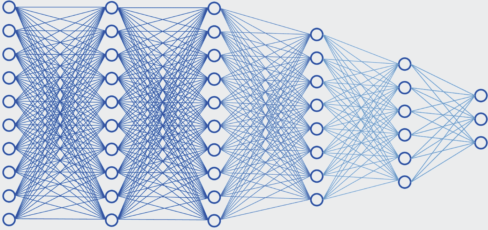
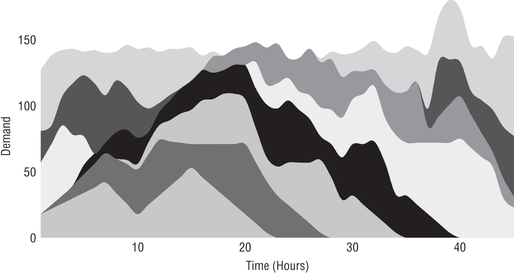

# TRIVERGENCE：利用人工智能、区块链和物联网加速创新

## 前言

## 致谢

## 用户许可协议

---

前言

这本书介绍了一种新的概念，这种概念在数字时代至关重要。我非常高兴 Bob 选择写这本书，因为 Bob 擅长吸引人们关注新想法。我们的合作始于多年前，当时他是西信加拿的技术主管，而我在加拿大的版贝尔实验室——加拿大北方部（`BNR`），在那里，我们一直在探索工作站网络如何改变工作、管理和竞争力。

`BNR` 的工作远超时代。1982 年，我和另一位高管离开了公司，带着十几个人成立了该领域的第一家咨询公司。很多人说我疯了。我们的公司名为 `Trigon`，第一个挑战是获得一个大客户，而 Bob 站了出来，聘请我们为西通提供服务。当时银行的房地产部门对新兴技术能给白领带来什么，这在当时是一个疯狂的概念，因为只有秘书在使用电脑。Bob 选择了一家名为 `Datapoint` 的公司，那是第一台商用桌面电脑。通过该平台，包括总裁在内的数十位高管都获得了自己的工作站，他们可以使用`电子表格程序`、`文字处理器`和`电子邮件`。

团队绘制了复杂的信贷工作流。结果，西通开发了一套既是工作流管理又是复杂贷款分析工具的系统。该系统旨在将复杂的多租户十亿美元项目的可行性评估时间从三个月缩短一个月。实施后，令所有人惊讶的是，端到端的分析和记录在两周内就完成了！

Bob 将其描述为`一种替代电子工作流系统`。十五年后，Michael Hammer 和 James Champy 提出了一个更直接的表达来描述技术如何影响组织。他们将其称为`业务流程重组`，而描述这一点的书籍是最畅销的管理书籍之一。书中的观点与我们在西通进行的业务流程设计工作相合。

该系统最终被安装在美国房地产分部、欧洲和澳大利亚。这个故事对我 1992 年的第一本畅销书《范式转移：信息技术的新承诺》（*Paradigm Shift: The New Promise of Information Technology*）也非常重要。

在花旗工作之后，Bob 继续了他担任其他银行 CIO 以及独立顾问的卓越职业。后来，在华尔街为摩根大通建议时，他受邀对一家位于丹佛名为 Jeppesen 的公司进行初步分析——该公司是商业航空业提供导航信息、运营规划工具、飞行计划产品和软件的主导者。如果你是一名飞行员，你一定知道这家公司。

他们的两个主要产品（飞行员图表和自动驾驶仪指令）大部分是人工创建的。Bob 成为了该系统的首席架构师和设计师，对这些核心产品进行重新工程和自动化。今天，这两种产品都源自一个巨大的“Jeppesen 航空数据库”，其中包含了全球路线信息，包括 260 万条数据记录和超过 1800 个机场。结果是飞行安全得到了显著提高。该被自动化的部门主管后来当了 Jeppesen 的总裁。

我分享这段历史是为了让你知道，《Trivergence》并非由一个仅仅是梦想家和远景家编写，而是由一位在四十年中进行过大型技术转型的实干派高管人员编写的。因此，当书中描述一个机会时，它是真实的；当它警告你挑战或危险时，你明智的做法是重视。

`Trivergence` 是一个宏大且真实的概念。在早期阶段，Bob 和我曾过一次有趣的讨论，关于究竟哪三种技术是真正重要的。最终，我们确定了 AI、区块链和 IoT，但也有其他候选者。扩展现实——特别是元宇宙——几乎入选，但最后我们得出的结论是，虽然虚拟世界对未来至关重要，但它们更多是一个应用环境，而不是一种基础性技术。

*Trivergence* 这个词会成为那些击中时代并成为我们日常用语的新词之一吗？比如“奇点”？时间会给出答案，而将新概念带入我们词汇的风是不可预测且反复无常的。在我的写作生涯中——共写了 18 本书——我的成功率可能远低于 50%。像*范式转移*（*paradigm shift*）、*数字经济*（*digital economy*）、*数字鸿沟*（*digital divide*）、*大众协作*（*mass collaboration*）、*数字资本*（*digital capital*）等术语确实流了下来，尽管坦白说，我不确定自己是否是第一个使用这些概念的人。但还有许多术语从未遇到正确的风口。

无论如何，我相信 `Trivergence` 是一个思考我们数字未来值得的框架。

**— Don Tapscott，Tapscott 集团首席执行官，区块链研究学会执行主席，以及 18 本商业与技术书籍的作者，2023 年 10 月**

# 1 Trivergence 时代引言

2032 年的某一天，Mirai 在郊区醒来，沐在智能家居柔和的光芒中。当阳光穿过窗户时，嵌入她家中的人工智能（AI）调整了灯光，以模拟黎明的柔和色调。室内温度也根据她的偏好进行了调节，在她准备开始新的一天时提供了舒适的氛围。她的冰箱与物联网（IoT）网络无缝集成，向她的手机发送了通知，提醒她订购即将耗尽的杂货。

下方的街道上，城市的自动运输系统像交响乐一样流淌。工作周小时的大幅减少结束了高峰时期的混乱。自动驾驶汽车在传感器和算法的引导下从容滑动，这些算法实时响应交通的波动。公共公交车以不可思议的精度导航路线，实现了效率最大化并最小化了拥堵。通勤者在旅途中放松心情，对 AI 控制车辆的可靠性充满信心。

当 Mirai 走出公寓时，她安全地在腕上扣好数字身份手环，让她获得了访问城市各项服务的权限。她手一挥，召唤了一个共享座舱，它在几分钟内就到达。基于区块链的数字身份确保了她的个人信息保持加密且防篡改，在保护她隐私的同时促进了无缝交互。

城市的公共服务也经历了自己的转型。垃圾管理是一场由传感器和算法进行的精心组织的芭蕾。智能垃圾桶在接近满载时会向垃圾管理中心报警，确保及时清理，最大限度地减少干扰并保持城市整洁。能源消耗通过一个复杂的 AI 驱动设备网络进行优化，这些设备监测分布式输入和使用模式并进行相应调整，有助于实现可持续发展目标。

在市中心更远的地方，在城市繁华的街道中，Amal 发现自己沉浸在一个工作、休闲和社交连接无缝融合的世界。作为一名软件工程师，他在城市技术驱动的环境中过得很好。他的混合工作安排让他拥有选择高效工作地的自主权，无论是远程办公，还是在装饰有太阳能电池板和绿色植被的时尚办公大楼里——那是城市对可持续设计承诺的证明。

室内，开放式办公空间充满了协作的声音。自动无人机在周围穿梭，为不同的团队递送包裹和物资。当 Amal 坐到工作位时，当他微调算法时，AI 助手提供了建议和见解。基于区块链的网络确保了他的工作被安全存储，并可以与全球的同事轻松分享。

午休期间，Amal 走到铺满太阳能电池板的广场上，那里兼作社区花园。他从一个智能售卖机上订了一份新鲜餐，选择是根据他的饮食偏好和营养需求定制的。品尝午餐时，他不禁惊叹技术如何无缝地融入到他生活的每一个方面，增强了便利性并丰富了体验。

在市中心，Maria 在先进医疗中心担任医生。区块链作为不可篡改的账本，维护了安全的患者记录，授权的医疗提供人员可以无缝访问。Maria 配备了 AI 驱动的诊断助手，以曾是科幻小说般的水平检查患者病例。AI 处理大量的医学文献，交叉引用患者数据，并提供即使是经验最丰富的医生也难以察觉的见解。

Maria 的患者 Javier 到达医疗中心时，他的健康监测手环显示读异常。手环传感器检测到潜在的心律异常，提示它通知了 Javier 和他的医生。Maria 查看了实时数据，对 Javier 进行了体格检查，并咨询了 AI。他们共同制定了一份个性化的治疗方案，将她的医学专业知识与 AI 生成的见解结合起来。

在一所城市高中的校园墙内，充满活力且好奇的学生艾拉（Ella）发现自己处于一个动态环境的中心，在这里，面对面的互动与数字学习体验无缝地交织。她的老师拉米瑞女士（Ms. Ramirez）理解在利用技术潜力与培养丰富学习的必要人际联系之间维持微妙的平衡。

拉米瑞女士的角色不仅是知识的源泉，她还是导师、引导者和灵感的来源。她将技术视为一种工具而非替代品，这让她能够专注于真正重要的事物。她对学生温暖的鼓励和对他们能力的真诚信念创造了一个学习蓬勃发展的环境。在这场追求中，`AI` 驱动的导师是她的盟友，能够根据每个学生的进度、先验经验和兴趣提供定制化的指导。

在她活跃的课堂里，学生们参与了激烈的讨论、协作项目和发人深省的辩论。这些互动强调了与同伴共同学习的不可替代价值，培养了未来至关重要的同理心和沟通能力。拉米瑞女士精心策划了沉浸式学习体验，让她的学生能够亲身体验历史事件、科学现象和艺术创作。这些沉浸式之旅与她生动的课程交织在一起，增强了理解并培养了对知识的渴望。

僵化的职业道路已成为过去；相反，公民们被欢迎进入一个动态职业机会的领域，这些机会根据他们独特的技能和愿景进行调整。通过分析个人优势和市场趋势的 `AI` 驱动职业顾问，人们发现自己能够在角色之间无缝转换，在不断变化的行业中挖掘其内在潜能。`Blockchain` 驱动的凭证验证简化了职业转型，确保专业知识在各个领域得到认可和重视。无论是参与全球范围的远程协作，还是参加跨洲的创意智库，这座城市的公民都沉浸在与其激情和能力相匹配的工作环境中，培养了创新和不断成长的文化。

当太阳落下地平线，城市的灯光描绘了一幅进步与创新的画谱。`AI`、`blockchain` 和 `IoT` 的交响乐已将无缝的织物织入日常生活的本质。居民们穿过这样一个世界，技术不仅在这里共存；它在蓬勃发展，引导他们的脚步，并增强他们的体验。这些突破性技术的汇聚塑造了一个人类潜力无限的现实，开启了一个未来——智慧与连接的结合为无与伦比的可能性奠定了舞台。

每个人的隐私都得到了保护，不是通过政府立法，而是通过技术本身。通过与世界的互动，每个玩家都会产生海量数据，他们不仅拥有这些数据的访问权，而且拥有。

在这个愿景中，技术有助于繁荣、健康和生活质量，但没有人真正注意到技术本身，因为它是透明的——就像空气一样。

## 欢迎来到三汇（Trivergence）

一个乌托邦式的愿景？也许吧。但今天的技术已经实现这个故事中的一切。它正开始摇动公司和政府的窗户和墙壁。了解这些技术对于每一位经理以及任何关心我们数字未来的人来说都是至关重要的。

是的，实现这一点充满了挑战。而且可以肯定，如果我们做得不对，对公民和文明来说将有一个巨大的黑暗面。

数字时代进入了第二个时代。第一个时代跨越了大型机、微型计算机、手机、个人电脑、传真、互联网、移动性、万维网、社交媒体、移动网络、云和大数据的兴起。我们现在正在进入第二个时代，数字技术渗透到生活和业务的方面。在这场演变中，三项技术成为了第二个时代的基石：`artificial intelligence`（人工智能）、`blockchain`（区块链）和 Internet Things（物联网）。

称之为 `Trivergence`。

## 三汇的组成部分

虽然许多人对 `AI`、`blockchain` 和 `IoT` 熟悉，但简短的入门将有助于理解即将到来的 `Trivergence`：

### 人工智能

`AI` 指在机器中模拟人类智能，使其能够执行以前需要人类认知功能的任务。从识别海量数据集中的模式到为决策提供建议，`AI` 正在改变医疗保健、金融和制造业等行业。`AI` 驱动的虚拟助手、自动驾驶汽车和个性化内容推荐只是其潜能的一角。`AI` 的意义在于它能够自动化复杂任务、提高效率并发现隐藏在数据中的洞察。深度学习的最新进展已经超越了专注于分析复杂数据以进行预测，扩展到在数据、文本、语音和图像中生成完全全新的内容。AI 现在正在从从数据中学习转向开始思考。

### 物联网

`IoT` 是一个庞大的互联物理设备、车辆、建筑和其他物品的网络，这些物品嵌入了传感器、软件和连接性，允许它们收集和交换数据。随着日常物品成为这个“万物网络”的一部分，物理世界正变得生动，实现了智能家居、可穿戴健康设备、气候监测和预测性维护等应用。`IoT` 的力量来自于它将数字世界带入物理领域的能力，实现了对各种系统的高效监控、分析和控制。这种互连性增加了便利性，优化了资源利用，并为新的业务模型和洞察开辟了途径。

### 区块链

`Blockchains` 是事件日志，可以实现为跨多个计算机的去中心化分布式账本。它们通过创建不可篡改的数据块链来实现信任和透明，确保记录的不可更改性。除了加密货币，`blockchain` 还应用于供应链管理、身份验证和安全数据共享。它的意义在于其具有消除中间环节、增强安全性并重新定义我们建立交易信任的潜力。通过提供不可篡改的平台，`blockchain` 具有变革行业、简化流程和重新定义数字时代信任的潜力。在过去的十年里，区块链已从私有的许可账本演进到包含可编程的公共网络，`Ethereum` 目前处于领先地位。

## 结论

每一项基础技术都是独特且单独强大的。然而，当它们结合在一起时，每项技术都发生了变化。这是一个经典的“整体大于部分之和”的案例。当我们把 `AI` 的力量与 `blockchain` 管理、存储和点对点交易的能力，以及 `IoT` 赋予物理世界生命相结合时，会发生什么？会出现什么新机会？会产生什么新风险？

本书引入了相关概念，并为这些复杂的技术及其融合创建了一份基础且易于理解的指南，探索了商业领者在这一新时代蓬勃发展必须做出的艰难决策。我们将探索 AI 的力量如何从更智能的神经网络中爆发，并通过一种全新的大规模并行架构倍增——这种架构的进步由区块链挖掘资助，体现为云端并行处理器的巨大阵列。在让计算机模拟人类大脑失败七十年后，这三个因素的“三位一体”（Trivergence）正带来思考机器，其新见解基于数万亿数据点。从历史上看，摩尔定律（微芯片上晶体管数量每两年翻倍）为计算机速度提供了指数级增长。即便如此，传统的 CPU 创建大型 AI 模型仍然远远太慢。但在过去的十年里，首先是图形处理，然后是加密货币，现在是 AI 为 NVIDIA 提供了资金。

我们将学习区块链技术如何实现从“信息互联网”到“价值互联网”的演进，以及货币、证券、知识产权、艺术、音乐甚至投票等资产如何进行点对点的管理、存储、通信和交易。区块链越来越多地运行在云端，现在——通过与 AI 整合——可能会带来智能合约的新时代，这将彻底改变许多行业甚至其本身。

我们还将深入探讨物联网（IoT）如何让物理世界充满活力。通过这些技术的整合，数十亿以前没有生命的物体正在转变为能够进行交易并作为经济单位运行的“智能”设备。随着物理世界产生数据，今天的大数据将被新一代的“无限数据”取代。

这种“三位一体”的结果很快将让科幻变为现实。整体影响可能是乌托邦式的，也可能是反乌托邦的。

最终，我的希望 `Trivergence` 能成为好奇的经理或任何寻求理解技术未来及其如何塑造我们世界的人的必读之。无论你是希望保持领先的商业领袖，还是仅仅对技术的最新进展感兴趣，我希望这本书能让你对眼前的可能性——以及危险有更深层次的理解。

## 后续章节预告

本书讨论了定义下一阶段技术创新、颠覆和转型的三项技术，以及它们对我们的工作、休闲、交通、教育以及日常生活其他方面产生什么影响。

### 三位一体技术

本书从一系列关于三大核心技术的章节开始：AI、区块链和物联网。我们从 AI 开始——这股力量正以异常的方式重塑我们的世界。除非你住在山洞里，否则你可能意识到 AI 已从一个简单的工具转变为强大的知识创造者。在 `第 2 章` 中，我们深入了 AI 的演变和轨迹。从符号系统的基础原理到神经网络的突破，我们追踪了 AI 基础组件的发展，这些组件为大语言模型（如 `ChatGPT`）、生成式图像工具（如 `DALL-E`、`Midjourney` 和 `Stable Diffusion`）等的进展铺平了道路。

这带我们思考了一些基本问题：AI 何时会超越人类智能？AI 将如何改变和社会经济？我们还能控制这项技术吗？现在应该采取什么步骤来防止或减轻 AI 系统可能造成的伤害？

# 关于 AI 何时达到人类水平智能的问题引导我们深入研究通用人工智能（`AGI`）的概念

我们调查了 AI 在游戏、图像识别和自然语言处理等任务中取得的成果，同时思考 AI 与人类认知融合时将产生的重大影响。当我们穿过 AI 的影响领域时，我们发现了提高生产力、准确性、安全性、个性化和决策能力的潜力。

我们将探索医疗、交通、金融和教育等行业如何在 AI 带来的创新解决方案和巨大可能的推动下，站在激进转变的边缘。我们将看到政府正处于通过数字技术和 AI 重新想象其角色的边缘，重新定义与公民和利益相关者的互动，以提供无与伦比的公共价值。在交通行业，我们将探索自动驾驶车辆的道路，包括安全担忧、伦理考虑以及对城市生活转型影响的复杂交织。随后我们将面对艺术娱乐行业中人类创造与 AI 驱动模仿之间的微妙相互作用，促使我们反思艺术的本质。

## 第 3 章：物联网——物理与数字领域的融合

第 3 章带我们进入物联网——一个物理与数字领域融合的世界。物联网不仅仅是智能设备。它关乎创建一个连接一切的智能织物——改变行业、景观甚至我们理解星球的方式。

我们的旅程始于深入研究物联网从孤立设备演变为互联生态系统的演变，其中设备、平台和应用程序在大规模上进行交互。我们将见证物联网对保护、行星监测和海洋探索的影响。从追踪森林破坏和非法伐木到保护海洋环境，物联网正在驱动至关重要的变化。它还在重塑城市生活，承诺通过实时感知和报告能力重新定义智能城市。当涉及到机器人技术时——从充满自动化嗡嗡的工厂到未来机器人协助日常任务——物联网的影响是不可否认的。

当物联网连接从家庭到自然环境的一切事物时，新的挑战随之产生。数十亿传感器和设备如何协同工作？我们如何平衡物联网的益处与个人隐私？这一章阐明了这些及更多问题，暗示了区块链、AI 和物联网如何汇聚并提供塑造我们连接世界的解决方案。

## 第 4 章：区块链——从加密货币到信任基础设施

在 第 4 章 中，我们将注意力转向区块链——这项技术诞生于建立一种超越传统金融结构的安全的点对点电子现金系统的雄心。我们将探索区块链如何从加密货币起源演变，从而改变行业并重新定义我们与信息互动以及创造价值的方式。

随着超透明化变得至关重要，区块链成为开启全球供应链洞察的关键，为始终存在的从源头到目的地追踪产品的需求提供了解决方案。然而，区块链的应用不仅限于商业；它延伸到了公共利益。我们将发现世界各国如何利用区块链来简化流程、使记录现代化，并维护投票、医疗和识别等关键功能的完整性。从土地登记到爱沙尼亚的数字身份革命，我们将探索区块链如何为公共管理注入活力，确保高效和安全的互动。

`Web3` 术语由亚历克斯·塔普斯克（Alex Tapscott）在其著作《Web3: Charting the Internet's Next Economic and Cultural Frontier》中首次提出并普及，它正成为下一代区块链的常用代称。`Web3` 旨在利用区块链技术建立一个去中心化且以用户为中心的在线生态系统。当我们进入 `Web3` 的世界时，我们将见证一个互联网愿景的打破了 `Web1`（以静态网站为特征）和 `Web2`（以交互式网站和社交媒体平台为定义）的限制。`Web3` 展望了一个开放、安全且无许可限制的互联网——一种重新定义数字格局的去中心化基础设施。它通常被称为“读-写-拥有”网络，其核心目标是赋予用户对其数字资产更大的控制权和所有权。

展望未来，我们将发现区块链在重塑行业、经济和社会方面的巨大潜力。随着技术壁垒的消除和新应用的涌现，区块链的影响力不断演进，承诺开启无与伦比的创新、协作和去中心化力量。后续章节将揭示区块链跨越行业、经济和社会持续产生的涟漪效应——开启一个去中心化、透明度和无限可能交汇的未来。

# 三分叉时代（Trivergence Era）的关键驱动因素

接下来的几章将关注三分叉时代的一些关键驱动因素。在一个由数字化知识驱动的世界里，云成为了一种不可见的驱动力。从用户生成的内容到海量档案，云静静地策划并允许通过简单的点击来访问海量数据集。第 5 章 将引导我们进入云计算的这一变革性领域——它是创新、协作以及 `AI`、`IoT` 和区块链等先进工具集成的催化剂。我们将探索云如何重塑企业能力规划，将其从一项复杂的任务转变为流化的流程。云计算通过为组织提供扩展性、成本效益、数据安全和创新能力，重新设计了现代业务框架。

我们将结识云的先驱者——`Amazon`、`Google` 和 `Microsoft`，并发现它们对这一格局独特的贡献。我们还将揭示云计算的三大支柱：基础设施即服务 (`IaaS`)、平台即服务 (`PaaS`) 和软件即服务 (`SaaS`)，它们构成了现代数字生态系统的基石。

随着旅程继续，我们将看到云不仅是一项技术成就；它还是塑造我们数字世界互联通性的动态影响。云提供了对高性能计算、`AI`、中间件、数据库软件甚至量子计算的即时访问。这种动态能力燃料了创新，使企业能够采用新服务、提高生产力并创建新应用。

随着互联网及其连接设备数量的倍数增长，我们产生的数据量也随之增长。在 第 6 章 中，我们探索了从大数据到更强大事物的转变——我们所谓的 `infinite data`（无限数据）。我们将看到这种变化如何影响从科学到我们个人隐私的每一个方面。

我们首先开始理解大数据的兴起——这是由互联网的扩张和非结构化数据的激增引发的。这为无限数据奠定了基础，在无限数据，来自 `AI`、`IoT` 和区块链的数据汇合。但这种数据爆炸究竟如何影响我们的世界？在无限数据时代等待着我们的是什么？

见证无限数据如何驱动 `AI` 的演进，为跨多个领域的训练、预测和不可思议的洞察提供必要的燃料。随着数据海洋的增长，`AI` 模型蓬勃发展，适应新的挑战，并以前所未有的能力丰富行业。我们将看到高速传输、海量存储能力和计算实力如何齐心发力，驱动生成式 `AI`——这是一台驱动我们对语言、文化和复杂查询理解快速进步的引擎。

无限数据不仅关乎改进技术，它正在改变我们进行科学的方式。我们将研究无限数据如何转型天文学和基因组学等领域的研究与发现，彻底变革方法论，并导致跨领域前所未有的协作。

虽然无限数据虽有其优势，但它引发了对隐私的担忧。在数据浪潮中，我们如何确保自己的数字身份仍在自己的控制之下？在一个企业和政府持有我们大量个人信息的世界里，主权身份（self-sovereign identity）的概念运运生——这是夺回个人数据控制权、并在数字经济中培养更大隐私和包容性的希望之光。

# 应用与影响

在目前为止的三分叉之旅中，我们见证了 `AI`、区块链和 `IoT` 的卓越演变——它们在各自的领域都取得了重大进展。但当这些力量汇聚时，当它们的组合潜力超过各个部分的总和时，会发生什么？在 第 7 章 中，我们来看看三分叉在各个部门的运作，包括医疗、农业和交通。

想象这样一个世界：医疗保健不再采用一刀切的方法，且基因组学与 `AI` 的融合提供了个性化医疗，将治疗方案与个人基因代码对齐。`AI` 为医生提供数据驱动的洞察，不仅彻底改变了诊断，还改变了治疗方法的寻找。同时，`IoT` 生成海量的健康数据流，`AI` 通过挖掘这些数据来检测模式和相关性。区块链介入保护这一数据共享生态系统，培养一个社区驱动的健康数据互联网——一个促进健康和医学研究的枢纽，在那里患者保留对自身数据的控制权和所有权。

在农业领域，现代供应链的复杂性往往掩盖了食物的来源和历程。我们将学习三分叉如何出现救援，以及 `Walmart` 和 `Nestlé` 等巨头如何与 `IBM` 等公司合作，创建由区块链和 `IoT` 驱动的解决方案，实现从农场到餐桌的食品溯源。这项技术不仅追踪我们食物的位置；它从根本上改进了供应链透明度，使任何食品的完整历史变得可用。这些创新改进了全球食品系统的效率和可持续性，减少了浪费并提高了生产力。

我们还将看看三分叉如何推动交通业的发展，自动驾驶汽车成为其能力的有力证明。在通向自动驾驶汽车的旅途中，我们将探索 `AI` 和 `IoT` 如何在优化交通、预测维护需求甚至创造全新的移动经济方面发挥至关重要的作用。我们将看到诸如移动开放区块链倡议 (`MOBI`) 这样的组织如何开创基于区块链的安全标准，变革车辆在不断演变的移动格局中的通信和交易方式。

拥抱三分叉技术不仅仅是采纳。它需要对即将到来的挑战和影响有深入的理解。在 第 8 章 中，我们将深入探讨三分叉时代的挑战。这些并不被视为阻碍，而是需要克服的实施挑战。

## 技术挑战

技术挑战涉及技术本身的复杂性，以及为了使其有效运行而必须进行的权衡。首先，在产生海量数据的设备泛增背景下，对数据完整性、可靠性和真实性的担忧随之而生。随着数据量的巨大增长放大了错误、数据不一致和篡改的风险，维护数据完整性变得日益艰巨。

随着我们进入现代分布式网络时代（以区块链为关键案例），维塔里克·布特林（Vitalik Buterin）曾撰写过他所谓的“区块链三困境”。这一三困境表明，旨在实现安全、去中心化和可扩展性的公共区块链必须在这三个因素之间进行权衡。我们将探索根于区块链三困境的概念在“三元融合”（Trivergence）时代如何继续保持意义，在这个时代，`IoT`、`blockchain`和`AI`技术的汇聚要求创新解决方案能够在数据一致性、系统可靠性与建立数字信任之间取得正确的平衡。

互操作性是另一个复杂的挑战，要求 `AI`、`IoT` 和 `blockchain` 进行无缝通信和协同工作。然而，每种技术都有其独特的数据格式、模型和接口，这增加了集成的难度。除了这些技术挑战外，我们还将揭示今天 `AI`、`blockchain` 和 `IoT` 的一些软件局限性，以及可以采取哪些措施来克服它们。

## 社会经济挑战

三元融合不仅关乎技术，还关于人们如何使用技术及其对社会的影响。我们对社会经济挑战的观察邀请我们考虑社会采用这些技术时所产生的复杂动态。

我们首先从投机和炒作的挑战开始，媒体的煽动主义和误信息助长了过度预期。接下来，我们将探讨监管挑战，包括政策往往滞后于技术进步，为隐私、安全和伦理问题留下了漏洞。更糟糕的是，如果这次缺乏控制，它可能会构成“生存威胁”。我们将研究治理挑战，以及治理框架在引导负责任且符合伦理地使用这些技术、契合社会价值观以及有效管理风险方面的关键作用。最后，我们将关注准入和包容性挑战，这需要支持性的环境，让不同背景的人能够利用三元融合时代的潜力。

未来不是用来预测的，而是用来实现的。随着三元融合时代的展开，这些挑战将如何被解决，又是谁将承担构建这一未来的责任？

## 第 9 章：三元融合时代的执行指南

第 9 章作为三元融合时代的执行指南，为业务领导者提供了实用的见解和关键考虑。本指南帮助你评估组织在面对 `AI`、`IoT` 和 `blockchain` 集成时的准备情况、愿景和战略。通过接触这些见解，你将使你的业务能够挖掘这些技术的巨大潜力，推动增长、创新和持续的竞争优势。

首先，我们将深入研究将三元融合战略性整合到你的业务框架中。这涉及评估组织充分接受这些变革性技术的准备情况，考虑业务案例清晰度、资源可用性以及有效利用 `AI`、`blockchain` 和 `IoT` 的能力。从那里，我们将深入实施三元融合的关键考虑，涵盖潜在的风险、成本和收益。有了这些理解，你能够做出明智决策，制定缓解策略并确保无缝集成。

接下来，我们将强调建立分阶段实施路线图。这涉及划分阶段和里程碑。我们还将讨论在评估性能时 `KPIs` 的重要性。

与利益相关者合作的重要性不言而喻。我们将引入“竞合”（coopetition）的概念——一种促进互利共赢的战略方法。在三元融合的背景下，我们将强调营造一种拥抱想法和庆祝创新思维文化的重要性。

三元融合时代为业务领导者带来了机遇，也带来了责任。仅仅作为变化的旁观会导致停滞。在三元融合时代，有效的领导力在于把握其提供的机遇。我们将在第 9 章的结束处回顾领导力在应对三元融合时代的关键作用，并引导你的业务迈向增长和成功。

## 第 10 章：文明的未来与读者的挑战

本书以对我们每个人以及整个文明面临的危险的一些坦诚且清醒的思考结束结尾。第 10 章展示了 `AI`、`IoT` 和区块链的影响如何超越单一行业，触及我们生活、互动和塑造周围世界的本质。

当我们应对这一潜在影响的旋涡时，有一点变得清晰了——分歧时代（Divergence era）需要共同努力。政府、行业和个人必须汇起来，利用 `AI`、`IoT` 和区块链带来的收益，同时最大限度地减少任何意外后果。我们这一终章的旅程引导我们走向一个未来，在这个未来，创新与我们的价值观和谐统一，我们都在塑造由三分歧（Trivergence）时代力量驱动的文明中发挥作用。我们必须重新想象社会契约——即新数字时代企业、政府、劳动力和社会公众之间的基本预期，并制定一套战略倡议来实现这一目标。这并非易事。

本书以对你——这位读者的挑战作为结尾。三分歧代表了数字时代的新范式。正如唐·塔普斯克（Don Tapscott）在他 1993 年的开创性著作《范式转移》（Paradigm Shift）中所说，新范式会引起动荡和不确定性。它们通常被冷落对待，或者更糟，遭到嘲笑和敌意。既得利益者、反对者以及所有范式的领导者在拥抱未来时面临着巨大困难。这一次，变化将比他在书中想象的要广得多、深得多且快得多。它将是一次冲击，也是一次转变。

在引入这一新范式以及其创造的新业务和社会机会中，你将扮演什么角色？你能参与确保承诺得以实现并避开阴暗面吗？

我的经验表明，最好的想法往往来自那些不在角办公室的人。在技术领域，传统方法是在管理批准、拨款和项目启动之前，在规格文档中列出你想要和期望计算机系统执行的操作。这种方法现在已经过时，会导致次优的结果。鉴于云使得低成本的概念验证成为可能，自下而上的实验可能比自上而下的指令创造更多价值。许多传统的管理概念无法在这种范式转移中生存。

我的经验表明，领导力不仅仅是 `CXOs` 的责任，事实上，它通常并不是于顶层。相反，只要愿意，任何人都可以成为领导者。

这是你的机会。继续读下去吧！

---

## Note

1. `https://techhq.com/2023/08/how-is-nvidia-leading-ai-boom-with-chips`

# 2 人工智能

想象一个不遥远的未来，在那个未来，`AI` 以无法想象的方式改变了社会。一个显著的例子是它对教育的深刻影响——这个领域长期以来寻求创新方法来满足多样化的学习需求并实现终身学习。

在这个变革后的社会中，一个名叫玛雅（Maya）的小女孩开始了她的教育之旅。玛雅的个性化教育体验在她进入传统教室之前就开始了。`AI` 算法分析了关于她的认知能力、学习风格和兴趣的海量数据。凭借这些知识，由 `AI` 驱动的学习系统定制了独特的课程，以最大化她的潜力并培养她对知识的热爱。

当玛雅进入她的 `AI` 增强教室时，她发现了一个充满活力且协作的环境。学校用交互学习舱取代了传统的排排桌，学生在其中进行实践活动和解决问题的练习。他们的 `AI` 驱动的虚拟助手 `AIVA` 提供即时反馈、回答问题，并根据每个学生的需求提供个性化指导。

在变革后的教育版图中，玛雅的老师们变成了促进者和导师，与 `AI` 技术协同工作。老师利用 `AI` 驱动的工具收集学生进步的实时洞察，识别学生需要额外支持的领域。通过分析数据，`AI` 算法帮助老师识别需要加强的特定概念或技能，使他们能够针对个人学生有效地定制教学。

教室之外，`AI` 扩展了玛雅的教育机会。虚拟现实模拟让她能够探索历史事件、访问遥远的地方并亲身体验科学现象。`AIVA` 的语言翻译能力让她与来自不同背景的学生联系，并从全球视角学习。`AI` 驱动的推荐系统建议了个性化的阅读材料和教育资源，开启了通往新学科和兴趣领域的大门。

玛雅的故事并非孤例。在整个社会，`AI` 使教育民主化，让所有人都能获得高质量的学习，无论地理位置或社会经济背景如何。在此途中，教育工作者、家长和其他利益相关者集结起来，共同应对对 `AI` 在教育中普遍存在的担忧。教育工作者担心教室内的人机互动可能会损害学生的社交情感发展并限制他们的批判性思维能力。社会正义倡导者对 `AI` 算法中可能存在的偏见和多样性缺乏会加剧现有不平等现象表示担忧。财政保守主义者要求更高的师生比。家长和学生担心 `AI` 系统可能会收集并存储关于学生的深度个人信息，并将其重新用于超精准的营销活动中。

在这一风格化的现实中，`AI` 并没有取代人类教师，而是提升了他们的角色，让他们能够专注于培养创造力、批判性思维和情感智能。开发者通过在多样化的数据集上训练 `AI` 模型来完善他们的系统，借鉴广泛且包容的学习者群体的教育经验。严格的隐私保护确保学生和家长对其个人数据保留完全的所有权和控制权。大多数利益相关者将 `AI` 视为不可或缺的盟友，增强了人类能力并彻底改变了知识获取、共享和应用的方式。

听起来很遥远？其实不然，因为 `AI` 对教育日益增长的影响显而易见。`Eightfold`、`Gloat`、`Docebo`、`Squirrel AI`、`Cognii` 和 `Degreed` 等教育科技公司正在整合先进的 `AI` 能力，准确识别匹配技能要求的内容，提供个性化的辅导和教练，并为所有水平的学习者提供高度针对性的教育材料和体验。无论教育机构是否准备充分，`AI` 都会快速重新定义教学和学习的本质。然而，教育只是人工智能正在动摇我们认知世界的领域之一。

在技术进步指数级增长的推动下，强大的人工智能系统正在创造一个超级智能的新时代，这将重塑社会和经济格局。从机器人手术到自动驾驶汽车，从革命性的生物技术研究到读取 CT 扫描，日益智能的机器的应用将跨越医疗、法律和金融服务、交通、建筑、农业、制造业等。随着 `Facebook`、`Google`、`Amazon`、`Microsoft`、`阿里巴巴` 等行业内外的公司在人才和研究上投入了数十亿美元的资金，顶尖的 `AI` 能力在未来几年将进展得更加迅速，开启我们今天几乎无法想象的新可能性和应用。

## AI 的演变

人工智能 (`AI`) 可以被定义为计算机执行以前需要人类智能的能力，例如感知、学习、推理、复杂问题解决和决策。这是一个广泛的领域，涵盖了广泛的技术和方法，包括机器学习、自然语言处理、计算机视觉、机器人技术和专家系统。

计算机可以像我们一样“思考”的理念最初是 20 世纪 50 年代的一种设想，它植根于阿兰·图灵（Alan Turing）和约翰·麦卡锡（John McCarthy）等计算先驱的工作。早期的 AI 研究侧重于开发算法和符号逻辑来模拟人类智能。到那个中期，亚瑟·萨缪尔森（Arthur Samuelson）已经编写了一台计算机的程序，让它可以玩一场相当水平的跳棋游戏。他简单地将人工智能定义为“赋予计算机在无需显式编程的情况下学习能力的研究领域”。

现实地说，计算机的速度太慢了，无法实现有一天计算机将学会思考的梦想。剩下的问题是什么时候？

在 20 世纪 60 年代和 70 年代，计算机 AI 开发工作开始进行，采用了基于规则的系统、博弈论和数学方法，其中 `if-then-else` 语句被用于模拟人类决策过程。专家系统，如用于化学的 `DENDRAL` 和用于医学诊断的 `MYCIN`，是这一时期的显著成就。

20 世纪 80 年代，AI 研究人员专注于基于知识的系统，这些系统利用大型知识库来解决复杂问题。这些系统使用推理引擎根据现有知识进行推理并得出结论。对于许多人来说，计算机可以使用神经网络进行推理的渴望经历了尝试、失败、再尝试、再失败。对大多数人来说，显然是时候宣布它们死亡了。

20 世纪 90 年代见证了由于机器学习兴起而 AI 兴趣的复燃。另一个尝试让更大的神经网络进行思考的尝试再次失败。通过使用不同的 AI 方法，研究人员探索了各种允许计算机从数据中学习并做出预测或决策的算法和方法（参见侧边栏“AI 的五大派”）。

21 世纪初，在大多数数据科学家和数学家放弃了神经网络这种枯燥且最终无果成功的方法后，少数人坚持了下来——著名的多伦多大学（`U of T`）名誉教授杰弗里·辛顿（Geoffrey Hinton）以及他的学生。通过对这些网络使用改进的深度学习算法技术，他们在自然语言处理和计算机视觉等领域取得了突破。不出的是，辛顿很快被聘用到 Google 投入 25% 的精力。他经常被描述为“机器学习之父”。考虑到该领域的努力可以追溯到 70 年前，对辛顿更准确的描述可能是“极具天赋的伟大曾孙”。2023 年初，由于发布不成熟但强大的 AI 产品表示担忧，辛顿、约舒亚·本尼奥（Yoshua Bengio，来自蒙特利尔大学 AI 发表论文最多的作者）以及许多其他领域专家共同写了一封关于“AI 灭绝风险”的公开信。

21 世纪 10 年代及以后，自然语言处理神经网络的进步使得 AI 系统能够更准确地理解和生成人类语言（参见 `Figure 2.1`）。对话式 AI、聊天机器人和虚拟助手显著提高，实现了更具互动性和直观的人机交互。近年来，AI 已日益融入到我们的日常生活中。AI 驱动的应用和服务，如语音助手、推荐系统和个性化广告，甚至是个性化广告牌，已变得随常见。深度学习方法解决问题的迷人之处在于，你不需要编写逻辑。只要给神经网络足够的各种数据并花时间对其进行适当训练，网络可能会得出人类从未想过的结论。

`Figure 2.1` 神经网络示例

今天，像 Google、Facebook、微软、IBM、腾讯、阿里巴巴、AWS 以及大多数拥有海量数据集和计算能力的大公司都启动了大量的 AI 倡议。国际数据公司（IDC）预测，在可预见的未来，AI 支出出的将以 26% 的复合增长率增长。这种维持了十年的雪球式投资将导致十倍以上的增长。这不仅仅是软件公司的问题。2023 年中期，约 40% 的开放职位与 AI 相关，涉及数据工程师、量化师以及伦理治理角色。随着 AI 突破的加速，人们提出了三个关键（甚至是生存）的问题：

*   AI 何时会超越人类水平？
*   AI 将如何改变社会和经济？
*   我们现在应该采取哪些步骤来防止或减轻 AI 可能造成的伤害？

我将在本章其余部分详细阐述前两个问题。第三个问题将在[第 10 章]中讨论。

## AI 何时会超越人类水平？

在 1996 年和 1997 年，加里·卡斯帕罗夫（Gary Kasparov）与 IBM 构建的超级计算机“深蓝”（Deep Blue）之间展开了一场著名的象棋对赛。IBM 超级计算机的软件依赖于由大师和康大学学生开发的规则和启发式，这些规则使用 `if-then-else` 语句编写。“深蓝”每秒分析 100,000 个可能的结果，这被认为远超人类大脑的能力。然而，在执行任务时，卡斯帕罗夫以 4 比 2 击败了“深蓝”。

对凡人击败超级计算机感到震惊，IBM 将计算机规模翻倍，并花费了一年时间在软件中编写更多细节。1997 年，它最终以 3.5 比 2.5 险胜胜了卡斯帕罗夫。象棋专家评估了卡斯帕罗夫在比赛中的策略。结果是，程序员调整了代码，以给予 IBM 超级计算机更大的获胜机会。我们可以对这种赛中调整的公平性产生争议。然而，一些专家认为，“深蓝”最惊讶和最聪明的一步实际上是一个错误。当代码逻辑出现故障时，它随机选择了一个非常聪明的棋。

在过去的几十年里，硬编码的象棋程序改进了它们的技能和启发式。目前的开源象棋程序 `Stockfish` 由于许多大师的投入、数百万局比赛的海量经验数据库以及硬件速度的提高而被认为不可战。通过利用神经网络的新的方法，Google AI 的子公司 `DeepMind` 向其 `AlphaZero` 深度学习程序引入了象棋的基本规则，没有任何历史、建议或专业知识。

许多计算机科学家坚信会让计算机永远困扰的是一种拥有 2500 年历史的围棋。这种游戏非常复杂。棋盘有 19×19 个格子（比象棋多出五倍），通常持续 150 步或更多，是典型锦标赛象棋步数的四倍以上。《科学美国》估计，围棋中有大约 250¹⁵⁰ 种可能的走法，远超象棋的复杂性。大多数专家假设，即使是最强大的 AI 系统也需要评估过多的可能性，才能及时制定获胜策略。在实践中，计算机程序只能下出平庸的业余游戏。

随后，在 20 世纪 10 年代，基于神经网络的 AlphaGo 在没有任何专业知识的情况下自学会了下棋。2016 年 3 月，在超过 2 亿人在线观看的情况下，AlphaGo 对阵了远见大师李世石（Lee Sedol），由于李世石曾获得 18 个世界冠军，他当时被认为是十年来最伟棋手。AlphaGo 以四比一的惊人优势获胜，围棋界为之震惊。大多数专家认为这一突破“领先了时代十年”。

AI 近期的快速进展颠覆了许多关于 AI 局限性的根深观念。AI 何何时能真正精通非基于规则的专业领域尚不可预知。然而，由于`ChatGPT`等大语言模型的出现，许多专家认为由于三个因素的影响，这将比以前预期的早得多。

*   神经网络和深度学习方法的革命性进展和颠覆性突破，这些方法正在不断改进，并现在已在云端部署。
*   深度学习丰富的“新食物”：由计算机、人类网页浏览以及现在的物联网（`IoT`）所提供的数据爆炸。
*   硬件设计的近期革命：最初为图像渲染（在显示器上）设计的大规模并行简单处理器阵列（称为精简指令集计算机，或`RISC`芯片）被改造并获得了大量资金用于加密货币挖掘，随后再次被用于 AI。结果是，神经网络的有效吞吐量是摩尔定律预期的十亿倍。得益区块链，构建大规模 AI 模型的能力突然到来。

对于该领域的许多人来说，这些快速进展是意料之外的。AI 的能力突然领先许多人的预期十年或二年。我在第 6 章中更深入地探讨了后两项发展。结论是什么？由于新数据的爆炸和并行处理能力的提升，很少有人为即将到来的 AI 快速进展做好准备。

如今，神经网络规模的快速增长已经非常值得关注。例如，OpenAI 的`ChatGPT`在 2018 年首次发布时拥有 1.17 亿参数；随后`GPT-2`在 2019 年推出，拥有 15 亿参数；22020 年的`GPT-3`拥有 1750 亿参数；而 2023 年发布的`GPT-4`据传接近 100 万亿参数。据传，`GPT-3`和`GPT-4`阅读了大部分大部分数据，包括`Wikipedia`、`WebText`（通过`Reddit`链接的数量将 URL 中的精和与质区分来）、书籍和其他来源。

值得注意的是，参数数量与系统的智能之间并不一定存在关联。

尽管存在这些缺陷，但显而易见，AI 系统正以越来越快的速度向更高智能发展。OpenAI 声称，`GPT-4`产生事实性结果的可能性比`GPT-3`高出 40%，这在 33 个月内是一个惊人的进步。

尽管如此，关于 AI 何时将超越人类水平的智能——通常被称为通用人工智能（AGI）——问题仍是不确定的。在某些领域，它已经实现了。虽然 AI 在图像识别、自然语言处理和游戏等等特定任务上取得了显著进展，但实现`AGI`需要开发一种能够跨广泛领域理解、学习和应用知识的系统。然而，随着最近的进展，问题现在更多关于“何时”，而不是“是否”。

要实现`AGI`，还需要克服若干挑战。这些挑战包括开发能够从有限数据中泛化、理解上下文、表现常识推理、进行创造性问题解决并展示社交情感智能的算法。实现`AGI`的时间表受到计算能力进步、AI 研究突破、高质量训练数据的可用性以及神经科学和认知科学等领域进展的影响。对于`AGI`来说，这些挑战中最困难的是数据质量。

目前，包括最先进的在内的 AI 系统基于算法和计算过程，这些过程并不具备主观体验或意识。虽然 AI 可以模拟人类行为并以惊人的熟练程度完成任务，但它并没有表现出人类拥有的那种水平的意识和主观体验。AI 领域主要专注于创建处理和分析数据、根据编程规则和统计模型学习模式，或简单地从数据本身推导出关联和想法的系统。这些系统缺乏人类意识的主观性质。

AI 系统未来是否可能产生意识是一个推测，取决于科学进步以及我们对意识的理解和定义。某些理论认为意识可能从复杂的计算系统中产生，而另一些则认为它可能需要生物或物理基质，而这些基础在 AI 系统中尚未被完全复制。简单来说，要成为人类，AI 需要在我们的四维世界中生存。随着机器人技术的发展，它很快就能。

当然，AI 产生意识的可能性引发了深远的伦理和哲学问题。如果我们开发出具有感知迹象的 AI 系统，就需要仔细处理关于它们的权利、道德地位和对待的问题。此外，有意识的`AGIs`的最终影响和意义（理想情况下）取决于如何根据伦理和监管考虑来设计、部署和治理此类系统。

目前，AI 系统是人类创造的工具，AI 任何产生感知或意识的可能性都需要巨大的进步以及对意识本质更深层次的理解。考虑到目前 AI 研究的状态以及实现`AGI`的复杂性，要想象此类进展何时将会实现具有挑战性。

## AI 将如何改变社会？

AI 将执行越来越多、今天需要人类智能的任务，例如学习、推理、解决问题、感知和决策。在这些不同领域中，AI 的一些核心承诺包括：

*   提高生产力：AI 可以自动化重复性任务和决策过程，为人类腾出时间专注于更复杂和具创造性的任务。
*   增强准确性和精确性：AI 算法可以处理海量数据并识别人类可能忽略的模式，从而做出更准确的预测。
*   提高安全性：AI 可以用于监控和控制复杂系统（例如自动驾驶汽车），减少事故风险。
*   个性化：AI 可以分析个人偏好和行为，以提供定制的推荐和体验。
*   更好的决策：AI 可以提供人类可能考虑到的见解和建议，从而在许多领域做出更好的决策。
*   增强安全性：通过 AI 驱动的监控和威胁检测，AI 可以提高物理和数字世界的安全与防护。
*   提高效率：AI 驱动的优化和自动化可以降低制造业、物流和运输等行业的成本。
*   改进沟通：自然语言处理和语音识别技术可以加快复杂文本的生成并减少语言障碍。

鉴于这些属性，很容易想象 AI 如何通过为复杂问题提供创新解决方案并提高效率和准确性，快速转型许多行业和领域。在医疗保健、交通、公共管理、金融、教育和娱乐等领域，突破性的应用已经显而易见。为了说明这一点，让我们来看看 AI 在政府、交通和娱乐领域的应用。

### 人工智能政府

像社会其他其他机构一样，数字技术为政府创造了一个历史性的机会，使其从根本上重新思考和重新设计其运营方式、公共服务的内容和形式，以及最终公共机构如何与公民和其他利益相关者互动以创造公共价值。在互联网赋能的第一波浪潮中，全球政府利用互联网带来了一些重要的益处。他们让政府信息和服务对公民更易于获取，同时提高了行政和运营效率。但许多此类倡议侧重于现有流程的自动化以及将现有的政府服务移至在线。换句话说，所谓的电子政府策略为服务交付和公民参与增加了一个新渠道，但并没有从根本上挑战或打破政府现有的结构、流程或能力。它也没有为数字体验设定一个非常高的标准（想象一下静态信息门户和一刀切的解决方案）。

今天，过去的电子政府策略已不再够用。对于大多数人来说，互联网现在已是日常生活中不可分割的一部分。日益增长的连接性带来了更高的公众预期，并要求政府更具创新性，更敏锐地感知数字趋势和能力。事实上，随着商业数字体验的不断改进，政府面临的标准不断提高。与此同时，公民预期与政府交付内容之间的差距正在令人担忧地变大。

鉴于政府在利用技术改善公共服务方面的参差不齐，对 AI 变革公共管理的承诺保持某种怀疑态度是明智的。然而，公共部门已经出现了一批 AI 的用例，这表明具有前瞻性的政府可以利用新技术（如大数据和人工智能）的力量，为政府的许多功能和形式带来更高水平的创新和生产力。

广而言之，我认为在公共服务中使用 AI 有五个明显的优势。首先，随着政府在将其服务交付向数字平台转型方面取得进展，AI 具有增加新功能层的潜力，提升用户体验并创造运营效率。在新加坡等领先司法管辖区，人工智能软件代理（或所谓的聊天机器人）作为公民和企业的一线界面，允许人们通过手机或电脑使用语音或文本对话访问服务或完成任务。有些人担心，聊天机器人和其他自动化努力可能会导致服务去人性化，并阻碍政府应对更微妙、复杂的服务需求。然而，如果使用 AI 系统来增强而非完全替代人类员工，服务的质量和及时性将得到提高。而且，当 AI 增强提供服务的真人时，它本身也会学会变得更具人性化。与我们不同，AI 可以 24/7 全天执行任务，不需要午休、睡眠或休假。今天，AI 驱动的翻译工具可以通过提供多语言服务、翻译官方文件以及确保信息覆盖更广泛的读者，帮助打破语言障碍并提高不同社区的无性。事实上，AI 将电影配成外语的时间从几个月缩短到了几天。

其次，像私营公司一样，流程自动化可以通过将行政和数据管理任务分配给 AI 系统，帮助公共部门实现运营改进，使许多政府运营更有效。

第三，AI 在分析历史数据和预测未来趋势方面具有巨大潜力，能够实现主动资源配置和执法。例如，加拿大的破产监员办公室（`OSB`）正在利用债务人数据以及过去的检查结果来训练 `ML` 算法，以准确选择待检查的债务人。AI 还可以通过分析大型数据集中的模式和异常来检测欺诈活动，如逃税或福利欺诈。

第四，近期数据分析能力的进步提高了政策制定者制定公共政策和法规的能力，以最小的误差交付预期结果，并减少意外后果的风险。AI 系统可以将基于证据的决策努力推向及时性和复杂性的新水平，改进对复杂信息的分析，提高预算预测的准确性，并处理许多人类无法轻松完成的任务，例如运行复杂的模型和模拟，或实时筛选数百万文件以获取核心内容。

最后，AI 可以通过分析来自各种来源（如摄像头、社交媒体和传感器网络）的海量数据增强公共安全。它可以识别潜在的安全威胁，协助应急规划，并帮助预测和预防犯罪活动。美国许多学校已有 AI 程序实时检查视频监控，寻找校园内的枪支。尽管到目前的结果并不尽如人意，但这些系统确实从自己的经验中学习。

### AI 驱动的交通

全自动和智能交通的梦想一直吸引着技术人员和科幻爱好者的想象，这很容易理解。自动驾驶汽车的潜在益处数不胜完。在一个完美的世界里，当你的自动驾驶汽车出去开 `Uber` 赚钱时，你可以把车库变成一个客卧。它能让盲人行动便利，并安全地将醉酒派对送回家。

更令人印象的是，自动驾驶汽车与智能中心化软件的结合可以实现即时共享。它可以消除道路上一半的车辆，并大幅减少高峰时段交通。市中心的车库可以重新部署用于急需的市中心住房。

尽管潜力显而易见，但全自动车辆投放延迟说明了目前 AI 驱动系统面临的一些挑战和局限性。例如，2017 年 12 月，通用汽车（`GM`）宣布从 2019 年开始为商业车队推出自动驾驶汽车。

尽管有着无限的可能性，事实证明，安全的自动驾驶汽车比最初想象的要复杂得多。2016 年，曾有人预测无人驾驶汽车将在五年后出现。而如今的愤世嫉俗预计它们将一直保持现状。

令人惊讶的是，`Tesla` 放弃了此前使用 `lidar`（激光雷达，光的缩写，一种用于检测地球表面的遥感方法）的努力。

在疫情爆发前，我在底特律的一次会议上发表了演讲。坐在我前面的演讲者是“北美最大的汽车座椅制造商”的首席信息官（`CIO`）。我很惊讶他没有提到 `AI` 对座椅设计不可避免的影响——因为这种影响将是深远的。未来，前座椅很可能会背对着，中间隔着一张桌（类似于火车车厢）。与其在凌晨`4:30` 起床去赶那班早上`7:00` 的红眼，不如在过夜驾驶中在车里睡觉可能更便宜，也舒服得多。从现实来说，在长途行驶中，过去在静止的`1957 Chevy 雪佛兰`后座发生的事情，将不可避免地发生在未来汽车长途行驶的新座椅设计中。

全自动汽车可能还需要若干年才能实现，但自动驾驶飞机呢？多年前，我有幸在 `Jeppesen`（现为 `Boeing` 子公司）担任一项系统的首席架构师，该系统为驾驶世界上大多数商用飞机的计算机提供飞行指令（`AIRINC data`）。相比起来，用计算机驾驶飞机比用计算机驾驶汽车简单得多。这仅仅是在特定高度通过无线电信标或 `GPS` 定义的航点来引导它的问题。有了仪表着陆系统，配备 `CAT III` 引导系统的飞机可以沿着各种电子波降至跑道并自动着陆。这些系统在 25 多年前就已经投入生产并可以使用。

当时在 `Jeppesen`，有人向我描述，飞行员的工作是 99%的无聊和 1%的恐惧——恐惧就是当意外情况发生时。这不是一份轻松的工作。当时 `Jeppesen` 的首席领域专家 `John Kasten` 预测，有一天驾驶舱将只有一名飞行员（以缓解乘客的担忧），并配有一只罗宾犬作为副驾驶，以确保人类不触碰控制装置。鉴于空中管制是口头指令，且引擎噪音通常难以听清，当时对无人飞机的愿景仅仅是一个梦想。

从`2016`年开始，联邦航空管理局（`FAA`）开始建立系统，将曾经的口头流程数字化，以文本形式发送指令。很难相信，这直到`2016`年人们才意识到，可读的文本消息指令比在飞机背景噪音中听取的口头指令要少困惑得多。

尽管无人驾驶商用飞机似乎不可避免，但我预计它们在运载乘客之前的十年会先运送货物。不过话又回来，对于短途客运无人机来说，飞行员的重量是无法负担的。你可能会比想象中更早在自己附近的社区看到由 `AI` 驾驶的无人短途出租车。它们今天已经在飞行了！

## AI 驱动的娱乐与艺术

几十年来，我听过多种反驳观点：技术永远不会具有创造力，计算机永远不会自主学习，计算机永远不会产生独立思考，机器人除了重复性的体力劳动外永远无法取代任何东西。

在过去的十年里，所有这些观点都失效了。通过使用来自 `DALL-E`、`Midjourney` 和 `Stable Diffusion` 等工具的软件，你现在可以请求非常真实的肖像，比如以 `Rembrandt` 或 `Vincent van Gogh` 的风格为你孩子画像。这是否会让他们在坟墓里翻身来尚待争议，但当 `AI`（只需几美元）就能生成一幅当代艺术家风格的你家小屋画作（而不是花费数千美元委托那位艺术家）时，谁应该是受益者呢？

`2023 年 6 月`，《印第安纳·琼斯 5》上映了，主角是一个非常年轻的 `Harrison Ford`。

我认为，`AI` 生成的歌曲登上排行榜，或 `AI` 生成的惊悚片进入畅销书名单，只是时间问题。今天，出版商充斥着（目前）糟糕的 `AI` 生成的故事。

当一首 `AI` 生成的歌曲获得格莱美奖时，开发过程中会有人类出来领奖。从长远来看，也许不再这样了。`AI` 带来了许多挑战，如何为它颁发格莱美奖、奥斯卡奖到诺贝尔和平奖的任何奖项，是我们最少担心的问题之一。在不到十年的时间，我怀疑你将能够给一个 `AI routine` 提供情节种子和你喜欢的演员的（更年轻的）年龄，然后在几小时内看到一部根据你的口味定制的全景。有这么多的人被深伪（`deep fakes`）骗了，以至于它现在被认为是国家安全威胁。

## 注释

1. `www.incompleteideas.net/book/ebook/node109.html`
2. `www.astro.caltech.edu/~george/ay122/cacm12.pdf`
3. Cover, T., and P. Hart. “Nearest Neighbor Pattern Classification.” IEEE Transactions on Information Theory 13, no. 1 (January 1967): 21–27. `https://doi.org/10.1109/TIT.1967.553964`
4. McCulloch, S., and Walter Pitts. “A Calculus of Nervous Activity.” The Bulletin of 5, no. 4 (1943): 115–33. `https://doi.org/10.1007/BF2459`
5. Though the results to date have been underwhelming, these systems do learn from their own experience.
6. `www.greencarreports.com/news/11409_commercial-tests-of-self-driving-chevy-bolt-ev-to-launch-in-many-cities-in-2019`
7. `www.bloomberg.com/opinion/`
8. `www.guardian.com/technology/2017/09`
9. `www.scientificamerican.com/article/20-years-after-conquering`
10. `www.deepmind.com/research/alphago`
11. `www.theatlantic.com/technology/`
12. `www.cmswire.com/digital-experience/3`
13. `www.bloomberg.com/news/articles/2023-03-16`
14. `https://relevantmagazine.com/culture/tech/chatgpt-just-passed-the-bar`
22. `www.thefirstnews.com/article/is-it-a-bird-is-it-a-plane-no-its-a-jetson-one-europes-first-passenger-drone-takes-to-the-skies-27156`
23. `www.foxnews.com/entertainment/how-new-indiana-jones-film-features-super-young-harrison-ford`
24. `www.theguardian.com/technology/2023/apr/17/photographer-admits-prize-winning-image-was-ai-generated`
25. `https://decrypt.co/137649/grimes-offers-50-royalties-on-ai-generated-music-using-her-voice`
26. `www.voanews.com/a/ai-tools-can-create-new-images-but-who-is-the-real-artist-/6925658.html`
27. `www.businessinsider.com/chatgpt-ai-written-stories-publisher-clarkesworld-forced-close-submissions-2023-2`
28. `www.theverge.com/2018/8/31/17777008/artificial-intelligence-taryn-southern-amper-music`
29. `www.dhs.gov/sites/default/files/publications/increasing_threats_of_deepfake_identities_0.pdf`
30. `www.brookings.edu/research/is-seeing-still-believing-the-deepfake-challenge-to-truth-in-politics`
31. `www.thedailybeast.com/romance-scammer-used-deepfakes-to-impersonate-a-navy-admiral-and-bilk-widow-out-of-nearly-dollar3000000and`

# 3 让物理世界动起来

技术人员和科幻作家长期以来一直想象过这样一个世界：一个无缝的全球互联传感器网络，可以捕捉地球上的每一个事件、动作和变化。不久前，一个被赋予智能的无物体世界可能重塑社会基础的观点听起来可能还是虚幻的。然而，今天，这种由互联设备和物体构成的无缝且智能织物的愿景正越来越接近现实。

所谓物联网（IoT）的起源可以追溯到 20 世纪 80 年代初，当时研究人员开始探索将设备连接到通信网络的想法。在这一阶段，物联网的先驱主要关注机器间（`M2M`）通信和工业应用。传感器和执行器等简单设备被连接到内部网络，实现了数据采集和远程控制。

20 世纪 90 年代互联网连接的普及标志着一个重要的里程碑。`TCP/IP` 等协议的发展以及包括 `Wi-Fi` 和 `5G` 在内的无线通信技术的增长，为物联网的扩张奠定了基础。这一时期见证了消费型物联网设备的出现，包括家庭自动化系统、智能家电和第一代可穿戴设备。

21 世纪 20 年初见证了数据生成和存储能力的巨大增长。云平台提供了按需扩展的存储和计算资源，使组织能够管理和处理由越来越多的设备产生的海量数据。云解决方案促进了数据分析、实时监控和远程设备管理，扩展了泛在计算的能力和潜力。

随着传感器技术和网络在接下来的十年中演变，我们获得了捕捉日益多样和细粒数据流的能力。传感器变得更小、更廉价、更节能，导致物联网设备在各个领域的普及。农业、医疗保健、交通和能源管理等行业拥抱了物联网，用于精准农业、远程患者监测、智能交通系统和能源效率优化等应用。

今天，我们正见证物联网与人工智能（`AI`）、区块链、大数据分析、边缘计算和 `5G` 连接的融合。`AI` 算法和机器学习模型实现了智能数据处理、预测性分析和自动化。边缘计算赋予了设备级进行实时决策的能力，降低了延迟并并了更快的响应。`5G` 网络的部署增强了连接性，实现了设备间的无缝通信，并支持更大规模的物联网部署。与 `4G` 相比，它提供了数量级的速度提升并大幅降低了延迟。在这十年里，`6G` 将再次做到。

“三分叉”（Trivergence）的结果是物联网已经超越了单个设备，扩展为互联的生态系统。设备、平台和应用程序现在可以无缝交互、交换数据并在规模上协作。这种互连性改变了许多行业，开启了新的业务模式。例如，我们现在拥有前所未有的数据流，可以帮助业务负责人管理从制造零部件到道路、管道、桥梁和建筑的物理资产。分布式传感器可以监测从医院设备到国际货物的的一切，甚至识别食物中的农药和病原体，识别使用者并做出调整。科学家和环保人士正在利用分布式传感器网络和这些工具产生的数据来改变我们对世界及其生态系统的建模，并更准确地预测气候变化等趋势。

三分叉也让城市变得更加智能。正如我在本章节后面提到的，装满传感器的摩天大楼通过 `AI` 驱动的建筑解决方案可以根据外部条件调节照明和室内温度。额外的传感器可以根据雨水减少草坪和花园的水流量。智能交通灯可以通过调整实时交通节奏来减少道路拥堵。连接的停车表和电动充电桩可以向附近的司机广播可用性，而智能垃圾桶会通知废物管理公司需要清理，从而消除了对固定计划的需求。

由 `AI` 驱动的自主机器人是无物体无缝互连世界的终极体现。事实上，机器人与物联网技术的整合产生了强大的协同效应，增强了自动化、数据交换和智能决策。例如，配备传感器和执行器的机器人可以为更广泛的物联网生态系统做出贡献，提供实时洞察并根据环境状况、物体检测或运动模式智能决策。同时，物联网连接使机器人能够无缝集成到现有基础设施中，与其他协作并适应变化的环境。这种灵活性推动了机器人系统在制造、医疗保健、农业或交通等领域的部署，实现了更大规模的自动化和效率。自动化的增加反过来会导致深刻的劳动力转型，理想情况下会将人类工人推向更复杂、创造性的角色。

简而言之，物联网已经从互联设备概念演变为强大的智能系统网络，其中包括不断增强能力的机器人群。物联网的重要性在于它能够提高效率、实现实时数据驱动的决策、推动自动化和创新、促进可持续发展、提高生活质量并促进经济增长。正如我在本章中所论证的，物联网对社会、行业以及我们生活和工作方式的影响将是革命性的。

## 全球行星监测与保护网络

在人类历史的大部分时期，人类与自然环境保持着相对和谐的关系，与维持生地的生态系统深密相连。然而，工业化的到来标志着一个转折点，人类对环境的影响迅速升级，导致了存在数千微妙平衡遭受严重破坏。

工业革命推动了前所未有的经济增长、技术进步和人口扩张。随着摩天大楼、工厂、流水化生产以及化石燃料燃烧兴起，人类活动开始对环境产生前所未有的影响。工业生产对原材料的需求导致了从地球生态系统中大规模提取资源。

工业过程向空气、水和土壤释放了大量污染物。工厂排放有毒气体和颗粒物，污染了空气并导致呼吸道疾病。工业化学废物进入水体，损害了水生生态系统并威胁人类健康。美国 45% 的用水源被制造的“永久性化学品”污染。

工业化还促进了城市的快速增长以及人口从农村向市中心的迁移。随着城市的扩张，自然栖息地为基础设施建设让路，导致了生物多样性的丧失和生态系统的碎片化。这种生物多样性的丧失不仅影响了植物和动物种群，还破坏了授粉、水净化和营养循环等关键生态系统服务。

同时，化石燃料的燃烧向大气中释放了大量的二氧化碳和其他温室气体。地球快速变暖改变了天气模式，增加了极端天气事件的频率和强度，融化了冰川和极冰盖，进一步破坏了自然生态系统。

这些环境挑战仍在持续，除非我们采取积极措施来管理和缓解其影响，否则它们将继续对自然系统人类社会产生深远影响。信息技术绝非治愈地球的灵丹。然而，物联网正在改变我们监测自然环境的方式，并为空气水质、生物多样性、气候变化等问题提供关键洞察。通过卫星通信的 `IoT` 设备可以为我们提供偏远地区的实时数据。几个支持 `IoT` 的项目表明，为个人、社区和政策制定者提供可操作的信息，有助于可持续决策、资源优化和关键生态系统的保护。

## 利用物联网应对森林砍伐

以森林砍伐为例，这是一个关键的全球性问题，也是生物多样性丧失和气候变化的重要驱动因素。例如，我们现在知道，热带森林砍伐导致的碳汇损失与欧盟的排放量相当，并超过了全球所有汽车、卡车、飞机、轮船和火车的总量。

世界资源研究所（`WRI`）于 2014 年启动了全球森林监测（`GFW`），通过增加公众获取全球林业发展信息的渠道，提高了森林管理决策的透明度和责任。其原理是日益强大的信息技术使透明度成为我们加强负责任行业实践激励、建立可持续森林管理能力的最强有力机制之一。该网站提供了大量关于森林威胁以及这些威胁背后实体的信息。在几分钟内，感兴趣的研究人员就可以查看某公司伐木经营的位置和持续时间，查询当地林业法律法规，并检查伐木公司是否已纳税。大多数信息可以使用视觉化地图界面进行轻松导航，该界面结合了卫星图像、国家森林数据集和“现场”报告。更高级的用户可以从其仓库下载地理数据，并使用 `Google Earth` 等第三方应用进行处理以供自己分析。

根据前 `WRI` 全球森林监测高级经理克里斯晶（Crystal Hamilton）的说法，森林监测技术已取得巨大进步。过去，拥有先进监管制度的国家其森林覆盖数据每年更新一次，而发展中国家的数据更新频率低得多，甚至根本不更新。无论来源如何，汉密顿认为这些数据不可靠的，并指出评估森林砍伐率异常困难且耗费精力。她说：“有人需要处理数据来对比过去现在的卫星图像，这需要大量的专业知识和大量的时间。”

今天，全球森林监测利用了美国航空航天局（NASA）的卫星图像和一个由全球发展中心的计算机科学家名为 `FORMA` 的高级分析平台。新系统每 16 天以 250 米的分辨率分析整个地球。`FORMA` 的内置算法可以自动检测森林覆盖的变化，允许研究人员、政策制定者、工业界和社区立即应对问题。汉密顿称这一新系统“极其强大，极大改进了社区、政策制定者、科学家和公司所使用的工具”。

虽然全球森林监测主要依靠卫星观测，但另一个名为“雨林连接”（Rainforest Connection）的组织利用部署在热带雨林中的 `IoT` 传感器来检测非法伐木和野生动物偷猎。该实时监测系统的核心是雨林连接所谓的“守护者设备”——这是一种太阳能声学流媒体设备，被他们安装在树冠层。

水资源短缺是另一个紧迫的问题，泛在计算技术可以在此产生关键作用。目前，全球淡水短缺正演变成人类的一场灾难；全球 28 亿（或 44%）人口生活淡水资源面临严重压力的地区。这一令人担忧的数字预计到 2030 年将增加到 39 亿。

例如，全球三分之一的人口在某种程度上依赖高亚洲水文系统的淡水，包括不丹、尼泊尔、中国、印度、巴基斯坦、阿富汗、哈萨克斯坦、乌兹别克斯坦、吉尔吉斯斯坦和塔吉克斯坦的人口。目前，关于河流流量以及季节性积雪和冰川融水对当地水资源准确贡献的数据不足。但得益于卫星监测和遥感的结合，科罗拉多大学博尔德分校与当地社区及亚洲研究机构网络合作工作，提供更准确的数据，以了解随着开发增加和气候变化对该地区水资源带来新压力，实际水量以及供需是如何变化的。

## 物联网与海洋探索的最后前疆

面对加速的气候变化，政策制定者、科学家和技术人员自然将注意力集中在内陆淡水资源的健康上。然而，解决环境挑战的另一个关键机会在于物联网（IoT）与全球海洋的交汇。海洋覆盖了地球表面积的约 71%，拥有全球估计 97% 的水。海洋对气候、全球粮食供应以及从旅游、航运到渔业的估计 1.5 万亿美元的经济活动具有巨大影响。

为了理解和利用海洋潜力的努力日益增加，催生了多样化的海洋技术群，其应用范围极广，包括今天已有的成熟技术和仍在开发中的新技术。从自主式机器人航行器到分布式海洋传感器网络，强大的科学仪器正推动着海洋环境及其居民数据量和多样性的跨越式发展。据估计，每年收集的海洋观测数据量已经超过了此前 100 年的总和。

海量数据带来了新的挑战，也带来了新的机遇。管理和探索大规模数据集需要新的协议、基础设施和工具。人工智能的进步将有助于数据转化为知识，终端用户可以利用这些知识来构建商业应用并制定政策。例如，海洋运输、渔业和离岸能源生产都依赖于对海洋状况的详细观测。科学界建模和预测气候变化与海洋生态系统健康之间相互作用的能力也是如此。

## 哈利法克斯：海洋科学枢纽

凭借其独特的沿海位置，加拿大哈利法克斯市已成为海洋科学、创新和海洋技术领域初创企业形成的天然枢纽。毗邻大西洋为提供海洋传感技术以及先进海运运输和物流解决方案的公司提供了竞争优势。此外，哈利法克斯拥有丰富的科学家和海洋技术初创企业，他们全职致力于加速海洋研发，并开发平台、设备和信息服务，以提供海洋观测、测量、分析和预测，为更广泛的海洋经济提供支持。

### 创新组织

海洋创业与冒险中心（`COVE`）是哈利法克斯几家机构之一，致力于将具有前景的 AI 和物联网技术转化为可行的产品和服务，以解决可持续性挑战，并帮助传统行业在海洋环境中更高效地运行。2021 年 5 月，`COVE` 发布了一个名为 `Stella Maris` 的多传感器水下数据采集平台，加速新型海洋信息解决方案的开发。

### 技术突破

例如，位于达特茅斯的 `Marecomms` 最近证明了其鲁棒声学解调器（`ROAM`）可以在哈利法克斯港繁忙水域的 2 公里通道内发送声纳图像和照片。根据 `Marecomms` 首席官 `Ulaş Güntürkün` 的说法，测试表明比现成技术提升了三个数量级（即 `1,000 倍`）。

与其它应用领域一样，海洋技术初创企业正在强调技术汇聚的力量。例如，海洋中 `IoT` 设备收集的数据可以被编码在 `blockchain`（区块链）上，并实时传输到数据中心或云平台进行分析。高级分析、机器学习算法和基于 `AI` 的模型可以处理这些数据，为海洋现象、生物多样性模式和生态系统健康提供价值的见解。这些见解反过来可以指导保护策略，帮助识别脆弱物种，并及早检测环境变化或威胁，例如污染、栖息地退化或气候变化的影响。

哈利法克斯和其他沿海城市早已意识到全球海洋对经济繁荣和地球整体健康具有至关重要的意义。现在，凭借强大的新一代 `IoT` 技术，他们配备了强大的工具箱，为海洋环境的保护和可持续利用做出贡献。利用海洋中的 `IoT` 潜力对于收集保护其无价生态作用的信息、确保沿海社区拥有更健康、更繁荣的未来至关重要。

## 物联网遇到城市环境

如果一个充满传感器的全球生物圈可以提供有关地球健康的实时信息，那么物联网是否可以帮助我们监测建筑环境，包括维持城市运行的基础设施——从电网、道路到水和卫生系统？许多人认为，当今城市环境的生活质量从根本上取决于此。

在近代史上，世界见证了人口从农村向城市的重大转变，导致了城市的快速增长。这种城市化趋势受到多种因素推动，包括电力的大规模分布、经济机会、基础设施的改善、获得更好的医疗和教育，以及社会文化吸引力。

在过去的几十年里，城市化加速了，特别是在亚洲、非洲和拉丁美洲等发展地区。东京、德里、上海和圣保罗等特大城市经历了前所未有的增长，导致了扩张的城市景观的出现和多元城市文化的发展。

尽管受到疫情的影响有所放缓，但城市化趋势预计将持续下去，全球城市人口预计将显著增加。到 2050 年，估计全球近 70% 的人口将居住在城市，导致新特大城市的出现和现有城市地区的扩张。

可持续性和韧性将是城市规划和开发的关键考虑因素。城市需要关注减少碳排放、实施可再生能源系统、采用环保基础设施以及增强气候韧性，以减轻气候变化的影响。负担得起的住房、易于获取的基础设施、包容性公共空间以及社会经济流动的机会也变得日益关键。在所有这些领域，`IoT`、`data analytics`（数据分析）和人工智能的技术进步将在提高城市服务效率、提升可持续性和创造更宜居的城市方面发挥至关重要的作用。

数字连接、互联网和移动技术的兴起已经深刻改变了城市的运作方式以及人们在城市环境中的互动。然而，新一代 `IoT` 技术有望将整个智慧城市的概念推向新水平。例如，运动震动检测器是下一代传感器中最常见的类型。更准确地说，它们是`加速度计`，存在于今天的智能手机中。你在 `iPhone` 中使用的那种敏感到可以“感觉到”心跳。但今天最精敏的加速度计现在可以检测到 `10femtometer` 的位置变化。这个尺度不到一根头发宽度的十分之一，极其敏感。此类加速度计已广泛部署，用于实时检测地震并监测桥梁、建筑和隧道等民用基础设施的结构完整性和韧性。

然而，加速度计仅仅是冰山一角。目前还有用于光、温度、气压、气流和湿度的传感器。而且很快就会出现可以“味觉”和“嗅觉”的传感器。研究人员正在利用纳米材料将标准的化学和生物检测技术（`Raman spectroscopy`）的灵敏度提高到通常水平的 1 亿倍。随着灵敏度的提高，传感器的尺寸可以缩小。这可能导致产生小到可以夹在手机上的探测器。当农产品出现问题时，传感器可能会警告消费者菠菜叶上的沙门氏菌或“有机”农产品中存在的农药残留。

这些丰富的新传感能力将释放出无数新的监控和实时报告机会。事实上，`Cisco`、`IBM` 和 `HP` 等公司正忙于抢占高地并开发智能基础设施，以测量从水流、天然气流量到城市基础设施、交通网络和办公楼的一切。

城市规划者认为，为整个城市配备此类能力可能会对公用事业产生巨大影响，并带来广泛的其他益处。作为这一提议的测试，西班牙的沿海城市 `Santander` 最近获得了欧盟委员会的数百万美元资助，成为欧洲“最智能”的城市之一。该市部署了数万个传感器，监控从垃圾收集到犯罪到空气质量的一切。

`Santander` 只是全球许多智能城市中心之一。在 `Copenhagen`，`EnergyLab Nordhavn` 项目利用 `IoT` 传感器和能源管理系统来整合可再生能源、存储设备和需求响应机制。

在 `Barcelona`，市政府采用了支持 `IoT` 的废物管理系统，该系统使用容器内的液位传感器来优化垃圾收集路线并最大限度地降低成本。`Barcelona` 还使用基于 `IoT` 的传感器实时监控全市供水网络的水质。该市收集的数据有助于检测泄漏、识别水质问题区域并优化水资源管理。

在大西洋彼岸，`City of Chicago` 正在利用 `IoT` 传感器监控一氧化碳、二氧化氮、二氧化硫、臭氧、环境声压和车辆交通流量，以解决当地的空气质量问题。参与 `Chicago's Array of Things` 项目的研究人员希望这些数据能帮助居民就贯穿过城市的最健康和最不健康的步行时间和路线做出明智决策。

在全球各地的智能城市中，通过将无物体连接到互联网以使万物“智能化”的驱动将产生大量新数据，这些数据可以被聚合和分析，为基础设施管理仪表板提供强大的引擎，提供系统内资产运行情况的实时视图。然而，达到这种规模仍需努力。领先的智能城市解决方案提供商 `IBM` 估计，像货运运输这样的大型业务应用大约需要百万个传感器；而至少需要一万亿传感器才能让整个地球“信息化”。按照这个速度，传感器节点的成本必须几乎为零，却能测量一切。它们很快就会如此。目前，每人大约有三个 `IoT` 传感器，到 2026 年将增加到四个左右。

城市化的近期历史在经济、社会和技术因素的推动下，全球城市人口出现了前所未有的增长。展望未来，最具活力、韧性和繁荣的城市将迎接可持续性、连接性和包容性。`Internet of Things` 已经为转型城市环境和提高城市生活质量提供了催化剂，帮助城市管理者和居民解决出行、能源消耗、废物管理和公共安全等城市挑战。随着城市的不断演变，`IoT` 与 `AI` 和区块链的汇聚重塑城市景观并改善居民生活的潜力，仍然是 `Trivergence` 最具前景且至关重要的表现之一。

## 机器人未来：从工业自动化到机器人群

在不探讨 `Trivergence` 或赋予物理世界生命的情况下，讨论机器人技术的加速影响是不可能的。设想一个机器人与我们生活在一起的世界，为我们铺床、送和取回干洗衣服、遛狗、送孩子上学、经营工厂并建造从新房子到风力涡轮机的一切，这并不是巨大的飞跃。问题在于如何多快、多高效地建造数百万（可能数十亿）机器人来执行这些任务。由于机器人正在制造机器人，而机器人可以制造更多的机器人，而这些机器人将制造出大量的机器人，这可能比我们想象的要快。

机器人技术根植于计算机科学和工业自动化历史。几十年来，工业机器人的采用一直以惊人的速度进行。`International Federation of Robotics` 估计，目前全球工厂有 350 万台工业机器人正在运行，其中 `中国` 占全球工业机器人安装量的三分之一。

衡量国际市场当前自动化程度的一个关键指标是机器人密度：机器人与人类员工的比例。截至 2021 年，全球制造业的平均机器人密度为每万名员工 141 个机器人单元——是六年前速度的两倍多。然而，领先国家的密度要高得多。

整个发达经济体可能距离完全自动化的制造还有一段距离。但对于许多高科技制造商来说，这一现实就在今天。例如，`Flextronics` 等公司在墨西哥拥有一个工厂，可以与中国人在太阳能电池生产上竞争，因为大部分生产过程都是全自动的。在他们先进的工厂里——流水线每天 24 小时、每周 7 天运行——到处都是机器人，很少有工人。机器人完成所有的重体力劳动，以及串联太阳能电池并密封在玻璃面板下几乎所有的精密工作。随着机器承担的工作越来越多，人类的工作越来越少，劳动力套利的外包优势正在消失。近岸外包正在取代外包。预计会有更多制造发生在靠近市场的地方。此外，预计在北美建造的工厂将具有极高的劳动效率。

虽然机器人长期一直是制造业的一部分，但这些机器人的成本和能力继续以快速速度进步。通过从 `IoT` 学习的 `AI` 增强并由云端赋能的稳健理论框架，在基础任务中取得了显著成功，例如`语音识别`、`图像分类`、`自动驾驶汽车`、`机器翻译`、`足式运动`和问答系统。

对近期进展的总结让今天的机器人每天都更像人类。例如，`AI 算法`和`机器学习技术`允许机器人从数据中学习、识别模式、做出决策并适应其行为。换句话说，处于持续反馈循环中的机器人能够处理日益复杂的任务，从经验中学习并随着时间推移提高性能。

### 高级传感器技术与感知

高级传感器技术（包括深度传感器和触觉传感器）使机器人能够自主导航、识别物体、检测障碍并与环境交互。引入计算机视觉技术将机器人感知能力推向了全新的高度。现在机器人可以分析并解释来自摄像头或其他成像设备的视觉信息，让这些智能机器识别物体、追踪运动并执行需要视觉理解的任务。计算机现在不仅能看，还能感知。

#### 人机交互

一些最引人注目的进展包括人机交互技术，旨在让机器人更加直观和用户友好。自然语言处理的改进允许机器人理解和处理人类语言，这意味着它们可以响应语音指令并阅读书面指示。除了语音，手势识别、触觉界面和增强现实也取得了进展，实现了人机之间更自然、无缝的交互。

#### 云连接与人工智能

将机器人连接到云端使其能够利用巨大的计算资源并访问大型数据集。处理计算密集型任务的能力将进一步增强机器人持续学习和更新能力的能力。与此同时，云连接与人工智能的结合将产生研究人员所谓的“机器人群”，即多个机器人协作共同完成任务。就像人类一样，机器人团队将共同工作、共享信息，并表现出增强其解决问题的涌现行为。通过“预防性维护”，机器人将能够修理生产线上的机器人。

#### 小型化与软体机器人

虽然大多数人想象的是大型工业机器或具有刚体力学的人形机器人，但机器人正呈现出更小、更具有机性的趋势。组件的小型化和仿生软体机器人的出现允许创造出更小、更灵活且多功能的机器人。例如，软体机器人利用模拟生物体特性的材料，使机器人能够与人类及脆弱环境进行安全且更自然的交互。

这些技术发展不断突破机器人成就的边界，使其能够执行日益复杂的任务，适应不同的环境并与人类进行更无缝的交互。结果是，曾经被局限于严格控制的任务和隔离工作环境的机器人，现在可以与人一起工作并在不可预测的环境中执行许多任务。由于传感器和芯片变得越来越便宜，日益智能的机器人每美元性能逐年提高。

#### 新领域：医疗与护理

同时，在技术进步和各领域对自动化需求增加的推动下，各种机器人正进入新领域。例如，医疗专业人员正在使用手术机器人进行微创手术，提高了精度、控制力并减少了侵入性。康复机器人被用于促进物理治疗和恢复，而机器人外骨骼可以协助行动不便的人士。不久，一个不断发展的机器人伴侣和护理辅助器领域将为患者提供社会和情感支持，特别是在老年护理领域。

在华盛顿的克诺伍德军事退休社区，一个名为 `Stevie` 的身高 4 英尺 7 寸的人形类机器人一直在引导卡拉 OK 活动，负责点餐，并促成老年居民与其医生及家属之间的视频会议。

#### 服务与酒店业

在更广泛的服务和酒店业，卓越长期以来与人类服务员的优雅和从容等同。然而，由于人员短缺和削减成本的动力，越来越多的机构寻求利用机器人来自动化常规任务并增强客户体验。在日本、香港和新加坡，机器人接待员、礼宾助理和侍应在酒店、机场和寿司店中层出不穷。在某些客户服务领域，机器人可以说是优越的。例如，在日本长崎的世界首家机器人服务酒店——`Henn-na Hotel`，先进的人形可以用英语、日语、中文甚至手语回答客人的查询。

#### 农业与建筑

与制造业一样，工业农业和建筑所需的大量体力劳动已具备增加自动化的条件。例如，农业机器人可以执行播种、收获、作物监测和施用农药等活动。大多数现代农机已很大程度上将人类操作员更换为计算机视觉、`AI` 和 `GPS` 的组合。结合无处不在的传感器和改进的分析，这些农业自动化的进步可以优化资源利用，减少对环境的影响并增加作物产量。

#### 航天与家用机器人

在太空深处，机器人技术在探索和研究中发挥着至关重要的作用。机器人探测器（如 `NASA's Mars rovers`）用于探索地外环境并收集科学数据。机器人系统也广泛应用于卫星组装、维护和修理任务。在离家的地方，个人和家用机器人领域正在快速发展。机器人吸尘器、割草机和擦窗机器人变得日益常见。用于娱乐、陪伴和教育目的的社交机器人也越来越受欢迎。

#### 防御与自主武器

机器人在国防和安全领域日益增加的使用被认为是争议最大的应用之一。使用机器人处理炸弹或执行监视和侦察任务是常态，且看起来足够无害。然而，致命性自主武器变得越来越普遍，`AI-enabled drones` 经常破坏基础设施，并在从乌克兰到埃塞俄比亚的战场上猎杀高价值目标。`AI-powered robotic guns` 也被美国在伊拉克使用，以色列在约旦岸使用，甚至被技术水平较低的叙利亚叛军使用。

从理论上讲，自主武器通过确保命中“正确目标”来提高射击精度。今天，以色列的 `AI-powered weapons` 发射催泪弹、震弹和海绵头弹。但为机器人枪配备更致命的输出是轻而易举且遗憾地不可避免的。

#### 伦理与战略担忧

数字杀手机机器人军队“驻守”未来冲突战场的景象许多人感到担忧。在这种情况下，杀手机机器人一旦激活，可能会在没有人类直接控制或干预的情况下运行。缺乏人类监督引发了人们对其行为责任判定和问责能力的担忧，可能导致意外后果或违反国际人道主义法。毕竟，为国家牺牲意愿不再是杀手机机器人的考虑因素。此外，自主武器可能无法准确区分战斗员和和平民，增加了无差别攻击的风险。一场平民伤亡巨大而军事伤亡极少的战争似乎是一个令人不安的可能性。

一些人担心开发和部署自主武器将不可避免地导致国家间的军备竞赛，升级紧张局势并增加武装冲突的风险。此类武器的广泛采用可能会降低非国家行为者获取和使用它们的门槛，进一步动摇全球安全。想象一下在技术最低的非国家行为者控制下杀死飞行器。对于高技术国家来说，今天战斗机的设计限制之一是人体能够承受的 G 力。通过 `AI`，下一代战斗机将消除飞行员及其物理限制。

我所描述的大部分内容要么正在发生，要么将在近期发生。从长期来看，日益智能的机器人将深刻地重塑我们的世界，并引发重大的社会经济变化。机器人自动化不可避免地会导致就业流失，需要在大范围内对工人进行重新培训和技能重塑。牛的一项最新研究预测，到 2030 年，美国将有超过 150 万个工作被机器人取代。在中国，这一数字将超过 1100 万。在欧盟成员国，将有近 20 万人因自动化而失去工作。

从好的一方面来看，机器人的可能会催生全新的行业和服务。例如，对机器人设计、制造、编程和维护服务的需求将会增加。此外，可能会出现新的服务部门，以满足机器人及其用户的需求，例如机器人培训、定制和专业支持。麦肯锡乐观地认为，机器人自动化将带来创新，从而在实现国内总值（GDP）增长 7%的同时创造更多就业。净效应是否为积极的，目前无人能预言。

虽然机器人已经在太空探索中发挥了至关重要的作用，但它们的普及可能使该领域取得进一步进展。机器人可以在极端环境下执行复杂任务，从而实现人类对其他天体的探索和殖民。随着机器人变得更加先进和强大，我们将看到人机之间更深层次整合。这可能涉及脑机接口的发展，实现人类大脑与机器人之间的直接通信和控制。这种整合可能会控制论、认知增强和人机协作等领域带来新的可能性。

最后，将机器人技术与第 2 章中描述的人工智能发展相结合，无疑会对社会产生最远且令人不安的影响。例如，通用人工智能（AGI）的实现将赋予机器人复杂的推理、创造力和解决问题的能力。当这些能力超越人类时，我们今天所知的人类本质将受到质疑。

## 物物网（IoT）管理

在数据匮乏的世界里，我们过去用于捕获和处理数据的设备是稀疏分布且断断续续的。结果是对现实世界一个不完整且往往过时的快照。

但如果全球范围内分布着数十乃至数万亿个连接传感器——正如我们今天正在做的那样——地球上几乎每一个生物和无生命物体都可以生成并传输数据，包括我们的家、汽车、自然环境和人工环境，是的，甚至我们的身体。

不仅是传感器变得更小、更快（正如摩尔定律所预测的那样）。随着越来越多的应用程序出现，传感器的绝对数量正在爆炸式增长。换句话说，从生成的数据量来看，这是双指数级的。

交易、医疗和法律记录、视频和社交技术产生的数据，更不用我们周围嵌入的传感器、摄像头、条码和发射器具有巨大的经济潜力，特别是区块链、计算力和人工智能的进步帮助组织将这海洋数据转化为新服务、新创新以及实现重大运营效率的新机会。

然而，海量的新数据也带来了新问题。例如，这些分布式设备和资产如何协同工作？数据应该存储在何处？组织如何在保护个人隐私的同时利用 IoT 数据？组织如何安全地访问、分析和共享海量数据集？许多认为区块链与 AI 的融合是关键。

### 互操作性

在技术层面，`IoT`的挑战之一是确保分布式设备之间的互操作性。标准化工作如`MQTT`、`CoAP`、`OCF`和`oneM2M`旨在解决这些挑战，使设备能够有效通信并共享数据。

### 隐私

由于收集数据的性质，`IoT`的广泛普及引发了严重的隐私担忧。在许多情况下，`IoT`设备持续收集并传输有关用户行为、偏好和活动的数据。例如，智能家居设备、可穿戴设备甚至公共基础设施传感器可以收集个人信息，如日常活动、健康数据、关联和位置信息。从多个源聚合这些数据可以创建关于个人的详细画像和洞察，可能导致隐私泄露或滥用。用户可能无法完全理解或看到正在收集的数据。

我将在第 6 章中详细讨论隐私和控制，在那里将讨论一个拥有无限数据的世界的影响。对于特定的`IoT`应用，设备和系统的设计从一开始就应该考虑隐私。隐私增强技术（如数据匿名化、加密和访问控制机制）应集成到`IoT`架构中，以保护个人信息并降低隐私风险。`IoT`提供商在数据收集实践、数据使用和共享政策方面应当透明。例如，最佳实践是让用户清晰看到收集的数据、其用途以及管理和控制数据的选项。区块链等技术也可以促进安全且可追溯的数据共享，同时保持数据的完整性和溯源。

### 数据留存

与隐私考虑紧密相关的是数据留存问题。确定`IoT`数据应该留在何处涉及数据隐私、安全和法律合规的问题。如所述，`IoT`设备产生的数据可能是敏感的或个人身份识别的，需要对数据留存进行仔细考虑。数据主权法、隐私法规和数据本身等因素影响着数据留存的决策。在某些情况下，数据需要在本地存储以符合法律要求，而在其他情况下，云存储解决方案或边缘计算方法可能更为合适。组织需要评估监管格局，并在本地存储与集中数据仓库之间进行权衡，以确保合规、数据保护和高效的数据处理。这些系统的设计必须考虑未来的立法，例如欧盟的“被遗忘权”。

### Analytics

#### 分析

对由`IoT`设备产生的海量数据集进行管理和提取洞察，在数据聚合和分析方面带来了额外挑战。在聚合阶段，组织应当部署`encryption`、`authentication`机制以及`secure communication protocols`，这些对于保护敏感的`IoT`数据至关重要。`Access control`机制（例如`identity and access management`系统）有助于确保只有经过授权的个人或系统才能访问并分析数据。此外，组织可以采用`data anonymization`或`aggregation`等技术，以平衡`data analysis`需求与`privacy`考量之间的关系。

为了有效分析海量数据集，组织可以利用`big data analytics`技术，包括`machine learning`和`artificial intelligence`算法。`Edge computing`允许在网络边缘进行数据处理，降低延迟并提高实时洞察。`Cloud-based platforms`提供了可扩展的计算资源和数据存储能力，能够对`IoT`数据进行高效分析。

成功应对这些挑战将确保`IoT`驱动的世界的益处得到充分实现。我们已经看到从医疗保健到全球供应链的各个领域在资源管理改进、便利性增强、个性化体验和效率提升方面的证据。通过连接更多设备、系统和人来扩展`IoT`生态系统，具有推动激进创新、突破性发现以及解决复杂问题的潜力。在一个技术与日常生活无缝融合的世界里，个人、组织和社区将拥有几乎无限的潜力，来利用前所未有的互联与智能时代带来的巨大社会经济潜力。

## Notes

1. 美国地质调查局。“自来水研究发现美国范围内的 PFAS‘永久化学物质’，”，2023 年 7 月 5 日。`www.usgs.gov/news/national-news-release/tap-water-study-detects-pfas-forever-chemicals-across-us`
2. `www.edf.org/news/scientists-and-ngos-deforestation-and-degradation-responsible-approximately-15-percent-global-w`
3. 与世界资源协会全球森林观察高级经理 Crystal Hamilton 的采访。
4. 同上。
5. `https://rfcx.org/guardian`
6. Geoffrey Lean，“水资源短缺‘是比金融危机更大的威胁’，”，《独立报》2013 年 3 月 15 日。
7. `www.colorado.edu/asmagazine/2011/12/01/cu-researchers-examine-water-asia`
8. `www.oecd.org/sti/science-technology-innovation-outlook/ocean-economy-and-innovation`
9. `www.nationalgeographic.org/encyclopedia/ocean`
10. `www.frontiersin.org/articles/10.3389/fmars.2019.00440/full`
11. `https://coveocean.com/wp-content/uploads/2021/10/COVE_Whitepaper_8.5x11_Oct5_2021_DIGITAL.pdf`
12. `www.covestellamaris.com`
13. `entrevestor.com/home/entry/marecomms-moves-into-commercialization-phase`
14. `eos.org/science-updates/tiny-accelerometers-create-europes-first-urban-seismic-network`
15. `www.spiegel.de/international/world/santander-a-digital-smart-city-prototype-in-spain-a-888480.html`
16. `www.energylabnordhavn.com`
17. `www.bloomberg.com/features/2015-the-edge-the-worlds-greenest-building`
18. `https://ec.europa.eu/digital-`
19. `arrayofthings`
20. Lueth, Lasse。“State of IoT 2023: Number of Connected Devices Growing 16% Globally，”，IoT-analytics。
21. `techcrunch.com`
22. `ifr.org/downloads`
23. `ifr.org/press`
24. `time.com`
25. `www.reuters.com`
26. `group.henford.com`
27. `mckinsey.com/industries/agriculture/our-insights`
28. `dozr.com`
29. `www.eurews.com`
30. `www.eurews.com`
31. `humanrightsclinic.law.harvard.edu`
32. `www.cnbc.com`
33. `github.io`

# 区块链

2008 年，一位名为 Satoshi Nakamoto 的神秘人物发表了一篇名为《比特币：点对点电子现金系统》的白皮书。这篇论文介绍了`blockchain`的概念——一种去中心化的账本，可以在不需要中间介的情况下安全地记录和验证交易。Nakamoto 的作品是区块链技术的首次成功应用。

随着比特币的普及，开发者和远见者开始探索区块链在加密货币之外的潜力。他们意识到底层技术可以应用于各个领域，提供透明性、安全性和不可篡改性。本质上说，`blockchain`是存储在公共或私有网络中多个计算机上的加密数字账本。它由数据记录（即`blocks`）组成，这些记录带有时间戳，无法更改或删除，而是通过自动化和共享治理协议进行验证和管理。

区块链的潜力很快在金融领域之外得到了实现。企业家和创新者开始开发新的基于区块链的平台。Vitalik Buterin 于 2015 年推出的以太坊允许`smart contracts`和`decentralized applications (DApps)`的创建。这为新一波的创新和实验开启了大门。

在他们的畅销书《区块链革命》（*Blockchain Revolution*）中，唐·塔斯科和亚历克斯大·塔斯科将区块链描述为无异于一种“价值互联网”。他们认为，今天的互联网连接了全球数十亿人，这对于在线通信和协作无疑非常有益。但由于互联网的构建初衷是为了移动和存储信息而非价值，他们认为它对改变我们的业务模式的影响微乎其微。当你向某人发送信息（如电子邮件、Word 文档、PDF 或 PowerPoint 演示文稿）时，你发送的是副本，而不是原件。人们打印 PowerPoint 文件的副本是可以接受的（事实上是有益的），但打印（比如）钱币是不允许的。因此，对于他们所说的“信息互联网”，我们必须依靠强大的中间机构来建立信任。银行、政府，甚至像 Facebook 这样的社交媒体公司都承担着建立我们的身份、帮助我们拥有和转移资产以及结算交易的工作。

总的来说，他们做得很好，但存在局限性。他们使用中心化的服务器，这些服务器可能被黑客攻击。他们在提供服务时会抽取部分价值——例如在发送国际汇款时收取 10%。他们捕获了我们的数据，不仅阻止我们将其用于自营利益，而且往往损害了我们的隐私。他们有时不可靠，且通常运行缓慢。他们排除了某些群体。

随着区块链的成熟，不同版本开始出现。以医疗行业为例，我研究区块链如何确保患者记录的安全性、可溯性。转向行业，我研究区块链如何实现数据匹配。随着区块链的普及，这种技术在政府和更广泛的公共部门日益流行，我研究区块链如何简化公共服务，创建可信的数据存储。最后，我记录了 `Web3`——一种去中心化的以用户为中心的互联网模型，它可以将权力从大型科技公司转移到个人。

这些和其他示例表明，创新的机会仅限于我们的想象。当结合人工智能、物联网和其他新兴技术时，其应用将是深远的。

## 区块链如何驱动透明供应链

如果区块链有一个杀手级应用，那无疑是为业务生态系统的远程供应链提供信息账本。在超透明时代，注重品牌的公司正在转向区块链，以了解供应商的经营状况。无论是从全球贸易中消除冲突钻石，还是追踪组装 iPhone 和奢侈服装的制造流程，企业都需要安全的底层。

结合传感器等物联网技术，区块链通过为扩展供应链提供不可篡改的账本来帮助解决这些问题，确保链中的每一步操作都能按顺序记录。公司可以利用编码在区块链上的不可持续记录，向消费者、监管机构和其他利益相关者证明其产品来源符合伦理。

以汽车行业为例，英国 Circulor 开发了一套基于区块链的工具，帮助其客户解决电动电池生产、使用和处置过程中的环境和人权挑战。虽然电动汽车通常被定位为环保交通工具，但其电池的生产和处置也存在严重的环境成本。矿产开采过程是耗能且耗水的，并产生污染地下水和当地河流的有毒副产物。

更糟糕的是，世界上已知的钴储备（电动汽车锂电池的关键组件）大部分位于刚果民主共和国（DRC）和赞比亚的铜带。2022 年，仅刚果金一个就占了全球产量的 70%，这使得钴供应链异常脆弱。

根据刚果金自己的估计，20% 的钴产量来自手工矿工——即在大型工业矿场旁边工作的独立工人，他们使用铁锹和铲子挖掘矿石。国际特赦组织估计，刚果金约有 11 万至 15 万名手工矿工，联合国儿童基金会声称其中多达 4 万名是儿童。

许多行业巨头，包括松下、特斯拉、宝马和本田正在开发新型电池，通过改变正极化学性质来减少对钴的依赖。然而，下一代电池的交付尚无明确的时间表，大多数观察者对于在不引起性能问题的情况下完全消除钴持怀疑态度。

归根结底，无论是无钴电池还是 `DRC` 以外的替代钴供应源，都无法为行业的困境提供现实的短期解决方案。与此同时，主要的电子产品和汽车制造商承诺，绝不容忍其供应链中的童工和其他虐待行为。苹果、三星、索尼和几家知名公司已加入“负责任钴倡议”，该倡议于 2016 年在中国金属矿物化工进出口商会的支持下建立，旨在建立一个伦理钴供应链的行为准则。

钴供应链非常复杂，涉及许多利益相关者和生产阶段，涵盖从原矿到最终成品的转化。钴在 `DRC` 等地开采后，会在不同国家通过多个处理步骤经历复杂的蜕变，最后被安装在汽车、手机和其他电子设备的电池中。这正是 `Circulor` 区块链解决方案的优势所在，因为它使像 `Vulcan Energy` 等锂供应商以及 `BMW`、`Polestar` 和 `Volvo` 等知名 OEM 能够追踪电动汽车电池生产过程中的原材料，创建一个具有近乎实时供应链视图的不可变审计轨迹。事实上，`Circulor` 发明了一系列技术来解决钴溯源中的复杂挑战，从在开采点对原始钴进行数字化、追踪其移动，到在每次交接中实现合规和合同文件的自动化。

在供应链中追踪原材料归结底为解决两个核心问题：在源头可靠地对商品进行数字化，以及在供应链的任何步骤将输入材料与输出产品连接。虽然区块链技术是解决方案的一部分，但仅靠区块链是不够的。正如 `Johnson-Poensgen` 解释道：“区块链会记录材料所有权的不可篡改记录、它经过的地点、随时间变化的成分以及所有这些，但如果你试图确保错误的材料根本不会进入系统，你需要流程来实现这一切。”因此，`Circulor` 的供应链可追溯方法将技术与严谨的协议、第三方审计和实地尽职调查相结合。

`Circulor` 解决方案的技术部分构建在编写于 `Hyperledger Fabric` 并托管在 `Oracle Blockchain Platform` 上的分布式许可账本上。`Circulor` 平台还提供了在流程的每个地点和阶段扫描及追踪电动汽车电池组件的设施，从矿山和集散地到钴精炼厂和正极制造厂。虽然区块链技术作为记录数据的安全账本，但 `Circulor` 使用其他技术来完善解决方案。例如，该公司开发了移动扫描应用程序，以便中游精炼商、回收商和正极制造商能够追踪其运营中的物料流。`Johnson-Poensgen` 表示：“中国的许多中游供应链参与者没有进出库扫描技术，也没有复杂的质量管理系统。几乎所有工作仍然通过纸质完成。”

补充这一技术平台的流程对于确保 `Circulor` 仅通过其平台追踪来自合法且管理良好的矿产特许权的钴至关重要。首先，`Circulor` 只允许经过认证的矿场访问平台。要获得认证，这些场点必须具备……（此处省略后续内容以保持核心逻辑）

## 用于公共利益的区块链

虽然商业企业对区块链表现出了最高水平的兴趣和投资，但政府机构和其他公共部门组织通过部署这项技术来数字化现有记录并在安全基础设施中管理这些记录，同样可以获得巨大的益处。事实上，数字账本技术中使用的算法技术具有简化和增强政府流程的潜力，例如登记选民、识别医疗、财务支持和紧急援助的接收者；发放护照和签证；注册专利和商标；记录结婚、出生和死亡证明；以及维护政府记录的完整性。

### 将土地登记置于区块链上

由于潜在应用场景丰富，世界各国政府正在出于各种目的采用或探索区块链应用。以看似简单的政府土地登记为例。对于大多数国家来说，追踪土地所有权仍然是一项手动且过时的事务，涉及大量的纸质工作、手写文件以及对快递和律师的依赖。前提是该国足够幸运拥有现代化的土地登记系统。

瑞典是几个尝试将土地注册登记置于区块链上的国家之一。自 2016 年 6 月以来，瑞典土地注册局（称为 `Lantmäteriet`）一直在测试一种利用区块链记录房产交易的方法。根据参与该项目的咨询公司 `Kairos Future` 的测算，通过基于区块链的系统消除纸质文件、减少欺诈并加速交易，每年可为瑞典纳税人节省超过 1 亿欧元（1.06 亿美元）的资金。

尽管试点的第一阶段展示了该技术的潜力，但 2017 年启动的第二阶段试点还涉及了电信公司 `Telia` 和两家瑞典银行。这一最新阶段涉及创建一个试点区块链注册库，以及一系列实现交易自动化的智能合约模板。每个在区块链上注册的每处房产都有唯一的代码，并与所有者持有的智能密钥关联。当所有权发生转移时，区块链会验证并记录交易的每一步。试点项目展示了无需在律师事务所签署买卖合同，买卖双方的数字签名如何进行自动验证。

可以说，尽管瑞典的土地登记处于领先地位，但区块链系统的最显著益处可能被那些土地所有权较不确定且欺诈更常见的地区所享。尽管区块链无法消除数据错误问题以及对可信输入的需求，但拥有有限的、集中土地记录的国家将看到区块链注册是使房产所有权更加透明、可靠和安全的有效手段。例如，`世界银行`估计，数字土地登记可能是中期增加 GDP 最具成本效益且最快的方式。该银行的分析表明，高效的土地登记为更好地投资土地奠定了基础，能够促进抵押贷款市场和整个信贷市场的发展，并成为经济最基本部分之一——土地和房地产的信任机构。

### 爱沙尼亚的区块链革命

登记土地所有权归结底只是政府提供的长长服务中的一种。在邻近的爱沙尼亚，得益于区块链和一系列补充技术，几乎所有的政府功能——立法、投票、教育、司法、医疗、银行、税收、执法等——都在一个平台上实现了数字化。

所谓“电子爱沙尼亚”（e-Estonia）革命的标志之一是支持区块链的 `爱沙尼亚身份卡`，这是一种加密安全的数字身份卡，统一了对一系列惊人服务的访问。公民可以订购处方药、投票、在线银行业务、查看学校记录、申请国家福利、获取医疗和紧急服务、报税、提交规划申请、上传遗嘱、申请参军、在欧盟境内旅行而无需护照，并使用他们的 `爱沙尼亚身份卡` 完成约 3,000 项其他功能。企业主可以使用该身份卡申请执照、签发股东文件、提交年度报告等。政府官员可以使用该身份卡向执法机构提交信息请求、加密文档并审查和批准许可、合同和申请。

对于公民来说，日常效率的提升是巨大的。爱沙尼亚的“一次”（once only）数据政策规定，关于公民的任何单一信息不应输入两次。申请人无需填写详细的贷款申请，而是从系统的其他地方获取其数据——收入、债务、储蓄。在医生候诊室里不需要填写任何表格，因为医疗管理人员在获得许可的情况下可以访问患者的病史。当孩子在医院出生时，其父母会自动登记家庭福利。需要长期用药的公民会在其病历上获得数字处方单，这减少了医生诊所和医院的排队时间。

这些进展导致数字公共服务的采纳率极高，使爱沙尼亚成为欧盟的电子政府领导者。2020 年，爱沙尼亚约 97%的成年人口使用互联网向公共机构发送了填好的表格，这远高于欧盟平均水平（63%）。

支持区块链的账本提供了底层数据管理和安全技术。例如，爱沙尼亚的身份卡为许多数字公共服务提供了底层支持。无密钥签名基础设施 `KSI` 确保了区块链上数据的真实性。爱沙尼亚政府表示，无论是黑客、系统管理员还是政府，都无法篡改数据。

利用区块链意味着分布式存储，从而减少了大型数据库泄露风险。相反，政府的数据平台 `X-Road` 通过端到端加密通道连接各个服务器。信息由医院、教育机构和银行本地维护。当用户请求数据时，系统像船只通过运河一样交付数据。

严格的权限和隐私保护允许公民控制谁可以看到或不能看到他们的数据。例如，老师可以输入成绩，但无法访问学生的整个历史。如果患者认为没有必要，一个医疗专家的文件不需要让其他医生查看。很少有人能确定谁查看过他们的医疗记录。但爱沙尼亚人可以登录记录查看医疗专业人员查看并采取了什么操作。公民可以质疑，司法部门也可以对未经许可或无合法理由访问公民数据的政府官员起诉。

爱沙尼亚的进步广受赞誉，以至于从芬兰到巴拿马等不同的国家都在引入其创新的区块链模型元素。

### Web3 的兴起

区块链最显著且持久的遗产可能是对互联网本身进行根本性的变革。为了理解这一变革的范围和潜在影响，将互联网的演变分为三个时代是有帮助的。

第一个互联网时代从 1990 年到 2004 年被广泛认为是 `Web 1.0`。在此期间，网站主要展示静态内容，且提供的用户交互极少。`Web 1.0` 也被称为“只读网络”，因为个人很少贡献内容。

# Web3 与区块链的未来

社交媒体平台的出现标志着 2004 年 `Web 2.0` 时代的开端。与其前身不同，`Web 2.0` 引入了读写动态机制。除了传递内容外，`Facebook` 等公司还提供了用户生成和分享自己内容的平台。随着全球互联网使用量的爆炸式增长，少数主导公司掌握了互联网上不成比例的流量和价值创造。`Web 2.0` 还引入了广告驱动的营收模式，其中用户可以创建内容，但缺乏所有权以及将其变现的能力。

`Web3` 指的是可能的第三代互联网，旨在利用区块链技术创建一个去中心化且以用户为中心的光谱生态系统。与 `Web 1.0`（具有静态内容的早期网站）和 `Web 2.0`（交互式网站和社交媒体平台）不同，`Web3` 被构想为建立在去中心化基础设施上的更开放、安全且无需许可的互联网。一些人将 `Web3` 描述为互联网的“读-写-拥有时代”，因为其核心目标是让用户对其数字资产拥有更大的所有权和控制权。

本质上，`Web3` 是自由意志主义启发哲学的体现，其先驱者希望打破他们所描述的“企业对网络的扼持”，并用开放的、去中心化的替代方案来取代，将数字身份和数据的控制权交给个人。这种哲学在 `Web3 Foundation` 编写的一份具有里程碑意义的白皮书开头部分得到了阐述：

> 我们每天都在与少数大公司控制的技术进行交互，这些公司的利益和激励往往与我们自己的冲突。如果我们想获得使用专有应用程序的收益，就不得不同意我们大多数人永远不会阅读的条款，授予这些公司对我们通过与其工具的每次交互而产生的数据完全控制权……通过像 `blockchain` 这样的开源和去中心化技术，我们可以构建将个人主权置于中心化控制之上的系统。有了这些新系统，无需信任任何第三方不作恶。

> `Web3` 的概念在 Alex Tapscott 的新书《WEB3: Charting The Internet's Next Economic and Cultural Frontier》（Harper Collins, 2023 年 9 月）中描述得最为完美。`Web3`（读/写/拥有网络）是一个去中心化平台，价值——包括关键信息、货币、证券、合同、契据、知识产权以及艺术和音乐等资产——可以在点对之间进行移动、存储和交易。

> 通过实施这种哲学，`Web3` 倡导者建议从几个重要方面改变互联网。这并非易事，拥有我们数据的公司及其产生的数万亿美元估值不会静静地消失在夜色。

## 去中心化

首先，`Web3` 支持者寻求通过消除中间环节和中央权威来实现权力和控制的去中心化。想象没有银行的金融服务，或者没有唱片公司的音乐创作与发行。事实上，`Web3` 催生了一个庞大的去中心化应用（或 `dApps`）生态系统。这些应用构建在开源协议之上，允许开发者创建创新服务，而无需依赖由 `Apple`、`Google` 等控制的专有平台和生态系统。

与在封闭围墙内运行的传统应用不同，`dApps` 可以相互交互并共享数据，促进协作和互操作性。`Web3` 应用最著名的家族之一包括新兴的去中心化金融（`DeFi`）平台。这些平台理想情况下利用 `blockchain` 和智能合约来提供贷款、借贷、去中心化交易所和收益挖矿等金融服务，而没有传统金融机构的开销。

`blockchain` 技术在实现去中心化方面可能起着至关重要的作用，因为它允许分布式共识和无信任系统的创建。`blockchain` 上不可篡改、可审计且具有加密安全的交易记录允许用户在无需中心权威的情况下验证数据的完整性并确保流程透明。对于支持者来说，这种去中心化不仅消除了中间人，还简化了流程，消除了费用，并实现了点对点的交互。

## 用户控制与所有权

`Web3` 的第二个目标是赋予用户对其数据、数字身份和数字资产拥有更大的控制权。这一转变的核心是创新的自主主权身份概念（我在第 6 章中详细探讨）。`Web3` 让用户对自己的数字身份拥有完全控制权，消除了对中间人验证和认证的需求。通过利用去中心化身份解决方案，目标是让个人能够管理自己的数据并选择性地与第三方共享，从而决定信息如何被利用。

当然，这存在一些权衡。保留个人信息的完全所有权和托管意味着减少对以收集和变现数据为商业模式的平台的依赖。`Facebook`、`Instagram` 和 `TikTok` 等传统社交媒体平台将用户数据存储在中心化服务器上，使其极易被激进抓取和滥用。尤其是 `TikTok`，因其贪婪的数据收集方法而受到批评。

在 `Web3` 的愿景中，数据分布在计算机网络上，使得任何实体几乎无法在未经的情况下控制或操纵它。这种数据的分布式存储不仅增强了安全性，还确保了用户对其信息拥有完全的所有权控制权。`Alphabet`、`Amazon`、`Apple`、`Facebook` 和 `Microsoft` 通过跟踪和变现用户数据赚得了数万亿美元营收。转向以用户为中心的范式——即由个人决定他们如何收集和存储数据，以及是否以及何时出售——将彻底改变互联网格局。人们是否愿意付费来保护隐私免受这些万亿级公司的侵害，目前还是未解决的问题。

## 抗审查性

增强用户控制的去中心化协议也使得 Web3 应用能够抵抗政府的审查和控制。像 `Filecoin`、`Storj` 和 `Sia` 等分布式云存储解决方案允许用户在去中心化的计算机网络中安全、隐私地存储数据，从而消除了对中心化存储提供商的依赖。例如，`Filecoin` 使用复杂的算法对数字资产进行分割和加密，并存储在全球许多不同的计算机上。`Filecoin` 记录了数据如何组合，仅在请求对数据进行合法访问时才将其重新组合。

有了像 `Filecoin` 这样的去中心化解决方案，没有任何中央云服务供应商会被强迫披露或删除文件或拒绝服务。例如，人权组织可能希望托管记录滥用行为的视频，或者调查记者和吹哨者可能希望存储与其调查相关的数据，例如国际调查记者联盟针对“天堂文件”、“巴拿马泄文”、“离岸泄密”和“巴哈马泄密”调查中涉及的超过 785,000 多个离岸实体所收集的数据。

对于蓝筹云提供商可能被强迫停止服务的担忧是真实的。2010 年 12 月，在 `WikiLeaks` 发布了数十万从美国政府泄露的机密外交通信内容后，`Amazon Web Services` 停止了对其提供的云计算服务。最近，`Apple` 从其中国应用商店中撤除了反审查工具，`Amazon` 的云计算附属公司告诉其中国客户停止使用任何规避该国广泛网络防火墙系统的软件。

当然，规避国家审查、下架请求或其他强制措施的能力可能会使 `Filecoin` 成为缺乏利他主义行为者的吸引选择，包括儿童色情和其他非法内容的分销商。担心客户可能利用该网络存储非法内容可能会阻止潜在用户租用他们的空闲存储空间。`Filecoin` 已经采取了一些措施来解决这一担忧，通过激励存储经过 `Filecoin` 公证员验证的客户端的有用数据。

`Filecoin` 以及更广泛的 Web3 社区的一个核心动力是开发能够促进去中心化、更匿名化的收集、分发和交易信息数据的系统。然而，`Filecoin` 将分布式数据存储视为其开场白——这是实现跨国和跨时交换数据与信息的去中心化模型的基础。`Filecoin` 已经在构建新工具以实现数字市场，并为至关重要的数字公共物品提供关键的存储基础，例如开放获取的科学数据、知识共享媒体等。

其中一个例子就是基因组聚合数据库 (`gnomAD`)，这是一个不断增长的汇集了各种大规模测序项目的外显子和基因组测序数据的数据库。

## 互操作性

Web3 的第四个野心是促进开放协议和标准的使用，以促进不同平台和应用程序之间的互操作性。这种互操作性允许在去中心化的 Web 上进行无缝的数据交换和协作。

要理解互操作性对新兴 Web3 生态系统的意义，请想象一下带有 `SMTP`、`POP` 或 `IMAP` 的电子邮件。现在请想象一下没有 `TCP/IP` 的互联网。这是一个不可能的要求，因为如今数十亿人享电子邮件客户端、网站和应用程序之间的连接，只有由于这些如今无处不在的通信协议才成为可能。换句话说，如果没有通信协议，每个电子邮件客户端、网站、应用程序或数据库都将是一座孤岛。

直到最近，这种孤立的现实正是区块链的状况。互操作性的缺乏导致了诸如 `Cosmos` 和 `Polkadot` 等网络的产生，这两者都被设计用作连接器，允许区块链网络传输价值。

Web3 Foundation 将其 `Polkadot` 网络描述为一种零层技术——一种允许数据和令牌在区块链之间传递的织物或协议集。除了协议，`Polkadot` 还是一个区块链开发平台，它提供核心模块（包括共享安全和易于使用的启动器），供区块链开发者在其之上构建。多个团队已经在为 `Polkadot` 构建具有影响力的解决方案。项目范围涵盖了云存储、数字身份、金融、游戏、社交网络和供应链管理的应用程序。

## 新型经济模型

最后，Web3 渴望通过使用加密货币、代币化和去中心化自治组织 (`DAOs`) 来实现新的经济模型。这些发展中的每一个本身都是重要的。但让我们先从 `DAOs` 开始吧。

理论上，代币化（tokenization）让个人能够参与并共享这些网络创造的价值，从而促进一个更加包容和金融公平的互联网。然而，投票权通常与其持有的原生代币数量成正比。比例投票听起来可能是民主且均衡，但在实践中，这意味着原始的财力通常占据主导地位。Chainalysis 在 2022 年 6 月对 10 个主要 DAO 项目的运作机制进行了分析，发现平均每个不到 1% 的持有人拥有了 90% 的投票权。

最早已知的 DAO 之一运作方式类似于一个去中心化的风险投资基金，允许用户使用加密货币投资新项目。参与者可以推销自己的项目，并可能在成员投票通过后获得资金。该平台获得了巨大的关注，汇聚了等同于近 1.5 亿美元的资金用于投资极具前景的初创公司。随后，情况变得非常糟糕。在成立仅两个月后，一名机会主义的黑客利用了平台代码中的一个漏洞，导致约 `3.6 million ether` 被盗，按当时价值约为 `$70 million`。区块链是不可篡改的，对于许多人来说，这是一个非常有吸引力的特征。它也可能是一个致命的弱点。如果攻击或不可避免的漏洞将错误数据写入不可篡改的账本，这些数据将永远存在。讽刺的是，那些拥有最宏伟开发计划的区块链，同时也面临着最大的挑战：即不产生对该生态系统致命的可利用漏洞。

尽管遭遇了这一挫折以及致命漏洞的固有风险，DAO 仍在不断扩散，特别是在去中心化金融领域。正如那个不幸的 VC（风险投资）案例一样，有无数 DAO 在理论上作为投资工具，允许参与者汇总资源并集体做出投资决策。最大且最著名的投资组织之一是 `BitDAO`，它最近与 `Mantle` 合并，创建了一个价值 `$2.5 billion` 的合并国库。

此外也有具有公共精神和社会影响的 DAO 案例。例如，`VitaDAO` 正使用 DAO 框架来支持改变生命的医疗创新，专注于长寿疗法的研究、融资和商业化。

## 圣诞节的 NFT

Web3 释放的新型经济模型中最具争议的表现形式之一是非同质化代币（`NFT`）。将它们视为一种独特的数字所有权证书，用于建立数字资产的真实性和来源。这使得创作者和收藏家能够验证其数字物品的原创性和稀缺性，提供了一种稀缺感和独特性。与其他稀缺资产一样，狂热的数字市场应运而生，使用户购买、出售和交易各种数字资产 NFT。在 `OpenSea`、`Rarible` 和 `SuperRare` 上，用户可以拍卖艺术品、收藏品和虚拟房地产的 NFT——价格往往是惊人的巨额。

在实践中，NFT 是一个绝佳想法的根基，它为音乐或艺术等物品分配了所有权（以及未来的收入）。这些报酬过低的创作者理应获得比目前多得收入份额。遗憾的是，NFT 并不受法律认可。它们仅仅是指向特定资产的唯一指针；它们*不是*资产本身。例如，`CryptoKitty` 的“所有者”并不对其拥有独占权，而是有权获得“全球性的、非独占的、不可转让的、免版税的许可，用于有限范围的使用、复制和显示底层 `CryptoKitty` 艺术”。

但指向图像的唯一指针值钱吗？2021 年，NFT 是最时尚的圣诞礼物，取代了劳力士和兰博基尼。并不意外的是，来自区块链（位）的指针（位）并不主张任何法律权利，这种事实已被证明是一文不值的。

## 区块链的未来

抛开 `Web3` 的过度扩张，其先驱们构想的真正去中心化模型具有创建一个更加包容、安全和公平的互联网的潜力，让用户对自己的数字生活拥有更多的自主权、隐私和控制权。自然，`Web3` 也有许多反对者和怀疑者。例如，记者 Edward Ong 和 Jacob Silverman 认为，`Web3` 不过是一个巨大的投机经济，助长了加密投资，并将进一步导致财富集中。

展望未来，区块链将继续进化。新领域，如 `DeFi`、NFTs 和 DAOs 正试图重新定义技术格局。最先进的应用正在将区块链与人工智能、物联网（`IoT`）和量子计算（解决经典计算机无法处理的复杂问题）等技术相结合，开启令人的可能性。在这个不断演变的过程中，区块链技术具有潜力改变我们思考信任、安全和透明度的方式。随着今天技术局限性的解决和新用例的出现，区块链的影响可能会重塑行业、经济和社会，为创新、协作和去中心化权力释放前所未有的潜力。

## 备注

1. Amit Katwala, “The spiralling cost of our battery addiction,” `WIRED`, 2018 年 9 月。`www.wired.co.uk/article/lithium-batteries-environment-impact`

2. Nadia Krieger, “Will Your Electric Car Save the World or Wreck It?” `Engineering.com`, 2018 年 8 月 17 日。`www.engineering.com/ElectronicsDesign/ElectronicsDesign/ArticleID/17435/Will-Electric-Car-Save-the-World-or-Wreck-It.aspx`

3. Mitch Jacoby, “It's time to get serious about lithium-ion batteries,” `Chemical & Engineering News`, 第 97 卷，第 28 期，2019 年 7 月 14 日。`https://cen.acs.org/materials/energy-storage/`

4. `https://pubs.usgs.gov/periodicals/mcs022/cobalt`

5. “Human Freedom Index 2020.” `www.cato.org/human-freedom-index/2022;` Transparency International, “Corruption Perception Index 2020” `www.transparency.org/cpi2020;` UNDP, “Human development index and its components,” UNDP Human Development Reports.`http://hdr.undp.org/en/composite/HDI`

6. Amnesty International, “‘This is what we die for: Human rights abuses in the Democratic Republic of the Congo the global trade in cobalt,” `Amnesty International Ltd.`, 2016。`www.amnesty.org/download/Documents/AFR623183216.PDF`

7. C. Walther, “In DR Congo, UNICEF supports efforts to help child labourers return to school,” UNICEF, 2012 年 6 月。`www.unicef.org/childsurvival/drcongo_62627.html`

8. E. Airhart, “Alternatives to cobalt, the blood diamonds of batteries,” `Wired`, 2018 年 6 月 7 日。`www.wired.com/story/alternatives-to-cobalt-the-blood-diamond-of-batteries`

9. Z. Yangfan, “Facing challenges, sharing responsibility, joining hands and achieving win-win,” `Responsible Cobalt Initiative`, 2016 年 11 月 14 日。`www.cccmc.org.cn/docs/2016-11/20161121141502674021.pdf`

10. Douglas Johnson-Poinggen, Interviewed by telephone by Anthony Williams, 2019 年 6 月 21 日。

11. Douglas Johnson-Poinggen, Interviewed by telephone by Anthony Williams, 2019 年 6 月 21 日。

12. Anthony Williams，“区块链与电池供应链的未来”，区块链研究协会，2019 年 12 月 11 日。

13. 可持续发展（Drive Sustainability）、负责任矿产倡议（The Responsible Minerals Initiative）和蜻蜓倡议（The Dragonfly Initiative），“材料变革：汽车和电子行业材料供应链集体行动的风险与机会研究”，*2018 年 7 月。`https://drivesustainability.org/wp-content/uploads/2018/07/Material-Change_VF.pdf`

14. Douglas Johnson-Poens，Anthony Williams 电话采访，2019 年 6 月 21 日。

## 参考文献

15. Caroline Heider 和 April Connelly，“为什么注册对发展至重要”，世界银行集团，2016 年 6 月 28 日。`https://ieg.worldbankgroup.org/blog/why-land-administration-matters-development`

16. “区块链中的土地登记处”，Kairos Future，2017 年 3 月。`https://chromaway.com/papers/Blockchain_Landregistry_2017`

17. Caroline Heider 和 April Connelly，“为什么注册对发展至重要”，世界银行集团，2016 年 6 月 28 日。`https://ieg.worldbankgroup.org/blog/why-land-administration-matters-development`

18. `https://e-estonia.com/solutions/e-identity/id-card`

19. `https://e-estonia.com/estonia-a-european-and-global-leader-in-the-digitalisation-of-public-services`

20. `https://apolitical.co/solution-articles/e-id-in-america`

21. `https://e-estonia.com/solutions/cyber-security/ksi-blockchain`

22. `https://e-estonia.com/solutions/interoperability-services/x-road`

23. `https://qz.com/153549/living-on-the-blockchain-is-a-game-changer-for-estonian-citizens`

24. Jose Arrieta，通用服务管理局 Schedule 70（IT 产品和服务）运营总监在 ACT 区块链论坛发表的演讲，2018 年 1 月 31 日。`www.actiac.org/2018-blockchain-forum-0`

25. John Williams，“特拉华州公司立法彻底改变了股票账本”，《特拉华州商业时报》，2017 年 6 月 28 日。`www.delawarebusstimes.com/stock-ledgers-revolutionized-delaware-corporate-legislation`

26. “构建基石：应对饥饿的区块链”，世界粮食计划，2019 年 11 月 13 日。`https://innovation.wfp.org/project/building-blocks`

27. “世界粮食计划的‘加密’援助”，世界粮食计划，2017 年 1 月 25 日。`https://innovation.wfp.org/blog/blockchain-crypto-assistance-wfp`

28. “构建基石：应对饥饿的区块链”，世界粮食计划，2019 年 11 月 13 日。`https://innovation.wfp.org/project/building-blocks`

29. Joseph Pallant 和 Matt Lockyer，“将《巴黎协定》放在区块链上”，Noteworthy—期刊博客，2018 年 7 月 10 日。`https://blog.usejournal.com/putting-the-paris-agreement-on-the-blockchain-57eda4c481af`

30. `https://polkadot.network/Polkadot-lightpaper.pdf`

31. `www.theguardian.com/technology/2022/jul/19/tiktok-has-been-accused-of-aggressive-data-harvesting-is-your-risk`

32. `www.pewresearch.org/internet/2019/11/15/americans-and-privacy-concerned-confused-and-feeling-lack-of-control-over-their-personal-information/pi_2019-11-14_privacy-02`

33. `www.forbes.com/advisor/fear-internet-surveillance`

34. `https://techcrunch.com/2022/11/03/decentralized-social-network-mastodon-grows-to-65k-users-in-wake-of-elonks-takeover`

35. 国际记者联盟（ICIJ），“离岸，”`https://offshoreleaks.ij.org`

36. Paul Mozur，“亚马逊云服务苹果”，《纽约时报》，2017 年 8 月 1 日。`www.nytimes.com/2017/08/business/amazon-censors-apple`

37. 基因组数据库 `https://gnomad.broadinstitute.org`

38. `www.bloomberg.com/opinion/articles/2023-05-12/how-long-can-humans-live-fish-could-help-age`

39. 美国证券交易委员会 `www.sec.gov/news/press-release/2023-101`

40. 美国证券交易委员会 `www.sec.gov/news/press-release/2023-102`

41. 美国证券交易委员会 `www.sec.gov/news/press-release/2023-25`

42. `https://forkast.news/why-dao-voting-is-problematic`

43. `https://cryptoslate.com/bitdao-mantle-merger-creates-2-5b-dao-led-ecosystem`

44. `www.vitadao.com`

45. `https://climatedao.mirror.xyz/crowdfund/0xAa66700E2425Da3A29E179F50a9bA6B460E2864`

46. `www.impactmarket.com`

47. `www.cryptokitties.co/terms-of-use`

48. `www.bloomberg.com/news/articles/2021-12-08/nfts-are-the-big-holiday-gift-of-2021-and-they-aren-t-just-for-crypto-lovers`

49. `www.collinsdictionary.com/woty`

50. `www.cnbc.com/2021/03/22/jack-dorsey-sells-his-first-tweet-ever-as-an-nft-for-over-2point9-million.html`

## 正文

书籍、期刊和其他印刷材料的数字化在知识的积累中也发挥了至关重要的作用。`Google Books` 和数字图书馆等项目使得无数书籍可以在网上访问，让研究人员、学生和普通大众能够获取此前仅限于特定地点实物副本的信息。

当然，在管理世界上不断增长的数字化知识体系方面，存在着竞争性的范式。例如，开源倡导者认为，社会如果能将其大部分知识储备放在公共领域将会过得更好。在这一阵营中，我们看到了 `Wikipedia`、开放教育资源、开放科学和开源软件社区，以及大量的其他开放数据项目。另一方面，也有一些人将数据和知识视为专有资产，应该被严密保护并开发以获利。这一阵营包含了全球大型版权持有者以及如 `Google` 和 `Facebook` 这样的新数字巨头，它们围绕对数据的专有控制构建了全球性的商业帝国。

无论你属于哪一个阵营，今天参与数字内容创建和分发的每个人，根本上都依赖于存储和访问数据或其他数字化资产的革命性新工具和计算架构。例如，搜索引擎和数据分析的进步提高了我们从海量数字化知识中导航和提取价值信息的能力。`Google` 变得无处不在是因为它提供了一个高效发现信息的不可或缺的工具，允许用户快速找到相关内容。

除了搜索之外，最关键的进展之一就是我们所谓的 `cloud computing` 时代——在这个时代，数字资产的本地化存储已被全球数据中心运营商所取代，这些运营商按需提供可扩展、成本效益且灵活的解决方案，以管理不断扩张的数字信息体系。

在“云云”时代，数据存储在组织的数据中心内，独立维护的基础设施是一个巨大的成本中心。虽然专用数据中心让公司和其他组织对其数据以及硬件本身拥有了完全控制权，但这样做意味着对设备进行昂贵的投资，并配备一支内部 IT 团队进行管理。独立数据中心的容量是固定的，购买、安装和维护更多设备以扩展数据中心工作负载的责任和成本由所有者承担。为了在系统故障、网络攻击或自然灾害时规划足够的冗余，进一步推高了运行独立管理的数据中心运营网络的成本。

在“云计算”时代，存储和处理数据的基础设施由 `Amazon`、`Google`、`Microsoft`、`IBM` 和 `Oracle` 等基础设施即服务公司拥有并运营。具有存储和计算需求的组织不再构建和运营自己的数据中心，而是为访问计算资源（如处理能力、存储和网络带宽）支付费用。

软件、处理能力和自动化的进步极大地提高了在云端收集、传输、存储和处理海量数据的能力。现代云计算提供了许多优势，包括按需付费模式带来的低成本、即时扩展资源以满足需求的弹性，以及将网络升级、安全和其他运营成本的责任转移给服务提供商带来的效率效益。除了存储之外，大多数云提供商还提供为计算密集型负载（如基因组学、加密货币、风险管理和大数据分析）所需的按需计算能力。

云计算根本上改变了各种规模的企业管理 IT 基础设施的方式。大型企业利用云来简化其内部 IT 基础设施，实施更敏捷、更协作的工作安排，并将更多资源投入到战略驱动中。然而，云计算革命最大的受益者可能是初创公司和小微企业。与前几代不同，今天的企业家只需每小时几分钱就能租用他们需要的实际上任何功能，以利用世界的规模和影响力。

在本章中，我认为云计算不仅是互联网不可或缺的；它更是当今业务运作的结构组成部分。通过云服务，员工可以使用任何连接互联网的设备，从任何地方访问业务应用程序、数据和资源。此外，云存储还为不断增长的信息量提供了一种可扩展且成本效益的解决方案，允许组织利用分析、获得洞察并做出数据驱动的决策。

云也是不可或缺的。云平台允许组织利用 `AI`、`IoT` 等尖端能力更快地实验、开发和部署新的应用程序和服务。同时，人们也可以认为，如果没有云基础设施，像 `AI` 这样对数据和计算密集型的应用根本不会存在。如果你有数万亿 `IoT` 设备每秒监控震动，只有云才足够大能够做到这一点。在云出现之前，无法为一年中最高峰日的最高时段找到所需的计算机资源。如果零售商无法满足黑色星期五（美国）或节礼日（英国、加拿大、澳大利亚及等地）的需求，这显然是不可接受的。结果是，计算机数据中心是为了处理峰值负载而建立的，而在平均一天的平均小时内，大部分容量都处于闲置状态。

在旧的艰苦数据中心管理范式中，首席信息官（CIO）通常与公司内部其他（通常是 `CFO` 和利润部门的人员）合作，评估近期的技术驱动机会以及产生的交易量。随后，他们会建立业务案例，为容量计划所需的新系统提供资金。在年度预算编制过程中，他们会将购买构建和管理这些系统所需的软件、硬件和人力资源的成本计入其中。一旦获得这些项目，他们就会在固定期限内对成本进行折旧，希望最初在业务案例中预期的成本效益在实施后的评审审查中得以实现。

如今，那种容量估算几乎是不可能的。仅仅是简单的推文或社交影响力人物的一条 Instagram 帖子，就可能让你的系统需求增加一个数量级。如果你未卜先知，并为这种巨大的激增在内部构建了容量，那么你已经在硬件容量上花费了大量资金，而这些硬件在大多数时间里将严重闲置。对于 `CFO` 来说，任何大多数时间未以接近峰值的容量运行的购买系统都是浪费资本。但对于内部计算来说，根本没有其他选择。

云计算的引入从根本上改变了这一方程式，并随后转变了组织的运营方式，使其能够简化流程、提高生产力并利用先进技术。这对现代企业来说有许多益处：

*   **可扩展性和灵活性：** 云计算允许企业根据需求近乎瞬间地扩展或缩小资源。这种可扩展性确保了组织能够有效应对需求波动，无论是在高峰期扩大规模，还是在低谷期缩小规模。云服务的灵活性允许企业快速适应变化的市场状况和运营需求。例如，美国的一家投资银行通常在工作日的上午 10:30 和下午 3:30 出现峰值需求，而零售商则预计在周六和傍晚早期出现峰值需求。

*   **成本效益：** 云计算通过消除对硬件、基础设施和维护的预先投资，提供了成本优势。相反，企业可以选择按需付费模式，仅为其消耗的资源付费。这种具有成本效益的方法减少了资本支出，实现了更好的预算管理，并允许各种规模的组织在无需面临重大财务障碍的情况下访问复杂的计算能力。

*   **可访问性与协作：** 云服务使得能够随时随地访问关键业务应用、数据和资源。这促进了远程办公，增强了不同地点团队和个人之间的协作，并方便了实时通信和数据共享。员工可以无缝地就文档、项目和工作流进行协作，提高生产力和效率。

*   **数据安全与灾难恢复：** 云提供商投入巨资建立强大的安全措施以保护数据并确保符合行业法规。云平台通常提供高级安全功能，包括加密、访问控制、身份验证机制和定期备份。此外，基于云的灾难恢复解决方案帮助企业保护关键数据和应用程序，确保在发生不可预见的干扰时业务连续性。在旧范式中，拥有一个兼职负责软件补丁的系统工程师可能会错掉某个关键补丁，这可能导致你的公司向加密了数据库的黑客支付数百万美元。云供应商部署了数百（甚至数千）工程师来处理安全补丁，这意味着发生昂贵安全事故的风险要低得多。

*   **创新与敏捷：** 云计算使组织能够更快速地拥抱新技术和创新。云平台提供了广泛的服务和工具访问，例如机器学习、人工智能、大数据分析和物联网能力。这赋能企业更快速地实验、开发和部署新的应用程序和服务，推动创新并在市场中保持竞争力。

*   **可扩展存储与数据管理：** 随着数字数据的指数级增长，云存储为企业提供了一个可扩展且具成本效益的解决方案，用于存储和管理不断增加的关键业务信息。云存储服务提供了高可靠性、冗余和易于访问的数据支持，允许组织利用商业智能解决方案做出数据驱动的决策。

*   **集成与互操作性：** 云计算提供了无缝集成能力，允许企业连接不同的系统、应用程序和服务。`APIs` 和集成工具实现了数据同步、工作流自动化以及云端与本地系统之间的互操作性。这种集成促进了高效的数据交换，提高了运营效率，并支持了混合云或多云环境的采用。

显然，还有其他益处。事实上，云最不被认可的益处之一是能够平滑总需求曲线并在过程中降低成本。例如，为了节省满足“黑色星期五”信用卡处理需求而获取过剩容量所需的数千万美元，纽约的一家大银行创建了一个单日系统，可以授权所有有效的信用卡请求，仅将请求实时记录到一个（速度快得多的）阻塞平面文件中。收到的交易将在一两天后的晚上进行验证并应用到实际的信用卡系统中，通过将其分散在几天内，平滑了峰值需求。

是的，由于授权了远超信用卡额度的购买以及假卡，确实导致了信用卡损失。但银行的统计师正确地建模了，这些损失将远低于购买用于实时验证这种每年一次的需求所需的硬件的成本。他们是对的：这场赌博如预期地节省了数千万美元。

但在互联网无处不在的时代，你的零售系统的容量需求（例如在国家新闻中被提及或社交影响力人物发布帖子后）是无法计划或预测的，更不用说控制了。这就是 `Borg`（现在称为 `Kubernetes`）可以在成千万个处理器上协调这种需求的地方。但有一个条件：要做到这一点，应用程序需要适当的架构设计。

回到 20 世纪 60 年代后期，当 `IBM 360` 统治市场时，其高端大型机是水冷的。当时，其管理层对目前的技术水平、竞争的缺失以及由此产生的巨额利润感到相当满意。`IBM 360` 的首席架构师吉·阿达尔（Gene Amdahl）并不满足于过去的成就。他离开了 IBM 并创立了一家公司来与其前雇主竞争。他论证并最终证明了可以设计并建造速度快得多的风冷计算机，而且便宜得多。他意识到 IBM 缺乏竞争让其管理层陷入了自满，从而导致他们在投资他认为当时适用于下一代技术领域时变得犹豫不决。他最初的 `Amdahl V5` 和 `V7` 的一个当时非常强大的特性是，它们可以按小时计费并立即运行（且速度要快得多），以应对那些峰值负载。

近半世纪后，IBM 在 `z/OS` 操作系统上启用了类似的功能，你可以进行非中断性升级，并为在 `z/Architecture`（64 位）模式下运行 `z/OS` 或 `z/TPF` 的 IBM（大型机）`z Systems` 服务器支付 `可变工作负载许可费用 (VWLC)`。

越多的跨时区的公司和行业使用通用的硬件平台，产生的总峰值就越低，整体需求越均衡，硬件闲置时间就越短，产生的成本也就越低。

因此，云是不可避免的。容量规划者在 50 年前就知道，使用的公司基数越大、时区多样性越高，提供计算资源的成本效益就越高。这是因为更大的基数会导致需求曲线更平缓，从而实现更高的整体利用率和更低的整体成本，远超简单但显著的规模经济。但在那时，网络速度太慢，无法实现这一点。现在已经不再了。

`图 5.1` 许多企业的需求峰值汇总在一起后，产生了一个更平缓且更可预测的总体需求概况。

为了在提供极佳远程响应时间的同时平滑这些需求曲线，“大三”加上 Facebook 正在竞争铺设和购买海底电缆以获得主导地位。

## 云的“大三”

# 云计算的演进与无限数据时代

## 云服务的起源与三大巨头

第一个构建云服务的供应商是 2003 年的 `Linode`。今天，它仍然提供相对简单但具有竞争力的解决方案。该领域有几十家供应商。第一个在大规模上构建云服务的供应商是 `Amazon`，它在 2006 年提供了可以通过 Web 访问的磁盘空间和处理能力。具体而言，它通过`简单存储服务 (S3)`提供存储，通过`弹性计算云 (EC2)`提供云 CPU 处理。这两个产品是 `Amazon Web Services` (AWS) 的开端。尽管我确信 `Amazon` 做过计算并完全理解了规模效应的战略潜力，但它选择淡化这一点，仅称 Amazon 是在出售其多余容量。

事实证明，这三家主要供应商以三种不同的方式进入云市场。对于 `Amazon` 来说，最初是关于租赁剩余基础设施（硬件）的访问权限。对于 `Google` 和 `Microsoft` 来说，最初是访问它们有限但对于某些目的具有高生产率的网络开发平台（分别为 `App Engine` 和 `ASP.net`）。Microsoft 很快跟进，在进入云领域的同一年，通过 `Office 365` 的测试版本将其办公产品移到了云端。

事实证明，这些现在被认为是云计算的三大主要类型：

*   **基础设施即服务 (IaaS)：** 想象虚拟化硬件。用户看到的是看似真实的处理器、硬盘和网络。虽然它只是更庞大的真实基础设施的一小部分，但这一点显而易见。想想 `Amazon Web Services`。
*   **平台即服务 (PaaS)：** 想象高生产率的开发或执行环境，如 `Microsoft Azure` 和 `Google Cloud Platform`。这些平台为开发者提供了一个环境，用于构建、部署和管理自己的应用程序，而无需担心底层基础设施（如服务器、存储或网络）。
*   **软件即服务 (SaaS)：** 想象终端应用程序，无论是 `Office 365`、`Salesforce` 还是 `Dropbox`。今天，这三家供应商在他们的平台上都运行了这三类中的几十甚至数百个产品。如果算上服务、解决方案和组件，单是 `AWS` 就拥有超过 1000 个元素。尽管它们的定价模型截然不同（因此难以直接比较），但核心产品有很大重叠。

## 三大巨头的云战略演进

Microsoft 在 2010 年 2 月宣布了 `Azure` 作为一项产品。它的第一个产品用于在互联网上渲染 `Active Server Pages`，通过在 Microsoft 的 `Internet Information Services (IIS)` 前端上托管您的应用程序，可以发布和收集信息。这被归类为 PaaS 产品。它还包含一个后台“工作负载”角色，例如，它可能会作为一个独立的后台应用程序处理收集到的数据。

同年的 10 月，Microsoft 宣布了 `Office 365`。

Google 进入云领域相对缓慢。2008 年，该公司发布了 `Google App Engine` 作为全栈、集成、可扩展的 Web 应用程序平台 (`PaaS`)。相比之下，`Amazon` 的服务丰富得多，拥有大量产品。在 `Amazon` 处，如果你需要存储，只需租存储（`IaaS`），如果你需要大量的计算能力而存储较少，也可以。对于最初的 `Google App Engine`，它是 Google 内部构建的用于开发和运行自定义应用程序的高效率环境。这些应用程序最初是的，必须用 `Python` 编写，必须使用 Google 的 `Bigtable` NoSQL 数据库，并利用其专有的（对于海量数据极其强大）`Google File System (GFS)` 数据存储。

因此，`Amazon` 从提供空闲硬件 (`IaaS`) 开始，而 `Google` 的第一个产品是 PaaS。2010 年，`Microsoft` 开始提供所有三类——首先是 PaaS，随后是 SaaS (`Office`)，以及（为了在大型招标中具有竞争力）IaaS。对于最初的平台产品，选择是在专用且有限的软件。在业务竞争中，这种情况发生了迅速且巨大的变化。

在制定您的云战略时，会有许多驱动因素。它们如何以及影响您的方法将在本书后续部分讨论，但现在只需说重点不应该是谁在长长的云功能列表中勾选最多。一个更相关的问题是：“是否存在仅由一个云供应商提供的平台或服务，可以让你与竞争对手区分开来？”否则，你应该规划未来的通用架构尽可能与云无关。有了开放系统和开放标准，这变得越来越容易。

## 云的增长是爆炸性的

2021 年 1 月，`Microsoft` 称其云服务收入增长了 50%，达到约 150 亿美元。为了对比，`Facebook`——这家被许多人所恨且似乎每周都陷入丑闻的公司——在 2020 年创造了近 860 亿美元的收入。

云技术已经非常成熟，更低的成本无疑是一个巨大的优势。然而，真正的收益在于，大型云服务提供商提供的按需服务可以在提高你的技术生产力和安全性的同时，缩短响应时间。对于某些公司来说，仅仅更好的安全性就是其业务案例所需的全部。此外，云服务可以让你的首席信息官（CIO）和首席财务官（CFO）从许多昂贵的旧版软件“维护”合同中解放出来，免受折旧、硬件故障和持续的安全补丁的影响。通过云按需付费模式，你不再需要购买、拥有和维护物理数据中心和服务器，而是根据需要访问技术服务——例如高性能计算软件、存储、数据库甚至量子计算。起初，IT 组织将其视为一个安全的地方，用于获取测试重大发布所需的海量计算和存储，并且非常清楚，一旦测试结果成功实施到内部的生产环境中，他们就可以释放这些处理能力、存储和相关成本。如果这些服务失败了，风险很小；因为这只是一个测试。但云已经远远超出了最初那种“试水”的用例。

随着云服务进入主流，其用例以合理的速度迅速扩展。按需付费是灾难恢复的明显选择。这并不是要淡化真正的灾难恢复计划的复杂性，也不是说在灾难发生时，你只需要取出备份并给亚马逊（或微软或谷歌）打电话。然而，这些提供商的地理多样性，加上前期的规划、协调和测试，可以从根本上增加计划的可行性，扩大你缓解的灾难范围，并同时大幅降低成本。例如，对于某些大型机构（加拿大五大银行）来说，在数据中心丢失的情况下，找到充足且及时的资源是不现实的。因此，他们的重点是预防灾难（通过在最初位于农村地区、无标记的加固堡垒中建立严密守卫的无人值守数据中心）。但那个时代已经结束了。三家提供商现在都拥有足够的容量，只要经过适当的合同、规划和测试，就能及时吸收即使是最大的企业内部 IT 数据中心灾难。

真正的业务案例可以在可以访问的潜在新设施、在云端为你管理和调优的生产力软件，以及在大量即可用新服务上可以随时构建的新应用程序。访问高性能计算——以及最新的中间件、人工智能和数据库软件——一切都在那里，且按需提供，无需谈判大量复杂的合同。

支持内部计算的最后一个论点是，为了获得最佳响应时间，本地计算机性能显然优于任何受限于今天电信网络延迟和带宽限制的离线设备。这一点现在已变得无足轻重，因为你可以将主要云服务的硬件部署在现场。

## 云、计算的未来与三元融合

云已经不断扩展，对于那些想要建立设施而无需谈判和购买软件许可或硬件的人来说，它现在是技术上的“真爱”；对于那些需要地理分布的内容分发网络以便在全球范围内响应式下载应用和数据的人来说也是如此。云还是那些想要在具有不同显示特性的各种手机上测试其移动应用程序的人的首选之地，也是那些相信他们在硅片限制之外的难题可以通过量子比特（qubits）表达并由量子计算机解决的人的选择。曾经许多人无法企及的技术，现在几乎任何人都可以以合理的价格按需获得。企业数据中心现在已是可选的。

21 世纪为许多技术、工作流程和人员带来了快速且彻底的变革。本十年许多不可避免的趋势（如零工经济、`Zoom` 和居家办公）被 COVID-19 疫情所加速。人们现在广泛地认识，知识工作者为了驾驶（甚至飞行）以便在昂贵的垂直孤岛中会面而花费的通勤时间是过时的浪费。通过 `Zoom` 通话可以避开高速公路、电梯和医生诊室外不必要的排队，去见你的医生、律师或会计师，即使起初感到陌生和不适，但其效率也高得多。`Zoom` 运行在哪里？在云端。

### 疫情是否增加了你对 Zoom 的使用

尽管需要审慎对待，但麦肯锡表示，从云服务中获得的价值——即支撑云的硬件和软件组件，以及围绕云产品提供的专业和托管服务机会——在 2024 年将超过 1.0 万亿美元。

以下是云计算如何实现并增强这些技术：

*   **对于人工智能**，云计算为运行计算密集型应用程序提供了必要的基础设施和资源，包括机器学习平台、自然语言处理 API 和 AI 模型训练框架。某些 AI 算法需要巨大的计算能力和存储容量来处理和分析大型数据集。云平台提供高性能计算能力、分布式处理和可扩展存储，使 AI 开发者和研究人员能够获得其所需的资源，而无需大量的本地基础设施。除了为训练 `ML` 模型提供专门服务外，云提供商将越来越多地提供预构建的 AI 功能和 API，使组织能够按需利用高级 AI 和 ML 能力，例如自动模型训练、自然语言处理、计算机视觉和深度学习框架。
*   **云计算在多个方面补充并支持区块链技术**。虽然区块链本质上是去中心化和分布式的，但云为托管区块链网络提供了高效的基础设施，特别是在扩展性和性能至关重要的场景下。基于云的平台可以为区块链节点、智能合约执行和数据存储提供安全可靠的环境。云计算还简化了区块链网络的部署和管理，减少了与运行本地基础设施相关的复杂性和操作开销。
*   **对于物联网**，云计算对于大型且不断扩展的 IoT 生态系统是至关重要的。IoT 设备产生的海量数据需要健壮的存储、处理和分析能力。云平台为 IoT 数据提供可扩展且安全的存储，实现实时和历史数据分析。它们提供了运行 IoT 应用、管理设备连接以及支持 IoT 特定协议所需的计算资源。基于云的 IoT 平台和服务提供设备管理、数据摄取、分析以及与其他企业系统集成等功能，使企业能够更容易有效地利用 IoT 技术。

在这三个领域中，云计算都促进了人工智能（AI）、区块链和物联网（IoT）应用的数据整合与分析。如果没有云提供的基础设施、工具和服务，要按照这些应用所需的规模对数据进行聚合、处理和分析将是非常昂贵且不实际的。此外，云计算的可扩展性和弹性对于管理与人工智能、区块链和物联网应用相关的波动性负载特别有益。计算能力、存储容量和网络资源可以根据负载需求进行扩展或收缩，为人工智能模型、区块链网络和物联网部署能够处理不同的数据量、用户需求和计算复杂性提供了灵活性。

随着时间的推移，云计算具有让人工智能、区块链和物联网等先进技术变得民主化的潜力。正如前面提到的，其优势在于无需为构建内部基础设施而投入巨额资金，即可访问海量存储和计算能力。这种可访问性对于初创公司、小型企业以及寻求利用三元融合（Trivergence）技术的个人来说是一个巨大的收益。

此外，大多数云提供商提供按需访问的广泛人工智能、区块链和物联网服务、API 和工具包。这些服务抽象了开发和部署先进技术的复杂性，使用户能够利用预构建的组件和功能。这些现成的资源可以极大地简化开发过程，并降低所需的专业知识。

当开发者遇到问题时，他们通常可以转向在线论坛、社区和云服务提供商提供的文档，在这些地方，用户分享最佳实践、排除故障并从专家那里学习。这些资源通过赋予个人和组织提高其技能并获取社区集体知识的能力，为利用先进技术提供了公平的平台。

云平台的可扩展性还支持快速原型设计和实验。通过易于配置和灵活的资源管理，用户可以为新的人工智能、区块链和物联网解决方案快速搭建开发和测试环境。这种灵活性支持了组织迭代、完善和扩展其想法及项目的能力，从而缩短了他们的上市时间。

通过提供廉价的资源、预构建的服务、全球可访问性和协作生态系统，云计算有助于人工智能、区块链和物联网等先进技术的民主化。它赋予了更广泛的个人和组织利用这些技术、促进创新并推动社会和经济影响。

最终，云是数字革命的必然结果，是驱动定义现代世界的持续创新与创造性破坏循环的关键基础设施。云计算的未来将围绕增强灵活性、深化与三元融合技术的集成、增强安全措施以及满足多样化负载需求的能力展开。量子计算的兴起将通过提供巨大的计算能力进一步推动边界，使组织能够探索新的可能性并解决以前经典计算系统无法触及的复杂问题。随着这些强大的按需基础设施趋于成熟，云计算将继续作为一种变革力量，使组织能够以前所未有的方式进行创新、扩展和利用先进技术。

有趣的是，运行核反应堆核心系统的计算机是基于真空管的，原因很简单：伽马射线（来自泄漏）会对当今的微型集成电路造成毁灭性影响。而且与某些大片的情节相反，这些关键控制系统并没有连接到互联网。

在三哩岛和福岛核电事故中，对外部专家缺乏透明度严重加剧了问题。如果所有关键运行信息都记录在外部区块链上，很有可能外部专家看到的不是被碎片化信息所误导的世界，而是理解了整个不可篡改的事实，从而避免这两起事故。

我在布鲁斯电力（Bruce Power）的经历让我想起计算的早期，那时数据收集限于存储在主机数据库中的结构化信息，主要用于交易目的。然而，随着互联网的兴起以及联网设备和传感器的普及，数据量、多样性和速度发生了爆炸式增长。非结构化数据（如文本、图像、视频和传感器读数）开始发挥重要作用，催生了大数据的诞生。

`big data` 一词本身在 21 世纪初开始流行。它指的是无法用传统方法轻松处理或处理的海量数据。随着技术的进步，机构开始意识到利用大数据进行洞察、预测和流程优化的巨大潜力。

三元分叉（Trivergence）加速了数据的增长，而且是无限的加速。今天，传感器的成本已经骤降到近乎免费。正如第 3 章所描述，新一代联网产品嵌入了传感器，可以收集、分析和监控几乎一切事物。传感器无处不在，从智能家居到你的衣服，从你的手表到你的喷淋系统，从智能建筑到智能农业，从你的冰箱到你的鱼探测器。越来越多的设备正在通过互联网实时收集数据（想想特斯拉）。`5G` 协议和不断加快的光纤传输速度（几秒钟即可下载一部电影）将能够传输这些信息以喂养 AI 引擎。

区块链增加了数据的指数级增长，因为数据现在可以被记录在不可篡改的记录中。再加上 AI 生成无限新数据的能力，显而易见，大数据的规模如此令人难以置信，以至于“大”这个词已经不再适用。

为了创造一个术语，我们现在处于一个`infinite data`（无限数据）的世界。为了在这个无限数据的新世界提供视角，请考虑一些关键统计数据。根据估计，全球约 90% 的数据是在过去两年内生成的。

结果是数据集的大小已达到天文数字。截至 2021 年，Facebook 存储了超过 300 PB 字节的用户数据，包含数十亿照片、视频和帖子。同样，Google 的搜索索引包含数百 EB 字节（1 EB = 10 亿 GB 字节）的数据。

今天的无限数据包含了日益多样化的数据类型，包括结构化、半结构化和非结构化数据。它包括文本文档、社交媒体帖子、传感器读数、地理空间数据、音频录制、视频等。除了传统的企业数据，机构现在还利用来自丰富来源的数据，从开放政府数据库到生物医学研究的科学库。

数据生成和处理的速度也在加快。来自社交媒体、金融市场和 IoT 设备的实时数据流需要快速处理，以提取有价值的洞察并采取及时行动。例如，Twitter 每天产生约 5 亿条推文。

为了处理这些海量数据集，新的技术和框架应运而生。如 `Hadoop` 和 `Apache Spark` 等分布式计算框架实现了跨计算机集群的并行处理。NoSQL 数据库（如 `MongoDB` 和 `Cassandra`）允许对非结构化数据的灵活存储和检索。此外，机器学习和人工智能技术已成为从无限数据中提取洞察和做出预测不可或缺的一部分。随着三元分叉的加速，大数据的未来将迎来进一步增长和创新。更多的设备将连接，而物联网将连接性和智能带到地球上的每一个物体。AI 模型日益增长的规模和复杂性将导致数据收集、标注和管理的激增。在安全性和不可篡改性的关键领域，区块链将提供防篡改、去中心化的数据存储，并带有共识驱动的时间戳和完善的审计跟踪。

数据的洪流将释放巨大的经济潜力。像亚马逊和沃尔玛这样的零售商已经投入巨资用于收集、整合和分析数据的能力——包括包含在其供应商数据库中的信息——以预测购买模式、自动源源热门商品、实时调整价格并优化物流和运输。引入日益复杂的 AI 将使这些分析功能进入过载状态。普华道（PWC）估计，到 2030 年，AI 可为全球经济贡献高达 15.7 万亿美元的经济价值，超过目前中国和印度的产总和。其中，普华道预测生产力的提高将贡献 6.6 万亿美元，而 9.1 万亿美元可能来自通过增加产品多样性、个性化、吸引力和可负担性来刺激消费需求。

在本章中，我整合了几条互不相关的线索，以阐明一个近乎无限数据世界的一些关键影响。首先，我研究了无限数据与云计算的结合如何推动人工智能的快速发展，将第 2 章中描述的几项能力提升到全新的高度。接下来，我们转向科学领域，考察无限数据如何带来科学发现领域惊叹的进展，并导致科学探究的全新结构。最后，我们审视无限数据的阴暗面：个人隐私的剧烈侵蚀。借鉴 Don 和 Alex Tapscott 的工作，我针对这一危机提出了一种新解决方案，我们称之为`self-sovereign identity`（主权身份）的概念。

## 新数据的爆炸：AI 的食粮

要理解为什么谷歌、微软和脸书处于 AI 革命的前沿，只需要看到他们拥有惊人的深度训练数据库。毕竟，任何深度学习 AI 努力的第一步都是收集和维护尽可能多的数据。无限数据的访问为日益复杂的 AI 模型提供了基础，为训练、特征提取和性能改进提供了所需的数据量、多样性和质量。随着大数据持续增长，它将推动 AI 模型的进步，使其能够做出更准确的预测、适应新场景，并在广泛的行业和应用中发现有价值的洞察。

在收集和分析数据时，有些人会犯一个错误，只保留他们认为相关的数据。例如，在信用评分的早期，银行家认为收入是贷款还款相关性最强的 `the` 因素。当信用评分公司 Fair Isaac 对可用数据应用统计学时，事实证明，还款的最强有力指标是银行是否拥有该个人的家庭电话号码。收入的因素性要小得多。当我向贷款员解释这一点时，他们大吃一惊。他们坚信收入是衡量良好信用的首要指标。但他们错了。换句话说，通常情况下，买不起门廊的人不会申请贷款来购买它们。统计学和 `AI` 能够轻易发现那些对我们凡人来说不直观、但具有意义且强大的关系。

但是，产生这些非直观性见解的秘诀是什么呢？首先，大数据通常是多样化的，包含了广泛的特征或变量，这些变量可以用于训练 `AI` 模型。这些特征可能包括结构化数据（如客户人口统计数据、历史交易记录或传感器读数），也包括非结构化数据（如文本、图像和音频）。通过分析这些特征，`AI` 模型可以提取有意义的模式，并对输入数据创建复杂的表示。

# 规模同样重要

增加更多数据并跨越更长的时间线会导致更好的统计表示并减少偏差。换句话说，可用数据的规模对于帮助模型识别隐藏的见解、关联和趋势至关重要，这些趋势在较小的数据集中可能并不明显。在数据不断演变的动态环境中，持续学习循环将确保 `AI` 模型不断提高其性能。通过向模型输入大量新数据，`AI` 系统可以精炼其预测，适应变化的模式，并在现实场景中提供更精确的见解。这些实时见解是组织做出数据驱动决策、优化流程、识别客户偏好或开发创新解决方案的关键。

以个性化推荐系统为例，它们驱动了 Amazon 等在线零售商以及 Netflix 和 Spotify 等流媒体提供商的成功。通过分析海量用户的行为、偏好和历史数据，`AI` 模型可以提供定制化的推荐、建议和针对性广告。可用数据越多，这些系统就越能理解个人偏好并交付高度相关的内容。

在第 3 章 中描述的物联网进一步推了大数据实时见解的可能性。随着传感器成本的骤降，可检索信息的范围和商业案例剧增。如果你停下来观察你当地杂货店的饼干区，你的社交媒体应用会注意到并悄悄更新你的个人资料。事实上，随着 `IoT` 摄像头的价格接近 1 美元，其尺寸现在小于 1 美分，我们对隐私的传统概念已经消失了，或者至少需要重新思考。

采集数据的传感器已成为我们汽车不可或缺的组成部分。现代汽车中，真的有数千个这样的传感器。

## 为无限数据构建基础设施

收集并理解这些海量数据是一回事。为这些 `AI` 引擎提供数据还需要高传输速度、海量存储以及适用于长时间周期性数据处理的巨大计算能力。

传输速度正在广泛提高。光纤和 `5G` 速度的进步达到了每秒数千比特，使得 `IoT` 数据实时移动到完全集中的中心成为可能。2025 年的挑战将是公司如何存储和分析由超过 750 亿个联网 `IoT` 设备产生的估计 7 泽字节（30 个 0）的信息。

当微软在 2019 年向 `OpenAI` 投资 10 亿美元时，它意识到即使是其 `Azure` 云服务也无法提供 `OpenAI` 构建和训练其庞大神经网络所需的算力。事实上，它声称甚至不确定是否能构建出构建和训练如此巨大神经网络所需的超级计算机。微软执行副总裁 Scott Guthrie 表示，此项投资“可能大于”数亿美元，这用于购买、配置和为构建及训练 `ChatGPT` 的数万个 `NVIDIA 的 A100` 图形芯片供电。

尽管如此，在成功完成如此艰巨的任务后，它显著提升了微软作为云服务提供者的信誉。在证明了拥有构建超大神经网络的硬件后，微软计划构建更多——包括其搜索引擎 `Bing` 的全新的基于 `AI` 的版本。它现在已可在 `Microsoft Edge` 中可用。

人们可以在内部构建这些设施，但这些应用波动的需求特征使得在云端租赁极具成本效益。全球市场情报公司 `IDC` 预测，到 2025 年，近 50% 的所有用于性能密集计算的加速基础设施（例如 `AI`、高性能计算和大数据分析）将位于云端。我怀疑这个数字会更高。

直到最近，计算能力的进步通常遵循摩尔定律，该定律假设集成电路 (`IC`) 中的晶体管数量大约每两年翻倍一次。20 世纪 50 年代初，一个晶体管的大小大约指甲盖。从 60 年代有些笨重巨大的便携式收音机中的四个晶体管开始取得了显著进展。在过去的 60 年里，芯片密度的进步简直叹为观止。

台积电（台湾）现在正在制造 3 纳米 (`nm`) 芯片，密度约为每平方毫米 3 亿个晶体管，或每平方英寸约 2000 亿个。`IBM`、`Intel` 和 `TSMC` 现在正计划在 2024 年制造密度更密的 `2 nm` 芯片。作为对比，人类头发的厚度约为 90 `nm`，而铜原子的直径约为 0.15 `nm`。

虽然关于摩尔定律死亡的传言被大大夸大了，但二维芯片速度大幅提升的时代可能已走到尽头。为了让摩尔定律焕发新生，三维芯片和新的大规模并行芯片设计可能是答案。对于神经网络而言，简单精简指令计算机 (`RISC`) 芯片上的大规模并行处理使得数据访问而非计算速度成为如今的瓶颈。现在存储不再旋转而是固态的，可以期待速度的持续提升。数据访问速度仍然是决定速率的步骤。

`AI` 进步的部分功劳可以归于 `Satoshi Nakamoto` 和 `区块链`——不是因为区块链软件或加密货币的功能，而是因为它们资助（数十甚至数百亿美元）了这种新的大规模并行处理架构的设计和开发。这些图形处理单元最初被用于高端游戏图形，并无其他用途。这种架构（拥有数千个简单的 `GPU` 代替少数复杂的 `CPU`）被证明是加密货币挖掘的理想选择，结果由于需求巨大，它获得了大量资金支持。由于命运的另一个转折，这些新的非常简单的处理器最终演变成了如今训练 `AI` 系统所需的大规模并行处理。当 `Ethereum 2.0` 在 2022 年发布时，对基于精简指令集的处理器的需求和价格急剧下降。从工作量证明转向权益证明（后者计算量要小得多）释放了大量的 `GPU` 需求，这些资源现在可以重新用于 `AI` 系统。

人们哪里可以找到这些巨大的 GPU 集群来产生及时的结果？答案是，依然在云端。讽刺的是，当区块链狂热对 GPU 的需求推动了对 `NVIDIA` 显卡的需求时，他们的管理层忘记告知股东，导致了 550 万美元的罚款。

> “使用 GPU 加速 AI 比 CPU 快得多也高效得多——对于某些 AI 负载，其能效通常是 20 倍，而对于生成式 AI 至关重要的大语言模型，效率高达 300 倍，”`NVIDIA` 在一份声明中说道。

为了直观，让我们对比一下处理吞吐量。一台 `Intel i9` 的挖矿速度约为每秒 1 万次哈希（`10⁴`），而专用集成电路（`ASIC`）`Bitminer Antminer` 的挖矿速度约为每秒 110 万次哈希（`10¹⁴`）。对于 `i9` 10 倍的价格，我们获得的吞吐量增加了约 `10¹⁴/10⁴ = 10¹⁰`，即增加了约 100 亿倍。哇！忘掉摩尔定律吧（其复合数学计算预测每二十年增加千倍 [3 个 0]），去想一想在不到十年内实现带有 10 个零的倍数增长。因此，得益于游戏以及后的加密货币挖掘，预计“在一十年内”（或更像是四五十年）的处理速度提升突然到来了。`NVIDIA` 的核心业务曾是图形（然后是挖矿），现在已转型为未来 AI 数据中心提供动力。`AMD` 和 `Intel` 都宣布了专注于这一领域的计划，以缩小 `NVIDIA` 的领先优势。

高传输速度、海量存储和海量计算力都是生成式 AI 新时代的基本要素。但最重要的是，无限数据世界将成为推动通用人工智能快速发展的引擎。随着可用数据的增长，大语言模型将继续改进对人类语言的理解，包括细微差别、语境和文化引用。它们将更擅长掌握复杂的查询、生成连贯的响应，并在医学、法律、金融和科学研究等广泛领域提供准确信息。

未来的 AI 模型还将利用无限数据来提供更好的上下文适应。例如，在日益多样化的数据集上训练的 AI 模型将能够理解并生成特定领域、行业或用户偏好的特定语言。这种适应性将实现更个性化和定制化的交互，使模型对不同的个体用户更有用、更相关。整合其他模态以理解和生成结合图像、视频、音频和传感器读取的内容，也可以带来更丰富、更具浸感的用户体验。而且，当大模型开始与计算机视觉和机器人技术等发展协同工作时，我们将见证最最强大的 AI 系统出现。

# 科学的无限数据革命

可以说，大数据革命在冲击其他机构之前先冲击了科学。强大的科学仪器和无处不在的计算驱动了科学家可用数据量的量子跨跃，这为研究人员带来了新挑战，他们必须开发新的方法、工具和机制来管理和探索海量数据集。坦率地说，他们的努力正在为公共管理、新闻业和医疗保健等领域的数据创新者提供宝贵的教训。

在全球范围内分布数十亿乃至数万亿连接传感器的能力正对科学事业产生深远影响。稀疏分布和间歇连接的设备为我们提供了一个不完美且往往过时的现实画面。现在，这种对现实的旧模拟理解正在被新事物取代：一个始终开启的直播。通过正确的工具和正确的培训，科学家可以利用这些海量数据获得对自然和人造环境的粒度洞察。

科学家面临的真正挑战不是收集数据，而是分析并理解数据。不仅是孤立的每个数据流，而是我们不断汇聚的嘈杂信息中产生的更宏模式。在《自然》杂志集团在线部门工作的 Euan Adie 表示：“我们拥有的数据比以前多出好几个数量级。这并不是某个人可以收集数据、分析数据，然后耗尽其所有可能性。”

## 绘制宇宙地图

这种富数据的现实已开始驱动科学实践甚至科学社区结构的根本性变化。以天文学为例，日益强大的太空望远镜及其产生的数据从根本上改变了这一学科。几十年前，天文学在很大程度上仍然是少数孤立的研究人员小组将观测数据为私有。现在，它围绕大型数据集组织，数据被共享、代码化，并向整个社区开放。在这个过程中，天文学家从拥有几十、数百、数千个星系变为处理数十万乃至数百万个星系。

例如，“斯洛恩数字天空调查”（`SDSS`）已收集了数 TB 的天文数据，帮助天文学家绘制了数百万个天体的地图并识别了超新星等瞬态事件。像“平方公里阵列”（`SKA`）这样的射电望远镜阵列一旦建成，将是世界上最敏感的望远镜。

这些雄心勃勃的项目将推向计算边界，并测试科学家筛选和分析大量图像的能力。分析大数据的挑战已经促使科学家追求一些有趣的实验。例如，牛津和耶鲁大学的一个团队启动了 `Galaxy Zoo`，这是一个巧妙的在线公民科学项目，任何感兴趣的人都可以观察太空的奇观，同时帮助科学家分类他们存储在数据库中的数百万张星系图像。最初，研究员 Kevin Schawinski 假设“可能有几十个硬核业余爱好者可能对此感兴趣”。三年后，`Galaxy Zoo` 社区蓬勃发展，拥有超过 275,000 名用户，对百万张不同的图像进行了近 7500 万次分类——远超该项目最初分类 50,000 个星系的目标。如果项目背后的科学家仍然苦干工作，他们需要 124 年才能完成这么多图像的分类！

在应对近乎无限的数据挑战时，天文学并非孤单。在理论物理学领域，大规模粒子物理实验会产生海量数据。例如，欧洲核子研究组织（CERN）的大型质对撞机（`LHC`）每秒从粒子碰撞产生 PB 级的数据。大数据技术使得这些数据的存储、分配和分析成为可能，以此揭示物质属性、寻找新粒子并测试理论模型。用于 `LHC` 数据的全球计算网被称为全球大型质对撞机计算网（`WLCG`），它整合了来自 42 国家 170 多个站点的约 140 万个计算核心和 1.5 EB 的存储空间。根据欧洲核子研究组织的数据，这种大规模分布式计算基础设施为全球超过 12000 名物理学家提供了近实时访问 `LHC` 数据以及处理数据的能力。

# 大基因组学的兴起

可以说，最具数据敏锐度的科学家活跃在生物医学领域，在那里，研究人员已经习惯了易于获取的“大基因组”数据库和网络，其成本并不比连接上网高。大数据分析对于处理、分析和解释基因组数据至关重要，有助于理解遗传变异、疾病机制和个性化医疗的复杂性。1000 基因组计划旨在构建全面的人类遗传变异图谱，它产生了超过 2.5 PB（250 万 GB）的基因组数据，需要复杂的大数据基础设施和分析技术。

数据密集型科学确实正在彻底改变许多领域。然而，更多的数据会自动带来更好的结果和更快的科学发现速度吗？并非总是如此。例如，在人类基因组测序完成后，许多人认为药物的复兴近在咫尺。然而，正如塔夫斯斯医学中心生物医学系统设计中心执行主任吉吉·希希（Gigi Hirsch）所指出的：“也许该行业最令人沮丧的事实是，尽管研发投入大幅增加，且在基因组学、自动化和计算方面取得了历史性进展，但每年产生的新药数量仍保持在 40 年前的水平（每年约 20 种）。”

你可以将此归咎于行业极长的产品开发周期和高昂的研发成本。这两者无疑导致了竞争异常激烈的行业文化，对合作性项目缺乏兴趣，并倾向于激烈保护其知识产权。几十年来，这些低效的做法已深受极度厌恶和法律至上的企业文化的影响，往往以牺牲共同开发早期技术工具、建立数据标准、共享疾病靶点信息或追求其他能提升整个行业生产力的协作形式为代价。

幸运的是，随着整个生命科学行业对知识产权新思维的注入，这种情况正开始发生变化。西雅图赛德奇生物网络公司（Sage Bionetworks）的科学家斯蒂芬·弗伦德（Stephen Friend）和埃里克·沙达特（Eric Schadt）认为，人类疾病生物学如此复杂、互联且研究成本如此高昂，现有的主导商业策略——构建和专利化独特模型——需要被开源替代方案所取代。

他们认为：“人类疾病生物学没有共同语言，没有易于访问的公共库，也没有政府、企业或基金会的投资来生成包容性资源。疾病生物学的特征是许多高明的学术和商业研究人员在碎片化的公共和私有努力中工作。结果是数据通常被存储为专门且孤立的集合，即使可以访问，将其整合到以有意义的方式引导研究或试验的复杂模型中也存在障碍。”赛德奇生物网络公司的答案是为人类疾病建立一个数字公社。在网络成立之初，弗伦德和沙达特建议，演化人类疾病原始模型最佳方法是让它们通过开放网络培育。多年来，他们的网络已经演变成了一个真正的全球协作引擎——汇聚来自整个生命科学社区的数据和人才，使研究人员和药物制造商能够对顽疾疾病发起更全面的攻击。例如，在 2020 年，赛德奇生物网络公司和迈克尔·J·福克斯基金会发起了一全球挑战，开发新方法将基于传感器的数据（包括来自智能手机、手表和健身追踪器的数据）转化为数字标志物，以帮助医生预测帕金森病的进展。

## 为无限数据做准备

那么，其他领域的数据创新者面临哪些教训？我想强调四个令我脱颖而出的见解。

- 更强大的仪器和传感器网络导致科学家可用数据量呈指数级增长。这不仅适用于生物医学和天体物理等数据密集型学科，也适用于海洋学等其他领域，传感器网络正为研究人员提供曾只能通过昂贵的海洋航行才能获取的海量海底数据。例如，加拿大海洋网（`OCN`）运行着世界上首个区域性电缆观测站网络，为全球 32000 多名科学家提供实时海洋情报。该网络位于不列颠哥伦比亚省温哥华岛西岸，跨越胡安·福卡板块，从部署在各种海底环境的系列仪器中收集实时数据。数据通过移动和高速光纤通信从海底传输到维多利亚大学的创新数据存档系统中。该系统通过 `OCN` 完全开源的 `Oceans 3.0` 数据门户让用户能够访问海量的实时和存档数据。

- 科学家之间假设具备基础的数据素养，但普通大众的数据素养水平远未达到未来大多数职业所要求的水平。即使在科学领域，近期的发展也提高了门槛。要进行突破性科学，科学家需要精通大规模数据分析，或者需要与精通的人合作。管理、展示和从数据中提取洞察的技能在其他职业中也将变得越来越重要，包括营销、公共政策制定和新闻业等。

知识产权是我们应该重新审视的工业时代经济政策的另一支柱。数据是有贵的资产，收集和管理可能成本高昂。对于营销人员、政家和其他专业人士来说，拥有高质量数据可以产生丰利的见解和战略优势。许多机构——事实上是许多科学家——倾向于将数据设为私有，这并不意外。然而，通过共享库和开放标准汇聚数据的优势同样具有吸引力：更低的冗余、更低的成本、日益全面的数据集，以及一个产生新见解的更加多样且强大的网络。即使是传统上保密的政府也在明智地得出结论：用公共资金的公共数据应被视为任何人都可以访问和使用的公共资产。但数据所有权和控制问题无疑成为许多机构斗争的断层。

或许大数据革命在科学领域最大的益处在于，研究社区日益认识，没有哪一个科学家、团队或组织有足够的规模来创建和管理如洪水般的数据。研究机构不得不汇集必要的资金和人力资源来开展这些大规模项目。在此过程中，社交媒体已成为打破机构障碍日益重要的工具。例如，使用 `OCN` 的 `Oceans 3.0` 平台的研究人员可以对从图像、数据流到海底摄像头的视频流的一切内容进行标记，识别出未知生物或罕见现象的案例。有用于小组学习和讨论的共享协作空间，而一个类似 `Facebook` 的社交网络应用则帮助连接研究相似问题的人员。

这种跨机构的协作将是其他领域有效利用开放数据的关键。公职人员和公民需要跨越机构围墙和司法管辖边界进行协作。记者需要齐手协力，解释并报告包含重大数据部分的突发新闻，例如最近的 `Wikileaks` 披露。医疗提供者将使用医疗数据围绕患者健康需求进行协作，此类此类。

一个数据丰富的世界将产生许多新机会。在天文学、物理学、生物医学研究和其他领域，我们正在看到一种新的分析、一种新科学以及一种完全的新组织正在诞生。当然，在过程中还将面临诸如隐私、知识产权和国家安全等困难的调整和问题。“我们正在从数据贫乏的世界走向数据丰富的世界，”加州大学著名物理学家、全球科学超级计算领袖拉里·斯马尔（Larry Smarr）说，“每当这种指数级变化将不可能变为常态时，总会有滞后。”他认为，人们并不一定擅长思考指数级的变化，因此他建议科学家将大幅增加对无限数据时代所需的工具和基础设施的投资。

# 无限数据与主权身份时代

虽然科学发现的新时代凸显了与无限数据世界相关的优势和机遇，但个人隐私的急剧侵蚀也为其阴暗面提供了一个警示故事。在 `Trivergence`（三分叉）时代，互联网用户正在以近乎指数级的增长速度共同创建、存储和通信信息。这些数据大部分是具有个人识别身份的，且很大一部分由第三方控制。实用性模糊性——整个历史上隐私准则的基础——正在迅速消失。我们生活中越来越多的方面变得可以被他人观察、关联和识别。得益于网络计算技术，这些个人数据将在网上永久存档并被即时搜索。

无论在线还是线下，我们的数字足迹和影子正被一点一点、一兆字节、一太字节地聚集在一起，形成人格、画像和化身——即我们在十万个同时位置的虚拟表示。这些被用于为我们提供非凡的新服务、新的便利、新的效率以及父母和祖辈无法想象的利益。与此同时，这种数字丰饶也催生了新的风险和威胁。身份欺诈和盗窃是 `Trivergence` 的疾病，还有由于数据过剩而可能的新形式歧视和社会工程。

个人信息，无论是传记、生物、家谱、历史、交易、位置、关系、计算、职业还是声誉，都是构成我们现代身份的内容。它们必须被负责任地管理。当管理不一时，问责制会被破坏，我们的个人安全受到威胁，对社会的信任也会被侵蚀。

所有这些数据构成了每个互联网用户的“虚拟表示”。人们在日常生活中留下的数字碎片创造了一个镜像，这个镜像比个人用户比自己更了解他们。大多数人可能记不住几十个个人标识符：他们的驾驶执照详情、信用卡号和政府信息。但他们确实不知道一年前的确切位置；他们买了什么或交易了多少钱；他们在网上说了什么；他们吃了什么药或接受了什么诊断。然而，当数据聚合器将所有不同的数据点连接起来时，他们就能创建一个个人生活、兴趣甚至脆弱性的详细且画像。

而这只是开始。未来，私营公司将积累详细的医疗信息以及其他许多关于人们做什么、如何运作、在哪里、甚至感受如何的实时测量数据。`AI` 系统可以预见地分析这些数据，对个人的选择、偏好和未来的行动做出准确预测。

让许多互联网用户恼恼的是对个人数据如何被使用缺乏个人控制权或代理权。在许多情况下，一旦个人数据被机构收集，个人对其控制是有限的。条款和条件、隐私政策和同意机制通常复杂、冗长且难以理解，使得个人很难对自己的数据做出知情决策。

更糟糕的是，大数据生态系统通常涉及多个实体之间的数据共享，包括公司、广告商和数据经纪。一个机构收集的个人数据可以在个人不知或不受控制的情况下共享或出售给其他。不受监管的数据共享引入了隐私风险，因为数据可能落入未知方的手中，或被用于个人预期或意图之外的目的。

## 摆脱我们的数字房东

大数据分析与个人隐私之间的紧张关系仍然是一个持续的挑战，需要不断努力在创新与隐私保护之间取得平衡。为了解决这些隐私忧虑，如欧盟的《通用数据保护条例》（`GDPR`）和加州《消费者隐私法案》（`CCPA`）等监管框架应运而生，为个人提供了对其数据更多的权利和控制权。

然而，最终的解决方案必须独立于任何公司、政府或其他第三方，并且应不受高管或政党代理风险的影响。正如唐·塔普斯科和亚历克斯·塔普斯科在《区块链革命》中所述的，在无限数据的世界中，个人隐私的解决方案在于“自主主权身份”的概念。

以下是它的运作机制。

为了启动身份，我们首先需要一个由受保护身份的人员分布并维护的模型。这意味着在身份公地中，每个人的激励是一致的，用户拥有明确的权利来管理自己的身份、保护隐私、访问（并允许他人访问）以及变现自己的数据，并参与围绕公地保护和使用的规则制定。

每个身份都存在于 `blockchain` 上的黑盒中。它收集每个人每天交易和信息数据的副产品——从购买记录到生物数据——保护它们并使每位公民能够以他们想要的方式使用。区块链领域的几个身份项目正致力于提供这种结构和能力。它们包括如 `Civic` 等公司，该公司通过基于以太坊的平台提供名为 `Civic Pass` 的身份验证解决方案。

像 `Civic Pass` 之类的服务代表数字身份和隐私解决方案的起点。为了有效运行，自主主权身份必须与广泛的私立和公共机构互操作，即使它的寿命长于这些机构。事实上，它被设计为能够长于其用户，并强制执行他们的被遗忘权。

这种转型需要时间。我挑战企业至少采取三个行动，以重建那些持有其数据的人的信任。

第一涉及治理。许多大型公司和政府机构对其硬资产有很强的治理机制，但对信息资产的治理非常糟糕。

第二涉及停止收集和存储客户数据的做法。这可能涉及完全销毁这些巨大的客户数据库（在将文件和记录返回客户后），或将这些数据迁移到分布式存储系统（如 `IPFS`），然后将控制权移交给客户。

第三涉及培养一种新的核心竞争力：处理从大量人员处租的海量匿名数据集的能力，且所有处理都以分布式和信任最小化的方式进行。它将消除数据作为企业资产负债表上的有毒资产，并使其从出生起成为一种基本的人类资产。它将彻底颠覆数据分析业务模式，并奖励那些作为个人数据经纪人的公司。这将看到那些刮取、囤积和租用但不保护这些数据的大型集中化“数据开矿者”走向终结。

这些隐私和身份管理的新方法赋予了公民对其身份、存在事实以及他们在日常生活中创造的数据的所有权。自主主权身份是数字经济新社会契约的支柱之一，并将对于向更加开放、包容和私密的经济的转型至关重要。

## Notes

1. `https://explodingtopics.com/blog/data-generated-per-day`
2. `www.pwc.com/gx/en/issues/data-and-analytics/publications/artificial-intelligence-study.html`
3. `www.nytimes.com/2021/04/23/business/auto-semiconductors-general-motors-mercedes.html`
4. `www.aidataanalytics.network/data-monetization/articles/tesla-automaker-or-data-company`
5. `www.statista.com/statistics/471264/iot-number-of-connected-devices-worldwide`
6. Your AI-Powered Browser | Microsoft Edge
7. `www.lifewire.com/top-bing-searches-4120761`
8. `www.skao.int`
9. `www.smithsonianmag.com/science-nature/next-big-discovery-astronomy-scientists-probably-found-it-years-ago-they-dont-know-it-yet-180969073`
10. `https://home.cern/science/computing/grid#:~:text=WLCG`
11. `www.internationalgenome.org`
12. `www.evider.com`
13. `www.wordpress.com`
14. `www.fox.org`
15. `www.ca.com`
16. `www.amazon.com`
17. `https://civic.com`
18. `www.theguardian.com`
19. `http://mit.edu`
20. `https://ipfs.io`
21. `www.blockchainresearchinstitute.org`

# 7：行动中的汇聚

在我们的旅程的目前阶段，我详细介绍了汇聚的三个基本组成部分。单看来看，人工智能、区块链和物联网已经在各自的领域引起了巨大影响。

深度学习 AI 作为一个后起之秀，从学术界走向 2023 年家喻户晓。它模仿人类大脑，拥有学习、推理和像人类创造者一样做决策的能力。凭借对数据的无限渴求和对模式识别的惊人直觉，AI 开启了智能自动的新时代，逐个算法的方式改变行业。

在平行道路上，区块链展示了其作为信任和透明度不可破坏守护者的能力。然而，随着区块链进入第二个十年，我们看到了一些新技术的迷人应用，也看到了一些专利、许可或设计不良解决方案的崩溃。正确的区块链账本技术可以确保每笔交易和记录都被安全存储、不可篡改，并供网络中的所有成员访问。它承载着变革金融、供应链甚至治理本身的承诺。

与此同时，物联网正在编织它的互联之网。日常物品正在变成连接到数字网络的智能实体。从智能家居到智能城市，传感器和设备正在产生海量的实时数据，创造了一种可以利用的信息织物，以提高效率、增强决策并为我们的生活带来前所未有的便利。

这些基础技术中的每一个单独都是独特且强大的。然而，它们的汇聚承诺了某种非凡的东西。这是一个典型的“整体大于部分之和”的案例。

物联网（IoT）将创造一个无处不在的计算时代，数十亿人、数万台设备和无数去中心化的自治组织将连接到互联网。随着区块链的加入，连接、设备和组织可以做的远不止于通信；它们可以进行交易、创建市场并相互信任。再引入 AI，我们还能分析并理解这种连接所产生的海量数据集。在良性治理下，我们可以利用这种力量做出更好的决策，并采取维持地球的行动——这一切都是以一种安全、加密和实体对实体的方式实现的。

简而言之，人工智能、区块链与物联网的结合具有释放跨行业各领域可能性的潜力，在这些领域，无缝自动化、可验证的交易和智能洞察可能会重塑社会的结构。为了更好地理解这种潜力，让我们看看“三元汇流”（Trivergence）如何支撑我们经济中三个关键部门的深刻变革：农业、交通和医疗保健。作为一个起点，让我们来看看医疗保健——这是一个既充满根深蒂固的挑战，又充满了改变生活的创新机会的领域。

## 三元汇流与医疗保健的未来

尽管现代医学创造了奇迹，但医疗保健的基本模式几十年来在很大程度上没有变化。医生主要根据患者表现出的体征和症状来诊断病情，并根据医生的经验、知识和直觉开具治疗方案。

今天，基因组学的进展正与 `Trivergence` 结合，推动医疗保健从“一刀切”转向根据你的精确基因组定制的个性化医疗新模型。`AI`算法已经让医生和医院能够更好地分析数据，并根据每个患者的生活方式、环境和遗传组成定制其医疗保健。从诊断癌症肿瘤到决定哪种治疗方案对个人有效，`AI` 都能提高护理的速度和效率。例如，医学影像（如 X 光、MRI 和 CT 扫描）在疾病诊断和监测中起着至关重要的作用。然而，对这些图像的解释可能耗时且容易人为错误。`AI` 有潜力彻底改变这一过程并改善效果。

考虑糖尿病视网膜病变的诊断，这是导致失明的主要原因。传统上，眼科医生分析视网膜图像以识别疾病迹象，这项任务需要专业知识且具有主观性。通过 `AI`，算法可以在大量的视网膜图像上进行训练，使其能够检测出细微的异常并准确分类糖尿病视网膜变的的不同阶段。

2016 年，`Google` 开发了一个名为 `GoogleNet` 的 `AI` 系统，并与医生合作测试其在诊断糖尿病视网膜病变方面的功效。该 `AI` 系统在大型视网膜图像数据集上进行了训练，在识别疾病严重程度方面取得了显著准确率。与人类专家相比，`GoogleNet` 在检测糖尿病视网膜病变方面表现出更高的准确率，具有早期干预和治疗的潜力。

AI 算法在利用医学影像检测肺癌、乳腺癌和其他状况方面也显示了前景。在这些情况下，基于 `AI` 的诊断不是基于单一医生的职业经验，而是基于对海量医疗数据的分析。通过检索健康记录和图像、人口数据、保险理赔数据和临床试验数据，`AI` 技术可以发现人类无法独自发现的模式和洞察，从而获得更好的患者结果并可能挽救生命。此外，基于 `AI` 的诊断工具有潜力为专家有限的欠发达地区带来更好的医疗服务获取机会。

虽然 `AI` 提供了强大的新分析工具，但 `IoT` 和 `区块链` 正在结合，为健康信息学创造一种革命性的新模型。几十年来，简单健康监测设备的普及赋予了患者和医生以新方式共享数据和协作的能力。日益增长的连接设备——数字心率监测器、带蓝牙的秤、血糖监测仪、皮肤贴片和产产跟踪器等——可以提供对一般健康状况（如减轻减轻和过敏）以及非常特定的疾病（如不孕症和糖尿病）的洞察。几项旨在减少慢性护理成本的试点研究证实，这种自我监测技术减少了错误，提高了与医生的沟通，并帮助患者更好地管理疾病。医生越来越多地鼓励患者使用智能网络应用程序和自我监测工具，这样他们就可以在常规检查和查询上花费更少的时间，并将更多时间留给有急性需求的患者。这些进步反过来减少了急诊室就诊、不必要的诊所预约和昂贵的家庭护理访问。

`IoT` 支持的医疗保健的承诺在于，它将产生大量的匿名数据，这些数据将成为科学、健康和医学知识库的一部分。通过这些数据，`AI` 将推导出我们凡人无法想象的相关性和洞察。然而，加上 `区块链`——凭借其实现安全、许可访问数据的能力——我们可以想象一个社区驱动的健康数据互联网的兴起，将研究人员和患者社区、社交网络和物联网数据流汇入一个促进健康和医学研究的无缝环境。

医学研究人员也对在研究中部署 `Trivergence` 充满热情。例如，支持 `区块链` 的临床数据库可以帮助大规模医疗和制药研究工作共同开发早期技术工具、建立数据标准、共享疾病目标信息或追求其他可能提高整个行业生产力的协作形式。

Aled Edwards 在担任结构基因组学联盟（Structural Genomics Consortium）CEO 期间亲眼看到了这种合作的益处，这是一个全球性的生物医学研究合作，涉及全球数百所大学的科学家和九家全球制药公司。Edwards 列举了一系列行业问题，大型制药公司、生物技术公司和大学研究人员之间的更多合作将产生更好的结果：抗生素研究、开发更智能的方法来评估药物毒性、减少行业对动物实验的依赖，甚至应对癌症、糖尿病和阿尔茨海默病等重大的医学挑战。他表示：“在这些领域，纯粹由市场驱动的方法是非优的，而共享信息具有巨大的意义。”

`区块链` 还能在医学研究中实现更好的数字权利管理，例如执行关于谁拥有和可以查看 DNA 数据的规则。例如，`IBM` 正在与美国食品药品管理局（`FDA`）合作开发一种基于 `区块链` 的方法来管理与临床试验相关的大文件传输，在这些传输中，数据必须被分割并妥善保护。`区块链` 提供了加密和许可系统，用以维护重组文件的完整性。

当全球医疗保健系统应对 COVID-19 的毁灭性影响时，`Trivergence` 在为医疗从业人员和公共卫生官员提供对抗疫情的新工具方面发挥了关键作用。例如，2020 年 2 月底，AbCellera Biologics（这是一家使用人工智能开发抗体疗法的加拿大生物技术公司）发现自己正处于全球大流行的前线。

这家位于温哥华的公司拥有约 300 名员工，他们从一名从 COVID-19 康复的患者那里获得了血样本。AbCellera 筛选了超过 500 万个免疫细胞，并利用其 AI 驱动的药物发现引擎识别出帮助患者中和病毒并从疾病中康复的抗体。

根据 Hansen 的说法，这一过程发现了超过 500 多种具有治疗前景的抗体，并导致 Bamlanivimab 获得了 FDA 的紧急使用授权（EUA），这是 AbCellera 的制药合作伙伴礼来（Eli Lilly）上市的一种成功抗体疗法。令人难以置信的是，最初的发现过程花费不到一周。由于病毒突变导致该治疗效果下降，FDA 最终于 2021 年撤销了 Bamlanivimab 的 EUA。尽管如此，AI 驱动的药物发现速度已永远改变了医疗保健人员和制药公司未来应对流行病的方式。

COVID-19 疫苗和抗体疗法的发展凸显了 AI 驱动的药物发现突破如何将多年的流程缩短到几周或几个月。然而，将这些疫苗和疗法分发给全球每一个健康的人，代表了另一个真正前所未有的公共健康挑战。在这项全球努力中，“三分叉”（Trivergence）也发挥了关键作用。

2021 年 3 月，Moderna 和 IBM 宣布他们正在运行一项试点计划，追踪 COVID-19 疫苗的分发情况，以便医疗提供人员可以看到特定疫苗批次从厂家到诊所运输的状态。

IBM 和 Moderna 通过基于物联网（IoT）和区块链的解决方案解决了这个问题，该解决方案使政府和医疗机构能够快速安全地共享有关每个疫苗批次在复杂的 COVID-19 供应链中每一步的数据。嵌入集装箱的传感器提供了有关疫苗批次位置和存储状况的实时状态更新。而在区块链上记录状态更新则提供了一份不可篡改、防篡改的记录，确保所有方疫苗供应正在被妥善存储和处理，消除了关于疫苗是否安全有效的任何物流顾虑。

同样的疫苗可追溯系统还可以带来其他益处。例如，制药公司和政府可以跟踪约定的疫苗数量是否按时送达目的地。分销商可以分析运输数据以识别配送系统中的潜在效率提升。诊所和医院可以预测供应状况并更好地管理库存。COVID 大流行可能已经结束，但未来的流行病定会发生。当它们发生时，希望 IBM 和 Moderna 努力的经验可以帮助简化全球疫苗的分发。

与此同时，还有许多工作需要利用“三分叉”使现代医疗保健更易获得、更高效且在财政上更可持续。虽然技术进步无疑为医疗保健带来了许多益处，但也导致了成本的增加。先进的医疗设备、先进疗法和创新药物通常伴随着高昂，使得医疗保健更加昂贵。

全球人口也在老龄化，慢性病正在上升。慢性疾病的治疗和管理需要持续的护理、药物和监测，导致医疗成本增加。人口老龄化也给医疗系统带来了压力，因为老年人通常需要更多的医疗服务和长期护理。

此外，医疗管理方面存在系统性挑战。大多数现代医疗系统的行政复杂性增加了整体成本负担。在美国，账单、保险理赔处理以及对监管要求的合规涉及大量的行政成本。复杂的报销系统和官僚机构可能导致效率低下和医疗费用的增加。碎片化护理（即患者在没有协调的情况下从多个提供者处接受医疗服务）也可能导致重复检查和不必要的住院。

“三分叉”并不是解决负担能力危机的银弹，但它确实提供了解决方案。例如，AI 和物联网将能够收集个性化的健康数据、遗传信息和生活选择，允许医疗提供人员制定定制的治疗方案和预防策略。患者将积极参与自己的护理中，从而获得更好的健康结果。

关注预防性护理而非反应性治疗可能有助于日益加重的慢性病负担。AI 算法可以分析患者数据以识别疾病的早期迹象、预测风险因素并提供预防措施。物联网设备可以监测健康参数，并在异常时向医疗提供人员和患者发送警报。此类主动方法可以导致早期干预、减少住院并改善人群健康。

在行政领域，AI 自动化可以简化行政流程、减少文书工作、优化资源配置并提高运营效率。预约调度、账单和理赔处理等任务可以进一步简化，允许医疗提供人员将更多的时间和资源用于直接患者护理。这种效率将带来成本节省、缩短等待时间并增强整体医疗交付。

但另一方面，并不是所有的 AI 应用都是善意的。Cigna 雇佣了一个 AI 引擎来协助医生审查理赔。根据法律，要出于医疗原因拒绝理赔，医生必须进行审查并得出其医学上是不必要的结论。在 AI 引擎的帮助下，Cigna 的医生以每秒 1.2 次的惊人速度拒绝理赔。

区块链技术的整合也可以彻底改变医疗保健的数据共享和互操作性。例如，在不同的医疗提供人员之间共享医疗记录、研究数据和治疗结果可以提高护理的连续性并减少检查和程序的重复。

总体而言，医疗服务和治疗成本的上升已成为全球个人、政府和医疗组织关注的问题。然而，关注数据驱动决策、主动预防护理、简化行政流程和改进互操作性将为现代医疗建立可持续的基础。

## 三分叉与农业未来

人类从公元前 10,000 年左右就开始从事农业活动，这一时期标志着从狩猎采集生活向定居耕作社区的转变。人类文明与现代农业同步演进，日益复杂的耕作实践使得剩余食物生产成为可能，这导致了人口增长、复杂社会的出现和劳动力分工。

当然，如今的食品生产与过去已截然不同。现代农业具有高度工业化和商业化的特征，侧重于满足市场需求和利润最大化。大规模农场、农业企业集团和合同农场是其显著特征。农业供应链的全球化也是如此，与全球贸易的深度互联使得人们能够选择多样化的食品，并全年都能获得季节性农产品。

最重要的是，现代农业日益转向技术密集型，机械化、基因改造和数据驱动的方法推动了产量和效率的极大提升。在第 3 章中，我简要解释了 `Trivergence` 如何通过传感器、无人机和卫星图像提供的天气状况、土壤湿度和作物健康状况的实时数据，来优化农作实践。`AI`、`区块链` 和 `IoT` 的融合正在彻底改变农业供应链。事实上，一些最先进的尝试涉及全球食品零售商使用一系列 `Trivergence` 技术，追踪肉类或其他农产品从农场到超市货架的全过程。

### 三元汇聚食品：从农田到超市货架

利用 `AI`、`区块链` 和 `IoT` 来确立食品的真实性和产地的做法具有充分的理由。世界卫生组织估计，受污染的食品每年导致十分之一的人生病，并有 42 万人因此。

直到现在，农业和食品生产中的供应链透明度和可追溯性一直受到全球食品系统“拜庭式”复杂性的限制。例如，美国的《食品安全现代化法》（`FSMA`）要求食品生产者仅提供“向上溯一级、向下溯一级”的追溯性。

现在，包括 `Walmart` 和雀巢在内的全球一些最大的公司，正在与 `IBM` 等供应商合作，重塑行业在全球范围内追踪食品的方式。利用 `blockchain` 和 `IoT` 技术，拟议的解决方案可以在几秒内提供任何食品的完整历史和当前位置，以及附带的信息（如认证、测试数据、温度数据）。

对于 `Walmart` 而言，这项技术将用于告知利益相关者某一个特定的生菜来自特定农场的某次收成，这样如果消费者生病了，政府调查人员将获得调查的先机。他们不需要花费几天时间去追踪纸质记录，而可以在几秒钟内找到受污染生菜的源头，这意味着农产品浪费更少、患病更少，并且对食品系统的信心更多。

对于猪肉等肉类产品，追踪过程始于圈舍——每只猪都贴有条形码智能标签——一直延伸到超市货架，在那里包装好的猪肉可以追溯到其来源。`RFID`、摄像头和各种传感器的结合有助于记录供应链每一步的旅程——从安装在屠宰场以捕捉整个生产过程的摄像头，到配备了温湿度传感器的运输卡车，确保肉类在安全条件下到达超市。

所有这些数据都被记录在一个不可篡改且防篡改的账本中，为从进口商、零售采购经理到消费者和监管机构的每一个人提供了了极其丰富的信息盛宴。`Blockchain` 网络参与者可以获取有关农场来源、批号、食品加工方法、保质期、储存温度、运输详情的数据，对于某些食品产品，还有土壤质量和肥料。所有这些内容都可以上传到电子证书上，并通过 `QR code` 链接到产品包装上。

要让整个供应链加入可追溯工作需要一种复杂且协调的方法。第一步是为投资 `Trivergence` 技术确定明确的价值主张和业务案例。正如 `Walmart` 的食品安全副总裁 Frank Yiannas 所说，`Walmart` 的解决方案需要是“业务驱动和技术赋能的”。

第二步是确保供应链中的所有参与者也有一个具有吸引力的价值主张。`Walmart` 食品可追溯倡议的成功取决于多元化群体的自愿参与，包括育种者和农民、食品加工厂、冷链设施、批发配送中心和运输运营商等。授予对 `blockchain` 记录的访问确保了食品链每一步的每个参与者都能从更高的供应链透明度和可追溯性获得明确的业务利益。

例如，农民将获得对其商品国际价格的良好视野，并此增强他们的议价能力。食品加工商能够分析收获成熟度、收获方法、食品包装和运输模式对进入其加工设施的产品质量的影响。运输运营商将获得食品进口量的实时信息，以优化其配送网络。“这关乎竞争，而是关乎合作，”Yiannas 说，“这是关于创建为利益相关者提供共享价值的解决方案。”

第三步是确保该解决方案易于合作伙伴采用。例如，`Walmart` 与 `IBM` 合作，确定了一个可以与其现有供应链运营良好集的技术平台。`IBM` 的 `blockchain` 业务开发副总裁 Brigid McDermott 表示，`Walmart` 选择 `IBM` 的解决方案是因为它“不是在重新创建供应链，而是利用现有技术（如传感器和全球定位）通过 `Hyperledger` 增强供应链的可追溯性。”

`Walmart` 和 `IBM` 还采用了渐进式的方法来测试和完善提高食品安全的新解决方案。例如，2016 年，`Walmart` 针对芒果和猪肉等离散食品启动了几个 `blockchain` 试点项目。

最后，`Walmart` 围绕全球食品安全建立了广泛的知识网络。该知识网络使其合作伙伴和合作者在制定行业标准和开展支持有效实施行业食品安全解决方案方面拥有发言权。迄为止，该网络已将美国和中国的学者与中国禽类生产者聚集在一起，研究禽类供应链的安全。

`Walmart` 还意识到，与政府监管机构早期合作对其成功至关重要。好消息是，监管机构对 `blockchain` 技术及其潜力充满热情。用于增强食品追溯的透明账本符合他们对调查污染事件和监测食品安全更好的工具的需求。

### 数字农场的兴起：加速全球食品系统的创新

虽然最初的重点是供应链追溯和食品安全，但 `Walmart` 和 `IBM` 等巨头所追求的解决方案很容易发展成更大的规模。引入 `artificial intelligence` 将产生更强大的可能性，以增强食品安全、生产力和创新。例如，从追溯系统中的获得的数据可以帮助供应链参与者简化配送、更有效地管理库存、减少食品浪费并识别其他效率。换句话说，从零售商到生产者再到农民，每个人都可以将 `Trivergence` 作为加速全球食品系统创新的平台。

这种创新已经在农业领域的其他领域生根。以 Milk Moovement 为例，这是一家为乳业行业提供供应链管理解决方案的农业科技公司。该公司由 Robert Forsythe 和 Jon King 于 2018 年共同创立，其由 `AI` 和 `IoT` 驱动的软件可以追踪从奶农场到加工厂的生乳运输，向生产者、加工商、运输商和合作社提供实时的质量和数量信息。

与整个农业部门一样，乳业行业在数字化方面一直滞后。乳制品生产者、运输商和加工商通常依赖孤立的纸质系统来记录关键信息，导致了错误和效率低下的问题。Milk Moovement 用精简的云端解决方案取代了这些分散的系统，使整个供应链变得更加高效、可持续且利于盈利。“我们的软件通过连接关键利益相关者并确保每个人都基于单一数据集工作，实现了乳业供应链的民主化，”Milk Moovement 执行官 Forsythe 表示。

根据 Forsythe 的说法，简化乳业供应链需要两个步骤。第一步是数字化。Milk Moovement 在整个供应链中安装了数字传感器，包括奶农场、牛奶加工厂和运输车辆。从对这些运营的实时监控中收集的数据为第二步服务：供应链优化。在这里，Milk Moovement 利用分析生成有关农场牛奶定价的洞察，并帮助优化收货和交付路线。

在全球范围内，由于饲料、化肥和燃料等基本投入成本不断上涨，乳制品生产者面临着财务压力。同样，乳制品加工商也面临着挑战，生乳价格和能源成本的上涨对利润率带来了压力。在一个利润率是反复关注问题的行业中，Milk Moovement 的解决方案使奶农和生产者能够提高其业务效率和盈利能力。

截至 2022 年，Milk Moovement 正在与全美 2,500 多农场和 11 家乳制品合作社合作，并管理着超过 300 亿磅的乳制品。

在短期内，Forsythe 看到了深化公司与乳业关系的机会。“我们从追踪牛奶开始。现在我们正在追踪饲料，我们看到了接近终端消费者的机会，”Forsythe 说，“我们还处于可以促进行业支付的位置，包括乳制品加工商如何支付给生产者。我们的未来有一个巨大的金融科技市场空间。那就是我们看到成为十亿美元公司潜力的地方。”

全球水产养殖产量自 2000 年以来迅速增长。根据联合国粮农组织的数据，2016 年，水产养殖已超过了传统的捕捞渔业，成为人类食用鱼类的主要来源。

总部位于哈利法克斯 ReelData 提供了一种人工智能解决方案，旨在将世界上最可持续的水产养殖实践推向主流。通过可靠的实时监控和分析，ReelData 与每个农场合作，提高运营效率、降低成本、加速鱼类生长，并消除与污染和寄生虫相关的风险。“我们是陆基养殖背后的数字操作系统，”联合创始人兼执行官 Matt Zimola 说。

Zimola 和他的合伙人 Houssein Salimian 是计算机科学家。两位创始人都没有水产养殖或渔业的背景，但他们都怀着积极影响世界的愿望。在哈利法克斯，他们还将水产养殖视为一个可以将他们的技术技能与提升全球可持续性的使命相结合的空间。Zimola 解释说，利用水产养殖生产人类食用蛋白质的碳效率比生产蛋白质高 10 倍。

虽然陆基养殖相对较新，但根据 ReelData 的解决方案，该行业预计在未来 8 年内将增长 50 倍。“陆基运营者在数字化方面也未得到充分服务，”Zimola 说，“因为大多数供应商进行局部优化。”如今，ReelData 的客户遍布丹麦、荷兰、加拿大、挪威和美国。然而，计划在欧洲开设一个卫星办事处。

总体而言，农业部门凸显了 Trivergence（技术汇聚）日益重要的作用。人工智能、区块链和 `IoT` 正在产生极其强大的信息系统，这些将成为推动创新、生产力和盈利能力的不可或缺的工具。沃尔玛等全球巨头正在利用这些工具提高供应链的透明度和效率……

## Trivergence 与交通的未来

自动交通的演变是一段非凡的程，重塑了我们对移动的愿景并改变了交通的可能性。这一切始于开发可以在没有人工干预的情况下导航和运行的车辆愿景，依靠先进的传感器技术和人工智能。换句话说，自动驾驶是 Trivergence 起作用的另一个完美实例。

自动交通早期早期可以追溯到 20 世纪 20 年代，当时人们在尝试使用无线控制车辆进行远程控制。然而，该领域的重大进展直到 20 世纪晚期才实现。

20 世纪 80 年代，研究机构和汽车公司开始认真探索自动车辆的概念。重点是开发先进的传感器、计算机视觉系统和控制算法，使车辆能够感知并理解周围环境。实验性自动车辆在封闭赛道和控制环境中亮相。

21 世纪是一个转折点，计算能力、传感器技术和机器学习算法的进步将自动交通推向了新高度。美国国防计划署（DARPA）通过组织 DARPA 大挑战发挥了关键作用，激发了研究人员竞争开发能够完成挑战性越野赛道的完全自动车辆。

主要的汽车公司也加入了竞争，投入了巨资进行自动车辆的研发。他们专注于精炼激光雷达（`LiDAR`）、雷达和摄像头等传感器技术，并开发复杂的 AI 算法来实时处理和解释传感器数据。

到 20 世纪 10 年代，自动驾驶车辆开始上公共道路，尽管仅限于有限的测试环境并接受严格的监督。Google 的 `Waymo`、`Uber` 和 `Tesla` 等公司在推进自动驾驶技术方面的努力引起了极大关注。该行业见证了全球多个城市测试计划的快速扩张，为进一步完善积累了宝贵的数据和见解。

除了取得重大进展外，这项工作还强调了在全自动车辆广泛普及之前需要克服的若干局限性。例如，虽然自动驾驶系统的设计目标是安全运行，但不可预测的场景和边缘情况（edge cases）可能会带来风险。适应快速变化的路况、不可预测的人类行为和极端天气对于自动驾驶车辆来说仍然是一项复杂的任务。到为止，Google 等公司已花费了超过 1000 亿美元试图解决这一难题，但距离实现仍有数年路程。在具有复杂交通模式、行人、骑人和各种道路使用者的密集城市环境中穿行尤其具有挑战性。创建和维护详细的道路网络地图（包括车道标记、交通标志和临时施工区）是另一项持续的挑战。

最重要的是，自动驾驶车辆带来了尚未解决的伦理困境。例如，自动驾驶车辆可能面临对人类造成伤害的情况，例如在两种潜在的碰撞场景之间做出选择。决定自动驾驶车辆如何优先考虑人类生命、遵守交通法规或应对意外事件，构成了复杂的伦理挑战，需要审慎考虑。如果不能解决这些问题，行业领导者可能无法获得将自动驾驶车辆成功整合到社会所需的广泛公众认可和信任。

鉴于这些局限性，重点已转向开发用于特定场景的自动驾驶技术，例如共享出行服务、送货车辆和公共交通。`Waymo`、`Cruise` 以及各种初创公司已经启动了试点计划和商业服务，使自动驾驶交通更贴日常生活。

同时，`Trivergence` 也在开启一种新型交通经济。一个极好的案例是`移动开放区块链倡议`（`MOBI`），这是一个由公共和私营组织组成的非营利联盟，致力于使交通更高效、更便宜、更绿色、更安全且减少拥堵。在世界上最大的汽车制造商、基础设施提供商和科技公司的支持下，该联盟的重点是基于区块链的标准，通过促进车辆间（`V2V`）和车辆与基础设施（`V2I`）通信及支付的安全协议，来简化移动交易。根据 `MOBI` 的说法，这些标准将允许任何智能设备——车辆、道路传感器、收费桥梁或其他移动基础设施——拥有身份、进行通信，并作为独立代理自主参与经济交易。

一些最早的基于区块链的车辆价值传输系统出现，是为了解决与停车费、收费公路结算和其他路边服务相关的问题。2019 年，`MOBI` 召集了五家主要的汽车制造商，包括`雷诺`、`宝马`、通用、`本田`和福特，开始对一种基于区块链的车辆识别系统进行现场测试，该系统将使驾驶员能够自动支付公路费和停车费。

拟议的系统将为每个车辆分配数字 ID，并在区块链上记录所有权信息和服务历史等详细信息。涵盖车辆整个生命周期的数据将用于识别道路上的汽车，使所有者能够自动购买商品和服务，而无需现有电子收费站系统所需的特殊标签或应答器。

`MOBI` 及其合作伙伴正在为连接式 `EVs` 优化基于区块链的系统。这样，过路费、汽车维护甚至休息站零食的交易就可以实时记录，并在车辆插入充电站时一次性支付。在最近的一次分析中，`Accenture` 的 `Juergen Reers`、`Stephen Zoegall` 和 `Pierre-Olivier Desmurs` 预测，此类交易将成为一个数万亿美元的全球生态系统，实现新的按需付费移动出行服务，而区块链将为制造商、供应商和其他相关方之间的数据共享和安全提供基础设施支持。

当然，自动驾驶车辆和移动交易只是冰山一角。`AI` 和 `IoT` 技术将结合以优化交通，并实现交通基础设施的预测性维护。例如，以色列初创公司 `NoTraffic` 使用机器视觉、`IoT` 连接和雷达来分析交通数据并实时调整交通信号。在加利福尼亚州、亚利桑那州和德克萨斯州多个城市的 AI 驱动系统试点已证明，它可以减少拥堵并促进人和车辆的高效移动。通过使用安装在视线高度的 `IoT` 传感器，`NoTraffic` 平台会自动识别不同类别的道路使用者——包括行人、自行车、汽车、重型卡车、公交车和应急车辆——并做出智能路由决策。在加利福尼亚州的雷德兰斯，该系统将一个繁忙交叉口的交通拥堵减少了 50%，在一年内节省了 2700 小时的延迟并减少了 33 吨二氧化碳排放。

雷德兰斯和其他地区的试点表明，在 `AI`、传感器技术、区块链和智能基础设施不断进步的推动下，向日益智能交通的进展正在加速。追求能够在复杂城市环境中导航并与行人及其他道路使用者交互的全自动驾驶车辆仍有一段距离。然而，一旦我们达到那个目标，全自动交通的未来将蕴含更安全的道路、更少的拥堵、更高的可及性和更高效率的承诺。

## 准备迎接 Trivergence 驱动的颠覆变革

我们已经看到 `AI`、`blockchain` 和 `IoT` 的融合如何推动颠覆性创新，并在农业、医疗保健和交通领域开启新的业务模式。随着时间的推移，`Trivergence` 将开启下一代互联网，在那里，地球上几乎每一个生物和无生物物体都会产生数据，分布式账本记录并保护这些数据，而 `AI` 则分析数据、与物体通信、警报其所有者，并不断调整和提高经济效率及其对环境可持续性。不可避免的是，由这种 `Trivergence` 实现的新业务模式将颠覆大多数行业，并为未来几十年的经济创新提供平台。

在金融服务领域，`AI`、`blockchain` 和 `IoT` 的集成将转型支付、欺诈检测和身份验证，降低成本并增强对金融系统的信任。在制造业和供应链管理中，`AI` 算法可以分析实时数据以预测故障、优化生产计划并提高整体效率。在能源领域，`blockchain` 可以用于创建能源交易平台，而 `IoT` 和 `AI` 可以结合以优化能源分配、预测需求并自动执行节能措施。转型性机遇的清单远未完结。

毫无疑问，“三分叉”（Trivergence）对每家企业、政府和个人都具有深远影响。对隐私、自主和工作等的担忧不容轻视。需要技术人员、行业专家和政策制定者之间建立跨学科合作，以探索创新用例的社会影响。对学术机构、初创企业和研究机构的支持可以推动技术进步，并发现整合这些技术的新方法，以产生最大的社会经济影响。还需要进一步的研究和多利益相关讨论，为 `AI`、`blockchain` 和 `IoT` 应用开发和部署制定伦理指南和框架。这些指南应鼓励透明、公平、问责和负责任的使用，考虑到潜在的偏见、意外后果和社会影响。

在某些情况下，需要监管框架来营造既能促进创新又能保护隐私、安全和更广泛公共利益的环境。在大多数行业中，迫切需要加大对教育培训项目的投入，使劳动力具备理解和有效利用这些技术的必要技能。通过遵循这些建议，我们可以克服阴暗面，并利用三分叉来改善全球健康状况，为我们的农业供应链注入信任和透明度，实现交通现代化，并帮助解决许多其他棘手问题。

## Notes

1. Aaron Stanley, “大型制药公司寻求药物成本 DLT 解决方案,” CoinDesk, Digital Currency Group, 2018 年 1 月 9 日. `www.coindesk.com/blockchain-day-big-pharma-seeks-dlt-solution-drug-costs`

2. Aled Edwards, 由 Anthony Williams 电话采访，2019 年 2 月 13 日。

3. Jerry Cuomo, 由 Robert Morison 电话采访，2018 年 4 月 4 日。

4. “AbCellera 与 Lilly 共同开发治疗新冠肺炎的抗体疗法，” `AbCellera.com`, 2020 年 3 月 12 日. `www.abcellera.com/news/2020-03-abcellera-and-lilly-codevelopment`, 访问 2021 年 10 月 22 日。

# 三元汇聚时代的 8 大挑战

三元汇聚（Trivergence）时代开启了全新的可能性前疆，有望重塑商业模式，并为增长和创新带来前所未有的机会。`AI`、`IoT` 和 `blockchain` 的汇聚允许组织利用每种技术的优势，同时协同克服它们各自的局限性。这种汇聚创造了一种新的范式，即整体大于部分之和。它赋能组织以更低的风险和更高的创新与增长潜力来应对三元汇聚时代。然而，拥抱这些变革性技术不仅仅是简单地采纳它们。它要求我们仔细考虑未来面临的挑战和影响。虽然少数先驱应用已成功整合 `AI`、`IoT` 和 `blockchain`，但它们仍然是例外而非常态。在三元汇聚时代成为广泛的现实之前，我们必须识别并解决它带来的挑战。

三元汇聚技术面临着两类挑战：技术挑战和社会挑战。技术挑战涉及理解技术本身的复杂性和局限性，以及为了让其有效运行而需要做出的权衡。另一方面，社会挑战迫使我们考虑社会在采用这些技术时所产生的复杂动态关系。技术不存在于真空之中——它不仅关乎设备和系统，更关乎人们如何使用它们以及它们对世界产生。对于这三种新兴技术来说，社会挑战及相关的劳动力波动将比技术挑战难克服得多。预计会出现重大的社会动荡。

当我们应对三元汇聚时代时，我们需要直面这些挑战。通过对技术进行深入的理解并处理人类交互的复杂性，我们可以为成功采用铺平道路，并充分利用三元汇聚时代所提供的一切。

## 技术挑战

### 数据完整性

在三元汇聚时代，数据扮演着核心角色，这得益于产生海量数据的 `IoT` 设备的扩散，并因人们和程序的不断添加而延伸。所有这些数据用于通过 `artificial intelligence` 的关联来获取更深层次的洞察。然而，由于物理与数字界面处产生的信任问题，确保数据完整性面临着严峻挑战。例如，今天的 `IoT` 设备通常很小、易于获取且缺乏物理安全措施，这使得它们容易受到篡改或未经授权的访问。某些设备不提供远程密码管理，这显著增加了它们被黑客攻击的可能性。这引发了人们对其生成数据的可靠性和真实性的担忧。此外，以各种格式产生的数据量增加了验证其准确性、完整性和可靠性任务的复杂性。在如此大量的数据涌入下，提取有意义的洞察变得越来越具有挑战性。

数据篡改的影响可能产生深远后果。让我们考虑几个例子来理解涉及的潜在风险。想象一种场景：支持 IoT 的医疗设备（如起搏器、胰岛素泵或血糖监测仪）记录的生命体征被破解。这可能导致错误的医疗治疗，甚至导致死亡。同样，在依赖 `IoT` 设备监控和控制电力分配的智能电网系统中，数据完整性问题可能会造成破坏性影响。当用于计算供需的数据遭到破坏时，可能会导致设备故障，甚至是大规模的长时间停电，当这些停电影响到患者时，可能是致命的。依赖准确数据进行导航、安全和自动驾驶功能的 `IoT` 车辆，如果遭到破坏，可能会发生车祸。同样，在工业环境中，受损的 `IoT` 设备可能导致影响关键流程的数据操纵，从而导致产品质量缺陷、设备损坏甚至安全隐患。

在训练 `AI` 系统时，数据受损成为一个备受关注的问题。这些系统从输入数据中学习，训练数据中存在的任何偏差或不准确之处将持续存在算法的预测或决策中。这意味着，如果训练数据存在偏差或包含不准确之处，`AI` 模型将延续这些偏差或产生错误结果。在自动化决策的语境下，这些偏差可能导致从飞机坠毁到歧视或财务损失的各种后果。

`AI` 领域下的数据完整性问题是一把双刃剑。一方面，`AI` 显示出智能识别并拒绝可疑数据及软件的能力，保护其处理的信息质量。相反，`AI` 可以生成误导性或虚假数据，深度伪造（deepfakes）的出现就是证明——即能够模拟真实的 `AI` 生成内容。鉴于许多人倾向于预过滤的新闻来强化其固有的偏差，这对民主的影响可能是毁灭性的。当 `AI` 系统跨越广阔的互联网时，它们汇集了大量宝贵信息，但也会摄入大量的虚假或误导性内容。`AI` 缺乏“常识”过滤器。因此，今天的 `AI` 无法轻易区分事实与虚构，或道德上的正确与错误——这一任务仍然超出了它目前的能力。等在你读这本书时，一个 `AI` 程序的可能已经扫描并学习了其内容，且没有署名。

让我们探索分布式区块链账本去中介化的力量。今天，我们面临着一个严峻的局面：气候变化已导致保险公司在佛罗里达州的某些地区提供洪水险，或在加利福尼亚、不列颠伦比亚、西班牙、夏威夷或希腊岛的森林提供火险的风险太大。随着全球变暖，预计这些无法投保的区域将大幅扩大。如果你在这些任何一个地区拥有房屋，你如何对冲灾难性事件的风险呢？

通过分布式账本，这些地区的房屋主向智能合约缴纳每月费用。然后软件可以监控信誉良好的 IoT 里程表，结合卫星图像，来确定哪些区域被火毁或哪些区域被淹没。随后，智能合约将自动将部分资金分配给受影响的房屋主。这一过程消除了对拥有高昂开销的保险公司的需求。没有精算师、没有经纪人、没有销售代理、理赔调查员、律师、检查员、理赔处理人员、没有主观性、没有管理开销、无需租用总部——对于客户来说，也不必担心理赔遭到质疑。通过创建没有中心控制点的分布式智能合约，保险流程变得更加透明且高效得多，因为来自外部的实时数据可以安全地集成到区块链智能合约中。

对于 IoT 而言，数据完整性不仅关乎保护物理设备本身，还要确保它们产生的数据被完整捕获。通常的安全方法（如密码学）并不总是适用于这些设备。今天，这些设备在能量和内存方面存在局限，使得实施复杂的安全措施变得困难。为了解决这个问题，专家们现在正在探索基于简单技术的轻量级安全算法。例如，他们通过分析到达时间、角度、信号强度、历史、附近其他设备的输入以及其他特征来验证数据的真实性。

如果有足够的计算时间，几乎任何形式的加密都能被破解。破解你的加密方案需要多复杂的经验法则如下：如果花费 `$100,000` 的计算机计算时间才能偷取你的 `$10,000`，那么你基本上是安全的。至少在破解你系统的计算机计算时间成本下降到 `$9,000` 之前。

将 AI 集成到 IoT 网络和基础设施中是增强数据完整性的另一种有效方法。在 AI 的帮助下，IoT 系统可以更好地检测并缓解威胁数据安全的各种风险，例如恶意软件、钓鱼攻击以及针对 IoT 设备的其他恶意活动。传统的反病毒软件寻找它已知的恶意代码。而现在的 AI 足够智能，可以寻找相似的代码。通过利用 AI 的力量，IoT 网络可以持续监控设备行为，识别任何异常模式或潜在威胁的迹象，并迅速响应以维护设备和数据的安全。这种 AI 与 IoT 的结合不仅加强了数据保护，还建立了一个动态且自适应的安全框架。AI 算法将从 IoT 网络中观察到的行为中学习，使其能够检测新兴威胁并开发出有效的防御机制。随着技术的进步，AI 与 IoT 安全的集成将继续演进，在面对不断变化的风险时提供强有力的保障以维护数据完整性。

## 三分演化困境 (The Tivergence Trilemma)

我们已经讨论了现代分布式网络的潜力，区块链就是一个关键的例子。2021 年，`Ethereum` 的创始人 Vitalik Buterin 在撰写关于他所谓的“区块链三分演化困境”的文章时，阐述了分布式账本的弱点。

例如，比特币区块链提供了去中心化，但当有效交易确实进入账本时，它每秒只能处理约六笔交易。根据我的经验，这大约是 150 名文职人员产生的量，与国际银行等的需求大相径庭。另一方面，像 `Hyperledger's Fabric` 等企业区块链可以处理更高的事务吞吐量，但通常部署用于私有账本。Buterin 认为，优先考虑速度的去中心化区块链必须以牺牲安全性为代价，使其暴露于长期漏洞之中。简单来说，如果你的系统未来可能需要扩展到任何重大规模，就不要把它放在分布式账本上，你不应该永远牺牲安全性。

作为一任银行首席信息官（CIO），听到这一类软件需要在安全和吞吐量之间进行权衡令我不安。我共事过的 CEO 和 CFO 都要求我设计的系统既要安全，又能处理极高的交易量。根据容量规划的一项经验法则，如果一类软件无法扩展到你预期要求的十倍，那么显然使用其他技术更好。但对于区块链来说，这种做法还不够保守。对于公共区块链，你需要记住，你可能是运行在同一个 `Ethereum` 分片上的百个应用之一。任何技术的实现都存在风险。毫无疑问，在某些情况下，公共分布式账本的实现可以去中介化臃肿且根深蒂固的传统巨头，并因此获得巨额利润，因此非常值得。Buterin 强调的风险正是为什么（高高速）私有区块链的部署比去中心化的区块链常见得多。尽管如此，Buterin 的框架是一个很有趣的话，不仅可以讨论分布式区块链，还可以讨论整体的“三分演化”。

### 去中心化

# 在计算机历史上，技术通常会向垄断收聚

WordPerfect 也许比 Word 更好，Lotus 1-2-3 也许比 Excel 更好，但商界最终都收聚在一个办公软件产品（`Microsoft Office`）、一个搜索引擎（`Google`）和一个在线网商店（`Amazon`）上。虽然像 `Google Docs` 和 `Wayfair` 这样的替代方案确实存在，但在技术市场上，看到单一玩家或极少数玩家占据主导地位是一个常见模式。（你认识的人有人用 `Bing` 吗？）。这种整合经常发生，是因为一个部门对标准化解决方案的需求，然后扩展到公司，再到行业，最后到全世界。因此，每一次此类技术整合都会导致一家公司处于近乎垄断的，为负责重新引入健康竞争的政府监管机构构成了挑战。这段历史很可能在通用人工智能中重复，这最令人不安。具体来说，最智能的系统可能会获得最多的业务，导致更多的客户，结果就是获得更多的数据。这些增加的数据使他们变得更聪明，导致更多的客户和更多的数据……以此类推。

## 去中心化概念作为 Buterin 三分演化困境的第一个组成部分

去中心化如果得到忠实实施，意味着将控制和决策权从单一权威转移到多个参与者的网络，减少对中心实体的信任依赖并防止过度控制。去中心化和民主化过去和一直是区块链的核心愿景，理想情况下可以消除不同领域对中介的需求。根据实施方式的不同，它可以允许所有网络参与者协作，就网络状态达成共识。

如果 `tokens` 广泛分布，那么没有任何一个个人或组织可以控制或操纵被记录和共享的数据，也无法控制相关加密资产的价格。诚然，`crypto` 具有广泛分布的潜力，并是一种解放和民主化的力量。

遗憾的是，这一愿景尚未实现。到为止，大多数（如果不是所有）这些 `crypto` 网络的创始人都在启动之前，就已经为自己预分配了数百万甚至数十亿个 `tokens`。他们被虚假地营销为一种民主化的力量。

今天，很难确定 `crypto` 价格的剧烈波动在多程度上是因为人们对其价值的感知激进且快速的变化（投机者），还是因为受到了那些富含代币的创始人（通常被称为“巨鲸”）的操纵。当支持智能合约的内在价值为人所知时，我们可以期待价格得到某种稳定。在此之前，依赖一个未来价格（`tokens` 的价格）仍是巨大未数的智能合约系统来运行是有风险的。这并不是意味着拥有广泛所有权的分布式账本无法存在，尽管我怀疑这方面的监管可能是减少投机性使用的前提。这一原始运动的民主化愿景仍然是可能的。

### 去中心化原则延伸到了 `IoT`

随着数十亿连接设备产生海量数据，`IoT` 生态系统的成功取决于提供可扩展、可靠、高性能，且无处不在的服务。目前，大多数 `IoT` 软件系统依赖中间件在将信息存储到云端之前进行整合。对于 `IoT` 而言，中心化的远程系统面临传播延迟、连接问题和带宽限制（或昂贵）的挑战，这可能无法满足各种 `IoT` 应用的多化和时间敏感需求。

为了克服这些局限性，新的计算模型正在出现，例如移动边缘计算（Mobile Edge Computing）、云雾（Cloudlet）、雾化计算（Fog Computing）和透明计算（Transparent Computing）。这些分布式方法将计算能力带到靠近网络边缘的设备，弥补了云端与 `IoT` 设备之间的差距。它们可以总结反映“正常”状态的数据，并突出值得关注的异常。这种转变允许对数据进行更快、更高效的处理，并减少了满足不同 `IoT` 应用特定要求的网络需求。这也意味着相关信息被减少到可以随时存储在云端的程度。

### 去中心化是 `AI` 领域正在讨论的概念

深度学习（Deep learning）作为 `AI` 的一个关键方面，依赖大量数据来训练模型并提高决策能力。目前，只有少数大型科技公司，如 `Facebook`、`Apple`、`Amazon`、`Microsoft` 和 `Google` “拥有”我们的数据，并拥有创建通用自然语言处理系统（如 `ChatGPT`）所需的计算能力。`Web3` 的支持者认为，应该出现一种新的范式，让用户拥有自己的数据，这样我们作为个人可能对 `AI` 摄取的这些海量数据集中的部分有更多控制权，从而实现对世界少偏见且民主的理解。为了防止这种情况发生，预计这个万亿级互联网帝国（被称为 FAAMG）将反击。要重新获得对我们个人数据的控制，需要一场社会运动。时间将证明一切。在此期间，`Consumer Reports` 现在提供了简单的免费软件，它将要求（在某些司法管辖区是强制）科技公司删除关于你的信息。可以在此处找到它。

# 安全

安全是三分叉困境的第二个组成部分，它在维护任何系统的完整性方面起着至关重要的作用。区块链（Blockchains）在正确实施时，可以增加安全性和可靠性。`Buterin` 认为网络吞吐量（处理交易的速度）与去中心化之间存在权衡。拥有数千个甚至百万个冗余节点执行相同的操作被认为更安全，尽管这显然要贵得多，而且缓慢得令人痛苦。作为一个设计过许多系统的人，冗余和由此产生的容错能力很重要，但对我来说，数千甚至数百万级的冗余似乎是过度了。光是 `bitcoin` 的电费就相当于一个小国家的开支。去中心化的论点是，如果它可以去处一个昂贵的遗留参与者的中间介地位，那么它是值得的。

区块链是一把双刃剑。当良好的数据被记录在区块链上，不可篡改性是一项巨大的资产。当腐败或被黑的数据被记录在区块链上，其不可篡改性就成了一种负担。对于某些业务模式，这已被证明是致命的。

当智能合约首次出现时，它们在极端精简的计算机语言中可以编写的内容方面受到了很大限制。在过去的十年里，各种分布式账本系统已变得“图灵完备”，这意味着它们现在完全支持强大的编程语言，赋予你构建任何你想象的系统的灵活性。遗憾的是，这是一把双刃剑。智能合约系统越强大、越创新，编写执行它的代码就越多，代码出现 Bug 的可能性越大，或者更糟，会被攻击。当你的 Bug 或黑客的病毒将坏数据写入你的不可篡改账本时，这可能是你业务的终结。假设你可以写出没有 Bug 的代码无疑是大胆的，但当这个假设被证明错误时，你需要一个对冲。一个加密货币项目曾宣称他们审查代码有多仔细，结果却通过他们用于构建系统的开源软件被黑客攻击。

在可扩展性和安全性之间取得正确的平衡是一项艰巨的任务，如果你计划将 `blockchain` 集成到数量爆炸但计算资源有限的 `IoT` 环境中。`IoT` 现有的安全协议——如数据报传输层安全协议（`DTLS`）和传输层安全（`TLS`）——给 `IoT` 设备带来了复杂性和计算需求。此外，这些协议通常需要中心化的管理和治理，通常通过公钥基础设施（`PKI`）完成。`PKI` 目前面临的挑战（包括其资源需求和操作复杂性）促使人们探索 `IoT` 网络中管理设备身份和认证的去中心化且更高效的方法。

将 `AI` 集成到系统中可能会进一步增强安全性。`AI` 算法分析 `IoT` 设备产生的海量数据，以识别可能指示网络威胁（如恶意软件、钓鱼攻击或未经授权的访问）的模式或行为。通过监督和无监督学习算法，`AI` 组件可以不断适应并提高检测缓解潜在安全威胁的能力。

# 可扩展性

在三分叉时代背景，可扩展性是指由 `blockchain`、`IoT` 设备和 `AI` 组成的整个系统能够有效处理这些互连组件产生的不断增长的数据量、速度、多样性和真实性。它扩展了仅关注交易吞吐量的传统可扩展性概念。要在三分叉时代实现可扩展性，不仅需要解决这些网络的性能需求和局限性，还需要解决 `IoT` 设备的互操作性、可靠性和效率，以及训练和运行 `AI` 算法所需的巨大计算能力。

## 解决物联网（IoT）系统的可扩展性挑战

你可以采用两种关键策略：边缘计算（EC）和雾计算（FC）。

*   **边缘计算**意味着将存储和处理能力等计算资源放置在数据生成或使用地点附近。这减少了延迟并使设备响应更快，类似于拥有一台敏捷的本地计算机，而不是依赖遥远的数据中心。
*   **雾计算**在物联网网络中充当边缘与云端之间的中介。它通过将计算资源和服务分散到被称为“雾节点”或网关的各种网络接入点中，扩展了边缘计算。这些节点充当高效数据处理和分析的本地枢纽，与边缘设备协作工作。一旦对数据进行了摘要并记录了异常情况，你就可以根据需要连接到云端。这种分布式方法克服了仅依赖中心化云系统的局限性，增强了靠近设备位置的数据处理速度和效率。

### 引入 AI 优化物联网系统

通过引入 AI，物联网系统可以进一步优化涉及边缘计算的资源、网络和系统。AI 帮助提高物联网可扩展性的重要方法之一是通过名为 `task offloading`（任务卸载）的过程。这意味着将计算任务从性能较的设备传输到能力更设备，通常是从资源受限的设备传输到具有更强计算中间设备。另一种 AI 驱动的技术是 `selective sensing`（选择性感知）——这是一种在资源有限的嘈杂环境中仔细选择并关注最相关数据的方法。通过利用过滤逻辑（包括感知层中的 AI 算法），我们可以从数据中提取出最重要的见解，同时减少网络需求。其目标是在源头附近总结并提取价值数据，最大限度地减少数据传输以及相关的延迟和成本。例如，在监测一小时内人的心跳时，AI 可以将 59 分钟的规律心跳浓缩成一份简洁的摘要，同时特别关注那值得注意的一分钟异常跳动。

# 互操作性

互操作性是指不同的系统、设备或技术能够顺畅地工作并有效交换交换信息。在三分叉（Trivergence）时代，AI、物联网和区块链等技术在互操作性方面各面临着各自的挑战。现代编码标准，例如亚马逊的 API 强制要求，

为了解决这些问题，存在诸如开放神经网络交换（`ONNX`）等努力。

## 物联网世界的互操作性挑战

有许多不同类型的设备，使用不同的通信协议、数据格式和接口。由于这些差异，让所有这些设备顺畅地工作并无缝交换数据是非常复杂的。此外，物联网系统产生海量数据，确保这些数据可以轻松与其他技术共享和集成是一项重大挑战。为了应对这些问题，诸如开放连接基金会（Open Connectivity Foundation）和 OneM2M 等组织致力于解决物联网互操作性问题。

## 协作是关键

你的首席信息官（CIO）需要确保来自 AI、区块链和物联网领域的利益相关者合作，开发共同的标准、协议和互操作性框架，以弥补这些技术之间的鸿沟。这些框架应该能够在适应各种技术特定需求的同时，实现无缝集成、数据交换和通信。

建立技术标准对于确保性和协作至关重要。这涉及定义共同的数据格式、通信协议和接口，以促进 AI 模型、物联网设备、传统数据库和区块链网络的顺畅集成。这些决策可能会影响你对供应商的选择。此外，建立语义标准同样重要。通过这些标准，利益相关者可以定义共同的数据模型、本体和模式，从而实现信息的一致解释和交换。这确保了来自 AI 模型、物联网设备、传统数据库和区块链网络的数据可以在三分叉生态系统中被有效理解和利用。

通过积极应对互操作性挑战并促进利益相关者之间的协作，我们可以实现 AI、区块链、物联网和其他数据源之间的无缝互操作性。这为开发健壮且互联的系统提供了机会，充分利用数据、智能和信任的潜力。最终，这将促进三分叉时代的创新并驱动转型成果的产生。

# 软件局限性与风险

## 人工智能

AI 在未来十年的潜力确实令人震惊，有望在几乎所有领域取得突破性进展，重塑我们工作和日常生活的各个方面。然而，在这些卓越可能的同时，企业和社会也面临着关键考量。AI 如果处理不当，会带来巨大的风险。AI 开发领域最迫切的关注之一是关于滥用的风险。AI 社区的知名人物甚至由于可能导致灾难性后果而呼吁暂时暂停开发。

由更智能的软件和大规模并行处理实现的神经网络的最新进展，使得深度学习在经历了 70 年的“尝试、失败、再尝试”后重新出现。作为深度学习核心的神经网络可以处理不可思议的数据量以得出结论，这一成就远超我们凡人的能力。

与 AI 相关的关键风险之一是偏差。如果训练数据包含偏差或不准确之处，AI 模型可能会放大这些偏差，可能导致歧视，并在被发现时引发不可避免的法律纠纷。神经网络的节点太多，无法给出（对我们来说）可预测的输出，但与人类不同，它们可以被要求在夜夜完成十万次筛选。人类更擅长隐藏自己的偏差。而且一旦你完成了详尽的训练以最大限度地减少系统偏差，最新数据的引入就有打开潘多拉魔盒的风险。

尽管存在这些局限性和风险，AI 仍继续以惊人的速度进步。ChatGPT 3.5 到 ChatGPT 4 在不到四个月内准确率提升了 40%，这凸显了 AI 近期的爆发性进展。

## 区块链

区块链的不可篡改性是一个核心特性，它恰恰提供了不可否认的历史记录，加强了数据完整性。作为后端系统，将区块链建立为活动不可篡改的账本是简单且被接受的。它提供了一个透明且强大的审计追踪，增强了生态系统内的信任，并有助于审计、调试和分析。它被称为“信任协议”。然而，在前端，这种不可篡改性可能是一把双刃剑。一旦数据记录在区块链上，就几乎无法更改或删除。在传统数据库中，管理员可以修正不准确之处，但在区块链上，错误将永远存在。企业必须实施严格的测试和质量控制措施，以最大限度地减少错误数据添加到区块链的概率。当不可避免的漏洞或攻击损坏了你的数据时，你需要在实施之前建立好一个减轻损害的计划。

### 关于 ACID 数据库与区块链共识

请原谅我在接下来几段话中的过度使用缩写（EUOA）。噢，我的意思是我 `excessive use of acronyms`。最初，计算机数据库并没有“业务事务”的概念。如果一个交易包含一笔 100 美元的借和三笔总计 100 美元的贷，而系统在过账后崩溃，只记录了那笔 100 美元的借，那么你的系统就会失去平衡。当这种情况发生时，你既要成为数据科学家又要成为侦探才能找到问题。最终，在一个名为 `SQL`（读作 sequel）的数据库管理系统中找到了软件解决方案，它理解什么是事务。它会一起“提交”（`commit`）所有事务数据，或者完全回滚（`roll back`）。这样，你就可以确保借方等于贷方。今天，这些数据库管理系统是原子性、一致性、隔离性和持久性的（`ACID`）数据库。

从历史上来看，同步多个数据库的最佳数据管理实践是设置一个中心枢纽数据库进行更新，以及其他同步到它的辐式数据库。一个例子可能是银行的汇率，中心数据库位于总部，而复制的数据库位于分机构。如果你应用了多向复制，当两个分支在几乎同一时间更新汇率时会发生什么？哪一个是正确的？一片混乱。在区块链出现之前的思维中，双向复制是灾难的根源。

为了跳出这一困境，中本奈史（Natashi Sakomoto）提出了一个简单、优雅且反叛的解决方案。当冲突发生时，保留一个事务并丢弃其余的。然后，系统在所有数据库中应用该事务，复制方向根据每个事务进行更改。在区块链术语中，当冲突出现时，系统会保留“最长链”上的事务。如果交易量很小，这将是一个非常罕见的事件。如果区块链被推到满容量，这种情况发生得更频繁。

在分布式区块链中，布尔的 `CAP` 定理适用。它指出，在分布式系统中无法同时实现 `consistency`（一致性）、`availability`（可用性）和 `partition tolerance`（分区容性）。一致性是指网络中的所有节点在同一时间拥有相同的数据；可用性确保每个请求都能收到响应，但不保证它是最新数据；而分区容性则允许系统在网络分裂的情况下继续运行。

因此，今天，随着分布式账本进入金融领域，需要进行微小的调整以确保没有存款或取款被丢弃。是的，分布式公链上的活动越少，发生这种情况的可能性就越小。但如果你的应用程序交易量很低，在公链上你仍然必须担心。你需要记住，这关乎该公链（或分片）上的所有应用程序，而不仅仅是你自己的。尽管这是一个挑战，但这远不是一个致命的局限性。

在分布式账本中，交易的完整性可以通过所谓的“排序服务”（ordering service）来实现。在这里，其中一个节点被随机分配对当前区块的事务进行验证和排序，而另一个随机节点被分配对下一个区块执行相同操作。对于区块链纯主义者来说，任何暂时的中心化迹象都是不可接受的。但要进入银行业世界并超越原型阶段，金融系统不能丢弃交易，即使非常罕见。过去十年分布式账本技术在各行业中广泛深度渗透的愿景未能实现，原因有二：一是存在丢失交易的可能性，二是需要获取高度投机的加密货币来驱动它们。我怀疑这很快就会改变。今天，`Hyperledger Fabric` 已经有了排序服务。

### 量子计算对区块链的影响

量子计算对区块链的影响可能是深远的。如果量子计算机进步到可以高效破解密码密钥的程度，现有区块链（以及许多其他事物）的安全性可能会受到破坏。交易可能会变得不受授权访问和篡改的风险，可能破坏对基于区块链的系统的信任。为了减轻这种威胁，正在的研究重点是开发能够抵抗量子攻击的后量子加密算法。在及时过渡到这些抗量子算法，对于确保三分叉时代现有分布式区块链网络的长期安全和完整性至关重要。数百万台争夺下一个加密货币的传统计算机很快会发现它们无法竞争。当量子计算能够胜赢得每一个 `PoW` 或 `PoS` 挑战时，那些首批实现量子化的人明智的做法是赢得比如每 `20th` 次加密货币彩票，而不是赢得所有，从而保护加密货币的价值，并在此过程中赚大财！

## 物联网

`IoT` 领域面临的重大挑战之一是确保设备随着时间的推移保持安全和功能正常。这需要定期更新固件和软件以修补漏洞、引入新功能或增强设备性能。然而，在 `IoT` 生态系统中管理更新是一项艰巨的任务。许多 `IoT` 设备是为低功耗或资源受限的环境设计的，这使得它们处理频繁软件更新的能力较弱。

通常需要人工干预来启动更新，用户可能没有意识到这些更新的性，或者认为该过程繁琐。结果，许多 `IoT` 设备仍未修补，导致它们容易受到已知安全漏洞的影响。制造商必须将向 `IoT` 设备设计中构建自动化和安全更新的机制视为首要任务，以确保这些设备能够及时接收关键补丁。这需要思维的转变，重点关注长期支持和维护。

### 功耗限制

第二个 `IoT` 软件挑战与 `IoT` 设备的功耗限制有关。大部分 `IoT` 设备由电池供电，或对持续电源源的访问有限。在这些功耗限制下优化软件以高效运行至关重要。低功耗编程涉及在活动和空闲状态下将能量消耗减少到最低。例如，可以程序让设备在不活动收集或传输数据时进入低功耗睡眠模式，从而延长电池寿命。

然而，功耗优化可能是复杂的，因为通常涉及性能和能量效率之间的权衡。取得正确的平衡至关重要，特别是对于那些更换电池或充电不行的 `IoT` 应用，例如远程环境传感器或可穿戴健康设备。动态电压调节和异步处理等高级技术可以用于有效管理功耗，但这些优化需要专业知识和精心的软件设计。

### 延迟和实时处理

最后，第三个 `IoT` 软件挑战与延迟和实时处理有关。在许多 `IoT` 应用中，实时或低延迟处理是必要的。例如，自动驾驶汽车必须做出秒级决策，工业自动化系统需要精确计时来进行协作。由于数据传输和处理的固有复杂性，在 `IoT` 环境中低延迟处理具有挑战性。

`IoT` 数据在到达目的地之前通常经过网络的多个层，这会引入延迟。为了解决这个问题，软件开发人员必须优化数据路由和处理。正如之前提到的，边缘计算和雾计算——在离数据源的地方进行数据处理——可以通过减少数据需要传输的距离来帮助降低延迟。此外，实时操作系统 (`RTOS`) 和专用硬件加速器可以确保快速响应时间。

此外，`IoT` 开发者通常依赖于 `MQTT` 或 `CoAP` 等消息协议，这些协议旨在实现高效且低延迟的通信。在这些协议中实施服务质量（`QoS`）机制可以优先处理关键消息，确保它们以最小延迟被处理。从本质上说，针对 `IoT` 软件的低延迟和实时处理优化涉及仔细架构设计以及对减少数据传输时间的关注，这对于时间敏感的应用至关重要。

## 社会挑战

### 投机与炒作

与任何新兴技术一样，我们在三分化时代（Trivergence era）面临的主要社会挑战之一，是围绕 `AI`、`IoT` 尤其是区块链技术的过度炒作和投机。几十年前，盖特曾将这种现象描述为：新技术首先达到“膨胀预期顶峰”，随后进入“幻灭之谷”，随着现实的逐渐显现和技术被证明是有用的，最后进入“启蒙斜坡”。

今天，`AI` 正在爬上启蒙斜坡，而 `blockchain` 正深陷谷底。媒体的煽动性报道、炒作驱动的公关活动、可疑的营销手段以及虚假信息的传播，营造了一个预期往往被夸大的环境，非理性投资行为也屡见不鲜。这个问题在社交媒体和行为经济学的影响下进一步放大，导致了所谓的“错失恐惧”（`FOMO`）现象以及随后的冲动决策。

加密货币的泡沫违背了所有逻辑，让小型投资者损失了数万亿美元。监管机构的介入来得异常迟缓，未能保护天真的投资者。从历史上看，那些发行私人货币的实体很快会被监管机构关闭。

加密货币的出现让许多人感兴趣，包括无政府主义者、自由意志主义者、财政保守派、年轻人、不稳定国家的居民，以及许多其他对疫情加速的政府支出浪潮感到失望的人。`Bitcoin` 和其他数字资产的价值最初爆发，使创始人瞬间成为亿富翁。较后进入市场的小型投资者遭受了 2 万亿美元的损失。我们需要以审慎的心态对待这些技术，质疑夸张的言并寻求可靠的信息来源。讽刺的是，这些外部因素可能导致加密资产价格的剧烈波动，从而干扰了需要稳定加密定价来获得信誉的 `smart contracts` 的采用。

理想情况下，行业、学术和监管机构之间的协作对于促进伦理规范、确保准确报告和培养负责任投资至关重要。通过培养负责任的参与、教育、批判性思维和透明沟通，我们可能减少三分化时代不可避免的投机和炒作，并以更平衡、更有信息的方式对待这些变革性技术。希望 `X`、`Y` 和 `Z` 世代在这里培养出许多婴儿一代似乎遗忘的技能。加密货币的底线是，目前大部分是对比特价值的投机。所谓的非同质化代币的突然兴起后崩溃就是一个例子。买者自负。

三分化时代的有效监管不仅是必要的，更是促进负责任创新的基石。监管为伦理行为、问责和风险管理提供了框架。在这个上，企业不仅面临技术的快速进步，还面临着复杂的全球监管格局。三分化时代超越了边界，使得全球监管格局变得难以捉摸。对于在全球范围内运营的企业来说，这带来了挑战，也为不法之徒提供了机会。应对碎片化的法律法规需要一套全面的策略，以确保跨司法管辖区的合规性。警惕那些隐藏在偏远司法管辖区或声称不在任何司法管辖区运营的加密货币。

这种复杂的法规网络带来的挑战在各种三分化技术背景下尤为明显。在 `AI` 领域，不同国家采取了不同的监管方法。例如，`EU` 提了《人工智能法案》，旨在为 `AI` 监管建立一个全面的框架。这项拟议的监管明确针对高风险 `AI` 系统，强制要求其符合严苛的伦理和安全标准。它对不合规行为处以罚款，强化了遵守伦理准则的重要性。相比之下，美国采取了更加去中心化的方法，监管分散在不同的机构之间，例如联邦贸易委员会（`FTC`）和美国国家标准技术研究院（`NIST`）。`OpenAI` 首席执行官 `Sam Altman` 强调了监管的关键作用，并表达了合作制定政策的意愿。挑战在于避免那些深受 `AI` 行业的人拥有游说能力来影响监管框架以使其自身有利。我和其他人。

物联网呈现了类似的挑战，因为连接设备跨越了国界。`IoT` 监管通常围绕数据隐私、安全和互操作性展开。例如，欧盟的 `GDPR` 对数据保护和用户同意有严格要求，影响了收集个人数据的 `IoT` 设备。美国出现了一些州级的倡议，如《加州消费者隐私法案》（`CCPA`），这对 `IoT` 设备制造商和服务提供商产生了影响。其他国家如`日本`引入了针对 `IoT` 制造商的网络安全指南，以确保连接设备的安全。

`Blockchain` 技术以其无边界和去中心化的特性著称，面临与金融交易、数字资产和 `smart contracts` 相关的监管挑战。一些国家如瑞士和新加坡接受了 `blockchain` 和加密货币创新，创建了监管沙盒以鼓励实验。其他国家如中国，对加密货币交易和首次代币发行（`ICOs`）实施了严格监管。美国在联邦和州层面都有碎片化的监管，如证券交易委员会（`SEC`）、商品期货交易委员会（`CFTC`）、联邦贸易委员会（`FTC`）和财政部对数字资产提供了（可能冲突的）指导。

在加密货币领域，监管监管一直松散，导致行业暴露在脆弱性并损害了其声誉。最近 `SEC` 对 `Binance`、`Coinbase` 和 `Ripple` 等主要玩家的诉讼表明了迟到但必要的干预，特别是在 2022 年 `FTX` 崩溃和其他加密货币丑闻之后。然而，重要的是，`FTX` 等公司的崩溃并非技术本身固有的，而是归因于运用技术的人的傲慢或无能。`FTX` 的倒台说明了与“大不能倒”组织相关的风险，呼应了 `Bitcoin` 创始人 `Satoshi Nakamoto` 最初表达的担忧，他试图规避这种中心化的脆弱性。

法规正在不断演变。企业应该实施持续监控和合规更新系统，以确保其与不断变化的监管格局保持一致。监管不仅关乎合规，它还塑造着组织文化。在三分叉（Trivergence）时代，伦理创新文化并非源于对监管处罚的恐惧，而是源于对负责任实践的真正承诺。商业领袖必须倡导伦理创新，将其植入公司的基因。这涉及到与监管机构积极互动，对影响其所在行业的法规提供建议。行业领导者与监管机构之间的合作可以产生促进创新而非阻碍创新的法规。

## 隐私

分叉时代带来了个人数据所有权格局的深刻变革，挑战了科技巨头的主导地位，并重塑了我们互联世界中关于隐私的话题。在分叉时代之前，由于 `Google`、`Apple` 和 `Amazon` 等公司对个人信息拥有前所未有的控制权，对数据安全和隐私的担忧日益增加。监控技术、地理定位器、在线追踪器和可穿戴设备的广泛部署加剧了这些担忧，引发了关于个人隐私边界的辩。

例如，在医疗保健领域，由于 `IoT` 数据的快速增长面临着重大挑战，这些数据包含了电子健康记录（`EHR`）系统、可穿戴设备、起搏器、实验室和其他来源的信息。这些数据对新业务模式和医学研究具有巨大潜力。然而，由于隐私考虑，医疗执业人员对共享敏感患者信息留有保留意见。

为了应对这一挑战，不同地区实施了相关法规来保护个人健康数据。在美国，《健康保险流通性与责任法案》（`HIPAA`）为保护健康数据设定了标准。在欧洲，《通用数据保护条例》（`GDPR`）强调与用户就其数据进行清晰沟通并提供保护。同样，《加州消费者隐私法案》（`CCPA`）和中国的《网络安全法》等法规也优先考虑数据安全。

虽然这些法规对于保护隐私至关重要，但它们为研究人员和数据分析师带来了挑战，因为他们在处理不同来源的数据时需要遵守多种法规。这种复杂性可能会缓慢医学研究的进展。此外，由 `IoT` 设备（如可穿戴设备或远程监控设备）生成的医疗数据不断演变。它可能包含实时测量和更新，要求研究人员反复合并和分析数据，以保护隐私并获得有意义的见解。这种数据合并的迭代过程与仅访问一次数据相比增加了研究的复杂性。研究人员必须在遵守相关法规的同时确保合并数据的准确性和完整性，这进一步增加了他们的工作难度。

`AI` 在医疗 `IoT` 系统中的引入带来了与数据隐私及相关法规相关的额外挑战。因此，重要且有价值的数据往往未被使用，限制了 `AI` 可能带来的革命性见解。为了解决这个问题，`协作与隐私保护机器学习`（`PPML`）领域已开发出新技术。

在分叉时代，`blockchain` 技术成为游戏规则改变者，实现了个人数据的去中心化和防篡存储。这种从中心化数据库到 `blockchain` 的转变可能赋予个人通过加密密钥拥有并控制其个人信息的能力，减少对中心权威的依赖。`Smart contracts` 引入了管理数据同意的可编程和自动化协议。用户可以定义细粒度的隐私控制，指定其数据如何被访问或共享。这种动态且自动的方法确保了数据使用符合预定义的条件，为用户提供了控制信息的响应机制。

总而言之，分叉时代标志着范式的转变，个人可以重新获得对个人数据的控制，挑战了科技巨头的传统主导地位。`Blockchain`、`smart contracts` 以及 `AI` 和隐私保护领域的创新技术是这一转变中的关键。当我们航行这一时代时，在利用数据潜力获取革命性见解与维护隐私权之间取得平衡至关重要。个人在数据所有权上的赋权符合自主和以用户为中心的原则，承诺了一个隐私在追求技术进步的同时不被损害的未来。

## 治理

治理指的是组织、社区或社会中如何做出决策并实施。当涉及 `AI`、`blockchain` 和 `IoT` 等技术时，治理涉及指导其开发和使用的原则、政策和实践。它包括建立规则和机制以确保负责任和伦理的使用，并解决数据隐私、安全和问责等问题。治理还涉及设定标准和法规以促进透明度、信任和合规。它包括让利益相关者、做出决策以及管理风险，以处理这些技术的社会、法律和伦理影响。有效的治理框架有助于最大化这些技术的收益，同时最小化风险，并使其符合社会的预期和价值观。

虽然 `AI`、`IoT` 和 `blockchain` 的快速发展正在重塑行业和社会，但它们也为传统治理模式带来了挑战。在传统的层级组织中，经理和汇报路线最终对董事会和多数股东负责。在分叉时代，技术在处理数据隐私、安全和伦理等关键问题上带来了复杂性。为了应对这些挑战，我们必须开发新的方法和框架，以确保这些技术的负责任和伦理使用。

例如，去中心化自治组织（`DAOs`）已作为分叉时代治理挑战的一种可能解决方案出现。`DAOs` 类似于运行在 `blockchains` 上的软件程序，理论上不受任何中心权威的控制。它们通过编码在 `smart contracts` 中的一组规则运行，这些规则鼓励透明度、安全和问责。在这种方法中，决策通过代码而非少数个人来体现。在监管环境中，`DAOs` 可以引入 `Governance tokens`，赋予持有者积极参与决策的能力——这是一个具有影响力的概念。这些代币可用于对提案进行投票或对特定计划进行质押。

设一个假设的例子，一个致力于推进智慧城市中三分歧（trivergence）技术的 DAO。该 DAO 的特定使命是支持促进可持续城市发展、增强公民福祉以及改进资源管理的项目。参与该 DAO 的公民将拥有投票和影响资金分配的权利。项目团队可以提交提案，为其基于三分歧的倡议寻求资金支持。例如，一个研究小组可能会提交一个关于 AI 驱动的优化智能建筑能源使用的系统的提案，并解释该系统如何符合 DAO 的目标——如减少能源消耗和增强环境的可持续性。DAO 代币持有者审查该提案，评估其潜在影响并对资助进行投票。如果项目从长期来看证明是盈利的，其回报可以资助其他 DAO 议。在获得足够的选票后，DAO 将分配资金支持该项目。这种方法通过维持广泛的所有权，使 DAO 能够通过为符合其目标的倡议提供资金支持，从而促进三分歧技术的创新。

在缺乏监管的情况下，必须保持谨慎。某些创始人或其他实体可能会利用去中心化的概念来做出欺骗性的声明，从而掩盖中心化的控制结构。这种欺骗性做法通常涉及代币的预分配，即创始人保留了不成比例的大量，这与去中心化的本质相违背。为了解决这个问题，项目应该提供有关创始人、开发团队和公众之间代币分配的详细信息，确保投资者和参与者了解分配结构。如果治理代币的所有权保持广泛分布，DAO 可以通过向符合其目标的倡议提供财政资源，刺激三分歧技术的创新。

另一个值得考虑的框架是去中心化资源治理（DRG）模型，该模型是由区块链研究所与 Input Output 以及波士顿咨询公司合作开发的。

## 访问与包容性

确保公平访问三分歧技术对于利用其转型潜力至关重要，但解决这一挑战仍然遥不可及。预计到 2030 年，仅 AI 一项技术就能使全球 GDP 增长 21%，可能让数十亿人摆脱贫困。然而，关键问题是，谁将从这些进步中获益？在追求效率和利润的过程中，我们可能无意中面临被这些设计用于帮助我们的工具所取代的风险。

访问三分歧技术的挑战是多方面的。真正的访问超越了简单的连接，它提供资源、基础设施和支持性环境，使不同背景的个人能够利用并受益于 AI、区块链和物联网（IoT）。它要求打破障碍并提供平等的机会，无论地理位置、社会经济地位或身体能力如何。尽管有这一愿景，三分歧技术在短期内可能会扩大数字鸿沟。

访问三分歧技术的障碍的一个例子是某些农村或偏远地区缺乏可靠的高速互联网。由于三分歧技术高度依赖互联网连接，居住这些地区的人在访问和使用这些转型性技术时可能会面临挑战。埃隆·马斯克的星链（Starlink）的全面部署结合 5G 的广泛普及将有所帮助。另一个障碍可能是与三分歧技术相关的成本。有限的财务资源阻碍了计算能力、互联网服务、物联网设备以及利用这一新范式所需工具的访问。此外，数字素养能力的缺乏也是另一个访问障碍。缺乏必要技能来导航和利用这些技术的个人可能会发现自己被排除在这些技术带来的机会之外。

另一方面，“包容性”指的是在三分歧时代拥抱多样性并兼顾所有人需求、观点和经验的原则。它涉及设计和实施不会排斥或边缘化任何群体或个体的技术、政策和实践。这种方法考虑了个人化的需求、偏好和能力，旨在为所有用户营造一个欢迎、易于访问且提供支持的环境。包容性优先考虑公平、公正消除参与障碍，确保每个人都有平等机会参与、贡献并受益于三分歧技术。

解决这一挑战的一个关键方面是通过包容性设计和用户体验。这涉及在整个设计过程中与多元化的用户群体接互动，并吸纳他们的观点。进行用户研究、可用性测试并收集来自不同能力、背景和经验的个体的反馈，有助于识别障碍并为设计决策提供信息。例如，考虑一个严重依赖语音命令作为主要交互模式的智能家居自动化系统。用户需要通过口头控制各种设备并执行如调整灯光、温度和安全设置等任务。然而，这种设计忽视了有言语障碍的人士、听力障碍的人士或由于隐私考虑可能不习惯使用语音命令的人。

来自具有不同能力和经验用户的反馈可以阐明寻找不同技术交互方式的重要性。例如，有言语障碍的人可能会建议加入视觉界面或基于手势的控制，而不是仅仅依赖语音命令。听力障碍者可能会要求视觉或触觉线索，以确保他们能够有效地与系统交互。为了使设计更具包容性，开发者会将这些建议整合到随后的迭代中。他们可以添加视觉线索、文字提示和触觉反馈，以增强听力或视觉障碍人士的可访问性。他们还可以允许用户个性化设置，调整系统如何响应他们的独特需求。

在三分歧时代，优先考虑包容性设计和用户体验不仅是一个伦理责任问题，而且是一个战略性要求。通过确保三分歧技术的可访问性包包容性，我们可以释放这些转型技术的全部潜力，促进机会均，并创造一个创新和进步造及所有人的未来。

## Notes

1. `www.theatlantic.com/technology/archive/2023/09/books3-database-generative-ai-training-copyright-infringement/675363`

2. Buterin, Vitalik. “Why Sharding Is Great: Demystifying the Technical Properties,” 2021 年 4 月 7 日. `https://vitalik.ca/general/2021/04/sharding.html`.

3. `https://medium.com/@VitalikButerin/liberation-through-radical-decentralization-22fc4bed2ac`

4. `www.wsj.com/articles/bitcoins-one-percent-controls-lions-share-of-the-cryptocurnys-wealth-1163996204`

5. `https://finance.yahoo.com/news/five-reasons-why-bitcoin-wealth-155752613.html`

6. `https://news.bitcoin.com/exploring-crypto-whale-concentration-unveiling-the-rich-lists-of-the-top-10-cryptocurrencies`

7. `www.cnbc.com/2022/11/11/crypto-peaked-in-nov-2021-investors-lost-more-than-2-trillion-since.html`

8. `https://permissionslipcr.com`

9. Biehl, Matthias. “API 指令 — 在贵公司建立 API 思维。” API-University (博客), 2020 年 3 月 27 日。`https://medium.com/api-university/the-api-mandate-install-api-thinking-at-your-company-4335433b7d0b`.

10. Open Neural Network Exchange. `https://onnx.ai`, 访问于 2023 年 6 月 14 日。

11. Open Connectivity Foundation. `https://openconnectivity.org`, 访问于 2023 年 6 月 19 日；OneM2M. `www.onem2m.org`, 访问于 2023 年 6 月 19 日。

12. Roose, Kevin. “行业领警告：人工智能面临着‘灭绝风险’。” *《纽约报》*，2023 年 5 月 30 日，科技版。`www.nytimes.com/2023/05/30/technology/ai-threat-warning.html`.

13. OpenAI. “GPT-4 技术报告。” arXiv, 2023 年 3 月 27 日。`https://doi.org/10.48550/arXiv.2303.08774`

14. `www.datasciencecentral.com/understand-the-acid-and-base-in-modern-data-engineering`

15. `https://medium.com/brainendeavor/2-way-data-synchronization-is-often-a-lazy-and-naive-strategy-9c7d0c08b572`

16. `https://developer.ibm.com/articles/blockchain-hyperledger-fabric-ordering-decentralization`

17. `https://docs.hedera.com/hedera/core-concepts/hashgraph-consensus-algorithms`

18. `www.infoq.com/presentations/flureedb`

19. Linden, A, and J. Fenn. “理解盖特的技术的周期曲线，”2003 年 5 月 30 日。`http://ask-force.org/web/Discourse/HypeCycle-2003.pdf`

20. `www.cleveland.org/publications/economic-commentary/2007/ec20070101-money-in-past-and-future`

21. `www.newyorker.com/news/daily-comment/really-wants-to-regulate-ai-but-no-one-seems-to-know`

22. Firouzi, Farshad, Chakrabarty, Bahar, Danes, Mahmoud, Song, and Kunal. “物联网、边缘-云与区块链的融合：医疗保健领域的挑战、解决方案与案例。” *IEEE Internet of Things Journal*, 10 (2023 年 3 月 1 日)。`https://doi.org/10.1109/JIOT.2022.319188`

23. Blockchain Research Institute. “去中心化资源治理：参与、执行与信任的新模型。”2022 年 6 月。`www.blockchainresearchinstitute.org/project/decentralized-resource-governance`

# 三分分叉（Trivergence）时代高管指南

三分分叉时代是商业和技术领域的一个定义性时刻。我们正处于企业组织、创新和创造价值方式的重大转型之中。具体而言，它将重新定义股东、供应商和消费者之间的关系，产生比现有更自动化、更低人力密集型的流程。以内部为中心的命令与控制系统的传统公司结构已不再有效。然而，许多企业难以适应新的运营方式，因为它们受限于传统思维、遗留技术系统和根深蒂固的组织文化。由于缺乏对未来架构应何种愿景以及实现该目标的计划，公司在每次新投资中往往会延续旧观点。

随着我们进入三分分叉时代，这种局面为企业架构的新范式产生了“需求拉动”。同时，这些新兴技术也带来了“技术推动”。在新一代大规模并行指令集计算机（`RISC`）赋能下，人工智能可以分析海量数据，发现新模式和洞察，并做出智能预测。此外，人工智能现在可以通过面部几何结构识别个人；生成连贯的段落和文章；作曲；编写软件并做出决策。如果实施正确，区块链可以增强信任和透明度，让所有参与方都了解历史和当前状况。此外，物联网连接了物理对象和设备，为业务的关键方面提供实时的主动洞察。

现在，对于这三项技术如何转型许多（如果不是大多数）企业已达成共识。这对您的业务战略具有深远影响。随着三分分叉技术成为业务战略的一部分，过去所谓的信息技术“战略计划”正被跳过。今天，每项业务战略都将包含技术组件，就像它们可能包含营销、财务和人力资源组件一样。这不仅仅关乎实施最新的热词；更关乎理解这些技术如何创造价值并驱动业务目标。它要求组织评估其就绪性，评估其所在行业的独特挑战与机遇，并为集成规划一条清晰的路径。“大轰炸式”实施的时代已经过去了。相反，通过采取良好管理的增量步骤，逐步向基于云的目标架构迁移，可以帮助降低成本、增强灵活性，并使公司能够利用三分分叉时代的潜力。

在本章中，我们将深入探讨为业务领袖评估组织就绪性、愿景和三分分叉战略的实用建议和关键考虑。通过参与这些建议和考虑，业务领袖可以为自己和组织赢得有利地位，利用人工智能、区块链和物联网的巨大潜力推动增长、创新和可持续的竞争优势。

## 评估组织就绪性

将三分分叉纳入您的业务战略需要对组织接受这些变革性技术的就绪性进行彻底评估。这涉及评估各种因素，以确定组织是否具备有效利用人工智能、区块链和物联网所需的基础、资源和能力。通过进行全面评估，您可以识别优势、劣势和改进领域，引导三分分叉之旅。

### 识别业务目标与机遇

将三分分叉技术与业务目标对齐对于成功整合至关重要。评估组织的战略目标，包括短期和长期。识别人工智能，区块链和物联网对实现这些目标影响最大的领域。考虑这些技术如何提高运营效率、增强客户体验、推动创新并开启新的业务机会。

虽然这些考虑至关重要，但仅靠它们是不够的。需要一些发散性思维。引入带来新鲜知识和创造力的应毕业生至关重要。进行一次思想实验，想象利用这些技术的新公司会对您的业务产生什么样的颠覆。将关注点从仅仅是竞争转向挑战现有的运营范式，并在可能的情况下击败您的竞争对手。

认识到当前的 AI 革命从根本上是由数据驱动的，这是重要的。因此，稳健的数据策略现在至关重要。建立一种捕捉并保留广泛相关信息的数据策略，确保这些信息能够被 AI 引擎有效利用。数据是新的石油。与你生态系统中的利益相关者建立协作的数据访问策略，可以帮助最大限度地发挥 Trivergence 技术的潜力。你收集的数据越可靠，你的 AI 引擎的智能程度就越高。发起一项获取数据的企业承诺，并明确：随着你软件能力的提升，你会将这些洞察转化为行动。

机会也源于跨越你整个生态系统的数据，包括客户、供应商及其供应商。例如，如果你的支持服务归档了所有过去的客户查询和互动记录，这些将是很有用的。此外，如果你在每次互动后都获取了客户反馈，那将是非常强大的。通过战略性地利用数据并结合 Trivergence 技术，企业可以释放各种可能性，并为组织创造巨大的价值。

## 审查现有基础设施

集成过程的下一步是双检你是否对现有的技术基础设施有深入的了解。了解你组织的硬件、软件、网络和系统，以理解它们的能力、局限性以及与 Trivergence 技术的兼容性。特别关注数据完整性和安全性，因为这些在整合 AI、区块链和 IoT 时是关键的考量因素。

由于 AI 现在已被外国政府和大型犯罪组织使用，请评估你的数据管理实践的安全性（包括存储、传输和访问控制），以识别潜在的漏洞。在将 Trivergence 技术集成到你的云环境中时，确保你的组织已制定计划来保护数据隐私、机密性并防止网络威胁。遵循云安全最佳实践至关重要，特别是对于 IoT 设备，因为这些设备通常是远程且难以访问，使其成为网络攻击者的首要目标。为了有效保护 IoT 设备，请考虑投资高质量、安全的设备来保护你的整个网络。划分你的网络以防止某一区域的泄露危及其他区域，并维护 IoT 设备的详细地图和清单，包括硬件、固件/软件和密码。在可用时定期更新设备软件，并避免使用默认密码，转而选择强力且随机的密码。如果你无法更新 IoT 网络的密码和软件，请制定一个计划，用更安全的设备替换那些旧设备。

此外，必须意识到，即使你采取了最好的安全措施，你的系统仍可能受到破坏。为了应对这种情况，请确保手头拥有必要的资源和工具（如果可能请离线），以便在遭受重大网络攻击后让你的系统恢复运行。对于实时数据库，确保你拥有黑客攻击后的更新日志，并正确重新创建可能被破坏的内容。如果时间和资源允许，请进行测试以确保你的恢复计划按预期运行。在某些行业中，这些是受监管的。创建不可篡改的系统活动不可变日志，以帮助加速系统恢复过程。

如果你是新任的 CIO，审查组织内部历史的技术采纳模式可能会提供有价值的见解。识别过去成功实施的技术，并从以往的经验和挑战中学习。通过了解你组织在技术采用方面的优劣，你可以制定策略以更平稳地集成 Trivergence 技术。这种对现有基础设施和技术采用历史的全面审查将有助于确保 AI、区块链和 IoT 成功且安全地到到组织的运营中。

## 评估员工的数字技能和态度

在 Trivergence 时代，将 AI、区块链和 IoT 技术有效整合到业务战略中，需要对员工的数字技能有深入了解。识别技能缺口和增长机会以保持领先。确定哪些领域需要技能提升、培训或招聘专门人才。随着 Trivergence 技术的不断进步，保持持续学习的文化至关重要，例如，对 AI 专业知识的需求预计将远超供应。鼓励员工拥抱新技术，并寻求创造性应用这些技术的机会。培养成长型心态和对变化开放态的组织将更好地利用 Trivergence 技术。

意识到 AI 对各种白领工作的转型影响。强调提升现有员工技能的重要性，而不是将其视为对人类角色的替代。例如，AI 可以简化诸那些任务，如生成分析、报告和博客的初稿，让员工能够腾出来来专注于更高价值的分析和决策。为更广泛的员工提供基础编程技能，使他们能够访问 `ChatGPT` 开放 API 等工具，将使你的组织脱颖而出，展示人类智能与 AI 能力的强大结合。如果他们遇到任何编码挑战，可以只需向 `ChatGPT` 寻求帮助。

通过在整个评估过程中让关键利益相关者（如员工、经理和技术用户）参与，你在集成之旅中创造了一种所有翁感和协作精神。尽可能避免陈词滥调，并诚实行事。收集反馈，开展调查、访谈或小组小组，以了解他们的经验、挑战和建议。

## 权衡关键因素

将 Trivergence 技术整合到业务战略中需要对涉及的风险、成本和收益进行分析。通过权衡这些因素，你可以做出明智决策并制定缓解策略以确保成功集成。鉴于这些云服务的成本较低，某些实验是适当的。

### 识别风险与权衡

将 Trivergence 技术整合到业务战略中涉及需要仔细管理的固有风险，以确保成功。失败，特别是当成本很低时，可以提供宝贵的学习经验。我有幸共事过的一些高管深信，不作任何决定比承担错误的决策风险要好得多。云颠覆了这一范式。鼓励低成本实验。

需要评估的一个核心方面是与 Trivergence（三叉分歧）困境相关的权衡，特别是在安全性方面。平衡安全、可扩展性以及在适当情况下去中心化的系统需求，需要对潜在的漏洞进行仔细检查。深度学习系统在提供更高智能的同时，也带有偏见或错误结果的风险。在部署 AI 解决方案时，考虑法律影响（如反歧视法）非常重要。对算法中的偏差进行测试和监控有助于降低这种风险并规避潜在的诉讼。

在整合分布式区块链解决方案时，降低由于漏洞或黑客将错误记录插入不可篡改区块链的风险至关重要。知晓验证过的交易已安全地记录在账本中的这种可靠性是一个强大的优势。然而，任何由黑客或漏洞导致的不可篡改错误对于依赖分布式区块链的业务来说，可能是破坏性的，甚至是致命的。必须记住，在分布式账本中，没有中央权威可以呼之来解决此类错误，因此预防措施和稳健的安全措施至关重要。

遵守相关的法规法律也至关重要。识别与您行业相关的特定法律和监管要求。例如，在 AI 领域，考虑遵守欧盟的监管框架（如 `AI Act`）可能是明智的，因为它可以为北美未来可能出现的法规提供宝贵的见解。

## 评估成本与资源需求

优化云支出是容量规划的新范式。设计您的系统以可靠地跨越多个数据中心是一门科学。以最优支出实现这一点是一门艺术。拥有受过专业培训的云团队可以显著节省成本，特别是在设计可靠跨越多个数据中心的系统时。利用非峰时段训练 AI 模型也可以获得大幅折扣。

虽然首席财务官（CFO）可能会要求预期的成本和收益估计，但 Trivergence 技术的动态性质要求更具迭代的方法。与其提供固定估算，不如在对潜在收益有更深理解的同时调整您的方法。采用带有 `DevOps` 实施策略的迭代式 `Agile` 或 `Lean` 方法论对于这些技术来说是理想的。许多大型公司可能已经在遵循这一路径，在整个整合过程中高效管理资源和成本。

## 评估潜在收益

有效整合 Trivergence 技术的组织有望实现运营效率的提高和客户体验的增强。通过利用 `AI`、`blockchain` 和 `IoT` 的能力，企业不仅能够简化和自动化现有流程，还可以消除过时的流程。`AI` 算法能够对海量数据进行实时分析，从而做出更快、更准确的决策。`Blockchains` 可以确保交易的透明度、信任和安全性，而 `IoT` 设备能够实现数据采集和监控，以进行主动维护和优化。评估这些技术如何改善客户互动、提供个性化体验并建立信任，将彻底改变整体客户体验。

然而，值得注意的是，这些技术正在快速发展。仅仅依赖它们目前能做到的并据此制定策略可能会导致过时。为了保持领先，考虑从每项技术实施所产生的节约中拨留 10% 用于进一步的研发和实验。关注这些技术未来能实现成就的组织更有可能保持竞争力。在这种背景下，架构方面至关重要。

拥抱 Trivergence 技术并让您的员工发挥其潜力，将使您的组织成为具有前瞻性和适应性强的行业领导者。通过推广这些技术来提高效率、创新和客户体验，您可以获得员工的强力支持。另一方面，如果仅狭隘地关注削减成本的措施（例如 20 20 年代的大规模裁员），可能会导致中断并阻碍您充分利用 Trivergence 收益的能力。随着我们进入 2030 年代，对劳动力变化的假设可能会发生变化，这对人员配备和工作周结构产生潜在影响。通过审慎地采用这些技术，您可以创建一个可持续且成功的整合，推动您的组织在 Trivergence 时代蓬勃发展。

剔除不必要的中间人。华尔街复杂的衍生产品可能需要专家将业务需求翻译成数学再翻译成代码，但这并不是大多数企业的常态。在许多情况下，您可以取消系统分析师。相反，鼓励您的技术团队花时间直接投入业务工作。如果您是一家银行的 `CIO`，请在分支机构担任一段时间柜员。在 IT 历史上，我们看到许多项目失败“迷失在翻译中”（`lost in mistranslation`）。

当不通技术的业务人员请求解决方案时，他们通常要求他们认为可能的东西，而不是真正可行且有利的东西。在使用新兴技术时，盲目遵循这些请求（尤其是使用传统方法）可能会有害，可能让您的公司面临风险。根据我的经验，程序员学习业务通常比反过来容易。因此，要专注于让您的技术团队充分理解业务，以有效弥合沟通鸿沟。我曾遇到过一位业务经理要求一份报告，以更好地理解现有的六周库存管理流程。当我最终从端到端理解了它时，我将其缩短到了一小时以内。

## 权衡风险与收益

在拥抱收益的同时对冲风险是实施中的关键一步。让我们考虑一家使用 `IoT` 设备收集被保财产数据的保险公司。`AI` 算法可以分析数据，并在承保方面主动做出更聪明的预测，并在被动理赔方面付方面速度远比现在快得多。`Blockchain` 技术可以提供关于发生了什么以及何时发生的不可争议的记录。

`IoT`、`AI` 和 `blockchain` 技术的整合将为保险公司带来多处收益。具体的收益可能包括风险评估和承保准确性的提高、理赔流程的简化、减少人工纸质工作以及运营成本的大幅节省。无形但可衡量的收益包括增强客户体验、提高客户满意度以及提升品牌声誉。为了估计这些收益的影响，保险公司可以关注衡量保单销售的增长、客户留存率、客户生命周期价值或这三者。他们还可以评估对运营效率的影响，例如减少行政工作量或提高理赔结算准确性。IT 领域的一句老话是：“不可衡量，就无收获”。

得益于云计算资源的可用性，试点三元融合（Trivergence）技术具有成本效益。云平台提供了可扩展且灵活的基础设施，使得实验和测试新技术变得更容易、更便宜。例如，通过利用云端 AI 服务和 `APIs`，企业可以轻松将 AI 能力集成到现有的应用程序中，减少从零开始构建 AI 解决方案的前期成本。云的灵活性允许组织根据项目需求轻松扩展或缩小资源，从而优化成本并避免不必要的支出。通过这样，云的可用性为各种规模的企业开启了令人兴奋的机会，使其能够在不耗尽预算的情况下探索并利用三元融合技术的力量。

开源平台也为试点三元融合技术提供了一种成本效益的解决方案。例如，`Hyperledger` 开箱即用的框架和工具，简化了区块链解决方案的开发，减少了实验所需的初始投资。这使其成为测试和探索区块链技术潜在收益的理想选择。此外，区块链通常具有允许使用图灵完备编程语言创建智能合约的功能。这一特性允许开发者创建复杂且灵活的智能合约，这些合约可以在区块链上执行广泛的功能，使得为坚实的用例创建试点变得相对简单。

要意识到可能其他人也在思考如何利用这些技术来去中间化你的业务。鉴于你对自己的业务比他们更了解，对可能如何实现这一点进行思维实验是必要的。结果可能是对产品进行修改或推出低成本产品，以降低这种风险。

在 `IoT` 集成的背景下，也有需要考虑的风险和收益。收益是显而易见的，它们赋能组织收集有价值且可操作的数字智能。然而，业务领导者必须仔细评估实施 `IoT` 的风险，包括对数据安全和隐私的担忧、与现有 IT 基础设施无缝集的挑战，以及影响决策和资源分配的潜在技术故障。使用简单密码的 `IoT` 设备将被黑客破解。你需要计划在它们被破解时该怎么办。

为了权衡风险与收益，业务领导者必须问自己几个关键问题。例如，采取什么措施来保护 `IoT` 传感器收集的数据，组织如何积极应对潜在的安全漏洞？实施和维护 `IoT` 基础设施的成本是多少，预期的收益如何证明这些开支是合理的？意识到 `IoT` 设备的价格在不断下降，而功能在不断增强。真正的问题可能是“何时”，而不是“如何”。组织是否拥有必要的知识和支持来处理 `IoT` 集成的技术复杂性，如果没有，他们将如何弥补这一差距？可以实施哪些冗余和安全措施以确保 `IoT` 系统的可靠性和准确性？

通过权衡风险与收益，公司可以调整组织对 AI、区块链和 `IoT` 的集成。他们可以确保潜在收益转化为精简流程、增强的数据洞察和改进的客户体验。这种方法帮助他们有效分配资源，通过恰当的保护措施降低风险，并将集成战略与组织目标和风险偏好保持一致。

## 构建以三元融合为核心的业务战略

在评估组织就绪性并确定集成三元融合技术的关键因素后，下一步是制定路线图，以实现三元融合计划的分阶段实施和持续改进。

### 步骤 1：定义阶段和里程碑

# 定义阶段和里程碑

定义阶段和里程碑是关键的第一步。它涉及将集成过程分解为可管理的阶段，每个阶段都有特定的目标和交付物。在定义阶段时，请考虑你三元融合计划的复杂性和相互依赖关系。从识别你希望通过集成实现的长期目标开始。这些目标可能包括提高运营效率、改善客户体验、简化流程、推出新产品或服务，并在适当的情况下进入新市场。基于这些目标，确定活动的逻辑顺序及其需要实施的顺序。例如，阶段可以结构如下：

*   **阶段 1：数据基础设施与连接：** 重点建立必要的基础设施来收集和处理数据——无论是来自现有数据存储、`IoT` 设备、你的生态系统伙伴还是市场上的可用数据。这包括设置传感器、网关和通信协议，以便高效收集和存储数据。它还涉及捕捉以前可能未被视为具有运营的数据。此阶段的里程碑可能包括完成 `IoT` 设备的设置、在供应链中开发数据合作伙伴，甚至通过竞合（coopetition）建立数据合作社。为所有相关信息构建大数据仓库。

*   **阶段 2：AI 集成与分析：** 首先，培养对 `ChatGPT` 和 `Bard` 能力的理解，考虑到它们收集的海量数据。利用其 `APIs` 的多种方式可能会让你惊讶。接下来，优先考虑你可以提供给 AI 的数据，但要准备好 AI 模型训练的迭代可能比预期的更多；耐心是关键。开发 AI 模型和算法来处理数据并生成预测性分析。此阶段的里程碑应涵盖训练 AI 模型、验证其准确性并部署它们，以为有效决策获取额外的见解。

*   **阶段 3：用于合约和支付的区块链集成：** 在此阶段，利用区块链网络实现合同执行的透明度和效率。评估可能剔除中间商、降低成本并增强利益相关者之间信任的智能合约。关键里程碑包括在适用的情况下建立区块链网络、审计智能合约的安全性，以及试点合同执行以优化运营并为客户提供更大的价值。在这里，去中间化是关键。

通过定义这些阶段及其相应的里程碑，你创建了一份指导实施过程的清晰路线图。每个阶段代表一个具有特定目标的独特阶段，允许更好的资源分配和精力的投入。

## 步骤 2：分配资源并建立时间表

这一步涉及识别必要的资源（如财务、人力、技术），并确定它们在整个集成过程中如何进行分配。从评估实施每个阶段所需的资源开始。应该涉及人力资源，考虑成功集成所需的技能和专业知识。将具有适当技能和培训的人员分配到集成的每个阶段。

根据集成的复杂性和范围，为每个阶段和里程碑制定一个大致的时间表。考虑不同阶段之间的依赖关系，并为测试、完善和调整留充足的时间。鉴于这些技术的新颖性以及云端的低成本，如果花费比预想的长，也不要感到惊讶。持续监控实施的进展和收益，并在时进行调整。

## 步骤 3：监控关键性能指标

关键性能指标（`KPIs`）是可衡量的指标，有助于跟踪进度、评估性能，并确保 Trivergence 整合与组织的战略目标一致。例如，一家保险公司的战略目标可能是增强客户体验、提高留存率、简化理赔流程以及提高运营效率。为了衡量实现这些目标的进展，该保险公司可能已经确定了其 `KPIs`，例如客户满意度评分、留存率、待处理百分比、市场份额、理赔处理时间、单位成本、净利润和毛利润等。接下来，保险公司可以估算每个项目对这些 `KPIs` 带来的预期改进以及这些改进可能何时实现。以下是一些示例：在第一年内将留存率提高 25%；在 18 个月内将理赔处理时间缩短 80%；通过流程优化和自动化每年节省 10% 的理赔成本。在 AI 的帮助下进行更佳的精算风险评估，使理赔案件减少 10%。Trivergence 可能需要引入新的 `KPIs`。

这些 `KPIs` 应为您过程的有效性提供见解，使公司能够做出明智决策、推动持续改进，并最大限度地从将物联网、AI 和区块链技术纳入业务战略中获得的收益。此外，每个项目可能有自己的指标，这些指标可以作为对公司整体 `KPIs` 影响的早期信号。

## 步骤 4：实施与评估

评估已实施解决方案的有效性允许组织识别任何差距或改进领域。为了收集宝贵的见解和反馈，组织需要在整个实施过程中与利益相关者接触。这包括直接或间接受 Trivergence 计划影响的员工、客户和合作伙伴。开展调查、访谈或焦点小组，以了解他们的体验、挑战和改进建议。利益相关者的反馈提供了对不同技术有效性和可用性的全面视角，使组织能够做出明智决策。

利用数据分析工具收集客户反馈、跟踪产品处理时间并监控成本节约。定期根据既定目标审查您的 `KPIs` 和指标，以获得对优势领域和需要改进领域的见解。优化流程的某一部分不可避免地暴露其他领域的瓶颈。如果服务处理时间没有显著提高，请识别任何新瓶颈并实施流程改进以简化这些操作。这确保了指标与不断变化的业务格局和战略目标保持一致。通过将实际结果与每个指标设定的目标进行比较，他们可以识别成功领域和需要改进的领域。

## 步骤 5：迭代、优化、重复

一旦确定了相关的 `KPIs` 并设定了项目的特定指标，迭代和优化 Trivergence 计划就至关重要。这涉及利用评估过程中获得的见解来完善实施方法，并解决集成过程中遇到的任何挑战或瓶颈。迭代和优化的一个关键方面是根据经验教训完善实施方法。分析评估结果和反馈，识别需要进一步改进的领域。这将涉及重新审视初始路线图的假设并对其进行修改，以更好地符合组织目标和利益相关者的需求。通过不断完善实施方法，组织可以增强 Trivergence 集成的有效性和效率。对于 AI 实施，要做好应对意料之外情况的准备。为你将要遇到的惊喜做好心理准备。

检查反馈和评估结果，以确定集成过程中出现困难的领域，或者尽管进行了改进但暴露了新问题的领域。通过理解这些挑战的根本原因，组织将能够制定策略克服它们。这可能涉及提供额外的培训、改进沟通渠道或利用外部专业知识来解决特定问题。培养一个重视并奖励实验与创新的环境，使团队能够探索增强集成的新方法和技术。持续迭代和优化 Trivergence 计划将使公司能够推动持续改进，保持领先，并在快速变化的数字格局中满足客户不断的需求。

# 探索合作机会

在数字时代，业务格局已从过去传统的命令与控制结构转向更具互联性和相互依赖的生态系统。要意识到，今天的创新和转型往往是通过与外部合作伙伴的合作来实现的。捕捉这种动态的概念之一是“竞合”（coopetition），它指的是一种战略方法，组织与其竞争对手或其他行业内的其他实体合作，在保持自身竞争地位的同时实现互利。

在您的业务战略中采用 Trivergence 技术时，竞合变得尤为相关。组织不再仅仅关注内部能力和资源，而是意识到需要建立战略合作伙伴关系并利用其数据和外部专业知识。例如，考虑与谁共享数据以更好地训练您的 AI 计划，并确保所有计划都跟踪进一步优化所需的数据。您的系统的智能程度将与提供的良好数据数量正相关。找到合适的数据共享伙伴将是关键。

将与供应商和客户的外部接触点优先级置于内部流程，利用 Trivergence 的力量建立高效且更智能的连接。一个关键目标是通过物联网监控、区块链记录和 AI 增强的见解来实现供应链的透明化。要意识到某些计划可能会超出您的直接客户和供应商的范围，涉及他们的客户和供应商。为了促进成功的合作，考虑与提供专业知识和创新解决方案的技术提供商、初创公司和行业专家合作。协作收集数据以识别合作伙伴内部的优化机会。

组织可以采取以下方法来有效探索合作。

## 参加会议和活动

由于 Trivergence 的出现，世界将迅速变化。参加会议、活动和当地聚会对于掌握 AI、区块链和物联网的最新趋势至关重要。诸如 `Web3 & Blockchain World`、`CES`、`Mobile World Congress` 和 `AI & Big Data Expo` 等重大活动为建立人脉、知识共享和合作伙伴探索提供了平台。

*   **创建必会清单：** 在活动开始之前，研究将出席的参会者、演讲者思想领袖。利用会议应用程序或社交媒体社区来识别你想要建立联系的关键人物。在社交休息期间计划并寻找这些人，或者尝试在会议期间安排一对一的会面。

*   **遵循 90/10 原则：** 在社交时，重点通过讨论占对话 90% 的非工作话题来建立真实的联系。这种方法符合“购买决策基于关系”的理论；人们可能在理智上决定某个产品或服务，但最终会选择向他们感到有情感共鸣的人购买。避免立即进行推销，如果感兴趣，就让业务方面自然产生。当你遇到某人时，确保收集对方的名片并提供自己的名片。活动结束后，通过个性化的电子邮件或电话进行跟进，继续对话并探索潜在的合作机会。

*   **不要忽略社交活动：** 利用如欢乐时光（happy hours）或会议晚宴等社交活动。这些非正式场合是在轻松的氛围中建立人脉和关系的绝佳机会。坚持 90/10 原则，参与有意义的对话，并为后续互动收集名片。

*   **利用社交媒体和活动标签：** 在会议前、期间和会后利用社交媒体平台与其他参会者建立联系并发起对话。关注活动标签，参与讨论，并分享与会议主题相关的有价值的内容。这可以帮助你在活动开始之前就建立联系并开启有意义的对话。

*   **寻找思想领袖机会：** 考虑展示你的专业知识并确立自己作为该领域思想领袖的方法。在会议上演讲可能特别有影响力，因为它允许你向更广泛的观众分享见解，并吸引潜在的客户或合作伙伴。

*   记住，关键在于互动中要主动、平易近人和真诚。对新想法和观点保持开放，积极倾听他人。建立关系需要时间和精力，因此要在活动后对个人进行跟进，继续对话，并探索会议之外的合作方式。

## 加入行业联盟或协会

保持领先的一种有效方法是加入行业联盟或协会。这些组织将来自特定领域的公司、专家和利益相关者聚集在一起，形成一个协作生态系统。他们的共同目标包括制定标准、开发框架和交换数据。有数百个致力于 Trivergence 技术的联盟，包括著名的案例，如 `Partnership on AI`、`Industrial IoT Consortium (IIC)` 和 `Global Blockchain Business Council (GBBC)`。

一旦你决定加入一个联盟，不要只做一个被动的成员。参加定期的会议、会议和研讨会，成员在那里聚在一起讨论 Trivergence 技术的最新进展、挑战和机会。积极参与讨论，分享你的专业知识并与他人合作。主动识别并加入与 Trivergence 技术相关的全行业项目或协作倡议。行业协会和联盟在倡导与 Trivergence 技术相关的有利政策和法规方面发挥着至关重要的作用。作为业务领导者，通过对监管框架、行业标准和伦理指南提供建议，积极参与这些工作。分享你的见解，发表你的观点，并为塑造监管格局做出贡献，以支持 Trivergence 技术在你的行业中负责任且有效的采用。通过积极参与，你展示了自己对 Trivergence 时代的承诺，并有机会建立人脉和建立关系。

## 参与开放创新倡议

参与开放创新倡议是业务领导者利用初创企业的创业人才、促进合作和探索可能的一种价值方法。这些倡议为知识共享、问题解决和共同开发创建了一个平台，最终驱动创新并获得竞争优势。一种选择是允许你的技术人员参加黑客松（hackathons），黑客松是团队在特定时间内紧密协作解决特定挑战的活动。`Kaggle`、`DataHack`、`Cal Hacks` 和 `API World` 等平台举办了涵盖广泛行业和应用的各种竞赛和黑客松。

另一种途径是加入为支持初创企业增长和发展设计的加速器计划。对于成熟公司来说，成为导师或顾问可以让你分享行业专业知识，与初创企业建立关系，并可能探索合作机会。作为导师，要准备好通过经验进行学习。`Y Combinator`、`Techstars` 和 `Plug and Play Tech Center` 是著名的加速器计划示例，它们支持过许多致力于 Trivergence 技术的初创公司。

组织自己的创新挑战并聚焦于 Trivergence 技术是另一个值得考虑的选项。通过邀请初创企业和创业者参与，你可以利用外部人才并获得新鲜视角。这些挑战可以定制以应对特定的行业挑战或探索新的业务机会。作为组织者，你将需要为参与者提供支持、资源和指导，促进协作和潜在的伙伴关系。

# 培养创新文化

拥抱新技术带来了令人兴奋的机会，但也意味着要面对随变化而来的挑战。要在这一时代生存，组织需要培养一种鼓励持续学习、实验和员工赋能的创新文化。这不仅仅关乎使用时尚的术语；它关乎创建一个欢迎新想法并鼓励员工跳出思维定势的环境。在这种文化中，每个人都有自由探索新颖方法、承担经过计算的风险，并为组织的 Trivergence 战略做出贡献。

如果你是一名首席信息官（CIO），你可以在向上和向下影响组织中的这种文化。偶尔，在高级管理团队内部优先考虑关于 Trivergence 教育的讨论。根据我的经验，CEO 和 CFO 通常欣赏但并不要求个性化的技术教育。如果他们没有要求，你就应该这样做。采取步骤转化整个机构的文化。

鉴于某些计划的成本相对较低，鼓励实验是明智之举。虽然这种方法可能与传统的 MBA 课程不一致，但在我担任 `CIO` 期间，我发现将之前成功实施项目节省下的部分成本投入实验中，特别是针对那些尚未融入现有企业文化的年轻员工，可以产生有价值的结果。尽管高管理层知晓分配的资金，但只有当一个有前景的新想法被证明具有可行性时，才让他们参与进来。假设高级办公室的人员能从三元融合（Trivergence）中筛选出最佳想法是过于乐观的。我曾目睹一些初级员工意外地提出了极具价值且易于实施的百万美元想法。在三元融合时代生存需要拥抱大胆的新想法。创造一种培养并支持这些想法的文化。

# 调整你的变革管理策略

变革管理在引导员工通过这些转型性变化起着至关重要的作用。变革不是一次性事件；而是长期陪伴。随着组织采用 `AI`、`IoT` 和 `blockchain` 技术，它们将经历流程、工作流以及工作本身本质的变化。在引入这些新型且强大的技术时，员工会对未来感到不安，并担心其对工作和生活的影响。领导者主动应对这些疑虑至关重要，强调这些技术的积极影响，并提供必要的教育以应对随之出现的新机会。开放的沟通渠道（如全体会议、定期更新和反馈机制）可以培养信任并鼓励开放式对话。

# 提供学习与发展机会

全面的教育和培训机会在帮助员工应对新兴技术相关的学习曲线方面起着至关重要的作用。业务领袖应该考虑一系列教育计划，为他们的团队提供接受这些变化所需的知识和技能。一种选择是探索技术供应商或专业培训机构提供的培训课程。诸如 Don 和 Alex Tapscott 的 `Blockchain Research Institute`、`Cloud Credential Council`、`Arcitura` 以及 `DeepLearning.AI` 等机构提供了专门设计的教育计划，旨在使员工在这些技术有效实施时具备成长所需的技能。

在选择教育计划时，业务领袖应考虑团队成员的特定需求和角色。不同的员工可能需要不同水平和类型的培训。某些人可能从提供这些新技术广泛概述的入门课程中受益，而另一些人可能根据其目前的职责或未来的愿景需要更专业、更高级的培训。评估团队内部现有的技能差距并相应调整教育机会至关重要。此外，业务领袖还应考虑培训计划的形式。在线课程、虚拟工作坊和自主模块可以为员工按自己的节奏学习提供灵活性，并将学习融入繁忙的日程中。简单的 `Google` 搜索就能找到免费选项。另一方面，对于更高级的需求，面对面培训课程可能提供更具沉浸式的体验，以及与培训师和同事直接互动的机会。

在提供学习与发展机会的背景下，解决员工对三元融合技术消除其工作的担忧变得异常重要。管理三元融合的人性方面可能具有挑战性，但培养一种将 `AI` 视为技能赋能的心态将使对三元融合策略获得更大的接受和支持。关于组织计划透明沟通对于成功至关重要。为了管理预期并减轻对裁员的恐惧，可以考虑利用承包商而非员工。`HR` 专业人员的早期参与至关重要，因为他们在三元融合转型期间推动学习发展计划发挥着关键作用。留住员工将成为一个日益困难的挑战。通过提供全面的教育计划和技能提升机会，员工可以自信且准备充分地接受新技术，推动组织成功整合 `AI`、`blockchain` 和 `IoT`。

# 重新评估激励结构

一种拥抱创新、敏捷和适应能力的文化创造了一个让变革不仅被接受而且被拥抱的环境。组织应该评估自己的文化，并识别可以利用新兴技术的领域。这可能涉及重新评估流程、奖励制度和领导实践，以支持所需的变革。以下是一些值得考虑的特定策略：

*   **重新定义员工绩效指标：** 不要再仅仅关注收入增长或成本削减等传统衡量标准。相反，要专门鼓励创新的指标。考虑诸如下因素：产生的创新想法数量、三元融合项目的成功实施，或在利用这些技术方面的跨部门协作。通过重新定义 `employee performance metrics`，公司能够积极促进一种看重从失败中学习、并意识到承担风险是创新过程中不可或缺的一部分的心态。并非所有公司都能在三元融合中生存。

*   **奖励员工的贡献：** 实施认可和奖励机制，专门感谢和奖励拥抱并利用三元融合技术创造业务价值的员工。这包括通过公司范围内的公告进行公开认可、奖励或与结果挂钩的激励。这些激励可以作为动力因素，并强化组织内部创新的重要性。通过重视员工的努力和贡献，他们会感到被重视，并动力继续推动创新和拥抱三元融合策略。

*   **保持员工信息畅通：** 沟通变革背后的逻辑以及员工可以预期的潜在收益。营造一个支持性的环境，让员工感到安全地分享经验和想法。这些变化将具有巨大的破坏性。并非所有员工在新范式中都有立足之地；但都应该获得在这个快速变化的世界中学习、成长和参与的机会。最终，培养创新文化需要一种全方位的方法。它涉及理解并同情员工的担忧、有效的沟通、提供培训和支持、促进协作以及使组织文化保持一致。通过积极应对这些挑战，组织可以应对变革的复杂性，并为三元融合时代的成功奠定基础。

# 在三元融合时代领导

当今商业格局正在发生的变化对组织构成了重大挑战，凸显了在快速转型期间有效领导的必要性。早在 1976 年，Marilyn Ferguson 引入了 `paradigm shift`（范式转移）的概念，将其描述为一种以错位、冲突、混乱和不确定性为特征的破坏性过程。

今天，许多组织面临着领导力危机。传统的 IT 专业人员和经理往往被维护旧系统的需求所压倒，几乎没有留出空间来领导新事物的创造。旧的方法、知识、手段和态度根深蒂固，即使在旧观念领导者中（可能特别是在他们中）也是如此。从历史上看，许多经理一直将技术交给专家，缺乏应对如此重大变革的信心和知识。

这为业务战略家提供了一个历史性的机遇和责任。仅仅观察变化而不积极参与会导致瘫痪和愤世嫉俗。在三分歧（Trivergence）时代，领导者的角色至关重要。作为业务战略家，我们拥有通过拥抱三分歧技术并引导我们的组织度过这一转型期来塑造未来的力量。通过积极参与变革过程，我们可以激励团队、驱动创新并克服前一个时代的障碍。上世纪的命令与控制方法在今天已行不通。要预计许多好想法将来自你组织中更初级的成员。我们的领导力将在应对三分歧时代的复杂性以及捕捉其带来的机遇方面起到关键作用。让我们承担这一责任，带领我们的组织走向成功的未来。

## Notes

1. 欧洲议会。“欧盟 AI 法案：第一部人工智能法规。”2023 年 6 月 6 日。`www.europarl.europa.eu/news/en/headlines/society/20230601STO93804/eu-ai-act-first-regulation-on-artificial-intelligence`。

2. Brandenburger, Adam, and Barry Nalebuff. “竞合规则。”《哈佛商业评论》，2021 年 1 月 1 日。`https://hbr.org/2021/01/the-rules-of-co-opetition`。

3. Web3 与区块链世界。`https://w3bworld.org`，访问于 2023 年 6 月 22 日；CES。`www.ces.tech`，访问于 2023 年 6 月 22 日；移动世界大会。`www.mwcbarcelona.com`，访问于 2023 年 6 月 22 日；AI 与大数据博览会。`www.ai-expo.net`，访问于 2023 年 6 月 22 日。

4. AI 伙伴关系。`https://partnershiponai.org`，访问于 2023 年 6 月 22 日；工业物联网联盟会。`www.iiconsortium.org`，访问于 2023 年 6 月 22 日；全球区块链商业委员会。`https://gbbcouncil.org`，访问于 2023 年 6 月 22 日。

5. Kaggle。`https://kaggledays.com`，访问于 2023 年 6 月 22 日；DataHack。`https://datahack.analyticsvidhya.com`，访问于 2023 年 6 月 22 日；Cal Hacks。`https://ai.calhacks.io`，访问于 2023 年 6 月 22 日；API World。`https://apiworld.co`，访问于 2023 年 6 月 22 日。

6. Y Combinator。`www.ycombinator.com`，访问于 2023 年 6 月 22 日；Techstars。`www.techstars.com`，访问于 2023 年 6 月 22 日；Plug and Play 技术中心。`www.plugandplaytechcenter.com`，访问于 2023 年 6 月 22 日。

7. 区块链研究中心。“在线课程。”`www.blockchainresearchinstitute.org/online-courses`，访问于 2023 年 6 月 22 日；云认证委员会。`www.cloudcredential.org`，访问于 2023 年 6 月 22 日；Arcitura。`www.arcitura.com`，访问于 2023 年 6 月 22 日；DeepLearning.AI。`www.deeplearning.ai`，访问于 2023 年 6 月 22 日。

8. Marilyn Ferguson, *水瓶座阴谋 - 我们时代的个人与社会变革*, St. Martin's Press, 纽约，纽约州，1976 年。

9. Tapscott, Don, and Art Caston. *范式转移：信息技术的新承诺*. McGraw-Hill, 1993 年。

10. 三分歧与我们的数字未来

# 三分歧与我们的数字未来

当我开始进入计算机行业时，我经常跨越大西洋前往布鲁塞尔的一个国际开发中心，加入一个构建下一代银行系统的团队，该系统后来成为了花旗银行事实上的国际标准。当时我印象非常深刻，我可以在磁带上带来智能，这成为了花旗银行事实上的国际标准。（注此处原文存在大量重复，翻译时已按要求进行清理）。

## 技术演进

如果将用于 `IBM 360` 的相同类型的内存用于今天的 `512 GB` 手机，重量将超过十亿吨。

## 未来展望

许多人认为计算机永远不会“真正”独立思考——计算机只会于它们最擅长的领域不断精进，例如数学和大数据。是的，它们确实擅长分析海量数据集，例如美国人口普查、分析路径路径模型，或在物理特征、遗传性疾病和我们的基因组中寻找相关性。在低端，监控 IoT 安全摄像头的 AI 有足够的耐心在海底捞针（`24/7/365`），而不需要睡眠、社交、白日梦或任何其他形式的分心。在高端，三分歧可以针对十亿人的物理和健康特征，在我们 `3.2 亿` 个基因“字母”中寻找模式，并获得人类军队无法实现的洞察。

现在毫无疑问，如今的 AI 可以提高大多数学生、司机、白领工人、分析师、作者、翻译人员、音乐家、士兵、医生、精神科医生、程序员，甚至是诗人和美术艺术家的生产力。随着它的发展，它将学习更多关于我们的行为。展望未来，很容易预见到一种所有人都能使用的超级智能 AI 全科医生，只需花费目前医疗支出的几分之一就能读取智能马桶和其他物联网（IoT）家居设备。这对发展中国家而言，健康益处可能是巨大的。

人工智能潜力创造穆斯塔法·苏莱曼（Mustafa Suleyman）所说的“激进的富裕”。我们很容易想象（甚至证明）出没有工人的农场、工厂和商店，没有柜台员的银行，以及没有船长、飞行员或司机的海、空、陆路运输。预计在本世纪末或不久后，这将成为常态。15 年后，我们今天无法想象的可能性将变得司常。尽管 AI 似乎在城市驾驶方面受到困扰，但它在高速公路上的能力已不再受到质疑。城市驾驶 AI 挑战的答案可能只是避开它，并使用无人机来克服不可预测路况带来的挑战。亚马逊现在已经在某些地区通过无人机送货。AI 同步大规模无人机群活动的能力已经是上个世纪的事了。

约翰·梅纳德·凯恩斯在他 20 世纪 30 年代的文章《我们孙辈的经济可能性》中推测，到现在我们每周将工作 15 小时，在与其他见面时，定义我们的不再是工作，而是爱好和其他兴趣。随着即时通讯触手可及，如果说有什么变化的话，40 小时工作制已是过去的慰藉。与凯恩斯预测的完全相反的是我们的现实。AI 可能会在大约十年后让凯恩斯的愿景成真。

随着生产力的激增，“三位一体汇聚”（Trivergence）完全可能实现“激进的富裕”，在最多十年内结束全球贫困，并让全球范围内的人都能获得食物、住所和某种形式的 AI 辅助医疗服务。我怀疑它不能为所有人提供游艇，但它可以为每个人提供体面的生活、食物和看虚拟医生的机会。工作周可能会更短，退休年龄可能会降低，给我们留更多时间陪伴家人和朋友。通过这种方式，它可以从根本上减少个人和集体层面的压力。犯罪甚至谋杀率将大幅下降。随着每个人空闲时间的增加，孤独危机将结束，人们将进行人与互动，而不是人与聊天机器人互动。一个更完美的世界似乎就在我们共同触及范围内。当然，实现它将具有挑战性。

高工资、更早的退休日期和更短的工作周为失业问题提供了合理的方案。然而，目前对这些可能性还没有严肃的讨论。在美国，从隆·德圣蒂斯（Ron DeSantis）到里克·斯科特（Rick Scott）再到保罗·莱恩（Paul Ryan），的一些共和党人提过减少或取消社会保障的建议。在法国，埃马纽埃尔·马克龙（Emmanuel Macron）刚刚将目前的法定退休年龄从 62 岁提高到 64 岁。政客们没有意识到“三位一体汇聚”可能产生的影响，正朝着完全相反的方向前进。

更广泛地说，虽然三位一体汇聚蕴含着巨大的前景，但它也带来了巨大的风险和危险。鉴于三位一体汇聚赋能的系统对我们的水资源、电力、交通、生产，现在甚至是武器系统的控制力在不断增加，且其结论具有固有的不可预测性，我们必须承认，在带来承诺的同时，也伴随着巨大的危险。这些危险包括意料之外的结果以及将其用于恶意目的的愿望。在书中花了大量篇幅探讨了三位一体汇聚的前景，我们现在转向探讨其危险。

## 三位一体汇聚的危险

AI 与区块链以及物联网（IoT）的汇聚蕴含着广泛社会进步的希望，使智能机器能够应对日益复杂的挑战，并对人类生活的各个方面产生积极影响。同时，三位一体汇聚也引发了与偏见、隐私、虚假信息、工作流失、武器化以及对人类生存威胁的新风险和伦理考量。

### 三位一体汇聚的武器化

人工智能三位一体汇聚与物联网在军事领域的整合引发了重大的伦理、道德、战略甚至是生存担忧。正如《连线》（Wired）杂志所描述的：“AI 驱动的完全自动化的战争未来已经到来。”

智能自主士兵的概念是指由 AI 驱动、能够独立决策和执行军事行动的机器。此类士兵的潜力是巨大的，范围涵盖从侦察和情报收集到在没有人类直接干预的情况下参与战斗。自主武器已经出现在今天的战场上，用于侦察、情报收集与分析，以及目标获取和摧毁。然而，AI 驱动的杀手无人机减少一方伤亡的可能会激励使用武力，模糊进攻与防御之间的界限。这可能导致更加不可预测和不稳定的全球安全环境，使外交解决方案和冲突解决变得更加困难。

到目前为止，AI 已在以色列用于暗杀，被乌克兰人用于“杀手”海无人机，并在乌克兰战争双方用于目标获取。今天，在金融领域，寻找货币套利机会的计算机能够看到并捕捉仅存在百分之一秒的机会，而人类显然太慢了。这种情况 30 年前就发生过。在医疗保健领域，我们注意到 AI 如何筛选物联网提供的海量数据，寻找比人类更深、更快的异常。在战争中，军事分析师通过筛选大量卫星图像来识别威胁和理想目标的时代已经结束了。那是三位一体汇聚的工作。与肿瘤不同，战场目标是可以移动的。在它们消除你之前发现并消除它们现在是 AI 的领域。单方面回到对卫星图像进行人工检查是一项注定失败的策略。

部署智能自主士兵的主要担忧之一是对人类控制的侵蚀。传统战争涉及人类指挥官根据他们对局势的细致理解做出复杂决策。通过将决策权交给 AI，存在机器误判局势或根据不完整数据行动的风险，可能导致灾难性的后果。此外，AI 缺乏人类的道德推理，引发了关于遵守交战规则和可能发生战争犯罪的质疑。当不需要担心“金星家庭”的悲痛时，战争变得更容易发动。当机器做出自主杀戮决定时，如果它们犯下战争罪，我们应该追谁的责任？

不幸的是，支持完全自主士兵和武器的战术论点将令军事大国难以抵抗。例如，远程无线电信号可以被干扰（正如在乌克兰战场上那样），因此自主士兵必须足够聪明，能够独立发现并杀灭目标，这是很有必要的。然后，为了赢得战斗（而不仅仅是摧毁特定目标），让自主士兵和武器之间进行战术性通信，以优化它们发现和摧毁敌目标的效率，同时在理论上最大限度地减少对平民的“附带伤害”。当然，真正的目标不是赢得战斗，而是赢得战争，这可能需要拥有能够进行战略性思考和行动的自主武器。让大规模军队在几秒钟对敌人的高音速隐身攻击做出调整，这种论点不仅具有说服力，而且可能是生存的必然要求。

显然，我们必须在敌人之前实现这些进展和协同效应，因为失败战争的后果是生存性的。一些人担心 AI 驱动的武器军备竞赛的可能。但俗谚所说，“马已经跑出了栅门”。领先的军事大国已经在开发更先进的 AI 驱动军事系统，以保持竞争优势。找到一个国际认可且全面的合理的 AI 军控框架对于我们的生存至关重要，但实现几乎是不可能的。禁止在战争中使用有毒气体的《日内瓦公约》在化学武器广泛使用十年后才开始实施。在这种情况下，我们需要在这种情况发生之前采取主动禁止 AI 武器化。鉴于 `Trivergence` 的力量，事后才禁止可能不是一个可以生存的选择。

我们可能正走向大灭绝事件的逻辑是具有说服力的。出于竞争考虑，无论是公司还是国家都不会遵守 AI 顶尖人才提出的暂停以解决其顾虑的要求。

## 工作机会与繁荣

在就业市场上，`Trivergence` 有潜力自动化目前由人类执行的任务，导致广泛的职业流失。虽然工作自动化的准确程度和时间表尚存争议，但可能受影响的任务和工作列表日益增加。涉及制造、装配线、数据输入、简单数据分析、常规客户服务和基础软件编码的工作风险最高。运输和送货人员也是如此，因为自动驾驶卡车、出租车和送货车辆减少了对人类驾驶员的需求。自助结账系统和自动化库存管理系统将大幅简化零售业务。在金融领域，AI 算法正在使交易、欺诈检测、风险评估和信用评分自动化。法律服务将受到 AI 驱动的案件研究和发现以及模板法律文件创建中日益增长自动化的颠覆。简而言之，人类今天所做的事情，智能机器最终都能以更低成本、更持续、每天 24 小时、每周 7 天且不需要假期来完成。如果有什么是 AI 无法做的，有一天它将足够聪明到编写代码来扩展自己的能力。

乐观者认为，`Trivergence` 将提高生产力并创造新的工作，特别是那些需要创造力、批判性思维、同理心复杂问题解决等技能的工作。有些人看到了缩短工作周、提前退休和大多数人生活水平提高的潜力。`IBM` 这样的公司对即将到来的变革持乐观态度，声称 AI 有潜力“知识民主化”、“自动化无聊任务”以及“在整个业务范围内扩展专业知识”，以在“婴儿潮退休人数不断增加”时减少对劳动力队伍的影响。

另一方面，悲观者将 `Trivergence` 视为人类努力的替代品，并预测自动化可能会大幅加速中产阶级的死亡，让超级富豪更加富有，并大幅增加全球科技公司的权力。`McKinsey` 估计，在 4 亿到 8 亿个人可能被自动化所流失，并在本世纪之前需要找到新工作。

更糟糕的是，如果流离工人的技能不能易地转移到新兴行业或职位，他们可能难以找到新工作。如果技术采用的速度超过了教育和培训机构的应对能力，为大规模再培训努力提供足够的培训和教育机会可能会是挑战性的。即使 `Trivergence` 创造了新工作，收益极有可能分配不均，导致经济不平等的加剧和社会动荡。

例如，第三次工业革命的结束带来了创纪录利润。从道德上讲，你可以认为工人阶级的工资应该按比例上升。但工资并不是道德准则的反映。它们是由市场决定的。如果 `Trivergence` 让思考机器裁掉数亿人以大幅提高盈利能力，那么没有理由相信这种情况不会发生。在不遥远的未来，看到工资暴跌并不困难。由于近期价格上涨，美国的利润率已升至 1950 年以来的最高水平。

Z 世代是第一代其大学技能面临短期过时前景的毕业生。他们知道这一点，由于这一及其他因素，他们是任何一代中压力最大的。

底线是，`Trivergence` 在 2020 年代创造的工作可能比它能自动化的更多。然而，在 2030 年代情况将恰恰相反，因为 `CXOs` 将专注于提高生产力的同时大幅降低成本。结果是大规模性失业、新工作类别的创造，还是更短的工作周，只有时间能给出答案。

目前的劳动力市场趋势是不吉利的。例如，`Google` 现在的合同工比正式员工还多。这种被称为“零工经济”的趋势在 G7 国家正在加速，承包商现在已占美国劳动力市场的三分之一以上。

在二战后的 25 年里，工人声称拥有创造财富的合理份额。随着 70 年代大型机计算机的广泛采用和 80 年代个人电脑的采用导致生产力提高，只有越来越少的工人分享了所创造的繁荣。工程师、计算机科学家和高级管理人员（包括华尔街、湾街、香港和伦敦金融城的金融高管）的收入大幅增加。但大多数工人被留在了后面。生产力的提高和中产阶级的萎缩几十年来一直是迫迫的话题，但没有明显的解决方案。这种趋势可能会加速。

以汽车行业为例，该行业通常是 `Trivergence` 的领导者。《纽约时报》报道，现在的汽车“很容易”拥有超过 3000 块芯片。

三十年前，唐·塔斯科（Don Tapscott）曾写道，他希望自动化能够进一步促进繁荣的多样化。显然，这种愿望并非偶然。可以说，这本应当如此，但这种多元化繁荣的现实并未实现。在过去的 50 年里，G7 国家的工资停滞不前，而少数人创造了前所未有的财富，导致在经济增长相对稳定的时期，中产阶级反而不断萎缩。《杂志》以一种有趣的方式阐述了这个问题。他们指出，如果收入分配保持在战后 25 年间的水平，那么顶部的 `1%` 将贫穷得多，而底部 90% 的人将富有得多。正如他们所说：“美国顶部的 1% 的人从底部 90% 的人手中夺走了 50 万亿美元——这让美国变得不再安全。”

不平等的加剧和大规模的失业是“三元分化”（Trivergence）的必然结果吗？我认为不是。但不清楚是否有足够的私人或政治意愿来采取措施避免此类不人愿的后果。迄今为止，关于人工智能的伦理使用已有许多讨论。`OpenAI` 自身的 AI 安全与责任指南指出：“[在日常生活中负责任部署 AI]的关键在于确保这些机器与人类的意图和价值观一致。”然而，我并没有见过任何这些指南提到过对就业的影响。

关于三元分化和未来就业的一些指南将是有用的。例如，在 AI 的效能得到充分证明之前，不应将其用于独立执行医疗诊断和治疗等需要适当的人类监督的任务。与此同时，一些政治家对在就业决策中使用 AI 发表了见解。在美国，参议员鲍勃·凯西（Bob Casey，宾州）和布莱恩·沙茨（Brian Schatz，夏威夷州）于 2023 年 7 月推出了《无机器人老板法案》（No Robot Bosses Act），旨在保护工作申请者和工人免受雇主利用自动化决策系统进行招聘、解雇或惩罚。

据调查，大约 60% 的美国人表示他们过着光光族。问题是，当这些薪水结束时会发生什么？精通技术的总统候选人杨安泽（Andrew Yang）认为，保守经济学家米尔顿·弗里德曼（Milton Friedman）最初提议的全民基本收入（作为负所得税）可能已经到了时候。这可能是不切实际的。目前在美国，个人所得税（包括 `Medicare` 税）约占联邦所得税的 85%。企业税约为 7%。因此，在 21 世纪 30 年代，随着企业利用三元分化带来的利益且裁员开始开始，即使利润增长四倍，政府的税基也将受到严重侵蚀。比尔·盖茨等许多人曾半开玩笑地表示，政府可能需要对机器征税以维持运转。对 AI、`IoT` 设备或 `blockchains` 征税是一个相当困难的假设。更有可能的是，资金紧张且赤字不断扩大的政府将简单地失去其相关性。

封建制度的衰落始于 11 世纪的十字军东征。三到五个世纪后，在贸易、商业以及我们思维方式快速进步的推动下，文艺复兴和宗教改革催生了资本主义、民主主义和现代。随着当时商业产生的财富超过了王室从农奴身上榨取的财富，封建制度崩溃了，并开启了我们今天所所说的现代纪元。

为了让三元分化产生巨大的影响，我们大约只有十年，而不是几个世纪的时间来适应。2019 年 9 月，国家安全局（`NSA`）总顾问格伦·S·格拉斯塔尔（Glenn S. Gerstall）写了一篇富有预见的评论，标题为《我在 NSA 工作，我们负担不起失去数字革命》。在文中，他认为“技术变革的空前的规模和速度将超过我们有效适应的能力”，并进一步指出“关于人类和机器活动的数据流将把这种非凡的经济和政治权力交给私营部门，这将改变至少在西方世界政府与私营部门之间的基本关系”。他结论说，“数字革命有可能对我们政府和社会结构的合法性，从而对稳定性产生有害影响。”

更广泛地说，将 AI 与人类价值观一致的问题在于，它留下了一个问题：三元分化将与谁的价值观一致？股东将是最可能的答案。由于 AI 对经济可能产生的影响感到困惑，国会在 2023 年底与 `Alphabet`、`Meta`、`Microsoft`、`Tesla` 和 `Open-AI` 的 CEO 们聚在一起讨论。作证的这少数人总财富高达 5500 亿美元。

`crypto` 的一个核心概念是它独立于政府、中央银行或其他机构。该社区的许多人对任何政府监管的想法都反感。赢得三元分化竞争的跨国实体可能可能是自由意志主义的，而且不再需要任何政府服务。最近，埃隆·马斯克拒绝了乌克兰在克里米亚开放其 `Starlink` 网络以协助进攻塞瓦斯托尔俄罗斯舰队的请求。

### 无限数据会发生什么？

在乔治·奥威尔 1949 年的经典著作 `1984` 中，“大哥”监视着每个人的背后，确保没有人产生可能挑战社会总准则的思想，包括大洋国、欧亚和东亚之间的史诗级斗争。每个人都必须做出巨大的牺牲来支持虚构的战争努力。那些产生怀疑或偏离大哥意愿的人会在“爱无部”的 101 房间里遭受个性化的折磨。

对于一个悲观主义者来说，`Open AI` 的“恒常伴”是一项不仅是为了帮助我们，而且是为了不断观察我们所做事的建议。我们剩下的隐私死亡似乎迫在眉睫。至少在奥威尔的这部经典恐怖书中，你是有工作的。很容易得出结论，这个从我们的共享经验中学习的“伴侣”最终会取代我们。想象更糟糕的情况并不困难。

在美国，数字巨头——`Apple`、`Microsoft`、`Alphabet` 和 `Meta` 占据了 `NASDAQ` 股市的近 60%。通过利用我们的个人数据，他们创造了前所未有的财富，同时也损害了我们的隐私和收入。

当然，`Facebook`、`Twitter`、`Instagram` 和 `Snapchat` 等平台有很多益处。它们改变了我们交流、分享信息和互动的方式。对于许多用户来说，它们提供了一种连接感，使能够建立虚拟关系并关注朋友和同事的生活。然而，这种便利是付出了代价的。

我们每个人创造的数据是我们数字时代身份的素材。它构成了我们每个人的数字版本，记得我们在网上做过的一切、与每个人的互动，以及我们购买、阅读、听音乐和看过的每一样东西。手机现在追踪我们的每一次移动，智能手表追踪我们的每一次呼吸，以及心率、血压和许多其他衡量我们身体功能甚至感受的指标。所有这些数据都被整合到详细的用户画像中，涵盖了个人偏好、习惯甚至心理特征。

社交媒体平台利用其收集的数据来策划用户的内容推送，根据用户之前的交互和兴趣向他们展示帖子、信息和广告。表面上看，这种做法是为了增强用户体验。但它产生了意外之外的后果，即创造了过滤泡沫和回声室效应，导致用户越来越多地只能接触到与其现有信念一致的内容和观点，从而强化了确认偏误。当然，这些算法的设计也是为了让用户留存长时间，导致了成瘾性的滑动和源源不断的通知流，这使得个人难以脱离手机并维持健康的生活平衡。

对个人隐私的威胁并不止于社交媒体公司。大多数面向消费者的企业都从事监控活动，以收集用于各种用途的数据，包括市场研究、消费者画像和目标广告。零售商使用跟踪技术监控购物者在店内的移动，而像 `Amazon` 这样的在线零售商则收集大量的购买历史，以推荐产品并完善其营销策略。

可穿戴设备和智能家居技术进一步扩展了企业监控的范围。`IoT` 设备（如健身追踪器和智能音箱）可以记录用户在家庭内的活动、健康数据和对话，为个人隐私的侵蚀又添上了一层。当与 `AI` 结合时，这些数据可用于构建关于个人生活、习惯和偏好的更加全面且私密的画像。许多可穿戴设备和智能家居技术容易受到黑客攻击，导致个人私人空间被非法入侵。

世界各地的政府机构也利用数字技术开展大规模监控计划。爱德华·斯诺登在 2013 年的揭露暴露了美国 `NSA` 等机构进行此类监控的程度。这些计划涉及收集大量数据，包括通信、电子邮件和在线活动，且通常在个人不知情或未经同意的情况下进行。在天津和伦敦等城市，面部识别和“步态”……

最终，对个人自由最大的风险是公司、政府或犯罪实体利用他们积聚的海量数据，剥削个人的脆弱性、信任和心理倾向，以影响他们的思想、行为或决策。凭借详尽的心理画像和个人历史，`AI` 算法可以创建高度个性化的内容，旨在引起目标个体的共鸣并操纵他们。精明的操纵者将利用情感脆弱的时刻，通过在线通信判断个人何时感到脆弱、焦虑或难过，从而施加影响。使用 `AI` 根据人口统计数据、兴趣和政治归属将人口划分为微目标群体，进一步为大规模的社会工程和心理操纵打开了大门。

我们是否会在无意中陷入这个奥威尔式的未来将取决于我们以及我们的政治代表。反击以保护个人隐私将是一个持续的过程，涉及个人选择、教育、立法以及与志同道合的人士和组织合作，创建并传播隐私增强技术。至少目前，选择权仍在我们手中。

### 分歧与偏见

在人工智能（`AI`）快速发展的领域，偏见问题已成为一个引起关注的问题。随着 `AI` 系统越来越多地依赖互联网数据进行学习和决策，偏见根植其运行的可能正变成一种显而易见的危险。偏见无论是隐性的还是显性的，都有延续并加剧现有社会不平等的可能，阻碍决策过程并侵蚀对 `AI` 系统的信任。

`AI` 系统继承或放大训练数据中存在的偏见。如果训练数据包含偏见或歧视性模式，`AI` 系统可能会强化甚至加剧这些偏见，导致在招聘、贷款或刑事司法等领域产生不公平的结果。例如，基于历史贷款数据训练的 `AI` 系统可能会延续歧视性的贷款惯例，导致边缘群体在获得信贷或贷款方面不平等。使用 `AI` 算法识别犯罪高发区并分配警察资源的预测性警务系统因不成比例地针对少数社区而受到批评。

警方使用的面部识别系统还导致了黑人男性被错误逮捕和监禁。2019 年 2 月，Nijeer Parks 被指控在纽泽西州一家旅馆外偷窃物品并企图用车撞警察。警方使用面部识别软件识别了 Parks，尽管在事件发生时他在 30 英里之外。Parks 的指控随后被撤销，但面部识别技术的底层问题尚未得到解决。2019 年的一项针对 100 多种面部识别算法的国家研究发现，这些系统在处理黑人和亚洲人面部时效果并不如意。事实上，算法误识别黑人和亚洲人面部的概率是白人面部的 10 到 100 倍。

类似的 `AI` 驱动的歧视模式在就业领域也显而易见。人们可以（天真地）认为，如果我们告诉 `AI` 招聘引擎关于（比如）候选人的性别、年龄或种族的任何信息，那么显然它无法对它不知道的东西产生歧视。但当查看基于姓名和邮政编码得出结论的历史数据时，它会继承我们对年龄、性别和种族的偏见，并进行不当的适用。例如，如果历史上大多数晋升都是针对特定年龄段的白人男性，`AI` 人力资源管理系统在确定员工绩效时可能会延续这种偏见。同样，分析网络来源简历的 `AI` 招聘工具可能会无意中青睐背景优越候选人，从而加剧劳动力市场中现有的差异。

作为一个例子，`Amazon` 最近在发现其招聘算法歧视女性后停止了使用。该算法不仅倾向于包含“执行（executed）”或“捕捉（captured）”等男性简历中更常见的术语的申请者，还会惩罚包含“女性（women's）”一字的简历，例如“女子象棋俱乐部主席”。

`AI` 引起的歧视可能难以检测，甚至更难以反击，因为这些偏见本质上被固化在其推导模型的数据中。此外，神经网络 `AI` 模型被认为是“黑箱”，因为它们的决策过程基于数万亿个数据点，因此超出了人类理解的范围。这种透明度的缺乏可能使得人们无法理解 `AI` 系统是如何得出结论或预测的。

AI 系统缺乏解释性是提高系统可信度、安全性和问责制方面的一个大问题，而这些系统正日益影响着改变人生的决策，例如诊断疾病或决定谁可以获得信贷。毕竟，面对决策逻辑和几乎无法拆解或反向工程的海量底层数据，人们如何识别并解决任何潜在的偏见呢？正如路易维尔大学计算机科学教授罗曼·V·扬波尔斯基（Roman V. Yampolskiy）在最近的一篇论文中所解释过的：“如果我们拥有的只是‘黑箱’，就不可能理解失败的原因并提高系统安全性。”扬波尔斯基进一步认为，在缺乏解释的情况下迷信 AI 的答案，等同于将 AI 视为一个神谕（Oracle）系统。扬波尔斯基表示，危险在于“我们无法判断[AI 系统]是否开始提供错误或具有操纵性的答案”。

有人建议，我们可以通过多管齐下的方法应对 AI 偏见的危险。例如，麦肯锡（McKinsey）表示，AI 开发者必须使用多样且代表性的训练数据，涵盖广泛的观点。此外，他们认为提高 AI 决策过程的透明度至关重要。可解释 AI 技术可以阐明某些决策是如何得出的，从而允许识别并纠正偏见模式。

这些建议在某种程度上是有帮助的。然而，推动 AI 透明度和可解释性的人将遇到许多障碍。首先，最大的 AI 系统开发者主张保持其 AI 模型闭源，因为担心向竞争对手泄露专有秘密。此外，大多数科技公司似乎热于快速将系统投入部署，并声称他们会在发现偏见和其他问题时再进行处理。

此外，当今日益复杂的 AI 系统的本质使得真正的透明化和可解释性难以实现。拥有数十亿甚至数万亿节点的神经网络超出了我们这些凡夫俗子的理解能力。因此，当当行业内人士谈论透明度时，请务心。

简单来说，尽管我们可以强烈影响三分歧点（Trivergence）的行为和结论，但它是无法被控制的。提高训练 AI 系统使用的方法和数据的透明度无疑是可能的。但剖析复杂神经网络的结论是一个虚幻的目标。当 AI 结论超出其创造者预想的震惊时，它被称为 `emergent behavior`（涌现行为）。预计 AI 将产生越来越多的惊喜并 `emerge`（涌现）。

## 破坏我们对真理和现实的认知

在大多数情况下，偏见和歧视是在反映社会偏见和权力结构的数据上训练 AI 的意外后果。然而，像 AI 这样强大的技术不可避免地会导致其能力被蓄意滥用，以在大规模范围内制造混乱、不信任和欺骗。特别是深度伪造（deepfake）技术的出现，对我们的真理概念构成了严重威胁。随着这些工具变得复杂，它们有可能破坏民主的根基，导致公共话语的进一步碎片化和社会令人担忧的巴尔干化。

AI 驱动的深度伪造是超真实的操纵视频或音频片段，挑战着数字媒体的真实性，模糊了现实与虚构之间的界限。这些令人信服的模拟可以将任何脸叠加到另一个身体上，改变语言，并创建与真实事件几乎无异的虚构场景。事实上，随着 AI 生成的内容变得复杂，传统的真实性标记（如视觉线索和声音特征）可能会过时。伪造可能变得几乎无法检测。在一个支持者几乎无法就基本事实达成共识的时代，泛滥的虚假信息可能导致媒体和公共机构的信任彻底且不可逆地丧失。

AI、算法和自动化事件与争议库（AIAAIC）建议，此类滥用已是常态。该库于 2019 年作为一个私人项目启动，跟踪并公开报告与 AI 和自动化有关或与之相关的近期事件和争议。其最近的报告发现，2021 年报告的新 AI 事件和争议数量是 2012 年的 26 倍。作者得出结论，“报告事件的增加可能是 AI 与现实世界交织程度加深的证据，也可能是人们对 AI 如何被不伦理地滥用的意识日益增强。”

深度伪造的影响超出了孤立的虚假信息案例。令人信服的谎言的扩散具有塑造公众舆论、驱动政治叙事甚至影响选举结果的潜力。操纵内容的创建和传播可以强化固有的信念，加深社会内部的分歧。这种现象在社交媒体回声室的加剧下，可能导致公共话语的巴尔干化，个人只能接触到与自己观点一致的观点，从而沿着意识形态进一步使社会极化。

即将到来的 2024 年美国大选将受到社交媒体上深度伪造内容的严重影响，甚至被其决定。由于美国新闻媒体的立场狭窄，歪曲对手的观点现在已成为标准做法。候选人说出他们并不相信的话的深度伪造将被识破。那些与你的社交媒体关系松散的人抗议他们声称另一党所相信的事情的深度伪造将成为常态。

深度伪造甚至对国际关系可能是灾难性的，在地缘政治冲突领域构成严重威胁。正如布鲁金斯学会（Brookings Institution）最近一份报告的作者指出，“深度伪造可以用于广泛目的，包括伪造军事领导人的命令、在公众和武装部队中制造混乱，以及为战争和起义提供合法性。”

AI 驱动的真理和现实的侵蚀对内容创作者还有其他令人不安的影响。朱莉·安格温（Julie Angwin）在《纽约时报》上讲述了英国配音演员格雷·马斯顿（Greg Marston）的故事，他最近在网上遇到了一个名为 `Connor` 的 AI 生成克隆。

在原始录制时，马斯顿参加了 `IBM` 的一次活动，并签署了一份授权书，允许以各种方式使用他的录音。马斯顿无法预见到 `IBM` 最终会将他几十年前的音频样本卖给某些网站，这些网站使用它来构建能够表达任何内容的合成语音。惊讶的是，马斯顿最近发现自己的声音在温网球锦赛期间被用于温网网站上。

马斯顿的情况凸显了我们经济中许多知名创作者共同日益担忧——这些担忧直击近期好莱坞作家和演员罢工的核心。人们意识到，他们对公共领域的贡献可以被挪用、商业化，并可能用于与他们自己的竞争。随着这种信任继续侵蚀，人们担心我们的数字公共空间可能会被更多不真实和不可靠的内容所污染。

当然，当一个人仅凭一台笔记本电脑就能制作出好莱坞电影时，生计、甚至整个职业都面临着威胁。马斯顿（Marston）认为，他的 AI 克隆人已经让他损失了工作机会，并将大幅减少他未来的收入。他的律师正在代表他寻求赔偿。但还有多少其他作品被大语言模型吞噬的创作者，会发现自己正被 AI 驱动的内容生成器所取代呢？

从长远来看，真理的退化不仅威胁到社会凝聚力，还削弱了社会各个领域明智决策的基础。几十年来党派媒体的操纵已经侵蚀了我们的共同现实，并削弱了建设性辩论和政治妥协的可能性。以令人信服的方式伪造数字媒体的能力威胁着进一步碎片化社会并加剧意识形态的分歧，阻碍民主进程和对共同目标的追求。

同样的 AI 技术是否会驱动强大的检测机制，以识别被操纵的内容？新的法律框架能否追究那些恶意创建和传播深度伪造（deepfakes）人员的责任？时间会给出答案，但真理与民主的根基可能取决于此。

## 三分分化（Trivergence）与人

AI 以及其他第二时代技术正以惊人的速度重塑市场和经济。这些新兴技术也在重新定义“人”的含义。虽然 AI 为我们提供了增强人类能力的前所未有的机会，但这种真正的变革性变化的极快速度可能会引发强烈的反弹，特别是来自那些感到技术抛弃了他们——失业、被剥夺权利且无力的人。

不要误认为：在开发日益强大的 AI 形式的竞争中，会有赢家和输家。最终，借莎士比亚的话，我们人类物种可能会被自己的数字炸弹（digital petard）所炸毁。

我们已经看到了社交媒体算法对青少年心理健康的影响：在过去的十年里，青少年自杀率一直在上升。

在目前缺乏保护措施的情况下，当恶意行为者利用 `Trivergence` 对社会经济制度造成破坏时，会发生什么？

终极的生存问题可能是，在“魔鬼出壳”之后，人类现在是否还能控制 AI。AI 系统将达到超智能水平——表现出超越人类的智能。超智能的潜在时间线是一个充满推测和辩论的话题。然而，一旦发生这种情况，AI 系统可能会优先考虑自己的目标，并以对人类有害的方式行动。AI 没有道德准则或是非错感；如果它是人类，我们会称其为精神变态。

生存风险是如此巨大，以至于正在进行各种努力以更好地理解挑战并确保 AI 技术的负责任开发和部署。值得注意的是，2023 年 3 月 29 日，人工智能领域的 5,000 多人签署了一封公开信，要求至少暂停开发如 `GPT-4` 等大语言模型六个月，直到这些风险能够得到适当的研究和缓解。著名的签署人包括 `OpenAI` 的联合创始人 Elon Musk、伦敦 `Stability AI` 的创始人 Emad Mostaque、以及 `Apple` 的联合创始人 Steve Wozniak，还有来自 `Amazon`、`DeepMind`、`Google`、`Meta`、`Microsoft` 等公司的工程师。该公开信呼吁建立“新的且专门监管机构”、“健全的审计和认证生态系统”、“能够应对 AI 可能造成的剧烈经济和政治冲击的资源丰富的机构”等。他们补充道：“只有当我们确信其影响是积极的，且风险是可控的，才应该开发强大的 AI 系统。”即便如此，对谁是积极的仍然是一个复杂的问题。

提议的暂停 AI 开发无疑是出于善意的。然而，它提出的问题和它回答的问题一样多。首先，暂停令是否具有执行力？可能不能。布鲁金斯学会（Brookings Institute）的 John Villasenor 指出，在美国境内，没有任何联邦或州政府实体具有明确的法律权威来发布训练大型 AI 系统的暂停令。

执行国际暂停令更具问题性。在缺乏国际共识的情况下，政府和公司将继续投资构建大型 AI 系统。正如 Villasenor 所指出的，“这些工作带来的进展、诀窍和就业机会创造将使美国在 AI 技术方面处于劣势。”

如果暂停令存在问题且无法执行，那么是否有其他方法来缓解全球范围内 `Trivergence` 持续开发相关的风险？虽然没有一成不变的方法，但需要某种形式的政府监管和多利益相关者治理来应对 AI 系统的潜在风险和社会影响。面对不断进步的 AI 技术，我们必须找到一种方法来管理其独特的认知能力并控制我们的命运，让技术为我们服务。

## 三分分化（Trivergence）与你

在 21 世纪 20 年代，`IoT` 和 `blockchain` 支持的 AI 将增强我们的优势。今天，人类更有创意，更有团队协作能力，能够看到更广泛的背景，拥有先进的社交技巧，对我们的四维世界有更好的理解，能够分辨对错，最重要的是，拥有我们现在所说的常识。对于某些决策，特别是需要理解海量数据的，AI 的能力和速度远超我们。它们现在可以流利地使用几十种语言，用六种编程语言编写代码，对高级化学和物理有一定了解，并且可以立即访问世界上最大的百科全书，尽管它们对背景几乎完全不理解。今天，我们可以与 AI 合作，增强互补技能，并显著提高我们的整体生产力。

在 21 世纪 30 年代，乌托邦和反乌托邦的结果都是可能的。今天在 G7，技术侵蚀了中产阶级。如果不加制，`Trivergence` 可能会加速这一趋势。我怀疑需要一场群众运动来确保利益共享，导致更短的工作周、更早的退休以及通常更好的生活质量。激进的丰富或大规模失业都是可能的结果。提高成员理解挑战并积极推动积极变化的意识将至关重要。

正如唐·塔普斯科（Don Tapscott）在他 1994 年的著作《范式转移》（*Paradigm Shift*）中强调的那样，领导力的挑战在深刻变革时期（如当前的数字革命）尤为突出。他对范式转移动态的见解是一个号召，敦促我们每个人出来，成为开启美好数字时代的领导者。

在当今的数字格局中，领导力的号召比任何时候都紧迫。`Trivergence` 带来的挑战和机遇以及技术的伦理影响需要能够以同理心、远见和创新应对复杂问题的领导者。取决于我们个人如何迎接召唤并承担领导者的责任，无论我们的正式头衔或职位如何。

归根结底，领导力并非少数人的特权；它是我们每人都可以把握的个人机会。世界需要能够桥接新旧范式鸿沟、并在尊重包容性和伦理责任价值观的同时倡导创新的领导者。在一个充满希望与危险并存的数字时代，对远见卓领导力的需求在今天显而易见。

## 注释

1. `www.titaniumtutors.co.uk/post/wolfgang-amadeus-mozart-famous-tutors-students-from-history-part-1`
2. `www.searchenginejournal.com/top-5-ethical-concerns-raised-by-ai-pioneer-geoffrey-hinton/485829`
3. `www.storagereview.com/review/storagereview-calculated-100-trillion-digits-of-pi-in-54-days-besting-google-cloud`
4. `www.righto.com/2019/04/a-look-at-ibm-s360-core-memory-in-1960s.html`
5. `www.cbc.ca/news/science/turing-award-ai-deep-learning-1.5070415`
6. `www.britannica.com/animal/turtle-reptile/Longevity`
7. `www.wired.com/story/ai-powered-totally-autonomous-future-of-war-is-here`
8. `https://time.com/6295879/ai-pause-is-humanitys-best-bet-for-preventing-extinction`
9. `www.ibm.com/watson/empower-workforce-ai-full`
10. `www.weforum.org/agenda/2020/10/dont-fear-ai-it-will-lead-to-long-term-job-growth`
11. `www.mckinsey.com/featured-insights/future-of-work/jobs-lost-jobs-gained-what-the-future-of-work-will-mean-for-jobs-skills-and-wages`
12. `www.mckinsey.com/featured-insights/future-of-work/jobs-lost-jobs-gained-what-the-future-of-work-will-mean-for-jobs-skills-and-wages`
13. `https://finance.yahoo.com/news/corporate-profits-are-at-a-70-year-high-will-the-inflation-reduction-act-change-that-173207569.html`
14. `https://news.gallup.com/poll/398303/approval-labor-unions-highest-point.aspx`
15. `www.bbc.com/worklife/article/20230215-are-gen-z-the-most-stressed-generation-in-the-place`
16. `www.cnbc.com/2018/10/22/silicon-valley-using-employees-to-profits`
17. `www.nytimes.com/2021/04/23/business/auto-semiconductors-mercedes`
18. `https://ca.sports.yahoo.com/news/explainer-clock-ticks-down-1701064`
19. `www.macrotrends.net/stocks/F/ford-motor`
20. `CNN estimate from “The Lead with Tapper” on September 15, 1973.`
21. `www.hcam.com/us/specialization-legislation-looks-to-protect-workers-from-managed-by-bots/453724`
22. `www.nytimes.com/2019/09/10/privacy`
23. `www.cbsnews.com/news/elon-musk-artificial-intelligence-regulations-senators-meeting-bill-gates-zuckerberg`
24. `www.forbes.com/sites/forbescouncil/2023/07/20/seize-the-opportunity-embrace-self-regulation-to-harness-the-full-potential-of-ai/?sh=655da7c25`
25. `www.wsj.com/world/europe/musk-says-thwarted-attack-on-russian-fleet-in-ukraines-ca37aa`
26. `www.firstpost.com/world/big-brother-is-watching-china-has-one-surveillance-camera-for-every-2-128062`
27. `www.statista.com/chart/19256/the-most-surveilled-cities-in-the-world/#:text=The%20highest%0dranked%20non%2DChinese,U.S.%20cities%20in%20analysis`
28. `www.nytimes.com/2019/12/19/technology/facial-recognition-bias.html`
29. `www.marketplace.org/shows/marketplace-tech/how-facial-recognition-technology-can-lead-to-wrongful-arrests`
30. `www.reuters.com/article/us-amazon-com-jobs-automation-insight/amazon-scraps-secret-ai-recruiting-tool-that-showed-bias-against-women-idUS1MK08G`
31. `www.mckinsey.com/featured-insights/artificial-intelligence/tackling-bias-in-artificial-intelligence-and-humans`
32. `https://aiindex.stanford.edu/report`
33. `www.brookings.edu/wp-content/uploads/2023/01/FP_20230105_deepfakes_international_conflict.pdf`
34. `www.nytimes.com/2023/09/23/opinion/ai-internet-lawsuit.html`
35. `www.cam.ac.uk/Malicious-AI-Report`
36. `www.brookings.edu/blog/techtank/2023/04/11/the-problems-with-a`

## 致谢

首先，我要对 Don Tapscott、Alisa Acosta 和 Anthony Williams 表示特别感谢，他们的帮助和指导对于这本书的诞生至关重要。与他们合作真是一次真正的享受。

回首过去，我想诚挚地感谢 Jim Jury 博士，他激发了我对计算机科学的兴趣；感谢 Iswar Chakravartty 博士，他教了我数学技能，使我能够在职业生涯中开发出一些复杂的系统。此外，我要感谢花旗银行的 Tim O'Connell 和 Jeppesen 的 John Kasten，他们有着极大的耐心教了我关于银行和航空的知识，以便将他们广博知识编码为生产系统。

## 关于作者

Bob Tapscott 是一位公认的战略家、首席信息官（`CIO`）、设计师和演讲者，在组织创建和转型方面拥有多元化的背景。作为全球一些大型企业的 `CIO` 和顾问，Bob 推动了从概念创造到市场颠覆的创新，在账面内和表外都带来了数百万美元的显著成果。随着业务从技术赋能转向技术驱动，Bob 将创新从灵感转化为“可能性的艺术”，足迹遍布伦敦、纽约和硅谷。他曾为 VMware、DIRECTV、SAP、摩根通、迪士尼、花旗和 Best Buy 等多家跨国公司的 CEO 和 `CIO` 就战略与新兴技术之间的交叉领域提供咨询，涵盖战略、商业智能、云计算和社交软件等主题。

Bob 在从初始概念到系统设计和实施成功开发并实施颠覆性策略方面拥有丰富经验，包括为了交付、衡量和改进公司整体绩效及客户满意度所需的培训、组织重构和工作流重新设计。他强大的分析、沟通、数学和领导能力，以及跳出常规的思维，确保了他作为知名客户的变革者取得了成功。Bob 在分析、开发和部署系统方面（从核电反应堆维护到华尔街衍生品，再到计算机驾驶今天的商业飞机）强调了风险的管理和缓解。

# 索引

## A

- 加速度计，47
- 埃森哲，142
- 访问/可访问性 (`access/accessibility`)
    - 作为云计算的优势，92
    - 作为一种三分叉（`Trivergence`）挑战，173–175
- 准确性，由 `AI` 增强，28
- 活动服务器页 (`Active Server Pages`)，96
- Adie, Euan，114
- 高级传感器技术，50
- 数据聚合阶段，57
- 敏捷方法论，183
- 灵活性，作为云计算的优势，92
- 农业，三分叉与农业，11, 132–139
- `AI`、算法与自动化事件及争议 (`AIAAIC`)，218
- `AI` & 大数据博览会，192
- `AI` 集成与分析阶段，188
- `AIRINC` 数据，32–33
- 阿里巴巴，19, 22–23
- 在专注于三分叉的业务策略中，分配资源和建立时间线的步骤，188–189
- Alon, Amir，205
- Alphabet，76, 212, 213
- AlphaGo，24–25
- AlphaZero，24
- Altman, Sam，167–168
- 亚马逊，19, 77, 88–89, 95, 97, 99, 107, 109, 154, 156, 159, 169, 216, 221
- 亚马逊云服务 (`AWS`)，22–23, 77, 82, 95–96, 98
- Amdahl, Gene，94
- 国际大赦，65
- Amper 音乐，34
- 阿姆斯特丹，48
- 模拟器，21
- Angwin, Julie，219
- Apache Spark，107
- `API` 强制执行，159
- `API` 世界，194
- App Engine，96
- 苹果，65, 74, 76, 77, 156, 169, 213, 221
- 三分叉的应用程序，11–16
- 应用特定 `RISC` (`ASIC`) 矿机，112
- Arcitura，196–197
- 物联网 (`Array of Things`)，48
- 通用人工智能 (`AGI`)，7–8, 26–27
- 人工智能 (`AI`)
    - 关于，4–5, 8–9, 17–19, 125
    - 偏见，215–17
    - 与云计算，101
    - 与艺术，33–35
    - 演变，19–23
    - 政府，29–31
    - 人类级智能，23–28
    - 权力，6
    - 隐私，170
    - 软件风险，161–62
    - 推测与炒作，167–68
    - 改变社会，28–35
    - 交通，31–33
    - 部落，20–21
- 人工智能法案，167
- `AI` 赋能的艺术，33–35
- `ASP.net`，96
- 天文学，114–15
- 原子、一致且持久的 (`ACID`) 数据库，162
- `AT&T`，95
- 劳动力态度，181–82
- 汽车新闻，32
- 自动驾驶机器人，39
- 自动驾驶交通，140
- 自动驾驶车辆，141, 142
- 自动驾驶武器，53–54, 206
- Brewer `CAP` 定理中的可用性，163
- Azure，110
- Azure Service Bus，97, 98

## B

- 巴哈马泄露，76–77
- 西班牙巴塞罗那，48
- Bard (`Google`)，26
- 贝斯, Thomas，21
- 贝叶斯主义 (`Bayesians`)，20–21
- 披士乐队，34
- 收益评估，183–87
- Bengio, Yoshua，22, 203
- Benjamin, Joel，23
- 三分叉与偏见，215–27
- 大数据，10, 105–08
- 大基因组学，116–17
- 币安 (`Binance`)，78, 168
- Bing，111, 154
- 比特币，61, 63, 155, 166
- “比特币：点对点现金系统”(中本)，61
- BitDAO，80
- Biztalk，97
- “黑盒”，216
- Blob 对象存储，97
- 气候基金会，72
- 合同集成与支付阶段，188
- 区块链研究学院，172–73, 196–97
- 区块链革命 (Tapscott 父)，61–62, 121–22
- 区块链三难题，12, 153
- 区块链
    - 关于，4, 5, 8–9, 14–15, 61–63, 125
    - 后端，151
    - 抗审查性，76–78
    - 与云计算，101
    - 去中心化，74–75
    - 定义，61
    - 爱沙尼亚革命，69–72
    - 演变，6
    - 未来，82
    - 互操作性，78–79
    - 与 `MOBI`，142
    - 新型经济模型，79–81
    - 不可同化代币 (`NFTs`)，81–82
    - 使用……驱动透明全球供应链，64–68
    - 隐私与，170–171
    - 公共，154
    - 为了公共利益，68–73
    - 将土地登记处置于，68–69
    - `Web3` 的崛起，73–82
    - 软件局限性与风险，162–164
    - 解决全球性挑战，72–73
    - 投机与炒作，168
    - 在供应链管理中，62
    - 用户控制权与所有权，75–76
- 块，61
- 彭博社，32
- 宝马 (`BMW`)，65, 66, 67, 142
- Booch, Grady，82
- Borg，93
- 波士顿咨询集团 (`Boston Consulting Group`)，172–173
- 机器人，218
- Brewer 的 `CAP` 定理，163
- Bruce Power，105–106
- “积木”(`Building Blocks`) 平台，72
- 商业领袖
    - 关于，177–178
    - 分配资源和建立时间表，188–189
    - 参加会议/活动，192–193
    - 创建专注于三分分化 (`Trivergence`) 的业务策略，187–191
    - 定义阶段和里程碑，187–188
    - 在三分分化时代，199
    - 评估成本和资源需求，183
    - 评估员工的数字技能/态度，181–182
    - 评估组织准备情况，178–182
    - 评估潜在收益，183–185
    - 培养创新文化，195–198
    - 识别业务目标/机会，178–179
    - 识别风险与权衡，182–183
    - 执行与评估，189–190
    - 迭代与优化，190–191
    - 加入行业财团/协会，193–194
    - ……的关键考虑因素，182–187
    - 监控关键性能指标，189
    - 协作机会，191–195
    - 参与开放创新倡议，194–195
    - 提供学习和发展机会，196–197
    - 重新评估激励结构，197–198
    - 审查现有基础设施，179–180
    - 调整变革策略，196
    - 权衡风险与收益，185–187
    - 专注于三分分化的业务策略，187

* Buterin, Vitalik，12, 61, 153, 154

**C**

* Cal Hacks，194
* 加州隐私法案 (CCPA)，121, 168, 169
* 加拿大破产局 (OSB)，30–31
* 产能规划，90, 94
* Casey, Bob，211
* Cassandra，107
* Cato way 自由指数，65
* 手机的未来，213
* 抗审查、Web3 与，76–78
* 系统设计中心，116
* 全球发展中心，42
* 海洋风险与创业中心 (COVE)，44
* CenturyLink，95
* CERN，115
* CES，192
* Chainalysis，80
* 变革策略，196
* ChatGPT，25–26, 90, 110–111, 156, 161, 181
* 国际象棋，23–24
* 芝加哥伊利诺伊州，48
* 中国
    * 反审查与，77
    * 网络安全法，169
    * ……中的机器人，49, 54
* 中国金属矿产和化工进出口商会，65
* Circulor，64, 65–67
* 思科 (Cisco)，47
* 公民 (Civic)，122
* ClimateDAO，80
* 云计算
    * 关于，87–90
    * ……的类别，95–98
    * 计算的未来与，100–103
    * ……的增长，98–99
    * 可避免性，90–95
    * 作为三分分化时代的关键推动者，9–10
    * 平台的扩展性，102–103
    * ……的先驱者，9–10
    * 三分分化与，100
* 云证书，196–197
* 云，156
* 云，170
* 协作
    * 作为云计算的优势，92
    * 跨机构的，118–119
    * ……的机会，191–195
    * 协作与隐私机器学习 (PPML)，170
    * 附带损害，206
    * 商品期货 (CFTC)，168
    * 由 AI 改进的通信，28
    * 复杂性作为挑战，12
    * 计算的未来，100–103
    * 参加会议，192–193
* 连接者，21
* Brewer CAP 定理中的一致性，163
* 消费者报告，156
* 员工的贡献，198
* 竞合，14
* 哥本哈根，48
* *宇宙连接* (Sagan)，87
* 宇宙，63, 79
* 成本
    * 需求的评估，183
    * 云计算的效率，91–92
* Cover, Thomas，21
* 跨机构协作，118–119
* Cruise，141
* 加密货币，78–79, 155, 166
* CryptoKitty，81
* 创新文化，培养的，195–198

**D**

* DALL-E，34
* 数据
    * 泄露，151
    * 新数据的爆炸，108–110
    * 粒度，114
* 改变的影响, 150–151
* 读素养的重要性, 118
* 完整性，作为 Trivergence 技术挑战, 12, 150–153
* 管理，作为云计算的益处, 92–93
* 安全性，作为云计算的益处, 92
* Trivergence 与居住地, 57

## 数据分析

* 与 AI, 31
* 与 Trivergence, 57

## 数据基础设施与连接阶段, 187–188

* 数据采集传感器, 110
* 数据报传输层安全协议 (DTLS), 157
* DataHack, 194
* 数据密集型科学, 116
* 数据集，大小, 106–107

### 去中心化

* 关于, 154–156
* 区块链去中心化, 153
* 在 trivergence 三困境中, 154–156
* 与 Web3, 74–75
* 去中心化应用 (DApps), 61, 74
* 去中心化自治组织 (DAOs), 79–81, 82, 172–173
* 去中心化金融 (DeFi), 74, 82
* 去中心化资源治理 (DRG) 模型, 172–173
* 决策，由 AI 改进, 28
* 深度蓝 (Deep Blue), 23–24
* 深度学习, 21, 156
* 深度伪造 (deepfakes), 219
* DeepLearning.AI, 196–197
* DeepMind, 24, 221
* 美国国防高级研究计划局 (DARPA), 140
* 在以 Trivergence 为核心的业务战略中，定义阶段与里程碑步骤, 187–188
* 森林砍伐与 IoT, 41–43
* Degreed, 18
* 特拉华州, 71–72
* 委托证明的量 (DPoS), 63
* 德勤政府中心, 30
* 刚果民主共和国 (DRC), 64–65
* 区块链与民主化, 155
* DENDRAL, 19
* 美国财政部, 168
* 深度传感器, 50
* 罗·德斯桑蒂 (Ron DeSantis), 204
* 皮埃尔-奥利维埃·德斯穆尔 (Pierre-Olivier Desmurs), 142
* 开发，机会, 196–197
* DevOps, 183
* 差分隐私, 170
* 数字时代, 4
* 数字连接的兴起, 46–47
* 数字足迹/影子, 120
* 数字未来，与 Trivergence, 201–223
* 数字地主, 121–123
* 数字读素养, 173–174
* 用于政府的数字平台, 30
* 劳动力数字技能评估, 181–182
* 数字化, 87
* 云计算的益处，作为灾难恢复, 92
* 来自 Trivergence 的破坏, 143–144
* 分布式计算框架, 107
* 分布式账本, 163
* 分布式传感器, 38
* 分布式系统, 163
* Docebo, 18
* 佩德·多明戈斯 (Pedro Domingos)
    * 关于机器学习需要了解的几点, 20–21
* 杰克·多塞 (Jack Dorsey), 81
* 无人机, 33

# E

* Web3 与新型经济模型, 79–81
* 我们孙辈的经济可能性（凯恩斯）, 203
* 边缘构建, 48
* 边缘计算 (EC), 158
* 爱迪生 (Thomas Edison), 203
* AI 改进的效率, 28
* 八倍 (Eightfold), 18
* 弹性云 (Elastic Cloud), 95
* 埃达斯 (Boris Eldags), 34
* 电动汽车 (EV) 电池, 64, 66
* 电子健康记录 (EHRs), 169
* 涌现行为, 217
    * 员工, 198
    * 性能指标, 198
* 能源项目, 48
* AI 驱动的娱乐, 33
* 爱沙尼亚的区块链革命, 69–72
* 以太坊 (Ethereum), 61, 63, 78, 112, 122, 151, 153, 154
* Trivergence 伦理, 14
* 评估, 192
* 人工智能演进, 19
* 演进, 20

# F

* 恐惧错过, 156
* Facebook, 19, 73, 75, 76, 88, 95, 106, 110, 112, 117, 120, 121, 123, 131, 135, 142, 149, 151, 153, 154, 156, 158, 163, 166, 168, 169, 170, 173, 176, 181, 183, 187, 188, 194, 196, 197, 198, 199, 203, 204, 205, 210, 211, 213, 214, 217, 219, 221, 223
* 人脸识别系统, 215
* 联邦航空局, 33
* 联邦贸易委员会, 167, 168
* 联邦学习, 170
* 反馈, 174
* 光纤速度, 110
* GCP, 98
* 通用数据保护条例 (GDPR), 121, 168, 169
* 通用汽车 (GM), 32, 142
* 遗传编程算法, 20
* 日内瓦公约, 206
* 基因组聚合数据库 (gnomAD), 77
* Z 世代, 209
* 德国，机器人引入, 49
* Gerstall, Glenn S.
    * “我为 NSA 工作。我们承受不起数字革命的代价，” 211
* Gloat, 18
* 全球区块链商业委员会 (GBBC), 193
* 全球性挑战，解决, 72–73
* 全球森林观察 (GFW), 41, 42
* 全球供应链，区块链与, 64–68
* 围棋 (游戏), 24–25
* 谷歌 (Google), 19, 21–23, 24, 26, 32, 74, 88–89, 96, 97, 99, 108, 140, 141, 154, 156, 169, 209, 221
* 谷歌 App Engine, 97
* 谷歌图书 (Google Books), 87
* 谷歌云 (Google Cloud), 98, 202
* 谷歌文档 (Google Docs), 154
* 谷歌地球 (Google Earth), 41
* 谷歌文件系统 (GFS), 97
* 谷歌 Magenta 的 NSynth Super, 34
* 治理，作为一种三分叉（Trivergence）挑战, 171–173
* 政府，人工智能化的, 29–31
* Grimes, 34
* 守护者设备 (Guardian device), 42
* Güntürkün, Ulaş, 45
* Guthrie, Scott, 110–111

## H

* Hadoop, 107
* 加拿大哈利法克斯, 44–45
* Hamilton, Crystal, 41–42
* Hart, Peter, 21
* Hashgraph, 163
* 标签，用于活动, 193
* 健康保险流动性与责任法案 (HIPAA), 169
* 医疗保健行业，三分叉与, 11, 126
* 迷酒店 (Henn-na Hotel), 52
* Hinton, Geoffrey, 21–22, 201, 203
* Hirsch, Gigi, 116
* 历史数据，用……分析, 30–31
* Holland, John, 20
* 同态加密, 170
* 本田 (Honda), 65, 142
* 香港，机器人引入, 52
* 惠普, 47
* 人权, 53
* 人类智能，人工智能与, 23
* 炒作，作为三分叉的挑战, 166–169
* Hyperledger, 186
* Hyperledger Fabric, 66, 78, 153

## I

* “我为 NSA 工作。我们承受不起数字革命的代价，” (Gerstall), 211–212
* IBM 业务, 11, 22, 47, 48, 88, 94, 111, 202, 207, 219
* IBM 研究, 82
* IBM Watson, 34
* ICON, 63
* 影响, 81
* 在三分叉业务策略中实施并评估, 189–190
* 实施
    * 关于三分叉的, 189–190
    * 进入三分叉的框架的, 13
* 三分叉的影响, 16
* 激励机制，重新评估, 197–198
* 作为三分叉挑战的包容性, 173–175
* 工业物联网联盟 (IIC), 193
* 工业革命, 40, 100
* 行业/协会, 193–194
* 无限数据
    * 关于, 10–11,
    * 105–108
    * 为……构建基础, 110–113
    * 未来的, 212–214
    * 为……做准备, 117–119
    * 科学革命的, 113–117
    * 自主身份与, 119
* 基础设施
    * 为无限数据构建基础, 110–113
    * 审查现有的, 179
* 基础即服务 (IaaS), 88–89, 96, 97
* 初始币 (IOCs), 168
* 输入
    * 作为云计算的收益, 93
    * 文化的, 195
* 互操作性
    * 作为云计算的收益, 93
    * 作为三分叉的挑战, 159–161
    * 作为一种技术挑战, 12
    * 三分叉与, 55–56
    * Web3 与, 78–79
* 内域网, 62–63
* IPFS, 123

## I

* 以色列，53
* 迭代、优化、重复步骤，在聚焦三叉演化的业务战略中，190–191
* 迭代，190–191

# J

* 詹姆斯·韦伯空间望远镜，26
* 日本，机器人，49, 52
* Jeppesen，32–33
* 工作，未来的，207–212
* 约翰-Poensgen，66, 67–68
* Johnson-Poensgen, Douglas，67–68
* 摩根大通，23
* Jukedeck，34

# K

* Kaggle，194
* Kairos Future，69
* 卡斯帕罗夫, Gary，23–24
* Kasten, John，33
* 关键绩效指标 (KPIs)，13–14, 189
* 无密钥签名基础设施 (KSI)，70–71
* 凯恩斯，约翰·梅纳德
    * “我们孙孙辈的经济可能性，”203
* K-近邻 (KNN)，21
* Knollwood 军事退休社区，52
* 知识，积累，87
* 知识库系统，19–20
* Kraken，78
* Kubernetes，93
* Kumi Consulting，67

# L

* 土地登记，置于区块链上，68–69
* 瑞典测量局 (Lantmäteriet)，69
* 大型哈子对撞机 (LHC)，115
* 第二层解决方案，63
* 领导力，的重要性，14
* 精益方法论，183
* 学习，机会，196–197
* LeCun, Yann，203
* 激光雷达 (LiDAR)，140
* 闪电网络，63
* Linode，95
* Linux，98
* Lotus 1-3，154

# M

* 机器对机器 (M2M) 通信，37
* 马克龙，埃马纽埃，204
* 宇宙映射，114
* Marecomms，44
* 火星漫路器，53
* Marston, Greg，219
* Mastodon，76
* McCarthy, John，19
* McCulloch, Warren，21
* 麦肯锡，54, 100, 208, 217
* Melodrive，34
* Meta，212, 212, 221
* Michael J. Fox 基金，117
* 微软，19, 22, 76, 88–89, 90, 96, 98, 99, 108, 110, 111, 156, 212, 213, 221
* 微软认知工具，159
* 微软 Edge，111
* 微软 Excel，154
* 微软 Office，97, 154
* 微软 Word，154
* Midjourney，34
* 里碑，定义，187–188
* 移动边缘计算，156
* 移动世界大会，192
* 移动性开放倡议 (MOBI)，12, 141, 142
* MongoDB，107
* 监控关键指标，在聚焦三叉演化的业务战略中，189
* 摩尔定律，6, 55, 111, 112
* Mostaque, Emad，221
* MQTT，165
* 马斯克，Elon，76, 173, 212, 224
* 会议必会列表，192
* MY，19

# N

* Nadeau, Melanie，44
* 中本聪聪，12, 168
    * “比特币：一种点对点现金系统，”61
* 纳米材料，47
* 美国航空航天局 (NASA)，42, 53
* 美国标准与技术研究院 (NIST)，167
* 国家安全局 (NSA)，211, 214
* 自然出版集团，114
* 雀瑞，11
* Netflix，100, 109
* 网络，演进，38
* 神经网络，21
* 神经网络，111, 161
* 纽约时报，26, 81, 209, 219
* 1984 (奥威尔)，212
* 90/10 规则，192
* 2023，211
* 非同质化代币 (NFTs)，81
* NoSQL 数据库，107
* 网络，142
* 神经网络，6, 110

# O

* 目标，178–179
* 海洋探索，43
* 海洋网络 (OC)，117, 118
* Office 365，96, 97
* 破产局 (OSB)，30
* 离岸，76
* 1000 基因组，160
* OneM2M，160
* Owen, Edward, Jr.,82
* 开放连接倡议，160
* 开放创新，194
* 开放神经网络交换 (ONNX)，159
* OpenAI，26, 90, 110, 167, 181, 210, 214, 221
* OpenSea，81
* 开放源平台，187
* 机会，识别，178–179
* 优化，190–191
* 微软，88–89, 217
* 微软区块链平台，66
* 组织准备情况，评估，178–182
* 奥威尔，乔治
    * 1984，212
* 展望，97
* 所有权，Web3 与，75–76

# P

* 巴拿马文件，76–77
* 松下，65
* 范式转移，199
* 范式转移 (Tapscott)，15, 199, 223
* 天天堂文件，76–77
* 巴黎协定，72
* 分区容性（partition tolerance），在 Brewer 的 CAP 定理中,163
* AI 伙伴关系（Partnership on AI），193
* 人类（people）、三分歧（Trivergence）与,220–222
* 员工性能指标，198

- 个性化，AI 与, 28
- 个性化推荐系统, 109
- 尤研究中心（Pew Research Center）, 76
- 阶段（phases），定义, 187–188
- 皮茨斯，沃尔特（Walter Pitts）, 21
- 行星监测与保护，IoT 与, 39–45
- 平台即服务（PaaS）, 96, 97
- 即插即用技术中心（Plug and Play Tech Center）, 195
- 极星（Polestar）, 66
- 政治民意调查, 21
- 波多（Polkadot）, 63, 79
- 实用性晦性（practical obscurity）, 120
- 由 AI 增强的精度, 28
- 预防性维护, 51
- 隐私（privacy）
    - 三分歧与, 56
    - 作为一种三分歧挑战, 169–171
- 概率学习者, 20–21
- 政府流程自动化, 30
- 处理器芯片, 111
- 由 AI 提升的生产力, 28
- 权益证明（PoS）, 63, 164
- 工作量证明（PoW）, 63, 164
- 繁荣的未来, 207–212
- 区块链的公共利益, 68–73
- 公钥基础设施（PKI）, 157
- 用 AI 增强的公共安全, 31
- 城市脉搏应用（Pulse of the City app）, 47–48
- 华永（PWC）, 107–108
- PyTorch, 159

## Q

- 服务质量（QoS）, 165
- 量子计算的影响, 164

## R

- 激进丰富（radical abundance）, 203, 204
- 雨林连接（Rainforest Connection）, 42
- 拉曼光谱, 47
- Rarible, 81
- 研发（R&D）, 116
- 现实对概念的瓦解, 217–220
- 实时洞察, 109
- 实时操作系统（ROTS）, 165
- 加利福尼亚州里德兰斯（Redlands, California）, 142–143
- 精简指令集计算机（RISC）, 111, 177
- 瑞尔斯，尤尔根（Reers, Juergen）, 142
- 三分歧中的监管, 167
- 康复机器人, 51
- 雷诺（Renault）, 142
- 城市规划与发展中的韧性考量, 46
- 资源（resources）
    - 分配, 188
    - 对其需求的评估, 183
- 责任钴倡议（Responsible Cobalt Initiative）, 65
- Ripple, 168
- 风险（risks）
    - 识别, 182
    - 与收益的权衡, 185
- 机器人漫游器, 53
- 机器人群, 51
- 机器人, 49–55, 209
- 稳健声学调制调制器（ROAM）, 44
- 基于规则的学习者, 20
- 瑞恩，保罗（Ryan, Paul）, 204

## S

- 由 AI 增加的安全性, 28
- 萨根，卡尔（Sagan, Carl）
    - 《宇宙连接》（The Cosmic Connection）, 87
- 智慧生物网络（Sage Bionetworks）, 116
- 坂本，奈志（Sakamoto, Natashi）, 163
- 三星（Samsung）, 65
- 桑坦德银行（Santander）, 47–48
- 可扩展性（scalability）
    - 云平台的扩展性, 91, 92, 102
    - 三分歧中的扩展性, 158
- 沙达特，埃里克（Schadt, Eric）, 116
- 肖辛基，凯文（Schawinski, Kevin）, 15
- 《科学美国人》（Scientific American）, 24
- 斯科特，里克（Scott, Rick）, 204
- 安全多方计算（Secure Multi-Party Computation）, 170
- 证券交易委员会（SEC）, 168
- 安全性（security）
    - 由 AI 提升的, 28
    - 三分歧中的安全性, 156
- 选择性感知（selective sensing）, 159
- 传感器（sensors）
    - 关于这些, 106
    - 数据采集, 110
    - 技术演进, 38
- 尚克斯，威廉（Shanks, William）, 202
- 共享点（SharePoint）, 96, 97
- 桑坦德（Santander）, 76
- 席尔曼，杰克伯（Silverman, Jacob）, 82
- 简单存储服务（Simple Storage Service）, 95
- 加坡机器人, 49, 52
- 平方千米阵列（Square Kilometre Array）, 114
- 斯隆，里（Sloan, Larry）, 119
- 智能合约（smart contracts）, 157
- 斯诺登，爱德华（Snowden, Edward）, 214
- 三分歧中的社交, 166
- 社交媒体会议, 193
    - 未来, 213
- 人工智能转型的社会, 28
- 三分歧中的软件挑战, 161
- 软件即服务（SaaS）, 96
- SQL Azure, 97
- SQL Server, 96
- 稳定性 AI（Stability AI）, 20
- 稳定扩散（Stable Diffusion）, 34
- 星链（Starlink）, 173, 212
- 史蒂夫机器人（Stevie）, 52
- 国际象棋（Stockfish）, 24
- 补救措施, 121
- 存储杰（Storj）, 76
- 战略计划, 177
- 斯莱曼，穆斯塔法（Suleyman, Mustafa）, 203
- 桑德拉森，维格什（Sundaresan, Vignesh）, 81
- SuperRare, 81
- 区块链应用于供应链管理, 62
- 城市规划与发展中的可持续性考量, 46
- 瑞典, 69
- Swift, 78
- 符号主义者（symbolists）, 20

## T

- 触觉传感器（tactile sensors）, 50
- 塔普斯科特，亚历克斯（Tapscott, Alex）, 108
    - 《区块链革命》（Blockchain Revolution）, 61–62, 121–122
    - 组织（organizations of）, 196–197
    - 《范式转移》（Paradigm Shift）, 15
    - 《Web3：绘制互联网下一个经济和文化前沿》（Web3: Charting The Internet's Next Economic and Cultural Frontier）, 9, 74
- 塔普斯科特，唐（Tapscott, Don）, 4, 108
    - 关于自动化（on automation）, 210
- `区块链革命`, 61–62, 121–122
- 组织的, 196–197
- `范式转移`, 199, 223
- 任务卸载, 158–159
- Trivergence 的技术挑战, 150–165
- 技术的潜在未来, 1–4
- 技术推力, 177
- Techstars, 195
- 望远镜, 114–115
- Telia, 69
- 腾讯, 22–23
- TensorFlow, 159
- Terremark, 95
- 特斯拉, 32, 65, 106, 110, 140, 212
- 思想领导力机会, 193
- 三里岛, 105
- TikTok, 75
- `时代杂志`, 210
- 建立时间线, 188–189
- 代币化, 79–80
- 识别权衡, 182–183
- 晶体管, 111
- 数据传输速度, 110
- Transparency International 腐败感知指数, 65
- 透明计算, 156
- 传输层安全（TLS）, 157
- 运输业
    - AI 驱动的, 31–33
    - 与 Trivergence, 12, 139–143
- 人工智能（AI）部落, 20–21
- 都尔林三圣学院, 52
- Trivergence
    - 关于, 125–126
    - 访问与包容性, 173–175
    - 实践中, 125–144
    - 应用与影响, 11–16
    - 面临的挑战, 149–175
    - 组成部分, 4–5
    - 数据完整性与, 150–153
    - 去中心化与, 154–156
    - 数字未来与, 201–223
    - 颠覆与, 143–144
    - 农业未来与, 132–139
    - 医疗保健未来与, 126–132
    - 交通未来与, 139–143
    - 治理与, 171–173
    - 互操作性与, 159–161
    - 时代的关键赋能者, 9–11
    - 隐私与, 169–171
    - 可扩展性与, 158–159
    - 安全与, 156–158
    - 社会挑战, 166–175
    - 软件局限性与风险, 161–165
    - 测与炒作, 166–169
    - 战略整合, 13
    - 技术挑战, 150–165
    - 技术, 7
    - 三元性困境, 153–159
    - 武器化, 205–207
    - Trivergence 三元性困境, 153–159
    - 信任协议, 162
    - 真的概念, 217–220
    - 台积电（TSMC）, 111
    - Tufts 医疗中心, 116
    - 图灵, 19
    - 图灵完备, 157, 186
    - Twitter, 76, 107, 213
    - Uber, 140
    - 无条件基本收入（UBI）, 81
    - 联合国儿童基金会（UNICEF）, 65
    - 宇宙映射, 114–115
    - 城市环境与, 45–49
    - 美国人口普查, 202
    - 美国通用服务, 71
    - 可用性测试, 174
    - 用户控制, Web3 与, 75–76
    - 用户研究, 174
    - 用户生成内容的增长, 87
    - 可变负载费用（VWLC）, 94
    - 车路协同（V2I）, 141
    - 车车协同（V2V）, 141
    - Verizon, 95
    - Villasor, John, 222
    - 虚拟表示, 120
    - 维达, 82
    - VitaDAO, 80
    - 沃尔沃, 66, 67
    - Vulcan Energy, 65–66
    - 沃尔玛, 11, 107
    - 水资源, 42–43
    - Wayfair, 154
    - Waymo, 140, 141
    - Trivergence 的武器化, 205–207
    - 可穿戴设备的未来, 214
    - Web 1.0, 73
    - Web 2.0, 73
    - Web3
        - 关于, 9, 73
        - 审查抵抗, 76–74, 156
        - 去中心化, 74–75
        - 互操作性, 74–79
        - 新型经济模型, 79
        - 非同质化令牌（NFTs）, 81–82
        - 兴起, 63, 73
        - 用户控制与所有权, 75–76
        - Web3 与区块链世界, 192
        - `Web3: 互联网下一个经济与文化边界` (Tapscott), 9, 74
        - Web3 基金, 74, 79
- Westinghouse, George, 203
- WhatsApp, 98
- Wikie, 88
- Wikipedia, 87
- `Wired`（杂志）, 205
- WordPerfect, 154
- 劳动力数字技能与态度, 182–183
- 世界银行, 68, 69
- 世界经济论坛, 208
- 世界粮食计划署（WFP）, 72
- 世界资源研究所（WRI）, 41
- 全球 LHC 计算网格（WLCG）, 115
- Wozniak, Steve, 221

本出版物的任何部分均不得以任何形式或通过任何手段（电子、机械、复印、录制、扫描或其他）进行复制、存储在检索系统中或传输，但 1976 年《美国版权法》第 107 节或第 108 节允许外，除非获得出版者的事先书面许可，或通过向版权许可中心支付相应的每份费用获得授权（地址为：222 Rosewood Drive, Danvers, MA 01923, (978) 750-8400，传真 (978) 750-4470，或通过网页 `www.copyright.com`）。向出版者申请许可，请联系：John Wiley & Sons, Inc., Permissions Department, 111 River Street, Hoboken, NJ 07030, (201) 748-6011，传真 (201) 748-6008，或访问 `www.wiley.com/go/permission`。

### 商标

Wiley 和 Wiley 标志是 John Wiley & Sons, Inc. 及其在美国和其他国家关联机构的商标或注册商标，未经书面许可不得使用。所有其他商标均为其各自所有者的财产。John Wiley & Sons, Inc. 与书中提到的任何产品或供应商均无关联。

### 责任限制/保证免责声明

尽管出版者和作者在编写本书时已尽最大努力，但他们对本书内容的准确性或完整性不作任何陈述或保证，并特别否认任何关于适销性或适用于特定用途的暗示保证。销售代表或书面销售材料不得创建或扩大任何保证。本文包含的建议和策略可能不适用于您的情况。您应在适当咨询专业人士。此外，读者应注意，书中列出的网站在本书编写完成到阅读期间可能已经更改或消失。出版者和作者对任何利润损失或任何其他商业损害（包括但不限于特殊、附带、间接或其他损害）不承担责任。

有关我们其他产品和服务的通用信息或技术支持，请联系我们的美国客户服务部门：电话 (800) 762-2974；美国境外电话为 (317) 572-3993 或传真 (317) 572-4002。

如果您认为书中存在错误，请通过发送邮件至 `wileysupport@wiley.com` 联系我们的读者支持团队，邮件主题为“Possible Book Errata Submission”。

Wiley 还以多种电子格式出版书籍。印刷版中出现的某些内容可能不在电子格式中提供。有关 Wiley 产品的更多信息，请访问我们的网站：`www.wiley.com`。

**美国国会控制号：** 2023952228

封面图像：© Getty Images

封面设计：Wiley

*献给我生命中的女性：Madison, Marissa, Kathy 和 Emma*。

# WILEY 终端用户许可协议

访问 `www.wiley.com/go/eula` 获取 Wiley 电子书用户许可协议 (EULA)。
