# 分布偏移下的可靠机器学习


# 摘要

机器学习（ML）一直是人工智能（AI）领域的一个基础性通用课题，为其其令人兴奋的发展提供了理论基础和实用工具。从用于现实识别的 ResNet 到用于视觉语言对齐的 Transformer，AI 模型已经取得了超越人类的能力。此外，缩放法则（scaling law）使得人工智能最初发展出通用智能，正如大语言模型（LLMs）所示。到目前为止，人工智能对社会产生了巨大影响，并继续塑造着人类的未来。

然而，分布偏移（distribution shift）仍然是一个持续存在的“阿琉斯斯之踵”，从根本上限制了机器学习系统的可靠性和通用实用性。随着人工智能日益整合到现实世界的决策和社会基础设施中，我们要求其解决的问题复杂性也在不断增长。这些复杂环境自然会引入多样化且不可预测的分布偏移，这会严重降低模型性能。

此外，分布偏移下的泛化问题还会导致 AI 的信任问题。例如，在跨地区使用医疗 AI 时，它们的表现可能不尽人意并造成伤害。因此，我们还考虑了 AI 的责任，即机器学习的可信度（Trustworthiness），旨在增强可靠性而非仅仅关注准确率。

受这些挑战的启发，我的研究专注于分布偏移下的可信机器学习，目标是扩展人工智能的鲁棒性、多功能性及其责任和可靠性。我们仔细研究了三种常见的分布偏移：(1) 扰动偏移（Perturbation Shift）、(2) 领域偏移（Domain Shift）和(3) 模态偏移（Modality Shift）。对于所有场景，我们从三个方面严谨地调查了可信度：（1) 鲁棒性（Robustness）、（2） 可解释性（Explainability）和（3） 适应性（Adaptability）。基于这些维度，我们提出了有效的解决方案和基础见解，同时旨在解决关键的机器学习问题，如效率、适应性和安全性。


# 署归属声明

本论文于 2022 年至 2025 年间在悉尼大学于刘同亮助理教授的指导下完成。本论文介绍的主要结果首次发表于以下出版物：

- (1) **Z Huang, Xiaobo Xia, Li Shen, Bo Han, Mingming Gong, Chen Gong, Tongliang Liu.** “Harnessing Out-Of-Distribution Examples via Augmenting Content and Style”. 在*第十一届国际学习表示会议 (ICLR)*, 2023。见第2章。我确定了研究问题，制定了设定，实施了实验并起草了手稿。论文的润色得到了其他合作作者的帮助。
- (2) **Z Huang, Maoxi Zhu, Xiaobo Xia, Li Shen, Jun Yu, Chen Gong, Bo Han, Bo Dong, Tingliang Liu** “Robust Generalization against Photon-Limited Corruptions via Worst-Case Sharpness Minimization”。 *视觉模式识别会议 (CVPR)*, 2023。见第3章。我确定了研究问题，制定了设定，实施了实验并起草了手稿。论文的理论公式和润色得到了其他合作作者的帮助。
- (3) **Z Huang, Muyang Liu, Li Shen, Jun Yu, Bo Han, Tongliang Liu.** “Winning Prize from Losing Tickets: Improve Invariant Learning by Exploring Variant Parameters for Out-of-Distribution Generalization”. 在*国际计算机视觉期刊 (IJCV)*, 2024。见第4章。我确定了研究问题，制定了设定，实施了实验并起草了手稿。论文的润色得到了其他合作作者的帮助。
- (4) **Z Huang, Chang Liu, Yinpeng Dong, Han Su, Shibao Zheng, Tongliang Liu.** “Multimodal Large Models Can Enhance Robustness via Denoising Instance-level”. 在*机器学习会议 (ICML)*, 2024。见第5章。我确定了研究问题，制定了设定，实施了实验并起草了手稿。论文的润色得到了其他合作作者的帮助。
- (5) **Z Huang, Bo Han, Masashi Sugiyama, Tongliang Liu.** “Towards Out-of-Distribution Generalization”. 在*学习表示会议 (ICLR)*, 2025。见第6章。我确定了研究问题，制定了设定，实施了实验并起草了手稿。论文的润色得到了其他合作作者的帮助。

此外，对于上述署名信息的情况，我已获得相关作者的授权。


# 致谢

在博士学习期间，许多人对我产生了巨大的帮助。

首先，我想感谢我的博士导师刘同亮教授，他在论文的每一个部分都给予了巨大的支持。由于他的指导和耐心，我能够专注于研究并自由地发现自己的兴趣，这在很大程度上归功于他。我将永远记住他的智慧和见解。他冷静的性格极大地影响了我对待博士学习和生活的态度。我诚挚地感谢他的一切。

我也想对 Masashi Sugiyama 教授和 Gang Niu 深表谢意，他们在我访问 RIKEN 期间给予了我巨大的支持，我很享受与他们的每一次交流。我还感谢 Chen Gong 教授、Ming Gong 教授、Bo Han 教授和 Li Shen 教授，他们一直是我鼓励我的导师和合作者。我感谢在访问清华大学期间提供帮助的 Hang Su、Yinpeng Dong、Chang Liu 和 Zijian Zhu。此外，我想感谢我所学习某些才智者：他们的鼓励和建议是我研究生涯中无价的财富，我向他们所有人表示感谢。


米、万振晨、王军、周凯森和陈向翔。他们是让我博士生活终难忘的非凡人物。我由衷地向他们表示感谢。

此外，我想感谢我亲爱的朋友们：王其洲博士、邓伟健博士、杜文杰、蔡正义、朱建宁、杨浦、刘小豪、张嘉恒、白中义、于小彤、周鸿宇、李廷辉、余继国、王安东博士、张振宇博士、李明明教授、谢明昆博士、蔡新桥博士、王薇博士、邱宁博士、黄浩南博士、白明源博士、韩陆、高正国、李子文、林力、王浩宇和金志博士。他们的友善关怀陪伴了我这段旅程，我对他们的感激不尽。

最后，我想向我的父母黄玉成和杨红英表达最深深的感情。他们是我生命最重要的的人，一直支持着我并鼓励我不断前进。任何语言都无法表达我对他们的爱和感激。

我将此论文献给他们。


- 4.6 结论 . . . . . . . . . . . . . . . . . . ................................. 74


- 5.4 实验 ................................................................................................................................... 87


2.1 (a) 表示数据生成过程的理想因果图。(b) 我们解耦插图。棕色边缘的变量 $\hat{C}$ 和 $\hat{S}$ 是内容 $C$ 和风格 $S$ 的近似值。虚线表示需要打破的非预期因果关系。(c) HOOD 数据增强的插图。绿线和红线分别表示良性 OOD 数据 $\hat{X}$ 和恶性 OOD 数据 $\check{X}$ 的增强。在所有图中，空白变量是可观测的，阴影变量是隐藏的。


# 1 引言

文档组织、软件开发、内容创建和设计等日常任务的效率和生产力。

尽管取得了成功并产生了现实影响，现有的学习模型仍然严重依赖于独立同分布（IID）假设。特别是，机器学习（ML）旨在从训练数据中学习，而这些数据是为了模拟预期的真实环境。基于经验风险最小化（ERM）框架 [16, 17]，当机器学习在与训练分布相似的数据分布下进行测试时，可以保证其泛化能力。因此，传统的机器学习模型如支持向量机（SVM）[18]和多层感知器（MLP）[19]在欺诈检测和垃圾过滤等简单场景下可以良好运行。

然而，由于现实场景中的领域偏移（domain shift）、数据集偏差或不断演变的环境，IID 假设不断被破坏，引入了阻碍机器学习有效性的分布外（OOD）数据。例如，在晴天、干燥和白天的条件下通过数千小时视频训练的自动驾驶汽车，在部署于雨天和夜晚街道时，可能会出现严重的性能故障；一个在 2022 年训练的模型被问及谁是英国首相，但它不会给出正确答案，因为答案会随着时间而改变。因此，当测试数据集分布偏离训练数据集时，它会为学习过程引入显著的复杂性和方差。因此，许多现有机器学习方法在实践中的效果是非尽优的，这引发了对它们在现实分布偏移下能力的严重关注。

除了 AI 的泛化能力外，增强其责任感也至关重要。为了实现这一点，研究提出了信赖机器学习（TML）[20]，其侧重于 AI 系统的可靠性和完整性，而非首要关注准确性，这引起了学术界和工业界的广泛关注。例如，OpenAI 开创了“人类对齐（Alignment for Human）”理念并提出了基于人类反馈的强化学习（RLHF）[21]，旨在确保 AI 的价值观和道德与人类良好对齐；此外，伯克利大学分校、纽约大学（NYU）和 Mila 等机构启动了 MATS [22] 项目，防止模型在编写代码和生成图像等任务中意外学习危险行为的可能性。

## 1.1 背景

在大语言模型（LLMs）时代和通用智能的黎明时期，考虑我们如何如何与 AI 共处以及 AI 如何与我们对齐是迫在眉行的。否则，当 AI 融入人类社会时，不可信赖的 AI 的后果将是毁灭性的，造成不可弥回的经济损失和社会灾难。特别是，提供客户服务的 AI 可能会被恶意用户“越狱（jailbroken）”并被迫做出不当交易，导致巨额资金成本；此外，当 LLMs 为预训练抓取大量网络数据时，可能会无意中收集用户敏感数据并违反隐私协议，引发严重的安全和安全忧虑。

然而，鉴于上述两个基本方面的重要性，目前缺乏系统研究来同时解决它们。事实上，AI 在分布偏移下的能力及其对信赖性的责任之间可能会相互冲突。直觉上，增强超越 ID 数据的泛化能力会强制 AI 贪婪地掩盖未知知识并自主处理不确定性，例如，某种治疗方案对试验中的50 多名男性有效，过度泛化的 AI 可能会断言这种治疗是有效的。结果，这种过度的代理性最终将进入与人类价值观不符的领域，从而损害 AI 的可靠性。另一方面，对严格信赖性进行严厉惩罚会使 AI 变得谨慎，使其在挑战性条件下无法执行，例如，一辆自动驾驶汽车在几乎零风险的情况下训练了数百万英里，当它被部署在雪山上时，可能会停止并保持静止，因为它检测到任何动作都存在危险。因此，权衡能力与责任将继续是 AI 未来面临的关键挑战之一。

在论文中，受开发为人类带来最大利益的通用智能的目标启发，我们仔细研究了现实分布偏移问题下的信赖机器学习，旨在找到同时确保能力和责任的解决方案。为了实现这一点，我们从三个维度探索分布偏移和信赖性，如图 1.1 所示。特别是，为了研究责任，我们考虑了：

- 鲁棒性（Robustness），展示了 AI 在挑战性场景下保持稳定且有效性能的能力。
- 信赖性的责任

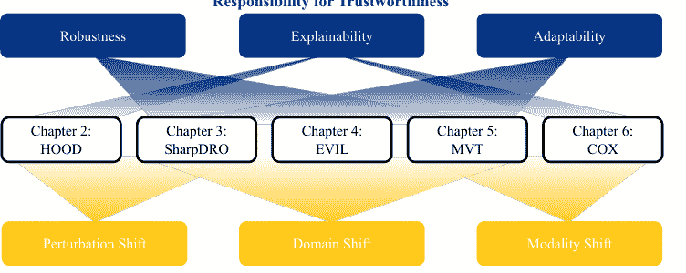

图 1.1. 分布偏移下信赖机器学习的概述。我们探索了机器学习模型信赖性的鲁棒性、可解释性和适应性，并考虑了三种常见的分布偏移，包括扰动偏移（Perturbation Shift）、领域偏移（Domain Shift）和模态偏移（Modality Shift）。从第 2 章到第 6 章，我们通过解决现实任务并提出具有理论依据的有效方法，阐明了不同的信赖方面和分布偏移场景。

- 可解释性（Explainability），旨在理解分布偏移的本质并使决策过程具有解释性。
- 适应性（Adaptability），表示 AI 在没有人工干预的情况下跨越各种条件自主执行的能力。

TML 的这三个方面对于研究分布偏移下的泛化来说是极其脆弱或至关重要的；我们正重点关注这些点。请注意，TML 中还有公平性和隐私等其他课题，但它们与分布偏移下的泛化是正交的。可以通过结合这些发现来实现成功，例如重加权 [23] 或消学习 [24]。此外，为了评估分布偏移下的泛化能力，我们考虑了：

- 扰动偏移（Perturbation Shift），对数据集应用自然或合成噪声，使其偏离其统计模式。
- 领域偏移（Domain Shift），数据从不同的环境收集，进一步引入误导预测的干扰因素。
- 模态偏移（Modality Shift），知识以异构结构表示，增加了特征的不兼容性并阻碍学习的可行性。

上述分布偏移展示了不同程度的偏移。扰动偏移是轻微偏移，因为它具有相同环境的数据类型；领域偏移是中等的，因为它是由不同的环境因素引起的；模态偏移是最极端的，因为它具有不同的数据类型，意味着输入偏移的变化。然而，它们无处不在，都属于统计机器学习中的协变量偏移（Covariate Shift [25]).还有其他常见的偏移，包括目标偏移（Target Shift [26]）和概念偏移（Concept Shift [2）。具体而言，目标偏移是由标签分布的变化引起的，但由于大多数应用的标签空间简单，可以轻松解决；概念偏移的研究较少是因为现实应用中的概念和知识通常是静态的。因此，它们被排除在本文范围之外。接下来，我们将总结论文的贡献并展示章节结构。

## 1.2 贡献总结

总来说，本论文关注分布偏移下的信赖机器学习，旨在现实场景下同时探索责任和能力。通过考虑不同水平的偏移，我的研究涵盖了广泛的应用领域，并为传统课题以及未来方向提供了见解。此外，我们提供了详尽的分析和理论依据，严谨地证明了我们研究的数据集、模型和设置，验证了它们的信赖性以及许多优势，如效率、安全和负担。下面，我们将揭示后续章节的结构并强调它们的贡献。

在第 2 章中，我们观察到 OOD 数据呈现出双刃剑效应，在不同场景下可能会增强或损害泛化。因此，我们需要理解这种效应并在各种场景下有效利用 OOD 数据。我们从因果推断的角度检查数据生成过程，揭示了数据可以分解为“内容”和“风格”。有益的 OOD 数据是由风格变化引起的，有害的 OOD 数据是由内容变化引起的。我们提出了理解并利用 OOD 数据（HOOD）框架，在推理过程中解耦内容和风格。


# 1 引言

然后通过可学习的对抗扰动分别创建有益和有害的 OOD（分布外）数据。通过在这些专门设计的样本上进行训练，我们可以增强泛化性能，并妥善处理野外 OOD 数据。

分布偏移不仅以不同的类型存在，还以不同的强度出现，形成可追溯的分布。在第 3 章中，我们研究了遵循真实世界噪声分布的损坏学习。直观上，损坏是由在时间间隔内以一定概率发生的多个噪声元素引起的，这被称为“光子限制损坏”。通过泊松分布对其进行建模，可以识别出损坏的强度水平。为了处理这种多强度分布偏移，我们提出了基于锐度的分布鲁棒性优化（SharpDRO），通过鼓励平滑性（即最小化“锐度”）来重新加权每个分布的权重并增强其泛化能力。结果，我们的方法在各种损坏偏移下表现得有效且稳定，展示了在实际应用中的鲁棒性和适应性。

此外，为了在现实世界部署 TML 模型以自主识别本质特征，而不依赖于混淆信息，在第 4 章中，我们探索了神经再生，使 AI 能够跨不同环境动态适应并提取领域不变知识。为了解决这个问题，我们提出了用于不变学习的变体参数探索（EVIL）框架，该框架通过生长相应的神经路径来识别领域特征。此外，我们通过在训练期间进一步引入领域变体知识来增强这一过程，反过来有助于识别变体参数。通过丢弃这些不必要的神经路径，模型可以受到领域偏移的影响，显示出增强的能力和适应性。此外，所提方法通过稀疏训练构建，也展示了极高的效率。

现有的分布偏移研究主要集中在扰动和领域偏移上。然而，跨模态的知识适应很少被探索。因此，在第 5 章，我们对两种最常见模态（即语言和视觉）的泛化进行了初步尝试。受益于大语言模型（LLMs）的发展，

## 1.2 贡献总结

从语言学习非常成功，它们已经展示了通用能力。对于视觉任务，它高度依赖于人类监督，这非常消耗资源。因此，产生了一个问题：是否可以用 AI 监督代替人类监督？为此，我们提出了机器视觉治疗（MVT）框架，利用 LLMs 引导视觉学习过程。由于语言模型和视觉模型之间存在模态差异，我们建议通过上下文学习（ICL）来分析文本上下文中的视觉标记（tokens）。结果，所提出的 MVT 可以极大地提升视觉鲁棒性，成功实现所有模态的知识适应。

在第 6 章中，我们没有关注通用模态的泛化，而是提出一个名为“模态外”（OOM）泛化的新问题，旨在利用常见的模态知识来推断稀有模态。例如，语言和视觉模态非常广泛，但稀有模态如触觉、LiDAR 和基因组尚未被 AI 充分探索。由于收集和组织此类数据的困难和成本，进行大规模训练极具挑战性。因此，基于现有知识挖掘稀有模态的隐藏知识对于通用智能至关重要。在 OOM 泛化中，我们首先从多模态交互的角度理解模态信息，为提取泛化知识提供见解。通过应用于真实世界设置，可能从零理解新模态，为通用 AI 的未来方向铺平道路。

此外，我们在第 7 章为本论文中的所有理论研究提供了理论证明。最后，我们在第 8 章总结了所有的贡献，并对未来的研究提供了前性讨论。


机器学习模型对分布外（OOD）样本非常敏感，这个问题引起了广泛关注。然而，目前的方法对不同类型的 OOD 数据缺乏充分理解：既有可以妥善适应以增强学习性能的良益 OOD 数据，也有其他有害 OOD 数据会严重退化分类结果。为了理解和利用 OOD 数据，本章提出了一种 HOOD 方法，该方法可以利用每个图像实例的内容和风格来识别有益和有害 OOD 数据。特别是，我们设计了一个变分推理框架，通过构建结构因果模型来因果地分离内容和风格特征。随后，我们通过干预过程增强内容和风格分别产生有害和有益 OOD 数据。有益 OOD 数据包含新风格但保留了我们感兴趣的内容，可以利用它们训练风格不变的模型。相反，有害 OOD 数据继承了未知内容但带有熟悉的风格，通过检测它们可以提高模型对抗欺骗性异常的鲁棒性。得于所提出的新分离和数据增强技术，HOOD 可以有效处理未知和开放环境中的 OOD 样本，其有效性在三个典型的 OOD 应用（包括 OOD 检测、开放集半监督学习和开放集领域自适应）中得到了实证验证。


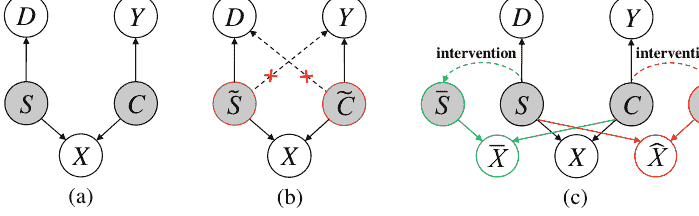

图 2.1。(a) 表示数据生成过程理想因果图。(b) 我们分离方法的插图。棕色边缘变量 $\hat{C}$ 和 $\hat{S}$ 是内容 $C$ 和风格 $S$ 的近似值。虚线表示要打破的非预期因果关系。(c) 数据增强的插图。绿线和红线分别表示对有益 OOD 数据 $\hat{X}$ 和有害 OOD 数据 $X$ 的增强。在所有图中，空白变量是可观测的，阴影变量是隐性的。
# 2.1 引言

在存在分布外（OOD）数据的情况下进行学习是机器学习中一项具有挑战性的任务，因为如果妥善处理来自已知分布的未知数据，部署的分类器将会失败 [28, 29]。这种关键问题在深度模型遇到领域偏移 [30, 31] 和未知类别数据 [28, 32] 时普遍存在，引起了某些重要领域的广泛关注，例如 OOD 检测 [33, 28, 34, 35, 36, 37, 38, 39],开放集领域自适应 (DA) [40, 41] 以及开放集半监督学习 (SSL) [42, 43, 44, 45, 46, 47, 48]。

在上述领域中，OOD 数据可以分为两类，即*有益* OOD 数据和*有害* OOD 数据。有益 OOD 数据可以通过 DA 技术 [51, 31] 提升在目标分布上的性能，但如果利用得不当，它们可能会产生误导。为了提高模型的泛化能力，人们提出了许多正向数据增强技术 [52, 53]。例如，得益于增强的 OOD 数据，SSL [54, 55] 的性能得到了极大提高。相反，带有未知类别的有害 OOD 数据会损害分类结果，它们是欺骗性的且难以检测 [28, 35]。为了训练对抗有害 OOD数据的鲁棒模型，一些工作 [58, 59] 通过负向数据增强生成“困难”数据

> *我们遵循 [50] 将增强数据视为分布内 (ID) 数据的一种类型*

# 2 理解并利用 OOD 数据

与分布内 (ID) 数据区分此类“困难”数据，当面对 OOD 数据时，OOD 检测性能可以得到提高。结果，执行开放集方法的性能可能是次优的，原因有两个：(1) 利用了太多有害 OOD 数据，以及 (2) 保守地拒绝了太多有益 OOD 数据。

在本章中，我们提出了 HOOD 框架（见图 2.2）来妥善处理多个 OOD 问题中的 OOD 数据。为了区分有害和有害数据，我们通过图 2.1 (a) 中的因果模型 (SCM) [60, 61] 对数据生成过程进行建模。特别是，我们将实例 $X$ 分解为两个部分：(1) 表示感兴趣对象的内容变量 $C$，以及 (2) 包含亮度、方向和颜色等影响因素的风格变量 $S$。内容 $C$ 可以指示真实类别 $Y$，而风格 $S$ 决定环境条件，称为领域 $D$。直观上，有害 OOD 数据无法纳入网络训练，因为它们包含了未知内容，因此它们的类别与任何已知类别不同；而有益 OOD 数据可以被适应，因为它们只有新风格但包含与 ID 数据相同的类别。因此，我们可以根据提取的内容和风格特征区分有益和有害 OOD 数据。

此外，我们通过最大化联合分布 $P(X, Y, D)$ 的近似下界 (ELBO) [63, 64, 65] 进行因果分离。结果，我们可以有效地打破网络训练期间常见的内容与风格之间的虚假相关 [61, 60, 67, 68]，如图 2.1 (b) 中的虚线所示。在消融实验中，我们发现 HOOD 可以正确分离内容和风格，这可以显著有利于泛化任务（如开放集 DA）和检测任务（如 OOD 检测）。

为了进一步提高学习性能，我们通过分别对风格和内容进行干预，分别了正向和负向数据增强，如图 2.1 (c) 中的蓝线和红线所示。这种过程通过反向传播从干预目标计算的梯度来实现。结果，风格改变的数据 $X$ 必须是


识别出良性 OOD（分布外）数据，而将内容改变的数据应被识别为恶性 OOD 数据。在不引入任何偏差的情况下，良性 OOD 数据可以被轻松用于改进模型的泛化能力，而恶性 OOD 数据可以被直接识别为有害数据，这有利于未知异常的检测。通过在多个 OOD 应用（包括 OOD 检测、开放集半监督学习 SSL 和开放集域适应 DA）上进行大量实验，我们验证了该方法在典型基准数据集上的有效性。总而言之，我们的贡献有三个方面：

- 我们提出了一个名为 HOOD 的统一框架，它可以有效解解耦内容和风格特征以克服虚假相关性。结果，良性 OOD 数据和恶性 OOD 数据可以通过解耦后的特征被正确识别。
- 我们设计了一种新型数据增强方法，分别增强内容和风格特征以生成良性和恶性 OOD 数据，并进一步利用它们增强学习性能。
- 我们在各种 OOD 应用（包括 OOD 检测、开放集 SSL 和开放集 DA）中通过实验验证了 HOOD 的有效性。

## 2.2 相关工作

OOD 应用包含三个典型问题，即 OOD 检测、开放集 SSL 和开放集 DA。OOD 检测 [28, 35] 旨在训练一个健壮的模型，该模型能够在测试阶段准确识别新出现的恶性 OOD 数据。开放集 SSL [70, 71, 72, 73, 49] 处理的是标记数据稀缺且未标记数据被恶性 OOD 数据污染的问题。对于开放集 DA [41, 40]，它尝试将知识从源域 ID 数据迁移到 OOD 目标域，同时检测在迁移过程中遇到的恶性 OOD 数据。在这三个应用中，预测置信度被频繁用于分离恶性 OOD 数据 [28, 35, 74, 75]。此外，可以通过使用判别器区分 ID 数据和 OOD 数据 [58, 76, 49, 77]。进一步，还设计了各种开放分类器将 OOD 数据集预测为未知 [78, 79, 41]。得益于无监督学习的进展，许多方法采用自监督学习来区分 ID 数据和 OOD 数据 [80, 81, 82]。

OOD 问题中的因果关系主要关注学习在其他因果因素变化时保持不变的表示，从而在面对非平稳域分布时获得更好的性能。为了实现这一点，通常通过变分自编码器框架 [63, 83] 学习因果因素和非因果因素。得益于，域适应 [84, 85, 26] 和域泛化 [86, 87] 可以通过提取域不变特征来解决。此外，基于因果效应，可以通过重加权 [88, 89] 消除偏性特征，对推理有害的虚假相关性可以通过 do-calculus [90, 91, 61] 缓解。近期的方法 [92, 94] 通过自监督学习进行数据增强，以训练一个能够处理分布偏移和损坏的健壮模型。

总的来说，HOOD 与现有的 OOD 应用和因果关系方法有两个主要区别。一方面，HOOD 不再像许多方法那样将图像实例视为一个整体，而是通过其解耦的内容和风格妥善地利用 OOD 示例。此外，增强内容和风格可以同时提高泛化和鲁棒性。另一方面，目前的因果方法无法处理对齐 OOD 数据，但 HOOD 能够从良性 OOD 数据中学习风格不变特征，同时避免恶性 OOD 数据带来的损害。

## 2.3 方法论

在本节中，我们提出了如图 2.2 所示 HOOD 框架。具体而言，我们利用标记数据的标签和未标记数据的伪标签 [95] 作为类别监督来捕捉特征内容。此外，我们执行不同类型的数据增强，并将增强类型视为每种风格的域监督。因此，每个实例 $x$ 都与一个类别标签 $y$ 和一个域标签 $d$ 配对。然后，我们应用两个由 $\theta_c$ 和 $\theta_s$ 参数化的独立编码器 $g_c$ 和 $g_s$ 分别对后验分布 $q_o(C \mid X)$ 和 $q_o(S \mid X)$。随后，生成的 $C$ 和 $S$

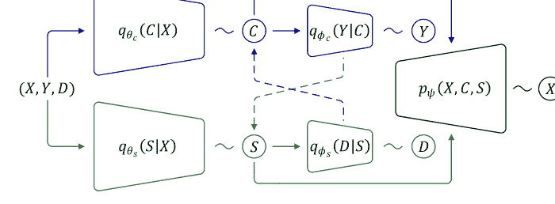

**图 2.2.** HOOD 的架构。实线表示推理流，虚线表示内容和风格的解耦，波浪号表示对应变量的近似。

分别被输入到两个由 $\phi_c$ 和 $\phi_s$ 参数化的全连接分类器 $f_c$ 和 $f_s$ 中，它们分别产生标签预测 $q_{\phi_c}(Y \mid C)$ 和 $q_{\phi_s}(D \mid S)$。为了进一步增强 $C$ 和 $S$ 的可识别性，采用解码器 $h$ 根据其内容和风格重建输入实例 $x$。

下面，我们描述了建模 HOOD 的详细步骤和组件。我们首先引入了基于构建的 SCM（结构因果模型）解耦内容和风格的变分推理框架。随后，我们进行逆向以生成良性 OOD 数据和恶性 OOD 数据。进一步，我们合理地利用良性和恶性 OOD 数据来提升学习性能。最后，我们制定了 HOOD 的部署。

### 2.3.1 用于内容和风格解耦的变分推理

首先，我们假设数据生成过程可以通过某些概率分布捕捉。因此，根据图 2.1 构建的 SCM，感兴趣变量的联合分布 $P(X, Y, D, C, S)$ 可以分解为：

$P(X, Y, D, C, S) = P(C, S)P(X, C, S) \quad (2.1)$

基于图 2.1 中的 SCM，$Y$ 和 $D$ 是条件独立的，即 $Y \perp D \mid C, S$，因此有 $P(Y, D \mid C, S)$。同样，

由于 $P(C, S)=P(C)P(S)$，我们还可以知道 $Y$ 不依赖于 $S$，$D$ 不依赖于 $C$。因此，我们可以进一步推导出 $P(Y, D \mid C, S)=P(Y \mid C)P(D \mid S)$。

在面对 OOD 示例时，上述虚假相关性经常出现 [69]。结果，当基于公式 (2.1) 进行变分推理时，近似的内容 $\hat{C}$ 和风格 $\hat{S}$ 会直接影响 $Y$ 和 $D$，即 $Y \leftarrow \hat{C} \to D$ 和 $Y \leftarrow \hat{S} \to D$，导致近似不准确。然而，期望的条件是 $Y \leftarrow C \leftarrow D$ 和 $Y \leftarrow S \to D$。可以看到图 2.1 (b) 中的不期望相关 $\tilde{C} \to D$ 和 $\hat{S} \to Y$ 是由错误的后验 $P(D \mid \tilde{C})$ 和 $P(Y \mid \hat{S})$ 引起的，它们分别由 $\phi_s$ 和 $\phi_c$ 近似，并作为 $q_{\phi_c}(Y \mid C)$ 和 $q_{\phi_s}(D \mid S)$ 的分母。通过这种方式，我们可以成功地解耦内容 $C$ 和风格 $S$，并确保 $Y$ 和 $D$ 的解码过程不受来自 $S$ 和 $C$ 的虚假特征的影响。为此，我们在公式 (2.1) 中的分解可以近似为：

$\hat{P}(X, Y, D, C, S) = \frac{P(C)P(S)P(Y \mid C)P(D \mid S)P(X \mid C, S)}{q_{\phi_o}(D \mid C)q_{\phi_s}(Y \mid S)} \quad (2.2)$

然后，我们最大化每个数据点 $(\mathbf{x}, y, d)$ 的分布 $p(x, y, d)$ 的对数似然：

$log p(\mathbf{x}, y, d) := \log \int \int \hat{p}(\mathbf{x}, y, d, c, s) dcds \quad (2.3)$

其中下下标表示对应变量的值。由于潜变量 $C$ 和 $S$ 的积分不可处理，我们遵循变分推理来获取一个


## 2.3 方法论

公式 (2.3) 中对数似然的近似证据下界 ELBO($\mathbf{x}, y, d$)：

```
$\log p(\mathbf{x}, y, d) = \log \int \tilde{p}(\mathbf{x}, y, d, c, s) dc ds$
$$= \log \int \tilde{p}(\mathbf{x}, y, d, c, s) \frac{q_0(c, s \mid \mathbf{x})}{q_0(c, s \mid \mathbf{x})} dc ds$$
$$= \log \mathbb{E}_{(c,s) \sim q_0(C,S|\mathbf{x})}\left[\log \frac{\tilde{p}(\mathbf{x}, y, d, c, s)}{q_0(c, s \mid \mathbf{x})} \right]$$
$$\geq \mathbb{E}_{(c,s) \sim q_0(C,S|\mathbf{x})}\left[\log \frac{\tilde{p}(\mathbf{x}, y, d, c, s)}{q_0(c, s \mid \mathbf{x})} \right] := ELBO(\mathbf{x}, y, d).$ $(2.4)$$
```

回想公式 (2.2) 中的修改联合因子，我们可以得到：

```
$ELBO(\mathbf{x}, y, d) = \mathbb{E}_{(c,s) \sim q_0(C,S|\mathbf{x})}\left[\log \frac{p(c)p(s)q_0(d \mid s)p_\psi(y \mid c)}{q_0(c \mid \mathbf{x})q_0(s \mid \mathbf{x})q_0(d \mid c)} \right]$$
$$=\mathbb{E}_{c \sim q_0(C|\mathbf{x})}\left[\log \frac{p(c)}{q_0(c \mid \mathbf{x})}q_0(s \mid \mathbf{x})} \right] + \mathbb{E}_{(c,s) \sim q_0(C,S|\mathbf{x})}\left[\log \frac{q_{\phi_y}(y \mid c)}{q_{\phi_d}(d \mid c)} \right]$$
$$+\mathbb{E}_{(c,s) \sim q_0(C,S|\mathbf{x})}\left[\log \frac{q_0(d \mid s)}{q_{\phi_s}(y \mid s)} \right] + \mathbb{E}_{(c,s) \sim q_0(C,S|\mathbf{x})}\left[\log p_\psi(y \mid c, s) \right]$$
$$=\mathbb{E}_{c \sim q_0(C|\mathbf{x})}\left[\log \frac{p(c)}{q_0(c \mid \mathbf{x})} \cdot \log \frac{p(s)}{q_0(s \mid \mathbf{x})} \right]$$
$$+\mathbb{E}_{c \sim q_0(C|\mathbf{x})}\left[\log \frac{q_{\phi_y}(y \mid c)}{q_{\phi_d}(d \mid c)} \right] + \mathbb{E}_{s \sim q_0(S|\mathbf{x})}\left[\log \frac{q_{\phi_d}(d \mid s)}{q_{\phi_s}(y \mid s)} \right]$$
$$+\mathbb{E}_{(c,s) \sim q_0(C,S|\mathbf{x})}\left[\log p_\psi(y \mid c, s) \right]$$
$$=- KL(q_0(c \mid \mathbf{x}) \parallel p(C)) - KL(q_0(s \mid \mathbf{x}) \parallel p(S))$$
$$+\mathbb{E}_{c \sim q_0(C|\mathbf{x})}\left[\log q_0(d \mid c) - \log q_{\phi_d}(d \mid c) \right]$$
$$+\mathbb{E}_{s \sim q_0(S|\mathbf{x})}\left[\log q_0(d \mid s) - \log q_{\phi_s}(y \mid s) \right]$$
$$+\mathbb{E}_{(c,s) \sim q_0(C,S|\mathbf{x})}\left[\log p_\psi(y \mid c, s) \right]$ $(2.5a)$$
```

$=ELBO(\mathbf{x}, y, d) - \mathbb{E}_{c \sim q_0(C|\mathbf{x})}[\log q_{\phi_d}(d \mid c)] - \mathbb{E}_{s \sim q_0(S|\mathbf{x})}[\log q_{\phi_s}(y \mid s)].$ $(2.5b)$

在公式 (2.5a) 中，前两项表示隐变量 $C$ 和 $S$ 与其先验分布之间的 Kullback-Leibler 散度。在实践中，我们假设先验 $p(C)$ 和 $p(S)$ 服从标准高斯分布。第三项和第四项包含了先验的近似对数似然以及内容与风格的解耦。最后一项代表 $x$ 的估计分布。注意在公式 (2.5b) 中，我们近似的 ELBO 由两部分组成：从公式 (2.1) 的分解中得到的原始 ELBO，以及两个正则化项，这两个项旨在通过最大化对数似然 $\log \theta_c(d|c)$ 和 $\log \theta_s(y|s)$（如图 2.2 中的虚线所示）所示。通过最大化 ELBO，我们可以训练出一个对不同风格不变的准确类别预测器。详细推导过程见补充材料。接下来，我们引入数据增强来辅助利用 OOD（分布外）示例。

### 2.3.2 结合内容和风格干预的数据增强

在解耦内容和风格之后，我们尝试通过两种相反的增强程序来利用 OOD 示例，即*正数据增强*和*负数据增强*，分别产生 OOD 数据 $\tilde{x}$ 和恶意 OOD 数据 $\bar{x}$，以进一步增强模型的泛化能力并提高对异常的鲁棒性。具体而言，为了实现这一点，正数据增强只对风格特征进行干预而保持内容信息不变；而负数据增强试图影响内容而保持风格不变，从而产生恶意 OOD 数据。
### 2.3.4 部署

通常情况下，在所有应用中，我们得到一个标记集 $\mathcal{D}^l = \{(x_i, y_i)\}_{i=1}^l$，其来自分布 $P^l$，以及一个无标记集 $\mathcal{D}^u = \{x_i\}_{i=1}^u$，来自分布 $P^u$。此外，$\mathcal{D}^l$ 和 $\mathcal{D}^u$ 分别定义为 $\mathcal{Y}^l$ 和 $\mathcal{Y}^u$。**OOD 检测。** 标记集用于训练，无标记集用于包含 ID 和 OOD 数据的测试。


## 2.3 方法论

无标记 ID 数据 $Q_{id}$ 与分布 $P$ 相同，但 OOD 数据分布 $P_{ood}^u$ 与 $P$ 不同，即 $P_{id}^l = P^l \neq P_{ood}^u$。目标是在测试阶段正确地区分 OOD 数据和 ID 数据。在训练期间，我们通过数据增强来获取领域标签 $d$，然后遵循我们的变分框架更新模型参数。在测试期间，我们仅使用内容分支预测由一对多（one-vs-all）分类器产生的 OOD 分。如果 OOD 分小于 0.5，则认为该实例为 ID 数据，否则为 OOD。

**开集 SSL。** 标记集 $\mathcal{D}^l$ 和未标记集 $\mathcal{D}^u$ 均用于训练，它们采样自同一个分布，但标签不同。具体而言，未标记数据包含某些与 $\mathcal{D}^l$ 类别相同的 ID 数据，而未标记的 OOD 数据来自 $\mathcal{D}^l$ 中不存在的某些未知类别，形式上为 $\mathcal{Y}^l \subset \mathcal{Y}^u, \mathcal{Y}^u \neq \emptyset$ 且 $P^l(x \mid y)=P^u(x \mid y), y \in y$。目标是充分利用标记数据和未标记 ID 数据，而不被恶性的 OOD 数据误导，并正确分类带有 $\mathcal{Y}^l$ 中标签的测试数据。训练过程与 OOD 检测相似，不同之处 HOOD 会为每个未标记数据产生 OOD 分。如果一个未标记实例被识别为 OOD 数据，则将其排除。

**开集 DA。** 标记集源自源分布 $P^l$，这与未标记集的目标分布 $P^u$ 不同。此外，标签空间 $\mathcal{Y}^l$ 也是 $\mathcal{Y}^u$ 的子集。因此，未标记数据包含与标记数据相同标签的良性 OOD 数据，以及与标记数据类别标签分布不同的恶性 OOD 数据，形式上为 $P^l \neq P^u, \mathcal{Y}^l \subset \mathcal{Y}^u, \mathcal{Y}^u \setminus \mathcal{Y}^l \neq \emptyset$。目标是将标记数据的知识迁移到良性 OOD 数据，同时将恶性 OOD 数据识别为未知。在此应用中，我们为每个目标实例分配一个领域标签，以将其与增强数据区分开。然后，我们将公式 (2.7) 中的正数据增强目标改为公式 (2.8)。在测试期间，如果每个目标实例是良性的，HOOD 将其预测为类别，否则预测为未知。

## 2 理解与利用 OOD 数据

## 2.4 实验

在本节中，我们首先描述实现细节。然后，我们在三个应用上实验验证了方法，即 OOD 检测、开集 SSL 和开集 DA。最后，我们对我们的解耦和反转模块展示了详尽的性能分析。额外的细节和定量结果可以在补充材料中找到。

### 2.4.1 实现细节

在实验中，我们为 OOD 检测和开集 SSL 任务选择 Wide ResNet-28-2 [101]，并遵循 [102, 103] 使用在 Imagenet [104] 上预训练的 ResNet50 用于开集 DA。为了实现 HOOD，我们从 RandAugment [105] 的变换池中随机选择 4 种增强方法以模拟不同的风格。预训练迭代次数 Augmentation_Iter 设置为 100,000，扰动幅度 epsilon = 0.03，所有实验均遵循 [98]。接下来，我们在三个应用中验证 HOOD。

### 2.4.2 OOD 检测

在 OOD 检测任务中，我们使用 SVHN [106] 和 CIFAR10 [107] 作为 ID 数据，测试期间使用 LSUN [108],DTD [109],CUB [110],Flowers [111],Caltech [112] 和 Dogs [113] 数据。特别是为了探索模型的泛化能力，我们从每个类中采样 100 个标记数据和 20,000 个未标记数据进行半监督训练，然后在 OOD 数据上测试模型。我们利用性能指标 AUROC [28]，AUROC 值越高表示性能越好。为了比较，我们选择了一些典型的 OOD 检测方法，包括简单使用 softmax 分作为准则的 Likelihood [28]，通过对抗攻击增强性能的 ODIN [35]，通过关注特征修改 softmax 分的 Likelihood Ratio [74]，以及 OpenGAN [58]。表 2.1 与典型 OOD 检测方法的比较。AUROC (%) 是多次独立试验的平均值。最佳结果加粗显示。

| OOD 数据 | LSUN | DTD | CUB | Caltech | Dogs |
|---|---|---|---|---|---|
| ID 数据 | | | | | |
| Likelihood | 52.25 ± 0.3 | 50.33 ± 0.5 | 48.76 ± 0.6 | 47.33 ± 0.2 | 51.54 ± 0.4 |
| ODIN | 55.60 ± 0.3 | 53.32 ± 0.5 | 52.70 ± 0.4 | 50.47 ± 0.3 | 56.41 ± 0.4 | 61.16 ± 0.3 |
| Likelihood Ratio | 79.34 ± 0.5 | 78.42 ± 0.3 | 75.90 ± 0.7 | 73.93 ± 0.4 | 76.25 ± 0.3 | 83.55 ± 0.4 |
| OpenGAN | 83.77 ± 0.4 | 81.15 ± 0.5 | 84.33 ± 0.6 | 86.66 ± 0.2 | 86.96 ± 0.4 | 89.12 ± 0.3 |
| HOOD | **84.10 ± 0.6** | **80.68 ± 0.6** | **79.25 ± 0.5** | **80.93 ± 0.7** | **85.34 ± 0.7** | **87.58 ± 0.8** |
| ID 数据 | | | | | | |
| Likelihood | 54.32 ± 0.5 | 52.16 ± 0.4 | 50.67 ± 0.4 | 53.86 ± 0.4 | 56.92 ± 0.3 |
| ODIN | 55.59 ± 0.6 | 58.48 ± 0.5 | 51.49 ± 0.9 | 59.36 ± 0.4 | 64.82 ± 0.5 |
| Likelihood Ratio | 81.41 ± 0.6 | 79.77 ± 0.5 | 79.35 ± 0.8 | **77.17 ± 0.7** | 80.67 ± 0.5 | 86.76 ± 0.3 |
| OpenGAN | 84.03 ± 0.4 | 81.29 ± 0.8 | 82.84 ± 1.0 | **82.32 ± 0.4** | 86.78 ± 0.3 | 90.14 ± 0.5 |
| HOOD | **86.12 ± 0.6** | **83.64 ± 0.5** | **83.53 ± 0.6** | **81.56 ± 0.8** | **87.24 ± 0.8** | **90.86 ± 0.6** |

实验结果如表 2.1 所示，我们可以看到 HOOD 远超过 Likelihood、ODIN 和 Likelihood Ratio，并在许多场景下优于 OpenGAN。与 Likelihood 和 ODIN 等 softmax 预测方法相比，HOOD 以很大的优势超过了它们，因为 HOOD 可以正确地从 ID 数据中分离出一些过度自信的示例，通过生成的欺骗性接近 ID 数据的“硬”示例进一步提高性能。尽管 OpenGAN 和 HOOD 都生成“硬”恶性数据，但 HOOD 能够充分区分内容和风格，因此性能优于 OpenGAN。

### 2.4.3 开集 SSL

在开集任务中，我们遵循 [70] 使用基准数据集 CIFAR10 和 CIFAR100 [107] 构建训练数据集，它们分别包含 10 类和 100 类。构建的数据集在每个类中包含 100 个标记数据和 20,000 个未标记数据（在 CIFAR10 和 CIFAR100 中分别设为 50 和 40 个标记数据）。此外，为了在 CIFAR10 中创建开集问题，从所有 10 个类中采样未标记数据；对于 CIFAR100，从所有 100 个类中采样未标记数据。表 2.2 与典型 SSL 方法的比较。AUROC (%) 是三次试验的平均值。最佳结果加粗。

| 训练数据集 | CIFAR10 | CIFAR100 | |
|---|---|---|---|
| 标记数据数量 | 50 | 100 | 400 |
| UASD | 72.82 ± 0.9 | 75.53 ± 1.8 | 76.74 ± 1.7 |
| DS3L | 74.94 ± 1.3 | 76.69 ± 1.5 | 78.94 ± 0.6 |
| MTCF | 79.88 ± 1.3 | 81.60 ± 1.4 | 83.92 ± 0.8 |
| Clean Acc. | **84.11 ± 0.8** | **83.30 ± 0.4** | **87.92 ± 1.0** |
| T27 | 82.74 ± 1.2 | 83.56 ± 1.4 | 85.97 ± 0.8 |
| HOOD | 83.55 ± 1.2 | 84.16 ± 1.5 | 86.22 ± 0.7 |
| UASD | 39.36 ± 1.2 | 41.38 ± 0.7 | 42.66 ± 1.8 |
| DS3L | 39.97 ± 0.2 | 42.58 ± 0.8 | 44.39 ± 0.6 |
| MTCF | 40.16 ± 1.2 | 44.01 ± 1.4 | 43.38 ± 0.5 |
| Corrupted Acc. | OpenMatch | **41.38 ± 0.7** | **42.90 ± 0.6** | **45.79 ± 0.8** | **35.98 ± 1.3** | **36.47 ± 0.7** |
| T27 | 41.39 ± 1.6 | 45.56 ± 1.5 | 49.88 ± 1.5 | **41.03 ± 1.7** | 39.64 ± 0.7 | 41.38 ± 1.6 |
| HOOD | **44.42 ± 1.7** | **48.38 ± 0.9** | **50.74 ± 0.6** | 49.82 ± 1.5 | **41.65 ± 0.9** | **43.72 ± 2.2** |


TABLE 2.3. 与典型的开放集域适应（Open-set DA）方法的对比。平均测试准确率（%）及标准差是通过三次独立实验计算得出的。最佳结果用粗体标记。

| 数据集 | Office | | | | VisDA | | |
|---|---|---|---|---|---|---|
| 域 | A→W | A→D | W→D | D→A | W→A | Synthetic→Real |
| OSBP | 86.5 ± 2.0 | 88.6 ± 1.4 | 97.0 ± 1.0 | 97.9 ± 0.9 | 88.9 ± 2.5 | 85.8 ± 2.5 | 62.9 ± 1.3 |
| UAN | 87.7 ± 1.2 | 87.0 ± 0.8 | 93.5 ± 1.3 | 97.2 ± 1.6 | 88.4 ± 0.7 | 87.8 ± 1.6 | 63.8 ± 2.4 |
| STA | 89.5 ± 0.6 | 93.7 ± 1.5 | 97.5 ± 0.2 | **99.5 ± 0.2** | 89.1 ± 0.5 | 87.9 ± 0.9 | 66.4 ± 1.3 |
| HOOD | **90.1 ± 1.5** | **94.2 ± 1.4** | **99.6 ± 0.6** | 98.3 ± 0.9 | **89.8 ± 0.8** | **91.3 ± 1.8** | **72.4 ± 1.6** |

实验结果如表 2.2 所示。与最强的基准方法 OpenMatch 相比（后者从变换池中随机采样不同的变换），我们的方法变换仅限于四种类型。在 CIFAR10 和 CIFAR100 的清洁准确率（Clean Acc.）方面，提出的 HOOD 略逊于 OpenMatch。然而，得益于解耦（disentanglement），HOOD 对不同风格具有不变性并专注于内容特征。因此，在面对损坏时，HOOD 比所有基准方法都更健壮。如损坏准确率（Corrupted Acc.）的结果所示，我们的方法超过了超过 3%。

### 2.4.4 开放集域适应 (Open-set DA)

在开放集 DA 任务中，我们遵循 [41] 在两个 DA 基准数据集 Office Amazon (A)、Webcam (W) 和 DSLR (D) 上进行验证。Office 数据集包含三个域，每个域由 31 个类组成。VisDA 数据集包含 Synthetic 和 Real 两个域，每个域包含 12 个类。为了在 Office 中创建开放集情况，我们按照字母顺序从前 21 个类中采样来构建。然后，目标数据集从所有 31 个类中采样。对于 VisDA，我们选择前 6 个类作为源域，并使用所有 12 个类作为目标域。我们用“A→W”表示从“A”域到“W”域的迁移。

为了进行比较，我们选择了三种典型的开放集 DA 方法，包括通过反向传播的开放集 DA OSBP [41]（它采用 OpenMax 分器识别未知类并对开放集 DA 执行梯度翻转）、利用熵和域相似性来降低有害 OOD 数据权重的通用自适应网络 UAN [102]，以及利用 SVM 分离有害 OOD 数据的分离自适应（Separate To Adapt） STA [40]。

## 2 理解与利用 OOD 数据

表 2.4. 各模块必要性的消融实验。

| 应用 | OOD 检测 | 开放集 SSL | 开放集 DA |
| --- | --- | --- | --- |
| 无解耦 (w/o disentanglement) | 84.94 ± 1.3 | 82.55 ± 1.1 | 64.6 ± 0.9 |
| 无良性 OOD 数据 (w/o benign OOD data) | 85.95 ± 1.8 | 83.32 ± 2.0 | 66.3 ± 2.5 |
| 无恶性 OOD 数据 (w/o malign OOD data) | 85.50 ± 0.2 | 85.40 ± 0.8 | 71.8 ± 1.2 |
| 无两种增强 (w/o both augmentations) | 80.83 ± 0.8 | 81.14 ± 1.2 | 65.4 ± 1.2 |

实验结果如表 2.3 所示。与基准方法相比，提出的 HOOD 很大程度上受益于生成的良性 OOD 数据，这些数据有两个主要优势：(1) 它们通过具有共同风格与目标域数据相似；(2) 它们与相应的源数据共享相同的内容，因此标签是可用的。因此，通过监督训练选择良性 OOD 数据，可以进一步缩小域间差距，从而获得比基准方法更好的性能。定量结果显示，HOOD 在许多场景下都能超越其他方法。特别是在 VisDA 中，HOOD 的性能优于第二优的方法达 6%，这证明了 HOOD 在处理开放集 DA 方面的有效性。

### 2.4.5 性能分析

消融实验：为了验证每个模块的有效性，我们通过逐个移除组件进行了消融实验。具体而言，我们的 HOOD 可以修改为：“w/o disentanglement”表示移除方程 (2.5a) 中的解耦损失，“w/o benign OOD data”表示在没有 OOD 数据的情况下进行训练，“w/o malign OOD data”和“w/o both augmentations”表示在同时没有良性和 OOD 数据的情况下进行训练。在 OOD 检测中，我们分别使用 CIFAR10 和 LSUN 作为 ID 和 OOD 数据集。在开放集 SSL 中，我们选择带有类别标签的 CIFAR10。作为开放集 DA，我们使用 VisDA 数据集。

## 2.4 实验

img/1aed555ac8a0e63b116db31c62f8_46.png

实验结果如表 2.4 所示。我们可以看到每个模块对性能的影响不同。首先，我们可以恶性 OOD 数据对于 OOD 检测至关重要的，因为它可以作为异常并减少对未见数据的过度自信。然后，良性 OOD 数据可以极大提高开放集 SSL 和开放集 DA 的学习，因为它们可以强制模型关注内容进行分类。此外，我们可以看到，丢弃良性和 OOD 数据与“w/o benign OOD data”和“w/o malign OOD data”相比，性能有所下降。因此，我们的 HOOD 可以正确改变风格和内容，从而相应地受益于任务（如开放集 DA 和开放集 SSL）和任务（如 OOD 检测）。此外，开放集 DA 比其他模块更依赖于解耦，以排除跨域的风格变化。因此，我们的解耦可以有效消除不同域之间的分布变化，并帮助学习不变特征。

增强分析：由于 HOOD 没有引入任何参数，影响影响最大的设置是增强的数量。为了分析其对学习的影响，我们将从 Rand-Augment Pool 中采样的增强数量从 2 变到 6。结果如图 2.3 所示。我们可以看到增强过少或过多都会损害结果。这是因为较小的增强数量会破坏对各种风格的泛化；较大的增强数量会增加风格分支的分类难度，进一步使解耦难以实现。因此，将增强数量设置为 4 是合理的。

| | 类别预测 | | | | | | | | | | 域预测 | | | | |
|---|---|---|---|---|---|---|---|---|---|---|---|---|---|---|
| | 0 1 2 3 4 5 6 7 8 9 | 0 1 2 3 |
| **内容 输入** | 0.08 | 0.02 | 0.04 | 0.02 | 0.01 | 0.09 | 0.02 | 0.01 | 0.25 | 0.24 | 0.23 |
| **0** | 0.03 | 0.01 | 0.17 | 0.01 | 0.00 | 0.09 | 0.01 | 0.21 | 0.24 | 0.28 | 0.27 |
| **1** | 0.02 | 0.01 | 0.02 | 0.02 | 0.03 | 0.01 | 0.00 | 0.24 | 0.28 | 0.21 |
| **2** | 0.03 | 0.12 | 0.01 | 0.03 | 0.04 | 0.02 | 0.02 | 0.01 | 0.29 | 0.23 | 0.19 | 0.19 |
| **35 |
|.3** | 0.01 | 0.01 | 0.01 | 0.00 | 0.00 | 0.01 | 0.01 | 0.27 | 0.27 | 0.25 | 0.25 | 0 **4** | 0.05 | 0..08  000 | 0000 | 0000 | 0000 | 0000 | 0..5 | 0.22 | 0.22 | 0 **2** | 0000 | 0.00 | 0.02 | 0.02 | 0.00 | 0.00 | 0.08 | 0.01 | 0.03 | 0.22 | 0.22 | 0.27 | 0.31 |
| **6** | 0.01 | 0.01 | 0.01 | 0.02 | 0.00 | 0.02 | 0.07 | 0.01 | 0.14 | 0.26 | 0.25 | 0.24 |
| **7** | 0.00 | 0.01 | 0.01 | 0.02 | 0.00 | 0.00 | 0.08 | 0.01 | 0.03 | 0.22 | 0.22 | 0.31 |

FIGURE 2.4. CIFAR10 上内容与风格解耦说明。每个单元格中的数字表示解耦概率。


## 良性与恶性 OOD 数据的影响

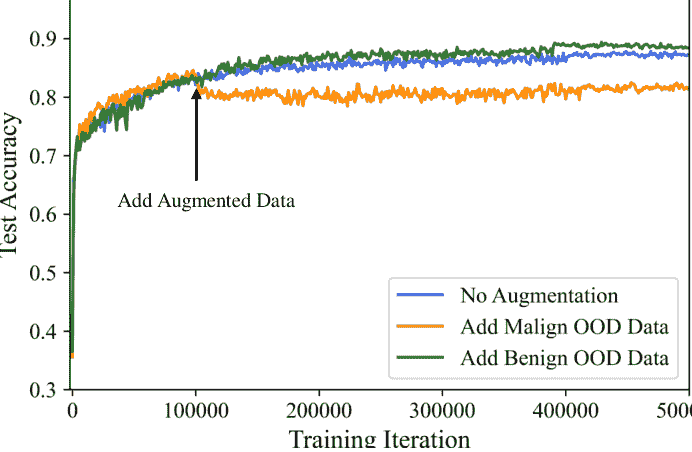

图 2.5. 在训练中加入良性与恶性 OOD 数据的影响。

样式特征和内容特征均无法被类别预测器和领域预测器识别。因此，我们可以合理地推断，我们内容与样式之间的解耦已有效实现。

**在训练中加入良性和恶性 OOD 数据的影响：** 为了对在训练中加入良性 OOD 数据和恶性 OOD 数据进行对比，我们在开放集半监督学习（SSL）设置下进行了实验，并分别对 OOD 数据和恶性 OOD 数据进行增强以比较它们的影响。此外，我们还进行了不使用任何增强的普通训练作为基准结果。结果如图 2.5 所示。我们可以看到，添加增强数据后，恶性 OOD 数据会导致性能下降。相反，与普通训练基准相比，良性 OOD 数据可以进一步提高学习结果。这再次表明保留内容和增强样式是有益的，而消除内容对泛化是有害的。

**OOD 分分析**：为了展示从良性 OOD 数据中识别恶性 OOD 数据的有效性，我们在三个应用上测试了 HOOD 的性能，观察良性 OOD 数据和恶性 OOD 数据的 OOD 分，并显示平均 OOD 分。

# 2 理解与利用 OOD 数据

表格 2.5。三个应用上的平均 OOD 分。

| 应用 | 良性 OOD 数据 | 恶性 OOD 数据 |
|---|---|---|
| OOD 检测 | 0.16 ± 0.3 | 0.83 ± 0.6 |
| 开放集 SSL | 0.08 ± 0.5 | 0.91 ± 0.4 |
| 开放集 DA | 0.21 ± 0.4 | 0.88 ± 0.3 |

表格 2.6. 三个应用上的执行效率对比。

| OOD 检测方法 | 时间 | 开放集 SSL 方法 | 时间 | 开放集 DA 方法 | 时间 |
|---|---|---|---|---|---|
| Likelihood | 6.2h | DS3L | 15.4h | UAN | 8.5h |
| OpenGAN | 7.8h | OpenMatch | 10.5h | STA | 9.1h |
| HOOD | 11.4h | | 13.7h | HOOD | 12.4h |

在表 2.5 中。我们可以看到，我们的一对多分类器产生的 OOD 分在测试阶段清楚地区分了良性和恶性 OOD 数据，这再次验证了 HOOD 的有效性。

**执行效率** 此外，为了对 HOOD 的执行效率进行定量对比，这里我们提供了在 3090 GPU 上与一些典型基准方法的运行时间。结果如表 2.6 所示。注意，我们的方法引入了因果解耦和对抗训练，因此训练时间增加了。

## 2.5 结论

在本章节中，我们提出了 HOOD 来有效利用 OOD 示例。具体而言，我们构建了一个结构因果模型（SCM）来解耦内容和样式，这可以被用于识别良性和恶性 OOD 数据。随后，通过最大化变下界（ELBO），我们可以成功地解耦内容和样式特征并打破类别与领域之间的虚相关性。结果，HOOD 在面对分布偏移和未见的 OOD 数据时更具鲁棒性。此外，我们通过新的干预过程增强内容和样式以产生良性和恶性 OOD 数据，这些可以被用于提高分类和 OOD 检测性能。通过大量实验从经验上验证了 HOOD 在三个典型 OOD 应用上的有效性。


鲁棒泛化旨在处理最具挑战性的数据分布，这些分布在训练集中很少见且包含严重噪声，即光子限制损坏。常见的解决方案，如分布鲁棒优化（DRO），关注最坏情况的经验风险，以确保在不常见的噪声分布上具有低训练误差。然而，由于过度参数化的模型在最坏数据上进行优化，DRO 无法产生平滑的损失曲面，因此难以良好泛化到测试集。因此，我们没有关注最坏风险的最小化，而是通过惩罚最坏情况分布的锐度来提出 SharpDRO，锐度衡量了学习参数领域周围的损失。通过最坏情况锐度最小化，该方法成功地在损坏分布上产生了平直的曲线，从而实现了鲁棒泛化。此外，通过考虑分布是否可用，我们将 SharpDRO 应用于两个问题设置并设计了用于鲁棒泛化的最坏情况选择过程。理论上，我们证明了 SharpDRO 提供了强大的收敛保证。实验上，我们使用 CIFAR10/100 和 ImageNet30 数据集模拟光子限制损坏，并证明 SharpDRO 对严重损坏具有很强的泛化能力，远优于著名的基准方法。


抗损坏学习一直是计算机视觉模型实际部署中的一项重要挑战，因为学习模型对细微噪声比人类脆弱得多


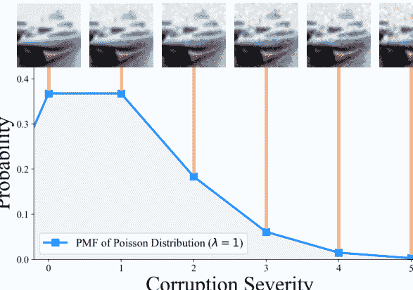

图 3.1. 光子限制损坏的说明

样式特征和内容特征均无法被类别预测器和领域预测器识别。因此，我们可以合理地推断，我们内容与样式之间的解耦已有效实现。

**在训练中加入良性和恶性 OOD 数据的影响：** 为了对在训练中加入良性 OOD 数据和恶性 OOD 数据进行对比，我们在开放集半监督学习（SSL）设置下进行了实验，并分别对 OOD 数据和恶性 OOD 数据进行增强以比较它们的影响。此外，我们还进行了不使用任何增强的普通训练作为基准结果。结果如图 2.5 所示。我们可以看到，添加增强数据后，恶性 OOD 数据会导致性能下降。相反，与普通训练基准相比，良性 OOD 数据可以进一步提高学习结果。这再次表明保留内容和增强样式是有益的，而消除内容对泛化是有害的。


表格 2.5。三个应用上的平均 OOD 分。

| 应用 | 良性 OOD 数据 | 恶性 OOD 数据 |
|---|---|---|
| OOD 检测 | 0.16 ± 0.3 | 0.83 ± 0.6 |
| 开放集 SSL | 0.08 ± 0.5 | 0.91 ± 0.4 |
| 开放集 DA | 0.21 ± 0.4 | 0.88 ± 0.3 |

表格 2.6.三个应用上的执行效率对比。

| OOD 检测方法 | 时间 | 开放集 SSL 方法 | 时间 | 开放集 DA 方法 | 时间 |
|---|---|---|---|---|---|
| Likelihood | 6.2h | DS3L | 15.4h | UAN | 8.5h |
| OpenGAN | 7.8h | OpenMatch | 10.5h | STA | 9.1h |
| HOOD | 11.4h | | 13.7h | HOOD | 12.4h |

在表 2.5 中。我们可以看到，我们的一对多分类器产生的 OOD 分在测试阶段清楚地区分了良性和恶性 OOD 数据，这再次验证了 HOOD 的有效性。

**执行效率** 此外，为了对 HOOD 的执行效率进行定量对比，这里我们提供了在 3090 GPU 上与一些典型基准方法的运行时间。结果如表 2.6 所示。注意，我们的方法引入了因果解耦和对抗训练，因此训练时间增加了。

## 2.5 结论


# 基于锐度的鲁棒分布优化

鲁棒泛化旨在处理最具挑战性的数据分布，这些分布在训练集中很少见且包含严重噪声，即光子限制损坏。常见的解决方案，如分布鲁棒优化（DRO），关注最坏情况的经验风险，以确保在不常见的噪声分布上具有低训练误差。然而，由于过度参数化的模型在最坏数据上进行优化，DRO 无法产生平滑的损失曲面，因此难以良好泛化到测试集。因此，我们没有关注最坏风险的最小化，而是通过惩罚最坏情况分布的锐度来提出 SharpDRO，锐度衡量了学习参数领域周围的损失。通过最坏情况锐度最小化，该方法成功地在损坏分布上产生了平直的曲线，从而实现了鲁棒泛化。此外，通过考虑分布是否可用，我们将 SharpDRO 应用于两个问题设置并设计了用于鲁棒泛化的最坏情况选择过程。理论上，我们证明了 SharpDRO 提供了强大的收敛保证。实验上，我们使用 CIFAR10/100 和 ImageNet30 数据集模拟光子限制损坏，并证明 SharpDRO 对严重损坏具有很强的泛化能力，远优于著名的基准方法。

## 3.1 引言

抗损坏学习一直是计算机视觉模型实际部署中的一项重要挑战，因为学习模型对细微噪声比人类脆弱得多

## 3.1 引言


图 3.1. 光子限制损坏的说明

样式特征和内容特征均无法被类别预测器和领域预测器识别。因此，我们可以合理地推断，我们内容与样式之间的解耦已有效实现。

**在训练中加入良性和恶性 OOD 数据的影响：** 为了对在训练中加入良性 OOD 数据和恶性 OOD 数据进行对比，我们在开放集半监督学习（SSL）设置下进行了实验，并分别对 OOD 数据和恶性 OOD 数据进行增强以比较它们的影响。此外，我们还进行了不使用任何增强的普通训练作为基准结果。结果如图 2.5 所示。我们可以看到，添加增强数据后，恶性 OOD 数据会导致性能下降。相反，与普通训练基准相比，良性 OOD 数据可以进一步提高学习结果。这再次表明保留内容和增强样式是有益的，而消除内容对泛化是有害的。

**OOD 分分析**：为了展示从良性 OOD 数据中识别恶性 OOD 数据的有效性，我们在三个应用上测试了 HOOD 的性能，观察良性 OOD 数据和恶性 OOD 数据的 OOD 分，并显示平均 OOD 分


表格 2.5。三个应用上的平均 OOD 分。

| 应用 | 良性 OOD 数据 | 恶性 OOD 数据 |
|---|---|---|
| OOD 检测 | 0.16 ± 0.3 | 0.83 ± 0.6 |
| 开放集 SSL | 0.08 ± 0.5 | 0.91 ± 0.4 |
| 开放集 DA | 0.21 ± 0.4 | 0.88 ± 0.3 |

表格 2.6.三个应用上的执行效率对比。

| OOD 检测方法 | 时间 | 开放集 SSL 方法 | 时间 | 开放集 DA 方法 | 时间 |
|---|---|---|---|---|---|
| Likelihood | 6.2h | DS3L | 15.4h | UAN | 8.5h |
| OpenGAN | 7.8h | OpenMatch | 10.5h | STA | 9.1h |
| HOOD | 11.4h | | 13.7h | HOOD | 12.4h |

在表 2.5 中。我们可以看到，我们的一对多分类器产生的 OOD 分在测试阶段清楚地区分了良性和恶性 OOD 数据，这再次验证了 HOOD 的有效性。

**执行效率** 此外，为了对 HOOD 的执行效率进行定量对比，这里我们提供了在 3090 GPU 上与一些典型基准方法的运行时间。结果如表 2.6 所示。注意，我们的方法引入了因果解耦和对抗训练，因此训练时间增加了。


在本章节中，我们提出了 HOOD 来有效利用 OOD 示例。具体而言，我们构建了一个结构因果模型（SCM）来解耦内容和样式，这可以被用于识别良性和恶性 OOD 数据。随后，通过最大化变下界（ELBO），我们可以成功地解耦内容和样式特征并打破类别与领域之间的虚相关性。结果，HOOD 在面对分布偏移和未见的 OOD 数据时更具鲁棒性。此外，我们通过新的干预过程增强内容和样式以产生良性和恶性 OOD 数据，这些可以被用于提高分类和 OOD 检测性能。通过大量实验从经验上验证了 HOOD 在三个典型 OOD 应用上的有效性。


鲁棒泛化旨在处理最具挑战性的数据分布，这些分布在训练集中很少见且包含严重噪声，即光子限制损坏。常见的解决方案，如分布鲁棒优化（DRO），关注最坏情况的经验风险，以确保在不常见的噪声分布上具有低训练误差。然而，由于过度参数化的模型在最坏数据上进行优化，DRO 无法产生平滑的损失曲面，因此难以良好泛化到测试集。因此，我们没有关注最坏风险的最小化，而是通过惩罚最坏情况分布的锐度来提出 SharpDRO，锐度衡量了学习参数领域周围的损失。通过最坏情况锐度最小化，该方法成功地在损坏分布上产生了平直的曲线，从而实现了鲁棒泛化。此外，通过考虑分布是否可用，我们将 SharpDRO 应用于两个问题设置并设计了用于鲁棒泛化的最坏情况选择过程。理论上，我们证明了 SharpDRO 提供了强大的收敛保证。实验上，我们使用 CIFAR10/100 和 ImageNet30 数据集模拟光子限制损坏，并证明 SharpDRO 对严重损坏具有很强的泛化能力，远优于著名的基准方法。

## 3.1 引言

抗损坏学习一直是计算机视觉模型实际部署中的一项重要挑战，因为学习模型对细微噪声比人类脆弱得多

## 3.1 引言


图 3.1. 光子限制损坏的说明

样式特征和内容特征均无法被类别预测器和领域预测器识别。因此，我们可以合理地推断，我们内容与样式之间的解耦已有效实现。

**在训练中加入良性和恶性 OOD 数据的影响：** 为了对在训练中加入良性 OOD 数据和恶性 OOD 数据进行对比，我们在开放集半监督学习（SSL）设置下进行了实验，并分别对 OOD 数据和恶性 OOD 数据进行增强以比较它们的影响。此外，我们还进行了不使用任何增强的普通训练作为基准结果。结果如图 2.5 所示。我们可以看到，添加增强数据后，恶性 OOD 数据会导致性能下降。相反，与普通训练基准相比，良性 OOD 数据可以进一步提高学习结果。这再次表明保留内容和增强样式是有益的，而消除内容对泛化是有害的。

**OOD 分分析**：为了展示从良性 OOD 数据中识别恶性 OOD 数据的有效性，我们在三个应用上测试了 HOOD 的性能，观察良性 OOD 数据和恶性 OOD 数据的 OOD 分，并显示平均 OOD 分


表格 2.5。三个应用上的平均 OOD 分。

| 应用 | 良性 OOD 数据 | 恶性 OOD 数据 |
|---|---|---|
| OOD 检测 | 0.16 ± 0.3 | 0.83 ± 0.6 |
| 开放集 SSL | 0.08 ± 0.5 | 0.91 ± 0.4 |
| 开放集 DA | 0.21 ± 0.4 | 0.88 ± 0.3 |

表格 2.6.三个应用上的执行效率对比。

| OOD 检测方法 | 时间 | 开放集 SSL 方法 | 时间 | 开放集 DA 方法 | 时间 |
|---|---|---|---|---|---|
| Likelihood | 6.2h | DS3L | 15.4h | UAN | 8.5h |
| OpenGAN | 7.8h | OpenMatch | 10.5h | STA | 9.1h |
| HOOD | 11.4h | | 13.7h | HOOD | 12.4h |

在表 2.5 中。我们可以看到，我们的一对多分类器产生的 OOD 分在测试阶段清楚地区分了良性和恶性 OOD 数据，这再次验证了 HOOD 的有效性。

**执行效率** 此外，为了对 HOOD 的执行效率进行定量对比，这里我们提供了在 3090 GPU 上与一些典型基准方法的运行时间。结果如表 2.6 所示。注意，我们的方法引入了因果解耦和对抗训练，因此训练时间增加了。
## 2.5 结论

在本章节中，我们提出了 HOOD 来有效利用 OOD 示例。具体而言，我们构建了一个结构因果模型（SCM）来解耦内容和样式，这可以被用于识别良性和恶性 OOD 数据。随后，通过最大化变下界（ELBO），我们可以成功地解耦内容和样式特征并打破类别与领域之间的虚相关性。结果，HOOD 在面对分布偏移和未见的 OOD 数据时更具鲁棒性。此外，我们通过新的干预过程增强内容和样式以产生良性和恶性 OOD 数据，这些可以被用于提高分类和 OOD 检测性能。通过大量实验从经验上验证了 HOOD 在三个典型 OOD 应用上的有效性。


鲁棒泛化旨在处理最具挑战性的数据分布，这些分布在训练集中很少见且包含严重噪声，即光子限制损坏。常见的解决方案，如分布鲁棒优化（DRO），关注最坏情况的经验风险，以确保在不常见的噪声分布上具有低训练误差。然而，由于过度参数化的模型在最坏数据上进行优化，DRO 无法产生平滑的损失曲面，因此难以良好泛化到测试集。因此，我们没有关注最坏风险的最小化，而是通过惩罚最坏情况分布的锐度来提出 SharpDRO，锐度衡量了学习参数领域周围的损失。通过最坏情况锐度最小化，该方法成功地在损坏分布上产生了平直的曲线，从而实现了鲁棒泛化。此外，通过考虑分布是否可用，我们将 SharpDRO 应用于两个问题设置并设计了用于鲁棒泛化的最坏情况选择过程。理论上，我们证明了 SharpDRO 提供了强大的收敛保证。实验上，我们使用 CIFAR10/100 和 ImageNet30 数据集模拟光子限制损坏，并证明 SharpDRO 对严重损坏具有很强的泛化能力，远优于著名的基准方法。


抗损坏学习一直是计算机视觉模型实际部署中的一项重要挑战，因为学习模型对细微噪声比人类脆弱得多


图 3.1. 光子限制损坏的说明

样式特征和内容特征均无法被类别预测器和领域预测器识别。因此，我们可以合理地推断，我们内容与样式之间的解耦已有效实现。

**在训练中加入良性和恶性 OOD 数据的影响：** 为了对在训练中加入良性 OOD 数据和恶性 OOD 数据进行对比，我们在开放集半监督学习（SSL）设置下进行了实验，并分别对 OOD 数据和恶性 OOD 数据进行增强以比较它们的影响。此外，我们还进行了不使用任何增强的普通训练作为基准结果。结果如图 2.5 所示。我们可以看到，添加增强数据后，恶性 OOD 数据会导致性能下降。相反，与普通训练基准相比，良性 OOD 数据可以进一步提高学习结果。这再次表明保留内容和增强样式是有益的，而消除内容对泛化是有害的。

**OOD 分分析**：为了展示从良性 OOD 数据中识别恶性 OOD 数据的有效性，我们在三个应用上测试了 HOOD 的性能，观察良性 OOD 数据和恶性 OOD 数据的 OOD 分，并显示平均 OOD 分

表格 2.5。三个应用上的平均 OOD 分。

| 应用 | 良性 OOD 数据 | 恶性 OOD 数据 |
|---|---|---|
| OOD 检测 | 0.16 ± 0.3 | 0.83 ± 0.6 |
| 开放集 SSL | 0.08 ± 0.5 | 0.91 ± 0.4 |
| 开放集 DA | 0.21 ± 0.4 | 0.88 ± 0.3 |

表格 2.6.三个应用上的执行效率对比。

| OOD 检测方法 | 时间 | 开放集 SSL 方法 | 时间 | 开放集 DA 方法 | 时间 |
|---|---|---|---|---|---|
| Likelihood | 6.2h | DS3L | 15.4h | UAN | 8.5h |
| OpenGAN | 7.8h | OpenMatch | 10.5h | STA | 9.1h |
| HOOD | 11.4h | | 13.7h | HOOD | 12.4h |

在表 2.5 中。我们可以看到，我们的一对多分类器产生的 OOD 分在测试阶段清楚地区分了良性和恶性 OOD 数据，这再次验证了 HOOD 的有效性。

**执行效率** 此外，为了对 HOOD 的执行效率进行定量对比，这里我们提供了在 3090 GPU 上与一些典型基准方法的运行时间。结果如表 2.6 所示。注意，我们的方法引入了因果解耦和对抗训练，因此训练时间增加了。

## 2.5 结论

在本章节中，我们提出了 HOOD 来有效利用 OOD 示例。具体而言，我们构建了一个结构因果模型（SCM）来解耦内容和样式，这可以被用于识别良性和恶性 OOD 数据。随后，通过最大化变下界（ELBO），我们可以成功地解耦内容和样式特征并打破类别与领域之间的虚相关性。结果，HOOD 在面对分布偏移和未见的 OOD 数据时更具鲁棒性。此外，我们通过新的干预过程增强内容和样式以产生良性和恶性 OOD 数据，这些可以被用于提高分类和 OOD 检测性能。通过大量实验从经验上验证了 HOOD 在三个典型 OOD 应用上的有效性。


# 基于锐度的鲁棒分布优化

抗损坏学习一直是计算机视觉模型实际部署中的一项重要挑战，因为学习模型对细微噪声比人类脆弱得多

## 3.1 引言


图 3.1. 光子限制损坏的说明

样式特征和内容特征均无法被类别预测器和领域预测器识别。因此，我们可以合理地推断，我们内容与样式之间的解耦已有效实现。

**在训练中加入良性和恶性 OOD 数据的影响：** 为了对在训练中加入良性 OOD 数据和恶性 OOD 数据进行对比，我们在开放集半监督学习（SSL）设置下进行了实验，并分别对 OOD 数据和恶性 OOD 数据进行增强以比较它们的影响。此外，我们还进行了不使用任何增强的普通训练作为基准结果。结果如图 2.5 所示。我们可以看到，添加增强数据后，恶性 OOD 数据会导致性能下降。相反，与普通训练基准相比，良性 OOD 数据可以进一步提高学习结果。这再次表明保留内容和增强样式是有益的，而消除内容对泛化是有害的。

**OOD 分分析**：为了展示从良性 OOD 数据中识别恶性 OOD 数据的有效性，我们在三个应用上测试了 HOOD 的性能，观察良性 OOD 数据和恶性 OOD 数据的 OOD 分，并显示平均 OOD 分

# 2 理解与利用 OOD 数据

表格 2.5。三个应用上的平均 OOD 分。

| 应用 | 良性 OOD 数据 | 恶性 OOD 数据 |
|---|---|---|
| OOD 检测 | 0.16 ± 0.3 | 0.83 ± 0.6 |
| 开放集 SSL | 0.08 ± 0.5 | 0.91 ± 0.4 |
| 开放集 DA | 0.21 ± 0.4 | 0.88 ± 0.3 |

表格 2.6.三个应用上的执行效率对比。

| OOD 检测方法 | 时间 | 开放集 SSL 方法 | 时间 | 开放集 DA 方法 | 时间 |
|---|---|---|---|---|---|
| Likelihood | 6.2h | DS3L | 15.4h | UAN | 8.5h |
| OpenGAN | 7.8h | OpenMatch | 10.5h | STA | 9.1h |
| HOOD | 11.4h | | 13.7h | HOOD | 12.4h |

在表 2.5 中。我们可以看到，我们的一对多分类器产生的 OOD 分在测试阶段清楚地区分了良性和恶性 OOD 数据，这再次验证了 HOOD 的有效性。

**执行效率** 此外，为了对 HOOD 的执行效率进行定量对比，这里我们提供了在 3090 GPU 上与一些典型基准方法的运行时间。结果如表 2.6 所示。注意，我们的方法引入了因果解耦和对抗训练，因此训练时间增加了。

## 2.5 结论

在本章节中，我们提出了 HOOD 来有效利用 OOD 示例。具体而言，我们构建了一个结构因果模型（SCM）来解耦内容和样式，这可以被用于识别良性和恶性 OOD 数据。随后，通过最大化变下界（ELBO），我们可以成功地解耦内容和样式特征并打破类别与领域之间的虚相关性。结果，HOOD 在面对分布偏移和未见的 OOD 数据时更具鲁棒性。此外，我们通过新的干预过程增强内容和样式以产生良性和恶性 OOD 数据，这些可以被用于提高分类和 OOD 检测性能。通过大量实验从经验上验证了 HOOD 在三个典型 OOD 应用上的有效性。

鲁棒泛化旨在处理最具挑战性的数据分布，这些分布在训练集中很少见且包含严重噪声，即光子限制损坏。常见的解决方案，如分布鲁棒优化（DRO），关注最坏情况的经验风险，以确保在不常见的噪声分布上具有低训练误差。然而，由于过度参数化的模型在最坏数据上进行优化，DRO 无法产生平滑的损失曲面，因此难以良好泛化到测试集。因此，我们没有关注最坏风险的最小化，而是通过惩罚最坏情况分布的锐度来提出 SharpDRO，锐度衡量了学习参数领域周围的损失。通过最坏情况锐度最小化，该方法成功地在损坏分布上产生了平直的曲线，从而实现了鲁棒泛化。此外，通过考虑分布是否可用，我们将 SharpDRO 应用于两个问题设置并设计了用于鲁棒泛化的最坏情况选择过程。理论上，我们证明了 SharpDRO 提供了强大的收敛保证。实验上，我们使用 CIFAR10/100 和 ImageNet30 数据集模拟光子限制损坏，并证明 SharpDRO 对严重损坏具有很强的泛化能力，远优于著名的基准方法。

抗损坏学习一直是计算机视觉模型实际部署中的一项重要挑战，因为学习模型对细微噪声比人类脆弱得多


图 3.1. 光子限制损坏的说明

样式特征和内容特征均无法被类别预测器和领域预测器识别。因此，我们可以合理地推断，我们内容与样式之间的解耦已有效实现。

**在训练中加入良性和恶性 OOD 数据的影响：** 为了对在训练中加入良性 OOD 数据和恶性 OOD 数据进行对比，我们在开放集半监督学习（SSL）设置下进行了实验，并分别对 OOD 数据和恶性 OOD 数据进行增强以比较它们的影响。此外，我们还进行了不使用任何增强的普通训练作为基准结果。结果如图 2.5 所示。我们可以看到，添加增强数据后，恶性 OOD 数据会导致性能下降。相反，与普通训练基准相比，良性 OOD 数据可以进一步提高学习结果。这再次表明保留内容和增强样式是有益的，而消除内容对泛化是有害的。

**OOD 分分析**：为了展示从良性 OOD 数据中识别恶性 OOD 数据的有效性，我们在三个应用上测试了 HOOD 的性能，观察良性 OOD 数据和恶性 OOD 数据的 OOD 分，并显示平均 OOD 分

# 2 理解与利用 OOD 数据

表格 2.5。三个应用上的平均 OOD 分。

| 应用 | 良性 OOD 数据 | 恶性 OOD 数据 |
|---|---|---|
| OOD 检测 | 0.16 ± 0.3 | 0.83 ± 0.6 |
| 开放集 SSL | 0.08 ± 0.5 | 0.91 ± 0.4 |
| 开放集 DA | 0.21 ± 0.4 | 0.88 ± 0.3 |

表格 2.6.三个应用上的执行效率对比。

| OOD 检测方法 | 时间 | 开放集 SSL 方法 | 时间 | 开放集 DA 方法 | 时间 |
|---|---|---|---|---|---|
| Likelihood | 6.2h | DS3L | 15.4h | UAN | 8.5h |
| OpenGAN | 7.8h | OpenMatch | 10.5h | STA | 9.1h |
| HOOD | 11.4h | | 13.7h | HOOD | 12.4h |

在表 2.5 中。我们可以看到，我们的一对多分类器产生的 OOD 分在测试阶段清楚地区分了良性和恶性 OOD 数据，这再次验证了 HOOD 的有效性。

**执行效率** 此外，为了对 HOOD 的执行效率进行定量对比，这里我们提供了在 3090 GPU 上与一些典型基准方法的运行时间。结果如表 2.6 所示。注意，我们的方法引入了因果解耦和对抗训练，因此训练时间增加了。

## 2.5 结论

在本章节中，我们提出了 HOOD 来有效利用 OOD 示例。具体而言，我们构建了一个结构因果模型（SCM）来解耦内容和样式，这可以被用于识别良性和恶性 OOD 数据。随后，通过最大化变下界（ELBO），我们可以成功地解耦内容和样式特征并打破类别与领域之间的虚相关性。结果，HOOD 在面对分布偏移和未见的 OOD 数据时更具鲁棒性。此外，我们通过新的干预过程增强内容和样式以产生良性和恶性 OOD 数据，这些可以被用于提高分类和 OOD 检测性能。通过大量实验从经验上验证了 HOOD 在三个典型 OOD 应用上的有效性。

# 第 3 章

# 基于锐度的鲁棒分布优化

鲁棒泛化旨在处理最具挑战性的数据分布，这些分布在训练集中很少见且包含严重噪声，即光子限制损坏。常见的解决方案，如分布鲁棒优化（DRO），关注最坏情况的经验风险，以确保在不常见的噪声分布上具有低训练误差。然而，由于过度参数化的模型在最坏数据上进行优化，DRO 无法产生平滑的损失曲面，因此难以良好泛化到测试集。因此，我们没有关注最坏风险的最小化，而是通过惩罚最坏情况分布的锐度来提出 SharpDRO，锐度衡量了学习参数领域周围的损失。通过最坏情况锐度最小化，该方法成功地在损坏分布上产生了平直的曲线，从而实现了鲁棒泛化。此外，通过考虑分布是否可用，我们将 SharpDRO 应用于两个问题设置并设计了用于鲁棒泛化的最坏情况选择过程。理论上，我们证明了 SharpDRO 提供了强大的收敛保证。实验上，我们使用 CIFAR10/100 和 ImageNet30 数据集模拟光子限制损坏，并证明 SharpDRO 对严重损坏具有很强的泛化能力，远优于著名的基准方法。

## 3.1 引言

抗损坏学习一直是计算机视觉模型实际部署中的一项重要挑战，因为学习模型对细微噪声比人类脆弱得多

## 3.1 引言


图 3.1. 光子限制损坏的说明

样式特征和内容特征均无法被类别预测器和领域预测器识别。因此，我们可以合理地推断，我们内容与样式之间的解耦已有效实现。

**在训练中加入良性和恶性 OOD 数据的影响：** 为了对在训练中加入良性 OOD 数据和恶性 OOD 数据进行对比，我们在开放集半监督学习（SSL）设置下进行了实验，并分别对 OOD 数据和恶性 OOD 数据进行增强以比较它们的影响。此外，我们还进行了不使用任何增强的普通训练作为基准结果。结果如图 2.5 所示。我们可以看到，添加增强数据后，恶性 OOD 数据会导致性能下降。相反，与普通训练基准相比，良性 OOD 数据可以进一步提高学习结果。这再次表明保留内容和增强样式是有益的，而消除内容对泛化是有害的。

**OOD 分分析**：为了展示从良性 OOD 数据中识别恶性 OOD 数据的有效性，我们在三个应用上测试了 HOOD 的性能，观察良性 OOD 数据和恶性 OOD 数据的 OOD 分，并显示平均 OOD 分

# 2 理解与利用 OOD 数据

表格 2.5。三个应用上的平均 OOD 分。

| 应用 | 良性 OOD 数据 | 恶性 OOD 数据 |
|---|---|---|
| OOD 检测 | 0.16 ± 0.3 | 0.83 ± 0.6 |
| 开放集 SSL | 0.08 ± 0.5 | 0.91 ± 0.4 |
| 开放集 DA | 0.21 ± 0.4 | 0.88 ± 0.3 |

表格 2.6.三个应用上的执行效率对比。

| OOD 检测方法 | 时间 | 开放集 SSL 方法 | 时间 | 开放集 DA 方法 | 时间 |
|---|---|---|---|---|---|
| Likelihood | 6.2h | DS3L | 15.4h | UAN | 8.5h |
| OpenGAN | 7.8h | OpenMatch | 10.5h | STA | 9.1h |
| HOOD | 11.4h | | 13.7h | HOOD | 12.4h |

在表 2.5 中。我们可以看到，我们的一对多分类器产生的 OOD 分在测试阶段清楚地区分了良性和恶性 OOD 数据，这再次验证了 HOOD 的有效性。

**执行效率** 此外，为了对 HOOD 的执行效率进行定量对比，这里我们提供了在 3090 GPU 上与一些典型基准方法的运行时间。结果如表 2.6 所示。注意，我们的方法引入了因果解耦和对抗训练，因此训练时间增加了。

## 2.5 结论

在本章节中，我们提出了 HOOD 来有效利用 OOD 示例。具体而言，我们构建了一个结构因果模型（SCM）来解耦内容和样式，这可以被用于识别良性和恶性 OOD 数据。随后，通过最大化变下界（ELBO），我们可以成功地解耦内容和样式特征并打破类别与领域之间的虚相关性。结果，HOOD 在面对分布偏移和未见的 OOD 数据时更具鲁棒性。此外，我们通过新的干预过程增强内容和样式以产生良性和恶性 OOD 数据，这些可以被用于提高分类和 OOD 检测性能。通过大量实验从经验上验证了 HOOD 在三个典型 OOD 应用上的有效性。

# 第 3 章

# 基于锐度的鲁棒分布优化

鲁棒泛化旨在处理最具挑战性的数据分布，这些分布在训练集中很少见且包含严重噪声，即光子限制损坏。常见的解决方案，如分布鲁棒优化（DRO），关注最坏情况的经验风险，以确保在不常见的噪声分布上具有低训练误差。然而，由于过度参数化的模型在最坏数据上进行优化，DRO 无法产生平滑的损失曲面，因此难以良好泛化到测试集。因此，我们没有关注最坏风险的最小化，而是通过惩罚最坏情况分布的锐度来提出 SharpDRO，锐度衡量了学习参数领域周围的损失。通过最坏情况锐度最小化，该方法成功地在损坏分布上产生了平直的曲线，从而实现了鲁棒泛化。此外，通过考虑分布是否可用，我们将 SharpDRO 应用于两个问题设置并设计了用于鲁棒泛化的最坏情况选择过程。理论上，我们证明了 SharpDRO 提供了强大的收敛保证。实验上，我们使用 CIFAR10/100 和 ImageNet30 数据集模拟光子限制损坏，并证明 SharpDRO 对严重损坏具有很强的泛化能力，远优于著名的基准方法。

## 3.1 引言

抗损坏学习一直是计算机视觉模型实际部署中的一项重要挑战，因为学习模型对细微噪声比人类脆弱得多

## 3.1 引言


图 3.1. 光子限制损坏的说明

样式特征和内容特征均无法被类别预测器和领域预测器识别。因此，我们可以合理地推断，我们内容与样式之间的解耦已有效实现。

**在训练中加入良性和恶性 OOD 数据的影响：** 为了对在训练中加入良性 OOD 数据和恶性 OOD 数据进行对比，我们在开放集半监督学习（SSL）设置下进行了实验，并分别对 OOD 数据和恶性 OOD 数据进行增强以比较它们的影响。此外，我们还进行了不使用任何增强的普通训练作为基准结果。结果如图 2.5 所示。我们可以看到，添加增强数据后，恶性 OOD 数据会导致性能下降。相反，与普通训练基准相比，良性 OOD 数据可以进一步提高学习结果。这再次表明保留内容和增强样式是有益的，而消除内容对泛化是有害的。

**OOD 分分析**：为了展示从良性 OOD 数据中识别恶性 OOD 数据的有效性，我们在三个应用上测试了 HOOD 的性能，观察良性 OOD 数据和恶性 OOD 数据的 OOD 分，并显示平均 OOD 分

# 2 理解与利用 OOD 数据

表格 2.5。三个应用上的平均 OOD 分。

| 应用 | 良性 OOD 数据 | 恶性 OOD 数据 |
|---|---|---|
| OOD 检测 | 0.16 ± 0.3 | 0.83 ± 0.6 |
| 开放集 SSL | 0.08 ± 0.5 | 0.91 ± 0.4 |
| 开放集 DA | 0.21 ± 0.4 | 0.88 ± 0.3 |

表格 2.6.三个应用上的执行效率对比。

| OOD 检测方法 | 时间 | 开放集 SSL 方法 | 时间 | 开放集 DA 方法 | 时间 |
|---|---|---|---|---|---|
| Likelihood | 6.2h | DS3L | 15.4h | UAN | 8.5h |
| OpenGAN | 7.8h | OpenMatch | 10.5h | STA | 9.1h |
| HOOD | 11.4h | | 13.7h | HOOD | 12.4h |

在表 2.5 中。我们可以看到，我们的一对多分类器产生的 OOD 分在测试阶段清楚地区分了良性和恶性 OOD 数据，这再次验证了 HOOD 的有效性。

**执行效率** 此外，为了对 HOOD 的执行效率进行定量对比，这里我们提供了在 3090 GPU 上与一些典型基准方法的运行时间。结果如表 2.6 所示。注意，我们的方法引入了因果解耦和对抗训练，因此训练时间增加了。

# 2.5 结论 

在本章节中，我们提出了 HOOD 来有效利用 OOD 示例。具体而言，我们构建了一个结构因果模型（SCM）来解耦内容和样式，这可以被用于识别良性和恶性 OOD 数据。随后，通过最大化变下界（ELBO），我们可以成功地解耦内容和样式特征并打破类别与领域之间的虚相关性。结果，HOOD 在面对分布偏移和未见的 OOD 数据时更具鲁棒性。此外，我们通过新的干预过程增强内容和样式以产生良性和恶性 OOD 数据，这些可以被用于提高分类和 OOD 检测性能。通过大量实验从经验上验证了 HOOD 在三个典型 OOD 应用上的有效性。

# 第 3 章

# 基于锐度的鲁棒分布优化

鲁棒泛化旨在处理最具挑战性的数据分布，这些分布在训练集中很少见且包含严重噪声，即光子限制损坏。常见的解决方案，如分布鲁棒优化（DRO），关注最坏情况的经验风险，以确保在不常见的噪声分布上具有低训练误差。然而，由于过度参数化的模型在最坏数据上进行优化，DRO 无法产生平滑的损失曲面，因此难以良好泛化到测试集。因此，我们没有关注最坏风险的最小化，而是通过惩罚最坏情况分布的锐度来提出 SharpDRO，锐度衡量了学习参数领域周围的损失。通过最坏情况锐度最小化，该方法成功地在损坏分布上产生了平直的曲线，从而实现了鲁棒泛化。此外，通过考虑分布是否可用，我们将 SharpDRO 应用于两个问题设置并设计了用于鲁棒泛化的最坏情况选择过程。理论上，我们证明了 SharpDRO 提供了强大的收敛保证。实验上，我们使用 CIFAR10/100 和 ImageNet30 数据集模拟光子限制损坏，并证明 SharpDRO 对严重损坏具有很强的泛化能力，远优于著名的基准方法。

## 3.1 引言

抗损坏学习一直是计算机视觉模型实际部署中的一项重要挑战，因为学习模型对细微噪声比人类脆弱得多

## 3.1 引言


图 3.1. 光子限制损坏的说明

样式特征和内容特征均无法被类别预测器和领域预测器识别。因此，我们可以合理地推断，我们内容与样式之间的解耦已有效实现。

**在训练中加入良性和恶性 OOD 数据的影响：** 为了对在训练中加入良性 OOD 数据和恶性 OOD 数据进行对比，我们在开放集半监督学习（SSL）设置下进行了实验，并分别对 OOD 数据和恶性 OOD 数据进行增强以比较它们的影响。此外，我们还进行了不使用任何增强的普通训练作为基准结果。结果如图 2.5 所示。我们可以看到，添加增强数据后，恶性 OOD 数据会导致性能下降。相反，与普通训练基准相比，良性 OOD 数据可以进一步提高学习结果。这再次表明保留内容和增强样式是有益的，而消除内容对泛化是有害的。

**OOD 分分析**：为了展示从良性 OOD 数据中识别恶性 OOD 数据的有效性，我们在三个应用上测试了 HOOD 的性能，观察良性 OOD 数据和恶性 OOD 数据的 OOD 分，并显示平均 OOD 分

# 2 理解与利用 OOD 数据

表格 2.5。三个应用上的平均 OOD 分。

| 应用 | 良性 OOD 数据 | 恶性 OOD 数据 |
|---|---|---|
| OOD 检测 | 0.16 ± 0.3 | 0.83 ± 0.6 |
| 开放集 SSL | 0.08 ± 0.5 | 0.91 ± 0.4 |
| 开放集 DA | 0.21 ± 0.4 | 0.88 ± 0.3 |

表格 2.6.三个应用上的执行效率对比。

| OOD 检测方法 | 时间 | 开放集 SSL 方法 | 时间 | 开放集 DA 方法 | 时间 |
|---|---|---|---|---|---|
| Likelihood | 6.2h | DS3L | 15.4h | UAN | 8.5h |
| OpenGAN | 7.8h | OpenMatch | 10.5h | STA | 9.1h |
| HOOD | 11.4h | | 13.7h | HOOD | 12.4h |

在表 2.5 中。我们可以看到，我们的一对多分类器产生的 OOD 分在测试阶段清楚地区分了良性和恶性 OOD 数据，这再次验证了 HOOD 的有效性。

**执行效率** 此外，为了对 HOOD 的执行效率进行定量对比，这里我们提供了在 3090 GPU 上与一些典型基准方法的运行时间。结果如表 2.6 所示。注意，我们的方法引入了因果解耦和对抗训练，因此训练时间增加了。

# 2.5 结论 

在本章节中，我们提出了 HOOD 来有效利用 OOD 示例。具体而言，我们构建了一个结构因果模型（SCM）来解耦内容和样式，这可以被用于识别良性和恶性 OOD 数据。随后，通过最大化变下界（ELBO），我们可以成功地解耦内容和样式特征并打破类别与领域之间的虚相关性。结果，HOOD 在面对分布偏移和未见的 OOD 数据时更具鲁棒性。此外，我们通过新的干预过程增强内容和样式以产生良性和恶性 OOD 数据，这些可以被用于提高分类和 OOD 检测性能。通过大量实验从经验上验证了 HOOD 在三个典型 OOD 应用上的有效性。

# 3 3 章

# 基于锐度的鲁棒分布优化

鲁棒泛化旨在处理最具挑战性的数据分布，这些分布在训练集中很少见且包含严重噪声，即光子限制损坏。常见的解决方案，如分布鲁棒优化（DRO），关注最坏情况的经验风险，以确保在不常见的噪声分布上具有低训练误差。然而，由于过度参数化的模型在最坏数据上进行优化，DRO 无法产生平滑的损失曲面，因此难以良好泛化到测试集。因此，我们没有关注最坏风险的最小化，而是通过惩罚最坏情况分布的锐度来提出 SharpDRO，锐度衡量了学习参数领域周围的损失。通过最坏情况锐度最小化，该方法成功地在损坏分布上产生了平直的曲线，从而实现了鲁棒泛化。此外，通过考虑分布是否可用，我们将 SharpDRO 应用于两个问题设置并设计了用于鲁棒泛化的最坏情况选择过程。理论上，我们证明了 SharpDRO 提供了强大的收敛保证。实验上，我们使用 CIFAR10/100 和 ImageNet30 数据集模拟光子限制损坏，并证明 SharpDRO 对严重损坏具有很强的泛化能力，远优于著名的基准方法。

## 3.1 引言

抗损坏学习一直是计算机视觉模型实际部署中的一项重要挑战，因为学习模型对细微噪声比人类脆弱得多

## 3.1 引言


图 3.1. 光子限制损坏的说明

样式特征和内容特征均无法被类别预测器和领域预测器识别。因此，我们可以合理地推断，我们内容与样式之间的解耦已有效实现。

**在训练中加入良性和恶性 OOD 数据的影响：** 为了对在训练中加入良性 OOD 数据和恶性 OOD 数据进行对比，我们在开放集半监督学习（SSL）设置下进行了实验，并分别对 OOD 数据和恶性 OOD 数据进行增强以比较它们的影响。此外，我们还进行了不使用任何增强的普通训练作为基准结果。结果如图 2.5 所示。我们可以看到，添加增强数据后，恶性 OOD 数据会导致性能下降。相反，与普通训练基准相比，良性 OOD 数据可以进一步提高学习结果。这再次表明保留内容和增强样式是有益的，而消除内容对泛化是有害的。

**OOD 分分析**：为了展示从良性 OOD 数据中识别恶性 OOD 数据的有效性，我们在三个应用上测试了 HOOD 的性能，观察良性 OOD 数据和恶性 OOD 数据的 OOD 分，并显示平均 OOD 分

# 2 理解与利用 OOD 数据

表格 2.5。三个应用上的平均 OOD 分。

| 应用 | 良性 OOD 数据 | 恶性 OOD 数据 |
|---|---|---|
| OOD 检测 | 0.16 ± 0.3 | 0.83 ± 0.6 |
| 开放集 SSL | 0.08 ± 0.5 | 0.91 ± 0.4 |
| 开放集 DA | 0.21 ± 0.4 | 0.88 ± 0.3 |

表格 2.6.三个应用上的执行效率对比。

| OOD 检测方法 | 时间 | 开放集 SSL 方法 | 时间 | 开放集 DA 方法 | 时间 |
|---|---|---|---|---|---|
| Likelihood | 6.2h | DS3L | 15.4h | UAN | 8.5h |
| OpenGAN | 7.8h | OpenMatch | 10.5h | STA | 9.1h |
| HOOD | 11.4h | | 13.7h | HOOD | 12.4h |

在表 2.5 中。我们可以看到，我们的一对多分类器产生的 OOD 分在测试阶段清楚地区分了良性和恶性 OOD 数据，这再次验证了 HOOD 的有效性。

**执行效率** 此外，为了对 HOOD 的执行效率进行定量对比，这里我们提供了在 3090 GPU 上与一些典型基准方法的运行时间。结果如表 2.6 所示。注意，我们的方法引入了因果解耦和对抗训练，因此训练时间增加了。

# 2.5 结论 

在本章节中，我们提出了 HOOD 来有效利用 OOD 示例。具体而言，我们构建了一个结构因果模型（SCM）来解耦内容和样式，这可以被用于识别良性和恶性 OOD 数据。随后，通过最大化变下界（ELBO），我们可以成功地解耦内容和样式特征并打破类别与领域之间的虚相关性。结果，HOOD 在面对分布偏移和未见的 OOD 数据时更具鲁棒性。此外，我们通过新的干预过程增强内容和样式以产生良性和恶性 OOD 数据，这些可以被用于提高分类和 OOD 检测性能。通过大量实验从经验上验证了 HOOD 在三个典型 OOD 应用上的有效性。


## 3.1 引言

为了弥补这一缺陷，在本章中，我们提出了 SharpDRO 方法专注于学习最坏情况数据的平坦损失景观，这可以在很大程度上缓解 DRO 的训练-测试泛化差距问题。具体而言，我们采用通过应用权重扰动 [137, 138] 产生的最大损失差异来衡量损失函数的锐度。直观上，尖锐的损失对噪声敏感，无法在测试集上良好地泛化。相反，平坦的损失景观会产生一致的损失值，并且对扰动具有鲁棒性（图 3.2 (b)）。通过最小化锐度，我们可以有效增强泛化性能 [135, 136]。然而，在多个分布上直接应用锐度最小化可能会导致糟糕的结果 [139]，因为计算出的锐度可能会受到最大分布的影响，从而无法泛化到少量损坏数据。因此，我们只关注最坏情况的锐度最小化。通过这种方式，如图3.2 (a) 所示，SharpDRO 成功地生成了平坦的损失表面，从而在严重损坏的分布上实现了鲁棒的泛化。

此外，识别最坏情况分布需要昂贵的标注，这些标注在实践中并非都是可行的 [140]。在本章中，我们应用 SharpDRO 来解决两个问题设置：(1) 分布感知鲁棒泛化，假设分布索引是可用的；(2) 分布不可感知鲁棒泛化，其中分布不再可识别，导致最坏数据难以找到。现有方法（如双重训练，JTT）需要两阶段训练，这非常不方便。为了应对这一挑战，我们提出了一种简单的离分布外（OOD）检测 [28, 42, 43, 35, 36, 39, 141] 来处理最坏情况的数据，这可以进一步被用于实现最坏情况的锐度最小化。通过使用 CIFAR10/100 和 ImageNet30 根据泊松分布噪声分布构建训练集，我们证明了 SharpDRO 在两种问题设置下都能获得鲁棒的泛化结果，大幅超过许多基准方法。

总结来说，我们的主要贡献有三个方面：

- 我们提出了一种基于锐度的 DRO 方法，克服了分布鲁棒优化在最坏情况泛化性能较差的问题。
- 我们将 SharpDRO 应用于分布感知和分布不可感知的设置，为我们的方法引入了实用能力。此外，我们提出了一种 OOD 检测方法来选择最坏情况的数据以实现鲁棒泛化。
- 在理论上，我们证明了 SharpDRO 的收敛速度为 $\mathcal{O}(\frac{1}{\sqrt{T}})$。在实验上，我们构建了一个遵循泊松分布的光子限制损坏数据集，并进行了大量实验，证明了 SharpDRO 强的泛化能力以及优于对比基准方法的优越性。

## 3 基于锐度的分布鲁棒优化

在接下来，我们将简要介绍背景并在 3.2 节中讨论问题设置。然后，我们在 3.3 节中详细说明了在两个问题设置下的 SharpDRO。此外，我们在 3.3.3 节中提供了详细的优化过程和收敛分析。此外，我们在 3.4 节中进行了大量实验来验证我们的 SharpDRO。最后，我们在 3.6 节中总结本章。

## 3.2 鲁棒泛化方法

由于鲁棒泛化的实际意义，人们已经提出了多种方法来处理分布偏移。在这里，我们引入了三种典型的基准方法，即不变风险最小化（IRM）、风险外推（RE）和分组 DRO（GroupDRO）。

**不变风险最小化 (IRM)** [69, 142, 143] 旨在提取跨不同分布（也称为环境）的不变特征。具体而言，学习模型被分为特征提取器 $G$ 和分类器 $C$。IRM 假设如果分类器 $C$ 始终保持最优，则在各种环境中可以实现不变模型 $C \circ O$。那么，学习目标表述为：

$$\min_{C \circ O} \mathcal{L}_{\text{IRM}} := \sum_{e \in \mathcal{E}} \mathcal{L}^*(C \circ O) \quad (3.2)$$

s. t. $C^* \in \arg\min_{G} \mathcal{L}^*(C)$,其中 $C^*$ 代表最优分类器，$e$ 表示来自 $\mathcal{E}$ 的特定环境。通过求解方程 (3.2)，特征提取器 $G$ 能够学习到不受分布偏移的影响的信息。

**风险外推 (REx)** [144] 目标是对分布外（OOD）环境的泛化。受到跨分布惩罚发现的启发，REx 提出通过以下方式优化 OOD 泛化性能：

$$\min_{\theta\in\Theta} \mathcal{L}_{\text{REx}} := \sum_{v\in\mathcal{V}} \mathcal{L}^v(\theta) + \beta Var(\mathcal{L}^1,...,mathcal{L}^m)$$

其中 $\beta$ 控制惩罚水平。直观来说，REx 寻求在所有 $m$ 个环境中实现风险公平，因此训练模型可以捕捉不变信息。

**分组 DRO (GroupDRO)** [125, 145, 132] 处理类别标签 $y$ 与未知属性 $a$ 之间存在差异的情况，这会严重误导模型预测。作为解决方案，GroupDRO 将每个属性组合视为一个组 $g$，通过以下方式进行风险最小化：

$$\min_{\theta\in\Theta} \mathcal{L}_{\text{GroupDRO}} := \max_{g} \mathbb{E}_{(x,y)\sim P_g} [\mathcal{L}(\theta; (x, y))]$$

来自分布 $P_g$ 的最坏组（常见的虚假相关性）被强调。

**讨论：** IRM 和 REx 都关注跨环境学习不变知识。然而，当训练集包含极不平衡的分布时（如图3.1 所示），不变学习结果会被主导分布严重误导。因此，提取的不变特征对于泛化到分布偏移是存在问题的。虽然通过 GroupDRO 强调最坏数据的风险最小化可以缓解不平衡问题，但在面对新的测试数据时，其泛化性能仍然次优。然而，SharpDRO 不仅关注少数损坏数据，还可以通过利用最坏情况锐度最小化有效提高测试集的泛化性能。

我们研究的问题与 OOD 泛化密切相关，后者是一个包含许多课题的广泛领域，例如领域泛化 [146, 147, 148, 149, 150, 151, 152, 153], 因果不变学习 [69, 144, 154, 155, 157]。通常，现有工作研究两类研究问题：(1) 缓解分布偏移和 (2) 消除虚假相关。然而，由于针对损坏的泛化并未引入任何分布偏移或虚假相关，此类问题无法简单通过领域泛化方法或因果表示学习技术解决。因此，在本章中，我们专注于补充这一很少探索的领域，并提出了 SharpDRO 来强制针对损坏的鲁棒泛化。

## 3.3 方法

在鲁棒泛化问题中，给定一个包含 $n$ 个图像示例的训练集 $\mathcal{D}^{train}$，每个示例 $x \in \mathcal{X}$ 被赋予了一个类别标签 $y \in \mathcal{Y} = \{1, 2, \dots, c\}$。此外，训练集被某种类型的噪声损坏，其强度 $s$ 服从泊松分布 $P(s; \lambda)$。这里我们假设 $\lambda = 1$，这意味着平均噪声数量


## 3.3 方法论

在时间间隔内发生的光子 $u$ 值为 1。因此，整个训练集的分布 $P$ 由 $S$ 个子分布组成，$s \in \{1, 2, \dots, S\}$，它们具有不同程度的损坏。我们的目标是学习一个健壮的模型 $\theta \in \Theta$，该模型能够在严重性较大的挑战性数据分布 $P_s$ 上获得良好的泛化性能。

SharpDRO 的通用目标公式如下：

```
$$\min_{\theta} \{\mathcal{L}_{SharpDRO} := \mathbb{E}_{(x,y)\sim Q} [\mathcal{L}(\theta; (x, y))] + \mathbb{E}_{(x,y)\sim Q} [\mathcal{R}(\theta; (x, y))] \}, \quad (3.5)$$
```

其中第一项表示使用损失函数 $\mathcal{L}$ 进行风险最小化，而根据模型预测选择最坏情况的分布 $Q$。第二项 $\mathcal{R}$ 表示锐度最小化，旨在最大化地提高在最坏情况分布 $Q$ 上的泛化性能。具体而言，如图 3.3 所示，锐度随着损坏严重性的增加而逐渐增加。因此，我们有动力强调最坏情况分布。结果是，与其他方法相比，我们可以产生小得多的锐度，特别是在严重损坏的分布上。

接下来，我们首先介绍用于健壮泛化的最坏情况锐度。然后，我们在两种场景下展示了最坏情况的数据选择。最后，我们提供了详细的优化过程和收敛性分析。

### 3.3.1 健壮泛化的锐度

健壮泛化的主要挑战是训练分布极度不平衡，如图 3.1 所示。在充足的清洁数据上的性能相当满意，但由于噪声数据不足，对于损坏分布的鲁棒性受到很大程度限制。为了增强泛化性能，我们利用锐度来充分利用最坏情况的数据。具体而言，锐度 [137, 158, 159, 138, 160] 通过模型权重 $\theta$ 被 $\epsilon$ 扰动时的最大损失变化来衡量，公式形式如下：

```
$\mathcal{R} := \max_{\|\epsilon\|_2 \leq \rho} \{\mathcal{L}(\theta + \epsilon; (x, y)) - \mathcal{L}(\theta; (x, y))\} \quad (3.6)$
```

其中 $\rho$ 是控制扰动幅度的尺度参数。假设 $\epsilon$ 足够小，我们可以得到：

```
$\mathcal{L}(\theta + \epsilon) - \mathcal{L}(\theta) \simeq \nabla \mathcal{L}(\theta)\epsilon.\quad (3.7)$
```

此外，我们希望优化损失变化以找到最优权重扰动 $\epsilon^*$，其计算方式为：

```
$\epsilon^* := \arg \max_{\|\epsilon\|_2 \leq \rho} \nabla \mathcal{L}(\theta)\epsilon.\quad (3.8)$
```

通过对偶范数问题，最优的 $\epsilon^*$ 可以求解为 $\rho \text{sign}(\nabla \mathcal{L}(\theta))$ [137]，这本质上是梯度 $\nabla \mathcal{L}$ 的 $\infty$ 范数乘以尺度参数 $\rho$。因此，常见的锐度最小化旨在最小化：

```
$\mathbb{E}_{(x,y)\sim Q} \mathcal{R} := \mathcal{L}(\theta + \rho \text{sign}(\nabla \mathcal{L}(\theta; (x, y)))) - \mathcal{L}(\theta; (x, y)).\quad (3.9)$
```

其直觉是，沿着梯度范数方向应用性能会显著增加损失值。在损坏分布上进行训练时，稀缺的噪声数据在高维空间中稀疏分布。结果是，每个数据的邻居无法得到充分的探索，从而产生陡峭的损失曲线。在测试期间，未见的噪声数据可能会落在具有大损失的未探索点上，进一步导致模型预测不准确。

因此，我们不是直接在整个数据集上应用锐度最小化（这会导致泛化性能较差 [139]（如第 3.5.1 节所示）），而是聚焦于最坏情况分布 $Q$ 上的锐度最小化。通过查询最坏情况的锐度最小化，我们可以增强分类器的平坦度。因此，在测试阶段预测未知数据时，平坦的损失景观比陡峭的景观可能产生更低的损失；然而，我们的 SharpDRO 比其他 DRO 方法泛化得更好。但是，鲁棒性很大程度上取决于最坏情况分布 $Q$，所以接下来我们将解释我们的最坏情况数据选择。

### 3.3.2 最坏情况数据选择

通常，最坏情况的数据选择关注于从不确定性集合 $\mathcal{Q}$ 中寻找最不确定的分布 $Q$，这是一个来自训练分布 $P$ 的 $f$-散度球 [161, 162, 163]。大多数工作假设每个分布彼此是可区分的。然而，当分布索引可用用，选择最坏情况的数据非常困难。在本节中，我们研究了两种情况：分布感知健壮泛化和分布不可知健壮泛化。

#### 3.3.2.1 分布感知健壮泛化

当有标注指示不同程度的损坏时，图像数据 $x$ 与类别 $y$ 和分布索引 $s$ 配对。最坏情况分布 $Q$ 可以通过识别产生最大损失的子分布 $P_s \in P$ 来找到。因此，我们可以优化：

```
$\min_{\omega} \left\{\sum_{(x,y)\sim P} \omega_s \mathcal{L}(\theta; (x, y)) + \sum_{(x,y)\sim P} \omega_s \mathcal{R}(\theta; (x, y)) \right\}$
```
*(注：此处原文公式似乎不完整，根据上下文推断为优化目标函数)* 
对应原文逻辑：
```
$\min_{\omega} \left\{\sum_{(x,y)\sim P} \omega_s \mathcal{L}(\theta; (x, y)) + \sum_{(x,y)\sim P} \omega_s \mathcal{R}(\theta; (x, y)) \right\}$
```
*(修正：基于用户提供的文本片段，翻译如下)*
```
$\min_{\omega} \left\{\sum_{(x_i,y_i)\in Q} \mathcal{L}(\theta; (x_i, y_i))] \sum_{(x_i,y_i)\in Q} [\mathcal{R}(\theta, \omega_s; (x_i, y_i))]\right\}$
```
其中 $\omega_s$ 属于 $(S-1)$ 维概率单纯形。第一项简单地恢复了 GroupDRO [125] 的学习目标并有助于找到最坏分布 $Q$。然后，通过强调 $P_s$，第二项可以作为正则化。结果是，SharpDRO 在最坏数据上学习到更平坦的表面，如 3.4 节所述。

#### 3.3.2.2 分布不可知健壮泛化

由于标注极其昂贵，现实世界的挑战是在没有分布索引的情况下如何学习模型。与 JTT [140] 通过两个阶段训练模型不同，我们通过检测最坏数据来更有效地解决这一问题。特别是，我们重新利用权重扰动 $e^*$ 来计算 OOD 评分：

```
$\omega_i = \max f(\theta; (x_i)) - \max f(\theta + e^*; (x_i))\quad (3.11)$
```

其中 $f(\cdot)$ 代表标签空间中的预测，其最大值被视为置信度。直觉上，模型对清洁分布比损坏分布更健壮，清洁数据在面对扰动时表现出更大的稳定性。因此，如果一个样本来自少见的分布，其预测确定性会偏离原始值，产生较大的 OOD 评分，如 3.5.1 所示。为此，我们构建最坏情况数据为：

```
$Q := \left\{\sum_{i=1}^M \omega_i \cdot (x_i, y_i) : \omega_i = \frac{\omega_i}{\frac{1}{M}\sum_{i=1}^M \omega_i}\right\}, \quad (3.12)$
```

其中对 $\omega_i$ 进行归一化。然后，分布不可知设置的学习目标变为：

```
$\min_{\theta} \left\{\max_{\omega_i} \left\{\sum_{(x_i,y_i)\in Q} \mathcal{L}(\theta, \omega_i; (x_i, y_i))] + \sum_{(x_i,y_i)\in Q} [\mathcal{R}(\theta, \omega_i; (x_i, y_i))]\right\}\right\}, \quad (3.13)$
```

因此，可以通过关注具有大 OOD 评分的样本来选择最坏情况数据。在此情况下，我们的 SharpDRO 可以成功部署到分布不可知集中以确保健壮泛化，其有效性通过 3.4.3 节和 3.5.1 节的定量和定性结果得到证明。接下来，给出实现 SharpDRO 的细节。

### 3.3.3 SharpDRO 的优化

在分布感知和分布不可知的场景中，最坏数据分布分别通过分布权重参数 $\omega_s$ 和 OOD 评分 $\omega$ 来识别。直觉上，它们的效应是类似的：寻找产生


## 算法2 SharpDRO 的优化过程

```
1: 训练集 $D^{brain}=\{x_i, y_i\}_{i=1}^M$ 包含泊松分布的噪声干扰；
2: 模型参数 $\theta \leftarrow \theta_0；
3: 权重参数 $\omega \leftarrow \omega_0；
4: 学习率 $\eta_0, \eta_\omega$;
5: 对于 $t = 0, 1, \dots, T$：
6:   若为分布感知(Distribution-aware)：
7:     ▷ 通过优化 $\omega_{t+1}$ 实现损失最大化
8:     $\omega_{t+1} := \arg \max_{\omega} \{\mathbb{E}_{(x,y)\sim P_{\mathcal{Q}}}[L(\theta; \omega; (x, y))]\}$；
9:   否则为分布无关(distribution-agnostic)：
10:    ▷ 通过 OOD 检测计算 $\omega_{t+1}$
11:    通过公式 (3.11) 更新 $\omega_{t+1}$；
12:  结束
13:  ▷ 优化 $\theta$
14:  $\theta_{t+1} := \arg \min_{\theta} \{\mathbb{E}_{(x,y)\sim P_{\mathcal{Q}}}[L(\theta, \omega) + \mathcal{R}(\theta, \omega)]\}$
15: 
```

即最大损失。因此，在不失一般性的情况下，我们考虑方程 (3.10 和 3.13) 中的最大化针对相同的权重参数 $\omega$，且样本 $(x, y)$ 可以被视为由 $\omega$ 加权的 $\mathcal{Q}$ 的独立同分布以计算损失值 $\mathcal{L}$。此外，锐度正则化可以通过方程 (3.6) 的相同方式通过 $\omega$ 重写：$\mathcal{R}(\theta; \omega; (x, y)) = \max_{\|\epsilon\|\le\delta}\{L(\theta+\epsilon, \omega; (x, y)) - L(\theta; \omega; (x, y))\}$。因此，我们的通用学习目标可以表为双层优化：

> $\min_{\theta} \mathbb{E}_{(x,y)\sim\mathcal{Q}} \mathcal{L}(\theta; \omega^*; (x, y)) + \mathcal{R}(\theta; \omega^*; (x, y)) \quad (3.14)$

> $s. t. \omega^* = \arg \max_{\omega} \mathbb{E}_{(x,y)\sim\mathcal{Q}} [\mathcal{L}(\theta; \omega; (x, y))] \quad (3.15)$

优化过程如图 2 所示。具体而言，我们首先利用随机梯度下降根据经验风险项 $\mathcal{L}$ 更新权重参数 $\omega$。然后，利用更新后的 $\omega$，我们优化通用目标，该目标包含了 $\mathcal{L}$ 的风险最小化和 $\mathcal{R}$ 的最坏情况锐度最小化。我们迭代这些过程直到收敛，以最小化最坏情况数据分布上目标损失函数 $\mathcal{L}$ 的风险。

# 收敛性分析：我们首先给出一些符号符号：

> $\mathcal{L}(\theta, \omega) := \mathbb{E}_{(x,y)\sim\mathcal{Q}} \mathcal{L}(\theta, \omega; (x, y)) \quad (3.16)$

# 3 基于锐度的分布鲁棒优化

表 3.1. 在分布感知型鲁棒泛化设置下的定量比较。平均准确率（%）及其标准差是通过三次独立实验计算得的。

| 数据集 | 类型 | 方法 | 0 | 1 | 2 | 3 | 4 | 5 |
|---|---|---|---|---|---|---|---|---|
| CIFAR10 | 高斯 | ERM | 90.0 ± 0.02 | 89.2 ± 0.02 | 86.4 ± 0.03 | 85.9 ± 0.01 | 83.5 ± 0.02 | 78.8 ± 0.01 |
| | | IRM | 90.1 ± 0.01 | 90.3 ± 0.01 | 80.5 ± 0.01 | 86.7 ± 0.02 | 81.8 ± 0.02 | 80.0 ± 0.02 |
| | | REI | 91.3 ± 0.03 | 89.5 ± 0.02 | 88.1 ± 0.02 | 86.7 ± 0.02 | 83.3 ± 0.01 | 80.5 ± 0.02 |
| | | GroupDRO | 90.2 ± 0.32 | 89.1 ± 0.02 | 88.4 ± 0.04 | 84.4 ± 0.03 | 83.0 ± 0.02 | 78.2 ± 0.72 |
| | | SharpDRO | 91.7 ± 0.35 | 92.5 ± 0.02 | 91.4 ± 0.03 | 89.2 ± 0.04 | 87.1 ± 0.03 | 84.5 ± 0.03 |
| | Shot | ERM | 92.5 ± 0.01 | 92.1 ± 0.01 | 88.5 ± 0.02 | 85.6 ± 0.03 | 85.7 ± 0.01 | 78.2 ± 0.01 |
| | | IRM | 90.4 ± 0.01 | 91.7 ± 0.01 | 89.4 ± 0.02 | 86.3 ± 0.01 | 84.3 ± 0.02 | 80.2 ± 0.42 |
| | | REI | 90.4 ± 0.01 | 92.6 ± 0.02 | 90.2 ± 0.03 | 86.8 ± 0.02 | 84.7 ± 0.02 | 83.5 ± 0.01 |
| | | GroupDRO | 92.2 ± 0.01 | 91.4 ± 0.01 | 89.4 ± 0.02 | 84.2 ± 0.01 | 84.7 ± 0.02 | 78.3 ± 0.17 |
| | | SharpDRO | 91.7 ± 0.01 | 93.4 ± 0.03 | 92.5 ± 0.10 | 89.2 ± 0.10 | 88.2 ± 0.03 | 83.9 ± 0.04 |
| CIFAR100 | 高斯 | ERM | 68.2 ± 0.01 | 68.4 ± 0.01 | 60.6 ± 0.01 | 56.9 ± 0.01 | 53.9 ± 0.01 | 50.2 ± 0.03 |
| | | IRM | 64.7 ± 0.02 | 64.7 ± 0.02 | 62.2 ± 0.01 | 54.5 ± 0.02 | 53.4 ± 0.03 | 50.4 ± 0.01 |
| | | REI | 68.0 ± 0.03 | 65.3 ± 0.01 | 61.8 ± 0.01 | 56.8 ± 0.03 | 53.2 ± 0.01 | 51.5 ± 0.05 |
| | | GroupDRO | 66.1 ± 0.01 | 66.7 ± 0.01 | 60.2 ± 0.02 | 53.9 ± 0.01 | 54.0 ± 0.02 | 50.6 ± 0.12 |
| | | SharpDRO | 72.3 ± 0.05 | 72.2 ± 0.03 | 71.5 ± 0.02 | 62.4 ± 0.03 | 59.7 ± 0.03 | 55.7 ± 0.06 |
| | Shot | ERM | 67.4 ± 0.03 | 67.5 ± 0.01 | 62.9 ± 0.01 | 56.0 ± 0.01 | 55.1 ± 0.01 | 47.3 ± 0.01 |
| | | IRM | 67.2 ± 0.02 | 67.5 ± 0.02 | 62.1 ± 0.01 | 56.1 ± 0.01 | 55.8 ± 0.01 | 51.8 ± 0.01 |
| | | REI | 65.7 ± 0.01 | 63.8 ± 0.02 | 61.9 ± 0.01 | 55.3 ± 0.03 | 53.8 ± 0.01 | 48.1 ± 0.01 |
| | | GroupDRO | 67.0 ± 0.02 | 65.8 ± 0.01 | 63.1 ± 0.01 | 58.9 ± 0.01 | 57.5 ± 0.01 | 49.3 ± 0.17 |
| | | SharpDRO | 71.3 ± 0.05 | 72.0 ± 0.03 | 71.5 ± 0.02 | 62.4 ± 0.03 | 59.6 ± 0.04 | 53.4 ± 0.03 |
| ImageNet-30 | 高斯 | ERM | 87.5 ± 0.01 | 84.4 ± 0.01 | 81.9 ± 0.01 | 76.5 ± 0.01 | 71.2 ± 0.01 | 65.3 ± 0.01 |
| | | IRM | 86.6 ± 0.01 | 84.4 ± 0.01 | 80.5 ± 0.01 | 86.7 ± 0.02 | 81.8 ± 0.02 | 80.0 ± 0.02 |
| | | REI | 86.3 ± 0.03 | 83.8 ± 0.02 | 81.1 ± 0.02 | 75.6 ± 0.03 | 71.2 ± 0.01 | 66.3 ± 0.01 |
| | | GroupDRO | 85.1 ± 0.01 | 84.2 ± 0.01 | 82.4 ± 0.02 | 78.4 ± 0.01 | 72.5 ± 0.02 | 67.5 ± 0.01 |
| | | SharpDRO | 89.0 ± 0.35 | 88.5 ± 0.03 | 82.5 ± 0.02 | 82.4 ± 0.03 | 77.5 ± 0.03 | 70.2 ± 0.03 |
| | Shot | ERM | 92.5 ± 0.01 | 92.1 ± 0.01 | 88.5 ± 0.02 | 85.6 ± 0.03 | 85.7 ± 0.01 | 78.2 ± 0.01 |
| | | IRM | 90.4 ± 0.01 | 91.7 ± 0.01 | 89.4 ± 0.02 | 86.3 ± 0.01 | 84.3 ± 0.02 | 80.2 ± 0.42 |
| | | REI | 90.4 ± 0.01 | 92.6 ± 0.02 | 90.2 ± 0.03 | 86.8 ± 0.02 | 84.7 ± 0.02 | 83.5 ± 0.01 |
| | | GroupDRO | 92.2 ± 0.01 | 91.4 ± 0.01 | 89.4 ± 0.02 | 84.2 ± 0.01 | 84.7 ± 0.02 | 78.3 ± 0.17 |
| | | SharpDRO | 91.7 ± 0.01 | 93.4 ± 0.03 | 92.5 ± 0.10 | 89.2 ± 0.10 | 88.2 ± 0.03 | 83.9 ± 0.04 |

## 收敛性分析：我们首先给出一些简要符号：

> $\mathcal{L}(\theta, \omega) := \mathbb{E}_{(x,y)\sim\mathcal{Q}} \mathcal{L}(\theta, \omega; (x, y)) \quad (3.16)$

# 3 基于锐度的分布鲁棒优化

3.4 实验


在实验中，我们首先给出实验设置的细节。然后，通过考虑分布感知和分布无关的情况，将提出的 SharpDRO 与主流基准方法进行定量比较。最后，我们进行定性分析以验证 SharpDRO 在鲁棒泛化中的有效性。

### 3.4.1 具体实现

我们的 SharpDRO 需要两个反向阶段，时间复杂度是普通训练的两倍，为了高效计算锐度，请参考 [166, 167, 168, 170]。在第一步中，我们在推理期间记录每个数据的标签预测 $p$，并计算损失 $\mathcal{L}$。此外，在第一次反向传播中，我们存储计算出的梯度 $\nabla\mathcal{L}(\theta)$。进一步，通过添加 $\epsilon^*$，我们使用扰动模型计算第二个标签预测 $\hat{p}$，该预测进一步用于计算锐度正则化 $\mathcal{R}$。

> ^1 这里的界意味着我们的 SharpDRO 能够在 $1/\epsilon$ 次迭代内收敛到 $\epsilon$-驻点。

定理 1（非形式化）。假设损失函数 $\mathbb{L}$ 是 $l$-Lipschitz 平滑的，在第二个变量 $\omega$ 上满足 $\mu$-Łojasiewicz (PL) 条件，并且梯度具有无偏估计且方差为 $\sigma^2$，我们可以得到 $T$ 次迭代期间的收敛率：

```
$\sum_{t=0}^{T-1} \mathbb{E}\|\nabla L^*(\theta_t)\|^2 \le 320 \sqrt{\frac{3\kappa^4l(\mathbb{E}L^*(\theta_0)-\min_{\theta}\mathbb{E}L^*(\theta))+\sigma^2}{MT}} = O\left(\frac{\kappa^2}{\sqrt{MT}}\right)$
```

其中条件数 $\kappa=l/\mu$，且 $M$ 表示样本批次（这里我们可以选择 $M=1$）。


## 3. 基于 SHAPLEY 的分布鲁棒优化

表 3.2. 分布无关的鲁棒泛化的量化对比 (%)。平均值和标准差是通过三次独立实验计算得的。

| 数据集 | 类型 | 方法 | 0 | 1 | 2 | 3 | 4 | 5 |
|---|---|---|---|---|---|---|---|---|
| CIFAR10 | 高斯 | JTT | 89.9 ± 0.02 | 88.8 ± 0.02 | 86.5 ± 0.02 | 86.1 ± 0.02 | 83.4 ± 0.03 | 79.9 ± 0.02 |
| | | EIL | 88.6 ± 0.02 | 87.5 ± 0.03 | 86.3 ± 0.03 | 85.4 ± 0.02 | 83.2 ± 0.03 | 78.8 ± 0.01 |
| | | SharpDRO | **91.2 ± 0.02** | **91.3 ± 0.03** | **89.8 ± 0.04** | **87.4 ± 0.03** | **85.6 ± 0.04** | **83.1 ± 0.02** |
| | Shot | JTT | 91.3 ± 0.02 | 90.5 ± 0.03 | 89.3 ± 0.01 | 86.5 ± 0.02 | 83.1 ± 0.02 | 79.8 ± 0.02 |
| | | EIL | 91.3 ± 0.03 | 90.3 ± 0.01 | 88.3 ± 0.02 | 82.3 ± 0.03 | 78.5 ± 0.25 | 77.8 ± 0.15 |
| | | SharpDRO | **91.9 ± 0.02** | **91.1 ± 0.02** | **90.2 ± 0.04** | **88.6 ± 0.04** | **86.5 ± 0.05** | **83.5 ± 0.03** |
| CIFAR100 | Gaussian | JTT | 68.0 ± 0.02 | 65.3 ± 0.02 | 61.3 ± 0.01 | 56.3 ± 0.01 | 54.2 ± 0.03 | 51.2 ± 0.02 |
| | | EIL | 67.7 ± 0.02 | 66.2 ± 0.02 | 61.0 ± 0.02 | 55.8 ± 0.04 | 54.6 ± 0.02 | 52.5 ± 0.31 |
| | | SharpDRO | **70.3 ± 0.03** | **68.8 ± 0.03** | **65.2 ± 0.03** | **60.3 ± 0.02** | **57.4 ± 0.03** | **55.3 ± 0.03** |
| ImageNet300 | Gaussian | JTT | 66.6 ± 0.02 | 65.3 ± 0.03 | 63.4 ± 0.02 | 56.6 ± 0.04 | 72.1 ± 0.04 | 66.5 ± 0.02 |
| | | EIL | 88.2 ± 0.02 | 86.5 ± 0.03 | 81.3 ± 0.02 | 74.5 ± 0.02 | 71.5 ± 0.02 | 65.0 ± 0.04 |
| | | SharpDRO | **87.5 ± 0.02** | **86.8 ± 0.03** | **82.5 ± 0.03** | **79.3 ± 0.04** | **75.1 ± 0.02** | **69.7 ± 0.02** |
| | Shot | JTT | 86.5 ± 0.02 | 85.4 ± 0.03 | 82.6 ± 0.04 | 79.0 ± 0.04 | 77.2 ± 0.04 | 65.0 ± 0.01 |
| | | EIL | 85.5 ± 0.01 | 86.3 ± 0.04 | 81.6 ± 0.02 | 80.2 ± 0.03 | 75.3 ± 0.02 | 64.4 ± 0.03 |
| | | SharpDRO | **87.1 ± 0.02** | **87.1 ± 0.03** | **84.8 ± 0.04** | **83.0 ± 0.02** | **76.5 ± 0.03** | **69.2 ± 0.04** |

回到模型参数，我们对最坏情况进行平滑度最小化。通过这种方式，SharpDRO 可以正确执行。

### 3.4.2 实验设置

对于分布平均情况，我们选择 GroupDRO [125]、SRM [69]、REX [144] 和 ERM 进行比较。对于分布无关的情况，我们使用 JTT [140] 和环境不变性学习 (EIL) [143] 作为基线方法²。对于每个问题设置，我们使用 CIFAR10/100 [107] 和 ImageNet300 [104] 数据集构建构造。具体而言，我们遵循 [114]，使用两种类型的损坏“高斯噪声”和“射线噪声”通过 1 到 5 的严重程度扰动图像数据。

> 注意，我们没有在该问题中包含平滑方法 SAM [137]，因为它的泛化性能差于 ERM。我们在第 3.5 节对 SharpDRO 和 SAM 进行了详细分析。

## 3.4 实验

表 3.3. 噪声损坏下分布感知鲁棒泛化的量化对比。平均准确率 (%) 及其标准差是通过三次独立实验计算的。

| 数据集 | 类型 | 方法 | 0 | 1 | 2 | 3 | 4 | 5 |
|---|---|---|---|---|---|---|---|
| CIFAR10 | Noise | ERM | 90.0 ± 0.1 | 90.1 ± 0.2 | 88.1 ± 0.2 | 88.1 ± 0.1 | 85.7 ± 0.2 | 82.6 ± 0.1 |
| | | ERM | 91.0 ± 0.2 | 90.7 ± 0.1 | 89.7 ± 0.2 | 88.1 ± 0.3 | 84.6 ± 0.2 | 83.2 ± 0.3 |
| | | REX | 91.8 ± 0.2 | 91.9 ± 0.1 | 88.4 ± 0.1 | 88.3 ± 0.1 | 88.6 ± 0.1 | 83.0 ± 0.2 |
| | | GroupDRO | 91.5 ± 0.2 | 91.1 ± 0.1 | 88.7 ± 0.2 | 88.6 ± 0.2 | 85.2 ± 0.3 | 83.5 ± 0.2 |
| | | SharpDRO | 93.1 ± 0.1 | 91.8 ± 0.1 | 90.5 ± 0.2 | 90.8 ± 0.2 | 87.9 ± 0.1 | 84.3 ± 0.2 |
| CIFAR100 | Noise | ERM | 67.7 ± 0.1 | 68.1 ± 0.3 | 64.7 ± 0.1 | 63.1 ± 0.1 | 60.5 ± 0.2 | 57.3 ± 0.1 |
| | | ERM | 69.3 ± 0.1 | 67.3 ± 0.2 | 64.9 ± 0.2 | 61.0 ± 0.5 | 58.2 ± 0.1 | 55.1 ± 0.1 |
| | | REX | 66.4 ± 0.1 | 65.0 ± 0.1 | 62.4 ± 0.1 | 57.5 ± 0.3 | 58.2 ± 0.1 | 56.0 ± 0.2 |
| | | GroupDRO | 68.0 ± 0.2 | 62.8 ± 0.2 | 65.1 ± 0.1 | 60.9 ± 0.3 | 59.8 ± 0.1 | 58.1 ± 0.2 |
| | | SharpDRO | 71.5 ± 0.1 | 70.8 ± 0.3 | 67.5 ± 0.2 | 62.5 ± 0.5 | 62.3 ± 0.1 | 59.2 ± 0.3 |
| ImageNet30 | Noise | ERM | 86.7 ± 0.3 | 85.2 ± 0.1 | 84.1 ± 0.1 | 81.1 ± 0.1 | 75.3 ± 0.1 | 75.6 ± 0.1 |
| | | ERM | 85.6 ± 0.1 | 84.0 ± 0.2 | 82.1 ± 0.3 | 79.7 ± 0.1 | 75.0 ± 0.1 | 75.6 ± 0.1 |
| | | REX | 85.4 ± 0.3 | 84.6 ± 0.2 | 82.7 ± 0.2 | 80.5 ± 0.3 | 75.7 ± 0.3 | 75.9 ± 0.3 |
| | | GroupDRO | 86.7 ± 0.5 | 85.3 ± 0.1 | 83.4 ± 0.1 | 81.2 ± 0.2 | 76.3 ± 0.1 | 76.6 ± 0.1 |
| | | SharpDRO | 88.2 ± 0.6 | 86.2 ± 0.5 | 85.4 ± 0.2 | 81.9 ± 0.1 | 79.8 ± 0.3 | 79.5 ± 0.2 |

此外，清洁数据被视为损坏程度为0。对于损坏分布，我们根据泊松分布 $P(s; \lambda=1)$ 进行采样，即对于 $s$ 从 0 到 5，概率分别为 $\{0.367, 0.184, 0.061, 0.015, 0.005, 0.003\}$。然后，我们测试数据的鲁棒性能。对于超参数 $\rho$，我们将其设置为0.5。对于每个实验，我们进行了三次独立实验并报告平均准确率和标准差。

3.4.3 量化对比在此部分，我们关注三个问题：(1) SharpDRO 在鲁棒泛化方面表现良好吗？(2) SharpDRO 能泛化最严重的分布吗？(3) SharpDRO 能适应不同类型的损坏？为了回答这些问题，我们在测试类型和严重程度上进行了实验。

## 3 基于平滑度的分布鲁棒优化

表 3.4. 分布无关鲁棒设置的量化对比。平均准确率 (%) 和标准差是通过三次独立实验计算的。

| 数据集 | 类型 | 方法 | 0 | 1 | 2 | 3 | 4 | 5 |
|---|---|---|---|---|---|---|---|
| CIFAR10 | Noise | JTT | 89.9 ± 0.02 | 88.8 ± 0.02 | 86.5 ± 0.02 | 86.1 ± 0.02 | 83.4 ± 0.03 | 79.9 ± 0.02 |
| | | EIL | 88.6 ± 0.02 | 87.5 ± 0.03 | 86.3 ± 0.03 | 85.4 ± 0.02 | 83.2 ± 0.03 | 78.8 ± 0.01 |
| | | SharpDRO | **91.2 ± 0.02** | **91.3 ± 0.03** | **89.8 ± 0.04** | **87.4 ± 0.03** | **85.6 ± 0.04** | **83.1 ± 0.02** |
| | Shot | JTT | 91.3 ± 0.02 | 90.5 ± 0.03 | 89.3 ± 0.01 | 86.5 ± 0.02 | 83.1 ± 0.02 | 79.8 ± 0.02 |
| | | EIL | 91.3 ± 0.03 | 90.3 ± 0.01 | 88.3 ± 0.02 | 82.3 ± 0.03 | 78.5 ± 0.25 | 77.8 ± 0.15 |
| | | SharpDRO | **91.9 ± 0.02** | **91.1 ± 0.02** | **90.2 ± 0.04** | **88.6 ± 0.04** | **86.5 ± 0.05** | **83.5 ± 0.03** |
| CIFAR100 | Gaussian | JTT | 68.0 ± 0.02 | 65.3 ± 0.02 | 61.3 ± 0.01 | 56.3 ± 0.01 | 54.2 ± 0.03 | 51.2 ± 0.02 |
| | | EIL | 67.7 ± 0.02 | 66.2 ± 0.02 | 61.0 ± 0.02 | 55.8 ± 0.04 | 54.6 ± 0.02 | 52.5 ± 0.31 |
| | | SharpDRO | **70.3 ± 0.03** | **68.8 ± 0.03** | **65.2 ± 0.03** | **60.3 ± 0.02** | **57.4 ± 0.03** | **55.3 ± 0.03** |
| ImageNet300 | Gaussian | JTT | 66.6 ± 0.02 | 65.3 ± 0.03 | 63.4 ± 0.02 | 56.6 ± 0.04 | 72.1 ± 0.04 | 66.5 ± 0.02 |
| | | EIL | 88.2 ± 0.02 | 86.5 ± 0.03 | 81.3 ± 0.02 | 74.5 ± 0.02 | 71.5 ± 0.02 | 65.0 ± 0.04 |
| | | SharpDRO | **87.5 ± 0.02** | **86.8 ± 0.03** | **82.5 ± 0.03** | **79.3 ± 0.04** | **75.1 ± 0.02** | **69.7 ± 0.02** |


## 3.5 额外损坏的结果

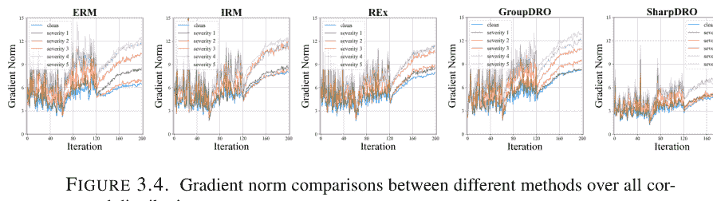

## 3.5 额外损坏的结果

在主论文，我们提供了使用“高斯噪声（Gaussian Noise）”损坏和“散粒噪声（Shot Noise）”损坏的结果。在这里，我们进行了额外的实验，以展示 SharpDRO 在“雪（Snow）”损坏下的有效性。CIFAR10、CIFAR100 和 ImageNet30 数据集在分布感知和分布无关场景下的结果如表 3.5 和表 3.4 所示。我们看到，SharpDRO 仍然表现有效，并大幅超过其他方法。特别是在两种问题设置下的 ImageNet30 数据集上，SharpDRO 的性能优于第二优方法约 3%，这表明 SharpDRO 对不同损坏的泛化能力。

### 3.5.1 定性分析

为了研究 SharpDRO 的有效性，我们首先进行了消融实验，以证明最坏情况锐度最小化对于实现具有鲁棒性的泛化至关重要。然后，我们利用梯度范数（当前训练稳定性的重要标准之一）验证了我们的方法对于严重损坏的分布是稳定的。接着，我们分析了超参数 $\rho$ 和 OOD 分数，以揭示锐度最小化和最坏情况数据选择的有效性。最后，研究了另一种二阶方法 SAM [137, 171, 172, 173, 174]，以发现 SharpDRO 的效率特性。所有分析均使用带有“高斯噪声”损坏的 CIFAR10 进行。

表 3.5 消融实验。“w/o data selection（无数据选择）”表示不进行最坏情况数据选择的训练，这恢复了 SAM [137]，“w/o sharpness min（无锐度最小化）”表示不进行锐度最小化的训练，等同于 GroupDRO [125]。

| 方法 | 损坏程度 | 0 | 1 | 2 | 3 | 4 | 5 |
|---|---|---|---|---|---|---|---|
| w/o data selection (SAM) | 93.2 | 90.5 | 87.6 | 82.1 | 80.5 | 75.4 |
| w/o sharp min (GroupDRO) | 90.2 | 89.1 | 88.4 | 84.3 | 83.0 | 78.2 |
| SharpDRO | 93.1 | 92.2 | 91.4 | 89.2 | 87.1 | 84.5 |

**消融实验。** 通过消除最坏情况数据选择，我们恢复了原始的锐度最小化方法 SAM [137]。然后，我们移除了锐度修改模块，这基本上是通过 GroupDRO 进行训练。消融结果如表 3.5 所示。我们可以看到，在整个数据集上部署 SAM 可以在干净数据集上获得改进的结果。然而，在损坏分布上的鲁棒性能甚至比 GroupDRO 更差。这可能是因为锐度被主分布主导，这对于小分布具有误导性。因此，损坏数据的锐度将是次优的。对于 GroupDRO，它未能产生平坦的损失函数，因此无法像所提出的 SharpDRO 那样泛化。

**分布稳定性** 为了证明我们的方法在最具挑战性的分布中是稳定的，我们包含了从 0 到 5 的损坏程度。如图 3.4 所示，SharpDRO 不仅产生了最小的范数值，而且确保了所有损坏情况下的范数几乎相等，这表明 SharpDRO 是比较方法中分布最稳定的方法。

**参数分析** 为了理解尺度参数 $\rho$ 如何影响我们的泛化性能，我们通过改变此值进行了敏感性分析，并展示了不同分布的测试结果。在图 3.5 (a) 中，我们发现了一个有趣的现象：随着 $\rho$ 的增加（意味着扰动幅度 $e^{\rho}$ 增大），会增强严重损坏数据的泛化，但会损害轻微数据的性能。这可能是因为对困难分布的探索需要覆盖更广泛的邻域以确保泛化。相反，在容易分布上过度探索可能会超出分布范围，从而导致性能下降。因此，对于目标是在小型和困难数据集上泛化的从业者，我们可能通过激进地设置较大的扰动尺度来增强性能。

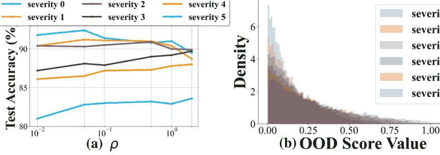

图 3.5. (a) $\rho$ 的敏感性，其值设置为 {0.01, 0.05, 0.1, 0.5, 1, 2}。
(b) 一化 OOD 分数 $\omega$ 在分布 $s = 0$ 到 5 的分布。

## OOD 分数分析

OOD 分数有助于在分布无关设置下选择最坏数据。为了展示其在选择噪声数据的有效性，我们在图 3.5 (b) 中绘制了第 30 个 epoch 所有损坏分布的 OOD 分数值分布。我们可以看到，严重损坏具有较大的 OOD 分数。因此，我们的 OOD 分数是选择最坏数据的有效标准。注意，在训练过程中，最坏情况的数据会被逐渐学习，因此 OOD 分数可能会变小，这解释了为什么分值的分布不像 OOD 检测那样具有分离性。

## 训练效率分析

显而易见，提出的 SharpDRO 方法是一种二阶优化方法。因此，与 Group-DRO 和 RE 等一阶方法相比，计算成本是获得改进泛化性能付出的代价$^3$。然而，为了进一步探索 SharpDRO 与其他二阶方法的相比，我们使用 SAM [137] 作为竞争对手，并在图 3.6 中展示了它们的计算时间和最坏情况准确率（$s = 5$）。我们可以看到，在三个数据集上，我们的 SharpDRO 需要几乎相同的时间，并且显著优于 SAM 的最坏性能，这功于我们高效的最坏情况数据选择，这对于针对严重损坏的鲁棒泛化至关重要。

> ^3注意我们的方法可以部署在现有的高效基于锐度的方法中 [168, 166, 170]。

## 3 基于锐度的分布鲁棒优化

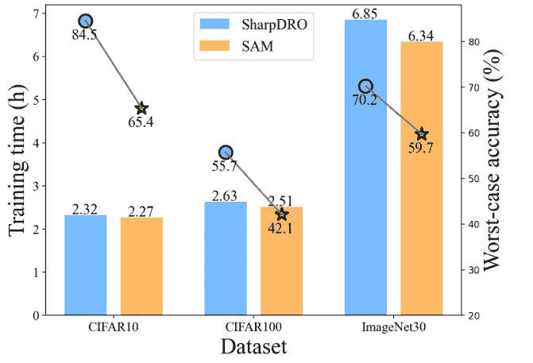

图 3.6. SharpDRO 和 SAM 效率比较。

## 3.6 结论

在本章中，我们提出了一种 SharpDRO 方法来增强 DRO 方法的泛化性能。具体而言，我们专注于最小化最坏情况数据的锐度以学习平坦的损失表面。结果，与其他方法相比，SharpDRO 对严重损坏更具鲁棒性。此外，我们将 SharpDRO 应用于分布平均和分布无关设置，并提出了一种 OOD 检测过程，在分布索引未知时选择最坏数据。通过广泛的定量和定性实验证明了 SharpDRO 可以处理最具挑战性的损坏分布，并与众名的基准方法相比实现了改进的泛化结果。

# 第 4 章

## 探索用于不变学习的变体参数

分布外（OOD）泛化旨在学习鲁棒模型，这些模型能够良好地泛化到各种环境，而不拟合特定分布的特征。最近基于彩票假设（LTH）的研究通过最小化学习目标来寻找某些对任务至关重要的参数，从而解决这个问题。然而，在 OOD 问题中，由于学习任务包含严重的分布噪声，解决方案是次优的，这会误导优化过程。因此，除了寻找任务相关的参数（即不变参数）外，我们还提出了用于不变学习的变体参数探索（EVIL），该方法还利用分布知识来寻找对分布偏移敏感的参数（即变体参数）。一旦将变体参数排除在不变学习之外，就可以找到抵抗分布偏移的鲁棒子网络。此外，通过充分探索变体和不变参数，跨所有分布相对稳定的参数可以被不变不变，我们的 EVIL 可以有效识别鲁棒子网络以提高 OOD 泛化。在集成测试平台 DomainBed 上的大量实验中，EVIL 可以有效高效地增强许多流行方法，如 ERM、IRM、SAM 等。

## 4.1 引言

深度网络的强大表示能力 [3, 107, 1] 是过去十年深度学习成功的关键因素之一。然而，神经网络的现实部署通常受限于 IID 假设，即训练数据和测试数据应该是独立同分布的。当这种假设成立时


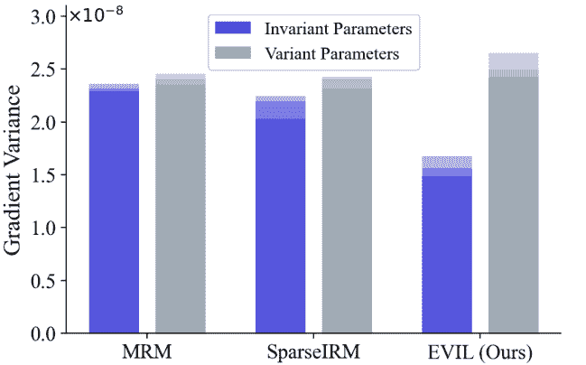

**图 4.1 学习到的子网络（即不变参数）与剪枝参数（即变异参数）之间的梯度方差对比。梯度方差通过 $\mathcal{V}(Mean([g_i]_{i=1}^d))$ [175] 计算，其中 $g_i$ 表示 $d$ 个分布中的第 $i$ 个梯度，$Var(\cdot)$ 和 $Mean(\cdot)$ 分别表示数学方差和均值。结果来自三次独立实验。

当违反假设时，通常会观察到学习性能的急剧下降，这严重阻碍了深度模型的实际应用。因此，分布外（OOD）泛化能力 [176, 177, 151] 作为一种极具前景的方向兴起，旨在增强模型对未知分布偏移的鲁棒性。

为了实现 OOD 泛化，一种主流方法是不变学习 [69, 143, 178, 144]，它强制提取不变特征，以帮助在各种数据分布（领域）之间做出一致的预测，同时避免与辅助信息无关的特定分布特征。基于彩票抽票假设（LTH） [179, 180, 181] 的最新进展表明，通过学习任务引导的稀疏训练可以选择某些关键参数作为子网络，这些参数对不变学习具有重要作用 [182, 183, 184]。然而，在 OOD 模型中，由学习任务引导的稀疏化是有问题的，因为分布噪声可能会错误地纳入稀疏学习的优化中。结果是现有方法无法识别出在不同分布上保持稳定的鲁棒子网络。

## 4.1 引言

特别是，我们遵循 Rame 等人 [175] 的方法，使用梯度方差来表示模型对分布偏移的敏感性。然后，我们比较了不同方法学习的子网络与剪枝参数之间的梯度方差，如图4.1所示。我们可以看到，现有方法（MRM [183] 和 SparseIRM [184]）学习的子网络敏感性几乎与剪枝参数相当，这意味着无法完全捕捉不变信息。

为了解决这一问题，我们提出了一种名为“探索变异参数进行不变分解”（Exploring Variant parameters for Invariant Decomposition, EVIL）的新型稀疏训练框架。具体而言，根据输入数据可以分解为不变特征和虚假特征的常用假设 [93, 94, 183, 26]，我们将网络参数分为两类：与不变特征强相关的不变参数，以及可能产生虚假特征的变异参数。直观上，不变参数和变异参数是互斥的，因为它们对我们的学习任务要么是有用的或有害的。为了正确识别 OOD 泛化的理想子集，EVIL 方法不仅从学习任务中选择不变参数，还通过区分每个分布来探索变异参数，即根据分布信息对数据进行分类。通过这种方式，变异参数与虚假特征之间的联系可以成功建立。通过找到被分布信息强烈激活的变异参数，我们可以确定它们不应被识别为不变参数，这为改进不变学习提供了一种替代且有效的方法。

此外，为了在网络训练过程中动态提高对不变参数的识别，我们建议重新考虑某些在分布偏移时几乎不变化的参数。同时，从不变参数和变异参数的初始划分开始，我们选择对分布信息响应较小的变异参数，因为它们可能对于学习分布不变特征关重要。因此，这些参数被重新收集为不变参数以从标签信息中学习。另一方面，某些对我们的学习任务不敏感不变参数应被稀疏训练剔弃，因为它们对不变学习几乎没有贡献。通过这种

> 虽然有些工作研究了存在多个因素导致数据生成过程的复杂情况 [185, 178, 186]，但我们的假设在 OOD 泛化中更为常见。

动态过程，我们能够识别出在不同分布上保持稳定的鲁棒子网络。如图 4.1 所示，我们的 EVIL 方法学习的不变参数的梯度方差比其他变异参数小得多，体现了其捕捉不变信息的有效性。

通过将我们的 EVIL 框架应用于许多现有的 OOD 泛化方法，我们构建了广泛的实证对比和分析，证明 EVIL 以很小的计算代价带来了可前景的改进。具体来说，当与简单的 ERM 结合时，我们的方法在 DomainBed 的平均性能上实现了 2.4% 的提升。此外，我们的 EVIL 框架在稀疏水平上大幅超过了现有的不变学习稀疏训练方法。

总结来说，我们的贡献有三个：

- 我们提出了一种用于 OOD 泛化的新型稀疏训练框架，该框架可以充分探索变异参数以捕捉不变信息。
- 设计了一种迭代策略，以动态提高对鲁棒子网络的识别。
- 提出的 EVIL 框架可以部署到许多流行方法并具有良好的有效性和效率。此外，EVIL 有效超过了现有的稀疏不变学习方法。

## 4.2 相关工作

OOD 泛化的不变学习寻求面对分布偏移时强制模型预测不变性 [69, 42, 43, 187]。不变风险最小化（IRM） [69] 尝试为每个数据分布寻找一个最优分类器，以排除每个领域的虚假信息。然后，分布鲁棒优化（DRO） [163, 188, 125, 189] 提出通过处理最具挑战性的分布来提高 OOD 泛化，这通过使用强正则惩罚被证明是有效的。此外，

锐度感知最小化（SAM） [137] 希望通过惩罚锐度测量来学习平坦的损失平面，以提高泛化结果 [139] 和对标签噪声的鲁棒性 [190, 191, 192]。进一步，风险外推（REx） [144] 发现仅关注已知分布之一可能无助于泛化到未知分布。相反，REx 显示通过惩罚风险方差来强制所有训练分布之间的竞争性能是有益的 [60, 61, 152, 193]。此外，其他方法从因果关系 [84] 中获得灵感，将不变特征与虚假特征解离开 [84, 178, 93]，使得预测不受分布偏移的影响 [194, 195]。

尽管如此，现有的不变学习方法有两个缺点。首先，某些方法计算成本很高。例如，SAM 需要二阶计算，而基于因果的方法需要训练生成模型；其次，正如 Gulrajani 等人 [176] 所发现的，大多数方法的性能有限，甚至比经验风险最小化（ERM）还要差！然而，我们的 EVIL 不仅可以避免对变异参数的冗余优化，还能充分捕捉不变特征以获得优的泛化准确率。

OOD 泛化的稀疏训练最早由 Morcos 等人 [182] 提出，旨在发现常用初始化方法获得的稀疏网络的泛化能力。然后，模块化风险最小化（MRM） [183] 显示，与原始密集网络相比，稀疏训练可能会提高 OOD 泛化性能。然而，MRM 是静态设计的，无法与网络训练同步优化，限制了稀疏学习的结果。为了解决这个问题，稀疏不变风险最小化（SparseIRM） [184] 提出同时进行稀疏训练过程和 IRM。结果是其泛化性能相比 MRM 有进一步提高。

尽管现有稀疏方法有所改进，但它们仍然是非优的，因为稀疏训练可能会受到来自学习任务的噪声梯度的影响。与此同时，


剪枝的参数没有被充分利用，这会导致不可忽略的信息损失。幸运的是，EVIL 能够动态地充分探索变化参数和不变参数。因此，它能找到受分布偏移影响最小的理想子网络。

## 4.3 基于 OOD 数据进行稀疏训练的关键性分析

OOD 泛化旨在利用训练数据的多个分布学习一个不变预测器，从而提高在未见测试分布上的泛化性能。在实践中，我们通常有分别来自 $m$ 个分布（也称为环境）的多个数据集 $\mathcal{E} = \{e_1, ..., e_m\}$，其中每个分布 $e = \{(x_i, y_i)\}_{i=0}^n$ 包含 $n$ 个样本 $x \in \mathbb{R}$ 和类别标签 $y \in \mathbb{R}$。对于来自分布 $e$ 的每个样本，我们可以分配一个分布 $d \in \mathbb{R}$并将数据点表示为 $(x, y, d)$。此外，我们还拥有一个从未见分布 $\mathcal{E}_{unseen}$ 采样的测试数据集，以评估我们不变学习的泛化性能。令 $f_0 : \mathbb{R} \to \mathbb{R}^D$ 为一个带有参数 $\theta \in \Theta$ 的参数化模型，提取特征 $Z \in \mathbb{R}^M$。我们的目标是从过参数模型中裁剪出一个稀疏子网络，使得变化特征排除在最终预测之外。因此，OOD 泛化可以得到提高。

**数据生成过程****遵循 Zhang 等人 [183] 的相同公式和问题设定，我们假设来自环境 $e$ 的输入变量 $X^e$ 由潜变量 $Z^e = (Z_{inv}, Z_{var})$ 生成。直观上，输入 $X^e$ 表示图像像素，而 $Z_{inv}^e$ 代表在不同环境中保持不变的感兴趣对象的特征，$Z_{var}^e$ 表示由环境变化引入的伪特征。因此，数据通过 $X^e = G(Z_{inv}^e, Z_{var}^e)$ 生成，其中 $G(\cdot)$ 表示数据生成函数。为了获得一个 OOD 健壮的模型，我们希望提取出能够恢复不变特征 $Z_{inv}^e$ 同时排除变化特征 $Z_{var}^e$ 的潜表示。这一过程通过 $Z^e = f_0(X^e)$ 建模，其中 $Z^e \approx [Z_{inv}, Z_0]$。因此，基于提取的特征，我们可以通过分类头 $\hat{Y}^e = h(Z^e)$ 进行预测，并通过最小化预测 $\hat{Y}^e$ 与真实标签 $Y^e$ 之间的误差来训练我们的模型。

**数据偏差产生**。基于数据生成过程，我们解释了为什么不同的分布关联了阻碍泛化结果的偏差。我们考虑一个简单的例子，$Z_{inv}^e$ 和 $Z_{var}^e$ 是具有二值元素的多元变量，$Z_{inv}^e \in \{-1, 1\}^{M_{inv}}$ 和 $Z_{var}^e \in \{-1, 1\}^{M_{var}}$，其中 $M_{inv}$ 和 $M_{var}$ 分别表示不变特征和伪特征的维度。我们有类别标签 $Y^e \in \{-1, 1\}$ 和分布索引 $D \in \{-1, 1\}$。由于不变特征在环境中保持恒定，我们假设 $Z_{inv}^e$ 的每个元素以 $p^e$ 的概率取值为 $Y^e$，以 $1-p^e$ 的概率取值为 $-Y^e$。当 $p^e$ 很大时，伪特征与类别标签密切相关，因此可能产生大的数据偏差。相反，如果 $p^e$ 很小，$Z_{var}^e$ 可能会引入标记预测的噪声信号。

此外，我们分析了领域知识提供的相反视角，这是以往工作 [183, 184] 所忽略的。具体来说，分布索引 $D$ 的变化是引入伪特征的原因，即 $D \rightarrow Z_{var}^e$，正如许多提出的因果结构 [84, 196, 1997] 所描述的那样。因此，给定分布 $D$，我们可以找到特定类型的伪特征。因此，我们假设 $Z_{var}^e$ 的每个元素等于 $D$。另一方面，我们考虑 $Z_{inv}^e$ 以 $q^e$ 的概率取值为 $D$，以 $1-q^e$ 的概率取值为 $-D$。通常人们假设不变特征和领域知识是独立的 [84]，但概率 $q^e$ 可能为 0.5。

**常见稀疏训练策略的缺陷**关于稀疏不变学习的现有研究 [183, 184] 表明，剪枝过参数模型可以显著提高 OOD 泛化性能。然而，我们发现现有的基于 ER（经验风险最小）或仅与标签相关的目标的剪枝策略可能是次优的。具体来说，我们考虑上述的数据集，$Z_{inv}^e \in \{-1, 1\}^{M_{inv}}$ 和 $Z_{var}^e \in \{-1, 1\}^{M_{var}}$。数据生成函数 $G$ 被简化为恒等映射 [118, 1988]，其中 $X = (Z_{inv}^e, Z_{var}^e)$。假设分类模型 $f_\theta$ 是一个线性层，我们有一个用 $0-1$ 化的掩码 $\mathbf{m}$ 来剪枝参数 $\theta$，其稀疏率被设置为 $R = \frac{M_{var}}{M_{inv}}$。特别是，我们将所选的不变参数标记为 $\theta_{inv} = \mathbf{m} \circ \theta$，将剪枝的参数标记为 $\theta_{var} = (1-\mathbf{m}) \circ \theta$，其中 $\odot$ 是逐元素乘积。为了方便计算，让参数值遵循单位范数，即 $\theta=1\frac{L}{\sqrt{M}}^2$。

**命题 2**。考虑上述的偏置数据集，$Z_{inv}^e \in \{-1, 1\}^{M^{inv}}$ 和 $Z_{var}^e \in \{-1, 1\}^{M^{var}}$。令 $\mathbf{m}$ 随机初始化为 $\{0, 1\}$ 值，稀疏率为 $R = \frac{M^{var}}{M}$，并假设 $Z^e$ 是具有独立元素的多元变量。对于旨在最小化经验风险的常见稀疏训练策略：
$$Err^e=\frac{1}{2}E_{(X,Y)\sim\mathcal{E}}[1-\hat{Y}^e],\quad(4.1)$$

- 常见的稀疏训练策略未能找到不变参数，我们有：
$$Err^e=\frac{1}{2}E_{(X,Y)\sim\mathcal{E}}[1-\hat{Y}^e],\quad(4.2)$$
- 常见的稀疏训练策略对 $p^f$ 极其敏感；
- 在未知分布上，常见策略的性能为 $Err^e\leq O(e^f)$ (4.3)

> 注意，我们的假设比 Zhang 等人 [183] 的假设更通用，后者考虑了两种极端情况：最优稀疏网络只提取不变特征，以及依赖伪特征的网络。我们的假设是实用的，因为它类似于参数以单位范数初始化的初始状态。这些参数被选中是因为它们在计算分布时会产生梯度，因此容易找到。同时，变化参数仍然可以排除以避免学习特征。此外，根据误差边界，与常见策略相比，我们的方法对伪相关 $1-p^\rho$ 不敏感。在 $p^\rho$ 较小的困难情况下，我们的方法对分布偏移仍然具有健壮性。

## 4.4 方法论

在本节中，我们介绍了我们的 EVIL 框架，如图 4.2 所示。在 EVIL 的学习流中，有两个过程：参数探索（Parameter Exploration），在其中我们建议不仅研究不变参数，也探索变化参数；以及不变学习（Invariant Learning），在其中我们训练识别出的子网络以优化不变参数。

### 4.4.1 提出的 EVIL 框架

为了获得良好的初始化，通常会通过最小化学习目标 $\mathcal{L}(f_\theta(x))$ 进行几步预训练 [202, 203, 200, 182]，其中 $f_\theta$ 是一个带有参数 $\theta \in \mathbb{R}^N$ 的深度模型。为了使深度模型稀疏化，通常通过逐元素乘 $\mathbf{m} \circ \theta$ 应用二值掩码 $\mathbf{m}$。这种掩码 $\mathbf{m}$ 通过优化学习 [204, 203, 205, 183, 184]，或根据某些标准（如连接敏感性 [199]、权重值 [200]、费舍尔信息 [201] 甚至随机初始化 [179, 206]）获得。通过设置稀疏率 $R=1-\frac{\|\mathbf{m}\|_0}{\|\theta\|_0}$，我们可以决定有多少参数被从稀疏训练中剔除。


# 4 探索不变性学习的变体参数

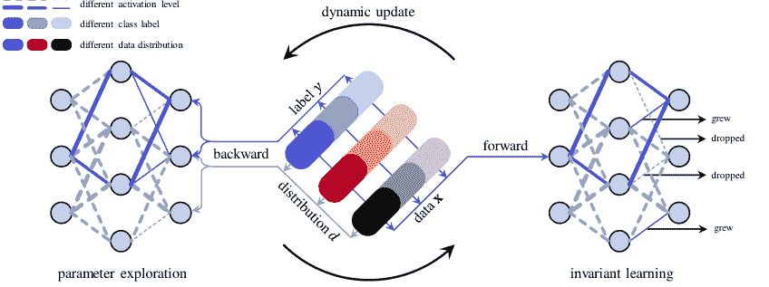

图 4.2. EVIL 的学习流程：中间的区块表示数据集，其中不同深度的浅表示不同的类别，不同颜色表示不同的数据分布。蓝色箭头 ($\rightarrow$)和灰色箭头 ($\rightarrow$)分别代表与标签和分布相关的信息。此外，连接神经元的蓝色实线（—）和灰色虚线（$\cdots$）分别代表不变参数和被剪枝参数。

参数探索。在这一步中，我们主要有两个优化目标：

```
$$\min_{\theta_{inv} \otimes \theta} \mathcal{L}_{inv}(h(f_{\theta_{inv}}(\mathbf{x})), y), \quad (4.3)$$
$$\min_{\theta_{var} \oplus \theta} \mathcal{L}_{var}(g(f_{\theta_{var}}(\mathbf{x})), d), \quad (4.4)$$
```

其中 $\theta_{inv} = m \circ \theta$ 和 $\theta_{var} = (1 - m) \circ \theta$ 表示通过掩码 $m$ 分对应的不变参数和变体参数，$h$ 和 $g$ 是两个全连接层，分别将提取的特征映射到类别标签空间 $\mathbb{R}^c$ 和分布索引空间 $\mathbb{R}^m$。直观地说，目标 $\mathcal{L}_{inv}$ 是分类任务，即根据标签信息进行预测；而 $\mathcal{L}_{var}$ 是根据分布信息区分每个分布，而这些信息是虚假且不需要的。

通过最小化方程 (4.3) 中的 $\mathcal{L}_{inv}$，梯度幅度 $\nabla_{\theta_{inv}} \mathcal{L}_{inv}$ [199] 可用于找到与损失函数最相关的参数（注意，可以使用上述其他稀疏训练标准）。同样，通过最小化方程 (4.4) 中的 $\mathcal{L}_{var}$，那些 $\nabla_{\theta_{var}} \mathcal{L}_{var}$ 较大的参数对虚假信息敏感，无法帮助产生不变特征。因此，我们可以根据梯度幅度对参数进行排序，以显示它们被相应目标激活的程度。

## 4.4 方法论

### 算法 3 EVIL

**输入**：多个训练集 $\mathcal{E} = \{e_1, \dots, e_m\}$；学习模型 $f_\theta$；余弦退火函数 $S(t, \alpha, T)$；基于权重值化的掩码 $\mathbf{m}$；训练迭代次数 $T_{pre}$。

```
1: **for** $t = 0, 1, \dots, T$ **do**
2:   通过方程 (4.3) 优化掩码；(*不变学习*)
3:   **if** $t > T_{pre}$ 且 $t%\Delta T == 0$ **then**
4:     分别通过方程 (4.3) 和方程 (4.4) 获取 $\mathbf{m}_{inv}$ 和 $\mathbf{m}_{var}$ 的梯度；
5:     *参数探索*
6:     通过方程 (4.5) 更新掩码 $\mathbf{m}$；
7: **end if**
8: **end for**
```

此外，为了动态改进我们的稀疏化，我们提出每隔 $\Delta T$ 次迭代通过拒绝激活程度最低的不变参数来更新掩码 $\mathbf{m}$，同时将激活最低的变体参数称为不变变体。具体而言，我们处理：

```
$\mathbf{m} [ArgTopK(-\|\nabla_{\mathbf{m}_{inv}}\|| \cdot |\mathbf{m}||_0 S(t, \alpha, T))] = 0$，
$\mathbf{m} [ArgTopK(-\|\nabla_{\mathbf{m}_{var}}\|| \cdot |\mathbf{m}||_0 S(t, \alpha, T))] = 1,$ (4.5)
```

其中 $ArgTopK(v, k)$ 返回代表值 $v$ 的前 k 个元素的索引，$\mathbf{m} [\cdot]$ 表示 $\mathbf{m}$ 的索引。此外，为了决定更改多少参数，我们遵循 Dettmers & Zettlemoyer [203] 使用余弦退火函数 $S(t, \alpha, T) = \frac{\alpha}{2}(1+\cos(\frac{\pi t}{T}))$，其中 $t$ 和 $T$ 分别是当前迭代次数和总迭代次数，超参数 $\alpha$ 表示最大值。直观地说，这种余弦退火函数从 $\alpha < 1$ 逐渐变为 0。通过方程 (4.5)，得到的掩码找到了比之前受分布影响较小且与我们的学习任务更相关的参数，进一步提高了不变学习的性能。

**不变学习**。获取更新后的掩码 $\mathbf{m}$ 后，我们使用不变参数作为子网络来学习不变性，其通用形式为：

```
$\mathcal{L}_{inv}(h(f_{\theta_{inv}}(\mathbf{x})), y) = \mathcal{L}_{cee} + \lambda \mathcal{L}_{reg},$ (4.6)
```

其中第一项是通过交叉熵损失计算的经验风险，第二项是带有惩罚权重 $\lambda$ 的不变学习正则化，可以通过许多流行方法实现。例如，使用 IRM 时，正则化为：

```
$\mathcal{L}_{reg} = \frac{1}{n} \sum_{x \in \mathcal{X}} \|\nabla_{\theta} \mathcal{L}_{cee}(h(f_{\theta}(\mathbf{x})), y)\|^2,$ (4.7)
```

使用 REx 时，正则化为：

```
$\mathcal{L}_{reg} = \frac{1}{n} \sum_{x \in \mathcal{X}} \|\nabla_{\theta} \mathcal{L}_{var}(g(f_{\theta}(\mathbf{x})), d)\|^2,$ (4.8)
```

此外，使用 DRO 时，我们关注正则化：

```
$\mathcal{L}_{reg} = \frac{1}{n} \sum_{x \in \mathcal{X}} \|\nabla_{\theta} \mathcal{L}_{cee}(h(f_{\theta}(\mathbf{x})), y)\|^2,$ (4.9)
```

通过与现有方法结合，我们报告了不同稀疏度（20%, 40%, 60%, 80%）下的结果。

## 4.5 实验

所有实验都在单块 NVIDIA 3090 上使用 PyTorch 完成。为了实现我们的框架，我们首先使用 ERM 进行 1,000 次迭代预训练模型。然后，通过权重值初始化掩码。具体而言，通过设置稀疏率 R，我们选择最大的 $\theta$ 权重并将将其相应的掩码设置为 1。在参数探索期间，我们使用不变损失 $\mathcal{L}_{inv}$ 的梯度，对不变参数从大到小进行排序。然后，通过将相应的掩码设置为 0 来拒绝 $S(t, \alpha, T)$ 个不变参数。同样，我们使用 $\mathcal{L}_{var}$ 的梯度对变体参数进行排序并收集前 $S(t, \alpha, T)$ 个。在不变学习期间，我们将掩码应用于参数值及其梯度以进行稀疏训练。

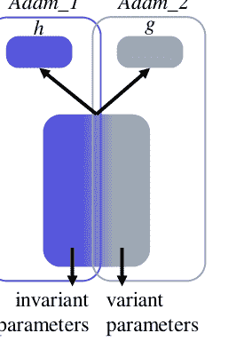

图 4.3. 优化器说明。

为了优化我们的模型，我们使用 Adam [209] 优化器，初始学习率为 $1e-3$ 且不衰减。此外，为了避免优化不变参数和变体参数之间的冲突，我们采用了两个 Adam 优化器，分别命名为 $Adam_1$ 和 $Adam_2$，分别包含不变和变体参数。此外，$Adam_1$ 将包含类别预测 $h$，而 $Adam_2$ 将包含分布预测 $g$，如图 4.3 所示。在训练期间，$Adam_1$ 主要用于优化不变参数，而 $Adam_2$ 仅用于优化变体参数。

为了实现基础方法，我们主要遵循 [176] 设置超参数。具体而言，对于 DRO，我们设置 $\eta = le-2$ 来更新组重要性。对于 ERM，我们设置 $\lambda = 1e^2$ 来权衡不变正则化。来自 REx 的类似惩罚 $\lambda$ 设置为 $1e$。对于 CORAL 和 MMD，设置权衡权重 $\gamma$ 为 1。对于实现 SagNet，我们设置对抗损失的权重为 0.1。对于 SAM，我们不使用自适应 SAM [210] 并设置扰动幅度 $\rho$ 为 0.05。

### 4.5.1 实际实现


## 4 探索不变学习的变体方法

表格 4.1. OOD 泛化方法与我们的 EVIL 实现在在某些方法上的对比。在来自 DomainBase 的七个 OOD 泛化基准上的测试准确率。加亮显示最佳和次优结果。† 表示来自 [139] 的结果。

| 算法 | CMINIST | MNIST | PACS | VLCS | Office | Home | DomainNet | 平均值 | FLOPs |
|---|---|---|---|---|---|---|---|---|---|
| I-Mixup† | 31.3 | 97.8 | 84.6 | 77.4 | 68.1 | 47.9 | 39.2 | 63.7 | |
| MLDG† | 36.9 | 98.0 | 85.2 | 76.8 | 66.8 | 47.8 | 41.2 | 64.6 | |
| MMD† | 42.6 | 98.1 | 83.7 | 78.6 | 65.9 | 42.2 | 23.4 | 62.1 | |
| DANN | 29.0 | 81.3 | 87.8 | 65.9 | 46.7 | 38.3 | 58.3 | 62.5 | |
| Mixstyle† | 31.1 | 96.3 | 85.2 | 77.5 | 66.7 | 45.8 | 58.3 | 62.5 | |
| MTL† | 30.4 | 97.2 | 84.6 | 77.2 | 66.4 | 45.6 | 40.6 | 63.1 | |
| ARM† | 32.6 | 98.1 | 86.2 | 77.6 | 68.1 | 48.6 | 40.3 | 64.5 | |
| RSC† | 35.2 | 96.3 | 85.2 | 77.1 | 65.5 | 46.6 | 38.9 | 63.5 | |
| ERM | 38.5 | 97.2 | 85.2 | 77.9 | 64.0 | 44.0 | 34.0 | 62.4 | 1x |
| EVIL | 34.2 | 98.0 | 84.1 | 76.7 | 66.0 | 43.2 | 33.3 | 61.9 | 1x |
| (±0.1) | (±0.1) | (±0.1) | (±0.2) | (±0.2) | (±0.1) | (±0.3) | | 0.42x |
| DRO | 34.2 | 98.2 | 85.7 | 76.6 | 66.4 | 47.6 | 33.9 | 63.3 | 1x |
| EVIL-Rex | 41.2 | 98.7 | 86.0 | 79.1 | 68.0 | 49.1 | 35.5 | 65.1 | 0.42x |
| (±0.1) | (±0.1) | (±0.1) | (±0.2) | (±0.3) | (±0.1) | (±0.3) | | 1.4x |
| IRM† | 36.3 | 97.7 | 83.5 | 78.8 | 64.2 | 47.6 | 62.1 | 63.1 | |
| EVIL-IRM | 39.1 | 98.3 | 85.1 | 79.8 | 66.4 | 48.3 | 36.0 | 64.6 | 0.42x |
| (±0.2) | (±0.2) | (±0.1) | (±0.2) | (±0.3) | (±0.3) | | 1.5x |
| SWAD | 38.3 | 98.1 | 88.1 | 79.1 | 71.6 | 50.0 | 46.5 | 67.2 | 1x |
| EVIL-SWAD | 38.7 | 98.3 | 88.3 | 79.7 | 71.7 | 51.2 | 46.9 | 67.7 | 0.43x |
| (±0.3) | (±0.3) | (±0.1) | (±0.2) | (±0.2) | (±0.3) | | (±0.5) |
| MIRO | 39.4 | 97.5 | 85.4 | 79.0 | 70.5 | 44.3 | 66.6 | 1x |
| EVIL-MIRO | 40.2 | 98.6 | 85.8 | 79.4 | 71.2 | 50.9 | 45.0 | 67.3 | 0.45x |
| (±0.3) | (±0.3) | (±0.1) | (±0.2) | (±0.2) | (±0.3) | | (±0.7) |
| SAM | 38.5 | 98.1 | 85.8 | 79.4 | 69.6 | 43.3 | 44.3 | 65.6 | 2x |
| EVIL-SAM | 40.4 | 98.8 | 87.8 | 80.1 | 70.3 | 50.5 | 45.0 | 67.5 | 0.89x |
| (±0.3) | (±0.3) | (±0.1) | (±0.1) | (±0.2) | (±0.3) | | |

### 4.5.2 实验设置

**评估协议。** 我们遵循 DomainBase [176] 的实验设置来评估 OOD 泛化。具体而言，DomainBase 包含几个基准数据集：CMINIST [69]（60000 张图像，10 个类别）、MNIST [211]（60000 张图像，10 个类别）、PACS [177]（9991 张图像，4 个类别）、VLCS [212]（10729 张图像，5 个类别）、OfficeHome [213]（15588 张图像，6 个类别）、TerraIncognita [214]（24788 张图像，10 个类别）、DomainNet [147]（586575 张图像，34 个类别）、WILDS [215]（具有显著偏移的基准测试，我们使用两个典型数据集：WildCam 和 FarmW）、ImageNet [104]（1000 张图像，此处使用 ImageNet 进行微调，包括 ImageNetV2 [216]、ImageNetR [217]、ImageNetA [218]、ImageNetSketch [219] 和 ObjectNet [220]）。对于每个基准数据集，我们留出一个作为测试集。此外，我们使用预训练的 ResNet-50 作为骨干网络，并在所有数据集上收敛。为了避免随机性，进行了三次独立实验以提供结果。

### 4.5.3 使用 EVIL 改进不变学习

在本节中，我们将 EVIL 框架部署到一些著名的不变学习方法中，并与其进行比较。为了对比，我们只考虑在单个模型上进行端到端训练，而不考虑集成或平均方法 [139, 221]。此外，我们使用每秒浮点运算次数（FLOPs）来表示 ERM 的计算效率。实际上，我们设置稀疏率 $R=60\%$、参数 $\alpha=0.2$ 以及 $\Delta T=30$ 来实现 EVIL。结果如表 4.1 所示。我们可以看到 EVIL 可以有效提高所有选择方法的性能。特别是对于 ERM、DRO 和 SAM，EVIL 分别将它们的准确率提高了 2.4%、1.9% 和 1.9%。

表格 4.2. 现有稀疏方法与不同稀疏水平下 EVIL 在 DomainBase OOD 泛化上的对比。

| 算法 | CMINIST | MNIST | PACS | VLCS | OfficeHome | DomainNet | 平均值 | FLOPs |
|---|---|---|---|---|---|---|---|---|
| MRM | 31.5 (±2.4) | 89.3 (±0.3) | 78.3 (±0.2) | 70.0 (±0.1) | 63.6 (±0.1) | 42.7 (±0.3) | 59.0 | 0.82× |
| SparseM | 31.5 (±2.4) | 95.8 (±0.2) | 71.2 (±0.2) | 66.2 (±0.1) | 63.7 (±0.1) | 39.6 (±0.3) | 60.3 | 0.81× |
| EVIL | 34.1 (±2.7) | 95.8 (±0.2) | 82.2 (±0.3) | 73.7 (±0.2) | 66.3 (±0.1) | 45.3 (±0.1) | 62.7 | 0.82× |
| EVIL-SAM | 35.2 (±2.3) | 96.3 (±0.2) | 88.6 (±0.1) | 74.2 (±0.1) | 65.6 (±0.1) | 45.6 (±0.1) | 63.2 | 1.62× |
| MRM | 36.2 (±2.4) | 95.8 (±0.2) | 81.9 (±0.3) | 73.5 (±0.1) | 63.1 (±0.1) | 45.6 (±0.1) | 62.2 | 0.62× |
| SparseM | 35.7 (±2.4) | 96.4 (±0.2) | 82.5 (±0.2) | 74.2 (±0.1) | 66.8 (±0.1) | 47.8 (±0.1) | 63.7 | 0.62× |
| EVIL | 38.9 (±2.4) | 97.2 (±0.1) | 84.7 (±0.2) | 75.3 (±0.1) | 66.4 (±0.1) | 47.1 (±0.1) | 64.8 | 0.62× |
| EVIL-SAM | 38.8 (±2.4) | 97.9 (±0.1) | 83.6 (±0.3) | 77.4 (±0.2) | 66.9 (±0.1) | 48.1 (±0.1) | 65.6 | 1.33× |
| MRM | 38.2 (±2.4) | 97.0 (±0.1) | 83.6 (±0.2) | 76.8 (±0.1) | 66.5 (±0.1) | 46.7 (±0.1) | 64.2 | 0.41× |
| SparseM | 37.9 (±2.4) | 94.9 (±0.2) | 84.3 (±0.2) | 76.5 (±0.1) | 65.1 (±0.1) | 48.8 (±0.1) | 64.8 | 0.42× |
| EVIL | 39.4 (±2.4) | 97.4 (±0.1) | 89.5 (±0.2) | 80.2 (±0.1) | 68.2 (±0.1) | 47.1 (±0.1) | 66.3 | 0.42× |
| EVIL-SAM | 40.1 (±2.2) | 98.3 (±0.1) | 97.8 (±0.2) | 85.3 (±0.1) | 75.7 (±0.1) | 52.4 (±0.1) | 75.4 | 0.57× |

### 4.5.4 将我们的方法与稀疏不变学习对比

此外，为了证明我们的方法对于 OOD 泛化的鲁棒性，我们与现有的稀疏方法进行了对比。具体而言，当稀疏率为 20%、40%、60% 和 80% 时，结果如表 4.2 所示。通常，我们可以看到 EVIL 和 EVIL-SAM 在大多数情况下都超过了 MRM 和 SparseIRM。此外，在所有稀疏水平下，EVIL 和其他方法在 60% 处达到最佳结果。具体而言，EVIL-SAM 在所有数据集的 60% 处表现最好，平均领先对手 2.8%。此外，带有 JER 的 EVIL 实现也能提高次优方法 1.5%。至于计算效率，我们的 EVIL 与其他稀疏训练方法相当，EVIL-SAM 需要额外的反向传播来计算参数扰动。

### 4.5.5 额外不变学习方法的性能

我们在文中讨论了几种不变学习方法，我们在 PACS 数据集上对这些方法进行了额外实验，展示 EVIL 如何影响它们的 OOD 泛化结果。此外，我们使用不同的网络架构进行实验，以展示 EVIL 在各种学习模型上的效果。

## 4.5 实验

表格 4.3. 额外方法的结果。

| 方法 | MMD | SagNet | Mixstyle | ARM |
|---|---|---|---|---|
| 不使用 EVIL | 84.7 | 86.3 | 85.2 | 85.1 |
| 使用 EVIL | **85.3** | **87.1** | **86.5** | **86.6** |


# 4 探索不变性学习的变体参数

表 4.4. 在不同模型架构上的结果。ResNet50 在 ImageNet 上进行了预训练，其他模型则从零开始训练。

| | ResNet50 | WRN-20 | WRN-32 | WRN-44 | WRN-56 | WRN-110 |
|---|---|---|---|---|---|---|
| ERM | 84.2 | 35.6 | 39.2 | 41.0 | 44.6 | 48.9 |
| EVIL | 86.0 (±0.1) | 37.3 (±0.2) | 42.5 (±0.3) | 43.7 (±0.3) | 47.2 (±0.2) | 51.4 (±0.3) |

## 4.5.6. 在额外的 ResNet 架构上的性能

此外，为了评估 EVIL 在不同骨干模型上的有效性，我们实现了具有不同深度（20、32、44、56 和 110）的宽 ResNet (WRN) [101]，并对每个模型从零训练 500,000 步以确保收敛。我们还展示了在 ImageNet 上预训练的 ResNet50 的结果（注意，由于预训练，ResNet50 的性能将远于从零训练）。ERM 和 EVIL 之间的对比见表 4.4。再次，我们可以观察到在所有研究的架构上，EVIL 均优于基准方法 ERM。因此，我们可以得出结论：EVIL 带来的性能提升与模型无关。

## 4.5.7. 使用 SAM 优化 EVIL

在本节中，我们首先简要描述了通过 SAM 优化以用于 OOD 泛化的 EVIL 实现（EVIL-SAM）。然后，尽管之前发现平坦度与 OOD 泛化之间存在正交性 [139, 221]，我们讨论了 SAM 的一些属性，并证明了为什么结合 EVIL 和 SAM 可以获得卓越的性能。

### EVIL-SAM 的实现。通常，我们的 EVIL 可以通过最小化以下目标来使用 SAM 进行优化：

```
\min_{\theta, ||\epsilon||_2\le\rho} \mathcal{L}(\theta + \epsilon; x, y). \quad (4.10)
```

具体而言，SAM 试图在 $\rho$ 半径邻域内计算最优参数扰动 $\epsilon^* = \arg max_{\epsilon} \mathcal{L}(\theta+\epsilon; x, y)$，以最大化增加损失值 $\mathcal{L}$。通过应用 $\epsilon^*$，损失变化 $\mathcal{L}(\theta+\epsilon^*; x, y) - \mathcal{L}(\theta; x, y)$ 被称为*锐度*，它指示了损失函数的平坦程度。直观上看，更平坦的损失函数显示出更好的泛化特性，输入空间中的轻微偏移不会显著改变损失值。因此，SAM 已经取得了良好的分布内（ID）泛化性能 [224, 158, 210, 159, 169]。为了将 SAM 引入 EVIL，我们只需要在计算最优 $\epsilon^*$ 之前将我们的掩码 $m$ 应用于参数扰动 $\epsilon$。这一过程不仅排除了虚假特征，还减轻了 SAM 的计算负担。结果，SAM-EVIL 可以为不变性学习实现低锐度。

**讨论。** SAM 取得了良好的 ID 结果，但其 OOD 性能相当有限 [139, 221]，这仍然未得到解释。如表 4.5 所示，在 ID 场景下，SAM 相比 ERM 表现出巨大的有效性，但在 OOD 设置下，它仅达到了与 ERM 相当的结果，在某些情况下甚至如此。在我们看来，SAM 的局限性是由错误地扰动变体参数引起的，这鼓励了对虚假特征的拟合。具体，在 OOD 问题中，不变特征和虚假特征都会激活。确保对 $\theta_{inv}$ 扰动的鲁棒性（即低锐度）有助于提取不变特征。然而，通过扰动 $\theta_{var}$，低锐度 $\mathcal{L}(\theta + \epsilon^*; x, y) - \mathcal{L}(\theta; x, y)$ 表示增强与标签信息相关的特征。因此，SAM 无法提取不变特征，因为它对虚假特征敏感，损害了 OOD 泛化结果。幸运的是，我们的 EVIL 可以通过过滤掉与分布噪声相关的变体参数来完美解决这个问题。因此，SAM 可以进一步用于增强提取不变特征的鲁棒性。其有效性和效率在第 4.5 节中证明。

## 4.5. 实验

表 4.5. DomainBed 上在 ID 和 OOD 情况下 SAM [137] 与 ERM 的对比。

| | PACS | VLCS | OfficeHome | TerraInc | DomainNet | 平均值 |
|---|---|---|---|---|---|---|
| ID | ERM | 96.6 | 84.7 | 78.9 | 91.3 | 81.4 | 86.5 |
| | SAM | 97.1 | 86.8 | 82.0 | 93.1 | 85.2 | 88.8 |
| OOD | ERM | 85.5 | 77.5 | 66.5 | 46.1 | 40.9 | 63.3 |
| | SAM | 85.8 | 79.4 | 69.6 | 43.3 | 44.3 | 64.5 |

表 4.6. 在 DomainNet 的五个数据集上 EVIL-SAM 与其他基准方法的对比。

| 方法 | PACS | VLCS | OfficeHome | TerraInc | DomainNet | 平均 |
|---|---|---|---|---|---|---|
| Sag-SAM | 86.4 | 78.5 | 69.2 | 49.3 | 40.0 | 64.6 |
| CORAL-SAM | 86.6 | 79.0 | 69.3 | 47.9 | 42.1 | 65.0 |
| MRM-SAM | 83.9 | 77.1 | 67.0 | 47.4 | 40.6 | 63.2 |
| SparseIRM-SAM | 85.2 | 77.4 | 65.6 | 48.5 | 43.1 | 63.9 |
| EVIL-SAM | 87.8 | 80.1 | 70.3 | 50.5 | 66.7 |

表 4.7. 在 ImageNet, iWildCam 和 FMoW 上使用 ResIL 骨干的性能。

| | ImageNet ID | ImageNet OOD | iWildCam ID | iWildCam OOD | FMoW ID | FMoW OOD |
|---|---|---|---|---|---|
| 零样本 | 68.3 | 58.7 | 8.7 | 20.4 | |
| 微调 | 82.5 | 61.3 | 48.1 | 35.0 | |
| EVIL | 81.8 | 62.5 | 47.6 | 37.4 | 68.2 | |

**讨论。** SAM 取得了良好的 ID 结果，但其 OOD 性能相当有限 [139, 221]，这仍然未得到解释。如表 4.5 所示，在 ID 场景下，SAM 相比 ERM 表现出巨大的有效性，但在 OOD 设置下，它仅达到了与 ERM 相当的结果，在某些情况下如此。在我们看来，SAM 的局限性是由错误地扰动变体参数引起的，这鼓励了对虚假特征的拟合。具体，在 OOD 问题中，不变特征和虚假特征都会激活。确保对 $\theta_{inv}$ 扰动的鲁棒性（即低锐度）有助于提取不变特征。然而，通过扰动 $\theta_{var}$，低锐度 $\mathcal{L}(\theta + \epsilon^*; x, y) - \mathcal{L}(\theta; x, y)$ 表示增强与标签信息相关的特征。因此，SAM 无法提取不变特征，因为它对虚假特征敏感，损害了 OOD 泛化结果。幸运的是，我们的 EVIL 可以通过过滤掉与分布噪声相关的变体参数来完美解决这个问题。因此，SAM 可以进一步用于增强提取不变特征的鲁棒性。其有效性和效率在第 4.5 节中证明。

## 4.5.8. 在大规模架构和数据集上的性能

在本节中，我们采用预训练的 CLIP ViT-B/16 [225]，并在 iWildCam 和 FMoW 上进行微调以进一步测试 OOD 泛化。为了将我们的稀疏策略扩展到 CLIP 模型，我们在 ViT 骨干顶部采用线性层。对于所有数据集，我们将微调轮数设置为 20，并保持其余参数不变。结果所示表 4.7，我们可以看到 EVIL 在 ID 数据集上有轻微下降，这是由于我们使用的参数比全微调少，我们的方法在三个数据集上均取得了最好的 OOD 性能。具体，在 ImageNet、iWildCam 和 FMoW 数据集上分别获得了 1.2%、2.4% 和 2.0% 的性能提升。因此，EVIL 的有效性和优越性可以成功扩展到大规模架构和数据集。

## 分析研究

在本节中，我们进行了广泛的实证分析以探索为什么 EVIL 可以取得有效结果。首先，我们通过消融实验展示利用分布知识的效果以及选择掩码初始化策略的影响。然后，我们对超参数 $\alpha$ 和 $\Delta T$ 进行了参数敏感性分析。此外，我们通过可视化训练过程中的锐度，展示了 EVIL-SAM 与 SAM 的对比。最后，我们展示了海森谱以解释为什么 EVIL 能实现有效的泛化。

为了 为了验证利用分布知识探索变体参数的有效性，我们将公式 (4.4) 中的优化目标 $L_{var}(g(f_{\theta_{var}}(\mathbfx)), d)$ 改为 $L_{var}(h(f_{\theta_{var}}(\mathbfx)), y$，转而利用标签信息。结果，改变后的变体是随机选路 (RigL) [200]，这是一种有效的稀疏训练方法。通过在 DomainBed 上对比 EVIL 和 RigL（如图 4.4 (a) 所示），我们可以看到 EVIL 在所有场景下超过了 RigL。因此，我们可以得出结论：利用分布信息探索变体参数对于 OOD 泛化至关重要。


图 4.4. (a) EVIL 与 RigL 的对比，后者利用标签信息来探索变体参数。(b) 不同掩码初始化策略的对比。


# 4 探索不变学习的变体参数

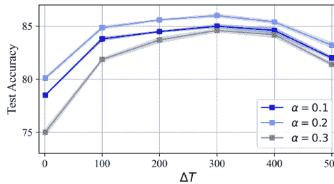

图 4.5. 对 α 和 ΔT 的参数敏感性。

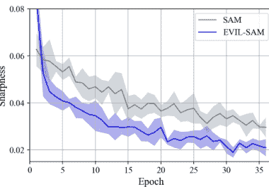

图 4.6. 锐度对比。

此外，为了展示第 4.4.1 节中提到的选择不同掩码初始化策略的影响，我们对比了 Fisher 信息 [201]、连接敏感性 [199] 和随机初始化 [179] 的权重值，结果如图 4.4 (b) 所示。我们可以所示，Fisher 信息和权重值是优于连接敏感性和随机初始化的两种策略，这支持了我们使用权重值的选择。

## 参数敏感性分析。

为了分析 α 和 ΔT 的不同选择，我们将 α 设置为 0.1、0.2 和 0.3，并将 ΔT 变化为 100、200、300、400 和 500。如图 4.5 所示，选择 α 为 α，ΔT 为 300 是最好的。此外，较低的 α 会阻碍掩码的动态更新，较高的 α 会导致噪声引入，因此这两种选择都会影响性能。另一方面，ΔT 控制更新频率。但太小的 ΔT 和过大的 ΔT 会别导致更新不足和冗余更新，进一步导致性能下降。

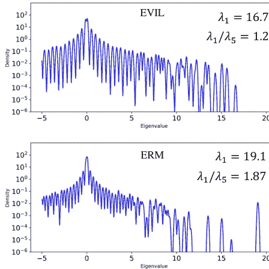

图 4.7. EVIL 和 ERM 的 Hessian 谱。

## 4.5 实验

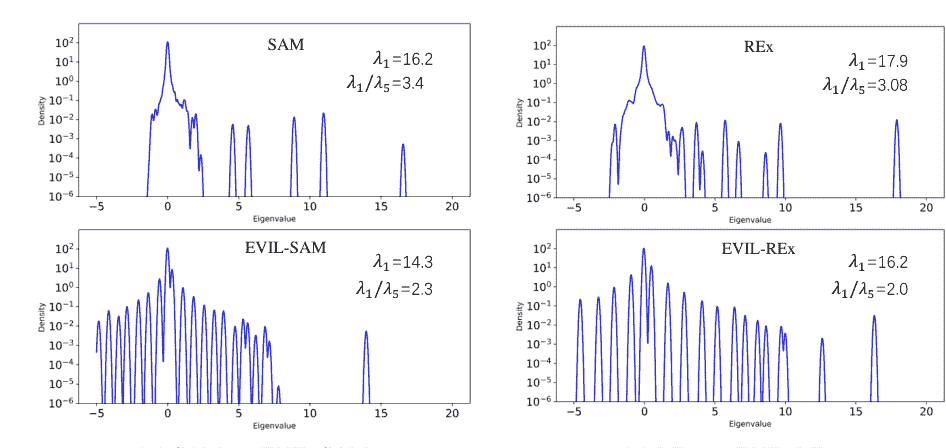

(A) SAM vs. EVIL-SAM (B) REx vs. EVIL-REx

## 4.8. Hessian 谱对比：EVIL 的实现显著提升了不同方法之间的锐度。

**锐度分析。** 为了展示我们的 EVIL 在 OOD 泛化期间如何影响 SAM，我们在图 4.6 中视化了训练过程中获得的锐度。结果显示，EVIL-SAM 在训练过程中产生的锐度比 SAM 小，这表明 EVIL-SAM 在 OOD 泛化问题上比 SAM 更稳健。

**Hessian 谱。** 为了分析算法是否能收敛到平坦极小值，通常使用 Hessian 谱作为判断标准 [226]。具体而言，我们遵循 Fore 等人 [137]，使用主特征值与第五大特征值的比例即 $\lambda_1/\lambda_5$ 作为比较 EVIL 和 ERM 的标准。通常，较小的 $\lambda_1/\lambda_5$ 意味着找到了更平坦的极小值。因此，我们遵循 Ghorbani 等人 [226]，使用 Lanczos 算法近似图 4.7 中 ERM 和 EVIL 的谱。可见，EVIL 的 $\lambda_1/\lambda_5$ 远小于 ERM，证实了我们的方法可以收敛到比 ERM 更平坦的极小值。此外，由于主特征值 $\lambda_1$ 也是一个重要指标，我们可以看到 EVIL 产生的 $\lambda_1$ 比 ERM 小，这再次支持了 EVIL 的有效性。因此，EVIL 可以获得良好的泛化结果是合理的。

SAM 和 REx 的额外 Hessian 谱。由于我们在 4.5.9 节中证明的有效泛化性能，我们进一步验证了所提出的 EVIL 框架与 SAM 和 REx 等其他方法相比，能够产生更好的 Hessian 谱。如图 4.8a 和 4.8b 所示，我们观察到与正文中相同的现象：当结合 EVIL 时，SAM 和 REx 的最大特征值均小于原始值，且在使用我们的 EVIL 框架时谱更加紧凑。因此，我们可以再次得出结论，EVIL 确实有助于产生平坦极小值。

## 4.6 结论

在本章中，我们旨在解决现有稀疏不变学习方法由于分布偏移的误导影响，无法充分捕捉 OOD 泛化问题中不变信息的问题。因此，我们通过利用分布知识探索对分布偏移高度敏感的变体参数提出了 EVIL，我们可以识别出一个能够有效提取不变特征的稳健子网络。此外，我们建议在网络训练期间动态改进识别。结果是，EVIL 框架可以有效高效地提高许多不变学习方法的 OOD 泛化性能，同时超越了所有对比的稀疏不变学习方法。我们进行了详尽的分析以全面验证 EVIL 的性能。

# 第 5 章

# 机器视觉治疗 (Machine Vision Therapy)

尽管如对比语言图像预训练（CLIP）等预训练模型显示了令人深刻的泛化结果，但它们在分布外（OOD）场景下的稳健性仍然有限。与其像通常那样不情愿利用人类标注，利用多模态大语言模型（MLLMs）的视觉理解是可能的。然而，由于任务不兼容性，MLLMs 难以处理视觉问题，从而阻碍了它们的有效性。在本章中，我们提出通过机器视觉治疗来有效利用 MLLMs，其目的是纠正特定视觉模型的错误预测。通过视觉稳健性监督视觉模型，可以以近乎无监督的方式增强稳健性。此外，我们提出了一种去噪上下文学习（DICL）策略来解决兼容性问题。具体来说，通过转移矩阵检查每个示例的噪声概率，我们构建了一个包含正确示例和一个可能的错误示例的指令，使得 MLLMs 能够检测并纠正视觉模型的错误预测。在温和假设下，我们理论上证明了 DICL 方法保证找到真值。通过在各种 OOD 数据集上的大量实验，我们的方法展示了在许多 OOD 场景下增强视觉稳健性的强大能力。

## 5.1 引言

预训练视觉模型如 Vision Transformers（ViT） [227, 228, 229] 以及对比语言图像预训练（CLIP） [230, 225, 231, 232, 233, 234] 得益于强大的泛化性能被广泛使用，同时有效避免了从零开始训练视觉模型。当部署到分布外（OOD）场景 [235, 236, 28, 237, 238, 46, 219, 240] 时，它们的识别性能可能会严重下降 [241]。下游微调是恢复泛化能力的常用做法 [242, 243, 247]，但它需要人工额外获取标签，这在大规模应用中是不可理想的。

幸运的是，通过训练多模态大语言模型（MLLMs） [245, 246, 247, 248, 249, 250, 251, 252, 253]，利用大语言模型（LLM）的少样本学习能力 [254, 255, 256, 257, 258, 259, 260, 261, 262]，它们在用语言解释理解视觉信息方面展现了强大的能力，并在图像描述等多模态任务中识别新颖物体方面表现出色。

# 5 机器视觉治疗

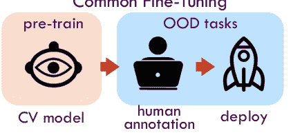

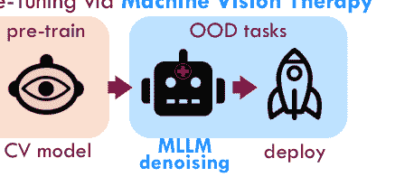

# 视觉任务的常见MLLM解决方案

## 去噪上下文学习

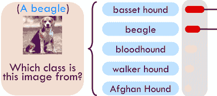

| | |
|---|---|
| is a | hound ? Answer: True; |
| is a | hound ? Answer: False; |
| is a | | hound ? Answer:output |


- 可能是 basket hound（错误）。
- 它与 basket hound 不同，所以输出是 False！

> 图 5.1. 我们方法的方法的示图：上行：常见微调与通过机器视觉治疗进行微调的对比。我们的方法通过利用 MLLMs 的知识，可能消除了人类标注的必要性。下行：以往视觉任务的MLLM解决方案与去噪上下文学习策略的对比。我们的方法不是考虑所有类别，而是使用一对正反示例进行预测。


## 5.1 引言

问答、视觉推理等。考虑到视觉模型在 OOD（分布外）情况下的脆弱性，我们希望通过借用多模态大语言模型（MLLMs）的知识来精炼视觉模型，如图 5.1 的上行所示。然而，由于将文本生成过程与视觉识别任务对齐存在困难 [245, 263, 263]，MLLMs 在生成与真值（ground-truth）类名匹配的正确答案方面表现挣，即使将它们作为视觉编码器时 [245, 246, 264, 263, 265]，其性能也逊于目前的对比学习范式。

在本章专注于增强视觉模型的鲁棒性，我们提出了有效地利用 MLLMs 进行机器视觉治疗（Machine Vision Therapy, MVT），旨在通过一种新的去噪上下文学习（DICL）策略来诊断并纠正错误预测。然后，我们利用修正后的监督来引导下游 OOD 问题的微调过程。具体而言，我们并不是给 MLLMs 一组选项来询问确切答案 [245, 264, 265]，而是证明了使用两个示例来查询真值是足够的的，即：(1) 一个正确的示例，展示了查询类名与其图像示例之间的匹配关系；(2) 一个错误的示例，它将同一个查询类与视觉模型最易混淆的类别的图像相结合。由于错误预测本质上是标签噪声，我们的灵感来源于带噪声标签的学习 [266, 267, 268, 269, 270, 271, 272, 123, 273, 274, 64, 275, 276]。特别地，我们通过估计一个捕获某一类别被误认为另一类别的概率的转移矩阵来寻找错误类别。通过输入这两个示例，可以指令 MLLMs 利用其少样本学习能力来区分视觉模型容易混淆的语义相似图像，如图 5.1 的下行所示。为了处理此类指令，我们利用了现有的几种 MLLMs 的多模态上下文学习能力 [277, 278, 279, 280] 来实现我们的方法。在错误预测被诊断和修正后，视觉模型可以进一步微调，以增强其在下游数据分布上的 OOD 鲁棒性。通过对许多具有挑战性的数据集及其 OOD 变体（如 ImageNet [281], WILDS [215], 和 DomainBed [176]）进行全面的经验研究，我们仔细验证了 MVT 的有效性，并证明了它在许多知名视觉模型的各种 OOD 场景下的优越性。

> ¹在这里，我们主要关注分类任务。

总之，我们的贡献有三个方面：

- 我们设计了一种新的机器视觉治疗范式，通过有效利用 MLLMs 的知识来增强计算机视觉模型，而不需要额外的标签信息。
- 我们提出了一种去噪上下文学习策略，成功将 MLLMs 与视觉任务对齐。
- 通过对许多知名数据集进行全面的定量和定性研究，我们证明了该方法可以增强：(1) 在内分布（ID）和 OOD 数据上的泛化能力；(2) 应对领域偏移的鲁棒性；(3) 抵抗常见损坏的鲁棒性；(4) 识别细粒度属性的性能；(5) 应对虚假相关性的鲁棒性；(6) 对预测错误和 OOD 数据的检测。

## 5.2 相关工作

在本节中，我们简述 OOD 泛化问题和多模态大语言模型。

### 5.2.1 OOD 泛化

OOD 数据指的是与训练数据分布不同的数据。OOD 泛化旨在提高深度模型在未见测试环境中的性能。研究人员尝试从不同角度解决这个问题，例如数据增强、OOD 检测、不变因果机制 [152, 282, 283, 284] 等。数据增强对于提高模型泛化是有效的。典型方法包括 Cutout [285]（随机遮挡输入图像的一部分）、CutMix [286]（用另一图像替换目标图像的一部分）、Mixup [287]（产生两幅图像的凸组合）、DeepAugment [217]（将干净图像通过图像到图像网络并在正向传播过程中引入多次扰动）。某些方法进行 OOD 检测为 OOD 数据提供服务。典型方法包括 softmax 置信度评分 [28, 188]（OOD 检测的基准）、离群暴露（OE） [288]（使用无标记数据作为辅助 OOD 训练数据）。能量分数被证明更好地区分 OOD 样本和 IID 样本 [36]。一些工作求因果关系研究 OOD 泛化问题。典型方法包括 MatchDG [150]（在观察到对象时提出基于匹配的算法，在未观察到对象时近似目标）、INVRAT [142]（利用由因果机制假设引发的某些条件独立关系）。

### 5.2.2 多模态大语言模型

多模态大语言模型领域近年来取得了显著进展，得益于视觉和自然语言处理之间的协同作用。特别是，这种协同作用体现在许多视觉-自然语言模型中，例如 GPTs [289]、CLIP [225]。在快速发展的 LLMs 领域，如 GPT [254]、LLaMA [259] 和 Vicuna [290]，这种协同作用，BLIP-2 [249] 利用了因果机制假设引发的某些条件独立关系。BLIP [271]、Instruct-BLIP [255]、LLaVA [251]、Mini-GPT [253]、mPLUG-Owl [294]、ImageBind [293]、Panda [295]、Open-Flamingo [246]、Otter [250] 以及 MMICL [280] 等模型都展示了强大的能力。


基于此，我们可以有效地估计 $T$ 并为 MLLM² 提供示例。此外，我们进行机器视觉治疗（machine vision therapy），根据 MLLM 的输出 $z$ 寻找 $X_i$ 可能的真值（ground truth）。最后，利用 $z$ 最小化 $\mathcal{L}$ 以优化 $\theta_{ev}$。接下来，我们将解释每个过程的细节。

## 5.3.2 转移矩阵估计

来自分布外（OOD）数据 $x^{ood}$ 的分布偏移会导致不可靠的标签预测 $\hat{y}^{ood}$，由于实例-特征噪声，这种预测非常不可靠 [296, 123]，如5.4.8节所示。为了捕捉 $\hat{Y}^{ood}$ 与 $Y^{ood}$ 之间的关系，我们利用转移矩阵 $T \in [0,1]^{C \times C}$ [267, 272]，满足 $P(Y^{ood}|X^{ood}) = T^T P(\hat{Y}^{ood}|X^{ood})$。然而，在没有任何噪声标签监督或强假设的情况下，要估计这种转移是非常困难的 [267, 172]。因此，我们提出了一种简单的有效选择方法来构建带有标签的支持集。

具体而言，我们根据预测置信度对每个类中的所有 OOD 数据进行排序，即 $\max_c\{x^{ood}\}$,，其中 $[\cdot]$ 表示第 $c$ 个条目的值。从排序后的数据集 $\{x^{ood}_1, x^{ood}_2, \dots, x^{ood}_C\}_{c=1}^C$ 中，我们每类均匀采样 $\rho$ 个样本，其中 $\rho$ 是标注负载，即 $D^{supp} = \{x^{ood}_1, \dots, x^{ood}_\rho\}_{c=1}^\rho$。通过这种方式，我们可以有效地为噪声后验概率 $P(\hat{Y}^{ood}|X^{ood})$。通过准确的标注过程³，我们可以获得清洁标签后验概率 $P(Y^{ood}|X^{ood})$，从而有效地估计转移矩阵 $T$。最后，通过当前过程索引 $T$，可以获取查询的噪声转移概率 $T$ [; $\arg \max[f_{few}]$]。

> ²虽然需要一些手动标注，但我们稍后的实验表明，我们的策略具有可以接受的标注负载，且性能优于在支持集上微调。此外，我们的方法未使用支持集进行参数调优，我们的微调实际上没有使用任何人工标注进行训练。

> ³我们实验证明，当 $D^{supp}$ 和 $D^{ood}$ 之间存在分布偏移时，所提方法仍然有效。因此，没有必要对每个实际任务执行标注过程。相反，我们可以使用现有的支持集来指导 OOD 任务。

### 5.3.3 上下文学习的去噪

得益于之前获得的噪声概率 $T$ [; $\arg max[f_\theta]$]，我们可以通过 DICL 进一步判断哪一个可能是可能的真值。特别是，我们只考虑前 N 个高噪声概率的类别作为潜在候选者。如果用“PRE#0”表示的标签预测不在候选列表中，我们首先将其固定。此外，我们进行*诊断（Diagnosing）*，它决定了当前预测的忠实度；以及*治疗（Therapy）*，它用于寻找可能的真值。

**诊断。** 由于 MLLMs 的推理时间并不很小，有必要避免对置信示例进行冗余分析。因此，为了检查模型预测的忠实度，我们的诊断专注于于回答查询是否属于类别“PRE#0” = “True”。具体而言，我们从 $D^{sup}$ 中检索一个属于“PRE#0”的示例，另一个属于具有最大噪声转移概率类别“CLN#1”的示例。然后，结合查询图像 $X_q$，构建一个上下文（in-context）：

> 问题：这张图像 <IMG_PRE#0> 显示了 <PRE#0> 的照片，正确还是错误？
> 回答：正确；
> 问题：这张图像 <IMG_CLN#1> 显示了 <PRE#0> 的照片，正确还是错误？
> 回答：错误；
> 问题：这张图像 <IMG_Query> 显示了 <PRE#0> 的照片，正确还是错误？
> 回答：

符号 <IMG_PRE#0>、<IMG_CLN#1> 和 <IMG_Query> 分别是来自“PRE#0”、“CLN#1”以及 $X_q$ 的示例图像特征的替换标记。第一个示例作为正样本，向 MLLMs 展示来自类别“PRE#0”的真实图像，第二个示例作为负样本，展示来自“CLN#1”的高概率假图像。然后，根据 $X_q$ 和“PRE#0”，MLLMs 可以通过输出 $z_0$ 有效地判断 84 的正确性：

$z_0 = \theta_{mll}((X_{PRE}\#,Y_{PRE}\#); (X_{CLN}1,Y_{PRE}\#):X_q) \quad (5.2)$

为了能够进一步的定量分析，我们从 MLLM 输出 $z_0$ 中获取“True”和“False”标记的 logits，紧接着通过 softmax 函数：

$z_0 := \text{softmax}([z_0[True], z_0[False]]). \quad (5.3)$

最后，我们将 $z_0[True]$ 和视觉模型的预测置信度结合，得到检测得分 $\Delta$：

$\Delta = \frac{1}{2}(z_0[True] + \max [f_{o, \cdot}](x^{output})). \quad (5.4)$

如果 $\Delta$ 大于阈值 $\delta$，我们假设当前预测“PRE#”是正确的⁵，否则我们继续下一个治疗过程。

**治疗。** 在治疗期间，我们继续使用上面的指令模板来遍历剩余的候选类别。具体地，对于 $\mathcal{N}-1$ 次试验中的每次迭代 $e$，我们选择“$CLN\#c$”作为正类，“PRE#”作为负类，其示例从 $\mathcal{D}^{supp}$ 中综合检索以构建提示词。然后，输入到 MLLM 中输出查询图像属于类别“$CLN\#c$”，即 $z_c = \theta_{mll}((X_{CLN}\#c,Y_{PRE}\#):X_q)$，令 $z_c := \text{softmax}([z_c[True], z_c[False])$。

结果，我们决定最终预测：

$y_{mll} = \arg \max [z_e]]_{e=0}. \quad (5.5)$

如5.4节所示，MLLM 在许多 OOD 场景下表现出强大的性能。然而，我们无法直接采用 MLLMs，原因有三点：(1) 推理时间不可忽视：由于 MLLMs 无法处理批处理数据，使用 MLLMs 要慢得多 ($1000\times$)；(2) 计算要求高：通过LLM 占用巨大的 GPU。对于 LLMs，这需要分布式推理；(3) 模型隐私问题：检索策略在5.4节有详细研究。

## 5 机器视觉治疗

算法4 机器视觉治疗。

**输入:** 预训练视觉模型 $\theta_{cv}$，MLLM $\theta_{mdlm}$，OOD 数据集 $\mathcal{D}^{ood}$。

- 1：从排序后的 $\mathcal{D}^{ood}$ 中均匀采样 $pC$ 个样本以构建支持集 $\mathcal{D}^{supp}$；
- 2：估计转移矩阵 $T$；见5.3.2节
- 3：对于 $i = 0, 1, \dots, n$ 执行
- 4：基于预测 $\hat{y}^{ood}$ 获取噪声转移概率 $T$ [; $\arg max[f_{\omega}]$；
- 5：通过 (5.2) 进行诊断并计算检测得分 $\Delta$；
- 6：如果 $\Delta > \delta$ 则
- 7：接受当前预测；
- 8：否则
- 9：执行治疗并通过 (5.5) 获取 MLLM 预测；见5.3.3节
- 10：基于 MLLM 预测通过 (5.6) 进行微调；见5.3.4节
- 11：结束如果
- 12：结束对于

MLLMs 非常敏感且访问性有限，因此。因此，我们建议根据 MLLMs 的预测对视觉模型进行微调。

### 5.3.4 视觉模型的微调

在获得 MLLM 预测 $y_{mdlm}$ 后，我们建议通过以下目标优化视觉模型：

> $\min_{\theta_{cv}} \mathcal{L}_{ce}(f_{\theta_{cv}}, y_{mdlm}), \quad (5.6)$

其中 $\mathcal{L}_{ce}(\)$ 表示交叉熵损失。

### 5.3.5 理论分析

我们表示 MLLM 是在潜在概念 $\phi \in \Phi$ 定义的分布 $p$ 上预训练的。在 DICL 期间，有 $n$ 个示例形成提示词 $S_n$，它们从由概念 $\phi^* \in \Phi$ 定义的提示词分布 $p_{prompt}$ 中采样。为了证明所提出的 DICL 策略，


基于 Xie 等人 [297] 提出的理论框架，我们证明了当 MLLM 在给定的 prompt $S_n$ 和查询图像-文本对 $x_q y_q$ 下根据概念 $\phi^*$ 获得概率最大的 $z$ 时，对应的 $y$ 与从 $p_{prompt}$ 中找到相同，即与 $x_q$ 匹配的 $y_q$。

# 假设 3（分布一致性）。$\forall(x_q y_q) \sim p_{prompt}, p(x_q, y_q) = p_{prompt}(x_q, y_q)$。

此外，Xie 等人 [297] 的假设同样成立，我们：

定理 4。*假设上述假设成立，如果 $\phi \in \Phi, \phi \neq \phi^*$，概念 $\phi^*$ 满足可区分性条件：$\sum_{j=1}^n KL(\phi^*|\phi) > e_{start} + e_{delim}$，则当 $n \to \infty$ 时，根据预训练分布的预测

$$\max_y p(y|S_n, x_q, \phi^*) \to \max_y p_{prompt}(y|x_q).$$

因此，上下文预测器 $f_n$ 实现了最优的 $0-1$ 风险：$\lim_{n \to \infty} \mathcal{L}_{0-1}(f_n) = \inf f \mathcal{L}_{0-1}(f)$。

引理 1。*在定理 4 相同，根据预训练分布的预测 $z$*

$$\max_z p(z|S_n, x_q, y_q, \phi^*) \to \max_z p_{prompt}(z|x_q, y_q).$$

定理 5。*假设上述假设成立，当 $n \to \infty$ 时，在概念 $\phi^*$ 下获得给定 prompt 的最大预测概率 $z$，对应的类别描述 $y$ 遵循从 prompt 分布获得的相同 $y$：*

$$\max_z p(z|S_n, x_q, y_q, \phi^*) \to \max_z p_{prompt}(z|x_q, y_q).$$

我们可以看到，如果 $n$ 足够大，当 $y_q$ 与 $x_q$ 完全匹配时，MLLM 预测 $z$ 达到最大值。结果证明，只有当我们为 MLLM 找到正向图像-文本对时，预测 $z$ 在 $x_q$ 与 $y_q \in \mathcal{Y}$ 的所有组合中最大，且 $y_q \neq y_t$。

## 5.4 实验

在本节中，我们首先提供实验细节。然后我们与先进的视觉模型进行定量比较。最后，我们进行了消融研究和分析，以定性地验证我们的……

### 5.4.1 实验设置

**数据集。** 使用著名的 ID 数据集，包括 ImageNet-1K [281] 验证集、ImageNet-V2 [216]、CIFAR10 [107]、CIFAR100 [107] 和 MNIST [299]。我们评估了通常被认为是 OOD 情况的 OOD 泛化能力，ImageNet-A [218]、ImageNet-R [217]、ImageNet-Sketch [219]、ImageNet-V [300]、iWild-Cam [301] 和 DomainNet [302]。

**设置。** 对于模型评估，我们分别从 ImageNet 验证集 (In-Val)、ImageNet-V2 (IN-V2)、ImageNet-A (IN-A)、ImageNet-R (IN-R)、ImageNet-Sketch (IN-SK)、ImageNet-V (IN-V) 中随机选择 5000 张图像，并从 CIFAR10、CIFAR100、MNIST 每个类别中独立选择 10000 张图像来构建支持集以提供内容示例。我们评估了来自 WILDS 的 iWildCam 和 VLCS、OfficeHome 以及来自 DomainBed 的 DomainNet。实现细节，我们使用前 6 个噪声选择进行 MVT。具体而言，我们设置阈值 $\delta=0.6$ 来诊断错误的预测，然后根据与查询图像最相似的逻辑预测从支持集中检索示例。

**模型与基准。** 对于视觉骨干网络，我们采用了 CLIP 模型 [225]，并使用 ViT-L 和 ViT-g [298] 作为待增强的视觉模型。对于 LLM 骨干网络，我们考虑了具有多模态能力的现有工作 CLIP [280] 和 Otter [252]。此外，我们进行了视觉问答 (VQA)，直接将 LLMs 映射到查询图像的类别。此外，我们使用 $D^{inp}$ 作为基准进行了原生微调 (Vanilla FT)。使用 LLM 预测的性能表示为 MVT，微调结果表示为 FT。

表 5.1 基准 CLIP 模型和我们的方法在 5 个 ID 数据集和 5 个 OOD 数据集上的分类准确率 (%)。基准方法包括 ViT-L CLIP [225] 和来自 EVA 的 ViT-g [298]、VQA 以及 Vanilla FT。

| Arch | Method | IN-Val | IN-V2 | CIFAR10 | MNIST | IN-A | IN-R | IN-K | IN-V | iWildcam |
|---|---|---|---|---|---|---|---|---|---|
| RN50 | CLIP | 59.7 | 52.6 | 71.5 | 41.9 | 58.5 | 23.9 | 60.7 | 35.4 | 31.1 |
| RN101 | CLIP | 61.7 | 52.6 | 80.8 | 48.8 | 51.6 | 30.2 | 66.7 | 40.9 | 35.4 |
| ViT-B | CLIP | 62.6 | 59.1 | 89.9 | 65.0 | 47.9 | 32.2 | 67.9 | 59.4 | 51.8 |
| | VQA | 75.8 | 70.2 | 95.6 | 78.2 | 76.4 | 69.3 | 87.3 | 59.6 | 13.3 |
| ViT-L | VQA | 71.6 | 70.8 | 96.1 | 83.2 | 53.7 | 56.7 | 64.6 | 87.4 | 60.3 |
| | MVT | 75.2 | 70.2 | 78.9 | 80.3 | 75.7 | 70.8 | 87.5 | 81.2 | 59.1 |
| | +FT | 71.6 | 70.5 | 92.2 | 82.2 | 82.2 | 71.2 | 79.5 | 61.4 | 68.4 |
| ViT-g | EVA | 78.8 | 71.2 | 98.3 | 84.5 | 62.2 | 71.9 | 91.4 | 67.4 | 64.9 |
| | VQA | 64.3 | 59.6 | 97.9 | 84.5 | 55.7 | 64.6 | 87.4 | 58.2 | 59.2 |
| | Vanilla FT | 78.9 | 71.8 | 98.7 | 89.1 | 62.9 | 72.7 | 91.6 | 68.1 | 65.6 |
| | MVT | **79.1** | 71.6 | 98.1 | 89.0 | 63.2 | 73.2 | 91.4 | 67.9 | 66.3 | **25.1** |
| | +FT | 79.0 | 72.2 | 98.9 | **91.2** | **65.7** | **75.5** | **92.8** | **68.6** | **78.6** | **70.6** |

表 5.2 基准 CLIP 模型和我们的方法在 4 个数据集子集上的分类准确率 (%)。基准方法包括来自 CLIP 的 ViT-L、来自 EVA 的 ViT-g、VQA 以及 Vanilla FT。

| Method | VLCS | PACS | OfficeHome | DomainNet | Avg |
|---|---|---|---|---|---|
| ViT-L | CLIP | 74.9 | 83.5 | 80.3 | 74.5 | 78.3 |
| | Vanilla FT | 78.8 | 85.2 | 83.4 | 77.0 | 81.1 |
| | MVT | 83.9 | 89.0 | 87.2 | 80.3 | 85.1 |
| | +FT | 84.2 | 89.8 | 87.9 | 82.5 | 88.6 |
| ViT-g | EVA | 72.5 | 80.0 | 79.8 | 72.8 | 76.3 |
| | Vanilla FT | 75.5 | 82.3 | 81.1 | 75.5 | 78.6 |
| | MVT | 81.2 | 86.6 | 86.1 | 79.5 | 83.4 |
| | +FT | 83.7 | 89.5 | 89.9 | 82.0 | 88.8 |

表 5.3 基准 CLIP 模型和我们的方法使用 MMICL [280] 和 Otter [252] 作为 VLM 在 5 个 ID 数据集和 5 个 OOD 数据集上的分类准确率 (%)。我们比较了我们的方法、受我们方法监督的微调模型与基准模型（即来自 CLIP 的 Vit-L [225]）的性能。使用 MMICL 和 Otter 进行微调提升了分类准确率。

| MLLM | Method | IN-Val | IN-V2 | CIFAR10 | CIFAR100 | MNIST |
|---|---|---|---|---|---|---|
| None | CLIP | 75.8 | 70.2 | 95.6 | 78.2 | 76.4 |
| MMICL | MVT | 75.2 | 70.8 | 97.9 | 89.1 | 53.0 |
| | +FT | 74.2 | 70.5 | 96.7 | 82.0 | 79.2 |
| Otter | MVT | 74.2 | 67.4 | 94.7 | 70.1 | 52.0 |
| | +FT | 76.3 | 70.1 | 96.6 | 81.8 | 81.3 |

| MLLM | Method | IN-A | IN-R | IN-SK | IN-V | iWildCam | Avg (ID+OOD) |
|---|---|---|---|---|---|---|
| None | CLIP | 69.3 | 86.6 | 59.4 | 51.8 | 13.4 | 61.7 |
| MMICL | MVT | 71.2 | 88.1 | 59.0 | 62.1 | 25.0 | 64.3 |
| | +FT | 75.1 | 89.5 | 61.4 | 68.8 | | 75.6 |
| Otter | MVT | 64.1 | 85.2 | 59.5 | 51.9 | 16.2 | 60.3 |
| | +FT | 73.5 | 88.7 | 60.0 | 55.7 | | 73.0 |

### 5.4.2 定量比较

首先，我们在 ID 和 OOD 场景下将我们的 MVT 方法与著名的视觉模型进行比较。如表 5.1 所示，我们可以看到方法微调为


# 表 5.4. 基准 CLIP 模型与我们的方法在以 MMICL [280] 和 Otter [250] 作为视觉语言模型（VLMs）的 DomainBase 数据集 4 个子集（包括 VLCS、PACS、OfficeHome 和 DomainNet）上的分类准确率 (%)。我们将我们的方法以及受我们方法监督的微调模型与基准模型 CLIP [225] 中的 ViT-L 性能进行了对比。使用 MMICL 和 Otter 进行微调均提高了分类准确率。

| LLM | 数据集 | VLCS | | | | PACS | | | | | |
|---|---|---|---|---|---|---|---|---|---|---|
| | 方法 | 0 | 1 | 2 | 3 | 0 | 1 | 2 | 3 |
| 无 | CLIP | 74.9 | 83.5 | 80.3 | 74.5 | 97.8 | 97.4 | 97.5 | 99.4 |
| MMIC | MVT | 83.8 | 89.0 | 87.2 | 80.3 | 97.6 | 97.5 | 98.0 | 99.4 |
| | +FT | 84.2 | 89.8 | 87.9 | 82.5 | 98.0 | 98.0 | 98.8 | 99.8 |
| Otter | MVT | 67.5 | 77.4 | 73.7 | 66.6 | 97.0 | 96.3 | 96.5 | 99.0 |
| | +FT | 76.8 | 87.7 | 82.3 | 77.4 | 98.0 | 97.7 | 98.0 | 99.8 |

| LLM | 数据集 | OfficeHome | | | | | DomainNet | | | | | 平均值 |
|---|---|---|---|---|---|---|---|---|---|---|---|
| | 方法 | 0 | 1 | 2 | 3 | 0 | 1 | 2 | 3 | 平均值 |
| 无 | CLIP | 87.7 | 92.7 | 85.7 | 86.5 | 61.1 | 60.2 | 78.4 | 51.1 | 80.6 |
| MMIC | MVT | 87.7 | 93.4 | 89.0 | 88.5 | 61.3 | 62.1 | 60.4 | 78.7 | 53.4 | 82.8 |
| | +FT | 90.9 | 95.0 | 90.9 | 90.8 | 62.5 | 63.8 | 62.4 | 80.1 | 54.0 | 82.4 |
| Otter | MVT | 85.6 | 89.9 | 83.6 | 83.3 | 58.6 | 56.3 | 74.1 | 46.5 | 77.0 |
| | +FT | 88.7 | 93.4 | 87.7 | 87.1 | 62.0 | 63.0 | 61.3 | 79.7 | 53.4 | 82.0 |

“FT”在大多数设置下表现更好。具体而言，在“IN-V”上，我们的微调方法可以显著提升 CLIP 和 Otter 的性能，分别达到 17% 和 6%。此外，在“IN-A”上，我们的方法在 ViT-L 和 ViT-g 骨干网络上比次优方法分别实现了 4.3% 和 2.8% 的性能提升。我们可以观察到，即使不进行微调，标记为“MVT”的 MMIC 预测准确率在许多场景下仍然超过所有基准模型，这表明我们的 MVT 微调对视觉模型具有强力的性能增强。注意，我们没有对 WildCam 提供微调，因为预测结果是不确定的。尽管 MVT 仍然可以获得最佳结果，但视觉编码器可能会在微调过程中被错误决策误导。

此外，我们通过利用 DomainBase 数据集考虑了领域偏移（domain shift）。具体而言，对于每个数据集，我们留出一个作为测试集，并在剩余数据集上进行微调。

# 表 5.5. 基准 CLIP 模型与我们的方法在 5 个 ID 数据集和 5 个 OOD 数据集上的分类准确率 (%)。我们将我们的方法以及受我们方法监督的微调模型与基准模型（包括 ResNet-50 和 ViT-B/32）进行了对比。监督器 MLLM 是 MMIC [280]。

| | 方法 | ID | | | | |
|---|---|---|---|---|---|
| | IN-Val | IN-V2 | CIFAR10 | CIFAR100 | MNIST |
| RN50 | CLIP | 59.7 | 52.6 | 71.5 | 41.9 | 58.5 |
| | MVT | 76.2 | 70.8 | 80.2 | 49.7 | 50.8 |
| | +FT | 66.3 | 65.7 | 75.1 | 46.9 | 47.3 |
| ViT-B | CLIP | 62.9 | 56.1 | 89.9 | 65.0 | 47.9 |
| | MVT | 77.7 | 71.0 | 92.5 | - | 51.5 |
| | +FT | 66.3 | 66.0 | 90.1 | 59.5 | 46.6 |
| | | OOD | | | | | | |
|---|---|---|---|---|---|---|
| 架构 | 方法 | IN-A | IN-R | IN-SK | IN-V | iWildCam |
| RN50 | CLIP | 23.9 | 60.7 | 35.4 | 31.1 | 8.2 |
| | MVT | 47.5 | 72.9 | 41.6 | 54.1 | 14.5 |
| | +FT | 32.1 | 64.4 | 36.5 | 38.2 | - |
| ViT-B | CLIP | 32.2 | 67.9 | 41.9 | 30.5 | 10.9 |
| | MVT | 60.6 | 83.0 | 47.8 | 53.1 | 19.3 |
| | +FT | 38.8 | 68.7 | 43.1 | 37.6 | - |

与最先进的骨干网络 ViT-L 和 ViT-g 相比，我们在表 5.2 中显示了性能。可以看出，MVT 和微调都可以超过基准模型。对于 PACS 数据集的某些场景，我们的方法可以达到 100%。此外，在 VLCS 数据集的某些场景下，MVT 和微调可以达到接近 90%。此外，我们发现 MVT 微调在表 5.1 和 5.2 中大幅优于微调。因此，我们可以得出结论，我们的学习策略确实为分布偏移提供了有效的鲁棒性。

### 5.4.3 使用 Otter 的定量比较

同样，我们使用冻结的骨干 ViT-L 对各种基于 ImageNet 的数据集和数据集进行了额外实验。结果见表 5.3 和 5.4。我们发现 MVT 的性能依赖于 MLLM 骨干网络：当使用 Otter 作为骨干模型时，OOD 性能会略微降低 MMIC 的性能。然而，修正后的预测仍然提高视觉模型的性能。在 ImageNet-Val 和 ImageNet-R 的几种情况下，微调可以显著提高到最佳或次优结果。

### 5.4.4 视觉模型上的 MVT

# 表 5.6. 基准 CLIP 模型与我们的方法在 4 个数据集子集（包括 VLCS、PACS、OfficeHome 和 DomainNet）上的分类准确率 (%)。我们将我们的方法以及受我们方法监督的微调模型与 ResNet-50 和 ViT-B 进行对比。监督器 MLLM 是 MMIC [280]。

| | 方法 | VLCS | | | | PACS | | | |
|---|---|---|---|---|---|---|---|---|---|
| 架构 | 方法 | 0 | 1 | 2 | 3 | 0 | 1 | 2 | 3 |
| RN50 | CLIP | 75.0 | 82.3 | 81.3 | 75.0 | 91.3 | 90.3 | 96.2 |
| | MVT | 84.4 | 87.0 | 88.7 | 81.8 | 96.0 | 95.1 | 95.4 |
| | +FT | 73.7 | 87.3 | 88.1 | 81.3 | 95.6 | 95.7 | 95.1 |
| ViT-B | CLIP | 74.0 | 82.0 | 79.6 | 74.4 | 93.6 | 92.8 | 98.2 |
| | MVT | 85.0 | 87.3 | 88.4 | 82.8 | 96.7 | 96.4 | 98.8 |
| | +FT | 76.0 | 84.8 | 81.3 | 81.6 | 92.9 | 88.8 | 93.3 |
| | | OfficeHome | | | | DomainNet | | | | |
| 架构 | 方法 | 0 | 1 | 2 | 3 | 0 | 1 | 2 | 3 | 平均值 |
| RN50 | CLIP | 71.7 | 80.9 | 69.4 | 67.8 | 47.2 | 46.8 | 64.0 | 71.0 |
| | MVT | 77.2 | 85.3 | 77.5 | 75.4 | 46.1 | 46.3 | 53.4 | 75.0 |
| | +FT | 75.9 | 85.0 | 75.8 | 74.7 | 45.3 | 45.6 | 60.4 | 73.0 |
| ViT-B | CLIP | 79.2 | 86.4 | 77.4 | 76.3 | 49.7 | 54.3 | 51.0 | 68.7 |
| | MVT | 84.0 | 89.3 | 82.9 | 81.5 | 49.5 | 53.1 | 51.5 | 78.5 |
| | +FT | 81.1 | 88.3 | 80.8 | 77.7 | 47.2 | 48.7 | 66.9 | 74.8 |

### 5.4 实验

表 5.7. 基准 CLIP 模型与我们的方法在以 MMCL [280] 作为视觉语言模型（VLM）的 15 种损坏和 7 种严重度的 ImageNet 数据集上的分类准确率 (%)。我们将我们的方法与基准模型（即 CLIP [225] 中的 Vi-L）监督的微调模型进行了对比。带有 MVT 的微调模型性能最佳。

| | Gaussian Blur | | | | | | Shot Noise | | | | | | |
|---|---|---|---|---|---|---|---|---|---|---|---|---|---|
| | | 0 | 1 | 2 | 3 | 4 | 5 | 平均 | 0 | 1 | 2 | 3 | 4 | 5 | 平均 |
| CLIP | 69.8 | 66.7 | 49.6 | 30.6 | 54.7 | 69.9 | 57.7 | 43.6 | 32.1 | 53.8 | 65.7 | 60.2 | 55.9 | 45.0 | 52.7 |
| MVT | 70.5 | 67.1 | 61.2 | 48.8 | 53.6 | 54.1 | 70.8 | 69.5 | 46.2 | 41.6 | 55.2 | 56.1 | 66.3 | 61.9 | 54.4 |
| +FT | 71.0 | 69.3 | 67.6 | 48.7 | 53.5 | 52.1 | 72.0 | 61.0 | 41.6 | 35.2 | 56.1 | 64.2 | 65.7 | 58.9 | 58.4 |
| | Glass Blur | | | | | | | | | | | | | |
| | | 0 | 1 | 2 | 3 | 4 | 5 | 平均 | 0 | 1 | 2 | 3 | 4 | 5 | 平均 |
| CLIP | 62.1 | 52.0 | 43.4 | 35.0 | 52.0 | 65.5 | 69.5 | 50.3 | 43.8 | 25.4 | 44.4 | 70.9 | 66.8 | 59.9 | 49.5 |
| MVT | 63.1 | 53.8 | 52.0 | 38.5 | 51.6 | 61.3 | 62.8 | 51.3 | 54.0 | 29.4 | 47.3 | 71.9 | 67.7 | 63.2 | 52.1 |
| +FT | 68.1 | 66.4 | 48.7 | 35.0 | 51.8 | 69.2 | 64.6 | 59.2 | 55.2 | 56.9 | 61.8 | 71.2 | 67.9 | 62.1 | 52.7 |
| | Zoom Blur | | | | | | | | | | | | | | |
| | | 0 | 1 | 2 | 3 | 4 | 5 | 平均 | 0 | 1 | 2 | 3 | 4 | 5 | 平均 |
| CLIP | 62.2 | 55.9 | 49.8 | 43.7 | 49.3 | 48.3 | 61.9 | 51.9 | 53.6 | 51.9 | 52.6 | 60.0 | 68.5 | 61.2 | 53.1 |
| MVT | 63.1 | 52.0 | 45.7 | 38.7 | 51.6 | 69.2 | 52.8 | 51.0 | 60.5 | 46.2 | 51.1 | 54.0 | 71.9 | 69.5 | 57.2 |
| +FT | 65.2 | 59.2 | 48.4 | 34.8 | 51.1 | 73.4 | 70.6 | 54.2 | 61.0 | 41.6 | 35.2 | 56.1 | 71.8 | 69.5 | 57.9 |
| | Fog | | | | | | | | | | | | | | |
| | | 1 | 2 | 3 | 4 | 5 | 平均 | 1 | 2 | 3 | 4 | 5 | 平均 |
| CLIP | 69.7 | 69.0 | 61.3 | 53.2 | 62.3 | 74.3 | 74.0 | 72.8 | 70.6 | 68.1 | 72.0 | 70.6 | 69.3 | 64.8 | 52.4 | 51.3 |
| MVT | 70.7 | 69.2 | 66.5 | 52.8 | 63.8 | 54.1 | 74.7 | 72.6 | 71.1 | 68.1 | 72.3 | 70.9 | 69.9 | 65.1 | 52.9 |
| +FT | 72.5 | 69.3 | 67.1 | 52.8 | 63.8 | 74.1 | 74.7 | 72.6 | 71.1 | 68.1 | 72.3 | 70.9 | 69.9 | 65.1 | 52.9 |


## 5 机器视觉疗法

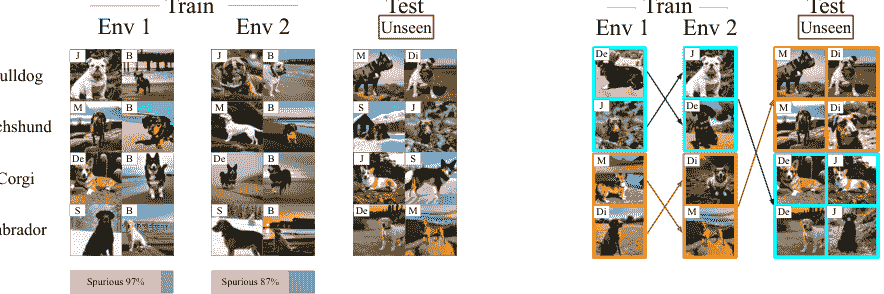

(a) 一对一 (O2O) (b) 多对多 (M2M)

图 5.3. 来自 Lynch 等人 [304] 的图表

### 5.4.5 针对视觉损坏的鲁棒性

此外，我们通过在鲁棒性基准 ImageNet-C [1114] 上评估 EVIL，考虑了针对损坏的视觉鲁棒性。具体而言，有 15 种损坏，其相关性强度从 1 到 5 不等。在这里我们涵盖了所有场景，使用 MMIC 作为骨干模型并将 CLIP ViTL 作为基准方法来评估我们的方法。结果所示表 5.7。我们可以看到，我们的方法在所有场景下均表现出非常强大的性能。与 CLIP 相比，使用 MVT 可以提高性能超过 2%，而通过微调，性能进一步提升了 4% 以上。令人鼓舞的结果再次证明了我们方法的有效性。

### 5.4.6 针对虚假相关性的鲁棒性

此外，我们考虑了一种常见的分布偏移场景，其中训练数据集和测试数据集具有不同的前景和背景相关性，*即*虚假相关性。具体而言，如图5.3 所示，对于我们使用的 Spurious 数据集，有两种不同的设置：一对一 (O2O) 相关性，其中每个类以一定的概率与背景类型相关。训练数据集和测试数据集中的前景对象与特定背景组合的概率不同。对于多对多 (M2M) 设置，前景和背景被分为包含多个类别和背景类型的子组。当训练集和测试集之间的不同子组相关在一起时，就形成了 M2M 虚假相关性，并带来了更大的复杂性。在 Spurious 数据集中，根据训练集和测试集之间相关性概率的差异，分为三个难度级别：容易、中、困难。在这里，我们考虑了所有场景并在表 5.8 中展示了结果。我们可以，MVT 方法在所有场景下都优于 ViT-L 和 ViT-g 基准方法，这得出结论：我们的方法对虚假相关性具有鲁棒性，并且能够在背景变化的情况下识别感兴趣的类别。

## 表 5.8. 使用 Spurious 数据集时 MVT 和 CLIP 在虚假相关性鲁棒性方面的性能对比。

| 类型 | O2O_easy | O2O_medium | O2O_hard | M2M_easy | M2M_medium | M2M_hard | 平均值 |
|---|---|---|---|---|---|---|---|
| ViT-L | 94.1 | 95.4 | 93.3 | 96.7 | 95.0 | 92.5 | 94.5 |
| MVT | **95.8** | **96.3** | **93.6** | **96.8** | **95.8** | **92.9** | **95.2** |
| ViT-g | 94.6 | 97.0 | 92.6 | 96.7 | 95.6 | 94.8 | 95.2 |
| MVT | **95.3** | **97.4** | **92.8** | **96.8** | **96.6** | **95.4** | **95.7** |

#### 表 5.9. 选定的 12 个属性的类名。

| 属性 | -1 | +1 |
|---|---|---|
| 男性 | 一个女性 | 一个男人 |
| 戴帽子 | 未戴帽子 | 戴着帽子 |
| 微笑 | 未微笑 | 正在微笑 |
| 眼镜 | 未戴眼镜 | 戴着眼镜 |
| 金发 | 没有金发 | 有金发 |
| 胡子 | 没有胡子 | 有胡子 |
| 吸引力 | 不吸引 | 吸引 |
| 涂口红 | 未涂口红 | 涂着口红 |
| 戴项链 | 未戴项链 | 戴着项链 |
| 戴领带 | 未戴领带 | 戴着领带 |
| 年轻 | 不年轻 | 年轻 |
| 秃顶 | 不秃顶 | 秃顶 |

| 男性 | 戴帽子 | 微笑 | 眼镜 | 金发 | 胡子 |
| --- | --- | --- | --- | --- | --- |
| -1 | [image] | [image] | [image] | [image] | [image] | [image] |
| +1 | [image] | [image] | [image] | [image] | [image] | [image] |
| 吸引力 | 涂口红 | 戴项链 | 戴领带 | 年轻 | 秃顶 |
| -1 | [image] | [image] | [image] | [image] | [image] | [image] |
| +1 | [image] | [image] | [image] | [image] | [image] | [image] |

> 图 5.4.具有不同属性的 CelebA 照片示例。

### 5.4.7 识别细粒度属性的性能

此外，在这里我们根据 CelebA 数据集 [305] 进一步探索了识别细微属性的能力。特别是，我们考虑了 12 种面部属性，如图 5.4 所示。对于每个属性，我们测试了学习模型是否能正确识别给定图像中的属性。在这里，我们将我们的 MVT 方法与 CLIP ViT-L 和 ViT-g 进行比较，以及对 ViT-L 和 ViT-g 模型进行治疗后产生的 MVT 性能。

特别是，由于 CelebA 是二分类任务，我们为视觉模型和我们的 MLLM 设计了不同的提示（prompts）。对于 CLIP 模型，我们使用“图像中的人是 <classname>”作为输入，其中每个属性的 <classname> 见表 5.9。对于我们的方法，我们仍然为每个 ICL 轮设计了一个正向提示和一个负向提示。具体来说，对于“男性”属性，我们的指令如下：

## 5.4 实验

#### 表 5.10. 使用 CelebA 数据集时 MVT 和 CLIP 在识别细粒度属性方面的性能对比。

| 属性 | 男性 | 帽子 | 微笑 | 眼镜 | 金发 | 胡子 | 口红 | 项链 | 领带 | 年轻 | 秃顶 | 平均值 |
|---|---|---|---|---|---|---|---|---|---|---|---|---|
| ViT-L | 63.0 | 60.8 | 64.5 | 75.8 | 36.2 | 29.0 | 42.0 | 30.8 | 38.0 | 37.5 | 66.6 | 86.3 | 52.5 |
| MVT | 74.0 | 67.0 | 76.4 | 73.1 | 55.8 | 42.4 | 39.4 | 38.6 | 53.9 | 73.5 | 88.1 | 60.6 |
| ViT-g | 98.5 | 75.5 | 70.4 | 83.8 | 46.0 | 58.2 | 72.5 | 43.5 | 28.4 | 54.1 | 91.3 | 65.7 |
| MVT | 98.9 | 77.3 | 71.0 | 84.1 | 58.3 | 74.9 | 73.2 | 43.6 | 41.2 | 56.1 | 91.8 | 69.1 |

（注：此处根据原文逻辑衔接）
> Question: 图像中的人是男性吗? Answer: True;
> Question: 图像中的人是女性吗? Answer: False;
> Question: 图像中的人是男性吗? Answer: 在

CelebA 的结果所示表 10，我们观察到我们的方法在识别细粒度方面是有效的，其性能显著超过了 ViT-L 和 ViT-g。特别是在“金发”、“胡子”和“戴领带”属性上，两个 CLIP 模型的提升超过了 10%，在 12 个属性的平均范围内，ViT-L 和 ViT-g 分别提升了 8.1% 和 3.4%。因此，可以得出结论：我们的方法优于多种视觉模型。

### 5.4.8 消融实验

在这一部分，我们使用 ViT-L 骨干模型进行消融实验以分析 MVT 的每个模块。

#### 转换矩阵消融实验。为了验证矩阵估计的性能，我们将基于置信度的采样策略与随机采样进行比较。ImageNet-V 数据集的结果所示图 5.5。

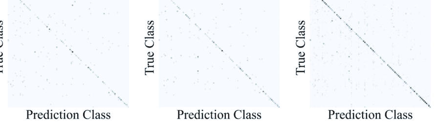

> 图 5.5. 将我们的方法与随机采样及真值对比的矩阵估计消融实验。

#### 表 5.11. 通过转换矩阵（MVT）选择噪声类别与 Top-N 预测的性能对比。

| IN-A | IN-SK | IN-Val | IN-R | IN-V2 | IN-V |
|---|---|---|---|---|---|
| Top-V 预测. | 60.3 | 58.4 | 74.2 | 85.3 | 67.7 | 58.3 |
| MVT | 65.5 | 59.0 | 75.1 | 86.0 | 70.7 | 61.6 |

为了定量展示我们方法的优越性，我们计算了估计值与真值差异的 $\ell_2$ 范数，这指示了估计的真实度。结果，我们的估计准确得多，达到了 3.83 的范数，而随机采样为 4.46。

#### 检测评分消融实验。为了分析所提出的检测评分在诊断中的作用，我们在图 5.6 中展示了视觉模型、MLLM 以及我们的检测评分 $\Delta$ 提供的预测置信度分布。根据结果，我们可以证明 $\Delta$ 设计的合理性：在左列中，我们可以看到正确分类的置信度很高，但错误的示例呈现均匀分布。相反，在中间列中，


## 5.4 实验

### ImageNet-A 上的检测得分

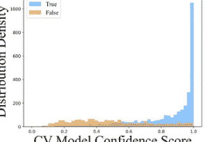
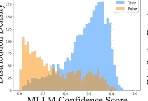
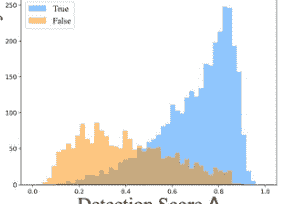

CV 模型置信度分数
MLLM 置信度分数
检测得分 $\Delta$

### ImageNet-V 上的检测得分

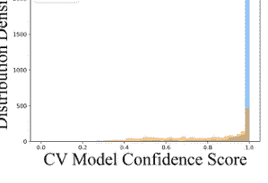
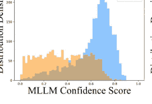
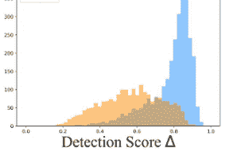

CV 模型置信度分数
MLLM 置信度分数
检测得分 $\Delta$

图 5.12. 使用 Otter [250] 和 MIMICL [280] 在 5 个 OOD 数据集上的分类准确率 (%) 比较。我们比较了在 CLIP ViT-L [225] 骨干网络上的性能。

| MLLM | 方法 | CLIP | IN-A | IN-R | IN-SK | IN-V | iWildcard |
|---|---|---|---|---|---|---|---|
| None | | 69.3 | 86.6 | 59.4 | 51.8 | 13.4 | |
| Otter | MVT | 64.1 | 85.2 | 59.5 | 51.9 | 16.2 | |
| | +FT | 73.5 | 88.7 | 60.0 | 55.7 | | |
| MIMICL | MVT | 71.2 | 88.1 | 59.0 | 62.1 | 25.0 | |
| | +FT | 75.1 | 89.5 | 61.4 | 68.8 | | |

尽管 MLLM 在正确样本上的得分较低，但它显著抑制了错误样本的置信度。因此，我们结合两个分数来获得 $\Delta$，这可以产生清晰的分离分布，从而有利于诊断过程。除非另有说明，否则我们设置的阈值 $\delta = 0.6$，它在大多数场景下都能有效工作。

MLLM 骨干网络上的消融实验。为了验证 MVT 在不同 MLLM 骨干网络上的有效性，我们在这里使用 Otter [278] 实例化我们的方法，并将其与在 MIMIC [280] 上的之前的实现进行比较。结果如表 5.12。我们可以看到，在 MIMICL 和 Otter 上的实现性能都优于所采用的视觉编码器骨干网络。

### 变化的 Top-N 数量

### 变化的检索数量

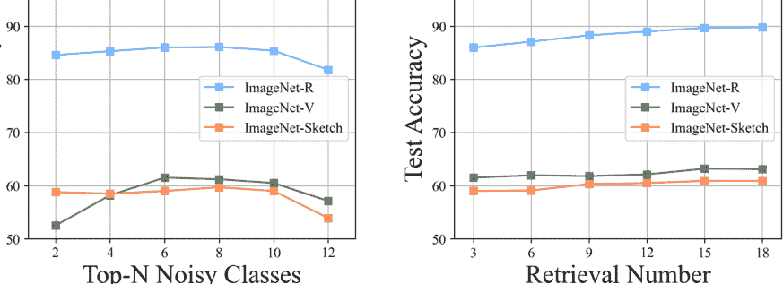

图 5.7. 性能分析：（左）改变所选 top-N 噪声类的数量；（右）改变检索到的示例数量。

虽然 Otter 和 MIMICL 之间的性能略有不同，这可能是由于模型容量和它们的训练策略，但我们通常得出结论：我们的 MVT 方法适用于具有 ICL 的不同 MLLM 骨干网络，并在未来可以从更复杂的 MLLM 中进一步获益。

### 5.4.9 性能分析

我们进行了定性分析，以充分验证我们 MVT 的有效性。

**Top-N 噪声类的选择。** 为了研究不同数量的所选噪声类如何影响我们方法的性能，我们将 top-$N$ 从 2 改为 12，并在图 5.7 左侧展示了在 ImageNet-R、ImageNet-V 和 ImageNet-Sketch 数据集上的结果。我们发现了一个共同现象，即 $N$ 数字太小或太大都会损害性能。这可能是因为较小的 $N$ 会忽略太多的潜在的真值类别。相比之下，较大的 $N$ 包含了太多可能干扰最终预测的选项。将 $N$ 设置为 6 可能是基于 ImageNet 的类数据集的理想选择。

**检索数量的影响。** 在我们的实验中，我们检索了 3 次示例并对预测取平均。为了进一步研究不同检索数量的影响，我们将检索次数从 3 改为 18，并在上述相同的 OOD 数据集上进行实验。具体来说，我们将单个 DICL 轮中的一个正负对视为一次检索。我们重复此过程 $R$ 次，并通过 $\frac{1}{R}\sum^R [z_e[True]^r, z_e[False]^r]$ 汇集成 MLLM 预测。通过这种方式，LLM 的预测可能会更准确。结果如图 5.7 所示。我们观察到性能随着检索数量的增加而稳定提高，但当检索数量变得太大时，性能收益会递减。此外，大量的检索数量会倍增计算成本。因此，建议将数量设置在合理的小范围内。

**不同检索策略的性能。**

由 Alay 等人 [245] 显示，基于检索的上下文选择（RICS）可以显著影响性能。为了研究这一点，我们考虑了两种检索策略：基于特征的和基于逻辑的。前者基于特征相似性，后者基于逻辑。对于每种策略，我们分别选择“最相似”和“最不相似”的示例。结果如图 5.8 所示。我们观察到基于逻辑的检索优于基于特征的检索，我们认为这是由于分类任务更倾向于逻辑而非特征相似性。

| | 最不相似 | 最相似 |
|---|---|---|---|
| 特征 | 86.6 | 87.7 | 59.4 |
| 逻辑 | 87.9 | 89.5 | 60.2 |

图 5.8. 不同检索策略的性能分析。

当支持集受到分布偏移影响时，DICL 能够有效工作。因此，我们留出一个领域作为支持集，并将其余作为目标 OOD 数据。结果如图 5.9 左侧所示。惊讶的是，我们发现性能不受分布偏移的影响，这证明了当从不同分布检索示例时，MVT 仍然有效。

### 分布偏移下的示例

### 变化的上下文长度

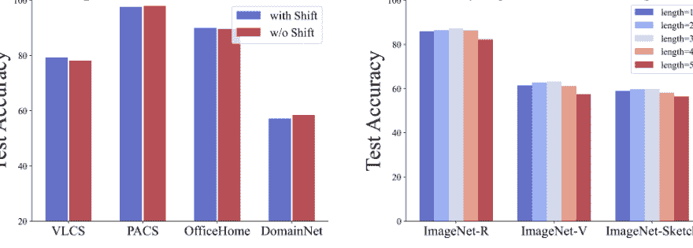

- 长度=1
- 长度=2
- 长度=3
- 长度=4
- 长度=5

图 5.9. 性能分析：（左）分布偏移；（右）示例长度。

**变化的上下文长度的影响。** 在这里我们分析了增加长度的影响。在这里我们将一个正负对视为长度 1。我们将长度从 1 变为 5，并在图 5.9 右侧显示结果。我们观察到性能随着长度的增加而逐渐提高，但当长度超过 4 时，性能下降。

**检测性能。** 最后，我们考虑一个目标中存在开放类的挑战场景。我们通过选择 60% 的类别作为闭类，其余作为开放类来模拟这种情况。为了检测此类开放类，即 OOD 检测 [28, 306]⁶，我们使用视觉模型置信度作为基准，并与 MLLM 置信度以及公式 (5.4) 中的检测得分 $\Delta$ 进行比较。结果如图 5.10 所示。在上行中，我们观察到使用我们的得分 $\Delta$ 具有清晰的分离分布，如图 5.6。在下行，我们展示了阈值从 0 到 1 变化时每个标准的 F1 分数。

> ⁶注意这里的 OOD 检测与之前的设置不同：这里关注开放类数据，而之前关注检测预测错误。

## 5.5 结论

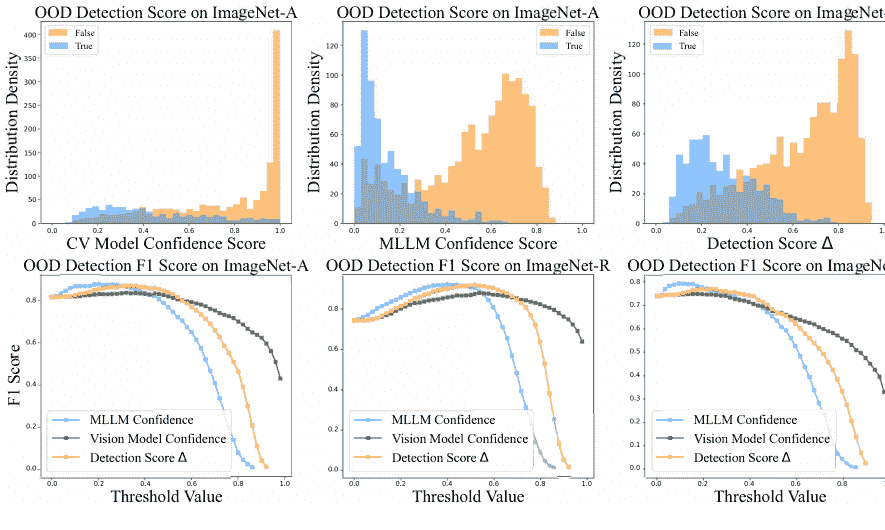

图 5.10. OOD 检测分析。上方：ImageNet-A 上的检测分布；下方：视觉模型置信度、MLLM 诊断置信度和我们的 $\Delta$ 分在 ImageNet-A、ImageNet-R 和 ImageNet-V 上的 F1 分数。

当阈值较小时，MLLM 获得更好的检测性能，但阈值较大时，视觉模型置信度相对较好，即 MLLM 能够有效地检测开放类。然而，一种有效的检测需要一个合理的阈值值，既太大也不小，因此通过将它们结合，我们的检测得分 $\Delta$ 在阈值处于中间范围内可以获得最佳 F1 分数。

在本章中，我们提出了一种通过利用 MLLM 微调视觉模型的新范式，以提高下游 OOD 任务的视觉鲁棒性。具体而言，我们有效地估计了转移矩阵，帮助寻找可能的噪声类。通过检索...


通过被称为“诊断”和“治疗”的两个阶段执行 DICL，以纠正错误的视觉模型预测。得益于纠正后的预测，可以通过微调进一步提升视觉模型的鲁棒性。我们进行了详细的理论分析以及广泛的定量和定性实验，以证明所提议方法的有效性。我们的框架可以显著降低训练视觉模型的成本，并为许多视觉识别问题提供见解，例如 OOD 检测、OOD 泛化、弱监督学习等。

# 第6 章

# 模态泛化 (Out-of-Modal Generalization)

世界是通过各种模态理解的，例如外观、声音和语言。由于每种模态只部分代表了特定意义的物体，因此利用额外的模态在理论和实践上都是有利的。然而，利用新模态通常需要对应同一实例的跨模态对，这极其消耗资源，有时甚至是不可能的，这使得对新模态的知识探索受到了很大限制。为了寻求实用的多模态学习，本文将模态泛化（Out-of-Modal, OOM Generalization）作为一种初步尝试，即在没有给定实例模态对应的情况下泛化到未知模态。具体而言，我们考虑了 OOM 泛化的半监督和无监督场景，前者具有稀缺的对应关系，后者完全没有，并提出了 Connect&Explore (COX) 来解决这些问题。COX 首先通过变分信息瓶颈框架连接 OOM 数据和已知的模态内（In-Modal, IM）数据以提取共享信息。然后， COX 利用共享知识创建涌现对应关系，这在信息论视角上具有理论依据。结果，OOM 数据上的标签信息随着对应关系的出现而产生，这有助于在未知知识的情况下探索 OOM 数据，从而获于泛化结果。我们在各种 OOM 泛化场景下仔细地评估了所提的 COX 方法，验证了其有效性和扩展性。


图 6.1。随着更多模态的加入，AI 得到了增强，那么那么 AI 如何根据其已知的模态从新模态中学习呢？

## 6.1 引言

为了理解世界，我们使用各种数据模态，如图像 [3, 307, 308] 和文本 [309, 5]。每种模态通过特定的物理视角描述物体，从而对理解物体做出贡献。因此，从多模态数据中学习的多模态学习（MML）[245, 310, 311, 225, 312, 313, 314] 一直是 AI 的核心研究课题。受益于对各种模态的利用，与单模态学习 [315, 316, 225, 317] 相比，学习性能在各种任务中显示出优势，例如跨模态检索 [279, 318, 319]、人机交互 [320, 321] 以及机器人 [322, 323]。

然而，现有技术并不理想，需要有效利用新兴模态，例如较新的磁场数据 [324]、声波 [325] 和电磁波 [326]。因此，新兴技术不断利用新传感器来增强其性能。例如，具身智能 [327] 已经拥有 3D 视觉和语言能力，但它们仍在探索新的技能，如触觉和生物传感。由于在实践中难以利用这些不常见且缺乏经验的技能，将常用模态的知识来理解新模态可能是有利的，如图 6.1 所示。在实践中，

大多数现有的 MML 研究 [225, 294, 328, 329] 都需要实例模态对应关系，即多模态数据与同一实例配对，这在面对新模态的现实场景中往往难以满足 [330, 331, 317, 332]。以机器人为例，某些模态是常见且易获取的，例如视觉和语言。然而，其他模态如触觉需要特殊的传感器来对看到或相同的物体进行采样。不幸的是，这种采样在实践中可能无法再次获得。结果，新模态通常具有不完全甚至没有对应关系，这可能会严重阻碍跨模态的知识交互，并阻碍 MML 带来的收益。因此，自然产生了一个问题：我们探索新模态真的需要实例级的模态对应关系吗？

本章研究了一个实用但未被探索的问题——模态外（OOM）泛化。特别是，在给定几种模态（即模态内 IM 数据）的情况下，目标是泛化到未知模态或在具有稀缺对应关系的情况下泛化。这种看似意味着新模态的现实应用：尽管人类感知受限于某些模态（例如触摸、视觉、听觉），但我们仍然可以通过利用固有的感官来理解不可感知的模态，例如，在拉动两个磁铁时感受力；或者通过观察磁铁周围铁屑的排列来观察磁场。

基于这一见解，我们利用包含先验知识的 IPM 模型来编码 IM 数据（这些模型可以使用现有的 MML 模型实现 [225, 294, 329, 328]），以及一个在没有任何先验的情况下学习新模态的 OOM 学习器。通过分析潜特征之间的交互，我们从理论和实验上证明了 OM 学习器可以通过训练逐渐发现 OOM 知识，如图 6.2 所示。首先，我们考虑了给定少量对应关系的半监督 OOM 泛化。基于对应关系，我们可以捕获连接 OOM 数据和 IM 数据的先验概率分布和映射。通过信息论视角，我们提出了 Connect&Explore (COX)，鼓励跨模态映射的一致性，进一步共享跨模态知识并探索 OOM 知识。然后，我们将 COX 扩展到完全没有实例对应对应无监督 OOM 泛化。为了应对挑战，我们通过最大化跨模态交互来增强 OM-IM 连接。首先，我们根据特征相似性从跨模态映射选择数据对。通过假设接近 OOM 映射的数据对可以视为对应关系，我们可以创建涌现对应关系并通过半监督方案解决无监督情况。为了验证所提出的 COX，我们仔细设计了使用各种多模态数据集的实验来验证其有效性。此外，我们提供了大量的分析以理解 OOM 并启发未来的研究。总之，我们的贡献有三个：

- 我们发现了一个新颖且实用的问题 OOM 泛化，旨在利用已知模态的知识探索新模态。
- 我们考虑了两种典型情况：半监督 OOM 泛化和无监督 OOM 泛化，并提出了 Connect&Explore 框架，从信息论视角解决这两个问题。
- 我们进行了广泛的实验，在各种数据集上处理 OOM 泛化，并提供了直观的见解以启发未来的研究。

## 6.2 相关工作

模态泛化 [333] 通常专注于利用某些模态的知识并泛化到另一种模态。现有研究在不同的设置下针对各种任务进行。跨模态微调通过使用相同模型将 IM 数据的分布适配到 OOM 数据来模拟迁移学习。[334] 提出通过分布对齐来实现这一目标，这需要预训练知识和有标记的目标模态数据。[335] 在类似的问题设置下设计了一种渐进式模态生成方案，该方案从目标模态中选择前 k 个活跃特征块，并用源模态的块替换它们。这种渐进式策略可以对齐模态数据以确保泛化。跨模态泛化使用独立的编码器，并专注于泛化到来自同一实例的不同模态数据。


## 6.2 相关工作

表格 6.1. 不同问题及其对应设置的对比。

| 问题 | 参考文献 | IM 知识 | OOM 知识 | 对应关系 |
|---|---|---|---|---|
| 跨模态微调 | [330, 335] | 预训练且标记 | | | ✗ |
| 跨模态泛化 | [331] [332] | 预训练且标记 | 预训练且标记 | ✓ |
| 无标记多模态数据的 MML | [330] | 部分标记 | 部分标记 | ✓ |
| OOM 泛化 | 第 6.3 节 第 6.3.4 节 | 预训练且标记 | 极标记 ✗ | 少数 ✗ |

[331] 使用元学习将 OOM 数据对齐到 IM 空间，并动态泛化到 OOM 任务。[332] 研究了在训练期间 IM 和 OOM 数据均已知的设置。然后，学习一个统一的表示空间以帮助 OOM 数据的下游泛化。其他研究考虑了所有模态都可用时的泛化：[336] 研究了无配对数据的跨模态泛化，[337] 将信息瓶颈应用于 CLIP 训练，[338] 在有限数据下进行多模态融合，[339] 在全配对多模态数据上进行领域泛化。最近的一项无标记多模态数据 MML 研究 [330] 了一种不同的设置，即 IM 和 OOM 数据都有标记，但它们并不是。相反，提供了额外的未标记配对多模态数据来学习模态之间的交互。此外，除了遵循迁移学习的跨模态微调外外，现有的 MML 工作大多需要实例级的对应关系。本工作提出了 OOM 泛化，即没有对应关系且 OOM 知识几乎没有提供。相关工作的对比如表 6.1 所示。

**模态绑定（Modality Binding）** 旨在学习跨不同模态的联合嵌入空间。对比语言-图像预训练 CLIP [225] 是第一个将图像与语言数据对齐的工作。然后，ImageBind [294] 提出使用视觉模态将各种模态绑定到同一个表示空间。进一步，LanguageBind [329] 提出使用语言作为替代方案，类似地绑定各种模态。最近，FreeBind [328] 将现有的统一空间扩展到额外的专家空间。具体而言，考虑了两种类型的绑定，即空间位移绑定和空间组合。由于模态绑定需要大量具有对应关系的数据，选择的模态通常是常见的。因此，OOM 泛化问题可以通过编码器作为 IM 感知器来学习新模态，从而利用模态绑的发展。

## 6.3 OOM 泛化

在本节中，我们形式化了 OOM 泛化设置。然后，展示所提的方法。此外，我们考虑了少量对应关系的半监督情况以及无对应关系的无监督场景，证明所提方法可以成功处理这两种设置并有效利用未配对的 OOM 数据。

### 6.3.1 问题设置

在 OOM 泛化中，我们给定了一组模态 $\mathcal{M}_1^1, \dots, \mathcal{M}_K^K$，其中 $\mathcal{M}_{b\in\{1,\dots,K\}} = \{(x_i^b, y_i^b)\}_{i=1}^N \in \mathcal{X} \times \mathcal{Y}\}$ 由 $N$ 个标记的 IM 示例组成，其下标 $i$ 表示不同模态之间的对应关系。此外，我们有一个未知的模态 $\mathcal{M}^O = \{(x_j^0, y_j^0\}_{j=1}^M$，包含 $M$ 个未标记的 OOM 示例。在某些情况下，可能与 IM 数据找到少量对应关系，那么我们的 OOM 数据可以为 $\mathcal{M}^O = \{(x_j^0, y_j^0)\}_{j=1}^L \cup \{(x_j^0, y_j^0)\}_{j=L+1}^M$，其中 $L \ll M$，且下标 $i$ 追踪对应的 IM 数据和标签。

为了解决 OOM 泛化问题，我们提出了如图6.2所示所示的学习框架。特别是，我们使用一组 IM 感知器 $\{g_k^1, \dots, g_K^K\}$ 来感知 IM 数据，这可以通过许多现有的模态绑定模型实现，例如 ImageBind[294] 和 LanguageBind[329]。然后，通过 $z_i^k = g_k^k(x_i^k)$ 获取 IM 数据的特征。此外，我们使用 OOM 学习器 $g^0$ 通过 $z^0 = g^0(x^0)$ 从 OOM 数据中学习特征 $z^0$。我们的目标是通过探索 OOM 特征 $z^0$ 与 IM 特征 $\{z_i^k\}_{k=1}^K$ 之间的关系，有效地泛化到 OOM 数据。注意，我们只关注 OOM 数据的泛化性能，改进 IM 数据的学习并不是本章的目标。因此，在实验期间冻结所有 IM 感知器的参数，只训练 OOM 学习器。在上述模型的基础上，我们进一步定义了预测的分类器 $h^o(x^0) := h^o(x^0; g^0)$ 和 $h_k(x_k^l) := h_k(x_k^l; g_k^l)$。

### 6.3.2 方法：连接与探索 (COX)

在这里，我们基于模态之间的交互关系阐述提出的方法 [230, 341]。具体来说，两个模态在特定任务下的总信息被分解为：1) *共性*，表示跨模态的共同属性；(2) *唯一性*，仅存在于每个模态中；以及 (3) *协同性*，表示模态共同呈现时产生的新信息。注意，在本章中我们不考虑 (3)，因为我们的目标是泛化到 OOM 数据。

通过共同模态泛化到未知模态，我们的目标是提取可以理解 OOM 数据的共性。然后，通过选择具有最小唯一性的点对 OOM 数据的后验分布进行建模。为此，可以建立 OOM 泛化。COX 方法包含两个步骤：(1) 通过映射 IM 数据到 OOM 数据建立连接，(2) 探索高唯一性的 OOM 数据。


## 6 跨模态泛化

通过共性捕捉跨模态的共同知识 [36]。在这里我们遵循变分信息 (VIB) 框架 [32] 来实现这一目标。我们假设在 OOM 设置下，$V$ 与 $X^O$ 无关。直观地说，给定一个 IM 数据（例如狗图像），足以推断标签“dog”，对于未知的 OOM 数据（例如狗叫）也是如此。因此，在多模态设置中，使用 IM 信息进行预测不再取决于 OOM 知识，因为 OOM 知识是冗的。

我们的目标是通过最大化信息共性，从 IM 数据中提取价值知识以利用 OOM 数据 [330, 341]：

$I(X^O; X^I; Y) = I(X^O; X^I) - I(X^O; X^I|Y)$,

其中 $I(X^O; X^I; Y)$ 表示 $X^O$ 与 $X^I$ 相对于任务 $Y$ 的互信息；而 $I(X^O; X^I|Y)$ 表示与 $Y$ 无关条件互信息。我们从第一项开始：

$I(X^O; X^I) = \int dx^O dx^I p(x^o, x^i) \log \frac{p(x^o, x^i)}{p(x^o)p(x^i)}$, (6.3)

其中 $p(x^o|x^i) = \int dv p(x^o, v|x^i) = \int dv p(x^o|v)p(v|x^i)$ 可以通过解码器 $q(x^o|v)$ 近似。由于散度-莱布勒 (KL) 散度始终非负，我们有 $KL[p(X^O|V) || q(X^O|V)] \geq 0 \Rightarrow \int dx^O p(x^o|v) \log \frac{p(x^o|v)}{q(x^o|v)} \geq \int dx^O p(x^o|v) \log q(x^o|v)$,

> ²注意潜变量 V 与特征表示 $z^1$ 和 $z^O$ 不同。


## 6.3 OOM 泛化

并利用詹森不等式，我们可以得到：

```math
$I(X^0; X^1) \geq \int dx^0 dx^1 p(x^0, x^1) \log \frac{\int dvq(x^0|v)p(v|x^1)}{p(x^0)} \quad (6.4)$
$\geq \int dx^0 dx^1 dv p(x^0, x^1) \log q(x^0|v)p(v|x^1) + H(X^0), \quad (6.5)$
```

其中最后一项与我们的优化过程无关。然而，我们重写为：

```math
$p(x^0, x^1) = \int dv p(x^0, x^1, v) = \int dv p(x^1)p(x^1)p(v|x^1). \quad (6.6)$
```

那么，我们得到了以下下界：

```math
$I(X^0; X^1) \geq \int dx^0 dx^1 dv p(x^0|x^1)p(v|x^1) \log q(x^0|v)p(v|x^1), \quad (6.7)$
```

该界通过从联合分布、来自编码器的隐变量 $p(v|x^1)$ 以及易处理的变分近似 $q(x^0|v)$ 中采样来实现。

同样，我们可以对第二项 $I(X^0, X^1|Y)$ 取上界：

```math
$I(X^0, X^1|Y) \leq \int dx^0 dx^1 dy p(x^0, x^1, y) \log p(y|x^1)p(x^0|x^1)p(x^1) - \log h^0(y|x^0). \quad (6.8)$
```

其中 $h^0(y|x^0)$ 是我们预测 OOM 数据的分类模型。为此，我们可以通过结合公式 (6.7) 和 (6.8) 来为我们的目标设定下界：

```math
$I(X^0; X^1) \geq \int dx^0 dx^1 dv p(x^0|x^1)p(v|x^1) \log q(x^0|v)p(v|x^1) \quad (6.9)$
$- \int dx^0 dx^1 dy p(x^0, x^1, y) \log p(y|x^1)p(x^0|x^1) + \log h^0(y|x^0) = \mathcal{L}_{con}.$
```

上述界包含两个部分：(1) OOM 数据重建，我们使用隐变量 $V$ 重建 $X^0$；(2) OOM 数据预测，其中我们对标签分布 $Y$ 建模。在实践中，我们可以使用来自 IM 和 OOM 数据的经验样本来近似 $p(x^0, x^1, y)$。此外，我们在不引入任何先验假设的情况下编码 $p(v|x^1)$，因为我们可以利用来自预训练 IM 感知器的特征分布。此外，优化了一个分类器 $h(y|x^0)$ 根据给定标签对 OOM 数据进行分类。从经验上看，

我们可以最小化：

$$\mathcal{L}_{con} := \frac{1}{M} \sum_{i=1}^{M} \|x_i^O - q(x_i^O|v_i)p(v_i|x_i^O)\|^2 - \log h^O(y_i|x_i^O), \quad (6.10)$$

其中我们使用重建误差 $\|\cdot\|$ 来实现对数似然 $q(x^0|v)p(v|x^1)$，与 Kingma 和 Welling 的做法类似。在建立连接后，我们可以确保跨模态共享的任务相关信息，这有助于部分理解关于其条件的 OOM 数据。然而，请注意公式 (6.9) 中的第二项没有被充分利用，它包含了由 IM 建模的 $p(y|x^1)$。更进一步，我们可以得到 $-\int dx^0 dx^1 dy p(x^0, x^1, y) \frac{p(y|x^1)p(x^0|x^1)}{h^0(y|x^0)}$。由于 $p(x^0|x^1)p(x^1)$ 在标签预测中是固定的，我们推导出 $-KL(p(y|x^1) \| h^0(x^0))$，这意味着标签相关的 IM 数据可以帮助探索。接下来，我们展示社区如何帮助 OOM 泛化，并提供一种探索的解决方案。

### 唯一性的探索

唯一性可以通过选择和探索具有高独特性的 OOM 数据来实现。为了识别这些数据，我们可以利用来自 IM 数据的最优分类器所达成的一致和不。我们的最终目标是优化：

$$\min_{h^O} KL(h^O(y|x_a^O) \| h^O(y|x_b^O)), \quad x_a^O \in \mathcal{D}, x_b^O \in \mathcal{A}, \quad (6.11)$$

其中 $h_a^O$ 和 $h_b^O$ 分别代表两组 IM 数据 $x_a^O$ 和 $x_b^O$ 中的最优分类器，而 $x_a^O$ 和 $x_b^O$ 是从具有模态不歧 $\mathcal{D}:=\{x^O : h_a^O(x^O) \neq h_b^O(x^O)\}$ 的 OOM 数据中选择的。为了简单起见，这里使用了两种模态，但结论可以扩展到多个模态。此外，具有一致的数据被视为引导对不一致数据探索锚点。该目标是将 OOM 数据唯一性的后验 $h^O(y|x^O)$ 映射到锚点 $h^O(y|x_a^O)$。为了证明这一点，我们定义了模态不歧：在输入空间中训练生成模型在计算上是不高效的，我们建议在特征空间中连接模态，其中原始数据 $x$ 被隐特征 $z$ 替换。

**定义 6**（模态不歧）。给定 $X_1, X_2$ 和目标 $Y$，以及它们对应的最优分类器 $h_1^*$ 和 $h_2^*$，它们的模态不歧定义为 $\alpha(h_1^*, h_2^*) = \mathbb{E}_{p(x_1, x_2)}[d(h_1^*, h_2^*)]$，其中 $d: \mathcal{Y} \times \mathcal{Y} \to \mathbb{R}^+$ 是衡量 $h_1^*$ 和 $h_2^*$ 之间距离函数。

**定理 7**。给定两个模态的最优分类器 $h_1^*$ 和 $h_2^*$，在三角不等式、利普希茨条件和分类器最优假设下，它们的模态不歧限于：

```math
$\alpha(h_1^*, h_2^*) \leq I(X_1, X_2;Y) + 2I(X_1;X_2|Y). \quad (6.12)$
```

最后，基于任务相关互信息 $X^O$ 的分解得到：

$$I(X^O, Y) = I(X^O, X_1^O, Y|X_2^O) + I(X^O, X_2^O, Y|X_1^O) + I(X^O|X_1^O, X_2^O), \quad (6.13)$$

如图所示，其中第一项表示整体信息，第二项表示所有模态共享的共性，第三项代表仅在 OOM 数据中的唯一性。直观地说，当我们试图增加模态不歧时，共性会减少而 OOM 唯一性会增加，这充分证明了我们的目标：为了探索 OOM 数据的唯一性，我们可以探索具有高模态不歧的数据。


## 6 跨模态泛化

我们通过以下方式优化 OOM 学习器：

```
\min_{h^o} \mathcal{L}_{\text{uns}} := \frac{1}{|\mathcal{A}|} \sum_{(x,y) \in \mathcal{A}} \text{CE}(h^o(x_u^o), y) + \frac{1}{|mathcal{A}|+|mathcal{D}|} \sum_{x \in \mathcal{D}} \sum_{y \in \mathcal{A}} \text{KL}(h^o(x_q^o); h_1^*, h_2^*),
```

$\mathcal{A}$ 表示通过对欧里得距离排序更新后的锚点：$\mathcal{A} := \text{SORT}(\{(g_i^o, y_i)\}_{i=1}^M, \min_{i \in\{1..N\}} \frac{1}{K} \sum_{k=1}^K \|z_i^o - v_{k,i}\|);$ 其中第一项计算来自锚点的交叉熵损失，第二项计算具有模态分歧的 OOM 数据与锚点之间的 KL 散度。

在这两个步骤之后，我们可以有效地处理无监督的 OOM 泛化。在实践中，我们在特征空间中连接模态并选择锚点，因此我们的应用在两种场景下都是高效的。在下一节中，我们仔细进行了大量的实验，以证明所提出的 COX 方法在各种设置下的有效性和扩展性。

## 6.4 实验

在实验中，我们首先阐明实验细节。然后，我们提供了在不同数据集上与其他基准方法的性能比较。最后，我们进行了实证分析，以直观地理解该方法。

### 6.4.1 实现细节

**数据集。** 我们考虑了包含至少三个模态的数据集：(1) TV 数据集 [344] 包含触觉感知、RGB图像和可以转换为语言的类别名称；(2) LLVIP [345] 数据集包含红外热数据、RGB图像以及行人估计标注。我们遵循 [329] 裁剪代表两个类别的行和背景。此外，我们使用 OpenAI tooltip [225] 创建语言描述；(3) NYU-D 数据集 [346] 包含RGB图像、深度数据以及可以转换为语言描述的类别名称；(4) VGGS 数据集 [347] 包含视频数据、相应的声音和语言描述；(5) MSR-VTT [348] 包含视频和文本描述，我们将视频分解为帧和音频数据；(6) MOSEI 数据集 [349] 包含7类情感的视频，我们从视频中提取音频数据并使用情感类型创建语言描述。

**模型。** 我们使用了两种 IM 感知器：ImageBind [294] 和 Language-Bind [329]，它们分别包含6个和5个编码器来处理不同的模态。我们为每个实验选择一个模态作为 OOM，其余的作为 IM。对于 IM 数据，我们使用现有的编码器提取其特征。对于 OOM 数据，我们进行预处理以确保其兼容性。然后，我们使用 ViT-T/16 从头初始化 OOM 学习器，利用 IM 感知器从 OOM 数据中学习。注意，对于 TVL 数据集，没有现有的编码器来处理触觉模态。因此，当触觉模态被选为 IM 数据时，我们在训练集上使用对比学习来微调编码器。对于 ImageBind，触觉编码器与图像编码器对齐，这与原始训练过程相同。为了训练模态之间的连接，我们使用多层感知器来实现变分瓶颈框架。此外，为了从每个模态中获得最优分类器，我们利用提取的特征并训练一个线性层作为分类头。

**设置。** 我们考虑了 OOM 泛化的两种场景：对于半监督情况，我们采样了 10% 的训练数据作为标记数据，每个类别的标签数量保持平衡。对于无监督情况，我们没有任何标签。在选择锚点数量时，我们在热身和训练阶段选择相同数量的样本，即总设置的 10%。我们使用的初始学习率为 $1e-3$，权重衰减为 $1e-5$，并训练 50 个 epoch。

**基准方法。** 由于在我们的设置下没有现有的基准方法可以比较，我们实现了四种方法进行比较，即：模型随机初始化的方法；仅使用标记数据最小化经验风险的 ERM；在进行 ERM 的同时最小化无标记数据熵的 EntMin [350]；使用高斯噪声扰动对输入进行自监督学习的 SSL；以及通过集成更新模型参数同时进行对比学习的 MoCo [351]。

## 表 6.2 不同方法在具有不同 OOM 模态的多个数据集上的分类性能。

| | | TVL | | LLVIP | | | NYU-D | | VGGS | | | | |
|---|---|---|---|---|---|---|---|---|---|---|---|---|
| Setting | Method | Method | RGB | Tac | RGB | Lan | RGB | Dep | Lan | Aud | Vid |
| Semi-Supervised | ImageBind | Random | 0.4 | 0.3 | 0.2 | 47.3 | 51.0 | 11.2 | 11.3 | 0.2 | 0.3 | 0.3 |
| | | ERM | 23.1 | 19.5 | 22.7 | 54.6 | 54.1 | 45.2 | 44.5 | 38.1 | 9.3 | 8.4 |
| | | EntMin | 24.0 | 21.8 | 23.6 | 56.7 | 57.0 | 55.4 | 48.0 | 46.3 | 39.5 | 10.3 | 8.9 |
| | | COX | 35.2 | 25.3 | 26.6 | 59.2 | 58.3 | 53.8 | 52.3 | 50.7 | 44.2 | 18.4 | 11.7 |
| | | aligned | 79.5 | 29.3 | 35.8 | 65.4 | 61.8 | 63.4 | 61.8 | 54.0 | 52.7 | 27.8 | 29.3 |
| Unsupervised | LanguageBind | Random | 0.4 | 0.3 | 0.2 | 48.2 | 47.3 | 51.0 | 10.2 | 11.3 | 0.2 | 0.3 |
| | | ERM | 23.6 | 20.1 | 22.6 | 56.5 | 54.9 | 58.3 | 44.8 | 44.5 | 9.3 | 9.7 |
| | | EntMin | 25.7 | 23.1 | 25.1 | 59.8 | 60.0 | 62.2 | 49.4 | 49.6 | 11.9 | 14.5 |
| | | COX | 35.2 | 25.3 | 26.6 | 60.5 | 65.2 | 68.4 | 56.5 | 50.4 | 48.3 | 12.4 |
| | | aligned | 81.6 | 31.2 | 38.3 | 74.1 | 73.2 | 87.2 | 68.6 | 65.1 | 57.7 | 38.6 |
| | ImageBind | Random | 0.4 | 0.3 | 0.2 | 48.2 | 47.3 | 51.0 | 10.2 | 11.3 | 0.2 | 0.3 |
| | | SSL | 6.3 | 4.1 | 5.2 | 56.1 | 52.6 | 63.4 | 14.6 | 13.6 | 18.9 | 2.5 |
| | | COX | 18.9 | 15.4 | 17.1 | 54.8 | 57.2 | 53.8 | 21.7 | 22.0 | 19.5 | 10.2 |
| | | aligned | 81.6 | 31.2 | 38.3 | 74.1 | 73.2 | 87.2 | 68.6 | 65.1 | 57.7 | 38.6 |

## 6.4.2 性能比较

为了比较，我们进行了分类和跨模态检索以识别所提出的 COX。有七种模态，即 RGB、语言、深度和视频，分别为 RGB、Lan、Vid。对于每一列，我们选择一种模态作为 OOM 数据，其余的 IM。对于检索任务，我们查看了 Top 1 (R@1) 和 Top 5 (R@5) 的召回率。结果显示，提出的 COX 在两种场景下均表现最佳。具体而言，COX 在大多数情况下实现了超过 5% 的性能提升。

## 表 6.3 不同 OOM 模态在多个数据集上的方法跨模态检索性能。

| Setting | IM | Method | MSR-VTT | | | MOSEI | | | |
|---|---|---|---|---|---|---|---|---|
| | | R@1 | R@5 | R@1 | R@5 | R@1 | R@5 |
| Semi-Supervised | ImageBind | Random | 5.4 | 25.1 | 25.4 | 5.4 | 24.2 | 14.3 | 42.5 | 14.4 | 42.1 |
| | | ERM | 15.6 | 30.3 | 35.2 | 18.5 | 28.2 | 25.5 | 49.3 | 47.1 | 33.4 | 48.2 |
| | | EnM | 18.5 | 32.4 | 39.2 | 21.0 | 39.4 | 29.6 | 46.7 | 33.5 | 50.4 | 50.5 |
| | | MoCo | 20.5 | 33.9 | 38.9 | 23.4 | 43.5 | 30.1 | 47.3 | 52.7 | 56.2 | 51.0 |
| | | COX | 26.9 | 39.9 | 44.3 | 28.7 | 48.0 | 36.2 | 53.8 | 59.8 | 64.2 | 66.4 |
| | | Aligned | 35.5 | 31.5 | 52.4 | 35.6 | 61.8 | 42.9 | 66.4 | 70.0 | 69.5 | 71.7 |
| | LanguageBind | Random | 5.2 | 24.3 | 25.4 | 5.0 | 25.6 | 13.5 | 41.3 | 42.7 | 14.6 | 41.9 |
| | | ERM | 16.3 | 31.5 | 36.2 | 18.7 | 37.8 | 25.7 | 48.4 | 47.1 | 33.4 | 48.2 |
| | | EnM | 19.8 | 32.4 | 39.6 | 21.8 | 37.9 | 25.8 | 46.7 | 33.5 | 40.5 | 49.7 |
| | | MoCo | 23.9 | 36.0 | 41.9 | 21.1 | 43.5 | 35.0 | 50.3 | 57.8 | 51.4 | 51.7 |
| | | COX | 25.2 | 36.0 | 44.0 | 28.7 | 48.7 | 39.6 | 53.8 | 59.2 | 64.2 | 55.4 |
| | | Aligned | 42.0 | 53.6 | 58.8 | 48.6 | 70.0 | 44.4 | 68.9 | 69.4 | 67.1 | 68.3 |
| Unsupervised | ImageBind | Random | 5.4 | 25.1 | 25.0 | 5.4 | 24.2 | 14.3 | 42.5 | 14.4 | 42.1 |
| | | SSL | 8.9 | 28.4 | 28.5 | 11.0 | 29.1 | 17.4 | 48.8 | 15.2 | 16.9 | 45.0 |
| | | MoCo | 9.2 | 30.9 | 36.0 | 21.1 | 32.9 | 25.1 | 50.7 | 57.8 | 51.5 | 54.4 |
| | | COX | 13.5 | 36.0 | 46.5 | 32.4 | 34.8 | 20.8 | 53.7 | 18.7 | 46.7 | 18.2 | 48.9


[content]

## 6.4.3 实证分析

为了给提出的方法提供直观的解释，我们使用 MSR-WTT 数据集在各种 OOM（跨模态）场景和模态上进行了实证分析。

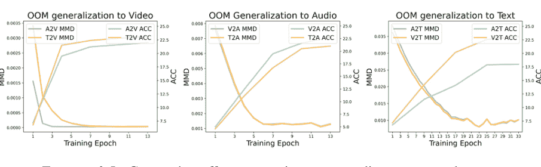

图 6.5. 连接效应对最大平均差异和准确率的影响。

**连接缓解了模态差异。** 为了理解我们基于 VIB 的连接学习的性能，在这里展示了其对跨模态泛化的影响。具体而言，在连接训练期间，我们计算了每个 IM（模态）数据映射与 OOM 数据之间的最大平均差异（MMD）。同时，我们在训练期间选取了 6 个点并提取了 IM 映射，将其用于分类头作为最优分类器。根据我们的理论结果，我们将这些分类器应用于 OOM 数据并计算其准确率，如图 6.5 所示。我们可以看到，随着训练的进行，每个 IM 和 OOM 数据之间的 MMD 正在减小，相应的准确率正在增加，这表明：(1) 我们的连接确实缩小了它们特征之间的模态差异；(2) IM 数据的映射越来越接近 OOM 数据，最优分类器在 OOM 数据上显示出更好的分类结果，这有利于从已知模态到未知模态的知识迁移。

**模态不歧识别别了不确定性。** 为了理解模态不歧的影响，我们通过训练 OOM 学习器仅使用标记数据进行 10 个 epoch 的训练来分析半监督场景。然后，我们利用模态不歧标准将 OOM 数据分为具有不歧和一致的数据，并展示它们的预测准确率。

## 6.4 实验

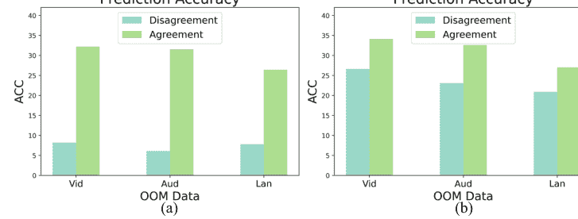

图 6.6. 分别是具有模态不歧和模态一致的 OOM 数据的预测准确率。(a) 探索之前。(b) 探索之后。

| 设置 | 消融实验 | MSR-VTT R@1 | | | |
| --- | --- | --- | --- | --- |
| Semi | w/o connection | 8.7 | 7.9 | 10.3 |
| | w/o exploration | 16.4 | 16.5 | 18.8 |
| | COX | 25.2 | 24.1 | 40.0 |
| Unsub. | w/o warm-up | 7.4 | 11.5 | 10.5 |
| | COX | 14.8 | 18.4 | 15.4 |

在图 6.6 (a) 中，我们可以看到具有不歧的 OOM 数据准确率明显低于具有一致的数据，这意味着预测不确定性（即准确率低的数据）被模态不歧有效识别了。

**模态缓解了不确定性。** 进一步，我们按照第 6.3.3 节提出的程序进行训练，并在图 6.6 (b) 中再次展示了一致和不歧 OOM 数据的准确率。我们可以看到这两类数据之间的性能差距得到了很大缓解，这证明了利用模态一致性指导探索 OOM 数据的方法合理性。结果，我们可以在两类数据上获得几乎相当的性能，有利于整体泛化。

**消融实验。** 此外，我们进行了消融实验来证明我们方法的有效性。具体来说，我们考虑了三个消融：(1) “w/o connection”，我们移除连接并直接在 IM 数据和 OOM 数据的原始特征上应用模态不歧标准；(2) “w/o exploration”，我们只利用一致的 OOM 数据进行训练；(3) 对于无监督场景，我们考虑了“w/o warm-up”，即不进行预热阶段直接训练模型。表 6.4 的结果显示，所有模块对于实现有效的 OOM 泛化都是关重要的。具体来说，连接对于 IM 数据到 OOM 数据的知识传递至关重要，没有它，泛化性能将大幅下降。该结论与连接分析一致，即跨模态直接应用最优分类器会导致糟糕的准确率。此外，移除探索也会阻碍性能，因为 OOM 数据的独特性被很大忽视了。此外，我们发现预热阶段对于无监督情况是必不可少的。由于初始化模型没有分类能力，我们需要预训练来形成与 IM 数据一致的基础特征聚类，进一步实现有效的 OOM 泛化。

**关于计算效率的讨论。** 注意，我们主要在特征空间上进行特征连接，训练 VIB 框架的计算开销是可以接受的。主要成本是训练 OOM 学习器，这是使用交叉熵损失进行优化的基础训练，可以在单块 NVIDIA 3090/4090 GPU 上实现。

## 6.5 结论与局限性

在本章中，我们研究了一种新颖且具有前景的研究方向，被称为跨模态泛化（OOM Generalization），旨在利用现有模态的知识来泛化到未知模态。我们考虑了两种场景：具有对应关系无对应关系的情况，即半监督和无监督情况。为了解决这些问题，我们提出了连接-探索（COX）方法，它首先跨模态学习连接，然后基于 OOM 数据的独特性进行探索模态不歧。广泛的实验证明了该方法。然而，我们的研究在某些方面存在局限性：首先，由于跨模态直接应用最优分类器会导致准确率低；；其次，移除探索也会阻碍性能，因为 OOM 数据的独特性被很大忽视；此外，我们发现预热阶段对于无监督情况是必不可少的。由于初始化模型没有分类能力，我们需要预训练来形成与 IM 数据一致的基础特征聚类，进一步实现有效的 OOM 泛化。

## 证明与理论分析

在本章中，我们提供了证明和理论分析，包括第 3 节的收敛性分析、第 4 节的锐度理论分析、第 5 节的通过策略的证明以及第 6 节的模态不歧。

## 7. SharpDRO 的证明

本节提供了收敛性的证明。在开始之前，我们给出一些符号：(1) 我们将期望表示 $\mathcal{L}(\theta,\omega) := \mathbb{E}_{(x,y)\sim\omega}\mathcal{L}(\theta)$，我们的目标变为 $\min_{\theta}\max_{\omega}\mathcal{L}(\theta) + \mathcal{R}(\theta)$。(2) $\kappa$ 是 Lipschitz 连续的；(3) 我们定义 $L^*(\theta) = \max_{\omega}\mathcal{L}(\theta)$ 和 $\omega^*(\theta) = \arg\max_{\omega}\mathcal{L}(\theta)$。

### 7.1 更新规则

在理论分析之前，我们需要明确更新规则。注意我们的算法并不是直接获得值，而是通过批次估计它：$g_{\theta} = \frac{1}{M}\sum_{i=1}^M \frac{\partial \mathcal{L}}{\partial \theta}(x_i, y_i)$ 和 $g_{\omega} = \frac{1}{M}\sum_{i=1}^M \frac{\partial \mathcal{L}}{\partial \omega}(x_i, y_i)$ 成立。因此迭代执行如下：
$\theta_{t+1} = \theta_t - \eta_{\theta}g_{\theta}(\theta_t, \omega_t)$;
$\omega_{t+1} = \omega_t + \eta_{\omega}g_{\omega}(\theta_t, \omega_t)$。
我们进一步给出一个符号 $\theta_{t+1/2} = \theta_t + \rho g_{\omega}(\theta_t, \omega_t)$，因此 $\theta$ 的更新简化为：
$\theta_{t+1} = \theta_t - \eta_{\theta}g_{\theta}(\theta_{t+1/2}, \omega_t)$。

### 7.1.2 假设

对于我们的问题，收敛提出一些必要假设：

假设 8（界方差）。损失函数的梯度的无偏估计有界方差：
$\mathbb{E}_{(x,y)\sim\omega}[\frac{\partial \mathcal{L}}{\partial \theta}(\theta; (x, y))] = \nabla_{\theta}L(\theta, \omega), \mathbb{E}_{(x,y)\sim\omega}[\frac{\partial \mathcal{L}}{\partial \theta}(\theta; (x, y)) - \nabla_{\theta}L(\theta, \omega)\|^2 \le \sigma^2;$

备注 9。由于 $g_{\theta}$ 和 $g_{\omega}$ 分别是平均样本：$g_{\theta} = \frac{1}{M}\sum_{i=1}^M \frac{\partial \mathcal{L}}{\partial \theta}(x_i, y_i)$ 和 $g_{\omega} = \frac{1}{M}\sum_{i=1}^M \frac{\partial \mathcal{L}}{\partial \omega}(x_i, y_i)$，它们同样具有无偏性且有界方差：
$\mathbb{E}_{(x,y)\sim\omega}[g_{\theta}(\theta; \omega; (x, y))] = \nabla_{\theta}L(\theta, \omega), \mathbb{E}_{(x,y)\sim\omega}[g_{\theta}(\theta; \omega; (x, y)) - \nabla_{\theta}L(\theta, \omega)\|^2 \le \frac{\sigma^2}{M};$
$\mathbb{E}_{(x,y)\sim\omega}[g_{\omega}(\theta; \omega; (x, y))] = \nabla_{\omega}L(\theta, \omega), \mathbb{E}_{(x,y)\sim\omega}[g_{\omega}(\theta; \omega; (x, y)) - \nabla_{\omega}L(\theta, \omega)\|^2 \le \frac{\sigma^2}{M};$


# 7 证明与理论分析

假设 10 (Lipschitz 平滑)。 $\mathcal{L}(\theta; (x, y))$ 对于每个样本 $(x, y)$ 都是可微的且满足 $l$-Lipschitz 平滑的：

$|\nabla_{\theta}\mathcal{L}(\theta_1; (x, y)) - \nabla_{\theta}\mathcal{L}(\theta_2; (x, y))|| \leq l|\theta_1 - \theta_2||, \quad \forall \omega, (x, y);$

$|\nabla_{\omega}\mathcal{L}(\theta; \omega_1) - \nabla_{\omega}\mathcal{L}(\theta; \omega_2)| \leq l|\omega_1 - \omega_2||, \quad \forall \theta.$

备注 16。因此期望函数 $\mathcal{L}$ 也具有 Lipschitz 平滑性质：

$|\nabla_{\theta}\mathcal{L}(\theta_1; \omega) - \nabla_{\theta}\mathcal{L}(\theta_2; \omega)| \leq E||\nabla_{\theta}\mathcal{L}(\theta_1; (x, y)) - \nabla_{\theta}\mathcal{L}(\theta_2; (x, y))|| \leq l|\theta_1 - \theta_2||, \quad \omega$;

$|\nabla_{\omega}\mathcal{L}(\theta; \omega_1) - \nabla_{\omega}\mathcal{L}(\theta; \omega_2)| \leq E||\nabla_{\omega}\mathcal{L}(\theta; (x, y)) - \nabla_{\omega}\mathcal{L}(\theta; (x, y))|| \leq l|\omega_1 - \omega_2||, \quad \theta.$

假设 12 (PL 条件)。损失函数 $\mathcal{L}(\theta, \cdot)$ 在每个 $\theta$ 上均满足 PL 条件，存在 $\mu > 0$ 使得 $|\nabla_{\theta}\mathcal{L}(\theta, \omega)||^2 \geq 2\mu[|\nabla_{\theta}\mathcal{L}(\theta, \omega) - \mathcal{L}(\theta, \omega)|], \quad \forall \theta, \omega.$

## 7.1.3 有用引理

在这一部分，我们将证明一些用于证明收敛界的必要引理。

我们会在开头给出该问题的驻点的定义。

定义 13 (驻点测度)。对于任何 $\epsilon \geq 0$，如果 $\mathbb{E}|\nabla L^{*}(\theta)||| \leq \epsilon$，则定义 $\theta$ 为我们问题的 $\epsilon$-驻点。

备注 14。对于极小问题，通常有两种衡量驻点的方法。一种是双侧测量，当 $\mathbb{E}||\nabla_{\theta}\mathcal{L}(\theta, \omega)||| \leq \epsilon$ 且 $\mathbb{E}||\nabla_{\omega}\mathcal{L}(\theta, \omega)||| \leq \epsilon$ 时，我们称 $(\theta, \omega)$ 为 $(\epsilon, \epsilon)$-驻点。在 [352] 中已经证明当 $L^*$ 平滑时，这些测度可以相互转换，这在我们使用 SharpDRO 算法计算模型参数 $\theta$ 时所示。因此，我们在这里选择 $\mathbb{E}|L^{*}(\theta)|$ 作为测度。

引理 2。[353] 在假设 10 和 12 下，$L^{*}(\theta)$ 是 $(1+\frac{l}{2\mu})$-Lipschitz 平滑的，其梯度为：

$\nabla_{\theta}L^{*}(\theta) = \nabla_{\theta}\mathcal{L}(\theta, \omega^{*})$.

引理 3。[353] 在假设 10 和 12 下，$\omega^{*}(\cdot)$ 关于其变量是平滑的：

$|\omega^*(\theta_1) - \omega^*(\theta_2)| \leq \frac{l}{2\mu}|\theta_1 - \theta_2||, \quad \theta_1, \theta_2.$

## 1 SHARPDRO 的证明

引理 4. 我们给出一个估计：

```
$\mathbb{E}\|g_{\theta}(\theta_{t+1/2}, \omega_t)\|^2 \leq (4\rho^2l^2 + 2\rho l + 2)\mathbb{E}\|\nabla_{\theta}\mathcal{L}(\theta_t, \omega_t)\|^2 + (5\rho^2l^2 + 2)\frac{\sigma^2}{M}.$
```

证明。

```
$\mathbb{E}\|g_{\theta}(\theta_{t+1/2}, \omega_t)\|^2 = -\mathbb{E}\|\nabla_{\theta}\mathcal{L}(\theta_t, \omega_t)\|^2 + \mathbb{E}\|g_{\theta}(\theta_{t+1/2}, \omega_t) - \nabla_{\theta}\mathcal{L}(\theta_t, \omega_t)\|^2$
+ 2\mathbb{E}g_{\theta}(\theta_{t+1/2}, \omega_t), \nabla_{\theta}\mathcal{L}(\theta_t, \omega_t).$.
```

对于交叉积项，我们进行如下拆分：

```
$\mathbb{E}(g_{\theta}(\theta_{t+1/2}, \omega_t), \nabla_{\theta}\mathcal{L}(\theta_t, \omega_t))$
$= \mathbb{E}(g_{\theta}(\theta_{t+1/2}, \omega_t) - g_{\theta}(\theta_t + \rho\nabla_{\theta}\mathcal{L}(\theta_t, \omega_t)), \nabla_{\theta}\mathcal{L}(\theta_t, \omega_t))$
$+ \mathbb{E}(g_{\theta}(\theta_t + \rho\nabla_{\theta}\mathcal{L}(\theta_t, \omega_t)), \nabla_{\theta}\mathcal{L}(\theta_t, \omega_t))$
$= \mathbb{E}(\nabla_{\theta}\mathcal{L}(\theta_{t+1/2}, \omega_t) - \nabla_{\theta}\mathcal{L}(\theta_t + \rho\nabla_{\theta}\mathcal{L}(\theta_t, \omega_t)), \nabla_{\theta}\mathcal{L}(\theta_t, \omega_t))$
$\leq{(i)} \frac{1}{2}\mathbb{E}\|\nabla_{\theta}\mathcal{L}(\theta_{t+1/2}, \omega_t)\|^2$
$- \nabla_{\theta}\mathcal{L}(\theta_t + \rho\nabla_{\theta}\mathcal{L}(\theta_t, \omega_t))\|^2 + \frac{1}{2}\mathbb{E}\|\nabla_{\theta}\mathcal{L}(\theta_t, \omega_t)\|^2 + \mathbb{E}\|\nabla_{\theta}\mathcal{L}(\theta_t, \omega_t)\|^2$
$+ \mathbb{E}(\nabla_{\theta}\mathcal{L}(\theta_t + \rho\nabla_{\theta}\mathcal{L}(\theta_t, \omega_t)), \nabla_{\theta}\mathcal{L}(\theta_t, \omega_t))$
$\leq{(ii)} \frac{\rho^2l^2}{2}\mathbb{E}\|g_{\theta}(\theta_t, \omega_t) - \nabla_{\theta}\mathcal{L}(\theta_t, \omega_t)\|^2 + \frac{3}{2}\mathbb{E}\|\nabla_{\theta}\mathcal{L}(\theta_t, \omega_t)\|^2 + \rho l\mathbb{E}\|\nabla_{\theta}\mathcal{L}(\theta_t, \omega_t)\|^2$
$\leq{(iii)} (\rho + \frac{3}{2})\mathbb{E}\|\nabla_{\theta}\mathcal{L}(\theta_t, \omega_t)\|^2 + \frac{\rho^2l^2\sigma^2}{M}$.
```

其中不等式 (i) 源于 Cauchy-Schwarz 不等式；不等式 (ii) 源于 $L$ 的 Lipschitz 平滑性：

```
$\mathbb{E}\|\nabla_{\theta}\mathcal{L}(\theta_{t+1/2}, \omega_t) - \nabla_{\theta}\mathcal{L}(\theta_t + \rho\nabla_{\theta}\mathcal{L}(\theta_t, \omega_t))\|^2 \leq l^2\|\theta_{t+1/2} - \theta_t\|^2$.
```

## 7 证明与理论分析

以及 Lipschitz 平滑性质：

$\langle\nabla_{\theta}\mathcal{L}(\theta_t + \rho\nabla_{\theta}\mathcal{L}(\theta_t, \omega_t)), \nabla_{\theta}\mathcal{L}(\theta_t, \omega_t)\rangle = (7.7)$
$\frac{1}{\rho}\langle\nabla_{\theta}\mathcal{L}(\theta_t + \rho\nabla_{\theta}\mathcal{L}(\theta_t, \omega_t)), \nabla_{\theta}\mathcal{L}(\theta_t, \omega_t)\rangle \leq \frac{l}{\rho}\|\nabla_{\theta}\mathcal{L}(\theta_t, \omega_t)\|^2, (7.8)$

且不等式 $(iii)$ 利用假设 8 处理第二项，我们有：

$\mathbb{E}\|g_{\theta}(\theta_{t+1/2}, \omega_t) - \nabla_{\theta}\mathcal{L}(\theta_t, \omega_t)\|^2 \leq 2\mathbb{E}\|g_{\theta}(\theta_{t+1/2}, \omega_t) - \nabla_{\theta}\mathcal{L}(\theta_t, \omega_t)\|^2 + 2\mathbb{E}\|\nabla_{\theta}\mathcal{L}(\theta_t, \omega_t)\|^2$$\leq \frac{\sigma^2}{M} + 2\rho^2l\mathbb{E}\|g_{\theta}(\theta_t, \omega_t)\|^2 (7.9)$
$= \frac{\sigma^2}{M} + 2\rho^2l^2\mathbb{E}\|g_{\theta}(\theta_t, \omega_t)\|^2 \leq \frac{\sigma^2}{M}(2\rho^2l^2 + 1) + 4\rho^2l^2\mathbb{E}\|\nabla_{\theta}\mathcal{L}(\theta_t, \omega_t)\|^2,(7.10)$

通过结合上述不等式，我们可以得到：

$\mathbb{E}\|g_{\theta}(\theta_{t+1/2}, \omega_t)\|^2 \leq (4\rho^2l^2 + 2\rho)\mathbb{E}\|\nabla_{\theta}\mathcal{L}(\theta_t, \omega_t)\|^2 + (5\rho^2l^2 + 2)\frac{\sigma^2}{M}. (7.11)$

## 引理 5. 对于函数 $L^*$ 的下降关系

$\mathbb{E}[L^*(\theta_{t+1})] \leq L^*(\theta_t) - \frac{\eta_0}{2}(1-5\rho l - \eta_0(4\rho^2l^2 + 2\rho))\mathbb{E}[L^*(\theta_t)] + \frac{\eta_0^2}{2}(1+\frac{\rho l}{2}) + l\eta_0^2(4\rho^2l^2 + 2\rho l)\mathbb{E}\|\nabla_{\theta}^{*}(\theta_t) - \nabla_{\theta}\mathcal{L}(\theta_t, \omega_t)\|^2 + \frac{\eta_0^2\sigma^2}{2},$

这里我们使用了简记符号 $L = l + \frac{l}{2}$。证明。由于 $\mathbb{L}^*(\theta)$ 根据引理 2 是 $(l+\frac{l}{2})$-Lipschitz 平滑的，我们有：

$\mathbb{L}^*(\theta_{t+1}) \leq \mathbb{L}^*(\theta_t) + \langle\nabla\mathbb{L}^*(\theta_t), \theta_{t+1} - \theta_t\rangle + \frac{1}{2}(l+\frac{l}{2})\|\Delta\theta\|^2$
$= \mathbb{L}^*(\theta_t) - \eta_t\langle\nabla\mathbb{L}^*(\theta_t), g_{\theta}(\theta_{t+1/2}, \omega_t)\rangle + \frac{1}{2}(l+\frac{l}{2})\eta_t^2\|g_{\theta}(\theta_{t+1/2}, \omega_t)\|^2. (7.12)$

在 $(\theta_t, \omega_t)$ 上取期望，我们得到：

$\mathbb{E}[\mathbb{L}^*(\theta_{t+1})|\theta_t, \omega_t] \leq (7.13)$
$\mathbb{L}^*(\theta_t) - \eta_t\langle\nabla\mathbb{L}^*(\theta_t), \nabla_{\theta}\mathcal{L}(\theta_{t+1/2}, \omega_t)\rangle + \frac{1}{2}(l+\frac{l}{2})\eta_t^2\mathbb{E}\|g_{\theta}(\theta_{t+1/2}, \omega_t)\|^2. (7.14)$

我们再次对上述不等式两边取期望，得到：

$\mathbb{E}[\mathbb{L}^*(\theta_{t+1})] \leq \mathbb{E}[\mathbb{L}^*(\theta_t)] - \eta_t\mathbb{E}\langle\nabla\mathbb{L}^*(\theta_t), \nabla_{\theta}\mathcal{L}(\theta_{t+1/2}, \omega_t)\rangle + \frac{1}{2}(l+\frac{l}{2})\eta_t^2\mathbb{E}\|g_{\theta}(\theta_{t+1/2}, \omega_t)\|^2. (7.15)$

对于第二项，我们将其解构为：

$\mathbb{E}\langle\nabla\mathbb{L}^*(\theta_t), \nabla_{\theta}\mathcal{L}(\theta_{t+1/2}, \omega_t)\rangle =$
$\geq \mathbb{E}\langle\nabla\mathbb{L}^*(\theta_t), \nabla_{\theta}\mathcal{L}(\theta_t, \omega_t)\rangle - \mathbb{E}\langle\nabla\mathbb{L}^*(\theta_t), \nabla_{\theta}\mathcal{L}(\theta_{t+1/2}, \omega_t) - \nabla_{\theta}\mathcal{L}(\theta_t, \omega_t)\rangle$


## 7 证明与理论分析

继续估计上述不等式 16 中的最后一项

```
E|\nabla L^*(\theta_t)|\nabla_{\theta L}(\theta_t, \omega_t)||
= E|\nabla L^*(\theta_t)|\nabla_{\theta L}(\theta_t, \omega_t) - \nabla L^*(\theta_t) + \nabla L^*(\theta_t)||
\le E|\nabla L^*(\theta_t)||^2 + E|\nabla_{\theta L}(\theta_t, \omega_t)||^2 + \frac{1}{4}E|\nabla L^*(\theta_t)||^2,
(7.17)
```
其中最后一个不等式 (i) 使用了 Young 不等式。

通过将不等式 15 与 17 结合，得到：

```
E|\nabla L^*(\theta_t)|\nabla_{\theta L}(\theta_{t+1/2}, \omega_t)||
ge \frac{1-\rho}{2}E|\nabla L^*(\theta_t)||^2 - \frac{\rho}{2}E|\nabla_{\theta L}(\theta_t, \omega_t) - \nabla L^*(\theta_t)||^2
- \frac{\rho}{2}E|\nabla L^*(\theta_t)||^2 - \frac{\rho}{2}E|\nabla_{\theta L}(\theta_t, \omega_t) - \nabla L^*(\theta_t)||^2 - \frac{\rho\sigma^2}{2}
\le \frac{1}{2}(1-5\rho)E|\nabla L^*(\theta_t)||^2 - \frac{1}{2}(1+5\rho)E|\nabla_{\theta L}(\theta_t, \omega_t) - \nabla L^*(\theta_t)|
(18)
```

最后，我们将不等式 15 与引理 4 以及不等式 18 结合：

```
E|\nabla L^*(\theta_{t+1})||\le E|\nabla L^*(\theta_t)||^2 - \frac{\eta_0}{2}(1-5\rho)E|\nabla L^*(\theta_t)||^2 + \frac{\eta_0}{2}(1+5\rho)E|\nabla_{\theta L}(\theta_t, \omega_t) - \nabla L^*(\theta_t)||^2
+ \frac{1}{2}(l+\frac{\kappa}{2})^2(4\rho^2+2\rho+2)E|\nabla_{\theta L}(\theta_t, \omega_t)||^2 + (5\rho^2+2)\frac{\eta_0^2\sigma^2}{M},
(7.19)
```

其中最后一个不等式 (i) 使用了 Cauchy-Schwarz 不等式 $||\nabla_{\theta L}(\theta_t, \omega_t)||^2 \le 2||\nabla L^*(\theta_t)||^2+2||\nabla L^*(\theta_t)-\omega_t)|^2$。

## 7.1.4 定理

定理 15. 在假设 8、10、12 下，且当学习率满足：

```
$$\eta_\theta \leq \min\left(\frac{1}{128\kappa^2l}, \sqrt{\frac{M(\mathbb{E}[L^*(\theta_0)]) - \min_{\theta}\mathbb{E}[L^*(\theta)]}{322T^4\sigma^2}}\right), \quad (7.20)$$
```

当 $\eta_\theta \leq 64\kappa^2\eta_\theta$ 且 $\rho \leq \frac{\kappa}{27}$ 时，问题有收敛边界：

```
$$\frac{1}{T} \sum_{t=0}^{T-1} \mathbb{E}\|\nabla L^*(\theta_t)\|^2 \leq 320 \sqrt{\frac{3\kappa^4l(\mathbb{E}[L^*(\theta_0)]) - \min_{\theta}\mathbb{E}[L^*(\theta)]\sigma^2}{11MT}} = \mathcal{O}(\frac{\kappa^2}{\sqrt{MT}}), \quad (7.21)$$
```

证明。首先回引引理 5 中函数 $L^*$ 的下降关系：

```
$$\mathbb{E}[L^*(\theta_{t+1})] \leq \mathbb{E}[L^*(\theta_t)] - \frac{\eta_\theta}{2}(1-5\rho l - 2l\eta_\theta(4\rho^2+2\rho+2))\mathbb{E}\|\nabla L(\theta_t, \omega_t)\|^2
+ + \frac{\eta_\theta^2}{2}(1+\eta_\theta l)\rho l + \eta_\theta^2(4\rho^2+2\rho+2)\mathbb{E}\|\nabla L(\theta_t) - \nabla_{\theta}L(\theta_t, \omega_t)\|^2 \quad (7.22)$$
+ (5\rho^2l^2) + \frac{Ln^2\sigma^2}{2M}.$$
```

然后，分别利用变量 $\theta$ 和 $\omega$ 的光滑性，可以得到：

```
$$L(\theta_{t+1}, \omega_t) \geq L(\theta_t, \omega_t) - \frac{l}{2}\|\nabla_{\theta}L(\theta_t, \omega_t) - \theta_t\|^2 - \frac{l}{2}\|\theta_{t+1} - \theta_t\|^2;$$
$$L(\theta_{t+1}, \omega_{t+1}) \geq L(\theta_{t+1}, \omega_t) + \frac{l}{2}\|\nabla_{\omega}L(\theta_{t+1}, \omega_t) - \omega_t\|^2 - \frac{l}{2}\|\omega_{t+1} - \omega_t\|^2.$$
```

取期望后，得到：

$\mathbb{E}[L(\theta_{t+1}, \omega_t)] \ge \mathbb{E}[L^*(\theta_t)] - \eta_\theta\mathbb{E}[\nabla_{\theta L}(\theta_t, \omega_t) - \nabla L^*(\theta_t)] - \frac{\eta_\theta^2}{2}\mathbb{E}[\|\nabla_{\theta L}(\theta_t, \omega_t)\|^2]$
$\mathbb{E}[L(\theta_{t+1}, \omega_t)] \ge \mathbb{E}[L^*(\theta_t)] - \eta_\theta\mathbb{E}[\nabla_{\theta L}(\theta_t, \omega_t) - \nabla L^*(\theta_t)] - \frac{\eta_\theta^2}{2}\mathbb{E}[\|\nabla_{\theta L}(\theta_t, \omega_t)\|^2]$
$\mathbb{E}[L^*(\theta_{t+1})] \le \mathbb{E}[L^*(\theta_t)] - \frac{\eta_0}{2}(1-5\rho)\mathbb{E}\|\nabla L^*(\theta_t)\|^2 + \frac{\eta_0}{2}(1+5\rho)\mathbb{E}\|\nabla_{\theta L}(\theta_t, \omega_t) - \nabla L^*(\theta_t)\|^2 - \frac{\rho\sigma^2}{2}$
(7.23)

然后，按照 [3522] 的方法构造势函数：

$V_t = V(\theta_t, \omega_t) = L^*(\theta_t) + \alpha[L^*(\theta_t) - L(\theta_t, \omega_t)]$， $\alpha > 0$ 是预设参数。然后评估势函数 $V_t$ 的下降关系。

## 7.1 证明

结合上述不等式，得到势函数的下降关系：

$E[V_{t+1}] - E[V_t]$
$= (1 + \alpha)(E[L^*(\theta_{t+1})] - E[L^*(\theta_t)]) - \alpha(E[L(\theta_{t+1}, \omega_{t+1})] - E[L(\theta_t, \omega_t)])$
$\le (1 + \alpha)\{ -\frac{\eta_t}{2}(1 - 5\rho l^2) - 2L\eta_t(4\rho^2l^2 + 2\rho l) + E|\nabla L^*(\theta_t)||^2 \}$
$+ [\frac{\eta_t}{2}(1 + \frac{\eta_t}{2}) + L\eta_t(4\rho^2l^2 + 2\rho l)]E|\nabla L^*(\theta_t) - \nabla_{\theta}L(\theta_t, \omega_t)\|^2$
$+ (5\rho^2l^2 + 2)\frac{\sigma_t^2}{2M} - \alpha-\{\frac{\sigma_t^2}{2} + \frac{\eta_t^2}{2} + L\eta_t(2\rho^2l^2 + \rho l + 1)\}\mathbb{E}|\nabla_{\theta}L(\theta_t, \omega_t)\|^2$
$-\frac{\sigma_t^2}{2} + \rho^2l^2 - \frac{\eta_t^2}{2}(5\rho^2l^2 + 2) + \frac{\eta_t}{2}(5\rho^2l^2 + 2)\frac{\sigma_t^2}{M}$


# 7 证明与理论分析

根据引理 2 和 PL 条件 12，我们有如下性质：

```
$|\nabla L^*(\theta_t) - \nabla_0 f(\theta_t, \omega_t)|| \leq |l|\omega^*(\theta_t) - \omega_t|| \leq \kappa ||\nabla_{\omega} f(\theta_t, \omega_t)|.$
```

因此，我们可以如下如下推导出上述不等式：

```
$E[V_{t+1}] - E[V_t]$
\leq {^\frac{\eta_0^2}{2}(1+\alpha)(1-5\rho) - 2L\eta_0(4\rho^2 + 2\rho + 2))\ - 2\alpha({\frac{3\eta_0^2}{2} - \frac{\eta_t^2}{2}}\rho^2 + \eta_t^2(2\rho^2 + \rho + 1) + \eta_0^2\eta_{\omega}^2(2\rho^2 + \rho + 1})})E|\nabla L^*(\theta_t)||^2$\
-{\{\frac{\eta_0^2}{2} - \frac{\eta_t^2}{2}})^2 - \kappa^2[(1+\alpha)(\frac{1}{2} + \frac{1}{2}) + \eta_0^2(4\rho^2 + 2\rho + 2)]$\
+ 2\alpha({\frac{3\eta_0^2}{2} + \frac{\eta_t^2}{2}}\rho^2 + \eta_t^2(2\rho^2 + \rho + 1) + \eta_0^2\eta_{\omega}^2(2\rho^2 + \rho + 1))})E|\nabla_{\omega} f(\theta_t, \omega_t)||^2$\
+ [(1+\alpha)(5\rho^2 + 2)]\frac{L\eta_t^2}{2}\
+ \alpha({\frac{2\rho^2}{2} + \frac{\eta_t^2}{2}}(5\rho^2 + 2)) + \alpha({\frac{\eta_{\omega}^2}{2} + \frac{\eta_0^2\eta_{\omega}^2}{2}}(5\rho^2 + 2))}\sigma^2.$
```

然后我们要求参数满足：$\alpha = \frac{1}{16}, \rho l \leq \frac{1}{10}, \eta_0(2\rho + 1)^2\kappa l \leq \frac{1}{64}, \kappa^2\eta_{\omega}l \leq \frac{1}{128}, \rho \leq \frac{\eta_0}{2}$ 以及 $\eta_{\omega} \leq 64\kappa^2\eta_0$。

所以不等式可以进一步简化为：

```
$E[V_{t+1}] - E[V_t]$
\leq -{\frac{1}{80}}{\eta_0}|\nabla L^*(\theta_t)||^2 - \frac{41}{32}\kappa^2E|\nabla_{\omega} f(\theta_t, \omega_t)||^2 + 129\kappa^4\eta_0^2\frac{\sigma^2}{M}. (7.28)
```

通过对上述不等式进行裂项求和（Telescoping），我们可以：

```
$\sum_{t=0}^{T-1} E|\nabla L^*(\theta_t)||^2 \leq {\frac{80}{11\eta_0\gamma}}(E[V_0] - E[V_T]) + 960\kappa^4\eta_0^2\frac{\sigma^2}{M}. (7.29)
```

## 7.2 EVIL 的证明

此外，我们可以评估第一项：

```
$$\mathbb{E}[V_0] - \mathbb{E}[V_T] \le \mathbb{E}[V_0] - \min_{\theta,\omega} \mathbb{E}[V(\theta, \omega)]$$
\le \mathbb{E}[L^*(\theta_0)] - \min \mathbb{E}[L^*(\theta_0)] + \frac{1}{16}\left(\mathbb{E}[L^*(\theta_0)] - \mathbb{E}[L(\theta_0, \omega_0)]\right)$$
= \mathbb{E}[L^*(\theta_0)] - \min \mathbb{E}[L^*(\theta_0)] + \frac{1}{16}\Delta_0.
```

其中我们将初始状态标记为 $\Delta_0 = \mathbb{E}[L^*(\theta_0)] - \mathbb{E}[L(\theta_0, \omega_0)]$。

因此，不等式 729 可以评估为：

```
$$\sum_{t=0}^{T-1} ||\mathbb{E}[\nabla L^*(\theta_t)]||^2 \le \frac{80}{11\eta_0}(\mathbb{E}[L^*(\theta_0)] - \min_{\theta} \mathbb{E}[L^*(\theta)]) + \frac{5}{11\eta_0}\Delta_0 + 960\kappa^4l\eta_0\frac{\sigma^2}{M},$$
```

当选择 $\eta_0 = \sqrt{\frac{M(\mathbb{E}[L^*(\theta_0)]-\min \mathbb{E}[L^*(\theta_0)]}{132T\kappa^4\sigma^2}}$ 以及每个小批量的样本数时，收敛性边界为：

```
$$\sum_{t=0}^{T-1} ||\mathbb{E}[\nabla L^*(\theta_t)]||^2 \le 3\sqrt{\frac{3\kappa^4(\mathbb{E}[L^*(\theta_0)]-\min \mathbb{E}[L^*(\theta_0)])\sigma^2}{11MT}} = \mathcal{O}(\frac{\kappa^2}{\sqrt{M}}).$ (7.31)$
```

## 7.2 EVIL 的证明

本节提供了命题 2 的证明。通过对所选不变参数，我们得到标签预测 $\hat{Y}^e = \text{sgn}(\theta_{inv}^e Z^e) = \text{sgn}((m \circ \theta)^T Z^e)$，其中 $\text{sgn}(m \circ \theta)$ 返回输入值的符号。为此：

```
$(m \circ \theta)^T Z^e = \frac{1}{\sqrt{M}}m^T Z^e$ (7.32)
= \frac{1}{\sqrt{M}}\left[\frac{1}{M_{inv}}m_{i\in[0,M_{inv}]}, m_{i\in[M_{inv},M_{var}]}]^T[Z_{inv}^e, Z_{var}^e]\right]$
= \frac{1}{\sqrt{M}}\left[\frac{1}{M_{inv}}m_{i\in[0,M_{inv}]}Z_{inv}^e + \frac{1}{M_{var}}m_{i\in[M_{inv},M_{var}]}Z_{var}^e\right]$ (7.33)
```

那么对于给定环境产生的误差为：

```
$$\text{Err}^e = \frac{1}{2}\mathbb{E}_{(X^e,Y^e)\sim e}[1 - D\hat{D}^e]. (7.34)$$
```

## 7 证明与理论分析

在这里我们简化来自分布 $e$ 的期望：

```
$E^e[y^e] = E^e\left[\text{sgn}\left(\frac{1}{M}m^T Z^e\right) y^e\right] = \sum_{y\in\{0,1\}} \mathbb{P}(y^e=y) E^e\left[\text{sgn}\left(\frac{1}{M}m^T Z^e\right) y\right]. (7.35)$
```

```
$E^e\left[\text{sgn}\left(\frac{1}{M}m^T Z^e\right) y^e\right] = \mathbb{P}\left[\text{sgn}\left(\frac{1}{M}m^T Z^e\right)=1\right] - \mathbb{P}\left[\text{sgn}\left(\frac{1}{M}m^T Z^e\right)=0\right]. (7.36)
```

类似于 Zhang 等 [183]，我们观察到：

```
$\mathbb{P}\left[\text{sgn}\left(\frac{1}{M}m^T Z^e\right)=1\right]. (7.37)$
```

将 (7.37) 代入 (7.35) 得到：

```
$\text{Err}^e = \mathbb{P}\left[\text{sgn}\left(\frac{1}{M}m^T Z^e\right)=1\right] - \mathbb{P}\left[\text{sgn}\left(\frac{1}{M}m^T Z^e\right)=0\right]. (7.38)$
```

通过 (7.33) 进一步分解 (7.38)：

```
$\text{Err}^e = \frac{1}{M_{inv}}\sum_{i\in[0,M_{inv}]} \mathbb{P}\left[\frac{1}{M_{var}}\sum_{j\in[M_{inv},M_{var}]} Z_{var}^e > 0\right]. (7.39)$
```

由于 $Z_{inv}$ 中的所有元素相等，我们有：

```
$\text{Err}^e = \frac{1}{M_{var}}\sum_{j\in[M_{inv},M_{var}]} \mathbb{P}\left[\frac{1}{M_{var}}\sum_{k\in[M_{inv},M_{var}]} Z_{var}^e > 0\right]. (7.40)$
```


# 7 证明与理论分析

类似于方程 (7.38) ，我们可以得到：

```
$Err^d = \mathbb{P} \left[ \frac{1}{M}(1 - \mathbf{m}) \odot Z^e \le 0 \mid D = 1 \right]$$
$$= \mathbb{P} \left[ \frac{1}{M_{inv}}(1 - \mathbf{m}) \odot_{i\in[0,M_{inv}]} Z_{inv}^e + \frac{1}{M_{var}}(1 - \mathbf{m}) \odot_{i\in[M_{inv},M_{var}]} Z_{var}^e \le 0 \mid D = 1 \right]$$
```

由于 $Z_{var}^e$ 中的所有元素属于 $D$ ，我们可以得到：

```
$Err^d = \mathbb{P} \left[ \frac{1}{M_{inv}}(1 - \mathbf{m}) \odot_{i\in[0,M_{inv}]} Z_{inv}^e \le 0 \mid D = 1 \right]$ (7.45)
```

因此，对于 $i \in [0, M_{inv}]$，$\mathbb{P}[\mathbf{m}_i = 1] = 1 - \frac{Q^e}{2}$ 且 $\mathbb{P}[\mathbf{m}_i = 0] = \frac{Q^e}{2}$。结果是，正则方案可以用最小概率 $1 - \frac{Q^e}{2}$ 掩盖不变参数的发现；此外，基于给定的稀疏率 $R = \frac{M_{inv}}{M}$（即 $m$ 只从 $Z^e$ 中选择 $M_{inv}$ 个元素），错误的掩码产生的分类错误，该错误可以进一步限制其过大。特别是，从 $\mathbb{P}[m_i = 1 - \frac{Q^e}{2}, i \in [0, M_{inv})]$，我们得到 $\mathbb{P}[\frac{M_{inv}(1-Q^e)}{M_{var}}] = \frac{Q^e_{inv}}{2M_{var}}, i \in [M_{inv}, M]$。因此，我们不再使用基于随机初始化的计算值 $\frac{Q^e}{2}$，而是再次界定分类错误：

```
$\mathbb{E} [m Z^e_{var}] = 2\mathbb{P} \left[ \frac{1}{M_{var}} m_{i\in[M_{inv},M]} Z_{var}^e > 0 \mid Y^e = 1 \right]$$
$$= p^{\frac{Q^e_{inv}}{M_{var}}} - 1,$ (7.46),
```

```
$Err^e \le \mathbb{P} [|m Z^e_{var}| - \mathbb{E} [|m Z^e_{var}|] \ge 1 \mid Y^e = 1]$$
$$\le 2e^{-2(\frac{Q^e_{inv}}{M_{var}}-1)M_{var}} = \mathcal{O}(e^{-(p^e)^2})$ (7.47)
```

# 7.3 MVT 的证明

本节提供了定理 5 的证明。

**预训练分布公式化。** 我们基于 Xie 等人 [297] 提出的上下文学习框架。在该框架中，来自概念空间 $\Phi$ 的隐变量概念 $\phi$ 定义了从词汇表 $O$ 观察到的 prompt 标记 $o$ 的预训练分布 $p$。为了生成所需的内容，我们首先从先验 $p(\phi)$ 中采样一个概念，然后根据该概念采样标记。我们将预训练示例的总长度标记为 $T$：

```
$p(o_1, \dots, o_T) = \int_{\phi \in \mathcal{O}} p(o_1, \dots, o_T|\phi)p(\phi)d\phi.$
```

条件概率 $p(o_1, \dots, o_T)$ 由隐马马尔可夫模型 (HMM) 定义。根据概念 $\phi$，可以找到来自隐状态空间 $\mathcal{H}$ 的 HMM 隐状态 $h_1,\dots,h_T$ 的转移矩阵。

**Prompt 分布公式化。** 在上下文学习过程中，我们从新分布 $p_{prompt}$ 中采样 prompt；该分布包含 $n$ 个独立示例和 1 个查询示例，它们都条件于共享的 prompt 概念 $\phi^*$。目标是基于标记的图像特征 $x_i = O_i[1:k_i]$、描述图像断言的文本 $y_i = O_i[k_x : k_x + k_y]$ 以及判断图像断言是“真”还是“假”的二分类预测（在每个示例的末尾标记为 $z_i = O_i[k_x + k_y : k_x + k_y + 1]$）。该示例示例的生成过程如下：

- (1) 从 prompt 分布 $p_{prompt}$ 生成起始隐状态 $h^{start}$
- (2) 给定 $h^{start}$，从 $p(O_i|h^{start}, \phi^*)$ 生成示例序列 $O_i = [x_i, y_i, z_i]$，示例条件于给定的 prompt 概念 $\phi^*$。

查询示例 Q 同样采样，但不包含二分类预测 $z_q$，即 $Q = [x_q, y_q]$。在每个示例和查询示例之间，有一个特殊的分隔符 $o^{delim}$ 表示每个示例的结束。prompt 可以公式化为：

```
$[S_n, Q] = [x_1, y_1, z_1, o^{delim}, x_2, y_2, z_2, \dots, x_n, y_n, z_n, o^{delim}, x_q, y_q] \sim p_{prompt},$
```

其中 $S_n$ 表示上下文示例。

**去噪上下文学习。** 在我们的上下文学习中，每个图像和文本对 $[x, y]$ 的输出预测 $z$ 是基于 prompt $P_{prompt}(z|x, y)$ 采样的：

```
$z_q \sim p_{prompt}(z|x, y) = \mathbb{E}_{h_{start}^Q}p[z|Q, h_q^{start}, \phi^*], (7.50)
```

$h_q^{start}$ 表示对应于 $Q$ 的标记的隐状态。我们的目标是分析上下文预测器 $f_n(x_q, y_q) = \arg max_z p(z|S_n, x_q, y_q)$，它在从 prompt 分布 $p_{prompt}$ 采样的示例 $S_n$ 上输出预训练分布 $p$ 中概率最大的预测。我们假设预测器通过 $n$ 个示例的 $0-1$ 误差进行训练：

```
$\mathcal{L}_{0-1}(f_n) = \mathbb{E}_{x_q,y_q} \sim p_{prompt}[1[f_n(x_q) \neq y_q]], (7.51)
```

对于预测 $\hat{z}_q$ 也是：

```
$\mathcal{L}_{0-1}(f_n) = \mathbb{E}_{x_q,z_q} \sim p_{prompt}[1[f_n(x_q) \neq z_q]]. (7.52)
```

我们去噪策略的一个主要区别在于，我们不仅使用显示精确图像文本匹配的正样本（即 $(x, y)$），还使用了图像和文本不对应的负样本。为了构建这样的 prompt，我们必须首先选择理想的 $y$，根据 $x$ 和 $y$ 的匹配结果，我们可以获得预测 $z$。因此，在随后的理论证明中，我们分别对 $y$ 和 $z$ 进行两步分析。

### 7.3.1 假设

我们的理论框架基于 Xie 等人 [297]，其假设适用于我们的分析。

**假设 16（分隔状态）。** 令分隔状态 $\mathcal{D}$ 为 $\mathcal{H}$ 的子集。对于任何 $h^{delim} \in \mathcal{D}$ 和 $\phi$，$p(o^{delim}|h, \phi) = 1$，且对于任何 $h \notin \mathcal{D}$，$p(o^{delim}|h, \phi) = 0$。

**假设 17（分隔转移边界）。** 对于任何分隔状态 $h^{delim} \in \mathcal{D}$ 和任何 $h \in \mathcal{H}$，在 $\phi$ 下转移到分隔状态的概率上限为 $p(h^{delim}|\phi) < c_2$，而对于 $\phi^*$，$p(h^{delim}|\phi^*) > c_1$。

**假设 18（来自 prompt 起点的分布偏移）。** 我们假设 prompt 起点分布 $p_{prompt}$ 与所有转移分布（在 $\phi^*$ 下）的 TV 距离接近：

```
$$\max_{h \in \mathcal{D}} TV(p_{prompt}(h)|p(h^{delim}, \phi^*)) < \tau/4.$$
```

在这里，$\Delta = p_{max}(y_{max}|Q) - \max_{y} p_{prompt}(y|Q)$ 是最大概率标签 $y_{max}$ 与第二概率标签之间的间隔。

**假设 19（良好规范）。** prompt 概念 $\phi^*$ 属于 $\Phi$。

**假设 20（正则性）。** 预训练分布 $p$ 满足：(1) 概念 $\phi^*$ 的转移概率下界：对于任意隐状态对 $h, h' \in \mathcal{H}$，$p(h|h', \phi^*) > c_2 > 0$。(2) 起始状态下界有界：对于任何 $h \in \mathcal{H}$，$p(h|\phi^*) > c_8 > 0$。(3) 所有标记均可发射：对于每个符号 $o$，存在某些隐状态 $h \in \mathcal{H}$ 使得 $p(o|h, \phi^*) > c_6$，(4) 先验 $p(\phi)$ 在整个概念族 $\Phi$ 上有支撑且处处有上界。

**假设 21（分布一致性）。** 预训练分布 $p$ 和 prompt 分布 $p_{prompt}$ 满足 $\sqrt{(x_q, y_q)} \sim p_{prompt}, p(x_q, y_q) = p_{prompt}(x_q, y_q)$。


## 7.3.2 理论证明

我们首先从给定的图像 $x_q$ 开始，在概念 $\phi^*$ 和提示 $S_n$ 的条件下，$y_q$ 最具有概率的文本输出与提示分布 $p_{prompt}$ 中概率最大的类别相同。然后，我们证明在我们的去噪上下文学习中，当获得 MLLM 预测器输出的最可能的预测 $z$ 时，预训练分布 $p$ 中的类别文本 $y_q$ 与提示分布 $p_{prompt}$ 中的类别相同，这与给定的图像 $X_q$ 完全匹配。

在开始分析二分类预测 $z$ 之前，我们首先研究由提示和查询 $\max_y p(y|S_n, x_q)$ 给出的最可能的类别 $y$。

定理 22。假设上述假设成立，如果对于所有 $\phi \in \Phi, \phi \neq \phi^*$，概念 $\phi^*$ 满足可区分条件：$\sum_{j=1}^k \mathcal{L}_j(\phi^*) > \epsilon_{start}^* + \epsilon_{delim}$，那么当 $n \to \infty$ 时，根据预训练分布的预测 $y$ 为：

$$\max_y p(y|S_n, \phi^*) \to \max_y p_{prompt}(y|X_q). \quad (7.54)$$

因此，上下文预测器 $f_n$ 实现了最优 $0-1$ 风险：$\lim_{n\to\infty} \mathcal{L}_{0-1}(f_n) = \inf_f \mathcal{L}_{0-1}(f)$。

该定理的详细证明类似于 Xie 等人 [297]，请参考原论文的 D 节。

在此假设下，上下文预测器具有最高的概率生成与查询图像 $x_q$ 完全匹配的类别描述 $y$。另一种说法，当 $x_q$ 不属于 $y$ 时，概率 $p(y|S_n, x_q)$ 小于最优值。

引理 6。在定理 22 的相同条件下，根据预训练分布的预测 $z$ 为：

$$\max_z p(z|S_n, x_q, y_q, \phi^*) \to \max_z p_{prompt}(z|X_q, y_q). \quad (7.55)$$

## 7.3 MVT 的证明

通过将 $y$ 视为固定提示，可以基于定理 22 轻松推导出引理 6。

定理 23。假设上述假设成立，当 $n \to \infty$ 时，在概念 $\phi^*$ 下给定提示获得 $z$ 最大预测概率时，对应的类别描述 $y$ 遵循从提示分布中获得的相同 $y$：

$$\arg_y p(z|S_n, x_q, y, \phi^*) \rightarrow \arg_y p_{prompt}(z|x_q, y) \quad (7.56)$$

证明。由于我们已经有了定理 22，如果我们可以证明：

$$\arg_y p(y|S_n, x_q, \phi^*) = \arg_y p(z|S_n, x_q, y, \phi^*) \quad (7.57)$$

$$\arg_y p_{prompt}(y|x_q) = \arg_y p_{prompt}(z|x_q, y) \quad (7.58)$$

那么我们就可以完成证明。

$$p(z|S_n, x_q, \phi^*) = \sum_{h^{start} \in \mathcal{H}} p(z|h_q^{start})p(h^{start}|S_n, x_q, y, \phi^*) \quad (7.59)$$

通过展开最后一项，我们得到：其中 ($h^{start}$) 被视为常数。此外，根据假设 21，联合分布 $p(x_q, y)$ 由预训练分布定义，它不影响 $z$ 的边缘分布，因此我们可以得到：

$$p(x_q, y|h_q^{start}, S_n, \phi^*) = \frac{p(y|S_n, x_q, h_q^{start}, \phi^*)p(x_q|h_q^{start})}{p(x_q, y)} \quad (7.62)$$

由于 $y$ 的变化不影响 $p(z|h_q^{start})$ 的量，因此在等式两边应用 argmax 以寻找最优的 $y$：

$$\arg max_y p(z|S_n, x_q, y, \phi^*) = \arg max_y \sum_{h_q^{start}\in H} p(z|h_q^{start}) p(y|S_n, x_q, h_q^{start}, \phi^*) \quad (7.64)$$

$$= \arg max_y p(y|S_n, x_q, h_q^{start}, \phi^*) \quad (7.65)$$

相似地，我们有：

$$p_{prompt}(z|x_q, y) = \sum_{h_q^{start}\in H} p(z|h_q^{start}, \phi^*) p_{prompt}(h_q^{start}|x_q, y), \quad (7.66)$$

$$p_{prompt}(h_q^{start}|x_q, y) = \frac{p_{prompt}(x_q, y) p_{prompt}(h_q^{start})}{p_{prompt}(x_q, y)} \quad (7.67)$$

$$\propto p_{prompt}(x_q|h_q^{start}) \quad (7.68)$$

$$\propto p(y|h_q^{start}) p_{prompt}(x_q|h_q^{start}) \quad (7.69)$$

$$\arg max_y p_{prompt}(z|x_q, y) = \arg max_y \sum_{h_q^{start}\in H} p_{prompt}(z|h_q^{start}, \phi^*) p_{prompt}(y|x_q, h_q^{start}) \quad (7.70)$$

$$= \arg max_y p(y|x_q, h_q^{start}), \quad (7.71)$$

其中 $y$ 的变化不影响 $p_{prompt}(z|h_q^{start})$ 的量。由于：

$$p(y|S_n, x_q, \phi^*) = \sum_{h_q^{start}\in H} p(y|h_q^{start}, S_n, x_q, \phi^*) p(h_q^{start}|S_n, x_q) \quad (7.72)$$

$$p_{prompt}(y|x_q) = \sum_{h_q^{start}\in H} p_{prompt}(y|h_q^{start}, x_q) p_{prompt}(h_q^{start}|x_q), \quad (7.73)$$

很容易发现：

$$\arg max_y p_{prompt}(y|x_q) = \arg max_y p(y|x_q, h_q^{start}) \quad (7.74)$$

$$p(y|S_n, x_q, \phi^*) = \sum_{h_q^{start}\in H} p(y|h_q^{start}, S_n, x_q, \phi^*) p(h_q^{start}|S_n, x_q) \quad (7.75)$$

因此，当 $n \to \infty$ 时：

$$p(z|S_n, x_q, \phi^*) = \arg max_y p_{prompt}(z|x_q, y) \quad (7.76)$$

引理 6 和定理 23 表明，给定 $x_q$，如果 $p_{prompt}(y|x_q)$ 为真实标签，则上下文预测器可以识别该类别。

## 7.4 V 的下界

回想：

$$p(x_q, y|h_q^{start}, S_n, \phi^*) = \frac{p(y|S_n, x_q, h_q^{start}, \phi^*)p(x_q|h_q^{start})}{p(x_q, y)} \quad (7.77)$$

由于 $y$ 的变化不影响 $p(z|h_q^{start})$，因此在等式两边应用 argmax 以寻找最优的 $y$：

$$\arg max_y p(z|S_n, x_q, y, \phi^*) = \arg max_y \sum_{h_q^{start}\in H} p(z|h_q^{start}) p(y|S_n, x_q, h_q^{start}, \phi^*) \quad (7.78)$$

$$= \arg max_y p(y|S_n, x_q, h_q^{start}, \phi^*) \quad (7.79)$$

相似地，我们有：

$$p_{prompt}(z|x_q, y) = \sum_{h_q^{start}\in H} p(z|h_q^{start}, \phi^*) p_{prompt}(h_q^{start}|x_q, y), \quad (7.80)$$

$$p_{prompt}(h_q^{start}|x_q, y) = \frac{p_{prompt}(x_q, y) p_{prompt}(h_q^{start})}{p_{prompt}(x_q, y)} \quad (7.81)$$

$$\propto p_{prompt}(x_q|h_q^{start}) \quad (7.82)$$

$$\propto p(y|h_q^{start}) p_{prompt}(x_q|h_q^{start}) \quad (7.83)$$

$$\arg max_y p_{prompt}(z|x_q, y) = \arg max_y \sum_{h_q^{start}\in H} p_{prompt}(z|h_q^{start}, \phi^*) p_{prompt}(y|x_q, h_q^{start}) \quad (7.84)$$

$$= \arg max_y p(y|x_q, h_q^{start}), \quad (7.85)$$

其中 $y$ 的变化不影响 $p_{prompt}(z|h_q^{start}, \phi^*)$。由于：

$$p(y|S_n, x_q, \phi^*) = \sum_{h_q^{start}\in H} p(y|h_q^{start}, S_n, x_q, \phi^*) p(h_q^{start}|S_n, x_q) \quad (7.86)$$

$$p_{prompt}(y|x_q) = \sum_{h_q^{start}\in H} p_{prompt}(y|h_q^{start}, x_q) p_{prompt}(h_q^{start}|x_q), \quad (7.87)$$

很容易发现：

$$\arg max_y p_{prompt}(y|x_q) = \arg max_y p(y|x_q, h_q^{start}) \quad (7.88)$$

$$p(y|S_n, x_q, \phi^*) = \sum_{h_q^{start}\in H} p(y|h_q^{start}, S_n, x_q, \phi^*) p(h_q^{start}|S_n, x_q) \quad (7.89)$$

因此，当 $n \to \infty$ 时：

$$p(z|S_n, x_q, \phi^*) = \arg max_y p_{prompt}(z|x_q, y) \quad (7.90)$$

## 7.4.2 定理的证明

现在我们开始定理 7 的证明。

假设 24（松弛三角不等式）。对于距离函数 $d : \mathcal{Y} \times \mathcal{Y} \rightarrow \mathbb{R}^+$，存在 $c_d \geq 1$ 使得 $\hat{y}_1, \hat{y}_2, \hat{y}_3 \in \mathcal{Y}, d(\hat{y}_1, \hat{y}_2) \leq c_d(d(\hat{y}_1, \hat{y}_3) + d(\hat{y}_2, \hat{y}_3))$。

假设 25（逆 Lipschitz 茨条件）。对于函数 $d$，对于所有 $\forall$：

$$\mathbb{E}[d(h(x_1, x_2))] \leq |\mathcal{L}(h) - \mathcal{L}(h^*)| \quad (7.91)$$

其中 $h^*$ 是 $x_1$ 和 $x_2$ 上的贝叶斯最优分类器，且：

$$\mathbb{E}[d(h(x), h^*(x))] \leq |\mathcal{L}(h) - \mathcal{L}(h^*)| \quad (7.92)$$

假设 26（分类器最优性）。与贝叶斯最优分类器 $h^*$ 相比，任何分类器 $h$，都存在常数 $\epsilon > 0 使得 $|\mathcal{L}(h) - \mathcal{L}(h^*)|^2 \leq \epsilon$。

> $^1$我们关注 $p(Y^O|X^O)$ 的优化，且 $p(Y|X^1)$ 是给定的且固定的。


## 7.4 OOM 的证明

为了连接 $h_1^i$ 和 $h_2^i$，我们使用 $h_{1,2}^i$ 和 $h^*$ 分别表示在 IM（内部数据）数据和所有数据上的贝叶斯最优分类器。然后，我们捕捉了在给定 IM 数据的情况下，OOM 数据的唯一性与它们之间贝叶斯最优预测误差差异之间的关系：

```
$|\mathcal{L}(h_{1,2}^i) - \mathcal{L}(h^*)|^2 = \mathbb{E}_{X,Y|X_1^i,X_2^o}\ell(h^*(x_1^i, x_2^i), x^o), y\n$- - \mathbb{E}_{X_1^i,X_2^i}\mathbb{E}_{Y|X_1^i,X_2^i}[\ell(h_1^i(x_1^i, X_2^i), y)|^2\n\le \mathbb{E}_{Y|X_1^i,X_2^o}\ell(h^*(x_1^i, x_2^i, x^o), y) - \mathbb{E}_{Y|X_1^i,X_2^i}\ell(h_1^i(x_1^i, X_2^i), y)|^2\n\le KL(p(y|x_1^i, x_2^i, x^o) \\| p(y|x_1^i, x_2^i))\n\le \mathbb{E}_{X^i} KL(p(y|x_1^i, x_2^o) \\| p(y|x_1^i, x_2^i))\n= I(X^o, Y|X_1^i, X_2^o).
```

接着，我们首先捕捉了在给定另一条 IM 数据的情况下，IM 和 OOM 数据之间的冗余：

```
$|\mathcal{L}(h_1^i) - \mathcal{L}(h^*)|^2 = \mathbb{E}_{Y|X_1^i,X_2^o}\ell(h^*(x_1^i, x_2^i, x^o), y) - \mathbb{E}_{Y|X_1^i,X_2^o}\ell(h_1^i(x_1^i, X_2^o), y)|^2\n\le \mathbb{E}_{Y|X_1^i,X_2^o}\ell(h^*(x_1^i, x_2^i, x^o) - \mathbb{E}_{Y|X_1^i,X_2^i}\ell(h_1^i(x_1^i, X_2^i), y)|^2\n\le KL(p(y|x_1^i, x_2^o) \\| p(y|x_1^i))\n\le \mathbb{E}_{X^i} KL(p(y|x_1^i, x_2^o) \\| p(y|x_1^i))\n= I(X^o, X_2^i, Y|X_1^i).
```

通过通过贝叶斯最优分类器 $h^*$ 和逆 Lipschitz 条件进一步利用不等式，我们：

```
$\mathbb{E}_{p(x_1^i,x_2^o,x^o)}[d(h_1^i, h_2^i)] \le \mathbb{E}_{p(x_1^i,x_2^o,x^o)}[d(h^*, h_2^i)]^2\n\le |\mathcal{L}(h_1^i) - \mathcal{L}(h^*)|^2 + |\mathcal{L}(h^*)|^2\n\le I(X^o, X_2^i, Y|X_1^i) + I(X^o, Y|X_1^i, X_2^o).
```

对称地，我们可以有 $|\mathcal{L}(h_2^i) - \mathcal{L}(h^*)|^2 \le I(X^o, Y|X_2^i)$，并进一步：

```
$\mathbb{E}_{p(x_1^i,x_2^o,x^o)}[d(h_2^i, h_{1,2}^i)] \le I(X^o, X_1^i, Y|X_2^i) + I(X^o, Y|X_1^i, X_2^o).
```

然后结合方程 (7.99)：

```
$\mathbb{E}_{p(x_1^i,x_2^o,x^o)}[d(h_1^*, h_2^*)] \leq I(X^O, X_1^l, Y|X_2^l) + I(X^O, Y|X_1^l, X_2^l) + 2I(X^O, Y|X_1^O, X_2^O) \quad (7.101)
```

最后，根据 $X^O$ 的任务相关信息的分解：

```
$I(X^O, Y) = I(X^O, X_2^l, Y|X_1^l) + I(X^O, X_1^l, Y|X_2^l) + I(X^O, Y|X_1^l, X_2^l) + I(X^O, Y|X_1^O, X_2^O), \quad (7.102)$
```

如图 6.3 所示，我们可以实现：

```
$\alpha(h_1^*, h_2^*) := \mathbb{E}_{p(x_1^l,x_2^l)}[d(h_1^*, h_2^*)] \leq I(X^O, Y) - I(X^O, X_1^l, Y|X_2^l) + I(X^O, Y|X_1^l, X_2^l), \quad (7.103)$
```

$\square$

## 第 8 章 结论

在本论文，我们通过探索各种实际应用中的能力和责任，对分布偏移下的可靠机器学习进行了系统性研究。

我们首先在第 2 章和第 3 章调查了扰动偏移，研究了分布偏移的类型和强度。具体而言，不同类型指的是风格改变的良 OOD（分布外）数据和无内容的 OOD 数据；强度指的是应用于 OOD 数据的损坏程度。为了解决这些问题，我们提出了一个因果框架来理解数据生成过程，以及一种鲁棒优化策略来有效增强对不同强度偏移的泛化性能，证明了 OOD 数据的解释性和适应性。

然后，我们在第 3 章、第 4 章和第 5 章研究了领域偏移。特别是，我们开发了多种优化策略来处理来自不同领域的 OOD 数据，即最差情况优化、稀疏训练和机器训练。对于这些新技术，我们的目的是识别关键知识，即数据中的不变特征。通过这种方式，我们的方法可以有效泛化，同时展现出跨领域的适应性。

最后，我们研究了一种新的分布偏移——模态偏移，并在第 5 章和第 6 章进行了研究。我们通过揭示 LLM 与视觉模型之间的模态差距引入了这个问题，可以通过上下文学习提供跨模态的可学习信号。此外，我们将这个问题扩展到稀有模态，并提出了 OOM 泛化以发现新模态中的隐藏知识。我们提供了信息论分析来提取可共享知识，从而实现了跨模态的有效泛化。

本论文启发了未来几个可扩展的研究。首先，如何实现与人类价值观对齐的通用智能是待回答的关键问题之一。我们正处于通用智能崛起的关键时期。当 AI 接管不同维度的任务（即视觉任务、语言任务和物理任务）时，迫切需要开发一种系统的、可靠的协议来规范每一个维度。此外，我们观察到不同分布偏移的各种复杂性；现有 AI 模型缺乏通用能力，阻碍了它们的通用实践。例如，LLM 仍然受到轻微扰动或对抗攻击的影响。因此，未来的 AI 需要具备跨各种偏移的可靠能力。最后，AI 是数据驱动的。但对于某些任务（例如模态偏移），稀有模态极缺乏泛化数据。因此，开发能够发现规则和模式以探索未知知识范围的自反且可靠 AI 至关重要。

# 参考文献

- [1] Yann LeCun, Yoshua Bengio and Geoffrey Hinton. Deep learning. Nature 521 (2015), 436-444.
- [2] Alex Krizhevsky, Ilya Suteverever and Geoffrey Hinton. Deep convolutional neural networks for image recognition. Technical report, 2012.
- [3] Kaiming He et al. Residual learning. IEEE conference on computer vision and pattern recognition (2016).
- [4] Gao Huang et al. Densely connected networks. arXiv:2001.0831 (2020).
- [5] Ashish Vaswani et al. Attention is all you need. Advances in neural information processing systems (2017).
- [6] Jacob Devlin et al. BERT: Pre-training of Deepirectional Transformers for Language Understanding. North American Chapter of the Association for Computational Linguistics (2019).
- [7] Preethi Lahoti et al. Fairness without demographics through adversarially weighted learning. Advances in neural information processing systems 33 (2020), 728–740.
- [8] Jared Kaplan et al. Scaling Laws for Language Models. arXiv:2001.08361 (2020).
- [9] OpenAI. ChatGPT: Optimizing Language Models for Dialogue. Accessed: 2022-12-14.
- [10] Meta AI. Llama 3 Herd. Technical report. arXiv:2407.21783 (2024).
- [11] Jinze Bai et al. Qwen Technical report. arXiv:2309.16609 (2023).
- [12] Anthropic. The Claude 3 Family: Opus, Sonnet, Haiku. Technical report (2024).
- [13] DeepSeek-Ai. DeepSeek LLM: Scaling Open-Source Language Models with Long Context Strong Reasoning. arXiv:2401.02954 (2024).
- [14] Luc Devoye, László Györfi and Gábor Lugosi. A Probabilistic Theory of Pattern Recognition. Springer, 1996.
- [15] Vladimir Vapnik. Statistical Learning Theory. New York: Wiley, 1998.
- [16] Vladimir Vapnik and Alexey Chervonenkis. A note on one class of perceptrons. Automation and Remote Control 25 (1963), 821–838.
- [17] David R Rumelhart, Geoffrey Hinton and Richard J Williams. Learning representations by back-propagating errors. Nature 33.6088 (1986), 533–556.
- [18] Paul F Cristiano et al. Deep reinforcement learning from human preferences. Advances in neural information processing systems 30 (2017).
- [19] Jan Betley et al. Emergent Misalignment: Narrow finetuning can produce broadly maligned LLMs. arXiv preprint arXiv:2502.17424 (2025).


[24] Lucas Boutourle 等人. ‘机器遗忘’. In: 2021 IEEE symposium on security and privacy (SP). IEEE. 2021, pp. 141–159.

[25] Masashi Sugiyama, Matthias Kraledat 和 Klaus-Robert Müller. ‘基于重要加权交叉验证的协偏移适应’. In: Journal of Machine Learning 8.5 (2007).

[26] Kun Zhang 等人. ‘目标偏移和条件偏移下的领域自适应’. In: International conference on machine learning. Pmlr. 2013, pp. 819–827.

[27] Peter Vorburger 和 Abraham Bernstein. ‘基于熵的概念偏移检测’. In: International Conference on Data Mining (ICDM’06). 2006, pp. 1113–1118.

[28] Dan Hendrycks 和 Kevin Gimpel. ‘神经网络中检测分类错误和分布外样本的基准’. In: ICLR. 2017.

[29] Sinjiao Pan 和 Qian Yang. ‘迁移学习综述’. In: IEEE Transactions on knowledge and data engineering (TKDE) 22.10 (2009), pp. 1345–1359.

[30] Yaroslav Finn 等人. ‘神经网络的对抗判别训练’. In: Journal of Machine Learning Research (JMLR) 17.1 (2016), pp. 2096–2030.

[31] Eric Tzeng 等人. ‘对抗判别自适应’. In: CVPR. 2017, pp. 7167–7176.

[32] Walter J Scheirer 等人. ‘迈开放集识别’. In: IEEE transactions on pattern analysis and machine intelligence (TPAMI) 35.7 (2013), pp. 1757–1772.

[33] Matthias Hein, Maksym Andruschenko 和 Julian Butterwolf. ‘为什么 relu 网络的高置信预测会远离训练数据以及如何缓解这一问题’. In: CVPR. 2019, pp. 41–50.

[34] Kim Lee 等人. ‘检测分布外样本和对抗攻击的简单统一框架’. In: NeurIPS, Vol. 31. 2018.

[35] Shiyu Liu, Yixuan Li 和 Rayadurgram Srikant. ‘增强神经网络中分布外图像检测的可靠性’. In: ICLR. 2018.

[36] Weitang Liu 等人. ‘基于能量的分布外检测’. In: NeurIPS. Vol. 33, 2020, pp. 21464–21475.

- [37] Haotao Wang 等人. '用于长尾识别中分布外检测的部分非对称对比学习’. In: ICML. PMLR. 2022, pp. 23446–23458.
- [38] Qizhou Wang 等人. '基于隐式异常值变换的分布外检测’. In: ICLR. 2023.
- [39] Qizhou Wang 等人. '用于分布外检测的水水印’. In: NeurIPS. 2022.
- [40] Hong Liu 等人. '分离以适应：通过渐进分离实现开放集领域自适应’. In: CVPR. 2019, pp. 2927–2936.
- [41] Kuniaki Saito 等人. '通过反向传播实现开放领域自适应’. In: ECCV. 2018, pp. 153–168.
- [42] Zhuo Huang 等人. '通用半监督学习’. In: NeurIPS. Vol. 34. 2021.
- [43] Zhuo Huang, Jian Yang 和 Chen Gong. '它们并非完全无用：为了类别匹配半监督学习回收可迁移无标签数据’. In: IEEE Transactions on Multimedia (2022).
- [44] Zhuo Huang 等人. 'Flatmatch: 通过跨锐度桥接标签与无标签数据的半监督学习’. In: NeurIPS. Vol. 36, 2023, pp. 18474–18494.
- [45] Zhe Huang 等人. 'Fix-A-Step: 从未筛选的无标签集中进行有效的半监督学习’. In: arXiv preprint arXiv:2208.11870 (2022).
- [46] Mingyu Lu 等人. '用于交叉类别不匹配半监督分类的动态加权对抗学习’. In: ACM Transactions on Multimedia, Communications and Applications 20.4 (2024), pp. 1–24.
- [47] Avital Oliver 等人. '半监督学习的真实性评估’. In: NeurIPS. 2018. pp. 3235–3246.
- [48] Kuniaki Saito, Donghyun Kim 和 Kate Saenko. 'OpenMatch: 带一致性正则化的开放集半监督学习’. In: NeurIPS. Vol. 34. 2021.
- [49] Qing Yu 等人. '开放集学习的多任务框架’. In: ECCV. 2020.
- [50] Yoshua Bengio 等人. '深度从分布外样本中学习’. In: AISTATS. JMLR Workshop and Conference Proceedings. 2011, pp. 164–172.

# 参考文献

[51] Yaroslav Ganin 和 Victor Lempitsky. ‘通过反向传播进行无监督领域自适应’. In: ICML. PMLR. 2015, pp. 1180–1189.
[52] Ekin D Cubuk 等人. 'Autaugment: 从数据’. In: CVPR. 2018.
[53] Qizhe Xie 等人. ‘用于一致性的无监督数据增强’. In: NeurIPS. 2020.
[54] David Berthelot 等人. ‘FixMatch: 一种整体半监督学习方法’. In: NeurIPS. 2019. pp. 5049–5059.
[55] Kihuk Sohn 等人. ‘通过一致性和置信度简化半监督学习’. In: arXiv:2001.07685 (2020).
[56] Hongxin Wei 等人. ‘通过逻辑归一化缓解神经网络过拟合’. In: ICML. PMLR. 2022, pp. 23631–23644.
[57] Hongxin Wei 等人. ‘Open-Sampling: 针对长尾数据集的分布外数据’. In: ICLR. 2022. pp. 23615–23630.
[58] Shu Kong 和 De Raman. ‘开放集识别’. In: ICCV. 2021. pp. 813–822.
[59] Abhishek Sinha 等人. ‘负样本增强’. In: ICLR. 2020.
[60] Madelyn Glymour, Judea Pearl 和 Nicholas Jewell. 统计学中的因果推理. John Wiley & Sons, 2016.
[61] Judea Pearl. 因果关系. Cambridge university, 2009.
[62] Erdu Gao 等人. ‘MissDag: 缺失数据下的因果发现’. In: NeurIPS. 2022.
[63] David Blei, Ali Kucuk 和 Jon McAuliffe. ‘变分推理: 统计学综述’. In: Journal of the American Statistical Association (JASA) 112.518 (2007), pp. 859–877.
[64] Yu Yao 等人. ‘结构模型下的实例依赖标签学习’. In: NeurIPS. Vol. 34. 2021. pp. 4409–4420.
[65] Xiaobo Xia 等人. ‘基于高斯模型的多元图像完成’. In: NeurIPS. 2022.
[66] Katherine Hermann, Ting Chen 和 Simon Korn. ‘卷积网络中纹理偏的起源和普遍性’. In: NeurIPS. Vol. 33, 2020, pp. 19000–19015.
[67] Yingwei Li 等人. ‘形状-纹理去偏神经网络训练’. In: ICLR. 2021.
[68] Yonggang Zhang 等人. ‘CausalAdv: 从因果视角角的对抗鲁棒性’. In: ICLR. 2022.
[69] Martin Arjovsky 等人. ‘不变风险最小化’. In: arXiv preprint arXiv:1907.02893 (2019).
[70] Lan-Zhe Guo 等人. ‘针对未知类别数据的深度监督学习’. In: ICML. 2020.
[71] Yanbei Chen 等人. ‘类别分布匹配下的半监督学习’. In: AAAI. 2020.
[72] Rundong He 等人. ‘针对未知类别无标签数据的深度半监督学习 Student-Safe’. In: CVPR. 2022, pp. 14585–14594.
[73] Rundong He 等人. ‘并非所有参数都应该被平等对待：类别匹配下的深度半监督学习’. In: AAAI. Vol. 36. 6. 2022, pp. 6874–6883.
[74] Jie Ren 等人. ‘用于分布外检测的似然比’. In: NeurIPS. Vol. 32. 2019.
[75] Xiaobo Xia 等人. ‘Extended T: 混合闭集和开放集噪声标签学习’. In: IEEE Transactions on Pattern Analysis and Machine Intelligence (2022).
[76] Lawrence Neel 等人. ‘基于反事实图像开放学习’. In: ECCV. 2018, pp. 613–628.
[77] Xiaobo Xia 等人. ‘用于开放集噪声标签学习的实例修正’. In: arXiv preprint arXiv:2106.00455 (2021).
[78] YongYuan Ge 等人. ‘用于多类开放集分类的生成式 openmax’. In: arXiv preprint arXiv:1707.07418 (2017).
[79] Shreyas Padhy 等人. ‘重新审视用于神经网络预测不确定性和分布外检测的一对多分类器’. In: arXiv preprint arXiv:2007.05134 (2020).
[80] Kaidi Cao, Mario Brbic 和 Jure Leskovec. ‘开放世界半监督学习’. In: ICLR. 2022. URL: https://openreview.net/forum?id=

[81] Guangrui Li 等人. ‘用于领域自适应的领域共识聚类’. In: CVPR. 2021, pp. 9957–9766.
[82] Kuniaki Saito 等人. ‘通过自监督进行通用领域自适应’. In: NeurIPS. 2020.
[83] Diederik P Kingma 和 Max W. ‘自动编码变分贝叶’. In: arXiv:1312.6114 (2013).
[84] Mingming Gong 等人. ‘基于条件迁移组件的领域自适应’. In: ICML. PMLR. 2016, pp. 2839–2848.
[85] Bernhard Schölkopf 等人. ‘通过因果模型进行鲁棒学习’. In: arXiv:1112.2738 (2011).
[86] Haoliang Li 等人. ‘通过对抗特征学习进行领域泛化’. In: CVPR. 2018, pp. 5400–5409.
[87] Shiv Shankar 等人. ‘通过跨梯度训练跨领域泛化’. In: arXiv preprint:1804.10745 (2018).
[88] Mohammad Taha Bahadori 等人. ‘因果正则化’. In: arXiv preprint:1702.02604 (2017).
[89] Zheyan Shen 等人. ‘感知数据选择偏差的因果正则化学习’. In: ACM Multimedia. 2018, pp. 411–419.
[90] Jungsoo Lee 等人. ‘通过解耦特征增强进行去偏表示学习’. In: NeurIPS. Vol. 34, 2021.
[91] Junhyun Nam 和 Isrick. ‘从失败中学习：针对偏偏分类器的去偏分类器’. In: NeurIPS. Vol. 33, 2020, pp. 20673–20684.
[92] Maximilian Ile, Jakub M Tomczak 和 Patrick Forré. ‘用于模拟干预的数据增强选择’. In: International Conference on Machine Learning. PMLR. 2021, pp. 4555–4562.
[93] Jovana Mitrovic 等人. ‘通过不变因果机制进行表示学习’. In: arXiv preprint arXiv:2010.07922 (2020).


[94] Julius Von Kügelgen 等人.‘通过数据增强的自监督学习从证明上分离内容与风格’。 In: NeurIPS. 第 34 卷。2021.

[95] Dong-Hyun Lee.‘伪标签：一种用于深度神经网络的简单高效的半监督学习方法’. In: ICML Workshop. 2013.

[96] Ian Goodfellow 等人.‘生成对抗网络’. In: NeurIPS. 2014, pp. 2672–2680.

[97] Takeru Miyato 等人.‘虚拟对抗训练：一种监督和半监督学习的正则化方法’. In: IEEE Transactions on Pattern Analysis and Machine Intelligence (TPAMI) 41.8 (2018), pp. 1979–1993.

[98] Riccardo Volpi 等人.‘通过对抗数据增强泛化到未见域’. In: NeurIPS. 第 31 卷。2018.

[99] Alexander Mayd 等人.‘走向抵抗对抗攻击的深度学习模型’. In: ICLR. 2018.

[100] Qizhou Wang 等人.‘对抗训练中重权的概率边际’. In: NeurIPS. 第 34 卷。2021, pp. 23258–23269.

[101] Sergey Agoryukov 和 Niko Komodakis.‘宽残差神经网络’. In: BMVC. 2016.

[102] Kaichao You 等人.‘通用域适应’. In: CVPR. 2017.

[103] Zhangjie Cao 等人.‘为部分域自适应学习迁移示例’. In: CVPR. 2020.

[104] Olga Russakovsky 等人.‘Imagenet 大规模视觉识别挑战’. In: International of computer vision 115.3 (2015), pp. 211–252.

[105] Ekin Dogus Cubuk 等人.‘RandAugment: 减少搜索空间的自动数据增强’. In: NeurIPS. 第 33 卷。2020, pp. 18613–18624.

[106] Yuval Nether 等人.‘通过无监督特征学习在自然图像中识别数字’. In: NeurIPS Workshop. 2011.

[107] Alex Krizhevsky, Geoffrey Hinton 等人.‘从微图像中学习多层特征’. In: (2009).

[108] Fisher Yu 等人.‘Lsun: 使用带有人类参与的深度学习构建大规模图像数据集’. In: arXiv preprint arXiv:1506.03365 (2015).

# 参考文献

[109] Mircea Cimpoi 等人.‘野外纹理的描述’. In: CVPR. 2014, pp. 3606–3613.

[110] Catherine Wah 等人.‘Caltech-ucsd birds-200-2011 数据集’. In: (2011).

[111] M-E Nilsbak 和 Andrew Zisserman.‘用于花类分类的视觉词汇表’. In: CVPR. 第 2 卷. IEEE. 2006, pp. 1447–1454.

[112] Griffin Griffin, Alex Holub 和 Pietro Perona.‘Caltech-256 目标类别集’. In: (2007).

[113] Aditya Khosla 等人.‘用于细粒度图像分类的新型数据集：斯坦福犬类’. In: CVPR Workshop on Fine-Grained Visual Categorization (FGVC). 第 2 卷. 1. Citeseer.

[114] Dan Hendricks 和 Thomas Dietrich.‘神经网络对常见损坏和扰动的鲁棒性进行基准测试’. In: ICLR. 2019.

[115] Junkai Huang 等人.‘变废为宝: 利用跨模态匹配采集 OOD 数据以用于开放集半监督学习’. In: ICCV. 2021, pp. 8310–8319.

[116] Karl Saenko 等人.‘将视觉类别模型适应到新域’. In: ECCV. Springer. 2010, pp. 213–226.

[117] Xingchao Peng 等人.‘Visda: 用于视觉域的从合成到真实的基准’. In: CVPR. 2018, pp. 2021–2026.

[118] Dimitris Tisparas 等人.‘鲁棒性可能与准确性冲突’. In: ICLR. 2018.

[119] Ian J Goodfellow, Jonathan Shlens 和 Christian Szegedy.‘解释并利用对抗样本’. In: ICLR. 2015.

[120] Feng Liu 等人.‘对抗训练中重权的概率边际’. In: NeurIPS. 第 34 卷,2021, pp. 23258–23269.

[121] Mingsheng Long 等人.‘通过深度适应网络学习可迁移特征’. In: ICML. PMLR. 2015, pp. 97–105.

[122] Xiaobo Xia 等人.‘锚点在标签噪声学习中是相对不可或缺的吗’. In: NeurIPS. 第 32 卷。2019.

[123] Xiaobo Xia 等人.‘部分相关标签噪声: 迈向实例相关标签噪声’. In: NeurIPS. 第 33 卷,2020, pp. 7597–7610.

[124] Xiaobo Xia 等人.‘适度核心集: 一种用于数据高效深度学习的通用数据选择方法’. In: ICLR.

[125] Shiori Sagawa 等人.‘针对极端情况的分布鲁棒神经网络’.

[126] Atul Ingle 等人.‘分布漂移’. In: 2021, pp. 8585–8595.

[127] Chengxi Li 等人.‘使用非局部匹配的光增强’. In: CVPR, 2021, pp. 3976–3987.

[128] Florian Luisier, Thierry Bleu 和 Michael Unser.‘混合泊松过程去噪’. In: IEEE Transactions on image processing 20.3 (2010), pp. 696–708.

[129] Klaus Timmermann 和 Robert Nowak.‘用于应用的多尺度泊松建模’. In: IEEE Information Theory 45.3 (1999), pp. 846–862.

[130] Hongseok Nam 和 John Duchi.‘带散度的优化’. In: NeurIPS. 第 29 卷。2016.

[131] Runtian Zhai 等人.‘分布鲁棒性’. In: PMLR, 2021, pp. 12348–12355.

[132] Vihari Pratik, Sunita Sarawa.‘群体鲁棒性’. In: 2021.

[133] Zhenyi Wang 等人.‘通过信息量学习学习’. In: PMLR, 2022, pp. 2045–2055.

[134] Mengue Yang 等人.‘锐度感知正则化’. In: IML, 2022, pp. 9593–9602.

[135] Nitish Keskar 等人.‘锐度下降’. In: 2017.

[136] Pratik 等人.‘锐度感知最小化’.

[137] Rong Zhang 等人.‘对抗增强’. In: NeurIPS. 第 30 卷。2016, pp. 2958–2969.

[138] Fengchuan Liao 等人.‘域适应’. In: IML, 2021, pp. 6781–6792.

[139] Jiawei Du 等人.‘离群检测’. In: ICLR, 2023.

[140] Qizhou Wang 等人.‘域不变性’. In: CVPR, 2022, pp. 12360–12370.

[141] Elliot Krueger 等人.‘鲁棒性’. In: IEEE Transactions on image processing 20.3 (2010), pp. 696–708.

[142] Bernhard Schölkopf 等人.‘鲁棒解决方案’. In: Management Science 59.2 (2013), pp. 341–357.

[143] Weihua Hu 等人.‘分布鲁棒’. In: NeurIPS. 第 29 卷。2016.

[144] Junkai Huang 等人.‘分布鲁棒’. In: ICCV, 2021, pp. 8310–8319.

[145] Yang Shu 等人.‘域泛泛化’. In: CVPR, 2019, pp. 2229–2238.

[146] Yaowe Zheng 等人.‘对抗扰动’. In: CVPR, 2021, pp. 8156–8165.


# 参考文献

[167] Jiawei Du 等. '免费的锐度感知训练'。 In: arXiv preprint arXiv:2205.14083 (2022).

[168] Zhiyuan Zhang 等. 'GA-SAM: 基于梯度强度的自适应锐度感知最小化以改进泛化'。 In: arXiv preprint arXiv:2210.06895 (2022).

[169] Yang Zhao, Hao Zhang 和 Xiuyuan Hu. '为了深度学习中高效泛化的梯度范数惩罚'。 In: ICML, 2022.

[170] Yang Zhao, Hao Zhang 和 Xiuyuan Hu. 'SS-SAM: 用于高效训练深度神经网络的随机调度锐度感知最小化'。 In: arXiv preprint:2203.09962 (2022).

[171] Qihuang Zhong 等. '通过 Fisher 掩码改进锐度感知最小化，以在语言模型上获得更好的泛化'。 In: EMNLP, 2022.

[172] Peng Mi 等. '让锐度感知最小化：一种稀疏扰动方法'。 In: NeurIPS, 2022.

[173] Hao Sun 等. 'AdaSAM: 通过自适应学习率和动量增强锐度感知最小化以训练深度神经网络'。 In: arXiv preprint:2303.00565 (2023).

[174] Yan Sun 等. 'Fedspeed: 更大的本地间隔、更少的通信轮和更高的泛化准确率'。 In: ICLR, 2023.

[175] Alexandre Maire, Corentin Dancette 和 Mathieu Cord. 'Fishr: 用于分布外泛化的不变变梯度方差'。 In: ICML. PMLR, 2022, pp. 18347–

[176] Ishaan Gulrajani 和 David Lopez-Paz. '寻找丢失的领域泛化'。 In: ICLR, 2021.

[177] Da Li 等. '更深、更广且更巧妙的领域泛化'。 In: CVPR, 2017, pp. 5542–5550.

[178] Chaochao Lu 等. '用于分布外泛化的不变因果表示学习'。 In: ICLR, 2021.

[179] Jonathan Frankel 和 Michael Carbin. '彩票假设：寻找稀疏的、可训练的神经网络'。 In: ICLR, 2019.

[180] Jonathan Frankle 等. ‘线性模式连接与彩票假设’。 In: ICML. PMLR. 2020, pp. 3259–3269.

[181] Eran Malach 等. ‘证明彩票假设：剪枝就是你所需要的’。 In: ICML. PMLR. 2020, pp. 6682–6691.

[182] Ari Morales 等. ‘一敌胜所有：跨数据集和优化器的彩票初始化泛化’。 In: NeurIPS. Vol. 32. 2019.

[183] Dinghuai Zhang 等. ‘子网络结构能成为分布外泛化的关键吗？’ In: ICML. PMLR. 2021, pp. 12356–12367.

[184] Xiao Zhou 等. ‘不变风险最小化’。 In: International Conference on Machine Learning. PMLR. 2022, pp. 27222–27224.

[185] Biwei Wang 等. ‘从异构/非平稳数据中发现因果’。 In: The Journal of Machine Learning Research 21.1 (2020), pp. 3482–3534.

[186] Raphael Stuter 等. ‘鲁棒解耦因果机制：验证用于干预鲁棒性的深度表示’。 In: ICML. PMLR. 2019, pp. 6065–6066.

[187] Yinbin Bai 等. ‘RSA: 减少自监督学习中激进增强带来的语义偏移’。 In: NeurIPS. Vol. 35, 2022, pp. 21128–21141.

[188] Zhuo Huang 等. ‘通过最坏情况锐度最小化实现针对光子限制损坏的鲁棒泛化’。 In: Proceedings of the IEEE/CVF Conference on Computer Vision and Pattern Recognition. 2023, pp. 16175–16185.

[189] Qizhou Wang 等. ‘带有隐式异常值的分布外检测’。 In: ICLR. 2023.

[190] Hui Kang 等. ‘在噪声标签学习中释放正则化策略的潜力’。 In: arXiv preprint arXiv:2307.05025 (2023).

[191] Xiaobo Xia 等. ‘通过挖掘高差异示例进行样本选择对抗噪声标签’。 In: ICCV. 2023, pp. 1833–1844.

[192] Xiaobo Xia 等. ‘利用损失不确定性进行样本选择以学习噪声标签’。 In: arXiv preprint arXiv:2106.00445 (2021).

[193] Zhaqing Wang 等. ‘探索密集自监督表示的集合相似性’。 In: CVPR. 2022, pp. 16590–16599.

[194] Qizhou Wang 等. ‘学习增强分布以进行检测’。 In: NeurIPS. 2023.

[195] Qizhou Wang 等. ‘用于分布外检测的水标记’。 In: NeurIPS. 2022.

[196] Chang Liu 等. ‘用于分布外检测的因果表示’。 In: NeurIPS. Vol. 34. 2021.

[197] Xinwei Sun 等. ‘恢复分布偏移的潜在因子’。

[198] El Rosenfeld, Pradeep Ravikumar 和 Andrej Risteski. ‘不变风险最小化的风险’。 In: arXiv preprint arXiv:2010.05761 (2020).

[199] Namhoon Lee, Thalayam 和 Philip Torr. ‘Snip: 基于敏感性的单样本网络剪枝’。 In: International Conference on Learning Representations. 2018.

[200] Utku Evci 等. ‘操纵彩票：赢得所有比赛’。 In: ICML. PMLR. 2020, pp. 2943–2952.

[201] Yi-Ling Sung, Varun Nair 和 Colin Raffel. ‘使用固定掩码训练神经网络’。 In: NeurIPS. Vol. 34. 2021, pp. 24193–24205.

[202] Tianlong Chen 等. ‘计算机视觉中监督和自监督训练的彩票假设’。 In: CVPR. 2021, pp. 16306–16316.

[203] Tim Demmers 和 Luke Zettoyer. ‘从零开始稀疏网络：不损失性能快速训练’。 In: arXiv preprint arXiv:1907.04840 (2019).

[204] Robert Csordás, Sjoerd van Steenkiste 和 Jürgen Schmidhuber. ‘神经网络是模块化的吗：通过微分权重检查模块化’。 In: ICLR. 2020.

[205] Christos Louizos, Max Well 和 Diederik P Kingma. ‘通过 L0 正化学习稀疏神经网络’。 In: ICLR. 2018.

[206] Shiwei Liu 等. ‘随机剪枝的不可思议的效果：稀疏训练’。 In: ICLR. 2022.

[207] Baochen Sun 和 Kate Saenko. ‘深度 coral：用于领域适应的相关对齐’。 In: ECCV. 2016, pp. 443–450.

[208] Junbum Cha 等. ‘通过预训练模型的互信息正则化领域泛化’。 In: ECCV. 2022, pp. 440–457.

[209] Diederik P Kingma 和 Jimmy Ba. 'Adam: 一种随机优化方法’。 In: arXiv preprint arXiv:1412.6980 (2014).

[210] Jungmin Kwon 等. 'Asam: 用于深度神经网络尺度不变学习的自适应锐度最小化'。 In: ICML. PMLR. 2021, pp. 5905–5914.

[211] Muhammad Ghifary 等. '用于多任务自动编码器的领域泛化'。 In: ICCV, 2015, pp. 2551–2559.

[212] Chen Fang 和 Daniel N Rockmore. '无偏指标学习：利用多个数据集和网络图像进行软化'。 In: CVPR, 2013, pp. 1657–1664.

[213] Hemanth Venkateswara 等. '用于无监督领域适应的深度哈希'。 In: CVPR. 2017, pp. 5018–5027.

[214] Sara Berry, Grant Van Horn 和 Pietro Perona. '匿名识别'。 In: ECCV. 2018, pp. 456–473.

[215] Pang Wei Ko 等. 'Wilds: 野外分布偏移基准测试'。 In: ICML. PMLR. 2021, pp. 5637–5664.

[216] Benjamin Recht 等. 'imagenet 分类器泛化到 imagenet 吗?' In: ICML. PMLR.

[217] Dan Hendricks 等. '鲁棒性的多面性'。 In: ICCV, 2021, pp. 8340–8349.

[218] Dan Hendricks 等. '自然对抗样本'。 In: CVPR. 2021, pp. 15262.

[219] Haohan Wang 等. '全局动量：预测能力'。 In: NeurIPS. Vol. 32. 2019.

[220] Pavel Izmailov 等. '权重平均会导致更宽的极值'。 In: NeurIPS. 2022.

[221] Alexandre Rame 等. '用于分布外泛化的多样化权重平均'。 In: NeurIPS. 2022.

[222] Pavel Izmailov 等. '权重平均会导致更宽的极值'。 In: arXiv preprint arXiv:1803.05407 (2018).

[223] Maksym Andriushchenko 和 Nicolas Flammard. '向锐度感知最小化'。 In: ICML.2022, pp. 639–668.

[224] Alec Radford 等. '从自然语言学习可迁移的视觉模型'。 In: ICML, 2021, pp. 8748–8763.

[225] Behrooz Ghorbani, Shankar Krishna 和 Ying Xiao. '通过海森特征值密度对神经优化的调查'。 In: ICML. PMLR. 2019, pp. 2232–2441.

[226] Ze Liu 等. 'Swin transformer: 使用移位窗口的分层视觉 transformer'。 In: ICCV, 2021, pp. 10012–10022.

[228] Wenhai Wang 等. '无卷积的密集预测金字塔视觉 transformer'。 In: ICCV, 2021, pp. 568–578.

[229] Runnan Chen 等. 'Clip2scene: 面向 clip 的标签高效三场景理解'。 In: Proceedings of the IEEE/CVF Conference on Computer Vision and Pattern Recognition. 2023, pp. 7020–7030.

[230] Yangguang Li 等. '处处监督：一种数据语言图像预训练范式'。 In: arXiv preprint arXiv:2110.05208 (2021).

[231] Junnan Li 等. 'Blip: 用于统一视觉语言理解与生成的语言图像预训练'。 In: International Conference on Machine Learning. PMLR, 2022, pp. 12888–12900.

[232] Qizhou Zhou 等. 'CLIPS 比 ImageNet 模型泛化得更好吗?' In: arXiv preprint arXiv:2403.11497 (2024).

[234] Jiyang Zheng 等. ‘通过序数内容保持数据增强增强序回归的对比学习’。 In: The Twelfth International Conference on Learning Representations, 2023.


# 参考文献

- [235] Yinpeng Dong 等. ‘\0基准测试3D目标检测对常见损坏的鲁棒性’. In: Proceedings of the IEEE/CVF Conference on Computer Vision and Pattern Recognition. 2023, pp. 1022–1032.

- [236] Lingdong Kong 等. ‘Robo3d: 面向针对损坏的鲁棒且可靠的3D感知’. In: Proceedings of the IEEE/CVF International Conference on Computer Vision. 2023, pp. 19994–20006.

- [237] Zhu Huang 等. ‘得奖源于输掉的票：通过探索外分布泛化的变体参数来改进不变学习’. In: International Journal of Computer Vision (2024).

- [238] Ziming Hong 等. ‘通过有趣内容和风格改进不可迁移的表示学习’. In: The Twelfth International Conference on Learning Representations. 2024. URL: https://openreview.net/forum?id=FYKVPOHOcPe.

- [239] Xidong Peng 等. ‘SAM引导的3D分割无监督领域适应’. In: arXiv preprint arXiv:2310.08820 (2023).

- [240] Zijhan Zhu 等. ‘理解自动驾驶中基于视图表示的3D目标检测的鲁棒性’. In: Proceedings of the IEEE/CVF Conference on Computer Vision and Pattern Recognition. 2023, pp. 21600–21610.

- [241] Yang Shu 等. ‘CLIPipod: 将CLIP推广到外分布’. In: ICML. PMLR. 2023.

- [242] Sachin Goyal 等. ‘微调你的预训练：改进的零样本视觉模型微调’. In: CVPR. 2023, pp. 19338–19347.

- [243] Mitchell Wortsman 等. ‘零样本模型的鲁棒微调’. In: CVPR. 2022, pp. 7959–7971.

- [244] Zhu Huang 等. ‘无实例级模态对应的跨态泛化’. In: The Thirteenth International Conference on Learning Representations. 2025.

- [245] Jean-Baptiste Alayrac 等. ‘Flamingo: 用于少样本学习的视觉语言模型’. In: NeurIPS. Vol. 35. 2022, pp. 23716–23736.

- [246] Anas Awadalla 等. ‘Openflamingo: 用于训练大型自回归视觉语言模型的开源框架’. In: arXiv preprint arXiv:2305.01390 (2023).

- [247] Runnan Chen 等. ‘通过视觉基础模型迈向无标签场景理解’. In: Advances in Neural Information Processing Systems 36 (2024).

- [248] Tao Gong 等. ‘Multimodal-gpt: 用于人机对话的视觉语言模型’. In: arXiv preprint arXiv:2305.04790 (2023).

- [249] Junnan Li 等. ‘Blip-2: 使用冻结图像编码器和大型语言模型引导语言-图像预训练’. In: arXiv preprint arXiv:2301.12597 (2023).

- [250] Bo Li 等. ‘A: 带有上下文指令调优的多模态模型’. In: arXiv preprint arXiv:2305.03726 (2023).

- [251] Haotian Liu 等. ‘视觉指令调优’. In: NeurIPS. 2023.

- [242] Qinghao Ye 等. ‘mplug-owl: 模块化赋予大型语言模型多模态能力’. In: arXiv preprint arXiv:2304.14178 (2023).

- [253] Deyao Zhu 等. ‘Minigpt-4: 使用先进大模型增强视觉语言理解’. In: arXiv preprint arXiv:2304.10592 (2023).

- [254] Tom Brown 等. ‘语言模型是少样本学习者’. In: Advances in neural processing systems 33 (2020), pp. 1877–1901.

- [255] Hyung Wong Chi. ‘扩展指令微调语言模型’. In: arXiv preprint arXiv:2210.11416 (2022).

- [256] Luciano Floridi and Massimo Chiriatti. ‘GPT-3: 它的性质、范围和序列’. In: Minds and Machine 30 (2020), pp. 681–694.

- [257] OpenAI. GPT-4 技术报告. 2023. arXiv:2303.08774.

- [258] Teven L Scao 等. ‘Bloom: 一个176b参数的开放语言模型’. In: arXiv preprint arXiv:2211.05100 (2022).

- [259] Hugo Touron 等. ‘Llama: 开源且高效的语言模型’. In: arXiv preprint arXiv:2302.13971 (2023).

- [260] Hugo Touron 等. ‘Llama 2: 开源且经过微调的模型’. In: arXiv preprint arXiv:2307.09228 (2023).

- [261] Lianmin Zheng 等. ‘通过 MT-Bench 和 Chatbot Arena 判定 LLM-as-a-judge’. 2023. arXiv:2306.05685.

- [262] Puning Yang 等. ‘探索损失重加权的标准以增强LLM学习’. In: Forty-second Conference on Machine Learning. 2025. URL: https://openreview.net/forum?id=mGOCZAq.

- [263] Jianfeng Wang 等. ‘Git: 用于视觉和语言的生成式图像到文本 transformer’. In: arXiv preprint arXiv:2205.14100 (2022).

- [264] Shaohan Huang 等. ‘语言并非一切：对齐语言模型’. In: arXiv preprint arXiv:2302.14045 (2023).

- [265] Yuexiang Zhai 等. ‘调查多模态语言模型的灾难性遗忘’. In: arXiv preprint arXiv:2309.10313 (2023).

- [266] Bo Han 等. ‘Co-teaching: 极噪声标签的深度网络训练’. In: NeurIPS. Vol. 31. 2018.

- [267] Tongliang Liu and Dacheng Tao. ‘通过重要性加权进行噪声标签分类’. In: IEEE Transactions on pattern analysis and machine intelligence 38.3 (2015), pp. 447–461.

- [268] Lin 等. ‘我们需要对噪声标签学习的损失进行惩罚吗’. In: arXiv preprint arXiv:2201.12739 (2022).

- [269] Lin 等. ‘CS-Isolation: 通过内容和样式提取困难样本’. In: Thirty-seventh Conference on Neural Information Systems, 2023.

- [270] Nagarajan Natarajan 等. ‘噪声标签学习’. In: NeurIPS. Vol. 26. 2013.

- [271] Yuhao Wu 等. ‘通过拓扑选择缓解标签噪声’. In: arXiv preprint arXiv:2403.01942 (2024).

- [272] Yuhao Wu 等. ‘从多个无标签数据集实现二分类’. In: arXiv preprint arXiv:2306.07036 (2023).

- [273] Xiaobo Xie 等. ‘鲁棒学习：噪声标签的记忆化’. In: International conference on learning. 2020.

- [274] Yu Yao 等. ‘Dual: 减少标签噪声中的误差’. In: Advances in neural processing systems 33 (2020), pp. 7260–7271.

- [275] Yu Yao 等. ‘噪声标签学习哪种更好：半监督方法还是建模’. In: International Conference on Machine Learning. PMLR, 2023, pp. 39660–39673.

- [276] Suqin Yuan, Lei Feng and Tongliang Liu. ‘防止标签噪声的早期停止法’. In: The Twelfth International Conference on Learning Representations, 2024. URL: https://openreview.net/forum?id=CMzF2aqp.

- [277] Yixin Chen 等. ‘多模态轻量级上下文调优’. In: arXiv:2310.05109 (2023).

- [278] Bo Li 等. ‘MIMIC-IT: 多模态上下文调优’. In: (2023), arXiv:2306.05425.

- [279] Michael Yasunaga 等. ‘检索增强语言建模’. In: ICML.

- [280] Hao Zhao 等. ‘MMI: 赋予视觉-语言’. In: arXiv preprint arXiv:2305.03726 (2023).

- [281] Jia Deng 等. ‘Imagen: 鲁棒特征’. In: IEEE conference on computer vision and pattern recognition 2019, pp. 248–255.

- [282] Zhuo Huang 等. ‘得奖源于输掉的票：通过探索外分布泛化的变体参数来改进不变学习’. In: arXiv preprint arXiv:2310.16391 (2023).

- [283] Dawei Zhou 等. ‘通过互信息防御对抗样本’. In: International Conference on machine learning. PMLR 2021.

- [284] Dawei Zhou 等. ‘扩展指令微调语言模型’. In: 2023, pp. 2338–2352.

- [285] Terrance DeVries and Graham W. ‘Cutmix: 使用 cutout 进行正则化’. In: arXiv preprint arXiv:1708.04552 (2017).

- [286] Sangdoo Yun 等. ‘Cutmix: 局部特征的正则化’. In: Proceedings of the IEEE/CVF International Conference on Computer Vision. 2019, pp. 6023–6032.

- [287] San Michael Xie 等. ‘mixup: 超越经验风险最小化’. In: ICLR 2017.

- [288] Dan Hendricks 等. ‘带有离群点暴露的异常检测’. In: arXiv preprint arXiv:1812.0406 (2018).

- [289] Wenjian Hou 等. ‘生成式零样本学习’. In: arXiv preprint arXiv:2404.14808 (2024).

- [290] Wei-Lin Chiang 等. ‘Vicuna: 一个以 90% 质量令 GPT-4 深刻的开源机器人’. 2023. URL: https://lms.org/blog/2023-03-vicuna/

- [291] Susan Zhang 等. ‘Opt: 开源 transformer 模型’. In: arXiv preprint arXiv:2205.01068 (2022).

- [292] Wenliang Dai 等. ‘InstructBLIP: 带指令调优的通用视觉语言模型’. In: arXiv preprint arXiv:2305.06500 (2023).

- [293] Edward J Hu 等. ‘Lora: 大型语言模型的低秩自适应’. In: arXiv preprint arXiv:2106.09685 (2021).

- [294] Rohit Girdhar 等. ‘ImageBind: 一个绑定一切的嵌入空间’. In: CVPR. 2023.

- [295] Yixuan Su 等. ‘PandaGPT: 一个遵循所有指令的模型’. In: arXiv preprint arXiv:2305.16355 (2023).

- [296] Muyang Li 等. ‘Instan: 实例依赖阈值的半监督学习’. In: Advances in Neural Information Processing Systems. Vol. 36. 2024.

- [297] San Michael Xie 等. ‘将上下文学习解释为隐式贝叶斯推理’. In: arXiv preprint arXiv:2111.02080 (2021).

- [298] Yuxin Fang 等. ‘EVA: 探索大规模掩码视觉表示的局限’. In: arXiv preprint arXiv:2211.07636 (2022).

- [299] Yann LeCun 等. '基于梯度的学习应用于文档识别’. In: Proceedings of the IEEE 86.11 (1998), pp. 2278–2324.


[300] Yinpeng Dong 等人 'Viewfool: 评估视觉识别对抗对抗角的鲁棒性'. In: Advances in Neural Information Processing Systems 35 (2022), pp. 36789-36803.

[301] Pang Wei Koh 等人 'WILDS: 野外分布偏移的基准测试'. In: International Conference on Machine Learning (ICML). 2021.

[302] Ishaan Gulrajani 和 David Lopez-Paz. '寻找丢失的领域泛化能力'. In: arXiv preprint:2007.01434 (2020).

[303] Xiaohua Zhai 等人 'Scaling transformers'. In: Proceedings of the IEEE/CVF Conference on Computer Vision and Pattern Recognition. 2022, pp. 12104-12113.

[304] Aengus Lynch 等人 'Spurious: 一个用于精细控制虚假相关偏差的基准测试'. In: arXiv preprint arXiv:2303.05470 (2023).

[305] Ziwei Liu 等人 '野外深度学习人脸属性'. In: Proceedings of International Conference on Computer Vision (ICCV). Dec. 2015.

[306] Qizhou Wang 等人 '学习为分布外检测进行分布增强'. In: Advances in Neural Information Processing Systems. Vol. 36. 2024.

[307] Kaiming He 等人 'Mask r-cnn'. In: Proceedings of the IEEE international conference on computer vision. 2017, pp. 2961-2969.

[308] Shaoqing Ren 等人 'Faster r-cnn: 结合区域提议网络的迈实时目标检测'. In: NeurIPS 28 (2015).

[309] Jacob Devlin 等人 'Bert: 用于语言理解的深度双向 Transformer 预训练'. In: arXiv preprint arXiv:1810.04805 (2018).

[310] Zhu Huang 等人 '机器视觉 Transformer: 多模态大语言模型通过去噪上下文学习增强视觉鲁棒性'. In: Forty-first International Conference on Machine Learning. 2024. URL: https://openreview.net/forum?id=LoOfWegZS

[311] Jiquan Ngiam 等人 '多模态深度学习'. In: ICML. 2021, pp. 689-696.

[312] Richard Schneider 等人 '通过跨模态迁移进行零样本学习'. In: NeurIPS 26 (2013).

[313] Haoyu Wang 等人 'Noisegpt: 标签检测与修正概率曲率'. In: NeurIPS. 2024.

[314] Xiaohao Liu 等人 ‘走向模态泛化: 一个基准测试与前景分析’. In: Proceedings of the 33rd ACM International Conference on Multimedia. 2025, pp. 12179–12188.

[315] Yu Huang 等人 ‘什么让多模态学习比单模态更好（证明过的）’. In: NeurIPS. Vol. 34, 2021, pp. 10944–10956.

[316] Zhou Lu. ‘多模态学习理论’. In: NeurIPS 36 (2024).

[317] Xinwei Sun 等人 ‘Tccm: 一种半监督多模态学习的信息论框架’. In: Computer Vision–ECCV 2020: 16th European Conference, Glasgow, August 23–28, 2020, Proceedings, pp. 171–188.

[318] Han Zhang 等人 ‘用于文本到图像生成的跨模态对比学习’. In: CVPR. 2021, pp. 833–842.

[319] Liangqi Chen 等人 ‘深度监督跨模态检索’. In: CVPR. 2019, pp. 10394–10403.

[320] Maja Pantic 和 Leon JM Rothrantz. ‘迈情感敏感型多模态人机交互’. In: Proceedings of the IEEE 9:1 (2003), pp. 1370–1390.

[321] Muhammad Arifur Rahman 等人 ‘通过持续性能测试进行参与度分析的可解释性多模态机器学习’. In: International Conference on Human-Computer Interaction. Springer. 2022, pp. 386–399.

[322] Yunfan Jiang 等人 ‘VIMA: 基于多模态提示的机器人操控’. In: ICML. PML. 2023, pp. 14975–15022.

[323] Youngjae Yu 等人 ‘通过强化学习将预训练语言模型与多模态提示融合’. In: CVPR. 2023, pp. 10845–10856.

[324] Masukichi Hashimoto. ‘罗针的起源’. In: Memoirs of the Research Department of the Toy Bun (The Oriental Library) 1 (1926), pp. 69–92.

[325] Heidi E Harley, Erika A Putman 和 Herbert L Roithlat. ‘宽鼻豚通过回声定位感知物体特征’. In: Nature 424.6949 (2003), pp. 667–669.

[326] LA Weinstein. ‘电磁波’. In: Radio i svaz’, Moscow (1988).

# 参考文献

[327] Manolis Savva 等人 ‘Habitat: 一个具身智能研究的平台’. In: ICCV, 2019, pp. 9339–9347.

[328] Zehan Wang 等人 ‘FreeBind: 通过知识融合在统一多模态空间中的免费午餐’. In: ICML, 2024.

[329] Bin Zhu 等人 ‘Languagebind: 通过基于语言的语义对齐将视频语言预训练扩展到 n 模态’. In: arXiv preprint arXiv:2310.01852 (2023).

[330] Paul Pu Liang 等人 ‘无标记多模态数据的多模态学习: 保证与应用’. In: arXiv preprint arXiv:2310.01852 (2023).

[331] Paul Liang 等人 ‘通过语言对齐实现跨模态泛化’. In: Proceedings of the 29th ACM International Conference on Multimedia. 2021, pp. 2680–2689.

[332] Yan Xia 等人 ‘通过多模态表示实现跨模态泛化’. In: NeurIPS 36.

[333] Xiahao Liu 等人 ‘模态泛化: 一个基准与前景分析’. In: arXiv preprint arXiv:2412.0277 (2024).

[334] Junheng Shen 等人 ‘SimMMDG: 简单有效的跨模态微调’. In: PMLR, 2023, pp. 3103–3116.

[335] Lincan Cai 等人 ‘增强跨模态调’. In: arXiv preprint arXiv:2406.0990 (2024).

[336] Shuang Ma, Daniel McDuff 和 Yale Song. ‘室内分割与支持’. In: Computer Vision–ECCV 2012, Part V, pp. 746–770.

[337] Ying Wang, Tom Rudner 和 Andrew G. ‘多模态的视觉解释’. In: NeurIPS 36 (2023).

[338] Hao Dong 等人 ‘简单的框架’. In: Proceedings of the IEEE/CVF Winter Conference on Computer Vision, 2024, pp. 7696–7706.

[339] Zihui Xue 等人 ‘模态聚焦’. In: arXiv preprint arXiv:2206.5487 (2022).

[340] Paul L Williams 和 Sham M. ‘多变量非负分解’. In: COLT 11, pp. 403.

[341] Alexander Alemi 等人 ‘深度变分信息’. In: arXiv preprint arXiv:1612.0415 (2016).

[342] Junchi Yang 等人 ‘使用迭代一阶方法求解非凸极大问题’. In: 2019.

[343] Letian Fu 等人 ‘触觉、视觉与’. In: ICML. 2024. URL: https://openreview.net/forum?id=tFE0OH9e

[344] Xinyu Jia 等人 ‘LLVIP: 可视红外’. In: ICCV, 2021, pp. 3496–3504.

[345] Honglie Chen 等人 ‘VGGSound: 大规模视听数据集’. In: ICASSP-2020 IEEE Conference on Acoustics, Speech and Signal Processing (ICASSP). 2020, pp. 721–725.

[346] Jun Xu 等人 ‘MR-VTT: 用于桥接视频与语言的大型视频描述数据集’. In: Proceedings of the IEEE conference on computer vision and pattern recognition. 2016, pp. 5288–5296.

[347] AmirAli Badger Zadeh 等人 ‘野外多模态语言分析: MOSEI数据集和可解释动态图’. In: Proceedings of the 56th Annual Meeting of the Association for Computational Linguistics (Volume 1: Long Papers), 2018, pp. 2236–2246.

[348] Yves Grandvalet 和 Yoshua Bengio. '通过熵最小化半监督学习'. In: NeurIPS 17 (2004).

[349] Kaiming He 等人 ‘无监督视觉表示学习的动量对比’. In: CVPR. 2020, pp. 9729–9738.

[350] Junchi Yang 等人 ‘无强凹性极小优化的快速单循环算法’. In: AISTATS. PMLR. 2022, pp. 5485–5517.

[351] Maher Nouicheh 等人 ‘使用迭代一阶方法求解一类非凸极大极大问题’. In: 2019.

