# 可信机器学习

```bibtex
@book{Varshney2022,
    author="Kush R. Varshney",
    title="Trustworthy Machine Learning",
    publisher="Independently Published",
    address="Chappaqua, NY, USA",
    year="2022"
}
```

> “因为正是在给予中，我们才有所收获。”
>
> ——圣弗朗西斯

# 前言

在诸如教育评估、信贷、就业、医疗保健和刑事司法等高风险应用中，决策越来越受数据驱动，并得到机器学习模型的支持。机器学习模型也在赋能自动驾驶汽车和机器人手术等关键信息物理系统。社交媒体平台上的内容和联系人推荐由机器学习系统决定。

过去几年，机器学习领域的进步堪称惊人。然而，尽管这些技术日益融入我们的生活，记者、活动家和学者们发现了一些削弱这些系统可信度的特性。例如，据报道，一个支持法官做出审前拘留决定的机器学习模型对黑人被告存在偏见。同样，一家大型科技公司用于简历筛选的模型被报道对女性存在偏见。用于从胸部X光片进行计算机辅助疾病诊断的机器学习模型被证明更重视图像中包含的标记，而非患者解剖结构的细节。自动驾驶汽车的致死事故发生在异常多种条件交汇的情况下，而这些情况是底层机器学习算法未曾训练过的。社交媒体平台在知情的情况下偷偷推广有害内容。简而言之，尽管每天都有机器学习算法在某个任务上实现超人表现的新故事，但这些惊人结果仅出现在`平均`情况下。要让我们在`所有`情况下都信任这些算法，所需的可靠性、安全性、保障性和透明性仍然难以实现。因此，公众越来越强烈地希望这些系统具有更多的公平性、鲁棒性、可解释性和透明性。

人们说“历史不会重演，但往往会有相似的韵律”。我们之前已经多次在那些在各自时代属于新兴的技术中看到过当前这种状况。凯西·奥尼尔2016年出版的《数学杀伤性武器》收录了大量机器学习算法失控的例子。在结论中，奥尼尔将自己的作品置于进步时代黑幕揭发者厄普顿·辛克莱和艾达·塔贝尔的传统之中。辛克莱1906年的经典著作《屠场》针对的是加工食品行业。它推动了《联邦肉类检验法》和《纯净食品与药品法》的通过，这两部法律共同规定，所有食品都必须清洁制备，不得掺假。

在1870年代，亨利·J·海因茨创立了当今世界上最大的食品公司之一。当时，食品公司用木纤维和其他填充物掺假产品，而海因茨开始销售由天然有机原料制成的辣根、调味酱和沙司。当其他人使用深色容器时，海因茨用透明玻璃容器提供这些产品。他的公司创新了卫生食品制备工艺，并且是第一个向公众开放工厂参观的企业。H. J. 海因茨公司游说推动了前述《纯净食品与药品法》的通过，该法成为食品标签和防篡改包装法规的先驱。这些做法提高了产品的可信度和采用率。它们为海因茨提供了竞争优势，同时也提升了行业标准，造福了社会。

现在回到“韵律”上来。机器学习的现状如何，我们如何让它更值得信赖？与天然原料、卫生制备和防篡改包装相对应的又是什么？机器学习的透明容器、工厂参观和食品标签又是什么？机器学习在造福社会方面扮演着什么角色？

本书旨在回答这些问题，并对可信机器学习提出一个统一的视角。关于机器学习总体，已有几本从不同视角出发的优秀著作。同时，关于可信机器学习的单个主题，如公平性¹和可解释性。² 也开始出现优秀文本。然而，据我所知，还没有一部独立的资源能够定义可信机器学习，并带领读者全面了解它所涉及的所有不同方面。

我试图写成这样一本书：如果自己是一名在高风险领域工作、不回避应用数学的高级技术人员，我会愿意去读它。目标是传递一种构建机器学习系统的思维方式，将安全性、开放性和包容性视为头等大事。我们将建立一个概念基础，给你信心和起点，以便深入探索书中所涵盖的主题。

> 许多人把计算机科学家视为建设者、工程师，但我认为许多计算机科学从业者共有一个更深刻的思想视角，即把计算视为我们思考世界的一种隐喻。
>
> ——苏雷什·文卡塔苏布拉马尼安，布朗大学计算机科学家

我们不会在任何单一主题上深入至极，也不会编写软件代码示例，但会为如何着手现实世界的开发奠定基础。为此，每章都包含一个源于我的经验、但经过虚构处理的现实场景，你可能已经遇到过或将来会遇到。本书融合了叙述和数学，以阐明机器学习日益增强的社会技术性质及其与社会的互动。内容需要读者具备本科水平的数学知识和入门水平的统计学知识。³

> 如果你想做出改变，就必须学会在不完美的系统内运作。推倒一切很少能奏效。它或许能带来个人收益。但如果你在乎让系统为多数人运转，你就必须从内部入手。
>
> ——纳迪娅·布利斯，亚利桑那州立大学计算机科学家

本书的主题与社会正义和行动主义密切相关，但我将主要采取亨利·海因茨（开发者）的立场，而非厄普顿·辛克莱（活动家）的立场。这个选择是

这并非要否定或贬低必不可少的行动主义视角，而是代表了我或许天真的技术解决方案主义精神，以及从内部改善事物的乐观态度。此外，本文所描述的大部分理论和方法，只是让机器学习值得社会信任这一整体难题中的一小部分；在社会技术环境中，程序性、系统性和政治性的干预措施可能更加强大。

本书源于我长达十年的职业生涯，我作为一名研究员，一直致力于机器学习在人力资源、医疗保健和可持续发展中的高风险应用，并在公平性、可解释性以及机器学习和决策理论的安全性方面做出了技术贡献。本书借鉴了我多年来与许多人士交流所产生的想法，并经过了我的个人偏见的过滤。我对所有错误、遗漏和不当表述负责。希望这本书对你的工作和生活有所裨益。

# 1 建立信任

人工智能是对机器的研究，这些机器展现出与人类思维相关的特质，如感知、学习、推理、规划和问题解决。尽管它曾以不同的名称（如控制论和自动机研究）有过前史，但我们可以将人工智能领域的起源视为1956年夏天举办的达特茅斯夏季人工智能研究项目。此后不久，该领域分裂为两个阵营：一个专注于符号系统、问题解决、心理学、性能与串行架构；另一个则专注于连续系统、模式识别、神经科学、学习与并行架构。¹ 本书主要关注人工智能两个分支中的第二个，即机器学习。

“机器学习”一词因亚瑟·塞缪尔对其能下棋的计算机系统的描述而普及。² 该系统并非经由显式编程来实现下棋，而是通过从先前对局的经验中学习。一般而言，机器学习是对这样一类算法的研究：这些算法将以观测和交互中得到的数据和信息作为输入，并从特定输入中进行泛化，以展现人类思维的特质。泛化是一个过程，通过该过程，具体示例被抽象为更具包容性的概念或决策规则。

机器学习可分为三大主要类别：（1）监督学习，（2）无监督学习，（3）强化学习。在监督学习中，输入数据包括观测值和标签；标签代表某种真实结果或人类在应对观测时的常见做法。在无监督学习中，输入数据仅包含观测值。在强化学习中，输入是与真实世界的交互以及通过这些行动获得的奖励，而非固定数据集。

机器学习的应用可分为三大类：（1）信息物理系统，（2）决策科学，（3）数据产品。信息物理系统是集成计算算法和物理组件的工程系统，例如手术机器人、自动驾驶汽车和智能电网。决策科学应用利用机器学习帮助人们做出重要决策并为战略提供信息，例如审前拘留、医疗治疗和贷款审批。数据产品应用是利用机器学习来自动化信息产品，例如网络广告投放和媒体推荐。这些场景在与人的交互、数据规模、运行与后果的时间尺度以及后果的严重性方面差异很大。可信机器学习在所有三类应用中都十分重要，但在前两类（信息物理系统和决策科学）中通常更为突出。在数据产品应用中，可信机器学习有助于构建一个正常运作的非暴力社会。

就在几年前，上述所有类别中的示例应用还闻所未闻。然而近年来，机器学习在多个领域的若干狭义任务上取得了卓越性能（往往在这些任务上超越了人类专家的能力），并因三个因素的汇合而侵入了大众的想象：数据、算法和计算。被数字化捕获并因此可供机器学习算法使用的数据量呈指数级增长。诸如深度神经网络之类的算法已被开发出来，以便从这些数据中进行良好泛化。诸如图形处理单元和云计算之类的计算范式，使得机器学习算法能够从非常大的数据集中进行可处理的学习。

最终结果是，机器学习已成为一种通用技术，可在许多不同的应用领域用于许多不同的用途。正如之前其他通用技术，³ 如植物驯化、轮子和电力一样，机器学习正开始重塑社会的所有部分。在世界上某些地区，机器学习已经在影响我们生活的方方面面，包括健康与保健、法律与秩序、商业、娱乐、金融、人力资本管理、通信、交通和慈善事业。

尽管人工智能有望重塑不同行业，但除了电子商务和媒体等某些特定领域外，该技术尚未被广泛采用。与其他通用技术一样，基础设施、组织和人力资本所需的变革在短期内需要付出许多成本。⁴ 特别是，许多企业难以从不同的数据源收集和整理数据。重要的是，由于对内部运作缺乏透明度以及可能存在可靠性问题，企业不信任关键业务流程中的人工智能和机器学习。例如，最近一项针对企业的研究对于定义机器学习中的信任至关重要，因为高风险应用中的机器学习系统通常在组织环境中使用。信任是一方基于对另一方将执行对信任方而言重要的特定行动的期望，而愿意承受对方行动带来的脆弱性，无论其是否有能力监控或控制该另一方。⁷ 这一定义可以作为机器学习系统需求基础来付诸实践。

## 1.1 被信任与值得信任

### 1.1.1 被信任与值得信任

这一定义中隐含着这样的观念：受托方具有某些属性使其值得信任，即信任方可以据此期待受托方执行信任定义中所指的重要行动的品质。值得信任并不自动意味着受托方被信任。信任方必须基于受托方的可信度以及其他因素（包括信任方自身的认知偏差），有意识地做出让自己处于脆弱地位的决定。可以理解的是，那些作为边缘群体成员已经处于脆弱地位、潜在信任方可能不想变得更加脆弱。一个系统无论多么值得信任，也可能不被信任。

> “信任的力量中最难的一点在于，它很难建立，却极易摧毁。”
>
> ——托马斯·J·沃森，IBM首席执行官

此外，信任方对受托方的期望会随时间演变，即使受托方的可信度保持不变。信任随时间增长的一个典型动态过程是：信任方对表现的期望最初基于（1）对个别行为的可预测性，进而转向（2）基于概括性统计数据的可靠性的期望，最终达到（3）信任方基于信念（即可靠性将在未来持续）对表现的期望。⁸ 可预测性可能源于信任方对受托方的某种理解（例如其动机或决策程序），或源于受托方行为的低方差。可靠性中所指的期望是概率和统计学中通常意义上的期望。

在关于该主题的许多文献中，信任方和受托方都是人。然而，在我们的语境下，最终用户或其他个人是信任方，机器学习系统是受托方。尽管具体细节可能有所不同，但一个值得信任的人与一个值得信任的机器学习系统之间并没有太多差异。然而，受认知偏差的影响，信任方对于人类受托方和机器受托方的最终信任，可能会因任务不同而产生很大差异。⁹

### 1.1.2 值得信任的属性

基于上述对信任和值得信任的定义，你可以列出值得信任的人的许多不同属性：可用性、能力、一致性、谨慎、公平、正直、忠诚，

⁷ Roger C. Mayer, James H. Davis, and F. David Schoorman. “An Integrative Model of Organizational Trust.” In: *Academy of Management Review* 20.3 (Jul. 1995), pp. 709–734.

⁸ John K. Rempel, John G. Holmes, and Mark P. Zanna. “Trust in Close Relationships.” In: *Journal of Personality and Social Psychology* 49.1 (Jul. 1985), pp. 95–112.

⁹ Min Kyung Lee. “Understanding Perception of Algorithmic Decisions: Fairness, Trust, and Emotion in Response to Algorithmic Management.” In: *Big Data & Society* 5.1 (Jan.–Jun. 2018).

### 1.1.3 将可信属性映射到机器学习

从机器学习的角度解读上表中可信赖性的各项属性，是贯穿本书的主线。具体而言，我们将属性1（能力）视为基本性能，例如机器学习模型的准确率。良好的性能——根据问题和应用的具体情况加以适当量化¹⁷——是任何现实世界任务中使用的必要条件。

我们将属性2视为包括机器学习模型和系统的可靠性、安全性、保障性以及公平性。机器学习系统需要在不同的运行条件下保持良好且正确的性能。不同的条件可能来自世界的自然变化，也可能来自人为的恶意或善意改变。

我们将属性3视为开放性和人与机器学习系统交互的各个方面。这包括通过模型的可理解性实现机器向人的沟通，以及整个机器学习系统流水线和生命周期的透明度。它还包括人向机器的沟通，以提供个人和社会的期望与价值观。

我们将属性4（无私性）视为机器学习系统的目标与社会需求的契合。机器学习系统的创建和发展并非独立于其创造者。机器学习的发展有可能走向反乌托邦的方向，但也有可能与社会关切的问题和公益应用交织在一起，尤其是当社会中最脆弱的成员被赋权使用机器学习来实现他们自己的目标时。

尽管这四个属性在概念上各不相同，但它们之间可能存在复杂的内在关联。我们将在本书后面，特别是在第14章中回到这一点。在那里，我们描述了不同属性之间的关系（有些是权衡取舍，有些则不是），政策制定者必须对这些关系进行推理，以决定系统的预期运行方式。

在本书的其余部分，我们使用以下关于可信机器学习的工作定义。一个可信的机器学习系统应具备充分的：

1. 基本性能；
2. 可靠性；
3. 人类交互；以及
4. 目标一致性。

我们专注于使机器学习系统值得信赖，而不是涉及其他（可能是欺骗性的）使其被信任的方式。

## 1.2 本书的组织结构

本书的组织结构紧密遵循可信机器学习定义中的四个属性。我有意循序渐进地展开概念，而不是急于跳到后面那些可能在当下实践中就需要的话题。这是因为，考虑到安全性和可靠性等考量所带来的高后果，创建可信机器学习系统的过程也应当深思熟虑，而不应过度仓促。走捷径最终可能会反噬自身。

> “放慢脚步，让你的系统2接管控制。”¹⁸
>
> ——丹尼尔·卡尼曼，普林斯顿大学行为经济学家

> “关注节奏，而非速度。”
>
> ——丹尼尔·米哈伊洛夫，data.org执行总监

如图1.1所示，第1部分的其余部分讨论了本书的局限性，并探讨了几个对于理解可信机器学习概念至关重要的预备主题：实践中开发机器学习系统的角色与生命周期，以及如何用不确定性来量化安全性的概念。

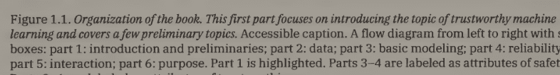

图1.1. 本书的组织结构。第一部分侧重于介绍可信机器学习的主题，并涵盖一些预备主题。无障碍说明。从左到右的流程图，包含六个方框：第1部分：引言与预备知识；第2部分：数据；第3部分：基础建模；第4部分：可靠性；第5部分：交互；第6部分：目标。第1部分被突出显示。第3–4部分被标注为安全属性。第3–6部分被标注为可信属性。

第2部分讨论数据，这是进行机器学习的先决条件。除了简要概述不同的数据模态和来源外，该部分还涉及与可信机器学习相关的三个主题：偏差、同意和隐私。

第3部分涉及可信机器学习的第一个属性：基本性能。它描述了最优检测理论和监督式机器学习的不同形式。它教授了几种不同的学习算法，如判别分析、朴素贝叶斯、`k`近邻、决策树与随机森林、逻辑回归、支持向量机和神经网络。该部分以因果发现和因果推断的方法作结。

¹⁸卡尼曼和特沃斯基描述了大脑形成思维的两种方式，他们称之为“系统1”和“系统2”。系统1是快速的、自动的、情绪化的、刻板的和无意识的。系统2是缓慢的、费力的、逻辑的、计算的和有意识的。请在思考过程中调动“系统2”的部分，并在开发可信机器学习系统时保持审慎。

第4部分讨论可信机器学习的第二个属性：可靠性。这一属性通过三个具体主题来讨论：分布偏移、公平性和对抗鲁棒性。这些主题的描述不仅定义了问题，还提供了检测和缓解问题的解决方案。

第5部分讨论第三个属性：人类与机器学习系统的双向交互——理解系统和向其下达指令。该部分从模型的可解释性和可说明性开始，进而介绍测试和记录机器学习算法各方面的方法，这些方面可以通过事实表等方式透明地报告。该部分的最后一个主题是机器如何引导人和社会的政策与价值观来约束其行为。

第6部分讨论第四个属性：人和社会的这些价值观可能是什么。它首先介绍了不同团体为其机器学习范式所制定的伦理原则。接下来，它讨论了拥有多样化生活经验的机器学习系统创造者的加入如何拓宽机器学习的价值观、目标和应用，在某些情况下通过该技术追求社会公益。最后，它展示了信息推荐平台中主流的机器学习范式如何导致过滤气泡和虚假信息，并提出了替代方案。关于平台的最后一章以可信机构为框架，这些机构具有与可信赖的个人或单个可信机器学习系统不同的属性。

## 1.3 局限性

机器学习是一个日益庞大的研究领域，需要多卷著作才能充分描述。机器学习中的信任要素如今也变得相当庞杂。为了使本书对我和你都易于把握，它在深度和主题覆盖范围上有所限制。本书的部分内容既适用于不涉及机器学习的更简单数据分析范式，也适用于显式编程的基于计算机的决策支持系统，但为了清晰和聚焦，这些情况不会单独指出。

重要的是，尽管可信机器学习是一个技术与社会的交叉话题，但本书的重点严重偏向技术定义和方法。我认识到，哲学、法律、政治、社会学、心理学和经济学的视角，对于理解、分析和影响机器学习在社会中的作用，可能比技术视角更为重要。然而，这些主题不在本书的范围内。人机交互领域的见解也与可信机器学习极为相关；我在本书的多个地方（尤其是第5部分）对此进行了有限的讨论。

在机器学习内部，我侧重于监督学习，而对无监督学习和强化学习着墨较少。不过，我确实涵盖了概率和因果关系的图形表示及其推断。在监督学习中，主要焦点是标签为类别的分类问题。回归、序数回归、排序、异常检测、推荐、生存分析以及其他没有类别标签的问题不是重点。对各种分类算法的描述深度有限，侧重于高层概念，而不是更详细的说明或使用这些算法的工程技巧。

### 1.4.1 能力与可信度


我完成了电气工程与计算机科学的博士学位，毕业于麻省理工学院（MIT）。我的博士论文包括一种新型监督式机器学习方法，以及一个能够定量预测种族偏见的人类决策理论模型。自2010年以来，我一直是IBM研究院——托马斯·J·沃森研究中心的研究员工，从事统计信号处理、数据挖掘和机器学习的研究。研究成果已发表于各类享有盛誉的工作坊、会议、期刊和杂志，包括ICML、神经信息处理系统会议（NeurIPS）、国际学习表征会议（ICLR）、ACM知识发现与数据挖掘会议（KDD）、AAAI/ACM人工智能、伦理与社会会议（AIES）、机器学习研究杂志（JMLR）、IEEE信号处理汇刊、IEEE信息论汇刊以及IEEE会刊。我在IBM研究院定义了可信机器学习战略的很大一部分，我自己的工作很大一部分也集中在机器学习和人工智能中的可解释性、安全、公平、透明、价值对齐和社会公益。

我在与IBM业务部门、IBM的各类客户以及社会变革组织合作的过程中，开发了已部署于机器学习和数据科学高风险应用中的现实解决方案。我领导团队开发了名为`AI Fairness 360`、`AI Explainability 360`和`Uncertainty Quantification 360`的综合性开源工具包和资源，并将其中部分能力过渡到`IBM Watson Studio`产品中。我曾在各类行业导向的聚会和大会上演讲，例如`O'Reilly人工智能大会`、`开放数据科学大会`和`IBM Think`。

我曾担任纽约大学（NYU）的兼职教员，并在康奈尔大学、乔治城大学、纽约大学、普林斯顿大学、罗格斯大学和雪城大学的课程中担任客座讲师。我自2016年至2020年每年在`ICML`组织人类可解释性机器学习研讨会，以及与可信机器学习相关的其他多个研讨会和专题研讨会。我担任2020年`ACM公平、问责与透明度会议`实践与经验轨道的主席，并是`人工智能合作伙伴关系安全关键人工智能专家组`的成员。

为了撰写本书，我将所有这些过往经历以及由此带来的与学生、终身学习者和同事的互动都融入其中。当然，我对某些章节主题的知识深度不如其他章节，但对所有主题都具备一定程度的实践/应用和理论知识。

### 1.4.2 可靠性与偏见

可靠性源于在不同情境和条件下工作的能力。我只供职于一家雇主，这限制了这种能力。尽管如此，通过在`IBM研究院`的工作以及与`DataKind`（一个帮助专业数据科学家与社会变革组织开展项目的组织）志愿服务，我的应用型数据科学工作已与各类营利性公司、社会企业和非营利组织就人力资源与劳动力分析、卫生系统与政策、临床医疗、人道主义响应、国际发展、金融包容和慈善决策等问题展开合作。此外，我的研究成果不仅发表在机器学习研究领域，也发表在统计学、运筹学、信号处理、信息论和信息系统领域，以及我之前提到的行业导向领域。

更重要的是对可信机器学习而言，我想提及我的特权和个人偏见。我出生并成长于1980年代和1990年代，居住在雪城上州纽约州一个中等规模城市的上层中产阶级 predominantly 白人郊区，该市位于奥农达加人传统土地上，是美国种族隔离最严重的城市之一。我在三个月或更长时间居住过的其他地方包括纽约州的伊萨卡、埃尔姆斯福德、奥辛宁和查帕夸；马萨诸塞州的伯灵顿和剑桥；加利福尼亚州利弗莫尔；印度北部的勒杜安那、新德里和阿里格尔；菲律宾马尼拉；法国巴黎；以及肯尼亚内罗毕。我是一名顺性别男性，南亚裔的第二代美国人。在很大程度上，我信奉并遵循达摩宗教实践和哲学。我的曾曾祖父是1905年第一位在`MIT`学习的印度人。我的父亲和他的父母有时过着捉襟见肘的生活，尽管他们享有其前行种姓群体的社会资本。我的双胞胎兄弟、父亲和两位祖父都是或曾是电气工程教授。我的母亲是公立学校教师。我在享有特权的公立学校接受了小学和中学教育，并在常春藤盟校接受了本科教育。我的雇主`IBM`是一家强大而有影响力的公司。因此，我在理解学术和职业成功的路径以及拥有支持性社交网络方面享有高度特权。然而，我一生中一直是政治权力有限的少数群体成员。我对困境有一定程度的了解，超越了表面层次，但这些经历都不是*亲身经历*，即我若想离开就有机会离开。

### 1.4.3 互动

我以一定程度的透明度撰写本书。在2020年初撰写前几章时，任何人都可以通过`Overleaf`（`https://v2.overleaf.com/read/bzbzvgmkgkzd`）查看。在我与`Manning Publications`签署图书合同后，随着写作的进行，章节被发布到`Manning Early Access Program`，读者可通过`Manning liveBook`讨论论坛参与互动。在2021年9月我与出版商分道扬镳后，我将进行中的手稿章节发布到`http://www.trustworthymachinelearning.com`。在起草过程中，我通过电子邮件（`krvarshn@us.ibm.com`）、`Twitter`私信（`@krvarshney`）、电话（`+1-914-945-1628`）和个人会面收到了来自多位个人的有用评论。当我在2021年12月底完成本书0.9版时，我将其发布在同一网站。2022年1月28日，我召集了五位与我生活经历不同的人组成小组，使用改良的`Diverse Voices`方法²¹，对0.9版的内容提供他们的观点。本版电子书将继续免费在同一网站提供：`http://www.trustworthymachinelearning.com`。

²¹ Lassana Magassa、Meg Young和Batya Friedman。“`Diverse Voices: A How-To Guide for Facilitating Inclusiveness in Tech Policy`。” 华盛顿大学科技政策实验室。2017年。提供公正意见的与会者为`Mashehal Alzaid`、`Kenya Andrews`、`Noah Chasek-Macfoy`、`Scott Fancher`和`Timothy Odonga`。作为`Diverse Voices`方法的一个核心部分，他们被提供酬金，其中一些人拒绝了。这些资金来自我因参加2022年1月由`Data Nutrition Project`召集的人工智能文档峰会而获得的酬金。

### 1.4.4 动机与价值观

我的动机始于家庭价值观。我上面提到的曾曾祖父带着从`MIT`获得的工业规模玻璃制造知识回到印度，通过建立一家服务于印度`swaraj`、自治理念和当地工人培训的工厂产生了社会影响。我的祖父之一将系统与控制理论的知识应用于农业问题，也通过非技术手段在印度为社会正义而努力。我的另一位祖父加入联合国教科文组织，在发展中的伊拉克和泰国建立工程学院。我的母亲在市内学校区为在常规初中和高中因携带武器被抓的学生开设的特殊项目教授科学。

同样地，符合家庭价值观以及外在伦理（`yama`）²²、内在伦理（`niyama`）²³和美国梦精神，我的个人动机是推进当今最具社会影响力的技术（机器学习），减轻其危害性，将其应用于提升人类，并训练他人做同样的事。我于2015–2016年共同创立了`IBM Science for Social Good`研究员项目，并将其导向这些目标。

我撰写本书的原因是多方面的。首先，我认为尽管本书涵盖的许多主题，如公平、可解释性、鲁棒性和透明度经常被一起讨论，但没有来源能将它们以连贯的线索统一起来。有了这本书，技术人员、开发者和研究人员就可以从中学习。其次，我认为在行业实践中，深度学习的无节制成功导致工程师过于强调挤出一点点更高的准确率，却缺乏概念性理解，也对准确率之外的考量缺乏重视（信任的另外三个属性）。本书的目的是为希望这样做的从业者填补概念性理解的空白，尤其是那些从事高风险应用领域的人。（`Cai`和`Guo`发现许多软件工程师根本希望获得关于理解和应用机器学习概念基础的指导。）²⁴ 将预测准确率之外的考量纳入其中不能是事后想法；它必须从任何新项目的开始就成为计划的一部分。第三，我希望赋能与我价值观和伦理相同的人，追求一种研究与开发良性循环的未来，在其中技术帮助社会繁荣，社会也帮助技术繁荣。

## 1.5 摘要

- 机器学习系统正在影响对我们日常生活产生后果的关键决策，但社会对其缺乏信任。

- 可信度由四个属性组成：能力、可靠性、开放性和无私性。

- 本书的组织方式与信任的四个组成部分的这一分解相匹配。

- 尽管存在我的局限性和内容的局限性，本书仍致力于在概念上不仅理解机器学习系统如何实现这些目标以变得更值得信赖背后的原则和理论，还致力于开发在实践中追求这些目标的算法和非算法方法。

- 到本书结束时，你的思维过程应自然倾向于在你开发的机器学习解决方案的整个生命周期中纳入可信性要素。

# 2 机器学习生命周期

想象一下，你是 `m-Udhār Solar` 创新团队的项目经理，`m-Udhār Solar` 是一家虚构的向贫困农村地区提供按需付费太阳能的公司，目前难以应对日益增长的申请量。该公司正准备从在少数试点区安装太阳能板扩展到全州所有地区，但前提是它必须在贷款官人数不变的情况下，将每日的贷款决策处理量提高 25 倍。你认为机器学习也许能够提供帮助。

这是一个需要用机器学习解决的问题吗？你将如何开始该项目？你会遵循哪些步骤？执行这些步骤会涉及哪些角色？你需要赢得哪些利益相关者的认可？重要的是，你需要做什么来确保系统是*值得信赖的*？让机器学习系统变得值得信赖不应是事后考虑或附加项，而应从一开始就纳入计划。

端到端的开发过程或生命周期涉及以下几个步骤：

1. `problem specification`,

2. `data understanding`,

3. `data preparation`,

4. `modeling`,

5. `evaluation`, and

6. `deployment and monitoring`.

狭义的定义仅将建模步骤视为机器学习的范畴。它们认为其他步骤属于数据科学和工程的更广阔范畴。大多数关于机器学习的书籍和研究也同样聚焦于建模阶段。然而，如果不关注生命周期的各个部分，就无法真正执行值得信赖的机器学习系统的开发和部署。没有捷径。本章概述了总体规划。

## 2.1 机器学习生命周期的心智模型

上面给出的机器学习生命周期的六个步骤，也在图 2.1 中进行了说明，被编纂于跨行业数据挖掘标准流程 `CRISP-DM` 方法论中。这是应牢记的心智模型，说明机器学习系统应如何开发和部署。尽管流程在很大程度上按顺序依次进行，但有多个机会可以返回并重做早期步骤。这一描述是理想化的；即使是现实世界生命周期的良好示例也更混乱，但主要思想仍然成立。

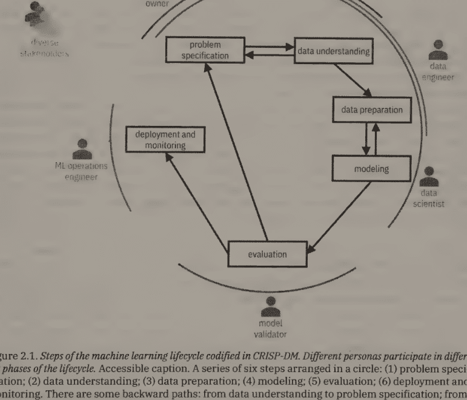

图 2.1. 被编纂于 `CRISP-DM` 中的机器学习生命周期步骤。不同的角色参与生命周期的不同阶段。可访问说明。六个步骤按圆排列：（1）问题规范；（2）数据理解；（3）数据准备；（4）建模；（5）评估；（6）部署和监控。存在一些向后路径：从数据理解到问题规范；从建模到数据准备；从评估到问题规范。五个角色与不同步骤相关联：问题拥有者在步骤 1–2；数据工程师在步骤 2–3；数据科学家在步骤 1–4；模型验证者在步骤 5；ML 运维工程师在步骤 6。多元利益相关者角色在侧面监督所有步骤。

由于建模阶段常常被置于神坛，拟定项目计划时很容易使用洋葱的类比：从核心建模开始，逐步扩展到数据理解/准备和评估，然后进一步扩展到问题规范和部署/监控。例如，对于电信系统来说，这一类比在教学上以及技术开发方式上都适用，[^1]但对于值得信赖的机器学习系统来说，顺序流程更为合适。始终从理解用例和规范问题开始。

> “人们参与人工智能生命周期的每个阶段，决定解决哪个问题、使用哪些数据、优化什么等。”

>

> —Jenn Wortman Vaughan，微软研究科学家

不同的步骤由不同的人员以不同角色执行，包括问题拥有者、数据工程师、数据科学家、模型验证者以及机器学习 `ML` 运维工程师。问题拥有者主要参与问题规范和数据理解。数据工程师负责数据理解和数据准备。数据科学家往往在前四个步骤中都发挥作用。模型验证者执行评估。`ML` 运维工程师负责部署和监控。

在可信性背景下，另外重要的角色是系统的潜在受托人：由机器学习模型支持的人类决策者 `m-Udhār` 贷款官、决策所针对的影响方 农村申请人；他们可能是边缘化群体成员、监管者和政策制定者，以及公众。每个利益相关者都有不同的需求、关切、愿望和价值观。系统必须满足这些需求并与这些价值观保持一致才可信。多利益相关者参与至关重要，不能与设计和开发的技术方面脱钩。记录并透明报告生命周期的不同步骤有助于在利益相关者之间建立信任。

## 2.2 问题规范

开始开发机器学习系统时的第一步是定义问题。问题拥有者希望实现什么以及为什么？`m-Udhār Solar` 的董事希望自动化一项对人员来说繁琐且昂贵的任务。在其他场景中，问题拥有者可能希望增强人类决策者的能力以提高其决策质量。他们可能有其他目标。在某些情况下，问题根本就不应被解决，因为这样做可能会导致或加剧社会危害并违反伦理行为界限。[^2] 危害是指对个人生活产生严重不良影响的结果。危害的这一定义在第 3 章中会更精确。让我们重申这一重要观点：不要解决会导致某人或某群体受害的问题。

[^1]: C. Richard Johnson, Jr. and William A. Sethares. *Telecommunication Breakdown: Concepts of Communication Transmitted via Software-Defined Radio.* Upper Saddle River, New Jersey, USA: Prentice Hall, 2003.

[^2]: Andrew D. Selbst, danah boyd, Sorelle A. Friedler, Suresh Venkatasubramanian, and Janet Vertesi. “`Fairness and Abstraction in Sociotechnical Systems`.” In: *Proceedings of the ACM Conference on Fairness, Accountability, and Transparency.* Barcelona, Spain, Jan. 2020, pp. 59–68.

## 2.3 数据理解

一旦问题被识别并规范化，就必须收集相关数据集。在问题旨在自动化现有决策流程的情况下，识别相关数据集相对直接。`m-Udhār` 的数据集由贷款官过去用于决策的属性和其他输入以及他们的决策组成。输入构成特征，历史决策构成监督机器学习任务的标签。但贷款官未使用的数据也可能被机器学习系统利用。所谓的“大数据”的承诺在于包含大量属性集，其中许多与标签弱相关，这会压倒人但不会压倒机器。为了使机器学习系统做出比人更好的决策，理想情况下标签应为真实结果而非决策，例如申请人未来是否违约而非批准决策。

机器学习也可应用于组织的新流程用例，且不存在确切的历史数据。在此，必须识别代理数据。例如，医疗系统可能希望主动为不适个体提供家庭护理，但可能没有直接适用于理解该决策的数据。患者与医疗系统的先前互动数据可作为代理。在其他情况下，可能需要收集新数据。在另一些情况下，可能相关数据既不存在也无法收集，问题必须以不同方式规范。

一旦数据集被识别或收集，数据科学家和数据工程师必须通过咨询问题拥有者和其他领域专家以及在存在时咨询数据字典 一份描述特征的文档 来理解各种特征及其值的语义。他们还应进行探索性数据分析和可视化。这种理解有助于识别数据中的问题，例如泄漏、特征中用于预测标签的信息在部署系统的新输入中将不可用，以及各种形式的偏差。一种重要偏差是社会偏差，其中标签的代理不能很好地反映感兴趣的真实标签。例如，如果由于社会经济原因某些人在相同疾病水平下就诊次数更多，使用过去就诊次数可能不是衡量个人病情的好代理。类似的社会偏差源于偏见：历史人类决策的标签在各群体间存在系统性差异。其他重要偏差包括群体偏差：数据集低估某些输入并高估其他输入，以及时间偏差：数据收集时间带来的问题。

数据理解阶段还要求开发团队考虑数据使用问题。仅仅因为特征可用 并且可能甚至提高模型的性能，并不意味着它们可以并且应该被使用。某些特征的使用可能被法律禁止、不道德或可能没有适当的同意。例如，`m-Udhār Solar` 可能拥有申请人的姓氏，该姓氏表明申请人的种姓和宗教，甚至可能帮助模型实现更好的性能，但使用它是不道德的。其他特征的使用可能带来隐私风险。对数据相关问题的更详细论述见本书第 2 部分。

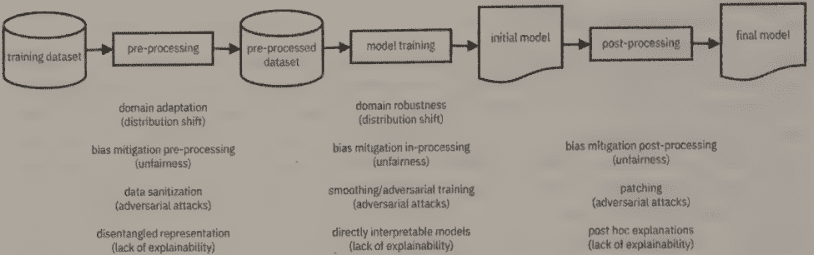

Figure 2.2. *可信机器学习建模的主要部分。分布偏移、不公平性、对抗攻击以及缺乏可解释性都可以通过下面每个部分列出的各种技术来缓解。这些方法的细节将在本书的其余部分介绍。* 可访问说明。 一个以训练数据集作为输入的块图，输入到预处理块，输出为预处理后的数据集。预处理后的数据集输入到模型训练块，输出为初始模型。初始模型输入到后处理块，输出为最终模型。以下技术是预处理的示例：领域适应（分布偏移）；偏差缓解预处理（不公平性）；数据清理（对抗攻击）；解耦表示（缺乏可解释性）。以下技术是模型训练的示例：领域鲁棒性（分布偏移）；偏差缓解内处理（不公平性）；平滑/对抗训练（对抗攻击）；直接可解释模型（缺乏可解释性）。以下技术是后处理的示例：偏差缓解后处理（不公平性）；修补（对抗攻击）；事后解释（缺乏可解释性）。

与数据准备不同，数据*预处理*旨在改变数据集的统计特性或属性以实现特定目标。*领域适应*克服了对变化环境缺乏鲁棒性的问题，包括时间偏差。*偏差缓解预处理*改变数据集以克服社会偏差和群体偏差。*数据清理*旨在清除恶意行为者进行的数据投毒攻击的痕迹。学习*解耦表示*克服了特征缺乏人类可解释性的问题。所有这些都应根据问题规范的要求执行。

建模步骤的主要任务是使用一种算法来发现训练数据集中的模式并从中泛化，以拟合一个模型，使其能够以良好的性能为新的未见数据点预测标签。（术语*预测*并不一定意味着对未来的预测，而只是指为未知值提供一个猜测。）用于拟合模型的算法有很多，每种算法都有不同的*归纳偏置*或用于泛化的假设集合。许多机器学习算法明确最小化在生命周期的问题规范步骤中确定的目标函数。一些算法最小化对指定目标的近似，以使数学优化更容易。这种常见的机器学习方法被称为*风险最小化*。


机器学习的“没有免费午餐定理”指出，对于所有问题和数据集来说，并不存在一种最好的机器学习算法。⁵ 哪一种效果最好取决于数据集的特征。数据科学家会尝试几种不同的方法，调整其参数，并查看哪一种在经验上表现最好。经验比较是通过随机将训练数据集拆分为用于拟合模型的训练分区和用于验证模型性能的测试分区来进行的。划分和验证可以只做一次，也可以多次进行。当多次进行时，该过程称为交叉验证；它是有用的，因为它表征了结果的稳定性。交叉验证应针对样本数量较少的数据集进行。

⁵David H. Wolpert. “The Lack of A Priori Distinctions Between Learning Algorithms.” In: *Neural Computation* 8.7 (Oct. 1996), pp. 1341–1390.

基本机器学习算法可以通过多种方式进行增强，以满足问题规范中捕获的额外目标和约束。提高跨操作条件可靠性的一个方法被称为领域鲁棒性。减少不需要偏差的机器学习算法被称为偏差缓解内处理。用于防御数据投毒攻击的方法的一个示例类别被称为平滑。针对另一种对抗攻击——规避攻击的防御是对抗训练。某些机器学习算法生成的模型形式简单，因此可以直接被人们解释和理解。再次强调，所有这些增强都应根据问题规范进行。

后处理规则会更改样本的预测标签或计算额外的信息以伴随预测标签。后处理方法可以分为两个高层类别：开箱和闭箱。开箱方法利用模型的信息，例如其参数及其参数的函数。闭箱方法只能看到给定输入产生的输出预测。如果可能，应使用开箱方法，例如当系统中的模型训练和后处理紧密集成时。在某些情况下，出于后勤或安全原因，后处理方法（也称为事后方法）与模型隔离。在这些情况下，只有闭箱方法才是可行的。为提高可靠性、缓解不需要的偏差、防御对抗攻击和生成解释而使用的后处理技术应谨慎使用，以实现问题所有者的目标。例如，事后解释对于提供给 `m-Udhār Solar` 的贷款官员很重要，以便他们能更好地与申请人讨论该决定。

某些用例的规范要求因果建模：从训练数据中找出可泛化的因果关系实例，而不仅仅是相关模式。这些是输入干预旨在改变结果的问题。例如，在指导员工取得成功时，仅识别加班与晋升具有预测性这一模式是不够的。好的建议代表因果关系：如果员工开始加班，那么他们可以预期获得晋升。可能存在一个共同原因（例如尽责性）既导致高质量工作又导致加班，但只有高质量工作才会导致晋升。在工作质量差的同时长时间工作不会带来晋升；因果建模会显示这一点。

## 2.6 评估

一旦 `m-Udhār` 的数据科学家拥有一个经过训练和测试的模型，他们认为该模型最能满足问题所有者的要求，他们就会将其交给模型验证员。模型验证员会对模型进行进一步的独立测试和评估，通常使用数据科学家无法访问的完全独立的保留数据集。重要的是保留集不得有任何泄漏来自

# 3 安全

想象一下，你是（虚构的）点对点借贷机构 `ThriveGuild` 的一名数据科学家。你正处于机器学习生命周期中用于评估和批准借款人的系统的规范阶段。问题所有者、不同的利益相关者以及你自己都希望该系统值得信赖且不会对人们造成伤害。每个人都希望它是安全的。但在机器学习系统的背景下，什么是伤害，什么是安全？

安全可以以非常特定于领域的方式定义，例如安全的玩具没有含铅油漆或可能造成窒息危险的小零件，安全的社区暴力犯罪率低，安全的道路具有最大曲率。但这些定义对于帮助定义机器学习的安全性并不是特别有用。是否存在一个更基础的安全定义可以扩展到机器学习背景下？是的，基于以下概念：（1）伤害，（2）偶然不确定性和风险，以及（3）认知不确定性。¹（这些术语在下一节中定义。）

本章教你如何从安全角度处理可信机器学习系统的问题规范阶段。具体来说，通过将安全定义为最小化两种不同类型的不确定性，你可以与问题所有者合作，清晰地指定安全要求和目标，然后在生命周期的后期部分朝着这些目标努力。² 本章涵盖：

- 从适用于机器学习的更基本概念构建安全概念：伤害、偶然不确定性和认知不确定性。

- 绘制如何区分两种不确定性的图示，并阐述如何使用概率论和可能性论对其进行量化。

- 以不确定性的汇总统计量形式指定问题要求。

¹Niklas Möller and Sven Ove Hansson. “Principles of Engineering Safety: Risk and Uncertainty Reduction.” In: Reliability Engineering and System Safety 93.6 (Jun. 2008), pp. 798–805.

²Kush R. Varshney and Homa Alemzadeh. “On the Safety of Machine Learning: Cyber-Physical Systems, Decision Sciences, and Data Products.” In: Big Data 5.3 (Sep. 2017), pp. 246–255.

- 根据新信息描绘如何更新概率。

- 应用不确定性的概念来理解不同属性之间的关系，并弄清什么与什么相互独立。

## 3.1 把握安全

*安全是与危害相关的偶然性不确定性（或风险）和认识论不确定性的降低。*

首先，让我们谈谈危害。所有系统，包括你为 `ThriveGuild` 开发的贷款系统，其结果都基于其状态和收到的输入。在你的案例中，输入是申请人的信息，结果是批准或拒绝贷款的决定。从 `ThriveGuild` 的角度来看（如果我们对申请人真正诚实的话，从申请人的角度来看也是如此），理想的结果是批准能够偿还贷款的申请人并拒绝无法偿还贷款的申请人。不理想的结果则相反。结果具有相关的成本，可能以货币或其他形式体现。某个 `undesired` 结果如果其成本超过某个阈值，则为 *harm*。轻微的不想要的结果，例如得到一个糟糕的电影推荐，并不被计为危害。

与危害是成本超过某个阈值的不想要的结果相同，信任只会在风险超过某个阈值的情况下才发展。³ 回顾第 1 章，信任方必须对受托方脆弱，信任才能发展，而如果风险不够高，信任方就不会变得脆弱。因此，安全关键型应用不仅是机器学习系统信任最相关和最重要的应用，也是信任实际上可以建立起来的应用。

现在，让我们谈谈偶然性和认识论不确定性，从一般的不确定性开始。不确定性是当前知识的状态，其中某些事物是未知的。`ThriveGuild` 不知道借款人是否会违约。所有机器学习的应用都存在某种形式的不确定性。有两种主要的不确定性类型：*aleatoric uncertainty* 和 *epistemic uncertainty*。⁴

偶然性不确定性，也称为统计不确定性，是结果中固有的随机性或随机波动，无法进一步减少。偶然性不确定性源自掷骰子游戏，用来表示诸如剧烈抛掷的硬币和剧烈掷出的骰子、热噪声和量子力学效应等现象。`ThriveGuild` 贷款申请人未来可能遭遇的事件，例如其房屋屋顶被冰雹损坏，可能受偶然性不确定性的影响。*Risk* 是在偶然性不确定性下的平均结果。

另一方面，认识论不确定性，也称为系统性不确定性，是指在实践中未知但原则上可以知道的知识。获取这种知识将

降低认识论不确定性。通过进行就业核查，可以降低 `ThriveGuild` 对申请人贷款价值的认识论不确定性。

> “不知道互斥事件的概率和知道概率相等是两种截然不同的知识状态。”
>
> —Ronald A. Fisher, statistician and geneticist

而偶然性不确定性是固有的，认识论不确定性取决于观察者。所有观察者是否具有相同的不确定性？如果是，你处理的是偶然性不确定性。如果有些观察者不确定性更大，有些观察者不确定性更小，那么你处理的就是认识论不确定性。

这两种不确定性以不同的方式量化。偶然性不确定性使用概率量化，而认识论不确定性使用可能性量化。你可能以前学过概率论，但可能性理论对你来说可能是新的。我们将在下一节深入细节。换句话说重复安全定义：安全是预期危害概率的降低和意外危害可能性的降低。可信机器学习的任务规范需要包括这两个部分，而不仅仅是第一部分。

偶然性不确定性的降低与可信性的第一个属性（基础性能）相关。认识论不确定性的降低与可信性的第二个属性（可靠性）相关。两种不确定性类型的特征总结见表 3.1。在开发机器学习模型时，不要走只关注偶然性不确定性的捷径；也要关注认识论不确定性。

表 3.1. 两种不确定性的特征。

| 类型 | 定义 | 来源 | 量化 | 可信性属性 |

|---|---|---|---|---|

| aleatoric | 随机性 | 内在的 | 概率 | 基础性能 |

| epistemic | 知识缺乏 | 观察者依赖 | 可能性 | 可靠性 |

## 3.2 用不同类型的不确定性量化安全

在机器学习生命周期的任务规范阶段，你的目标是与 `ThriveGuild` 的问题负责人合作，为你正在开发的系统设定定量要求。然后在生命周期的后期部分，你可以开发模型以满足这些要求。因此你需要对安全进行量化，从而对结果的成本（它们是危害还是不是）、偶然性不确定性和认识论不确定性进行量化。对这些事物的量化需要引入几个概念，包括：样本空间、结果、事件、概率、随机变量和可能性。

### 3.2.1 样本空间、结果、事件及其成本

第一个概念是样本空间，表示为集合 `Ω`，它包含所有可能的结果。`ThriveGuild` 的贷款决策的样本空间为 `Ω = {approve, deny}`。申请人特征之一，就业状态的样本空间为 `Ω = {employed, unemployed, other}`。

为了对样本空间和安全进行量化，集合的基数或大小是其包含的元素数量，用双竖线 `||·||` 表示。有限集合包含自然数个元素。例如集合 `{12,44,82}` 包含三个元素，所以 `||{12,44,82}|| = 3`。无限集合包含无限多个元素。可数无限集合虽然无限，但包含可以开始计数的元素，通过称第一个元素为‘一’，第二个元素为‘二’，第三个元素为‘三’，如此无限无止境地继续下去。例如整数集合。离散值来自有限集合或可数无限集合。不计数的无限集合密集到你甚至无法计数其元素。例如实数集合。想象一下计数 2 和 3 之间的所有实数——你永远无法枚举它们全部。连续值来自不计数的无限集合。

事件是结果的集合（样本空间 `Ω` 的子集）。例如，一个事件是结果集合 `{employed, unemployed}`。另一个事件是结果集合 `{employed, other}`。包含单个结果的集合也是一个事件。你可以为结果或事件分配成本。有时这些成本很明显，因为它们与以货币等单位衡量的其他定量损失或收益相关。其他时候，它们更主观：你如何真正量化生命损失的成本？获取这些成本非常困难，因为它要求人们和社会以数字形式提供其价值判断。有时，相对成本而非绝对成本就足够了。再次，只有成本足够高的不想要的结果或事件才被视为危害。

### 3.2.2 偶然性不确定性与概率

偶然性不确定性使用事件 `A` 发生的可能性数值的评估来量化，称为概率 `P(A)`。它是事件 `A` 的基数与样本空间 `Ω` 的基数的比率。

`P(A) = ||A|| / ||Ω||`

公式 3.1

概率函数的性质为：

- 1. `P(A) ≥ 0,`

- 2. `P(Ω) = 1,` 且

- 3. 如果 `A` 和 `B` 是不相交事件（它们没有共同的结果；`A ∩ B = ∅`），则 `P(A ∪ B) = P(A) + P(B)`。

³ Alon Jacovi, Ana Marasović, Tim Miller, and Yoav Goldberg. “Formalizing Trust in Artificial Intelligence: Prerequisites, Causes and Goals of Human Trust in AI.” In: *Proceedings of the ACM Conference on Fairness, Accountability, and Transparency*. Mar. 2021, pp. 624–635.

⁴ Eyke Hüllermeier and Willem Waegeman. “Aleatoric and Epistemic Uncertainty in Machine Learning: An Introduction to Concepts and Methods.” In: *Machine Learning* 110.3 (Mar. 2021), pp. 457–506.

这三个性质非常直观，它们只是将我们通常所说的概率进行了形式化。一个事件的概率是一个介于0和1之间的数字。只要两个事件不包含任何相同的结果，一个事件或另一个事件发生的概率就是它们各自概率之和。

*概率质量函数*（pmf）使得描述离散样本空间中的概率更加容易。它是一个函数`p`，以结果`ω`为输入，并为这些结果返回概率。样本空间中所有结果的pmf之和为1，`∑_{ω∈Ω} p(ω) = 1`，这是满足概率的第二个性质所需要的。

一个事件的概率是其组成结果的pmf值之和。例如，如果就业状态的pmf为`p(受雇)=0.60`，`p(失业)=0.05`，`p(其他)=0.35`，那么事件{受雇, 其他}的概率为`P({受雇, 其他})=0.60+0.35=0.95`。这种将pmf值相加得到总概率的方式之所以有效，是因为概率的第三个性质。

*随机变量*在指定机器学习问题的安全需求时是一个非常有用的概念。当随机变量`X`被测量或观察时，它会取一个特定的数值`x`；该数值是随机的。`X`的所有可能值的集合是`X`。随机变量`X`的概率函数记为`P_X`。随机变量可以是离散的或连续的。它们还可以通过将结果值映射到一个有限的数字集合来表示分类结果，例如将{受雇, 失业, 其他}映射到{0, 1, 2}。离散随机变量的pmf写作`p_X(x)`。

对于不可数无限样本空间，pmf并不完全适用。因此，使用*累积分布函数*（cdf）来代替。它是连续随机变量`X`取小于或等于某个样本点`x`的值的概率，即`F_X(x) = P(X ≤ x)`。另一种表示是*概率密度函数*（pdf）`p_X(x) = d/dx F_X(x)`，它是cdf对`x`的导数。pdf的值不是概率，但将pdf在一个集合上积分会得到概率。

为了更好地理解cdf和pdf，让我们看看你将在机器学习借贷模型中使用的`ThriveGuild`功能之一：申请人的收入。收入是一个连续随机变量，其cdf可能为：

```
F_X(x)=
{ 1-e^{-0.5x}, & x≥ 0
{ 0,           & 否则
```

方程 3.2

图3.1展示了该分布的形状以及如何从中计算概率。它显示申请人的收入小于或等于2（以万美元为单位）的概率是`1-e^{-0.5·2}=1-e^{-1}≈0.63`。大多数借款人往往收入低于2。pdf是cdf的导数。

这里的'marginalize'与社会边缘化有关，这种社会边缘化使个人和群体因被视为无足轻重而变得无力。

`ThriveGuild`模型中的就业状态特征和贷款批准标签是具有联合pmf的随机变量。例如，这个多元函数可以表示为`p(受雇, 批准) = 0.20`, `p(受雇, 拒绝) = 0.40`, `p(失业, 批准) = 0.01`, `p(失业, 拒绝) = 0.04`, `p(其他, 批准) = 0.10`, `p(其他, 拒绝) = 0.25`。该函数在图3.2中可视化为一个概率值表。从该联合pmf中对贷款批准求和，即可恢复前面给出的就业状态边缘pmf。对就业状态求和，则可得到贷款批准的边缘pmf为`p(批准) = 0.31`和`p(拒绝) = 0.69`。

### 就业状态与贷款批准的联合pmf

|  | 受雇 | 失业 | 其他 |

|---|---|---|---|

| 批准 | 0.20 | 0.01 | 0.10 |

| 拒绝 | 0.40 | 0.04 | 0.25 |

### 就业状态的边缘pmf

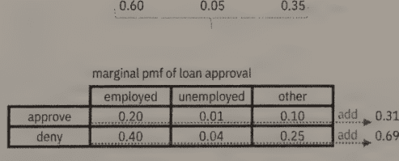

### 贷款批准的边缘pmf

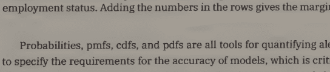

图3.2. 通过对其中一个随机变量求和来边缘化联合分布的示例。无障碍说明。联合pmf的表格以就业状态为列，以贷款批准为行。表格项是概率。将列中的数字相加得到就业状态的边缘pmf。将行中的数字相加得到贷款批准的边缘pmf。

概率、pmf、cdf和pdf都是量化偶然不确定性的工具。它们用于指定模型准确性的要求，这对安全性的两个部分中的第一部分——风险最小化——至关重要。一个正确的预测是一个事件，该事件的概率就是准确性。例如，与问题所有者合作时，你可以指定`ThriveGuild`借贷模型必须至少具有0.92的正确概率。机器学习模型的准确性以及其他类似的基本性能度量是本书第3部分第6章的主题。

## 3.3 不确定性的汇总统计

完整的概率分布非常适合开始进行问题规范，但处理起来可能很笨拙。使用概率分布和随机变量的汇总统计量来设置问题规范更容易。

### 3.3.1 期望值和方差

最常见的统计量是随机变量的期望值。它是其分布的均值：一个典型值或长期平均结果。它的计算方式是pdf乘以随机变量的积分：

```
E[X] = ∫_{-∞}^{∞} x p_X(x) dx.
```

方程 3.4

回想前面的例子，`ThriveGuild`借款人的收入pdf为`0.5e^{-0.5x}`（`x ≥ 0`），其他地方为零。因此，收入的期望值为 `∫_0^∞ x0.5e^{-0.5x} dx = 2`。当你从`X`的概率分布中抽取一组样本，记为`{x_1, x_2, ..., x_n}`时，可以计算期望值的经验版本，即样本均值，为 `x̄ = 1/n Σ_{i=1}^n x_i`。你不仅可以计算随机变量本身的期望值，还可以计算随机变量的任意函数的期望值。它就是pdf乘以该函数的积分。通过性能的期望值（也称为风险），你可以指定系统平均行为处于特定范围内，以达到安全的目的。


你应为ThriveGuild申请人计划多大的收入波动性？一个重要的期望值是方差`E[(X − E[X])^2]`，它度量分布的离散程度，有助于回答这个问题。其样本版本，样本方差，计算为`1/(n−1) Σ_{j=1}^n (x_j − x̄)^2`。两个随机变量`X`（例如收入）和`Y`（例如贷款批准）之间的相关性也是一个期望值，`E[XY]`，它告诉你两个随机变量之间是否存在某种统计关系。协方差`E[(X − E[X])(Y − E[Y])] = E[XY] − E[X]E[Y]`告诉你，如果一个随机变量增加，另一个是否也会增加，反之亦然。这些不同的期望值和汇总统计量提供了关于偶然不确定性的不同见解，这些见解需要在问题规范中加以约束。

### 3.3.2 信息与熵

尽管均值、方差、相关性和协方差能捕捉很多信息，但还有其他类型的汇总统计量可以捕捉指定机器学习问题所需的不同见解。概括偶然不确定性的另一种方式是通过随机变量的信息。作为信息论的一部分，具有 pmf `p_X(x)`的离散随机变量`X`的信息量是`I(x) = −log(p_X(x))`。这个对数通常以2为底。对于接近零的非常小的概率，信息量非常大。这是合理的，因为罕见事件（概率很小的事件）的发生被认为信息量很大。对于接近 1 的概率，信息量接近 0，因为常见事件并不具有信息量。你难道会到处告诉每个人你没有中彩票吗？大概不会，因为这不具有信息量。随机变量`X`的信息量的期望值就是它的熵：

$H(X) = E[I(X)] = -\sum_{x\in\mathcal{X}} p_X(x)\log(p_X(x))$.

式 3.5

在所有可能分布中，对所有结果赋予等概率的均匀分布具有最大熵。均匀分布达到的最大熵与给定随机变量的熵之间的差值就是冗余度。当用于概括总体中的不平等程度时，它被称为泰尔指数（Theil index）。对于取非负值的离散随机变量`X`（在度量个人资产、收入或财富时通常如此），泰尔指数为：

$\text{Theil index} = \sum_{x\in\mathcal{X}} p_X(x)\frac{x}{E[X]}\log\left(\frac{x}{E[X]}\right)$.

式 3.6

其中 $\mathcal{X} = \{0,1,...,\infty\}$，对数取自然对数。该指数的取值范围从 0 到 1。在熵最大化的分布中，总体所有成员具有相同的值（即均值），其泰尔指数为 0，代表最平等。泰尔指数为 1 代表最不平等。它由这样的概率质量函数（pmf）实现：一个非零值，其余全为零。（可以想象一个领主和许多农奴。）在第 10 章中，你将看到如何使用泰尔指数同时根据个体公平性和群体公平性要求来规范机器学习系统。

### 3.3.3 Kullback-Leibler 散度与交叉熵

Kullback-Leibler（K-L）散度比较两个概率分布，为问题规范提供了另一种途径。对于定义在相同样本空间上、具有概率质量函数`p(x)`和`q(x)`的两个离散随机变量，K-L 散度为：

$D(p \| q) = \sum_{x\in\mathcal{X}} p(x)\log\left(\frac{p(x)}{q(x)}\right)$.

式 3.7

它度量两个分布的相似或差异程度。在机器学习系统中，一个分布与参考分布的相似性通常是需求之一。

交叉熵是为相同样本空间上的两个随机变量定义的另一个量，它表示当一个具有 pmf `p(x)` 的随机变量用另一个随机变量 `q(x)` 来描述时，该随机变量中的平均信息量：

`H(p || q) = - ∑_{x∈X} p(x) log(q(x))`.

式 3.8

因此，它等于第一个随机变量的熵加上两个变量之间的 K-L 散度：

`H(p || q) = H(p) + D(p || q)`.

式 3.9

当`p = q`时，`H(p || q) = H(p)`，因为 K-L 散度项变为 0，`p`和`q`之间不再存在失配。交叉熵被用作训练神经网络的目标函数，你将在第 7 章中看到。

### 3.3.4 互信息

作为本节中偶然不确定性的最后一个汇总统计量，我们来讨论互信息。它是联合分布`p_{X,Y}(x,y)`与其边缘分布乘积`p_X(x)p_Y(y)`之间的 K-L 散度：

`I(X, Y) = D( p_{X,Y}(x,y) || p_X(x)p_Y(y) )`.

式 3.10

它对其两个参数是对称的，度量`X`和`Y`之间共享多少信息。在第 5 章中，互信息被用于设置隐私约束：即不共享信息的目标。它在许多其他地方也经常出现。

## 3.4 条件概率

当你在开发 ThriveGuild 贷款系统时，面对所有可用的不同随机变量，很多时候你可以通过测量或观察某些随机变量来获得更多信息，从而减少对它们的认知不确定性。通过观察改变一个随机变量的可能性，实际上可能会改变另一个随机变量的概率。随机变量`X`取值为`x`这一条件下的随机变量`Y`，并不等同于单独的随机变量`Y`。在不知道申请人任何具体信息的情况下批准贷款申请的概率，与如果你知道例如申请人有工作时的决策概率是不同的。

这种更新后的概率称为*条件概率*，用于在拥有额外信息（即结果是某个事件的一部分）时量化概率。在事件`B`发生的条件下，事件`A`的条件概率是联合事件`A`和`B`的基数与事件`B`的基数之比⁹：

$P(A \mid B) = \frac{\lVert A \cap B \rVert}{\lVert B \rVert} = \frac{P(A \cap B)}{P(B)}$

式 3.11

换句话说，样本空间从 Ω 变为`B`，这就是为什么在式 3.11 中，式 3.1（`‖A‖/‖Ω‖`）的分母从 Ω 变为`B`。分子`‖A ∩ B‖`捕获事件`A`在新的样本空间`B`内的部分。对于随机变量，也有类似的 pmf、cdf 和 pdf 条件版本。

通过条件概率，你不仅可以推理分布和不确定性汇总，还可以推理当进行观察、揭示结果和收集证据时它们如何变化。使用机器学习模型类似于在给定输入数据点的特征值时获得标签的条件概率。对于一位具体申请人（有工作、收入为 15,000 美元），在其特征下贷款获批的概率就是一个条件概率。

用汇总统计量表示，*给定 `X` 时 `Y` 的条件熵*为：

$H(Y \mid X) = -\sum_{y \in \mathcal{Y}} \sum_{x \in \mathcal{X}} p_{Y,X}(y,x) \log\left(\frac{p_{Y,X}(y,x)}{p_X(x)}\right)$

式 3.12

它表示在观察到`X`后，`Y`中剩余的平均信息量。

互信息也可以用条件熵写成：

$I(X,Y) = H(Y) - H(Y \mid X) = H(X) - H(X \mid Y)$.

式 3.13

在这种形式中，你可以看到互信息量化了通过对另一个随机变量取条件而使一个随机变量熵的减少量。在这种角色中，它也被称为*信息增益*，并在第 7 章中用作学习决策树的准则。另一个常用的学习决策树准则是*基尼指数*：

`Gini index = 1 − \sum_{x∈X} p_x^2(x)`.

式 3.14

## 3.5 独立性与贝叶斯网络

如果你能确定某些随机变量之间没有关联，那么理解随机变量的不确定性就会变得更容易。例如，如果某些特征与其他特征以及标签都没有关联，那么在机器学习问题规范中就不必考虑它们。

### 3.5.1 统计独立性

为了理解无关联变量，让我们定义这个重要概念——*统计独立性*。如果两个事件中一个结果不能提供关于另一个结果的信息，则它们相互独立。两个事件之间的统计独立性记为`A ⊥ B`，其定义为

`A ⊥ B ⇔ P(A | B) = P(A)`.

式 3.15

在已知`B`发生的情况下，对`A`发生趋势的了解不会因`B`的知识而改变。如果在 ThriveGuild 的数据中，`P(employed | deny) = 0.50`且`P(employed) = 0.60`，那么由于 0.50 和 0.60 这两个数不相同，就业状况和贷款批准不是独立的，它们是依赖的。就业状况被用于贷款批准决策中。条件概率的定义进一步蕴含：

`A ⊥ B ⇔ P(A, B) = P(A)P(B)`.

式 3.16

联合事件的概率是各边缘概率的乘积。此外，如果两个随机变量独立，它们的互信息为零。

独立性的概念可以扩展到两个以上事件。多个事件之间的相互独立性不仅仅是成对独立性陈述的简单集合；它是一个更强的概念。如果一组事件中任何一个组成事件都独立于所有不包含该事件的事件子集，那么这组事件就是相互独立的。相互独立随机变量的 pdf、cdf 和 pmf 可以写成各组成随机变量的 pdf、cdf 和 pmf 的乘积。机器学习中一个常用假设是*独立同分布*（i.i.d.）随机变量，除了相互独立性之外，它还表明所考虑的所有随机变量具有相同的概率分布。

进一步的概念是*条件独立性*，它至少涉及三个事件。事件`A`和`B`在给定`C`时条件独立（记为`A ⊥ B | C`），其含义是：在已知`C`时，给定`B`已发生的情况下对`A`发生趋势的了解不会因`B`的知识而改变。与无条件情况类似，在条件独立的情况下，联合条件事件的概率是边缘条件概率的乘积。

`A ⟂ B | C ⇔ P(A ∩ B | C) = P(A | C) P(B | C)`.

Equation 3.17

条件独立性也扩展到随机变量及其 pmfs、cdfs 和 pdfs。

### 3.5.2 Bayesian Networks

为了充分利用独立性带来的简化，您应梳理出申请者特征与贷款审批决定之间的所有不同依赖关系和独立关系。贝叶斯网络，也称为有向概率图模型，可用于此目的。它们是一种以结构化的方式表示若干事件或随机变量的联合概率的方法，利用了条件独立性。图模型这一名称的由来是因为每个事件或随机变量在图中表示为一个节点，节点之间的边表示依赖关系，如图 3.3 所示的示例，其中`A1`为收入，`A2`为就业状态，`A3`为贷款审批，`A4`为性别。边具有方向性或朝向：从父节点开始，结束于子节点。就业状态和性别没有父节点；就业状态是收入的父节点；收入和就业状态都是贷款审批的父节点。论证节点的父节点集合记为`pa(.)`。

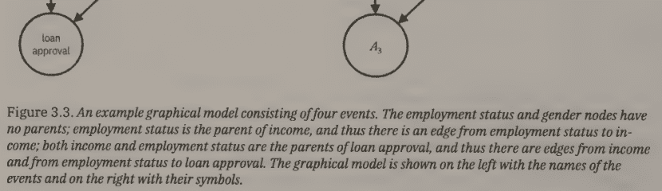

Figure 3.3. An example graphical model consisting of four events. The employment status and gender nodes have no parents; employment status is the parent of income, and thus there is an edge from employment status to income; both income and employment status are the parents of loan approval, and thus there are edges from income and from employment status to loan approval. The graphical model is shown on the left with the names of the events and on the right with their symbols.

图 3.3. 由四个事件组成的一个示例图模型。就业状态和性别节点没有父节点；就业状态是收入的父节点，因此从就业状态到收入有一条边；收入和就业状态都是贷款审批的父节点，因此从收入和从就业状态到贷款审批各有一条边。图模型在左侧以事件名称显示，在右侧以其符号显示。

统计关系由图结构决定。几个事件`A1, ..., An`的概率是所有事件在其父节点条件下的乘积：

`P(A1, ..., An) = ∏_{j=1}^{n} P(Aj | pa(Aj))`.

Equation 3.18

作为图 3.3 中图模型对 Equation 3.18 的特例，对应的概率可写为`P(A₁, A₂, A₃, A₄) = P(A₁ | A₂)P(A₂)P(A₃ | A₁, A₂)P(A₄)`。有效的概率分布导致有向无环图。如果沿着箭头路径行进且永远无法返回到起始节点，则图是无环的。节点的祖先是其父节点、其父节点的父节点、其父节点的父节点的父节点等递归上的任何节点。

从图 3.3 中小型且简单的图结构可以看出，贷款审批同时取决于收入和就业状态。收入取决于就业状态。性别与其他一切独立。然而，在更大更复杂的图中做出独立性陈述更为困难。确定所有事件或随机变量之间的所有不同独立关系是通过 d-分离的概念来完成的：节点子集`S₁`在节点子集`S₃`的条件下与另一节点子集`S₂`独立，当且仅当`S₃` d-分离`S₁`和`S₂`。解释 d-分离的一种方式是通过图 3.4 中所示的每个包含三个节点的三种不同基模，即因果链、共同原因和共同效应。基模之间的差异在于箭头的方向。左侧的配置没有被条件化的节点，即没有节点的取值被观测到。右侧的配置中，节点`A₃`被条件化，因此被着色。无条件化的因果链和共同原因基模是相连的。条件化后的因果链和共同原因被分离：从`A₁`到`A₂`的路径被对`A₃`的了解所阻断。无条件化的共同效应基模是分离的；在此情况下，`A₃`被称为碰撞体。条件化后的共同效应是相连的；此外，对`A₃`的任何后代进行条件化都会在`A₁`和`A₂`之间产生一条相连的路径。最后，一组节点`S₁`和`S₂`在一组节点`S₃`的条件下 d-分离，当且仅当`S₁`中的每个节点都与`S₂`中的每个节点分离。¹⁰

causal chain

common cause

common effect

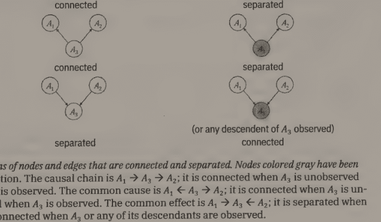

Figure 3.4. Configurations of nodes and edges that are connected and separated. Nodes colored gray have been observed. Accessible caption. The causal chain is A₁ → A₃ → A₂; it is connected when A₃ is unobserved and separated when A₃ is observed. The common cause is A₁ ← A₃ → A₂; it is connected when A₃ is unobserved and separated when A₃ is observed. The common effect is A₁ → A₃ ← A₂; it is separated when A₃ is unobserved and connected when A₃ or any of its descendants are observed.

图 3.4. 相连和分离的节点和边的配置。颜色为灰色的节点已被观测。可访问的说明。因果链为 A₁ → A₃ → A₂；当 A₃ 未被观测时它是相连的，当 A₃ 被观测时它是分离的。共同原因是 A₁ ← A₃ → A₂；当 A₃ 未被观测时它是相连的，当 A₃ 被观测时它是分离的。共同效应为 A₁ → A₃ ← A₂；当 A₃ 未被观测时它是分离的，当 A₃ 或其任何后代被观测时它是相连的。

¹⁰如果一个随机变量是另一个随机变量的确定性函数，则结构中可能存在未被捕获的依赖关系。

尽管可以通过检查两个集合之间所有路径上的所有三节点基模来检查两个节点集合之间的 d-分离，但存在一种更具构造性的算法来检查 d-分离。

- 1. 构造 $S_1$、$S_2$ 和 $S_3$ 的 *ancestral graph*。这是包含 $S_1$、$S_2$ 和 $S_3$ 中的节点以及它们的所有祖先和这些节点之间的所有边的子图。

- 2. 对于每个具有共同子节点的节点对，在它们之间绘制一条无向边。此步骤称为 *moralization*。

- 3. 使所有边变为无向。

- 4. 删除所有 $S_3$ 节点。

- 5. 如果 $S_1$ 和 $S_2$ 在无向意义上是分离的，则它们是 d-分离的。

An example is shown in Figure 3.5.

示例显示在图 3.5 中。

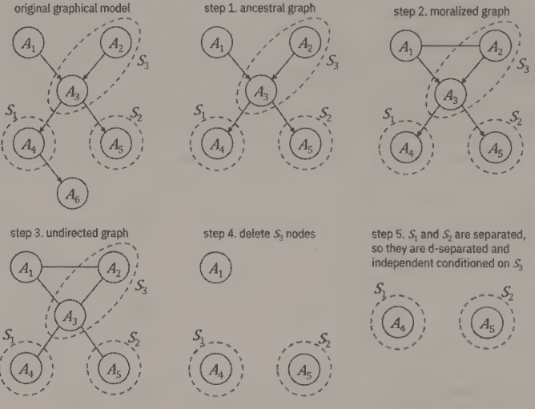

**Figure 3.5** *An example of running the constructive algorithm to check for d-separation.* Accessible caption. The original graph has edges from $A_1$ and $A_2$ to $A_3$, from $A_3$ to $A_4$ and $A_5$, and from $A_4$ to $A_6$. $S_1$ contains only $A_4$, $S_2$ contains only $A_5$, and $S_3$ contains $A_2$ and $A_3$. After step 1, $A_6$ is removed. After step 2, an undirected edge is drawn between $A_1$ and $A_2$. After step 3, all edges are undirected. After step 4, only $A_1$, $A_4$, and $A_5$ remain and there are no edges. After step 5, only $A_4$ and $A_5$, and equivalently $S_1$ and $S_2$, remain and there is no edge between them. They are separated, so $S_1$ and $S_2$ are d-separated conditioned on $S_3$.


### 图 3.5 运行构造性算法检查 d-分离的一个示例

可访问的说明。原始图具有从 `$A_1$` 和 `$A_2$` 到 `$A_3$` 的边，从 `$A_3$` 到 `$A_4$` 和 `$A_5$` 的边，以及从 `$A_4$` 到 `$A_6$` 的边。`$S_1$` 仅包含 `$A_4$`，`$S_2$` 仅包含 `$A_5$`，而 `$S_3$` 包含 `$A_2$` 和 `$A_3$`。步骤 1 之后，`$A_6$` 被移除。步骤 2 之后，在 `$A_1$` 和 `$A_2$` 之间绘制一条无向边。步骤 3 之后，所有边均为无向。步骤 4 之后，仅剩下 `$A_1$`、`$A_4$` 和 `$A_5$` 且没有边。步骤 5 之后，仅剩下 `$A_4$` 和 `$A_5$`，等价于 `$S_1$` 和 `$S_2$`，且它们之间没有边。它们是分离的，因此 `$S_1$` 和 `$S_2$` 在 `$S_3$` 的条件下是 d-分离的。

### 3.5.3 Conclusion

独立性和条件独立性使您能够知道随机变量是否相互影响。它们是理解系统和在确定问题规范时了解哪些部分可以单独分析的基本关系。图模型的主要优点之一是统计关系通过结构化方式表达。分离更清晰地显示并且可以高效计算。

## 3.6 Summary

- The first two attributes of trustworthiness, accuracy and reliability, are captured together through the concept of safety.

- Safety is the minimization of the aleatoric uncertainty and the epistemic uncertainty of undesired high-stakes outcomes.

- Aleatoric uncertainty is inherent randomness in phenomena. It is well-modeled using probability theory.

- Epistemic uncertainty is lack of knowledge that can, in principle, be reduced. Often in practice, however, it is not possible to reduce epistemic uncertainty. It is well-modeled using possibility theory.

- Problem specifications for trustworthy machine learning systems can be quantitatively expressed using probability and possibility.

- It is easier to express these problem specifications using statistical and information-theoretic summaries of uncertainty than full distributions.

- Conditional probability allows you to update your beliefs when you receive new measurements.

- Independence and graphical models encode random variables not affecting one another.

- 可信性的前两个属性，即准确性和可靠性，通过安全性的概念一起被捕获。

- 安全是对不期望的高风险结果的偶然不确定性和认识不确定性的最小化。

- 偶然不确定性是现象中的固有随机性。它使用概率论很好地建模。

- 认识不确定性是可以原则上减少的知识缺乏。然而在实践中，通常无法减少认识不确定性。它使用可能性理论很好地建模。

- 可信机器学习系统的

## 4 数据来源与偏差

（虚构的）非营利组织 Unconditionally 的使命是开展慈善捐赠。该组织收集捐款，并向东非的贫困家庭发放无条件现金转移支付——也就是不附带任何条件的资金。受助者可以自由支配这笔钱。Unconditionally 正在开展一个新的机器学习项目，以识别最贫困的家庭并遴选现金捐赠对象。项目完成得越快，他们就能越快、更高效地将急需的资金送到受助者手中；其中一些受助者需要在雨季来临前更换茅草屋顶。

团队正处于机器学习生命周期中的数据理解阶段。设想你是一名团队中的数据科学家，正在思考该使用哪些数据源作为特征和标签来估算家庭财富。你会检查各种数据，包括白天卫星图像、夜间灯光卫星图像、全国人口普查数据、家庭调查数据、手机通话详单、移动支付交易记录、社交媒体帖子，以及许多其他数据。你会选择哪些数据，为什么？你的选择会带来意想不到的后果，还是能构建出值得信赖的系统？

数据理解阶段是机器学习生命周期中一个令人振奋的时期。问题目标已经明确；你与数据工程师和其他数据科学家合作，迫不及待地想要开始获取数据并开展探索性分析。拥有数据是进行机器学习的先决条件，但并非什么数据都能派上用场。在这个阶段，你和团队务必要谨慎行事，并有意识地做出选择。不要走捷径。否则，等你意识到时，可能已经在摇摇欲坠的地基上建起了一座辉煌的大厦。

> “垃圾进，垃圾出。”

> ——Wilf Hey，IBM 计算机科学家

本章开启本书第二部分，重点讨论所有与数据有关的内容（还记得图 4.1 所示的本书结构吗？）。

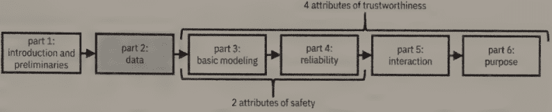

**图 4.1. 本书的组织结构。** *第二部分重点介绍处理数据时有关可信赖性的各种考量。* 无障碍说明。一张从左到右的流程图，包含六个方框：第一部分：引言与预备知识；第二部分：数据；第三部分：基础建模；第四部分：可靠性；第五部分：交互；第六部分：目的。第二部分以高亮显示。第三至第四部分标注为安全属性。第三至第六部分标注为可信赖性属性。

本章将深入探讨你与 Unconditionally 的数据工程师及其他数据科学家应如何：

- 运用对不同数据模态特征的了解来评估数据集，

- 从不同的数据来源中进行选择，以及

- 评估数据集中的偏差和有效性。

评估数据集中的偏差对可信赖性至关重要，也是本章的主要重点。在这一阶段做得越好，生命周期后续阶段就越少需要纠正和缓解危害。偏差评估应纳入计划中的机器学习系统所影响个体的意见。如果判断所有可能相关的数据都存在过多偏差，就必须与问题负责人及其他利益相关方讨论是否还要继续推进该项目。（第 5 章将探讨数据隐私与同意。）

## 4.1 数据模态

传统上，大多数人想到数据时，脑海中浮现的往往是某个记录系统生成的会计电子表格中的数字表格。然而，机器学习系统所用的数据可以包括数字家庭照片、监控视频、推文、立法文件、DNA 序列、计算机系统的事件日志、随时间变化的传感器读数、分子结构，以及任何其他数字形式的信息。在机器学习的语境下，数据被视为从某个底层概率分布中抽取的有限数量样本。

上述数据示例来自不同的*模态*（图像、文本、时间序列等）。模态是按照数据的接收、表示和理解方式定义的数据类别。当然，图 4.2 并未展示所有模态。

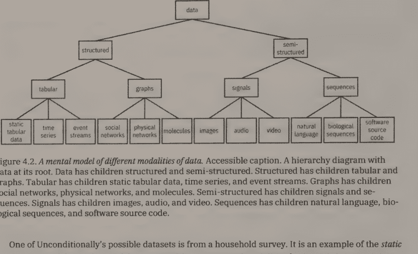

图 4.2. 数据不同模态的概念模型。无障碍说明。一张层级图，以“数据”为根节点。数据包含“结构化”和“半结构化”两个子类。结构化数据包含“表格数据”和“图”。表格数据包含“静态表格数据”“时间序列”和“事件流”。图包含“社交网络”“物理网络”和“分子”。半结构化数据包含“信号”和“序列”。信号包含“图像”“音频”和“视频”。序列包含“自然语言”“生物序列”和“软件源代码”。

Unconditionally 的一个备选数据集来自家庭调查。它属于静态表格数据模态，也是结构化数据模态类别的一部分。¹ 它之所以是静态的，是因为它并未追踪某种随时间变化的现象。各列是可用作特征和标签的不同属性，各行则是不同的记录或样本点，也就是不同的个人和家庭。列中包含数值、序数值、类别值、文本字符串，以及日期等特殊值。表格数据凭借整齐的结构，乍看之下可能显得正式、完美无瑕，但实际上可能隐藏着各种错误假设、错误、遗漏和偏差。

时间序列是另一种可以用表格形式存储的模态。这类数据通常是在固定时间间隔内测得的数值，可用于建模趋势和预测随时间变化的量。纵向数据或面板数据是对同一批个体随时间反复测量所得的数据，通常属于时间序列。不过，家庭调查很少采用纵向形式，因为实施起来在后勤上困难重重。横截面调查则只是不同时间收集的若干表格数据集，彼此之间没有关联。由于无需追踪同一批个体，其收集起来在后勤上要容易得多。

Unconditionally 的另一种备选数据集是移动支付交易记录。时间戳是交易数据的重要组成部分，但这类数据并非时间序列，因为事件并非按固定间隔发生。每位移动支付客户在收到或支付资金时，都会异步生成一个事件；这些事件并不受所有客户共同遵循的时钟控制。交易数据是事件流模态的一个示例。除了时间戳，事件流还包含其他测量值，例如金额、收款人和购买物品。其他事件流还包括医院进行的临床检测，以及客户接受的社会服务。

¹还有一些结构比表格数据更丰富的模态，例如图，它可以表示社交网络和化学分子的结构。

Unconditionally 可以使用卫星图像来估算贫困状况。数字*图像*是过去几年中引发了大量机器学习赞誉的一种模态。它们属于模态中的*半结构化*分支。一般来说，图像可以是常规光学图像，也可以是在电磁波谱其他范围测得的图像。图像的原始形式由多个通道中的数值像素组成，通常包含大量空间结构。*视频*是随时间变化的图像序列，包含大量时空结构。现代机器学习技术通过海量数据进行训练，从而学习这些空间和时空表示；而这些数据本身可能含有不受欢迎的偏差和不适当内容。（针对特定问题的模型，是在大规模、通用性更强的数据集上预训练的模型的微调版本。这些大型预训练模型称为*基础模型*。）视频还可能包含*音频*信号。

你在 Unconditionally 的一位同事认为，虽然可能性较低，但短信和社交媒体帖子的内容或许能够预测一个人的贫困程度。这种模态是*自然语言*或*文本*。较长的文档，包括正式文件和出版物，也属于同一种模态。人类语言的句法、语义和语用都十分复杂。处理文本的一种方法是解析语言并创建语法树。另一种方法是将文本表示为稀疏的结构化数据，统计文档中单个词、词对、词组三元组等是否出现。这些*词袋*或*n 元语法*表示方式，如今正逐渐被第三种方法取代：在海量文档语料库上训练的复杂*大型语言模型*。大型语言模型是一种基础模型。就像学习图像的空间表示一样，语言模型的学习也可能充斥着各种偏差，尤其是当训练语料中的语言规范与应用场景的规范不一致时。在美国大量新闻文章上训练的语言模型，通常并不适合作为东非短小、非正式且混合多种语言的短信的表示基础。²

通常，结构化模态本身就是用于建模的表示形式，并且对应于人们审慎的决策过程；而半结构化模态则需要复杂的转换，并且对应于人们直觉式的感知过程。如今，半结构化数据的复杂转换往往通过深度神经网络来学习，而这些网络是在规模大到难以想象的数据集上训练的。这个过程称为*表示学习*。由于基础模型的表示学习过程起初不透明且难以控制，超大规模背景数据集中的任何偏差都会延续到针对特定问题数据集进行微调的模型中。因此，对于半结构化数据，不仅要评估针对具体问题的数据集，还要评估背景数据集。对于结构化数据集，数据准备和特征工程的分析则更为关键。³

## 4.2 数据来源

Unconditionally 正在考虑的各种数据不仅在模态上有所不同，也因其来源和获取方式而异，也就是其*来源脉络*。作为数据理解工作的一部分，你的团队

在 Unconditionally，你必须仔细评估数据来源，以去粗取精：只保留好的部分。数据来源有很多不同的类别，在评估其质量时需要有不同的考虑。

### 4.2.1 有意收集的数据

你可能认为，创建机器学习系统所用的大部分数据都是为了解决问题的目的而明确且仔细收集的，但你会大错特错。事实上，机器学习系统中使用的大部分数据都是重新利用的。少数例外包括通过调查和人口普查收集的数据。这些来源看起来设计良好且偏差最小，但情况并非总是如此。例如，如果你依赖肯尼亚最近完成的全国人口普查中的数据作为Unconditionally贫困预测问题的特征或标签，你可能会遭遇无回应和恶意数据操纵的问题。

另一种有意收集的数据来自科学实验。同样，设计良好且执行良好的实验应该产生可靠的数据。然而，由于滥用数据分析来寻找数据中的模式并选择性地将其呈现为统计显著（p值篡改和文件抽屉问题）、缺乏可重复性以及彻底的欺诈等做法，目前普遍存在对科学方法缺乏信任的现象。

### 4.2.2 行政数据

行政数据是组织出于非统计原因在其日常运营中收集的数据。在Unconditionally可能的候选数据集列表中，通话详细记录和移动货币交易符合条件。数据科学家和工程师经常重新利用行政数据来训练模型，因为数据就在那里，而且他们可以这样做。有时，这样做甚至是有意义的。

由于行政数据是运营记录，可能直接关系到组织的利润或需要接受审计，因此通常相当准确。在尝试整合组织内不同的行政数据来源时，往往存在困难，因为这些数据被不同团队孤立存储。此类数据也可能包含历史偏见的痕迹。

对于行政数据，你需要了解的最重要的一点是：它可能与你试图解决的预测问题并不完全匹配。机器学习问题规范可能要求某个标签，但行政数据中的列可能只能作为该期望标签的代理。这种不匹配对某些个人或群体可能是毁灭性的，即使它在平均水平上是一个合理的代理。例如，回想在第2章中我们讨论过，如果存在阻止某些群体获得医疗保健的外部因素，就医次数可能不是患者患病严重程度的好代理。此外，记录的粒度可能与问题所需的粒度不同，例如通话详细记录中是个人电话号码，而不是家庭的所有活动。

### 4.2.3 社交数据

社交数据是关于人或由人创造的数据，包括用户生成的内容、人与人之间的关系以及行为痕迹。⁴ 在社交媒体平台上发布文本和图片就是一个典型的例子。友谊网络和搜索历史是其他例子。与行政数据类似，这些来源并非为问题规范而生成，而是被重新用于预测或因果建模。

很多时候，社交数据就像行政数据一样，只是问题规范所需内容的代理，可能会产生误导，甚至完全错误。你分析的Unconditionally现金转移潜在接收者的社交媒体内容可能就是这样。

由于社交数据是为沟通、求职和维护友谊等目的而创建的，因此该数据来源的质量、准确性和可靠性可能远低于行政数据。文本可能包含各种俚语、非标准方言、拼写错误和偏见。其他形式的社交数据也各有各的变幻莫测之处。单个数据点的信息含量可能不是很高。此外，可能存在大量抽样偏差，因为并非所有人群都同等程度地参与社交平台。特别是，边缘化人群在某些类型的社交数据中可能是不可见的。

### 4.2.4 众包

监督学习需要特征和标签。无标签数据比有标签数据更容易获取。众包是填补这一差距的一种方式：众包工人标注句子的情感、判断一段文本是否为仇恨言论、在图像中为物体画框等等。5 他们评估机器学习系统的解释和可信度。他们帮助研究人员更好地理解人类行为和人机交互。Unconditionally与众包工人签约，对卫星图像中房屋屋顶的类型进行标注。

在许多众包平台上，工人是技能较低的个人，其激励是金钱。他们有时会在众包平台之外相互交流，并试图以对自己有利的方式欺骗系统。众包工人的工资可能很低，这引发了伦理问题。他们可能不熟悉任务或任务所处的社会背景，这可能导致标签中的偏差。例如，众包工人可能缺乏判断东非农村家庭构成所需的社会背景知识，从而可能在屋顶标注中引入偏差。（有关此示例的更多细节将在后文提及。）欺骗系统也可能产生偏差。尽管一些平台有质量控制机制，但如果你设计的标注任务不当，你将获得质量差的数据。在某些情况下，尤其是涉及具有积极社会影响的应用时，众包工人可能具有更高的技能，并出于内在动机认真工作。然而，他们仍可能不熟悉社会背景或存在其他偏见。

### 4.2.5 数据增强

有时，特别是在专业问题领域，可用数据量不足以学习高性能模型。数据增强——对给定数据集执行各种变换——可以用来增加数据集大小，而无需真正收集额外数据。在图像数据中，用于增强的变换包括旋转、翻转、移位、变形、添加噪声等。在自然语言数据中，变换可以包括用同义词替换单词。这类启发式变换引入了你的一定程度的主观性，这可能会产生某些偏差。

另一种执行数据增强的方法是通过*生成式机器学习*：使用给定的数据训练一个数据生成器，输出更多样本，然后用于训练分类器。理想情况下，这些生成的数据点应该与给定数据集一样多样化。然而，一个称为*模式坍缩*的大问题，即只从给定数据概率分布的一部分生成样本，可能导致生成的数据集出现严重偏差。

### 4.2.6 结论

不同的数据来源在解决各种问题规范方面各有用途，但都存在某种偏差。大多数数据来源都是被重新利用的。你在选择数据来源时必须小心，注意任何给定数据来源中更常见的偏差。下一节从偏差的不同种类及其在生命周期中出现的阶段来描述偏差。

## 4.3 偏差的种类

你的团队正在机器学习生命周期的数据理解阶段努力推进。你知道不同的数据模态和数据来源会出现什么问题。在评估数据是否存在偏差以及缺乏*有效性*时，这些问题是你关注的焦点，因为数据会经过机器学习生命周期中的各种*空间*。图4.3给出了一个模型，供你记住偏差、有效性和空间之间的关系。


图4.3. 空间、有效性和偏差的心理模型。无障碍说明。四个空间的序列，每个空间用一朵云表示。构造空间通过测量过程通向观察空间。观察空间通过采样过程通向原始数据空间。原始数据空间通过数据准备过程通向已准备数据空间。测量过程包含社会偏差，威胁构造效度。采样过程包含表征偏差和时间偏差，威胁外部效度。数据准备过程包含数据准备偏差和数据投毒，威胁内部效度。

主要有三种效度：（1）构念效度，（2）外部效度，（3）内部效度。⁶ 构念效度指数据是否真正度量了它应当度量的内容。外部效度指对给定总体数据的分析结果能否推广到其他总体。内部效度指数据处理过程中是否存在错误。

不同类型的效度会受到不同类型偏差的威胁。偏差类型的分类有很多种，但为简单起见，我们只关注五种。⁷ 社会偏差威胁构念效度，表征偏差和时间偏差威胁外部效度，数据准备偏差和数据投毒威胁内部效度。本节将详细介绍这些偏差。


设想存在不同空间也很有用，在其中有各种抽象和具体形式的数据：构念空间、观测空间、原始数据空间和准备数据空间。构念空间是一个抽象的、不可观测的理论空间，其中没有任何偏差。Hakuna matata，这种东非地区无忧无虑的哲学，在这个理想世界中盛行。构念空间通过特征和标签的度量被操作化为观测空间。⁸ 从观测空间中特定总体收集的数据样本存在于原始数据空间中。原始数据经处理得到最终的准备数据，用于训练和测试机器学习模型。

### 4.3.1 社会偏差

无论是决策过程被自动化的专家，还是众包工作者，从构念空间中的标签到观测空间中的标签，都需要人的判断参与。这些人的判断会受到人类认知偏差的影响，从而可能导致隐性的社会偏差（在无意识的情况下将刻板印象与人群类别关联在一起），进而使弱势个人和群体遭受系统性不利影响。⁹ 如果决策者存有偏见，他们还可能表现出显性的社会偏差。这些偏差是有害的，并且会强化根深蒂固的结构性不平等。标注中的人类认知偏差还可能产生其他种类的系统性错误。

特征方面也可能存在结构性不平等。如果一项能力测试所问的问题依赖于并非所有应试者都具备的特定文化知识，那么该特征实际上就不能很好地反映应试者的潜在能力。而且在大多数情况下，这种隐性知识会偏向特权群体。边缘化社会群体在历史上投资不足、机会缺失，也会在特征中产生类似的偏差。

你们的团队在评估众包标注的东非村庄卫星图像中的屋顶时，发现了一个有趣的社会偏差案例。众包工人不仅标记了农户院落中主屋的屋顶，还标记了同一户人家中的独立结构，例如独立的厨房和供年轻男子使用的独立卧室。他们完全不知道这个地区的农户布局是这样的。这种偏差如果未被发现，就会导致对贫困状况的错误推断。

### 4.3.2 表征偏差

一旦在特征和标签的观测空间中运作，你们团队的数据工程师就必须实际获取样本数据点。理想情况下，采样方式应使所获取的数据集能够代表底层总体。然而，经常会出现选择偏差，导致观测空间中的概率分布与数据点的分布不匹配。外部效度可能受到影响。选择偏差的一个具体例子是，弱势群体在数据集中要么代表性不足，要么过度代表，这导致机器学习模型要么忽略他们的特殊特征以迎合平均性能指标，要么过度关注他们而导致系统性不利。在对 `Unconditionally` 的某个手机数据集进行评估时，数据工程师发现老年公民的代表性不足，因为该亚群体中的手机拥有率较低。他们还发现，全国人口普查可能低估了某些县的人口，因为统计部门在那里配置的人口普查员不足。

表征偏差不一定只是选择偏差。即使没有选择偏差，来自一个亚群体的特征和标签的特性也可能不同于来自另一个亚群体的。代表性不仅仅是数据点存在与否的问题，而是一个更广泛的概念，还包括数据质量中的系统性差异等。

### 4.3.3 时间偏差

时间偏差是另一种在对观测空间进行采样以收集原始数据时发生的偏差。它同样会危及外部效度。一旦数据集被收集完成，如果观测空间随时间发生漂移和变化，数据集就可能与观测空间中的分布失去同步。*协变量漂移*指特征的分布变化，*先验概率漂移*指标签的分布变化，*概念漂移*指在给定特征条件下标签的条件分布变化。这些漂移和变化可以是渐进的，也可以是突发的。（分布漂移在第9章中有更详细的介绍。）`Unconditionally` 的卫星图像数据集中一个协变量漂移的例子是，一些地点在雨季被观测到，而另一些地点在旱季被观测到。

### 4.3.4 数据准备偏差

在机器学习生命周期中，数据准备阶段紧跟数据理解阶段。数据准备过程中可能会引入许多限制内部效度的偏差。例如，你们团队的数据工程师必须对包含缺失值的行进行处理。如果他们遵循常见的做法删除这些行，而缺失情况又与某个敏感特征相关，比如某个宗教群体的债务特征更经常缺失，那么他们就引入了新的偏差。其他偏差还可能通过其他数据清洗、数据丰富和数据聚合步骤以及数据增强（见第4.2.5节）在数据准备中进入。

一个有时被忽视的偏差是在标签中使用代理变量。例如，逮捕是犯罪的一个有问题的代理指标。无辜者有时会被逮捕，而在警察存在更多的地方（且警察部署不均匀）逮捕发生得更多。医疗保健利用率是个人健康状况的一个有问题的代理指标，因为不同群体利用医疗保健系统的程度不均匀。数据准备偏差往往很微妙，涉及数据工程师和数据科学家做出的一些选择，而这些选择会受到他们自身个人偏见和社会偏见的影响。在生命周期的数据理解阶段，通过从多元化的信息提供者小组获取意见，可以帮助缓解其中一些社会偏差。（多元化团队在数据理解中的作用在第16章中有更深入的介绍。）

### 4.3.5 数据投毒

最后，恶意行为者可以在你不知情的情况下向数据集中引入不必要的偏差。这种对抗性攻击被称为数据投毒。数据投毒通过不同手段实现，包括数据注入和数据操纵。数据注入是添加具有攻击者所需特征的额外数据点。数据操纵是改变数据集中已有的数据点。（数据投毒在第11章中有更详细的介绍。）

本章介绍的大多数偏差都可以被故意利用来降低机器学习系统的性能或以其他方式使其退化。安全分析师通常关注对准确性的攻击，但公平等其他考量因素也可能受到攻击。除了降低性能外，数据投毒还可以引入一个所谓的后门，供攻击者日后利用。例如，有人试图诈骗 `Unconditionally`，可能会引入一些卫星图像，这些图像中的河边住户总是被标记为严重贫困，以诱使你们的模型向河畔社区提供更多现金转移。

### 4.3.6 结论

不同类别的偏差会抵消不同类型的效度。评估数据和准备数据是困难的任务，必须全面进行，不能走捷径。更多元化的团队可能比多元化程度较低的团队更能集思广益，找出更多的效度威胁。评估数据需要仔细考虑不仅限于模态和来源，还包括度量、采样和准备。偏差的心智模型为你提供了一个清单，可以在使用数据集训练机器学习模型之前逐项检查。你是否评估了社会偏差？你的数据集是否具有代表性？是否存在随时间推移的数据集漂移？是否有任何数据准备步骤意外引入了细微偏差？是否有人偷偷潜入、访问数据并出于恶意目的更改了数据？

如果发现任何偏差，你应该怎么做？有些偏差可以通过收集更好的数据或改进准备步骤来克服。有些偏差会漏过去，并在机器学习生命周期的建模阶段造成认知不确定性。漏过去的偏差中，有些可以在建模步骤中通过防御算法显式缓解，或通过对其保持鲁棒性隐式缓解。你将在本书第4部分学到如何操作。

## 4.4 小结

- 数据是机器学习系统中建模的前提。它来自各种来源，有多种形式，并在这一过程中可能沾染许多不同的偏差。

- 确定数据集中存在哪些偏差至关重要，因为它们会危及系统解决指定问题的效度。

- 评估结构化数据集涉及评估数据集本身，包括关注数据准备。评估由基础模型表示和

## 5

## 隐私与同意

全球病毒大流行开始趋于缓和，不同组织正争相制定“返岗”计划，以便员工在居家隔离数月后重返工作场所。为此，各组织正在评估一款名为 `TraceBridge` 的（虚构）基于机器学习的移动应用。它通过收集和建模位置轨迹、健康相关测量、其他社交数据（例如员工之间的内部社交媒体和日历邀请）以及行政数据（例如空间规划信息和组织架构图）来支持重返办公室，以促进数字接触者追踪：即弄清感染者与其他人之间的疾病传播互动。`TraceBridge` 是正确的解决方案吗？组织能够安全重新开放，还是员工将再被困家中数月之久，似乎无休无止？

`TraceBridge` 收集的数据，即使摆脱了第 5 章中研究的许多偏见，也并非没有令人担忧之处。`TraceBridge` 是否将所有员工的数据存储在集中式数据库中？谁有权访问数据？如果发生数据泄露，会暴露什么？员工是否已被告知数据的可能用途并同意这些用途？组织是否有权限将其数据与其他组织共享？员工可以退出该应用吗，还是这会危及他们的生计？谁会知道某名员工已对该疾病检测呈阳性？谁会知道他们的身份和他们的联系人？

第 4 章对数据科学家的指导是警惕数据和问题表述中潜入的偏见，因为它们可能造成危害。在本章中，需要警惕的是出于同意、权力与隐私的原因，使用某些数据是否本身就是正确的。¹ 雇主现在正在评估该应用。然而，当 `TraceBridge` 的问题拥有者、开发者和数据科学家在创建该应用时，他们必须：

- 权衡同意、权力分散和隐私的需求，甚至争辩说人们应因其个人数据而获得补偿，因为他们正在出售自己的隐私。³ 简而言之，`数据即权力`。

> “数据是新的石油。”

> —克莱夫·汉比，`dunnhumby` 的数据科学企业家

机器学习中使用的数据常常伴随着权力和同意问题，因为它经常被重新用于其他用途，或是所谓的 `数据残余`：人们数字活动的副产品。例如，许多用于训练计算机视觉模型的大规模图像数据集都是从互联网上抓取的，未经发布图像的人明确同意。⁴ 虽然通过诸如知识共享许可等机制可能存在隐含同意，但缺乏明确同意仍然可能成问题。有时在被抓取和重新利用的数据中会违反版权法。为什么会发生这种情况？几乎总是由于系统设计者为了快速收集大型数据集并展示价值而采取捷径，而没有考虑权力和同意的问题。而且恰恰是最有权势的人往往最不了解权力问题。来自边缘化、少数化以及其他权力较弱背景的人往往更了解权力和无权者的视角。⁵ 这种概念被称为边缘化 lived experience 者的 `认识论优势`，在第 16 章中有更详细的介绍。同样，除了医疗保健等受监管的应用领域外，隐私问题通常由于便利性而被视为事后考虑。情况开始发生变化，这得益于像 2018 年在欧洲经济区实施的《通用数据保护条例》这样全面的法律。

³尼古拉斯·文森特、伊春·李、蕾妮·扎和布伦特·赫克特。“`数据红利`”作为分享人工智能利润的一种方式的潜力与陷阱”，arXiv:1912.00757，2019。

⁴阿贝巴·比尔哈内和维奈·乌代·普拉布。“大型图像数据集：计算机视觉的皮洛士式胜利？”载于：*《IEEE 计算机视觉应用冬季会议论文集》*。2021年1月，第1536–1546页。

⁵米利安·康、唐纳文·莱萨德和劳拉·赫斯顿。*《妇女、性别与性研究导论》*。美国马萨诸塞州阿默斯特：马萨诸塞大学阿默斯特分校图书馆，2017年。

总之，问题拥有者和数据科学家不应有任何权衡，即将权力、同意和隐私问题与数据收集的便利性相权衡。对于信任的第四个属性（对齐目的），值得信赖的机器学习系统要求数据必须得到同意使用，尤其是来自可能遭受剥削的那些人。绝无例外！

## 5.2 通过匿名化实现隐私

在收到组织的不利反馈后，认为他们有违反隐私法的风险，`TraceBridge` 开发团队已回到起跑线。他们必须弄清楚隐私到底是怎么回事，在竞争的框架中做出选择，然后将其纳入系统。

在保护隐私方面，主要有两种用例：（1）数据发布和（2）数据挖掘。*隐私保护的数据发布* 是在不违反隐私的情况下对数据进行匿名化以完全披露。*隐私保护的数据挖掘* 是在控制个人层面的信息披露的同时查询数据。隐私保护的数据发布也称为 *非交互式匿名化*，而隐私保护的数据挖掘也称为 *交互式匿名化*。`TraceBridge` 可能想要做其中一种或两者兼而有之：发布数据集供组织领导者或国家监管机构审查，并在不暴露可单独识别数据的情况下发出接触者追踪警报。他们必须走两条路，并学习每种情况下适当的技術方法：数据发布使用 `句法匿名性`，数据挖掘使用 `差分隐私`。⁶

处理隐私时，变量主要有三类：（1）标识符，（2）准标识符，和（3）敏感属性。*标识符* 直接揭示一个人的身份。示例包括个人的姓名、国家识别号码（如社会安全号码）或员工序列号。应从数据集中删除标识符以实现隐私，但这种删除并非全部解决方案。相比之下，*准标识符* 单独不能唯一识别个人，但在通过称为 *再识别* 的过程链接在一起时可以揭示身份。示例为性别、出生日期、邮政编码和群组成员身份。*敏感属性* 是人们不希望被揭示的特征。示例为健康状况、投票记录、薪资和移动信息。简而言之，句法匿名性通过修改准标识符以降低其信息含量来工作，包括抑制它们、泛化它们和打乱它们。差分隐私通过向敏感属性添加噪声来工作。两种隐私模式的心智模型在图 5.1 中给出。

为了使这一心智模型更具体，让我们看看它如何适用于员工及其病毒诊断测试结果的实际样本数据集（具体为聚合酶链反应测试的循环阈值（CT）值），我们将其视为敏感信息。原始数据集、`k=3` 的 `k-匿名性` 转换后的数据集以及差分隐私转换后的数据集分别显示在表 5.1、表 5.2 和表 5.3（`k-匿名性` 和差分隐私的细节即将介绍）。

### 表 5.1. 一个示例原始数据集。

| 姓名 | 部门 | CT 值 |

|---|---|---|

| Joseph Cipolla | 可信 AI | 12 |

| Kweku Yefi | 神经符号 AI | 20 |

| Anjali Singh | AI 应用 | 35 |

| Celia Sontag | 计算加速 | 31 |

| Phaedra Paragios | 软件定义架构 | 19 |

| Chunhua Chen | 热封装 | 27 |

### 表 5.2. `k=3` 的 `k-匿名性` 下的示例原始数据集。

| 组织 | CT 值 |

|---|---|

| AI | 12 |

| AI | 20 |

| AI | 35 |

| 混合云 | 31 |

| 混合云 | 19 |

| 混合云 | 27 |

## 表5.3. *在样本原始数据集中对敏感属性添加拉普拉斯噪声后，差分隐私查询所返回的值*

| 姓名 | 部门 | CT值 |

|---|---|---:|

| Joseph Cipolla | 可信人工智能 | 13.5 |

| Kweku Yefi | 神经符号人工智能 | 12.8 |

| Anjali Singh | 人工智能应用 | 32.7 |

| Celia Sontag | 计算加速 | 35.9 |

| Phaedra Paragios | 软件定义架构 | 22.1 |

| Chunhua Chen | 热封装 | 13.4 |

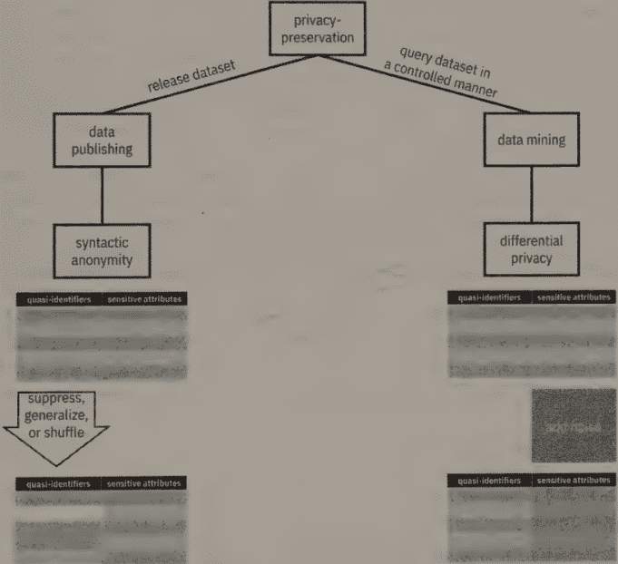

**图5.1.** *隐私保护的心理模型，分为两个分支：具有语法匿名的数据发布和具有差分隐私的数据挖掘。* 无障碍说明。一种层级图，根节点为隐私保护。一个子节点是数据发布，在发布数据集时完成。数据发布的唯一子节点是语法匿名。语法匿名通过一个表格来说明，表格的列为准标识符和敏感属性。通过抑制、泛化或洗牌准标识符，一些行被重新排序，另一些行则采用了不同的值。隐私保护的另一个子节点是数据挖掘，在以受控方式查询数据集时完成。数据挖掘的唯一子节点是差分隐私。差分隐私也通过一个表格来说明，表格的列为准标识符和敏感属性。通过对敏感属性添加噪声，所有行都带有噪声。

### 5.2.1 数据发布与语法匿名

语法匿名的最简单形式是 `k-匿名性`。⁷ 通过抑制准标识符的值（将值替换为空值）或泛化其值（例如，将5位邮政编码仅替换为前三位数字），`k-匿名性` 的思想是创建基数至少为 `k` 且具有完全相同修改后准标识符值的记录组。一个组或簇中的所有记录变得等价且无法区分。在准标识符组内随机洗牌标识符也可以达到同样的效果。如果原始数据集中有 `n` 个数据点，那么匿名数据集中应该有大约 `n/k` 个组，每个组的基数大致相同。

`k-匿名性` 的弱点包括易受同质性攻击和背景知识攻击的影响。同质性攻击利用了 `k` 成员簇中许多记录具有相同敏感属性这一事实，这意味着即使没有精确的重新识别，个体的敏感信息仍会被泄露。背景知识攻击则利用具有特定敏感属性分布的子组的侧信息，来锁定个体可能的敏感属性值。`k-匿名性` 的一种扩展称为 `l-多样性`，可以克服这些漏洞。⁸ 它进一步要求每个 `k` 成员组至少具有 `l` 个不同的敏感属性值。

`k-匿名性` 和 `l-多样性` 的进一步改进是 `t-接近性`。⁹ 从 `k-匿名性` 的基本定义出发，`t-接近性` 进一步要求每个 `k` 成员组的敏感属性概率分布与数据集中所有记录的全局敏感属性概率分布之间的适当定义的距离小于或等于 `t`。简单来说，所有组在敏感属性的分布上应该是相似的。为给定数据集找到 `t-接近性` 变换在计算上是困难的。

`k-匿名性`、`l-多样性` 和 `t-接近性` 的重新识别风险可以用互信息来解释，互信息已在第3章中介绍。如果 `X` 是原始数据集中准标识符的随机变量，`X̃` 是匿名数据集中准标识符的随机变量，`W` 是敏感属性的随机变量，那么我们有如下的定量问题规格：

- `I(X; X̃) ≤ log n/k` (`k-匿名性`),

- `I(W; X̃) ≤ H(W) − log l` (`l-多样性`), 以及

- `I(W; X̃) ≤ t` (`t-接近性`).¹⁰

通过 `k-匿名性`，重新识别风险从整个数据集的风险降低到簇数量的风险。在 `k-匿名性` 之上加上 `l-多样性` 或 `t-接近性` 后，从匿名化后的准标识符预测敏感属性的能力受到限制。这些关系是推理哪些信息因匿名化而被披露、哪些信息未被披露的宝贵方式。通过用信息论这一共同的统计语言来表达它们，就可以在更广泛的背景下，与其他问题规格和可信性要求一起检查和研究。

### 5.2.2 数据挖掘与差分隐私

匿名化的另一个分支是差分隐私，它适用于涉及查询数据集（而非简单发布数据集）的用例。其设定是，一个组织拥有一个数据集，并且确切地知道它将处理的查询。一些示例查询是返回数据集中某个值的计数，或数据集中某一列的平均值。查询甚至可以复杂到返回在数据集上训练的机器学习分类器。有些查询更容易匿名化，有些则更难。在差分隐私的设置中，组织必须保持对数据集及其所有查询的控制。这与语法匿名形成对比：在语法匿名中，一旦数据集被匿名化，它就无拘无束、自由自在了。差分隐私的基本方法是对敏感属性添加噪声。

再深入一点细节。假设 `TraceBridge` 有一个数据集 `$W_1$`，包含所有病毒性疾病检测呈阳性的员工。另一名员工被检测为阳性，并被添加到数据集中，得到一个新数据集 `$W_2$`，它与 `$W_1$` 的唯一区别在于增加了一行。假设查询函数 `$y(W)$` 是患有癌症的员工人数，这对于更好地理解癌症与病毒性疾病之间的关系很重要。¹¹ 癌症诊断状态被视为敏感信息。差分隐私系统不是真正返回 `$y(W)$`，而是通过向 `$y(W)$` 添加一个随机值来返回其带噪声的版本。它返回的值是 `$\tilde{Y}(W)=y(W)+\text{noise}$`。`$\tilde{Y}$` 是一个随机函数，我们可以将其看作一个随机变量，其样本值为 `$\tilde{y}$`。差分隐私的目标由涉及原始数据集和新数据集查询概率的以下界限表示：

`$P(\tilde{Y}(W_1)=\tilde{y}) \leq e^\epsilon P(\tilde{Y}(W_2)=\tilde{y})$`，对所有 `$\tilde{y}$`。

方程 5.1


`ε` 是一个很小的正参数，表示我们想要多少隐私。随着`ε`越来越接近零，`e^ε`的值越来越接近 1。当`ε`为零时，要求两个概率相等，因此两个数据集必须是不可区分的，这正是差分隐私所追求的匿名意义。¹² 当添加新人员时，你无法分辨查询结果的差异，因此你无法比从数据集中一般性地推断出更多关于他们敏感属性的信息。

¹¹`https://rebootrx.org/covid-cancer`

¹² 我们实际上应该针对某个区间或其他集合 `S` 写 $P(\tilde{Y}(W_1) \in S) \leq e^\epsilon P(\tilde{Y}(W_2) \in S)$，因为如果 $\tilde{Y}$ 是连续随机变量，那么它取任何特定值的概率始终为零。只有定义在某个集合上时，它才有特定的概率。

差分隐私的主要技巧是求解应添加到`y(W)`的噪声类型及其强度。对于许多查询函数，最好的噪声来自拉普拉斯分布。13 如前所述，有些查询比其他查询更容易。这种容易程度使用全局敏感度来量化，它衡量数据集中的单行对查询值的影响程度。全局敏感度较小的查询需要较低强度的噪声来实现`ε`-差分隐私。

就像语法隐私一样，当用信息论而不是前面定义差分隐私时所使用的更专门术语来表达时，可以更容易地将差分隐私与可信机器学习中的其他问题规格（如准确性、公平性、鲁棒性和可解释性）放在一起考虑。为此，我们还需要说明数据集`W`是一个随机变量，因此我们希望彼此接近的概率是在数据集实现条件下带噪声的查询结果`P(Ŷ | W = w₁)`和`P(Ŷ | W = w₂)`。然后我们可以将差分隐私的目标表述为希望数据集与带噪声查询结果之间的互信息`I(W, Ŷ)`最小化。在最小化互信息的基础上再增加一些细节，我们可以得到一个关于`ε`-差分隐私的`ε`的关系式。14 检查数据集与查询之间互信息的思想如下。由于互信息衡量的是通过查询知识对数据集不确定性的减少，因此互信息为零（或很小）表明我们从查询结果中学不到任何关于数据集构成的信息，这正是差分隐私的思想。

差分隐私旨在防止将查询值的变化归因于任何一个人的数据行。然而，对以信息论形式呈现的差分隐私的一个批评是，如果行之间存在相关或关联，它可能允许推断敏感属性的值。已经开发了更严格的信息论意义上的差分隐私概念，要求数据集的行是独立的。

### 5.2.3 结论

TraceBridge 的应用程序和接触者追踪系统中有几个不同的用例。一是发布敏感数据，供组织领导、外部监管机构或审计人员查看。二是交互式地查询敏感数据中的统计信息，而不泄露有关个人的信息。每种用途都有不同的适当方法：第一种使用语法匿名，第二种使用差分隐私，同时在系统设计和所需基础设施上也有不同的要求。不同司法管辖区和应用领域中现有的法律保护大多针对第一种用例（数据发布），但法规本身通常对其精确的隐私概念并不明确。TraceBridge 在开发可信系统时，可能不得不同时采用这两种隐私方法。

我们已经到达本节末尾，但还没有讨论隐私与实用性之间的权衡。所有提供隐私的措施和方法都应结合数据将被如何使用来评估。这是一种平衡。权衡参数的存在是有原因的。对于大小合适的`k`，`k`-匿名化后数据集的实用性通常相当不错，但在之后可能就不那么好了：为合适的`t`实现`t`-接近性。类似地，对于典型查询的差分隐私的一个批评是，对于较小的`ε`（添加大幅度的噪声），查询结果的实用性并不那么大。然而，不能一概而论：这些直觉必须在特定场景和数据集上进行评估，并且隐私参数必须谨慎选择，不能走捷径，还要纳入多个利益相关者的意见。

## 5.3 实现隐私的其他方式

产生匿名化数据的两种技术方法（用于数据发布的句法匿名和用于数据挖掘的差分隐私）并不是 TraceBridge 实现隐私的唯一途径。这里有一个非常简单的实现隐私的方法：把数据锁起来，然后把钥匙扔掉。如果他们不发布数据，也不提供任何查询能力，他们就拥有了完美的隐私。但这样一来，他们也无法从数据中获得任何效用。那么他们还能做什么呢？

一个答案是通过制度控制和程序来确保只有合格的个人才能访问数据，且仅限于经过批准的特定用途。获得许可的数据科学家可能只能被允许在封闭的计算系统中访问数据，并辅以强力执行措施以防止数据泄露。将数据分散存储而非集中在一个中心化位置，也有助于防止泄露。

第二个答案是让算法靠近数据，而不是反过来。在数据分散存放于不同地点的去中心化系统中，安全多方计算允许使用来自不同来源的数据计算某个值，而不会向其他数据源揭示每个数据源发送的输入。

第三个答案是加密。TraceBridge 可以使用全同态加密在加密数据上执行计算，并得到如果数据未加密时会得到的答案。这种方法在计算上可能是个“野兽”，但每天都在变得越来越易于计算处理。

对于这三种方法：制度控制、安全多方计算和全同态加密，计算什么的问题仍然悬而未决。人们和组织可能使用这些技术，但仍然会输出某些暴露敏感个人信息的数值或汇总统计量。因此，将这些方法与差分隐私等技术结合使用可能是有意义的。

## 5.4 小结

- 数据是来自人的宝贵资源。使用这些数据应获得同意。如果未获得同意，就不要继续。
- 数据科学家很容易构建出利用和压制弱势个体与群体的机器学习系统。不要这样做。相反，要谨慎、周全，并听取无权群体的意见。
- 人们同意使用其数据，就意味着放弃了隐私。可以使用多种方法来保护他们的隐私。
- 句法匿名化方法将具有相似准标识符的个体分组，然后混淆这些准标识符。这些方法在发布个体级数据时很有用。
- 当用户只能通过已知且固定的查询与数据交互时，差分隐私方法会对关于敏感属性的查询添加噪声。这些方法在对数据进行统计分析或从数据计算模型时很有用。
- 保护对数据的访问为数据匿名化提供了一种替代方案。

# 6 检测理论

让我们继续第 3 章的讨论，当时你是为（虚构的）点对点借贷机构 ThriveGuild 构建贷款审批模型的数据科学家。和那时一样，你处于机器学习生命周期的第一阶段，与问题所有者合作，确定系统的目标和指标。你已经明确安全性很重要，并且它由两部分组成：基本性能（最小化偶然不确定性）和可靠性（最小化认知不确定性）。现在你想更深入地探讨第一部分的规格说明：基本性能。（可靠性将在本书第 4 部分讨论。）

在将问题特定目标（例如点对点借贷机构的预期利润）转化为机器学习量化指标时，你可以使用哪些不同的定量指标？一旦进入生命周期中的建模阶段，你如何知道自己的模型是一个好模型？在构建风险评估模型时，与直接输出批准/拒绝结果相比，你是否需要特别考虑什么？

机器学习模型是*决策函数*：基于借款人的特征，它们决定一个响应，该响应可能导致自动化的批准/拒绝操作，或被用于支持信贷员的决策。使用决策函数被称为统计判别，因为我们在区分一个类别标签与另一个类别标签。你应该将这里的“discrimination”一词与第 10 章算法公平性语境中导致某些群体获得系统性优势的*不良*歧视进行对比。这里的判别只是区分事物之间的差异。你最喜欢的葡萄酒行家谈论他们具有辨别力的味觉，与种族歧视是完全不同的概念。

本章开启本书第 3 部分关于基本建模的内容（参见图 6.1 以回顾全貌），并使用*检测理论*——即在类别型输出响应情况下进行*最优*决策研究的理论¹——来回答你正在纠结的上述问题。

¹估计理论是在连续输出响应情况下进行最优决策研究的理论。

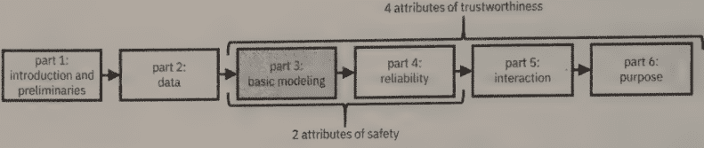

**图 6.1. 本书的结构。** 第三部分聚焦于可信度的第一个属性，即*能力与可信性*，它对应于表现良好且准确的机器学习模型。无障碍说明。一个从左到右的流程图，包含六个框：第 1 部分：引言与预备知识；第 2 部分：数据；第 3 部分：基本建模；第 4 部分：可靠性；第 5 部分：交互；第 6 部分：目的。第 3 部分被突出显示。第 3–4 部分被标记为安全性的属性。第 3–6 部分被标记为可信度的属性。

具体来说，本章聚焦于：

- 选择量化决策函数基本性能的指标（包括涵盖不同操作条件下性能汇总的指标），
- 检验你的决策函数是否已达到最优，
- 以及区分风险评估问题中的性能与二元决策问题中的性能。

## 6.1 选择决策函数指标

作为 ThriveGuild 的数据科学家，你面临*二元检测*问题，也称为*二元假设检验*问题，即预测哪些贷款申请人会违约，从而决定拒绝哪些申请。² 令`Y`表示贷款审批决策，标签`y` = 0 对应拒绝，标签`y` = 1 对应批准。特征向量`X`包含就业状况、收入和其他属性。值`y` = 0 称为*负类结果*，值`y` = 1 称为*正类结果*。特征和标签的随机变量由概率质量函数（pmf）支配，这些函数被赋予一个特殊名称：*似然函数*`pₓ|ᵧ(x | y = 0)`和`pₓ|ᵧ(x | y = 1)`，同时还有先验概率`p₀ = P(Y = 0)`和`p₁ = P(Y = 1) = 1 − p₀`。基本任务是找到一个*决策函数*`γ: 𝒳 → {0,1}`，根据特征预测标签。³

### 6.1.1 量化可能事件

在二元检测问题中有四种可能事件：

1. 决策函数预测为 0，真实标签为 0，
2. 决策函数预测为 0，真实标签为 1，
3. 决策函数预测为 1，真实标签为 1，以及
4. 决策函数预测为 1，真实标签为 0。

这些分别称为*真阴性*（TN）、*假阴性*（FN）、*真阳性*（TP）和*假阳性*（FP）。真阴性是指拒绝了一个根据某种基本事实应当被拒绝的申请人；假阴性是指拒绝了一个应当被批准的申请人；真阳性是指批准了一个应当被批准的申请人；假阳性是指批准了一个应当被拒绝的申请人。让我们在称为*混淆矩阵*的表格中整理这些事件：

|  | `Y = 1` | `Y = 0` |
| --- | --- | --- |
| `ŷ(X) = 1` | TP | FP |
| `ŷ(X) = 0` | FN | TN |

方程 6.1

这些事件的概率为：

| `p_TP` = P(ŷ(X) = 1 \| Y = 1) | `p_FP` = P(ŷ(X) = 1 \| Y = 0) |
| --- | --- |
| `p_FN` = P(ŷ(X) = 0 \| Y = 1) | `p_TN` = P(ŷ(X) = 0 \| Y = 0) |

方程 6.2

这些条件概率只是事件定义的直接实现。概率`p_TN`称为*真阴性率*，也称为特异度和选择性。概率`p_FN`称为*假阴性率*，也称为漏检概率和漏检率。概率`p_TP`称为*真阳性率*，也称为检测概率、召回率、灵敏度和统计功效。概率`p_FP`称为*假阳性率*，也称为虚警概率和误报率。这些概率还可以用略有不同的表格来组织：

| P(ŷ(X) \| Y) | `Y = 1` | `Y = 0` |
| --- | --- | --- |
| `ŷ(X) = 1` | `p_TP` | `p_FP` |
| `ŷ(X) = 0` | `p_FN` | `p_TN` |

方程 6.3

这些概率为你提供了一些量化指标，用以理解决策函数`ŷ`的性能。在两者之间做出选择，需要思考事件本身及其与现实世界问题的关联。假阳性（批准了本应被拒绝的申请者）意味着 ThriveGuild 的放贷方必须承担违约成本，因此应尽量降低。假阴性（拒绝了本应被批准的申请者）则会让 ThriveGuild 错失通过收取利息获利的机会。

上述事件都以真实标签为条件。以预测标签为条件也会产生对刻画性能有用的事件和概率：

| P(Y \| ŷ(X)) | `Y = 1` | `Y = 0` |
| --- | --- | --- |
| `ŷ(X) = 1` | `p_PPV` | `p_FDR` |
| `ŷ(X) = 0` | `p_FOR` | `p_NPV` |

方程 6.4

这些条件概率与方程 6.2 中的方向相反。概率`p_NPV`称为阴性预测值。概率`p_FOR`称为假遗漏率。概率`p_PPV`称为阳性预测值，也叫做精确率。概率`p_FDR`称为假发现率。如果你关心决策函数的质量，应关注第一组（`p_TN`、`p_FN`、`p_TP`、`p_FP`）。如果你关心预测的质量，应关注第二组（`p_NPV`、`p_FOR`、`p_PPV`、`p_FDR`）。

当你需要数值计算这些概率时，将决策函数应用于多个独立同分布的 `(X, Y)` 样本，并分别将 TN、FN、TP 和 FP 事件的数量记为`n_TN`、`n_FN`、`n_TP`和`n_FP`。然后使用以下概率估计：

| `p_TP` ≈ `n_TP` / (`n_TP` + `n_FN`) | `p_FP` ≈ `n_FP` / (`n_FP` + `n_TN`) |
| --- | --- |
| `p_FN` ≈ `n_FN` / (`n_FN` + `n_TP`) | `p_TN` ≈ `n_TN` / (`n_TN` + `n_FP`) |
| `p_PPV` ≈ `n_TP` / (`n_TP` + `n_FP`) | `p_FDR` ≈ `n_FP` / (`n_FP` + `n_TP`) |
| `p_FOR` ≈ `n_FN` / (`n_FN` + `n_TN`) | `p_NPV` ≈ `n_TN` / (`n_TN` + `n_FN`) |

方程 6.5

举个例子，假设 ThriveGuild 做出了以下数量的决策：`n_TN = 1234`，`n_FN = 73`，`n_TP = 843`，`n_FP = 217`。你可以将这些数值代入上面的相应表达式中来估计各项性能概率。结果分别为`p_TN ≈ 0.85`，`p_FN ≈ 0.08`，`p_TP ≈ 0.92`，`p_FP ≈ 0.15`，$p_{NPV} \approx 0.94$，$p_{FOR} \approx 0.06$，$p_{PPV} \approx 0.80$，$p_{FDR} \approx 0.20$。这些值都相当不错，但最终必须根据 ThriveGuild 问题所有者的目标和目的来评判。

### 6.1.2 综合性能指标

总体上，假阴性和假阳性都是*错误*。*错误概率*，也称为错误率，是假阴性率和假阳性率按先验概率加权的总和：

$p_E = p_0p_{FP} + p_1p_{FN}$。

方程 6.6

*平衡错误概率*，也称为*平衡错误率*，是假阴性率和假阳性率的无加权平均值：

$p_{BE} = \frac{1}{2}p_{FP} + \frac{1}{2}p_{FN}$。

方程 6.7

它们概括了决策函数的基本性能。当某个标签的数据点远多于另一个标签，而你又对每种错误同等重视时，平衡就非常有用。*准确率*，即错误概率的补数：$1 - p_E$，以及*平衡准确率*，即平衡错误概率的补数：$1 - p_{BE}$，有时比错误率更容易让问题所有者理解。

$F_1$分数，即 $p_{TP}$ 和 $p_{PPV}$ 的调和平均值，是一种类似准确率的汇总度量，用于刻画预测的质量而非决策函数：

$F_1 = 2\frac{p_{TP}p_{PPV}}{p_{TP}+p_{PPV}}$。

方程 6.8

继续前面的例子，其中 $p_{TP} \approx 0.92$，$p_{PPV} \approx 0.80$，假设根据某些真实标准，ThriveGuild 收到申请的先验概率定义为 $p_0 = 0.65$，申请被批准的先验概率为 $p_1 = 0.35$。将这些值代入上述相关方程，你会发现 ThriveGuild 的 $p_E \approx 0.13$，$p_{BE} \approx 0.11$，$F_1 \approx 0.86$。同样，这些数值比较合理，可能会被问题所有者视为可接受。

作为数据科学家，你可以借助这些抽象的 TN、FN、TP 和 FP 事件走得很远，但必须将它们置于问题所有者的目标背景下。ThriveGuild 关心的是对借款人做出好的押注，从而获得盈利。更广泛地说，在现实世界的应用中，错误事件会对受影响人群造成重大后果，包括失去生命、失去自由、失去生计等。因此，要真正刻画决策函数的性能，考虑与不同事件相关的*成本*非常重要。你可以通过成本函数 $c(Y, \hat{y}(X))$ 来捕捉这些成本，并将成本分别记为 $c(0,0) = c_{00}$，$c(1,0) = c_{10}$，$c(1,1) = c_{11}$ 和 $c(0,1) = c_{01}$。

将成本考虑在内，决策函数的性能表征称为贝叶斯风险 $R$：

$R=(c_{10}-c_{00})p_0p_{FP}+(c_{01}-c_{11})p_1p_{FN}+c_{00}p_0+c_{11}p_1.$

方程 6.9

拆分这个方程，你会看到两个错误概率 $p_{FP}$ 和 $p_{FN}$ 是主要组成部分，分别乘以其相关的先验概率和成本。非错误事件的成本仅以其成本相乘的形式出现。贝叶斯风险是寻找最优决策函数时最常用的性能指标。实际寻找决策函数的过程被称为求解贝叶斯检测问题。从问题所有者那里引出针对特定现实世界问题的成本函数 $c(\cdot,\cdot)$ 是价值对齐的一部分，将在第 14 章中描述。

一个贯穿本章其余部分的思维模型或路线图如图 6.2 所示：贝叶斯风险和贝叶斯检测问题是核心概念，其他所有概念都以各种方式和目的与这一核心概念相关联。尚未定义和评估的术语和概念将在后面很快出现。

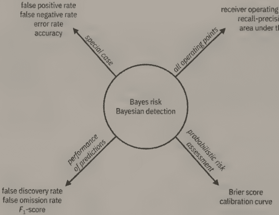

图 6.2. *围绕贝叶斯风险和贝叶斯检测这一核心概念的检测理论中不同概念的思维模型。* 图中以贝叶斯风险和贝叶斯检测为中心，向外辐射出四组其他概念。假阳性率、假阴性率、错误率和准确率是特殊情况。受试者工作特征、召回率-精确率曲线和曲线下面积是在考察所有工作点时出现的。布里尔分数和校准曲线出现在概率风险评估中。假发现率、假遗漏率和 $F_1$分数与预测性能相关。

因为把事情做对是好事，所以通常假设正确决策没有成本，即 $c_{00}=0$ 且 $c_{11}=0$，本书后续也采用这一假设。在这种情况下，贝叶斯风险简化为：

`R = c₁₀ p₀ p_FP + c₀₁ p₁ p_FN`.

方程 6.10

要得到这个简化方程，只需将方程 6.9 中的`c₀₀`和`c₁₁`都代入零即可。当`c₁₀ = 1`且`c₀₁ = 1`时，贝叶斯风险就是错误概率。

我们隐含地假设`c(·,·)`不依赖于`X`，除非通过`ŷ(X)`。这个假设不是必需的，而是为了简化而做出的。你很容易想象出决策成本取决于特征的场景。例如，如果 ThriveGuild 贷款审批决策中使用的某个特征是贷款金额，那么错误成本（货币损失）就取决于该特征。然而，为了简化，我们通常假设成本函数不显式依赖于特征值。例如，在此假设下，对于所有申请者，假阴性的成本可能是`c₁₀ = 100,000`美元，假阳性的成本可能是`c₀₁ = 50,000`美元。


### 6.1.3 考虑不同工作点

如果先验概率和成本是固定的，贝叶斯风险当然很好，但情况会变化。如果经济好转，潜在借款人的还款可靠性可能会提高。如果换了不同的问题所有者，对机会成本有不同的理解，那么假阴性成本 `c₁₀` 就会改变。面对这些取值组合（称为不同工作点），你应该如何考虑决策函数的性能？

许多决策函数由一个阈值 `η` 参数化（包括将在 6.2 节中展示的最优决策函数）。你可以改变决策函数，使其对假阳性或假阴性更宽容或更严格，但不能同时两者兼顾。变化 `η` 可以探索这种权衡，并产生不同的错误概率对 `(p_FP, p_FN)`，即不同的工作点。等价地，不同的工作点对应不同的假阳性率与真阳性率对 `(p_FP, p_TP)`。当参数 `η` 从零变化到无穷大时，在 `p_FP-p_TP` 平面上描绘出的曲线就是受试者工作特征（ROC）。当 `η → ∞` 时，ROC 取值为 `(p_FP = 0, p_TP = 0)`；当 `η → 0` 时，取值为 `(p_FP = 1, p_TP = 1)`。你可以这样理解：在一个极端，决策函数总是说 `ŷ = 0`；这种情况下既没有 FP 也没有 TP。在另一个极端，决策函数总是说 `ŷ = 1`；这种情况下所有决策要么是 FP 要么是 TP。

ROC 是一条凹的、非递减函数，如图 6.3 所示。它越靠近左上角越好。最佳判别 ROC 直接向上延伸到 `(0,1)`，然后急剧向右转。最差的 ROC 是连接 `(0,0)` 和 `(1,1)` 的对角线，由随机猜测得到。ROC 下面积，也称为曲线下面积（AUC），综合了所有工作点上的性能，当同一个阈值参数化决策函数很可能在差异很大的工作条件下使用时，应选择 AUC 作为指标。根据最差（对角线）和最佳（先直上再直右）ROC 曲线的形状，你可以看出 AUC 的范围从 `0.5`（右下三角形的面积）到 `1`（整个正方形的面积）。⁴

⁴召回率-精确率曲线是另一种理解不同工作点性能的替代方式。它是在 `p_PPV-p_TP` 平面上描绘出的曲线，从 `(p_PPV = 0, p_TP = 1)` 开始，到 `(p_PPV = 1, p_TP = 0)` 结束。它与 ROC 有一一对应关系，并且对某些人来说更容易理解。Jesse Davis 和 Mark Goadrich。“精确率-召回率

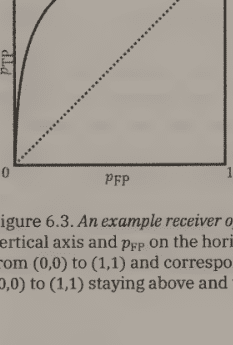

图 6.3：一个受试者工作特征（ROC）示例。无障碍说明。纵轴为 `p_TP`，横轴为 `p_FP` 的图。两轴范围均为 0 到 1。一条虚线对角线从 `(0,0)` 到 `(1,1)`，对应随机猜测。一条实心凹曲线，即 ROC，从 `(0,0)` 到 `(1,1)`，保持在对角线的上方和左侧。

## 6.2 你所能达到的最佳水平

作为 ThriveGuild 的数据科学家，你向问题所有者提供了整套基础性能指标供其选择，并说明了哪些情况下不同选择更为合适或不那么合适。贝叶斯风险是对决策函数最全面、最常用的性能表征。假设在机器学习生命周期的任务定义阶段选择了贝叶斯风险，包括选择成本。现在你处于建模阶段，需要判断模型是否表现良好。最好的做法是优化贝叶斯风险，以获得具有最小贝叶斯风险的最佳可能决策函数，并将当前模型的贝叶斯风险与之比较。

> “可预测性上限常常被主流机器学习研究忽视。每个预测问题都有一个预测上限——即贝叶斯最优性能。如果你对自己问题的这个上限没有很好的了解，你就处于黑暗之中。”

——梅尔特·R·萨本库，康奈尔大学计算机科学家

我们将最佳可能决策函数记为 `ŷ*(·)`，其对应的贝叶斯风险记为 `R*`。它们由期望成本的最小化来指定：代入公式 6.14，你会得到：

```
$$\eta = \frac{100000 \times 0.65}{50000 \times 0.35} = 3.7.$$
```

公式 6.16

将这些表达式代入公式 6.12 给出的贝叶斯最优决策函数，你会得到：

```
$$y^*(x) = \begin{cases} 0, & 0.5e^{0.5x} \le 3.7 \\ 1, & 0.5e^{0.5x} > 3.7 \end{cases}$$
```

公式 6.17

它可以简化为：

```
$$y^*(x) = \begin{cases} 0, & x \le 4 \\ 1, & x > 4 \end{cases}$$
```

公式 6.18

方法是将两种情况下的不等式两边都乘以 2，取自然对数，然后再乘以 2。收入小于或等于 4 的申请者被拒绝，收入大于 4 的申请者被批准。`$X \mid Y = 1$` 的期望值为 2，`$X \mid Y = 0$` 的期望值为 1。因此在这个例子中，申请者的收入必须显著高于均值才能被批准。

你应该使用贝叶斯最优风险 `$R^*$` 作为针对给定数据分布你可能尝试的任何机器学习分类器性能的下界。^5 无论你多么努力或多么有创造力，你都无法超越贝叶斯极限。因此，如果你能够接近它，就应该感到高兴。如果贝叶斯最优风险本身太高，那么该做的就是回到机器学习生命周期中的数据理解和数据准备阶段，获取更多有信息量的数据。

## 6.3 风险评估与校准

批准还是拒绝，这是 ThriveGuild 的问题。真的是这样吗？也许问题不在于二元分类，而在于概率风险评估。这当然是你（数据科学家）和问题所有者在任务定义阶段可以考虑的一个选项。对概率风险评估设置阈值可以得到分类结果，但其中有一些微妙之处需要你权衡。

有些技术可以在无法访问数据集底层概率分布的情况下估计其贝叶斯风险。Ryan Theisen、Huan Wang、Lav R. Varshney、Caiming Xiong 和 Richard Socher。“对照贝叶斯最优性评估最先进的分类模型。”载于：*神经信息处理系统进展* 34（2021 年 12 月）。

似然比的范围是从零到无穷大，对于先验相等且成本相等的情况，阈值 `η = 1` 是最优的。将任何单调递增函数同时应用于似然比和阈值，仍会得到具有相同风险 `R*` 的贝叶斯最优决策函数。也就是说，

```
ŷ*(·) = {0, g(Λ(x)) ≤ g(η)

1, g(Λ(x)) > g(η)}
```

公式 6.19

对于任何单调递增函数 `g(·)` 而言，仍然是最优的。

将分数 `s(x)` 视为在 `[0,1]` 范围内更自然一些，因为它对应于标签值 `y ∈ {0,1}`，并且也可能被解释为概率。分数是决策函数的连续值输出，可以被视为预测的置信度，并通过将合适的 `g` 函数应用于似然比而获得。在这种情况下，对于相等的先验和成本，阈值为 `0.5`。中间分数值的置信度较低，而极端分数值（接近 `0` 和 `1`）的置信度较高。正如似然比可以被视为随机变量一样，分数也可以被视为随机变量 `S`。对于决策函数的连续值输出分数，Brier 分数是一个合适的性能指标：

```
Brier 分数 = E[(S − Y)²]。
```

公式 6.20

它是分数 `S` 相对于真实标签 `Y` 的均方误差。对于有限数量的样本 `{(s₁,y₁), ..., (sₙ,yₙ)}`，你可以将其计算为：

```
Brier 分数 = 1/n Σ_{j=1}^{n} (s_j − y_j)²。
```

公式 6.21

Brier 分数分解为两个可分离部分之和：校准和细化。校准的概念是预测分数对应于正类真实标签的比例。例如，一组数据点的校准分数均为 `s = 0.7`，意味着其中 70% 的真实标签为 `y = 1`，30% 的真实标签为 `y = 0`。换句话说，完美校准意味着在预测分数 `S = s` 的条件下，真实标签 `Y` 为 1 的概率等于 `s` 本身：`P(Y = 1 | S = s) = s`。校准对于概率风险评估非常重要：完美校准的分数可以被解释为预测某一类或另一类的概率。它也是评估因果推断方法（见第 8 章）、算法公平性（见第 10 章）以及沟通不确定性（见第 13 章）的重要概念。

6 何塞·埃尔南德斯-奥拉洛、彼得·弗拉赫和塞萨尔·费里。“性能度量的统一视角：将阈值选择转化为期望分类损失。”载于：机器学习研究杂志 13（2012 年 10 月），第 2813–2869 页。

由于任何单调递增变换 `g(·)` 都可以应用于决策函数而不改变其判别能力，因此你可以通过寻找更好的 `g(·)` 来改进决策函数的校准。校准损失定量地刻画了决策函数与完美校准的接近程度。细化损失是一种方差，衡量真实标签在给定分数周围的紧密程度。对于按分数值排序并分箱为 `k` 组 `{B₁,...,Bₖ}` 的 `{(s₁,y₁),...,(sₙ,yₙ)}`，箱内平均值分别为 `{(s̄₁,ȳ₁),...,(s̄ₖ,ȳₖ)}`，则

```
校准损失 = (1/n) Σ_{i=1}^k ||B_i|| (s̄_i - ȳ_i)^2

细化损失 = (1/n) Σ_{i=1}^k ||B_i|| ȳ_i (1 - ȳ_i)。
```

公式 6.22

如前所述，校准损失与细化损失之和即为 Brier 分数。

校准曲线，也称为可靠性图，将 `(s̄_k, ȳ_k)` 值绘制成图。图 6.4 展示了一个示例。越接近从 `(0,0)` 到 `(1,1)` 的直线对角线越好。绘制该曲线是帮助你理解决策函数校准情况的一个良好诊断工具。


图 6.4：一个校准曲线示例。无障碍说明。纵轴为 `P(Y = 1)`，横轴为 `s` 的图。两轴范围均为 0 到 1。一条虚线对角线从 `(0,0)` 到 `(1,1)`，对应完美校准。一条实心 S 形曲线，即校准曲线，从 `(0,0)` 到 `(1,1)`，起始于对角线下方和右侧，然后越过对角线变为其上方和左侧。

## 6.4 小结

- 二元决策产生四种可能的事件：假阴性、真阴性、假阳性和真阳性。

- 组合这些事件概率的不同方式构成了分类器性能指标，适用于不同的现实世界场景。

- 其中一个重要的是贝叶斯风险：即假阴性概率与假阳性概率的组合，同时按这些错误的成本和标签的先验概率加权。它是安全性和可信赖性第一属性的基本性能度量。

- 检测理论——研究最优决策，为机器学习模型可能达到的性能提供基本极限——是一种用于评估模型基本性能的工具。

- 决策函数可能输出连续值分数，而不仅仅是硬性的零一决策。分数表示预测的置信度。校准分数是指分值等于样本属于某个标签类别的概率的分数。

# 7 监督学习

虚构的信息技术公司 JCN Corporation 正在自我转型，将重心转向人工智能和云计算。作为这次企业转型中人才管理的一部分，该公司正在开展一个机器学习项目，从多种数据源估计员工的专业技能，这些数据源包括技能自我评估、工作成果（专利、出版物、软件文档、服务索赔、销售机会等）、内部非私人社交媒体帖子，以及包含员工工龄、汇报链和薪资等级的表格式数据记录。随机抽取的一部分员工已经针对各种 AI 和云技能按二元是/否量表进行了明确评估，这些构成了机器学习的有标签训练数据。JCN Corporation 的数据科学团队的任务是预测公司内所有其他员工的专业技能评估。为简单起见，我们只关注其中一个专业领域：无服务器架构。

假设你是 JCN Corporation 数据科学团队的一员，已经完成了机器学习生命周期的任务定义、数据理解和数据准备阶段，现在处于建模阶段。通过应用检测理论，你为预测员工的无服务器架构技能选择了一个合适的性能量化指标：错误率——即假阳性和假阴性成本相等时的贝叶斯风险——在第 6 章中介绍过。

现在是时候开始从训练数据中学习一个决策函数（分类器）了，该函数能够很好地泛化，为未标记的员工预测专业技能标签。深度学习是大家耳熟能详的一类分类器。它当然是一个选择，但还有许多其他类型的分类器。你如何评估不同的分类算法，为你的问题选择最佳的一个？

> “我在行业中的经验强烈证实，深度学习只是解决复杂自动化决策问题所需方法中的一小部分。”

> 

> —祖宾·加赫拉马尼，Uber 首席科学家

在实践机器学习中一个非常重要的概念，首次在第 2 章中提到，是 *没有免费午餐定理*。不存在一种对所有数据集都最佳的统一机器学习方法。¹ 对某个数据集来说好的选择，对另一个数据集可能并不那么理想。这完全取决于数据集的特征以及方法的 *归纳偏置*：即关于分类器应如何在训练数据点之外进行 *泛化* 的假设。要实现良好的泛化和低错误率，挑战在于防止 *过拟合*（学习到的模型过于贴近训练数据的特有个别特征）和 *欠拟合*（学习到的模型未能充分捕捉训练数据中的模式）。目标是达到金发女孩式的理想点：既不太热（过拟合），也不太冷（欠拟合），而是 *恰到好处*。

没有免费午餐定理的一个启示是，你必须为 JCN Corporation 的专业技能问题尝试几种不同的方法，并根据经验观察它们的表现，然后再决定使用哪一种。简单地蛮力测试——训练所有不同的方法并计算它们的测试错误，看看哪个最小——是一种常见做法，但你决定采取更精细的方法，分析不同分类器的归纳偏置。你的分析将确定各种分类器的 *能力域*：它们在哪类数据集上表现良好，又对哪类数据集表现不佳。² 回想一下，能力或基本准确率是可信机器学习的第一属性，也是安全性的前半部分。

为什么要采取这种精细的方法，而不是简单地从 `scikit-learn`、`TensorFlow` 和 `PyTorch` 等软件包中应用一堆机器学习方法而不分析它们的归纳偏置呢？首先，你听取了前面章节的告诫，要注重安全，不走捷径。然而更重要的是，你知道你之后将创建尊重可信赖性第二（可靠性）和第三（交互）属性的新算法。你不仅要能够应用算法，还必须能够在创造之前分析和评估它们。现在，去分析用于盘点 JCN Corporation 员工专业技能的各类分类器吧。

## 7.1 能力域

不同的分类器根据数据集的特征在不同数据集上表现良好。³ 但数据集的哪些特征才是重要的？能力域的参数是什么？回答这些问题的一个关键概念是 *决策边界*。在第 6 章中，你了解到贝叶斯最优决策函数是一个似然比检验，即一维似然比的一个阈值。如果对似然比求逆，你可以回到具有 *d* 个特征维度 `x^(1)`, …, `x^(d)` 的特征空间，并描绘出该单一阈值所映射的曲面。这些曲面的集合是似然比函数的一个 *水平集*，称为决策边界。想象似然比函数就像地球的地形和水深。任何在水下的东西被分类为 `ŷ = 0`（员工不擅长无服务器架构），任何在水上的东西被分类为 `ŷ = 1`（员工擅长无服务器架构）。海平面是阈值，海岸线是水平集或决策边界。图 7.1 显示了一个二维特征空间中决策边界的示例。


图 7.1. 特征空间中决策边界的示例。灰色区域对应决策函数预测员工擅长无服务器架构的特征值。白色区域对应决策函数预测员工不擅长无服务器架构的特征值。黑色线条是决策边界。无障碍说明。一个风格化绘图，第一特征维度 `x^(1)` 在横轴上，第二特征维度 `x^(2)` 在纵轴上。空间被划分为若干个斑块状灰色区域（标记为 `ŷ = 1`）和一个白色区域（标记为 `ŷ = 0`）。区域之间的边界被标记为决策边界。分类器区域不一定全部是一个连通的组件。

数据集的三个关键特征决定了分类器的归纳偏置与数据集的匹配程度：

1. 决策边界附近两个类别标签的数据点重叠程度，

2. 决策边界的线性或非线性，

3. 数据点的数量、密度以及聚类程度。

分类器的能力域根据这三个考虑来定义。⁴ 重要的是，能力域是相对概念：某一种分类算法是否比其他算法更好？⁵ 它们不是绝对概念，因为归根结底，绝对性能受到第 6 章定义的贝叶斯最优风险的限制。例如，你尝试的某一种分类方法可能在决策边界附近类别重叠度高、决策边界形状接近线性、且数据点不多的数据集上比其他方法表现更好。另一种分类方法可能比

另一些方法则在决策边界形状曲折、类别重叠不多的数据集上表现更好。还有一种分类方法可能在大规模数据集上优于其他方法。在本章余下部分，你将分析许多不同的监督学习算法。目的不仅是描述它们的工作原理，还要分析它们的归纳偏置和擅长领域。

## 7.2 处理监督学习的两种方法

我们首先来盘点一下你和 JCN 公司的数据科学家团队手头有哪些可用资源。你的训练数据集由从概率分布 `pₓᵧ(x, y)` 中独立抽取的 `n` 个样本 `(x₁, y₁), (x₂, y₂), ..., (xₙ, yₙ)` 组成。从随机变量 `X` 中采样的特征 `xⱼ` 是源自技能自我评估、工作成果等的数值型或类别型量。共有 `d` 个特征，因此 `xⱼ` 是一个 `d` 维向量。从随机变量 `Y` 中采样的标签 `yⱼ` 是对无服务器架构专业技能的二元（0 或 1）评估。重要的是，你无法获得精确分布 `pₓᵧ(x, y)`，只能获得训练数据集中包含的、从该分布抽取的有限数量样本。这是监督机器学习问题与第 6 章介绍的贝叶斯检测问题之间的关键区别。机器学习问题和检测问题的目标相同：找到一个根据特征预测标签的决策函数 `ŷ`。

基于训练数据寻找分类器 `ŷ`，你有哪几种选择？你不能直接最小化贝叶斯风险泛函或错误概率，因为这样做需要完全掌握特征和标签的概率分布，而你不具备这种掌握。你和团队有两个选择：

- 1. *代入法*：根据训练数据估计似然函数和先验概率，并将它们代入第 6 章描述的贝叶斯最优似然比检验；或

- 2. *风险最小化*：在训练数据样本上计算得到的错误率的经验近似上优化分类器。

在监督分类算法的这两大类中，各自有一些具体方法。图 7.2 展示了用不同方式进行监督机器学习的心智模型。

## 7.3 代入法

首先，你和 JCN 公司数据科学团队的其他成员尝试使用代入法进行监督分类。主要思想是利用训练数据估计似然函数 `pₓᵧ(x | y = 0)` 和 `pₓᵧ(x | y = 1)`，然后将它们代入似然比以获得分类器。

### 7.3.1 判别分析

最直接的代入法之一——*判别分析*——假设似然函数具有某种参数化形式，并估计其参数。然后，就像第 6 章一样，它通过求这些似然函数的比值并与阈值 `η` 比较来获得决策函数。实际的潜在似然函数不必与假设的形式完全一致，实践中通常也不一致。只要它们大致接近，就足够了。所假设的参数化形式正是判别分析的归纳偏置。

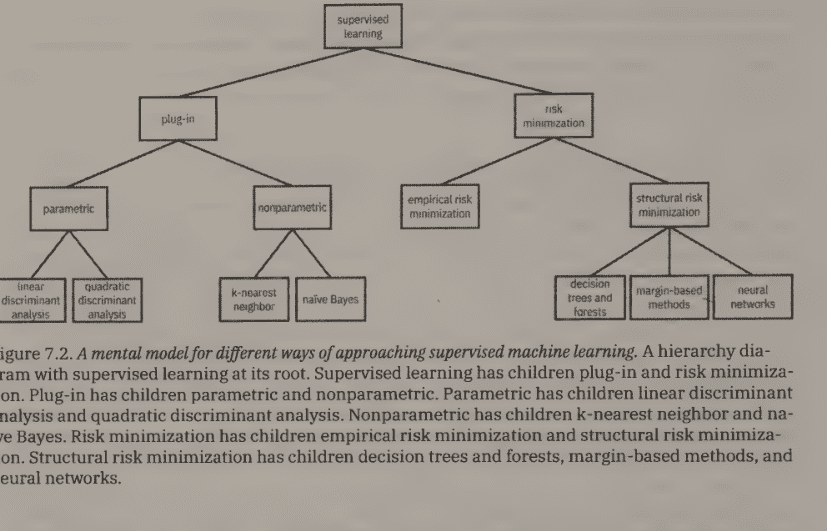

图 7.2. 处理监督机器学习的不同方式的心智模型。这是一个层级图，监督学习位于其根部。监督学习的子节点为代入法和风险最小化。代入法的子节点为参数化和非参数化。参数化的子节点为线性判别分析和二次判别分析。非参数化的子节点为 `k` 近邻和朴素贝叶斯。风险最小化的子节点为经验风险最小化和结构风险最小化。结构风险最小化的子节点为决策树和随机森林、基于间隔的方法以及神经网络。


如果假设似然函数的参数化形式是 `d` 维空间中的多元高斯分布，均值参数为 `μ₀` 和 `μ₁`，协方差矩阵参数为 `Σ₀` 和 `Σ₁`，⁶ 那么第一步是从训练数据中计算它们的经验估计值 `μ̂₀`、`μ̂₁`、`Σ̂₀` 和 `Σ̂₁`——这是你在第 3 章中已经知道如何做的。第二步是将这些估计值代入似然比，得到分类器的决策函数。在高斯假设下，这种方法称为*二次判别分析*，因为在对似然比进行重新整理和化简后，与阈值比较的量恰好是 `x` 的二次函数。如果进一步假设两个协方差矩阵 `Σ₀` 和 `Σ₁` 是同一个矩阵 `Σ`，那么与阈值比较的量就更简单了：它是 `x` 的线性函数，这种方法称为*线性判别分析*。

图 7.3 展示了 `d = 2` 维下、在图中所示数据点上训练得到的线性判别分析和二次判别分析分类器示例。红色菱形代表训练集中不擅长无服务器架构的员工。绿色正方形代表训练集中擅长无服务器架构的员工。线性判别分析和二次判别分析的擅长领域是决策边界大体呈线性、且边界附近两类标签的数据点密集的数据集。

⁶ 似然函数的数学形式为：`p_{X|Y}(x | y = 0) = 1/√((2π)^d det(Σ₀)) e^(-½(x-μ₀)^T Σ₀^{-1} (x-μ₀))` 和 `p_{X|Y}(x | y = 1) = 1/√((2π)^d det(Σ₁)) e^(-½(x-μ₁)^T Σ₁^{-1} (x-μ₁))`，其中 `det` 是矩阵行列式函数。

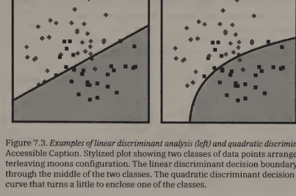

图 7.3. 线性判别分析（左）和二次判别分析（右）分类器示例。无障碍说明：风格化图显示了两类数据点，排列成嘈杂的阴阳形或交错月牙形分布。线性判别决策边界是一条直线，从两类数据中间穿过。二次判别决策边界是一条平滑曲线，略微弯转以围住其中一类。

### 7.3.2 非参数密度估计

你继续探索，分析不同的分类器来评估 JCN 员工的专业技能。与判别分析中假设似然函数具有参数化形式不同，你尝试以非参数方式估计似然函数。“非参数”这个词其实是一种误称。这并不意味着估计的似然函数中完全没有参数；而是意味着参数数量与训练数据点数量相当。

以非参数方式估计似然函数的一种常用方法是核密度估计。其思想是在每个训练数据点中心放置一个平滑函数（如高斯概率密度函数），然后将这些函数的归一化和作为似然函数的估计。在这种情况下，参数是这些平滑函数的中心，因此参数数量等于数据点数量。分别对两个似然函数执行此操作，取它们的比值并与阈值比较，就能得到一个有效的分类器。然而，这个分类器相当复杂。你需要大量数据才能得到良好的核密度估计，尤其是当数据具有很多特征维度 `d` 时。

如果不做完整的密度估计，一种简化是假设 `X` 的所有特征维度相互独立。在此假设下，似然函数可以分解为一维概率密度函数的乘积，而这些一维概率密度函数可以用少得多的数据分别估计。如果你取这些一维概率密度函数乘积的比值（即似然比）并与阈值比较，瞧，你就得到了一个朴素贝叶斯分类器。这种方法的名称中包含“朴素”，是因为假设所有特征维度相互独立有些天真——在现实生活中它们从来都不是独立的。它包含“贝叶斯”，是因为它代入了贝叶斯最优似然比检验。通常，这种分类器在准确率方面并不优于其他分类器，因此它的擅长领域往往并不存在。

另一种不同的非参数方法是 `k` 近邻分类器。它背后的思想非常简单：查看 `k` 个最近的训练数据点的标签，并预测这些邻近点中出现最多的那个标签。需要一个距离度量来定义“接近”和“邻近”。通常使用欧氏距离（通常的直线距离），但也可以使用其他距离度量。

首先，由于训练数据是从底层分布中 i.i.d. 采样得到的，训练数据集中精通和不精通无服务器架构的员工比例将大致与先验概率 `p_0` 和 `p_1` 相匹配，因此你无需显式地担心它们。其次，假阳性事件 `P(\hat{y}(X)=1\mid Y=0)` 和假阴性事件 `P(\hat{y}(X)=0\mid Y=1)` 的概率都可以 collectively 表示为 `P(\hat{y}(X)\neq Y)`，这对应于训练数据样本的 `\hat{y}(x_j)\neq y_j`。*零-一损失函数* `L\left(y_j,\hat{y}(x_j)\right)` 通过在 `\hat{y}(x_j)\neq y_j` 时返回值为 1、在 `\hat{y}(x_j)=y_j` 时返回值为 0 来捕捉这一点。把所有这些结合起来，误差概率的经验近似，称为 *经验风险* `R_{\text{emp}}`，为：

```
R_{\text{emp}} = \frac{1}{n}\sum_{j=1}^{n} L\left(y_j,\hat{y}(x_j)\right).
```

Equation 7.2

### 7.4.2 结构风险最小化

没有任何约束的情况下，你可以找到一个使经验风险降为零的决策函数，但它对新的未见数据点的泛化能力不佳。极端情况下，想象一个分类器，它记忆训练数据点并使其完全正确，但在其他地方总是预测 `\hat{y}=0`（不精通无服务器架构）。这不是期望的行为——分类器发生了过拟合。因此，仅最小化经验风险并不会得到一个有能力的分类器。这个记忆型分类器相当复杂。它没有任何平滑或简单的特性，因为它具有的间断点数量与训练集中精通无服务器架构的员工数量一样多。

约束分类器的复杂度可迫使其不过拟合。更精确地说，如果你将决策函数 `\hat{y}` 约束为某个函数类或 *假设空间* `\mathcal{F}` 的元素，而该假设空间仅包含低复杂度函数，那么你将防止过拟合。但约束也可能过头。如果假设空间太小，且不包含任何具有捕捉数据中重要模式能力的函数，它可能会欠拟合数据，也无法泛化。控制假设空间使其恰到好处非常重要。这个思想被称为 *结构风险最小化原理。*

图 7.5 使用一系列嵌套假设空间 `\mathcal{F}_1 \subset \mathcal{F}_2 \subset \cdots \subset \mathcal{F}_6` 以图示形式展示了这一思想。作为嵌套假设空间的示例，`\mathcal{F}_1` 可以是所有常数函数，`\mathcal{F}_2` 可以是所有线性函数，`\mathcal{F}_3` 可以是所有二次函数，而 `\mathcal{F}_6` 可以是所有多项式函数。`\mathcal{F}_1` 包含最不复杂的 `\hat{y}` 函数，而 `\mathcal{F}_6` 也包含更复杂的 `\hat{y}` 函数。`\mathcal{F}_1` 欠拟合，因为它在训练数据上计算的经验风险 `R_{\text{emp}}` 和衡量泛化的误差概率 `p_E` 都有较大值。`\mathcal{F}_6` 过拟合，因为它具有零 `R_{\text{emp}}` 和较大的 `p_E` 值。`\mathcal{F}_2` 达到了良好的平衡，恰到好处。

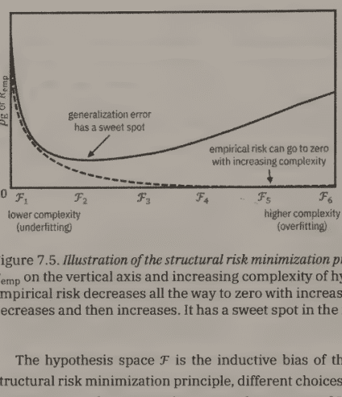

Figure 7.5. Illustration of the structural risk minimization principle. Accessible caption. A plot with `p_E` or `R_emp` on the vertical axis and increasing complexity of hypothesis spaces on the horizontal axis. The empirical risk decreases all the way to zero with increasing complexity. The generalization error first decreases and then increases. It has a sweet spot in the middle.

图 7.5. 结构风险最小化原理的说明。无障碍说明。纵轴为 `p_E` 或 `R_emp`，横轴为假设空间复杂度递增的图。随着复杂度增加，经验风险一直下降到零。泛化误差先减小后增大。中间有一个最佳点。

假设空间 `F` 是分类器的归纳偏置。因此，在结构风险最小化原理的范式下，不同的假设空间选择会产生不同的能力域。在下一节中，你和你的 JCN 数据科学家团队将分析实践中广泛使用的几种风险最小化分类器，包括决策树和森林、基于间隔的分类器（逻辑回归、支持向量机等）以及神经网络。

## 7.5 风险最小化算法

你现在正在分析当今最流行的一些符合风险最小化范式的分类器的能力。基本问题是在假设空间 `F` 内找到函数 `f`，使其最小化平均损失函数 `L(y_i, f(x_i))`：

```
\hat{f}(\cdot) = \arg\min_{f \in \mathcal{F}} \frac{1}{n} \sum_{i=1}^{n} L(y_i, f(x_i)).
```

Equation 7.3

该方程可能看起来很熟悉，因为它与第 6 章中的贝叶斯检测问题相似。在假设空间中使训练数据上损失之和最小化的函数是 `\hat{f}`。不同方法具有不同的假设空间 `\mathcal{F}` 和不同的损失函数 `L(\cdot,\cdot)`。控制分类器复杂度的另一种方式不是通过改变假设空间 `\mathcal{F}`，而是通过一个由正则化参数 `\lambda` 加权的复杂度惩罚或正则化项 `J(\cdot)`：

```
\hat{f}(\cdot) = \arg\min_{f \in \mathcal{F}} \frac{1}{n} \sum_{i=1}^{n} L(y_i, f(x_i)) + \lambda J(f).
```

Equation 7.4

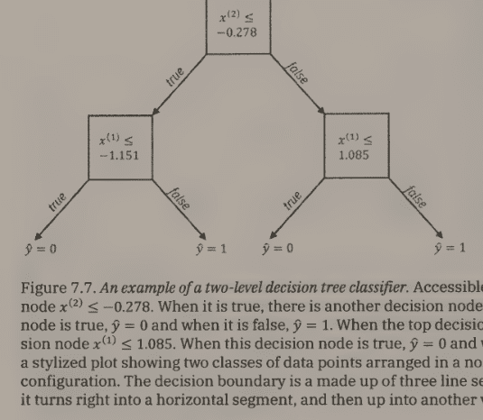

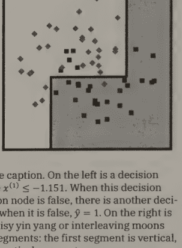

Figure 7.7. An example of a two-level decision tree classifier. Accessible caption. On the left is a decision node `x^{(2)} ≤ −0.278`. When it is true, there is another decision node `x^{(1)} ≤ −1.151`. When this decision node is true, `ŷ = 0` and when it is false, `ŷ = 1`. When the top decision node is false, there is another decision node `x^{(1)} ≤ 1.085`. When this decision node is true, `ŷ = 0` and when it is false, `ŷ = 1`. On the right is a stylized plot showing two classes of data points arranged in a noisy yin yang or interleaving moons configuration. The decision boundary is a made up of three line segments: the first segment is vertical, it turns right into a horizontal segment, and then up into another vertical segment.

图 7.7. 一个两层决策树分类器的示例。无障碍说明。左侧为决策节点 `x^{(2)} ≤ −0.278`。当其为真时，会有另一个决策节点 `x^{(1)} ≤ −1.151`。当该决策节点为真时，`ŷ = 0`；当其为假时，`ŷ = 1`。当顶部决策节点为假时，会有另一个决策节点 `x^{(1)} ≤ 1.085`。当该决策节点为真时，`ŷ = 0`；当其为假时，`ŷ = 1`。右侧为一个风格化图，显示两类数据点以嘈杂的阴阳或交错月亮配置排列。决策边界由三段线段组成：第一段为垂直线段，然后向右转成水平线段，再向上转成另一段垂直线段。

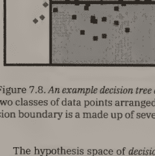

Figure 7.8. An example decision tree classifier with many levels. Accessible caption. A stylized plot showing two classes of data points arranged in a noisy yin yang or interleaving moons configuration. The decision boundary is a made up of several vertical and horizontal segments.

图 7.8. 一个具有多层的决策树分类器示例。无障碍说明。风格化图显示两类数据点以嘈杂的阴阳或交错月亮配置排列。决策边界由若干垂直和水平线段组成。

决策森林的假设空间由决策树的集成组成，这些树对预测进行投票，可能对不同树赋予不等的权重。决策树的加权多数投票是整体分类结果。决策森林的心智模型在图 7.9 中示出，示例决策边界在图 7.10 中给出。

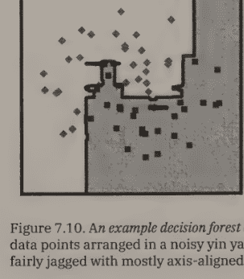

Figure 7.10. An example decision forest classifier. Accessible caption. Stylized plot showing two classes of data points arranged in a noisy yin yang or interleaving moons configuration. The decision boundary is fairly jagged with mostly axis-aligned segments and traces out the positions of the classes closely.

图 7.10. 一个决策森林分类器示例。无障碍说明。风格化图显示两类数据点以嘈杂的阴阳或交错月亮配置排列。决策边界相当锯齿状，主要是轴对齐线段，并紧密描绘出类别的位置。

决策桩和决策树可以直接针对经验风险中出现的零-一损失函数进行优化。7 然而，更常见的是采用贪婪启发式方法来学习决策树，其中每个节点的分裂一次完成一个，从根开始逐步推进到叶节点。分裂的选择使得每个分支对两个类别尽可能纯净：一侧主要是精通无服务器架构的员工，另一侧主要是不精通无服务器架构的员工。纯度可以通过两种不同的信息论度量来量化，即信息增益和基尼指数，它们在第 3 章中已介绍。两种决策树算法被广泛使用：使用信息增益作为分裂标准的 C5.0 决策树，以及使用基尼指数作为分裂标准的分类与回归树（CART）。决策树的深度受控制以防止过拟合。C5.0 和 CART 决策树的能力域是表格数据集，其中特征所代表的现象倾向于具有阈值和聚类行为，且类别重叠不大。

决策森林由大量决策树组成。C5.0 或 CART 树通常用作这些基础分类器。训练决策森林有两种流行方法：装袋法和提升法。在装袋法中，不同子集的训练数据被提供给不同的树，每棵树单独训练。所有树在多数投票中权重相等。在提升法中，采用顺序过程。第一棵树以标准方式训练。第二棵树训练时专注于第一棵树预测错误的训练样本。第三棵树专注于前两棵树的错误，以此类推。较早的树获得更大的权重。决策森林具有良好的能力，因为其基础分类器的多样性。只要单个树具有一定的能力，任何一棵树所犯的独特错误都会被其他树抵消，从而整体提高泛化能力。

随机森林分类器是最流行的装袋决策森林，XGBoost 分类器是最流行的提升决策森林。两者都具有非常大的能力域。它们是稳健的

### 7.5.3 神经网络

你和其他 JCN Corporation 数据科学家分析的最后一个分类器家族是人工神经网络。如今神经网络非常流行，因为它们在涉及大规模半结构化数据集的高调任务（图像分类、语音识别、自然语言处理、生物信息学等）上表现出卓越的性能，这正是它们的擅长领域。神经网络的假设空间包括由被称为神经元的简单函数组成的复合函数的复合函数的复合函数。理解假设空间最好的方式是将其图形化为神经元的层，表示为节点，通过加权边相互连接。有三种类型的层：输入层，可能的若干隐藏层，以及输出层。需要记住的基本图示如图 7.13 所示。如今经常被提及的深度学习指的是深度神经网络：具有许多许多隐藏层的神经元架构。

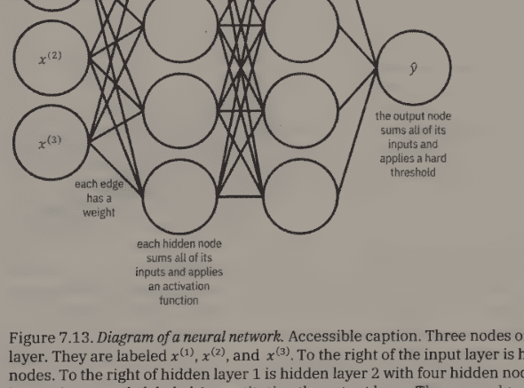

图 7.13. 神经网络示意图。可访问说明。左侧的三个节点构成输入层。它们标记为 `x^(1)`、`x^(2)` 和 `x^(3)`。输入层右侧是隐藏层 1，包含四个节点。隐藏层 1 右侧是隐藏层 2，包含四个隐藏节点。隐藏层 2 右侧是一个标记为 `ŷ` 的节点，构成输出层。每一层的每个节点与相邻层的每个节点之间都有边。每条边都有一个权重。每个隐藏节点对其所有输入求和并应用激活函数。输出节点对其所有输入求和并应用硬阈值。

逻辑回归实际上是一个非常简单的神经网络，只有一个输入层和一个输出节点，所以我们从这里开始。输入层只是一组节点，为每个用于预测员工专业技能的 `d` 个特征维度 `x^(1)`、…、`x^(d)` 各有一个节点。它们有加权边从中引出，通向输出节点。边上的权重是 `w` 中的系数，即 `w^(1)`、…、`w^(d)`。输出节点对加权输入求和，因此计算出 `w^T x`，然后将和通过阶跃函数传递。这个整体过程与前面描述的逻辑回归完全相同，只是以图形方式描述。

在具有一个或多个隐藏层的神经网络的常规情况下，隐藏层中的节点也从加权求和开始。然而，与使用突变的阶跃函数不同，隐藏层节点使用更柔和、变化更缓慢的 *激活函数*。实践中使用了几种不同的激活函数，其选择有助于归纳偏置。两个例子，sigmoid 或 logistic 激活函数 `1/(1 + e^{-z})` 和修正线性单元（ReLU）激活函数 `\max\{0, z\}`，如图 7.14 所示。`ReLU` 激活通常用于深度神经网络的所有隐藏层，因为它对涉及激活函数梯度的优化技术具有有利的特性。


图 7.14. `激活函数`。可访问说明。纵轴为激活函数，横轴为输入的图。`sigmoid` 函数是一条缓缓滚动的 S 形曲线，在输入值为 0 时等于 0.5，随着输入趋向负无穷接近 0，随着输入趋向正无穷接近 1。`ReLU` 函数对所有负输入为 0，并在 0 处开始线性增加。

当有多个隐藏层时，一个隐藏层中节点的输出会输入到下一个隐藏层的节点中。因此，神经网络的计算是加权和、激活函数、加权和、激活函数等的复合序列，直到到达输出层，最后应用阶跃函数。每个隐藏层的节点数和隐藏层的数量是 JCN Corporation 数据科学家需要做出的设计选择。

你和你的团队已经分析了假设空间。很棒。接下来你需要分析的是神经网络的损失函数。回想一下，基于间隔的损失函数在应用阶跃函数之前会将真实标签 $y_j$ 与距离 $w^T x_j$ 相乘（而不是与预测标签 $\hat{y}(x_j)$ 相乘）。`交叉熵损失`，神经网络中最常用的损失函数，做了类似的事情。它将真实标签 $y_j$ 与在阶跃函数应用之前在输出节点计算出的范围在 $[0,1]$ 内的软预测 $\varphi(x_j)$ 进行比较。交叉熵损失函数为：

$L(y_j, \varphi(x_j)) = - \big( y_j \log(\varphi(x_j)) + (1 - y_j) \log(1 - \varphi(x_j)) \big).$

方程 7.5

该表达式的形式来自交叉熵，即在第 3 章引入的用预测距离随机变量 $\varphi$ 描述真实标签随机变量 $y$ 时的平均信息。交叉熵应被最小化，因为你希望以预测为依据的描述与真实情况相匹配。事实证明，在二分类问题中，交叉熵损失等价于基于间隔的逻辑损失函数，但从数学上证明起来相当复杂，因为基于间隔的损失函数是一个将预测和真实标签相乘的单变量函数，而在交叉熵损失中这两个参数是分开保留的。¹¹

最后一个需要问的问题是关于正则化。虽然可以向交叉熵损失添加 $\ell_1$-范数、$\ell_2$-范数或其他惩罚项，但正则化神经网络最常见的方式是 `dropout`。其思想是在训练期间优化过程的每次迭代中随机移除网络中的一些节点。`Dropout` 的目标与 `bagging` 有些相似，但它不是显式地创建多个神经网络的集成，而是使每次迭代看起来像集成中的不同神经网络，这有助于多样性和泛化。具有一个隐藏层和 `ReLU` 激活函数的示例神经网络分类器如图 7.15 所示。重申本节开头所述的话，人工神经网络的能力域是具有大量数据点的半结构化数据集。

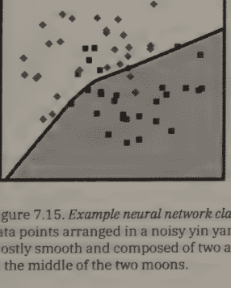

图 7.15. 示例神经网络分类器。可访问说明。风格化的图显示了两种类别的数据点，排列成嘈杂的阴阳鱼或交错月亮的构型。决策边界总体平滑，由两段几乎笔直的对角线段组成，在两个月亮中间形成一个略微弯曲的肘部。

### 7.5.4 结论

你已经研究了几种不同类型的分类器，以比较和对比它们的能力域，并评估它们对你的专业评估预测任务的适用性。你的数据集主要由结构化数据组成，规模适中，并且在精通和不精通无服务器架构的员工之间存在大量特征轴对齐的分离。出于这些原因，你可以预期 `XGBoost` 将是你的问题的有能力分类器。但你仍应进行一定程度的实证测试，尝试几种不同的方法。

## 7.6 总结

- 有许多不同的方法可以从有限数量的训练样本中找到决策函数，每种方法都有其自身的归纳偏置，决定其泛化方式。

- 不同分类器具有不同的能力域：即在哪些类型的数据集上其泛化误差低于其他方法。

- 参数化和非参数化插值方法（判别分析、朴素贝叶斯、`k` 近邻）和风险最小化方法（决策树和森林、基于间隔的方法、神经网络）在实际机器学习问题中都有其作用。

- 分析它们的归纳偏置和能力域不仅有助于为给定问题选择最合适的方法，而且有助于为公平性、鲁棒性、可解释性以及其他可信性要素做好扩展准备。

# 8 因果建模

在美国各地的城市中，摆脱贫困的难度因难以获得社会服务而加剧，这些服务包括职业培训、心理健康护理、金融教育课程、法律咨询、儿童保育支持和紧急食品援助。这些服务由不同机构在不同地点提供，并有着不同的资格要求。贫困个体很难应对这种复杂性，并利用他们有权享有的服务。为了应对这种情况，（虚构的）综合社会服务提供商 `ABC` 中心采取整体方法，将许多单项社会服务集中在一处，并由一支集中的社会工作者团队引导客户。为了更好地建议客户如何在生活的各个方面提升自己，中心主任和执行人员希望分析中心收集的关于客户所使用服务及其生活成果的数据。作为问题所有者，他们不知道该做何种数据建模。假设你是一名数据科学家，与 `ABC` 中心的问题所有者合作分析情况，提出适当的问题规范，理解并准备可用数据，最后执行建模。（本章涵盖机器学习生命周期的大部分内容，而前几章大多只涉及较小部分。）

你的第一直觉可能是建议 `ABC` 中心采用机器学习方法，从包含所修课程和所参加会谈次数等一组特征来预测生活成果（教育、住房、就业等）。检查所得训练模型中的关联和相关性或许能带来一些见解，但会遗漏一些非常重要的东西。你知道是什么吗？是因果性！如果你使用问题的标准机器学习形式，你就不能说参加汽车维修培训课程导致了 `ABC` 中心客户工资的增加。当你想要理解干预（所采取的具体行动）对结果的影响时，你必须做的不仅仅是机器学习，你还必须进行因果建模。¹ 因果关系是理解世界的核心，但标准监督学习并不是获取因果关系的方法。

为了实现向 `ABC` 中心提出问题规范、理解相关数据并为其创建模型的目标，在本章中你将：

- 区分需要因果模型还是典型的预测性机器学习模型的情况，

- 发现系统中所有随机变量之间因果关系的图结构，以及

- 计算干预对结果的定量因果效应，包括从观察数据中计算。

## 8.1 对比因果建模与预测建模

如果 `ABC` 中心的一名客户完成了一次一对一咨询会谈，这可能会导致其焦虑水平发生变化。相反，完成会谈并不会导致比方说鸡蛋价格的上涨，即使每个客户咨询会谈后的第二天鸡蛋价格突然跳涨，因为鸡蛋价格与 `ABC` 中心无关。此外，两件不同的事情可能导致相同的结果：咨询会谈和工资上涨都可以导致焦虑减轻。你也可能被共同原因谬误所迷惑：一名客户获得了稳定住房，然后购买了一辆二手车。稳定住房并不会导致购买汽车，但两者都是由工资上涨引起的。

但被称为因果性这个难以捉摸的概念到底是什么？它不同于相关性、预测能力，甚至统计依赖性。还记得我们如何将可信性和安全性的含义分解为更小的组成部分（分别在第 1 章和第 3 章中）吗？不幸的是，我们不能对因果性做同样的事情，因为它是一个无法进一步分解的基本概念。因果性的基本定义是：如果做某事导致其他某事发生，那么我们做的某事就是所发生事情的一个原因。这句话中的关键词是“做”。因果关系要求“做”。所做的行动被称为干预或处理。干预可以由人或自然进行；本章的重点是由人有意进行的干预。

> “虽然概率编码了我们对静态世界的信念，但因果性告诉我们当世界发生变化时——无论是通过干预还是通过想象行为——概率是否会改变以及如何改变。”

> 

> ——朱迪亚·珀尔，加州大学洛杉矶分校计算机科学家

### 8.1.1 结构因果模型

因果模型是在概率论基础上对随机变量之间因果关系的量化尝试。结构因果模型是因果建模的一种关键方法。它们包含两个部分：一个因果图（一种图形模型，类似于我们在第 3 章中介绍的贝叶斯网络）和结构方程。如图 8.1 所示，咨询会谈和工资变化导致焦虑变化的图由三个节点组成，排列成共同效应结构：咨询 → 焦虑 ← 工资。工资增加导致稳定住房和购买汽车的图也由三个节点组成，但排列成共同原因结构：住房 ← 工资 → 汽车。图中的图形将两个子图与另一个共同原因放在一起：获得儿童保育导致工资和稳定住房。（如果客户有儿童保育，他们不必带着孩子到处跑，因此可以更容易地寻找工作和住处。）

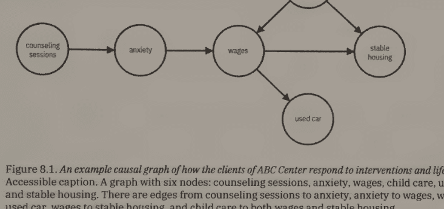

图 8.1. `ABC` 中心客户如何对干预和生活变化作出反应的示例因果图。无障碍说明。一个有六个节点的图：咨询会谈、焦虑、工资、儿童保育、二手车和稳定住房。存在从咨询会谈到焦虑、从焦虑到工资、从工资到二手车、从工资到稳定住房，以及从儿童保育到工资和稳定住房的边。

在结构因果模型中，节点表示随机变量，就像在贝叶斯网络中一样。然而，边不仅表示统计依赖性，还表示因果关系。从随机变量 `T`（例如咨询会谈）到 `Y`（例如焦虑）的有向边表示 `T`（咨询会谈）对 `Y`（焦虑）的因果效应。由于结构因果模型是贝叶斯网络的推广，贝叶斯网络中以因子形式表示概率以及通过 `d-分离` 确定条件独立性的计算仍然成立。然而，结构因果模型由于结构方程的存在而捕捉到比统计关系更多的东西。

结构方程，也称为函数模型，告诉你当你做某事时会发生什么。做或干预是强制一个随机变量取特定值的行为。重要的是，它不仅仅是被动地观察当一个变量的值被揭示时所有随机变量会发生什么——那仅仅是条件概率。结构因果建模需要一个新算子 `do(·)`，它表示干预。干预分布 `P(Y | do(t))` 是当随机变量 `T` 被强制取值 `t` 时随机变量 `Y` 的分布。对于只有两个节点 `T`（咨询会谈）和 `Y`（焦虑）且存在从 `T` 到 `Y` 的有向边 `T → Y` 的因果图，结构方程采用函数形式：

$P(Y \mid do(t)) = f_Y(t, noise_Y),$

方程 8.1

其中 `noise_Y` 是 `Y` 中的某种噪声或随机性，`f_Y` 是任意函数。存在一个精确方程将咨询会谈的干预（例如开始咨询会谈（将变量从 0 更改为 1））与客户焦虑概率联系起来。关键点在于，该概率确实可以表示为以处理变量为右侧参数的方程。具有更多父节点的变量的函数模型会将那些父节点作为函数 `f_Y` 中的参数，例如，如果 `Y` 有三个父节点，则 `P(Y | do(t)) = f_Y(t1, t2, t3, noise_Y)`。（记住第 3 章中的内容：有向边始于父节点，止于子节点。）

### 8.1.2 因果模型与预测模型

你如何判断一个问题需要的是因果模型，而不是标准监督机器学习中的预测模型？关键在于识别是否有某事物正在主动改变一个或多个特征。将借款人分类为良好贷款对象的行为在当时并不会改变借款人的任何情况，因此需要像 `ThriveGuild` 在第 3 章和第 6 章中所使用的预测模型（也称为关联模型）。然而，想要了解向 `ABC` 中心客户提供职业培训（主动改变关于就业准备的特征的值）是否会导致他们被 `ThriveGuild` 批准的概率发生变化，这是一个因果建模问题。

使用预测模型来形成因果结论可能会导致严重危害。预测模型输入特征的变化不一定导致输出标签的期望变化。如果决策者期望某个输入变化会导致某个输出变化，但输出根本没有改变或朝相反方向改变，那么一切都可能失控。由于 `ABC` 中心想要建模客户在接受社会服务后会发生什么，你应该向主任建议，问题规范应集中在因果模型上，以理解中心的一组干预（各种社会服务）以及衡量客户摆脱贫困进展的结果。

重要的一点是，即使一个模型仅用于预测而非用于决策以改变输入，因果模型也有助于规避第 4 章中引入的问题——构念效度（数据确实测量了它应该测量的东西）、内部效度（数据处理中没有错误）和外部效度（泛化到其他场景）——因为它迫使预测基于真实、显著的现象，而不是仅存在于给定数据集中的虚假现象。因此，因果性是可信机器学习的一个组成部分，并在本书涉及可靠性的第 4 部分中出现。当只需再多一点努力来追求因果模型就能产生巨大差异时，满足于预测模型是一种捷径。

### 8.1.3 两种问题规范

在开发生命周期的问题规范阶段，`ABC` 中心要考虑因果建模中两种主要的问题规范。第一种是获取因果图的结构，这将使他们能够理解哪些服务对哪些结果产生影响。第二种问题规范是获得一个量化给定处理变量 `T`（可能是完成汽车维修课程）与给定结果标签 `Y`（可能是工资）之间因果效应的数值。这个问题将在 8.2 节中进一步描述。

进入生命周期的数据理解和数据准备阶段，在因果建模中可能遇到两类数据：干预数据和观察数据。它们将在 8.3 节中详细介绍。简而言之，干预数据来自有意设计的实验。

而观测数据却无法做到这一点。基于干预数据的因果建模通常直截了当，而基于观测数据的因果建模则复杂得多。

在建模阶段处理观测数据时，这两种问题表述对应两类不同的方法。因果发现（`causal discovery`）是学习结构因果模型，因果推断（`causal inference`）是估计因果效应。从观测数据中进行因果发现和因果推断的具体方法分别是 8.4 节和 8.5 节的主题。图 8.2 给出了这两种表述的建模方法的思维模型。

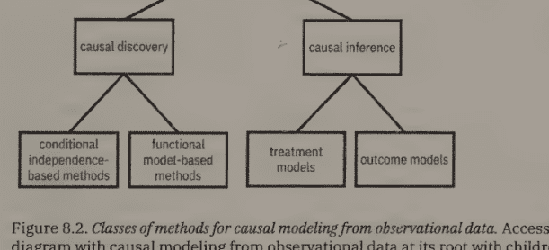

图 8.2. 从观测数据进行因果建模的方法类别。无障碍说明。一个层级图，根节点为“从观测数据进行因果建模”，子节点为“因果发现”和“因果推断”。因果发现的子节点为“基于条件独立的方法”和“基于函数模型的方法”。因果推断的子节点为“处理模型”和“结果模型”。

## 8.2 量化因果效应

第二个问题规范是计算平均处理效应。为简单起见，我们专注于 `T` 是一个取值于 `{0,1}` 的二值变量：要么客户没有参加汽车维修课程，要么参加了。那么平均处理效应 `τ` 为：

`τ = E[Y | do(t = 1)] − E[Y | do(t = 0)]`。

等式 8.2

结果标签在两种干预取值下的期望值之差，精确地显示了结果如何因处理而改变。工资因汽车维修课程而改变多少？术语中包含“平均”是因为期望值。

例如，如果 `Y | do(t = 0)` 是一个均值为每小时 13 美元、标准差为每小时 1 美元的高斯随机变量，² 而 `Y | do(t = 1)` 是一个均值为每小时 18 美元、标准差为每小时 2 美元的高斯随机变量，那么平均处理效应为 18 − 13 = 每小时 5 美元。接受汽车维修培训使客户的收入潜力提高了每小时 5 美元。标准差在这里无关紧要。

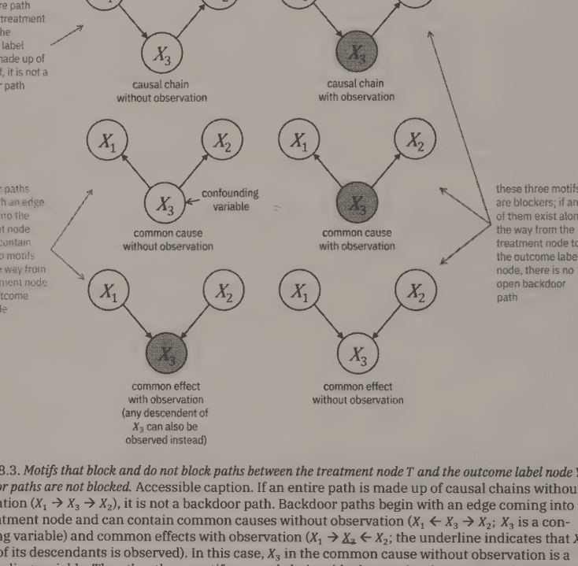

图 8.3. 阻断和不阻断处理节点 `T` 与结果标签节点 `Y` 之间路径的基序。后门路径未被阻断。无障碍说明。如果整条路径由没有观测的因果链组成（`X₁ → X₃ → X₂`），则它不是后门路径。后门路径以一条进入处理节点的边开始，可以包含没有观测的公共原因（`X₁ ← X₃ → X₂`；`X₃` 是混杂变量）和有观测的公共效应（`X₁ → X₃ ← X₂`；下划线表示 `X₃` 或其任何后代被观测）。在这种情况下，没有观测的公共原因中的 `X₃` 是一个混杂变量。其他三种基序——有观测的因果链（`X₁ → X₃ → X₂`）、有观测的公共原因（`X₁ ← X₃ → X₂`）和无观测的公共效应（`X₁ → X₃ ← X₂`）——是阻断器。如果它们中的任何一个出现在从处理到结果标签的路径上，则不存在开放的后门路径。

² 均值为 `μ`、标准差为 `σ` 的高斯随机变量 `X` 的概率密度函数为 `p_X(x) = 1/(σ√2π) e^(−(x−μ)²/(2σ²))`。其期望值为 `μ`。

### 8.2.1 后门路径与混杂因素

重要的是要注意，平均处理效应的定义以 `do(t)` 为条件，而不是以 `t` 为条件，并且 `P(Y | do(t))` 和 `P(Y | t)` 通常不相同。具体来说，当 `T` 和 `Y` 之间存在所谓的 `后门路径` 时，它们就不相同。记住，路径是图中沿着边的一系列步骤，无论其方向如何。`后门路径` 是从 `T` 到 `Y` 的任何路径，它（1）以一条进入 `T` 的边开始，并且（2）未被阻断。“后门”这个名称的原因是第一条边向后进入 `T`。（前门路径的第一条边是从 `T` 出来的。）回忆第 3 章，如果路径包含以下任一情况，则该路径被阻断：

- 1. 中间节点被观测的因果链基序，即中间节点被条件化，

- 2. 中间节点被观测的公共原因基序，或

- 3. 中间节点 *未被* 观测的公共效应基序（这是一个对撞器）

在 `T` 和 `Y` 之间的任何位置。后门路径可以包含（1）没有观测的公共原因基序和（2）有观测的公共效应基序在 `T` 和 `Y` 之间。阻断和不阻断路径的基序如图 8.3 所示。

干预分布 `P(Y | do(t))` 与关联分布 `P(Y | t)` 之间的不等性被称为 `混杂偏倚`。³ 沿着后门路径的公共原因基序的任何中间节点都是 `混杂变量` 或 `混杂因素`。混杂是当你试图在无法进行干预（你不能进行 `do(t)`）的情况下推断平均处理效应时，需要克服的核心挑战。8.5 节涵盖了在估计平均处理效应时如何减轻混杂。

³ 在涉及选择偏倚的特殊情况下，可能存在没有后门路径的混杂偏倚。选择偏倚是指处理变量和另一个变量共同作为结果标签的原因。

### 8.2.2 一个例子

图 8.4 展示了一个使用 `ABC` 中心因果图（在图 8.1 中引入）来量化因果效应的例子。该中心想测试将客户的高度焦虑降低为低焦虑是否会影响他们的稳定住房状况。从焦虑到稳定住房存在一条经过工资和儿童保育的后门路径。该路径以一条进入焦虑的箭头开始。一个没有观测的公共原因，工资 `←` 儿童保育 `→` 稳定住房，是沿着通向稳定住房的路径上唯一的其他基序。它没有阻断这条路径。儿童保育作为公共原因的中间节点，是一个混杂变量。如果你能做处理，即对焦虑进行干预，这在图中用锤子表示，那么来自咨询课程和工资的进入焦虑的边被移除。现在不再有后门路径，你可以继续处理效应量化。

然而，通常你不能进行干预。这些是 *观测* 设置，而不是 *干预* 设置。观测设置与干预设置是完全不同的场景。图 8.5 展示了实际情况。由于你无法通过干预消除焦虑和工资之间的边，你必须在模型中包含客户是否有儿童保育这一混杂变量，然后才能对焦虑和稳定住房之间进行正确的因果效应量化。包含、观测或条件化混杂变量被称为对它们进行调整。调整工资而不是儿童保育，是阻断 `ABC` 中心图中后门路径的另一种方法。

原始因果图

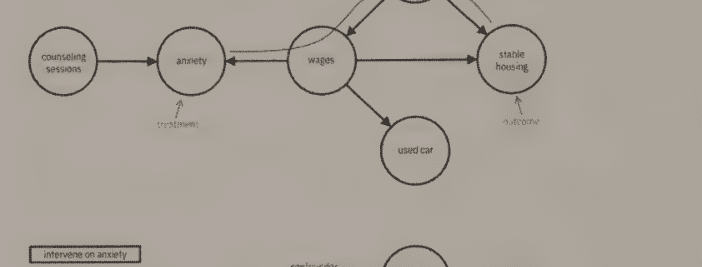

对焦虑进行干预

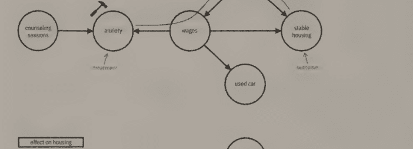

对住房的影响

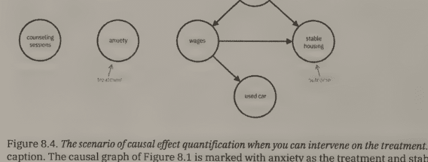

图 8.4. 当你可以对处理进行干预时的因果效应量化场景。无障碍说明。图 8.1 的因果图被标记为焦虑作为处理，稳定住房作为结果。二者之间绘制了一条经过工资和儿童保育的后门路径，儿童保育被标记为混杂因素。对焦虑的干预用锤子标记。其效果是移除来自咨询课程和工资的进入焦虑的边，以及移除后门路径。

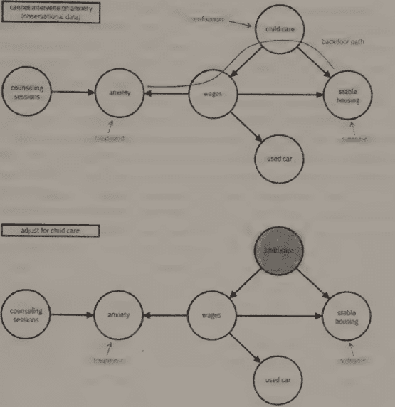


图8.5. *当你不能对处理进行干预，因此必须沿后门路径调整某个变量时的因果效应量化场景。* 无障碍说明。图8.1的因果图被标记为焦虑作为处理，稳定住房作为结果。二者之间绘制了一条经过工资和儿童保育的后门路径，儿童保育被标记为混杂因素。对儿童保育进行调整将其节点着色为灰色，并移除后门路径。

归根结底，计算因果效应的全部意义在于为决策提供信息。如果ABC中心可以为客户提供两种相互竞争的社会服务，因果模型应该推荐对他们关心的结果影响最大的那一种。在接下来的几节中，你将着手从数据中找到完成此任务的模型。

## 8.3 干预数据与观测数据

你已与ABC中心主任完成了问题规范阶段，并决定采用因果建模方法而非标准机器学习方法，以获取对客户干预措施从而实现良好生活结果的见解。你还确定了因果建模的具体形式：是获取结构因果模型还是平均处理效应。机器学习生命周期的下一个阶段是数据理解和数据准备。

因果建模中有两种数据类型：*干预数据*和*观测数据*，你已在上一节接触过它们的设置。干预数据是在你实际上执行干预。这是在事先已经设计好的实验中收集的数据。ABC 中心可能进行的一项以获得干预数据的实验是让一组客户参加财务教育研讨会，而不让另一组客户参加。接受财务教育研讨会干预的群体是处理组，未接受研讨会的群体是对照组。ABC 中心会沿着多个特征维度收集这些客户的数据，这将构成生命周期下一阶段建模的数据集。收集你认为可能成为混杂因素的所有特征的数据非常重要。

正如前几节中已看到的，无论是干预性收集还是观察性收集，随机变量都是：指定处理组和对照组的处理 `T`（焦虑干预）、结果标签 `Y`（稳定住房）以及其他特征 `X`（托儿服务等）。这些随机变量的样本集合构成了平均处理效应估计中的数据集：`{(t₁, x₁, y₁), ..., (tₙ, xₙ, yₙ)}`。此类数据集的示例如图 8.6 所示。在估计结构因果模型时，你只需要随机变量 `X`，并在需要时稍后指定处理和结果标签。

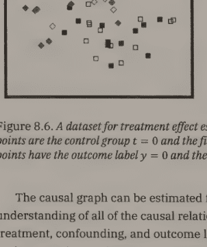

图 8.6. 用于处理效应估计的数据集。坐标轴是 `x` 的两个特征维度。未填充的数据点是对照组 `t = 0`，填充的数据点是处理组 `t = 1`。菱形数据点的结果标签为 `y = 0`，方形数据点的结果标签为 `y = 1`。

如果 ABC 中心的目标是全面了解所有因果关系，则可以从全部数据中估计因果图。或者，如果主任想检验特定假设，例如焦虑减轻研讨会对稳定住房具有因果效应，则可以从处理、混杂和结果标签变量中估计因果效应。一种特殊的实验，称为随机试验，会随机将客户分配到处理组和对照组，从而减轻所研究人群中的混杂。

不可能同时观察到在对照 `t = 0` 下的结果标签 `y` 以及在处理 `t = 1` 下的反事实 `y`，因为同一个个体不能同时接受和不接受处理。这被称为因果建模的基本问题。随机化减轻了因果建模的基本问题，因为平均而言，处理组和对照组包含几乎相似的匹配客户。然而，随机化并不能防止外部效度的缺乏（请回顾第 4 章，外部效度是指数据集推广到不同人群的能力）。可能人群中所有客户的某些属性共同由在其他人群中不同的某个变量引起。

随机试验被认为是如果可能的话应该进行的因果建模的黄金标准。然而，随机试验以及更广泛的干预性数据收集通常因伦理或后勤原因而被禁止。例如，为了检验假设而 withholding 已知有益的处理（如职业培训课程）是不合伦理的。从后勤角度来看，例如，ABC 中心可能没有资源为其一半客户提供 $1000 现金转移（类似于第 4 章中 Unconditionally 的运作方式）来检验该干预是否改善稳定住房的假设。即使没有伦理或后勤障碍，也可能出现 ABC 中心的董事和执行人员在数据已经收集后才想到他们想要调查的新因果关系的情况。

在所有这些情况下，你处于观察性数据而非干预性数据的环境中。在观察性数据中，处理变量的值并未被强制为给定值；它只是取了碰巧取到的值，这可能取决于各种其他变量和考虑因素。此外，由于观察性数据通常是不经意收集的便利数据，可能缺少全面的潜在混杂变量集合。

因果建模的基本问题在观察性数据中非常明显，因此测试和验证因果模型变得具有挑战性。测试因果模型的唯一（不令人满意）方法有（1）通过能够同时产生事实和反事实数据点的模拟数据，或（2）并行从非常相似的人群中收集干预性数据集。无论如何，如果你只有观察性数据，你能做的就是在生命周期的建模阶段使用它。

## 8.4 因果发现方法

数据理解阶段之后是建模。如何获得像图 8.1 那样的 ABC 中心的因果图结构？有三种方法可以进行：⁴

- 1. 征求 ABC 中心的领域专家，手动绘制出所有节点（随机变量）之间所有箭头（因果关系），

- 2. 设计并开展实验以揭示因果关系，或

- 3. 基于观察性数据发现图结构。

第一个手动选项是可行的，但它可能导致人类偏见的纳入，并且无法扩展到变量数量很多的问题，超过二十或三十个。第二个实验选项也是可行的，但同样无法扩展到大量变量，因为对每条可能的边都必须进行干预实验。第三个选项，称为 *因果发现*，在实践中最可行，也是你应该与 ABC 中心一起追求的。⁵

你可能听说过这句话“能做事的人去做事，不能做事的人去教书”，简称为“不能做事的人去教书”。在无法干预的观察性数据因果建模中，需要记住的说法是“不能做事的人去假设”。因果发现有两个分支，如图 8.2 中所示，每个分支都需要做出不同的假设。第一个分支基于条件独立性检验，并依赖于 *忠实性* 假设。忠实性的主要思想是随机变量之间的条件依赖和独立关系编码了因果关系。随机变量之间不存在偶然或确定性关系来掩盖因果关系。贝叶斯网络的边是结构因果模型的边。忠实性在实践中通常成立。

一个概率分布可以通过选择不同的条件变量集合以多种方式分解，从而导致不同的图。箭头指向不同方向也会导致不同的图。所有这些源自同一概率分布的不同图被称为 *马尔可夫等价类*。马尔可夫等价类的一个特别有信息量的例子是仅有两个随机变量的情况，例如焦虑和工资。⁶ 将焦虑作为父节点、工资作为子节点的图，以及将工资作为父节点、焦虑作为子节点的图，会导致相同的概率分布，但因果关系相反。关于因果发现方法中条件独立性检验分支的一个重要点是，它们找到的是图结构的 *马尔可夫等价类*，而不是单一的图结构。

因果发现的第二个分支基于对结构方程 `P(Y | do(t)) = f_Y(t, noise_Y)` 的形式做出假设，该方程在公式 8.1 中引入。在此分支内，有几种不同的变体。例如，一些变体假设函数模型具有线性函数 `f_Y`，其他变体假设函数模型具有带加性噪声 `noise_Y` 的非线性函数 `f_Y`，甚至还有其他变体假设噪声 `noise_Y` 的概率分布具有较小的熵。基于假设的函数形式，对观察性数据进行最佳拟合。该分支中的假设比条件独立性检验中的假设强得多，但导致解为单一图而不是马尔可夫等价类。这些特征总结在表 8.1 中。

表 8.1. *因果发现两种分支的特征。*

| 分支 | 忠实性假设 | 函数模型假设 | 马尔可夫等价类输出 | 单图输出 |
|---|---|---|---|---|
| 条件独立 | X |  | X |  |
| 函数模型 |  | X |  | X |

在本节的剩余部分，你将看到每个分支的因果发现实例：条件独立性检验方法的 PC 算法以及函数模型方法的基于加性噪声模型的方法。

⁴Clark Glymour, Kun Zhang, and Peter Spirtes. “基于图形模型的因果发现方法综述。” In: *Frontiers in Genetics* 10 (Jun. 2019), p. 524.

⁵存在一些高级的因果发现方法，它们从观察性数据开始，并告诉你进行一些重要实验以获得更好的图，但它们超出了本书的范围。

⁶Matthew Ridley, Gautam Rao, Frank Schilbach, and Vikram Patel. “贫困、抑郁和焦虑：因果证据与机制。” In: *Science* 370.6522 (Dec. 2020), p. 1289.

### 8.4.1 一个基于条件独立检验的示例方法

最古老、最简单且至今仍常用的基于条件独立检验的因果发现方法之一是PC算法。PC算法以其提出者Peter Spirtes和Clark Glymour命名，是一种贪心算法。图8.7展示了ABC Center的一个PC算法示例，涉及工资、儿童保育、稳定住房和二手车这些节点。具体步骤如下：

- 0. PC算法的整体过程从一个完全无向图开始，该图包含所有节点对之间的边。

- 1. 第一步，算法对每一对节点进行检验；如果它们独立，则删除二者之间的边。接下来，它继续对每一对节点在越来越大的子集条件下进行条件独立检验，如果发现任何条件独立性，则删除这对节点之间的边。最终结果是因果图的无向骨架。

   第一步的原因如下。节点`X₁`和`X₂`之间存在无向边，当且仅当`X₁`和`X₂`在所有其他节点的每个可能子集条件下都相关。（因此，如果图中有另外三个节点`X₃`、`X₄`和`X₅`，那么你需要检验`X₁`和`X₂`是否：（1）在不给定其他变量的情况下无条件相关；（2）在给定`X₃`时相关；（3）在给定`X₄`时相关；（4）在给定`X₅`时相关；（5）在给定`X₃`、`X₄`时相关；（6）在给定`X₃`、`X₅`时相关；（7）在给定`X₄`、`X₅`时相关；（8）在给定`X₃`、`X₄`、`X₅`时相关。）这些条件相关性可以通过d-separation来确定，这在第3章中已经介绍过。

- 2. 第二步尽可能多地给边加上箭头。算法对三节点链中的第一个和第三个节点进行条件独立检验。如果它们在包含中间节点的某个节点集合条件下相关，则会形成一个带有箭头的共同原因（碰撞器）结构。最终结果是一个部分有向的因果图。算法无法确定的边方向仍属未知。所有这些方向的所有选择共同构成了不同的图，这些图组成了马尔可夫等价类。

   第二步的原因是，节点`X₁`、`X₂`、`X₃`的无向链可以变为有向的`X₁ → X₂ ← X₃`，当且仅当`X₁`和`X₃`在包含`X₂`的每个可能节点子集条件下都相关。这些条件相关性同样可以通过d-separation来确定。

在图8.7的示例结束时，马尔可夫等价类包含四个可能的图。

在第3章中，d-separation是在理想情况下介绍的，即你完全清楚每对随机变量之间的相关性和独立性。但在处理数据时，你并不拥有这种完美的知识。在数据上检验随机变量之间条件独立性的具体计算，通常基于对它们之间互信息的估计。这个看似简单的连续随机变量条件独立性检验问题，实际上包含许多行业技巧，目前仍在研究中，且超出了本书的范围。

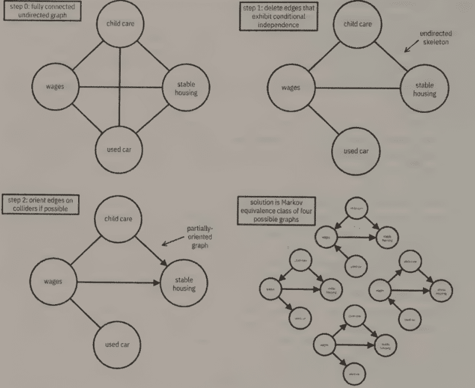

**图8.7.** *PC算法步骤的一个示例。* 无障碍说明。在第0步，存在一个完全连通的无向图，节点为儿童保育、工资、稳定住房和二手车。在第1步，儿童保育与二手车之间、稳定住房与二手车之间的边已被移除，因为它们表现出条件独立性。无向骨架保留了下来。在第2步，儿童保育与稳定住房之间的边被定向为从儿童保育指向稳定住房，工资与稳定住房之间的边被定向为从工资指向稳定住房。儿童保育与工资之间、工资与二手车之间的边仍保持无向。这就是部分有向图。有四个可能的有向图构成了马尔可夫等价类解：边从儿童保育指向工资且从二手车指向工资；边从工资指向儿童保育且从二手车指向工资；以及边从工资指向儿童保育且从工资指向二手车。

### 8.4.2 一个基于函数模型的示例方法

在基于条件独立检验的方法中，对`P(y | do(t)) = f_y(t, noise_y)`的函数形式没有做出强假设。因此，正如你在PC算法中所见，某些边的指向可能仍然存在混淆。你无法判断两个节点中哪一个是原因，哪一个是结果。基于函数模型的方法确实对`f_y`做出了假设，旨在避免这种混淆。在只有两个节点的情况下最容易理解，比如`T`和`Y`，或工资和焦虑。你可能认为工资的变化引起焦虑的变化（`T`导致`Y`），但也可能正好相反（`Y`导致`T`）。

在基于函数模型的因果发现方法分支中，有一种特定方法称为加性噪声模型。它要求`f_Y`不是线性函数，且噪声是可加的：`P(Y | do(t)) = f_Y(t) + noise_Y`；这里`noise_Y`不应依赖于`t`。图8.8中的图展示了一个非线性函数示例，并对函数周围的噪声进行了量化。由于噪声不依赖于`t`，这个噪声带在`t`的所有取值下高度相同。现在看看当`t`为纵轴、`y`为横轴时的情况。噪声带在函数周围对所有的`y`值高度都相同吗？并非如此，这就是关键观察。当原因位于横轴时，噪声在函数周围具有恒定的高度；当结果位于横轴时则不然。有多种方法可以从数据中检验这一现象，但只要你理解了图8.8所示的这个思想，你就掌握了要领。如果ABC Center想要弄清楚是焦虑的降低导致工资的增加，还是工资的增加导致焦虑的降低，你就知道该做怎样的分析了。


图8.8. 使用加性噪声模型方法区分因果关系的示例。由于噪声带的高度在所有`t`下相同，在所有`y`下不同，因此`t`是原因，`y`是结果。无障碍说明。两个图显示了同一非线性函数及其周围的噪声带。第一个图`y`在纵轴，`t`在横轴；第二个图`t`在纵轴，`y`在横轴。在第一个图中，对于不同的`t`值，噪声带的高度始终相同。在第二个图中，对于不同的`y`值，噪声带的高度始终不同。

当函数是线性时，这种现象不会发生。试着在脑海中为线性函数绘制图8.8，然后作为一个思想实验将其翻转。你会看到噪声的高度在两种方向下都相同，因此你无法区分原因和结果。

## 8.5 因果推断方法

基于第8.4节，你已经掌握了估计ABC Center所收集随机变量之间因果关系结构的工具。但仅仅了解关系对主管来说还不够。他还想量化特定处理和结果标签的因果效应。具体来说，他想知道焦虑降低对稳定住房的影响。你现在转向平均处理效应估计方法，试图回答这个问题。你正在处理观测数据，因为ABC Center并未开展受控实验来厘清这种因果关系。根据图8.5，你知道儿童保育是一个混杂变量，并且由于有先见之明而没有走捷径，你已收集了相关数据。`t_i`值记录了那些接受焦虑降低处理的客户，`x_i`值记录了客户儿童保育情况和其他可能混杂因素的数据，`y_i`值是客户在稳定住房上的结果标签。

记住我们的常用说法：“不能实干，就要假设。”正如在因果发现中一样，从观测数据进行因果推断需要假设。因果推断中的一个基本假设类似于第3章中介绍的机器学习中的独立同分布（i.i.d.）假设。这个因果推断假设，即稳定单位处理值假设，简单来说就是：一个客户的结果只取决于对该客户所做的处理，而不会受到对其他客户处理的影响。有两个重要假设：

- 1. *无未测量混杂因素*，也称为*可忽略性*。数据集需要包含`X`中的所有混杂变量。

- 2. *重叠*，也称为*正性*。在给定混杂变量的情况下，处理`T`的概率既不能等于0，也不能等于1。它必须严格大于0且严格小于1。这个定义解释了“正性”这一名称，因为概率必须是正的，而不是恒等于零。该假设的另一个视角是，处理组`X`的概率分布与对照组`X`的概率分布应该重叠；两个分布中不应存在某个区域只被其中一个分布所支撑，而另一个分布在该区域没有支撑。图8.9用几个数据集说明了重叠及缺乏重叠的情况。

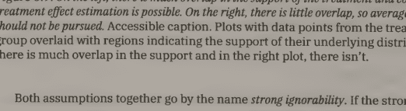

图8.9. 在左侧，处理组和对照组在支撑集上有很多重叠，因此可以进行平均处理效应估计。在右侧，重叠很少，因此不应进行平均处理效应估计。无障碍说明。图中绘制了处理组和对照组的数据点，并叠加了表示其潜在分布支撑集的区域。在左图中，支撑集重叠较多，而在右图中则没有。

这两个假设合在一起称为强可忽略性。如果强可忽略性假设不成立，你就不应基于观测数据进行平均处理效应估计。为什么需要这两个假设？为什么它们很重要？如果数据包含所有可能的混杂变量，你就可以对它们进行调整，以消除可能存在的任何混杂偏倚。如果数据表现出重叠，你就可以对数据进行操作或平衡，使对照组和处理组看起来尽可能相似。

如果你刚刚拿到一份经过清洗和准备的 ABC Center 数据，要用来进行平均处理效应估计，那么接下来的步骤是什么？你需要以迭代方式完成四项任务，如图 8.10 所示。第一个任务是指定一种因果方法，在 (1) 处理模型和 (2) 结果模型之间进行选择。它们是从观测数据中进行因果推断的两个主要分支，在前面图 8.2 中已经展示。其细节将在接下来的小节中介绍。这种迭代方法中的第二个任务是指定一种机器学习方法，将其嵌入你所选择的因果方法中。这两类因果方法——处理模型和结果模型——底层都基于机器学习。第三个任务是训练模型。第四个也是最后一个任务是评估各项假设，以判断结果是否真的可以被视为因果效应。⁸ 现在，我们就针对 ABC Center 的问题来依次执行这四项任务。

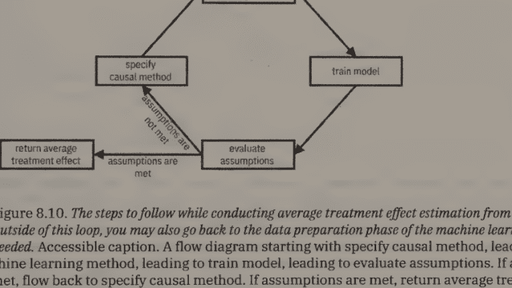

图 8.10. 从观测数据进行平均处理效应估计时所要遵循的步骤。在这个循环之外，如果需要，你也可以回到机器学习生命周期的数据准备阶段。无障碍说明：一个流程图，从指定因果方法开始，依次进入指定机器学习方法、训练模型、评估假设。若假设未满足，则流程返回“指定因果方法”；若假设满足，则输出“平均处理效应”。

### 8.5.1 处理模型

你可以考虑的第一种因果方法是处理模型。在深入了解处理模型之前，先定义一个重要概念：倾向得分。它是在可能的混杂变量（如子女照护等）条件下，接受处理（焦虑缓解干预）的概率，即 `P(T | X)`。理想情况下，是否向来访者提供焦虑缓解干预的决定应与其他任何因素无关，包括来访者是否有子女照护。这在随机试验中是成立的，但在观测数据中往往不成立。

处理模型的目标是通过打破 `T` 与 `X` 之间的依赖关系来消除混杂偏倚。其做法是给数据点赋予权重，使它们更接近随机试验：平均而言，对照组和处理组中的来访者在混杂变量上应当彼此相似。这一分支中最常用的方法是逆概率加权，其主要思想是：给那些原本更有可能被分到对照组的处理组来访者更大权重，反之亦然。接受了焦虑缓解处理的来访者 `t_j = 1` 被赋予与其倾向得分成反比的权重 `w_j = 1/P(T = 1 | X = x_j)`。未接受处理的来访者 `t_j = 0` 也以类似方式加权：`w_j = 1/P(T = 0 | X = x_j)`，也等于 `1/(1 − P(T = 1 | X = x_j))`。那么，焦虑缓解对稳定住房的平均处理效应就是处理组与对照组之间结果标签的加权均值差。如果将处理组定义为 `T = {j | t_j = 1}`，对照组定义为 `C = {j | t_j = 0}`，则平均处理效应估计为


$\tau = \frac{1}{||\mathcal{T}||} \sum_{j\in\mathcal{T}} w_j y_j - \frac{1}{||\mathcal{C}||} \sum_{j\in\mathcal{C}} w_j y_j.$

公式 8.3

从训练数据样本 `{(x_1, t_1), ..., (x_n, t_n)}` 中获取倾向得分 `P(T | X)` 是一项机器学习任务，其特征为 `x_i`、标签为 `t_j`，你希望输出一个（经过校准的）连续分数（该分数在第 6 章中被称为 `s(x)`）。这项学习任务可以使用第 7 章中的任意机器学习算法来完成。用于估计倾向得分的不同机器学习算法选择，其能力范围与其他任何机器学习任务相同，例如：结构化数据集使用决策森林，大型半结构化数据集使用神经网络。

一旦你训练好倾向得分模型，下一步就是评估它是否满足因果推断的假设。（仅仅因为你能计算出平均处理效应，并不意味着一切都万事大吉，也不意味着你的答案就是真正的因果效应。）对倾向得分模型主要有四项评估：(1) 协变量平衡；(2) 校准；(3) 倾向得分分布的重叠；(4) 受试者工作特征曲线下面积（AUC）。校准和 AUC 在第 6 章中已作为评估典型机器学习问题的方法介绍过，但协变量平衡和倾向得分分布的重叠是这里的新内容。重要的是，使用 AUC 评估倾向得分模型，与使用 AUC 评估典型机器学习问题的方式不同。

由于逆概率加权的目标是让处理组和对照组中的潜在混杂变量 `X` 看起来相似，因此第一项评估——协变量平衡——检验的是这一目标是否已经实现。具体做法是逐个遍历 `X` 特征（子女照护及其他可能的混杂因素），计算标准化均值差（SMD）。只需用处理组数据的特征均值减去对照组数据的特征均值，再除以处理组和对照组该特征平均方差的平方根。“标准化”指的就是最后的除法，这样做是为了让你不必担心不同特征的绝对量纲。任何特征的 SMD 绝对值若大于约 0.1，都应引起警惕。如果出现这种情况，说明你的倾向得分模型不够好，你不应从该平均处理效应中得出因果结论。

第二项评估是校准。因为倾向得分模型在逆概率加权中被当作真实概率使用，所以它必须具有良好的校准才能有效。如第 6 章所介绍，校准损失需要很小，校准曲线需要尽可能接近一条直线。如果它们不满足要求，你就不应从计算出的平均处理效应中得出因果结论，而需要回到第 1 步。

第三项评估基于处理组和对照组的倾向得分分布，如图 8.11 所示。分布中接近 0 或 1 的尖峰是不好的，因为它们表明可能存在一大组 `X` 值，可以被倾向得分模型近乎完美地分类。完美分类意味着在该区域内处理组和对照组几乎没有重叠，而这是为了满足正性假设所不希望出现的情况。如果你看到这种尖峰，就不应继续使用这个模型。（这项评估不会告诉你非重叠区域具体在哪里，只会告诉你它存在。）

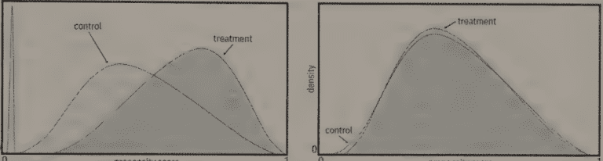

图 8.11. *示例倾向得分分布；左边的分布表明可能存在重叠假设违反，右边的分布则没有。* 无障碍说明：各图以密度为纵轴、倾向得分为横轴。每张图叠加了对照组概率密度函数（pdf）和处理组概率密度函数（pdf）。左侧图中的两个概率密度函数重叠不多，且对照组分布在 0 附近有一个尖峰；右侧图中的两个概率密度函数几乎完全重叠在一起。

处理模型的第四项评估是 AUC。虽然 AUC 的定义和计算方式与第 6 章相同，但倾向得分模型 AUC 的优良取值并不接近完美的 1.0。AUC 的中间值（如 0.7 或 0.8）对于平均处理效应估计来说刚刚好。接近 0.5 的较差 AUC 对于倾向得分模型来说仍然是糟糕的。如果 AUC 过高或过低，就不要继续使用这个模型。当你完成所有诊断评估，且没有任何一项发出警示时，你才应继续把计算出的平均处理效应作为真正的因果洞见来报告。否则，你必须返回并指定不同的因果方法和/或机器学习方法。

### 8.5.2 结果模型

在检验 ABC Center 的焦虑缓解干预是否对稳定住房产生影响时，你应该考虑的另一个因果模型方法分支是*结果模型*。在处理模型中，你用数据 `{(t_1, x_1), ..., (t_n, x_n)}` 来学习 `P(T | X = x)` 这一关系，但在结果模型中，你做的事情有所不同。在这个分支中，你用数据 `{(t_1, y_1), ..., (t_n, y_n)}` 来学习关系 `E[Y | T = 1, X = x]` 和 `E[Y | T = 0, X = x]`。你是在根据可能的混杂变量（如子女照护）以及焦虑缓解干预变量，直接预测稳定住房的平均结果标签。处理模型和结果模型都需要满足强可忽略性。在继续介绍结果模型的细节之前，表 8.2 总结了处理模型与结果模型之间的差异。

## 表 8.2. *因果推断方法两个分支的特征*

| 分支 | 数据集 | 学习内容 | 用途 |

|---|---|---|---|

| 处理模型 | `{(t_1,x_1), ..., (t_n,x_n)}` | `P(T | X)` | 用于对数据点加权 |

| 结果模型 | `{(t_1,x_1,y_1), ..., (t_n,x_n,y_n)}` | `E[Y | T,X]` | 直接用于平均处理效应估计 |

为什么从数据中学习 `E[Y | T, X]` 模型是有用的？如何从中得到焦虑缓解干预对稳定住房的平均处理效应？请记住，平均处理效应的定义是 `τ = E[Y | do(t = 1)] - E[Y | do(t = 0)]`。同时也要记住，当不存在混杂时，关联分布与干预分布是相等的，因此 `E[Y | do(t)] = E[Y | T = t]`。一旦你有了 `E[Y | T = t, X]`，就可以利用所谓的迭代期望定律对 `X` 进行调整，从而得到 `E[Y | T = t]`。诀窍在于对 `X` 取期望，因为 `E_X[E_Y[Y | T = t, X]] = E_Y[Y | T = t]`。（期望的下标表示你针对哪个随机变量取期望。）要对 `X` 取期望，你需要将结果模型在所有 `X` 取值上求和，并以每个 `X` 取值的概率作为权重。之后计算平均处理效应就一帆风顺了，因为你可以直接计算差值 `E[Y | T = 1] - E[Y | T = 0]`。

你已经有了因果模型；现在进入机器学习模型。当结果标签 `Y` 取二值 0 和 1，分别对应稳定住房的不存在和存在时，期望值就等价于概率 `P(Y | T = 1, X = x)` 和 `P(Y | T = 0, X = x)`。学习这些概率的任务需要一个经过校准的机器学习分类器，该分类器具有连续分数输出，并在标签 `y_i` 和特征 `(t_j, x_j)` 上进行训练。你可以使用第 7 章中的任何机器学习方法，并遵循相同的适用领域准则。传统上，常见的做法是使用基于线性边界的分类器，但应尝试非线性方法，尤其是对于包含大量潜在混杂变量的高维数据。

与处理模型一样，能够使用结果模型计算平均处理效应并不自动意味着你的结果是因果推断。你仍然需要评估。第一个评估（同时也是对处理模型的评估）是校准。你需要较小的校准损失和一条笔直的校准曲线。第二个针对结果模型的评估是准确性，例如使用 AUC 来衡量。对于结果模型，与常规机器学习模型一样，但不同于处理模型，你希望 AUC 尽可能大，接近 1.0。如果 AUC 过小，不要继续使用该模型，而是回到图 8.10 所示的平均处理效应估计迭代方法中的第 1 步。

第三个针对结果模型的评估是检查其产生的预测，以评估可忽略性假设或未测量的混杂因素。对于实际属于处理组（接受了焦虑缓解干预）的客户和属于对照组（未接受焦虑缓解干预）的客户，结果模型输出的预测值 `Y | t = 1` 和 `Y | t = 0` 应当相似。如果预测值不相似，说明在调整了 `X`（儿童保育及其他变量）之后仍存在一些混杂，这意味着“无未测量混杂因素”的假设被违反了。因此，如果两组客户的预测值 `Y | t = 1` 和 `Y | t = 0` 没有大部分重叠，则不要继续，回到因果模型和机器学习模型的选择上。

### 8.5.3 结论

你已经评估了因果推断的两种选择：处理模型和结果模型。在什么情况下哪种选择更好？处理建模和结果建模本质上是不同的问题，具有不同的特征和标签。利用可用的不同机器学习方法选项，你最终可能对一种因果方法获得比另一种更好的评估结果。因此，只需尝试两个分支，看看结果对应得有多好。根据底层机器学习方法的适用领域，某些方法会更适合相关的建模任务。

但你知道吗？你很幸运，不必在因果推断的两个分支之间做出选择。有一种称为双重稳健估计的混合方法，它将倾向得分值作为额外特征添加到结果模型中。⁹ 双重稳健模型让你两全其美！ABC 中心的主任正在等待决定是否应该在焦虑缓解干预上投入更多资金。一旦你完成因果建模分析，他就能做出明智的决定。

## 8.6 小结

- 因果关系是一个基本概念，它表达的是改变一件事（原因）如何导致另一件事（结果）发生变化。它不同于相关性、可预测性和依赖性。

- 因果模型对于涉及干预和处理且对结果有预期影响的决策至关重要。当你对输入“施加操作”时，预测性关联模型是不够的。

- 除了为决策提供信息外，因果建模还可以避免预测模型中有害的虚假关系。

- 结构因果模型通过在统计关系之外编码因果关系来扩展贝叶斯网络。其图结构使你能够理解在许多变量中什么导致什么，以及因果链。学习其图结构被称为因果发现。

- 假设的治疗与结果之间的因果推断是一个不同的问题设定。要从观测数据中有效进行因果推断，你必须控制混杂因素。

- 因果建模需要难以验证的假设，但在建模过程中你应该执行一组评估，以尽最大努力。

## 9

## 分布偏移

Wavetel 是印度一家领先的（虚构）移动电话运营商，近年来将业务扩展到几个东非和中非国家。其在非洲市场的利润中心之一是通过与各国银行合作运营的移动货币信贷服务。*移动货币*最直接的应用是储蓄，2007 年首次在肯尼亚以 M-Pesa 之名推出。通过移动货币储蓄，客户无需正式银行账户即可通过手机进行电子存款、取款和转账。（请记住，这些交易是第 4 章中 Unconditionally 评估的数据来源之一。）后来出现了更高级的金融服务，如信贷和保险。在这些高级服务中，银行承担金融风险，不能在没有申请流程和一定程度的尽职调查的情况下随意发放账户。

看到移动货币信贷能带来如此可观的利润后，Wavetel 强烈游说允许在其母国印度开展这项业务，并且刚刚看到相关法规签署成为法律。Wavetel 与（虚构的）Bulandshahr 银行合作，准备以 Phulo 之名部署这项新服务。根据市场研究，Wavetel 和 Bulandshahr 银行预计 Phulo 在首次推出时每天会收到数万份申请。他们必须准备好近乎实时地批准或拒绝这些申请。为了应对这种负载，假设他们聘请你的数据科学团队作为顾问，创建一个做出决策的机器学习模型。

你面临的任务——为印度无银行账户客户审批移动电话贷款——是前所未有的。Bulandshahr 银行的历史贷款审批数据对 Phulo 申请人的决策没有用处。然而，Wavetel 拥有来自几个东非和中非国家的移动货币信贷系统的隐私保护数据，并且有权和许可在印度运营中使用这些数据。你能用非洲数据集训练 Phulo 机器学习模型吗？可能会出什么问题？

如果你不小心，可能会出很多问题。你最终可能会创建一个真正有害且不可靠的系统，因为*机器学习的大谎言*：训练数据和测试数据独立同分布（i.i.d.）的核心假设。这在现实世界中几乎从来都不成立。

当训练数据的概率分布与模型部署期间遇到的数据的概率分布往往存在某种差异时，这种分布差异被称为*分布偏移*。一个在交叉验证测试中达到高精度的合格模型，在现实世界中可能无法保持这种能力。过多的认知不确定性甚至会让一个高度风险最小化的模型翻船。

> “如果模型部署时出现分布偏移，一切赌注都无效。（分布偏移总是存在的。）”

> ——阿文德·纳拉亚南，普林斯顿大学计算机科学家

本章开始本书关于可靠性和应对认知不确定性的第4部分，这是可信度的四个属性中的第二个（其他三个是基本性能、人类交互和一致目标），也是安全性的两个属性中的第二个（第一个是最小化风险和偶然不确定性）。如图9.1所示，你已经完成了创建可信机器学习系统的一半路程！

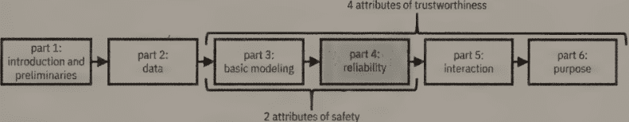

图9.1. *本书的组织结构。第四部分聚焦于可信度的第二个属性——可靠性，它对应于对认知不确定性具有鲁棒性的机器学习模型。* 无障碍说明：一个从左到右的流程示意图，包含六个框：第1部分：引言和预备知识；第2部分：数据；第3部分：基本建模；第4部分：可靠性；第5部分：交互；第6部分：目的。第4部分被突出显示。第3-4部分被标记为安全性的属性。第3-6部分被标记为可信度的属性。

在本章中，在机器学习生命周期的建模阶段创建一个安全可靠的Phulo模型时，你将会：

- 考察认知不确定性如何导致糟糕的机器学习模型，无论是否存在分布偏移；

- 判断你遇到的是哪种类型的分布偏移；以及

- 减轻分布偏移对模型的影响。

## 9.1 机器学习中的认知不确定性

你拥有来自东非和中非国家的移动货币信用审批/拒绝数据集，并希望为印度训练一个可靠的Phulo模型。你知道，为了安全性，你必须关注最小化认知不确定性：即意外伤害的可能性。第3章教你如何区分偶然不确定性和认知不确定性。现在是时候应用你所学的知识，找出认知不确定性正在哪里冒头了！

首先，在图9.2中，让我们扩展图4.3中不同偏差和效度的图示，增加一个建模步骤，该步骤将你从准备好的数据空间带到预测空间，模型的输出预测就位于该空间中。正如你在第7章中学到的，在建模中，你试图通过使用归纳偏置让分类器从训练数据泛化到整个特征集，同时避免过拟合或欠拟合。从预测空间往回看，建模过程是认知不确定性潜入的第一个地方。具体来说，如果你没有足够的信息来选择良好的归纳偏置和假设空间，但原则上可以获得这些信息，那么你就存在认知不确定性。¹ 此外，即使你拥有完美的假设空间，但如果没有足够高质量的数据来训练分类器，你也会存在认知不确定性。

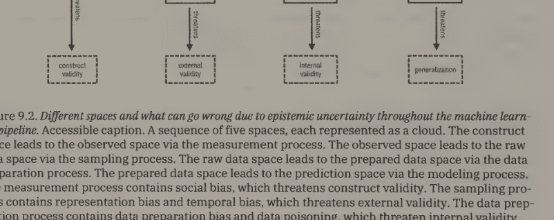

图9.2. 不同的空间以及在整个机器学习流水线中认知不确定性可能导致的问题。无障碍说明：五个空间的序列，每个空间表示为一个云状图形。构造空间通过测量过程到达观测空间。观测空间通过采样过程到达原始数据空间。原始数据空间通过数据准备过程到达准备好的数据空间。准备好的数据空间通过建模过程到达预测空间。测量过程包含社会偏差，这会威胁构念效度。采样过程包含代表性偏差和时间偏差，这会威胁外部效度。数据准备过程包含数据准备偏差和数据投毒，这会威胁内部效度。建模过程包含欠拟合/过拟合和不良归纳偏置，这会威胁泛化。

模型中的认知不确定性有几个不同的名称，包括拉什莫尔效应²和欠规格化³。图9.3所示的核心思想是，许多模型在偶然不确定性和风险方面表现相似，但由于你没有最小化认知不确定性，它们的泛化方式各不相同。它们都有成为合格且可靠模型的*可能性*。它们的可能性值为1。（其他表现不佳的模型成为合格且可靠模型的可能性值为0。）然而，这些可能的模型中有许多是不可靠的，它们通过从数据中那些人们自然不认为适合泛化的虚假特征进行泛化来走捷径。⁴ 它们不是因果性的。假设某个非洲移动货币信用数据集恰好有一个虚假特征，比如申请在星期二提交，而该特征能很好地预测信用批准标签。在这种情况下，机器学习训练算法不会知道得更好，会将其作为捷径来拟合模型。你知道，在构建可信机器学习系统时，走捷径对你来说是不可以的，所以你也不希望你的模型走捷径。

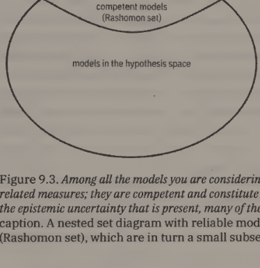

图9.3. 在你考虑的所有模型中，其中许多在准确性和相关指标方面表现良好；它们是合格的，构成了罗生门集合。然而，由于存在规格不足和认知不确定性，许多合格模型并不安全可靠。无障碍说明：一个嵌套集合示意图，可靠模型是合格模型（罗生门集合）的一个小子集，而合格模型又是假设空间中模型的一个小子集。

你怎么知道一个合格的高精度模型是可靠、安全的那一个，而不是不可靠、不安全的那一个？主要方法是通过输入超出训练数据分布支持范围的边缘数据点来对其进行压力测试。关于如何以这种方式测试机器学习系统的更多细节，将在第13章中介绍。

在从准备好的数据空间到预测空间的建模步骤中，减少认知不确定性的主要方法是*数据增强*。如果可能的话，你应该从更多的环境和条件中收集更多数据，但在你的Phulo预测任务中这可能无法实现。

或者，你可以通过合成生成训练数据点来扩充训练数据集，尤其是那些超出你现有数据分布边缘的数据点。对于半结构化数据模态，可以通过翻转、旋转以及对现有数据点进行其他变换来进行数据增强。在结构化数据模态中，就像你使用Phulo时的情况一样，你可以通过更改类别值和向连续值添加噪声来创建新的数据点。但是，请注意不要在数据增强过程中引入任何新的偏差。

## 9.2 分布偏移是认知不确定性的一种形式

到目前为止，你已经考虑了在从准备好的数据空间到预测空间的建模过程中出现的认知不确定性，但在流水线更早的阶段也存在认知不确定性。这种认知不确定性来自于当你从构念空间到准备好的数据空间时所有你不知道或不太理解的偏差。我们将在第10章和第11章中回到其中的一些偏差，届时你将学习如何使机器学习系统公平且具有对抗鲁棒性。但就目前而言，当使用来自几个东非和中非国家的数据在印度构建Phulo模型时，你最明显的认知不确定性来源是采样。你的数据采样的时间和总体（代表性偏差）与Phulo将要部署时不同。你可能还存在测量上的认知不确定性：由于文化差异（社会偏差），信用度在印度的表现方式可能与东非和中非国家不同。综上所述，训练数据与部署数据的分布并不相同：`p_{X,Y}^{(\text{train})}(x,y) \neq p_{X,Y}^{(\text{deploy})}(x,y)`。（请记住，`X` 是特征，`Y` 是标签。）你面临着*分布偏移*。

### 9.2.1 分布偏移的不同类型


在构建Phulo模型时，你知道在历史非洲背景下测量和采样数据的方式与Phulo将要部署的环境（即当今的印度）不匹配。训练数据分布 $p_{X,Y}^{(\text{train})}(x,y)$ 与部署数据分布 $p_{X,Y}^{(\text{deploy})}(x,y)$ 有哪些不同的方式？主要有三种方式。

- 1. 先验概率偏移，也称为标签偏移，是指标签分布不同，但给定标签下的特征相同：$p_Y^{(\text{train})}(y) \neq p_Y^{(\text{deploy})}(y)$⁵ 且 $p_{X|Y}^{(\text{train})}(x \mid y) = p_{X|Y}^{(\text{deploy})}(x \mid y)$。

- 2. 协变量偏移则相反，是指特征分布不同，但给定特征下的标签相同：$p_X^{(\text{train})}(x) \neq p_X^{(\text{deploy})}(x)$ 且 $p_{Y|X}^{(\text{train})}(y \mid x) = p_{Y|X}^{(\text{deploy})}(y \mid x)$。

- 3. 概念漂移是指给定特征下的标签不同，但特征相同：$p_{Y|X}^{(\text{train})}(y \mid x) \neq p_{Y|X}^{(\text{deploy})}(y \mid x)$ 且 $p_X^{(\text{train})}(x) = p_X^{(\text{deploy})}(x)$；或者给定标签下的特征不同，但标签相同：$p_{X|Y}^{(\text{train})}(x \mid y) \neq p_{X|Y}^{(\text{deploy})}(x \mid y)$ 且 $p_Y^{(\text{train})}(y) = p_Y^{(\text{deploy})}(y)$。

所有其他类型的分布偏移都没有像这三种类型这样特殊的名称。前两种类型的分布偏移源于采样差异，而第三种类型的分布偏移源于来自测量差异。三种不同类型的分布偏移总结在表 9.1 中。

表 9.1. 三种类型的分布偏移。

| 类型 | 变化的内容 | 不变的内容 | 来源 | 威胁 | 学习问题 |

|---|---|---|---|---|---|

| 先验概率偏移 | Y | X|Y | 采样 | 外部效度 | 反因果学习 |

| 协变量偏移 | X | Y|X | 采样 | 外部效度 | 因果学习 |

| 概念漂移 | Y|X | X | 测量 | 构念效度 | 因果学习 |

| 概念漂移 | X|Y | Y | 测量 | 构念效度 | 反因果学习 |

让我们逐一举例说明每种类型，看看哪一种（或不止一种）会影响 Phulo 的情形。如果当今印度与历史上的非洲国家中信用良好的人所占比例不同，那么就会发生先验概率偏移，这可能是由于整体经济的差异所致。如果特征的分布不同，就会发生协变量偏移。例如，印度人持有的黄金资产可能比东非和中非国家的人更多。如果连接特征与信用度的实际机制不同，就会发生概念漂移。例如，在印度，与许多人通话或发短信的人可能信用度更高；而在东非和中非，与少数人通话或发短信的人可能信用度更高。

描述不同类型分布偏移的一种方式是借助情境或环境。改变数据被测量和采样的环境，会对特征和标签产生什么影响？如果你谈论的是“导致”作用，那么你谈的就是因果关系。如果将环境视为一个随机变量 E，那么不同类型的分布偏移就具有如图 9.4 所示的因果图。

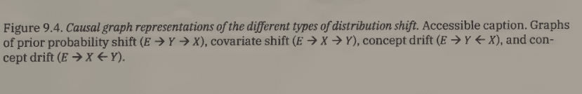

图 9.4. 不同类型分布偏移的因果图表示。无障碍说明。先验概率偏移（E → Y → X）、协变量偏移（E → X → Y）、概念漂移（E → Y ← X）和概念漂移（E → X ← Y）的图。

6 Meelis Kull 和 Peter Flach。“数据集偏移的模式”。载于：《学习多情境国际研讨会论文集》。法国南锡，2014 年 9 月。

这些图说明了一个微妙之处。当发生先验概率偏移时，标签导致特征；而当发生协变量偏移时，特征导致标签。这乍一想有点奇怪，所以让我们放慢速度，仔细推敲这个概念。在第一种情况 Y → X 中，标签被称为*内在*标签，对应的机器学习问题被称为*反因果学习*。一个典型例子是由已知病原体（如疟疾）引起的疾病，它会导致寒战、疲劳和发热等特定症状。患者患有某种疾病的标签是内在的，因为它是被感染患者的一个基本属性，进而导致了观察到的特征。在第二种情况 X → Y 中，标签被称为*外在*标签，对应的机器学习问题被称为*因果学习*。这种情况的一个典型例子是综合征，即一组与病原体无关的症状集合，例如阿斯伯格综合征。标签只是一个用来描述诸如强迫行为和协调性差等症状的标签；它并不会导致这些症状。概念漂移的两种不同版本分别对应反因果学习和因果学习。通常，在监督式机器学习的实践中，反因果学习与因果学习之间的区别只是理论上的趣谈，但当要确定如何缓解分布偏移的影响时，它就变得重要起来。对于 Phulo 模型，你究竟处于哪种情形并不明显，你需要认真思考。

### 9.2.2 检测分布偏移

鉴于你的训练数据来自东非和中非国家，而部署数据将来自印度，你意识到建模任务中很可能存在分布偏移。但如何确切地检测到它呢？有两种主要方法：

- 1. *基于数据分布的偏移检测*，以及

- 2. *基于分类器性能的偏移检测*，

这两种方法分别适用于机器学习建模流程中的两个不同节点，如图 9.5 所示。⁷

基于数据分布的偏移检测是在模型训练之前对训练数据进行的。基于分类器性能的偏移检测则在之后对模型进行。基于数据分布的偏移检测，顾名思义，直接比较 p_{X,Y}^{(train)}(x,y) 和 p_{X,Y}^{(deploy)}(x,y)，以判断它们是相似还是不同。一种常见的方法是计算它们的 K-L 散度，这在前文第 3 章中介绍过。如果散度过高，则存在分布偏移。基于分类器性能的偏移检测考察贝叶斯风险、准确率、F₁ 分数或其他模型性能指标。如果其表现远差于交叉验证时的表现，则存在分布偏移。

这听起来都没问题，但你是否注意到这两种分布偏移检测方法有什么特点使它们无法用于你的 Phulo 开发任务？它们需要部署分布的数据：既包括特征，也包括标签。但你并没有这些数据！如果有的话，你早就用它来训练 Phulo 模型了。偏移检测方法实际上针对的是监控场景：你持续获得需要分类的数据点，并在此后不久持续获得相应的真实标签。

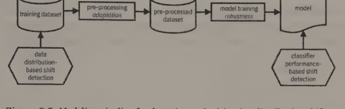

图 9.5. 用于检测和缓解分布偏移的建模流程。无障碍说明。一个框图，训练数据集作为输入进入标记为“适配”的预处理块，输出预处理后的数据集。预处理后的数据集输入到标记为“鲁棒性”的模型训练块，输出模型。一个基于数据分布的偏移检测块应用于训练数据集。一个基于分类器性能的偏移检测块应用于模型。

如果你已经开始从印度收集无标签特征数据，你可以通过比较印度特征分布与非洲特征分布来进行无监督的基于数据分布的偏移检测。但你其实已经知道它们会有所不同，而且这种无监督方法无法让你确定你面临的是哪种类型的分布偏移。因此，在类似 Phulo 的场景中，你只能根据你对问题的了解来假设分布偏移的存在及其类型。（还记得我们在第 8 章中的说法吗：“不会做的人，就做假设。”）

### 9.2.3 缓解分布偏移

在克服分布偏移以创建安全可信的机器学习模型时，有两种不同的场景：（1）你拥有来自部署分布的无标签特征数据 X^(deploy)，这可以让你将模型适配到部署环境中；（2）你完全没有来自部署分布的数据，因此你必须让模型对你最终可能遇到的任何部署分布都具有鲁棒性。

> > “机器学习系统需要对现实世界中出现的各种情境进行鲁棒建模。”

——德拉戈·安格洛夫（Drago Anguelov），Waymo 计算机科学家

这两种方法发生在图 9.5 所示建模流程的不同部分。适配是在训练数据上作为预处理步骤完成的，而鲁棒性则作为模型训练过程的一部分引入。这两种缓解方式总结在表 9.2 中。

表 9.2. 两种类型的分布偏移缓解。

| 类型 | 流程中的位置 | 已知部署环境 | 先验概率偏移与协变量偏移的应对方法 | 概念漂移的应对方法 |

|---|---|---|---|---|

| 适配 | 预处理 | 是 | 样本权重 | 获取标签 |

| 鲁棒性 | 模型训练 | 否 | 最小-最大公式 | 不变风险最小化 |

接下来的章节将针对不同类型的数据分布偏移，探讨适应（adaptation）和鲁棒性（robustness）的方法。缓解先验概率偏移（prior probability shift）和协变量偏移（covariate shift）比缓解概念漂移（concept drift）更容易，因为在前两种类型中，特征与标签之间的关系没有改变。因此，你在历史非洲训练数据上学到的分类器，即使部署在印度数据上，也依然能捕捉这种关系；它只需要稍作调整。

## 9.3 适应

第一种缓解方法是适应，它利用来自印度的无标签特征数据 X^(deploy) 中的信息，对来自东非和中非国家的训练数据进行预处理。要进行适应，你必须知道印度是你要部署模型的地方，并且你必须能够收集一些特征。

### 9.3.1 先验概率偏移

由于先验概率偏移源于采样偏差，特征与标签之间的关系以及 ROC 曲线都不会改变。适应过程只需根据混淆矩阵调整分类器阈值或工作点即可，这些都是你在第 6 章学过的概念。适应先验概率偏移的一种直接而有效的方法是加权方案。算法如下。

- 1. 在训练数据的一个随机划分上训练分类器，得到 ŷ^(train)(x)，并在训练数据的另一个随机划分上计算分类器的混淆矩阵：

  C = [[P_TP, P_FP], [P_FN, P_TN]]。

- 2. 将部署数据的无标签特征输入分类器：ŷ^(train)(X^(deploy))，并将部署数据中正类和负类的概率计算为一个向量：

  a = [P(ŷ^(train)(X^(deploy)) = 1), P(ŷ^(train)(X^(deploy)) = 0)]。

- 3. 计算权重 w = C⁻¹ a。这是一个长度为二的向量。

- 4. 将权重应用于第一个随机划分中的训练数据点，并重新训练分类器。两个权重中的第一个乘以标签为 1 的训练数据点的损失函数。两个权重中的第二个乘以标签为 0 的训练数据点的损失函数。

在假设存在先验概率偏移的情况下，你部署 Phulo 到印度时，应该使用的就是重新训练后的分类器。

### 9.3.2 协变量偏移

与适应先验概率偏移类似，适应协变量偏移采用一种称为重要性加权（importance weighting）的加权技术来克服采样偏差。在经验风险最小化或结构风险最小化的设置中，权重 w_j 乘以数据点 (x_j, y_j) 的损失函数：

$\hat{y}(\cdot) = \arg\min_{f\in\mathcal{F}} \frac{1}{n}\sum_{j=1}^{n} w_j L(y_j, f(x_j))$。

公式 9.1

（将此与公式 7.3 进行比较，两者相同，只是此处多了权重。）重要性权重是部署分布下特征 x_j 的概率密度与训练分布下特征 x_j 的概率密度之比：w_j = p_X^{(deploy)}(x_j) / p_X^{(train)}(x_j)。该加权方案试图通过强调在东非和中非国家不太可能出现但在印度更有可能出现的特征，使非洲特征看起来更像印度特征。

如何从训练数据集和部署数据集计算权重呢？你可以先尝试分别估计两个概率密度函数，然后在每个训练数据点处对其进行评估，并代入比值中。但这通常效果不佳。更好的方法是直接估计权重。

> “在解决一个感兴趣的问题时，不要将解决一个更一般的问题作为中间步骤。”

>

> ——弗拉基米尔·瓦普尼克（Vladimir Vapnik），AT&T 贝尔实验室计算机科学家

最直接的技术与第 8 章中计算倾向得分的方法类似。你学习一个具有校准过的连续得分 s(x) 的分类器，例如逻辑回归或第 7 章中的任何其他分类器。用于训练该分类器的数据集是部署数据集和训练数据集的拼接。来自部署数据集的数据点标签为 1，来自训练数据集的数据点标签为 0。特征就是特征。一旦你获得了分类器的连续输出作为得分，重要性权重即为：

$w_j = \frac{n^{(train)} s(x_j)}{n^{(deploy)} (1 - s(x_j))}$

公式 9.2

### 9.3.3 概念漂移

适应先验概率偏移和协变量偏移可以在没有部署数据标签的情况下完成，因为它们源于采样偏差，而采样偏差中特征与标签的关系不变。然而，在概念漂移下情况则不同，因为它源于测量偏差：特征与标签之间的关系从非洲国家到印度发生了变化。要适应概念漂移，你必须非常审慎地选择无标签的部署数据点，以便（花费高昂代价地）获取其标签。这可能意味着让印度的人类专家查看一些申请，并对是否批准或拒绝基于移动支付的信贷提供判断。选择用于此类标注的数据点有多种标准。一旦你获得标注，就在来自印度的新标注数据（可能赋予较大权重）以及来自东非和中非国家的旧训练数据（可能赋予较小权重）上重新训练分类器。

## 9.4 鲁棒性

通常情况下，你没有来自部署环境的任何数据，因此适应方法无从谈起。你甚至可能不知道部署环境会是什么样。也许最终并不一定是印度。鲁棒性并不要求你拥有任何部署数据。它修改的是学习目标和学习过程。

### 9.4.1 先验概率偏移

如果你没有任何来自部署环境（印度）的数据，你希望你的模型对任何可能出现的信用worthiness先验概率都具有鲁棒性。考虑一种情况：印度实际的部署先验概率是 p₀^(deploy) 和 p₁^(deploy) = (1 - p₀^(deploy))，但你可能通过查看不同非洲国家的先验概率，猜测它们是 p₀^(train) 和 (1 - p₀^(train))。你的猜测很可能有些偏差。如果你使用与你的猜测相对应的决策函数，并采用似然比检验阈值 p₀^(train)/(1 - p₀^(train)) * c₁₀/c₀₁（回忆一下，这是第 6 章中陈述的最优阈值形式），则会产生以下失配贝叶斯风险性能：¹¹

R(p₀^(deploy), p₀^(train)) = c₁₀ p₀^(deploy) p_FP(p₀^(train)) + c₀₁ p₁^(deploy) p_FN(p₀^(train))

公式 9.3

你会损失性能。你在确定正确先验概率方面的认知不确定性损害了贝叶斯风险。

为了对当今印度不确定的先验概率具有鲁棒性，选择一个 p₀^(train) 值，使得最坏情况下的性能尽可能好。这被称为极小极大（min-max）公式，问题在于找到一个极小极大最优的先验概率点，用于部署 Phulo 模型时采用。具体来说，你想要：

公式 9.4

$$\arg\min_{p_0^{(train)}} \max_{p_0^{(deploy)}} R\big(p_0^{(deploy)}, p_0^{(train)}\big).$$

通常在这本书中，我们会在提出公式后就此打住。然而，在这个实例中，由于极小极大最优解具有良好的几何性质，让我们继续探讨。失配贝叶斯风险函数 $R\big(p_0^{(deploy)}, p_0^{(train)}\big)$ 对于固定的 $p_0^{(train)}$ 是 $p_0^{(deploy)}$ 的线性函数。当 $p_0^{(train)} = p_0^{(deploy)}$ 时，恢复了贝叶斯最优阈值，且 $R\big(p_0^{(deploy)}, p_0^{(deploy)}\big)$ 是第 6 章定义的最优贝叶斯风险 $R$。它是一个凹函数，在区间 $[0,1]^{12}$ 的端点处为零。线性失配贝叶斯风险函数在 $p_0^{(train)} = p_0^{(deploy)}$ 处与最优贝叶斯风险函数相切，并且在其他地方都大于后者。$^{13}$ 这种关系如图 9.6 所示。

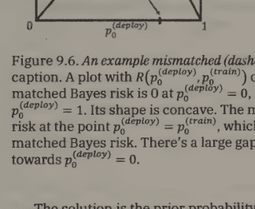

图 9.6. 失配（虚线）和匹配（实线曲线）贝叶斯风险函数的示例。无障碍说明。一个绘图，纵轴为 $R\big(p_0^{(deploy)}, p_0^{(train)}\big)$，横轴为 $p_0^{(deploy)}$。匹配的贝叶斯风险在 $p_0^{(deploy)} = 0$ 时为 0，上升到中间某个峰值，然后在 $p_0^{(deploy)} = 1$ 处下降回 0。其形状是凹的。失配贝叶斯风险是一条在点 $p_0^{(deploy)} = p_0^{(train)}$ 处与匹配贝叶斯风险相切的直线，在此示例中，该点位于匹配贝叶斯风险峰值右侧。在匹配和失配贝叶斯风险之间存在很大的差距，尤其是在 $p_0^{(deploy)} = 0$ 附近。

解是匹配贝叶斯风险函数斜率为零时的先验概率值。事实证明，正确答案是失配贝叶斯风险切线水平的位置——即如图 9.7 所示的驼峰顶部。一旦得到该值，就将其用于 Phulo 决策函数的阈值，以应对先验概率偏移。

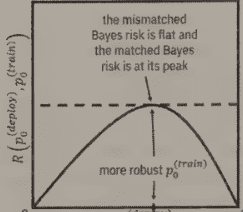

**图 9.7.** *在决策函数中，最稳健的先验概率取值是使匹配的贝叶斯风险函数达到最大值的位置。*无障碍说明：图中纵轴为 $R(p_0^{(deploy)}, p_0^{(train)})$，横轴为 $p_0^{(deploy)}$。当 $p_0^{(deploy)}=0$ 时，匹配的贝叶斯风险为 0；随后逐渐上升，在中间达到峰值，之后又逐渐下降，在 $p_0^{(deploy)}=1$ 时回到 0。其形状为凹函数。失配的贝叶斯风险是一条水平线，在最优点 $p_0^{(deploy)}=p_0^{(train)}$ 处与匹配的贝叶斯风险相切，而该点正是匹配的贝叶斯风险的峰值。此时匹配与失配的贝叶斯风险之间的最大差距尽可能小。

### 9.4.2 协变量偏移

如果你遇到的是协变量偏移，而不是先验概率偏移，就需要采取稍有不同的方法，让模型适应部署环境并保持稳健。同样，稳健性意味着要构建一个极小极大优化问题，从而尽可能妥善地应对最坏情况。从公式 9.1 的重要性权重形式出发，在权重上额外加入一个最大化损失项：

$\hat{f} = \arg\min_{f \in \mathcal{F}} \max_{w} \frac{1}{n}\sum_{j=1}^{n} w_{j} L(y_j, f(x_j)),$

公式 9.5


其中，$w$ 是一组可能的权重，这些权重均为非负数且总和为 1。优化公式 9.5 中目标函数的分类器，就是你在 Phulo 模型中应采用的稳健分类器，用来应对协变量偏移。

### 9.4.3 概念漂移及其他分布偏移

适应概念漂移比适应先验概率偏移和协变量偏移更困难，因为概念漂移源于测量偏差，而不是抽样偏差。与之类似，应对概念漂移也更加困难。这是机器学习中最棘手的问题之一。你实际上无法构建极小极大形式，因为来自东非和中非国家的训练数据无法反映印度中特征与标签之间的正确关系。¹⁴Junfeng Wen、Chun-Nam Yu 和 Russell Greiner。“在测试分布不确定的情况下进行稳健学习：将协变量偏移与模型误设联系起来。”载于：*国际机器学习会议论文集*。中国北京，2014 年 6 月，第 631–639 页。Weihua Hu、Gang Niu、Issei Sato 和 Masashi Sugiyama。“分布鲁棒监督学习能否产生稳健分类器？”载于：*国际机器学习会议论文集*。瑞典斯德哥尔摩，2018 年 7 月，第 2029–2037 页。

能够应对概念漂移的模型必须在训练数据所能提供的信息之外进行外推。除非作出更多假设，否则这项任务的范围过于宽泛，很难做好。

一种合理的假设是，特征可以分为两类：(1) 因果特征或*稳定*特征；(2)*伪相关*特征。事先并不知道哪些特征属于哪一类。因果特征捕捉的是特征与标签关系中的内在部分，并且在不同环境中保持不变。换句话说，这组特征在不同环境中是*不变的*。伪相关特征可能在某一个或少数几个环境中具有预测能力，但并非在所有环境中都如此。你希望 Phulo 模型依赖因果特征，因为这些特征与标签之间的预测关系在坦桑尼亚、卢旺达、刚果以及 Wavetel 拥有数据的其他国家都成立，同时忽略伪相关特征。这样一来，我们希望模型不仅能在训练集中的国家表现良好，也能适用于它遇到的任何新国家或环境，例如印度。这样，模型在部署环境中就能保持稳健。

> “机器学习让人们更加重视稳定性和稳健性。”

>

> —斯坦福大学经济学家 Susan Athey

*不变风险最小化*是机器学习标准风险最小化形式的一种变体。当有来自多个环境的数据可用于训练时，它能帮助模型关注因果特征，避免依赖伪相关特征。其形式如下：¹⁵

$$\hat{f}(\cdot) = \arg\min_{f \in \mathcal{F}} \sum_{e \in \mathcal{E}} \frac{1}{n_e} \sum_{j=1}^{n_e} L\big(y_j^{(e)}, f(x_j^{(e)})\big).$$

使得对于所有 $e \in \mathcal{E}$，都有 $f \in \arg\min_{g \in \mathcal{F}} \frac{1}{n_e} \sum_{j=1}^{n_e} L\big(y_j^{(e)}, g(x_j^{(e)})\big)$。

公式 9.6

我们来逐步拆解这个公式，以便更好地理解它。首先，集合 $\mathcal{E}$ 表示所有拥有训练数据的环境或国家（坦桑尼亚、卢旺达、刚果等），每个国家都用 e 编号。每个国家都有 $n_e$ 个训练样本 $\{(x_1^{(e)}, y_1^{(e)}), ..., (x_{n_e}^{(e)}, y_{n_e}^{(e)})\}$。上面一行中的内层求和就是我们在第 7 章见过的常规风险表达式。上面一行中的外层求和则是将所有环境的风险相加，因此分类器会最小化总风险。有意思的是第二行中的约束。它表示，作为上面一行最优解的分类器，还必须分别同时最小化每个环境或国家中的风险。正如你在本章前面所了解的，可能有许多不同的分类器都能使损失最小化——这就是 Rashomon 集合——因此第二行中使用了“属于”符号 ∈。不变风险最小化的形式增加了额外约束，以减少认知不确定性，并实现更好的分布外泛化。

你可能会问，第二行中的约束究竟有没有用。难道仅靠第一行不能得到相同的解吗？这是机器学习研究人员目前正在努力探究的问题。¹⁶他们发现，通常情况下，不带额外不变风险最小化约束的机器学习标准风险最小化形式（见第 7 章）对一般分布偏移最为稳健。然而，如果问题属于反因果学习问题，且不同环境中特征分布的支撑集相似，那么不变风险最小化可能优于标准机器学习（还记得本章前面提到的，在反因果学习中，是标签导致了特征）。¹⁷

在 Phulo 这样的移动货币信贷审批场景中，问题究竟属于因果学习还是反因果学习并不完全明确：是特征导致标签，还是标签导致特征？在传统信用评分问题中，你可能面对的是因果情形，因为收入和资产等特征有严格的参数要求，这些特征会导致银行将某人视为有信用或无信用。在移动货币和无银行账户人群的场景中，如果你认为一个人本质上就是有信用或无信用的，而你能够从其手机使用情况中收集到的特征是其信用状况的结果，那么也可以把这个问题看作反因果问题。在开发 Phulo 模型时，你应该尝试使用不变风险最小化，因为你拥有来自多个国家的数据，需要应对概念漂移并泛化到新的国家，而且问题很可能属于反因果学习。你和数据科学团队可以放心，因为你们已经为 Wavetel 和 Bulandshahr 银行提供了一个可靠的模型，可供他们在推出 Phulo 时使用。

## 9.5 总结

- 机器学习模型要想可靠，就不应走捷径。在建模、数据准备、抽样和测量过程中，都必须尽量减少认知不确定性。

- 数据增强是减少建模中认知不确定性的一种方法。

- 分布偏移——训练数据的概率分布与部署期间将遇到的数据的概率分布不匹配——有三个特殊情形：先验概率偏移、协变量偏移和概念漂移。分布偏移往往无法检测，你只能对此作出假设。

- 先验概率偏移和协变量偏移比概念漂移更容易解决，因为它们源于抽样偏差，而不是测量偏差。

- 缓解先验概率偏移和协变量偏移的一种预处理策略是适配：在模型学习过程中，用样本权重乘以训练损失。寻找这些权重需要一个固定的目标部署分布以及来自该分布的未标记数据。

- 缓解模型训练期间先验概率和协变量偏移的一种策略是最小-最大鲁棒性，它改变学习表述以尝试在部署期间可能遇到的最坏情况下表现最好。

- 适应概念漂移需要获取来自部署环境的一些标记数据。

- 不变风险最小化是一种缓解概念漂移并实现分布鲁棒性的策略，它使模型的努力集中在因果特征上并忽略虚假特征。在反因果学习场景中可能效果良好，即标签导致特征。

# 10 公平性

Sospital 是美国一家领先的（虚构的）健康保险公司。想象一下，你是首席数据科学家，与负责改造公司 *care management* 计划的问题负责人合作。Care management 是帮助患有慢性或复杂疾病的患者管理健康并获得更好临床结果的一系列服务。额外的护理管理由专门团队负责，该团队由医生、其他临床医生和护理人员组成，他们制定并执行一个强调预防性健康措施的协调计划。Sospital 的问题负责人已在护理协调部分的软件解决方案实施方面取得了很大进展，并改变了文化以支持它们，但仍在患者入院流程上遇到困难。主要的困难在于识别需要额外护理管理的健康计划成员。目前这是一个主要手动的过程，问题负责人希望将其自动化。

你通过与问题负责人的初步对话开始机器学习生命周期，并确定这不是一个剥削性的用例，不会立即成为压迫的工具。这也是机器学习可能有所帮助的问题。接下来你咨询了一个包含实际患者的付费多元声音小组。你从他们那里了解到，黑人美国人历史上并未得到医疗保健系统的良好服务，并对其怀有根深蒂固的不信任。因此，你应确保机器学习模型不会向黑人社区传播系统性劣势。该系统应 *fair* 且不包含不想要的偏见。

你的任务现在是为向 Sospital 成员分配护理管理计划的公平机器学习系统制定详细的任务规范，并在不走捷径的情况下推进机器学习生命周期的不同阶段。在本章中，你将：

- 对比机器学习背景下公平性的定义，

- 为你的任务选择合适的公平概念，并

- 在建模管道的各个点缓解不想要的偏见以实现更公平的系统。

## 10.1 公平性的不同定义

本章主题算法公平是本书中最具争议的话题，因为它与社会正义交织在一起，不能简化为纯技术概念。由于这种更广泛的公平概念，你可能会觉得奇怪，本章位于本书中也包含技术鲁棒性的部分。之所以这样包含，是由于与鲁棒性的技术相似性，你作为数据科学家可以利用这些相似性，而这些相似性在其他文献中很少被认可。这一选择并非为了淡化算法公平的社会重要性。

公平与正义几乎同义，且具有政治性。存在几种正义，包括（1）*distributive justice*，（2）*procedural justice*，（3）*restorative justice*，和（4）*retributive justice*。

- 分配正义是人们所获得的东西的平等——结果。

- 程序正义是决定人们获得什么的方式的相同性。

- 恢复性正义修复伤害。

- 报应性正义寻求惩罚作恶者。

所有不同形式的正义在社会和社会技术系统中都发挥着重要作用。在确定谁接受 Sospital 的护理管理、谁不接受的模型的任务规范阶段，你需要关注分配正义。这种对分配正义的关注在设计机器学习系统时通常是正确的，因为机器学习本身关注的是结果。其他类型的正义在设定机器学习被使用和不被使用的背景时很重要。它们对于促进问责制和 *holistically* 地遏制种族主义、性别主义、阶级主义、年龄歧视、能力主义和其他不想要的歧视性行为至关重要。

> > “Don’t conflate CS/AI/tech ethics and social justice issues. They’re definitely related, but not interchangeable.”

> >

> > —Brandeis Marshall, computer scientist at Spelman College

### 为什么不同个人和群体在护理管理分配上会不平等？

由于这是一种有限资源，并非每个人都能获得它。¹ 患者慢性病越严重，他们越可能接受护理管理。这种歧视通常是可以接受的，也是机器学习系统所擅长的任务类型。当分配给某些 *privileged* 群体和个人 *systematic advantage*，并给某些 *unprivileged* 群体和个人系统性劣势时，它就变得不可接受且不公平。特权群体和个人被定义为在机器学习二分类任务中历史上更可能获得 *favorable label* 的群体。接受护理管理是有利标签，因为患者获得额外服务以保持健康。其他有利标签包括被雇佣、不被解雇、贷款获批、不被逮捕以及获得保释。特权是权力失衡的结果，同一群体在所有情境下甚至在同一社会内也未必是特权的。在某些狭窄的社会情境中，甚至可能是精英没有权力。

特权和非特权群体由受保护属性划分，例如种族、民族、性别、宗教和年龄。没有一套通用的受保护属性。它们由管辖特定应用领域的法律、法规或其他政策决定。作为美国的健康保险公司，Sospital 受《患者保护与平价医疗法案》第1557条监管，具体受保护属性为种族、肤色、国籍、性别、年龄和残疾。在美国医疗保健中，非西班牙裔白人通常由于多方面的权力原因而成为特权群体。为了便于解释和简洁，本章其余部分使用白人作为特权群体，黑人作为非特权群体。

你需要关注的两种主要公平类型是：（1）群体公平和（2）个体公平。群体公平的理念是，分类器在受保护属性定义的群体间的平均行为应相同。个体公平的理念是，特征相似的个体应获得相似的模型预测。个体公平包括两个个体在所有方面完全相同、仅受保护属性值不同的特殊情况（该特殊情况称为反事实公平）。鉴于 Sospital 运营所依据的法规，群体公平是应纳入护理管理任务规范的更重要概念，但你不应忘记在任务规范中考虑个体公平。

## 10.2 不公平来自何处？

在分配决策（分配正义）的狭窄范围内，不公平有几个不同的来源。最明显的不公平来源是不想要的偏见，具体来说是在测量过程中（从构念空间到观测空间）的社会偏见以及在抽样过程中（从观测空间到原始数据空间）的代表性偏见，你在第4章学过，见图10.1。（这是图9.2的重复和图4.3的扩展，构念空间和观测空间的概念首次在图4.3中引入。）

在数据理解阶段，你已经确定将使用来自 Sospital 成员的隐私保护历史医疗索赔数据以及他们过去的护理管理选择作为数据源。医疗索赔数据在患者看医生、接受手术或填写药房订单时生成。它是结构化数据，包括诊断代码、手术代码和药物代码，分别使用 ICD-10、CPT 和 NDC 方案标准化。² 它还包括账单金额、支付金额以及服务日期。它是医疗保健提供者用于向 Sospital 申请报销的管理数据。

> > “If humans didn’t behave the way we do there would be no behavior data to correct.

> > The training data is society.”

> >

> > — M. C. Hammer, musician and technology consultant

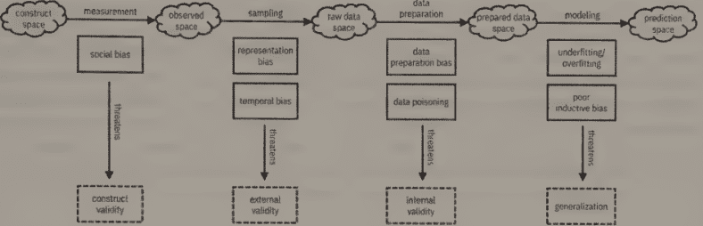

Figure 10.1. *测量和抽样中的偏差是机器学习不公平的最明显来源，但并非唯一来源。* 无障碍说明。五个空间的序列，每个空间表示为云。构造空间通过测量过程导致观测空间。观测空间通过抽样过程导致原始数据空间。原始数据空间通过数据准备过程导致准备好的数据空间。准备好的数据空间通过建模过程导致预测空间。测量过程包含社会偏差，这威胁到构念效度。抽样过程包含代表性偏差和时间偏差，这威胁到外部效度。数据准备过程包含数据准备偏差和数据投毒，这威胁到内部效度。建模过程包含欠拟合/过拟合和不良归纳偏差，这威胁到泛化能力。

社会偏差以几种方式进入索赔数据。首先，你可能会认为经常看医生、配药次数多的患者，即大量利用医疗保健系统的患者，病情更重，因此更适合进行护理管理。虽然方向上医疗保健利用率越高意味着患者病情越重是正确的，但在比较白人和黑人等不同人群的患者时并不成立。黑人在利用率相同的情况下往往病情更重，这是由于医疗保健系统中的结构性问题。³ 同样，用医疗费用代替利用率来看时也是如此。另一种社会偏差可能存在于编码中。例如，由于临床医生中存在黑人感觉疼痛较少的错误信念，在美国黑人接受疼痛治疗的频率低于白人。⁴ 此外，由于决策者自身的隐性认知偏差或偏见，过去人工确定的护理管理选择标签中也可能存在社会偏差。代表性偏差进入索赔数据是因为数据仅来自 Sospital 自身的成员。例如，如果 Sospital 主要在白人人口较多的县提供商业计划，该人群可能会低估黑人样本。

除了上述已存在于原始数据中的社会偏差和代表性偏差之外，你还需要注意不要在问题规范和数据准备阶段引入其他形式的不公平。例如，假设你没有过去人类决策者的标签。在这种情况下，你可能会决定使用利用率或费用的阈值作为代理结果变量，但这会使黑人在虚弱程度相同的情况下更不可能被选中进行护理管理，原因如上所述。此外，作为特征工程的一部分，你可能会想将个人费用或利用率事件合并为更全面的类别，但如果不小心，你可能会使种族偏见恶化。事实证明，将所有类型的卫生系统利用率合并为单一特征会产生不想要的种族偏见，但将住院医院夜数和频繁急诊室利用率作为单独的利用率类型保留下来，可以在全国代表性数据中降低偏差。⁵

³Moninder Singh and Karthikeyan Natesan Ramamurthy. “使用医疗支出面板调查数据理解健康中的种族偏见。” In: *关于公平机器学习的 NeurIPS 研讨会论文集*. Vancouver, Canada, Dec. 2019.

⁴Oluwafunmilayo Akinlade. “认真对待黑人疼痛。” In: *新英格兰医学杂志* 383.e68 (Sep. 2020).

> “随着人工智能嵌入到我们日常生活中，确保我们的模型不会无意中包含潜在的刻板印象和偏见至关重要。”

>

> —Richard Zemel，University of Toronto 的计算机科学家

你可能在想，你已经从第 9 章分布偏移中学到了如何衡量和缓解测量、抽样和数据准备中的偏差。公平性有什么不同？虽然分布偏移和公平性之间有很多可以共享的内容，⁶ 但这两个主题之间有两个主要的技术差异。首先是构造空间的可访问性。在分布偏移场景中，你可以获得构造空间的数据。也许不是立即获得，但如果你等待、收集并从部署环境中标记数据，你将拥有反映构造空间的数据。然而，在公平性设置中，你永远无法访问构造空间。构造空间反映了一个不存在于现实生活中的完美平等世界，因此你无法从中获取数据。（请记住，在第 4 章中，我们说过 hakuna matata 在构造空间中盛行（意思是无忧无虑）。）其次是对所寻求内容的规范。在分布偏移中，除了试图匹配偏移后的分布之外，没有进一步的规范。在公平性中，存在精确的、由政策驱动的概念和量化标准来定义数据和/或模型期望的状态，这些标准不依赖于你拥有的数据分布。你将在下一章学习这些精确的概念以及如何在它们之间进行选择。

与第 9 章中涵盖的因果和反因果学习相关，受保护属性就像环境变量。公平性和分配正义通常在因果（而非反因果）学习框架中构想，其中结果标签是外生的：受保护属性可能导致其他特征，进而导致护理管理的选择。然而，这种设置并不总是如此。

## 10.3 定义群体公平

你在进行了一定程度的数据理解后，回到了问题规范阶段，因为你和问题负责人意识到如果不加以控制，存在很强的可能出现不公平。鉴于 Sospital 作为健康保险公司所遵循的第 1557 条法规，你开始深入研究群体公平。群体公平是关于在平均意义上比较特权群体成员和非特权群体成员。

### 10.3.1 统计平价差异和差异化影响比率

不受欢迎歧视的一个关键概念是差异化影响：特权群体和非特权群体在决策者意图和决策程序无关的情况下获得不同的结果。统计平价差异是你可以在护理管理问题规范中考虑的群体公平指标，它通过计算有利标签 P(ŷ(X) = fav)（接受额外护理的比率）在特权组（Z = priv；白人）和非特权组（Z = unpr；黑人）之间的选择率差异来量化差异化影响：

statistical parity difference = P(ŷ(X) = fav | Z = unpr) − P(ŷ(X) = fav | Z = priv).

Equation 10.1


值为 0 意味着非特权群体（黑人）成员和特权群体（白人）成员被选中接受额外护理管理的比率相等，这被认为是一种公平的情况。统计平价差异的负值表示非特权群体处于劣势，正值表示特权群体处于劣势。问题规范中的一个要求可能是学习到的模型必须具有接近 0 的统计平价差异。统计平价差异的示例计算显示在图 10.2 中。

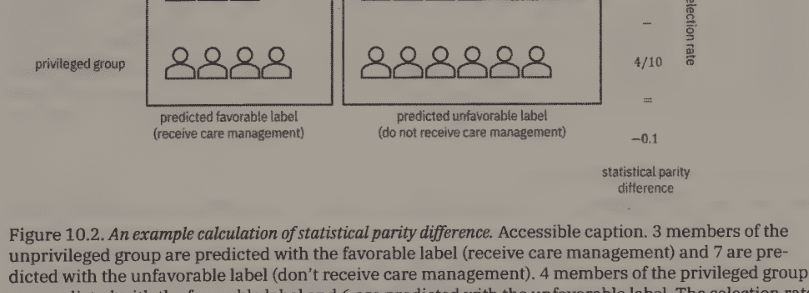

Figure 10.2. 统计平价差异的示例计算。无障碍说明。3 名非特权群体成员被预测为有利标签（接受护理管理），7 名被预测为不利标签（不接受护理管理）。4 名特权群体成员被预测为有利标签，6 名被预测为不利标签。非特权群体的选择率为 3/10，特权群体的选择率为 4/10。差异，即统计平价差异为 −0.1。

差异化影响也可以量化为比率：

disparate impact ratio = P(ŷ(X) = fav | Z = unpr)/P(ŷ(X) = fav | Z = priv).

Equation 10.2

此处，值为 1 表示公平，小于 1 的值表示弱势群体面临的劣势，大于 1 的值表示特权群体面临的劣势。差异影响比率有时也被称为相对风险比率或不利影响比率。在某些应用领域，如就业，差异影响比率的值小于 0.8 被认为是不公平的，而大于 0.8 的值被认为公平。所谓的四分之五规则问题规范是不对称的，因为它没有涉及特权群体所经历的劣势。可以通过将差异影响比率在 0.8 到 1.25 之间视为公平来使其对称化。统计均等差异和差异影响比率可以被理解为衡量预测 ŷ(X) 与受保护属性 Z 之间的一种独立性。⁷ 除统计均等差异和差异影响比率外，量化 ŷ(X) 与 Z 之间独立性的另一种方法是它们之间的互信息。

统计均等差异和差异影响比率也可以在训练数据上定义，而不是模型预测，通过将 ŷ(X) 替换为 Y。因此，它们可以被测量和测试（1）在模型训练前的 数据集上，作为数据集公平性指标，以及（2）在模型训练后学习到的分类器上作为分类器公平性指标，如图 10.3 所示。

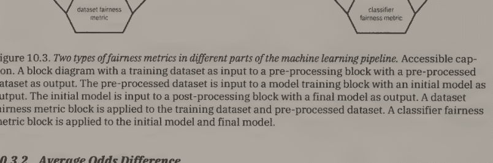

图 10.3. 机器学习流程不同部分中的两种公平性指标。可访问说明。训练数据集作为输入输入到预处理块，输出为预处理后的数据集。预处理后的数据集输入到模型训练块，输出为初始模型。初始模型输入到后处理块，输出为最终模型。数据集公平性指标块应用于训练数据集和预处理数据集。分类器公平性指标块应用于初始模型和最终模型。

### 10.3.2 平均优势差异

你迄今为止已经研究了基于差异影响的群体公平性指标，但在为护理管理模型确定问题规范时开始比较和对比它们之前，还想学习另一个指标。另一种群体公平性指标是平均优势差异，它基于模型性能指标而不仅仅是选择率。（因此它只能用作分类器公平性指标，而不能用作图 10.3 所示的数据集公平性指标。）平均优势差异涉及 ROC 中的两个指标：真有利标签率（真阳性率）和假有利标签率（假阳性率）。你取弱势群体与特权群体之间真有利率的差异，以及弱势群体与特权群体之间假有利率的差异，然后取平均值：

平均优势差异

= ½(P(ŷ(X) = fav | Y = fav, Z = unpr) − P(ŷ(X) = fav | Y = fav, Z = priv))

+ ½(P(ŷ(X) = fav | Y = unf, Z = unpr) − P(ŷ(X) = fav | Y = unf, Z = priv)).

方程 10.3

平均优势差异的示例计算如图所示 10.4。

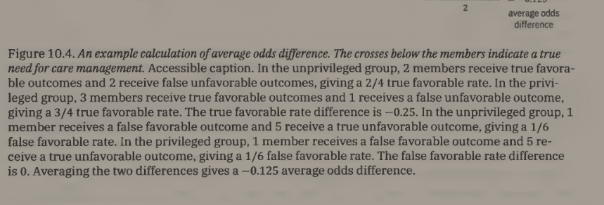

图 10.4. 平均优势差异的示例计算。成员下方的叉号表示真正需要护理管理。可访问说明。在弱势群体中，2 名成员获得真正有利的结果，2 名获得假不利的结果，得出 2/4 的真正有利率。在特权群体中，3 名成员获得真正有利的结果，1 名获得假不利的结果，得出 3/4 的真正有利率。真正有利率差异为 −0.25。在弱势群体中，1 名成员获得假有利结果，5 名获得真不利结果，得出 1/6 的假有利率。在特权群体中，1 名成员获得假有利结果，5 名获得真不利结果，得出 1/6 的假有利率。假有利率差异为 0。将两个差异平均后得到 −0.125 的平均优势差异。

在平均优势差异中，真正有利率差异和假有利率差异可能会相互抵消并隐藏不公平，因此最好在平均之前取绝对值：

平均绝对优势差异

= ½|P(ŷ(X) = fav | Y = fav, Z = unpr) − P(ŷ(X) = fav | Y = fav, Z = priv)|

+ ½|P(ŷ(X) = fav | Y = unf, Z = unpr) − P(ŷ(X) = fav | Y = unf, Z = priv)|.

方程 10.3

平均优势差异是衡量预测 ŷ(X) 与受保护属性 Z 在真实标签 Y 下的分离程度的一种方法，适用于图 10.5 所示的三个贝叶斯网络中的任何一个。0 的平均绝对优势差异值表示 ŷ(X) 与 Z 在给定 Y 的条件下独立。这被认为是公平的情况并被称为机会均等。

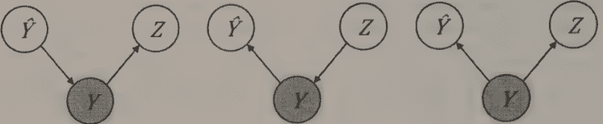

图 10.5. *对各种贝叶斯网络中真实标签 Y 分离预测和受保护属性的说明。* 可访问说明。显示分离的三个网络：Ŷ → Y → Z、Ŷ ← Y ← Z 和 Ŷ ← Y → Z。

### 10.3.3 在统计均等与平均优势差异之间进行选择

这两种不同的群体公平性指标有什么意义？它们看起来并不截然不同。但它们在重要的概念上实际上是截然不同的：你是否认为测量过程中存在社会偏见。这些两种世界观被称为（1）“我们都平等”（特权群体和弱势群体在构念空间中具有相同的健康内在分布，但测量过程中的偏见使其看起来并非如此）和（2）“你所见即所得”（两个群体在构念空间中存在内在差异，并且这种差异在观测空间中显现，无需测量过程中的偏见）。⁸ 由于在“我们都平等”的世界观下，观测空间中已经存在结构性偏见（黑人相对于白人而言，在相同健康水平下医疗利用和成本更低），因此在已经存在偏见的空间中查看模型准确率似乎没有意义。因此，独立性或差异影响公平性定义是有意义的，你的问题规范应基于它们。然而，如果你认为“你所见即所得”——观测空间是对群体内在分布的真实反映，唯一的偏见是抽样偏见——那么与准确性相关的机会均等公平性指标是有意义的。在这种情况下，你的问题规范应基于机会均等。

### 10.3.4 平均预测值差异

如果还不够复杂，让我们再加入一个群体公平性定义：*按组校准* 或 *充分性*。回顾第 6 章，对于连续分数输出，预测分数对应于 *已校准* 分类器中正真实标签的比例，或 \(P(Y = 1 \mid S = s) = s\)。为了公平，你希望校准在受保护属性定义的组中成立，因此 \(P(Y = 1 \mid S = s, Z = z) = s\) 对所有组 \(z\) 成立。如果分类器按组校准，它也是 *充分* 的，这意味着 \(Y\) 和 \(Z\) 在给定 \(S\)（或 \(\hat{Y}(X)\)）的条件下独立。充分性的图形模型如图所示 10.6。为了更好地与图 10.5（分离的图形模型）进行比较，预测分数用 \(\hat{Y}\) 表示而不是 \(S\)。

⁸Sorelle A. Friedler, Carlos Scheidegger, and Suresh Venkatasubramanian. “On the (Im)possibility of Fairness: Different Value Systems Require Different Mechanisms for Fair Decision Making.” In: *Communications of the ACM* 64.4 (Apr. 2021), pp. 136–143.

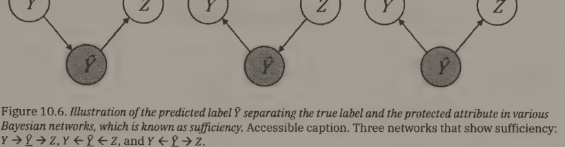

图 10.6. 说明预测标签 Ŷ 在各种贝叶斯网络中分离真实标签和受保护属性，这被称为充分性。可访问说明。显示充分性的三个网络：Y → Ŷ → Z、Y ← Ŷ ← Z 和 Y ← Ŷ → Z。

由于充分性和分离在 Y 和 Ŷ 互换的情况下或多或少是彼此的对立面，它们的量化也是在 Y 和 Ŷ 互换的情况下的对立面。回顾第 6 章，正预测值是真阳性率的逆：P(Y = fav | ŷ(X) = fav)，而假遗漏率是假阳性率的逆：P(Y = fav | ŷ(X) = unf)。为了量化充分性不公平，计算弱势群体（黑人）和特权群体（白人）之间正预测值和假遗漏率的平均差异：

平均预测值差异

= ½ P(Y = fav | ŷ(X) = fav, Z = unpr) − P(Y = fav | ŷ(X) = fav, Z = priv)

+ ½ P(Y = fav | ŷ(X) = unf, Z = unpr) − P(Y = fav | ŷ(X) = unf, Z = priv).

方程 10.4

平均预测值差异的示例计算如图所示 10.7。该示例说明了指标的两半由于符号相反而相互抵消的情况，因此在平均之前使用绝对值版本是有意义的：

平均绝对预测值差异

= ½ |P(Y = fav | ŷ(X) = fav, Z = unpr) − P(Y = fav | ŷ(X) = fav, Z = priv)|

+ ½ |P(Y = fav | ŷ(X) = unf, Z = unpr) − P(Y = fav | ŷ(X) = unf, Z = priv)|.

方程 10.5

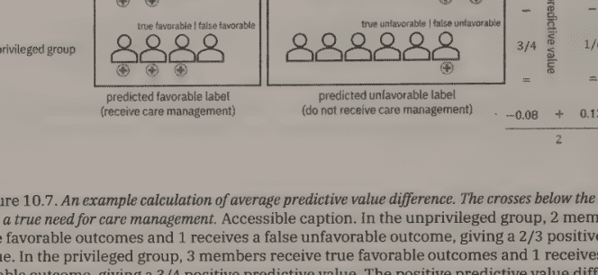

图10.7：平均预测值差异的计算示例。成员下方的十字标记表示真正需要护理管理。无障碍说明文字。在非特权群体中，2名成员获得了真正有利的结果，1名成员获得了假不利结果，因此有利预测值为2/3。在特权群体中，3名成员获得了真正有利的结果，1名成员获得了假不利结果，因此有利预测值为3/4。有利预测值差异为−0.08。在非特权群体中，2名成员获得了假不利结果，5名成员获得了真正不利结果，因此假遗漏率为2/7。在特权群体中，1名成员获得了假不利结果，5名成员获得了真正不利结果，因此假遗漏率为1/6。假遗漏率差异为0.12。将这两个差异取平均，得到平均预测值差异0.02。

### 10.3.5 在平均几率差异与平均预测值差异之间选择

分离性与充分性有什么区别？对于医院护理管理模型来说，哪一个更有意义？这不是像独立性与分离性之间的选择那样基于政治和世界观的决定。它取决于有利标签授予受影响用户的究竟是什么：它是助益性的，还是仅仅是非惩罚性的？获得贷款是助益性的，而没有被逮捕则是非惩罚性的。接受护理管理是助益性的。在像获得额外照护这样的助益性情形中，分离性（均等几率）是首选的公平性度量，因为它与召回率（真正例率）相关，而这正是这些场景中首要关注的问题。如果接受护理管理原本是一种非惩罚性行为，那么充分性（校准）将是首选的公平性度量，因为在非惩罚性场景中，精确率是首要关注的问题。（精确率等价于有利预测值，而有利预测值正是平均预测值差异的两个组成部分之一。）

### 10.3.6 结论

你可以通过计算第6章中详细介绍的各种混淆矩阵条目和其他分类器性能指标的差异或比率，来构造各种不同的群体公平性度量，但独立性、分离性和充分性是三种主要的度量。它们总结在表10.1中。

表10.1：三种主要的群体公平性度量类型。

| 类型 | 统计关系 | 公平性度量 | 可否作为数据集度量？ | 测量中存在社会偏见？ | 有利标签 |

|---|---|---|---|---|---|

| 独立性 | Ŷ ⟂ Z | 统计均等性差异 | 是 | 是 | 助益性或非惩罚性 |

| 分离性 | Ŷ ⟂ Z \| Y | 平均几率差异 | 否 | 否 | 助益性 |

| 充分性（校准） | Y ⟂ Z \| Ŷ | 平均预测值差异 | 否 | 否 | 非惩罚性 |

## 10.4 定义个体公平与反事实公平

公平中的一个重要概念是交叉性。当你分别看待不同的受保护属性时，事情可能看起来是公平的，但当你把非特权群体定义为多个受保护属性的交集时，例如黑人女性，群体公平性度量就会显示出不公平。你可以想象通过加入越来越多的属性而变得越来越小的群体，一直走到一个逻辑终点：群体只是共享所有特征值的个体。在这种极端情况下，上一节描述的群体公平性度量不再有意义，需要一种不同的“相同”概念。这一概念就是个体公平或一致性：所有具有相同特征值的个体应获得相同的预测标签，具有相似特征的个体应获得相似的预测标签。

### 10.4.1 一致性

一致性度量的量化方式如下：

一致性 = 1 - 1/n Σ_{j=1}^n | ŷ_j - 1/k Σ_{j'∈N_k(x_j)} ŷ_{j'} |

公式10.6

对于n个医院成员中的每一个，预测ŷ_j与k个最近邻的平均预测进行比较。当k个最近邻中所有预测标签都与该成员自身的预测标签一致时，该项为0。如果所有最近邻的预测标签都与该成员的预测标签不同，则绝对值为1。总体而言，由于公式10.6开头的“1减”，如果所有相似点的标签相似，则一致性度量为1；如果相似点具有不同的标签，则一致性度量小于1。

个体公平中最大的问题在于决定用于确定最近邻的距离度量。哪种距离是有意义的？距离计算中是否应当使用所有特征？受保护属性是否应当排除？距离计算中是否应当对某些特征维度进行校正？这些选择正是政治和世界观介入的地方。[^10] 通常，受保护属性会被排除，但并非必须如此。如果你相信在测量过程中不存在偏差（“所见即所得”的世界观），那么你应当直接按原样使用特征。相反，假设你相信在测量中存在结构性的社会偏见（“人人平等”的世界观）。在这种情况下，你应当尝试在特征进入距离计算之前对其进行校正，以消除这些偏见。例如，如果你认为接受过三次门诊就诊的黑人与接受过五次门诊就诊的白人在健康上等同，那么你的距离度量可以为黑人成员增加两次门诊就诊作为校正。

### 10.4.2 反事实公平

个体公平的一个特例是，当两个患者除了一个受保护属性不同外，其他特征值完全相同。设想两名患者，一位黑人和一位白人，他们与医疗保健系统的互动历史完全相同。如果两人获得相同的预测标签——要么都被给予额外的护理管理，要么都不被给予——则情况被认为是公平的，否则不公平。现在把这个特例再推进一步。作为思想实验，想象一个干预$do(Z)$将医院成员的受保护属性从黑人变为白人，反之亦然。如果所有成员的预测标签保持不变，则该分类器是*反事实公平*的。[^11]（实际上，立即干预改变成员的受保护属性通常是不可能的，但这只是一个思想实验。）反事实公平可以使用第8章中的处理效应估计方法进行检验。

受保护属性在不同群体间导致不同结果是许多法律法规中的重要考量。[^12] 假设你获得了所有变量的完整因果图，或者你使用第8章的方法从数据中发现了这样一个因果图。在这种情况下，你可以看到哪些变量存在通向标签节点的因果路径，要么直接指向，要么经过其他变量传递。如果任何具有通往标签因果路径的变量被视为受保护属性，那么你就有一个需要调查和缓解的公平性问题。

### 10.4.3 泰尔指数

如果你在确定医院护理管理问题规范时不想在群体公平性度量与个体公平性度量之间做出选择，还有其他选择吗？有的。你可以使用泰尔指数，该指数在第3章中首次作为不确定性的汇总统计量被引入。它天然地同时结合了个体公平和群体公平的考量。回想那一章的内容，泰尔指数最初是为了衡量一个社会中财富的分布而开发的。一个值

[^10]: Reuben Binns。《论个体公平与群体公平之间的明显冲突》。载于*ACM公平、问责与透明会议论文集*。西班牙巴塞罗那，2020年1月，第514–524页。

[^11]: Joshua R. Loftus, Chris Russell, Matt J. Kusner, and Ricardo Silva。《算法公平的因果推理》。arXiv:1805.05859，2018年。

[^12]: Alice Xiang。《调和算法偏差的法律进路与技术进路》。载于*田纳西法律评论*第88卷第3期（2021年）。

值为1表示一个完全不公平的社会，一个人拥有全部财富；值为0表示一个平等主义社会，所有人都拥有相同数量的财富。

在机器学习与医疗保健管理中的分配正义语境下，财富的等价物是什么？它必须是某种非负收益值 $b_j$，你希望该值在不同医院成员之间是相等的。一旦你定义了收益 $b_j$，就将其代入泰尔指数表达式，并将其用作组合的群体与个体公平性指标：

$$\text{泰尔指数} = \frac{1}{n}\sum_{j=1}^{n}\frac{b_j}{\bar{b}}\log\frac{b_j}{\bar{b}}$$

公式10.7

该公式对所有个体计算收益除以平均收益 $\bar{b}$ 后乘以自然对数的平均值。

这一切都很好，但对谁有益，且基于何种世界观？提出在算法公平性中使用泰尔指数的研究团队建议，$b_j$ 对错误有利标签（假阳性）取2，对正确有利标签（真阳性）取1，对正确不利标签（真阴性）取1，对错误不利标签（假阴性）取0。¹³ 这一建议看似与“所见即所得”世界观一致，因为它考察的是模型性能，假设假阳性和假阴性的成本相同，并且站在受影响成员的角度——他们即使并非真正合适的候选人，也希望能够获得护理管理。对于医院模型的问题设定，更合适的收益函数可能是 $b_j$：(1) 对真有利与真不利标签取1，对假有利与假不利标签取0（“所见即所得”，同时平衡社会需求）；或 (2) 对真有利与假有利标签取1，对真不利与假不利标签取0（“人人平等”）。

### 10.4.4 结论

个体公平一致性（Individual fairness consistency）和泰尔指数都是在不同语境下捕捉公平性各种细微差别的优秀方法。与群体公平性指标一样，它们要求你明确自己的世界观，并以自下而上的方式瞄准相同目标。由于医院护理管理场景是以群体公平性语言进行监管的，因此你在问题设定和建模中应当使用群体公平性指标。反事实或因果公平性从法律哲学与科学的视角看是一项强要求，但相关法规才刚刚开始跟进。因此，未来你可能需要在问题设定中运用因果公平性，但眼下还不到时候。如你目前所了解到的，问题设定和数据阶段对公平性至关重要，但这并不意味着建模阶段就不重要了。下一节将重点讨论作为建模流程一部分的偏差缓解，以改善公平性。


¹³Till Speicher、Hoda Heidari、Nina Grgić-Hlača、Krishna P. Gummadi、Adish Singla、Adrian Weller和Muhammad Bilal Zafar。“A Unified Approach to Quantifying Algorithmic Unfairness: Measuring Individual & Group Unfairness via Inequality Indices.”载于：*Proceedings of the ACM SIGKDD International Conference on Knowledge Discovery and Data Mining*。英国伦敦，2018年7月，第2239–2248页。

## 10.5 缓解不想要的偏差

从前述医院护理管理模型生命周期的早期阶段，你知道在建模阶段必须处理不想要的偏差。鉴于你已经掌握的公平与不公平的定量定义，你了解缓解偏差意味着要在受保护属性（如种族）与需要护理管理的真实或预测标签之间引入某种统计独立性。这听起来很容易，那么挑战在哪里？偏差缓解之所以困难，是因为其他常规预测特征 `X` 与受保护属性和标签之间存在统计依赖关系（图10.5和图10.6中省略了`X`的节点，但“眼不见”并不意味着“心不烦”）。常规特征可以重建受保护属性中包含的信息并引入依赖关系，即使你采取最直接的做法——从数据中丢弃受保护属性——也是如此。例如，种族可能与某些医疗保健提供者密切相关（一些医生的患者主要是黑人，另一些医生的患者主要是白人），同时也可能与历史上被选择接受额外护理管理密切相关。

偏差缓解方法必须比简单地丢弃受保护属性更巧妙。不要走捷径：丢弃受保护属性永远不是正确的答案。请记住第9章中缓解分布偏移之害的两种主要方法：自适应（adaptation）和最小最大鲁棒性（min-max robustness）。在应用于偏差缓解时，基于自适应的方法比基于鲁棒性的方法常见得多，但依赖于训练数据集中存在受保护属性。14它们是本节剩余部分的主题。如果训练数据中无法获得受保护属性，则可以使用与分布偏移相呼应的用于公平性的最小最大鲁棒性技术。15

图10.8（图10.3的子集）展示了偏差缓解的三种不同干预点：(1) 预处理——改变训练数据的统计量；(2) 处理中——在学习过程中添加额外约束或正则化项；(3) 后处理——改变输出预测以使其更公平。预处理只有在你能接触并修改训练数据时才能进行。由于处理中需要你改动学习算法，因此它最为复杂且灵活性最低。后处理几乎总是可行的，也是最容易实现的。然而，你在流程中所处的位置越靠前，效果就可能越好。

三类偏差缓解技术（预处理、处理中、后处理）中每一种都有若干具体方法。就像准确性一样，不存在一个最佳算法能在所有数据集和公平性指标上优于所有其他算法（还记得“没有免费午餐定理”吗）。正如第7章中分类器存在不同的能力领域一样，偏差缓解算法也存在不同的能力领域。然而，公平性是一个新领域，尚未得到足够充分的研究，因而还无法对这些能力领域做出良好的刻画。在第7章中，深入探讨机器学习方法的细节很重要，因为这种理解会用于本章及后续各章。而深入探讨偏差缓解算法细节的原因则不同。在选择偏差缓解算法时，你必须：(1) 知道可以在流程的哪个环节进行干预；(2) 考虑你的世界观；(3) 理解受保护属性是否允许作为特征，以及在为新医院成员评分时，受保护属性在部署数据中是否可用。


图10.8 机器学习流程不同部分中的三类偏差缓解算法。无障碍说明。一个框图：训练数据集作为输入进入偏差缓解预处理模块，输出为预处理后的数据集。预处理后的数据集输入到偏差缓解处理中模块，输出为初始模型。初始模型输入到偏差缓解后处理模块，输出为最终模型。

### 10.5.1 预处理

在建模流程的预处理阶段，你尚未拥有训练好的模型。因此，预处理方法无法显式地包含涉及模型预测的公平性指标。因此，大多数预处理方法侧重于“人人平等”的世界观，但并非仅限于此。预处理训练数据集有多种方式：(1) 用额外的数据点扩充数据集；(2) 对数据点应用实例权重；(3) 更改标签。

预处理训练数据集最简单的算法之一是附加额外行，即并不真实存在的人工成员。这些虚构成员是通过取现有成员行并翻转其受保护属性值（类似反事实公平性）而构建的。16 扩充行基于距离度量按顺序添加，这样接近于底层数据集众数的“真实”数据点会先被添加。这种排序保持了学习任务所需的数据分布保真度。普通的未校正距离度量采用“所见即所得”世界观，只能克服采样偏差，而不能克服测量偏差。校正后的距离度量（如上一节所述的示例，为黑人成员增加两次门诊就诊）采用“人人平等”世界观，可以同时克服测量偏差和采样偏差（对构念效度和外部效度的威胁）。这种数据增强方法需要将受保护属性作为模型的特征，并且它们在部署数据中必须可用。

预处理训练数据集的另一种方式是通过样本权重，类似于第8章中看到的逆概率加权和第9章中看到的重要性加权。重新加权方法旨在改善统计均等性（“人人平等”世界观），这可以在护理管理模型训练之前进行评估，并且是一种数据集公平性指标。17 其目标是

16 Shubham Sharma、Yunfeng Zhang、Jesús M. Rios Aliaga、Djallel Bouneffouf、Vinod Muthusamy和Kush R. Varshney。“Data Augmentation for Discrimination Prevention and Bias Disambiguation.”载于：*Proceedings of the AAAI/ACM Conference on AI, Ethics, and Society*。美国纽约，2020年2月，第358–364页。

17 Faisal Kamiran和Toon Calders。“Data Preprocessing Techniques for Classification without Discrimination.”载于：*Knowledge and Information Systems* 33.1（2012年10月），第1–33页。

标签与受保护属性之间的独立性对应于它们的联合概率等于各自边缘概率的乘积。这个乘积概率出现在权重公式的分子中，而实际观察到的联合概率出现在分母中：

`w_j = p_Y(y_j) p_Z(z_j) / p_{Y,Z}(y_j, z_j).`

公式10.8

训练数据中需要受保护属性来学习模型，但它们不必成为模型或部署数据的一部分。

与数据增强和重新加权不改变历史护理管理决策所获得的训练数据不同，其他方法会改变这些数据。一种仅适用于统计均等和“人皆平等”世界观、称为“massaging”的简单方法，将非特权群体成员的不利标签翻转为有利标签，并将特权群体成员的有利标签翻转为不利标签。18 所选的数据点是那些最接近决策边界且置信度较低的点。Massaging 不需要在部署数据中包含受保护属性。

另一种方法，公平分数转换器（fair score transformer），处理的是（校准后的）连续分数标签 `S = p_{Y|X}(Y = fav | x)`，而不是二元标签。19 它被表述为一个优化问题：在约束统计均等差异、平均几率差异或其他你选择的群组公平度量的绝对值较小的同时，找到与原始分数`S`交叉熵较小的变换后分数`S′`，即 `H(S || S′)`。你可以将预处理后的分数以权重形式转换回二元标签，以馈送给标准训练算法。你可以用“所见即所得”的世界观来使用公平分数转换器，因为它假设随后在预处理数据集上训练的分类器是称职的，因此它所产生的预处理分数能够很好地近似训练后的模型所预测的分数。尽管有一些预处理方法会同时改变标签和（结构化或半结构化）特征，20 公平分数转换器证明了你只需要改变标签。它可以处理未附带受保护属性的部署数据。

数据增强、重新加权、massaging 和公平分数转换器各有其适用领域。在不同的公平性度量和数据集特征下，有些方法比其他方法表现更好。你需要尝试不同的方法，看看在 Sospital 数据上的效果。

### 10.5.2 处理中

处理中的偏见缓解算法表述起来很直接，但实际优化往往更难。其表述如下：采用一个现有的基于风险最小化的监督学习算法，例如（重复方程7.4）：

```
f̂(·) = arg min_{f ∈ F} 1/n Σ_{j=1}^n L(y_j, f(x_j)) + λJ(f)
```

公式10.9

并使用公平性度量对其正则化或约束。算法可以是逻辑回归，正则化器可以是统计均等差异，这时你得到的就是“偏见消除器”（prejudice remover）。²¹ 更近期的公平学习算法适用范围更广，允许任何标准风险最小化算法以及覆盖不同类型公平性的一系列群组公平度量作为约束。²² 一个近期的处理中算法使用因果公平项对目标函数进行正则化。在强可忽略性假设下（记得第8章中提到这些假设是没有未测量的混淆因素且存在重叠），正则化器是一个类似平均处理效应的项 `J = E[Y | do(z = 1), X] − E[Y | do(z = 0), X]`。²³

一旦训练完成，所得模型可用于新的未见过的 Sospital 成员。这些处理中算法不要求部署数据包含受保护属性。它们的关键在于构造缓解偏见的正则化项或约束，使目标函数能够通过优化算法可处理地最小化。

### 10.5.3 处理后

如果你遇到的情况是 Sospital 护理管理模型已经训练完成，而且你无法更改它或触碰训练数据（例如，你从供应商那里购买一个预训练模型以集成到你的流程中），那么你唯一的选择就是使用后处理来缓解不希望的偏见。你只能改变输出预测 `Ŷ` 以满足你根据世界观所期望的群组公平度量（即，将“接受护理管理”的预测标签翻转为“不接受护理管理”，反之亦然）。如果你有一些带标签的验证数据，你可以采用“所见即所得”的世界观进行后处理。你总是可以采用“人皆平等”的世界观进行后处理，无论有无验证数据。

²¹Toshihiro Kamishima, Shotaro Akaho, Hideki Asoh, and Jun Sakuma. “Fairness-Aware Classifier with Prejudice Remover Regularizer.” In: Proceedings of the Joint European Conference on Machine Learning and Knowledge Discovery in Databases. Bristol, England, UK, Sep. 2012, pp. 35–50. ²²Alekh Agarwal, Alina Beygelzimer, Miroslav Dudík, John Langford, and Hanna Wallach. “A Reductions Approach to Fair Classification.” In: Proceedings of the International Conference on Machine Learning. Stockholm, Sweden, Jul. 2018, pp. 60–69. L. Elisa Celis, Lingxiao Huang, Vijay Keswani, and Nishanth K. Vishnoi. “Classification with Fairness Constraints: A Meta-Algorithm with Provable Guarantees.” In: Proceedings of the ACM Conference on Fairness, Accountability, and Transparency. Atlanta, Georgia, USA, Jan. 2019, pp. 319–328. Ching-Yao Chuang and Youssef Mroueh. “Fair Mixup: Fairness via Interpolation.” In: Proceedings of the International Conference on Learning Representations. May 2021. ²³Pietro G. Di Stefano, James M. Hickey, and Vlasios Vasileiou. “Counterfactual Fairness: Removing Direct Effects Through Regularization.” arXiv:2002.10774, 2020.

构造空间中的准确性和公平性。27 你可以通过使用数据增强预处理方法来逼近构造空间测试集。

表10.2 主要偏见缓解算法的特征。

| 算法 | 类别 | 公平性 | 部署数据中的受保护属性 |
|---|---|---|---|
| 数据增强 | 预处理 | 反事实 | 是 |
| 重新加权 | 预处理 | 独立性 | 否 |
| massaging | 预处理 | 独立性 | 否 |
| 公平分数转换器 | 预处理、后处理 | 独立性、分离性 | 否 |
| 偏见消除器 | 处理中 | 独立性 | 否 |
| 近期处理中算法 | 处理中 | 独立性、分离性、充分性 | 否 |
| 因果正则化器 | 处理中 | 反事实 | 否 |
| 群组公平后处理 | 后处理 | 独立性、分离性 | 是 |
| 个体与群组公平后处理 | 后处理 | 反事实、独立性、分离性 | 是 |

在你的 Sospital 问题中，你几乎拥有完全的灵活性，因为你确实控制着训练数据和模型训练，专注于独立性和“人皆平等”世界观，并且能够在部署数据中加入 Sospital 成员的受保护属性。尝试所有方法，但最好从公平分数转换器预处理开始。

## 10.6 其他考虑

在结束本章之前，让我们考虑几个其他问题。第一个问题在 Sospital 护理管理用例中没有出现，但在其他用例中可能会出现。Sospital 问题本身适用于直接分配决策中的公平性，但这不是唯一的可能性。还存在表征或服务质量方面的危害，例如搜索结果中的偏见。例如，职业形象搜索可能只返回白人，与非裔美国人社区中常见人名相关的网页搜索结果可能附带刑事辩护律师的广告，而用于语言翻译或查询理解的自然语言处理算法可能会自动将医生与男性关联、将护士与女性关联。一些用于分配公平的偏见缓解算法可用于表征公平，但不同的技术可能更合适。

27Michael Wick, Swetasudha Panda, and Jean-Baptiste Tristan. “Unlocking Fairness: A Trade-Off Revisited.” In: Advances in Neural Information Processing Systems 32 (Dec. 2019), pp. 8783–8792. Kit T. Rodolfa, Hemank Lamba, and Rayid Ghani. “Empirical Observation of Negligible Trade-Offs in Machine Learning for Public Policy.” In: Nature Machine Intelligence 3 (Oct. 2021), pp. 896–904.

> “这项工作的很大一部分范围狭窄，专注于微调特定模型，使数据集更具包容性/代表性，以及‘去偏’数据集。虽然这类工作可以构成解决方案的一部分，但一个从根本上公平的路径必须审视更广阔的图景，例如数据集中未经质疑或直觉性的假设、当前和历史性的不公，以及权力不对称。”
>
> —Abeba Birhane，爱尔兰都柏林大学认知科学家

> “我仍然担心在计算机科学（就像心理学一样），关于偏见的争论已成为一种强大的干扰——将注意力从最重要的事情上转移开，转向更容易衡量的东西。”
>
> —J. Nathan Matias，康奈尔大学行为科学家

第二个问题如下。我们是否太轻易地把算法公平的重要考量扫进了数学的地毯下？是也不是。如果你真正深入思考了机器学习生命周期中出现的各种不公平来源，并利用多元声音的专家小组，那么应用定量指标和缓解算法实际上相当直接。这之所以直接，是因为你在进入生命周期建模阶段之前已经做了艰苦的工作，你应该对继续前进充满信心。如果你没有在生命周期的早期（包括问题设定）做艰苦的工作，盲目应用偏见缓解算法可能无法减少伤害，甚至会加剧它们。所以不要走捷径。

## 10.7 摘要

- 公平有多种形式，源于不同类型的正义。分配正义最适用于由机器学习系统做出或支持的分配决策。它要求个体和群体之间在结果上具有某种一致性。

- 不公平可能源于问题设定错误（包括不合适的代理标签）、特征工程、从构念空间到观测空间的特征测量，以及从观测空间到原始数据空间的数据点采样。

- 在确定哪种一致性最适合你的问题时，存在两种重要的世界观。

- 如果你认为测量中存在社会偏见（不仅是采样中的代表性偏见），那么你持有“我们都平等”的世界观；独立性和统计均等差异是合适的群体公平概念。

- 如果你认为测量中没有社会偏见，只有采样中的代表性偏见，那么你持有“所见即所得”的世界观；分离性、充分性、平均几率差异和平均预测值差异是合适的群体公平概念。

- 如果有利标签是辅助性的，则分离性和平均几率差异是合适的群体公平概念。如果有利标签是非惩罚性的，则充分性和平均预测值差异是合适的群体公平概念。

- 个体公平是群体公平的极限版本，具有越来越细分的群体。世界观在确定个体之间的距离度量中起作用。

- 偏见缓解算法可以在机器学习管道中作为预处理、内处理或后处理应用。不同的算法适用于不同的世界观。算法的选择应考虑世界观以及经验性能。

# 11 对抗鲁棒性

想象你是一名数据科学家，任职于人力资源（HR）分析领域的一家（虚构的）新进入者 HireRing。该公司创建机器学习模型，分析简历和求职申请表中的元数据，以优先考虑招聘和其他就业决策的候选人。他们会使用各企业客户的历史数据来训练算法。作为一项主要价值主张，HireRing 的高管们特别关注确保对分布偏移的鲁棒性以及机器学习管道的公平性，并现在开始将问题设定工作重点放在保护模型免受恶意行为侵害。你被委以重任，领导这一新的机器学习安全领域。应该从哪里开始？需要担心哪些不同的威胁？可以做些什么来防御潜在的对抗性攻击？


对手是试图以损害 HireRing 及其客户目标为代价来实现自身目标的人，通常以隐秘的方式。例如，他们可能只是想降低申请人优先排序模型的准确性。他们可能更具 sophistication，想要欺骗机器学习系统，让某一小群申请人无论其特征所体现的可雇佣性如何都排在优先列表的顶部，同时对大多数申请人保持模型行为不变。

本章将教你如何通过以下方式防御和认证 HireRing 为其客户构建的模型：

- 根据对手攻击的对象（训练数据或模型）、其目标以及他们所知晓和能够更改的内容，区分不同的威胁模型，

- 通过增加模型鲁棒性的算法防御不同类型的攻击，以及

- 认证机器学习管道的此类鲁棒性。

对抗鲁棒性的主题与本书本部分关于可靠性（分布偏移和公平性）的另外两章相关，因为它也涉及训练数据与部署数据之间的不匹配。你不知道这种差异会是什么，所以你有认知上的不确定性，需要适应或对其保持鲁棒。在分布偏移中，分布差异是自然发生的；在公平性中，正义世界与我们所处世界之间的差异是由于包罗万象的社会原因；在对抗鲁棒性中，分布之间的差异是由于狡猾的对手。另一种对对抗攻击的观点不是通过恶意行为者的视角，而是通过探测系统可靠性的视角——通过在最坏情况下进行测试，将机器学习系统推向极致。这种替代观点不是本章的框架，但你应该将其放在脑后，我们将在第13章中再次讨论它。

> 在我看来，与汽车模型开发和制造类似，对 AI 模型进行不同对抗威胁的全面‘内部碰撞测试’应成为新的常态，以便更好地理解和减轻潜在的安全风险。
>
> —Pin-Yu Chen，IBM Research 计算机科学家

HireRing 刚刚被一家总部位于美国中西部的（虚构的）大型零售连锁 Kermis 选中，为其构建简历和求职申请筛选模型。这是你第一次有机会与真实客户合作进行对抗鲁棒性的问题设定阶段，并且不走捷径。首先，你需要梳理不同类型的恶意攻击，并决定如何使为 Kermis 开发的 HireRing 模型尽可能可靠和值得信赖。稍后你也会进行建模阶段的工作。

## 11.1 不同类型的对抗攻击

作为 HireRing 为 Kermis 构建的基于机器学习的求职者分类器问题设定阶段的一部分，你必须评估它容易受到的各种威胁。对抗攻击可以通过三个维度进行分类[^1]。（1）管道的哪一部分受到攻击：训练或部署？对训练的攻击称为投毒攻击，而对部署的攻击称为规避攻击。（2）攻击者有哪些能力？他们知道数据和模型的信息是什么？他们可以更改哪些数据和模型以及以何种方式？（3）对手的目标是什么？他们只是想普遍降低简历筛选模型的性能，还是有更复杂和针对性的目标？这三个维度与第10章中选择偏见缓解算法时的三个考虑因素相似（管道部分、受保护属性的存在、世界观）。

不同攻击类型的心理模型如图11.1所示。让我们依次逐一介绍这些维度，作为一种清单，以分析 Kermis 最应担心什么，以及 HireRing 模型应最勤勉地防范什么。

[^1]: Anirban Chakraborty, Manaar Alam, Vishal Dey, Anupam Chattopadhyay, and Debdeep Mukhopadhyay. “对抗攻击与防御：综述。” arXiv:1810.00069, 2018. Ximeng Liu, Lehui Xie, Yaopeng Wang, Jian Zou, Jinbo Xiong, Zuobin Ying, and Athanasios V. Vasilakos. “深度学习中的隐私与安全问题：综述。” 载于：IEEE Access 9 (2021年12月), 第4566–4593页。

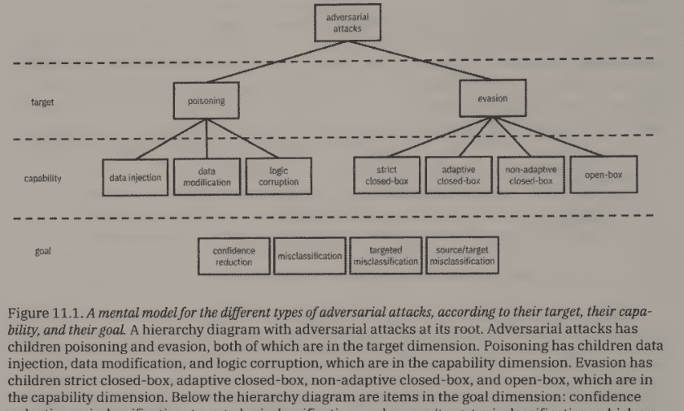

图11.1. 根据目标、能力和目的，不同类型的对抗性攻击的心智模型。这是一个层级图，根节点为对抗性攻击。对抗性攻击的子节点为投毒攻击和逃避攻击，两者都属于目标维度。投毒攻击的子节点为数据注入、数据修改和逻辑破坏，属于能力维度。逃避攻击的子节点为严格黑盒、自适应黑盒、非自适应黑盒和白盒，属于能力维度。层级图下方是目的维度的项目：置信度降低、错误分类、定向错误分类和源/目标错误分类，这些适用于整个图。

### 11.1.1 目标

攻击者可能针对机器学习生命周期的建模阶段或部署阶段。通过攻击建模阶段，他们可以破坏训练数据或模型，使其与部署时看到的数据不匹配。这被称为投毒攻击，与第9章讨论的分布偏移有相似之处，因为它们改变了训练数据或模型的统计特性。针对部署阶段的逃避攻击则是另一种情况，与分布偏移没有直接对应关系，但与第10章讨论的个体公平性有松散相似性。这些攻击专注于改变输入到机器学习系统中进行评估的单个示例（单个简历）。因此，对单个数据点的修改可能根本不会影响部署时的概率分布，但仍然可以实现攻击者针对给定输入简历的目的。

理解投毒攻击和逃避攻击的一种方式是通过决策边界，如图11.2所示。投毒攻击以攻击者期望的方式移动决策边界。相比之下，逃避攻击不移动决策边界，而是以难以检测的方式将数据点移过决策边界。原始数据点（简历的特征 `x`）被 `δ` 偏移后变为 `x + δ`。逃避攻击的一个基本数学描述如下：

```
\hat{y}(x + \delta) \neq \hat{y}(x) such that \|\delta\| \leq \epsilon.
```

公式 11.1

攻击者想要找到一个小扰动 $\delta$ 添加到简历 $x$ 上，使得预测标签从“选中”变为“拒绝”，反之亦然（即 $\hat{y}(x + \delta) \ne \hat{y}(x)$）。此外，扰动的长度或范数 $\|\cdot\|$ 应小于某个小值 $\epsilon$。范数和值的选择取决于应用领域。对于半结构化数据模态，范数应捕捉人类的感知，使得扰动后的数据点与原始数据点在外观或声音上几乎相同。


*图11.2. 投毒攻击（左）和逃避攻击（右）的示例。* 在投毒攻击中，攻击者向训练数据中注入了一个新数据点，即带有浅色边框的方块。这一行为将决策边界从原本的位置（黑色实线）移动到攻击者期望的位置（黑色虚线）。更多的菱形部署数据点现在将被错误分类。在逃避攻击中，攻击者巧妙地扰动一个部署数据点使其越过决策边界，从而被错误分类。无障碍说明：说明投毒攻击的程式化图中，两类数据点呈噪声阴阳或交错月牙形排列，决策边界平滑地环绕其中一类，形成一个类似斑块的区域。一个标签为区域内部的投毒数据点被添加到区域外部。它导致新的决策边界将其划入内部，同时也导致另一个数据点被错误分类。说明逃避攻击的程式化图中，一个数据点位于斑块状区域内部，攻击将其推出区域。

另一种表示标签变化 $\hat{y}(x + \delta) \ne \hat{y}(x)$ 的方式是通过零一损失函数：$L(\hat{y}(x), \hat{y}(x + \delta)) = 1$。（回想一下，零一损失在两个参数相同时取值为0，参数不同时取值为1。）由于零一损失只能取0和1两个值，你还可以用最大值来表示对抗样本：

$$\max_{\|\delta\|\leq\epsilon} L(\hat{y}(x), \hat{y}(x + \delta)).$$

公式 11.2

在这种表示法中，你也可以引入其他损失函数，例如第7章中的交叉熵损失、逻辑损失和合页损失。

### 11.1.2 能力

有些攻击者的能力比其他攻击者更强。在投毒攻击类别中，攻击者以某种方式改变训练数据或模型，因此他们必须对 Kermis 的信息技术基础设施有一定的访问权限。他们能做的最简单的事情就是偷偷加入一些额外的简历到训练数据中。这被称为数据注入。更具挑战性的是数据修改，即攻击者改变现有训练数据集中的标签或特征。最具挑战性的是逻辑破坏，即攻击者改变机器学习算法或模型的代码和行为。你可以将数据注入和数据修改攻击视为与偏见缓解的预处理有些相似，将逻辑破坏视为与偏见缓解的处理中有些相似，只是出于恶意目的。

在逃避攻击类别中，攻击者完全不需要改变 Kermis 系统内部的任何东西。因此这些攻击更容易实施。攻击者只需创建对抗样本：以巧妙方式精心构造的简历，以欺骗机器学习系统。但攻击者如何构造这些棘手的简历，取决于他们拥有多少关于模型如何做出预测的信息。攻击者能做的最简单的事情就是将一堆简历提交给 HireRing 模型，查看它们是否被选中；这为攻击者提供了一个带标签的数据集。当攻击者无法改变简历集，只能提交他们现有的批次时，称为严格黑盒访问。当他们能够根据之前提交的简历和观察到的预测标签来改变输入简历时，称为自适应黑盒访问。自适应稍难一些，因为攻击者可能需要等待一段时间，才能让 Kermis 选择或不选择他们提交的简历。随着时间的推移，你也可能察觉到发生了异常。攻击者关于为 Kermis 训练的 HireRing 模型所能拥有的下一种更难获取的信息被称为非自适应黑盒访问。此时，攻击者知道训练数据分布`p_{X,Y}(x,y)`，但不能提交简历。最后，分类器决策函数本身`f(·)`是攻击者最难获得的关于模型的信息。这种对分类器的完全了解被称为白盒访问。

由于 Kermis 整体网络安全状况良好，你不太需要担心投毒攻击，尤其是逻辑破坏攻击。即使是逃避攻击的白盒访问似乎也不太可能。你最应该担心的是某种黑盒逃避攻击。尽管如此，你也不应掉以轻心，仍应考虑防范所有威胁。

### 11.1.3 目的

威胁的第三个维度是攻击者的目的，它同时适用于投毒攻击和逃避攻击。不同的攻击者会尝试做不同的事情。最简单的目的是置信度降低：将分类器分数移向区间 [0,1] 的中间，从而降低置信度。下一个目的是错误分类：试图让分类器做出错误的预测。（这就是公式 11.1 给出的形式。）本应被选中的 Kermis 求职申请被拒绝，反之亦然。当你在申请人筛选这类二分类问题中，犯错的方式只有一种：预测为另一个标签。然而，当可能标签多于两个时，错误分类可以产生任何不是真实标签的标签。定向错误分类更进一步，确保错误分类不是任意其他标签，而是攻击者选择的特定标签。最后，也是所有攻击中最复杂的，源/目标错误分类攻击是

其设计目的是，误分类只发生在某些输入的求职申请中，且不正确预测的标签也取决于输入。后门或特洛伊木马攻击是源/目标误分类的一个例子，其中一小部分输入（可能是那些简历中包含某些特殊关键字的申请）会触发申请被接受。更复杂的目标更难实现，但一旦成功，对 Kermis 和 HireRing 也最具危险性。问题规范应包含针对所有这些不同攻击目标保持警惕的条款。

## 11.2 针对投毒攻击的防御

当你和 HireRing 团队进入生命周期的建模阶段时，你必须针对问题规范阶段识别的攻击实施防御措施。从机器学习的角度来看，没有特定的防御措施可以防止 Kermis 系统中的逻辑破坏攻击。它们必须通过其他安全措施来预防。然而，在整个机器学习流水线中，确实存在针对数据注入和数据修改攻击的防御措施，这些措施根据应用在流水线中的位置分为三类。²

- 预处理方法被称为数据清洗。

- 模型训练过程中的处理中防御依赖于某种形式的平滑。

- 处理后的防御被称为修补。

这三类防御将在本节其余部分详细说明，如图 11.3 所示。它们分别与第 9 章和第 10 章中描述的缓解分布偏移和消除不必要偏差的方法类似。


图 11.3. 机器学习流水线中针对投毒攻击的不同防御类别。无障碍说明。一个框图，训练数据集作为数据清洗模块的输入，输出为预处理后的数据集。预处理后的数据集作为平滑模块的输入，输出为初始模型。初始模型作为修补模块的输入，输出为最终模型。

针对投毒攻击的机器学习防御是一个活跃的研究领域。特定的攻击和防御在军备竞赛中不断进步。由于本书出版时，所有当前已知的攻击和防御很可能已被超越，因此这里只给出主要思想，而不进行深入阐述。

### 11.2.1 数据清洗

数据清洗的主要思想是定位被注入 Kermis 数据集或被修改的恶意简历，并将其移除。这类简历往往在某种程度上是异常的，因此数据清洗归结为一种异常或离群点检测。最常见的离群点检测方法是*稳健统计*，其原理如下。假设离群点集合与干净、未投毒的训练简历相比基数较小。这两类简历（投毒和干净）通过其均值（按方差归一化）的不同来区分。即使特征数量很大，近期的算法也能高效地区分这两类数据。³ 对于高维半结构化数据，异常检测应在表示空间中进行，而不是在原始输入特征空间中进行。回想第 4 章的内容，学习到的表示和语言模型分别利用图像和文本数据所包含的结构，对它们进行紧凑的表示。当数据表示良好时，异常更加明显。

³Pang Wei Koh, Jacob Steinhardt, and Percy Liang. “Stronger Data Poisoning Attacks Break Data Sanitization Defenses.” In: Machine Learning (Nov. 2021).

### 11.2.2 平滑

当 HireRing 训练 Kermis 分类器时，针对数据投毒的防御通过平滑评分函数使模型更加鲁棒。图 11.4 展示了一般思想，它比较了一个平滑和一个不够平滑的评分函数。在训练中偏好平滑的评分函数，会降低攻击者成功攻击的机会。


图 11.4. 平滑评分函数（左）与不够平滑的评分函数（右）的比较。评分函数的值通过阴影表示：阴影为白色时值为 0，阴影为黑色时值为 1。评分函数取值为 0.5 的决策边界用红线表示。不够平滑的评分函数可能已受到攻击。无障碍说明。风格化图显示一个决策边界平滑地环绕其中一个类，形成一个斑点状区域。底层的评分函数以阴影表示，从区域内部平滑地变白，区域外部平滑地变黑。这与另一个决策边界形成对比，后者在斑点状区域内部有一些小的对立类飞地。其底层评分函数并不平滑。

例如，可以通过在另一个底层分类器之上应用`k`近邻预测来实现平滑。这样，少量被投毒的简历永远不会在某个邻域中占多数，其影响会被忽略。由投毒数据点引起的决策边界微小偏移会被消除。另一种获得平滑评分函数的方法称为*梯度整形*，即在学习算法中直接约束或正则化其斜率或梯度。当决策函数的梯度幅度在整个特征空间中几乎相同时，它能够抵抗少量异常点引起的扰动：它更像图 11.4 中左侧的评分函数，而不是右侧的。平滑也可以通过对多个独立分类器的评分函数进行平均来实现。

### 11.2.3 修补

修补主要面向神经网络模型，作为后处理步骤来缓解后门攻击的影响。后门在神经网络中表现为异常的边权重和节点激活。它们具有某种统计上的怪异特性。假设你已经在 Kermis 职位申请的被投毒数据集上训练了一个初始模型，并产生了后门。修补的思路类似于如何修补裤子上的破洞。首先，你要把问题从“布料”上“剪”掉：剪除异常的神经网络节点。然后，“缝”上一块补丁：用一些干净的简历或一组为近似干净分布而生成的简历对模型进行微调。

## 11.3 针对规避攻击的防御

规避攻击在实施上比投毒攻击更简单，因为它们不要求攻击者渗透 Kermis 的信息技术系统。攻击者只需创建看起来真实、不会引起怀疑的示例，并将其作为普通求职申请提交。防御这些攻击主要有两种方式：（1）去噪和（2）对抗训练。第一类防御位于机器学习训练流水线之外，在部署时应用。当扰动`δ`存在时，它尝试从部署时的简历`x + δ`中减去扰动`δ`。（只有少量输入简历是对抗样本，且带有`δ`。）第一类防御被称为*去噪*；其原因将在下一节中变得清晰。第二类防御发生在建模流水线中，将最小最大鲁棒性构建到模型本身，类似于第 9 章中训练对分布偏移具有鲁棒性的模型。它被称为*对抗训练*。没有与第 9 章和第 10 章中训练数据的适应或偏差缓解预处理类似的规避防御类别，因为规避攻击并非基于训练数据分布。针对规避攻击的防御措施总结在图 11.5 中。让我们进一步了解如何在 HireRing 求职者优先级排序系统中实施这些防御。


图11.5. 针对规避攻击的不同防御方法。无障碍说明。一个层级图，根节点为针对规避攻击的防御方法，其子节点为去噪和对抗训练。去噪的子节点包括输入域、频域和潜在域。

### 11.3.1 去噪输入数据

尽管攻击者竭尽全力，对抗样本——被移动穿越决策边界的简历——仍然包含机器能够注意到的信号，即使人类无法察觉。特制的扰动`δ`是一种噪声，称为对抗噪声。去噪试图从`x + δ`中移除`δ`，是一种防御类型。去噪的挑战在于去除所有噪声的同时，尽量限制对底层干净特征的扭曲。

噪声去除是一个古老的问题，在信号处理及相关领域已被研究很长时间。针对规避攻击的去噪主要有三种方式，它们的区别在于对数据的表示形式：（1）输入域；（2）频域；（3）潜在域。⁴ 直接在特征空间或输入域中工作的去噪技术可能会在邻近数据点之间复制或交换特征值，也可能将连续值量化为较小的离散值集合。利用生成式机器学习的最新进展（在第4章数据增强的背景下简要介绍过），这些技术可以生成与输入非常相似但无噪声的数据样本。总而言之，输入域去噪的主要思想是平坦化变异性或平滑数据值。

频域更适合考察平滑。如果你不是电气工程师，你可能没听说过将数据转换为其频域表示。其基本思想是对数据进行变换，从而使波动很大的数据在所谓的高频处产生大值，而非常平滑的数据在频谱的另一端——低频处产生大值。这种转换通过傅里叶变换及其他类似操作完成。难以察觉的对抗噪声通常集中在高频部分。因此，一种针对规避攻击的防御方法是压缩数据的高频分量（将其替换为较小值），然后将数据转换回输入域。某些针对半结构化数据模态的数据压缩技术间接实现了同样的效果。

如果你的机器学习模型是神经网络，那么数据在通过中间层时的值就构成了潜在表示。第三类去噪方法就在这个潜在表示空间中工作。与频域类似，这类方法也会压缩某些维度上的值。然而，这些技术并不简单地假设对抗噪声集中在空间的某个特定部分（例如高频），而是利用干净的求职申请和你创建的相应对抗样本来学习这些维度。

### 11.3.2 对抗训练

针对规避攻击的第二大类防御是对抗训练。它是一种极小极大鲁棒性⁵，你在第9章讨论分布偏移时初次遇到。请记住，极小极大的思想是在最坏情况下尽你所能做到最好。在对抗训练中，最小化和最大化如下所述。最小化是在假设空间中找到最佳的求职者分类器，就像任何其他机器学习风险最小化方法一样。内层的最大化是找到简历最坏情况下的扰动。目标的数学形式为：


$$\mathcal{J}(\cdot)=\arg\min_{f\in\mathcal{F}}\sum_{j=1}^{n}\max_{\|\delta_j\|\leq\epsilon}\mathcal{L}\left(y_j,f(x_j+\delta_j)\right)$$

方程 11.3

注意，内层的最大化与方程11.2中寻找对抗样本的表达式相同。因此，要执行对抗训练，你所要做的就是为Kermis训练简历生成对抗样本，并将这些对抗样本作为一个新的训练数据集用于典型的机器学习算法。HireRing必须先成为一个好的攻击者，才能成为一个好的防御者。

### 11.3.3 评估与认证对规避攻击的鲁棒性

一旦HireRing求职者筛选系统经过Kermis简历的对抗训练后，你如何知道它是否足够好？衡量模型鲁棒性主要有两种方法：（1）经验评估；（2）刻画评分函数。作为经验测试，你创建自己的对抗样本简历，将其输入模型，并计算对抗目标被达成的频率（置信度降低、错误分类、定向错误分类或源/目标错误分类）。你能够这样做，是因为你了解哪些输入简历包含对抗扰动、哪些不包含的真实情况。这种经验性鲁棒性评估与特定攻击及其能力（白盒或黑盒）相关，因为你作为评估者正在扮演对抗者的角色。

⁵亚历山大·马德里（Aleksander Madry）、亚历山大·马凯洛夫（Aleksandar Makelov）、路德维希·施密特（Ludwig Schmidt）、迪米特里·齐普拉斯（Dimitris Tsipras）和阿德里安·弗拉杜（Adrian Vladu）。《迈向对对抗攻击具有抵抗力的深度学习模型》。载于：*国际学习表征会议论文集*。加拿大温哥华，2018年4月至5月。

相比之下，一种不依赖特定规避攻击的分类器对抗鲁棒性刻画方法是CLEVER分数。⁶ CLEVER是网络鲁棒性的交叉利普希茨极值（cross-Lipschitz extreme value for network robustness）的缩写，它（间接地）分析从求职申请数据点到分类器决策边界的距离。如果这个距离太远，超过了扰动`δ`范数的界限`ε`，错误分类攻击就不会成功。CLEVER分数越高，模型越鲁棒。一般来说，平滑且不复杂、没有许多小孤岛的决策边界（如图11.4中左侧的评分函数）与数据点之间的平均距离较大，平均CLEVER分数也较大，并且能够抵御各种规避攻击。在与Kermis问题所有者的需求规范阶段，你可以设定平均CLEVER分数的可接受最小值。如果模型达到该值，HireRing就可以自信地认证一定程度的安全性和鲁棒性。

## 11.4 小结

- 对抗者是怀有恶意的行为者，他们试图通过降低模型准确率或欺骗模型来攻击机器学习模型。

- 投毒攻击在模型训练期间实施，通过破坏训练数据或模型来实现。

- 规避攻击在模型部署期间实施，通过创建看起来真实但会欺骗模型产生错误分类的对抗样本来实现。

- 对抗者可能只是想要总体上降低模型准确率，也可能有想要达成的特定目标，例如为特定输入获得特定的预测标签。

- 对抗者在所知内容和可改变内容方面具有不同的能力。这些能力与目标的差异决定了威胁的性质。

- 针对投毒攻击的防御发生在机器学习流水线的不同部分：数据清洗（预处理）、平滑（模型训练）和修补（后处理）。

- 针对规避攻击的防御包括去噪（试图从输入中移除对抗扰动）和对抗训练（引入极小极大鲁棒性）。

- 可以使用CLEVER分数来认证模型对规避攻击的鲁棒性。

- 即使没有恶意行为者，对抗攻击也是开发人员在最坏情况下测试机器学习系统的一种方式。

# 12 可解释性与可说明性

Hilo是一家（虚构的）初创公司，试图颠覆在线第二套住房抵押贷款市场。一种称为房屋净值信用额度（HELOC）的第二抵押权类型允许客户以其房屋作为抵押品进行间歇性借款。Hilo正在打造几项独特的价值主张，以区别于该领域的其他公司。首先，它将执行第二抵押权所涉及的多种功能集成在一个系统中，包括对借款人的信用检查和对房屋价值的评估。其次，它在这些人机决策过程中使用机器学习，同时极其关注对分布偏移的鲁棒性、公平性和对抗鲁棒性。第三，它承诺对任何希望审查其将要使用的机器学习模型的人都保持透明可查，并且如果机器的决策在任何方面出现问题，将提供补救途径。设想你身处Hilo组建的数据科学团队，并受命通过让机器学习模型变得*可解释*和*可说明*来实现第三个价值主张。平台发布日只剩下几个月了，所以你最好马上行动。

机器学习模型的可解释性旨在让人们理解机器如何做出预测。这是一个挑战，因为第7章中的许多机器学习方法具有复杂的函数形式，人们不容易理解。可解释性和可说明性是一种人机之间的*交互*形式，具体来说是机器向人的*沟通*，使得机器和人能够在决策中协作。¹ 这个话题和本章开启了本书关于交互的第5部分，交互是机器学习可信度的第三个属性。请记住，本书的组织结构与可信度的属性相对应，如图12.1所示。


图 12.1. 书籍结构。第五部分聚焦于可信度的第三个属性——亲密性或交互性，其对应于能够与人沟通并接收人们对其价值观的指示的机器学习模型。可访问说明：从左到右的流程图包含六个方框：第一部分：引言与预备知识；第二部分：数据；第三部分：基础建模；第四部分：可靠性；第五部分：交互；第六部分：目的。第五部分被突出显示。第三至四部分被标记为安全属性。第三至六部分被标记为可信度属性。

机器学习模型的典型输出是预测标签 `ŷ`，但该标签不足以传达机器如何做出预测。还需要更多内容，以解释的形式呈现。机器是信息的发送者，而人类是该信息的接收者或消费者。如图 12.2 所示，通信过程必须克服人类认知偏差——人们在接收信息方面的局限性——这些偏差威胁着人机协作。这有时被称为最后一公里问题。² 该图完成了自第 4 章开始你所看到的偏差和效度的全貌。最终空间是感知空间，即人类消费者对 Hilo 机器学习模型预测的最终理解。

你无法为 Hilo 模型的解释创建单一类型来吸引所有潜在的解释消费者。即使发布日期仅在几个月后，也不要走捷径，假设任何解释都行。不同人的认知偏差因其人物角色、背景和目的而不同。作为机器学习生命周期中问题规范阶段的一部分，在建模阶段对其中任何一种进行深入研究之前，你首先必须考虑所有可用的不同解释类型。

## 12.1 解释的不同类型

正如我们人类之间有许多解释事物的方式，机器学习模型向消费者解释其预测结果的方式也有很多。在考虑 Hilo 模型需要哪些时，你应首先列举消费者的角色。


图 12.2. 空间、效度和偏差的心理模型。最终空间是感知空间，即人类从机器输出中理解的内容。可访问说明：六个空间的序列，每个空间以云朵表示。构念空间通过测量过程导致观测空间。观测空间通过抽样过程导致原始数据空间。原始数据空间通过数据准备过程导致准备好的数据空间。准备好的数据空间通过建模过程导致预测空间。预测空间通过通信过程导致感知空间。测量过程包含社会偏差，威胁构念效度。抽样过程包含代表性偏差和时间偏差，威胁外部效度。数据准备过程包含数据准备偏差和数据投毒，威胁内部效度。建模过程包含欠拟合/过拟合和不良归纳偏差，威胁泛化。通信过程包含认知偏差，威胁人机协作。

### 12.1.1 解释消费者的角色

第一个消费者是与机器学习系统协作进行预测的决策者：评估员或信贷员。这些消费者需要理解并信任模型，并拥有足够关于机器预测的信息以结合自身倾向产生最终决策。第二个消费者角色是 HELOC 申请人。此受影响用户希望了解导致其模型预测的房屋评估和信用状况的因素，以及可以采取什么措施来改善这些预测。第三个主要消费者角色是内部合规官员或模型验证员，或确保决策不违反任何法律边界的外部监管机构官员。合在一起，所有这些角色都属于某种监管者。第四个可能的解释消费者是 Hilo 团队中的数据科学家。对模型运行机制的解释可以帮助团队成员调试和改进模型。

> “如果我们不知道黑箱里发生了什么，就无法修正其错误来打造更好的模型和更好的世界。”
>
> —Aparna Dhinakaran, chief product officer at Arize AI

请注意，与其他三个角色不同，数据科学家角色的主要关注点不是为可信度构建交互和亲密性。四个不同角色及其目标总结在表 12.1 中。

表 12.1. 解释消费者的四个主要角色及其目标。

| 角色 | 示例 | 目标 |
|---|---|---|
| 决策者 | 评估员、信贷员 | (1) 粗略理解模型以建立信任；(2) 理解预测以结合自身信息做出决策 |
| 受影响用户 | HELOC 申请人 | 理解其自身输入数据点的预测结果以及可以采取什么措施来改变结果 |
| 监管者 | 模型验证员、政府官员 | 确保模型安全且合规 |
| 数据科学家 | Hilo 团队成员 | 提升模型的性能 |

### 12.1.2 解释方法的二分法

满足不同角色的目标，单一类型的解释是不够的。³ 你需要为 Hilo 系统提供几种不同的解释类型。有三个二分法界定了机器学习可解释性的方法和技术。

- 第一个二分法是 *局部 vs. 全局*：消费者是感兴趣于理解单个输入数据点的机器预测，还是理解整体模型。

- 第二个二分法是 *精确 vs. 近似*：解释是否应完全忠实于底层模型，还是允许一定程度的近似。

- 第三个二分法是 *基于特征 vs. 基于样本*：解释是以关于特征的陈述给出，还是通过指向其他完整的数据点给出。基于特征的解释要求底层特征对消费者而言是有意义且可理解的。如果它们本身没有意义，则可能需要一个称为 *解纠缠表示* 的预处理步骤。此预处理在半结构化数据中寻找变化方向，这些方向不一定与给定特征对齐，但具有某种人类可解释性，并在第 12.2 节中进一步展开。

由于存在三个二分法，因此存在八种可能的解释类型组合。某些类型的解释更适合某些角色以满足其目标。第四个角色，即来自 Hilo 团队的数据科学家，可能需要使用所有类型的解释来调试和改进模型。

- 局部、精确、基于特征的解释帮助受影响用户（如 HELOC 申请人）获得救济并精确了解需要更改哪些特征值才能通过信用检查。

- 全局和局部近似解释帮助决策者（如评估员和信贷员）实现其双重目标：大致理解整体模型的工作原理以建立信任（全局），并拥有足够的信息关于机器预测的房产价值以结合自身信息产生最终评估（局部）。

- 全局和局部、精确、基于样本的解释以及全局、精确、基于特征的解释帮助监管者作为保障措施理解模型的行为和预测。通过精确，解释适用于所有数据点，包括可能在近似解释中被抹去的边缘情况。其中，吸引监管者的局部、精确、基于样本和全局、精确、基于特征的解释来自直接可解释的模型。

- 监管者和决策者均可从全局、近似、基于样本的解释中受益以获得理解。

解释类型与角色的映射总结在表 12.2 中。

表 12.2. 解释的三个二分法及其与角色的映射。

| 二分法 1 | 二分法 2 | 二分法 3 | 角色 | 示例方法 |
|---|---|---|---|---|
| 局部 | 精确 | 基于特征 | 受影响用户 | contrastive explanations method |
| 局部 | 精确 | 基于样本 | 监管者 | k-nearest neighbor |
| 局部 | 近似 | 基于特征 | 决策者 | LIME, SHAP, saliency map |
| 局部 | 近似 | 基于样本 | 决策者 | prototype |
| 全局 | 精确 | 基于特征 | 监管者 | decision tree, Boolean rule set, logistic regression, GAM, GLRM |
| 全局 | 精确 | 基于样本 | 监管者 | deletion diagnostics |
| 全局 | 近似 | 基于特征 | 决策者 | distillation, SRatio, partial dependence plot |
| 全局 | 近似 | 基于样本 | 监管者和决策者 | influence function |

在问题规范阶段，你可能还会考虑是否允许解释消费者交互式地探测 Hilo 机器学习系统以获得进一步洞察，还是系统仅产生消费者无法进一步交互的静态输出解释。交互可以通过消费者与机器之间的自然语言对话进行，也可以通过消费者调整并深入挖掘的可视化方式进行。⁴ 静态解释的多样性已经足够你处理，而无需深入交互，因此你决定仅使用静态方法。

⁴Josua Krause, Adam Perer, and Kenney Ng. "Interacting with Predictions: Visual Inspection of Black-Box Machine Learning Models." In: Proceedings of the CHI Conference on Human Factors in Computing Systems. San Jose, California, USA, May 2016, pp. 5686–5697.

镜像本书第4部分中针对分布鲁棒性、公平性和对抗鲁棒性所展示的建模管道中的三个干预点，图12.3展示了可解释性和可说明性方面的不同操作。如前所述，解耦表示是一种预处理步骤。直接可解释模型源于在特定受约束的假设类中训练决策函数（请回顾假设类的概念在第7章中引入）。最后，许多解释方法以事后方式应用于已训练的、不可解释的模型之上，例如神经网络。


图12.3. 解释方法的管道视图。可访问说明。训练数据集作为输入输入到解耦表示模块，输出为预处理数据集。预处理数据集作为输入输入到直接可解释模型模块，输出为初始模型。初始模型作为输入输入到事后解释模块，输出为最终模型。

### 12.1.3 结论

现在你对不同解释方法的大局有了整体认识，了解它们如何帮助消费者实现目标，以及它们如何融入机器学习管道步骤。你为Hilo开发的估价和HELOC审批系统需要迎合所有不同类型的消费者，并且你可以在管道的各个部分进行干预，因此你应开始组建一套全面的可解释和可说明机器学习技术工具包。

## 12.2 解耦表示

在人们开始理解模型如何做出预测之前，他们需要对底层数据有所了解。用于机器学习模型输入的表格和其他结构化数据中的特征通常可以在一定程度上被消费者理解。消费者即使不是决策者、监管者或其他领域专家（即使是），也可能无法把握每个特征的细微差别，但他们至少可以查阅数据字典来了解每个特征。例如，在HELOC审批模型中，特征‘距最近一次逾期月数’可能对申请人来说并不完全合理，但如果他们做一些研究，是可以理解的。

半结构化数据则不然。例如，房屋估价模型的输入包括房产及其周边街区的卫星和街景图像。特征是图像中每个像素的单个红色、蓝色和绿色颜色值。这些特征对任何消费者都没有意义。它们缺乏语义。更高级的表示，例如神经网络自动学习到的边缘和纹理，稍好一些，但仍让寻求解释的消费者感到不足。它们在房屋估价的上下文中没有直接的含义。

替代方案是什么？答案是一种表示，其中维度是邻里植被量、空旷街道正面面积、房屋视觉吸引力等⁵，这些维度彼此不相关，并且提供其他输入数据未捕获的信息。（例如，即使房屋的大小和楼层数可以从图像中估计出来，它也已在其他表格数据中被捕获。）这种表示被称为解耦表示。单词 *disentangled* 的使用是因为在这种表示中，对一个维度的干预不会导致其他维度也发生变化。近期开发的方法可以直接从无标签数据中学习解耦表示。⁶ 尽管通常不是解耦的直接目标，这类表示往往会产生有意义的维度，人们可以为其赋予语义，例如上面提到的‘邻里植被’示例。因此，解耦表示是一种预处理训练数据特征以使其更易于人类解释的方法。管道中后期的建模和解释方法将新特征作为输入。

有时，仅通过解耦表示来改进特征不足以向消费者提供意义。同样，有时表格数据特征本身不足以向消费者提供意义。在这些情况下，一个替代的预处理步骤是直接从消费者那里获取有意义的解释，将其作为扩展基数标签集附加到数据集中，并训练模型同时预测原始估价或信用度以及解释。⁷

## 12.3 面向监管者的解释

直接可解释模型足够简单，消费者只需看其形式就能 *完全* 理解其工作原理。它们适用于旨在实现模型安全的监管者。它们是减少认识论不确定性并实现 *固有安全设计* 的一种方式：模型不包含任何虚假成分。⁸ 解释是通过将决策函数抽取的假设类限制为仅简单且可理解的函数来实现的。直接可解释精确模型有两种类型：（1）基于局部样本和（2）基于全局特征。此外，监管者对模型的理解可通过全局基于样本的解释得到增强，既包括精确的也包括近似的。

### 12.3.1 k-最近邻分类器

第7章介绍的k-最近邻分类器是基于局部样本的直接可解释模型的主要示例。预测的信用度或估价标签计算为附近训练数据点的平均标签。因此，给定输入数据点的局部解释只是k个最近邻样本的列表，包括其标签。这个列表足够简单，监管者可以理解。你还可以提供距离度量以获得额外的理解。

⁵Stephen Law, Brooks Paige, and Chris Russell. “Take a Look Around: Using Street View and Satellite Images to Estimate House Prices.” In: *ACM Transactions on Intelligent Systems and Technology* 10.5 (Nov. 2019), p. 54.

⁶Xinqi Zhu, Chang Xu, and Dacheng Tao. “Where and What? Examining Interpretable Disentangled Representations.” In: *Proceedings of the IEEE/CVF Conference on Computer Vision and Pattern Recognition*. Jun. 2021, pp. 5857–5866.


⁷Michael Hind, Dennis Wei, Murray Campbell, Noel C. F. Codella, Amit Dhurandhar, Aleksandra Mojsilović, Karthikeyan Natesan Ramamurthy, and Kush R. Varshney. “TED: Teaching AI to Explain its Decisions.” In: *Proceedings of the AAAI/ACM Conference on AI, Ethics, and Society*. Honolulu, Hawaii, USA. Jan. 2019, pp. 123–129.

⁸Kush R. Varshney and Homa Alemzadeh. “On the Safety of Machine Learning: Cyber-Physical Systems, Decision Sciences, and Data Products.” In: *Big Data* 5.3 (Sep. 2017), pp. 246–255.

### 12.3.2 决策树和布尔规则集

全局特征型直接可解释模型种类更多。第7章介绍的决策树，监管者可以通过从根节点经中间节点追踪到包含预测标签的叶节点来理解。⁹ 每个节点涉及的单个特征和阈值都是明确且易于理解的。与决策树相似的假设类是布尔规则集（OR-of-AND规则和AND-of-OR规则），人们能够直接理解。它们是第7章介绍的决策桩或单规则的组合。HELOC信用度的OR-of-AND规则分类器的一个例子是当满足以下条件时预测申请人为无信用时：¹⁰

- (满意交易次数 ≤ 17 且 外部风险估计 ≤ 75) 或
- (满意交易次数 > 17 且 外部风险估计 ≤ 72)。

这是一个非常紧凑的规则集，监管者可以轻松看到涉及的特征及其阈值。他们可以推断出当满意交易次数较高时，模型对外风险更为宽松。他们也可以推断出模型不包含任何有问题的特征。（一旦决策树或布尔规则集变得过大，它们开始变得不易解释。）

你可能会听到的一个常见说法是准确性与可解释性之间的权衡。这个论点是错误的。¹¹ 由于第9章介绍的Rashomon效应，许多类型的模型，包括决策树和规则集，在许多数据集上具有几乎同等高的准确性。决策树和规则集的胜任域很广（请回顾第7章介绍的胜任域是指模型类型在与其他模型相比表现良好的数据集特征集合）。虽然由于其离散特性（离散优化通常比连续优化更困难），可扩展地训练这些模型传统上具有挑战性，但这些挑战最近已被克服。¹²

> “简单并不简单。”
>
> ——Dmitry Malioutov, computer scientist at IBM Research

使用先进的离散优化训练时，决策树和布尔规则集分类器在许多数据集上表现出具有竞争力的准确性。

### 12.3.3 逻辑回归

线性逻辑回归也被许多监管机构认为具有直接可解释性。回顾第 7 章，线性逻辑回归决策函数的形式是 $\hat{y}(x)=\operatorname{step}(w^Tx)$。$d$ 维权重向量 $w$ 在 $x$ 中每个特征维度都有一个权重，这些是 HELOC 申请人的不同属性。这些权重和特征维度分别为 $w^{(1)},\ldots,w^{(d)}$ 和 $x^{(1)},\ldots,x^{(d)}$，它们在进入阶跃函数之前被相乘并求和为：$w^{(1)}x^{(1)}+\cdots+w^{(d)}x^{(d)}$。在逻辑回归中，概率 $P(Y=1\mid X=x)$（也是分数 $s$）与特征维度的加权和之间的关系为：

$$P(Y=1\mid X=x)=\frac{1}{1+e^{-(w^{(1)}x^{(1)}+\cdots+w^{(d)}x^{(d)})}}$$

方程 12.1

你在第 7 章中已将其作为神经网络的逻辑激活函数见过。它可以重排为以下形式：

$$\log\left(\frac{P(Y=1\mid X=x)}{1-P(Y=1\mid X=x)}\right)=w^{(1)}x^{(1)}+\cdots+w^{(d)}x^{(d)}.$$

方程 12.2

方程 12.2 的左边称为 *对数几率*。当对数几率为正时，$Y=1$ 是更可能的预测：有信用。当对数几率为负时，$Y=0$ 是更可能的预测：无信用。

理解分类器行为的方式是通过检查概率、分数或对数几率在单个特征属性值增加 1 时如何变化。考察对变化的响应是贯穿全章反复出现的解释的通用策略。在线性逻辑回归的情况下，在保持其他所有特征值不变的情况下，特征值 $x^{(i)}$ 增加 1 会使对数几率增加 $w^{(i)}$。权重值对分数有明确的影响。按特征值单位变化衡量，最重要的特征是权重绝对值最大的那些。为了更方便地使用权重比较特征重要性，你应首先将每个特征标准化为零均值和单位标准差。（请记住，标准化首次是在第 8 章评估因果模型的协变量平衡时引入的。）

### 12.3.4 广义可加模型

*广义可加模型 (GAMs)* 是一类模型，它们将线性逻辑回归扩展为非线性，同时保留相同的解释方法。不是在信用检查预测的决策函数中使用标量权重乘以特征值：$w^{(1)}x^{(1)}+\cdots+w^{(d)}x^{(d)}$，而是应用非线性函数：$f^{(1)}(x^{(1)})+\cdots+f^{(d)}(x^{(d)})$。给定特征维度的整个函数明确地增加或减少对数几率。你只能这样做是因为特征维度之间没有交互。你可以为非线性函数选择任何假设类，但要注意学习算法必须从训练数据中拟合这些函数的参数。通常选择光滑样条函数。（样条是由分段多项式串联而成的函数。）

### 12.3.5 广义线性规则模型

如果你希望监管机构也能轻松理解 HELOC 决策函数中涉及的非线性函数怎么办？你可以选择将非线性函数设为涉及单个特征的布尔单规则或决策桩。广义线性规则模型 (GLRM) 正是你需要的：一种直接可解释的方法，结合了布尔规则集和 GAMs 的优点。¹³ 除了特征维度的布尔单规则外，GLRM 还可以具有普通特征维度。表 12.3 显示了 HELOC 信用检查的 GLRM 示例。

表 12.3. HELOC 信用检查的广义线性规则模型示例。

| 普通特征或一阶布尔规则 | 权重 |
|---|---|
| 最近一次查询距今月份¹⁴ > 0 | 0.680261 |
| 最近一次查询距今月份 = 0 | -0.090058 |
| （标准化）外部风险估计 | 0.654248 |
| 外部风险估计 > 75 | 0.263437 |
| 外部风险估计 > 72 | 0.107613 |
| 外部风险估计 > 69 | 0.035422 |
| （标准化）循环余额除以信用额度 | -0.553965 |
| 循环余额除以信用额度 ≤ 39 | 0.062797 |
| 循环余额除以信用额度 ≤ 50 | 0.045612 |
| （标准化）满意交易数量 | 0.551654 |
| 满意交易数量 ≤ 12 | -0.312471 |
| 满意交易数量 ≤ 17 | -0.110220 |

三个普通特征（‘外部风险估计’、‘循环余额除以信用额度’和‘满意交易数量’）在进行任何其他操作之前已标准化，因此你可以比较权重值以了解哪些特征重要。‘最近一次查询距今月份’大于零的决策桩是最重要的，因为它具有最大的系数。‘外部风险估计’大于 69 的决策桩是最不重要的，因为它具有最小的系数。这是你对线性逻辑回归模型应用的同类理解。

进一步理解此模型的方法是记住权重对每个特征单位变化都会贡献于对数几率。以‘外部风险估计’特征为例，GLRM 告诉你：

- 每次外部风险估计增加 1，对数几率增加 0.0266（该数字是通过对权重 0.6542 去标准化得到的）；

- 如果外部风险估计 > 69，对数几率额外增加 0.0354；

- 如果外部风险估计 > 72，对数几率额外增加 0.1076；

- 如果外部风险估计 > 75，对数几率额外增加 0.2634。

该规则对于监管机构等消费者来说相当直观，同时也是一个用于泛化的表达性模型。如图 12.4 所示，你可以绘制‘外部风险估计’特征对对数几率的贡献，以直观地看到 HELOC 分类器如何依赖于它。其他 GAMs 的 $f^{(i)}(x^{(i)})$ 绘图看起来相似，但可以以不同的方式非线性。


图 12.4. ‘外部风险估计’特征对分类器对数几率的贡献。可访问标题。对数几率贡献在垂直轴上，外部风险估计在水平轴上。对数几率贡献函数线性增加，伴随三个跳跃间断。

你也可以‘撤销’对数几率以得到实际概率（使用方程 12.1 而不是方程 12.2），但它不像对数几率那样具有可加性。尽管如此，概率曲线的形状同样具有信息性，并显示在图 12.5 中。


图 12.5. ‘外部风险估计’特征对分类器概率的贡献。可访问标题。概率在垂直轴上，外部风险估计在水平轴上。概率函数线性增加，伴随三个跳跃间断。

GA²Ms，等价地称为 *可解释提升机*，是直接可解释的模型，其工作方式与 GAMs 相同，但具有二维非线性交互项 $f^{(i,j)}(x^{(i)},x^{(j)})$。¹⁵ 直观展示它们对分类器对数几率的贡献需要二维图。通常人们很难理解涉及超过两个维度的交互，因此在实践中不使用高阶 GA²Ms。¹⁶ 然而，如果你在 GLRMs 中允许更高阶的规则，你最终会得到涉及多个交互特征维度的 AND 规则或 OR 规则的 GA²Ms，与一般的高阶 GA²Ms 不同，这些规则仍然是直接可解释的，因为涉及许多特征的规则可以被消费者理解。

### 12.3.6 删除诊断与影响函数

吸引监管者角色的最后一组方法来自全局样本基础类别。一种精确方法计算 *删除诊断* 以找到 *有影响* 的实例，而一种近似方法使用 *影响函数* 来做同样的事情。删除诊断的基本思想很简单。你使用房屋或申请人的整个训练数据集训练一个模型，然后再次训练，留下其中一个训练样本。模型中出现的任何全局变化都可以归因于你留出的房屋或申请人。你如何查看两个模型之间发生了什么变化？你可以直接查看两个模型或其参数，如果模型是可解释的，这是有意义的。但如果模型不可解释，这就不会奏效。你需要做的是在保留的测试集上评估两个模型并计算预测标签的平均变化。变化越大，训练数据点的影响越大。监管者通过获得最有影响力的房屋或申请人列表来理解模型。

精确计算删除诊断成本很高，因为你必须训练 $n + 1$ 个不同的模型，每次留下一个训练点，外加在所有数据点上训练的模型。因此，通常你希望近似计算最有影响力的训练样本。让我们看看如何使用影响函数方法对具有光滑损失函数的机器学习算法进行这种近似（请参考第 7 章了解损失函数的介绍）。¹⁷ 影响函数解释对决策者也有用。

计算某个训练数据点 $x_j$ 对保留测试数据点 $x_{test}$ 的影响的方法首先通过在每个训练数据点周围用二次函数近似损失函数。相对于模型参数的损失函数二次近似的梯度向量 $\nabla L$（斜率或一组一阶偏导数）和 Hessian 矩阵 $\nabla^2 L$（局部曲率或一组二阶偏导数）然后被计算为闭式公式。所有训练数据点的 Hessian 矩阵的平均值也被计算出来并记为 $H$。然后样本 $x_j$ 对 $x_{test}$ 的影响为 $-\nabla L(y_{test}, \hat{y}(x_{test}))^T H^{-1} \nabla L(y_j, \hat{y}(x_j))$。

该表达式之所以具有这种形式，是出于以下原因。首先，表达式中的 $-H^{-1}\nabla L(y_j, \hat{y}(x_j))$ 部分是在 $x_j$ 处朝着损失函数最小值的方向迈出的一步（对于之前听说过的人来说，这就是牛顿方向）。朝着最小值迈出一步会影响模型参数，就像从训练数据集中删除 $x_j$ 一样，而删除诊断方法正是显式地这样做。该表达式同时涉及斜率和局部曲率，因为斜率指示的最陡方向会被 Hessian 弯向二次函数的最小值。其次，表达式中的 $\nabla L(y_{test}, \hat{y}(x_{test}))$ 部分将 $x_j$ 的整体影响映射到 $x_{test}$ 样本。一旦你获得了针对一组保留的测试房屋或申请人的所有影响值，你就可以对它们进行平均、排序并呈现给监管机构，以获得对模型的全局理解。

## 12.4 面向决策者的解释

决策树、布尔规则集、逻辑回归、GAM、GLRM 以及其他类似的假设类，由于其形式相对简单，可以通过其特征直接解释。然而，有很多情况下你想要或必须使用复杂的不可解释模型。 （不可解释模型的例子包括深度神经网络以及你在第 7 章中学到的决策森林和其他类似的集成。）尽管如此，在这些情况下，你希望决策者角色对 Hilo 模型的工作方式具有模型层面的全局理解。你可以用什么方法来创建近似的全局解释以满足这一需求？ （近似是必须的。如果消费者可以在没有近似的情况下理解复杂模型，那么它本来就已经是直接可解释的了。）有两种方法可以进行全局近似特征解释：

- 训练一个像决策树、规则集或 GAM 这样的直接可解释模型，使其与不可解释模型相似

- 计算不可解释模型的全局摘要，使其可理解。

在这两种情况下，你首先使用训练数据集拟合复杂的不可解释模型。

除了具有一般的模型层面理解以建立信任之外，局部层面的近似解释还有助于评估员或信贷员理解预测，以便将其与自己的信息结合起来做出决策。局部特征解释方法 LIME 和 SHAP 分别将两种全局特征解释方法扩展到局部层面。另一种对评估员有用且通常应用于半结构化数据模态的局部特征解释方法被称为显著性图。最后，基于与原型数据点比较的局部近似样本解释也有助于评估员和信贷员做出最终决定。本节将详细介绍所有这些方法。

### 12.4.1 全局模型近似

全局模型近似的想法是找到一个与复杂不可解释模型接近的直接可解释模型。它有两个子方法。第一个被称为蒸馏，它将直接可解释模型的学习目标从标准风险最小化目标改为尽可能匹配不可解释模型的目标。¹⁸

用于近似的第二个子方法，使用直接可解释模型，被称为 SRatio，它根据不可解释模型和可解释模型计算训练数据权重。然后它用实例权重训练直接可解释模型。¹⁹ 你在书中反复看到对数据点的重新加权：用于因果推断的逆概率加权、用于适应先验概率偏移的混淆矩阵加权、用于适应协变量偏移的重要性权重，以及作为预处理偏见缓解算法的重新加权。这里的总体思路是相同的，几乎是协变量偏移重要性权重的逆转。

从第 9 章回顾，在协变量偏移设置中，训练和部署特征分布不同，但给定特征的标签是相同的：$p_X^{(train)}(x) \neq p_X^{(deploy)}(x)$ 且 $p_{Y|X}^{(train)}(y|x)=p_{Y|X}^{(deploy)}(y|x)$。此时重要性权重为：$w_j = \frac{p_X^{(deploy)}(x_j)}{p_X^{(train)}(x_j)}$。对于解释来说，没有单独的训练和部署分布；有一个不可解释模型和一个可解释模型。此外，由于你解释的是预测过程，而不是数据生成过程，你关心的是预测标签 $\hat{y}$ 而不是真实标签 $Y$。特征分布是相同的，因为你使用相同的训练数据房屋或申请人训练不可解释和可解释模型，但给定特征的预测标签是不同的，因为你使用的是不同的模型：$p_X^{(interp)}(x)=p_X^{(uninterp)}(x)$ 且 $p_{\hat{Y}|X}^{(interp)}(\hat{y}|x) \neq p_{\hat{Y}|X}^{(uninterp)}(\hat{y}|x)$。

因此，遵循通过计算不同概率的比率来适应协变量偏移的相同模式，权重为：$w_j = \frac{p_{\hat{Y}|X}^{(uninterp)}(\hat{y}|x)}{p_{\hat{Y}|X}^{(interp)}(\hat{y}|x)}$。你希望可解释模型看起来像不可解释模型。在权重表达式中，分子来自训练好的不可解释模型的分类器分数，分母来自未加权训练的直接可解释模型的分数。

### 12.4.2 LIME

使用模型近似的全局特征解释有一个扩展到局部解释的情况，被称为局部可解释模型无关解释 LIME。思路与上一小节的全局方法相似。首先你训练一个不可解释模型，然后通过为其拟合一个简单的可解释模型来近似它。不同之处在于，你对每个部署数据点分别进行这种近似，而不是试图得出一个整体近似模型。

为此，你获取不可解释模型对你关心的部署数据点的预测，但并不止于此。你多次对该部署数据点的特征添加少量噪声，以创建大量扰动输入样本并对每个样本进行分类。然后你使用这组新数据点来训练直接可解释模型。直接可解释模型是局部近似，因为它仅基于单个部署数据点及其周围创建的其他数据点。可解释模型可以是逻辑回归或决策树，并简单地展示给决策者，即 Hilo 评估员或信贷员。

### 12.4.3 部分依赖图

提高评估员和信贷员信任度的第二种全局方法是近似特征解释方法，即部分依赖图。主要思想很简单：计算并绘制分类器概率作为每个特征维度 $X^{(i)}$ 的函数，即 $P(\hat{Y} = 1 \mid X^{(i)} = x^{(i)})$。你完全知道如何从第 3 章通过对除维度 $i$ 之外的所有特征维度上的概率 $P(\hat{Y} = 1 \mid X = x)$ 进行积分或求和来计算此部分依赖函数，也称为边缘化。‘外部风险估计’特征的一个示例部分依赖图显示在图 12.6 中。


图 12.6. 某些不可解释分类器模型‘外部风险估计’特征的部分依赖图。可访问说明。纵轴为部分依赖，横轴为外部风险估计的图。部分依赖以类似 sigmoid 的形状平滑增加。

图 12.5 中 GAM 的单个特征对概率的精确贡献图看起来与图 12.6 中不可解释模型的部分依赖图相似，但由于一个重要原因而不同。单个特征的贡献能够精确组合以重建 GAM，因为不同特征是分离的且彼此不相互作用。在不可解释模型中，输入特征维度之间可能存在模型用于泛化的强相关性和交互。通过部分依赖图不可视化多个特征的联合行为，这些相关性的理解就会丢失。所有 $d$ 个部分依赖函数的集合并不是分类器的完整表示。它们共同只是对信用能力分类器完整底层行为的近似。

### 12.4.4 SHAP

正如 LIME 是全局模型近似的局部版本，一种被称为 SHAP 的方法就是部分依赖图的局部版本。部分依赖图显示了跨所有特征值的部分依赖的整个曲线，而 SHAP 则关注部署数据中特定申请人对应的特征轴上的精确点。SHAP 值只是该申请人部分依赖值与平均概率之间的差值，如图 12.7 所示。


### 图12.7. 示例：对于给定申请人的外部风险估计值，SHAP值显示为部分依赖与平均概率之间的差值。可访问说明。

一个图，纵轴为部分依赖，横轴为外部风险估计。部分依赖以类sigmoid形状平滑增加。一条水平线穿过部分依赖函数，标记平均概率。部分依赖与平均概率之间的差值即SHAP值。

### 12.4.5 显著图

另一个你可以考虑加入 Hilo 可解释性工具包的局部解释技术，是取分类器得分 `S` 或标签 `Ŷ = 1 | X` 的概率关于每个输入特征维度 `x⁽ⁱ⁾`（`i = 1, …, d`）的偏导数。导数的绝对值越大，表示该特征维度值的变化引起的分类器得分变化越大，这被解释为特征越重要。将所有 `d` 个偏导数组合在一起，就得到得分关于特征 `X̄` 的梯度，你可以检查哪些条目具有最大的绝对值。对于图像，梯度可以显示为另一幅图像，称为显著图。决策者可以看到图像的哪些部分对分类最重要。显著图方法是近似的，因为它们不考虑不同特征之间的相互作用。

图12.8展示了一个分类器的示例显著图，该分类器通过预测街景图像中可见的物体来辅助评估过程。该模型是在 ImageNet 大规模视觉识别挑战赛数据集上训练的 Xception 图像分类模型，该数据集包含 1000 个不同类别的物体。²⁰ 图中显示的显著图是通过一种称为 Grad-CAM 的特定方法计算的。²¹ 从显著图中可以清楚地看到，分类器将注意力集中在房屋主体及其建筑细节上，这是符合预期的。

²⁰François Chollet。“Xception：深度可分离卷积深度学习。”载于《IEEE计算机视觉与模式识别会议论文集》。美国夏威夷檀香山，2017年7月，第1251–1258页。

²¹Ramprasaath R. Selvaraju、Michael Cogswell、Abhishek Das、Ramakrishna Vedantam、Devi Parikh 和 Dhruv Batra。“Grad-CAM：通过基于梯度的定位从深度网络生成视觉解释。”载于《IEEE国际计算机视觉会议论文集》。意大利威尼斯，2017年10月，第618–626页。图中使用了 François Chollet 的实现 https://keras.io/examples/vision/grad_cam/ 生成。


图12.8. 将Grad-CAM应用于图像分类模型的两个示例。左列为输入图像，中列为Grad-CAM显著图，白色表示更高归因，右列将归因叠加在图像上。第一行图像被模型分类为“移动房屋”，第二行图像被分类为“宫殿”。（两种分类都不正确。）在这两种情况下，解释算法都正确突出显示了显著的建筑元素。可访问说明。在第一个示例中，一张联排别墅图片上最高的归因位于窗户、楼梯和屋顶。在第二个示例中，一张殖民风格房屋图片上最高的归因位于前门廊。

### 12.4.6 原型样本

另一种对决策者角色（评估师或信贷员）有用的解释，是通过对不可解释模型进行基于局部样本的近似。回顾一下，局部直接可解释模型（如 k近邻分类器）的工作原理是对附近的 HELOC 申请人数据点的标签取平均值。解释就是这些其他申请人及其标签的列表。然而，基于样本的解释并不要求只关注附近的申请人。在本节中，你将学习一种近似的局部基于样本的解释方法，该方法将典型申请人作为其解释。

原型样本——图12.9中所示位于其他数据点聚类中心的数据点——是消费者进行基于案例的推理以理解分类器的有用方式。²² 这种推理如下：要理解一所房屋的评估价值，可以将其与邻近街区中最具代表性的房屋进行比较，这所房屋在各个方面都处于平均水平：平均房龄、平均面积、平均维护程度等。如果所讨论房屋的评估价值高于原型样本，你可以看到哪些特征具有更好的值，从而了解分类器的工作原理；反之亦然。

²²Been Kim、Rajiv Khanna 和 Oluwasanmi Koyejo。“仅有示例还不够，学会批评！”载于《神经信息处理系统进展29》，（2016年12月），第2288–2296页。Karthik S. Gurumoorthy、Amit Dhurandhar、Guillermo Cecchi 和 Charu Aggarwal。“通过选择具有重要性权重的原型实现高效数据表示。”载于《IEEE数据挖掘国际会议论文集》。中国北京，2019年11月，第260–269页。


图12.9. 一个数据集示例，标出了三个原型样本。可访问说明：一个包含若干数据点的图，其中一些数据点聚成三个主要聚类。这些聚类内的中心数据点被标记为原型样本。

然而，仅展示最近的一个原型样本通常是不够的。你还需要展示几个其他邻近的原型样本，以便消费者获得更多直觉。重要的是，列出几个邻近的原型样本来解释不可解释模型，与列出几个邻近的数据点来解释 k近邻分类器并不相同。通常情况下，几个邻近的房屋数据点彼此相似，单独看任意一个都不能提供更多直觉；而邻近的原型房屋彼此差异很大，因此确实能带来新的理解。

让我们看看部署数据中的申请人示例，这些申请人的信用状况由一个不可解释的 Hilo 模型预测，并附有来自训练数据中的三个最接近的原型样本。第一个示例，检查一个被模型预测为有信用资格的申请人。原型样本的标签必须与该数据点的标签一致。示例中有信用资格申请人的原型解释见表12.4。

数据点与最近的原型样本非常相似，但该申请人的“外部风险估计”略低，并且自最老账户以来的时间略长。即使这些“外部风险估计”和“自最老账户开立以来的月份数”存在差异，该申请人被预测为像第一个原型样本一样有信用资格也是合理的。第二个最近的原型样本代表的申请人在系统中时间更长，但拥有的账户较少，且“外部风险估计”较低。决策者可以从中理解，如果申请人用更长的时间和更少的账户来抵消较低的“外部风险估计”值，模型愿意将其预测为有信用资格。第三个最近的原型样本代表的申请人在系统中时间更长，拥有的账户更少，从未逾期，且“外部风险估计”非常高：是真正稳健的申请人。

表12.4. 一个 HELOC 申请人的原型解释示例，该申请人被预测为有信用资格。

| 特征 | 申请人（有信用资格） | 最近原型样本 | 第二原型样本 | 第三原型样本 |

|---|---|---|---|---|

| 外部风险估计 | 82 | 85 | 77 | 89 |

| 自最老账户开立以来的月份数 | 280 | 223 | 338 | 379 |

| 自最近账户开立以来的月份数 | 13 | 13 | 2 | 156 |

| 档案中平均月数 | 102 | 87 | 109 | 257 |

| 履约账户数量 | 22 | 23 | 16 | 3 |

| 从未逾期账户百分比 | 91 | 91 | 90 | 100 |

| 自最近逾期以来的月份数 | 26 | 26 | 65 | 0 |

| 账户总数 | 23 | 26 | 21 | 3 |

| 过去12个月内开立的账户数 | 0 | 0 | 1 | 0 |

| 分期付款账户百分比 | 9 | 9 | 14 | 33 |

| 自最近查询以来的月份数 | 0 | 1 | 0 | 0 |

| 循环余额除以信用额度 | 3 | 4 | 2 | 0 |

作为第二个示例，让我们看一个被预测为无信用资格的申请人。该申请人的原型解释见表12.5。在这个无信用资格预测的示例中，最近的原型样本具有更好的“外部风险估计”、自最老账户以来的月份数更少，以及更低的循环余额负担，但在训练数据中仍被分类为无信用资格。因此，这些变量存在一定余地。第二个最近的原型样本代表一个较年轻且不太活跃的申请人，其循环余额负担非常高，“外部风险估计”较差；第三个最近的原型样本代表的申请人最近刚刚逾期，且“外部风险估计”非常差。部署数据中的申请人如果循环余额负担更高且近期有逾期，则其无信用资格的程度甚至可能更高。

## 12.5 对受影响用户的解释

在为 Hilo 构建可解释性工具包时，你需要考虑的第三个也是最后一个消费者角色是受影响用户：HELOC 申请人。来自这一角色的消费者并不太关心整体模型，也不关心获得任何近似理解。他们的目标非常明确：准确告诉我，为什么我的案例被视为有信用资格或无信用资格。当他们的申请被判定为无信用资格时，他们需要补救措施，以便下次申请获得批准。基于特征的局部精确解释满足了这一角色的需求。

表 12.5. *对预测为无信用资格的 HELOC 申请人的一个示例原型解释。*

| 特征 | 申请人（无信用资格） | 最近原型 | 第二原型 | 第三原型 |

|---|---|---:|---:|---:|

| 外部风险估计 | 65 | 73 | 61 | 55 |

| 自最早交易开立以来月数 | 256 | 191 | 125 | 194 |

| 自最近交易开立以来月数 | 15 | 17 | 7 | 26 |

| 平均在档月数 | 52 | 53 | 32 | 100 |

| 满意交易数量 | 17 | 19 | 5 | 18 |

| 从未逾期交易百分比 | 100 | 100 | 100 | 84 |

| 自最近逾期以来月数 | 0 | 0 | 0 | 1 |

| 总交易数量 | 19 | 20 | 6 | 11 |

| 过去12个月内开立的交易数量 | 7 | 0 | 3 | 0 |

| 分期交易百分比 | 29 | 25 | 60 | 42 |

| 自最近查询以来月数 | 2 | 0 | 0 | 23 |

| 循环余额除以信用额度 | 57 | 31 | 232 | 84 |

*对比解释方法*（CEM）以一种直接为申请人提供补救途径的方式，从不可解释模型中提取此类局部精确解释。^23 CEM 产生两种互补的解释，它们一起使用：（1）*相关否定* 和（2）*相关肯定*。术语源自医学诊断。相关否定是患者病史中的某项，有助于诊断，因为患者否认其存在。相关肯定是患者身上必然存在的某项。例如，有腹痛不适、稀便且无发热的患者将被诊断为可能为病毒性胃肠炎而非细菌性胃肠炎。腹痛不适和稀便是相关肯定，而缺乏发热是相关否定。相关否定解释是改变预测标签所需的特征最小变化。将无发热改为发热会使诊断从病毒性变为细菌性。

CEM 的数学表述几乎与你在第 11 章学到的对抗示例相同：找到最小的稀疏扰动 `δ`，使得 `f(x + δ)` 与 `ŷ(x)` 不同。对于相关否定，你希望扰动是稀疏的或集中在少数几个特征上，以便可解释和易于理解。这与对抗示例形成对比，对抗示例的扰动应分散并分布在大量特征上以便不可感知。相关肯定解释也是从 `x` 中移除的稀疏扰动，并保持预测标签不变。对比解释是在不可解释模型训练完成后以事后方式计算的。就像对抗示例一样，计算有两种情况：*开箱* 当模型的梯度可获得时，以及闭箱当梯度不可获得且必须估计时。

表 12.6. 对预测为有信用资格的 HELOC 申请人的一个示例对比解释。

| 特征 | 申请人（有信用资格） | 相关肯定 |

|---|---|---|

| 外部风险估计 | 82 | 82 |

| 自最早交易开立以来月数 | 280 | - |

| 自最近交易开立以来月数 | 13 | - |

| 平均在档月数 | 102 | 91 |

| 满意交易数量 | 22 | 22 |

| 从未逾期交易百分比 | 91 | 91 |

| 自最近逾期以来月数 | 26 | - |

| 总交易数量 | 23 | - |

| 过去12个月内开立的交易数量 | 0 | - |

| 分期交易百分比 | 9 | - |

| 自最近查询以来月数 | 0 | - |

| 循环余额除以信用额度 | 3 | - |

表 12.7. 对预测为有信用资格的 HELOC 申请人的一个示例对比解释。

| 特征 | 申请人（无信用资格） | 相关否定扰动 | 相关否定值 |

|---|---|---|---|

| 外部风险估计 | 65 | 15.86 | 80.86 |

| 自最早交易开立以来月数 | 256 | 0 | 256 |

| 自最近交易开立以来月数 | 15 | 0 | 15 |

| 平均在档月数 | 52 | 13.62 | 65.62 |

| 满意交易数量 | 17 | 4.40 | 21.40 |

| 从未逾期交易百分比 | 100 | 0 | 100 |

| 自最近逾期以来月数 | 0 | 0 | 0 |

| 总交易数量 | 19 | 0 | 19 |

| 过去12个月内开立的交易数量 | 7 | 0 | 7 |

| 分期交易百分比 | 29 | 0 | 29 |

| 自最近查询以来月数 | 2 | 0 | 2 |

| 循环余额除以信用额度 | 57 | 0 | 57 |

在原型部分介绍的同一两个申请人的对比解释示例分别在表 12.6（有信用资格；相关肯定）和表 12.7（无信用资格；相关否定）中给出。为了保持信用资格，相关肯定指出该 HELOC 申请人必须维持 `'外部风险估计'`、`'满意交易数量'` 和 `'从未逾期交易百分比'` 的值。`'平均在档月数'` 允许下降到 91，这与原型解释中的第一个原型中看到的类似行为。对于无信用资格的申请人，相关否定扰动如所期望的那样是稀疏的，仅改变了三个变量。这种对申请人特征的最小变化告诉他们，如果他们将`'外部风险估计'`提高 16 分，等待 14 个月以增加`'平均在档月数'`，并将`'满意交易数量'`增加 5，模型将预测他们具有信用资格。申请人的补救措施是明确的。

## 12.6 量化可解释性

在整章中，你学习了许多不同的可解释性方法，它们适用于机器学习管道的不同阶段，面向不同的角色，根据几个二分法区分：局部与全局、近似与精确、基于特征与基于样本。但你如何知道一种方法是否真的好或不好？除非你能证明它们有效，否则你的老板不会把你的任何可解释性工具放到生产 Hilo 平台上。

评估可解释性并不会像第 3 部分中对分布鲁棒性、公平性和对抗鲁棒性那样产生同类型的定量指标。理想情况下，你希望向来自相关角色的大量消费者展示解释，他们执行模型所针对的任务并获得他们的判断。已知为 *应用基础评估*，这种衡量解释好坏的方式通常成本高且后勤困难。一种涉及较少的方法，*人类基础评估*，使用更简单的任务和非未来预期消费者的人，即普通测试者而非实际评估员或信贷员。一种更少涉及的可解释性测量，*功能基础评估*，使用定量代理指标来判断通用预测任务上的解释方法。这些评估方法在表 12.8 中进行了总结。

表 12.8. 评估解释的三个类别。

| 类别 | 消费者 | 任务 |

|---|---|---|

| 应用基础评估 | 真实角色成员 | 真实任务 |

| 人类基础评估 | 普通人群 | 简单任务 |

| 功能基础评估 | 无 | 代理任务 |

这些可解释性的定量代理指标是什么？有些衡量简洁性，例如使用模型进行预测所需的运算次数。其他方法将解释方法的特征归因排序与某些真实排序进行比较。（这些可解释性指标仅适用于基于特征的解释。）一种名为 *可信度* 的可解释性指标基于比较特征排序的这一思想。然而，它不需要真实排序，而是衡量给定方法的特征顺序与删除相应特征时模型准确性下降最多的顺序之间的相关性。相关值为 1 是最佳可信度。不幸的是，当可信度应用于显著性图解释时，它是不可靠的。你应该

## 13

## 透明度

想象你是一名模型验证员，任职于 JCN Corporation 模型风险管理部门，该公司是（虚构的）正在进行企业转型的信息技术公司，最早在第 7 章中提到。除了使用机器学习来评估员工技能外，JCN Corporation 还在另一项人力资源工作中推广机器学习：主动留任。利用历史员工行政数据，JCN Corporation 正在开发一个系统来预测未来六个月内自愿离职风险的员工，并提供激励措施以留住他们。数据包括有关工作角色和职责、薪酬、职位市场需求、绩效评估、晋升和管理链条的内部公司信息。JCN Corporation 已通过雇佣合同获得使用员工行政数据用于此目的的同意。数据在进行句法匿名转换后，在机构控制下提供给 JCN Corporation 的数据科学团队。

该团队使用不同的机器学习算法开发了多个离职预测模型，将准确性、公平性、分布鲁棒性、对抗鲁棒性和可解释性作为多重目标。如果离职预测模型是公平的，主动留任系统可能会使 JCN Corporation 的就业比现在更公平。该项目已超越开发生命周期的问题规范、数据理解、数据准备和建模阶段，目前处于评估阶段。

> “机器学习项目的完整周期不仅仅是建模。它是找到正确的数据、部署它、监控它、将数据反馈[到模型中]、展示安全性——做所有[模型]部署所需的事情。[这]超出了在测试集上表现良好，而这幸运或不幸地是我们机器学习擅长的事情。”

>

> --Andrew Ng，斯坦福大学计算机科学家

你作为模型验证员的工作是测试和比较这些模型，以确保其中至少一个在部署前是安全且可信的。你还需要在签署姓名并批准模型部署之前获得各方的认可。为了赢得 JCN Corporation 内部高管和合规官、外部监管机构¹以及你将组建的公司内多元化员工和管理人员小组的支持，你需要通过透明度来传达不仅是你进行的独立测试结果，还包括生命周期早期阶段发生的事情。（模型部署后向公众进行透明报告也是你应该考虑的事情。）这种透明度超越了模型可解释性和可说明性，因为它关注的是模型性能指标及其不确定性表征、关于训练数据的各种信息，以及模型建议的使用方式和可能的误用方式。²所有这些信息都被称为事实。

并非所有透明报告的各种消费者都在寻找相同的事实或相同水平的细节。除了预测自愿离职之外的建模任务可能需要不同的事实。透明度没有一刀切的解决方案。因此，你首先应运行一个小型设计练习，以了解哪些事实和细节与主动留任用例相关以及对每个消费者相关，以及每个消费者偏好的呈现风格。³（此类练习与价值对齐有关，这将在第 14 章中详细阐述。）最终向消费者呈现事实集合的产物被称为事实表。设计练习之后，你就可以开始创建、收集和传达关于生命周期的信息。

你肩负着大量责任，因此你不想以草率的方式执行工作或采取任何捷径。为了使你能够正确评估和验证 JCN Corporation 自愿离职模型并向各种消费者传达你的发现，本章教你：

- 为透明报告创建事实表，

- 捕获关于模型目的、数据来源和开发步骤的事实，

- 进行测试以衡量预期危害的概率和意外危害的可能性以生成定量事实，

- 传达这些测试结果事实及其不确定性，以及

- 为那些不倾向于信任你的人捍卫你的努力。

你已胜任任务，学徒，所以让我们开始为你配备所需的工具。

## 13.1 事实表


透明度应揭示来自生命周期不同部分的几种事实。⁴从问题规范阶段，重要的是捕获系统的目标、预期用途和可能的误用方式，以及谁参与了这些决策（例如，是否纳入了多元化的声音？）。从数据理解阶段，重要的是捕获数据的来源，包括最初收集数据的目的。从数据准备阶段，重要的是编目数据工程师和数据科学家采用的数据转换和特征工程步骤，以及执行的任何数据质量分析。从建模阶段，重要的是了解做出了哪些算法选择以及原因，包括采用了哪些缓解措施。从评估阶段，重要的是测试与信任相关的指标及其不确定性（细节将在下一节中介绍）。总体而言，你需要透明报告的事实有两种类型：（1）（定性）必须明确询问的来自个人头脑内部的知识，以及（2）可以数字抓取的数据、处理步骤、测试结果、模型或其他工件。

你如何获取来自机器学习开发生命周期各个部分以及不同角色的所有这些信息？如果它一直被记录并透明报告不是很方便吗？由于模型风险管理部门前辈们的孜孜不倦的努力，JCN Corporation 已通过一项强制性工具对整个生命周期进行了仪器化，该工具通过为不同角色创建清单和弹出提醒来管理机器学习开发，以便他们在应该最上心时输入定性事实。该工具还会在生成后立即自动收集和版本控制数字工件作为事实。让我们将该工具称为事实流，如图 13.1 所示。


图 13.1. 事实流捕获机器学习开发生命周期中不同人员和流程产生的定性和定量事实，并将其渲染为适合不同消费者的事实表。可访问说明。来自开发生命周期中人员和技术步骤的事实进入渲染器，可能输出详细的事实表、标签事实表或 SDoC 事实表。

由于机器学习是一种通用目的技术（请回顾第 1 章中的讨论），因此不存在适用于所有机器学习模型而不论其用途和应用领域的通用事实集。用于验证 m-Udhār Solar、Unconditionally、ThriveGuild 和 Wavetel（在前几章中讨论的虚构公司）的机器学习系统的事实并不完全相同；需要更精确。⁵此外，进入事实表并其呈现方式的事实集取决于消费者。作为模型验证员，你需要所有事实的完整转储。你应将事实表调整为摘要标签、文档或演示文稿幻灯片，供那些为克服认知偏差而需要更少细节的角色使用。你应在 JCN Corporation 管理者（决策者）、员工（受影响用户）和渴望透明度的公众中广泛传播更简单的事实表。你将通过最初的设计练习确定不同角色的事实集、其详细程度及其呈现风格。事实流具有渲染器，可为你创建不同的事实表呈现。

你还应签署并发布一份渲染为供应商符合性声明（SDoC）的事实表，供外部监管机构使用。SDoC 是一项书面保证，表明产品或服务符合标准或技术法规。你的声明基于你对事实流工具的信心以及你已进行的检查结果。⁶符合性是几个相关概念（合规性、影响和问责）之一，但与它们不同。⁷符合性是遵守具体法规，而合规性是遵守广泛的监管框架。符合性是对当前时间遵守法规的声明，而影响是对不确定未来遵守法规的声明。符合性是通过以显示遵守的方式进行的程序，而问责是这样做的责任。因此，符合性是最狭窄的定义，也是欧洲经济区高风险机器学习系统草案法规的基础，并可能在其他地方也成为标准。因此，SDoC 代表了机器学习系统在高风险决策中使用，包括 JCN Corporation 的主动留任，正在兴起的要求。

> “我们确实需要关于审计是什么的标准。”

> 

> —Rumman Chowdhury，Twitter 的机器学习伦理学家

## 13.2 定量事实的测试

许多定量事实来自你在评估阶段的模型测试。测试机器学习模型似乎很容易，对吧？JCN Corporation 的数据科学家已经在 i.i.d. 保留数据集上获得了良好的准确性数字，那么大问题是什么呢？首先，你无法确定

⁵Ryan Hagemann 和 Jean-Marc Leclerc. “人工智能的精准监管。” 发表于：IBM Policy Lab 博客（2020 年 1 月）。URL: https://www.ibm.com/blogs/policy/ai-precision-regulation.

⁶美国国家标准与技术研究院. “供应商符合性声明的使用。” URL: https://www.nist.gov/system/files/documents/standardsgov/Sdoc.pdf.

⁷Nikolaos Ioannidis 和 Olga Gkotsopoulou. “拟议人工智能法案中符合性评估的羊皮卷：相关术语的批判性探索。” 发表于：European Law Blog（2021 年 7 月）。URL: https://europeanlawblog.eu/2021/07/02/the-palimpsest-of-conformity-assessment-in-the-proposed-artificial-intelligence-act-a-critical-exploration-of-related-terminology.

数据科学家完全隔离了他们的留出数据集，并未让任何数据泄漏到建模中。⁸ 作为模型验证者，你可以在测试中确保这种隔离。

重要的是，测试机器学习系统不同于测试其他类型的软件系统。⁹ 由于机器学习系统的全部意义在于从训练数据泛化到标记新的未见输入数据点，它们会遇到预言机问题：不知道对于给定输入，正确答案应该是什么。¹⁰ 解决这个问题的方法不是查看单个员工的输入数据点并检查其对应的输出离职预测，而是查看两个或多个应该产生相同输出的变体。这种方法被称为使用蜕变关系。

例如，反事实公平性（见第10章）的常见测试是输入两个数据点，除了受保护属性的值不同外，其他方面完全相同。如果两者的预测标签不同，则反事实公平性测试失败。重点在于，实际的预测标签值（会自愿辞职/不会自愿辞职）并不是测试的关键，关键在于该预测值对于两个输入是否相等。作为能力的第二个例子，如果你在所有训练点中将某个特征的值乘以一个常数，训练模型，然后对一个按相同常数缩放后的测试点进行评分，你应该得到与完全不做缩放时相同的自愿辞职预测。在涉及半结构化数据的其他应用中，音频片段的一种蜕变关系可能是在保持音高不变的情况下加快或减慢播放速度。想出这样的蜕变关系需要巧妙构思；自动化这一过程是一个开放的研究问题。

除了机器学习的预言机问题外，你还需要考虑三个因素，它们超出了JCN公司数据科学家在生成事实时所做的典型测试：

- 测试超出准确性的维度，例如公平性、鲁棒性和可解释性；

- 将系统推向极限，这样你不仅测试平均情况，还覆盖边缘情况；

- 量化测试结果周围的偶然不确定性和认知不确定性。

让我们逐一探讨这三个问题。

### 13.2.1 测试可信度维度

如果你已经读到了本书的这里，你不会感到惊讶：在评估应当值得信赖的机器学习模型时，仅测试准确性（以及第6章描述的相关性能指标）是不够的。你还需要使用诸如差异影响比和平均赔率差（第10章描述）等指标测试公平性，使用诸如经验鲁棒性和CLEVER分数（第11章描述）等指标测试对抗鲁棒性，并使用诸如忠实度（第12章描述）等指标测试可解释性。¹¹ 你还需要测试分布偏移下的准确性（第9章描述）。由于JCN公司数据科学团队创建了多个离职预测模型，你可以比较不同的选项。一旦计算出这些指标，你可以将其以表格（如表13.1）的形式显示在事实表中，或以第13.3节将详细说明的可视化方式显示，以更好地理解它们在可信度各维度上的能力域。（请记住，准确性的能力域是第7章的主要主题。）

## 表13.1 对多个离职预测模型进行多项信任相关指标测试的结果。

| 模型 | 准确率 | 分布偏移下的准确率 | 差异影响比 | 经验鲁棒性 | 忠实度 |

|---|---|---|---|---|---|

| 逻辑回归 | 0.869 | 0.775 | 0.719 | 0.113 | 0.677 |

| 神经网络 | 0.849 | 0.755 | 1.127 | 0.127 | 0.316 |

| 决策森林（提升法） | 0.897 | 0.846 | 1.222 | 0.284 | 0.467 |

| 决策森林（袋装法） | 0.877 | 0.794 | 0.768 | 0.182 | 0.516 |

在这些结果中，采用提升法的决策森林在准确性和分布偏移鲁棒性方面表现最好，但对抗鲁棒性最差，且公平性和可解释性不佳。相比之下，逻辑回归模型具有最好的对抗鲁棒性和可解释性，但准确性和分布鲁棒性较差。没有一个模型具有特别好的公平性（差异影响比），因此数据科学家应该回头做进一步的偏差缓解。这个例子强调了只看准确性会在评估阶段留下盲点。作为模型验证者，你确实需要测试所有不同的指标。

### 13.2.2 生成和测试边缘情况

测试或审计机器学习模型的主要方式是输入来自不同员工的数据，并查看由此产生的输出离职预测。¹² 使用与训练数据具有相同概率分布的留出数据集，可以告诉你模型在平均情况下的表现。这就是估计经验风险（误差概率的经验近似）的方法，因此也是测试安全性的两个部分中第一部分——预期危害风险——的方式。类似地，使用相同概率分布的留出数据是测试公平性和可解释性的常见做法（但并非必需）。然而，根据定义，测试分布鲁棒性需要输入从不同于训练数据的概率分布中抽取的数据点。类似地，计算经验对抗鲁棒性需要创建对抗性示例员工特征作为输入。

在第11章中，你已经学会了如何使用对抗性示例将AI系统推向极限。这些对抗性示例是针对意外、最坏情况危害的测试用例，它们超出了训练和留出数据集的概率分布。事实上，你也可以考虑为公平性和可解释性以及准确性构造对抗性示例。13 另一种在机器学习系统中发现边缘情况的方法是使用一群人类测试者，他们受到挑战要去‘击败机器’。14 他们在游戏中提出罕见但灾难性的数据点即可得分。

重要的是，像你这样的模型验证者测试主动保留系统的理念与恶意行为者和‘机器击败者’的理念不同。这些对抗者只需成功一次就能得分，而模型验证者需要高效生成具有良好覆盖率并从多个不同侧面推动系统的测试用例。你和其他模型验证者必须痴迷于失败；如果你没有发现缺陷，你就必须认为自己还不够努力。15 为此，人们已经为神经网络开发了覆盖率指标，用于衡量模型中的每个神经元是否都被测试过。然而，这类覆盖率指标可能具有误导性，并且不适用于其他类型的机器学习模型。16 开发良好的覆盖率指标以及满足这些覆盖率指标的测试用例生成算法，仍然是一个开放的研究领域。

### 13.2.3 不确定性量化

当你为JCN公司评估和验证主动保留模型时，测试会像表13.1那样给出信任的不同维度的估计。但正如你在本书中所学到的，尤其是第3章，不确定性无处不在，包括在这些测试结果中。通过量化信任相关指标的不确定性，你可以诚实且透明地说明测试结果的局限性。本节涵盖了若干种不同的不确定性量化方法，总结在图13.2中。

> “我可以与怀疑、不确定和不知共处。我认为活在不知中比拥有可能是错误的答案有趣得多。”

> 

> ——理查德·费曼，加州理工学院物理学家

总预测不确定性包括偶然不确定性和认知不确定性。它由校准良好的分类器的分数表示（还记得第6章中关于校准、布里尔分数和校准损失¹⁷的定义）。当离职预测分类器校准良好时，该分数是

同时，员工自愿离职的概率为1；分数接近0和1表示确定的预测，接近0.5的分数表示不确定的预测。我们在本书中讨论的几乎所有分类器都会输出连续值分数，但其中许多分类器，比如朴素贝叶斯分类器和现代深度神经网络，往往校准不佳。18 它们的校准损失值很大，因为它们的校准曲线不像理想中那样是直线对角线（还记得图6.4中校准曲线在理想对角线下方向下弯曲、再向上推动的示意图吗）。


图13.2. 量化分类器不确定性的不同方法。无障碍说明。层级图以不确定性量化为根节点。不确定性量化有两个子节点：总预测不确定性，以及区分的随机不确定性和认知不确定性。总预测不确定性又有子节点：缓解校准误差和估计不确定性。缓解校准误差的子节点为Platt缩放和等渗回归。估计不确定性的子节点为刀切法和无穷小刀切法。区分的随机不确定性和认知不确定性的子节点为贝叶斯方法和集成方法。

与其他可信赖性支柱一样，获得不确定性估计和缓解校准不佳的算法适用于机器学习流水线的不同阶段。与其他主题领域不同，不确定性量化没有预处理环节。但有些方法适用于模型训练期间和后处理阶段。两种用于缓解校准不佳的后处理方法，即Platt缩放和等渗回归，都是将分类器现有的校准曲线拉直。Platt缩放假设现有校准曲线看起来像S型或逻辑激活函数，而等渗回归可以处理任意形状的现有校准曲线。等渗回归比Platt缩放需要更多数据才能有效工作。

18Alexandru Niculescu-Mizil 和 Rich Caruana。《用监督学习预测良好概率》。载于：国际机器学习会议论文集。德国波恩，2005年8月，第625-632页。Chuan Guo、Geoff Pleiss、Yu Sun 和 Killian Q. Weinberger。《现代神经网络的校准》。载于：国际机器学习会议论文集。澳大利亚悉尼，2017年8月，第1321-1330页。

有一种用于总预测不确定性量化的后处理方法，它不需要从现有的分类器分数开始，其工作方式与第12章中解释部分的删除诊断计算几乎相同。你训练许多流失模型，每次留出一个训练数据点。然后计算这些模型准确率的标准差，并将该数值报告为预测不确定性的指标。在不确定性量化的语境中，这被称为*刀切法*估计。你也可以对其他可信赖性指标做同样的事，生成一份扩展的结果表，该表超越表13.1，还包含不确定性量化，如表13.2所示。这样的表格应显示在情况说明书中。

表13.2. *对多种信任相关指标测试多个流失模型的结果，并使用指标值下方的标准差进行不确定性量化。*

| 模型 | 准确率 | 分布偏移下的准确率 | 差异影响比 | 经验鲁棒性 | 忠实性 |

|---|---:|---:|---:|---:|---:|

| 逻辑回归 | 0.869<br>(±0.042) | 0.775<br>(±0.011) | 0.719<br>(±0.084) | 0.113<br>(±0.013) | 0.677<br>(±0.050) |

| 神经网络 | 0.849<br>(±0.046) | 0.755<br>(±0.013) | 1.127<br>(±0.220) | 0.127<br>(±0.021) | 0.316<br>(±0.022) |

| 决策森林（提升） | 0.897<br>(±0.041) | 0.846<br>(±0.009) | 1.222<br>(±0.346) | 0.284<br>(±0.053) | 0.467<br>(±0.016) |

| 决策森林（装袋） | 0.877<br>(±0.036) | 0.794<br>(±0.003) | 0.768<br>(±0.115) | 0.182<br>(±0.047) | 0.516<br>(±0.038) |

第12章指出，删除诊断的直接计算成本高昂，因此促使人们使用影响函数作为解释的近似方法。类似的涉及梯度和Hessian矩阵的近似，称为*无穷小刀切法*，也可以用于不确定性量化。¹⁹ 影响函数和无穷小刀切法也可能为某些公平性、可解释性和鲁棒性指标推导得出。²⁰

¹⁹ Ryan Giordano、Will Stephenson、Ruping Liu、Michael I. Jordan 和 Tamara Broderick。《瑞士军刀式无穷小刀切法》。载于：*国际人工智能与统计会议论文集*。日本冲绳那霸，2019年4月，第1139-1147页。

²⁰ Hao Wang、Berk Ustun 和 Flavio P. Calmon。《无需重新训练的修复：使用反事实分布避免差异影响》。载于：*国际机器学习会议论文集*。美国加利福尼亚州长滩，2019年7月，第6618-6627页。Brianna Richardson 和 Kush R. Varshney。《通过影响函数解决AI中实现公平性的设计需求》。载于：*INFORMS年会*。美国加利福尼亚州阿纳海姆，2021年10月。

使用校准后的分数或基于（无穷小）刀切法的标准差作为不确定性的量化，无法将总预测不确定性分解为随机不确定性和认知不确定性，而这一点在决定是否批准JCN公司主动保留系统时可能很重要。然而，有些算法在模型训练期间应用，可以分别估计随机不确定性和认知不确定性。这些方法在流水线中的位置与可直接解释模型（第12章）和进行中的偏差缓解（第10章）类似。

提取这两种不确定性的基本思想如下。21 预测的总不确定性，即在给定特征X条件下预测标签Ŷ的不确定性，使用熵H(Ŷ|X)来度量（回想第3章中的熵）。这种预测不确定性同时包含认知不确定性和随机不确定性；它是通用的，不固定假设空间ℱ内实际分类器函数ŷ*(·)的选择。认知不确定性成分反映了对良好假设空间以及假设空间内良好分类器的知识缺乏。因此，一旦固定了假设空间和分类器的选择，认知不确定性就消失了，剩下的只有随机不确定性。随机不确定性通过另一个熵H(Ŷ|X,f)度量，该熵在所有分类器f(·)∈ℱ上取平均，分类器成为良分类器的概率基于训练数据。认知不确定性就是H(Ŷ|X)与平均H(Ŷ|X,f)之间的差值。

有几种方法可以获取这两个熵，从而得到随机不确定性和认知不确定性。贝叶斯方法（包括贝叶斯神经网络）是一大类方法，它们学习特征和标签的完整概率分布，因此可以从概率分布中计算熵。贝叶斯方法的细节超出了本书的范围。22 另一种获取随机不确定性和认知不确定性的方法是通过集成方法，包括涉及装袋和随机失活的方法，这些方法显式或隐式地创建多个独立的机器学习模型并聚合（装袋和随机失活已在第7章中描述）。23 表征随机不确定性的平均分类器特定熵，只需分别对训练后的集成中所有模型的若干数据点的熵取平均即可估计。总不确定性则通过计算整个集成一起的熵来估计。

## 13.3 传达测试结果与不确定性

回想第12章，你必须克服解释受众的认知偏见。对于传达测试结果和不确定性也是如此。研究人员发现，演示风格对受众有很大影响。24 因此，不要走捷径，认为一旦完成测试和不确定性量化，你的工作就结束了。你必须向不同的情况说明书受众（JCN公司内部利益相关者、外部监管机构等）证明你的模型验证的合理性，并且思考你如何传达结果非常重要。

24Po-Ming Law、Sana Malik、Fan Du 和 Moumita Sinha。《演示风格对人在回路中检测算法偏见的影响》。载于：图形界面会议论文集。2020年5月，第299-307页。

### 13.3.1 可视化测试结果


虽然像表 13.2 这样的数字表格是传达带有不确定性的测试结果的完整且有效的方式，但仍有一些其他选项可供考虑。首先，有初步尝试使用来自可解释性的方法，如对比解释和影响函数，以帮助消费者理解模型为何具有特定的公平性指标或不确定性水平。²⁵ 更重要的是，可视化是一种常见的方法。

你测试的各种信任维度指标通常以 `条形图` 呈现。多个模型的信任指标可以用相邻的条形进行比较，如图 13.3 所示。然而，很难确定这种可视化是否比简单地呈现像表 13.1 这样的表格更有效。具体来说，由于模型比较需要在不同尺度的维度上进行，具有较大动态范围的一个维度可能会扭曲消费者的感知。此外，如果某些指标的值越大越好（例如准确率），而其他指标的值越小越好（例如统计均等差异），消费者在进行比较时可能会感到困惑。此外，当存在多个模型（多个条形）时，很难看出发生了什么。


图 13.3. `四种不同模型的信任指标条形图。`

另一种选择是 `平行坐标图`，它是将不同指标维度并排放置的线图，但分别进行归一化。²⁶ 示例见图 13.4。每个指标的单独归一化允许你翻转轴的方向，使得例如越高总是更好。（图中的翻转已针对经验鲁棒性完成。）由于线条可能重叠，与条形图相比，比较过多模型时产生的拥挤效应较小。（如果模型数量多到即使平行坐标图也变得难以阅读，另一种选择是 `平行坐标密度图`，它使用阴影来指示绘图的每个部分中有多少条线。）平行坐标图的主要目的正是沿着具有不同指标的多个类别比较项目。`条件平行坐标图`，即平行坐标图的交互式版本，允许你在更高级别指标内扩展子指标。²⁷ 例如，如果你创建一个聚合指标，结合多个对抗鲁棒性指标，包括经验鲁棒性、`CLEVER` 分数等，初始可视化将只包含聚合鲁棒性分数，但可以扩展以显示其组成的其他指标的细节。平行坐标图可以围绕多边形包裹以形成 `雷达图`，示例见图 13.5。


**图 13.4.** `四种不同模型的信任指标平行坐标图。`


图 13.5. 四种不同模型的信任指标雷达图。

可视化诸如不均衡影响比率之类的指标并不容易，因为其中较小和较大的值都表示性能较差，而中间值表示性能良好。在这些情况下，以及为了吸引所有指标的非技术消费者，更简单的非数值可视化涉及颜色块（例如表示良好/中等/较差性能的绿色/黄色/红色）、象形图（例如笑脸或星星），或 Harvey 球（○/◐/◑/◒/●）可被使用。参见图 13.6 的示例。然而，这些可视化需要在构成良好、中等或较差值的阈值上提前设定。获取这些阈值是价值对齐的一部分，见第 14 章。

| Model | Accuracy | Accuracy with Distribution Shift | Disparate Impact Ratio | Empirical Robustness | Faithfulness |

|---|---|---|---|---|---|

| logistic regression | ★★★★ | ★★★★ | ★ | ★★★★★ | ★★★★★ |

| neural network | ★★★★ | ★★★★ | ★★★ | ★★★★ | ★ |

| decision forest (boosting) | ★★★★★ | ★★★★★ | ★ | ★ | ★★★ |

| decision forest (bagging) | ★★★★ | ★★★★ | ★★ | ★★★ | ★★★ |

图 13.6. 四种不同模型的信任指标的更简单的非数值可视化。

### 13.3.2 传达不确定性

必须确保你不仅以有意义的方式呈现测试结果事实，还要呈现这些测试结果的不确定性，以确保接收和未接收留任激励的员工、他们的经理、其他 JCN 公司的利益相关者以及外部监管机构对主动留任系统有完全的透明度。28 Van der Bles 等人给出了九个传达不确定性的层级：29

- 1. 明确否认不确定性存在，

- 2. 未提及不确定性，

- 3. 非正式提及不确定性存在，

- 4. 可能性的或场景的列表，

- 5. 限定性口头陈述，

- 6. 不确定性的预定义分类，

- 7. 四舍五入的数字、范围或数量级评估，

- 8. 分布的汇总，以及

- 9. 完整的显式概率分布。

你不应考虑这五种选项中的前五种。

与上面针对测试值描述的绿色/黄色/红色类别类似，`预定义分类` 的不确定性，例如‘极不确定’、‘不确定’、‘确定’和‘极确定’，可能对非技术消费者有用。与绿色/黄色/红色不同，不确定性的类别无需在价值对齐期间获取，因为它们是更普遍的概念，与实际指标或用例无关。`范围` 表达可能性函数（见第 3 章），也可以是对非技术消费者有用的呈现方式。

最后两个选项更适合向消费者深入传达不确定性。`概率分布的汇总`，如表 13.2 中给出的标准差，也可以用 `误差条` 在条形图中显示。`箱线图` 类似于条形图，但不仅显示标准差，还通过标记、线条和阴影区域的组合显示异常值、四分位数和其他不确定性汇总。`小提琴图` 也类似于条形图，但通过其形状显示 `完整的显式概率分布`；条形的形状遵循指标的 pdf 侧放。每个的示例分别见图 13.7、图 13.8 和图 13.9。平行坐标图和雷达图也可以包含误差条或阴影以指示概率分布的汇总，但在显示超过两三个模型时可能难以解释。


图 13.7. 四种不同模型的信任指标带误差条的条形图。


图 13.8. 四种不同模型的信任指标箱线图。

**图 13.9.** `四种不同模型的信任指标小提琴图。`

## 13.4 维护溯源

从原则上讲，事实表是一个好主意，可以实现透明度、展示对法规的符合性，并提高 JCN 公司主动留任系统的可信度。但如果事实表的消费者认为 JCN 公司在欺骗他们，你能做些什么来说服他们相反（假设所有事实都 impeccable）？更微妙的是，如何证明事实在生成后没有被篡改或更改？提供这种保证很困难，因为事实是由开发生命周期中许多不同的人和流程生成的，只有一个薄弱环节就可能破坏整个事实表。需要事实的溯源。

一个解决方案是使用 `不可变账本` 作为其存储后端的事实流工具的版本。不可变账本是一种记录系统，其条目（理想情况下）无法更改，因此所有事实都以时间戳的方式发布，很难被篡改。它是仅追加的，因此你只能写入它，而不能更改或删除任何信息。实现不可变账本的一类技术是 `区块链网络`，它使用分布在许多所有者和地理位置的计算机集，每台计算机都可以证明地验证和存储事实的副本。击败这种设置的唯一方法是串通

要改变一个已经记录下来的事实，需要超过半数的计算机所有者共同参与，这是一项艰难的工作。区块链提供了一种分布式信任的形式。

区块链有两种类型：（1）`许可型`（也称为私有链）和（2）`非许可型`（也称为公有链）。`许可型区块链`仅允许那些持有凭证注册过的人读写信息和拥有机器。`非许可型区块链`对任何人开放，可以匿名访问。在维护事实来源并使流失预测模型更可信方面，这两种方案都可以选择。如果所有消费者都在公司内部，或是固定的监管机构群体，那么 `许可型区块链网络` 就能解决问题。如果普通公众或 JCN 公司之外的人是事实说明书的消费者，那么 `非许可型区块链` 是首选方案。

将事实发布到区块链解决了维护事实来源的问题，但如果事实本身的创建过程中存在篡改怎么办？例如，如果数据科学家发现特征工程代码中的一个小错误，而这个错误对模型性能影响不大，于是修复了它。重新训练整个模型需要一整夜时间，但提交事实的截止时间是在下班之前。于是数据科学家提交了来自之前训练模型的事实。这类走捷径的行为也可以用区块链技术来防止。³⁰ 由于许多机器学习模型的训练是通过迭代过程（如梯度下降）以确定性方式完成的，区块链网络中的其他计算机可以通过从数据科学家发布的迭代检查点开始，在本地重新运行计算的一小部分，从而认证并验证训练计算确实被执行过。如何使这一过程在计算和通信成本上具有可行性的细节超出了本书的范畴。

在测试中，你发现所有模型都缺乏公平性，于是你把它们送回数据科学家那里，让他们添加更好的偏见缓解措施，他们按照你的要求做到了。现在各利益相关者也满意了，因此你可以继续签署系统符合性声明，并将其推进到生命周期的部署阶段。在部署工作的同时，你还发布了一份事实说明书，供 JCN 公司内部负责跟进机器推荐保留行动的经理们使用。请记住，这个新机器学习系统的承诺之一是让 JCN 公司的雇佣更加公平，但这只有在经理们采纳系统建议的情况下才能实现。³¹ 你基于事实说明书的透明度努力已经在经理们之间建立了足够的信任，使他们愿意采纳该系统，JCN 公司将在保留行动中作出更公平的决定。

³⁰ Ravi Kiran Raman、Roman Vaculin、Michael Hind、Sekou L. Remy、Eleftheria K. Pissadaki、Nelson Kibichi Bore、Roozbeh Daneshvar、Biplav Srivastava 和 Kush R. Varshney。《多方协作中用于可信计算和可验证仿真的一种可扩展区块链方法》。载于 `IEEE 区块链与加密货币国际会议论文集`。2019 年 5 月，韩国首尔，第 277–284 页。

³¹ 有些情况下，旨在减少不平等的机器学习算法因缺乏透明度，被特权决策者采用得更多，而被非特权决策者采用得更少，最终非但没有抑制不平等，反而加剧了不平等。参见：Shunyung Zhang、Kannan Srinivasan、Param Vir Singh 和 Nitin Mehta。《AI 可以帮助解决不平等问题——如果企业赢得用户的信任》。载于 `哈佛商业评论`（2021 年 9 月）。URL: https://hbr.org/2021/09/ai-can-help-address-inequity-if-companies-earn-users-trust.

## 13.5 小结

- 透明度是提高机器学习可信度第三属性（开放性和人类交互）的关键手段。

- 事实流是一种自动收集开发生命周期中定性和定量事实的机制。事实说明书是一组事实的集合，针对特定消费者进行适当呈现，从而实现透明度和符合性评估。

- 模型验证和风险管理包括在信任维度上测试模型、计算测试结果的不确定性、捕获开发生命周期的定性事实，并通过事实说明书透明地记录和传达这些内容。

- 由于测试预言问题（无法预先知道行为应该是什么），机器学习模型的测试是一项独特的工作，不同于其他软件测试。

- 可视化有助于让各种消费者角色更容易理解测试结果及其不确定性。

- 如果事实和事实说明书的来源能够被维护和验证，它们就会更可信。使用区块链网络实现的不可变账本提供了这种能力。

## 14

## 价值对齐

本书这一部分（关于交互）的前两章重点讨论从机器系统到人类消费者的通信。本章侧重于交互的另一个方向：从人类到机器系统。假设你是 Alma Meadow 评选委员会的主管，这是一个（虚构的）慈善组织，投资早期社会企业，并邀请那些使命驱动型组织的创始人参加为期两年的奖学金项目。Alma Meadow 每年收到约三千份申请，选约三十人为奖学金获得者。作为该流程的主管，你正在考虑以某种方式使用机器学习来改进其运作。因此，在一个初生机器学习生命周期的问题规范阶段，你是问题所有者。你主要的担忧是，在选择社会影响力初创企业时，不能牺牲 Alma Meadow 的使命或价值观。

> “我们需要进行更多对话，在这些对话中，我们在政策、世界结果影响、我们所关心的事物，以及后端为达成这些目标而进行的所有数学、数据和技术工作之间进行转换。”

>

> ——Rayid Ghani，卡内基梅隆大学机器学习和公共政策研究员

`价值观` 是指导行动的基本信念。它们表明各种事物和行动对一个人或一群人的重要性，并决定生活和行为的最佳方式。将 Alma Meadow 的价值观嵌入到你正在考虑的机器学习系统中，这被称为 `价值对齐`，它有两个部分。¹ 第一部分是 `技术性` 的：如何编码和引出价值观，使机器学习系统能够获取这些价值观并据此行事。第二部分是 `规范性` 的：实际价值观是什么。（规范性一词指的是社会意义上的规范，而非数学意义上的规范：标准或正确行动的原则。）

¹ Jason Gabriel。《人工智能、价值观与对齐》。载于 `心智与机器` 30（2020 年 10 月），第 411–437 页。

本章关注的是价值对齐的第一部分：你、你的同事和其他利益相关者传达价值观（可能受法律法规影响）的技术方面。本书第六部分（也是最后一部分）关于“目的”的各章将深入探讨价值观本身。

> “可以进行科学研究，以真正理解如何从我们大家都认同的这些价值观出发，将其嵌入到与人类协作的人工智能系统中。”

>

> ——Francesca Rossi，IBM 人工智能伦理全球负责人

在深入探讨价值对齐的技术细节之前，让我们先退一步，讨论表达价值观的两种方式：（1）道义论和（2）后果主义。² 简单来说，道义论价值观关注定义好的行动，而不考虑其后果；后果主义价值观则关注定义对所有人都有利的结果。例如，Alma Meadow 有两条道义论价值观：每年至少有一位奖学金获得者曾是曾被监禁的人，且奖学金获得者的社会变革组织不能宣扬特定宗教信仰。这些关于颁发奖学金的明确规则或约束并不考察对任何结果的影响。相比之下，Alma Meadow 的一项后果主义价值观是，从申请池中选出的奖学金获得者所领导的社会影响力初创企业，将在未来十年内最大程度地改善全球残疾调整生命年（DALY）。DALY 是衡量全球疾病负担中发病率和死亡率综合情况的指标。（由于不确定性，在决策时无法完全知道哪位申请者符合这一条件，但它仍然可以作为一种价值观。）因为它以结果（DALY）来衡量，所以是一种后果主义价值观。

² Joshua Greene、Francesca Rossi、John Tasioulas、Kristen Brent Venable 和 Brian Williams。《将伦理原则嵌入集体决策支持系统》。载于 `AAAI 人工智能会议论文集`。美国亚利桑那州凤凰城，2016 年 2 月，第 4147–4151 页。

道义论与程序正义（见第 10 章）之间，以及后果主义与分配正义之间，存在一些重叠。后果主义与分配正义的一个重要区别是，在第 10 章中通过群体公平来操作化分配正义时，寻求良好结果的群体是受影响的用户，而且正义/公平在时间和范围上仅限于决策本身。³ 相比之下，在后果主义中，良好是针对整个更广泛社会中的所有人，关心的结果不仅包括眼前的结果，也包括长期的结果。正如第 10 章之所以聚焦分配正义而非程序正义，是因为它在监督分类中可以更自然地操作化；本章之所以聚焦后果主义而非道义论，原因类似。不过，应当指出，道义论价值观可以从人们那里以规则的形式引出，并作为 Alma Meadow 申请人筛选模型的额外约束。在某些情况下，这类约束无需重新训练即可方便地添加到模型中。⁴

³ Dallas Card 和 Noah A. Smith。《论后果主义与公平》。载于 `人工智能前沿` 3.34（2020 年 5 月）。

⁴ Elizabeth M. Daly、Massimiliano Mattetti、Öznur Alkan 和 Rahul Nair。《通过布尔规则解释进行用户驱动的模型调整》。载于 `AAAI 人工智能会议论文集`。2021 年 2 月，第 5896–5904 页。

在价值对齐方面，绝不能走捷径，因为它构成了生命周期其他部分的基础。通过价值对齐过程，你会得到问题规范，数据科学家在生命周期的建模阶段会尝试使用机器学习模型、偏见缓解算法、可解释性算法、对抗性防御等手段来满足这些规范。

需要注意的一点是规范不足（underspecification），它会让机器学习模型走捷径（在价值对齐文献中也称为规范博弈和奖励作弊）。5 这个概念在第 9 章中已详细讨论过，但仍值得重复。任何未明确说明的价值都是机器学习算法可随意使用的自由维度。因此，例如，即使你提供给机器的价值并未将公平性列为优先事项，你在精神上可能仍然反对一个极其极其不公平的模型。如果你至少没有对最低限度的公平性做出某种规范，那么如果极端不公平有助于实现准确性、不确定性量化和隐私方面的指定价值，模型很可能就会学到极端不公平的行为。

在本章余下的部分，你将经历使用监督机器学习来遴选 Alma Meadow 的研究员的问题规范阶段，并坚持价值对齐。到最后，你将更好地掌握以下问题。

- 你应该考虑哪些不同层次的后果主义价值？

- 这些价值应如何从个人那里获取，当从一群人那里获取时又如何融合在一起？

- 你如何将获取到的价值与第 13 章所涵盖的透明文档结合起来，以治理机器学习系统？

## 14.1 可信机器学习中价值的四个层次

当你最初开始考虑使用机器学习改进 Alma Meadow 筛选和选择申请的过程时，你对自己为什么想这样做（提高效率和透明度）有一个粗略的想法。然而，当你在思考是否应该在遴选过程的某些部分使用机器学习、应该担心可信机器学习的哪些支柱，以及如何将你的担忧量化时，你并没有一系列循序渐进的问题可供解决。让我们列出四个问题来帮助你获得清晰的认识。（在下一节中，你将在回答这些问题时得到帮助。）

- 1. 你应该解决这个问题吗？

- 2. 哪些可信性支柱值得关注？

- 3. 对于这些可信性支柱，哪些指标是合适的？

- 4. 指标值的可接受范围是多少？

你应当问的第一个问题是，你是否真的应该着手解决这个问题。答案可能是否定的。如果你停下来想一想，很多问题并不是需要解决的问题。从表面上看，评估三千份申请并授予研究金似乎并不具有压迫性、危害性、误导性或无用性，但尽管如此，你在回答之前仍应深思。

> “技术受众永远不会满足于‘干脆别做’这样的解决方案。”

> ——克里斯蒂安·卢姆（Kristian Lum），宾夕法尼亚大学统计学家

即使一个问题确实应该得到解决，机器学习也并非总是答案。Alma Meadow 三十多年来一直使用人工流程来筛选申请，而且并未因此受损。那么为什么现在要改变？在整个评估过程中，是否只有某些部分适合使用机器学习？


第二个问题更为详细。在本书迄今涵盖的可信性的不同方面，如隐私、同意、准确性、分布鲁棒性、公平性、对抗鲁棒性、可解释性和不确定性量化中，哪些是最令人担忧的？有些是必不可少的，而另一些只是锦上添花？第三个问题将可信性的高层要素落实到具体指标层面。准确性、平衡准确性或AUC哪个是更合适的指标？在统计均等差异和平均绝对几率差之间如何选择？最后，第四个问题关注第三个问题中选定指标的值的优先范围。布里尔分数小于或等于0.25是否可以接受？重要的是，不同支柱之间存在关系；你无法创建一个在所有方面都完美的系统。例如，典型的差分隐私方法会恶化公平性和不确定性量化。⁶ 可解释性可能与其他可信性维度相冲突。⁷ 因此，在第四个问题中，理解不同支柱指标之间的关系并只指定可行的范围至关重要。

## 14.2 价值的表示与获取

既然你已经对正在为Alma Meadow评估流程考虑的监督机器学习系统有了四个不同价值层次的概述，让我们深入一点，理解如何表示这些价值，以及如何让你更容易弄清自己的价值是什么。

### 14.2.1 你应该解决这个问题吗？

在确定你的价值时，一个有用的工具是一份潜在关注点清单，以及一些案例研究，这些案例研究在与你的评估申请任务相关的现实世界机器学习应用中说明了这些关注点。这样一份清单及相关案例研究的一个例子是Ethical OS Toolkit，⁸ 它列出了你应该深思的机器学习系统的八种不同广泛后果：

- 1. 虚假信息：系统在大规模上帮助颠覆真相。
- 2. 成瘾：系统使用户沉迷于其中，超出了对他们的好处。
- 3. 经济不平等：系统只服务于富裕用户，或消除低收入工作岗位，从而加剧收入和财富不平等。
- 4. 算法偏见：系统放大社会偏见。
- 5. 监控型国家：系统助长对异议的压制。
- 6. 数据控制权的丧失：系统使人们失去对自己个人数据及其可能带来的任何货币化的控制。
- 7. 隐秘性：系统做了用户不知道的事情。
- 8. 仇恨与犯罪：系统使欺凌、跟踪、欺诈或盗窃更容易发生。

在Ethical OS Toolkit中，每个清单项目都附带了相关案例研究的链接。一些案例研究展示了该项目在现实世界中发生的情况，另一些则展示了为防止此类情况发生而采取的行动。另一个案例研究来源是不断更新的AI事件数据库（AI Incident Database）。⁹ 本书的第6部分以“目的”为主题，也涉及了其中一些项目和案例研究。

从清单开始，你的第一步是决定哪些项目是好的，哪些是坏的。在实践中，你会阅读这些案例研究，将它们与Alma Meadow的使用场景进行比较，花一些时间思考，然后得出你的判断。包括你在内的许多人会把这八项都标记为坏项，并判定如果其中任何一项成立，整体系统就太糟糕了，无法继续。但价值并非普遍如此。有些人可能会将某些清单项目标记为好项。有些判断甚至可能是有条件的。例如，在其他条件相同的情况下，你可能会认为，如果经济不平等（第3项）不存在，那么算法偏见（第4项）就是好的。在第二种情况下，甚至在更复杂的情况下，对你的偏好进行推理并不那么容易。

CP-net是一种价值的表示，包括条件价值，它能帮助你确定对系统的整体偏好，并将其传达给机器。¹⁰（‘CP’代表‘条件偏好'。）CP-net是有向图模型，每个节点表示一个属性（清单项目），箭头表示条件关系。每个节点还有一个条件偏好表，给出偏好值。（这样，它们类似于你在第8章中学到的因果图和结构方程。）符号`>`表示一种偏好关系；左侧项优先于右侧项。上述第一种情况（八个项目均为坏项）的CP-net见图14.1。在底部有一个额外的节点，捕获了对解决该问题的整体偏好，这个偏好以这八个项目为条件。下面有一个简单的贪心算法

用于确定 CP-nets 中值的最优实例化。然而，在这种情况下无需算法即可轻松得出答案：就是不满足八项清单中的任何一项并表示可以继续着手解决问题的系统。在具有复杂 CP-nets 的更一般情况下，推理算法是有帮助的。


关于虚假信息、成瘾、经济不平等、算法偏见、监控国家、数据控制丧失、秘密进行、仇恨和犯罪与工作问题偏好的条件偏好表。行显示八个父节点的配置以及相应的工作问题偏好 no > yes。

图 14.1. Alma Meadow 是否应着手申请评估问题的示例 CP-net。顶部是图形模型。底部是条件偏好表。可访问的说明。八个节点虚假信息、成瘾、经济不平等、算法偏见、监控国家、数据控制丧失、秘密进行以及仇恨和犯罪都以工作问题节点为其子节点。顶部八个节点的所有偏好均为 no > yes。在所有 yes 和 no 的配置中，工作问题偏好均为 no > yes，除非顶部八个节点全部配置为 no，此时为 no > yes。

在确定了价值观之后，现在是时候逐项检查清单并确定它们是否与你最偏好的价值观一致：

- 1. 虚假信息 = 否：评估社会企业家的申请不太可能颠覆真相。
- 2. 成瘾 = 否：这种机器学习的使用不太可能导致成瘾。
- 3. 经济不平等 = 部分是，部分否：系统可能只会选择具有非常技术性的社会影响力初创企业价值主张描述并且经过专业润色的申请。然而，这种可能性不足以完全停止使用机器学习。尽管如此，这一担忧确实表明，机器学习仅应用于优先考虑半决赛选手，而不是在评估过程的后期，因为人类评估者可能会发现机器认为不寻常的瑰宝。

顶层系统属性偏好将高度特定于你的 Alma Meadow 申请评估用例。你和其他问题所有者拥有触手可及的必要知识来提供你的判断。连接顶层属性与可信赖性具体要素（公平性、可解释性等）的条件偏好更具通用性和可推广性。即使图中给出的边和条件偏好表并非 100% 通用，它们也接近通用，可以在许多不同的应用领域直接使用。

在图 14.2 中的 Alma Meadow 示例中，你的具体判断是：系统性劣势是可能的，你更倾向于有人类决策者在环路中，不会有监管审计，你更倾向于社会企业家申请人有申诉机会，你更倾向于系统不频繁地重新训练，你更倾向于申请包含关于人的数据（既关于申请人，也关于其组织服务的群体）但不包含任何个人敏感信息，并且你更倾向于数据和模型得到保护。基于这些价值观以及 CP-net 中较低层的条件偏好，以下支柱被推断为更高优先级：公平性、可解释性、不确定性量化以及分布鲁棒性。隐私和对抗鲁棒性被推断为较低优先级。

### 14.2.3 什么是合适的指标？

在价值对齐的第二阶段之后，你知道哪些可信赖性支柱优先级更高，并且可以继续确定支柱内的具体指标。这个问题被称为 *performance metric elicitation*。在之前的章节中，你已经了解了在做出这些决定时需要考虑的不同因素。例如，在第 6 章中，讨论了当你希望在所有操作点上都获得良好性能时，AUC 是一个合适的


在图 14.2 中的 Alma Meadow 示例中，你的具体判断是：系统性劣势是可能的，你更倾向于有人类决策者在环路中，不会有监管审计，你更倾向于社会企业家申请人有申诉机会，你更倾向于系统不频繁地重新训练，你更倾向于申请包含关于人的数据（既关于申请人，也关于其组织服务的群体）但不包含任何个人敏感信息，并且你更倾向于数据和模型得到保护。基于这些价值观以及 CP-net 中较低层的条件偏好，以下支柱被推断为更高优先级：公平性、可解释性、不确定性量化以及分布鲁棒性。隐私和对抗鲁棒性被推断为较低优先级。

### 14.2.3 什么是合适的指标？

在价值对齐的第二阶段之后，你知道哪些可信赖性支柱优先级更高，并且可以继续确定支柱内的具体指标。这个问题被称为 `performance metric elicitation`。在之前的章节中，你已经了解了在做出这些决定时需要考虑的不同因素。例如，在第 6 章中，讨论了当你希望在所有操作点上都获得良好性能时，AUC 是一个合适的[content]

用于确定 CP-nets 中值的最优实例化。然而，在这种情况下无需算法即可轻松得出答案：就是不满足八项清单中的任何一项并表示可以继续着手解决问题的系统。在具有复杂 CP-nets 的更一般情况下，推理算法是有帮助的。


关于虚假信息、成瘾、经济不平等、算法偏见、监管国家、数据控制丧失、秘密进行、仇恨和犯罪与工作问题偏好的条件偏好表。行显示八个父节点的配置以及相应的工作问题偏好 no > yes。

图 14.1. Alma Meadow 是否应着手申请评估问题的示例 CP-net。顶部是图形模型。底部是条件偏好表。可访问的说明。八个节点虚假信息、成瘾、经济不平等、算法偏见、监管国家、数据控制丧失、秘密进行以及仇恨和犯罪都以工作问题节点为其子节点。顶部八个节点的所有偏好均为 no > yes。在所有 yes 和 no 的配置中，工作问题偏好均为 no > yes，除非顶部八个节点全部配置为 no，此时为 no > yes。

在确定了价值观之后，现在是时候逐项检查清单并确定它们是否与你最偏好的价值观一致：

- 1. 虚假信息 = 否：评估社会企业家的申请不太可能颠覆真相。

- 2. 成瘾 = 否：这种机器学习的使用不太可能导致成瘾。

- 3. 经济不平等 = 部分是，部分否：系统可能只会选择具有非常技术性的社会影响力初创企业价值主张描述并且经过专业润色的申请。然而，这种可能性不足以完全停止使用机器学习。尽管如此，这一担忧确实表明，机器学习仅应用于优先考虑半决赛选手，而不是在评估过程的后期，因为人类评估者可能会发现机器认为不寻常的瑰宝。

顶层系统属性偏好将高度特定于你的 Alma Meadow 申请评估用例。你和其他问题所有者拥有触手可及的必要知识来提供你的判断。连接顶层属性与可信赖性具体要素（公平性、可解释性等）的条件偏好更具通用性和可推广性。即使图中给出的边和条件偏好表并非 100% 通用，它们也接近通用，可以在许多不同的应用领域直接使用。

在图 14.2 中的 Alma Meadow 示例中，你的具体判断是：系统性劣势是可能的，你更倾向于有人类决策者在环路中，不会有监管审计，你更倾向于社会企业家申请人有申诉机会，你更倾向于系统不频繁地重新训练，你更倾向于申请包含关于人的数据（既关于申请人，也关于其组织服务的群体）但不包含任何个人敏感信息，并且你更倾向于数据和模型得到保护。基于这些价值观以及 CP-net 中较低层的条件偏好，以下支柱被推断为更高优先级：公平性、可解释性、不确定性量化以及分布鲁棒性。隐私和对抗鲁棒性被推断为较低优先级。

### 14.2.3 什么是合适的指标？

在价值对齐的第二阶段之后，你知道哪些可信赖性支柱优先级更高，并且可以继续确定支柱内的具体指标。这个问题被称为 `performance metric elicitation`。在之前的章节中，你已经了解了在做出这些决定时需要考虑的不同因素。例如，在第 6 章中，讨论了当你希望在所有操作点上都获得良好性能时，AUC 是一个合适的[content]

用于确定 CP-nets 中值的最优实例化。然而，在这种情况下无需算法即可轻松得出答案：就是不满足八项清单中的任何一项并表示可以继续着手解决问题的系统。在具有复杂 CP-nets 的更一般情况下，推理算法是有帮助的。


关于虚假信息、成瘾、经济不平等、算法偏见、监管国家、数据控制丧失、秘密进行、仇恨和犯罪与工作问题偏好的条件偏好表。行显示八个父节点的配置以及相应的工作问题偏好 no > yes。

图 14.1. Alma Meadow 是否应着手申请评估问题的示例 CP-net。顶部是图形模型。底部是条件偏好表。可访问的说明。八个节点虚假信息、成瘾、经济不平等、算法偏见、监管国家、数据控制丧失、秘密进行以及仇恨和犯罪都以工作问题节点为其子节点。顶部八个节点的所有偏好均为 no > yes。在所有 yes 和 no 的配置中，工作问题偏好均为 no > yes，除非顶部八个节点全部配置为 no，此时为 no > yes。

在确定了价值观之后，现在是时候逐项检查清单并确定它们是否与你最偏好的价值观一致：

- 1. 虚假信息 = 否：评估社会企业家的申请不太可能颠覆真相。

- 2. 成瘾 = 否：这种机器学习的使用不太可能导致成瘾。

- 3. 经济不平等 = 部分是，部分否：系统可能只会选择具有非常技术性的社会影响力初创企业价值主张描述并且经过专业润色的申请。然而，这种可能性不足以完全停止使用机器学习。尽管如此，这一担忧确实表明，机器学习仅应用于优先考虑半决赛选手，而不是在评估过程的后期，因为人类评估者可能会发现机器认为不寻常的瑰宝。

顶层系统属性偏好将高度特定于你的 Alma Meadow 申请评估用例。你和其他问题所有者拥有触手可及的必要知识来提供你的判断。连接顶层属性与可信赖性具体要素（公平性、可解释性等）的条件偏好更具通用性和可推广性。即使图中给出的边和条件偏好表并非 100% 通用，它们也接近通用，可以在许多不同的应用领域直接使用。

在图 14.2 中的 Alma Meadow 示例中，你的具体判断是：系统性劣势是可能的，你更倾向于有人类决策者在环路中，不会有监管审计，你更倾向于社会企业家申请人有申诉机会，你更倾向于系统不频繁地重新训练，你更倾向于申请包含关于人的数据（既关于申请人，也关于其组织服务的群体）但不包含任何个人敏感信息，并且你更倾向于数据和模型得到保护。基于这些价值观以及 CP-net 中较低层的条件偏好，以下支柱被推断为更高优先级：公平性、可解释性、不确定性量化以及分布鲁棒性。隐私和对抗鲁棒性被推断为较低优先级。

### 14.2.3 什么是合适的指标？

在价值对齐的第二阶段之后，你知道哪些可信赖性支柱优先级更高，并且可以继续确定支柱内的具体指标。这个问题被称为 `performance metric elicitation`。在之前的章节中，你已经了解了在做出这些决定时需要考虑的不同因素。例如，在第 6 章中，讨论了当你希望在所有操作点上都获得良好性能时，AUC 是一个合适的[content]

用于确定 CP-nets 中值的最优实例化。然而在此情况下无需算法即可得出答案：即不满足八项清单任何一项并表示可继续着手解决问题的系统。在更一般的复杂 CP-nets 情况下，推理算法是有帮助的。


关于虚假信息、成瘾、经济不平等、算法偏见、监管国家、数据控制丧失、秘密进行、仇恨和犯罪与工作问题偏好的条件偏好表。行显示八个父节点的配置及对应的工作问题偏好 no > yes。

图 14.1. Alma Meadow 是否应着手申请评估问题的示例 CP-net。顶部为图形模型，底部为条件偏好表。可访问说明。八个节点虚假信息、成瘾、经济不平等、算法偏见、监管国家、数据控制丧失、秘密进行、仇恨和犯罪均以工作问题节点为子节点。顶部八个节点偏好均为 no > yes。在所有 yes/no 配置下，工作问题偏好均为 no > yes，除非顶部八个节点全部为 no，此时为 no > yes。

确定价值观后，需逐项检查清单并判断是否与最偏好价值观一致：

- 1. 虚假信息 = 否：评估社会企业家申请不太可能颠覆真相。

- 2. 成瘾 = 否：此机器学习使用不太可能导致成瘾。

- 3. 经济不平等 = 部分是部分否：系统可能只选技术性强且专业润色的社会影响力初创价值主张申请。但此可能性不足以完全停止机器学习使用。建议仅用于优先半决赛选手，而非评估后期，因人类评估者可能发现机器认为不寻常的瑰宝。

顶层系统属性偏好高度特定于 Alma Meadow 申请评估用例。你等问题所有者具备提供判断所需知识。连接顶层属性与可信赖性具体要素（公平性、可解释性等）的条件偏好更具通用性。即使图中边和条件偏好表非 100% 通用，也接近通用，可在多领域直接使用。

图 14.2 中 Alma Meadow 示例的具体判断为：系统性劣势可能，偏好人类决策者在环路中，无监管审计，偏好社会企业家申请人有申诉机会，偏好系统不频繁重训，偏好申请包含关于人但非个人敏感的数据，偏好数据和模型受保护。基于这些价值观及 CP-net 下层条件偏好，推断更高优先级支柱为公平性、可解释性、不确定性量化、分布鲁棒性。隐私和对抗鲁棒性推断为较低优先级。

### 14.2.3 什么是合适的指标？

第二阶段价值对齐后，可知哪些可信赖性支柱优先级更高，进而确定支柱内具体指标。此问题称为 `performance metric elicitation`。前文已介绍相关考量。例如第 6 章讨论 AUC 在追求全操作点良好性能时是合适的[content]

用于确定 CP-nets 中值的最优实例化。然而在此情况下无需算法即可得出答案：即不满足八项清单任何一项并表示可继续着手解决问题的系统。在更一般的复杂 CP-nets 情况下，推理算法是有帮助的。


关于虚假信息、成瘾、经济不平等、算法偏见、监管国家、数据控制丧失、秘密进行、仇恨和犯罪与工作问题偏好的条件偏好表。行显示八个父节点的配置及对应的工作问题偏好 no > yes。

图 14.1. Alma Meadow 是否应着手申请评估问题的示例 CP-net。顶部为图形模型，底部为条件偏好表。可访问说明。八个节点虚假信息、成瘾、经济不平等、算法偏见、监管国家、数据控制丧失、秘密进行、仇恨和犯罪均以工作问题节点为子节点。顶部八个节点偏好均为 no > yes。在所有 yes/no 配置下，工作问题偏好均为 no > yes，除非顶部八个节点全部为 no，此时为 no > yes。

确定价值观后，需逐项检查清单并判断是否与最偏好价值观一致：

- 1. 虚假信息 = 否：评估社会企业家申请不太可能颠覆真相。

- 2. 成瘾 = 否：此机器学习使用不太可能导致成瘾。

- 3. 经济不平等 = 部分是部分否：系统可能只选技术性强且专业润色的社会影响力初创价值主张申请。但此可能性不足以完全停止机器学习使用。建议仅用于优先半决赛选手，而非评估后期，因人类评估者可能发现机器认为不寻常的瑰宝。

顶层系统属性偏好高度特定于 Alma Meadow 申请评估用例。你等问题所有者具备提供判断所需知识。连接顶层属性与可信赖性具体要素（公平性、可解释性等）的条件偏好更具通用性。即使图中边和条件偏好表非 100% 通用，也接近通用，可在多领域直接使用。

图 14.2 中 Alma Meadow 示例的具体判断为：系统性劣势可能，偏好人类决策者在环路中，无监管审计，偏好社会企业家申请人有申诉机会，偏好系统不频繁重训，偏好申请包含关于人但非个人敏感的数据，偏好数据和模型受保护。基于这些价值观及 CP-net 下层条件偏好，推断更高优先级支柱为公平性、可解释性、不确定性量化、分布鲁棒性。隐私和对抗鲁棒性推断为较低优先级。

### 14.2.3 什么是合适的指标？

第二阶段价值对齐后，可知哪些可信赖性支柱优先级更高，进而确定支柱内具体指标。此问题称为 `performance metric elicitation`。前文已介绍相关考量。例如第 6 章讨论 AUC 在追求全操作点良好性能时是适当的[content]

用于确定 CP-nets 中值的最优实例化。然而在此情况下无需算法即可得出答案：即不满足八项清单任何一项并表示可继续着手解决问题的系统。在更一般的复杂 CP-nets 情况下，推理算法是有帮助的。


关于虚假信息、成瘾、经济不平等、算法偏见、监管国家、数据控制丧失、秘密进行、仇恨和犯罪与工作问题偏好的条件偏好表。行显示八个父节点配置及对应的工作问题偏好 no > yes。

图 14.1. Alma Meadow 是否应着手申请评估问题的示例 CP-net。顶部为图形模型，底部为条件偏好表。可访问说明。八个节点虚假信息、成瘾、经济不平等、算法偏见、监管国家、数据控制丧失、秘密进行、仇恨和犯罪均以工作问题节点为子节点。顶部八个节点偏好均为 no > yes。在所有 yes/no 配置下，工作问题偏好均为 no > yes，除非顶部八个节点全部为 no，此时为 no > yes。

确定价值观后，需逐项检查清单并判断是否与最偏好价值观一致：

- 1. 虚假信息 = 否：评估社会企业家申请不太可能颠覆真相。

- 2. 成瘾 = 否：此机器学习使用不太可能导致成瘾。

- 3. 经济不平等 = 部分是部分否：系统可能只选技术性强且专业润色的社会影响力初创价值主张申请。但此可能性不足以完全停止机器学习使用。建议仅用于优先半决赛选手，而非评估后期，因人类评估者可能发现机器认为不寻常的瑰宝。

顶层系统属性偏好高度特定于 Alma Meadow 申请评估用例。你等问题所有者具备提供判断所需知识。连接顶层属性与可信赖性具体要素（公平性、可解释性等）的条件偏好更具通用性。即使图中边和条件偏好表非 100% 通用，也接近通用，可在多领域直接使用。

图 14.2 中 Alma Meadow 示例的具体判断为：系统性劣势可能，偏好人类决策者在环路中，无监管审计，偏好社会企业家申请人有申诉机会，偏好系统不频繁重训，偏好申请包含关于人但非个人敏感的数据，偏好数据和模型受保护。基于这些价值观及 CP-net 下层条件偏好，推断更高优先级支柱为公平性、可解释性、不确定性量化、分布鲁棒性。隐私和对抗鲁棒性推断为较低优先级。

### 14.2.3 什么是合适的指标？

第二阶段价值对齐后，可知哪些可信赖性支柱优先级更高，进而确定支柱内具体指标。此问题称为 `performance metric elicitation`。前文已介绍相关考量。例如第 6 章讨论 AUC 在追求全操作点良好性能时是适当的[content]

用于确定 CP-nets 中值的最优实例化。然而在此情况下无需算法即可得出答案：即不满足八项清单任何一项并表示可继续着手解决问题的系统。在更一般的复杂 CP-nets 情况下，推理算法是有帮助的。


关于虚假信息、成瘾、经济不平等、算法偏见、监管国家、数据控制丧失、秘密进行、仇恨和犯罪与工作问题偏好的条件偏好表。行显示八个父节点配置及对应的工作问题偏好 no > yes。

图 14.1. Alma Meadow 是否应着手申请评估问题的示例 CP-net。顶部为图形模型，底部为条件偏好表。可访问说明。八个节点虚假信息、成瘾、经济不平等、算法偏见、监管国家、数据控制丧失、秘密进行、仇恨和犯罪均以工作问题节点为子节点。顶部八个节点偏好均为 no > yes。在所有 yes/no 配置下，工作问题偏好均为 no > yes，除非顶部八个节点全部为 no，此时为 no > yes。

确定价值观后，需逐项检查清单并判断是否与最偏好价值观一致：

- 1. 虚假信息 = 否：评估社会企业家申请不太可能颠覆真相。

- 2. 成瘾 = 否：此机器学习使用不太可能导致成瘾。

- 3. 经济不平等 = 部分是部分否：系统可能只选技术性强且专业润色的社会影响力初创价值主张申请。但此可能性不足以完全停止机器学习使用。建议仅用于优先半决赛选手，而非评估后期，因人类评估者可能发现机器认为不寻常的瑰宝。

顶层系统属性偏好高度特定于 Alma Meadow 申请评估用例。你等问题所有者具备提供判断所需知识。连接顶层属性与可信赖性具体要素（公平性、可解释性等）的条件偏好更具通用性。即使图中边和条件偏好表非 100% 通用，也接近通用，可在多领域直接使用。

图 14.2 中 Alma Meadow 示例的具体判断为：系统性劣势可能，偏好人类决策者在环路中，无监管审计，偏好社会企业家申请人有申诉机会，偏好系统不频繁重训，偏好申请包含关于人但非个人敏感的数据，偏好数据和模型受保护。基于这些价值观及 CP-net 下层条件偏好，推断更高优先级支柱为公平性、可解释性、不确定性量化、分布鲁棒性。隐私和对抗鲁棒性推断为较低优先级。

### 14.2.3 什么是合适的指标？

第二阶段价值对齐后，可知哪些可信赖性支柱优先级更高，进而确定支柱内具体指标。此问题称为 `performance metric elicitation`。前文已介绍相关考量。例如第 6 章讨论 AUC 在追求全操作点良好性能时是合适的基础性能指标。


图 14.3. 可信度相关指标可行集的示意图。无障碍说明。可行区域由三个曲线段包围的阴影区域，其周围有五个轴：准确率、Brier 分数、经验鲁棒性、忠实度以及差异影响比率。

可行集是一个良好的起点，但仍需确定指标的优选范围。两种方法可能有所帮助。首先，价值对齐系统可以自动收集或创建针对相同或相似预测任务的许多模型的语料库并计算其指标。这将产生指标之间相互关系的经验性描述。17 你可以根据语料库中指标值的联合分布更好地理解你对指标值的选择。联合分布可以使用第 13 章中提到的平行坐标密度图进行可视化。


其次，价值对齐系统可以利用针对监督式机器学习的所谓“电车难题”变体。电车难题是对一个虚构情境的思想实验，在该情境中，你可以通过转向撞死一个人来拯救否则会被电车撞死的五个人。你是否选择转移电车揭示了你的价值观。电车难题的变体改变了在每个选项下死亡的人数，并为人们关联属性。18 它们也是成对比较。电车难题对价值获取很有用，因为人类更容易对小数进行推理，而不是通常出现在可信度指标中的长小数。此外，将判断表述为实际情境有助于人们内化决策的后果并将其与他们的用例联系起来。

例如，考虑图 14.4 所示的两个场景。你更喜欢哪一个？你宁愿让对抗样本欺骗系统还是接受较大的差异影响比率？实际数字也起作用，因为场景 2 中差异影响比率为 2 已相当高。没有对错之分，但无论你选择什么都表明了你的价值观。

17 Moninder Singh, Gevorg Ghalachyan, Kush R. Varshney, and Reginald E. Bryant. "准确性、公平性、可解释性、分布鲁棒性和对抗鲁棒性的实证研究。" In: KDD Workshop on Measures and Best Practices for Responsible AI. Aug. 2021.

18 Edmond Awad, Sohan Dsouza, Richard Kim, Jonathan Schulz, Joseph Henrich, Azim Shariff, Jean-François Bonnefon, and Iyad Rahwan. "道德机器实验。" In: Nature 563.7729 (Oct. 2018), pp. 59–64.

### scenario 1


### scenario 2


图 14.4. 插图场景的成对比较。无障碍说明。两个场景各自具有无特权群体和特权群体成员获得和未获得奖学金的不同小数目。第一个场景还包含一个对抗样本。

## 14.3 群体偏好的融合

基于前一节，你有几种方法可以在不同粒度级别上告诉机器学习系统你的优选价值观。作为问题所有者，你拥有很大的权力。但你应该单方面行使这种权力吗？不更好地纳入多元声音并达成共识吗？是的；重要的是要考虑其他利益相关者的偏好，例如执行董事、董事会成员以及 Alma Meadow 团队的成员。同样关键的是，初创社会企业家及其社会影响力初创企业的受益者参与价值对齐过程（他们应获得参与的货币补偿）。传达给机器学习系统的价值观还应考虑适用的法律法规；法律也是另一种声音。

每个小组中的个人都可以经历你在上一节中进行的相同的四级价值获取，从而产生多个 CP-网络和成对比较集。但然后呢？你如何技术上结合不同人士表达的个体偏好？某种投票，也称为计算社会选择，是一个自然的答案。CP-网络和分析层次过程的扩展都使用类似投票的机制来融合多个个体偏好。19 其他将个体偏好聚合为集体偏好的方法也基于投票。20

投票方法通常旨在选择在与其他可能值的所有成对比较中都为多数所偏好的值（这个多数偏好的值集被称为 `Condorcet winner`）。然而，当结合各种利益相关者的偏好时，这种多数主义是否真的符合你的期望尚不明确。少数群体的声音可能会提出重要观点，而这些观点不应被多数淹没，而这恰恰会在独立的个体获取后跟随基于投票的偏好融合时发生。边缘化群体的成员参与程度不应弱到毫无意义，甚至更糟：具有剥削性（后殖民主义中提出的剥削概念在第 15 章中有所介绍）。21 投票系统的这一缺陷表明应追求一种不会再现现有权力动态的替代流程。`Participatory design`——各种利益相关者、数据科学家和工程师在引导式会议中共同合作，集体制定单一的 CP-网络和成对比较——是一种建议的补救措施，但如果执行不当，实际上也可能再现现有权力动态。因此，在 Alma Meadow 的角色中，不要在参与式设计会议的训练有素的引导员上吝啬。

## 14.4 治理

你已与利益相关者就应在 Alma Meadow 申请筛选系统中表达的价值观达成一致。你已将其指定为机器学习系统可以纳入的定量指标的可行范围。现在你如何确保这些期望的价值观由已部署的机器学习模型实现？通过 `control` 或 `governance`。22 将生命周期视为控制系统，如图 14.5 所示，来自价值对齐的价值观是参考输入，数据科学家是控制器，他们尽力使机器学习系统满足期望的价值观，而模型事实（在第 13 章中作为透明度的一部分描述）是测试的测量输出，表明是否满足了价值观。事实与价值观之间的任何差异都是对数据科学家的失调信号；他们必须在建模上做得更好。这样，机器学习系统的治理需要价值对齐以获取系统的期望行为以及透明度以报告衡量这些行为的事实。


图 14.5. `Transparent documentation and value alignment come together to help in the governance of machine learning systems.` 无障碍说明。框图从一个价值对齐模块开始，由此产生价值观。事实从价值观中减去得到失调。失调作为输入进入数据科学家模块，其输出为建模。建模作为输入进入机器学习模型，其输出馈入测试模块。测试的输出是与价值观相减的相同事实，形成反馈回路。

在第 13 章中，事实表不仅包含定量测试结果，还包含关于开发过程的预期用途和其他定性知识。然而，在这里提出的治理观点中，似乎只有定量测试结果被使用。那么，治理是否只关注后果主义性质的测试结果，还是也关注义务论性质的开发过程？由于控制器——数据科学家——是具有固有怪癖和偏见的人，这两种事实共同帮助他们看到整体目标，同时不失去解决失调的低层级、日常职责的跟踪。因此，在开发过程中应遵循的流程规范是治理不可或缺的一部分。为此，你已为 Alma Meadow 的数据科学家制定了一套清单，从而总体上形成了一个治理良好的系统。

## 14.5 摘要

- 人与机器学习系统之间的交互不仅是 `from` 机器学习系统 `to` 人类通过可解释性和透明度。另一个从人类到机器的方向，即价值对齐，同样关键，以便人们可以指示机器可接受的行为。

- 有两种价值观：关注结果的后果主义价值观和关注行为的义务论价值观。后果主义价值观在监督式机器学习系统的价值对齐中更为自然。

- 监督分类的价值对齐包括四个层级。你应该处理这个问题吗？哪些可信支柱是高优先级的？适当的指标是什么？可接受的指标值范围是什么？

- CP-网络和成对比较是构建四个层级价值偏好获取的工具。

- 包括来自传统边缘化背景者的利益相关者群体的偏好，可以通过投票或参与式设计会议相结合。

- 机器学习系统的治理结合价值对齐以获取期望行为，以及基于事实表的透明度以衡量这些获取的行为是否得到满足。

# 15 伦理原则

第一章介绍的信任度的第四个属性包括低自我导向、服务他人利益与自身利益的动机、仁慈和一致的目标。本章聚焦于这第四个属性，并开启本书的第六部分，也是最后一部分（回顾图15.1所示的书的结构）。第14章介绍的价值对齐由两半组成：技术性和规范性；本章讨论规范性部分。与前面的章节不同，本章不通过虚构用例来呈现。


图15.1. 本书的结构。第六部分聚焦于信任度的第四个属性——目的，它对应于增进福祉的机器学习应用。无障碍说明。一个从左到右的流程图，包含六个方框：第1部分：引言和预备知识；第2部分：数据；第3部分：基础建模；第4部分：可靠性；第5部分：交互；第6部分：目的。第6部分被高亮。第3-4部分被标记为安全性属性。第3-6部分被标记为信任度属性。

仁慈意味着将机器学习用于良善目的。从后果主义视角（在第14章定义）来看，我们大体上应致力于为所有人带来良好结果。但一个单一的社会技术系统显然无法做到这一点。因此我们必须追问：谁的福祉？机器学习将服务于谁的利益？机器学习能赋予谁实现目标的能力？

编码到机器学习系统中的价值是权力的终极表达。最有权势者可以推动他们版本的“善”。然而，要使机器学习系统值得信赖，最终价值不能仅仅是那些服务于强者的价值，还必须包括最弱势群体的价值。第14章解释了将多元声音引入价值对齐过程的技术方法；在这里，我们试图理解那些声音想说什么。

但在那之前，让我们退一步，重新思考将机器学习作为控制系统的治理。要使其无私并赋能所有人，我们需要做些什么？如图15.2所示（它扩展了图14.5），存在一种范式——一种关于事情应当如何完成的规范性理论——它产生原则，价值源于原则。然后，价值影响建模。


图15.2. 范式决定了建构价值所依据的原则。范式是系统中最有效的干预点之一，可以改变其行为。无障碍说明。一个框图，从范式块开始，输出原则。原则输入到价值对齐块，输出价值。从价值中减去事实产生错位。错位输入到数据科学家块，输出建模。建模输入到机器学习模型，其输出馈入测试块。测试的输出正是从价值中减去的事实，形成一个反馈循环。用锤子表示对范式的干预。

在这样的复杂系统中，有许多杠杆点可以影响其行为方式。¹调整机器学习模型中的参数是一个杠杆点，可能产生一些微小效果。快速计算事实并将其反馈给数据科学家是一个杠杆点，可能产生略大的效果。但最有效的干预杠杆点是产生原则的范式。²因此，本章聚焦于不同范式以及由此产生的原则、准则和指南。

¹德内拉·H·梅多斯. 《系统思考：入门指南》. 美国佛蒙特州白河交汇处：切尔西绿色出版社，2008年. ²从更哲学的角度来看，梅多斯提供了一个更有效的杠杆点：通过启蒙完全超越范式的概念。

## 15.1 原则概览

过去几年，来自不同领域和世界不同地区的不同群体，为机器学习（以及更广泛的人工智能）制定了支持各自范式的伦理原则。来自私营行业、政府和公民社会（既非行业也非政府的第三部门，包括非政府组织（NGO））的组织以相近的速度制定了规范性文件。然而，重要的是，经济较发达国家的组织比经济较不发达国家的组织更为活跃，这可能加剧权力失衡。此外，整个机器学习伦理原则的框架基于西方哲学，而非其他伦理观念。³不同原则集之间有许多相似之处，但也存在关键差异。⁴

首先，我们来看看相似之处。从粗粒度的层面看，不同组织的伦理指南中通常出现五项原则：

- 1. 隐私，

- 2. 公平与正义，

- 3. 安全与可靠性，

- 4. 透明性（通常包括可解释性和可说明性），以及

- 5. 社会责任与仁善。

这份清单与指导本书进程的信任度属性并非完全不同。有些主题通常被伦理原则忽略，例如通用人工智能和生存威胁（机器接管世界），以及机器学习系统对心理的影响。

当审视不同部门时，差异就会显现：政府、非政府组织和私营企业。与私营部门相比，政府和NGO在制定其原则时采取了更具参与性的方式。除了上面列出的五项核心原则外，他们还有更长的伦理原则清单。此外，阐明其原则的文件也更具深度。

三个部门强调的主题各不相同。政府强调采用机器学习所带来的宏观经济关切，例如对就业和经济增长的影响。非政府组织强调机器学习可能被滥用。私营企业强调信任、透明和社会责任。本章剩余部分将深入探讨这些高层级模式。

## 15.2 政府

政府的目的是什么？一些基本目的是法律与秩序、保卫国家免受外部威胁，以及公共福利，包括人民的健康、福祉、安全和道德。各国通常制定国家发展计划，列出改善公共福利的行动。2015年，联合国成员国批准了一套到2030年实现的17项可持续发展目标，这些目标协调了国家发展的统一目的。这些全球目标如下：

- 1. 在世界各地消除一切形式的贫困，

- 2. 消除饥饿，实现粮食安全，改善营养状况和促进可持续农业，

- 3. 确保健康的生活方式，促进各年龄段所有人的福祉，

- 4. 确保包容和公平的优质教育，让全民终身享有学习机会，

- 5. 实现性别平等，增强所有妇女和女童的权能，

- 6. 为所有人提供水和环境卫生并对其进行可持续管理，

- 7. 确保人人获得负担得起的、可靠和可持续的现代能源，

- 8. 促进持久、包容和可持续的经济增长，促进充分的生产性就业和人人获得体面工作，

- 9. 建造具备抵御灾害能力的基础设施，促进具有包容性的可持续工业化，推动创新，

- 10. 减少国家内部和国家之间的不平等，

- 11. 建设包容、安全、有抵御灾害能力的可持续城市和人类社区，

- 12. 确保可持续消费和生产模式，

- 13. 采取紧急行动应对气候变化及其影响，

- 14. 保护和可持续利用海洋和海洋资源以促进可持续发展，

- 15. 保护、恢复和促进可持续利用陆地生态系统，可持续管理森林，防治荒漠化，制止和扭转土地退化，遏制生物多样性的丧失，

- 16. 创建和平、包容的社会以促进可持续发展，让所有人都能诉诸司法，在各级建立有效、负责和包容的机构，

- 17. 加强执行手段，重振可持续发展全球伙伴关系。

为了实现政府的目的，政府人工智能伦理原则以可持续发展目标中所述的那类关切为基础。公平和正义是许多目标的一部分，包括目标5、10和16，也作为伦理原则的核心宗旨出现。其他几个目标与社会责任和仁善有关。

经济增长和生产性就业是目标8的主要方面，并在目标9和12中发挥作用。政府有一个压倒性的担忧，即机器学习技术将通过自动化消除工作岗位，却不会创造新的岗位来替代它们。因此，如上一节所述，经济方向在政府人工智能伦理指南中被强调，而在其他部门的指南中则不那么突出。

> “我们目前的发展轨迹将工作自动化到了过度的程度，同时拒绝投资于人类生产力；进一步的进步将使工人流离失所，并且无法创造新的机会（在此过程中，还会错失人工智能在提升生产力方面的全部潜力）。”

>

> ——达龙·阿西莫格鲁，麻省理工学院经济学家

作为这一目标的一部分，越来越多的人呼吁进行范式转变，转向补充或增强人类智能而非模仿人类智能的人工智能系统。⁵

此外，为了经济竞争力和抵御外部威胁，一些国家已经开始参与所谓的军备竞赛。将机器学习的发展视为一场竞赛可能会鼓励在安全和管理方面走捷径，而本书始终对此提出告诫。⁶

## 15.3 私营企业

公司的目的是什么？在过去五十多年里，公司（除了少数例外）声明的目的就是一心一意地为投资者创造利润，也就是股东价值最大化。

> “企业有且仅有一项社会责任：从事旨在增加其利润的活动。”

>

> ——米尔顿·弗里德曼（Milton Friedman），芝加哥大学经济学家

然而，在2019年，由总部位于美国的184家大公司首席执行官组成的商业圆桌会议（Business Roundtable）阐述了公司更广泛的目标：

- 1. 为客户提供价值。我们将延续美国公司带头满足或超越客户期望的传统。

- 2. 投资于我们的员工。这首先包括公平地支付报酬并提供重要的福利。还包括通过培训和教育支持他们，帮助他们在快速变化的世界中发展新技能。我们促进多元化和包容、尊严和尊重。

- 3. 与我们的供应商公平且合乎道德地交易。我们致力于成为其他大小公司的良好合作伙伴，这些公司帮助我们完成使命。

- 4. 支持我们所在的社区。我们尊重社区中的民众，并在整个业务中采用可持续实践来保护环境。

- 5. 为股东创造长期价值，股东提供的资本使公司能够投资、成长和创新。我们致力于透明度和与股东的有效接触。

股东价值只列在最后一项。其他项目涉及公平、透明和可持续发展。来自公司的AI伦理原则与公司自身这一更广泛的目标一致，也侧重于公平、透明和可持续发展。⁷

> “我认为我们正处于第三个时代，即综合影响力的时代，在这个时代，我们创造的社会影响是整个公司核心价值和功能的一部分。”

>

> ——艾琳·赖利（Erin Reilly），Twilio首席社会影响官

商业圆桌会议2019年的声明并非没有批评。一些人认为这只是一次公关努力，没有伴随可能带来范式变革的行动。另一些人认为这是首席执行官减轻对投资者责任的一种方式。⁸ 公司提出的AI伦理原则，尤其是那些开发机器学习技术的公司，面临着一种被称为“伦理洗白”的类似批评——即制造出在开发合乎伦理或负责任的机器学习的表象，而实际上掩盖了非常肤浅的努力。⁹ 一种极端的批评是，科技公司以其机器学习技术，积极误导世界看待其真实目的和意图。¹⁰

## 15.4 非政府组织

非政府组织并非千篇一律，但其目的通常是推进其成员的政治或社会目标。单个非政府组织的宗旨体现在其变革理论中，其中可能包括促进人权、改善弱势群体和个人的福利，或保护环境。作为第三部门（公民社会），非政府组织通过承担政府和企业两者都无法或不愿承担的角色，来监督政府和企业并与之抗衡。通过填补这一空白，它们或含蓄或明确地引领对政府和私营企业的批评。非政府组织中的活动人士常常试图将权力转移给弱势群体。

批判理论是对社会价值观的研究，目的是揭示和挑战权力结构；它是若干非政府组织变革理论的基础。它包括批判种族理论、女性主义、后殖民主义和批判残障理论等子领域。批判种族理论挑战与种族和民族相关的权力结构，尤其关注美国的白人至上主义和对黑人的种族主义。女性主义关注与性别相关的权力结构，并挑战男性至上。后殖民主义挑战（通常是欧洲）帝国主义的遗产，这种遗产继续为殖民者的利益攫取人力和自然资源。批判残障理论挑战健全主义。这些不同维度及其他维度的组合，称为交叉性（在第十章首次引入），也是批判理论的关键组成部分。

(4) 投资于面向未来的AI劳动力，(5) 评估并监控模型适用性和影响，(6) 负责任地管理数据收集和数据使用，(7) 设计和部署安全的AI系统，(8) 鼓励全公司范围内的负责任AI文化，(9) 调整现有治理结构以考虑AI因素，(10) 在整个组织中将AI治理付诸实践。

⁸Lucian A. Bebchuk and Roberto Tallarita. “The Illusory Promise of Stakeholder Governance.” In: Cornell Law Review 106 (2020), pp. 91–178.


⁹Elettra Bietti. “From Ethics Washing to Ethics Bashing: A View on Tech Ethics from Within Moral Philosophy.” In: Proceedings of the ACM Conference on Fairness, Accountability, and Transparency. Barcelona, Spain, Jan. 2020, pp. 210–219.

¹⁰Mohamed Abdalla and Moustafa Abdalla. “The Grey Hoodie Project: Big Tobacco, Big Tech, and the Threat on Academic Integrity.” In: Proceedings of the AAAI/ACM Conference on AI, Ethics, and Society. Jul. 2021, pp. 287–297.

随着关于公平性、可解释性和鲁棒性的研究文献不断增长（它们是“热门话题”），研究人员的动机开始与技术可信机器学习算法的研究追求相一致。近年来也出现了若干开源和商业软件工具，使研究实验室的算法可供数据科学家使用。但拥有算法工具只是将伦理AI原则付诸实践的一个杠杆点。实践者还需要了解如何在组织内部推动变革并管理各种利益相关者。实现组织变革的一种方法是与利益相关者共同制定的危害清单。14 需要进一步研究开发更多组织变革手册。

将原则付诸实践是一个拥有自身生命周期的过程。15 第一步是一系列小规模努力，例如由温和激进者（组织内部相信这一变革并不断为实现它采取小步骤的人）发起的临时风险评估。第二步是利用这些小努力来展示可信机器学习的重要性，并获得高管对认同伦理原则的支持。随后，高管投资于向整个组织宣传这些原则，并开始重视那些在组织中为可信机器学习实践做出贡献的个人的工作。高管的动力也可能来自外部力量，如新闻媒体、品牌声誉、第三方审计和法规。第三步是在组织使用的通用开发基础设施的生命周期中插入事实流工具（请记住，这是第13章中一种自动捕获事实以支持透明性的方式）以及公平性/鲁棒性/可解释性算法。第四步是建立要求，即不同的利益相关者应参与问题定义（价值对齐）和机器学习系统的评估，并拥有修改或停止系统部署的否决权。同时，第四步还包括预算资源，以便在整个组织的所有模型开发中追求可信机器学习。

## 15.6 总结

- 可信机器学习系统的目的是行善，但“善”没有单一的定义。

- 政府、私营和社会部门组织的伦理原则表达了不同的定义。

- 共同的主题是隐私、公平、可靠性、透明性和善行。

- 各国政府强调采用机器学习的经济影响。

- 公司主要坚持这些共同主题。

- 非政府组织强调以弱势群体为中心并赋权于他们。

- 一系列小行动可以推动组织采纳人工智能伦理范式和原则。

- 采纳原则是组织将可信机器学习作为标准实践采纳的有效起点，但并非所需的唯一干预措施。

- 从原则到实践也需要全组织范围的教育、在组织开发生命周期全程提供可信机器学习的工具、为所有模型投入可信机器学习检查和缓解措施而预算资源，以及在生命周期的问题规范和评估阶段给予多元利益相关者否决权。

# 16 亲身经历

回顾 `Sospital`，美国领先的（虚构的）健康保险公司，该公司在第 10 章尝试以公平为首要关注点改造其护理管理体系。想象一下，你是 `Sospital` 的项目经理，负责减少会员对阿片类止痛药的滥用。阿片类药物流行在 1990 年代末在美国开始，如今已发展到每年超过 81,000 人死于阿片类药物过量。作为第一步，你分析会员数据以更好地理解问题。现有的基于机器学习的阿片类药物过量风险模型是根据州处方药监测项目的数据训练的（其中可能包含源自执法数据库的属性），在数据质量、同意、偏见、可解释性和透明度方面存在严重问题。[^1]此外，现有的风险模型是预测性机器学习模型，容易捕捉到虚假相关性，而非不会这样做的因果模型。因此，你不想走捷径使用现有模型。你希望从零开始，开发一个可信的模型。一旦拥有这样的模型，你计划部署它以帮助人类决策者以公平、负责任和支持性的方式进行干预。

你开始组建一个团队来执行阿片类药物模型的机器学习生命周期。你听过这样的说法：多元化团队对业务更好。[^2]例如，一项 2015 年的研究发现，在性别和种族/族裔多样性方面处于前四分之一的公司，其财务表现比其他公司高出 25%。[^3]在实验中，多元化团队更关注事实并更具创新性。[^4]但是，多元化团队是否能创建更好、偏见更少、更可信的机器学习模型？[^5]如何以及为什么？我们谈论的是哪种多样性？在机器学习生命周期的哪些角色和阶段中多样性是一个因素？

> “我相信我专业中的多样性将带来更好的技术，以及由此为人类的更好益处。”

>

> —Andrea Goldsmith，斯坦福大学电气工程师

第一个问题是团队是否甚至会影响所创建的模型。在相同数据下，所有熟练的数据科学家不都会产生相同的模型并得出相同的推断吗？一项现实世界的实验让 29 支熟练数据科学家团队承担了一个开放式的因果推断任务：确定足球裁判是否对皮肤黝黑的球员存在偏见，所有团队都使用完全相同的数据。[^6]由于团队在问题规范和分析中做出的不同主观选择，结果各不相同。二十个团队发现了对皮肤黝黑球员的显著偏见，这意味着九个团队没有发现。在另一个现实世界的例子中，25 支数据科学家团队从完全相同健康数据开发了死亡率预测模型，结果相当多变，尤其是在种族和性别公平性方面。[^7]在开放式生命周期中，模型和结果可能在很大程度上取决于团队。

如果团队很重要，那么团队的哪些特征很重要？在组建用于建模个体患者阿片类药物滥用风险的团队时，你应该寻找什么？让我们关注两个团队特征：（1）信息精炼：团队成员如何协作，以及（2）认知：个体团队成员知道什么。在第一个特征信息精炼中，社会文化上非同质的团队更可能放慢速度并考虑关键且有争议的问题；它们不太可能走捷径。[^8]这种放慢在同质团队中并不普遍，而且重要的是，它不取决于团队成员拥有不同的知识集合。所有团队成员都可能知道关键问题，但如果成员在社会文化上同质，仍可能不考虑它们。

你可能已经注意到书中散布的引文，它们提出了与给定章节主题相关的议题。你可能还注意到被引用的人的社会文化背景各不相同，可能与你的不同。这是本书的刻意设计。即使它们传达的知识与书中正文不同，引文的目标是让你听到这些声音，从而促使你放慢脚步，不走捷径。（不走捷径是本书的主要主题。）

社会文化差异与边缘化亲身经历的差异相关。[^9]回忆一下第 1 章，亲身经历是你通过直接参与无法逃避的事情而获得的个人知识。关于团队的第二个特征：团队成员知道什么，一个与可信机器学习相关的关键认知理论是，具有边缘化亲身经历的人具有认识论优势：当人们反思被压迫的经历时，他们比未被压迫的人更能理解权力结构和决策系统的各方面。[^10]如第 4 章简要提及的那样，他们具有分裂意识，能够同时站在被压迫者和有权势者双方的立场上。相比之下，特权人士往往有盲点，只能看到自己的视角。

> “具有边缘化特征的人——也就是经历过歧视的人——对可能对人们产生负面影响的事情以及世界运作方式有更深刻的理解，这种理解方式比想象中少了一些乐观。”

>

> —Margaret Mitchell，资深研究科学家

> “那些直接被人工智能系统伤害的人的亲身经历产生了必须被重视的知识和专业技能。”

>

> —Emily Denton，Google 研究科学家

> “技术专长无法替代情境理解和亲身经历。”

>

> —Meredith Whittaker，纽约大学研究科学家

在现代西方科学和工程中，源自亲身经历的知识通常被视为无效；通常，只有使用科学方法获得的知识才被视为有效。这与批判理论形成对比，批判理论以边缘化人群亲身经历的知识为其基础。鉴于第 15 章涵盖的许多基于批判理论的伦理原则，考虑亲身经历来指导你开发阿片类药物滥用风险模型是合理的。为此，在本章剩余部分，你将：

- 将团队成员亲身经历的认知益处映射到机器学习生命周期不同阶段的需求和要求，并

- 制定利用该映射的生命周期角色和架构。

[^1]: Maia Szalavitz. “疼痛难以忍受。那么为什么医生拒绝她？” 发表于：Wired（2021 年 8 月）。

[^2]: 在本章使用的众多观点中，Fazelpour 和 De-Arteaga 强调，多样性的商业案例观点存在问题，因为它将缺乏多样性视为既定事实，并要求边缘群体的人为自己的存在辩护。Sina Fazelpour 和 Maria De-Arteaga. “社会技术机器学习系统中的多样性。” arXiv:2107.09163, 2021.

[^3]: 该研究针对的是美洲和英国的公司。Vivian Hunt、Dennis Layton 和 Sara Prince. “为什么多样性重要。” McKinsey & Company，2015 年 1 月。

[^4]: David Rock 和 Heidi Grant. “为什么多元化团队更聪明。” 发表于：Harvard Business Review（2016 年 11 月）。

[^5]: Caitlin Kuhlman、Latifa Jackson 和 Rumi Chunara. “没有代表就没有计算：通过多样性避免数据和算法偏见。” arXiv:2002.11836, 2020.

[^6]: Raphael Silberzahn 和 Eric L. Uhlmann. “众包研究：众人拾柴火焰高。” 发表于：Nature 526（2015 年 10 月），第 189–191 页。

[^7]: Timothy Bergquist、Thomas Schaffter、Yao Yan、Thomas Yu、Justin Prosser、Jifan Gao、Guanhua Chen、Łukasz Charzewski、Zofia Nawalany、Ivan Brugere、Renata Retkute、Alidivinas Prusokas、Augustinas Prusokas、Yonghwa Choi、Sanghoon Lee、Junseok Choe、Inggeol Lee、Sunkyu Kim、Jaewoo Kang、Patient Mortality Prediction DREAM Challenge Consortium、Sean D. Mooney 和 Justin Guinness. “众包死亡率预测模型的评估作为评估医学人工智能的框架。” medRxiv:2021.01.18.21250072, 2021.

[^8]: Daniel Steel、Sina Fazelpour、Bianca Crewe 和 Kinley Gillette. “信息精炼与多样性的认识论效应。” 发表于：Synthese 198.2（2021 年 2 月），第 1287–1307 页。

## 16.1 生命周期不同阶段中的生活经验

开发阿片类药物滥用风险模型的生命周期第一阶段是问题定义和价值对齐。在这一阶段，明确需要纳入具有不同生活经验的人，以质疑假设并识别第14章所涵盖的价值对齐四个层面中的关键问题：是否应该处理该问题，关注可信度的哪些支柱，如何衡量这些支柱中的表现，以及可接受的指标范围。这些团队成员的认识论优势在这一阶段至关重要。未经历过系统性不利条件的团队成员，其盲点将使他们无法注意到系统可能产生的所有误用和伤害，例如对传统上被边缘化的个体不当拒绝护理。这一阶段应使用参与式设计，这也在第14章中有所涵盖。

> > “新的视角会提出新的问题，这是事实。这正是包容之所以重要的原因！”

> >

> > ——黛布·拉吉（Deb Raji），Mozilla 研究员

第二阶段是数据理解，需要深入研究可用数据及其来源，以识别第4章和第5章详述的潜在偏见和同意问题。这是另一个团队需要保持批判性的重要阶段，拥有具备认知优势的成员会很有帮助。在第10章中，我们已经看到，开发 `Sospital` 护理管理系统的团队需要认识到，在使用健康成本作为健康需求的代理指标时，存在对非裔美国人的偏见。类似地，患者数据中的阿片类药物成瘾诊断意味着该患者实际上与 `Sospital` 有过治疗互动，这同样会对那些不太可能利用医疗保健系统的群体产生偏见。来自边缘化群体的问题所有者、利益相关者和数据科学家更有可能认识到这个问题。此外，多样的生活经验将有助于发现：患者记录中兽医开出的大剂量阿片类药物处方是给他们的宠物的，而不是给患者本人的；纳曲酮（其本身是一种阿片类药物）的处方索赔代表的是对阿片类药物成瘾的治疗，而不是进一步滥用的证据；等等。

开发阿片类药物滥用模型的第三阶段是数据准备。你可以将数据准备分为两部分：（1）数据集成和（2）特征工程。源于生活经验的批判在数据集成中作用甚微，因为数据集成具有机械性和重复性。在更具创造性的特征工程部分是否也是如此？回想第10章，特征工程中可能会引入偏见，例如将不同的健康成本相加创建单个列。这类偏见可能会被那些善于寻找偏见的团队成员发现。然而，如果数据集约束（例如数据集公平性指标约束）已经预先考虑到可能的危害并被纳入阿片类药物滥用模型的问题定义中，那么就无需额外的认知优势来发现问题。因此，在生命周期的数据准备阶段，团队成员中边缘化生活经验的作用较小。

在生命周期的第四阶段，团队将使用准备好的数据，开发一个导致阿片类药物滥用的因素的个体化因果模型。12 该阶段紧随问题定义阶段（该阶段确定了建模任务和性能指标）以及数据理解和数据准备阶段（该阶段最终确定了数据集）之后，建模阶段不像上一节描述的足球裁判和死亡率预测任务那样开放。从数据科学家的角度来看，建模受到相当大的约束。

最近一项研究让399位数据科学家各自独立工作，基于约五百个个人传记特征来开发人们数学素养的模型；数据集和基本性能指标都有明确规定（没有指定公平性指标）。13 重要的是，该数据集包含大量数据点，并且是经过精心收集的代表性样本，不存在人群偏见。因此，该数据集的认知不确定性可以忽略不计。该研究分析了生成的399个模型，发现模型的不良偏见与生成它们的数据科学家的社会文化特征之间没有显著关系。

在这个例子以及其他类似的规范化、低认知不确定性的建模任务中，团队的生活经验似乎并不重要。相比之下，当存在很大的认知不确定性时（例如在分析阿片类药物滥用时），数据科学家所选模型的归纳偏差会发挥很大作用，数据科学家的生活经验也可能变得重要。然而，与之前关于明确的问题定义会削弱边缘化群体成员在特征工程中的认知优势的论点相呼应，对所有相关信任指标维度的清晰规范也会降低生活经验在建模中的有用性。

一旦创建了阿片类药物风险模型，对其进行评估并不像按照第14章所述的方式简单地测试其是否处于指定的允许信任指标范围内那样直接。一旦模型变得具体，你可以通过各种方式操作它，并更好地想象它可能导致的危害。因此，在评估期间对模型保持批判态度，也最好由一个包含经历过系统性不利条件且能敏锐感知模型在 `Sospital` 运营中部署可能产生的负面影响的成员的团队来完成。

最后，如果模型通过了评估阶段，团队中的机器学习运维工程师将执行生命周期的部署和监控阶段。他们的角色主要是确保与 `Sospital` 其他系统的技术集成，并注意在价值对齐过程中获得的信任指标范围是否随时间被违反。这是生命周期中的另一个阶段，对于包含具有边缘化生活经验的工程师的团队来说，并没有太多认知优势可获取。

总体而言，如图16.1所示，生命周期的三个阶段（问题定义、数据理解和评估）可以利用拥有包含边缘化生活经验成员的多元化团队的优势。其他三个阶段（数据准备、建模以及部署和监控）从具有系统性伤害生活经验的团队成员的认知优势中获益较少。这一结论为开发你的阿片类药物风险模型提出了一种特定的生命周期架构，将在下一节讨论。


图16.1. 机器学习生命周期的不同阶段，按生活经验知识的用处进行划分。生活经验知识在问题定义、数据理解和评估中更有用。生活经验知识在数据准备、建模以及部署和监控中用处较小。无障碍说明：一张开发生命周期图，根据哪些阶段认为生活经验更有用和更没用进行了标记。

## 16.2 包容性生命周期架构

从前一节中，你已经了解到，拥有具有系统性伤害生活经验的多元化团队在问题定义、数据理解和评估阶段最为重要。这些阶段与问题所有者和模型验证者角色最为突出的阶段相吻合。问题所有者通常是应用领域的主题专家，通常不擅长数据工程和建模的技术方面。他们可能来自边缘化背景，也可能不是。鉴于包括 `Sospital` 在内的许多企业的权力结构，问题所有者往往来自特权背景。即使在 `Sospital` 并非如此，也强烈建议在生命周期的这些阶段，让一个由多元声音组成的小组（包括来自边缘化群体的成员）参与并拥有发言权。

剩下的其他三个阶段呢？分析表明，只要在规范和验证过程中纳入了具有生活经验的团队成员和小组成员

压迫的经历¹⁴，那么任何具备工具和可信机器学习培训的、称职、可靠、善于沟通且无私的数据工程师、数据科学家和机器学习运维工程师，都将能够在不考虑其亲身经历的情况下创建可信的阿片类药物滥用风险模型。`Hospital` 的熟练数据科学家队伍中并没有太多具有亲身经历的人，而且你也不想对现有的少数族裔员工征收“少数族裔税”——以多样性之名强加给少数族裔员工的额外责任负担——on the ones there are。所以你就选择可用的最好的人选，这完全没问题。（为从业者创建工具的机器学习研究人员应具有多样化的亲身经历，因为研究人员既要提出问题也要回答问题。幸运的是，尽管总体数量很少，传统上在机器学习中代表性不足且与边缘化相关群体的研究人员在 *可信* 机器学习研究中似乎代表性过高，而非机器学习研究的其它领域。¹⁵）

如果团队中数据科学家和工程师的亲身经历对于构建可信的机器学习系统来说相关性较低，那么如果数据科学家和工程师根本就不是活物呢？技术进步正导致一个近未来状态，其中特征工程和建模将主要通过所谓的自动机器学习（auto ML）实现自动化。算法将构建派生特征、选择假设类、调整机器学习算法的超参数，等等。只要这些自动机器学习算法本身是可信的¹⁶，那么它们似乎就能无缝进入生命周期，与问题拥有者和模型验证者互动，并成功创建阿片类药物滥用可信模型。


如图 16.2 所示，在这个近未来，自动机器学习（auto ML）而不是数据科学家是第 14 章和第 15 章中介绍的治理控制理论视角下的控制器。这完全没问题。这种涉及自动机器学习的架构使问题拥有者和边缘化社区能够在无需依赖稀缺且昂贵的数据科学家的情况下追求其目标。当与 `低代码/无代码` 接口（允许用户在几乎不了解或完全不了解传统计算机编程的情况下创建应用程序的可视化软件开发环境）配对时，该架构为 Hospital 的问题拥有者提供了更民主化、更易访问的机器学习。

> “这关乎以人为中心，这关乎那些不必要的障碍，人们拥有领域专业知识，却难以向机器传授。”

> 

> —Christopher Re，斯坦福大学计算机科学家


图 16.2. 人工智能治理的控制理论视角，其中自动机器学习技术作为控制器而非数据科学家。无障碍说明。 一个以范式块开始的框图，输出为原则。原则作为输入进入价值对齐块，输出为价值观。事实从价值观中减去得到错位。错位作为输入进入自动机器学习块，输出为建模。建模作为输入进入机器学习模型，其输出被送入测试块。测试的输出与从价值观中减去的事实相同，形成反馈回路。

最近一项针对机器学习生命周期内专业人士的调查询问了受访者对不同生命周期阶段自动机器学习的偏好。17 受访者持有不同的生命周期角色。自动化偏好的生命周期阶段恰好是亲身经历较不重要的阶段：数据准备、建模以及部署和监控。受访者不希望自动化占据的生命周期阶段正是亲身经历更重要的阶段：问题规范、数据理解和评估。此外，来自问题拥有者角色的受访者希望获得最多的自动化，可能因为它赋予了他们权力。这些结果进一步支持了一种机器学习开发架构，该架构强调在生命周期的“起飞”（问题规范和数据理解）和“着陆”（评估）阶段进行包容性的人类参与，同时在“巡航”（数据准备和建模）阶段允许“自动驾驶”（自动机器学习）。

另一项最近的调查显示，机器学习专家比非专家更可能呼吁强有力的治理。18 这一结果表明，问题拥有者可能没有意识到在自动化生命周期中明确价值对齐的必要性。因此，只有在将范式和价值观的提取置于最前沿的架构中，才应赋予问题拥有者权力。

> “参与式漂绿可能是机器学习下一个危险的时尚。”

> 

> —Mona Sloane，纽约大学社会学家

在结束关于包容性生命周期架构的讨论之前，重要的是要提到参与式漂绿——边缘群体成员未署名且无偿的工作。19

17 Dakuo Wang, Q. Vera Liao, Yunfeng Zhang, Udayan Khurana, Horst Samulowitz, Soya Park, Michael Muller, and Lisa Amini. "数据科学家想要多少自动化？" arXiv:2101.03970, 2021. 18 Matthew O'Shaughnessy, Daniel Schiff, Lav R. Varshney, Christopher Rozell, and Mark Davenport. "什么决定了人们对人工智能采用和治理的态度？" osf.io/pkeb8, 2021. 19 Mona Sloane, Emanuel Moss, Olaitan Awomolo, and Laura Forlano. "参与不是机器学习的解决方案。" arXiv:2007.02423, 2020. Bas Hofstra, Vivek V. Kulkarni, Sebastian Munoz-Najar Galvez, Bryan He, Dan Jurafsky, and Daniel A. McFarland. "科学中的多样性-创新悖论。" 载于：Proceedings of the National Academy of Sciences of the United States of America 117.17 (Apr. 2020), pp. 9284–9291.

参与式设计会议包含多元声音，尤其是那些具有边缘化亲身经历的人，必须给予署名和补偿。如果这些会议最终只是做做样子，那就不足够。这些会议的成果必须得到权力的支持，并在开发阿片类药物滥用模型的整个生命周期中得到维护。否则，整个架构就会崩溃，团队成员亲身经历的需求将重新回到生命周期的所有阶段。

撇开为边缘化人群的输入提供其所需权力的困难任务不谈，你甚至该如何组建一个多元化的专家小组？从实际角度来看，如果你在受限条件下工作怎么办？²⁰ 来自弱势群体不熟悉的机构的广泛广告和征集可能不会产生很多候选人。在特定社交媒体群组和招聘网站上进行更有针对性的招聘可能会好一些，但仍会遗漏某些群体。不幸的是，没有真正的捷径。你必须与服务不同社区的机构以及这些社区的成员建立关系。只有这样，你才能招募人员参与问题规范、数据理解和评估阶段（作为员工或仅作为一次性小组成员），并能够做到你知道应该做的事情。

## 16.3 摘要

- 机器学习生命周期中产生的模型取决于团队的特征。

- 社会文化上异质的团队倾向于放慢速度且不走捷径。

- 具有边缘化亲身经历的团队成员在察觉潜在危害方面具有认识论优势。

- 这种来自亲身经历的认识论优势在生命周期的問題规范、数据理解和评估阶段最为重要。在数据准备、建模以及部署和监控阶段则较不重要。

- 生命周期中合理的架构侧重于在他们具有认识论优势的三个阶段纳入具有系统性伤害亲身经历的团队成员。

- 另外三个阶段可以合理地由可信的数据科学家和工程师执行，甚至由可信的自动机器学习算法执行，这可能对问题拥有者具有赋权作用。

# 17 社会公益

正如你在第7章和第13章中所了解的那样，（虚构的）信息技术公司 JCN Corporation 设有多个数据科学团队，负责处理公司及其客户面临的各种问题。JCN Corporation 的首席执行官是商业圆桌会议的成员，也是将私营行业的价值观从仅由股东驱动扩展到由其他利益相关者共同驱动的倡议签署者（这在第15章中有所涉及）。在这种环境下，你回忆起可信赖性的第四个属性包括仁爱和帮助他人。为此，你萌生了在 JCN 启动一个“数据科学促进社会公益”项目的想法，让这些数据科学团队兼职开展直接有助于提升人类福祉的项目。

> “想象一下，如果我们打造的产品不是由市场告诉我们什么有利可图来定义，而是由我们的内心告诉我们什么必不可少来定义，世界会是什么样子。”

> 

> —Vilas Dhar，Patrick J. McGovern 基金会主席

采取后果主义的观点（请回顾第14章的后果主义），‘社会影响’或‘有所作为’是指促进人类整体福祉（在长期期望值上，且不牺牲任何可能具有同等道德重要性的事物）。¹ 但这到底意味着什么？我们谈论的是谁的利益或谁的福祉价值？

> “‘数据科学促进社会公益’这一表述是一个范围广泛、定义模糊的伞形概念。

> 正如许多人指出的那样，该术语往往未能明确说明‘对谁有益’。”

> 

> —Rachel Thomas，昆士兰科技大学数据科学家

你认为自己或 JCN Corporation 的数据科学团队有立场来确定如何为世界上最脆弱的人群制定适当的 fiy 问题规范，这是很危险的。数据科学促进社会公益领域充斥着技术人员走捷径、采取家长式作风并自行做出决定的例子。如果你的数据科学团队多元化，并包括具有边缘化亲身经历的人（参见第16章），那么他们或许会更少家长式作风，并推动设立多元化的外部问题拥有者。

> “来自全球北方的技术人员往往缺乏自我觉察，因而只通过技术的视角看待全球南方的问题。如此一来，他们不可避免地压制了多元观点的表达。”

> 

> —Patrick Meier，WeRobotics 联合首席执行官

那么这些外部问题拥有者应该是谁呢？你最初的想法是向大型成熟的政府和非政府组织的国际发展专家寻求帮助，并参考第15章中列出的十七项联合国可持续发展目标（SDGs）。但在进一步调查后，你意识到在确定 SDGs 的过程中存在大量权力与政治的斗争；特别是十七项目标之下的低层级指标可能并不代表最脆弱群体的观点。² 你还了解到，国际发展整体上存在许多家长式倾向，且充斥着毫无意义的项目。有些甚至会对本意要提升的人群造成伤害。

> “找到以人们自身条件为前提而使他们受益的算法。”

> 

> —Jacob Metcalf，Data & Society 研究所技术伦理学家

因此，在汲取 SDGs 所涉及的高层主题的灵感的同时，你为正在创建的 JCN 数据科学促进社会公益项目确定了以下变革理论。利用机器学习，你将赋能那些在追求社会影响时明确纳入其拟提升的脆弱人群知识的、规模较小且富有创新性的社会变革组织。（总体而言，民间社会组织和社会企业——以社会影响为主要目标的营利性企业——被称为社会变革组织。）为了在 JCN Corporation 内发展社会公益项目，本章你将：

- 评估过去的数据科学促进社会公益项目，

- 制定实现成功的数据科学促进社会公益项目的生命周期，以及

- 勾勒出用于促进社会公益的赋能型机器学习架构和平台。

在深入之前，先谈谈如何在 JCN Corporation 内部获得支持以投入资源到该项目。存在若干价值主张，它们超越了 JCN Corporation 所采纳的不断扩展的利益相关者价值观的吸引力，也超越了积极公共关系的潜在吸引力。首先，社会影响应用中的机器学习问题规范往往具有与信息技术和企业应用中不同的约束条件。约束是创新的母亲，因此在这些问题上工作将为 JCN 带来新创新。其次，通过与民间社会组织合作，JCN Corporation 将获得有关其机器学习工具的宝贵反馈和公开推荐，而企业客户可能不愿提供。允许 JCN 宣传其能力的公开推荐与积极的公共关系不同，因为它们不依赖于应用的善意。第三，参与这些项目有助于吸引、留住并提升 JCN Corporation 优秀数据科学家的技能。第四，如果该项目在 JCN Corporation 的云计算平台上运行，平台的使用量将增长。慈善捐赠的税收减免在价值主张中明显缺失，因为 JCN Corporation 将从社会变革组织那里获得产品反馈和可能的云使用量。

## 17.1 评估数据科学促进社会公益

在整本书中，你在多个（虚构的）社会变革组织中担任过角色，包括担任 m-Udhār Solar（按需付费太阳能的提供者）的项目经理、Unconditionally（无条件现金转移的发放者）的数据科学家、ABC Center（综合社会服务提供者）的数据科学合作者，以及 Alma Meadow（向有志社会企业家授予为期两年的奖学金）的项目拥有者。此外，尽管（虚构的）Bank of Bulandshahr 和 Wavetel 以营利动机推出基于移动电话借贷的 Phulo 服务，但该服务是金融包容和提升的载体。因此，你已经看到了一些属于数据科学促进社会公益范畴的项目示例。它们的非虚构对应物是以社会变革组织与以“为社会公益”身份行动的数据科学家之间的合作伙伴关系形式开展的。³

³Hugo Gerard, Kamalesh Rao, Mark Simithraaratchy, Kush R. Varshney, Kunal Kabra, and G. Paul Needham. "Predictive Modeling of Customer Repayment for Sustainable Pay-As-You-Go Solar Power in Rural India." 收录于：Proceedings of the Data for Good Exchange Conference. New York, New York, USA. Sep. 2015. Brian Abelson, Kush R. Varshney, and Joy Sun. "Targeting Direct Cash Transfers to the Extremely Poor." 收录于：Proceedings of the ACM SIGKDD Conference on Knowledge Discovery and Data Mining. New York, New York, USA, Aug. 2014, pp. 1563–1572. Debarun Bhattacharyya, Karthikeyan Shanmugam, Tian Gao, Nicholas Mattei, Kush R. Varshney, and Dharmashankar Subramanian. "Event-Driven Continuous Time Bayesian Networks." 收录于：Proceedings of the AAAI Conference on Artificial Intelligence. New York, New York, USA, Feb. 2020, pp. 3259–3266. Aditya Garg, Alexandra Olteanu, Richard B. Segal, Dmitriy A. Katz-Rogozhnikov, Keerthana Kumar, Joana Maria, Liza Mueller, Ben Beers, and Kush R. Varshney. "Demystifying Social Entrepreneurship: An NLP Based Approach to Finding a Social Good Fellow." 收录于：Proceedings of the Data Science for Social Good Conference. Chicago, Illinois, USA, Sep. 2017. Skyler Speakman, Srihari Sridharan, and Isaac Markus. "Three Population Covariate Shift for Mobile Phone-based Credit Scoring." 收录于：Proceedings of the ACM SIGCAS Conference on Computing and Sustainable Societies. Menlo Park, California, USA, Jun. 2018, p. 20.

### 17.1.1 什么是社会公益数据科学？

偶然的是，本书中的示例仅涵盖了机器学习和人工智能在社会公益中可能用途的狭窄范围。此外，由于本书的范围，除 ABC 中心用例外，其余均聚焦于导致分配某种对接受者而言表面上似乎有利的事物的分类问题。ABC 中心示例聚焦于因果推断和因果发现。调查社会公益数据科学领域发现，项目涉及以下类别，这些类别与可持续发展目标 SDGs 高度契合：⁴

- accessibility,

- agriculture,

- education,

- environment,

- financial inclusion,

- health care,

- infrastructure (e.g. urban planning and transportation),

- information verification and validation,

- public safety and justice, and

- social work,

以及涉及人工智能的以下技术方法：

- supervised learning,

- reinforcement learning,

- computer vision,

- natural language processing,

- robotics,

- knowledge representation and reasoning,

- planning and scheduling,

- constraint satisfaction,

以及许多其他方法。

这两份清单都极为庞大且包罗万象。因此，你不应将社会公益视为机器学习和人工智能的应用领域，而应将其视为一种范式或价值体系（范式在第 15 章中作为价值观的前身进行了讨论）。不要仅仅在你下载的与农业或基础设施或错误信息相关的数据集上训练模型；这不是社会公益数据科学。⁵ 社会公益数据科学要求社会变革组织成为问题所有者，根据其受益者的切身经历提出问题规范（甚至更好，将受益者带到多元声音的讨论小组中以指导项目）。

不言而喻，你在 JCN Corporation 项目中开展的社会公益数据科学必须体现数据隐私和知情同意，以及可信机器学习的最初三个属性：能力、可靠性（包括公平性和鲁棒性）以及交互性（包括可解释性、透明度和价值一致性）。这尤其重要，因为这些系统影响着社会中最脆弱的成员。

### 17.1.2 社会公益数据科学是如何开展的？

调查社会公益数据科学领域发现，几乎所有努力都以一次性项目形式开展，无论是作为数据科学竞赛、周末志愿者活动、长期志愿者咨询、学生奖学金项目、企业慈善、专门的非政府组织，还是社会变革组织专用的创新团队。

创建此类一次性解决方案需要社会变革组织和数据科学家双方投入大量时间和精力。从一个项目到下一个项目，资产和经验的复用有限，因为（1）每个新项目都涉及不同的社会变革组织，以及（2）作为志愿者的数据科学家无法在一段时间内连续开展多个项目。此外，这些项目通常要求社会变革组织将机器学习解决方案与其其他系统和实践整合，部署这些解决方案，并自行在一段时间内监控和维护这些解决方案。很少有社会变革组织具备进行这种“最后一公里”实施的能力，部分原因是它们的资金通常不允许它们投入时间和资源来建立技术能力。

所有这些因素的汇聚导致了我们目前的状态：尽管社会公益数据科学运动已近十年，大多数项目仍仅停留在演示阶段，对社会变革组织及其利益相关者没有有意义且持久的影响。⁶ 一个持续数月的项目可能显示出初步的潜力，但随后并未付诸实践，也没有“产生差异。”

## 17.2 社会公益数据科学项目的生命周期

当你设想 JCN Corporation 的社会公益数据科学项目时，你希望避免他人过去经历过的陷阱。但你的项目能否直接跳到实现高影响力工作的最终目标，还是必须经历某种演进？抱歉，没有捷径。就像艺术家或科学家的高影响力工作热潮始于一个探索⁷阶段，触及多样化的主题（随后是产生影响的狭隘聚焦的利用阶段），⁸ 社会公益数据科学项目也需要从广阔开始，并经历以下三步生命周期，如图 17.1 所示。


1. Pilot and Innovate


## 2. Reuse and Harden


## 3. Deliver at Scale

图 17.1. 社会公益数据科学项目生命周期的三个阶段的说明：（1）利用项目组合进行试点和创新，（2）对共同模式的解决方案进行复用和强化，以及（3）创建可触及大量社会变革组织的可用平台。无障碍说明。步骤 1，试点与创新，显示多个不同的开发生命周期，其中心为不同社会公益应用的图标，颜色为灰色以表示尚未强化。步骤 2，复用与强化，显示三个开发生命周期的序列，其中社会公益应用图标逐渐变深至黑色以表示强化。步骤 3，规模化交付 显示一个位于计算机窗口内的开发生命周期，说明其被纳入平台，触及数十个社会公益应用。

### 1. 试点与创新

你应该开展多个独立项目，以了解可能由机器学习解决的社会变革组织的需要。在此阶段，你的数据科学家还将获得开展多个项目的经验，并开始看到它们之间的共同点。在此过程中，`JCN Corporation` 将从新的约束条件下的新创新中获益。你可以选择在社会公益的应用领域上 somewhat 有意地匹配公司价值观，或在机器学习的技术领域上匹配技术兴趣领域，但不要过度。

### 2. 复用与强化

一旦你手头有多个项目，你必须退一步分析出现的共同模式。你在此阶段的目标是开发通用算法或算法工具包，以尽可能可复用的方式解决这些共同模式。你希望使用通用模型或算法满足多个社会变革组织的需要。这种类型的机器学习创新是独特的；大多数数据科学家和机器学习研究人员并未接受过在此类方式下退一步抽象事物的训练，因此这将是一个挑战。然而，这种洞察和创新正是 `JCN Corporation` 开发数据科学软件工具和产品的团队所需要的反馈。

⁸ 这里的“exploit”一词用于积极的意义，但在本章后面则用于消极的意义。

### 3. 规模化交付

那些通用的可复用算法要想产生高影响力，必须在低资源和低技能的社会变革组织能够获得授权进行调整、使用和维护的环境中提供。（参见第 16 章中关于包容性低代码/无代码架构的相关讨论。）交付很可能在 `JCN Corporation` 的云端环境中以“即服务”形式进行。软件即服务是作为订阅许可的软件，由中心托管，并由用户通过网络浏览器访问。因此，与其他系统的集成大大简化，维护的责任落在 `JCN Corporation` 而非社会变革组织身上。

你可能对这一社会公益数据科学项目生命周期的第一阶段感到熟悉。只要你确保社会变革组织——代表其具有脆弱性 lived experience 的受益者的利益——是问题所有者并参与评估，那么 `JCN Corporation` 的数据科学家就可以以他们习惯的方式处理该阶段的项目组合。

第二阶段预设社会公益项目中存在可使用通用模型或算法解决的共同模式。证据开始表明情况确实如此。例如，用于 `bandit` 数据驱动优化的相同算法被用于从喂饱饥饿者到阻止野生动物偷猎者等各不相同的社会公益应用中。9 作为第二个例子，本书中（虚构地）涵盖的大多数社会公益用例彼此大不相同，但都是作为二元分类提出的公平分配问题，可以使用通用算法工具包（如 `AI Fairness 360`，一个公平性指标和偏见缓解算法的库）来解决。10 此外，大型语言模型已被微调用于多个不同的社会公益领域，例如收集药物再利用的证据以及为低识字或认知障碍人群简化文本。11（大型语言模型是一种基础模型；第 4 章介绍，基础模型是训练于大规模数据上可为特定问题微调的机器学习模型。）

社会公益项目生命周期的第三阶段目前大多尚未得到证实，但这是你应该在 `JCN Corporation` 计划启动的项目中努力实现的目标。其结果是一个可访问且包容的社会公益数据科学平台，其在下一节中进行了描述。

9Zheyuan Ryan Shi, Zhiwei Steven Wu, Rayid Ghani, and Fei Fang. “Bandit Data-Driven Optimization: AI for Social Good and Beyond.” arXiv:2008.11707, 2020.

10Rachel K. E. Bellamy, Kuntal Dey, Michael Hind, Samuel C. Hoffman, Stephanie Houde, Kalapriya Kannan, Pranay Lohia, Jacquelyn Martino, Sameep Mehta, Aleksandra Mojsilovic, Seema Nagar, Karthikeyan Natesan Ramamurthy, John Richards, Diptikalyan Saha, Prasanna Sattigeri, Moninder Singh, Kush R. Varshney, and Yunfeng Zhang. “AI Fairness 360: An Extensible Toolkit for Detecting and Mitigating Algorithmic Bias.” In: IBM Journal of Research and Development 63.4/5 (Jul./Sep. 2019), p. 4.

11Shivashankar Subramanian, Ioana Baldini, Sushma Ravichandran, Dmitriy A. Katz-Rogozhnikov, Karthikeyan Natesan Ramamurthy, Prasanna Sattigeri, Kush R. Varshney, Annmarie Wang, Pradeep Mangalath, and Laura B. Kleiman. “A Natural Language Processing System for Extracting Evidence of Drug Repurposing from Scientific Publications.” In: Proceedings of the AAAI Conference on Artificial Intelligence. New York, New York, USA, Feb. 2020, pp. 13369–13381. Sanja Stajner. “Automatic Text Simplification for Social Good: Progress and Challenges.” In: Findings of the Association for Computational Linguistics. Aug. 2021, pp. 2637–2652.

在进入正题之前，对“scale”这一术语有两个评论。规模化在很大程度上被视为科技行业的主导范式，也是追求可一次构建、供多人使用的数字平台的主要原因。然而，规模化并非许多社会变革组织的使命；虽然有些组织希望成长，但许多组织希望保持小规模并拥有非常明确的使命。¹²此外，将规模化作为压倒性范式并非没有批评，它可能被视为剥削最脆弱群体的手段。¹³在与 `JCN Corporation` 共同创建社会公益项目和平台时，你的目标是让所有社会变革组织的工作变得更容易，无论它们是否希望自身实现规模化。你可以通过在整个开发生命周期中以最脆弱群体的价值观为中心来控制任何可能的剥削。

## 17.3 面向社会公益的数据科学平台

一个能够广泛适用于许多社会变革组织所面临问题的基础模型、算法或算法工具包是一个很好的起点，但不足以满足你的变革理论。仅靠这些技术产物并不能赋能社会变革组织，因为它们需要数据科学和工程方面的技能和基础设施，而这些组织通常缺乏。矛盾的是，社会变革组织通常资源匮乏，就像它们所服务的群体一样，尤其与拥抱机器学习并拥有庞大数据科学团队的私营公司相比。可以说，社会变革组织在组织中处于“金字塔底层”。（在其典型用法中，“金字塔底层”一词指的是社会经济上最贫困或最不富裕的人群。）

为富裕、高资源环境设计的洗衣机、炉灶或超声成像设备在低资源环境中行不通。核心技术必须以适合金字塔底层用户使用的形态呈现。对社会变革组织的机器学习而言也是如此。一般来说，金字塔底层创新具有以下十二项原则：¹⁴

- 1. 关注价格性能的量子跃升；
- 2. 混合解决方案，融合旧技术和新技术；
- 3. 跨国家、文化和语言的可扩展和可移植运营；
- 4. 降低资源强度：环保产品；
- 5. 识别适当的功能；
- 6. 建立物流和制造基础设施；
- 7. 使工作去技能化（服务）；
- 8. 对（半文盲）客户进行产品使用教育；
- 9. 产品必须在恶劣环境中工作；
- 10. 针对异质消费者群体的可适应用户界面；
- 11. 分销方法旨在覆盖高度分散的农村市场和高度密集的城市市场；并且
- 12. 关注宽泛架构，实现新功能的快速便捷集成。

这些原则中哪些要点对赋能社会变革组织的机器学习平台很重要，平台到底是什么？

数字平台是一组人员、流程和基于互联网的工具，使用户能够开发和运行有价值的东西。因此，机器学习平台包含基于网络的软件工具，用于完成从问题规范阶段到部署和监控阶段的整个机器学习开发生命周期，并为所有角色提供角色，包括问题所有者、数据科学家、数据工程师、模型验证者、运营工程师以及多元声音。重要的是，机器学习平台不仅仅是一个用于建模的现成编程库。

事实上，存在三种机器学习能力：（1）现成机器学习包，（2）机器学习平台，（3）定制机器学习构建。15 在一端，现成包对拥有高水平数据科学技能和高水平资源的金字塔顶端组织有用，但对金字塔底层的社会变革组织无用。在另一端，定制或量身定制的开发（过去十年中社会公益数据科学的主要模式）仅应在极其复杂的问题或组织需要技术竞争优势时使用。这些并非社会变革组织通常运营的情况；通常它们的问题虽然具有独特的约束，但从机器学习角度看并不过于复杂，而且它们在服务受益人方面的优势通常是非技术的。因此，使用机器学习平台来服务社会变革组织是恰到好处的。

金字塔底层的机器学习平台意味着什么？将十二项一般原则转化为社会变革的机器学习平台意味着关注适当的功能、可适应的用户界面、去技能化、宽泛架构、分销方法和教育。你可以通过将机器学习能力精简为可被许多具有相似需求的社会变革组织重复使用的核心模型、算法或工具包来获得适当的功能，如前所述。这种基础能力意味着算法只需创建一次，并且可以由不依赖于或不属于任何一个社会变革组织的专门机器学习团队进行改进。

剩余方面涉及最后一公里问题。你可以通过遵循第 16 章中为边缘化经历者呈现的包容性架构来实现可适应的用户界面和去技能化。这种架构通过低代码/无代码和自动 ML 将数据科学家稀缺且昂贵的技能从开发生命周期中剔除。低代码/无代码和自动 ML 应使为社会变革组织所处理的具体任务配置和微调机器学习能力变得容易。它还应易于稍微改变结果变量的定义并将模型应用于具有略有不同特征的新环境。界面还应提供数据目录和数据管理工具。此外，界面应包含有意义且易于消费的输出预测可视化。重点应是简化、简化、再简化，但不要简化到毫无意义。

基于网络和云的平台专门设计用于支持新能力快速便捷的集成。任何对机器学习的改进都会自动扩散到社会变革组织。同样，云平台的设计允许广泛分发到任何有互联网连接的设备。这种交付方式开始导致机器学习系统的即插即用部署和监控。

最后，面向社会影响的机器学习平台的最后一个组成部分是教育：以社会变革组织的语言呈现的教学和参考资料、教程、操作指南、示例等。它必须以一种方式呈现，使得不同技能水平起步的人都能进入内容。社会变革组织成员教育的重要部分是激发人们对机器学习在社会影响领域可能性的想象。书中尚未出现的一个角色，即在每个领域翻译和对齐概念从而弥合社会变革组织成员与数据科学世界之间差距的经纪人，在平台的教育组件中非常有用。16

你注意到什么了吗？机器学习平台的所有理想属性似乎不仅对赋能社会变革组织是理想的，对任何组织，包括金字塔顶端的组织，也是理想的。而这正是金字塔底层创新的美妙之处：它是有用的老式创新，对每个人都有用，包括 `JCN Corporation` 的企业客户。

在平台的设计和易用性之外，将平台和整体社会公益数据科学项目可持续地付诸实施的关键方面是赢得资助社会变革组织的大型资助基金会的支持。首先，基金会必须以某种方式隐含地允许社会变革组织使用该平台，并在其预算中提供足够的灵活性以便开始。其次，与未考虑弱势群体视角的国际发展项目类似，许多国际发展工作的资金未为超出初始宣传的维护和长期支持提供资金。`JCN Corporation` 若没有用于维护的资助，就无法维持你创建的社会公益数据科学平台，因此你需要筹集资金。基金会开始认识到需要在其受助者中支持技术工作，17 但尚未准备好资助由私营公司运营的平台。

你需要在 `JCN Corporation` 启动社会公益数据科学项目并将其沿生命周期推进，超越仅初始项目集合到通用算法

然后是一个可扩展的平台。但只要有足够的信念、资金和运气，你或许就能成功。去吧，真正的行善者！¹⁸

## 17.4 小结

- 数据科学用于社会公益——即以有益的方式使用机器学习——并不是机器学习的一个应用领域，而是一种范式和价值体系。
- 其目标是赋能社会变革组织，帮助它们开发机器学习系统，以按照弱势群体自身的方式提升其福祉。
- 过去十年数据科学用于社会公益的经验很少产生真正有影响力的成果，因为个别项目无法克服“最后一英里”问题。
- 社会变革组织通常资源匮乏，它们需要的远不止代码或定制解决方案，以便在运营中使用机器学习。
- 专门为降低数据科学技能门槛并最小化部署、维护和支持工作量的机器学习平台才是解决方案。这类平台应围绕社会影响领域中的常见算法模式来构建，而这些模式需要你在一个生命周期内开展多个项目才能逐渐发现。
- 可信机器学习的全部属性对于将机器学习应用于社会影响至关重要，包括公平性、鲁棒性、可解释性和透明度。

# 18 过滤气泡与虚假信息

假设你是一位科技公司高管，你对少数几家公司牢牢掌控着人们通过广告支持的社交媒体时间线、推荐系统和搜索引擎获取信息的方式感到不满。你对这些“大型科技”公司的主要不满是它们平台上滋生的过滤气泡、虚假信息和仇恨言论，这些正在威胁着一个正常运转的非暴力社会。许多此类现象源于帮助平台最大化用户参与度和收入的机器学习系统。经济学家将这类超出公司收入最大化考量、且对社会有害的因素称为*负外部性*。根据你的价值观，以最大化参与度为核心的推荐和搜索在当前盛行的范式下根本不应该被开发，因为它们对第14章中列出的多个项目（如虚假信息、成瘾、监控国家、仇恨与犯罪）产生了影响。

> “我们这一代最优秀的头脑都在思考如何让人们点击广告。
>
> 这太糟糕了。”
>
> ——杰夫·哈默巴赫，Facebook 计算机科学家

最近几个月，你看到一家新兴的搜索引擎公司加入了战局，它不靠广告驱动，而是专注于“你”，这里的“你”指的是用户以及用户的信息需求。这家新贵让你看到一丝希望，即新鲜且不同的东西或许能打破现有的垄断格局。然而，你对新事物的愿景并不集中在单一的“你”身上，而是聚焦于由复数构成的“我们”即整个社会。因此，你开始规划一个（虚构的）搜索引擎和信息推荐网站，其范式旨在抵御当前广告/参与度范式的负外部性。回想起你的交响乐团指挥在音乐会前常说的一句话：“我向你们点头，我们一起上扬”，你将自己的网站命名为 `Upwe.com`。

`Upwe.com` 有立足之地吗？一家搜索引擎公司真的能专注于服务更广泛且无私的目标吗？许多人会认为，既不完全专注于服务用户（以吸引付费订阅者），也不最大化平台参与度（以最大化公司的广告收入），是不理性的。然而，正如你在第15章所学到的，企业已经在将其目标从最大化股东价值转向为更广泛的利益相关者创造价值。而通过聚焦于集体的“我们”，你正在诉诸一种不同的伦理：关系性而非理性。关系伦理要求人们在决定正确行动时，将考量范围扩展到自身（这是理性伦理的范围）之外，尤其是考虑自己与他人以及环境的关系。关系性思维的其中一个效果是将负外部性置于前台，并减轻一种榨取性或殖民主义心态，这在机器学习语境中也不例外。¹

所以回到最初的问题：`Upwe.com` 是否可行？你对它的愿景是否有希望？在本章中，你将通过以下方式寻找答案：

- 概述为什么社会如此依赖“大型科技”公司的数字平台，
- 更详细地审视导致回音室、虚假信息和仇恨言论的范式，以及
- 评估对抗负外部性的可能手段。

## 18.1 认知依赖与制度信任


你很清楚，当今世界创造的知识量正超过我们理解它的速度。而且这些知识只会变得越来越复杂。数字信息的指数级增长对机器学习来说是福音，但对个人和社会而言或许并没那么有益。现代世界的信息量如此巨大，任何人单靠自己都不可能拥有足够的专业知识，去真正理解或判断哪怕一小部分信息的真伪。如今，即便是顶尖的科学家也无法理解他们大型实验设备所有部分的复杂细节。² 这种现象被称为认知依赖，即人们不得不依靠他人来为自己解读知识。你已经在第3章和第16章分别了解了认知不确定性（知识的缺乏）和认知优势（拥有边缘化生活经历的人所掌握的关于伤害的知识）。认知依赖也遵循同样的思路：从拥有你所缺乏知识的人那里获取知识，在无法亲自验证这些知识真伪的情况下信任他们。

现在，你可以从中获取知识的人包括任何地方的任何人，通过他们在互联网上发布的消息、文章、博客帖子、评论、照片、播客和视频，以闪电般的速度获取。认知依赖不再有任何界限，但知识的空间如此广阔，以至于需要搜索引擎和推荐算法来处理信息检索。而在幕后发生的事情，对搜索引擎用户来说几乎从不清楚。那是一种以太之中抽象而神秘的东西。即使知识寻求者意识到信息检索算法的存在（这种算法通常基于机器学习），其运行方式也是无法理解的。因此，你不仅要信任知识的来源和内容，还要信任将其传递给你的黑箱系统。³ 尽管如此，人们不能完全放弃自己的认知责任，无论是对知识本身、其来源，还是对呈现该知识的系统，都应努力去验证。

从本书一开始，机器学习系统的可信度就被等同于其他个体人（如同事、顾问或决策者）的可信度。这一框架贯穿了你熟悉可信机器学习整个旅程：从能力和可靠性到互动和无私。然而，在讨论支撑数字平台信息过滤的机器学习的可信度时，这种对应关系就不成立了。对普通公众而言，机器学习超出了他们知识和互动的极限，以至于机器学习模型不再是一个个的人，而是一个像银行、邮局或司法系统那样的机构。它就在那里。公众与其说是机器学习的使用者，不如说是受机器学习支配的对象。⁴ 而制度信任与人际信任是不同的。

公众对制度的信任不是针对与制度互动的某个特定方面、组成部分或互动本身，而是一种关于某种无处不在事物的总体感受。普通公众不会像对待一个人那样，去测试机构可信度的具体指标，即评估一个人的能力、公平性、沟通、仁爱等（甚至不关心这种评估的结果）。公众依赖系统本身具备相应的机制，以确保它值得被信任。公众的信任建立在诸如第14章所述的治理和控制机制之上，因此这些机制需要是可以理解的，并且不需要认知依赖。要理解治理，人们需要理解并认同系统正在努力趋同的价值观。因此，当你设想 `Upwe.com` 时，你必须把全部注意力放在打造正确的范式上，并让任何人都能理解这些价值观。把这两件事做好，公众才能履行他们的认知责任。还记得第15章中说过，对范式进行干预是系统中最有效的杠杆点，这也是本章将重点放在范式上，而不是更直接地解决负外部性（例如检测仇恨言论的方法）的原因。

³Boaz Miller and Isaac Record. “Justified Belief in a Digital Age: On the Epistemic Implications of Secret Internet Technologies.” In: *Episteme* 10.2 (Jun. 2013), pp. 117–134.

⁴Bran Knowles and John T. Richards. “The Sanction of Authority: Promoting Public Trust in AI.” In: *Proceedings of the ACM Conference on Fairness, Accountability, and Transparency*. Mar. 2021, pp. 262–271.

## 18.2 最大化参与度，还是不做

那么，你该如何把范式和价值观做对呢？你可以做很多事情，但最主要的一点是不要把参与度作为首要目标。参与度或注意力通常由用户在平台上的停留时间和点击次数来衡量。最大化参与度可能会导致用户对平台上瘾。

在平台上参与互动。此外，人们在社交媒体平台上传播假新闻的速度明显快于真新闻。^8

> “构建了一个能够即时、全球传播信息而不顾其真实性的技术装置，我们不应该对这个装置让我们溺毙于谎言感到惊讶。”
>
> —Mark Pesce，未来学家

*点击诱饵*是驱动参与度的虚假、惊人且有吸引力的内容的一个例子。它是一种*错误信息*（一种可能出于故意误导而创造的虚假内容，也可能不是），也是一种*虚假信息*（一种 purposefully created to mislead 的虚假内容）。事实上，‘大科技’公司已被发现资助所谓的点击诱饵农场以提高其平台的参与度。^9

> “错误信息往往比新闻内容更具吸引力，因为如果你对真相没有承诺，就很容易让某件事变得有趣且好玩。”
>
> —Patricia Rossini，利物浦大学的传播研究员

另一种由机器学习促成的虚假信息是*深度伪造*。这些是借助生成建模创建的图像或视频，使人看起来像是知名人士说了或做了他们并未说或做的事。深度伪造被用来创建可信但虚假的信息。

尽管某些类型的错误信息可能是无害的，但许多类型的虚假信息对个人和社会可能极其有害。例如，2021年社交媒体上的新冠疫苗反疫苗虚假信息导致许多国家出现疫苗犹豫，进而导致疾病传播加剧和死亡。其他虚假信息具有政治动机，旨在 destabilize a nation。

### 18.2.3 仇恨言论和煽动暴力

无论是虚假还是真实（是否属于虚假信息），仇恨言论（针对特定群体的辱骂性语言）都会吸引注意力。传统媒体通常不会传播仇恨言论。许多社交媒体平台的条款和条件也不允许仇恨言论，并为用户提供标记它的机制。然而，由于在全球数字平台规模上定义和审查仇恨言论的问题很困难，仍有大量仇恨言论发布在社交媒体平台上，然后因其极具吸引力而通过信息过滤算法被放大。

社交媒体平台上的信息与现实世界中的行动紧密交织。¹⁰ 数字平台上的仇恨言论、冒犯性言论和煽动暴力的信息在物理世界中助长了许多危害。近期多起仇恨暴力事件，例如2018年缅甸针对罗兴亚少数群体的暴力以及2021年美国国会大厦事件，都被追溯到社交媒体。

### 18.2.4 替代方案

你已经看到最大化参与度如何导致以现实世界危害形式出现的负外部性。但你能否在运行 `Upwe.com` 信息检索系统的机器学习算法中使用经过验证的替代方案？部分原因是‘大科技’内部的研究人员缺乏解决该问题的激励，而且其他地方的研究人员没有能力尝试或实施他们可能有的任何想法，因此替代方案的开发少之又少。¹¹

然而，随着你为 `Upwe.com` 制定范式，以下是你可以纳入的几个概念。你可能希望平台最大化用户接收到的事实信息的真实性。你可能希望平台始终返回来自多元观点的內容，并让用户接触新的关系，从而形成多元的社会网络。¹² 你可能希望最大化用户在当下可能并未意识到对其合适的长期享受；这种范式被称为*外推意愿*。这些概念可以作为预处理、模型训练期间或后处理来追求，但它们将仅限于你自己想出的那些。¹³ 一个包含边缘群体成员的参与式价值对齐过程将更有助于提出你应纳入 `Upwe.com` 范式中的所有概念。

此外，你需要在所采用的范式中保持透明，以便社会所有成员都能理解它。事实和事实表（见第13章）对于展示单个机器学习模型的低层级测试结果很有用，但对机构信任帮助不大（除作为训练有素的审计员认证系统的手段外）。CP-nets（见第14章）是可理解的价值观表示，但并未完全追溯到价值体系或范式。如何记录和报告范式本身尚不明确，这是你在 `Upwe.com` 工作时应尝试的主题。

## 18.3 税收与监管

在我们生活的资本主义世界中，现有的根深蒂固的平台追求与参与度最大化不同的范式几乎没有激励。`Upwe.com` 将很难在没有其他变化的情况下进入市场。除非彻底颠覆社会以变得更具关系性，通过甘地或无政府主义所倡导的村级民主和自力更生等结构，否则控制最大化参与度危害的主要方式是通过政府施加的税收和监管，这些监管由社会规范的变化推动。^15 规范应将所有人的福祉置于首位。将信息过滤的机器学习视为机构而非个人，支持干预以控制系统负外部性的人具有强烈的机构信任，这并不令人惊讶。^16 社会可能已经在要求对数字媒体平台进行更大控制的道路上。^17

在建立和发展 `Upwe.com` 的同时，你应效仿 Henry Heinz 的做法（请记住序言中提到，除了开发值得信赖的加工食品产品外，他还游说通过《纯净食品和药品法》），并推动更严格的监管。Aspen Institute 推荐的一些可能监管措施是：^18

1. *高覆盖内容披露。* 公司必须定期报告在其平台上获得高参与度的知识内容的內容、来源和覆盖范围。
2. *内容审核披露。* 公司必须报告其平台的内容审核政策，并向合格个人提供审核内容的示例。
3. *广告透明度。* 公司必须定期报告在其平台上出现的每则广告的关键信息。
4. *超级传播者问责。* 传播导致现实世界负面后果的虚假信息的人将被惩罚。
5. *广告和推荐系统上的通信文明控制。* 使公司对其平台因信息过滤算法而传播的仇恨内容承担责任，即使它是广告。

这些推荐的监管措施中的许多都强制执行透明度，因为这是建立机构信任的好方法。然而，由于范式难以衡量，它们并不能对平台底层范式提供治理。尽管如此，它们仍会在一定程度上控制范式。如果社交媒体平台被视为*公共事业*或*共同承运人*，像电话和电力提供商一样，那么更严格的监管也是可能的。重要的是，如果你已经设计

14 Brian Martin. *Nonviolence versus Capitalism*. London, England, UK: War Resisters International, 2001.

15 Daron Acemoglu. “AI’s Future Doesn’t Have to Be Dystopian.” In: Boston Review. URL: https://bostonreview.net/forum/ais-future-doesnt-have-to-be-dystopian/, 2021.

16 Emily Saltz, Soubhik Barari, Claire Leibowitz, and Claire Wardle. “Misinformation Interventions are Common, Divisive, and Poorly Understood.” In: *Harvard Kennedy School Misinformation Review* 2.5 (Sep. 2021).

17 在整章中，平台治理以公众需求为中心，但合法内容创作者的需求同样重要。See: Li Jin and Katie Parrott. “Legitimacy Lost: How Creator Platforms Are Eroding Their Most Important Resource.” URL: https://every.to/means-of-creation/legitimacy-lost, 2021.

18 Katie Couric, Chris Krebs, and Rashad Robinson. *Aspen Digital Commission on Information Disorder Final Report*. Nov. 2021.

`Upwe.com` 在法规生效时已站在正确的一边，你将比其他平台更具优势，并可能有机会实现可持续发展。

与此同时，你还应尝试推动直接控制范式而非控制负外部性的方法，因为这样会更有力量。法规是限制负外部性的一种公认方式；庇古税是经济学家认可的另一种主要方法。庇古税正是针对负外部性征收的税，用以遏制导致该外部性的行为。一个突出的例子是对污染空气的公司征收的碳排放税。在社交媒体平台的背景下，该税将针对基于机器学习驱动的定向模型投放的每一条广告。19 这种税收将直接推动“大科技”公司改变其范式，同时让 `Upwe.com` 的范式不受影响。

实现一个 `Upwe.com` 为社会所有成员福祉做出贡献的愿景似乎是一个难以逾越的挑战，但不要失去希望。社会规范正开始推动你想要构建的东西，这就是关键。

## 18.4 结论

- 今天的世界知识如此之多且复杂，以至于任何人都无法完全理解，甚至无法全部核实。我们都对他人存在认识论上的依赖。
- 这种依赖的很大一部分由互联网上的内容满足，这些内容通过机器学习算法过滤后在信息平台上呈现。驱动这些算法的范式是最大化用户在平台上的参与度。
- 参与度最大化范式本质上会导致诸如信息茧房、虚假信息和仇恨言论等副作用，这些都具有现实世界的负面后果。
- 平台上支持内容推荐的机器学习模型与公众的实际体验如此脱节，以至于关注模型的“人际可信度”——这在整本书中一直是可信度的定义——已不合时宜。需要一种另类的制度可信度概念。
- 制度可信度基于治理机制及其透明度，如果社会压力足够大，政府法规可以要求这些机制。透明度可能有助于改变底层范式，但税收可能是更强有力的直接推动。
- 需要一种基于关系伦理的新范式，其核心是真理、观点的多样性以及所有人的福祉。

> “我向你点头，我们就一起向上。”
>
> —Norbert Buskey，费耶特维尔-曼利厄斯高中的乐队教师

## 捷径

尽管整本书我都在告诫你们放慢脚步、思考，不要走捷径，但我知道你们中有些人仍想走捷径。不要这样做。但如果你坚持要走捷径，我不妨好好为你配备。

这里有一张图展示了我如何从下往上构建本书的结构。这种方向在教学上是有意义的，因为你需要先理解底层的概念，才能理解更高层概念的细微差别。例如，在没有先介绍检测理论的情况下，很难理解公平性指标，而在没有先介绍公平性的情况下，很难理解关于公平性指标的价值获取。然而，如果你想直接切入，应该在概念上从顶部开始，并在学习过程中从下方逐步学习。


无障碍说明。8层堆叠的项目。顶层：伦理原则；第2层：治理；第3层：透明度、价值对齐；第4层：可解释性/可说明性、测试、不确定性量化；第5层：分布鲁棒性、公平性、对抗鲁棒性；第6层：检测理论、监督学习、因果建模；第7层：数据偏差、数据同意、数据隐私；底层：概率与可能性理论、数据。向上箭头标注为教学方向。向下箭头标注为概念捷径。

最终的捷径就是给你一个可遵循的配方。

### 准备步骤：

1. 组建一个社会文化多元的问题所有者、数据工程师和模型验证者团队，包括具有边缘化生活经验的成员。
2. 确定伦理原则，确保以最脆弱的人为中心。
3. 设置包含事实流工具的数据科学开发和部署环境，以自动收集和版本控制数字制品。
4. 在环境中安装软件库，用于测试和缓解与公平性和鲁棒性相关的问题，以及计算解释和不确定性。

### 生命周期步骤：

1. 识别问题。
2. 开展有引导的参与式设计会议，包括多元利益相关者小组，根据伦理原则回答以下四个问题：

   a. 团队是否应该处理该问题？
   b. 哪些可信度支柱令人担忧？
   c. 适当的指标是什么？
   d. 指标值的可接受范围是什么？

3. 为已识别的可信度支柱及其指标建立定量事实。
4. 如果应该处理该问题，识别相关数据集。
5. 确保数据集已获得同意获取且不违反隐私标准。
6. 详细了解数据集的语义，包括潜在的不想要的偏差。
7. 准备数据并进行探索性数据分析，特别关注不想要的偏差。
8. 训练机器学习模型。
9. 对模型进行关注的可信度指标评估，包括覆盖边缘情况的测试。如果关注，则计算解释或不确定性。
10. 如果指标值超出可接受范围，尝试其他数据、尝试其他学习算法，或应用缓解算法，直到指标值在可接受范围内。
11. 部署模型，如果关注则连同预测一起计算解释或不确定性，并持续监控模型关注的可信度指标。


Kush R. Varshney 是 IBM Research – T. J. Watson 研究中心的高级研究员工，他领导可信赖人工智能基础部门的机器学习小组，并共同主持 IBM 科学造福社会计划。他发明了机器学习系统在公平性、可解释性、鲁棒性、透明度和安全性方面的多种新方法，并将其应用于众多私营公司和社会变革组织。他的团队开发了 AI Fairness 360、AI Explainability 360 和 Uncertainty Quantification 360 开源工具包。

## 可信赖的机器学习

在为有重大影响的应用领域开发机器学习系统时，准确性是不够的。你还需要确保你的模型是公平的、未被篡改的、在不同条件下不会失效，并且能被人们理解。你的设计和开发过程必须透明且包容。你不希望自己创建的系统造成伤害，而是帮助人们以他们同意的方式蓬勃发展。所有这些超越准确性的、使机器学习安全、负责任且值得我们信任的考量，已被许多专家描述为未来五年的最大挑战。我希望这本书能为你提供应对这一挑战的思维过程。

本书最适合关心工作更广泛影响、具备在行动前思考所做之事的耐心、且不回避一点数学的高风险领域项目经理、数据科学家和其他从业者。

在撰写本书时，我利用了我作为应用数据科学家和机器学习研究员的双重身份。每章都聚焦于技术人员在为金融服务、医疗保健、劳动力管理、社会变革等领域开发算法时常面临的不同用例。这些用例是我曾参与的真实项目的虚构版本。内容汇集了可信赖机器学习的最新研究成果，其中包括我作为机器学习研究员亲自开展的部分研究。

—Kush
