# 区块链安全终极指南


# 献给

我亲爱的父母：

`Sajid Qayyum`

`Sajida Khanum`

以及

我的妻子 `Ayesha` 和我的孩子们 `Mustafa`、`Ibrahim` 和 `Aizah`

# 前言


**Tommy Cooksey**

*云与区块链架构师兼讲师*

自 2019 年与 Taha 合作以来，我可以证明他在区块链、5G 网络、项目管理和安全方面无与伦比的知识和专业能力。他的书为任何在复杂的区块链技术领域导航的人提供了全面的指南。Taha 对教育和推动社区发展的奉献在他的 YouTube 频道和在线课程中显而易见。他在领域的贡献赢得了国际认可，我全心全意推荐这本书作为专业人士和爱好者的宝贵资源。Taha Sajid 无疑是新兴技术领域公认的优胜者。


**Samson Williams**

*新罕布什尔大学（UNH）法学院兼任教授，联合创始人 Milkyway Economy 太空经济智库联合创始人 《区块链与太空经济》合著者*

我们居住在一个悬挂在无限黑暗中的微蓝色大理石上。这片无限黑暗的名字叫`空间`。我们只是直呼其名，因为银河系这部分的星光点（恒星）与整个已知宇宙之间的距离是如此广阔。我之所以在这部关于网络安全的书籍的前言中大谈特谈`空间`，原因很简单，因为第五次工业革命就是`空间`的发展与成熟。


**Jamiel Sheikh**

*区块链首席执行官，兼任教授*

# 关于作者


**Taha Sajid** 是 `Comcast` 的首席安全架构师和 5G 安全负责人。他负责 `5G` 的安全设计与架构、漏洞管理和安全运营。他还致力于驱动 `5G` 的`数据隐私`控制和安全标准。

他在电信和网络安全设计与运营方面拥有 15 多年的经验。在加入 `Comcast` 之前，他曾在`华为`、`STC`、`Mobily`、`Ericsson`和`Ufone`等机构担任技术主管，并作为区块链和数字货币解决方案的安全顾问支持了多家企业、金融机构和初创公司。

Taha 还是数字货币智库的首席安全顾问，为银行和金融机构提供安全架构建议。Taha 担任`IEEE FNTC`研讨会系列的联合主席，也是`ATIS 5G`零信任以及`IEEE Future Networks`数据安全与隐私小组活跃成员。他还运营一个 YouTube 频道来教育社区，及时发布关于`5G`和`区块链`的技术设计和安全内容。

Taha 还编写了关于区块链、`DeFi`和`金融科技`的安全在线课程，这些课程被数千专业人士使用，并获得了五星好评。

Taha 是注册信息系统安全专家 (`CISSP`)、项目管理专业人士 (`PMP`)，拥有尼科西亚大学的数字货币硕士学位 (`MSc`) 以及 FAST-NU 的电信学士学位。

由于他在全球内的价值贡献以及对新兴技术和热门 IT 话题的多次出版，他获得了多项国际奖项并被媒体报道和采访。

LinkedIn 个人资料：[`www.linkedin.com/in/taha-sajid`](https://www.linkedin.com/in/taha-sajid)

网站：[www.tahasajid.com](http://www.tahasajid.com)

YouTube 频道：[`www.youtube.com/@TahaSajid`](https://www.youtube.com/@TahaSajid)

`Waqar Ahmed` 拥有超过十年网络安全专业经验，职业生涯卓越。他一直领导加固全球企业网络安全计划的工作，通过重塑政策和程序、差距分析、渗透测试以及开发和部署尖端安全工具，展示了其敏锐的分析才智。他的经验包括与英国、新加坡、卡塔尔和阿拉伯联合酋长国等不同国家的政府机构、金融机构和全球公司合作。

Waqar 拥有伦敦皇后玛丽大学的网络安全硕士学位，将卓越的学术成就与实战经验相结合。他的教育历程培养了他严谨且结构化的思维方式，这种特质在他精心撰写的书评中得以充分体现。这种坚实的学术基础使 Waqar 具备了分析技能，能够深入研究技术修正和文学改进的复杂层面。

此外，Waqar 还获得了一系列认证，包括 `OSCP`、`CEH`、`CISSP`、`ECIH`、`ISO27001`、`认证区块链安全工程师`以及 `API 安全架构师`。这些认证不仅强调了 Waqar 对持续学习的奉献，也增强了他批判性地评估环境和工具的能力。Waqar 在网络安全领域的认证证明了他对卓越的追求和细节的关注，这些品质无缝地延伸到了评论领域。

除了学术成就和认证外，Waqar 还曾作为 `SANS HackFest` 的讲师分享了他的专业知识。在这里，Waqar 为听众讲解了智能合约安全这一复杂话题——这证明了他能够清晰且权威地传播复杂思想的能力。

本质上，Waqar 在书评艺术中融入了学术严谨性、实战网络安全经验以及对文学的热爱的独特结合。凭借卓越的资历和天生的剖析分析能力，Waqar 拥有丰富的学术背景和一系列认证，这些背景对于塑造他见解独到的书评方法至关重要。

# 致谢

我想感谢几位在本书写作期间向我提供持续支持的人。首先，我要感谢我的家人，他们不断鼓励我写这本书——如果没有他们的支持，我永远无法完成这本书。

谢谢爸爸妈妈，这是送给你们的。爸爸，感谢你让我保持动力并及时跟进。妈妈，感谢你不懈的祈祷，让我顺利度过这段旅程。

我感谢我可爱的妻子 Ayesha，她从照顾孩子到准备美味的比利亚饭，并保持家庭安静让我能够专注，“非常感谢你，亲爱的。”

接下来，我想感谢我来自尼科西亚大学的校友和同事，我的区块链网络，以及整个 LinkedIn 社区，每当我演示和发布时，他们总是认可我的努力，并在我身边。这激励了我不断向更远迈一步，这也是我想出要写这本书的初衷。

我非常推崇我书的技术评审员 `Waqar Ahmed` 和 `Hasshi Sudler`，感谢他们周全的意见和可操作的反馈，确保我传达了正确的信息。

我的感谢还来自 `Orange AVA` 团队，特别是编辑 `Sonali` 和 `Shubha`，他们确保了一切按计划进行，并确保书籍符合标准。

# 前言

区块链技术目前正在多个领域接受测试并投入应用。许多国家的中央银行也在研究如何利用区块链和分布式账本技术来解决长期存在的问题。从生产到银行服务，零售和电信是其他一些开始尝试可能用途的行业。

讨论区块链安全比以往任何时候都更重要，因为如果不解决这个问题，它很快就会变成每个家庭的问题。没有理由将其听天由命或聘佣安全审计公司，尽管我们认为区块链由于使用了加密技术已经是安全的。所有参与区块链业务和技术的人都应该共同努力，确保设计是安全的，从代码到用户钱包，一直到基础设施的底层。存在一种极大的可能性，区块链协议的攻击或崩溃可能会导致经济、金融市场和企业面临更大的风险。

本书分为 6 个章节。这些章节将涵盖公有链和私有链的安全设计、固有的安全能力和漏洞。章节触及了区块链风险识别、分类方法和工具，以及这些风险如何被进一步分析和利用。书的后半部分提供了修复措施和安全解决方案。有趣的是，在其中一个章节，作者讨论了避免加密诈骗的策略，以及受害者如何追踪和追回资金的指南。

各章节的详情列如下：

## 第五章

将涵盖用于审计区块链应用程序的不同工具和技术。它首先解释了不同的智能合约测试方法，如自动化测试、单元测试、测试框架、集成测试和手动测试程序。随后，它将解释智能合约的形式化验证流程、`K frameworks` 及其代码示例的应用。它还解释了如何定义 `EVM` 规范，并以 Open Zeppelin 合约作为案例研究。本章最后对漏洞赏金计划进行了解释，这在智能合约的公开验证中非常有用。

## 第六章

将涵盖从零知识证明到身份和访问管理、公钥基础设施以及区块链解决方案的安全日志与监控等区块链安全解决方案。在解释这些安全控制措施可用性的同时，通过案例研究说明示例、设计和架构原则，以展示如何针对网络攻击对区块链解决方案进行安全加固。

### 代码包和彩色图像

请点击链接下载本书的 `Code Bundles`（代码包）：

书的代码包和图像也托管在：

如果代码有更新，将在现有的 GitHub 仓库中进行更新。

如果你在互联网上发现我们作品任何形式的非法复制品，如能提供位置地址或网站名称，我们将不胜感激。请通过 `info@orangeava.com` 联系我们并附上材料链接。

如果你有一个擅长的领域，并且对编写或为书籍做贡献感兴趣，请向 `business@orangeava.com` 写信我们。我们正致力于帮助开发者和技术人员洞察全球范围内正在发生的技术进步和创新，并建立一个相信“知识通过与他人分享和学习获取最佳”的社区。请联系我们，以了解我们读者的需求以及你如何成为这场教育改革的一部分。我们还欢迎技术专家的想法，并帮助他们为自己的领域构建学习和开发内容。

# 评论

请留下你的评价。当你阅读并使用此书后，为什么不在购买的网站上留评价呢？潜在读者借此看到并利用你无偏见的意见来做出购买决策。我们 Orange Education 想要知道你对我们产品的看法，我们的作者也可以从你的反馈中学习。谢谢！

有关关于 Orange Education 的更多信息，请访问 [`www.orangeava.com`](http://www.orangeava.com)。

# 第一章 区块链安全概览

## 引言

如果你浏览互联网搜索区块链，你一定听过关于区块链技术的几种用例的新闻、它提供的`收益`、人们寻找转行区块链行业的机会，以及可能达到 10 倍收益的投资机会。另一方面，你也听过交易所被黑、庞氏骗局、比特币价格的通货膨胀、监管机构打击初创公司、创始人入狱等。这一切的结果可能会让任何人感到困惑；真实情况是这样的：信息非常多，但对于一个专业人士来说，区块链技术并没有一个清晰且更安全的方向，而这本书提供的正是如此。所以，恭喜你选择和我一起开启这本书的旅程。

为了进一步强调我的观点，如果区块链真的是革命性的、解决了现实世界的问题并吸引了大量关注，为什么它没有被更广泛地使用呢？其次，尽管它自诞生以来一直在不断发展，为什么它仍然是黑客的便利目标？我们谈论的是全球范围内 100 多起事件中超过 100 亿美元的损失。`币安区块链遭袭`导致 5.7 亿美元被盗，是最近登上头条的重大网络攻击之一。除了金钱和睡眠损失，这些网络事件还导致了信心的缺失。如果这些攻击继续，人们最终将失去对区块链技术的信任。

## 结构

在本章中我们将涵盖以下主题：

*   区块链基础
*   区块链安全概览
*   探索区块链安全优势
*   比特币内在的安全能力

无论你在新闻中看到哪里，都会看到关于区块链的头条新闻，通常是关于加密货币的上涨或下跌。然而，如果你深入阅读标题之外的内容，区块链的“是什么”、“为什么”以及“如何”可能会迅速变得困惑。想象一个超级马里奥乐高游戏，为了完成这个结构，你需要按照说明书的规则，按照指定的顺序拼入碎片。

我将通过先给你一个提示，然后通过类比解释这些碎片，来带你了解区块链技术在这个主题上的运作基础。为什么这很重要？正如人们所说，如果你想保护你的房子，就必须了解房子内部的功能。

区块链是一个由数据块组成的数据库。每个数据块都包含一组数据，并且与前一个区块的哈希值相连，这种结构形成了一个链条。这意味着如果其中一个区块的数据被篡改，它的哈希值就会改变，从而导致后续所有区块的哈希值失效，这使得数据具有不可篡改性。此外，区块链是去中心化的，数据存储在网络中的多个节点上，而不是由单一实体控制。这种去中心性确保了没有任何单一点可以控制或攻击网络，从而提高了安全性。

### 攻击场景

John 正在向 Peter 发送一个文件，他不希望其他人看到它。然而，Henry 拦截了消息并读取了它。

#### 完整性（Integrity）

数据的整体准确性、完整性和一致性构成了数据完整性。

**示例：** 在员工数据库中，特定的 `employee number` 及其姓名应该是主键。简单来说，如果 John 正向 Peter 发送一个内容为 `Y` 的 `X` 文件，那么 Peter 不应该收到一个内容为 `X` 的 `Y` 文件。

**攻击场景：** 文件在未经授权的情况下被访问并被修改，以反映授权用户意图之外的信息。例如，John 仅向 Peter 发送一个 `X` 文件，因为他不希望任何人修改或更改文件内容。然而，Henry 拦截了该文件，并将文件内容从 `X` 更改为 `Y`。

#### 可用性（Availability）

你的数据被你自己的组织或合作伙伴利用的频率被称为数据可用性。理想情况下，你的数据应该是 24 小时、全年 365 天可访问，从而确保你的业务能够不间断地运行。

**示例：** 服务客户应用程序的数据处理服务器正常运行，不受中断。可用性保证了用户可以任何时候访问系统、应用程序和数据。

**攻击场景：** John 的笔记本操作系统由于勒索软件而崩溃，无法访问或使用，因此他无法向 Peter 发送任何数据。

#### 可追溯性（Traceability）

发生在你的服务器或网络上的任何数据事件都可以通过其主体（无论是人类用户还是非人类用户）进行识别。它是定位特定内容或消息来源的能力。

**示例：** 为了跟踪所有数据访问和修改，数据可追溯性遵循数据的生命周期，为法律和质量保证团队提供审计轨迹。

**攻击场景：** Peter 收到了一封来自 John 的消息，但他无法确定该消息是否真的来自 John。溯源为我们提供了所需的实时数据，以便检测并停止攻击。

现在，让我们来看看在区块链安全属性的语境下，这一切是如何联系起来的。我们需要查看区块链安全生态系统是否在 CIAT 伞下保护用户。让我们从 `Public blockchains`（公共区块链）的角度来看。

### 区块链中的机密性（Confidentiality）

区块链中交易的双方在对方揭示该信息之前，不应被未经授权的第三方识别身份。

其次，除非交易双方不披露自己的信息，否则交易细节对任何非交易方的人都是不可见的。

在区块链网络中，不涉及中间人，这意味着如果 John 向 Peter 发送交易且没有打算将其提取到银行账户，他只需要有一个钱包即可。没有像支付网关那样的银行或金融机构来促进交易。借此，发送者和接收者之间不会共享任何个人信息。分布式网络位于 John 和 Peter 之间，通过签名到公钥映射以及执行数学方程对该交易进行验证。

相反，一种被称为 `public key`（公钥）的字母数字字符串是识别区块链上交易的唯一方式。该密钥使得比特币中的交易呈现伪匿名状态。这意味着，尽管其他人可以查看你的持仓和交易，他们也无法确定 `public key` 后的真实身份是谁。虽然知道 `public key` 允许你看到所有的交易历史，但实际身份（如姓名和地址）未知的这一事实并不会引起任何担忧。

关于公共区块链网络的机密性有两个主要的关注点。第一是任何人都会去第三方（如钱包提供商和中心化交易所）来存储或交易加密货币的点。他们会以账户注册的形式消耗个人信息。

其次，实际处理区块的网络矿工可以看到 `public key` 持有者拥有多少钱。然而，由于奖励的经济因素和公平竞争规则，降低了任何利用区块信息的滥用行为。

### 区块链中的数据完整性（Data Integrity）

它应该保证写入区块链的数据是准确的，并且在未来不能被更改。此外，区块链仅允许授权方添加交易，一旦交易提交，以后就无法否认。

由于每笔交易都是不可变的，在完成后对其进行编辑是非常困难的。没有方法可以撤销或取消任何交易。

区块链通过以下方式实现数据完整性：

*   在区块链挖掘过程中，每个区块由一个 `hash value` 表示。任何数据的更改都会导致不同的 `hash`。


- 除了创世区块（genesis block）外，每个区块都代表了其邻接区块的 `hash`。因此，对任何区块数据的任何更改都会破坏链。
- 由于节点的分布，维持了一致性。在区块链网络中，节点是点对点分布的，添加任何新区块都意味着网络中的每个参与者都必须更新他们的记录。把这比作 WhatsApp 群：群中的任何新消息都会到达每个群成员处，每个人都会有一个副本。

### 区块链中的数据可用性（Data Availability）

区块链系统抵抗故障和攻击的能力被称为可用性。在区块链中，数据应该对所有参与节点都是可用的。这是区块链技术固有的特性。可用性领域主要的关注点是拒绝服务攻击（DoS）或分布式拒绝服务攻击（DDoS）。然而，考虑到验证过程中涉及的数百万个节点，少数节点的崩溃不会产生任何影响，挖掘过程将继续进行。

然而，如果你查看用户操作的终端，如钱包、`APIs` 和交易所，生态系统的任何网络实体都可能被利用。在讨论私有链时，关于可用性方面有很多要说的。

### 区块链中的可追溯性（Traceability）

可追溯性也被非否认原则（non-repudiation）。简单来说，一个人无法否认接收或发送它；交易应该能够追溯回发送者而不被篡改。最后，消息的接收者可以读取它，在区块数据更新到链之前，网络中的其他人无法查看它。让我们将这一切魔法拆分为两类。

首先，区块通过 `hashing reference code` 是不可变的，这意味着数据无法更改或修改，这是我们之前讨论过的话题。因此，存储在某个区块中的任何信息（例如 `block 1`），即使你的链中达到了 100 万个区块的信息，也是可见且可追踪的。

其次，过程中的发送者身份验证涉及矿工对发送者的验证、数据跨链的加密流，以及发送者能够解密消息。这一切都是在密码学的帮助下完成的。

如果你思考密码学的具体特征，区块链继承了使用哈希用于数据完整性用例、使用公钥和私钥用于发送者地址以及解锁资金，最后通过数字签名来实现不可否认性和真实性，并在数据离开钱包并在跨链传输时对其进行加密。

数字签名类似于用户提供给接收者和其他网络节点的证明，用以证明该节点是执行交易的合法节点。在与区块链网络中的其他节点发起交易之前，用户必须先使用特殊算法将交易数据与用户的私钥结合，以创建一个唯一的数字签名。通过这一程序，数据的完整性和节点的真实性都将得到保证。

既然你已经理解了区块链的核心安全原则，让我们来看区块链架构的概览，以了解这些控制措施在堆栈（stack）中是如何部署的。

### 区块链安全生态系统

区块链与大多数现代技术一样，并不是一个单一的实体。它由几个截然不同的层组成，每一层都有自己的优势和安全考量。理解整个系统需要了解每一层是如何运作的以及它所做的安全假设。

在`图 1.1`中，你可以看到区块链堆栈的分层结构。当人们讨论区块链时，通常只讨论少数几层，例如智能合约和共识算法。数据、网络和基础设施层经常被忽视。在设计堆栈的安全架构时，理解每一层都是关键的。这就像如果你想保护一栋价值 $$$$$$$ 的房子，你不能只锁上大门；还要锁上柜子、保险箱，安装监控摄像头、围栏等。如果你不知道自己在保护什么，即使对清单一目了然，遗漏某些重要入口点的概率也很高，留下后门开启的风险也。

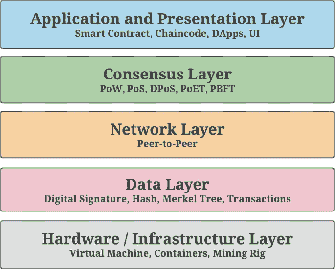

**图 1.1:** 区块链堆栈的分层视图

现在，让我们从概念和安全风险的角度来看每一层。

#### 应用层

应用层由链码、智能合约和去中心化应用程序（DApps）组成。应用层的协议进一步细分为应用层和执行层。终端用户用于与区块链网络通信的应用程序包含在应用层中。它包括用户界面、框架、应用程序接口（API）和脚本。

智能合约平台（如以太坊）旨在实现在区块链上运行的图灵完备程序的创建。这些程序与区块链网络上的账户相关，并通过包含待执行代码的交易进行调用。区块链网络中的每个节点执行相同的代码并以相同的方式更新区块链状态，从而维护整个网络的一致性。

在区块链网络之上运行程序的引入为区块链带来了新的潜在安全风险。这些程序运行在虚拟机上，虚拟机可能存在安全漏洞。需要采用安全的编码实践和安全的软件开发生命周期，以确保应用层的安全。

#### 共识算法层

让所有人达成一致是一项非常困难的任务。实现完全去中心化的数字账本的能力是区块链技术的主要优势之一。为了实现这一点，需要一种方法确保所有人对账本的当前状态（即每个区块中的交易）达成一致。

区块链共识算法承担了这一责任。它是分布式网络中的参与者在交易加入链之前验证其真实性的机制（这在“比特币概述”主题中有更详细的介绍）。安全被映射到供需等经济原则，没有任何共识算法是完美的。这些原则通常能保护区块链免受攻击；然而，共识算法的安全性存在崩溃点。最常用的共识算法存在可以被攻击者利用的漏洞，使其在尝试接管区块链网络时获得微弱优势。

*请访问`[cointelegraph.com/news/what-is-a-51-attack-and-how-to-detect-it](https://cointelegraph.com/news/what-is-a-51-attack-and-how-to-detect-it)`查看针对共识算法层的攻击示例。我们将在书的后部分更详细地介绍这些内容。*

#### 网络层

区块链技术的理论在区块链堆栈的前两层中已经确定。理论上讲，区块链平台可以在任何通信介质上运行，例如用于构建网络的路由器和计算机。在实践中，网络实现在计算机、互联网和私有企业网络上。

各种传统的网络攻击可能会针对区块链网络，因为它本质上是运行在通过点对点网络连接的计算机集合上的软件。针对运行软件的计算机或`node`（节点）的恶意软件或钓鱼攻击有潜力损害用户的账户并影响整个网络。攻击者还可以针对区块链网络的基础设施，这会对区块链的功能和安全保障产生影响。

#### 数据层

区块链技术底层由加密算法和数据结构组成。区块链的`blocks`（区块）用于存储数据，包括实际交易本身和额外的元数据。加密哈希用于连接区块链`chains`（链）中的区块，使其日后修改变得困难得多。

此时，区块链的安全性取决于其加密算法的安全性。质数的使用、密钥的长度、哈希算法中的位以及其他因素会对公钥加密和区块链的强度产生显著影响。这些需要通过威胁建模进行严格测试，并考虑到内部和外部威胁者。我们负责风险。

**注意**

#### 基础设施与虚拟化层

区块链的内容存储在地球上某处数据中心的服务器上。客户端在浏览网页或使用任何应用程序时，从应用程序服务器请求内容或数据，这被称为客户端服务器架构。它由虚拟机、容器、服务和消息组成。基础设施可以使用裸机或私有云设置进行本地部署。此外，区块链也可以部署在公有云中。对于本地部署，该层面的安全性取决于你在会话、TCP、IP 和数据交换层使用了多少安全控制。而在公有云的情况下，与云服务提供商合同中的服务水平协议起着至关重要的作用。

### 探索区块链安全优势

回顾一下我们对区块链规则的了解：

- 区块链是去中心化的，因此没有单一的数据源可以被黑客攻击，也不需要引入第三方供应商（这些供应商也可能被攻击）来处理交易。
- 区块链使用 `private key`（私钥）进行加密，以提供额外的安全保障，并确保数据不会落入他人之手中。
- 所有更改都在所有节点中实时完成，这增加了账本的透明度和信任度，并确保了没有单点故障。
- 区块链几乎是不可篡改的，因为更改任何记录将使其文件签名失效并引发巨大的警报。
- 共识过程要求网络成员解决一个需要强大计算能力的数学谜题。例如，你必须得出一个与难度级别匹配的 `nonce`（随机数）值，如果矿工得到了正确答案，结果将广播到网络进行验证。最长链规则在网络接受任何交易之前会检查所做的工作（链的长度、为构建该链付出了多少精力），以防止通过构建一个比真实链更长或更强大的伪链来让网络认可，如`Figure 1.2`所示。

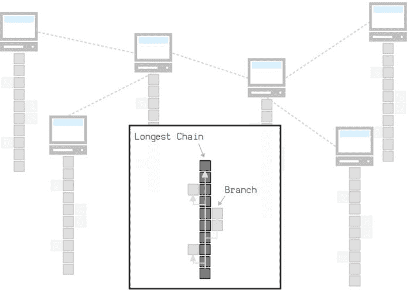

**图 1.2:** 区块链网络中最长链说明

为了解释我关于最长链和投入最多工作的观点，请考虑以下示例；如果链的区块更多但难度级别较低，它将不会被网络接受（参考`Figure 1.3`）。

构建所需能量最大的区块链被称为 `longest chain`（最长链）。通常，这是拥有区块最多的链，或者更准确地说，包含工作量最多的链。

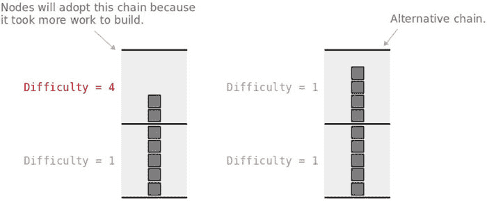

**图 1.3:** 最长链的接受标准

**注意**

请访问`[https://learnmeabitcoin.com/technical/longest-chain]` 了解更多。建议充分理解链长度的计算方法、链工作公式及其结果。

如果你必须伪造链（即创建一个相似的副本链，但付出了更多工作、更多区块，并且比网络中任何其他矿工都更快地广播区块），你需要开发一台超级计算机，这在技术和经济上对于所获的收益来说是不可行的。

参与验证过程的矿工将获得经济激励，目前的奖励费用为 6.25 比特。

任何区块包含以下数据：

- **Version（版本）：**区块的当前版本。
- **Previous block header hash（上一个区块头哈希）：** 父区块的引用哈希。
- **Merkel root hash（Merkle 根哈希）：**区块中所有交易的加密哈希。
- **Time（时间）：** 区块创建的时间。
- **nBits:** 目标阈值和区块当前难度的编码形式。
- **Nonce（随机数）：** `number used once` 的缩写，是矿工添加到区块中的随机数。

当区块进行哈希处理时，区块内所有的元数据都会作为哈希函数的输入，这些值中的任何一个更改都会产生不同的哈希值。

如果你想写下区块链的安全优势，请考虑前述规则以及构成区块链的安全特性。因此，无论这些安全特性带来什么益处，区块链技术都已经内置了它们。

我们将在讨论区块链如何赋能安全并帮助多个行业时，看到这些是如何结合在一起的。

### 制造业

由于供应链广泛且复杂，制造商需要确保从上游合作伙伴发送的规格是可信的。在此时，区块链的抗篡改性就派上了用场。区块的时间戳提供了额外的细粒度，进一步增强了保障。

### 医疗保健

通过安全地加密电子患者记录并使用区块链技术，可以保护网络中个人患者的匿名性，防止它们被攻击。这保证了患者、医疗提供者和临床医生可以无缝共享数据，而不必担心隐私或安全问题。

此外，医疗机构很难跨平台安全地共享数据。最终，服务提供者之间改进的数据协作可能会导致更准确的诊断、更有效的治疗和更具效益的护理。

`HealthVerity` 是该领域的参与者之一，它将健康数据交换与区块链产品相结合，以管理权限和访问权。

### 众筹

区块链技术可以通过提供不可篡改的账本、通过智能合约实现自动化、促进去中心化以及使用先进的安全措施来帮助众筹的安全。

该技术如何通过一种防篡改、中立且韧性的系统来跟踪所有权，一个典型的例子是在区块链上记录汽车零部件等物理资产。区块链是不可篡改的，且没有单一实体控制账本，而纸质记录容易被伪造和/或发生物理损坏，中心化数据库则可能受到黑客攻击、人为错误和/或篡改的威胁。

区块链可以用于识别供应链中的伪造零件并进行追踪。该技术对汽车召回也有重大影响，预计 2020 年将影响约 3200 万辆汽车。区块链通过追踪零部件从供应商到单辆车辆的去向，能够实现定向召回。

移动开放区块链倡议（MOBI）是一个包括福特、宝马、本田和通用汽车等汽车制造商在内的财团，他们一直在致力于一项车辆和零部件追踪计划。

### 房地产

物业交易期间和之后缺乏透明度、大量的文书工作、欺诈的可能性以及公共记录中的错误构成了重大挑战。区块链提供了一种加速交易并消除对纸质记录需求的方法，从而帮助所有利益相关方提高效率并降低各方的交易成本。

#### 注意事项

Propy 寻求通过基于区块链的智能合约平台提供安全的购房服务。所有文档都经过签名并安全地存储在网上，而契据和其他合同既使用区块链技术记录也在纸质。

你可能会想，如果这些信息都很好，但我们能看到区块链的现实收益吗？投资者应该考虑哪些重点领域？随着区块链在 2023 年达到 200 亿美元，并预计在 2027 年达到 2000 亿美元（参见图 1.4），让我们在查看区块链案例结果的同时识别关键领域。

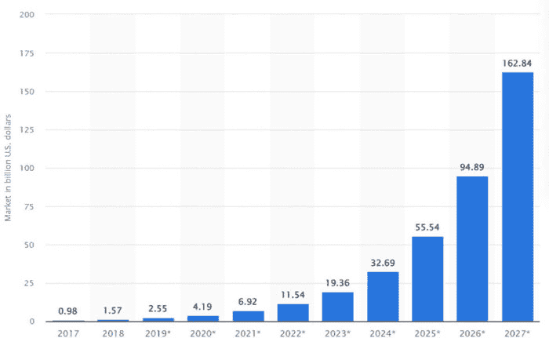

**图 1.4:** 区块链市场规模（十亿美元）

**来源：** Statista

### 案例研究：采购与供应链

区块链简化供应商主数据管理：信任你的供应商

**挑战**：在寻找和整合声誉良好的供应商时，“信任你的供应商”看到了节省时间和金钱的机会。公司必须处理供应链中断和质量预期，以符合法规或利益相关者对环境和社会的关注。企业花费大量的时间和金钱试图寻找良好的供应商。这是因为很难验证并获取提供者的数据，因为公司不希望公开共享数据。

**解决方案**：一个开源区块链平台，允许企业安全、有效地与获得许可的第三方合作伙伴共享数据。

一旦公司数据得到确认，就会创建一个基于区块链的企业数字护照，允许实现：

* 增强合规性
* 增强风险管理
* 缩短供应商的入驻周期

数字密码包含数据的哈希输出，这确保了数据的完整性。第三方验证者提供 P2P 网络的视图并验证供应商信息，这提供了真实性，而区块链上的供应商数据提供了可追溯性。因此，正如之前解释的，你在这里看到的内容确保了当你使用区块链时涵盖了所有安全领域。

**结果**：

* 将供应商入驻周期缩短了 70% 以上。
* 将与合适的供应商合作时的数据验证成本降低了 50%。
* 通过几乎即时检查 GRI、ISO、SASB 等第三方的国际质量证书，改进了合规性。

### 比特币固有的安全能力

### 比特币概览

数字货币生态系统建立在比特币所包含的思想和技术之上。价值通过比特币单位在比特币网络参与者之间进行存储和传输。值得注意的是，全球有数千种加密货币，而比特币是最知名且使用最广泛的。比特币用户还可以互联网和其他传输网络通过比特币协议相互进行通信。被称为比特币协议栈的开源软件兼容各种计算平台，包括智能手机和笔记本电脑，使得该技术触手可及。

与传统货币相比，比特币完全是虚拟的。它没有实际货币，也没有数字货币。在价值从一方转移到另一方的交易中，比特币网络通过密钥来证明所有权，这些密钥通常存在用户的智能手机或电脑钱包中。用户通过这些密钥签名交易并花费比特币。

此处显示的示例基于一次真实的比特币交易，模拟了 Joe、Alice、Bob 和 Gopesh 在将资金从一个钱包转移到另一个钱包时的交互。在跟踪交易通过比特币网络到达区块链的过程中，我们将使用区块链查看器网站来可视化每一步。

注意：就像比特币搜索引擎一样，区块链查看器是一个 Web 应用程序，允许你搜索地址、交易和区块，并查看它们之间的关系。

流行的区块链查看器包括：

- BlockCypher Explorer
- `blockchain.info`
- Blockstream Explorer

使用比特币地址、交易哈希值、区块号或区块哈希值，可以搜索这些工具中的任何一个来查找比特币网络上的相关信息。我将为每个交易或区块示例提供 URL，以便你自己进行深入检查。

对于咖啡爱好者来说，让我们看看用比特币买咖啡是什么样子的。

Alice 是一位咖啡爱好者，是一个拥有 0.10 比特币的新用户，这是她从 Joe 那里收到的。现在她将在加利尼亚州帕罗奥托的 Bob 咖啡馆进行第一次购买，买一杯咖啡。


Alice 用智能手机扫描显示的条形码并点击 `Send` 授权支付，她的手机上显示支付给 Bob 咖啡馆 0.0150 BTC。Bob 在收银机上看到这笔交易，并在几秒钟内完成——这与信用卡授权的时间大致相同。

你可以使用区块查看器网站查看区块链上 Alice 向 Bob 咖啡馆的交易（在 `blockchain.info` 上查看 Alice 的交易）：

示例：在 `blockchain.info` 上查看 Alice 的交易

https://blockchain.info/tx/0627052b6f28912f2703066a912ea577f2ce4da4caa5a5fbd8a57286c

简单来说，交易通知网络，某位比特币价值的所有者之一已授权将其转移给另一个人。在所有权链中，新所有者现在可以通过启动另一个交易（授权转移给另一个所有者）来花费这些比特币，以此类推。困惑吗？等一下，过会儿这些都会变得容易理解。

### 用于真实性的交易链

请记住，Alice 已经从 Joe 那里收到了 BTC，并在她在 Bob 的咖啡馆花掉了。在她的账本中，Alice 从 Joe 那里收到的记录将是一个输入，而她花费买咖啡的金额将是一个输出。作为输入，差额将返回到她的钱包。

Alice 的密钥作为交易的结果锁定了一个比特币价值。你会发现，她与 Bob 咖啡馆进行的后续交易使用之前一笔交易作为输入，并为支付咖啡和接收找零生成了新的输出。解锁这些之前的交易输出的签名由 Alice 的密钥提供，向比特币网络证明了她拥有这些资金。

这一切都创建了真实性，并确保 Alice 仅花费她拥有的资金，而不是向任何其他人员发送相同的金额。图 1.6 说明了这一切，这些账本堆积在一个比特币区块中。如果你在所有这一切之上加上哈希算法和私钥签名，就提供了深度安全，这意味着通过真实性的同时，你还可以从想要篡改的人那里获得数据完整性和机密性。

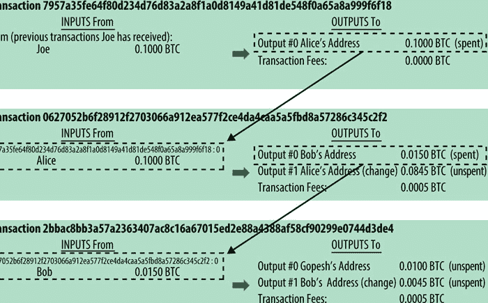

**图 1.6:** 比特币交易审查

**来源：** [https://cypherpunks-core.github.io/]

可以使用区块链查看器 Web 应用程序查看生成的交易，如 Alice 向 Bob 咖啡馆的交易所示（参见 *图 1.7*）。因此，如果任何人有交易地址或 Alice 的公钥，可以使用区块链查看器查看历史记录。

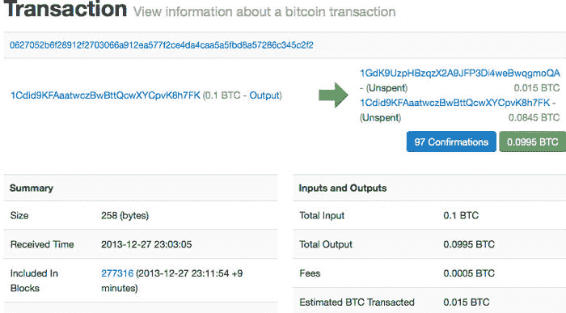

**图 1.7:** Alex 向 Bob 咖啡馆的交易

**来源：** [https://cypherpunks-core.github.io/]

### 将交易添加到账本

Alice 钱包应用程序创建的交易长度为 258 字节，包含了识别新所有者和确认资金所有权所需的一切。现在需要将交易发送到比特币网络，它将被添加到区块链中。我们将在下一节中查看交易是如何成为新区块的一部分，以及区块是如何被“挖掘”的。最后但同样重要的是，我们将观察随着更多区块添加到区块链中，网络对新区块的信任是如何增长的。

交易如何或从哪里发送到比特币网络并不重要，因为它包含了处理所需的所有信息。每个比特币客户端通过连接到许多其他比特币客户端为比特币网络做出贡献。比特币网络是一个对点网络。

比特币节点是任何通过“说”比特币协议参与比特币网络的系统，例如服务器、桌面应用程序或钱包。新交易可以通过 Alice 钱包应用程序连接的任何连接（移动端、WiFi、有线等）发送到任何比特币节点。

一种被称为“泛洪”（flooding）的传播方法发生时，任何从未见过有效交易的比特币节点都会立即将其转发给所有其他节点。结果是，交易在点点网络中迅速传播，几秒钟内到达许多节点。

从用户钱包和其他应用程序，网络不断接收新交易。这些交易被添加到未验证交易的临时矿池中，每个比特币网络节点在看到它们时都会进行管理。使用挖掘算法（`Proof-of-Work`），矿工试图在创建新区块时通过将该矿池中的未验证交易包含在内来建立新区块的有效性。

矿池是加密货币矿工的联合小组，他们在网络上结合计算资源以增加发现区块或其他成功挖掘加密货币的概率。

手续费最高的交易和其他几个标准决定了交易添加到新区块的顺序。由于他们输掉了上一次竞争，每个矿工一旦从网络收到上一个区块，就会开始挖掘一个新的交易区块。矿工立即开始计算新区块的 `Proof-of-Work`，并用填充交易和上一个区块的指纹。每个矿工向他的区块添加一个唯一的交易。

这笔交易向矿工的比特币地址支付区块奖励，目前等于 12.5 个新创建的比特币，加上区块中所有交易的总手续费。如果矿工解决了问题并验证了该区块，他们就“赢得”了奖励，因为他们成功的区块会被添加到全局区块链中，且包含的奖励交易可以被花费。

### 比特币安全审查

既然你已经详细了解了比特币的工作原理及其生态系统，让我们进一步剖析它，以了解漏洞存在于何处。如果你在之前所有的解释中注意到了，这归结为核心概念：去中心化、P2P 网络、钱包密钥、交易所、比特币源代码、矿池操作以及支撑链的比特币网络节点。

#### 去中心化方面

去中心化是比特币的核心，它具有重大的安全影响。像比特币这样的去中心化系统赋予了用户控制权和责任。网络的安全性基于 `Proof-of-Work`（工作量证明）而非访问控制，因此它是开放的。`Bitcoin Core` 本质上是一个用于连接比特币网络并运行节点的开源软件。虽然任何人都可以建议修改，但并非所有提议的代码修改都会被纳入 `Bitcoin Core`。相反，每一项提议的更改在决定接受或拒绝之前，都会由社区进行彻底的审查和辩论，安全性由整个社区共同维护。

如果你将其与传统的支付系统（该系统包含用户的私有标识符，即信用卡号）相比，后者在像信用卡系统这样的传统支付网络上是开放的。任何可以访问该标识符的人都可以“取走”资金，并在初始扣款后对所有者多次收费。

因此，支付网络必须从头到尾加密，以确保窃听者或中间人都不会在交易传输或存储（静态）期间破坏支付流量。如果恶分子获取了系统的权限，可能会同时破坏现有的交易和用于创建新交易的支付令牌。更糟糕的是当客户数据泄露时，客户面临身份盗窃的风险，必须保护他们的账户免受欺诈使用。

比特币的去中心化安全模型赋予了用户大量的控制权。保持密钥保密的责任也随之而来。这对于大多数用户来说，特别是对于连接到互联网的手机和笔记本电脑等通用计算设备用户来说是非常困难的。尽管比特币的去中心化模型防止了像信用卡那样的大规模破坏，但许多用户未能充分保护他们的密钥，导致一个个被黑客攻击。

#### 密钥与交易的处理

比特币的安全性取决于矿工独立地验证交易以及对密钥的去中心化控制。为了利用比特币的安全性，必须遵循比特币安全模型。简单来说：不应赋予用户密钥的控制权，也不应从区块链上移除交易。避免将密钥的托管权交给交易所或第三方。在进行密钥备份时，要尽到尽职调查。

由于网络始终连接，我们的计算机不断暴露在外部威胁之下。它们经常拥有对用户文件的无限制访问权限，并运行来自数百位作者的数千个软件组件。在安装在你计算机上的数千个恶意程序中，单个恶意软件就可以破坏你的键盘和文件，盗取存储钱包应用程序中的任何比特币。只有极少数计算机用户能够执行维护无病毒无木马计算机所需的计算机维护。因此，这是需要关注的一个漏洞领域。

另一个常见的错误是为了试图加速交易处理或降低交易手续费而“将交易从区块链上移除”。交易将记录在“离链”系统中的内部中心化账本上，并偶尔与比特币区块链进行同步。再次，这种做法使用专有且中心化的方法来取代去中心化的比特币安全性。安全性不足的中心化账本在离链期间可能会被篡改。

### 结论

祝喜完成第一章！在下一章中，我们将查看以太坊等其他变体。

#### 记忆点

*   区块链是一套技术，并且很有用。
*   区块链不是货币，而是去中心化的。
*   区块链可以应用于任何行业。
*   去中心化的本质和加密学功能提供了安全性。
*   比特币的漏洞领域是钱包密钥和交易。
*   在涉及……时需要尽职调查。
*   `https://bitcoin.org/`

#### 选择题

1. **区块链包含？**

    a. 点点网络

    b. 加密算法

    c. 共识算法

    d. 以上所有

2. **区块链中的区块包含什么？**

    a. 哈希值 (Hash)

    b. 比特币

    c. 随机数 (Nonce)

    d. 交易账本

    e. 姓名和地址

3. **哈希提供了哪种安全原则？**

    a. 机密性

    b. 完整性

    c. 可用性

    d. 以上所有

4. **为什么我们在钱包中使用私钥？**

    a. 解锁未花费的交易

    b. 签名交易

    c. 查看交易

    d. 以上都不是

5. **公钥的作用是什么？**

    a. 识别用户

    b. 签名交易

    c. 挖掘交易

    d. 存储交易

### 答案

1. **d**

2. **a, b, c, d**

3. **b**

4. **a, b**

5. **a**

# 第二章

## 区块链安全变

### 引言

目前区块链有许多应用场景：成千上万的加密货币项目、数百个运行中的区块链应用程序，以及数十亿美元的市场资金流入这项新技术。我还会补充一点，我们在金融生态系统中面临的大多数问题——从银行贷款、向同伴发送资金，或仅仅移动和存储数据——都可以通过使用区块链来解决。

在此处，你可能在想，我们讨论的是以太坊区块链还是比特币区块链？市场上的其他区块链呢，比如 Hyperledger（超级账本）和 Solana？有人还提到了 Defi，以及它们有何不同。你是正确的；随着我们深入挖掘，情况会变得复杂，并且难以掌握。在这种情况下，发生的情况是：你恰好像 IT 部门那样应用了安全控制措施，当现实以安全事件的形式向你袭来时，你开始回溯源头，并在大多数情况下寻求安全顾问的帮助。

现在的问题是，你将如何决定使用哪种区块链，哪一个最适合你的问题？最重要的是，如何从风险识别和缓解的角度对每种区块链进行分类？我们将在本章中尝试回答这些问题，带你了解不同的区块链类型，讨论从以太坊到 Hyperledger 以及 `DeFi` 的用例选择过程，深入探讨每种区块链带来的安全特性及其缺点，最后以钱包和交易所结束。

### 结构

在本章中，我们将涵盖以下主题：

* 区块链类型
* 以太坊安全概述
* 以太坊安全考量
* Hyperledger Fabric 安全概述
* 私有区块链安全考量

### 区块链类型

毫无疑问，区块链在最近发展得非常快。这一切都始于比特币，它提供了第一种区块链——公有区块链。比特币区块链也可以被称为第一代区块链技术。

在我们对区块链类型进行真正的对话之前，我们应该意识到无论在任何情况下我们需要它们的原因。

当区块链技术首次向公众开放时，它是一种用于加密货币的公有区块链。尽管极难理解创造者的意图，但它通常引入了去中心化账本技术（`DLT`）的概念。`DLT` 的想法改变了我们在环境中解决问题的方式。它使组织能够独立于中心机构运行。

虽然分布式技术消除了中心化的缺点，但在各种环境下实施区块链技术时，它也带来了一系列额外挑战。例如，`Proof-of-Work`（工作量证明）是 `Bitcoin` 中使用的一种低效共识算法。它要求节点利用能量来完成数值估算。

起初并不是问题，但随着度的增加，解决这些数学方程所需的时间和精力也随之增加。这一缺陷使其不适合组织采用。例如，银行持续管理大量的交易。因此，这种类型的区块链是不合适的，因为银行每天必须结算 `x` 笔交易，且信息不需要公开。

此外，公有区块链并不适用于私有公司的数据存储用例。例如，如果亚马逊或谷歌将机密信息放在公有区块链上，那么这些数据可能会被其竞争对手用来攻击他们。仅仅为了使用而使用区块链在商业上是没有意义的，因为它无法解决能够产生成本效益的真实问题。尽管某些人会认为，将数据放在公有区块链上意味着任何人都可以查看记录，这反过来吸引了客户的信任，但这种用例是薄弱的。

私有链或联盟链开发是为了解决上述用例。私有区块链提供了一个完全私密的环境，其中由组织选择参与者。它们可以利用区块链的特性，而无需发布所有内容。

下图显示了四种主要的区块链类型。它们主要分为许可链（permissioned）和无许可链（permissionless），进一步划分为公有、私有、混合和联盟链。

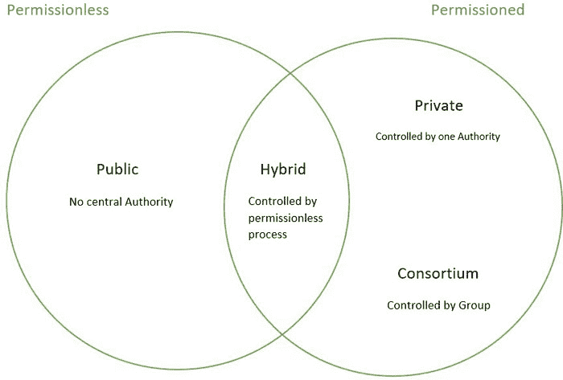

**图 2.1:** 区块链技术类型

让我们从特性、优点、缺点以及用例的角度来看每一种。

#### 公有区块链

这些区块链完全支持去中心化的理念。任何拥有计算机并接入互联网的人都可以加入网络——没有任何限制。这是我们在 `第 1 章：区块链安全回顾` 中涵盖的内容。我们现在将尝试从比较分析的角度来看待，以便你理解其差异。

* 因为它的名字，它是公开开放的，这意味着没有人拥有它。
* 它允许任何访问互联网并拥有具有高质量硬件的计算机的人参与。

你可以验证交易或记录，因为网络中的每台计算机都存储了其他节点或区块的副本。从下图中看到，从世界任何地方加入网络的新节点也将维护一份交易的副本。

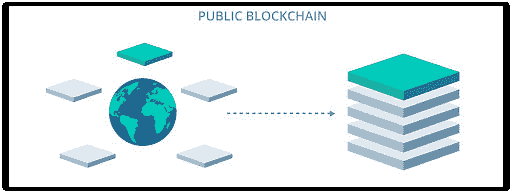

**图 2.2:** 公有区块链类型

那么缺点是什么？我们为什么需要寻找其他版本的区块链？有几个核心问题，例如：

* **TPS 较低：** 在公有区块链中，每秒交易数极低。这是因为由于大型网络中有许多节点，验证交易和执行 `Proof-of-Work` 需要时间。
* **可扩展性问题：** 处理和完成其交易需要很长时间。这损害了可扩展性。因为我们越试图扩大网络规模，网络就会越慢。
* **高能耗：** 因为需要特殊的系统（硬件组件）来运行特定的算法，`Proof-of-Work` 过程消耗了大量的能量。其经济和环境方面引起关注。
* **案例研究：** 由于它们受到 `Proof-of-Work` 或 `Proof-of-Stake`（权益证明）的保护，公有区块链具有替代传统金融系统的潜力。使这种区块链支持去中心化的 `Smart Contract` 是该区块链更先进方面。公有区块链的实例有 `Bitcoin` 和 `Ethereum`。
* **投票：** 政府可以使用公有区块链进行投票，确保开放和信任。
* **融资：** 业务或倡议可以使用公有区块链来提高透明度和信任。

#### 私有区块链

私有区块链是经过批准的节点的封闭组织。节点之间交换的信息私有网络之外的任何人无法访问。私有区块链令人印象深刻，但也有一些缺点。下图是私有区块链的插图，其中如果新节点要参与，必须经过显式允许。

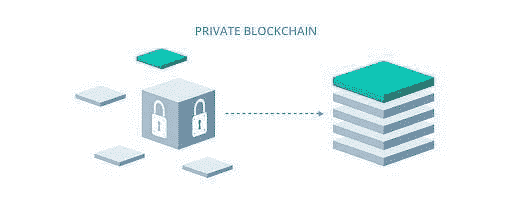

**图 2.3:** 私有区块链类型

它们在每秒交易数（`TPS`）和可扩展性上与公有区块链有所不同：

* **TPS - 速度：** 与公有网络相比，私有网络的节点有限。这加速了所有网络节点的共识或验证过程。此外，新交易被添加到区块的速度。私有区块链可以同时处理数千或数十万的 `TPS`。
* **可扩展性：** 私有区块链的可扩展性相当好。也就是说，你可以根据需求决定私有区块链的大小。例如，如果一个组织只需要 20 个节点，它可以轻松地部署区块链。扩展后，添加额外的节点将没有问题。

任何好事都是需要付出代价的，那么获得快速性能和改进的可扩展性的权衡是什么呢？信任和中心化方面直接影响安全容忍度。让我们来看一下。

* **信任依赖：** 私有链具有相当水平的可扩展性。这意味着你的需求可以决定私有链的大小。例如，一个组织仅需 20 个节点即可轻松实现一个区块链。结果是它们在扩展时增加更多节点将不会遇到任何困难。
* **高度中心化：** 由于私有链需要一个中央身份和访问管理（IAM）系统才能正常运行，因此它们受到了限制。该框架拥有所有的观察和管理权限。它允许选择对区块链中存储数据的访问权限级别，或者向网络添加新节点。如下所示，区块链技术支柱之一的去中心化概念与这一系统直接对立。

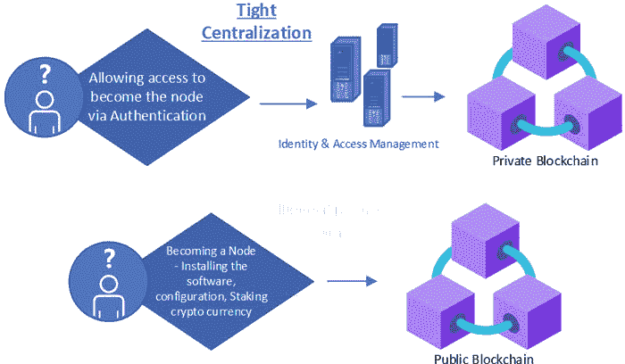

**图 2.4：** 私有链与公有链相比的中心化方面

上述两个因素都会影响安全方面，导致私有链网络因为参与者或节点较少而更容易受到安全攻击。假设任何一个枢纽访问了核心管理框架，它就可以足够地接触组织中的每一个枢纽。这使得枢纽更容易黑入整个私有链并滥用数据。

**案例研究：** Hyperledger Fabric 是一个用于应用程序开发的区块链框架，具有独特的访问控制和身份管理功能。沃尔玛使用了一个基于 Hyperledger Fabric 的私有区块链系统。Linux 基金会的开源框架是许可链区块链的一个示例。

它让沃尔玛能够查出其产品的源头。其供应商将真实性证书添加到账本中。得益于此，该业务能够在几秒钟而非几天内追踪到产品的来源。

#### 混合区块链

它是私有链和公有链的混合内容，某些部分由特定组织控制，其他部分则公开。你可以认为是以太坊和 Hyperledger Fabric 的实现。任何行业都可以从这种设计中受益，在某些情况下，如果信息无法与公众共享但需要保持不可篡改，并通过工作流实现自动化，你可以利用私有链。而在同一个组织内部，如果你想针对公共信任并启用 P2P 交易，可以使用比特币或以太坊。

**案例研究：** 它为医疗服务行业、政府、土地货币机构提供了更具意义的答案。当数据必须保持私有但可以被公众访问时，它提供了一种解决方案。一个很好的例子是，患者想与医生和医疗保险公司共享医疗数据，同时也想确保个人隐私和安全。

另一个很好的用例是在公共网络上使用私有支付系统。底图是观察差异的良好说明，你获得了公有链和私有链两种类型的优点。

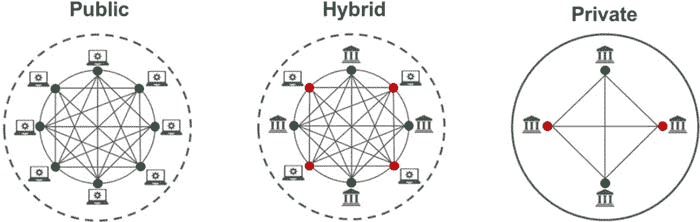

**图 2.5：** 混合区块链类型

#### 联盟链

在联盟链中，来自多个业务或组织的节点以更大的私密性管理网络。通过该平台，他们协作共享和修改信息以维护工作流、可扩展性和问责制。从下图可以看出，联盟链被限制属于联盟组的组织。

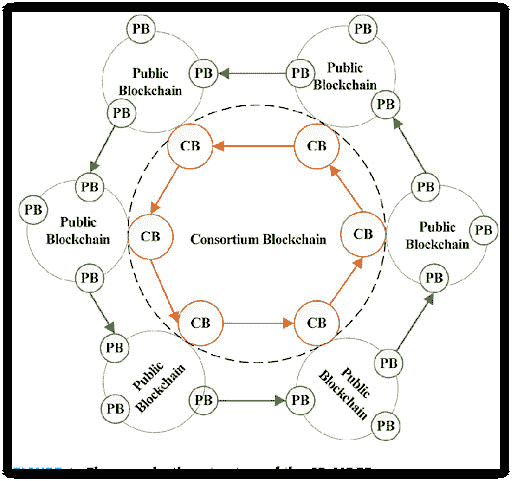

**图 2.6：** 联盟链

联盟链的主要目标是通过该平台协助机构解决问题并找到适用的解决方案。`CORDA` 和 `Quorum` 是两个涉及不同组织的知名联盟链。

为了清楚起见并将其与私有链区分来：联盟链有几个选定的成员（例如几个协会），而私有链有一个对区块链原则拥有绝对指挥权的成员，这意味着他可以使用相同的区块链平台，例如在私有企业设置中使用 `HL Fabric`。


## 案例研究

在金融领域，KYC（了解您的客户）是该领域发行和交易资产业务的一部分。数据集信息由联盟中的所有参与银行进行集中存储。当银行需要验证或访问债权人信息时，这个分布式账本将一直为该银行可用。详细分析显示，联盟链是实施跨部门项目的最佳选择。

其他的区块链实现如下。它从医疗保健到能源，一直延伸到技术和媒体，共同小组结合解决特定的解决方案。下图很好地说明了联盟链的实现如何分布在各个领域，其中金融部门占大部分份额。

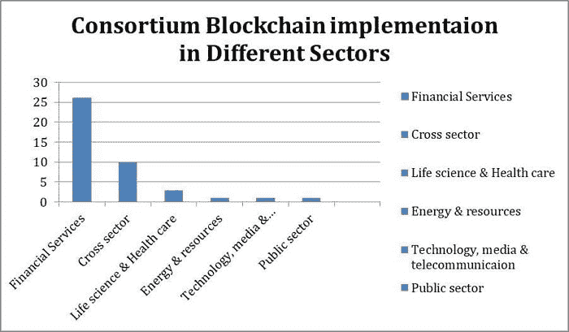

**图 2.7：** 联盟链部门分布

## 以太坊概述

在进入其安全态势之前，让我们先花点回顾一下以太坊。

### 以太坊简介

让我们从基础开始。什么是以太坊？它与比特币有什么区别？它的架构是什么样的？在深入研究、审查安全态势，然后寻找利用方法并最终加固它之前，这些都是需要展开的重要问题。

这也属于公有链类别。你可能在奇怪我们为什么没有在[第 1 章，区块链安全概述]中讨论它。原因之一是它的架构与比特币区块链略有不同，因为它涉及智能合约并允许创建去中心化应用程序，这些也可以为私有链进行调整，因此我想在在我们讨论过不同类型的区块链之后介绍它，以免你感到困惑。让我们开始。

以太坊是一种去中心化技术，可用于构建应用和组织、持有资产、进行业务和通信。以太坊让你控制自己的数据和共享内容，因此你不需要交出所有的个人信息。`Ether` 是以太坊自己的加密货币，用于支付某些基于网络的活动。

### 以太坊与比特币的区别

两者都是公有链，允许你使用数字货币发送而不涉及中心化的支付提供商或银行。但以太坊是可编程的，这意味着你可以在其网络之上构建应用程序。由于去中心化，这些应用程序被称为去中心化应用程序。

以太坊更像是一个金融服务、游戏、社交网络和其他尊重你的隐私且无法对你进行审查的市场，而比特币仅仅是一个支付网络。

以太坊的原生加密货币被称为 `Ether` (`ETH`)。它可以立即发送给世界上任何地方，因为它是完全数字化的。由于去中心化和透明性，`ETH` 的供应不受任何政府或企业的控制。只有质押了代币（如 `POW` 共识机制中的矿工）并工作保护网络的验证者才能获得新币，这些币也被称为代币。

在以太坊网络上，每个操作都需要一定数量的计算能力。该服务的支付使用 `ether` 完成。这意味着为了使用网络，你至少需要少量的 `ETH`。

### 以太坊的工作原理

以太坊没有单一的实体负责。这之所以可能，是因为社区的去中心化参与和协作。节点是存储以太坊区块链数据副本的计算机，它们由志愿者运行，取代了大型互联网服务提供商拥有的个人云系统和服务器系统。

本质上，以太坊区块链是一个基于交易的状态机。读取一系列输入并根据这些输入改变其状态的机器被称为状态机。

`genesis state`（初始状态）是我们在以太坊状态机开始的地方。这就像是在任何网络交易发生之前从零开始。当交易执行时，这个初始状态会变为最终状态。这个最终状态就是以太坊在任何给定时间的当前状态。

从下图中所示；一切都从初始开始，然后随着输入的输入，状态发生发生变化。

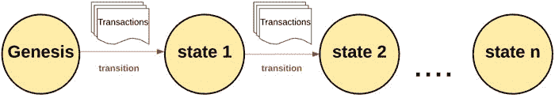

**图 2.8:** 以太坊的状态转换

以太坊状态中存在数百万次交易。这些交易被聚集在“区块”中。区块是交易的集合，每个区块都与上一个区块相连。现在你已经理解了基本概念，让我们来看看账户、状态以及 Gas 和支付等重要特性。

## 账户

以太坊的全局 `shared state`（共享状态）由许多小对象或 `accounts`（账户）组成，可以使用消息传递框架相互通信。每个账户关联一个 20 字节的地址和一个状态。在以太坊中，任何账户都通过称为地址的 160 位标识符来识别。账户有两种：

* 外部账户（Externally owned）：它们由私钥控制，没有与之关联的代码。
* `Contact accounts`（合约账户）：它们由其合约代码控制并关联代码。

那么，它们之间有什么区别呢？

通过使用私钥创建并签名交易，外部账户可以向其他外部账户**或**向合约账户发送消息。两个外部账户之间的消息仅仅是价值转移。但从外部账户到合约账户的消息会激活合约账户的代码，允许其执行各种操作（例如，转移代币、写入内部存储、铸造新代币、执行某些计算、创建新合约等）。

相比之下，由第三方拥有的账户无法独立地发起新交易。相反，合约账户只能响应它们收到的其他交易（无论是来自另一个合约账户还是外部账户）来发起交易。你可以通过下面的图更好地理解，图中展示了两种账户类型的区别。

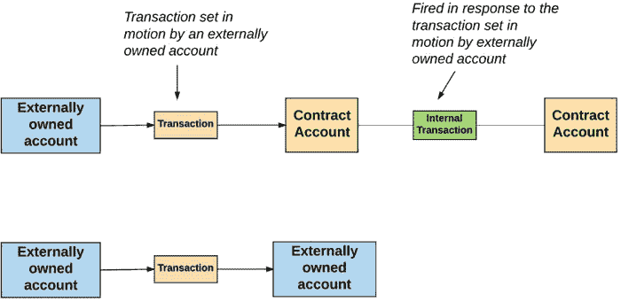

**图 2.9:** 外部账户与合约账户的区别

因此，你在以太坊区块链上看到的任何交易都是由外部账户触发的交易。

## 账户状态

账户状态由四个部分组成，无论账户类型如何都存在：

* `nonce`：如果账户是外部账户，此数字代表从该地址发送的交易次数。如果账户是合约账户，nonce 是该账户创建的合约数量。
* `balance`：该地址拥有的 Wei 数量。1 Ether 等于 1e+18 Wei。
* `Storage Root`（存储根）：Merkle Patricia 树的根节点的哈希值（我们稍后会解释 Merkle 树）。该树编码了此账户存储内容的哈希，默认情况下为空。
* `Code Hash`（代码哈希）：该账户 EVM（以太坊虚拟机——稍后详细介绍）代码的哈希。对于合约账户，这是被哈希并存储为 `code Hash` 的代码。对于外部账户，`code Hash` 字段是空字符串的哈希。

下图很好地展示了每种账户类型中持有的组件。

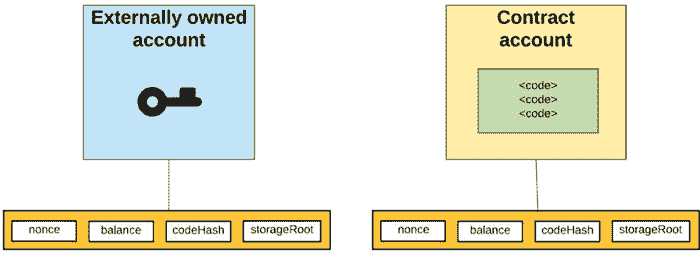

**图 2.10:** 账户状态中的组件

## Gas 和支付

这里没有免费。以太坊网络上因交易执行的每项计算都有相关的费用。

用于支付此费用的货币被称为 `gas`。Gas 是用于量化特定计算预期费用的单位。

发送者为每笔交易设置 `gas limit`（Gas 限制）和 `gas price`（Gas 价格）。发送者愿意执行交易支付的最大 Wei 数是 `gas price` 和 `gas limit` 之和。

例如，假设发送者指定了 50,000 的 `gas cap`（上限）和 20 gwei 的 `gas price`。这意味着发送者准备花费不超过 50,000 x 20 gwei（即 1,000,000,000,000,000 Wei，或 0.001 Ether）来执行交易。

请记住，发送者对 Gas 的最大支出由 `gas limit` 表示。如果他们的账户余额有足够的 Ether 来覆盖这一最大值，就可以进行。交易结束时，发送者将获得任何未使用的 Gas 等同于原始费率的退还。

在图中你可以看到交易中支付和 Gas 费用是如何相关的。

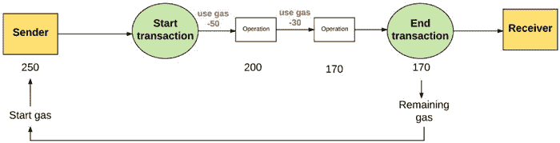

**图 2.11:** 支付与 GAS 的关系

当发送者未能提供完成交易所需的 Gas 时，交易被视为无效。在这种情况下，交易处理将停止，任何之前的状态更改都会撤销。

此外，由于机器在耗尽 Gas 之前已经付出了努力进行计算，因此发送者不会获得已用 Gas 的补偿。`beneficiary`（受益者）地址（通常是矿工地址）接收发送者所有的 Gas 费。该概念在图中所示。

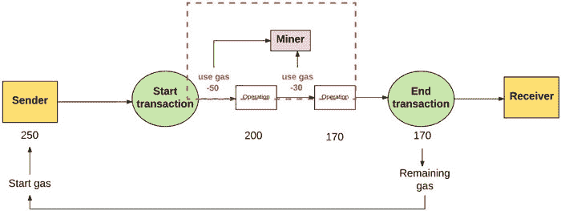

**图 2.12:** 进入矿工账户的 GAS 费用

现在是时候谈论区块链中最受关注的话题了：智能合约。是的，智能合约是以太坊发现。

## 以太坊虚拟机

以太坊虚拟机（`EVM`）是以太坊特有的虚拟机，是协议中负责处理交易的组件。下图所示的架构视图将帮助我们在后续过程中想象出这一切。

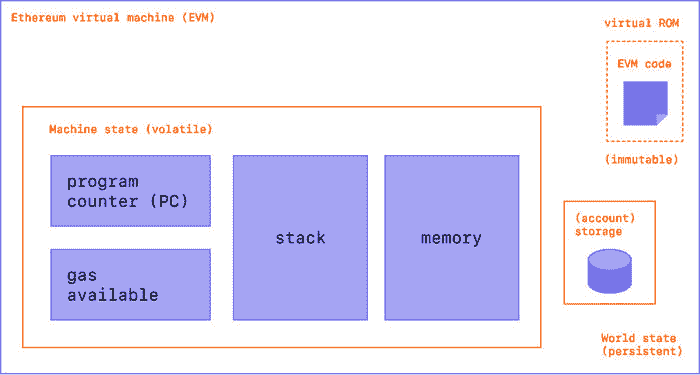

**图 2.13:** 以太坊虚拟机架构

`EVM` 是一个图完备虚拟机。因为它本质上受到 Gas 的限制，`EVM` 并没有典型的图完备机器不具备的限制。因此，可以执行的计算总量本质上受到 Gas 供应的限制。

项存储在 `EVM` 内存的字寻址字节数组中。内存是不可预测的，它并不意味着持久。

`EVM` 也有存储。与内存不同，存储是非持久性的，并作为系统状态的一部分维护。程序代码分单独存储在虚拟 ROM 中，只能通过特定指令访问。

## 智能合约

智能合约只是区块链环境中的计算机程序或脚本。它们只有在用户交易（或其他合约）触发时才会生效。它们通过使其极具适应性将以太坊与其他加密货币区分开来。我们现在将这些程序称为去中心化应用或 dapps。

如果一个智能合约已发布在以太坊上，只要以太坊存在，它就会一直运行。即使是编写它的人也无法将其删除。由于智能合约是数字化的，它们不会强迫任何人，并且随时准备好使用。借贷应用、保险应用、众筹应用和去中心化交易所都是智能合约的流行例子。

你知道吗，Szabo 在 1994 年提出了 `smart contract`（智能合约）这一术语？他将智能合约定义为`一种执行合约条款的计算机交易协议`。

这里另一个需要注意的重要点是以太坊智能合约中源代码和字节码之间的区别。

`Solidity` 的语法与 `JavaScript` 相似，通常用于编写智能合约的源代码。Sol 智能合约的结构类似于面向对象编程中的类。

Solidity 编译器也会像 Java 编译器一样产生源代码的字节码版本。这个字节码版本由以太坊虚拟机（`EVM`）运行。

以太坊字节码由几个称为 `opcodes`（操作码）的低级指令组成。它是用一种汇编语言编写的。以太坊只存储智能合约的文本。

关于 solidity 的更多细节可以在 [`github.com/ethereum/wiki/wiki/Proof-of-Stake-FAQ`](https://github.com/ethereum/wiki/wiki/Proof-of-Stake-FAQ) 中找到。

以下是一个示例 Solidity 智能合约代码，以及简要的描述和用例：

```solidity
pragma solidity ^0.8.0;

contract Voting {
    mapping(address => bool) public hasVoted;
    mapping(bytes32 => uint256) public voteCount;
    function vote(bytes32 candidate) public {
        require(!hasVoted[msg.sender], "You have already voted.");
        voteCount[candidate] += 1;
        hasVoted[msg.sender] = true;
    }

    function getVoteCount(bytes32 candidate) public view returns (uint256) {
        return voteCount[candidate];
    }
}
```

### 描述

这是一个简单的智能合约，允许用户通过调用 `vote` 函数为候选人投票。每个用户只能投票一次，因为合约会跟踪用户是否已经投票。合约在名为 `voteCount` 的映射中存储每个候选人的票数，并提供了一个名为 `getVoteCount` 的函数来检索指定候选人的票数。

用户输入的票数数量是触发条件。如果 `vote` 的值大于 1，结果将显示 `you have already voted`（你已经投票过了）。合约的触发也可以通过其他几种方式发生，例如时间、计划、事件触发、收获收益、铸造 NFT、贷款清算等。

无论合约大小如何，从安全性的角度来看，都应该有一些可以完成的重要考虑因素：

* **安全身份验证**：合约应该实施强身份验证措施以防止任何未经授权的访问，这可以使用公私钥对、通过策略强制执行的主体和资源来实现，或者如果你知道端口、源和目的 IP，也可以在边界层简单地使用 `ACLs`。
* **静态存储和传输加密**：票数结果应在静态存储时加密；可以使用像 `HSM` 这样的安全存储库来实现机密性。此外，如果数据必须发送到外部，`API` 应该启用 `TLS`。

关于此以及更多关于区块链安全解决方案将在 `第 6 章，区块链安全解决方案` 中讨论。

### 用例

此智能合约可以用于实现一个简单的投票系统，用户可以以透明且安全的方式为候选人投票。例如，它可以用于学生会选举或公司董事成员选举，在这些选举中，需要以去中心化且信任的方式进行投票计数和验证。

*你可以在 [`ethereum.org/`](https://ethereum.org/) 学习更多关于以太坊社区的信息*。既然你已经理解了以太坊的基础知识和智能合约，让我们来看看以太坊节点的结构。

### 以太坊节点的结构

以太坊节点可以分为几个层：应用层、共识层、数据层和网络层，如下所示。这些被细分为不同的类型，取决于用例。


**图 14：以太坊的分层结构**

#### 应用层

以太坊区块链的应用层是执行智能合约和构建去中心化应用（dApps）的地方。我们之前讨论过智能合约，在这里我想强调用户如何与以太坊交互。可以通过以下方式进行：

* **支持 web3 的浏览器**：许多现代浏览器如 `MetaMask`、`Brave` 和 `Opera` 都内置了对以太坊的支持。用户可以安装这些浏览器插件直接从浏览器与 dApps 和智能合约交互。
* **以太坊钱包**：用户可以下载并安装专用以太坊钱包，如 `MyEtherWallet`、`Trust Wallet` 或 `Coinbase Wallet`。这些钱包允许用户发送和接收以太坊，并与智能合约交互。
* **命令行界面**：高级用户可以使用命令行界面（CLI）如 `Geth` 或 `Parity` 与以太坊区块链交互。这些工具提供了对以太坊网络的直接访问，允许执行更复杂的操作，例如部署自己的智能合约。
* **Geth (Go-Ethereum)**：`Geth` 是一个以太坊执行客户端，这意味着它运行部署、执行和交易。它还有一个嵌入计算机称为以太坊虚拟机。

#### 共识层

以太坊切换到权益机制是因为它比之前的工作量架构在实现新的扩展解决方案方面更安全、更节能。

* 证明权益（`PoS`）是某些区块链网络（包括以太坊）使用的工作量（`PoW`）的替代共识机制。与依靠矿工解决密码难题来验证交易并创建新区块的 `PoW` 不同，`PoS` 依靠验证者来维护网络。

简而言之，以太坊的 `PoS` 共识层设计得比 `PoW` 更节能、更安全，因为它不需要矿工通过计算密集型的难题来验证交易并创建新区块。

#### 数据层

以太坊的数据层指的是数据如何在以太坊区块链上存储和管理。以太坊区块链是一个去中心化的分布式账本，以区块的形式存储交易和数据。每个区块都包含前一个区块的加密哈希，形成不可破坏的区块链。

在以太坊中，数据层由两个部分组成：`state trie` 和 `transaction trie`。`state trie` 是存储以太坊网络当前状态的数据结构，包括账户余额和合约代码。`transaction trie` 是存储所有网络处理过的交易的数据结构。

#### 网络层

以太坊的网络层负责管理构成以太坊网络的节点对等节点网络。它允许节点之间进行通信和信息共享，对于确保区块链的安全和顺畅运行至关重要。

拆解来看，它包含以下部分：

* **节点节点 (Peers)**：以太坊网络由节点组成，也称为“对等节点”。这些节点运行以太坊软件并通过互联网相互连接。
* **通信 (Communication)**：网络上的节点使用 `Ethereum Wire Protocol`（以太坊线缆协议）相互通信，这是一种对等网络协议，允许节点发送和接收消息。
* **发现 (Discovery)**：节点可以通过被称为“节点发现”的过程发现网络上的其他节点。这涉及向其他节点发送消息以获取其对等节点的信息，例如它们的 IP 地址和端口号。
* **同步 (Synchronization)**：网络上的节点之间进行同步，以确保它们拥有区块链的最新副本。这是通过被称为“区块链同步”的过程实现的，涉及下载和验证每个区块。
* **共识 (Consensus)**：网络上的节点共同工作，对区块链的当前状态达成共识。这是通过共识层实现的，该共识层已经从工作证明 (`PoW`) 转型为权益证明 (`PoS`)，以验证交易并创建新区块。
* **激励 (Incentives)**：网络上的节点通过获得交易费用和区块奖励来激励参与网络。这有助于确保网络的安全，并有足够的节点参与以防止中心化。

## 以太坊安全审查

现在你已经理解了基础知识、以太坊架构和不同的层级，我们现在处于审查安全态势的位置。在继续进行之前，请看下面的图片，它展示了以太坊区块链的攻击历史。通过观察下面的图，可以明显看出一点：大多数漏洞行为都发生在应用层，包括 `EVM` 和智能合约，利用了代码漏洞；其他攻击属于区块链设计缺陷，例如共识机制、预言机喂送、客户端交互等。而网络、数据层等其他层通常是稳固的。

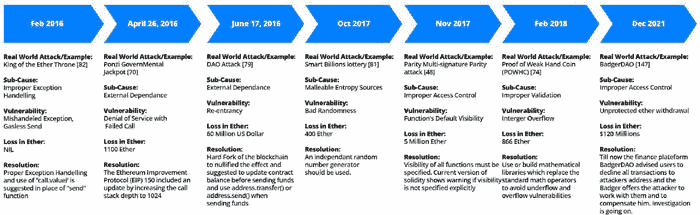

**图 2.15：** 以太坊安全漏洞概述

### 智能合约审查

多年来出现过若干高关注度的智能合约漏洞被利用。主要的漏洞包括：

* **重入攻击 (Re-entrancy attacks)**：当恶意合约在初始交易完成之前反复调用自身时发生。这可能允许攻击者抽空合约的资金。
* **整数溢出/下溢 (Integer overflow/underflow)**：如果合约使用整数来跟踪余额或其他值，攻击者可能通过导致溢出或下溢来操纵这些值。这可能导致意外行为并可能允许攻击者盗取资金。
* **未检查的外部调用 (Unchecked external calls)**：如果合约在不检查返回值的情况下对其他合约进行外部调用，攻击者可以创建一个恶意合约来回滚交易或盗资金。
* **访问控制 (Access control)**：如果合约依赖单一地址或账户来控制访问，攻击者可能通过破坏该账户来获得对合约的控制。


*   **时间操控 (Time manipulation)**：如果合约依赖时间戳来决定何时执行某些操作，攻击者可能会操纵这些时间戳以有利于自己。
*   **缺乏输入验证 (Lack of input validation)**：如果合约不验证输入数据，攻击者可能会提交恶意数据，导致意外行为或导致资金被盗。
*   **随机性较差 (Bad randomness)**：如果合约依赖于可被攻击者预测或操纵的随机源，攻击者可以操纵结果以有利于自己。

这些漏洞的根源属于这些子原因之一，下面的图可以让你对审计智能合约时需要寻找的内容有一个大致了解。

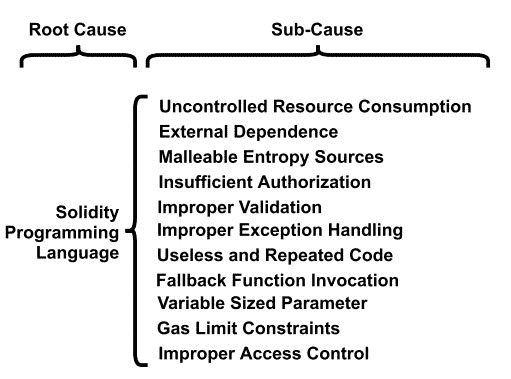

**图 2.16：** 漏洞细分

对于开发者、架构师和安全负责人来说，重要的是进行威胁建模、评估这些攻击向量是否合理、从机密性、完整性和追溯性的角度进行评估、对合约进行彻底测试并遵循最佳实践以最小化风险。也有可用的安全工具，如 `Mythril`、`Slither` 和 `Remix`，但重要的是，没有任何工具可以保证没有漏洞，还应该进行人工代码审查。

我们将在稍后详细介绍漏洞的分析和修复，但这里只是让你对预期情况有一个了解。

#### EVM 安全审查

以太坊虚拟机 (`EVM`) 是以太坊网络的核心组件，因为它负责运行区块链上的去中心化应用程序 (`dApps`)。然而，与任何其他软件一样，`EVM` 并非对漏洞和攻击免疫；漏洞属于以下几类：

*   **拒绝服务攻击**：`EVM` 也可能受到拒绝服务 (`DoS`) 攻击，攻击者通过产生大量 Gas 的交易阻塞网络，导致交易处理变慢和费用增加。
*   **不可更改的漏洞或错误**：这与以太坊区块链的不可变性有关。因为一旦合约部署到区块链上，由于不可变性就无法修改。这违反了允许修改和终止的法律。然而，如果部署的智能合约存在漏洞，可能会导致问题。
*   **丢失区块**：ETH 在传输过程中可能会丢失。ETH 可以传输到合约的唯一地址，但该合约不能是丢失的，否则传输的 ETH 将永久丢失。存在回滚 ETH 传输的机制。开发者需要物理上确保接收地址的正确性。必须手动验证接收合约的地址，以避免 ETH 丢失。

#### 以太坊安全设计审查

以太坊的设计原则由架构设定，架构展示了交易是如何被挖矿的、调用流以及网络组件参数，脆弱区域属于以下子类别：

*   **交易隐私**：用户的交易余额详情是公开的。但用户希望他们的财务细节和交易对他人不可见。这可能会限制智能合约的使用，因为攻击者可以监控用户的交易详情。攻击者可以利用这些信息进行各种不道德的用途。

建议在将智能合约部署到区块链之前对其加密，同时也不要在智能合约中共享财务交易信息。

*   **可操纵用户（Malleable user）**：该漏洞与调用同一智能合约的两个依赖交易之间的执行顺序有关。如果没有按照正确的顺序执行，恶意用户可以利用此漏洞进行攻击。交易的执行顺序由矿工决定，但如果攻击者本身就是矿工，这将是一个非常灾难的局面。建议强制要求合约代码要么返回预期输出，要么失败。应该强制执行交易顺序，否则应生成错误。
*   **不可信的数据馈送（Untrustworthy data feeds）**：某些智能合约需要来自区块链外部的数据馈送，但无法保证外部数据源是可靠的。因此，当攻击者故意发送错误信息导致智能合约操作失败时，将会处于危险状态。任何来自外部的请求都需要经过适当的身份验证和授权，例如使用带有有效证书的 HTTPS，并且这应该落在 API 网关上。
*   **共识机制**：在以太坊转向权益证明（PoS）后，它采取了以下安全措施来克服恶意用户利用网络。

    *   **惩罚（Slashing）**：以太坊实现了一种名为 `slashing` 的机制，以威慑并减轻对网络的攻击。惩罚是对实施恶意行为或未能遵守网络规则的验证者实施的处罚。如果发现验证者有恶意行为或违反网络规则，将根据违规的程度部分或全部没收其质押资金。以太坊社区有权销毁不诚实验证者的代币。
    *   **检查点（Checkpointing）**：以太坊还有一种名为 `checkpointing` 的机制来帮助从攻击中恢复。检查点涉及在区块链中定期创建参考点或“检查点”。如果发生攻击，网络可以回溯到最近的检查点，从而撤销恶意活动并将网络恢复到之前的状态。

在 PoS 系统中，网络能够抵御 51% 的攻击，且验证者需要质押自己的加密货币作为抵押来参与共识过程。这意味着，试图通过创建无效区块或批准欺诈交易来欺骗系统的验证者，其质押将被没收。这对恶意行为构成了强力威慑，因为验证者有财务动机去诚实并保护网络。

以太坊网络在受到任何攻击时可以利用一系列防御策略，最小的响应可以是强制在没有任何额外惩罚的情况下将攻击者的验证者从网络中移出，社区也可以决定采取更严厉的手段惩罚攻击者，例如撤销过去的奖励或销毁其部分（最高 100%）的质押资金。

### 以太坊安全考量

尽管以太坊基金通过赏金计划在识别和处理智能合约层的所有漏洞方面尽了尽职调查，并且还有不同的审计工具可以被适配以识别和缓解协议、客户端和 solidity 中的漏洞，但尽管如此，仍然有一些领域值得关注。

**你知道吗？**

*通过发现影响以太坊网络的协议、客户端和 solidity 漏洞，你可以获得高达 $250,000 的奖励并进入榜单 – 以太坊.org*

### 共识层的中心化

一个潜在的漏洞区域是共识层，大多数验证者都位于 Coinbase、Kraken 和 Binance 等大型交易所之下。这可能导致中心化问题，并在核心位置产生攻击面。例如，由于某种原因，如果监管机构制裁或禁止了某些大机构，那么整个以太坊验证生态系统将面临风险，这就像面临着*大到不能倒*的风险。

另一个漏洞领域是钱包，例如 MetaMask 以及你与以太坊交互的软件，如使用 `geth`（go 以太坊客户端）。

### MetaMask

当你使用 MetaMask 时，请确保浏览器上安装了最新版本，并安全地保存了密码。当你第一次创建钱包时，你会收到 12 个单词的秘密恢复词（Secret Recovery Phrase）。

MetaMask 不使用云端。假设你的设备损坏、丢失、被盗或信息被篡改，MetaMask 支持小组无法为你恢复这些内容。恢复 MetaMask 账户的唯一方法是使用这个秘密恢复词。其次，请对你的私钥和秘密恢复词加密。如果你账户中有大量代币，请考虑购买硬件钱包。

### 漏洞管理

当你与以太坊 Geth 客户端或 EVM 交互时，请交叉验证 `https://www.cvedetails.com/vulnerability-list/vendor_id-17524/product_id-51210/Ethereum-Go-Ethereum.html` 下的 CVE，然后查看漏洞披露页面 - `https://geth.ethereum.org/docs/developers/geth-developer/disclosures`。

如果你查看以下 CVE，你会对预期情况有一个良好的了解。确保你的软件中没有开放的 CVE，并且正在运行最新的补丁。

保护自己免受典型的智能合约弱性影响，如重入（Reentrancy）、整数下溢和溢出以及预言机操纵（Oracle manipulation）。确保所有相关漏洞都已修复、测试并验证。

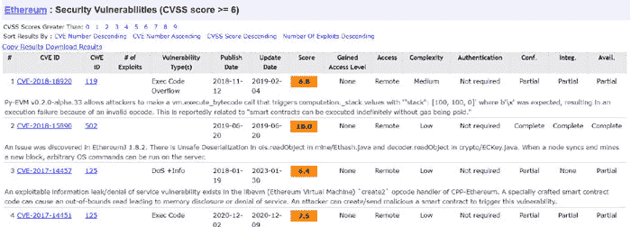

**图 2.17：** 以太坊常见漏洞披露 (CVE)

**注意**

*对你在区块链产品上使用的任何开源软件进行尽职调查总是更好的，例如：保持补丁更新、定期进行威胁建模、通过模拟（即红蓝对抗演练）进行审计和风险分类等。CVE 在漏洞利用发生后才会发布，你仅可以将 CVE 矩阵作为参考*。

书中后后会有更多内容，届时我们将详细介绍区块链漏洞及其补救措施。

### 加固访问控制

任何外部所有账户 (EOA) 或合约账户都可以调用智能合约中标记为 `public` 或 `external` 的函数。如果你认为他人应该根据你的约定进行连接，那么标记功能的可感知性是重要的。然而，智能合约内部的函数——而非外部账户——只能调用私有函数（private functions）。

需要安全的访问控制来防止未经授权使用智能合约函数。智能合约的访问控制机制限制了谁可以使用某些函数，例如负责管理合约的账户。用于实现智能合约访问控制的两种模式是 Ownable 模式、基于角色的控制以及使用多签名。

*   **Ownable 模式**：使用 Ownable 模式，在创建合约的过程中会选择一个地址作为合约的 `owner`（所有者）。在私有方法上添加 `Only Owner` 修饰符。这确保了合约在运行代码之前检查调用地址的名称。这样，不是所有者的人就无法许可进入，来自合约所有者其他地址对保护服务的调用都会被拒绝。
*   **基于角色的访问控制**：当单个地址被注册为智能合约的 `Owner` 时，就会发生单点故障，这增加了中心化风险，并成为一个可用作攻击向量的漏洞。

    在基于角色的访问管理下，一组已知的人员获得访问不同私有函数的权限。例如，一个账户可能负责发行代币，而另一个账户可能负责升级或停止合约。通过这种方式降低访问控制的中心化程度，降低了客户对信任的预期，并消除了单点故障。
*   **多签名**：通过多签名（multi-sig），账户由多个实体拥有，并且需要最小数量账户的签名才能执行交易。由于对目标合约采取任何行动之前多方必须达成一致，因此使用多签名进行访问控制增加了一层安全性。由于这增加了攻击者或违规内部人员为了恶意目的操纵敏感合约函数的难度，因此在需要使用 `Ownable` 模式时，这特别有帮助。

### 测试与审计

由于在 `Ethereum Virtual Machine` 中执行的代码具有不可变性，智能合约在整个开发过程中需要更严谨的质量评估。如果你彻底测试了合约并关注任何意外结果，长期的安全性将得到极大增强，你的用户也将获得保护。

建议在测试完合约后，请他人审查源代码以发现潜在的安全漏洞。虽然测试无法发现智能合约中的每一个 错误，但获取外部意见可以增加发现安全漏洞的概率。

仅对代码进行单元测试和回归测试是不够的。更有效的策略是将基于属性测试（property-based testing）与单元测试相结合，并通过静态和动态分析来实现。静态分析使用控制流图和抽象语法树等底层表示来检查可达程序状态和执行路径。动态分析方法（如模糊测试 fuzzing）使用随机输入值执行合约代码，以寻找违背安全原则的操作。

*   **漏洞赏金**

    另一种实用方法是建立赏金计划，这是实现外部代码审查另一种方法。赏金是给予发现应用程序漏洞的个人（通常是白帽黑客）的财务奖励。

    如果实施有效，赏金将为黑客社区提供激励，使其审查你的代码是否存在严重问题。运行以太坊上的 Layer 2 协议 `Optimism` 上的“无限钱漏洞”（`infinite money bug`）就是一个真实的案例。它允许攻击者生成无限供应的 Ether。幸运的是，一位白帽黑客发现了漏洞并警告了团队，在此过程中获得了巨额奖金。

    将赏金计划的奖励与风险金额成正比是一个明智之举。这种策略被称为 `扩展漏洞赏金`（scaling bug bounty），提供现金激励人们正确报告漏洞而非滥用它们。我将在 `第 5 章，区块链应用审计` 中更详细地讨论这个主题。

*   **智能合约漏洞（SWC）注册表**

    `EIP-1470` 中描述的漏洞分类系统实现在智能合约漏洞分类注册表（SWC registry）中。

#### 注意

*太坊字节码中有多个操作码，它是用汇编语言编写的。在太坊区块链上，每个操作码执行特定的功能。以太坊虚拟机将智能合约功能编译为底层语言字节码以执行操作，而开发者使用 Solidity 等高级语言来构建它们。*

从图中可以看出，智能合约漏洞随着时间的推移而减少。它展示了智能合约安全性在均值和方差方面的三个阶段。在初始阶段较高，但在 2017 年 4 月之后，智能合约变得稳固了。

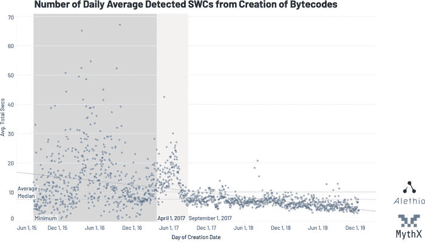

**图 2.18：** SWCs 随时间的分析

建议通过所有 SWCs 扫描你的智能合约，并使用以下测试用例确保合约已经加固。从 `swcregistry.io/` 提取的下表是你以太坊安全之旅的良好起点。

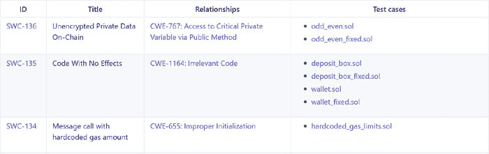

**图 2.19：** SWC 注册表

与太坊安全测试和审计相关的一些资源如下。

`https://ethereum.org/en/developers/docs/smart-contracts/testing/#testing-tools-and-libraries`。

# Hyperledger Fabric

Hyperledger Fabric 是一个许可的、开源的企业级分布式账本技术（DLT）平台，专为业务环境设计，提供了几个使其与其他流行的 DLT 平台区分来的关键能力。

Fabric 的架构高度模块化且可配置，允许针对广泛的行业用例（如供应链、医疗保健、人力资源甚至数字音乐传输）进行创新、适应和优化。

Fabric 是第一个支持使用 `Java`、`Go` 和 `Node.js` 等通用编程语言编写智能合约的分布式账本平台，而不是受限的领域特定语言（DSL）。这意味着大多数企业在开发智能合约时不需要额外培训来学习新语言或 DSL。

此外，Fabric 平台是许可的，这意味着与公共无许可网络相比，参与者之间是彼此互知的，而不是完全不可信的。这意味着网络可以基于参与者之间存在的信任模型（例如法律协议或处理争议的框架）进行运行，尽管参与者之间可能并不完全信任对方（例如，他们可能是同一行业内的竞争对手）。

平台对可插拔共识协议的支持是其显著的差异点之一，这使得根据特定的用例和信任模型定制平台变得更容易。例如，在单一公司内部或在信誉良好的机构指导下实施时，完全拜庭容错共识可能被认为是不必要的且对性能和吞吐量有害的。在这种情况下，崩溃故障容错（CFT）共识协议可能足够，而在多方、去中心化的用例中，可能需要更传统的拜庭容错（BFT）共识协议。

Fabric 可以不需要原生加密货币即可鼓励昂贵的挖矿或驱动智能合约执行的共识协议。由于缺少加密挖矿操作，该平台的部署成本与任何其他分布式系统的运行成本大致相同。避免加密货币还减少了一些重大风险和攻击向量。

得益于这些独特设计特征的结合，Fabric 在交易处理和确认延迟方面是目前可用性能平台之一。此外，Fabric 使得维护交易的隐私和机密性，以及执行交易的智能合约（Fabric 将其称为“链代码”）成为可能。

**以下是 fabric 的架构组件：**

*   **同行节点 (Peer nodes)**：同行节点是 Fabric 架构的基础。分布式账本由这些节点托管，它们还执行链码或智能合约。在 Fabric 中，同行节点有两种：提交节点和背书节点。
*   **背书节点 (Endorsing peers)**：这些节点执行链码并为客户端应用程序提供建议响应。背书节点背书、验证交易并支持结果。
*   **提交节点 (Committing peers)**：这些节点将交易提交到分布式账本并验证背书策略。
*   **排序服务 (Ordering service)**：该服务负责将区块广播到提交节点进行验证并提交到账本，它负责从提交节点接收已背书交易并将其组织成区块。
*   **成员服务提供商 (Membership service providers)**：该组件负责网络参与者权限和身份的管理。
*   **客户端软件 (Client software)**：为了执行交易并从账本中获取数据，客户端应用程序与同行节点进行通信。
*   **链码 (Chain code)**：智能合约被称为链码，规定了管理账本交易的规则和逻辑。
*   **通道 (Channels)**：在 Fabric 网络中，通道允许创建私子网络，以确保特定参与者之间交易的隐私性和机密性。

Hyperledger Fabric 模块化且适应性的架构使其成为企业级区块链应用程序的热选，因为它可以自定义并与其他企业系统集成。

现在你已经了解了 Fabric 的基础知识，让我们从安全的角度来复习它。

#### Hyperledger Fabric 安全审查

Hyperledger Fabric 的目的是让多个信任有限的组织能够安全地合作。尽管 Hyperledger Fabric 增强了安全性，但部署仍需要仔细的配置和监控以确保其安全运行。在本节，我们将查看 Hyperledger Fabric 管理员应该注意的各种威胁，并讨论减轻这些威胁的方法。

Hyperledger Fabric 的网络威胁与流行的许可链不同，因为它许可区块链。例如，在许可网络上，用户是已知的，其活动可以被监控，访问由访问控制列表管理，因此 51% 攻击和网络分区攻击的威胁较小。拒绝服务 (`DoS`) 攻击和共识操纵是影响所有分布式系统的此类攻击示例。成员服务提供商 (`MSP`) 是 Hyperledger Fabric 网络其他攻击的目标。

*   **DoS 攻击**：`DoS` 攻击对任何分布式系统都构成威胁并破坏网络的可用性。拒绝服务攻击可能来自各种来源，使得主动预防变得困难。通过收集交易吞吐量和延迟等性能指标，可以尽早发现可用性损坏，从而降低风险。

    `DoS` 可能会影响 Hyperledger fabric 网络中任何组件的可用性，因此必须应用适当的识别、修复措施（如网络隔离）和监控原则。
*   **共识机制**：针对组织共识的攻击包括 `DoS` 和交易重排序攻击。Hyperledger Fabric 目前仅使用崩溃容错 (`CFT`) 共识算法，因此它们无法容忍任何恶意参与者。拜庭容错 (`BFT`) 算法正在开发中，它们将能够允许网络中多达三分之一的恶意。无论使用何种共识算法，都可以通过早期检测恶意行为来减轻这种威胁。为了检测，记录如领导层选举和交易延迟等威胁指标是关键的。


- **MSP 停机**：当 `MSP` 被攻破时，Fabric 特有的威胁可能是巨大的。`MSP` 有更改网络访问控制的能力，如果存在恶意，可能会拒绝服务并发起女巫攻击。私钥被盗或内部鬼鬼可能会破坏 `MSP`，这可能在被利用后才被发现。遵循密钥管理的最佳实践以降低这种风险至关重要。在发生泄露时，记录证书创建和撤销等 `MSP` 操作可以帮助识别恶意行为。基于这些日志的告警是早期检测和修复的结果。

- **链码漏洞**：与加密货币相比（智能合约攻击的成本更容易量化），对 Hyperledger Fabric 的攻击可能会损害业务逻辑和网络性能。除了标准的编程逻辑漏洞外，普通的错误也可能源于对并发性或非确定性的处理不当。使用安全的软件开发生命周期框架，设计智能合约时从开始就应考虑安全性以降低这种风险。利用 Hyperledger Lab Chain 码分析器等智能合约分析工具，在部署之前评估智能合约安全性以识别潜在威胁。对于更敏感的应用，可以考虑形式验证或外部安全审计。最后，在部署智能合约后，应对进行监控以识别异常行为。

#### 用例 - 央行数字货币

全球超过 105 个国家（占全球国内总值 GDP 的 95% 以上）正在探索仅使用数字货币的央行。创纪录的五十个国家正朝着实现基于区块链的经济迈进。私有区块链使得这一巨大任务成为可能，它们是这些宏大任务的基础。

有几个央行数字货币项目使用了 `Hyperledger Fabric` 作为区块链平台。一个很好的例子是沙特阿拉伯和阿联酋之间的 ABER 项目。在使用私有区块链时，使用以下概述的最佳安全实践是重要的。我们将在书中后面更多探讨央行数字货币的设计。

#### 私有区块链安全考虑

由于对机性的考虑，企业级的网络共享通常需要更高的隐私。如果这是你的需求之一，私有区块链是你的最佳选择。由于只有少数用户可以访问特定交易，私有区块链无疑是网络更稳定的替代方案。然而，这并不意味着它们无法被渗透。

#### 网络可用性

虽然完全控制访问权限增加了安全性，但也为作为验证的服务器创建了单点故障。这意味着如果授权机构受到攻击或故障，任何人都可以在没有适当验证的情况下进入网络。

你可以添加备份并修改网络架构，使其对此类故障更具韧性。

#### 本地部署

你可以使用带有私有区块链的本地部署模型来存储数据。在这种场景下，可以采取数据机密性、完整性、可用性和不可否赖性等传统安全措施。数据只有那些同意保持私密的参与者才能访问。完整性意味着信息在传输过程中不应被篡改。与冗余类似，可用性要求每台处理消息的计算机都要有备份。最后，不可否赖原则使得网络访问日志监控成为可能，该原则指出，如果有人发现你正在做错事，你就无法否认。

#### 云部署

另一方面，你可以决定在云管理上运行你的私有区块链网络。然而，请记住，你仍然对云端数据发生的任何事情负责；因此，你必须确保已建立服务水平协议和安全控制。

### 治理

治理可能会影响基于分布式账本技术（DLT）实现的架构选择，固定架构可能会限制可用的治理模型。简而言之，治理涉及权限、决策权和对良好行为的奖励。例如，谁是系统的一部分是由治理模型决定的。私有区块链可能具有许可环境，并需要一个层级结构来定义参与者角色。设计挑战在于如何通过治理结构有效地管理安全，这种结构很可能由企业并在公共利益者的参与下管理，因为这种复杂性具有引入额外漏洞的潜力。

角色和权限由治理模型定义，但在 DLT 中使用共识来做出决策，特别是在确定交易的最终性时。治理模型决定哪些节点参与共识过程，随着节点数量的增加，系统的通信复杂性随之增加。此外，利用未由组织直接控制的节点（例如第三方供应商）会增加系统的攻击面和达到最终所需的时间，从而对吞吐量产生影响。

系统架构应在私有区块链中明确定义安全治理的边界，明确的角色、权限和许可范围也应是如此。有必要以这种方式应用安全框架，使治理模型能够充分解决权限和责任。治理在运营阶段也至关重要，此时系统必须快速分发代码更新、漏洞补丁和其他系统更改。此外，事件报告和系统维护等任务可能需要系统参与者之间的协调以确保安全。如果结构是去中心化的，参与实体将需要明确传达他们对遵守安全要求的预期。

#### 密钥管理

当前的 DLT 版本严重依赖于使用公钥加密来验证和签名交易，并在某些情况下用于保护区块。这种公钥加密的使用在用户可能更熟悉生物识别或密码启用安全功能的场景中带来了易用性问题。为了解决可用性挑战，密钥管理托管人在加密货币领域应运而生。作为区块链系统之外的第三方，托管人构成了具有吸引力的攻击目标，并已被证明是许多加密货币的关键漏洞点，应对其进行彻底的评估。

*   使用裸机硬件安全模块（`HSM`）作为保险箱，实施严格的访问控制，并使用信封加密（envelope encryption）强制轮密钥。这意味着保险箱内的密钥使用二级密钥加密。

*   密钥通过密钥仪式（key ceremony）过程生成，该过程具有传输数据安全标准，其余部分已实现。

*   确保保险箱的备份和系统恢复能力的测试。

### 结论

恭喜你！你已经来到了本章的最后。我们涵盖了许多重要信息。考虑到我们涵盖的内容，这可能看起来精疲力竭，但请相信，一旦你将这些知识应用到组织中，你就会把它们联系起来。

我们从区块链类型的讨论开始本章，通过向你展示它们的差异，让你确切知道选择哪一个而不是另一个。然后我们开始介绍以太坊区块链，我们详细解释了其基础知识和架构，以便我们在回顾漏洞时你能将其联系起来。由于以太坊是区块链应用的核心，对其进行深入介绍是非常重要的。在本章的后半部分，我们将重点转移到私有区块链，我们涵盖了 `Hyperledger Fabric`，展示了其组件以及存在哪些漏洞，并在解释公链和私有链的同时涵盖了安全考量。现在有了这些知识，你将对安全如何在不同区块链类型之间变化充满信心，并知道如何安全地构建解决方案，无论你遇到什么种用例。

#### 记忆点

*   并非每个区块链平台都是相同的。差异取决于谁可以读写写数据。

*   区块链平台的选择取决于用例，取决于它是否支持交易速度、数据隐私和成本。

*   以太坊区块链是构建 `dApps` 的理想平台，由于其在金融（去中心化金融，或 `DeFi`）、艺术和收藏品（非同质化代币，或 `NFT`）、游戏和技术等领域的日益普及，拥有庞大的生态系统。

*   以太坊的脆弱区域包括共识层、智能合约漏洞、交易隐私、合约调用以及如 `Metamask` 和钱包之类的客户端终端。

*   `Hyperledger Fabric` 是最流行的企业解决方案，全球前 100 家公司中有 38% 实现了它，包括微软、亚马逊、`Alphabet` 和 `Visa`，它也是 `CBDC` 项目的首选平台。

*   `HL Fabric` 的漏洞包括成员服务提供商、验证节点、代码漏洞、密钥管理系统、防止 `DOS` 攻击、中心化和可用性攻击，这些都需要考虑。

### 参考文献

*   `https://ethereum.org/`

*   `https://swcreistry.io/`

*   `https://www.cvedetails.com/vulnerability-list/vendor_id-17524/Ethereum.html`

*   `https://www.hyperledger.org/`

#### 单选题

1. **SWC 代表什么？**

   1. 智能合约缺陷分类 (Smart Contract Weakness Classification)

   2. 智能合约缺陷类

   3. 智能通道缺陷分类 (Smart channel Weakness Classification)

   4. 以上所有

2. **EVM 包含什么？**

   1. Gas

   2. 字节码 (Bytecode)

   3. 内存 (Memory)

   4. 程序计数器 (Program Counter)

   5. 以上所有

3. 以下哪项是以太坊中外部拥有账户（externally owned accounts）的示例？

   1. 它们由私钥控制且没有与之关联的代码

   2. 它们由公钥控制并与之关联的代码

   3. 它们由公钥控制且没有与之关联的代码

   4. 以上所有

4. **防止重入攻击（Re-entrancy Attack）的方法是什么？**

   1. 在编写智能合约时使用“检查-影响-交互”（checks-effects-interactions）设计

   2. 签名交易并阻塞外部调用

   3. 确保在调用外部合约之前发生所有状态更改

   4. 以上均不是

5. **你如何在 Solidity 中防止溢出？**

   1. 使用至少 0.8 版本的 Solidity 编译器

   2. 对任何超过此最小值或最大值的数值进行截断（Clamp）

   3. 使用至少 0.7 版本的 Solidity 编译器

   4. 将交易存储在外部拥有合约中

### 答案

1. **a**

2. **e**

3. **a**

4. **a, c**

5. **a, b**

# 第 3 章

# 区块链上的攻击向量管理

### 引言

2022 年，加密货币投资者向黑客损失了近 40 亿美元，其中 `DeFi` 协议受加密货币攻击的打击最严重。为了更好地了解近年来发生的情况，以下分析图表可以让你了解此问题的严重性。导致这些利用行为的主要原因可能是什么？如果你在考虑代码，即智能合约漏洞，那么你是正确的。然而，这只是冰山一角。

事实是，如果能在设计早期就识别出平台漏洞，所有这些损失都可以被大幅减少。如果根据影响和发生概率进行风险管理，并辅以缓解措施和修复程序，损失将会少得多。

一个众所周知的事实是，如果黑客可以在互联网上看到你的应用程序，他们将竭尽全力利用这些弱点，新闻报道和社交媒体上的数据证明了这一点。同样，黑客攻击是可以被缓解的；有处理这些风险和保护你的系统的方法。

为了实现这一点，在早期阶段检测系统中的任何潜在漏洞至关重要，分类并过滤这些风险是否可以被利用，并通过计算来确定保护它们是否有意义。作为有效风险管理的一个例子，某些情况下，你正试图保护的易漏洞网络元素存在私有子网中，既不暴露给外部世界，也不是关键资产的一部分。此类元素的风险评分可能很低，你不会想花价值 100 美元的“锁”来保护一个价值 10 美元的孤立资产。

在本章中，我将带你走过区块链风险管理的周期。我们将学习诸如威胁建模和分类矩阵等工具，对风险领域进行界定并确定优先级。在进行所有操作的同时，我们将探索并分析一些用例和攻击示例，以查看这一切如何应用。

### 结构

我们将在本章中涵盖以下主题：

*   区块链风险管理
*   区块链中的安全风险
*   威胁模型概述与架构
*   将威胁建模应用于区块链
*   针对 `STRIDE` 攻击向量的缓解措施

### 区块链风险管理

新技术可能具有需要发现和处理的缺点。当这项技术是组织底层 IT 基础设施的基础组件，而不仅仅是上层应用时（区块链通常如此），尤其是如此。

如果我问你一个简单的问题：你的区块链应用中多大的安全性才足够？或者说，你愿意在安全控制上花费多少钱？答案取决于你的风险管理实践。然而，在我们继续之前，让我们从基础知识开始，定义风险、攻击向量和缓解。

*   **风险（Risk）**：一个潜在问题以及该问题发生时的影响。
*   **威胁或攻击向量（Threat or Attack vector）**：风险发生时可以被利用的路径。常见的示例包括感染的邮件附件和恶意网页弹窗。
*   **缓解（Mitigation）**：针对威胁的应对措施，你可以采取的防止威胁的方法，或者至少减少其成功的概率。

为了更好地理解这一切，请考虑一个很好的例子：存在有人可能从你家里偷走车钥匙并开车离开的风险。攻击向量是攻击者实现此目的的不同方式，例如打破窗户伸手进去或破开门锁，这些都是可能的。对于此类元素的风险评分可能很低，你不会想花价值 100 美元的锁来保护价值 10 美元的孤立资产。

在本章中，我将带你走过区块链风险管理的周期。我们将学习诸如威胁建模和分类矩阵等工具，对风险领域进行界定并确定优先级。在进行所有操作的同时，我们将探索并分析一些用例和攻击示例，以查看这一切如何应用。

接下来，对你的区块链应用程序镜像、智能合约、操作系统和文件进行漏洞检查，以寻找常见的漏洞（`CVE`）。这将让你了解是否存在任何过期的补丁，以及应用程序对主要攻击的暴露程度如何。最后，利用你在之前几个步骤中获得的所有知识，进行一次红蓝双方对抗的渗透测试练习。这将让你能够容易地选择需要处理的正确风险。这里的关键在于：从各种工具中获取风险并对其进行评估，直到你对风险的严重程度有一个清晰的认识。

#### 注意事项

漏洞审查有助于项目团队理解区块链解决方案的哪些部分会暴露给攻击者，以及哪些弱环节可能会在未来引发问题。发现漏洞是困难的，因此所有使用区块链解决方案的公司都应该对这些解决方案的每个部分定期进行安全测试。智能合约的测试需要额外关注。为了限制风险，尽早建立一种保护智能合约代码的方法是非常重要的。

我们将在下一个主题中更详细地介绍使用威胁建模进行威胁评估，而漏洞扫描、渗透测试等主题将在接下来的章节中介绍。

作为下一步，让我们理解风险分类的概念。

### 风险分类

正如前面的步骤所示，漏洞和威胁结合构成了风险。通过确定特定漏洞与威胁碰撞的概率，以及如果确实发生，影响将有多重要，从而对风险进行优先级排序。一个影响巨大但发生概率极小的风险，其管理方式将与一个影响中等但可能频繁发生的风险有所不同。

你可以使用下面的网格对不同区块链应用选项带来的风险进行排序。

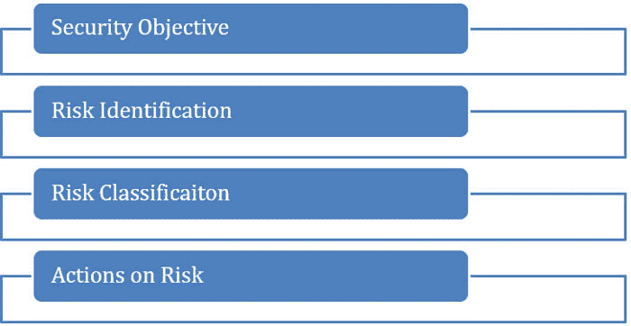

**图 3.2：基于可能性和影响的严重性估计**

召集你所有的团队进行一次桌面演练（tabletop exercise）。资产所有者应该弄清楚他们持有的数据有多重要，而网络设计人员应该能够说明端点的 `IP` 地址、端口和服务是否开放的。销售商品的公司也应该参与进来，解释已实施的任何弥补错误或错误结果的控制措施。

在对风险进行分类时，最好的方法是将它们细分为非常精细的级别。例如，对于任何已发现的 `CVE` 或风险，如果底层应用程序具有可路由的 `IP` 地址，并持有 `PI` 或 `SNPI` 数据或任何加密密钥，这意味着网络中的任何人都可以访问该 `IP` 地址。在风险评估过程中，还应该检查直接控制和补偿控制，以确保它们能够防止 `CVEs` 被利用。对于具有高价值数据、可路由 `IP` 地址且没有安全控制措施的风险，将给出高分。

接下来，你需要为风险设定一个美元金额。假设受保护的密钥丢失或被盗。取回数据将变得困难。你只能处理明文输入，这将导致处理时间变长。在恢复备份期间，拥有该数据的程序将无法使用几个小时。在资金方面，这可能大约是 10,000 美元。

#### 注意事项

数字不需要精确；一个计算出的估算值即可。

### 缓解策略

决定如何处理每种风险是一项重要任务。处理风险主要有以下几种方式：

- **缓解或减少风险**：立即对风险和或缺陷采取措施以减轻其影响。与其他技术相比，限制区块链的影响的影响可能更困难。应该更多地关注降低系统的脆弱性并防止风险。这种方法控制风险的效果最好，但通常成本很高。它最适用于非常高且非常重要的风险。

  **示例**：智能合约的代码加固、端点的补丁，以及针对指向区块链预言机的任何入站流量的 `API Firewall` 过滤。

- **接受风险**：风险接受是指你选择与潜在风险共存或接受它，而不是采取步骤来减少或避免它。这种方法建议用于中低风险。

  **示例**：不对共识层采取任何安全措施，假设信任是通过计算过程实现的；由于与私有链相比，假设公有链网络高度分布的，实施 51% 攻击的概率较低，因此风险很低。

  **注意**：但当存在硬分叉并留下一个节点更少、较小的区块链时，51% 攻击更有可能成功。在大多数矿工关闭节点的白天时段，非常小的网络可能会变得更小。这使得 51% 攻击变得非常容易。

  在其他情况下，制作区块链钱包的中小型企业可能会决定不在硬件安全工具（密钥管理）上花钱，从而承担泄露的风险。

- **避免风险**：改变系统的工作方式以消除特定的安全问题。通常，这意味着通过权衡和放弃某些功能来高效地构建系统。

  **示例**：在区块链入驻过程中不获取 `PI` 或 `SNPI` 信息，以避免在网络攻击时发生隐私泄露。

- **转移风险**：引入第三方（如保险公司或外部服务供应商）来处理风险。

  **示例**：使用云供应商的 `HSM` 使用托管钱包服务，由云供应商负责管理密钥生命周期的安全。

  但对于 `HSM` 产品，钱包服务供应商需要与云供应商商定服务水平协议。如果他们这样做，存在违反对方或未遵守条款的风险。另一方面，当你购买保险时，你可以将风险转移给保险公司，这完全取决于用例。

  **注意**：转移风险永远不会让所有者完全脱。并不是所有风险都可以转移，但可以分担。

补偿措施是在当直接安全控制缺失时，检查解决方案安全性的的一种良好方法。它还确保了防御的深度覆盖。如果攻击发起了复杂的攻击，这些措施可以防止攻击者进一步渗透，在网络内部进行横向移动。


### 区块链中的主要安全风险

区块链安全风险可以大致分为四大类，如图 3.4 所示。这些类别中的都可以进一步细分。然而，要开始评估你的区块链解决方案，你需要了解你是是如何处理这些风险的。

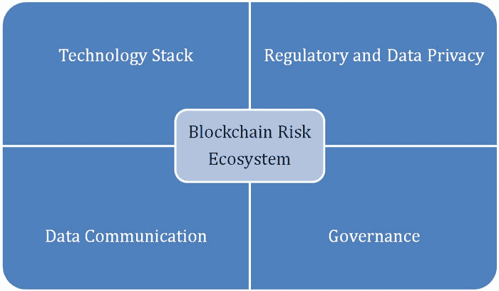

**图 3.4**：区块链风险生态系统

### 技术栈

区块链协议具有一些底层特征，例如加密密钥、共识机制、机密性问题、可用性缺陷、智能合约层的处理逻辑以及验证节点。

协议栈风险管理与任何其他领域同样重要。让我通过拆解每个元素来进一步解释。

*   创建用于存储数字资产的加密密钥是不可或缺的一部分。考虑因素包括密钥在整个生命周期中如何创建、共享、存储和管理。用户是否具有足够的意识来处理他们的敏感密钥？如果用户丢失了密钥，如何恢复资金？
*   验证节点构成了潜在的安全风险。节点是如何补丁和配置的？配置了端点检测与响应（`EDR`）工具来检测恶意事件并采取响应措施？
*   是否采用了安全开发实践来开发从 UI 到智能合约，一直到基础设施的各个层级的应用程序？
*   如何解决可用性风险？如果区块链网络节点被攻破会怎样？是否准备了灾难恢复计划通过备份恢复服务？恢复时间目标（`RTO`）和恢复点目标（`RPO`）指标是什么，是否经过测试？
*   是否对应用程序和底层区块链平台进行了性能检查，衡量交易吞吐量、结算时间、CPU、I/O 和内存利用率。
*   是否有标准可以将区块链应用连接到企业系统？

建议是进行尽职调查和正当程序，并对技术栈的每一层应用深度防御策略，这意味着在设计架构时确保数据的机密性、完整性和可用性。

控制措施应设计用于公钥/私钥的加固和存储，解决应用程序、基础设施和智能合约的漏洞，并充分考虑共识委员会的委托。

### 监管与数据隐私

隐私风险涉及区块链架构内部如何处理敏感数据调用流，以及你司法管辖区适用于你解决方案的监管框架。检查项包括：

*   基于区块链系统的设计缺陷是否可能导致不符合数据相关法规或保密协议？例如，应用程序是否包含显而易见的个人可识别身份信息（`PII`）？需求要求数据存储在链外，还是可以存储在链上？
*   应用程序在整个数据生命周期中是否拥有正确的控制措施，例如在收集或创建、存储、使用以及在区块链节点之间共享数据时？
*   由于信息加密和混淆策略、方法、原则和规则不足，是否存在精细信息公开的风险？
*   是否存在错误数据进入系统的可能性？如果是，如何识别并纠正错误？
*   区块链系统是否有必要遵守有关“被遗忘权”的规定？如果是，是否与存储在区块链上的数据无法更改的可能性产生冲突？
*   是否有法律要求指示数据必须被某些参与者看到，并对个人身份信息（即 `PII`）执行强力的访问和安全控制？如果是，那么在网络中的数千万台计算机上实施此类策略需要大量的设施和资源。
*   智能合约在你的司法管辖区法律上是如何定义的？
*   是否通过了反洗钱（`AML`）和了解客户（`KYC`）检查？
*   是否有方法确保资金不会流入或流受国际制裁或“政治敏感人物”身份的人或国家？

通用原则是通过理解你司法管辖区围绕数据管理的合规要求，始终建立区块链解决方案的数据隐私框架。其次是收集最少的数据以避免在维护和合规上花费过多。最后，也是重要的，咨询律师并确保你的区块链解决方案从法律角度得到了适当审计。

### 治理

治理风险主要来自区块链解决方案的去中心化本质，需要对决策标准、治理政策和安全事件处理进行强力控制。

在建立治理模型时，你可以检查以下清单：

*   对于任何运营问题，如何处理事件、故障和变更管理？
*   我们是否为区块链解决方案中不同领域的不同团队定义了任何政策和指南或 `RACI` 矩阵？
*   不同设计和运营阶段的问责和审计标准的一致性。
*   将如何维护安全基线黄金配置？
*   关于引入新供应商、与 `APIs` 集成、区块链交易所和协议整合的安全策略。
*   为了互操作性应遵循哪些安全标准？
*   发生任何事件时，如何与内部和外部利益相关者进行通信？
*   流动性风险如何考虑？争议如何处理？在传统的业务模式中，中间人承担了对手方风险并解决争议。
*   如果交易或智能合约需要修订，持久性或数据不可篡性将如何处理？当人们通过智能合约进行交易时，他们通常无法退出。

**注意**

*要更改智能合约，你必须停止旧合约并启动带有新条款的新合约，然而，持有合约私钥的方只有在代码允许的情况下才能修改合约。*

数据通信风险涉及数据在传输过程中、处理期间以及存储状态下的安全态势。这意味着通信在架构中的脆弱程度。如果攻击者在两个网络元素通信时截获了连接，他能读取数据吗？这被称为“中间人攻击”。是否存在任何安全工具可以发现并阻止这种攻击？此外，网络元素会接受并处理来自信任源的数据。如果数据存储在网络中，谁可以在什么情况下访问这些数据？数据托管在哪里？是如何授予访问权限的？

这些领域涉及的安全控制包括身份和访问管理、公密钥基础设施（PKI）、基础设施安全加固，以及如果网络托管在公云上，与云服务提供商签署的服务协议。以下是需要遵循的重要清单：

*   在你的区块链架构中，两个网络元素之间的数据是否经过加密？
*   数据加密是否应用于敏感信息，如机密、令牌和包含 PII（个人身份信息）的数据？
*   是否有任何管理数据访问的策略？如何向主体授予授权？
*   你如何确保网络中的节点是可信的？
*   发生任何安全事件时，云提供商如何定义安全控制措施？网络多久能恢复到完全服务状态？
*   事件发生后会有多久的停机？
*   数据请求是如何进入你的区块链网络的？请求是否经过身份验证和授权？
*   主体是仅被授予特定允许资源的访问权限，还是可以访问多个数据集？
*   是否维护了相关活动的审计日志？
*   是否有到位的网络管理系统来监控你区块链网络内部发生的活动？

现在，你已经拥有了根据所学的各种清单来识别和分类区块链解决方案中风险的工具。在方案设计的早期使用这些工具，以确保你与安全态势保持一致。这个主题让你对区块链应用的风险管理策略有了良好的概述。下一步是关注如何识别你应用程序中的攻击模式，我们将在威胁建模主题中学习这些。

### 威胁模型概述

理解区块链可能具有挑战性。记住其去中心化和分布式的特性，了解区块链网络拥有多少资产和参与者，并跟踪不同组件之间的数据流，可能会让你目晕脑转向。令人混乱的数据会阻止你识别潜在风险并评估其影响，导致风险缓解控制变成一种事后顾的——在它本应该是主动措施的情况下，却变成了补救措施。

涵盖所有内容的最佳方法是通过一种被称为“威胁建模”的工具。威胁建模是一种旨在帮助组织识别其内部和系统中潜在威胁及网络安全风险的练习。这是设计防御和解决方案以消除或减少这些风险的关键第一步。我将为你提供威胁建模的框架，以发现你区块链应用程序中隐藏的漏洞，并让你向设计安全型解决方案更近一步。

#### 首先，什么是威胁建模？

威胁建模是一个识别潜在漏洞（或缺乏适当保护）的过程，以便对应对措施进行优先级排序。

该过程可以分为四个部分：深入研究架构、绘制数据流图以显示信任区域、使用 `STRIDE` 发现威胁，以及通过 `OWASP` 进行缓解措施和安全控制的架构映射。我们将详细解释所有组件。让我们直接进入主题。

### 威胁模型架构

在第一阶段，你需要构建数据流图（`DFD`），概述应用程序的详细架构、不同资产之间的交互、请求如何从不同主体进入网络、如何被处理以及数据存储在何处。

在威胁建模中使用数据流图的主要目的是让所有团队成员对威胁建模中的主要组件和通信流有一个简单且通用的理解。它包含以下五个主要组件：

*   **数据流 (Data Flow)**：由一个箭头符号组成，显示数据如何从源流向目的地。
*   **数据存储 (Data Store)**：由两条线或数据库符号组成（你可以从两个选项中任其一）。它描绘了存储位置。
*   **过程 (Process)**：由圆形或圆矩形组成，显示修改数据的过程。
*   **交互者 (Interactors)**：由矩形组成。它描绘了与过程交互或使用该过程的端点（人或系统）。交互者位于范围系统之外，可以是个人或系统，也可以是实体，如 `Customer`（客户）或 `Third Party`（第三方）。
*   **信任边界 (Trust boundary)**：由虚线组成。它描绘了信任区域之间的边界（即信任与非信任区域之间的边界）。

`Figure 3.5` 是我们刚刚讨论的话题的良好表示。

建议你在架构中仅使用这些符号以保持其整洁。接下来，区块链威胁模型由以下三个主要的架构组件组成：

*   **资产 (Assets)**：数据是什么、存储在哪里以及如何存储的？
*   **安全控制 (Security Controls)**：我们拥有哪些安全措施/控制？
*   **威胁者 (Threat Actors)**：谁可以渗透网络，以及什么种行为（内部、外部）？

`Figure 3.6` 提供了当你完成循环所有阶段后样子的示例。看起来看起来不错吗？相信我，你会为自己尽了尽职调查而感到成就感。此外，你将在网络中发现一些隐藏的攻击模式，这些模式你可能在你目前的安全态势下错过了它们。

### 将威胁建模应用于区块链

现在你已经查看了示例架构，让我们尝试从零开始构建一个新的架构。我们将考虑一个常见的用例：适用于 iOS 的加密钱包应用程序。

首先，我们需要什么来为这个用例绘制架构？我们首先需要一个可以用来进行绘图的工具；它应该内置所有组件。

以下是该免费工具的 URL，你可以在项目中利用它：

`https://online.visual-paradigm.com/app/diagrams/#diagram:proj=0&type=ThreatModelDiagram&width=11&height=8.5&unit=inch`

在第一部分，我们需要识别架构组件，即资产、与各种参与者的交互以及跨这些组件的信任边界。

参与者及其交互如下：

*   用户 (Users) – 用户入驻
*   云提供商 (Cloud provider) – API 服务器、数据库、硬件安全模块 (HSM)
*   第三方服务 (Third-party services) – 加密交易所
*   安全管理员 (Security administrator) – 渗透测试与合规检查

资产可以分类如下：

*   私钥
*   用户邮箱地址
*   用户密码
*   公共区块链数据
*   设备数据
*   交易历史
*   令牌和密钥

信任边界根据资产类型和参与者的交互而创建。根据一般规则，私钥、令牌（tokens）和密钥访问等敏感信息应限制在私有边界内。任何向公开的内容应处于独立的区域，而与外部 API 或云提供者的交互则位于另一个区域。

每个区域将有其自身的安全态势。每个区域之间存在隔离，跨区域移动将通过机密性、完整性和身份验证检查受到限制。

根据我们对用例的了解，该架构如下，如`图 3.7`所示。

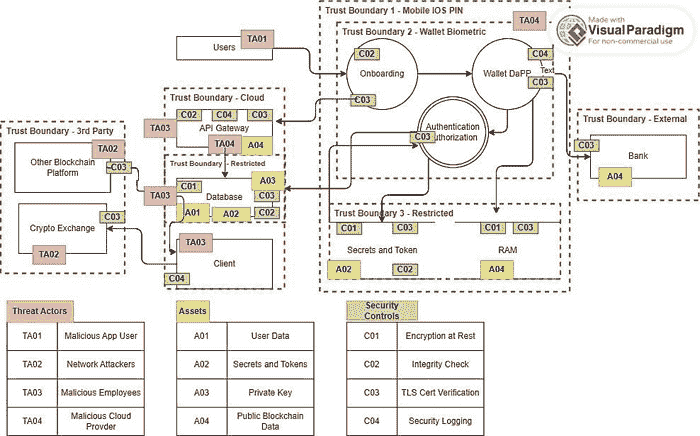

**图 3.7:** 加密钱包威胁建模图

第三步是使用 STRIDE 发现可能受到攻击的威胁，并考虑到我们之前构建的安全架构。

但 STRIDE 是什么？它是如何应用于威胁建模数据流的？让我来解释。

STRIDE 是 伪造（Spoofing）、篡改（Tampering）、否认（Repudiation）、信息泄露（Information disclosure）、拒绝服务（Denial of service）和权限提升（Escalation of privilege）的缩写。

让我通过解释每个字母的含义来详细说明 STRIDE 的意义：

*   **伪造 (Spoofing)** 是伪装通信或身份的行为，使其看起来与受信任且授权的源相关。
*   **篡改 (Tampering)** 是某人黑入电子钱包中的软件参数，以产生不同的行为。
*   **否认 (Repudiation)** 是某人否认他人执行了其操作。
*   **信息泄露 (Information Disclosure)** 是他人共享系统的某些私有信息。
*   **拒绝服务 (Denial of service)** 当用户无法访问信息、系统或资源时发生。
*   **权限提升 (Elevation of Privileges)** 赋予超出最初授予的授权权限。

#### 注意

*并非所有的 STRIDE 元素都适用于每个用例。请快速评估其是否适用。例如，如果你使用 AWS 等公有云来托管你的基础设施，那么硬件拒绝服务就不是你的责任，因为它由云提供商根据服务水平协议负责处理。*

在`图 3.8`中，我们把 STRIDE 框架映射到了适用的数据流图中。例如，伪造适用于加入应用程序的用户。这也可以针对银行，用户将在那里将加密货币提现为现金。

另一方面，篡改尝试可以在加密货币交易所进行，而信息泄露可以在存储用户信息、令牌和密钥等敏感数据的数据库和内存中进行。

最后，可以对 DaPP 和 API 网关实施拒绝服务 (DOS) 攻击，因为它们大多暴露在互联网上。因此，它们可能是攻击者“轻而易举”的目标。

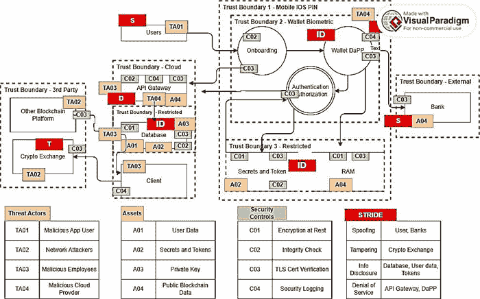

**图 3.8:** 基于 STRIDE 的区块链威胁建模实现

## 针对 STRIDE 攻击向量的缓解措施

威胁建模练习的最后一步是使用针对 STRIDE 攻击向量的缓解控制来固化你的架构。有多种方法可以实现这一点，我的建议是从概率和影响对这些攻击进行理解和分类，然后应用它们。

### 伪造 (Spoofing)

伪造攻击包括会话劫持和跨站请求伪造 (CSRF)。由于伪造是对身份验证的攻击，缓解措施包括安全身份验证和多因素身份验证 (MFA)。

### 篡改 (Tampering)

篡改攻击利用代码和设计中的漏洞。为了防止篡改，应用程序应该验证输入并编码输出。这包括跨站脚本 (XSS) 和 SQL 注入。

### 否认 (Repudiation)

否认攻击利用缺乏控制的情况来操纵或伪造操作。这可能导致欺诈。通过妥善跟踪用户操作和引入数字签名可以防止这一点。

### 信息泄露 (Information Disclosure)

信息泄露攻击利用漏洞访问敏感区域。预防措施包括确保错误消息和响应头尽可能尽可能通用，以避免泄露线索。

### 拒绝服务 (Denial of service)

拒绝服务 (DoS) 攻击通过流量淹没目标导致系统崩溃。最常见的 DoS 攻击形式是缓冲区溢出攻击。可以通过配置防火墙封禁来自某些源（如保留、环回或私有 IP 地址）、未分配的 DHCP 客户端的流量，并引入速率限制来保护应用程序。

### 权限提升 (Elevation of Privilege)

权限提升攻击利用漏洞和配置错误来非法获取高权限。缓解措施包括通过配置更改固化系统和应用程序、移除不必要的权限和访问并关闭端口。

下表提供了一个供参考的摘要视图。

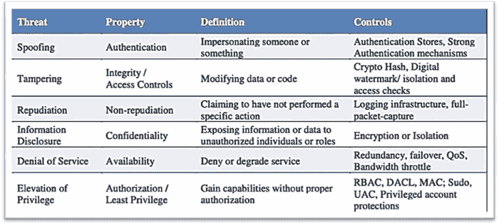

**图 3.9:** 带有控制的 STRIDE 总结

## 结论

完成第三章做得出色！有了这些知识，你可以轻松地为区块链应用进行风险管理。你可以识别风险、从概率和影响方面对其进行量化，最重要的是应用缓解控制。你还学习了威胁建模工具，使你具备为区块链应用构建安全架构的能力。在构建数据流图时，可以将任何直接的安全控制应用到架构中，并通过 STRIDE 评估填充任何安全漏洞。这一章为你提供了大量的实践工作，在你继续阅读本书时将至关重要。

在下一章中，我们将查看利用区块链应用程序的方法，这意味着深入研究攻击向量、渗透测试工具、基础设施和智能合约的真实案例。

*   记住区块链中的顶级安全风险，以及如何分类和应用缓解措施。
*   威胁建模始于数据流图，其中有一些你可以利用的基础性架构组件和符号。
*   威胁建模中的 STRIDE 框架仅适用于更关键且缺乏可用补偿措施的组件。
*   你安全架构上的缓解措施可以通过 OWASP 映射或通过理解影响和发生率来应用。

## 参考文献

*   [`www.chainalysis.com/`](https://www.chainalysis.com/) (图 3.1)
*   [`ennowallet.com/security/threat-model/`](https://ennowallet.com/security/threat-model/)
*   [`widgets.weforum.org/blockchain-toolkit/cybersecurity/index.html`](https://widgets.weforum.org/blockchain-toolkit/cybersecurity/index.html)

## 练习

我建议你查看 ENNO Wallet 的威胁建模。你可以将其与在本章中学习的所有内容联系起来。你现在有能力独立完成这一切了。

### 案例研究：Enno Wallet 移动应用程序威胁模型

[`blog.ennowallet.com/introducing-enno-wallet-threat-model-for-mobile-apps-22a519df46bc`](https://blog.ennowallet.com/introducing-enno-wallet-threat-model-for-mobile-apps-22a519df46bc)

# 第 4 章

# 区块链应用利用

# 引言

随着数字货币日益凸显，进入市场的人数正在迅速增加。遗憾的是，这些人中的一部分并不热衷于投资数字货币，因为他们的唯一目标是黑入并夺取他人的资源。为了让他们的任务更容易，这一领域并没有得到足够的关注。

看看各种区块链应用，你会发现一个共同点是对比区块链应用安全的忽视态度。他们要么是太天真，认为区块链内置安全，要么认为他们需要的唯一安全就是对智能合约进行测试和审计。这一切都导致了攻击面的扩大，为黑客的利用留下了后门和漏洞。


现在问题出现了：我们如何知道弱点在哪里，多大的安全性才足够？我们在上一章中尝试通过威胁建模分析部分涵盖了这个主题，但除此之外还有更多内容。无论我们分析得多么仔细，考虑到我们所处理的区块链范式的广泛性，我们能做的非常有限。在我们加强区块链安全的过程中，另一个出现的问题是：我为什么要把精力和资源投入到区块链的安全方面？我们如何知道这些漏洞是可利用的？换句话说，我需要一个实施安全的业务理由——安全并不便宜。

为了回答这个棘手的问题，我们必须使用如渗透测试等工具和策略，验证加密钱包的强度，检查智能合约代码，最后，理解黑客尝试成功的场景。通过这种方式，你可以在设计应用程序的安全解决方案时考虑这些因素。

# 结构

我们将在本章中涵盖以下主题：

* 区块链渗透测试
* 使用实验室黑入智能合约
* 整数溢出和下溢威胁缓解
* 智能合约的顶级攻击向量分析
* 有用的工具和资源

# 区块链渗透测试

想象一场黑入安全区块链应用程序的团队竞赛，获胜者将通过周末的工作利用漏洞来赚取巨额现金奖金。这些黑客松在现实生活中经常发生。网络安全公司举办此类活动以识别其系统中的弱点。这种做法被称为**道德黑客**，因为你故意邀请他人黑入你的计算机，以便知道如何加强防御。它带给你以下益处：

* 通过识别攻击者可以利用的漏洞来防止黑客和攻击。
* 确保信任和合规性，从而与投资者和客户建立信任和信誉。
* 通过帮助识别问题和错误（如断链或加载速度缓慢）来改善用户体验。
* 通过提前发现问题来节省金钱；在开发阶段修复漏洞比发布后修复要便宜得多。

在本节中，我将解释渗透测试是如何工作的，以及它如何通过识别可能的攻击路径并在区块链网络中横向移动的路径，帮助区块链解决方案加强安全防御。一如既常，让我们从基础知识开始。

## 什么是渗透测试或道德黑客？

道德黑客，也称为渗透测试（简称 pen testing），是指评估你的计算机系统应用程序是否存在漏洞以及对黑客和网络攻击等威胁的敏感性的安全过程。

让我来梳理一下区块链渗透测试的路线图。它主要包含六阶段，如图 4.1 所示。

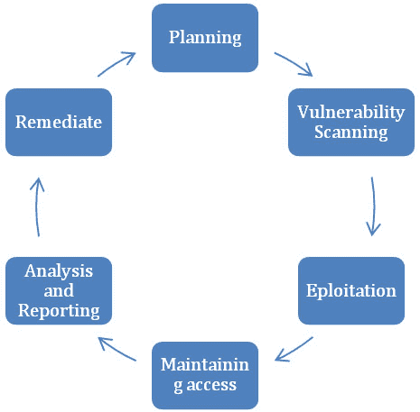

**图 4.1：** 区块链渗透测试路线图

## 计划

这是信息收集阶段。它包括以下检查：

* 确定测试的目标和范围，以及测试的系统及其方法。
* 获取情报，例如目标网络和域名的名称、邮件服务器和其他细节，以理解目标的运行机制和潜在弱点。

在这个阶段，会收集有关区块链平台的信息。在这里，你分析架构，确定威胁切入点，并为潜在威胁收集数据。你可以利用流行的工具如 `Nessus`、`Nmap` 和 `Spyse` 来检查开放端口、面向公共 IP 和常见漏洞。

[`pentestlab.blog/2020/06/15/spyse-a-cyber-security-search-engine/`](https://pentestlab.blog/2020/06/15/spyse-a-cyber-security-search-engine/)

例如，使用 `Spyse`：

为了让资产发现更容易，可以轻松找到给定域的子域名。在开源情报评估或检查客户的外部攻击面时，渗透测试人员和红队应该能够使用它。结果还包括 `A` 记录、`DNS CNAME` 和 `TLS/SSL` 的版本。由于 `TLS` 和 `SSL` 中存在许多漏洞，可以在任何其他工具之前先使用它们。图 4.2 是该项内容的截图。

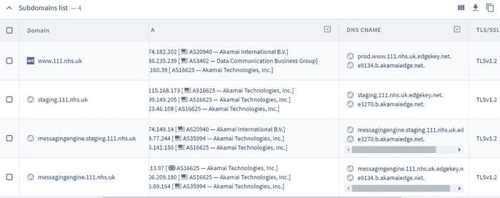

**图 4.2：** 子域名列表

为了检索链接、`robots.txt` 文件和 `HTTP headers` 等信息，你还可以对目标域名进行网络爬虫（跟踪网页上的链接以寻找有用信息）。这有助于识别网站当前使用的技术栈、识别敏感 URL 的证据并规划应用程序。

图 4.3 显示了链接标签页下信息的截图。

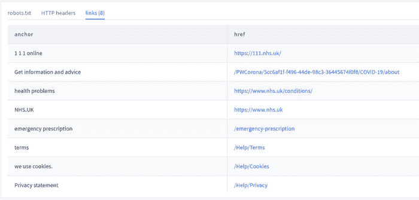

**图 4.3：** 链接标签页上的映射

此外，图 4.4 显示了 HTTP headers 标签页下的信息。在这里，你可以看到使用的负载信息和 Cookie。

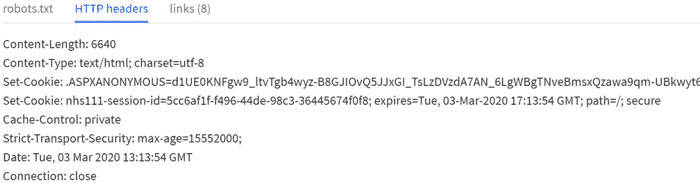

**图 4.4：** HTTP Header

接下来是在 `robots.txt` 下看到的信息。星号 `*` 被列为通配符，意味着任何用户代理都可以访问它。但也可以成为攻击者的信号。

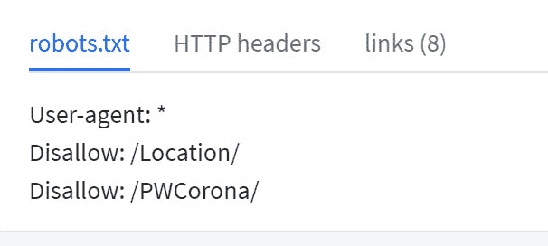

**图 4.5：** Robots.txt 内容

它是对开放端口的扫描、公共 IP 地址扫描，以及通过业务逻辑错误和针对所用软件库的常见漏洞检测潜在漏洞。

`Nessus` 漏洞扫描是首选方案。它具有良好的覆盖范围，并提供了一个你可以根据区块链应用设计进行自定义的模板。`Nessus` 的工作原理是测试区块链网络上的每个端口，找出了哪些服务，并对每个服务进行漏洞测试。

`Figure 4.6` 展示了 Nessus 扫描结果的快照。在这里，你可以看到带有评级的漏洞和汇总结果。这让你对应用程序的安全状况有一个大致的了解。

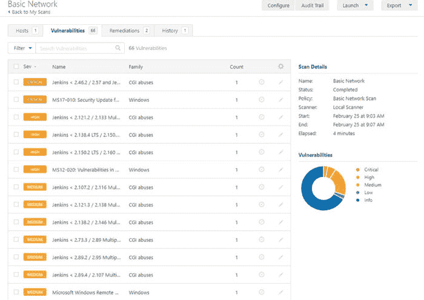

**图 4.6：** Nessus 漏洞扫描结果

此外，`Nessus` 还提供了极佳的扩展性。你可以利用 `Nessus` 预设语言编写针对你框架的特定测试。此外，通过 `Nessus` 还可以使用 `Nessus` 攻击脚本语言 (`NASL`) 编写的插件。这些模块包含了弱点信息、建议修复措施的简要数据，以及用于考虑对安全问题进行进一步测试的计算方法。这里是一些插件示例：[`www.tenable.com/plugins`](https://www.tenable.com/plugins)。

### 你知道吗？

`Nessus` 经常与 `OpenVAS` 进行对比。`OpenVAS` 是一个基于最初用于 `Nessus` 的开源代码分支创建的开源弱点扫描器。`Nessus` 的代码分支 `GNessUs` 在 Tenable Networks 开始销售 `Nessus` 后被重命名为 `OpenVAS`。由于其漏洞覆盖的广度和深度，`Nessus` 占据了令人羡慕的位置。`Nessus` 可能已知超过 47,000 个常见漏洞和披露 (`CVEs`)，提供了极好的覆盖。

除了 `Nessus` 之外，你还可以利用 smart bugs 框架来分析以太坊智能合约。Smart bugs 框架可以在 GitHub 上获取，它可以扩展并有一种标准方式连接到检查区块链程序漏洞或其他问题的工具。最棒的部分是，它支持多种工具，并对 solidity、部署字节码和运行时代码采用多种模式。

`Figure 4.7` 是从 GitHub 截取的片段，显示了 smart bug 框架支持的工具数量。

> **注意**
>
> 列表仅显示部分工具，并非完整列表。

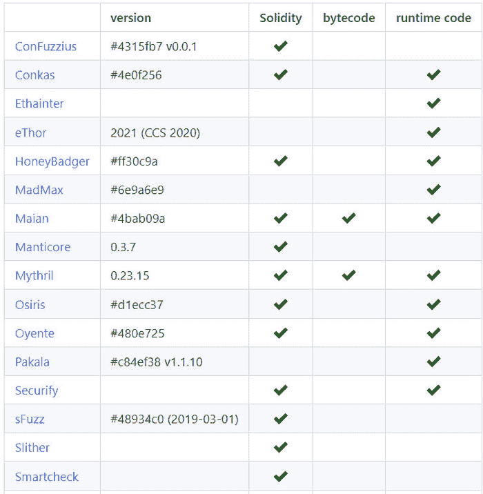

**图 4.7：** Smart Bug Framework 支持的工具

关于 Smart bugs 的安装、用法和要求的更多细节，可以查看 GitHub URL - [`github.com/smartbugs/smartbugs`](https://github.com/smartbugs/smartbugs)。

## 漏洞利用

在此阶段，使用 Web 攻击（如跨站脚本、SQL 注入和后门）来寻找目标的弱点。道德黑客随后尝试并利用这些弱点，通常通过提升权限、获取信息、捕获流量等，以理解它们可能造成的伤害。

这的一个例子是 SQL 注入攻击，它是目前 web3 行业中最普遍的 Web 黑客攻击之一，攻击者利用网站页面贡献在 SQL 语句中嵌入有害代码。这通常发生在网站请求输入时。`Figure 4.8` 展示了该快照。

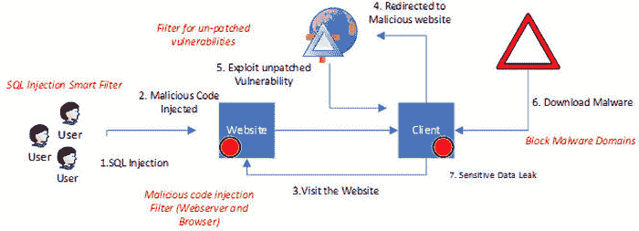

**图 4.8：** SQL 注入

> **注意**
>
> 列表仅显示部分工具，并非完整列表。

此外，`Nessus` 还提供了极佳的扩展性。…… 这里是一些漏洞修复插件示例：

* `CVE-2018-1141`
* `CVE-2018-1133`
* `CVE-2018-1167`
* `CVE-2018-1046`
* `CVE-2018-1029`
* `CVE-2018-1039`
* `CVE-2018-1018`
* `CVE-2018-1016`
* `CVE-2018-1015`
* `CVE-2018-1014`
* `CVE-2018-1013`
* `CVE-2018-1011`
* `CVE-2018-1010`
* `CVE-2018-1009`
* `CVE-2018-1008`
* `CVE-2018-1007`
* `CVE-2018-1006`
* `CVE-2018-1005`
* `CVE-2018-1004`
* `CVE-2018-1003`
* `CVE-2018-1002`
* `CVE-2018-1001`
* `CVE-2018-1000`

Web 攻击（如跨站脚本、SQL 注入和后门）在此阶段被用于寻找目标的弱点。道德黑客随后尝试并利用这些弱点，通常通过提升权限、获取信息、捕获流量等，以理解它们可能造成的伤害。

这的一个例子是 SQL 注入攻击，它是目前 web3 行业中最普遍的 Web 黑客攻击之一，攻击者利用网站页面贡献在 SQL 语句中嵌入有害代码。这通常发生在网站请求输入时。`Figure 4.8` 展示了该快照。

## 维持访问

此阶段旨在确定是否可以利用漏洞建立长期存在。其目标是模拟高级持续威胁，它们经常留存在内部以挖掘敏感数据。

在这里，我想向你们介绍 `APT`（高级持续威胁）。`APT` 是一个广术，指的是入侵者或入侵者小组在网络上建立非法的长期存在以挖掘数据的攻击活动。

通过 APT 攻击与传统应用程序威胁的区别，我列出了以下检查点：

* 它们明显更加复杂。
* 它们不是击完就走的攻击，意味着一旦渗透网络，它们就会留下来发现更多。
* 它们不是针对特定目标的自动化，而是针对大池执行的。
* ……等等。

`Figure 4.9` 提供了 APT 进展及一些安全措施的细节。

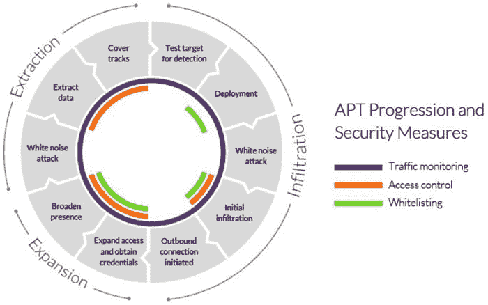

**图 4.9：** APT 进展矩阵

### 分析与报告

渗透测试人员必须在此阶段完成所有工作，密切关注他们所的一切，特别是在发现和利用过程中。为了提供一份突出显示成功渗透 dApp 的方法、以及发现的任何安全缺陷和其他相关发现信息的报告，他们正在分析每一个细节和步骤，深入研究每个问题并制定减少漏洞的策略。

其次，报告的其他部分应该向我们介绍发现的漏洞。`图 4.11` 显示了发现漏洞报告的示例快照。

漏洞的细节必须包含影响、CVSS 分数以及建议的修复方案。还建议显示漏洞影响是否会影响关键性能指标，例如客户体验、增加 CPU 使用、内存利用率等。

另一方面，建议的修复方案应包含直接控制和补偿性控制的结合。在某些情况下，如果直接安全控制成本高昂且组织愿意接受风险，那么补偿性控制可能会很有用。

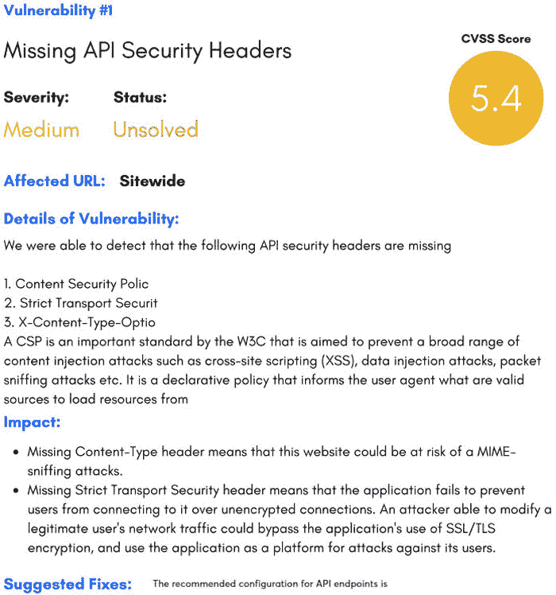

**图 4.11：** 缺失 API 安全标头的漏洞详情

你可以在此处找到详细的示例报告 - [`www.getastra.com/blog/wp-content/uploads/2021/06/Astra-Security-Sample-VAPT-Report.pdf`](https://www.getastra.com/blog/wp-content/uploads/2021/06/Astra-Security-Sample-VAPT-Report.pdf)

### 修复

在最后阶段，你将对报告提出的修复措施采取行动。最佳实践是使用变更管理窗口来应用更改。更改必须通过操作程序（MOP）实施。这应该包含预检查、活动详情、回滚程序以及功能测试、单元测试和回归测试的结合，以确保修复在应用时不会对系统产生任何问题。

# 攻击智能合约

在本节中，我们将尝试解释如何使用 PWNX Labs 攻击智能合约。我们将查看溢出和下溢漏洞以及相应的修复措施。

PWNX 提供了用于训练的计算机系统和应用程序 CTF 实验室。

## 实验环境搭建

使用 VPN 尝试连接到 PWNX 的内部网络，那里有一个服务器通过 Ganache 暴露本地区块链。

请注意，`Ganache` 是一个用于快速开发以太坊和其他区块链的个人区块链。你可以在整个区块链开发周期中使用 `Ganache`，在安全的沙箱环境中开发、部署和测试你的去中心化应用程序 (dApps)。

`图 4.12` 仅显示了你需要执行的设置。你可以在笔记本电脑上安装 OVPN，并通过访问 PWNX 网站设置下载 VPN 配置。

要安装 `Ganache`，请访问 [`trufflesuite.com/docs/ganache/`](https://trufflesuite.com/docs/ganache/)。

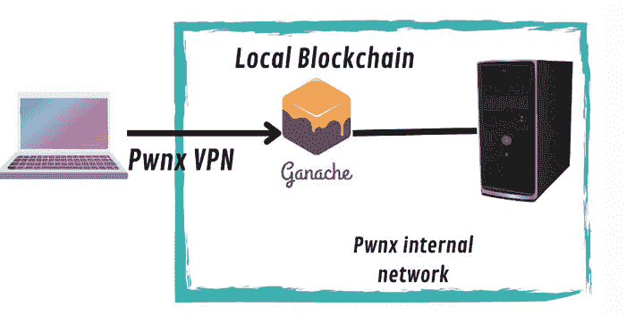

**图 4.12：** 本地终端到 PWNX 内部网络的连接图

## 查看源码

当你进入实验室并连接到内部网络时，会有一些数据和代码。在左侧，你会看到用 Solidity 编写的智能合约代码，它解释了合约逻辑。右侧可以找到 ABI 代码，如`图 4.13`所示。

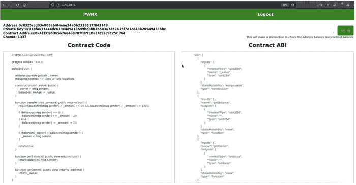

**图 4.13：** 合约代码与 ABI 的比较

在以太坊生态系统中，与合约交互的最常见方式（包括区块链外部以及合约之间）是通过应用二进制接口 (ABI)。

请记住，目标是获取以下智能合约的所有权。

你应该有一个钱包地址、一个用于签名的私钥以及明智协议（Agreement）的位置。

作为第一步，从在本地拆解智能合约代码开始。我们可以借助 REMIX IDE 在本地系统上编译并测试合约。

Remix Online IDE 是一个强大的工具集，用于开发、部署、调试和测试以太坊及与 EVM 的智能合约。它不需要任何设置，并且具有灵活、直观的用户界面。

solidity 代码 `PWNX.SOL` 可以复制到 Remix IDE 中。这是一个漏洞合约，由不同的函数组成，如`图 4.14`所示。在进入漏洞利用阶段之前，我们将解释以下合约的细节。

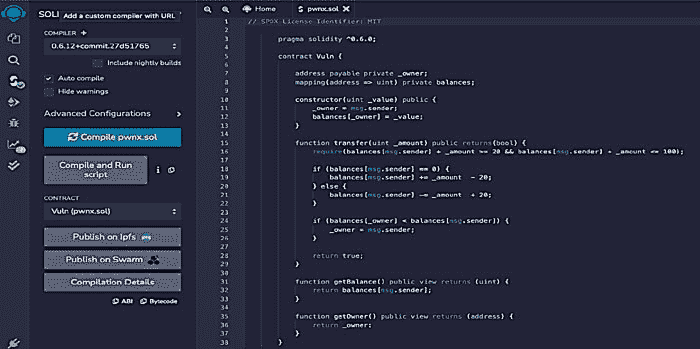

**图 4.14：** 漏洞智能合约

注意，一旦智能合约部署在区块链上，构造函数就会被调用，分配给合约的地址将成为合约的所有者（所有权操作）。

以下是细节：

* 当调用构造函数时，会设置类型为 `address` 的私有变量，即 `owner`。
* 在合约中有一个名为 `balances` 的映射。Solidity 中的 mapping 类似于字典或 HashMap（类似于 Java）。
* 在我们的场景中，该映射是一个地址数据库，记录了每个地址拥有的 ether 或代币数量。
* 两个较短的函数 `getOwner` 和 `getBalance` 对公可见。它们不会影响区块链状态；`getBalance` 返回用户在映射数据结构中拥有的 ether 或代币数量，仅返回数据。我们可以在 Solidity 中使用 `msg.sender` 来实现这一点。
* 事务的全局变量 `msg` 可以在你的 Solidity 代码中找到。`msg` 对象的源是消息的实际发送者。

### 漏洞解释

现在，让我们理解下部分的漏洞：

* 需要一个 `uint` 类型（无符号整数值）以及一个返回布尔值的公共函数。
* 第 16 行包含必要的语句。命令返回两个布尔值：真或假。如果指示条件产生真响应，代码将按预期执行。如果返回值为假，代码在该处结束。
* 为了满足条件，地址必须大于或等于 20 且小于 100。
* 第 24 行有一个第二个 if 语句，用于确定所有者的账户余额是否低于交易者 `msg.sender` 的账户余额。

第 18 行检查映射数据结构内部 `msg.sender` 的余额，这意味着如果交易地址在映射数据结构中的余额为 0，它将加上要传输的金额并减去 20。否则，它将扣除插入函数的金额并加上 20。

注意，这是智能合约中经典的溢出/下溢漏洞示例，如`图 4.15`所示。

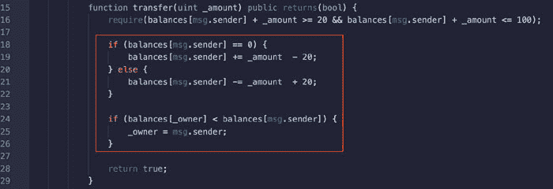

**图 4.15：** 溢出与下溢漏洞快照

`uint` 下溢/溢出是智能合约中最常见的安全漏洞之一。下溢溢问题很容易让加密黑客变得富有，并导致持有者账户遭受巨大损失。

`uint` 溢出/下溢也称为 `uint` 回绕（wrapping around），是一种产生大于 N 位整数最大值的输出，或产生小于 N 位整数最小结果的数学操作。

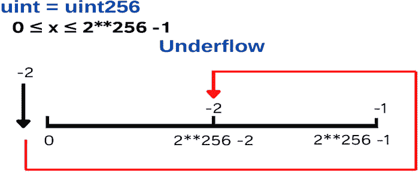

**图 4.16：** 下溢逻辑运算视图

`图 4.15` 展示了一个很好的下溢示例。如果你从一个值为 0 的 `uint` 减去 2，它的值将变为 $2^{256}-2$。

相反，溢出显示了相反的结果。对一个为 `2**256 -1` 的 `uint` 加 `+3` 将导致溢出情况。当数字大于 `uint` 的最大值时，就会发生 `uint` 溢出，导致数字回到 0。

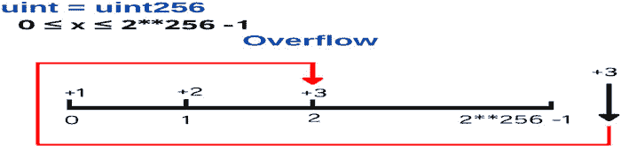

**图 4.17:** 溢出逻辑算术视图

现在我们已经理解了该漏洞，让我们在下一步利用该智能合约。

#### 本地利用

我们将从初始编译和部署智能合约开始。为了发送智能合约，我们需要一个成为所有者的地址（你可以利用 REMIX 提供的地址），并且我们输入一个将进入其余额映射（balance mapping）的值。

一旦部署，合约将在底部显示所有可用函数。我们可以看到不改变状态的功能显示为蓝色，而传输函数（transfer function）为橙色，如图 4.18 所示。

我们可以通过第一次调用 `getBalance` 函数来检查所有者的余额。

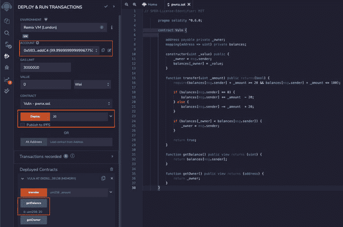

**图 4.18:** 获取余额的函数快照


账户发生更改后，我们进入传输函数，使用另一个地址（同样来自 Remix）将 21 作为金额发送到智能合约。我们可以在控制台中看到交易成功，当我们调用 `getbalance` 函数时，我们得到了 1。

这是因为第一条语句的第 18 行是合约所在。我们得到 1 是因为该地址在第一次转账时当前余额为零。

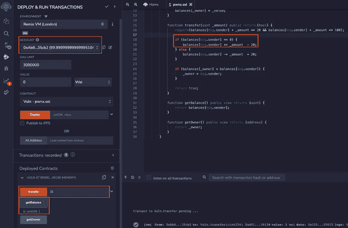

**图 4.19:** 漏洞解释快照

现在，下一步是重复该过程。通过再次调用一次传输函数，我们在映射中的余额将不再为 0。合约将执行第二个 `if` 语句中的代码，导致数学上的下溢。这一次，`msg.sender` 的地址余额将在第二个 `if` 语句中大于所有者的余额，从而允许我们利用智能合约的缺陷并声称所有权。

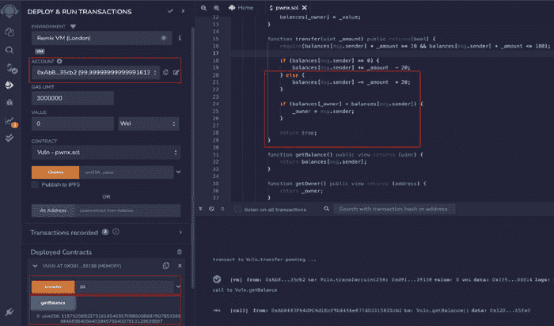

**图 4.20:** 漏洞解释快照

现在我们理解了该漏洞，可以回到 PWNX 挑战并完成实验了。

由于我们需要与外部区块链通信，我们必须创建一个能够执行刚才在本地系统上测试的操作的脚本。

### 远程利用

与以太坊交互的 Python 库被称为 `Web3.py`。它经常用于去中心化应用（dapps），以便发送交易、智能合约交互、区块数据读取和其他应用。

通过调用相关函数，我们可以使用 ABI 与智能合约通信。

让我们理解图中所示底层代码：

*   我们有一个 HTTP 的 URL；这是 ganache 提供程序，它让我们能够使用 RPC 调用与智能合约通信。
*   我们从该点导入我们的 ABI 以调用必要的函数。
*   我们连接到 `we3.eth.contract` 命令并建立智能合约的地址。
*   从这里，我们可以调用 `getOwner` 等函数。注意，不改变状态的调用被称为调用（calls），因为它们仅用于读取值而不改变区块链的状态。

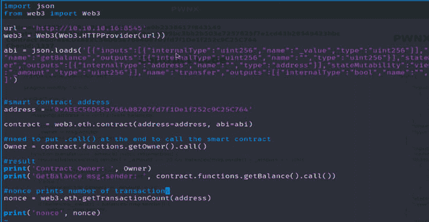

**图 4.21:** 通过 ABI 与智能合约通信

运行脚本后，我们可以在控制台中看到合约的所有者、余额和随机数（nonce）。查看接下来的快照：

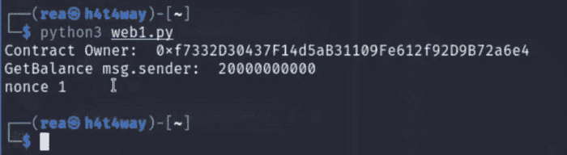

**图 4.22:** 脚本输出

nonce 只是一个记录已交易通知的计数器。在这个例子中，只有一次交易，因为合约只部署了一次。

一旦调整了利用程序，调用传输函数并导致下溢的交易现在就会被创建。

如你所见，一旦创建交易，我们会在使用 `rawTransaction` 函数执行之前，使用挑战的私钥对其进行签名。这一次，我们使用 `buildTransaction` 方法来生成将更改区块链状态的交易。


**图 4.23:** 发送交易的结果

运行脚本后，我们可以通过返回交易哈希和其他数据看到交易是成功的。一旦我们更改了区块链状态并利用了漏洞，让我们来验证一下。


**图 4.24:** 漏洞利用

现在，检查地址所有者是否不同。在利用代码后，我们的合约地址现在成为了合约的所有者。因此，我们成功利用了该漏洞，如图 4.25 所示。


**图 4.25:** 利用漏洞后的合约地址对比

恭喜你走到这里！你已经成功破解了智能合约。现在，重复这个练习并尝试自己完成挑战。遵循我们刚刚学到的步骤进行操作。

在进入下一个主题之前，让我们看看可以防止缓冲区溢出和下溢攻击的缓解措施。

# 防止溢出和下溢攻击的措施

以下是缓解溢出和下溢攻击的一些方法：

*   **SafeMath 库**：开发者应该使用 SafeMath 库或带有溢出检测的适当类型，以避免整数溢出或下溢攻击。该库提供基础数学运算，还可以检查前置条件和后置条件来判断是否发生了溢出。在发生错误时，库会取消交易并将状态更改为 `Reverted`（回滚）。
*   **编译器版本**：可以使用健壮性 >= 0.8 的版本来防止攻击。使用新版本的编译器编译智能合约。这样 SafeMath 等外部库的预防性代码就会包含在编译后的代码中。
*   **使用修饰符 ‘onlyOwner’**：你也可以使用如 `onlyOwner` 等增强安全性的修饰符，或者检查代码以确保值永远不会超过预期范围。
*   **定期更新代码**：保持代码更新也很重要。
*   **数据执行保护（DEP）**：攻击者在利用缓冲区溢出时，经常将恶意代码注入栈和堆等位置，以获得未经授权的应用程序执行。因此，引入了新的缓冲区溢出缓解策略——数据执行保护。这在 Linux 中被称为 `NX`（禁止执行）。硬件和软件层面都可以启用 DEP。当启用 `NX` 时，栈将不再可执行，作为攻击部分的任何恶意代码也不再被视为可用。
*   **地址空间布局随机化**：地址空间布局随机化（ASLR）会将库和其他内存区域的基地址随机化。这使得攻击者构建 ROP 链变得困难，因为 ROP 链依赖于这些库的指令地址，而这些是加载到程序中的。要检查 Linux 机器（特别是 Ubuntu）上是否启用了 ASLR，可以使用以下命令：

```
$ sudo cat /proc/sys/kernel/randomize_va_space
```

```
1
```

如你所见，上述摘出的文件值设置为 1，这意味着 ASLR 已完全启用。

为了更深入地理解这个主题，建议阅读以下文章：

[`www.geeksforgeeks.org/overflow-and-underflow-attacks-on-smart-contracts/`](https://www.geeksforgeeks.org/overflow-and-underflow-attacks-on-smart-contracts/)

既然你已经详细了解了案例研究，并查看了几个漏洞的缓解措施，让我们进一步深入了解更多的智能合约漏洞吧。

### 智能合约攻击向量分析

Solidity 的安全缺陷源于智能合约的操作未按照其预期的行为运行。其结果可能如下：

* 资金被盗
* 资金被锁定或冻结在合约内部
* 人收到的奖励比预期少（奖励延迟或减少）
* 人收到的奖励比预期多（导致通货膨胀和贬值）

我将尝试涵盖大部分漏洞，尽管这些列表并没有涵盖 Solidity 拥有的我遇到过的每一个 bug。不过，它可以作为一个需要留心和学习的事项检查清单。如果某个主题看起来很陌生，这说明练习识别该类别的漏洞是值得的。

作为一个前提，我假设你对 Solidity 有了相当不错的熟练程度。在 [`www.rareskills.io/learn-solidity`](https://www.rareskills.io/learn-solidity) 有一个非常好的教程可以参考。

### 重入攻击 (Re-entrancy)

在重入攻击中，攻击者调用一个与另一个合约交互的函数，然后在第一个函数调用完成之前立即再次调用该函数。这可以利用合约逻辑中的缺陷，并允许攻击者操纵合约状态，造成重大损害。

每当智能合约调用另一个智能合约的函数、向其发送 Ether 或向其传输代币时，就存在重入的可能性。

* 当传输 Ether 时，会调用接收方合约的 `fallback` 或 `receive` 函数。这会将控制权移交给接收者。
* 某些代币协议通过调用预定义的函数来通知接收方智能合约它们已收到了代币。这会将控制流移交给该函数。
* 当攻击合约接收到控制权时，它不需要调用交出控制权的同一个函数。它可以调用受害者智能合约中的另一个函数（跨函数重入），甚至调用另一个不同的合约（跨合约重入）。
* 只读重入（Read-only re-entrancy）发生在当合约处于中间状态时访问了 `view` 函数的情况。

**真实世界示例：DAO 黑客攻击**：攻击者利用以的 fallback 函数执行重入。每个以太智能合约字节码都包含所谓的默认 fallback 函数。更多细节可以在 [`quantstamp.com/blog/what-is-a-re-entrancy-attack`](https://quantstamp.com/blog/what-is-a-re-entrancy-attack) 中找到。

**更多此类攻击**可以在 [`github.com/pcaversaccio/reentrancy-attacks`](https://github.com/pcaversaccio/reentrancy-attacks) 中找到。

**在哪里找到重入攻击**：截至 2023 年 4 月，该仓库中记录了 46 处重入攻击。更多细节可以在 [`www.rareskills.io/post/where-to-find-solidity-reentrancy-attacks`](https://www.rareskills.io/post/where-to-find-solidity-reentrancy-attacks) 中找到。

如果开发者覆盖了默认实现，此默认 fallback 函数将包含任意代码。如果它被重写为 `payable`，则智能合约就可以接受 ether。每当 ether 传输到合约时，该函数就会执行。

*[图 4.25]* 为重入攻击的流程提供了一个很好的示例。


**图 4.26：** DAO 攻击示意图

#### 预防

以下是编写智能合约代码时遵循的最佳实践，以防止重入攻击的发生。

##### 简单性与代码复用

简单的代码可以减少代码遇到 bug 的概率，并有助于防止意外的影响。保持代码基础且无瑕疵，遵循 DRY（不要重复）准则。浏览精妙的协议代码，并尝试用更少的代码行寻找简化它的方法。这将有助于你找到代码中任何存在漏洞的部分。

##### 检查-影响-交互模式 (CEI)

这个示例是防止智能合约代码中发生重入攻击的一种强有力方法。合约流程中的检查和验证是使用此模式的第一步。在与另一个合约交互之前，应该先对当前合约的状态变量进行更改。

##### 设置 gas 限制 (gas limit)

使用 `send()` 和 `transfer()` 函数会将交易中可以使用的 gas 限制设置为 2300 个。这有助于防止重入攻击的发生，因为没有足够的 gas 来递归地调用漏洞函数来掠取资金。

##### 互斥锁/重入锁 (Mutex/re-entrancy guard)

OpenZeppelin 有一个重入锁库。重入锁提供了一个名为 `nonReentrant()` 的修饰符，它可以阻止其应用于函数中的重入攻击。以下是它的应用代码。


**图 4.27：** 重入合约代码

### 检查第 7 行和第 8 行：

* 创建布尔值 `locked` 并将其设为私有（private）。
* 创建 `nonReentrant()` 修饰符，在单次传输后锁定 `withdraw()` 函数。

当我们将 `nonReentrant()` 修饰符应用于之前提到的 `withdraw()` 函数时，它防止了重入。这是因为所需的语句将等于 `false` 并回滚交易（revert）。

### 访问控制 (Access Control)

这看起来可能是一个简单的错误，但忘记限制谁可以调用敏感函数（例如更改所有权或提取）是非常常见的。

即使有了修饰符，也出现过修饰符使用不当的情况，例如下面示例中缺少 `require` 语句：


**图 4.28：** 访问控制漏洞 #1

此前的代码是此审计中的真实示例：[`coderena.com/reports/2023-01-rabbithole/h-01-bad-implementation-in-minter-access-control-for-rabbitholereceipt-and-rabbithole-contracts`](https://coderena.com/reports/2023-01-rabbithole/h-01-bad-implementation-in-minter-access-control-for-rabbitholereceipt-and-rabbithole-contracts)

**这是另一种访问控制出错的方式：**


**图 4.29：** 访问控制漏洞 #2

在这种情况下，`alreadyClaimed` 从未设置为 `true`，所以领取者可以多次调用该函数。

### 真实案例：交易机器人被利用

最近的一个访问控制不足的示例是交易机器人未受保护的闪电接收函数（该机器人以 0xbad 命名，因为地址以该序列开头）。它赚取了超过一百万美元的利润，直到某天攻击者发现任何地址都可以调用闪电贷接收函数，而不仅仅是闪电贷供应商。

更多细节请访问 [`rekt.news/ripmevbot/`](https://rekt.news/ripmevbot/)。

### 输入验证不当 (Improper Input Validation)

如果说访问控制是控制谁调用函数，那么输入验证就是控制他们用什么来调用合约。

这通常归于忘记放置正确的 `require` 语句。

这是一个示例：


**图 4.30：** 不恰输入验证示例

该合约检查你提取的金额是否超过了账户余额，但它并不能防止从任意账户进行提现。

### 现实案例：Sushiswap

Sushiswap 曾经历过此类攻击，原因是由于外部函数的一个参数未经过清理。


**图 4.31：** Sushiswap 攻击原因的 Twitter 推馈

欲更多详情，请访问 [`twitter.com/peckshield/status/1644907207530774530`](https://twitter.com/peckshield/status/1644907207530774530)。

### 拒绝服务 (Denial of Service)

一种可能导致代码逻辑错误、兼容性问题或调用深度过深（区块链虚拟机的特性）的安全问题，导致智能合约无法正常运行。

一个例子是，智能合约可以通过进入无限循环来恶意耗尽转发给它的 gas。考虑以下示例：


**图 4.32：** 用于 DOS 攻击的恶意循环代码

如果另一个合约向地址列表分发 ether，如下所示：


**图 4.33：** 用于 DOS 的分发合约

那么当该函数向 Mal 发送 ether 时将会回滚（revert）。前代码中的调用转发了可用 Gas 的 `63 / 64`（在我们对关于 `EIP 150` 的文章中阅读更多关于该规则的信息），因此仅剩余 `1/64` 的 Gas，可能不足以完成操作。

智能合约可以返回一个消耗大量 Gas 的内存数组。

考虑以下示例：


**图 4.34：** 消耗 Gas 的合约漏洞示例

内存数组在超过 `724 bytes` 之后会消耗呈二次增长的 Gas，因此精心选择的返回数据大小可能会让调用者崩溃。

即使变量 `result` 未被使用，它仍然会被复制到内存中。如果你想限制返回大小到特定数量，可以使用汇编。


**图 4.35：** 避免 DOS 漏洞的缓解措施示例

注意，删除他人可以添加内容的数组也是一种拒绝服务的攻击向量。此外，`ERC777`、`ERC721` 和 `ERC1155` 合约也可能面临 DOS。例如，如果智能合约转移了带有传输钩子（transfer hooks）的令牌，攻击者可以设置一个不接受令牌的合约（它要么没有 `onReceive` 函数，要么将该函数程序设置为回滚）。

现在你已经通过示例和案例研究理解了主要的攻击向量，让我们来看看一些增强智能合约安全的最佳实践。最后，我们将查看一些工具和资源。

### 安全智能合约的最佳实践与工具

智能合约是区块链技术不可或缺的特性，因为它实现了数字资产的安全和自动化管理。然而，这些智能合约可以通过直接和补偿性安全措施来受恶意攻击的保护。为了维护其安全性，组织必须确保智能合约得到正确更新并进行安全加固。

以下是智能合约安全的最佳实践：

* 使用安全的编程语言
* 实施适当的输入验证和清理
* 进行彻底的测试和审计
* 实施访问控制和权限
* 避免不必要的复杂度
* 使用标准库并避免自定义代码
* 实施断路器或其他故障机制

以下工具可以帮助智能合约开发者确保代码安全：

* 开发框架：`Truffle`、`Embark`、`Hardhat`
* 安全分析工具：`Mythril`、`Oyente`、`Slither`
* 漏洞赏金计划
* 安全审计公司：智能合约审计的 `QuillAudits`
* 测试框架：`Brownie`、`Hardhat`、`Waffle`
* 代码审查工具
* 专注于安全的编程语言：`Solidity`、`Vyper`、`Rust`
* 标准库：`OpenZeppelin`
* 文档和资源：Ethereum 开发者文档、Solidity 文档、EIPs（以太坊提案）
* 社区论坛和频道：Ethereum Stack Exchange，以及特定项目或协议的 Discord 和 Telegram 群组。

### 结论

恭喜你完成本章；我们涵盖了许多主题。我本可以将这些主题拆分并在不同的章节中介绍，但考虑到渗透测试程序的重要性，严密检查并分析智能合约拥有的不同漏洞和利用程序是至关重要的，因为这是区块链技术（包括去中心化金融）的核心特性。始终记住渗透测试的步骤，并确保定期进行。本章还解释了加强智能合约的重要性以及你可以寻找的各种漏洞领域。在继续阅读此书时，请记住所有这些。

在下一章中，我将带你了解区块链应用的审计技术，你将在其中学习不同的程序（如漏洞赏金）以及用于代码和框架静态动态测试的工具。此外，我们查看各种案例研究，帮助你进一步加固区块链代码。

### 要点

* 渗透测试也称为道德黑客，是一种利用系统漏洞并提出业务理由在解决方案中包含预防措施的方法。


* 你可以使用 `Ganache` 和 `Remix` 配置实验环境来审计代码。确保你识别出的任何漏洞都经过分类和修复。
* 智能合约中已有许多漏洞和 Bug 被利用并修复了。在对智能合约审计时，确保顶部的 OWASP 攻击向量得到处理、监控和修复。

### 参考文献

* [`pentestlab.blog/2020/06/15/spyse-a-cyber-security-search-engine/`](https://pentestlab.blog/2020/06/15/spyse-a-cyber-security-search-engine/)
* [`www.tenable.com/blog/how-to-run-your-first-vulnerability-scan-with-nessus`](https://www.tenable.com/blog/how-to-run-your-first-vulnerability-scan-with-nessus)

区块链安全审计还用于定义合规性，并向客户和监管机构展示你对安全各个方面的关注。它还能保护你的技术栈免受设计、智能合约以及你存储的用户数据中漏洞的影响。它可以优化你的代码并增加受众的信任。这一切看起来都非常重要，因此现在的问题是：是否所有的区块链项目都需要审计？项目在什么阶段需要进行审计？它必须遵循什么流程？市场上有哪些可以采用的解决方案？

在本章中，我们将尝试揭示所有这些。我们将从深入研究智能合约测试开始，探索从单元测试到集成测试的各种方法、测试框架以及智能合约的形式化验证。我们还将查看独立审计，例如漏洞赏金计划。在讨论所有这些内容时，我们将查看形式化验证应用于智能合约和其他项目的各种用例。这个话题非常有趣，我等不及待要直接深入研究它了。让我们来看看本章的目录。

### 章节结构

我们将在本章中涵盖以下主题：

* 智能合约测试
* 形式化验证概述
* 将形式化验证应用于智能合约
* 案例研究——验证 Open Zeppelin 的 ERC-20 实现
* 漏洞赏金计划

### 智能合约审计

因为像 `Ethereum` 这样的公共区块链是无法变的，所以在部署后修改智能合约代码是非常困难的。虽然有 `virtual upgrades` 的合约升级模式，但这些难以实施且需要社会共识。此外，如果攻击者先发现了漏洞，你的智能合约将面临被攻击的风险，因为升级无法修复它。

如果你想了解更多关于智能合约如何升级的知识，可以在 `https://ethereum.org/pt/developers/docs/smart-contracts/upgrading/` 找到很好的文章。

由于由于，在智能合约进入主网之前对其进行测试和审计至关重要。可以采用多种方法测试你的代码；没有单一的最佳方法。然而，建议进行风险评估，从概率和影响方面评估威胁向量，然后选择一套混合了不同工具的测试套件。目标应该是识别你的合约可能存在的任何微小或重大问题。

### 智能合约测试方法

智能合约测试主要分为两种测试方法：自动化测试和手动测试。在我们看一些示例之前，让我们从基础知识开始。

### 自动化测试

自动化测试包括检查智能合约是否执行以及在出现问题时生成错误的工具。此过程涉及脚本，通过调度测试用例来实现自动化。这些对于处理重复性任务或重要任务非常有用，因为你不希望出现人为错误。我们看到的缺点是误报（`false positives`），这意味着结果中出现的 bug 并不正确。

要找到更多关于误报的信息，请访问 `https://www.contrastsecurity.com/glossary/false-positive`。

### 单元测试

在单元测试期间，组件会被分别进行评估。以下是自动化测试的一些示例和用例：

编写单元测试来确定执行是否符合要求，也有益于理解合约的操作工作流。例如，当 `auctionEndTime` 低于 `block.timestamp` 时，拍卖合约会显示用户无法出价。因此，设计人员可以运行单元测试，检查在结束时（即当 `auctionEndTime` > `block.timestamp` 时）调用 `bid()` 是成功还是失败。

```javascript
constructor(
    uint biddingTime,
    address payable beneficiaryAddress
) {
    beneficiary = beneficiaryAddress;
    auctionEndTime = block.timestamp + biddingTime;
}

function bid() external payable {
    if (block.timestamp > auctionEndTime) {
        revert AuctionEnded();
    }
    if (msg.value <= highestBid) {
        revert BidNotEnough(highestBid);
    }
    if (highestBid != 0) {
        pendingReturns[highestBidder] += highestBid;
    }
    highestBidder = msg.sender;
    highestBid = msg.value;
    emit BidIncreased(msg.sender, msg.value);
}

function withdraw() external returns (bool) {
    uint amount = pendingReturns[msg.sender];
    if (amount > 0) {
        pendingReturns[msg.sender] = 0;
        if (!payable(msg.sender).send(amount)) {
            pendingReturns[msg.sender] = amount;
            return false;
        }
    }
    return true;
}

function auctionEnd() external {
    if (block.timestamp < auctionEndTime) {
        revert AuctionNotYetEnded();
    }
    if (ended) {
        revert AuctionAlreadyCalled();
    }
    ended = true;
    emit AuctionEnded(highestBidder, highestBid);
    beneficiary.transfer(highestBid);
}
```

* 未竞中的用户的资金将会被退还。
* 或者，为了测试假设，可以编写触发合约中函数修饰符的测试，例如 `require`、`assert` 和 `if…else` 语句。有关更多信息，请访问 [`docs.soliditylang.org/en/v0.8.16/contracts.html#function-modifiers`](https://docs.soliditylang.org/en/v0.8.16/contracts.html#function-modifiers)

#### 评估代码覆盖率

代码覆盖率是一种测试指标，用于跟踪你的代码在测试期间执行的分支、行和语句数量。如果你的测试未能覆盖所有代码，你可能会得到 `false negatives`（假阴性），即合约通过了所有测试但代码中仍然存在漏洞。另一方面，高代码覆盖率可以确保所有智能合约语句和函数都经过了充分的准确性测试。

更多详情，请参考 [`en.m.wikipedia.org/wiki/Code_coverage`](https://en.m.wikipedia.org/wiki/Code_coverage)

#### 使用测试框架

在开发 web3 或进行代码有效性审计时，智能合约框架是必不可少的工具。它们帮助工程师快速成功地测试和部署智能合约。

你用于对智能合约运行单元测试的工具必须是高质量的。维护良好的测试框架是理想的，它提供了实用的功能（如日志记录和报告），并且必须经过其他开发者的充分测试。

适用于 Solidity 的智能合约单元测试框架有多种语言，主要是 JavaScript、Python 和 Rust。有关使用各种测试框架运行单元测试的指南，以下是你可以使用的一些知名框架：

* Truffle
* Brownie
* Foundry
* Waffle
* Remix
* Ape
* Hardhat

在上述列表中，为了友好的用户体验，我推荐 Ethereum Remix 和 `Truffle`。`Remix` 更像是一个可视化的浏览器 IDE，易于上手。它也非常灵活，允许你选择 Solidity 版本、编译并运行 Solidity 测试。你可以将本地磁盘连接到 `Remix`，以便从你的版本控制仓库中运行代码。另一方面，`Truffle` 配备了 `Ganache` 和 `Drizzle`，并内置了合约抽象，使得 `web3.js` 变得易用。

其他流行的还有 `Hardhat`、`Brownie` 和 `Foundry`，使用这些工具可以加速你的 Solidity 测试。它们内置了模糊测试（`fuzz testing`），这意味着向系统注入无效、畸形或意外的输入以揭示软件漏洞。此外，它们已被大多数 DeFi 项目（如 Yearn Finance 和 Curve Finance）采用。

要对 `truffle` 和 `hardhat` 进行良好的比较，请访问 [`www.slashauth.com/post/hardhat-vs-truffle`](https://www.slashauth.com/post/hardhat-vs-truffle)

### 集成测试

集成测试评估整个智能合约，而单元测试调试单个合约函数。集成测试能够检测跨合约调用或同一合约中函数之间的交互。

例如，集成测试可以帮助检查智能合约的继承和依赖关系。要了解更多关于继承的信息，请访问 [`docs.soliditylang.org/en/v0.8.12/contracts.html#inheritance`](https://docs.soliditylang.org/en/v0.8.12/contracts.html#inheritance)

#### 注意事项

使用 Solidity 可以将多个智能合约继承到一个合约中。通过使用 `Ganache` 或 `Hardhat` 等工具，你可以在预定的高度分叉区块链以进行集成测试，并练习你的合约与已部署合约如何相互作用。

分叉的区块链将具有关联状态和余额的账户，其行为类似于 `Mainnet`（主网）。然而，它仅作为一个沙箱本地开发环境，因此你不需要真实的 ETH 进行交易，也不需要以任何方式更改以太协议。

### 基于属性测试

验证智能合约是否满足特定属性的过程被称为基于属性测试。`合约中的算术运算永远不会溢出或欠费` 是智能合约属性的一个示例。属性断言关于合约行为的事实，这些事实在各种场景下预计保持不变。

静态分析和动态分析是执行基于属性测试的常用策略，两者都可以检查智能合约代码是否满足某些预定义的属性。

### 静态分析

静态分析器使用智能合约的源代码作为输入，判断合约是否满足某个属性。与动态分析不同，静态分析不需要执行合约来验证其正确性。相反，静态分析考虑智能合约所有可能的执行路径（通过检查源代码的结构来确定其对合约运行时操作的影响）。

Linting（代码检查）和静态测试是对合约运行静态分析的常用方法。两者都需要分析合约执行的低级表示，例如编译器输出的抽象语法树和控制流图。

有关 Linting 的详情，请访问 [`www.perforce.com/blog/qac/what-lint-code-and-what-linting-and-why-linting-important`](https://www.perforce.com/blog/qac/what-lint-code-and-what-linting-and-why-linting-important)

通常情况下，可以通过静态分析发现代码中的不安全构造、语法错误或违反编码标准等安全问题。另一方面，静态分析器在检测深层漏洞方面通常不可靠，可能会产生过多的假阳性。

### 动态分析

动态分析为智能合约函数生成符号或具体的输入（如模糊测试），以查看任何执行跟踪违反违反特定属性。模糊测试（`Fuzzing`）是一种有效的安全测试，你向合约提供恶意输入。如果智能合约进入错误状态（例如执行失败），问题将被标记，并在报告中提供驱动执行走向漏洞路径的输入。

有关符号输入的详情，请访问 [`en.m.wikipedia.org/wiki/Symbolic_execution`](https://en.m.wikipedia.org/wiki/Symbolic_execution)

这种形式的基于属性测试与单元测试的区别在于测试用例涵盖了多个场景，并且程序处理测试用例的生成。

* 编写测试用例很难，场景可能很多且多样。
* 你编写的测试可能会错过一些重要的场景。
* 单元测试只能证明合约对于提供的样本数据是否执行正确，但对于对于样本数据之外的输入是否执行正确。

以下是在智能合约上运行基于属性测试的指南，它涵盖了多个场景。

首先，定期运行基于属性测试通常从描述一个属性开始（例如不存在整数溢出或你想要验证的属性集合）。在编写属性测试时，你可能还需要定义一个值范围，程序在该范围内生成事务输入的数据。

此外，一旦设计得当，属性测试设备将使用任意生成的输入执行你的智能合约功能。假设存在任何语句违规，你应该收到一份包含详细信息的报告，这些信息无忽略了受评估的属性。

为了解释这一切，让我们来看你如何使用 `foundry` 对智能合约上的命令行工具 `Forge` 进行模糊测试（`fuzzing`）。

#### 注意

`Forge` 用于测试、构建和部署你的智能合约。

Forge 会在你的源代码目录中的任何地方查找测试。任何带有以 `test` 开头的函数的合约都被视为测试。通常，按照惯例，测试会被放置在 `test/` 目录下，并以 `.t.sol` 结尾。

以下是在新建的项目中运行 `forge test` 的示例，该项目仅包含默认测试：

```bash
$ forge test
No files changed, compilation skipped
Running 2 tests for test/Counter.t.sol:CounterTest
[PASS] testIncrement() (gas: 28312)
[PASS] testSetNumber(uint256) (runs: 256, μ: 27376, ~: 28387)
Test result: ok. 2 passed; 0 failed; finished in 24.43ms
```

让我们使用 `Forge` 编写一个单元测试，识别出我们要测试的通用属性，并将其更改为基于属性的测试，看看这意味着什么。


**图 5.1:** 示例合约

运行测试，我们看到它通过了：

```bash
$ forge test
Compiling 6 files with 0.8.10
Solc 0.8.10 finished in 3.78s
Compiler run successful
Running 1 test for test/Safe.t.sol:SafeTest
[PASS] testWithdraw() (gas: 19462)
Test result: ok. 1 passed; 0 failed; finished in 873.70µs
```

这个单元测试测试了从我们的 safe 中提取以太的能力。然而，我们如何说明它是适用于所有金额还是仅仅适用于一个以太呢？

这里，通用属性如下：如果我们有一个 safe 余额，那么我们在提取时，应该获得 safe 中的任何内容。

作为基于属性的测试，让我们重写一下：`Forge` 将执行任何接受至少一个参数的测试。

```solidity
contract SafeTest is Test {
    // …
    function testFuzz_Withdraw(uint256 amount) public {
        payable(address(safe)).transfer(amount);
        uint256 preBalance = address(this).balance;
        safe.withdraw();
        uint256 postBalance = address(this).balance;
        assertEq(preBalance + amount, postBalance);
    }
}
```

如果现在运行测试，我们可以看到 `Forge` 运行了基于属性的测试，但在 `amount` 值较高时它失败了：

```bash
$ forge test
Compiling 1 files with 0.8.10
Solc 0.8.10 finished in 1.69s
Compiler run successful
Running 1 test for test/Safe.t.sol:SafeTest
[FAIL. Reason: EvmError: Revertexample: caldata=0x215a2f20000000000000000000000000000000000000000000000000000000000000000000000000 args=[79228162514263375935490336]] testWithdraw(uint256) (runs: 47, μ: 19554, ~: 19654)
Test result: FAILED. 0 passed; 1 failed; finished in 8.75ms
```


测试合约给出的默认以太坊金额是 `2` wei，所以我们必须确保不要尝试发送超过我们拥有的金额：

```solidity
function testFuzz_Withdraw(uint256 amount) public {
}
```

现在，我们看到它通过了：

```bash
$ forge test
Compiling 1 files with 0.8.10
Solc 0.8.10 finished in 1.67s
Compiler run successful
Running 1 test for test/Safe.t.sol:SafeTest
[PASS] testWithdraw(uint256) (runs: 256, μ: 19078, ~: 19654)
Test result: ok. 1 passed; 0 failed; finished in 1.56ms
```

为了配置模糊测试执行，`fuzz` 测试的执行受用户可以通过 `Forge` 控制的参数限制。配置可以全局应用，也可以按每个测试应用。详细信息，请访问 https://book.getfoundry.sh/reference/config/testing，https://book.getfoundry.sh/reference/config/inline-test-config。

#### 手动测试

在运行自动化测试后，智能合约的手动测试通常发生在开发周期的后期。智能合约以单一、完全集成的产品形式进行这种评估，以查看它是否满足技术要求。

### 在本地区块链上测试合约

虽然在本地开发环境中执行的自动化测试可以提供有用的调试信息，但你会想知道你的智能合约在生产环境中的表现。然而，部署到主网会产生 gas 费用，更不用说如果你的智能合约包含错误，你或你的用户可能会丢失真实的钱。

在主网进行测试的替代方案是在本地区块链上测试，它也被称为开发网络。本地区块链是以太坊区块链的本地副本，运行在你的计算机上并模拟执行层的操作。结果是，交易可以在不产生大量开销的情况下进行交互。

手动集成测试可以从在本地区块链上运行受益。尽管智能合约具有高度组合性，但你仍然需要确保复杂的链上交互产生预期的结果。许多以太坊原生项目的做法是在测试网上部署 dapps。

### 在测试网上测试合约

类似于以太坊主网，测试网络或测试网使用没有实际价值的以太坊（ETH）。任何人都可以在测试网上与你的合约交互，而不会导致资金风险。这种手动测试有助于从用户的角度从头到尾查看应用程序的流程。此外，测试测试人员可以运行并报告功能业务逻辑方面的任何问题。

在本地区块链上测试后，部署到测试网是更优的，因为它接近以太坊虚拟机的操作。结果是，在现实世界测试智能合约的操作是常见做法。

在评估智能合约的正确性时，手动测试或人工辅助测试意味着顺序执行测试套件中的每个用例。这与自动化测试不同，后者可以同时对合约运行多个隔离测试，并获得显示所有失败和通过测试的报告。

单个人可以通过遵循涵盖测试场景的编写好的测试计划来执行手动测试。作为手动测试的一部分，你还可以让多个个人或小组在预定的时间内与智能合约交互。测试人员将比较合约的实际行为和预期行为，并将任何差异报告为错误。

有关以太坊测试网的更多详细信息，请访问：https://ethereum.org/pt/developers/docs/development-networks/#public-beacon-testchains.

### 智能合约的形式化验证

虽然测试有助于确认合约在某些数据输入时返回预期结果，但它无法明确证明对于测试期间未被使用的输入值也具有相同的结果。因此，在测试智能合约时，无法保证其`功能正确性`（即证明程序对所有输入值集合均按要求运行的能力）。

因此，我们需要一种像形式化验证这样的流程，通过将程序的形式化模型与其形式化规范进行比较，确定软件是否正确。形式化规范了程序的属性（即关于程序执行的逻辑断言），而形式化模型则代表了程序的抽象数学表示。

与测试不同，形式化验证可用于检查智能合约的执行在所有执行情况下是否符合形式化规范（即它不包含漏洞），而无需使用样本数据进行执行。这不仅在运行数十个单元测试时节省了时间，还能更有效地发现以前未被检测到的漏洞。传统的安全审计不等同于形式化验证。通过形式化检查，利用基于 `EVM` 数值模型开发的工具，在字节码层面对合约代码进行确认。

# 智能合约的形式化验证是如何工作的

让我们来看一下使用形式化验证验证智能合约的过程。智能合约使用 `Solidity` 编写，然后转换为字节码。一旦还原为字节码，智能合约就可以部署在区块链上，某个地址的合约账户。


**图 5.2：** 编译 Solidity 合约

在接下来的示例中，合约已部署在 `0x4ab05`。合约账户包含资金、编译后的合约和其他数据。图片还包含一个外部拥有账户（位于 `0x6eae7`）。此类账户仅包含资金（在本例中为 100 ether）。


**图 5.3：** 已部署合约的地址

当发送给合约的交易提交到网络后，合约开始工作。这里有一笔将 ether 从提交者账户转移到另一个账户的交易：

```
transfer(4000 ether, address(0x6eae7)).
```

数千台运行相同虚拟机（`VM`）副本的计算机（矿工）将执行这笔交易。在这种情况下，`VM` 将通过解释 `transfer` 函数的字节码，被指令向 `0x6eae7` 添加 4000 ether，并从 `0x4ab05` 减去 4000 ether，如图 5.4 所示。


**图 5.4：** 虚拟机节点进行的合约验证

由于所有 `VMs` 都使用相同的字节码处理相同的数据，它们将产生相同的答案。

再次，我们的目标是确信合约将正确运行，无论转移的值、两个账户的余额以及哪个账户接收价值。

以下是防止我们获得预期结果的各种方式：

*   程序员可能会误解意图。例如，假设没有人说明如果没有足够的资金进行转移该怎么办，`transfer` 函数应该失败吗？还是合约应该“尽力而为”只转移可用的部分？

*   程序员可能会犯错。

*   程序员可能会在不进行验证的情况下假设代码是正确的。

*   传统的安全审计不等同于形式化验证。通过形式化检查，利用基于 `EVM` 数值模型开发的工具，在字节码层面对合约代码进行确认。

一个简单的智能合约被用于 DEFI 应用。我们定义了它的规格并对其进行验证，以测试区块链上的形式化验证。在研究形式化验证时，最好使用现有的框架。执行这项工作最常用的工具是以太坊虚拟机的 `K Framework` 及其 `KEVM` 实现。在我们的每一个示例中，我们都将使用 `KEVM`。

以下是一个 ICO 的智能合约，它是 `ERC-20` 代币的一部分。它有两个可调用函数，如下：

* `Buy`：接收 Ether 并分发代币。
* `BalanceOf`：返回任何给定账户的余额。

```solidity
pragma solidity 0.4.25;
contract ICO {
    mapping (address => uint256) private _balances;
    uint256 private _totalSupply;
    uint256 private _decimals = 18;
    uint256 private _hardCap = 200 * (10 ** _decimals);
    uint256 private _rate = 2;
    function balanceOf(address owner) public view returns (uint256) {
        return _balances[owner];
    }
    function buy() public payable {
        require(msg.value != 0);
        require(_hardCap <= _totalSupply + msg.value * _rate);
        _balances[msg.sender] += msg.value * _rate;
        _totalSupply += msg.value * _rate;
    }
}
```

下一步是将智能合约的需求输入到规格中。这是一个基础的 ICO 示例，需求如下：

* ICO 最多将收集 100 个 Ether 并分发 200 个代币。
* ICO 没有时间限制。
* 发行速率为每个 Ether 2 个代币（例如，对于 0.1 个 Ether，你将收到 0.2 个代币）。

*图 5.6* 显示了该合约的高级规格。


**图 5.6：**智能合约规格

你可以看到这两个函数的定义，以及这些函数在每情况下应该执行的规则。然后，我们需要定义 EVM 规格。

## 定义 EVM 规格

你必须准备一个初始化文件，其中定义了每个函数的需求，以及 EVM 中所有参数的细节


**图 5.7：**EVM 规格细节

为了从中产生规格，我们可以按照如下方式调用 `KEVM` 仓库中的 `gen-spec` 脚本：

```bash
python3 gen-spec.py spec-tmpl.k ico-spec.ini ico-spec ico-spec > ico-spec.k
```

现在，让我们验证这个智能合约：

```bash
kevm prove ./ico-spec.k
```

一旦证明按照规格执行，框架应该显示：

```
True
```

这意味着该文档已成功通过验证。

现在，让我们尝试看看如果我们在合约中添加一个 bug，结果会是什么样。

```solidity
function buy() public payable {
    require(msg.value != 0);
    require(_hardCap <= _totalSupply + msg.value * _rate);
    if (msg.value == 42) {
        return;
    }
    _balances[msg.sender] += msg.value * _rate;
    _totalSupply += msg.value * _rate;
}
```

如果我们现在进行验证，将收到一个通用的错误指示。虽然 bug 是显而易见的，但在没有源代码的情况下，通过传统的单元测试或渗透测试发现它是非常挑战性的。

## 案例研究 - Open Zeppelin 的形式化验证

Web3 广泛使用 Open Zeppelin 的 ERC20 实现。如果它存在缺陷，它的合约将受到严重影响。然而，我们如何确定这一点呢？另外，我们如何知道从那里接收的数据是准确且没有 bug 的呢？

首先，你需要指定 ERC20 合约预期行为的模板。主要函数包括 `transfer`、`transferFrom`、`approve`、`balanceOf` 和 `totalSupply`。然后你需要添加与每个函数相关的特性：

* `erc20-transfer-revert-zero`：函数 `transfer` 防止向零地址转移。如果接收地址是零地址，任何 `transfer(recipient, amount)` 的调用必须失败。

  规格：`[](started(contract.transfer(to, value), to == address(0)) == (reverted(contract.transfer) || finished(contract.transfer(to, value), false))`

* `erc20-transfer-succeed-normal`：函数 `transfer` 在允许的非自转移上成功。如果满足以下条件，所有对 `transfer(recipient, amount)` 的调用必须成功并返回 true：

  - 接收地址不是零地址。
  - 金额未超过余额。
  - 转移金额不会导致接收方溢出。
  - 提供的 gas 足够完成调用。

  规格：`[](started(contract.transfer(to, value), to != address(0) && to != msg.sender && value >= 0 && value <= _balances[msg.sender] && _balances[to] + value < 0x1000000000000000000000000000000000000000) == (finished(contract.transfer(to, value), true))`

有了这些模板和特性，我们需要定义公式。例如：


**图 5.8：**合约中的 transferfrom 函数

[ERC-20 属性的形式化验证](https://www.certik.com/resources/blog/iLhagzcWkOVzOxoy0AWG3-erc-20-properties-for-formal-verification)

总结来说，以下是要点：

* 形式化验证可以可靠地识别测试和审计经常忽略的漏洞，例如自转账或复杂的算术溢出。
* 该周期需要大量的量工作，其中许多工作需要极高的天赋，因此成本也十分高昂。
* 形式化验证在今天已具有实用性。我相信其成本与详尽的人工审计相当，并且它能增强合约所有者和签署合约客户的信心。
* 智能合约领域是独特且专业化的。这增强了形式化验证的威力。由于智能合约与非区块链项目相比规模较小，全量验证的成本较低。该领域仅包含几个核心概念，使得工具易于适配；从而进一步降低了成本并提升了效率。

#### 漏洞赏金计划

那么，你确定你的系统能够防御网络攻击吗？发现真相的最佳方法是通过漏洞赏金计划。在我们开始任何进一步工作之前，我想再次强调，如果你在构建区块链项目，安全应该是你的首要任务，因为如果黑客能看到它，他们一定会对其进行攻击。

你可能在想，为什么我们在书中早期已经涵盖了渗透测试、威胁建模、安全审计、形式化验证等，而漏洞赏金计划在列表又处于什么位置。这些都是很好的考虑因素，请让我通过首先解释什么是漏洞赏金计划以及它们如何运作来解开疑惑。

区块链漏洞赏金计划是机构为设立的一种奖励计划，让白黑客识别并利用区块链漏洞以换取奖励。区块链漏洞赏金计划之所以重要，有几个原因。首先，它们成功地识别并解决了基于区块链的问题。需要注意的是，由于区块链应用程序比任何其他中心化应用更具分布式和去中心化，随着生态系统的构建，潜在的攻击面也在扩大。此类计划有助于在问题上线之前定位并解决它们，从而防止潜在攻击并保护用户资金。

它还为黑客提供了非货币的激励，他们不仅可以增强去中心化网络的安全，还能提高他们在社区中的地位。

这是一个三步骤的过程，从安全评估、报告和奖励发放开始。

- **评估**：要求白黑客评估软件的安全性。其目标通过彻底检查软件的代码、基础设施和用户界面，发现软件的任何潜在问题。
- **报告**：白黑客有义务向向提供赏金的项目或业务报告他们发现的任何问题。报告中应包含对问题及其潜在利用方式的详细说明。
- **奖励发放**：如果发现并解决了问题，则将向白黑客支付赏金。赏金金额根据问题的严重程度而异。因为有必要考虑利用该问题可能导致的后果。

# 渗透测试 vs 漏洞赏金

现在你可能在想这是否是渗透测试的另一个名称。不的。主要的区别在于范围和执行方法。渗透测试是一种动态评估，测试人员尝试在特定时间内利用漏洞。相比之下，漏洞赏金计划是一种持续的、众包的努力，激励白黑客在任何时候发现并报告漏洞。

渗透测试期间发现的漏洞通常针对特定的目标或切入点，而漏洞赏金计划可以从多样化的研究人员和视角中发现更广泛的问题。随着时间的推移，这使区块链项目能够获得更稳健的安全态势。

你在互联网上是谁？你在网络上分享了多少个人信息？随着我们越来越多的生活在在线上度过，数字世界与物理世界建立了更紧密的联系，我们的电子身份正变得和我们在现实生活中的身份一样重要。对于个人和组织而言，在互联网上验证你的身份并确保你的个人信息的访问安全现在都是在现代世界中运行的关键组成部分。

如果你认为你已经解决了身份问题，请再想一遍。如果身份被伪造，且你收到的来自可信 IP 源的请求被破解了，你该怎么办？如果你拥有一个分布式且去中心化的网络，那么建立可信身份将变得更加复杂。唯一的控制方法是通过使用密码学建立信任的机制，并在你的网络中启用日志和监控。

在本章中，我们将介绍区块链安全解决方案，这些解决方案可以应用于钱包、智能合约和基础设施组件，以确保机密性、完整性并防止抵赖攻击。示例和用例将帮助你理解这一概念。这太迷人了，我等不及要直接深入研究了。让我们来看看本章的内容。

### 结构

我们将在本章中涵盖以下主题：

*   零知识证明
*   身份与访问管理
*   公钥基础设施
*   安全日志与监控

# 零知识证明

在向某人提供证明而不泄露任何信息。这听起来很复杂吗？换句话说，通过零知识证明，你可以提供任何主张或声明的有效性，而无需揭露该声明。

为了解释这一点，考虑你如何向机场控制人员（例如，服务提供商）证明一个主张（例如，`我是 X1 国的公民`）。你需要提供 `evidence` 来支持你的主张，例如护照或驾照。

那么，即使我们必须向任何人提供实际陈述（如身份证），我们为什么还要关心这个呢？问题在于对这类隐私信息的处理。如果是一个在线门户，你需要将这些信息存储在某些数据库中，然后采取安全措施来保护它，例如加密、访问控制等。如果你的存储端点存在漏洞，你可以预计黑客会利用这些漏洞。如果泄露的信息包含个人身份（PI）数据元素，你还必须面对 GDPR 合规问题。

为了让这一切变得可量化并更有意义，请考虑年收入的 4% 以及客户的信任正面临风险。

现在你已经理解了这个问题，让我们看看零知识证明如何帮助解决它。

零知识证明是一个消除了通过共享实际信息来证明主张的需求的过程。该过程使用声明作为输入，在不泄露信息的情况下有效性证明。

该过程由一个算法组成，该算法接收某些数据并返回真或假的输出。是组成该算法的组件详细说明：


*   **Witness（见证）**：在零知识证明中，做出主张的人想要证明他们知道某些被隐藏的信息。这些隐藏信息就是证明的 `witness`，证明者对 `witness` 的意图知识设定了一系列只有知道信息的人才能回答的问题。因此，在开始证明过程时，证明者随机选择一个问题，算出答案并将其发送给检查者。

*   **Challenge（挑战）**：检查者从集合中随机选取一个问题，并要求证明者回答。

*   **Response（响应）**：证明者获取问题，算出答案并发回给检查者。证明者的答案让验证者发现证明者是否真的可以访问 `witness`。验证者会询问更多问题，以确保证明者不是在随机猜测并偶然得到正确答案。通过多次这样做，证明者关于谎称知道 `witness` 的概率会显著降低，直到检查者满意为止。

让我通过一个故事向你解释这个概念。

在故事中，Peggy 是证明声明的人，而 Victor 是检查声明的人。

Peggy 发现了一个可以打开洞穴大门的魔力词。洞穴呈环形，入口在一侧，另一侧被魔门封堵。Victor 想知道 Peggy 是否知道这个秘密词，但 Peggy 非常注重隐私，不想与 Victor 或世界上其他地方分享这个秘密词或她知道这个词的事实。

（注：原文此处存在重复段落，已根据逻辑处理）

等等，让我们简化这个故事：

Peggy 是证明者，Victor 是验证者。

Peggy 发现了一个可以打开洞穴大门的魔力词。洞穴呈环形，入口在一侧，另一侧被魔门封堵。Victor 想知道 Peggy 是否知道这个秘密词，但 Peggy 非常注重隐私，不想与 Victor 或世界上其他地方分享这个秘密词或她知道这个词的事实。

（注：原文此处存在重复段落，已根据逻辑处理）

检查者随机选择一个路径（A 或 B）并要求 Peggy 从该路径出现。如果 Peggy 知道这个词，她总是可以从该路径出现。如果她不知道，她只能偶然猜测路径。通过多次重复，Peggy 每次都猜中的概率变得微乎其微。


**图 6.1：零知识证明的概念示例（来源：区块链）**

# 零知识（ZK）证明的类型

它们可以是交互式的，也可以是非交互式的。交互证明解决方案需要证明者和验证者反复交换消息并保持可用。例如，即使验证者相信证明者的诚实，该证明也无法用于独立验证（计算新证明需要证明者和验证者之间的一组新消息）。

另一种类型是非交互证明，它只需要一轮通信。在这种情况下，证明者将秘密信息提供给算法以生成零知识证明。然后将此证明发送给验证者，验证者使用不同的算法来检查证明者是否知道秘密信息。

非交互证明使得 ZK 证明更加高效，因为证明者和检查者不需要频繁地相互通信。此外，一旦生成证明，任何拥有共享密钥和验证方法的人都可以进行检查。这可以分为两类。

# ZK-SNARKs

ZK-SNARK 代表零知识简洁非交互知识论证（Zero-Knowledge Succinct Non-Interactive Argument of Knowledge）。`ZK-SNARK` 算法具有以下特征：

- **零知识**：验证者可以在不知道关于陈述任何其他信息的情况下确认陈述的真实性。检查者唯一知道的是该陈述是真是假。

- **简洁**：零知识证明比见证（witness）更小，并且可以快速检查。

- **非交互**：该证明不是交互性的，因为证明者和检查者只通信一次。相比之下，交互式证明需要多轮对话。

- **论证**：证明满足“可靠性”要求，因此作弊极不可能。

- **（之）知识**：如果没有访问秘密信息（见证），就无法生成零知识证明。如果没有见证的存在，真正的零知识证明是非常困难的，甚至是不可能的。

注意，算法中用于计算证明的共享密钥应该谨慎处理，如果 `nonce`（或其组成的唯一值）被泄露，就可以计算出虚假的证明。

密钥仪式过程（或多方计算）是一种可以用于加强参数的过程。例如，在多方计算中，网络中的参与者各自分提供一个输入。

# ZK-STARKs

ZK-STARK 代表零知识可扩展透明知识论证（Zero-Knowledge Scalable Transparent Argument of Knowledge）。`ZK-STARKs` 与 `ZK-SNARKs` 类似，区别在于以下特征：

- **可扩展**：当见证尺寸很大时，`ZK-STARK` 生成和检查证明的速度比 `ZK-SNARK` 快。使用 `STARK` 证明，随着见证数量的增加，证明和验证所需的时间变化不大。相反，使用 `SNARK` 证明，证明和验证的时间会随见证数量增加而线性增长。

- **透明**：为了创建证明和验证的公共条件，`ZK-STARK` 使用公众可以检查的随机性，而不是已知的上下文。因此，与 `ZK-SNARKs` 相比，它们更加清晰。

为了进一步了解应用并理解我们目前所学的内容，让我们来看看它们的用例。

# 零知识证明的用例

零知识证明在多个用例中非常有用。无法收集用户信息可以帮助平台所有者避免任何潜在数据泄露的风险。用例范围广泛，从不泄露驾照、工资单、`W-2s` 和居住证明，到分享你的大学成绩单。对于我来说，`ZKP` 的最佳应用在于金融生态系统，由于其复杂性和高强度的监管。第二个应用是在 `WEB3` 空间，特别是 `DeFi` 生态系统。通过将数据从 `layer 2` 解耦，你可以解决区块链上的可扩展性问题。

# 支付基础设施中的身份解耦

卡片支付通常作为支付追踪基础设施的一部分对多个方可见，这包括处理销售点终端（`POS`）的商户、支付网关和处理器（如银行和金融中介），以及其他相关方（例如政府机构）。所有这些实体都会收集用户和支付相关的信息。虽然金融监管对于识别非法活动有益，是现金流标准的一部分，但它破坏了普通公民的隐私。如果这些数据库受到攻击，情况就完全不同了。

那么，如果你看加密货币，它们的创建是为了让人们能够相互进行私有的对点交易。然而，在公有区块链上，大多数加密活动都是公开的，如果已知公钥或 `transaction ID`，任何人都可以看到。用户身份可以有意识地建立并与真实身份联系起来（例如，通过将 `ETH` 地址放在 `Twitter` 或 `GitHub` 页面上），也可以通过在 `CNC intelligence` 等取证公司或链分析的帮助下使用简单的链上和线下数据分析。

至关重要的一点是，大多数加密交易在交易所终止，用户必须将加密货币兑换为法币。所有的交易所都知道用户的身份，因此他们在注册时就会获得个人信息。

`ZK Proof` 将帮助个人和相关方向金融实体证明其有效身份，而无需交换个人数据。这将节省管理和保护数据的成本。这并不意味着金融监管将面临障碍；如果不符合证明条件，任何监管实体或平台都可以请求或撤销验证。

# 改进 WEB3 Layer 2 协议

扩展区块链网络以支持需求是挑战性的。随着对 `layer-1` 块空间的需求增加，会导致网络拥堵和高交易成本，反过来减少了 `Web 3` 的需求和增长。回顾一下，`layer-1` 是资产层（如 `ethers`），而 `layer 2` 是发生共识的地方。

零知识解决方案可以将成千上万交易打包，然后发布零知识证明（如 `message hash`），验证底层 `layer-1` 区块链交易的正确性。这些证明所需的空间远比完整的交易数据少，有助于缓解层-1 网络拥堵，同时创建一个高吞吐量和低交易成本的高度安全环境。此类解决方案的示例被称为 `ZK-rollups`，它们有两个版本属于 `ZK-SNARK` 和 `STARK` 类。还有其他几个协议。

# 零知识证明的应用

为了帮助解决身份问题并实现零知识证明，我们欢迎主权身份（`SSID`），它使用户根据需要拥有、控制并展示其身份数据，同时允许服务提供商安全地验证并信任身份主张。

那么，这种魔法是如何发生的？让我通过下面的插图来解释这个概念。它包含三方：一个是主张持有者（即用户），另一个是主张验证者（他们需要证明）；最后一个方是主张发行者（他负责证明该主张是合法的）。

另一个重要组件是去中心化身份标签，通常称为 `DID`，它存储在区块链上。发行者和持有者在存储到链上之前都会对 `DID` 进行签名。

以下是 SSI 设计图，它展示了流程的不同部分。其目标是让持有主张的人能够向检查者证明该主张是真实的。


**图 6.3：** 自主身份（SSI）高层架构

此外，零知识证明也被应用于 `Zerocoin` 和 `Zerocash` 协议中，这导致了加密货币 Zcoin 的开发，其随后更名为 Firo，然后是 Zcash。Zerocoin 具有内置的混合模型，该模型不信任对等节点或中心化的混合源，以确保交易的匿名性。

# 身份与访问管理 (IAM)

在互联网上你是谁？你在网页上分享了多少个人信息？随着我们越来越多的生活在在线上，并且数字世界与物理世界建立了更紧密的联系，我们的电子身份正变得和现实生活中的身份一样重要。验证你的身份并确保对互联网上个人信息的访问安全，现在是个人和组织在现代世界中运行的关键组件。

事实上，身份管理是任何网络基础设施不可或缺的一部分，无论你拥有的是公共区块链还是私有区块链。如果你有一套健壮且具韧性的身份管理解决方案，那么大多数网络攻击都可以被缓解。

通常情况下，它由流程、策略和技术组成，以确保只有授权人员才能访问技术资源、信息或服务。这些系统不断演进以提高安全性和用户体验。一个常见的例子是“了解你的客户”（KYC）流程，用户在应用程序中注册以使用其服务。首先，用户输入其姓名、电子邮件 ID 和电话号码，在这些凭据被接受并分配给他们之前，需要通过后端过程进行身份验证和校验。

关于区块链如何在身份与访问管理中发挥重要作用，有大量的内容和讨论，其具有不可篡改性、智能合约和密码学等显著特征。因此，为了铺垫背景并构建语，在本主题中，我们采取相反的立场，即安全加固的访问控制解决方案如何帮助区块链项目。换句话之，执行身份验证、授权和审计（AAA）如何增强区块链网络并帮助减少漏洞。

如果你观察区块链网络及其生态系统，它包含了协议的技术栈（例如，比特币、以太坊和 Hyperledger），以及基础设施和互操作组件，如 `Wallets`（钱包）、`APIs`、网络节点以及 `Layer 1` 和 `Layer 2` 协议。数据资产分布在多个层级，根据数据流和日常操作，人类用户和机器用户都有访问性需求。

访问用例有多种，其中几个包括：

*   私有区块链网络需要对验证节点进行身份验证和授权，以便执行共识操作。

*   区块链移动端或 Web 应用程序需要用户注册。

*   智能合约代码用于检查对合约进行的任何调用是否合法。

*   区块链应用程序的后端管理员正在对客户投诉进行故障排除。

*   区块链开发者和质量保证团队正在集成新功能。

*   预言机（oracles）之间进行 `API Calls` 以查询区块链上的数据。

现在，有了所有这些用例，如果妥采取身份验证措施，你将不知道请求是由伪造用户还是合法用户发出的。将不知道发起请求的人或机器是否被允许查询该数据。无论我们是否记录了每个请求查询，这都有助于追溯否认攻击。

另一个考虑因素是我们有不同类型的区块链，例如公共区块链和联盟链/私有区块链。大多数私有链构建在 `AWS` 等公有云上，而对于 Dapps、钱包、共识层和智能合约的访问控制是公共区块链不可或缺的一部分。因此，让我们从区块链应用类型来看 IAM。

# 公共区块链的身份与访问管理

互联网是一个做生意的危险地方。如果你不知道谁在与你通信，或者一个已知用户正在访问资源，那么你会有麻烦。类似于单点登录（SSO），允许内部人员访问并限制他们。

让我们从区块链应用类型的角度来看 IAM。我们通过图 6.4 尝试说明这一概念。如你所示，当钱包或去中心化应用想要连接网络时，请求必须经过身份验证和授权。

如图 6.4 所示，身份管理服务器与活动目录连接，对请求进行身份验证并将令牌传递。IAM 服务器可以定义策略和角色。例如，访问智能合约的管理员允许更改功能，而普通钱包用户可以在区块链上提交交易。


**图 6.4：** 区块链的身份与访问管理架构

既然你已经知道了如何为你的区块链应用构建身份和访问管理（Identity and Access Management）解决方案，让我给你讲一个有趣的故事。我曾是一个虚假购物平台的受害者。

我被迫将 `BTC` 发送到一个我以为是正规业务的假网站。在操作了两周后，我很快自己陷入了一个骗局。然后，我想弄清楚我的交易流向了何处，以便找到是谁干的并惩罚他们。

通常情况下，如果有人在网上进行诈骗，他们会使用 `bitcoin`。作为一个标准，他们都想通过兑换将他们的 `bitcoin` 变成现金，比如美元或他们本国的货币。交易 `Hash` 就是追踪轨迹的方法。

查看下面的图片，你可以看到交易 `Hash` `C1` 被发送到地址 `a1`，然后发送到地址 `a2`，最后发送到 `VASP 1` 地址 `a3`。`VASP` 代表“虚拟资产服务提供者”，也就是人们通常所说的“加密交易所”。

处理 `Hash` `C1` 是我的交易，在其中我将比特币发送到了犯罪分子给我的地址。`Hash` `C3` 的最后一笔交易发送到了一个名为 `a3` 的交易所钱包地址。可以根据信息联系交易所的法律部门或客户服务，查询该交易所中钱包地址的所有者。通常，除非警察要求，否则他们不会所有者的姓名。

所以，如果你认为自己是涉及加密货币在线诈骗的受害者，你应该尝试通过交易日志查出你的钱去向了哪里。有很多优秀的加密取证公司，一旦你提供交易细节，他们就能为你提供所需的信息。最后，你需要报警，这样交易所就可以告诉你是谁干的，并帮助你采取正确的措施。

我在下方复制了一张来自调查报告的交易流图片供你参考，这样你就能知道可以做什么。


**图 6.6：** 从加密钱包到交易所的 BTC 交易流

# 智能合约的身份和访问管理

在智能合约的世界，访问控制——即*谁被允许执行什么*——非常重要。你的合约的访问控制可能会规定谁可以创建新标记、对想法进行投票、停止交易以及许多其他事情。由于这一点，了解如何实现它并防止滥用至关重要。

智能合约中的访问控制是一种控制谁被允许执行合约中某些操作的方法。大多数时候，这些是对系统安全和正常运行非常重要的活动，例如创建新标记、停止转账和提现或安装升级。

某些函数对于智能合约的安全性至关重要。考虑一个使用 `proxy` 方法进行更新的合约。如果对 `upgrade` 函数的访问从不受限制，那么具有恶意意的人可能会更改合约的含义或运行影响性能的命令。

以 Temple DAO Stax 黑客攻击为例。由于没有访问控制，黑客能够创建新标记。攻击者利用了合约中的漏洞。这种发生是因为本不该这样做的人调用了秘密函数 `migrateStake()`。

升级不是唯一需要妥当访问控制的函数。任何可能对协议运行方式产生巨大影响的函数都需要受到适当的保护。例如，DeFi 协议 Maker DAO 使用访问控制来限制谁可以提交价格预言机更新（这样攻击者就无法更改系统中资产的价格）。

虽然我在之前的章节在解释智能合约安全时已更详细地介绍过这个主题，但我在这里再次简述这些概念，以便清楚地理解加强智能合约访问控制的关键要点。

以下是你可以采用的一些最佳实践。在当今的智能合约中，建立访问控制的两种常用方法是 `Ownable 模式` 和 `基于角色的权限`。

# Ownable 模式

这种模式基于这样一种理念：合约的所有者拥有特殊特权，作为该合约中的一种管理功能，尽管这些权利也可以转移给其他账户。

在 `Ownable 模式` 下，受限的函数有一个 `only Owner` 修饰符，它在执行之前会检查调用账户的身份。如果调用者的地址与合约存储器中存储的所有者地址不匹配，调用将回滚（reverts）。

这种类型的账户增加了中心化和单点故障的风险，正如最近的 Ronin 黑客攻击所示。从后来看来看，给一个账户授予特殊账户权限可以减少由其他账户导致的误操作风险，并减少管理开销，以防账户因漏洞或攻击而需要冻结。

这种方法在预构建阶段可以运行，但当合约部署到主网时，应该应用基于角色的权限。让我们来看看它是什么样的。

# 基于角色的权限

查看角色访问，顾其名，访问被限制为主体所拥有的角色。员工或开发者对访问的访问级别在 RBAC（基于角色的访问控制）中被称为“角色”。

这将使得权力从一个中心化账户扩展到多个账户，例如标记铸造者角色、标记销毁者角色、实施升级的角色等。单个角色仅访问合约所需的函数。它是基于最小权限原则的，这意味着用户只能执行分配的职责。以下是实现 RBAC 的代码片段，例如，只有管理员（`borrow cap guardian`）可以调用 `setBorrowCap` 函数为 `cToken` 市场设置新的借贷额度。

```
function _setMarketCaps(DToken[] calldata dTokens, uint[] calldata newBorrowCaps) external {
    require(msg.sender == admin || msg.sender == borrowCapGuardian, "only admin or borrow cap guardian can set borrow caps");
}
```

完整的代码可以在 [`github.com/compound-finance/compound-protocol/blob/master/contracts/Comptroller.sol`](https://github.com/compound-finance/compound-protocol/blob/master/contracts/Comptroller.sol) 找到。

# 多签名

多签名账户是一种特殊的账户，在合约执行之前需要至少数量的地址签名。这将允许权力分配并提供去中心化。这是 Compound 和 Balancer 等项目使用的技术。

具有多签名特性的另一个重要方面是通过采用 `m` of `n` 方案来实现容错性。这简单来说意味着如果四个账户中有两个可用，那么函数就会执行。

# 定时锁


在时间锁定的合约中，智能合约的状态会被锁定一段时间，在计时器过期之前，任何状态更改操作都不会执行。这提供了两个益处：首先，它延迟了合约的执行，这意味着如果合约协议发生变化，用户有足够的时间做出反应并可能退出系统。

它提供的另一个益处是延迟恶意行为。通过增加另一层安全，区块链使得转移所有权或创建新币变得更加安全。即使攻击者获得了某些权力（通过接管白名单账户或针对未保护的功能），你仍然有时间阻止他们。

Uniswap Timelock 合约是使用时间锁控制常规操作的极佳示例。

# 在智能合约中记录审计事件

在你的智能合约层中启用事件日志，例如在智能合约系统中高亮显示不同的特权账户，并对每个角色进行描述。此外，当访问控制机制中的任何细节发生变化时（例如通过日志事件），请通知管理员。

之前学到的所有功能都将加强你的智能合约访问控制，并为你提供深层防御的安全态势。

# 公钥基础设施

2020 年，SolarWinds Orion 平台遭到入侵，黑客注入了名为 Sunburst 的恶意代码，以未经授权的方式访问了属于美国财政部和商务部等美国政府机构的大量敏感信息。这次重大攻击的幕后黑手破坏了公钥证书，并进一步利用了公钥基础设施，或称 `PKI`。这是历史上最受关注的网络攻击事件之一。

在本主题中，我们将介绍 `PKI` 的概念、其重要性、挑战、它在区块链栈中的位置（如何加固安全性），以及你可以用于构建解决方案的工具。

让我们从基础知识开始。

公钥基础设施，或 `PKI`，是一个用于建立和管理公钥加密的所有内容的统术语，公钥加密是互联网上保持信息安全的最常见形式之一。它已内置在如今使用的每个网络浏览器中，以保护跨越互联网的流量。例如，当你在浏览器中启用 `HTTPS` 时，你可以在 URL 中看到锁图标，表示你的浏览器信任你正在通信的服务器，并且跨越它的任何消息都经过了加密。

现在，如果你考虑安全控制及其用例，它们可以分为以下几类：

*   **强制机密性：** `SSL/TLS` 加密确保了跨越区块链架构的任何传输通信。例如，从 API 网关发往区块链预言机的 `HTTPS` 请求，或者区块链节点之间的 `HTTPS` 通信。

*   **启用身份验证：** 它包括网页身份验证、机器和用户验证以及双因子身份验证。例如，去中心化 Web 应用仅接受来自信任源的。另一个重要实体是区块链第 2 层和第 3 层使用的不同协议。通过启用身份验证，可以从伪造或恶意节点获得信任，使得节点只有在持有有效证书的情况下才能网络的一部分。

*   **数据完整性：** 这可以实现静态安全；在两个网络元素之间传输的信息都可以启用数据完整性检查。例如，数据值可能具有一个摘要，当它被更改时可以被轻松识别。你还可以强制执行静态加密，以便数据无法被直接读取。

现在我们已经理解了用例以及它们如何帮助保护你的区块链应用程序，让我们看看它如何通过其基本支柱发挥作用。

要理解 `PKI` 如何运行，回到最初建立加密的基础原理是非常关键的。我们应该学习更多关于加密方法和数字证书的知识。

# 公钥加密

加密方法是复杂的数学公式，用于隐藏或加密以及揭示或解密消息。它们也是 `PKI` 验证的构建块。公钥加密在区块链中至关重要。想想钱包中公钥和私钥对的使用、构建区块时使用的哈希算法 `SHA256`，以及提交交易时使用私钥签名的数字签名。所有这些用例都是通过公钥加密实现的。它主要分为非对称加密和对称加密。

# 对称加密

使用对称加密时，以明文编写的消息会通过复杂的模式变成加密状态。加密后的消息很难破解，因为明文中的相同字母在加密文中并不总是看起来一样。例如，`XYZ` 单词不会转换为三个相同的字母。

对于对称加密，你需要同一个密钥来加密和解密消息。没有密钥，很难弄清楚如何解密消息。然而，使用同一个密钥来保护和解密消息是一个巨大的风险。这是因为如果共享密钥的方式或密钥本身被破解，发送安全文本的整个目的和过程就会丢失。

# 非对称加密

使用非对称加密，消息仍然通过数学公式加密，但只有接收者需要知道私钥来解密。同时，任何人都可以公钥加密消息。

这里有一个使用著名角色 Bob 和 Alice 的例子：

*   Alice 想给 Bob 发送一条秘密消息，因此她使用 Bob 的公钥创建加密密文，只有 Bob 的私钥才能解码。

*   由于只有 Bob 的私钥可以解密消息，Alice 可以放心地发送，知道没有其他人（即使是窃听者）可以读取，只要 Bob 确保没有其他人拥有他的私钥。

非对称加密还让你能够完成一些对称加密难以实现的事情，例如创建数字签名，其功能如下：

*   Bob 可以向 Alice 发送消息，然后使用他的私钥对消息末尾进行签名加密。

*   当 Alice 接收消息时，她可以使用 Bob 的公钥向 Bob 检查两点：

    *   Bob 或拥有 Bob 密钥的其他人发送了消息。

    *   消息在传输过程中没有被更改，因为如果更改了，证明将失败。

在任何一种情况下，Alice 都没有创建自己的密钥。仅通过交换公钥，Alice 就可以给 Bob 发送秘密消息并检查 Bob 签署纸纸上的签名。重要的是，这些操作不是双向的。为了让 Bob 能够向 Alice 发送秘密消息并检查她的签名，Alice 需要创建自己的密钥并给 Bob 对应的公钥。

*图 6.7* 是使用不同算法说明这一概念的插图，我还在框中列出了用例。


**图 6.7：** 非对称加密示例

现在，如果只需要公钥和私钥用于加密、解密和数字签名，如何生成这些密钥？我们使用哪些算法？

答案是 `RSA`、`ECC` 和 `Diffie-Hellman` 算法。每个算法使用不同的规则生成加密密钥，但在公钥和私钥的关系方面，它们都依赖于相同的基本原理。

作为一个例子，让我们看看 `RSA` 加密方案。`RSA` 加密通常与其他类型的加密一起使用或用于数字签名，可以显示消息是真实的且未被篡改。一个很好的用例是使用对称密钥加密文件，然后使用 `RSA` 密钥加密对称密钥，这意味着只有 `RSA` 私钥会被用于解密对称密钥。多个钱包创业公司使用了这种策略。你可以使用 `open SSL`、`cryptolib` 和其他加密库实现 `RSA`。

另一个很好的用例是 `TLS`，它用于在两个实体（Web 客户端和服务器）之间实现安全通信。`HTTP` 通信已通过 `RSA` 变为 `HTTPS`。

以下步骤解释了如何使用 `RSA` 计算公钥和私钥：

*   选择两个大素数，`X` 和 `Y`。然后计算它们的积，`n=x*y`

*   计算欧函数（乘法函数），使得 `ϕ(n)=(`x`−1) (`y`−1)`。

*   选择整数 `f`，使得 `f` 与 `ϕ(n)` 互质且 `1<f<ϕ(n)`。数对 `(n, f)` 为公钥。

如果两个整数唯一的公正因数是 1，则这两个整数是互质的。

- 计算 `e`，使得 `e.f =1 mod` `ϕ`(`n)`)

- 注意，`e` 可以使用扩展欧几里得算法计算，数值对 (`n`, `e`) 即为私钥。以下是解释上述步骤操作的示例代码。


现在，在我的区块链应用中应该使用哪种算法，以及何时应该使用非对称加密而非对称加密，理解它们之间的关系至关重要。

# 非对称加密与对称加密的关系

由于密钥长度和涉及的计算，非对称加密比对称加密慢得多，因此两者通常结合使用。例如，某人可以使用对称加密保护消息，然后使用非对称加密发送解码该消息的密钥。这将加速解密过程，因为密钥比消息小得多。*[图 6.8* 解释了这种对称加密和非对称加密共同使用的概念。


**图 6.8：** 对称加密与非对称加密的应用

因此，公钥和私钥加密的概念支撑了 PKI（公钥基础设施）并实现了 PKI 的功能。

对称加密和非对称加密都有一个主要挑战：如何确定你收到的公钥确实属于你认为的个人？

即使使用非对称加密，仍然存在`中间人攻击`的风险。例如，如果有人截获了 Bob 的公钥，制作了自己的私钥，然后为 Alice 生成了一个新的公钥怎么办？在这种情况下，Alice 会为 Bob 加密消息，但中间人可以解密、修改并重新加密这些消息，而 Alice 和 Bob 都将无所不知。

所以，问题在于，仅凭加密技术不足以保护双方之间的通信通道。你需要额外的安全层，它可以帮助在不同实体之间建立信任。

欢迎使用 PKI 作为解决方案。以下是它解决问题的方法。

这个问题通过 PKI 解决，它颁发并管理数字证书，证明拥有私钥和公钥的人、设备或应用程序的身份。简而言之，PKI 为密钥命名，这样使用它们的人就可以确定它们的所有者。这种确认让用户放有信心，如果他们向该个人（或设备）发送加密消息，预期接收者将读取它，而不是`中间人`。

当消息到达任何一方时，它包含一个受信任权威的签名，双方都信任该权威。如果你正在考虑如何防止证书签名伪造，这就是证书吊销列表的用场。在这种情况下，证书机构（也称为 `根 CA`）可以向所有相关方发送消息，让他们不要信任特定的证书。

让我通过分解公钥基础设施的组件来解释这个概念。

# 公钥基础设施的组件

它包含三个主要部分：X.509 证书、公钥和私钥，以及证书机构、链或信任。让我们来看每一个。

## X.509 数字证书

X.509 是一种类似于驾照的数字证书，它是公司和团体在网上证明自己身份的一种。PKI 使两台机器能够安全地通信，因为可以使用证书检查双方的身份。*[图 6.9* 显示了数字证书的样子。


**图 6.9：** SSL 证书

一旦拥有数字证书，维护证书的生命周期就至关重要，从注册和颁发到吊销和更新。

## 公钥与私钥

公钥是可以分发给公众的加密密钥，不需要安全存储。只有相应的私钥才能可以解密由公钥加密的消息。在区块链生态系统中，你已经熟悉公钥作为用户身份的概念，但这些也被用于数字签名以加密消息。

另一方面，`私钥` 供接收者用于解密使用公钥加密的消息。由于消息是使用给定的公钥加密的，它只能通过匹配的私钥解密。此外，这些密钥还用于签署交易，与它们在区块链中的功能类似。

## 定义证书机构和信任链

证书机构（`Cas`）负责制作数字证书，并拥有验证用户和颁发证书的策略、实践和流程。


**图 6.10：** 颁发数字证书的证书机构

数字身份以加密验证的数字证书形式存在，符合 X.509 标准并由证书机构（`CA`）颁发。另一方面，信任链是指将银行与受信任认证机构连接起来的证书。SSL 证书要被信任，它必须能够追溯到签署它的受信任根证书，这意味着链中的所有服务器证书、中间和根证书都需要被正确信任。


**图 6.11：** 验证信任的证书路径

在上一张图中，我们可以看到 [google.com](http://google.com) 是我们连接的服务器。`GTS-CA 1C3` 是一个中间 CA。`GTS-Root R1` 是另一个中间 CA。`GlobalSign Root CA-R1` 是顶层根 CA。通过这种方式，可以建立信任链。

信任链包含三个部分：

- **根证书**：根证书是由颁发它的证书机构提供的数字证书。大多数浏览器已将其保存在信任存储中。例如，*[图 6.8* 显示了 `GlobalSign Root CA-R1` 是一个根 CA。在企业区块链网络中，可以使用自己的 `CA` 作为根。

- **中间 CA**：中间证书从根证书分叉出来，就像树枝。它们在受保护的根证书和服务器证书之间充当中间人。如果你在组织的两个部门之间建立信任网络，可以创建两个中间 CA 并连接回根 CA。

- **服务器证书**：服务器证书是颁发给特定域名的。例如，*[图 6.8* 显示服务器证书颁发给 [google.com](http://google.com)，这可以是你的任何 `DaPPs` 或区块链节点。

# PKI 在区块链中的应用

现在，如果你从私有区块链网络的背景下考虑，所有使用的基础设施网络组件或参与网络的节点如果颁发了数字证书，都是可信的。人们可能会认为区块链是一个去信任系统，信任是通过共识算法和协议本身实现的。然而，在希望增加额外安全层的私有或联盟区块链网络中，每当一个节点进入链时，它必须拥有有效的证书。

此外，区块链网站上有效的 SSL 证书有助于确保用户数据安全，证明你是该网站的所有者，并防止攻击者制作伪造网站。最后，这将帮助人们信任你。

如果网站要求用户登录、输入信用卡号等个人信息，或查看健康福利或财务信息等敏感信息，那么保持数据的机密性至关重要。SSL 证书有助于保持互联网交易的私密性，并让用户对网站是真实的且可以共享私人信息充满信心。

现在你已经理解了 PKI（公钥基础设施）的概念以及它如何帮助区块链网站和网络基础设施，我们将在深入探讨它在 Hyperledger Fabric 中的应用。

我们知道 PKI 由证书颁发机构（CA）组成，它们向各方（例如服务用户、服务提供者）颁发数字证书，随后这些各方使用证书在它们环境中交换的消息中进行身份验证。

这可以在 图 6.12 中看到，其中主体正在向 CA 请求证书，CA 负责颁发证书。


**图 6.12:** Hyperledger Fabric CA 架构

此外，证书吊销列表由身份受损或不符合发证标准的 CA 主体维护。这类似于访问控制列表（ACL）的概念，即你允许特定的 IP 而非其他 IP。由用户维护的公钥带有 CA 的签名。通过这种，当主体与任何其他用户通信时，它可以建立真实性。


**图 6.13:** 向主体颁发签名证书

图 6.13 帮助我们可视化信任分层，其中所有主体都由 CA 验证，且每个主体都持有一个签名的证书。每个希望交互的主体都必须拥有有效的证书（公钥）。

如果你正在寻找更多关于使用 DIGI-CERT CA 辅助 Hyperledger Fabric 的详细信息，请访问：

**[`www.hyperledger.org/learn/publications/thales-digicert-case-study`](https://www.hyperledger.org/learn/publications/thales-digicert-case-study)**

# 安全日志与监控

我们生活在一个日益复杂的环境中，泄露、黑客攻击和其他恶意在线活动似乎无不在新闻中。安全系统需要足够强大，以应对公司今天面临的持续威胁。

安全专业人员有大量工作要做，包括识别与身份验证、访问控制、传输中和静态数据的加密、数据完整性、系统和数据可用性、供应商管理、事件响应、人员安全、漏洞管理、恶意软件防御、应用安全等。对于他们来说，能够收集、分析和报告有助于这些工作的信息至关重要，区块链也不例外。有了区块链，由于网络是分布式的，你最终会有更多的入侵途径。

## 为什么日志如此重要？

简单来说，系统日志是单条独立记录的列表，显示了信息系统或网络的特定活动、事件、错误状况、缺陷或一般状态。这些日志记录包含了重要信息，帮助系统和安全管理员了解信息系统内部正在发生什么。

- 此外，由于许多日志包含安全相关信息（如身份验证事件、访问更改、系统配置更改等），它们帮助管理员跟踪系统上的潜在（或实际的）恶意活动，或者跟踪可能削弱系统安全性的更改。

如果系统不生成日志，经理、安全人员和开发团队将无法真正知道系统内部发生了什么。他们将不知道系统中是否发生了任何恶意活动，并且无法对此采取任何措施。他们将不知道泄露是如何发生的，也不知道攻击者在第一次突破后去了哪里。只要数据正在被盗且其有害影响仍然存在，无论是失败还是成功的尝试将不被注意到。日志有多种类型，它们取决于底层基础设施、应用程序以及涉及的活动类型。

## 安全日志分析

在数字世界中，日志文件是以信息形式存在的，可以是发生在任何数字设备上的事件，或者是不同用户之间的通信信息。简单来说，它是在特定时间发生的事件，并可能带有提供背景信息的元数据。以下是日志文件的示例：


**图 6.14:** 日志文件示例

通常，它们包含时间戳、用户和事件信息，如 图 6.14 所示。

你可能从设备中收集许多类型的事件和信号。监控设备应该是你组织更广泛的日志和监控方法的一部分。通常情况下，成功的入侵检测需要多个来源的信息。

网络网络的所有计算机系统都会生成日志，这些可以是应用、容器、数据库、防火墙、端点、Web 服务和智能合约。

你的环境中存在数百种可能的日志源类型，选择哪些能够脱颖而出进入你的 IT 意识可能是困难的。根据经验，你应该监控区块链网络中的以下日志：

*   **系统日志 (`syslog`)：** 这是记录操作系统事件的地方。它显示了关于启动、系统更改、突然关机、问题和警告以及其他重要信息。Syslog 支持 Windows、Linux 和 macOS。

*   **以太坊事件日志：** 当以太坊智能合约运行时，它们可以发送事件。当这种情况发生时，合约还会保留提供发生情况信息的日志。`LOG0`、`LOG1`、`LOG2`、`LOG3` 和 `LOG4` 是用于此目的五个操作码。

*   **访问日志与授权：** 这些日志包含了访问某些应用或文件的用户或机器人列表。

*   **威胁日志：** 它们包含了符合安全规则或违规的系统、文件或应用程序活动。你必须在操作系统内部安装防火墙或检测代理才能生成威胁日志。一个常见的例子是由于黑客意网络内部进行横向移动的恶意系统调用。

在上述类别中，系统日志和审计日志是内置在操作系统中的。更详细的审计日志可以从身份访问管理平台启用，而威胁日志取决于你是否拥有防火墙、运行时代理等安全工具。由于大多数区块链应用开发使用以太坊，明确 EVM 上的安全日志将为你提供区块链架构内部的深度视图并加强你的防御机制。

## 以太坊事件日志

以太坊虚拟机 (`EVM`) 有五个用于传输以太坊事件日志的操作码 (opcodes)：`LOG0`、`LOG1`、`LOG2`、`LOG3` 和 `LOG4`。通过这些操作码，Web3 开发人员可以描述智能合约中发生情况的日志记录。

主题和数据构成了日志记录的一部分。主题是 32 字节（256 位）字，用于解释事件发生的情况。根据日志记录中需要多少主题，使用不同的操作码（`LOG0`–`LOG4`）。例如，`LOG1` 只有一个主题，而 `LOG4` 有四个。正如此，单个日志记录最多只能四个主题。


这些日志字段可以在以太坊黄皮书中看到，如图 6.15 所示。


图 6.15：以太坊黄皮书 – 拜占庭版本

# 以太坊日志记录中的主题与数据

在日志记录的第一部分，包含几个不同的主题（`topics`）。这些内容被用于解释发生了什么。发生事件名称的签名（一个 `keccak256` 哈希值）以及其输入的类型（`uint256`、`string` 等）通常是第一个关注点。

请注意，此签名并不总是第一个主题。当发送未命名的事件时，它就不是第一个主题。

由于主题（`topics`）只能包含最多 32 字节的信息，因此它们不能用于存储数据组或单词。相反，它们应该作为信息作为日志记录的一部分，而不是作为主题。

在日志记录的第二部分，有更多信息。主题（`topics`）和事实（`facts`）结合使用效果最好，因为它们各有优缺点。例如，你可以查找想法，但不能查找数据。另一方面，添加事实比添加主题要便宜得多。主题也被限制 4 * 32 字节，但事件数据并非如此。这意味着事件数据可以包含大型或复杂的数据，如列表或字符串。因此，如果有事件数据，可以被视为值（`value`）。

# 以太坊日志的存储

当智能合约发送事件时，随之产生的日志数据会被记录并保留在交易报告中。每笔交易都有一个收据（`receipt`），显示操作的结果，例如状态和事件日志。此外，交易日志还包含了使用的 gas 消耗量。让我们通过查看两个主要用例来进一步了解。

*   **带数据的异步触发**：在构建 daps 和其他 Web3 平台时，你通常会设置项目，使其监控相关的以太坊智能合约事件。这些事件日志允许智能合约与 Dapp 的前端进行交互。

*   **智能合约返回值**：这是为了将合约的返回值传递给 Dapp 前端，这将实现对你的区块链应用程序流程流的监控。

以下示例将帮助你理解主题、数据和日志记录是如何协同工作的。

遵循 `ERC20` 的代币合约使用 `Transfer` 事件，这也是该合约使用的事件：


图 6.16：显示事件的 Transfer 函数合约

由于这不是匿名事件，第一个主题将包含事件签名：


图 6.17：第一个主题分析

让我们看看这个 Solidity 事件的参数（`from`、`to`、`value`）：


图 6.18：Solidity 事件矩阵

由于前两个参数被声明为索引（`indexed`），因此它们被视为额外的主题。最后一个参数将不会索引，这意味着它将作为数据而不是不同的主题附加。因此，我们可以搜索如“查找从地址 `0x0000…` 到地址 `0x0000` 的所有 Transfer 日志”或“查找到地址 `0x0000` 的所有日志”，但无法搜索“值为 `x` 的所有 Transfer 日志”。我们知道此事件将三个项目，因此将使用 `LOG3` 操作码来记录。


图 6.19：LOG3 分析

```
LOG3(memoryStart, memoryLength, topic1, topic2, topic3)
```

以下是内存如何用于读取的：

```
LOG3(memoryStart, memoryLength, topic1, topic2, topic3)
```

获取日志：

这是为了将合约的返回值传递给 Dapp 前端，这将实现对你的区块链应用程序流程流的监控。

获取日志：

当发生钱包传输时，以下代码是很有用的：


图 6.20：获取日志

## 安全日志与监控架构

当你的架构是分布式且去中心化的，这项任务变得更加复杂。为了更好地控制风险并防止否认攻击，你需要一个健壮的日志监控基础设施。

要构建日志监控解决方案，第一步是识别数据源、接口和存储元素。第二步是根据你的需求捕获并过滤数据。例如，你需要 `Name`、`Address`、`Phone Number`、`Public Key`、`Time`、`Event` 等字段。最后一步是将过滤后的事件连接到数据湖，从而获得可视化视图。

如图 6.21 所示，Splunk Cloud 的架构为你的 Web3 Dapp 提供了一个安全的日志监控解决方案。


图 6.21：用于日志监控的 Splunk Cloud

[图 6.22] 显示了数据注入数据湖时的预期视图。它不仅提供了警报、健康状态、故障和安全审计日志等有见地的信息，还提供了理解用户行为和性能指标的能力。


图 6.22：Splunk Cloud – 数据洞察

通过使用插件，你可以对区块链数据获得良好的可见性，从而降低区块链应用程序的风险。更多信息，请访问：[`lantern.splunk.com/Data_Descriptors/Blockchain_data`](https://lantern.splunk.com/Data_Descriptors/Blockchain_data)。

# 结语

你做到了！恭喜读到最后。最后一章详细涵盖了区块链安全解决方案。我们学习了零知识证明概念，并查看了身份访问管理和 PK 架构（公密钥基础设施），这有助于你执行传输和存储的安全。我们还查看了安全日志架构，并深入探讨了智能合约日志。现在你已经完成了这本书，可以心地规划和设计你的区块链解决方案了。

# 重点

*   通过零知识证明，你可以向对方证明你所分享的信息是合法且经过验证的。

*   身份访问管理原则保护资源免受未经的访问。你可以控制谁访问你的智能合约和资源，并限制他们的访问权限。

*   公密钥基础设施（PKI）由公私钥对、证书颁发机构和数字证书组成。它可以帮助确保网络信任，并为区块链网络提供身份验证和机密。

*   安全日志是过滤网络事件的方式，从而提供有见地的信息，用于调试、跟踪和监控可疑活动。

*   日志基础设施由数据处理组件的日志钩子和日志转发代理组成，用于将事件汇总并在一处提供仪表板视图。

* [Hyperledger Fabric 身份](https://hyperledger-fabric.readthedocs.io/en/latest/identity/identity.html)

* [以太坊黄色论文](https://ethereum.github.io/yellowpaper/paper.pdf)

* [Splunk 区块链解决方案](https://www.splunk.com/en_us/solutions/blockchain.html)

# 目录

## A

### 应用层 10

### 非对称加密

* 关于 168-170](#c06.xhtml#page170)

* 对比对称加密 171, 172

## B

### 比特币 Bitcoin)

* 去中心化方面 25, 26

* 内生安全能力 19, 20

* 密钥与交易的处理 26

* 流程概述 20-22](#c01.xhtml#page22)

* 安全审查 25

* 交易，添加到账本 24

* 交易挖矿 24, 25

* 用于保证真实性的交易链链 22, 23

* 对比以太坊 38

* 比特币交易 162

### 区块链 blockchain

* 基础 2-5](#c01.xhtml#page5)

* 采购与供应链 18, 19

### 区块链机密性 confidentiality

* 关于 7

* 应用层 10

* 共识算法层 11

* 数据可用性 8

* 数据完整性 7, 8

* 数据层 12

* 基础设施层 12

* 网络层 11

* 安全生态系统 9, 10

* 可追溯性 8, 9

* 虚拟化层 12

### 区块链渗透测试 penetration testing

* 关于 90

* 访问维护 98-101](#c04.xhtml#page101)

* 收益 90

* 漏洞利用 96-98](#c04.xhtml#page98)

* 规划 91-93](#c04.xhtml#page93)

* 漏洞扫描 94-96](#c04.xhtml#page96)

### 区块链风险管理 risk management

* 关于 68, 69

* 缓解策略 72-74](#c03.xhtml#page74)

* 风险分类 71, 72

* 风险识别 70, 71

* 风险管理模板 74, 75

* 安全目标 69, 70

### 区块链安全 security

* 可用性 6

* 收益 12-17](#c01.xhtml#page17)

* 机密性 5

* 完整性 6

* 概述 5

* 可追溯性 6

### 区块链安全风险

* 关于 75

* 数据通信 79

* 治理 78

* 监管与数据隐私 77

* 技术栈 76

### 区块链类型 types

* 关于 30, 31

* 联盟链 36, 37

* 混合链 35

* 私有链 33

* 公有链 32

### 区块链漏洞赏金 bug bounty

* 关于 55

* 程序 148

* 对比渗透测试 149

## C

### 银行数字货币 Central Bank Digital Currency

* 用例 60-63](#c02.xhtml#page63)

### 证书颁发机构 Certificate Authorities (CA)

* 定义 174

* 链 59

* 代码漏洞 60

### 信任链 Chain of Trust

* 定义 174

* 中间证书 175

* 根证书 175

* 证书 175

* 共识算法层 11

* 共识机制 60

* 联盟链 36, 37

* 加密交易所 163

## D

### 数据可用性 8

### 数据完整性 7, 8

### 数据层 12

### 去中心化应用 38

### DOS 攻击 59

### 动态分析 132

## E

### 以太坊 (ETH) 38

### 以太坊 Ethereum

* 节点结构 45

* 概述 37, 38

* 智能合约 43-45](#c02.xhtml#page45)

* 用例 45

* 对比比特币 38

* 工作原理 38-42](#c02.xhtml#page42)

### 以太坊事件日志 event logs

* 关于 179

* 存储 180-185](#c06.xhtml#page185)

* 主题与数据日志记录 180

### 以太坊层 layers

* 应用层 46

* 共识层 46, 47

* 数据层 47

* 网络层 47, 48

### 以太坊安全 security

* 访问控制、加固 54

* 审计 55-57](#c02.xhtml#page57)


# 索引

## 共识层
* 52

## 考虑
* 52

## 设计审查
* 50, 51

## MetaMask
* 53

## 审查
* 48

## 测试
* 55-57

## 漏洞管理
* 53

## 以太坊测试网
* 参考链接 137
* 以太坊虚拟机 (EVM) 42, 43
* 道德黑客攻击 91

## EVM 安全
* 审查 50

### EVM 规范
* 定义 144, 145

## 形式化验证
* 参考链接 141

## Hyperledger Fabric
* 关于 57, 58
* 架构 58, 59
* 安全审查 59

## 身份与访问管理
* 关于 158-160
* 用于公有链 160-163
* 用于智能合约 163, 164
* 基础设施层 12

## K Framework
### 以太坊虚拟机语义 of Ethereum Virtual Machine (KEVM)
* 关于 141-143
* 组件 141

## 本地链
* 测试合约 136

## 成员服务提供商 (MSP)
* 59
* MSP 机 60

## 网络层
* 11

## OpenVAS
* 95

## Open Zeppelin 合约
* 形式化验证 145-148

## 溢出与下溢攻击
* 访问控制 117-121
* 缓解 112, 113
* 智能合约攻击向量分析 113, 114

## 所有权模式
* 164

## 渗透测试
* 关于 91
* 对比漏洞赏金 149

## 公钥基础设施应用
* 在区块链上 175-177

# 简介
* 32

# 核心问题
* 32, 33

# 公钥
* 173

## 公钥加密
* 关于 167
* 非对称加密 168-170
* 对称加密 168

## 公钥基础设施 (PKI)
* 关于 166
* 组件 172-175
* 用用例 167

## R
* 重入攻击 114-117
* 基于角色的权限 164

## S
* 漏洞赏金规模扩展 55
* 安全生态系统 9, 10
* 安全日志分析 178, 179
* 安全记录 177, 178
* 安全监控 177, 178

### 智能合约
* 关于 43-45
* 审计 126
* 最佳实践 121
* 代码安全 122
* 考虑因素 45
* 形式化验证 137-141
* 攻击 101
* 实验室搭建 102
* 审查 48-50
* 源码检查 102-112
* 测试方法 126

### 智能合约，方法
* 事件审计，日志 166
* 多签名 165
* 所有者模式 164, 165
* 基于角色的权限 (RBAC) 165
* 时间锁 166

## 智能合约漏洞 (SWC) 注册表
* 56
* 静态分析 131

## STRIDE 漏洞与缓解控制
* DoS 攻击 87
* 信息泄露攻击 86
* 权限提升攻击 87
* 否认攻击 86
* 伪造攻击 86
* 篡改攻击 86

## 符号输入
* 引用链接 132

## 对称加密
* 关于 168
* 对比非对称加密 171, 172

## T

## 测试方法，智能合约
* 关于 126
* 自动化测试 127
* 集成测试 131
* 手动测试 135, 136
* 基于属性的测试 131-135
* 单位测试 127-130

## 测试网
* 测试合约 136, 137

## 威胁模型
* 应用于区块链 83-85
* 架构 80-82
* 概述 80

## STRIDE 攻击向量，缓解
* 86
* 可追溯性 8, 10

## 零知识证明类型
* 交互式证明 154
* 非交互式证明 154

## V
* 虚拟资产服务供应商 (VASP) 163
* 虚拟化层 12

## W
* WEB3 L2 层协议 157

## X
* x.509 数字数字证书 172, 173

## Z

### 零知识简洁非交互知识证明 (ZK-SNARK)
* 关于 155
* 特性 155

### 零知识证明 (ZK Proof)
* 关于 152-154
* 应用 157, 158
* 组件 152, 153
* 类型 154, 155
* 用用例 156
