# Ultimate Cardano 智能合约：通过使用 Plutus 智能合约和应用开发真实 Web 3.0 项目，解锁 Cardano 区块链的全部潜力

## 献给

我的孩子们：

Daniel, Sofi, Josie

以及他们的未来

## 关于作者

`Lawrence Arthur Ley` 拥有多伦多大学计算机科学学位和 20 多年的 IT 行业经验。他热于学习新技术以及这些技术如何产生积极影响。他的 Cardano 之旅始于 2021 年的 Plutus Pioneers 程序，并参与了多个开源 Cardano 影响项目。Lawrence 是多伦多乔治·布朗学院（George Brown College）区块链开发课程的教授，并运营着拥有 500 多成员的 Cardano 区块多伦多每月聚会。

专业经验包括电信、银行和零售行业的 IT 咨询。他在构建和管理复杂、集成、高扩展的消费级和零售应用程序方面拥有良好的记录。他首次接触加密货币经历包括挖掘比特币以及参加当地聚会，在会上他见了以太坊联合创始人 Vitalik Buterin 和 Anthony Di Iorio。

2023 年 7 月，Lawrence 受邀参加在苏格兰爱丁堡举行的 Cardano CIP-1694 治理工作坊，在那里他见到了 Cardano 联合创始人 Charles Hoskinson。他非常荣幸能参加这些治理工作坊。

## 关于作者

`Venu Kumar Borra` 拥有印度国家管理学院（NIBM）的执行营销 MBA 学位，以及马德拉斯大学的数学学士学位。他的能力包括解决方案设计与开发、产品管理、云部署、咨询、项目管理、质量保证、团队领导和培训。Venu 擅长将复杂的业务需求转化为创新解决方案。

在他担任 `Blockmatrix IT Solutions Ltd` 经理期间，他交付了跨多个行业的尖端解决方案。作为 `Blockchain For Productivity Forum` 的董事会成员，Venu 促进区块链的采用并实施解决方案。他的技术技能包括使用 `Solidity`、`Go`、`Python`、`Kotlin` 和 `Haskell` 进行，以及使用 `Hardhat` 和 `Brownie` 等工具。

## 谢谢

写这本书是为了帮助他人学习区块链的工作原理以及如何在 Cardano 上创建去中心化应用程序。区块链是一项迷人的技术，可以显著改变业务模式。然而，写一本关于快速变化技术的书并不容易，因为从你开始写书到出版，可能会发生很多变化。因此，本书将提供适用于未来的基础知识和技术，尽管语言特性和版本随时间推移而变化。

这本书的存在是因为真正的先驱们创建了如 `Aiken` 和 `Helios` 这样的替代语言。尽管这两个项目的方法和侧重点不同，但它们都是为了创建更好的智能合约开发体验而诞生的产物。我对此由衷感谢，整个 Cardano 开发者生态也是如此。

我要感谢我的家人，他们忍受了我不断撰写这本书。他们的支持和理解是灵感的不断源泉。

最后，我感谢 `Orange AVA Publishing` 的持续支持。没有他们，这本书是不可能实现的。

最后，感谢读者们，感谢你们选择这本书来帮助精通 Cardano 智能合约。愿你在发现这项新颖深刻的技术时，它能成为一份无贵的资源。

## 前言

在构建去中心化应用时决定使用哪种区块链是一个巨大的决定。有很多考虑因素，切换到不同的区块链可能需要时间和精力。《终极 Cardano 智能合约》旨在展示 Cardano 的功能，并为编写智能合约提供实践方法。通过这些知识和见解，你将理解在 Cardano 上构建的优势，以及为什么会有如此庞大且热情的 Cardano 社区。

本书由十四章组成，每一章都建立在前章的基础上。我们将从区块链基础开始，然后进入智能合约写作。书中将以 Cardano 生态系统和理念的概述作为结束。书中包含技术和非技术材料，因此将吸引经验丰富的开发者以及希望提高知识水平和理解的非技术创业者。

本章将介绍区块链和分布式账本技术，重点介绍早期的实现方案以及需要克服的挑战。我们将研究比特币和以太坊的白皮书，以及它们如何为第三代区块链 Cardano 铺路。我们将探讨区块链三难困境，并回顾代币经济以及 Cardano 的原生货币 `Ada`。最后，我们将通过讨论 Cardano 路线图和区块链用例来结束本章。

本章将简要介绍密码学及其在区块链技术中的应用。我们首先将介绍使用 `Proof of Work`（工作量证明）共识协议来保护区块链。然后，我们将介绍 `Proof of Stake`（权益证明）及其相较于 `Proof of Work` 的优势。最后，我们将回顾 Cardano 的 `Proof-of-Stake` 共识协议 `Ouroboros`。

本章将研究 Cardano 地址和 `UTXO` 架构。它还将介绍 `Smart Contracts`（智能合约），并解释它们是如何被执行和评估的。我们将看到 `Redeemers` 和 `Datums` 如何将数据传递给 `Plutus scripts`，以及 `Datums` 如何用于数据存储和持久化。最后，我们将检查交易 `Witness Set`（见证集）以及它如何授权交易输入的支出。

在本章中，我们将研究用于执行 Cardano `Smart Contracts` 的 `Plutus` 核心规范——`Untyped Plutus Core` (`UPLC`)。我们还将探索 `Plutus` 中使用的不同数据结构，以及如何使用 `Concise Binary Object Representation` (`CBOR`) 格式对其进行序列化。接下来，我们将使用 `Plutus` 成本模型计算 CPU 和内存单元，并解释为什么我们需要在交易中包含抵押品。

本章将结合我们对链上 `Plutus scripts` 以及如何使用链下代码将 `Ada` 锁定到智能合约中的知识。我们将介绍 Cardano 钱包，这是与区块链和智能合约交互的网关。接下来，我们将查看帮助构建和提交交易的工具，例如 `Demeter.run`。然后，我们将使用两种流行方法：`Helios` 和 `Lucid + Aiken` 创建一个简单的归归的智能合约。

在本章中，我们将详细介绍什么是验证者以及为什么他们如此重要。我们将展示如何花费锁定在验证者脚本地址的 `UTXOs`，以及如何访问 `Rede` 或 `Datum` 提供的数据。接下来，我们将深入理解 `ScriptContext` 是什么，以及它如何用于访问与交易的所有输入和输出。本章将使用两种不同的方法：`Helios` 和 `Lucid + Aiken`回顾链上和链下的代码示例。

本章将研究 Cardano 原生资产以及它们与 `ERC-20` 标准创建的以太坊代币的区别。我们将讨论代币包的概念以及如何优化硬币选择。然后我们将深入研究铸造 Cardano 原生代币、非同质化代币 (`NFTs`) 与同质化代币 (`FTs`) 之间的区别，以及元数据标准 `CIP-25` 和 `CIP-68`。我们将结合一个运行中的铸造策略用例和演示进行学习。

在本章中，我们将回顾你可以用于链下开发的工具和服务提供商。我们将查看 Cardano 区块链 API 提供商，如 `Blockfrost`、`Maestro`、`Koios` 和 `Dandelion`。然后，我们将查看带有 `Demeter.run` 的托管环境以设置 `Cardano Node`、`Ogmios` 和 `Kupo` 等服务。最后，我们将如何使用 `Yaci DevKit` 设置本地 `Devnet` 以进行快速开发和原型制作。

本章回顾了利用 `UTXO` 架构的 `Smart Contract` 设计模式。我们还检查了反模式，这些模式应该被避免的，否则会导致应用程序性能不佳和 `UTXO` 竞争。我们将查看 `Cardano Improvement Proposals` (`CIPs`) 以及它们如何应用于应用设计。接下来，我们将创建状态机图来模拟事件票务应用，查看成功交易所需的输入和输出。最后，我们通过回顾显示每个用例系统组件之间交互的时序图来结束本章。

在本章中，我们将遍历票务应用的实现过程，包括区块链集成。我们将查看应用栈，包括 `CharkraUI`、`Next.js`、`Redis DB` 和 `Blockfrost`。接下来，我们将检查用于构建和提交交易的前端链下代码。然后，我们将回顾相应的链上 `Smart Contract` 代码、业务逻辑和验证规则。最后，我们将运行应用程序的端到端演示。

本章将展示如何测试 `Smart Contracts` 并将其包含诸如 `Vitest` 等流行的测试框架中。我们将查看传统测试和基于属性测试的方法。接下来，我们将关注安全性，并审查在现实 Cardano 应用审计中发现的漏洞。我们将查看代码示例，介绍如何让你的 `Smart Contracts` 更加健壮并对任何此类攻击更有抵抗力。最后，通过讨论扩展以及一些提高 dApp 性能的工具和技术来结束本章。

本章将介绍 `Helios` 和 `Aiken` 的调试工具和技术。我们将查看如何为交易生成 `CBOR` 并与正式规范对比数据类型。我们将查看减少超出执行预算的 `Plutus script` 计算开销的技术。我们还将检查编译器错误，以及交易构建器如何提供健壮的处理支持。最后，我们将查看 `Cardano Node` 和浏览器钱包错误以及如何诊断它们。

本章将回顾 Cardano 的现状以及包含所有 Cardano 源码和规范的 GitHub 仓库。我们将查看 `Cardano Improvement Process` (`CIP`) 以及如何对 Cardano 区块链进行更改和改进。接下来，我们将探索 Voltaire 时代以及关于 Cardano 治理的 `CIP-1694`。我们还将回顾 `Project Catalyst`，这是为 Cardano 项目提供赠资金最大的去中心化平台之一。最后，我们将查看 Cardano 合作伙伴链框架，如 `Midnight`（一个数据保护区块链）。

本章将回顾 Cardano 的精神。我们将检查软件行业标准以及这些标准在处理高保证软件方面的不足。我们将看到 `IOG` (`IOHK`) 如何使用半形式方法构建 Cardano，以及密码学协会（如 `IACR`）如何促进同行评审。通过真实世界的案例，我们将探索 Cardano 推动积极社会变革的潜力。我们还将讨论监管和合规风险。最后，我们将回顾技术采纳的五个阶段和 Cardano 的旅程。

如果代码发生更新，它将在现有的 GitHub 仓库中进行更新。

## 勘误

我们对在 `Orange Education Pvt Ltd` 的工作感到非常自豪，并遵循最佳实践以确保内容的准确性，为我们的订阅者提供沉浸式的阅读体验。我们的读者是我们的镜子，我们利用他们的反馈来反映并改进在出版过程中可能出现的人为错误（如果有的话）。为了让我们维持质量并帮助我们联系任何可能因不可预见的错误而遇到困难的读者，请通过以下邮箱与我们联系：

`errata@orangeava.com`

非常感谢您的支持、建议和反馈。

## 你知道吗

你不知道 Orange Education Pvt Ltd 为出版的每本书都提供电子书版本，并提供 PDF 和 ePub 文件？您可以在 `[www.orangeava.com](http://www.orangeava.com)` 升级到电子书版本，作为纸质书客户，您有权获得电子书副本的折扣。请通过 `info@orangeava.com` 与我们联系获取更多详情。

在 `[www.orangeava.com](http://www.orangeava.com)`，您还可以阅读一系列免费的技术文章，订阅一系列免费的新事列表，并获得 AVA™ 书和电子书的专属折扣和优惠。

## 盗版

如果您在互联网上遇到任何形式的我们作品的非法副本，如果您能提供所在地址或网站名称，我们将不胜感激。请通过 `info@orangeava.com` 联系我们并附上材料的链接。

## 您有与我们合作写作吗？

如果您有擅长的领域，并且对编写或贡献书籍感兴趣，请向 `business@orangeava.com` 给我们写信。我们致力于帮助开发者和技术专业人员对全球正在发生的技术进步和创新的见解，并建立一个相信“知识通过与他人分享和学习获得最好”的社区。请与我们联系，了解我们读者的需求以及您如何成为这场教育改革的一部分。我们还欢迎技术专家的建议，并帮助他们为自己的领域构建学习和开发内容。

## 评论

请留下您的评价。在您阅读并使用这本书后，为什么不在购买它的网站上留个评论呢？潜在读者就可以看到并利用您的公正意见做出购买决策。我们 Orange Education 非常想知道您对我们产品的看法，我们的作者也可以从您的反馈中学习。谢谢！

有关关于 Orange Education 的更多信息，请访问 `[www.orangeava.com](http://www.orangeava.com)`。

# 区块链演进

## 引言

本章将介绍区块链和分布式账本技术，重点关注之前的实现和需要克服的挑战。我们将回顾里程碑式的比特币白皮书及其如何开启数字货币的新时代。接下来，我们将介绍以太坊白皮书、智能合约概念是如何产生的以及以太坊正在解决的问题。本章还将回顾著名的 Charles 白板视频的关键要点，这些视频引导许多人深入研究 Cardano 生态系统。随后我们将探索去中心化、安全性和可扩展性的经典区块链三难题。还将回顾代币经济学和 Cardano 的原生货币 `Ada`。最后，我们将通过讨论 Cardano 路线图和区块链用例来结束本章。

在本章中，我们将讨论以下主题：

*   分布式账本技术
*   比特币白皮书
*   以太坊白皮书
*   Charles Hoskinson 白板视频
    *   可扩展性
    *   互操作性
*   区块链三难题
    *   代币分配
    *   代币发行
    *   代币分配比较
    *   Cardano 通胀率
*   Cardano 路线图
*   区块链用例

使用账本记录贷贷交易的概念已经存在了数千年。¹ 随着分布式计算的出现，账本的概念得到了扩展，多方可以使用连接到网络的计算机来查看和更新账本。如 `图 1.1` 所示，中心化分布式账本与去中心化分布式账本的区别在于，您不再拥有单一的中央权威。然而，问题在于，您仍然需要一种方法来确保不可变交易的正确排序。1991 年，`Stuart Haber` 和 `W. Scott Stornetta` 写了 **如何为数字文档时间戳（How to Time-Stamp a Digital Document）**，其中描述了一种使用时间戳和加密哈希值来证明数字文档何时创建或是否被修改的方法。²

```
OEBPS/images/Figure-1.jpg
```

**1.1:** 账本类型

分布式账本技术的另一个核心方面是在包含恶意或不可用节点的网络中确保每个节点存储的数据是正确的。这个问题被称为拜占庭将军问题（BGP）。³ `BGP` 描述了一个场景：将军们包围城堡准备攻击，并通过信使相互进行通信和协调。只有当所有将军同时攻击并利用信使发出攻击信号时，攻击才会成功。然而，风险在于攻击信号可能无法被所有将军正确接收，因为信使可能会被杀害或收买。抵抗此类故障的网络分别被称为崩溃容错（CFT）和拜占庭容错（BFT）。

`Mazières` 和 `Shasha` 的论文 **利用拜占庭存储构建安全文件系统（Building Secure File Systems Out of Byzantine Storage）** 引入了一种拜占庭容错（BFT）算法，允许分布式网络在不可信环境中对数据状态达成共。⁴ 作者利用冗余处理拜占庭故障并使用数字签名，创建了一种名为 `SUNDR`（安全不可信数据存储）的一致性协议。如果发现差异，协议将检测恶意行为并将文件系统块分叉。

在去中心化共识中利用计算周期解决谜题的概念最早由 `Wei Dai` 的 b-money 在 1998 年提出。⁵ 这种方法的益处是它不需要中心化机构来发行货币。“2005 年，`Hal Finney` 引入了‘可重用工作证明’的概念⁶，该系统结合了 b-money 的思想以及 `Adam Back` 的计算困难型 `Hashcash` 谜题，创建了一种加密货币的概念。”⁷ 遗憾的是，这种方法仍然依赖于受信任的后端，⁸ 因此它没有实现无信任、去中心化货币的目标。

2008 年，名为 `Satoshi Nakamoto` 发布了《比特币：一种点对点的电子现金系统》，旨在通过一种去中心化的点对点电子现金系统来解决双花费问题，如图 1.2 所示。在这篇里程碑式的论文中，Satoshi 提出了“一个使用工作证明的点对点网络，用于记录公共历史，如果诚实节点控制了大部分 CPU 算力，这对于攻击者来说在计算上将迅速变得不可更改”。⁹这是通过使用网络时间戳交易以及“将它们哈希化到持续的基于哈希的工作证明链中实现的，形成了一个如果不重做工作证明就无法更改的记录。最长链不仅是所见事件顺序的证明，也证明了它来自最大的 CPU 算力池。只要大多数的 CPU 算力由不合作攻击网络的节点控制，它们就会生成最长链并超越攻击者”¹⁰

```
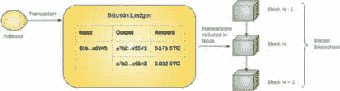
```

比特币的 `Proof-of-Work`（工作证明）实现是创新的，因为它同时解决了两个问题。首先，它提供了一种简单且中等有效的共识算法，允许网络中的节点共同对比特币账本状态的一组标准更新达成一致。¹¹ 其次，它提供了一种允许自由进入共识过程的机制，解决了谁有权影响共识的政治问题，同时防止了 Sybill 攻击。¹²

2009 年 1 月 3 日，第一个比特币区块被铸造，一个无许可且无信任的数字货币新时代随之诞生。在后续关于密码学、共识算法概述以及交易的章节中，我们将更详细地探讨比特币白皮书。


由 `Vitalik Buterin` 于 2014 年发布的以太坊白皮书引入了一种利用区块链技术创建更具通用性的分布式计算平台的新方法。特别是，他描述了 `Smart Contract`（智能合约）的概念，这种合约可以被视为包含价值的加密“箱子”，只有在满足特定条件时才会解锁价值。与比特币脚本不同，以太坊智能合约是图灵完备的，并且拥有全局状态和持久化存储，如图 1.3 所示。运行在以太坊虚拟机（`EVM`）中的 `Smart Contract` 是感知价值的，并且读取合约账户的以太（`ETH`）数量。

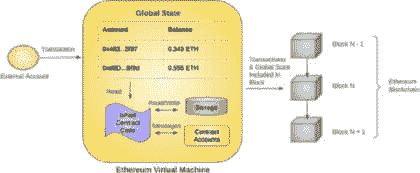

以太坊的全局状态包含两种账户：由私钥控制的外部账户和由其 `Smart Contract` 代码控制的合约账户。智能合约是自执行的，因为它们在单个节点内包含了所需的所有信息。通过使用全局状态，以太坊的优势在于不需要重建所有之前的交易来确定网络的当前状态。它只需要将最新区块中的当前交易应用到当前状态即可。

智能合约是自执行的，因为它们在单个节点内包含了所需的所有信息。通过使用全局状态，以太坊的优势在于不需要重建所有之前的交易来确定网络的当前状态。它只需要将最新区块中的当前交易应用到当前状态。

最后一个讨论的领域是区块链如何增长、筹资金以及治理。它将是一个容易被受私利驱动的大型实体收编的赞助模式吗？还是一次性的初始代币发行（`ICO`），其资金是有限的并在某个时间会耗尽？`Cardano` 采用的方法是在协议中构建一个自给自足的国库，该国库由初始代币供应分配和持续的交易费用提供资金。同样，甚至更重要的是，由谁来决定以及资金如何花费的问题。这属于 `Cardano` 的“治理”阶段，`Charles` 指出这是 `Cardano` 所有阶段中最困难的一个。其理念是 `Ada` 持有者可以对国库支出进行投票，并对随时间推移的功能或协议改进进行治理。

区块链三难题指的是广泛接受的观点，即去中心化网络在去中心化、安全性和扩展性方面同时只能提供这三种优势中的两种。

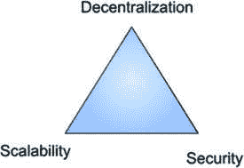

* **去中心化：** 创建一个避免中心控制点的区块链。
* **可扩展性：** 区块链必须能够处理不断增加的用户和交易。
* **安全性：** 区块链必须按照预期运行，并抵御攻击、漏洞和其他不可预见的问题。

`Cardano` 旨在通过以下方法解决这些维度的问题：

* 通过确保维护网络的质押池可以使用普通硬件和典型的互联网连接运行，从而促进去中心化。
* 通过侧链、加密学汇总（`roll-ups`）和并行处理（流水线）来解决可扩展性问题，提高交易处理速度。
* 对于高保证软件和安全性，使用科学方法，包括同行评审过程以及 `Ouroboros Proof-of-Stake` 协议的形式化验证。

本章最后一个主题是对代币经济学的简要回顾。加密货币代币对于建立加密货币生态系统的价值至关重要。这很重要是因为运行和支持网络需要现实世界的资源和成本。因此，理解初始代币分配和货币政策（如最大供应量和通胀率）以及它们如何影响价格和市值是关重要的。最后，就像股市一样，价格和价值经常脱节。因此，在根据加密货币代币价格评估生态系统时要谨慎。价格可能与该生态系统的实用或价值关系较小，更多与价格操纵和市场情绪有关。

`Cardano` 的原生代币是 `Ada`，目前流通量为 `35,125,959,544 ADA`，最大供应量为 `45,000,000,000 ADA`。`Cardano` 的 `ICO` 在 2015 年 10 月至 2017 年 1 月之间完成，分配情况如图 1.6 所示。

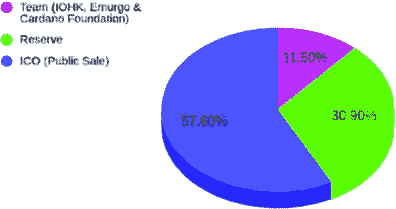

`Cardano` 有三个创始实体：

* `IOHK (IOG)` 是一家研究工程公司和创投工作室，构建区块链和 `Web3` 产品以赋能各地的每个人。
* `Emurgo` 是一个营利分支，负责开发、支持和孵化商业机会，并帮助企业集成到 `Cardano` 区块链系统中。
* `Cardano Foundation` 是一家位于瑞士的独立非营利组织，促进和推进用于金融和社会系统的 `Cardano` 平台。

由于 `Ada` 有最大供应量，我们可以看到任何时候的代币分配情况。这对于与其他加密货币进行比较很有帮助，因为不在流通量中的代币分配过高，意味着当代币向公众发布时，价格可能会产生下行压力。


**图 1.7:** `Ada` 代币分配

`reserve` 是用于 `staking` 奖励和国库资金的 `Ada` 数量，如图 1.7 所示。国库支付生态系统的改进和维护。权益证明网络通过质押允许用户质押他们的 `Ada` 来帮助保护网络。作为回报，他们获得与用户质押 `Ada` 相对于网络中所有质押 `Ada` 的奖励。质押奖励和国库资金还包括网络活动产生的交易费用。

图 1.8 比较了截至 2023 年 9 月 27 日市值最高的加密货币的初始代币分配。有趣的是，随着加密货币的推出，初始内部人员+基金的分配金额呈现上升趋势。

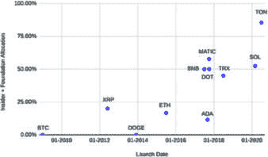

我们将看到的最后一个指标是 `Cardano` 0.3% 的通胀率。这是通过质押和资国库从储备释放到活跃供应的 `Ada` 数量。`Cardano` 的通胀率与比特币相似，在启动时处于最高，然后随着时间的推移指数级减少，如图 1.9 所示。

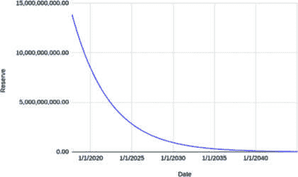

`Cardano` 路线图分为五个主题或阶段：`Byron`、`Shelley`、`Goguen`、`Basho` 和 `Voltaire`。每个主题专注于跨多次发布交付的一系列能力。每个开发主题有一个或多个具有特定账本规则的时代，如表 1.1 和 1.2 所示。

| 阶段 | 主题 | 账本时代 | 描述 |
| :--- | :--- | :--- | :--- |
| `Byron` | 基础 | `Byron` | 使用 `Ouroboros` 权益证明协议的第一个版本的 `Cardano` 区块链 |
| `Shelley` | 去中心化 | `Shelley` | 改进去中心化并引入质押和奖励的升级 |
| `Goguen` | 智能合约 | `Allegra` | 引入代币锁定 |
| | | `Mary` | 启用原生代币和多资产 |
| | | `Alonzo` | 发布智能合约功能 |
| | | `Babbage` | 实现内联数据、引用脚本和引用输入等功能 |
| `Basho` | 扩展 | `N/A` | 提高 `Cardano` 网络的可扩展性和操作性 |
| `Voltaire` | 治理 | `Conway` | 让 `Cardano` 区块链成为自给自足的系统，网络参与者利用质押的 `Ada` 和投票权影响网络的未来发展 |

| 日期 | 阶段 | 时代 | 纪区块 | 共识机制 |
| :--- | :--- | :--- | :--- | :--- |
| 2017/09 | `Byron` | `Byron` | 0 | `Ouroboros Classic` |
| 2020/02 | `Byron` | `Byron` | 176 | `Ouroboros BFT` |
| 2020/07 | `Shelley` | `Shelley` | 208 | `Ouroboros Praos` |
| 2020/12 | `Goguen` | `Allegra` | 236 | `Ouroboros Praos` |
| 2021/03 | `Goguen` | `Mary` | 251 | `Ouroboros Praos` |
| 2021/09 | `Goguen` | `Alonzo` | 290 | `Ouroboros Praos` |
| 2021/10 | `Goguen` | `Alonzo` | 298 | `Ouroboros Praos` |
| 2022/09 | `Goguen` | `Babbage` | 365 | `Ouroboros Praos` |
| 2023/02 | `Goguen` | `Babbage` | 394 | `Ouroboros Praos` |

表 1.2: `Cardano` 时间线

在结束本介绍章节之前，了解一些展示区块链技术潜力的用例将很有帮助：

* **资本市场**：更高效的资本流动
* **代币化 (`Tokenization`)**：将黄金、股票、债券、房地产或法币等资产表示化
* **奖励 (`Rewards`)**：使用奖励或积分来激励行为的能力
* **去中心化交易所 (`DEX`)**：用于资产和衍生品交易的非托管交易所
* **市场平台 (`Marketplaces`)**：买卖代币化资产
* **金融产品**：例如贷款和借贷
* **身份系统 (`Identity Systems`)**：自主主权身份（`SSI`）解决方案
* **保险**：使用智能合约和数据喂进行理赔处理
* **媒体与娱乐**：跟踪并变化真实数字内容的生命周期及发行
* **去中心化存储 (`Decentralized Storage`)**：利用代币激励模型进行点对点去中心化存储
* **去中心化自治组织 (`DAO`)**：用于治理和投票

我们现在应该对区块链技术的演进有一个高层次的理解，从分布式账本的起源到 `Charles Hoskinson` 著名的白板视频，该视频概述了 `Cardano` 的目的和目标。我们介绍了比特币和以太坊白皮书，将在下一章中详细检查工作量证明（`PoW`）和权益证明（`PoS`）共识模型。此外，我们回顾了基础的区块链概念，如区块链三难题、代币经济学、`Cardano` 路线图和区块链用例。在下一章中，我们将深入探讨密码学和共识算法，并探索它们如何确保区块链的安全。

* 网络可以是中心化的，也可以是去中心化的。
* 去中心化网络的难度在于它不能拥有中心权威。
* 拜占庭故障（`Byzantine fault`）是指网络节点不可用或试图破坏网络。
* 网络使用共识算法来对网络的正确状态达成一致。
* 当单一实体控制去中心化账本网络中的大多数节点时，就会发生 51% 攻击。
* 比特币白皮书同时两个问题：
  * 提供了一个简单高效的共识算法。
  * 任何人都可以参与共识算法，消除了对中心权威的需求。
* 以太坊白皮书引入了可以访问账本全局状态的图完备脚本概念。
* `Cardano` 被认为是第三代区块链，其目标是解决扩展性、互操作性和可持续性问题。
* 代币的价格和价值往往是不对齐的，因此在评估加密货币时，考虑去中心化、安全性和扩展性等基本原则是关重要的。
* `Cardano` 有五个开发主题或阶段：`Byron`、`Shelley`、`Goguen`、`Basho` 和 `Voltaire`。

1. 哪种类型的网络不需要中心权威？
   * 中心化
   * 去中心化
   * 分布式
   * 匿名
2. 大中本卫（`Wei Dai`）发表了什么今天比特币所采用的创新概念？
   * 通过谜题进行的计算工作
   * 通过 `CPU` 进行计算工作
   * 通过网络算力计算工作
   * 通过共识进行计算工作
3. 为什么 `Hal Finney` 的 `reusable proofs of work`（可重复工作证明）没有被采用？
   * 它是基于工作量证明（`POW`）
   * 它不是中心化的
   * 它运行在信任的后端
   * 不安全
4. 比特币的工作量证明是创新的，因为它：
   * 一个基于时间的共识算法
   * 一个基于哈希的共识
   * 一个基于时间和哈希的协议
   * 一种高效且开放的协议
5. 为什么比特币没有使用图完备脚本？
   * 没有一种计算机语言来编写它
   * 存在无限循环的风险
6. 第二代区块链的痛点是什么？
   * 扩展性、互操作性、可持续性
   * 去中心化、安全性
   * 可扩展性
   * 扩展性
7. 区块链的三个维度是什么？
   * 安全性、去中心化、扩展性
   * 扩展性、去中心化、可持续性
   * 去中心化、安全性、可持续性
   * 可扩展性、安全性、可持续性

1. b
2. d
3. c
4. d
5. b

## 问题

1. 去中心化账本试图解决什么问题？
2. 去中心化为什么共识算法至关重要？
3. 什么是拜占庭故障？如何缓解它？
4. 比特币白皮书的动机是什么？
5. 以太坊为什么写了白皮书？
6. `Cardano` 的目标是什么？
7. 代币经济学为什么很重要？

## 术语

* **Attribution**：发送者和接收者的身份。
* **BFT**：拜占庭容错
* **CFT**：崩溃容错
* **Compliance**：合规与反洗钱。
* **Consensus**：网络节点对状态达成一致的能力。
* **Decentralized**：没有中心权威的网络。
* **Metadata**：交易背后的元数据。
* **Reserve**：用于质押奖励的加密货币数量。
* **Scalable**：区块链系统扩展交易的能力。
* **Secure**：区块链保持可信的能力。
* **Attribution**：发送者和接收者的身份。
* **Staking**：使用 `Ada` 帮助 `Cardano` 区块链并获得奖励。
* **Treasury**：用于维护和升级的 `Ada` 数量。

________________

1. `Lyn Alden`，《破碎货币》，1-2。
2. `Stuart Haber` 等人，《如何为数字文档时间戳》。
3. `Leslie Lampor` 等人，《拜占庭将问题》。
4. `David Mazieres` 等人，《从拜占庭存储构建安全文件系统》。
5. `Wei Dai`，《b-money》。
6. `Hal Finney`，《RPOW - 可重复工作证明》。
7. `Vitalik Buterin`，《下一代智能合约和去中心化应用平台》，4。
8. `Vitalik Buterin`，《下一代智能合约和去中心化应用平台》，4。
9. `Satoshi Nakamoto`，《比特币：点对点电子现金系统》，8。
10. `Satoshi Nakamoto`，《比特币：点对点电子现金系统》，1。
11. `Vitalik Buterin`，《下一代智能合约和去中心化应用平台》，4。
12. `Vitalik Buterin`，《下一代智能合约和去中心化应用平台》，4。

# 参考文献

- [16] `Charles Hoskinson`, “Cardano 白板；由 `Charles Hoskinson` 概述。”
- [17] `Cryptopedia`, “区块链三难困：快速、安全且可扩展的网络。”
- [18] https://medium.com/certik/the-blockchain-trilemma-decentralized-scalable-and-secure-e9d8c41a87b3
- [19] https://coinmarketcap.com/currencies/cardano/#About
- [20] https://cardano.org/genesis/#audit
- [21] https://cardano.org/partners/
- [22] https://cardano.org/partners?tab=iog
- [23] `cardanians.io`, “Cardano 中有 12.3 亿 ADA。”
- [24] 数据来源自：
  - https://www.investopedia.com/what-is-xrp-6362550#toc-xrp-ledger-and-xrp
  - https://coinmarketcap.com/currencies/dogecoin/#About
  - https://www.coingecko.com/en/coins/ethereum/tokenomics
  - https://coinmarketcap.com/currencies/cardano/#About
  - https://www.coingecko.com/en/coins/polkadot/tokenomics
  - https://coinmarketcap.com/currencies/polygon/#About
  - https://coinmarketcap.com/currencies/bnb/#About
  - https://coinmarketcap.com/currencies/toncoin/
  - https://coinmarketcap.com/currencies/solana/#About
- [25] https://docs.cardano.org/explore-cardano/monetary-policy/
- [26] https://docs.cardano.org/about-cardano/evolution/eras-and-phases/
- [27] https://roadmap.cardano.org/en/
- [28] https://roadmap.cardano.org/en/byron/
- [29] https://roadmap.cardano.org/en/shelley/
- [30] https://roadmap.cardano.org/en/basho/
- [31] https://roadmap.cardano.org/en/voltaire/
- [32] https://docs.cardano.org/explore-cardano/eras-and-phases/


- [33] https://github.com/cardano-foundation/CIPs/blob/master/CIP-059/feature-table.md
- [34] https://consensys.io/blockchain-use-cases/capital-markets
- [35] https://consensys.io/blockchain-use-cases/media-and-entertainment

## 概述

在本章中，我们将介绍密码学和密码哈希。我们将展示密码哈希在区块链技术中是如何被生成和使用的。接下来，我们将探索比特币所使用的工作量证明（Proof-of-Work）共识协议。我们将展示证明者和验证者如何协作来确保区块链的安全。接着，我们将研究权益证明（Proof-of-Stake）及其相比于工作量证明的优势。最后，我们将回顾 Ouroboros，这是 Cardano 的权益证明协议。

在本章中，我们将讨论以下内容：

* 密码学
* 公钥加密
* 哈希
* 数字签名
* 所有权链
* 工作量证明
* 挖矿
* 权益证明
* 概率终结性（基于链）
* 绝对终结性（PBFT）
* Ouroboros
* Ouroboros Classic
* Ouroboros BFT
* Ouroboros Praos
* Ouroboros Genesis
* Ouroboros Crypsin
* Ouroboros Chronos
* Ouroboros 协议

“最早记载的用于通信的密码学是由斯巴达人，他们早在公元前 400 年就使用密码（`cipher`）进行秘密通信。” `cipher` 是任何通过转换消息来隐藏其含义的方法。在 20 世纪 70 年代中期，所有的密码系统都使用对称密钥算法，发送者和接收者使用同一个加密密钥，且双方必须对其保密。对称加密的挑战在于密钥必须提前传输，当有大量密钥需要管理或不存在预先的安全通道时，这种方法无法扩展。这种局限性通过非对称加密解决了，非对称加密用于公钥加密和数字签名。

使用公钥加密的第一步是基于单向加密算法生成一对公钥和私钥。经典的密码学示例参考图 2.1，其中 Alice 尝试向 Bob 发送一条加密消息。在这种情况下，Alice 需要使用 Bob 的公钥来加密消息。除了持有私钥的 Bob 之外，其他任何人都无法读取消息。当 Bob 接收到加密消息时，他使用自己的私钥进行解密并读取 Alice 发送的原始消息。


密码哈希通过数学函数生成，该函数接受任意大小的输入并生成固定长度的输出。这被称为单向哈希，无法解码以揭示输入的原始内容。对于同一组输入，生成的输出将始终是相同的。如果输入即使发生最微小的变化，生成的哈希也会完全不同，这被称为雪崩效应。雪崩效应确保了抗碰撞性和防篡改检测，这在区块链中被广泛使用。

Cardano 使用 `BLAKE2b-256` 密码哈希算法生成地址，并使用 `BLAKE2b-224` 生成公钥哈希。哈希函数还用于区块链来生成包含交易列表的区块哈希。这有助于检查并确保不可篡改性，因为区块中包含的任何交易变化都会改变区块哈希。

数字签名提供了一种方法，让 Alice 对消息进行签名，以便以后可以使用 Alice 的公钥进行验证。消息并不像公钥加密那样被加密，相反，数字签名证明是 Alice 且仅签署了这条消息。在区块链范围内，消息是交易，Alice 是区块链地址的所有者。当交易由 Alice 的私钥签名时，区块链上的任何其他人都可以使用 Alice 的公钥进行验证，如图 2.2 所示。


第一种常用的数字签名是 Rivest-Shamir-Asleman（`RSA`），创建于 1977 年，它利用了分解两个大质数是困难的特性。1991 年，创建了数字签名算法（`DSA`），它利用了求解离散对数问题（`x ^ y = z`）是困难的这一事实。在给定 `x` 和 `z` 的情况下，当 `y` 是足够大的数字时，求解 `y` 是困难的。`DSA` 增加了椭圆曲线签名算法，产生了椭圆曲线数字签名算法（`ECDSA`），它具有更小的密钥和更快的操作速度。Cardano 使用爱德华曲线数字签名算法（`EdDSA`），它具有以下优势：

* 签名和验证快速
* 高安全性
* 签名小
* 密钥小

`Table 2.1` 总结了比特币、以太坊和 Cardano 使用不同签名算法：

| 区块链 | 签名算法 | 椭圆曲线 | 哈希函数 |
| --- | --- | --- | --- |
| 比特币 | ECDSA | Secp256k1 | SHA-256 |
| 以太坊 | ECDSA | Secp256k1 | Keccak-256 |
| Cardano | EdDSA | Curve25519 | BLAKE2b |

**Table 2.1:** 数字签名

正如比特币白皮书中所定义的，电子货币是数字签名的链。`Bitcoin` 通过对前笔交易的哈希值和下一个所有者的公钥进行签名来数字化传输。只有当签名与前笔交易中包含的公钥匹配时，才会被批准。通过将这些链接在一起，就可以验证`chain of ownership`，如`Figure 2.3`所示。

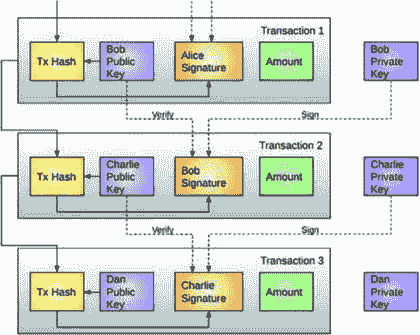

在比特币白皮书中，双花费问题是指 Bob 试图创建两个交易来两次花费相同的金额。为了解决这个问题，引入了时间戳或时间线。每个区块哈希值都与上一个区块哈希值链接，形成区块链并对交易进行排序，如`Figure 2.4`所示。账本现在可以确认交易是否试图双花费已经花费过的输出，并据此拒绝它。

为了帮助调节区块产生的频率，使用了一个 `nonce` 并对其进行递增，以找到具有所需数量零比特的区块哈希。比特币网络监控区块产生的速度，如果区块产生得太快，所需的零比特数量就会增加。相反，如果产生区块花费的时间太长，所需的零比特数量就会减少。所需零比特数量的调整就是`difficulty`。

最后一个要解决的问题是为矿工的诚实行为提供激励。`difficulty` 随着时间的指数级增长。在 `PoS` 系统中，`difficulty` 并不是这样使用的。

随着 `PoS` 越来越流行，它比 `PoW` 节能得多。在 `PoS` 中，验证者是根据其拥有的 `stake` 数量随机选择的。Ouroboros 使用 `entropy` 参数来选择领导者，使得对手难以预测结果。

Ouroboros Classic 是 2017 年 7 月发布的第一个 Ouroboros 协议。该论文将协议定义为 `PoW` 的高效率竞争对手，引入了分析 `PoS` 的数学框架，并引入了一种新颖激励机制来奖励 `PoS` 环境下的参与者。Ouroboros 与其他区块链协议的区别在于，它能够在其领导者选择算法中生成具有安全保障的无偏随机性。让我们更详细地检查这一点。

“Ouroboros 将 Cardano 的时间划分为时代（epochs），每个时代又被划分为插槽（slots）。插槽是一个可以创建区块的短时间，将插槽分组为时代是调整领导者选举过程以适应动态变化的质押分布的核心。每个插槽都会选出一个插槽主（slot leader），负责将区块添加到链中并将其传递给下一个插槽主。为了防止对抗者试图破坏协议的尝试，每个新的插槽主必须将接收到的链的最后几个区块视为瞬态的：只有预设数量瞬态区块之前的链才被认为是最终确定的。”

Ouroboros 拜庭容错（`BFT`）是一个基于 Ouroboros Classic 的简化协议，主要用于帮助实现 Cardano 最重要的里程碑之一——Shelley 发布。它将网络过渡到联邦模型，以避免要求所有节点始终在线。

Praos 对当前时间戳和针对特定时代的随机数（nonce）引入了可验证随机函数（`VRF`）。给定私钥和输入，`VRF` 输出一个伪随机数和一个证明。相应的公钥可以验证该证明和随机数。此外，这种方法防止了除提议的插槽主之外的任何人提前知道特定插槽的插槽主。这对于避免 `DDoS` 或提前公开插槽主的针对性攻击至关重要。

比特币 `PoW` 共识协议的优势在于任何参与者都可以通过创世区块（Genesis block）加入网络并参与。这是任何区块链的一个非常重要的特性，因为它不依赖于对网络正确状态的任何信任概念或检查点。Ouroboros Genesis 通过使用新颖的链选择规则解决了 Ouroboros `PoS` 协议的局限性，允许新或离线的参与者仅使用创世区块加入网络。这种方法被称为“从创世启动引导（bootstrapping from genesis）”，Ouroboros Genesis 论文证明了它在不同配置下使用仍能保持其安全性。

Ouroboros Crypsis 是第一个隐私保护协议。通过 SNARKs，Ouroboros Crypsis 旨在增强网络抵御针对性攻击的能力。

Ouroboros Chronos 展示了如何安全地同步时钟。Ouroboros Chronos 为网络提供了安全同步的方法。

Cardano 的第一步是注册质押。预计区块频率约为 0.5 秒。

质押池运营商（`SPO`）将处理 Ada 的注册，如图 2.5 所示：

1. 获取当前插槽。
2. 获取全局随机数。
3. 获取全局随机数。

在每个时代开始时，`VRF` 输出可以是这些......如果 `VRF` 输出值低于特定阈值，他们就可以成为该区块的插槽主。`VRF` 输出值是这些.................................2.2.2.2......这些。

1. 组装应包含在区块中的交易。
2. 在区块中包含从 `VRF` 获取的随机值（`v`）和证明（`π`）。
3. 生成新的私钥并删除旧密钥，以便无法使用旧密钥伪签名。
4. 向网络广播新区块。
5. 奖励在时代结束时计算，然后在下一个区块中分发到奖励地址。

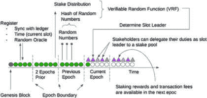

* 为了解决双花问题，每个区块的哈希中都包含时间戳，并且区块链中包含了更多的时间戳，从而确保了先前区块的安全。
* 比特币挖掘通过将新的比特币和交易费用作为每个区块的第一笔交易分配给创建该区块的矿工，激励诚实行为。
* `Proof-of-Stake` 的能源效率远高于 `Proof-of-Work`。
* `Proof-of-Stake` 根据参与者在网络上质押的原生货币数量随机且按比例地选择区块生产者（验证者）。
* 必须向系统中引入熵，以便在 `Proof-of-Stake` 利益者之间实现公平的随机选举。
* 在安全保障下，`Ouroboros` 可以在协议的领导者选择算法中生成无偏的随机数。
* 随着更多区块被链接形成最长链，会产生概率终结性。
* 验证者对包含新区块进行投票，其结果被认为是最终的，实现了绝对终结性。

1. 公钥加密使用哪种类型的加密？
    1. 对称加密
    2. 非对称加密
    3. 双对称加密
    4. 匿名加密

2. 你如何验证签名？
    1. 同时使用私钥和公钥
    2. 使用私钥
    3. 使用对称密钥
    4. 使用与私钥相关的公钥

3. 比特是如何解决双花问题的？
    1. 使用时间戳对交易排序
    2. 使用分布式账本记录交易
    3. 使用加密技术对交易进行签名
    4. 使用区块记录交易

4. `Proof-of-Stake` 效率更高是因为：
    1. 不需要区块领导者
    2. 不需要随机性
    3. 不需要求解计算难题
    4. 不需要形成最长链

5. `Proof-of-Stake` 和 `Proof-of-Work` 都会发生哪种风险？
    1. 中心化
    2. 随机性偏差
    3. 财阀政治
    4. 环境问题

1. b
2. d
3. a
4. c
5. a

1. 为什么加密技术对区块链很重要？
2. 比特币白皮书解决了哪些问题？
3. Cardano 的 `PoS` 比比特币的 `PoW` 效率高多少？
4. 绝对终结性的优缺点是什么？
5. 为什么 `Ouroboros` 必须是可证明安全的是重要的？
6. 当客户端加入网络时，`Ouroboros` 如何确保选择正确的链？

* **区块 (Block):** 包含零或多个交易。
* **所有权链 (Chain of Ownership):** 将数字签名连接在一起。
* **DDos:** 分布式拒绝服务。
* **难度 (Difficulty):** 创建区块所需的计算所需的增长率。
* **数字签名 (Digital Signature):** 使用私钥对消息的消息。
* **熵 (Entropy):** 系统中的随机性程度。
* **周期 (Epoch):** 包含固定数量插槽（slots）的时间单位。
* **终结性 (Finality):** 一个可以被视为最终且不可逆的状态。
* **挖掘 (Mining):** 支付给创建区块矿工的激励。
* **公钥加密 (Public Key Encryption):** 生成一对公钥和私钥。
* **PoS:** 权益证明 (Proof-of-Stake)
* **PoW:** 工作量证明 (Proof-of-Work)
* **插槽 (Slot):** 每秒发生一次，最多包含一个区块。
* **SPO:** 质押池运营商 (Stake Pool Operator)
* **VRF:** 可验证随机函数 (Verifiable Random Function)

________________

[1] Gustavus J. Simmons, “History of cryptography.”
[2] Encyclopaedia of Britannica, “cipher.”
[3] [`en.wikipedia.org/wiki/Public-key\_cryptography`](https://en.wikipedia.org/wiki/Public-key_cryptography)
[4] A. Menezes, “Handbook of Applied Cryptography,” 283.
[5] A. Menezes, “Handbook of Applied Cryptography,” 286.
[6] Prashant P. Pittalia, “A comparative study of hash algorithms in cryptography,” 147.
[7] Darshana Upadhyay, et al., “Investigating the Avalanche Effect of Various Cryptographically Secure Hash Functions and Hash-Based Applications,” 112472–112486.
[8] [`docs.cardano.org/learn/cardano-addresses/`](https://docs.cardano.org/learn/cardano-addresses/)
[9] Shafi Goldwasser, “Chapter 10: Digital signatures (PDF). Lecture Notes on Cryptography,” 168.
[10] [`academy.cardanoundation.org/`](https://academy.cardanoundation.org/), “Different Signature Algorithms.”
[11] Daniel, J. Bernstein, et al. “High-speed security.” Cryptogr Eng 2, 77–89 (2012).
[12] [`www.susanka.eu/coins-crypto/`](https://www.susanka.eu/coins-crypto/)
[13] Satoshi Nakamoto, “Bitcoin: Peer-to-Peer Cash System,” 2.
[14] Satoshi Nakamoto, “Bitcoin: Peer-to-Peer Cash System,” 2.
[15] Satoshi Nakamoto, “Bitcoin: Peer-to-Peer Cash System.” 2.
[16] Satoshi Nakamoto, “Bitcoin: Peer-to-Peer Cash System,” 4.
[17] Aggelos Kiayias, et al., “Ouroboros: Provably Secure Proof-of-Stake Protocol,” 1.
[18] Aggelos Kiayias, et al., “Ouroboros: Provably Secure Proof-of-Stake Protocol,” 1.
[19] [`docs.cardano.org/explore/cardano/cardano-entropy/`](https://docs.cardano.org/explore/cardano/cardano-entropy/)
[20] [`docs.cardano.org/explore/cardano/cardano-entropy/`](https://docs.cardano.org/explore/cardano/cardano-entropy/)
[21] Alexis Gauba, “Finality in Blockchain Consensus.”
[22] Shehar Bano, et al., “SoK: Consensus in the Age of Blockchains,” 2.
[23] Shehar Bano, et al., “SoK: Consensus in the Age of Blockchains,” 4.


[24] Alexis Gauba, “Finality in Blockchain Consensus.”

[25] [`docs.cardano.org/learn/ouroboros-overview/`](https://docs.cardano.org/learn/ouroboros-overview/)

[26] Aggelos Kiayias, et al., “Ouroboros: Provably Secure Proof-of-Stake Protocol,” 1.

[27] Olga Hryniuk, “From Classic to Chronos: the implementations of Ouroboros explained.”

[28] [`docs.cardano.org/learn/ouroboros-overview/`](https://docs.cardano.org/learn/ouroboros-overview/)

[29] Olga Hryniuk, “From Classic to Chronos: the implementations of Ouroboros explained.”

[30] Aggelos Kiayias, et al., “Ouroboros-BFT:A Simple Byzantine Tolerant Consensus Protocol,” 1.

[31] Olga Hryniuk, “From Classic to Chronos: the implementations of Ouroboros explained.”

[32] Bernardo David, et al. “Ouroboros Praos: An adaptively-secure, semi-synchronous proof-of-stake blockchain”

[33] LLFOURN, “Introduction To Ouroboros.”

[34] Peter Gaži, “Presenting Ouroboros at MIT.”

[35] Christian Badertscher, et al., “Ouroboros Genesis: Composable Proof-of-Stake Blockchains with Dynamic Availability,” 1.

[36] Olga Hryniuk, “From Classic to Chronos: the implementations of Ouroboros explained.”

[37] Thomas Kerber, et al., “Ouroboros Crypsinous: Privacy-Preserving Proof-of-Stake,” 1.

[38] Thomas Kerber, et al., “Ouroboros Crypsinous: Privacy-Preserving Proof-of-Stake,” 1.

[39] Olga Hryniuk, “From Classic to Chronos: the implementations of Ouroboros explained.”

[40] Christian Badertscher, et al., “Ouroboros Chronos: Permissionless Clock Synchronization via Proof-of-Stake,” 1.

⁴¹ Arnaud Bailly，“Cardano 中的时间处理，部分 1。关于 Ouroboros 和确定性的重要性。”

⁴² Crypto Carlos，“Ourobors 协议。Cardano 的核心。”

⁴³ [`developers.cardano.org/docs/operate-a-stake-pool/introduction-to-cardano/`](https://developers.cardano.org/docs/operate-a-stake-pool/introduction-to-cardano/)

## 引言

在本章中，我们将首先查看 Cardano 地址（Cardano Addresses）、它们是如何构建的以及内部的数据。接下来，我们将查看 UTXO 架构，并展示如何创建交易以及可选的元数据。我们还将介绍被称为 Plutus 脚本的智能合约是如何执行和评估的。我们将看到验证者（Redeemers）如何将数据传递给 Plutus 脚本，以及数据（Datums）如何用于数据存储和持久化。最后，我们将查看交易见证集（Witness Set）以及它如何授权交易输入的开销。

在本章中，我们将讨论以下主题：

* 地址
  * 网络标签 (Network Tag)
  * 基础地址 (Base Address)
  * 企业地址 (Enterprise Address)
  * 奖励（质押）地址 (Reward Address)
* UTXO
  * 交易输入 (Transaction Inputs)
  * 交易输出 (Transaction Outputs)
* 元数据 (Metadata)
* Plutus 脚本 (Plutus Scripts)
* 数据 (Datum)
* 验证者 (Redemer)
* 证集 (Witness Set)

Cardano (Shelly) 地址是使用 Bech32 编码的字节序列。¹¹ 在 Cardano 上，你通常会与三种地址进行交互：

* 基础地址
* 企业地址
* 奖励（质押）地址

Cardano 地址的结构如图 3.1 所示：

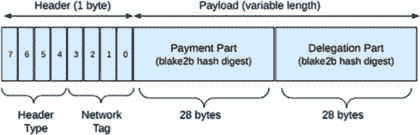

头部类型指示了地址的类型（或负载），网络标签指示了该地址关联的网络。

| 头部位 | 网络 |
| --- | --- |
| `xxxx0000` | 测试网 (Testnet) |
| `xxxx0001` | 主网 (Mainnet) |

基础地址是最常见的地址类型，如表 3.2 所示。当支付部分为 `PaymentKeyHash` 时，必须使用该地址对应的私钥对交易进行签名。当支付部分为 `ScriptHash` 时，必须执行一个具有匹配哈希值的脚本并将其评估为 `true` 才能从该地址支出资金。委托部分与支付部分类似，但它用于注册（并委托）锁定在该地址的 Ada 质押证书。正如我们在上一章中回顾的那样，质押是帮助保护权益证明区块链安全并以此获得奖励的机制。

| 头部位 | 支付部分 | 委托部分 |
| --- | --- | --- |
| `0000xxxx` | `PaymentKeyHash` | `StakeKeyHash` |
| `0001xxxx` | `ScriptHash` | `StakeKeyHash` |
| `0010xxxx` | `PaymentKeyHash` | `ScriptHash` |
| `0011xxxx` | `ScriptHash` | `ScriptHash` |

### 企业地址

企业地址与基础地址类似，区别在于没有委托部分。企业地址的头部类型列在表 3.3 中。

| 头部头部位 | 支付部分 | 委托部分 |
| --- | --- | --- |
| `0110xxxx` | `PaymentKeyHash` | N/A |
| `0111xxxx` | `ScriptHash` | N/A |

奖励地址用于在权益证明协议中发放质押奖励，并具有以下属性：²

* 它使用账户式记账，而非 UTXO。
* 仅在发放质押奖励时，账户余额才会增加。
* 要转出锁定在奖励地址的 Ada，需要一种提现类型的交易来释放资金并将奖励地址的余额清零。
* 注册的质押密钥与奖励账户地址之间存在一一一的关系。

| 头部位 | 质押引用 |
| --- | --- |
| `1110xxxx` | `StakeKeyHash` |
| `1111xxxx` | `ScriptHash` |

总而言之，以下输出是由 `cardano-address inspect` 工具生成的。请注意，在地址中指针可能指向链上注册证书。指针很少使用，在接下来的示例中，我们可以看到 `stake_reference` 是 `by value`（按值），这表示质押证书位于该地址，而不是指针。

`addr_test1qqq0ucy70wms9p7tku6ntcam2uxnsae7p82qc5dj37lh3ytgyfp8en2pa4cfuvdz8sydnc`

```
echo addr_test1qqq0ucy70wms9p7tku6ntcam2uxnsae7p82qc5dj37lh3ytgyfp8en2pa4cfuvdz8sydnc
```

通过区块链浏览器，我们可以看到这笔交易在 Cardano 区块链上的样子，如*图 3.3**所示：[`preprod.cexplorer.io/tx/c9e6dc1e7ecdf7110747c91d0d638ce896435a504e745025996230533ae9f548`](https://preprod.cexplorer.io/tx/c9e6dc1e7ecdf7110747c91d0d638ce896435a504e745025996230533ae9f548)

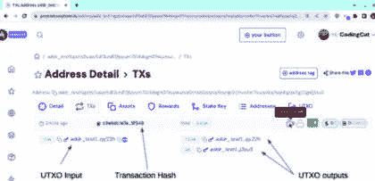

**图 3.3：** 区块浏览器交易视图

交易输入简单指向账本上的交易哈希和索引，因为一个特定的交易可能有多个交易输出。

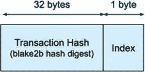

**图 3.4：** 交易输入

输入的账本规范⁴定义为：

```
transaction_input = [ transaction_id : $hash32, index : uint ]
```

在智能合约的 Alonzo 时代之前，交易输出包含以下内容：

* 输出锁定的地址
* Ada 的值以及任何 Cardano 原生代币
* 用于存储持久化数据哈希的可选 `datum`

在 UTXO 中存储 `datum` 标的能力是 Cardano 使用 EUTXO 模型的方式之所在，而比特币仅使用 UTXO 模型。

以下是 Cardano 上某个地址的 2 个 EUTXO 示例*：

```
$cardano-cli query utxo --address addr_test1vzu…dxn7 --cardano-mode --testnet-magic 1

TxHash TxIx Amount
--------------------------------------------------------------------
158…925 0 3551912116 lovelace + TxOutDatumNone
b4e…0d2 0 5000000 lovelace + TxOutDatumNone
```

*\*请注意，地址和 TxHash 已为了格式化而截断。*

观察结果：

* 在此示例中，有 2 个 UTXO。
* 索引为 0 的交易哈希 `158…925` 拥有 3,551,912,116 lovelace。
* 索引为 0 的交易哈希 `b4e…0d2` 拥有 5,000,000 lovelace。
* 1 Ada 等于 1,000,000 lovelace。
* 锁定地址上的 Ada 数量为：
  `3,551.912116`
  `+ 5.000000`
  `3,556.912116`
* 这些 UTXO 没有关联的 datum。

Alonzo 时代之后，输出中增加了额外的字段。在当前的 Conway 时代，我们拥有以下内容：

* 输出锁定的地址
* Ada 和任何原生代币的金额
* 用于在链上存储持久化数据哈希的可选 `datum`
* 用于在链上存储数据值的可选 `inline datum`
* 允许将智能合约存储在链上的可选 `reference script`

以下是 Conway 时代的一个 UTXO 示例：

```
$cardano-cli query utxo --tx-in 5f07cfe47c846a7a64850f7174d9281b093a78e51dadcf7 --cardano-mode --testnet-magic 1 --out-file utxo.out

$cat utxo.out
{
  "5f07cfe47c846a7a64850f7174d9281b093a78e51dadcf7f87m6rh0ceyp03w9elemp960jq528pntsyqh",
    "address": "addr_test1qrazs0ngpvl0h2exugnm4lhjts0g7l94780pyx",
    "datum": null,
    "datumhash": null,
    "inlineDatum": null,
    "referenceScript": null,
    "value": {
      "lovelace": 98184065
    }
  }
}
```

当交易提交到 Cardano 时，`datum` 字段包含了附加的 datum 值。如果使用了 `inlineDatum`，则 datum 值存储在链上。根据账本规范⁵，输出定义如下：

```
post_alonzo_transaction_output = {
  0 : address,
  1 : value,
  2 : datum_option ; datum option,
  3 : script_ref ; script reference
}

datum_option = [ 0, hash // 1 ]
```

## 元数据

在提交交易时，交易可以可选包含元数据。链上只存储元数据的哈希，智能合约无法访问。然而，区块链索引器会捕获、存储并检索元数据的完整内容，这些内容用于链外交易构建。使用标签 721 的 CIP-25⁶ 是非同质化代币（NFT）铸造交易的首个元数据标准。

使用版本 1 的 NFT 最小结构如下：

```
{
  "721": {
    "<policy_id>": {
      "<asset_name>": {
        "name": <string>,
        "image": <uri | array>
      }
    }
  }
}
```

通过区块链浏览器⁷ 查看此标准的示例见*图 3.5*：

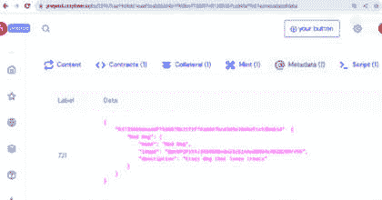

**图 3.5：** 交易元数据

其中：

* `policy_id` 为 `63733059deaddff620870b22f1ff6a990bcd103e70d5cc3bbb`
* `asset_name` 为 `Mad Dog`
* NFT 名称为 `Mad Dog`
* NFT 图片为 `QmckPQPzthJjkS9GRSxdw2SzSinAwdDW34XD26MrV5S`
* NFT 说明为 `Crazy dog that loves treats`

## Plutus

到为止，我们只查看了从拥有相应公私钥的用户地址发送（花费）资产的交易。在 Cardano 中，我们有使用名为 Plutus 的图完脚本语言的智能合约。只有当评估结果返回 `true` 时，Plutus 脚本才能成功花费或铸造。脚本在提交时被包含，以便 Cardano 节点内部的 `Plutus Core Evaluator` 进行评估。回想起来，网络由对有效区块形成共识的连接节点组成。因此，当提交交易时，每个节点必须执行包含的脚本并确认结果。如果是 true，节点将接受该交易进入区块并成为区块链的一部分。

通常，Plutus 脚本要么是 `spending`（验证者），要么是 `minting` 脚本。`spending` 脚本涉及花费锁定在脚本地址的 UTXO。脚本地址只是脚本本身和适当地址头字节值的哈希。`minting` 脚本涉及铸造（添加）或销毁（移除）原生代币。当使用 minting 脚本铸造时，新代币必须作为输出包含在 UTXO 中发送到地址。相反，当使用 minting 脚本销毁时，代币必须作为输入包含在 UTXO 中。

## Datum

当我们查看交易输出时，我们观察到你可以包含一个用于数据的 `datum` 值。这个 datum 值可以被检查交易 UTXO 输入的 Plutus 脚本读取。由于 UTXO 只能作为输入花费一次，因此如果被其他地方使用，必须重新创建并包含在 UTXO 输出中。然而，如果使用引用输入，UTXO 是只读的，因此 datum 值可以供任何数量的交易使用。

## Redeemer

Redeemers 可以在交易内的脚本评估期间为 Plutus 脚本提供信息。例如，指定交易将执行何种类型的铸造操作（铸造或销毁）的能力。Redeemers 还可以将仅运行时已知且不需要持久化的信息传递给 Plutus 脚本。

以下是来自账本规范⁸ 的不同类型的 Redeemers：

```
redeemer_tag = 0 ; Spending
1 ; Minting
2 ; Certifying
3 ; Rewarding
4 ; Voting
5 ; Proposing
```

将以上内容整合在一起的是一个简化示意图（不包含交易手续费），如图图 3.6

**图 3.6:** 简化脚本交易

## 见证集

所有交易都包含一个见证集（witness set），其中包含了花费 `UTXO` 所需的见证。在本章，我们关注了以下类型的见证：

* 签名 (Signature)
* 解锁者 (Redeemer)
* 数据 (Datum)
* Plutus Script

因此，在查看账本规范时⁹，所有交易必须具有以下高层结构：

```
transaction =
[ transaction_body
, transaction_witness_set
, bool
, auxiliary_data / null
]
```


其中：

*   `Transaction_body` 包含手续费、`UTXO` 输入和输出、元数据哈希、脚本哈希以及任何可能的铸币值。
*   `Transaction_witness_set` 包含花费 `UTXO` 输入所需的任何见证。
*   `Bool` 表示该交易是否有效。
*   `Auxiliary_data` 可选包含交易元数据。

## 结论

我们回顾了不同类型的 Cardano 地址以及它们是如何构建和解析的。我们查看了 `UTXO` 架构、输入和输出的使用方式，以及 `UTXOs` 如何锁定在地址上。我们查看了交易元数据的示例以及它是如何存储并链接到链上交易的。接下来，我们查看了 `Datum` 和 `Redeemer` 以及它们如何作为交易的一部分为 Plutus 脚本提供信息。最后，我们回顾了见证集的概念，它允许交易花费 `UTXO` 输入。在下一章中，我们将更详细地查看 Plutus 脚本以及如何在交易中使用它们。

## 记忆要点

*   地址有三种主要类型：基础 (Base)、企业 (Enterprise) 和奖励 (Reward)。
*   交易头类型决定了地址类型。
*   交易网络标签决定了交易所属的网络（主网或测试网）。
*   交易包含一个“支付部分”(Payment Part) 和一个可选的“委托部分”(Delegation Part)”。
*   `Payment Part` 或 `Delegation Part` 可以是 `PaymentKeyHash`（公钥哈希）或 `ScriptHash`（脚本哈希）。
*   奖励地址是一种特殊的基于账户的地址，仅用于质押奖励。
*   交易消耗一个或多个 `UTXOs` 作为输入，并必须产生一个或多个 `UTXOs` 作为输出。
*   `signature`（签名）是证明交易已由正确的私钥签名的证明。
*   交易输入包含索引，因为对于给定的交易可能有多个输出 `UTXO`。
*   `Datum` 用于在链上存储持久化数据，并包含在 `UTXO` 中。
*   `Datum` 值可以以哈希形式存储，也可以以完整的内联数据 (inline datum) 形式存储。
*   `Plutus Core Evaluator` 执行 Plutus 脚本以检查其是否返回 true。
*   Plutus 脚本通常是花费（验证）脚本或铸币脚本。
*   Plutus 花费（验证）脚本花费锁定在脚本地址上的 `UTXOs`。
*   Plutus 铸币脚本用于铸造或销毁 Cardano 原生代。
*   `UTXO` 也可以是参考输入 (reference input)，即不可花费的只读 `UTXO`。
*   `redeemer`（解锁者）在交易评估期间向脚本提供信息。
*   见证集可能包含签名、解锁者、数据或 Plutus 脚本。

## 单选题

1.  哪一个不是合法的 Cardano 地址？
    1. Base
    2. Enterprise
    3. Reward
    4. UTXO
2.  脚本地址源自什么？
    1. 公钥哈希
    2. Plutus 脚本哈希
    3. 私质押密钥哈希
    4. 私钥哈希
3.  签名证明了什么？
    1. 交易使用有效的公钥签名
    2. 交易使用有效的质押密钥签名
    3. 交易使用有效的私钥签名
    4. 交易使用有效的奖励密钥签名
4.  Plutus 脚本评估的结果为？
    1. 布尔值
    2. 二进制值
    3. 十六进制值
    4. 非零
5.  什么是 Redeemer（解锁者）？
    1. 用于识别引用脚本
    2. 用于交易平衡
    3. 在运行时向脚本提供信息
    4. 如果为 false 则停止交易

## 答案

1. d
2. b
3. c
4. a
5. c

# 问答题

1.  为什么你不能在奖励地址上锁定 `UTXO`？
2.  领取质押奖励的流程是什么？
3.  为什么要在见证集中包含一个 Plutus 脚本作为见证？它能证明什么？
4.  为什么不将所有元数据都存储在链上，而不仅仅是元数据哈希？
5.  为什么 Plutus 花费脚本也被称为验证器 (validator)？

# 关键术语

*   **Base**: 地址类型。
*   **Datum**: 哈希。
*   **Enterprise**: 地址类型。
*   **Inline datum**: 值。
*   **Minting**: 原生代币。
*   **PaymentKeyHash**: 公钥哈希。
*   **Plutus Core Evaluator**: 语言。
*   **Redeemer**: 运行时信息。
*   **Reward**: 地址类型。
*   **ScriptHash**: 脚本哈希。
*   **UTXO**: 未花费的。

Plutus 是 Cardano 的智能合约语言，它被编译并执行为无类型 Plutus Core (`UPLC`) 程序。第一批 Plutus 智能合约是使用 `PlutusTx` Haskell 模块用 Haskell 编写的。遗憾的是，`PlutusTx` 当时并没有经过优化，在 Cardano 智能合约刚发布时导致了极具挑战性的开发体验。不久后，出现了一些替代性的 Plutus 脚本语言，例如 Aiken ([`aiken-lang.org/`](https://aiken-lang.org/)) 和 Helios ([`github.com/Hyperion-BT/helios`](https://github.com/Hyperion-BT/helios))，它们的性能要高得多，并且使用了类似于 Rust 或 C 等流行编程语言的语法和编码风格。

在本章中，我们将详细查看 Plutus 核心规范以及 Cardano 账本如何执行 Lambda 演算法程序。我们将检查 Plutus 中使用的不同数据结构，以及数据如何使用紧凑二进制对象表示 (`CBOR`) 格式进行序列化和传输。接下来，我们将查看 Plutus 成本模型以及它如何用于计算 CPU 和内存单元，这些单元不能超过最大值。最后，我们将讨论抵押品及其在交易中的作用。

# Plutus 规范

在本章中，我们将讨论以下主题：

*   Plutus 规范
*   紧凑二进制表示 (`CBOR`)
    *   交易 (Transaction)
    *   解锁者 (Redeemer)
    *   Plutus 脚本 (Plutus Script)
    *   数据 (Datum)
*   Plutus 执行预算
*   抵押品 (Collateral)

## 规范概述

Cardano 第一代脚本是原生脚本[¹]，随后是 Plutus。[²]原生（第一阶段）脚本的功能非常有限并在账本内部执行。Plutus 是一种图灵完备的脚本语言，在账本外部执行，但需要成功评估才能花费由 Plutus 脚本锁定的 UTXO。[³]账本必须支持多个 Plutus 脚本版本，因此每个脚本本身都包含了版本号。这样，账本就能知道如何评估每个带有其特定版本的脚本。表 4.1* 总结了编写本书时已知的 Plutus 版本，本书书中我们将重点关注 `PlutusV2` 和 `Plutus Core Version 1.0.0`。

| 时代 | 账本语言 (Id) | Plutus Core 版本 | 协议版本 | 日期 |
| --- | --- | --- | --- | --- |
| Alonzo | PlutusV1 (0) | 1.0.0 | 5.0 | 2021 年 9 月 |
| Vasil | PlutusV2 (1) | 1.0.0 | 7.0 | 2022 年 6 月 |
| Valentine | PlutusV2 (1) | 1.0.0 | 8.0 | 2023 年 2 月 |
| Conway | PlutusV3 (2) | 1.1.0 | 9.0 | 即将 |

**表 4.1:** Plutus 版本

Plutus 规范的目标是创建一个简单的脚本语言，该语言可以在 Cardano Node 上以最小（且受限）的计算足迹进行评估。与具有长期且复杂证明的以太虚拟机不同，Plutus 的抽象状态机是短小且简洁的。[⁴] 在构建高度稳定的的区块链以减少硬分叉升级时，这是一个非常理想的特性。Plutus 脚本使用一种名为无类型 Plutus Core 或 `UPLC` 的语言编写，它源自 System F（Lambda 演算的一种形式）。[⁵]幸运的是，智能合约 Plutus 开发使用了更别的编程语言，这些语言可以为我们编译并生成 `UPLC`。

**注意**：编写 Cardano 智能合约不需要学习 `UPLC` 或 Lambda 演算。本节其余部分是可选的，但对于寻找更多关于生成的 `UPLC` 代码如何映射到 Plutus Core 规范的读者可能有所帮助。关于 Lambda 演算的介绍，请参考视频“Lambda Calculus - Fundamentals of Lambda Calculus & Functional Programming in JavaScript.”[[⁶]]

## UPLC 原生类型

`UPLC` 使用简单的语言语法，带有一组有限的原子类型，列在表 4.2* 中：

| 类型 | 语法 |
| --- | --- |
| `integer` | `-?[0-9]+` |
| `bytestring` | `#([0-9A-Fa-f][0-9A-Fa-f])*` |
| `string` | `双引号 " 包围的 UTF-8 字符` |
| `bool` | `True | False` |
| `unit` | `()` |

| 类型 | 语义 |
| --- | --- |
| `Data` | `data Data = Constr Integer [Data] | Map [(Data, Data)] | List [Data] | I Integer | B ByteString` |

**表 4.2:** UPLC 原子类型

除了原子数据类型外，`UPLC` 还包含两种类型的运算符，所示表 4.3*：

| 操作符 | op | 语义 |
| --- | --- | --- |
| `list` | `1` | `list(t)` |
| `pair` | `2` | `pair(t1,t2)` |

**表 4.3:** UPLC 操作符

`con` 关键字定义常量，后紧跟类型和值。表 4.4 提供了一些示例：

| 类型 | 示例 |
| --- | --- |
| `unit` | `con ()` |
| `bool` | `con bool` |
| `integer` | `con 123` |
| `bytestring` | `con bytestring` |
| `string` | `con "string"` |
| `pair` | `con pair<bool,integer>` |
| `list` | `con list<bytestring>` |

**表 4.4:** UPLC 示例

Lambda 函数使用 `lam` 并传递一个变量名，返回一个可以是任何类型的项。UPLC 程序不得包含任何自由变量，因此必须是一个“闭合项”。]⁹ 例如，`(program 1.0.0 (lam x x))` 是一个有效程序，但 `(program 1.0.0 (lam x y))` 不是。Plutus Core 没有算术操作符，但使用内置函数进行操作。随着时间的推移，可能会添加一些 `builtin` 函数。`force` 指令应用于多态函数，以强制类型参数的实例化。[⁰] `delay` 指令用于分支的惰性求值，保留类型抽象。[¹] 惰性评估允许更高效的代码执行，因为值只在被使用时才计算。这还允许创建 C 等语言中无法创建的无限数据结构。

## UPLC 语法

将这一切整合在一起，我们定义了 **UPLC** 程序的语法，如图 4.1*所示：

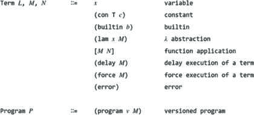

**图 4.1:** UPLC 语法 (Plutus Core Version 1.0.0)[²]

## UPLC 示例

通过一个简化的示例，我们可以看到高级语言（如 Aiken）如何生成 UPLC 程序。表 4.5* 有一个简单的验证脚本，它始终返回真。程序使用 lambda (`lam`) 函数来评估并返回常量 `True`。

**表 4.5:** UPLC 示例

## 紧凑二进制表示 (CBOR)

**CBOR** 是一种定义在互联网标准 RFC 8949 中的二进制编码格式。[³] 在之前的交易章节中，我们查看了 Cardano 账本 **CDDL** 规范,[⁴] 它定义了交易的格式。当交易提交到网络时，整个交易和所有相关数据都会**序列化**并编码为 **CBOR**。我们将详细检查交易并**反序列化**它，以查看 UPLC Plutus 代码和相关数据（解锁者和数据）。

例如，`图 4.2` 显示了一个执行 `Plutus` 验证脚本的交易：

[`preprod.cexplorer.io/tx/99c529355ebd1f410517457b6ff04e66c2de28b8667b9428ec232e03efa22c29`](https://preprod.cexplorer.io/tx/99c529355ebd1f410517457b6ff04e66c2de28b8667b9428ec232e03efa22c29)

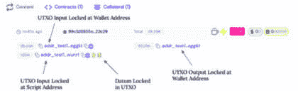

**图 4.2：**交易示例

# 交易

提交到网络的此交易的 `CBOR` 十六进制格式如下：

```
84a80082825820d9b02da5897bd1ff9e2fdab008334d2804ea1accab
c7c3962e33771ed9f1a8d500825820d9b02da5897bd1ff9e2fdab008334d2804ea1a
ccabc7c3962e3371ed9f1a8d501018182581d606d04be153546d63c8a33
e0c11ec44cf790803f31c2f893fc241529531a05eb1244021a0002
d9250b582031e6c463846e3c0afe2aebfc9993355dbe8ce4dab892a7
af0e397a75df3509b90d81825820d9b02da5897bd1ff9e2fdab008334d2804ea1a
ccabc7c3962e3371ed99f1a8d5010e81581c6d04be153546d63c8a33e0c11e
c44cf790803f31c2f893fc241529531082581d606d04be153546d63c8a33e0c11
ec44cf790803f31c2f893fc241529531a05d9dd11111a000445b8a30081825820
fc6500742705cfe8c2f0822e73e2ab09c43285973adffe8aa06bd12d1fa6051f584
0ec7f53a69852e6daa868a3f221114435544ab2851bc6f2f42abe9772507b30064a1
f012ddab23153644703047ea2faf9132390e91937b82389626404d7adfd0105818
40000d8799f4d48656c6c6f2c20576f726c6421ff821977151a009daaac068158f258
f00100003232323232323232222323225333008323232533300b002100114a066446
46600200200644a66602200229404c8c94ccc040cdc78010028aa113300400400133
014002375c60240026eb0c038c03cc03cc03cc03cc03cc03cc03cc03cc020c008c0
20014dd71801180400399b8f375c6002600e00a91010d48656c6c6f2c077f7262
c44100000000119858994000000226464a66601a601e0042930b1bae300d00130060041630
600
33253330073370e900000089919299800618070010a4c2ceb8c030004c01401058c0
140c8c014dd5000918019baa0015734aae7555cf2ab9f5742ae8
```


当我们使用`https://cbor.nemo157.com/`将其解码为诊断格式时，我们可以看到在`图 4.3`和`4.4`中展示的交易。

读者现在应该理解 Plutus 核心规范以及用于 Plutus 脚本执行和评估的`UPLC`代码。我们检查了一个`CBOR`交易、如何对其进行反序列化，并研究了交易详情。我们还查看了 Plutus 脚本执行预算以及如何使用`cost model`进行计算。最后，我们讨论了抵押品（collateral），它在 Plutus 脚本第 2 评估失败时使用。下一章将探索用于创建和提交交易的链下代码。我们还将查看钱包，它是与 Cardano 区块链及智能合约交互的 gateway。

## 要点回顾

- Cardano 上的第一代脚本是原生脚本（native scripts），它们在账本内部进行评估。
- Plutus 脚本是在账本外部评估的第 2 脚本。
- 无类型 Plutus Core 或`UPLC`是 Lambda 演算法的形式。
- `UPLC`是在节点上执行的低级语言。
- 编写智能合约使用的是更高级的语言，该语言会生成低级的`UPLC`。
- `UPLC`程序必须是封闭的，且所有项都已定义。
- `UPLC`程序可以利用 Lambda 演算中的惰性求值。
- `CBOR`是一种用于序列化和反序列化数据结构的二进制标准。
- Cardano 交易在提交到网络时序列化为`CBOR`，并在 Cardano 节点验证期间反序列化。
- 交易中的`Redemer`包含了脚本将消耗的内存和步骤/cpu 单位。
- 在 Plutus 脚本评估期间，如果内存或步骤/cpu 单位超过了最大允许单位，脚本将停止并失败。
- 网络参数中的`cost model`包含了每个 Plutus 操作的成本以及交易中允许的最大内存和步骤/cpu 单位。
- 交易中必须提供`Collateral`（Collateral），旨在保护网络免受恶意和垃圾交易的影响。

## 多选题

1. Cardano 上的第一代脚本是？
   1. PlutusV1
   2. PlutusV2
   3. 原生脚本 (Native Scripts)
   4. 智能脚本 (Smart Scripts)
2. 关于原生脚本和 Plutus 脚本，哪种描述是错误的？
   1. 两者都必须被评估为真才能花费被脚本锁定的 UTXO
   2. 两者都可以创建多重签名脚本地址
   3. 两者都是图灵完备的
   4. 原生脚本是第 1 脚本
3. `UPLC`中的`lam`是什么？
   1. Lambda 函数抽象
   2. Lambda 函数应用
   3. Lambda 函数置换
   4. Lambda 函数关联
4. 为什么惰性求值是理想的？
   1. 代码执行效率更低
   2. 代码执行效率更高
   3. 强制求值所有声明变量
   4. 无法创建无限数据结构
5. 当前的 Plutus 成本模型位于哪里？
   1. 节点配置
   2. Plutus 脚本配置
   3. Plutus 评估器配置
   4. 协议参数 (Protocol parameters)

## 答案

1. c
2. c
3. a
4. b
5. d

## 问题

1. Lambda 演算的优势是什么？
2. 图灵完备程序和 Lambda 演算程序在形式上是等价的？
3. `CBOR`和扁平编码 (flat encoding) 有什么区别？
4. 为什么交易中的`Redemer`包含了内存和 cpu/步骤单位？
5. 第 1 脚本和第 2 脚本有什么异同？
6. 哪些输入可以用于抵押品？

## 核心术语

- `CBOR`: 简洁二进制对象表示 (Concise Binary Object Representation)
- `Collateral Return`: 如果交易使用了抵押品，返回的 Ada 金额。
- `CDDL`: 简洁数据定义库 (Concise Data Definition Library)
- `Cost Model`: 每个 Plutus 操作的执行成本参数。
- `Deserialize`: 从二进制格式解码代码和数据结构的过程。
- `Execution Cost`: 每个 Plutus 操作消耗的内存和 cpu/步骤单位。
- `Higher Level Programming`: 允许使用更复杂函数的语言。
- `Lazy Evaluation`: 惰性求值策略。
- `Native Scripts`: 第 1 脚本。
- `Protocol parameters`: 全网络设置。
- `UPLC`: 无类型 Plutus Core (Untyped Plutus Core)。

在上一章中，我们查看了 Cardano 节点和账本如何评估 Plutus 脚本。本章将重点介绍如何构建并提交包含 Plutus 脚本的交易。交易的构建包括组装 UTXO 输入和输出、附加我们想要运行的脚本，以及根据需要添加兑换者（redeemers）、数据（datums）和元数据（metadata）。一旦交易完成后，我们必须对其进行签名并将签名作为见证包含其中。`图 5.1`显示了构建、签名、序列化和提交交易到网络的链外步骤。

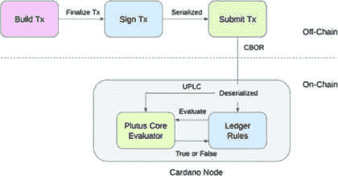

**图 5.1:** 交易生命周期

## 钱包

在加密货币中，钱包是与区块链交互的用户界面。钱包通常允许用户创建账户，账户是锁定在公钥地址上的 UTXO 集合。这种`账户抽象`（account abstraction）帮助用户直视化账户余额和交易历史等熟悉的概念。许多钱包还允许用户选择质押池并注册他们的质押密钥以收集质押奖励。`表 5.1`按字母顺序列出了 Cardano 网络上的某些钱包提供商。

| **名称** | **全节点** | **硬件钱包支持** | **移动 App** | **开源** |
| --- | --- | --- | --- | --- |
| `Daedalus` | **✔** | **✔** | **✖** | **✔** |
| `Eternl` | **✖** | **✔** | **✔** | **✖** |
| `Flint` | **✖** | **✔** | **✔** | **✔** |
| `GameChanger` | **✖** | **✖** | **✖** | **✔** |
| `GeroWallet` | **✖** | **✔** | **✖** | **✖** |
| `Lace` | **✖** | **✔** | **✖** | **✔** |
| `Ledger` | **✖** | **✔** | **✖** | **✔** |
| `Nami` | **✖** | **✖** | **✖** | **✔** |
| `NuFi` | **✖** | **✔** | **✖** | **✖** |
| `Typhon` | **✖** | **✔** | **✖** | **✔** |
| `VESPR` | **✖** | **✖** | **✔** | **✔** |

**表 5.1:** Cardano 钱包¹

**全节点：** 包含完整 Cardano 节点且不使用任何第三方服务在区块链上查询交易的钱包。

**硬件钱包支持：** 支持使用硬件设备进行签名的钱包。

**移动 App：** 在 iOS 或 Android 设备上具有原生移动 App 的钱包。

**开源：** 钱包的开源代码在 GitHub 上可用。

## 助记词

要使用钱包创建账户，你必须创建一个新的助记词或导入现有的助记词。如果我们回想起`[第 3 章，交易]`中的内容，签名交易需要私钥。为了创建此私钥，钱包通常使用`助记词`（seed phrase）来生成私钥。这是一个两步过程，其中使用一个句子或一组单词来创建一个随机种子。² 该随机种子随后被用于派生公钥和私钥。³

## 测试网水龙头

Cardano 通常有两个用于主网（Mainnet）之前端到端测试的测试网。⁴ 在发送资金时，请注意你连接的是哪个网络。

- **Preview Testnet：** 周期（epoch）已缩短为一天，领先主网 4 周。
- **Preprod Testnet：** 该网络用于主网发布候选，尽可能模拟生产环境，是更稳定的测试网。

我们将使用测试网水龙头获取 Ada 并将其发送到钱包。在本书中，我们将使用`Eternl`钱包，`图 5.2`显示了如何获取接收地址。

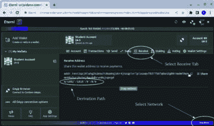

**图 5.2:** Eternl 钱包接收资金

复制地址并粘贴到`https://docs.cardano.org/cardano-testnet/tools/faucet/`的测试网水龙头中，如`图 5.3`所示。

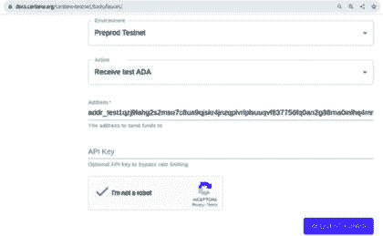

**图 5.3:** 测试网水龙头

选择`Request Funds`，你应该看到`Success`信息，其中包含一个可以在`https://preprod.cexpl.io/`上使用的交易哈希。


**图 5.4:** 测试网水龙头

10–60 秒后，你应该在`Eternl`钱包中看到 10,000 test Ada。

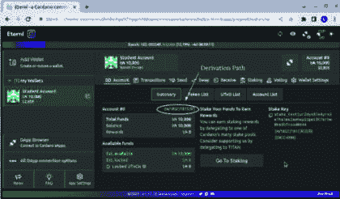

**图 5.5:** Eternl 账户

## 地址派生

确定性层次（HD）钱包（如`Eternl`）遵循`CIP-1852`⁵](#c05.xhtml#ftn5)中的派生路径规范：

`m / purpose' / coin_type' / account' / index`

在`图 5.5`中，我们可以看到接收地址的派生路径为：

`m/1852'/1815'/0'/0`

`表 5.2`了派生路径的每个元素：

| 名称 | 值 | 注释 |
| --- | --- | --- |
| Purpose | 1852 | 规范名称（例如 CIP-1852） |
| Coin Type | 1815 | 每个加密货币的不同值（例如 Lovelace） |
| Account | 0 | 允许创建多个钱包账户 |
| Role | 0 | 0 = 外部链（接收支付），1 = 内部链（找零），2 = 质押密钥 |
| Index | 0 | 从 0 开始的地址索引 |

**表 5.2:** 派生路径

你可以使用 HD 钱包为同一个私钥创建不同的地址来接收支付（以及找零）。但在实践中，通常倾向于使用`单地址模式`（single address mode），即重用同一个地址。为每次交易创建新有助于匿名化，使其无法关联到钱包账户。但在 Cardano 中，一旦钱包地址注册了质押密钥，该地址的所有交易都可以通过质押密钥关联。多个接收和找零地址增加了 dApp 的复杂度，这就是为什么某些钱包只支持单地址模式。将`Eternl`切换（或保持）到单地址模式见`图 5.6`。

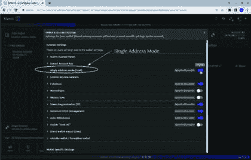

**图 5.6:** Eternl 单地址模式

## 质押

Cardano 网络最重要的功能之一是从钱包轻松进行质押。这被称为流动非托管质押，这也是为什么 Cardano 网络上有高质押率，这有助于其安全性和去中心化。要进行质押，用户进入质押标签页，选择一个质押池并点击`Delegate`，如`图 5.7`所示。

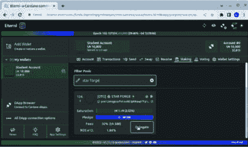

**图 5.7:** 质押池委托

接下来，用户必须签名交易将质押密钥和质押池委托注册到网络，如`图 5.8`所示。

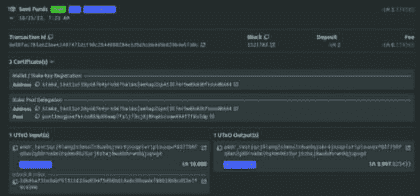

**图 5.8:** 质押池注册

当带有质押密钥注册证书和质押池委托证书的交易确认后，用户将根据`[第 2 章，加密与共识算法概述]`中讨论的 Ouroboros 生命周期接收质押奖励。

## CIP-30

为了 dApp 连接到如`Eternl`等浏览器扩展钱包，dApp 应该遵循`CIP-30`标准⁶](#c05.xhtml#ftn6)。该标准描述了一个基于网页的通信桥接，允许网页与浏览器扩展钱包交互。这是通过向正在渲染的网页中注入 JavaScript 代码实现的。网页或 dApp 随后可以调用带有预定义公共方法的 JavaScript 代码来从钱包检索并提交数据。在链外代码示例中，我们将在本章稍晚时候看到如何使用 CIP-30 与钱包交互。

## Demeter.run

在我们深入第一个离链智能合约示例之前，我们必须快速搭建并运行环境。这就是`Demeter.run`大派用武场。它是一个完全托管的解决方案，可以启动各种 Cardano 环境。Cardano 是完全开源的，因此你可以在本地或云环境中安装并运行 Cardano 组件。对于本书，我们将使用`Demeter.run`将更多精力放在概念和应用逻辑上，而花费较少的时间在环境设置和配置上。

要设置一个用于书中示例的环境，请按照以下步骤操作：

1. 访问[`demeter.run/`](https://demeter.run/)
2. 开启免费试用。
3. 注册/登录。
4. 创建组织。
5. 创建新项目，如图 5.9 所示。
   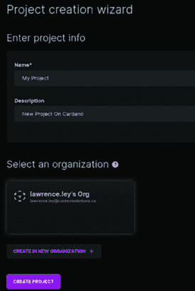
   **图 5.9：** Demeter.run 新项目
6. 可以从免费层开始，但根据使用情况，你可能需要迁移到付费层或购买额外的 DCU。购买的每个计划都与特定的项目相关。
   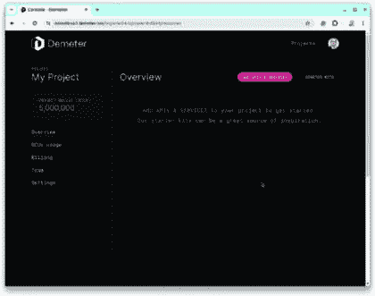
   **图 5.10：** Demeter.run 项目视图
7. 选择`ADD APIS` `&` `SERVICES`，如图 5.10 所示。
8. 向下滚动并创建一个新的工作区。
9. 选择“Clone an existing repository”（复制现有仓库）。
10. 在文本框中粘贴 GitHub URL：`https://github.com/ava-orange-education/Mastering-Cardano-Smart-Contracts.git`
11. 保持分支默认为 main。
12. 选择 Node.js 作为工具链。
13. 选择工作区大小`small`。
14. 选择`Pre-prod`网络。
15. 选择页面底部的`Create`。
16. 如果你滚动到页面顶部，将看到工作区正在配置并最终完成，如图 5.11 所示。
    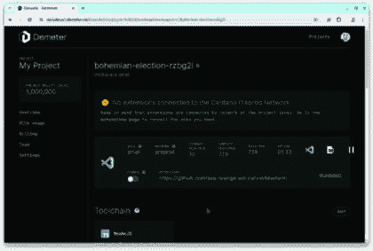
    **图 5.11：** Demeter.run 项目配置
17. 向下滚动页面并`EDIT` Exposed Ports（暴露端口）。
18. 输入名称为`Next.js`。
19. 输入数字`3000`。
20. 选择`Expose`（暴露）。
21. 回到页面顶部并选择 VS code 图标启动 VS code 编辑器。
22. 授权信任访问，以便使用 VS code Web 版编辑代码。
23. 选择`Terminal` -> `New` `Terminal`创建一个终端窗口，在命令行中执行命令，如图 5.12 所示。
    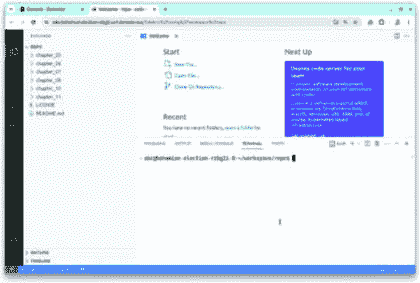
    **图 5.12：** Visual Studio Code

## 离链示例

本节将展示构建简单归属合约离链代码的两种方法。每种方法都将使用 Next.js 构建应用程序。有关 Next.js 的更多信息，鼓励读者查看 Next.js 官方文档 https://nextjs.org/docs。

### Helios

Helios 既是一个离链 JavaScript/TypeScript SDK，也是一种链上功能性强类型语言。它优先考虑可读性和易用性，以提供最佳的开发者体验。Helios 的主要优势之一是它没有任何第三方库的单个 JavaScript 文件，这提高了执行智能合约的可审计性和透明度。

### 初始化

我们将参考 GitHub 示例中的一个功能完整的端到端示例来执行你的第一个离链代码。在上一节带有`Demeter.run`工作区的 Visual Studio Web 设置中，选择一个新的 Terminal，并执行以下步骤：

```
$ cd chapter_05/helios/vesting

$ nvm install 18.17.0

$ npm install

$ npm run dev
```


这将启动 Next.js 并在默认端口 3000 上运行。忽略 Visual Studio 关于端口转发的任何提示，因为我们将使用暴露的端口访问该端口。你可以进入 `Demeter.run` 上的工作区并选择暴露端口的 URL 来访问 Next.js 应用程序。在浏览器中，你应该能看到类似图 5.13 的内容。

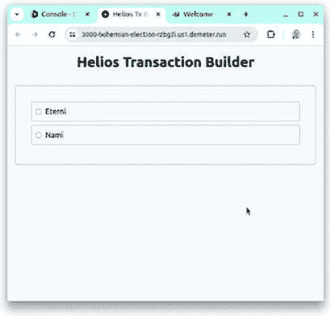
**图 5.13：** Helios 交易构建器

在选择钱包之前，请确保你的 Chrome 浏览器已安装了 `Eternl`（或 Nami）浏览器扩展。如果你刚刚安装或启用了浏览器扩展，可能需要刷新页面。在 `Helios Tx Builder` 页面上，当选择了一个钱包时，钱包将提示用户确认是否连接到此站点（如果之前没有连接过的话）。确认确定，然后你将看到所选钱包的余额，如图 5.14 所示。

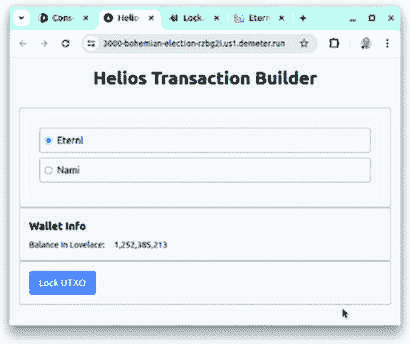
**图 5.14：** Helios 钱包选择器

## 锁定 (Lock)

在图 5.14 中，你会看到屏幕底部有一个“Lock UTXO”（锁定 UTXO）按钮。该按钮将创建一个离链交易来锁定 2 Ada 和一个 Datum。让我们查看提交链上交易所需的代码。

## 第一步

为了连接到浏览器 API，我们将在 Next.js 应用中创建一个 `WalletConnector.tsx` 组件。在图 5.15 中，第 52 和第 53 行代码首先确认浏览器插件是否存在。如果是，它将更新第 56 行的 `walletAPI` 变量，以便应用程序的其他部分可以使用它。

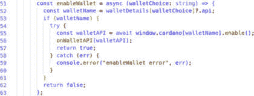
**图 5.15：** 钱包 API^7

## 第二步

一旦获取了 `walletAPI`，我们就可以查询钱包的可用 UTXO 并更改地址，如图 5.16 中的第 89 和第 92 行所示。Helios 使用了一个封装了 `walletAPI` 对象的类来提供方便函数和自动转换。

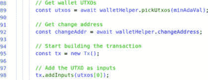
**图 5.16：** Helios WalletHelper^8

接下来，我们必须编译 Plutus 脚本以确认脚本地址。这可以通过客户端 JavaScript 完成，如图 5.17 中的第 104 行所示。在第 107 行，我们可以看到从链上代码导入 Datum 结构并创建相应的离链 Datum 是多么简单。接下来，我们在第 113 到 117 行使用脚本地址和 Lovelace（2 Ada）构造 UTXO 输出，并将 Datum 作为内联 datum。

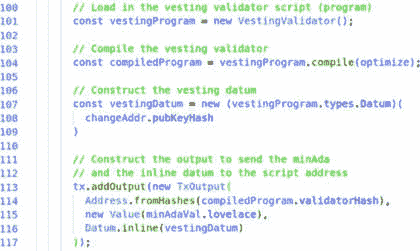
**图 5.17：** Helios 程序^9

## 第三步

在签名交易之前的最后一步是获取当前网络参数，包括当前 epoch、成本模型、最大 `tx` 大小等这在构建脚本时进行内部验证是需要的。在这个示例中，我们只是向脚本地址发送（锁定）Ada，因此我们不需要评估 Plutus 脚本。然而，我们将在关于“验证器”（Validators）的后续章节中评估 Plutus 脚本。在[图 5.18](#c05.xhtml#fig5_18）的第 124 行，交易被最终化，这平衡了交易输入和输出，并在需要时将找零返回钱包。一旦交易完成最终化，我们请求钱包提示用户签名交易。完全签名的交易在第 131 行提交到网络。

如果我们选择指向区块链浏览器的链接，就可以看到包含内联数据（inline datum）的交易，如`图 5.21`所示。


**图 5.21:** 区块链浏览器¹¹

### Lucid + Aiken

Lucid + Aiken 组合的优势是在 Cardano 社区内更广泛的采用和使用。Aiken 团队还专注于优秀的开发者体验，并创建了多个工具来帮助智能合约开发者的生命周期。本节将重点介绍如何使用 Lucid 构建离链交易，并在 Aiken 脚本地址锁定 UTXO。

与 Helios 不同（Helios 有运行时编译 Plutus 脚本的选项），Aiken 遵循更典型的两阶段部署过程：

1. 使用基于 Rust 的 Aiken 编译器编译 Aiken 脚本，生成如编译后的 Plutus 脚本和脚本哈希等产物，并将其存入名为 `blueprint`（蓝图）的文件中。
2. Lucid 离链代码读取 `blueprint` 文件中的编译脚本以及可能所需的任何合约参数。

### Blockfrost API

在示例中，我们将使用 Blockfrost API 与 Cardano Preprod 网络交互。因此，你必须获取一个 API key 并将其设置为环境变量。

1. 访问 `https://blockfrost.io/`
2. 创建一个免费账户并为 Cardano Preprod 网络创建一个 API key。

## 初始化

对于 Lucid 离链代码示例，我们将参考 GitHub 代码，该代码可以通过以下步骤运行：

```bash
$ cd chapter_05/aiken/vesting
$ nvm install 18.17.0
$ npm install
$ echo export NEXT_PUBLIC_BLOCKFROST_API=https://cardano-preprod.blockfrost.io/api/v0 >> ~/.bashrc
$ echo export NEXT_PUBLIC_BLOCKFROST_KEY=your-blockfrost-API-key >> ~/.bashrc
$ source ~/.bashrc
$ npm run dev
```


这将启动 Next.js 并提供与我们在使用 Helios 交易构建器时相同的体验。对于本章，Aiken 合约已经预编译，我们将在`第 6 章，验证器`中讨论 Aiken 的安装和构建步骤。

`图 5.22`、`5.23` 和`5.24`显示了蓝文件的内容。它描述了 Aiken 验证器以及数据（datum）和还原者（redeemer）数据类型。

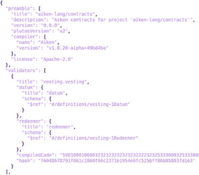

**图 5.22:** Aiken Blueprint Validator

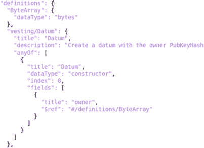

**图 5.23:** Aiken Blueprint Datum Definition

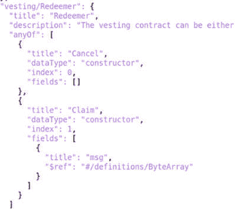

**图 5.24:** Aiken Blueprint Redeemer

### Lucid 离链代码

`WalletConnect.tsx`组件获取`walletAPI`的方式与 Helios 离链代码相同。与 Lucid 的区别在于它还需要使用如`Blockfrost`这样的区块链提供商。一旦在`图 5.25`的第 32-35 行创建了提供商，`walletAPI`就会在`图 5.26`的第 118 行传递给它。


**图 5.25:** Lucid Blockfrost Provider¹²

Datum 是手动构建的，Plutus 验证器脚本分别在`图 5.26`的第 126 行和 129 行从蓝文件读取。最后，交易在第 133、139 和 142 行进行构建、签名并提交。


**图 5.26:** Lucid Submit Transaction¹³

## 结论

本章开头我们回顾了交易生命周期和 Cardano 中使用的钱包。然后我们进入了使用两种不同方法构建离链交易：Helios 和 Lucid + Aiken。每种方法都创建了相同的用户体验，以突出它们之间的区别。我们还演示了像`Demeter.run`这样的工具如何用于搭建开发环境，以及如何使用钱包将质押注册到质押池。展望未来，我们准备好审查链上代码并作为交易的一部分执行它。

### 注意事项

* 交易生命周期涉及构建、签名和提交。
* 交易提交到网络时使用 CBOR 格式进行序列化。
* 钱包是通往区块链和智能合约的网关。
* 种子助词（seed phrase）用于生成私钥。
* 测试网水龙头（Testnet faucet）用于获取预览的测试`Ada`。

* 交易生命周期涉及构建、签名和提交。
* 交易提交到网络时使用 CBOR 格式进行序列化。
* 钱包是通往区块链和智能合约的网关。
* 种子助词（seed phrase）用于生成私钥。
* 测试网水龙头（Testnet faucet）用于获取预览的测试`Ada`。
* （后续部分由于原文未提供，未进行翻译）
* 地址派生用于从同一个私钥派生多个地址。
* 使用钱包将质押注册到质押池是可能的。
* CIP-30 是一种浏览器钱包的标准。
* Demeter Run 是一个用于环境的平台。
* Helios 是一个离链库。
* Aiken 和 Lucid 用于浏览器。
* 蓝图（Blueprints）包含了编译后的脚本以及数据（datum）和还原者（redeemer）定义。

## 选择题

1. 注册质押池需要什么？
   a. 质押注册证书
   b. 提币证书
   c. 使用钱包
   d. 质押证书
2. 关于接收地址和找零地址，哪种描述是正确的？
   a. 都是内部地址
   b. 一个是内部，另一个外部
   c. 一个是外部，另一个内部
   d. 都是外部地址
3. 以下哪种 CIP 是浏览器钱包标准？
   a. CIP-22
   b. CIP-42
   c. CIP-30
   d. CIP-32
4. 生成私钥使用什么？
   a. 网络
   b. 种子助词
   c. 密码
   d. 以上都不是
5. Aiken 蓝图在 Lucid 用于？
   a. 脚本地址的 UTXO
   b. 当前 Epoch
   c. 编译后的脚本和参数
   d. ADA 价格

## 答案

1. a
2. c
3. c
4. b
5. c

## 问题

1. 单地址模式钱包的优缺点是什么？
2. Helios 或 Lucid + Aiken 可以用于服务器端模型？
3. 你可以使用哪些语言和框架来编写 Cardano 离链代码？
4. Aiken 蓝图有什么用？
5. 生成私钥需要种子助词吗？

### 关键术汇

* **组合交易 (Assembled Transaction)**：包含输入、输出、Datum 和 Redeemer 的交易。
* **账户抽象 (Account Abstraction)**：创建具有余额和交易历史的账户视图或模型。
* **全节点 (Full Node)**：Card 节点，不使用第三方服务查询区块链交易。
* **种子助词 (Seed Phrase)**：用于生成私钥。
* **确定性钱包层次 (Hierarchy for Deterministic Wallet)**：从同一个私钥派生多个地址。
* **单地址模式 (Single Address Mode)**：重用网络地址。
* **可审计性 (Auditability)**：确认智能合约已审计的能力。
* **透明度 (Transparency)**：如何确保执行的智能合约是正确的。
* **WalletAPI**：与 CIP-30 兼容浏览器钱包交互的 JavaScript 对象。
* **Blockfrost**：提供查询 Cardano 区块链的 API 服务。

# 第 6 章：验证器 (Validators)

## 引言

本章将探讨什么是验证器以及它们为什么重要。我们将展示如何花费锁定在验证器地址上的 UTXO，以及如何访问由`Redeemer`和`Datum`提供的数据。接下来，将深入理解`ScriptContext`以及如何使用它来访问与交易相关的输入和输出。本章还将回顾使用两种不同方法的代码示例：`Helios`和`Lucid + Aiken`。

## 结构

在本章中，我们将讨论以下内容：

* 验证器 (Validators)
* Helios
  * Helios 上上验证器
  * Helios 链下解锁
  * Helios 链下取消
* Lucid + Aiken
  * Aiken 上上验证器
  * Lucid 链下解锁
  * Lucid 链下取消

## 验证器 (Validators)

验证器是 Cardano 智能合约的基础，因为它们了花费锁定在脚本地址上的 UTXO 所需的链上条件。一旦验证器上链，它就是不可变的，代码即“法律”。验证器的一个典型用例是归属合约（vesting contract），资金被锁定在合约中直到满足特定条件。我们将在后续章节中进一步构建归属示例，并查看链上和链下的代码。验证器由两个部分组成：定义规则和逻辑的链上代码，以及创建并提交交易的链下代码。

## Helios

我们之前在`第 5 章，交易构建器`中看到过如何使用`Helios`构建链下交易。在本章中，我们首先查看构建链上验证器的代码，然后是花费锁定在脚本地址上的 UTXO 所需的链下代码。用于链上代码的`Helios`语言是一种强类型函数式编程语言，具有类似于`Haskell`或`Aiken`等语言的代码质量优势。然而，`Helios`编译器是用`JavaScript`编写的，具有仅使用`JavaScript`在运行时进行编译的独特优势。这使得设置和安装变得简单，因为你只需要一个最新版本的`Node.js`，它在许多操作系统上广泛可用。

### Helios 上上验证器

`Helios`上上验证器的第一行指定了`Plutus`脚本的用途。在这种情况下，它是一个`spending`（花费）脚本，脚本名称为`vesting`。在图 6.1 的第 7 行中，`Datum`被定义为一个`struct`，其中包含一个使用`PubKeyHash`数据类型的`owner`变量。这将存储在链上锁定在脚本地址的 UTXO 中。我们之前在`第 4 章，Plutus`，`图 4.5`中看到过这种类型的`Datum`示例。在图 6.1 的第 15 行，有一个带有`enum`数据类型的`Redeemer`，它包含两个元素：`Cancel`和`Claim`。`Claim`元素有一个`msg`变量，用于在运行时向验证器传递消息。

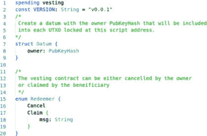

**图 6.1:** Helios 上上验证器声明

**注意**：在本地运行时，可以使用`Helios` Visual Studio Code 扩展（`ext:hl`）进行语法高亮。对于 Visual Studio Web，你必须将`.hl`扩展名与 C 关联。

在图 6.2 的第 23 行中，声明了一个合约参数`MESSAGE`，它将被硬编码到`Plutus`脚本中。合约参数是一个`UPLC`值，位于主验证器函数之前，如果需要可以在编译时或运行时动态更新。

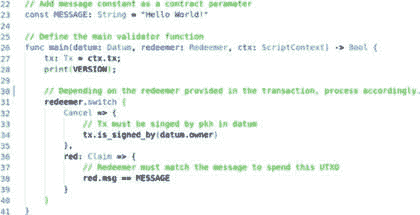

主验证器函数定义在图 6.2 的第 26 行。我们可以看到三个参数——`Datum`、`Redeemer`和`ScriptContext`被传递给主函数。验证器可以根据验证器逻辑使用这些参数中的任何一个或全部。我们已经在`第 4 章，Plutus`中讨论过`Datum`和`Redeemer`，因此我们将详细研究`ScriptContext`。`ScriptContext`包含了脚本用途以及与提交交易的所有信息，辅助数据（元数据）。

正如我们在`第 3 章，交易`中所提到的，每个锁定在脚本地址的 UTXO 在 redeemer 中指定了脚本用途。因此，`ScriptContext`中可能的四个脚本用途如下：

* `Spending`：用于验证锁定在脚本地址的 UTXO 的花费。
* `Minting`：用于铸造或销毁原生代币。
* `Certifying`：用于质押密钥注册并将质押委托给质押池。
* `Rewarding`：用于提取质押奖励。

在`图 6.2`的第 27 行中，我们定义了一个本地变量`tx`，它获取当前正在执行的交易的所有信息。这将被用于提取该交易所需的签名者。接下来，我们对 Redeemer（解锁证明者）使用`switch`语句，根据 Redeemer 的值执行不同的代码。如果 Redeemer 是`Cancel`，我们就查看交易中所需的签名，检查它们是否与`datum`中的公钥哈希值匹配。如果为真，验证器将允许所有者对此`UTXO`进行任何操作。如果 Redeemer 是`Claim`，则当 redeemer 中的消息与合约参数`MESSAGE`值匹配时，我们返回`true`。如果 Redeemer 既不匹配`Cancel`也不匹配`Claim`或者返回假值，验证器将返回`false`，交易将失败。

# Helios 离线解锁

首先，我们将创建一个`Unlock.tsx`组件，它将允许用户输入 Redeemer 的文本并选择一个按钮来构建解锁交易，如`图 6.3`所示。

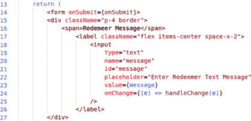

**图 6.3：** 解锁 UI 组件³

然后，我们在主页面`index.tsx`中创建解锁函数，该函数接收 Redeemer 参数并构建交易。`图 6.4`中的解锁函数与锁定函数类似，但我们需要在第 171 行获取接收地址以发送解锁后的资金。在第 186 行，我们将验证器脚本附加到交易中，作为脚本见证（script witness）。

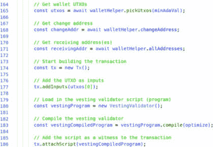

**图 6.4：** 解锁函数归属程序⁴

接下来，在`图 6.5`中，我们需要在第 189 行获取脚本地址上的锁定`UTXO`，并在第 193 行构建 Redeemer。在 Helios 中，我们可以直接从链上代码中导入 Redeemer 类型，并使用`_toUplcData()`函数生成 UPLC 代码。然后我们在第 198 行添加`UTXO`输入和 Redeemer，它们将作为 Redeemer 见证被链接在一起。第 206 行还创建了一个`UTXO`输出，以便在脚本地址上的锁定`UTXO`被花费后，将 2 Ada 发送到接收地址。

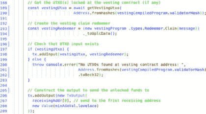

**图 6.5：** 解锁函数的输入和输出⁵

第 189 行的`getVestingUtxo`函数会对 Next.js API 进行网络调用，用于查询区块链上脚本地址的`UTXO`。该 Next.js API 使用第三方区块链 API 提供商`Blockfrost`，并在服务器上执行。查询 Cardano 区块链还有其他提供商和方法，如 Maestro、Ogmios 和 Koios。我们将在`第八章，工具`中回顾其他区块链 API 提供商。在服务器端使用`Blockfrost` API 的优势是，它可以避免在从浏览器直接调用 API 时导致 API 密钥泄露。此外，这还避免了对不同域的网络调用，从而可能导致浏览器 CORS 错误。`图 6.6`显示了`index.tsx`中`getVestingUtxo`函数调用的 Next.js`vestingUtxo`API 代码。

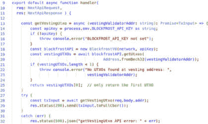

**图 6.6：** getVestingUtxo API⁶

解锁函数的剩余部分与锁定函数相同，负责组装、签名并将交易提交到网络。带有解锁按钮和 Redeemer 消息输入的新 UI 见`图 6.7`。

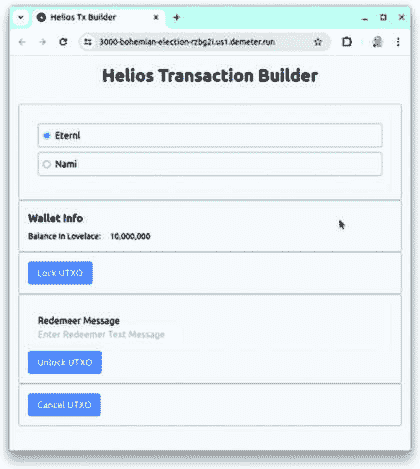

**图 6.7：** Helios 解锁 UTXO

# 离线取消

我们创建了一个`Cancel.tsx`组件并在`index.tsx`中创建了一个取消函数，它将与`Lock.tsx`组件和`unlock`函数几乎相同。解锁函数和取消函数之间只有几处变化。你能发现`图 6.8`中的差异吗？

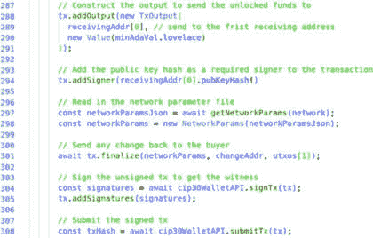

**图 6.8：** Helios 取消 UTXO⁷

区别在于，我们必须显式地添加交易所需的签名者。第 294 行的`.addSigner()`函数会将钱包的公钥哈希添加到交易中，并将其作为所需的签名者。Cardano 节点将确保任何所需的签名者在见证集中都有对应的有效签名。链上代码随后在签名者列表中查找公钥哈希，以检查是否匹配。

# 测试驱动

要运行演示，需要执行以下命令；除非你更改版本或脚本，否则操作是相同的：

```bash
curl -sSf https://install.aiken.org | bash
echo export PATH=$HOME/.aiken/bin:$PATH >> ~/.bashrc
source ~/.bashrc
```

你应该能够访问：接下来，在`图 6.5`中，我们需要在第 189 行获取脚本地址上的锁定`UTXO`，并在第 193 行构建 Redeemer。在 Helios 中，我们可以直接从链上代码中导入 Redeemer 类型，并使用`_toUplcData()`函数生成 UPLC 代码。然后我们在第 198 行添加`UTXO`输入和 Redeemer，它们将作为 Redeemer 见证被链接在一起。第 206 行还创建了一个`UTXO`输出，以便在脚本地址上的锁定`UTXO`被花费后，将 2 Ada 发送到接收地址。

# Aiken

Aiken 是一种用 Rust 编写编译器的函数式编程语言，我们将使用`aiken build`命令编译脚本。它会生成 Plutus 代码和一个`blueprint`文件。你可以通过以下命令创建一个项目：

```bash
aiken new aiken-lang/new-project
```

这将创建以下项目文件和文件夹：

```
└── new-project
    ├── aiken.toml
    ├── lib
    │   └── new-project
    ├── README.md
    └── validators
```

`aiken.toml`包含项目信息，包括库和 GitHub 仓库。`validators`文件夹包含链上的 Aiken 源码，`lib`目录包含项目所需的或创建的任何库。你可以在 new-project 目录下执行`aiken build`和`aiken check`来确认所有内容都已安装。

安装`aiken`后，你可以可以使用帮助查看以下选项：

```bash
aiken --help
```


# Cardano 智能合约语言和工具链

用法：`aiken <COMMAND>`

Commands:

- `new`：创建一个 Aiken 项目
- `fmt`：格式化 Aiken 项目
- `build`：编译 Aiken 项目
- `address`：计算验证器地址
- `check`：类型检查 Aiken 项目
- `docs`：构建 Aiken 项目的文档
- `add`：添加新的项目包作为依赖
- `blueprint`：处理 Plutus 蓝图
- `packages`：管理项目依赖
- `tx`：处理交易
- `uplc`：处理无类型 Plutus-core
- `completion`：生成 shell 自动补全脚本
- `help`：打印此消息或给定子命令的帮助

# Aiken 链上验证器

现在，我们准备好查看第一个 Aiken 验证器脚本，如`图 6.10`所示：

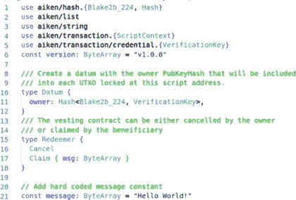

**图 6.10：** Aiken 上验证器声明¹⁰

`图 6.10`中的前 5 行是我们将要用到的类的显式导入，随后是`Datum`和`Redeemer`类型。`Datum`包含一个`Hash`对象，该对象包含一个`Blake2b_224`和一个`VerificationKey`对象。需要注意的是，这在链上被存储为代表公钥哈希的单个`ByteArray`（`字节数组`）。在第 15 行，`Redeemer`包含两个条件（`Cancel`和`Claim`），用于花费锁定在该脚本地址上的 UTXO。`Claim`还原器还包含一个使用`ByteArray`数据类型的`msg`负载。在第 21 行，我们将“Hello World!”消息硬编码为脚本常量。

接下来，在`图 6.11`中，我们在第 23 行定义了验证器函数，并以`Datum`、`Redeemer`和`ScriptContext`作为参数创建了归属函数：

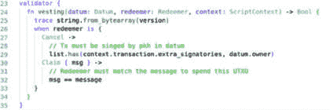

**图 6.11：** Aiken 上验证器主体¹¹

在第 26 行，我们确定了特定交易提供的`Redeemer`类型。在`Cancel`的情况下，第 29 行的代码会遍历签名者列表，并确认是否存在公钥哈希与 datum 中的公钥哈希匹配。如果为真，则验证器评估为真并允许花费锁定在脚本地址上的 UTXO。如果`Redeemer`是`Claim`，我们将`msg`负载与第 32 行的硬编码消息进行比较。如果`Redeemer`没有匹配项，则验证器将失败并不允许花费锁定在脚本地址上的 UTXO。

## Lucid 离链解锁

我们将创建一个与在 Helios 中相同的`Unlock.tsx`组件，并在`index.tsx`中创建一个`unlock`函数。我们需要为`unlock`函数创建一个`Redeemer`，但不需要创建`Datum`，因为其已经是我们想要花费的 UTXO 的一部分。`图 6.12`中第 172 行的`Redeemer`创建了一个 Plutus`Data`对象，该对象对应于《第 4 章，Plutus》中看到的数据类型。在这种情况下，我们在索引为 1 的处创建了一个`Constr`，其中包含一个十六进制编码的字符串。当脚本被求值时，该十六进制编码的字符串将转换为`Redeemer`的`ByteArray`负载。我们指定索引为 1 是因为`Cancel`是 Plutus 脚本中定义的第一个`Redeemer`，索引为 0。按顺序的下一个`Redeemer`索引为 1，即`Claim`。


**图 6.12：** Lucid 离链解锁¹²

在第 175 行，通过调用`lucid.utxosAt`函数获取锁定在脚本地址上的 UTXO，该函数使用 Blockfrost API 查询区块链。接下来，我们在第 182 行构建交易并指定输入 UTXO，并在第 183 行指定`Validator`脚本。我们现在可以使用`.complete()`方法组装 Aiken 交易。我们将使用 Lucid 方法来组装并提交交易。在交易完成后，钱包将请求用户签名并提交。

## Lucid 离链取消

最后，我们将创建一个与 Helios 中相同的`Cancel.tsx`组件，并在`index.tsx`中创建一个`cancel`函数。`图 6.13`第 226 行的`Cancel.tsx`组件与`Lock.tsx`组件几乎相同，不同在于交易所需的签名。链上代码需要查看公钥哈希匹配存储在 datum 中的公钥哈希。


**图 6.13：** Lucid 离链取消¹³

## 测试驱动

要尝试示例，请运行以下步骤：

```
cd chapter_06/aiken/vesting/contracts
aiken build
cd ..
echo export NEXT_PUBLIC_BLOCKROST_API=https://cardano-preprod.blockfrost.io/api/v0 >> ~/.bashrc
echo export NEXT_PUBLIC_BLOCKROST_KEY=your-blockfrost-key >> ~/.bashrc
source ~/.bashrc
npm install
npm run dev
```

## 总结

我们查看了使用 Helios 和 Aiken 构建的第一个链上验证器及其对应的离链代码。我们查看了如何使用 Aiken 初始化项目以及编译 Aiken 合约。然后，检查了`ScriptContext`以及它包含的输入、输出、脚本等交易信息。我们还查看了链上的`Datum`和`Redeemer`定义以及它们在脚本执行期间如何访问。示例中还演示了离链`Redeemer`和所需签名者的创建。下一章将深入铸币策略、参数化智能合约和原生代币的铸造。

## 知识点回顾

- Helios 用于链上和离链代码。
- Helios 链上代码可以动态编译，因为 Helios 编译器是用 JavaScript 编写的。
- Aiken 用于链上代码，并在运行时使用基于 Rust 的`aiken`编译器进行编译。
- Aiken 生成一个包含 Plutus 脚本元数据和类型定义的蓝文件。
- `aiken`程序具有多个方便的实用函数，可在智能合约开发中使用。
- Lucid 用于离链代码，并经常与 Aiken 配合使用。
- Lucid 和 Helios 离链代码依赖区块链 API 提供者来获取锁定在脚本地址上的 UTXO。
- Helios 离链代码可以导入 Helios 链上代码，从而共享类型定义。
- Helios 离链代码不需要任何第三方库并整合在一个文件中。
- 每个 UTXO 必须提供一个`Redeemer`。
- 签名者必须在交易中包含签名。

## 6. 交易所需的签名者的 CDDL 规范标识符是什么？

## 核心术语

- `Auxiliary Data`：关于交易的元数据，仅将元数据的哈希存储在链上。
- `Blake2b`：一种基于字节输入生成哈希的算法。
- `Blueprint`：一个由 Aiken 生成的文件，包含 Plutus 脚本元数据和类型定义。
- `Blockfrost`：块链数据的 API 提供者。
- `ByteArray`：使用十六进制格式编码的字节数组。
- `Contract Parameter`：链上变量，可以在编译期间或运行时进行更新。
- `Enum`：一种可以枚举并用于 switch/case 语句的数据类型。
- `ScriptContext`：包含当前正在评估交易的所有信息，辅助数据（`Auxiliary Data`）除外。
- `Spending script`（花费脚本）：用于花费锁定在脚本地址的 UTXO 的验证器类型。
- `Switch Statement`（切换语句）：用于评估不同的枚举（`Enum`）组合情况。
- `VerificationKey`（验证密钥）：对应私钥的公钥。

---

¹ [`github.com/ava-orange-education/Mastering-Cardano-Smart-Contracts/blob/main/chapter_06/helios/vesting/contracts/vesting.hl`](https://github.com/ava-orange-education/Mastering-Cardano-Smart-Contracts/blob/main/chapter_06/helios/vesting/contracts/vesting.hl)
² [`github.com/ava-orange-education/Mastering-Cardano-Smart-Contracts/blob/main/chapter_06/helios/vesting/contracts/vesting.hl`](https://github.com/ava-orange-education/Mastering-Cardano-Smart-Contracts/blob/main/chapter_06/helios/vesting/contracts/vesting.hl)
³ [`github.com/ava-orange-education/Mastering-Cardano-Smart-Contracts/blob/main/chapter_06/helios/vesting/components/Unlock.tsx`](https://github.com/ava-orange-education/Mastering-Cardano-Smart-Contracts/blob/main/chapter_06/helios/vesting/components/Unlock.tsx)
⁴ [`github.com/ava-orange-education/Mastering-Cardano-Smart-Contracts/blob/main/chapter_06/helios/vesting/pages/index.tsx`](https://github.com/ava-orange-education/Mastering-Cardano-Smart-Contracts/blob/main/chapter_06/helios/vesting/pages/index.tsx)
⁵ [`github.com/ava-orange-education/Mastering-Cardano-Smart-Contracts/blob/main/chapter_06/helios/vesting/pages/index.tsx`](https://github.com/ava-orange-education/Mastering-Cardano-Smart-Contracts/blob/main/chapter_06/helios/vesting/pages/index.tsx)
⁶ [`github.com/ava-orange-education/Mastering-Cardano-Smart-Contracts/blob/main/chapter_06/helios/vesting/pages/api/vesting.ts`](https://github.com/ava-orange-education/Mastering-Cardano-Smart-Contracts/blob/main/chapter_06/helios/vesting/pages/api/vesting.ts)
⁷ [`github.com/ava-orange-education/Mastering-Cardano-Smart-Contracts/blob/main/chapter_06/helios/vesting/pages/index.tsx`](https://github.com/ava-orange-education/Mastering-Cardano-Smart-Contracts/blob/main/chapter_06/helios/vesting/pages/index.tsx)
⁸ [`preprod.cexplorer.io/address/addr_test1wp4gwgtnyp8whzjj47qyk60hxf9p2wymjkz6r9cp0vs/tx#data`](https://preprod.cexplorer.io/address/addr_test1wp4gwgtnyp8whzjj47qyk60hxf9p2wymjkz6r9cp0vs/tx#data)
⁹ [`aiken-lang.org/installation-instructions`](https://aiken-lang.org/installation-instructions)
(10) [`github.com/ava-orange-education/Mastering-Cardano-Smart-Contracts/blob/main/chapter_06/helios/vesting/contracts/vesting.ak`](https://github.com/ava-orange-education/Mastering-Cardano-Smart-Contracts/blob/main/chapter_06/helios/vesting/contracts/vesting.ak)
(11) [`github.com/ava-orange-education/Mastering-Cardano-Smart-Contracts/blob/main/chapter_06/helios/vesting/contracts/vesting.ak`](https://github.com/ava-orange-education/Mastering-Cardano-Smart-Contracts/blob/main/chapter_06/helios/vesting/contracts/vesting.ak)
(12) [`github.com/ava-orange-education/Mastering-Cardano-Smart-Contracts/blob/main/chapter_06/helios/vesting/pages/index.tsx`](https://github.com/ava-orange-education/Mastering-Cardano-Smart-Contracts/blob/main/chapter_06/helios/vesting/pages/index.tsx)
(13) [`github.com/ava-orange-education/Mastering-Cardano-Smart-Contracts/blob/main/chapter_06/helios/vesting/pages/index.tsx`](https://github.com/ava-orange-education/Mastering-Cardano-Smart-Contracts/blob/main/chapter_06/helios/vesting/pages/index.tsx)

# 第 7 章：铸造（Minting）

## 引言

在本章中，我们将研究原生资产（native assets）以及它们与使用`ERC20`和`ERC721`标准令牌的区别。我们将讨论令牌包（bundles）的概念以及硬币选择（selection）。接下来，我们将深入探讨非同质代币（NFTs）和同质代币（FTs）。我们还将审查`CIP25`和`CIP68`等 NFT 元数据标准。最后，我们将介绍令牌注册表（Token Registry）及其对钱包体验的影响，并结合一个铸造案例。

## 结构

在本章中，我们将讨论以下主题：

- 令牌（Tokens）
  - 原生资产（Native Assets）
  - 令牌包（Bundles）
  - 铸造策略（Minting Policy）
  - 同质代币（Fungible Tokens）
  - 非同质代币（Non-Fungible Tokens）
  - 注册表（Token Registry）
  - NFT 元数据标准（Metadata Standards）
    - `CIP25`
    - `CIP68`
- 硬币选择（Coin Selection）
  - 铸造案例（Minting Use Case）

## 令牌

2021 年 3 月 1 日，作为 Mary 硬叉的一部分，Cardano 升级到了多资产账本。这是一个重大事件，因为原生令牌现在可以利用用于原生货币`Ada`的安全且经过评审的账本规则。这与以太不同，以太需要遵循`ERC20`或`ERC721`标准的自定义账本代码。此外，不需要特殊的费用或额外的事件处理逻辑来跟踪关联交易。¹

## 原生资产

原生资产是 Cardano 上的自定义令牌，其运行方式与基础货币`Ada`相同。唯一的要求是原生资产必须包含少量的`Ada`。`CIP55`²：

- **策略标识符 (ID)：** 唯一标识符，是铸造策略 Plutus 脚本的哈希。
- **资产名称：** 特定铸造策略上的不可变令牌名称。
- **数量：** 计数单位。

(*) `Ada`是唯一策略 ID 为空字符串的资产。

## 令牌包

令牌包是令牌的集合，这些令牌可以相同也可以不同。令牌包将令牌组织到特定的结构中，正确定义铸造策略 ID、令牌名称以及每个令牌的数量。让我们来看下面的示例：

```json
{
  "lovelace": "1646420",
  "assets": {
    "Game Monetary Policy ID": {
      "Gold": "100",
      "Silver": "1,000",
      "Bronze": "10,000"
    },
    "Game Character Policy ID": {
```


在前面的示例中，我们有一组令牌，每个令牌都代表锁定在 UTXO 中的值。`Game Monetary Policy ID` 是唯一的铸币策略 ID（Minting Policy ID），玩家持有 100 个 Gold、1,000 个 Silver 和 10,000 个 Bronze 代。因此，用户可以在单笔交易中花费最多 100 个 Gold、1,000 个 Silver 和 10,000 个 Bronze 代。由于该玩家只有 1 个 Dracula Token，他们只能向另一个玩家发送（花费）1 个 Dracula 令牌。令牌包中始终需要最少量的 Ada，在这种情况下，金额为 1,646,420 lovelace。

## 铸币策略 (Minting Policy)

Cardano 上有两种不同类型的铸币策略：

* 使用 `cardano-cli` 工具创建并使用私钥和公钥的原脚本铸币策略。
* 作为 Plutus 脚本的铸币策略。

`cardano-cli` 方法[³] 早在智能合约引入之前被使用，但这种方法今天仍然在使用中，因为它是一种经过验证且安全的技术。使用带有原生脚本的 `cardano-cli` 提供了指定时间锁和多签名条件的能力[⁴]。

铸币策略的编写方式与我们编写验证脚本类似。验证脚本与铸币策略之间的区别在于，铸币策略使用了 `minting` 脚本用途且不使用数据（datum）。`minting` 脚本用途允许铸币策略作为交易的一部分来铸造或销毁原生代币。在铸币策略的自定义逻辑中，仅定义铸造或销毁的条件。

## 同质化代币 (Fungible Tokens)

你可能想创建一个供应量为 1,000,000 个令牌的货币策略。该铸币策略将允许一次性铸造 1,000,000 个令牌，每个令牌具有相同的名称。这使得每个令牌同质或可以交易，类似于目前的法币运行方式。

## 非同质代币 (Non-Fungible Tokens)

非同质代币（`NFT`）是指每个令牌都是独特且不同的。在 Cardano 上创建唯一令牌有两种方法。

* 方案 1：时间锁，令牌只能在特定的日期和时间之前铸造。
* 方案 2：铸币策略逻辑，检查输入中必须花费的 UTXO 是否存在。

第二种方案更优，因为它利用了 Cardano UTXO 架构的独特属性。一旦 UTXO 被花费，它就无法再次被花费，且不会有具有相同哈希值的 UTXO。通过将此条件硬编码到铸币策略中，并确保只铸造一个令牌，我们保证了令牌的唯一性。时间锁方法在智能合约功能可用之前曾使用，但在创建大型 NFT 集合时仍在使用这种方法。

## 令牌注册表 (Token Registry)

令牌注册表[⁵]用于存储铸币策略 ID 和令牌名称的链下元数据。铸币策略 ID 是十六进制哈希值，因此拥有一个关于特定铸币策略和令牌的可读信息映射是有帮助的。注册表提供了一个 API，钱包和其他应用程序可以使用该 API 查找令牌图像 URL、小数精度和其他元数据。随着 CIP-68 的采用增加，对中心化链下令牌注册表的需求将随着时间淘汰。有关注册令牌的分步指南，请访问以下 URL：

`https://github.com/cardano-foundation/cardano-token-registry/wiki`

## NFT 元数据标准

在铸造 NFT 时，你可以利用包含在 Cardano 网络上任何交易中的交易元数据。第一个 Cardano 元数据标准记录在 CIP-25[⁶] 中，它规定了 NFT 元数据的标准字段。与 Ethereum ERC-721 代币元数据的一个显著区别是，CIP-25 元数据与铸造交易相关而非与铸币策略。因此，使用 CIP-25 查找元数据的过程是查看特定铸币策略的原始铸造交易。

## CIP-25

CIP-25 NFT 元数据的格式如图 7.1 所示：

```
Figure 7.1: CIP-25 NFT Metadata
```

标签 721 表示这是元数据，且格式是灵活的，允许你根据需要添加额外的元素。要在生产环境中测试并验证有效的元数据，你可以使用 `Pool.pm` 测试⁷。

## CIP-68

CIP-25 的缺点是它是随原始铸造交易创建的，且不可更新。CIP-68[⁸] 通过使用引用令牌（reference token）的概念解决了这个问题，引用令牌是在 NFT 或 FT 创建同时创建的。引用令牌可以锁定在一个不可花费的脚本地址以保持不可变性，也可以在需要更新时锁定在花费地址上。元数据存储在包含在引用令牌 UTXO 中的 datum 中。随着 2022 年 9 月的 Vasil 硬叉，引入了引用输入，允许 Plutus 脚本将 UTXO 作为只读包含，而无需花费它。因此，任何数量的交易（即使是并行）都可以包含只读 UTXO 而不会产生任何并发问题。

在[图 7.2]中，我们可以看到铸造交易如何生成用户令牌和引用令牌，它们使用相同的令牌名称和铸币策略 ID 链接。令牌名称以前缀 222 表示 NFT 令牌，以 100 表示引用令牌。对于同质化代币，使用前缀 333。需要注意的是，引用令牌与 NFT 或 FT 令牌不需要同时铸造。

```
Figure 7.2: CIP-68 Datum Metadata
```

在[第 9 章，票务应用设计]中，我们将通过真实示例详细讨论创建和使用 CIP-68 元数据数据的过程。

## 硬币选择 (Coin Selection)

硬币选择是确定需要哪些 UTXO 输入来覆盖 UTXO 输出成本（包括网络费用）的过程。在硬币选择过程中，我们需要注意许多约束条件如下[⁹]。

* 交易的最大大小限制，每个 UTXO（无论是作为输入还是输出）都会增加整个交易的大小。
* 极小 UTXO（`dust`）的积累，它们是无法花费的，因为你无法合并足够的数量来覆盖交易成本。
* UTXO 不能部分花费；它必须作为交易的一部分被完全花费。

因此，硬币选择算法的目标是避免 `dust` 并创建可用的 UTXO。硬币选择算法的考虑因素同时适用于 Ada 和原生代币。硬币选择常用的方法是“最大优先”（Largest-first）和“随机改进”（Random Improve）。最大优先按照从最大值到最小值的顺序选择 UTXO 输入。随机改进算法分为两个阶段：第一阶段遍历降序排列的 UTXO 输入列表，并随机选择 UTXO 直到获得所需的输出金额。在第二阶段，算法再次从降序排列的 UTXO 输入列表中随机选择，直到其金额大约是输出金额的两倍。硬币选择通常由钱包和/或交易构建器框架实现。尽管如此，在选择 UTXO 输入时，理解硬币选择算法至关重要。此外，你需要意识到用户可能会遇到与 `dust` 相关或由于输入需要过多 UTXO 导致的 UTXO 碎片化问题。

## 铸造策略用例

接下来，我们将查看 Cardano 区块链上进行铸造的一个真实世界用例。在这个示例中，我们将使用铸造策略为某个活动创建固定数量的门票。

铸造活动票代币具有以下区块链优势，如[表 7.1]所示：

| 区块链特征 | 谁 | 收益 |
| :--- | :--- | :--- |
| 铸造票的数量固定且不可更改 | 执行者 | 确切知道特定活动发行了多少张票 |
| 参与者 | 票的价值不会在初始分配后创建额外票而被稀释 |
| 铸造和 Cardano 账本规则 | 参与者 | 如果参与者持有有效票，则它就是真实的票，无法伪造 |
| 卖家 | 对于二级市场销售，可以通过检查区块链来验证票，确认其为真实票 |
| 执行者 | 票的移动记录在区块链上，因此很容易审计实际售出或注销（销毁）了多少张票 |

**表 7.1：** 铸造用例优势

## Helios 链上铸造策略

[图 7.3]中第一行的链上 Helios 铸造策略规定了脚本用途为 `minting`，脚本名称为 `ticket`。第 7 行和第 8 行有两个 Redeemer 条件：`Mint` 和 `Burn`。第 11–16 行的合约参数将在运行时动态更新。因此，目前它们用占位值初始化，并在离线代码中更新。

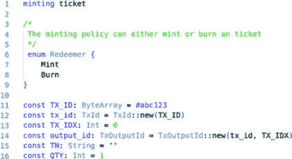

**图 7.3：** Helios 链上铸造 Redeemer 和参数

接下来，在[图 7.4]中，我们可以看到主函数包含了铸造策略逻辑。首先注意，只传递了 `Redeemer` 和 `ScriptContext` 作为参数。在第 20 行，我们动态创建了 `MintingPolicyHash`，它考虑了运行时传入脚本的合约参数。然后，我们创建了一个 `AssetClass`，用于验证所铸造的内容。在第 25 行，我们提取了该交易中被铸造的值。现在，我们拥有了处理 Redeemer 条件所需的信息。

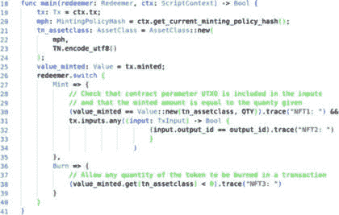

**图 7.4：** Helios 链上铸造逻辑

在[图 7.4]的第 30 行，我们确认交易中铸造的代币与合约参数中的代币名称和金额匹配。第 31 行和第 32 行检查合约参数中指定的 UTXO 是否包含在输入中。由于 UTXO 只能被花费一次，铸造策略将仅允许其铸造一次，从而保证了唯一性。最后，在第 38 行，只要代币属于该铸造策略且数量为负，我们就允许销毁。

## Helios 离线铸造

我们将重点介绍此示例中的离线代码与[第 6 章，验证器]中之前的验证器示例之间的区别。在[图 7.5]的第 119 行，我们创建了铸造策略程序，然后在第 120–123 行应用合约参数。只有在应用参数后，我们才能编译脚本并将其附加到第 129 行的交易。我们还在第 132 行构建了 `Mint` Redeemer，它使用了链上代码指定的 Redeemer 类型。

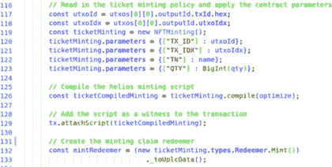

**图 7.5：** Helios 离线合约参数

在[图 7.6]中，第 136 行的代币数组使用从用户输入传入的门票名称和 `qty` 来创建我们将铸造的资产，如第 139–141 行所示。接下来，我们在输出中指定要铸造的代币，并将铸造的门票发送到用户输入的 `address`，如第 153–156 行所示。

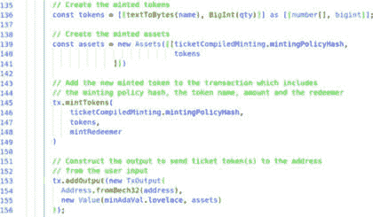

**图 7.6：** Helios 离线铸造代币

在这个铸造用例中，我们还利用了 CIP25 标准。在[图 7.7]的第 160 行，我们调用了 `generateMetadata`，它返回一个类似 JSON 的记录用于数据。`name`, `qty`, `utxoId` 和 `utxoIdx` 将存储在元数据中，如果以后需要销毁，可以使用它们来重构铸造策略。`mintingPolicyHash`, `name`, `description` 和 `image` 用于离线在钱包、dApp 和区块链浏览器中显示该代币。

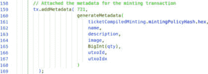

**图 7.7：** Helios 离线元数据

## Helios 离线销毁

可能存在销毁未售出门票的情况。由于 Cardano 账本跟踪并避免任何原生资产的双重花费，销毁门票只有在门票实际存在于交易输入时才能进行。因此，销毁代币的唯一方法是在钱包中实际持有该代币，以便作为交易输入。

我们首先查看[图 7.8]中的第 230 行，它查询区块链以获取特定代币的铸造元数据。正如我们所记得，我们需要代币 `name`, `qty`, `utxoId` 和 `utxoIdx` 作为合约参数来重构正确的铸造策略。现在我们有了合约参数，可以编译脚本并将其附加到交易。我们还在第 246 行创建了 `Burn` Redeemer，允许相应地销毁门票。

最后，我们从存储在元数据中的 `policyId` 构建 `MintingPolicyHash`，并在第 252 行通过负数 `qty` 数字添加要销毁的代币，如[图 7.9]所示。

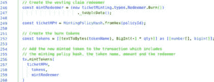

**图 7.9：** Helios 离线销毁代币

## Aiken 链上铸造策略

Aiken 链上铸造策略使用 `token_name`, `qty` 和 `utxo_ref` 作为合约参数，它们在第 15 行运行时应用，如图 7.10 所示。只有 `Redeemer` 和 `ScriptContext` 被传递给 ticket 函数，该函数包含了铸造策略逻辑。第 18 行，使用 `expect` 语句从脚本 `purpose` 为 `policy_id` 创建一个新绑定。第 19 行，我们解构了 `Transaction` 类型，并从交易中提取出输入和铸造值。然后，我们在第 22 行使用 `expect` 语句将来自铸造值的二元组与 `asset_name` 和 `amount` 绑定，并匹配 `policy_id`。现在我们拥有了执行 `Redeemer` 条件所需的所有信息。在第 31 行和第 32 行，我们检查输入是否包含作为合约参数传递的 `utxo_ref`。第 34 行，我们确认资产名称和数量与提供的合约参数匹配。第 37 行的 `Burn Redeemer` 允许销毁任何负数数量，只要该脚本铸造策略中的 `asset_name` 包含在交易中。

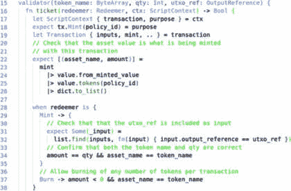

**图 7.10:** Aiken 链上铸造策略^(18

## Lucid 链外铸造

Lucid 链外代码与 Helios 链外代码非常相似，我们将仅展示这两种方法之间的差异。特别是，合约参数的应用方式不同，如图 7.11 所示。第 89 行，一个自定义函数接收合约参数，然后在第 96 行将其应用于 Plutus 铸造策略脚本。Plutus 脚本是从蓝图文件读取的，该文件是由 `aiken build` 命令生成的。


**图 7.11:** Lucid 应用的合约参数^(19

在图 7.12 中，第 132 行使用从钱包中 UTXO 计算出的 `name`, `qty` 和 `outRef` 返回验证器（铸造策略）。第 135 行，手动构建 `Redeemer` 以匹配链上 Aiken 代码中的 `Redeemer`。`policyId` 和 `assetName` 分别在第 138 行和第 139 行使用 `validator` 脚本和 `name` 构建。


**图 7.12:** Lucid 铸造策略 ID 和资产名称^(20

最后一步是在第 142 行生成元数据（如图 7.13 所示），并在第 150–160 行构建交易。验证脚本、元数据和铸造资产分别在第 153 行、154 行和 155 行附加到交易中。最后，在第 159 行创建输出，将 ticket 令牌发送到用户提供的地址。


**图 7.13:** Lucid 铸造元数据^(21

Lucid 链外销毁与铸造类似，不同在于 `mintAssets()` 使用负数数量且没有元数据或交易输出。

## 钱包信息

由于我们处理的是原生资产，我们修改了 `WalletInfo` 组件以显示用户钱包中的 Lovelace 和任何原生资产。这需要调用 `Blockfrost` API 获取资产列表，然后填充一个显示在 UI 上的数组，如图 7.14 所示。


**图 7.14:** Lucid getWalletInfo^(22

## 设置

为了设置运行 Lucid + Aiken 演示的 `Demeter.run` 环境，请在终端中执行以下命令（如果你尚未从第 6 章中执行过）：

```bash
echo export NEXT_PUBLIC_BLOCKROST_API=https://cardano-preprod.blockfrost.io/api/v0 >> ~/.bashrc
echo export NEXT_PUBLIC_BLOCKROST_KEY=your-blockfrost-API-key >> ~/.bashrc
echo export NEXT_PUBLIC_ENV="dev" >> ~/.bashrc
echo export NEXT_PUBLIC_HOST="demeter-run-host" >> ~/.bashrc
echo export NEXT_PUBLIC_PROTOCOL="https" >> ~/.bashrc
echo export NEXT_PUBLIC_PORT="" >> ~/.bashrc
source ~/.bashrc
npm install
npm run dev
```


# 演示

图 7.15 显示 `WalletInfo` 组件中已有 100 个“Dog Show 1”令牌。


**图 7.15:** Lucid Wallet Info

要铸造一批票，用户输入目标地址、令牌名称、IP 标识符和数量，如图 7.16 所示。


**图 7.16:** Lucid Mint

点击 `Mint Ticket` 按钮并使用钱包签名后（如图 7.16 所示），会出现交易成功消息。


**图 7.17:** Lucid Mint Success

点击 `TxId` 链接，可以在交易在网络上确认后查看。在图 7.18 中，你可以看到创建了 150 个 `Dog Show 2` 令牌并到了钱包地址。


**图 7.18:** Cardano Explorer Mint Detail

我们也可以在图 7.19 的 Cardano 浏览器上验证元数据：


**图 7.19:** Cardano Explorer Mint Metadata

接下来，我们将尝试销毁（取消）20 张票，因为需要为活动留留更多空间。用户需要输入铸造 `Policy ID`、令牌名称和要销毁的数量，如图 7.1 所示。只要用户钱包中有活动令牌，此操作就会成功。


**图 7.20:** Lucid Burn Token

将会成功的交易消息，可以在 Cardano 浏览器链接上查看交易。在图 7.21 中，20 个票令牌已销毁，仅剩 130 个。


**图 7.21:** Burn Token Transaction

- 铸造策略（Minting policy）仅控制代币的铸造或销毁。
- 铸造策略不管理代币的账本状态或流通量。
- 需要链外代码通过检查针对特定铸造策略的所有铸造和销毁操作来确定流通量。
- 非同质化代币（`NFT`s）是独特的独特的资产，彼此之间不可互换。
- 同质化代币（`FT`s）是相同的，可以相互交换。
- `CIP-25` 是一种在提交交易时使用的元数据标准。
- `CIP-68` 使用引用标记（reference token）和数据值（datum value），根据用例可以是不可变的或可更新的。
- 代币注册表（Token Registry）注册铸造策略和代币名称，以提供代币的元数据，这些数据会被钱包、区块链浏览器和交易所使用。
- 使用适当的硬币选择算法对于避免粉尘（dust）很重要，粉尘是指金额很小的 UTXO，由于花费成本超过了其总价值而无法花费。

## 单选题

1. 下列哪种描述是错误的？
   1. Cardano 原生代币等同于 `ERC-20` 代币
   2. Cardano 原生资产使用基础账本防止双重花费
   3. Cardano 铸造策略的代码通常比 `ERC-20` 合约少
   4. Cardano 铸造策略通常比 `ERC-20` 合约更安全

2. 一次铸造策略（one-time Minting Policy）是如何创建初始流通量的？
   1. 铸造策略内部的自定义代码
   2. 查询 Cardano 账本
   3. 查询铸造策略元数据
   4. 以上都不是

3. `CIP-25` 元数据是如何存储在链上的？
   1. 作为链上哈希值并作为交易的辅助数据包含
   2. 以 JSON 格式并完整存储在链上
   3. 链上不存储任何内容
   4. 内容存储在 UTXO datum 中

4. 你如何指定同质化代币（`FT`）的精度单位？
   1. 仅在使用 `CIP-25` 时可能
   2. 在 `Token Registry` 或 `CIP-68` 中
   3. 在铸造策略内部
   4. 以上都不是

5. 什么是 UTXO 碎片化？
   1. 区块链上有许多 UTXO
   2. 需要过多的 UTXO 作为输入以满足输出
   3. 有太多的 UTXO 输出
   4. 有太多的资产被锁定在一个 UTXO 中

## 答案

1. a
2. a
3. a
4. b
5. b

## 问题

1. 在 Cardano 上铸造还有哪些其他可能的用例？
2. 在什么情况下你会使用 `CIP-25` 或 `CIP-68`？
3. 使铸造策略 ID 或代币名称唯一的方法有哪些？
4. 对于给定的原生代币，是否可能知道 UTXO 锁定的当前地址？如何做到？
5. 你能描述除“最大优先”（Largest-first）和“随机改进”（Random Improve）之外的其他硬币选择算法吗？

## 核心术语

- **资产名称 (Asset Name)**：特定铸造策略在链上的不可变代币名称。
- **CIP-25**：使用交易元数据的元数据标准。
- **CIP-68**：使用引用标记和数据的元数据标准。
- **集合 (Collection)**：代币包中组合在一起的代币。
- **粉尘 (Dust)**：无法花费的极小价值 UTXO。
- **ERC-20**：以太坊 FT 代币标准。
- **ERC-721**：以太坊 NFT 代币标准。
- **货币政策 (Monetary Policy)**：规定流通中代币的数量以及通胀或通缩率。
- **策略标识符 (ID)**：铸造策略脚本的哈希值的唯一标识符。
- **数量 (Quantity)**：记账单位。
- **引用输入 (Reference Inputs)**：作为交易输入包含但无法花费的只读 UTXO。

---

# 第 8 章：工具链

## 引言

开发智能合约通常涉及处理区块链之外（链下）的代码，并将其无缝集成到 Cardano 网络中。在本章中，我们将回顾一些您可以使用来完成这些任务的工具和服务提供商。首先，我们将深入研究 Cardano API 提供商，例如 `Blockfrost`、`Maestro` 和 `Koios`。接下，我们将探索使用 `Demeter.run` 托管环境来搭建 Cardano `Node`、`Ogmios` 和 `Kupo` 等服务。最后，我们将学习如何设置本地 Devnet，以便使用 SDK 进行快速开发和原型设计。

## 章节结构

在本章中，我们将讨论以下内容：

- 区块链 API/监控提供商
  - Blockfrost
  - Maestro
  - Koios
  - Dandelion
- 工具链组件
  - `Cardano-node`
  - `Ogmios`
  - `Kupo`
  - 本地 Devnet
- 额外资源

## 区块链 API/监控提供商

书中的示例演示了如何使用 `Blockfrost` API 查询区块链并提交交易。然而，在本节中，我们将查看其他广泛使用的区块链提供商和工具，它们有助于避免 Cardano 生态系统中中心化的单点故障。

### Blockfrost

`Blockfrost`（`https://blockfrost.io/`）是 Cardano 最早的提供商之一，凭借超过 1 亿次的日请求和 2 万多开发者，赢得了大量用户的信任。`Blockfrost` 拥有优秀的 API 文档和广泛的服务，从简单的区块链查询到适用于应用程序的 webhook 回调。他们提供免费层级计划，允许您为应用程序测试 API。您可以对其 API 发起 HTTP REST 调用，或者使用他们为 Node.js、Python、Rust、C# 等提供的便捷 `SDKs`。`Blockfrost` 支持主网、Preprod 网络和 Preview 网络，您还可以从他们的 `GitHub` 仓库运行自己的实例。

### Maestro

2023 年 7 月 19 日，`Maestro`（`https://www.gomaestro.org/`）发布了其 dApp 平台的 V1 版本，新功能显著提升了 Cardano 的集成体验：

- **加速交易 (Turbo Transactions)**：通过 `Maestro` 的交易传播系统加速交易终局化。
- **新的区块链索引器**：高性能、低延迟、优化的 Cardano 索引器，具有便捷且高效的 API。
- **交易管理器**：一个交易监控系统，具有自动重试和零延迟的待处理、链上及回滚通知。

## 代码示例

在我们的归属和机票示例中，我们更改了 `pages/index.tsx` 中的 `Lucid` 提供者以使用 `Maestro`（包含在 `Lucid` 库中），如图 8.1 所示。


**图 8.1：** Lucid Maestro Provider

机票铸造示例，我们还需要更改 `pages/api` 文件夹下 `getTicketMetadata.ts` 中的区块链查询。我们使用 `Maestro` 提供的 Node.js API，如图 8.2 所示。


**图 8.2：** Maestro TypeScript API

在图 8.2 的第 18 行，我们创建了 `Maestro` 客户端，然后在第 27 行调用 `maestroClient.assets` 来获取资产元数据。

## 设置

要设置 `Demeter.run` 环境来运行 `Maestro`，请在终端窗口中执行以下命令：

```bash
export NEXT_PUBLIC_MAESTRO_API_KEY=your-maestro-key-here
export NEXT_PUBLIC_ENV="dev"
export NEXT_PUBLIC_HOST="your-demeter-run-host"
export NEXT_PUBLIC_PROTOCOL="https"
export NEXT_PUBLIC_PORT=""
```

### Koios

`Koios` 是一个分布式的、开源的 `RESTful` API，用于查询和提交 Cardano 区块链。它由受尊敬的 `Cardano Stakepool Guild Operators` 构建并维护。`Koios` 通过使用分布式处理架构（Cardano 的核心价值）来促进去中心化。您也可以直接从 `Helios` 库中使用 TypeScript `Koios` 提供者客户端。

### Dandelion

`Dandelion` 是作为免费社区服务提供的 Cardano 区块链 API 集合。这些服务包括：

- `GraphQL`
- `Ogmios`
- `Cardano DB Sync/Postgres API`
- `Rosetta API`

## 工具链组件

Cardano 的主要优势之一是代码开源，您有能力自己下载、构建和运行所有所需组件。或者，您可以使用第三方提供商来管理和托管这些组件。我们已经看到了如何使用 `Demeter.run` 为书中的示例设置环境，但他们还提供了许多其他 Cardano 组件和服务。工具链组件用于查询、响应或与区块链进行交易。图 8.3 展示了一个典型的链下工具链设置，其中 `Cardano DB Sync` 处理来自 `Cardano Node` 的区块并将数据存储在 `Postgres Database` 中。应用程序随后查询数据库或相应地对区块链事件做出响应。


**图 8.3：** DB Sync 链下索引

Cardano 区块链的核心组件是 Cardano Node，其源代码托管在 GitHub 上。你可以下载并编译源代码、运行静态二进制文件或使用 Docker 容器。`Demeter.run` 也提供了一个扩展，可以按如下方式置备 Cardano Node：

1. 前往 `demeter.run/`。
2. 选择你想要部署到的项目。我们将为第 5 章，交易构建器中已创建的工作区启用此扩展。
3. 一旦在[图 8.4]中置备了工作区，你必须通过向下滚动页面并选择“Connected Extensions”（已连接扩展）来启用 Cardano Node。
   
   **图 8.4:** Demeter.run Cardano Workspace
4. 选择“Browse Extensions”（浏览扩展）。
5. 找到“Nodes”（节点）框，选择 `Deploy`（部署），然后点击 `Provision Resource`（置备资源）。
6. 向下滚动，选择 `Preprod`，并选择页面底部的 `Create Resource`（创建资源）按钮。
7. 当你回到 `Project Overview`（项目概览）时，你应该看到节点扩展已连接，如[图 8.5]所示。
   
   **图 8.5:** Demeter.run Cardano Node Connected
8. 选择你之前置备的工作区。
9. 点击工作区上的 `Visual Studio Code` 图标启动 Visual Studio Web 客户端。
10. 从汉堡菜单中，选择 `Terminal`（终端）-> `New`（新建）。

要验证你的 `cardano-node` 已连接到网络，输入以下命令，你应该能看到 `syncProgress` 达到 100%。

```bash
~/workspace/repo$ cardano-cli query tip --testnet-magic 1
{
  "block": 1595041,
  "epoch": 106,
  "era": "Babbage",
```


以下是排版后的内容：

```json
{
  "hash": "ed3be308f9538fe59241f5d90b333de06ddc581ee783ba0002d0c911b3bdf3f6",
  "slot": 44370786,
  "slotInEpoch": 220386,
  "slotsToEpochEnd": 211614,
  "syncProgress": "100.00"
}
```

大多数连接到 `Cardano Node` 的工具都使用套接字，你可以通过打印 shell 环境变量找到套接字的位置：

```bash
~/workspace/repo$ echo $CARDANO_NODE_SOCKET_PATH
/ipc/node.socket
```

`cardano-cli` 是 Cardano 的瑞士军刀，有很多关于其用法的资源，建议从这里开始。输入 `cardano-cli` 查看以下顶级常用选项列表。使用 `--help` 标志获取每个命令的额外用法信息。

```bash
~/workspace/repo$ cardano-cli
cardano-cli - 用于与 cardano-node 交互的通用命令行实用程序。提供了特定的命令来管理密钥、地址、构建并提交交易、证书等。

用法: cardano-cli (基于 Era 的命令 | byron | ping | version)

可用选项:
--version             显示 cardano-cli 版本
-h,--help             显示此帮助文本

基于 Era 的命令
address               付款地址命令
stake-address         质押地址命令
key                   密钥实用命令
transaction           交易命令
node                  节点操作命令
stake-pool            质押池命令
query                 节点查询命令。
                      将查询从 CARDANO_NODE_SOCKET_PATH 环境变量
                      获取 Unix 域套接字的本地节点。
genesis               创世块命令
governance            治理命令
text-view             处理 Shelley TextView 文件的命令。
                      交易、地址
                      等以 TextView 文件的格式存储在磁盘上。

Byron 特有命令
byron                 Byron 特有命令

可用命令:
ping                  使用节点到节点或节点到客户端 ping 一个 cardano 节点。它会协商握手并保持存活。

杂项命令
help                  显示所有帮助
version               显示 cardano-cli 版本
```

你现在可以访问 `cardano-address` 和 `bech32` 等命令行工具了。

```bash
~/workspace/repo$ cardano-address
用法: cardano-address (-v|--version) | COMMAND)
Cardano 中地址和密钥的命令行工具。

可用选项:
-h,--help             显示此帮助文本
-v,--version          显示当前版本和构建修订。

可用命令:
version               显示当前版本和构建修订。
recovery-phrase       关于恢复助词
key                   关于公/私钥
address               关于地址
script                关于脚本
```

```bash
~/workspace/repo$ bech32 --help
用法: bech32 [PREFIX]
在 bech32 字符串之间转换。数据从标准输入读取。

可用选项:
-h,--help             显示此帮助文本
PREFIX                可选的可读性前缀（例如 'addr'）。
                      如果提供，输入文本将从各种编码格式解码并使用给定的前缀重新编码为 bech32。
                      如果省略，输入文本将从 bech32 解码为 base16。
-v,--version          输出版本并退出

支持的编码格式: Base16, Bech32 & Base58。
```

示例：
转换为 Bech32:

```bash
$ bech32 base16 706174617465
$ bech32 base58 Ae2tdPwUYy1p58rejhd9592usa8pz2s3x1wpshgcgeak9mv
```

从 Bech32 转换:

```bash
$ bech32 base16 706174617465
```

Ogmios 是 Cardano 开发者最广泛使用和流行的工具之一，拥有完善的文档。它是一个通过 REST API 或 Web RPC 接口暴露节点能力的层。它是开源的，可以从 GitHub 下载、构建并通过 Docker 容器安装。我们将使用 Demeter.run 部署托管版本，以便快速演示如何与它交互。

添加 Ogmios 扩展：

1. 前往 `Project` 页面，向下滚动并选择 `BROWSE`（浏览扩展），如[图 8.6]所示。
   
   **图 8.6:** Demeter.run Project View
2. 选择 Ogmios Deploy。
3. 选择 `Create Resource`（创建资源）和 `Preprod` 网络。
4. 选择 v5 作为版本并点击 `CREATE RESOURCE`（创建资源）按钮。
5. 你看到实例正在运行，如[图 8.7]所示。
   
   **图 8.7:** Demeter.run Ogmios Live

现在，让我们使用 Hoppscotch 这样的 Web 工具尝试 `Ogmios` API。

1. 前往 URL：[`hoppscotch.io/realtime/websocket`](https://hoppscotch.io/realtime/websocket)。
2. 粘贴 Ogmios 的公共 https 主机并在地址前加上 `wss://`。
3. 选择 `Connect`（连接）。
4. 然后粘贴以下查询并选择 `Send`（发送）：

```json
{
  "type": "jsonwsp/request",
  "version": "1.0",
  "servicename": "ogmios",
  "methodname": "Query",
  "args": {
    "query": "ledgerTip"
  }
}
```

5. 你应该能看到成功的结果，如[图 8.8]所示。
   
   **图 8.8:** Hoppscotch Ogmios Success

`Kupo` 是一个开源 Cardano 区块链索引器，快速、轻量级且可配置。其 API 文档非常优秀，是许多倾向于使用内部工具的 Cardano 开发团队的首选。区块链被设计为一系列连接在一起的区块，形成链。然而，这使得执行高效的数据查询变得困难。这就是为什么我们需要索引器，它接收区块链数据并将其存储在数据库中。这些数据可以被索引，然后进行查询、过滤和分析。`Kupo` 可以在本地下载、构建和安装，也可以使用 `Demeter.run` 设置为托管服务。

我们将再次回到项目页面并添加另一个资源，这次是一个 `Kupo` 资源。选择 `deploy` 并为 preprod 网络创建资源。接下来，复制 `https` URL 以备后参考。我们应该看到四个资源：`Workspace`、`Node`、`Ogmios` 和 `Kupo`，如图 8.9 所示。


**图 8.9:** Demeter.run 资源

为了通过快速测试确认 `Kupo` 正常工作，你可以执行以下命令，并将主机名替换为从 `Demeter.run` `Kupo` 资源中复制的主机名。

```bash
$ curl -fsSL https://dmtr_kupo12e…mph005.preprod-v2.kupo-m1.demeter.run/health
# TYPE kupo_configuration_indexes gauge
kupo_configuration_indexes  1.0
# TYPE kupo_connection_status gauge
kupo_connection_status  1.0
# TYPE kupo_most_recent_checkpoint counter
kupo_most_recent_checkpoint  59235759
# TYPE kupo_most_recent_node_tip counter
kupo_most_recent_node_tip  59235759
```

在这种情况下，`Kupo` 实例是健康的，你可以看到最近的 `checkpoint`（检查点）和 `node tip`（节点提示）。检查点是被 `Kupo` 处理过的链区块，主要用于重启后与区块链同步。

## 代码示例

现在，我们准备好更新归属（vesting）和票据（ticket）代码示例，以共同使用 `Ogmios` 和 `Kupo`。`Lucid` 有一个我们可以用于此精确目的提供程序，称为 `kupmios`，如图 8.10 所示。


**图 8.10:** Lucid Kupmios

切换到 `kupmios` 提供程序后，归属示例无需任何更改即可运行。然而，票据示例需要更改 `pages/API/getTicketMetadata.ts`，如图 8.11 所示。


**图 8.11:** Kupo getMetadata

从 `Kupo` 获取元数据，首先获取与铸造交易（mint transaction）相关的交易。第 70 行提供了令牌资产，结果按区块链上发生的交易顺序排序。因此，铸造是第一笔交易，所以使用第一个交易 ID，然后在第 73 行查找该特定交易的元数据。第 76–81 行解析元数据并将结果返回给前端。

## 设置

要设置 Demeter.run 环境以运行 `Kupo` + `Ogmios` 演示，请在终端窗口中执行以下命令。

```bash
$ export NEXT_PUBLIC_KUPO_API=https://dmtr_kupo12e…mph005.preprod-v2.kupo-m1.demeter.run
$ export NEXT_PUBLIC_OGMIOS_API=wss://dmtr_ogmios1v…g0t6mk.preprod-v5.ogmios-m1.demeter.run
$ export NEXT_PUBLIC_ENV="dev"
$ export NEXT_PUBLIC_HOST="your-demeter-run-host"
$ export NEXT_PUBLIC_PROTOCOL="https"
$ export NEXT_PUBLIC_PORT=""
```

## 本地开发网

感谢 `BoxBean` 的出色工作；现在安装本地 Devnet 变得简单，类似于以太坊的 Hardhat。`Yaci Devkit` 使用轻量级组件进行索引和查询区块链数据。特别是，`BoxBean` 创建了 `Yaci`，这是一个基于 Java 的模块化 Ouroboros 最小协议，用于监听传入的区块、监控本地内存池并提交交易。团队还创建了 `Yaci Store`，这是一个基于 Java 的解决方案，提供 API 来查询索引数据并处理回滚。为了实现与 `Nami` 和 `Helios` 等浏览器钱包集成以进行离线交易构建，本地 Devnet 还将使用本地 `Cardano DB Sync` 将区块链数据馈送给本地 `Blockfrost API` 提供程序。

设置本地开发网需要以下五个步骤：

1. 设置 `YaciDevkit`
2. 设置 `Cardano DB Sync`
3. 设置 `Blockfrost backend RYO`（运行自己的）
4. 使用带有本地 `Testnet` 网络构建并安装 `Nami` 浏览器钱包
5. 为钱包充值

## 环境

以下设置指令已在 Ubuntu Linux 20.04.1 上经过测试。对于其他操作系统，你可能需要额外的设置。

## 安装 Docker

```bash
$ sudo apt -y install apt-transport-https ca-certificates curl software-properties-common
$ curl -fsSL https://download.docker.com/linux/gpg | sudo gpg --dearmor -o /usr/share/keyrings/docker-keyring.gpg
$ echo "deb [arch=amd64 signed-by=/usr/share/keyrings/docker-keyring.gpg] https://download.docker.com/linux/ubuntu $(lsb_release -cs) stable" | sudo tee /etc/apt/sources.list.d/docker.list
$ sudo apt update
$ sudo apt -y docker-ce docker-ce-cli containerd.io
$ sudo usermod -aG docker $USER
```

### 步骤 1：设置 Yaci Devkit

一旦安装了 `docker`，你可以进入 `yaci` 目录并安装：

```bash
$ git clone https://github.com/ava/Mastering-Smart-Contracts
$ cd Mastering-Smart-Contracts
$ docker-compose up -d
```

关于启动选项的更多信息，请咨询 GitHub 仓库：[`github.com/bloxbean/yaci-dev`](https://github.com/bloxbean/yaci-dev)。

### 步骤 2：启动 DB Sync

在新终端窗口中：

```bash
$ cd chapter_08/local-devnet/yaci
$ ./start-db-sync.sh
```

如果成功，你应该看到以下输出：

```text
cardano-db-sync_1  [db-sync-node:Info:65] [2024-05-08 10:15:13.01 UTC] Insert Babbage Block: epoch 0, slot 244, block 244, hash 74ec222296e80d0dae52fd7723c7317746928144fdbf8b9f5fd31a7ca6daf095
cardano-db-sync_1  [db-sync-node:Info:65] [2024-05-08 10:15:14.00 UTC] Insert Babbage Block: epoch 0, slot 245, block 245, hash e13b22299709d612d8381bc6292a75ef04f5fa912a308c97ad8f804c8044fc94
cardano-db-sync_1  [db-sync-node:Info:65] [2024-05-08 10:15:15.00 UTC] Insert Babbage Block: epoch 0, slot 246, block 246, hash 888f504744cef550755ebd88a6cd6e9b5ad27f3ddcba11076ac8a00a9d04a258
cardano-db-sync_1  [db-sync-node:Info:65] [2024-05-08 10:15:16.00 UTC] Insert Babbage Block: epoch 0, slot 247, block 247, hash be35c0eb241b0369af4a869480e9340a6c079fc25a3e8f96273fa633a22b4da9
…
```

### 步骤 3：启动 Blockfrost-RYO

在另一个新的终端窗口中：

```bash
$ cd chapter_08/local-devnet/blockfrost-backend-ryo
$ nvm install 20.9.0.
$ yarn install
$ yarn run dev-testnet
```

### 步骤 4：安装 Nami 本地开发网版本

打开另一个终端窗口并进入 Nami 目录。

```bash
$ cd chapter_08/local-devnet/nami
$ nvm use 20.9.0
$ npm install
$ npm run build
```


这将创建一个可以加载到 Chrome 浏览器的构建目录。打开 Chrome 浏览器扩展窗口 `chrome://extensions/`，并点击窗口左角的“加载未解压的扩展程序”。然后导航到刚刚创建的 `nami/build` 目录并选择它。现在 Nami 钱包应该已经安装好了，你可以启动浏览器扩展了。它会首先要求你创建一个新钱包和密码。你需要切换到测试网（Testnet）网络，可以通过选择窗口右上角的头像来实现。接下来，选择设置（Settings）、网络（Network），并在网络下拉菜单中选择 Testnet，如图 8.12 所示。

**图 8.12：** Nami 钱包开发网

**提示**：如果你使用解压方法安装了 Nami 钱包并关闭了浏览器，你可能需要再次遵循解压说明。如果你重新创建了新的本地开发网，你需要创建一个新的 Nami 账户或显式删除 Nami 浏览器插件以清除缓存的 Nami 账户数据。

## 第 5 步：为钱包充值

打开 Nami 钱包，选择接收（Receive）按钮并复制接收地址。然后进入 `yaci-cli` 终端，输入 `topup` 命令，粘贴接收地址和要发送的 Ada 数量，如图 8.13 所示。


**图 8.13：** Yaci DevKit 充值

你可以在 Nami 钱包中确认你已收到了该金额，如图 8.14 所示。


**图 8.14：** Nami 钱包充值

## 示例测试

现在我们可以尝试使用本地开发网测试之前的票据示例。在另一个终端窗口中执行以下命令：

```bash
$ cd chapter_08/local-devnet/ticket
$ npm install
$ npm run dev
```

接下来，在本地开发网上铸造一些新票据，如图 8.15 所示。


**图 8.15：** 在本地开发网上铸造

我们现在可以在本地 Yaci DevKit 区块浏览器的交易（Transactions）标签页下查看交易详情，如图 8.16 所示。


**图 8.16：** 本地开发网浏览器交易视图

我们还可以在图 8.17 中查看智能合约详情，包括解锁者值（Redeemer Values）。


**图 8.17：** 本地开发网浏览器合约视图

## 其他资源

存在其他方法和解决方案来查询和响应 Cardano 区块数据。表 8.1：

| 名称 | 描述 | 技术 |
| :--- | :--- | :--- |
| Sync29 | Cardano 索引器 | Postgres |
| Kupo30 | Cardano 索引器 | Haskell |
| Ogmios31 | Cardano 索引器 | Haskell |
| Yaci32 | Cardano 索引器 | Rust |
| Carp33 | Cardano 索引器 | Redis |
| Scrolls34 | Cardano 索引器 | MongoDB |
| Oboros35 | Cardano 索引器 | Typescript |
| GraphQL36 | Cardano 索引器 | Postgres |
| Oura37 | Cardano 索引器 | Pallas |

## 总结

本章提供了某些 Cardano API 的概述。首先，我们探索了 Blockfrost、Maestro、Koios 和 Demeter.run。接下来，我们理解了 Cardano Node、Ogmios 和 Kupo。我们还学习了如何使用 Yaci 设置开发网。我们现在准备好进入下一章。

## 知识点

- Blockfrost 是最早的 Cardano API 提供者之一。
- Maestro 最近发布了低延迟、高性能的 API 版本。
- Koios 是一个提供 Cardano 服务的去中心化平台。
- 链外工具用于查询、响应或提交区块链数据。
- Cardano Node 可以通过容器、静态二进制文件或编译源码运行。
- Demeter.run 拥有可以运行的 Cardano Node。
- `cardano-cli` 是 Cardano 的瑞士军刀，有多种用途和功能。
- Ogmios 流行是通过 REST API 或 Web RPC 暴露 Cardano 功能。
- Kupo 也是流行的开源 Cardano 区块索引器，捕获并将区块链数据保存到内存数据库中。
- Lucid 内置了 Kupo 和 Ogmios 程序，可以连接到 Kupo 和 Ogmios 实例进行数据查询和交易提交。
- Yaci DevKit 可以设置类似于 Ethereum Hardhat 的本地开发网。

## 选择题

1. 为什么需要区块链工具？
   - 用于链上逻辑
   - 用于账本
   - 需要启动/停止 Cardano 区块
   - 高效访问区块链数据

2. 使用 `cardano-cli` 无法完成什么？
   - 启动/停止 Cardano 节点
   - 提交交易
   - 查询 Cardano 区块顶值
   - 查看 UTXO 内容

3. 如何访问 Ogmios？
   - 节点套字
   - SQL 查询
   - HTTP REST API
   - HTTP REST API 或 RPC Web Socket

4. Yaci DevKit 的某些功能是什么？
   - 区块链浏览器、Kupo 和 Ogmios API
   - 代币注册表
   - 主网网络
   - GraphQL

5. 哪个工具可以提交交易？
   1. Kupo
   2. Oura
   3. Carp
   4. ouroboros-network-js

## 答案

1. d
2. a
3. d
4. a
5. d

## 问题

1. 任何区块链的中心化风险有哪些？
2. 为什么区块链技术在直接数据访问方面通常效率不高？
3. 工具是如何加速数据查询访问的？
4. Maestro 为了帮助提高提交交易的最终性时间做了哪些工作？
5. 使用本地测试网（Testnet）或开发网（Devnet）有哪些优势？

## 核心术语

- `Node Tip`：区块链中最新（最高）的已确认区块。
- `RESTful`：它使用 HTTP 请求在客户端和服务器之间访问和设置数据。
- `SDK`：软件开发工具包（Software Development Kit）让开发者更方便地访问服务提供者的 API。
- `Service Provider`：服务提供者，提供离链区块链 API 公司。
- `Transaction Finality`：交易最终性，在区块链上完成交易最终所需的时间。
- `Webhook`：回调函数，当满足特定条件时会向应用程序发起网络调用。

________________

[¹] [`blockfrost.io/`](https://blockfrost.io/)

[²] [`github.com/blockfrost/blockfrost-backend-ryo`](https://github.com/blockfrost/blockfrost-backend-ryo)

[³] [`www.gomaestro.org/dapp-platform`](https://www.gomaestro.org/dapp-platform)

[⁴] [`twitter.com/GoMaestroOrg/status/1681685533314142209`](https://twitter.com/GoMaestroOrg/status/1681685533314142209)

[⁵] [`github.com/ava-orange-education/Mastering-Cardano-Smart-Contracts/blob/main/chapter_08/maestro/ticket/pages/index.tsx`](https://github.com/ava-orange-education/Mastering-Cardano-Smart-Contracts/blob/main/chapter_08/maestro/ticket/pages/index.tsx)

[⁶] [`github.com/ava-orange-education/Mastering-Cardano-Smart-Contracts/blob/main/chapter_08/maestro/ticket/pages/api/getTicketMetadata.ts`](https://github.com/ava-orange-education/Mastering-Cardano-Smart-Contracts/blob/main/chapter_08/maestro/ticket/pages/api/getTicketMetadata.ts)

[⁷] [`koios.rest/`](https://koios.rest/)

[⁸] [`cardano-community.github.io/guild-operators/`](https://cardano-community.github.io/guild-operators/)

[⁹] [`dandelion.link/`](https://dandelion.link/)

[¹⁰] [`github.com/cardano-foundation/cardano-graphql`](https://github.com/cardano-foundation/cardano-graphql)

[¹¹] [`ogmios.dev/`](https://ogmios.dev/)

[¹²] [`github.com/IntersectMBO/cardano-db-sync`](https://github.com/IntersectMBO/cardano-db-sync)

[¹³] [`github.com/cardano-foundation/cardano-rosetta`](https://github.com/cardano-foundation/cardano-rosetta)

[¹⁴] [`github.com/IntersectMBO/cardano-node`](https://github.com/IntersectMBO/cardano-node)

[¹⁵] [`github.com/input-output-hk/cardano-node-wiki/blob/main/docs/getting-started/cli.md`](https://github.com/input-output-hk/cardano-node-wiki/blob/main/docs/getting-started/cli.md)

[¹⁶] [`ogmios.dev/`](https://ogmios.dev/)

[¹⁷] [`github.com/CardanoSolutions/ogmios`](https://github.com/CardanoSolutions/ogmios)

[¹⁸] [`hoppscotch.io/`](https://hoppscotch.io/)

[¹⁹] [`github.com/CardanoSolutions/kupo`](https://github.com/CardanoSolutions/kupo)

[²⁰] [`cardanosolutions.github.io/kupo/`](https://cardanosolutions.github.io/kupo/)

[²¹] [`cardanosolutions.github.io/tag/Checkpoints`](https://cardanosolutions.github.io/tag/Checkpoints)

[²²] [`github.com/ava-orange-education/Mastering-Cardano-Smart-Contracts/blob/main/chapter_08/ogmios-kupo/vesting/index.tsx`](https://github.com/ava-orange-education/Mastering-Cardano-Smart-Contracts/blob/main/chapter_08/ogmios-kupo/vesting/index.tsx)

[²³] [`github.com/ava-orange-education/Mastering-Cardano-Smart-Contracts/blob/main/chapter_08/ogmios-kupo/ticket/pages/getTicketMetadata.ts`](https://github.com/ava-orange-education/Mastering-Cardano-Smart-Contracts/blob/main/chapter_08/ogmios-kupo/ticket/pages/getTicketMetadata.ts)

[²⁴] [`github.com/ava-orange-education/Mastering-Cardano-Smart-Contracts`](https://github.com/ava-orange-education/Mastering-Cardano-Smart-Contracts)

[²⁵] [`github.com/ava-orange-education/Mastering-Cardano-Smart-Contracts`](https://github.com/ava-orange-education/Mastering-Cardano-Smart-Contracts)

[²⁶] [`github.com/ava-orange-education/Mastering-Cardano-Smart-Contracts`](https://github.com/ava-orange-education/Mastering-Cardano-Smart-Contracts)

[²⁷] [`github.com/ava-orange-education/Mastering-Cardano-Smart-Contracts`](https://github.com/ava-orange-education/Mastering-Cardano-Smart-Contracts)

[²⁸] [`github.com/ava-orange-education/Mastering-Cardano-Smart-Contracts`](https://github.com/ava-orange-education/Mastering-Cardano-Smart-Contracts)

[²⁹] [`github.com/ava-orange-education/Mastering-Cardano-Smart-Contracts`](https://github.com/ava-orange-education/Mastering-Cardano-Smart-Contracts)

[³⁰] [`ogmios.dev/`](https://ogmios.dev/)

[³¹] [`github.com/ava-orange-education/Mastering-Cardano-Smart-Contracts`](https://github.com/ava-orange-education/Mastering-Cardano-Smart-Contracts)


[⁵] [`github.com/ava-orange-education/Mastering-Cardano-Smart-Contracts/blob/main/chapter_08/maestro/ticket/pages/index.tsx`](https://github.com/ava-orange-education/Mastering-Cardano-Smart-Contracts/blob/main/chapter_08/maestro/ticket/pages/index.tsx)

[⁶] [`github.com/ava-orange-education/Mastering-Cardano-Smart-Contracts/blob/main/chapter_08/maestro/ticket/pages/api/getTicketMetadata.ts`](https://github.com/ava-orange-education/Mastering-Cardano-Smart-Contracts/blob/main/chapter_08/maestro/ticket/pages/api/getTicketMetadata.ts)

[⁷] [`koios.rest/`](https://koios.rest/)

[⁸] [`cardano-community.github.io/guild-operators/`](https://cardano-community.github.io/guild-operators/)

[⁹] [`dandelion.link/`](https://dandelion.link/)

[¹⁰] [`github.com/cardano-foundation/cardano-graphql`](https://github.com/cardano-foundation/cardano-graphql)

[¹¹] [`ogmios.dev/`](https://ogmios.dev/)

[¹²] [`github.com/IntersectMBO/cardano-db-sync`](https://github.com/IntersectMBO/cardano-db-sync)

[¹³] [`github.com/cardano-foundation/cardano-rosetta`](https://github.com/cardano-foundation/cardano-rosetta)

[¹⁴] [`github.com/IntersectMBO/cardano-node`](https://github.com/IntersectMBO/cardano-node)

[¹⁵] [`github.com/input-output-hk/cardano-node-wiki/blob/main/docs/getting-started/cli.md`](https://github.com/input-output-hk/cardano-node-wiki/blob/main/docs/getting-started/cli.md)

[¹⁶] [`ogmios.dev/`](https://ogmios.dev/)

[¹⁷] [`github.com/CardanoSolutions/ogmios`](https://github.com/CardanoSolutions/ogmios)

[¹⁸] [`hoppscotch.io/`](https://hoppscotch.io/)

[¹⁹] [`github.com/CardanoSolutions/kupo`](https://github.com/CardanoSolutions/kupo)

[²⁰] [`cardanosolutions.github.io/kupo/`](https://cardanosolutions.github.io/kupo/)

[²¹] [`cardanosolutions.github.io/tag/Checkpoints`](https://cardanosolutions.github.io/tag/Checkpoints)

[²²] [`github.com/ava-orange-education/Mastering-Cardano-Smart-Contracts/blob/main/chapter_08/ogmios-kupo/vesting/index.tsx`](https://github.com/ava-orange-education/Mastering-Cardano-Smart-Contracts/blob/main/chapter_08/ogmios-kupo/vesting/index.tsx)

[²³] [`github.com/ava-orange-education/Mastering-Cardano-Smart-Contracts/blob/main/chapter_08_ogmios-kupo/ticket/pages/getTicketMetadata.ts`](https://github.com/ava-orange-education/Mastering-Cardano-Smart-Contracts/blob/main/chapter_08/ogmios-kupo/ticket/pages/getTicketMetadata.ts)

[²⁴] [`github.com/ava-orange-education/Mastering-Cardano-Smart-Contracts`](https://github.com/ava-orange-education/Mastering-Cardano-Smart-Contracts)

[²⁵] [`github.com/ava-orange-education/Mastering-Cardano-Smart-Contracts`](https://github.com/ava-orange-education/Mastering-Cardano-Smart-Contracts)

[²⁶] [`github.com/ava-orange-education/Mastering-Cardano-Smart-Contracts`](https://github.com/ava-orange-education/Mastering-Cardano-Smart-Contracts)

[²⁷] [`github.com/ava-orange-education/Mastering-Cardano-Smart-Contracts`](https://github.com/ava-orange-education/Mastering-Cardano-Smart-Contracts)

[²⁸] [`github.com/ava-orange-education/Mastering-Cardano-Smart-Contracts`](https://github.com/ava-orange-education/Mastering-Cardano-Smart-Contracts)

[²⁹] [`github.com/ava-orange-education/Mastering-Cardano-Smart-Contracts`](https://github.com/ava-orange-education/Mastering-Cardano-Smart-Contracts)

[³⁰] [`ogmios.dev/`](https://ogmios.dev/)

[³¹] [`github.com/ava-orange-education/Mastering-Cardano-Smart-Contracts`](https://github.com/ava-orange-education/Mastering-Cardano-Smart-Contracts)

# 第 9 章

# 票应用设计

## 引言

本章将讨论利用和使用 Cardano 架构的智能合约设计模式。我们还检查了应该避免的**反模式**，这些模式会导致应用程序性能不佳和 **UTXO 冲突**。我们将讨论卡达尔改进提案（CIPs）以及它们将如何被应用到应用程序设计中。接下来，我们将检查状态机图以查看整个事件生命周期是如何工作的。然后，通过分析成功交易所需的输入和输出来探索状态转换。最后，我们将通过回顾显示每个用例系统组件间交互的序列图来总结本章。

## 结构

在本章中，我们将讨论以下主题：

- 设计模式：

    - 线程令牌 (Thread Token)

    - 信标令牌 (Beacon Token)

    - 订单簿 (Order Book)

- 反模式：

    - 流动性池 (Liquidity Pools)

    - 批处理器 (Batchers)

- 卡达尔改进提案（CIPs）：

    - `CIP-0003` 钱包密钥生成

    - `CIP-0030` Cardano dApp-钱包 Web 桥

    - `CIP-0032` 内联数据 (Inline Datums)

    - `CIP-0040` 显式质押输出 (Explicit Collateral Output)

    - `CIP-0068` 元标准

- 应用程序架构：

    - 链上状态机

    - 链下序列图

## 设计模式

到此时，你已经意识到 UTXO 模型和账户模型区块链之间存在显著差异。特别是，许多基于账户的区块链设计模式对于 UTXO 区块链并不是最优的，被称为反模式（anti-patterns）。让我们先检查常见的 UTXO 设计模式，然后将它们与反模式进行对比。

## 线程令牌 (Thread Token)

最早且最常见的设计模式之一是使用线程令牌。会铸造一个唯一的令牌并将其包含在锁定在脚本地址的 UTXO 中。如[插图 9.1] 所示，只有当交易包含此线程令牌时，脚本才能被花费。该令牌的唯一性至关重要，因此它是使用一个需要特定 UTXO 作为输入的铸造策略来创建的。通过利用 UTXO 底层的唯一性，它只能被花费一次，我们可以保证线程令牌是唯一的。


**图 9.1:** 线程令牌示例

线程令牌可以控制验证器脚本执行的顺序。每笔交易都必须包含线程令牌，确保任何时候只有一个交易可以执行。如果你正尝试更新某种状态，并需要验证器确保正确的转换前转换后状态（请参考[插图 9.1]），这将非常有用。这对于确认前提条件也有用，例如是否已经在单独的交易中铸了令牌。通过使用线程令牌，智能合约可以通过交易中特定令牌的存在（或不存在）相互之间进行通信。

## 信标令牌 (Beacon Token)

信标令牌用于轻松识别包含信标令牌的特定 UTXO 地址。在许多创建 UTXO 的情况下，离线应用需要跟踪这些 UTXO。正如我们在[第 8 章，工具]中看到的，链索引器可以捕获铸造交易信息，并记录包含令牌的 UTXO 和地址。索引器还可以监控令牌的移动，并提供令牌所在的当前地址。如果你需要提供匹配特定信标令牌的 UTXO 列表，这将非常有用。信标令牌也可以作为线程令牌，结合线程令牌和信标令牌的设计模式。

## 订单簿 (Order Book)

为了利用 EUTXO 模型的并发性和扩展性，你需要设计你的应用程序，该程序将随着用户数量的增加而扩展。幸运的是，EUTXO 架构可以实现这一点，因为它使用本地状态并且是完全确定性的。这意味着多个并发用户可以与你的应用程序交互，每个用户都有自己相互独立的 UTXO。因此，随着更多的用户使用该应用程序，就不会像全局状态系统那样出现限制吞吐量的中心化访问。此外，本地状态非常适合创建 `state channels` 和 `zero-knowledge proofs`，以对一组 UTXO 进行分割以用于扩展解决方案。我们将在[第 11 章，测试、安全与扩展性]中讨论如 Hydra 等扩展解决方案。

订单簿设计是利用 EUTXO 架构优势的示例。特别是，该设计涉及三个步骤的过程：

**步骤 1**：在链上通过锁定在合约脚本地址的 UTXO 下单

**步骤 2**：在离线识别或监控订单以进行匹配

**步骤 3**：提交交易以成交（或取消）订单

在一个简化的示例中，如[插图 9.2] 所示，交换脚本地址使用参数来记录请求的资产、提供的资产、信标令牌以及用户钱包的公钥哈希（`PKH`）。这为每个资产对创建了一个唯一的交换地址。由于使用了 `PKH`，因此只有下单的钱包才能取消该订单。每个订单 UTXO 都附带一个唯一的信标令牌，以便离线代码在寻找订单匹配时可以轻松找到所有交换。


**图 9.2:** 简化的订单簿示例

Alice 和 Bob 拥有可以在没有任何第三方中间的情况下进行交换的位置。交换仓可以部分成交，或者可以将交换仓聚合在一起完成多次交换。这被称为可组合性（composability），像 Cardano Swaps 这样的团队提倡订单簿设计标准，以实现 Cardano 生态系统中交换组合性。

在[插图 9.2]中，Alice 提供 100 Ada 换 50 个 WMT 令牌，Bob 提供 50 个 WMT 令牌换 100 Ada。这个有效交换在离线被检测到，并在链上提交成交订单（Fill Order）交易以执行交换。一旦成交订单完成，交换中的 Ada 和 WMT 令牌将转移给双方。Bob 得到 100 Ada，Alice 接收 50 个 WMT 令牌。Charlie 决定在没有任何第三方中间的情况下取消他的交换仓，并被允许这样做，因为他可以使用所需的公钥哈希（`PKH`）对交易进行签名。

订单簿设计模式之所以运行良好，是因为于以下 Cardano EUTXO 架构原则：

*   本地状态

*   独立且唯一的钱包 UTXO 和智能合约

*   不可变的 UTXO

*   确定性

*   链上验证和离线计算

*   并行交易处理

订单簿设计可以应用于许多涉及两个或多个双方之间价值交换的各种用例。

## 反模式 (Anti-Patterns)

现在我们已经看过了利用 EUTXO 架构的设计模式，让我们来看一些我们应该避免的设计模式。大多数反模式是来自 Ethereum 等账户模型的设计方法。

## 流动性池 (Liquidity Pools)

引入了中心化流动性池的概念，用户可以在交易对中汇集他们的流动性。这将为市价单创建一个自动做市者（AMM），如[插图 9.3] 所示。


**图 9.3:** 流动性池

这种方法的缺点是，由于流动性被聚合到一个中心化的池中，并且通常涉及托管所有权。这意味着其他人拥有花费你资金的密钥，你不再对其拥有直接控制权。这使其成为极佳的攻击向量，这也是为什么我们看到 2022 年从 DeFi 协议中被盗了超过 31 亿美元。在这种模型中，我们必须引入流动性提供者（LP）池，通过质押 LP 令牌来激励流动性提供者。这在订单簿设计模式中并不是必须的，并且增加了复杂性。最后，无常损失的负面影响只发生在中心化的 AMM 池中。这加剧了作为流动性的资产对价格的显著变化（+/-）。

## 批处理器 (Batchers)

更糟糕的是，当这种设计模式用于 EUTXO 架构时，中心化流动性池会导致 UTXO 竞争，并且随着用户的增加，扩展性会受到影响。为了缓解这个问题，另一种反模式涉及批处理器代表用户处理订单，如[插图 9.4] 所示。


**图 9.4:** 批处理器

遗憾的是，批处理器引入了中心化，通常只有经过批准的实体才能运行批处理器并向池中添加流动性或执行交换。这还可能导致抢跑交易（front-running），从而损害试图为交换获得最佳价格的用户。在以太坊，这被称为矿工可提取价值（MEV）。

## Cardano 改进提案 (Cardano Improvement Proposals)

`Cardano Improvement Proposals (CIPs)` 是设计和实现最佳实践的标准或参考方案。我们将审查以下 CIP 及其它们如何应用于我们的应用程序设计。

## CIP-0003 钱包密钥生成

在我们的工单应用设计中，除了终端用户的签名外，应用程序还需要对交易签名。为了让应用程序签署交易，我们必须根据 `CIP-0003` 中定义的标准创建私钥和公钥。`CIP-0003` 了 `BIP-39`，它使用助记词短语生成钱包并用于熵。该 CIP 还引用了在*第 3 章，交易*中涵盖过的 `HD Wallets`（确定钱包）。

## CIP-0030 Cardano dApp-钱包网页桥接

`CIP-0030` 是一种基于浏览器的钱包集成标准。它规定了注入到浏览器窗口的 `JavaScript` API 以及 Web 应用如何与它们交互。我们将在应用程序设计中使用 `CIP-0030`，但需要注意的是，目前有一个正在审查的更新标准，允许 `P2P` 钱包通信，且该标准记录在 `CIP-0045` 中。

## CIP-0032 内联 Datum

`CIP-0032` 改进了 Cardano 智能合约的和效率。在 `CIP-0032` 之前，链上只能存储 `Datum` 哈希，而不能存储实际的 `Datum` 值。这意味着应用程序必须重建 `Datum` 值，这使得其他 `Smart Contracts` 难以使用它。有了 `CIP-0032`，`Datum` 值可以存在链上，因此应用程序可以简单地引用链上值。`Datum` 值被锁定在 `UTXO` 中，`Smart Contracts` 可以作为交易的一部分访问它。结合 `CIP-0032` 和 `CIP-0031`（引用输入）允许链上存在只读数据值，目前经常被预言数据提供程序使用。

## CIP-0040 显式抵押输出


`CIP-0040` 引入了一种名为 `Collateral Outputs`（抵押输出）的新输出类型。正如我们在*第 4 章，Plutus*中所回想的，`Collateral`（抵押）作为押金是要求的，如果 `Plutus` 脚本第二阶段评估失败则将使用它。虽然这有助于保护网络免受垃圾信息或恶意攻击，但它为提交交易增加了额外的 `Ada` 要求。通过使用抵押输出，可以构建交易使我们可以使用任何 `UTXO` 作为抵押，但仅在需要时消耗押金金额，并将找零作为抵押返回输出返回。在 `CIP-0040` 之前，仅包含 `Ada` 的纯 `UTXO` 只能作为抵押输入。

## CIP-0068 Datum 元数据标准

`CIP-0068` 是一种定义使用 `datum` 存储代币元数据的标准。这与使用交易元数据存储代币元数据的 `CIP-0025` 不同。使用 `Datum` 的优势是它可以被智能合约直接更新和读取。该标准适用于非同质化令牌 (`NFT`s）或同质化令牌 (`FT`s）。`CIP-0068` 涉及创建一个与铸造的原始代币（s）关联的引用令牌，如图 9.5 所示。这种设计允许 `NFT`s 或 `FT`s 在区块链上移动，但引用令牌保留在一个位置。


**图 9.5：** CIP-0068

代币命名规范是为十六编码标签添加前缀，例如 `NFT`s 使用 `222`，引用令牌使用 `100`。常用的前缀标签列在表 9.1 中。

| Label | Class | Description | Hex Label |
| :--- | :--- | :--- | :--- |
| 100 | NFT | Reference Token | `100` |
| 222 | NFT | Non-Fungible Token | `222` |
| 333 | FT | Fungible Token | `333` |
| 444 | NFT | Non-Fungible Token | `444` |

## 更新交换单 (Updating Swap)

如果满足以下两个条件，用户可以随时更新交换单位置：

*   钱包的质押 `PKH` 与交换单合约参数中的质押 `PKH` 匹配。
*   交换单合约参数中指定的灯标代币（Beacon Token）始终返回到脚本地址。

如果这两个条件均满足，则智能合约将允许更新价格，如图 9.11 所示。然而，正在交换的资产类型无法更改，因为它是被硬编码为合约参数的。


**图 9.11：** 更新交换交易

## 执行交换 (Executing Swap)

只要满足 `askedAsset`（请求资产）的价格，任何人都可以执行交换。可购买的 `offeredAsset`（提供资产，票务令牌）数量将是在交换 UTXO 中的票务令牌数量，如图 9.12 所示。交换验证器还将确保灯标代币始终发送回验证者脚本地址，卖者收到正确数量的 `askedAsset`，买家收到正确数量的 `offeredAsset`（票务令牌）。


**图 9.12：** 执行交换交易

在交换执行交易期间，我们还必须将票务令牌转换为唯一的票务令牌，进入场场时可以标记为 `used`（已使用）。我们通过在同一笔交易内销毁原始票务令牌并铸造新令牌来实现这一点，如图 9.13 所示。引用令牌数据值（Reference Token Datum value）初始设置为为空字符串，但在用户打印票务时将填充为支付的 PKH。


**图 9.13：** 转换票务交易

## 关闭交换 (Closing Swap)

卖家可以随时关闭交换，如图 9.14 所示。


**图 9.14：** 关闭交换交易

票务令牌必须返回到代币持有脚本地址，该地址定义为交换脚本参数。图 9.15 中详细的销毁灯标（Burn Beacon）交易也必须包含在关闭交换交易中。


**图 9.15：** 销毁灯标代币交易

## 打印票务 (Print Ticket)

为了访问活动，用户必须证明他们确实拥有该票务令牌。这是通过使用打印票务（Print Ticket）交易实现的，该交易将使用作为交易一部分签名的支出 PKH 更新引用令牌数据，如图 9.16 所示。应用程序将创建一个稍后显示的 QR ，其中包含交易的数字签名。


**图 9.16：** 打印票务

## 线下序列图 (Off-Chain Sequence Diagrams)

下一节将回顾描述应用程序内不同组件如何交互的高层理想路径（happy path）序列图。交易用 `[]` 表示，组件之间传递的任何值（如果显示）都用 `()` 表示。

## 铸造票务 (Minting Tickets)

使用应用程序铸造活动门票如图 9.17 所示。第一步是从钱包获取 UTXO 列表，然后构建铸造票务交易。用户将同时使用他们的支出密钥（用于支付交易费用）和质押密钥（证明他们确实拥有该质押密钥）对交易签名。一旦交易成功提交，应用程序数据库将进行更新，将质押密钥与之关联。


**图 9.17：** 铸造票务

## 连接钱包 (Connected Wallet)

当用户连接钱包时，他们可以看到他们创建的事件列表，如图 9.18 所示。可以实施额外的安全措施，例如要求用户使用质押密钥进行签名。


**图 9.18：** 连接钱包

## 开启交换 (Opening Swap)

票务铸造完成后，用户可以决定开启交换位置并出售票务，如图 9.19 所示。第一步是确定哪些铸造策略哈希（MPH）属于该用户。接下来，重建票务持有验证器以获取脚本地址和 UTXO。然后我们使用 UTXO 构建转移票务和铸造灯标交易。


**图 9.19：** 开启交换

## 查看交换 (Viewing Swaps)

应用程序创建的所有开启交换均可用如图 9.20。灯标资产用于获取构建交换交易所需的 UTXO。


**图 9.20：** 查看交换

## 区块链更新 (Blockchain Updates)

在使用本地数据库数据时，我们需要确保接收来自区块链的更新，如图 9.21 所示。


**图 9.21：** 区块链更新

## 更新交换单 (Updating Swap)

用户可以随时更新交换位置以更改价格。他们将从自己的交换列表中选择一个，并用新价格更新它（参见图 9.22）。交换的灯标令牌用于查找 UTXO。使用钱包 UTXO、交换 UTXO、交换元数据和交换脚本可以构建并提交交易。


**图 9.22：** 更新交换

## 执行交换 (Executing Swap)

买家现在可以去票务应用程序查看所有出售的票务。如果支付的价格符合要求，且数量充足，则交换将执行，如图 9.23 所示。使用钱包 UTXO 和交换 UTXO，支付票务的价值将直接发送到卖者地址，买家收到票务令牌。在票务转换期间，为每个唯一的票务令牌创建一个引用令牌。该引用令牌只能由应用程序更新，并包含一个指示令牌是否已使用的标记。


**图 9.23：** 执行交换

## 关闭交换 (Closing Swap)

当交换中的票务数量为零，或者卖家不再希望出售这些票务时，卖家将想要关闭交换（参见图 9.24）。灯标资产用于获取构建交换交易所需的 UTXO，并将票务令牌（如有）返回到票务持有地址。灯标令牌还作为关闭交易的一部分被销毁，因此该交换将不再出现在可用交换列表中。


**图 9.24:** 关闭交换 (Close Swap)

## 打印票据

票据应用程序也用于兑换活动票以进入活动。用户将显示 `QR code` 来验证所有权，这可以在活动开始之前的（或期间）任何时候进行。`QR code` 是一种数字签名，当他们使用持有票据令牌的钱包签名交易时生成。在 `Print Ticket` 交易期间，引用令牌数据（datum）会使用钱包花费的 `PKH` 进行更新。随后在活动现场，通过显示的 `QR code` 验证花费的 `PKH`。在活动现场验证 `QR code` 后，票据将在应用程序数据库中标记为已使用，如图 [9.25] 所示。


**图 9.25:** 显示票据 (Show Ticket)

## 验证票据

`QR code` 的生成可以提前完成。这避免了用户将钱包带到活动现场并在入口时提交区块链交易。由于如果打印，引用令牌数据可能会用支付 `PKH` 更新，因此在进行任何二次传输之前验证票据是非常关重要的。应用程序拥有一个 API，允许查询区块链以确认票据是否已显示或已用于进入活动，如图 [9.26] 所示。


**图 9.26:** 验证票据 (Verify Ticket)

## 结论

在本章中，我们理解了 `Thread Token`、`Beacon Token` 和 `Order Book` 设计模式，以及它们如何利用 EUTXO 架构的优势。我们查看了诸如池（pools）和批处理器（batchers）等反模式，这些模式通常会在 Cardano 等 UTXO 区块链上导致次优的方案。我们探索了若干 Cardano 改进提案 (`CIPs`）以及它们如何与我们的应用程序设计相关。特别是审查了 `CIP-0068`，了解了它如何提供了一种使用数据（datums）存储令牌元数据的不同方法。然后，我们开始根据本章中审查的设计模式和标准进行票据应用程序的设计。接下来，我们为每个用例创建了带有输入和输出的状态转换图。然后，我们创建了显示系统组件交互的序列图。我们准备好在下一章中实现票据应用程序，[第 10 章，票据应用程序实现]。

## 记忆要点

*   账户模型设计模式通常不适用于 EUTXO 架构。
*   `Thread Token` 设计模式使用唯一令牌来帮助隔离锁定在脚本地址上的特定 UTXO。
*   `Beacon Token` 设计模式使用唯一令牌来在链外轻松识别特定的 UTXO。
*   `Beacon Token` 可以同时用于 `Thread Token` 和 `Beacon Token` 设计模式。
*   `Order Book` 设计模式非常适用于 EUTXO 架构，因为 UTXO 是不可变的、唯一的且互不相关的。
*   可以使用链下计算完成原子交换对的识别。
*   交换 (`Swap`）在链上执行，不涉及任何第三方中间人。
*   原子交换保留了完全的自托管，并可以随时取消。
*   `Order Book` 设计模式可以应用于许多不同的用例。
*   `Liquidity Pools`（流动性池）和 `Batches`（批次）是性能和可扩展性次优的反模式示例。
*   `CIP-0068` 元数据标准使用 `Datums` 来存储 `NFTs` 或 `FTs` 的元数据，这些数据是可以更新的。
*   `Mint Ticket` 交易使用 `CIP-0025` 交易元数据发布铸造脚本参数。
*   `Open Swap` 交易需要在同一笔交易中包含 `Transfer Ticket` (`ticket.hl`) 和 `Mint Beacon` (`beacon.hl`)。
*   `Execute Swap` 交易需要在同一笔交易中包含 `Execute Swap` (`swap.hl`) 和 `Convert Token` (`ticket.hl`)。
*   `Convert Ticket` 使用带有支付 `PKH` 值的 `CIP-0068`。
*   `Update Swap` 和 `Close Swap` 只能由创建交换的钱包执行，并可以随时进行。
*   为活动打印票据时，用户……

## 单选题

1.  `QR code` 的生成可以提前完成……
2.  `UTXO` 架构非常适用于……
3.  `CIP-0068` 允许……
4.  如何识别 `Order Book`……
5.  为什么 `QR code` 签名……

## 答案

1.  c
2.  b
3.  a
4.  c

## 问答

1.  `Plutus` 如何确保……
2.  什么 `CIP` 允许……
3.  用于……的 `CIP`
4.  什么时候使用……
5.  `UTXO` 会发生什么

## 术语

*   `Anti-Patterns`: 反模式。
*   `FT`: 同质化令牌。
*   `KYC`: 了解您的客户。
*   `MPH`: 元数据。
*   `NFT`: 非同质化令牌。
*   `PKH`: 公钥哈希值。
*   `P2P`: 点对点。
*   `State`: 状态。
*   `State Machine`: 状态机。
*   `UTXO`: 未花费的交易输出。
*   `UTXO Contention`: UTXO 竞争。
*   `Zero Knowledge`: 零知识。

¹³ [`github.com/cardano-foundation/CIPs/tree/master/CIP-0068`](https://github.com/cardano-foundation/CIPs/tree/master/CIP-0068)
¹⁴ [`developers.cardano.org/docs/governance/cardano-improvement-proposals/cip-0068/`](https://developers.cardano.org/docs/governance/cardano-improvement-proposals/cip-0068/)
¹⁵ [`github.com/cardano-foundation/CIPs/tree/master/CIP-0068`](https://github.com/cardano-foundation/CIPs/tree/master/CIP-0068)
¹⁶ [`github.com/inimrod/cip68-fungible-token-demo/blob/main/src/lib/init-vars.ts`](https://github.com/inimrod/cip68-fungible-token-demo/blob/main/src/lib/init-vars.ts)
¹⁷ [`www.rapidtables.com/convert/number/decimal-to-hex.html`](https://www.rapidtables.com/convert/number/decimal-to-hex.html)
¹⁸ [`crccalc.com/`](https://crccalc.com/)

# 第 10 章

# 票务应用实现

## 引言

在本章中，我们将介绍票务应用的实现过程，包括区块链集成。我们将首先概述系统组件和应用栈，这些组件包括 CharkraUI、Next.js、Redis 数据库和 Blockfrost。接下来，我们将查看前端和离链代码，这些代码用于构建我们在`第 9 章，票务应用设计`中定义的交易。然后，我们将检查相应的链上智能合约代码、业务逻辑和验证规则。我们还将查看后端组件，例如用于缓存和查询相关区块链数据的 Redis 数据库架构。此外，我们将查看在区块链事件发生时调用的应用 API 和 Blockfrost Webhooks。最后，我们将运行应用程序的端到端演示。

## 结构

在本章中，我们将讨论以下主题：

*   应用栈
*   应用资源
*   前端组件
*   智能合约
*   后端组件
*   应用演示
*   区块链优势

## 应用栈

在我们的票务应用中，我们需要能够对任意数量包含待售票务的交换（swaps）进行搜索和过滤。如果将交换详情存储在带有索引的应用程序数据库中以便快速访问，就可以高效地实现这一目标。然而，事实来源始终是区块链，数据库仅仅是区块链数据的缓存副本。通过引入数据复制，我们必须确保当交易提交到区块链时，数据库能够进行相应的更新。`图 10.1`显示了如何针对本地应用程序数据库进行交换查询，该数据库会随着新的相关区块链数据通过 Blockfrost webhook 传入而持续更新。


**图 10.1：** 系统组件

Next.js 将用作应用程序服务器框架，用于构建 HTML 和 JavaScript 组件。应用程序还将使用 Redis 数据库，带有 `full stack JSON` 和搜索模块，以实现快速的内存数据库存储和检索。为了改进错误处理和故障排除，所有交易将通过 Blockfrost API 提交。这种方法允许我们在区块链事件发生时调用应用 API 和 Blockfrost webhooks。

## 应用资源

应用程序使用 Next.js 目录结构，见`图 10.2`。

注：`图 10.1`显示了如何针对本地应用程序数据库进行交换查询，该数据库会随着新的相关区块链数据通过 Blockfrost webhook 传入而持续更新。


**图 10.2:** Next.js 目录结构

## 通用

`common` 文件夹包含客户端 JavaScript 代码。该目录包含以下文件：

*   `metadata.ts`: 用于创建元数据
*   `network.ts`: 用于与网络交互
*   `orders.ts`: 用于订单计算
*   `types.ts`: 定义数据类型
*   `utils.ts`: 工具函数

## 组件

所有的 React 函数组件都位于此文件夹中，用于构建应用程序的弹出窗口。

## 配置

`config` 文件夹定义了设置、主题和标记。

## 初始化


`init` 文件夹包含所有钥和私钥的脚本。该密钥用于铸造所有交换。

## 库

`lib` 文件夹包含 Redis 连接所需的 JavaScript 库。

## 节点模块

`nodes` 文件夹存储所有模块，并在执行 `npm install` 命令时自动创建。

## 页面

`pages` 文件夹包含应用程序的所有网页。

## 页面 / API

`api` 文件夹包含客户端调用的应用程序 API。通过这些 API 进行调用以避免 CORS 错误和密钥泄漏。

## 公共

`public` 文件夹包含静态资源，如图标和图像。

## 公共/合约

`contracts` 文件夹包含所有的智能合约链上代码。特别是它包含了我们应用程序所需的逻辑：

*   `beacon.hl`: Beacon 铸造策略的智能合约
*   `holding.hl`: 持有的智能合约
*   `swap.hl`: 所有交换操作（打开、更新、关闭、执行）的智能合约
*   `ticket.hl`: 票务铸造策略的智能合约

## 架构

`schema` 文件夹包含了用于存储在 Redis 数据库中的数据架构。

*   `beacon.ts`: 用于存储并跟踪应用程序创建的 beacon，以便于检索。
*   `event.ts`: 事件架构用于存储本地事件，并与用户的质押密钥关联。
*   `stake.ts`: 质押架构将所有资产映射到用户的钱包质押密钥。
*   `swap.ts`: 交换架构存储交换信息以便用户检索、过滤和显示。

## 前端应用

完整的源代码位于 GitHub 仓库，因此本节将只查看代码片段以突出应用程序的关键部分。应用程序是一个带有 React 函数组件的单页应用，如图 10.3 所示。选择 Chakra UI 是因为其易用性和开箱组件，它用于所有的样式和前端组件。有关 Chakra 的更多信息，请参阅其文档。¹


**图 10.3：** React 函数组件

应用程序的主入口位于 `pages/index.tsx`，带有一个包含获取票务、我的事件和我的票务视图的标签导航。`index.tsx` 页面还包含以下全局状态变量信息：

*   `walletAPI`: 用于浏览器扩展钱包的 `walletAPI` JavaScript 对象。
*   `walletInfo` 列出了与该钱包相关的基础地址、质押地址（stake address）、lovelace 余额以及事件资产。
*   `swapViewRefresh` 将触发 `useEffect` 以刷新显示给用户的交易（swaps）列表。这在交易发生变化时（如打开、更新或关闭交易）被调用。

# 页眉和页脚

Header 和 Footer 组件包含在 `components/layout.tsx` 文件中，仅包含静态信息。

# 钱包连接器

钱包连接器是一个核心组件，包含了连接到 `walletAPI` 对象的逻辑并将钱包信息保存到 `pages/index.tsx` 中的 `useState` 变量中。`walletAPI` 和 `walletInfo` 变量通过作为 props 传递给每个子组件和子组件，供所有其他组件使用。我们基于[第 5 章，交易构建器]中讨论的连接用户钱包的相同代码和逻辑。为了提高用户体验，系统向用户展示了已安装和支持的浏览器钱包列表供选择，如图[图 10.4]所示。


**图 10.4:** 获取可用钱包

Cardano 基金还创建了一个 Wallet Connect 组件。然而，由于它与离链交易构建框架存在重叠和重复，我们将不再使用。

# 交易视图

交易视图组件通过调用[图 10.5]中第 43 行的 `getFilterSwaps()` 获取交易列表。只有当用户使用 Get Tickets 标签页上的 `Filter` 按钮设置过滤器时，过滤器才会生效。使用 `SWR` 来缓存交易列表，除非 `getFilterSwaps()` 返回不同的结果。


**图 10.5:** 获取 FilterSwaps

返回的交易数组填充了每个交易卡片，并在必要时对视图进行分页处理。过滤器参数定义为 `SwapView` 组件中的状态变量，并应用于数据库查询。过滤器参数列表如图[图 10.6]所示。


**图 10.6:** 过滤器参数

对 `pages/api/getFilterSwaps.ts` 的 API 调用首先创建一个键/值过滤器参数记录对象，如图[图 10.7]所示。


**图 10.7:** getFilterSwaps

然后将该记录对象传递给[图 10.8]中的 `dynamicQuery()` 函数，该函数动态构建 Redis 查询并返回过滤后的交易列表。


**图 10.8:** Redis 数据库查询

# 交易卡片

每个交易卡片都接收 `swap`、`walletAPI`、`walletInfo` 和 `setViewRefresh` 作为 props，如图[图 10.9]所示。这些变量和函数用于显示交易卡片，并传递给 `ExecuteSwap`、`UpdateSwap` 或 `Close` `Swap` 弹出窗口，以构建并提交交易。


**图 10.9:** SwapCard

要执行交易，用户选择 `Buy` 按钮，会将 `buySwapOpen` 变量设置为 true。当发生这种情况时，将向用户显示 `ExecuteSwapPopup` 页面（参见[图 10.10]）。


**图 10.10:** 执行交易弹出窗口

# 事件视图

事件页的布局与交易视图类似，但需要用户连接其钱包。每个事件与钱包的质押密钥（stake key）相关，因此我们必须在创建新事件之前连接钱包。

# 事件卡片

事件视图包含与连接钱包相关的每个事件的卡片。用户可以出售或归档事件。它还显示事件统计数据，例如分配、释放和转换的票据数量。所有区块链信息可用，但我们直接更新数据库以提供应用内的更新。

## 我的票据

在 `My Tickets` 屏幕上，用户可以看到他们拥有的票据以及相关的元数据，如事件图片、名称和时间。用户可以在此处打印票据，如图[图 10.11]所示。NFT 事件据是 Cardano 原生令牌，因此可以在钱包中查看或传输到任何其他钱包或 dApp。


**图 10.11:** 我的票据视图

## 打印票据

选择 `Print Ticket` 按钮时，将弹出 `Print Ticket` 窗口并允许用户生成二维码。一旦交易签名并更新了参考票据 CIP68 元数据，二维码将显示。交易签名证明他们拥有票据资产对应的私钥。当向场场展示二维码时，应用程序会将该唯一票据标记为已使用，以防止重复兑换。如果事件票据随后转给他人，应检查参考票据的数据（datum）以确认其尚未打印（或兑换）。二维码是一个包含票据资产名称（铸造策略哈希+令牌名称）、交易哈希以及已签名提交交易的`witness signature`的字符串，如图[图 10.12]所示。


**图 10.12:** 生成二维码

## 交易构建器

打开、更新、执行和关闭等离链交易构建代码在弹出窗口中完成。当弹出窗口启用时，会触发 `useEffect` 调用相应的函数来构建离链交易，如图[图 10.13]所示。


**图 10.13:** 执行交易 useEffect

离链代码遵循与之前章节中离链构建器类似的模式。对于执行交易，我们将应用合约参数来构建 Plutus 脚本。如果交换验证成功，我们将使用票据铸造策略转换每个票据。遵循 CIP68 元数据 NFT 标准，NFT 令牌和参考票据都将被铸造。在[图 10.14]的第 224-227 行，NFT 令牌和参考票据被添加到包含要铸造令牌总数的数组中。

**图 10.15:** 计算订单详情^(14

在门票应用中，我们还引入了时间概念，以确保交换交易在特定的时间范围内执行。最佳实践是显式地设置 `time interval`（时间间隔），在 Plutus 脚本中检查时间限制时，必须设置该值。`图 10.16` 显示了一个典型的离链有效性区间。


**图 10.16:** 时间有效性区间^(15

一旦设置了有效性区间，Plutus 脚本就可以判断交易是发生在指定时间间隔之前、之后还是期间。在下一节中，我们将查看链上代码，因为我们需要确保交换不会在特定的截止日期（例如，开始时间）之后执行。

如果交易成功构建、签名并提交，我们就会更新应用程序数据库，增加转换后的门票数量，并减少交换中的报价数量。在 `图 10.17` 的第 481–482 行，我们还将包含交易 ID 并将确认标志设置为 false。将有一个 Blockfrost Webhook，在 3 个区块确认后对应用程序进行回调，并将确认标志设置为 `true`。最后，调用第 493 行的 `handleClose()` 用于强制刷新 `Swap View` 和 `Event View` 中的交换状态和事件。


**图 10.17:** 交换与事件数据库更新^(16

# 智能合约 (#toc.xhtml#s260a)

门票应用的链上代码涉及以下 Plutus 脚本：

*   信标造币策略 (Beacon Minting Policy)
*   门票造币策略 (Ticket Minting Policy)
*   持有验证器 (Holding Validator)
*   交换验证器 (Swap Validator)

# 信标造币策略 (#toc.xhtml#s261a)

信标链上代码通过 Redeemer 传递交易 ID 和索引，以创建一个唯一的标记名称，以便我们可以轻松地找到所有交换。这与我们在 `第 7 章，造币` 中看到的方法不同，在当时我们使用交易 ID 和索引作为合约参数。应用程序所有者的 PKH 是信标造币策略中唯一的合约参数，如 `图 10.18` 所示。


**图 10.18:** 信标 Redeemer^(17

在 `图 10.19,` 中，我们确定了第 22 行造币内容的值，以及第 23 行脚本本身造币策略哈希值的值。在第 28 行，我们结合了 `TxId` 和 `TxIdx`，然后使用 `blake2b` 哈希算法对它们进行哈希处理。这与我们在离链代码中的操作一致，以确保造币的标记名称与链上代码相同。我们还检查了第 36 行仅造币了 1 个标记，并且在该造币策略下没有造币其他其他标记。


**图 10.19:** 信标造币策略^(18

`图 10.19,` 中第 38–43 行的 Redeemer Mint 代码确认了最小交易已由应用程序所有者 PKH 签名，并且交易 ID 和索引与一个 UTXO 输入对应。要求所有者的签名有助于确保合约参数中提供的 PKH 确实由提交交易的实体所有。Redeemer Burn 允许销毁属于此造币策略的标记，如 `图 10.20` 所示。


**图 10.20:** 信标销毁

# 门票造币策略 (#toc.xhtml#s262a)

门票造币策略具有 Mint、Convert 和 Burn 三 Redeemer。Convert Redeemer 传递要转换的门票数量，并造币一个唯一门票标记列表，如 `图 10.21` 所示。需要注意的是，当传递任意长度的列表时需要经过仔细考虑。执行此脚本的预算成本取决于 `userTicketTokenName` 数组中包含多少门票。在我们的情况下，这是必要的，因为我们正在显式地造币单个唯一的 NFT 标记。因此，我们需要知道每张门票的名字，以便在造币和验证器脚本中相应进行造币和验证。


**图 10.21:** 门票造币策略^(19

在 `图 10.22,` 的第 27 和 28 行，我们使用 `TX_ID` 和 `TX_IDX` 创建了一个 `TxId`，这将确保每个事件的策略是唯一的。第 31 行的 `totalAssetVal` 函数是一个组合所有 NFT 和引用标记的函数。


**图 10.22:** 标记列表^(20

`图 10.23,` 第 68 和 69 行的 Mint Redeemer 确认 `TX_ID` 和 `TX_IDX` 匹配作为输入的 UTXO。第 77 行还有一个额外的检查，如果造币发生在截止时间之后，会导致交易失败。


**图 10.23:** 门票 Mint Redeemer^(21

`图 10.24,` 第 84 行的 Convert Redeemer 调用了 `totalAssetVal` 函数并组合了造币的引用标记。我们在第 91 行执行了安全检查，确保传入的数量大于 0。


**图 10.24:** 门票 Convert Redeemer^(22

`图 10.24,` 中的 Burn Redeemer 允许销毁任何分配、释放或转换的标记，但此交易需要由所有者的 stake key 签名。

# 持有验证器 (#toc.xhtml#s263a)

`Holding` 验证器作为已造币但尚未释放到交换中的门票的临时区域。它们只能由所有者的 stake key 消耗，该 key 被硬编码为合约参数，如 `图 10.25` 所示。持有验证器的实现有些复杂，因为我们希望确保在与之间往返传输时没有标记泄漏。挑战在于，在创建持有验证器时，交换地址是未知的。因此，我们遇到了循环引用的场景，持有脚本需要交换地址，交换地址需要持有地址，且两者都应该是彼此的合约参数。

为了缓解这个问题，我们利用了预先计算的信标标记造币策略。如 `图 10.18` 所示，`beaconMPH` 在第 16 行设置为合约参数。在 `图 10.25,` 中，我们在第 19 行引入了一个名为 `checkTokenOut` 的新辅助函数，如果一组输出包含任何标记，它将返回 true，这将用于检查标记泄漏。


**图 10.25:** 持有验证器 checkTokensOut^(23

正如*图 10.26*所示，`Transfer` Redeemer 用于将票据令牌从持有脚本转移到交换（swap）。该交易必须由事件所有者的权益密钥（stake key）签名，并且必须包含一个信标令牌（beacon token）。正如我们所记得，每个交换都必须有一个信标令牌，这将有助于确保这些票据进入交换而不去任何其他地方。只有指向交换以及用于找零的可选持有验证脚本的输出才能包含令牌。这一规则在第 43–49 行被强制执行。


**图 10.26:** 持有验证器转移 Redeemer²⁴

`Return` Redeemer 与 `Transfer` Redeemer 类似，用于验证来自已关闭交换的票据令牌直接发送回持有脚本地址。当交换关闭时，信标令牌始终会被销毁，因此我们在如*图* 10.27 所示的第 56 行中检查了这一条件。此外，只有一个指向持有脚本地址的输出，因此我们将在第 62 行确保该条件为真。我们在第 64 行双重检查任何其他输出中没有其他令牌。


**图 10.27:** 持有验证器返回 Redeemer²⁵

`Burn` Redeemer 仅检查交易是否由事件所有者的权益密钥签名，以及输出中是否存在任何令牌。当我们归档一个事件时，我们会销毁所有剩余的分配令牌。

# 交换验证器](#toc.xhtml#s264a)

我们定义 `swap` 验证器的数据（datum）仅包含两个值：`askedAssetVal` 和 `offeredAssetVal`，如*图 10.28*所示。`askedAssetVal` 包含了我们请求的资产类别（在此例中为 Ada）。所提供资产的价格是 `askedAssetVal` 中设置的金额。因此，`askedAssetVal` 既包含了所请求的资产类型，也包含了每个所提供资产的价格。交换的设计使得事件所有者（卖方）可以随时更新交换的价格。如果用户想要更改他们正在出售或请求的资产，他们需要关闭该交换并创建一个新的。

`offeredAssetVal` 用于指示出售的资产以及锁定在交换中的金额。`offeredAssetVal` 会根据离开交换的提供资产数量进行更新。*图 10.28*显示了交换脚本的数据结构（struct）以及 Redeemer。`Swap` Redeemer 在第 11–14 行接收了买家公钥哈希，以及将在该交易中转换（铸造）的数量和令牌名称。


**图 10.28:** 交换验证器数据和 Redeemer²⁶

*图 10.29*显示了在交换验证器中使用的合约参数和全局变量。


**图 10.29:** 交换验证器合约参数²⁷

`checkAdaVal` 函数位于*图 10.30*的第 38 行，用于在值包含原生令牌时添加最小量的 Ada (lovelace)。为了简单起见，我们对所有智能合约令牌交互使用固定的 2,000,000 lovelace 最小值。正如我们所记得，只有在包含最小数量 lovelace 的情况下才能发送原生资产。确切的 lovelace 数量可以通过计算特定 UTXO 使用的字节来确定。此金额取决于 UTXO 中包含的令牌数量，可能会大可能会小。因此，我们严格控制输出以确保包含正确的令牌。


在交换函数内部，我们首先从图 10.31 获取`Context`。接下来，我们创建交换的总资产`totalAssetVal`。

以下是用于允许前端与后端应用组件（如`Redis DB`和`Blockfrost`）通信的 API 列表。

```bash
$ tree pages/api
├── closeSwap.ts
├── getAssetUtxo.ts
├── getEvent.ts
├── getEvents.ts
├── getFilterSwaps.ts
├── getTicketMetadataCIP25.ts
├── getTicketMetadataCIP68.ts
├── getTicketPkh.ts
├── getWalletInfo.ts
├── printTicket.ts
├── setBeacon.ts
├── setEvent.ts
├── setStakeKey.ts
├── setSwap.ts
├── signSubmitTx.ts
├── submitTx.ts
├── updateEvent.ts
├── updateSwap.ts
├── updateTxStatus.ts
└── verifyTicket.ts
```

所有的前端 API 调用均在`common/network.ts`文件中，该文件使用`axios`发送 HTTP GET 或 POST 请求。当存在匹配 beacon 铸造策略的区块链交易时，会调用 Blockfrost 的 webhook`updateTxStatus.ts`。该 webhook 被配置在三个`blockchain confirmations`之后触发。当 Blockfrost webhook 被调用时，它将更新具有相应交易 ID 的事件和交换，并将其标记为已确认。

## Redis DB 设置

在运行演示之前，必须在本地或使用云实例创建一个带有`JSON stack`的`Redis DB`实例。

1. 访问[`redis.io/`](https://redis.io/)

2. 登录或创建一个账户。

3. 创建`$0`订阅。

4. 创建一个新的`Redis Stack`数据库（包含`JSON stack`）。

5. 选择页面左侧的`Databases`导航链接。

6. 选择`Endpoint`列下的`Connect`。

7. 然后选择`Redis` `Client`以获取您的凭据信息，如图 10.37 所示。


**图 10.37：** Redis DB 设置

## Blockfrost 设置

1. 登录 Blockfrost 仪表板并创建一个 webhook。

2. 输入您的应用程序 URL 作为`Endpoint URL`输入：

   `https://your.host.domain.name/api/updateTxStatus`

3. 设置所需的`blockchain confirmations`。

4. 输入`Beacon Minting Policy ID`作为触发条件：

   `policy id = 421dacdd…e5ad68e76a6`

5. 创建另一个 webhook 并使用相同的`Endpoint URL`，但使用事件所有者的质押密钥作为发送者：

   `sender = stake_test1uqk6gt…6a5pj6p5qh6lc8v`

6. 复制`Auth Token`并将其添加到应用程序环境变量：

   `export WEBHOOK_AUTH_TOKEN=8e81d5…240f5`

## 应用所有者公钥/私钥

你可以使用`init`文件夹中的`generatePrivateKey.mjs`工具创建应用所有者的公钥和私钥。

```bash
$ cd chapter_10/helios/ticket-app
$ nvm use 18.17.0
$ npm install
$ export ENTROPY="put your 24 word phrase here"
$ node ./init/generatePrivateKey.mjs
$ export OWNER_PRIVATE_KEY=383be…632341ae
$ export NEXT_PUBLIC_OWNER_PKH=61942b…653a7dcb0
```

## 演示

现在我们将运行应用程序，演示 Cardano preprod 网络上票务应用的功能。在启动应用程序之前，请确保已设置了以下 bash 环境变量：

```bash
$ cat ~/.bashrc
export NEXT_PUBLIC_HOST=localhost
export NEXT_PUBLIC_PORT=3000
export NEXT_PUBLIC_ENV=dev
export NEXT_PUBLIC_NETWORK=preprod
export REDIS_PASSWORD=password
export REDIS_HOST=127.0.0.1
export REDIS_PORT=6379
export BLOCKFST_API_KEY="https://blockfrost.io/api/v2"
export WEBHOOK_AUTH_TOKEN=8e81d5…240f5
export OWNER_PRIVATE_KEY=383be…632341ae
export NEXT_PUBLIC_OWNER_PKH=61942b…653a7dcb0
```

启动服务器：

```bash
$ source ~/.bashrc
$ npm run
```

使用浏览器并访问应用程序。

## 初始状态

图 10.38 显示尚未创建任何交换的`Get Tickets`页面。

# 连接钱包

图 10.39 显示连接钱包的`Connect`状态。

## 事件列表

图 10.40 显示尚未创建任何事件的`My Events`页面。

## 新事件

图 10.41 用户选择`New Event`按钮，将弹出详情窗口。

图 10.42 点击`Mint Tickets`按钮后，将显示铸造票据。

# 已分配交换

图 10.43 开启交换位置后，票据将可以出售。

## 获取票据

图 10.44 用户签名开启交换交易后，票据将出现在`Get Tickets`屏幕上。

图 10.48：购票钱包交易

# 我的门票

一旦交易在区块链上通过确认，用户就可以进入`My Tickets`（我的门票）页面查看钱包中的门票，如图 10.49 所示。

图 10.49：我的门票

# 打印门票

当用户选择`Print Ticket`（打印门票）按钮时，他们需要签署一个交易，用钱包的公钥哈希值来更新引用令牌。这样，我们就能确定用户在打印时确实拥有该门票。如果此交易成功，用户将看到一个 QR 代码，他们可以将其保存备用并在活动现场出示，如图 10.50 所示。

图 10.50：打印门票

# 验证门票

为了模拟在活动现场验证门票，`Print Ticket`弹出窗口有一个`Verify Ticket`（验证门票）按钮。选中后，它将检查 QR 代码签名和消息，以确认它们与数据库或引用令牌数据中的公钥哈希相匹配，如图 10.51 所示。

图 10.51：验证门票

## 关闭交换

演示的最后部分是关闭交换仓。因此，我们将钱包切换回活动所有者的钱包，并进入`My Events`（我的活动）页面，如图 10.52 所示。

图 10.52：已转换的门票

在`Get Tickets`（获取门票）页面上，使用活动所有者的钱包，交换交换将带有一个`Close Swap`（关闭交换）按钮，该按钮会将门票返回到持有脚本，如图 10.53 所示。

图 10.53：关闭交换

在`Close Swap`交易完成后，活动所有者将看到持有脚本中的门票数量为`996`，如图 10.54 所示。

图 10.54：持有的门票

## 搜索

用户还可以通过基于文本的搜索或根据时间或门票数量进行过滤来搜索开放的交换。在我们的演示中，现在有两个开放的交换，并将文本搜索`Jane Town`，它只会在一个交换中被找到，如图 10.55 所示。

图 10.55：搜索交换

一旦用户选择了`Apply Filter`（应用筛选）按钮，将仅显示匹配文本的门票交换，如图 10.56 所示。

图 10.56：搜索交换

# 浏览器钱包

门票令牌也可以直接在浏览器钱包中查看，如图 10.57 所示。

图 10.57：浏览器钱包令牌

## 区块链优势

目前，通过区块链可以确保用户在打印时确实拥有该门票。区块链的优势如下：

- 区块链数据的不可篡改性

- 门票的真实性

- 透明的分配

- 真实的转售验证

- 去中心化的门票销售

- 门票销售的透明度

- 门票令牌也可用于忠诚积分

- 避免第三方支付结算

## 结论

在本章中，我们回顾了复杂门票应用程序的实现细节。我们探讨了数据复制的概念以改进用户体验。我们利用了`ChakraUI`、`Next.js`、`Redis DB`和`Blockfrost`技术栈来创建完整的门票生命周期（铸造、出售、购买、兑换）。我们查看了智能合约开发中的一些挑战，如循环引用、检查输入输出以及区块确认。我们展示了如何通过 QR 代码证明门票的所有权。最后，我们通过一个端到端的演示结束了区块链应用程序的功能。在下一章中，我们将介绍测试技术以及如何编写安全可扩展的区块链应用程序。

## 要点

- 纯客户端区块链应用程序更符合区块链原理，并提供了良好的透明性和可审计性。

- `Redis DB`包含了应用程序使用的模型，是相关区块链数据的副本。

- `Redis DB`是一种内存数据库，允许极快的读取操作。

- 将区块链数据和元数据复制到应用程序数据库中可以提升用户体验并提供丰富的 UI 功能，如多维度筛选和搜索。

- `Next.js`中的全局状态通过`walletAPI`等对象传递给子 React 组件。

- UI 更改可以触发应用程序和数据库的变化，同时应用程序监听区块确认。

- `CIP-68`元数据标准为令牌名称添加十六进制前缀，以区分用户令牌和引用令牌。

- 交换数据包含`askedAssetValue`和`offeredAssetValue`。

- `askedAssetValue`指定请求的资产以及每种提供资产的价格。

- `offeredAssetValue`指定提供的资产以及当前锁定在交换中的资产数量。

- 在智能合约中评估截止日期条件时，需要时间有效性间隔。

- 使用交易 ID 和索引作为合约参数或令牌名称可以创建线程令牌。

- 当一个智能合约依赖于预知另一个智能合约的地址反之亦然时，就会发生循环引用。

- 当涉及涉及策略的事件时，webhook 会调用应用程序。

- 门票令牌一旦铸造并转换就是唯一的 Cardano NFT 原生令牌。

## 选择题

1. 纯客户端区块链应用程序的优势是什么？

   1. 响应速度更快

   2. 更容易审计和信任

   3. 更容易构建

   4. 不需要浏览器

## 2. 在区块链应用中复制区块链数据有什么优势？

1. 简化架构

2. 提高去中心化

3. 更好的用户体验

4. 更好的供应商支持

## 3. CIP-25 和 CIP-68 之间有什么区别？

1. 它们是相同的，都记录交易元数据

2. `CIP-25`使用`datum`来记录交易元数据

3. `CIP-68`使用交易元数据来记录 NFT 元数据

4. `CIP-68`使用带有`datum`的引用标记（reference token）来记录 NFT 元数据

## 4. 为什么需要时间有效区间？

1. Cardano 区块链只能确认某个时间范围对于特定交易有效

2. Cardano 区块链使用`Oracles`来获取时间

3. Cardano 区块链是非确定性的

4. 大约每 20 秒会创建一个`Cardano Block`

## 5. 什么时候会发生循环引用？

1. `Plutus Script`使用了`reference script`

2. Cardano 是确定性的，因此这不是一个有效的场景

3. 一个`Plutus script`引用另一个`Plutus script`反之亦然

4. 使用指针地址

## 答案

1. b

2. c

3. d

4. a

5. c

## 问题

1. 在保持可审计性和透明性的同时，提高用户体验的方法有哪些？

2. `CIP-0067`和`CIP-0068`之间有什么关系？

3. 如何计算特定 UTXO 的正确最小 lovelace？

4. 输入是如何排序的，为什么很难提前知道？

5. 是否有其他解决循环问题的方法？

## 核心术语

- **Blake2B**: 产生针对 64 位架构优化的加密哈希值。

- **Blockchain Confirmation**: Cardano 区块链网络对区块的接受。

- **DEX**: 去中心化交易所。

- **Functional Components**: 一种 React UI 组件。

- **Redis JSON full stack**: Redis 数据库中用于存储 JSON 对象的可选组件。

- **Time Interval**: 以毫秒为单位的开始结束时间。

- **Trustless Model**: 自审计能力，且不需要信任应用程序。

- `useEffect`: 根据页面挂载或变量变化触发动作。

- **Witness Signature**: 包含消息和签名，证明消息是由给定的公钥签名的

________________

[1] [`chakra-ui.com/`](https://chakra-ui.com/)

[2] [`github.com/ava-orange-education/Mastering-Cardano-Smart-Contracts/blob/main/chapter_10/helios/ticket-app/pages/WalletPopup.tsx`](https://github.com/ava-orange-education/Mastering-Cardano-Smart-Contracts/blob/main/chapter_10/helios/ticket-app/pages/WalletPopup.tsx)

[3] [`github.com/cardano-foundation/cardano-connect-with-wallet`](https://github.com/cardano-foundation/cardano-connect-with-wallet)

[4] [`swr.vercel.app/`](https://swr.vercel.app/)

[5] [`github.com/ava-orange-education/Mastering-Cardano-Smart-Contracts/blob/main/chapter_10/helios/ticket-app/components/SwapView.tsx`](https://github.com/ava-orange-education/Mastering-Cardano-Smart-Contracts/blob/main/chapter_10/helios/ticket-app/components/SwapView.tsx)

[6] [`github.com/ava-orange-education/Mastering-Cardano-Smart-Contracts/blob/main/chapter_10/helios/ticket-app/components/SwapView.tsx`](https://github.com/ava-orange-education/Mastering-Cardano-Smart-Contracts/blob/main/chapter_10/helios/ticket-app/components/SwapView.tsx)

[7] [`github.com/ava-orange-education/Mastering-Cardano-Smart-Contracts/blob/main/chapter_10/helios/ticket-app/pages/api/getFilterSwaps.ts`](https://github.com/ava-orange-education/Mastering-Cardano-Smart-Contracts/blob/main/chapter_10/helios/ticket-app/pages/api/getFilterSwaps.ts)

[8] [`github.com/ava-orange-education/Mastering-Cardano-Smart-Contracts/blob/main/chapter_10/helios/ticket-app/pages/api/getFilterSwaps.ts`](https://github.com/ava-orange-education/Mastering-Cardano-Smart-Contracts/blob/main/chapter_10/helios/ticket-app/pages/api/getFilterSwaps.ts)

[9] [`github.com/ava-orange-education/Mastering-Cardano-Smart-Contracts/blob/main/chapter_10/helios/ticket-app/components/SwapView.tsx`](https://github.com/ava-orange-education/Mastering-Cardano-Smart-Contracts/blob/main/chapter_10/helios/ticket-app/components/SwapView.tsx)


[10] [`github.com/ava-orange-education/Mastering-Cardano-Smart-Contracts/blob/main/chapter_10/helios/ticket-app/components/SwapView.tsx`](https://github.com/ava-orange-education/Mastering-Cardano-Smart-Contracts/blob/main/chapter_10/helios/ticket-app/components/SwapView.tsx)

[11] [`github.com/ava-orange-education/Mastering-Cardano-Smart-Contracts/blob/main/chapter_10/helios/ticket-app/pages/WalletPopup.tsx`](https://github.com/ava-orange-education/Mastering-Cardano-Smart-Contracts/blob/main/chapter_10/helios/ticket-app/pages/WalletPopup.tsx)

[12] [`github.com/ava-orange-education/Mastering-Cardano-Smart-Contracts/blob/main/chapter_10/helios/ticket-app/pages/WalletPopup.tsx`](https://github.com/ava-orange-education/Mastering-Cardano-Smart-Contracts/blob/main/chapter_10/helios/ticket-app/pages/WalletPopup.tsx)

[13] [`github.com/ava-orange-education/Mastering-Cardano-Smart-Contracts/blob/main/chapter_10/helios/ticket-app/pages/WalletPopup.tsx`](https://github.com/ava-orange-education/Mastering-Cardano-Smart-Contracts/blob/main/chapter_10/helios/ticket-app/pages/WalletPopup.tsx)

[14] [`github.com/ava-orange-education/Mastering-Cardano-Smart-Contracts/blob/main/chapter_10/helios/ticket-app/pages/WalletPopup.tsx`](https://github.com/ava-orange-education/Mastering-Cardano-Smart-Contracts/blob/main/chapter_10/helios/ticket-app/pages/WalletPopup.tsx)

[15] [`https://github.com/ava-orange-education/Mastering-Cardano-Smart-Contracts/blob/main/chapter_10/helios/ticket-app/pages/SwapView.tsx`](https://github.com/ava-orange-education/Mastering-Cardano-Smart-Contracts/blob/main/chapter_10/helios/ticket-app/pages/SwapView.tsx)

[16] [`github.com/ava-orange-education/Mastering-Cardano-Smart-Contracts/blob/main/chapter_10/helios/ticket-app/components/SwapView.tsx`](https://github.com/ava-orange-education/Mastering-Cardano-Smart-Contracts/blob/main/chapter_10/helios/ticket-app/components/SwapView.tsx)

[17] [`github.com/ava-orange-education/Mastering-Cardano-Smart-Contracts/blob/main/chapter_10/helios/ticket-app/pages/api/getFilterSwaps.ts`](https://github.com/ava-orange-education/Mastering-Cardano-Smart-Contracts/blob/main/chapter_10/helios/ticket-app/pages/api/getFilterSwaps.ts)

[18] [`github.com/ava-orange-education/Mastering-Cardano-Smart-Contracts/blob/main/chapter_10/helios/ticket-app/pages/api/getFilterSwaps.ts`](https://github.com/ava-orange-education/Mastering-Cardano-Smart-Contracts/blob/main/chapter_10/helios/ticket-app/pages/api/getFilterSwaps.ts)

[19] [`github.com/ava-orange-education/Mastering-Cardano-Smart-Contracts/blob/main/chapter_10/helios/ticket-app/components/SwapView.tsx`](https://github.com/ava-orange-education/Mastering-Cardano-Smart-Contracts/blob/main/chapter_10/helios/ticket-app/components/SwapView.tsx)

[20] [`github.com/ava-orange-education/Mastering-Cardano-Smart-Contracts/blob/main/chapter_10/helios/ticket-app/components/SwapView.tsx`](https://github.com/ava-orange-education/Mastering-Cardano-Smart-Contracts/blob/main/chapter_10/helios/ticket-app/components/SwapView.tsx)

# 第 11 章：测试、安全与扩展

## 引言

智能合约的测试总是非常棘手，因为代码是在节点上执行的。幸运的是，大多数智能合约开发工具都包含一个本地模拟器，允许我们捕获许多本会在节点上发生的错误。通常这涉及生成轨迹信息（traces）。然而，追踪默认是禁用的，并且为了优化性能，在生产环境中会被移除。尽管如此，某些情况下错误只会在生产环境中发生，在这种情况下，你可能需要开启追踪以获取调试信息。当 `optimization` 标志设置为 `false` 时，`Helios` 会启用追踪；对于 `Aiken`，则通过执行带有 `--trace-level` 或 `--filter-traces` 标志的 `aiken build` 来启用。

## 结构

在本章中，我们将讨论：

*   测试框架
    *   测试策略
    *   测试用例
    *   基于属性的测试
*   安全智能合约
    *   双重满足（Double Satisfaction）
    *   无效数据（Invalid Datums）
    *   代币泄露
    *   审计
*   扩展
    *   避免 UTXO 竞争
    *   引用脚本（Reference Scripts）
    *   高级智能合约设计
    *   Hydra
    *   Mithril
    *   输入背书者（Input Endorsers）

## 测试框架

在本节中，我们将介绍如何使用流行的测试框架 `Vitest` 来测试链上和离链代码。`Vitest` 运行快速，并有一个交互式网页用于检查通过和失败的测试用例。它适合观察离链代码的任何变化并自动重新运行。`Vitest` 也可以作为整个应用程序测试框架的一部分，而不仅仅是智能合约。`Vitest` 的缺点是与 `Webpack` 兼容性不好，因为 `Vitest` 使用 `Vite`，而 `Vite` 不使用 `Webpack`。还有其他支持 `Webpack` 的测试框架（如 `Jest`），但 `Jest` 在设置和配置方面也有自己的挑战。

我们将使用第 6 章中的验证者（Validators）示例来演示如何使用 `Vitest` 测试智能合约。在开始之前，我们首先需要重构代码，将离链代码从前端用户界面（**UI**）代码中提取出来。这样做有两个好处：

*   实现了 **UI** 与离链交易构建的整洁分离。
*   创建了无需任何修改即可供前端和测试框架使用的函数。

支持这种 **UI** 与离链代码分离的新文件夹结构如图 11.1 所示。


**图 11.1：** 重构后的 Vesting 项目

¹ [`github.com/ava-orange-education/Mastering-Cardano-Smart-Contracts/blob/main/chapter_10/helios/ticket-app/public/contracts/ticket.hl`](https://github.com/ava-orange-education/Mastering-Cardano-Smart-Contracts/blob/main/chapter_10/helios/ticket-app/public/contracts/ticket.hl)

² [`github.com/ava-orange-education/Mastering-Cardano-Smart-Contracts/blob/main/chapter_10/helios/ticket-app/public/contracts/ticket.hl`](https://github.com/ava-orange-education/Mastering-Cardano-Smart-Contracts/blob/main/chapter_10/helios/ticket-app/public/contracts/ticket.hl)

所有的 **UI** 代码都位于 `pages/index.tsx` 和 `components` 目录。**UI** 代码将包含所有的 **UI** 元素和应用程序状态信息，例如连接了哪个钱包、钱包余额等。所有离链代码都位于 `contracts/off-chain` 目录，链上代码位于 `contracts/validators` 目录。`contracts/config` 文件夹定义了我们连接的网络（例如，`Mainnet`、`Preprod` 等）以及协议参数。

## 测试策略

测试策略同时使用了传统测试和基于属性的测试。传统测试涉及创建特定的测试用例以确认智能合约正确实现了需求。这包括正向和反向测试用例。基于属性的测试将尝试向智能合约注入非预期的输入和测试条件。我们将使用适用于 `typescript` 的 `fast-check`，它与 `Vitest` 集成良好。进行此类测试时的一个考虑因素是，离链交易构建器框架在评估 `UPLC` 之前会执行有效性检查。因此，某些失败的测试将是离链交易构建器的错误处理，而不是智能合约的问题。一个潜在的解决方案是让离链工具在构建和提交交易时跳过任何检查。进行此类更改不在本书的范围范围内，但可以将其视为未来的功能请求，以启用此选项。通过 `Aiken`，你可以修改传统测试和基于属性测试的脚本上下文。然而，这种方法的缺点是无法很好地集成到 `Vitest` 等测试框架中，且设置耗时。

归属应用的测试用例如图 11.2 所示。

**图 11.2:** 归属测试用例

确认业务逻辑的测试用例和反向测试用例位于 `cancel.test.ts`、`lock.test.ts` 和 `unlock.test.ts`。基于属性的测试位于 `lock.property.test.ts` 和 `unlock.property.test.ts`。`vitest.config` 文件指定每次运行包含哪些测试。要在本地执行测试，请运行以下命令：

```bash
$ cd chapter_11/helios/vesting
$ npm install
$ npm run test:ui
```

这将以监视模式启动 `Vitest` 并显示测试执行情况，如图 11.3 所示。

**图 11.3:** 监视器

然后我们可以深入查看任何通过或失败的场景以查看每次测试的执行，如图 11.4 所示。

**图 11.4:** Vitest 详情

在图 11.4 中，我们选择了解锁测试场景，该场景执行了三个测试用例：

*   锁定 2 Ada 测试用例
*   使用错误的解锁者（redeemer）解锁 2 Ada
*   使用正确的解锁者解锁 2 Ada

右侧的控制台视图显示了已执行的交易以及费用、CPU 和内存占用。将 2 Ada 锁定到归属脚本不会调用智能合约，因此不会消耗执行单元。只有解锁（或取消）交易会调用智能合约并显示 `cpu` 和 `mem` 值。我们还向智能合约内部包含了跟踪信息，如图 11.4 的控制台视图所示。这允许我们轻松地找到验证器中哪些部分失败了。

## 测试用例

`Helios` 和 `Lucid` + `Aiken` 的测试用例源码和设置几乎相同。然而，`Lucid` 供应商在真实网络和模拟器之间切换稍微容易一点。因此，我们将在本节显示 `Lucid` + `Aiken` 代码。在图 11.5 中，第一步是创建一个带有两个测试账户的模拟器，如第 41 和 42 行所示。

**图 11.5:** unlock.test.ts

在第 49 行，我们指定了测试场景，它包含一个或多个测试用例。第 54 行创建的 `lucid` 供应商将使用我们在第 51 行创建的模拟器实例。第一个测试用例是图 11.6 第 63 行锁定 Ada。我们测试了前提条件以确保智能合约锁定金额和钱包余额正确。

**图 11.6:** 锁定 2 Ada 测试用例 1

下一步是调用图 11.7 第 81 行的 `lock` 离链函数。这与从前端 **UI** 的函数相同，只是 `lucid` 供应商连接到了模拟网络。一旦执行了 `lock` 函数，我们在第 86 行检查返回状态是否为 `true`，然后更新将用于测试用例的执行计数器。我们还必须在第 89 行手动创建一个模拟器区块。最后，我们检查第 99 行的 2 Ada 是否已成功锁定在智能合约地址。

**图 11.7:** 锁定 2 Ada 测试用例 2

解锁（或取消）测试用例与锁定测试用例非常相似，但我们在图 11.8 第 168 行向解锁者传递消息。我们还为钱包包含了前提和后续条件，以确认用户（或所有者）收到了扣除交易费后的 2 Ada。

**图 11.8:** 解锁测试用例

## 基于属性的测试

要执行属性测试，我们通常需要使用离链代码构建交易，直接向智能合约解锁者、数据或参数注入输入。图 11.9 所示的解锁测试用例涉及向解锁函数发送无效的解锁者消息。为了使用 `fast-check` 库，我们在第 163 行调用 `fc.assert` 来封装 `fc.asyncProperty`。在 `asyncProperty` 内部，`fast-check` 将生成伪随机字符串传递给解锁函数。我们预计这每次都会失败，因此当每次执行尝试失败时，属性测试即通过。

**图 11.9:** 解锁属性测试用例

`Helios` 和 `Aiken` 也有原生的基于属性的测试框架。`Helios` 有一个名为 `FuzzyTest` 的辅助类，允许你创建可以输入 Plutus 脚本的随机数据。`Aiken` 支持单元测试和属性测试，包括覆盖率报告。以下是 `Aiken` 单元测试和模糊测试的示例：

```typescript
use aiken/fuzz

fn answer_of_life(n: Int) -> Bool {
  n == 42
}

test question_of_life() {
  answer_of_life(42) == True
}

test prop_bool_distribution(predicate via fuzz.bool()) {
  fuzz.label(
    if predicate {
      @"True"
    } else {
      @"False"
    },
  )
  True
}
```

当运行 `aiken check` 命令时，将生成如下报告：

```text
┍━ aiken_test ━━━━━━━━━━━━━━━━━━
│ PASS [mem: 1802, cpu: 680589] question_of_life
│ PASS [after 100 tests] prop_bool_distribution
│ · with coverage
│ | False  53.0%
│ | True  47.0%
┕ with --seed=4272986809 → 2 tests | 2 passed | 0 failed
Summary 101 checks, 0 errors, 0 warnings
```

智能合约开发最重要的方面是安全性。智能合约可能负责数百万美元的价值转移，也可能负责验证选举结果。因此，在设计和编写智能合约时，需要特别考虑如何以最安全的方式进行。只有当你意识到哪些是`*不应该做的*`，以及关于`*应该做的*`的示例和最佳实践时，才能做到这一点。本节将回顾通过对 Cardano 审计发现的一些常见陷阱。

# 双重满足 (Double Satisfaction)


# 双重满足漏洞

Cardano 智能合约中最频繁的漏洞之一是双重满足漏洞，如`图 11.10`所示。在这个简单的 NFT 交换实现中，验证器脚本查看每次交换中的 datum 值以验证业务逻辑。假设同一时间只执行一个 NFT 交换。然而，没有任何机制可以防止一个交易在同一个交易中包含两个交换。当这种情况发生时，交换验证器会分别验证每个 UTXO，由于两者都为真，导致发送给 Alice 的 Ada 数量被重复计算。她本应该为两个 NFT 接收 250 Ada，但只收到了 150 Ada。这是因为金额 150 Ada 满足了两个 NFT 交换条件，从而导致了双重满足漏洞。


**图 11.10:** 双重满足验证器

我们可以采取几种方法来解决此漏洞：

1. 为每个与出售 NFT 对应的交换脚本创建一个唯一地址。
2. 匹配输入和输出，使它们之间存在一对应的关系。
3. 验证并限制输出，确保如果 Alice 获得了 150 Ada，Bob 只能获得一个 NFT B。
4. 使用有效性令牌（validity token），如果它存在，交易就可以继续，因为验证已经在其他地方发生。
5. 我们应该限制其他交易类型，如铸造（Minting）和提币（Withdraws），除非有特定的业务逻辑。

`图 11.11`显示了用 Helios 编写该漏洞的代码示例。在第 15 行，检查发送给卖者的金额是否达到或高于价格。


**图 11.11:** 双重满足代码漏洞

为了修复此代码并避免双重满足漏洞，我们添加了一些额外的检查，如`图 11.12`所示。首先，我们在第 8 行的 redeemer 中要求买家的`PKH`。其次，我们在第 10 和 11 行定义了合约参数，为验证器脚本硬编码`NFT`铸造策略哈希和令牌名称。我们还在第 15 行创建了一个实用函数，递归遍历给输出并返回总值。在主函数内部，我们检查`NFT`值是否通过 redeemer 提供的`PKH`发送到买家地址。然后，我们计算所有输出的总值，减去发往买家的`NFT`并验证剩余值。如果剩余值不包含其他令牌，我们就知道交易输出中只有一个`NFT`且它已发送给买家。


**图 11.12:** 双重满足修复

# 无效 datum (Invalid Datums)

我们在`第 9 章，票务应用设计`的设计模式中看到，UTXO 架构经常使用状态机。它涉及在 datum 中维护状态，并确保作为交易的一部分更新正确的 datum 状态。务必记住，任何人都可以创建 UTXO 并使用恶意 datum 将其锁定在脚本地址。因此，Plutus 脚本始终检查入站 datum 是否有效至关重要。我们看到一个任何人都可以通过恶意 datum 锁定资金的示例，如`图 11.13`所示。


**图 11.13:** 无效 datum 签名

我们查看允许 Alice 释放资金的多个签名合约。虽然检查了签名者的`PKH`是否在输出 datum 中，但没有检查其他 datum 字段是否被修改。这导致 Bob 能够释放资金而无需等待第二个签名，如`图 11.14`所示。


**图 11.14:** 无效 datum 提币

让我们检查包含漏洞的代码，如`图 11.15`所示。我们在第 3 行定义了`Datum`，在第 9 行定义了`Redeemer`。


**图 11.15:** 无效 datum

业务逻辑位于`图 11.16`中的主函数中。特别是第 31 行检查`PKH`是否在签名数组中。


**图 11.16:** 无效 datum 漏洞

我们可以看到，漏洞允许签名者（在本例中为 Carol）更改签名数量，使得 Alice 的签名不再需要。修复此漏洞需要检查所有的 datum 值，而不仅仅是更新的那个。在`图 11.17`中，我们在第 24 行创建了预期的输出。我们在第 30 行查找匹配新 datum 的输出 UTXO。我们在第 32 行执行签名列表增加 1 的检查，但在第 38 行收紧了限制。


**图 11.17:** 修复

# 令牌泄露 (Token Leakage)

我们将深入的另一个常见漏洞是令牌泄露。这会严重影响依赖铸造唯一令牌的状态机或流动池。如果铸造了多个唯一令牌，智能合约可能会错误验证交易。Cardano 的一个著名的例子是 MinSwap，那里发现了这种类型的漏洞。幸运的是，由于 WingRiders 的快速行动，没有资金损失。Tweag 对代码进行了审计并提供了极好的报告。

这种类型的漏洞有变体，我们将在`图 11.18`中查看一种特定类型。


**图 11.18:** 令牌泄露

`图 11.19`中的代码包含一个允许攻击者铸造其线程令牌的漏洞。`Mint Redeemer`正确测试了铸造的值是否为线程令牌且数量为一。因此，漏洞实际上位于销毁线程令牌的`Burn redeemer`。`Burn`只要具有第 29 行的铸造策略，就可以销毁任何令牌。


**图 11.19:** 线程令牌漏洞

问题在于，我们没有检查实际被销毁的代币数量；只有铸造值（minted value）包含了一个特定的铸造策略。要修复这个问题，需要显式地检查正在铸造的数量并确认其为负值。修复代码所示在`图 11.20`的第 29—31 行。它查看了正在铸造的值，然后遍历一个`map`以检查每个条目的值是否为 -1。


**图 11.20:** 线程代币修复

# 审计

增加额外的额外的眼睛来审查你的代码非常重要，这有助于发现和识别潜在的漏洞。这通常是审计员的角色，有几家审计公司可以为 Cardano 智能合约提供帮助。也非常建议探索 Vacuum Labs 提供的优秀仓库，该仓库提供了更多使用 Aiken 在真实审计中发现的漏洞示例。最后，你还应该审查已完成的审计，以充分理解常见的漏洞类型。虽然智能合约代码语言可能不同（如 Haskell 或 Plutarch），但概念是相同的。以下是已发布的审计列表，供进一步阅读：

* Vacuum Labs
* Tweag
* Mlabs

# 扩展

在 Cardano 区块网上扩展智能合约有多种方法，我们将在本节中进行。在提高扩展性时，通常必须考虑去中心化和安全性之间的权衡。应用程序始终受到底层区块链架构的限制，这就是为什么选择什么区块链至关重要。正如我们所知，Cardano 使用 UTXO 架构，该架构使用本地状态而不是全局状态。我们将利用这一属性来增加应用程序的扩展性。

# 避免 UTXO 竞争

对于`第 10 章，票务应用实现`中的票务应用，我们可以轻松处理许多同时运行的事件，而不会产生任何 UTXO 竞争或瓶颈。然而，如果有一个极其热门的事件，如果所有活动票务位于一个交换 UTXO 中，可能会出现 UTXO 竞争。缓解这种情况的方法是创建多个带有批量票务的交换，这些票务可以并行访问。就像在体育馆内拥有多个售票窗口一样，链外代码需要修改以路由或显示当前未等待区块确认的交换。通过将活动票务分布到多个交换中，而无需对智能合约进行任何更改，应用程序的扩展限制将直接取决于底层的区块大小和频率。

# 引用脚本（Reference Scripts）

到目前为止我们看到的所有示例都需要作为交易的一部分花费 UTXO 输入。随着 2022 年 9 月 Vasil 硬分叉的引入，引入了引用输入（Reference Inputs），允许将只读的 UTXO 包含在交易中而无需被花费。如果你只需要读取数据值（datum value）而不需要更新它，这特别有用。它极大地提高了并发性，因为多个脚本可以同时包含并使用引用输入。最终的益处为引用脚本（Reference Scripts）铺平了道路，它允许将 Plutus 脚本包含在链上的 UTXO 中。通过使用引用脚本，交易不需要包含 Plutus CBOR 负载，这将减少整体交易的大小。只要 Plutus 脚本作为 UTXO 引用输入包含，交易就能评估并执行存储在链上的 Plutus 脚本。

使用归属（vesting）示例，我们将展示如何在`图 11.21`中通过 Helios 提交引用脚本。在`lock`函数内部，我们将展示如何提交。在第 89 行，我们首先检查是否存在引用脚本，如果没有，则构建编译后的 Plutus 脚本（`compiledProgram`）第 91 行。费用包含在整体交易中，并使用`coinsPerUTxord`进行计算。


**图 11.21:** 使用引用脚本锁定

一旦引用脚本提交到链上，我们在第 83 行的`lock`函数内部查询区块链上的引用脚本 UTXO。在第 88 行，我们使用`addRefInput`将其添加，包含了`uplc`。


**图 11.22:** 使用引用脚本解锁

# 高级智能合约设计

当智能合约首次在 Cardano 发布时，低的 Plutus 脚本使得创建和部署现实应用变得困难。因此，有很多巧妙的方法来缩小 Plutus 脚本的大小。这些高级技术现在仍然适用，但是以增加复杂性和降低可读性的代价。对于需要本章最佳实践之外额外性能的情况，请查看 Anastasia Labs 提供的优秀示例以进行学习。

# Hydra

扩展层 1 区块链通用方法：汇总（rollups）和层 2 侧链。汇总涉及在链外处理交易，这样可以更快、更高效地进行，并在之后作为一次交易应用。层 2 侧链涉及创建一个与层 1 类似的区块链网络，具有更快的区块生成和结算时间，但去中心化和安全性较低。Hydra 是一种创建同态通道的层 2 扩展解决方案。这意味着具有类似的账本规则和 Plutus 评估器，无需修改即可运行大多数智能合约。Hydra 是一套协议，其中 Hydra Head 协议涉及层 2 网络的创建（销毁）以及与层 1 的价值交换。

Hydra 的设计追溯到 Cardano 结算层和计算层的原始概念。某些情况需要以牺牲去中心化和安全性为代价的专用计算层。例如，可以为`第 9 章`和`第 10 章`中讨论的票务应用创建一个 Hydra Head，如*图* 11.23 所示。

1. 想参加热门票务销售的用户会将 Ada 锁定在 Hydra 智能合约中，并获得其锁定 Ada 量的凭证（Hydra Head 内部的代币）。
2. 票代币将提前在 Cardano 层 1 网络上铸造，并锁定在 Hydra Head 智能合约中，以便在 Hydra Head 内进行出售。
3. 用户将使用票务应用程序管理的托管钱包与在 Hydra Head 中运行的票务交换进行交互。
4. 门票销售结束后，在 Hydra Head 中购买的票据将传回 Cardano 层 1 区块链交给新所有者。
5. 任何未使用的代金将转换为层 1 Ada 并返回给原始所有者。


**图 11.23:** Hydra Head

这种架构的缺点是，用户在使用 Hydra head 期间需要信任应用程序所有者。Hydra 目前已在主网可用，但仍处于采用和成熟的早期阶段。有关 Hydra 的更多信息，请查阅它们的文档和 Discord 频道。

# Mithril

Mithril 是区块链扩展性、钱包和质押池运营商（SPOs）的一项重要进展。它允许客户端在无需下载并重放从创世区块开始的所有交易的情况下，获取区块链的当前状态。Mithril 后的核心创新是使用基于质押的阈值多签名`STM`，由大多数诚实的利益相关者创建一个证书，证明 Cardano 快照是有效的。通过使用该证书，轻量级客户端或 SPO 可以以与完全同步节点类似的安全属性验证快照。

# Input Endorsers

Input Endorsers（如 Ouroboros Leios 文档所述）是 Cardano Ouroboros 协议的一个心勃勃且深刻的设计扩展。它特别关注通过并行化区块生产和交易选择来最大化网络利用率。这将显著提高区块生产吞吐量，同时最小化对网络额外资源的需求。`Figure 11.24`展示了 Cardano 网络目前的利用不足情况以及优化领域。


**图 11.24:** 网络利用率

Ouroboros Leios 引入了三种新的区块类型：

* 输入区块 (Input Blocks)
* 认可区块 (Endorsement Blocks)
* 排序区块 (Ranking Blocks)

从高层次来说，输入区块包含从区块生成节点内存池提取的交易列表。这可以在空闲期间异步完成，如`Figure 11.24`所示。认可区块随后生成有效输入区块的证书。排序区块然后使用认可证书并形成认可区块链。账本状态随后基于排序区块的顺序。需要注意的是，Input Endorsers 并没有改变确定最长链的共识机制。有关 Input Endorsers 更详细、彻底的描述，请参考 Ouroboros Leios 论文。

# 结论

我们现在应该对如何测试智能合约并将其作为整体框架的一部分有了良好的理解。我们使用`Vitest`和`fast-check`等工具检查了传统测试和基于属性的测试。接下来，我们查看了真实审计中的代码示例以及如何避免智能合约漏洞。最后，我们讨论了扩展性和一些工具和技术，例如避免`UTXO contention`、`Reference Scripts`和`Hydra`。我们还查看了使用 Input Endorsers 的层 1 扩展性改进，它将在保持安全性和额外资源需求的同时显著增加区块生产。在下一章中，我们将回顾编写智能合约时可以使用的故障排除工具和技术。

# 记忆要点

* 测试智能合约是困难的，因为代码在跨网络的分布式节点上执行。
* 应用程序设计应将 UI 代码与离链及后端代码分离。
* 测试策略可以同时包含传统测试和基于属性的测试。
* 安全是智能合约开发最重要的方面。
* 双重满足（Double Satisfaction）涉及在仅满足一个条件的情况下花费两个或多个输入。
* 无效数据（Invalid Datum）发生在数据字段未被检查和验证时。
* 代币泄露（Token Leakage）涉及铸造多个一个唯一代币。
* 审计是生产就绪的关键部分，应用于审查智能合约源码。
* 应用程序扩展技术包括避免`UTXO contention`和利用`Reference Scripts`。
* Hydra 是一种层 2 扩展解决方案，但会影响安全去中心化属性。
* Input Endorsers 是一种 Cardano 层 1 扩展解决方案，可显著增加区块生产。

# 单选题

1. 你会使用什么技术来调试生产环境中的智能合约？
   - 使用 VS Code
   - 打开支持工单
   - 在生产环境中开启跟踪 (tracing)
   - 重启 Cardano 节点

2. 属性测试用于什么？
   - 测试意外输入
   - 测试预期输入
   - 回归测试
   - 非功能测试

3. 代币泄露可能发生在哪里？
   - 仅铸造脚本
   - 验证器脚本或铸造脚本
   - 仅验证器脚本
   - 以上都不是

4. Reference Scripts 仅在`______`时可行。
   - 原生资产 (Native Assets)
   - 确定性 (Determinism)
   - Shelly 硬分叉
   - 引用输入 (Reference Inputs)

5. 关于 Hydra 的哪个描述正确？
   - 只能开启有限数量的 Hydra heads
   - 可以开启无限数量的 Hydra heads
   - 加入 Hydra head 是无需许可的
   - Hydra 网络上铸造的代币将在基础层创建

# 答案

1. c
2. a
3. b
4. d
5. a

# 问题

1. 测试智能合约的其他方法有哪些？
2. 你能列出三个漏洞并描述漏洞涉及的内容吗？
3. Hydra 还有哪些用例？
4. Mithril 还可以做什么？
5. Input Endorsers 的潜在风险有哪些？

# 术语

* `UPLC`: Untype Plutus Core，从 Helios 或 Aiken 生成的编译语言。
* `Map`: 字典数据类型，包含键值对的列表。
* `PKH`: 公钥哈希
* `NFT`: 非同质化代币
* `SPO`: 质押池运营商
* `STM`: 基于质押的阈值多签名
* `UI`: 用户界面
* `UTXO`: 未花费交易输出

__________________________

[1] https://vitest.dev/

[2] https://jestjs.io/

[3] Gabriel Lebec, “The Magic of Generative Testing: Fast-Check in JavaScript”

[4] John Hughes, “Testing smart contracts with QuickCheck by John Hughes”

[5] https://fast-check.dev/

[6] https://github.com/ava-orange-education/Mastering-Cardano-Smart-Contracts/blob/main/chapter_11/aiken/vesting/contracts/tests/unlock.test.ts


⁸ [`github.com/ava-orange-education/Mastering-Cardano-Smart-Contracts/blob/main/chapter_11/aiken/vesting/contracts/tests/unlock.test.ts`](https://github.com/ava-orange-education/Mastering-Cardano-Smart-Contracts/blob/main/chapter_11/aiken/vesting/contracts/tests/unlock.test.ts)

⁹ [`github.com/ava-orange-education/Mastering-Cardano-Smart-Contracts/blob/main/chapter_11/aiken/vesting/contracts/tests/unlock.test.ts`](https://github.com/ava-orange-education/Mastering-Cardano-Smart-Contracts/blob/main/chapter_11/aiken/vesting/contracts/tests/unlock.test.ts)

¹⁰ [`github.com/ava-orange-education/Mastering-Cardano-Smart-Contracts/blob/main/chapter_11/aiken/vesting/contracts/tests/unlock.property.test.ts`](https://github.com/ava-orange-education/Mastering-Cardano-Smart-Contracts/blob/main/chapter_11/aiken/vesting/contracts/tests/unlock.property.test.ts)

¹¹ [`www.hyperion-bt.org/helios-book/api/reference/classes/FuzzyTest.html`](https://www.hyperion-bt.org/helios-book/api/reference/classes/FuzzyTest.html)

¹² [`aiken-lang.org/language-tour/tests`](https://aiken-lang.org/language-tour/tests)

¹³ [`github.com/ava-orange-education/Mastering-Cardano-Smart-Contracts/blob/main/chapter_11/helios/double-satisfaction-exploit/buy.hl`](https://github.com/ava-orange-education/Mastering-Cardano-Smart-Contracts/blob/main/chapter_11/helios/double-satisfaction-exploit/buy.hl)

¹⁴ [`github.com/ava-orange-education/Mastering-Cardano-Smart-Contracts/blob/main/chapter_11/helios/double-satisfaction-fix/buy.hl`](https://github.com/ava-orange-education/Mastering-Cardano-Smart-Contracts/blob/main/chapter_11/helios/double-satisfaction-fix/buy.hl)

¹⁵ [`github.com/ava-orange-education/Mastering-Cardano-Smart-Contracts/blob/main/chapter_11/helios/invalid-datum-exploit/multisig.hl`](https://github.com/ava-orange-education/Mastering-Cardano-Smart-Contracts/blob/main/chapter_11/helios/invalid-datum-exploit/multisig.hl)

¹⁶ [`github.com/ava-orange-education/Mastering-Cardano-Smart-Contracts/blob/main/chapter_11/helios/invalid-datum-exploit/multisig.hl`](https://github.com/ava-orange-education/Mastering-Cardano-Smart-Contracts/blob/main/chapter_11/helios/invalid-datum-exploit/multisig.hl)

¹⁷ [`github.com/ava-orange-education/Mastering-Cardano-Smart-Contracts/blob/main/chapter_11/helios/invalid-datum-fix/multisig.hl`](https://github.com/ava-orange-education/Mastering-Cardano-Smart-Contracts/blob/main/chapter_11/helios/invalid-datum-fix/multisig.hl)

¹⁸ [`minswap.org/`](https://minswap.org/)

¹⁹ [`www.wingriders.com/`](https://www.wingriders.com/)

²⁰ [`www.tweag.io/blog/2022-03-25`](https://www.tweag.io/blog/2022-03-25)

²¹ [`github.com/ava-orange-education/Mastering-Cardano-Smart-Contracts/blob/main/chapter_11/helios/token-leakage-exploit`](https://github.com/ava-orange-education/Mastering-Cardano-Smart-Contracts/blob/main/chapter_11/helios/token-leakage-exploit)

²² [`github.com/ava-orange-education/Mastering-Cardano-Smart-Contracts/blob/main/chapter_11/helios/token-leakage-fix`](https://github.com/ava-orange-education/Mastering-Cardano-Smart-Contracts/blob/main/chapter_11/helios/token-leakage-fix)

²³ [`github.com/cardano-foundation/CIPs/tree/master/02`](https://github.com/cardano-foundation/CIPs/tree/master/02)

²⁴ [`github.com/vacuumlabs/cardano-ctf/main`](https://github.com/vacuumlabs/cardano-ctf/main)

²⁵ [`github.com/vacuumlabs/audits`](https://github.com/vacuumlabs/audits)

²⁶ [`www.tweag.io/blog/2022-03-25`](https://www.tweag.io/blog/2022-03-25)

²⁷ [`library.mlabs.city/common-plutus-vulnerabilities`](https://library.mlabs.city/common-plutus-vulnerabilities)

²⁸ [`github.com/cardano-foundation/CIPs/tree/master/01`](https://github.com/cardano-foundation/CIPs/tree/master/01)

²⁹ [`github.com/cardano-foundation/CIPs/tree/master/03`](https://github.com/cardano-foundation/CIPs/tree/master/03)

³⁰ [`github.com/ava-orange-education/Mastering-Cardano-Smart-Contracts/blob/main/chapter_11/helios/vesting-reference-script/contracts/off-chain/lock.ts`](https://github.com/ava-orange-education/Mastering-Cardano-Smart-Contracts/blob/main/chapter_11/helios/vesting-reference-script/contracts/off-chain/lock.ts)

³¹ [`github.com/ava-orange-education/Mastering-Cardano-Smart-Contracts/blob/main/chapter_11/helios/vesting-reference-script/contracts/off-chain/lock.ts`](https://github.com/ava-orange-education/Mastering-Cardano-Smart-Contracts/blob/main/chapter_11/helios/vesting-reference-script/contracts/off-chain/lock.ts)

当你的智能合约无法正常工作时（在本文编写时），最好的故障排除方法是在智能合约内部使用`print`和追踪功能（traces）。这允许你编写`console log`并查看你的智能合约中执行了哪些内容。我们将重点介绍书中使用的 Helios 和 Lucid + Aiken 智能合约开发工具包。

# Helios

以 Helios 为例，你可以使用`print`和`show`函数打印特定交易中铸造的值。必须将 Helios 的`optimize`标志设置为`false`以启用追踪。

```
func main(redeemer: Redeemer, ctx: ScriptContext) -> Bool {
tx: Tx = ctx.tx;
print("tx.minted: " + tx.minted.show());
```

在运行 Plutus 脚本时，这将生成以下输出。

```
INFO (ticket:13:10) tx.minted: lovelace: 0
INFO (ticket:13:10) 0af9021a0…d93cba53ecf15.54687265616420546f6b656e: 2
```

Helios 脚本的行号也会显示在`INFO`括号中。`trace()`函数也可用于输出以测试布尔条件。

```
value_minted.contains_policy(mph).trace("TTP3: ")
```

执行 Plutus 脚本时，这将生成评估输出。

```
INFO (ticket:33:52) TTP3: true
```

如果智能合约失败并返回 false 布尔值，将在图 12.1 中生成堆栈追踪，让你看到是在何处以及为何失败的。


**图 12.1:** Helios Trace()

# Aiken

当你构建 Aiken 脚本时，可以指定想要包含的追踪类型，正如图 12.2 所示。


**图 12.2:** Aiken Build Trace Options

要输出`print`语句，请使用`trace`函数。

```
trace "redeemer message: "
trace string.from_bytearray(msg)
```

当条件被评估为 false 时输出追踪，你可以使用`?`运算符。

```
some_expression_a? && some_expression_b?
```

在这个示例中，它可以帮助隔离哪个表达式失败了，因为如果任何一个条件评估为 false，整个脚本将失败。

输出`trace`信息的示例见图 12.3。


**图 12.3:** Aiken Traces

验证器脚本使用`-t`标志编译。

```bash
$ aiken build -t verbose
```

当脚本失败时，将生成以下输出，如图 12.4 所示。


**图 12.4:** Aiken Traces

# CBOR 分析

正如我们在之前的章节中学到的，`CBOR`是存储数据的格式。验证器脚本使用`-t`标志编译。执行脚本时将生成以下输出。

# Helios

Helios 对`CBOR`有极佳的支持，你可以轻松查看交易的任何部分。

# Lucid + Aiken

Lucid `diagnostic()`来帮助你查看`CBOR`表示。

# 执行错误

当你遇到脚本大小或 CPU 和内存执行限制错误时，错误信息将告诉你发生了什么错误以及错误发生的位置。

```
tx = ctx.tx;
```

`图 12.7`显示了错误信息，其中列出了错误类型、脚本名称和行号。


**图 12.7:** Helios 构建器错误

这是一个 Aiken 无效变量赋值的示例。

```javascript
let { transaction, purpose } = context
```

这将生成一个错误，并指示行号和错误原因（请参考`图 12.8`）。


**图 12.8:** Aiken 构建器错误

# 交易构建器错误

Helios 和 Lucid 都拥有良好的交易构建错误信息，并且有很多错误条件以及导致错误的不同原因。最常见的错误是资金不足，因为交易未平衡。这可能是因为 Ada 不足以覆盖交易费用，或者铸造的令牌不足以匹配输出。幸运的是，这些错误可以使用本地调试器进行调试，你应该能够识别问题。如果仍然存在问题，请相应在 Cardano Stack Exchange⁴ 上搜索并提问，或者在 Helios⁵ 以及 Lucid/Translucent⁶ Discord 频道询问。

# Cardano Node 错误

遗憾的是，Cardano Node（Ledger）错误最难诊断。这是因为你会看到格式不佳的陌生错误信息，导致它们难以阅读⁷和理解。`图 12.9`提供了一个你在交易失败时可能会看到的 Cardano Node 错误示例。


**图 12.9:** Cardano Node 错误

为了更好地理解这些错误信息的含义，你可能需要参考用 Haskell 编写的 Cardano Ledger⁸ 源代码。你将看到可以解释错误发生原因的代码和注释。`图 12.9`中的示例非常直观，是一个执行预算错误。还有其他错误并不那么明显，可能需要查看代码来理解错误的含义。幸运的是，这些错误现在大多数都被离链交易构建器捕获，因此遇到 Cardano Node 错误不再以前那么常见了。

## 钱包错误

我们将回顾的最后一种错误是钱包错误。这些错误在使用浏览器扩展钱包时发生，并列在`表 12.1`中。

| **错误类型** | **错误名称** | **描述** | **值** |
| --- | --- | --- | --- |
| API 错误 | `InvalidRequest` | 输入无效且不符合 CIP-0030 规范 | -1 |
| | `InternalError` | 请求期间发生内部错误 | -2 |
| | `Refused` | dApp 未被批准访问浏览器钱包 | -3 |
| | `AccountChange` | 钱包账户已更改 | -4 |
| 数据签名错误 | `ProofGeneration` | 钱包无法签名数据 | 1 |
| | `AddressNotPK` | 地址无效且不是公钥哈地址 | 2 |
| | `UserDeclined` | 用户拒绝签名数据 | 3 |
| 分页错误 | `maxSize` | 分页支持的最大大小。如果请求的数量超过了限制，将返回支持的数量 | maxSize |
| 交易发送错误 | `Refused` | 钱包拒绝发送交易（例如，可能是由于速率限制） | 1 |
| | `Failure` | 钱包无法发送交易 | 2 |
| 交易签名错误 | `ProofGeneration` | 钱包无法签名交易 | 1 |
| | `UserDeclined` | 用户拒绝签名交易 | 2 |

**表 12.1:** 浏览器扩展钱包错误⁹

## 结论


本章概述了 Helios 和 Lucid + Aiken 的调试工具和技术。我们探索了如何为交易和数据类型生成 `CBOR`，以便将其与正式规范进行比较。我们还查看了当 Plutus 脚本超过 CPU 和内存执行限制时该怎么办，以及提高脚本性能的建议。然后我们探索了 Helios 和 Lucid + Aiken 框架在构建和提交交易时如何提供错误信息。还检查了 Cardano Node 错误，以及为什么如果发生错误我们可能需要查看 Cardano Ledger 源代码进行故障排除。最后，我们通过回顾遵循 `CIP-0030` 规范的浏览器钱包错误来结束本章。在下一章，我们将探索并回顾 Cardano 生态系统以及帮助你在 Cardano 区块链上构建应用程序的资源。

## 重点

*   调试智能合约涉及发射可以打印变量和状态信息的追踪（traces）。
*   Helios 和 Aiken 都支持追踪并具有追踪布尔表达式的能力。
*   Helios 中的 `Trace` 和 `print` 语句在 `optimize` 标志被设置为 `true` 时会被移除。
*   Aiken 中的追踪默认被移除，仅在 `aiken build` 期间启用时存在。
*   将交易转换为 `CBOR` 是很有用的，因为你就可以可以将交易结构与 `CDDL` 规范进行比较以确保正确性。
*   CPU 和内存执行预算错误通常由离链交易构建器捕获。
*   通过使用 `cardano-cli` 或区块链浏览器查询链，你可以找到当前的协议参数。
*   在使用离链交易构建器时，交易平衡是最常见的错误。
*   仅在 Cardano Node 上发生且未被离链交易构建器捕获的错误很少见，但可能会发生。
*   钱包错误有完善的文档，并返回映射到定义的错误信息和描述。

## 选择题

1. 你何时可以使用本地 IDE 调试器帮助调试智能合约？
    1. 仅在 Cardano Node 上发生的错误
    2. 离链交易构建器
    3. Plutus 智能合约
    4. 以上所有

2. 你何时想在生产环境中开启追踪？
    1. 帮助排除故障
    2. 提高性能
    3. 收集分析
    4. 以上都不是

3. 你可以在哪里找到最新的协议参数？
    1. `shelley-genesis.json`
    2. `alonzo-genesis.json`
    3. 节点 `config.json`
    4. 活跃的 Cardano 网络

4. 执行预算错误发生的原因是？
    1. 本地计算与 Cardano Node 之间的差异
    2. Cardano 是确定性的
    3. 取决于哪个 Cardano Node 在执行脚本
    4. 不同的 Cardano Node 版本

5. CBOR 使用哪种排序？
    1. FIFO（先进先出）
    2. 词法排序（Lexical）
    3. LIFO（后进先出）
    4. 排序（Canonical）

## 答案

1. b
2. a
3. d
4. a
5. d

## 问题

1. 编写 Cardano 智能合约时还有哪些常见的错误来源？
2. 有哪些额外的优化技术可以提高 Plutus 脚本性能？
3. 为什么输出和输入的排序方式不同？
4. 有哪些新方法可以帮助调试 Plutus 脚本？

## 术语

*   **UPLC:** 无类型 Plutus Core，从 Helios 或 Aiken 生成的编译语言
*   **CBOR:** 紧凑二进制对象表示
*   **CDDL:** 紧凑数据定义库
*   **UTXO:** 未花费交易输出

² [https://datatracker.ietf.org/doc/html/rfc7049#section-3.9]
³ [https://github.com/cardano-foundation/CIPs/tree/master/CIP-0021]
⁴ [https://cardano.stackexchange.com/]
⁵ [https://discord.gg/uARRRGXNRr]
⁶ [https://discord.gg/A4cpwNXzEC]
⁷ [https://github.com/IntersectMBO/cardano-node/issues/3126]
⁸ [https://github.com/IntersectMBO/cardano-ledger/tree/master/eras/babbage/impl/src/Cardano/Ledger/Babbage/Rules]
⁹ [https://github.com/cardano-foundation/CIPs/tree/master/CIP-0030#error-types]

# 第 13 章 Cardano 生态系统

## 引言

本章首先通过 Messari 最新发布的报告¹ 回顾 Cardano 的现状。接下来，我们将查看 Cardano GitHub 仓库，其中包含了 Cardano 区块的所有源代码和规范。我们将研究 Cardano 改进流程（`CIP`）以及 Cardano 区块是如何进行更改和改进的。然后，我们将介绍新成立的 Intersect 以及为 Cardano 创建的成员制组织（`MBO`）。接下来，我们将探索 Voltaire 时代以及关于 Cardano 治理的 `CIP-1694`。随后我们将讨论链上治理行动，例如协议参数更改、硬分叉和国库提款。我们还将回顾质押运营者（`SPO`）的角色以及在哪里可以找到关于他们的额外信息。此外，我们还将审查 Project Catalyst，它是最大的去中心化创新平台之一，为 Cardano 项目提供资助资金。接下来，我们将回顾 Atala Prism，它实现了去中心化身份并提供自主主权身份（`SSI`）解决方案。我们还将查看 Midnight，这是一个使用 Cardano 伙伴链框架构建的数据保护侧链。最后，我们将讨论其他的 Cardano 智能合约开发语言和学习资源。

## 结构

在本章中，我们将讨论以下主题：

*   Cardano 现状
*   Cardano GitHub 仓库
*   Cardano 改进流程（`CIP`）
*   成员制组织 (Intersect)
*   `CIP-1694`
*   质押运营者
*   Project Catalyst
*   Atala Prism (HyperLedger Identus)
*   Midnight
*   其他智能合约语言
*   学习资源

# Cardano 现状

Messari 发布了关于 Cardano 的最新 2023 年第四季度报告，回顾该报告中的一些关键见解是有的。²

*   Cardano 在 DeFi 协议中的 Ada 总锁仓量（`TVL`）同比增长了 223.6%。折算为美元后，Cardano 的 `TVL` 在所有区块链中排名第 13。
*   流通市值为 `43B` 美元。
*   国库余额为 `1B` Ada。
*   中本系数（Nakamoto coefficient）比其他区块链高出 `31`。需要注意的是，这不包含质押部分。³
*   探索 Cardano 生态系统的最好方法之一是通过网站。⁴
*   以下是类别列表⁵ 该网站将生态系统分为以下几类：
    *   人工智能 (AI)
    *   社区
    *   DeFi
    *   开发者
    *   教育
    *   游戏
    *   身份
    *   基础设施
    *   启动平台 (Launchpad)
    *   贷
    *   市场
    *   代币
    *   元宇宙
    *   支付与稳定币
    *   社交
    *   工具
    *   钱包

# Cardano GitHub 仓库

Cardano 区块链由 `IOG` 构建。在 2023 年第四季度，这些仓库已移交给 Intersect，由其负责监督 `MBO`。Haskell 是一种非常强大的函数式语言，是构建高置信软件的极佳选择。以下是 Cardano 的核心仓库⁶：

*   Cardano API
*   Cardano Base
*   Cardano Ledger
*   Cardano Node
*   Formal Ledger Specifications（正式账本规范）
*   Ouroboros Consensus
*   Ouroboros Network
*   Plutus Core

等一下，下面的列表实际上是：

*   Cardano API
*   Cardano Base
*   Cardano Ledger
*   Cardano Node
*   Formal Ledger Specifications
*   Ouroboros Consensus
*   Ouroboros Network
*   Plutus Core

# Cardano 改进流程 (CIP)

Cardano 改进流程（CIP）是在 Cardano 区块链上请求和实施更改的机制。需要提到，`CIP` 流程关注如何在 Cardano 区块链上完成更改，而不是应该进行哪些更改以及何时进行的治理或排序。`CIPs` 位于 GitHub¹⁶ 并具有以下状态：

*   **Proposed（提议）：** 符合所有 `CIP` 标准但尚未激活
*   **Active（活跃中）：** 已准备就绪或正在生产环境中
*   **Inactive（非活跃）：** 不再相关或已撤回
*   **Draft（草稿）：** 已不再使用，但某些旧的 `CIP` 可能仍处于此状态。它类似于一个由于信息缺失或不完整而未合并的提议 `CIP` 拉取请求（pull request）。

`CIP` 编辑者负责维护 `CIP` 过程，并将组成小组以帮助执行 `CIP-0001` 中列出的标准。`CIP` 评审者可能是领域的专家，负责对特定的 `CIP` 提供反馈并进行评审。不要求 `CIP` 编辑者必须精通 Cardano 的所有领域，确保所需的 `CIP` 评审人员圆满参与特定的 `CIP` 是 `CIP` 作者的责任。如果某人定期对 `CIP` 过程表现出积极贡献，则可以由现有的 `CIP` 编辑者或社区成员提名为 `CIP` 编辑者。

关于 `CIP` 和 `CIP` 过程，有更多详细信息，读者在继续进行 `CIP` 拉取请求（pull request）之前必须彻底审阅。还引入了 Cardano 问题声明 (`CPS`) 来帮助捕获和记录特定问题，这可以用于帮助创建 `CIP`。在通过 `CIP` 过程请求更改时，并非强制要求 `CPS`，但建议提供。

# 基于成员的组织 (Intersect)

Intersect 于 2023 年 7 月启动，是 Cardano 的基于成员的组织 (`MBO`)。Intersect 将通过社区治理，优先考虑并分配 Cardano 库资金用于 Cardano 区块的未来维护和开发。为了实现这一目标，Intersect 关注五个关键领域：

*   支持 Cardano 生态系统的社区和增长。
*   根据 `CIP-1694` 的记录对链上治理进行管理和宣传。
*   监督 Cardano 技术路线图的交付。
*   促进系统稳定性的。
*   协调 Cardano 核心技术的开源开发。

Intersect 是一家总部位于美国怀俄明州的非营利公司。怀俄明州对于去中心化自治组织 (`DAO`) 的法律结构拥有有利的立法，这就是 Intersect 在该州注册的原因。Intersect 有一个董事会，他们每月举行会议，并在 Intersect 网站上发布会议记录。一旦成为成员，可以通过 Discord 上的社区公告、委员会工作组和会议信息加入 Intersect。

# CIP-1694

Cardano 现在处于 Cardano 路线图的 Voltaire 时代，该时代将使用链上治理使 Cardano 网络成为一个自给自足的系统`CIP-1694` 记录了链上治理系统应该如何工作，以及被称为“最小可行治理” (`MVG`) 的初始引导阶段需要什么。`CIP-1694` 最重要的方面是确认一个 Ada 等于一票。`CIP-1694` 中记录了三个治理机构，每个机构在治理过程中都起着关键作用：

*   委托代表 (`DRep`)
*   质押池运营商 (`SPO`)
*   宪法委员会 (`CC`)

这些治理机构将根据所投票提案的类型，投票批准或拒绝链上提案。链上治理工具目前正在测试网（Testnet）上进行测试。需要工具让 `DReps` 和 `SPOs` 能够方便地参与链上治理。

# 委托代表 (DReps)

为了让 Ada 持者对链上提案进行投票，他们将委托其投票权，就像用户将其质押的 Ada 委托给质押池一样。任何 Ada 持者都可以提交链上提案，但通常由带有委托 Ada 投票权的 `DReps` 投投票。`DReps` 然后对提案进行投票，结果将指示该投票是否已被 `DRep` 治理机构批准。

# 质押池运营商 (SPOs)

`SPOs` 通过运行处理和分发 Cardano 区块链区块节点，在维护网络安全方面发挥至关重要的作用。因此，当出现涉及硬叉（需要升级网络节点）的链上提案时，他们将拥有投票。他们还参与有关委员会更改的投票。与 `DReps` 类似，集体的 `SPO` 投票权用于确定投票是否已被 `SPO` 治理机构批准。

# 宪法委员会 (CC)

`CC` 是一组被选入委员会的固定期限成员。`CC` 的作用是仅特定提案的宪法性进行投票。例如，如果宪法规定国库必须始终拥有流通 Ada 的 0.25%，那么 `CC` 将反对任何从国库提取 Ada 的投票。`CC` 可以随时通过不信任投票被解散，该投票仅限 `DReps` 和 `SPOs`。`CC` 的法定人数参数将用于判断投票是否已被 `CC` 治理机构批准。

`CIP-1694` 中记录了治理行动，如下表 13.1 所示：

| 治理行动 | 目的 | 谁可以投票 |
| :--- | :--- | :--- |
| 不信任投票 | 用于解散 CC | DRep, SPO |
| 新 CC 或阈值更改 | 选举 CC 成员或更改 CC 法定人数或任期 | DRep, SPO |
| 宪法更新 | 修改宪法 | DRep, CC |
| 硬叉启动 | 批准硬叉 | DRep, SPO, CC |
| 协议参数更改 | 批准协议更改 | DRep, CC |
| 国库提取 | 批准从国库提取 | DRep, CC |
| 信息 | 创建链上信息记录 | DRep, CC |

表 13.1: 治理行动

# 质押池运营商

Cardano 证明质押协议成功的关键方面是质押和质押池运营商 (`SPO`) 的作用。在让 Ada 持者能够安全地将其 Ada 委托给质押池运营商的同时保持自托管机制方面，进行了大量的分析和设计。因此，现在有一个大型的质押池社区供您质押 Ada。大多数 Cardano 钱包都会提供按质押收益 (`ROS`) 排序的质押池列表供选择。以下是允许搜索和筛选 Cardano `SPOs` 的在线工具列表：

*   PoolTool
*   ADASTAT
*   CExplorer
*   AdaPool
*   CardanoScan
*   Pool.pm

设置质押池不在本书的讨论范围内，但网上有很多很棒资源和社区可以帮助您开始：

*   Operate A Stake Pool
*   Guild Operators
*   CoinCashew
*   IOG Academy

# Project Catalyst

Cardano 生态中最有趣的方面之一是 Project Catalyst（催化剂）。Project Catalyst 最初作为一个实验，旨在根据 Ada 持者的投票结果向项目提供资助。目前为止已经进行了 11 轮融资，其中 `Fund 1` 于 2020 年 9 月宣布。资金金额从 `Fund 1` 到 `Fund 9` 之间不断增加，目前设定为每轮融资 5000 万 Ada。通过使用 IdeaScale 平台，Project Catalyst 声称是全球最大的去中心化创新基金之一。

每一轮融资通常持续约 4 个月，允许社区以各种方式参与并获得 Ada 补偿。社区可以以评审员、项目提交者、投票者或里程碑验证者的身份参与。格式随着时间的推移不断变化，并将根据社区反馈和输入持续进化。任何人都可以提交提案并组建团队；这是吸引和留住人才的主要动力之一。请参考以下内容获取更多关于 Project Catalyst 的信息：

*   Cardano IdeaScale
*   Project Catalyst 官网
*   `IOG` (`IOHK`) YouTube 频道
*   Project Catalyst 公 Telegram 频道

典型的 Project Catalyst 时间线如图 `[Figure 13.1]` 所示：


**图 13.1：** Fund 11 时间线

# Atala Prism (HyperLedger Identus)

数字身份和自主主权身份 (`SSI`) 具有成为区块链领域下一个杀手级应用的潜力。通过使用安全且去中心化的区块链，身份解决方案允许用户控制并拥有自己的身份。这与现在相比是一个重大转变——现在，少数科技公司拥有你的数字身份，而你无法控制其被使用方式。此外，由于没有使用 `SSI` 系统，社交媒体平台充满了机器人、诈骗者和冒充者。社交媒体公司在财务上没有动力解决这个问题，因为它们的收入基于平台上的用户，无论这些是真人还是机器人。

挑战与机遇在于，人们将开始要求确保他们交互的人或实体是真实且准确的。其次，用户将希望控制谁访问他们的身份。遵循 `W3C-DID` 标准的 Atala Prism `SSI` 框架允许你构建安全、隐私且可验证的交互。使用 `SSI`，你可以解决这两个问题：验证你的交易对象，并控制谁有权访问你的身份。Atala Prism 最近已开源并更命名为 HyperLedger Identus。

# Midnight


Midnight 是一个数据保护区块链，使用零知识证明在公共无许可区块链上进行交易，同时保持敏感数据的私密性。这具有多个优势，可以用于身份验证、代币资产隐私、AI 模块、信用评分和投票等用例。Midnight 使用 Parity Technologies 的 Substrate 栈构建，这为未来额外的合作伙伴链（partner chains）奠定了基础。合作伙伴链的概念有助于实现结算层（`CSL`）和计算层（`CCL`）分离的目标。Cardano 还有其他侧链，如 Milkomeda、Wanchain 和 World Mobile。

## 额外的 Cardano 合约语言

尽管此本书侧重于使用 Helios 和 Aiken 进行智能合约开发，但开发者还有其他选择，包括：

* `PlutusTx` 是一个 Haskell 模块，是编写 Cardano 智能合约的第一种方法。提供了包括 `Plutus Developer Portal` 和 `Plutus Program` 在内的多种资源，用于使用 Haskell 编写 `PlutusTx` 编写智能合约。
* `PyCardano + OpShin` 允许你分别使用 Python 编写链外和链上智能合约。
* `Plu-ts` 允许你使用 TypeScript 编写智能合约的链上和链外代码。

## 学习资源

有很多优秀的资源可以帮助你学习 Cardano：

* `Cardano Academy` 由 Cardano Foundation 创建，是一项关于区块链和 Cardano 的优秀资源。
* `IOG Academy` 由 `IOG`（`IOHK`）创建，包含了一系列关于 Cardano、Haskell 和 Plutus Program 的视频。
* `Emurgo Academy` 由 Emurgo 创建，是一个付费计划，拥有生态系统中一些最好的开发者资源。
* `Gimbalabs` 是 Cardano 开放教育领域的先驱，侧重于基于项目的学习和用于学习与协作的在线编码课程。
* `Learn Cardano` 它的节目中总有精彩的话题和嘉宾，是关注 Cardano 生态系统动态的首选资源。
* `Cardano With Paul` 多年来一直创作出色的 Cardano 内容。它继续展示令人兴奋的新项目，并跟进 Cardano 的最新进展。
* 以及更多……

## 结论

我们在章节开始时回顾了 Cardano 的现状，并查看了已发布的 Messari 2023 年第四季度报告。接下来，我们回顾了转移到 Intersect 的公共 GitHub 仓库，其中包含 Cardano 区块链源代码。按照正确的格式检查了 `CIP` 流程以及如何使用带有信息的 `CIP pull request` 对 Cardano 区块链进行更改。还讨论了 Intersect、Cardano 成员组织（`MBO`）以及其关注的五个领域。接下来，我们讨论了 Voltaire 时代以及 `CIP-1694` 如何捕捉 Cardano 的链上投票机制。我们回顾了协议参数更改、硬分叉和金库取款等治理操作。我们还查看了 `SPO` 质押回报（`ROS`）排名以及 Project Catalyst 在 Cardano 生态系统中的作用。我们介绍了 Atala Prism，一种基于 Cardano 的自主主权身份（`SSI`）解决方案，以及它可以提供的优势和机遇。最后，我们讨论了 Midnight，作为 Cardano 第一种类型的合作伙伴链，以及额外的智能合约语言和学习资源。下一章也是最后一将讨论 Cardano 的精神和社会影响，以及区块链如何遵循技术采用的五个阶段。

## 重点回顾

* Cardano 总锁价值（`TVL`）不包括在 Cardano 网络中质押的 226 亿枚 Ada。
* Nakamoto 系数可能是误导性的，因为控制质押池的实体往往不可知。
* Cardano 公共 GitHub 仓库现在由 Intersect 管理。
* `CIP` 流程是关于在 Cardano 区块链上进行更改，而不是治理或优先考虑此类请求。
* `CIP` 作者负责为拟议的 `CIP` 获取反馈并达成共识。
* Intersect 是一个非营利 `DAO` 是 Cardano 的成员组织。
* `CIP-1694` 文档说明了 Cardano 链上投票的工作机制以及被称为最小可行治理（`MVG`）的初始引导阶段。
* `DRep`、`SPO` 和 `CC` 是链上投票的三个治理机构。
* 根据治理行动的不同，需要不同的治理机构进行投票。
* `DRep` 使用 Ada 持有人委托的投票权进行投票，这些投票会被汇总为针对某治理行动的赞成或反对的 `DRep` 票。
* 当通过了一项不信任的治理行动时，`CC` 可以被解散。
* `CC` 的成员、法定人数要求和任期限制由 `DReps` 和 `SPO`s 投票决定。
* Project Catalyst 是全球最大的去中心化创新基金之一，允许 Ada 持有者对将获得国库拨款资助的项目进行投票。
* 目前已开展过 11 轮 Project Catalyst 基金，最后两轮基金有 5000 万 Ada 可供资助。
* Atala Prism 是一个构建在 Cardano 区块链上的自主身份（`SSI`）解决方案。
* `SSI` 允许用户控制自己的身份以及谁可以访问其身份。
* Midnight 是一个使用零知识证明技术构建的数据保护侧链。
* Midnight 是 Cardano 合作伙伴链的示例，它将 Cardano 结算层与 Cardano 计算层分离。

## 单选题

1. 谁管理 Cardano 的开源代码仓库？

   1. Intersect
   2. IOHK
   3. Cardano 基金会 (Cardano Foundation)
   4. 以上所有

2. 哪个示例不适合 CIP？

   1. 建议修改账本以适应功能请求
   2. 建议修改协议参数以提高性能
   3. 请求提取国库资金
   4. 关于链上治理流程的文档

3. `CIP-1694` 的目标是什么？

   1. 创建 Cardano 宪法
   2. 确定 Cardano 治理并结束 Voltaire 时代
   3. 选举宪法委员会成员
   4. 记录链上治理流程并建立 MVG

4. 关于 `DReps` 的哪个说法是？

   1. Ada 持有人将能够将其 Ada 投票权委托给 `DRep`
   2. Ada 持有人将无法更改其对 `DRep` 的 Ada 委托
   3. Ada 持有人可以通过提交交易更改或撤回其对 Ada 的委托
   4. Ada 持有人将能够看到其 `DRep` 投过哪些治理行动

5. 关于 Project Catalyst，哪个说法是正确的？

   1. Project Catalyst 控制 Cardano 国库中的资金
   2. Cardano 大部分国库资金由 Project Catalyst 支出
   3. 20% 的手续费用于 Project Catalyst
   4. Project Catalyst 团队由 Project Catalyst 资助

## 答案

1. a
2. c
3. d
4. b
5. d

## 问题

1. 为什么 `IOG`（原 IOHK）决定将 Cardano 开源仓库的所有权交给 Intersect？
2. 你对 `CIP` 过程有哪些改进建议或建议？
3. 哪些司法管辖区适合注册 Intersect？
4. 为什么 `CIP-1694` 仅关注“最小可行治理”（Minimal Viable Governance）？
5. 用户可以同时担任 `DRep`、质押节点（Stake Operator）和 `CC` 成员吗？如果是，这为什么（或为什么）是一个问题？
6. 运行 Project Catalyst 面临哪些困难和挑战？
7. `SSI` 广泛采用的障碍是什么？
8. 使用数据保护区块链的风险是什么？

## 关键术语

* `CC`: 委员会 (Committee)
* `CCL`: Cardano 计算层 (Cardano Computation Layer)
* `CIP`: Cardano 改进流程 (Cardano Improvement Process)
* `CPS`: Cardano 声明 (Cardano Statement)
* `CSL`: Cardano 结算层 (Cardano Settlement Layer)
* `DAO`: 去中心化自治组织 (Decentralized Autonomous Organization)
* `DID`: 去中心化标识符 (Decentralized Identifier)
* `DReps`: 委托代表 (Delegated Representatives)
* `IOG`: Input Output Global
* `IOHK`: Input Output Kong
* `MBO`: 基于成员的 (Members Based Organization)
* `MVG`: 最小可行治理 (Minimal Viable Governance)
* `ROS`: 质押回报 (Return On Stake)
* `SPO`: 质押节点 (Stake Operator)
* `SSI`: 身份 (Sovereign Identity)
* `TVL`: 总锁仓价值 (Total Value Locked)
* `W3C`: 世界维网联盟 (World Wide Web)

[1]: https://messari.io/
[2]: “State of Cardano Q2023”
[3]: https://nakaflow.io/
[4]: https://www.ed.ac.uk/informatics
[5]: https://www.cardanocube.com/cardano-ecosystem-map
[6]: https://why.cardano.org/en/science-and-engineering/formal-verification/
[7]: https://github.com/orgs/Intersect
[8]: https://github.com/IntersectMBO/cardano-api.git
[9]: https://github.com/IntersectMBO/cardano-base.git
[10]: https://github.com/IntersectMBO/cardano-ledger.git
[11]: https://github.com/IntersectMBO/cardano-node.git
[12]: https://github.com/IntersectMBO/formal-specifications.git
[13]: https://github.com/IntersectMBO/ouroboros-consensus.git
[14]: https://github.com/IntersectMBO/ouroboros-network.git
[15]: https://github.com/IntersectMBO/plutus
[16]: https://github.com/cardano-foundation/CIPs
[17]: https://github.com/cardano-foundation/CIPs/tree/master/CIP-0001#editors
[18]: https://github.com/cardano-foundation/CIPs/tree/master/CIP-0001#nomination
[19]: https://github.com/cardano-foundation/CIPs/tree/master/CIP-0001
[20]: https://github.com/cardano-foundation/CIPs/tree/master/CIP-9999
[21]: https://docs.intersectmbo.org/intersect-overview/what-is-intersect
[22]: https://github.com/cardano-foundation/CIPs/tree/master/CIP-1694
[23]: Taras Zharun, “Wyoming LLC as a DAO Legal Wrapper: What You Need to Know
[24]: https://docs.intersectmbo.org/intersect-overview/intersects-structure
[25]: https://docs.intersectmbo.org/intersect-overview/intersects-structure/intersect-governance/governing-board-meetings
[26]: https://www.intersectmbo.org/join
[27]: https://roadmap.cardano.org/en/voltaire/

- ²⁸ [`github.com/cardano-foundation/CIPs/tree/master/CIP-1694`](https://github.com/cardano-foundation/CIPs/tree/master/CIP-1694)
- ²⁹ [`sancho.network/`](https://sancho.network/)
- ³⁰ [`www.essentialcardano.io/infographic/cip-1694-in-a-nutshell`](https://www.essentialcardano.io/infographic/cip-1694-in-a-nutshell)
- ³¹ [`github.com/cardano-foundation/CIPs/tree/master/CIP-1694#the-constitutional-committee`](https://github.com/cardano-foundation/CIPs/tree/master/CIP-1694#the-constitutional-committee)
- ³² [`github.com/cardano-foundation/CIPs/tree/master/CIP-1694#governance-actions`](https://github.com/cardano-foundation/CIPs/tree/master/CIP-1694#governance-actions)
- ³³ [`pooltool.io/`](https://pooltool.io/)
- ³⁴ [`adastat.net/pools`](https://adastat.net/pools)
- ³⁵ [`cexplorer.io/pool`](https://cexplorer.io/pool)
- ³⁶ [`adapools.org/pool`](https://adapools.org/pool)
- ³⁷ [`cardanoscan.io/pools`](https://cardanoscan.io/pools)
- ³⁸ [`pool.pm/`](https://pool.pm/)
- ³⁹ [`developers.cardano.org/docs/operate-a-stake-pool/`](https://developers.cardano.org/docs/operate-a-stake-pool/)
- ⁴⁰ [`cardano-community.github.io/guild-operators/`](https://cardano-community.github.io/guild-operators/)
- ⁴¹ [`www.coincashew.com/coins/overview-ada/guide-how-to-build-a-haskell-stakepool-node`](https://www.coincashew.com/coins/overview-ada/guide-how-to-build-a-haskell-stakepool-node)
- ⁴² Crypto Carlos, “节点课程 | 创建质押池，环境搭建”
- ⁴³ [`iohk.io/en/blog/posts/2020/09/16/project-catalyst-introducing-our-first-public-fund-for-cardano-community-innovation/`](https://iohk.io/en/blog/posts/2020/09/16/project-catalyst-introducing-our-first-public-fund-for-cardano-community-innovation/)
- ⁴⁴ [`cardano.ideascale.com/c/landing`](https://cardano.ideascale.com/c/landing)
- ⁴⁵ Tim Richmond, “催化计划计划 - Cardano 生态系统发展的良性循环”
- ⁴⁶ [`cardano.ideascale.com/c/landing`](https://cardano.ideascale.com/c/landing)
- ⁴⁷ [`projectcatalyst.io/`](https://projectcatalyst.io/)
- ⁴⁸ [`www.youtube.com/@IohkIo`](https://www.youtube.com/@IohkIo)
- ⁴⁹ [`t.me/cardanocatalyst`](https://t.me/cardanocatalyst)


- ⁵⁰ [`www.w3.org/TR/did-core/`](https://www.w3.org/TR/did-core/)
- ⁵¹ [`atalaprism.io/#why`](https://atalaprism.io/#why)
- ⁵² [`github.com/hyperledger/identus`](https://github.com/hyperledger/identus)
- ⁵³ [`midnight.network/`](https://midnight.network/)
- ⁵⁴ Neil Burgess, “向 Midnight 召唤先锋”
- ⁵⁵ Mike Ward, “合作链正在加入 Cardano”
- ⁵⁶ Mike Ward, “合作链正在加入 Cardano”
- ⁵⁷ Red Sheehan, “2023 年第四季度 Cardano 状态”
- ⁵⁸ [`milkomeda.com/`](https://milkomeda.com/)
- ⁵⁹ [`www.w3.org/`](https://www.w3.org/)

# 软件行业标准

质量、韧性和无 Bug 通常并不与大多数软件相关，特别是那些最近发布的软件。这种“行业标准”是一个很低的门槛，通常通过定期的软件更新来随着时间的推移不断提高软件质量。这种方法对区块链并不有效！区块链的本质是不可变性，一旦部署，一个 `true` 的去中心化且无许可的区块链就无法由中央机构停止、重置或修补。此外，区块链可能涉及数亿美元的价值，这些价值可能因利用软件中发现漏洞而被盗取。

# 区块链风险

让我们先看看在设计和部署区块链时可能会出现的问题。以下是可能发生的问题列表：

* 协议设计缺陷
* 设计实现不正确
* 典型的软件错误
* 业余的加密实现
* 错过性能截止日期
* 在载荷下崩溃
* 无法扩展
* DoS 攻击失败
* 易受到经济攻击的影响
* 社会或投票崩溃
* 宏观经济崩溃
* 以及更多……

# 半形式化方法

正如我们所见，在设计和构建无许可且去中心化的区块链时存在许多陷阱。`IOG` (`IOHK`) 通过将半形式化规范、Haskell 规范和 Haskell 实现代码结合起来缓解了这些问题，如`[Figure 14.1]`所示。


**图 14.1:** 证据链

账本的半形式规范定义了转换类型和转换规则，使其具有形式性，但不是机器检查。通过创建 Haskell 规范，可以运行测试用例，比较规范执行程序的输出与实现执行程序的输出。如果两个输出匹配，我们就有理由认为实现代码实现了半形式化规范。`IOG` 继续改进形式化验证过程，并最近发布了一篇名为《Agda 化的 Cardano 区块链账本形式化规范》的论文。目标是未来使用 `Agda` 创建形式规范，进展版本位于 GitHub 上。

# IACR

国际密码学协会 (`IACR`) 是一个推动密码学及相关领域发展的非营利科学组织。它组织了三场领先的会议，该领域的学术人员通过这些会议展示和评审科学论文：

* Crypto
* Eurocrypt
* Asiacrypt

`IACR` 还运行另外四场专门会议、一个研讨会和一系列密码学培训学校。《密码学学报》是 `IACR` 的旗舰期刊，为现代信息安全领域的原创工作发布提供了平台。

# 社会向善的潜力

Cardano 为未服务人群提供银行服务的使命可以追溯到 Cardano 诞生之前的 2014 年 Charles Hoskinson 的 TED 演讲。Cardano 的愿景是建立没有中间人的世界，个人可以控制自己的数据和交易方式。这引起了 Cardano 社区许多人的共鸣，这也是为什么它与 World Mobile 等致力于连接未连通地区的公司存在巨大的协同效应。Cardano 致力于成为世界的金融操作系统，具有巨大的社会向善潜力。

# World Mobile

世界上有近 30 亿未连接的人，发展中国家 40% 的无法无法移动网络。World Mobile 正在创建一个电信共享经济，这只有通过区块链才可能。可以购买 World Mobile 节点并从网络交易费用和代币质押获得 World Mobile 代币 (`WMT`)，从而激励网络建设。移动网络是一个 Cardano 侧链，使用去中心化标识符 (`DIDs`) 进行配置和计费。World Mobile 已在坦桑尼亚和桑基巴尔等国家部署了网络。

# Empowa

由于借贷成本高（45%），非洲大多数人无法负担住房，这反过来导致了住房短缺。Empowa 是一个去中心化的物业开发和收藏平台，为非洲缺乏服务的社区提供微金融服务。Empowa 已使用 Cardano 区块链为桑比克的负担得住房提供融资。

# 加密绿色研究

Cardano 从 `ESG` 角度来看是评分最高的区块链之一。它的能耗和电子垃圾非常低。在透明治理方面处于领先水平，代币资产分布良好且准入门槛低。因此，Cardano 在以下区块链指标上得分如下：

* 环境：A-
* 社会：A-
* 治理：A+

# 社会向善项目

以下是使用 Cardano 进行社会向善的额外示例：

* `IOG` (`IOHK`) 与埃塞俄比亚教育部合作试点项目，向埃塞俄比亚学生发放数字身份。
* 诸如 `WADA` 等社区小组关注加纳、喀麦隆的区块链教育中心，以及对西非和中非其他国家的未来计划。
* 一个名为 Climate Neutral Cardano 的质押池运营商社区致力于使用 100% 可再生能源。
* `UNHCR`（联合国难民署）授予 Cardano 基金和瑞士认可，因其允许 80% 的质押奖励用于迫切需要的难民。
* Sustainable Ada 维护一个社会影响力的 Cardano 项目库。
* AdaFilms 收集了关于使用 Cardano 区块链的真实、有影响案例的短片。

# 监管与合规风险

美国的监管气候对于位于那里的所有区块链公司来说都是特别困难且挑战性的。这就是为什么大多数区块链公司或基金会将总部设在美国外的加密友好司法管辖区（如瑞士）。过去几年监管透明有所提高，随着合法用例的实现和区块链优势的宣传，将继续提高。

风险，特别是 KYC 和 AML 监管并不总是与匿名、去中心化、无许可的区块链兼容。Cardano 区块链是一个工具丰富的工具箱，可以解决各种功能性和非功能性，包括所需的 KYC 和 AML。因此，请始终关注用户的监管环境并据此调整您的解决方案。此外，请注意某些管辖区可能对持有加密货币资产有报告要求或直接禁止。

# 技术采用

区块链似乎正在遵循与手机、互联网和社交媒体等颠覆性创新类似的轨迹，如图 14.2 所示。创新者首先是该领域的先行者，开创并倡导该技术的首次迭代。接着是早期采用者，他们看到了潜力并传播其益处。接下来，人们预期早期大多数将到来，这将开启一个规模化采纳的新时代。


**图 14.2：** 技术采用曲线

遗憾的是，这种情况并没有发生，相反出现了“鸿沟”。早期的兴趣和兴奋逐渐消退，这项技术被许多人视为一种过时的时尚而抛弃。但在这一阶段，建设者们继续构建，他们坚信这项新技术具有巨大的潜力。在未来的某个时刻，“杀手级”应用被创造出来，实现了这项新技术的独特有价值主张。它从根本上改变了社会对以前无法解决问题的解决方案的看法。在此时，早期大多数到来，并发生了大规模采用。到了晚期大多数阶段，该技术已不再具有新颖性，并被接受为新常。最后，会有落后者，他们对该技术保持怀疑，但别无使用它来与世界其他地区保持联系。

# Cardano 之旅 (#toc.xhtml#s372a)

对于参与构建和部署 Cardano 区块链的团队来说，道路并不容易。延迟、挫折、重置和转型导致了大量的摩擦和挫败。这对于新的、复杂的、高度集成的系统来说并不罕见。让 Cardano 及其他加密货币项目比大多数项目更具挑战的是，它是公开构建的，许多人对结果有直接的财务利益。然而，在整个过程中，`IOG` (`IOHK`）35 和 Charles Hoskinson36 在 YouTube 和博客文章网上定期更新。他们不断地消散反对者的声音，回应批评者，并向社区保证进展正在进行。成为这段旅程的一部分，实时观察并参与其中，并展望未来，真的是令人惊叹。

# 结论 (#toc.xhtml#s373a)

在本章中，我们回顾了 Cardano 的精神，以及为什么如此强调同行评审过程和形式化方法。我们仔细研究了软件行业标准，以及当前的质量缓解方法为何不利区块链。我们研究了如何使用半形式方法将高保证软件连接回形式化规范。我们还研究了像 `IACR` 这样的加密协会如何通过会议和出版物促进和推进密码学研究。接下来，我们通过真实案例研究了 Cardano 在社会公益方面的巨大潜力。我们讨论了在创建基于区块链的应用时的监管和合规风险。我们还回顾了技术采用的五个阶段以及它们如何应用于区块链。最后，我们讨论了作为 Cardano 之旅一部分通往此处的道路。

# 记忆要点 (#toc.xhtml#s374a)

* Cardano 的精神是开放和透明。
* 同行评审过程对 Cardano 来说非常重要，因为它符合 Cardano 的精神以及高保证软件的最佳实践。
* 选择 `Haskell` 作为编写 Cardano 区块链的语言是因为它与正确性的数学证明相似相似。
* 区块链赋予了网络边缘力量和自主权。
* 专注于为他人服务的区块链（及项目）长期来看通常会成功，市场将决定价格、价值和产品匹配度。
* 当前的软件行业质量标准不适用于高保证软件。
* 真正的去中心化和无许可区块链没有中心机构可以关闭、重启或修补网络。
* 一个区块链软件漏洞可能导致数百万美元的损失或被盗。
* 半形式方法是 `IOG` (`IOHK`) 使用的一种方法，其中可执行的规范生成的输出可以与实现的可执行输出进行比较。
* 国际密码学研究与研究协会 (`IACR`) 是一个推进密码学的非营利组织。
* Cardano 为没有银行账户的人提供服务的使命追溯到 Cardano 的最早阶段。
* 使用 Cardano 进行社会公益的潜力是巨大的，并且有很多真实案例。
* 需要对适用于应用的每个司法管辖区的监管风险进行监控评估。
* 理解系统或应用程序用户的 `KYC` 和 `AML` 规定对于项目的成功非常重要。
* 技术采用的五个阶段包括创新者、早期采用者、早期大多数、晚期大多数和落后者。
* 鸿沟通常发生在早期采用者和早期大多数之间，这段时期预期的增长和用户采用没有按照预期速度发生。
* Cardano 之旅路途漫长，面临许多挑战，这在创建一个新的、复杂的且高度集成的平台时并不罕见。

# 单选题 (#toc.xhtml#s375a)

1. Cardano 的精神是什么？
   1. 创建价值
   2. 为没有银行账户的人提供服务
   3. 开放和透明
   4. 以上所有

2. 同行评审过程的好处是什么？
   1. 促进想法的共享与协作
   2. 对发表的论文提供无偏见的反馈和评审
   3. 通过科学研究和推进该领域
   4. 以上所有

3. 哪项是错误的？
   1. 软件行业标准适用于高保证软件
   2. 区块链赋予网络边缘自主权
   3. `IACR` 是非营利组织
   4. 加密货币机始于 ICO

4. 技术采用的五个阶段是什么？
   1. 创新者、早期采用者、早期大多数、晚期大多数和落后者
   2. 创新者、早期大多数、晚期大多数
   3. 早期采用者、创新者、早期大多数、晚期大多数
   4. 创新者、早期采用者、早期大多数、中间大多数

5. 构建区块链为什么困难？
   1. 加密货币代币包含投机
   2. 公开构建任何人都可以看到
   3. 它是一个高度复杂、安全且集成的系统
   4. 以上所有

# 答案 (#toc.xhtml#s376a)

1. c
2. d
3. a
4. a
5. d

# 问题 (#toc.xhtml#s377a)

1. 为什么其他区块链不进行同行评审？
2. Cardano 可以用哪些语言编写，各自的优缺点是什么？
3. 世界上为什么有 3 亿人没有银行账户？
4. 在软件开发中使用形式方法的困难之处？
5. 敏捷软件开发方法和形式化方法可以共存吗？
6. 鸿沟出现在技术采用的哪个阶段？

# 关键术语 (#toc.xhtml#s378a)

* `AML`: 反洗钱
* `DID`: 去中心化标识符
* `ESG`: 环境、社会和治理
* `IACR`: 国际密码学研究协会
* `ICO`: 初始代币发行
* `IOG`: Input Output Global
* `IOHK`: Input Output Hong Kong
* `KYC`: 了解您的客户
* `UNHCR`: 联合国难民署
* `WADA`: 非洲、离散和及其他

# 参考文献

- Aggelos Kiayias, “为什么需要同行评审？”
- [Cardano 路线图](https://roadmap.cardano.org/en/)
- [形式方法](https://en.wikipedia.org/wiki/Formal_methods)
- David Marquet, “伟大的领导如何服务他人：TEDxScottAFB  David Marquet”
- Joi Ito, “亮点：Joi Ito 在 Scaling Bitcoin 谈 ICOs”
- Duncan Coutts, “IOHK PlutusFest 2018 | Duncan Coutts 演讲与 Rebecca Valentine 结语”
- Duncan Coutts, “IOHK PlutusFest 2018 | Duncan Coutts 演讲与 Rebecca Valentine 结语”
- Philipp Kant 等人, “灵活形式化：敏捷形式化方法的实践经验”, 104
- Andre Knispel 等, “在 Agda 中实现的 Cardano 区块链账本形式化规范”
- [形式化账本规范](https://github.com/IntersectMBO/formal-ledger-specifications)
- [IACR (国际密码学协会)](https://iacr.org/)
- [IACR 会议](https://iacr.org/meetings/)
- [IACR 密码学杂志](https://iacr.org/jofc/)
- Charles Hoskinson, “未来将是去中心化的 | Charles Hoskinson | TEDxBermuda”
- [探索 CardanoPurpose](https://cardano.org/discover-cardano#purpose)
- Alex Hamilton, “连接未连接者，为无银行者提供银行服务”
- Input Output, “如何解释 Cardano 的使命？”
- [World Mobile](https://worldmobile.io/en)
- [World Mobile 白皮书](https://worldmobiletoken.com/WhitePaper.pdf), 第 2 页
- [World Mobile 白皮书](https://worldmobiletoken.com/WhitePaper.pdf), 第 3 页
- [World Mobile](https://worldmobile.io/en)
- [World Mobile 我们的使命](https://worldmobile.io/our-mission/)
- mpowa 白皮书, “赋予非洲社区”
- [Worldowa](https://worldowa.io/)
- [Encrypt Research 区块链](https://www.encryptoresearch.com/blockchains)
- [Encrypt Research ADA 分析](https://www.encryptoresearch.com/blockchains/ada)
- Olga Hryniuk, “Atala PRISM：用去中心化解决方案开创身份”
- [世界反兴奋组织](https://www.wada.org/)
- [气候中和社区](https://climateneutralano.org/)
- Alex Maaza, “Cardano 基金会在瑞士因慈善获得认可”
- [Sustainable ADA](https://sustainableada.com/)
- [ADA Films](https://www.adafilms.art/)


- [IOHK YouTube 频道](https://www.youtube.com/c/iohkio)
- [Charles Hoskinson YouTube 频道](https://www.youtube.com/user/charleskinson)

# 书目

- Alden, L., “破碎的货币.” Timestamp Press, 2023

- Badertscher, C., Gazi C., Kiayias A., Russell A. and Zikas V., “Ouroboros Chronos: 基于权益证明的无许可时钟同步”, IACR, 2019 年 5 月 15 日. 在线获取：[`eprint.iacr.org/2018/1132.pdf`](https://eprint.iacr.org/2018/1132.pdf)

- Badertscher, C., Gazi P., Kiayias A., Russell A. and Zikas V, “Ouroboros Genesis: 具有动态可用性的可组合权益证明区块链”, IACR, 2019 年 2 月 22 日. 在线获取：[`eprint.iacr.org/2018/378.pdf`](https://eprint.iacr.org/2018/378.pdf)

- Bailly, A., “Cardano 时间处理，部分 1. 关于 Ouroboros 和确定性的重要性”, IOHK, 2022 年 12 月 6 日. 在线获取：[`iohk.io/en/blog/posts/2022/12/07/time-handling-on-cardano-part-1-about-ouroboros-and-the-importance-of-determinism/`](https://iohk.io/en/blog/posts/2022/12/07/time-handling-on-cardano-part-1-about-ouroboros-and-the-importance-of-determinism/)

- Bano S., Sonnino A., Al-Bassam M., Azouvi S., McCorry P., Meiklejohn S. and Danezis D., “SoK: 区块链时代的共识”, 2017 年 11 月 14 日. 在线获取：[`arxiv.org/abs/1711.0392`](https://arxiv.org/abs/1711.0392)

- 百科全书, “加密”, 百科全书, 03

- Bernstein, D., Lange, T. 等, “高速-安全签名”, 密码学工程, 77-89. doi：[10.1007/s1389-1](https://doi.org/10.1007/s1389-1)

- Burgess, N., “下一代智能合约”, IOHK, 2023 年 10 月。

- Buterin, V., “以太坊：一个去中心化的平台”, 以太坊官网, 2014.

- Cardanians.io, “理解支持者”, Cardanians.io, 6 月。

- Cardanians.io, “Cardano 中的 23 亿 ADA”, Cardanians.io, 2023 年 11 月。

- CertiK, “区块链三难性：去中心化、可扩展与安全?”, Medium, 2019 年 4 月。

- Chaidos, P. and Kiaias, A., “Mithril: 基于权益的阈值多签名”, IACR, 2021 年。

- Chainalysis, “2022 年加密攻击最严重的一，被盗 38 亿美元，主要来自 DeFi 协议和与朝鲜相关的攻击者”, Chainalysis.com, 2023 年 2 月 1 日。

# 参考文献

Coutts, D., Panagiotakos, G. and Fitzi, M., “Ouroboros Leios: 设计目标与概念”

IOHK, 2022 年 10 月

在线获取：[`iohk.io/en/research/library/papers/ouroboros-leios-design-goals-and-concepts/`](https://iohk.io/en/research/library/papers/ouroboros-leios-design-goals-and-concepts/)

Crypto Carlos, “节点课程 | 创建质押池，设置”

IOG Academy, 2023 年 3 月 21 日

在线获取：[`www.youtube.com/watch?v=6AQaPdmxnfo`](https://www.youtube.com/watch?v=6AQaPdmxnfo)

Crypto Carlos., “Ourobors 协议。Cardano 的心脏”

Crypto Carlos, 2019 年 5 月 21 日

在线获取：[`www.youtube.com/watch?v=U92Ks8rucDQ`](https://www.youtube.com/watch?v=U92Ks8rucDQ)

Cryptopedia, “区块链三难困：快速、安全且可扩展的网络”

Gemini.com, 2022 年 6 月 28 日

在线获取：[`www.gemini.com/cryptopedia/blockchain-trilemma-decentralization-scalability-definition`](https://www.gemini.com/cryptopedia/blockchain-trilemma-decentralization-scalability-definition)

Dai, W., “b-money”

Weidia.com, 1999 年 2 月 19 日

在线获取：[`www.weidai.com/bmoney.txt`](http://www.weidai.com/bmoney.txt)

David B., Gazi P., Kiayias A. and Russell A., “Ouroboros Praos: 一种自适应安全的、半同步的权益证明区块链”

IACR, 2023 年 4 月 27 日

在线获取：[`eprint.iacr.org/2017/573.pdf`](https://eprint.iacr.org/2017/573.pdf)

Empowa Whitepaper, “赋能非洲社区”

Empowa.io, 2021

在线获取：[`drive.google.com/filed/1ei_0eQFCK5wKGMQgVcyNlTQYUQ4ky-xT/edit`](https://drive.google.com/filed/1ei_0eQFCK5wKGMQgVcyNlTQYUQ4ky-xT/edit)

Finney, H. “RPOW - 可重用工作证明”

Satoshi Nakamoto Institute, 2004 年 8 月 15 日

在线获取：[`nakamotoinstitute.org/rpow/`](https://nakamotoinstitute.org/rpow/)

Kiayias, A., “为什么需要同行评审？”

Input Output, 2018 年 6 月 22 日

在线获取：[`www.youtube.com/watch?v=MV8ANlktGoI`](https://www.youtube.com/watch?v=MV8ANlktGoI)

Knispel, A., Melkonian, O., Chapman, J., Hill, A., Jääger, J., DeMeo, W., Norell, U., “在 Agda 中机械化的 Cardano 区块链账本的形式化规范”

Input Output, 2024 年 3 月

在线获取：[`iohk.io/en/research/library/papers/formal-specification-of-the-cardano-blockchain-ledger-mechanized-in-agda/`](https://iohk.io/en/research/library/papers/formal-specification-of-the-cardano-blockchain-ledger-mechanized-in-agda/)

Gauba A., 区块链共识中的终性

Medium, 2018 年 8 月 30 日

在线获取：[`medium.com/mechanism-labs/finality-in-blockchain-consensus-d1f83c120a9a`](https://medium.com/mechanism-labs/finality-in-blockchain-consensus-d1f83c120a9a)

Gaži, P., “在 MIT 介绍 Ouroboros”

Input Output, 2018 年 3 月 13 日

在线获取：[`www.youtube.com/watch?v=PoNaw-Mtxgo`](https://www.youtube.com/watch?v=PoNaw-Mtxgo)

Goldwasser, S. and Mihir, B., “密码学讲义”

MIT, 2008 年 7 月

在线获取：[`cseweb.ucsd.edu/~mihir/papers/gb.pdf`](https://cseweb.ucsd.edu/~mihir/papers/gb.pdf)

Haber, S. and Stornetta, W. S., “如何为数字文档时间戳”

Journal of Cryptology, 1991

在线获取：[`link.springer.com/article/10.1007/BF00196791`](https://link.springer.com/article/10.1007/BF00196791)

Hamilton, A., “连接未连接的，连接未教育的人”

IOHK, 2021 年 8 月 10 日

在线获取：[`iohk.io/en/blog/posts/2021/08/11/connecting-the-unconnected-the-banked/`](https://iohk.io/en/blog/posts/2021/08/11/connecting-the-unconnected-the-banked/)

Hirniak, J., “Axo 白皮书：交易的新时代”

axo.trade, 2021 年 10 月 21 日

在线获取：[`www.axo.trade/whitepaper.pdf`](https://www.axo.trade/whitepaper.pdf)

Hoskinson, C. “Hoskinson 的 Cardano 白板”

Input Output, 2017 年 10 月 26 日

在线获取：[`www.youtube.com/watch?v=Ja9dkpxw`](https://www.youtube.com/watch?v=Ja9dkpxw)

Hoskinson, C., “未来将是中心化的 | Hoskinson | TED”

TED Talks, 2014 年 12 月 4 日

在线获取：[`www.youtube.com/watch?v=97ufCT6Y`](https://www.youtube.com/watch?v=97ufCT6Y)

Hryniuk, O., “Atala PRISM：中心化的数字身份”

IOHK, 2023 年 5 月 10 日

在线获取：[`iohk.io/en/blog/posts/2023/05/11/atala-prism-pioneering-digital-identity-with-decentralized/`](https://iohk.io/en/blog/posts/2023/05/11/atala-prism-pioneering-digital-identity-with-decentralized/)

Hryniuk, O., “Mithril 如何强化设置”

IOHK, 2023 年 8 月 22 日

在线获取：[`iohk.io/en/blog/posts/2023/08/23/how-mithril-facilitates-strong-settings/`](https://iohk.io/en/blog/posts/2023/08/23/how-mithril-facilitates-strong-settings/)

Hryniuk, O., “从 Classic 到 Chronos：Ouroboros 的实现”

IOHK, 2022 年 6 月 2 日

在线获取：[`iohk.io/en/blog/posts/2022/06/03/from-classic-to-chronos-the-implementations-of-ouroboros/`](https://iohk.io/en/blog/posts/2022/06/03/from-classic-to-chronos-the-implementations-of-ouroboros/)

Hughes, J., “John Hughes 使用 QuickCheck 测试智能合约”

Func Prog Sweden, 2021 年 5 月 27 日

在线获取：[`www.youtube.com/watch?v=V9_14jjiQ`](https://www.youtube.com/watch?v=V9_14jjiQ)

Input Output, “如何解释 Cardano 的使命？”

Input Output, 2021 年 1 月 29 日

在线获取：[`www.youtube.com/watch?v=l_Nv0-PVrnM`](https://www.youtube.com/watch?v=l_Nv0-PVrnM)

Ito, J., “亮点：Joi Ito 扩展比特币的 ICO”

Seoul Bitcoin, 2018 年 6 月 15 日

在线获取：[`www.youtube.com/watch?v=-whIh7n4Yqc`](https://www.youtube.com/watch?v=-whIh7n4Yqc)

Kant, P. 等，“灵活的形式化：敏捷形式方法的实践经验。”

在：Byrski, A., Hughes, J. (编辑) 函数式编程趋势。TFP 2020. `Lecture Notes in Computer Science()`, 第 12222 卷。Springer, Cham。

在线获取：[`doi.org/10.1007/978-3-030-57761-2_5`](https://doi.org/10.1007/978-3-030-57761-2_5)

Kerber, T., Kohlweiss†, M., Kiayias, A. and Zikas V. “Ouroboros Crypsinous：保护的权益证明”

IACR, 2019 年 5 月 15 日

在线获取：[`eprint.iacr.org/2018/1132.pdf`](https://eprint.iacr.org/2018/1132.pdf)

Khovratovich, D. and Law, J., “BIP32-Ed25519：非线性密钥空间的层次确定性密钥，”

2017 IEEE 欧洲安全与隐私研讨会 (EuroS&PW), 法巴黎, 2017, 第 27-31 页，doi: 10.1109/EuroSPW.2017.47，关键词：{公钥;比特币;提议;隐私}

在线获取：[`input-output-hk.github.io/adrestia/static/Ed25519_BIP.pdf`](https://input-output-hk.github.io/adrestia/static/Ed25519_BIP.pdf)

Kiayias, A. and Russell A., “Ouroboros-BFT:简单的简单的拜庭容错共识协议”

IACR, 2018 年 11 月 26 日

在线获取：[`eprint.iacr.org/2018/1049.pdf`](https://eprint.iacr.org/2018/1049.pdf)

Kiayias, A., Russell A., David B. and Oliynyko R., “Ouroboros：可证明安全的权益证明区块链协议”

IACR, 2019 年 7 月 20 日

在线获取：[`eprint.iacr.org/2016/889.pdf`](https://eprint.iacr.org/2016/889.pdf)

Knispel, A., Vinogradova, P., “集成 Plutus 的 Cardano 账本形式化规范”

IOHK, 2021 年 2 月 28 日

在线获取：[`github.com/input-output-hk/cardano-ledger/releases/latest/download/alonzo-ledger.pdf`](https://github.com/input-output-hk/cardano-ledger/releases/latest/download/alonzo-ledger.pdf)

Lamport, L.; Shostak, R.; Pease, M., “拜庭将军问题。”

ACM 编程语言与系统事务。 4 (3): 382–401. 1982 年 7 月。

在线可用：[`lamport.azurewebsites.net/pubs/byz.pdf`](https://lamport.azurewebsites.net/pubs/byz.pdf)

Lebec, G., “Lambda 演算 - Lambda 演算基础与 JavaScript 中的函数式编程”


# 参考文献

Fullstack Academy, 2017 年 8 月 25 日

在线可用：[`www.youtube.com/watch?v=3VQ382QG-y4`](https://www.youtube.com/watch?v=3VQ382QG-y4)

Lebec, G., “生成式测试的魔法：JavaScript 中的 Fast-Check”

Fullstack Academy, 2019 年 7 月 2 日

在线可用：[`www.youtube.com/watch?v=a2J_FSkxWKo`](https://www.youtube.com/watch?v=a2J_FSkxWKo)

LLFOURN, “Ouroboros（衔尾蛇）简介”

Medium, 2018 年 2 月 17 日

在线可用：[`medium.com/unraveling-the-ouroboros/introduction-to-ouroboros-1c2324912193`](https://medium.com/unraveling-the-ouroboros/introduction-to-ouroboros-1c2324912193)

Maaza, A., “Cardano 基金与瑞士因联合国难民署（UNHCR）荣获慈善创新奖”

Cardano 基金, 2024 年 2 月 6 日

在线可用：[`cardanofoundation.org/blog/cardano-foundation-and-switzerland-for-unhcr-recognized-for-philanthropy-innovation/`](https://cardanofoundation.org/blog/cardano-foundation-and-switzerland-for-unhcr-recognized-for-philanthropy-innovation/)

Marquet, D., “伟大的领导如何服务他人：TEDxScottAFB 的 David Marquet”

TEDx Talks, 2012 年 6 月 21 日

在线可用：[`www.youtube.com/watch?v=DLRH5J_93LQ`](https://www.youtube.com/watch?v=DLRH5J_93LQ)

Mazieres, D. and Shasha, D., “基于拜占庭存储构建安全文件系统。”

纽约大学计算机科学系, 2006 年

在线可用：[`cs.nyu.edu/~shasha/papers/mazpodc.pdf`](https://cs.nyu.edu/~shasha/papers/mazpodc.pdf)

Menezes, A., Oorschot, P. van and Vanstone, S. “应用密码学手册”

CRC Press, 1996 年

在线可用：[`cacr.uwaterloo.ca/hac/about/chap8.pdf`](https://cacr.uwaterloo.ca/hac/about/chap8.pdf)

Nakamoto, S., “比特币：一种点对点的电子现金系统”

Bitcoin.org, 2008 年 10 月 31 日

在线可用：[`bitcoin.org/bitcoin.pdf`](https://bitcoin.org/bitcoin.pdf)

Pittalia, P., “密码学哈希算法的比较研究”

Int. J. Comput. Sci. Mobile., vol. 8, no. 6, pp. 147-152, 2019 年

在线可用：[`ijcsm.com/docs/papers/June2019/V8I6201928.pdf`](https://ijcsm.com/docs/papers/June2019/V8I6201928.pdf)

Plutus Core 团队, 草稿 “Plutus Core 语言的正式规范”

IOHK, 2023 年 9 月 1 日

在线可用：[`ci.iog.io/build/1230997/download/1/plutus-core-specification.pdf`](https://ci.iog.io/build/1230997/download/1/plutus-core-specification.pdf)

Raynaud, J., “轻量、快速、高效且安全 - Mithril”

Input Output, 2022 年 12 月 7 日

在线可用：[`www.youtube.com/watch?v=VyxsqwZt4`](https://www.youtube.com/watch?v=VyxsqwZt4)

Richmond, T., “催化剂项目 - 生态系统发展的良性循环”

IOHK, 2022 年 5 月 9 日

在线可用：[`iohk.io/en/blog/posts/2022/05/10/project-catalyst-a-virtuous-cycle-of-cardano-ecosystem-development-investing-in-great-ideas/`](https://iohk.io/en/blog/posts/2022/05/10/project-catalyst-a-virtuous-cycle-of-cardano-ecosystem-development-investing-in-great-ideas/)

Sheehan, R., “Cardano Q4 报告”

Messari, 2023 年 2 月 14 日

在线可用：[`iohk.io/en/blog/posts/2022/05/10/project-catalyst-a-virtuous-cycle-of-cardano-ecosystem-development-investing-in-great-ideas/`](https://iohk.io/en/blog/posts/2022/05/10/project-catalyst-a-virtuous-cycle-of-cardano-ecosystem-development-investing-in-great-ideas/)

Simmons, G., “密码学历史”

大英百科全书, 2004 年

在线可用：[`messari.com/report/cardano-q4`](https://messari.com/report/cardano-q4)

Upadhyay, D., Gaikwad, N., Zaman, M. and Sampalli, S., “加密哈希函数的影响的研究，”

IEEE Access, vol. 10, pp. 12472-12486, 2022 年, doi: 10.1109/ACCESS.2022.321578

Wadler, P., “Cardano 上的函数式合约”

Input Output, 2020 年 7 月 21 日

在线可用：[`www.youtube.com/watch?v=VyxsqwZt4`](https://www.youtube.com/watch?v=VyxsqwZt4)

Ward, M., “合作伙伴 链 正在加入 Cardano”

IOHK, 2023 年 11 月 2 日

在线可用：[`iohk.io/en/blog/posts/2022/05/10/project-catalyst-a-virtuous-cycle-of-cardano-ecosystem-development/`](https://iohk.io/en/blog/posts/2022/05/10/project-catalyst-a-virtuous-cycle-of-cardano-ecosystem-development/)

Zharun, T., “怀俄明 LLC 作为 DAO 的壳：你需要了解的”

Legal Nodes, 2024 年 1 月 26 日

在线可用：[`legalnodes.com/article/wyoming-dao-llc`](https://legalnodes.com/article/wyoming-dao-llc)

# 索引

## A

- 绝对一致性 (PBFT) [23]
- 地址 [32]
  - 基础地址 [32], [33]
  - 企业地址 [33]
  - 奖励地址 [33], [34]
- Aiken [92], [93]
  - lucid 取消函数 [95]
  - lucid 线下解锁 [94], [95]
  - 链验证 [93], [94]
  - 模式 [55]
  - 流动性池 [54]
  - 资产 [107]
  - 后端 [204], [205]
  - 公钥 [202]
- 比特币代币 [152]
- 比特币 [3]
- 拜占庭将 [2]

## C

- 取消 [95]
- Cardano
  - GitHub 仓库 [267]
  - 历史 [286]
  - 资源 [274], [275]
  - 状态 [266], [267]

## D

- Cardano
  - 关于 [127]
  - 挑战 [128]
  - Kupo [136], [138]
  - 节点组件 [128], [130]
  - Ogmios [133], [135]
  - 设置 [138]

## E

- Cardano 区块方面
  - 背书者 [247], [248]
  - Hydra 分析 [246], [247]
  - Mithril [247]
  - 脚本引用 [244]
  - 智能合约防止 [246]
  - UTXO 冲突 [244], [245]

## F

- `cardano-cli` [130]

## G

- Cardano 改进流程 (CIP)

## 加密研究

- 加密研究，优化 284

## Empowa

- Empowa 284
- 社交项目，利用了 284, 285

## World Mobile 代币 (WMT)

- World Mobile 代币 (World Mobile 代币) 284

## Cardano

- Cardano 节点 259, 260
- Cardano，风险 285
- Cardano 路线图 11
- Cardano 测试网
  - 参考链接 63

## 技术概念

- 链序列图，概念
- 应用，执行 170
- Beacon，查看 167, 168
- 交换，关闭 171
- 交换，开启 166
- 交换，更新 169
- 票据，打印 171
- 票据，铸造 165
- 交易，验证 172
- 钱包，连接 166

## Charles Hoskinson

- 概念 6
- 互操作性 6, 7
- 可扩展性 6
- 可持续性 7

## CIP-1694

- CIP-1694 269
- CIP-1694，关键角色
  - 宪法委员会 (CC) 270
  - 委托代表 (DReps) 270
  - 质押池运营节点 (SPOs) 270

## CIPs，最佳实践

- CIP-0003 密钥，生成 155
- CIP-0030 Web，桥接 156
- CIP-0032 内联，数据 (datums) 156
- CIP-0040 质押，显式 156
- CIP-0068 元数据 156, 157

## 硬币选择

- 关于 105
- 过程，利用 106
- 质押 56

## 紧凑二进制表示 (CBOR)

- 关于 50
- 数据 (Datum)，配置 54
- Plutus，脚本 53
- Redeemer，利用 53
- 交易，分析 51, 52

## 加密学

- 关于 18
- 哈希 19
- 公钥加密 18

### Dandelion

- Dandelion 127
- 数据 (Datums) 40
- Demeter.run 60, 67

## 设计模式

- 关于 151
- Beacon Token 152
- 订单簿 152, 153
- 线程代币 151
- 数字签名 19, 20

## 分布式账本技术

- 关于 2
- 拜庭将军问题 (BGP) 2, 3
- 概念 3
- `dynamicQuery()` 183

## 以太坊白书

- 以太坊白书 4, 5

## EUTXO 设计

- 架构，利用 158
- 链序列图 165
- 状态机图 158
- 执行预算 256, 258

## 前端 UI

- 前端 UI，事件，查看 185
- 头部/页脚 181
- 交换卡片，包含 184
- 交换，查看 182, 183
- 票据，打印 185, 186
- 交易，构建 187, 189
- 钱包，连接 181, 182

## H

- 哈希 19
- Helios 关于 70
- GitHub，初始化 71
- UTXO，锁定 72

## JavaScript 应用

- 公共文件夹，分析 179
- 组件 179
- init 文件夹，优化 179
- 库，包含 179
- 模型，防止 179
- Pages/API，利用 179
- public/合约 180
- 模式，分析 180
- 钱包，配置 179

## K

- Koios 127
- Kupo 136, 138

## L

- `lam function` 49

## 本地开发网

- 关于 138, 139
- docker，安装 139, 143
- 环境，利用 139
- 资源，利用 146

### Lucid + Aiken

- 优势 77
- Blockfrost API，利用 77
- 代码，初始化 77, 78
- 链，编码 79, 80

## M

- Maestro 125
- Maestro，功能
  - 块链，索引 125
  - 交易，管理 125
  - 交易 125
- 基于成员的组织 (MBO) 269
- 元数据 38, 39
- Midnight 274

## 铸造策略

- Aiken 用例 111, 112
- Lucid 链 112, 114
- 链，销毁 110, 111
- Helios 链 108, 110

## Next.js

- Next.js 关于 70

## 非同质化代币 (NFT)

- NFT 关于 73, 74

## O

- 链，编码 79, 80

## 链，编码

- 链，编码 79, 80

## 输出资产

- 输出资产 133, 134

## 订单簿

- 订单簿 152, 153

## O

- 输出资产 133, 134

## 订单簿

- 订单簿 152, 153

## O

- 输出资产 133, 134

## 订单簿

- 订单簿 152, 153

## O

- 输出资产 133, 134

## 订单簿

- 订单簿 152, 153

## `datum` 分析 239-241](#c11.xhtml#page241)

## `token`，泄露 241-243](#c11.xhtml#page243)

## `vulnerabilities`，满足 236-238](#c11.xhtml#page238)

## 软件行业，趋势

- `Blockchain` 风险 281
- `IACR` 283
- `semi-formal method`，规范 282, 283

## 质押运营者 (SPO)

- `about` 271
- `project`，验证 272
- `tools` 271
- `stake_reference` 34

## `state machine diagram`，概念

- `asset`，执行 162, 163
- `burning` 159
- `print`，交易 164
- `swap`，关闭 163, 164
- `swap`，开启 160, 161
- `swap`，更新 161
- `ticket`，铸造 159
- `swap`，设置
  - `even`，组织 206
  - `script`，修改 208
  - `ticket`，转换 217-219](#c10.xhtml#page219)
  - `ticket`，获取 209
  - `tickets`，购买 211-213](#c10.xhtml#page213)
  - `ticket`，验证 216
  - `transaction`，更新 210
  - `wallet`，连接 206

## T

## 测试框架

- `about` 229
- `benefits` 229
- `directory`，利用 230
- `property`，测试 235, 236
- `strategies` 230-232](#c11.xhtml#page232)
- `test`，用例 232

## 测试网

- `preprod` 62
- `preview` 62
- `thread token` 151

## Token

- `about` 101
- `CIP-25` 104
- `CIP-68` 105
- `minting` policy 101
- `Native Assets` 101
- `Non-Fungible Token (NFT)` 103
- `Bundles` 101

## Token 组件

- `naming` 101
- `policy` 101

## Token 经济学

- `about` 8
- `rate` 10
- `allocating` 8
- `comparing` 9
- `distributing` 9
- `Registry` 10

## Transaction Errors 259

## U

## `Unlock.tsx`

- `Untyped Plutus Core (U)` 47
- `simplifying` 50
- `grammar` 49

## UTXO

- `about` 35
- `input` transaction 36-38](#c03.xhtml#page38)
- `lifecycle` 60, 61

## UTXO 脚本目的

- `certifying` 86
- `minting` 86


- `rewarding` 86
- `spending` 86

## V

# `Validators` 84

# Validators 组件

- `function` 分析 90, 91
- `off-chain` code 87-89](#c06.xhtml#page89)
- `on-chain` code 85-87](#c06.xhtml#page87)
- `URL` scripting 91

## W

# `wallet`

- `about` 61, 62
- `CIP-30` 67
- `path` derivating 64, 65
- `seed` phrasing 62
- `staking` 65, 66

# Testnets 62-64](#c05.xhtml#page64)

# `walletAPI` 72

# `WalletConnect.tsx` 79

# `WalletInfo` 114

# `witnesses`,类型 41, 42
