# Cardano 智能合约终极指南：通过使用 Plutus 智能合约开发真实世界的 Web 3.0 项目并进行应用开发，解锁 Cardano 区块链的全部潜力

## 献给

我的孩子们：

Daniel, Sofi, Josie

以及他们的未来

## 作者简介

**Lawrence Arthur Ley** 拥有多伦多大学计算机科学学位，并在 IT 行业拥有超过 20 年的经验。他热衷于学习新技术及其如何产生积极影响。他的 Cardano 之旅始于 2021 年的 `Plutus Pioneers` 计划，并参与了多个开源 Cardano 影响力项目。Lawrence 是多伦多乔治布朗学院区块链开发项目的教授，并组织拥有 500 多名成员的 `Cardano Blockchain Toronto` 月度聚会。

他的职业经历包括在电信、银行和零售行业的 IT 咨询。他在构建和管理复杂、集成、高度可扩展的消费者和零售应用程序方面拥有良好的记录。他最早接触加密货币的经历涉及挖掘比特币，并参加当地聚会，在那里他结识了以太坊联合创始人 `Vitalik Buterin` 和 `Anthony Di Iorio`。

2023 年 7 月，Lawrence 受邀参加在苏格兰爱丁堡举行的 `Cardano CIP-1694` 治理研讨会，会见了 Cardano 联合创始人 `Charles Hoskinson`。他深感荣幸能与 Cardano 生态系统中许多备受尊敬的人士一起参与治理研讨会。他持续活跃于 Cardano 社区，探索新技术并帮助他人。

## 技术审稿人简介

**Venu Kumar Borra** 是一位杰出的技术架构师，专注于分布式计算、智能合约和数字资产。他在公有链和私有链方面拥有丰富经验，包括 `Cardano`、`Ripple`、`Ethereum`、`Hyperledger`、`Corda` 和有向无环图 (`DAG`)。他的专业知识涵盖金融科技、供应链、农业科技和医疗保健。

作为自我主权身份 (`SSI`) 和零知识证明的坚定倡导者，Venu 在 `ZK` 实现方面拥有实践经验。他还是一位密码学研究员和播客创作者，凸显了他对区块链技术的承诺。Venu 在代币化和代币经济学原则方面的熟练程度增强了业务运营并推动了创新。

他的技术技能包括使用 `Solidity`、`Go-lang`、`Python`、`Kotlin` 和 `Haskell` 进行编程，以及使用 `Hardhat` 和 `Brownie` 等开发工具。Venu 还擅长 `AI`、机器学习、物联网集成和分布式账本技术 (`DLT`) 等新兴技术。

在目前的职位上，Venu 专注于区块链系统的架构、设计和开发，强调可解释 `AI` (`XAI`)、可审计性和透明度解决方案。他管理 `GenAI` 解决方案，利用大语言模型 (`LLM`) 并采用 `RAG` 方法构建最小可行性产品 (`MVP`)。

作为区块链生产力论坛 (`BCPF`) 理事会受托人成员，Venu 推动区块链采用，并在印度和国际上实施社会福利项目的创新解决方案。此前，作为 `Blocmatrix IT Solutions Pvt Ltd` 的董事总经理，他为各行业提供了尖端解决方案。

Venu 拥有印度 `NIBM` 的市场营销高管 `MBA` 学位和印度马德拉斯大学数学学士学位。他的核心竞争力包括解决方案设计与开发、产品管理、云部署、咨询、项目管理、质量保证、团队领导、培训和技术文档。Venu 擅长将复杂的业务需求转化为创新的技术解决方案，持续推动成功与效率。

## 致谢

我写这本书是为了帮助其他人了解区块链如何运作，以及如何在 Cardano 区块链上创建去中心化应用程序。区块链是一项迷人的技术，可以显著颠覆现有的商业模式。然而，撰写一本关于快速变化技术的书并不容易，因为从开始写作到最终出版，很多东西都可能会改变。因此，本书将提供足够的基础知识和适用于可预见未来的技术，尽管语言特性和版本会随时间变化。

本书之所以存在，要归功于创造 `Aiken` 和 `Helios` 等替代语言的真正先驱者。虽然这两个项目有不同的方法和优先级，但它们都是为了创造更好的 Cardano 智能合约开发体验而诞生的。我对此真心感激，更广泛的 Cardano 开发者生态系统也是如此。

我要感谢我的家人，他们忍受我一直在钻研“写书”。他们的支持和理解是我持续的灵感来源。

最后，我感谢 `Orange AVA Publishing` 的持续支持。没有他们，这本书就不可能完成。

最后，致读者们，感谢你们选择这本书来帮助你们精通 Cardano 智能合约。愿它成为你们探索这项深刻新技术时的宝贵资源。

## 前言

决定构建去中心化应用程序时使用哪个区块链是一个重大决定。有许多考量因素，切换到不同的区块链可能需要时间和精力。《终极 Cardano 智能合约》旨在帮助演示 Cardano 的特性，并提供编写智能合约的实践方法。利用这些知识和见解，您将了解在 Cardano 上构建的好处，以及为什么会有如此庞大且充满激情的 Cardano 社区。

本书共 14 章，每一章都建立在前几章的基础之上。我们将从区块链基础开始，然后深入智能合约编写。本书将以 Cardano 生态系统和精神的概述作为结尾。本书包含技术和非技术材料，因此将吸引经验丰富的开发人员和希望提升知识与理解的非技术创业者。

## 下载代码包和彩色图片

请访问以下链接或扫描二维码以下载本书的**代码包和图片**：

- [`github.com/ava-orange-education/Ultimate-Cardano-Smart-Contracts`](https://github.com/ava-orange-education/Ultimate-Cardano-Smart-Contracts)


本书的代码包和图片也托管在：

- [`rebrand.ly/ad614f`](https://rebrand.ly/ad614f)


如果代码有更新，将在现有的 GitHub 存储库中进行更新。

## 勘误表

我们为 **Orange Education Pvt Ltd** 的工作感到无比自豪，并遵循最佳实践以确保内容的准确性，为订阅者提供沉浸式的阅读体验。我们的读者是我们的镜子，我们利用他们的反馈来反思并改进出版过程中可能发生的人为错误。为了保持质量并帮助我们联系到可能因不可预见的错误而遇到困难的读者，请写信至：

**errata@orangeava.com**

您的支持、建议和反馈我们非常感激。

## 你知道吗

您知道吗？`Orange Education Pvt Ltd` 提供每一本已出版书籍的电子书版本，提供 `PDF` 和 `ePub` 文件。您可以在 **[www.orangeava.com](http://www.orangeava.com)** 升级为电子书版本，作为纸质书客户，您有权享受电子书副本的折扣。如需了解更多详情，请联系我们：**info@orangeava.com**。

在 **[www.orangeava.com](http://www.orangeava.com)**，您还可以阅读免费技术文章合集，订阅各类免费通讯，并获得 `AVA™` 图书和电子书的独家折扣和优惠。

## 盗版

如果您在互联网上以任何形式发现我们作品的非法副本，我们将不胜感激，如果您能向我们提供位置地址或网站名称。请通过 **info@orangeava.com** 联系我们，并附上相关材料的链接。

## 您有兴趣与我们合作写作吗？

如果您在某个主题上拥有专业知识，并有兴趣撰写或参与编写一本书，请写信至 **business@orangeava.com**。我们致力于帮助开发者和技术专业人士深入了解全球范围内发生的当前技术进步与创新，并建立一个坚信“知识通过分享与他人共同学习而最佳习得”的社区。请与我们联系，了解我们的受众需求以及您如何参与这场教育变革。我们也欢迎技术专家的想法，并协助他们为其领域构建学习与开发内容。

## 评论

请留下评论。阅读并使用本书后，为什么不在您购买的网站上留下评论呢？潜在读者可以看到并利用您的公正意见做出购买决定。我们 `Orange Education` 非常乐意知道您对我们产品的看法，我们的作者也能从您的反馈中学习。谢谢！

如需了解关于 `Orange Education` 的更多信息，请访问 **[www.orangeava.com](http://www.orangeava.com)**。

# 第 1 章：区块链演进

## 简介

本章将介绍区块链和分布式账本技术，重点关注早期实现和需要克服的挑战。我们将研究具有里程碑意义的比特币白皮书，以及它如何开启了数字货币的新时代。接下来，我们将介绍以太坊白皮书，智能合约概念是如何诞生的，以及以太坊要解决的问题。本章还将回顾查尔斯·霍斯金森著名白板视频中的关键要点，该视频引导许多人深入探索 Cardano 生态系统。然后我们将探讨经典的区块链“去中心化、安全性和可扩展性”三难困境。还将回顾代币经济学和 Cardano 的原生货币 `Ada`。最后，我们将讨论 Cardano 路线图和区块链用例来结束本章。

## 结构

在本章中，我们将讨论以下主题：

*   分布式账本技术
*   比特币白皮书
*   以太坊白皮书
*   查尔斯·霍斯金森白板视频
    *   可扩展性
    *   互操作性
    *   可持续性
*   区块链三难困境
*   代币经济学
    *   代币分配
    *   代币分发
    *   代币分配对比
    *   Cardano 通胀率
*   Cardano 路线图
*   区块链用例

## 分布式账本技术

使用账本来记录借贷交易的概念已存在数千年。¹ 随着分布式计算的出现，账本的概念得到了扩展，多方可以使用连接到网络的计算机查看和更新账本。如*图 1.1*所示，中心化分布式账本和去中心化分布式账本的区别在于，您不再拥有单一的中央权威机构。然而，问题在于您仍然需要一种方法来确保不可变交易的正确排序。1991 年，**Stuart Haber** 和 **W. Scott Stornetta** 撰写了《*如何为数字文档加盖时间戳*》，描述了一种利用时间戳和加密哈希来证明数字文档创建时间或是否被修改的方法。² 这种方法被用于检查不可变性。

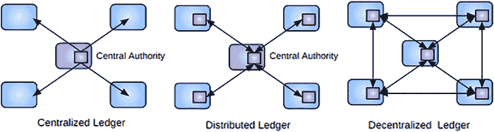

**图 1.1：** 账本类型

## 拜占庭将军问题

分布式账本技术的另一个核心方面是确保网络中每个节点上存储的数据是正确的，即使网络中可能包含恶意或不可用的节点。这个问题被称为拜占庭将军问题（`BGP`）。³ `BGP` 描述了这样一个场景：将军们包围城堡准备进攻，必须通过信使相互通信和协调。只有所有将军同时进攻，利用信使发出进攻信号，进攻才会成功。然而，风险在于进攻信号可能无法被所有将军正确接收，因为信使可能被杀或被收买。能抵抗这类故障的网络分别称为崩溃容错（`CFT`）和拜占庭容错（`BFT`）。

**Mazières** 和 **Shasha** 的论文《*基于拜占庭存储构建安全文件系统*》介绍了一种拜占庭容错（`BFT`）算法，允许分布式网络在不受信任的网络中就数据状态达成共识。⁴ 作者利用冗余来处理拜占庭故障，并使用数字签名创建了一种名为 `SUNDR`（安全不可信数据存储库）的一致性协议。如果发现差异，该协议将检测到恶意行为，并将文件系统数据块分区为分叉。

## 网络共识

为了使网络就通用状态达成一致，它需要使用一种具有两个关键属性的共识算法：

*   **活性**：必须持续推进网络状态的决策过程。
*   **安全性**：一旦诚实节点确认了网络状态，它们必须坚持这一决定。

在处理去中心化账本网络时，参与共识算法的大多数节点必须是诚实的，这对网络安全至关重要。如果不是，这就是所谓的 51% 攻击，即单一实体控制大多数节点。当这种情况发生时，攻击者可以控制共识结果，并撤销过去（或拒绝未来）可能对攻击者有利的交易。

## 在去中心化共识中利用计算周期解谜的概念

在去中心化共识中利用计算周期解谜的概念最早由**Wei Dai**的 `b-money` 于 1998 年提出。⁵ 这种方法的优势在于它不需要中心化机构来创造货币。"*2005 年，***Hal Finney*** *提出了‘可重复使用的工作量证明’概念*⁶*，该系统结合了 `b-money` 的理念与***Adam Back****的计算困难 `Hashcash` 谜题，创造了一种加密货币的概念。*”⁷ 遗憾的是，这种方法仍然依赖受信任的后端，⁸ 因此未能实现无需信任的去中心化货币目标。

## 比特币白皮书

2008 年，化名**中本聪**发表了"*比特币：一种点对点的电子现金系统*"，旨在通过一种去中心化的点对点电子现金系统解决双重支付问题，如*图 1.2*所示。在这篇里程碑式的论文中，中本聪提出了"*一种利用工作量证明记录交易公共历史的点对点网络，只要诚实节点控制了大部分 CPU 算力，攻击者要篡改这份记录在计算上就会变得不可行。*”⁹ 这是通过对网络交易进行时间戳记录，并"*将它们哈希进一个基于哈希的工作量证明的持续链中，形成一份无需重做工作量证明就无法更改的记录。最长链不仅作为所见事件序列的证明，也作为它来自最大 CPU 算力池的证明。只要大部分 CPU 算力由不合谋攻击网络的节点控制，它们就会生成最长链并超越攻击者。*”¹⁰

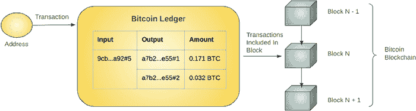

**图 1.2：** 比特币账本

比特币的**工作量证明**实施具有创新性，因为它同时解决了两个问题。首先，它提供了一个简单且中等效果的共识算法，允许网络中的节点共同就比特币账本状态的一组规范更新达成一致。¹¹ 其次，它提供了一种允许自由参与共识过程的机制，解决了谁有资格影响共识的政治问题，同时防止了女巫攻击。¹²

2009 年 1 月 3 日，第一个比特币区块被挖出，一个无需许可且无需信任的数字货币新时代由此诞生。在后续关于*密码学与共识算法概述*和*交易*的章节中，我们将更详细地探讨比特币白皮书。

## 以太坊白皮书

**Vitalik Buterin**于 2014 年发布的以太坊白皮书，介绍了一种利用区块链技术创建更通用的分布式计算平台的新方式。特别是，他描述了智能合约的概念，它可以被视为包含价值的加密“*盒子*”，仅在满足特定条件时才会解锁。¹³ 与比特币脚本不同，以太坊智能合约将是图灵完备的，并能访问全局状态和持久化存储，如*图 1.3*所示。运行在以太坊虚拟机（**EVM**）中的智能合约将具备价值感知能力，并能读取合约账户中的以太币（`ETH`）数量。

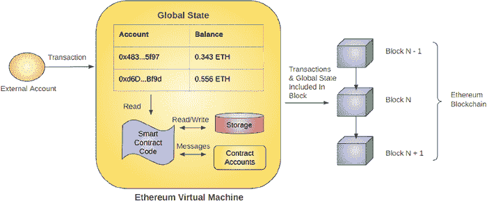

**图 1.3：** 以太坊账本

以太坊的全局状态包含两种账户类型：由私钥控制的外部拥有账户，以及由其智能合约代码控制的合约账户。¹⁴ 智能合约是自执行的，因为它们在单个节点内包含所需的所有信息。通过使用全局状态，以太坊具有优势：它不需要重演所有先前的交易来确定网络的当前状态。它只需将最新区块中的当前交易应用到节点上存储的最后一个全局状态即可。

以太坊中的交易是指一个签名数据包，它存储了从外部拥有账户发送的消息。合约可以向其他合约发送消息，其中消息是虚拟对象，从未被序列化，仅存在于以太坊执行环境中。¹⁵ 由于使用了全局状态，以太坊也被认为是非确定性的。相比之下，比特币和 Cardano 是确定性的，因为它们在交易中仅使用本地状态。

以太坊智能合约因其图灵完备的脚本特性，存在无限循环的风险。为解决此问题，以太坊采用了 `Gas` 费概念，即执行智能合约（或智能合约链）时消耗的费用。提交交易时，必须包含其将消耗的最大 `Gas` 量，以防范无限循环代码执行。

## Charles Hoskinson 的白板视频

**Charles Hoskinson**广受欢迎的白板视频（观看量超 100 万）¹⁶ 介绍了 Cardano 是第三代区块链的概念，其中比特币为第一代，以太坊为第二代。Cardano 构建于第一代和第二代区块链之上，并解决了各自的一些关键痛点，即：

*   可扩展性
*   互操作性
*   可持续性

### 可扩展性

Charles 指出，比特币和以太坊均无法扩展至数十亿用户，要提高可扩展性，必须聚焦三个关键领域：

*   **TPS**：每秒交易数。
*   **网络**：使用和共享网络所需的带宽。
*   **存储**：需持久保存的区块链大小。

Cardano 创建、发布并推出了 `Ouroboros`，一种可证明安全的权益证明协议，以提高**TPS**。该协议所需资源远少于工作量证明，因此可引入并行性和侧链以提高**TPS**。加密压缩算法结合侧链，将减少需传输和存储的区块链大小，从而改善**网络**和**存储**的可扩展性。侧链的概念允许 Cardano 基础层充当结算层，而侧链充当计算层。在扩展至数十亿用户时，在结算层向所有节点广播、中继和存储每笔交易是不可行也不切实际的。

### 互操作性

Cardano 旨在解决的另一个领域是区块链如何与其他区块链和遗留系统交互。特别是，Charles 预见了一个多条区块链共存的未来，Cardano 能与它们互操作，使价值能在它们之间流动。此外，还需要具备感知并与传统金融系统交易的能力。为此，区块链需要具备以下能力：

*   **元数据**：交易背后的故事。
*   **归属**：发送方和接收方的身份。
*   **合规**：`KYC`（了解你的客户）和反洗钱。

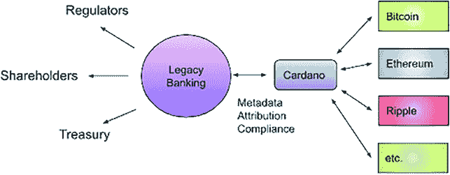

**图 1.4：** Cardano 互操作性

这些话题在区块链领域都高度敏感且备受争议。处理这些项目时必须极其谨慎，因为它们可能包含存储在不可变区块链上的个人信息。

### 可持续性

最后需要解决的领域是区块链将如何增长、融资和治理。它会是一种容易被出于自身利益的大实体强占的赞助模式吗？还是会是一次性的首次代币发行（`ICO`），这种模式资金有限，终将在某个时刻耗尽？Cardano 采取的方法是将一个自我维持的金库内置到协议中，该金库由初始代币供应分配和持续的交易费用提供资金。同样重要，甚至更重要的问题是：谁来决定以及资金如何花费。这属于 Cardano 的治理阶段，Charles 指出这将是 Cardano 所有阶段中最难的一个。其概念是 `Ada` 持有者可以对金库支出进行投票，同时也可以对协议随时间推移的功能或改进等治理行动进行投票。

## 区块链三难困境

区块链三难困境指的是一种普遍存在的观点，即去中心化网络在任何给定时间只能在去中心化、安全性和可扩展性这三项优势中提供两项。¹⁷

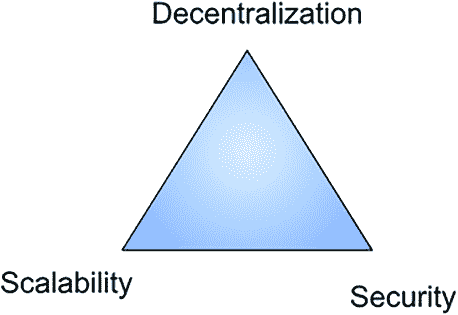


# 图 1.5：区块链三难困境

*   **去中心化：** 创建一个避免中央控制点的区块链。
*   **可扩展性：** 区块链必须能够处理不断增加的用户和交易数量。
*   **安全性：** 区块链必须按预期运行，并能抵御攻击、漏洞和其他不可预见的问题。¹⁸

Cardano 旨在通过以下方法解决这些维度中的每一个：

*   通过确保保护网络的权益池可以使用普通硬件和典型的互联网连接运行，来促进去中心化。
*   通过侧链、加密汇总和并行性（流水线）来解决可扩展性问题，提高交易处理的速度。
*   为了实现高保证的软件和安全性，采用科学方法，包括同行评审流程和对 `Ouroboros Proof-of-Stake` 协议的形式化验证。

## 代币经济学

本章的最后一个主题是对代币经济学的简要回顾。加密货币代币对于建立加密货币生态系统的价值至关重要。这一点很重要，因为运行和维护网络需要现实世界的资源和成本。因此，了解初始代币分配和货币政策（如最大供应量和通货膨胀率）以及它们如何影响价格和市值至关重要。最后，与股票市场一样，价格和价值经常是错位的。因此，在根据加密货币代币的价格评估生态系统时要保持谨慎。价格可能与该生态系统的效用或价值关系不大，而更多地与价格操纵和市场情绪有关。

## 代币分配

Cardano 的原生代币是 `Ada`，目前流通供应量为 35,125,959,544 `ADA`，最大供应量为 45,000,000,000 `ADA`。¹⁹ Cardano 的 `ICO` 于 2015 年 10 月至 2017 年 1 月期间完成，²⁰ 分配情况如 *图 1.6* 所示。

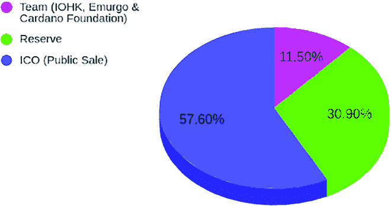

**图 1.6：** 初始代币分配

Cardano 有三个创始实体：²¹

*   **IOHK (IOG)** 是一家研究和工程公司及风险工作室，构建区块链和 Web3 产品，以赋能每个人、无处不在。²²
*   **Emurgo** 是营利性分支机构，负责开发、支持和孵化商业机会，并帮助企业集成到 Cardano 区块链系统中。
*   **Cardano 基金会** 是一个独立的、总部位于瑞士的非营利组织，致力于为金融和社会系统推广和发展 Cardano 平台。

## 代币分布

由于 `Ada` 有最大供应量上限，我们可以随时查看代币分布情况。这有助于与其他加密货币进行比较，因为如果大量代币未在流通供应中，那么当这些代币释放给公众时，可能会对价格造成下行压力。

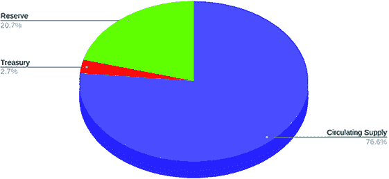

**图 1.7：** Ada 代币分布²³

**储备** 是用于**质押**奖励和资助金库的 `Ada` 数量，如 *图 1.7* 所示。金库用于支付生态系统的改进和维护费用。权益证明网络使用质押机制，允许用户质押其 `Ada` 以帮助保护网络。作为回报，他们将获得与用户质押的 `Ada` 占网络中总质押 `Ada` 比例成正比的奖励。质押奖励和金库资金还包括网络活动产生的交易费用。

## 代币分配对比

*图 1.8* 对比了截至 2023 年 9 月 27 日按市值排名的前十大加密货币的初始代币分配。有趣的是，随着加密货币发布时间的推移，内部人士 + 基金会的初始分配量呈上升趋势。

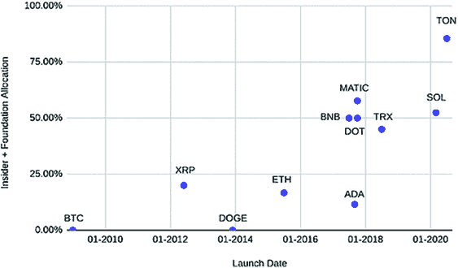

**图 1.8：** 市值前十加密货币初始代币分配对比²⁴

## 通货膨胀率

我们将要查看的最后一个指标是 Cardano 0.3% 的通货膨胀率。²⁵ 这是指通过质押和资助金库，从储备中释放到活跃供应中的 `Ada` 数量。Cardano 的通货膨胀率与 `Bitcoin` 相似，在启动时处于最高水平，随后随时间呈指数级下降，如 *图 1.9* 所示。

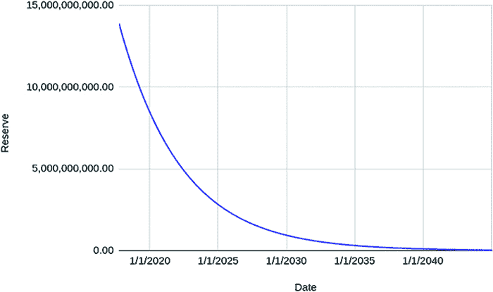

**图 1.9：** Cardano 通货膨胀率

## Cardano 路线图

Cardano 路线图被组织为五个主题或阶段：`Byron`、`Shelley`、`Goguen`、`Basho` 和 `Voltaire`。²⁶ 每个主题专注于一组将跨多个代码版本交付的功能。²⁷ 每个开发主题包含一个或多个时代，每个时代都有特定的账本规则，如 *表 1.1* 和 *1.2* 所示。

| **阶段** | **主题** | **账本时代** | **描述** |
| --- | --- | --- | --- |
| `Byron` | 基础 | `Byron` | 使用 `Ouroboros Proof-of-Stake` 协议的联邦制 Cardano 区块链的第一个版本²⁸ |
| `Shelley` | 去中心化 | `Shelley` | 推出改进去中心化并引入质押委托和奖励的升级²⁹ |
| `Goguen` | 智能合约 | `Allegra` | 引入代币锁定支持 |
| | | `Mary` | 启用原生代币和多资产 |
| | | `Alonzo` | 推出智能合约功能 |
| | | `Babbage` | 实现内联数据、引用脚本和引用输入等功能 |
| `Basho` | 扩展 | `N/A` | 提高 Cardano 网络的可扩展性和互操作性³⁰ |
| `Voltaire` | 治理 | `Conway` | 允许 Cardano 区块链成为一个自我维持的系统，网络参与者利用其质押的 `Ada` 和投票权影响网络的未来发展³¹ |

**表 1.1：** Cardano 路线图³²

| **日期** | **阶段** | **时代** | **纪元编号** | **共识机制** |
| --- | --- | --- | --- | --- |
| 2017/09 | `Byron` | `Byron` | 0 | `Ouroboros Classic` |
| 2020/02 | `Byron` | `Byron` | 176 | `Ouroboros BFT` |
| 2020/07 | `Shelley` | `Shelley` | 208 | `Ouroboros Praos` |
| 2020/12 | `Goguen` | `Allegra` | 236 | `Ouroboros Praos` |
| 2021/03 | `Goguen` | `Mary` | 251 | `Ouroboros Praos` |
| 2021/09 | `Goguen` | `Alonzo` | 290 | `Ouroboros Praos` |
| 2021/10 | `Goguen` | `Alonzo` | 298 | `Ouroboros Praos` |
| 2022/09 | `Goguen` | `Babbage` | 365 | `Ouroboros Praos` |
| 2023/02 | `Goguen` | `Babbage` | 394 | `Ouroboros Praos` |

**表 1.2：** Cardano 时间线³³

## 区块链用例

为了结束本介绍性章节，了解一些展示区块链技术潜力的区块链用例会很有帮助：

*   **资本市场**：更高效的资本流动³⁴
*   **代币化**：代表黄金、股票、债券、房产或法定货币等资产
*   **奖励**：利用奖励或积分激励行为的能力
*   **去中心化交易所 (DEX)**：用于资产和衍生品互换的非托管交易所
*   **市场**：用于买卖代币化资产
*   **金融产品**：如借贷
*   **身份系统**：自主身份 (`SSI`) 解决方案
*   **保险**：使用智能合约和数据馈送进行理赔处理
*   **媒体和娱乐**：追踪并变现真实数字内容的生命周期和分发³⁵
*   **去中心化存储**：利用代币激励模型实现点对点去中心化存储
*   **去中心化自治组织 (DAO)**：用于治理和投票

## 结论

我们现在应该对区块链技术的演变有了高层级的理解，从分布式账本的起源到 Charles Hoskinson 的著名白板视频，概括了 Cardano 的目的和目标。我们介绍了比特币和以太坊白皮书，并将在下一章更详细地研究工作量证明和权益证明共识模型。此外，我们回顾了区块链三难困境、代币经济学、Cardano 路线图和区块链用例等基本区块链概念。在下一章中，我们将更深入地从技术角度探讨密码学和共识算法，并探索它们如何使区块链安全。

## 重点回顾

*   网络可以是中心化的，也可以是去中心化的。
*   去中心化网络的难点在于它不得拥有中央权威。
*   拜占庭错误是指网络节点不可用或试图损害网络。
*   网络使用共识算法就网络的正确状态达成一致。
*   51% 攻击发生在单个实体控制去中心化账本网络中大多数节点时。
*   比特币白皮书同时解决了两个问题：
    *   提供了一个简单高效的共识算法。
    *   任何人都可以参与共识算法，消除了对中央权威的需求。
*   以太坊白皮书引入了可以访问账本全局状态的图灵完备脚本的概念。
*   Cardano 被认为是第三代区块链，其目标是解决可扩展性、互操作性和可持续性问题。
*   代币的价格和价值经常错位，因此在评估加密货币时，考虑去中心化、安全性和可扩展性等基本原则很重要。
*   Cardano 有五个开发主题或阶段：Byron、Shelley、Goguen、Basho 和 Voltaire。

## 多项选择题

1.  哪种网络不需要中央权威？
    1.  中心化
    2.  去中心化
    3.  分布式
    4.  匿名

2.  Wei Dai 发布了什么创新概念，至今仍被比特币使用？
    1.  通过解谜进行计算工作
    2.  通过 CPU 算力进行计算工作
    3.  通过网络算力进行计算工作
    4.  通过共识进行计算工作

3.  为什么 Hal Finney 的“可重复使用的工作量证明”没有被广泛采用？
    1.  它基于工作量证明 (POW)
    2.  它不是去中心化的
    3.  依赖受信任的后端
    4.  密码学不安全

4.  比特币的工作量证明之所以创新，是因为它是：
    1.  基于时间的共识算法
    2.  基于哈希的共识协议
    3.  基于时间和哈希的共识协议
    4.  高效且开放的共识协议

5.  为什么图灵完备脚本未在比特币中使用？
    1.  当时没有合适的计算机语言来编写它
    2.  存在无限循环的风险
    3.  它需要是一种函数式编程语言
    4.  比特币不使用脚本

6.  第一代和第二代区块链的三个关键痛点是什么？
    1.  可扩展性、互操作性、可持续性
    2.  可扩展性、去中心化、可持续性
    3.  去中心化、可扩展性、共识
    4.  可持续性、共识、可编程性

7.  区块链三难困境的三个维度是什么？
    1.  安全性、共识、去中心化
    2.  可编程性、安全性、共识
    3.  去中心化、可扩展性、安全性
    4.  安全性、可扩展性、可编程性

## 答案

1.  b
2.  a
3.  c
4.  d
5.  b
6.  a
7.  c

## 问题

1.  去中心化账本试图解决什么问题？
2.  为什么去中心化对共识协议如此关键？
3.  什么是拜占庭错误，如何缓解它？
4.  比特币白皮书的动机是什么？
5.  为什么 Vitalik Buterin 要撰写以太坊白皮书？
6.  Cardano 的目标是什么？
7.  为什么代币经济学很重要？

## 关键术语

*   **归属：** 发送者和接收者的身份。
*   **BFT：** 拜占庭容错
*   **CFT：** 故障容错
*   **合规：** KYC 和反洗钱。
*   **共识：** 网络节点就网络状态达成一致的能力。
*   **去中心化：** 没有中央权威的网络。
*   **元数据：** 交易背后的故事。
*   **储备：** 随时间推移用于质押奖励的加密货币数量。
*   **可扩展：** 区块链系统扩展网络交易的能力。
*   **安全：** 区块链保持可信的能力。
*   **归属**：发送者和接收者的身份。
*   **质押：** 使用 `Ada` 协助保护 Cardano 区块链并获得 `Ada` 奖励。
*   **金库：** 用于维护和升级的 `Ada` 数量。

____________________________________

¹ Lyn Alden, "Broken Money," 1-2.

² Stuart Haber et al., "How to Time-Stamp a Digital Document."

³ Leslie Lampor et al., "The Byzantine Generals Problem."

⁴ David Mazieres et al., "Building Secure File Systems Out of Byzantine Storage."

⁵ Wei Dai, "b-money."

⁶ Hal Finney, "RPOW - Reusable Proofs of Work."

⁷ Vitalik Buterin, "A Next-Generation Smart Contract and Decentralized Application Platform," 4.

⁸ Vitalik Buterin, "A Next-Generation Smart Contract and Decentralized Application Platform," 4.

⁹ Satoshi Nakamoto, "Bitcoin: A Peer-to-Peer Electronic Cash System," 8.

¹⁰ Satoshi Nakamoto, "Bitcoin: A Peer-to-Peer Electronic Cash System," 1.

¹¹ Vitalik Buterin, "A Next-Generation Smart Contract and Decentralized Application Platform," 4.

¹² Vitalik Buterin, "A Next-Generation Smart Contract and Decentralized Application Platform," 4.

¹³ Vitalik Buterin, "A Next-Generation Smart Contract and Decentralized Application Platform," 13.

¹⁴ Vitalik Buterin, "A Next-Generation Smart Contract and Decentralized Application Platform," 13.

¹⁵ Vitalik Buterin, "A Next-Generation Smart Contract and Decentralized Application Platform," 13.

¹⁶ Charles Hoskinson, “Cardano whiteboard; overview with Charles Hoskinson.”

¹⁷ Cryptopedia, “The Blockchain Trilemma: Fast, Secure, and Scalable Networks.”

¹⁸ [`medium.com/certik/the-blockchain-trilemma-decentralized-scalable-and-secure-e9d8c41a87b3`](https://medium.com/certik/the-blockchain-trilemma-decentralized-scalable-and-secure-e9d8c41a87b3)

¹⁹ [`coinmarketcap.com/currencies/cardano/#About`](https://coinmarketcap.com/currencies/cardano/#About)

²⁰ [`cardano.org/genesis/#audit`](https://cardano.org/genesis/#audit)

²¹ [`cardano.org/partners/`](https://cardano.org/partners/)

²² [`cardano.org/partners?tab=iog`](https://cardano.org/partners?tab=iog)

²³ cardanians.io, “There is 1.23B ADA in Cardano’s.”

²⁴ Source data from:

[`www.investopedia.com/what-is-xrp-6362550#toc-xrp-ledger-and-xrp`](https://www.investopedia.com/what-is-xrp-6362550#toc-xrp-ledger-and-xrp)

[`coinmarketcap.com/currencies/dogecoin/#About`](https://coinmarketcap.com/currencies/dogecoin/#About)

[`www.coingecko.com/en/coins/ethereum/tokenomics`](https://www.coingecko.com/en/coins/ethereum/tokenomics)

[`coinmarketcap.com/currencies/cardano/#About`](https://coinmarketcap.com/currencies/cardano/#About)

[`www.coingecko.com/en/coins/polkadot/tokenomics`](https://www.coingecko.com/en/coins/polkadot/tokenomics)


[`coinmarketcap.com/currencies/polygon/#About`](https://coinmarketcap.com/currencies/polygon/#About)

[`coinmarketcap.com/currencies/bnb/#About`](https://coinmarketcap.com/currencies/bnb/#About)

[`coinmarketcap.com/currencies/toncoin/`](https://coinmarketcap.com/currencies/toncoin/)

[`coinmarketcap.com/currencies/solana/#About`](https://coinmarketcap.com/currencies/solana/#About)

²⁵ [`docs.cardano.org/explore-cardano/monetary-policy/`](https://docs.cardano.org/explore-cardano/monetary-policy/)

²⁶ [`docs.cardano.org/about-cardano/evolution/eras-and-phases/`](https://docs.cardano.org/about-cardano/evolution/eras-and-phases/)

²⁷ [`roadmap.cardano.org/en/`](https://roadmap.cardano.org/en/)

²⁸ [`roadmap.cardano.org/en/byron/`](https://roadmap.cardano.org/en/byron/)

²⁹ [`roadmap.cardano.org/en/shelley/`](https://roadmap.cardano.org/en/shelley/)

³⁰ [`roadmap.cardano.org/en/basho/`](https://roadmap.cardano.org/en/basho/)

³¹ [`roadmap.cardano.org/en/voltaire/`](https://roadmap.cardano.org/en/voltaire/)

³² [`docs.cardano.org/explore-cardano/eras-and-phases/`](https://docs.cardano.org/explore-cardano/eras-and-phases/)

³³ [`github.com/cardano-foundation/CIPs/blob/master/CIP-0059/feature-table.md`](https://github.com/cardano-foundation/CIPs/blob/master/CIP-0059/feature-table.md)

³⁴ [`consensys.io/blockchain-use-cases/capital-markets`](https://consensys.io/blockchain-use-cases/capital-markets)

³⁵ [`consensys.io/blockchain-use-cases/media-and-entertainment`](https://consensys.io/blockchain-use-cases/media-and-entertainment)

# 第 2 章：密码学与共识算法概述

## 简介

在本章中，我们将介绍密码学和加密哈希。我们将展示加密哈希在区块链技术中是如何生成和使用的。接下来，我们将探讨比特币区块链使用的工作量证明共识协议。我们将展示证明者和验证者如何协同工作以保护区块链。随后，我们将考察权益证明及其相对于工作量证明的优势。最后，我们将回顾 Ouroboros，即 Cardano 的权益证明共识协议。

## 结构

在本章中，我们将讨论以下主题：

*   **密码学**
    *   公钥加密
    *   哈希
*   **数字签名**
    *   所有权链
*   **工作量证明**
    *   挖矿
*   **权益证明**
    *   概率最终性（基于链）
    *   绝对最终性（PBFT）
*   **Ouroboros**
    *   Ouroboros Classic
    *   Ouroboros BFT
    *   Ouroboros Praos
    *   Ouroboros Genesis
    *   Ouroboros Crypsinous
    *   Ouroboros Chronos
    *   Ouroboros 协议生命周期

## 密码学

“斯巴达人最早于公元前 400 年使用密码设备进行通信，这是有记录以来最早将密码学用于通信的案例。”¹ 密码是指转换消息以隐藏其含义的任何方法。² 在 1970 年代中期之前，所有密码系统都使用对称密钥算法，即发送方和接收方使用相同的加密密钥配合底层算法，双方都必须保密该密钥。³ `对称` 加密的挑战在于秘密密钥必须事先安全传输，当需要管理许多密钥或不存在事先的安全通道时，这种方式难以扩展。⁴ 这一局限性通过 `非对称` 加密得以解决，后者用于 `公钥加密` 和 `数字签名`。

### 公钥加密

使用公钥加密的过程的第一步是使用基于数学的单向加密算法生成一对公钥和私钥。⁵ 经典的密码学示例是指 Alice 试图向 Bob 发送加密消息，如图 2.1 所示。在这种情况下，Alice 需要使用 Bob 的公钥来加密消息。除了持有私钥的 Bob 之外，该消息对所有人都是不可读的。当 Bob 收到加密消息时，他使用自己的私钥对其进行解密，并读取 Alice 发送的原始消息。

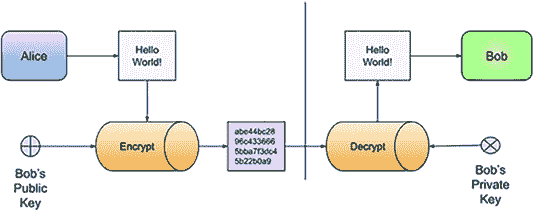

**图 2.1：** 公钥加密

### 哈希

加密哈希是使用一种数学函数生成的，该函数接受任意大小的输入并生成固定长度的输出。⁶ 这被称为单向哈希，无法解码以揭示输入的原始内容。对于相同的输入集，生成的输出将始终相同。如果输入哪怕发生最微小的变化，生成的哈希将完全不同，这被称为雪崩效应。⁷ 雪崩效应确保了抗碰撞性和篡改检测，这在区块链中被广泛使用。

`BLAKE2b-256` 加密哈希算法用于在 Cardano 中生成地址，⁸ `BLAKE2b-224` 用于生成公钥哈希。哈希函数也用于区块链中，以生成包含交易列表的区块的哈希。这有助于检查和确保不可变性，因为区块中所含交易的任何变更都会改变区块哈希。

### 数字签名

`数字签名` 为 Alice 提供了一种签署消息的方式，以便稍后任何人都可以使用 Alice 的公钥来验证该签名。⁹ 消息不像公钥加密那样被加密；相反，数字签名证明了这条消息是由 Alice 且仅由 Alice 签署的。在区块链的语境下，消息是一笔交易，而 Alice 是区块链地址的所有者。当一笔交易由 Alice 的私钥签署时，区块链上的任何其他人都可以使用 Alice 的公钥进行验证，如图 2.2 所示。

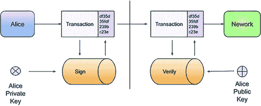

**图 2.2：** 数字签名

最早常用的数字签名是 1977 年创建的 Rivest-Shamir-Asleman (RSA)，它利用了将两个大素数分解很困难这一特性。1991 年，创建了数字签名算法 (DSA)，利用了解决离散对数问题（`x ^ y = z`）很困难这一事实。给定 `x` 和 `z`，当 `y` 是一个足够大的数字时，求解 `y` 很困难。椭圆曲线签名算法被添加到 DSA 中，创建了椭圆曲线数字签名算法 (ECDSA)，它具有更小的密钥尺寸和更快的操作。¹⁰ Cardano 使用 Edwards 曲线数字签名算法 (EdDSA)，具有以下优势¹¹：

*   快速签名和验证
*   高安全性
*   签名体积小
*   密钥体积小

表 2.1 总结了 Bitcoin、Ethereum 和 Cardano 中使用的不同签名算法：

| **区块链** | **签名算法** | **椭圆曲线** | **哈希函数** |
| --- | --- | --- | --- |
| Bitcoin | ECDSA | Secp256k1 | SHA-256 |
| Ethereum | ECDSA | Secp256k1 | Keccak-256 |
| Cardano | EdDSA | Curve25519 | BLAKE2b |

**表 2.1：** 数字签名¹²

#### 所有权链

正如 Bitcoin 白皮书中所定义的，电子货币是一串数字签名。¹³ Bitcoin 通过对前一笔交易的哈希值和下一位拥有者的公钥进行签名来进行数字化转移。只有当签名与前一笔交易中包含的公钥匹配时，交易才会被批准。通过将这些链接在一起，可以验证**所有权链**，如图 2.3 所示。

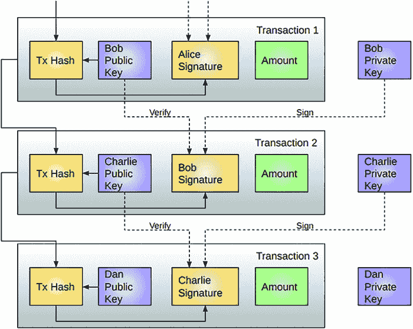

**图 2.3：** 所有权链¹⁴

## 工作量证明

在 Bitcoin 白皮书中，双重支付问题是指 Bob 试图创建两笔交易以花费同一笔金额两次。为了解决这个问题，引入了时间戳或时间线。每个区块哈希都链接到前一个区块哈希，从而创建区块链并对交易进行排序，如图 2.4 所示。账本现在可以确认一笔交易是否试图双重支付已花费的输出，并相应地拒绝它。

为了帮助调节区块生成的频率，使用了一个 nonce 并对其进行递增，以找到具有所需数量前导零位的区块哈希。Bitcoin 网络监控区块生成的速度，如果区块生成过快，所需的零位数量就会增加。相反，如果生成区块所需时间过长，所需的零位数量就会减少。所需零位数量的调整也称为**难度**。¹⁵ 随着**难度**的增加，所需的 CPU 计算量呈指数级增长。因为区块被链接在一起，撤销前一笔交易需要更改所有前面的区块，随着网络确认的区块越来越多，这实际上变得不可能。

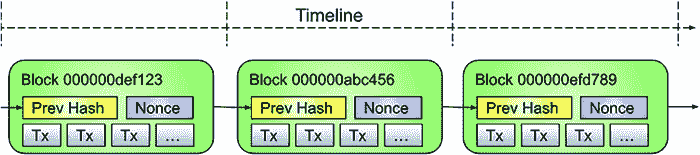

**图 2.4：** 工作量证明

### 挖矿

最后需要解决的问题是为创建新区块（称为挖矿）提供激励，并鼓励矿工诚实行事，不攻击网络。这是通过在每个区块的第一笔交易中向创建该区块的矿工分发新的 Bitcoin 来实现的。新创建的 Bitcoin 数量随时间呈指数级减少，这控制了 Bitcoin 的通胀率。此外，如果交易的输出值小于输入值，这被视为交易费并奖励给矿工。¹⁶ 新增的 Bitcoin 加上交易费将使矿工诚实行事比试图用无效区块颠覆网络更有利可图。

## 权益证明

随着 Bitcoin 的日益普及，难度呈指数级增加。因此，**PoW** 共识协议要求矿工消耗大量能源来生成区块。另一方面，**PoS** 通过根据利益相关者在网络上质押的 Ada 数量，随机且成比例地选择区块生成者，显著提高了能源效率。利益相关者可以将其质押委托给 Stake Pool Operator（**SPO**，股份池运营商）以聚合股份并增加区块生成的机会。在 PoS 协议中，无需生成计算密集型谜题；同时，安全性和无许可属性仍可与 **PoW** 相媲美。¹⁷

然而，**PoS** 为确定区块（时隙）领导者引入了不同的威胁向量。为了在利益相关者之间实现公平的随机选举，**熵**必须被引入系统，并且可能容易受到对手的操纵。¹⁸ Ouroboros **PoS** 协议通过使用一个代表 Cardano 生态系统外部不可预测事物的熵参数来缓解这一风险。¹⁹ “*该参数的值是根据无法预先知晓的事件，或任何人都无法拥有内幕信息的事件来计算的。*”²⁰

我们将在下一节更详细地研究 Ouroboros 协议，并通过考察 **PoS** 协议的两大主要类别来完成 **PoS** 概述：²¹

*   **概率性最终性** (基于链)
*   **绝对最终性** (PBFT)

### 概率性最终性 (基于链)

**概率性**或基于链的最终性试图模拟 Bitcoin 中使用的 **PoW** 中本聪共识协议。随着更多区块被链接在一起，它们形成最长链并变得概率性最终。²² 通常，等待 6 个区块被链接在一起足以实现概率性最终性，交易被回滚或撤销的可能性极低。概率性最终性机制的一个关键优势是，它优先考虑网络的**可用性**，以实现持续且无许可的访问。

### 绝对最终性 (PBFT)

在**绝对最终性**或实用拜占庭容错（**PBFT**）协议中，随机选择一个验证者来提议新区块。然后验证者对该新区块的纳入进行投票，当所需数量的验证者同意接受新区块时，即达成共识。²³ 此外，像 Ethereum 这样的 **PoS** 区块链实施了一种经济惩罚机制，使得验证者离线或恶意攻击网络的代价高得令人望而却步。通过使用**绝对**和**经济最终性**，该协议优先考虑网络的**一致性**，宁愿停止网络也不愿接受无效交易哪怕很短的时间。²⁴

## Ouroboros 协议

Ouroboros 是第一个可证明安全的 **PoS** 协议，也是第一个基于同行评审研究的区块链协议。²⁵ 它包含一系列 PoS 协议，包括：

*   Ouroboros Classic
*   Ouroboros BFT
*   Ouroboros Praos
*   Ouroboros Genesis
*   Ouroboros Crypsinous
*   Ouroboros Chronos

### Ouroboros Classic

Ouroboros Classic 是于 2017 年 7 月发布的首个 Ouroboros 协议。²⁶ 该论文将该协议定义为 `PoW` 的节能竞争对手，引入了分析 `PoS` 的数学框架，并引入了一种新颖的激励机制，以在 `PoS` 环境下奖励参与者。²⁷ Ouroboros 与其他区块链协议的区别在于，其领导者选择算法能够在安全保证下生成无偏随机性。²⁸ 让我们更详细地研究一下。

> Ouroboros 将 Cardano 上的时间划分为纪元，每个纪元又被划分为时隙。时隙是可以创建区块的短时间段，将时隙分组为纪元是根据动态变化的权益分布调整领导者选举过程的核心。每个时隙会选举出一位时隙领导者，负责向链中添加区块并将其传递给下一位时隙领导者。为了防范旨在颠覆协议的对抗性尝试，每位新的时隙领导者必须将接收到的链的最后几个区块视为暂态的：仅位于预先指定数量的暂态区块之前的链才被视为已确定。²⁹

### Ouroboros BFT

Ouroboros Byzantine Fault Tolerance（`BFT`）是基于 Ouroboros Classic 的简化协议³⁰，主要用于协助 Cardano 最重要的里程碑之一——Shelley 发布。它将网络过渡到联邦模型，以避免要求所有节点始终在线。³¹

### Ouroboros Praos

Praos 在当前时间戳和特定纪元的随机数上引入了可验证随机函数（`VRF`）。³² 给定私钥和输入，`VRF` 会输出一个伪随机数和一个证明。³³ 相应的公钥可以验证该证明和随机数。此外，这种方法除了提议的时隙领导者之外，防止任何人提前知道特定时隙的时隙领导者。这对于避免 `DDoS` 或针对性攻击非常重要，因为在这些攻击中时隙领导者会被提前公开。³⁴

### Ouroboros Genesis

比特币 `PoW` 共识协议的优势在于，任何参与者仅使用创世区块即可加入网络并参与其中。这是任何区块链的一项非常重要的功能，因为它不依赖于网络正确状态的任何可信概念或检查点。Ouroboros Genesis 通过使用一种新颖的链选择规则，解决了 Ouroboros `PoS` 协议的这一局限性，该规则允许新参与者或离线参与者仅使用创世区块加入网络。³⁵ 这种方法称为“从创世引导”，Ouroboros Genesis 论文证明了在使用这种方法时仍能保留先前的安全保证。该论文还提供了协议通用可组合性的证明，表明即使在不同的协议配置中使用，它仍能保持其安全属性。³⁶

### Ouroboros Crypsinous

Ouroboros Crypsinous 是首个经过正式分析的隐私保护 `PoS` 区块链协议。³⁷ 该论文利用 SNARKs 和密钥私有前向安全加密，使用一种新颖的币演化技术，证明网络能够抵御自适应攻击。³⁸ 该协议不打算在 Cardano 主结算层实施，但可用于侧链，如 Midnight（一条隐私保护区块链）。

### Ouroboros Chronos

Ouroboros Chronos 通过一种新颖的时间同步机制，展示了区块链协议如何安全地同步时钟，从而摆脱对外部时间服务的依赖。³⁹ 该论文旨在使账本更能抵御针对时间信息的攻击。⁴⁰

## Ouroboros 协议生命周期

让我们走一遍 Ouroboros 协议生命周期，提供一个分步示例，说明所有部分如何组合在一起。

### 时间

Cardano 区块链中的第一个区块是创世区块，从区块链的角度来看，这是时间的开始。Cardano 使用时隙的概念，时隙大约每秒发生一次，每个时隙最多可创建一个区块。预期的出块频率为 0.05，这意味着平均每 20 秒将产生一个区块。⁴¹ 只有时隙领导者可以为给定时隙创建区块。每个纪元恰好有 432,000 个时隙，相当于每 5 天。

### 注册

参与 Cardano 网络的第一步是注册与要质押的 Ada 关联的权益密钥。这通常指将 Ada 注册到特定的股份池运营商（`SPO`）。质押金额用于计算奖励并按比例分配回质押地址。`SPO` 将处理（除其他事项外）股份池注册流程，如图 2.5 所示：

1.  与网络账本同步。
2.  获取当前时隙。
3.  获取全局随机预言机。

### 质押

1.  在每个纪元开始时，每个股份池运营商查询区块链以获取两个纪元前某个区块的权益分布。
2.  使用由上一纪元前 ⅔ 个时隙生成的 `VRF`，利益相关者通过其私钥可在当前纪元产生输出，以确定他们是否可以成为时隙领导者。⁴²
3.  如果 `VRF` 输出值低于特定阈值，他们就可以成为该区块的时隙领导者。
4.  时隙领导者职责：⁴³
    1.  组装应包含在区块中的交易。
    2.  在区块中包含从 VRF 输出获得的随机值 (v) 和证明 (π)。
    3.  生成新私钥并删除旧私钥，使得无法使用旧私钥伪造签名。
    4.  向网络广播新区块。
5.  奖励在纪元结束时计算，然后在下一个区块中分配给奖励地址。


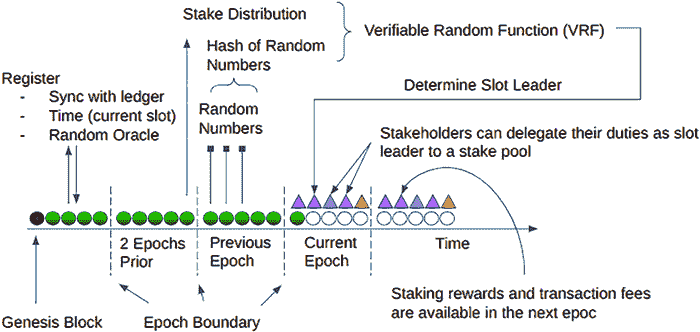

**图 2.5：** Ouroboros 协议生命周期

## 结论

本章介绍了密码学，重点关注公钥哈希算法。我们了解了这如何扩展为称为数字签名的概念，它支撑着当今的加密货币。通过链接数字签名，区块链可以为像比特币这样的数字货币的流动创建所有权证明。我们深入研究了工作量证明，以及挖掘区块如何激励矿工保持诚实并防止网络攻击。然后我们研究了节能的权益证明，以及如何降低与预测随机数生成相关的风险，还有概率性最终性和绝对最终性之间的差异与权衡。最后，我们回顾了 Ouroboros 协议家族以及当今 Cardano 主网上的当前协议生命周期。利用我们对密码学和 `PoS` 区块链工作原理的了解，我们将在下一章探讨如何使用交易转移价值。

## 要点回顾

*   使用公钥加密需要生成一对公钥和私钥。
*   如果交易由私钥签名，区块链上的任何人都可以使用相应的公钥进行验证。
*   比特币通过签名前一笔交易的哈希值并包含下一位所有者的公钥来进行数字化转移。

## 关键概念

*   为解决双重支付问题，每个区块的哈希值中都包含一个时间戳，而更多的时间戳包含在区块链中，从而保护了之前的区块。
*   比特币挖矿通过将新比特币和交易费作为每个区块中的第一笔交易分配给创建该区块的矿工，从而激励诚实行为。
*   `权益证明`比`工作量证明`节能得多。
*   `权益证明`根据利益相关者在网络上质押的原生货币数量，随机且成比例地选择出块者（验证者）。
*   必须向系统引入`熵`，以便在`权益证明`利益相关者之间实现公平的随机选举。
*   在安全性保证下，`Ouroboros` 可以在协议的领导者选择算法中生成无偏随机性。
*   随着更多区块被链接形成最长链，会发生`概率性最终性`。
*   验证者对是否包含新区块进行投票，结果被视为最终，从而实现`绝对最终性`。

## 多项选择题

1.  公钥加密使用哪种类型的加密？

    1.  对称加密
    2.  非对称加密
    3.  双向对称加密
    4.  匿名加密

2.  如何验证签名？

    1.  同时使用私钥和公钥
    2.  使用私钥
    3.  使用对称密钥
    4.  使用与私钥关联的公钥

3.  比特币是如何解决双重支付问题的？

    1.  使用时间戳对交易进行排序
    2.  使用分布式账本记录交易
    3.  使用密码学对交易进行签名
    4.  使用区块记录交易

4.  权益证明更节能，因为：

    1.  不需要区块领导者选择
    2.  不需要随机性
    3.  不需要解决计算难题
    4.  不需要形成最长链

5.  哪种风险同时存在于权益证明和工作量证明中？

    1.  中心化
    2.  随机性偏差
    3.  财阀统治
    4.  环境

## 答案

1.  b
2.  d
3.  a
4.  c
5.  a

## 问题

1.  为什么密码学对区块链很重要？
2.  比特币白皮书解决了什么问题？
3.  Cardano PoS 比 Bitcoin PoW 节能多少？
4.  绝对最终性的优缺点是什么？
5.  为什么 Ouroboros 具有可证明的安全性至关重要？
6.  当客户端加入网络时，Ouroboros 如何确保选择正确的链？

## 关键术语

*   **区块：** 包含零笔或多笔交易。
*   **所有权链：** 将数字签名链接在一起。
*   **DDos：** 分布式拒绝服务。
*   **难度：** 创建区块所需的计算速率不断增加。
*   **数字签名：** 使用私钥签名的消息。
*   **熵：** 系统中的随机性数量。
*   **纪元：** 包含固定数量时隙的时间单位。
*   **最终性：** 可被视为最终且不可逆的状态。
*   **挖矿：** 为创建区块而支付给矿工的激励。
*   **公钥加密：** 生成一对公钥和私钥。
*   **PoS：** 权益证明
*   **PoW：** 工作量证明
*   **时隙：** 每秒发生一次，最多可包含一个区块。
*   **SPO：** 权益池运营商
*   **VRF：** 可验证随机函数

---

¹ Gustavus J. Simmons, “History of cryptography.”
² Encyclopaedia of Britannica, “cipher.”
³ [`en.wikipedia.org/wiki/Public-key_cryptography`](https://en.wikipedia.org/wiki/Public-key_cryptography)
⁴ A. Menezes, “Handbook of Applied Cryptography,” 283.
⁵ A. Menezes, “Handbook of Applied Cryptography,” 286.
⁶ Prashant P. Pittalia, “A comparative study of hash algorithms in cryptography,” 147.
⁷ Darshana Upadhyay, et al., “Investigating the Avalanche Effect of Various Cryptographically Secure Hash Functions and Hash-Based Applications,” 112472–112486.
⁸ [`docs.cardano.org/learn/cardano-addresses/`](https://docs.cardano.org/learn/cardano-addresses/)
⁹ Shafi Goldwasser, “Chapter 10: Digital signatures” (PDF). Lecture Notes on Cryptography,” 168.
¹⁰ [`academy.cardanofoundation.org/`](https://academy.cardanofoundation.org/), “Different Digital Signature Algorithms.”
¹¹ Daniel, J. Bernstein, et. al. “High-speed high-security signatures.” J Cryptogr Eng 2, 77–89 (2012).
¹² [`www.susanka.eu/coins-crypto/`](https://www.susanka.eu/coins-crypto/)
¹³ Satoshi Nakamoto, “Bitcoin: A Peer-to-Peer Electronic Cash System,” 2.
¹⁴ Satoshi Nakamoto, “Bitcoin: A Peer-to-Peer Electronic Cash System,” 2.
¹⁵ Satoshi Nakamoto, “Bitcoin: A Peer-to-Peer Electronic Cash System.” 2.
¹⁶ Satoshi Nakamoto, “Bitcoin: A Peer-to-Peer Electronic Cash System,” 4.
¹⁷ Aggelos Kiayias, et al., “Ouroboros: A Provably Secure Proof-of-Stake Blockchain Protocol,” 1.
¹⁸ Aggelos Kiayias, et al., “Ouroboros: A Provably Secure Proof-of-Stake Blockchain Protocol,” 1.
¹⁹ [`docs.cardano.org/explore-cardano/cardano-entropy/`](https://docs.cardano.org/explore-cardano/cardano-entropy/)
²⁰ [`docs.cardano.org/explore-cardano/cardano-entropy/`](https://docs.cardano.org/explore-cardano/cardano-entropy/)
²¹ Alexis Gauba, “Finality in Blockchain Consensus.”
²² Shehar Bano, et al., “SoK: Consensus in the Age of Blockchains,” 2.
²³ Shehar Bano, et al., “SoK: Consensus in the Age of Blockchains,” 4.
²⁴ Alexis Gauba, “Finality in Blockchain Consensus.”
²⁵ [`docs.cardano.org/learn/ouroboros-overview/`](https://docs.cardano.org/learn/ouroboros-overview/)
²⁶ Aggelos Kiayias, et al., “Ouroboros: A Provably Secure Proof-of-Stake Blockchain Protocol,” 1.
²⁷ Olga Hryniuk, “From Classic to Chronos: the implementations of Ouroboros explained.”
²⁸ [`docs.cardano.org/learn/ouroboros-overview/`](https://docs.cardano.org/learn/ouroboros-overview/)
²⁹ Olga Hryniuk, “From Classic to Chronos: the implementations of Ouroboros explained.”
³⁰ Bernardo David, et al. “Ouroboros-BFT:A Simple Byzantine Fault Tolerant Consensus Protocol,” 1.
³¹ Olga Hryniuk, “From Classic to Chronos: the implementations of Ouroboros explained.”
³² Bernardo David, et al. “Ouroboros Praos: An adaptively-secure, semi-synchronous proof-of-stake blockchain”
³³ LLFOURN, “Introduction To Ouroboros.”
³⁴ Peter Gaži, “Presenting Ouroboros at MIT.”
³⁵ Christian Badertscher, et al., “Ouroboros Genesis: Composable Proof-of-Stake Blockchains with Dynamic Availability,” 1.
³⁶ Olga Hryniuk, “From Classic to Chronos: the implementations of Ouroboros explained.”
³⁷ Thomas Kerber, et al., “Ouroboros Crypsinous: Privacy-Preserving Proof-of-Stake,” 1.
³⁸ Thomas Kerber, “Ouroboros Crypsinous: Privacy-Preserving Proof-of-Stake,” 1.
³⁹ Olga Hryniuk, “From Classic to Chronos: the implementations of Ouroboros explained.”
⁴⁰ Christian Badertscher, et al., “Ouroboros Chronos: Permissionless Clock Synchronization via Proof-of-Stake,” 1.

# 第 3 章：交易

## 简介

在本章中，我们将首先了解 Cardano 地址，它们是如何构建的，以及其中包含的数据。接下来，我们将探讨 `UTXO` 架构，并展示交易是如何创建的，以及可选的元数据。我们还将介绍智能合约（称为 Plutus 脚本）是如何执行和评估的。我们将看到 `Redeemer`（赎回者）如何将数据传递给 Plutus 脚本，以及 `Datum`（数据项）如何用于数据存储和持久化。最后，我们将了解交易 `Witness Set`（见证集）以及它如何授权交易输入的支出。

## 结构

在本章中，我们将讨论以下主题：

*   地址
    *   网络标签
    *   基础地址
    *   企业地址
    *   奖励（质押）地址
*   UTXO
    *   交易输入
    *   交易输出
*   元数据
*   Plutus 脚本
*   Datum
*   Redeemer
*   Witness Set

## 地址

Cardano (Shelley) 地址是使用 Bech32 编码的字节序列。¹ 在 Cardano 上，您通常会与以下三种类型的地址进行交互：

*   基础地址
*   企业地址
*   奖励（质押）地址

Cardano 地址的结构如**图 3.1**所示：

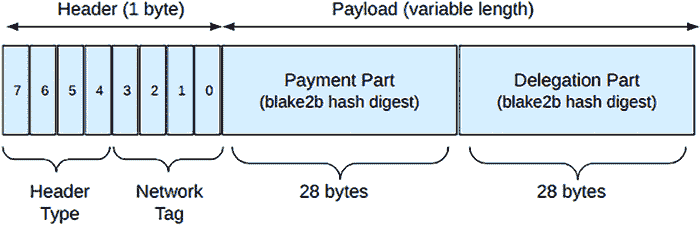

**图 3.1：** Cardano 地址结构

头部类型指示地址（或载荷）的类型，网络标签指示该地址关联的网络。

### 网络标签

| **头部位** | **网络** |
| --- | --- |
| `xxxx0000` | 测试网 |
| `xxxx0001` | 主网 |

**表 3.1：** 网络标签

### 基础地址

基础地址是最常见的地址类型，如**表 3.2**所示。当支付部分为 `PaymentKeyHash` 时，交易必须使用该地址对应的私钥进行签名。当支付部分为 `ScriptHash` 时，必须执行并评估哈希值匹配的脚本，且结果为 true，才能从该地址支出。委托部分与支付部分类似，但用于注册（并委托）该地址锁定的 Ada 的质押证书。正如我们在上一章回顾的那样，质押是帮助保障权益证明区块链安全并因之获得奖励的机制。

| **头部位** | **支付部分** | **委托部分** |
| --- | --- | --- |
| `0000xxxx` | `PaymentKeyHash` | `StakeKeyHash` |
| `0001xxxx` | `ScriptHash` | `StakeKeyHash` |
| `0010xxxx` | `PaymentKeyHash` | `ScriptHash` |
| `0011xxxx` | `ScriptHash` | `ScriptHash` |

**表 3.2：** 基础地址

### 企业地址

企业地址类似于基础地址，区别在于没有委托部分。企业地址的头部类型列于**表 3.3**。

| **头部位** | **支付部分** | **委托部分** |
| --- | --- | --- |
| `0110xxxx` | `PaymentKeyHash` | N/A |
| `0111xxxx` | `ScriptHash` | N/A |

**表 3.3：** 企业地址

### 奖励（质押）地址

奖励地址用于在权益证明协议中分发质押奖励，具有以下属性：²

*   它采用账户式记账模型，而非 `UTXO`。
*   账户余额仅在分发质押奖励时增加。
*   要转出奖励地址锁定的 Ada，需要一种提款类型的交易来释放资金并将奖励地址的余额归零。
*   已注册的质押密钥与奖励账户地址之间存在一对一关系。

| **头部位** | **质押引用** |
| --- | --- |
| `1110xxxx` | `StakeKeyHash` |
| `1111xxxx` | `ScriptHash` |

**表 3.4：** 奖励（质押）地址

为了将所有内容串联起来，以下输出由 `cardano-address address inspect` 命令行工具生成。请注意，地址中可能存在链指针，指向包含质押密钥注册证书的链上位置。³ 然而，指针很少使用，在以下示例中，我们可以看到 `stake_reference` 为 "by_value"，表明质押证书位于此质押地址，而非指针。

**Shelley 基础地址 (base 32)：**

`addr_test1qqq40ucy70wms9p7tku6ntcamzuuxnsaejal7p82qcahh3ryswkc5djr3z37lhv3zjytgyfpf8en2pa4cfuvqdz4za8syv5dnc`


```
$ echo addr_test1qqq40ucy70wms9p7tku6ntcamzuuxnsaejal7p82qcahh3ryswkc5djr3z37lhv3zjytgyfpf8en2pa4cfuvqdz4za8syv5dnc | cardano-address address inspect
{
  "address_style": "Shelley",
  "address_type": 0,
  "network_tag": 0,
  "spending_key_hash": "0157f304f3ddb8143e5db9a9af1dd8b9c34e1dccbbff04ea063b7bc4",
  "spending_key_hash_bech32": "addr_vkh1q9tlxp8nmkupg0jahx5678wch8p5u8wvh0lsf6sx8daug8cyak6",
  "stake_key_hash": "6483ad8a364388a3efdd911488b4112149f33507b5c278c03455174f",
  "stake_key_hash_bech32": "stake_vkh1vjp6mz3kgwy28m7ajy2g3dq3y9ylxdg8khp83sp525t57tzwkxk",
  "stake_reference": "by value"
}
```

转换带有粗体头部位的原始基础地址 (base 16)：

```
$ bech32 <<< addr_test1qqq40ucy70wms9p7tku6ntcamzuuxnsaejal7p82qcahh3ryswkc5djr3z37lhv3zjytgyfpf8en2pa4cfuvqdz4za8syv5dnc
000157f304f3ddb8143e5db9a9af1dd8b9c34e1dccbbff04ea063b7bc46483ad8a364388a3efdd911488b4112149f33507b5c278c03455174f
```

转换带有粗体头部位的原始质押地址 (base 16)：

```
$ bech32 <<< stake_test1upjg8tv2xepc3gl0mkg3fz95zys5nue4q76uy7xqx323wncxv6f68
e06483ad8a364388a3efdd911488b4112149f33507b5c278c03455174f
```

| 十六进制 | 二进制 | 十六进制 | 二进制 | 十六进制 | 二进制 | 十六进制 | 二进制 |
| --- | --- | --- | --- | --- | --- | --- | --- |
| 0 | 0 | 4 | 100 | 8 | 1000 | C | 1100 |
| 1 | 1 | 5 | 101 | 9 | 1001 | D | 1101 |
| 2 | 10 | 6 | 110 | A | 1010 | E | 1110 |
| 3 | 11 | 7 | 111 | B | 1011 | F | 1111 |

**表 3.5：** 十六进制转换

## UTXO

Cardano 和 Bitcoin 使用相似的未花费交易输出 (`UTXO`) 模型，而像 Ethereum 这样的区块链则使用基于账户的模型。在 `UTXO` 模型中，一笔交易消耗一个或多个 `UTXO` 作为输入，并产生一个或多个 `UTXO` 作为输出，每个 `UTXO` 都锁定在一个地址上。一个 `UTXO` 只能被花费（使用）一次，如果它已被用作交易输入，则不再是*未花费*的交易输出。某地址上的资产总量是该特定地址上所有 `UTXO` 的总和。此外，只有 Alice 可以花费 Alice 地址上的 `UTXO`，因为她拥有私钥，可以创建 `signature` 来证明这一点。

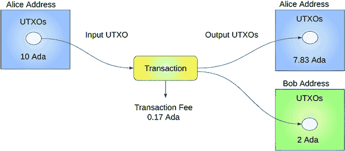

**图 3.2：** UTXO 模型

在**图 3.2**中，Alice 拥有一个包含 10 Ada 的 `UTXO`，并想向 Bob 发送 2 Ada。创建一笔交易，将包含 10 Ada 的 `UTXO` 用作输入，并创建 2 个新的 `UTXO` 作为输出。包含 2 Ada 的 `UTXO` 将发送到 Bob 的地址，0.17 Ada 用于支付交易费用，剩余的 Ada（找零）将作为 `UTXO` 返回给 Alice。这与在实体钱包中用一张 10 美元的钞票在商店购买一瓶 2 美元的水的工作方式相同。

使用区块链浏览器，我们可以看到这笔交易在 Cardano 区块链上的样子，如图 3.3 所示：[`preprod.cexplorer.io/tx/c9e6dc1e7ecdf7110747c91d0d638ce896435a504e745025996230533ae9f548`](https://preprod.cexplorer.io/tx/c9e6dc1e7ecdf7110747c91d0d638ce896435a504e745025996230533ae9f548)

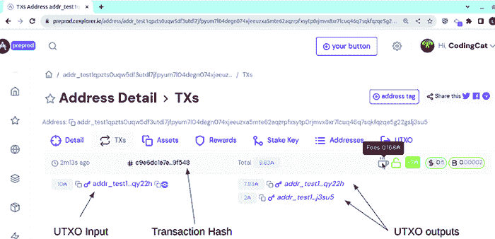

**图 3.3：** 区块浏览器交易视图

## 交易输入

交易输入仅指向账本上的交易哈希和索引，因为特定交易可能有不止一个交易输出。

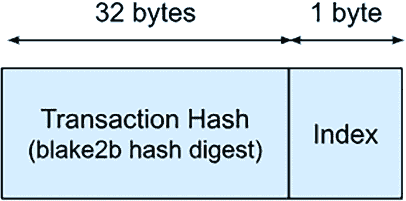

**图 3.4：** 交易输入

输入的账本规范⁴定义如下：

```
transaction_input = [ transaction_id : $hash32
, index : uint
]
```

## 交易输出

在支持智能合约的 Alonzo 时代之前，交易输出包含以下内容：

*   输出锁定所在的地址
*   Ada 的价值以及任何 Cardano 原生代币
*   用于存储持久数据哈希的可选 `datum`

能够将 `datum` 值与 `UTXO` 一起存储，这就是 Cardano 使用 `EUTXO` 模型的方式，而 Bitcoin 仅使用 `UTXO` 模型。

以下是 Cardano 上某地址拥有 2 个 `EUTXO` 的示例\*：

```
$ cardano-cli query utxo --address addr_test1vzu…dxn7 --cardano-mode --testnet-magic 1
TxHash TxIx Amount
--------------------------------------------------------------------
158…925 0 3551912116 lovelace + TxOutDatumNone
b4e…0d2 0 5000000 lovelace + TxOutDatumNone
```

*\*请注意，为排版需要，地址和 TxHash 已被截断。*

观察：

*   在此示例中，共有 2 个 `UTXO`。
*   索引为 0 的交易哈希 `158…925` 拥有 3,551,912,116 lovelace。
*   索引为 0 的交易哈希 `b4e…0d2` 拥有 5,000,000 lovelace。
*   1,000,000 lovelace 等于 1 Ada。
*   锁定在该地址上的 Ada 总量为：

    ```
    3,551.912116
    + 5.000000
    3,556.912116
    ```

*   这些 `UTXO` 没有关联的 `datum`。

Alonzo 时代之后，输出中增加了额外字段。在当前的 Conway 时代，我们拥有以下输出字段：

*   输出锁定所在的地址
*   Ada 的数量以及任何 Cardano 原生代币
*   用于存储链上持久数据哈希的可选 `datum`
*   用于存储链上持久数据值的可选 `inline datum`（内联数据）
*   允许将智能合约存储在链上的可选 `reference script`（引用脚本）

以下是 Conway 时代 `UTXO` 的示例：

```
$ cardano-cli query utxo --tx-in 5f07cfe475c846a7a644850f7174d98d281b09d3a780a0e51d06d1adff0cdcf7#4 --cardano-mode --testnet-magic 1 --out-file utxo.out
$ cat utxo.out
{
"5f07cfe475c846a7a644850f7174d98d281b09d3a780a0e51d06d1adff0cdcf7#4"
: {
"address":
"addr_test1qrazs4ngp8vl0h2qaexugnm4lhjts0g7l94d780pyx99f87m76rh0cewyp03f8w9e2lemp96jtqk0hyjqtg5528pn9tsyqhfr5",
"datum": null,
"datumhash": null,
"inlineDatum": null,
"referenceScript": null,
"value": {
"lovelace": 981840654
}
}
}
```

`datum` 字段包含提交交易到 Cardano 区块链时附加的 datum 值。如果使用了 `inlineDatum`，则 datum 值存储在链上；否则，仅在链上记录 `datumhash`。

查看账本规范⁵，输出定义如下：

```
post_alonzo_transaction_output =
{ 0 : address
, 1 : value
, ? 2 : datum_option ; datum option
, ? 3 : script_ref ; script reference
}

datum_option = [ 0, $hash32 // 1, data ]
```

## 元数据

交易可以包含元数据，在向网络提交交易时可选择包含。仅元数据内容的哈希存储在链上，智能合约无法访问。然而，区块链索引器会捕获、存储并检索交易元数据的完整内容，这些内容用于链下交易构建。CIP-25⁶ 使用标签 721，是铸造非同质化代币（NFT）交易的首个元数据标准。

使用 CIP-25 版本 1 的 NFT 最小结构如下：

```
{
 "721": {
 "<policy_id>": {
 "<asset_name>": {
 "name": <string>,
 "image": <uri | array>
 }
 }
 }
}
```

该标准的使用示例及通过区块链浏览器⁷查看的效果如图 3.5 所示：

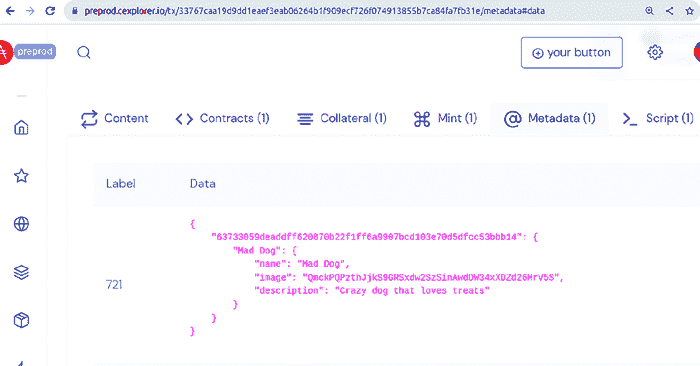

**图 3.5：** 交易元数据

其中：

*   `policy_id` 为 `63733059deaddff620870b22f1ff6a9907bcd103e70d5dfcc53bbb14`
*   `asset_name` 为 `Mad Dog`
*   **NFT** 名称为 `Mad Dog`
*   **NFT** 图片为 `QmckPQPzthJjkS9GRSxdw2SzSinAwdDW34xXDZd26MrV5S`
*   **NFT** 描述为 `Crazy dog that loves treats`

### Plutus 脚本

到目前为止，我们只查看了从用户拥有的地址（拥有相应的公钥和私钥）发送（花费）资产的交易。在 Cardano 中，我们有使用一种名为 Plutus 的图灵完备脚本语言的智能合约。仅当评估结果返回 true 时，Plutus 脚本才能成功花费或铸造。提交交易时会包含脚本，以便 Cardano 节点内的 **Plutus 核心求值器** 对其进行评估。正如我们回忆的，网络由形成共识的连接节点组成。因此，当提交交易时，每个节点都必须执行包含的脚本并确认结果。如果为 true，节点将接受该交易进入区块，并成为区块链的一部分。

通常，Plutus 脚本要么是 `spending` **（验证器）**，要么是 `minting` 脚本。`spending` 脚本涉及花费锁定在脚本地址上的 `UTXO`。脚本地址就是脚本本身的哈希值加上适当的地址头字节值。`minting` 脚本涉及在 Cardano 账本中铸造（添加）或销毁（移除）原生代币。当 `minting` 脚本用于铸造时，新代币必须作为输出包含在 `UTXO` 中并发送到某个地址。反之，当 `minting` 脚本用于销毁时，代币必须作为输入包含在 `UTXO` 中。

## Datums

当我们查看交易输出时，观察到可以包含用于数据持久化的 datum 值。该 datum 值可由检查交易 `UTXO` 输入的 Plutus spending 脚本读取。由于 `UTXO` 作为输入只能被花费一次，如果另一个脚本要使用该 datum 值，必须在 `UTXO` 输出中重新创建并包含它。然而，如果使用引用输入，`UTXO` 为只读，因此 datum 值可以串行或并行地在任意数量的交易中重复使用。

## Redeemers

Redeemers 可在交易的脚本评估期间向 Plutus 脚本提供信息。例如，指定交易将执行哪种类型的铸造操作（铸造或销毁）。Redeemers 还可向 Plutus 脚本传递仅在运行时已知且无需持久化的信息。

根据账本规范⁸，不同类型的 Redeemers 如下：

```
redeemer_tag =
0 ; Spending
/ 1 ; Minting
/ 2 ; Certifying
/ 3 ; Rewarding
/ 4 ; Voting
/ 5 ; Proposing
```

我们已回顾了 `Spending` 和 `Minting` Redeemer 标签，现在来看 `Certifying` 和 `Rewarding`。`Certifying` Redeemer 用于向网络发布证书。例如，向网络注册质押密钥以进行质押时会用到。`Rewarding` Redeemer 用于从质押密钥地址提取锁定的质押奖励。回想一下，质押地址不是基于 `UTXO` 的地址，仅用于接收质押奖励。撰写本文时，`Voting` 和 `Proposing` Redeemer 标签将用于链上治理和投票。

将这些内容综合在一起，得到一个简化的图表（不含交易手续费），如*图 3.6*所示，展示了使用 `Plutus Script` 创建交易的输入和输出，该脚本花费 2 Ada。

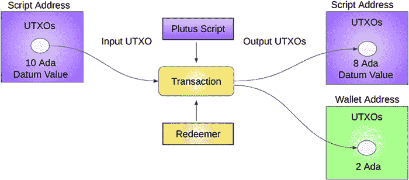

**图 3.6：** 简化脚本交易

## 见证集

所有交易都包含一个见证集，其中包含花费 `UTXO` 所需的见证。在本章中，我们重点关注了以下类型的见证：

*   `Signature`（签名）
*   `Redeemer`（赎回者/兑换者）
*   `Datum`（数据/基数）
*   `Plutus Script`（Plutus 脚本）

因此，在查看账本规范时⁹，所有交易必须具有以下高层结构：

```
transaction =
[ transaction_body
, transaction_witness_set
, bool
, auxiliary_data / null
]
```

其中：

*   `Transaction_body`（交易主体）除其他内容外，还包含手续费、`UTXO` 输入和输出、元数据哈希、脚本哈希以及铸造价值（如果有）。
*   `Transaction_witness_set`（交易见证集）包含花费 `UTXO` 输入所需的任何见证。
*   `Bool`（布尔值）指示这是否为有效交易。
*   `Auxiliary_data`（辅助数据）可选地包含交易元数据。

## 结论

我们回顾了不同类型的 Cardano 地址及其构建和解构方式。我们研究了 `UTXO` 架构、输入和输出的使用方式，以及 `UTXO` 如何被锁定在某个地址上。我们查看了交易元数据的示例，以及它是如何存储并链接到链上交易的。接着，我们探讨了 `Datum` 和 `Redeemer`，以及它们如何作为交易的一部分向 `Plutus script` 提供信息。最后，我们回顾了 `Witness Set`（见证集）的概念，它允许交易花费 `UTXO` 输入。在下一章中，我们将更详细地研究 `Plutus scripts` 及其在交易中的使用方法。

## 重点回顾

*   共有三种主要地址类型：`Base`（基础）、`Enterprise`（企业）和 `Reward`（奖励）。
*   交易头类型决定了地址的类型。
*   交易网络标签决定了交易关联的网络（`Mainnet` 主网或 `Testnet` 测试网）。
*   交易包含一个 `Payment Part`（支付部分）和一个可选的 `Delegation Part`（委托部分）。
*   `Payment`（支付）或 `Delegation Part`（委托部分）可以是 `PaymentKeyHash`（支付密钥哈希/公钥哈希）或 `ScriptHash`（脚本哈希）。
*   `Reward Address`（奖励地址）是一种特殊的基于账户的地址，仅用于质押奖励。
*   交易消耗一个或多个 `UTXOs` 作为输入，并必须产生一个或多个 `UTXOs` 作为输出。
*   `Signature`（签名）是交易由正确私钥签名的证明。
*   交易输入包含一个索引，因为给定交易可能存在多个输出 `UTXO`。
*   `Datum`（数据）用于在链上存储持久化数据，并包含在 `UTXO` 中。
*   `Datum` 值可以作为哈希存储，也可以作为 `Inline datum`（内联数据）完整存储。
*   `Plutus Core Evaluator`（Plutus 核心求值器）对 `Plutus script` 进行求值，以查看其是否返回 true。
*   `Plutus script` 通常是花费（验证器）脚本或铸造脚本。
*   `Plutus spending (validator) script`（Plutus 花费/验证器脚本）花费锁定在脚本地址上的 `UTXOs`。
*   `Plutus minting script`（Plutus 铸造脚本）用于铸造或销毁 Cardano 原生代币。
*   `UTXO` 也可以是 `Reference script`（参考脚本），一种不可花费的只读 `UTXO`。
*   `Redeemer`（赎回者）在交易求值期间向脚本提供信息。


*   `Witness Set`（见证集）可能包含 `Signature`、`Redeemer`、`Datum` 或 `Plutus scripts`。

### 多项选择题

1.  以下哪项不是有效的 Cardano 地址？

    1.  `Base`

    2.  `Enterprise`

    3.  `Reward`

    4.  `UTXO`

2.  脚本地址源自？

    1.  公钥哈希

    2.  `Plutus script hash`（Plutus 脚本哈希）

    3.  私有质押密钥哈希

    4.  私钥哈希

3.  签名证明了什么？

    1.  交易使用有效公钥签名

    2.  交易使用有效质押密钥签名

    3.  交易使用有效私钥签名

    4.  交易使用有效奖励密钥签名

4.  Plutus 脚本求值结果为？

    1.  布尔值

    2.  二进制值

    3.  十六进制值

    4.  非零值

5.  什么是 `Redeemer`？

    1.  用于识别参考脚本

    2.  用于交易平衡

    3.  在运行时向脚本提供信息

    4.  如果为假则停止交易

### 答案

1.  d

2.  b

3.  c

4.  a

5.  c

### 问题

1.  为什么不能将 `UTXO` 锁定在 `Reward Address` 上？

2.  领取质押奖励的流程是什么？

3.  为什么要在 `Witness Set` 中包含 `Plutus script` 作为见证，它能证明什么？

4.  为什么不将所有元数据都存储在链上，而只存储元数据哈希？

5.  为什么 `Plutus spending script` 也被称为验证器？

### 关键术语

*   **Base Address（基础地址）：** 同时包含支付密钥和质押密钥的地址。

*   **Datum（数据/基数）：** 用于在链上存储数据哈希。

*   **Enterprise Address（企业地址）：** 仅包含支付密钥的地址。

*   **Inline datum（内联数据）：** 用于在链上存储实际数据值。

*   **Metadata（元数据）：** 描述交易的数据。

*   **Minting script（铸造脚本）：** 用于铸造或销毁 Cardano 原生代币的 `Plutus script`。

*   **NFT：** 非同质化代币。

*   **PaymentKeyHash（支付密钥哈希）：** 公钥的哈希摘要。

*   **Plutus Core Evaluator（Plutus 核心求值器）：** 节点中对 `Plutus script` 进行求值的组件。

*   **Plutus script（Plutus 脚本）：** 在节点上执行的图灵完备语言。

*   **Redeemer（赎回者/兑换者）：** `Redeemer` 用于在运行时将信息传递给脚本。

*   **Reference script（参考脚本）：** 一种不可花费的只读 `UTXO`。

*   **Reward Address（奖励地址）：** 用于分发和接收质押奖励。

*   **ScriptHash（脚本哈希）：** `Plutus script` 的哈希摘要。

*   **Signature（签名）：** 交易哈希的加密哈希签名。

*   **Spending (validator) script（花费/验证器脚本）：** 用于花费锁定在脚本地址上的 `UTXOs` 的 `Plutus script`。

*   **UTXO：** 未花费交易输出。

*   **Witness（见证）：** 提供证明交易可以花费 `UTXO` 输入的凭证。

_____________________________________

¹ [`github.com/cardano-foundation/CIPs/tree/master/CIP-0019`](https://github.com/cardano-foundation/CIPs/tree/master/CIP-0019)

² [`docs.cardano.org/learn/cardano-addresses/`](https://docs.cardano.org/learn/cardano-addresses/)

³ [`github.com/cardano-foundation/CIPs/tree/master/CIP-0019`](https://github.com/cardano-foundation/CIPs/tree/master/CIP-0019)

⁴ [`github.com/IntersectMBO/cardano-ledger/blob/master/eras/conway/impl/cddl-files/conway.cddl`](https://github.com/IntersectMBO/cardano-ledger/blob/master/eras/conway/impl/cddl-files/conway.cddl)

⁵ [`github.com/IntersectMBO/cardano-ledger/blob/master/eras/conway/impl/cddl-files/conway.cddl`](https://github.com/IntersectMBO/cardano-ledger/blob/master/eras/conway/impl/cddl-files/conway.cddl)

⁶ [`github.com/cardano-foundation/CIPs/tree/master/CIP-0025`](https://github.com/cardano-foundation/CIPs/tree/master/CIP-0025)

⁷ [`preprod.cexplorer.io/tx/33767caa19d9dd1eaef3eab06264b1f909ecf726f074913855b7ca84fa7fb31e`](https://preprod.cexplorer.io/tx/33767caa19d9dd1eaef3eab06264b1f909ecf726f074913855b7ca84fa7fb31e)

⁸ [`github.com/IntersectMBO/cardano-ledger/blob/master/eras/conway/impl/cddl-files/conway.cddl`](https://github.com/IntersectMBO/cardano-ledger/blob/master/eras/conway/impl/cddl-files/conway.cddl)

⁹ [`github.com/IntersectMBO/cardano-ledger/blob/master/eras/conway/impl/cddl-files/conway.cddl`](https://github.com/IntersectMBO/cardano-ledger/blob/master/eras/conway/impl/cddl-files/conway.cddl)

# 第 4 章

# Plutus

### 简介

#### Plutus 规范

在本章中，我们将讨论以下主题：

*   Plutus 规范

*   简洁二进制对象表示（**CBOR**）

    *   交易

    *   兑换脚本

    *   Plutus 脚本

    *   数据

*   Plutus 执行预算

*   抵押品

#### Plutus 规范

Cardano 上的第一代脚本是**原生脚本**，¹ 随后是 Plutus。原生（阶段 1）脚本功能非常有限，并在账本内部执行。Plutus 是一种图灵完备的脚本语言，它在账本外部执行，但需要成功的评估才能花费由 Plutus 脚本锁定的 UTXO。³ 账本必须支持多个 Plutus 脚本版本，因此每个脚本都在脚本本身中包含版本号。这样，账本就知道如何评估每个版本的脚本。*表 4.1* 总结了撰写时已知的 Plutus 版本，本书将仅关注 **PlutusV2** 和 **Plutus Core 版本 1.0.0**。

| **时代** | **账本语言 (ID)** | **Plutus Core 版本** | **协议版本** | **日期** |

| --- | --- | --- | --- | --- |

| Alonzo | PlutusV1 (0) | 1.0.0 | 5.0 | 2021 年 9 月 |

| Vasil | PlutusV2 (1) | 1.0.0 | 7.0 | 2022 年 6 月 |

| Valentine | PlutusV2 (1) | 1.0.0 | 8.0 | 2023 年 2 月 |

| Conway | PlutusV3 (2) | 1.1.0 | 9.0 | 即将推出 |

**表 4.1：** Plutus 版本

Plutus 规范的目标是创建一种简单的脚本语言，能够在 Cardano 节点上以最小（且受限）的计算占用进行评估。与拥有冗长复杂证明的以太坊虚拟机不同，Plutus 抽象状态机简短而简洁。⁴ 在构建高度稳定的区块链以最小化硬分叉升级时，这是一个非常理想的特性。Plutus 脚本使用一种称为无类型 Plutus Core 或 **UPLC** 的语言编写，它源自 System F，一种** Lambda 演算**形式。⁵ 幸运的是，智能合约 Plutus 开发使用**高级编程**语言，它们为我们编译并生成 **UPLC**。

> **注意**：学习 **UPLC** 或 Lambda 演算并非编写 Cardano 智能合约的必要条件。本节其余内容为可选，但可能有助于希望了解生成的 UPLC 代码如何映射到 Plutus Core 规范的读者。有关 Lambda 演算的介绍，请观看视频"*Lambda Calculus - Fundamentals of Lambda Calculus & Functional Programming in JavaScript*。"⁶

#### UPLC 基本类型

**UPLC** 使用简单的语言语法，具有一组有限的原子类型，如 *表 4.2* 所列：

| **类型** | **语法** |

| --- | --- |

| `integer` | `-?[0-9]+` |

| `bytestring` | `#([0-9A-Fa-f][0-9A-Fa-f])*` |

| `string` | `UTF-8 字符，用双引号 "` `"` 括起` |

| `bool` | `True \| False` |

| `unit` | `()` |

| **类型** | **表示** |

| `Data` | `data Data = Constr Integer [Data] \| Map [(Data, Data)] \| List [Data] \| I Integer \| B ByteString` |

**表 4.2：** UPLC 原子类型

除了原子数据类型外，UPLC 中还包含两种类型的运算符，如 *表 4.3* 所示：

| **运算符 op** | **\|op\|** | **表示** |

| --- | --- | --- |

| `list` | `1` | `[list(t)] = [t]` |

| `pair` | `2` | `[pair(t1,t2)] = [t1] x [t2]` |

**表 4.3：** UPLC 类型运算符

关键字 `con` 定义常量，后跟类型声明和值。*表 4.4* 提供了一些用法示例：⁷

| **类型** | **示例** |

| --- | --- |

| `unit` | `con unit ()` |

| `bool` | `con bool False` |

| `integer` | `con integer 123` |

| `bytestring` | `con bytestring #abc123` |

| `string` | `con string "GM Cardano"` |

| `pair` | `con pair<bool, integer> [True, 123]` |

| `list` | `list<bytestring> [#0d, #f3]` |

**表 4.4：** UPLC 类型示例⁸

Lambda 函数使用关键字 `lam`，接收一个变量名并返回一个项，该项可以是常量、函数或任何类型的格式良好的值。UPLC 程序不得包含任何自由变量，因此被视为“封闭项”。⁹ 例如，`(program 1.0.0 (lam x x))` 是一个有效程序，但 `(program 1.0.0 (lam x y))` 不是。请注意，所有 Plutus 脚本都必须包含 `program` 和 `version`。

Plutus Core 没有算术运算符，而是使用内置函数进行算术运算。一些 `builtin` 函数是针对 Cardano 区块链的特定领域函数，而其他 `builtin` 函数可能会随着时间的推移而添加。我们将要回顾的最后两项是 `force` 和 `delay` 指令。`force` 指令应用于多态函数，以强制实例化类型参数。¹⁰ `delay` 指令用于分支条件的**惰性求值**，从而保留类型抽象。¹¹ **惰性求值**允许更高效的代码执行，因为值仅在被使用时才计算。这也允许创建无限数据结构，这在 C 等语言中是不可能创建的。

#### UPLC 语法

将这些全部结合起来，我们定义 **UPLC** 程序的语法，如 *图 4.1* 所示：

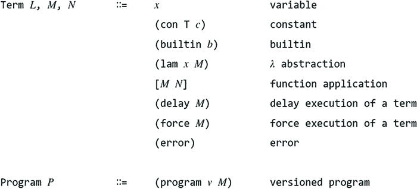

**图 4.1：** UPLC 语法（Plutus Core 版本 1.0.0）¹²

#### UPLC 示例

通过一个简化的示例，我们可以看到像 Aiken 这样的高级语言如何生成 UPLC 程序。*表 4.5* 有一个始终返回 true 的简单验证器脚本。该程序使用 lambda (`lam`) 函数进行评估并返回常量 `True`。

**高级语言**

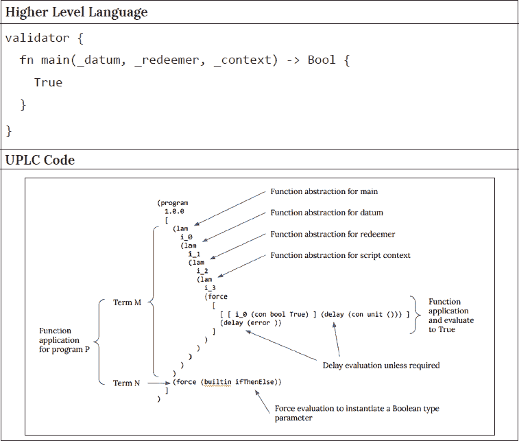

**表 4.5：** UPLC 示例

#### 简洁二进制对象表示 (CBOR)

**CBOR** 是一种在互联网标准 RFC 8949 中定义的二进制编码格式。¹³ 在上一章*交易*中，我们查看了 Cardano 账本 **CDDL** 规范，¹⁴ 它定义了交易的格式。当交易提交到网络时，整个交易和所有相关数据都会被**序列化**并以 **CBOR** 编码。我们将详细检查一笔交易并**反序列化**它，以查看 UPLC Plutus 代码和相关数据（兑换脚本和数据）。

### 交易

例如，*图 4.2* 展示了一个执行 Plutus 验证器脚本的交易：

[`preprod.cexplorer.io/tx/99c529355ebd1f410517457b6ff04e66c2de28b8667b9428ec232e03efa22c29`](https://preprod.cexplorer.io/tx/99c529355ebd1f410517457b6ff04e66c2de28b8667b9428ec232e03efa22c29)

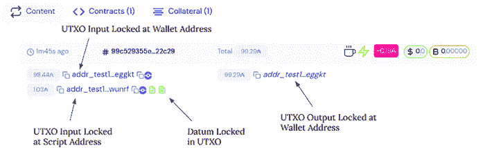

**图 4.2：** 交易示例

提交到网络的该交易的 **CBOR** 十六进制格式如下：


84a80082825820d9b02da5897bd1ff9e2fdab008334d2804ea1accab
c7c3962e33771ed9f1a8d500825820d9b02da5897bd1ff9e2fdab008334d2804ea1a
ccabc7c3962e33771ed9f1a8d501018182581d606d04be153546d63c8a33
e0c11ec44cf790803f31c2f893fc241529531a05eb1244021a0002
d9250b582031e6c463846e3c0afe2aebfc9993355dbe8ce4dab892a7
af0e397a75df3509b90d81825820d9b02da5897bd1ff9e2fdab008334d2804ea1a
ccabc7c3962e33771ed9f1a8d5010e81581c6d04be153546d63c8a33e0c11e
c44cf790803f31c2f893fc241529531082581d606d04be153546d63c8a33e0c11
ec44cf790803f31c2f893fc241529531a05d9dd11111a000445b8a30081825820
fc6500742705cfe8c2f0822e73e2ab09c43285973adffe8aa06bd12d1fa6051f584
0ec7f53a69852e6daa868a3f221114435544ab2851bc6f2f42abe9772507b30064a1
f012ddab23153644703047ea2faf9132390e91937b82389626404d7adfd0105818
40000d8799f4d48656c6c6f2c20576f726c6421ff821977151a009daaac068158f258
f0010000323232323232323222232325333008323232533300b002100114a066446
46600200200644a66602200229404c8c94ccc040cdc78010028a511330040040013
014002375c60240026eb0c038c03cc03cc03cc03cc03cc03cc03cc03cc020c008c0
20014dd71801180400399b8f375c6002600e00a91010d48656c6c6f2c20576f726
c6421002300d001149858c94ccc020cdc3a400000226464a66601a601e0042930b1ba
e300d00130060041630060033253330073370e90000089919299980618070010a4
c2c6eb8c030004c01401058c01400c8c014dd5000918019baa0015734aae7555cf2a
b9f5742ae89f5f6

当我们使用 [`cbor.nemo157.com/`](https://cbor.nemo157.com/) 将其解码为诊断格式时，可以看到交易详情，如 *图 4.3* 和 *4.4* 所示。*图 4.3* 显示了该交易的 UTXO 输入、输出以及所需签名：

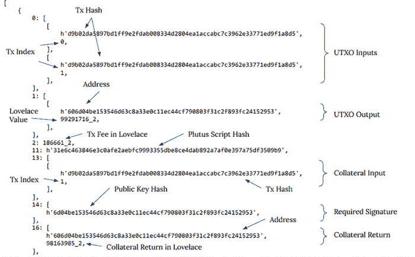

**图 4.3：** CBOR 交易第 1 部分

*图 4.4* 显示了所需的抵押品、公钥、Redeemer（赎回者）以及 Plutus 脚本见证。该交易不包含辅助数据或元数据，且交易有效性标志设置为 true。

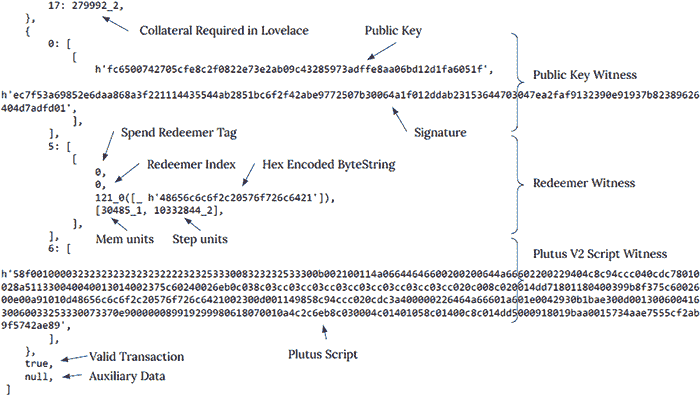

**图 4.4：** CBOR 交易第 2 部分

### Redeemer（赎回者）

要获得 Redeemer 的人类可读版本，我们需要将十六进制 ByteString 转换为 UTF-8 字符串。然而，Plutus 在脚本执行期间将直接使用 ByteString。以下是使用 `xxd` 将十六进制编码的 ByteString 转换为普通字符串的示例：

```
$ echo 48656c6c6f2c20576f726c6421 | xxd -p -r
$ Hello, World!
```

### Plutus 脚本

Plutus 脚本经过双重编码（CBOR + flat），这意味着我们需要反序列化两次才能将其转换为 UPLC。因此，第一步是使用 CBOR 解码器对其进行解码，¹⁵ 并将其保存到名为 `plutus.flat` 的文件中：

```
$ cat plutus.flat
010000323232323232323222232325333008323232533300b002100114a066446466002
00200644a66602200229404c8c94ccc040cdc78010028a511330040040013014002375c
60240026eb0c038c03cc03cc03cc03cc03cc03cc03cc03cc020c008c020014dd7180118
0400399b8f375c6002600e00a91010d48656c6c6f2c20576f726c6421002300d0011498
58c94ccc020cdc3a400000226464a66601a601e0042930b1bae300d0013006004163006
0033253330073370e900000089919299980618070010a4c2c6eb8c030004c01401058c0
1400c8c014dd5000918019baa0015734aae7555cf2ab9f5742ae8
```

接下来，我们需要使用 Aiken 实用工具将其从十六进制转换为 UPLC 以进行解码：

```
$ aiken uplc decode --hex plutus.flat
(program
1.0.0
[
(lam
i_0
[
(lam
i_1
…
)
(force (builtin headList))
]
)
(force (builtin tailList))
]
)
```

### Datum（数据项）

接下来，我们将使用 `cexplorer.io` 查看 *图 4.5* 中的 Datum：¹⁶

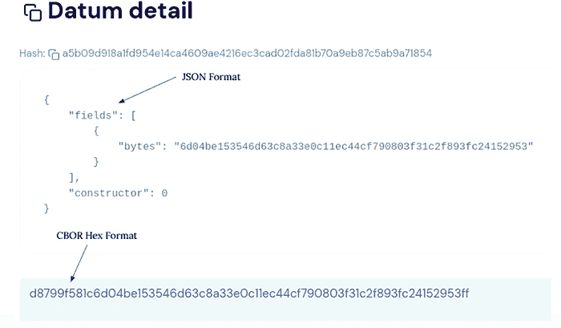

**图 4.5：** Datum 示例

*图 4.5* 中的 Datum 是一个内联 Datum，因此该值存储在链上，并锁定在我们想要花费的 UTXO 上。如果我们查看该 UTXO，将看到该值以 CBOR 十六进制格式编码：

`d8799f581c6d04be153546d63c8a33e0c11ec44cf790803f31c2f893fc24152953ff`

当我们解码 Datum 的 CBOR 十六进制值时，会得到以下字节数组输出：

```
121_0([_
h'6d04be153546d63c8a33e0c11ec44cf790803f31c2f893fc24152953',
])
```

在本例中，Datum 值代表一个公钥哈希。

### Plutus 执行预算

查看 *图 4.4* 中交易的 Redeemer 见证，我们会注意到附带的 Plutus 脚本有一个执行预算：

`[30485_1, 10332844_2]`

这些值指的是内存和 CPU（步数）执行单元，它们在 Plutus 账本规范中定义：

`ex_units = [mem: uint, steps: uint]`

`mem` 和 `steps` 随交易一起计算并提交，然后由 Plutus 核心求值器在脚本执行期间进行验证。如果在脚本执行期间任一值超出最大限制，则会引发错误：

```
Error: The budget when the machine terminated was:\n({ cpu: -84834\n| mem: 17553\n}
```

在本例中，`cpu/steps` 值超限并导致负数。结果，执行被终止，验证失败。要计算给定 Plutus 脚本的 `mem` 和 `cpu/step` 成本，会使用 `cost model`（成本模型）¹⁷ 来映射每个 Plutus 操作的 `execution cost`（执行成本）。成本模型位于网络协议参数中，并可通过网络更新随时间变化。要查看 `protocol parameters`（协议参数），可以使用 `cardano-cli` 工具：

```
$ cardano-cli query protocol-parameters --testnet-magic 1
{
"collateralPercentage": 150,
"costModels": {
…
"PlutusScriptV2": {
"addInteger-cpu-arguments-intercept": 205665,
"addInteger-cpu-arguments-slope": 812,
"addInteger-memory-arguments-intercept": 1,
"addInteger-memory-arguments-slope": 1,
…
"maxTxExecutionUnits": {
"memory": 14000000,
"steps": 10000000000
},
"maxTxSize": 16384,
…
```

除其他内容外，协议参数还指定了每个 Plutus 操作的执行成本、每笔交易的最大 `memory` 和 `steps` 单元，以及最大整体交易大小（`maxTxSize`），单位为 KB。

### 抵押品

我们将要讨论的最后一个主题是交易中包含的抵押品。抵押品是一小笔 Lovelace（1.5 × 交易费），如果发生第 2 阶段 Plutus 脚本失败，将会用到它。¹⁸ 抵押品输入中剩余的零钱将退还给用户，称为 **抵押品返还**。然而，Plutus 脚本评估通常在提交到网络之前在本地完成。这将捕获并防止无效 Plutus 脚本的提交。抵押品的作用是帮助保护网络免受恶意或垃圾交易的侵害。

## 结论

读者现在应该理解 Plutus 核心规范以及用于 Plutus 脚本执行和评估的 **UPLC** 代码。我们检查了一个 **CBOR** 交易，如何反序列化它，并查看了交易详情。我们还研究了 Plutus 脚本执行预算以及如何使用 **成本模型** 计算它。最后，我们讨论了抵押品，它在阶段 2 Plutus 脚本评估失败时使用。下一章将探讨用于创建和提交交易的链下代码。我们还将查看用户钱包，它是与 Cardano 区块链和智能合约交互的入口。

## 要点回顾

*   Cardano 上的第一代脚本是原生脚本，在账本内部进行评估。
*   Plutus 脚本是阶段 2 脚本，在账本外部进行评估。
*   无类型 Plutus 核心或 **UPLC** 是一种 Lambda 演算形式。
*   **UPLC** 是在节点上执行的低级语言。
*   编写智能合约使用生成低级 **UPLC** 的高级语言完成。
*   **UPLC** 程序必须是封闭的，所有项都已正确定义。
*   **UPLC** 程序可以利用 Lambda 演算中发现的惰性求值。
*   **CBOR** 是一种用于序列化和反序列化数据结构的二进制标准。
*   Cardano 交易在提交到网络时序列化为 **CBOR**，在 Cardano 节点验证期间反序列化。
*   交易中的 **Redeemer** 包含脚本将消耗的内存和步数/CPU 单元。
*   在 Plutus 脚本评估期间，如果内存或步数/CPU 单元超过允许的最大单元，脚本将停止并失败。
*   网络参数中的 **成本模型** 包含每个 Plutus 操作的成本以及交易中允许的最大内存和步数/CPU 单元。
*   交易中必须提供 **抵押品**，旨在保护网络免受恶意和垃圾交易的侵害。

## 多项选择题

1.  Cardano 上的第一代脚本是什么？

    1.  PlutusV1
    2.  PlutusV2
    3.  **原生脚本**
    4.  智能脚本

2.  关于原生脚本和 Plutus 脚本，哪项陈述是错误的？

    1.  两者都必须评估为真才能花费由脚本锁定的 UTXO
    2.  两者都可以创建多签脚本地址
    3.  **两者都是图灵完备的**
    4.  原生脚本是阶段 1 脚本

3.  **UPLC** 中的 `lam` 是什么？

    1.  **Lambda 函数抽象**
    2.  Lambda 函数应用
    3.  Lambda 函数排列
    4.  Lambda 函数关联

4.  为什么惰性求值是可取的？

    1.  代码执行效率较低
    2.  **代码执行效率较高**
    3.  强制评估所有声明的变量
    4.  无法创建无限数据结构

5.  当前的 Plutus **成本模型** 位于何处？

    1.  节点配置
    2.  Plutus 脚本配置
    3.  Plutus 评估器配置
    4.  **协议参数**

### 答案

1.  c
2.  c
3.  a
4.  b
5.  d

## 问题

1.  Lambda 演算有什么优势？
2.  图灵完备和 Lambda 演算程序在形式上等价吗？
3.  **CBOR** 和扁平编码有什么区别？
4.  为什么交易中的 **Redeemer** 要包含内存和 CPU/步数单元？
5.  阶段 1 和阶段 2 脚本有什么相似点和不同点？
6.  哪些输入可用作抵押品？

## 关键术语

*   **CBOR**：Concise Binary Object Representation（简洁二进制对象表示）
*   **抵押品找零**：如果交易期间使用了抵押品，返回的 Ada 找零金额。
*   **CDDL**：Concise Data Definition Library（简洁数据定义库）
*   **成本模型**：每个 Plutus 操作的执行成本参数。
*   **反序列化**：从二进制格式解码代码和数据结构的过程。
*   **执行成本**：每个 Plutus 操作使用的内存和 CPU/步数单元数量。
*   **高级编程**：允许使用更复杂的函数和数据结构以使代码更具可读性的语言。
*   **Lambda 演算**：用于定义函数和应用的最小语言。
*   **惰性求值**：仅实例化代码执行中使用的变量。
*   **原生脚本**：用于阶段 1 评估的简单脚本。
*   **协议参数**：网络使用的包含参数和设置的文件。
*   **序列化**：将代码和数据结构编码为二进制格式的过程。
*   **UPLC**：Untyped Plutus Core（无类型 Plutus 核心）

---

¹ [`github.com/cardano-foundation/CIPs/tree/master/CIP-0029`](https://github.com/cardano-foundation/CIPs/tree/master/CIP-0029)

² Plutus Core Team, “Formal Specification of the Plutus Core Language.” 24.

³ Andre Knispel, et al., “A Formal Specification of the Cardano Ledger integrating Plutus Core,” 3.

⁴ Philip Wadler, “Functional smart contracts on Cardano.”

⁵ James Chapman, et al., “System F in Agda, for fun and profit.”

⁶ Gabriel Lebec, “Lambda Calculus - Fundamentals of Lambda Calculus & Functional Programming in JavaScript.”

⁷ Plutus Core Team, “Formal Specification of the Plutus Core Language,” 26.

⁸ [`aiken-lang.org/uplc/syntax#primitive-types`](https://aiken-lang.org/uplc/syntax#primitive-types)

⁹ Plutus Core Team, “Formal Specification of the Plutus Core Language,” 6.

¹⁰ Plutus Core Team, “Formal Specification of the Plutus Core Language,” 11.

¹¹ [`aiken-lang.org/uplc/syntax#delay--force`](https://aiken-lang.org/uplc/syntax#delay--force)

¹² Plutus Core Team, “Formal Specification of the Plutus Core Language,” 6

¹³ [`www.rfc-editor.org/rfc/rfc8949.html`](https://www.rfc-editor.org/rfc/rfc8949.html)

¹⁴ [`github.com/IntersectMBO/cardano-ledger/blob/master/eras/conway/impl/cddl-files/conway.cddl`](https://github.com/IntersectMBO/cardano-ledger/blob/master/eras/conway/impl/cddl-files/conway.cddl)

¹⁵ [`cbor.nemo157.com/`](https://cbor.nemo157.com/)


¹⁶ [`preprod.cexplorer.io/datum/a5b09d918a1fd954e14ca4609ae4216ec3cad02fda81b70a9eb87c5ab9a71854`](https://preprod.cexplorer.io/datum/a5b09d918a1fd954e14ca4609ae4216ec3cad02fda81b70a9eb87c5ab9a71854)

¹⁷ [`plutus-apps.readthedocs.io/en/latest/reference/cost-model-parameters.html`](https://plutus-apps.readthedocs.io/en/latest/reference/cost-model-parameters.html)

¹⁸ Andre Knispel, et al., “A Formal Specification of the Cardano Ledger integrating Plutus Core,” 6.

# 第 5 章

## 交易构建器

### 简介

本章将结合我们对链上 Plutus 脚本的知识，以及如何使用链下代码将 Ada 锁定到智能合约中。我们将了解 Cardano 钱包，它是与区块链和智能合约交互的入口。接下来，我们将介绍一些有助于构建和提交交易的工具，例如 `Demeter.run`。然后，我们将使用两种流行的方法构建一个简单的归属智能合约：Helios 和 Lucid + Aiken。

### 结构

在本章中，我们将讨论以下主题：

*   交易生命周期
*   钱包
    *   助记词
    *   测试网水龙头
    *   地址派生
    *   质押
    *   CIP-30
*   Demeter.run
*   链下代码示例
    *   Helios
    *   Lucid + Aiken

### 交易生命周期

在上一章中，我们了解了 Cardano 节点和账本如何评估 Plutus 脚本。本章将重点介绍如何构建并提交包含 Plutus 脚本的交易。构建交易的过程包括组装 UTXO 输入和输出、附加要运行的脚本，以及在必要时添加兑换凭证、数据和元数据。交易组装完成后，必须对其进行签名，并将签名作为见证包含在内。图 5.1 展示了构建、签名、序列化交易并将其提交到网络的链下步骤。

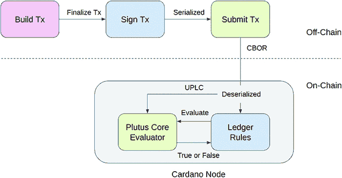

**图 5.1：** 交易生命周期

### 钱包

在加密货币中，钱包是与区块链交互的用户界面。钱包通常允许用户创建账户，账户是锁定在公钥地址上的 UTXO 集合。这种**账户抽象**有助于用户直观地理解账户余额和交易历史等熟悉概念。许多钱包还允许用户选择质押池并注册其质押密钥以收集质押奖励。表 5.1 按字母顺序列出了 Cardano 网络上的部分钱包提供商。

| **名称** | **全节点** | **硬件钱包支持** | **移动端应用** | **开源** |
| --- | --- | --- | --- | --- |
| `Daedalus` | ✔ | ✔ | ✖ | ✔ |
| `Eternl` | ✖ | ✔ | ✔ | ✖ |
| `Flint` | ✖ | ✔ | ✔ | ✔ |
| `GameChanger` | ✖ | ✖ | ✖ | ✔ |
| `GeroWallet` | ✖ | ✔ | ✖ | ✖ |
| `Lace` | ✖ | ✔ | ✖ | ✔ |
| `Ledger` | ✖ | ✔ | ✖ | ✔ |
| `Nami` | ✖ | ✖ | ✖ | ✔ |
| `NuFi` | ✖ | ✔ | ✖ | ✖ |
| `Typhon` | ✖ | ✔ | ✖ | ✔ |
| `VESPR` | ✖ | ✖ | ✔ | ✔ |

**表 5.1：** Cardano 钱包¹

**全节点：** 包含完整 Cardano 节点的钱包，不使用任何第三方服务在区块链上查找交易。

**硬件钱包支持：** 支持使用硬件设备对交易进行签名的钱包。

**移动端应用：** 在 iOS 或 Android 设备上拥有原生移动应用的钱包。

**开源：** 钱包的开源代码可在 GitHub 上获取。

### 助记词

要使用钱包创建账户，必须创建新的助记词或导入现有助记词。如果回顾第 3 章，交易，签名交易需要私钥。为了创建这个私钥，钱包通常使用**助记词**来生成随机私钥。这是一个两步过程：首先，使用一组助记词或单词组来创建随机种子²；然后，使用该随机种子派生公钥和私钥对³。

### 测试网水龙头

Cardano 通常有两个测试网，用于在主网上线前进行端到端测试⁴。发送和接收资金时，请注意你连接的是哪个网络。

*   **预览测试网：** 纪元缩短为 1 天，且比主网分叉领先至少 4 周。
*   **预生产测试网：** 该网络用于主网发布的候选版本测试。它尽可能模拟生产环境，是更稳定的测试网网络。

我们将使用测试网水龙头获取测试 Ada 并发送到我们的钱包地址。本书中我们将使用 `Eternl` 钱包，图 5.2 展示了如何获取地址以接收资金。

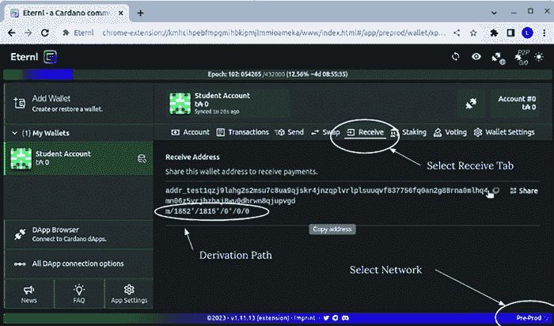

**图 5.2：** Eternl 钱包接收资金

复制地址并粘贴到 [`docs.cardano.org/cardano-testnet/tools/faucet/`](https://docs.cardano.org/cardano-testnet/tools/faucet/) 的测试网水龙头表单中，如图 5.3 所示。

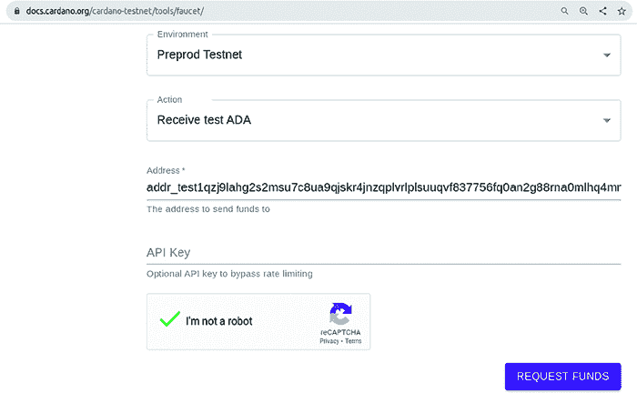

**图 5.3：** 测试网水龙头请求

选择“`Request Funds`”，你应该会看到包含交易哈希的“`Success`”消息，可使用该哈希在 [`preprod.cexplorer.io/`](https://preprod.cexplorer.io/) 上验证状态。

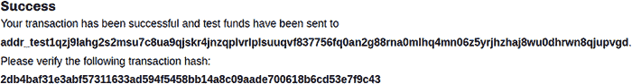

**图 5.4：** 测试网水龙头已提交

10–60 秒后，你应该会在 `Eternl` 钱包中看到 10,000 测试 Ada（`tAda`）。

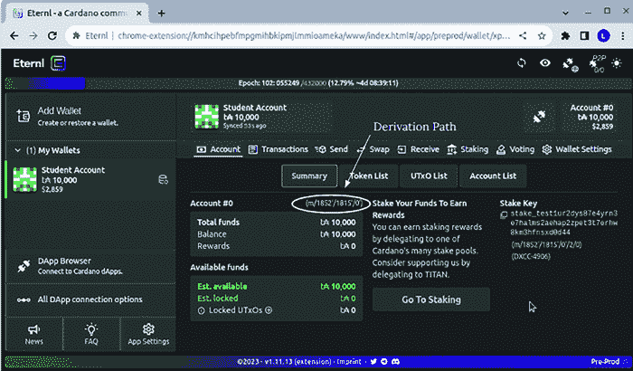

**图 5.5：** Eternl 钱包账户摘要

### 地址派生

确定性分层（HD）钱包（如 `Eternl`）遵循 CIP-1852⁵ 规范中的派生路径：

`m / purpose' / coin_type' / account' / role / index`

在图 5.5 中，我们可以看到接收地址的派生路径为：

`m/1852'/1815'/0'/0/0`

表 5.2 解释了派生路径的每个元素：

| **名称** | **值** | **备注** |
| --- | --- | --- |
| Purpose | 1852 | 规范名称（例如 CIP-1852） |
| Coin Type | 1815 | 每种加密货币不同的值（例如 Ada Lovelace 诞辰年份） |
| Account | 0 | 允许创建独立的钱包账户 |
| Role | 0 | 0 = 外部链（接收付款）<br>1 = 内部链（找零地址）<br>2 = 质押密钥 |
| Index | 0 | 从 0 开始的地址索引 |

**表 5.2：** 派生路径

你可以使用 HD 钱包为同一个私钥创建不同的地址来接收付款（和找零）。然而在实践中，通常首选“`single address mode`”（单地址模式），即重复使用同一个地址。为每笔交易创建新地址有助于匿名化，使其无法关联到钱包账户。但在 Cardano 中，一旦为钱包地址注册了质押密钥，该地址的所有交易都可以通过质押密钥关联。为接收和找零地址使用多个地址会增加 dApp 的复杂性，这就是为什么一些钱包仅支持单地址模式。图 5.6 展示了如何将 `Eternl` 切换（或保持）为单地址模式。

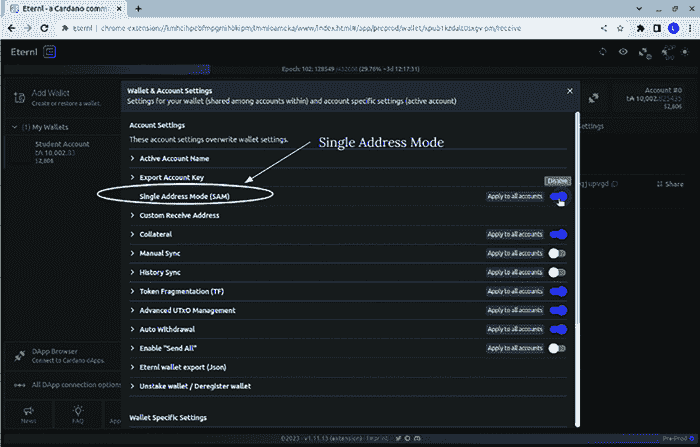

**图 5.6：** Eternl 单地址模式

### 质押

Cardano 网络最重要的功能之一是能够轻松地从钱包进行质押。这被称为流动性非托管质押，这也是 Cardano 网络拥有高质押率的原因，这有助于其安全性和去中心化。要进行质押，用户进入质押标签页，选择一个质押池，并选择“`Delegate`”，如图 5.7 所示。

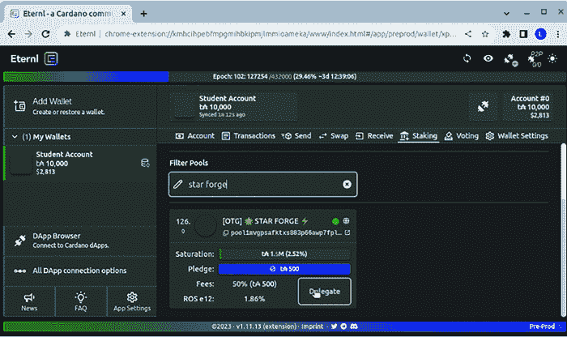

**图 5.7：** 质押池委托

接下来，用户必须签署一笔交易，将质押密钥注册和质押池委托证书提交到网络，如图 5.8 所示。

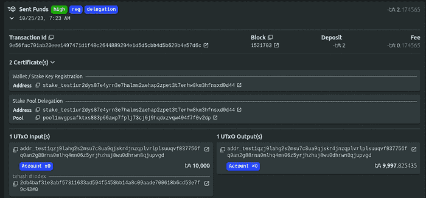

**图 5.8：** 质押池注册

当包含质押密钥注册证书和质押池委托证书的交易被确认后，用户将根据第 2 章，密码学和共识算法概述中讨论的 Ouroboros 生命周期接收质押奖励。

### CIP-30

为了让 dApp 能够连接到浏览器扩展钱包（如 `Eternl`），dApp 应遵循 CIP-30 标准⁶。该标准描述了一种基于网页的通信桥接，允许网页与浏览器扩展钱包交互。这是通过将 JavaScript 代码注入到正在渲染的网页中来实现的。然后，网页或 dApp 可以调用具有预定义公共方法的 JavaScript 代码，以从钱包检索和提交数据。在本章后面的链下代码示例中，我们将看到如何使用 CIP-30 与钱包交互。

## Demeter.run

### 环境搭建

在深入第一个链下智能合约示例之前，我们必须快速启动并运行一个环境。`Demeter.run` 可以提供帮助。它是一个完全托管的解决方案，可以启动各种 Cardano 环境。Cardano 完全开源，因此你可以在本地或云环境中安装并运行 Cardano 组件。在本书中，我们将使用 `Demeter.run`，以便更多地关注概念和应用逻辑，减少在环境搭建和配置上花费的时间。

要为本书中的示例设置环境，请遵循以下步骤：

1. 访问 [`demeter.run/`](https://demeter.run/)
2. 开始免费试用。
3. 注册/登录。
4. 创建组织。
5. 创建一个新项目，如图 5.9 所示。

   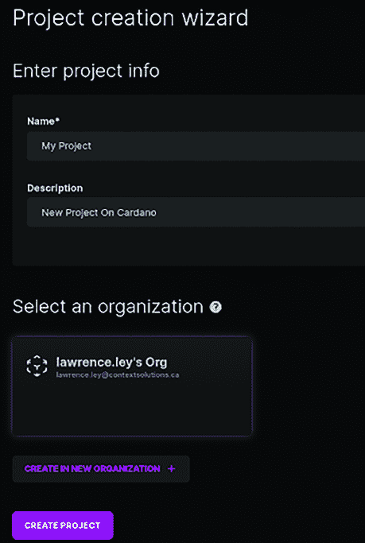

   **图 5.9：** Demeter.run 新建项目

6. 你可以从免费层级开始，但根据使用情况，你可能需要升级到付费层级或购买额外的 DCU。每个购买的计划都与特定项目关联。

   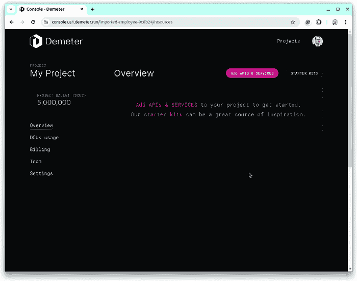

   **图 5.10：** Demeter.run 项目视图

7. 选择 `ADD APIS` `&` `SERVICES`，如图 5.10 所示。
8. 向下滚动并创建一个新工作区。
9. 选择“`Clone an existing repository`”。
10. 在文本框中粘贴 GitHub URL：`https://github.com/ava-orange-education/Mastering-Cardano-Smart-Contracts.git`
11. 保持分支默认为 main。
12. 选择 Node.js 作为工具链。
13. 选择工作区 `small` 规格。
14. 选择 `Pre-prod` 网络。
15. 选择页面底部的 `Create`。
16. 如果向上滚动到页面顶部，你将看到工作区正在被配置并最终完成，如图 5.11 所示。

    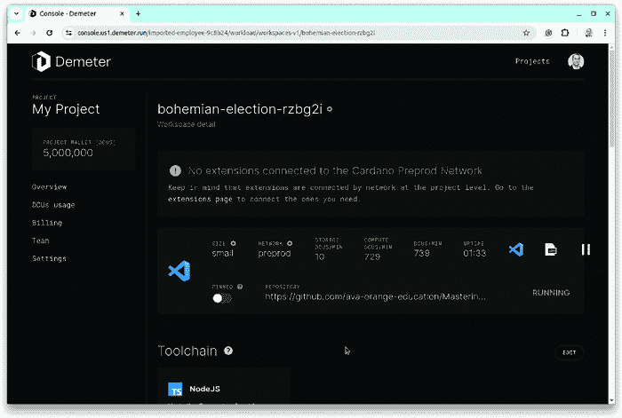

    **图 5.11：** Demeter.run 项目配置

17. 向下滚动页面并 `EDIT` Exposed Ports。
18. 名称输入 `Next.js`。
19. 端口号输入 `3000`。
20. 选择 `Expose`。
21. 滚动回页面顶部并选择 VS Code 图标以启动 VS Code 编辑器。
22. 授权受信任访问，以便你可以使用 VS Code Web 编辑代码。
23. 选择 `Terminal` -> `New` `Terminal` 创建一个终端窗口以在命令行执行命令，如图 5.12 所示。

    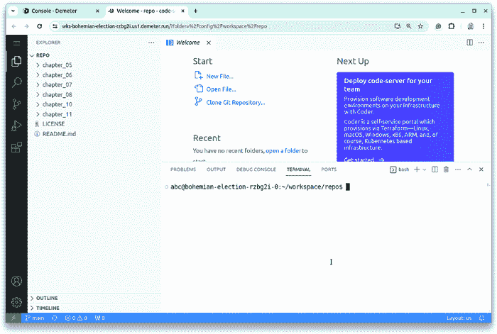

    **图 5.12：** Visual Studio Code Web

### 链下示例

本节将展示构建简单归属智能合约链下代码的两种方法。每种方法都将使用 Next.js 作为应用框架。有关 Next.js 的更多信息，建议读者查阅 Next.js 文档：[`nextjs.org/docs`](https://nextjs.org/docs)。

#### Helios

Helios 既是一个链下 JavaScript/TypeScript SDK，也是一个链上函数式、强类型编程语言。它优先考虑可读性和易用性，以提供最佳的开发者体验。Helios 的主要优势之一是它是一个没有第三方库的单个 JavaScript 文件，这提高了正在执行的智能合约的可审计性和透明度。

### 初始化

我们将参考 GitHub 代码示例，通过一个功能完整的端到端示例来执行你的第一个链下代码。在上一节使用 Demeter.run 工作区设置的 Visual Studio Web 中，选择一个新的终端窗口并执行以下步骤：

```
$ cd chapter_05/helios/vesting
$ nvm install 18.17.0
$ npm install
$ npm run dev
```

这将启动 Next.js 并在默认端口 3000 上运行。忽略 Visual Studio 关于端口转发的任何提示，因为我们将使用暴露的端口 URL 进行访问。你可以进入 `Demeter.run` 上的工作区并选择暴露端口的 URL 来访问 Next.js Web 应用程序。在浏览器中，你应该会看到类似图 5.13 的内容。

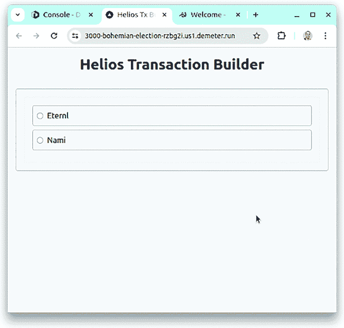

**图 5.13：** Helios 交易构建器

请确保在选择钱包之前，你的 Chrome 浏览器上已安装 `Eternl`（或 Nami）浏览器钱包扩展。如果你刚安装或启用了浏览器钱包扩展，可能需要刷新页面。在 `Helios Tx Builder` 页面上，当选择钱包时，如果钱包之前未连接到该站点，钱包将提示用户确认是否允许连接到该站点。确认后，你将看到所选钱包的钱包余额，如图 5.14 所示。

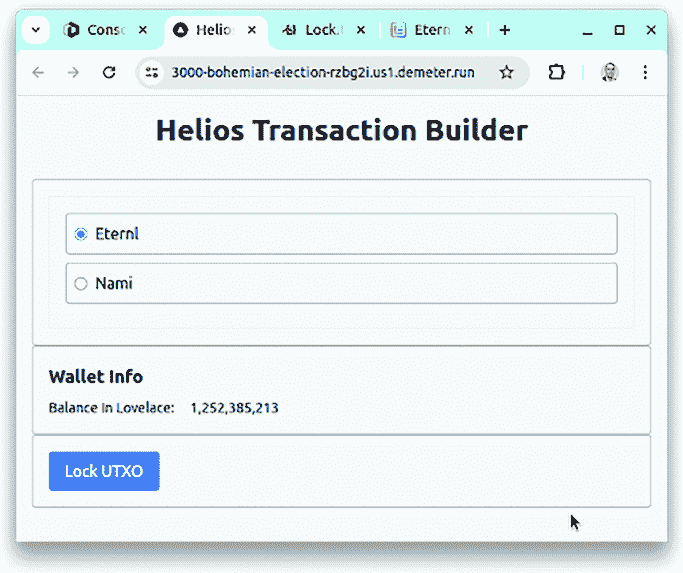

**图 5.14：** Helios 钱包选择器

### 锁定

在图 5.14 中，你会注意到屏幕底部有一个“`Lock UTXO`”按钮。该按钮将创建一个链下交易，在脚本地址锁定 2 Ada 和一个 Datum。让我们通过以下步骤查看提交链上交易所需的代码。

#### 步骤 1

要连接到浏览器钱包 API，我们将在 Next.js 应用程序中创建一个 `WalletConnector.tsx` 组件。在图 5.15 的第 52 行和第 53 行，代码首先确认浏览器插件是否存在。如果存在，则在第 56 行更新 `walletAPI` 状态变量，以便应用程序的其余部分可以访问它。

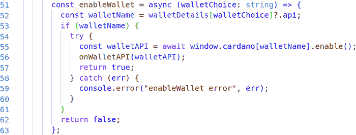

**图 5.15：** 钱包 API⁷

#### 步骤 2

一旦我们有了 `walletAPI` 的访问权限，就可以查询钱包以获取可用的 UTXO 和找零地址，如图 5.16 第 89 行和第 92 行所示。Helios 使用一个 `walletHelper` 类来包装 `walletAPI` 对象，以提供便利函数和到 Helios 数据类型的自动转换。

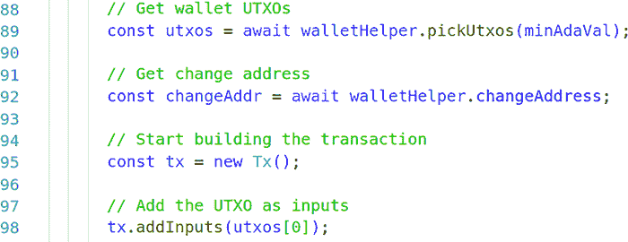

**图 5.16：** Helios WalletHelper⁸

接下来，我们必须编译 Plutus 脚本以确认脚本地址。这可以通过客户端 JavaScript 完成，如图 5.17 第 104 行所示。在第 107 行，我们可以看到从链上代码导入 Datum 结构并在链下创建适当 Datum 是多么容易。接下来，我们在第 113 行到第 117 行使用脚本地址和 Lovelace 数量（2 Ada）构建 UTXO 输出，并将 Datum 作为内联 Datum 附加。

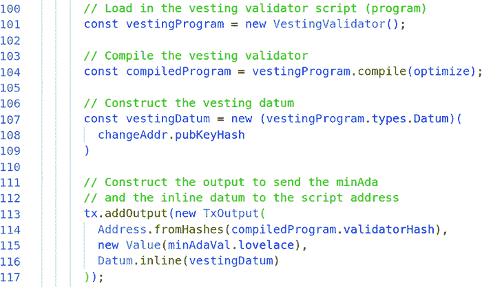

**图 5.17：** Helios Program⁹

#### 步骤 3

在签署交易之前的最后一步是获取当前网络参数，包括当前纪元、成本模型、最大 `tx` 大小等。这对于在构建脚本时进行内部验证是必需的。在本示例中，我们只是在脚本地址发送（锁定）Ada，因此不需要评估 Plutus 脚本。然而，我们将在下一章“验证器”中评估 Plutus 脚本。在图 5.18 第 124 行，交易被最终确定，这会平衡交易输入和输出，并在需要时将找零返回给钱包。一旦交易被最终确定，我们会请求钱包提示用户签署交易。完全签名的交易在第 131 行提交到网络。

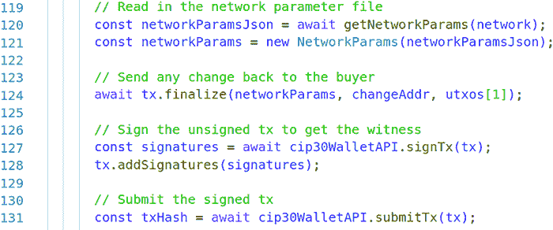

**图 5.18：** Helios 提交交易¹⁰

用户将被提示使用 `Eternl` 钱包签署交易，如图 5.19 所示。

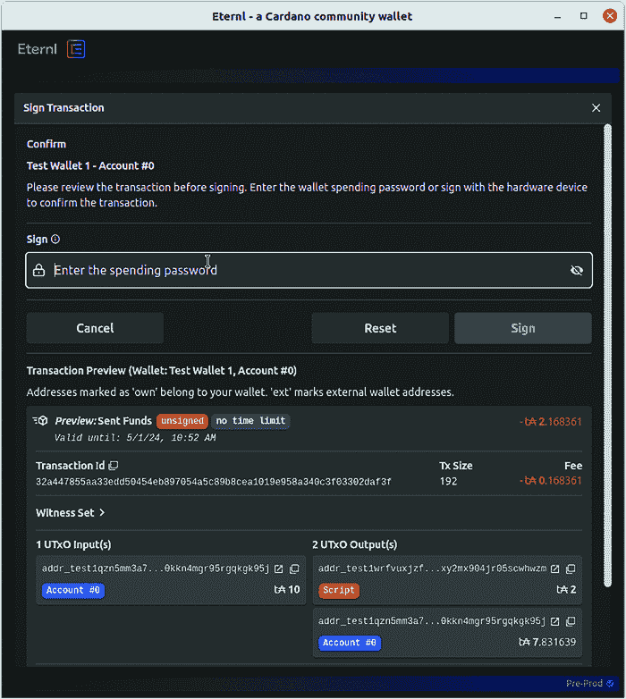

**图 5.19：** Eternl 钱包签署交易

成功使用浏览器钱包签署交易后，将显示交易哈希（`TxId`）及区块链浏览器链接，如图 5.20 所示。

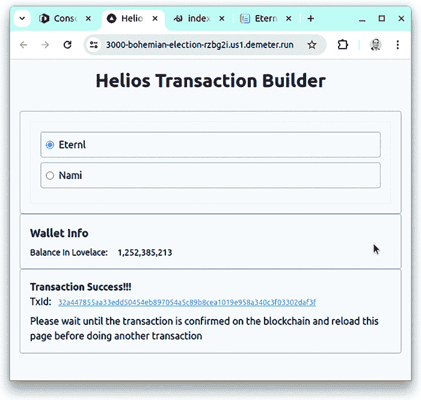

**图 5.20：** 交易成功

如果我们选择区块链浏览器链接，可以看到包含附加内联 Datum 的交易，如*图 5.21*所示。

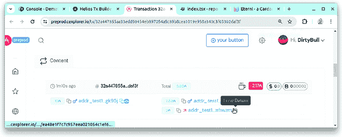

**图 5.21：** 区块链浏览器¹¹

#### Lucid + Aiken

Lucid + Aiken 组合的优势在于在 Cardano 社区中拥有更广泛的采用和使用。Aiken 团队也专注于卓越的开发者体验，并创建了多个实用工具来帮助智能合约开发者的生命周期。本节将重点介绍如何使用 Lucid 构建链下交易，以便在 Aiken 脚本地址锁定 UTXO。

与 Helios 不同，后者可以选择在运行时编译 Plutus 脚本，Aiken 遵循更典型的两阶段部署流程：


1. 使用基于 Rust 的 Aiken 编译器编译 Aiken 脚本，生成编译后的 Plutus 脚本和脚本哈希等构件，存入称为 `blueprint` 的文件中。

2. Lucid 链下代码读取 `blueprint` 文件中的编译脚本以及可能需要的任何合约参数。

## Blockfrost API

在我们的示例中，我们将使用 Blockfrost API 与 Cardano Preprod 网络交互。因此，您必须获取 API 密钥并将其设置为环境变量。

1. 访问 [`blockfrost.io/`](https://blockfrost.io/)

2. 创建免费账户并为 Cardano Preprod 网络创建 API 密钥。

## 初始化

对于 Lucid 链下代码示例，我们将参考可通过以下步骤运行的 GitHub 代码：

```
$ cd chapter_05/aiken/vesting
$ nvm install 18.17.0
$ npm install
$ echo export NEXT_PUBLIC_BLOCKFROST_API=https://cardano-preprod.blockfrost.io/api/v0 >> ~/.bashrc
$ echo export NEXT_PUBLIC_BLOCKFROST_KEY=your-blockfrost-API-key >> ~/.bashrc
$ source ~/.bashrc
$ npm run dev
```

这将启动 Next.js 并提供与使用 Helios Transaction Builder 相同的体验。对于本章，Aiken 合约已经预编译，我们将在第 6 章“Validators”中讨论 Aiken 的安装和构建步骤。

*图 5.22、5.23* 和 *5.24* 展示了 blueprint 文件的内容。它描述了 Aiken Validator 以及 Datum 和 Redeemer 数据类型。

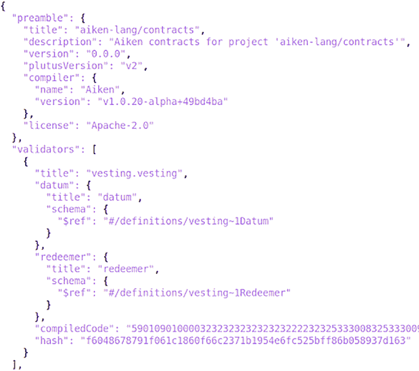

**图 5.22：** Aiken Blueprint Validator

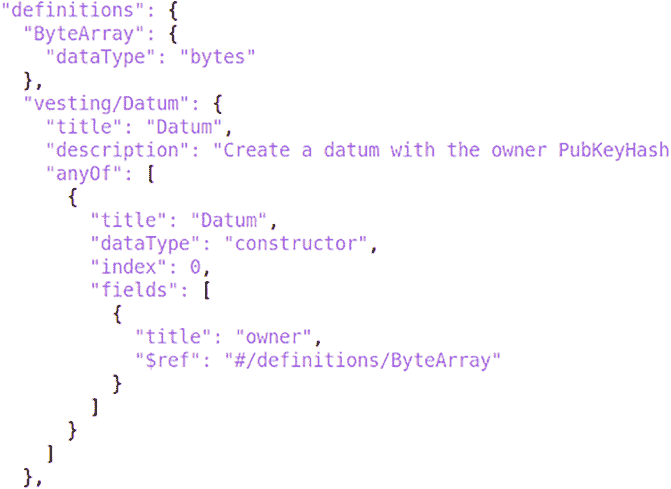

**图 5.23：** Aiken Blueprint Datum 定义

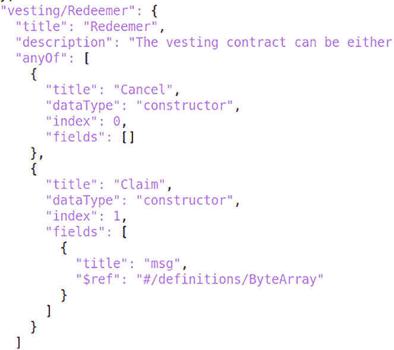

**图 5.24：** Aiken Blueprint Redeemer 定义

## Lucid 链下代码

`WalletConnect.tsx` 组件将以与 Helios 链下代码示例相同的方式获取 `walletAPI`。不同之处在于 Lucid 还需要使用区块链 API 提供者，例如 `Blockfrost`。一旦在 *图 5.25* 的第 32-35 行创建了提供者，`walletAPI` 就会在第 118 行传递给它（见 *图 5.26*）。


**图 5.25：** Lucid Blockfrost 提供者¹²

Datum 手动构建，Plutus 验证器脚本分别从 blueprint 文件的第 126 行和第 129 行读取（见 *图 5.26*）。最后，交易在第 133 行构建、第 139 行签名、第 142 行提交。


**图 5.26：** Lucid 提交交易¹³

> **提示：** 如果您的钱包中只有 1 个 UTXO，余额可能显示为 0 lovelace，因为您的钱包已将其排除并保留作为抵押品。对于 Lucid，您必须在钱包中显式设置抵押品。对于 Eternl，您可以通过进入钱包设置选项卡，选择抵押品下拉菜单，然后按下“设置抵押品”按钮来设置抵押品。

## 结论

我们从交易生命周期和 Cardano 中常用钱包的演示开始本章。然后我们使用两种不同的方法进行链下交易构建：Helios 和 Lucid + Aiken。为每种方法创建了相同的用户体验，以突出它们之间的代码差异。我们还演示了 `Demeter.run` 等实用工具如何用于搭建开发环境，以及如何使用钱包将您的权益注册到权益池。展望未来，我们已准备好审查链上代码并将其作为交易的一部分执行。

## 要点回顾

*   交易生命周期涉及构建、签名和提交。
*   交易在提交到网络时使用 CBOR 格式进行序列化。
*   钱包是通往区块链和智能合约的网关。
*   助记词用于帮助生成私钥。
*   测试网水龙头用于获取用于预览和预生产网络的测试 Ada (`tAda`)。
*   地址派生用于使用相同的私钥派生多个地址。
*   从钱包质押将提交权益注册和权益池委托证书。
*   CIP-30 是连接浏览器扩展钱包的 Cardano 标准。
*   Demeter Run 是用于 Cardano 环境的按需托管平台。
*   Helios 既是链下库也是链上库。
*   Helios 和 Lucid 可在客户端浏览器中使用。
*   Blueprints 在 Aiken 构建过程中创建，包含编译后的脚本、元数据以及 Datum 和 Redeemer 的类型定义。

## 多项选择题

1. 委托给权益池需要什么？

    1. 权益池委托证书
    2. 提款证书
    3. 使用钱包
    4. 权益注册证书

2. 关于接收地址和找零地址，以下哪项陈述是正确的？

    1. 两者都是内部地址
    2. 一个是内部地址，另一个是变量
    3. 一个是外部地址，另一个是内部地址
    4. 两者都是外部地址

3. 以下哪个 CIP 是 Cardano 浏览器钱包连接标准？

    1. CIP-22
    2. CIP-42
    3. CIP-30
    4. CIP-32

4. 生成私钥时使用什么？

    1. 网络
    2. 助记词
    3. 密码
    4. 以上都不是

5. Aiken blueprint 在 Lucid 中用于什么？

    1. 锁定在脚本地址的 UTXOs
    2. 当前 Epoch
    3. 编译后的 Plutus 脚本和参数
    4. ADA 价格

## 答案

1. a
2. c
3. c
4. b
5. c

## 问题

1. 单地址模式钱包的优缺点是什么？
2. Helios 或 Lucid + Aiken 能否用于服务端模型？
3. 还可以使用哪些其他语言和框架来编写 Cardano 链下代码？
4. 为什么 Aiken blueprints 有帮助？
5. 生成私钥是否需要助记词？

## 关键术语

*   **组装交易**：创建包含输入、输出、Datum 和 Redeemer 的交易。
*   **账户抽象**：创建一个具有余额和交易历史的账户视图或模型。
*   **全节点**：Cardano 节点，不使用任何第三方服务在区块链上查找交易。
*   **助记词**：用于帮助生成私钥。
*   **确定性钱包层级**：用于从同一私钥派生多个地址。
*   **单地址模式**：复用相同的网络地址。
*   **可审计性**：确认智能合约已被审计的能力。
*   **透明度**：如何确保正在执行的智能合约是正确的。
*   **WalletAPI**：用于与符合 CIP-30 标准的浏览器钱包交互的 JavaScript 对象。
*   **Blockfrost**：用于查询 Cardano 区块链的 API 服务。

____________________________________

## 第 6 章：验证器

### 简介

本章将探讨什么是验证器以及它们为何如此重要。我们将展示如何花费锁定在验证器脚本地址上的 UTXO，以及如何访问兑换数据和数据中提供的数据。接下来将深入了解 `ScriptContext` 以及它如何用于访问与交易相关的输入和输出。本章还将回顾使用两种不同方法的代码示例：Helios 和 Lucid + Aiken。

### 结构

在本章中，我们将讨论以下主题：

*   验证器
*   Helios
    *   Helios 链上验证器
    *   Helios 链下解锁
    *   Helios 链下取消
*   Lucid + Aiken
    *   Aiken 链上验证器
    *   Lucid 链下解锁
    *   Lucid 链下取消

### 验证器

验证器是 Cardano 智能合约的基础，因为它们指定了花费锁定在验证器脚本地址上的 UTXO 所需的链上条件。一旦验证器部署到链上，它就是不可变的，代码即“法律”。验证器的一个典型用例是归属合约，资金被锁定在合约中，直到满足特定条件。我们将在后续章节中进一步构建我们的归属示例，并查看链上和链下代码。验证器由两个部分组成：定义规则和逻辑的链上代码，以及创建和提交交易的链下代码。

#### Helios

我们首先在第 5 章，交易构建器中看到了如何使用 Helios 构建链下交易。在本章中，我们将首先查看构建链上验证器的代码，然后是花费锁定在脚本地址上的 UTXO 所需的链下代码。用于链上代码的 Helios 语言是一种强类型函数式编程语言，具有类似 Haskell 或 Aiken 等语言的代码质量优势。然而，Helios 编译器是用 JavaScript 编写的，并具有仅使用 JavaScript 在运行时编译的独特优势。这使得设置和安装变得微不足道，因为您只需要一个广泛可用于许多操作系统的最新版 Node.js。

### Helios 链上验证器

Helios 链上验证器的第一行指定了 Plutus 脚本的用途。在本例中，它是一个 `spending`（花费）脚本，脚本的名称称为 `vesting`（归属）。在图 6.1 的第 7 行，定义了一个数据作为 `struct`，包含一个使用 `PubKeyHash` 数据类型的 `owner` 变量。这将存储在锁定在脚本地址上的 UTXO 中的链上。我们之前在第 4 章，Plutus 的图 4.5 中看到了这种类型数据的示例。在图 6.1 的第 15 行，有一个带有 `enum` 数据类型的兑换数据，包含两个元素：`Cancel`（取消）和 `Claim`（领取）。`Claim` 元素有一个 `msg` 变量，用于在运行时向验证器传递消息。


**图 6.1：** Helios 链上验证器声明¹

**注意**：本地运行时，可用 Helios Visual Studio Code 扩展 (`ext:hl`) 进行语法高亮。对于 Visual Studio Web，您必须将 `.hl` 扩展与 C # 关联。

在图 6.2 的第 23 行，声明了一个**合约参数** `MESSAGE`，它将被硬编码到 Plutus 脚本中。**合约参数** 是一个位于主验证器函数之前的 UPLC 值，如果需要，可以在编译时或运行时动态更新。


**图 6.2：** Helios 链上验证器主体²

主验证器函数在图 6.2 的第 26 行定义。我们可以看到，三个参数 `Datum`、`Redeemer` 和 `ScriptContext` 被传递给主函数。验证器可能根据验证器逻辑使用这些参数中的无、任意或所有参数。我们已经在第 4 章，Plutus 中讨论过 `Datum` 和 `Redeemer`，因此我们将更详细地研究 `ScriptContext`。`ScriptContext` 包括脚本用途以及与提交的交易相关的所有信息，**辅助数据（元数据）**除外。

正如我们从第 3 章，交易中回忆的那样，脚本用途是在锁定在脚本地址上的每个 UTXO 的兑换数据中指定的。因此，可在 `ScriptContext` 中使用的四种脚本用途如下：

*   `Spending`：用于验证花费锁定在脚本地址上的 UTXO。
*   `Minting`：用于铸造或销毁原生代币。
*   `Certifying`：用于质押密钥注册和将质押委托给质押池。
*   `Rewarding`：用于提取质押奖励。

## 参考文献

[¹] [`www.cardanocube.com/cardano-ecosystem-interactive-map`](https://www.cardanocube.com/cardano-ecosystem-interactive-map)

[²] [`github.com/bitcoin/bips/blob/master/bip-0039.mediawiki`](https://github.com/bitcoin/bips/blob/master/bip-0039.mediawiki)

[³] [`github.com/bitcoin/bips/blob/master/bip-0032.mediawiki`](https://github.com/bitcoin/bips/blob/master/bip-0032.mediawiki)

[⁴] [`book.world.dev.cardano.org/environments.html`](https://book.world.dev.cardano.org/environments.html)

[⁵] [`github.com/cardano-foundation/CIPs/tree/master/CIP-1852`](https://github.com/cardano-foundation/CIPs/tree/master/CIP-1852)

[⁶] [`cips.cardano.org/cips/cip30/`](https://cips.cardano.org/cips/cip30/)

[⁷] [`github.com/ava-orange-education/Mastering-Cardano-Smart-Contracts/blob/main/chapter_05/helios/vesting/components/WalletConnector.tsx`](https://github.com/ava-orange-education/Mastering-Cardano-Smart-Contracts/blob/main/chapter_05/helios/vesting/components/WalletConnector.tsx)

[⁸] [`github.com/ava-orange-education/Mastering-Cardano-Smart-Contracts/blob/main/chapter_05/helios/vesting/pages/index.tsx`](https://github.com/ava-orange-education/Mastering-Cardano-Smart-Contracts/blob/main/chapter_05/helios/vesting/pages/index.tsx)

[⁹] [`github.com/ava-orange-education/Mastering-Cardano-Smart-Contracts/blob/main/chapter_05/helios/vesting/pages/index.tsx`](https://github.com/ava-orange-education/Mastering-Cardano-Smart-Contracts/blob/main/chapter_05/helios/vesting/pages/index.tsx)

[¹⁰] [`github.com/ava-orange-education/Mastering-Cardano-Smart-Contracts/blob/main/chapter_05/helios/vesting/pages/index.tsx`](https://github.com/ava-orange-education/Mastering-Cardano-Smart-Contracts/blob/main/chapter_05/helios/vesting/pages/index.tsx)

[¹¹] [`preprod.cexplorer.io/tx/32a447855aa33edd50454eb897054a5c89b8cea1019e958a340c3f03302daf3f`](https://preprod.cexplorer.io/tx/32a447855aa33edd50454eb897054a5c89b8cea1019e958a340c3f03302daf3f)

[¹²] [`github.com/ava-orange-education/Mastering-Cardano-Smart-Contracts/blob/main/chapter_05/aiken/vesting/pages/index.tsx`](https://github.com/ava-orange-education/Mastering-Cardano-Smart-Contracts/blob/main/chapter_05/aiken/vesting/pages/index.tsx)

[¹³] [`github.com/ava-orange-education/Mastering-Cardano-Smart-Contracts/blob/main/chapter_05/aiken/vesting/pages/index.tsx`](https://github.com/ava-orange-education/Mastering-Cardano-Smart-Contracts/blob/main/chapter_05/aiken/vesting/pages/index.tsx)

在 *Figure 6.2* 第 27 行，我们定义了一个局部变量 `tx`，它从当前正在执行的交易中获取所有交易信息。随后将用于提取该交易所需的签名者。接下来，我们对 `Redeemer` 使用 `switch` 语句，根据 `Redeemer` 的值执行不同的代码。


- 如果 `Redeemer` 是 `Cancel`，则检查交易中的所需签名是否与 Datum 中的公钥哈希匹配。若匹配，验证器允许所有者随意处置该 UTXO。

- 如果 `Redeemer` 是 `Claim`，则当 `Redeemer` 中的消息与合约参数 `MESSAGE` 的值匹配时返回 `true`。

- 如果 `Redeemer` 既不匹配 `Cancel` 也不匹配 `Claim`，或返回假值，验证器将返回 `false`，交易将失败。

### Helios 链下解锁

首先，我们将创建一个 `Unlock.tsx` 组件，允许用户输入 `Redeemer` 的文本并选择按钮以构建解锁交易，如 *Figure 6.3* 所示。


**Figure 6.3:** Unlock UI Component³

然后，我们在主页面 `index.tsx` 中创建解锁函数，该函数接受 `Redeemer` 参数并构建交易。*Figure 6.4* 中的解锁函数类似于锁定函数，但我们需要在第 171 行获取一个接收地址以发送解锁后的资金。在第 186 行，我们将验证器脚本附加到交易中，作为脚本见证包含在内。


**Figure 6.4:** Unlock Function Vesting Program⁴

接下来，在 *Figure 6.5* 中，我们需要在第 189 行获取锁定在脚本地址上的 UTXO，并在第 193 行构建 `Redeemer`。在 Helios 中，我们可以直接从链上代码导入 `Redeemer` 类型，并使用 `_toUplcData()` 函数生成 UPLC 代码。然后在第 198 行添加 UTXO 输入和 `Redeemer`，它们将作为 `Redeemer` 见证关联在一起。第 206 行还创建了一个 UTXO 输出，用于在脚本地址上的 UTXO 被花费后将 2 Ada 发送到接收地址。


**Figure 6.5:** Unlock Function Inputs and Outputs⁵

第 189 行的 `getVestingUtxo` 函数向一个 Next.js API 发起网络调用，该 API 被创建用于查询脚本地址上的 UTXO。该 Next.js API 使用 `Blockfrost`（一个第三方区块链 API 提供商），并在服务器端执行。查询 Cardano 区块链还有其他提供商和方法，例如 Maestro、Ogmios 和 Koios。我们将在 *第 8 章，工具* 中回顾其他区块链 API 提供商。服务端使用 `Blockfrost` API 的优势在于：避免直接从浏览器调用 API 导致 API 密钥泄露；此外，还避免了向不同域名发起网络调用，从而防止浏览器 CORS 错误。*Figure 6.6* 展示了由 `index.tsx` 中的 `getVestingUtxo` 函数调用的 Next.js `vestingUtxo` API 代码。


**Figure 6.6:** getVestingUtxo API⁶

解锁函数的其余部分与锁定函数相同，负责组装、签名并将交易提交到网络。带有解锁按钮和 `Redeemer` 消息输入的新 UI 如 *Figure 6.7* 所示。


**Figure 6.7:** Helios Unlock UTXO

### 链下取消

我们创建了一个 `Cancel.tsx` 组件和 `index.tsx` 内部的 `cancel` 函数，它们与 `Lock.tsx` 组件和 `unlock` 几乎完全相同。解锁和取消函数之间只有少数差异。你能在 *Figure 6.8* 中找出这些差异吗？


**Figure 6.8:** Helios Cancel UTXO⁷

其中一个差异是我们必须为交易显式添加所需签名者。第 294 行的 `.addSigner()` 函数将钱包的公钥哈希添加到交易中，并将其作为必需签名者包含在内。Cardano 节点将确保任何必需签名者在见证集中都有相应的有效签名。链上代码随后在必需签名者列表中查找公钥哈希，以查看是否匹配。

### 试运行

要运行演示，你需要执行以下命令；除非你更改版本号或 `vesting` 脚本，否则验证器脚本地址对所有人都是相同的：

```
$ cd chapter_06/helios/vesting
$ npm install
$ echo export BLOCKFROST_KEY=your-blockfrost-API-key >> ~/.bashrc
$ echo export NEXT_PUBLIC_ENV="dev" >> ~/.bashrc
$ echo export NEXT_PUBLIC_HOST="demeter-run-host" >> ~/.bashrc
$ echo export NEXT_PUBLIC_PROTOCOL="https" >> ~/.bashrc
$ echo export NEXT_PUBLIC_PORT="" >> ~/.bashrc
$ source ~/.bashrc
$ npm run dev
```

现在你应该能够使用暴露的端口 URL 访问该应用程序。你可以锁定 2 Ada，并使用正确的 `Redeemer` 值进行领取（解锁）或取消。*Figure 6.9* 展示了一个使用正确 `Redeemer` 值成功领取 2 Ada 的交易。


**Figure 6.9:** Helios Vesting Claim⁸

#### Aiken

Aiken 是一种函数式编程语言，其编译器由 Rust 编写。我们将使用 `aiken build` 命令编译 Aiken 脚本。这将生成编译后的 Plutus 代码和一个包含元数据和类型定义的 **blueprint** 文件。要在 `Demeter.run` 工作区中安装 Aiken，首先需要下载安装程序：

```
$ curl -sSfL https://install.aiken-lang.org | bash
$ echo export PATH=:/config/.aiken/bin:$PATH >> ~/.bashrc
$ source ~/.bashrc
```

然后，运行以下命令：

```
aikup
```

安装好 `aiken` 后，你可以使用 help 开关查看以下可用选项：

```
$ aiken --help
Cardano smart contract language and toolchain
Usage: aiken <COMMAND>
Commands:
new         Create a new Aiken project
fmt         Format an Aiken project
build       Build an Aiken project
address     Compute a validator's address
check       Type-check an Aiken project
docs        Build the documentation for an Aiken project
add         Add a new project package as dependency
blueprint   Commands for working with Plutus blueprints
packages    Managing project dependencies
tx          Commands for working with transactions
uplc        Commands for working with untyped Plutus-core
completion  Generates shell completion scripts
help        Print this message or the help of the given subcommand(s)
```

你可以使用以下命令创建一个新项目：

```
aiken new aiken-lang/new-project
```

这将创建以下项目文件和文件夹：

```
└── new-project
├── aiken.toml
├── lib
│   └── new-project
├── README.md
└── validators
```

`aiken.toml` 包含有关项目的信息，包括库和 GitHub 仓库。`validators` 文件夹包含链上 Aiken 源代码，`lib` 目录包含该项目所需或创建的任何项目库。你可以通过在 `new-project` 目录中执行 `aiken build` 和 `aiken check` 来快速测试，确认一切安装正确。

在本书的示例中，我们将所有 Aiken 链上验证器代码和工件放在每个章节项目的 `contracts` 目录中。例如：

`chapter_06/aiken/vesting/contracts`

如果你想了解更多关于设置和安装任务（包括 IDE 语言配置）的信息，请参阅 Aiken 在线文档。⁹

### Aiken 链上验证器

### Aiken 验证器脚本分析

现在，我们准备好查看第一个 Aiken 验证器脚本，如图 6.10 所示：


**图 6.10：** Aiken 链上验证器声明¹⁰

图 6.10 中的前 5 行是我们将要使用的类的显式导入，随后是 `Datum` 和 `Redeemer` 类型。`Datum` 包含一个 `Hash` 对象，其中包含 `Blake2b_224` 和 `VerificationKey` 对象。值得注意的是，这在链上作为单个 `ByteArray` 存储，代表公钥哈希。在第 15 行，`Redeemer` 包含两个条件（`Cancel` 和 `Claim`），用于花费锁定在此脚本地址上的 UTXO。`Claim` redeemer 还使用 `ByteArray` 数据类型包含一个 `msg` 载荷。在第 21 行，我们将 "`Hello World!`" 消息硬编码为脚本常量。

接下来，在图 6.11 中，我们在第 23 行定义验证器函数，并创建 vesting 函数，以 `Datum`、`Redeemer` 和 `ScriptContext` 作为参数：


**图 6.11：** Aiken 链上验证器主体¹¹

在第 26 行，我们确定特定交易提供的 `Redeemer` 类型。在 `Cancel` 的情况下，第 29 行的代码会遍历所需签名者列表，并确认是否存在与 datum 中的公钥哈希匹配的公钥哈希。如果为真，则验证器评估为真，并允许花费锁定在脚本地址上的 UTXO。如果 `Redeemer` 是 `Claim`，我们在第 32 行将 `msg` 载荷与硬编码的消息常量进行比较。如果 `Redeemer` 没有匹配项，则验证器将失败，不允许花费锁定在脚本地址上的 UTXO。

### Lucid 链下解锁

我们将创建与使用 Helios 时相同的 `Unlock.tsx` 组件和 `index.tsx` 中的 `unlock function`。我们需要为 unlock function 创建一个 `Redeemer`，但不需要创建 `Datum`，因为它已经是我们想要花费的 UTXO 的一部分。图 6.12 第 172 行的 `Redeemer` 创建了一个 Plutus Data 对象，对应于我们在第 4 章 Plutus 中看到的 UPLC 数据类型。在这种情况下，我们在索引 1 处创建一个 `Constr`，包含一个十六进制编码的字符串。当脚本被评估时，这个十六进制编码的字符串将被转换为 `Redeemer` `Claim` `ByteArray` 载荷。我们指定索引为 1，因为 `Redeemer` `Cancel` 是在 Plutus 脚本中首先定义的 `Redeemer`，索引为 0。按顺序的下一个 `Redeemer` 将具有索引 1，即 `Claim` `Redeemer`。


**图 6.12：** Lucid 链下解锁¹²

在第 175 行，通过调用 `lucid.utxosAt` 函数获得锁定在脚本地址上的 UTXO，该函数使用 Blockfrost API 查询区块链。接下来，我们构建交易，并在第 182 行指定输入 UTXO，在第 183 行指定验证器脚本。现在可以使用 `.complete()` 方法组装 lucid 交易。在幕后有大量活动来组装和完成交易。我们将专注于更常用的 `lucid tx` 方法来构建和提交交易。一旦交易完成，钱包将要求用户签名并将其提交到网络。

### Lucid 链下取消

最后，我们将创建一个新的 `Cancel.tsx` 组件和 `index.tsx` 中的 cancel function。`Cancel.tsx` 组件与 `Lock.tsx` 组件几乎相同，主要区别在于图 6.13 第 226 行交易中的所需签名。这是必需的，因为链上代码会检查所需的公钥哈希是否与存储在 datum 中的公钥哈希匹配。


**图 6.13：** Lucid 链下取消¹³

### 试运行

要尝试该示例，请运行以下步骤：

```
$ cd chapter_06/aiken/vesting/contracts
$ aiken build
$ cd ..
$ echo export NEXT_PUBLIC_BLOCKFROST_API=https://cardano-preprod.blockfrost.io/api/v0 >> ~/.bashrc
$ echo export NEXT_PUBLIC_BLOCKFROST_KEY=your-blockfrost-API-key >> ~/.bashrc
$ source ~/.bashrc
$ npm install
$ npm run dev
```

### 结论

我们查看了使用 Helios 和 Aiken 语言构建的第一个链上 Plutus 验证器。然后我们查看了使用 Helios 和 Lucid 分别执行这些验证器的相应链下代码。我们了解了如何使用 Aiken 初始化项目以及如何编译 Aiken 智能合约。然后，我们研究了 `ScriptContext` 以及它如何包含关键交易信息，如输入、输出、脚本目的等。我们还查看了链上的 `Datum` 和 `Redeemer` 定义以及它们在脚本执行期间如何被访问。示例中还演示了链下 `Redeemer` 和所需签名者的创建。下一章将深入探讨铸造策略、参数化智能合约和铸造原生代币。

### 要点回顾

*   Helios 既用于链上代码也用于链下代码。

*   Helios 链上代码可以即时编译，因为 Helios 编译器是用 JavaScript 编写的。

*   Aiken 用于链上代码，并使用基于 Rust 的 `aiken` 编译器在运行前编译。

*   Aiken 还会生成一个蓝图文件，其中包含 Plutus 脚本元数据和类型定义。

*   `aiken` 程序有几个方便的实用函数，可用于智能合约开发期间。

*   Lucid 用于链下代码，经常与 Aiken 结合使用。

*   Lucid 和 Helios 链下代码依赖区块链 API 提供商来获取区块链信息，例如锁定在脚本地址上的 UTXO。

*   Helios 链下代码可以导入 Helios 链上代码，从而允许共享类型定义。

*   Helios 链下代码不需要任何第三方库，并整合到一个 JavaScript 文件中。

*   花费 UTXO 时，必须为锁定在脚本地址上的每个 UTXO 提供一个 `Redeemer`。

*   所需签名者必须在交易的见证集中包含签名。

### 多项选择题

1.  在 Plutus 脚本地址花费 UTXO 需要什么？

    1.  仅 Datum

    2.  铸造脚本

    3.  Datum 和 Redeemer

    4.  Epoch

2.  交易完成期间必须发生什么活动？

    1.  平衡输入和输出

    2.  指定 Redeemer

    3.  指定 Datum

    4.  签署交易

3.  链下代码如何访问区块链数据？

    1.  直接向节点发起 RPC 调用

    2.  通常不需要

    3.  使用 API 提供商（例如 `Blockfrost`、`Ogmios` 等）

    4.  CIP-30 钱包连接器

4.  链上代码执行的典型顺序是什么？

    1.  本地评估器，节点进行 `tx` 提交，所有区块链节点

    2.  仅所有区块链节点

    3.  仅节点进行 `tx` 提交

    4.  本地评估器然后所有区块链节点

5.  四种不同的脚本目的是什么？

    1.  `Validate`、`Mint`、`Reward`、`Cert`

    2.  `Spend`、`Burn`、`Cert`、`Reward`

    3.  `Spend`、`Mint`、`Burn`、`Context`

    4.  `Spend`、`Mint`、`Cert`、`Reward`

### 答案

1.  c

2.  a

3.  c

4.  a

5.  d

### 问题

1.  如何提高已执行智能合约的可审计性？

2.  为什么大多数智能合约在运行前部署？

3.  `Datum` 和 `ScriptData` 哈希的作用是什么？

4.  为什么执行智能合约时必须始终指定 redeemer？

5.  像 Lucid 和 Helios 这样的链下框架如何检索 Plutus 成本模型？

6. 交易所需签名者的 CDDL 规范标识符是什么？

### 关键术语


## 术语表

*   **辅助数据：** 关于交易的元数据，仅元数据哈希存储在链上。
*   **Blake2b：** 一种基于字节输入生成哈希的哈希算法。
*   **蓝图：** 一个由 Aiken 生成的文件，包含 Plutus 脚本元数据和类型定义。
*   `Blockfrost`：区块链数据的 API 提供商。
*   `ByteArray`：使用十六进制格式编码的字节数组。
*   **合约参数：** 链上变量，可在编译时或运行时更新。
*   `Enum`：可枚举并用于 switch/case 语句的数据类型。
*   `ScriptContext`：包含当前正在评估的交易的所有信息，辅助数据除外。
*   `Spending` **脚本：** 用于在脚本地址锁定 UTXO 的验证器类型。
*   `Switch` **语句：** 用于评估不同的 Enum 组合。
*   `VerificationKey`：对应私钥的公钥。

---

¹ [`github.com/ava-orange-education/Mastering-Cardano-Smart-Contracts/blob/main/chapter_06/helios/vesting/contracts/vesting.hl`](https://github.com/ava-orange-education/Mastering-Cardano-Smart-Contracts/blob/main/chapter_06/helios/vesting/contracts/vesting.hl)

² [`github.com/ava-orange-education/Mastering-Cardano-Smart-Contracts/blob/main/chapter_06/helios/vesting/contracts/vesting.hl`](https://github.com/ava-orange-education/Mastering-Cardano-Smart-Contracts/blob/main/chapter_06/helios/vesting/contracts/vesting.hl)

³ [`github.com/ava-orange-education/Mastering-Cardano-Smart-Contracts/blob/main/chapter_06/helios/vesting/components/Unlock.tsx`](https://github.com/ava-orange-education/Mastering-Cardano-Smart-Contracts/blob/main/chapter_06/helios/vesting/components/Unlock.tsx)

⁴ [`github.com/ava-orange-education/Mastering-Cardano-Smart-Contracts/blob/main/chapter_06/helios/vesting/pages/index.tsx`](https://github.com/ava-orange-education/Mastering-Cardano-Smart-Contracts/blob/main/chapter_06/helios/vesting/pages/index.tsx)

⁵ [`github.com/ava-orange-education/Mastering-Cardano-Smart-Contracts/blob/main/chapter_06/helios/vesting/pages/index.tsx`](https://github.com/ava-orange-education/Mastering-Cardano-Smart-Contracts/blob/main/chapter_06/helios/vesting/pages/index.tsx)

⁶ [`github.com/ava-orange-education/Mastering-Cardano-Smart-Contracts/blob/main/chapter_06/helios/vesting/pages/api/vestingUtxo.ts`](https://github.com/ava-orange-education/Mastering-Cardano-Smart-Contracts/blob/main/chapter_06/helios/vesting/pages/api/vestingUtxo.ts)

⁷ [`github.com/ava-orange-education/Mastering-Cardano-Smart-Contracts/blob/main/chapter_06/helios/vesting/pages/index.tsx`](https://github.com/ava-orange-education/Mastering-Cardano-Smart-Contracts/blob/main/chapter_06/helios/vesting/pages/index.tsx)

⁸ [`preprod.cexplorer.io/address/addr_test1wp4gwgtnyp8grwhzjj47qy7k60hxfv9p2wymjcwkzgw6r9cp0ctvs/tx#data`](https://preprod.cexplorer.io/address/addr_test1wp4gwgtnyp8grwhzjj47qy7k60hxfv9p2wymjcwkzgw6r9cp0ctvs/tx#data)

⁹ [`aiken-lang.org/installation-instructions`](https://aiken-lang.org/installation-instructions)

¹⁰ [`github.com/ava-orange-education/Mastering-Cardano-Smart-Contracts/blob/main/chapter_06/aiken/vesting/contracts/validators/vesting.ak`](https://github.com/ava-orange-education/Mastering-Cardano-Smart-Contracts/blob/main/chapter_06/aiken/vesting/contracts/validators/vesting.ak)

¹¹ [`github.com/ava-orange-education/Mastering-Cardano-Smart-Contracts/blob/main/chapter_06/aiken/vesting/contracts/validators/vesting.ak`](https://github.com/ava-orange-education/Mastering-Cardano-Smart-Contracts/blob/main/chapter_06/aiken/vesting/contracts/validators/vesting.ak)

¹² [`github.com/ava-orange-education/Mastering-Cardano-Smart-Contracts/blob/main/chapter_06/aiken/vesting/pages/index.tsx`](https://github.com/ava-orange-education/Mastering-Cardano-Smart-Contracts/blob/main/chapter_06/aiken/vesting/pages/index.tsx)

¹³ [`github.com/ava-orange-education/Mastering-Cardano-Smart-Contracts/blob/main/chapter_06/aiken/vesting/pages/index.tsx`](https://github.com/ava-orange-education/Mastering-Cardano-Smart-Contracts/blob/main/chapter_06/aiken/vesting/pages/index.tsx)

# 第 7 章：铸造

## 简介

在本章中，我们将探讨 Cardano 原生资产，以及它们与使用 `ERC-20` 和 `ERC-721` 标准在以太坊上创建的代币有何不同。我们将讨论代币包的概念以及如何优化币选择。接下来，我们将深入探讨 Cardano 原生代币的铸造方式，以及非同质化代币（NFT）和同质化代币（FT）之间的区别。我们还将回顾 NFT 和 FT 元数据标准 `CIP-25` 和 `CIP-68`，以及在铸造时如何实现它们。最后，我们将介绍 Cardano 代币注册表，并探讨其对最终用户钱包体验的益处。我们将通过一个可工作的铸造策略用例和演示将所有这些内容串联起来。

## 结构

在本章中，我们将讨论以下主题：

*   代币
    *   原生资产
    *   代币包
*   铸造策略
    *   同质化代币
    *   非同质化代币
    *   代币注册表
    *   NFT 元数据标准
        *   CIP-25
        *   CIP-68
*   币选择
    *   铸造策略用例

## 代币

2021 年 3 月 1 日，作为 Mary 硬分叉的一部分，Cardano 升级为多资产账本。这是一个重大事件，因为自定义原生代币现在可以利用 Ada（Cardano 的原生货币）所使用的安全、经过同行评审的账本规则。这与以太坊截然不同，后者要求遵循 `ERC-20` 或 `ERC-721` 标准的每种代币都需要自定义账本代码。此外，跟踪与 Cardano 原生资产相关的交易，不需要特殊费用或额外的事件处理逻辑。¹

### 原生资产

原生资产是 Cardano 上的自定义代币，其运作方式与基础层货币 Ada 相同。唯一的要求是原生资产必须始终包含最小数量的 Ada。`CIP-55`² 简化了最小 Ada 计算，使用 UTXO 的 CBOR 字节数，其中包括锁定在特定 UTXO 中的所有原生资产。

资产代表价值，例如 1 Ada (1,000,000 lovelace) 或 100 枚金币。每个资产代币始终由三个组成部分构成^(*)：

*   **策略标识符 (ID)：** 唯一标识符，即铸造策略 Plutus 脚本的哈希值。
*   **资产名称：** 特定铸造策略下链上不可变的代币名称。
*   **数量：** 记账单位。

^(*) Ada 是唯一策略 ID 为空字符串的资产代币。

### 代币包

代币包是一组代币的集合，这些代币可能相同也可能不同。代币包将代币组织成一种特定结构，以正确定义铸造策略 ID、代币名称以及**集合**中每个代币的数量。让我们看看下面的例子：

```
{
  "lovelace": "1646420",
  "assets": {
    "Game Monetary Policy ID": {
      "Gold": "100",
      "Silver": "1,000",
      "Bronze": "10,000"
    },
    "Game Character Policy ID": {
      "Dracula": "1"
    }
  }
}
```

在前面的示例中，我们有一组代币，每个代币代表锁定在 UTXO 中的价值。`Game Monetary Policy ID` 是一个唯一的铸造策略 ID，玩家持有 100 个 Gold、1,000 个 Silver 和 10,000 个 Bronze 代币。因此，用户可以在单笔交易中花费最多 100 个 Gold、最多 1,000 个 Silver 和最多 10,000 个 Bronze 代币。由于该玩家只有 1 个 Dracula 代币，因此他们只能向另一位玩家发送（花费）1 个 Dracula 代币。代币包中始终需要最少数量的 Ada，在本例中为 1,646,420 lovelace。

## 铸造策略

Cardano 上有两种不同类型的铸造策略：

*   使用 `cardano-cli` 工具创建的原生脚本铸造策略，使用私钥和公钥。
*   作为 Plutus 脚本的铸造策略。

`cardano-cli` 方法³最早用于智能合约引入之前，但由于这是一种经过验证且安全的技术，至今仍在使用。将 `cardano-cli` 与原生脚本结合使用，提供了指定时间锁和多重签名条件的能力⁴。

铸造策略的编写方式类似于我们编写验证器脚本的方式。验证器脚本与铸造策略的区别在于，铸造策略使用 `minting` 脚本目的且不使用 datum。`minting` 脚本目的允许铸造策略作为交易的一部分铸造或销毁原生代币。铸造策略的自定义逻辑中仅定义了铸造或销毁的条件。

### 同质化代币

您可能希望创建一个具有 1,000,000 个代币固定供应量的**货币策略**。铸造策略将仅允许一次性铸造 1,000,000 个代币，每个代币具有相同的名称。这使得每个代币都能相互替代或交易，类似于当今法币的运作方式。

### 非同质化代币

非同质化代币（**NFT**）是指每个代币都是唯一且独特的。在 Cardano 上创建唯一代币有两种方法。

*   **选项 1**：时间锁，代币只能在特定日期和时间之前铸造。
*   **选项 2**：铸造策略逻辑检查输入中必须被花费的 UTXO 是否存在。

第二种选项更受青睐，因为它利用了 Cardano UTXO 架构的独特属性。一旦 UTXO 被花费，它就永远不能再次被花费，也不会存在另一个具有相同哈希值的 UTXO。通过将此条件硬编码到铸造策略中，并确保仅铸造一个代币，我们保证了代币的唯一性。时间锁方法用于智能合约功能可用之前，但在创建大型 NFT 收藏时仍在使用。

### 代币注册表

代币注册表⁵用于存储铸造策略 ID 和代币名称的链下元数据。铸造策略 ID 是一个十六进制哈希值，因此拥有关于特定铸造策略和代币的可读信息映射非常有帮助。注册表提供了一个 API，钱包和其他应用程序可以使用它来查找代币图片 URL、小数精度和其他元数据。随着 `CIP-68` 采用率的提高，对中心化链下代币注册表的需求将随着时间的推移逐步淘汰。有关注册代币的分步指南，请访问以下 URL：

[`github.com/cardano-foundation/cardano-token-registry/wiki`](https://github.com/cardano-foundation/cardano-token-registry/wiki)

### NFT 元数据标准

在铸造 NFT 时，您可以利用可包含在 Cardano 网络上任何交易中的交易元数据。第一个 Cardano 元数据标准记录在 `CIP-25`⁶ 中，该标准指定了 NFT 元数据的标准字段。`CIP-25` 元数据与以太坊 `ERC-721` 代币元数据的一个显著区别在于，`CIP-25` 元数据链接到铸造交易，而不是铸造策略。因此，使用 `CIP-25` 查找元数据的过程是查看特定铸造策略的原始铸造交易。

#### CIP-25

`CIP-25` NFT 元数据的格式如*图 7.1*所示：


**图 7.1：** CIP-25 NFT 元数据格式

标签 721 表示这是代币元数据，且格式灵活，允许您根据需要添加其他元素。要在生产环境中测试和验证有效的交易元数据，可以使用 `Pool.pm` 测试元数据工具⁷。

#### CIP-68

`CIP-25` 的缺点是它是在原始铸造交易中创建的，不可更新，也无法被 Plutus 脚本访问。`CIP-68`⁸ 通过使用参考代币的概念解决了这个问题，该参考代币在创建 **NFT** 或 **FT** 时同时生成。参考代币可以锁定在不可花费的脚本地址以实现不可变性，或者如果需要可更新性，则锁定在支出脚本地址。元数据存储在包含在参考代币 UTXO 输出中的 datum 中。因此，Plutus 脚本可以通过读取 datum 值来访问它。随着 2022 年 9 月 Vasil 硬分叉的实施，**参考输入**被引入，允许 Plutus 脚本将 UTXO 输入作为只读包含，而无需花费它。因此，任意数量的交易（甚至并行）都可以包含只读的 `CIP-68` 参考代币 UTXO，而不会出现任何并发问题。

在*图 7.2*中，我们可以看到铸造交易如何生成用户代币和参考代币，它们通过相同的代币名称和铸造策略 ID 关联。代币名称以 222 为前缀表示 NFT 代币，以 100 为前缀表示参考代币。对于同质化代币，使用前缀 333。值得注意的是，参考代币与 NFT 或 FT 代币不需要同时铸造。


**图 7.2：** CIP-68 Datum 元数据

在*第 9 章，票务应用设计*中，我们将通过真实案例更详细地讨论创建和使用 `CIP-68` 元数据 datum 的过程。

## 币选择

选币是确定需要哪些 UTXO 输入以覆盖 UTXO 输出成本（包括网络费用）的过程。在选币过程中，我们需要注意以下一些约束条件⁹：

*   交易的最大大小限制，其中每个 UTXO（无论作为输入还是输出）都会增加整体交易大小。
*   非常小的 UTXO（**粉尘**）的累积，它们无法花费，因为无法将足够多的它们组合在一起以覆盖交易成本。
*   UTXO 不能部分花费；它必须作为交易的一部分被完全花费。


因此，币选择算法的目标是避免`dust`（粉尘/零钱）并创建可用的 UTXO。币选择算法的考量同时适用于 Ada 和原生代币。最常见的币选择方法有`Largest-first`（最大优先）和`Random Improve`（随机改进）¹⁰。`Largest-first`按从最大值到最小值的顺序选择 UTXO 输入。`Random Improve`算法分两个阶段。第一阶段遍历按降序排列的 UTXO 输入列表，随机选择 UTXO，直到获得所需的输出价值总额。第二阶段，算法再次从降序 UTXO 输入列表中随机选择，直到总额约为所需输出价值的两倍。币选择通常由钱包和/或交易构建框架实现。也就是说，在选择 UTXO 输入时，理解币选择算法很重要。此外，你需要知道用户可能会遇到与`dust`（粉尘/零钱）或 UTXO 碎片化相关的问题，这是由作为输入所需的 UTXO 过多导致的。

### 铸造策略用例

接下来，我们将研究 Cardano 区块链上铸造的一个真实用例。在本例中，我们将使用铸造策略为活动创建固定数量的门票。

铸造活动门票代币具有以下区块链优势，详见*表 7.1*：

| **区块链特性** | **受益方** | **收益** |
|---|---|---|
| 铸造的门票数量固定且不可更改 | 表演者 | 确切知道特定活动发行了多少张门票 |
|  | 参加者 | 门票价值不会因初始分配后创建额外门票而被稀释 |
| 铸造规则与 Cardano 账本规则 | 参加者 | 如果参加者持有有效门票，则该门票为真品，无法伪造 |
|  | 卖家 | 对于二级市场销售，可通过检查区块链验证门票真伪，确认其为真品 |
|  | 表演者 | 门票流转记录在区块链上，易于审计实际售出或取消（销毁）的门票数量 |

**表 7.1：** 铸造用例收益

### Helios 链上铸造策略

第 1 行的链上 Helios 铸造策略，*图 7.3*，声明了脚本的用途为`minting`，脚本名称为`ticket`。第 7 行和第 8 行定义了两个`Redeemer`条件：`Mint`和`Burn`。第 11-16 行的合约参数将在运行时动态更新。因此，目前它们用虚拟值初始化，将在链下代码中更新。


**图 7.3：** Helios 链上铸造 Redeemer 与参数¹¹

接下来，在*图 7.4*中，我们可以看到主函数包含铸造策略逻辑。首先注意，仅传递`Redeemer`和`ScriptContext`作为参数。第 20 行，我们动态创建`MintingPolicyHash`，这考虑了运行时传入脚本的合约参数。随后我们创建`AssetClass`，用于验证铸造内容。第 25 行，我们提取出作为此交易一部分的铸造价值。现在，我们拥有处理`Redeemer`条件所需的信息。


**图 7.4：** Helios 链上铸造逻辑¹²

在*图 7.4*第 30 行，我们确认交易中铸造的代币与合约参数中的代币名称和数量匹配。第 31 行和第 32 行检查合约参数中指定的 UTXO 是否包含在输入中。由于 UTXO 只能被消费一次，铸造策略将只允许其被铸造一次，从而保证唯一性。最后，第 38 行允许销毁，只要该代币属于该铸造策略且数量为负值。

### Helios 链下铸造

我们将重点介绍本例中链下代码与*第 6 章 验证器*中展示的前一个验证器示例的区别。*图 7.5*第 119 行，我们创建铸造策略程序，随后第 120-123 行应用合约参数。只有参数应用后，才能编译脚本并在第 129 行将其附加到交易。我们还在第 132 行构建`Mint Redeemer`，它使用链上代码中指定的`Redeemer`类型。


**图 7.5：** Helios 链下合约参数¹³

在*图 7.6*中，第 136 行的代币数组使用用户输入传入的票名和数量创建我们将要铸造的资产，如第 139-141 行所示。接着，第 145 行指定交易中要铸造的代币。我们使用编译脚本得出的`MintingPolicyHash`，包含之前创建的代币和`Redeemer`。我们还创建一个输出，将铸造的门票代币发送到用户输入的`address`，如第 153-156 行所示。


**图 7.6：** Helios 链下铸造代币¹⁴

在本铸造用例中，我们还遵循 CIP-25 标准使用了交易元数据。*图 7.7*第 160 行，我们调用`generateMetadata`，它为传入参数的数据返回一个类 JSON 记录。`name`、`qty`、`utxoId`和`utxoIdx`将存储在元数据中，若后续需要销毁，可用于重建铸造策略。`mintingPolicyHash`、`name`、`description`和`image`用于链下在钱包、dApp 和区块链浏览器中显示代币。


**图 7.7：** Helios 链下元数据¹⁵

### Helios 链下销毁

可能存在需要销毁未售出门票代币的场景。由于 Cardano 账本跟踪并防止原生资产的双重支付，只有当门票代币实际存在于交易输入中时，才能销毁它们。因此，销毁代币的唯一方式是你的钱包实际持有该代币，以便将其作为交易输入消费。

我们首先查看*图 7.8*第 230 行，它查询区块链以获取特定代币的铸造元数据。回顾一下，我们需要代币`name`、`qty`、`utxoId`和`utxoIdx`作为合约参数来重建正确的铸造策略。现在我们有了合约参数，可以编译脚本并将其附加到交易。我们还在第 246 行创建`Burn Redeemer`，允许相应地销毁门票代币。


**图 7.8：** Helios 链下元数据查询¹⁶

最后，我们从元数据中存储的`policyId`构建`MintingPolicyHash`，然后在第 252 行使用负数`qty`添加要销毁的代币，如*图 7.9*所示。


**图 7.9：** Helios 链下销毁代币¹⁷

### Aiken 链上铸造策略

Aiken 链上铸造策略使用 `token_name`、`qty` 和 `utxo_ref` 作为合约参数，这些参数在运行时应用于第 15 行，如 *图 7.10* 所示。只有 Redeemer（赎回者）和 `ScriptContext`（脚本上下文）被传递给包含铸造策略逻辑的 `ticket` 函数。在第 18 行，`expect` 语句用于从脚本 `purpose`（目的）创建 `policy_id` 的新绑定。在第 19 行，我们解构 `Transaction` 类型，并从交易中提取 `inputs`（输入）和 `minted value`（铸造价值）。然后我们在第 22 行使用 `expect` 语句将 `asset_name` 和 `amount` 与来自铸造价值的元组绑定，并匹配 `policy_id`。现在我们拥有执行 Redeemer 条件所需的所有信息。在第 31 和 32 行，我们检查输入是否包含作为合约参数传入的 `utxo_ref`。在第 34 行，我们确认资产名称和数量与作为合约参数提供的内容相匹配。第 37 行的 Burn Redeemer（销毁赎回者）允许销毁任意负数数量，只要该脚本铸造策略中的 `asset_name` 包含在交易中即可。


**图 7.10：** Aiken 链上铸造策略¹⁸

### Lucid 链下铸造

Lucid 链下代码与 Helios 链下代码非常相似，我们将仅展示这两种方法之间的差异。特别是，应用合约参数的方式不同，如 *图 7.11* 所示。在第 89 行，一个自定义函数接收合约参数，然后在第 96 行将它们应用到 Plutus 铸造策略脚本。Plutus 脚本从蓝图文件中读取，该文件由 `aiken build` 命令生成。


**图 7.11：** Lucid 应用合约参数¹⁹

在 *图 7.12* 中，验证器（铸造策略）在第 132 行返回，使用的是从钱包中的 UTXO 计算出的 `name`、`qty` 和 `outRef`。在第 135 行，`Redeemer` 被手动构造以匹配链上 Aiken 代码中的 `Redeemer`。`policyId` 和 `assetName` 分别在第 138 和 139 行使用 `validator` Script 和 `name` 构造。


**图 7.12：** Lucid 铸造策略 ID 和资产名称²⁰

最后一步是在第 142 行生成元数据，如 *图 7.13* 所示，并在第 150-160 行构建交易。验证器脚本、元数据和铸造资产分别在第 153、154 和 155 行附加到交易中。最后，在第 159 行创建输出，将票据代币发送到用户输入提供的地址。


**图 7.13：** Lucid 铸造元数据²¹

Lucid 链下销毁与铸造类似，不同之处在于 `mintAssets()` 使用负数量，且没有元数据或交易输出。

### 钱包信息

由于我们处理的是原生资产，我们修改了 `WalletInfo` 组件，以显示用户钱包地址上的 Lovelace 和任何原生资产。这需要调用 `Blockfrost` API 以获取资产列表，然后填充一个将在 UI 上显示的数组，如 *图 7.14* 所示。


**图 7.14：** Lucid getWalletInfo²²

#### 设置

要设置 `Demeter.run` 环境以运行 Lucid + Aiken 演示，请在终端窗口中执行以下命令（如果您尚未从 *第 6 章，验证器* 中执行过）。

```
$ echo export NEXT_PUBLIC_BLOCKFROST_API=https://cardano-preprod.blockfrost.io/api/v0 >> ~/.bashrc
$ echo export NEXT_PUBLIC_BLOCKFROST_KEY=your-blockfrost-API-key >> ~/.bashrc
$ echo export NEXT_PUBLIC_ENV="dev" >> ~/.bashrc
$ echo export NEXT_PUBLIC_HOST="demeter-run-host" >> ~/.bashrc
$ echo export NEXT_PUBLIC_PROTOCOL="https" >> ~/.bashrc
$ echo export NEXT_PUBLIC_PORT="" >> ~/.bashrc
$ source ~/.bashrc
$ npm install
$ npm run dev
```

### 演示

*图 7.15* 显示了新的 `WalletInfo` 组件，钱包地址上已有 100 个“`Dog Show 1`”票据代币。


**图 7.15：** Lucid 钱包信息

要铸造新一批票据，用户需输入目标地址、代币名称、代币描述、**IPFS** 图像内容标识符和数量，如 *图 7.16* 所示：


**图 7.16：** Lucid 铸造

选择 `Mint Ticket` 按钮并使用钱包签名交易后，如 *图 7.16* 所示，应会出现交易成功消息。


**图 7.17：** Lucid 铸造交易成功

如果您选择 `TxId` 链接，一旦交易在网络上得到确认，您将能够在 Preprod 上查看该交易。在 *图 7.18* 中，您可以看到创建了 150 个新的 `Dog Show 2` 代币并发送回了钱包地址。


**图 7.18：** Cardano 浏览器铸造交易详情²³

我们还可以在 *图 7.19* 的 Cardano 浏览器上验证元数据：


**图 7.19：** Cardano 浏览器铸造交易元数据²⁴

接下来，我们将尝试销毁（取消）20 张票据，因为活动需要为狗腾出更多空间。用户需要输入铸造 `Policy ID`、`Token Name` 和要销毁的代币数量，如 *图 7.20* 所示。只有当用户钱包中有活动代币时，这才会成功。


**图 7.20：** Lucid 销毁代币

应会出现成功交易消息，并且可以在 Cardano 浏览器链接上查看交易。在 *图 7.21* 中，20 个票据代币已被销毁，仅剩 130 个。


**图 7.21：** 销毁代币交易²⁵

可以查询区块链浏览器和 API 以查找流通中的资产总数，如 *图 7.22* 所示。


**图 7.22：** 铸造策略资产核算²⁶

### 结论

我们回顾了什么是 Cardano 原生资产，以及它与以太坊 ERC-20 代币的区别。我们探讨了代币包的概念，以及如何将它们用于将一组代币组合在 UTXO 内部。接下来，我们理解了铸造策略的作用以及如何铸造 Cardano 原生资产代币。我们讨论了非同质化代币（**NFT**）和同质化代币（**FT**）之间的区别，其中 **NFT** 代表独特资产，而 **FT** 代表相互相同的资产。还回顾了 CIP-25 和 CIP-68 元数据标准，并提供了 CIP-25 元数据外观的示例。我们简要讨论了代币注册表的作用，以及使用最优币选择算法的重要性。我们通过查看一个涉及为活动铸造票据代币的真实用例来结束本章。下一章将重点介绍用于区块链开发、查询和监控的 Cardano 工具。

### 要点回顾

*   Cardano 原生资产使用 Cardano 账本来防止代币双重支付。
*   如果 UTXO 用作合约参数并在铸造交易中被花费，则铸造策略哈希将是唯一的。
*   代币包包含一种或多种代币，且必须始终包含最小数量的 Ada。
*   代币包含在 UTXO 中，可以锁定在基础地址、企业地址或 Plutus 脚本地址。
*   铸造策略仅控制代币的铸造或销毁。
*   铸造策略不管理代币的账本状态或流通供应量。
*   需要链下代码，通过检查特定铸造策略的所有铸造和销毁操作来确定流通供应量。
*   非同质化代币（`NFT`）是独特且截然不同的资产，彼此之间不可互换。
*   同质化代币（`FT`）是相同的，可以相互交换。
*   `CIP-25` 是一种元数据标准，用于提交交易时。
*   `CIP-68` 使用参考代币和一个数据值，该值根据用例可以是不可变的，也可以是可更新的。
*   代币注册表注册铸造策略和代币名称，以提供关于代币的元数据，这些元数据被钱包、区块链浏览器和交易所使用。
*   使用合适的选币算法对于避免粉尘非常重要，粉尘是指无法花费的少量 UTXO，因为花费它们的成本超过了它们的总价值。

### 多项选择题

1.  以下哪项陈述是错误的？

    1.  Cardano 原生代币与 ERC-20 代币相同
    2.  Cardano 原生资产使用基础账本来避免双重支付
    3.  Cardano 铸造策略通常比 ERC-20 合约使用更少的代码
    4.  Cardano 铸造策略通常比 ERC-20 合约更安全

2.  一次性铸造策略如何创建初始流通供应量？

    1.  铸造策略内部的自定义代码
    2.  查询 Cardano 账本
    3.  查询铸造策略元数据
    4.  以上都不是

3.  `CIP-25` 元数据如何存储在链上？

    1.  作为链上的哈希值，并作为辅助数据包含在交易的一部分中
    2.  以 JSON 格式完整存储在链上
    3.  没有任何内容存储在链上
    4.  内容存储在 UTXO 数据中

4.  如何指定同质化代币（`FT`）的精度单位？

    1.  仅可能使用 `CIP-25`
    2.  在代币注册表或 `CIP-68` 中
    3.  在铸造策略内部
    4.  以上都不是

5.  什么是 UTXO 碎片化？

    1.  区块链上有太多 UTXO
    2.  需要太多 UTXO 作为输入以满足输出
    3.  有太多 UTXO 输出
    4.  有太多资产锁定在一个 UTXO 中

### 答案

1.  a
2.  a
3.  a
4.  b
5.  b

### 问题

1.  Cardano 上铸造还有哪些其他可能的用例？
2.  在什么情况下你会使用 `CIP-25` 或 `CIP-68`？
3.  有哪些方法可以使铸造策略 ID 或代币名称唯一？
4.  对于给定的原生代币，是否可以知道 UTXO 当前锁定在哪个地址，以及如何做到这一点？
5.  你能描述一下除了“最大优先”和“随机改进”以外的其他选币算法吗？

### 关键术语

*   **资产名称**：特定铸造策略下链上不可变的代币名称。
*   **CIP-25**：使用交易元数据的元数据标准。
*   **CIP-68**：使用参考代币和数据的元数据标准。
*   **集合**：将代币组合在一起放入代币包中的分组。
*   **粉尘**：无法花费的极小价值 UTXO。
*   **ERC-20**：以太坊 `FT` 代币标准
*   **ERC-721**：以太坊 `NFT` 代币标准
*   **货币政策**：规定流通中的代币数量以及通胀或通缩率。
*   **策略标识符 (ID)**：铸造策略脚本哈希的唯一标识符。
*   **数量**：记账单位。
*   **参考输入**：作为交易输入包含但无法花费的只读 UTXO。
___________________________________


# 第 8 章：工具

## 简介

开发智能合约通常涉及处理区块链之外（链下）的代码，并将其无缝集成到 Cardano 网络中。在本章中，我们将回顾一些可用于帮助完成这些任务的工具和服务提供商。首先，我们将深入探讨 Cardano 区块链 API 提供商，如 Blockfrost、Maestro、Koios 和 Dandelion。接下来，我们将探索使用 `Demeter.run` 的托管环境，以设置 Cardano Node、Ogmios 和 Kupo 等服务。最后，我们将学习如何使用 Yaci DevKit 设置本地 Devnet，以进行快速开发和原型设计。

## 结构

在本章中，我们将讨论以下主题：

*   **区块链 API/监控提供商**
    *   Blockfrost
    *   Maestro
    *   Koios
    *   Dandelion
*   **工具组件**
    *   Cardano-node
    *   Ogmios
    *   Kupo
    *   本地 Devnet
    *   附加资源

## 区块链 API/监控提供商

本书中的示例演示了使用 Blockfrost API 查询区块链和提交交易。然而，在本节中，我们将了解其他广泛使用的区块链服务提供商和工具，它们有助于避免 Cardano 生态系统内的单点中心化故障。

## Blockfrost

Blockfrost ([`blockfrost.io/`](https://blockfrost.io/)) 是 Cardano 早期的提供商之一，凭借每天 1 亿多次请求和 2 万多名开发者，赢得了庞大用户群的信任。[¹](https://github.com/IntersectMBO/cardano-ledger/blob/master/doc/explanations/features.rst) Blockfrost 拥有优秀的 API 文档和广泛的服务，从简单的区块链查询到为您的应用程序提供的 **webhook** 回调。他们提供免费的入门级计划，允许您为应用程序测试 API。您可以对其 API 进行 HTTP REST 调用，或使用他们为 Node.js、Python、Rust、C#、Go 等语言提供的便捷 **SDK**。Blockfrost 支持主网、预生产环境和预览环境网络，您也可以从他们的 GitHub 仓库运行自己的实例。[²](https://github.com/cardano-foundation/CIPs/tree/master/CIP-0055)

## Maestro

2023 年 7 月 19 日，Maestro ([`www.gomaestro.org/`](https://www.gomaestro.org/)) 发布了其 dApp 平台的 V1 版本，新功能显著改进了 Cardano 区块链集成：[³](https://developers.cardano.org/docs/native-tokens/minting/)

*   **极速交易**：利用 Maestro 的交易传播系统加速交易最终性。
*   **新区块链索引器**：高性能、低延迟、经过优化的 Cardano 区块链索引器，提供便捷高效的 API。
*   **交易管理器**：一个交易监控系统，具有自动重试以及零延迟的待处理、上链和回滚通知。[⁴](https://github.com/IntersectMBO/cardano-node/blob/1.35.7/doc/reference/simple-scripts.md)

### 代码示例

在我们的归属和门票示例中，我们将 `pages/index.tsx` 中的 Lucid 提供商更改为使用 Maestro（它包含在 Lucid 库中），如 *图 8.1* 所示。


**图 8.1：** Lucid Maestro 提供商[⁵](https://github.com/cardano-foundation/cardano-token-registry)

对于门票铸造示例，我们还需要更改 `pages/api` 文件夹中 `getTicketMetadata.ts` 里的区块链查询。我们使用 Maestro 提供的 Node.js API，如 *图 8.2* 所示。


**图 8.2：** Maestro TypeScript API[⁶](https://github.com/cardano-foundation/CIPs/tree/master/CIP-0025)

在 *图 8.2* 中，第 18 行创建了 Maestro 客户端，然后在第 27 行调用 `maestroClient.assets` 以获取资产的元数据。

### 设置

要设置 Demeter.run 环境以运行 Maestro 演示，请在终端窗口中执行以下命令：

```
$ export NEXT_PUBLIC_MAESTRO_API_KEY=your-maestro-key-here
$ export NEXT_PUBLIC_ENV="dev"
$ export NEXT_PUBLIC_HOST="your-demeter-run-host"
$ export NEXT_PUBLIC_PROTOCOL="https"
$ export NEXT_PUBLIC_PORT=""
```

## Koios

Koios[⁷](https://pool.pm/test/metadata) 是一个分布式、开源的 **RESTful** API，用于查询和向 Cardano 区块链提交数据。它由备受推崇的 Cardano Stakepool Guild Operators[⁸](https://github.com/cardano-foundation/CIPs/tree/master/CIP-0068) 构建和维护。Koios 通过使用分布式处理架构来促进去中心化，这是 Cardano 的核心价值观之一。Helios 库中也可以直接使用 TypeScript Koios 提供商客户端。

## Dandelion

Dandelion[⁹](https://github.com/cardano-foundation/CIPs/tree/master/CIP-0002) 是一组作为免费社区服务提供的 Cardano 区块链 API。服务包括：

*   GraphQL[¹⁰](https://github.com/cardano-foundation/CIPs/tree/master/CIP-0002#algorithms)
*   Ogmios[¹¹](https://github.com/ava-orange-education/Mastering-Cardano-Smart-Contracts/blob/main/chapter_07/helios/ticket/contracts/ticket.hl)
*   Cardano DB Sync/Postgres API [¹²](https://github.com/ava-orange-education/Mastering-Cardano-Smart-Contracts/blob/main/chapter_07/helios/ticket/contracts/ticket.h)
*   Rosetta API[¹³](https://github.com/ava-orange-education/Mastering-Cardano-Smart-Contracts/blob/main/chapter_07/helios/ticket/pages/index.tsx)

## 工具组件

Cardano 的主要优势之一是代码开源，您可以自行下载、构建和运行所有必需的组件。或者，您可以使用第三方提供商来管理和托管这些组件。我们已经了解了如何使用 Demeter.run 为本书中的示例设置环境，但它们还提供许多其他 Cardano 组件和服务。我们将了解一些用于 Cardano 区块链集成的更流行的组件。


工具组件用于查询、响应或与区块链进行交易。一个典型的链下工具设置如图 8.3 所示，其中 `Cardano DB Sync` 从 `Cardano Node` 处理区块并将数据存储在 Postgres 数据库中。然后应用程序可以查询数据库或相应地响应区块链事件。


**图 8.3：** DB Sync 链下索引

DB Sync 的挑战在于它难以设置，且主网需要大量硬件资源。幸运的是，`Demeter.run` 提供了托管实例，您可以轻松部署，无需手动配置。这非常适合主网或预生产环境等网络，但不太适合自定义网络或本地测试环境。

### Cardano Node

Cardano 区块链的核心组件是 Cardano 节点，其源代码位于 GitHub。¹⁴ 您可以下载并编译源代码、运行静态二进制文件，或使用 Docker 容器。`Demeter.run` 也有一个扩展来配置 Cardano 节点，步骤如下：

1.  访问 [`demeter.run/`](https://demeter.run/)

2.  选择您要部署的项目。我们将为第 5 章，交易构建器 中已创建的工作区启用此扩展。

3.  一旦工作区在图 8.4 中完成配置，您必须通过向下滚动页面选择“Connected Extensions”来启用 Cardano 节点。

    

    **图 8.4：** Demeter.run Cardano 工作区

4.  选择“Browse Extensions”（浏览扩展）。

5.  找到“Nodes”框，选择 `Deploy`，然后选择 `Provision Resource`。

6.  向下滚动，选择 `Preprod`，并选择页面底部的 `Create Resource` 按钮。

7.  当您返回 `Project Overview` 时，应该能看到节点扩展已连接，如图 8.5 所示。

    

    **图 8.5：** Demeter.run Cardano 节点已连接

8.  选择您之前配置的工作区。

9.  选择工作区上的 `Visual Studio Code` 图标以启动 Visual Studio Web 客户端。

10. 从汉堡菜单中，选择 `Terminal` -> `New`。

要验证您的 `cardano-node` 是否已连接到网络，请输入以下命令，您应该会看到 `syncProgress` 为 100%。

```
~/workspace/repo$ cardano-cli query tip --testnet-magic 1
{
"block": 1595041,
"epoch": 106,
"era": "Babbage",
"hash": "ed3be308f9538fe59241f5d90b333de06ddc581ee783ba0002d0c911b3bdf3f6",
"slot": 44370786,
"slotInEpoch": 220386,
"slotsToEpochEnd": 211614,
"syncProgress": "100.00"
}
```

大多数连接到 `Cardano Node` 的工具都使用套接字，您可以通过打印 Shell 环境变量来找到套接字的位置：

```
~/workspace/repo$ echo $CARDANO_NODE_SOCKET_PATH
/ipc/node.socket
```

`cardano-cli` 是 Cardano 的瑞士军刀，有关其用法的资源很多，建议从这里开始。¹⁵ 输入 `cardano-cli` 可查看以下顶层常用选项列表。使用 `--help` 标志可获取每个命令的其他用法信息。

```
~/workspace/repo$ cardano-cli
cardano-cli - 与 cardano-node 交互的通用命令行实用程序。提供管理密钥、地址、构建和提交交易、证书等的特定命令。
Usage: cardano-cli (Era based commands | byron | ping | version)
Available options:
--version                     显示 cardano-cli 版本
-h,--help                     显示此帮助文本
Era based commands
address                       支付地址命令
stake-address                 质押地址命令
key                           密钥实用程序命令
transaction                   交易命令
node                          节点操作命令
stake-pool                    质押池命令
query                         节点查询命令。
                              将查询本地节点，其 Unix 域套接字从
                              CARDANO_NODE_SOCKET_PATH 环境变量获取。
genesis                       创世区块命令
governance                    治理命令
text-view                     处理 Shelley TextView 文件的命令。
                              交易、地址
                              等以 TextView 文件形式存储在磁盘上。
Byron specific commands
byron                         Byron 特定命令
Available commands:
ping                          使用 node-to-node 或 node-to-client 协议 ping 一个 cardano 节点。它协商握手并持续发送保活消息。
Miscellaneous commands
help                          显示所有帮助
version                       显示 cardano-cli 版本
```

您现在可以访问诸如 `cardano-address` 和 `bech32` 之类的命令行实用程序工具。

```
~/workspace/repo$ cardano-address
Usage: cardano-address ((-v|--version) | COMMAND)
Cardano 中用于地址和密钥操作的命令行。
Available options:
-h,--help                     显示此帮助文本
-v,--version                  显示软件当前版本和构建版本。
Available commands:
version                       显示软件当前版本和构建版本。
recovery-phrase               关于恢复短语
key                           关于公钥/私钥
address                       关于地址
script                        关于脚本
```

```
~/workspace/repo$ bech32 --help
Usage: bech32 [PREFIX]
在 bech32 字符串之间转换。数据从标准输入读取。
Available options:
-h,--help                     显示此帮助文本
PREFIX                        可选的人类可读前缀（例如 'addr'）。
                              - 当提供时，输入文本从各种编码格式解码并使用给定前缀重新编码为 bech32。
                              - 当省略时，输入文本从 bech32 解码为 base16。
-v,--version                  输出版本信息并退出
支持的编码格式：Base16、Bech32 和 Base58。
示例：
转为 Bech32：
$ bech32 base16_ <<< 706174617465
base16_1wpshgct5v5r5mxh0
$ bech32 base58_ <<< Ae2tdPwUPEYy
base58_1p58rejhd9592uusa8pzj2
$ bech32 new_prefix <<< old_prefix1wpshgcg2s33x3
new_prefix1wpshgcgeak9mv
从 Bech32 转换：
$ bech32 <<< base16_1wpshgct5v5r5mxh0
706174617465
```

### Ogmios

`Ogmios`¹⁶ 是 Cardano 开发者最广泛使用和最流行的工具之一，并且拥有优秀的文档。它是一个转换层，通过 REST API 或 Web RPC 接口暴露 Cardano 节点的功能。`Ogmios` 是开源的，可以从 GitHub¹⁷ 下载、构建并本地安装，或通过 Docker 容器使用。我们将使用 `Demeter.run` 部署托管版本，以便我们能快速演示如何使用示例与其交互。

要添加 `Ogmios` 扩展：

1.  进入 `Project` 页面，向下滚动，并选择 `BROWSE EXTENSIONS`，如图 8.6 所示。

    

    **图 8.6：** Demeter.run 项目视图

2.  选择 `Ogmios Deploy`。

3.  选择 `Create Resource` 和 `Preprod` 网络。

4.  选择 v5 作为版本并点击 `CREATE RESOURCE` 按钮。

5.  您将看到实例正在运行，如图 8.7 所示。

    

    **图 8.7：** Demeter.run Ogmios 运行中

现在，让我们使用像 `Hoppscotch`¹⁸ 这样的 Web 工具来试用 `Ogmios` API。

1.  访问 URL：[`hoppscotch.io/realtime/websocket`](https://hoppscotch.io/realtime/websocket)。

2.  粘贴 `Ogmios` 的公共 https 主机名，并在地址前加上 `wss://` 前缀。

3.  选择 `Connect`。

4.  然后粘贴以下查询并选择 `Send`：

```
{
"type": "jsonwsp/request",
"version": "1.0",
"servicename": "ogmios",
"methodname": "Query",
"args": {
"query": "ledgerTip"
}
}
```

5.  您应该会看到成功的结果，如图 8.8 所示。

    

    **图 8.8：** Hoppscotch Ogmios 成功

### Kupo

`Kupo`¹⁹ 是一个开源的 Cardano 区块链索引器，具有快速、轻量级和可配置的特点。其 [API 文档]²⁰ 非常完善，是许多倾向于使用内部工具的 Cardano 开发团队的首选。区块链被设计为一系列相互连接的区块，形成一条链。然而，这使得执行高效的数据查询变得非常困难。这就是为什么我们需要索引器来接收区块链数据并将其存储在数据库中。这些数据可以被索引，然后进行查询、过滤和分析。`Kupo` 可以下载、构建并在本地安装，也可以使用 `Demeter.run` 设置为托管服务。

我们将再次进入 `Project` 页面并添加另一个资源，这次是 `Kupo` 资源。选择 deploy 并为 preprod 网络创建资源。接下来，复制 HTTPS URL 以备将来参考。我们应该能看到四个资源：Workspace、Node、Ogmios 和 Kupo，如图 8.9 所示。


**图 8.9：** Demeter.run Resources

要快速测试确认 `Kupo` 是否正常工作，可以执行以下命令，并将主机名替换为从 `Demeter.run` `Kupo` 资源复制的主机名。

```
$ curl -fsSL https://dmtr_kupo12e…mph005.preprod-v2.kupo-m1.demeter.run/health
# TYPE kupo_configuration_indexes gauge
kupo_configuration_indexes  1.0
# TYPE kupo_connection_status gauge
kupo_connection_status  1.0
# TYPE kupo_most_recent_checkpoint counter
kupo_most_recent_checkpoint  59235759
# TYPE kupo_most_recent_node_tip counter
kupo_most_recent_node_tip  59235759
```

在这种情况下，`Kupo` 实例是健康的，你可以看到最近的 `checkpoint` 和 `node tip`。Checkpoints 是已被 `Kupo` 处理的链上区块，主要用于重启后与区块链同步²¹。

### Code Example

现在，我们准备好更新 vesting 和 ticket 代码示例，以便将 `Ogmios` 和 `Kupo` 一起使用。`Lucid` 为此确切目的提供了一个 provider，称为 `kupmios`，如图 8.10 所示。


**图 8.10：** Lucid Kupmios²²

通过切换到 `Kupmios` provider，vesting 示例无需其他更改即可工作。然而，ticket 示例需要对 `pages/API/getTicketMetadata.ts` 进行更改，如图 8.11 所示。


**图 8.11：** Kupo getMetadata²³

要从 `Kupo` 检索元数据，首先获取与 mint 交易关联的交易。Token asset 在第 70 行提供，结果按区块链上发生的交易顺序排序。因此，mint 是第一笔交易，所以使用第一个交易 ID，然后在第 73 行查找该特定交易的元数据。第 76-81 行解析元数据对象并将结果返回给前端。

### Setup

要设置 `Demeter.run` 环境以运行 `Kupo` + `Ogmios` 演示，请在终端窗口中执行以下命令。

```
$ export NEXT_PUBLIC_KUPO_API=https://dmtr_kupo12e…mph005.preprod-v2.kupo-m1.demeter.run
$ export NEXT_PUBLIC_OGMIOS_API=wss://dmtr_ogmios1v…g0t6mk.preprod-v5.ogmios-m1.demeter.run
$ export NEXT_PUBLIC_ENV="dev"
$ export NEXT_PUBLIC_HOST="your-demeter-run-host"
$ export NEXT_PUBLIC_PROTOCOL="https"
$ export NEXT_PUBLIC_PORT=""
```

### Local Devnet

得益于 `BoxBean`²⁴ 的出色工作；现在可以轻松安装本地 Devnet，类似于 Ethereum 的 `Hardhat`。`Yaci Devkit` 使用轻量级组件对区块链数据进行索引和查询。特别是，`BoxBean` 创建了 `Yaci`，一个模块化的、基于 Java 的 Ouroboros 迷你协议，它监听传入的区块、监控本地 mempool 并提交交易²⁵。该团队还创建了 `Yaci Store`，一个基于 Java 的解决方案，提供 API 查询索引数据并处理回滚²⁶。为了支持与 `Nami` 和 `Helios` 等浏览器扩展钱包集成以进行链下交易构建，本地 Devnet 还将使用本地 `Cardano DB Sync` 向本地 `Blockfrost API` provider 提供区块链数据。

设置本地 devnet 需要以下五个步骤：

1.  Set up `YaciDevkit`²⁷

2.  Set up `Cardano DB Sync`

3.  Set up `Blockfrost backend RYO` (Run Your Own)

4.  Build and install `Nami browser wallet` with a local Testnet network

5.  Top up wallet with funds

### Environment

以下设置说明已在 Ubuntu Linux 20.04.1 上测试通过。其他操作系统可能需要额外的设置。

### Install Docker


```
$ sudo apt -y install apt-transport-https ca-certificates curl software-properties-common
$ curl -fsSL https://download.docker.com/linux/ubuntu/gpg | sudo gpg --dearmor -o /usr/share/keyrings/docker-archive-keyring.gpg
$ echo "deb [arch=amd64 signed-by=/usr/share/keyrings/docker-archive-keyring.gpg] https://download.docker.com/linux/ubuntu $(lsb_release -cs) stable" | sudo tee /etc/apt/sources.list.d/docker.list > /dev/null
$ sudo apt update
$ sudo apt -y install docker-ce docker-ce-cli containerd.io
$ sudo usermod -aG docker $USER
$ newgrp docker
$ docker run hello-world
```

#### Step 1: Setting up Yaci Devkit

安装好 Docker 后，你可以 `cd` 进入 `yaci-devkit` 目录，以便安装以下两个 docker 镜像²⁸。我们将作为设置过程的一部分安装以下镜像：

| REPOSITORY | TAG | IMAGE ID | SIZE |
| :--- | :--- | :--- | :--- |
| bloxbean/yaci-cli | 0.0.20-beta1 | 0b5f0541f396 | 1.2GB |
| bloxbean/yaci-viewer | 0.0.9 | 73b52df24dfb | 579MB |

```
$ git clone https://github.com/ava-orange-education/Mastering-Cardano-Smart-Contracts.git --recurse-submodules
$ cd Mastering-Cardano-Smart-Contracts/chapter_08/local-devnet/yaci-devkit
$ sudo ./start.sh
$ sudo ./yaci-cli.sh
```

要启动一个新集群，请使用命令 `create-node -o --start`。

```
yaci-cli:>create-node -o --start
[Success] Delete existing folder
[Success] Create cluster folder !!!
[Success] Slot length updated in genesis.json
[Success] Updated configuration.yaml
[Success] Update ports
[Success] Create Cluster : default
###### Node Details (Container) ######
[Node port] 3001
[Node Socket Paths]
/clusters/default/node-spo1/node.sock
[Submit Api Port] 8090
[Protocol Magic] 42
[Block Time] 1.0 sec
[Slot Length] 1.0 sec
[Start Time] 0
#################### URLS (Host) ####################
[Yaci Viewer] http://localhost:5173
[Yaci Store Swagger UI] http://localhost:8080/swagger-ui.html
[Yaci Store Api URL] http://localhost:8080/api/v1/
[Pool Id] pool1wvqhvyrgwch4jq9aa84hc8q4kzvyq2z3xr6mpafkqmx9wce39zy…
[OK] Yaci Store Started
devnet:default>
```

有关启动选项和配置的更多信息，请参阅 GitHub 仓库：[`github.com/bloxbean/yaci-devkit`](https://github.com/bloxbean/yaci-devkit)。

#### Step 2: Starting DB Sync

在一个新的终端窗口中：

```
$ cd chapter_08/local-devnet/yaci-devkit
$ ./start-db-sync.sh
```

如果成功，你应该会看到以下输出。

```
...
cardano-db-sync_1  | [db-sync-node:Info:65] [2024-05-08 10:15:13.01 UTC] Insert Babbage Block: epoch 0, slot 244, block 244, hash 74ec222296e80d0dae52fd7723c7317746928144fdbf8b9f5fd31a7ca6daf095
cardano-db-sync_1  | [db-sync-node:Info:65] [2024-05-08 10:15:14.00 UTC] Insert Babbage Block: epoch 0, slot 245, block 245, hash e13b22299709d612d8381bc6292a75ef04f5fa912a308c97ad8f804c8044fc94
cardano-db-sync_1  | [db-sync-node:Info:65] [2024-05-08 10:15:15.00 UTC] Insert Babbage Block: epoch 0, slot 246, block 246, hash 888f504744cef550755ebd88a6cd6e9b5ad27f3ddcba11076ac8a00a9d04a258
cardano-db-sync_1  | [db-sync-node:Info:65] [2024-05-08 10:15:16.00 UTC] Insert Babbage Block: epoch 0, slot 247, block 247, hash be35c0eb241b0369af4a869480e9340a6c079fc25a3e8f96273fa633a22b4da9
…
```

#### 步骤 3：启动 Blockfrost-RYO

在另一个新的终端窗口中：

```
$ cd chapter_08/local-devnet/blockfrost-backend-ryo
$ nvm install 20.9.0
$ yarn install
$ yarn run dev-testnet
```

#### 步骤 4：安装 Nami 本地开发网版本

打开另一个终端窗口并进入 Nami 目录。

```
$ cd chapter_08/local-devnet/nami
$ nvm use 20.9.0
$ npm install
$ npm run build
```

这将创建一个可加载到 Chrome 浏览器的构建目录。打开一个 Chrome 浏览器标签页的扩展窗口 `chrome://extensions/`，然后选择窗口左上角的“加载已解压的扩展程序”。接着导航到刚刚创建的 `nami/build` 目录并选择它。Nami 钱包现在应该已安装，你可以启动浏览器扩展。它首先会要求你创建一个新钱包和密码。你需要切换到测试网网络，方法是选择窗口右上角的头像。接下来，选择“设置”、“网络”，并从网络下拉菜单中选择“测试网”，如图 8.12 所示。此外，启用“自定义节点”并输入 `http://localhost:8090/api/submit/tx` 作为 URL。你可以通过查看 Nami 弹出窗口左下角的“测试网”标签来确认你位于正确的网络上。


**图 8.12：** Nami 钱包开发网

**提示**：如果你使用解压方法安装了 Nami 钱包并关闭了浏览器，可能需要再次按照解压说明操作。如果你还重新创建了新的本地开发网网络，则需要创建一个新的 Nami 账户，或显式移除 Nami 钱包浏览器插件以清除缓存的 Nami 账户数据。

#### 步骤 5：为钱包充值

打开 Nami 钱包后，选择“接收”按钮，并复制接收地址。然后，进入 `yaci-cli` 终端，输入 `topup` 命令，并粘贴接收地址和要发送的 Ada 数量，如图 8.13 所示。


**图 8.13：** Yaci DevKit 充值

你可以在 Nami 钱包中确认已收到该金额，如图 8.14 所示。


**图 8.14：** Nami 钱包充值

### 示例试运行

现在我们可以使用本地开发网试用之前的门票示例。使用另一个终端窗口，执行以下命令：

```
$ cd chapter_08/local-devnet/ticket
$ npm install
$ npm run dev
```

接下来，在本地开发网上铸造一些新门票，如图 8.15 所示。


**图 8.15：** 在本地开发网上铸造

我们现在可以在本地 Yaci DevKit 区块链浏览器的“交易”标签页下查看交易详情，如图 8.16 所示。


**图 8.16：** 本地开发网浏览器交易视图

我们还可以查看智能合约详情，包括图 8.17 中的赎回值。


**图 8.17：** 本地开发网浏览器合约视图

### 附加资源

存在其他查询和响应 Cardano 区块链数据的方法和解决方案。表 8.1 概述了更流行的 Cardano 工具选项。

| 名称 | 描述 | 技术栈 |
| --- | --- | --- |
| DB Sync[²⁹] | Cardano 区块链索引器 | Haskell, Postgres SQL DB |
| Kupo[³⁰] | Cardano 区块链索引器 | Haskell |
| Ogmios[³¹] | Cardano 节点的轻量级接口 | Haskell |
| Yaci Store[³²] | Cardano 区块链索引器和实时监控 | Java, RDBMS 或 Redis/MongoDB |
| Carp[³³] | Cardano 区块链索引器 | Rust, Typescript, Oura, Cardano Multiplatform Lib, PostgresDB |
| Scrolls[³⁴] | 区块链爬虫、聚合器，具有实时更新 | Rust, Redis |
| Ouroboros Network JS[³⁵] | 使用 TypeScript 编写的 Ouroboros 网络库，配合 Node.js 流进行链同步、交易监控和提交 | Typescript |
| GraphQL[³⁶] | 面向 Cardano 的跨平台、类型化且可查询的 API | Typescript, Cardano DB Sync |
| Oura[³⁷] | 实时区块链监控和警报 | Rust, Pallas[³⁸] |

**表 8.1：** 区块链工具

### 结论

本章概述了可供开发者使用的一些更流行的 Cardano 链下提供商和工具。首先，我们探讨了 Blockfrost、Maestro、Koios 和 Dandelion 等 Cardano 区块链提供商。接下来，我们了解了一些 Cardano 基础设施组件和工具，如 Cardano 节点、Ogmios 和 Kupo，以及如何使用 Demeter.run 进行配置。我们还学习了如何使用 Yaci DevKit 部署本地开发网，以测试链上和链下代码。最后，为了完整性，我们提供了最流行工具组件的概述。现在我们已准备好进入下一章，利用我们对链下工具的知识构建一个完整的端到端区块链应用程序。

### 要点回顾

* 多个区块链 API 服务提供商和工具选项有助于促进去中心化，并避免生态系统中的单点故障。
* Blockfrost 是最早的 Cardano API 服务提供商之一，也是 Cardano 生态系统中使用最广泛的 API 服务提供商。
* Maestro 最近推出了其 API 的新版本，具有低延迟、高性能链索引查询、交易状态管理和优化的交易提交功能。
* Koios 是一个去中心化的分布式平台，提供 Cardano 区块链 API 服务。
* 链下工具组件用于查询、响应或提交区块链数据。
* Cardano 节点可以从 Docker 容器、静态二进制文件运行，或通过编译源代码运行。
* Demeter.run 拥有 Cardano 节点等资源，可运行并附加到工作区。
* `cardano-cli` 是 Cardano 的瑞士军刀，具有多种用途和功能。
* Ogmios 之所以流行，是因为它使用 REST API 或 Web RPC 接口暴露 Cardano 节点功能。
* Kupo 也是一个流行的开源 Cardano 区块链索引器，能快速捕获区块链数据并保存到内存数据库中。
* Lucid 内置了 Kupo 和 Ogmios 提供商，可连接到 Kupo 和 Ogmios 实例以进行区块链数据查询和交易提交。
* Yaci DevKit 可以设置类似于 Ethereum 的 Hardhat 的本地开发网。

### 多项选择题

1. 为什么需要区块链工具？

    1. 用于链上验证器逻辑
    2. 用于 Cardano 账本
    3. 启动/停止 Cardano 区块链所需
    4. 高效访问区块链数据

2. 使用 `cardano-cli` 无法实现什么功能？

    1. 启动/停止 Cardano 节点
    2. 提交交易
    3. 查询 Cardano 区块链顶端
    4. 查看 UTXO 内容

3. 如何访问 Ogmios？

    1. 节点套接字
    2. SQL 查询
    3. HTTP REST API
    4. HTTP REST API 或 RPC Web Socket

4. Yaci DevKit 的一些功能是什么？

    1. 区块链浏览器、Kupo 和 Ogmios API
    2. 代币注册表
    3. 主网网络
    4. GraphQL

5. 哪个工具可以提交交易？

    1. Kupo
    2. Oura
    3. Carp
    4. ouroboros-network-js

### 答案

1. d
2. a
3. d
4. a
5. d

### 问题

1. 任何区块链面临的中心化风险有哪些？
2. 为什么区块链技术通常不适合直接数据访问？
3. 工具如何加速数据查询的访问？
4. Maestro 做了什么来帮助缩短已提交交易的确定时间？
5. 使用本地测试网或开发网有哪些优势？

### 关键术语

* **节点尖端**：区块链中最新（最高）的确认区块。
* **RESTful**：它使用 HTTP 请求在客户端和服务器之间访问和设置数据。
* **SDK**：软件开发工具包使开发者更方便地访问服务提供商的 API。
* **服务提供商**：提供链下区块链 API 服务的公司。
* **交易最终性**：在区块链上确定一笔交易所需的时间。
* **Webhook**：当满足特定条件时，会向应用程序发起网络调用的回调函数。

---

¹ [`blockfrost.io/`](https://blockfrost.io/)
² [`github.com/blockfrost/blockfrost-backend-ryo`](https://github.com/blockfrost/blockfrost-backend-ryo)
³ [`www.gomaestro.org/dapp-platform`](https://www.gomaestro.org/dapp-platform)
⁴ [`twitter.com/GoMaestroOrg/status/1681685533314142209`](https://twitter.com/GoMaestroOrg/status/1681685533314142209)
⁵ [`github.com/ava-orange-education/Mastering-Cardano-Smart-Contracts/blob/main/chapter_08/maestro/ticket/pages/index.tsx`](https://github.com/ava-orange-education/Mastering-Cardano-Smart-Contracts/blob/main/chapter_08/maestro/ticket/pages/index.tsx)
⁶ [`github.com/ava-orange-education/Mastering-Cardano-Smart-Contracts/blob/main/chapter_08/maestro/ticket/pages/api/getTicketMetadata.ts`](https://github.com/ava-orange-education/Mastering-Cardano-Smart-Contracts/blob/main/chapter_08/maestro/ticket/pages/api/getTicketMetadata.ts)
⁷ [`koios.rest/`](https://koios.rest/)


# 第 9 章

# 票务应用设计

## 简介

本章将讨论利用 Cardano UTXO 架构的智能合约设计模式。同时也会探讨应避免的**反模式**，这些模式会导致应用性能低下和 **UTXO 争用**。我们将讨论 Cardano 改进提案（CIP）及其在应用设计中的应用。接下来，我们将通过状态机图了解活动门票的完整生命周期。然后我们将探讨状态转换，查看成功交易所需的输入和输出。最后，我们将通过回顾序列图来总结本章，展示每个用例中系统组件之间的交互。

## 结构

在本章中，我们将讨论以下主题：

* 设计模式
    * 线程代币
    * 信标代币
    * 订单簿
* 反模式
    * 流动性池
    * 批处理器
* Cardano 改进提案
    * CIP-0003 钱包密钥生成
    * CIP-0030 Cardano dApp-钱包 Web 桥接
    * CIP-0032 内联数据
    * CIP-0040 显式抵押输出
    * CIP-0068 数据元数据标准
* 应用架构
    * 链上状态机
    * 链下序列图

## 设计模式

到目前为止，您已经了解 UTXO 和账户模型区块链之间的显著差异。特别是，许多基于账户的区块链设计模式并不适合 UTXO 区块链，被称为反模式。让我们首先研究常见的 UTXO 设计模式，然后将它们与反模式进行对比。

### 线程代币

最常见的设计模式之一涉及使用线程代币。一个唯一的代币被铸造并包含在锁定在脚本地址的 UTXO 中。只有当交易包含此线程代币时，脚本才能被花费，如**图 9.1**所示。该代币必须是唯一的，这一点至关重要，因此它是通过要求特定 UTXO 作为输入的铸造策略来创建的。通过利用 UTXO 底层的唯一性，它只能被花费一次，我们可以保证线程代币将是唯一的。


**图 9.1：** 线程代币示例

线程代币可用于控制验证器脚本的执行顺序。每笔交易都必须包含线程代币，确保在任何时候只能执行一笔交易。如果你试图更新某种类型的状态，并需要验证器确保正确的前后状态转换，这将非常有用（请参阅**图 9.1**）。这对于确认前置条件也很有用，例如代币是否已在单独的交易中铸造。通过使用线程代币，智能合约可以利用交易中特定代币的存在（或不存在）相互通信。

### 信标代币

信标代币¹用于轻松识别包含信标代币的特定 UTXO 的地址。有许多创建 UTXO 的示例，链下应用程序需要跟踪这些 UTXO。正如我们在**第 8 章，工具**中所见，链索引器可以捕获铸造交易信息，并记录包含代币的 UTXO 和地址。索引器还可以监控代币移动，并能提供代币所在的当前地址。如果你需要提供与特定信标代币匹配的 UTXO 列表，这将非常有用。信标代币也可以用作线程代币，将线程代币和信标代币设计模式结合在一起。

### 订单簿

为了利用 EUTXO 模型实现并发性和可扩展性，你需要设计你的应用程序，使其随着用户数量的增长而扩展。幸运的是，EUTXO 架构可以促进这一点，因为它使用本地状态且完全确定性。这意味着多个并发用户可以与你的应用程序交互，每个用户拥有自己独立于其他用户的 UTXO。因此，随着更多用户使用该应用程序，不存在像全局状态系统那样会限制吞吐量的中心化访问。此外，本地状态非常适合创建**状态通道**和**零知识证明**，以划分一组 UTXO 用于扩展解决方案。² 我们将在**第 11 章，测试、安全与扩展**中讨论 Hydra 等扩展解决方案。

订单簿设计是利用 EUTXO 架构优势的一个示例。特别是，该设计涉及三步流程：

**步骤 1**：将订单作为锁定在合约脚本地址的 UTXO 放置在链上

**步骤 2**：链下识别或监控订单以寻找匹配

**步骤 3**：提交交易以成交（或取消）订单

在一个简化示例中，如**图 9.2**所示，交换脚本地址使用参数记录求购资产、出售资产、信标代币和用户钱包的公钥哈希（`PKH`）。这为每个资产对创建了一个唯一的交换地址。使用 `PKH` 是为了只有下单的钱包才能取消订单。一个唯一的信标代币被附加到每个订单 UTXO 上，以便链下代码在寻找订单匹配时能轻松找到所有交换。


**图 9.2：** 简化订单簿示例

Alice 和 Bob 拥有可以互换的头寸，无需任何第三方中介。交换头寸可以部分成交，或者多个交换头寸可以聚合在一起以成交多笔交换。这被称为可组合性，像 Cardano Swaps³ 这样的团队倡导订单簿设计标准，以在 Cardano 生态系统中实现跨平台的交换可组合性。

在**图 9.2**中，Alice 出价 100 Ada 换取 50 个 WMT 代币，Bob 出价 50 个 WMT 代币换取 100 Ada。该有效交换在链下被检测到，并提交一笔成交订单交易在链上执行交换。一旦成交订单完成，交换中的 Ada 和 WMT 代币将转移给各方。Bob 获得 100 Ada，Alice 收到 50 个 WMT 代币。Charlie 决定在没有任何第三方中介的情况下取消他的交换头寸，并被允许这样做，因为他可以使用所需的公钥哈希（`PKH`）对交易进行签名。

订单簿设计模式之所以效果良好，是因为以下 Cardano EUTXO 架构原则⁴：

* 本地状态
* 独立且唯一的钱包 UTXO 和智能合约
* 不可变 UTXO
* 确定性
* 链上验证和链下计算
* 并行交易处理

订单簿设计可应用于涉及两方或多方之间价值交换的许多不同用例。

## 反模式

既然我们已经研究了利用 EUTXO 架构的设计模式，现在让我们看看一些应该避免的设计模式。大多数反模式源自账户模型（如以太坊）的设计方法。

### 流动性池

引入了中心化流动性池的概念，用户可以在其中汇集其交易对的流动性。这将为市价单创建一个自动做市商（AMM），如**图 9.3**所示。


**图 9.3：** 流动性池

这种方法的缺点是流动性被聚合到一个中心化池中，且通常涉及托管所有权。这意味着其他人持有花费你资金的密钥，你不再直接控制它们。这也构成了一个极佳的攻击向量，这也是为什么我们在 2022 年看到从 DeFi 协议中被盗超过 31 亿美元。⁵ 在这种模型中，我们还必须引入**流动性提供者（LP）**池，其中 LP 代币被质押以激励流动性提供者。这在订单簿设计模式中是不需要的，并增加了复杂性。最后，无常损失的负面副作用仅发生在中心化 AMM 池中。随着作为流动性提供的资产对价格变化（+/-）越大，这种损失会恶化。⁶

### 批处理器

更糟糕的是，当这种设计模式用于 EUTXO 架构时，中心化流动性池会产生 UTXO 争用，随着用户增加，可扩展性受到影响。为了缓解这一问题，另一个反模式涉及批处理器代表用户处理订单，如**图 9.4**所示。


**图 9.4：** 批处理器

不幸的是，批处理器引入了中心化，通常只有获批实体才能运行批处理器并向池中添加流动性或执行交换。这也可能导致抢先交易，损害试图获得最佳交换价格的用户利益。在以太坊上，这被称为矿工可提取价值（MEV）。

## Cardano 改进提案

**Cardano 改进提案（CIPs）**⁷是设计和实现最佳实践的标准或参考。我们将回顾以下 CIP 及其如何应用于我们的应用程序设计。

### CIP-0003 钱包密钥生成

在我们的票务应用程序设计中，除了最终用户的签名外，应用程序还需要对交易进行签名。为了使应用程序能够签署交易，我们必须按照 CIP-0003 中定义的标准创建一对私钥和公钥。⁸ CIP-0003 引用了 BIP-39，后者使用助记种子短语来生成钱包并用于熵源。该 CIP 还引用了 **第 3 章，交易** 中已涵盖的 HD 钱包（分层确定性钱包）。

### CIP-0030 Cardano dApp-钱包 Web 桥接

CIP-0030⁹ 是一项基于浏览器的钱包集成标准。它指定了注入浏览器窗口的 JavaScript API，以及 Web 应用程序如何与它们交互。我们将在应用程序设计中使用 CIP-0030，但应注意，有一个更新的标准正在审查中，它允许 `P2P` 钱包通信，并记录在 CIP-0045 中。¹⁰

### CIP-0032 内联 Datum

CIP-0032¹¹ 改进了 Cardano 智能合约的开发和效率。在 CIP-0032 之前，链上只能存储 Datum 哈希，而不能存储实际的 Datum 值。这意味着应用程序必须重新创建 Datum 值，这使得其他智能合约难以使用它。有了 CIP-0032，Datum 值可以驻留在链上，因此应用程序可以直接引用链上值。Datum 值被锁定在 UTXO 内部，智能合约可以将其作为交易的一部分进行访问。将 CIP-0032 和 CIP-0031（引用输入）相结合，允许链上只读数据值，这目前常被 Oracle 数据提供者使用。

### CIP-0040 显式抵押输出

一种称为抵押输出的新输出类型随 CIP-0040 引入。¹² 正如我们从 **第 4 章，Plutus** 中回忆的那样，抵押品是作为存款而需要的，如果 Plutus 脚本第二阶段评估失败，则会使用该存款。虽然这有助于保护网络免受垃圾邮件或恶意攻击，但它也给提交交易带来了额外的 Ada 要求。使用抵押输出，可以构建交易，以便我们可以使用任何 UTXO 作为抵押品，但仅在需要时消耗存款金额，并将找零作为抵押退还输出返回。在 CIP-0040 之前，只包含 Ada 的纯 UTXO 只能用作抵押输入。

### CIP-0068 Datum 元数据标准

CIP-0068¹³ 是一项定义使用 Datum 存储代币元数据方式的标准。这不同于 CIP-0025，后者使用交易元数据存储代币元数据。使用 Datum 的优势在于它可以被智能合约直接更新和读取。该标准适用于非同质化代币（`NFT`）或同质化代币（`FT`）。CIP-0068 涉及创建一个与原始铸造代币相关联的引用代币，如 **图 9.5** 所示。这种设计允许 `NFT` 或 `FT` 在区块链上流转，但引用代币保留在一个位置。


**图 9.5：** CIP-0068

代币命名约定是为十六进制编码的标签添加前缀，例如 `NFT` 使用 222，引用代币使用 100。常用的标签前缀列在 **表 9.1** 中。

| **标签** | **类别** | **描述** | **十六进制编码标签** |
| --- | --- | --- | --- |
| 100 | NFT | 位于引用代币地址的引用代币 | `000643b0` |
| 222 | NFT | 位于钱包或脚本地址的非同质化代币 | `000de140` |
| 333 | FT | 位于钱包或脚本地址的同质化代币 | `0014df10` |
| 444 | RFT | 位于钱包或脚本地址的富同质化代币。可用于代表 NFT 的部分所有权 | `001BC280` |

**表 9.1：** CIP-0068 标签¹⁴

代币名称必须相同，从而允许两个代币相互链接或引用。有关更多详细信息和基本示例，请查看 GitHub 上的 CIP-0068。¹⁵

创建您自己的标签的步骤如下¹⁶：

1. 将十进制标签转换为十六进制¹⁷
2. 获取十六进制的校验和¹⁸
3. 去掉 0x 并使用最后 2 位数字


## 应用程序架构

利用我们对 EUTXO 设计模式和标准的了解，我们现在准备好为票务应用程序创建应用程序架构，用户可以在其中铸造、销毁、购买、出售和兑换活动门票。

### 链上状态机图

票务代币生命周期的完整 `状态机` 图如 *图 9.6* 所示。我们将详细探讨应用程序如何过渡到每个状态。


**图 9.6：** 票务状态机

### 铸造门票

活动门票必须首先被铸造并发送到持有验证器脚本，如 *图 9.6* 所示。 *图 9.7* 中的票务铸造策略显示了将使用的脚本参数，包括 UTXO 输入、活动名称、演出时间、铸造门票数量、质押和支付 `PKH`、持有验证器地址以及最小 lovelace 数量。票务持有脚本要求质押密钥签名才能移动锁定在该脚本地址上的票务代币。创建交易元数据以记录铸造策略脚本参数，可用于未来与铸造策略相关的交易（例如，销毁或转换）。支付 `PKH` 将在门票出售（转换）时用作支付地址。


**图 9.7：** 铸造门票交易

### 销毁门票

铸造策略将允许销毁属于该铸造策略的任何代币，如 *图 9.8* 所示。未售出的门票可以被销毁以减少活动门票的供应量。铸造是一次性事件，但销毁可以在铸造后的任何时候发生。然而，通常活动组织者不希望销毁已购买/转换的票务代币，因为它们可用于奖励、特殊内容访问权限或未来的活动。


**图 9.8：** 销毁门票交易

### 开启掉期

开启掉期需要在同一笔交易中同时执行支出脚本和铸造脚本。在这种情况下，我们必须执行转移门票（详见 *图 9.9*）和铸造信标（概述于 *图 9.10*）。掉期的价格在 Datum 中指定，且可更新。例如，如果 `askedAsset` 设置为 10 Ada，则只有支付 10 Ada 每张票务代币时，才能执行掉期。


**图 9.9：** 转移门票交易

正如我们从上一节回忆的那样，信标代币用于轻松在链下找到掉期脚本 UTXO。 *图 9.10* 中概述的信标代币铸造策略将对市场所有者相关的所有信标保持相同，但每个信标代币名称将链接到作为铸造交易一部分被花费的唯一 UTXO。这是我们确保每个信标代币唯一性的方式。铸造活动门票时使用的质押 `PKH` 在将票务代币转移以开启掉期头寸时也必须对交易进行签名。


**图 9.10：** 铸造信标交易

### 更新掉期

如果满足以下两个条件，用户可以随时更新掉期头寸：

*   钱包的质押 `PKH` 与掉期合约参数中的质押 `PKH` 匹配。

在交换合约参数中指定的信标代币始终会被退回到脚本地址。

如果这两个条件都为真，则智能合约将允许更新价格，如*图 9.11*所示。然而，被交换的资产类型无法更改，因为这是作为合约参数硬编码的。


**图 9.11：** 更新交换交易

### 执行交换

只要满足 `askedAsset` 的价格，任何人都可以执行交换。可供购买的 `offeredAsset`（门票代币）数量将是锁定在交换 UTXO 中的门票代币数量，如*图 9.12*所示。交换验证器还将确保信标代币始终被发送回验证器脚本地址，卖家收到正确数量的 `askedAsset`，买家收到正确数量的 `offeredAsset`（门票代币）。


**图 9.12：** 执行交换交易

在交换执行交易期间，我们还必须将门票代币转换为唯一的门票代币，以便在入场时将其标记为*已使用*。我们通过在同一交易中同时销毁原始门票代币并铸造一个新代币来实现这一点，如*图 9.13*所示。参考代币 Datum 值最初设置为空字符串，但当用户打印门票时，将填充支付 PKH。


**图 9.13：** 转换门票交易

### 关闭交换

卖家可以随时关闭交换，如*图 9.14*所示。


**图 9.14：** 关闭交换交易

门票代币必须退回到代币持有脚本地址，该地址定义为交换脚本参数。*图 9.15*中详述的销毁信标交易也必须包含在关闭交换交易中。


**图 9.15：** 销毁信标代币交易

### 打印门票

为了进入活动，用户必须证明他们确实拥有门票代币。这是通过使用打印门票交易来完成的，该交易将使用作为交易一部分签名的支出 PKH 更新参考代币 Datum，如*图 9.16*所示。应用程序将创建一个二维码，稍后可以展示，其中包含交易的数字签名。


**图 9.16：** 打印门票

## 链下序列图

下一节将回顾描述应用程序内不同组件如何交互的高层级、理想路径序列图。交易用 `[]` 表示，如果显示组件间传递的值，则用 `()` 表示。

### 铸造门票

使用应用程序铸造活动门票如*图 9.17*所示。第一步是从钱包获取 UTXO 列表，然后构建铸造门票交易。用户将使用其支付密钥为交易成本付费，并使用其质押密钥证明他们实际拥有质押密钥，来对交易进行签名。一旦交易成功提交，应用程序数据库将更新以将质押密钥与新的铸造策略 ID 关联。还将创建一条活动记录，以便在应用程序中向用户显示新活动。


**图 9.17：** 铸造门票

### 连接钱包

当用户连接其钱包时，他们可以看到自己创建的活动列表，如*图 9.18*所示。可以实施额外的安全措施，例如要求用户使用其质押密钥签名以查看活动列表。


**图 9.18：** 连接钱包

### 开启交换

门票铸造完成后，用户可以决定开启交换头寸并出售门票，如*图 9.19*所示。第一步是确定属于用户的活动铸造策略哈希（`MPH`）。接下来，我们重建门票持有验证器以获取脚本地址和 UTXO。然后，我们使用钱包 UTXO、门票持有 UTXO、门票持有和信标铸造策略脚本来构建转移门票和铸造信标交易。应用程序还必须使用所有者 `PKH` 对交易进行签名，以便能够铸造信标代币。这不是必须的，但允许应用程序所有者在需要时控制谁可以在应用程序上出售门票。这可用于付费墙、`KYC` 或欺诈预防。


**图 9.19：** 开启交换

### 查看交换

应用程序创建的所有开放交换均可通过使用信标铸造策略查询区块链来获取，如*图 9.20*所示。信标铸造策略源自应用程序所有者的公钥哈希，因此任何人都可以查询它并重建铸造策略脚本。Blockfrost 将返回属于信标铸造策略 ID 的所有资产，这对应于所有开放的交换头寸。然而，对于我们的应用程序，我们已将活动和交换信息存储在数据库中，以减少每次请求的延迟和成本。因此，在我们的案例中，我们将直接查询数据库以获取交换列表，但请记住，区块链始终是事实来源。


**图 9.20：** 查看交换

当在本地数据库中使用数据复制时，我们需要确保从区块链接收更新，以便拥有当前且准确的信息，如*图 9.21*所示。


**图 9.21：** 区块链交换更新

### 更新交换

用户可以随时更新交换头寸以更改价格。他们将从自己的交换中选择一个，并使用新价格进行更新（参考*图 9.22*）。交换的信标代币用于查找特定交换的 UTXO（和元数据）。使用钱包 UTXO、交换 UTXO、交换元数据和交换脚本，可以构建并提交交易。


**图 9.22：** 更新交换

### 执行交换

买家现在可以前往门票应用程序查看所有待售门票。如果支付的价格符合要价，且数量足以满足订单，则交换将执行，如*图 9.23*所示。使用钱包 UTXO 和交换 UTXO，支付门票的价值将直接发送到卖家地址，买家接收门票代币。在门票转换期间，将为每个铸造的唯一门票代币创建一个参考代币。该参考代币只能由应用程序更新，并包含一个标志，指示代币在活动中是否已被使用。


**图 9.23：** 执行交换

### 关闭交换

当交换中的门票数量为零，或者卖家不再希望提供门票出售时，卖家将希望关闭交换（参考*图 9.24*）。信标资产用于获取构建交换交易所需的交换 UTXO，并将门票代币（如有）发送回门票持有地址。信标代币也会作为关闭交易的一部分被销毁，因此该交换将不再出现在可用交换列表中。


**图 9.24：** 关闭交换

### 打印门票

门票应用程序还用于兑换活动门票以进入活动。用户将出示一个验证所有权的二维码，这可以在活动开始前（或期间）的任何时间完成。二维码是一个数字签名，当用户使用持有门票代币的钱包签署交易时生成。在打印门票交易期间，参考代币基数会随钱包花费的 `PKH` 进行更新。然后在活动现场，通过用户出示的二维码来验证花费的 `PKH`。在活动现场验证二维码后，门票将在应用程序数据库中标记为已使用，如 *图 9.25* 所示。


**图 9.25：** 出示门票

### 验证门票

二维码生成可以提前完成。这避免了用户必须携带钱包前往活动场地并在入场时提交区块链交易。由于如果已打印，参考代币基数可能会随支付 `PKH` 更新，因此重要的是在任何二次转让之前验证门票。应用程序拥有一个 API，允许查询区块链以确认门票是否已出示，或是否已被用于进入活动，如 *图 9.26* 所示。


**图 9.26：** 验证门票

## 结论

在本章中，我们了解了线程代币、信标代币和订单簿设计模式，以及它们如何利用 EUTXO 架构的优势。我们研究了资金池和批处理器等反模式，这些模式通常会导致 Cardano 等 UTXO 区块链上的次优设计。我们探讨了多个 Cardano 改进提案 (CIP) 及其与我们应用程序设计的关系。特别是回顾了 CIP-0068，了解它如何提供一种使用基数存储代币元数据的不同方式。然后，我们利用本章回顾的设计模式和标准开始着手门票应用程序的设计。接下来，我们为每个用例创建了带有输入和输出的状态转换图。然后，我们创建了展示系统组件间交互的序列图。我们已准备好在下一章 *第 10 章，门票应用程序实现* 中实现门票应用程序。

## 要点回顾

*   账户模型设计模式通常不适合 EUTXO 架构。
*   线程代币设计模式使用唯一代币来帮助隔离锁定在脚本地址上的特定 UTXO。
*   信标代币设计模式使用唯一代币以便在链下轻松识别特定 UTXO。
*   信标代币可同时用于线程代币和信标代币设计模式。
*   订单簿设计模式非常适合 EUTXO 架构，因为 UTXO 具有不可变、唯一且相互独立的特性。
*   识别原子交换对可以通过链下计算完成。
*   交换在链上执行，不涉及任何第三方中介。
*   原子交换保留完全的自我托管权，且可随时取消。
*   订单簿设计模式可应用于许多不同的用例。
*   流动性池和批处理是性能和可扩展性次优的反模式示例。
*   CIP-0068 元数据标准使用基数为 NFT 或 FT 存储可更新的元数据。
*   铸造门票交易使用 CIP-0025 交易元数据来发布铸造脚本参数。
*   开启交换交易需要在同一笔交易中同时包含转移门票 (`ticket.hl`) 和铸造信标 (`beacon.hl`)。
*   执行交换交易需要在同一笔交易中同时包含执行交换 (`swap.hl`) 和转换代币 (`ticket.hl`)。
*   转换门票使用带有基数值的 CIP-0068 来保存支付 `PKH` 以供活动门票验证。
*   更新交换和关闭交换只能由创建交换的钱包执行，且可随时进行。
*   当为活动打印门票时，用户必须使用钱包的公钥签署交易，以证明对门票代币的所有权。

## 多项选择题

1.  Plutus 脚本如何确保正确的状态转换？

    1.  使用链上预言机
    2.  使用链下元数据
    3.  使用线程代币
    4.  使用参考脚本

2.  为什么 EUTXO 架构非常适合订单簿？

    1.  使用账户模型
    2.  使用局部状态
    3.  使用全局状态
    4.  UTXO 争用

3.  哪个 CIP 允许智能合约访问元数据？

    1.  CIP-0068
    2.  CIP-0031
    3.  CIP-0025
    4.  CIP-0033

4.  订单簿交换通常如何识别？

    1.  线程代币
    2.  元数据
    3.  信标代币
    4.  UTXO

5.  为什么用户必须签署交易以验证门票代币所有权？

    1.  证明门票代币是唯一的
    2.  表明门票尚未被使用
    3.  证明门票位于钱包的花费地址
    4.  为了防止门票被销毁

### 答案

1.  c
2.  b
3.  a
4.  c
5.  c

## 问题

1.  订单簿设计模式有哪些缺点？
2.  何时想要使用参考脚本？
3.  CIP-0068 背后的动机是什么？
4.  在活动现场处理门票时，如何避免双重花费？
5.  如果发生区块链回滚，应用程序会怎样？

## 关键术语

*   **反模式：** 应避免的设计模式。
*   **FT：** 同质化代币
*   **KYC：** 了解你的客户
*   **MPH：** 铸造策略哈希
*   **NFT：** 非同质化代币
*   **PKH：** 公钥哈希
*   **P2P：** 点对点通信
*   **状态通道：** 将一组 UTXO 划分出来在链下处理，该链镜像与基础层相同的协议。
*   **状态机：** 描述系统状态转换生命周期。
*   **UTXO：** 未花费交易输出
*   **UTXO 争用：** 多笔交易尝试花费同一 UTXO 输入时出现的并发问题。
*   **零知识：** 利用密码学证明某项声明，而无需透露声明的细节。

___________________________________

¹ [`github.com/cardano-foundation/CIPs/pull/466`](https://github.com/cardano-foundation/CIPs/pull/466)

² Jarek Hirniak, "Axo Protocol Whitepaper: The New era of trading"

³ [`github.com/fallen-icarus/cardano-swaps`](https://github.com/fallen-icarus/cardano-swaps)

⁴ Lars Brunjes et al., "Building UTxO optimized Dapps"

⁵ Chainalysis, "2022 Biggest Year Ever For Crypto Hacking with $3.8 Billion Stolen..."

⁶ Jarek Hirniak, "Axo Protocol Whitepaper: The New era of trading", 19

⁷ [`cips.cardano.org/`](https://cips.cardano.org/)

⁸ [`github.com/cardano-foundation/CIPs/tree/master/CIP-0003`](https://github.com/cardano-foundation/CIPs/tree/master/CIP-0003)

⁹ [`github.com/cardano-foundation/CIPs/tree/master/CIP-0030`](https://github.com/cardano-foundation/CIPs/tree/master/CIP-0030)

¹⁰ [`github.com/cardano-foundation/CIPs/pull/395`](https://github.com/cardano-foundation/CIPs/pull/395)

¹¹ [`github.com/cardano-foundation/CIPs/tree/master/CIP-0032`](https://github.com/cardano-foundation/CIPs/tree/master/CIP-0032)

¹² [`github.com/cardano-foundation/CIPs/tree/master/CIP-0040`](https://github.com/cardano-foundation/CIPs/tree/master/CIP-0040)

¹³ [`github.com/cardano-foundation/CIPs/tree/master/CIP-0068`](https://github.com/cardano-foundation/CIPs/tree/master/CIP-0068)

¹⁴ [`developers.cardano.org/docs/governance/cardano-improvement-proposals/cip-0068/`](https://developers.cardano.org/docs/governance/cardano-improvement-proposals/cip-0068/)

¹⁵ [`github.com/cardano-foundation/CIPs/tree/master/CIP-0068`](https://github.com/cardano-foundation/CIPs/tree/master/CIP-0068)


¹⁶ [`github.com/inimrod/cip68-fungible-token-demo/blob/main/src/lib/init-vars.ts`](https://github.com/inimrod/cip68-fungible-token-demo/blob/main/src/lib/init-vars.ts)

¹⁷ [`www.rapidtables.com/convert/number/decimal-to-hex.html`](https://www.rapidtables.com/convert/number/decimal-to-hex.html)

¹⁸ [`crccalc.com/`](https://crccalc.com/)

## 第 10 章：票务应用实现

### 简介

在本章中，我们将演示票务应用的实现过程，包括区块链集成。我们将从系统组件和应用技术栈的概览开始，其中包括 ChakraUI、Next.js、Redis DB 和 Blockfrost。接下来，我们将查看用于构建第 9 章“票务应用设计”中定义的交易的前端和链下代码。然后，我们将检查相应的智能合约链上代码、业务逻辑和验证规则。我们将研究后端组件，例如设置用于缓存和查询相关区块链数据的 Redis DB 模式。我们还将查看应用 API 和 Blockfrost Webhook，它们会在发生区块链事件时被调用。最后，我们将演示应用的端到端演示。

### 结构

在本章中，我们将讨论以下主题：

*   应用技术栈
*   应用资源
*   前端组件
*   智能合约
*   后端组件
*   应用演示
*   区块链优势

### 应用技术栈

在我们的票务应用中，我们需要能够在包含待售票券的任意数量的交换中进行搜索和筛选。如果我们将交换详情存储在带有索引的应用数据库中以便快速访问，就可以高效地完成此操作。然而，事实来源始终是区块链，数据库只是区块链数据的缓存副本。通过引入数据复制，我们必须确保当交易提交到区块链时，数据库能相应更新。图 10.1 展示了如何针对本地应用数据库查询交换搜索，该数据库随着相关的新区块链数据通过 Blockfrost Webhook 到达而持续更新。


**图 10.1：** 系统组件

Next.js 将被用作构建 HTML 和 JavaScript 组件的应用服务器框架。应用还将使用带有**全栈 JSON** 和搜索模块的 Redis DB，用于快速的内存数据库存储和检索。为了改进错误处理和故障排查，所有交易将使用 Blockfrost API 提交。这种方法使我们在需要时能够轻松更换区块链 API 服务提供商。我们还将使用 Blockfrost Webhook 来监控区块链上涉及最终用户创建的交换的交易确认。

### 应用资源

应用使用 Next.js 目录结构，如图 10.2 所示。


**图 10.2：** Next.js 目录结构

#### Common

`common` 文件夹包含可由一个或多个 UI 组件使用的客户端 JavaScript 代码。该目录中包含以下文件：

*   `metadata.ts`：用于创建交易元数据
*   `network.ts`：用于与网络 API 交互
*   `orders.ts`：用于订单计算
*   `types.ts`：定义自定义数据类型
*   `utils.ts`：包含实用工具函数

#### Components

所有 React `函数式组件` 都位于此文件夹中，用于构建应用网页或弹出窗口。

#### Config

此文件夹定义应用设置，包括支持的钱包列表、网络、主题设置和编译标志（如适用）。

#### Init

`init` 文件夹包含一个命令行脚本，用于生成应用所有者的公钥和私钥。所有者公钥在铸造信标代币时使用，以便我们识别由此应用实例创建的所有交换。

#### Lib

`lib` 文件夹包含 Redis 连接库所需的 JavaScript 库。

#### Node Modules

此文件夹存储所有 npm 节点模块，在执行 `npm install` 命令时会自动创建。

#### Pages

`pages` 文件夹包含应用中使用的所有网页和弹出窗口。

#### Pages / API

`api` 文件夹包含所有由客户端 JavaScript 调用的应用 API 接口以及 Blockfrost 调用的任何 Webhook。所有客户端 JavaScript 网络调用均通过这些应用 API 进行，以避免浏览器 CORS 错误和 API 密钥泄露。

#### Public

public 文件夹包含所有静态的、公开可用的资源，如图标和图片。

#### Public/Contracts

`contracts` 文件夹包含所有智能合约链上代码。特别是，它包含我们为此应用所需的智能合约的所有业务逻辑：

*   `beacon.hl`：信标铸造策略的智能合约
*   `holding.hl`：票券持有验证器的智能合约
*   `swap.hl`：所有交换操作（开启、更新、关闭和执行）的智能合约
*   `ticket.hl`：票券铸造策略的智能合约

#### Schema

`schema` 文件夹包含用于定义将存储在 Redis 数据库中的数据结构的数据库模式。这些包括以下内容：

*   `beacon.ts`：此模式用于存储和跟踪应用创建的信标，以便轻松检索。
*   `event.ts`：事件模式用于在本地存储与用户质押密钥哈希关联的事件信息。
*   `stake.ts`：质押模式将创建的所有事件资产映射到用户钱包的质押密钥。
*   `swap.ts`：交换模式存储交换信息，以便快速检索、筛选并展示给用户。

### 前端应用

完整源代码位于 GitHub 仓库中，因此本节将仅查看代码片段以突出应用的关键方面。该应用是一个使用 React `函数式组件` 的单页应用，如图 10.3 所示。选择 Chakra UI 是因为其易用性和开箱即用的组件，并用于所有样式和前端 UI 组件。有关 Chakra 的更多信息，请参阅其文档。¹


**图 10.3：** React 函数式组件

应用的主入口点位于 `pages/index.tsx`，包含一个标签导航，包含“获取票券”、“我的活动”和“我的票券”视图。`index.tsx` 页面还包含以下全局状态变量信息：

*   `walletAPI`：浏览器扩展钱包的 `walletAPI` JavaScript 对象。
*   `walletInfo` 列出该钱包的基础地址、质押地址、Lovelace 余额和关联的事件资产。
*   `swapViewRefresh` 将触发一个 `useEffect` 以刷新向用户显示的兑换列表。当对兑换进行更改（如打开、更新或关闭兑换）时，将调用此功能。

### 页眉和页脚

页眉和页脚组件包含在 `components/layout.tsx` 文件中，仅包含静态信息。

### 钱包连接器

钱包连接器是一个关键组件，包含连接到 `walletAPI` 对象并将钱包信息保存到 `pages/index.tsx` 中 `useState` 变量的逻辑。通过将 `walletAPI` 和 `walletInfo` 变量作为 props 传递给每个子组件和子孙组件，使其对所有其他组件可用。我们在第 5 章“交易构建器”中讨论的连接用户钱包的相同代码和逻辑基础上进行构建。为改善用户体验，会向用户展示一个已安装且受支持的浏览器钱包列表供其选择，如图 10.4 所示。


**图 10.4：** 获取可用钱包²

Cardano 基金会也创建了一个 Wallet Connect³ 组件。然而，由于与链下交易构建器框架存在重叠和重复，我们将不使用它。

### 兑换视图

兑换视图组件通过调用图 10.5 第 43 行的 `getFilterSwaps()` 获取兑换列表。仅当用户使用“获取门票”选项卡上的 `Filter` 按钮设置了筛选器时，才会应用筛选器。除非 `getFilterSwaps()` 返回不同的结果，否则 SWR⁴ 用于缓存兑换列表。


**图 10.5：** 获取 FilterSwaps⁵

返回的兑换数组填充每个兑换卡，并在必要时对视图进行分页。筛选参数在 `SwapView` 组件中定义为状态变量，并应用于数据库查询。筛选参数列表如图 10.6 所示。


**图 10.6：** 筛选参数⁶

对 `pages/api/getFilterSwaps.ts` 的 API 调用首先创建键/值筛选参数的记录对象，如图 10.7 所示。


**图 10.7：** getFilterSwaps API⁷

然后将记录对象传递给图 10.8 中的 `dynamicQuery()` 函数，该函数动态构建 Redis 数据库查询并返回筛选后的兑换列表。


**图 10.8：** Redis 数据库动态查询⁸

### 兑换卡

每个兑换卡接收 `swap`、`walletAPI`、`walletInfo` 和 `setSwapViewRefresh` 作为 props，如图 10.9 所示。这些变量和函数用于显示兑换卡，并传递给 `ExecuteSwap`、`UpdateSwap` 或 `Close` `Swap` 弹出窗口以构建和提交交易。


**图 10.9：** SwapCardProps 接口⁹

要执行兑换，用户选择“`Buy`”按钮，将 `buySwapOpen` 变量更改为 true。发生这种情况时，会向用户显示 `ExecuteSwapPopup` 页面组件（见图 10.10）。


**图 10.10：** 执行兑换弹出组件¹⁰

### 活动视图

活动页面的布局与兑换视图相似，但要求用户连接其钱包。每个活动都关联到钱包的权益密钥，因此我们必须先连接钱包，然后才能创建新活动或查看已创建的活动。

### 活动卡

活动视图包含与已连接钱包关联的每个活动的活动卡。用户可以出售门票或归档活动。它还显示活动统计数据，例如已分配、已释放和已转换的门票数量。所有这些信息都可在区块链上获取，但我们也直接更新数据库，以在应用程序中提供更快的实时更新。

### 我的门票

在 `My Tickets` 屏幕上，用户可以查看其浏览器钱包中当前拥有的门票，以及活动图片、名称、地点和演出时间等相关元数据信息。这也是用户可以打印每张门票并查看验证二维码的地方，如图 10.11 所示。NFT 活动门票是 Cardano 原生代币，因此它们也可以直接在钱包中查看，或转移到任何其他钱包或 dApp，就像 Ada 一样。


**图 10.11：** 我的门票视图

### 打印门票

当选择 `Print Ticket` 按钮时，将出现一个 `Print Ticket` 弹出窗口，允许用户生成二维码。一旦交易被签名且参考票据 CIP-68 元数据被更新，二维码将显示出来。对交易的签名证明他们控制着与门票资产锁定的公钥对应的私钥。当二维码向场地方出示时，该唯一门票将在应用程序数据库中标记为已使用，以防止门票被重复兑换。

图 10.11 中的 `Verify` 按钮可用于模拟门票兑换并授予活动入场权。二维码可以提前生成并保存，这避免了用户携带钱包前往活动场地并在入场时提交区块链交易。如果活动门票代币随后转移给另一个人，应检查参考代币基准历史以确认其尚未被打印（或兑换）。二维码是一个字符串，包含门票资产名称（铸造策略哈希 + 代币名称）、交易哈希以及已签名并提交的交易的 `witness signature`，如图 10.12 所示。


**图 10.12：** 二维码生成¹¹

### 交易构建器

用于兑换操作（如打开、更新、执行和关闭）的链下交易构建器代码在弹出窗口内完成。当启用弹出窗口时，会触发 `useEffect` 以调用相应的函数来构建链下交易，如图 10.13 所示。


**图 10.13：** 执行兑换 useEffect¹²

链下代码遵循与前几章中链下构建器代码类似的模式。对于执行兑换交易，我们将应用合约参数来构建 Plutus 脚本。如果兑换验证成功，我们将使用门票铸造策略来转换每张门票。遵循 CIP-68 元数据 NFT 标准，将同时铸造 NFT 代币和参考代币。在图 10.14 的第 224-227 行，NFT 代币和参考代币都被添加到包含待铸造代币总数的数组中。


**图 10.14：** 转换门票¹³

在兑换交易期间，我们更新基准并创建将满足兑换验证器中业务逻辑的输出。这将确保要价和提供的资产数量正确。`calcOrderDetails()` 函数确定必须发送给买方和卖方以及退还给兑换的值，如图 10.15 所示。


**图 10.15：** 计算订单详情¹⁴

在票务应用中，我们还引入了时间概念，以确保交换交易在特定时间段内执行。最佳实践是显式设置`时间间隔`，在 Plutus 脚本中检查时间约束时必须设置该间隔。图 10.16展示了一个典型的链下有效性区间。


**图 10.16：** 时间有效性区间¹⁵

设置有效性区间后，Plutus 脚本可以判断交易发生在指定时间区间之前、之后还是期间。在下一节中，我们将查看链上代码，因为我们需要确保交换不会在特定截止时间（例如开演时间）之后执行。

如果交易成功构建、签名并提交，则我们会更新应用程序数据库，增加票务兑换金额，减少交换中的提供数量。我们还将包含交易 ID，并在图 10.17 第 481–482 行将确认标志设置为 `false`。在 3 个区块确认后，将会有一个 Blockfrost webhook 回调应用程序，将确认标志设置为 `true`。最后，第 493 行调用 `handleClose()` 用于强制刷新 `Swap View` 和 `Event View` 中的交换和事件。


**图 10.17：** 交换和事件数据库更新¹⁶

### 智能合约

票务应用的链上代码涉及以下 Plutus 脚本：

*   信标铸造策略
*   票务铸造策略
*   持有验证器
*   交换验证器

### 信标铸造策略

信标链上代码通过 Redeemer 传递交易 ID 和索引，以创建唯一的代币名称，从而轻松定位所有交换。这与第 7 章“铸造”中看到的方法不同，那里我们将交易 ID 和索引用作合约参数。应用程序所有者的 PKH 是信标铸造策略中唯一的合约参数，如图 10.18 所示。


**图 10.18：** 信标 Redeemer¹⁷

在图 10.19 中，第 22 行确定铸造内容的值，第 23 行确定脚本本身的铸造策略哈希值。第 28 行将 `TxId` 和 `TxIdx` 组合，然后使用 `blake2b` 哈希算法对其进行哈希。这遵循链下代码的做法，使铸造的代币名称与链上代码一致。我们还在第 36 行检查只铸造了 1 个代币，并且该铸造策略不铸造其他代币。


**图 10.19：** 信标铸造策略¹⁸

图 10.19 第 38–43 行的 Redeemer Mint 代码确认最小交易由应用程序所有者 PKH 签名，且交易 ID 和索引对应一个 UTXO 输入。要求所有者签名有助于确保合约参数中提供的 PKH 实际由提交交易的实体拥有。Redeemer Burn 允许销毁属于此铸造策略的任何代币，如图 10.20 所示。


**图 10.20：** 信标销毁

### 票务铸造策略

票务铸造策略包含 Mint、Convert 和 Burn Redeemer。Convert Redeemer 传递要转换的票数，并铸造一系列唯一的票务代币，如图 10.21 所示。应注意，传递任意长度的列表时需要仔细考虑。执行此脚本的预算成本将取决于 `userTicketTokenName` 数组中包含多少张票。在我们的案例中，这是必需的，因为我们显式铸造单个唯一的 NFT 代币。因此，我们需要知道每张票的名称，以便在铸造和验证器脚本中相应地铸造和验证它们。


**图 10.21：** 票务铸造策略¹⁹

在图 10.22 中，第 27 和 28 行使用 `TX_ID` 和 `TX_IDX` 合约参数创建 `TxOutputId`。这将用于确保每个事件的铸造策略都是唯一的。第 31 行的 `totalAssetVal` 函数是一个递归函数，将所有 NFT 代币和参考代币组合成一个 Value。


**图 10.22：** 代币列表 Value²⁰

图 10.23 中的 Mint Redeemer，第 68 和 69 行确认 `TX_ID` 和 `TX_IDX` 合约参数与作为输入包含的 UTXO 匹配。第 73 和 75 行，铸造策略确认交易由活动所有者的质押密钥签名，且铸造输出发送给持有验证器脚本。第 77 行还有一个额外检查，如果铸造发生在活动开演时间之后，将导致交易失败。


**图 10.23：** 票务 Mint Redeemer²¹


*图 10.24* 中的 Convert Redeemer 在第 84 行调用 `totalAssetVal` 函数，将 NFT 票务代币和参考代币组合成一个 Value。通过将铸造的 NFT 和参考代币与销毁的释放代币相加，我们得到本次交易中铸造和销毁的总金额。我们在第 91 行还进行了一项安全检查，确保 Redeemer 中传递的数量始终大于 0。


**图 10.24：** 票务 Convert Redeemer²²

*图 10.24* 中的 Burn Redeemer 允许销毁任意数量的已分配、已释放或已转换代币，但该交易需要由活动所有者的质押密钥签名。

### 持有验证器

`Holding` 验证器脚本充当已铸造但尚未释放到交换中的票务代币的暂存区。它们只能由活动所有者的质押密钥花费，该密钥作为合约参数硬编码，如 *图 10.25* 所示。持有验证器脚本的实现有些棘手，因为我们想确保在来回转移到交换时没有代币泄露。挑战在于，创建持有验证器时，交换地址未知。因此我们遇到了**循环引用**场景：持有脚本需要知道交换地址，交换地址需要知道持有地址，两者本应互为合约参数。

为了缓解此问题，我们利用信标代币铸造策略，它可以预先计算。如 *图 10.18* 所示，`beaconMPH` 在第 16 行设置为合约参数。在 *图 10.25* 中，我们在第 19 行引入了一个名为 `checkTokenOut` 的新辅助函数，如果一组输出中包含任何代币，它将返回 `true`，用于检查代币泄露。


**图 10.25：** 持有验证器 checkTokensOut²³

如 *图 10.26* 所示，`Transfer` Redeemer 用于将票务代币从持有脚本转移到交换。交易必须由活动所有者的质押密钥签名，且必须包含信标代币。回顾一下，每个交换都必须有信标代币，这将有助于确保这些票务代币只流向交换而非其他地方。只有发送到交换和可选的持有验证器脚本（用于找零）的输出才应包含代币。第 43–49 行强制执行此规则。


**图 10.26：** 持有验证器 Transfer Redeemer²⁴

`Return` Redeemer 类似于 `Transfer` redeemer，用于验证已关闭交换的票据代币是否直接发送回持有脚本地址。当交换关闭时，信标代币总是被销毁，因此我们在交易中检查此条件，如图 10.27 第 56 行所示。也只有一个输出发送到持有脚本地址，因此我们将在第 62 行确保此条件为真。我们在第 64 行再次检查没有其他代币存在于任何其他输出中。


**图 10.27：** 持有验证器 Return Redeemer²⁵

`Burn` Redeemer 仅检查交易是否由活动所有者的质押密钥签名，以及输出中是否不存在代币。当我们归档活动时，会销毁所有剩余的分配代币。

## 交换验证器

我们定义 `swap` 验证器的 datum 仅包含两个 Value：`askedAssetVal` 和 `offeredAssetVal`，如图 10.28 所示。`askedAssetVal` 包含我们请求的资产类别（在本例中为 Ada）。所提供资产的价格是 `askedAssetVal` 中设置的金额。因此，`askedAssetVal` 同时包含所请求的资产类型和每个所提供资产的价格。交换的设计允许活动所有者（卖家）随时更新交换价格。如果用户想要更改他们出售或请求的资产，则需要关闭交换并创建一个新的。

`offeredAssetVal` 用于指示待售资产以及锁定在交换中的数量。`offeredAssetVal` 根据离开交换的所提供资产数量进行更新。图 10.28 展示了 datum 结构以及交换脚本的 Redeemer。`Swap` Redeemer 传入买家公钥哈希，以及将在此交易中转换（铸造）的数量和代币名称（第 11-14 行）。


**图 10.28：** 交换验证器 Datum 和 Redeemer²⁶

图 10.29 展示了交换验证器中使用的合约参数和全局变量。


**图 10.29：** 交换验证器合约参数²⁷

`checkAdaVal` 函数（图 10.30 第 38 行）用于在值包含原生代币时添加最小数量的 Ada (lovelace)。为简单起见，我们对所有智能合约代币交互使用固定的最小值 2,000,000 lovelace。正如我们回忆的那样，只有包含最小数量的 lovelace 时，才能发送原生资产。确切的 lovelace 数量可以通过计算特定 UTXO 中使用的字节数来确定。此数量可能因 UTXO 中包含的代币数量而异。因此，我们在发送原生代币时严格控制输出，以确保始终包含正确的最小 lovelace。

我们还在图 10.30 第 46 行创建了一个名为 `totalAssetVal` 的函数，它类似于票据铸造策略中的 `totalAssetVal`。然而，对于 `Swap` 验证器，我们只需要包含和验证票据代币，而不包括参考代币。


**图 10.30：** 交换验证器 totalAssetVal²⁸

在主交换验证器函数内部，我们首先获取 `ScriptContext` 和验证器的哈希值（图 10.31）。接下来，我们为请求的资产和提供的资产分别创建一个 `AssetClass`，稍后将在程序中使用。在第 84 行，我们获取此交易中锁定在交换地址的所有输出数组。幸运的是，输出的顺序在链下交易构建期间总是显式设置的。对于可能按规范重新排序的输入，则不能这样说，因此我们尽量避免检查输入。


**图 10.31：** 交换验证器主函数²⁹

`Close` Redeemer（图 10.32）检查信标代币是否被销毁，没有输出发回脚本地址，以及任何提供的资产是否返回给持有脚本地址。它还确认只有由活动所有者的质押密钥签名的交易才能关闭交换头寸。


**图 10.32：** 交换验证器 Close Redeemer³⁰

`Swap` Redeemer 在图 10.33 中创建将成为交易输出一部分的信标和票据代币值。使用买家的 PKH 和活动所有者的 PKH，我们分别获取发送给买家和活动所有者（卖家）地址的输出。在第 121-127 行，我们从输入和输出 datum 中提取所需的值，这些值将用于验证交换的支出条件。


**图 10.33：** 交换验证器 Swap Redeemer Datum 值³¹

现在，我们准备好在图 10.34 中验证核心交换逻辑。在第 130 行，我们首先检查输入和输出 datum 之间请求的资产是否不变。在第 133-136 行，我们检查 datum 中的*请求资产*是否与合约参数中指定的相符。在第 140 行，我们还检查 datum 中的*提供资产*是否与合约参数中指定的相符。第 143-149 行是最关键的业务逻辑检查，确保正确的值分别发送给交换、买家和卖家。最后，在第 152 行，我们检查要转换的代币数量是否与 datum 中记录的相符。


**图 10.34：** 交换验证器 Swap Redeemer 逻辑³²

`Update` Redeemer（图 10.35）在第 170 行验证交易是否由活动所有者的质押 `PKH` 签名。第 176、179 和 183 行检查对*请求资产*或*提供资产*的任何更改（这将需要一个新的交换）。与 Swap Redeemer 类似，Datum 和输出值在第 165-168 行计算。最后，在第 173 行验证交换值返回交换地址。


**图 10.35：** 交换验证器 Swap Update Redeemer³³

## 后端应用程序

以下部分描述与前端代码交互以提供区块链数据和状态信息的后端组件。

## Redis DB

图 10.36 展示了支持区块链数据复制和应用程序状态管理的 Redis DB 模式。对 Redis DB 的访问仅通过 API 调用进行，前端代码不直接访问。每个模式在 `common/types.ts` 中都有对应的类定义。这些类有助于从前端序列化并传输数据结构到后端 API 代码。


**图 10.36：** Redis DB 模式

## APIs

以下是用于允许前端与后端应用程序组件（如 Redis DB 和 Blockfrost）之间通信的 API 列表。

```
$ tree pages/api
pages/api
├── closeSwap.ts
├── getAssetUtxo.ts
├── getEvent.ts
├── getEvents.ts
├── getFilterSwaps.ts
├── getTicketMetadataCIP25.ts
├── getTicketMetadataCIP68.ts
├── getTicketPkh.ts
├── getWalletInfo.ts
├── printTicket.ts
├── setBeacon.ts
├── setEvent.ts
├── setStakeKey.ts
├── setSwap.ts
├── signSubmitTx.ts
├── submitTx.ts
├── updateEvent.ts
├── updateSwap.ts
├── updateTxStatus.ts
└── verifyTicket.ts
```

所有前端 API 调用均在 `common/network.ts` 文件中进行，该文件使用 axios³⁴ 发起 HTTP GET 或 POST 请求。当存在与信标铸造策略匹配的区块链交易时，将调用 Blockfrost webhook `updateTxStatus.ts`。该 webhook 配置为在三个**区块链确认**后触发。调用 Blockfrost webhook 时，它将更新具有相应交易 ID 的事件和兑换，并将其标记为已确认。

### Redis 数据库设置

在运行演示之前，必须在本地或使用云实例创建一个带有 JSON 堆栈的 Redis 数据库实例。

1.  访问 [`redis.io/`](https://redis.io/)

2.  登录或创建账户。

3.  创建一个 `$0` 订阅。

4.  创建一个新的 Redis Stack 数据库（包含 JSON 堆栈）。

5.  选择页面左侧的“Databases”导航链接。

6.  在“Endpoint”列下选择 `Connect`。

7.  然后选择 `Redis` `Client` 以获取您的凭证信息，如*图 10.37*所示。


**图 10.37：** Redis 数据库设置

### Blockfrost 设置

1.  登录 Blockfrost 仪表板并创建一个 webhook。

2.  输入您的应用程序 URL 作为端点 URL：

    `https://your.host.domain.name/api/updateTxStatus`

3.  设置所需的区块链确认数。

4.  输入信标铸造策略 ID 作为触发条件：

    `policy id = 421dacdd…e5ad68e76a6`

5.  创建另一个 webhook 并使用相同的端点 URL，但使用事件所有者的质押密钥作为发送者：

    `sender = stake_test1uqk6gt…6a5pj6p5qh6lc8v`

6.  复制 Auth Token 并将其添加到应用程序环境变量中：

    `export WEBHOOK_AUTH_TOKEN=8e81d5…24e0f5`

### 应用程序所有者公钥/私钥

您可以使用 init 文件夹中的 `generatePrivateKey.mjs` 实用程序来创建应用程序所有者的公钥和私钥。

```
$ cd chapter_10/helios/ticket-app
$ nvm use 18.17.0
$ npm install
$ export ENTROPY="put your 24 word seed phrase here"
$ node ./init/generatePriveKey.mjs
$ export OWNER_PRIVATE_KEY=383be…b632341a4e
$ export NEXT_PUBLIC_OWNER_PKH=61942b…653a7d3cdb0
```

### 演示

我们现在将运行应用程序，以在 Cardano preprod 网络上演示票务应用程序的功能。请确保在启动应用程序之前，以下 bash 环境变量已设置为正确的值：

```
$ cat ~/.bashrc
export NEXT_PUBLIC_HOST=localhost
export NEXT_PUBLIC_PORT=:3000
export NEXT_PUBLIC_PROTOCOL=http
export NEXT_PUBLIC_ENV=dev
export NEXT_PUBLIC_NETWORK=preprod
export REDIS_PASSWORD=CnitD9…9UsOAQ
export REDIS_HOST=redis-13…labs.com
export REDIS_PORT=13633
export BLOCKFROST_API_KEY="prepro…hE1aMi"
export BLOCKFROST_API="https://cardano-preprod.blockfrost.io/api/v0"
export WEBHOOK_AUTH_TOKEN=8e81d5…24e0f5
export OWNER_PRIVATE_KEY=889c4a…7cf5d5
export NEXT_PUBLIC_OWNER_PKH=18b022…9e3aeb
```

启动开发服务器：

```
$ source ~/.bashrc
$ npm run dev
```

使用浏览器访问外部端口以使用该应用程序。

### 初始启动

*图 10.38* 显示了未创建任何兑换时 `Get Tickets` 页面的初始视图。要首先创建事件，用户需连接其钱包并选择 `My Events` 选项卡。


**图 10.38：** 默认初始票务视图

### 连接钱包

当用户选择 `Connect` `Wallet` 时，会看到受支持且已安装的浏览器钱包列表，如*图 10.39*所示。


**图 10.39：** 连接钱包

### 我的事件

用户连接钱包后，可以前往 `My Events` 选项卡查看他们创建的事件列表。由于我们尚未创建任何事件，将看到一个空的事件列表，如*图 10.40*所示。


**图 10.40：** 我的事件

### 新建事件

当用户选择 `New Event` 按钮时，将看到一个允许输入事件详细信息的弹出窗口，如*图 10.41*所示。选择 `Mint Tickets` 按钮时，分配的门票将被铸造并发送到门票持有地址。此外，请注意弹出窗口底部有一个查看智能合约的链接，如果用户想要独立验证智能合约。


**图 10.41：** 新建事件

按下 `Mint Tickets` 按钮后，钱包会提示用户签署一笔交易以铸造活动门票。*图 10.42* 显示了一批 1000 张门票成功铸造并发送到门票持有脚本地址。


**图 10.42：** 分配的门票

### 开启兑换

接下来，通过开启兑换位置使门票可供出售，如*图 10.43*所示。同时也会添加描述，并可为每个开启的兑换进行修改。用户可以从门票持有脚本中释放部分或全部门票并将其放入兑换位置。在本例中，我们将选择 700 张门票立即出售。


**图 10.43：** 出售门票

### 获取门票

用户签署开启兑换交易后，门票将出现在 `Get Ticket` 屏幕上，如*图 10.44*所示。如果用户仍连接其钱包，兑换将显示更新或关闭它的功能。这仅适用于拥有正确质押密钥的兑换位置所有者。


**图 10.44：** 释放的门票

### 更新兑换

接下来，我们将在 `Get Tickets` 页面上更新兑换，将价格从 12 Ada 改为 15 Ada。更新交易成功，如*图 10.45*所示。


**图 10.45：** 更新兑换

### 购买门票

连接买家钱包后，我们选择 `Buy Tickets` 按钮，如*图 10.46*所示。如果您的钱包需要，请记得启用买家钱包账户的 dApp 访问权限。


**图 10.46：** 购买门票

我们将输入 4 张门票的数量，然后选择 `Buy Tickets` 按钮。签署购买交易后，将出现购买成功消息。由于我们购买了 4 张门票，兑换中当前可用的库存已变为 `696`，如*图 10.47*所示。


**图 10.47：** 购买门票

在*图 10.48* 所示的钱包交易历史中，我们还可以看到执行了 2 个 Plutus 脚本。这使我们能够销毁 4 张已释放的门票并铸造 4 个门票代币和 4 个参考代币。这也可以在 Cardano 区块浏览器上查看³⁵。


**图 10.48：** 购买门票钱包交易

### 我的门票

交易在区块链上确认后，用户可以前往 `My Tickets` 页面查看其钱包中的门票，如*图 10.49*所示。由于用户拥有门票代币，他们也可以将其发送到另一个钱包或在 Cardano `DEX` 上挂单转售。临近活动时间，用户将打印门票以生成唯一的二维码，在活动时出示。二维码用于验证门票，验证后将标记为已使用。


**图 10.49：** 我的门票

### 打印门票

当用户选择 `Print Ticket` 按钮时，他们需要签署一笔交易，该交易会使用钱包的公钥哈希更新引用代币。这样我们就能确定用户在打印时确实拥有该门票。如果该交易成功，用户将看到一个二维码，可以将其保存以备后用，并在活动时出示，如 *图 10.50* 所示。


**图 10.50：** 打印门票

### 验证门票

为了模拟在活动现场验证门票，`Print Ticket` 弹出窗口设有 `Verify Ticket` 按钮。选中后，它将检查二维码的签名和消息，以确认它们与数据库或引用代币基数中的公钥哈希匹配，如 *图 10.51* 所示。只有持有相应私钥的用户才能生成此二维码。


**图 10.51：** 验证门票

### 关闭互换

演示的最后一部分是关闭一个互换头寸。因此，我们将钱包切换回活动所有者钱包，并前往 `My Events` 页面，如 *图 10.52* 所示。我们现在可以看到，已有 4 张门票被兑换，696 张门票处于已发布状态，300 张门票在持有脚本中。


**图 10.52：** 已兑换门票

在 `Get Tickets` 页面，使用活动所有者的钱包，互换会显示一个 `Close Swap` 按钮，该按钮将门票退回持有脚本，如 *图 10.53* 所示。


**图 10.53：** 关闭互换

`Close Swap` 交易完成后，活动所有者将看到持有脚本中的门票数量为 `996`，如 *图 10.54* 所示。


**图 10.54：** 持有门票

### 搜索

用户还可以使用基于文本的搜索，或按演出时间或门票数量筛选，来搜索开放的互换。在我们的演示中，现在有两个开放的互换，我们将文本搜索 "`Jane Town`"，它仅在其中一个互换中找到，如 *图 10.55* 所示。


**图 10.55：** 搜索互换

用户选择 `Apply Filter` 按钮后，仅显示与文本匹配的门票互换，如 *图 10.56* 所示。我们之所以能筛选互换，是因为我们已将区块链互换数据和元数据复制到了我们的应用程序数据库中。


**图 10.56：** 搜索互换

### 浏览器钱包

门票代币也可以直接在浏览器钱包中查看，如 *图 10.57* 所示。如前所述，门票代币是 Cardano NFT 原生代币，可以直接发送到另一个钱包或 dApp，无需第三方促成交易。


**图 10.57：** 浏览器钱包代币

### 区块链优势

目前，市场上存在中心化、封闭式的活动门票提供商，它们拥有垄断控制权，限制并扼杀了竞争。使用区块链，活动组织者可以创建自己的门票销售和兑换流程，利用区块链的安全性和去中心化特性。具体而言，区块链解决方案的优势如下：

*   活动数据不可篡改性
*   门票资产的唯一性和真实性
*   公平透明的门票分配与分发
*   真实的门票转售验证
*   无许可（或有许可）的门票代币转售商
*   门票销售和出席情况的无信任审计
*   门票代币也可用于奖励和忠诚度积分
*   避免第三方支付处理器和结算

### 结论

在本章中，我们回顾了一个更复杂的、基于多验证者区块链应用程序的实现细节。我们探讨了数据复制的概念，以改善处理区块链数据和事件时的用户体验。我们利用 `ChakraUI`、`Next.js`、`Redis DB` 和 `Blockfrost` 的技术栈创建了一个功能齐全的票务应用程序。这包括管理完整的票务生命周期（铸造、出售、购买、兑换）。我们使用二维码展示了应用程序如何生成数字签名，以证明门票所有权以便进行活动兑换。我们还研究了智能合约开发中的一些典型挑战，如循环引用、检查输入和输出以及区块链确认。我们研究了如何实现 `Redis DB` 模式以支持区块链互换的搜索，并创建 API 以支持动态的基于区块链的 React 应用程序。最后，我们通过一个端到端的演示展示了区块链应用程序的功能和优势。在下一章中，我们将探讨测试技术以及如何编写安全且可扩展的区块链应用程序。

### 要点回顾

*   纯客户端区块链应用程序更符合区块链原则，并提供最佳的透明度和可审计性。
*   `Redis DB` 包含应用程序使用的数据模型，是相关区块链数据的副本。
*   `Redis DB` 是一种内存数据库，允许极快的读取操作。
*   将区块链数据和元数据复制到应用程序数据库中，可以改善用户体验，并支持多维筛选和搜索等丰富的 UI 功能。
*   `Next.js` 中的全局状态信息通过 props 传递给子 React 组件，例如 `walletAPI` JavaScript 对象。
*   UI 变更可以触发实时的应用程序和数据库变更，同时应用程序监听区块链区块确认。
*   `CIP-68` 元数据标准在代币名称前添加十六进制标签，以区分用户代币和引用代币。
*   互换基数包含 `askedAssetValue` 和 `offeredAssetValue`。
*   `askedAssetValue` 指定所请求的资产及每个所提供资产的价格。
*   `offeredAssetValue` 指定所提供的资产及当前锁定在互换中的该资产数量。
*   当尝试在智能合约中评估截止日期条件时，需要时间有效区间。
*   线程代币可以使用交易 ID 和索引作为合约参数或作为代币名称来创建。
*   当一个智能合约依赖于预先知道另一个智能合约的地址，反之亦然时，会发生循环引用。
*   当涉及信标策略的区块链事件发生时，`Blockfrost` webhook 会调用应用程序。
*   门票代币一经铸造和兑换，即成为独特的 Cardano NFT 原生代币。

### 多项选择题

1.  纯客户端区块链应用程序的优势是什么？

    1.  更快的响应时间
    2.  更易于审计和信任
    3.  更易于构建
    4.  不需要浏览器

2.  在区块链应用程序中复制区块链数据的优势是什么？

    1.  简化架构
    2.  改善去中心化
    3.  更好的用户体验
    4.  更好的供应商支持

3.  `CIP-25` 和 `CIP-68` 有什么区别？

    1.  它们相同，都记录交易元数据
    2.  `CIP-25` 使用基数记录交易元数据
    3.  `CIP-68` 使用交易元数据记录 NFT 元数据
    4.  `CIP-68` 使用带有基数的引用代币记录 NFT 元数据

4.  为什么需要时间有效区间？

    1.  Cardano 区块链只能确认特定交易的时间范围是否有效
    2.  Cardano 区块链使用预言机获取时间

### 答案

1.  b
2.  c
3.  d
4.  a
5.  c

### 问题

1.  在保持可审计性和透明度的同时，有哪些改善用户体验的方法？
2.  CIP-0067 和 CIP-0068 之间有何关联？
3.  如何计算特定 UTXO 所需的正确最小 Lovelace 数量？
4.  输入是如何排序的，为什么难以预先知晓？
5.  解决循环引用问题还有其他方法吗？

### 关键术语

*   **Blake2B：** 生成针对 64 位架构优化的加密哈希。
*   **Blockchain Confirmation（区块链确认）：** Cardano 区块链网络对区块的接受。
*   **DEX：** 去中心化交易所。
*   **Functional Components（函数式组件）：** 一种 React UI 组件。
*   **Redis JSON full stack（Redis JSON 全栈）：** 用于存储 JSON 对象的 Redis 数据库的可选组件。
*   **Time Interval（时间间隔）：** 以毫秒为单位的开始和结束时间。
*   **Trustless Model（无信任模型）：** 能够自我审计，且不需要信任某个应用程序的能力。
*   `useEffect`：基于页面挂载或变量变化触发的副作用钩子及操作。
*   **Witness Signature（见证签名）：** 包含消息和签名两部分，证明该消息由给定的公钥签署。

---

¹ [`chakra-ui.com/`](https://chakra-ui.com/)
² [`github.com/ava-orange-education/Mastering-Cardano-Smart-Contracts/blob/main/chapter_10/helios/ticket-app/pages/WalletPopup.tsx`](https://github.com/ava-orange-education/Mastering-Cardano-Smart-Contracts/blob/main/chapter_10/helios/ticket-app/pages/WalletPopup.tsx)
³ [`github.com/cardano-foundation/cardano-connect-with-wallet`](https://github.com/cardano-foundation/cardano-connect-with-wallet)
⁴ [`swr.vercel.app/`](https://swr.vercel.app/)
⁵ [`github.com/ava-orange-education/Mastering-Cardano-Smart-Contracts/blob/main/chapter_10/helios/ticket-app/components/SwapView.tsx`](https://github.com/ava-orange-education/Mastering-Cardano-Smart-Contracts/blob/main/chapter_10/helios/ticket-app/components/SwapView.tsx)
⁶ [`github.com/ava-orange-education/Mastering-Cardano-Smart-Contracts/blob/main/chapter_10/helios/ticket-app/components/SwapView.tsx`](https://github.com/ava-orange-education/Mastering-Cardano-Smart-Contracts/blob/main/chapter_10/helios/ticket-app/components/SwapView.tsx)
⁷ [`github.com/ava-orange-education/Mastering-Cardano-Smart-Contracts/blob/main/chapter_10/helios/ticket-app/pages/api/getFilterSwaps.ts`](https://github.com/ava-orange-education/Mastering-Cardano-Smart-Contracts/blob/main/chapter_10/helios/ticket-app/pages/api/getFilterSwaps.ts)
⁸ [`github.com/ava-orange-education/Mastering-Cardano-Smart-Contracts/blob/main/chapter_10/helios/ticket-app/pages/api/getFilterSwaps.ts`](https://github.com/ava-orange-education/Mastering-Cardano-Smart-Contracts/blob/main/chapter_10/helios/ticket-app/pages/api/getFilterSwaps.ts)
⁹ [`github.com/ava-orange-education/Mastering-Cardano-Smart-Contracts/blob/main/chapter_10/helios/ticket-app/components/SwapCard.tsx`](https://github.com/ava-orange-education/Mastering-Cardano-Smart-Contracts/blob/main/chapter_10/helios/ticket-app/components/SwapCard.tsx)
¹⁰ [`github.com/ava-orange-education/Mastering-Cardano-Smart-Contracts/blob/main/chapter_10/helios/ticket-app/components/SwapCard.tsx`](https://github.com/ava-orange-education/Mastering-Cardano-Smart-Contracts/blob/main/chapter_10/helios/ticket-app/components/SwapCard.tsx)
¹¹ [`github.com/ava-orange-education/Mastering-Cardano-Smart-Contracts/blob/main/chapter_10/helios/ticket-app/pages/PrintTicketPopup.tsx`](https://github.com/ava-orange-education/Mastering-Cardano-Smart-Contracts/blob/main/chapter_10/helios/ticket-app/pages/PrintTicketPopup.tsx)
¹² [`github.com/ava-orange-education/Mastering-Cardano-Smart-Contracts/blob/main/chapter_10/helios/ticket-app/pages/ExecuteSwapPopup.tsx`](https://github.com/ava-orange-education/Mastering-Cardano-Smart-Contracts/blob/main/chapter_10/helios/ticket-app/pages/ExecuteSwapPopup.tsx)
¹³ [`github.com/ava-orange-education/Mastering-Cardano-Smart-Contracts/blob/main/chapter_10/helios/ticket-app/pages/ExecuteSwapPopup.tsx`](https://github.com/ava-orange-education/Mastering-Cardano-Smart-Contracts/blob/main/chapter_10/helios/ticket-app/pages/ExecuteSwapPopup.tsx)
¹⁴ [`github.com/ava-orange-education/Mastering-Cardano-Smart-Contracts/blob/main/chapter_10/helios/ticket-app/pages/ExecuteSwapPopup.tsx`](https://github.com/ava-orange-education/Mastering-Cardano-Smart-Contracts/blob/main/chapter_10/helios/ticket-app/pages/ExecuteSwapPopup.tsx)
¹⁵ [`github.com/ava-orange-education/Mastering-Cardano-Smart-Contracts/blob/main/chapter_10/helios/ticket-app/pages/ExecuteSwapPopup.tsx`](https://github.com/ava-orange-education/Mastering-Cardano-Smart-Contracts/blob/main/chapter_10/helios/ticket-app/pages/ExecuteSwapPopup.tsx)
¹⁶ [`github.com/ava-orange-education/Mastering-Cardano-Smart-Contracts/blob/main/chapter_10/helios/ticket-app/pages/ExecuteSwapPopup.tsx`](https://github.com/ava-orange-education/Mastering-Cardano-Smart-Contracts/blob/main/chapter_10/helios/ticket-app/pages/ExecuteSwapPopup.tsx)


¹⁷ [`github.com/ava-orange-education/Mastering-Cardano-Smart-Contracts/blob/main/chapter_10/helios/ticket-app/public/contracts/beacon.hl`](https://github.com/ava-orange-education/Mastering-Cardano-Smart-Contracts/blob/main/chapter_10/helios/ticket-app/public/contracts/beacon.hl)

¹⁸ [`github.com/ava-orange-education/Mastering-Cardano-Smart-Contracts/blob/main/chapter_10/helios/ticket-app/public/contracts/beacon.hl`](https://github.com/ava-orange-education/Mastering-Cardano-Smart-Contracts/blob/main/chapter_10/helios/ticket-app/public/contracts/beacon.hl)

¹⁹ [`github.com/ava-orange-education/Mastering-Cardano-Smart-Contracts/blob/main/chapter_10/helios/ticket-app/public/contracts/ticket.hl`](https://github.com/ava-orange-education/Mastering-Cardano-Smart-Contracts/blob/main/chapter_10/helios/ticket-app/public/contracts/ticket.hl)

²⁰ [`github.com/ava-orange-education/Mastering-Cardano-Smart-Contracts/blob/main/chapter_10/helios/ticket-app/public/contracts/ticket.hl`](https://github.com/ava-orange-education/Mastering-Cardano-Smart-Contracts/blob/main/chapter_10/helios/ticket-app/public/contracts/ticket.hl)

²¹ [`github.com/ava-orange-education/Mastering-Cardano-Smart-Contracts/blob/main/chapter_10/helios/ticket-app/public/contracts/ticket.hl`](https://github.com/ava-orange-education/Mastering-Cardano-Smart-Contracts/blob/main/chapter_10/helios/ticket-app/public/contracts/ticket.hl)

²² [`github.com/ava-orange-education/Mastering-Cardano-Smart-Contracts/blob/main/chapter_10/helios/ticket-app/public/contracts/ticket.hl`](https://github.com/ava-orange-education/Mastering-Cardano-Smart-Contracts/blob/main/chapter_10/helios/ticket-app/public/contracts/ticket.hl)

²³ [`github.com/ava-orange-education/Mastering-Cardano-Smart-Contracts/blob/main/chapter_10/helios/ticket-app/public/contracts/holding.hl`](https://github.com/ava-orange-education/Mastering-Cardano-Smart-Contracts/blob/main/chapter_10/helios/ticket-app/public/contracts/holding.hl)

²⁴ [`github.com/ava-orange-education/Mastering-Cardano-Smart-Contracts/blob/main/chapter_10/helios/ticket-app/public/contracts/holding.hl`](https://github.com/ava-orange-education/Mastering-Cardano-Smart-Contracts/blob/main/chapter_10/helios/ticket-app/public/contracts/holding.hl)

²⁵ [`github.com/ava-orange-education/Mastering-Cardano-Smart-Contracts/blob/main/chapter_10/helios/ticket-app/public/contracts/holding.hl`](https://github.com/ava-orange-education/Mastering-Cardano-Smart-Contracts/blob/main/chapter_10/helios/ticket-app/public/contracts/holding.hl)

²⁶ [`github.com/ava-orange-education/Mastering-Cardano-Smart-Contracts/blob/main/chapter_10/helios/ticket-app/public/contracts/swap.hl`](https://github.com/ava-orange-education/Mastering-Cardano-Smart-Contracts/blob/main/chapter_10/helios/ticket-app/public/contracts/swap.hl)

²⁷ [`github.com/ava-orange-education/Mastering-Cardano-Smart-Contracts/blob/main/chapter_10/helios/ticket-app/public/contracts/swap.hl`](https://github.com/ava-orange-education/Mastering-Cardano-Smart-Contracts/blob/main/chapter_10/helios/ticket-app/public/contracts/swap.hl)

²⁸ [`github.com/ava-orange-education/Mastering-Cardano-Smart-Contracts/blob/main/chapter_10/helios/ticket-app/public/contracts/swap.hl`](https://github.com/ava-orange-education/Mastering-Cardano-Smart-Contracts/blob/main/chapter_10/helios/ticket-app/public/contracts/swap.hl)

²⁹ [`github.com/ava-orange-education/Mastering-Cardano-Smart-Contracts/blob/main/chapter_10/helios/ticket-app/public/contracts/swap.hl`](https://github.com/ava-orange-education/Mastering-Cardano-Smart-Contracts/blob/main/chapter_10/helios/ticket-app/public/contracts/swap.hl)

³⁰ [`github.com/ava-orange-education/Mastering-Cardano-Smart-Contracts/blob/main/chapter_10/helios/ticket-app/public/contracts/swap.hl`](https://github.com/ava-orange-education/Mastering-Cardano-Smart-Contracts/blob/main/chapter_10/helios/ticket-app/public/contracts/swap.hl)

³¹ [`github.com/ava-orange-education/Mastering-Cardano-Smart-Contracts/blob/main/chapter_10/helios/ticket-app/public/contracts/swap.hl`](https://github.com/ava-orange-education/Mastering-Cardano-Smart-Contracts/blob/main/chapter_10/helios/ticket-app/public/contracts/swap.hl)

³² [`github.com/ava-orange-education/Mastering-Cardano-Smart-Contracts/blob/main/chapter_10/helios/ticket-app/public/contracts/swap.hl`](https://github.com/ava-orange-education/Mastering-Cardano-Smart-Contracts/blob/main/chapter_10/helios/ticket-app/public/contracts/swap.hl)

³³ [`github.com/ava-orange-education/Mastering-Cardano-Smart-Contracts/blob/main/chapter_10/helios/ticket-app/public/contracts/swap.hl`](https://github.com/ava-orange-education/Mastering-Cardano-Smart-Contracts/blob/main/chapter_10/helios/ticket-app/public/contracts/swap.hl)

³⁴ [`www.npmjs.com/package/axios`](https://www.npmjs.com/package/axios)

³⁵ [`preprod.cexplorer.io/tx/aedd04b41e50585fb30236b3f83010fa82cef70f6f5569face03a084cf67f5bd`](https://preprod.cexplorer.io/tx/aedd04b41e50585fb30236b3f83010fa82cef70f6f5569face03a084cf67f5bd)

# 第 11 章

# 测试、安全与扩展

## 简介

本章将展示如何测试智能合约，并将其纳入流行的测试框架（如 `Vitest`）中。我们将探讨传统测试和基于属性的测试两种方法。接下来，我们将重点关注安全性，并回顾在 Cardano 应用程序的真实审计中发现的漏洞。我们将通过代码示例详细介绍如何使您的智能合约代码更加健壮，并更能抵御此类攻击。最后，我们将通过关于扩展的讨论，以及一些提升 dApp 性能的工具和技术来结束本章。

## 结构

在本章中，我们将讨论以下主题：

*   测试框架
    *   测试策略
    *   测试用例
    *   基于属性的测试
*   安全智能合约
    *   双重满足
    *   无效数据
    *   代币泄露
    *   审计
*   扩展
    *   避免 UTXO 争用
    *   引用脚本
    *   高级智能合约设计
    *   Hydra
    *   Mithril
    *   输入背书人

## 测试框架

测试智能合约向来棘手，因为代码是在 Cardano 网络中分布式节点上执行的。幸运的是，大多数智能合约开发工具都包含一个本地模拟器，使我们能够捕获许多原本会在节点上发生的错误。这通常涉及在代码执行时生成追踪信息。然而，追踪默认是禁用的，并且在生产构建中会被移除以优化性能。也就是说，在某些情况下，错误可能只会在生产环境中出现，在这些情况下，您可能需要开启追踪以获取额外的调试信息。当 `optimization` 标志设置为 `false` 时，`Helios` 会启用追踪；对于 `Aiken`，则通过使用 `--trace-level` 或 `--filter-traces` 标志执行 `aiken build` 来启用。

在本节中，我们将探讨如何使用流行的测试框架 `Vitest`¹ 来测试链上和链下代码。`Vitest` 速度快，并拥有一个用于检查通过和失败测试用例的交互式网页。它适合监视链下代码的任何变更并自动重新运行测试。`Vitest` 也可以作为整体应用程序测试框架的一部分，用于测试整个应用程序，而不仅仅是智能合约。`Vitest` 的一个缺点是它不能很好地配合 `Webpack` 工作，因为 `Vitest` 使用 `Vite`，而 `Vite` 不使用 `Webpack`。还有其他测试框架（如 `Jest`²）支持 `Webpack`，但 `Jest` 在设置和配置方面有其自身的挑战。

我们将使用*第 6 章 验证器*中的归属示例，来演示如何使用 `Vitest` 测试智能合约。在开始之前，我们首先需要重构代码，将链下代码从前端用户界面（`UI`）代码中分离出来。这有两个好处：

*   `UI` 与链下交易构建清晰分离。
*   创建的函数可同时被前端和测试框架使用，无需任何修改。

支持这种 `UI` 和链下代码分离的新文件夹结构如*图 11.1*所示。


**图 11.1：** 重构后的归属项目

所有 `UI` 代码位于 `pages/index.tsx` 和 components 目录中。`UI` 代码将包含所有 `UI` 元素和应用程序状态信息，例如连接了哪个钱包、钱包余额等。所有链下代码位于 `contracts/off-chain` 目录，链上代码位于 `contracts/validators` 目录。`contracts/config` 文件夹定义了我们连接的网络（例如主网、预生产环境等）和协议参数。

## 测试策略

测试策略同时使用传统测试和基于属性的测试。³ 传统测试涉及创建特定的测试用例，以确认智能合约正确地实现了需求。这可以包括正向和负向测试用例。基于属性的测试将尝试利用输入来攻击智能合约，并测试那些意料之外的条件。⁴ 我们将使用与 `Vitest` 集成良好的 `fast-check`⁵ TypeScript 库。一个考量因素是链下交易构建器框架会在 **UPLC** 求值前执行有效性检查。因此，一些失败的测试将是链下交易构建器的错误处理，而非智能合约本身。一个潜在的解决方案是拥有链下工具，在构建和提交交易时避免任何检查。进行此类更改超出了本书的范围，但未来可能会将其作为一项功能请求来启用此选项。使用 `Aiken` 时，你可以为传统测试和基于属性的测试修改脚本上下文。然而，这种方法的缺点是它不能很好地集成到 `Vitest` 等测试框架中，且设置耗时。

`vesting` 应用的测试用例如 *Figure 11.2* 所示。


**Figure 11.2:** Vesting 测试用例

确认业务逻辑和负向测试用例的测试用例位于 `cancel.test.ts`、`lock.test.ts` 和 `unlock.test.ts` 中。基于属性的测试位于 `lock.property.test.ts` 和 `unlock.property.test.ts` 中。`vitest.config.*` 文件指定了每次测试运行包含哪些测试。要在本地执行测试运行，请发出以下命令：

```
$ cd chapter_11/helios/vesting
$ npm install
$ npm run test:ui
```

这将在观察模式下启动 `Vitest` 并显示测试执行结果，如 *Figure 11.3* 所示。


**Figure 11.3:** Vitest 观察器

然后我们可以深入查看任何通过或失败的场景，以查看每个单独的测试执行情况，如 *Figure 11.4* 所示。


**Figure 11.4:** Vitest 测试详情

在 *Figure 11.4* 中，我们选择了 `unlock` 测试场景，该场景执行了三个测试用例：

*   Lock 2 Ada test case
*   Unlock 2 Ada with an incorrect redeemer
*   Unlock 2 Ada with a correct redeemer

右侧的控制台视图显示了执行的交易以及费用、CPU 和内存成本。将 2 Ada 锁定到 `vesting` 脚本地址不会调用智能合约，因此不使用脚本执行单元。只有 `unlock`（或 `cancel`）交易会调用智能合约并显示 `cpu` 和 `mem` 值。我们还在智能合约中包含了跟踪信息，这在 *Figure 11.4* 的控制台视图中显示。这使我们能够轻松找到验证器脚本中失败的部分。

## 测试用例


`Helios` 和 `Lucid + Aiken` 的测试用例源代码和设置几乎相同。然而，`Lucid` 提供者在真实网络和模拟器网络之间切换稍微容易一些。因此，我们将在本节中展示 `Lucid + Aiken` 代码。在 *Figure 11.5* 中，第一步是创建一个包含两个测试账户的模拟器，如第 41 行和第 42 行所示。


**Figure 11.5:** unlock.test.ts⁶

在第 49 行，我们指定了测试场景，其中包含一个或多个测试用例。第 54 行创建的 `lucid` 提供者将使用第 51 行创建的模拟器实例。第一个测试用例是在 *Figure 11.6* 的第 63 行锁定 Ada。我们测试前置条件，以确保锁定在智能合约上的金额和之前的钱包余额是正确的。


**Figure 11.6:** Lock 2 Ada Test Case Part 1⁷

下一步是在 *Figure 11.7* 的第 81 行调用 `lock` 链下函数。这是从前端 **UI** 调用的同一个函数，只不过 `lucid` 提供者连接的是模拟器网络。`lock` 函数执行后，我们在第 86 行检查返回状态是否为 `true`，然后更新执行成本计数器，这些计数器将用于测试用例报告。我们还必须在第 89 行手动创建一个模拟器区块。最后，在第 99 行检查 2 Ada 是否已成功锁定在智能合约地址上。


**Figure 11.7:** Lock 2 Ada Test Case Part 2⁸

`unlock`（或 `cancel`）测试用例与 `lock` 测试用例非常相似，不同之处在于我们需要在第 168 行向 `redeemer` 传递消息，如 *Figure 11.8* 所示。我们还为用户的钱包包含了前置和后置条件，以确认用户（或 `cancel` 情况下的所有者）收到了锁定的 2 Ada（扣除交易费用后）。


**Figure 11.8:** Unlock 2 Ada Test Case⁹

### Property-Based Testing

要执行基于属性的测试，我们通常需要使用链下代码构建交易，以直接将输入馈送到智能合约的 `redeemer`、`datum` 或合约参数中。如 *Figure 11.9* 所示，`unlock` 测试用例涉及向链下 `unlock` 函数发送无效的 `redeemer` 消息。要使用 `fast-check` 库，我们必须在第 163 行调用 `fc.assert`，它将包装 `fc.asyncProperty`。在 `asyncProperty` 内部，`fast-check` 将生成伪随机字符串，我们可以将其作为消息传递给 `unlock` 函数。我们预期每次执行都会失败，因此当每次执行尝试都失败时，属性测试即通过。


**Figure 11.9:** Unlock Property Test Case¹⁰

`Helios` 和 `Aiken` 也都有原生的基于属性的测试框架。`Helios` 有一个名为 `FuzzyTest`¹¹ 的辅助类，允许你创建随机数据，并将其馈送到你的 Plutus 脚本中。`Aiken` 对单元测试和基于属性的测试有极好的支持，包括覆盖率报告。以下是一个 `Aiken` 单元测试和模糊测试的示例：¹²

```
use aiken/fuzz

fn answer_of_life(n: Int) -> Bool {
  n == 42
}

test question_of_life() {
  answer_of_life(42) == True
}

test prop_bool_distribution(predicate via fuzz.bool()) {
  fuzz.label(
    if predicate {
      @"True"
    } else {
      @"False"
    },
  )
  True
}
```

当运行 `aiken check` 命令时，将生成以下报告：

```
┍━ aiken_test ━━━━━━━━━━━━━━━━━━━━━━━━━━━━━━━━━━
│ PASS [mem: 1802, cpu: 680589] question_of_life
│ PASS [after 100 tests] prop_bool_distribution
│ · with coverage
│ | False  53.0%
│ | True   47.0%
┕ with --seed=4272986809 → 2 tests | 2 passed | 0 failed
Summary 101 checks, 0 errors, 0 warnings
```

`Aiken` 属性测试允许你指定一个用于求值的谓词，该谓词包含在报告中。在该示例中，我们可以验证 `True` 和 `False` 值被生成且具有良好的分布。

### Secure Smart Contracts

智能合约开发最重要的方面是安全性。智能合约可能负责数百万美元的价值转移，或负责验证选举结果。因此，在设计和编写智能合约时，需要特别考虑以尽可能以最安全的方式进行。只有当你了解*不该做什么*以及*该做什么*的示例和最佳实践时，才能做到这一点。本节将回顾一些通过 Cardano 审计发现的常见陷阱。

### Double Satisfaction

### 双重满足漏洞

Cardano 智能合约中最常见的漏洞之一是双重满足漏洞，如*图 11.10*所示。在这个简单的 NFT 交换实现中，验证器脚本会查看每个交换中的 Datum 值以验证业务逻辑。其假设是一次只执行一笔 NFT 交换。然而，没有任何机制阻止一笔交易在同一交易中包含两笔交换。当这种情况发生时，交换验证器会分别验证每个 UTXO，且两者均为真，导致发送给 Alice 的 Ada 数量被重复计算。她本应因两个 NFT 收到 250 Ada，却只收到了 150 Ada。这是因为较高的 150 Ada 满足了两个 NFT 交换条件，从而导致了双重满足漏洞。


**图 11.10：** 双重满足验证器

我们可以采取几种方法来解决此漏洞：

1.  为正在出售的 NFT 对应的每个交换脚本创建一个唯一地址。

2.  将输入与输出匹配，使它们之间存在一对一的对应关系。

3.  验证并限制输出，即如果 Alice 获得 150 Ada，Bob 只能获得一个 NFT B。

4.  使用有效性令牌，如果该令牌存在，则交易可以继续，因为验证已在别处发生。

5.  除非有特定的业务逻辑，否则我们还应限制其他交易类型，如铸造和提取。

*图 11.11* 展示了一个用 Helios 编写的此漏洞代码示例。在第 15 行，执行了检查发送给卖家的金额是否达到或超过价格的操作。


**图 11.11：** 双重满足代码漏洞¹³

为了修复此代码并避免双重满足漏洞，我们添加了一些额外的检查，如*图 11.12*所示。首先，我们要求在第 8 行的 Redeemer 中包含买家的 `PKH`。其次，我们在第 10 行和第 11 行定义合约参数，将 `NFT` 的铸造策略哈希和代币名称硬编码到验证器脚本中。我们还在第 15 行创建了一个工具函数，用于递归遍历给定的输出并返回总价值。在主函数内部，我们使用 Redeemer 提供的 `PKH` 检查 `NFT` 价值是否发送到了买家地址。然后，我们计算所有输出的总价值，减去发送给买家的 `NFT`，并验证剩余价值。如果剩余价值不包含任何其他代币，我们就知道该交易输出中只有一个 `NFT`，且它发送给了买家。


**图 11.12：** 双重满足修复¹⁴

### 无效 Datum

我们在*第 9 章，工单应用设计*的设计模式中看到，状态机在 UTXO 架构中经常被使用。它涉及在 Datum 中维护状态，并确保正确的 Datum 状态作为交易的一部分被更新。必须始终牢记，任何人都可以创建一个 UTXO 并将其锁定在带有恶意 Datum 的脚本地址上。因此，Plutus 脚本始终检查入站和出站 Datum 是否有效至关重要。我们将要查看的示例是一个多签合约，用于控制受益人何时可以花费资金。利用该漏洞是一个两步过程。第一步是每个所需签名者签署一笔交易，并使用他们的 `PKH` 更新 Datum，如*图 11.13*所示。


**图 11.13：** 无效 Datum 签名交易

尽管有一项检查确保签名者的 `PKH` 包含在出站 Datum 中，但没有检查其他 Datum 字段是否未被修改。这导致了一个漏洞，即 Carol 将所需签名者数量从 2 改为 1。现在，受益人 Bob 可以释放资金，而无需等待第二个签名，如*图 11.14*所示。


**图 11.14：** 无效 Datum 提取交易

让我们检查包含漏洞的代码，如*图 11.15*所示。我们在第 3 行定义 `Datum`，并在第 9 行相应地定义 `Redeemer`。允许签名并更新 Datum 的两个签名被硬编码为合约参数。


**图 11.15：** 无效 Datum 漏洞 Datum¹⁵

业务逻辑包含在*图 11.16*的主函数中。特别地，第 31 行检查为输出创建的 Datum 是否在签名数组中包含签名者的 `PKH`。


**图 11.16：** 无效 Datum 漏洞¹⁶

正如我们所见，该漏洞允许签名者（本例中为 Carol）更改所需签名数量，使得 Alice 的签名不再被要求。修复此漏洞需要检查*所有* Datum 值，而不仅仅是正在更新的那个值。在*图 11.17*中，我们在第 24 行创建了输出 Datum 应有的样子。我们在第 30 行仅查找与新 Datum 匹配的输出 UTXO。我们在第 32 行执行相同的检查，确保签名 `PKH` 包含在更新后的签名数组中，但在第 38 行收紧限制以确保没有重复签名。最后，我们在第 39 行确保签名列表增加了 1。


**图 11.17：** 无效 Datum 修复¹⁷

### 代币泄露

我们将深入探讨的另一个常见漏洞是代币泄露。这会严重影响依赖于铸造唯一代币的状态机或流动性池。如果铸造了多个唯一代币，智能合约可能会错误地验证交易。一个著名的 Cardano 例子是 MinSwap¹⁸，其中发现了此类漏洞。幸运的是，得益于 WingRiders¹⁹ 的迅速行动，没有资金损失。Tweag 对代码进行了审计并提供了一份优秀的报告²⁰。

此类漏洞存在变体，我们将在*图 11.18*中查看一种特定类型。在多合约、复杂的应用程序中，很难发现这类漏洞。


**图 11.18：** 代币泄露

*图 11.19* 中的代码包含一个漏洞，允许攻击者铸造他们的线程代币。`Mint Redeemer` 正确地测试了正在铸造的 Value 是线程代币且数量为一。因此，漏洞实际上在于用于销毁线程代币的 Burn redeemer。只要具有第 29 行的铸造策略，Burn 就允许销毁任何代币。


**图 11.19：** 线程代币漏洞²¹

问题在于我们没有检查实际被销毁的代币数量；只检查铸造的 Value 包含特定的铸造策略。要修复此问题，请显式检查正在铸造的数量并确认其为负数。修复代码如*图 11.20*所示，第 29—31 行。它查看正在铸造的 Value，然后遍历 `map` 以检查每个条目的值是否为负一。


**图 11.20：** 线程代币修复²²

### 审计

代码审查对于发现和识别潜在漏洞至关重要。这通常是审计员的职责，目前有多家审计公司可为 Cardano 智能合约提供协助。²³ 强烈建议研究 Vacuum Labs 的优秀代码库²⁴，该库提供了使用 Aiken 进行真实审计时发现的漏洞示例。最后，您还应复查已完成的审计报告，以充分了解已知的常见漏洞类型。尽管智能合约代码语言可能不同（如 Haskell 或 Plutarch），但核心概念是相同的。以下是供进一步阅读的已发布审计列表：

*   Vacuum Labs²⁵
*   Tweag²⁶
*   Mlabs²⁷

### 扩展性

在 Cardano 区块链上扩展智能合约有多种途径，本节将对此进行回顾。提升扩展性时，通常必须在去中心化与安全性之间权衡取舍。应用程序始终受限于底层区块链架构，因此选择使用哪条区块链至关重要。众所周知，Cardano 采用 UTXO 架构，该架构使用本地状态而非全局状态。我们将利用这一特性来提高应用程序的扩展性。

### 避免 UTXO 竞争

对于《第 10 章 门票应用实现》中的门票应用，我们可以轻松处理多个同时进行的活动，且不会产生任何 UTXO 竞争或瓶颈。然而，如果某个活动极其热门，所有门票都位于同一个 Swap UTXO 中，则可能会发生 UTXO 竞争。缓解方法是创建多个包含批量门票的 Swap，使其能够并行访问。这类似于体育场设置多个售票窗口，链下代码需修改为路由或显示当前不在等待区块确认的 Swap。通过在不更改智能合约的前提下，将活动门票分发到多个 Swap 中，应用程序的扩展极限将直接取决于底层区块链的区块大小和出块频率。

### 引用脚本

截至目前的所有示例都要求将 UTXO 输入作为交易的一部分进行消费。随着 2022 年 9 月 Vasil 硬分叉的激活，引入了引用输入²⁸，允许在交易中包含只读 UTXO 而无需消费它们。如果您只需读取 Datum 值而无需更新它，此功能非常有用。它显著提高了并发性，因为多个脚本可以同时包含并使用同一个引用输入。这一优势为引用脚本²⁹ 铺平了道路，后者允许将 Plutus 脚本作为 UTXO 存储在链上。通过使用引用脚本，交易无需包含 Plutus CBOR 有效载荷，从而减小整体交易体积。只要将 Plutus 脚本作为 UTXO 引用输入包含在内，交易即可评估并执行存储在链上的该 Plutus 脚本。

以归属示例为例，图 11.21 展示了如何使用 Helios 提交引用脚本。引用脚本通过 `lock` 函数作为一次性活动上链。第 89 行首先检查是否已存在引用脚本；若不存在，则在第 91 行构建包含已编译 Plutus 脚本（`compiledProgram`）的输出。第 99 行还必须评估在链上存储 Plutus 脚本的成本。该费用包含在总交易成本中，并使用网络参数中的 `coinsPerUTxOWord` 计算。


**图 11.21：** 带引用脚本的 Lock 操作³⁰

引用脚本上链后，我们在图 11.22 中创建了一个引用输入。在 `UnLock` 函数内部第 83 行，我们查询区块链以获取引用脚本 UTXO。随后在第 88 行，我们使用 `addRefInput` 将其添加到交易中，这包含了引用脚本 UTXO 和原始 **UPLC** 脚本（`uplcProgram`）的副本。包含的脚本不会提交到网络，仅用于本地评估，以确保交易在提交网络前是有效的。


**图 11.22：** 带引用脚本的 UnLock 操作³¹

### 高级智能合约设计

Cardano 早期推出智能合约时，低效的 Plutus 脚本使得创建和部署真实世界的去中心化应用变得非常困难。因此，出现了许多减小 Plutus 脚本体积和计算开销的巧妙技巧。其中一些高级技术至今仍适用，但代价是增加了复杂性并降低了可读性。在需要应用本章最佳实践之外的额外性能增益时，请参考 Anastasia Labs 提供的优秀示例³² 进行深入研究。

### Hydra

扩展第 1 层区块链主要有两种方法：Rollup 和第 2 层侧链。Rollup 涉及链下处理交易，这可以更快、更高效地完成，随后在稍后的时间点作为一笔交易应用。第 2 层侧链涉及创建一个类似于第 1 层的区块链网络，具有更快的出块和结算时间，但去中心化程度和安全性较低。Hydra 是一种第 2 层扩展解决方案，可创建同构状态通道³³。这意味着它拥有相似的账本规则和 Plutus 评估器，可在无需任何修改的情况下运行大多数智能合约。Hydra 是一套协议，其中 Hydra Head 协议涉及第 2 层网络的创建（与销毁）以及价值在第 1 层与第 2 层之间的双向转移³⁴。

Hydra 的设计源于 Cardano 最初的结算层和计算层概念。在某些场景下，需要以牺牲去中心化和安全性为代价，提供一个专用的计算层。例如，当《第 9 章》和《第 10 章》中讨论的门票应用遇到计划性的高需求门票销售时，可创建一个 Hydra Head，如图 11.23 所示。该 Hydra Head 将由应用程序管理，潜在用例如下：

1.  想要参与高关注度门票销售的用户将 Ada 锁定到 Hydra 智能合约中，并获得代表其锁定 Ada 数量的凭证（Hydra Head 内部的代币）。

2.  门票代币将提前在 Cardano 第 1 层网络上铸造，并锁定到 Hydra Head 智能合约中，以便在 Hydra Head 内部出售。

3.  用户将使用由门票应用管理的托管钱包，与运行在 Hydra Head 中的门票 Swap 进行交互。

4.  门票销售结束后，在 Hydra Head 中购买的门票将转移回 Cardano 第 1 层区块链，归新所有者所有。

5.  任何未消费的凭证将在第 1 层转换为 Ada 并退还给原所有者。


**图 11.23：** Hydra Head

此类架构的缺点是用户在 Hydra Head 使用期间需要信任应用所有者。Hydra 目前已在主网可用，但采用和成熟度仍处于早期阶段。有关 Hydra 的更多信息，请查阅其文档和 Discord 频道³⁵。


### Mithril

Mithril 是区块链可扩展性、钱包和 Stake Pool Operators (`SPO`) 的重要发展。它是一种解决方案，允许客户端在无需从创世区块下载并重放所有交易的情况下获取区块链的当前状态。³⁶ Mithril 的核心创新在于使用基于权益的阈值多重签名³⁷ (`STM`) 由诚实的大多数利益相关者创建证书，证明 Cardano 快照的有效性。使用此证书，轻客户端或 `SPO` 可以验证快照，其安全属性类似于完全同步的节点。³⁸

### Input Endorsers

Input Endorsers 正如 Ouroboros Leios 文档所述，是 Cardano Ouroboros 协议的一项雄心勃勃且深远的设计扩展。³⁹ 特别地，它专注于通过并行化区块生产和交易选择来最大化网络利用率。⁴⁰ 这将在最大程度减少对网络额外资源需求的同时，显著提高区块生产吞吐量。Figure 11.24 说明了 Cardano 网络当前的利用不足情况及优化领域。


**Figure 11.24:** Network Utilization⁴¹

Ouroboros Leios 引入了三种新的区块类型：

*   Input Blocks
*   Endorsement Blocks
*   Ranking Blocks

从高层来看，Input Blocks 包含从区块生产节点的内存池中获取的交易列表。正如 Figure 11.24 所示，这可以在空闲期间异步完成。Endorsement Blocks 随后生成有效 Input Blocks 的证书。Ranking Blocks 然后使用 Endorsement 证书并形成 Endorsement Blocks 链。账本状态随后基于 Ranking Blocks 的顺序。值得注意的是，Input Endorsers 不会改变确定最长链的共识机制。⁴² 关于 Input Endorsers 更详细和彻底的描述，请参阅 Ouroboros Leios 研究论文。⁴³

### Conclusion

我们现在应该对如何测试智能合约并将其作为整体测试框架的一部分有了很好的理解。我们使用 `Vitest` 和 `fast-check` 等工具考察了传统测试和基于属性的测试。接下来，我们回顾了真实审计中的代码示例以及如何避免常见的智能合约漏洞。最后，我们讨论了扩展以及一些工具和技术，例如避免 UTXO 争用、Reference Scripts、`Hydra` 和 `Mithril`。我们还回顾了使用 Input Endorsers 的第 1 层可扩展性改进，这将在保持安全性和最大程度减少额外网络资源需求的同时，显著增加区块生产。在下一章中，我们将回顾编写 Cardano 智能合约时可使用的故障排除工具和技术。

### Points to Remember

*   测试智能合约很困难，因为代码在网络中的分布式节点上执行。
*   应用程序设计最佳实践将 UI 代码与链下和后端代码分离。
*   测试策略可以包括传统测试和基于属性的测试。
*   安全性是智能合约开发最重要的方面。
*   Double Satisfaction 漏洞涉及在仅验证（满足）一个输入条件的情况下花费两个或更多输入。
*   Invalid Datum 漏洞发生在并非所有 datum 字段都被检查和验证时。
*   Token Leakage 涉及铸造多个唯一的 Thread 或 Validity token。
*   审计是生产就绪的关键部分，应用于审查智能合约源代码。
*   应用程序扩展技术包括避免 UTXO 争用和利用 Reference Scripts。
*   `Hydra` 是第 2 层扩展解决方案，但会影响安全性和去中心化属性。
*   Input Endorsers 是 Cardano 第 1 层扩展解决方案，可显著提高区块生产吞吐量。

### Multiple Choice Questions

1.  What techniques would you use to debug a Smart Contract in production?

    1.  Use VS Code debugger
    2.  Open a support ticket
    3.  Enable tracing in production
    4.  Restart the Cardano node

2.  Property testing test is used for?

    1.  Testing unexpected inputs
    2.  Testing expected inputs
    3.  Regression testing
    4.  Non-functional testing

3.  Where can Token leakage occur?

    1.  Minting script only
    2.  Validator or Minting scripts
    3.  Validator scripts only
    4.  None of the above

4.  Reference Scripts are only possible because of \_\_\_\_\_\_\_.

    1.  Native Assets
    2.  Determinism
    3.  Shelly Hard Fork
    4.  Reference Inputs

5.  What statement about Hydra is correct?

    1.  Only a limited number of Hydra heads can be opened
    2.  An unlimited number of Hydra heads can be opened
    3.  Joining a Hydra head is permissionless
    4.  Minted tokens on a Hydra network will be created in the base layer

### Answers

1.  c
2.  a
3.  b
4.  d
5.  a

### Questions

1.  What are other approaches to testing Smart Contracts?
2.  Can you list three other documented vulnerabilities and describe what was involved in the exploit?
3.  What are some other use cases for Hydra?
4.  What else can Mithril be used for?
5.  What are some of the potential risks of Input Endorsers?

### Key Terms

*   `UPLC`: Untype Plutus Core，由 Helios 或 Aiken 生成的编译语言。
*   `Map`: 包含键值对列表的字典数据类型。
*   `PKH`: Public Key Hash
*   `NFT`: Non-Fungible Token
*   `SPO`: Stake Pool Operator
*   `STM`: Stake-based Threshold Multi-signatures
*   `UI`: User Interface
*   `UTXO`: Unspent Transaction Output

___________________________________

¹ [`vitest.dev/`](https://vitest.dev/)
² [`jestjs.io/`](https://jestjs.io/)
³ Gabriel Lebec, “The Magic of Generative Testing: Fast-Check in JavaScript”
⁴ John Hughes, “Testing smart contracts with QuickCheck by John Hughes”
⁵ [`fast-check.dev/`](https://fast-check.dev/)
⁶ [`github.com/ava-orange-education/Mastering-Cardano-Smart-Contracts/blob/main/chapter_11/aiken/vesting/contracts/tests/unlock.test.ts`](https://github.com/ava-orange-education/Mastering-Cardano-Smart-Contracts/blob/main/chapter_11/aiken/vesting/contracts/tests/unlock.test.ts)
⁷ [`github.com/ava-orange-education/Mastering-Cardano-Smart-Contracts/blob/main/chapter_11/aiken/vesting/contracts/tests/unlock.test.ts`](https://github.com/ava-orange-education/Mastering-Cardano-Smart-Contracts/blob/main/chapter_11/aiken/vesting/contracts/tests/unlock.test.ts)
⁸ [`github.com/ava-orange-education/Mastering-Cardano-Smart-Contracts/blob/main/chapter_11/aiken/vesting/contracts/tests/unlock.test.ts`](https://github.com/ava-orange-education/Mastering-Cardano-Smart-Contracts/blob/main/chapter_11/aiken/vesting/contracts/tests/unlock.test.ts)
⁹ [`github.com/ava-orange-education/Mastering-Cardano-Smart-Contracts/blob/main/chapter_11/aiken/vesting/contracts/tests/unlock.test.ts`](https://github.com/ava-orange-education/Mastering-Cardano-Smart-Contracts/blob/main/chapter_11/aiken/vesting/contracts/tests/unlock.test.ts)

## 第 12 章：故障排除

### 简介

本章旨在介绍 Helios 和 Lucid + Aiken 的调试工具和技术。我们将探讨如何为交易生成 CBOR 并将数据类型与正式规范进行比对。我们将解决如何降低超出执行预算的 Plutus 脚本的计算开销。我们还将检查编译器错误，以及交易构建器如何提供强大的错误处理支持。此外，还将讨论 Cardano 节点错误，以及发生这些错误时的最佳理解策略。最后，本章将简要回顾基于浏览器的钱包错误。

### 结构

在本章中，我们将讨论以下主题：

*   追踪与打印
    *   Helios
    *   Aiken
*   CBOR 分析
    *   Helios
    *   Lucid + Aiken
*   执行预算错误
*   编译器错误
*   交易构建器错误
*   Cardano 节点错误
*   钱包错误

### 追踪与打印

当您的智能合约无法正常工作时，排查故障的最佳方法（撰写时）是在智能合约内部使用打印和追踪。这允许您写入控制台日志，查看智能合约中执行了什么内容。我们将重点介绍本书中使用的 Helios 和 Lucid + Aiken 智能合约开发工具包。

#### Helios

以 Helios 为例，您可以使用 `print` 和 `show` 函数打印出特定交易中铸造的值。必须将 Helios 的 `optimize` 标志设置为 false 以启用追踪。

```
func main(redeemer: Redeemer, ctx: ScriptContext) -> Bool {
    tx: Tx = ctx.tx;
    print("tx.minted: " + tx.minted.show());
}
```

## 参考文献

¹⁰ [`github.com/ava-orange-education/Mastering-Cardano-Smart-Contracts/blob/main/chapter_11/aiken/vesting/contracts/tests/unlock.property.test.ts`](https://github.com/ava-orange-education/Mastering-Cardano-Smart-Contracts/blob/main/chapter_11/aiken/vesting/contracts/tests/unlock.property.test.ts)
¹¹ [`www.hyperion-bt.org/helios-book/api/reference/classes/FuzzyTest.html`](https://www.hyperion-bt.org/helios-book/api/reference/classes/FuzzyTest.html)
¹² [`aiken-lang.org/language-tour/tests`](https://aiken-lang.org/language-tour/tests)
¹³ [`github.com/ava-orange-education/Mastering-Cardano-Smart-Contracts/blob/main/chapter_11/helios/double-satisfaction-exploit/buy.hl`](https://github.com/ava-orange-education/Mastering-Cardano-Smart-Contracts/blob/main/chapter_11/helios/double-satisfaction-exploit/buy.hl)
¹⁴ [`github.com/ava-orange-education/Mastering-Cardano-Smart-Contracts/blob/main/chapter_11/helios/double-satisfaction-fix/buy.hl`](https://github.com/ava-orange-education/Mastering-Cardano-Smart-Contracts/blob/main/chapter_11/helios/double-satisfaction-fix/buy.hl)
¹⁵ [`github.com/ava-orange-education/Mastering-Cardano-Smart-Contracts/blob/main/chapter_11/helios/invalid-datum-exploit/multisig.hl`](https://github.com/ava-orange-education/Mastering-Cardano-Smart-Contracts/blob/main/chapter_11/helios/invalid-datum-exploit/multisig.hl)
¹⁶ [`github.com/ava-orange-education/Mastering-Cardano-Smart-Contracts/blob/main/chapter_11/helios/invalid-datum-exploit/multisig.hl`](https://github.com/ava-orange-education/Mastering-Cardano-Smart-Contracts/blob/main/chapter_11/helios/invalid-datum-exploit/multisig.hl)
¹⁷ [`github.com/ava-orange-education/Mastering-Cardano-Smart-Contracts/blob/main/chapter_11/helios/invalid-datum-fix/multisig.hl`](https://github.com/ava-orange-education/Mastering-Cardano-Smart-Contracts/blob/main/chapter_11/helios/invalid-datum-fix/multisig.hl)
¹⁸ [`minswap.org/`](https://minswap.org/)
¹⁹ [`www.wingriders.com/`](https://www.wingriders.com/)
²⁰ [`www.tweag.io/blog/2022-03-25-minswap-lp-vulnerability/`](https://www.tweag.io/blog/2022-03-25-minswap-lp-vulnerability/)


## 参考资料

²¹ [`github.com/ava-orange-education/Mastering-Cardano-Smart-Contracts/blob/main/chapter_11/helios/token-leakage-exploit/threadToken.hl`](https://github.com/ava-orange-education/Mastering-Cardano-Smart-Contracts/blob/main/chapter_11/helios/token-leakage-exploit/threadToken.hl)

²² [`github.com/ava-orange-education/Mastering-Cardano-Smart-Contracts/blob/main/chapter_11/helios/token-leakage-fix/threadToken.hl`](https://github.com/ava-orange-education/Mastering-Cardano-Smart-Contracts/blob/main/chapter_11/helios/token-leakage-fix/threadToken.hl)

²³ [`github.com/cardano-foundation/CIPs/tree/master/CIP-0052`](https://github.com/cardano-foundation/CIPs/tree/master/CIP-0052)

²⁴ [`github.com/vacuumlabs/cardano-ctf/tree/main`](https://github.com/vacuumlabs/cardano-ctf/tree/main)

²⁵ [`github.com/vacuumlabs/audits`](https://github.com/vacuumlabs/audits)

²⁶ [`github.com/tweag/tweag-audit-reports`](https://github.com/tweag/tweag-audit-reports)

²⁷ [`library.mlabs.city/common-plutus-security-vulnerabilities`](https://library.mlabs.city/common-plutus-security-vulnerabilities)

²⁸ [`github.com/cardano-foundation/CIPs/tree/master/CIP-0031`](https://github.com/cardano-foundation/CIPs/tree/master/CIP-0031)

²⁹ [`github.com/cardano-foundation/CIPs/tree/master/CIP-0033`](https://github.com/cardano-foundation/CIPs/tree/master/CIP-0033)

³⁰ [`github.com/ava-orange-education/Mastering-Cardano-Smart-Contracts/blob/main/chapter_11/helios/vesting-reference-script/contracts/off-chain/lock.ts`](https://github.com/ava-orange-education/Mastering-Cardano-Smart-Contracts/blob/main/chapter_11/helios/vesting-reference-script/contracts/off-chain/lock.ts)

³¹ [`github.com/ava-orange-education/Mastering-Cardano-Smart-Contracts/blob/main/chapter_11/helios/vesting-reference-script/contracts/off-chain/unlock.ts`](https://github.com/ava-orange-education/Mastering-Cardano-Smart-Contracts/blob/main/chapter_11/helios/vesting-reference-script/contracts/off-chain/unlock.ts)

³² [`github.com/Anastasia-Labs/design-patterns`](https://github.com/Anastasia-Labs/design-patterns)

³³ [`iohk.io/en/blog/posts/2022/08/05/layer-1-layer-2-all-you-need-to-know/`](https://iohk.io/en/blog/posts/2022/08/05/layer-1-layer-2-all-you-need-to-know/)

³⁴ [`iohk.io/en/blog/posts/2021/09/17/hydra-cardano-s-solution-for-ultimate-scalability/`](https://iohk.io/en/blog/posts/2021/09/17/hydra-cardano-s-solution-for-ultimate-scalability/)

³⁵ [`hydra.family/head-protocol/`](https://hydra.family/head-protocol/)

³⁶ Jean-Philippe Raynaud, “Light, fast, efficient, and secure - Mithril”

³⁷ Pyrros Chaidos et al., “Mithril: Stake-based Threshold Multisignatures”, 1

³⁸ Olga Hryniuk, “How Mithril facilitates strong security settings”

³⁹ Duncan Coutts, et al., “Ouroboros Leios: design goals and concepts”, 1

⁴⁰ Duncan Coutts, et al., “Ouroboros Leios: design goals and concepts”, 7

⁴¹ Duncan Coutts, et al., “Ouroboros Leios: design goals and concepts”, 4

⁴² Cardaniansio, “Understanding Input Endorsers”

⁴³ Duncan Coutts, et al., “Ouroboros Leios: design goals and concepts”

## 调试与错误处理

运行 Plutus 脚本时将生成以下输出。

```
INFO (ticket:13:10) tx.minted: lovelace: 0
INFO (ticket:13:10) 0af9021a0…d93cba53ecf15.54687265616420546f6b656e: 2
```

Helios 脚本的行号也显示在 `INFO` 括号中。`trace()` 函数也可用于输出内容以测试布尔条件。

```
value_minted.contains_policy(mph).trace("TTP3: ")
```

执行 Plutus 脚本时，这将生成评估输出。

```
INFO (ticket:33:52) TTP3: true
```

如果智能合约失败并返回 false 布尔值，将生成堆栈跟踪，如图 12.1 所示，这使您可以看到失败的位置和原因。


**图 12.1：** Helios `trace()`

### Aiken

当您构建 Aiken 脚本时，可以指定要包含的跟踪类型，如图 12.2 所示。


**图 12.2：** Aiken 构建跟踪选项

要输出 `print` 语句，请使用 `trace` 函数。

```
trace "redeemer message: "
trace string.from_bytearray(msg)
```

要在条件评估为 false 时输出跟踪，请使用 `?` 运算符。

```
some_expression_a? && some_expression_b?
```

在本例中，这有助于隔离哪个表达式失败了，因为如果任一条件评估为 false，整个脚本都将失败。

输出 `trace` 信息的示例显示在图 12.3 中。


**图 12.3：** Aiken 跟踪

验证器脚本使用 `-t` 标志进行编译。

```
$ aiken build -t verbose
```

当验证器失败时执行脚本将生成以下输出，如图 12.4 所示。


**图 12.4：** Aiken 跟踪

### CBOR 分析

正如我们在前几章所学，Plutus 脚本被编译为 `UPLC` 并转换为 `CBOR` 格式。我们通常使用底层字节的十六进制表示来检查 `CBOR`。这种二进制格式存储并在链上执行，因此在排查故障时查看它很有帮助。

#### Helios

Helios 对 `CBOR` 的序列化和反序列化提供了出色的支持，您可以轻松地以 `CBOR` 格式查看交易的任何部分。

```
await tx.finalize(networkParams, alice.address, utxos);

console.log("tx final: ", tx.toCborHex());
```

您还可以使用 `fromCbor()` 轻松地将交易或任何交易组件反序列化回 Helios 对象。

```
const txCbor = tx.toCborHex();

const newTx = Tx.fromCbor(txCbor);

console.log("tx from cbor: ", newTx.dump());
```

#### Lucid + Aiken

Aiken 提供了 `cbor.diagnostic()` 函数来帮助生成可用于故障排除的 `CBOR`。要打印出图 12.3 中 `msg` 的 `CBOR` 表示，我们可以使用：

```
trace cbor.diagnostic(msg)
```

这将生成字节数组的 `CBOR` 表示：

```
h'596F7520526F636B21'
```

我们也可以使用 Lucid 轻松打印整个交易的 `CBOR` 表示。

```
const signedTx = await tx.sign().complete();

console.log("signedTx: ", signedTx.toString());
```

然后可以在 [`cbor.nemo157.com/`](https://cbor.nemo157.com/) 中使用十六进制的 `CBOR` 输出来检查和分析 `CBOR` 元素。一旦您有了 `CBOR` 元素，就可以将它们与正式的 `CDDL` 规范¹进行比较，以查看是否存在任何差异。正如我们从第 5 章，交易中回忆的那样，`CDDL` 是用于描述交易结构的简明数据定义语言。

### 执行预算错误

如果您尚未遇到执行预算错误，最终也会遇到。

```
CekError 发生错误：用户错误：
机器因超支预算而在评估中途终止。
机器终止时的预算为：
({ cpu: -447572
| mem: 5302
}
```

执行预算错误通常在交易构建期间被检测到，因此链下交易构建器框架会生成更用户友好的错误。前述错误*也可能*发生在链下框架未为正在执行的每个 Plutus 脚本在赎回者中提供正确的预算值时。这将导致执行预算不匹配，从而被 Cardano 节点拒绝。

还有一种场景是：本地执行时的输入顺序与节点上执行时的顺序不同。输入的顺序将被重新排序以遵循规范 `CBOR` 顺序格式。² 然而，*输出*的顺序将保持与链下交易构建期间创建时相同。这就是为什么首选检查输出而非输入的原因。有关此主题的更多信息，请参阅 CIP-0021³，其中记录了规范排序及其与硬件钱包和代币的关系。

在上一章中，我们展示了如何在测试中包含 CPU 和内存单元，以便您可以跟踪交易的执行预算。请记住，Plutus 脚本受到资源限制，以最大程度地降低节点运营商的硬件要求。这反过来又促进了去中心化，因为任何人都可以在不需要专用硬件或基础设施的情况下运行节点。

当您使用 Helios 触发 CPU 或内存执行限制错误时，将显示错误消息，如图 12.5 所示。它指示超出了什么以及评估期间协议参数的当前值。这很有帮助，以便您可以准确隔离导致 `cpu` 和 `mem` 单元的因素并进行相应调优。


**图 12.5：** Helios 执行单元错误

协议参数可通过网络更新进行更改，因此最好查询网络以获取当前值。这可以使用像 [`cexplorer.io/params`](https://cexplorer.io/params) 这样的工具或 `cardano-cli` 来完成，如图 12.6 所示。


**图 12.6：** 网络协议参数

通常，以下准则将帮助您优化 Plutus 脚本：

*   使用 `optimize=true` 编译 Helios 脚本，并使用不带任何跟踪或日志级别的 `aiken build`。
*   避免不必要的数据转换，直接使用序列化的数据结构。
*   如果可能，避免遍历 UTXO 输入列表，并专注于特定的 UTXO 输出。
*   如果遇到脚本大小或 CPU 和内存执行限制错误，请使用单独的交易将验证器逻辑拆分到多个脚本中。
*   使用参考脚本以减小交易大小。

### 编译器错误

Helios 和 Aiken 在脚本编译期间都能很好地处理错误。使用 Helios 生成的典型错误会创建一个堆栈跟踪，准确显示错误的内容和发生位置。

这是一个使用 Helios 为变量赋值的无效语法示例。

```
tx = ctx.tx;
```

图 12.7 显示了错误消息，其中说明了错误类型、脚本名称和行号。


**图 12.7：** Helios 构建器错误

这是一个 Aiken 无效变量赋值的示例。

```
let { transaction, purpose } = context
```

这将生成一个错误，并指示行号和错误原因（请参阅图 12.8）。


**图 12.8：** Aiken 构建器错误

### 交易构建器错误

Helios 和 Lucid 都有很好的交易构建错误消息，并且存在许多错误条件和不同的错误原因。最常见的错误是资金不足，因为交易未平衡。这可能是因为 Ada 不足以支付交易费用，或者铸造的代币数量不足以匹配输出。幸运的是，这些错误可以使用本地调试器进行调试，你应该能够识别出问题。如果你仍然有问题，请在 Cardano Stack Exchange⁴ 或 Helios⁵ 和 Lucid/Translucent⁶ Discord 频道中搜索并提问。

### Cardano 节点错误

不幸的是，Cardano 节点（账本）错误是最难诊断的。这是因为你会看到陌生的、格式不佳的错误消息，导致它们难以阅读⁷和理解。*图 12.9* 提供了一个交易失败时可能看到的 Cardano 节点错误示例。


**图 12.9：** Cardano 节点错误

为了更好地理解错误消息的含义，你可能需要参考用 Haskell 编写的 Cardano 账本⁸源代码。你将看到可以解释错误发生原因的代码和注释。*图 12.9* 中的示例相当直接，是一个执行预算错误。还有其他不太明显的错误，可能需要查看代码才能理解错误的含义。幸运的是，大多数此类错误现在都会被链下交易构建器捕获，因此遇到 Cardano 节点错误的情况不像过去那样常见了。

### 钱包错误

我们将要回顾的最后一种错误类型是钱包错误。这些错误发生在使用浏览器扩展钱包时，并在表 12.1 中列出。

| **错误类型** | **错误名称** | **描述** | **值** |
| --- | --- | --- | --- |
| API 错误 | `InvalidRequest` | 输入无效，不符合 CIP-0030 规范 | -1 |
|  | `InternalError` | 请求过程中发生内部错误 | -2 |
|  | `Refused` | dApp 未获批准访问浏览器钱包 | -3 |
|  | `AccountChange` | 钱包账户已更改 | -4 |
| 数据签名错误 | `ProofGeneration` | 钱包无法对数据进行签名 | 1 |
|  | `AddressNotPK` | 地址无效，并非公钥哈希地址 | 2 |
|  | `UserDeclined` | 用户拒绝对数据进行签名 | 3 |
| 分页错误 | `maxSize` | 分页支持的最大大小。如果请求的数量超出限制，将返回支持的数量 | maxSize |
| 交易发送错误 | `Refused` | 钱包拒绝发送交易（例如，可能是速率限制） | 1 |
|  | `Failure` | 钱包无法发送交易 | 2 |
| 交易签名错误 | `ProofGeneration` | 钱包无法对交易进行签名 | 1 |
|  | `UserDeclined` | 用户拒绝对交易进行签名 | 2 |

**表 12.1：** 浏览器扩展钱包错误⁹

## 结论


# 本章概述

本章概述了 Helios 和 Lucid + Aiken 的调试工具和技术。我们探讨了如何为交易和数据类型生成 `CBOR`，以便与正式规范进行比较。我们还研究了如果 Plutus 脚本超出 CPU 和内存执行限制该怎么办，以及改进脚本性能的建议。然后我们探讨了 Helios 和 Lucid + Aiken 框架在构建和提交交易时如何提供错误消息。还分析了 Cardano 节点错误，以及如果发生这些错误，为什么我们可能需要查看 Cardano 账本源代码进行故障排除。最后，我们通过回顾遵循 CIP-0030 规范的基于浏览器的钱包错误结束了本章。在下一章中，我们将探索和回顾 Cardano 生态系统以及可帮助你在 Cardano 区块链上构建应用程序的资源。

## 要点回顾

* 调试智能合约涉及发射追踪，可打印变量和状态信息。
* Helios 和 Aiken 都支持追踪，并具备追踪布尔表达式的能力。
* 如果 `optimize` 标志设置为 `true`，Helios 中的 `Trace` 和 `print` 语句将被移除。
* Aiken 中的追踪默认被移除，仅在 `aiken build` 期间启用时才存在。
* 将交易转换为 `CBOR` 很有帮助，因为你可以将交易结构与正确性的 `CDDL` 规范进行比较。
* CPU 和内存执行预算错误通常由链下交易构建器框架检测到。
* 通过使用 `cardano-cli` 或区块链浏览器查询链，你可以找到当前的协议参数。
* 使用链下交易构建器时，不平衡的交易是最常见的错误。
* 仅在 Cardano 节点发生且未被链下交易构建器捕获的错误虽然罕见，但可能发生。
* 钱包错误有详细文档，并返回一个状态码，该状态码将映射回定义明确的错误消息和描述。

## 多项选择题

1. 何时可以使用本地 IDE 调试器来帮助排查智能合约故障？

   1. 仅在 Cardano 节点发生的错误
   2. 链下交易构建器错误
   3. Plutus 智能合约错误
   4. 以上所有

2. 何时你会想要在生产环境中开启追踪？

   1. 为了帮助排查生产问题
   2. 为了提高性能
   3. 为了采集用户分析
   4. 以上都不是

3. 在哪里可以找到最新的协议参数？

   1. `shelley-genesis.json` 文件
   2. `alonzo-genesis.json` 文件
   3. 节点 `config.json` 文件
   4. 一个活跃的 Cardano 网络

4. 执行预算错误可能发生的原因是？

   1. 本地计算结果与 Cardano 节点之间存在差异
   2. Cardano 是非确定性的
   3. 取决于执行脚本的 Cardano 节点
   4. 不同的 Cardano 节点版本

5. CBOR 使用哪种排序方式？

   1. FIFO
   2. 词典序
   3. LIFO
   4. 规范序

## 答案

1. b
2. a
3. d
4. a
5. d

## 问题

1. 编写 Cardano 智能合约时，还有哪些其他常见错误来源？
2. 还有哪些额外的优化技术可以提高 Plutus 脚本性能？
3. 为什么 Cardano 节点是用 Haskell 编写的？
4. 为什么输出和输入的排序方式不同？
5. 有哪些新方法可以帮助调试 Plutus 脚本？

## 关键术语

* **UPLC：** 无类型 Plutus 核心，由 Helios 或 Aiken 编译生成的语言
* **CBOR：** 简洁二进制对象表示
* **CDDL：** 简洁数据定义语言
* **UTXO：** 未花费交易输出

___________________________________

¹ [`github.com/IntersectMBO/cardano-ledger/blob/master/eras/babbage/impl/cddl-files/babbage.cddl`](https://github.com/IntersectMBO/cardano-ledger/blob/master/eras/babbage/impl/cddl-files/babbage.cddl)
² [`datatracker.ietf.org/doc/html/rfc7049#section-3.9`](https://datatracker.ietf.org/doc/html/rfc7049#section-3.9)
³ [`github.com/cardano-foundation/CIPs/tree/master/CIP-0021`](https://github.com/cardano-foundation/CIPs/tree/master/CIP-0021)
⁴ [`cardano.stackexchange.com/`](https://cardano.stackexchange.com/)
⁵ [`discord.gg/uARRRGXNRr`](https://discord.gg/uARRRGXNRr)
⁶ [`discord.gg/A4cpwNXzEC`](https://discord.gg/A4cpwNXzEC)

# 第 13 章：Cardano 生态系统

## 简介

本章将首先参考 Messari 最近发布的报告¹回顾 Cardano 的现状。接下来，我们将查看包含 Cardano 区块链所有源代码和规范的 Cardano GitHub 仓库。我们将考察 Cardano 改进提案（**CIP**）以及 Cardano 区块链变更和改进的制定方式。然后，我们将了解新成立的 Intersect 以及为 Cardano 创建的会员制组织（**MBO**）。接着，我们将探讨 Voltaire 时代以及关于 Cardano 治理的 CIP-1694。随后，我们将讨论链上治理行动，如协议参数变更、硬分叉和国库提款。我们还将回顾 Stake Pool Operator（SPO，权益池运营商）的角色以及在哪里可以找到关于他们的更多信息。此外，我们还将考察 Project Catalyst，这是最大的去中心化创新平台之一，为 Cardano 项目提供资助。接下来，我们将回顾 Atala Prism，它实现了去中心化身份并提供自主身份（**SSI**）解决方案。我们还将了解 Midnight，这是一个使用 Cardano 合作伙伴链框架构建的数据保护侧链。最后，我们将讨论其他 Cardano 智能合约开发语言和学习资源。

## 结构

在本章中，我们将讨论以下主题：

* Cardano 现状
* Cardano GitHub 仓库
* Cardano 改进提案（**CIP**）
* 会员制组织 (Intersect)
* CIP-1694
* Stake Pool Operators（权益池运营商）
* Project Catalyst
* Atala Prism (HyperLedger Identus)
* Midnight
* 其他智能合约语言
* 学习资源

## Cardano 现状

Messari 发布了其关于 Cardano 的最新 2023 年第四季度报告，回顾该报告的一些关键洞察非常有价值。²

* Cardano 在 DeFi 协议中锁仓的 Ada 总价值（TVL）同比增长了 223.6%。换算成美元后，Cardano 的 TVL 在所有其他区块链中排名第 11 位。重要的是要提到，质押不计入 Cardano 的 TVL，而在其他区块链中则会计入。
* 流通市值为 211 亿美元，同比增长 145.3%。
* 国库余额为 14.3 亿 Ada（或 8.614 亿美元）。
* 中本聪系数为 31，高于（优于）其他 **PoS** 区块链。重要的是要意识到，并不总是能确定多个池实际上是否由同一实体运营。³ 这也是创建爱丁堡去中心化指数（**EDI**）的原因之一。⁴

探索 Cardano 生态系统的最佳方式之一是使用像 Cardano Cube 这样的网站。⁵ 该网站将生态系统细分为以下类别，并在每个类别中包含项目徽标和链接，包括：

* AI
* 社区和 DAO
* DeFi
* 开发者工具
* Dex - 流动性
* 教育
* 游戏
* 身份和数据
* 基础设施
* Launchpad
* 借贷
* 市场
* Meme Coins
* 元宇宙
* 支付和稳定币
* 社交
* 工具和浏览器
* 钱包

年复一年，Cardano 生态系统持续扩展、增长和成熟。

## Cardano GitHub 仓库

Cardano 区块链由 **IOG**（前身为 IOHK）构建，并由他们控制和维护 Cardano GitHub 仓库。在 2023 年第四季度，这些仓库移交给了 Intersect，后者负责监督 Cardano 会员制组织（**MBO**）。Cardano 区块链源代码完全开源，并使用 Haskell 构建。Haskell 是一种非常强大的函数式编程语言，是构建高保证、复杂软件的绝佳选择，此类软件可以关联回形式化验证或规范。⁶ 以下是核心 Cardano 区块链 GitHub 仓库列表⁷：

* Cardano API⁸
* Cardano Base⁹
* Cardano Ledger¹⁰
* Cardano Node¹¹
* 形式化账本规范¹²
* Ouroboros Consensus¹³
* Ouroboros Network¹⁴
* Plutus Core¹⁵

## Cardano 改进提案 (CIP)

Cardano 改进提案是请求和实施 Cardano 区块链变更的机制。重要的是要提到，**CIP** 流程关注的是如何在 Cardano 区块链上完成变更，而非治理或变更的优先级（即应做何种变更以及何时做）。**CIP** 位于 GitHub¹⁶，具有以下状态：

* **Proposed（提议）：** 满足所有 **CIP** 标准但尚未激活。
* **Active（激活）：** 已准备好投入生产或正在生产中。
* **Inactive（非激活）：** 不再相关或已被撤回。
* **Draft（草稿）：** 不再使用，但一些较旧的 **CIP** 可能仍处于此状态。它类似于一个因信息缺失或不完整而未被合并的 Proposed **CIP** 拉取请求。

**CIP** 作者有责任从受影响的团队获取反馈并达成一致。Cardano 是一个庞大、复杂的系统，因此受影响的团队是谁可能并不总是清晰的，并且他们可能会随时间变化。也就是说，将 **CIP** 从概念推进到实施的步骤如下：

1. **CIP** 作者使用所需的 CIP 信息和格式打开一个拉取请求。
2. **CIP** 作者向受影响的团队寻求反馈和意见。
3. **CIP** 编辑审查传入的 **CIP** 并给予反馈。
4. **CIP** 编辑可能会邀请作者和其他相关团队/个人进行审查，以促进讨论、反馈和一致。
5. 一旦 **CIP** 拉取请求包含所有必需信息，包括足够的细节、反馈、影响分析和激活路径，它将被合并到主 CIP 分支中。
6. 当 **CIP** 状态变为 Active 时，将按照 **CIP** 文档中记录的实施计划进行实施。

**CIP** 编辑负责维护 **CIP** 流程，并将组建小组以帮助执行 CIP-0001 中概述的标准。¹⁷ **CIP** 审查者可能是受邀提供反馈和审查特定 **CIP** 的主题专家。**CIP** 编辑不需要精通 Cardano 的所有领域，**CIP** 作者有责任确保所需 **CIP** 审查者的满意参与。**CIP** 编辑可以由现有的 **CIP** 编辑或社区成员提名，前提是他们定期展现出对 **CIP** 流程的积极贡献。¹⁸

关于 **CIP** 及 **CIP** 流程的更多详细信息，读者必须在继续 **CIP** 拉取请求之前彻底审查¹⁹。Cardano 问题陈述（**CPS**）²⁰ 也已引入，以帮助捕获和记录特定问题，可用于帮助创建 **CIP**。**CPS** 并非强制要求，但在通过 **CIP** 流程请求变更时建议使用。

## 会员制组织 (Intersect)

Intersect 于 2023 年 7 月推出，是 Cardano 的会员制组织（**MBO**）。利用社区治理，Intersect 将优先分配 Cardano 国库资金，用于 Cardano 区块链的未来维护和开发。为实现这一目标，Intersect 专注于五大关键领域²¹：

* 支持社区和 Cardano 生态系统的增长。
* 根据 CIP-1694²² 文档管理和倡导链上治理。
* 监督 Cardano 技术路线图的交付。
* 促进 Cardano 系统稳定性的连续性。
* 协调 Cardano 核心技术的开源开发。

Intersect 是一家位于美国怀俄明州的非营利性公司。怀俄明州拥有关于去中心化自治组织（**DAO**）法律结构的有利立法²³，因此 Intersect 选择在该州注册成立²⁴。Intersect 设有董事会，他们每月开会，会议记录发布在 Intersect 网站上²⁵。任何 Ada 持有者都可以加入 Intersect²⁶，成为会员后可在 Discord 上获取社区公告、委员会工作组和会议信息。

## CIP-1694

Cardano 现已进入 Cardano 路线图的 Voltaire 时代，该时代将利用链上治理使 Cardano 网络成为一个自我维持的系统²⁷。CIP-1694 记录了链上治理系统应如何运作，以及被称为最小可行治理（**MVG**）的初始引导阶段所需条件。CIP-1694 最重要的方面是确认链上投票发生时，1 Ada 等于 1 票。

CIP-1694 中记录了三个治理机构，每个机构在治理过程中都发挥关键作用²⁸：

* 委托代表（**DRep**）
* 质押池运营商（**SPO**）
* 宪法委员会（**CC**）

这些治理机构将根据提案类型投票批准或拒绝链上提案。链上治理工具目前（截至撰写时）正在 Sanchonet 测试网上进行测试²⁹。需要工具来让 **DRep** 和 **SPO** 能够轻松便捷地参与链上治理。

### 委托代表 (DRep)

要让 Ada 持有者对链上提案进行投票，他们需像将质押的 Ada 委托给质押池运营商一样委托其投票权。任何 Ada 持有者均可提交链上提案，但通常拥有委托 Ada 投票权的 **DRep** 会进行投票。**DRep** 将对提案投票，结果将显示该提案是否已被 **DRep** 治理机构批准。

### 质押池运营商 (SPO)

**SPO** 通过运营处理和分发 Cardano 区块链区块的节点，在维护网络安全方面发挥关键作用。因此，当涉及硬分叉的链上提案出现时（这反过来又需要升级网络节点），他们将拥有投票权³⁰。他们还参与关于宪法委员会变更的投票。与 **DRep** 类似，集体 **SPO** 投票权用于确定投票是否已被 **SPO** 治理机构批准。

### 宪法委员会 (CC)

**CC** 是一组当选成员，任期固定。**CC** 的职责仅在于就特定提案的合宪性进行投票³¹。例如，如果宪法规定国库必须始终持有流通 Ada 的 0.125%，则 **CC** 将反对违反这一阈值的国库提款提案。**CC** 可随时通过不信任投票解散，该投票仅限 **DRep** 和 **SPO** 参与。**CC** 法定人数参数将用于确定投票是否已被 **CC** 治理机构批准。

CIP-1694 中记录了七项治理行动，如*表 13.1*所示：

| **治理行动** | **目的** | **可投票实体** |
| --- | --- | --- |
| 不信任动议 | 用于解散 CC | DRep, SPO |
| 新 CC 或 CC 阈值变更 | 选举 CC 成员或更改 CC 法定人数要求或任期限制 | DRep, SPO |
| 宪法更新 | 修改宪法 | DRep, CC |
| 硬分叉发起 | 批准硬分叉 | DRep, SPO, CC |
| 协议参数变更 | 批准协议参数变更 | DRep, CC |
| 国库提款 | 批准从国库提款 | DRep, CC |
| 信息 | 创建仅包含链上信息的记录 | DRep, CC |

**表 13.1：** 治理行动³²

## 质押池运营商


# Cardano 权益证明协议

Cardano 权益证明协议成功的关键在于质押和质押池运营商（`SPO`）的角色。大量的分析和设计投入到了 Ada 持有者如何轻松安全地将其 Ada 委托给质押池运营商，同时仍保持自我托管的机制中。因此，现在已形成一个庞大的质押池运营商社区供您质押 Ada。大多数 Cardano 钱包会提供按质押回报率（`ROS`）排名的质押池运营商列表供您选择。以下是在线工具列表，允许搜索和筛选 Cardano `SPO`：

* PoolTool³³
* ADASTAT³⁴
* CExplorer³⁵
* AdaPool³⁶
* CardanoScan³⁷
* Pool.pm³⁸

搭建质押池超出了本书范围，但网上有许多优秀资源和社区可以帮助您入门：

* Operate A Stake Pool³⁹
* Guild Operators⁴⁰
* CoinCashew⁴¹
* IOG Academy⁴²

## Project Catalyst

Cardano 生态系统中最有趣的方面之一是 Project Catalyst。Project Catalyst 最初作为一项实验启动，根据 Ada 持有者的投票向项目提供资助。已进行 11 轮资助，第 1 轮于 2020 年 9 月宣布⁴³。资助金额从第 1 轮到第 9 轮不断增加，目前每轮资助设定为 5 亿 Ada。利用 IdeaScale 平台⁴⁴，Project Catalyst 声称是世界上最大的去中心化创新基金之一⁴⁵。

一轮资助通常持续约 4 个月，允许社区以多种方式参与并获得 Ada 补偿。社区可以作为评审员、项目提交者、投票者或里程碑验证者参与。形式随时间变化，并将根据社区反馈和意见继续演变。任何人都可以提交提案并组建团队；这是吸引和留住生态系统人才的主要驱动力之一。请参考以下内容了解更多关于 Project Catalyst 的信息：

* Cardano IdeaScale⁴⁶
* Project Catalyst 网站⁴⁷
* `IOG` (`IOHK`) YouTube 频道⁴⁸
* Project Catalyst 公告 Telegram 频道⁴⁹

典型的 Project Catalyst 时间线如 *图 13.1* 所示：


**图 13.1：** 第 11 基金时间线

## Atala Prism (HyperLedger Identus)

数字身份和自主身份（`SSI`）有潜力成为区块链领域的下一个杀手级应用。利用安全且去中心化的区块链，身份解决方案可以让用户控制并拥有自己的身份。这与当今现状形成了重大转变，如今少数科技巨头拥有你的数字身份，而你无法控制其如何被使用。此外，由于未使用 `SSI` 系统，社交媒体平台上充斥着机器人、骗子和冒名顶替者。社交媒体公司没有经济动力去解决这个问题，因为他们的收入基于平台上的用户数量，无论这些用户是真人还是机器人。

挑战与机遇并存：人们将开始要求保证，他们互动的个人或实体是真实且准确的。其次，用户将希望控制谁有权访问他们的身份。遵循 `W3C-DID` 标准⁵⁰ 的 Atala Prism `SSI` 框架⁵¹，允许你构建安全、私密且可验证的交互。使用 `SSI`，你可以解决这两个问题：验证你打交道的对象是谁，并控制谁有权访问你的身份。Atala Prism 最近已开源并更名为 HyperLedger Identus⁵²。

## Midnight

Midnight 是一条数据保护区块链，它利用零知识证明在公共无许可区块链上进行交易，同时保持敏感数据的私密性⁵³。这具有多项优势，可用于身份验证、代币化资产隐私、AI 模块、信用评分和投票等用例⁵⁴。Midnight 使用 Parity Technologies 的 Substrate 技术栈构建，为未来额外的合作伙伴链奠定了基础⁵⁵。合作伙伴链的概念将有助于实现 Cardano 结算层（`CSL`）与 Cardano 计算层（`CCL`）分离的目标⁵⁶。Cardano 还有其他侧链⁵⁷，例如 Milkomeda C1⁵⁸、Wanchain⁵⁹ 和 World Mobile⁶⁰。

## 其他 Cardano 智能合约语言

虽然本书专注于用于 Cardano 智能合约开发的 Helios 和 Lucid + Aiken，但开发者还有其他可用选项，包括：

* **PlutusTx** 是一个 Haskell 模块，也是编写 Cardano 智能合约的首种方式。有多种资源可供使用 PlutusTx 编写 Haskell 智能合约，包括 Plutus 开发者门户⁶¹ 和 Plutus 先驱者计划⁶²。
* **PyCardano + OpShin**⁶³ 允许你分别使用 Python 编写 Cardano 智能合约的链下代码和链上代码。
* **Plu-ts**⁶⁴ 也允许你编写 Cardano 智能合约的链上和链下代码，但使用的是 TypeScript。

## 学习资源

有许多优秀的资源可帮助你了解 Cardano。

* **Cardano Academy**⁶⁵ 由 Cardano 基金会创建，是关于区块链和 Cardano 的优秀综合性资源。
* **IOG Academy**⁶⁶ 由 IOG (IOHK) 创建，包含关于 Cardano、Haskell 和 Plutus 先驱者计划的视频合集。
* **Emurgo Academy**⁶⁷ 由 Emurgo 创建，是一个付费项目，拥有生态系统中一些最好的开发者资源。
* **Gimbalabs**⁶⁸ 是 Cardano 领域开放教育的先驱，专注于基于项目的学习，以及用于学习和协作的在线编程会话。
* **Learn Cardano**⁶⁹ 节目总是有很棒的主题和演讲者，使其成为了解 Cardano 生态系统最新动态的首选资源。
* **Cardano With Paul**⁷⁰ 多年来一直创作优质的 Cardano 内容。它持续展示令人兴奋的新项目，并紧跟 Cardano 的最新发展。
* 以及更多……

## 结论

我们本章开始时回顾了 Cardano 的现状，并查看了已发布的 Messari 2023 年第 4 季度报告。接着，我们回顾了移交给 Intersect 的公共 GitHub 仓库，其中包含 Cardano 区块链源代码。我们按正确格式考察了 `CIP` 流程，以及如何使用包含所需信息的 CIP 拉取请求对 Cardano 区块链进行更改。还讨论了 Intersect（Cardano 会员制组织 `MBO`）及其关注的五大领域。随后，我们讨论了 Voltaire 时代，以及 CIP-1694 如何捕捉 Cardano 治理链上投票的机制。我们回顾了治理动作列表，如协议参数更改、硬分叉和国库提款。我们还查看了 `SPO` 质押回报率（`ROS`）排名，以及 Project Catalyst 在 Cardano 生态系统中的作用。我们还介绍了构建在 Cardano 上的自主身份（`SSI`）解决方案 Atala Prism，以及它能提供的益处和机遇。最后，我们讨论了 Midnight（Cardano 上的第一种合作伙伴链类型），以及其他智能合约语言和学习资源。下一章（也是最后一章）将讨论 Cardano 的精神与社会影响，以及区块链如何遵循技术采用的五个阶段。

## 重点回顾

* Cardano 总锁仓价值（`TVL`）不包括质押在 Cardano 网络中的 226.8 亿 Ada。
* 中本系数可能具有误导性，因为控制股份池的实体并不总是已知的。
* 公共 Cardano GitHub 仓库现由 Intersect 管理。
* `CIP` 流程关乎在 Cardano 网络上进行更改，而非治理或确定此类请求的优先级。
* `CIP` 作者负责就拟议的 `CIP` 争取反馈并达成一致。
* Intersect 是一个非营利 `DAO`，即 Cardano 会员制组织。
* CIP-1694 记录了 Cardano 链上投票应如何运作，以及称为最小可行性治理（`MVG`）的初始引导阶段。
* `DRep`、`SPO` 和 `CC` 是链上投票的三大治理机构。
* 根据治理动作的不同，将需要不同的治理机构进行投票。
* `DRep` 使用 Ada 持有者委托的投票权进行投票，该投票权汇总为针对治理动作的赞成或反对 DRep 投票。
* 当不信任治理动作通过时，`CC` 可以被解散。
* `CC` 成员、法定人数要求和任期限制由 DRep 和 `SPO` 投票决定。
* Project Catalyst 是世界上最大的去中心化创新基金之一，允许 Ada 持有者投票决定哪些项目将获得来自国库的资助资金。
* 已举办 11 期 Project Catalyst 基金，最近两期基金各有 5000 万 Ada 可用于资助。
* Atala Prism 是构建在 Cardano 区块链上的自主身份（`SSI`）解决方案。
* `SSI` 允许用户控制其身份以及谁有权访问它。
* Midnight 是一条使用零知识证明技术构建的数据保护侧链。
* Midnight 是将 `Cardano Settlement Layer` 与 `Cardano Computation Layer` 分离的 Cardano 合作伙伴链的一个示例。

## 多项选择题

1. 谁管理 Cardano 开源代码仓库？

    1. Intersect
    2. IOHK
    3. Cardano 基金会
    4. 以上皆是

2. 以下哪个示例不适合用 `CIP` 来处理？

    1. 建议修改账本以适应功能请求
    2. 建议修改协议参数以提升性能
    3. 请求国库资金提取
    4. 记录链上治理流程

3. `CIP-1694` 的目标是什么？

    1. 制定 Cardano 宪法
    2. 最终确定 Cardano 治理并结束 Voltaire 时代
    3. 选举宪法委员会成员
    4. 记录链上治理流程并建立 `MVG`

4. 关于 `DReps` 的描述，哪项是错误的？

    1. Ada 持有者将能够将其 Ada 投票权委托给 `DRep`
    2. Ada 持有者将**无法**更改其对 `DRep` 的 Ada 委托
    3. Ada 持有者可以通过提交交易来更改或撤回其对 `DRep` 的委托
    4. Ada 持有者将能够查看其 `DRep` 对哪些治理动作进行了投票

5. 关于 Project Catalyst 的描述，哪项是正确的？

    1. Project Catalyst 控制 Cardano 国库中的资金
    2. 大部分 Cardano 国库资金由 Project Catalyst 支出
    3. 20% 的交易费用归 Project Catalyst 所有
    4. Project Catalyst 运营团队由 Project Catalyst 资助

## 答案

1. a
2. c
3. d
4. b
5. d

## 问题

1. 为什么 `IOG`（前身为 `IOHK`）决定将 Cardano 开源仓库的所有权移交给 Intersect？
2. 你对 `CIP` 流程有什么改进建议或意见？
3. 还有哪些司法管辖区适合注册成立 Intersect？
4. 为什么 `CIP-1694` 仅专注于最小可行性治理（`MVG`）？
5. 用户能否同时担任 `DRep`、Stake Pool Operator 和 `CC` 成员？如果可以，为什么这会（或不会）成为一个问题？
6. 运行 Project Catalyst 面临哪些困难和挑战？
7. `SSI` 广泛采用的障碍有哪些？
8. 使用数据保护区块链有哪些风险？

## 关键术语

* **CC：** 宪法委员会
* **CCL：** Cardano 计算层
* **CIP：** Cardano 改进提案
* **CPS：** Cardano 问题陈述
* **CSL：** Cardano 结算层
* **DAO：** 去中心化自治组织
* **DID：** 去中心化标识符
* **DReps：** 委托代表
* **IOG：** Input Output Global
* **IOHK：** Input Output Hong Kong
* **MBO：** 会员制组织
* **MVG：** 最小可行性治理
* **ROS：** 质押回报率
* **SPO：** Stake Pool Operator
* **SSI：** 自主身份
* **TVL：** 总锁定价值
* **W3C：** 万维网联盟

---

¹ [`messari.io/`](https://messari.io/)
² Red Sheehan, “State of Cardano Q4 2023”
³ [`nakaflow.io/`](https://nakaflow.io/)
⁴ [`www.ed.ac.uk/informatics/blockchain/edi`](https://www.ed.ac.uk/informatics/blockchain/edi)
⁵ [`www.cardanocube.com/cardano-ecosystem-interactive-map`](https://www.cardanocube.com/cardano-ecosystem-interactive-map)
⁶ [`why.cardano.org/en/science-and-engineering/formal-specification-and-verification/`](https://why.cardano.org/en/science-and-engineering/formal-specification-and-verification/)
⁷ [`github.com/orgs/IntersectMBO/repositories`](https://github.com/orgs/IntersectMBO/repositories)
⁸ [`github.com/IntersectMBO/cardano-api.git`](https://github.com/IntersectMBO/cardano-api.git)
⁹ [`github.com/IntersectMBO/cardano-base.git`](https://github.com/IntersectMBO/cardano-base.git)
¹⁰ [`github.com/IntersectMBO/cardano-ledger.git`](https://github.com/IntersectMBO/cardano-ledger.git)
¹¹ [`github.com/IntersectMBO/cardano-node.git`](https://github.com/IntersectMBO/cardano-node.git)
¹² [`github.com/IntersectMBO/formal-ledger-specifications.git`](https://github.com/IntersectMBO/formal-ledger-specifications.git)
¹³ [`github.com/IntersectMBO/ouroboros-consensus.git`](https://github.com/IntersectMBO/ouroboros-consensus.git)
¹⁴ [`github.com/IntersectMBO/ouroboros-network.git`](https://github.com/IntersectMBO/ouroboros-network.git)
¹⁵ [`github.com/IntersectMBO/plutus`](https://github.com/IntersectMBO/plutus)
¹⁶ [`github.com/cardano-foundation/CIPs`](https://github.com/cardano-foundation/CIPs)
¹⁷ [`github.com/cardano-foundation/CIPs/tree/master/CIP-0001#editors`](https://github.com/cardano-foundation/CIPs/tree/master/CIP-0001#editors)
¹⁸ [`github.com/cardano-foundation/CIPs/tree/master/CIP-0001#nomination`](https://github.com/cardano-foundation/CIPs/tree/master/CIP-0001#nomination)
¹⁹ [`github.com/cardano-foundation/CIPs/tree/master/CIP-0001`](https://github.com/cardano-foundation/CIPs/tree/master/CIP-0001)
²⁰ [`github.com/cardano-foundation/CIPs/tree/master/CIP-9999`](https://github.com/cardano-foundation/CIPs/tree/master/CIP-9999)
²¹ [`docs.intersectmbo.org/intersect-overview/what-is-intersect`](https://docs.intersectmbo.org/intersect-overview/what-is-intersect)


²² [`github.com/cardano-foundation/CIPs/tree/master/CIP-1694`](https://github.com/cardano-foundation/CIPs/tree/master/CIP-1694)

²³ Taras Zharun, “Wyoming LLC as a DAO Legal Wrapper: What You Need to Know

²⁴ [`docs.intersectmbo.org/intersect-overview/intersects-structure`](https://docs.intersectmbo.org/intersect-overview/intersects-structure)

²⁵ [`docs.intersectmbo.org/intersect-overview/intersects-structure/intersect-governance/governing-board-meetings`](https://docs.intersectmbo.org/intersect-overview/intersects-structure/intersect-governance/governing-board-meetings)

²⁶ [`www.intersectmbo.org/join`](https://www.intersectmbo.org/join)

²⁷ [`roadmap.cardano.org/en/voltaire/`](https://roadmap.cardano.org/en/voltaire/)

²⁸ [`github.com/cardano-foundation/CIPs/tree/master/CIP-1694`](https://github.com/cardano-foundation/CIPs/tree/master/CIP-1694)

²⁹ [`sancho.network/`](https://sancho.network/)

³⁰ [`www.essentialcardano.io/infographic/cip-1694-in-a-nutshell`](https://www.essentialcardano.io/infographic/cip-1694-in-a-nutshell)

³¹ [`github.com/cardano-foundation/CIPs/tree/master/CIP-1694#the-constitutional-committee`](https://github.com/cardano-foundation/CIPs/tree/master/CIP-1694#the-constitutional-committee)

³² [`github.com/cardano-foundation/CIPs/tree/master/CIP-1694#governance-actions`](https://github.com/cardano-foundation/CIPs/tree/master/CIP-1694#governance-actions)

³³ [`pooltool.io/`](https://pooltool.io/)

³⁴ [`adastat.net/pools`](https://adastat.net/pools)

³⁵ [`cexplorer.io/pool`](https://cexplorer.io/pool)

³⁶ [`adapools.org/pool`](https://adapools.org/pool)

## 第 14 章：结束语

### 简介

本章将回顾 Cardano 的精神内核，以及它如何与同行评审流程和形式化方法相关联。我们将考察软件行业标准，以及这些标准为何在高保障软件方面显得力不从心。我们将了解半形式化方法是如何被用于构建 Cardano 的，以及像 `IACR` 这样的密码学协会是如何促进同行评审流程的。接下来，我们将结合现实案例，探讨利用 Cardano 实现社会公益的潜力。我们还将讨论监管与合规风险，以及需要注意的事项。随后，我们将回顾技术采纳的五个阶段，以及它们如何应用于区块链。最后，我们将探讨 Cardano 的发展历程及通往此处的道路。

### 结构

在本章中，我们将讨论以下主题：

*   Cardano 精神内核
*   软件行业标准
    *   区块链风险
    *   半形式化方法
    *   IACR
*   社会公益潜力
*   监管与合规风险
*   技术采用
*   Cardano 的发展历程

### Cardano 精神内核

开放与透明是 Cardano 的精神内核¹，也是为何如此重视同行评审和形式化方法的原因之一。国际密码学研究协会（`IACR`）²等组织的同行评审流程采用双盲机制，使作者和评审者彼此匿名³。这有助于消除偏见，并在评审过程中促进公平与透明。除了同行评审流程，`IOG`（`IOHK`）还应用形式化方法，严格运用数学技术确保软件按预期运行⁴。例如，用 Haskell 编写的 Cardano 账本代码可以追溯到已通过同行评审的形式化规范。这种可追溯性和透明度在区块链行业中是无与伦比的，通常仅见于航天、航空和金融行业的高保障软件中⁵。

从根本上说，区块链技术旨在赋予边缘（用户）自主权和自我控制权。赋能边缘（个人或员工）的益处在于提高生产力、增强参与度并改善社会成果⁶。然而，由于底层加密货币代币可自由交易，这必然会导致投机。这种投机常被滥用，区块链（及项目）伪装成无许可和去中心化，其主要目的却是榨取价值。自比特币早期 ICO 时代起，这便是一个问题⁷。因此，建议与专注于服务他人的区块链和项目保持一致，这最终将导致正确的价格发现、价值与市场契合度。

### 软件行业标准

质量、韧性和无缺陷通常与大多数软件无关，尤其是近期发布的软件。这种“行业标准”门槛很低，通常通过定期软件更新来逐步提高软件质量。这种方法不适用于区块链！区块链本质上是不可变的，一旦部署，*真正*去中心化和无许可的区块链无法被中央权威停止、重置或修补。此外，区块链可能涉及数百万美元的价值，这些价值可能因利用软件中发现的漏洞而被窃取。

### 区块链风险

让我们首先看看设计和部署区块链时可能出现的问题。以下是可能发生的问题列表⁸：

*   协议设计缺陷
*   设计实现错误
*   典型软件错误
*   业余密码学实现
*   错过性能期限
*   负载下崩溃
*   扩展失败
*   DoS 故障
*   易受经济攻击
*   社会或投票崩溃
*   宏观经济崩溃
*   以及更多……

### 半形式化方法

正如我们所见，在设计和构建无许可且去中心化的区块链时，存在许多陷阱。**IOG**（**IOHK**）通过将半形式化规范、Haskell 规范和 Haskell 实现代码关联起来，缓解了这些问题，如*图 14.1*所示。


**图 14.1：** 证据链⁹

账本的半形式化规范定义了转换类型和转换规则，这使其具有形式化特性，但未经过机器检查。¹⁰ 通过创建 Haskell 规范，可以运行测试用例，将规范可执行文件的输出与实现可执行文件生成的输出进行比较。如果两个输出匹配，我们就可以合理地高度确信实现代码实现了半形式化规范。**IOG** 持续改进形式化验证流程，并最近发布了一篇题为“*Formal specification of the Cardano blockchain ledger, mechanized in Agda*（Cardano 区块链账本的形式化规范，在 Agda 中实现机械化）”的论文。¹¹ 目标是今后使用 Agda 创建形式化规范，进行中的版本位于 GitHub 上。¹²

### IACR

国际密码学研究协会（**IACR**）是一个非营利科学组织，致力于推进密码学及相关领域的发展。¹³ 它组织三场领先的会议，供该领域的学者发表和评审科学论文：

*   Crypto（密码学会议）
*   Eurocrypt（欧洲密码学会议）
*   Asiacrypt（亚洲密码学会议）

**IACR** 还举办四场额外的专业会议、一个研讨会，以及一系列密码学培训学校。¹⁴ 《密码学杂志》是 **IACR** 的旗舰期刊，为现代信息安全领域的原创成果发表提供了论坛。¹⁵

### 社会公益潜力

Cardano 为无银行账户者提供银行服务的使命，可追溯到 Charles Hoskinson 于 2014 年的 TED 演讲，那时 Cardano 甚至尚未诞生。¹⁶ Cardano 诞生于一个愿景：一个没有中介的世界，个人掌控自己的数据以及交易方式。¹⁷ 这引起了 Cardano 社区许多人的共鸣，也是为什么与 World Mobile 等公司存在巨大协同效应的原因，后者致力于连接未连接的人群。¹⁸ 立志成为世界的金融操作系统，¹⁹ Cardano 拥有巨大的社会公益潜力。

### World Mobile

全球有近 30 亿人未接入网络，其中 40% 的发展中国家人口无法接入移动网络。²⁰ World Mobile 正在为电信创建一个共享经济，这仅因区块链而成为可能。²¹ 用户可以购买 World Mobile 节点，并从网络交易费和代币质押中获得 World Mobile 代币 (WMT)，这激励了网络建设。该移动网络是一个 Cardano 侧链，使用去中心化标识符（**DID**s）进行配置和计费。²² World Mobile 已在坦桑尼亚和桑给巴尔等国家部署了网络。²³

### Empowa

由于借贷成本高昂（45%），非洲大多数人无法负担购房，这反过来又导致住房供应短缺。²⁴ Empowa 是一个去中心化的房地产开发和收藏品平台，为非洲服务不足的社区提供小额融资。²⁵ Empowa 已利用 Cardano 区块链为莫桑比克的经济适用房提供融资。²⁶

### 加密绿色研究

从 **ESG** 角度来看，Cardano 是得分最高的区块链之一。²⁷ 它的能源消耗和电子垃圾极低。在透明治理方面属于最佳级别，代币资产分布良好，准入门槛低。²⁸ 因此，Cardano 在以下区块链指标上得分优异。

*   **环境：** A-
*   **社会：** A-
*   **治理：** A+

### 社会公益项目

以下是利用 Cardano 造福社会的更多示例：

*   **IOG**（**IOHK**）向埃塞俄比亚学生发放数字身份，作为与埃塞俄比亚教育部合作的试点项目。²⁹
*   **WADA** 等社区团体专注于加纳和喀麦隆的区块链教育中心，并计划未来扩展到西非和中非的其他国家。³⁰
*   一个名为“气候中立 Cardano”的利益池运营商社区承诺使用 100% 可再生能源。³¹
*   联合国难民署 (UNHCR) 表彰 Cardano 基金会和瑞士，认可其将 80% 的质押奖励用于急需帮助的难民。³²
*   Sustainable Ada 维护着一个 Cardano 社会影响力项目的资源库。³³
*   AdaFilms 拥有一系列短纪录片，记录了使用 Cardano 区块链的真实、有影响力的用例。³⁴

### 监管与合规风险

美国的监管环境对位于那里的所有区块链公司来说都特别困难且充满挑战。这就是为什么大多数区块链公司或基金会将总部设在美国境外、对加密货币友好的司法管辖区（如瑞士）的原因。随着合法用例的实现和区块链优势的倡导，监管清晰度在过去几年中有所改善，并将继续改善。

合规风险，特别是 KYC（了解你的客户）和 AML（反洗钱）法规，并不总是与假名的、去中心化的、无许可的区块链兼容。Cardano 区块链是一个工具箱，拥有许多工具，可以满足各种功能性和非功能性需求，包括在需要时的 KYC 和 AML。因此，请始终了解用户的监管环境，并相应地定制解决方案。此外，请注意，某些司法管辖区可能有报告要求，或完全禁止持有加密货币资产。

### 技术采用

区块链似乎遵循着与手机、互联网和社交媒体等其他颠覆性创新相似的轨迹，如*图 14.2*所示。创新者最先进入这个领域，开创并推动技术的首次迭代。随后是早期采用者，他们看到了潜力并宣传其优势。接下来，预期早期大众将到来，这将开启大规模采用的新时代。


**图 14.2：** 技术采用曲线

不幸的是，事情并非如此发展，而是出现了“鸿沟”。早期的兴趣和热情消退，许多人将该技术视为昙花一现的时尚而抛弃。但建设者们在这一阶段坚持建设，坚信这项新技术具有巨大潜力。在未来的某个时刻，会诞生出能够实现这项新技术独特价值主张的“杀手级”应用。它从根本上改变了社会对先前无法解决的问题的解决方案的看法。此时，早期大众到来，大规模采用发生。到了晚期大众阶段，该技术不再新颖，被接受为新常态。最后，将会有落后者，他们仍对该技术持怀疑态度，但别无选择，只能使用它以与世界其他地方保持联系。

### Cardano 的征程

对于参与构建和部署 Cardano 区块链的团队来说，通往今天的道路并不平坦。延迟、挫折、重置和战略调整造成了大量的摩擦和挫败感。对于新的、复杂的、高度集成的系统来说，这并不罕见。使该项目和其他加密货币项目比大多数项目更具挑战性的是，它是在公开环境下构建的，且许多人在结果上拥有直接的财务利益。然而，贯穿始终，**IOG** (**IOHK**)³⁵ 和 Charles Hoskinson³⁶ 在 YouTube 和博客文章上提供了定期更新。他们不断地驳斥悲观论者，回应批评者，并向社区保证进展正在取得。能够参与这段旅程，实时见证并参与其中，并展望未来，这真是令人惊叹。

### 结论

在本章中，我们回顾了 Cardano 的精神内核，以及为何如此强调同行评审流程和形式化方法。我们详细考察了软件行业标准，以及当前的质量缓解措施为何不适用于区块链。我们探讨了半形式化方法如何被用于将高可信软件关联回形式化规范。我们还考察了像 **IACR** 这样的密码学协会如何通过会议和出版物促进和推进密码学研究。接下来，我们结合现实案例，探讨了 Cardano 在社会公益方面的巨大潜力。我们讨论了创建基于区块链的应用程序时面临的监管和合规风险。我们还回顾了技术采用的五个阶段及其在区块链中的应用。最后，我们将通往今天的道路作为 Cardano 旅程的一部分进行了讨论。

### 要点回顾


Cardano 的精神内核是开放性和透明度。

同行评审流程对 Cardano 很重要，因为它符合 Cardano 的精神内核和高可信软件的最佳实践。

选择 `Haskell` 作为编写 Cardano 区块链的语言，是因为它与数学正确性证明相似。

区块链赋能并赋予网络边缘主动权。

专注于服务他人的区块链（和项目）通常会在长期内取得成功，市场将决定价格、价值和产品契合度。

当前软件行业的质量标准不适用于高可信软件。

真正去中心化和无许可的区块链没有中央权威来关闭、重启或修补网络。

区块链软件漏洞可能导致数百万美元的损失或被盗。

半形式化方法是 `IOG` (`IOHK`) 采用的一种方法，其中规范可执行文件生成的输出可与实现可执行文件的输出进行比较。

国际密码学研究协会（`IACR`）是一个推动密码学发展的非营利组织。

Cardano 为无银行账户者提供银行服务的使命可以追溯到 Cardano 最早的日子。

利用 Cardano 实现社会公益的潜力巨大，且存在许多现实案例。

需要针对应用程序适用的每个司法管辖区监控和评估监管风险。

了解系统或应用程序用户的 `KYC` 和 `AML` 法规对项目的成功至关重要。

技术采用的五个阶段包括创新者、早期采用者、早期大众、晚期大众和落后者。

鸿沟通常出现在早期采用者和早期大众之间，这是一个预期增长和用户采用未能按预期速度发生的时期。

Cardano 的旅程漫长且面临诸多挑战，这在创建新的、复杂的、高度集成的平台时并不罕见。

### 多项选择题

1. Cardano 的精神内核是什么？

   1. 创造价值
   2. 为无银行账户者提供银行服务
   3. 开放性和透明度
   4. 以上皆是

2. 同行评审流程的好处是什么？

   1. 促进思想的分享与协作
   2. 提供对已发表论文的无偏见反馈和评审
   3. 通过科学研究推动领域发展
   4. 以上皆是

3. 哪项陈述是错误的？

   1. 软件行业标准适用于高可信软件
   2. 区块链赋予网络边缘主动权
   3. `IACR` 是一个非营利组织
   4. 加密货币投机始于 `ICO`

4. 技术采用的五个阶段是什么？

   1. 创新者、早期采用者、早期大众、晚期大众、落后者
   2. 创新者、早期大众、后期大众、晚期采用者、落后者
   3. 早期采用者、早期创新者、早期大众、晚期大众、落后者
   4. 创新者、早期采用者、早期大众、中期大众、落后者

5. 为什么构建区块链很难？

   1. 加密货币代币将包含投机和财务利益相关者
   2. 构建过程在公开环境下进行，任何人都能看到最新的开源代码
   3. 它是一个高度复杂、安全且集成的系统
   4. 以上皆是

### 答案

1. c
2. d
3. a
4. a
5. d

### 问题

1. 为什么同行评审流程通常不在其他区块链中进行？
2. Cardano 还可以用哪些语言编写？各自的优缺点是什么？
3. 为什么世界上有 30 亿人没有银行账户？
4. 在软件开发中使用形式化方法有哪些困难？
5. 敏捷软件开发方法论和形式化方法能共存吗？
6. 为什么在技术采用的五个阶段中会出现鸿沟？

### 关键术语

* **AML**：反洗钱
* **DID**：去中心化标识符
* **ESG**：环境、社会和治理
* **IACR**：国际密码学研究协会
* **ICO**：首次代币发行
* **IOG**：Input Output Global
* **IOHK**：Input Output Hong Kong
* **KYC**：了解你的客户
* **UNHCR**：联合国难民事务高级专员办事处
* **WADA**：非洲、侨民及更远

___________________________________

¹ [`roadmap.cardano.org/en/`](https://roadmap.cardano.org/en/)
² [`iacr.org/`](https://iacr.org/)
³ Aggelos Kiayias, "Why Peer Review?"
⁴ [`roadmap.cardano.org/en/`](https://roadmap.cardano.org/en/)
⁵ [`en.wikipedia.org/wiki/Formal_methods`](https://en.wikipedia.org/wiki/Formal_methods)
⁶ David Marquet, "How Great Leaders Serve Others: David Marquet at TEDxScottAFB"
⁷ Joi Ito, "Highlight: Joi Ito on ICOs at Scaling Bitcoin"
⁸ Duncan Coutts, "IOHK PlutusFest 2018 | Duncan Coutts Presentation & Rebecca Valentine Closing Remarks"
⁹ Duncan Coutts, "IOHK PlutusFest 2018 | Duncan Coutts Presentation & Rebecca Valentine Closing Remarks"
¹⁰ Philipp Kant et al., "Flexible Formality Practical Experience with Agile Formal Methods", 104
¹¹ Andre Knispel, et. all., "Formal specification of the Cardano blockchain ledger, mechanized in Agda"
¹² [`github.com/IntersectMBO/formal-ledger-specifications`](https://github.com/IntersectMBO/formal-ledger-specifications)
¹³ [`iacr.org/`](https://iacr.org/)
¹⁴ [`iacr.org/meetings/`](https://iacr.org/meetings/)
¹⁵ [`iacr.org/jofc/`](https://iacr.org/jofc/)
¹⁶ Charles Hoskinson, "The future will be decentralized | Charles Hoskinson | TEDxBermuda"

## 参考文献

¹⁷ [`cardano.org/discover-cardano#purpose`](https://cardano.org/discover-cardano#purpose)
¹⁸ Alex Hamilton, "Connecting the unconnected, banking the unbanked"（连接未连接者，为无银行账户者提供银行服务）
¹⁹ Input Output, "How Do You Explain The Mission Of Cardano?"（如何解释 Cardano 的使命？）
²⁰ [`worldmobile.io/en`](https://worldmobile.io/en)
²¹ [`worldmobiletoken.com/WhitePaper.pdf`](https://worldmobiletoken.com/WhitePaper.pdf), 第 2 页
²² [`worldmobiletoken.com/WhitePaper.pdf`](https://worldmobiletoken.com/WhitePaper.pdf), 第 3 页
²³ [`worldmobile.io/en`](https://worldmobile.io/en)
²⁴ [`empowa.io/our-mission/`](https://empowa.io/our-mission/)
²⁵ Empowa 白皮书, "Empowering African Communities"（赋能非洲社区）
²⁶ [`empowa.io/`](https://empowa.io/)
²⁷ [`www.greencryptoresearch.com/blockchains`](https://www.greencryptoresearch.com/blockchains)
²⁸ [`www.greencryptoresearch.com/blockchains/cardano-(ada)`](https://www.greencryptoresearch.com/blockchains/cardano-\(ada\))
²⁹ Olga Hryniuk, "Atala PRISM: pioneering digital identity with decentralized solutions"（Atala PRISM：以去中心化解决方案开创数字身份）
³⁰ [`www.wada.org/`](https://www.wada.org/)
³¹ [`climateneutralcardano.org/`](https://climateneutralcardano.org/)
³² Alex Maaza, "Cardano Foundation and Switzerland for UNHCR Recognized for Philanthropy Innovation"（Cardano 基金会和瑞士联合国难民署合作项目因慈善创新获认可）
³³ [`sustainableada.com/`](https://sustainableada.com/)
³⁴ [`www.adafilms.art/`](https://www.adafilms.art/)
³⁵ [`www.youtube.com/c/iohkio`](https://www.youtube.com/c/iohkio)
³⁶ [`www.youtube.com/user/charleshoskinson`](https://www.youtube.com/user/charleshoskinson)

---

Alden, L., “Broken Money.”
Timestamp Press, 2023

Badertscher, C., Gazi1 C., Kiayias A., Russell A. and Zikas V., “Ouroboros Chronos: Permissionless Clock Synchronization via Proof-of-Stake”（Ouroboros Chronos：通过权益证明实现无许可时钟同步）
`IACR`, 2019 年 5 月 15 日
在线获取：[`eprint.iacr.org/2018/1132.pdf`](https://eprint.iacr.org/2018/1132.pdf)

Badertscher, C., Gazi, P., Kiayias, A., Russell, A. and Zikas V, “Ouroboros Genesis: Composable Proof-of-Stake Blockchains with Dynamic Availability”（Ouroboros Genesis：具有动态可用性的可组合权益证明区块链）
`IACR`, 2019 年 2 月 22 日
在线获取：[`eprint.iacr.org/2018/378.pdf`](https://eprint.iacr.org/2018/378.pdf)

Bailly, A., “Time handling on Cardano, part 1. About Ouroboros and the importance of determinism”（Cardano 上的时间处理，第 1 部分：关于 Ouroboros 与确定性的重要性）
`IOHK`, 2022 年 12 月 6 日
在线获取：[`iohk.io/en/blog/posts/2022/12/07/time-handling-on-cardano-part-1-about-ouroboros-and-the-importance-of-determinism/`](https://iohk.io/en/blog/posts/2022/12/07/time-handling-on-cardano-part-1-about-ouroboros-and-the-importance-of-determinism/)

Bano S., Sonnino A., Al-Bassam M., Azouvi S., McCorry P., Meiklejohn S. and Danezis1 D. “SoK: Consensus in the Age of Blockchains”（SoK：区块链时代的共识）
2017 年 11 月 14 日
在线获取：[`arxiv.org/pdf/1711.03936.pdf`](https://arxiv.org/pdf/1711.03936.pdf)

Britannica, Encyclopaedia of, “cipher”（密码/加密算法）
Encyclopaedia of Britannica, 2008 年 1 月 3 日
在线获取：[`www.britannica.com/topic/cipher`](https://www.britannica.com/topic/cipher)

Bernstein, D.J., Duif, N., Lange, T. et al. “High-speed high-security signatures.”（高速高安全签名。）
`J Cryptogr Eng` 2, 77–89 (2012).
在线获取：[`doi.org/10.1007/s13389-012-0027-1`](https://doi.org/10.1007/s13389-012-0027-1)

Brunjes, L. and Betrin, M. “Building UTxO optimized Dapps”（构建 `UTxO` 优化的 Dapp）
Genius Yield, 2022 年 12 月 8 日
在线获取：[`www.youtube.com/watch?v=MYMha1C0o1g`](https://www.youtube.com/watch?v=MYMha1C0o1g)

Burgess, N., “Calling trailblazers to Midnight”（向开拓者发出召唤，共赴 Midnight）
`IOHK`, 2023 年 10 月 4 日
在线获取：[`iohk.io/en/blog/posts/2023/10/05/calling-trailblazers-to-midnight/`](https://iohk.io/en/blog/posts/2023/10/05/calling-trailblazers-to-midnight/)

Buterin, V., “Ethereum: A Next-Generation Smart Contract and Decentralized Application Platform”（以太坊：一个下一代智能合约与去中心化应用平台）
Ethereum.org, 2014
在线获取：[`ethereum.org/content/whitepaper/whitepaper-pdf/Ethereum_Whitepaper_-_Buterin_2014.pdf`](https://ethereum.org/content/whitepaper/whitepaper-pdf/Ethereum_Whitepaper_-_Buterin_2014.pdf)

Cardanians.io, “Understanding Input Endorsers”（理解输入背书者）
CExplorer.io, 2023 年 6 月 10 日
在线获取：[`cexplorer.io/article/understanding-input-endorsers`](https://cexplorer.io/article/understanding-input-endorsers)

Cardanians.io, “There is 1.23B ADA in Cardano’s treasury”（Cardano 金库中有 12.3 亿 ADA）
CExporer.io, 2023 年 11 月 11 日
在线获取：[`cexplorer.io/article/there-is-1-23b-ada-in-cardano-s-treasury`](https://cexplorer.io/article/there-is-1-23b-ada-in-cardano-s-treasury)

CertiK, “The Blockchain Trilemma: Decentralized, Scalable, and Secure?”（区块链不可能三角：去中心化、可扩展与安全？）
Medium, 2019 年 10 月 4 日
在线获取：[`medium.com/certik/the-blockchain-trilemma-decentralized-scalable-and-secure-e9d8c41a87b3`](https://medium.com/certik/the-blockchain-trilemma-decentralized-scalable-and-secure-e9d8c41a87b3)

Chaidos, P. and Kiaias, A., “Mithril: Stake-based Threshold Multisignatures”（Mithril：基于权益的阈值多重签名）
`IACR`, 2021 年 5 月


# 参考文献

## 在线资源

在线获取：[`eprint.iacr.org/2021/916.pdf`](https://eprint.iacr.org/2021/916.pdf)

Chainalysis, “2022 Biggest Year Ever For Crypto Hacking with $3.8 Billion Stolen, Primarily from DeFi Protocols and by North Korea-linked Attackers”（2022 年成加密货币黑客攻击最严重年份，损失达 38 亿美元，主要源自 DeFi 协议及朝鲜关联攻击者）

Chainalysis.com, 2023 年 2 月 1 日

在线获取：[`www.chainalysis.com/blog/2022-biggest-year-ever-for-crypto-hacking/`](https://www.chainalysis.com/blog/2022-biggest-year-ever-for-crypto-hacking/)

Chapman, J., Kireev R., Nester C., Wadler, P., “System F in Agda, for fun and profit”（Agda 中的 System F，寓学于乐，收获满满）

Mathematics of Program Construction: 13th International Conference, MPC 2019, Porto, Portugal, October 7–9, 2019, Proceedings（程序构造数学：第 13 届国际会议，MPC 2019，葡萄牙波尔图，2019 年 10 月 7-9 日，论文集）

10.1007/978-3-030-33636-3_10

在线获取：[`iohk.io/en/research/library/papers/system-f-in-agda-for-fun-and-profit/`](https://iohk.io/en/research/library/papers/system-f-in-agda-for-fun-and-profit/)

Coutts, D., “IOHK PlutusFest 2018 | Duncan Coutts Presentation & Rebecca Valentine Closing Remarks”（IOHK PlutusFest 2018 | Duncan Coutts 演讲 & Rebecca Valentine 闭幕致辞）

Input Output, 2019 年 1 月 30 日

在线获取：[`www.youtube.com/watch?v=wW1CI9zt1tg`](https://www.youtube.com/watch?v=wW1CI9zt1tg)

Coutts, D., Panagiotakos, G. and Fitzi, M., “Ouroboros Leios: design goals and concepts”（Ouroboros Leios：设计目标与概念）

IOHK, 2022 年 10 月

在线获取：[`iohk.io/en/research/library/papers/ouroboros-leios-design-goals-and-concepts/`](https://iohk.io/en/research/library/papers/ouroboros-leios-design-goals-and-concepts/)

Crypto Carlos, “Node course | Creating a stake pool, the setup”（节点课程 | 创建质押池，设置篇）

IOG Academy, 2023 年 3 月 21 日

在线获取：[`www.youtube.com/watch?v=6AQaPdmxnfo`](https://www.youtube.com/watch?v=6AQaPdmxnfo)

Crypto Carlos., “Ourobors protocol. The heart of Cardano”（Ouroboros 协议：Cardano 的核心）

Crypto Carlos, 2019 年 5 月 21 日

在线获取：[`www.youtube.com/watch?v=U92Ks8rucDQ`](https://www.youtube.com/watch?v=U92Ks8rucDQ)

Cryptopedia, “The Blockchain Trilemma: Fast, Secure, and Scalable Networks”（区块链不可能三角：快速、安全且可扩展的网络）

Gemini.com, 2022 年 6 月 28 日

在线获取：[`www.gemini.com/cryptopedia/blockchain-trilemma-decentralization-scalability-definition`](https://www.gemini.com/cryptopedia/blockchain-trilemma-decentralization-scalability-definition)

Dai, W., “b-money”

Weidia.com, 1999 年 2 月 19 日

在线获取：[`www.weidai.com/bmoney.txt`](http://www.weidai.com/bmoney.txt)

David B., Gazi P., Kiayias A. and Russell A., “Ouroboros Praos: An adaptively-secure, semi-synchronous proof-of-stake blockchain”（Ouroboros Praos：一种自适应安全、半同步的权益证明区块链）

IACR, 2023 年 4 月 27 日

在线获取：[`eprint.iacr.org/2017/573.pdf`](https://eprint.iacr.org/2017/573.pdf)

## 白皮书与技术报告

### Empowa 白皮书

**Empowa.io**, 2021

在线获取：[`drive.google.com/filed/1ei_0eQFCK5wKGMQgVcyNlTQYUQ4ky-xT/edit`](https://drive.google.com/filed/1ei_0eQFCK5wKGMQgVcyNlTQYUQ4ky-xT/edit)

### Axo 协议白皮书：交易的新时代

Hirniak, J. “Axo Protocol Whitepaper: The New era of trading”（Axo 协议白皮书：交易的新时代）

**axo.trade**, 2021 年 10 月 21 日

在线获取：[`www.axo.trade/whitepaper.pdf`](https://www.axo.trade/whitepaper.pdf)

## 学术论文与会议录

Finney, H. “RPOW - Reusable Proofs of Work”（RPOW - 可重复使用的工作量证明）

**中本聪研究所**, 2004 年 8 月 15 日

在线获取：[`nakamotoinstitute.org/rpow/`](https://nakamotoinstitute.org/rpow/)

Haber, S. and Stornetta, W. S. “How To Time-Stamp a Digital Document.”（如何给数字文档加时间戳）

**Journal of Cryptology** (密码学期刊), 1991

在线获取：[`link.springer.com/article/10.1007/BF00196791`](https://link.springer.com/article/10.1007/BF00196791)

Kerber, T., Kohlweiss†, M., Kiayias, A. and Zikas V. “Ouroboros Crypsinous: Privacy-Preserving Proof-of-Stake”（Ouroboros Crypsinous：保护隐私的权益证明）

**IACR**, 2019 年 5 月 15 日

在线获取：[`eprint.iacr.org/2018/1132.pdf`](https://eprint.iacr.org/2018/1132.pdf)

Khovratovich, D. and Law, J. “BIP32-Ed25519: Hierarchical Deterministic Keys over a Non-linear Keyspace,”（BIP32-Ed25519：非线性密钥空间上的分层确定性密钥）

Kant, P. et al. “Flexible Formality Practical Experience with Agile Formal Methods.”（灵活的形式化：敏捷形式化方法的实践经验）

**In: Byrski, A., Hughes, J. (eds) Trends in Functional Programming. TFP 2020. Lecture Notes in Computer Science(), vol 12222. Springer, Cham.**

在线获取：[`doi.org/10.1007/978-3-030-57761-2_5`](https://doi.org/10.1007/978-3-030-57761-2_5)

Knispel, A., Melkonian, O., Chapman, J., Hill, A., Jääger, J., DeMeo, W., Norell, U. “Formal specification of the Cardano blockchain ledger, mechanized in Agda”（Cardano 区块链账本的形式化规范，在 Agda 中机械化验证）

**Input Output**, 2024 年 3 月

在线获取：[`iohk.io/en/research/library/papers/formal-specification-of-the-cardano-blockchain-ledger-mechanized-in-agda/`](https://iohk.io/en/research/library/papers/formal-specification-of-the-cardano-blockchain-ledger-mechanized-in-agda/)

Goldwasser, S. and Mihir, B. “Lecture Notes on Cryptography”（密码学讲义）

**MIT**, 2008 年 7 月

在线获取：[`cseweb.ucsd.edu/~mihir/papers/gb.pdf`](https://cseweb.ucsd.edu/~mihir/papers/gb.pdf)

## 博客文章与技术解读

Kiayias, A. “Why Peer Review?”（为什么要同行评审？）

**Input Output**, 2018 年 6 月 22 日

在线获取：[`www.youtube.com/watch?v=MV8ANlktGoI`](https://www.youtube.com/watch?v=MV8ANlktGoI)

Gauba A. “Finality in Blockchain Consensus”（区块链共识中的最终性）

**Medium**, 2018 年 8 月 30 日

在线获取：[`medium.com/mechanism-labs/finality-in-blockchain-consensus-d1f83c120a9a`](https://medium.com/mechanism-labs/finality-in-blockchain-consensus-d1f83c120a9a)

Gaži, P. “Presenting Ouroboros at MIT”（在 MIT 展示 Ouroboros）

**Input Output**, 2018 年 3 月 13 日

在线获取：[`www.youtube.com/watch?v=PoNaw-Mtxgo`](https://www.youtube.com/watch?v=PoNaw-Mtxgo)

Hamilton, A. “Connecting the unconnected, banking the unbanked”（连接未连接者，为无银行账户者提供银行服务）

**IOHK**, 2021 年 8 月 10 日

在线获取：[`iohk.io/en/blog/posts/2021/08/11/connecting-the-unconnected-banking-the-unbanked/`](https://iohk.io/en/blog/posts/2021/08/11/connecting-the-unconnected-banking-the-unbanked/)

Hryniuk, O. “Atala PRISM: pioneering digital identity with decentralized solutions”（Atala PRISM：以去中心化解决方案开创数字身份）

**IOHK**, 2023 年 5 月 10 日

在线获取：[`iohk.io/en/blog/posts/2023/05/11/atala-prism-pioneering-digital-identity-with-decentralized-solutions/`](https://iohk.io/en/blog/posts/2023/05/11/atala-prism-pioneering-digital-identity-with-decentralized-solutions/)

Hryniuk, O. “How Mithril facilitates strong security settings”（Mithril 如何促成强安全设置）

**IOHK**, 2023 年 8 月 22 日

在线获取：[`iohk.io/en/blog/posts/2023/08/23/how-mithril-facilitates-strong-security-settings/`](https://iohk.io/en/blog/posts/2023/08/23/how-mithril-facilitates-strong-security-settings/)

Hryniuk O. “From Classic to Chronos: the implementations of Ouroboros explained”（从 Classic 到 Chronos：Ouroboros 实现详解）

**IOHK**, 2022 年 6 月 2 日

在线获取：[`iohk.io/en/blog/posts/2022/06/03/from-classic-to-chronos-the-implementations-of-ouroboros-explained/`](https://iohk.io/en/blog/posts/2022/06/03/from-classic-to-chronos-the-implementations-of-ouroboros-explained/)

## 视频演讲与课程

Hoskinson, C. “Cardano whiteboard; overview with Charles Hoskinson”（Cardano 白板演示；Charles Hoskinson 概述）

**Input Output**, 2017 年 10 月 26 日

在线获取：[`www.youtube.com/watch?v=Ja9D0kpksxw`](https://www.youtube.com/watch?v=Ja9D0kpksxw)

Hoskinson, C. “The future will be decentralized | Charles Hoskinson | TEDxBermuda”（未来将是去中心化的 | Charles Hoskinson | TEDxBermuda）

**TEDx Talks**, 2014 年 12 月 4 日

在线获取：[`www.youtube.com/watch?v=97ufCT6lQcY`](https://www.youtube.com/watch?v=97ufCT6lQcY)

Hughes, J. “Testing smart contracts with QuickCheck by John Hughes”（John Hughes：使用 QuickCheck 测试智能合约）

**Func Prog Sweden**, 2021 年 5 月 27 日

在线获取：[`www.youtube.com/watch?v=V9_14jjJiuQ`](https://www.youtube.com/watch?v=V9_14jjJiuQ)

Input Output “How Do You Explain The Mission Of Cardano?”（如何解释 Cardano 的使命？）

**Input Output**, 2021 年 1 月 29 日

在线获取：[`www.youtube.com/watch?v=l_Nv0-PVrnM`](https://www.youtube.com/watch?v=l_Nv0-PVrnM)

Ito, J. “Highlight: Joi Ito on ICOs at Scaling Bitcoin”（亮点：Joi Ito 在 Scaling Bitcoin 大会上谈 ICO）

**Seoul Bitcoin**, 2018 年 6 月 15 日

在线获取：[`www.youtube.com/watch?v=-whIh7n4Yqc`](https://www.youtube.com/watch?v=-whIh7n4Yqc)


# 参考文献

**2017 IEEE European Symposium on Security and Privacy Workshops (EuroS&PW), Paris, France, 2017, pp. 27-31, doi: 10.1109/EuroSPW.2017.47.**

在线获取：[`input-output-hk.github.io/adrestia/static/Ed25519_BIP.pdf`](https://input-output-hk.github.io/adrestia/static/Ed25519_BIP.pdf)

## Kiayias, A. and Russell A. “Ouroboros-BFT:A Simple Byzantine Fault Tolerant Consensus Protocol”（Ouroboros-BFT：一种简单的拜占庭容错共识协议）

**IACR**, 2018 年 11 月 26 日

在线获取：[`eprint.iacr.org/2018/1049.pdf`](https://eprint.iacr.org/2018/1049.pdf)

## Kiayias, A., Russell A., David B. and Oliynyko R. “Ouroboros: A Provably Secure Proof-of-Stake Blockchain Protocol”（Ouroboros：一种可证明安全的权益证明区块链协议）

**IACR**, 2019 年 7 月 20 日

在线获取：[`eprint.iacr.org/2016/889.pdf`](https://eprint.iacr.org/2016/889.pdf)

## Knispel, A., Vinogradova, P. “Formal Specification of the Cardano Ledger with Plutus Integration”（集成 Plutus 的 Cardano 账本形式化规范）

**IOHK**, 2021 年 2 月 28 日

在线获取：[`github.com/input-output-hk/cardano-ledger/releases/latest/download/alonzo-ledger.pdf`](https://github.com/input-output-hk/cardano-ledger/releases/latest/download/alonzo-ledger.pdf)

## Lamport, L.; Shostak, R.; Pease, M. “The Byzantine Generals Problem.”（拜占庭将军问题）

**ACM Transactions on Programming Languages and Systems. 4 (3): 382–401. 1982 年 7 月.**

在线获取：[`lamport.azurewebsites.net/pubs/byz.pdf`](https://lamport.azurewebsites.net/pubs/byz.pdf)

## Lebec, G. “Lambda Calculus - Fundamentals of Lambda Calculus & Functional Programming in JavaScript”（Lambda 演算 - Lambda 演算基础与 JavaScript 函数式编程）

**Fullstack Academy**, 2017 年 8 月 25 日

在线获取：[`www.youtube.com/watch?v=3VQ382QG-y4`](https://www.youtube.com/watch?v=3VQ382QG-y4)

## Lebec, G. “The Magic of Generative Testing: Fast-Check in JavaScript”（生成式测试的魔力：JavaScript 中的 Fast-Check）

**Fullstack Academy**, 2019 年 7 月 2 日

在线获取：[`www.youtube.com/watch?v=a2J_FSkxWKo`](https://www.youtube.com/watch?v=a2J_FSkxWKo)

## LLFOURN “Introduction To Ouroboros”（Ouroboros 简介）

**Medium**, 2018 年 2 月 17 日

在线获取：[`medium.com/unraveling-the-ouroboros/introduction-to-ouroboros-1c2324912193`](https://medium.com/unraveling-the-ouroboros/introduction-to-ouroboros-1c2324912193)

## Maaza, A. “Cardano Foundation and Switzerland for UNHCR Recognized for Philanthropy Innovation”（Cardano 基金会和瑞士联合国难民署合作伙伴因慈善创新获认可）

**Cardano Foundation**, 2024 年 2 月 6 日

在线获取：[`cardanofoundation.org/blog/cardano-foundation-and-switzerland-for-unhcr-recognized-for-philanthropy-innovation/`](https://cardanofoundation.org/blog/cardano-foundation-and-switzerland-for-unhcr-recognized-for-philanthropy-innovation/)

## Marquet, D. “How Great Leaders Serve Others: David Marquet at TEDxScottAFB”（伟大的领导者如何服务他人：David Marquet 在 TEDxScottAFB 的演讲）

**TEDx Talks**, 2012 年 6 月 21 日

在线获取：[`www.youtube.com/watch?v=DLRH5J_93LQ`](https://www.youtube.com/watch?v=DLRH5J_93LQ)

## 参考文献列表

Mazieres, D. and Shasha, D., “Building secure file systems out of Byzantine storage.”

NYU 计算机科学系，2006

在线获取：[`cs.nyu.edu/~shasha/papers/mazpodc.pdf`](https://cs.nyu.edu/~shasha/papers/mazpodc.pdf)

Menezes, A., Oorschot, P. van and Vanstone, S. “Handbook of Applied Cryptography”

CRC Press，1996

在线获取：[`cacr.uwaterloo.ca/hac/about/chap8.pdf`](https://cacr.uwaterloo.ca/hac/about/chap8.pdf)

Nakamoto, S., “Bitcoin: A Peer-to-Peer Electronic Cash System”

Bitcoin.org，2008 年 10 月 31 日

在线获取：[`bitcoin.org/bitcoin.pdf`](https://bitcoin.org/bitcoin.pdf)

Pittalia, P. P., “A comparative study of hash algorithms in cryptography”

Int. J. Comput. Sci. Mobile Comput.，第 8 卷，第 6 期，第 147-152 页，2019

在线获取：[`ijcsmc.com/docs/papers/June2019/V8I6201928.pdf`](https://ijcsmc.com/docs/papers/June2019/V8I6201928.pdf)

Plutus Core Team, DRAFT “Formal Specification of the Plutus Core Language”

IOHK，2023 年 9 月 1 日

在线获取：[`ci.iog.io/build/1230997/download/1/plutus-core-specification.pdf`](https://ci.iog.io/build/1230997/download/1/plutus-core-specification.pdf)

Raynaud, J., “Light, fast, efficient, and secure - Mithril”

Input Output，2022 年 12 月 7 日

在线获取：[`www.youtube.com/watch?v=VyxsqwNWZt4`](https://www.youtube.com/watch?v=VyxsqwNWZt4)

Richmond, T., “Project Catalyst - A virtuous cycle of Cardano ecosystem development”

IOHK，2022 年 5 月 9 日

在线获取：[`iohk.io/en/blog/posts/2022/05/10/project-catalyst-a-virtuous-cycle-of-cardano-ecosystem-development-investing-in-great-ideas-to-make-positive-real-world-changes/`](https://iohk.io/en/blog/posts/2022/05/10/project-catalyst-a-virtuous-cycle-of-cardano-ecosystem-development-investing-in-great-ideas-to-make-positive-real-world-changes/)

Sheehan, R., “State of Cardano Q4 2023”

Messari.io，2024 年 2 月 14 日

在线获取：[`messari.io/report/state-of-cardano-q4-2023`](https://messari.io/report/state-of-cardano-q4-2023)

Simmons, G. J., “History of cryptography”

Encyclopedia Britannica，2004 年 4 月 15 日

在线获取：[`www.britannica.com/topic/cryptology/The-Data-Encryption-Standard-and-the-Advanced-Encryption-Standard`](https://www.britannica.com/topic/cryptology/The-Data-Encryption-Standard-and-the-Advanced-Encryption-Standard)

Upadhyay, D., Gaikwad, N., Zaman, M. and Sampalli, S., “Investigating the Avalanche Effect of Various Cryptographically Secure Hash Functions and Hash-Based Applications,”

IEEE Access，第 10 卷，第 112472-112486 页，2022，doi: 10.1109/ACCESS.2022.3215778.

在线获取：[`ieeexplore.ieee.org/document/9923931`](https://ieeexplore.ieee.org/document/9923931)

Wadler, P., “Functional smart contracts on Cardano”

Input Output，2020 年 7 月 21 日

在线获取：[`www.youtube.com/watch?v=MpWeg6Fg0t8`](https://www.youtube.com/watch?v=MpWeg6Fg0t8)

Ward, M., “Partner chains are coming to Cardano”

IOHK，2023 年 11 月 2 日

在线获取：[`iohk.io/en/blog/posts/2023/11/03/partner-chains-are-coming-to-cardano/`](https://iohk.io/en/blog/posts/2023/11/03/partner-chains-are-coming-to-cardano/)

Zharun, T., “Wyoming LLC as a DAO Legal Wrapper: What You Need to Know”

Legal Nodes，2024 年 1 月 26 日

在线获取：[`legalnodes.com/article/wyoming-dao-llc`](https://legalnodes.com/article/wyoming-dao-llc)

# 索引

## A

绝对最终性 (PBFT) 23

地址 32

地址，类型

- 基础地址 32, 33
- 企业地址 33
- 奖励地址 33, 34

Aiken 92, 93

Aiken，库

- `lucid cancel`，函数 95
- `lucid off-chain`，解锁 94, 95
- on-chain，验证 93, 94

反模式，方法

- 批处理器，利用 155
- 流动性，池 154

`AssetClass` 107

## B

后端，组件

- Blockfrost 设置 204
- 公钥，优化 205
- Redis DB 202

信标代币 152

比特币白皮书 3, 4

区块链，优势 223, 224

区块链三难困境

- 简介 7
- 方法 8
- 去中心化 8
- 可扩展性 8
- 安全性 8

区块链，用例

- DAO 13
- DEX 13
- 金融，产品 13
- 保险 13
- 资本，市场 13
- 市场 13
- 媒体，娱乐 13
- 奖励 13
- 存储，去中心化 13
- 系统，身份 13
- 代币化 13

Blockfrost

- 参考链接 125

内置 49

拜占庭将军问题 (BGP) 2

## C

`Cancel.tsx` 95

Cardano

- GitHub 仓库，防止 267
- 历史 286
- 资源，学习 274, 275
- 状态，利用 266, 267

Cardano 区块链

- 简介 127
- 挑战 128
- Kupo 136–138
- 节点，组件 128–130
- Ogmios 133–135
- 设置 138

Cardano 区块链，方面

- 认可者，包含 247, 248
- Hydra，分析 246, 247
- Mithril 247
- 脚本，引用 244
- 智能合约，防止 246
- UTXO 争用，避免 244, 245

`cardano-cli` 130

Cardano 改进提案 (CIP)

- 简介 268
- 概念 268, 269
- 状态 268

Cardano，行业

- 加密研究，优化 284
- Empowa 284
- 社会项目，利用 284, 285
- World Mobile Tokens (WMT) 284

Cardano 节点 259, 260

Cardano，风险 285

Cardano 路线图 11

Cardano 测试网

- 参考链接 63

链序列图，概念

- 应用，执行 170
- Beacon，查看 167, 168
- 交换，关闭 171
- 交换，打开 166
- 交换，更新 169
- 票据，打印 171
- 票据，铸造 165
- 交易，验证 172
- 钱包，连接 166

Charles Hoskinson

- 概念 6
- 互操作性 6, 7
- 可扩展性 6
- 可持续性 7

CIP-1694 269

CIP-1694，关键角色

- 宪法委员会 (CC) 270
- 委托代表 (DReps) 270
- 质池运营商 (SPOs) 270

CIPs，最佳实践

- CIP-0003 密钥，生成 155
- CIP-0030 Web，桥接 156
- CIP-0032 内联，数据 156
- CIP-0040 抵押品，明确化 156
- CIP-0068 元数据 156, 157

## 选币

### 关于 105

### 过程，利用 106

## 抵押品 56

### 简洁二进制对象表示 (CBOR)

#### 关于 50

#### Datum，配置 54

#### Plutus，脚本编写 53

#### Redeemer，利用 53

#### 交易，分析 51, 52

### 密码学

#### 关于 18

#### 哈希 19

#### 公钥加密 18

## D

Dandelion 127

Datums 40

Demeter.run 60, 67

### 设计模式

#### 关于 151

#### 信标代币 152

#### 订单簿 152, 153

#### 线程代币 151

#### 数字签名 19, 20

### 分布式账本技术

#### 关于 2

#### 拜占庭将军问题 (BGP) 2, 3

#### 概念 3

`dynamicQuery()` 183

## E

以太坊白皮书 4, 5

# EUTXO 设计模式

## 架构，利用 158

## 链序列图 165

## 状态机图 158

## 执行预算错误 256–258

## F


## 前端 UI，组件

### 事件，查看 185

### 页眉/页脚 181

### 交换卡片，包含 184

### 交换，查看 182, 183

### 票据，打印 185, 186

### 交易，构建 187-189

### 钱包，连接 181, 182

# H

## 哈希 19

### Helios

#### 关于 70

#### GitHub，初始化 71

#### UTXO，锁定 72

# J

## JavaScript 应用程序

### common 文件夹，分析 179

### 组件 179

### init 文件夹，优化 179

### lib，包含 179

### models，防止 179

### Pages/API，利用 179

### public/contracts 180

### schema，分析 180

### 钱包，配置 179

# K

## Koios 127

## Kupo 136-138

# L

## `lam function` 49

## 本地开发网

### 关于 138, 139

### docker，安装 139-143

### 环境，利用 139

### 资源，利用 146

### Lucid + Aiken

#### 优势 77

#### Blockfrost API，利用 77

#### 代码，初始化 77, 78

#### 链下，编码 79, 80

# M

## Maestro 125

## Maestro，功能

### 区块链，索引 125

### 交易，管理 125

### turbo，交易 125

## 基于成员的组织 (MBO) 269

## 元数据 38, 39

## Midnight 274

## 铸造策略，用例

### Aiken 链上 111, 112

### Lucid 链下 112-114

### 链下，销毁 110, 111

### 链下，铸造 108-110

### 链上 Helios 107, 108

## Mithril 247

# N

## Next.js

### 参考链接 70

## 非同质化代币 (NFT)

### 关于 103

### 方法 103

### 元数据，利用 103

### 验证器，设置 115-119

# O

## 链下，编码 70

## `offeredAssetVal` 197

## Ogmios 133, 134

## 订单簿，原则 153

## 订单簿，过程 152

## Ouroboros PoS，协议

### 拜占庭容错 (BFT) 24

### chronos 26

### classic 24

### crypsinous 25

### 创世，解决 25

### 可验证随机函数 (VRF) 25

## Ouroboros 协议，生命周期

### 注册 26

### 质押 26, 27

### 时间 26

# P

## Plutus 预算，执行 55, 56

## Plutus 脚本，概念

### 信标策略，铸造 190, 191

### 票据策略，铸造 191-194

### 验证器，持有 194-196

### 验证器，交换 196-201

## Plutus 脚本 40

## Preprod 测试网

### 参考链接 63

## 概率性最终性 (基于链) 23

## 权益证明 (PoS) 22, 23

## 权益证明，协议

### 绝对最终性 (PBFT) 23

### 概率性最终性 (基于链) 23

## 工作量证明 (PoW) 21, 22

## `PubKeyHash` 85

## 公钥加密 18

# R

## Redeemers 40, 41

## Redis 数据库

### 关于 202

### API，利用 203

### 设置 203, 204

# S

## `ScriptContext` 84, 86

## `ScriptHash` 32

## 智能合约，方面

### Aiken 254, 255

### Helios 253

## 智能合约开发 236

## 智能合约开发，概念

### 审计，优化 243

### datum，分析 239-241

### 代币，泄漏 241-243

### 漏洞，满足 236-238

## 软件行业，趋势

### 区块链，风险 281

### IACR 283

### 半形式化方法，指定 282, 283

### 质押池运营商 (SPO)

#### 关于 271

#### 项目，验证 272

#### 工具 271

## `stake_reference` 34

## 状态机图，概念

### 资产，执行 162, 163

### 销毁 159

### 打印，交易 164

### 交换，关闭 163, 164

### 交换，开启 160, 161

### 交换，更新 161

### 票据，铸造 159

## 交换，设置

### 事件，组织 206

### 脚本，修改 208

### 票据，转换 217-219

### 票据，获取 209

### 票据，购买 211-213

### 票据，验证 216

### 交易，更新 210

### 钱包，连接 206

# T

## 测试框架

### 关于 229

### 优势 229

## 索引

### D

#### directory，使用 230

### P

#### property，测试 235, 236

#### strategies 230-232

#### test，cases 232-234

### T

#### Testnet，类型

- preprod 62
- preview 62

#### thread token 151

#### Token

- about 101
- CIP-25 104
- CIP-68 105
- minting，policy 102
- Native Assets 101
- Non-Fungible Token (NFT) 103
- Token Bundles 101, 102

#### Token，components

- naming 101
- policy，identifying 101
- quantity，utilizing 101

#### Tokenomics

- about 8
- rate，inflation 11
- Token，allocating 8
- Token，comparing 10
- Token，distributing 9

#### Token Registry 103

#### Transaction Builder Errors 259

## U

### Unlock.tsx 87

### Untyped Plutus Lambda Core (UPLC)

- about 47
- example，simplifying 50
- grammar，utilizing 49
- types 48

### UTXO

- about 35
- input，transaction 36
- output，transaction 36-38
- UTXO，lifecycle 60, 61

### UTXO，script purposes

- certifying 86
- minting 86
- rewarding 86
- spending 86

## V

### Validators 84

### Validators，components

- function，analyzing 90, 91
- off-chain，code 87-89
- on-chain，code 85-87

### URL，scripting 91

## W

### wallet

- about 61, 62
- CIP-30 67
- path，derivating 64, 65
- seed，phrasing 62
- staking 65, 66
- Testnets 62-64

### walletAPI 72

### WalletConnect.tsx 79

### WalletInfo 114

### witnesses，types 41, 42
