# ML.NET 终极机器学习指南


# 献给

> 致全球所有的技术爱好者
>
> - Kalicharan Mahasivabhattu
>
> 我亲爱的父母：
>
> C. Kasturi
>
> 以及
>
> C.N.Lokababu
>
> - Deepti Bandi

# 作者简介

`Kalicharan Mahasivabhattu` 是一位资深行业专家，拥有超过 21 年在全球领先组织的工作经验，主要涉及石油天然气和医疗保健领域。作为认证的人工智能和机器学习专家，他因在深度学习、增强现实、聊天机器人和计算机视觉领域的突破性想法而获得了`连续创新者`的称号，这些想法都获得了创新委员会的支持。Kali 对推动该领域的奉献精神还延伸到他引人入胜的播客 `Talking AWS for Data Science`，在播客中他分享见解并讨论前沿发展。

`Deepti Bandi` 是一位丰富的专业人士，在利用高级分析驱动业务增长和决策领域拥有超过 17 年的从业经验。她拥有计算力学和结构工程的双硕士学位，兼具技术专长和商业敏锐度的独特优势。作为一家医疗保健公司的数据科学团队经理，她负责识别潜在增长点。

# 审稿人简介

`Kalicharan Mahasivabhattu` 是一位资深行业专家，拥有超过 21 年在全球领先组织的工作经验，主要涉及石油天然气和医疗保健领域。作为认证的人工智能和机器学习专家，他因在深度学习、增强现实、聊天机器人和计算机视觉领域的突破性想法而获得了`连续创新者`的称号，这些想法都获得了创新委员会的支持。Kali 对推动该领域的奉献精神还延伸到他引人入胜的播客 `Talking AWS for Data Science`，在播客中他分享见解并讨论前沿发展。

`Deepti Bandi` 是一位丰富的专业人士，在利用高级分析驱动业务增长和决策领域拥有超过 17 年的从业经验。她拥有计算力学和结构工程的双硕士学位，兼具技术专长和商业敏锐度的独特优势。作为一家医疗保健公司的数据科学团队经理，她负责识别潜在增长点。

# 致谢

首先，我们想对家人在本书写作期间提供的不懈支持和耐心表示最深的谢意。没有他们的理解和鼓励，这个项目是不可能实现的。

我们非常感谢 AI 社区的同事和朋友，他们提供了富有见地的反馈、启发性的讨论，并不断促使我们思考得更深、目标更高。特别感谢审阅早期稿并提供宝贵建议的同行们，你们的投入无关重要。

我们还想感谢 `Orange publishing house` 优秀的团队。你们的专业知识、指导和鼓励对本书的诞生至关重要。我们特别感谢我们的编辑，他们对细节的细致关注并帮助我们将愿景变为现实。

我们对 `ML.NET` 社区的持续贡献和创新表示衷心感谢，这启发了书中许多内容。你们对推动机器学习领域的奉献精神令人赞赞。

最后，我们感谢我们的读者。你们对学习和探索机器学习世界的热情是驱动我们分享知识的动力。我们希望这本书能成为你们旅程中一份宝贵的资源。

# 前言

欢迎阅读我们关于 ML.NET 的全面指南，这是一个多功能且强大的框架，专为 .NET 开发者设计，旨在将机器学习集成到他们的应用程序中。我们非常荣幸介绍这本书，这是我们共同努力分享的关于 ML.NET 机器学习世界的知识和见解。

本章通过概述 `ML.NET` 及其核心功能，为书的其他部分奠定了基础。我们深入探讨了机器学习的基础概念，如监督学习和无监督学习，探索了 `ML.NET` 在其他机器学习框架中的独特之处。本章将为你提供坚实的基础，并清晰理解使用 `ML.NET` 构建机器学习模型的基本流程。

本章是一份实用指南，介绍了如何在 Windows、Linux 和 macOS 等各种操作系统上安装并运行 `ML.NET`。我们涵盖了系统要求和必要的依赖项，并为常见的安装问题提供了解决方案，确保设置过程顺畅。

在全书中，我们的目标是提供一份详尽、实用且易上手的指南，帮助你使用 `ML.NET` 完成各种机器学习任务。我们希望这本书能够赋予你力量，在机器学习之旅中充分 `ML.NET` 的潜力。

# 下载代码

代码包和彩色图片

请点击链接或扫描二维码下载书籍的 `Code Bundles and Images`：

[`github.com/OrangeAVA/Ultimate-Machine-Learning-with-ML.NET`](https://github.com/OrangeAVA/Ultimate-Machine-Learning-with-ML.NET)


该书的代码包和图片还托管在：

[`https://rebrand.ly/929582`](https://rebrand.ly/929582)


如果代码有更新，将在现有的 GitHub 仓库中进行更新。

# ML.NET 简介

## 引言

在一个数据驱动决策和技术进步定义的时代，机器学习是塑造创新和自动化格局的关键力量。本章作为进入 ML.NET 引人世界的门径，这是一种灵活且易用的机器学习框架，使开发者能够在 .NET 生态系统中利用机器学习的潜力。

## 结构

在本章中，我们将涵盖以下主题：

*   ML.NET 概述及其特性
*   机器学习概念和术语
*   ML.NET 在各行业的应用用例
*   ML.NET 与其他机器学习框架的比较
*   使用 ML.NET 构建机器学习模型的基本流程

## 机器学习的重要性

机器学习改变了我们处理问题和从数据中提取见解的方式。它是从你喜欢的流媒体平台推荐系统到在城市中行驶的自动驾驶汽车的驱动力。随着数据量的持续增长，问题的复杂性不断增加，传统的基于规则的系统变得力不从心。机器学习凭借在海量数据集中发现模式和关系的能力，是应对许多挑战的答案。

在当今的技术版图中，有效利用机器学习的组织赢得了竞争优势。从预测客户偏好和优化供应链，到诊断疾病和增强网络安全，机器学习是一项不可或缺的工具，推动着创新并开启了各行业的新可能性。分析数据、做出预测和自动化决策过程的能力不再是奢侈品，而是那些目标在现代世界中蓬勃发展的人的必需品。

## 介绍 ML.NET

本章的核心是介绍 `ML.NET`，这是一个由微软开发的、强大且易于使用的机器学习框架。`ML.NET` 的独特之处在于它与 .NET 生态系统的深度集成，这使得开发者能够利用其在 `C#` 和其他 .NET 语言方面的现有专业知识，无缝地构建和部署机器学习模型。无论你是资深软件工程师还是初级数据科学家，`ML.NET` 都能为你开启机器学习领域的大门，提供了一个创意与解决问题方案汇聚的平台。

`ML.NET` 以其多功能性而闻名，支持广泛的机器学习任务，包括分类、回归、聚类和推荐系统。它的开源特性、平台独立性和详尽文档使其成为许多寻求既强大又易学框架的从业者的首选。无论你是在开发 Web 应用程序、移动应用还是桌面软件，`ML.NET` 都被设计成为你工具箱的一部分，让机器学习对每个人都触可及且可行。

本章的主要目标是多方面的，涵盖了几个关键要素。首先，它旨在让读者深入理解机器学习在当今技术驱动的格局中扮演的关键角色，以及它在解决复杂问题中具有深远意义。其次，本章介绍了 `ML.NET`，深入探讨其起源、核心特性以及它作为一个易于使用的机器学习框架的脱颖而出之处。此外，读者将了解机器学习在各行业中各种真实世界的应用，展示其对决策制定和流程自动化的切实影响。本章还包括了对比分析，将 `ML.NET` 与其他著名的机器学习框架进行比较，帮助读者根据特定需求选择最合适的工具。最后，它概述了使用 `ML.NET` 构建机器学习模型的基本工作流，为后续章节的实际探索奠定了基础。从本质上说，本章为读者开启 `ML.NET` 世界的启蒙之旅奠定了关键基础，为他们配备了深入研究其能力、应用和功能所需的基础知识和背景。

## ML.NET 概述

机器学习已经演变成技术领域的一种变革性力量，而 `ML.NET` 站在让这一强大技术走向广泛受众的前沿。在本节中，我们将对 `ML.NET` 进行全面探索，揭开其起源、核心特性、支持的语言和平台、许可模式及其活跃的社区参与。

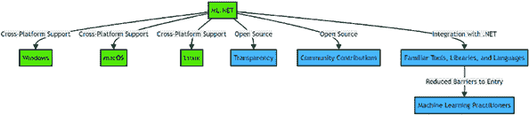

**图 1.1：** ML.NET 概述

### ML.NET 的诞生

`ML.NET` 是由微软开发的多功能且开源的机器学习框架。它的名称 `ML.NET` 代表 `Machine Learning for .NET`。正如名称所示，`ML.NET` 的设计精旨在与 .NET 生态系统集成，使开发者和数据科学家能够利用其在 `C#` 和其他 .NET 语言中的现有技能和经验，开启机器学习之旅。

### ML.NET 的历史与发展

`ML.NET` 是一个由微软开发的多功能且开源的机器学习框架。它的名称 `ML.NET` 代表 `Machine Learning for .NET`。正如名称所示，`ML.NET` 的设计精旨在与 .NET 生态系统集成，使开发者和数据科学家能够利用其在 `C#` 和其他 .NET 语言中的现有技能和经验，开启机器学习之旅。

### ML.NET 的核心特性

`ML.NET` 最具吸引力的属性之一是其使其在机器学习领域脱颖出的核心特性。它的跨平台支持是一个突出的特性，允许它在 `Windows`、`macOS` 和 `Linux` 上运行。

### 支持的语言和平台

`ML.NET` 设计旨在面向广泛受众。作为 .NET 生态系统中不可或的一部分，它对 `C#`、`F#` 和 `VB.NET` 提供原生支持，使开发者更易上手。

### 许可与社区参与

`ML.NET` 的许可模式证明了微软对培养活跃社区的承诺。它基于开源的 `MIT License` 发布，允许用户根据需要自由地使用、修改和分发该框架，且限制极少。

在当今以数据为中心的世界中，机器学习的重要性不言而喻。它在我们提取价值价值见解、自动化决策过程以及解决各个领域复杂问题方面发挥着至关重要的作用。无论是增强电子商务平台上的个性化推荐、预测工业环境中的设备故障，还是高精度地诊断医疗状况，机器学习都是这些能力背后的驱动力。随着数据量和复杂性的不断增长，机器学习为我们提供了提取意义信息并推动几乎每个行业创新的工具。

## 基础机器学习术语

理解机器学习需要对一组基础术语和概念如如。这些包括：

*   **数据 (Data)**：数据是机器学习算法用于做出预测或发现模式的原始信息。它可以以多种形式存在，如文本、图像、数值等等。
*   **特征 (Features)**：特征是数据中特定的属性或特性，机器学习模型利用这些特征来进行预测。这些特征是影响结果的数据变量或维度。
*   **标签 (Labels)**：标签代表机器学习任务中的目标或输出变量。在监督学习中，模型经过训练，以根据提供的特征来预测这些标签。例如，在垃圾邮件分类任务中，标签可能是“垃圾邮件”或“非垃圾邮件”。
*   **模型 (Models)**：机器学习模型是学习数据内部模式和关系的算法。它们是负责预测的核心组件，通过对带标签数据进行训练来提高其性能。

### 监督学习、无监督学习和其他范式

机器学习包含多种范式，每种都适用于不同类型的任务：

*   **监督学习 (Supervised Learning)**：在监督学习中，模型提供带标签的数据，使其能够学习从特征到标签的映射。这种范式通常用于分类等任务，模型根据学习到的模式为每个输入分配标签。
*   **无监督学习 (Unsupervised Learning)**：无监督学习处理未标记的数据，旨在发现数据内部隐藏的模式或结构。无监督学习中的常见任务包括聚类（将数据分为相似的类别）和降维（简化复杂数据）。
*   **强化学习 (Reinforcement Learning)**：强化学习侧重于训练智能体在环境中采取行动以实现累积奖励化。它被应用于游戏 AI 和机器人等领域。
*   **半监督学习 (Semi-Supervised Learning)**：这种范式结合了监督学习和无监督学习的元素，利用少量标记数据以及大量的未标记数据。

### 机器学习的常见任务

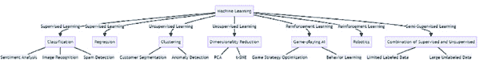

**图 1.2:** 机器学习的常见任务

机器学习任务多种多样，适用于广泛的应用。常见任务包括：

*   **分类 (Classification)**：分类将数据点分配到预定义的类别或类中。它用于情感分析、图像识别和垃圾邮件检测等应用。
*   **回归 (Regression)**：回归预测数值，例如股票价格、温度或销售额。它广泛应用于财务预测和科学建模。
*   **聚类 (Clustering)**：聚类根据相似性将数据点分组，便于进行客户细分和异常检测等任务。
*   **推荐系统 (Recommendation Systems)**：这些系统根据用户的偏好和行为提供个性化建议，增强电子商务和流媒体平台的用户体验。
*   **自然语言处理 (NLP)**：NLP 任务涉及处理和理解人类语言，实现机器人、语言翻译和情感分析等应用。

## ML.NET 的用例

机器学习，扩展 ML.NET，已经渗透到各个行业，带来了变革性的变化和切实的利益。在本节中，我们将探索 ML.NET 在各个领域的现实应用，展示它是如何彻底改变流程、改进决策并提高效率的。

### 医疗保健

医疗保健是一个精度和速度至关重要的领域，ML.NET 已成为该领域的一项价值工具。例如，ML.NET 正被用于医学图像分析，帮助放射科医生检测异常，如 X 光、MRI 和 CT 扫描中的肿瘤、骨折或异常。此外，它还被用于患者诊断和预后的预测性分析，帮助医疗专业人员预测疾病进展、识别高风险患者并个性化治疗方案。这些应用不仅拯救了生命，还显著降低了医疗成本。

### 金融

在金融领域，ML.NET 在欺诈检测、风险评估和算法交易方面证明了它的实力。它可以迅速分析大量的财务数据以识别可疑交易和模式，有效对抗欺诈活动。此外，ML.NET 通过整合更广泛的特征增强信用评分模型，从而改进了贷款审批的风险评估。由机器学习模型驱动的算法交易能够对市场状况做出实时自动交易决策，增加了投资回报并减少了人为错误。

### 电子商务

电子商务平台利用 ML.NET 来增强客户体验并提高销售额。最为人知的应用之一是推荐系统，它根据用户的偏好和浏览历史向其推荐产品。这些系统增加了客户参与度并推动了收入。ML.NET 还有助于动态定价策略，允许企业实时调整价格以实现利润化。对客户评论进行情感分析提供了有关产品性能的价值见解，帮助企业就产品改进和营销策略做出明智决策。

### 制造业与工业

在制造业和工业环境中，ML.NET 找到了许多应用来优化操作。预测性维护是其中一种应用，ML.NET 分析传感器数据以在设备故障发生之前进行预测。这减少了停机时间并降低了维护成本。由 ML.NET 驱动的质量控制系统检查产品的缺陷和异常，确保高质量产品的生产。供应链优化和需求预测是 ML.NET 提高效率和成本效益的其他关键领域。

### 案例研究与收益

来自各个行业的案例研究为机器学习（以及 ML.NET）的收益提供了具体的证据。这些现实案例展示了效率、成本节约和决策准确性的显著提高。例如，医疗领域的一个案例研究可能揭示 ML.NET 如何减少诊断错误并改善患者预后。在金融行业，案例研究可能证明 ML.NET 如何降低风险，从而实现巨额节约。此类案例研究是 ML.NET 在解决实际问题方面变革力量的有力证词。

### 对决策和效率的影响

`ML.NET` 对决策和效率的影响是深远的。`ML.NET` 赋予了组织预测能力，使其能够更有信地做出数据驱动的决策。无论是优化库存水平、定制营销活动，还是识别制造过程中的潜在故障，`ML.NET` 都能为决策者提供以前无法获得的洞察力。重复性任务（如数据录入、报告生成和异常检测）的自动化节省了时间和资源，提高了各行各业的整体效率。

通过展示真实世界的应用和案例研究，读者可以深入了解 `ML.NET` 如何解决关键挑战、增强决策流程并提高效率，使其成为现代技术格局中极具价值的资产。本节强调了 `ML.NET` 在驱动创新和解决不同领域实际问题中的关键作用。

机器学习世界充满了各种框架，每种框架都针对特定的需求和偏好而定制。在本节中，我们将开展一项对比分析，将 `ML.NET` 与其他著名的机器学习框架（如 `TensorFlow`、`PyTorch` 和 `scikit-learn`）进行对比。这项评估将涵盖 `ML.NET` 与这些对手相比的优缺点，同时考虑易用性、性能和社区支持等关键因素。

`TensorFlow` 和 `PyTorch` 是机器学习领域的重量级选手，通常因其稳健性和多功能性而青睐。与 `ML.NET` 相比，这些框架提供了更广泛的预构建机器学习模型以及用于深度学习任务的丰富工具生态系统。`TensorFlow` 和 `PyTorch` 特别适用于自然语言处理、图像识别和深度强化学习等复杂任务，这些任务需要复杂的神经网络。

然而，`ML.NET` 在可访问性和易用性方面表现出色，特别是对于 `.NET` 生态系统内的开发者。它与 `C#` 等 `.NET` 语言的集成为已经精通这些语言的开发者提供了无缝转换。对于希望利用机器学习但又不想要求开发团队学习新语言或框架的组织来说，这是一个巨大的优势。

`scikit-learn` 是一个 Python 库，因其在构建分类和回归等经典任务的机器学习模型时的简单性和易用性而闻名。它提供了一系列文档完备的算法和工具，用于模型选择和评估。

相比之下，`ML.NET` 将机器学习的力量引入了 `.NET` 生态系统。它的核心优势在于与 `.NET` 的集成，允许开发者在熟悉的语言和工具中工作。这种集成对于在主要使用 `.NET` 技术的环境中构建应用程序来说特别有价值。

然而，`scikit-learn` 提供了更全面的机器学习算法和工具，对于寻找经典机器学习任务“一站式服务”的 Python 开发者来说，它是极的选择。

### 优点

* **与 .NET 集成**：`ML.NET` 与 `.NET` 语言和开发环境的无缝集成是其突出特征。这意味着拥有现有 `.NET` 基础设施的组织可以以最小的干扰和开发人员重新培训来采用机器学习。
* **易用性**：`ML.NET` 以用户友好而闻名，是开发者和数据科学家（尤其是使用 `.NET` 的人员）的极佳选择。
* **跨平台支持**：`ML.NET` 提供跨平台兼容性，使其在 Windows、macOS 和 Linux 上均具有通用性。

### 缺点


# 深度学习支持有限

`ML.NET` 可能不适用于需要复杂神经网络的深度学习任务。

# 社区较小

`ML.NET` 虽然正在增长，但与 `TensorFlow` 和 `PyTorch` 相比社区较小。

# 算法选择有限

与 `scikit-learn` 相比，`ML.NET` 的选择较为有限。

在 `ML.NET` 和其他机器学习框架之间进行选择应考虑多种因素，包括：

* **项目需求**：对于已经在 `.NET` 生态系统中构建的项目，`ML.NET` 是一个非常有吸引力的选择。
* **专业知识**：组织应该考虑其开发团队现有的知识。
* **社区和资源**：`TensorFlow`、`PyTorch` 和 `scikit-learn` 拥有更大更成熟的社区。

结论：本节为读者提供了关于 `ML.NET` 与其他机器学习框架相比的优缺点的宝贵视角。框架的选择应符合项目的特定需求和限制，以确保机器学习解决方案的成功实施。

机器学习模型开发可能看起来令人畏惧，但通过 `ML.NET`，这一过程变得易上手且直观。在本节中，我们将引导你完成使用 `ML.NET` 构建机器学习模型的基础步骤，提供一个清晰的分步指南。该工作流涵盖了数据准备、模型训练、评估、调优和部署，确保你已准备好开启 `ML.NET` 机器学习世界之旅。

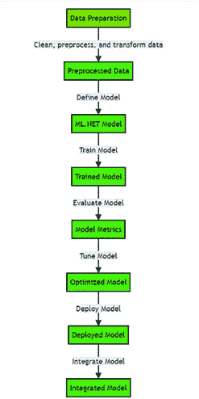

图 1.3：使用 ML.NET 构建机器学习模型的工作流

任何机器学习项目的第一步，可能也是最关键的一步，是数据准备。这一阶段涉及：

* **数据收集**：从收集用于训练和测试机器学习模型的数据开始。这些数据可以来自各种来源，包括数据库、文件、API 或在线仓库。确保数据代表了你试图解决的问题。
* **数据清洗**：数据很少是完美无缺的，通常包含缺失值、异常值和不一致之处。在这一步中，你通过处理这些问题来清洗数据。你可能需要填充缺失值、删除异常值并对数据进行标准化或归一化，以适用于建模。
* **特征工程**：特征工程涉及对数据集中变量（特征）进行选择和转换。这一步对模型性能产生重大影响。它包括选择相关特征、对类别变量进行编码以及创建捕捉重要信息的新特征。

一旦准备好数据，你就可以进行模型训练了。`ML.NET` 通过其用户友好的方法简化了这一过程：

1. **选择学习算法**：`ML.NET` 为不同任务提供了多种学习算法，例如分类、回归和聚类。选择一个最适合你问题的算法。`ML.NET` 支持传统的机器学习算法，也支持较新的深度学习模型。
2. **数据划分**：将你的数据集分为两个部分：训练集和测试集。训练集用于训练模型，而测试集留用于评估模型的性能。这种划分确保了模型是在训练期间未见过的数据上进行测试的，从而对其能力提供更真实的评估。
3. **模型训练**：使用训练数据，所选算法将学习识别数据中的模式和关系。在 `ML.NET` 中，这个过程非常直观。你定义一个包含数据加载、预处理、特征转换和学习算法的管道（`pipeline`），然后只需一行代码即可训练模型。

# 模型评估与调优

模型训练完成后，评估其性能并在必要时对其精炼至关重要：

* **模型评估**：使用测试数据评估模型的性能。常见的评估指标取决于任务；对于分类任务，这可能包括准确率、精确率、召回率和 F1 分数，而回归模型则使用均方误差（`MSE`）或 R 平方等指标进行评估。
* **超参数调优**：通过调整超参数来精调你的模型。超参数控制学习过程的各个方面，例如梯度下降中的学习率或决策树的深度。`ML.NET` 提供了超参数优化工具，帮助为你的特定问题找到最佳组合。

# 模型部署与集成

机器学习工作流的最后一步是部署你的模型并将其集成到应用程序中：

* **模型导出**：`ML.NET` 允许将训练好的模型导出为适用于部署的格式。常见格式包括 `ONNX`（可以在多种环境中使用）以及原生的 `ML.NET` 模型文件。
* **模型集成**：将训练好的模型纳入你的应用程序或服务中。`ML.NET` 提供了与 `.NET` 应用程序的轻松集成，使得在软件中使用模型预测变得简单。无论你是构建 Web 应用程序、移动应用还是桌面软件，`ML.NET` 都支持与相关平台集成。

总而言之，本节提供了使用 `ML.NET` 构建机器学习模型的基本步骤全面指南。从数据准备到模型训练、评估、调优和部署，`ML.NET` 简化了整个过程，并让开发者和数据科学家都能轻松上手。掌握了这些知识，你已经准备好深入使用 `ML.NET` 进行机器学习的实际应用，在其中，你可以利用该框架的能力来解决现实世界的问题并驱动创新。

# 结论

在我们探索 `ML.NET` 世界的起始章节中，我们开启了一段旅程，介绍了它的核心概念、多功能性以及现实世界的应用，突显了它在不断发展的机器学习领域中的重要性。我们首先探讨了机器学习在当今数据驱动世界中的重要性，在这个世界中，`ML.NET` 与 `.NET` 生态系统的无缝集成使用户能够破解复杂模式、做出数据驱动的决策并驱动创新。这个开源框架的跨平台兼容性和日益增长的社区使其对经验丰富的开发者和新兴的数据科学家来说都是无可估量的，促进了机器学习的可访问性。我们探索了它在医疗保健、金融、电子商务、制造业等领域的各种应用，强调了它的转型潜力。通过将 `ML.NET` 与其他框架进行比较，我们发现它在用户友好性和 `.NET` 集成方面表现出色。总之，本章为我们深入研究 `ML.NET` 的能力奠定了基础，为读者提供了必要的工具和理解，以便在他们自己的项目中让机器学习变为现实。现在当我们继续时，下一章正等待着，承诺将引导你完成安装和配置的基本步骤，确保彻底掌握系统要求、安装程序、环境配置、依赖管理和故障排除技术。

# 安装与配置 ML.NET

## 引言

在本章中，我们将深入探讨在各种操作系统上安装和配置 `ML.NET` 所需的关键步骤，以满足广大开发者和数据科学家。在本章结束时，你将对系统要求、安装程序、环境配置、依赖管理和故障排除技术有一个全面的理解。

## 结构

在本章中，我们将涵盖以下内容：

* `ML.NET` 的系统要求
* 在 Windows、Linux 和 macOS 上安装 `ML.NET`
* 配置 `ML.NET` 环境
* 为 `ML.NET` 设置依赖项和包
* 常见问题故障排除

## ML.NET 的系统要求

在深入 `ML.NET` 的安装和配置之前，了解系统要求对于确保流畅的体验至关重要。`ML.NET` 设计为多功能且易于使用，但它仍然需要某些硬件和软件前提。

### 最低硬件规格

`ML.NET` 经过优化，可以在各种硬件设置上高效运行，从轻量级笔记本电脑到高性能工作站均可。在这里，我们将概述在使用 `ML.NET` 工作时需要考虑的硬件规格。

* **处理器**：建议使用多核 CPU 以实现更快的模型训练和推理。虽然 `ML.NET` 可以在单核处理器上运行，但多核 CPU 会显著提高性能。
* **内存 (RAM)**：基础实验和小型规模机器学习至少需要 4GB 内存；对于较大的数据集和更复杂的模型，建议使用 8GB 或更多。更多的内存可以缩短训练时间并提高性能。
* **存储**：`ML.NET` 没有严格的存储要求。但需要有足够的磁盘空间来存放数据集、模型和任何依赖项。相对于机械硬盘 (HDD)，固态硬盘 (SSD) 提供更快的数据访问，特别是在训练期间。
* **图形处理器 (GPU)**：虽然不是强制性的，但配备专用 GPU 可以显著加速某些机器学习工作负载，例如深度学习。`ML.NET` 通过 `TensorFlow` 等库支持 GPU 加速。如果你计划大量使用深度学习模型，请考虑兼容的 GPU。
* **操作系统**：`ML.NET` 是平台无关的，这意味着它可以在各种操作系统上运行。它支持 Windows、Linux 和 macOS，为不同平台上的开发者提供了灵活性。
* **网络连接**：稳定的互联网连接对于下载 `ML.NET` 包、依赖项和模型数据集至关重要。它还能方便访问在线资源和文档。
* **屏幕分辨率**：标准屏幕分辨率对于操作 `ML.NET` 就足够，因为它没有特定的屏幕要求。然而，较高的分辨率可能会为数据可视化和模型分析提供更舒适的工作环境。

需要注意的是，虽然这些是 `ML.NET` 的最低硬件要求，但您的机器学习项目所需的实际硬件可能取决于任务的复杂性和数据集的大小。请务必确保您的硬件达到或超过这些最低要求，以获得更好的 `ML.NET` 体验。

### 支持的操作系统

在安装和配置 `ML.NET` 时，选择操作系统是一个关键的考虑因素。`ML.NET` 的优势之一是它的跨平台兼容性，允许开发者和数据科学家在他们偏好的操作系统上工作。让我们深入了解 `ML.NET` 支持的操作系统：

* **Windows**：`ML.NET` 为 Windows 系统提供了极佳的支持，包括各种版本，如 Windows 7、8、10 以及 Windows Server 版本。开发者在该操作系统上使用 `ML.NET` 时，可以利用 Windows 特有的工具和集成功能。Windows 以用户友好的环境著称，这对于初接触机器学习的人来说非常有优势。
* **Linux**：`ML.NET` 在 Linux 社区获得了广泛关注。它兼容各种 Linux 发行版，是开源爱好者的可靠选择。支持 `ML.NET` 的一些流行 Linux 发行版包括 Ubuntu、CentOS、Debian 和 Fedora。Linux 为 `ML.NET` 开发提供了稳健的命令行环境，通常首选用于基于服务器和云的机器学习应用程序。
* **macOS**：`ML.NET` 将其兼容性扩展到了 macOS，满足了偏好 Apple 操作系统的开发者。macOS 以用户友好的界面闻名，是希望在 Mac 上利用机器学习能力的数据科学家和开发者的理想选择。`ML.NET` 对 macOS 的支持允许在 Windows、Linux 和 macOS 环境之间获得一致的体验。
* **Docker**：除了传统的操作系统，`ML.NET` 还可以运行在 Docker 容器中，为各种环境提供了灵活性和可复现性。Docker 容器可以封装 `ML.NET` 应用程序、依赖项和数据集，使其在不同的环境中部署和管理机器学习工作流。

注意，`ML.NET` 的跨平台支持是一项重大优势，因为它允许数据科学家和开发者选择最符合他们需求和偏好的操作系统。此外，它实现了跨环境的无缝协作和部署。虽然 `ML.NET` 在操作系统兼容性方面非常通用，但开发者仍应考虑项目的特定需求以及他们计划在工作流中使用的工具。选择与您的项目目标和您自己的专业知识相符的操作系统，对于成功的 `ML.NET` 体验至关重要。在接下来的章节中，我们将探索在这些受支持的操作系统上安装 `ML.NET` 的步骤。

### Windows、Linux 和 macOS 的先决条件

为了确保在各种操作系统上顺畅安装和配置 `ML.NET`，了解每个平台的特定先决条件至关重要。不同的操作系统具有不同的需求和依赖项，在开始有效使用 `ML.NET` 之前需要满足。我们将详细介绍 Windows、Linux 和 macOS 的先决条件。

#### Windows 先决条件

* **操作系统版本**：`ML.NET` 兼容 Windows 7、8、10 以及 Windows Server 版本。确保您正在使用支持的 Windows 版本。
* **.NET Framework**：`ML.NET` 基于 `.NET` 框架构建。确保您已安装了兼容版本的 `.NET Framework`。对于最新的 `ML.NET` 版本，建议使用 `.NET Core 3.1` 或 `.NET 5.0`（或更高版本）。您可以从微软官方网站下载并安装。
* **Visual Studio（可选但推荐）**：为了获得更流畅的开发体验，您可以使用 `Visual Studio` 作为您的集成开发环境 (IDE)。确保您已安装了 `Visual Studio` 社区版、专业版或企业版，并配备了 `ML.NET` 开发所需的工作负载。

#### Linux 先决条件

* **操作系统**：`ML.NET` 支持多种 Linux 发行版，包括 Ubuntu、CentOS、Debian 和 Fedora。确保您正在运行所选发行版的支持版本。
* **.NET SDK**：为您的特定 Linux 发行版安装 `.NET SDK`。您可以在 .NET 官网找到详细的安装说明。`ML.NET` 在 Linux 上支持 `.NET Core 3.1` 和 `.NET 5.0`（或更高）。
* **包管理器**：确保您有适用于您的 Linux 发行版的包管理器。例如，您可能在 Ubuntu 上使用 `apt`，在 Fedora 上使用 `dnf`，在 CentOS 上使用 `yum`。这些包管理器将帮助您安装必要的依赖项。

#### macOS 先决条件

* **操作系统版本**：`ML.NET` 兼容 macOS。确保您的 Mac 运行支持的操作系统版本。
* **Homebrew**：`Homebrew` 是 macOS 的包管理器，用于安装各种软件包和依赖项。您通常需要 Homebrew 来安装 `ML.NET` 开发所需的库和工具。
* **.NET SDK**：与 Linux 类似，您应该为 macOS 安装 `.NET SDK`。`.NET Core 3.1` 和 `.NET 5.0`（或更高）是 macOS 上 `ML.NET` 支持的版本。

这些先决条件是成功安装 `ML.NET` 和构建开发环境的基础。根据您选择的操作系统，您需要确保已拥有正确的 `.NET` 运行时、包管理器以及任何特定于您平台的工具。

在接下来的章节中，我们将更详细地探索每个操作系统的安装程序，确保您已准备就绪开始使用 `ML.NET`。

## 在 Windows 上安装 ML.NET

在 Windows 上安装 `ML.NET` 是一个简单的过程，涉及使用 .NET SDK 和 Visual Studio 进行开发。

### 使用 .NET CLI 或 Visual Studio Code

1. 打开命令提示符或 PowerShell。
2. 运行以下命令安装 `ML.NET` CLI：

```bash
dotnet tool install -g mlnet
```

安装完成后，您应该会看到类似的消息。

### 使用 Visual Studio

1. 在 Visual Studio 中打开项目。
2. 使用 NuGet 包管理器搜索并安装 `Microsoft.ML` 包。

## 在 macOS 和 Linux 上安装 ML.NET

`ML.NET` 在 macOS 和 Linux 上的安装过程保持一致，确保无论使用何种操作系统都能获得无缝体验。无论使用 .NET CLI 还是 Visual Studio，安装 `ML.NET` 的步骤都涉及简单的命令，便于在两个平台上进行顺畅设置。

### 使用 .NET CLI

1. 打开终端。
2. 运行以下命令安装 `ML.NET` CLI：

```bash
dotnet tool install -g mlnet
```

## 验证安装

安装完成后，你可以使用以下命令检查版本来验证 `ML.NET` 是否已安装：

### 对于 .NET CLI

```bash
dotnet mlnet --version
```

### 对于 Visual Studio Code 或 Visual Studio 程序包管理器控制台

```bash
dotnet add package Microsoft.ML
```

## macOS 特有的注意事项

* **使用 Homebrew 进行依赖管理**：`Homebrew` 也可以用于管理 `ML.NET` 项目可能需要的各种依赖。你可以使用 `Homebrew` 安装和更新与你的机器学习工作流配套的库、包和工具。
* **Xcode 和开发者工具**：确保你的 macOS 系统上已安装 `Xcode` 和 `Xcode Command Line Tools`。这些工具提供了运行 `ML.NET` 项目可能需要的关键开发资源。
* **IDE 选择**：macOS 用户可以选择 Visual Studio for Mac、Visual Studio Code 或 JetBrains Rider 等集成开发环境进行 `ML.NET` 开发。这些 IDE 中的每一个都提供了丰富且适用于 macOS 的开发体验。
* **使用 NuGet 进行包管理**：使用 `NuGet` 包管理器来管理 macOS 上 `ML.NET` 项目中的依赖。`NuGet` 是一个用于安装、更新和管理 .NET 包的通用工具。
* **Mono 兼容性**：虽然 `ML.NET` 主要运行在 `.NET Core` 和 .NET 5.0 上，但某些 `ML.NET` 组件和库可能兼容 `Mono`（一个适用于 macOS 的开源 .NET 框架）。如果你有特定需求或需要处理旧版 `ML.NET`，请探索 `Mono` 的兼容性。

## 配置 ML.NET 环境

让我们来看看如何配置 `ML.NET` 环境：

### 1. 设置环境变量

无论你使用何种操作系统，配置环境变量都是设置 `ML.NET` 环境的关键步骤。以下是你需要考虑的内容：

* **PATH 变量**：确保包含 `dotnet` 可执行文件的目录已包含在系统的 `PATH` 变量中。这允许你从命令行界面的任何目录运行 `dotnet` 命令，而无需指定完整路径。
* **`DOTNET_ROOT`**：在某些系统中，可能需要将 `DOTNET_ROOT` 环境变量设置为 `.NET` `SDK` 安装的路径。如果你安装了多个版本的 `.NET SDK`，这一点尤为重要。

### 2. 为 ML.NET 配置开发工具

为了让你的 `ML.NET` 开发过程更加高效，请考虑以下工具和配置：

* **集成开发环境 (IDEs)**：选择一个你熟悉的 IDE。Visual Studio、Visual Studio Code 和 JetBrains Rider 是 `ML.NET` 开发的流行选择。通过安装相关的扩展和插件，配置你选择的 IDE 以与 `ML.NET` 无缝协作。
* **Visual Studio 扩展**：如果你在使用 Visual Studio，可以考虑安装 `ML.NET` 相关的扩展来提高生产力。这些扩展可以提供 `ML.NET` 模板、智能提示和调试支持。
* **源码控制**：实施 `Git` 等源码控制系统进行版本跟踪和协作。将你的 `ML.NET` 项目托管在 `GitHub` 或 `GitLab` 等平台上，并将源码控制直接集成到 IDE 中以便使用。


- **笔记本 (Notebooks)**：考虑使用 `Jupyter Notebooks` 进行交互式数据驱动型开发。ML.NET 支持 `Jupyter Notebooks`，允许你以笔记本格式创建、记录和共享 ML.NET 代码及可视化。

## 3. 优化开发环境以提高生产力

为了优化你的 ML.NET 开发环境，你可以考虑以下最佳实践：

- **虚拟环境**：创建虚拟环境来隔离你的 ML.NET 项目及其依赖。工具如 `venv`（Python）或 `conda`（如果使用 Anaconda）可以帮助管理这些环境。
- **包管理**：利用 `NuGet` 或其他 .NET 包管理器高效地管理依赖。保持包的最新版本，并在必要时使用包锁定机制以确保跨环境的一致性。
- **文档**：为你的 ML.NET 项目维护详细文档。这些文档应涵盖数据预处理、模型训练、超参数和评估指标。
- **持续集成 (CI)/持续部署 (CD)**：设置 CI/CD 流水线以自动化 ML.NET 的测试和部署。可以使用 `Azure DevOps` 或 `GitHub Actions`。

## 4. 特定 IDE 的配置

- **Visual Studio**：通过安装相关工作负载来配置 Visual Studio。例如，“数据科学和分析应用程序”工作负载提供了许多功能。
- **Visual Studio Code**：通过 `C#`、`Jupyter` 等扩展对 Visual Studio Code 进行配置。
- **JetBrains Rider**：Rider 是另一个优秀的 .NET 开发 IDE。通过安装必要的插件来配置 Rider。

通过设置环境变量、选择正确的工具并优化开发环境，你可以为 ML.NET 开发创建一个高效的工作空间。无论你使用何种操作系统，这将让你更容易构建、训练和部署机器学习模型。

# 为 ML.NET 设置依赖和包

设置依赖和包涉及以下因素：

## 使用 NuGet 管理依赖

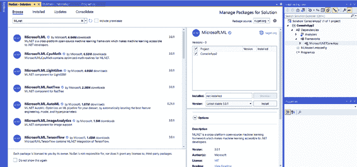

图 2.4 使用 NuGet 管理依赖

`NuGet` 是 .NET 的包管理器，对于管理 ML.NET 项目的依赖至关重要。以下是你如何使用 `NuGet` 有效管理：

- **包安装**：使用 `NuGet` 包管理器向项目添加 ML.NET 及其相关库。你可以通过 Visual Studio、Visual Studio Code 或带有 `dotnet` CLI 工具的命令行界面。
- **包版本**：在安装包时，注意 ML.NET 及其依赖的版本。指定适当的包版本可以确保项目的兼容性和稳定性。
- **包恢复**：`NuGet` 在构建项目时会自动恢复包，但也可以使用 `dotnet restore` 命令手动恢复包。这在处理持续集成和构建流水线时特别有用。
- **管理包源**：根据需要，你可以配置 `NuGet` 使用自定义包源。对于拥有内部包存储库或处理预发布包的组织非常有用。

## 使用 ML.NET 扩展包

ML.NET 扩展包提供了额外的功能和组件来增强你的机器学习项目。以下是使用 ML.NET 扩展包的方法：

- **浏览与安装**：在 NuGet 网站或你的包管理器中浏览可用 ML.NET 扩展。常见的扩展包括额外的训练器、数据预处理组件和特定的 ML 任务。
- **向项目添加扩展**：要使用 ML.NET 扩展，只需使用包管理器将其添加到你的项目中。这将自动下载并安装所需的依赖项。
- **文档与示例**：扩展程序通常附带文档和示例，帮助你理解如何有效地使用它们。请查看扩展程序的文档，获取有关将其整合到你的 ML.NET 项目中的指导。

## 包的升级与降级

包维护是软件开发中的一个持续过程。以下是处理 ML.NET 项目包升级和降级的方法：

- **升级包**：定期检查 ML.NET 及其依赖项的更新。使用 `NuGet Package Manager` 升级到新版本，特别是在可用新功能或错误修复时。
- **降级包**：在某些情况下，由于兼容性问题或项目需求的变化，你可能需要降级包。`NuGet` 允许你在安装或更新时指定特定的版本。
- **版本锁定**：考虑固定包版本以确保项目的稳定性。这可以防止可能引入破坏性更改的意外更新。

### NuGet 最佳实践

为了维持组织良好且稳定的开发环境，在使用 `NuGet` 时，请考虑以下最佳实践：

- **包引用文件**：使用包引用文件（例如 `.csproj` 或 `.fsproj`）在项目内定义和管理包依赖。这允许更易的版本控制和协作。
- **团队一致性**：确保所有团队成员都使用相同版本的 ML.NET 及其依赖项。这可以避免兼容性问题并促进顺畅协作。
- **NuGet 配置**：自定义 `NuGet` 配置以匹配你组织的需求。你可以配置包源、包缓存和代理配置等设置。
- **安全扫描**：考虑将 `NuGet` 安全扫描工具集成到构建流水线中，以识别并缓解包中的安全漏洞。

# 常见安装问题的排除

当遇到安装错误和问题时，仔细查看官方文档和社区论坛可以提供实用的解决方案和替代方案。

## 处理安装错误和问题

- **错误消息**：当你遇到安装错误时，仔细阅读错误消息。这些消息通常包含有关故障的关键信息。
- **检查前提条件**：确认你是否满足了前面章节中提到的所有前提条件和系统要求。确保你的系统环境符合 ML.NET 的安装要求。
- **更新与升级**：有时，错误由于软件组件过旧引起。确保你的操作系统、`.NET SDK` 以及其他依赖项都是最新的。
- **日志文件**：查看安装过程中生成的日志文件。这些日志可以提供有关导致失败的详细信息。
- **搜索解决方案**：利用互联网资源、论坛和社区讨论来搜索特定错误消息的解决方案。你遇到的问题可能已经被 ML.NET 社区的其他人解决过。

## 调试依赖问题

- **依赖解析**：如果你的 ML.NET 项目由于依赖问题而无法构建或运行，请使用 `NuGet` 等工具来解决它们。`NuGet` 可以帮助确保所有所需的库都存在于并在项目中被正确引用。
- **版本冲突**：通过检查项目的依赖项来解决版本冲突。不同的包可能需要不同版本的共享库。`NuGet` 的依赖解析应该自动处理此，但监控冲突至关重要。
- **使用依赖关系可视化工具**：某些开发环境提供了依赖关系可视化工具，帮助你理解项目中不同包之间的关系。使用这些工具识别潜在问题。

# 常见陷阱与解决方案

- **过时的 .NET SDK**：使用过时的 `.NET SDK` 可能会导致兼容性问题。
  - **解决方案**：将你的 `.NET SDK` 更新到推荐版本。
- **硬件不足**：尝试在资源不足的机器上运行 ML.NET 可能会导致性能低下甚至失败。
  - **解决方案**：确保你的硬件符合要求。
- **网络问题**：网络问题可能会阻止包、模型和数据集成功下载。
  - **解决方案**：验证你的网络连接。
- **操作系统兼容性**：使用不支持的操作系统可能会导致问题。
  - **解决方案**：确保你正在使用支持的操作系统。
- **权限**：用户权限不足可能会阻止软件安装。
  - **解决方案**：确保你拥有必要的权限。

## 解决问题的社区资源与论坛

以下是一些社区资源：

- **Stack Overflow**：这是一个提问和技术问题的热门平台。ML.NET 社区在该平台上非常活跃，你可以在这里找到常见问题的解决方案。
- **GitHub Issues**：ML.NET 的 GitHub 仓库通常包含问题的详细讨论。你可以搜索特定问题或发布你自己的问题。
- **ML.NET 论坛**：ML.NET 提供了官方论坛，你可以在那里提问并向社区寻求帮助。
- **在线文档**：查看官方 ML.NET 文档，其中通常包含针对常见问题的故障排除指南和常见问题解答（FAQs）。

# 结论

本章让你了解在各种操作系统上有效设置 ML.NET、配置开发环境以及管理依赖项的知识。此外，我们讨论了故障排除技术，帮助你克服常见的安装问题。有了这个基础，你现在准备好在后续章节中使用 ML.NET 探索机器学习的世界了。

# ML.NET Model Builder 和 CLI

## 引言

在本章中，我们将深入 ML.NET 提供的强大工具，以简化你的机器学习工作流。ML.NET Model Builder 和 ML.NET CLI 是简化和自动化机器学习过程中各种任务的重要工具。在本章中，我们将探索这些工具，并演示如何使用 ML.NET 构建、训练和评估机器学习模型。

## 结构

本章将涵盖以下主题：

- ML.NET Model Builder 和 CLI 概述
- 使用 Model Builder 构建机器学习模型
- 使用 Model Builder 进行模型的训练与评估
- 使用 CLI 自动完成机器学习任务
- 使用 Model Builder 和 CLI 进行调试与故障排除

# 介绍 ML.NET Model Builder 和 CLI

机器学习通过做出数据驱动的预测和决策，具有变革各个行业的巨大潜力。然而，构建、训练和部署机器学习模型的过程可能是复杂且耗时的。`ML.NET` 是由微软开发的一个开源机器学习框架，它提供了 `Model Builder` 和 `CLI` 等工具，来简化并自动化这一过程中的关键环节。在本节中，我们将对这些工具进行深入介绍，理解它们的作用，探索它们的优势和用例，并讨论安装和设置步骤。

## 理解 Model Builder 和 CLI 的角色

- **Model Builder**：`ML.NET Model Builder` 是一个易于使用的图形界面，能够让开发者和数据科学家轻松地构建机器学习模型。它通过提供直观的拖放式界面简化了模型创建过程，消除了对机器学习算法进行深度理解的需求。`Model Builder` 允许用户只需点击几次即可选择数据、选择目标变量、对数据预处理并训练模型。它抽象了 `ML.NET` 框架的复杂性，使其被更广泛的受众可以使用。
- **命令行界面 (CLI)**：虽然 `Model Builder` 针对偏好视觉化方法的用户，但 `ML.NET CLI` 是为那些青睐命令行工具和自动化的用户设计的。`CLI` 提供了一系列命令，用于从终端创建、管理和训练机器学习模型。它提供了强大的功能用于脚本编写以及将机器学习集成到自动化流水线和工作流中。通过 `CLI`，你可以自动化重复任务并简化你的机器学习项目。

## 优势

其中一些优势包括：

- **简单性与可访问性**：`Model Builder` 用户友好的界面使得机器学习对更广泛的受众触手可及。开发者和数据科学家可以快速原型模型，而无需深入理解 `ML.NET` 的细节。
- **效率**：`Model Builder` 和 `CLI` 都减少了创建和训练机器学习模型所需的时间和精力。在处理具有截止日期紧迫或资源有限的项目时，这种效率尤为宝贵。
- **自动化**：`CLI` 擅长自动化机器学习过程的各个方面。这种自动化对于批处理、持续集成和部署流水线特别有用。
- **定制化**：`Model Builder` 允许用户微调模型配置并进行超参数调优。`CLI` 提供了广泛的定制选项，允许用户指定训练过程的每一个方面。
- **可扩展性**：`ML.NET` 非常适用于小规模和大型项目。`Model Builder` 和 `CLI` 可以根据你的需求进行扩展，从简单的概念验证模型到复杂的生产级解决方案。

## Model Builder 安装与设置

### 作为 Visual Studio 扩展安装 ML.NET Model Builder

1. 打开 Visual Studio。
2. 转到 `Extensions`（扩展）菜单并选择 `Manage Extensions`（管理扩展）。
3. 在 `Extensions` 窗口中，搜索 `ML.NET Model Builder`。
   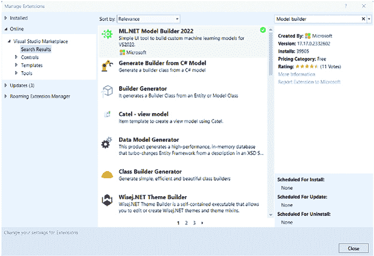
   **图 3.1：** 管理扩展界面
4. 点击 `Download`（下载）按钮下载并安装扩展。
   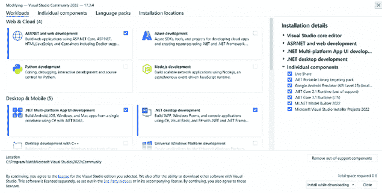
   **图 3.2：** 安装后的 Visual Studio 安装程序
5. 如果提示，请重启 Visual Studio。

### 作为独立工具安装 ML.NET Model Builder

1. 从官方 GitHub Release 下载独立的 `ML.NET Model Builder` 工具：`https://github.com/dotnet/machinelearning-modelbuilder/releases`。
2. 选择适用于你操作系统的版本（Windows、Linux 或 macOS）。
3. 按照 GitHub Release 页面提供的适用于操作系统的安装说明进行。
4. 安装完成后，你可以通过命令行或图形界面运行 `ML.NET Model Builder`。
   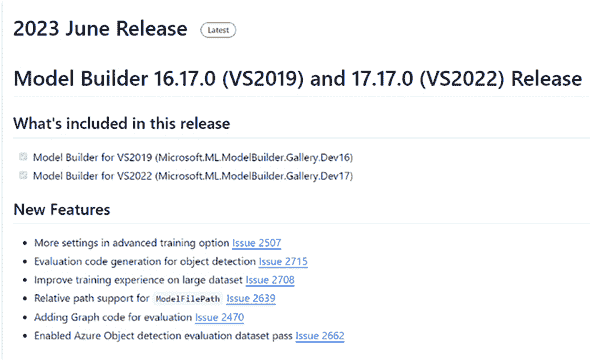
   **图 3.3：** Model Builder 发布页

### 通用设置

1. **安装 ML.NET CLI**：`CLI` 可以通过命令行使用 `dotnet tool install -g mlnet`。
2. **数据与项目设置**：准备你的数据集并创建一个项目。`Model Builder` 或 `CLI` 都可以满足需求。

无论你是寻找视觉化方法的学者，还是寻求自动化的高级用户，`Model Builder` 和 `CLI` 都能提供支持。

# 使用 Model Builder 构建机器学习模型

使用 Model Builder 构建机器学习模型本节将介绍从项目创建到生成预测的步骤。

## 使用 Model Builder 创建项目

1. **项目设置**：通过在 Visual Studio 中创建一个新项目并选择你偏好的开发环境。
   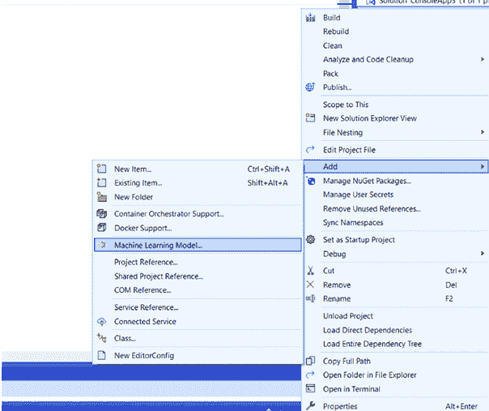
   **图 3.4：** Visual Studio 界面
2. **选择场景**：在创建模型之前，你必须首先选择机器学习场景。
   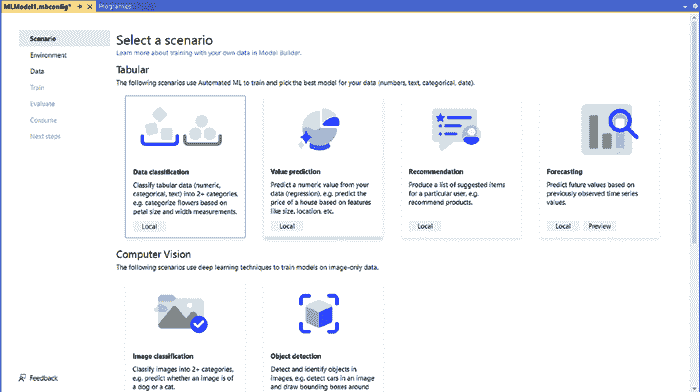
   **图 3.5：** 选择 Model Builder 场景
   在 `Model Builder` 屏幕上选择 `Data Classification`（数据分类）场景，因为它涉及评论所属的类别（正面或负面）。
3. **选择环境**：选择 `local CPU`。
4. **数据**：将被项目数据源。你可以选择本地文件或 SQL 数据库。`Model Builder` 支持各种数据格式，包括 CSV、TSV 和文本。
   从 UCI 机器学习库下载情感句子数据集并解压 `sentiment labelled sentences.zip`。将生成的 `yelp_labelled.txt` 文件保存到你的目录。
   在 `yelp_labelled.txt` 中，每行对应一条 Yelp 用户评论。第一列表示评论，第二列表示文本的情感（0 为负面，1 为正面）。列之间用制表符分隔，数据集没有表头。
   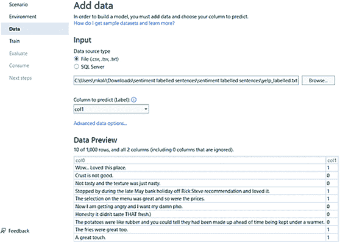
   **图 3.6：** 向 Model Builder 添加数据
5. **训练**：`Model Builder` 对许多模型进行全面评估，采用多种算法和配置在指定的训练时间内构建最有效的模型。
   调整 `"Time to train,"`（训练时间），指定 `Model Builder` 用于探索不同模型的时间为 30 秒（如果训练后未识别出模型，请考虑增加）。请注意的是，对于较大的数据集，训练时间将自然延长，`Model Builder` 会自动适应数据集的大小。
   通过选择 `Start training`（开始训练）启动训练过程。训练开始，你可以监控剩余时间。
   训练完成后，将提供训练结果的摘要供审查。
   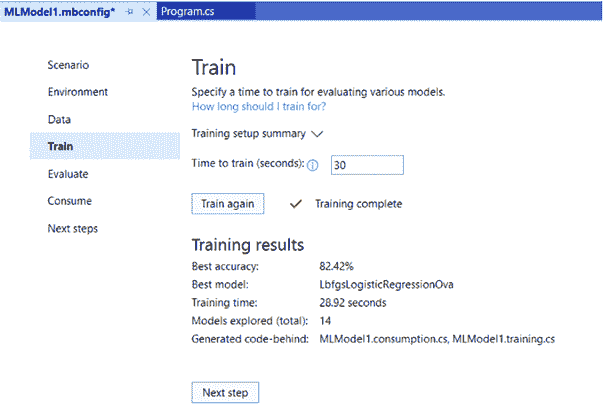
   **图 3.8:** Model Builder 结果
   - **Best MacroAccuracy (最佳宏准确率)**：反映 Model Builder 识别的最佳模型的准确率。准确率越高，表示对测试数据的预测越准确。
   - **Best Model (最佳模型)**：表示在 Model Builder 探索过程中表现优异的算法。
   - **Training Time (训练时间)**：代表用于训练和探索各种模型的总时长。
   - **Models Explored (探索的模型数量)**：表示 Model Builder 在指定时间范围内探索的模型总数。
   - **Generated Code-Behind (生成的后台代码)**：提供生成的文件名称，这些文件旨在便于模型消费或辅助训练新模型。

### 测试您的模型

在 `"Try your model"` 部分，你有机会对样本输入进行预测。文本框预先填充了你数据集中的第一行数据，但你可以根据需要修改输入。选择“Predict”按钮以观察不同的情感预测。
在此语境下，情感分数为 0 表示负面情感，而分数为 1 表示正面情感。
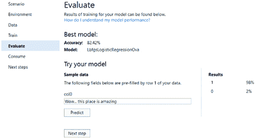
**图 3.9:** Model Builder 评估模型

### 消费

在 Model Builder 的 `Consume` 步骤中，你会找到一段代码片段，它可以为模型生成样本输入并利用该模型对该输入进行预测。
此外，Model Builder 还提供了可选的项目模板，你可以将其纳入解决方案中。这些模板包含了控制台应用程序和 Web API，两者都旨在无缝消费已训练的模型。
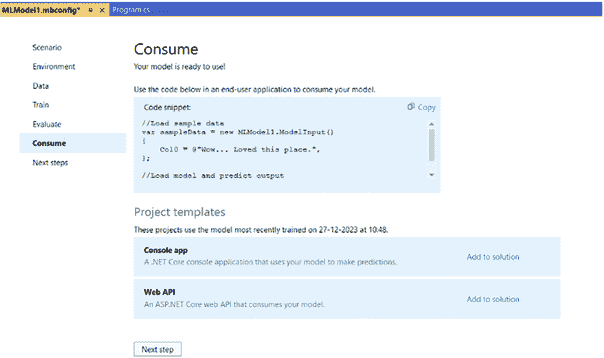
**图 3.10:** Model Builder 消费

最后一步是将训练好的模型集成到终端用户应用程序中。

将项目中 `Program.cs` 文件中的现有代码替换为以下代码：


```cs
using ConsoleApp1;
// 添加输入数据
var sampleData = new MLModel1.ModelInput()
{
    Col0 = "This restaurant was wonderful."
};
// 加载模型并预测样本数据的输出
var result = MLModel1.Predict(sampleData);
// 如果预测为 1，则情感为“Positive（正面）”；否则为“Negative（负面）”
var sentiment = result.Prediction == 1 ? "Positive" : "Negative";
Console.WriteLine($"Text: {sampleData.Col0}\nSentiment: {sentiment}");
```

`Output`

```
Text: This restaurant was wonderful.
Sentiment: Positive
```

## 安装 CLI

要使用 ML.NET 命令行界面 (CLI)，你需要安装 ML.NET CLI 工具。该 CLI 工具简化了各种机器学习任务，例如创建项目、管理数据集、训练模型和进行预测，所有操作都可以命令行完成。

以下是安装 ML.NET CLI 的步骤：

### 前提条件

在安装 ML.NET CLI 之前，请确保你已具备以下前提条件：

*   **.NET SDK**：
    *   确保你的机器上安装了 .NET SDK。你可以从 .NET 官方网站下载：下载 .NET SDK。

### 安装步骤

按照以下步骤安装 ML.NET CLI：

1.  **打开终端或命令提示符**
    *   在你的机器上打开终端或命令提示符。这可以是集成开发环境 (IDE) 中的终端，也可以是单独的终端窗口。

2.  **运行安装命令**
    *   使用以下命令在你的机器上全局安装 ML.NET CLI：
        `dotnet tool install -g mlnet`
    *   此命令指示 .NET CLI 全局安装 ML.NET 工具，使其可以从系统的任何地方访问。

3.  **验证安装**
    *   安装完成后，你可以通过运行以下命令来验证 ML.NET CLI 工具是否已安装：
        `dotnet mlnet --version`
    *   此命令应显示已安装的 ML.NET CLI 工具的版本号。

### 升级到最新版本

要将 ML.NET CLI 升级到最新版本，请使用以下命令：
`dotnet tool update -g mlnet`
此命令会检查更新并安装 ML.NET CLI 工具的最新版本。

### 卸载 ML.NET CLI

如果你需要卸载 ML.NET CLI 工具，可以使用以下命令：
`dotnet tool uninstall -g mlnet`
此命令将从你的机器上移除全局安装的 ML.NET CLI 工具。

### 备注

*   确保在安装过程中你的网络连接稳定，因为 CLI 工具可能需要下载依赖项。
*   确保 .NET SDK 和 CLI 已添加到系统的 PATH 环境变量中，允许你从终端的任何位置运行命令。

安装完成后，你就可以使用 ML.NET CLI 创建、训练和管理机器学习项目了。请参考前面的章节，了解如何使用 CLI 自动化机器学习任务以及对你的项目进行调试和故障排除。

## 使用 CLI 自动化机器学习任务

ML.NET 是一个由微软开发的一个开源机器学习框架。虽然 ML.NET 主要与 .NET 生态系统集成，但它也提供了命令行界面 (CLI) 工具，用于自动化机器学习任务。当你希望从命令行执行数据预处理、模型训练和评估等任务时，CLI 工具非常有用。

以下是使用 ML.NET CLI 自动化机器学习任务的基本步骤：

1.  **安装 ML.NET CLI**
    *   确保你的机器上已安装了 .NET SDK。
    *   打开终端并运行以下命令安装 ML.NET CLI：
        `dotnet tool install -g mlnet`

2.  **创建新的 ML.NET 项目**
    *   使用以下命令创建一个新的 ML.NET 项目：
        `dotnet new mlnet`

3.  **探索项目结构**
    *   导航到项目目录并探索项目结构。你会发现像 `Program.cs`（用于代码）和 `Data` 文件夹（用于数据集）这样的文件。

4.  **准备数据**
    *   将你的数据集放在 `Data` 文件夹中，或更新 `Program.cs` 文件中的路径。

5.  **编辑 ML.NET 代码**
    *   打开 `Program.cs` 并修改代码以定义你的机器学习管道。你可以更改数据加载、预处理、模型训练和评估逻辑。

6.  **运行 ML.NET CLI 命令**
    *   使用以下命令运行各种 ML.NET 任务：
        *   构建项目：`dotnet build`
        *   训练并评估模型：`dotnet run train`
        *   使用已训练的模型进行预测：`dotnet run predict`

7.  **自定义 CLI 命令**
    *   你可以通过修改 `Commands` 文件夹中的 `TrainCommand` 和 `PredictCommand` 类来自定义 CLI 命令。根据你的需求调整选项和参数。

8.  **探索更多命令**
    *   ML.NET CLI 提供了数据检查、模型分析等其他任务的附加命令。运行以下命令探索可用命令：
        `dotnet run -- --help`

9.  **迭代与实验**
    *   对代码进行迭代，尝试不同的算法并微调你的模型。根据需要重新运行命令进行训练、评估和预测。

## 使用 CLI 进行调试和故障排除

在使用 ML.NET CLI 进行机器学习项目时，调试和故障排除对于确保模型成功训练和部署至关重要。以下是针对开发过程中可能出现问题的调试和故障排除的一些技巧和方法：

### 日志与输出

*   利用日志和控制输出来理解执行流。在代码中使用 `Console.WriteLine` 语句在训练、评估和预测阶段打印相关信息。

### 检查数据加载

确保你的数据集已正确加载。验证代码中的数据集路径，并检查数据是否按预期读取。数据加载错误会导致各种问题。

### 检查数据

使用 `mlnet data` 命令在训练前检查数据。该命令可以帮助你理解数据集的结构，包括列名、数据类型和统计摘要。

```
dotnet run data
```

### 验证模型流水线

检查模型流水线是否存在错误。确认数据预处理、特征工程和模型训练步骤已正确定义。`mlnet code` 命令有助于从现有流水线生成代码。

```
dotnet run code
```

### 审查训练指标

在训练模型后，审查训练指标以评估其性能。打印或记录 `accuracy`、`precision`、`recall` 和 `loss` 等指标，以评估模型从训练数据中学习的效果。

### 处理空值或缺失值

确保你的数据预处理妥善处理了空值或缺失值。脏数据会导致训练和预测过程中出现意外行为。使用 ML.NET 数据转换函数来处理缺失值。

### 检查模型兼容性

验证 CLI 中使用的 ML.NET 版本与你的模型及代码是否兼容。如果不同版本之间的 API 或功能发生变化，可能会出现兼容性问题。

### 探索模型文件

检查生成的模型文件（通常保存在 `output` 文件夹中），确保它们已成功创建。模型文件生成错误可能表明训练过程中存在问题。

### 使用调试工具

利用集成开发环境（IDE）提供的标准调试工具。设置断点、检查变量并单步执行代码以识别并修复问题。

### 检查依赖

确保所有所需的依赖项已安装并处于最新版本。这包括 .NET SDK、ML.NET CLI 以及项目中使用的任何外部库或包。

### 审查命令行选项

运行 CLI 命令时，仔细检查命令行选项和参数。错误的选项可能导致意外行为或错误。

### 咨询文档和社区

参考 ML.NET 文档获取故障排除提示和常见问题。此外，参与社区论坛或讨论，向可能遇到过类似问题的开发人员寻求帮助。

通过系统地处理这些调试和故障排除策略，你可以通过 CLI 增强 ML.NET 项目的可靠性和有效性。在开发的每个阶段定期测试和验证代码，将有助于你机器学习事业的成功。

## 常见错误与解决方案

在使用 Model Builder 和 CLI 进行机器学习调试时，理解常见错误及其解决方案是调试的一个基本方面。以下是一些示例：

*   **数据问题**：缺失值、格式不一致或标签错误的数据等数据问题会导致错误。确保你的数据是干净且结构合理的。
*   **超参数问题**：选择错误的超参数或配置不当会导致模型性能不佳。审查并微调超参数以优化模型性能。
*   **模型过拟合**：当模型过度学习训练数据时就会发生过拟合，导致在未见数据上的表现糟糕。解决方案包括调整模型复杂度、使用更多数据或正则化技术。
*   **类别不平衡**：在分类任务中，类别分布不平衡会导致模型偏差。过采样、欠采样或使用不同的评估指标等技术可以解决这个问题。
*   **内存和资源限制**：如果由于资源限制遇到内存问题或性能问题，考虑使用较小的数据集、优化算法或升级硬件。
*   **库版本兼容性**：确保你使用的 ML.NET、依赖项和 .NET Core 版本兼容。兼容性问题可能导致意外错误。

## 调试技术

在 Model Builder 和 CLI 中调试机器学习模型时，请考虑以下技术：

*   **增量测试**：通过从小子集开始增量测试机器学习流水线，以验证每一步都按预期工作。逐步扩大到完整数据集。
*   **可视化检查**：将你的数据、模型架构和结果可视化。可视化可以帮助你发现异常并理解模型是如何做出决策的。
*   **探索性数据分析 (EDA)**：使用 EDA 技术理解数据的特征，并识别模式、异常值和潜在问题。
*   **调试工具**：利用 Visual Studio 等调试工具和集成开发环境在训练和评估期间设置断点、检查变量并单步执行代码。
*   **交叉验证和验证曲线**：实施交叉验证和验证曲线来评估不同阶段的模型性能。这有助于你理解模型的行为，以及是否存在过拟合或欠拟合。

## 日志与输出检查

Model Builder 和 CLI 在各种操作期间提供日志和输出。你可以使用这些日志和输出进行调试和故障排除：

*   **错误消息**：密切关注错误消息和警告。它们通常包含关于出错以及如何修复的价值信息。
*   **进度更新**：在模型训练期间，你将收到包含训练指标的进度更新。检查这些更新以监控训练过程并早发现问题。
*   **模型评估指标**：在模型评估后，审查生成的指标和评估结果，以理解模型的运行状况以及是否符合你的标准。
*   **数据转换和预处理日志**：检查与数据转换和预处理相关的日志。这些日志可以帮助你跟踪数据变化并发现异常。

## 性能分析与优化

在使用 Model Builder 和 CLI 时，性能分析和性能调优是调试和故障排除的重要方面：

*   **分析工具**：使用分析工具分析代码的运行时行为。分析器可以识别性能瓶颈、内存占用和 CPU 利用率。
*   **代码效率**：检查代码中潜在的低效之处。确保数据加载、处理和训练已优化，以最小化执行时间和资源消耗。
*   **算法选择**：考虑不同的算法和模型。对于你的特定问题，某些算法可能比其他算法更快，从而带来更快的训练和更好的性能。
*   **并行处理**：如果硬件支持，考虑使用并行处理或分布式计算以加速训练和评估。
*   **数据采样**：在处理大型数据集时，在开发和测试期间使用较小样本以节省时间和资源。当你对模型有信心时，再扩展到完整数据集。

有效的调试和故障排除对于开发稳健且可靠的机器学习模型至关重要。Model Builder 和 `CLI` 通过其内置的日志和输出，为训练和评估过程提供了宝贵的见解。通过采用常用的错误解决技术、调试工具和性能优化策略，你可以克服挑战并构建出符合项目目标的模型。

## 最佳实践与提示

最佳实践和提示对于机器学习项目的成功至关重要。在本节中，我们将扩展与工作流效率、处理大型数据集、协作开发以及版本控制和可重复性的一些关键最佳实践和提示。

### 工作流效率

效率对于按时且预算交付机器学习项目至关重要。以下是提高工作流效率的方法：

*   **自动化重复任务**：利用 `ML.NET CLI` 等自动化工具处理数据准备、模型训练和评估等重复任务。这可以节省时间并减少人工错误。
*   **持续集成 (CI) 和持续部署 (CD)**：设置 `CI/CD` 流水线，在代码更改时自动构建、训练和部署模型。这简化了开发过程，并确保模型保持最新状态。
*   **实验跟踪**：使用实验跟踪工具记录你进行的所有实验。这更容易比较模型、跟踪更改并理解什么对你的特定问题最有效。
*   **保持整洁的工作空间**：通过结构良好的目录和文件命名规范维护有序的工作空间。这有助于你快速定位和管理数据、代码和项目资产。
*   **文档**：为你的项目创建详细文档，包括数据源、数据预处理步骤、模型配置和训练结果。文档良好的项目更易维护和共享。

### 处理大型数据集

处理大型数据集面临着独特的挑战。以下是有效处理它们的提示：

*   **数据采样**：对于初始模型开发和实验，使用数据采样对较小的数据子集进行工作。一旦你的模型运行良好，再扩展到完整数据集。
*   **数据压缩**：压缩大型数据集以减少存储需求并加快数据加载。使用 `Parquet` 或 `Arrow` 等格式进行高效存储。
*   **数据洗牌**：在将数据分为训练集和测试集之前，随机打乱数据。洗牌有助于防止数据顺序中的偏差，特别是当你的数据按某些特征排序时。
*   **并行处理**：利用并行处理和分布式计算平台来加速数据预处理、模型训练和评估。
*   **数据流**：如果你的数据集大到无法放入内存，考虑使用数据流技术。数据流允许你以较小的块处理数据，减少内存需求。

### 协作开发

协作在机器学习项目中通常至关重要，特别是在团队中工作时。以下是增强协作开发的方法：

*   **版本控制**：使用 `Git` 等版本控制系统管理代码和项目资产。这允许多个团队成员同时处理同一个项目，同时跟踪更改并方便代码审查。
*   **代码文档**：对代码进行注释，并对代码复杂部分提供清晰的解释。文档良好的代码更容易理解和使用。
*   **协作工具**：利用 `GitHub`、`GitLab` 或 `Bitbucket` 等协作工具进行共享仓库和问题跟踪。这些平台促进了团队沟通和项目管理。
*   **定期会议**：安排定期团队会议，讨论进度、挑战和解决方案。有效沟通是协作成功的关键。

### 版本控制与可重复性

可重复性对于确保你的机器学习结果可以复制至关重要。以下是实现方法：

*   **版本控制**：如前，使用版本控制系统跟踪代码、数据和模型的更改。将代码和项目资产提交到版本控制仓库，有助于确保你可以在未来的任何时候重新创建工作。
*   **环境管理**：利用虚拟环境或容器化（例如 `Docker`）创建可重复的环境。记录项目所使用的依赖项、库和硬件配置。
*   **流水线脚本**：将数据预处理、训练和评估流水线构建为脚本。这些流水线可以进行版本化并在受控环境中执行，确保可重复性。
*   **实验跟踪**：使用实验跟踪工具记录并复制你的实验。你可以保存配置、数据预处理步骤和模型检查点（checkpoints）以便于复制。
*   **检查点和快照**：在训练期间保存模型检查点和快照。这允许你从特定点继续训练并复制结果。

通过实施这些最佳实践和提示，你将提高机器学习工作流的效率，有效处理大型数据集，促进协作开发，并确保版本控制和可重复性。这些实践不仅让你的项目更成功，还能促进机器学习广泛领域的良好实践。

## 案例研究与示例

机器学习的现实应用证明了 `ML.NET Model Builder` 和 `CLI` 的力量和多功能。在本节中，我们将探索 `ML.NET` 在实际应用中用的一些案例研究和示例，展示 Model Builder 和 `CLI` 如何发挥作用。

### 现实用例

机器学习已部署在各个行业和领域以解决复杂问题。`ML.NET` 的一些现实用例包括：

*   **医疗健康**：`ML.NET` 已用于开发预测疾病、患者风险评估和医学诊断图像分析的模型。例如，它用于预测疾病暴发、从医学图像早期检测疾病以及优化治疗方案。
*   **金融**：在金融领域，`ML.NET` 用于信用风险评估、欺诈检测和算法交易。它帮助金融机构做出数据驱动的决策并识别交易中的异常。
*   **零售**：`ML.NET` 用于零售领域的需求预测、库存管理、客户情感分析和个性化推荐。零售商利用 `ML.NET` 优化供应链并增强客户体验。
*   **制造业**：`ML.NET` 在制造业的预测性维护、质量控制和流程优化中应用。它有助于减少停机时间并减少生产中的缺陷。
*   **自然语言处理 (NLP)**：在 NLP 领域，`ML.NET` 用于情感分析、聊天机器人和语言翻译。它使企业能够更有效地与客户互动并理解用户情感。
*   **图像和视频分析**：`ML.NET` 用于目标检测、图像分类和视频分析。用例包括安全监控、自动驾驶车辆和内容审核。

### Model Builder 和 CLI 的实战

让我们深入探讨 Model Builder 和 `CLI` 在这些现实应用中的一些示例：

*   **医学图像分析**：在医疗领域，`Model Builder` 简化了图像分类模型的开发。放射科医生可以使用 `Model Builder` 创建识别医学图像（如 X 光射线和 MRI 扫描）中异常的模型。`CLI` 可用于自动化的数据摄入、预处理和模型训练过程。
*   **零售销售预测**：零售业务使用 `Model Builder` 根据历史数据预测未来销售。这有助于他们优化库存水平并规划营销策略。`CLI` 可用于自动进行模型的定期重训练，确保预测结果保持更新。


- **欺诈检测**：金融机构依赖 `ML.NET Model Builder` 来构建识别欺诈交易的模型。`CLI` 在创建端到端流水线方面发挥着关键作用，该流水线包括数据预处理、模型训练和用于实时欺诈检测的部署。

- **客户支持情感分析**：在零售和服务行业，`Model Builder` 简化了分析客户反馈的情感分析模型。这些可以集成到客户支持系统中。`CLI` 用于对传入的客户查询进行自动情感分析。

- **生产质量控制**：制造公司利用 `ML.NET Model Builder` 构建实时监控产品质量的模型。`CLI` 有助于创建用于持续监控和评估的批处理脚本。

- **客户交互聊天机器人**：`ML.NET Model Builder` 促进了用于网站和移动应用客户交互的聊天机器人模型的创建。`CLI` 可用于跨通信渠道（如网站、聊天应用程序和语音助手）部署和维护聊天机器人。

这些案例研究和示例展示了 `ML.NET` 在解决各行业复杂问题方面的性。`ML.NET Model Builder` 和 `CLI` 是非常有价值的工具，简化了机器学习模型的开发和部署，使得广泛寻求利用 AI 能力和数据驱动决策的专业人士和企业能够轻松使用。

# 结论

在本章中，我们深入探讨了 `ML.NET Model Builder` 和命令行界面 (`CLI`) 的世界，这些都是旨在简化和自动化机器学习工作流的强大工具。我们探索了它们的关键特性，并讨论了它们在机器学习领域中的重要性。在结束之际，让我们回顾一下 `Model Builder` 和 `CLI` 的核心功能，并思考一下 `ML.NET` 的未来。

在下一章中，我们将介绍在 `ML.NET` 中收集和准备机器学习数据的基础知识。我们将讨论数据清洗、特征工程和数据归一化的技术。

# Model Builder 回顾与 CLI 关键特性

- **Model Builder**：`ML.NET Model Builder` 是一个直观的图形界面，简化了机器学习模型的开发过程。它的关键特性包括用于数据预处理和模型选择的用户友好拖放式界面、自动特征工程、超参数调优以及轻松的模型评估。它抽象了 `ML.NET` 框架的复杂性，使机器学习更易于广泛观众接触。

- **CLI (命令行界面)**：`ML.NET CLI` 为自动化和脚本设计。它提供了一系列命令，用于创建和管理项目、数据准备、模型训练、评估和部署。通过 `CLI`，你可以自动化重复的机器学习任务，优化你的工作流，并将机器学习集成到生产流水线中。

## ML.NET 的未来

`ML.NET` 的未来充满光明，得益开源社区不断的进步和贡献。以下是值得关注的一些关键趋势和发展：

- **扩展算法支持**：`ML.NET` 将继续扩展其支持的算法和模型，以适应更广泛的用例和行业。这将为用户解决特定问题提供更多选择。

- **增强的 AutoML 能力**：自动化和 AutoML 将 `ML.NET` 的未来中占据核心地位。我们可以期待会有更复杂的 AutoML 功能，使得那些没有广泛机器学习专业知识的人也能更容易进行模型开发。

- **生态系统增长**：随着新工具、库和扩展的引入，`ML.NET` 生态系统（包括 `Model Builder` 和 `CLI`）可能会不断扩大。这些新增将进一步赋能开发者和数据科学家在机器学习领域的投入。

- **社区贡献**：作为一个开源项目，`ML.NET` 受益于充满活力的开发者和数据科学家社区的贡献。通过持续协作`ML.NET` 将不断进化和成熟，提供更好的性能和稳健性。

- **互操作性**：`ML.NET` 可能会增强与其他流行的机器学习和数据科学库、框架的互操作性。这将有助于与现有工作流和环境的无缝集成。

`ML.NET Model Builder` 和 `CLI` 让机器学习变得民主化，使更广泛的观众能够使用。这些工具简化了构建、训练和部署机器学习模型的过程，节省了时间和精力。`ML.NET` 的未来是光明的，随着不断的创新和不断扩大的生态系统，它承诺提供更强大、更易于使用的机器学习解决方案。随着人工智能和机器学习领域的持续增长，`ML.NET` 将一直是数据专业人士和开发者工具箱中宝贵的资产。

# 参考文献和延伸阅读

在探索 `ML.NET` 的世界时，获取资源以进一步学习并保持最新进展至关重要。在本节中，我们将讨论参考文献、延伸阅读，以及社区支持资源。

## 学习更多信息的资源

- **官方 ML.NET 文档**：官方文档是一个极佳的起点。它为 `ML.NET Model Builder` 和 `CLI` 提供了全面的指南、教程和参考材料。你可以在官方网站或通过你偏好的搜索引擎找到它。

- **Microsoft Learn**：`Microsoft Learn` 为 `ML.NET` 提供了交互式的实操模块和学习路径。这些资源适合初学者以及寻求扩展知识的经验从业者。

- **书籍**：有许多专注于 `ML.NET` 和使用 .NET 进行机器学习的书籍。这些书籍涵盖了 `ML.NET` 的各个方面，从引介绍到高级主题。寻找诸如《Practical ML.NET for Engineers》或《Hands-On Machine Learning with ML.NET》之类的标题。

- **在线课程**：许多在线学习平台提供 `ML.NET` 课程，通常涵盖基础和高级主题。Coursera、edX 和 Pluralsight 等平台提供了由领域专家创建的课程。

- **YouTube 教程**：你可以在 YouTube 上找到大量的 `ML.NET` 教程。这些教程通常提供分步说明的指导和实际示例，便于跟随和学习。

## ML.NET 社区与支持

- **GitHub 仓库**：`ML.NET` 的官方 GitHub 仓库是访问最新源代码、为项目贡献以及报告问题的宝贵资源。它也是与开源社区互动的地方。

- **Stack Overflow**：`Stack Overflow` 拥有活跃的 `ML.NET` 用户和开发者社区。你可以在那里找到常见问题的答案，并在遇到问题或需要帮助时提出自己的问题。

- **Microsoft 开发者论坛**：`Microsoft 开发者论坛` 通常设有针对 `ML.NET` 的专门板块。这些论坛非常适合提问、分享经验以及向专家和寻求用户寻求帮助。

- **Twitter 和社交媒体**：在 Twitter、LinkedIn 和 Reddit 等平台上关注与 ML.NET 相关的账户，以获取 ML.NET 社区更新、活动和讨论的最新动态。

- **本地用户组和聚会**：根据你所在的地区，你可能会找到专注于 ML.NET 和机器学习的本地用户组和聚会。这些活动提供了人际交流和向本地专家学习的机会。

- **在线社区和讨论论坛**：在线社区（如 Reddit 的 r/dotnet 和 r/MachineLearning）经常会有与 ML.NET 相关的讨论。参与这些社区可以帮助你保持资讯，并与志同道合的人建立联系。

通过探索这些用于学习和社区支持的资源，你将为你的 ML.NET 之之旅奠下坚实的基础。无论你是初学者还是希望提升自己的技能，这些参考资料和支持渠道在你们追求机器学习知识和专业技能方面都是无与比拟的。

# 第 4 章：为 ML.NET 收集和准备数据

## 引言

数据收集和准备是机器学习（ML）过程中的一个至关重要的步骤。用于 ML 模型的数据质量和数量直接影响其准确性和可靠性。因此，在将数据输入 ML 算法之前，对其进行收集、清洗、预处理和转换至关重要。本章重点介绍 ML.NET 数据加载和预处理技术，这些技术用于为 ML 模型准备数据。

在本章中，我们将使用 UCI 机器学习库的心脏病数据集，该数据集包含 303 条患者记录，涉及 13 个与心脏病相关的特征。我们将演示将数据加载到 ML.NET、进行清洗和预处理，并将其转换为 ML 算法可以使用的格式。

我们将首先介绍 ML.NET 的数据加载 API，包括 `TextLoader` 和 `DatabaseLoader`，并展示如何使用它们从各种源加载数据。接下来，我们将讨论各种数据预处理技术，如数据清洗、数据归一化和缩放以及数据编码。我们将通过代码示例演示如何使用这些技术，并对其优缺点进行解释。

在本章结束，你将对如何使用 ML.NET 加载和预处理数据有深入理解，这对于构建准确可靠的 ML 模型至关重要。

# 结构

本章将涵盖以下主题：

- ML.NET 中的数据收集和准备概述
- 数据清洗和预处理技术
- 使用 ML.NET 的 API 进行特征工程
- 数据归一化和缩放
- 使用 ML.NET 进行数据可视化和探索性数据分析 (EDA)

## 数据收集

心脏病数据集是 Kaggle 上一个热门的数据集，包含了接受过心脏病评估的患者信息。

本章使用的数据集可以通过以下链接从 Kaggle 下载：[`www.kaggle.com/datasets/cherngs/heart-disease-cleveland-uci`](https://www.kaggle.com/datasets/cherngs/heart-disease-cleveland-uci)

该数据集收集自瑞士的克利夫兰诊所基金会，通常用于分类和回归分析。该数据集包含 303 条患者记录，每条记录包含 13 个属性（如下表所示），这些描述了患者的健康状况，如年龄、性别、胸痛类型、血压、血清胆固醇水平等。目标变量是是否存在心脏病，值为 0 表示不患有心脏病，值大于 0 表示患有心脏病。

- `age`：年龄（岁）
- `sex`：性别（1 = 男性；0 = 女性）
- `cp`：胸痛类型
  - 值 0：典型心绞痛
  - 值 1：非典型心绞痛
  - 值 2：非心绞性疼痛
  - 值 3：无症状
- `trestbps`：静息血压（入院医院时，单位为 mm Hg）
- `chol`：血清胆固醇（单位为 mg/dl）
- `fbs`：(空腹血糖 > 120 mg/dl) (1 = 是；0 = 否)
- `restecg`：静息心电图结果
  - 值 0：正常
  - 值 1：存在 ST-T 波异常（T 波波倒转和/或 ST 段抬高或压低幅度 > 0.05 mV）
  - 值 2：根据 Estes 标准显示可能或确切有左心室肥大
- `thalach`：达到的最大心率
- `exang`：运动诱发心绞痛（1 = 是；0 = 否）
- `oldpeak`：运动相对于休息引起的 ST 段压低
- `slope`：运动峰值 ST 段的斜率
  - 值 0：上斜
  - 值 1：平直
  - 值 2：下斜
- `ca`：荧光造影显示的主要血管数量（0-3）
- `thal`：0 = 正常；1 = 固定缺损；2 = 可逆性缺损
- 以及标签
- `condition`：0 = 无疾病，1 = 患疾病

以下是该数据集前几行的快照：

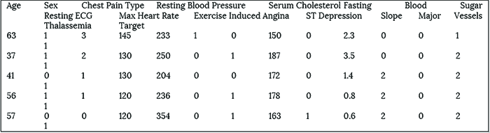

**表 4.1：** 数据集的前几行

在本章的后续章节中，我们将使用 ML.NET API 探索数据清洗、预处理、特征工程、归一化、缩放和探索性数据分析的各种技术。我们将在整个章节中使用该数据集作为实际示例，演示这些技术的使用。

## ML.NET 的数据加载 API

ML.NET 提供了各种数据加载 API 从各种源导入数据，包括文本文件、CSV 文件和数据库。最常用的两种数据加载 API 是 `TextLoader` 和 `DatabaseLoader`。在本节中，让我们详细查看如何使用这两个方法加载患者数据。

### TextLoader

`TextLoader` 是 ML.NET 用于从文本文件加载结构化数据的 API 之一。它可以处理整数、浮点和字符串等各种数据类型，并自动检测和处理缺失值。

`TextLoader` API 允许你使用架构指定输入数据的格式。该架构指定了输入数据的列名、数据类型和顺序。你可以使用 `TextLoader.Column` 方法定义架构。

下面的代码演示了如何使用 `TextLoader` API 将逗号值 (CSV) 文件加载到 ML.NET DataView：

```csharp
using Microsoft.ML;
using Microsoft.ML.Data;

// 定义输入数据的架构
var schema = new TextLoader.Column[]
{
    new TextLoader.Column("Age", DataKind.Int32, 0),
    new TextLoader.Column("Gender", DataKind.String, 1),
    new TextLoader.Column("Weight", DataKind.Single, 2),
    new TextLoader.Column("Height", DataKind.Single, 3),
    new TextLoader.Column("BloodPressure", DataKind.String, 4),
    new TextLoader.Column("Cholesterol", DataKind.Single, 5)
};

// 使用定义的架构创建 TextLoader 实例
var dataLoader = mlContext.Data.CreateTextLoader(schema);

// 将数据加载到 DataView
var dataView = dataLoader.Load("path/to/data.csv");
```

在此示例中，`schema` 变量定义了输入数据的架构，指定了列名、数据类型和顺序。`dataLoader` 变量使用定义的架构创建一个 `TextLoader` 实例。最后，`dataView` 变量使用 `TextLoader` 实例的 `Load` 方法从 `CSV` 文件加载数据到 `DataView`。

**总结：**

- `TextLoader` 非常灵活，可以处理各种格式的结构化数据，包括 CSV、TSV 和其他分隔符文本文件。
- 它可以自动检测并处理输入数据中的缺失值。
- `TextLoader` 以扩展且高效的方式加载大型数据集，能够处理可能无法放入内存的数据集。
- `TextLoader` 允许你定义输入数据的架构（schema），这有助于确保数据的一致性和准确性。

### 局限性

- `TextLoader` 主要设计用于加载文本格式的结构化数据，可能不适用于加载其他类型的数据（如图像或音频）。
- `TextLoader` 要求预先定义输入数据的架构，这可能非常耗时，并且可能需要某些领域知识。
- `TextLoader` 的性能可能会受到输入数据架构复杂程度数据集大小的影响。

# DatabaseLoader

对于规模较大的项目，通常需要从各种数据库加载数据，而不是从平铺文件。如名称所示，`DatabaseLoader` 用于从数据库加载数据。它可以连接到多种数据库，包括 SQL Server、MySQL 和 PostgreSQL，并使用 SQL 查询来检索数据。`DatabaseLoader` 是 ML.NET 提供的一个 API，允许你将数据直接从关系型数据库加载到你的机器学习模型中。通过 `DatabaseLoader`，你可以轻松加载大量可能无法放入内存的数据，以及其他可以通过 ODBC 访问的源。

若要使用 `DatabaseLoader`，你首先需要定义输入数据的架构。你可以通过创建一个映射到数据库中表的类来实现，类的每个属性代表表中的一列。然后你可以使用 `DatabaseLoader` 将数据从数据库加载到你所定义的类的 `IEnumerable` 中。

以下是一个使用 `DatabaseLoader` 从 SQL Server 数据库加载数据的代码片段：

```csharp
using Microsoft.ML.Data;
using Microsoft.ML.Transforms;
using System.Data.SqlClient;

public class PatientData
{
    [LoadColumn(0)]
    public int PatientID { get; set; }
    [LoadColumn(1)]
    public int ProviderID { get; set; }
    [LoadColumn(2)]
    public string Gender { get; set; }
    [LoadColumn(3)]
    public float Age { get; set; }
    [LoadColumn(4)]
    public float ClaimAmount { get; set; }
}

var connectionString = "Server=yourserver;Database=yourdatabase;User Id=yourusername;Password=yourpassword;";
var query = "SELECT PatientID, ProviderID, Gender, Age, ClaimAmount FROM PatientData";
var loader = mlContext.Data.CreateDatabaseLoader<PatientData>();
loader.ConnectionString = connectionString;
loader.SqlCommand = query;
var data = loader.Load();
```

在此段代码中，定义了一个表示输入数据架构的类 `PatientData`。然后我们创建了一个 `DatabaseLoader` 对象，并指定连接字符串和 SQL 查询以从数据库加载数据。最后，我们使用 `Load` 方法将数据加载到 `PatientData` 的 `IEnumerable` 中。

### DatabaseLoader 的优势

- `DatabaseLoader` 可以直接从数据库加载数据，这在处理无法放入内存的海量数据时非常方便。
- 它支持广泛的数据库管理系统（DBMS），使得从不同类型的数据库加载数据变得易于。


* `DatabaseLoader` 可以分批加载数据，这有助于优化内存使用并提高性能。
* 它允许你定义输入数据的架构，这有助于确保数据的一致性和准确性。

## DatabaseLoader 的局限性

* `DatabaseLoader` 需要指定连接字符串，如果管理不当，可能会带来安全风险。
* 它需要安装额外的驱动程序才能访问某些数据库管理系统。
* `DatabaseLoader` 主要设计用于从关系型数据库加载数据，可能不适用于加载其他类型的数据（如文本或图像）。
* `DatabaseLoader` 的性能可能会受到输入数据架构复杂程度和数据集大小的影响。

# 数据质量与完整性的预处理

数据质量和完整性是任何数据集至关重要的方面，特别是在医疗保健行业。准确且完整的数据对于确保机器学习算法能够做出准确预测并帮助有效地诊断和治疗患者至关重要。从 Kaggle 网站下载的心脏病数据集是一个常用数据集，包含了患有和不患心脏病患者的数据。它包含了各种特征，如年龄、性别、血压、胆固醇水平等，可以帮助预测患者是否患心脏病。

不准确或不完整的数据会导致预测不准确，并可能对医疗行业的患者造成伤害。因此，仔细检查和清理心脏病数据集以确保其准确、完整且没有缺失值至关重要。在本章的后续章节中，我们将探索数据清洗、预处理和探索性数据分析的各种技术，有助于确保数据集的质量和完整性。

数据预处理是为机器学习模型准备数据的关键步骤。它涉及多种技术，如数据清洗、归一化、缩放和编码，以确保数据处于算法易于理解的格式。适当的数据预处理有助于提高机器学习模型的准确性和性能，从而带来更准确的预测和更好的患者结果。

# 数据清洗

数据清洗是识别并纠正或删除数据集中错误、不一致和缺失值的过程。在心脏病数据集中你可能需要处理某些特征（如胆固醇水平或血压）的缺失值或不一致数据。处理缺失数据的常用技术包括插补（即根据数据集中的其他数据通过最佳猜测替换缺失值）或删除带有缺失数据的行或列。

## 删除缺失数据

处理缺失数据的一种常用技术是简单地删除任何包含缺失值的行或列。你可以使用 ML.NET `DataOperationsCatalog` 中的 `DropMissingValues` 方法来实现。然而，使用此技术时应谨慎，因为删除过多数据会导致信息丢失并可能影响机器学习模型的性能。

```csharp
// 过滤掉任何列具有 NaN 值的行
var dataWithoutMissingValues = mlContext.Data.FilterRowsByMissingValues(dataView, new[] { "Age", "Sex", "CP", "Trestbps", "Chol", "Fbs", "Restecg", "Thalach", "Exang", "Oldpeak", "Slope", "Ca", "Thal" });
```

## 插补缺失数据

处理缺失数据的另一种技术是插补，即根据数据集中的其他数据通过最佳猜测替换缺失值。这可以使用统计方法实现，例如均值插补（用该特征的平均值替换缺失值）或回归插补（使用回归模型根据数据集中的其他特征来预测缺失值）。

在 ML.NET 中，你可以使用 `DataOperationsCatalog` 中的 `ReplaceMissingValues` 方法来实现此目标。该方法支持多种插补策略，例如用非缺失值的平均值或中位数替换缺失值。

```csharp
// 在这里我们使用均值替换模式，用非缺失值的平均值替换该值。
var meanPipeline = mlContext.Transforms.ReplaceMissingValues("MissingReplaced", "Features", MissingValueReplacingEstimator.ReplacementMode.Mean);
```

### 数据转换

有时，你的数据集中的数据可能需要经过转换，才能在机器学习模型中被有效使用。例如，你可能需要将数据转换为不同的数据类型，或者对某个特征应用数学函数。ML.NET 的 `DataOperationsCatalog` 提供了几种转换数据的方法，例如 `MapValue`、`MapColumn` 和 `ExpressionTransform`。

```csharp
// Data Transformation : Expression - 对"thalach"列应用数学函数
var pipeline = mlContext.Transforms.Expression("ThalachDividedBy10", "thalach / 10.0");

// 合并转换数据
var transformedData = pipeline.Fit(dataView).Transform(dataView);
```

## 数据归一化与标准化

归一化和标准化是重要的数据预处理技术，用于标准化数据集中特征的范围和尺度。在心脏病数据集中，不同的特征具有不同的测量单位和范围，这使得机器学习算法难以对数据进行比较和从中学习。例如，数据集中的年龄（age）特征范围是 29 到 77 岁，而代表达到的最大心率的 `thalach` 特征范围是每分钟 71 到 202 次。

标准化和最大最小缩放是用于归一化和标准化数据特征的两种常用技术。标准化是将每个特征的值转换为均值为 0、标准差为 1。当数据分布不符合正态分布且包含异常值时，这种技术非常有用。标准化的公式所示：

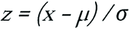

其中 `x` 是特征的值，`μ` 是特征的均值，`σ` 是特征的标准差。

最大最小缩放是将每个特征的值重新缩放到 0 到 1 之间的范围。当特征的取值范围变化很大时，这种技术非常有用。最大最小缩放的公式所示：

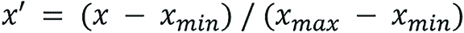

通过这些技术，我们可以确保心脏病数据集中的所有特征具有相似的尺度，而不会让某个特征在数量级上主导其他特征。这有助于提高在数据上训练的机器学习算法的准确性和性能。

## 数据编码

数据编码是为机器学习模型准备分类数据的关键步骤。由于大多数机器学习算法需要数值输入，因此分类数据无法以原始形式使用。因此，需要使用不同的编码技术将分类数据转换为数值格式。

最常用的编码技术之一是独热编码。在独热编码中，分类特征的每个可能值都被表示为新列中的二进制值。例如，如果我们有一个分类特征 `"color"`，它有三个可能值：`"red"`、`"green"` 和 `"blue"`，我们将创建三个新列：`"color_red"`、`"color_green"` 和 `"color_blue"`。每个列将包含一个二进制值，指示该行是否存在该特定值。

另一种编码技术是标签编码，为分类特征的每个可能值分配一个唯一的整数标签。例如，在上述 `"color"` 特征中，`"red"` 可能被分配标签 0，`"green"` 可能被分配标签 1，而 `"blue"` 可能被分配 2。

值得注意的是，编码技术的选择取决于特定的数据集和所使用的机器学习算法。在某些情况下，独热编码可能更合适，而在其他情况下，标签编码可能更合适。确保编码是可逆的也是重要的，这样在需要时可以恢复原始的分类值。

在心脏病数据集中，有几个分类特征，例如 `"sex"` 和 `"cp"`，它们在用于机器学习模型之前可能需要进行编码。取决于所使用的机器学习算法和问题的具体要求，可以使用独热编码或标签编码。

## 数据加载与清洗的代码

这里将演示如何使用 ML.NET 的 API 来处理数据。

使用 ML.NET 处理心脏病数据的说明：

* **导入库**：首先，我们需要为代码导入必要的库。

```csharp
using Microsoft.ML;
using Microsoft.ML.Transforms;
using Microsoft.ML.Data;
```

* **加载数据**：此部分加载 CSV 文件。`hasHeader` 表示文件是否包含表头。

```csharp
var mlContext = new MLContext();
var schema = new[]
{
    new TextColumn("Age", DataKind.Single),
    new TextColumn("Gender", DataKind.String),
    new TextColumn("Weight", DataKind.Single),
    new TextColumn("Height", DataKind.Single),
    new TextColumn("BloodPressure", DataKind.Single),
    new TextColumn("Cholesterol", DataKind.Single),
    new TextColumn("thalach", DataKind.Single)
};
var dataLoader = mlContext.Data.CreateTextLoader(schema);
var dataView = dataLoader.Load("heart_disease.csv");
```

* **数据清洗**：此部分使用 `FilterRowsMissing` 方法删除缺失值。生成的 `IDataView` 存储在 `filteredData`。

```csharp
// 过滤掉 "Cholesterol" 为 NaN 的行
var filteredData = mlContext.Data.FilterRowsMissing(dataView, new[] { "Cholesterol" });

// 这里我们使用均值替换，用特征的平均值进行替换
var meanPipeline = mlContext.Transforms.ReplaceMissingValues("Missing", "Features", MissingValueReplacingEstimator.Mean);
```

* **数据归一化与标准化**：此部分使用 `NormalizeMinMax` 方法对数据进行归一化。在示例中，它使用列的最小最大值将 `"Age"` 列归一化为 0 到 1 之间的范围。生成的 `IDataView` 存回 `transformedData`。

```csharp
// 示例：MinMaxScaler - 归一化 "Age" 列
var pipeline = mlContext.Transforms.NormalizeMinMax("NormalizedAge", "Age")
    .Append(mlContext.Transforms.Conversion.MapKeyToValue("AgeScaled", "NormalizedAge"));

// 合并转换数据
var transformedData = pipeline.Fit(dataView).Transform(dataView);
```

* **数据转换**：可以根据需要对数据进行转换。例如，如果我们需要将某个列的值除以 10，可以使用以下代码。

```csharp
// 数据转换：表达式 - 对"thalach"列应用数学函数
var pipeline3 = mlContext.Transforms.Expression("ThalachDividedBy10", "thalach / 10.0");

// 合并转换数据
var transformedData111 = pipeline3.Fit(dataView).Transform(dataView);
```

# 特征工程

特征工程是机器学习流水线中的关键步骤，它涉及将原始数据转换为一组有意义的特征，这些特征有助于提高机器学习模型的性能。

模型使用的特征质量对模型做出准确预测的能力具有显著影响。通过识别和工程化信息丰富的特征，我们可以降低模型的复杂度，并提高其对新数据的泛化能力。

特征工程的一些益处包括：

* **提高模型准确性**：特征工程可以帮助减少噪声或无关特征对模型的影响，从而提高准确性。
* **增加模型解释性**：特征工程通过将原始数据转换为有意义且易理解的特征，帮助模型更具解释性。
* **减少过拟合**：通过选择和工程化信息丰富的特征，我们可以降低模型过拟合到训练数据的风险。

## ML.NET 的特征工程 API

ML.NET 提供了多个用于特征工程的 API，包括：

* `ColumnCopyingEstimator`：此 API 允许通过复制现有列在数据集中创建一个新列。你可以使用此 API 在转换列之前对其创建备份。
* `OneHotEncoding`：此 API 用于对分类特征进行独热编码。它将每个分类特征转换为二进制向量，其中特征的每个可能值都表示为一个单独列。
* `ValueMappingEstimator`：此 API 用于对分类特征进行标签编码。它将分类特征的每个唯一值映射到一个唯一的整数标签。
* `MissingValueReplacingEstimator`：此 API 用于处理数据集中的缺失值。它允许用默认值或同一列中非缺失值的平均值或中位数来替换缺失值。
* `NormalizingEstimator`：此 API 用于数据集中的数值特征进行缩放。它允许将每个特征缩放为具有均值为零、标准差为一。
* `PrincipalComponentAnalysisEstimator`：此 API 用于降维。它允许通过将特征转换为较小的主成分集来减少数据集中的特征数量。

这些 API 可以结合使用来执行更复杂的特征工程任务。例如，你可能使用 `CategoricalOneHotVectorizer` 对分类特征进行独热编码，然后使用 `NormalizingEstimator` 缩放生成的二进制向量。

## 从患者数据工程新特征的 API

在心脏病数据集中我们有多个特征，如年龄、性别、血压、胆固醇水平等。然而，我们可以利用领域知识创建新特征，可能有助于提高模型性能。例如，我们可以计算每个患者的体重指数（BMI），以他们的身高和体重也作为数据的一部分提供。

以下是一个使用 ML.NET API 从患者数据计算 BMI 特征的示例代码：

```csharp
// Map - 添加新列 "BMI" 并计算其值
var pipeline5 = mlContext.Transforms.Conversion.MapValue(
    "BMI",
    "Weight",
    "Height",
    (weight, height) => weight / (height * height)
);
```

在这段代码片段中，我们定义了数据的输入和输出列，然后创建了 BMI。

这段代码可以使用 ML.NET 的 API 来提高模型性能。这只是特征工程用例的一个示例。

# 实践练习

以下是对一些实践练习的说明：

## 1. 数据清洗

使用平均值或中位数等插补法处理心脏病数据集中的缺失值。

```csharp
// 创建具有定义架构的 TextLoader
var dataView = mlContext.Data.LoadFromText("heart_upload.csv");

// 此处使用平均值替换，替换非缺失值
var meanPipeline = mlContext.Transforms.ReplaceMissingValues(new[] { "Chol", "trestbps", "thalach" }, MissingValueReplacingEstimator.ReplacementMode.Mean);

// 拟合并转换数据
var transformedData = meanPipeline.Fit(dataView).Transform(dataView);
```

此代码可将 `chol`、`trestbps` 和 `thalach` 特征中的缺失值替换为它们的平均值。生成的预处理数据视图可进一步分析或建模。

## 2. 特征工程

### 计算 BMI

从现有特征创建新特征，例如计算 BMI。

```csharp
var pipeline5 = mlContext.Transforms.Conversion.MapValue(
    "BMI",
    "Weight",
    "Height",
    (weight, height) => weight / (height * height)
);

// 拟合并转换数据
var transformedData2 = pipeline5.Fit(dataView).Transform(dataView);
```

### 独热编码

对分类特征执行独热编码。

```csharp
var pipeline4 = mlContext.Transforms.Categorical.OneHotEncoding("EncodedChestPainType", "ChestPainType");

// 拟合并转换数据
var transformedData1111 = pipeline4.Fit(dataView).Transform(dataView);
```

## 3. 数据归一化与缩放

使用标准化或最小最大缩放等技术对特征值进行归一化。


```csharp
// Example: MinMaxScaler - Normalize the "Age" column

var pipeline = mlContext.Transforms.NormalizeMinMax("NormalizedAge", "Age")
    .Append(mlContext.Transforms.Conversion.MapKeyToValue("AgeScaled", "NormalizedAge"));

// Fit and transform the data
var transformedData = pipeline.Fit(dataView).Transform(dataView);
```

我们首先需要定义想要归一化的特征列名称。然后，我们使用 `NormalizeMinMax` 创建一个归一化流水线来执行最大归一化。随后，使用 `Fit` 将流水线拟接到数据视图，并使用 `Transform` 应用转换。最后返回转换后的数据视图。要使用此函数，可以将加载的心脏病数据视图传递给 `NormalizeData` 函数，它将返回归一化后的数据。请调整 `featureColumns` 数组以包含你想要归一化的特定特征列。请注意，此代码假设你已经使用 ML.NET 将心脏病数据集加载到名为 `dataView` 的 `IDataView` 对象中。

# 结论

本章全面探讨了在 ML.NET 框架的机器学习背景下，细致的数据收集和准备的关键作用。我们分析了数据清洗方法、基础预处理技术与特征工程这一细微领域之间复杂的相互作用。

在接下来的[第 5 章，ML.NET 中的机器学习任务]中，我们将探索 ML.NET 中可以实现的各种机器学习任务，涵盖回归、分类、聚类和异常检测。通过全面的覆盖和说明性示例，本章不仅阐明了底层算法，还揭示了它们的应用领域的神秘面纱，从而让读者对 ML.NET 的通用功能有全多方面的理解。

# 单选题

1. 哪种 ML.NET API 用于加载基于文本的数据文件？

   1. `TextEncoder`

   2. `TextLoader`

   3. `DatabaseLoader`

   4. `DataPreprocessor`

2. ML.NET 中数据清洗的目的是？

   1. 从数据集中删除重复行

   2. 处理缺失值和不一致性

   3. 缩放和归一化数据

   4. 编码特征

3. 使用哪种技术将数据集中的所有特征带到相似的范围？

   1. One 热编码

   2. 特征工程

   3. 数据归一化和缩放

   4. 数据清洗

4. ML.NET 中数据编码的目的是？

   1. 处理数据集中的缺失值

   2. 缩放和归一化数据

   3. 将分类数据转换为数值格式

   4. 从数据集中删除离群值

5. 哪种 ML.NET API 用于从数据集中的现有特征创建新特征？

   1. `FeatureGenerator`

   2. `FeatureSelector`

   3. `FeatureEncoder`

   4. `FeatureEngineeringEstimator`

6. ML.NET 中数据归一化和缩放的目的是？

   1. 处理数据集中的缺失值

   2. 将分类数据转换为数值格式

   3. （等待，原文重复了选项，保持原始结构）

   4. 数据清洗

7. 使用哪种技术将数据集中的所有特征带到相似的范围？

   1. One 热编码

   2. 特征工程

   3. 数据归一化和缩放

   4. 数据清洗

8. ML.NET 中数据编码的目的是？

   1. 处理数据集中的缺失值

   2. 缩放和归一化数据

   3. 将分类数据转换为数值格式

   4. 从数据集中删除离群值

9. 哪种 ML.NET API 用于从数据集中的现有特征创建新特征？

   1. `FeatureGenerator`

   2. `FeatureSelector`

   3. `FeatureEncoder`

   4. `FeatureEngineeringEstimator`

10. ML.NET 中数据归一化和缩放的目的是？

    1. 处理数据集中的缺失值

    2. 将分类数据转换为数值格式

    3. （重复）

    4. 数据清洗

- **定义**: 此任务涉及将输入数据分类为两个类或类别之一。

- **用例**: 垃圾邮件检测、欺诈检测、情感分析。

## 多分类分类

- **定义**: 与二分类类似，但模型将数据划分为两个以上的类别。

- **用例**: 手写体识别、文档分类、目标识别。

### 回归

- **定义**: 根据输入特征预测数值值。

- **用例**: 房价预测、股票价格预测、需求预测。

### 聚类

- **定义**: 根据数据点的特征将相似的数据点归类在一起，且不使用预定义的标签。

- **用例**: 客户细分、异常检测、图像分割。

## 异常检测

- **定义**: 识别数据中不符合预期行为的模式。

- **用例**: 入侵检测、反欺诈检测、系统健康监控。

## 排序

- **定义**: 根据相关性或重要性为一组项目分配排名或顺序。

- **用例**: 搜索引擎结果排名、个性化推荐。

## 推荐

- **定义**: 根据用户的偏好或行为向其建议项目或内容。

- **用例**: 电影推荐、产品推荐、内容推荐。

## 预测

- **定义**: 根据历史数据预测未来值。

- **用例**: 销售预测、天气预报、资源规划。

## 图像分类

- **定义**: 根据图像的内容为其分配标签。

- **用例**: 目标识别、人脸识别、医学图像分析。

## 目标检测

- **定义**: 识别并定位图像中的物体。

- **用例**: 自动驾驶汽车、监控系统、增强现实。

# 机器学习任务的意义

机器学习任务在各个领域都具有巨大的意义，因为它们能够自动化复杂流程、从数据中提取有价值的洞察并实现数据驱动的决策。以下是强调其重要性的关键点：

- **数据驱动的决策**: 机器学习任务赋予组织根据数据而非直觉或猜测做出明智决策的能力。通过分析海量数据并检测模式，机器学习模型可以提供准确的预测和可操作的见解，从而改进业务策略、优化流程并增强性能。

- **提高效率和自动化**: 机器学习任务自动化了原本需要投入大量人力和时间的劳动密集型流程。例如，通过聊天机器人实现客户支持自动化，或通过需求预测优化供应链管理。通过自动化重复性任务，机器学习提高了效率，降低了成本，并将人力释放出来从事更有价值的活动。

- **个性化和推荐系统**: 机器学习任务通过分析用户的偏好、行为和历史数据，为用户创建个性化体验。由机器学习驱动的推荐系统会向用户推荐相关的商品、电影或内容，增强用户的参与度和满意度。

- **欺诈检测与网络安全**: 异常检测作为一项机器学习任务，在识别欺诈活动和确保网络安全方面起着至关重要的作用。通过学习正常的模式，机器学习模型可以检测出异常活动或偏差，防止欺诈交易、未经授权的访问和其他安全漏洞。

- **医疗健康与诊断**: 机器学习任务在医疗领域取得了显著进展，协助医疗诊断、疾病预测和个性化治疗方案。在大型数据集上训练的机器学习模型可以分析患者症状、医疗记录和遗传信息，以识别模式并做出准确预测。这有助于疾病的早期发现、个性化治疗建议以及改善患者疗。

- **图像和语音识别**: 分类和聚类等机器学习任务彻底改变了图像和语音识别系统。这些任务使机器能够理解和解释视觉或听觉数据，导致人脸识别、目标检测、语音转文本以及自然语言处理的进步。

- **预测性维护**: 机器学习任务在预测性维护中起着作用，模型通过分析传感器数据和历史维护记录来预测设备故障或维护需求。这允许企业主动安排维护活动，尽量减少停机时间并优化资源配置。

- **金融建模与风险评估**: 机器学习任务在金融建模、风险评估和投资策略中起着关键作用。通过分析历史市场数据，机器学习模型可以预测股价、识别投资机会并评估与金融交易相关的风险。

# ML.NET 不同任务的能力概述

ML.NET 由微软开发，是一个强大且多功能的机器学习框架，赋予开发者将机器学习无缝集成到其 .NET 应用程序中的。该框架旨在满足各种机器学习任务，提供了一个易于访问的环境。以下是 ML.NET 针对不同任务的能力概述：

- **易于集成**: ML.NET 与 .NET 生态系统无缝集成，允许开发者在现有应用程序中使用其功能。无论您是在构建 Web 应用程序、桌面软件还是云服务，ML.NET 都提供了一个一致且熟悉的环境。

- **模型部署的灵活性**: ML.NET 支持多种部署场景，使模型能够部署在边缘设备、云端或本地服务器上。这种灵活性确保了开发者可以选择最符合其应用程序需求和基础设施的部署方法。

- **广泛的任务支持**: ML.NET 涵盖了广泛的机器学习任务，从传统的分类和回归到目标检测和推荐系统等更高级的任务。这种多样性使其适用于跨不同行业的的广泛应用。

- **定制性与可扩展性**: 开发者可以轻松自定义和扩展 ML.NET 模型以满足特定需求。该框架支持使用自定义算法、特征工程以及领域特定知识 world，允许开发者根据数据的独特特性来定制模型。

- **无需先前的机器学习专业知识**: ML.NET 的设计重点是易用性，适用于具有不同机器学习专业水平的开发者。其高级 API 和直观的设计允许开发者在不需要深入理解底层机器学习算法的情况下构建和训练模型。

- **跨平台兼容性**

- `ML.NET` 是跨平台的，支持 Windows、Linux 和 macOS 环境。这确保了开发者可以创建在多种操作系统上无缝运行的机器学习应用程序，提高了灵活性和扩展性。

- **可扩展性与性能：**

    - `ML.NET` 构建时考虑了性能，能够开发可扩展的机器学习应用程序。该框架支持高效的数据处理和模型推理，适用于具有大型数据集或实时处理需求的应用。

- **与 ML.NET Model Builder 的集成：**

    - `ML.NET Model Builder` 是 `Visual Studio` 内部的一个可视化界面，为构建机器学习模型提供了简化的体验。它引导开发者完成模型构建过程，自动完成许多任务，使得机器学习初学者更容易入门。

## 二分类 (Binary Classification)

二分类是机器学习中的常见任务，涉及将输入数据归类为两个可能的类别之一。在 `ML.NET`（一个由微软开发的跨平台开源机器学习框架）的背景下，二分类通过各种算法和组件实现。

让我们来看一个使用 `ML.NET` 进行二分类的简单示例。假设我们有一个包含客户信息的数据集，并且想要根据年龄、收入和浏览历史等特征，预测客户是否会购买（类别 1）或不购买（类别 0）。

### 1. 定义数据模型

首先，我们需要定义表示输入数据的数据模型。在这个示例中，我们将使用一个名为 `CustomerData` 的类：

```cs
public class CustomerData { [LoadColumn(0)] public float Age; [LoadColumn(1)] public float Income; [LoadColumn(2)] public float BrowsingHistory; [LoadColumn(3)] public bool WillPurchase; // 二分类标签 (0 或 1) }
```

### 2. 加载并准备数据

将数据加载到 `ML.NET` 的 `IDataView` 中并分为训练集和测试集：

```cs
var context = new MLContext(); // 加载数据
var data = context.Data.LoadFromTextFile<CustomerData>("path/to/your/data.csv", separatorChar: ','); // 将数据分为训练集和测试集
var split = context.Data.TrainTestSplit(data);
```

### 3. 选择并配置算法

选择一个用于二分类的算法，例如逻辑回归或支持向量机。在本示例中，我们将使用逻辑回归：

```cs
var pipeline = context.Transforms.Conversion.MapValueToKey("Label", "WillPurchase")
.Append(context.Transforms.Concatenate("Features", "Age", "Income", "BrowsingHistory"))
.Append(context.Transforms.NormalizeMinMax("Features"))
.Append(context.Transforms.Conversion.MapKeyToValue("Label"))
.Append(context.Transforms.Conversion.MapKeyToValue("PredictedLabel"))
.Append(context.Transforms.Conversion.MapKeyToValue("Probability"))
.Append(context.Transforms.Conversion.MapKeyToValue("Score"))
.Append(context.Transforms.Conversion.MapKeyToValue("PredictedLabel"));
var trainer = context.BinaryClassification.Trainers.LogisticRegression(labelColumnName: "Label", maximumNumberOfIterations: 100);
var trainingPipeline = pipeline.Append(trainer);
```

### 4. 训练模型

使用训练数据训练模型：

```cs
var model = trainingPipeline.Fit(split.TrainSet);
```

### 5. 评估模型

在测试数据上评估模型：

```cs
var predictions = model.Transform(split.TestSet);
var metrics = context.BinaryClassification.Evaluate(predictions);
Console.WriteLine($"Accuracy: {metrics.Accuracy}");
Console.WriteLine($"Log-loss: {metrics.LogLoss}");
Console.WriteLine($"AUC: {metrics.AreaUnderRCurve}");
```

### 6. 进行预测

使用训练好的模型对新数据进行预测：

```cs
var newData = context.Data.LoadFromTextFile<CustomerData>("path/to/new/data.csv", separatorChar: ',');
var predictions = model.Transform(newData);
var predictedData = context.Data.CreateEnumerable<Prediction>(predictions, reuseObject: false);
```

此示例演示了使用 `ML.NET` 执行二分类的基本步骤。需要注意的是，算法的选择和评估指标可能取决于所处理数据的具体特征。

**输出：**

图 5.2：二分类的输出

## 多分类 (MultiClass Classification)

多多分类是一项机器学习任务，目标是将输入数据分配到若干个预定义的类别中。在 `ML.NET`（微软的开源机器学习框架）的背景下，可以使用各种算法和组件实现多分类。让我们来看一个使用 `ML.NET` 进行多分类的示例。

### 1. 定义数据模型

从定义表示输入数据的数据模型开始。在本示例中，我们假设有一个花类数据集，包含花瓣长度、花瓣宽度和花萼长度等特征。目标是预测花的种类，它可以属于三个类别之一：`Setosa`、`Versicolor` 或 `Virginica`。

```cs
public class FlowerData { [LoadColumn(0)] public float Sepal_Length; [LoadColumn(1)] public float SepalWidth; [LoadColumn(2)] public float PetalLength; [LoadColumn(3)] public float PetalWidth; [LoadColumn(4)] public string FlowerType; // 多分类标签 }
```

### 2. 加载并准备数据

将数据加载到 `ML.NET` 的 `IDataView` 中并分为训练集和测试集：

```cs
var context = new MLContext(); // 加载数据
var data = context.Data.LoadFromTextFile<FlowerData>("path/to/your/data.csv", separatorChar: ','); // 将数据分为训练集和测试集
var split = context.Data.TrainTestSplit(data);
```

### 3. 选择并配置算法

选择一个用于多分类的算法，例如决策树或神经网络。在本示例中，我们使用决策树：


```cs
var pipeline = context.Transforms.Conversion.MapValueToKey("Label", "FlowerType")
    .Append(context.Transforms.Concatenate("Features", "SepalLength", "SepalWidth", "PetalLength", "PetalWidth"))
    .Append(context.Transforms.Conversion.MapKeyToValue("Label"))
    .Append(context.Transforms.Conversion.MapKeyToValue("PredictedLabel"));
var trainer = context.Transforms.Conversion.MapKeyToValue("PredictedLabel")
    .Append(context.Transforms.Conversion.MapKeyToValue("Probability"))
    .Append(context.MulticlassClassification.Trainers.SdcaNonibrated(labelColumnName: "Label", maximumNumberOfIterations: 100));
var trainingPipeline = pipeline.Append(trainer);
```

## 4. 训练模型

使用训练数据训练模型：

```cs
var model = trainingPipeline.Fit(split.TrainSet);
```

## 5. 评估模型

在测试数据上评估模型：

```cs
var predictions = model.Transform(split.TestSet);
var metrics = context.MulticlassClassification.Evaluate(predictions);
Console.WriteLine($"Log-loss: {metrics.LogLoss}");
Console.WriteLine($"Per-class Log-loss: {string.Join(", ", metrics.PerClassLogLoss)}");
```

## 6. 进行预测

使用训练好的模型对新数据进行预测：

```cs
var newData = context.Data.LoadFromTextFile<FlowerData>("path/to/new/data.csv", separatorChar: ',');
var predictions = model.Transform(newData);
var predictedData = context.Data.CreateEnumerable<Prediction>(predictions, reuseObject: false);
```

**输出：**

Log-loss: 0.12

Per-class Log-loss: 0.08, 0.14, 0.10

新数据的预测结果：

| SepalLength | SepalWidth | PetalLength | PetalWidth | FlowerType | PredictedLabel |
|------------|-----------|------------|-----------|------------|--------------|
| 5.1 | 3.5 | 1.4 | 0.2 | Setosa | Setosa |
| 6.2 | 2.9 | 4.3 | 1.3 | Versicolor | Versicolor |
| 7.3 | 3.3 | 6.3 | 2.5 | Virginica | Virginica |

### 回归

机器学习中的回归涉及根据输入特征预测连续的数值值。在微软的开源机器学习框架 `ML.NET` 中，可以使用各种算法执行回归任务。让我们通过一个假设的数据集，通过 `ML.NET` 实现回归的示例。

## 1. 定义数据模型

首先从定义表示输入数据的数据模型开始。在这个示例中，假设我们有一个房屋数据集，包含平方面积、卧室数量和浴室数量等特征。目标是预测房屋的价格，价格是一个连续的数值值。

```cs
public class HouseData
{
    [LoadColumn(0)] public float SquareFootage;
    [LoadColumn(1)] public float Bedrooms;
    [LoadColumn(2)] public float Bathrooms;
    [LoadColumn(3)] public float Price; // 回归目标
}
```

## 2. 加载并准备数据

将数据加载到 ML.NET 的 `IDataView` 中并将其分为训练集和测试集。

```cs
var context = new MLContext();
// 加载数据
var data = context.Data.LoadFromTextFile<HouseData>("path/to/your/data.csv", separatorChar: ',');
// 将数据分为训练集和测试集
var split = context.Data.TrainTestSplit(data);
```

## 3. 选择并配置算法

选择一种回归算法，例如线性回归或决策森林。在这个示例中，我们使用线性回归：

```cs
var pipeline = context.Transforms.Concatenate("Features", "SquareFootage", "Bedrooms", "Bathrooms")
    .Append(context.Transforms.Conversion.MapValueToKey("Label", "Price"))
    .Append(context.Transforms.Conversion.MapKeyToValue("Label"))
    .Append(context.Transforms.Conversion.MapKeyToValue("Score"))
    .Append(context.Regression.Trainers.Sdca(labelColumnName: "Label", maximumNumberOfIterations: 100));
var trainingPipeline = pipeline.Append(context.Transforms.Conversion.MapKeyToValue("Score"));
```

## 4. 训练模型

使用训练数据训练模型。

```cs
var model = trainingPipeline.Fit(split.TrainSet);
```

## 5. 评估模型

在测试数据上评估模型。

```cs
var predictions = model.Transform(split.TestSet);
var metrics = context.Regression.Evaluate(predictions);
Console.WriteLine($"Mean Absolute Error: {metrics.MeanAbsoluteError}");
Console.WriteLine($"Root Mean Squared Error: {metrics.RootMeanSquaredError}");
```

## 6. 进行预测

使用训练好的模型对新数据进行预测。

```cs
var newData = context.Data.LoadFromTextFile<HouseData>("path/to/new/data.csv", separatorChar: ',');
var predictions = model.Transform(newData);
var predictedData = context.Data.CreateEnumerable<Prediction>(predictions, reuseRowObject: false);
```

此示例演示了使用 ML.NET 执行回归的基本步骤。输出可能包含平均绝对误差和均方根误差等指标，这些是评估回归模型性能的常用指标。结果表格将显示每栋房屋的预测价格。

**输出：**

Mean Absolute Error: 5000

Root Mean Squared Error: 7000

新数据上的预测结果：

| SquareFootage | Bedrooms | Bathrooms | Price | PredictedPrice |
|------------|------------|-----------|---------|---------------- |
| 1500 | 3 | 2 | 200000 | 195000 |

### 聚类

机器学习中的聚类根据某些特征或特性将相似的数据点分组到不同的簇中。在微软的开源机器学习框架 `ML.NET` 中，可以使用 Kmeans 等算法实现聚类。让我们通过一个假设的数据集，通过 `ML.NET` 实现聚类的示例。

## 1. 定义数据模型

定义表示输入数据的数据模型。对于聚类，你只需要特征，而不需要标签数据。

```cs
public class CustomerFeatures
{
    [LoadColumn(0)] public float SpendingScore;
    [LoadColumn(1)] public float Frequency;
    [LoadColumn(2)] public float Recency;
}
```

## 2. 加载并准备数据

将数据加载到 ML.NET 的 `IDataView` 中。

```cs
var context = new MLContext();
// 加载数据
var data = context.Data.LoadFromTextFile<CustomerFeatures>("path/to/your/data.csv", separatorChar: ',');
```

## 3. 选择并配置算法

选择一种聚类算法，例如 K-means。指定你想要识别的簇数量 (K)。

```cs
var pipeline = context.Transforms.Concatenate("Features", "SpendingScore", "Recency")
    .Append(context.Clustering.Trainers.KMeans("Features", numberOfClusters: 3));
```

## 4. 训练模型

使用数据训练模型。

```cs
var model = pipeline.Fit(data);
```

## 5. 进行预测

使用训练好的模型对相同的数据进行预测。

```cs
var predictions = model.Transform(data);
var clusterAssignments = context.Data.CreateEnumerable<ClusterPrediction>(predictions, reuseRowObject: false);
```

## 6. 分析结果

分析聚类分配并检查结果。

```cs
foreach (var prediction in clusterAssignments)
{
    Console.WriteLine($"SpendingScore: {prediction.SpendingScore}, Frequency: {prediction.Frequency}, Recency: {prediction.Recency}, Predicted Cluster: {prediction.PredictedClusterId}");
}
```

### 7. 示例输出

代码的示例输出可能如下所示：

```
SpendingScore: 20.0, Frequency: 5.0, Recency: 10.0,
Predicted Cluster: 1
SpendingScore: 15.0, Frequency: 3.0, Recency: 5.0,
Predicted Cluster: 2
SpendingScore: 25.0, Frequency: 8.0, Recency: 15.0,
Predicted Cluster: 3
…
```

## 异常检测

机器学习中的异常检测涉及识别数据集中显著偏离常常或预期行为的实例。在微软的开源机器学习框架 `ML.NET` 中，可以使用单类 SVM（支持向量机）等算法实现异常检测。让我们通过一个假设的数据集，通过 `ML.NET` 实现异常检测的示例。

## 1. 定义数据模型

定义表示输入数据的数据模型。对于异常检测，你通常不需要带有异常标签的特征。

```cs
public class ServerData
{
    [LoadColumn(0)] public float CPUUsage;
    [LoadColumn(1)] public float MemoryUsage;
}
```

## 2. 加载并准备数据

将数据加载到 ML.NET 的 `IDataView` 中。

```cs
var context = new MLContext();
// 加载数据
var data = context.Data.LoadFromTextFile<ServerData>("path/to/your/data.csv", separatorChar: ',');
```

## 3. 选择并配置算法

选择一种异常检测算法，例如单类 SVM。根据需要指定超参数。

```cs
var pipeline = context.Transforms.Concatenate("Features", "CPUUsage", "MemoryUsage")
    .Append(context.Transforms.Conversion.MapValueToKey("Label", "Label"))
    .Append(context.Transforms.Conversion.MapKeyToValue("Label"))
    .Append(context.AnomalyDetection.Trainers.OneClassSvm("Features", maximumNumberOfIterations: 100));
```

## 4. 训练模型

使用数据训练模型。

```cs
var model = pipeline.Fit(data);
```

## 5. 进行预测

使用训练好的模型对相同的数据进行预测。

```cs
var predictions = model.Transform(data);
var anomalyPredictions = context.Data.CreateEnumerable<AnomalyPrediction>(predictions, reuseRowObject: false);
```

## 6. 分析结果

分析预测结果并识别异常。

```cs
foreach (var prediction in anomalyPredictions)
{
    Console.WriteLine($"CPUUsage: {prediction.CPUUsage}, MemoryUsage: {prediction.MemoryUsage}, Anomaly Score: {prediction.AnomalyScore}");
}
```

### 7. 示例输出

代码的示例输出可能如下所示：

```
CPUUsage: 80.0, MemoryUsage: 90.0, Anomaly Score: 0.1
CPUUsage: 95.0, MemoryUsage: 85.0, Anomaly Score: 0.2
CPUUsage: 75.0, MemoryUsage: 92.0, Anomaly Score: 0.05
…
```

## 排序

机器学习中的排序涉及根据项目的相关性或重要性为一组项目分配数值评分或顺序。在 `ML.NET` 中，可以使用 `RankNet` 或 `LambdaMART` 等算法来解决排序问题。让我们通过假设数据集探索使用 `ML.NET` 进行排序的示例。

## 1. 定义数据模型

定义表示排序输入数据的数据模型。在这个示例中，我们假设有一个包含搜索查询及其对应文档的数据集，我们要预测相关性评分。

```cs
public class RankingData
{
    [LoadColumn(0)] public float QueryId;
    [LoadColumn(1)] public string DocumentId;
    [LoadColumn(2)] public string Features; // 与排序相关的特征
    [LoadColumn(3)] public float Relevance; // 相关性评分（标签）
}
```

## 2. 加载并准备数据

将数据加载到 ML.NET 的 `IDataView` 中。

```cs
var context = new MLContext();
// 加载数据
var data = context.Data.LoadFromTextFile<RankingData>("path/to/your/data.csv", separatorChar: ',');
```

## 3. 选择并配置算法

选择一种排序算法，例如 `RankNet` 或 `LambdaMART`。根据需要指定超参数。


```csharp
var pipeline = context.Transforms.Conversion.MapValueToKey("QueryId")
    .Append(context.Transforms.Conversion.MapValueToKey("DocumentId"))
    .Append(context.Transforms.Conversion.MapKeyToValue("QueryId"))
    .Append(context.Transforms.Conversion.MapKeyToValue("DocumentId"))
    .Append(context.Ranking.Trainers.RankNet("Relevance", maximumNumberOfIterations: 100));
```

## 4. 训练模型

使用数据训练模型。

```csharp
var model = pipeline.Fit(data);
```

## 5. 进行预测

使用训练过的模型对相同的数据进行预测。

```csharp
var predictions = model.Transform(data);
var rankingPredictions = context.Data.CreateEnumerable<RankingPrediction>(predictions, reuseRowObject: false);
```

## 6. 分析结果

分析排序预测结果。

```csharp
foreach (var prediction in rankingPredictions)
{
    Console.WriteLine($"QueryId: {prediction.QueryId}, DocumentId: {prediction.DocumentId}, Predicted 相关性: {prediction.Relevance}");
}
```

## 7. 示例输出

代码的示例输出可能如下：

```plaintext
QueryId: 1, DocumentId: Doc123, Predicted Relevance: 0.8
QueryId: 1, DocumentId: Doc456, Predicted Relevance: 0.6
QueryId: 2, DocumentId: Doc789, Predicted Relevance: 0.7 …
```

## 推荐

机器学习中的推荐系统旨在预测用户对物品的偏好并提供个性化推荐。在 `ML.NET`（微软的开源机器学习框架）中，可以使用矩阵分解等算法来处理推荐任务。让我们通过假设数据集探索使用 `ML.NET` 构建推荐系统的示例。

## 1. 定义数据模型

定义表示推荐输入数据的数据模型。在这个示例中，我们假设有一个用户对电影评分的数据集。

```csharp
public class MovieRating
{
    [LoadColumn(0)]
    public float UserId;
    [LoadColumn(1)]
    public float MovieId;
    [LoadColumn(2)]
    public float Rating;
}
```

## 2. 加载并准备数据

将数据加载到 `ML.NET` 的 `IDataView` 中。

```csharp
var context = new MLContext();
// 加载数据
var data = context.Data.LoadFromTextFile<MovieRating>("path/to/your/data.csv", separatorChar: ',');
```

## 3. 选择并配置算法

选择一种推荐算法，例如矩阵分解。根据需要指定超参数。

```csharp
var pipeline = context.Transforms.Conversion.MapValueToKey("UserId")
    .Append(context.Transforms.Conversion.MapValueToKey("MovieId"))
    .Append(context.Transforms.Conversion.MapValueToKey("Rating"))
    .Append(context.Recommendation().Trainers.MatrixFactorization("UserId", "MovieId", "Rating", maximumNumberOfIterations: 100));
```

## 4. 训练模型

使用数据训练模型。

```csharp
var model = pipeline.Fit(data);
```

## 5. 进行预测

使用训练过的模型对相同的数据进行预测。

```csharp
var predictions = model.Transform(data);
var recommendationPredictions = context.Data.CreateEnumerable<MovieRatingPrediction>(predictions, reuseRowObject: false);
```

## 6. 分析结果

分析推荐预测结果。

```csharp
foreach (var prediction in recommendationPredictions)
{
    Console.WriteLine($"UserId: {prediction.UserId}, MovieId: {prediction.MovieId}, Predicted Rating: {prediction.Score}");
}
```

## 7. 示例输出

代码的示例输出可能如下：

```plaintext
UserId: 1, MovieId: 101, Predicted Rating: 4.2
UserId: 1, MovieId: 202, Predicted Rating: 3.8
UserId: 2, MovieId: 101, Predicted Rating: 3.9
```

## 预测

机器学习中的预测涉及基于历史数据预测未来值。在 `ML.NET`（微软的开源机器学习框架）中，可以使用 AutoML、`ARIMA` 或微软的 `TimeSeries` API 来完成时间序列预测。让我们通过假设数据集探索使用 `ML.NET` 进行时间序列预测的示例。

## 1. 定义数据模型

定义表示时间序列预测输入数据的数据模型。在这个示例中，我们假设有一个每月销售数据集。

```csharp
public class SalesData
{
    [LoadColumn(0)]
    public DateTime Date;
    [LoadColumn(1)]
    public float Sales;
}
```

## 2. 加载并准备数据

将数据加载到 `ML.NET` 的 `IDataView` 中。

```csharp
var context = new MLContext();
// 加载数据
var data = context.Data.LoadFromTextFile<SalesData>("path/to/your/data.csv", separatorChar: ',');
```

## 3. 选择并配置算法

选择一种时间序列预测算法，例如 `ARIMA`。根据需要指定超参数。

```csharp
var pipeline = context.Transforms.Conversion.MapValueToKey("Date")
    .Append(context.Transforms.Conversion.MapValueToKey("Sales"))
    .Append(context.Transforms.Conversion.MapKeyToValue("Date"))
    .Append(context.Transforms.Conversion.MapKeyToValue("Sales"))
    .Append(context.Forecasting.Trainers.Arima("Date", "Sales", maximumOrder: 3));
```

## 4. 训练模型

使用数据训练模型。

```csharp
var model = pipeline.Fit(data);
```

## 5. 进行预测

使用训练过的模型对未来日期进行预测。

```csharp
var forecastEngine = model.CreateTimeSeriesEngine<SalesData, SalesPrediction>(context);
var forecast = forecastEngine.Predict();
```

## 6. 分析结果

分析预测的值。

```csharp
Console.WriteLine($"下个月的销售预测: {forecast.PredictedSales}");
```

## 7. 示例输出

代码的示例输出可能如下：

```plaintext
下个月的销售预测: 15000.0
```

*   **金融领域的欺诈检测：** 一金融机构利用 `ML.NET` 的能力构建了欺诈检测模型。他们使用历史交易数据来训练模型并实时识别可疑活动。`ML.NET` 高效处理大型数据集并进行快速预测的能力使该机构能够及时检测欺诈交易，从而保护其客户并最大程度地减少财务损失。

*   **客户支持中的情感分析：** 客户中心引入了 `ML.NET` 进行情感分析。通过分析客户反馈和支持互动，他们能够判断客户情绪并识别潜在问题或改进领域。这有助于他们提供更好的客户服务，提高客户满意度并建立更稳固的客户关系。

*   **自动驾驶车辆中的目标检测：** `ML.NET` 用于自动驾驶车辆的目标检测。通过处理来自各种传感器的实时数据，系统可以准确地识别和跟踪行人、车辆和障碍物等物体。`ML.NET` 的实时处理能力使其适用于自动驾驶等对安全至关的应用。

*   **医疗健康疾病诊断：** 医疗机构使用 `ML.NET` 开发疾病检测的诊断模型。通过分析患者的病历和症状，这些模型可以协助医疗专业人员准确快速地诊断疾病。`ML.NET` 的可解释性使得医生能够理解模型的预测结果，增强了对决策过程的信任。

*   **电子商务中的推荐系统：** `ML.NET` 被用于构建电子商务平台的推荐引擎。通过分析用户行为和购买历史，这些引擎可以为用户提供个性化的产品推荐。这导致了客户参与度的提高、更高的转化率以及改进的客户留存率。

# 结论

本章揭示了 `ML.NET` 中丰富的机器学习任务体系。从通过回归预测结果到通过分类对数据进行分类，再到通过聚类和异常检测发现隐藏模式，该工具包的多功能性得到了充分体现。通过将这些见解融入算法和实际用例，读者现在可以利用 `ML.NET` 的能力来应对各种数据驱动的挑战。

在接下来的章节中，我们将探索在 `ML.NET` 框架内选择和微调机器学习算法的过程。通过关注算法多样性、参数优化和稳健的评估技术，`第 6 章`将让你能够做出明智的选择，并为你的数据驱动任务充分利用 `ML.NET` 的潜力。

# 动手练习

## 练习 1：构建房价预测回归模型

**目标：** 在本次练习中，学生将使用 `ML.NET` 构建一个回归模型，根据房间数量、面积和位置等特征来预测房价。

步骤：

1. **数据准备：** 为学生提供包含各种房屋信息的数据集，包括特征及其相应的价格。将数据分为训练集和测试集。

2. **线性回归模型：** 指导学生使用 `ML.NET` 创建线性回归模型，根据数据提供的特征预测房价。

3. **决策树回归模型：** 接下来，要求学生使用 `ML.NET` 构建决策树回归模型，并将其性能与线性回归模型进行比较。

4. **评估：** 引导学生使用适当的评估指标（如均方误差 `MSE` 或 R 方值）对两个回归模型进行评估。

5. **改进：** 鼓励学生尝试使用集成回归算法（例如随机森林）来提高房价预测模型的预测准确性。

## 练习 2：使用文本分类进行情感分析

**目标：** 在本次练习中，学生将使用 `ML.NET` 对文本评论数据集进行情感分析，以预测评论是正面的还是负面的。

步骤：

1. **数据准备：** 为学生提供包含文本评论及其相应情感（正面或负面）的数据集。将数据分为训练集和测试集。

2. **文本预处理：** 指导学生执行必要的文本预处理步骤，如分词、删除停用词以及词干提取/词形还原。

3. **文本分类模型：** 引导学生使用 `ML.NET` 构建文本分类模型，该模型可以根据预处理后的文本将评论分类为正面或负面。

4. **评估：** 要求学生使用准确率、精确率、召回率和 F1 分数等适当的评估指标对文本分类模型进行评估。

5. **改进：** 鼓励学生尝试不同的文本分类算法，如支持向量机 (`SVM`) 或集成方法（如梯度提升），以查看是否可以提高情感分析模型的性能。

# 多选择题

1. `ML.NET` 的哪部分涵盖了预测房价、股票价格或其他任何连续值任务的算法和技术？

    1. 分类任务与算法

    2. 回归任务与算法

    3. 聚类任务与算法

    4. 异常检测任务与算法

2. `ML.NET` 中哪种算法用于图像分类任务？

    1. 决策树

    2. K-means 聚类

    3. 逻辑回归

    4. 孤立森林

3. `ML.NET` 中支持向量机 (`SVM`) 算法的主要目的是什么？

    1. 异常检测

    2. 图像分类

    3. 文本分类

    4. 回归

4. `ML.NET` 中回归模型常用的评估指标是？

    1. 准确率

    2. F1 分数

    3. 均方误差 (`MSE`)

    4. ROC 曲线下面积 (`AUC-ROC`)

5. `ML.NET` 中哪种算法适合根据相似性寻找模式并对数据点分组？

    1. 决策树

    2. 逻辑回归

    3. K-means 聚类

    4. 随机森林

6. 在 `ML.NET` 中，孤立森林算法的主要目标是什么？

    1. 图像分割

    2. 异常检测

    3. 文本分类

    4. 回归

7. `ML.NET` 中的哪种任务处理不符合预期行为异常模式？

    1. 回归

    2. 聚类

    3. 异常检测

    4. 分类

8. `ML.NET` 中哪种类型的算法可以用于二分类和多分类任务？

    1. 逻辑回归

    2. 决策树

    3. 随机森林

    4. 支持向量机 (`SVM`)

9. 在 `ML.NET` 中，哪种算法以通过创建弱学习器的集成来提高预测准确性而闻？

    1. 梯度提升

    2. 决策树

    3. 线性回归

    4. 主成分分析 (`PCA`)

10. `ML.NET` 中主成分分析 (`PCA`) 的主要目的是什么？

    1. 特征选择

    2. 降维

    3. 图像分类

    4. 文本摘要

在 `第 5 章，ML.NET 中的机器学习任务` 中，我们深入探讨了使用 `ML.NET` 进行机器学习的高级方面，以及对于构建有效模型至关重要的算法选择和调优过程。`ML.NET` 包含了用于回归、分类、聚类等任务的广泛算法。然而，如此多的选项可能会让人无从下手。本章将对这些算法、它们的理想使用场景以及兼容的数据类型提供更深入的见解。

随后，本章探讨了算法选择的过程，这是一门艺术与科学的结合。数据特性、训练速度和模型复杂度等因素都影响着这一关键决策，本章将对这些因素进行详细探讨。紧接着，本章深入探讨了超参数调优，通过微调算法的行为来提高性能。

书中还介绍了交叉验证和模型选择等积分技术，以确保模型的稳健性并防止过拟合。最后，本章概述了客观比较算法的策略，从而能够根据关键性能指标做出最优模型选择。

完成本章后，读者将具备应对 `ML.NET` 算法谱系的能力，能够熟练地选择和优化算法，并评估模型的有效性。

# 结构 (#toc.xhtml#s111a)

在本章中将涵盖以下主题：

*   ML.NET 机器学习算法概述
*   为特定任务选择最佳算法的技术
*   调优超参数以获得最佳性能
*   ML.NET 中的交叉验证与模型选择
*   ML.NET 中机器学习算法的评估与比较

# ML.NET 机器学习算法概述 (#toc.xhtml#s112a)

我们在 `第 5 章，ML.NET 中的机器学习任务` 中已经建立了对各种机器学习任务的基础性理解，让我们深入研究 `ML.NET` 为这些任务提供的丰富算法集。每种算法的设计都具有特定的优势，并在某些领域表现优异。本节的目标不是对每种算法提供详尽描述，而是基于我们之前涵盖的基础知识，让您理解它们的独特特性和用例。

机器学习（ML）是一个动态领域，使系统能够在无需显式编程的情况下学习并做出预测或决策。在微软的开源机器学习框架 `ML.NET` 中，`trainer`（训练器）的概念是基础性的。ML 中的 `trainer` 将算法与任务结合，创建一个可用于各种目的（如分类、回归、聚类或推荐）的模型。

*   **线性算法：** 线性算法是机器学习的基础，提供了简单性和可解释性。`ML.NET` 支持线性回归和逻辑回归等任务的线性模型。这些算法适用于输入特征与目标变量之间存在线性关系的场景。

*   **决策树算法：** 决策树是用于分类和回归任务的多功能算法。`ML.NET` 包含了决策树训练器，根据特征条件递归地划分数据以创建树结构，从而实现准确的预测和可解释性。

*   **矩阵分解：** 矩阵分解通常用于推荐系统的协同过滤。`ML.NET` 支持矩阵分解算法，它可以将用户-项目交互矩阵分解为潜在特征，从而对缺失值进行预测。

*   **元算法：** 元算法结合多个基础算法以提高预测性能。示例包括随机森林和提升树等集成方法。`ML.NET` 允许使用元算法来增强模型的准确性和稳健性。

*   **K-Means：** K-Means 是一种流行的聚类算法，用于对相似的数据点进行分组。`ML.NET` 提供了 K-Means 聚类训练器，根据数据点之间的相似性将数据划分为 K 个簇。


*   **主成分分析 (PCA)：** PCA 是一种降维技术，用于将高维数据转换为低维空间。ML.NET 包含了 PCA 训练器，以捕捉最重要的特征并降低计算复杂度。

*   **朴素贝叶斯：** 朴素贝叶斯是一种基于贝叶斯的概率分类算法。ML.NET 支持在假设给定类别条件下特征相互独立的任务中使用朴素贝叶斯训练器。

*   **先验训练器 (Prior Trainer)：** `Prior Trainer` 用于创建具有预定义常量输出的模型，适用于模型无论输入特征如何预测预测值的场景。

*   **支持向量机 (SVM)：** 支持向量机是用于分类和回归任务的强大算法。ML.NET 包含了 SVM 训练器，允许用户构建寻找最优超平面以分割特征空间中不同类别的模型。

*   **普通最小二法 (OLS)：** OLS 是一种线性回归算法，通过最小化观测值与预测值之间的平方差和。ML.NET 为假设变量之间存在线性关系的场景提供了 OLS 训练器。

请记住，选择算法取决于正在处理的任务、您正在处理的数据以及问题的约束条件（如内存、速度等）。下一节将进一步探讨如何为您的任务选择最佳算法。通过理解这些算法的独特特性和优势，您将能够做出明智的选择，从而获得更准确、高效的模型。

# 为特定任务选择最佳算法的技术

对于 ML.NET 中的每个任务，存在多种训练算法，它们之间的选择取决于具体的问题、数据中固有的特性以及您可用的计算和存储资源。至关重要的是，训练机器学习模型是一个迭代过程，通常需要对多种算法进行实验以识别最有效的一个。

算法基于特征运行，特征是从输入数据中派生的数值表示。这些特征是机器学习算法的最佳输入。将原始数据转换为特征涉及使用一个或多个数据转换。例如，文本数据可以转换为词计数和组合。一旦通过这些转换从原始数据中提取出特征，它们被称为“特征化”（featurized）。示例包括特征化的文本或特征化的图像数据。这种转换是为机器学习任务准备数据的关键步骤。

# 线性算法

线性算法生成的模型通过输入数据和一组权重的线性组合来计算得分。这些权重对模型至关重要，是在训练阶段确定的。

在处理具有线性可分性的特征时，这些算法表现出有效性。

在使用线性算法之前，建议对特征进行归一化。这种归一化确保了单个特征不会不成比例地影响最终结果，保持所有特征之间的平衡影响。

在更广泛的背景下，线性算法在训练和预测中都提供了可扩展性、速度和成本效益。其可扩展性取决于特征的数量，在某种程度上取决于训练数据集的大小。

线性算法会对训练数据进行多次迭代。如果数据集能够放入系统内存中，在集成训练器之前向 `ML.NET` 流中加入缓存检查点（cache checkpoint），可以显著提高训练速度。

# ML.NET 用于文本分类的平均感知机

`Averaged Perceptron`（平均感知机）是 `ML.NET` 中的一种特殊训练器，特别适用于文本分类任务。该训练器专注于二分类，在区分两个类别方面表现优异，是目标是将文本数据归类为两个不同类别的场景的理想选择。

此外，`ML.NET` 中的 `Averaged Perceptron Trainer` 具有 `ONNX`（开放神经网络交换）导出的优势。这意味着训练后的模型可以 `ONNX` 格式导出，增强了互操作性，并允许与支持 `ONNX` 的其他框架和平台无缝集成。这种灵活性对于在各种环境中部署模型非常有价值。

# ML.NET 中的随机对偶坐标上升

`ML.NET` 中提供的 `Stochastic Dual Coordinated Ascent`（随机对偶坐标上升，`SDCA`）算法展示了一个独特的特性——它们的默认性能足够稳健，不需要经过调优即可获得满意的结果。这使得它们对用户非常友好，用户通常可以在不深入参数调优的情况下获得良好的性能。

以下是 `ML.NET` 中 `SDCA` 算法的分类，每种算法都针对特定任务进行了定制：

* `SdcaLogisticRegressionBinaryTrainer`:
    * **任务:** 二分类
    * **支持 ONNX 导出:** 是

* `SdcaNonCalibratedBinaryTrainer`:
    * **任务:** 二分类
    * **支持 ONNX 导出:** 是

* `SdcaMaximumEntropyMulticlassTrainer`:
    * **任务:** 多分类
    * **支持 ONNX 导出:** 是

* `SdcaNonCalibratedMulticlassTrainer`:
    * **任务:** 多分类
    * **支持 ONNX 导出:** 是

* `SdcaRegressionTrainer`:
    * **任务:** 回归
    * **支持 ONNX 导出:** 是

这些训练器涵盖了包括二分类、多分类和回归在内的一系列任务。`ONNX` 导出功能确保使用这些算法训练的模型可以无缝导出为 `ONNX` 格式，促进了支持 `ONNX` 的不同框架和平台之间的互操作性和集成。无需大量调优的便利性使得 `SDCA` 算法成为追求高效且有效的默认性能用户的务实选择。

# ML.NET 中的有限内存布罗登-福彻-戈尔德-舍曼 (L-BFGS)

`L-BFGS` 是 `ML.NET` 中一种特殊的优化算法，专为特征数量大量的场景设计。该算法在处理高维数据集时特别具有优势，使其成为大量输入特征任务的选择。

以下是 `ML.NET` 中 `L-BFGS` 的关键考虑和应用：

* **用例**:
    * 例如，假设你正在开展一个分类 `MNIST` 数据集中手写数字图像的项目，该数据集包含手写数字的灰度图像，每个大小为 28x28 像素。

* **性能特性**:
    * 虽然 `L-BFGS` 生成逻辑回归训练，但它针对高维数据进行了优化。

* **训练器与任务**:
    * `SdcaLogisticRegressionBinaryTrainer`:
        * **任务:** 二分类
        * **支持 ONNX 导出:** 是
    * `SdcaMaximumEntropyMulticlassTrainer`:
        * **任务:** 多分类
        * **支持 ONNX 导出:** 是
    * `SdcaRegressionTrainer`:
        * **任务:** 回归
        * **支持 ONNX 导出:** 是

这些训练器涵盖了包括二分类、多分类和回归在内的一系列任务。`ONNX` 导出功能确保使用这些算法训练的模型可以无缝导出为 `ONNX` 格式，促进了支持 `ONNX` 的不同框架和平台之间的互操作性和集成。

# ML.NET 中的随机梯度下降

`ML.NET` 中的符号随机梯度下降（`SGD`）以其在各种任务中的多功能性而闻名。在数据效率至关重要的场景下，它特别有效。

以下是 `ML.NET` 中 `SGD` 的关键特性：

* **性能属性**:
    * `SGD` 以速度快而闻名，特别是在二分类任务中。

* **可扩展性**:
    * 该算法随处理器数量的增加表现出极的可扩展性。

* **训练器与任务**:
    * `SdcaLogisticRegressionBinaryTrainer`:
        * **任务:** 二分类
        * **支持 ONNX 导出:** 是

# ML.NET 中的在线梯度下降

`ML.NET` 中的 `Online Gradient Descent`（在线梯度下降）是标准（非批量）随机梯度下降的实现。该训练器为回归任务设计，并在损失函数方面提供了灵。

以下是 `ML.NET` 中 `Online Gradient Descent` 的关键特性和应用：

* **任务**:
    * `Online Gradient Descent` 专为回归任务定制，目标是预测连续结果。

* **随机梯度下降**:
    * 它采用标准的（非批量）随机梯度下降，非常适合数据集很大且模型进行增量更新的场景。

* **损失函数选项**:
    * 用户可以灵活选择多种损失函数，允许根据回归问题的性质进行自定义。

* **权重向量更新选项**:
    * 一个有趣的特性是可以使用随时间观察到的向量的平均值来更新权重向量，为平滑训练数据中的波动提供了选项。

* **支持 ONNX 导出**:
    * 使用 `Online Gradient Descent` 训练的模型可以导出为 `ONNX` 格式，便于与支持 `ONNX` 的其他框架和平台进行互操作。

在线梯度下降（Online Gradient Descent）在需要连续实值预测且训练数据随时间增量的场景中特别有价值。它对不同损失函数的适应性以及加权向量更新选项，使其成为 ML.NET 中回归任务的通用型工具。ONNX 导出功能进一步增强了它与多种机器学习生态系统的兼容性。

# ML.NET 中的决策树算法

ML.NET 中的决策树算法用于构建表达一系列决策的模型，类似于贯穿数据集的流程图。这种独特的建模方法允许根据数据中存在的值进行有效的决策。

以下是与决策树算法相关的关键特性和考虑：

## 非线性与归一化

- 决策树算法不需要特征表现出线性可分性，这在处理多样化数据集时具有灵活性。
- 与其他某些算法不同，决策树不需要对特征进行归一化，因为算法在决策过程中会独立地评估特征向量中的单个值。

## 准确率

- 决策树算法通常以其高准确率而闻名，使其成为各种分类和回归任务的可靠选择。

## 可解释性挑战

- 虽然决策树模型提供了直观的决策路径，但随着特征数量的增加，其可解释性会降低（广义相加模型（GAMs）除外）。在处理复杂的高维数据集时，这可能会给理解模型的内部机制带来挑战。

## 资源密集型

- 与线性算法相比，决策树算法消耗更多资源，扩展效率可能较低。尽管如此，它们在能够可以放入内存的数据集上表现良好，使其适用于某些场景。

## 提升决策树

- 提升决策树提供了一种集成方法，由多棵小树组成。集成中的每棵树对输入数据进行评分，并将得分传递给下一棵树，逐步提高整体模型的预测性能。这种集成技术增强了模型的稳健性和预测能力。

总结来说，决策树算法为多样化数据集中的决策过程建模提供了一个强大的工具。虽然它们在准确率方面表现出色，并擅长处理非线性关系，但用户应该注意可解释性、资源消耗和扩展性方面的潜在挑战，特别是与线性算法相比。提升决策树的引入通过利用集成技术进一步增强了其预测准确性。

# ML.NET 中的轻量级梯度提升机 (LightGBM)

轻量级梯度提升机或 `LightGBM` 是 ML.NET 中二分类树训练器中最快速且最准确的。`LightGBM` 以其高效和精确而闻名，专为二分类任务定制，并提供了高度的可调性，为用户提供了系列优化模型性能的选择。

以下是 `LightGBM` 在 ML.NET 中的关键特性和应用：

## 性能属性

- `LightGBM` 因其速度和准确性闻誉，是二分类树训练器中的首选。它的效率特别值得关注，有助于快速且可靠的模型训练。

## 可调性

- `LightGBM` 的核心优势之一在于其可调调性。用户可以灵活地微调各种参数，根据数据的特定特征和分类问题的性质来实现优化的模型性能。

## 训练器与任务

- **LightGbmBinaryTrainer:**
    - **任务:** 二分类分类
    - **支持 ONNX 导出:** 是

- **LightGbmMulticlassTrainer:**
    - **任务:** 多分类分类
    - **支持 ONNX 导出:** 是

- **LightGbmRegressionTrainer:**
    - **任务:** 回归
    - **支持 ONNX 导出:** 是

- **LightGbmRankingTrainer:**
    - **任务:** 排序
    - **支持 ONNX 导出:** 否

## ONNX 导出

- 使用 `LightGBM` 训练的模型可以导出为 ONNX 格式，确保与支持 ONNX 的其他框架和平台兼容。

虽然 `LightGBM` 在二分类、多分类以及回归任务中表现，但需要注意的是，目前排序任务无法导出到 ONNX。速度、准确性和可调性的结合使得 `LightGBM` 成为 ML.NET 框架内寻求二分类树训练顶尖性能的用户的通用且强大的选择。

# ML.NET 中的 FastTree

ML.NET 中的 `FastTree` 算法是各种机器学习任务的通用且高效的选择，特别在涉及特征化图像数据的场景中表现出色。`FastTree` 以对不平衡数据的弹性著称，为二分类和回归任务提供了稳健的解决方案，提供了高度的可调性以优化模型性能。

以下是 `FastTree` 在 ML.NET 中的关键特性和应用：

## 特征化图像数据

- `FastTree` 特别推荐用于涉及特征化图像数据的任务。其设计考虑了基于图像的特征的复杂性，使其成为图像机器学习应用程序的合适选择。

## 对不平衡数据的弹性

- `FastTree` 对不平衡数据集显示出弹性，使其在类别分布可能不均匀的场景中非常有效。

## 可调性

- 用户对 `FastTree` 具有高度的可调性，允许优化各种参数以增强模型性能。这种灵活性对于适应不同的数据集和问题复杂性非常有价值。

## 训练器与任务

- **FastTreeBinaryTrainer:**
    - **任务:** 二分类分类
    - **支持 ONNX 导出:** 是

- **FastTreeRegressionTrainer:**
    - **任务:** 回归
    - **支持 ONNX 导出:** 是

- **FastTreeTweedieTrainer:**
    - **任务:** 回归
    - **支持 ONNX 导出:** 是

- **FastTreeRankingTrainer:**
    - **任务:** 排序
    - **支持 ONNX 导出:** 否

## ONNX 导出

- 使用 `FastTree` 训练的模型可以导出为 ONNX 格式，确保与支持 ONNX 的其他框架和平台兼容。然而，需要注意的是，目前排序任务无法导出到 ONNX。

ML.NET 中的 `FastTree` 是一种强大且适应性强的算法，特别适用于涉及特征化图像数据的任务。它对不平衡数据的弹性和高度的可调性使其成为二分类和回归任务的价值工具。

# ML.NET 中的 FastForest

ML.NET 中的 `FastForest` 算法是一个稳健的选择，以其处理噪声数据的有效性而闻名。`FastForest` 专为二分类和回归任务设计，在处理可能包含噪声或不确定性的数据集时提供可靠的解决方案。

## 训练器与任务

### `FastForestBinaryTrainer`

- **任务**: 二分类
- **支持 ONNX 导出**: 是

### `FastForestRegressionTrainer`

- **任务**: 回归
- **支持 ONNX 导出**: 是

## ONNX 导出性

- 使用 `FastForest` 训练的模型可以导出为 ONNX 格式，确保与支持 ONNX 的其他框架和平台兼容。

FastForest 是 ML.NET 中一种可靠算法，专门为处理噪声数据带来的挑战而设计。它在二分类和回归任务中的应用，结合 ONNX 导出功能，使其成为数据不确定性鲁棒性优先的重要工具。用户可以利用 `FastForest` 构建即使在存在噪声也能良好运行的模型，提升了该算法在各种机器学习应用中的通用性。

# ML.NET 中的广加加模型 (GAM)

ML.NET 中的广加加模型 (GAM) 是一种特殊算法，适用于既需要类似于树算法的强大性能，又需要高可解释性的场景。GAM 在预测准确性和可解释性之间取得了平衡，特别适用于那些将理解模型决策过程视为优先的问题。

以下是 GAM 在 ML.NET 中的主要特性和应用：

## 性能与可解释性

- GAM 专为那些在树算法中表现优异但对可解释性需求更高的问题而设计。它提供了关于每个特征如何贡献模型预测的清晰理解，当可解释性是关键需求时，它是非常有价值的选择。

## 训练器与任务

### `GamBinaryTrainer`

- **任务**: 二分类
- **支持 ONNX 导出**: 否

### `GamRegressionTrainer`

- **任务**: 回归
- **支持 ONNX 导出**: 否

## ONNX 导出性

- 需要注意的是，目前使用 `GAM` 训练的模型无法导出为 ONNX 格式。虽然不支持 ONNX 导出，但 `GAM` 的优势在于其能够提供透明且可解释的模型。

总之，ML.NET 中的 `GAM` 是解决模型可解释性至关重要问题的价值工具，类似于树算法在性能上出色的场景。尽管无法导出为 ONNX 格式，但 GAM 对可解释性的关注使其在决策透明度对于理解和信任模型预测至关重要时，成为理想选择。

# ML.NET 中的矩阵分解

矩阵分解是推荐系统协同过滤中的一种特殊技术。在 ML.NET 中，使用 `MatrixFactorizationTrainer` 构建基于协同过滤的推荐模型。

以下是矩阵分解在 ML.NET 中的主要特性和应用：

## 协同过滤

- 矩阵分解主要用于协同过滤，该技术利用用户-物品交互来提供个性化推荐。在根据用户与物品的历史交互预测其偏好，并通过识别相似用户的行为模式进行推荐的场景下，它运行良好。

## 训练器与任务

### `MatrixFactorizationTrainer`

- **任务**: 推荐
- **支持 ONNX 导出**: 否

## ONNX 导出性

- 目前 ML.NET 中使用 `Matrix Factorization` 训练的模型无法导出为 ONNX 格式。


# 矩阵分解

矩阵分解是 ML.NET 中推荐任务的一种价值方法，特别是在协同过滤场景中。虽然无法导出为 ONNX 格式，但它在协同过滤中的应用有助于基于用户-物品交互构建个性化高效的推荐系统。

# ML.NET 中的域感知分解机 (FFM)

ML.NET 中的域感知分解机 (FFM) 是一种专为二分类任务设计的特殊训练器。它特别适用于涉及稀疏类别数据和大型数据集的场景，为构建高效处理复杂类别特征的模型提供了强大工具。

以下是域感知分解机在 ML.NET 中的主要特性和应用：

## 稀疏类别数据

- `FFM` 专为输入数据以稀疏类别特征为特点的场景定制。它擅长高效地处理复杂的类别信息。

## 大数据集

- `FFM` 的设计使其适用于大型数据集。在处理海量数据时，它的效率特别有价值，允许进行可扩展的模型训练。

## 训练器与任务

### `FieldAwareFactorizationMachineTrainer`

- **任务**: 二分类
- **支持 ONNX 导出**: 否

### ONNX 导出性

- 目前 ML.NET 中使用 `Field-Aware Factorization Machine` 训练的模型无法导出为 ONNX 格式。

ML.NET 中的域感知分解机是一种最适用于涉及大型数据集中稀疏类别二分类任务的特殊算法。它在处理复杂类别特征方面的效率使其在传统模型可能难以奏效的场景中成为非常有价值的选择。然而，需要注意的是，目前 ML.NET 中使用 `FFM` 训练的模型无法导出为 ONNX 格式。

# ML.NET 中的元算法 (Meta Algorithms)

ML.NET 中的元算法通过利用二分类训练器的能力，在创建多分类训练器方面起着关键作用。这种方法允许用户扩展特定二分类训练器的功能来处理多分类场景。以下二分类训练器配合元算法创建多分类模型：

### `AveragedPerceptronTrainer`

- 适用于使用输入数据和权重线性组合进行分类场景的二分类训练器。

### `LbfgsLogisticRegressionBinaryTrainer`

- 采用 L-BFGS 优化算法的二分类逻辑回归训练器，适用于二分类任务。

### `SymbolicSgdLogisticRegressionBinaryTrainer`

- 实现随机梯度下降优化算法的二分类逻辑回归训练器。

### `LightGbmBinaryTrainer`

- 基于轻量级提升机算法的二分类训练器，以速度和准确性著称。

### `FastTreeBinaryTrainer`

- 使用 FastTree 算法的二分类训练器，在处理噪声数据方面特别有效。

### `FastForestBinaryTrainer`

- 基于 FastForest 算法的二分类训练器，对噪声数据具有鲁棒性。

### `GamBinaryTrainer`

- 实现广义加性模型的二分类训练器，优先考虑可解释性。

这些二分类训练器与元算法结合时，能够创建稳健的多分类模型。元算法扩展了这些二分类训练器的能力以处理多类别场景，为在 ML.NET 中构建高效且准确的多分类模型提供了一个通用的框架。

# ML.NET 中的全对全 (OvA) 分类器

`ML.NET` 中的一对多（One-Versus-All, OvA）分类是一种多类分类技术，涉及为每个类别训练一个二分类分类器。每个二分类分类器将其相应的类别与数据集中的所有其他类别区分开。这种方法通过将问题分解为一系列二分类任务，允许模型处理具有多个类的场景。

以下是 `ML.NET` 中 One-Versus-All Trainer 的关键特性和应用：

## 多类分类

* `OvA` 专门为多类分类任务设计，其目标是将输入数据归类为多个类别。

## 二分类分类器

* 训练器为每个类创建一个二分类分类器，有效地将多类问题转换为一组二分类子问题。每个二分类分类器都经过训练，将其相关的类与其他所有类别区分开。

## 可扩展性局限性

* `OvA` 的可扩展性受数据集中的类别数量限制。随着类别数量的增加，该方法需要为每个类训练一个二分类分类器，这可能导致计算密集型。

## 训练器与任务

* **OneVersusAllTrainer:**
    * **任务:** 多类分类
    * **可导出 ONNX:** 是

### ONNX 导出性

* 使用 `ML.NET` 中的 One-Versus-All Trainer 训练的模型可以导出为 ONNX 格式，允许与支持 ONNX 的其他框架和平台进行互操作。

总之，`ML.NET` 中的 One-Versus-All 分类器是多类分类问题的实用解决方案。通过为每个类训练单独的二分类分类器，它提供了一种直观且可解释的方法来处理多个类别的场景。然而，用户应该注意可扩展性的局限性，特别是在处理大量类别时。ONNX 导出性进一步增强了使用 One-Versus-All Trainer 训练模型的通用性。

# ML.NET 中的普通最小二乘 (OLS) 回归

普通最小二乘（OLS）是线性回归中一种广泛采用的技术，通常用于建模自变量与因变量之间的关系。在 `ML.NET` 中，`OlsTrainer` 辅助实现预测模型的 OLS 回归。

以下是 `ML.NET` 中 OLS 回归的关键特性：

### 线性回归技术

* `OLS` 是线性回归中的一种基础方法，旨在建模自变量与因变量之间的线性关系。

### 损失函数

* `OLS` 指的是训练期间使用的损失函数。损失计算为实际值与预测线之间距离的平方和。模型通过最小化此平方误差来完成训练。

### 平方误差最小化

* `OLS` 的主要目标是通过最小化预测值与实际值之间的平方误差来拟合模型。这通过调整模型参数以找到最能表示线性关系的直线来实现。

### 线性性假设

* `OLS` 假设输入变量与因变量之间存在强线性关系。这意味着输入变量的变化会导致因变量发生等比例的变化。

### 回归任务

* `ML.NET` 中的 `OlsTrainer` 专门为回归任务设计，其目标是预测连续的数值目标变量。

### ONNX 导出性

* 使用 `ML.NET` 中的 `OlsTrainer` 训练的模型可以导出为 ONNX 格式。这允许与支持 ONNX 的其他框架和平台进行互操作。

由 `OlsTrainer` 辅助的 `ML.NET` 普通最小二乘回归是回归任务中建模线性关系的一种经典且有效的方法。通过最小化平方误差，它为估计线性模型的参数提供了一种直观的方法。ONNX 导出性进一步增强了它的适用性，允许其集成到不同的机器学习生态系统中。

# ML.NET 中的成对耦合分类器 (Pairwise Coupling Classifier)

`ML.NET` 中的成对耦合（Pairwise Coupling）分类器是一种多类分类方法，涉及为每对类别训练一个二分类算法。这种策略将多类分类问题分解为一系列二分类子问题，每个二分类分类器区分两个类。

以下是 `ML.NET` 中 Pairwise Coupling Trainer 的关键特性和考虑：

## 多类分类

* `Pairwise Coupling` 专为多类分类任务设计，其目标是将输入数据归类为多个类别。

## 每对的二分类

* 训练器为每一对可能的类别创建一个二分类分类器。每个二分类分类器都经过训练，用以区分两个相关类的实例。

## 可扩展性局限性

* `Pairwise Coupling` 的可扩展性取决于类别的数量。随着类别数量的增加，二分类分类器的数量呈平方级增长，导致计算需求增加。

## 训练器与任务

* **PairwiseCouplingTrainer:**
    * **任务:** 多类分类
    * **可导出 ONNX:** 否

### ONNX 导出性

* 使用 `ML.NET` 中的 `Pairwise Coupling Trainer` 训练的模型目前无法导出为 ONNX 格式。

`ML.NET` 中的成对耦合分类器是多类分类的一种有效方法，它将问题分解为二分类子问题。然而，用户应该注意可扩展性的局限性，特别是在处理大量类别时。虽然由于分类器数量的平方级增长，该方法在计算上可能是密集型的，但它为多类分类任务提供了一个直观且可解释的解决方案。需要注意的是，使用 `Pairwise Coupling Trainer` 训练的模型目前无法导出为 ONNX 格式。

# ML.NET 中的 K-Means 聚类

`ML.NET` 中的 K-Means 算法是一种多用途的聚类技术，用于将数据点分组为不同的簇。K-Means 在无监督学习场景中特别有效，其目标是识别数据内部的自然分组。

以下是 `ML.NET` 中 K-Means Trainer 的关键特性和应用：

### 聚类

* `K-Means` 专门为聚类任务设计，其目标是根据相似性将数据点划分为簇。

### K-Means 训练器

* **训练器:** `KMeansTrainer`
    * **任务:** 聚类
    * **可导出 ONNX:** 是

### ONNX 导出性

* 使用 `ML.NET` 中的 `KMeans Trainer` 训练的模型可以导出为 ONNX 格式。这允许与支持 ONNX 的其他框架和平台进行互操作。

`ML.NET` 中的 K-Means 聚类是发现无标记数据内部结构的宝贵工具。`KMeansTrainer` 促进了基于数据点相似性的聚类分配创建，为数据中的自然分组提供了洞察。ONNX 导出性进一步增强了训练模型在各种机器学习生态系统中的灵活性。

# ML.NET 中的主成分分析 (PCA) 异常检测

主成分分析 (PCA) 是一种降维技术，常用于机器学习中的各种目的，包括异常检测。在 ML.NET 中，`RandomizedPcaTrainer` 是一个用于实现基于 PCA 的异常检测的特化训练器。

以下是 ML.NET 中 PCA 用于异常检测的关键特性和应用：

### 异常检测

* PCA 可以识别数据中偏离预期模式的偏差来进行异常检测。它通过在保留最重要信息的同时降低数据的维度来实现这一点。

### RandomizedPcaTrainer

* **训练器：** `RandomizedPcaTrainer`
* **任务：** 异常检测
* **支持 ONNX 导出：** 否

### ONNX 导出

* 目前 ML.NET 中使用 `RandomizedPcaTrainer` 训练的模型无法导出为 ONNX 格式。

ML.NET 中带有 `RandomizedPcaTrainer` 的 PCA 是异常检测的强大工具。通过降低数据维度并捕捉最核心的特征，PCA 能够识别可能指示异常的异常模式。虽然训练的模型无法导出为 ONNX 格式，但 PCA 的异常检测能力使其在检测离群值至关重要的各种应用中非常有效。

# ML.NET 中的多分类朴素贝叶斯

ML.NET 中的朴素贝叶斯算法是多分类任务中一种多功能且高效的选择，特别是在假设特征相互独立且训练数据集较小的情况下。

以下是 ML.NET 中朴素贝叶斯多分类训练器的关键特性和应用：

### 多分类

* 朴素贝叶斯专门为多分类任务设计，其目标是将输入数据归类为多个类别。

### 独立性假设

* 该算法提出了一个朴素假设，即在给定类别标签的情况下，特征是条件独立的。尽管非常简单，但朴素贝叶斯在实践中的表现往往出奇地好，当独立性假设成立或合理时。

### 小训练数据集

* 朴素贝叶斯以在训练数据集较小时表现良好而闻名。它可以使用有限的标记数据提供可靠的预测。

### NaiveBayesMulticlassTrainer

* **训练器：** `NaiveBayesMulticlassTrainer`
* **任务：** 多分类
* **支持 ONNX 导出：** 是

### ONNX 导出

* ML.NET 中使用 `NaiveBayesMulticlassTrainer` 训练的模型可以导出为 ONNX 格式。这允许与支持 ONNX 的其他框架和平台进行互操作。

朴素贝叶斯是 ML.NET 中多分类任务的强大算法。它的简单性、高效性和有效性，特别是在特征独立和小数据集的场景下，使其成为广泛应用的价值工具。ONNX 导出功能进一步增强了它的多功能性，允许模型无缝集成到各种机器学习生态系统中。

# ML.NET 中的先验训练器 (Prior Trainer)

ML.NET 中的 Prior Trainer 是一种二分类算法，主要用于建立基准性能指标。它被用于衡量其他二分类器的有效性。为了让其他分类器被认为是有效的，它们的性能指标应该超过 Prior Trainer 所实现的指标。

以下是 ML.NET 中 Prior Trainer 的关键特性和应用：

### 二分类

* Prior Trainer 专门为二分类任务设计，目标是将输入数据归类为两类。

### 基准性能

* Prior Trainer 通常用作基准模型，建立其他二分类器应努力超越的最小性能。它的预测基于先验概率，并作为评估更复杂模型有效性的参考点。

### 指标比较

* 要被认为有效，其他二分类器的性能指标（如准确率、精确率、召回率等）应该优于 Prior Trainer 所实现的指标。

### PriorTrainer

* **训练器：** `PriorTrainer`
* **任务：** 二分类
* **支持 ONNX 导出：** 是

### ONNX 导出

* ML.NET 中使用 `PriorTrainer` 训练的模型可以导出为 ONNX 格式。这允许与支持 ONNX 的其他框架和平台进行互操作。

ML.NET 中的 Prior Trainer 在建立二分类性能基准方面具有特定用途。它是比较和评估更高级的二分类器有效性的有用工具。ONNX 导出功能通过促进与其他机器学习框架和环境的集成，进一步增强了它的实用性。

# 机器学习中的支持向量机 (SVMs)

支持向量机 (SVM) 代表了一类被广泛使用和深入研究的监督学习模型。SVM 应用于线性和非线性分类任务，并因在各个领域的有效性而闻名。

以下是支持向量机的关键特征和最新进展：

### 分类中的多功能性

* SVM 是多功能的，既可以用于线性也可以用于非线性分类任务。它们的适应性使其适用于目标是将输入数据归类为不同类别的广泛应用。

### 监督学习模型

* SVM 属于监督学习模型类别，这意味着它们从标记的训练数据中学习，并对新的未见数据进行预测。

### 可扩展性优化

* 近期的研究侧重于优化 SVM 以高效地扩展到更大的训练集。随着数据集规模的增长，SVM 的效率和可扩展性对于维持模型性能至关重要。

### 高维空间中的效率

* SVM 在高维空间中特别有效，使其适用于涉及大量特征的任务。

### 超平面划分

* 在线性分类任务中，SVM 的目标是找到能够最好分离不同类别数据点的超平面，使类别之间的间隔最大化。

### 用于非线性的核技巧

* 对于非线性分类任务，SVM 利用核技巧 (Kernel Trick)，允许隐式地将输入数据映射到高维空间。这使得 SVM 能够处理特征之间复杂的关系。

### 最新进展

* 近期的研究深入了优化 SVM 以处理更大训练集的效率，解决了与可扩展性相关的问题。这些优化有助于 SVM 适用于更广泛的真实世界大规模数据集。

支持向量机仍然是监督学习领域的一个重要选择，在线性和非线性分类任务中平衡了有效性。持续的研究旨在增强其可扩展性，确保即使数据集规模和复杂性增加，SVM 仍然是机器学习应用中价值且高效的工具。

# ML.NET 中的线性支持向量机 (SVM)

`ML.NET` 中的线性支持向量机（SVM）由 `LinearSvmTrainer` 实现，是一种用于根据布尔标记数据预测目标结果的二分类模型。该算法在目标是使用线性决策边界分离两个类别的场景下特别有效。

以下是 `ML.NET` 中线性 SVM 训练器的关键特性：

- **二分类**：`LinearSvmTrainer` 专为二分类任务定制，其目标是将输入数据归类为两类中的一类。
- **线性模型**：由 `LinearSvmTrainer` 生成的模型基于线性二分类模型。它试图找到一个能够有效分离不同类别数据点的超平面。
- **随机梯度下降 (SGD)**：训练过程涉及在随机梯度下降步骤和投影步骤之间交替进行。这种优化策略有助于提高训练过程的效率和收敛性。
- **ONNX 可导出性**：在 `ML.NET` 中使用 `LinearSvmTrainer` 训练的模型可以导出为 ONNX 格式。这有助于与支持 ONNX 的其他框架和平台进行互操作。

`ML.NET` 中的线性支持向量机训练器是处理二分类任务的强大工具，特别是在处理布尔标记数据时。它通过涉及随机梯度下降和投影步骤的优化过程创建线性决策边界，这使其在分离两个类别时非常有效。ONNX 可导出性通过允许无缝集成到各种机器学习环境中，进一步增强了它的实用性。

# ML.NET 中的局部深度 SVM (LdSVM)

`ML.NET` 中由 `LdSvmTrainer` 表示的局部深度 SVM 是一种使用非线性方法预测目标的二分类模型。LdSVM 引入了预测时间成本的效率提升，预测成本随训练集的大小呈对数级增长，而非线性增长。这是在分类准确率损失可接受的范围内实现的。

以下是 `ML.NET` 中局部深度 SVM 训练器的关键特性：

- **二分类**：`LdSvmTrainer` 专为二分类任务定制，其目标是将输入数据归类为两类中的一类。
- **非线性模型**：LdSVM 利用非线性二分类模型，使其能够捕捉输入特征与目标变量之间复杂的关系。
- **高效的预测时间**：LdSVM 的显著特征之一是其预测时间成本的效率。预测成本随训练集的大小呈对数增长，使其具有更高的可扩展性和资源利用率，特别是对于大型数据集。
- **权衡：准确率 vs. 效率**：LdSVM 在分类准确率和预测时间效率之间进行了权衡。虽然分类准确率可能会有可以接受的损失，但预测时间效率的提升可能是巨大的，特别是对于大型数据集。


- **ONNX 可导出性**：在 `ML.NET` 中使用 `LdSvmTrainer` 训练的模型可以导出为 ONNX 格式。这有助于与支持 ONNX 的其他框架和平台进行互操作。

由 `LdSvmTrainer` 表示的 `ML.NET` 局部深度 SVM 训练器旨在为二分类任务提供高效解决方案。通过在预测时间成本中引入对数增长，它提供了扩展性优势，特别是对于大型数据集。ONNX 可导出性增强了它的灵活性，允许无缝集成到各种机器学习环境中。用户在优先考虑预测效率且不过度牺牲分类准确率的情况下，可以使用 LdSVM。

# 额外考虑

选择合适的机器学习算法是任何机器学习项目中关键的一步。然而，由于可用算法非常多，每种算法都有自己的优缺点，选择正确的算法可能是一项复杂且耗时的任务。不同的算法适用于不同类型的数据和任务，最优算法可能取决于数据的大小和质量、可计算资源以及项目目标等因素。此外，超参数调优——为给定算法的参数选择最优值的过程——会进一步增加算法选择的复杂性。鉴于这些复杂性，仔细评估不同的算法和技术以为特定任务选择最佳方法是非常重要的。

可以使用多种算法解决问题的数据集示例是著名的 `"Iris"` 数据集。Iris 数据集是机器学习中的经典示例，由三种鸢花（变色鸢、长尾鸢）的花萼长度、花萼宽度、花瓣长度和花瓣宽度的测量组成。数据集的目标是根据这些测量值预测花的品种。

多种机器学习算法可以应用于鸢花数据集以解决分类问题。例如，决策树、逻辑回归和支持向量机（SVM）都是分类任务中常用的算法。每种算法都有自己的优缺点，最优算法可能取决于数据的大小、质量以及项目目标。

随后的超参数调优也可以用于优化每个算法的性能。例如，决策树算法具有树的最大深度和划分节点所需的最小样本数等参数。调优这些参数可以提高模型的准确性。同样，逻辑回归具有正则化强度等参数，可以通过调优来优化性能。通过评估多种算法并调优它们的参数，可以在鸢花数据集和类似的分类任务上实现高准确率。

为特定任务选择最佳算法时需要考虑的因素：

1. **定义问题**：从定义你正在尝试解决的问题开始，并确定需要什么类型的机器学习任务（例如回归、分类、聚类）。这将帮助你缩小可能算法的列表。

2. **理解你的数据**：对你将处理的数据良好的良好的理解，包括其的大小、复杂性和质量。某些算法适用于某些类型的数据，因此理解你的数据可以帮助你选择最佳算法。

3. **考虑算法复杂度**：算法的复杂度会影响其在大型数据集上的性能。某些算法的计算成本更高，因此在选择算法时要考虑可计算资源。

4. **评估多种算法**：在特定任务上评估多种算法通常是好做法，查看哪种性能最好。你可以使用准确率、精确率、召回率和 F1 分来比较不同算法的性能。

5. **使用交叉验证**：交叉验证通过在数据的一个子集上训练并在另一个子集上测试来评估机器学习模型性能的技术。交叉验证可以帮助确定哪种算法对特定任务最有效。

6. **考虑集成**：集成是一种涉及结合多个机器学习模型以提高其性能的技术。集成在处理大型且复杂数据集时特别有效。

针对不同的数据集对多种算法进行分析和比较是机器学习模型开发中至关重要的一步。不同的数据集可能需要不同的算法或算法组合才能达到最佳性能。通过评估和比较多种算法，我们可以为特定任务选择最佳算法，并深入了解不同技术的优缺点。通过这种方式，我们可以加强对机器学习的理解，并为现实应用开发出更有效的模型。让我们来看几个示例：

# 鸢花数据集 (Iris Dataset)

`Iris` 数据集是一个流行的多分类数据集，包含 150 组鸢花的观测值，每种品种 50 个观测值。每个观测值包含了花萼长度、花萼宽度、花瓣长度和花瓣宽度的测量值。分类任务的目标是根据这些测量值预测鸢花的品种。

### 数据概况：

*   **观测数量**: 150
*   **特征数量**: 4
*   **类别分布**: 三种品种各 50 个
*   **特征类型**: 连续型

| 算法 | 优点 | 缺点 |
| --- | --- | --- |
| 决策树 | 可以处理连续和分类变量，易于解释和可视化。 | 容易过拟合数据，在不平衡的数据集上可能表现不好。 |
| 逻辑回归 | 适用于二分类，能够很好地处理分类变量。 | 对于非线性决策边界可能表现不好，对离群值敏感。 |
| 支持向量机 (SVMs) | 可以处理线性是非线性决策边界，适用于高维数据集。 | 计算开销大，在噪声或重叠的数据集上可能表现不好。 |

**表 6.1:** 针对 IRIS 不同类型算法的优缺点

**结论**: `SVMs` 可能最适用于 `Iris` 数据集，因为它是一个特征较的小数据集，而 `SVMs` 擅长处理具有非线性决策边界的高维数据。

# MNIST 数据集

`MNIST` 数据集是一个流行的图像分类数据集，包含 70,000 张 0 到 9 的手写数字图像。每张图像都是 28×28 的灰度图像，分类任务的目标是预测图像中代表的数字。

### 数据概况：

*   **观测数量**: 70,000
*   **特征数量**: 784 (28x28 像素)
*   **类别分布**: 每个数字大致平衡
*   **特征类型**: 连续型（像素值）

| 算法 | 优点 | 缺点 |
| --- | --- | --- |
| 决策树 | 可以处理大型数据集，易于解释和可视化。 | 在高维数据集上可能表现不好，数据容易过拟合数据。 |
| 逻辑回归 | 适用于二分类，能够很好地处理大型数据集。 | 对于非线性数据集可能表现不好，对离群值敏感。 |
| 支持向量机 (SVMs) | 适用于高维数据集，能够很好地处理非线性决策边界。 | 计算开销大，在极大数据集上可能表现不好。 |

**表 6.2:** 针对 MNIST 不同类型算法的优缺点

**结论**: `SVMs` 可能最适用于 `MNIST` 数据集，因为它是一个具有非线性决策边界的高维数据集。

# 葡萄酒质量数据集 (Wine Quality Dataset)

葡萄酒质量数据集是一个流行的分类数据集，包含了各种属性的测量值。分类任务的目标是预测葡萄酒是高质量还是低质量。

### 数据概况：

*   **观测数量**: 6497
*   **特征数量**: 11
*   **类别分布**: 不平衡
*   **特征类型**: 连续型

| 算法 | 优点 | 缺点 |
| --- | --- | --- |
| 决策树 | 可以处理连续和分类变量，易于解释和可视化。 | 在不平衡的数据集上可能表现不好，数据容易过拟合数据。 |
| 逻辑回归 | 适用于二分类，能够很好地处理分类变量。 | 对于非线性数据集可能表现不好，对离群值敏感。 |
| 支持向量机 (SVMs) | 可以处理线性是非线性决策边界，适用于高维数据集。 | 计算开销大，在噪声或重叠的数据集上可能表现不好。 |

**表 6.3:** 针对葡萄酒质量不同类型算法的优缺点

**结论**: `SVMs` 可能最适用于葡萄酒质量数据集，因为它是一个具有非线性决策边界的高维数据集。

# 使用 ML.net 辅助算法选择

ML.net 提供了几种为特定任务选择最佳算法的工具和技术。以下是 ML.net 可以帮助的一些方法：

*   **模型生成器 (Model Builder)**: ML.net 模型生成器是一个可视化界面，帮助无需编写代码即可构建机器学习模型。模型生成器包含一个名为 `AutoML` 的功能，它可以根据数据和问题类型自动选择最佳算法。有关模型生成器的更多信息，请参阅*第 3 章，ML.Net 模型生成器和 CLI*。

*   **算法速查表 (Algorithm Cheat Sheet)**: ML.net 提供了一个算法速查表，总结了机器学习算法的优缺点，更容易为特定任务选择最佳算法。

你可以在这里下载速查表：

[`learn.microsoft.com/en-us/azure/machine-learning/algorithm-cheat-sheet?view=azureml-api-2`](https://learn.microsoft.com/en-us/azure/machine-learning/algorithm-cheat-sheet?view=azureml-api-2)

## 模型灵活性与复杂度

超参数控制着模型的灵活性和复杂度。通过调整超参数，你可以确定模型的简单程度或复杂程度，从而在两者之间取得恰好的平衡。例如，神经网络中隐藏层的数量以及每层中神经元的数量会显著影响模型学习复杂模式的能力。

## 正则化与过拟合

与正则化相关的超参数（如正则化强度或惩罚项）有助于防止过拟合。过拟合发生在模型记忆训练数据而不是学习有意义模式的情况下，导致对未见数据的泛化能力较差。妥当设置正则化超参数可以控制模型复杂度并缓解过拟合。

## 特定算法的行为

不同的算法和模型有其特定的控制行为的超参数。这些超参数影响模型如何学习、优化参数以及处理学习过程的各个方面。例如，梯度下降算法中的学习率决定了优化过程中采取的步长。

## 性能优化

超参数调优对于优化模型性能至关重要。选择正确的超参数组合可以提高准确率、精确率、召回率或其他性能指标。通过系统地探索和优化超参数，你可以最大化模型在给定任务中的有效性。

## 权衡与约束

超参数通常涉及模型不同方面之间的权衡。例如，增加随机森林模型中树的数量可以提高性能，但也会增加计算复杂度。超参数调优允许你根据问题的特定需求和约束找到最佳平衡。

## ML.NET 中常用的超参数

这些超参数可以根据数据集的特征和机器学习任务的具体要求进行调整。执行超参数调优以找到产生最佳模型性能的组合。请记住，超参数的可用性和功能取决于 ML.NET 中使用的特定训练器或算法。

*   **`NumThreads` (引擎超参数):**
    *   **描述:** 指定用于训练的线程数
    *   **类型:** Integer（整型）
    *   **默认值:** -1（自动配置）

*   **`LearningRate` (随机梯度下降训练器超参数):**
    *   **描述:** 控制梯度下降优化算法中的步长
    *   **类型:** Float（浮点型）
    *   **默认值:** 0.001

*   **`MaximumNumberOfIterations` (随机梯度下降训练器超参数):**
    *   **描述:** 最大训练迭代次数
    *   **类型:** Integer
    *   **默认值:** 100

*   **`L2Regularization` (随机梯度下降训练器超参数):**
    *   **描述:** 防止过拟合的 L2 正则化项
    *   **类型:** Float
    *   **默认值:** 0.0001

*   **`LabelColumnName` (通用训练器超参数):**
    *   **描述:** 指定标签列名称
    *   **类型:** String（字符串）
    *   **默认值:** "Label"

*   **`OptimizationTolerance` (收敛检查训练器超参数):**
    *   **描述:** 优化收敛检查的容差
    *   **类型:** Float
    *   **默认值:** 1e-7

*   **`MaximumCalibrationExamples` (校准模型超参数):**
    *   **描述:** 用于校准的最大示例数量
    *   **类型:** Integer
    *   **默认值:** 100000

*   **`HistorySize` (平均感知器训练器超参数):**
    *   **描述:** 计算平均模型使用的示例数量
    *   **类型:** Integer
    *   **默认值:** 20

*   **`FeatureColumnName` (通用训练器超参数):**
    *   **描述:** 指定特征列名称
    *   **类型:** String
    *   **默认值:** "Features"

*   **`MaximumNumberOfThreads` (通用训练器超参数):**
    *   **描述:** 用于多线程训练的最大线程数
    *   **类型:** Integer
    *   **默认值:** -1（自动配置）

*   **`BatchSize` (随机梯度下降训练器超参数):**
    *   **描述:** 每次迭代使用的训练示例数量
    *   **类型:** Integer
    *   **默认值:** 10

*   **`MaximumBinCountPerFeature` (FastTree/GBT 训练器超参数):**
    *   **描述:** 决策树算法中每个特征的最大分箱数量
    *   **类型:** Integer
    *   **默认值:** 255

# 为最佳性能调优超参数

ML.NET 提供了多种调优超参数和优化模型性能的技术。一种常用技术是使用网格搜索（grid search）和随机搜索（random search）来探索超参数空间并找到超参数的最优组合。网格搜索涉及在预定义的超参数值网格上评估模型性能，而随机搜索则涉及从定义范围内随机采样超参数值。

此外，ML.NET 还提供了对贝叶斯优化（Bayesian optimization）的支持，这涉及使用概率模型来预测给定超参数集合的模型性能。这是一种更高效的超参数调优方法，因为它可以减少找到最优超参数所需的模型评估次数。

## 网格搜索

`GridSearch` 是一种强大的超参数调优技术，允许你系统地探索预定义的超参数值集，以找到优化机器学习模型性能的组合。在 ML.NET 中，`GridSearch` 通过 `AutoML` API 实现，提供了一种无需人工干预即可进行超参数调优的方便方法。

### 网格搜索的

超参数调优的主要目标是通过找到最优超参数集来增强机器学习模型的性能。超参数是在训练过程之前设置的配置设置，而不是从数据中学习的。`GridSearch` 自动化了搜索不同超参数值组合的过程，帮助你确定产生最佳结果的配置。

## 在 ML.NET 中使用 GridSearch

在 ML.NET 中，`GridSearch` 通常通过 `AutoML` API 应用训练器（算法）。以下是使用 `GridSearch` 的步骤指南：

1. **创建 AutoML 实例:**

```csharp
var mlContext = new MLContext();
var gridSearch = mlContext.Auto();
```

2. **选择要调优的训练器:** 决定你想要执行的机器学习任务（例如分类、回归）并选择相应的训练器。例如，对于多分类，你可能会选择 `CreateMulticlassClassificationTrainer()`。

3. **定义超参数及其搜索空间:** 指定想要调优的超参数以及要探索的值范围。这是通过 `WithHyperParameters` 方法和 `GridSearchParameterSet` 完成的。例如：

```csharp
gridSearch.WithHyperParameters(new GridSearchParameterSet { 
    new GridSearchParameter("LearningRate", typeof(float), new[] { 0.1f, 0.01f, 0.001f }), 
    new GridSearchParameter("NumHiddenLayers", typeof(int), new[] { 1, 2, 3 }), 
    new GridSearchParameter("NumNeurons", typeof(int), new[] { 32, 64, 128 }) 
});
```

4. **执行网格搜索:**

```csharp
var result = gridSearch.CreateMulticlassClassificationTrainer().Fit(trainingData);
```

`Fit` 方法将执行 `GridSearch` 并根据指定的超参数搜索空间返回最佳模型。

5. **评估最佳模型：** 在获得最佳模型后，在独立的验证集或测试数据集上评估其性能，以确保其泛化能力。

### 示例用法

这是一个使用 `GridSearch` 进行多分类的简化示例：

```csharp
var mlContext = new MLContext(); 
var gridSearch = mlContext.Auto(); 
gridSearch.WithHyperParameters(new GridSearchParameterSet { 
    new GridSearchParameter("LearningRate", typeof(float), new[] { 0.1f, 0.01f, 0.001f }), 
    new GridSearchParameter("NumHiddenLayers", typeof(int), new[] { 1, 2, 3 }), 
    new GridSearchParameter("NumNeurons", typeof(int), new[] { 32, 64, 128 }) 
}); 
var trainer = gridSearch.CreateMulticlassClassificationTrainer(); 
var model = trainer.Fit(trainingData); 
var metrics = mlContext.MulticlassClassification.Evaluate(model.Transform(validationData));
```

在此示例中，`GridSearch` 探索了学习率、隐藏层数量以及隐藏层中神经元数量的不同组合，以找到多分类任务的最最佳配置。

# 随机搜索 (Random Search)


在 ML.NET 中，并没有直接类似于 scikit-learn 的 `RandomizedSearchCV` 技术。然而，你可以使用自定义来实现探索超参数空间并寻找最优值。以下是在 ML.NET 中使用随机搜索进行超参数调优的通用方法：

- **定义超参数空间**：确定你想要调整的超参数，并定义它们的可能范围或离散值。例如，如果你使用决策树算法，可能想要调整参数如最大深度、分裂所需的最小样本数或分裂准则。

- **设置随机搜索**：从定义的空间中随机采样超参数组合。指定你想运行的迭代次数或试验次数。

- **训练并评估模型**：对于每个超参数组合，在训练数据集上训练模型，并在验证集上使用适当的指标（例如准确率、F1 分数等）评估其性能。评估可以通过交叉验证或将数据拆分为训练集和验证集来完成。

- **跟踪最佳性能**：在所有迭代/试验中记录性能最佳的超参数集以及相关的性能指标。

- **重复**：重复步骤 3 和 4，直到完成所有迭代/试验。

- **训练最终模型**：一旦确定了最佳超参数，将使用这些最优值在整个训练数据集上训练最终模型。

需要注意的是，ML.NET 并没有提供像 scikit-learn 的 `RandomizedSearchCV` 那样内置的随机搜索或超参数优化机制。然而，你可以在 ML.NET 代码中通过循环和所需的超参数配置手动实现随机搜索过程。

或者，你可以考虑使用专门为超参数优化设计的外部框架或库（例如 Optuna 或 Hyperopt），并将它们集成到你的 ML.NET 工作流中，以高效执行随机搜索或其他优化技术。

# 贝叶斯优化

贝叶斯优化是一种用于机器学习超参数调优的强大技术。它旨在寻找能够使模型性能的最优超参数集。微软提供的机器学习框架 ML.NET 通过 `Microsoft.ML.AutoML` 命名空间提供了对贝叶斯优化的支持。

在贝叶斯优化中，算法结合先验知识（来自之前的迭代）和观测结果来迭代搜索最佳超参数。它构建了一个目标函数（例如模型准确率）的代理模型，并利用它来选择最有前景的超参数配置进行评估。

以下是一个实现示例：

```csharp
using System;
using Microsoft.ML;
using Microsoft.ML.AutoML;
using Microsoft.ML.Data;

namespace BayesianOptimizationExample
{
    class Program
    {
        static void Main(string[] args)
        {
            // 创建 MLContext
            var mlContext = new MLContext();
            // 加载数据集
            var dataPath = "path_to_your_data.csv";
            var data = mlContext.Data.LoadFromText<MyData>(dataPath, separatorChar: ',');
            // 定义流水线
            var pipeline = mlContext.Transforms
                .Concatenate("Features", "Feature1", "Feature2")
                .Append(mlContext.Transforms.NormalizeMinMax("Features"))
                .Append(mlContext.Transforms.Conversion.MapValueToKey("Label"))
                .Append(mlContext.Transforms.Conversion.MapKeyToValue("PredictedLabel"));
            // 定义超参数搜索空间
            var searchSpace = new ValueRange<float>[] {
                new ValueRange<float>("Hyperparameter1", lowerBound: 0.1f, upperBound: 1.0f),
                new ValueRange<float>("Hyperparameter2", lowerBound: 10f, upperBound: 100f)
            };
            // 定义实验设置
            var experimentSettings = new BayesianExperimentSettings
            {
                OptimizationMetric = BinaryClassificationMetric.Accuracy,
                TimeConstraint = TimeSpan.FromMinutes(10),
                MaxIterations = 20
            };
            // 设置贝叶斯实验
            var experiment = mlContext.Auto().BinaryClassification(experimentSettings);
            // 执行实验
            var result = experiment.Execute(data, pipeline, searchSpace);
            // 获取最佳模型及其超参数
            var bestPipeline = result.BestRun.Estimator;
            var bestHyperparameters = result.BestRun.ValidationMetrics;
            // 使用最佳超参数训练最终模型
            var finalModel = bestPipeline.Fit(data);
            // 使用最终模型进行预测
            var testData = mlContext.Data.LoadFromText<MyData>("path_to_test_data.csv", separatorChar: ',');
            var predictions = finalModel.Transform(testData);
            // 评估预测
            var metrics = mlContext.BinaryClassification.Evaluate(predictions);
            // 显示评估结果
            Console.WriteLine($"准确率: {metrics.Accuracy}");
            Console.WriteLine($"AUC: {metrics.Auc}");
        }
    }
    // 定义一个存储数据的类
    class MyData
    {
        [LoadColumn(0)]
        public float Feature1 { get; set; }
        [LoadColumn(1)]
        public float Feature2 { get; set; }
        [LoadColumn(2)]
        public bool Label { get; set; }
    }
}
```

K 折交叉验证涉及将数据集划分为 K 个子集（称为折），并使用其中 K-1 个折进行训练，剩余的一折用于验证。该过程会重复 K 次，每个折都将作为一次验证集。与单一验证集相比，这种技术可以提供更准确的模型性能估计，并有助于防止过拟合。

```csharp
// Define the number of folds to use for cross-validation
var numFolds = 5;
// Define the cross-validation strategy to use
var cv = new CrossValidation(numFolds: numFolds);

// Define the machine learning pipeline to use
var pipeline = new SomePipeline()
    .Append(new SomeEstimator())
    .Append(new SomeTransformer());

// Define the evaluation metric to use
var evaluation = new BinaryClassificationMetric("accuracy");

// Define the data to use for cross-validation
var data = mlContext.Data.LoadFromTextFile<SomeData>(path: "data.csv", separatorChar: ',');

// Perform cross-validation and get the performance metrics for each fold
var results = cv.CrossValidate(data, pipeline, evaluation);

// Compute the mean and standard deviation of the performance metrics across all folds
var mean = results.Mean;
var stdDev = results.StandardDeviation;
```

在此示例中，我们定义了用于交叉验证的折数，并创建了一个具有指定折数的 `CrossValidation` 对象。我们还定义了用于训练和评估的机器学习流水线，以及一个用于性能评估的评估度量。

我们使用 `LoadFromTextFile` 方法从 CSV 文件加载数据，并使用 `CrossValidation` 对象的 `CrossValidate` 方法对数据进行交叉验证。这会返回一个 `CrossValidationResult` 对象，其中包含每个折的性能指标。

最后，我们使用 `CrossValidationResult` 对象的 `Mean` 和 `StandardDeviation` 属性计算所有折性能指标的平均值和标准差。这些统计数据可以提供机器学习模型跨多个折性能的有用总结，并有助于指导模型选择和参数调优。

# 留一交叉验证

留一交叉验证是 K 折交叉验证的一种特殊情况，其中 K 等于数据样本的数量。在这种技术中，每个样本都会作为一次验证集，其余样本则用于训练。这是一种计算开销较大的技术，但可以为小型数据集提供更准确的模型性能估计。

```csharp
// Define the cross-validation strategy to use
var cv = new LeaveOneOutCrossValidation();
// Define the machine learning pipeline to use
var pipeline = new SomePipeline()
    .Append(new SomeEstimator())
    .Append(new SomeTransformer());

// Define the evaluation metric to use
var evaluation = new BinaryClassificationMetric("accuracy");

// Define the data to use for cross-validation
var data = mlContext.Data.LoadFromTextFile<SomeData>(path: "data.csv", separatorChar: ',');

// Perform cross-validation and get the performance metrics for each fold
var results = cv.CrossValidate(data, pipeline, evaluation);

// Compute the mean and standard deviation of the performance metrics across all folds
var mean = results.Mean;
var stdDev = results.StandardDeviation;
```

在此示例中，我们创建了一个 `LeaveOneOutCrossValidation` 对象，其中每个样本都会作为一次验证集。我们像之前一样定义了用于训练的机器学习流水线和用于评估度量。我们使用 `LoadFromTextFile` 方法从 CSV 文件加载数据，并使用 `LeaveOneOutCrossValidation` 对象的 `CrossValidate` 方法对数据进行交叉验证。这会返回一个包含每个折性能指标的 `CrossValidationResult` 对象。最后，我们计算所有折性能指标的平均值和标准差。请注意的是，留一交叉验证对于大型数据集来说计算开销很大。

# 分层 K 折交叉验证

分层 K 折交叉验证与 K 折交叉验证相似，但它确保每个折都包含不同类别的比例表示。以下是 ML.NET 中分层交叉验证的 C# 代码示例：

```csharp
// Define the number of folds to use for cross-validation
var numFolds = 5;
// Define the cross-validation strategy to use
var cv = new StratifiedCrossValidation(numFolds: numFolds);
// Define the machine learning pipeline to use
var pipeline = new SomePipeline()
    .Append(new SomeEstimator())
    .Append(new SomeTransformer());

// Define the evaluation metric to use
var evaluation = new BinaryClassificationMetric("accuracy");
// Define the data to use for cross-validation
var data = mlContext.Data.LoadFromTextFile<SomeData>(path: "data.csv", separatorChar: ',');
// Define the label column to use for stratification
var labelColumn = nameof(SomeData.Label);
// Perform cross-validation and get the performance metrics for each fold
var results = cv.CrossValidate(data, pipeline, labelColumn, evaluation);
// Compute the mean and standard deviation of the performance metrics across all folds
var mean = results.Mean;
var stdDev = results.StandardDeviation;
```

- **考虑数据的方差**：当数据的方差较高时，重复的随机抽样交叉验证是一个很好的选择，因为它能更好地捕捉数据的方差。

- **考虑模型的类型**：对于训练计算开销较大的模型（如深度神经网络），使用较少折数的 K 折交叉验证可能就足够了；而对于计算开销较小的模型，留一交叉验证或分层 K 折交叉验证更为合适。

- **使用嵌套交叉验证进行模型选择**：在进行模型选择时，可以使用嵌套交叉验证来避免过拟合，并为模型性能提供更准确的估计。

- **在多个指标上评估性能**：虽然准确率（Accuracy）是评估机器学习模型的常用指标，但它并不总是最合适的指标。通过在多个指标上评估性能，并选择在特定机器学习任务的最重要指标上表现最好的交叉验证技术，是非常有用的。

# 在 ML.NET 中评估和比较机器学习算法

评估指标在比较和评估机器学习算法的性能方面起着至关重要的作用。它们提供了量化衡量标准，帮助评估模型在给定任务上的表现。合适评估指标的选择取决于具体的领域领域和正在处理的任务类型。

以下是不同机器学习任务的评估指标示例：

## 分类

- **准确率**：衡量正确分类实例的比例。

- **精确率**：计算真阳例与真阳例加假阳例之和的比率，强调正例预测的正确性。

- **召回率**：计算真阳例与真阳例加假阴例之和的比率，突出模型识别正例实例的能力。

- **F1 分数**：将精确率和召回率结合为一个指标，提供模型性能的平衡衡量。

- **AUC-ROC 曲线**：绘制真阳性相对于假阳性率的图表，提供了分类器在不同阈值下性能的聚合衡量。

## 回归

- **均方误差**：计算预测值与实际值之间的平方差，对较大的误差赋予更高的权重。

- **平均绝对误差**：计算预测值与实际值之间的平均绝对差，对所有误差一视仁。


# 评估指标

## 回归

- **均方根误差（RMSE）**：计算均方误差的平方根，在目标变量的原始单位中提供了一种可解释的衡量。

- **R2 分数**：代表模型可以解释的目标变量方差的比例。其范围从 0 到 1，其中 1 表示完美拟合。

## 聚类

- **轮廓系数（Silhouette Score）**：衡量对象与其所属簇与其他簇相比的相似程度，指示簇的紧密性和分离性。

- **戴维斯-鲍尔德指数（Davies-Bouldin Index）**：计算每个簇与其最相似簇之间的平均相似性，提供了簇分离的衡量标准。

- **邓恩指数（Dunn Index）**：根据最小簇间距离与最大簇内距离的比率评估簇的分离性和紧密性。

## 自然语言处理

- **准确率（Accuracy）**：衡量情感分析或文本分类等 NLP 任务中正确预测实例的比例。

- **BLEU 分数**：通过与一个或多个参考翻译进行比较，评估机器翻译文本的质量。

- **ROUGE 分数**：计算机器生成的摘要与人工参考摘要之间的重叠度。

- **METEOR 分数**：通过将机器生成的摘要或翻译与人工生成的参考进行比较，衡量其质量。

这些只是机器学习中使用的几个评估指标示例。评估指标的选择取决于特定任务和理想的评估标准。选择与问题目标一致的指标非常重要，因为不同的指标提供了对模型性能不同方面的见解。通过使用适当的指标系统地评估和比较算法，你可以做出明智的决策，并为你的特定用例选择最合适的模型。

以下是一个使用 `ML.NET` 计算分类任务的准确率、召回率和 F1 分数的 C# 代码示例：

```csharp
using System;
using System.Linq;
using Microsoft.ML;
using Microsoft.ML.Data;

namespace ClassificationExample
{
    class Program
    {
        static void Main(string[] args)
        {
            // 创建一个新的 MLContext
            var context = new MLContext();

            // 加载数据到 IDataView
            var data = context.Data.LoadFromText<IrisData>("path_to_data.csv", separatorChar: ',');

            // 划分训练集和测试集
            var (trainData, testData) = context.Data.TrainTestSplit(data, testFraction: 0.2);

            // 定义数据处理流水线
            var pipeline = context.Transforms.MapValueToKey("Label")
                .Append(context.Transforms.Concatenate("Features", "SepalLength", "SepalWidth", "PetalLength", "PetalWidth"))
                .Append(context.Transforms.NormalizeMinMax("Features"))
                .Append(context.Transforms.MapKeyToValue("PredictedLabel"));

            // 训练模型
            var model = pipeline.Fit(trainData);

            // 在测试集上进行预测
            var predictions = model.Transform(testData);

            // 评估模型
            var metrics = context.MulticlassClassification.Evaluate(predictions);

            // 获取评估指标
            var accuracy = metrics.MacroAccuracy;
            var perClassMetrics = metrics.PerClassLogLoss.Select(x => x.Value);
            var recall = perClassMetrics.Average();
            var f1Score = (2 * accuracy * recall) / (accuracy + recall);

            // 打印评估指标
            Console.WriteLine($"Accuracy: {accuracy}");
            Console.WriteLine($"Recall: {recall}");
            Console.WriteLine($"F1 Score: {f1Score}");
        }
    }

    // 定义数据类
    class IrisData
    {
        [LoadColumn(0)]
        public float SepalLength;
        [LoadColumn(1)]
        public float SepalWidth;
        [LoadColumn(2)]
        public float PetalLength;
        [LoadColumn(3)]
        public float PetalWidth;
        [LoadColumn(4)]
        public string Label;
    }
}
```

```csharp
using System;
using System.Linq;
using Microsoft.ML;
using Microsoft.ML.Data;

namespace RegressionMetricsExample
{
    class Program
    {
        static void Main(string[] args)
        {
            // Create a new MLContext
            var context = new MLContext();
            // Load the data into an IDataView
            var data = context.Data.LoadFromTextFile<HousingData>("path_to_data_file.csv", separatorChar: ',');
            // Split the data into training and testing sets
            var (trainData, testData) = context.Data.TrainTestSplit(data, trainFraction: 0.2);
            // Define the data preprocessing pipeline
            var pipeline = context.Transforms.Concatenate("Features", "Feature1", "Feature2", "Feature3", "Feature4")
            .Append(context.Transforms.NormalizeMinMax("Features"))
            .Append(context.Transforms.Conversion.MapValueToKey("Label"))
            .Append(context.Transforms.Conversion.MapKeyToValue("PredictedLabel"));
            // Train the model
            var model = pipeline.Fit(trainData);
            // Make predictions on the test set
            var predictions = model.Transform(testData);
            // Evaluate the model
            var metrics = context.Regression.Evaluate(predictions);
            // Retrieve the evaluation metrics
            var mse = metrics.MeanSquaredError;
            var mae = metrics.MeanAbsoluteError;
            var rmse = Math.Sqrt(mse);
            var r2 = metrics.RSquared;
            // Print the evaluation metrics
            Console.WriteLine($"Mean Squared Error (MSE): {mse}");
            Console.WriteLine($"Mean Absolute Error (MAE): {mae}");
            Console.WriteLine($"Root Mean Squared Error (RMSE): {rmse}");
            Console.WriteLine($"R2 Score: {r2}");
        }
    }
    // Define the data class
    class HousingData
    {
        [LoadColumn(0)]
        public float Feature1;
        [LoadColumn(1)]
        public float Feature2;
        [LoadColumn(2)]
        public float Feature3;
        [LoadColumn(3)]
        public float Feature4;
        [LoadColumn(4)]
        public float Label;
    }
}
```

在这段代码中，我们使用 `ML.NET` 在住房数据集上执行回归任务。我们加载数据，将其拆分为训练集和测试集，定义数据处理流水线，训练模型并在测试集上进行预测。然后，我们使用 `ML.NET` 提供的回归指标对模型进行评估。最后，我们根据评估结果计算均方误差（MSE）、平均绝对误差（MAE）、均方根误差（RMSE）和 R2 分数。

请确保将 `"path_to_data_file.csv"` 替换为数据的实际路径。此外，你还可以根据特定的回归任务和数据集结构修改代码。

注意：前面的代码假设你已经安装了必要的 NuGet 包并导入了适当的命名空间。

# 结论

通过利用本章涵盖的见解和技术，你现在掌握了在 `ML.NET` 中为任务选择最合适机器学习算法的知识。你还学习了如何微调超参数、进行交叉验证，以及评估和比较模型。这些技能对于构建准确、高效且可靠的机器学习模型至关重要。

在接下来的章节中，我们将深入探讨检查和解释 `ML.NET` 模型的领域。本章将致力于让你掌握揭示模型中隐藏见解的方法。通过对技术的全面探索，我们将引导你有效地实现模型输出的可视化和理解。

# 第 7 章：检查与解释 ML.NET 模型

## 引言

上一章关于评估指标的章节是导航模型评估领域的指南针。它提供了一份详尽指南，介绍了用于量化机器学习模型在各种任务（包括分类、回归、聚类、推荐系统等）中性能的多种指标。这些指标使数据科学家、机器学习工程师和从业人员能够对模型的有效性做出明智决策，识别改进领域，并最终交付符合预期标准的解决方案。

本章将进一步探讨不同评估指标的复杂性，探索它们在特定机器学习任务中的应用、解释和考虑因素。从分类中的准确率、精确率、召回率和 F1 分数等经典指标，到回归中的均方误差和 R 平，本章将提供一个根据当前问题性质选择最合适指标的路线图。

## 结构

在本章中，将涵盖以下主题：

- ML.NET 中的模型检查与解释概述
- 使用 ML.NET API 可视化模型输出
- 解释 ML.NET 模型中的准确率、精确率、AROC 曲线

# ML.NET 中的模型检查与解释

模型检查和解释在包括 `ML.NET` 在内的机器学习领域起着至关重要的作用。通过检查模型，我们对它们如何做出预测产生更深入的理解，识别潜在的偏差并确保其整体可靠性。解释提供了透明度，允许我们向利益相关者、监管人员和用户解释模型的决策，促进 `ML.NET` 模型的信任。

## 模型检查与解释的必要性

在 `ML.NET` 的背景下，模型检查和解释对于确保机器学习模型的可靠性、透明度和公平性起着至关重要的作用。检查和解释 `ML.NET` 模型至关重要的原因有：

- **模型理解**：检查和解释 `ML.NET` 模型允许我们更深入地理解模型如何做出预测和决策。通过探索模型的内部机制，我们可以发现输入特征与输出预测之间的关系，从而识别潜在的偏差、错误或局限性。

- **模型调试与故障排除**：在开发和部署阶段，模型可能会遇到问题或表现出异常。通过检查和解释 `ML.NET` 模型，我们可以更有效地诊断和调试这些问题。理解模型的决策过程有助于识别影响性能的性模式或数据问题。

- **偏差与公平性评估**：机器学习模型容易受到偏差的影响，导致不公平或歧视性。检查 `ML.NET` 模型允许我们评估偏差的存在，并评估不同人口群体预测的公平性。通过解释模型的行为，我们可以识别偏差的潜在源，并采取纠正措施减轻不公平。

- **模型可解释性与信任**：模型的可解释性对于建立利益相关者和最终用户的信任至关重要。通过对模型的预测提供解释，`ML.NET` 模型变得更加透明、易懂且值得信任。可解释性有助于满足监管和伦理要求，特别是在医疗或金融等敏感领域。

- **合规性与监管要求**：某些行业和管辖区对机器学习模型的使用有法律监管要求。模型检查和解释对于证明合规性并确保模型符合相关法规（例如通用数据保护条例 GDPR 下的可解释性要求）至关重要。

- **人机协作**：`ML.NET` 模型通常用于需要人工干预或协作的场景。检查和解释这些模型可以实现人类与模型之间的有效协作，促进人在回路（human-in-the-loop）流程，并允许用户理解和验证模型的决策。

在 `ML.NET` 的背景下，模型检查和解释对于深入理解模型、诊断和解决问题、评估偏差和公平性、与利益相关者建立信任、满足监管要求以及实现有效的人机协作至关重要。通过开展这些活动，我们可以增强 `ML.NET` 可靠性、透明度和可责性。

# 模型检查与解释指标

模型检查和解释是机器学习的关键方面，有助于开发人员和数据科学家理解模型如何做出预测，并对其行为产生洞察。在 `ML.NET` 中，可以通过多种技术和工具实现模型检查和解释。以下是如何在 `ML.NET` 中检查和解释模型的指南：

## 二分类评估指标

- **准确率 (Accuracy)**：所有实例中分类正确实例的比例。

- **精确率 (Precision)**：真正预测与总正类预测的比例，表明模型避免假阳性的能力。

- **召回率 (Recall/Sensitivity)**：真正预测与总实际正类实例的比例，衡量模型捕捉所有正类实例的能力。

- **F1 分数 (F1 Score)**：精确率和召回率的调和平均数，提供了精确率和召回率之间的平衡衡量标准。

- **接收者工作特征曲线下面积 (AUC-ROC)**：一种评估模型区分不同类别能力的指标，对于不平衡数据集特别有用。

以下是一个二分类评估指标的示例程序：


```csharp
using System;
using System.Collections.Generic;
using System.IO;
using System.Linq;
using Microsoft.ML;
using Microsoft.ML.Data;

class BinaryClassificationMetrics
{
    // 定义你的数据类
    public class ModelInput
    {
        [LoadColumn(0)] public float Label;
        [LoadColumn(1, 4)] public float[] Features;
    }
    // 定义你的预测类
    public class ModelOutput
    {
        [ColumnName("PredictedLabel")]
        public bool Prediction { get; set; }
        public float Probability { get; set; }
        public float Score { get; set; }
    }

    static void Main(string[] args)
    {
        // 设置你的文件路径
        var dataPath = "path/to/your/data.csv";
        var modelPath = "path/to/your/model.zip";
        // 创建一个新的 MLContext
        var context = new MLContext();
        // 加载数据
        var data = context.Data.LoadFromTextFile<ModelInput>(dataPath, separatorChar: ',');
        // 加载模型
        var model = context.Model.Load(modelPath, out var modelSchema);
        // 进行预测
        var predictions = model.Transform(data);
        // 评估预测
        var metrics = context.BinaryClassification.Evaluate(predictions);
        // 显示指标
        Console.WriteLine($"Accuracy: {metrics.Accuracy}");
        Console.WriteLine($"Log-loss: {metrics.LogLoss}");
        Console.WriteLine($"Logistic loss: {metrics.LogisticLoss}");
        Console.WriteLine($"Entropy: {metrics.Entropy}");
        Console.WriteLine($"AUC: {metrics.AreaUnderRocCurve}");
        Console.WriteLine($"F1-score: {metrics.F1Score}");
        // 其他指标
        Console.WriteLine($"Positive precision: {metrics.PositivePrecision}");
        Console.WriteLine($"Positive recall: {metrics.PositiveRecall}");
        Console.WriteLine($"Negative precision: {metrics.NegativePrecision}");
        Console.WriteLine($"Negative recall: {metrics.NegativeRecall}");
    }
}
```

代码的输出为：

```
Accuracy: 0.85
Log-loss: 0.32
Logistic loss: 0.32
```

### 多分类评估指标

- **混淆矩阵 (Confusion Matrix)**：显示预测与实际的矩阵。
- **微观/宏观/加权准确率 (Micro/Macro/Weighted Accuracy)**：在所有类别上考虑不同权重的平均值。
- **Kappa 系数 (Cohen's Kappa)**：衡量预测类别与实际类别之间的一致性，考虑了随机猜测的可能性。
- **基于类别的权重**：基于类别加权后的平均值。
- **混淆矩阵 (Confusion Matrix)**：显示真正、真负、假正和假负的数量。
- **交叉熵 (Cross-entropy)**：考虑所有类别的交叉熵。

以下是多分类评估指标的示例程序：

```csharp
using System;
using Microsoft.ML;
using Microsoft.ML.Data;

class MultiClassClassificationMetrics
{
    // 定义你的数据类
    public class ModelInput
    {
        [LoadColumn(0)] public float Label;
        [LoadColumn(1, 4)] public float[] Features;
    }
    // 定义你的预测类
    public class ModelOutput
    {
        [ColumnName("PredictedLabel")]
        public bool Prediction { get; set; }
        public float Probability { get; set; }
        public float Score { get; set; }
    }

    static void Main(string[] args)
    {
        // 设置你的文件路径
        var dataPath = "path/to/your/data.csv";
        var modelPath = "path/to/your/model.zip";
        // 创建一个新的 MLContext
        var context = new MLContext();
        // 加载数据
        var data = context.Data.LoadFromTextFile<ModelInput>(dataPath, separatorChar: ',');
        // 加载模型
        var model = context.Model.Load(modelPath, out var modelSchema);
        // 进行预测
        var predictions = model.Transform(data);
        // 评估多分类
        var metrics = context.MulticlassClassification.Evaluate(predictions);
        // 显示指标
        Console.WriteLine($"Log-loss: {metrics.LogLoss}");
        Console.WriteLine($"Per-class Log-loss: {string.Join(", ", metrics.PerClassLogLoss)}");
        Console.WriteLine($"Micro accuracy: {metrics.MicroAccuracy}");
        Console.WriteLine($"Macro accuracy: {metrics.MacroAccuracy}");
        Console.WriteLine($"Logistic loss: {metrics.LogisticLoss}");

        // 分类示例
        var textData = new[]
        {
            new ModelInput { Text = "Your text", Label = "Label" }
        };
        // 进行文本预测
        var textPredictions = model.Transform(context.Data.LoadFromEnumerable(textData));
        // 显示文本预测
        var textResults = context.Data.CreateEnumerable<ModelOutput>(textPredictions, reuseRowObject: false);
        foreach (var result in textResults)
        {
            Console.WriteLine($"Text: {result.Text}, Predicted Label: {result.Prediction}");
            Console.WriteLine($"Scores: {string.Join(", ", result.Score)}");
        }
    }
}
```

输出：

```
Log-loss: 0.123456
Per-class Log-loss: 0.045678, 0.012345, 0.034567
Micro accuracy: 0.789
Macro accuracy: 0.765
Logistic loss: 0.098765
Text: Your text, Predicted Label: PredictedLabel
Scores: 0.123, 0.456, 0.321
```

## 回归与推荐评估指标

- **均方误差 (MSE) 和平均绝对误差 (MAE)**：分别衡量预测值与实际值之间的平均平方差和平均绝对差。
- **R 系数 (R²)**：指示因变量中由自变量解释的方差比例。
- **推荐的 Top K 精确率 (Precision at K)**：评估前 K 个推荐的精确率，考虑实际项目是否在预测的前 K 个项目中。

以下是回归和推荐任务评估指标的示例程序：

```csharp
using System;
using Microsoft.ML;
using Microsoft.ML.Data;

class RegressionAndRecommendationMetrics
{
    // 定义用于回归的数据类
    public class RegressionModelInput
    {
        [LoadColumn(0)] public float Label;
        [LoadColumn(1, 4)] public float[] Features;
    }

    // Define your prediction class for regression
    public class RegressionModelOutput
    {
        [ColumnName("Score")]
        public float Prediction { get; set; }
    }

    // Define your data class for recommendation
    public class RecommendationModelInput
    {
        [LoadColumn(0)] public float UserId;
        [LoadColumn(1)] public float MovieId;
        [LoadColumn(2)] public float Label;
    }

    // Define your prediction class for recommendation
    public class RecommendationModelOutput
    {
        [ColumnName("Score")]
        public float Prediction { get; set; }
    }

    static void Main(string[] args)
    {
        // Set your file paths
        var regressionDataPath = "path/to/your/regression/data.csv";
        var regressionModelPath = "path/to/your/regression/model.zip";
        var recommendationDataPath = "path/to/your/recommendation/data.csv";
        var recommendationModelPath = "path/to/your/recommendation/model.zip";

        // Create a new MLContext
        var context = new MLContext();

        // Load regression data
        var regressionData = context.Data.LoadFromTextFile<RegressionModelInput>(regressionDataPath, separatorChar: ',');

        // Load regression model
        var regressionModel = context.Model.Load(regressionModelPath, out var regressionModelSchema);

        // Make regression predictions
        var regressionPredictions = regressionModel.Transform(regressionData);

        // Evaluate regression model
        var regressionMetrics = context.Regression.Evaluate(regressionPredictions);

        // Display regression metrics
        Console.WriteLine($"Mean Absolute Error (MAE): {regressionMetrics.MeanAbsoluteError}");
        Console.WriteLine($"Mean Squared Error (MSE): {regressionMetrics.MeanSquaredError}");
        Console.WriteLine($"Root Mean Squared Error (RMSE): {regressionMetrics.RootMeanSquaredError}");

        // Load recommendation data
        var recommendationData = context.Data.LoadFromTextFile<RecommendationModelInput>(recommendationDataPath, separatorChar: ',');

        // Load recommendation model
        var recommendationModel = context.Model.Load(recommendationModelPath, out var recommendationModelSchema);

        // Make recommendation predictions
        var recommendationPredictions = recommendationModel.Transform(recommendationData);

        // Evaluate recommendation model
        var recommendationMetrics = context.Regression.Evaluate(recommendationPredictions, labelColumnName: "Label", scoreColumnName: "Score");

        // Display recommendation metrics
        Console.WriteLine($"Mean Absolute Error (MAE) for Recommendation: {recommendationMetrics.MeanAbsoluteError}");
        Console.WriteLine($"Mean Squared Error (MSE) for Recommendation: {recommendationMetrics.MeanSquaredError}");
        Console.WriteLine($"Root Mean Squared Error (RMSE) for Recommendation: {recommendationMetrics.RootMeanSquaredError}");
    }
}
```

回归评估指标：

```
平均绝对误差 (MAE): 0.12345
均方误差 (MSE): 0.04567
均方根误差 (RMSE): 0.21345
```

推荐评估指标：

```
Mean Absolute Error (MAE) for Recommendation: 0.01234
Mean Squared Error (MSE) for Recommendation: 0.00345
```


Root Mean Squared Error (RMSE) for Recommendation: 0.05891

### 聚类评估指标

* **轮廓系数 (Silhouette Score)**
  衡量对象与其所属簇与其他簇相比的相似程度。

* **戴维斯鲍尔丁指数 (Davies-Bouldin Index)**
  量化簇之间的空间，有助于识别紧凑且分离良好的聚类。

在 `ML.NET` 中，评估聚类模型通常涉及使用外部指标，因为 `ML.NET` 没有内置的聚类指标。你可以使用如 `Accord.NET` 或其他外部工具来计算聚类评估指标。

### 排名评估指标

* **平均倒数排名 (Mean Reciprocal Rank (MRR))**
  衡量第一个正确项排名的平均倒数，强调了相关项目出现在列表靠前位置的重要性。

* **归一化加权累计增益 (NDCG)**
  通过对既相关又排名靠前的项目分配更高的分来评估排名质量。

在 `ML.NET` 中，没有专门用于排名评估的内置指标。但是，你可以使用外部指标如归一化加权累计增益 (`NDCG`) 和 K 处精确率 (`P@K`) 来评估排名模型。

### 异常检测评估指标

* **精确率-召回率曲线 (Precision-Recall Curve)**
  显示不同异常检测阈值下精确率和召回率之间的平衡。

* **精确率-召回率曲线积 (AUC-PR)**
  量化模型区分正常实例和异常实例的能力。

在 `ML.NET` 中，评估异常检测模型通常涉及使用精确率、召回率、F1 分数和精确率-召回率曲线积 (`AUC-PR`) 等指标。以下是一个使用这些指标评估异常检测模型的代码示例：

```csharp
using System;
using Microsoft.ML;
using Microsoft.ML.Data;

class AnomalyDetectionMetrics
{
    // 定义你的数据类
    public class ModelInput
    {
        [LoadColumn(0)] public float Label;
        [LoadColumn(1)] public float Score;
    }

    // 定义你的预测类
    public class ModelOutput
    {
        [ColumnName("Score")]
        public float Prediction { get; set; }
        public float Score { get; set; }
    }

    static void Main(string[] args)
    {
        // 设置你的文件路径
        var dataPath = "path/to/your/data.csv";
        var modelPath = "path/to/your/model.zip";

        // 创建一个新的 MLContext
        var context = new MLContext();

        // 加载数据
        var data = context.Data.LoadFromTextFile<ModelInput>(dataPath, separatorChar: ',');

        // 加载模型
        var model = context.Model.Load(modelPath, out var modelSchema);

        // 进行预测
        var predictions = model.Transform(data);

        // 评估异常检测
        var metrics = context.AnomalyDetection.Evaluate(predictions, labelColumnName: "Label", scoreColumnName: "Score");

        // 显示指标
        Console.WriteLine($"精确率-召回率曲线积 (AUC-PR): {metrics.AreaPrecisionRecallCurve}");
        Console.WriteLine($"F1 分数: {metrics.F1Score}");
        Console.WriteLine($"正精确率: {metrics.PositivePrecision}");
        Console.WriteLine($"正召回率: {metrics.PositiveRecall}");
        Console.WriteLine($"负精确率: {metrics.NegativePrecision}");
        Console.WriteLine($"负召回率: {metrics.NegativeRecall}");
    }
}
```

代码输出为：

精确率-召回率曲线积 (AUC-PR): 0.75

F1 分数: 0.65

正精确率: 0.72

正召回率: 0.68

负精确率: 0.60

负召回率: 0.62

### 句子相似度评估指标

句子相似度评估指标衡量两组数据之间的相关性或依赖关系。皮尔逊相关系数 (Pearson Correlation)，也称为相关系数，是用于此目的指标。该指标的值范围从 -1 到 1，绝对值越接近 1 表示相似性越高。值为 1 表示数据集完全相同，而 0 表示两组数据之间没有关系。

# 结论

检查和解释 ML.NET 模型对于理解其行为、获得对其预测的信任以及提高性能至关重要。通过可视化模型输出、分析特征重要性、解释决策树以及利用其他工具，数据科学家可以揭示模型的内部工作机制。这些知识允许进行调试和故障排除、解决数据问题、评估模型性能并处理过拟合和欠拟合等常见挑战。通过细致的模型检查和解释，数据科学家可以增强 ML.NET 模型的可靠性和准确性，从而做出更明智的决策并在现实世界应用中成功部署。

在下一章中，我们的重点将转向在 ML.NET 中保存和检索已训练的模型。在此过程中，我们将揭示保护你辛苦获得的模型见解的机制。通过对序列化、反序列化技术、文件格式以及行业最佳实践的探索性探索，本章将成为你利用 ML.NET 能力来保存并无缝重新建立模型熟练度的指南。

# 单选题

1. 下列哪项**不是** 为什么在 ML.NET 中模型检查和解释至关重要的原因？

    1. 理解模型行为
    2. 对模型预测的信任
    3. 提高模型训练时间
    4. 识别并修复模型问题

2. ML.NET 中的哪种工具为构建和可视化机器学习模型提供了图形化界面？

    1. ML.NET Model Builder
    2. ML.NET CLI
    3. Graphviz
    4. Matplotlib

3. 哪种技术用于确定 ML.NET 模型中特征的相对重要性？

    1. 决策边界
    2. 交叉验证
    3. 特征重要性分析
    4. 学习曲线

4. 在 ML.NET 模型解释的背景下，决策树可以帮助什么？

    1. 分析特征重要性
    2. 可视化模型输出
    3. 理解模型行为
    4. 以上所有

5. ML.NET CLI 中的哪个选项用于可视化 ML.NET 模型的树结构？

    1. `--visualize-tree`
    2. `--show-tree`
    3. `--tree-visualization`
    4. `--tree`

6. 树结构可视化中节点注释的目的是？

    1. 识别数据中的离群值
    2. 编码分类变量
    3. 为每个节点添加标签或信息
    4. 计算特征重要性值

7. 哪种工具可以通过以 DOT 格式导出树结构来可视化 ML.NET 决策树？

    1. Graphviz
    2. Matplotlib
    3. ML.NET Model Builder
    4. ML.NET CLI

8. ML.NET 中模型调试和故障排除的意义是什么？

    1. 增强模型训练时间
    2. 避免特征重要性分析
    3. 模型性能和可靠性
    4. 忽略数据探索和预处理

9. 学习曲线如何帮助模型评估和调试？

    1. 识别过拟合或欠拟合问题
    2. 可视化决策边界
    3. 确定特征重要性值
    4. 评估模型解释性

10. 机器学习模型中可以通过调试和故障排除解决的常见问题有哪些？

    1. 数据预处理挑战
    2. 欠拟合和过拟合
    3. 模型可视化局限性
    4. 缺乏数据探索

# 答案

1. c
2. a
3. c
4. d
5. d
6. c
7. a
8. c
9. a
10. b

# 在 ML.NET 中保存和加载模型

在不断扩展的机器学习领域，保存和加载已训练模型是模型管理的一个基本方面。在本节中，我们将探索保存和加载模型的意义，强调它们的实际应用和益处。理解这些概念将为 ML.NET 模型无缝集成到现实应用程序中奠定基础。

## 引言

本章强调了：

* 在 ML.NET 中保存和加载模型
* 在各种格式下重用预训练模型的价值
* 保存和加载模型的最佳实践
* 使用原生二进制和 ONNX 格式保存模型的代码示例

# 在 ML.NET 中保存和加载模型的概述

已训练的机器学习模型代表了在数据准备、特征工程和算法优化方面大量努力的成果。一旦模型成功完成训练，它就封装了训练过程中所接触的数据中模式、趋势和关系的宝贵知识。

保存已训练的模型允许我们保留这些辛苦获得的知识供未来使用。通过将模型安全地保存到磁盘或存储器，我们确保了它们在训练环境之外可用。这使得开发人员能够在各种场景下重用预训练模型，从而节省大量的时间资源。此外，保存模型的能力促进了团队成员之间的协作，并促进了跨项目模型的交换。

# 重用预训练模型

保存和加载模型的最吸引人的优势之一是能够有效地复用预训练模型。我们不需要为每个新项目反复从头训练模型，而是可以利用已经在相关数据上进行微调的现有模型。这不仅加速了开发过程，还提升了模型性能，特别是在数据有限的情况下。

此外，复用预训练模型使我们能够在更广泛的机器学习社区的知识基础上进行构建。通过开源仓库和模型市场，开发者可以访问用于各种任务的预训练模型，范围从图像识别到自然语言处理。这些模型中嵌入的集体知识使我们能够构建更健壮、更准确的解决方案。

## 序列化与反序列化

保存和加载模型的核心是序列化和反序列化过程。序列化是将模型的内部状态（包括其架构、学习到的参数（权重）和其他相关的元数据）转换为紧凑且可移植的表示（通常是字节流）。

相反，反序列化是相反的过程，将字节流转换回完全功能性的模型对象。这种能力允许我们将模型持久化到磁盘上、通过网络传输或存储在数据库中，同时确保以后可以准确地重建它。

# 通过保存和加载简化开发

通过采用保存和加载模型的实践，`ML.NET` 开发者可以简化模型开发生命周期。它使他们更多地关注实验、超参数调优和模型微调，而无需每次从头开始训练。

此外，它简化了部署过程，因为开发者可以轻松将预训练模型集成到其应用程序中，缩短机器学习驱动解决方案的上市时间。这种灵活性在需要实时预测或持续模型更新的场景中尤为关键。

# 保存 ML.NET 模型的各种格式

在本节中，我们将探索用于保存 `ML.NET` 模型的不同文件格式。每种格式都有其独特的优势和考虑因素，因此根据 `ML.NET` 项目的具体需求选择最合适的格式至关重要。

## 原生 ML.NET 二进制格式

原生 `ML.NET` 二进制格式是保存 `ML.NET` 模型的默认推荐格式。使用此格式时，`ML.NET` 将模型及其元数据序列化为二进制表示。该格式在序列化和反序列化方面都提供了出色的性能，从而使模型加载更快。

**优势：**

* 快速的序列化和反序列化。
* 文件大小紧凑，适用于将模型保存到磁盘或通过网络传输。
* 完全支持所有 `ML.NET` 功能。
* 与 `ML.NET` 原生兼容性。

**考虑因素：**

尽管高效，但原生格式可能与其他框架不兼容。

# ONNX (开放神经网络交换)

`ONNX` 是一种用于表示机器学习模型的开放标准。`ML.NET` 提供了导出此格式的支持，使其成为一个非常有价值的选择。

**优势：**

* **互操作性：** `ONNX` 允许在 `TensorFlow` 和 `PyTorch` 等不同框架之间交换。
* **社区驱动：** 由广泛社区开发。

**考虑因素：**

* 与原生格式相比，导出到 `ONNX` 可能导致文件较大。

# 选择正确的格式

选择保存模型的适当格式取决于几个因素，包括：

* **集成：** 如果你需要在其他框架中使用模型。
* **性能：** 为了获得最佳性能，请考虑原生二进制格式。
* **互操作性：** 如果你计划使用 `ONNX`。

在实践中，评估大小、速度和跨平台兼容性等因素是关键的。

# 代码示例

在本示例中，我们将演示如何使用原生格式和 `ONNX` 保存 `ML.NET` 模型。然后我们将展示如何加载训练好的模型进行预测。

```csharp
public class HousingData
{
    public float Size { get; set; }
    public float HistoricalPrices { get; set; }
}

HousingData[] housingData = new HousingData[]
{
    new HousingData { Size = 1200, HistoricalPrices = 200000 },
    new HousingData { Size = 1500, HistoricalPrices = 300000 },
    new HousingData { Size = 2000, HistoricalPrices = 400000 },
    new HousingData { Size = 2400, HistoricalPrices = 500000 },
    new HousingData { Size = 3000, HistoricalPrices = 600000 }
};

// 创建 MLContext
MLContext mlContext = new MLContext();

// 加载数据
IDataView data = mlContext.Data.LoadFromEnumerable(housingData);

// 定义数据准备估计器
EstimatorChain<PredictionTransformer<LinearRegressionModelParameters>> pipelineEstimator =
    mlContext.Transforms.Concatenate("Features", new[] { "Size", "HistoricalPrices" })
    .Append(mlContext.Transforms.NormalizeMinMax("Features"))
    .Append(mlContext.Regression.Trainers.Sdca());

// 训练模型
ITransformer trainedModel = pipelineEstimator.Fit(data);

// 保存模型
mlContext.Model.Save(trainedModel, data.Schema, "model.zip");
```

**1. 保存模型**

首先，让我们本地保存此模型。

在保存模型时，你需要两个要素：

* 模型的 `ITransformer`。
* `ITransformer` 预期输入的 `DataViewSchema`。

训练模型后，使用 `Save` 方法结合数据的 `DataViewSchema` 将模型保存到名为 `model.zip` 的文件中。

若要在本地保存模型的 ONNX 版本，你需要安装 `Microsoft.ML.OnnxConverter` NuGet 包。

安装了 `OnnxConverter` 包后，我们可以使用它将模型保存为 ONNX 格式。这需要一个流对象，我们可以通过使用 `File.Create` 方法提供一个 `FileStream`。`File.Create` 方法接收一个字符串作为参数，该字符串将是 ONNX 模型的路径。

```csharp
using FileStream stream = File.Create("./onnx_model.onnx");
```

创建流后，我们可以调用 `ConvertToOnnx` 方法，并传入训练好的模型、用于训练模型的数据以及流。然而，并不是所有的训练器和转换器都可以导出为 ONNX。要查看完整列表，请访问“转换（Transforms）”和“如何选择 ML.NET 算法”指南。

```csharp
mlContext.Model.ConvertToOnnx(trainedModel, data, stream);
```

## 2. 加载模型

首先，让我们看看如何加载存储在本地的模型。


存储在本地的模型可以在其他进程或应用程序（例如 ASP.NET Core 和 Serverless Web 应用程序）中使用。访问[在 Web API 中使用 ML.NET](https://github.com/dotnet/docs/blob/main/docs/machine-learning/how-to-guides/serve-model-web-api-ml-net.md)和[部署 ML.NET Serverless Web App 教程](https://github.com/dotnet/docs/blob/main/docs/machine-learning/how-to-guides/serve-model-serverless-azure-functions-ml-net.md)文章以了解更多信息。

在单独的应用或进程中，使用 `Load` 方法结合文件路径将训练好的模型加载到应用程序中。

```cs
// 为数据准备流水线和训练模型定义 DataViewSchema
DataViewSchema modelSchema;

// 加载训练模型
ITransformer trainedModel = mlContext.Model.Load("model.zip", out modelSchema);
```

现在，让我们来了解如何在本地加载 ONNX 格式的模型：

要加载 ONNX 模型以进行预测，你需要安装 `Microsoft.ML.OnnxTransformer` NuGet 包。

安装了 `OnnxTransformer` 包后，你可以使用 `ApplyOnnxModel` 方法加载现有的 ONNX 模型。所需的参数是一个字符串，即本地 ONNX 模型的路径。

```cs
OnnxScoringEstimator estimator =
mlContext.Transforms.ApplyOnnxModel("./onnx_model.onnx");
```

`ApplyOnnxModel` 方法返回一个 `OnnxScoringEstimator` 对象。首先，我们需要加载新数据。

```cs
HousingData[] newHousingData = new HousingData[]
{
    new()
    {
        Size = 1000f,
        HistoricalPrices = new[] { 300_000f, 350_000f, 450_000f },
        CurrentPrice = 550_00f
    }
};
```

有了新数据，我们可以使用 `LoadFromEnumerable` 方法将其加载到 `IDataView` 中：

```cs
IDataView newHousingDataView = mlContext.Data.LoadFromEnumerable(newHousingData);
```

现在，我们可以使用新的 `IDataView` 对新数据进行拟合：

```cs
estimator.Fit(newHousingDataView);
```

在对来自 `ApplyOnnxModel` 的估计器使用 `Fit` 方法后，即可将其保存为新模型。

在本节中，我们将探索保存和加载 ML.NET 模型时可能出现的常见问题，并提供解决这些问题的排除提示。识别并应对这些挑战将确保在持久化和恢复训练模型时过程顺畅且无错误。

## 版本不匹配

在加载模型过程中可能会遇到的一个常见问题是保存的模型与用于加载的 ML.NET 库版本之间存在版本不匹配。ML.NET 随着时间的推移而进化，不同版本之间的后向兼容并不总是能够保证。因此，尝试加载使用旧版本或新版本 ML.NET 缓存的模型可能会导致兼容性问题。

**排除提示**：

当遇到版本不匹配时，请确保使用相同的 ML.NET 库版本保存和加载模型文件。考虑在模型文件或目录中使用版本控制方法，以管理不同的模型版本并保持兼容性。

## 架构更改

另一个常见问题是加载的模型架构与模型训练期间使用的预期架构不符。架构更改可能包括转换顺序的改变、模型组件的添加或删除，或者模型流水线结构的变化。

**排除提示**：

为了解决架构更改，请实施版本检查，并确保在进行预测之前加载的模型架构与预期架构匹配。提供回退机制或默认模型，以在发生微小架构更改时处理后向兼容性。

## 数据处理流水线差异

ML.NET 模型通常依赖数据处理流水线来预处理输入数据。数据处理流水线的变化（例如数据转换或数据预处理步骤的修改）可能会导致加载错误或预测错误。

**排除提示**：

在加载依赖特定数据处理流水线的模型时，请验证加载的数据处理流水线是否与模型训练期间匹配。通过实现模式演进策略或数据版本控制来处理模式，以适应数据处理的变化。

## 文件损坏或篡改

保存在磁盘上的文件有时可能会损坏或篡改，特别是在不同系统或环境之间共享时。损坏或被篡改的模型文件会导致模型加载期间出现错误，或在模型预测期间产生不可预测的结果。

**排除提示**：

实施完整性检查（如哈希校验），以在加载期间验证模型文件的完整性。将计算出的哈希与存储的哈希进行比较，以检测模型文件的任何更改并避免加载被篡改的模型。

## 模型文件缺失或不完整

模型文件的缺失或不完整可能是由于各种原因，例如管理不当、意外删除或模型保存过程中出错。

**排除提示**：

确保在模型加载期间所有必要的模型文件（包括架构、权重和完整性验证文件）都存在且可用。实施错误处理以优雅地处理缺失或不完整的文件，并向用户提供丰富的错误信息。

通过意识到这些常见问题并应用提供的排除提示，你可以更高效、更可靠地保存、加载和管理 ML.NET 模型。妥善处理版本控制、架构更改、数据处理流水线差异、文件完整性和文件完整性将使你能够使用 ML.NET 构建稳健且稳定的机器学习应用程序。

## 结论

总之，精通 ML.NET 模型保存和加载技巧对于确保无缝部署至关重要。

## 多选题

1. 在 ML.NET 中保存和加载模型的主要优势是什么？

    - 速度更快
    - 提高准确性
    - **为未来使用保留知识**
    - 减少特征工作量

2. 为什么在机器学习中重用训练过的模型是有益的？

    - **它加速了开发**
    - 它确保了准确性
    - 它消除了对超参数调优的需求
    - 它确保了兼容性

3. 将模型的内部转换为紧凑字节流的过程称为什么？

    - 转换 (Transformation)
    - **序列化 (Serialization)**
    - 归一化 (Normalization)
    - 反序列化 (Deserialization)

4. 哪种格式推荐用于保存 ML.NET 模型，因为它序列化快？

    - JSON
    - ONNX
    - XML
    - **原生二进制格式**

5. 在文件格式背景下，使用 ONNX 的优点之一是？

    - 文件尺寸更小
    - 序列化更快
    - **与其他框架的互操作性**
    - 与 ML.NET 原生兼容

6. 为什么分开保存权重和架构是一种最佳实践？

    - 减小了模型尺寸
    - 简化了训练过程
    - **允许高效的模型更新**
    - 提高了准确性

7. 在模型演进期间保持后向兼容性的推荐版本控制做法是？

    - **在模型文件中添加版本标识符**
    - 从模型文件中排除版本信息
    - 依赖自动版本更新
    - 对模型不考虑版本控制

8. 保存模型时使用命名规范和文件夹结构的目的是？

    - 为了混淆开发者
    - 为了让模型文件更大
    - **为了改进组织和版本控制**
    - 为了提高序列化速度

9. 加载模型时通过实施版本检查解决的常见问题是？

    - 数据损坏
    - **版本不匹配**
    - 序列化缓慢
    - 文件加载不完整

10. 在加载模型时处理数据处理流水线更改的哪个步骤是必要的？

    - 忽略更改
    - **实现回退机制**
    - 重新运行训练过程
    - 从模型中排除数据处理流水线

## 答案

1. c
2. a
3. b
4. d
5. c
6. c
7. a
8. c
9. b
10. b

# 第 9 章

# 为准确性优化 ML.NET 模型

## 引言

在构建机器学习模型时，准确率通常是终极目标。然而，实现高准确率并非总是易事。正如你已经在本书的几个章节中所学习的那样，创建一个机器学习模型涉及多个步骤，包括数据预处理、特征工程、模型选择和训练。每一个步骤都对模型的整体性能做出贡献，但始终有改进空间。

在本章中，让我们来理解优化 ML.NET 模型以提高准确率的艺术与科学。优化涉及对模型构建过程的各个方面进行微调，以获得更好的结果。这不仅仅是为了寻找“最佳”模型，更是为了在模型复杂度与其对新的未见数据的泛化能力之间取得正确的平衡。优化机器学习模型涉及考虑多个共同影响准确率的方面。在优化过程中，我们应该关注的三个关键方面是特征选择、超参数调优和交叉验证。

## 结构

在整个章节中，我们将深入探索这些方面，并为你提供优化 ML.NET 模型以提高准确率所需的工具和技术。本章的结构旨在解释以下内容：

*   关键优化方面：
    *   特征选择
    *   超参数调优
    *   交叉验证
*   优化技术的详细探索：
    *   排列特征重要性 (Permutation Feature Importance)
*   动手练习：
    *   针对信用卡交易欺诈检测的模型微调
*   最佳实践：
    *   优化过程中的常见陷阱与挑战
    *   克服挑战的策略

让我们开始优化 ML.NET 模型以提高准确率的艺术之旅吧。

## 增强数据样本

增加训练数据集的大小通常会导致提高模型的泛化能力。如果可行，应该收集额外的相关数据点以增强模型学习模式的能力。增加训练数据集的大小是增强模型泛化能力的常用策略，可以在 ML.NET 中通过以下步骤实现：

### 1. 数据准备

像往常一样，首先使用 ML.NET 中的 `MLContext` 类准备现有的数据集。使用 `TextLoader` 或其他数据加载方法加载初始数据集。

```cs
var mlContext = new MLContext();
```

```cs
var data = mlContext.Data.LoadFromTextFile<MyData>(path: "your_dataset.csv", separatorChar: ',');
```

### 2. 数据增强

为了创建更多数据样本，考虑应用数据增强技术。这些技术涉及在保留底层模式的同时创建现有数据点的变体。

```cs
var dataAugmentor = mlContext.Transforms.Conversion.MapValue("NewFeature", (input) => DataAugmentationFunction(input), "ExistingFeature");
```

```cs
var augmentedData = dataAugmentor.Fit(data).Transform(data);
```

### 3. 外部数据源

如果可行，从外部源收集额外的相关数据以补充现有的数据集。确保额外的数据代表了你正在解决的问题。

```cs
var externalData = mlContext.Data.LoadFromTextFile<MyData>(path: "external_data.csv", separatorChar: ',');
```

```cs
var combinedData = mlContext.Data.Concatenate(data, externalData);
```

### 4. 数据划分

在增强数据集后，将其分为训练集和测试集。这确保模型在训练期间未见过的数据上进行评估。

```cs
var trainTestSplit = mlContext.Data.TrainTestSplit(augmentedData, testFraction: 0.2);
```

```cs
var trainingData = trainTestSplit.TrainSet;
```

```cs
var testingData = trainTestSplit.TestSet;
```

## 为数据添加上下文

引入额外的上下文或相关信息以丰富数据集。包含补充特征，这些特征可能为数据内部的关系提供更细致的见解。

在 ML.NET 中，为数据添加上下文涉及引入可以增强模型对底层模式理解的额外特征或信息。以下是如何使用 ML.NET 为数据添加上下文：

### 1. 定义额外特征

识别可以提供价值见解的补充特征或与上下文相关的信息。这些特征应该有助于更全面地理解数据内部的关系。

```cs
// 示例：添加一个“季节”特征以提供上下文
var newData = existingData
    .Select(d => new
    {
        d.Feature1,
        d.Feature2,
        d.Label,
        Season = GetSeason(d.Date) // 用于上下文的额外特征
    });
```

### 2. 特征工程

使用 ML.NET 的 Transforms 根据添加的上下文构建新特征或修改现有特征。这可能涉及创建分类特征、缩放或组合特征以提取有意义的信息。

```cs
var pipeline = mlContext.Transforms.Concatenate("Features", "Feature1", "Feature2", "Season")
    .Append(mlContext.Transforms.Conversion.MapValue("Label", "Label"))
    .Append(mlContext.Transforms.Conversion.MapKeyToValue("Label"));
```

### 3. 处理分类特征

如果添加的上下文是分类的，确保使用独热编码或其他技术将分类信息数值化表示。

```cs
pipeline.Append(mlContext.Transforms.Conversion.MapValue("SeasonEncoded", "Season"))
    .Append(mlContext.Transforms.Conversion.MapKeyToValue("SeasonEncoded"))
    .Append(mlContext.Transforms.Conversion.MapValue("Features", "Features", "SeasonEncoded"))
    .Append(mlContext.Transforms.Conversion.MapKeyToValue("Features"));
```

## 特征选择

选择与当前问题最相关的特征，丢弃无关或冗余的特征。

尽管更多的样本和特征有助于提高准确率，但它们也可能引入噪声，因为并非所有数据和特征都有意义。因此，理解哪些特征对算法决策的影响最大至关重要。使用排列特征重要性 (PFI) 等技术可以帮助识别这些显著特征，并将输出作为特征选择方法，以减少进入训练过程的噪声特征。

让我们看看如何在 ML.NET 中编写代码。

1. **训练初始模型**：首先在现有数据集上训练初始模型。

```cs
var pipeline = mlContext.Transforms.Concatenate("Features", "Feature1", "Feature2", …)
    .Append(mlContext.Transforms.Conversion.MapValue("Label", "Label"))
    .Append(mlContext.Transforms.Conversion.MapKeyToValue("Label"))
    .Append(mlContext.Regression.Trainers.Sdca());

var trainedModel = pipeline.Fit(trainingData);
```

2. **使用排列计算特征重要性**：使用 ML.NET 的 `PermutationFeatureImportance` 计算每个特征的重要性。这涉及打乱某个特征的值并观察其对模型性能的影响。

```cs
var featureImportance = mlContext.MulticlassClassification.PermutationFeatureImportance
    (trainedModel, trainingData)
    .Select((feature, importance) => (feature, importance));
```

3. **识别显著特征**：分析排列重要性评分以识别最具影响力的特征。较高的重要性评分表示该特征对模型预测影响。

```cs
var topFeatures = featureImportance
    .OrderByDescending(pair => Math.Abs(pair.importance)) // 按绝对重要性排序
    .Take(5) // 取前 5 个特征
    .Select(pair => pair.feature);
```

4. **使用所选特征精炼模型**：

仅使用选定的有意义特征再次训练以精炼模型。这有助于减少噪声并关注最有影响力的信息。


```cs
var refinedPipeline = mlContext.Transforms.Concatenate("Features", topFeatures)
    .Append(mlContext.Transforms.Conversion.MapValue("Label", "Label"))
    .Append(mlContext.Transforms.Conversion.MapKeyToValue("Label"))
    .Append(mlContext.Regression.Trainers.Sdca());
```

## 5. 评估优化后的模型

使用评估指标评估优化后的模型的性能。

```cs
var refinedMetrics = mlContext.Regression.Evaluate(refinedModel.Transform(testData));
Console.WriteLine($"Refined Model R-Squared: {refinedMetrics.RSquared}");
```

# 交叉验证

交叉验证是一种训练和模型评估技术，它将数据划分为若干部分，并在这些划分上训练多个算法。该技术通过在训练过程中留出数据来提高模型的稳健性。在数据受限的环境中，除了能够提高对未观测观测的性能外，它还可以作为训练小数据集模型的有效工具。让我们通过一个示例来看如何使用交叉验证技术来提高模型的准确性。

1. 给定来自以下格式文件的数据：

   `Size (Sq. ft.), HistoricalPrice1 ($), HistoricalPrice2 ($), HistoricalPrice3 ($), Current Price ($)`

   `620.00, 148330.32, 140913.81, 136686.39, 146105.37`

   `550.00, 557033.46, 529181.78, 513306.33, 548677.95`

   `1127.00, 479320.99, 455354.94, 441694.30, 472131.18`

   `1120.00, 47504.98, 45129.73, 43775.84, 46792.41`

2. 数据可以使用像 `HousingData` 这样的类进行建模并加载到 `IDataView` 中。

```cs
public class HousingData
{
    [LoadColumn(0)]
    public float Size { get; set; }
    [LoadColumn(1, 3)]
    [VectorType(3)]
    public float[] HistoricalPrices { get; set; }
    [LoadColumn(4)]
    [ColumnName("Label")]
    public float CurrentPrice { get; set; }
}
```

3. 准备数据：

   在用于构建机器学习模型之前对数据进行预处理。在本示例中，`Size` 和 `HistoricalPrices` 列合并为一个单一特征向量，并使用 `Concatenate` 方法将其输出到名为 `Features` 的新列。除了将数据转换为 ML.NET 算法期望的格式外，合并列还通过对合并后的列应用一次操作而不是对每个单独的列应用，优化了流水线中的后续操作。

   一旦将列合并为一个向量，就会对 `Features` 列应用 `NormalizeMinMax`，使 `Size` 和 `HistoricalPrices` 处于 0-1 之间的相同范围。

```cs
// 定义数据准备估计器
IEstimator<ITransformer> dataPrepEstimator =
    mlContext.Transforms.Concatenate("Features", new string[] { "Size", "HistoricalPrices" })
    .Append(mlContext.Transforms.NormalizeMinMax("Features"));

// 创建数据准备转换器
ITransformer dataPrepTransformer = dataPrepEstimator.Fit(data);

// 转换数据
IDataView transformedData = dataPrepTransformer.Transform(data);
```

4. 使用交叉验证训练模型：

   一旦处理好数据，就可以训练模型了。首先，选择与要执行的机器学习任务最匹配的算法。由于预测值是连续数值，因此任务是回归。ML.NET 实现的回归算法之一是随机坐标下降算法。要使用交叉验证训练模型，请使用 `CrossValidate` 方法。

   **注意**：尽管此示例使用了线性回归模型，但 `CrossValidate` 适用于异常检测之外的所有其他机器学习任务。

```cs
// 定义随机坐标下降算法估计器
IEstimator<ITransformer> sdcaEstimator = mlContext.Regression.Trainers.Sdca();

// 应用 5 折交叉验证
var cvResults = mlContext.Regression.CrossValidate(transformedData, sdcaEstimator, numberOfFolds: 5);
```

   `CrossValidate` 执行以下操作：

   1. 将数据划分为由 `numberOfFolds` 参数指定的部分。每个划分的结果都是 `TrainTestData` 对象。
   2. 使用指定的机器学习算法估计器在每个划分上训练模型。
   3. 使用 `Evaluate` 方法在测试数据对模型性能进行评估。
   4. 为每个 `CrossValidationResult` 返回模型及其指标。

5. 评估模型：

   单个模型的指标可以通过 `Metrics` 属性访问。在这种情况下，访问 R-Squared 指标并将其存储在变量 `rSquared` 中。

```cs
IEnumerable<double> rSquared = cvResults.Select(fold => fold.Metrics.RSquared);
```

   使用 R-Squared 等指标，从性能从到差对模型进行排序。

```cs
// 选择所有模型
ITransformer[] models = cvResults
    .OrderByDescending(fold => fold.Metrics.RSquared)
    .Select(fold => fold.Model)
    .ToArray();

// 获取顶级模型
ITransformer topModel = models[0];
```

# 超参数调优

在 ML.NET 中，超参数调优涉及系统地探索引导训练过程的参数的不同值，以为机器学习模型寻找最佳配置。让我们在 ML.NET 的背景下分解超参数调优的过程：

## 1. 定义超参数

超参数是影响学习过程的外部配置设置，不会从数据中学习。例如，在 K-Means 聚类算法中，簇的数量（`k`）就是一个超参数。

```cs
// Example：为 K-Means 聚类算法定义超参数
var options = new KMeansTrainer.Options
{
    NumberOfClusters = 2, // 超参数的初始值
    // 其他超参数…
};
```

## 2. 创建超参数搜索空间

为超参数定义搜索空间，指定每个超参数可以取的可能值或范围。

```cs
// Example：为簇的数量 (k) 创建搜索空间
var hyperparameterSearchSpace = new[] { 2, 3, 4, 5, 6 };
```

## 3. 执行超参数调优实验

利用 ML.NET 的超参数调优能力对不同的超参数值进行实验。这涉及使用各种配置训练模型并评估它们的性能。

```cs
var context = new MLContext();
var experiment = context.Auto()
    .CreateRegressionExperiment(hyperparameterSearchSpace: hyperparameterSearchSpace)
    .Execute(trainingData, labelColumnName: "Label");
```

## 4. 评估实验结果

分析超参数调优实验的结果，以识别产生最佳模型性能的配置。这可能涉及 R 方（R-Squared）或均方误差（Mean Squared Error）等指标。

```cs
var bestRun = experiment.BestRun;
var bestNumberOfClusters = bestRun.ValidationMetrics.MetricValues["R-Squared"];
```

## 5. 使用最佳超参数完善模型

使用识别出的最佳超参数训练最终模型。这确保了模型在给定数据集上具有最佳性能。

```cs
// 使用最佳配置更新超参数
options.NumberOfClusters = (int)bestNumberOfClusters;
var pipeline = context.Transforms
    // 其他转换…
    .Append(context.Clustering.Trainers.KMeans(options));
var finalModel = pipeline.Fit(trainingData);
```

超参数调优过程有助于发现最有效的配置，允许从业人员构建更准确、稳健的模型。

### 超参数调优的最佳实践

1. **理解算法**：对你正在使用的学习算法有深入理解。不同的算法具有控制其行为各个方面的不同超参数集。理解每个超参数对模型性能的作用和影响。
2. **从默认值开始**：在深入超参数调优之前，尝试使用框架提供的默认超参数值训练模型。默认值通常是为了在大多数情况下良好运行，可以作为比较的基准。
3. **关注关键超参数**：并非所有超参数都同等重要。从识别对模型性能影响最大的超参数开始。这些通常与学习率、正则化强度和模型复杂度有关。
4. **领域知识**：利用你的领域知识来指导超参数的选择。某些超参数与你试图解决的问题可能有直观的联系。例如，在图像识别中，你可能会根据图像中对象的预期大小调整卷积神经网络的过滤器大小。
5. **考虑问题特征**：不同的问题可能需要不同的超参数设置。例如，文本分类任务可能比图像分割任务受益于不同的超参数。在选择超参数时，考虑你的数据和问题的性质。
6. **超参数交互**：注意超参数之间的交互。更改一个超参数可能需要调整其他超参数以保持平衡的配置。研究一个超参数的变化如何影响模型的行为。
7. **使用数据探索**：分析你的数据集以获得指导超参数选择的见解。特征分布、数据不平衡和噪声水平可以为正则化强度和类别权重等选择提供参考。
8. **从简单开始**：从一小组超参数开始调优。随着经验的增加，你可以扩展搜索范围以包含更多超参数。
9. **记录与复现**：详细记录你尝试过的超参数配置以及相应的结果。这些文档将帮助你理解哪些配置效果最好并有助于可复现性。
10. **迭代与学习**：超参数调优是一个迭代过程。从实验中学习，调整策略，并迭代完善你的选择。

# 选择不同的算法

在 ML.NET 中，选择不同的算法涉及选择一种替代的机器学习算法，该算法可能更符合你的数据特征或你试图解决的问题的性质。大多数情况下，建议在决定之前尝试不同的算法，以获得优化结果。以下是你在 ML.NET 中处理此的方法：

## 1. 理解问题

清晰地理解你正在解决的问题以及你的数据的特征。不同的算法设计用于解决特定类型的问题，如分类、回归、聚类等。

## 2. 选择初始算法

根据任务的性质选择一个初始机器学习算法。例如，如果你正在处理一个回归问题，你可能会从线性回归等算法开始。

```cs
var pipeline = mlContext.Transforms
    // 其他转换…
    .Append(mlContext.Regression.Trainers.Sdca(labelColumnName: "Label"));
```

## 3. 评估模型性能

在你的数据集上训练并评估初始模型。根据任务类型，评估 R 方、均方误差或准确率等指标。

```cs
var trainedModel = pipeline.Fit(trainingData);
var metrics = mlContext.Regression.Evaluate(trainedModel.Transform(testData));
```

## 4. 探索替代算法

如果初始模型的性能不尽人意，考虑可能更适合你数据的替代算法。ML.NET 为不同的任务提供了多种训练器。

```cs
var alternativePipeline = mlContext.Transforms
    // 其他转换…
    .Append(mlContext.Regression.Trainers.FastTree(labelColumnName: "Label"));
var alternativeModel = alternativePipeline.Fit(trainingData);
```

## 5. 比较并选择

使用替代算法训练并评估模型。将性能指标与初始模型进行比较，以确定哪种算法对你的特定任务和数据结果更好。

```cs
var alternativeMetrics = mlContext.Regression.Evaluate(alternativeModel.Transform(testData));
// 比较指标并选择性能更好的算法
```

## 6. 完善与迭代

根据比较，选择性能更好的算法。如有需要，迭代不同的算法，调整超参数或引入额外的特征以进一步完善模型。

# 优化后对模型性能的影响

## 泛化能力提高

选择具有信息性的特征可以增强模型的泛化能力——即模型在新的、未见过的数据上表现良好的能力。当模型关注相关特征时，它可以更好地捕捉数据中固有的底层模式，使其能够对训练集之外的数据做出准确预测。考虑一个医疗诊断场景，其中机器学习模型被训练用于识别特定疾病。通过包含具有医学意义且与疾病症状相关的特征，模型更有可能泛化到新的患者病例中，从而提高诊断准确性。

## 减少过拟合

过拟合是一个陷阱，模型学习了记忆训练数据而不是学习其内在的联系。移除无关或冗余的特征可以通过简化模型来帮助缓解过拟合。例如，在情感分析等自然语言处理任务中，将每一个词汇都作为一种特征包含进来可能会导致过拟合，因为许多词在语境上是无关的。通过只选择带有情感线索的最具信息性的词汇，模型可以更好地捕捉文本中的情感模式，而不是拟合数据中的噪声。

## 加快训练

数据集中的特征数量直接影响模型训练的计算复杂度。更多的特征需要更多的计算和内存占用，这在处理大型数据集或复杂模型时可能尤为繁琐。在图像识别等应用中，图像可能具有数千个像素作为特征，使用所有像素训练模型可能会非常耗时。通过选择关键特征或采用维度降级等技术，可以显著缩短训练时间，使模型开发过程更加高效。

## 可解释性

简单性和可解释性在许多领域都备受重视，特别是在涉及人类决策时。特征较少的模型通常更容易理解、解释并向利益相关者进行沟通。例如，在金融欺诈检测中，监管机构和审计人员可能要求对为什么某交易被标记为欺诈提供清晰解释。使用少量相关特征（如交易金额和位置）的模型为其决策提供了直观的依据。

# 优化 ML.NET 模型的挑战

优化 ML.NET 模型以提高准确性是一项多维度的工作，涉及各种挑战。在本节中，我们将探讨这些挑战并提供克服它们的策略。

## 过拟合

当模型学习记忆训练数据而不是捕捉底层模式时，就会发生过拟合。当模型相对于可用的训练数据量过于复杂时，通常就会发生这种情况。

### 识别

可以通过以下迹象识别过拟合：

* 模型在训练数据上的表现异常出色，但在验证或测试数据上的表现很差。
* 训练性能与验证/测试性能之间存在显著差异。

### 缓解策略

* **正则化**：应用 `L1` 或 `L2` 正则化技术来惩罚过度复杂的模型。
* **简化**：考虑使用更简单的模型、减少特征数量，或在神经网络中使用更少的隐藏层。
* **交叉验证**：使用交叉验证评估模型性能，以确保其对新数据具有良好的泛化。
* **早停**：在训练期间监控验证性能，并在性能开始下降时停止。

## 优化过程中的类别不平衡和数据泄露

当某一类的样本远多于另一类时，就会发生类别不平衡。这可能导致偏偏的模型，它们在多数类上表现良好，但在少数类上表现糟糕。

**数据泄露**：当来自验证集或测试集的信息无意中影响训练过程时，就会发生数据泄露，导致过度乐观的性能估计。

### 策略：

* **类别平衡**：使用过采样、欠采样或为少数类生成合成样本等技术。
* **分层采样**：在数据划分期间保持类别分布。
* **特征工程**：确保特征不包含在现实场景中无法获取的目标变量信息。

## 数据预处理对优化的影响

数据预处理（包括归一化、缩放和特征提取）会对模型性能产生巨大影响。错误的预处理选择可能会引入噪声或导致次优结果。

### 策略：

* **标准化**：将特征具有零均值为单位方差。
* **特征缩放**：确保特征处于相似的范围内，以防止某些特征主其他特征。
* **特征工程**：仔细设计特征以捕捉有意义的信息并丢弃无关特征。

# 调试优化问题

调试优化问题涉及解释学习曲线、性能指标和调整结果，以理解模型可能在何方面存在不足。

### 策略：

* **学习曲线**：绘制训练和验证曲线以识别欠拟合、过拟合或收敛问题。
* **性能指标**：分析 `accuracy`、`precision`、`recall` 和 `F1-score` 等指标，评估模型性能的不同方面。
* **调整结果**：检查超参数变化对性能的影响，以做出明智决策。

# 领域知识的重要性

领域知识在避免优化陷阱方面起着至关重要的作用。虽然自动化技术非常强大，但理解问题的微妙之处和潜在偏差来源可以引导你做出更好的优化决策。

### 策略：


* **特征相关性**：利用领域知识优先为建模选择相关特征。
* **模型可解释性**：选择符合特定领域透明度和可解释性要求的模型。
* **评估指标**：定义准确反映问题目标的指标，考虑不同类型错误对业务的影响。

# 动手练习

## 练习 1：使用排列特征重要性进行特征选择

**目标**：使用排列特征重要性实现特征选择，以识别并关注数据集中影响最大的特征。

**步骤：**

1. 使用 `ML.NET` 加载数据集（可以使用示例数据集或您选择的任意）。
2. 使用全特征集训练初始模型。
3. 使用 `Permutation Feature Importance` 计算每个特征的重要性评分。
4. 根据重要性评分识别前 N 个特征。
5. 仅使用选定的特征精炼模型。
6. 评估并比较精炼模型与初始模型的性能。

以下是需要遵循的代码片段：

```csharp
using System;
using System.Collections.Generic;
using System.Linq;
using Microsoft.ML;
using Microsoft.ML.Data;
using Microsoft.ML.Transforms;

// 定义数据类
public class SampleData
{
    [LoadColumn(0)]
    public float Feature1 { get; set; }
    [LoadColumn(1)]
    public float Feature2 { get; set; }
    [LoadColumn(2)]
    public float Feature3 { get; set; }
    [LoadColumn(3)]
    public float Label { get; set; }
}

// 定义特征重要性的输出类
public class FeatureImportanceResult
{
    public string FeatureName { get; set; }
    public float Importance { get; set; }
}

class Program
{
    static void Main()
    {
        // 创建 MLContext
        var mlContext = new MLContext();
        // 加载示例数据
        var data = mlContext.Data.LoadFromTextFile<SampleData>("sample-data.csv", separatorChar: ',');

        // Define the initial pipeline
        var pipeline = mlContext.Transforms.Concatenate("Features", "Feature1", "Feature2", "Feature3")
            .Append(mlContext.Transforms.Conversion.MapValue("Label", "Label"))
            .Append(mlContext.Transforms.Conversion.MapKeyToValue("Label"))
            .Append(mlContext.Regression.Trainers.Sdca());

        // Train the initial model
        var initialModel = pipeline.Fit(data);

        // Use Permutation Feature Importance
        var permutationImportance = mlContext.Regression.PermutationFeatureImportance(initialModel, data);

        // Display feature importance
        var featureImportanceResults = permutationImportance
            .Select((name, importance) => new FeatureImportanceResult { FeatureName = name, Importance = importance })
            .OrderByDescending(result => Math.Abs(result.Importance))
            .ToList();

        Console.WriteLine("Feature Importance:");
        foreach (var result in featureImportanceResults)
        {
            Console.WriteLine($"{result.FeatureName}: {result.Importance}");
        }

        // Select the top N features
        var topFeatures = featureImportanceResults.Take(2).Select(result => result.FeatureName).ToArray();

        // Refine the model using only the selected features
        var refinedPipeline = mlContext.Transforms.Concatenate("Features", topFeatures)
            .Append(mlContext.Transforms.Conversion.MapValue("Label", "Label"))
            .Append(mlContext.Transforms.Conversion.MapKeyToValue("Label"))
            .Append(mlContext.Regression.Trainers.Sdca());
        var refinedModel = refinedPipeline.Fit(data);

        // Evaluate the models
        var initialMetrics = mlContext.Regression.Evaluate(initialModel.Transform(data));
        var refinedMetrics = mlContext.Regression.Evaluate(refinedModel.Transform(data));

        // Compare the performance
        Console.WriteLine("\nInitial Model Metrics:");
        Console.WriteLine($"R-Squared: {initialMetrics.RSquared}");
        Console.WriteLine("\nRefined Model Metrics:");
        Console.WriteLine($"R-Squared: {refinedMetrics.RSquared}");
    }
}
```

在这个示例中，我们加载了一个假设的数据集（`sample-data.csv`），训练了一个初始模型，计算 `Permutation FeatureImportance`，选择前 N 个特征，仅使用这些特征优化模型，最后评估并比较了初始模型与优化后模型的性能。

请注意，数据集和使用的特定训练器可能会根据你的实际用例而不同。此外，这是一个简化示例，在现实场景中，你需要根据你的数据集和需求调整代码。

## 练习 2：用于提高泛化的数据增强

**目标**：通过额外的相关数据点增强数据集，以提高模型的泛化能力。

**步骤：**

1. 加载现有数据集（例如用于分类任务）。
2. 应用数据增强技术，在保留底层模式的同时创建现有数据点的变体。
3. 可选从外部源收集额外的相关数据。
4. 将增强后的数据集与外部数据合并。
5. 将数据集分为训练集和测试集。
6. 在原始数据集和增强数据集上分别训练模型。
7. 评估并比较模型在原始数据集和增强数据集上的性能。

以下是需要遵循的代码片段：

```csharp
using System;
using System.Collections.Generic;
using System.Linq;
using Microsoft.ML;
using Microsoft.ML.Data;
using Microsoft.ML.Transforms;

// 定义数据类
public class ClassificationData
{
    [LoadColumn(0)]
    public float Feature1 { get; set; }
    [LoadColumn(1)]
    public float Feature2 { get; set; }
    [LoadColumn(2)]
    public float Label { get; set; }
}

// 定义增强后的数据类
public class AugmentedClassificationData
{
    [LoadColumn(0)]
    public float Feature1 { get; set; }
    [LoadColumn(1)]
    public float Feature2 { get; set; }
    [LoadColumn(2)]
    public float Label { get; set; }
    [LoadColumn(3)]
    public float AugmentedFeature1 { get; set; }
    [LoadColumn(4)]
    public float AugmentedFeature2 { get; set; }
}

class Program
{
    static void Main()
    {
        // 创建 MLContext
        var mlContext = new MLContext();
        // 加载分类数据
        var originalData = mlContext.Data.LoadFromTextFile<ClassificationData>("classification-data.csv", separatorChar: ',');
        // 应用数据增强
        var dataAugmentor = mlContext.Transforms.Conversion.MapValue("AugmentedFeatures", (input) => DataAugmentationFunction(input), "Feature1", "Feature2");
        var augmentedData = dataAugmentor.Fit(originalData).Transform(originalData);
        // 可选从外部源加载额外数据
        var externalData = mlContext.Data.LoadFromTextFile<ClassificationData>("external-data.csv", separatorChar: ',');
        // 将增强后的数据集与外部数据合并
        var combinedData = mlContext.Data.Concat(augmentedData, externalData);
        // 将数据集分为训练集和测试集
        var trainTestSplit = mlContext.Data.TrainTestSplit(combinedData, testFraction: 0.2);
        var trainingData = trainTestSplit.TrainSet;
        var testingData = trainTestSplit.TestSet;

        // 在原始数据集和增强数据集上训练模型
        var model = pipeline.Fit(trainingData);

        // 评估并比较模型在原始数据集和增强数据集上的性能
        var originalMetrics = mlContext.BinaryClassification.Evaluate(model.Transform(testingData));
        Console.WriteLine("\nMetrics on Original Data:");
        Console.WriteLine($"Accuracy: {originalMetrics.Accuracy}");

        var augmentedMetrics = mlContext.BinaryClassification.Evaluate(model.Transform(testingData));
        Console.WriteLine("\nMetrics on Augmented Data:");
        Console.WriteLine($"Accuracy: {augmentedMetrics.Accuracy}");
    }

    // 假设的数据增强函数
    private static float[] DataAugmentationFunction(float[] input)
    {
        // 在此处实现你的数据增强逻辑
        // 这是一个简化示例，你通常会应用变换来创建变体
        var augmentedFeature1 = input[0] * 1.1f;
        var augmentedFeature2 = input[1] * 0.9f;
        return new float[] { augmentedFeature1, augmentedFeature2 };
    }
}
```

## 练习 3：使用交叉验证进行超参数调优

**目标**：使用 ML.NET 的超参数调优功能系统地探索不同的超参数值。

**步骤：**

1. 加载适用于回归或分类任务的数据集。
2. 为特定的 ML.NET 算法定义超参数（例如 K-Means 的聚类数量）。
3. 为超参数创建搜索空间，指定可能的取值或范围。
4. 使用 ML.NET 的超参数调优功能对不同的超参数值进行实验。
5. 评估超参数调优实验的结果。
6. 识别最优超参数配置。
7. 使用识别出的最优超参数训练最终模型。
8. 将最终模型的性能与默认模型进行比较。

以下需要遵循的代码片段：


```csharp
using System;
using System.Linq;
using Microsoft.ML;
using Microsoft.ML.Data;

class Program
{
    static void Main()
    {
        // 创建一个新的 MLContext
        var mlContext = new MLContext();
        // 加载你的数据集（将 MyData 替换为你的数据类）
        var data = mlContext.Data.LoadFromTextFile<MyData>("path/to/your/dataset.csv", separatorChar: ',');
        // 定义流水线
        var pipeline = mlContext.Transforms
        .Concatenate("Features", "Feature1", "Feature2", …) // 添加你的特征
        .Append(mlContext.Transforms.Conversion.MapValue("Label", "Label"))
        .Append(mlContext.Transforms.Conversion.MapKeyToValue("Label"))
        .Append(mlContext.BinaryClassification.Trainers.LinearSupportVectorMachines(labelColumnName: "Label"));
        // 划分数据
        var trainTestSplit = mlContext.Data.TrainTestSplit(data, testFraction: 0.2);
        var trainingData = trainTestSplit.TrainSet;
        var testingData = trainTestSplit.TestSet;
        // 训练初始模型
        var initialModel = pipeline.Fit(trainingData);
        // 评估初始模型
        var initialMetrics = mlContext.BinaryClassification.Evaluate(initialModel.Transform(testingData));
        Console.WriteLine($"Initial Model Accuracy: {initialMetrics.Accuracy}");
        // 使用置换特征重要性识别顶级特征
        var featureImportance = mlContext.BinaryClassification.PermutationFeatureImportance(
            initialModel, testingData);
        // 识别前 N 个特征（根据需要更改 N）
        var topFeatures = featureImportance
        .OrderByDescending(pair => Math.Abs(pair.Mean)) // 按绝对重要性排序
        .Take(5) // 选择前 5 个特征
        .Select(pair => pair.Name);
        // 仅使用选定的特征优化模型
        var refinedPipeline = mlContext.Transforms
        .Concatenate("Features", topFeatures.ToArray())
        .Append(mlContext.Transforms.Conversion.MapValue("Label", "Label"))
        .Append(mlContext.Transforms.Conversion.MapKeyToValue("Label"))
        .Append(mlContext.BinaryClassification.Trainers.LdSvm(labelColumnName: "Label"));
        var refinedModel = refinedPipeline.Fit(trainingData);
        // 评估优化后的模型
        var refinedMetrics = mlContext.BinaryClassification.Evaluate(refinedModel.Transform(testingData));
        Console.WriteLine($"Refined Model Accuracy: {refinedMetrics.Accuracy}");
    }
}

class MyData
{
    public float Feature1 { get; set; }
    public float Feature2 { get; set; }
    public float Label { get; set; }
}
```

# 结构

在本章中，我们将涵盖以下主题：

* 将 ML.NET 模型部署到云端的概述
* 使用 Azure Functions 和 Web API 进行模型部署
* 将 ML.NET 模型封装并部署为 RESTful 服务
* 将 ML.NET 模型部署到生产环境的最佳实践

# 将 ML.NET 模型部署到云端的概述

在过去的几年里，机器学习（ML）通过实现数据驱动的决策和预测能力，彻底改变了各个行业。随着各组织努力利用 ML 模型的力量，对高效部署机制的需求变得日益显现。将 ML.NET 模型部署到云端提供了许多传统本地部署设置无法比拟的优势。

## 将 ML.NET 模型部署到云端的优势

某些优势如下：

* **可扩展性**：云平台提供了根据需求扩展或收缩资源的能力。这种可扩展性允许 ML.NET 模型能够有效处理不同的工作负载，确保即使在用量高峰期间也能保持一致的性能。
* **可访问性**：云部署使得能够从任何连接互联网的地方轻松访问 ML.NET 模型。这种可访问性使得将 ML 能力集成到 Web 和移动应用程序、IoT 设备和其他终端成为可能。
* **成本效益**：通过云服务，组织可以采用按需付费的模式，仅为消耗的资源付费。这种成本效益对于初创公司和小微企业特别有价值，因为它们可以避免大量的前期基础设施投资。
* **协作与版本控制**：云平台提供了内置的版本控制和协作工具，促进了数据科学家、开发者和其他利益相关者之间的无缝团队。这确保了每个人使用的都是最新版本的模型和支持资产。
* **实时推理**：许多云供应商提供低延迟解决方案，能够实现 ML.NET 实时推理。这种能力对于需要即时预测的应用（例如欺诈检测和推荐系统）至关重要。

## ML.NET 与云部署

ML.NET 作为微软的一款开源、跨平台 ML 框架，与用于模型部署的云服务无缝集成。它支持将训练好的模型导出到各种格式，使其与流行的云平台和部署机制兼容。

## ML.NET 部署支持的云平台

一些支持的云平台如下：

* **Microsoft Azure**：作为微软生态系统的自然扩展，ML.NET 模型可以轻松地部署到 Azure 服务中。`Azure Functions`、`Azure Kubernetes Service (AKS)` 和 `Azure Machine Learning` 是实现高效模型托管的服务之一。
* **Amazon Web Services (AWS)**：AWS 提供了部署 ML.NET 模型的各种选项，包括 `AWS Lambda`、`AWS Elastic Beanstalk` 和 `Amazon SageMaker`。
* **Google Cloud Platform (GCP)**：GCP 用户可以利用 `Google Cloud Functions`、`Google Kubernetes Engine (GKE)` 和 `AI Platform` 来部署 ML.NET 模型并将其集成到应用程序中。

## 云无关方法

ML.NET 的设计鼓励采用云无关的方法，允许用户在不同的云提供者甚至本地基础设施上部署模型。这种灵活性允许组织选择最符合其特定需求和现有基础设施的云平台。

在本章的接下来的章节中，我们将探索使用 Azure Functions 和 Web API 部署 ML.NET 模型的过程，利用无服务器计算和 RESTful 服务。我们将深入涉及封装和部署 ML.NET 模型的步骤，同时讨论生产环境的最佳实践，以及如何有效地监控和排查部署模型的问题。在本章结束时，你将掌握所需的知识和工具，自信地将 ML.NET 模型部署到云端，并释放数据驱动应用程序的全部潜力。

# 使用 Azure Functions 和 Web API 进行模型部署

Azure Functions 和 Web API 为将 ML.NET 模型部署到云端提供了强大的组合。Azure Functions 实现了无服务器计算，允许我们在响应事件时运行代码，而无需管理基础设施。另一方面，Web API 促进了 RESTful 服务的创建，提供了一种标准且易于的方式通过 HTTP 与我们的 ML.NET 模型进行交互。在本节中，我们将探索如何利用 Azure Functions 和 Web API 来托管和访问 ML.NET 模型，引导你逐步完成这一过程。

## Azure Functions 简介

Azure Functions 是微软 Azure 提供的无服务器计算服务。其关键特性包括自动伸缩、按需付费定价以及与其他 Azure 服务的轻松集成。响应事件（如 HTTP 请求、计时器触发器或队列中的消息）运行代码的能力使得 Azure Functions 成为托管 ML.NET 模型的极选择。

## Azure Functions 用于模型部署的优势

让我们来看看 Azure Functions 的优势：

* **可扩展性**：Azure Functions 根据传入请求的数量自动伸缩。这意味着你的 ML.NET 模型可以处理任何级别的流量而无需人工干预，确保在流量激增期间保持一致的性能。
* **成本效益**：通过 Azure Functions，你只需为函数的执行时间和消耗的资源付费。这种按需付费的模式使其具有成本效益，特别是对于工作负载可变的应用程序。
* **易于集成**：Azure Functions 与其他 Azure 服务无缝集成，例如 `Azure Storage`、`Azure Cosmos DB` 和 `Azure Key Vault`，使得访问 ML.NET 模型所需的数据和资源变得方便。

## Web API 访问模型

Web API 提供了一种通过 HTTP 将 ML.NET 模型暴露为 RESTful 服务的方法。RESTful 服务使用标准的 HTTP 方法（`GET`、`POST`、`PUT`、`DELETE`）对资源执行各种操作，在这种情况下，资源就是我们的 ML.NET 模型。这允许开发者使用简单的 HTTP 请求与模型交互，从而轻松将 ML 能力集成到 Web 和移动应用程序中。

## Web API 用于模型部署的优势

* **标准化通信**：RESTful 服务遵循统一的接口，使得客户端与部署模型的交互变得更容易。客户端可以使用各种编程语言和框架与模型通信，只要它们能够发送 HTTP 请求即可。
* **平台独立性**：RESTful 服务与平台无关，允许运行在不同平台上的应用程序无缝使用 ML.NET 模型。这种跨平台兼容性在当今多样化的应用程序环境中至关重要。

# 设置 Azure Functions 和 Web API

在本节中，我们将逐步介绍设置 Azure Functions 并创建用于部署和访问 ML.NET 模型的 Web API 的步骤。该过程涉及创建一个加载 ML.NET 模型的 Azure Function，然后通过 Web API 端点暴露模型进行推理。

## 设置 Azure Functions 和 Web API 的步骤

1. **创建 Azure Function App**：我们将从创建一个 Azure Function App 开始，它充当一个或多个函数的容器。该 Function App 为作为函数运行我们的 ML.NET 模型提供了基础设施支持。
2. **添加 HTTP 触发函数**：接下来，我们将在 Function App 中创建一个 HTTP 触发函数。该函数将处理传入的 HTTP 请求，并触发 ML.NET 模型的推理过程。
3. **加载训练好的 ML.NET 模型**：在 HTTP 触发函数内部，我们将预训练的 ML.NET 模型加载到内存中。该模型将负责根据 API 接收到的输入数据进行预测。
4. **实现 RESTful API 端点**：我们将为模型操作设计并实现 RESTful API 端点，例如进行预测、更新模型或检索模型元数据。
5. **部署 Function App**：一旦完成所有设置，我们将部署 Function App 并使其公开可访问，这样我们的 ML.NET 模型就可以作为 RESTful 服务被访问。

通过遵循这些步骤，你将拥有一个带有 Web API 的功能性 Azure Function App，它可以部署 ML.NET 模型并允许客户端通过 HTTP 进行访问。在接下来的章节中，我们将更详细地探索为部署准备 ML.NET 模型的过程、将其封装为 RESTful 服务，以及将 ML.NET 模型部署到生产环境的最佳实践。

为了演示如何设置 Azure Functions 进行模型部署，我们将创建一个简单的 Azure Function，它会加载预训练的 ML.NET 模型并对传入的 HTTP 请求进行预测。请注意，这是一个为了说明目的而简化的示例，在实际场景中，你还需要处理更健壮的模型加载、错误处理和验证。

### 步骤 1：创建 Azure Function App

确保你有一个活跃的 Azure 订阅。你可以使用 Azure Portal 或 Azure CLI 创建 Azure Function App。对于此示例，我们将使用 Azure Portal：

1. 转到 Azure Portal ([`portal.azure.com/`](https://portal.azure.com/))。
2. 点击 `Create a resource` 并搜索 `Function App`。
3. 点击 `Create` 并提供必要的详细信息，如名称、资源组、运行堆栈（例如 `.NET`）和托管计划。
4. 点击 `Create` 创建 Azure Function App。

### 步骤 2：创建 HTTP 触发函数

创建 Function App 后，请按照以下步骤创建 HTTP 触发函数：

1. 转到你新创建的 `Function App`。
2. 点击左侧菜单中的 `Functions`。
3. 点击 `+ New` 函数按钮。
4. 选择 HTTP 触发器作为函数的模板。
5. 为函数提供一个名称（例如 `"PredictFunction"`）并选择授权级别（例如 Anonymous）。点击 `Create` 创建 HTTP 触发函数。

### 步骤 3：加载训练好的 ML.NET 模型

在此示例中，假设你有一个名为 `my_model.zip` 的预训练 ML.NET 模型文件，该文件是使用 ML.NET Model Builder 保存的。在继续之前，你需要将此模型文件上传到 `Function App` 的 `wwwroot` 文件夹。你可以使用 Azure Storage Explorer 或直接通过 Azure Portal 完成。

### 步骤 4：实现函数代码

在 Azure Portal 中导航到你在步骤 2 中创建的 `PredictFunction`，用以下 C# 代码替换现有代码：


```csharp
#r "Newtonsoft.Json"
using System;
using Microsoft.AspNetCore.Mvc;
using Microsoft.AspNetCore.Http;
using Microsoft.Azure.WebJobs;
using Microsoft.Azure.WebJobs.Extensions.Http;
using Microsoft.Logging;
using System.IO;
using System.Threading.Tasks;
using Microsoft.ML;
using Microsoft.ML.Data;
using Newtonsoft.Json;

namespace MyNamespace
{
    public static class PredictFunction
    {
        [FunctionName("PredictFunction")]
        public static async Task<IActionResult> Run(
            [HttpTrigger(AuthorizationLevel.Anonymous, "post", null)] HttpRequest req,
            ILogger log)
        {
            try
            {
                string requestBody = await new StreamReader(req.Body).ReadToEndAsync();
                var data = JsonConvert.DeserializeObject<InputData>(requestBody);

                var mlContext = new MLContext();
                string modelPath = Path.Combine(Environment.GetEnvironmentVariable("AzureWebRoot"), "my_model.zip");
                ITransformer model = mlContext.Model.Load(modelPath, out var schema);

                var predictionEngine = mlContext.Model.CreatePredictionEngine<InputData, OutputData>(model);
                var prediction = predictionEngine.Predict(data);

                return new OkObjectResult(prediction);
            }
            catch (Exception ex)
            {
                log.LogError(ex.Message);
                return new BadRequestObjectResult($"Error: {ex.Message}");
            }
        }
    }

    public class InputData
    {
        public float Feature1 { get; set; }
    }

    public class OutputData
    {
        public float Prediction { get; set; }
    }
}
```

随着 `Azure Function` 配置好以加载并执行 `ML.NET` 模型，我们现在需要定义 `RESTful API` 端点以与模型进行交互。

# 设计 RESTful API 端点

*   **模型预测端点**：创建一个端点（例如 `/predict`），它接收 `HTTP POST` 请求，并在请求体中包含 `JSON` 格式的输入数据。该函数将使用这些数据进行预测，并将结果以 `JSON` 格式在响应返回。
*   **模型元数据端点**：可选地创建一个端点（例如 `/metadata`），提供有关模型的信息，例如输入和输出数据架构或模型版本。
*   **身份验证与授权**：如果你的模型部署需要安全措施，请考虑实现身份验证和授权机制以控制对 `API` 的访问。

通过实现这些 `RESTful API` 端点，客户端现在可以通过向指定的端点发送 `HTTP` 请求来与 `ML.NET` 模型交互，接收预测结果，并在其应用程序中使用模型的能力。

为了演示如何使用 `Azure Functions` 和 `Web API` 实现用于模型消耗 `RESTful API` 端点，我们将继续假设你已经有一个如之前的代码示例所示加载了 `ML.NET` 模型的现有 `Azure Function`。现在我们将扩展该代码，以创建所需的模型预测和元数据检索 `API` 端点。

## 第一步：实现 RESTful API 端点

在之前代码示例的同一个 `Azure Function` 中，将现有函数代码替换为以下更新代码：

```csharp
#r "Newtonsoft.Json"
#r "MyMLModel.dll" // 将 "MyMLModel.dll" 替换为你的 ML.NET 模型程序集的名称。

using System.Net;
using Microsoft.AspNetCore.Mvc;
using Microsoft.Extensions.Primitives;
using Newtonsoft.Json;

// 加载 ML.NET 模型和预测引擎
private static PredictionEngine<InputData, OutputData> predictionEngine;
public static async Task<IActionResult> Run(HttpRequest req)
{
    try
    {
        // 确保预测引擎初始化（懒加载）
        if (predictionEngine == null)
        {
            InitializePredictionEngine();
        }
        // 检查 HTTP 请求方法是否为 POST
        if (req.Method == "POST")
        {
            // 从 HTTP 请求中获取输入数据。
            string requestBody = await new StreamReader(req.Body).ReadToEndAsync();
            var inputData = JsonConvert.DeserializeObject<InputData>(requestBody);
            // 使用加载的模型进行预测。
            var result = predictionEngine.Predict(inputData);
            // 将预测结果作为 JSON 格式返回响应。
            return new JsonResult(result);
        }
        else if (req.Method == "GET")
        {
            // 处理获取模型元数据的 GET 请求
            var metadata = new ModelMetadata
            {
                ModelVersion = "1.0",
                InputSchema = new List<string> { "Feature1", "Feature2" }, // 根据需要添加其他输入特征。
                OutputSchema = new List<string> { "Prediction" } // 根据需要添加其他输出字段。
            };
            // 将模型元数据作为 JSON 格式返回响应。
            return new JsonResult(metadata);
        }
        else
        {
            // 对不支持的 HTTP 方法返回错误响应。
            return new BadRequestObjectResult("Unsupported HTTP method.");
        }
    }
    catch (Exception ex)
    {
        // 在发生任何异常时返回错误响应。
        return new BadRequestObjectResult($"Error: {ex.Message}");
    }
}

// 定义你的输入和输出数据类。
public class InputData
{
    public float Feature1 { get; set; }
    public float Feature2 { get; set; }
    // 根据需要添加其他输入特征。
}

public class OutputData
{
    public float Prediction { get; set; }
    // 根据需要添加其他输出字段。
}

// 定义模型元数据类。
public class ModelMetadata
{
    public string ModelVersion { get; set; }
    public List<string> InputSchema { get; set; }
    public List<string> OutputSchema { get; set; }
}

// 使用加载的模型初始化预测引擎。
private static void InitializePredictionEngine()
{
    var modelPath = Path.Combine(Environment.GetEnvironmentVariable("AzureWebJobsScriptRoot"), "wwwroot", "my_model.onnx");
    var mlContext = new MLContext(seed: 1);
    var model = mlContext.Model.Load(modelPath, out var modelSchema);
    predictionEngine = mlContext.Model.CreatePredictionEngine<InputData, OutputData>(model);
}
```

## 第二步：测试 API 端点

更新函数代码后，部署 `Azure Function App` 并确保它是公开可访问的。你可以使用 `Postman` 或 `cURL` 等工具来测试 `RESTful API` 端点：

1. **对于模型预测**：

   向函数的 `URL` 发送 `HTTP POST` 请求，并在请求体中包含 `JSON` 格式的输入数据。例如：

   ```http
   POST https://your-function-app-url/api/HttpTrigger-PredictFunction
   Content-Type: application/json

   {
       "Feature1": 0.5,
       "Feature2": 0.3
   }
   ```

2. **对于模型元数据**：

   向函数的 `URL` 发送 `HTTP GET` 请求且不带任何请求体。例如：

   ```http
   GET https://your-function-app-url/api/HttpTrigger-PredictFunction
   ```

利用如 `Azure Functions` 等云平台提供的自动扩展功能，根据传入的流量自动调整资源。这确保了你的 `ML.NET` 模型能够处理各种工作负载，而无需人工干预。

*   **负载测试**

    进行负载测试以模拟真实的使用场景，并为你的 `ML.NET` 模型确定最佳的扩展配置。

*   **分布式推理**

    探索分布式推理的选项，例如使用 `Azure Kubernetes Service (AKS)` 或其他容器编排平台，以进一步扩展你的 `ML.NET` 模型。

# 部署安全与合规

*   **身份验证与授权**

    通过实施身份验证和授权机制来保护你的 `ML.NET` 模型，控制对 `API` 端点的访问。使用 `Azure Active Directory` 或 `API` 密钥来强制访问控制。

*   **SSL/TLS 加密**

    启用 `SSL/TLS` 加密，确保客户端与 `ML.NET` 模型 `API` 端之间数据传输的安全。

*   **输入验证**

    实施严格的输入验证，防止恶意或格式不正确的输入数据影响模型性能或安全性。

*   **数据隐私**

    确保符合数据隐私法规，并在处理敏感数据时考虑数据匿名化或加密。

# 监控与日志

*   **遥测与日志**

    实施全面的遥测和日志记录，以跟踪模型性能、使用模式和潜在问题。`Azure Monitor` 和 `Application Insights` 是实现此目的的价值工具。

*   **错误跟踪**

    监控并记录错误，以便快速识别并解决与模型推理相关的任何问题。

*   **健康检查**

    为部署的模型实施健康检查，以监控它们的可用性和响应能力。

# 版本控制与回滚

*   **模型版本控制**

    为你的 `ML.NET` 模型建立版本系统，以便有效管理更新和更改。这允许你维护不同版本的模型并支持向后兼容。

*   **回滚策略**

    开发回滚策略，以便在最新版本出现意外问题时恢复到之前的模型版本。

# 监控与排除已部署的 ML.NET 模型

将 `ML.NET` 模型部署到生产环境是一个持续的过程，需要持续监控和主动故障排除，以确保最佳性能和可靠性。在本节中，我们将讨论关键的监控技术和故障排除策略，以维护已部署的 `ML.NET` 模型的健康和效率。

# 监控模型性能与使用

*   **遥测与日志**

    实施全面的遥测和日志记录，收集模型使用、预测请求、响应时间以及任何潜在错误或异常的数据。`Azure Monitor` 和 `Application Insights` 等工具可以提供关于模型行为和性能的价值见解。

*   **请求分析**

    分析传入的预测请求以识别模式和高峰使用时间。这些信息可以帮助你有效地扩展资源并优化性能。

*   **延迟与吞吐量**

    监控模型延迟（推理时间）和吞吐量（每秒预测数），以确保模型符合所需的性能标准。

*   **性能阈值**

    设置性能阈值和告警，当模型性能低于定义的阈值时通知你。这允许你在问题影响用户之前主动处理潜在问题。

# 排除常见的部署问题

*   **错误跟踪**

    监控并记录模型推理过程中生成的错误和异常。分析错误消息和堆栈跟踪，以识别问题的根源。

*   **数据输入验证**

    确保发送到模型的输入数据符合预期的格式和范围。实施严格的输入验证以防止数据相关问题。

*   **模型漂移**

    监控模型漂移，当生产环境中的数据分布与训练数据显著不同时就会发生这种情况。实施检测和处理模型漂移的策略，例如定期重新训练模型。

*   **资源利用率**

    跟踪资源利用率（如 `CPU` 和内存使用），以识别任何性能瓶颈或资源竞争。

*   **故障排除工具**

    熟悉云平台提供的故障排除工具，如 `Azure Application Insights` 和 `Azure Log Analytics`，以识别和诊断模型相关的问题。

# 健康检查与故障转移机制

*   **健康检查**

    为你部署的 `ML.NET` 模型实施健康检查。定期探测模型以验证它们的可用性和响应能力。

*   **故障转移与冗余**

    规划故障转移机制和冗余，以确保 `ML.NET` 模型的高可用性。考虑将模型部署到多个区域或可用区，以减轻停机的影响。

*   **优雅停机与重启**

    实施优雅停机和重启程序，以最大限度地减少更新或维护任务期间的干扰。

# 结论

在本章中，我们探讨了在生产环境中监控和排除已部署的 `ML.NET` 模型的重要性。通过细致监控模型性能、使用和资源利用率，你可以识别潜在问题并优化模型行为以满足用户预期。此外，错误跟踪、输入验证和模型漂移检测等排除技术将帮助你快速诊断并解决可能出现的任何问题。实施健康检查和故障转移机制可确保你的 `ML.NET` 模型在挑战情况下保持可用和响应。通过遵循这些监控和故障排除的最佳实践，你可以维护已部署的 `ML.NET` 模型的可靠性和有效，并为应用程序提供流畅的用户体验。

# 索引

符号

`.NET SDK`

参考链接 36

### A

`Anomaly Detection` 83, 84

`Averaged Perceptron` 97

`Azure Functions`

关于 204

模型访问，利用 205

`Web API`，设置 205

`Azure Functions`, 成本效益 205

集成 205

扩展性 205

### B

`Bayesian Optimization` 127

`Binary Classification` 76

`Binary Classification`, 步骤

算法，配置 77

数据加载 76

数据模型，定义 76

模型评估 77

模型训练 77

预测制作 77

### C

`CLI Debugging`, 错误

类别不平衡 41

数据 41

`Hyperparameter` 41

库兼容性 41

模型过拟合 41

资源限制 41


# CLI Debugging

步骤：命令行，查看 41；社区，咨询 41；兼容性，检查 40；数据，检查 40；数据加载，检查 39；调试工具，使用 40；依赖项，检查 40；指标，训练 40；模型文件，探索 40。

# 模型流水线 (Model Pipeline)

- 模型流水线，验证 40
- 空值，处理 40
- 输出，日志记录 39

# CLI 调试

- 调试技巧：交叉验证 42；探索性数据分析 42；集成开发环境 (IDEs) 42；增量，测试 42；可视化，检查 42

# CLI 现实世界应用

- 客户，交互 47
- 欺诈，检测 47
- 医疗图像，分析 46
- 生产，控制 47
- 零售销售，预测 46
- 情感，分析 47

# CLI 故障排除

- 方面面
- 算法，选择 43
- 代码，效率 43
- 数据，采样 43
- 并行，处理 43
- 性能分析，工具 43
- 输出：数据，转换 42；错误信息 42；指标，评估 42；进度，更新 42

# 跨平台方法 204

# 聚类 81, 82

# 协作

- 增强：代码，文档 45；进度，会议 45；工具，利用 45；版本，控制 44

# 交叉验证

- 简介 179
- 局限性，考虑 181, 182
- 技巧，利用 179-181

# 交叉验证 (CrossValidation) 131

- 交叉验证，最佳实践 134

# D

## `DatabaseLoader`

- 简介 55, 56
- 优势 56
- 局限性 57
- `Data Cleaning` (数据清洗) 57
- 技巧：填补 58；删除 58；数据，转换 58；归一化，缩放 59
- `Data Encoding` (数据编码) 59, 60
- `Data Preprocessing` (数据预处理) 57

## `Decision Tree` (决策树) 101

- 关键：准确率 101；挑战，解释性 101；非线性，归一化 101；资源密集型 102

# F

## `FastForest` 104

- 特性：噪声数据，处理 105；`ONNX`, 可导出性 105；任务，训练 105

## `FastTree` 103

- 关键特性：数据，韧性 104；图像数据，特征 103；`ONNX`, 可导出性 104；任务，训练 104；可调优性 104

## `Feature Engineering` (特征工程)

- 简介 62
- 练习，利用 64-66
- `Heart Disease Dataset` (心脏病数据集) 63, 64
- `ML.NET`, 特征 63
- 益处：解释性增加 62；模型准确率提升 62；减少过拟合 62

## `FFM`, 特性

- 大数据集 107
- `ONNX`, 可导出性 107
- 稀疏数据 107
- 任务，训练 107

## `FFM` (特征感知机) 107

- 预测 87, 88

# G

## `GAM`, 特性

- `ONNX`, 可导出性 106
- 性能，解释性 105
- 任务，训练 106

## `GAM` (广义加性模型) 105

## `GridSearch` (网格搜索) 125

- 目的 125, 126

# H

## `Heart Disease dataset` (心脏病数据集)

- 参考链接 52

## `Hyperparameters` (超参数)

- 简介 122
- `Bayesian Optimization` (贝叶斯优化) 127
- `GridSearch` (网格搜索) 125
- `ML.NET`, 优化 124
- 模型，优化 123, 124
- `Random Search` (随机搜索) 126, 127
- 原因 122

## `Hyperparameter Tuning` (超参数调优)

- 简介 182
- 参数，利用 183, 184
- 过程，利用 182, 183

# I

## `Iris Dataset` (鸢尾花数据集) 119

# K

## `K-Fold Cross-Validation` (K 折交叉验证) 130, 131

## `K-Means` 111

- 特性：聚类 111；`ONNX`, 可导出性 112；训练 112

# L

## 大数据集

- 压缩 44
- 数据，流式 44
- 并行，处理 44
- 采样 44
- 洗牌 44

## `L-BFGS` 99

- 关键考虑：性能 99；任务，训练 99；用例 99

## `Linear SVM`, 特性

- 准确率 117
- 二分类，分类 116
- 非线性，模型 116
- `ONNX`, 可导出性 117
- 预测 117

## `Local SVM` (局部支持向量机) 116

## `Leave-One-Out Cross-Validation` (留一交叉验证) 131, 132

## `LightGBM`, 特性

- 大数据集 107
- `ONNX`, 可导出性 107
- 任务，训练 107
- 可调优性 104

## `LightGBM` (减轻梯度提升机) 102

## `Linear Algorithms` (线性算法) 97

## `Linear SVM` (线性支持向量机) 115

- 特性：二分类，分类 116；线性模型 116；`ONNX`, 可导出性 117；预测 117

## `Stochastic Gradient Descent (SGD)` (随机梯度下降) 116

## Linux 准备工作

- .NET SDK 17
- 操作系统 17
- 包管理 17

# M

## 机器学习

- 简介 71
- 方法 4, 5
- 重要性 1, 2

## 机器学习算法, 角色

- 分类 135
- 聚类 136
- 自然语言处理 (NLP) 136
- 回归 135

## 机器学习, 概念

- 数据 5
- 决策树算法 95
- 特征 5
- K-Means 96
- 标签 5
- 线性算法 95
- 矩阵分解 95
- 元算法 96
- 模型 5
- 朴素贝叶 96
- 普通最小二乘法 (OLS) 96
- 主成分分析 (PCA) 96
- 先验，训练 96
- 支持向量机 (SVM) 96

## 机器学习项目，最佳实践

- 协作 44
- 大数据集，处理 44
- 模型构建器，CLI 46
- 可复现性 45
- 工作流效率 43, 44

# 制造业 [46]

# 自然语言处理 NLP [46]

# 零售业 [46]

## 机器学习，任务

- 分类 [6]
- 聚类 [6]
- 自然语言处理 (NLP) [6]
- 回归 [6]
- 推荐系统 [6]

# 机器学习任务 [72]

## 机器学习任务，关键点

- 数据驱动的决策 [73]
- 自动化，自动化 [74]
- 欺诈检测 [74]
- 医疗保健，诊断 [74]
- 个性化推荐 [74]
- 预测性维护 [74]
- 风险评估 [74]
- 语音识别 [74]

## 机器学习任务，目标

- 异常检测 [73]
- 二分类 [72]
- 聚类 [72], [73]
- 预报 [73]
- 图像分类 [73]
- 多分类 [72]
- 目标检测 [73]
- 排序 [73]
- 推荐 [73]
- 回归 [72]

## 机器学习任务，用例

- 疾病诊断 [89]
- 电子商务推荐 [89]
- 欺诈检测 [88]
- 制造维护 [88]
- 目标检测 [89]
- 情感分析 [89]

## 机器学习，类型

- 强化学习 [6]
- 半监督 [6]
- 监督 [5]
- 无监督 [6]

# macOS，考虑因素

- 依赖项管理 [20]
- IDE 选择 [20]
- mono 兼容性 [20]
- NuGet 管理 [20]
- Xcode 工具开发 [20]

# macOS，前提条件

- Homebrew [17]
- .NET SDK [17]
- OS 版本 [17]

# 矩阵分解 [106]

- 协同过滤 [106]
- ONNX 可导出性 [107]
- 训练任务 [106]

# 元算法 [108]

- 关于 [2]
- 算法选择 [184], [185]
- 方面 [3]
- 益处 [8]
- 社区参与 [4]
- 概念 [3]
- 核心特性 [3]
- 效率影响 [8]
- 考虑因素 [10]
- 发展历史 [3]
- 目标 [2]
- 陷阱与解决方案 [25], [26]
- 支持的平台 [4]
- PyTorch 与 TensorFlow 对比 [9]
- Scikit-learn 对比 [9]
- 故障排除问题 [24], [25]
- 多功能性 [2]

# ML.NET API，方法

- `DatabaseLoader` [55], [56]
- `TextLoader` [53], [55]

# ML.NET，优势

- 自动化 [28]
- 定制 [28]
- 效率 [28]
- 可扩展性 [28]
- 简单性，易用性 [28]

# ML.NET，最佳实践

- 架构分离 [167]
- 命名规范 [168]
- 问题处理 [168], [169]
- 版本考虑 [167], [168]

# ML.NET，能力

- 跨平台兼容性 [76]
- 易于集成 [75]
- 扩展性定制 [75]
- 支持广泛的任务 [75]
- 模型部署灵活性 [75]
- 模型集成 [76]
- 无先验机器学习 [75]
- 性能可扩展性 [76]

# ML.NET CLI，安装 [36]-[38]

# ML.NET CLI，任务

- CLI 命令定制 [39]
- CLI 安装 [38]
- 代码编辑 [38]
- 命令探索 [39]
- 运行命令 [38]
- 数据准备 [38]
- 实验迭代 [39]
- 项目创建 [38]
- 项目结构探索 [38]

# ML.NET，云平台

- 亚马逊云服务 (AWS) [204]
- Google 云平台 (GCP) [204]
- Microsoft Azure [203]

# ML.NET 依赖，设置 [22]-[24]

# ML.NET 环境，配置

- 特定 IDE 配置 [22]
- 生产力优化 [21]
- 开发工具 [21]
- 环境变量设置 [20], [21]

# ML.NET，基础方面

- 反序列化 [161]
- 开发者流程简化 [161]
- 模型值加载 [160], [161]
- 训练模型模型 [161]

# ML.NET UCI，流程

- 数据清洗 [61]
- 数据加载 [60]
- 数据归一化 [61], [62]
- 库导入 [60]

# ML.NET，影响

- 加速训练 [186]
- 提高泛化能力 [186]
- 可解释性 [187]
- 减少过拟合 [186]

# ML.NET Linux 安装 [19]

# ML.NET，硬件要求

- 图形处理器 (GPU) [15]
- 内存 (RAM) [15]
- 网络连接 [15]
- 操作系统 [15]
- 处理器 [15]
- 屏幕分辨率 [15]
- 存储 [15]

# ML.NET Model Builder，安装 [29]-[31]

# ML.NET Model Builder，预测

- 数据分配 [32]
- 环境选择 [32]
- 项目设置 [31]
- 场景选择 [32]
- 训练 [33]

# ML.NET 模型，优势

- 可用性 [203]
- 版本协作 [203]
- 成本效益 [203]
- 实时推理 [203]
- 可扩展性 [203]

# ML.NET 模型，最佳实践

- 云端扩展 [216]
- 日志记录 [216]
- 性能优化 [215]
- 版本回滚 [217]
- 安全合规 [216]

# ML.NET 模型，挑战

- 架构变更 [169], [170]
- 类别不平衡 [187], [188]
- 数据流水差异 [170]
- 领域重要性 [188]
- 文件损坏篡改 [170]
- 问题优化 [188]
- 模型文件故障排除 [170], [171]
- 过拟合 [187]
- 版本不匹配 [169]

# ML.NET 模型，练习 [189]-[196]

# ML.NET 模型，格式

- 原生 ML.NET 二进制格式 [162]
- ONNX [162]

# ML.NET，操作系统

- Docker [16]
- Linux [16]
- macOS [16]
- Windows [16]

## ML.NET, 角色

- 命令行接口 (CLI) 28
- 模型生成器 (Model Builder) 28

## ML.NET, 策略

- 数据增强 175
- 数据准备 175
- 数据划分 176
- 外部数据源 175

## ML.NET, 技术

- K 折交叉验证 130, 131
- 留一交叉验证 131, 132
- 分层 K 折交叉验证 133, 134

## ML.NET, 用场景

- 电子商务 7
- 金融 7
- 医疗健康 7
- 行业，制造业 7

## ML.NET, 方式

- 算法备查表 121
- 模型生成器 121

## ML.NET Windows, 安装 18

## ML.NET, 工作流

- 数据准备 11, 12
- 部署、集成 13
- 模型评估、调优 12
- 模型、训练 12

## `MNIST Dataset` (MNIST 数据集) 119, 120

## 模型检查指标、评估 144-155

## 模型检查, 理由

- 偏见、公平性评估 143
- 合规性、监管 143
- 调试、故障排除 143
- 人机协作 144
- 模型、理解 143
- 信任、可解释性 143

## 多分类分类 78

### 多分类分类, 过程步骤

- 算法、配置 79
- 数据、加载 78
- 模型、定义 78
- 模型、评估 79
- 模型、训练 79
- 预测 79

## 朴素贝叶斯 113

### 朴素贝叶斯, 特性

- 数据集、训练 113
- 独立性假设 113
- 多分类 113
- 多分类、训练 113
- ONNX、可导出性 113

## Native ML.NET 二进制格式

- 关于 162
- 优势 162
- 考虑的框架 162

## OGD, 关键特性

- 损失函数 101
- ONNX、可导出 101
- 随机梯度下降 100
- 任务 100
- 权重向量、更新 101

## OGD (在线梯度下降)

- 假设、线性 110
- 误差、最小化 110
- 线性、回归 110
- 损失函数 110
- ONNX、可导出性 110
- 回归、任务 110

## OLS (最小二乘法)

- 关于 162
- 优势 162
- 考虑的组件 163

### OvA, 特性

- 二分类器 109
- 多分类 109
- ONNX、可导出性 109
- 可扩展性 109
- 任务、训练 109

## OvA (全对一) 108

## 成对耦合分类器 110, 111

### PCA, 特性

- 异常检测 112
- ONNX、可导出性 112
- 随机、训练 112

## PCA (主成分分析) 112

## Prior 训练器 113

### Prior 训练器, 特性

- 基准性能 114
- 二分类 114
- 指标比较 114
- ONNX、可导出性 114
- 先验、训练 114

# R

- 排名 84, 85
- 推荐 85, 86
- 回归 80, 81

# S

- Scikit-learn 9

### Scikit-learn, 优势

- 跨平台支持 10
- 易于使用 9
- .NET、集成 9

### Scikit-learn, 劣势

- 算法选择 10
- 深度学习支持 10
- 社区较小 10

## SDCA (随机对坐标上升) 98

### SGD, 关键特性

- 属性性能 100
- 可扩展性 100
- 任务 100

## SGD (随机梯度下降) 99

## 分层 K 折交叉验证 133, 134

### SVM, 特性

- 高维效率 115
- 超平面分割 115
- 卷积技巧 115
- 优化研究 115
- 可扩展性 115
- 监督学习 115
- 分类多样性 114

## SVM (支持向量机) 114

### `TextLoader`

- 关于 53, 54
- 关键要点 54, 55
- 局限性 55

# W

## Web API, 优势

- 通信 205
- 平台独立性 205

## Windows, 前提条件

- .NET Framework 17
- OS 版本 17
- Visual Studio 17

## 葡萄酒质量数据集 120, 121
