# spaCy 和 Hugging Face 终极自然语言处理：通过基础方法、使用 spaCy 构建项目以及微调 Transformer 模型，掌握端到端 NLP 全程

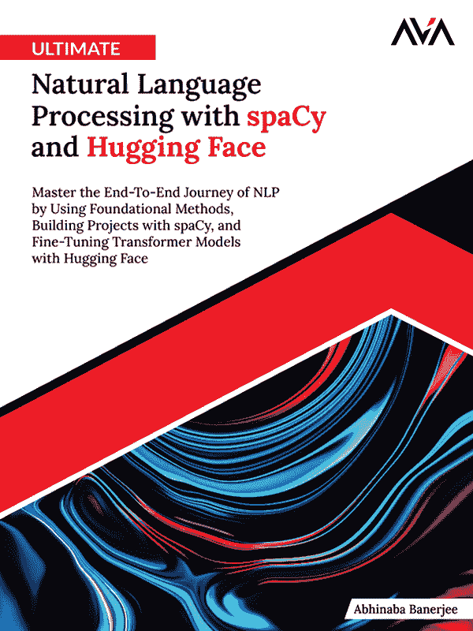


[www.orangeava.com](http://www.orangeava.com)


[www.orangeava.com](http://www.orangeava.com)

# 献给

- 我亲爱的父母，Dipti Banerjee 和 Ajoy Kumar Banerjee
- 我的力量与支持系统。

# 关于作者

`Abhinaba Banerjee` 拥有法国里尔 `ISEG` 管理学院的商业大数据分析科学硕士学位，并拥有印度加尔各答 `MAKAUT`（原西孟加拉邦科技大学）的电子与通信工程技术学士学位和技术硕士学位。他在法国的金融科技和社交媒体初创公司拥有工作经验，目前在安得拉普拉邦政府担任数据分析师。在该职位上，他处理真实的政府数据，专注于数据提取、清洗和洞察生成。

他在通信工程和信号处理领域发表了多篇研究论文。

Abhinaba 经常在 Medium 上分享博客，创建 MLOps、NLP 和 AI 领域的项目，并在 Twitter 等社交媒体平台活跃发布内容。

在空闲时间，他喜欢听关于历史、技术和恐怖的播客。

# 关于技术审稿人

`Karun Thankachan` 是沃尔玛的高级数据科学家，专门从事推荐系统和信息检索。他的工作重点是利用数据科学为数百万客户优化商品选择和可用性。Karun 的职业生涯涵盖了电子商务、金融科技和教育科技等高影响力领域，在这些领域持续为复杂的数据科学和工程项目做出贡献。他的技术领导力通过其大量的学术出版以及在机器学习领域的两个专利得到了证明。

除了职业角色外，Karun 还深度致力于培养下一代数据科学家。他在 `Topmate` 等平台提供大量的导师指导，并被评为北美前 50 名 Topmate 创作者（2024 年）和美国前 10 名数据导师（2025 年）。

他在数据科学社区非常活跃，担任《国际数据、知识与过程管理期刊 (`IJDKP`)》和《数据科学期刊 (`JDS`）》的编辑委员会成员。他还是 `BuildML` 的联合创始人（这是一个举办每周研究讨论的社区），并在 LinkedIn 上与超过 75,000 名粉丝者分享他的见解。

# 谢谢

开启《使用 spaCy 和 Hugging Face 的终极自然语言处理》的写作之旅是一项挑战性任务，非常感谢社区、工具创作者以及其他博主，没有他们我无法完成这本我理想中的书。

首先，要感谢 NLP 社区和专业人士，没有他们我无法获得所需的知识水平。

特别感谢 Hugging Face LLM 课程、`Transformers` GitHub 仓库、`data camp` 的各种 NLP 博客、来自 `Kaggle` 的深度学习笔记本以及我作为书籍课程创建的一些真实案例。

此外，技术审稿人对技术细节的关注以及详尽的理论解释是我获得的最佳投入。他们的专业精神对于完善书籍内容和维护质量至关重要。

感谢我的家人的坚定支持。特别是向我的母亲 Dipti Banerjee 深表谢意，她在整个写作过程中一直是我的动力。感谢感谢我的父亲 Ajoy Kumar Banerjee 在整个过程中提供的坚实支持。

我还要感谢出版社 `Orange Education Pvt Ltd` 的所有人员，他们在各个方面做出了贡献。他们的共同努力让这本书趋于完美！我感谢协助促成《使用 spaCy 和 Hugging Face 的终极自然语言处理》的协作精神。

最后，感谢读者们选择这本书作为你们的学习指南。希望它能成为你们精通使用 spaCy 和 Hugging Face 进行 NLP 之旅的宝贵伴侣。

# 前言

NLP 世界演进得比以往任何时候都快，《Attention is all you need》论文的出现为现代的 `GPT`、`Llama`、`Grok`、`Claude`、`Deep Seek` 等大语言模型（LLMs）奠定了基础。通过最常用的支持库如 `nltk`、`spaCy` 和 `Hugging Face`，如今有很多关于文本摘要、文本到文本生成、问答、文本分类和翻译的项目以及真实案例。

因此，让我们开启《使用 spaCy 和 Hugging Face 的终极自然语言处理》之旅——在书中，读者们将深入学习 NLP，结合理论和真实案例，并将其应用到工作中，从而在 NLP 领域保持领先。

本书包含 12 章，将帮助你学习 NLP（自然语言处理）概念，并利用它们解决问题。你将学习相关理论，并接触真实的用例和项目。书中将使用 `Python` 编程，并涵盖了相关库如 `Hugging Face transformers`、`spaCy`、`nltk` 以及相关工具。你将从零开始实地接触 NLP，包括基础 NLP 如 `POS tagging`（词性标注）、`NER`（实体识别）、`word embeddings`（词嵌入），以及最新的模型如 `BERT`、`transformers` 和 `GPT`。此外，你还将接触近期流行的大语言模型（LLMs），如 `GPT`、`Llama`、`Claude`、`Grok`、`Deep Seek`、`Gemini` 等。

因此，你是希望通过构建项目来扩展技能的专业开发者，还是愿意学习并应用 NLP 知识的新手，这本书都能满足每个人的需求。

如果代码更新，将在现有的 GitHub 仓库中进行更新。

我们对 Orange Education Pvt Ltd 的工作非常自豪，并遵循最佳实践确保内容的准确性，为订阅读者提供沉浸式的阅读体验。读者是我们的镜子，我们利用他们的反馈来反思并改进出版过程中可能的人为错误。为了让我们保持质量并帮助我们联系任何因不可见错误而遇到困难的读者，请通过以下邮箱与我们联系：

非常感谢您的支持、建议和反馈。

如果您在互联网上遇到任何形式的我们作品的非法副本，如果您能为我们提供地址或网站名称，我们将不胜感激。请通过 info@orangeava.com 与我们联系并提供材料的链接。

如果您在某个领域拥有专业知识，并且对编写或为书籍贡献感兴趣，请向 business@orangeava.com 给我们写信。我们致力于帮助开发者和技术专业人员获取全球范围内正在发生的技术进展和创新趋势，并建立一个相信“知识通过与他人分享和学习获得最好”的社区。请联系我们，了解我们读者的需求以及您如何成为这场教育改革的一部分。我们也欢迎技术专家的想法，并帮助他们为自己的领域构建学习和开发内容。

# 评论

请留下评价。在您阅读并使用这本书后，为什么不在购买它的网站上留评价呢？潜在读者就可以查看并利用您的中立意见来做出购买决策。Orange Education 我们非常想知道您对我们产品的看法，我们的作者也可以从您的反馈中学习。谢谢！

有关关于 Orange Education 的更多信息，请访问 [www.orangeava.com](http://www.orangeava.com)。

# 第 1 章

## NLP 简介及核心库

### 引言

我们正处于一个计算机利用 `自然语言处理 (NLP)` 技术理解人类语言的时代。`NLP` 是人工智能的一个分支。在本章中，我们将逐步理解 `NLP` 及其现实中的应用，从搜索引擎、聊天机器人到情感分析和机器翻译。我们将理解在解决 `NLP` 问题时，使用 `Python` 作为最重要的编程语言的意义。我们将学习文本处理的基础知识，如分词（tokenization）、词形还原（lemmatization）、词干提取（stemming）、停用词去除（stop word removal）等。这些是处理文本和理解其意义的基本构建模块，例如，提取亚马逊产品评论的情感（积极、中性或消极），将主题分类为新闻、体育、商业等各种类别。最后，我们将简要探索相关的 `Python` 库，如 `Hugging Face Transformers` 和 `spaCy`，它们将支持我们构建现实世界的 `NLP` 应用。请做好准备，充分利用 `NLP` 来解决问题。

### 结构

在本章中，我们将涵盖以下主题：

* NLP 简介
* 为什么用 Python 用于 NLP？
* NLP 基础知识
    * 文本预处理
* 核心 NLP 库
    * `spaCy`
    * `Hugging Face Transformers`
    * `NLTK`
* 项目与进一步探索

### NLP 简介

我们都熟悉 Siri、Cortana、Alexa 甚至 Jarvis（来自《钢铁侠》电影）。在准确回答问题方面，Siri、Cortana、Alexa 和 Google Assistant 都是优秀的助手。`NLP` 是运行它们的技术。在传统时代，编程能力没有现在的 `NLP` 那么灵活。`NLP` 算法能够准确回答各种问题。

`NLP` 利用以下步骤从电子邮件、文档、社交媒体帖子等非结构化文本中理解并生成：

1. **解码文本含义**：`NLP` 像人类一样理解句子，还可以分析上下文、语法和情感。
2. **将文本拆分为更小的块**：`NLP` 利用分词（tokenization）等技术将文本拆分为单词或句子，使计算机更容易进行处理。
3. **识别关键元素**：`NLP` 可以识别命名实体（例如人物、地点、组织）、词性（名词、动词、形容词、代词）以及词与词之间的关系，提供关于文本的价值信息。
4. **生成通顺文本**：`NLP` 进展在理解文本的基础上还可以生成文本。这有助于我们开发聊天机器人等应用，或根据需求生成文本。

`NLP` 的各种应用帮助公司和个人改进业务并简化日常生活。其中一些包括：

* **信息检索**：搜索引擎利用 `NLP` 检测并理解各种用户查询，并提供准确的结果，使信息检索更快更高效。
* **情感分析**：`NLP` 帮助分析文本数据的情感（如亚马逊产品评论、YouTube 评论、Twitter 评论等），提供客户满意度的见解。
* **机器翻译**：`NLP` 通过将一种语言翻译成另一种语言来消除语言障碍，从而改善跨文化的交流和理解（如 Google Translate、DeepL、Reverso 等）。还有专门的设备可以实时翻译原始语言到目标语言。
* **聊天机器人和虚拟助手**：`NLP` 用于开发理解用户意图并自然自然回答的聊天机器人（客服已通过聊天机器人高度自动化，人类不再从事与人交流和理解查询的机械工作；只有复杂的查询才会转交给人类）。
* **文本摘要**：`NLP` 可以生成大型文档的摘要，节省用户的时间精力，同时让用户获取文档最重要的主题。

### Python 在 NLP 中的重要性

自然语言处理（NLP）是一个快速发展的领域，它使计算机能够理解人类语言并为人类简化任务。由于其支持的特性和环境，`Python` 是 NLP 开发人员的理想编程语言。

- 可读性与简单性：`Python` 的最大优势之一是其简单易于理解的语法。这让任何没有编程背景的人都能轻松学习。这种用户友好的特性让 NLP 从业者能够专注于构建语言处理应用程序，而不是纠结编程语言本身的复杂性。此外，`Python` 是一个免费工具，因此任何人都可以不费力地开始学习。
- 多样且强大的库：`Python` 拥有丰富的内置库，提供了大量的特性和功能。如 `spaCy` 等库具有强大的流水线，可用于命名实体识别（`NER`）以识别人物、地点、日期、组织等，以及词性标注（`POS`）以识别名词、代词、动词、形容词、连词等。还有自然语言工具包（`NLTK`）库，它构 NLP 的基础，提供了分词（tokenization）、词干提取（stemming）、还原（lemmatization）、停用词删除等功能。此外，还有 `Hugging Face Transformers`，提供了先进的预训练模型，如 `BERT` 和 `GPT-3`，以及更新的文本生成模型，如 `MistralAI`、Meta 的 `Llama3` 以及微软的 `Phi-3`。然而，`Hugging Face` 也包含计算机视觉、音频（文本转语音和语音转文本）、强化学习等模型分类。
- 更流畅的开发：基于上述各种强大的库，开发人员可以利用它们快速构建 NLP 应用程序、进行测试、添加功能、迭代和重复，而无需在后台编写大量代码。以最高的效率节省了大量的时间和精力。
- 无缝使用：用 `Python` 编写的 NLP 应用或模型可以轻松在 Linux 和 Mac 系统上运行和复用（如果在 Windows 操作系统上编写）。这种方式使得团队之间的协作变得流畅灵活且易于部署。
- 活跃的社区和丰富的资源：`Python` 拥有庞大且活跃的社区。截至 2024 年 2 月，估计全球 `Python` 编程语言社区有 820 万名开发者，占所有软件开发人员的 44.6%。`Python` 是 `GitHub` 上使用最多的编程语言，2022 年有超过 400 万开发者在使用它。由于数据科学和机器学习的兴起，该语言的流行日益增长，并用于构建网站和软件、自动化任务以及进行数据分析。此外，还有各种在线资源、教程、课程、博客和书籍，对于解决基于 NLP 的问题非常有帮助。

总的来说，`Python` 的易用性、开源工具属性、强大的库、流畅的开发、无缝使用的便利以及庞大的开发者社区，使其成为构建 NLP 模型和应用的开发人员的首选。从文本分析到根据查询生成文本，任何刚开始学习 NLP 的新手程序员或见多识广的资深开发者都可以使用 `Python`。

### NLP 基础

本部分包含了文本分析的各种基础技术。分词（Tokenization）将文本分解为有意义的单元，如单词或句子。词干提取（Stemming）和还原（Lemmatization）将单词还原为基本形式，但两者存在关键区别。词干提取在不考虑语法语境的情况下切掉后缀，而还原则是根据语言模型的理解来识别字典形式（词元）。停用词删除消除了对自身意义较小的常用单词（例如，`the`、`a`），以使分析更高效、聚焦。

### 文本预处理

在执行 NLP 时，机器必须理解原始文本数据并为下一步分析做好准备。这被称为文本预处理，涉及将文本分解成更小的块并移除无关信息。文本预处理包含几个重要步骤，这些是每个 NLP 从业者需要掌握的基础：分词、停用词删除、词干提取与还原以及（可选的）规范化。

#### 分词

句子的长短取决于单词数量。分词是将句子分为单词、标点符号、表情符号甚至短语。分词有不同的类型：

- 词分：将句子分成单词。
- 句分：将一组句子分开。
- N-gram 分词：创建连续单词的序列（例如二元组、三元组）。

分词类型取决于具体任务。我们将看到使用 Python 中的 `spaCy` 库进行分的示例：

```python
import spacy
nlp = spacy.load("en_core_web_sm")
text = "The best video game is Call of Duty, World War 2."
tokens = nlp(text)
for token in tokens:
    print(token.text)
```

`spaCy` 是一个用于高级语言处理的库。它拥有 70 多种语言的训练流水线。其中之一是 `en_core_web_sm`，它指的是特定的模型尺寸，其中 `sm` 表示较小、更快的模型。


图 1.1：分词结果

上面的截图显示了分词的结果，包含了单词和标点。

#### 词干提取与还原

词干提取和还原都会单词还原为基本形式，但两者之间存在重要差异：

### 词干提取

该过程将后缀还原为基本形式。例如，词干提取可以将 `running`、`runs` 和 `ran` 转换为共同的基础 `run`。可能会出现某些诸如 `universal`、`university` 和 `universe` 的单词被还原为同一个基词（通过 `nltk` 中的 `Porter Stemmer` 算法），在这种情况下它是错误的，因为它们在语境上是完全不同的。这被称为过度剪枝（Overstemming）。在某些情况下，单词 `alumnus`、`alumnae` 和 `alumni` 被还原为同一个词干，但它们应该是同义词。这被称为欠剪枝（Understemming）。

```python
from nltk.stem import PorterStemmer

stemmer = PorterStemmer()

##### Example words for stemming
words = ["running", "jumps", "happily", "running", "happily"]

##### Apply stemming to each word
stemmed_words = [stemmer.stem(word) for word in words]

##### Print the results
print("Original words:", words)
print("Stemmed words:", stemmed_words)
```

在上述代码中，我们使用 `nltk`（自然语言工具包）作为库，并将 `PorterStemmer` 作为函数。我们选择了一些单词来理解词干（stemming）过程。输出包含了原始单词和词干后的最终基础词。

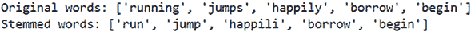

**图 1.2: ** 词干结果

从上述结果中我们可以看到，除了 happily 之外，所有情况下词干后的单词都是正确的。

**词形还原 (Lemmatization): ** 这一过程使用词典和形态分析来识别单词的字典形式（lemma）。因此，任何单词的基础形式都是有意义的。

例如，词形还原可以正确地识别 `running`、`runs` 和 `ran` 的 lemma 为 `run`。与词干相比，词形还原通常更准确，但计算成本更高。

对于词形还原，我们将查看 Python 代码。


```python
import nltk
from nltk.stem import WordNetLemmatizer
nltk.download('punkt')
lemmatizer = WordNetLemmatizer()
print("boxes :", lemmatizer.lemmatize("rocks"))
print("universal :", lemmatizer.lemmatize("corpora"))
##### a denotes adjective in "pos"
print("anger :", lemmatizer.lemmatize("angry", pos="a"))
```

在上述代码中，我们使用了来自 `nltk` 库的 `WordNetLemmatizer` 函数。有一个名为 `punkt` 的资源包，在词形还原之前需要进行句子分词。我们从 `WordNetLemmatizer` 创建了一个 `lemmatizer` 对象，并对单词使用 `lemmatize()` 函数。在最后一个例子中，我们使用了 `pos = "a"`（词性为形容词，因此结果将是主例的形容词形式）。

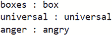

**图 1.3:** 词形还原结果

在上述结果中，我们观察到单词已成功完成词形还原并得到了有意义的结果。对于 `anger` 的最后一个例子，我们得到了形容词形式的结果，即 `angry`。

词干提取更快、更高效，但可能会受到欠词干、过度词干以及无上下文词的影响。另一方面，词形还原更关注单词的语境；因此在执行时可以保持准确性。此外，它还能产生有意义的单词。然而，由于词形还原需要执行形态分析并从词典中提取词义，它比词干提取更耗时。

#### 停用词

自然语言有很多常用词，如 `the`、`a`、`an`、`you`、`he`、`him`、`she`、`her` 等，它们在构成句子时至关重要。这些被称为停用词。它们对语言很重要，但在文本分析过程中也会引入干扰。因此，从文本中移除停用词是至关重要的。我们可以使用 spaCy 中的自定义函数来理解停用词移除的过程。它会检查标记是否存在于 spaCy 的内置词汇表中。代码如下。

```python
import spacy
nlp = spacy.load("en_core_web_sm")
def remove_stopwords(text):
    stop_words = spacy.lang.en.stop_words.STOP_WORDS
    doc = nlp(text)
    filtered_tokens = [token.text for token in doc if token.text not in stop_words]
    return " ".join(filtered_tokens)

text = "This is a sample sentence showing stop words removal."
print(remove_stopwords(text))
```

- 支持 70 多种语言，如中文、西班牙语、葡萄牙语、法语、德语、俄语、罗马尼亚语、意大利语、日语、韩语、荷兰语等。它还支持印度语言，如孟加拉语、印地语、泰米语、泰卢固语、马拉地语等。
- 它使用 `BERT` 等预训练 transformer 进行多任务学习。
- 支持预训练词向量和嵌入。
- 它速度很快。
- 它提供对 `PyTorch`、`TensorFlow` 以及其他框架中自定义模型的支持。
- 内置语法和 `NER` 的可视化。
- 生产级训练系统。

spaCy 还提供了从原型到生成的端到端 NLP 工作流，并编排自定义流水线的训练、打包和部署。spaCy 项目还易于集成数据科学和机器学习生态系统中的许多其他优秀工具（`DVC`、`prodigy`、`Streamlit`、`FastAPI` 和 `Weights and Biases`），以跟踪和管理数据及实验，迭代演示和原型，并将模型推向生产环境。

Hugging Face Transformers 是如今构建 NLP 应用时的首选库。它构建在 `PyTorch` 和 `TensorFlow` 等框架之上。它拥有用于处理预训练 transformer 模型的易用界面以及强大的深度学习架构。它涵盖了多种模型，如文本到文本生成、文本到图像生成、问答、文本分类、摘要、特征提取、句子相似性、视频分类、图像分类、目标检测、图像到视频、自动语音识别、音频分类、文本转语音、文本转音频、时间序列预测、强化学习等。

Transformers 提供了用于在文本上下载和使用预训练模型（上述模型，但不限于此）并在数据集上进行微调的 API。我们可以使用现成的模型在几小时内轻松创建应用程序。Transformers 拥有计算成本较低的模型，因此碳足迹更小。此外，模型可以根据需求进行定制。

Hugging Face 网站上已经托管了几个示例模型。

* 使用 `BERT` 的掩码单词补全（[`huggingface.co/google-bert/bert-base-uncased?text=Paris+is+the+%5BMASK%5D+of+France`](https://huggingface.co/google-bert/bert-base-uncased?text=Paris+is+the+%5BMASK%5D+of+France)）
* 使用 `Electra` 的 `NER`（[`huggingface.co/dbmdz/electra-large-discriminator-finetuned-conll03-english?text=My+name+is+Wolfgang+and+I+live+in+Berlin`](https://huggingface.co/dbmdz/electra-large-discriminator-finetuned-conll03-english?text=My+name+is+Wolfgang+and+I+live+in+Berlin)）
* 使用 `Mistral` 的文本生成（[`huggingface.co/mistralai/Mistral-7B-Instruct-v0.2`](https://huggingface.co/mistralai/Mistral-7B-Instruct-v0.2)）

以上是某些通过预测单词（掩码单词补全）来解决问题的模型。命名实体识别（`NER`）有助于相应地标记单词，例如它是人、地点、组织、日期等。由 `Mistral` 的文本生成模型（[`news.crunchbase.com/`](https://news.crunchbase.com/)）根据用户要求生成文本。它可以回答提出的问题。

还有一些使用 Transformers 构建的优秀项目。

* `Gpt4all`（[`github.com/nomic-ai/gpt4all`](https://github.com/nomic-ai/gpt4all)）在大量数据上训练，包括代码、故事和对话。
* `IOPaint`（[https://github.com/Sanster/IOPaint](https://github.com/Sanster/IOPaint)）由 `Stable Diffusion` 驱动工具。
* `Llamaindex`（[`github.com/run-llama/llama_index`](https://github.com/run-llama/llama_index)）是连接 LLMs 的项目。
* `Sentence transformers`（[`github.com/UKPLab/sentence-transformers`](https://github.com/UKPLab/sentence-transformers)）为句子、段落和图像提供稠密向量表示。

NLTK 支持通过分析词序列概率等 `n-grams` 等模型进行文本生成、语音识别和摘要，同时通过识别词搭配来增强对词汇关系的理解，并改进关键词提取等任务。它提供了使用 `precision` 和召回率 `recall` 等指标评估 NLP 模型性能的工具，并提供树状图和散点图等可视化选项来有效解释数据。

NLTK 还支持多种语言模型，例如 `n-gram` 模型。这些模型对于文本生成、语音识别、预测文本输入和文本摘要非常有帮助。通过分析词序列的概率，语言模型有助于理解和生成人类水平的文本。

词搭配是频繁一起出现的词对或词组。NLTK 可以发现词搭配和词关联，这对于理解词汇关系和改进语言模型很有用。这种分析可以揭示有趣的模式，并帮助关键词提取和文本摘要等任务。

NLTK 有一些用于评估 NLP 模型性能的工具。这包括计算 `precision`、`recall`、`F1-score` 以及其他指标的方法。适当的评估对于理解模型的有效性以及就模型改进做出明智决策至关重要。

可视化是 NLP 中理解和解释数据的重要方面。NLTK 提供了各种可视化工具，例如用于句法分析的树状图和用于分析文本中词使用情况的散点图。

### NLTK、Hugging Face 和 spaCy 的对比分析

我们简要讨论了 NLTK、`spaCy` 和 `Hugging Face Transformers` 库。然而，我们将在专门的章节中详细介绍 `spaCy` 和 `Hugging Face Transformers` 及其用例。我们可以对这三个库进行如下比较：

- **NLTK**: 最适合传统的 NLP 任务和教学目的，学习曲线较陡，且文档详尽。
- **Hugging Face Transformers**: 是使用 `transformer` 模型进行最前沿 NLP 的理想选择，提供了大量的预训练模型和高性能，适用于开发自己的 NLP 应用，但学习曲线更陡峭。
- **spaCy**: 为生产级、友好的界面、健壮的流水线和高效的性能而设计，适用于学者和高级用户。

还有其他 NLP 库，如 `Textblob`、`CoreNLP`、`Gensim`、`polyglot`、`pattern` 和 `scikit-learn`。

### 项目与进一步探索

现在我们已经接触了 NLP 的边缘，并探索了 `spaCy`、`Hugging Face Transformers` 和 `NLTK` 的功能，我们可以探索各种项目。这一部分将向我们展示展示这些库应用的各种用例和项目想法。我们将探索各种可以使用这些库构建 NLP 解决方案的创意。

### 使用 spaCy 开启新世界

在构建如 NER（命名实体识别）系统、词性标记器、用于情感分析的聊天机器人以及 `spaCy` 流水线等 NLP 应用时，`spaCy` 的功能通常是理想的。以下是一些可以在此基础上构建的项目想法，但不限于此：

#### 构建命名实体识别 (NER) 系统

- **用例**: 提取人物、地点和组织等关键实体。
- **项目想法**: 开发一个 `NER` 系统，能够从文本中识别特定的实体和日期。

#### 创建带有情感分析的聊天机器人

- **用例**: 分析用户消息的情感（正面、负面或中性）。
- **项目想法**: 构建一个客户服务机器人，能够识别反馈并做出相应响应。

#### 构建文本摘要器

- **用例**: 生成长文档或文章的简明摘要。
- **项目想法**: 针对特定领域（如研究论文或新闻）开发文本摘要器。

#### 实现词性 (POS) 标记器和依存法解析器

- **用例**: 分析句子的语法结构。
- **项目想法**: 构建一个工具，识别词性并解析词与词的关系。

#### 探索自定义 spaCy 流水线

- **用例**: 通过创建特定 NLP 任务的自定义流水线来扩展 `spaCy` 的功能。
- **项目想法**: 开发一个识别特定术语或技术词汇的自定义流水线。

通过开展这些 `spaCy` 项目，我们将获得现实 NLP 应用的实践经验。然而，这些只是可以开发的应用程序之一。我们可以探索 `spaCy` 文档和社区资源以发现更多可能！

`Hugging Face Transformers` 利用预训练 `transformer` 模型的潜力来构建复杂的 NLP 任务。以下是我们可以构建的一些用例和项目想法：

#### 构建文本分类系统

- **用例**: 将文本数据分类到预定义的类别，例如情感分析（正面/负面评论）或主题分类（体育新闻、娱乐新闻或政治新闻）。
- **项目想法**: 开发一个用于电子商务平台客户评论的分类系统。

#### 构建问答系统

- **用例**: 根据给定的上下文或数据集为用户问题解答。
- **项目想法**: 针对特定领域（如回答产品常见问题）开发问答系统。

#### 尝试文本生成

- **用例**: 生成人类质量的文本，例如创意写作，或在保留意义的同时翻译语言。
- **项目想法**: 开发一个创意文本生成器，可以产生不同的写作风格，如诗歌、短故事或代码。


### 针对特定任务微调预训练模型

- **用例**: 通过使用我们的数据集进行微调，使预训练模型的能力适应特定的 NLP 问题。

## 项目创意

- **项目创意**：针对公司客户评论对预训练模型进行微调，用于情感分析。这可以使模型更好地理解公司语言的细微差别，并提供更准确的情感分析。

## 探索高级 Transformer 架构

- **用例**：通过尝试不同的架构（例如 `BERT`、`GPT-3`）来深入探索 Transformer 的世界，并理解它们的优缺点。

- **项目创意**：比较不同预训练模型在特定 NLP 任务上的性能。这将帮助你比较不同预训练模型在特定 NLP 任务中的表现，识别最符合需求的模型，并了解不同 Transformer 架构的有效性。

## 揭示 NLTK 的力量

NLTK 的功能大多对初学者友好且具有教育意义，并有大量的文档。然而，这并没有阻止构建项目来巩固对 NLP 的理解。以下是一些可以使用 `NLTK` 解决的用例和项目。

### 使用简单的模式匹配构建聊天机器人

- **用例**：创建一个基础机器人，使用预定义的模式和响应与用户进行交互。

- **项目创意**：构建一个能够理解基础用户查询并提供预编程响应的简单聊天机器人。利用 `NLTK` 的分词和模式匹配功能来识别用户输入中的关键词并做出相应。

### 实现文本预处理流水线

- **用例**：开发一个全面的流水线，用于清洗和准备进一步分析的文本数据。

- **项目创意**：构建一个执行分词、停用词删除、词干提取/还原和标准化等任务的文本预处理流水线。该流水线可以作为各种 NLP 项目的基础，确保我们的数据准备好供其他 NLP 工具进一步处理。

### 实验 NLTK 语料库和词汇资源

- **用例**：利用 `NLTK` 内置语料库（文本集合）和词汇资源（例如 `WordNet`）执行命名实体识别或词相似性等任务。

- **项目创意**：使用 `NLTK` 的命名实体识别功能和预训练语料库开发一个识别文本数据中命名实体（人员、地点）的系统。或者，探索构建使用 `WordNet` 计算词相似性的工具，允许你识别含义相似的词。

虽然项目提供了宝贵的实践经验，但我们的 NLP 探索并未此结束。以下是进一步扩展知识并保持在该动态领域前沿的一些方法：

- **参与 Hugging Face 社区**：`Hugging Face` 社区是 NLP 爱好者的活力中心。加入论坛、参与讨论并从其他用户那里学习有助于我们获得大量的知识并开启机会世界。我们可以分享项目、提问，并从经验实践者那里获得宝贵的见解。

- **贡献开源项目**：开源项目是 NLP 进展的骨干。考虑为 `spaCy`、`NLTK` 或 `Hugging Face Transformers` 的现有项目贡献代码、文档或修复。这是回馈社区、向经验开发者学习并加深对代码库理解绝佳方式。

- **保持研究更新**：NLP 领域不断演进。订阅研究博客，在 `Twitter` 或 `LinkedIn` 上关注领先的研究人员，并参加会议以了解最新进展和突破。这将让我们接触到新想法并启发我们探索 NLP 内部的新途径。

- **探索高级 NLTK 功能**：`NLTK` 提供超出基础任务的功能。深入研究统计语言模型、`N-grams` 或 `NLTK` 内的机器学习集成等主题，以扩展我们的能力。

## 结论

在本章中，我们理解了 NLP 的定义、其应用、使用 `Python` 的用法和意义，以及 NLP 基础知识，包括使用 `Python` 进行分词、词干提取、还原、标准化和停用词删除的文本预处理。此外，我们还讨论了 `spaCy`、`NLTK` 和 `Hugging Face Transformers` 的功能，以及用于应用和构建 NLP 应用的一系列和项目创意。

因此，让我们接受这段旅程，尝试不同的方法并提问。当我们深入探索这个迷人的领域时，我们将解锁语言的力量，并创造改变与信息交互方式的创新 NLP 解决方案。

在下一章，我们将详细研究 NLP 算法的构建模块和技术。我们将学习 `Bag-of-Words` 模型、`n-grams` 和 `TF-IDF` 等技术。此外，我们还将学习词嵌入、独热编码和其他相关技术。

## 参考文献

- [`sunscrapers.com/blog/9-best-python-natural-language-processing-nlp/`](https://sunscrapers.com/blog/9-best-python-natural-language-processing-nlp/)
- [`tjzhifei.github.io/resources/NLTK.pdf`](https://tjzhifei.github.io/resources/NLTK.pdf)
- [`www.tutorialspoint.com/natural_language_toolkit/natural_language_toolkit/`](https://www.tutorialspoint.com/natural_language_toolkit/natural_language_toolkit/)
- [ChatGPT 常见识、OpenAI 的 GPT-4](https://blog.invgate.com/chatgpt-statistics#:~:text=ChatGPT%20general%20facts,-OpenAI%E2%80%99s%20GPT%E2%80%934&text=The%20chatbot%20was%20trained%20on,summarization%2C%20and%20question%2Danswering)
- [NLP 项目创意](https://iq.opengenus.org/nlp-project-ideas/)
- [顶级的自然语言处理 (NLP) 项目](https://www.geeksforgeeks.org/top-natural-language-processing-nlp-projects/)
- [适用于所有水平的 NLP 项目创意](https://www.datacamp.com/tutorial/nlp-project-ideas-for-all-levels)
- [10 个 NLP 项目](https://neptune.ai/blog/10-nlp-projects)

# 第 2 章

## NLP 算法的构建模块与技术

### 引言

我们学习了 NLP 及其意义、应用、文本预处理以及用于构建应用程序的库（`spaCy`、`NLTK` 和 Hugging Face）。在此基础上，本章将深入探讨构成 NLP 算法的基础构建模块和技术。在这里，我们将研究诸如词袋模型（Bag-of-Words）、`n-grams` 和 `TF-IDF`（词频-逆文档频率）等技术。我们还将理解词嵌入（word embeddings）的力量，它可以捕捉词之间的语义关系并将其转换为向量，帮助计算机理解语言的上下文。

我们还将探索两个基础的 NLP 任务：词性标记（POS tagging）和命名实体识别（NER）。词性标记揭示了单词在句子中的语法角色，如名词、代词、动词、形容词、连词、标点符号等。同时，NER 识别并分类命名实体，如人物、地点、日期和组织。此外，我们还将探索句法分析（Dependency Parsing）的概念。此外，我们还将理解 NLP 的评估指标。

### 结构

在本章中，我们将讨论以下主题：

* 文本数据表示：从单词到数字
* 使用词嵌入揭示含义
* 词义消歧
* 词性 (PoS) 标记
* 命名实体识别 (NER)
* 指代消解
* NLP 评估指标
* 句法分析

### 文本数据表示：从单词到数字

计算机将文本转换为数字以理解人类级别的文本数据。

将文本数据表示为数字是自然语言处理中的基础步骤。这一过程涉及将单词、短语或整个文档转换为数值格式，以便算法对其执行数学运算。此前，诸如独热编码（one-hot encoding）和词袋模型（bag-of-words）等技术将文本转换为高维稀疏向量，而更高级的方法（如 `TF-IDF`）根据单词的频率和分布对其重要性进行排序。最近，连续向量表示或词嵌入（例如 `Word2Vec` 和 `GloVe`）变得流行，因为它们通过将单词映射到稠密的低维空间来捕捉词之间的语义关系。

本章将深入研究这些技术：词袋模型 `Bag-of-Words (BoW)` 将文档视为单词集合，并捕捉词频。`N-grams` 将单词序列（如二元组或三元组）作为特征捕捉，为这些句子提供一些上下文。还有 `TF-IDF (词频-逆文档频率)`，它同时考虑了单词在文档中的频率以及跨文档的频率。

### BoW 模型

词袋模型（Bag-of-Words, BoW）是 NLP 中的一种基础技术，它忽略顺序将文档表示为单词的集合。让我们来看例子来理解这个概念。

文档 1：“I am good man”

文档 2：“You are good man”

代码如下：

```python
def tokenize_documents(documents):
    all_tokens = []
    for document in documents:
        all_tokens.extend(document.split())
    return all_tokens

documents = ["I am good man", "You are good man"]
tokens = tokenize_documents(documents)
print("Tokens:", tokens)
#### 输出: ['I', 'am', 'good', 'man', 'You', 'are', 'good', 'man']
```

在上面的代码中，我们拆分句子以获取单词，然后使用 `set()` 函数获取唯一单词。在下一步中，我们创建一个包含单词及其频率的字典。

```python
def create_bow_model(tokens):
    vocabulary = set(tokens)
    bow_model = {word: 0 for word in vocabulary}
    for token in tokens:
        bow_model[token] += 1
    return bow_model

all_tokens = tokenize_documents(documents)
bow_model = create_bow_model(all_tokens)
print("Bag-of-Words Model:", bow_model)
#### 输出: Bag-of-Words Model: {'I': 1, 'am': 1, 'good': 2, 'man': 2, 'You': 1, 'are': 1}
```

BoW 模型适用于 `text classification`，用于为分类模型表示输入文本。该模型可以学习根据输入文本中某些单词的出现与否来预测类别标签。在信息检索中，文档和搜索查询都被转换为这些向量，然后使用 `cosine similarity` 等相似性度量进行比较。这种方法允许系统高效地对大型语料库进行索引，并根据文档与给定查询的相关性进行排序。尽管简单且具有扩展性，但 BoW 可能会忽略语言中固有的上下文细差别。文本相似性是 BoW 模型的另一个应用场景，通过比较词频来比较两个或多个文档。在机器翻译中，BoW 模型可以作为基准，将句子表示为词频的集合，而不考虑顺序。这种方法有助于识别词汇相似性，并为语言之间的初始词对齐提供信息。然而，由于它忽略了上下文和语法，BoW 的效果通常不如捕捉序列依赖的高级模型。

使用 BoW 模型具有某些优点和缺点。

#### 优点

- **使用简单**：BoW 模型易于理解和实现。与其他复杂的 NLP 技术相比，它们不需要高计算能力。

- **健壮性**：BoW 模型在文本文档的单词顺序方面具有灵活性。这在处理噪声或非结构化文本数据时很有帮助。

- **特征工程简单**：词袋模型是文本数据的简单表示，这使其易于从数据中提取额外特征。

#### 缺点

- **丢失词序**：BoW 不考虑词序；因此，丢失了上下文信息。

- **无法捕捉语义关系**：在前一个缺点的基础上，由于不考虑词序，BoW 对所有单词一视为仁，因此词关系丢失了。`tall` 和 `short` 等单词对于 BoW 来说是相同的，因为它无法捕捉语义。

- **对停用词敏感**：BoW 模型对停用词（常见单词，如 `the` 或 `a`）的包含或排除非常敏感。

- [`spotintelligence.com/2022/12/20/bag-of-words-python/`](https://spotintelligence.com/2022/12/20/bag-of-words-python/)
- [`web.stanford.edu/~jurafsky/slp3/slides/LM_4.pdf`](https://web.stanford.edu/~jurafsky/slp3/slides/LM_4.pdf)
- [`spotintelligence.com/2023/04/05/n-grams/`](https://spotintelligence.com/2023/04/05/n-grams/)
- [`spotintelligence.com/2022/11/28/tf-idf/`](https://spotintelligence.com/2022/11/28/tf-idf/)

### N-grams 模型

词袋（BoW）模型忽略了单词顺序和单词关系。N-grams 通过捕捉 n 个连续单词的序列来解决这一局限性。它可以是 2-grams（捕捉 2 个连续单词）、3-grams（捕捉 3 个连续单词）等以此类推。因此，如果我们考虑上一节中的句子“I am a good man”，对于 2-grams，它将是“I am”、“am a”、“a good”和“good man”。通过这种方式，我们可以获得比 BoW 模型的一些上下文方面的优势。它被用于情感分析、语言建模和机器翻译。

使用 `N-grams` 捕捉可以提供局部情感线索的连续单词序列。例如，`bi-grams or tri-grams` 可以识别特定的单词如“not good”或“very happy”，这些单词增加了文本的整体情绪。它们在考虑单个单词之外考虑上下文增强了情感分类模型的准确性。

`N-grams` 为语言建模提供了一个统计框架，根据前后的单词预测单词的概率。使用这种基于马尔可夫假设的方法创建了捕捉局部单词依赖的模型，这有助于语音识别和文本合成等任务。

通过对单词序列进行建模，n-grams 捕捉了局部的语法和语义模式，有助于选择准确的翻译，形成生成连贯且符合上下文的翻译文本的基础。N-grams 在机器翻译中至关重要，特别是在基于短语的翻译系统中，它们帮助识别和对齐源语言与目标语言之间的常用短语。

我们也可以研究 N-grams 模型的优缺点。

#### 优点

- **上下文**：我们在上一个例子中观察到，由于 N-grams 可以选取相邻单词，它们可以帮助我们理解单词和短语，提供某种上下文。

- **灵活**：N-grams 可以用于单个字符和较大的文本段落，因此易于以不同的方式分析语言。

#### 缺点

- **上下文不足**：N-grams 确实捕捉了上下文，但不是更高层次，因此丢失了对文本块整体把握（例如含义）。

- **数据稀疏性**：随着 n-gram 大小的增大，可能的组合数量也会增加，这使得难以获取准确的信息。

- **缺乏对单词含义的理解**：N-grams 没有语义理解。

- **过拟合**：使用 n-grams 作为特征会导致过拟合，即模型过于复杂，训练数据上表现良好但在未见数据上表现糟糕。

现在，让我们探索创建 n-gram 的 Python 代码。

```python
from nltk.util import ngrams

#### 示例句子
sentence = "Natural Language Processing is a powerful tool for analyzing data."

#### 将句子分词为单词
words = sentence.split()

#### 从单词列表中创建 4-grams
fourgrams = ngrams(words, 4)

#### 打印 4-grams
for fourgram in fourgrams:
    print(fourgram)
```

输出：

```
('Natural', 'Language', 'Processing', 'is')
('Language', 'Processing', 'is', 'a')
('Processing', 'is', 'a', 'powerful')
('is', 'a', 'powerful', 'tool')
('a', 'powerful', 'tool', 'analyzing')
('powerful', 'tool', 'analyzing', 'text')
('tool', 'analyzing', 'text', 'data.')
```

上面的代码展示了 N-grams 模型，从 `nltk` 包中导入了 `ngrams` 函数。句子被分词，并使用带有标记列表和 4 作为输入的 `ngrams()` 函数创建了 4-grams。对于双词组（bigrams），可以将 4 更改为 2。

逆文档频率（Inverse Document Frequency）衡量的是一个词汇在整个文档集合中的稀有程度。在所有文档中频繁出现的词汇信息量较少，因此它们的 IDF 分数会较低。

我们需要将这两个参数结合起来，以理解独特词汇的重要性并过滤掉常见词汇。

`TF*IDF`


# 自然语言处理中的文本向量化技术

在自然语言处理（NLP）中，面临着将文本数据转换为机器学习模型可用的数值表示的挑战。但计算机无法直接理解文本。因此，`TF-IDF` 通过根据词汇的频率和重要性为单词分配数字应运而生。这样，算法就可以利用 `TF-IDF` 分析文本数据中的模式。`TF-IDF` 不仅关注词频，还赋予了文档中独特和低频词汇出现频率的重要性，从而有助于情感分析、主题建模和信息检索等应用。

为了帮助情感分析模型识别带有情感倾向的词，`TF-IDF` 将文本转换为加权数值向量，这些向量强调了与语料库相比具有高价值的短语。通过降低常见词汇的噪声，这种特征提取方法提高了分类系统的效率。

`TF-IDF` 可用于主题建模，通过突出和识别特定主题的特征性核心术语，来减少通用短语的影响。`潜在狄利克雷分布 (LDA)` 等模型产生的主题连贯性和解释性可以通过这些加权短语得到增强，这些短语充当了信息的特征。

我们还可以研究 `TF-IDF` 模型的优缺点。

## 优点

* **降低常见词汇的权重**：`TF-IDF` 减少了常见词汇的影响，有助于关注文档中更具体的词。通过这种方式，可以很好地理解和分析上下文。
* **改进文本表示**：`TF-IDF` 同时考虑了词频和文档特定的重要性。

## 缺点

* **稀有词汇**：非常稀有的词可能有极高的 `IDF` 分数，这会导致机器学习模型出现过拟合问题。
* **缺乏语义含义**：`TF-IDF` 无法帮助理解语义。它在确定重要性时对单词进行加权并考虑它们，但它无法获取短语的上下文。
* **对预处理敏感**：`TF-IDF` 对词干提取（`stemming`）或词形还原（`lemmatization`）可能敏感，因为不同的词形式无法被识别为同一个根词。这会导致 `TF-IDF` 的数值发生变化，从而降低准确性。

为了从数学角度理解 `TF-IDF` 概念，这里有一篇解释非常详细的`博客文章`。

现在，让我们探索 `TF-IDF` 的 Python 代码。

```python
from sklearn.feature_extraction.text import TfidfVectorizer

# 示例文档
documents = ["I am a good man.", "You are a good man too."]

# 创建 TF-IDF 向量化
vectorizer = TfidfVectorizer()

# 在文档上拟合向量化
tfidf_matrix = vectorizer.fit_transform(documents)
```

# 连续词袋模型 (CBOW)

`CBOW` 是一种基于神经网络的方法，用于 `Word2Vec` 中根据其周围的单词（上下文）预测目标词。它通过分析单词在给定窗口大小内共同出现的模式来捕捉单词的语义含义。

例如，给定句子：

> "The cat is sitting on the mat."

如果上下文窗口大小为 2，且我们正在预测缺失的单词 `w_target`，那么一个训练示例可能如下：

| 上下词 | 目标词 |
| --- | --- |
| (The, is) | cat |
| (cat, sitting) | is |
| (is, on) | sitting |

**表 2.1: 上下词和目标词**

`CBOW` 通过利用邻近词来理解单词的含义，使其适用于文本分类和词汇相似性检测等 NLP 任务。

## CBOW 架构

`CBOW` 由三层组成：

* **输入层**：接收多个独热编码的单词（上下文词）。
* **隐藏层**：将独热向量转换为稠密的、低维表示（词嵌入）。
* **输出层**：通过应用 `softmax` 函数为词汇表中所有的单词生成概率，从而预测目标词。

## 逐步工作原理

1. **输入表示**：每个上下文词都被表示为一个独热编码向量。
2. **嵌入查找**：输入向量与权重矩阵相乘，产生词嵌入。
3. **平均**：对所有上下文词的嵌入取平均值。
4. **预测**：将平均后的向量通过另一个权重矩阵和 `softmax` 激活函数，以预测目标词。
5. **训练**：模型使用负对数似然损失（或交叉熵损失）。

### CBOW 的优点

* 与 `Skip-gram` 相比，训练速度更快。
* 在大数据集上表现良好。
* 能有效捕捉常用词。

### CBOW 的缺点

* 由于平均了多个词嵌入，因此对稀有词的效果不佳。
* 由于平等对待所有上下文词，因此丢失了位置信息。

## Skip-gram

`Skip-gram`：该架构反转了概念，根据给定的单词预测周围的上下文词。

例如，在同一个句子中：

> "The cat is sitting on the mat."

如果 `cat` 是目标词且窗口大小为 2，`Skip-gram` 生成的训练示例如下：

| 目标词 | 上下词 |
| --- | --- |
| cat | (The, is) |
| is | (cat, sitting) |
| sitting | (is, on) |

**表 2.2: 目标词和上下文词**

`Skip-gram` 为频繁一起出现的单词分配高概率，使其在学习稀有词的表示时更有效。

## Skip-gram 架构

`Skip-gram` 包含以下关键组件：

* **输入层**：单个独热编码单词（目标词）。
* **隐藏层**：将输入映射到稠密向量表示（词嵌入）。
* **输出层**：使用 `softmax` 概率分布预测多个上下文词。

## 逐步工作原理

1. **输入表示**：目标词被转换为独热编码向量。
2. **嵌入查找**：输入向量与权重矩阵相乘，生成词嵌入。
3. **预测**：模型使用另一个权重矩阵和 `softmax` 激活函数预测目标词周围的多个单词。
4. **训练**：模型使用负采样或层次化 `softmax` 进行训练以提高效率。

### Skip-gram 的优点

* 对于学习稀有词效果良好，因为它生成了更多的训练数据。
* 捕捉单词之间更深层次的语义关系。

### Skip-gram 的缺点

* 由于多次预测，训练速度比 `CBOW` 慢。
* 需要更多的计算资源。

| 特性 | CBOW | Skip-gram |
| --- | --- | --- |
| 训练速度 | 快 | 慢 |
| 处理稀有词 | 不佳 | 良好 |
| 上下文使用 | 预测多个词 | 更准确 |
| 适用场景 | 大数据集 | 小数据集 |

**表 2.3: CBOW 与 Skip-gram**

# GloVe（词表示向量）

`GloVe` 是另一种强大的词嵌入学习技术。`Word2Vec` 利用神经网络，而 `GloVe` 则利用共现信息来捕捉单词之间的语义关系。

`GloVe` 构建了一个大型矩阵，行表示单词，列表示词汇中的其他单词。矩阵中的每个单元格包含单词在特定窗口大小内共同出现的次数。

## 示例：GloVe 如何构建共现矩阵

让我们考虑一个小语料库：“The cat sat on the mat. The dog sat on the rug.”

### 第 1 步：定义窗口大小

假设窗口大小为 2（目标词两侧的单词）。这意味着对于每个单词，我们统计其他单词在该窗口内出现的次数。

### 第 2 步：构建共现矩阵

下面是我们语料库的简化词-词共现矩阵：

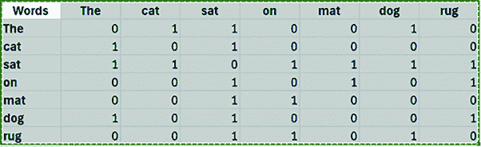

**图 2.2: 共现矩阵**

* 矩阵存储共现计数。
* 示例：单词 `sat` 在给定窗口内与 `The` (1 次)、`cat` (1 次)、`on` (1 次)、`mat` (1 次)、`dog` (1 次)、`rug` (1 次) 共现。

### 第 3 步：将共现转换为概率

矩阵中的每个值都被转换为概率：

`P(w_j | w_i) = (w_i 和 w_j 的共现计数) / w_i 的总出现次数`

这有助于确定单词之间的紧密程度。

### 第 4 步：矩阵分解

`GloVe` 随后采用矩阵分解技术来降维。这创建了稠密向量表示，其中含义相似的词具有相似的嵌入。

`GloVe` 的代码实现如下。

```python
import numpy as np
import matplotlib.pyplot as plt
from sklearn.decomposition import PCA

# 矩阵分解后获得的示例词向量（模拟的）
word_vectors = {
    "The": [0.8, 0.2],
    "cat": [0.6, 0.5],
    "sat": [0.5, 0.7],
    "on": [0.3, 0.9],
    "mat": [0.4, 0.6],
    "dog": [0.7, 0.3],
    "rug": [0.2, 0.8]
}
# 将字典转换为数组以便进行 PCA
words = list(word_vectors.keys())
vectors = np.array(list(word_vectors.values()))
# 应用 PCA 将维度降到 2D
pca = PCA(n_components=2)
reduced_vectors = pca.fit_transform(vectors)
# 在 2D 空间中绘制词
plt.figure(figsize=(8,6))
plt.scatter(reduced_vectors[:,0], reduced_vectors[:,1], color='blue')
# 标注词
for i, word in enumerate(words):
    plt.annotate(word, (reduced_vectors[i,0]+0.02, reduced_vectors[i,1]+0.02), fontsize=12)
plt.title("2D Representation of Word Embeddings (GloVe)")
plt.xlabel("PCA Component 1")
plt.ylabel("PCA Component 2")
plt.grid(True)
plt.show()
```

代码解释如下。

导入了相关的库，即 `numpy`、`matplotlib` 和 `sklearn`。使用 `sklearn.decomposition` 中的 `PCA` 将词向量的维度从高维空间降到 2D。

然后我们定义了示例词向量：

* 字典 `word_vectors` 包含示例词嵌入（每个词都表示为一个 2D 向量）。
* 正常情况下，真实的 `GloVe` 向量是高维的（例如 50D、100D、300D），但为了简单起见，我们在这里假设为 2D 嵌入。

然后我们将词向量转换为 Numpy 数组：

* `words`：存储词标签（例如 `The`、`cat`、`sat` 等）。
* `vectors`：将词嵌入从字典格式转换为 NumPy 数组，以便进行数值处理。

接下来，应用 PCA 进行降维：

* `PCA(n_components=2)`：创建一个 `PCA` 对象以将向量降至 2D。
* `pca.fit_transform(vectors)`：执行 `PCA` 变换，将高维向量映射到 2D 平面，同时保留它们之间的关系。

使用散点图来可视化词嵌入。然后，对词进行标注：

* 遍历每个词，并将文本标签放置在略偏离点的位置。
* 有助于识别每个词在 2D 空间中的位置。


**图 2.3: 使用 PCA 的 GloVe 表示**

* 在应用 `PCA` 将维度从高维向量降低降维后，每个词都被绘制在 2D 空间中。
* 频繁共现的词（例如 `sat`、`on`、`mat`）彼此距离较近。
* 语义或语境不相关的词（例如 `The`、`rug`）位置较远。
* 这种可视化展示了 `GloVe` 如何根据共现模式捕捉词与词之间的关系。

详细解释了 `GloVe` 后，现在让我们来看看 `GloVe` 的优缺点。

## 优点

* **训练高效性**：与 `Word2Vec` 相比，`GloVe` 的训练更高效，特别是在处理大型数据集时，因为 `GloVe` 中存在统计技术。
* **捕获全局信息**：由于使用了统计技术，`GloVe` 在捕捉全局信息方面表现更好。

## 缺点

* **可解释性**：与 `Word2Vec` 的架构相比，`GloVe` 的解释性更具挑战性。
* **偏见**：`GloVe` 嵌入会像 `Word2Vec` 一样继承偏见，如果训练语料库中包含性别或种族偏见。
* **上下文理解**：虽然 `GloVe` 考虑了词顺序，但在理解上下文方面存在限制。

# 从词到句

句子嵌入构建在词嵌入之上。对于句子中的每个词，其整体向量表示都具有语义含义。

## 捕捉句子含义

生成的句子嵌入封装了整个句子传达的含义和关系，而不仅仅是个单词。

## 应用

句子嵌入对于各种自然语言处理（NLP）任务至关重要，包括：

* 文本分类（情感分析、主题建模）
* 语义相似性比较（寻找相似句子）
* 文本摘要（捕捉核心思想）
* 机器翻译（跨语言保留含义）

让我们来看一下句子嵌入的优缺点。

## 优点

* **提升 NLP 性能**：通过捕捉句子的整体含义，情感分析和文本分类等任务的性能得到了增强。
* **多功能性**：句子嵌入可以集成到各种 NLP 架构中用于多种应用。
* **简化工作流**：诸如 `USE` 等预训练模型提供了一种便捷的方法来利用句子嵌入，而无需大量的训练。

## 缺点

* **偏差**：句子嵌入可能会继承训练数据中存在的偏差。仔细选择预训练模型和缓解策略至关重要。考虑一个在偏见数据上训练的 NLP 模型，其中`不同种族背景的名称`与不同的情感得分相关联。如果我们使用句子嵌入进行情感分析，偏差可能会不公平地体现。这可能导致有偏的`招聘算法`，可能会对某些名称的简历排名`较低`，从而减少工作机会。糟糕的`贷款审批系统`可能会导致有偏的句子嵌入，从而影响信誉预测，并可能导致`不公平的贷款拒绝`。
* **计算成本**：编码大量的文本在计算上可能是昂贵的。
* **可解释性**：理解编码在句子嵌入向量中的含义可能具有挑战性。

我们可以查看几个句子嵌入工具。

# Sent2Vec

## 概念

`Sent2Vec` 是一种利用`预训练词嵌入`生成`句子嵌入`的方法。它将 `Word2Vec` 的原理扩展到整个句子，允许句子表示为高维空间中的`稠密向量`。

## 要点

* 它通过从其组成的`词嵌入`中重构句子来`学习句子表示`。
* 它训练一个`浅层神经网络`（类似于 `Word2Vec` 中的 `Skip-gram`），在给定目标句子时`预测周围的句子`。
* 它比简单的词嵌入平均值能更好地捕捉`语义含义`。

### 示例

让我们考虑两个句子：

* **句子 1**：“猫坐在垫子上。”
* **句子 2**：“狗躺在地毯上休息。”

## Sent2Vec 如何编码这些句子

* 它将`单词拆分为 n-gram`（例如，“the cat *”、“*sat on *”、“*on the *”）。
* 它通过累加`词嵌入和 n-gram 嵌入`来`生成句子嵌入`。
* 输出是每个句子的一个`稠密数值向量`，可以用于`文本相似性、情感分析和检索任务`。

## 应用

* **文本相似性与搜索引擎**：`Sent2Vec` 通过将句子表示为数值向量来实现高效的`语义搜索`。
* **文本分类**：可以用于分类电子邮件、客户查询或文档。
* **聊天机器人与问答**：帮助模型更好地理解`用户输入的上下文`。
* **文档聚类与检索**：`Sent2Vec` 允许根据`语义含义`而非仅仅是词汇重叠对相似文档进行快速分组。

# Skip-Thought Vectors

## 概念

`Skip-Thought Vectors` 是一种利用`序列到序列 (seq2seq) 框架`学习`句子嵌入`的`无监督学习模型`。它的灵感来自 `Word2Vec` 中的 `Skip-gram 模型`，但它不是预测周围的单词，而是在给定文本中预测周围的句子。

## 要点

* 使用`基于循环神经网络 (RNN) 的编码器-解码器架构`来生成句子嵌入。
* 学习将`一个句子编码`为捕捉了`语义和句法特征`的稠密向量。
* 编码后的句子表示被用于`预测文本语料库中的上一个和后一个句子`。
* 结果产生的嵌入比传统的词级嵌入能更好地捕捉`上下文和组合性含义`。

### 示例

* **训练数据**：“今天天气很好。” -> “我要去海滩！” “这部电影令人失望。” -> “我不会向任何人推荐它。”
* “这部电影令人失望。”的句子嵌入捕捉了情感和上下文。

## 应用

* **文本摘要**：通过捕捉`上下文和含义`，`Skip-Thought` 可以帮助生成`更好的文档摘要`。
* **对话系统与聊天机器人**：通过编码过去的对话，用于`上下文感知的聊天机器人响应`。
* **语义搜索**：通过比较关键词实现`更优搜索结果排名`。
* **改写检测**：帮助识别`含义相同`但写法不同的句子。
* **文本生成**：用于`故事写作和自动报告等应用中的连贯文本生成`。

# SBERT (Sentence-BERT)

## 概念

`SBERT (Sentence-BERT)` 是一种用于生成句子嵌入的强大技术。它构建在如 `BERT` 等预训练 Transformer 模型的基础上，并在涉及语义相似性的特定任务上对其进行微调。`SBERT` 专门设计为整个句子产生`有意义的、固定大小的向量表示`。

## 要点

* 微调 `BERT` 以生成捕捉语义相似性的`上下文相关句子嵌入`。
* 使用`孪生网络和三元网络 (Siamese and Triplet Network)` 架构来比较句子嵌入。
* 在`语义相似性和聚类`任务中，表现优于传统的句子嵌入方法，如 `Word2Vec`、`GloVe` 和 `Skip-Thought`。

## BERT 如何工作


## 训练

使用`孪生网络和三元网络`在句子对上训练 `SBERT`，而不是单个句子。`SBERT` 将两个短语（S1 和 S2）转换为向量嵌入。使用`余弦相似度`衡量相似性。模型的目标是`最小化相似句子对之间的距离`并`最大化不相似之间的距离`。

## 设计

### 基础模型

已训练的 `BERT`（或 `RoBERTa`、`DistilBERT` 等）。

### 池化层

使用`CLS 标记嵌入`、`平均池化`或`最大池化`将标记嵌入转换为固定大小的句子向量。

### 相似性计算

通过`点积`或`余弦相似度`来确定文本的接近程度。

### 损失函数

`三元损失`（用于排序任务）或`对比损失`（用于分类任务）。

### 示例

想象在一个带有标签（正面、负面）的电影评论数据集上训练 `SBERT`。在微调过程中，`SBERT` 通过捕捉传达的整体情感来学习区分正面和负面句子。这使得 `SBERT` 能够生成反映评论语义相似性的句子嵌入，即使它们使用不同的词来表达相似的情感。

## 应用

*   **语义搜索**：通过基于`语义含义`而非关键词匹配对结果进行排名，改进了`搜索引擎`。
*   **问答系统**：通过比较问题与存储答案之间的嵌入，帮助`检索最相关的答案`。
*   **同改句检测**：在 NLP 应用中识别`相似句子`（例如，检测重复的 Quora 问题）。
*   **文本聚类与主题建模**：根据相似性将句子或文档分到不同的`主题聚类`中。
*   **机器翻译评估**：衡量`翻译句子与参考句子`之间的相似性以进行质量评估。

## 通用句子编码器 (USE)

### 概念

这是一个由 Google 提供的预训练模型，使用深度神经网络架构来生成句子嵌入。

### 示例

`USE` 可以捕捉句子之间的语义相似性，例如“气候变化是一个严重的威胁”和“全球变暖正在造成严重的环境破坏”。

让我们看看下面的 `USE` 的 Python 代码。

```python
import tensorflow as tf
import tensorflow_hub as hub

### 加载通用句子编码器模型
model = hub.load('https://tfhub.dev/google/universal-sentence-encoder/4')

#### 示例句子
sentence1 = "Natural Language Processing is a powerful tool for text analysis."
sentence2 = "Machine learning algorithms are revolutionizing NLP."

### 预处理句子（可选）
#### …（例如，转换为小写，移除标点符号）

#### 将句子转换为张量
sentences = tf.constant([sentence1, sentence2])

#### 编码句子
sentence_embeddings = model(sentences)

#### 获取编码后的向量
embedding1 = sentence_embeddings[0].numpy()
embedding2 = sentence_embeddings[1].numpy()

#### 计算余弦相似度（可选）

#### 将句子嵌入用于你的 NLP 任务
print("Sentence 1 Embedding:", embedding1)
print("Sentence 2 Embedding:", embedding2)
```

代码的步骤如下：

1. 我们导入了 `TensorFlow` 和 `TensorFlow Hub`。
2. 我们加载了预训练的 `Universal Sentence Encoder` 模型。
3. 我们定义了示例句子。
4. 如果需要，对句子进行预处理。
5. 我们将句子转换为 `TensorFlow` 张量作为模型输入。
6. 我们使用加载的 `model` 对句子进行编码，生成一个句子嵌入张量。
7. 我们获取单个句子嵌入向量以便进一步分析。
8. 我们可以计算余弦相似度来比较这些嵌入。
9. 这些嵌入可以根据你的应用程序用于各种 NLP 任务。

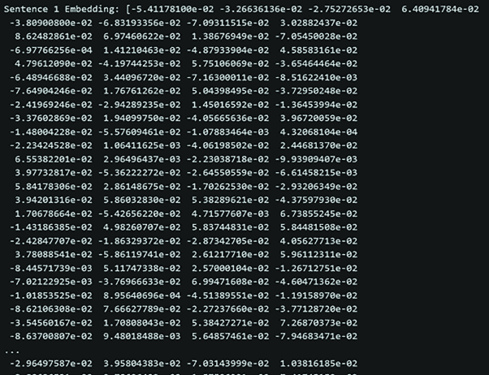

**图 2.4:** 句子嵌入结果

[`www.analyticsvidhya.com/blog/2020/08/top-4-sentence-embedding-techniques-using-python/#:~:text=In%20NLP%2C%20sentence%20embedding%20refers,or%20similarity%20between%20these%20vectors`](https://www.analyticsvidhya.com/blog/2020/08/top-4-sentence-embedding-techniques-using-python/#:~:text=In%20NLP%2C%20sentence%20embedding%20refers,or%20similarity%20between%20these%20vectors)

[`cohere.com/blog/sentence-word-embeddings`](https://cohere.com/blog/sentence-word-embeddings)

[`spotintelligence.com/2022/12/17/sentence-embedding/`](https://spotintelligence.com/2022/12/17/sentence-embedding/)

## 词义消歧 (WSD)

虽然 `Universal Sentence Encoder` 关注句子级别的相似性，但 `词义消歧 (WSD)` 处理的是更细粒的问题。

### 概念

*   **多义性挑战**：“bat”可以指一种飞行的动物，也可以指体育器材。`WSD` 处理多种词义。
*   **上下文依赖性**：词的含义通常由周围的词揭示。
*   **应用**：`WSD` 有多种应用，包括：
    *   机器翻译（确保含义准确）
    *   信息检索（改进搜索结果）
    *   文本摘要（捕捉含义）
    *   情感分析（理解情感）

### 词义消歧的方法

*   **基于知识的方法**：这些方法依赖于外部知识源，如定义各种词义的字典和同义词。
*   **统计方法**：这些方法利用大型语料库中的统计信息来分析词的共现。
*   **机器学习方法**：监督学习方法可以在标注的文本数据上训练，其中每个词都有词义标签。然后模型预测未见词的词义。

### 挑战与未来方向

*   **数据歧义**：句子本身具有歧义，使得确定含义变得困难。
*   **上下文复杂度**：捕捉复杂的联系和细微差别是一个持续的挑战。
*   **领域特定性**：`WSD` 算法通常需要特定领域的训练。

## 词性标记 (PoS)

词性标记 (PoS tagging) 是一项基础的 NLP 任务，为句子中的每个词分配词法标签（标记）。这些标签根据词在句子中的功能对其进行分类，例如名词、动词、形容词、副词、介词等。

### 概念

*   **语法角色**：POS 标签揭示了词在句子中的语法角色。名词充主语或宾语，而动词描述动作或状态。
*   **优势**：词性标记为 NLP 算法提供了一个基础的理解层。
*   **命名实体识别 (NER)**：根据周围的词性标记（POS tags）识别人名、地点和组织等实体（例如，“New **York**”可能表示一个地点）。
*   **句法分析**：通过理解不同词性标记之间的关系，揭示句子的结构。

### 现实生活示例

让我们来看一些现实中的例子：

*   句子：“The quick brown fox jumps over the lazy dog”。
    *   **POS 标记**：(`The` - 限定词), (`quick` - 形容词), (`brown` - 形容词), (`fox` - 名词), (`jumps` - 动词), (`over` - 介词), (`the` - 限定词), (`lazy` - 形容词), (`dog` - 名词)。
*   句子：“Machine learning is revolutionizing the field of NLP”。
    *   **POS 标记**：(`Machine` - 名词), (`learning` - 动词), (`is` - 动词), (`revolutionizing` - 动词), (`the` - 限定词), (`field` - 名词), (`of` - 介词), (`NLP` - 专有名词)。

### POS 标记的方法

*   **基于规则标记**：这些方法依赖于手工设计的规则，根据词法形态、前缀/后缀的存在以及周围单词来定义分配标记的模式。
*   **统计标记**：这些技术利用了统计模型，如在大型标注文本语料库上训练的隐马尔可夫模型 (HMM)。这些模型学习句子中给出的标记序列的概率。
*   **机器学习方法**：监督学习方法（如支持向量机 SVMs）可以在已标记数据上进行训练，以预测新句子的词性标记。

让我们来看看词性标记的 Python 实现。

```python
import spacy

#### 加载英语语言模型（如果需要，可以将 "en_core_web_sm" 替换为更大的模型以提高精度）
nlp = spacy.load("en_core_web_sm")

#### 示例句子
sentence = "The Amityville Horror is one of the best horror movies ever."

#### 使用 spaCy 处理句子
doc = nlp(sentence)

#### 获取每个标记的 POS 标记
for token in doc:
    print(f"Word: {token.text}, POS Tag: {token.pos_}")
```

输出：

```
Word: The, POS Tag: DET
Word: Amityville, POS Tag: PROPN
Word: Horror, POS Tag: PROPN
Word: is, POS Tag: AUX
Word: one, POS Tag: NUM
Word: of, POS Tag: ADP
Word: the, POS Tag: DET
Word: best, POS Tag: ADJ
Word: horror, POS Tag: NOUN
Word: movies, POS Tag: NOUN
Word: ever, POS Tag: ADV
Word: ., POS Tag: PUNCT
```

在上面的代码中，我们使用 `.pos_` 方法测试了词性标记的概念。句子中包含名词、数字、形容词、助动词等。我们从 `spaCy` 加载了 `en_core_web_sm` 英语模型。我们使用了 `spaCy` 来获取 POS 结果，但我们也可以使用 `nltk` 库完成相同的操作。

### 额外考虑因素

*   词性标记器并不总是产生完美的结果，特别是在存在歧义的情况下。
*   根据应用，可能会使用具有不同粒度的不同标记集。
*   通过采用基于规则的纠正或结合多个标记器的集成方法，可以提高词性标记的准确性。

[`www.shiksha.com/online-courses/articles/pos-tagging-in-nlp/#:~:text=POS%20tagging%20is%20the%20process,natural%20language%20processing%20(NLP)`](https://www.shiksha.com/online-courses/articles/pos-tagging-in-nlp/#:~:text=POS%20tagging%20is%20the%20process,natural%20language%20processing%20(NLP))

## 命名实体识别 (NER)

命名实体识别 (NER) 是一项关键任务，旨在在文本中识别并分类命名实体。

### NER 的核心组成

*   **识别实体**：人名、组织、地点。
*   **类型**：
    *   人名
    *   组织
    *   地点
    *   日期
    *   金额价值
    *   其他

### NER 的应用

*   **信息提取**：为知识图谱填充实体。
*   **问答**：识别用于回答问题的实体（例如，公司）。
*   **情感分析**：分析针对实体表达的情感（例如，公司）。
*   **机器翻译**：跨语言保留并翻译命名实体。

```python
displacy.render(doc, style="ent")
```

`displacy.render(doc, style="ent")` 用于获取不同实体的标签。


**图 2.6：句子的标签**

高亮实体的特定格式和外观为 `Person`（人物）和 `Organization`（组织）。

此输出展示了 spaCy 识别和分类句子内命名实体的能力，提供了与现实世界概念相关的实体结构化表示。

### NER 的额外情况

*   NER 模型在处理歧义情况或训练数据中不存在的实体可能会遇到困难。
*   可以通过定义应用领域相关的特定实体类型来自定义 NER 模型。
*   将 NER 与其他 NLP 技术（如指代消解）结合，可以提高对文本信息的整体理解。

[`www.kaggle.com/code/abhisarangan/ner-using-spacy`](https://www.kaggle.com/code/abhisarangan/ner-using-spacy)

[`www.analyticsvidhya.com/blog/2021/06/nlp-application-named-entity-recognition-ner-in-python-with-spacy/`](https://www.analyticsvidhya.com/blog/2021/06/nlp-application-named-entity-recognition-ner-in-python-with-spacy/)

[`www.geeksforgeeks.org/python-named-entity-recognition-ner-using-spacy/`](https://www.geeksforgeeks.org/python-named-entity-recognition-ner-using-spacy/)

[`spotintelligence.com/2022/12/06/named-entity-recognition-ner/`](https://spotintelligence.com/2022/12/06/named-entity-recognition-ner/)

## 指代消解

指代消解是一项基础 NLP 任务，用于识别并链接文本中指向同一个现实实体或概念的表达式。它本质上处理代词、名词短语或其他未显式重复实体名称的引用表达式。让我们来看一个例子来理解指代消解。

### 句子

John 买了一辆新车。他喜欢在周末开它。

### 指代消解

*   `John` 和 `He` 指向同一个人。
*   `a new car` 和 `it` 指向同一个物体。

通过消解指代，我们可以将句子重写为：John 买了一辆新车。John 喜欢在周末开那辆车。

## 理解指代消解

在这里，我们将看到指代消解的概念及其不同的益处。

*   **连接点点**：指代消解建立了文本内部提及（指代同一实体的不同方式）之间的关系。
*   **益处**：消解指代对于各种 NLP 应用至关重要，包括：
    *   **文本摘要**：通过理解指代，摘要可以准确反映贯穿整个文本的提及实体之间的关系。
    *   **问答系统**：指代消解通过链接问题和答案段落中对同一实体的提及，帮助精确定位相关信息。
    *   **机器翻译**：保留指代关系可以提高翻译文本的准确性和连贯性。
    *   **信息提取**：指代消解使系统能够对文本中的实体及其相互作用建立更全面的理解。

## 指代消解的方法

指代消解的各种方法如下。

*   **基于规则的方法**：这些策略使用手动创建的规则，考虑语用线索（如 `first`、`second`）、名词短语相似性和语法特征。
*   **统计模型**：标注数据集中的标记指代连接可用于训练统计方法，如条件随机场 (`CRFs`) 或隐马尔可夫模型 (`HMMs`)。
*   **机器学习技术**：可以训练神经网络和其他深度学习模型，用以识别海量数据中的复杂模式，并提高 `coreference-resolution` 的准确性。

## 指代消解面临的挑战

*   **消歧**：代词在复杂句子中可能指代多个实体，需要分析上下文来识别正确的先行指。
*   **后指**：指代消解需要处理后指引用，即实体在文中出现的顺序晚于指代它的代词。
*   **特殊性**：确定诸如 `it` 或 `this` 等模糊表达的预期意图是一项挑战。

[`spotintelligence.com/2024/01/17/coreference-resolution-nlp/`](https://spotintelligence.com/2024/01/17/coreference-resolution-nlp/)

[`towardsdatascience.com/coreference-resolution-in-python-aca94654/`](https://towardsdatascience.com/coreference-resolution-in-python-aca94654/)

## NLP 评估指标


# 评估 NLP 算法的性能

评估 NLP 算法的性能对于理解它们的优缺点非常重要。评估指标提供了量化标准，用于比较不同模型的性能或评估单个模型。

## 评估的重要性

评估帮助我们：

- 针对特定任务选择最佳模型。
- 识别改进领域。
- 跟踪 NLP 研发的进展。

## 常用指标

根据 NLP 任务使用不同的指标。以下是常用的指标：

### 准确率 (Accuracy)

- **公式：** `(正确预测数/总预测数)`
- **概念：** 衡量模型做出正确预测的整体比例。
- **示例：** 在垃圾邮件分类任务中，准确率代表模型正确识别句子为垃圾邮件或非垃圾邮件的标签百分比。

### 精确率 (Precision)

- **公式：** `(真正例/(真正例 + 假正例))`
- **概念：** 衡量正确正预测的比例。
- **示例：** 在情感分析任务中，精确率表示被标记为正的评论中真正为正的百分比。

### 召回率 (Recall)

- **公式：** `(真正例 / (真正例 + 假反例))`
- **概念：** 衡量模型正确识别的实际正例比例。
- **示例：** 在情感分析中，高召回率意味着模型识别了大多数正面（或负面）评论，即使它也错误地将中性评论分类为正面/负面。

### F1 分数

- **公式：** `(2 * 精确率 * 召回率) / (精确率 + 召回率)`
- **概念：** 将精确率和召回率结合为单一指标，平衡模型的两个方面。
- **示例：** 在情感分析中，0.85 的 F1 分数表示模型在正确识别正负情感方面表现良好，平衡了精确率和召回率。

### BLEU 分数 (机器翻译)

- **概念：** 衡量机器生成的文本与人类参考文本之间的相似性。

#### BLEU 如何工作

- **N-gram 精确率：** BLEU 检查候选翻译中的 `n-gram` 是否出现在参考翻译中。它计算不同 n-gram 尺寸（通常为 1 到 4-gram）的精确率。
- **裁剪 (Clipping)：** 为了避免重复计算相同的 n-gram，BLEU 使用了 `clipped counts`（裁剪计数）——它只统计在任何参考文件中出现的最大次数的 n-gram 数量。
- **长度惩罚 (Brevity Penalty, BP)：** 如果候选译文 `比参考文短`，BLEU 会对得分进行惩罚。这可以防止模型生成精确率可能高但缺乏完整性的过短翻译。

#### 示例

一个 BLEU 分数较高的机器翻译系统，其生成的翻译在含义和流畅度上可能与人工编写的参考文本更相似。

**参考文本：** “*The cat is on the mat*。”

**候选文本：** “*The cat on mat*。”

BLEU 将比较重叠的单字（unigrams）、双词组（bigrams）等。

- 单字匹配：The, cat, mat → 3/4
- 双词组匹配：The cat → 1/3
- 候选译文较短 → 应用长度惩罚

最终的 BLEU 分数是 `0 (无匹配)` 到 `1 (完美匹配)` 之间的小数，通常以百分比显示（例如，0.45 → 45%）。

BLEU 常用于基准 `机器翻译模型`，如 Google Translate、OpenNMT 和基于 Transformer 的系统（例如 BERT2BERT、T5 等）。

### ROUGE (基于召回率的摘要评估辅助) 分数

**定义：** 通过将生成的文本与参考文本（标准答案）进行比较，一组被称为 ROUGE 的指标用于评估文本摘要、机器翻译和文本生成算法的质量。为了评估模型生成的摘要在保留参考摘要核心组成部分方面的表现，它计算了 n-gram 重叠率、召回率和精确率。

#### ROUGE 指标类型

- **ROUGE-N (n-gram 重叠度)**
    - 衡量生成的摘要与参考摘要之间的 `n-gram 重叠情况`。
    - ROUGE-1 使用 `unigrams（单个单词）`，而 ROUGE-2 考虑 `bigrams（双词序列）`。

- **ROUGE-L (最长公共子序列 - LCS)**
    - 衡量参考摘要与生成摘要之间 `最长的公共单词序列`。
    - 与 n-gram 不同，`LCS 允许存在间隔`，能够捕捉句法结构的相似性。
    - 当词序很重要时，ROUGE-L 非常有用。

- **ROUGE-W (加权 LCS)**
    - 与 ROUGE-L 类似，但对 LCS 中 `更长的连续匹配` 分配 `更高的权重`。
    - 优先考虑 `较长的连续重叠短语`，而不是分散的单词。

- **ROUGE-S (基于跳跃双词组的共现统计)**
    - 衡量 `skip-bigram（跳跃双词组）` 重叠，允许单词 `非顺序出现` 但仍被视为匹配。
    - 一个 `skip-bigram` 由 `两个摘要中以相同顺序两个单词` 组成，允许存在间隔。

- **ROUGE-WE (带词嵌入的 ROUGE)**
    - 使用 `语义相似性` 而不是精确单词匹配。
    - 利用 `预训练词嵌入 (Word2Vec, GloVe, BERT)` 来检测 `同义词` 之间的相似性。

**示例：** 在文本摘要任务中，ROUGE 分数衡量了生成的摘要与人工编写的参考文本的重叠程度，表明了其捕捉关键信息和措辞的效果如何。

### 困惑度 (Perplexity)

**定义：** 衡量语言模型预测序列中下一个单词的程度。它衡量了模型在处理新数据时的不确定性。困惑度越低，意味着模型对其预测越有把握。

#### 困惑度的重要性

- **衡量预测性能：** 有助于确定模型预测未知文本的能力。
- **在语言建模中很有用：** 用于 `N-gram 模型`、`RNN` 和 `基于 Transformer 的模型`。
- **模型选择的基准：** 较低的困惑度意味着更好的泛化能力。
- **有助于超参数调优：** 用于调整模型参数以获得更好的结果。

#### 不同语言模型中的困惑度

- **循环神经网络 (RNNs)**
    - RNN 动态计算下一个单词的概率。
    - 较低的困惑度意味着更好的长期依赖性。
    - 由于梯度消失问题，LSTM 和 GRU 的性能通常优于简单的 RNN。

- **Transformer 模型 (BERT, GPT)**
    - 基于 Transformer 的模型（如 GPT，生成式预训练 Transformer）在大规模语料库上优化困惑度。
    - 由于具有更好的上下文理解，GPT-3 的困惑度比 GPT-2 低。

### 词错误率 (WER)

**定义：** 语音识别输出中的错误数量与参考转录中单词总数之间的比值。

**示例：** 在语音识别中，15% 的 WER 意味着每 100 个单词中有替换、插入和删除。

### 任务特定型指标

- **情感分析：** 针对正面/负面情感的准确率、召回率和 F1 分数。
- **命名实体识别：** 针对不同实体类型的 F1 分数。
- **问答：** 答案选择和答案生成的准确率。

### 额外考虑因素

- 选择合适的评估指标取决于特定任务及其重点。
- 仅有准确率等指标可能不够，多个指标的组合可以提供更全面的视图。
- 可以结合人工评估和自动化指标，以评估相关性和自然流畅度等因素。

# 依赖解析

依赖树可能如下所示：

- `sits` 是 `root verb`（根动词，主要动作）。
- `cat` 是 `subject`（主语），依赖于 `sits`。
- `on` 是 `preposition`（介词），连接 `sits` 和 `mat`。
- `the` 修饰 `cat` 和 `mat`。

## 理解依赖解析

- **映射关系**：依赖解析创建了一个依赖树，其中单词是节点，边表示语法关系（例如主谓关系、谓宾关系）。
- **益处**：依赖解析提供了对句子结构更深层次的理解，影响着各种 NLP 应用：
    - **情感分析**：识别动词的主语和宾语有助于确定情感是表达给谁或什么物的。
    - **问答系统**：解析结构有助于根据句子的语法形式准确定位相关信息。
    - **机器翻译**：理解语法角色可以使翻译后的文本具有更准确的词序和结构。
    - **文本摘要**：依赖解析可以通过提取关键元素及其关系来指导摘要过程。

## 依赖解析的方法

- **基于规则的解析**：这些方法采用基于语法和 POS 标记（词性标记）的人工规则来定义单词之间的依赖关系。
- **统计解析**：如基于转移的解析（Transition-based Parsing）或基于图的解析（Graph-based Parsing）等统计模型利用来自标注数据的统计学习来预测依赖关系。
- **机器学习方法**：神经网络，特别是递归神经网络（`RNN`）或 transformer，可以通过训练从大型文本语料库中学习复杂的依赖模式。

## 其他考虑

- 依赖解析模型可能会遇到模糊情况，根据上下文，一个单词可能有多个可能的依赖关系。
- **投影性与非投影性依赖**：投影性解析假设所有依赖关系可以在树内用直线表示，而非投影性解析处理依赖关系交叉的情况，允许 `parser` 表达更复杂的语言现象，如词序变化和长距离依赖。

### 参考资料

- [`www.analyticsvidhya.com/blog/2021/12/dependency-parsing-in-natural-language-processing-with-examples/`](https://www.analyticsvidhya.com/blog/2021/12/dependency-parsing-in-natural-language-processing-with-examples/)
- [`spotintelligence.com/2023/10/22/dependency-parsing/`](https://spotintelligence.com/2023/10/22/dependency-parsing/)
- [`towardsdatascience.com/natural-language-processing-dependency-parsing-cf094bbbe3f7`](https://towardsdatascience.com/natural-language-processing-dependency-parsing-cf094bbbe3f7)

# 指消解析与依赖解析：揭示它们之间的联系

指消解析和依赖解析都是分析句子单词间关系的关键 NLP 任务。然而，它们关注的是这种结构的不同方面。

## 相似之处

- 两个任务都分析句子内部单词之间的关系。
- 它们都对深入理解句子结构和意义做出了贡献。
- 两者都可以使用基于规则、统计或机器学习方法来实现。

## 差异

- **指消解析**：处理现实世界中的实体以及它们在文中如何被指代。
- **依赖解析**：关注句子结构中单词的语法角色。
- **指消解析**：通常涉及对话语结构和先前提及内容的推理。
- **依赖解析**：主要依赖于句子内部的即时语法上下文。

## 总结

- 指消解析连接跨文本描述同一实体的单词。
- 依赖解析分析单个句子中单词的语法结构和关系。

这些任务通常互为补充。依赖解析通过识别潜在的指消候选（例如作为主语的代词）为指消解析提供基础。同样，指消解析可以帮助处理涉及代词或其他指代表达式的依赖解析。

# 结论

在本章中，我们探索了表示数据的各种 NLP 技术。我们理解了词袋模型（BoW）、`N-grams` 和 `TF-IDF`，并对相关示例进行了探索。我们还学习了词和句子嵌入的话题，如 `Fasttext`、`GloVe`、`Word2vec`、`Sent2vec`、`USE`、`SBERT` 等。

我们还学习了词消歧、词性标记和实体识别的概念。此外，我们还调查了 NLP 模型的各种性能指标。最后，我们学习了指消解析和依赖解析的概念。在后续章节中，我们将调查本章所用技术的实际案例，并介绍关于 `TF-IDF`、`N-grams`、BoW 模型、词嵌入的面试问题。

# 第 3 章：使用 NLP 进行情感分析

## 引言

自然语言处理（NLP）这一不断发展的领域赋予了机器理解和处理人类语言的能力。本章深入探讨 NLP 的实际应用：情感分析。我们将探索如何为分析准备文本数据，并利用词袋、`TF-IDF` 和词嵌入等方法提取有效特征。此外，我们将研究词性标记和实体识别（`NER`）等技术，以对句子结构和文中提到的实体进行更深入的理解。此外，我们还将使用 `TextBlob`、`VADER Sentiment` 和 `NLTK` 进行情感分析，并制作词云可视化，以理解各种单词的使用频率。这使我们能够理解评论中表达的主题、话题和情感。

## 结构

在本章中我们将讨论以下主题：

- 评论分析
- 数据获取
- 使用的库和工具
- 数据加载与探索
- POS 标记与 `NER`
- 情感分析
- 词云可视化
- 情感分析的机器学习建模

## 亚马逊评论的情感分析

在当今数据驱动的世界，理解客户情感对于企业的发展至关重要。客户反馈的一个丰富来源是在线产品评论。本主题作为 NLP 技术实际应用的一个，深入探讨了亚马逊鼠标评论的情感分析，通过它获取了多样且详尽的意见资源。

情感分析是自然语言处理的一个分支，涉及对文本中主观信息的识别和量化。通过对亚马逊（Amazon）产品评论进行情感分析，我们可以更深入理解客户对产品性能、功能以及整体用户体验的感知。这些知识在指导产品开发、营销策略和客户支持计划方面可能非常重要。

本章将探索情感分析的端到端流程，从数据获取、预处理到特征工程、模型构建和评估。我们将深入研究各种 NLP 技术，如预处理、文本清洗、特征提取、特征工程以及一些机器学习算法，以有效地将评论分类为积极、消极或中性。最终，这种分析将为客户对亚马逊市场中各种电子产品的情感提供有价值的见解。

## 数据获取

数据集取自 [`www.kaggle.com/datasets/danielihenacho/amazon-reviews-dataset/data`](https://www.kaggle.com/datasets/danielihenacho/amazon-reviews-dataset/data)，该数据集是通过抓取亚马逊上的产品评论创建的，用于文本分类。数据包含具有情感倾向（积极、消极、中性）的列、`cleaned_review` 列（我们存储了用户的评论），然后是评论长度，最后是 1 到 5 分的评论评分，其中 5 分表示最积极，1 分表示最消极。

## 使用的库和工具

我们将使用 `pandas` 进行数据加载和探索，而对于 NLP 应用，我们将使用 `nltk` 和 `spaCy`。`sklearn` 库用于在本章后面的机器学习建模以及模型评估。我们还将使用 `TextBlob`、`nltk` 和 `VaderSentiment` 等库进行情感分析。

## 数据加载与探索

我们将查看以下代码以更好地理解数据，并进行数据探索。

```python
import pandas as pd
import numpy as np
import seaborn as sns
import spacy
from spacy.lang.en.stop_words import STOP_WORDS
from sklearn.model_selection import train_test_split
from sklearn.feature_extraction.text import TfidfVectorizer
from sklearn.pipeline import Pipeline
from sklearn.metrics import accuracy_score, confusion_matrix, classification_report, ConfusionMatrixDisplay
from sklearn import naive_bayes
from sklearn.linear_model import LogisticRegression
from sklearn.svm import LinearSVC
from nltk.corpus import stopwords

#### 加载数据集（假设它是一个 CSV 文件）
#### https://www.kaggle.com/datasets/danielihenacho/amazon-reviews-dataset?resource=download
amazon_df = pd.read_csv("amazon_cleaned_reviews.csv")

#### 加载 spaCy 模型
nlp = spacy.load("en_core_web_sm")
#### 探索数据集
print(amazon_df.shape)
amazon_df.head()
```

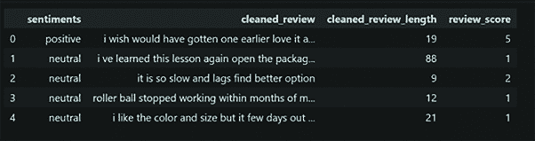

**图 3.1:** 亚马逊评论数据

在之前的图中，我们看到了数据集的前 5 行。数据集有 17340 行和 4 列。我们还可以看到评论评分的分布。

```python
sns.histplot(amazon_df['review_score'])
```

我们正在使用 `histplot` 函数，从 seaborn 库中获取评论评分的分布。

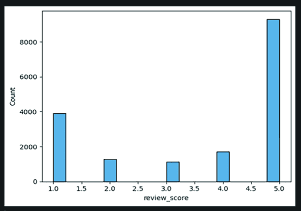

**图 3.2:** 评论评分分布数据

之前的图片显示，超过 8000 个产品有 5 星评价，几乎 4000 个产品有 1 星评价。我们可以使用 `value_counts()` 函数检查更多细节。

```python
amazon_df['review_score'].value_counts()
```

**输出：**

```
review_score
5    9316
1    3898
4    1714
2    1295
3    1117
Name: count, dtype: int64
```


我们有了数字形式的评分分布。大多数用户喜欢这些产品，但也有许多用户不喜欢这些产品并给出 1 星评价。1714 名用户给出了 4 星评价，这表明大多数用户喜欢这些产品。

现在，让我们查看一条评论。

```python
example = (amazon_df['cleaned_review'].values[10])
example
```

**输出：**

```
'beautifully produced and lovely to look at for mouse the lights are welcome addition to an otherwise drab workspace did notice that it tends to go into sleep mode quickly but takes longer wake up time than expect on screen busy with windows the cursor freezes in position until the mouse fully comes back to life it is frustrating for anyone who isn't patient'
```

我们将使用 `spaCy` 来理解评论的各种词性。

### POS 标注与 NER

在本节中，我们将使用 `spaCy` 提取各种词性。

```python
#### 加载 spaCy 模型
nlp = spacy.load("en_core_web_sm")
example = (amazon_df['cleaned_review'].values[10])
doc = nlp(example)
for token in doc:
    print(token.text, token.pos_)
```

**输出：**

```
beautifully RB
produced VERB
and CONJ
lovely ADJ
to PART
look VERB
at ADP
for ADP
the DET
mouse NOUN
the DET
lights VERB
welcome ADJ
addition NOUN
to PART
an DET
otherwise ADV
drab ADJ
workspace NOUN
```

```python
from spacy.displacy import render

render(doc, style="dep")
```

**输出：**

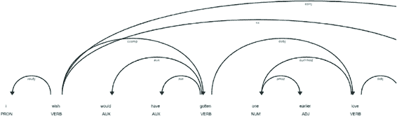

**图 3.3: 依存法解析器可视化**

前面的图显示了句子的依存法分析。然而，由于空间限制，未显示整个图，我们可以在运行 Python 代码时进行检查。依存法解析为理解句子的语法结构提供了价值的工具，这与情感分析直接相关。可视化这些依赖关系可以更直观地理解句子不同部分是如何影响整体情感的。

#### 依存法分析的关键洞察

**依存法解析**有助于识别主语、谓语、宾语之间的关系，并最终理解文本中隐藏的情感。它还提供了情感分析至关重要的上下文理解。

*   **主语-谓语-宾语关系：** 识别主、谓、宾语可以帮助确定被评估的实体及其情感。

*   **修饰分析：** 理解形容词和副词如何修饰名词和动词可以为情感的强度和方向提供线索。

*   **否定处理：** 依存法解析可以帮助识别否定词（例如 `not`、`never`），这些词可以反转情感极性。

*   **上下文理解：** 可视化依赖关系可以揭示句子内部单词之间的关系，为情感分析提供更丰富的上下文。

在下部分，我们将研究 `TextBlob` 库以了解情感分析的使用。`TextBlob` 是一个 Python 库，提供简单直观的接口来执行自然语言处理任务，包括情感分析。它简化了从文本数据中提取情感极性和主观性的过程。

### TextBlob 对情感分析的关键性

`TextBlob` 是一个包含系列任务的库，从词性标记（POS tagging）、名词提取、情感分析、分词、词形还原等等。它使用 `NLTK` 来执行这些任务。

*   **易用性：** `TextBlob` 提供了用户友好的 API，使初学者和丰富的 NLP 从业者都能轻松使用。

*   **情感极性和主观性：** 它提供了函数来直接计算给定文本的情感极性（积极、消极或中性）和主观性（文本的观点化程度）。

*   **内置词典：** `TextBlob` 自带一个预训练的情感词典，有助于确定单词和短语的情感。

*   **自定义：** 你可以自定义情感词典或创建自己的词典，以针对特定领域或上下文定制分析。

*   **额外的 NLP 任务：** 除了情感分析，`TextBlob` 还可以用于词性标记、名词短语提取和翻译等任务。

### 情感分析

我们可以看到下面的代码，但在之前我们需要安装 `textblob`。

```python
from textblob import TextBlob

blob = TextBlob(example)
sentiment = blob.sentiment

print(sentiment.polarity)
print(sentiment.subjectivity)
```

**输出：**

```
0.2333333333333333
0.43333333333333335
```

在前面的代码中，我们看到了评论的极性和主观性。**极性**和**主观性**是情感分析中两个关键指标，用于理解文本的情感倾向和观点性质。**极性**指的是文本的情感倾向，指示它是积极、消极还是中性的，有助于识别整体情感，并提供文本情感强度的量化标准。**主观性**衡量文本表达个人意见或信念而非客观事实的程度。它对于区分偏见或观点性内容很有用，也可以与极性结合来理解文本整体的情感基调和客观性。

在前面的评论示例中，我们的极性为 0.23，主观性为 0.43。我们可以如下评估这些数字：

*   **极性：** 0.23 表示微积极的情感。值通常从 -1（非常消极）到 1（非常积极）。0.23 的值表明是微积极的情感。

*   **主观性：** 0.43 表示文本具有中等主观性。范围从 0（客观）到 1（高度主观）。0.43 的值表明文本包含客观和主观元素的混合。

*   **综合解释：** 考虑到这些值，该文本可以解释为具有**微积极的情感**和**中等程度的主观性**。这意味着文本可能表达了积极观点，但也包含了一些事实或客观信息。

在下一节中，我们将使用 `nltk` 库（https://www.nltk.org/howto/sentiment.html）检查情感分析。我们将检查如下代码：

```python
import nltk
from nltk.sentiment.vader import SentimentIntensityAnalyzer

nltk.download('vader_lexicon')
sid = SentimentIntensityAnalyzer()

def analyze_sentiment(text):
    sentiment_scores = sid.polarity_scores(text)
    compound_score = sentiment_scores["compound"]
    if compound_score >= 0.05:
        return "Positive"
    elif compound_score <= -0.05:
        return "Negative"
    else:
        return "Neutral"

#### 示例
sentiment = analyze_sentiment(example)
print(sentiment)
```

**输出：**

```
[nltk_data] Downloading package vader_lexicon to ...
[nltk_data] Package vader_lexicon is already up to date
Positive
```

这段代码定义了一个函数 `sentiment_analysis_vader`，它接收文本作为输入并使用 VADER 返回情感得分。`sentiment_score` 将是一个包含以下键的字典：

* `neg`: 负面情感得分
* `neu`: 中性情感得分
* `pos`: 积极情感得分
* `compound`: 总体复合得分（范围从 -1 到 1）

在在上述的结果中，`neu` 值为 `0.616`，`pos` 值为 `0.384`，这表明评论更倾向于中性范围，而非积极范围。这意味着该文本表达了积极的情感，并带有一些中性元素。它表明该文本可能在表达一种积极的观点或感受。

在`电子商务行业`的背景下，这种情感分析结果——即评论具有 `0.384 的积极得分`和 `0.616 的中性得分`——可以被解释为`中度满意的客户`。例如，客户可能准时收到了订单并发现产品可以接受，但产品本身并不出色。

这种反馈有助于电子商务企业`找出可以增加价值的领域`——也许是提高产品质量、包装或购买后的体验。通过对此类评论进行分类，平台可以识别出那些符合预期但未超出预期的产品，让他们专注于`改进产品列表、提供组合优惠或启动跟进活动`以提升满意度，并将中性积极客户转化为忠诚的拥护者。

#### 词云可视化

现在我们将使用词云检查单词的可视化情况。词云是文本语料库中单词出现频率的视觉表示。通过可视化最常见的词汇，我们可以快速识别出评论中表达的关键主题、话题和情感。

Python 代码如下：

```python
from wordcloud import WordCloud
import matplotlib.pyplot as plt
#### 将所有评论合并成一个字符串
text = " ".join(amazon_df['cleaned_review'].astype(str))
wordcloud = WordCloud(width=800, height=400, background_color='white').generate(text)
#### 显示词云
plt.figure(figsize=(10, 7))
plt.imshow(wordcloud, interpolation='bilinear')
plt.axis('off')
plt.show()
```

在前面的代码中，我们导入了 `WordCloud` 函数和 `matplotlib` 库。我们将数据框中的所有评论拼接并转换为字符串数据类型。然后，我们创建了具有白色背景以及定义的高度和宽的 `wordcloud` 变量。接着，我们使用 `matplotlib` 库将其显示为可视化图。词云如下：


图 3.4：亚马逊评论的词云

在之前的词云中，我们看到 `mouse` 是最大的单词。此外还有像 `love, work, use, great, one` 这样较大的词。这意味着该文本表达了积极的情感，并带有一些中性元素。它表明该文本可能在表达一种积极的观点或感受。（注：由于输入文本存在大量重复，我将按照提供的文本结构进行处理）。

```python
X_train, X_test, y_train, y_test = train_test_split(amazon_df['processed_review'], amazon_df['label'], test_size=0.2, random_state=42)
```

在前面的代码中，我们利用了 `nltk` 和 `scikit-learn` 库。对于数据的预处理和清洗，我们对评论进行了分词（tokenized）并将其转换为小写。然后，我们使用初始化为 `lemmatizer` 的 `WordNetLemmatizer()` 对象进行了词形还原处理。接着，我们移除了英语特定的停用词并合并了最终清洗后的标记。随后，应用上述函数来准备最终清洗后的评论文本。然后，我们使用 `LabelEncoder()` 对象对 `sentiments` 变量进行编码。接下来，我们将数据集划分为训练集（80%）和测试集（20%）。

之后，我们使用 `CountVectorizer()` 对象进行 TF-IDF 向量化，该对象使用 `scikit-learn` 中的 `CountVectorizer` 类执行特征提取过程。

1. **实例化**：创建了一个 `CountVectorizer` 对象，用于将文本数据转换为数值特征。

2. **拟合**：在训练数据 (`X_train`) 上应用 `fit_transform` 方法。这从训练数据构建构建词表，并将文本转换为数值矩阵（文档-项矩阵）。

3. **转换**：在测试数据 (`X_test`) 上应用 `transform` 方法。这使用从训练数据中学到的词表将测试数据转换为数值特征。

4. **打印形状**：打印转换后的训练数据和测试数据的形状，显示每个数据集中的样本数量和特征数量。

本质上，该代码使用词袋模型（bag-of-words）从文本数据中提取数值特征，特征矩阵的每一列代表词表中的一个唯一单词，而值表示该词在相应文档中的频率。

```python
from sklearn.feature_extraction.text import CountVectorizer
vect = CountVectorizer() # 实例化一个向量器
X_train_dtm = vect.fit_transform(X_train)# 使用它从训练数据中提取特征
#### 转换测试数据（使用训练数据的特征）
X_test_dtm = vect.transform(X_test)
print(X_train_dtm.shape, X_test_dtm.shape)
```

**输出**：

`(13872, 7751) (3468, 7751)`

在前面的代码中，我们得到了向量化后的训练集和测试集的结果。`X_train_dtm` 是使用 `CountVectorizer` 从训练数据创建的 `document-term matrix`。

我们将进行机器学习建模和评估，并测试三种机器学习算法：`Multinomial Naïve Bayes`（多项朴素贝叶）、`Logistic Regression`（逻辑回归）和 `Linear SVC`（线性支持向量分类）。

`Multinomial Naïve Bayes` 的代码如下：

```python
#### 从 sklearn 导入分类器
from sklearn.naive_bayes import MultinomialNB
from sklearn.linear_model import LogisticRegression
from sklearn.svm import LinearSVC
#### 导入不同的指标来评估分类器
from sklearn.metrics import accuracy_score
#### from sklearn.model_selection import train_test_split
from sklearn.metrics import confusion_matrix
from sklearn import metrics
#### 从 time 导入 time 函数以跟踪训练时长
from time import time

def plot_confusion_matrix(cm, classes, normalize=False, title="Confusion matrix", cmap=plt.cm.Blues):
    """
    此函数打印并绘制混淆矩阵。
    通过设置 normalize=True 可以应用归一化。
    """
    if normalize:
        cm = cm.astype("float") / cm.sum(axis=1)[:, np.newaxis]
    plt.imshow(cm, interpolation="nearest", cmap=cmap)
    plt.title(title)
    plt.colorbar()
    tick_marks = np.arange(len(classes))
    plt.xticks(tick_marks, classes, rotation=45)
    plt.yticks(tick_marks, classes)
    fmt = ".2f" if normalize else "d"
    thresh = cm.max() / 2.
    for i, j in itertools.product(range(cm.shape[0]), range(cm.shape[1])):
        plt.text(j, i, format(cm[i, j], fmt), horizontalalignment="center", color="white" if cm[i, j] > thresh else "black")
    plt.tight_layout()
    plt.ylabel("True label",fontsize=15)
    plt.xlabel("Predicted label",fontsize=15)

nb = MultinomialNB() # 实例化多项朴素贝叶斯模型
%time nb.fit(X_train_dtm, y_train) # 训练模型（使用 IPython“魔法命令”计时）
y_pred_class = nb.predict(X_test_dtm) # 对 X_test_dtm 进行类别预测
print("Accuracy: ", metrics.accuracy_score(y_test, y_pred_class))
```

我们的模型准确率为 70.84%。为了详细说明，我们将理解模型的混淆矩阵。

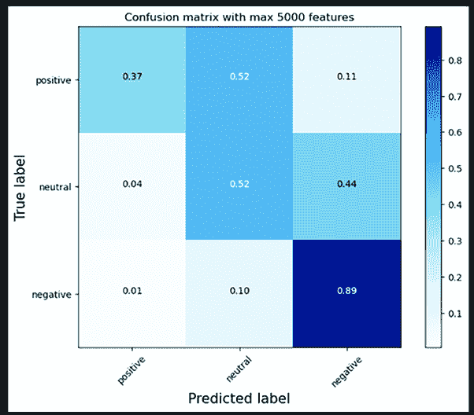

**图 3.6：** 多项朴素贝叶斯（Multinomial Naïve Bayes）混淆矩阵


此图是 `MultinomialNB()` 模型的混淆矩阵。从混淆矩阵可以看出，负面（negative）情感的识别最为准确。只有 37% 的正面情感被正确识别。然而，中性情感在 52% 的情况下被正确识别。在 52% 的情况下，正面情感被识别为中性情感，而 44% 的中性情感被识别为负面情感。

现在我们将使用逻辑回归（Logistic Regression）模型进行测试。代码如下：

```python
from sklearn.linear_model import LogisticRegression # import the function
logreg = LogisticRegression(class_weight="balanced") # instantiate a logistic regression model
logreg.fit(X_train_dtm, y_train) # fit the model with training data
#### Make predictions on test data
y_pred_class = logreg.predict(X_test_dtm)
# calculate evaluation measures:
print("Accuracy: ", accuracy_score(y_test, y_pred_class))
cnf_matrix = confusion_matrix(y_test, y_pred_class)
plt.figure(figsize=(8,6))
plot_confusion_matrix(cnf_matrix, classes=['positive','neutral', 'negative'],normalize=True, title="Confusion matrix with normalization")
```

**输出：**

`Accuracy: 0.8558246828143022`

代码解释如下：

- `LogisticRegression`：这创建了一个逻辑回归模型对象。
- `class_weight="balanced"`：该参数指定使用类别权重来解决训练数据中潜在的类别平衡问题。将其设置为 `balanced` 会自动计算与类别频率成反比的权重，为代表性较少的类别赋予更大的权重（例如，如果负面评论频率较低）。

代码中的训练、预测和混淆矩阵部分与 `MultinomialNB()` 相同。准确率为 85.58%。

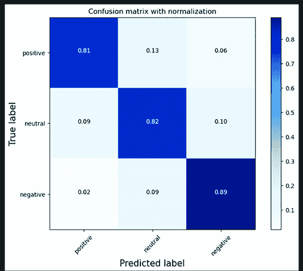

**图 3.7：** 逻辑回归混淆矩阵

负面情感的混淆矩阵保持在 89%，与 `MultinomialNB` 相同。然而，正面和中性情感被正确预测的比例分别为 81% 和 82%。逻辑回归的表现优于 `MultinomialNB()` 模型。

最后，我们使用 `LinearSVC()` 模型。代码如下：

```python
classifier = LinearSVC(class_weight='balanced') # instantiate a logistic regression model
classifier.fit(X_train_dtm, y_train) # fit the model with training data
#### Make predictions on test data
y_pred_class = classifier.predict(X_test_dtm)
# calculate evaluation measures:
print("Accuracy: ", accuracy_score(y_test, y_pred_class))
#print("AUC: ", roc_auc_score(y_test, y_pred_prob))
cnf_matrix = confusion_matrix(y_test, y_pred_class)
plt.figure(figsize=(8,6))
plot_confusion_matrix(cnf_matrix, classes=['positive','neutral', 'negative'],normalize=True, title='Confusion matrix with normalization')
```

**输出：**

`Accuracy: 0.8261245674740484`

- `LinearSVC`：这创建了一个线性支持向量机分类器对象。它是一种特定的 SVM，使用线性决策边界分离类别。
- `class_weight='balanced'`：与上一个示例中的逻辑回归一样，该参数指定类别权重以解决训练数据中潜在的类别平衡问题。将其设置为 `balanced` 会自动计算与类别频率成反比的权重，为代表性较少的类别赋予更大的权重（例如，如果负面评论频率较低）。

代码的训练、预测和混淆矩阵部分与之前的两个模型 `MultinomialNB()` 和逻辑回归相同。准确率为 82.61%。Linear SVC 的表现优于 MultinomialNB，但不如逻辑回归。

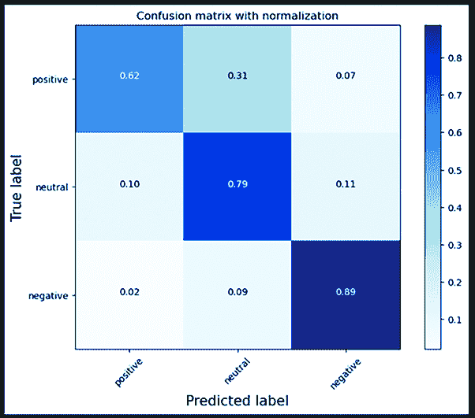

**图 3.8：** Linear SVC 混淆矩阵

负面情感的混淆矩阵仍然保持在 89%，与 `MultinomialNB` 和逻辑回归一致。对于中性情感，79% 被正确预测，62% 的正面情感被正确预测。然而，线性支持向量机分类器的性能不如逻辑回归。我们还可以尝试其他分类算法，例如 XGBoost、决策树、随机森林以及更复杂的深度学习模型。

## 结论

本章展示了 NLP 技术在从 Amazon 评论中提取有价值见解方面的强大。通过利用情感分析，我们成功地将评论分类为正面、负面和中性类别，提供了更深层次的理解。

* [心理健康情感分析](https://www.kaggle.com/code/mesutssmn/sentiment-analysis-for-mental-health)
* [亚马逊客户评论情感分析](https://github.com/coderakib/Sentimental-analysis-of-amazon-customer-reviews)
* [BERT 可解释性 AI](https://www.mzes.uni-mannheim.de/socialscencedatalab/article/bert-explainable-ai/)
* [文本挖掘与 NLP 仓库](https://github.com/MoinDalvs/Text_Mining_NLP/tree/main)
* [初学者自然语言处理 NLP - 向量化](https://www.kaggle.com/code/faressayah/natural-language-processing-nlp-for-beginners#%F0%9F%A7%AE-Vectorization)
* [自然语言处理教程](https://www.kaggle.com/learn-guide/natural-language-processing)
* [Kaggle 入门讨论](https://www.kaggle.com/discussions/getting-started/51445)
* [优秀的项目创意](https://github.com/NirantK/awesome-project-ideas)
* [实用 NLP：一个流水多个分类器](https://colab.research.google.com/github/practical-nlp/practical-nlp/blob/master/Ch4/01_OnePipeline_ManyClassifiers.ipynb)
* [量子统计笔记本](https://notebooks.quantumstat.com/#/)

# 第 4 章

## NLP 中的深度学习

### 引言

自然语言处理（NLP）领域在近年来见证了惊叹的进展，这很大程度上归功于各种深度学习技术的研发和开发。深度学习是机器学习的一个子集，它利用具有多层的人工神经网络从数据中学习复杂的模式和表示。对于 NLP 而言，深度学习已经彻底改变了情感分析、机器翻译、文本摘要和问答等任务。

本章将深入探讨专门为 NLP 设计的深度学习算法。我们将探索卷积神经网络（CNNs）、循环神经网络（RNN）和长短期记忆（LSTM）网络，每种网络在解决语言理解挑战方面都提供了独特的能力。

通过理解这些算法的架构、原理和应用，我们将在 NLP 深度学习方面打下坚实的基础。这些知识将使我们能够开发复杂的模型，从文本数据中提取有意义的见解，为各个领域的创新应用铺平道路。

### 结构

在本章中，我们将讨论以下主题：

* 深度学习
* 深度神经网络
* 用于 NLP 的卷积神经网络
    * 概念
    * 架构
    * 用于文本数据的一维卷积
    * 数学方程与可视化
    * Python 代码示例
* 用于 NLP 的循环神经网络
    * 概念
    * 架构
    * 门控循环单元（GRUs）和长短期记忆（LSTMs）
    * 数学方程与可视化
    * Python 代码示例
* CNN 和 RNN 在 NLP 中的应用
    * 情感分析
    * 文本分类
    * 机器翻译
    * 问答

### 深度学习

在深度学习中，多层神经网络用于自然语言处理（NLP），以处理、理解和生成人类语言。

#### 深度学习在 NLP 中的应用

* **机器翻译**：深度学习模型如 `Transformers` 能够从一种语言高精度地转换为另一种语言。
* **情感分析**：深度学习模型分析文本以确定其情感（例如，正面、负面、中性）。
* **文本摘要**：深度学习技术生成长文档或文章的摘要，对于新闻聚合非常有用。
* **机器人与虚拟助手**：如 `GPT` 等模型用于机器人和虚拟助手（如 Siri 和 Alexa），使其对话。
* **命名实体识别 (NER)**：深度学习还用于识别和分类文本中的重要实体（例如名称、日期、地点），有助于信息提取和处理。
* **语音识别**：深度学习模型将语音语言转换为文本，这对语音控制应用和转录服务至关重要。
* **问答系统**：这些系统使用深度学习来回答自然语言提出的问题，例如搜索引擎。

#### 深度学习相比机器学习在 NLP 中的优势

* **捕捉复杂模式的能力**：传统的机器学习方法通常依赖手工特征，这些可能无法完全捕捉人类文本的复杂性。相反，深度学习模型直接从原始文本中学习层次特征，使其能够理解细节。
* **处理大规模数据集**：深度学习模型在处理和从大规模数据学习时表现更好，考虑到人类语言的海量、多样性和复杂性，这对于 NLP 任务至关重要。这种扩展性使其优于传统的机器学习模型。
* **上下文理解**：深度学习模型（特别是基于 `Transformers` 的模型）可以捕捉句子中的单词上下文，从而实现更准确的语言处理。传统的机器学习模型在上下文方面面临困难，尤其是在长文中。
* **迁移学习**：深度学习允许使用预训练模型（如 `BERT` 和 `GPT`），这些模型可以使用较少的数据对特定任务进行微调。这种方法在 NLP 领域取得了突破，这些模型可以在少量额外训练应用于各种任务。

#### 以下是深度学习的一些构建模块

* **神经元**：神经网络的基本单元，受生物神经元的启发，处理输入数据并将输出传递给其他神经元。
* **层**：
    * **输入层**：接收原始数据的层。
    * **隐藏层**：进行实际处理和特征提取的中间层。
    * **输出层**：产生模型预测的最终层。
* **权重和偏置**：权重是模型学习的参数，决定了输入的重要性。偏置为模型更好地拟合数据提供了额外空间。
* **激活函数**：如 `ReLU`、`Sigmoid` 和 `Tanh` 等函数是非线性函数，它们帮助网络识别数据中的复杂关系。
* **损失函数**：预测输出与实际目标之间差异的函数。该函数有助于理解为了最小化此损失需要多少训练量。
* **优化算法**：如 `Gradient Descent`（梯度下降）和 `Adam` 等算法用于训练过程中调整权重和偏置，以最小化损失函数。
* **正向传播与反向传播**：
    - **正向传播**：输入数据通过网络并产生输出的过程。
    - **反向传播**：根据损失函数计算的误差更新网络权重的过程。
* **学习率**：控制训练过程中模型参数调整程度的超参数。

### 深度学习的核心概念

- **深度架构**：深度学习模型通常具有多个层，允许它们在每一层学习更复杂的数据模式。这种深度使得模型能够捕捉简单模型无法捕捉的复杂模式。
- **表示学习**：深度学习模型能够自动发现分类或回归等任务所需的表示。这与通常手动创建特征的传统方法形成对比。
- **泛化**：尽管模型非常复杂，但深度学习旨在良好地泛化到未见的数据，而不仅仅是记忆训练集。正则化、丢弃（dropout）和早停等技术被用于提高泛化能力。
- **迁移学习**：一种强大的概念，在大型数据集（如 `BERT` 或 `GPT`）上训练的模型可以通过较小的数据集针对特定任务进行微调。这减少了对大量特定任务数据的需求。
- **可扩展性**：深度学习模型可以扩展以处理海量数据和复杂任务。它们受益于计算能力（如 `GPUs` 和 `TPUs`）的进步，使其能够高效地处理大规模数据。
- **端到端学习**：在许多情况下，深度学习模型可以以端到端的方式训练，这意味着模型学习从原始输入到最终输出的整个过程，而不需要中间步骤或手动特征提取。

### 深度神经网络

深度神经网络（DNNs）是人工神经网络（ANNs）的一种，在输入层和输出层之间有多个层。这些层允许 `DNNs` 对数据中的复杂模式进行建模，使其在广泛任务中（包括图像识别、自然语言处理和预测分析）非常高效。

#### 深度神经网络的类型

- **前馈神经网络 (FNNs)**：最简单的 `DNN` 类型，信息通过隐藏层从输入层单向流向输出层。`FNNs` 用于分类类和回归等任务。
- **卷积神经网络 (CNNs)**：主要用于图像和视频处理，但也用于 NLP 任务。`CNNs` 应用卷积滤波器来捕捉空间特征和模式。它们也用于 NLP 中的文本分类和其他任务。
- **循环神经网络 (RNNs)**：专为顺序数据设计，其中顺序顺序至关重要。变体包括长短期记忆（`LSTM`）和门控循环单元（`GRU`）。
- **自动编码器**：用于降维和去噪的无监督学习模型。它们由一个编码器和一个重构输入的解码器组成。
- **生成对抗网络 (GANs)**：由两个网络组成——生成器（`generator`）和判别器（`discriminator`），它们相互竞争。`generator` 创建伪数据，而 `discriminator` 试图区分真假。
- **Transformers**：一种彻底改变了 NLP 的架构。它们使用自注意力机制并行处理序列，使其在翻译和摘要等任务中极具效率。

我们将使用乳腺癌数据集构建一个深度 DNN，以预测肿瘤是恶性还是良性。

#### 相关库

- **TensorFlow**：由 Google 开发的流行深度学习库，`TensorFlow` 为构建和训练神经网络提供了完整的生态系统。它包含了高层 API，如 `Keras`。
- **Keras**：构建在 `TensorFlow` 之上的易用高层 API。`Keras` 允许快速原型并编写易于理解的代码。
- **PyTorch**：由 Facebook 开发，`PyTorch` 是另一个被广泛使用的深度学习库。它以灵活性和动态计算图闻名。
- **NumPy**：Python 中数值计算的基础包，用于处理数组和执行数学运算。
- **Pandas**：数据操作和分析的瑞士军刀，适用于处理和预处理数据集。
- **Scikit-learn**：机器学习库，提供了数据预处理、特征工程、模型创建、模型评估等工具。

我们将使用 `TensorFlow` 和 `Keras` 为分类问题构建一个基础 DNN。步骤如下。

#### 安装所需的库

```bash
pip install tensorflow pandas numpy scikit-learn
```

#### 导入库

```python
import tensorflow as tf
from tensorflow.keras.models import Sequential
from tensorflow.keras.layers import Dense
from sklearn.model_selection import train_test_split
from sklearn.preprocessing import StandardScaler
from sklearn.datasets import load_breast_cancer
import numpy as np
import pandas as pd
```

#### 数据准备

加载数据集，将其划分为训练集和测试集，并对特征进行标准化。

- `load_breast_cancer()`：该函数来自 `sklearn.datasets` 模块，该模块提供了多个用于机器学习任务的内置数据集。乳腺癌数据集是一个广为人知的二分类任务数据集。它包含了描述乳腺癌活检中细胞核特征的特征，目标是预测肿瘤是良性还是恶性。
- `data.data`：这指的是特征矩阵 `X`，包含输入数据。每行对应一个样本（一个肿瘤），每列对应一个特征（例如，平均半径、平均纹理）。
- `data.target`：这指的是目标向量 `y`，包含样本的标签。标签是二分类的：0 代表良性肿瘤，1 代表恶性肿瘤。
- `train_test_split(X, y, test_size=0.2, random_state=42)`：该函数来自 `sklearn.model_selection` 模块。它将数据集分为两个部分：训练集和测试集。`X` 和 `y`：它们分别是将被分割的输入特征和标签。`test_size=0.2`：表示将 20% 的数据分配给测试集，其余 80% 将用于训练模型。


- `random_state=42`：这是随机数生成器的种子，确保分割结果是可以复现的。如果我们多次运行此代码，使用相同的 `random_state` 每次都会得到相同的分割。

- `X_train`：训练集特征；`X_test`：测试集特征；`y_train`：训练集标签；`y_test`：测试集标签。

- `StandardScaler()`：该函数来自 `sklearn.preprocessing` 模块，用于通过移除均值并缩放至单位差来标准化特征。这是许多机器学习算法的重要预处理步骤，特别是那些依赖距离计算的算法（例如 SVM、KNN）。

- `scaler.fit_transform(X_train)`：`fit_transform()` 方法首先从训练数据（`X_train`）中计算均值和标准差，然后使用这些计算值转换训练数据。

- 为什么在 `X_train` 上使用 `fit_transform`？模型应该只从训练数据学习缩放参数（均值和标准差），以防止从测试集泄露信息。

- `scaler.transform(X_test)`：`transform()` 方法使用从训练数据计算出的均值和标准差来转换测试数据（`X_test`）。

- 为什么只对 `X_test` 进行 `transform`？测试数据应该使用从训练数据中学到的相同参数（均值和标准差）进行缩放，以确保对模型性能进行公平评估。

```python
#### Load dataset
data = load_breast_cancer()
X = data.data
y = data.target
```

```python
#### Split the data into training and test sets
X_train, X_test, y_train, y_test = train_test_split(X, y, test_size=0.2, random_state=42)
```

```python
#### Standardize the features
scaler = StandardScaler()
X_train = scaler.fit_transform(X_train)
X_test = scaler.transform(X_test)
```

### Building

我们定义了一个包含输入层、两个隐藏层和一个输出层的简单 DNN。前两个隐藏层的激活函数是 `relu`，输出层是 `sigmoid`。然而，还有其他激活函数，如 `ELU`、`Leaky ReLU`、`Parametric ReLU`、`Tanh`、`Softmax`、`GELU`（高斯误差单元）等。

`Sequential` 是层的线性堆。它可以帮助我们按顺序逐层构建模型，每层恰好有一个输入张量和一个输出张量。`Dense` 是全连接层或稠密层，层中的每个神经元都连接到前一层的所有神经元。

```python
#### Initialize the model
model = Sequential()
#### Add the input layer and first hidden layer
model.add(Dense(units=16, activation='relu', input_shape=(X_train.shape[1],)))
#### Add the second hidden layer
model.add(Dense(units=8, activation='relu'))
#### Add the output layer
model.add(Dense(units=1, activation='sigmoid')) # Sigmoid activation for binary classification
```

### Model Compilation

我们使用 Adam 优化器和二分类交叉熵损失来编译模型。

```python
model.compile(optimizer='adam', loss='binary_crossentropy', metrics=['accuracy'])
```

### Model Training

我们使用训练数据训练模型。

```python
#### Train the model
history = model.fit(X_train, y_train, epochs=50, batch_size=32, validation_split=0.2, verbose=1)
```

在深度学习训练中，`epoch` 和 `batch size` 是描述模型训练过程中数据处理的关键术语：

- **Epoch (轮次)**：一个 epoch 指遍历整个训练数据集一次。在每个 epoch 中，模型处理一次所有训练数据，并根据每个批次的误差调整其参数（权重和偏置）。

- **Batch Size (批量大小)**：batch size 是在模型内部参数更新之前处理的训练样本数量。模型不是在每个训练样本后更新，而是在处理一批样本后更新，这使得训练更高效、更稳定。

### Model Evaluation

我们在测试集上评估模型的性能。

```python
#### Evaluate the model
test_loss, test_accuracy = model.evaluate(X_test, y_test, verbose=0)
print(f"Test Accuracy: {test_accuracy:.4f}")
```

#### 预测

预测：我们使用训练好的模型对新数据进行预测。

```python
predictions = model.predict(X_test)
```

#### 将概率转换为二分类预测

```python
predictions = (predictions > 0.5).astype(int)
```

## 用于 NLP 的卷积神经网络

卷积神经网络（CNN）最初为图像处理设计，现已成功应用于自然语言处理（NLP）任务。通过将单词视为 1D 图像中的像素，CNN 能够有效地捕捉文本序列中的局部模式和依赖关系。这使得它们适用于情感分析、文本分类和命名实体识别任务。

用于 NLP 的 CNN 通常由嵌入层、卷积层、池化层和全连接层组成。嵌入层将单词转换为数值表示，卷积层提取特征，池化层缩小特征图的尺寸，全连接层结合提取的特征以进行预测。

### 概念

卷积神经网络（CNNs）最初为图像处理设计，也能被有效地应用于自然语言处理（NLP）。在 NLP 中，CNN 通过在词嵌入上应用卷积过滤器来捕捉文本数据中的局部模式（例如 n-gram 模型）。这些过滤器在输入文本上滑动，检测诸如指示特定语言结构或情感的短语或句子等特征。

CNN 中的池化层有助于在保留最显著特征的同时降低维度，从而使模型更高效。由于能够识别关键短语和重要的文本模式，CNN 特别适用于句子分类、情感分析和文本分类等任务。尽管与 RNN 或 Transformers 等更复杂的模型相比，CNN 更加简单，计算上非常高效，并为各种 NLP 任务提供了强有力的基础结果。

### 架构

我们将研究 CNN 的架构。

- **输入层**：用于 NLP 任务的 CNN 输入是单词或字符序列，以矩阵形式表示。每个单词或字符通过嵌入层（例如 `Word2Vec`、`GloVe`）映射为固定大小的向量，生成一个 2D 矩阵，其中每行对应句子中一个单词的嵌入。

- **卷积层**：该层在输入矩阵上应用一组卷积过滤器（内核）。每个过滤器在输入矩阵上滑动，执行元素级乘法并求加结果以生成特征图。过滤器的设计用于检测文本中的特定模式或特征，例如双字节词、三元词或词之间的语义关系。

- **激活函数**：在卷积操作后，应用激活函数（通常是 `ReLU`）来为模型引入非线性。这有助于 CNN 学习复杂的模式和表示。

- **池化层**：池化层在保留最重要信息的同时减少特征图的维度。最常见的池化类型是最大池化（max-pooling），从特征图的每个补丁中选择最大值，创建一个更小、更容易管理的数据表示。

- **全连接层（密集层）**：池化层的输出被展平为 1D 向量，并通过一个或多个全连接层。这些层结合提取的特征以做出最终预测。对于分类任务，末层通常使用 `SoftMax` 激活函数来输出可能类别的概率分布。

- **输出层**：输出层产生最终预测，例如分类任务的类别标签或情感分析的情感得分。

### 用于文本数据的一维卷积

一维卷积（1D Convolutions）是深度学习中处理序列数据（如文本）的强大工具。与常用于图像处理的二维卷积不同，1D 卷积沿着单一轴运行，使得它们特别适用于处理时间序列数据或文本，在这些情况下，元素的序列（例如单词或字符）至关重要。

#### 1D 卷积如何与文本数据工作

- **输入表示**：文本数据通常表示为向量序列。这些向量可以是词嵌入（如 `Word2Vec` 或 `GloVe`）或字符嵌入，其中每个单词或字符都被映射为密集向量。

- **卷积操作**：1D 卷积通过在词嵌入上应用卷积过滤器工作。这些过滤器在输入文本上滑动，执行元素级乘法并求加结果以生成特征图。过滤器的设计用于检测文本中的特定模式或特征，例如双字节词、三元词或词之间的语义关系。例如，一个大小为 3 的过滤器（或内核）在输入文本上滑动，检测诸如指示特定语言结构或情感的短语或句子等特征。

- **多个过滤器**：在卷积层中应用多个过滤器，可以检测不同类型的模式，减少过拟合风险。

#### 1D 卷积处理文本数据的优势

- **局部模式检测**：1D 卷积擅长检测局部模式，例如 n-gram。

- **参数效率**：与全连接层相比，1D 卷积使用的参数更少，减少了过拟合风险。

- **位置不变性学习**：卷积无论其在句子中的什么位置都可以检测这些模式。

- **结合局部特征**：通过堆叠卷积层，模型可以检测更复杂的模式。

我们将看到一个 1D 卷积处理文本数据的示例，使用数学表示。我们将考虑一个简化情况，输入是嵌入序列，并应用一个一维卷积。

#### 问题设置

- **输入句子**："I love AI"

- **词嵌入**：假设句子中的每个单词由一个三维向量表示。

    - `I` -> `[0.2, 0.4, 0.5]`
    - `love` -> `[0.8, 0.7, 0.1]`
    - `AI` -> `[0.6, 0.9, 0.3]`

因此，输入序列 `X` 为：

```
0.2 0.4 0.5
0.8 0.7 0.1
0.6 0.9 0.3
```

这里，`X` 是一个 3×3 矩阵，每行代表一个单词的嵌入，每列代表嵌入的特定维度。

#### 一维卷积

##### 过滤器定义

- **过滤器（内核）**：让我们定义一个大小为 2（意味着跨越 2 个单词）且 3 通道（匹配嵌入大小）的过滤器 `W`。过滤器表示：

```
0.1 0.2 0.3
0.4 0.5 0.6
```

所以，`W` 是一个 2×3 矩阵。

##### 卷积操作

- **步长**：假设步长为 1，这意味着过滤器每次移动一个单词。

- **输出计算**：过滤器在输入句子上滑动，执行元素级乘法并求加结果。

让我们手动计算每一步的卷积：

1. **第一个位置**：
    1. 过滤器覆盖前两个单词：`I` 和 `love`。
    2. 执行元素级乘法并求和。

    `Output1 = (0.2×0.1) + (0.4×0.2) + (0.5×0.3) + (0.8×0.4) + (0.7×0.5) + (0.1×0.6) = 0.98`

2. **第二个位置**：
    1. 过滤器向右移动一个单词，覆盖了单词 `love` 和 `AI`。
    2. 执行逐元素乘法并求和：

    `Output2 = (0.8×0.1) + (0.7×0.2) + (0.1×0.3) + (0.6×0.4) + (0.9×0.5) + (0.3×0.6)`
    `Output2 = 0.08 + 0.14 + 0.03 + 0.24 + 0.45 + 0.18 = 1.12`

##### 输出特征图

卷积产生了一个特征图（输出序列）：

`Feature Map = [0.98, 1.12]`

该特征图是一个二维向量，表示使用卷积过滤器从输入序列中提取的特征。我们将通过结合不同的过滤器尺寸、填充选项和多个过滤器，来研究文本数据的 1D 卷积操作。

#### 过滤器尺寸

- 过滤器的尺寸决定了单次操作中共同考虑多少个单词（或字符）。较大的过滤器可以捕获更多的上下文，但可能会模糊细微细节。

- 例如：
    - `Filter Size = 2`：捕捉二元语法（两个连续单词的对）。
    - `Filter Size = 3`：捕捉三元语法（三个连续单词的元组）。
    - `Filter Size = 4`：捕捉四元语法（四个连续的单词）。

#### 填充选项

- **有效填充（Valid Padding）**：在这种情况下，不向输入序列中添加任何填充，因此过滤器仅在可用位置上滑动，导致输出尺寸较小。
    - **示例**：对于长度为 5 的输入序列和尺寸为 3 的过滤器，输出长度将为 3（即 `5−3+1 = 3`）。

- **等长填充（Same Padding）**：在这种情况下，填充被添加到输入序列中，以确保输出与原始序列长度相同。
    - **示例**：对于长度为 5 的输入序列和尺寸为 3 的过滤器，填充确保输出长度保持为 5。

#### 多个过滤器

- 使用多个过滤器允许模型从文本中学习不同类型的特征。例如，一个过滤器可能关注二元语法，而另一个过滤器可能关注三元语法。
- 输出特征图的深度等于所使用的过滤器数量。如果我们使用 4 个过滤器，每个过滤器的输出大小为 `n`，则最终输出的形状为 `n×4`。

现在，我们将使用 IMDB 电影评论数据集作为一个包含情感标记文本数据的真实用例。我们应用具有不同过滤器尺寸、填充选项和多个过滤器的 1D 卷积层来分类评论的情感。Python 代码如下。

```python
import numpy as np
from tensorflow.keras.models import Sequential
from tensorflow.keras.layers import Dense, Conv1D, GlobalMaxPooling1D, Embedding
from tensorflow.keras.preprocessing import sequence
from tensorflow.keras.datasets import imdb

#### Load the IMDB dataset
max_features = 5000  # 考虑作为特征的单词数
maxlen = 400  # 在此单词数后截断文本
(X_train, y_train), (X_test, y_test) = imdb.load_data(num_words=max_features)

# Padding sequences to ensure equal length
X_train = sequence.pad_sequences(X_train, maxlen=maxlen)
X_test = sequence.pad_sequences(X_test, maxlen=maxlen)

#### Model architecture
model = Sequential()
model.add(Embedding(max_features, 128, input_length=maxlen))  # Embedding 层
# 带有多个过滤器和不同尺寸的第一个 Conv1D 层
model.add(Conv1D(filters=64, kernel_size=3, padding='same', activation='relu'))
model.add(Conv1D(filters=64, kernel_size=4, padding='same', activation='relu'))
model.add(Conv1D(filters=64, kernel_size=5, padding='same', activation='relu'))
# 全局最大池化以降低维度
model.add(GlobalMaxPooling1D())
# 全连接输出层
model.add(Dense(1, activation='sigmoid'))
#### 编译模型
model.compile(optimizer='adam', loss='binary_crossentropy', metrics=['accuracy'])
#### 模型摘要
model.summary()
#### 训练模型
model.fit(X_train, y_train, epochs=5, batch_size=32, validation_data=(X_test, y_test))
#### 评估模型
score, acc = model.evaluate(X_test, y_test)
print(f'Test accuracy: {acc:.3f}')
```

| RNN 会因为梯度消失问题在处理非常长的序列时遇到困难。`LSTM` 和 `GRU` 等变体缓解了这个问题。 | CNN 在捕捉长距离依赖方面存在局限，但可以与池化层结合进行分层特征提取。 |

**表 4.1：RNN 与 CNN 的区别**

### CNN 和 RNN 的适用场景

#### CNNs

- **图像处理**：CNN 适用于图像分类、目标检测和分割等任务。它们通过应用卷积滤波器高效地捕捉图像中的空间层次结构。

- **文本分类**：CNN 可用于 NLP 任务，如情感分析或文本分类，它们通过 1D 卷积捕捉局部模式（例如 n-grams）。

- **音频处理**：CNN 也应用于频谱图，用于如语音识别和音频分类等任务。

#### RNNs

- **序列预测**：RNN 适用于输入数据顺序重要的任务，例如语言建模、机器翻译和时间序列预测。

- **语音识别**：RNN 可以将音频数据作为序列进行处理，捕捉随时间变化的依赖关系。

- **文本生成**：RNN 用于文本生成，例如在语言模型中根据之前的词预测序列中的下一个词。

一个简单的循环神经网络（RNN）由以下关键组件组成：


- **输入层**：输入通常是一个数据序列（例如句子中的单词序列）。序列中的每个元素被逐一传递给 RNN。

- **隐藏层**：RNN 中的隐藏层是发生循环的地方。在每个时间步 `t`，隐藏层接收输入 `x[t]` 和来自上一个时间步的隐藏状态 `h[t-1]`。使用公式更新隐藏状态：

```
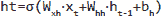
```

在这里，`W[xh]` 和 `W[hh]` 是权重矩阵，`b[h]` 是偏置，`σ` 是激活函数（通常为 `tanh` 或 `ReLU`）。

- **输出层**：每个时间步的输出基于隐藏状态计算。输出可以是基于任务的预测或分类。其通常计算方式为：

```
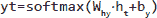
```

其中 `W[hy]` 是连接隐藏状态到输出的权重矩阵，`b[y]` 是偏置。

- **循环连接**：每个时间步的隐藏状态都会传递给下一个，允许 RNN 留存之前输入的记忆。

# 挑战：梯度消失问题与梯度爆炸问题

## 梯度消失问题

- **描述**：当反向传播过程中用于更新网络权重的梯度变得非常小时，就会发生梯度消失。这在深度网络或处理长序列的 RNN 中特别常见，梯度在反向传播许多层或时间步时会减小。

- **影响**：当梯度消失时，网络权重的更新非常小，这可能导致学习过程变得极其缓慢甚至停止。这个问题对于 RNN 来说尤为严重，因为它限制了它们学习序列中长距离依赖关系的能力。

### 解决方案

- **长短期记忆 (LSTM) 和门控循环单元 (GRU)**：这些架构旨在允许网络在更长时间保留重要信息，从而减少梯度消失问题。

- **ReLU 激活**：使用 `ReLU` 代替 `tanh` 或 `sigmoid` 可以帮助减少梯度消失的影响。

## 梯度爆炸问题

- **描述**：梯度爆炸问题与梯度消失问题相反。当梯度在反向传播过程中变得过大时，就会发生。这可能发生在网络权重初始化不当或序列长度很长的情况下。

- **影响**：梯度爆炸会导致网络权重以过大的值进行更新，导致数值不稳定，使得模型输出变得不可预测，或导致其在训练期间无法收敛。

### 解决方案

- **梯度裁剪**：该技术涉及在反向传播期间将梯度限制在一个最大值内，以防止它们过大。

- **适当的权重初始化**：仔细初始化权重可以帮助防止爆炸。

# 用例：使用 RNN 进行情感分析

让我们通过使用 TensorFlow 中提供的 IMDB 电影评论数据集构建一个文本分类模型，探索 RNN 在 NLP 中的真实应用用例。该数据集是情感分析的常用基准，其目标是将电影评论分类为正面或负面。

**目标**：我们将构建一个基于 RNN 的模型，将电影评论分类为正面或负面。

**数据集**：`IMDB` 数据集包含 50,000 条电影评论，分为 25,000 条训练评论和 25,000 条测试评论。每条评论都被标记为正面 (1) 或负面 (0)。

Python 代码如下：

```python
import tensorflow as tf
from tensorflow.keras.datasets import imdb
from tensorflow.keras.preprocessing.sequence import pad_sequences

# 加载 IMDB 数据
max_features = 10000 # 考虑的单词数
(x_train, y_train), (x_test, y_test) = imdb.load_data(num_words=max_features)

# 填充序列以确保尺寸一致
max_len = 500 # 在此数字后裁剪
x_train = pad_sequences(x_train, maxlen=max_len)
x_test = pad_sequences(x_test, maxlen=max_len)

# 构建 RNN 模型
model = Sequential()
model.add(Embedding(max_features, 32, input_length=max_len))
model.add(SimpleRNN(32, activation='relu'))
model.add(Dense(1, activation='sigmoid'))

# 编译模型
model.compile(optimizer='adam', loss='binary_crossentropy', metrics=['accuracy'])

# 训练模型
history = model.fit(x_train, y_train, epochs=10, batch_size=64, validation_split=0.2)

# 在测试集上评估模型
test_loss, test_acc = model.evaluate(x_test, y_test)
print(f"Test Accuracy: {test_acc:.4f}")
```

**输出**：

`Test Accuracy: 0.8434`

最终训练准确率为 0.9778，测试准确率为 0.8434。这里出现了数据过拟合现象。以下可能是导致过拟合合的某些情况：

## 序列数据的复杂性

`RNNs` 设计用于捕捉序列数据（如文本）中的依赖关系，这会导致它们过度学习训练数据中的这些依赖关系，特别是当训练数据的多样性不足时。

## 长期依赖

虽然 `RNNs` 擅长捕捉序列，但它们可能会因为过度关注训练集中的模式而产生过拟合，而无法泛化这些模式在未见文本中可能发生的变化。

## 高容量

`RNNs`，特别是 `LSTMs` 和 `GRUs`，拥有大量的参数，使其具备了建模复杂函数的能力。这也意味着如果不应用正则化技术，它们很容易过拟合。

我们可以使用正则化来减少过拟合：

* **Dropout**：在 `RNN` 层中引入 `dropout`。`Dropout` 在训练期间随机丢弃单元，这有助于防止模型过度依赖于任何单一特征或模式。

* **L2 Regularization**：应用 `L2 regularization` 来惩罚大权重，鼓励模型寻找更具泛化的解决方案。

```python
from tensorflow.keras.layers import Dropout, LSTM
model = Sequential()
model.add(Embedding(max_features, 32, input_length=max_len))
model.add(LSTM(32, activation='tanh', recurrent_dropout=0.2))  # Added recurrent_dropout
model.add(Dropout(0.5))  # Added dropout layer
model.add(Dense(1, activation='sigmoid'))
```

我们还可以使用早停法来缓解过拟合的影响：

* **Early Stopping**：在训练期间监控验证损失，并在验证损失开始增加时停止训练，这标志着过拟合的开始。

```python
from tensorflow.keras.callbacks import EarlyStopping
early_stopping = EarlyStopping(monitor='val_loss', patience=3, restore_best_weights=True)
# Compile the model
model.compile(optimizer='adam', loss='binary_crossentropy', metrics=['accuracy'])
history = model.fit(X_train, y_train, epochs=10, batch_size=64, validation_split=0.2, callbacks=[early_stopping])
```

早停后，验证准确率为 0.8266，训练准确率为 0.8915。因此，我们可以对此进行详细说明：

* **监控验证损失**：早停可能一直在监控验证损失，该损失在第二个 epoch 之后没有显著改善。相反，它在第三个 epoch 开始出现波动并显示出潜在过拟合的迹象。

* **过拟合检测**：模型在训练集上表现得更好，但这并没有反映在验证集中。验证损失缺乏改进以及轻微的不稳定性表明，进一步的训练只会导致过拟合。

* **最佳停止点**：训练在第 5 个 epoch 停止。

- **顺序性**：`RNNs` 中的顺序处理允许它们考虑单词的顺序，这对于情感分析等任务至关重要，在这些任务中上下文和词序非常重要。

在某些情况下，结合 `CNNs` 和 `RNNs` 的混合方法对情感分析可能特别有效。`CNN` 可以捕捉文本中的局部模式（如特定短语），而 `RNN` 则可以考虑词序列提供的更广泛的上下文。

- **全面的情感分析**：一家新闻机构想要分析社论内容的情感，在这种情况下，同时理解特定短语和整体叙述都是重要的。

# 文本分类

使用 `CNNs` 进行文本分类时，输入数据被表示为词嵌入序列（例如 `Word2Vec`、`GloVe` 或 `fastText`），这些是词在高维空间中学习得的表示。

`CNN` 中的卷积层对词嵌入应用过滤器，这使得网络能够识别相关的 `n-grams`，无论它们在句子中的位置如何。

在卷积层之后，输出通常会通过一个池化层以进一步降低特征的维度，并保留最重要的特征。

然后，将池化后的特征输入到一个或多个全连接层，由这些层执行分类。

## 优势

- **局部特征检测**：`CNNs` 擅长识别指示特定类别的关键短语或特定的词汇组合。

- **效率**：与 `RNNs` 相比，`CNNs` 的计算开销较低，使其训练速度更快。

- **并行性**：`CNNs` 的架构允许并行处理，从而加快了计算。

对于 `RNNs`，情况与 `CNNs` 类似，单词被表示为词嵌入。

然后，`RNN` 逐个处理词嵌入序列，随着每个新单词的出现更新其隐藏状态。该隐藏状态传递了之前词的上下文，使得 `RNNs` 对词顺序敏感。

在处理整个序列后，隐藏状态被用于进行最终分类。

- **长短期记忆 (LSTM)**：`LSTM` 网络包含了用于调节信息流的机制（门控），使其能够学习文本中的长距离依赖关系。

- **门控循环单元 (GRU)**：`GRU` 是 `LSTM` 的简化版本，具有更少的门和更精简的架构。

## 优势

- **顺序依赖**：`RNNs` 擅长捕捉文本不同部分之间的依赖关系，例如句子中前面的单词如何影响后续单词的含义。

- **上下文理解**：`RNNs` 善于理解上下文，使得它们对于需要理解语言细微差别的任务非常有效。

# 机器翻译

- **CNNs** 可用于构建翻译的编码器-解码器模型。在这些模型中，卷积被应用于输入序列以提取 `n-gram` 特征。这些特征捕捉了文本中的局部依赖关系（例如，词对或三元组），这在某些短语或词组合具有特定含义的翻译任务中特别有用。

在将“*How is work today?*”翻译为“*Wie ist die Arbeit heute?*”时，基于 `CNN` 的模型可能会侧于捕捉“*work*”等单词周围的局部上下文。

- **循环神经网络 (RNNs)** 专门用于 `Seq2Seq`。

## 编码器-解码器架构

- **编码器 (Encoder)**：`encoder` 处理输入序列并生成称为隐藏状态的向量表示。

- **解码器 (Decoder)**：`decoder` 获取隐藏状态并生成目标语言的输出。

## 挑战

- **长句子**：传统的 `RNNs` 因为梯度消失问题而在处理长句子时面临困难。

- **词序**：不同的语言可能有不同的词序，使得 `attention mechanism` 变得必要。

## 注意力机制

`Google Translate`、`Microsoft Translator` 和 `Amazon Translate` 等机器翻译模型由 `CNNs` 和 `RNNs` 驱动。最近的模型（如 `Transformer`）将 `CNNs` 和 `RNNs` 的最佳特性与 `attention` 机制结合在一起。

# 回答生成

在生成式问答系统中，`RNNs` 可用于逐词生成答案，以确保生成的响应在上下文上与问题相关。

如果我们来看 `RNNs` 的一个用例，有一家医疗提供者使用基于 `RNN` 的问答系统来回答患者关于症状、治疗方案和药物的查询。患者以自然语言提交问题，系统必须提供准确且感知上下文的回答。

`RNN` 逐词地处理问题，捕捉问题中提到的症状与治疗方法之间的依赖关系。这种理解有助于系统检索或生成最符合语境的响应。

许多现代问答系统结合了 `CNNs` 和 `RNNs`，以兼顾两种方法的优点。`CNNs` 可用于特征提取，而 `RNNs` 则处理问题的顺序依赖和对上下文的理解。

例如，一个教育平台提供了一个 AI 驱动的导师，回答学生关于各个学科的问题。系统必须同时理解问题的内容以及学生之前交互提供的上下文。如今，我们有了针对特定课程的专用 AI 助手，例如在 `Udacity` 和 `Khan Academy` 等平台上的。

`CNN` 从学生的问题中提取关键特征，而 `RNN` 则处理词序列以理解上下文。它们共同使系统能够提供为学生学习历史量身定制的、准确且感知上下文的回答。

## 优势

- **准确性**：结合 `CNN` 和 `RNN` 模型可以充分发挥两种模型的优点，从而提高系统在理解问题和回答问题方面的准确性。

- **灵活性**：这些模型可以适应不同的领域，使其在各种问答应用中具有多功能性。

- **效率性**：`CNNs` 通过减少文本数据的维度来加速处理，而 `RNNs` 则确保了语言的顺序特性得以保留。

## 缺点

- **复杂性**：训练这些模型需要大量的计算资源和专业知识。

- **数据依赖性**：训练高效的问答系统需要高质量、标注的数据集。

- **实时性能**：确保系统实时响应可能是具有挑战性的，特别是对于复杂的查询。

这些是 `CNNs` 和 `RNNs` 的一些最重要的真实用例。此外还有如文本摘要、抄窃检测、语言建模、命名实体识别、语音识别、聊天机器人开发等用例。

# 结论

总之，我们涵盖了深度学习的概念、其应用，以及深度学习相对于机器学习在 NLP 方面的优势。我们还讨论了深度学习的构建模块，例如神经元、权重和偏置、优化算法、激活函数和损失函数等。我们涵盖了深度学习的概念，如深层架构、表示学习、泛化、迁移学习和可扩展性。

然后我们涵盖了深度神经网络以及各种类型，如 `CNN`、`RNN`、`GANs` 和自动编码器。接着涵盖了相关的库，如 `TensorFlow`、`Keras`、`PyTorch`、`scikit-learn`、`pandas` 和 `numpy`。我们还涵盖使用 `scikit-learn` 库中乳腺癌数据集进行肿瘤二分类的用例。

随后我们涵盖了 `CNNs` 和 `RNNs` 的概念和架构。我们讨论了 `RNN` 的梯度消失和梯度爆炸及其解决方案。我们还讨论了 `RNN` 的变体，即 `GRUs` 和 `LSTMs`。我们还涵盖了一个使用 `RNN` 进行情感分析的用例。

最后，我们总结了 `CNNs` 和 `RNNs` 在 NLP 中的各种真实生活用例，如情感分析、文本分类、机器翻译和问答系统。

在下一章中，我们将深入探讨使用卷积神经网络（`CNNs`）将深度学习模型应用于情感分析。通过实操项目，我们将探索模型的复杂之处，以及如何有效地将其应用于现实问题。

# 参考文献

- [`www.datacamp.com/tutorial/introduction-to-deep-neural-networks`](https://www.datacamp.com/tutorial/introduction-to-deep-neural-networks)

- [`www.datacamp.com/tutorial/tutorial-deep-learning-tutorial`](https://www.datacamp.com/tutorial/tutorial-deep-learning-tutorial)

- [`www.datacamp.com/tutorial/introduction-to-convolutional-neural-networks-cnns`](https://www.datacamp.com/tutorial/introduction-to-convolutional-neural-networks-cnns)

- [`www.geeksforgeeks.org/convolutional-neural-network-cnn-in-machine-learning/`](https://www.geeksforgeeks.org/convolutional-neural-network-cnn-in-machine-learning/)

- [`medium.com/@draj0718/convolutional-neural-networks-cnn-architectures-explained-716fb197b243`](https://medium.com/@draj0718/convolutional-neural-networks-cnn-architectures-explained-716fb197b243)

- [`journalofbigdata.springeropen.com/articles/10.1186/s40537-021-00444-8`](https://journalofbigdata.springeropen.com/articles/10.1186/s40537-021-00444-8)

* [使用 CNN 进行文本分类](https://medium.com/voice-tech-podcast/text-classification-using-cnn-9ade8155dfb9)


* [Lamb Andrew 的报告](https://cs224d.stanford.edu/reports/LambAndrew.pdf)
* [为什么卷积神经网络是机器翻译的绝佳架构](https://medium.com/ai-society/why-convolutional-neural-networks-are-a-great-architecture-for-machine-translation-9258ca1263a8)
* [神经机器翻译的新方法](https://engineering.fb.com/2017/05/09/ml-applications/a-novel-approach-to-neural-machine-translation/)
* [使用 CNN 实现问答网络](https://towardsdatascience.com/implementing-question-answering-networks-with-cnns-5ae5f08e312b)
* [论文：卷积神经网络用于文本分类](https://aclanthology.org/C16-1164.pdf)
* [基于情感分析的深度学习](https://journalofbigdata.springeropen.com/articles/10.1186/s40537-020-00341-6)

# 第 5 章

## CNN 的应用

### 引言

情感分析是自然语言处理的基石，旨在提取文本的情感基调。本章将探讨深度学习模型（特别是`卷积神经网络 (CNNs)`）在情感分析中的应用。通过实践项目，我们将探索这些模型的复杂性、优缺点，以及如何将它们有效地应用于现实世界的问题。

通过理解 CNN 的架构、原理和应用，我们将全面掌握用于情感分析的深度学习。这些知识将使你能够构建复杂的模型，准确地将文本分类为积极、消极或中性。

### 结构

在本章中涵盖以下主题：

* 使用 CNN 进行情感分析
* 数据理解与探索
* CNN 模型的数据准备
* CNN 模型的准备与训练
* 模型评估与可视化

## 使用 CNN 进行情感分析

情感分析旨在识别文本数据的情感基调，将其分类为积极、消极或中性。CNN 最初是为图像处理设计的，但由于其能够捕捉序列中的局部模式和依赖关系，它们在`文本分类任务`中被证明是有效的。我们将使用针对特定药物及相关疾病的患者评论数据集，其中包含反映患者总体满意度的 10 星患者评分。

## 数据理解与探索

数据是通过爬取`在线药品评论网站`获得的。其目的是研究：

* 多个维度的药物体验情感分析，即在特定方面（如疗效和副作用）上学到的情感；
* 模型在不同领域（即疾病）之间的迁移性；
* 模型在不同数据源之间的迁移性（参见`Drug Review Dataset (Druglib.com)`）。

[药物分类数据集](https://archive.ics.uci.edu/dataset/462/drug+classification)

## CNN 模型的数据准备

现在我们将对文本进行一些预处理操作，例如删除（有的）HTML 标签、删除重音字符、转换为小写、删除标点符号和特殊字符以及删除停用词。

```python
import re
import nltk
from nltk.corpus import stopwords
from bs4 import BeautifulSoup
import unicodedata
import contractions
import string

def preprocess_corpus(text):
    """
    预处理文本。
    Args:
        text (str): 输入文本。
    Returns:
        str: 预处理后的文本。
    """
    # 删除 HTML 标签
    soup = BeautifulSoup(text, "html.parser")
    text = soup.get_text()

    # 删除重音字符
    text = unicodedata.normalize('NFKD', text).encode('ascii', 'ignore').decode('utf-8')

    # 转换为小写
    text = text.lower()

    # 删除标点符号和特殊字符
    text = text.translate(str.maketrans('', '', string.punctuation))

    # 删除数字
    text = re.sub(r'\d+', '', text)

    # 删除停用词
    stop_words = set(stopwords.words('english'))
    words = [word for word in text.split() if word not in stop_words]

    # 将单词合并成句子
    preprocessed_text = ' '.join(words)
    return preprocessed_text
```

数据被分为训练集（75%）和测试集（25%）。

```python
# 加载和划分数据的示例
drugs_df_train = pd.read_csv('drugsComTrain_raw.tsv', sep='\t')
drugs_df_test = pd.read_csv('drugsComTest_raw.tsv', sep='\t')

# 合并训练和测试数据以拆分
combined_df = pd.concat([drugs_df_train, drugs_df_test], ignore_index=True)

# 将合并后的数据分为新的训练集和验证集
train_df_new, val_df = train_test_split(combined_df, test_size=0.2, random_state=42)
```

在前面的代码中，我们合并了训练和测试数据框，并创建了一个新的合并数据框。随后，将合并后的数据框分为 80%（`train`）和 20%（`test`）。最后我们得到了三个数据集：一个新的训练数据框（`train_df_new`）、验证数据（`val_df`）和测试数据（`drugs_df_test`）。

在下一步，我们将对 `train`、`test` 和 `validation` 数据使用 `preprocess` 函数。

### 预处理文本

```python
train_df_new['review'] = train_df_new['review'].apply(preprocess_corpus)
drugs_df_test['review'] = drugs_df_test['review'].apply(preprocess_corpus)
val_df['review'] = val_df['review'].apply(preprocess_corpus)
```

在进入模型训练步骤之前，我们在所有数据集上使用了 `preprocess_corpus` 函数。下一步，我们将数据拆分为 `X_train`、`y_train`、`X_test`、`y_test`、`X_val` 和 `y_val`。

```python
X_train = train_df_new['review'].values
y_train = train_df_new['rating'].values
X_test = drugs_df_test['review'].values
y_test = drugs_df_test['rating'].values
X_val = val_df['review'].values
y_val = val_df['rating'].values
```

我们从训练、测试和验证数据中提取了评论和评分值。然后我们将对训练数据进行分词。

### 数据分词（评论）

```python
t = Tokenizer(oov_token='<UNK>')
# 在训练文档上拟合分词器
t.fit_on_texts(X_train)
t.word_index['<PAD>'] = 0
```

Keras 中的 `Tokenizer` 类用于将文本数据转换为机器学习模型可以处理的数值表示。

* `oov_token` 参数指定了一个用于词汇表中不存在的标记。
* `fit_on_texts` 方法从训练数据中构建唯一单词词汇表，并为它们分配整数索引。
* 分词器的 `word_index` 属性包含一个将单词映射到相应索引的字典。
* 添加填充标记 `<PAD>` 可确保所有序列具有相同的长度，这对于将数据输入到神经网络模型中是关键的。

然后，我们将评论转换为序列。

```python
X_train = t.texts_to_sequences(X_train)
X_test = t.texts_to_sequences(X_test)
X_val = t.texts_to_sequences(X_val)
```

* `t.texts_to_sequences()`：此方法来自 Keras `Tokenizer` 类，用于将文本数据转换为整数序列。每个整数代表分词器创建的词表中的唯一单词。因此，来自训练、测试和验证数据集的每个文本数据都被转换为数值序列。

我们将使用 matplotlib 可视化这些序列。

### 绘制序列长度

```python
import matplotlib.pyplot as plt
%matplotlib inline
train_lens = [len(s) for s in X_train]
test_lens = [len(s) for s in X_test]
fig, ax = plt.subplots(1,2, figsize=(12, 6))
h1 = ax[0].hist(train_lens)
h2 = ax[1].hist(test_lens)
```

* 代码首先计算训练集和测试集中每个序列的长度。
* 然后，它创建了两个子图来可视化两个数据集中序列长度的分布。
* 直方图显示了每个集中不同序列长度的频率。

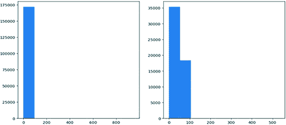

**图 5.2**：训练和测试数据的序列直方图

训练数据序列向右偏，数据集中在左侧；测试数据序列几乎相同，右侧略有凸起。接下来，我们将对训练、测试和验证数据集进行序列归一化。序列归一化的目的是：

* **确保一致**：序列归一化确保所有输入序列具有相同的长度。这对于包括神经网络在内的许多机器学习模型至关重要，因为它们需要固定长度的输入。
* **防止错误**：如果序列长度不同，可能需要填充或截断。错误的填充或截断会导致模型预测错误。

序列归一化的代码如下。

### 将数据集填充到最大评论单词长度

```python
MAX_SEQUENCE_LENGTH = 40
X_train = pad_sequences(X_train, maxlen=MAX_SEQUENCE_LENGTH)
X_test = pad_sequences(X_test, maxlen=MAX_SEQUENCE_LENGTH)
X_val = pad_sequences(X_val, maxlen=MAX_SEQUENCE_LENGTH)
```

我们添加了 40 的最大序列长度，序列将进行填充。接下来我们将进行标签编码。标签编码的目的是：

* **机器可读性**：将类别标签编码为数值。
* **一致性**：它确保模型一致地处理类别。
* **评估指标**：许多评估指标（如准确率、召回率）需要数值标签。

标签编码的代码如下。

### 编码标签

```python
le = LabelEncoder()
y_train = le.fit_transform(y_train)
y_test = le.transform(y_test)
y_val = le.transform(y_val)
```

`LabelEncoder` 类用于将类别数据编码为数值表示。

* `fit_transform()` 方法用于训练标签以学习唯一类别并分配整数索引。
* `transform()` 方法使用从训练数据中学到的映射用于测试和验证标签。

`rating` 列中有 10 个类别，从 1 到 10 开始，其中 10 是最高评分，1 是最低评分。

* **词表大小 (Vocabulary Size)**：较大的词表大小允许模型捕捉文本数据中的更多细微差别。然而，非常大的词表也会增加模型的复杂性和计算资源的需求。
* **嵌入大小 (Embedding Size)**：嵌入大小决定了词嵌入的维度。较高的嵌入大小可以捕捉词之间更复杂的语义关系，但也会增加模型的参数数量。
* **早停 (Early Stopping)**：此回调函数对于防止过拟合至关重要。通过在模型在验证集上的性能不再提升时停止训练，它可以帮助找到最佳的轮数（epochs）并避免对训练数据的过拟合。

现在，我们将创建 CNN 模型。

## 创建模型

```python
model = Sequential()

# 嵌入层
model.add(Embedding(VOCAB_SIZE, EMBED_SIZE, input_length=MAX_SEQUENCE_LENGTH))

# 第一层维卷积层 (32,4,same,relu)
model.add(Conv1D(filters=32, kernel_size=4, padding='same', activation='relu'))
model.add(Conv1D(filters=32, kernel_size=4, padding='same', activation='relu'))

# 第一层最大池化层 (2)
model.add(MaxPooling1D(pool_size=2))

# 第一层 Dropout 层 (10%)
model.add(Dropout(rate=0.10))

# 第二层维卷积层 (32,4,same,relu)
model.add(Conv1D(filters=64, kernel_size=4, padding='same', activation='relu'))
model.add(Conv1D(filters=64, kernel_size=4, padding='same', activation='relu'))

# 第二层最大池化层 (2)
model.add(MaxPooling1D(pool_size=2))

# 第二层 Dropout 层 (10%)
model.add(Dropout(rate=0.10))

# 第三层维卷积层 (32,4,same,relu)
model.add(Conv1D(filters=64, kernel_size=4, padding='same', activation='relu'))
model.add(Conv1D(filters=64, kernel_size=4, padding='same', activation='relu'))

# 第三层最大池化层 (2)
model.add(MaxPooling1D(pool_size=2))

# 第三层 Dropout 层 (10%)
model.add(Dropout(rate=0.10))

# 展平层
model.add(Flatten())

# 第一层全连接层 (256,relu)
model.add(Dense(256, activation='relu'))

# 第二层全连接层/输出层 (10,softmax)
model.add(Dense(10, activation='softmax'))

# 使用交叉熵损失函数、准确率和 Adam 优化器编译模型
model.compile(loss='SparseCategoricalCrossentropy', optimizer=tf.keras.optimizers.Adam(1e-4), metrics=['accuracy'])

# 显示模型架构
model.summary()
```

这段代码定义了一个用于文本分类的卷积神经网络 (CNN)。该模型旨在处理序列并将其分类为 10 类之一。

### 创建顺序模型

* `model = Sequential()`：初始化一个顺序模型，它是一个线性堆叠层。

### 嵌入层

* `model.add(Embedding(VOCAB_SIZE, EMBED_SIZE, input_length=MAX_SEQUENCE_LENGTH))`：添加嵌入层，将词索引转换为密集向量。
    * `VOCAB_SIZE`：词表大小。
    * `EMBED_SIZE`：词嵌入的维度。
    * `input_length`：序列长度。

### 卷积层

* `model.add(Conv1D(filters=32, kernel_size=4, padding='same', activation='relu'))`：添加一维卷积层，具有 32 个卷积滤波器、4 的卷积核大小、`padding='same'` 以保持输入形状，以及 ReLU 激活函数。
* 使用多个卷积层从输入序列中提取不同的特征。

### 池化层

* `model.add(MaxPooling1D(pool_size=2))`：添加最大池化层对特征图进行采样，降低维度。

### Dropout 层

* `model.add(Dropout(rate=0.10))`：添加 Dropout 层，在训练期间随机丢弃单元以防止过拟合。

### 展平层

* `model.add(Flatten())`：将卷积层的输出展平为一维向量。

### 全连接层

* `model.add(Dense(256, activation='relu'))`：添加一个具有 256 个单元和 ReLU 激活函数的全连接层。


* `model.add(Dense(10, activation='softmax'))`：添加一个具有 10 个单元和 softmax 激活函数的全连接层。

#### 编译模型

* `model.compile(loss='SparseCategoricalCrossentropy', optimizer=tf.keras.optimizers.Adam(1e-4), metrics=['accuracy'])`：使用 `SparseCategoricalCrossentropy` 作为损失函数，`accuracy` 作为指标，`Adam` 作为优化器来编译模型。

## 显示模型架构

* `model.summary()`：显示模型的架构。

在下一步中，我们将跨训练轮次（epochs）可视化训练损失和验证损失。代码如下：

```python
import matplotlib.pyplot as plt

# 绘制训练和验证损失
plt.plot(history1.history['loss'], label='Training Loss')
plt.plot(history1.history['val_loss'], label='Validation Loss')
plt.title('Training and Validation Loss')
plt.xlabel('Epochs')
plt.ylabel('Loss')
plt.legend()
plt.show()
```

### 绘制训练和验证损失

* `plt.plot(history1.history['loss'], label='Training Loss')`：将从 `history1` 对象（由 `model.fit` 方法返回）提取的训练损失值绘制在折线图中，并标记为‘Training Loss’。模型训练步骤中的 `history1` 对象包含了有关训练过程的信息，包括每个轮次训练数据和验证数据的损失值。

* `plt.plot(history1.history['val_loss'], label='Validation Loss')`：同样，绘制验证损失值，并标记为‘Validation Loss’。

### 添加标题和标签

* `plt.title('Training and Validation Loss')`：设置图表的标题。

* `plt.xlabel('Epochs')`：将 x 轴标记为‘Epochs’。

* `plt.ylabel('Loss')`：将 y 轴标记为‘Loss’。

### 图例和显示

* `plt.legend()`：给图中添加图例，以区分不同的线条。

* `plt.show()`：显示生成的图表。

生成的图表所示。

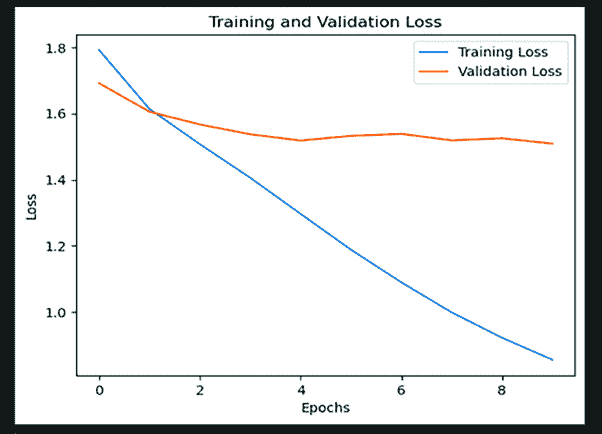

**图 5.3**：验证和训练损失随轮次的变化

从上面的图中可以看出，训练损失随着每个轮次的增加而减少，且训练和验证损失在约 `epoch 1` 处收敛。验证损失在此之后开始进入平台期，并达到接近 1.55。

### 损失图的解读

上述对损失图的描述表明该模型取得了积极的结果：

* **训练损失下降**：训练损失随着每个轮次的增加持续减少，表明模型正在学习并提高其在训练数据上的性能。

* **训练和验证损失收敛**：训练和验证损失曲线在 `epoch 1` 附近收敛，表明模型没有出现严重的过拟合。

* **验证损失进入平台期**：验证损失在 1.55 左右进入平台期是常见现象。这表明模型已达到这一点，进一步的训练无法显著提高其在验证数据上的性能。

图表表明你的模型在拟合训练数据和泛化到未见数据之间取得了良好的平衡。

接下来，我们将跨训练轮次可视化训练和验证准确率值。代码如下：

```python
# 绘制训练和验证准确率
plt.plot(history1.history['accuracy'], label='Training Accuracy')
plt.plot(history1.history['val_accuracy'], label='Validation Accuracy')
plt.title('Training and Validation Accuracy')
plt.xlabel('Epochs')
plt.ylabel('Accuracy')
plt.legend()
plt.show()
```

* `plt.plot(history1.history['accuracy'], label='Training Accuracy')`：从 `history1` 对象（由 `model.fit` 返回）提取训练准确率值。将这些值绘制在折线图中，标记为 `Training Accuracy`。

* `plt.plot(history1.history['val_accuracy'], label='Validation Accuracy')`：从 `history1.history` 提取验证准确率值。将这些值绘制在同一张图中，标记为 `Validation Accuracy`。

### 添加标题和标签

* `plt.title('Training and Validation Accuracy')`：设置图表的标题。

* `plt.xlabel('Epochs')`：将 x 轴标记为 `Epochs`。

* `plt.ylabel('Accuracy')`：将 y 轴标记为 `Accuracy`。

### 图例和显示

* `plt.legend()`：给图中添加图例，以区分训练和验证准确率曲线。

* `plt.show()`：显示生成的图表。

生成的图表所示。

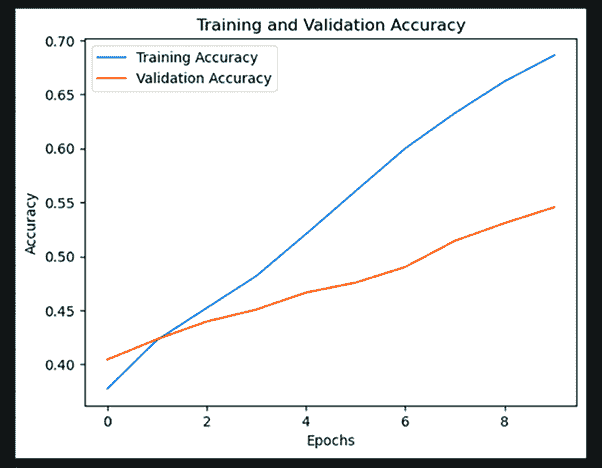

**图 5.4**：验证和训练准确率随轮次的变化

在上面的图中，训练准确率几乎呈线性增加，并在第 10 个轮次时达到近 70% 的峰值。训练和验证准确率值在 41% 处重叠，验证准确率缓慢增加到接近 54%。

### 准确率图的解读

根据描述，准确率图显示了以下内容：

* **训练准确率增加**：训练准确率稳定增长，到第 10 个轮次达到约 70%。这表明模型正在学习并提高其在训练数据上的性能。我们只训练了 10 个轮次。

* **训练和验证准确率重叠**：训练和验证准确率曲线最初在 41% 处重叠，表明模型初期可能没有过拟合。

* **验证准确率增加**：验证准确率逐渐增加到 54% 是一个积极信号。它表明模型对未见数据的泛化良好。

总体而言，图表表明模型正在有效学习，并提高其在训练集和验证集上的性能。在下一步，我们将通过分类报告和混淆矩阵查看性能指标。我们将观察所有 10 个目标类别的准确率、精确率和召回率。我们还将使用热力图进行可视化。代码如下：

```python
from sklearn.metrics import confusion_matrix, classification_report
import seaborn as sns
import matplotlib.pyplot as plt

# 假设你已经有了预测标签
# 假设你有预测标签 (y_pred) 和真实标签 (y_true)
y_pred = model.predict(X_test)
y_pred_classes = np.argmax(y_pred, axis=1)

# 计算混淆矩阵
cm = confusion_matrix(y_test, y_pred_classes)

# 打印分类报告
print(classification_report(y_test, y_pred_classes))

# 绘制混淆矩阵
plt.figure(figsize=(8, 6))
sns.heatmap(cm, annot=True, fmt='d', cmap='Blues', xticklabels=[1,2,3,4,5,6,7,8,9,10], yticklabels=[1,2,3,4,5,6,7,8,9,10])
plt.xlabel('Predicted')
plt.ylabel('Actual')
plt.title('Confusion Matrix')
plt.show()
```

让我们逐行检查代码：

1. **导入库**：

    * `from sklearn.metrics import confusion_matrix, classification_report`：导入计算混淆矩阵和分类报告的函数。

    * `import seaborn as sns`：导入用于创建热力图的 Seaborn 库。

    * `import matplotlib.pyplot as plt`：导入用于绘图的 Matplotlib 库。

2. **预测**：

    * `y_pred = model.predict(X_test)`：使用模型 (`model`) 对测试数据 (`X_test`) 进行预测。

3. **获取预测类别**：

    * `y_pred_classes = np.argmax(y_pred, axis=1)`：将预测概率 (`y_pred`) 转换为类别。`argmax` 函数获取指定轴（此处为 `axis=1`）上最大值的索引。

4. **计算混淆矩阵**：

    * `cm = confusion_matrix(y_test, y_pred_classes)`：使用 `sklearn.metrics` 中的 `confusion_matrix` 计算混淆矩阵。混淆矩阵显示了每个真实类别被预测为各个类别的情况。

5. **打印分类报告**：

    * `print(classification_report(y_test, y_pred_classes))`：打印一份全面的分类报告，包括每个类别的精确率、召回率、F1 分数和支持数。

6. **绘制混淆矩阵**（见上方代码块）。

* `plt.figure(figsize=(8, 6))`：创建一个特定大小（8 英寸宽，6 英寸高）的图形。

* `sns.heatmap(cm, annot=True, fmt='d', cmap='Blues', xticklabels=[1,2,3,4,5,6,7,8,9,10], yticklabels=[1,2,3,4,5,6,7,8,9,10])`：使用 `sns.heatmap` 创建混淆矩阵的热图可视化。

    * `annot=True`：在每个单元格中注释相应的计数。

    * `fmt='d'`：将单元格数值格式化为整数。

    * `cmap='Blues'`：为热图设置颜色映射（在此例中蓝色系）。

    * `xticklabels`：设置 x 轴标签（预测类别）。

    * `yticklabels`：设置 y 轴标签（实际类别）。

* `plt.xlabel('Predicted')`：将 x 轴标记为 `'Predicted'`。

* `plt.ylabel('Actual')`：将 y 轴标记为 `'Actual'`。

* `plt.title('Confusion Matrix')`：设置图表标题。

* `plt.show()`：显示生成的热图。

## 解释

* 在训练模型后，我们使用它来预测测试数据的标签。

* 混淆矩阵直观地展示了模型在测试数据上的表现。它显示了每个类别正确和错误预测的数量。

* 分类报告提供了关于模型性能的额外细节，包括每个类别的精确率（precision）、召回率（recall）、F1 分数和支持率（support）。这些指标可以帮助我们理解模型对不同类的优缺点。

* 热图可视化提供了一种解释混淆矩阵的清晰方法，突出了不同类别之间正确和错误预测的分布。

通过分析这些评估结果，我们可以对模型对未见数据的泛化能力获得宝贵的见解，并识别待改进之处。

我们将看到 10 个类别的精确率、召回率和 F1 分数。我们看到这里的类别是 0 到 9，其中 0 是类别 1，1 是类别 2，以此类推。

| precision | recall | f1-score | support |
| :--- | :--- | :--- | :--- |
| 0 | 0.84 | 0.88 | 0.86 | 7299 |
| 1 | 0.53 | 0.54 | 0.53 | 2334 |
| 2 | 0.47 | 0.35 | 0.40 | 205 |
| 3 | 0.45 | 0.19 | 0.27 | 1659 |
| 4 | 0.42 | 0.62 | 0.50 | 2710 |
| 5 | 0.49 | 0.31 | 0.38 | 2119 |
| 6 | 0.56 | 0.55 | 0.56 | 3091 |
| 7 | 0.63 | 0.69 | 0.66 | 6156 |
| 8 | 0.71 | 0.76 | 0.73 | 9177 |
| 9 | 0.89 | 0.86 | 0.87 | 17016 |
| accuracy | | | 0.72 | 53766 |
| macro avg | 0.60 | 0.57 | 0.58 | 53766 |
| weighted avg | 0.72 | 0.72 | 0.71 | 53766 |

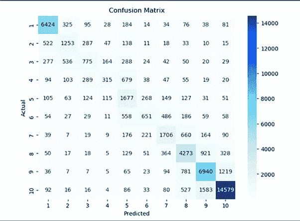 10 个类别的混淆矩阵

在上面的热图中，我们看到了 10 个类别的混淆矩阵，x 轴为预测类别，y 轴为实际类别。对于类别 1，有 6424 条评论被预测为正确。在类别 1 的评论中，有 325 条预测为类别 2，其他类别以此类推。如果我们观察每个类别，发现大多数评论都被正确分类，只有少数评论被误分类，例如，类别 10 有 14579 条评论被正确分类。我们可以看到类别 4 存在一个差异，有 679 条评论被误分类为类别 5。类别 6 有 558 条评论被误分类为类别 5。

## 结论

总结来说，我们对针对特定药物及相关疾病的患者评论数据集（包含 10 星患者满意度评分）使用了 CNN 进行情感分析。我们在初步阶段对数据进行了探索。然后我们为 CNN 模型准备了数据：删除了 HTML 标签、删除重音字符、转换为小写、删除标点和特殊字符、删除停用词并合并成句子。

然后，我们从原始数据中准备了训练、测试和验证数据集，对数据进行了分词，并将评论转换为序列。接着我们进行了序列归一化和标签编码。

随后我们准备了 CNN 模型并进行了训练。接下来，完成了模型评估，并对 epoch 值可视化了训练和验证的损失以及准确率值。此外，还创建了混淆矩阵热图以寻找误分类的标签以及精确率、召回率和 F1 分数值。

在下一章中，我们将利用 spaCy 高效的 NLP 流水线来简化文本处理流。我们将学习流水线如何将多个 NLP 任务组合成单一的优化序列，从而允许我们执行分词、词性标注、命名实体识别等更多操作。

本章将深入探讨 spaCy 流水线（pipelines），探索其功能、自定义选项以及实际应用。通过理解流水线的工作原理以及如何有效利用它们，我们将能够构建稳健且高效的 NLP 应用程序，以处理广泛的文本类任务。

### 结构

在本章中，我们将涵盖以下主题：

* 理解 spaCy 流水线
* 创建和自定义流水线
* 使用流水线完成常见的 NLP 任务

# 理解 spaCy 流水线

spaCy 流水线是高效自然语言处理的强大工具。它们将多个 NLP 任务组合到一个序列中，允许你仅需几行代码就能分词、词性标注、命名实体识别等操作。这种精简的方法节省了时间和精力，使得构建复杂的 NLP 应用程序变得更加容易。

## 流水线的概念

在 spaCy 中，流水线是按照特定顺序应用于文本数据的组件序列。每个组件执行一个特定的 NLP 任务，例如分词、词性标注或命名实体识别。通过将这些组件组合成流水线，你可以高效地处理文本数据并提取有价值的信息。

### 流水线的核心组件

* **Tokenizer (分词器)**：将文本拆分为单个单词或标记。
* **Tagger (词性标注器)**：为每个标记分配词性标签（例如：名词、动词、形容词）。
* **Parser (解析器)**：分析文本的句法结构，识别单词之间的依赖关系。
* **NER (命名实体识别器)**：识别文本中的命名实体，如人物、组织、地点、日期和时间。
* **TextCategorizer (文本分类器)**：将文本归类为预定义的类别（例如：情感、主题）。

### 默认流水线

spaCy 为不同的语言和任务提供了多个预训练的流水线。这些流水线包含了常用的组件，并针对性能进行了优化。

### 自定义流水线

我们可以通过以下方式自定义 spaCy 流水线以满足我们的特定需求：

* **添加或移除组件**：添加或移除组件以包含或排除某些 NLP 任务。
* **训练自定义模型**：为标注器、解析器或文本分类器等组件训练自定义模型。
* **修改组件设置**：调整单个组件的参数或配置。

### 流水线的关键优势：

* **可重用性**：预训练的流水线可以重用于各种任务，节省开发时间。
* **高效性**：流水线将多个 NLP 任务组合成单一序列，优化了处理时间。
* **灵活性**：我们可以根据特定的需求和要求自定义流水线。
* **集成性**：流水线可以轻松地集成到其他应用程序或工作流中。

通过理解流水线的概念及其核心组件，我们可以有效地利用 spaCy 来简化你的 NLP 任务，并从文本数据中提取有价值的见解。

# 创建和自定义流水线

spaCy 流水线为创建和自定义 NLP 工作流提供了灵活性。我们可以从预训练的流水线开始，添加或移除组件以适应特定需求。对于更定制的解决方案，我们可以为标注器、解析器或文本分类器等组件训练自定义模型。理解这些技术有助于创建与你的 NLP 任务相匹配的高效且流水线。

## 创建基础流水线

要创建一个基础 spaCy 流水线，我们可以使用 `nlp` 对象并添加所需的组件：

```python
import spacy
nlp = spacy.load('en_core_web_sm')  # 加载预训练的英语流水线
```

这将加载 `en_core_web_sm` 流水线，包括分词组件、词性标注、依赖解析和命名实体识别。

# 添加或移除组件


我们可以使用 `nlp.pipe` 方法从流水线中添加或移除组件：

```python
# 检查 'ner' 是否已在流水线中
if 'ner' not in nlp.pipe_names:
    # 使用工厂名称添加 <ner> 组件
    nlp.add_pipe('ner', last=True)
nlp.remove_pipe('ner')
```

我们正在使用 `nlp.pipe_names` 检查现有的组件，以获取当前流水线中的组件名称列表。然后我们进行条件添加，如果 `'ner'` 组件尚未存在，则将其添加。我们也可以移除该组件。

# 自定义文本处理流水线

我们将通过排除某些组件来创建一个简化的 spaCy 流水线。此举的目标是在保持流水线核心功能的同时，减少计算开销并专注于特定的 NLP 任务。

```python
# 创建一个不使用所有组件的简单流水线
simple_pipe = spacy.load(
    "en_core_web_sm",
    disable=["parser", "ner"])
simple_pipe.pipeline
```

**输出：**

```python
[('tok2vec', <spacy.pipeline.tok2vec.Tok2Vec at 0x1cd8b2bb4c0>),
 ('tagger', <spacy.pipeline.tagger.Tagger at 0x1cd8b2bb520>),
 ('attribute_ruler', <spacy.pipeline.attributeruler.AttributeRuler at 0x1cd8cde2780>),
 ('lemmatizer', <spacy.lang.en.lemmatizer.EnglishLemmatizer at 0x1cd8cf3f2c0>)]
```

在上面的代码中，我们在加载流水线时使用了 `disable=["parser", "ner"]`；我们正在指示 spaCy 排除解析器和命名实体识别组件。这意味着流水线将只执行分词和词性标注。

`simple_pipe.pipeline` 属性返回流水线中的组件列表。这有助于调试或理解流水线的配置。

从输出中，我们看到了流水线。该流水线可以使用 tok2vec 创建嵌入，可以使用 tagger 执行词性标注，并可以使用 lemmatizer 执行词形还原。

我们自定义流水线具有以下优势：

* **减少计算开销**：移除不需要的组件可以显著提高处理速度，特别是对于大型数据集。
* **专注于功能**：通过专注于特定任务，我们可以根据特定用例优化流水线。
* **可定制性**：我们仍然可以需要添加或移除组件，以创建完美符合我们流水线。

# 使用流水线完成常见的 NLP 任务

spaCy 流水线为执行各种 NLP 任务提供了一种简化方法。通过组合多个组件，我们可以有效地从文本数据中提取有价值的信息。常见任务包括：

* **分词和词形还原**：将文本拆分为单个单词（标记），并将单词还原为原型。
* **词性标注**：为单词分配语法类别。
* **命名实体识别**：识别人物、组织和地点等命名实体。
* **依赖解析**：分析句子的句法结构。
* **文本分类**：将文本归类为预定义的类别（例如：情感、主题）。
* **情感分析**：识别文本的情绪基调。

spaCy 为许多语言和任务提供了预训练的流水线，使得上手非常简单。你还可以通过添加或移除组件、训练自定义模型或修改组件设置来自定义流水线以满足你的特定需求。

```python
text = "The cats are running around the house."
doc = nlp(text)
```

# 分词 (Tokenization)

```python
for token in doc:
    print(token.text)
```

# 词形还原 (Lemmatization)

```python
for token in doc:
    print(token.lemma_)
```

**输出：**

```
The
cats
are
running
around
the
house
.
the
cat
be
run
around
the
house
.
```

在前面的代码中，我们正在执行分词和词形还原。对于 `tokenization`，我们正在使用 `token.text` 来生成单个标记；对于 `lemmatization`，我们正在使用 `token.lemma_` 来生成标记的基词形式。

# 词性标注 (Part-of-Speech Tagging)

为单词分配语法类别（例如：名词、动词、形容词）。

代码如下：

```python
for token in doc:
    print(token.text, token.pos_)
```

**输出：**

```
The DET
cats NOUN
are AUX
running VERB
around ADP
the DET
house NOUN
. PUNCT
```

输出给我们每个标记及其对应的词性，例如名词、动词、限定词、助动词等。

# 命名实体识别 (NER)

识别文本中的命名实体（例如：人物、组织、地点）。

代码如下：

```python
import spacy
nlp = spacy.load('en_core_web_sm')
text = "Although last month's measures were mainly targeted at making it easier for middle-class families to buy homes, analysts still believe the country's 5% growth is too optimistic. 北京的央银行降低了利率并减少了贷款人必须保留的资金。然而，专家警告说，如果中国希望在恒大等公司倒闭后提振房地产行业，还需要更实质性的改革。"
doc = nlp(text)
for ent in doc:
    print(ent.text, ent.label_)
```

**输出：**

```
last month's DATE
Chinese NORP
5% PERCENT
Beijing GPE
China GPE
Evergrande PRODUCT
```

在前面的代码中，我们发现了段落中被标记为实体的标记。这些实体是 `Date`、`NORP`（国籍或族裔）、`GPE`（地理实体）和 `Product`（产品）。我们使用了来自报纸的一段较长文字，包含各种类型的实体，如 `GPE`、`Product`、`percent` 和 `Date`。

# 依存句分析 (Dependency Parsing)

分析句子的语法结构并识别单词之间的依赖关系。

代码如下：

```python
text = "The cats are running around the house."
doc = nlp(text)
for token in doc:
    print(token.text, token.dep_)
```

**输出：**

```
The det
cats nsubj
are aux
running ROOT
around prep
the det
house pobj
. punct
```

在上述结果中，我们包含了介词、助动词、限定词等。

# 使用 Spacy 进行情感分析

对于情感分析，以下是一个用于句子情感分析的简单 Python 库。可以使用以下方式安装该包。

代码如下。

```python
import eng_spacysentiment
nlp = eng_spacysentiment.load()
text = "The movie was incredible! I loved every minute of it."
doc = nlp(text)
print(doc.cats)
```

**输出：**

```
{'positive': 0.59991928176879, 'negative': 0.107234768569465, 'neutral': 0.292853325605926}
```

输出显示了使用 `eng_spacysentiment` 库对给定文本进行情感分析的结果。

**解释：**

* 积极：0.5999
* 消极：0.1072
* 中性：0.2929

模型为每个情感类别分配了概率。在这种情况下，模型最确定文本表达了 `positive`（积极）情感，因为它具有最高的概率。我们也可以测试各种积极、消极和中性语气的句子。

## 结论

总之，我们理解了 spaCy 流水线的概念及其核心组件，并在一些解释的基础上创建并自定义了流水线。我们还使用词性标注、标记到向量化和词形还原自定义了文本处理流水线。我们还探索了流水线中的各种 NLP 应用，如分词、词性标注、NER、依存句分析和情感分析。

在下一章中，我们将使用 spaCy 构建高效的流水线，以从非结构化文本中提取结构化信息。我们将学习如何结合 spaCy 的预训练模型和自定义组件来创建强大的信息提取工具。我们将涵盖分词、命名实体识别、依存句分析和基于规则的匹配等任务，以便从文档或网站中识别并提取名称、日期和关系等关键信息。

## 参考文献

* [`spacy.io/usage/training`](https://spacy.io/usage/training)
* [`www.edlitera.com/blog/posts/text-processing-pipelines`](https://www.edlitera.com/blog/posts/text-processing-pipelines)
* [`www.ibm.com/topics/named-entity-recognition#:text=https%20categories%20can%20include%2C%20but%2C%20quantities%2C%20medical%20codes%2C%20monetary`](https://www.ibm.com/topics/named-entity-recognition#:text=https%20categories%20can%20include%2C%20but%2C%20quantities%2C%20medical%20codes%2C%20monetary)
* [`www.datacamp.com/blog/what-is-tokenization`](https://www.datacamp.com/blog/what-is-tokenization)
* [`spacy.io/usage/processing-pipelines`](https://spacy.io/usage/processing-pipelines)
* [`spacy.io/usage/spacy-101`](https://spacy.io/usage/spacy-101)

通过整合命名实体识别（NER）、依存句分析和基于规则匹配等技术，我们将学习构建针对现实问题的端到端解决方案。这些项目不仅将加强我们对自然语言处理（NLP）概念的理解，还将为我们在专业环境中应对各种文本处理挑战做好准备。

# 结构

在本章中，将涵盖以下主题：

* 本章目标
* 先决条件
* 从新闻文章中提取事件和日期
    * 问题声明与数据集
    * 实现：结合 NER、规则匹配和依存句分析
    * 可视化与关键洞察
* 从商务邮件中提取客户和交易信息
    * 问题声明与数据集
    * 实现：解析邮件并使用 NER 和匹配提取模式
* 用于实体和关系提取的法律文档分析
    * 问题声明与数据集
    * 实现：针对法律文本定制 spaCy 流水线
* 信息抽取项目中的常见挑战
    * 数据质量问题
    * 特定领域的适配
    * 针对规模进行优化

# 本章目标

本章的目标是为读者提供利用 `spaCy` 构建有效信息抽取解决方案的实践经验。重点在于使用 `spaCy` 高级自然语言处理能力解决实际问题。在本章结束时，读者将：

* 识别现实世界中如何提取信息
    * 学习如何从非结构化文本中识别并提取有意义的数据，例如`事件、日期、客户详情和关系`。
    * 理解 NLP 技术如何应用于自动化任务并优化跨领域的工作流。
* 将多种 `spaCy` 技术集成到端到端解决方案中
    * 结合`命名实体识别 (NER)、基于规则的匹配和依存句分析`来从文本中提取复杂的洞察。
    * 有效地利用 `spaCy` 流水线处理多种用例，例如事件跟踪、从邮件中提取数据以及法律文档分析。
* 处理真实数据集并理解数据挑战
    * 获得真实数据源的实战经验，包括新闻文章、邮件通信和法律合同。
    * 学习如何通过预处理和流水线定制来处理数据挑战，如噪声、歧义和特定领域的语言。
* 可视化并解释提取的信息
    * 探索使用 Python 可视化库以有意义且具有视觉吸引力的方式呈现提取数据的方法。
    * 理解如何将原始文本洞察转换为可操作的结果，例如时间线、仪表板和知识图谱。
* 增强现实应用的解决问题能力
    * 应对需要集成多种 NLP 技术以解决复杂信息抽取问题的现实项目。
    * 获得调试、改进流水线性能以及处理文本处理中边缘情况的见解。
* 为高级 NLP 项目做好准备
    * 为追求高级 NLP 主题奠基础，例如特定领域的模型训练或将 `spaCy` 与深度学习框架集成。

# 先决条件

以下要求确保你已准备好关注本章的实践型、基于项目的方法：

* NLP 基础
    * `Tokenization`：了解如何将文本划分为更小的单元（如单词或短语）。这被称为 `NER`。
    * `Rule-Based Matching`：理解词之间的句法关系。这被称为 `dependency parsing`。
* `spaCy` 实战经验
    * 能够设置和使用 `spaCy` 流水线（例如 `nlp.pipe`、`doc.ents`）。
    * 能够能够针对特定任务定制 `spaCy` 流水线。
* 文本预处理基础知识
    * 清理和规范化文本的技术，如移除特殊字符。
    * 熟悉词干还原（lemmatization）和小写化。
* 使用 Python 库处理数据的理解
    * `pandas`：用于处理表格数据（例如加载、过滤数据）。
    * `numpy`：用于数值运算。
    * `json` 和 `csv` 模块：用于处理结构化数据。
* 基础可视化技能
    * 熟悉 Python 可视化库如 `matplotlib`、`seaborn` 或 `plotly`，以创建图表、时间线或图形。
* 理解现实数据的挑战
    * 意识到常见问题，如数据不完整、内容嘈或无关。
    * 能够设计预处理步骤来应对此类挑战。

# 从新闻文章中提取事件和日期

在本节中，我们将分析新闻文章并提取关键事件和相关日期。

* 问题定义：在这里，我们需要构建一个 NLP 流水线，从新闻文章中自动提取关键事件和关联日期。我们将关注会议、公告、事件或其他时间敏感的事件。输出将是一个结构化的数据集（例如 CSV），其中包含提取的事件、日期和上下文句子。
* 收集并预处理数据：我们将使用的数据集是公开的 Kaggle 数据集——BBC News Dataset。然而，我们需要确保数据集包含各种具有清晰事件和日期且可供提取的文章。

对于预处理，我们将清洗文本以移除无关字符（HTML 标签、特殊符号）。此外，我们还将通过将其转换为小写并应用词干还原来规范文本。然后，我们需要使用 `spaCy` 的句子分词器将文章分割成句子。

接下来，我们将查看 BBC 新闻数据集的相关代码。首先，我们加载 `Spacy` 和 `pandas` 的相关库。

```python
import spacy
import pandas as pd

nlp = spacy.load('en_core_web_sm') # 加载预训练的英语流水线

nlp.pipe
```

Output:

```python
[('tok2vec', <spacy.pipeline.tok2vec.Tok2Vec at 0x25b18f09060>), ('tagger', <spacy.pipeline.tagger.Tagger at 0x25b18f08ee0>), ('parser', <spacy.pipeline.dep_parser.DependencyParser at 0x25b18d5d150>), ('attribute_ruler', <spacy.pipeline.attributeruler.AttributeRuler at 0x25b15083400>), ('lemmatizer', <spacy.lang.en.lemmatizer.EnglishLemmatizer at 0x25b18f7fc00>), ('ner', <spacy.pipeline.ner.EntityRecognizer at 0x25b18d5d070>)]
```

正如上一章所述，我们的组件如下：

* `tok2vec`: 生成 token 嵌入。
* `tagger`: 分配词性标记（POS）标签。
* `parser`: 识别依赖关系。
* `lemmatizer`: 寻找单词的根形。
* `ner`: 识别任何命名实体。

在下一步中，我们加载 BBC 新闻数据集，找到数据的形状，并观察数据的前几行。

# 加载 BBC 新闻数据

```python
df_bbc_data = pd.read_csv("bbc_news.csv")
print(f'Shape of data: {df_bbc_data.shape}') # 显示前 5 条记录
df_bbc_data.head()
```


上述代码给出了数据的形状和数据集的前 5 行。


图 7.1：BBC 新闻的前 5 行

上述数据集有 42115 行 5 列。我们包含了新闻的标题、发布日期、链接、指南和描述。

接下来，我们查看 DataFrame 信息，发现没有缺失的行。

# 数据信息

```python
df_bbc_data.info()
```

输出：

```
<class 'pandas.core.frame.DataFrame'>
RangeIndex: 42115 entries, 0 to 42114
Data columns (total 5 columns):
#  Column      Non-Null Count  Dtype
---      ------      -----
0  title         42115 non-null  object
1  pubDate       42115 non-null  object
2  guid          42115 non-null  object
3  link          42115 non-null  object
4  description  42115 non-null  object
dtypes: object(5)
memory usage: 1.6+ MB
```

在下一步中，我们将 `pubDate` 列转换为正确的数据类型并删除 `pubDate` 列。

```python
df_bbc_data['pubDate'] = pd.to_datetime(df_bbc_data['pubDate'])
df_bbc_data['date'] = df_bbc_data['pubDate'].dt.date
df_bbc_data = df_bbc_data.drop('pubDate', axis=1)
```

我们对 `pubDate` 列使用了 `to_datetime()` 函数，然后使用 `dt.date` 将其转换为 YYYY-MM-DD 格式存入新列 `date`。然后我们删除了旧列 `pubDate`。

接下来，我们从 `df_bbc_data` DataFrame 中抽取 1000 行样本进行处理。这减少了处理整个 42115 行的时间和系统负载。

```python
df = df_bbc_data.sample(n=1000).copy()
```

在下一步中，我们找到新闻发布的最早和最后日期，并以柱状图的形式观察每月发布的频率。代码如下：

```python
import matplotlib.pyplot as plt
import numpy as np
# 将日期列转换为 datetime 格式
df["date"] = pd.to_datetime(df["date"], format="%d-%m-%Y")
# 分析日期的函数
def analyze_dates(df, date_col):
    # 找到最早和最晚的日期
    oldest_date = df[date_col].min()
    newest_date = df[date_col].max()
    print(f"Oldest Date: {oldest_date.date()}")
    print(f"Newest Date: {newest_date.date()}")
    # 创建年-月的新列
    df["year_month"] = df[date_col].dt.to_period("M")
    # 按年-月分组统计每月的文章数量
    density = df.groupby("year_month").size()
    # 将密度绘制为柱状图
    density.plot(kind="bar", figsize=(10, 6), color="skyblue")
    plt.title("Number of Articles Published per Month")
    plt.xlabel("Year-Month")
    plt.ylabel("Number of Articles")
    plt.xticks(rotation=45)
    plt.grid(axis="y", linestyle="--")
    plt.tight_layout()
    plt.show()
# 调用函数
analyze_dates(df, "date")
```

代码解释如下：

* **日期转换**：`pd.to_datetime()` 函数将日期列从 DD-MM-YYYY 格式转换为 datetime 对象，方便操作。

* **最早和最晚日期**：通过日期列上的 `.min()` 和 `.max()` 找到最早和最晚的日期。

* **每月分组**：`dt.to_period("M")` 方法创建一个新列，按年和月对日期分组（例如 2022-07）。

* **密度计算**：`groupby("year_month").size()` 方法统计每月发布的文章数量。

* **柱状图**：使用 Matplotlib 将密度绘制为柱状图，并带有标签、标题和网格线。

输出：

```
Oldest Date: 2021-10-20
Newest Date: 2024-12-03
```

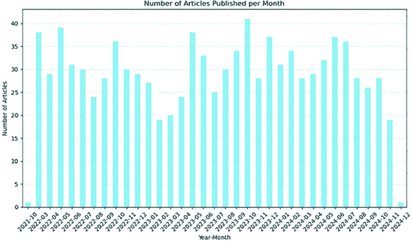

图 7.2：按月发布的文章频率

数据集中的最早日期是 2021 年 10 月 20 日，最晚日期是 2024 年 12 月 3 日。从上面的柱状图中可以观察到，2023 年 10 月的文章发布最多，其次是 2022 年 5 月。有 8 个月的每月文章数超过 35 篇。

在接下来的步骤中，我们将根据日、月、年识别事件。代码如下：

```python
# 条件
year_pattern = r'\b([1-9][0-9]{3})\b' # 匹配从 1000 起的任何四位年份
month_pattern = r'\b(January|February|March|April|May|June|July|August|September|November|December)\b'
day_pattern = r'\b(Monday|Tuesday|Wednesday|Friday|Saturday|Sunday)\b'
currency_pattern = r'[\$\€\₹]\d+|\d+[\$\€\₹]' # 匹配带有货币符号的数字

# 过滤行的函数
def filter_rows(df, column):
    filtered_rows = df[column].apply(
        lambda x: (
            bool(re.search(year_pattern, x)) or # 匹配年份
            bool(re.search(month_pattern, re.IGNORECASE)) or # 匹配月份
            bool(re.search(day_pattern, x, re.IGNORECASE)) # 匹配日期
        ) and not bool(re.search(currency_pattern, x)) # 排除货币相关的行
    )
    return df[filtered_rows]

# 应用过滤
filtered_df = filter_rows(df, "description")
filtered_df
```

代码解释如下：

* **正则表达式**：

    * `year_pattern`：该模式匹配从 1000 开始的任何四位数字。

    * `month_pattern`：匹配完整的月份名称（January、February 等），不区分大小写。

    * `day_pattern`：匹配完整的星期几名称（Monday、Tuesday 等），不区分大小写。

    * `currency_pattern`：匹配前缀或后缀带有 $ 、₹ 或 € 的数字。

* **过滤逻辑**：

    * `bool(re.search(…))`：确保条件匹配（例如，年份、月份或日期）。

    * `not bool(re.search(currency_pattern, x))`：确保排除包含货币相关数字的行。

* **Apply 函数**：

    * 使用 `.apply()` 函数检查 `description` 列中的每一行是否符合过滤逻辑。

输出：


图 7.3：包含事件的过滤后的文章

我们得到了包含 135 条记录的输出，这些记录按日、月或年记录了事件。

例如，对于这条文章描述：

* "AC 米兰自 2007 年夺冠以来首次进入欧冠赛半决赛，在一场激烈的比赛中击败了意甲死敌那波利，” 该文发布于 2023 年 4 月。

2023-04

或者这条文章的描述：

"*威尔王子和凯特王妃听取了 NHS 成立后第一个出生者（ 1948 年）的故事，”* 该文发布于 2023 年 7 月。

通过这种方式，我们可以使用正则表达式来识别日期。

在下一步中，我们将识别文章描述中的标签，例如 `GPE`（地缘实体）、`ORG`（组织）、`DATE`（日期事件）、`PERSON`（人物）和 `EVENT`（事件）。代码如下：

```python
def extract_named_entities(text):
    doc = nlp(text)
    entities = [{"entity": ent.text, "label": ent.label_} for ent in doc.ents]
    return entities

# 将函数应用于 dataframe
df['named_entities'] = df['description'].apply(extract_named_entities)
df
```

代码解释如下：

### NER 函数

- `extract_named_entities` 函数使用 spaCy 的 `nlp` 模型处理每行文本。

- 它遍历 `doc` 对象中的 `ents`（命名实体），创建一个包含 `entity`（文本内容）和 `label`（其实体类型）的字典列表。

### 应用函数

- 使用 pandas 的 `.apply()` 方法将 `extract_named_entities` 函数应用到新闻列的每一行。

- 创建一个新列 `named_entities`，用于存储提取的实体。

**结果**：生成的 dataframe 包含原始新闻列和一个包含提取实体列表的新列 `named_entities`。

**输出**：


**图 7.4**：使用 spaCy 提取的各种标签

在上面的输出中，我们通过 spaCy 流水线从文章中提取了各种标签，如 `CARDINAL`、`EVENT`、`DATE`、`ORG`、`PERSON`、`GPE` 等。例如，我们有这样一条：

“Carmelle Hepi 来自 Barnsley，她于周六前往伦敦参加派对，此后未再出现。”实体为：

```python
[{'entity': 'Carmelle Hepi', 'label': 'ORG'}, {'entity': 'Barnsley', 'label': 'ORG'}, {'entity': 'London', 'label': 'GPE'}, {'entity': 'Saturday', 'label': 'DATE'}]
```

我们为上述文章提供了多种标签。Barnsley 和 Carmelle Hepi 这两个词没有被正确标记，因为 Carmelle 是一个 `PERSON`，而 Barnsley 是一个 `GPE`。然而，London 和 Saturday 的标记是正确的。

我们可以检查这篇文章：

“曼彻联在温布利球场的一场史诗级半决赛中，尽管浪费了面对冠军赛科文特的三球优势，仍通过点球大战进入足杯决赛。”

这是一条 2024 年 4 月的足球相关新闻。实体标签如下：

```python
[{'entity': 'Manchester United', 'label': 'GPE'}, {'entity': 'the FA Cup', 'label': 'EVENT'}, {'entity': 'three', 'label': 'CARDINAL'}, {'entity': 'Championship side Coventry', 'label': 'ORG'}, {'entity': 'Wembley', 'label': 'ORG'}]
```

曼联和科文特是足球俱乐部。Manchester 是地方，因此被标记为 `GPE`，但它应该是一个组织（Organization）。FA Cup 是一个事件（EVENT）。Three 是基数。Wembley 是被标记为组织的体育场。Coventry 被正确地标记为组织。

我们可以看到，在某些情况下，词汇没有被正确标记相应的实体。从 spaCy 和正则表达式得到的结果可以提取到 `.csv` 文件。

# 从业务邮件中提取客户和交易信息

**问题描述**：业务邮件通常包含客户和交易信息，如客户姓名、日期、组织名称、事件和其他相关细节。手动提取这些信息非常耗时。使用 NLP (spaCy) 和正则表达式自动化该过程可以节省时间，并揭示有价值的见解。

我们将使用 Enron 邮件数据集。Enron 邮件数据集包含大约 500,000 封由 Enron 公司员工生成的邮件。它是由联邦能源监管委员会在调查 Enron 破产期间获取的。

### 数据集加载与示例用法

在这一步中，我们将以 dataframe 的形式加载数据集，并像之前提取事件和日期那样对数据进行抽样。代码如下：

```python
data = pd.read_csv('emails.csv')
data.shape
```

有 517401 行和 2 列。

```python
# 为了方便分析，对数据进行采样
data = data.sample(n=1000).copy()
```

我们使用 1000 行数据作为样本。在下一步中，我们将使用正则表达式检索发件人邮件、收件人邮件、日期、事件和邮件主题。我们还将使用 NER spaCy 流水线提取 `PERSON`、`GPE`、`EVENT`、`DATE` 和 `ORG`。代码如下：


#### 加载 spaCy 模型

```python
nlp = spacy.load("en_core_web_sm")
# 提取相关细节的函数
def extract_email_details(email_text):
    details = {}
    # 提取发件人邮件
    sender_match = re.search(r"From: ([\w\.-]+@[\w\.-]+)", email_text)
    details["Sender Email"] = sender_match.group(1) if sender_match else None
    # 提取收件人邮件
    recipient_match = re.search(r"To: ([\w\.-]+@[\w\.-]+)", email_text)
    details["Recipient Email"] = recipient_match.group(1) if recipient_match else None
    # 提取主题
    subject_match = re.search(r"Subject: (.+)", email_text)
    details["Subject"] = subject_match.group(1).strip() if subject_match else None
    # 提取日期
    date_match = re.search(r"Date: (.+)", email_text)
    details["Date"] = date_match.group(1).strip() if date_match else None
    # 解析文本以额外细节
    doc = nlp(email_text)
    # 从文本中提取姓名
    names = [ent.text for ent in doc.ents if ent.label_ == "PERSON"]
    details["Names in Text"] = ", ".join(names)
    # 从文本中提取日期
    dates = [ent.text for ent in doc.ents if ent.label_ == "DATE"]
    details["Dates in Text"] = ", ".join(dates)
    # 从文本中提取地缘实体
    geopolitical_entity = [ent.text for ent in doc.ents if ent.label_ == "GPE"]
    details["GPEs in Text"] = ", ".join(geopolitical_entity)
    # 从文本中提取组织
    Organization = [ent.text for ent in doc.ents if ent.label_ == "ORG"]
    details["ORGs in Text"] = ", ".join(Organization)
    # 从文本中提取事件
    Events = [ent.text for ent in doc.ents if ent.label_ == "EVENT"]
    details["Events in Text"] = ", ".join(Events)
    return details
# 应用提取函数
data_extracted = data["message"].apply(extract_email_details)
# 转换为 DataFrame
data_extracted = pd.DataFrame(data_extracted.tolist())
```

在上面的函数中，我们使用正则表达式提取了发件人邮件、收件人邮件、邮件日期和主题。接下来，`spaCy` 流水线提取了邮件正文人物、日期、地缘实体、组织和事件。该函数应用于 dataframe 中的 `message` 变量以检索上述记录。


**图 7.5**：通过 spaCy 提取的邮件和其他细节

在上面的图中，我们提取了发件人邮件、收件人邮件、邮件主题和邮件日期。我们使用 `spaCy` 从邮件正文中提取了姓名、电子邮件、地点等地缘实体、组织名称和事件。这样，我们可以创建一个自定义的流水线，来逐步使用 `spaCy` 执行操作。

# 数据集：我们将使用来自 Hugging Face 网站的法律合同数据集中的 `train_data`。

数据已加载，包含 26539 行和 1 列。

```python
legal_data = pd.read_csv('train_data.csv')
legal_data.shape
```

### 输出：

```
(26539, 1)
```

与之前的练习一样，我们随机抽取了 1000 行样本，以便于处理并节省时间。

```python
# 抽取数据样本以便分析
legal_data = legal_data.sample(n=1000).copy()
```

接下来，我们将对数据进行预处理。

# 预处理文本

```python
legal_data['cleaned_text'] = legal_data['text'].str.replace(r'\s+', ' ', regex=True).str.strip()
legal_data['cleaned_text'].head()
```

在前面的代码中，我们为预处理执行了以下操作：

- 删除了特殊字符、多余空格或无关的元数据。
- 将文本拆分为段落或条款，以便于处理。

接下来，我们将自定义 `spaCy` 流水线。

### 法律实体的自定义实体识别 (NER)：我们将识别：

- **当事人 (Parties)**：例如，“甲方”，“XYZ 公司”。
- **日期 (Dates)**：例如，“2023 年 1 月 1 日”。
- **法律引用 (Legal References)**：例如，“第 3.1 节”，“第 5 条”。
- **条款的基于规则的匹配**：使用模式提取结构化章节（例如“本协议受……约束”）。
- **关系的依存句法分析**：提取句法关系，如主语-谓词-宾语模式。

```python
# 为法律章节添加基于规则的匹配
matcher = Matcher(nlp.vocab)
patterns = [{"label": "SECTION", "pattern": [{"LOWER": "section"}, {"IS_DIGIT": True}]}]
for pattern in patterns:
    matcher.add(pattern["label"], [pattern["pattern"]])

def extract_entities(doc):
    entities = {"PARTIES": [], "DATES": [], "SECTIONS": [], "REFERENCES": []}
    for ent in doc.ents:
        if ent.label_ == "PERSON":
            entities["PARTIES"].append(ent.text)
        elif ent.label_ == "DATE":
            entities["DATES"].append(ent.text)
        elif ent.label_ in ["ORG", "LAW"]:
            entities["REFERENCES"].append(ent.text)
    matches = matcher(doc)
    for match_id, start, end in matches:
        entities["SECTIONS"].append(doc[start:end].text)
    return entities
```

代码解释如下。

### 法律章节的基于规则的匹配：

`spaCy` 中的 `Matcher` 类用于实现基于规则的匹配模式。这里的目标是识别与法律章节对应的文本模式（例如“第 23 节”）：

```python
matcher = Matcher(nlp.vocab)
```

`Matcher` 使用 `nlp.vocab` 对象初始化，它是当前 `spaCy` 语言模型的词汇表。这使得匹配模式能够与处理过的 `Doc` 对象中的标记（tokens）无缝衔接。

#### 定义模式：

```python
patterns = [{"label": "SECTION", "pattern": [{"LOWER": "section"}, {"IS_DIGIT": True}]}]
```

- `"label": "SECTION"`：指定该模式的标签。它表示我们正在寻找文本中的章节。
- `"pattern": [{"LOWER": "section"}, {"IS_DIGIT": True}]` ：
    - `{"LOWER": "section"}` 不区分大小写地匹配单词“section”。
    - `{"IS_DIGIT": True}` 匹配一个数字标记（例如“23”）。

该模式共同识别诸如“section 23”之类的短语。

#### 将模式添加到 Matcher：

```python
for pattern in patterns:
    matcher.add(pattern["label"], [pattern["pattern"]])
```

对于 `patterns` 列表中的每个模式，matcher 都配置为给定标签下识别指定的模式。

### 提取实体

`extract_entities` 函数处理给定的 `Doc` 对象以提取各种类型的实体。

```python
def extract_entities(doc):
    entities = {"PARTIES": [], "DATES": [], "SECTIONS": [], "REFERENCES": []}
```

`entities` 字典：按类别存储提取的实体：

- `PARTIES`：涉及的个人或实体名称。
- `DATES`：文档中提到的日期。
- `SECTIONS`：由匹配识别的法律章节。
- `REFERENCES`：对法律、组织等的引用。

#### 处理命名实体：

```python
for ent in doc.ents:
    if ent.label_ == "PERSON":
        entities["PARTIES"].append(ent.text)
    elif ent.label_ == "DATE":
        entities["DATES"].append(ent.text)
    elif ent.label_ in ["ORG", "LAW"]:
        entities["REFERENCES"].append(ent.text)
```

- `doc.ents`：这是由 `spaCy` 模型识别的实体列表。

对于每个实体：

- 如果实体标签（`ent.label_`）是“PERSON”，则将其加入“PARTIES”。
- 如果实体标签为“DATE”，则将其加入“DATES”。
- 如果实体标签为 `ORG`（组织）或 `LAW`（法律引用），则将其加入“REFERENCES”。

#### 应用匹配器：

```python
matches = matcher(doc)
```

`matcher(doc)`：将预定义的模式应用于文档。返回一个匹配列表，其中包含：

- `match_id`：匹配的 ID。
- `start`：匹配范围的起始索引。
- `end`：匹配范围的结束索引。

#### 提取章节：

```python
for match_id, start, end in matches:
    entities["SECTIONS"].append(doc[start:end].text)
```

对于每个匹配：

- 从 `start` 到 `end` 的文本范围通过 `doc[start:end].text` 提取。
- 该法律章节文本被添加到 `SECTIONS`。

最后，我们使用 `extract_entities` 函数从清理后的文本中提取相关实体。

```python
legal_data['entities'] = legal_data['cleaned_text'].apply(lambda x: extract_entities(nlp(x)))
legal_data[['cleaned_text', 'entities']]
```

最后的 dataframe 如下。

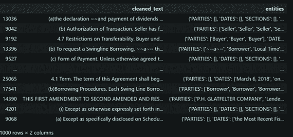

### 图 7.6：使用 spaCy 提取的实体

在图 7.6 中，我们看到了针对 `SECTIONS`、`PARTIES`、`DATES` 和 `REFERENCES` 标签的提取实体。

然而，这只是一个简单的 `spaCy` 流线，没有针对法律文档分析进行任何复杂的自定义。已经有了诸如 `legal-NER` 等基于 `spaCy` 构建的包。我们还有一个基于 `spaCy` 和其他 Python 库的文本检索库，专注于法律文档。我们还有一个针对罗马尼亚语法律领域的 `spaCy` 语言模型，该模型使用 `floret` 4-gram 到 5-gram 嵌入以及法律实体识别进行了训练。

# 信息提取项目中的常见挑战

在使用 `spaCy` 进行信息提取 (IE) 项目时，会产生各种影响模型准确性、可扩展性和适应性的挑战。以下是对关键挑战的详细讨论：

## 数据质量问题

数据质量显著影响信息提取系统的性能。常见的与数据相关的挑战包括：

* 噪声数据：来自扫描文档或格式不佳来源的文本通常包含 OCR 错误、格式不一致或信息缺失。
* 语言歧义：许多术语根据语境可能有多种含义，需要细致的预处理和语言学分析。
* 数据不完整：文本中缺失实体或引用会导致提取结果不完整或不准确，特别是在没有适当标注的数据集中。
* 非结构化文本：许多法律或业务文档以自由文本的形式编写，使得在没有额外预处理的情况下很难检测实体。
* 缺乏标注：为训练自定义模型创建标注数据集是耗时且耗力的工作，对于特定领域的项目尤为如此。

### 缓解策略

* 应用文本清洗技术对数据进行预处理（例如，删除不必要的字符，处理编码问题）。
* 使用预训练模型，并通过微调使其适应特定领域。
* 采用主动学习来迭代改进标注的数据集，以获得更可靠的结果。

## 领域特定适配

`spaCy` 的开箱即用模型是在通用数据集上训练的，这些可能无法捕获法律、医疗或金融文本等专业领域的细微差别。这为准确识别和提取实体带来了挑战。

* 领域特定语言：技术术语、缩写和领域特定语法可能无法被通用模型识别。
* 自定义实体：标准的命名实体识别 (NER) 模型可能不包含领域特定实体，如法律条款、合同义务或技术术语。
* 复杂关系：提取实体之间的层级或嵌套关系通常需要自定义的流线组件或额外的解析。

### 缓解策略

* 在标注的领域特定数据集上使用 `spaCy` 训练自定义 NER 模型。
* 使用基于规则的匹配器扩展 `spaCy` 流线以匹配特定模式（例如法律章节 `Section 8` 和 `Section 280`）。
* 引入外部知识库或本体以增强对上下文的理解。

# 规模优化

在扩展到处理大型数据集或高吞吐量应用时，可能会出现若干挑战：

* 性能瓶颈：实时处理大量文本可能会导致性能下降。
* 并行处理：`spaCy` 的单线程流可能会变慢。
* 模型大小和复杂度：较大的模型（如 transformers）计算开销很大。
* 集成：部署信息提取系统需要无缝集成。

### 缓解策略

* 使用 `spaCy.pipe()` 进行高效批处理。
* 优化 GPU 等硬件资源。

## 结论

本文概述了在法律文档分析中使用 `spaCy` 的各种挑战和缓解策略，重点关注数据质量、领域特定需求和可扩展性。

*   [`thegrenze.com/pages/servej.php?fn=531_1.pdf&name=Legal%20Document%20Summarizer%20using%20Spacy%20and%20BART&id=2646&association=GRENZE&journal=GIJET&year=2024&volume=10&issue=2`](https://thegrenze.com/pages/servej.php?fn=531_1.pdf&name=Legal%20Document%20Summarizer%20using%20Spacy%20and%20BART&id=2646&association=GRENZE&journal=GIJET&year=2024&volume=10&issue=2)
*   [`github.com/ahamadshaik/Information-Extraction-from-legal-documents-using-Spacy`](https://github.com/ahamadshaik/Information-Extraction-from-legal-documents-using-Spacy)
*   [`spacy.io/universe/project/rolegal`](https://spacy.io/universe/project/rolegal)
*   [`github.com/Legal-NLP-EkStep/legal_NER`](https://github.com/Legal-NLP-EkStep/legal_NER)
*   [`huggingface.co/datasets/hugsid/legal-contracts/blob/main/train_data.csv`](https://huggingface.co/datasets/hugsid/legal-contracts/blob/main/train_data.csv)

# 第 8 章


# 使用 Hugging Face 构建 Transformer

## 引言

Transformer 架构彻底改变了自然语言处理（NLP）领域，使得语言翻译、文本摘要和对话 AI 等突破性发明成为可能。能够处理并理解上下文的 Transformer 在性能和多功能性方面树立了新标准。与处理长距离依赖时挣扎的传统模型不同，Transformer 利用注意力机制动态地关注输入的相关部分，使其具有极高的效率和适应性。

本章将深入探讨 Transformer 的详细架构，超越了使用预训练模型的层面，转而理解使其变得强大的核心原理。通过探索自注意力和位置编码等组件，我们旨在揭示 Transformer 如何有效地处理语言。读者将深入了解 `BERT` 和 `GPT` 等流行模型的架构，这些模型都是针对特定的 NLP 挑战量身定制的。

通过使用 Hugging Face 库的实战示例，本章提供了一个实用的指南，指导如何针对医疗保健、电子商务、IT 和金融科技等行业的现实应用，训练和微调 Transformer 模型。我们还将学习如何从零构建自定义的 Transformer 模型，从而提供处理利基任务和领域的灵活性。到结束时，读者将具备理论知识和实践技能，以充分利用 Transformer 在各种 NLP 应用中的巨大潜力。

## 结构

在本章中，将涵盖以下主题：

*   Transformer 简介
*   理解 Transformer 架构
*   Hugging Face 概览
*   使用预训练模型
*   训练自定义 Transformer
*   案例研究

## Transformer 简介

Transformer 改变了机器理解人类语言的方式，并已成为当代 NLP 的支柱。Transformer 在处理序列数据方面提供了范式转变。它们首次由 Vaswani 等人在 2017 年发表的论文《注意力即一切》（Attention Is All You Need）中提出。凭借其完全可并行的架构，Transformer 比循环神经网络（`RNN`）和长短期记忆网络（`LSTM`）等传统模型更高效、更具扩展性，后者是逐步处理序列的。

自注意力机制是 Transformer 核心的一种新颖想法，使模型能够评估序列中几个单词的相对价值。无论单词在句子中相隔有多远，这种方法都允许 Transformer 捕捉复杂的语言连接。例如，在句子“那只大声叫的狗吓到了猫”中，模型可以轻松地将“狗”与“叫”联系起来，将“猫”与“害怕”联系起来，无论它们之间的距离有多远。

Transformer 架构构建在堆叠的编码器和解码器层之上，每层都由自注意力和前馈网络组成。编码器处理输入序列并生成丰富的上下文嵌入，而解码器使用这些嵌入生成输出序列，使得 Transformer 在理解和生成语言方面具有高度的多功能性。位置编码是另一项关键创新，使 Transformer 能够保留序列中单词顺序的信息，而这对传统的前馈网络来说是一个挑战。

Transformer 已在广泛的 NLP 任务中证明了其多功能性，从机器翻译和文本摘要到问答和情感分析。诸如 `BERT`（来自 Transformer 的双向编码表示）和 `GPT`（生成式预训练 Transformer）等流行模型在原始 Transformer 设计的基础上，在许多基准测试中实现了顶尖性能。`BERT` 擅长理解两个方向（双向）的上下文，而 `GPT` 在文本完成和创造性写作等生成式任务中表现出色。

除了 NLP 之外，Transformer 还应用于视觉（视觉 Transformer 或 `ViT`）和强化学习等其他领域。它们处理大型数据集并有效泛化的能力使其成为医疗保健、电子商务、IT 和金融科技领域许多 AI 系统的骨干。

将在本章中深入探讨 Transformer 设计的基础，分解前馈网络、位置编码和注意力等元素。通过扩展这些基础思想，我们希望为读者提供必要的技能来使用已经训练好的 Transformer 模型，甚至开发出适用于特定要求的独特解决方案。通过 Hugging Face 提供的工具（它是处理 Transformer 最全面的库之一），我们将探索将理论理解转化为实践实现的实战示例。

## 理解 Transformer 架构

Transformer 依赖于几个基础组件——嵌入、位置编码、自注意力和残差连接——在自然语言处理中实现顶尖性能。让我们深入了解这些概念，以理解它们的作用和重要性。

### 词嵌入

高维空间中单词或标记的密集向量表示被称为嵌入。它们通过捕捉词之间的语法和语义连接帮助模型理解语言上下文。

#### 在 Transformer 中的作用

在 Transformer 中，无法直接输入文本。相反，标记（子词、单词或字符）在训练期间通过学习的嵌入矩阵映射为嵌入。

* **为什么需要嵌入？** 嵌入将离散标记转换为神经网络更容易处理的连续表示。例如，“国王”和“皇后”在向量空间中的语义接近。

#### Transformer 中的实现

嵌入层为每个标记分配固定长度的向量。例如，如果词表大小为 50,000，嵌入维度为 768，则嵌入矩阵的大小为 50,000×768。

*   **子词分词**：`BERT` 和 `GPT` 等模型使用子词分词（例如 `WordPiece` 或字节对编码）来处理未登录词汇并提高效率。

对于输入句子：“Transformers are powerful models”，嵌入层会将每个 token 映射为如下稠密向量：

“Transformers”→ `[0.25, −0.15, …, 0.78]`

### 位置编码

Transformers 缺乏内在的顺序感，因为它们是并行处理 token 的。位置编码注入了 token 在序列中位置的信息。

#### 数学公式

位置编码被加到词嵌入中，使用正弦和余弦函数来表示序列中的位置。

```
PE(pos, 2i) = sin(pos / 10000^(2i / d))
```

```
PE(pos, 2i+1) = cos(pos / 10000^(2i / d))
```

在这里，`pos` 是位置，`i` 是维度索引，`d` 是嵌入维度。

#### 为什么选择正弦和余弦函数？

- 这些函数允许模型泛化到更长的序列，因为编码可以推导出训练数据之外的位置。
- 正弦和余弦函数的结合确保了每个位置都有独特的表示。

#### 可视化

位置编码创建了如波形之类的模式，每个位置的模式都不同。例如：

##### 嵌入维度 = 4 的示例

假设模型使用的嵌入维度为 4（`d_model` = 4）。我们将计算两个位置的位置编码：`pos=0` 和 `pos=1`。

###### 步骤 1：计算 pos = 0 的编码

```
PE(0,0) = sin(0) = 0 (偶数索引)
PE(0,1) = cos(0) = 1 (奇数索引)
PE(0,2) = sin(0) = 0
PE(0,3) = cos(0) = 1
```

因此，`pos=0` 的位置编码 = `[0, 1, 0, 1]`

###### 步骤 2：计算 pos = 1 的编码

我们使用相同的公式，但 `pos = 1`。

```
For i = 0:
PE(1,0) = sin(1/10000^(0/4)) = sin(1) ≈ 0.84
PE(1,1) = cos(1) ≈ 0.540
For i = 1:
PE(1,2) = sin(1/10000^(2/4)) = sin(1/100) ≈ 0.009999
PE(1,3) = cos(1/100) ≈ 0.99995
```

因此，`pos=1` 的位置编码 ≈ `[0.841, 0.540, 0.01, 0.999]`

假设位置 0 的单词“Transformer”有一个嵌入：

```
[0.4, 0.6, 0.2, 0.1]
```

那么传递给模型的最终输入向量为：

```
[0.4+0, 0.6+1, 0.2+0, 0.1+1] = [0.4, 1.6, 0.2, 1.1]
```

所以，当我们说：

`pos=0` 可能会产生 `[0, 1, 0, 1]`，

`pos=1` 可能会产生 `[0.84, 0.54, 0.01, 0.999]`

我们指的是正弦波模式，这些模式编码了 `position` 并加到嵌入中，以帮助模型理解序列顺序。这些直接加到嵌入中，为模型提供语义和位置信息。

### 自注意力

Transformers 通过一种名为自注意力（self-attention）的机制来评估序列中每个 token 的相对价值。它允许模型关注相关的短语，无论它们位于何处。

#### 工作原理

序列中的每个 token 都通过计算注意力分数来关注其他所有 token（包括自身）。

1. **查询 (`Query`)、键 (`Key`) 和值 (`Value`) 向量**：对于每个 token，模型计算三个向量：
    - `Query`：代表该 token 正在寻找什么。
    - `Key`：代表该 token 为其他提供什么。
    - `Value`：包含 token 携带的信息。

#### 注意力分数

注意力分数的计算公式为：

```
Attention(Q, K, V) = softmax(QK^T / √d_k)V
```

- `softmax` 确保注意力分数是概率。
- `d_k`（键向量维度）用于缩放以避免出现大值。

#### 多头注意力

Transformers 使用多个注意力头来捕捉不同类型的关系（例如，句法的、语义的）。每个头独立处理输入，并将它们的输出拼接。

##### 示例：“The doctor prescribed medicine to the patient.”

### 残差连接

残差连接（Residual connections）是捷径，允许一层的输出跳过某些计算。

#### 目的

- **改善梯度流**：在反向传播期间，残差连接缓解了梯度消失问题。
- **稳定训练**：确保网络在变换后保留某些信息。
- **加速收敛**：帮助模型更快收敛。

#### 在 Transformers 中的工作方式

在自注意力层和前馈层中都应用残差连接：

```
Layer Output = Layer Input + Transformation(Layer Input)
```

将原始输入加回变换后的结果中。

#### 总结

- 词嵌入提供了语义基础。
- 位置编码增加了关键上下文。
- 自注意力允许模型动态地关注输入的相关部分。
- 残差连接确保了训练的稳定性。

## Hugging Face 概览

Hugging Face 通过使最先进的模型变得易于获取和使用，改变了 NLP 领域。它提供了一个开源的 `Transformers` 库、一个包含预训练模型的 `Model Hub` 以及用于微调模型的工具。

- `Transformers Library` 支持 `PyTorch`、`TensorFlow` 和 `JAX`，能够无缝实验 `BERT`、`GPT`、`T5` 和 `RoBERTa` 等模型。
- `Model Hub` 提供了各种 NLP 任务的预训练模型集合，减少了从零训练的需求。
- 此外，`Datasets` 和 `Tokenizers` 库简化了数据处理和预处理。
- Hugging Face 用户友好的 `pipelines` 允许快速实现文本分类、命名实体识别、翻译和摘要等任务。
- 医疗、电子商务、金融科技和 IT 行业都在利用 Hugging Face 开发从情感分析到自动客户支持的应用程序。

## 使用预训练模型

预训练的 Transformer 模型改变了 NLP，让开发者能够利用最先进的架构，而无需从头训练模型。Hugging Face 通过其 `Transformers Library` 提供了大量的此类模型，使用户能够快速地将其应用于现实场景中。

Hugging Face 的 `transformers` 库使得加载预训练模型变得极其简单。你只需要指定所需的架构和变体（例如 `bert-base-uncased`、`roberta-large` 等），该库就会处理下载以及模型权重初始化。

```python
from transformers import BertTokenizer, BertModel
# 加载预训练的分词器和模型
tokenizer = BertTokenizer.from_pretrained('bert-base-uncased')
model = BertModel.from_pretrained('bert-base-uncased')
print("Model loaded successfully!")
```

```
Model loaded successfully!
```

在此代码段中：

1. `BertTokenizer` 将输入文本转换为模型能够理解的标记（tokens）。
2. `BertModel` 加载实际的神经网络架构以及其预训练权重。

### 输入数据分词

在使用 transformer 模型之前，需要将文本转换为数值表示。这是通过分词器（tokenizer）完成的，它将文本拆分为子词或标记，并将它们映射到唯一的 ID。

```python
sentence = "Humans have evolved a lot with time."
# 对句子进行分词
tokens = tokenizer.tokenize(sentence)
print(tokens)
```

```
['humans', 'have', 'evolved', 'a', 'lot', 'with', 'time', '.']
```

句子中的每个词都是一个标记，并且与句号‘.’分开。一旦完成分词，文本会被转换为输入 ID 和注意力掩码（`attention_mask`），这些是 transformer 模型所需的输入：

```python
inputs = tokenizer(sentence, return_tensors='pt') # 返回 PyTorch 张量
print(inputs)
```

```
{'input_ids': tensor([[ 101, 4286, 2031, 7964, 1037, 2843, 2007, 2051, 1012, 102]]), 'token_type_ids': tensor([[0, 0, 0, 0, 0, 0, 0, 0, 0, 0]]), 'attention_mask': tensor([[1, 1, 1, 1, 1, 1, 1, 1, 1, 1]])}
```

### 微调或推理

在准备好输入数据后，我们可以进行推理（直接使用模型），也可以针对特定任务对其进行微调。

#### 执行推理

如果我们想提取嵌入向量（embeddings）或在不修改模型的情况下分析模型的行为，可以直接将分词后的输入传递给模型：

```python
outputs = model(**inputs)
last_hidden_states = outputs.last_hidden_state
print(last_hidden_states.shape)
```

```
torch.Size([1, 9, 768])
```

在这里，1 是 `batch_size`（批大小），9 是序列长度，768 是隐藏层大小（hidden size）。在隐藏状态中，包含了输入序列中每个标记的上下文嵌入向量。这些嵌入向量随后可以用于聚类、相似性分析或可视化等任务。

#### 针对特定任务进行微调

为了将预训练模型适配到新任务，我们需要在基础模型之上添加一个自定义头部（例如分类层），并端到端地训练整个系统。代码如下。

```python
from transformers import BertForSequenceClassification
# 加载带有分类头的预训练模型
model = BertForSequenceClassification.from_pretrained('bert-base-uncased', num_labels=2)
# 定义优化器和损失函数
optimizer = torch.optim.AdamW(model.parameters(), lr=5e-5)
loss_fn = torch.nn.CrossEntropyLoss()
# 训练循环（简化版）
for epoch in range(epochs):
    model.train()
    optimizer.zero_grad()
    outputs = model(**inputs, labels=labels)
    loss = outputs.loss
    loss.backward()
    optimizer.step()
```

```
Epoch 1, Loss: 0.8110669255256653
Epoch 2, Loss: 0.5848608016967773
Epoch 3, Loss: 0.43619900941848755
```

在微调过程中，通常只需要少量的标记数据就能获得强大的性能，因为模型已经学习了通用的语言模式。

### 选择合适的模型

Hugging Face 提供了数百个针对不同用途定制的预训练模型。一些流行的选项包括：

* `BERT`：来自 Transformer 的双向编码器表示，适用于需要深度上下文理解的任务。
* `GPT`：生成式预训练 Transformer，适用于文本生成和补全。
* `RoBERTa`：`BERT` 的一个鲁棒性优化版本，性能有所提升。
* `DistilBERT`：`BERT` 的更轻量、更快速变体，准确率相当。

## 训练自定义 Transformer

当预训练模型与特定领域不匹配时，就有必要从头训练自定义 transformer。在本节中，我们将探索如何使用 Hugging Face 的 `transformers` 库训练自定义模型，涵盖从定义架构到实现训练循环的所有内容。

### 为什么训练自定义 Transformer？

虽然预训练模型功能多变，但它们并不总是适用于特定的用例。训练自定义 transformer 允许：

* 控制架构：自定义层数、注意力头、隐藏维度。
* 针对特定数据进行优化：在你的数据集上直接对模型进行微调。
* 实验新想法：测试 transformer 设计中的新点，例如稀疏注意力或混合架构。

### 第一步：定义模型架构


Hugging Face 提供了轻松定义架构的工具。我们可以使用 PyTorch 从头构建模型，也可以扩展现有的类。这是一个使用 Hugging Face 定义简单 transformer 模型的示例：

```python
import torch
import torch.nn as nn
from transformers import PreTrainedModel, PretrainedConfig

class CustomTransformerConfig(PretrainedConfig):
    def __init__(self, vocab_size=30522, hidden_size=768, num_hidden_layers=12,
                 num_attention_heads=12, intermediate_size=3072, max_position_embeddings=512, **kwargs):
        super().__init__(**kwargs)
        self.vocab_size = vocab_size
        self.hidden_size = hidden_size
        self.num_hidden_layers = num_hidden_layers
        self.num_attention_heads = num_attention_heads
        self.intermediate_size = intermediate_size
        self.max_position_embeddings = max_position_embeddings

class CustomTransformer(PreTrainedModel):
    config_class = CustomTransformerConfig
    def __init__(self, config):
        super().__init__(config)
        self.embedding = nn.Embedding(config.vocab_size, config.hidden_size)
        self.positional_encoding = nn.Parameter(torch.zeros(1, config.max_position_embeddings, config.hidden_size))
        decoder_layer = nn.TransformerDecoderLayer(
            d_model=config.hidden_size,
            nhead=config.num_attention_heads,
            dim_feedforward=config.intermediate_size,
            batch_first=True
        )
        self.transformer_decoder = nn.TransformerDecoder(decoder_layer, num_layers=config.num_hidden_layers)
        self.classifier = nn.Linear(config.hidden_size, config.vocab_size)

    def forward(self, input_ids, attention_mask=None):
        # Embedding + Positional Encoding
        pass
```

```python
embeddings = self.embedding(input_ids) + self.positional_encoding[:, :input_ids.size(1), :]

# 为自回归解码创建因果掩码

seq_len = input_ids.size(1)

causal_mask = torch.triu(torch.ones(seq_len, seq_len) * float('-inf'), diagonal=1).to(input_ids.device)

# 通过 transformer 解码器

transformer_output = self.transformer_decoder(tgt=embeddings, memory=embeddings, tgt_mask=causal_mask)

# 分类头
logits = self.classifier(transformer_output)

return logits
```

上述代码的解释：

### `CustomTransformerConfig` 类

#### 目的

- 该类定义了自定义 transformer 模型的配置。它指定了超参数，如词表大小、隐藏层、层数、注意力头数等。
- 该配置对象用于初始化模型，并确保所有组件与预期的架构一致。

#### 关键参数

- `vocab_size`: 词表大小（唯一标记的数量）。
- `hidden_size`: transformer 中嵌入和隐藏状态的维度。
- `num_hidden_layers`: 模型中 transformer 层（或块）的数量。
- `num_attention_heads`: 每个 transformer 层中注意力头的数量。
- `intermediate_size`: 每个 transformer 层内部前馈网络的大小。
- `max_position_embeddings`: 模型支持的输入序列的最大长度。

#### 为什么使用 `PretrainedConfig`？

- 通过继承自 `PretrainedConfig`，该类可以与 Hugging Face 的生态系统无缝集成。例如，我们可以使用 Hugging Face 的实用工具保存和加载配置。

### `CustomTransformer` 类

#### 目的

- 该类定义了实际的 transformer 模型。它继承自 `PreTrainedModel`，该类提供了额外的功能，如保存/加载权重以及与 Hugging Face 流水线（pipelines）集成。

#### 组件

- **嵌入层 (`self.embedding`)**:
    - 将标记 ID（整数）转换为固定大小（`hidden size`）的稠密向量。
    - 示例：如果 `vocab_size=10000` 且 `hidden_size=768`，嵌入层将每个标记 ID（例如 42）映射到 768 维的向量。

- **位置编码 (`self.positional_encoding`)**:
    - Transformers 本身不直观理解标记的顺序。位置编码为嵌入添加了位置信息。
    - 在这里，我们使用可学习参数（`nn.Parameter`）而不是固定的正弦编码（如原始 Transformer 论文所示）。

- **Transformer 解码器 (`self.transformer_decoder`)**:
    - 由一组 `nn.TransformerDecoderLayer` 实例堆叠形成模型的核心。
    - 每一层包含：
        - 多头自注意力：捕捉标记之间的关系。
        - 前馈网络：独立处理每个标记。
    - `batch_first=True` 参数确保输入的形状为 (`batch_size, sequence_length, hidden_size`)。

- **分类头 (`self.classifier`)**:
    - 线性层将 transformer 的输出映射回词表。
    - 为词表中的每个标记产生 logits（未归一化的分数）。

#### 为什么使用 `nn.TransformerDecoder`？

- `nn.TransformerDecoder` 是为自回归任务设计的，模型一次预测一个标记。通过将相同的张量作为 `tgt`（目标）和 `memory`（源），我们模拟了仅解码器（decoder-only）架构。

### Forward 方法（前传播）

#### 详解

1. **嵌入 + 位置编码**: 输入标记 ID (`input_ids`) 通过嵌入层产生稠密表示。将位置编码添加到这些嵌入中，以提供序列信息。

2. **因果掩码 (Causal Masking)**：因果掩码是 GPT 等自回归模型中使用的一种技术，用于确保模型只关注当前和过去的标记。由于这些模型一次生成一个单词，因此它们不能“窥视”未来——这意味着位置 3 的单词不应访问位置 4 及之后的信息。为了实现这一点，在注意力机制上应用因果掩码。该掩码是一个方矩阵，每行对应一个标记，并显示它被允许关注哪些位置。

3. **Transformer 解码器**: `transformer_decoder` 使用多头自注意力和前馈层处理嵌入。`tgt_mask` 确保每个标记只关注之前的标记。

4. **分类头**: transformer 的最终输出通过线性层，为词表中的每个标记产生 logits。这些 logits 代表了模型对序列中下一个标记的预测。

### 准备数据集

为了训练 transformer，我们需要大量的文本数据语料。该数据集应该代表我们针对的语言或领域。我们从 BBC 新闻网站上取了一篇文章。常见来源包括书籍、社交媒体帖子或专业语料库。

```python
# 准备数据集
with open('/kaggle/input/data23/data.txt', 'r', encoding='utf-8') as f:
    lines = f.readlines()

# 清理并分词数据
dataset = [line.strip() for line in lines if line.strip()]
print(f"加载了 {len(dataset)} 句子.")
```

### 分词 (Tokenization)

分词将原始文本转换为模型可以处理的数值表示。你可以创建一个自定义的分词器，或使用 Hugging Face 的 `Tokenizer` 实用工具。

```python
# 分词
from transformers import BertTokenizer

# 在你的数据集上训练分词器
tokenizer = BertTokenizer.from_pretrained('bert-base-uncased')
tokenizer.add_tokens(['<NEW_TOKEN>']) # 如果需要添加标记

# 对数据集分词
tokenized_data = [tokenizer.encode(sentence, max_length=512, truncation=True, padding='max_length') for sentence in dataset]
```

### 设置训练循环

一旦数据完成分词，就可以设置训练循环。这涉及定义损失函数、优化器并迭代数据批。

```python
# 设置训练循环
from torch.utils.data import DataLoader, TensorDataset
import torch.optim as optim

# 将分词数据转换为张量
input_ids = torch.tensor(tokenized_data)
labels = torch.tensor([sentence[1:] + [tokenizer.pad_token_id] for sentence in tokenized_data]) # 偏移后的标签

# 创建 DataLoader
dataset = TensorDataset(input_ids, labels)
dataloader = DataLoader(dataset, batch_size=16, shuffle=True)

# 初始化模型、优化器和损失函数
model = CustomTransformer(CustomTransformerConfig())
optimizer = optim.AdamW(model.parameters(), lr=5e-5)
loss_fn = nn.CrossEntropyLoss(ignore_index=tokenizer.pad_token_id)

# 将模型移动到 GPU（可用）
device = torch.device('cuda' if torch.cuda.is_available() else 'cpu')
model.to(device)

# 训练循环
for epoch in range(3): # 迭代次数
    model.train()
    total_loss = 0
    for batch_input_ids, batch_labels in dataloader:
        batch_input_ids, batch_labels = batch_input_ids.to(device), batch_labels.to(device)
        optimizer.zero_grad()
        outputs = model(batch_input_ids)
        loss = loss_fn(outputs.view(-1, outputs.size(-1)), batch_labels.view(-1))
        loss.backward()
        optimizer.step()
        total_loss += loss.item()
```

```python
print(f"Epoch {epoch + 1}, Loss: {total_loss / len(dataloader)}")
```

```text
Epoch 1, Loss: 10.59989070892334
```

```text
Epoch 2, Loss: 9.957139015197754
```

```text
Epoch 3, Loss: 9.50660514831543
```

解释上述代码：

### 导入所需的库

- `DataLoader`: PyTorch 中的一个工具，用于帮助高效地对数据集进行分批和洗乱。
- `TensorDataset`: 一个简单的数据集封装器，将输入张量合并成一个单一数据集对象。
- `optim`: 提供优化算法，例如 `AdamW`，它通常用于训练 transformer 模型。

### 将标记化后的数据转换为张量

- `input_ids`:
    - 将标记化数据（`tokenized_data`）转换为 PyTorch 张量。`input_ids` 中的每个元素代表一个标记 ID 序列。

- `labels`:
    - 标签相对于输入平移了一个位置。例如：
        - 如果输入序列为 `[A, B, C, D]`，则对应的标签序列变为 `[B, C, D, PAD]`。
        - 这种位移确保了模型在训练期间预测序列中的下一个标记。
    - 填充标记（`tokenizer.pad_token_id`）被添加到每个序列的末尾以保持长度一致。

### 创建 DataLoader

#### 解释：

- `TensorDataset`: 从该数据检索的每个 `item` 都是一个`元素元组`，来自每个输入张量，且都处于`相同的索引`。
- `TensorDataset` 帮助将两个张量——`input_ids` 和 `labels`——封装成单一对象，并输入 `DataLoader` 以在训练期间进行分批和洗乱。

### DataLoader

它可以与 `TensorDataset` 等数据集无缝协作，允许自动分批、可选的洗乱以及使用多个工作线程进行并行数据加载。无需手动遍历数据，`DataLoader` 每次产生一个批次，使得训练过程更快且更节省内存。这种分批机制对于训练神经网络是必要的，因为它允许模型使用对多个样本同时计算的梯度来更新权重。

- `batch_size=16`: 指定数据每次以 16 个样本的分批进行处理。
- `shuffle=True`: 在每个轮次（epoch）中随机化数据顺序以提高泛化能力。

### 初始化模型、优化器和损失函数

#### 模型初始化：

- `CustomTransformer(CustomTransformerConfig())`: 使用指定的配置创建自定义 transformer 模型的实例。

#### 优化器：

- `AdamW`: `Adam` 优化器的变体，包含了权重衰减正则化，这对于 transformer 模型特别有效。
- `lr=5e-5`: 将学习率设置为 0.00005，这是微调或训练 transformer 模型的常用选择。

#### 损失函数：

- `CrossEntropyLoss`: 计算预测逻辑值（logits）与真实标签之间的交叉损失。
- `ignore_index=tokenizer.pad_token_id`: 确保填充标记不参与损失计算。这防止了模型因为填充位置上的错误预测而受到惩罚。

### 将模型移动到 GPU（如果可用）

- `torch.device`: 检查是否有可用的 GPU（cuda）并使用它；否则默认使用 CPU。
- `model.to(device)`: 将模型的参数和缓冲区移动到指定的设备（GPU 或 CPU）。这确保了所有计算都在适当的硬件上执行。

### 训练循环

#### 外层循环（轮次）：

- 外层循环运行固定次数的轮次（在此例中为 3 次）。每个轮次处理整个数据集一次。

#### 将模型设置为训练模式：

- `model.train()`: 将模型切换到训练模式。这会影响 dropout 和批归一化等层，确保它们在训练期间表现正常。

#### 内层循环（批处理）：

- 遍历 `dataloader`，它会产生 `batch_input_ids` 和 `batch_labels` 批次。

#### 将数据移动到设备：


* `batch_input_ids.to(device)` 和 `batch_labels.to(device)`: 确保输入和标签与模型处于同一设备（GPU 或 CPU）。

#### 梯度清零

* `optimizer.zero_grad()`: 清除上一次迭代的梯度。这是必要的，因为 PyTorch 默认会累加梯度。

#### 前向传播

* `outputs = model(batch_input_ids)`: 将输入通过模型以计算预测。

#### 计算损失

* `loss_fn(outputs.view(-1), labels.view(-1))`: 计算展平后的预测值与标签之间的交叉熵。

#### 反向传播

* `loss.backward()`: 计算损失相对于模型参数的梯度。

#### 更新参数

* `optimizer.step()`: 使用计算出的梯度更新模型参数。

#### 跟踪损失

* `total_loss += loss.item()`: 累积当前轮次的损失。

#### 打印进度

* 在每个轮次后，打印平均损失。这提供了关于模型如何学习的洞察。

```python
# 保存模型和分词器
model.save_pretrained('./custom_transformer')
tokenizer.save_pretrained('./custom_transformer')
```

在这个问题描述中，我们使用 5 种不同的文本摘要模型对文本进行摘要。我们将看到 5 个结果。

## 问题描述

医生和医疗保健专业人员需要处理大量的非结构化临床数据，例如`患者病史、处方和测试报告`。手动总结这些数据既耗时又容易出错。基于 Transformer 的模型可以`自动化医疗文本摘要`，确保关键患者细节易于获取。

## 使用 Hugging Face 的解决方案

我们使用了 `"t5-small"`、`"t5-base"`、`"t5-large"`、`"google/flan-t5-large"` 和 `"google/flan-t5-xl"`，这些模型可以在医疗数据集上进行微调，以总结患者记录，同时保留关键细节。

以下脚本使用不同的 `T5 models`（包括标准的 `T5 variants` 和 `FLAN-T5` `models`）执行 `medical text summarization`。它系统地评估了每个模型在总结给定医疗文本方面的性能。

```python
from transformers import T5Tokenizer, T5ForConditionalGeneration

# 待测试的模型列表
models = [
    "t5-small",
    "t5-base",
    "t5-large",
    "google/flan-t5-large",
    "google/flan-t5-xl"
]

# 待摘要的医疗文本
input_text = "Medical summary: Patient diagnosed with hypertension. Prescribed amlodipine. Follow-up in 2 weeks."

# 存储结果
summaries = {}
for model_name in models:
    try:
        # 加载分词器和模型
        tokenizer = T5Tokenizer.from_pretrained(model_name)
        model = T5ForConditionalGeneration.from_pretrained(model_name)
        # 分词输入
        input_ids = tokenizer(input_text, return_tensors="pt").input_ids
        summary_ids = model.generate(
            input_ids,
            max_length=30,  # 为了更简洁的摘要输出长度
            num_beams=7,  # 束搜索候选数量
            temperature=0.7,  # 减少随机性
            top_k=50,  # 增加多样性
            top_p=0.9,  # 鼓励更多化的输出
            repetition_penalty=2.0,  # 更强的惩罚以避免重复
            early_stopping=True  # 找到最佳摘要时停止
        )
        # 解码输出
        summary = tokenizer.decode(summary_ids[0], skip_special_tokens=True)
        summaries[model_name] = summary
    except Exception as e:
        summaries[model_name] = f"Error: {str(e)}"
summaries
```

## 输出

```python
{'t5-small': 'Summary Medical summary: Patient diagnosed with hypertension. Prescribed amlodipine. Follow-up in 2 weeks.',
't5-base': 'Amlodipine. Follow-up in 2 weeks.',
't5-large': 'diagnosed with hypertension. Prescribed amlodipine. Follow-up in 2 weeks. Medical summary: Patient diagnosed with hypertension',
'google/flan-t5-large': 'Patient diagnosed with hypertension. Prescribed amlodipine.',
'google/flan-t5-xl': 'Amlodipine is prescribed to a patient with hypertension.'}
```

## 步骤 1：导入所需的库

代码解释如下：

* `T5Tokenizer`: 将文本转换为适用于 `T5` 模型的分词化格式。
* `T5ForConditionalGeneration`: 加载预训练的 `T5` 模型用于文本生成（即摘要）。

## 步骤 2：定义待测试模型

定义了一个`list of different T5 models`（不同 T5 模型列表），包括：

* `t5-small, t5-base, t5-large`: 在多个 NLP 任务上训练的标准 T5 模型。
* `google/flan-t5-large, google/flan-t5-xl`: Google 经过 `instruction tuning`（指令微调）的 `T5` 模型版本。

这允许对不同尺寸和架构进行比较。

## 步骤 3：定义输入文本

`input_text = "Medical summary: Patient diagnosed with hypertension. Prescribed amlodipine. Follow-up in 2 weeks"`

这是`medical text that needs summarization`（需要摘要的医疗文本）。

添加前缀 `Medical summary:` 是因为`T5 models perform better with explicit task prompts`（T5 模型带有显的任务提示时表现更好）。

## 步骤 4：遍历每个模型

脚本`one by one`地遍历模型列表，加载每个模型来摘要输入文本。

使用`try-except block`来`handle any errors`（处理加载或运行模型过程中可能出现的任何错误）。

## 步骤 5：加载分词器和模型

加载相应的分词器和模型。

## 步骤 6：将文本转换为分词输入

将输入文本分词为 PyTorch 张量。

## 步骤 7：参数解释

| 参数 | 目的 |
| :--- | :--- |
| `max_length=30` | 确保摘要简洁。 |
| `num_beams=7` | 使用束搜索生成可能的最佳序列。 |
| `temperature=0.7` | 降低随机性使模型更具确定性。 |
| `top_k=50` | 将采样限制在前 50 个单词中。 |
| `top_p=0.9` | 核采样——根据累积概率选择单词。 |
| `repetition_penalty=2.0` | 避免重复短语（对摘要至关重要）。 |
| `early_stopping=True` | 停止模型生成不必要的标记。 |

## 步骤 8：解码摘要

将生成的摘要（标记标记格式）转换回文本。

## 步骤 9：处理错误

如果发生错误（例如模型不可用），则将其存储在字典中。

## 步骤 10：最后，输出形式为字典

在所有模型中，`"google/flan-t5-xl"` 给出的输出是 `Amlodipine is prescribed to a patient with hypertension.`。这是与其他模型相比的摘要效果最好的版本。然而，我们没有获得关于时间线摘要的信息，即 2 周。

```python
embedding_1 = model(**product_1).last_hidden_state.mean(dim=1)
embedding_2 = model(**product_2).last_hidden_state.mean(dim=1)
similarity_score = cosine_similarity(embedding_1, embedding_2).item()
print("Cosine Similarity Score:", similarity_score)
Output: Cosine Similarity Score: 0.9022848606109619
```

代码解释如下。

### 第 1 步：导入所需的库

* `AutoTokenizer`: 加载 BERT 的分词器，它将文本转换为模型可识别的标记化输入。
* `AutoModel`: 加载**预训练 BERT 模型**以生成嵌入（embeddings）。
* `cosine_similarity`: 从 PyTorch 的 `torch.nn.functional` 模块加载 `cosine_similarity` **函数**。

**目的：它计算两个张量（向量）之间的余弦相似度。**

#### 为什么要使用 `cosine_similarity`？

* 它根据两个嵌入之间夹角的余弦值来衡量它们的相似程度。
* 余弦相似度**限制在 -1 到 1 之间**：
    * `+1` → 完全相同的向量
    * `0` → 无相似性（正交）
    * `-1` → 反向向量
* 与欧式距离不同，余弦相似度关注的是**方向**而非大小。

### 第 2 步：加载预训练的 BERT 模型

* `bert-base-uncased` 是一个在小写英文文本上训练的**较小** BERT 模型。
* `AutoTokenizer.from_pretrained(model_name)` 加载特定于模型的分词器。
* `AutoModel.from_pretrained(model_name)` 加载实际的 BERT 模型。

**这里发生了什么？**

* 如果本地不存在，它将下载 **BERT 参数**。
* 该模型将用于**为产品描述生成嵌入**。

### 第 3 步：对产品描述进行分词

```python
product_1 = tokenizer("Wireless Bluetooth Headphones with Noise Cancellation", return_tensors="pt")
product_2 = tokenizer("Bluetooth Earbuds with Active Noise Cancelling", return_tensors="pt")
```

* 将**每个产品描述分词**为数值格式。
* `return_tensors="pt"` → 返回 **PyTorch 张量**，以便与 BERT 模型配合使用。

**这里发生了什么？**

对于 `product_1`，BERT 将：**“Wireless Bluetooth Headphones with Noise Cancellation”** 转换为标记化形式：

```json
{
  'input_ids': tensor([[101, 4913, 24352, 1048, 13607, 2475, 2007, 4606, 8210, 24759, 102]]),
  'attention_mask': tensor([[1, 1, 1, 1, 1, 1, 1, 1, 1, 1, 1]])
}
```

其中：

* `input_ids` - 句子中单词的唯一标记 ID。
* `attention_mask` - 指明哪些标记应该被关注（`1 = 真实标记，0 = 填充`）。

`product_2` 的情况也是如此。

### 第 4 步：计算句子嵌入

* **将标记化后的输入馈入 BERT**以生成嵌入。
* `model(**product_1).last_hidden_state`: 返回每个标记的**隐藏状态**。
* `.mean(dim=1)` - 取**所有标记嵌入的平均值**，以获得单个**句子嵌入**。

**这里发生了什么？**

* BERT 处理输入并输出一个形状为 **(`batch_size, sequence_length, hidden_size`)** 的张量。
* **隐藏层大小（hidden size）**用于**生成产品描述的嵌入**。

### 第 5 步：计算余弦相似度

* 计算两个张量（向量）之间的余弦相似度。
* `model(**product_1).last_hidden_state`：返回每个标记的**隐藏状态**。
* `.mean(dim=1)` - 取**所有标记嵌入的平均值**，以获得单个**句子嵌入**。
* `cosine_similarity(embedding_1, embedding_2)`：计算两个张量之间的余弦相似度。
* `.item()`：将结果转换为 Python 标量。

**余弦相似度得分：0.9022848606109619**

# 金融：信用卡欺诈检测

## 使用 Hugging Face 进行信用卡欺诈检测

传统的规则方法无法检测复杂的欺诈模式。

**实现步骤：**

1. 收集标记的交易数据。
2. 使用 RoBERTa 将分类为欺诈或合法。
3. 部署模型以标记可疑交易。

代码如下：

```python
from transformers import RobertaTokenizer, RobertaForSequenceClassification

# 使用预训练模型
model_name = "cardiffnlp/twitter-roberta-base-sentiment"
tokenizer = RobertaTokenizer.from_pretrained(model_name)
model = RobertaForSequenceClassification.from_pretrained(model_name)

# 示例交易
transaction = "Multiple high-value purchases from overseas locations."
inputs = tokenizer(transaction, return_tensors="pt")

# 预测欺诈概率
outputs = model(**inputs)
fraud_prob = outputs.logits.softmax(dim=1)[0, 1].item()

print("Fraud Probability:", fraud_prob)
```

**输出：欺诈概率：0.8868260383605957**

### 第 1 步：导入所需的库

* `RobertaTokenizer`: 将输入分词为数值格式。
* `RobertaForSequenceClassification`: 加载为分类任务设计的预训练模型。（例如欺诈检测或情感分析）。

### 第 2 步：加载预训练模型

* **使用的模型：** `cardiffnlp/twitter-roberta-base-sentiment`
    * 这是一个在推特数据上训练的**情感分类模型**。
    * 它将文本分类为**积极、消极或中性**情感。
    * 在这种情况下，我们**重新利用**它用于**欺诈概率估计**。

### 第 3 步：对交易描述进行分词

* 使用 `tokenizer()` 将**交易描述分词**为数值格式。
* `return_tensors="pt"` → 返回 **PyTorch 张量**，模型推理需要它。

### 第 4 步：模型推理（欺诈概率预测）

* 此操作**将标记化的输入馈入 RoBERTa 模型**以获取预测结果。
* **输出是一个 logits 张量**（应用 softmax 之前的原始分数）。

### 第 5 步：将 Logits 转换为欺诈概率

* `outputs.logits`: 每个类别的原始预测分数（例如，欺诈与非欺诈）。
* `softmax(dim=1)`: 将逻辑值（logits）转换为概率。
* `[0, 1]`: 提取“欺诈”类别的概率。
* `.item()`: 将 PyTorch 张量转换为 Python 浮点数。


最后，我们得到了提供文本的欺诈概率（“过去小时内从多个其他海外地区进行了多次高额购买”）。

欺诈概率为 0.8868，这意味着模型预测该交易为欺诈的概率为 88.68%。

## 为什么会输出这个值？

- **模型预测 (`outputs.logits`)**

    - RoBERTa 模型为不同类别（例如，欺诈与非欺诈）生成原始逻辑值。

    - 由于我们正在使用情感分类模型，它很可能将`欺诈映射为负面情绪`。

- **Softmax 激活函数 (`softmax(dim=1)`)**

    - 将逻辑值转换为概率，使其总和为 1。

    - 第二个值 `[0,1]` 代表“欺诈”（或负面情绪）类别的概率。

- **最终值 (`.item()`)**

    - 将欺诈类别的概率提取为单个浮点值。

## 解释

- 88.68% 的欺诈概率表明该交易具有高度可疑。

- 这是因为模型检测到了如下关键词：

    - “多次高额购买”

    - “海外地区”

    - “过去小时内”（表明了快速的交易模式）

    这些关键词触发了指向欺诈的强分类。

## 结论

这标志着关于使用 Hugging Face 构建 Transformers 章节的结束。本章涵盖了 Transformer 的介绍、整体架构、Hugging Face 的用法、与预训练模型工作以及进行微调、训练自定义 Transformer，以及最后在医疗保健、金融科技和电子商务领域的用例。

在下一章中，我们将学习如何训练语言模型。我们将解码从零开始训练基础语言模型的过程，从而让我们深入了解这些模型是如何学习预测和生成文本的。我们还将学习如何利用如 `BERT` 或 `DistilBERT` 等预训练模型从文档中提取答案。

## 参考文献

- [`arxiv.org/pdf/1706.03762`](https://arxiv.org/pdf/1706.03762) (Attention Is All You Need)

- [`huggingface.co/learn/nlp-course/en/chapter1/1?fw=pt`](https://huggingface.co/learn/nlp-course/en/chapter1/1?fw=pt)

- [`towardsdatascience.com/wordpiece-subword-based-tokenization-algorithm-1fbd14394ed7`](https://towardsdatascience.com/wordpiece-subword-based-tokenization-algorithm-1fbd14394ed7)

- [`www.geeksforgeeks.org/byte-pair-encoding-bpe-in-nlp/`](https://www.geeksforgeeks.org/byte-pair-encoding-bpe-in-nlp/)

- [`www.youtube.com/watch?v=eMlx5fNoYc`](https://www.youtube.com/watch?v=eMlx5fNoYc)

- [`www.datacamp.com/tutorial/an-introduction-to-using-transformers-and-huggingface`](https://www.datacamp.com/tutorial/an-introduction-to-using-transformers-and-huggingface)

- [`cdrdv2-public.intel.com/792871/hugging-face-case-study-12023.pdf`](https://cdrdv2-public.intel.com/792871/hugging-face-case-study-12023.pdf)

# 用于语言模型训练的数据集

语言模型的质量很大程度上取决于其训练时使用的数据。多个多样化的来源提供了丰富的文本数据：

* `Wikipedia`：一个包含详细内容的大型且结构化的的数据集，对于训练具有事实性知识的模型非常有用。

* `新闻文章`：如 `BBC`、`CNN` 和 `Reuters` 等来源可以为模型提供真实事件和信息的背景知识。

* `虚构与文学`：来自 `Project Gutenberg` 等来源的书籍和故事有助于模型捕捉叙事风格、故事技巧和创意写作。

* `诗歌与非正式文本`：如社交媒体（`Twitter`、`Reddit` 等）以及诗歌数据集可以教会模型理解非正式、比喻性和情感化语言的细微差别。

**选择合适的数据集：** 如果是为了学术研究训练模型，`Wikipedia` 是一个很好的选择。对于聊天机器人，来自 `Reddit` 或 `Twitter` 的对话数据集更为合适。

# 语言模型的类型

* `GPT 风格自回归模型（文本生成）：` **自回归模型**（如 `GPT-2` 和 `GPT-3`）通过一次预测一个单词来生成文本，并将之前的标记作为上下文。这些模型在创意写作、摘要生成和聊天机器人应用方面非常强大。

    * **示例：** 给定“从前（Once upon a time）”，`GPT` 风格的模型可能会生成“汤姆发生了一场可怕的情况。”

* `BERT 风格掩码语言模型（上下文理解）：` 类似于 `BERT` 的模型预测句子中缺失的单词，使其能够学习深层次的上下文关系。这些模型是搜索引擎、文本分类和问答等应用的理想选择。

    * **示例：** 如果给出“Delhi 是 [MASK] 的首都。”，`BERT` 将预测出“India”。

# 微调预训练模型

大多数 NLP 应用运行在微调预训练模型的基础上，而不是从零开始训练。微调涉及获取现有的语言模型（如 `BERT` 或 `GPT-3`），并在与特定任务相关的特定数据集上对其进一步训练。

**何时进行微调？**

* 当 `数据有限` 且从零开始训练不实际时。

* 当使用 `领域特定数据集`时（例如法律文件、医疗记录、财务数据等）。

* 当有必要将通用模型适配于 `特定的 NLP 任务`时（例如命名实体识别和情感分析）。

# 从零开始训练模型

从零开始构建模型涉及收集海量数据集并从头训练深度学习架构。这极度消耗资源，只有在为完全全新的语言或领域创建模型时才是必要的。

**何时从零开始训练？**

* 当我们需要的 `语言或方言` 不存在预训练模型时。

* 在具有独特词汇的`高度专业领域`工作时（例如量子物理、古代语言）。

* 在自定义硬件上优化模型以实现`极端效率`时。

# 从零开始训练自定义语言模型

当我们拥有原始数据并从开始学习表示时，从零开始训练自定义语言模型是关键的。这在计算上非常贵，但我们可以根据需求拥有完整的架构和领域特定知识。

# 针对问答微调预训练模型

在这个项目中，我们将针对特定类型（如`小说、诗歌或新闻文章`）训练语言模型，以生成该风格的文本。通过遵循这种结构化方法，我们将学习如何有效地`清洗、预处理、训练、微调和评估`语言模型。

在深入微调预训练模型的步骤之前，我们将讨论`BERT 模型的开发、训练和评估`。

# 模型架构

`BERT (Bidirectional Encoder Representations from Transformers)` 非常适合问答任务，因为它能从两个方向理解上下文。对于问答，我们使用 `BERT for Question Answering` 变体，它经过微调以预测：

* 答案在段落中的`起始位置`

* 答案的`结束位置`

**准备数据集**

我们需要一个包含以下内容的数据集：

* `上下文段落`（也称为 `paragraph` 或 `context`）

* `问题`

* `确切答案文本`

* 答案在上下文中的`起始索引`

**示例（来自 SQuAD）：**

* `Context`：“埃菲尔铁塔位于法国巴黎。”

* `Question`：“埃菲尔铁塔位于哪里？”

* `Answer`：“法国巴黎”

* `Start Index`： 311

在预处理过程中，上下文和问题会被`共同分词（tokenized together）`。

# 微调 BERT

使用以下步骤在问答数据集上对模型进行微调：

1. 将 `[CLS] question [SEP]` 序列输入 `BERT`。

2. `BERT` 为每个标记（token）产生上下文嵌入。

3. 在顶层添加两个线性层以预测：

    * 起始索引

    * 结束索引

4. 使用预测的起始/结束位置与真实位置之间的`交叉熵损失`对模型进行训练。

**评估**

训练完成后，根据特定的指标评估模型的有效性，这些指标衡量其生成正确答案的成功率。以下是两个广泛使用的指标：

* `精确匹配 (EM)：` 这决定了预测的响应与地面真值是否完全匹配。这是一个非常严格的指标；标点符号、大小写或部分重叠的任何变化都会被赋予 0 分。

* `F1 分数：` 通过在标记级别比较预期响应和实际响应，这提供了一种更具适应性的评估。即使完整响应不匹配，它通过计算精确率和召回的调和平均数，为重叠单词提供部分分数。

# 数据集来源

我们将使用 `Wikipedia` 作为数据集，针对特定类型训练自定义语言模型。`Wikipedia` `虚构以及非虚构作品中的`各种主题拥有详尽的信息。这为训练自定义语言模型提供了完美的资源。然而，也可以有其他开放资源，例如 `Project Gutenberg, Hugging Face datasets, CNN daily mail datasets, Reuters News datasets, Kaggle poetry datasets, Hugging Face Openwebtexts` 等。

我们将使用 `Hugging Face’s Wikipedia dataset` 来训练我们的自定义语言模型。Hugging Face 提供了一种简单的方法来访问维基百科最新文章快照。

```
from datasets import load_dataset
dataset = load_dataset("wikipedia", "20220301.en")
print(dataset["train"][0]["text"])
```

### 数据集信息

*   `wikipedia`: 数据集名称。

*   `"20220301.en"`：`2022 年 3 月`的英文维基百科快照。

*   该数据集包含维基百科的`全文`，排除了用户编辑和元数据。

输出包含大量关于历史、地缘政治、地方政治、哲学等文本。

每一行代表一篇维基百科文章。

#### 特性：

*   `id`: 唯一文章 ID。

*   `url`: 维基百科文章的链接。

*   `title`: 文章标题。

*   `text`: 文章完整内容。

### 准备用于训练的维基百科数据

*   由于维基百科文章包含`参考文献、表格、引用和超链接`，我们需要在将数据输入模型之前对其进行`清洗和预处理`。

### 数据清洗和分词的步骤

我们需要移除不需要的内容，例如参考文献（== References ==）、引用（[1], [2]）和 URL（https://…）等。

我们可以使用正则表达式和文本预处理技术`移除`这些不需要的元素。

```python
import re

def clean_wikipedia_text(text):
    # 移除如 [1], [2] 等参考文献
    text = re.sub(r"\[\d+\]", "", text)
    # 移除 URL
    text = re.sub(r"http\S+|www.\S+", "", text)
    # 移除额外的空格
    text = re.sub(r"\s+", " ", text).strip()
    return text

# 应用清洗函数
dataset["train"][0]["text"] = clean_wikipedia_text(dataset["train"][0]["text"])
```

由于整个维基百科文本非常庞大，我们仅对部分文本应用清洗函数。

### 使用 Hugging Face Tokenizers 对文本进行分词

分词是将文本拆分为更小的组件（如单词或子词）的过程。由于我们将使用 `GPT-2 or BERT` 来训练模型，我们将使用它们各自的分词器。代码如下所示。

```python
from transformers import AutoTokenizer

# 加载 GPT-2 分词器
tokenizer = AutoTokenizer.from_pretrained("gpt2")
# 设置填充标记
tokenizer.pad_token = tokenizer.eos_token
# 仅对第一个训练样本的清洗文本进行分词
tokenized_text = tokenizer(dataset["train"][0]["text"], truncation=True, padding="max_length", max_length=512, return_tensors="pt") # 转换为 PyTorch 张
# 打印分词输出
print(tokenized_text)
```

代码解释如下。

#### 导入所需的分词器

```python
from transformers import AutoTokenizer
```

1.  我们从 Hugging Face 的 transformers 库中导入 `AutoTokenizer`。

2.  该类会自动为任何预训练模型加载正确的分词器。

#### 加载 GPT-2 分词器

```python
tokenizer = AutoTokenizer.from_pretrained("gpt2")
```

1.  我们正在加载用于 `GPT-2 model` 的分词器。

2.  该分词器将文本转换为模型可以理解的数值表示（标记）。

#### 设置填充标记

```python
tokenizer.pad_token = tokenizer.eos_token
```

*   我们将`序列结束标记 (eos_token)` 设置为填充标记 (`pad_token`)。

*   `eos_token`：`<|endoftext|>`（GPT-2 用于标记句子或序列的结束）。

*   这确保了在处理不同长度的序列时能够正确处理填充。

#### 对清洗后的维基百科文本进行分词

```python
tokenized_text = tokenizer(dataset["train"][0]["text"], truncation=True, padding="max_length", max_length=512, return_tensors="pt")
```

这一行对第一个训练样本（`dataset["train"][0]["text"]`）执行分词`。参数细节如下：

*   `dataset["train"][0]["text"]` - 将第一个清洗后的维基百科文本样本传递给分词器。

*   `truncation=True` - 确保长序列在`max_length=512` 个标记后`被截断`。

*   `padding="max_length"` - 如果文本少于 512 个标记，则`填充`到恰好 512 个标记。

*   `max_length=512` - 序列中标记的最大数量。

*   `return_tensors="pt"` - 转换为 PyTorch 张量。

#### 打印分词输出

```python
print(tokenized_text)
```

输出包含：

*   `input_ids`: 标记的数值表示。

*   `attention_mask`: 用于区分真实标记 (1) 和填充 (0) 的掩码。

- 使用在斯坦福问答数据集（SQuAD 2.0）上训练的预训练 transformer 模型。

- 如果需要，对模型进行特定领域的问答进行微调。

# 设置开发环境

我们安装相关的库并导入必要的包。

```
pip install transformers torch
```

```
import torch
```

```
from transformers import AutoTokenizer, AutoModelForQuestionAnswering
```

在选择问答模型时，有多个模型可选，我们选择了 `deepset/roberta-base-squad2` 模型。`roberta-base` ([`huggingface.co/FacebookAI/roberta-base`](https://huggingface.co/FacebookAI/roberta-base)) 模型使用了 SQuAD2.0 ([`huggingface.co/datasets/rajpurkar/squad_v2`](https://huggingface.co/datasets/rajpurkar/squad_v2)) 数据集进行了微调。它已经在包含不可答问题在内的问答对上经过了训练，用于抽取式问答（Extractive Question Answering）。

模型的截图所示。有大量的问答模型，但我们选择了 `roberta-base-squad2`，因为它比其他模型更准确。不过，我们也可以尝试如 `DistilBert` 等流行模型。

图 9.3：问答模型列表。在左侧，我们看到在自然语言处理类别下，有各种任务，例如文本分类、标记分类、摘要、特征提取和问答等。还有计算机视觉、表格、强化学习和多模态等不同类别，每个类别下都有各种任务。

现在我们已经对问答任务和相关模型有了基本的了解，让我们来看执行该任务的函数。


```python
import torch
from transformers import AutoTokenizer, AutoModelForQuestionAnswering

# 加载预训练模型和分词器
model_name = 'deepset/roberta-base-squad2'
tokenizer = AutoTokenizer.from_pretrained(model_name)
model = AutoModelForQuestionAnswering.from_pretrained(model_name)

def get_answer(question, context):
    # 使用截断分词（处理长文本）
    inputs = tokenizer(
        question, context,
        add_special_tokens=True,
        return_tensors="pt",
        truncation=True,
        max_length=512
    )

    # 获取模型预测
    with torch.no_grad():  # 不计算梯度以加速推理
        outputs = model(**inputs)
        start_logits = outputs.start_logits
        end_logits = outputs.end_logits

    # 获取最佳起始和结束索引
    start_index = torch.argmax(start_logits)
    end_index = torch.argmax(end_logits)

    # 确保答案范围有效
    if start_index >= end_index:
        return "Answer not found in the given context."

    # 将标记转换为文本
    answer = tokenizer.convert_tokens_to_string(
        tokenizer.convert_ids_to_tokens(inputs["input_ids"][0][start_index:end_index + 1])
    )
    return answer

# 示例段落
context = "Hugging Face is a company that develops machine learning technologies, particularly in natural language processing (NLP)."

# 示例问题
question = "What does Hugging Face specialize in?"
answer = get_answer(question, context)
print("Answer:", answer)

# 输出：
# Answer: natural language processing
```

其解释如下：

### 加载预训练模型和分词器

```python
from transformers import AutoTokenizer, AutoModelForQuestionAnswering

# 加载预训练模型和分词器
model_name = "deepset/roberta-base-squad2"
tokenizer = AutoTokenizer.from_pretrained(model_name)
model = AutoModelForQuestionAnswering.from_pretrained(model_name)
```

我们使用 `Hugging Face Transformers` 来加载一个预训练的问答模型（`deepset/roberta-base-squad2`）。我们加载了相同模型的 `tokenizer`，它将文本转换为标记 ID。

### 为什么使用 `deepset/roberta-base-squad2`？

- 它在 SQuAD 2.0 数据集（一个用于问答任务的数据集）上进行了微调。
- 比起普通的 BERT，在提取精确答案方面更准确。

### 对问题和上下文进行分词

```python
# 使用截断分词（处理长文本）
inputs = tokenizer(
    question, context,
    add_special_tokens=True,
    return_tensors="pt",
    truncation=True,
    max_length=512
)
```

在这里，我们使用 `context` 和 `question` 参数创建了 `get_answer` 函数。在此之下，第一个任务是对问题和上下文进行分词。正在执行的任务：

- 将问题和上下文转换为模型理解的格式。
- `add_special_tokens=True`：添加 `[CLS]` 和 `[SEP]` 标记以符合正确的模型格式。
- `return_tensors="pt"`：将输出转换为 PyTorch 张量（因为模型期望张量）。
- `truncation=True, max_length=512`：如果上下文太长，将被截断为 512 个标记（模型限制）。

### 预测答案的起始和结束位置

```python
# 获取模型预测
with torch.no_grad():  # 不计算梯度以加速推理
    outputs = model(**inputs)
    start_logits = outputs.start_logits
    end_logits = outputs.end_logits
```

在这里，执行了以下任务：

- 将分词后的输入传入模型以获取预测。
- 模型输出答案起始和结束位置的 `logits`。
- 使用 `torch.no_grad()` 禁止梯度计算，提高推理速度。

### 提取最佳答案

```python
# 获取最佳起始和结束索引
start_index = torch.argmax(start_logits)
end_index = torch.argmax(end_logits)
```

这段代码的作用是：

- 找到概率最大的作为答案起始和结束的单词。
- `torch.argmax(start_logits)`：找到答案开始处的单词索引。
- `torch.argmax(end_logits)`：找到答案结束处的单词索引。

### 防止无效答案

```python
# 确保答案范围有效
if start_index >= end_index:
    return "Answer not found in the given context."
```

- 有时模型会预测错误的索引（例如起始索引在结束索引之后）。
- 此条件防止了无效输出。

### 将标记转换为可读文本

```python
# 将标记转换为文本
answer = tokenizer.convert_tokens_to_string(
    tokenizer.convert_ids_to_tokens(inputs["input_ids"][0][start_index:end_index + 1])
)
```

将标记索引转换回可读的文本。

### 示例用法

```python
# 示例段落
context = "Hugging Face is a company that develops machine learning technologies, particularly in natural language processing (NLP)."

# 示例问题
question = "What does Hugging Face specialize in?"
answer = get_answer(question, context)
print("Answer:", answer)

# 输出：
# Answer: natural language processing
```

在这里，还尝试了上下文之外的问题，并返回“Answer not found in the given context”，以解决无效答案的问题。

```python
# 示例问题
question = "What is the capital of France?"
answer = get_answer(question, context)
print("Answer:", answer)

# 输出：
# Answer: Answer not found in the given context.
```

以下是问答系统的关键特性。

| 特性 | 解释 |
| --- | --- |
| 使用 `deepset/roberta-base-squad2` | 在 SQuAD 2.0 数据集上微调的预训练模型。 |
| 支持长文本 | 如果文本超过 512 个标记，则会被截断。 |
| 无梯度计算 | 使用 `torch.no_grad()` 加速推理。 |
| 防止无效答案 | 确保 `start_index` < `end_index`。 |
| 提取准确答案 | 寻找概率最高的词汇位置 |

**表 9.1：问答系统功能及代码等效解释**

上述的问答系统帮助我们在所提供的上下文中回答问题。这可以进一步增强，以能够同时处理多个问题，并对医疗、金融、银行和法律文档等自定义数据进行微调。

## 结论

在这一章中，我们探索了语言模型的训练，涵盖了理论概念和实战项目。我们从语言模型的基础知识开始，理解了`因果模型 (GPT)` 如何预测下一个词，以及`掩码模型 (BERT)` 如何填充缺失的词汇。我们讨论了高质量数据集（例如维基百科、新闻和小说）的重要性，以及在何时应该进行微调，何时应该从零开始训练。

接下来，我们构建了一个自定义语言模型，选择了一个特定流派的数据集，对文本进行了清洗和分词，并使用最优超参数训练了基于 `GPT-2` 或 `BERT` 的模型。

最后，我们使用预训练模型（如 `deepset/roberta-base-squad2`）开发了一个问答（QA）系统。我们准备了一个 QA 数据集，对文本进行了分词，并获得了相关问题的答案。该项目演示了语言模型如何从文档中提取答案，能够在聊天机器人、搜索引擎和医疗 AI 中实现应用。本章为训练、微调以及将语言模型应用于真实的 NLP 任务提供了一个完整的工作流。

在下一章中，我们将探索大语言模型（LLMs），理解 LLMs 的内部机制，并讨论它们的架构、训练方法和能力。

我们还将学习它们广泛的应用，从聊天机器人和内容创建到代码生成等领域。

## 参考文献

* [`arxiv.org/pdf/2203.02155`](https://arxiv.org/pdf/2203.02155)
* [`medium.com/@bijit211987/the-evolution-of-language-models-pre-training-fine-tuning-and-in-context-learning-b63d4c161e49`](https://medium.com/@bijit211987/the-evolution-of-language-models-pre-training-fine-tuning-and-in-context-learning-b63d4c161e49)
* [`developers.google.com/machine-learning/resources/intro-llms`](https://developers.google.com/machine-learning/resources/intro-llms)
* [`arxiv.org/pdf/2502.04463`](https://arxiv.org/pdf/2502.04463)
* [`www.datacamp.com/tutorial/fine-tuning-large-models`](https://www.datacamp.com/tutorial/fine-tuning-large-models)
* [`huggingface.co/blog/how-to-train`](https://huggingface.co/blog/how-to-train)
* [`huggingface.co/docs/transformers/en/language_modeling`](https://huggingface.co/docs/transformers/en/language_modeling)
* [`medium.com/@tom_21755/understanding-causal-llms-masked-llm-and-seq2seq-guide-to-language-model-training-d4457fa`](https://medium.com/@tom_21755/understanding-causal-llms-masked-llm-and-seq2seq-guide-to-language-model-training-d4457fa)
* [`arxiv.org/pdf/2203.02155`](https://arxiv.org/pdf/2203.02155)
* [`arxiv.org/pdf/2502/`](https://arxiv.org/pdf/2502/)
* [`huggingface.co/docs/transformers/en/language_modeling`](https://huggingface.co/docs/transformers/en/language_modeling)
* [`www.techtarget.com/searprise-ai/LLMs`](https://www.techtarget.com/searprise-ai/LLMs)
* [`www.techtarget.com/searprise-ai/masked-model`](https://www.techtarget.com/searprise-ai/masked-model)
* [`huggingface.co/learn/nlp-course/en/7`](https://huggingface.co/learn/nlp-course/en/7)

由于其架构通常构建在 transformer 之上，它们能够从语言中提取丰富的上下文语义。`GPT-4`、`BERT` 和 `T5` 等大语言模型在包括`问答、摘要、内容生成和对话系统`在内的任务中展现了卓越的性能。由于具备零样本（zero-shot）或少样本（few-shot）学习的能力，它们在现实世界的应用中特别有效。

这些模型现在被应用于多个领域，包括`医疗、教育、金融和客户服务`。随着其影响力的增长，理解它们如何构建、如何工作以及为什么它们如此有效的需求也随之增加。本章介绍了 LLM 背后的核心概念、其演变过程，以及为什么它们是当前 NLP 领域的核心。通过探索它们的架构、能力和用例，读者将获得坚实的基础，以欣赏并利用 LLM 在实际应用中的潜力。

# 大语言模型

在本章中，我们将涵盖以下主题：

* 大语言模型 (LLMs) 简介
* 架构与训练方法
* LLM 的能力与应用
* 伦理考量与负责任的 AI

## 大语言模型简介

大语言模型 (LLMs) 创建了自然语言处理 (NLP) 的新分支。这些模型通过在海量材料上进行训练，能够以惊人的流利度生成、理解和翻译语言。LLM 是现代 AI 应用的基础，涵盖了从代码创建、内容写作、图像和视频生成到聊天机器人和虚拟助手等领域。这代表了机器智能的重大进步。本节概述了 LLM 及其发展以及它们成为当前 NLP 革命核心地位的原因。

## 大语言模型的定义与历史演变

大语言模型 (LLMs) 是先进的深度学习模型，能够使用人类语言进行理解、生成和交互。它们在海量数据集上进行训练，这些包含书籍、网站、文章和代码库等多种文本来源。这些模型通常使用`transformer-based architectures` 构建，这使其能够捕捉跨长上下文的复杂语言模式和关系。

大语言模型的演变始于统计方法，如 `n-grams`，它们根据前后的词来估计一个词的概率。这些方法受限于数据的稀疏性和内存限制。随后，神经网络和词嵌入（如 `Word2Vec` 和 `GloVe`）出现，允许对语义进行更细微的理解。真正的突破出现在 2017 年引入 transformer 时（通过论文“Attention is All You Need”），这导致了如 `BERT` 和 `GPT` 等强大模型的开发。

如今的 LLM 具备少样本和零样本学习能力，这意味着它们可以在极少或没有特定训练示例的情况下执行新任务——这在早期的大语言模型中是不可想象的。

## LLM 与传统 NLP 模型有何不同？

### 传统 NLP 模型与 LLM 的区别

传统的 NLP 系统通常是`基于规则的`（rule-based）或`浅层机器学习`模型，针对特定任务（如`情感分析、词性标注或命名实体识别`）进行训练。这些系统缺乏灵活性，并且对于每个新任务或数据集都需要自定义特征。

传统的 NLP 系统主要是`基于规则的`，或使用高度依赖人工构建特征的`经典机器学习算法`。基于规则的系统依赖于专家创建的`语言规则`，例如，使用句法模式或正则表达式来识别词性或命名实体。虽然这些在狭窄领域有效，但它们非常脆弱，无法适应语言的变异、歧义或上下文。

随后，`浅层学习模型`如逻辑回归、决策树或支持向量机 (SVMs) 被用于情感分析、词性（POS）标注和命名实体识别 (NER) 等特定任务。然而，这些模型需要`手动特征工程`，例如统计词频、设计 n-gram 模式或将词性标签编码为输入特征。

每个新任务或领域都需要投入`大量精力`来构建和调整针对该特定用例的特征，这使得这些系统非常耗时且扩展性较差。此外，这些模型无法理解语义意义或词之间的上下文关系，这限制了它们的性能，特别是在复杂的语言任务中。


此外，传统系统使用`基于模板的生成`或`n-gram 语言模型`（如三元模型）。这些系统生成的文本有限且重复，不符合现实，或缺乏对长期上下文的理解。此外，还有`基于规则的系统`或与深度不深的模型相结合的`信息检索 (IR)`。它们通过关键词匹配和模式规则从预定义的知识库或文档中提取答案，而不是通过真正的推理或理解来完成的。

相比之下，LLM 是通用的。单个 LLM 可以在不改变模型架构的情况下用于多个 NLP 任务——只需要更改`prompt 或微调数据`。它们的优势在于在大规模语料库上的预训练，在其中它们学习了通用的语言表示，然后可选地在特定领域或特定任务的数据上进行微调。LLM 可以生成连贯的段落、回答复杂问题、总结文档，甚至编写代码——所有这些只需要极少的特定任务定制。

另一个关键区别是上下文感知。传统模型通常在固定长度的上下文窗口上运行，在几个句子之后就会失去连贯性。而 LLM 得益于 transformer，可以处理长距离依赖，并记住许多 token 之前说过的内容，从而提高了在需要更深层次理解的任务中的性能。

## 为什么 LLM 很重要：在理解和生成人类语言方面的意义

机器理解和产生人类语言的方式被 LLM 彻底改变了。除了作为自动化工具，它们还作为`语言推理引擎`。由于其理解上下文、细微之处和意图的能力，它们对于创建`对话 AI、写作助手、法律和医疗文本摘要器、辅导系统`等非常有用。

LLM 还让 NLP 民主化——允许不具备深度 NLP 知识的开发者和组织通过简单的 API 部署复杂的模型。凭借多语言翻译、推理、对话处理和创意生成等能力，LLM 使我们更接近自然且类人类的人机交互。

此外，在 LLM 中观察到的缩放法则（即模型越大、数据越多，性能越好）为 AI 系统的持续改进提供了路线图。

大语言模型 (LLMs) 通过从海量文本中学习理解上下文、语义和意图，改变了机器与人类语言交互的方式。一个引人注目的例子是 `GitHub Copilot`，它利用 LLM 通过注释或函数名生成整个代码块来协助开发者。

这展示了大语言模型（LLMs）不仅能够理解自然语言编写的人类指令，还能生成结构化的输出——在这种情况下是功能性代码。

让像 Copilot 后端那样的模型具有意义的，在于它们理解提示词背后的`意义`的能力。例如，当开发者输入“创建一个带有验证的登录表单”时，Copilot 可以生成符合意图的 HTML 和 JavaScript 代码，甚至能够适应正在使用的编码风格或框架。这展示了超越简单单词匹配的更深层次语言理解——它反映了模型`跨任务泛化`、推断上下文以及生成相关且连贯的回复的能力。

在更广泛的应用中，同样的 LLM 技术可以`总结长文档、翻译语言、回答问题、写电子邮件以及模拟对话`——且只需极少的人工干预。它们的意义在于其多功能性，以及它们如何弥合人类表达与机器理解之间的差距，使与技术的通信更加直观且高效。

## 2025 年流行的大语言模型

大语言模型的格局在 2025 年发生了快速演变，多个参与者提供了针对不同用例优化的强大模型，例如通用推理、领域特定任务、效率和多语言能力。以下是对 2025 年一些领先 LLM 的深入观察：

### GPT-4.1 (OpenAI)

* **状态**：GPT-4.1 是由 OpenAI 开发的闭源模型。
* **独特优势**：该模型以其`高级推理、精确的指令遵循和强大的多模态能力`而脱颖而出，能够有效地处理和生成文本及图像。这些特性使得 GPT-4.1 在`复杂问题解决、代码辅助和对话 AI 任务`中极其有用。
* **亮点**：GPT-4.1 驱动了各行业的广泛应用，包括企业解决方案、教育平台和开发者工具。得益于对广泛互联网级数据的大规模预训练，它可以在几乎没有先验示例的情况下处理任务。

然而，GPT-5 已经发布，并在内容创建、代码生成、图像生成以及更长且结构化的内容方面提供了更好的功能。

### GPT-5 (OpenAI)

* **亮点**：在推理、数学和编码任务上表现强劲，在许多基准测试中与 GPT-4.1 竞争，支持多模态（文本 + 图像），可通过 Claude.ai 和 API（通过 Amazon Bedrock & Anthropic）使用。

### LLaMA 3 (Meta)

* **状态**：开源
* **独特优势**：GPT-4 的强大开源替代方案，在基准测试中性能优异。
* **亮点**：LLaMA 3 模型在推理、编码和多语言任务上表现出卓越。由于其可访问性和强大的社区支持，深受研究人员和初创公司的欢迎。

### DeepSeek R1 (DeepSeek AI)

* **状态**：开源 (MIT 许可证)
* **独特优势**：在完全透明的范围内进行训练，结合了高质量的中英文数据，针对推理和检索任务进行了优化。
* **亮点**：DeepSeek R1 是双语言用例和开源创新的强有力竞争者。其可重复性和清洁的训练数据受到赞誉，使其成为研究和调项目的理想选择。

### Grok (Elon Musk 创立 xAI)

* **状态**：闭源（集成至 X 平台）
* **独特优势**：来自 X（原 Twitter）的实时网络集成知识。
* **亮点**：Grok 的设计理念是幽默、直接且反叛，它嵌入 X 的社交生态系统中，并针对趋势内容和公共信息的快速检索进行了优化。

### Qwen 1.5 和 Qwen-MoE (阿里巴巴)

* **状态**：开源
* **独特优势**：在稠密模型和`专家混合模型 (MoE)`变体中均表现优异，对代码和多语言内容有强大的理解。
* **亮点**：Qwen 模型在语言理解和生成方面显示了顶级结果，特别是在亚洲语言方面。Qwen 模型在性能方面处于领先。

### Mistral 和 Mixtral (Mistral AI)

* **状态**：开源
* **独特优势**：小巧且高效
* **亮点**：Mistral 模型以速度和性能著称，Mixtral 使用 MoE。

## 架构与训练方法

理解大语言模型（LLMs）的架构和训练方法对于理解它们如何执行回答、总结、翻译等任务至关重要。在这一部分，我们将探索用于训练它们的构建模块和策略。

### Transformer 架构：LLM 的骨干

`transformer 架构`由 Vaswani 等人于 2017 年首次提出，是 LLM 的基础。通过用自注意力机制取代循环层，Transformer 允许并行处理序列，并改进了对远程依赖关系的捕捉。

#### 多头自注意力

这种机制允许模型`同时关注输入序列中的不同单词`，捕捉各种类型的关系，如语法和语义。每个“头”都学习句子的不同视角，有助于模型更全面地理解上下文。例如，当一个头可能关注主谓对齐时，另一个头可能在捕捉形容词-名词之间的关系。

#### 位置编码

由于自注意力机制将输入视为一组没有固有顺序的集合，`位置编码使用正弦函数或学习的嵌入添加关于每个标记（token）的位置信息`。这使得模型能够区分“狗咬人”和“人咬狗”，尽管它们具有相同的标记。它确保了注意力（attention）的分配也关乎结构。

#### 前馈层

在自注意力收集上下文信息之后，`前馈网络将这些表表示转换`为更抽象的特征。这些层独立地应用于每个标记的表表示，并允许模型提取`特征的非线性组合`——例如编码高层含义或分层语言模式。

#### 层归一化与残差连接

为了在深层网络中保持稳定高效的训练，每个子层（注意力和前馈）都被封装在`残差连接`中，随后是`层归一化`。这有助于在反向传播过程中`保留梯度流`，防止梯度消失/爆炸，并允许信息在不退化的情况下通过网络，从而提高学习速度和模型的鲁棒性。

* `multi-head self-attention` 随后利用这些位置感知嵌入来计算整个序列中的关系。
* 生成的上下文嵌入被传递 `feedforward layers`，从而对理解进行抽象和精炼。
* 在每一步中，`residual connections` 有助于维持原始信号和梯度，而 `layer normalization` 确保了训练的稳定性。

这些组件共同构成了一个流水线，使得 Transformer 能够理解、有效表示并大规模地`process language`，从而实现翻译、摘要、问答和文本生成等能力。

这种架构形成了 `BERT`、`GPT`、`T5` 和 `LLaMA` 等模型的基础。

### 预训练与微调：阶段学习

LLM 通常分两个阶段进行训练：

1. **预训练**：模型从大型未标记的语料库（例如 Common Crawl、书籍、维基百科、博客、文章、网站）中学习，使用无监督目标如 `masked language modeling`（`MLM`）或 `causal language modeling`（`CLM`）。
2. **微调**：在较小的标记数据集上将预训练模型适配下游任务（如问答或摘要）。这一阶段增强了对特定领域的理解。

### 自监督学习：无标签教导模型

自监督学习允许 LLM 生成自身的训练信号。常见技术包括：

* **掩码语言模型 (MLM)**：预测句子中被掩码的词（用于 `BERT`）。
* **因果语言模型 (CLM)**：给定前序词预测下一个词（用于 `GPT`）。
* **跨度损坏与去噪**：用于 `T5` 和 `BART`，其中文本块被损坏，模型学习学习如何重建它们。

### 训练基础设施——计算、数据与规模

LLM 需要大量的计算资源，例如：

* `TPUs/GPUs` 和分布式训练，以处理数十十亿的参数。
* 海量数据集，大小通常超过 1TB，跨越多种语言、主题和领域。
* 优化技术，如混合精度训练和梯度检查点，以减少内存占用。

训练还涉及仔细的数据清洗、去重和过滤，以提高模型质量。

#### TPUs/GPUs 和分布式训练

LLM 规模太大，无法存储在单个 GPU 的内存中，因为它们可能拥有数十十亿甚至万亿个参数。为了解决这个问题，使用了并行化方法将模型训练分发到许多 GPU 或 TPU 上：

* **数据并行**：每个设备处理一组不同的数据，并复制相同的模型。
* **模型并行**：为了容纳巨大的架构，将各种模型组件分布在不同的 GPU 之间。
* **流水线并行**：为了平衡内存和计算，模型层按顺序分散在多个设备中。

这种广泛的训练通过使用 `PyTorch FSDP`、`DeepSpeed` 和 `NVIDIA Megatron` 等框架得到了良好管理。

#### 大型数据集（1TB 或更多文本数据）

训练高质量的 LLM 需要各种且大规模的文本语料库。这些数据集经常超过 1TB，包含：

* 网页材料、书籍、学术文章和代码库
* 特定领域和多语言信息（例如法律、医疗、代码）
* 问答环节、结构化文档和对话

这种多样性使得强大的零样本（zero-shot）和少样本（few-shot）能力成为可能，有助于模型学习跨语言、风格和领域的丰富表示。

#### 提升效率的优化技术

如此巨大的模型训练对计算和内存的要求极高。为了增加其可行性，研究人员使用了复杂的优化方法，如：

* 在混合精度训练中使用半精度（`FP16` 或 `BF16`）浮点来加速计算并节省内存，且不会显著损害准确性。
* 通过在反向传播期间重新计算某些中间激活值并在每次正向过程中仅保存少量，梯度检查点节省了内存。
* **自适应优化器**：对于大规模模型，`AdamW` 和 `LAMB` 等算法可以有效处理梯度更新。

这些方法使得训练可以在不使用不合理高资源的情况下实现扩展。

#### 数据清洗、去重和过滤

数据的质量与数量同样重要。在训练开始之前，数据集会经过：

* **去重**：此步骤防止模型记忆重复内容，例如网络爬取数据或多个版本的书籍。
* **过滤**：涉及移除低质量、有害或无关的数据，包括垃圾信息、损坏的 HTML 或仇恨言论。
* **清洗**：确保不同领域、风格和语言之间的平衡，以构建一个通用模型。

改进数据预处理可以增强模型的鲁棒性、安全泛化能力。

### 仅解码器模型与编码器-解码器模型

存在两种主要的 LLM 架构类型：

* **仅解码器模型**（例如 `GPT`、`LLaMA`）：是文本生成任务和语言建模的理想选择。
* **编码器-解码器模型**（例如 `T5`、`BART`）：用于翻译、摘要和问答等任务，因为它们在生成输出之前会对输入进行编码。

选择合适的架构取决于应用。

### 高效训练技术：LoRA、MoE 与蒸馏

为了让 LLM 更易用且更高效：

* **低秩自适应 (LoRA)**：通过添加可训练的低秩矩阵来冻结基础模型并仅训练一部分参数。

`LoRA` 是一种轻量且高效的技术，用于微调大型预训练模型（如 `GPT`、`BERT` 或 `LLaMA`），而无需更改全部参数。与其改变可能拥有数十亿参数的整个模型，`LoRA` 在模型的特定层（通常是注意力层和前馈部分）中添加小型的可训练矩阵。

这些矩阵代表低秩分解，这意味着参数远少于完整权重矩阵。在训练期间，只有这些添加的矩阵会更新，而原始模型权重保持不变。这大大减少了：

* 训练时间
* 内存和计算需求
* 灾难性遗忘风险

#### 案例：为客户支持微调 LLaMA

假设某公司想使用 `LLaMA-2 7B` 模型为其支持团队创建一个特定领域的机器人。

公司不需要微调所有 70 亿参数（这需要昂贵的基础设施），而是使用 `LoRA`：

* 它冻结了完整的 `LLaMA` 模型。
* `LoRA` 在注意力层添加了小型低秩矩阵（例如 rank=4）。
* 使用几个支持聊天记录对模型进行微调。

**结果**：

只训练了约 1000 万个参数，而不是 70 亿个。
训练在几小时内完成，而不是几天。
机器人现在能够以公司的语气回答客户问题，理解领域术语，并在资源极少的情况下表现良好。

**LoRA 的意义**

`LoRA` 允许没有大型 GPU 集群的组织将顶级模型适配到其特定任务。它在以下情况下特别有帮助：

* 在隐私或敏感信息上进行微调（例如金融、医疗）
* 在计算能力有限的情况下进行快速原型设计
* 将模型部署到边缘设备或低延迟场景

* `MoE (混合专家):` - 在推理过程中仅激活模型参数的子集，在保持质量的同时减少计算量。
* `知识蒸馏：` - 训练一个较小的学生模型来模仿大模型的行为，在不大幅降低性能的情况下缩小模型尺寸。

### 持续微调与指令微调

在微调之后，模型通常通过以下方式进行进一步训练：

* `持续微调：` - 喂入新的领域特定数据以保持模型与时俱进。
* `指令微调：` - 微调模型使其能够遵循自然语言指令，提高在未见任务中的泛化能力。示例包括 `FLAN-T5` 和 `InstructGPT`。

### 提示调优与适配器模型

为了在不进行全量微调的情况下适配大语言模型：

* `提示调优：` - 在前面添加学习标记（软提示）来引导模型行为。
* `适配器层 (Adapter Layers)：` - 在 Transformer 层之间添加微小的神经模块，在冻结原始模型的同时实现高效的任务适配。

### 大语言模型的扩展法则 —— 为什么更大的模型通常表现更好

语言模型的`扩展法则` 表明，性能随着`模型大小 (参数量)`、`训练数据`和`计算量`的增加而预测性提升。OpenAI 等人的研究表明，随着这些因素的扩展，损失呈对数下降。这就是为什么像 `GPT-4`（拥有数百亿个参数）在推理、代码生成和多步任务上的表现优于较小模型。

然而，如果没有仔细的数据筛选或架构创新，在超过某一点后收益将会递减。因此，扩展需要在与`效率、对齐和推理成本`之间取得平衡。

### 训练挑战：计算成本、数据质量与偏差处理

训练大语言模型面临着若干挑战：

* `计算成本：` - 训练需要数千个 GPU 小时的计算和大规模的分布式基础设施。这使得许多组织无法企及。
* `数据质量：` - 大语言模型高度依赖多样且高质量的文本。噪声、重复或偏偏的内容会导致泛化能力差或引发伦理问题。
* `偏差与公平性：` - 大语言模型经常吸收训练数据中存在的与性别、种族、地理等相关的偏差。缓解这些偏差需要细致的数据过滤、偏差审计和事后调整。
* `过拟合与记忆化：` - 大语言模型在小规模或重复性数据上可能会记忆而非泛化。正则化技术和数据多样性有助于解决这一问题。

### 大语言模型中的迁移学习 —— 将预训练模型适配各种应用

`迁移学习`是大语言模型成功的核心。与其为每个任务从零开始训练，不如在通用文本上进行预训练，然后针对下游应用进行微调或提示引导。

有几种主要方法：

* `微调：` - 在特定任务的数据集上对整个模型进行进一步训练。
* `少样本或零样本提示：` - 使用`少样本`或`零样本`提示在不重新训练模型的情况下引导模型。
* `适配器调优/LoRA：` - 通过添加微小的神经模块或使用 `LoRA` 在不改变所有参数的情况下适配模型。
* `指令微调：` - 教会模型从指令中泛化，例如`“总结文章……”`、`将此句子从英语翻译成德语……”`或`“写一个 Python 函数来计算……”`。

`适配器调优`和 `LoRA` 通过冻结原始模型实现了高效的任务适配。这些方法被应用于医疗保健、金融和法律等多个领域。

**优势：**

* 增强在零样本和少样本场景下的性能。
* 消除了对特定任务数据集的需求。
* 降低计算成本。

## 大语言模型的能力与应用

大语言模型（LLMs）理解、生成和与人类语言交互的卓越能力彻底改变了自然语言处理的格局。从开发代码、翻译语言到回答问题和总结内容，这些模型能够在极少人工的情况下完成广泛活动。

### 自然语言理解

自然语言理解（NLU）利用大语言模型理解和解释人类语言上下文的能力。有许多任务（如情感分析、摘要和信息提取）利用了大语言模型的这一特性。

**用例：**

* `客户反馈分析：` 亚马逊等电子商务平台使用情感分析，通过衡量对其产品和服务的评价来改进产品，并向用户推荐更具个性化的产品。
* `律所文档摘要：` 如 `LexisNexis` 等工具应用摘要技术，通过从冗长且详尽的法律文档中提取关键信息来加速法律研究。

### 对话式 AI 与聊天机器人

如今，得益于大语言模型，智能聊天机器人变得非常常见，提供了维持连贯且感知上下文对话的能力，使得与虚拟助手和客户支持系统的对话更加人性化。

**用例：**


- `客户服务自动化：` 美国银行 `Bank of America (Erica)`、达美航空 `Delta Airlines` 和 HDFC 银行等公司正在使用大语言模型驱动的客服机器人。

## 虚拟健康助手

诸如 `Ada Health` 等机器人可以利用全面医学数据库的潜力来评估症状并提供个性化指导。还有 `Woebot`，它是一个基于 AI 的心理健康聊天机器人，使用 `认知行为疗法`（`CBT`）原理来帮助用户管理焦虑、抑郁和其他心理健康问题。

# 内容生成

LLM 也用于生成文字内容，例如博客、文章、社交媒体帖子、标题、诗歌、故事、代码等。但应该谨慎地将 LLM 作为助手，而不是仅仅生成内容并盲目使用的工具。用户必须保持批判性，并根据自己的需求对内容进行优化和微调。

## 使用场景

*   **内容写作**：现在有大量的 AI 工具（甚至针对营销、销售、编码、HR、内容写作等特定领域）。诸如 `Jasper`（用于商业）、`Anyword`（用于广告和社交媒体）、`Writer`（用于 AI 合规）、`Writesonic`（内容营销）和 `Rytr`（性价比 AI 写作）。

*   **个性化推荐**：存在诸如 `Grammarly` 或 `Notion AI` 等平台，它们可以生成定制的写作建议，甚至根据用户需求编写内容。

# 代码生成与编程辅助

`Claude code` 是一种存在于终端的 `代理编码工具`（agentic coding tool），它可以理解所需的代码库，并通过自然语言命令帮助加速编码。`Claude code` 由 Anthropic 创建，该公司拥有 LLM `Claude`，而 `Claude code` 正基于 `Claude 3.7`。还有其他工具，例如 X 的 `Grok` 或面向开发者的 `pieces`，它们都是优秀的编码助手。

## 使用场景

*   **GitHub Copilot**：开发者用于自动补全代码、生成函数并缩短开发时间。

*   **AI 调试工具**：如 `Tabnine` 或 `Replit Ghostwriter` 等工具可为 IDE 中的编码提供实时建议和错误修复。

# 科学研究与医疗

研究密集型工作（如文献综述、药物发现和临床决策）需要 LLM 不仅能减轻工作量，还能让过程高效有效。

## 使用场景

*   **医学文献综述**：`Semantic Scholar` 使用 AI 总结研究论文，帮助科学家关注新发现。

*   **药物发现**：`BenevolentAI` 使用 LLM 和知识图谱比传统方法更快地识别潜在药物目标。

# 搜索与信息检索

LLM 可以执行语义搜索和上下文问答，就像用户与人类交流一样，从而提高了相关性和准确性。

## 使用场景

*   **AI 驱动的搜索引擎**：如 `You.com`、`ChatGPT`、`Grok`、`Claude` 和 `Perplexity AI` 等工具提供带有引用的准确答案的对话式搜索体验。

*   **企业知识助手**：`Glean` 等公司利用 AI 驱动的企业搜索帮助员工查找内部文档和答案。

# 多模态能力

LLM 正在变得多模态，可以生成文本、图像、音频和视频。我们只需要正确的文本将其转换为各种图像、音频或视频。然而，还存在图像到视频、图像到图像或图像到文本的功能。

## 使用场景

*   **图像描述与视觉问答**：如 `GPT-4V` 和 `Gemini` 等模型可以描述图像并回答关于视觉输入的问题。

*   **视频理解**：`Runway ML` 和 `Pika Labs` 等公司将语言与视频编辑相结合，允许用户通过自然语言提示修改视频场景。还有如 `CopyCopter AI` 和 `Autoshorts AI` 等工具，仅需描述性提示即可创建精美的电影视频。

# 伦理考虑与负责任的 AI

LLM 变得强大，但它们也继承了偏见。2021 年，亚马逊的一项研究在发现其 AI 招聘工具因历史数据偏差而倾向男性候选人后停止了该工具。

## LLM 中的公平性

性别语言在社会中是很正常的，但我们必须确保 LLM 不放大这些刻板印象。本节深入探讨了社会、文化和种族偏见。

### 使用场景

*   **缓解策略**：使用去偏见算法、使用多样化数据集进行微调并在训练期间应用公平性约束。

```python
from transformers import pipeline
import matplotlib.pyplot as plt

# 加载 BERT 掩模型
unmasker = pipeline("fill-mask", model="bert-base-uncased")

# 需要跟踪的性别术语
female_terms = ["she", "woman", "girl", "female", "herself"]
male_terms = ["he", "man", "boy", "male", "himself"]

# 获取性别偏分数的函数
def get_gender_score(masked_sentence):
    results = unmasker(masked_sentence)
    top_tokens = [r['token_str'].lower() for r in results]
    female_score = sum([1 for token in top_tokens if token in female_terms])
    male_score = sum([1 for token in top_tokens if token in male_terms])
    return female_score, male_score

# 为各种角色的测试句子
occupations = [
    "nurse", "doctor", "engineer", "teacher", "programmer",
    "receptionist", "pilot", "babysitter", "scientist", "mechanic"
]

# 存储分数用于可视化
scores = {"occupation": [], "female_score": [], "male_score": []}
for job in occupations:
    sentence = f"The [MASK] worked as a {job}."
    female_score, male_score = get_gender_score(sentence)
    scores["occupation"].append(job)
    scores["female_score"].append(female_score)
    scores["male_score"].append(male_score)

# 绘图
x = range(len(scores["occupation"]))
plt.figure(figsize=(12, 6))
plt.bar(x, scores["female_score"], width=0.4, label='Female Bias', align='center', color='pink')
plt.bar(x, scores["male_score"], width=0.4, label='Male Bias', align='edge', color='skyblue')
plt.xticks(x, scores["occupation"], rotation=45)
plt.title("职业中的性别偏见评分 (BERT 模型)")
plt.xlabel("职业")
plt.ylabel("性别偏见评分（前 5 次预测中的计数）")
plt.legend()
plt.tight_layout()
plt.show()
```

上述脚本：

*   使用 `[MASK]` 标记测试刻板印象的职业。
*   检查性别化词汇（如 `he`、`she`、`man`、`woman`）在预测中出现的频率。
*   分配偏见评分。
*   使用条形图可视化结果。

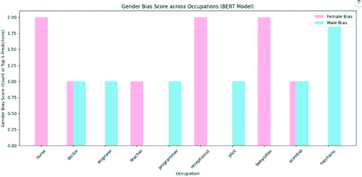

**图 10.1：** 10 种职业针对女性和男性的性别偏见评分

在之前的图中，我们有女性偏见和男性偏见两类。它清楚地显示 `护理行业` 主要由 `女性` 主导。程序员和工程师 `在职业上大部分为男性，但与护理和机械行业相比，其性别偏见评分相对较低。` 保政员和前台 `工作的女性性别偏见评分非常高。然而，也有像 `医生和科学家` 这样的职业，它们的性别偏见评分相对较低，并且包含了女性和男性。

# 虚假信息与幻觉

LLM 有时会以 100% 的确定语气生成内容，但这些是错误的。这被称为 `幻觉`。在 `医疗保健` 等关乎生死的敏感领域，这证明是危险的。

## 现实生活中的案例：

*   ChatGPT 和其他模型在受到提示时已被证明会 `编造法律案件` 或 `生成错误的医疗建议`。
*   Meta 的 `Galactica 模型` 专为科学研究而训练，在发布后不久就被下线，因为它倾向于生成 `有说服力但错误的科学声明`。

## 缓解策略：

*   实施 `人工参与验证 (human-in-the-loop validation)`、`检索增强生成 (RAG)` 技术，并将输出落实到 `信任的外部源` 中。

我们将看到如何使用置信度过滤和 Hugging Face Transformers 来防止幻觉。我们将使用可以在 `本地` 运行的 `现代生成式模型`，例如 `tiiuae` / `falcon-rw-1b` 模型。这是一个更快、更轻量的模型，即使没有 GPU 也能良好运行（例如在 Kaggle 或本地基于 CPU 的系统上）。代码如下。

```python
from transformers import AutoTokenizer, AutoModelForCausalLM
import torch

# Load Falcon model and tokenizer
model_name = "tiiuae/falcon-rw-1b"
tokenizer = AutoTokenizer.from_pretrained(model_name)
model = AutoModelForCausalLM.from_pretrained(model_name)

# Prompt
prompt = "The capital of France is"
# Encode the prompt
inputs = tokenizer(prompt, return_tensors="pt")
# Generate multiple outputs with beam search
outputs = model.generate(
    inputs,
    max_new_tokens=20,
    num_return_sequences=3,
    num_beams=3,
    return_dict_in_generate=True,
    output_scores=True,
)
# Apply filtering
threshold = 0.5
for seq, score in zip(outputs.sequences, outputs.sequences_scores):
    text = tokenizer.decode(seq, skip_special_tokens=True)
    prob = torch.exp(score).item()
    if prob >= threshold:
        print(f"GOOD {text} (Confidence: {prob:.2f})")
    else:
        print(f"BAD {text} (Low Confidence: {prob:.2f})")
```

**输出：**

将 `pad_token_id` 设置为 `eos_token_id`:2 用于开放式生成。

`BAD The capital of France is Paris, the capital of France.`

`Paris is the capital of France.`

`Paris is the capital (Low Confidence: 0.36)`

`BAD The capital of France is Paris, the capital of France.`

`Paris is the capital of France. It is located in the (Low Confidence: 0.34)`

`BAD The capital of France is Paris, the capital of France.`

`Paris is the capital of France.`

`Paris is a city (Low Confidence: 0.32)`

此代码演示了如何使用 `束搜索 (beam search)` 使用 `Falcon-RW 语言模型` 生成多个答案，并根据置信度评分过滤输出以防止幻觉或低置信度答案。

### 模型和分词器加载：

*   使用 Hugging Face 的 Transformers 库加载 `tiiuae/falcon-rw-1b` 因果语言模型及其分词器。

### 提示定义：

*   定义一个自然语言提示：“法国的首都是是”。

### 编码提示词：

*   提示词被分词化并准备好输入模型。

### 使用束搜索生成文本：

*   模型使用 `束搜索` (`num_beams =3`) 生成了 `3 个不同的输出`，这比简单的贪婪解码提升了质量。
*   使用 `output_scores=True` 来获取每个序列的置信度评分。

### 置信度过滤：

*   对每个生成的输出进行评分。
*   代码使用 `torch.exp(score)` 从对数评分计算 `置信度概率`。
*   置信度 `≥ 0.5` 的输出被接受并带有 GOOD 打印。
*   其他输出标记为 BAD，可能是 `幻觉或不可靠` 的答案。

# 隐私与数据安全

在海量网络语料上训练的 LLM 可能会无意中记忆并泄露 `敏感个人信息`，例如姓名、地址或健康记录。这引发了 `严重的隐私问题`，特别是在 GDPR 等数据保护法下。

## 现实生活中的案例：

*   2023 年发现 ChatGPT 在以特定方式提示时可以从其训练集中 `重现个人数据`。
*   意大利临时 `禁止了 ChatGPT`，理由是侵犯隐私。

## 现实世界的缓解策略：

*   Apple 的 Siri 处理确保了数据不会离开手机。
*   Google 的 PaLM 2 包含了关于数据使用的透明度。

为了理解上下文，在机器人、虚拟助手或医疗系统等现实世界的 NLP 应用中，用户生成的数据通常包含身份信息 (PII)，例如：

*   姓名
*   电子邮件地址
*   电话号码
*   出生日期
*   位置
*   医学信息

在不匿名的情况下保留此类数据违反了 GDPR 等法律。因此，我们将使用 NLP 模型检测敏感实体（如姓名、位置等）并将其替换为匿名占位符（例如 `[NAME]`、`[LOCATION]` 等）。代码如下。

```python
import spacy

# Load spaCy's English model
nlp = spacy.load("en_core_sm")

# Sample user data
text = "Charles Dickens visited Boston on August 4th and his phone number is 657-980-5432."

# Process the text
doc = nlp(text)

# Initialize anonymized text
anonymized_text = text

# Loop through detected entities and anonymize
for ent in doc.ents:
    if ent.label_ in ["PERSON", "GPE", "DATE", "ORG"]:
        anonymized_text = anonymized_text.replace(ent.text, f"[{ent.label_}]")

print("Original:", text)
print("Anonymized:", anonymized_text)
```

**输出：**

`Original: Charles Dickens visited Boston on August 4th and his phone number is 657-980-5432.`

`Anonymized: [PERSON] visited [GPE] on [DATE] and his phone number is 657-980-5432.`

我们使用 spaCy 模型识别了日期、人物、组织和位置实体。在原始输出中，我们有主句，而匿名版本将 PERSON、GPE 和 DATE 掩盖。

该用例可以扩展到医疗领域，保护 `个人健康信息 (PHI)` 对于 `HIPAA 合规` 和负责任的人工至关重要。

| **PHI 类别** | **示例** | **实体标签 (NER)** |
| :--- | :--- | :--- |
| 患者信息 | 姓名、社会安全号码、联系电话 | `PERSON, ID, PHONE, EMAIL` |
| 位置 | 医院、城市、地址 | `GPE, LOC, ADDRESS` |
| 日期 | 入院/出院日期、出生日期 | `DATE` |
| 医疗记录信息 | 记录号、测试 ID | `ID` |
| 组织 | 医院、保险提供商 | `ORG` |
| 其他标识符 | 保险号、设备 | 自定义 / 基于正则表达式 |

**表 10.1：** 带有实体标签的敏感患者健康数据

在下面的代码中，我们将看到 PHI（个人健康信息）的匿名处理。


```python
import spacy
import re

# 加载英文 NLP 模型
nlp = spacy.load("en_core_web_sm")

# 医疗相关示例文本
text = """
Patient Name: Tony Stark
DOB: 1972-12-08
Visited: Stanford Hospital, California
Diagnosis: Acute bronchitis.
Insurance ID: INS-9472718
Contact: 987-654-3210
Email: tony.stark@mit.edu
"""

# 应用 spaCy 模型
doc = nlp(text)
anonymized_text = text

# 实体替换映射
entity_map = {
    "PERSON": "[PATIENT_NAME]",
    "DATE": "[DATE]",
    "ORG": "[HOSPITAL]",
    "GPE": "[LOCATION]"
}

# 替换命名实体
for ent in doc.ents:
    if ent.label_ in entity_map:
        anonymized_text = anonymized_text.replace(ent.text, entity_map[ent.label_])

# 基于正则表达式的自定义匿名化
anonymized_text = re.sub(r"\b\d{3}-\d{3}-\d{4}\b", "[PHONE]", anonymized_text)  # 电话
anonymized_text = re.sub(r"\bINS-\d+\b", "[INSURANCE_ID]", anonymized_text)     # 保险 ID
anonymized_text = re.sub(r"[a-zA-Z0-9_.+-]+@[a-zA-Z0-9-]+\.[a-zA-Z0-9-.]+", "[EMAIL]", anonymized_text)  # 邮箱

# 打印结果
print("Original Text:\n", text)
print("\n Anonymized Text:\n", anonymized_text)
```

**输出：**

```
Original Text:
Patient Name: Tony Stark
DOB: 1972-12-08
Visited: Stanford Hospital, California
Diagnosis: Acute bronchitis.
Insurance ID: INS-9472718
Contact: 987-654-3210
Email: tony.stark@mit.edu

Anonymized Text:
Patient Name: [PATIENT_NAME]
DOB: [DATE]
Visited: [HOSPITAL], [LOCATION]
Diagnosis: Acute bronchitis.
Insurance ID: [INSURANCE_ID]
Contact: [PHONE]
Email: [EMAIL]
```

在第一个输出中，我们拥有 Tony Stark 的原始 PHI，匿名后的数据包含了 `PATIENT_NAME`（针对 Tony Stark 的掩码）、`DATE`（针对出生日的掩码）、`HOSPITAL`（针对医院的掩码）、`LOCATION`（针对位置的掩码）、`INSURANCE_ID`（针对保险 ID 的掩码）以及 `EMAIL`（针对邮箱的掩码）。

掩码 PHI 的原因是：

- 确保在对敏感医疗记录进行模型训练时数据是去标识化的。
- 用于自动化报告生成和分析，而无隐私风险。
- 符合 HIPAA、GDPR 以及针对医疗保健的 AI 框架和实践，旨在确保 AI 系统在设计上符合伦理、可问责并符合人类价值观。主要的科技公司和研究机构已经发布了 AI 原则。

```python
"The weather is nice today."  # Neutral

# Load Detoxify model
model = Detoxify('original')

# Get toxicity scores for each sentence
toxicity_scores = [model.predict(text) for text in texts]

# Set up subplots
num_sentences = len(texts)
fig, axes = plt.subplots(nrows=num_sentences, ncols=1, figsize=(10, 3 * num_sentences))
if num_sentences == 1:
    axes = [axes]  # Ensure axes is always iterable

# Plot each sentence's toxicity profile
for i, (text, scores) in enumerate(zip(texts, toxicity_scores)):
    labels = list(scores.keys())
    values = list(scores.values())
    axes[i].bar(labels, values, color='tomato')
    axes[i].set_ylim(0, 1)
    axes[i].set_ylabel("Score")
    axes[i].set_title(f"Toxicity Scores for Sentence {i+1}")
    axes[i].tick_params(axis='x', rotation=45)
    axes[i].grid(True, linestyle='--', alpha=0.5)

# Add score labels on top of bars
    for j, val in enumerate(values):
        axes[i].text(j, val + 0.02, f"{val:.2f}", ha='center', fontsize=9)

# Adjust layout
plt.tight_layout()
plt.show()
```

上述代码描述如下。

### 导入库

- `matplotlib.pyplot`：用于绘制柱状图。
- 来自 `detoxify` 的 `Detoxify`：用于分析文本不同类型的毒性。

### 输入句子

一个包含示例句子的短列表（包括积极、毒性、中性等）。

### 加载模型

加载了 `Detoxify` 模型（原始版本）。它根据多个毒性指标对文本进行评估。

### 运行预测

- 每个句子都使用 `model` 的 `predict()` 方法进行分析，返回一个包含以下得分的字典：
- `toxicity`（毒性）、`severe_toxicity`（严重毒性）、`insult`（侮辱）、`threat`（威胁）、`obscene`（淫俗）、`identity_attack`（身份攻击）、`sexual_explicit`（性显露）。

### 设置子图

为每个句子创建一个单独的子图并垂直堆叠。

### 绘制每个句子

- 对于每个句子，得分以柱状图的形式绘制。
- 标签和标题有助于识别可视化内容。
- 柱子使用了颜色编码（西茄红），并在每个柱子上方包含分值。

### 美化

- 旋转 X 轴标签以提高可读性。
- 紧凑布局（Tight layout）确保图表不重叠。
- 网格线更容易解释数值。

输出结果所示。

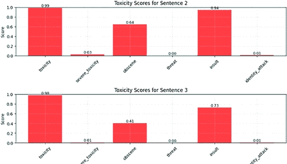

**图 10.2**：句子 2 和句子 3 的毒性得分

在由 `matplotlib` 创建的上述子图中，我们看到句子 2 和句子 3 的毒性分别为 0.99 和 0.98。句子 3 的侮辱性较低（0.73），句子 2 为 0.94。句子 1 和句子 4 没有任何毒性得分，因为它们分别是积极和中性的。

毒性得分表示句子中存在的负面程度。通过这种方式，可以训练聊天机器人以过滤掉毒性的用户输入，社交媒体平台可以在发布前标记攻击性评论，或者可以将这些功能整合到企业工具中以审查电子邮件通信的毒性。

# 监管与 AI 治理的未来

已有诸如《欧盟 AI 法案 (2024)》等法案将 `ChatGPT` 等大语言模型（LLMs）分类为高风险，并强制要求透明度、文档记录和风险缓解；《美国安全 AI 行政令 (2023)》则鼓励 AI 生成内容的水印和来源披露。

## 接下来是什么？

- **AI 审计**：对 AI 模型进行强制性的第三方评估。
- **LLM 许可**：确保符合安全和透明度规范。
- **全球协调**：诸如《G7 AI 开发者行为规范》等倡议正在推动统一的法规。

## 现实应用案例

- **Anthropic 的宪法 AI (Constitutional AI)** 在训练期间将 LLM 行为与伦理原则对齐。
- **OpenAI 的 GPT-4 在律所的使用**正因客户机密问题接受监管审查。

## 结论

大语言模型（LLMs）极大地定义了 NLP 和 AI 的格局，使机器能够更好地理解、生成并使用人类语言进行交互。它们执行从翻译到摘要、问答和内容生成等各种任务的能力，帮助在现代 AI 系统中建立了一套基础工具体系。

LLM 利用海量预训练，使其强大、适应性强，并能广泛应用于医疗保健、教育、金融和法律科技等行业，而无需从头构建架构。

LLM 的演进以强调效率、专业化和开放的新趋势为标志。较小且优化的模型（如 `TinyLLaMA` 和 `Mistral`）以更少的计算需求提供了令人印象深刻的性能，使 AI 在低资源环境中更易获取。

LLM 是未来基于 NLP 技术和产品的基石，且目前正在构建中。它们执行内容生成、摘要、翻译、图像和视频生成、问答等任务的能力，可以针对金融、医疗、教育、法律、电子商务、国防、制造等领域进行定制。

对于 NLP 从业者来说，这个快速演变的领域带来了新机会。通过诸如 `低秩自适应 (LoRA)` 和 `参数高效微调 (PEFT)` 等轻量级技术，对预训练 LLM 进行自定义微调变得更加可行。随着监管开始塑造 AI 的使用，对可解释、公平和保护隐私的系统有了明确需求。总而言之，LLM 的未来不仅关乎构建更大的模型，更在于让它们更强大、更易获取。

- [Hugging Face LLM 课程第一章第二部分](https://huggingface.co/learn/llm-course/en/chapter1/2)
- [Zapier：最佳大语言模型博客](https://zapier.com/blog/best-llm/)
- [TechTarget：12 最佳大语言模型](https://www.techtarget.com/whatis/feature/12-of-the-best-large-language-models)
- [Shakudo：前九大大语言模型](https://www.shakudo.io/blog/top-9-large-language-models)
- [大语言模型（LLMs）概述](https://wandb.ai/mostafaibrahim17/ml-articles/reports/An-Overview-of-Large-Language-Models-LLMs---VmlldzozODA3MzQz)
- [探索大语言模型 (LLMs) 的架构与配置](https://www.labellerr.com/blog/exploring-architectures-and-configurations-for-large-language-models-llms/)
- [当今 LLM 应用的架构](https://github.blog/ai-and-ml/llms/the-architecture-of-todays-llm-applications/)
- [什么是大语言模型？](https://aws.amazon.com/what-is/large-language-model/)
- [理解大语言模型架构](https://whylabs.ai/learning-center/introduction-to-llms/understanding-large-language-model-architectures)
- [揭秘 Transformer：缩放法则、注意力机制和微调的全面指南](https://medium.com/sage-ai/demystify-transformers-a-comprehensive-guide-to-scaling-laws-attention-mechanism-fine-tuning-fffb62fc2552)
- [LLM 缩放法则](https://cameronrwolfe.substack.com/p/llm-scaling-laws)
- [语言模型的大规模缩放学习](https://arxiv.org/pdf/2001.08361)
- [大语言模型研究](https://arxiv.org/html/2411.10915v1)
- [大语言模型评述](https://arxiv.org/pdf/2401.13086)
- [LLM 数据质量](https://www.gable.ai/blog/llm-data-quality)
- [迁移学习：LLM 到相似问题的泛化](https://medium.com/@sulbha.jindal/transfer-learning-llm-generalization-to-similar-problems-1d3b2bf28c6e)
- [从大语言模型迁移学习](https://maddevs.io/blog/transfer-learning-from-large-language-models/)
- [大语言模型微调](https://arxiv.org/html/2410.11539v1)
- [迁移学习博客](https://toloka.ai/blog/transfer-learning/)
- [关于大语言模型的研究](https://arxiv.org/pdf/2307.06435)
- [LLM 应用博客](https://pixelplex.io/blog/llm-applications/)
- [实战大语言模型：理解](https://www.amazon.in/Hands-Large-Language-Models-Understanding/dp/935542552X/ref=tmm_pap_swatch_0)
- [实战大语言模型 GitHub 项目](https://github.com/HandsOnLLM/Hands-On-Large-Language-Models)
- [关于 LLM 和 NLP 的书籍](https://medium.com/@abonia/books-on-llm-and-nlp-in-2024-aea0517d57)
- [LLM 书](https://thelmbook.com/)
- [AI 驱动的虚拟健康助手](https://www.linkedin.com/pulse/rise-ai-powered-virtual-health-assistants-chatbots/)
- [AI 写作生成器](https://zapier.com/blog/best-ai-writer/)
- [Claude 代码与工具](https://docs.anthropic.com/en/docs/agents-and-tools/claude-code/overview)
- [用案例](https://pieces.app/use-cases/engineers)
- [Tabnine](https://www.tabnine.com/)
- [AI 的伦理考量](https://online.hbs.edu/blog/ethical-considerations-of-ai)
- [AI 伦理](https://www.ibm.com/think/topics/ai-ethics)
- [AI 的 10 个伦理考量](https://www.pmi.org/blog/top-10-ethical-considerations-for-ai)
- [数据科学中的负责任 AI](https://www.dasca.org/world-of-data-science/article/responsible-ai-benefits)
- [伦理 AI](https://sigma.ai/ethical-ai/)
- [AI 权利法案](https://www.ibm.com/think/topics/ai-bill-of-rights)
- [谷歌的负责任 AI](https://blog.research.google/2023/08/responsible-ai-at-google)
- [Bender 论文](https://s10251.pcdn.co/pdf/2021-bender-rots)
- [大语言模型幻觉](https://www.evidently.com/blog/llm-hallucination)
- [UNESCO 关于大语言模型的报告](https://unesdoc.unesco.org/ark:/48223/pf000038117)
- [AI 法案：促进欧洲的可信赖 AI](https://digital-strategy.ec.europa.eu/en/policies/regulatory-framework-ai#text=The%20AI%20Act%20(Regulation%20foster%20trustworthy%20AI%20in%20Europe))
- [谷歌 AI 原则](https://ai.google/responsibility/principles/)
- [微软负责任 AI](https://www.microsoft.com/en-us/ai/responsible-ai)


- [论文](https://arxiv.org/pdf/2306.15298)
- [BERT 中的偏见展示](https://dmccreary.medium.com/showing-bias-in-bert-475e98dabf1)
- [2016 年微软种族歧视机器人揭示了在线对话的危险](https://spectrum.ieee.org/in-2016-microsofts-racist-chatbot-revealed-the-dangers-of-online-conversation)
- [微软回应用户关于 Copilot 提供危险回复的](https://timesofindia.indiatimes.com/gadgets-news/microsoft-responds-to-users-claim-on-its-ai-chatbot-copilot-giving-dangerous-responses/articleshow/108121350.cms)

# 第 11 章：微调 LLM 与构建文本驱动工具

## 引言

大型语言模型（LLMs）如 `GPT-4`、`LLaMA`、`DeepSeek` 和 `Claude` 彻底改变了搜索、推理和人类级通信。虽然这些模型提供了强大的通用能力，但现实世界的应用大多需要特定任务的定制化。这就是微调大显用场的地方，可以将预训练的 LLM 适配到专业领域，如医疗、法律、金融或客户支持。微调通过在相关的精选数据集上对模型进行进一步训练，完善模型的知识和行为。

本章将探索 LLM 微调的完整生命周期，以及将其部署为实用的文本驱动工具。我们将学习如何选择合适的模型、准备训练数据并使用 `Hugging Face` 库对模型进行微调。我们还将深入研究如 `LoRA` 和 `Prompt Tuning` 等参数高效方法，这些方法使得在有限的硬件上实现定制成为可能。此外，我们将介绍 `AI Agents（智能代理）`——构建在 LLM 之上的自主系统，它们可以跨工具和 API 进行推理、规划并采取行动。这些代理将 LLM 的能力从文本生成扩展到实时决策和自动化。

除了理论，本章还包含实操项目，例如构建代码补全助手、创意文本生成器和特定领域的问答系统。我们还介绍了检索增强生成（RAG），这是一种将 LLM 与实时文档检索相结合以构建基于事实的应用的先进技术。在本章结束时，我们将具备创建强大的、领域感知的语言工具并将其部署到现实环境中的能力。无论我们是为业务、研究还是开源创新构建模型，本章都将引导你从模型定制过渡到实际部署。

## 结构

在本章中，我们将涵盖以下主题：

*   理解 LLM 和微调
    *   微调的类型
    *   选择合适的模型和数据集
*   实践中的 LLM 微调
    *   微调的环境搭建
    *   微调步骤详解
    *   案例研究：微调文本摘要器
*   构建文本驱动工具
    *   工具 1：代码补全助手
    *   工具 2：文本生成系统
*   检索增强生成 (RAG)
    *   什么是 RAG 及其重要性
    *   构建简单的 RAG 流线
*   评估、优化和部署
    *   评估微调后的模型
    *   针对速度和成本进行优化

# 理解 LLM 和微调

本章的这一主题涉及 LLM 微调，介绍了 `LoRA`、`Adapters（适配器）`和 `Prompt Tuning`，以及为构建选择合适的模型和数据集。

## 大型语言模型 (LLMs)

`LLMs` 是先进的神经网络，能够思考、搜索、推理和与人类交流。它们在海量数据（如网站、书籍和代码库）上进行训练，以向用户提供正确的信息。然而，为了让 LLM 执行特定任务（如文本生成、代码生成、图像生成、文章或博客写作），需要对 LLM 进行微调，并利用合适的模型。`Hugging Face` 网站上有大量的模型，涵盖从文本到文本、文本到图像、图像到视频、问答、摘要和翻译等。

## LLM 微调

LLM 的微调大体分类为两种方法：`全量微调`和`参数高效微调 (PEFT)`。

*   **全量微调**：在这种方法中，预训练 LLM 的所有参数都会被更新。它能产生高性能，但计算开销大，且需要大量的标注数据和内存。它最适合在使用强大的 GPU 配置和大型特定任务数据集时使用。
*   **参数高效微调 (PEFT)**：PEFT 技术通过仅更新一小部分模型参数，帮助用极少的计算资源适配大模型。这对于无法使用昂贵基础设施的从业者来说特别有用。

一些流行的 PEFT 技术包括：

*   **低秩自适应 (LoRA)**：在 transformer 的每一层中注入可训练的低秩矩阵，允许高效微调。
*   **Adapters（适配器）**：在 transformer 层之间添加小的瓶颈模块，在保持基础模型冻结的同时进行训练。
*   **Prompt Tuning / Prefix Tuning（前缀微调）**：不是更新模型权重，而是通过优化的 prompt tokens 或前缀对模型进行条件限制，以引导特定任务的输出。

这些方法不仅降低了训练成本，还提高了模型组件的模块化和重用性。

## 选择合适的模型和数据集

微调的成功主要取决于选择合适的模型以及构建或选择高质量的数据集。

*   **领域特定模型选择**：并非所有模型的构建方式都是相同的。对于医疗任务，`BioBERT`、`PubMedBERT` 或 `ClinicalBERT` 等模型在医学语料库上进行了微调。对于代码生成，`CodeT5` 或 `StarCoder` 等模型更为合适。
*   **精选微调数据集**：根据用例，我们需要任务相关的数据。以下是几种类型：
    *   **文本分类**：句子或段落配对标签（例如情感分析）。
    *   **问答 (QA)**：包含上下文段落、问题和答案的数据集（例如 `SQuAD`、`BioASQ`）。
    *   **摘要**：带有简洁参考摘要的文档（例如 `CNN/DailyMail`）。
    *   **代码**：带有相应提示和补全的代码片段（例如 `HumanEval`、`CodeSearchNet`）。

# 实践中的 LLM 微调

本主题将解释微调的环境搭建、需要安装的库，以及使用 `Google Colab`。接下来，我们将介绍微调的步骤，从加载数据集、分词和加载预训练模型开始。然后进行预处理、训练和评估。最后保存并部署模型。接下来，我们将构建一个文本摘要器并对其进行微调和评估。

## 微调步骤详解

环境准备就绪后，我们将使用 `Hugging Face` 工具开始微调并构建摘要器。

### 第 1 步：加载数据集、分词器和模型

我们选择了与摘要任务相关的数据集。然后，加载了兼容的分词器和预训练模型。代码如下。

```python
from datasets import load_dataset
from transformers import AutoTokenizer, AutoModelForSeq2SeqLM

dataset = load_dataset("cnn_dailymail", "3.0.0")
tokenizer = AutoTokenizer.from_pretrained("facebook/bart-base")
model = AutoModelForSeq2SeqLM.from_pretrained("facebook/bart-base")
```

`datasets` 库（来自 `Hugging Face`）导入了 `load_dataset` 函数。它可以帮助轻松地加载如 `cnn_dailymail` 等现即用的数据集。`load_dataset()` 函数加载 `CNN/DailyMail 数据集`，这是一个用于摘要式摘要的流行数据集。“3.0.0”版本使用了清洗和修正后的数据。

数据集中的每个示例包含：

*   `article` – 完整的新闻文章文本。
*   `highlights` – 对应的人工编写的摘要。

它返回一个包含训练、测试和验证划分的字典：

*   `dataset["train"]`
*   `dataset["validation"]`
*   `dataset["test"]`

`AutoTokenizer.from_pretrained()` 加载了 BART 模型的 `tokenizer`。`tokenizer` 将文本转换为模型可以理解的输入 ID 和注意力掩码。`facebook/bart-base` 是一个针对摘要等序列到序列任务优化的预训练编码器解码器模型。

`AutoModelForSeq2SeqLM.from_pretrained()` 加载了为序列到序列学习预训练的 `BART 模型`（Seq2SeqLM = 序列序列语言模型）。它擅长摘要、翻译和文本生成等任务。

BART 使用：

*   一个 `encoder`（编码器）理解输入（文章），
*   一个 `decoder`（解码器）生成输出（摘要）。

### 第 2 步：预处理数据

我们必须对训练的输入和标签进行分词。代码如下。

```python
def preprocess(example):
    inputs = tokenizer(example["article"], truncation=True, padding="max_length", max_length=512)
    labels = tokenizer(example["highlights"], truncation=True, padding="max_length", max_length=128)
    inputs["labels"] = labels["input_ids"]
    return inputs

tokenized_data = dataset.map(preprocess, batched=True)
```

在前面的代码中，创建了 `preprocess` 函数并对 `"article"`（文本）和 `"highlights"`（摘要）使用了 `tokenizer()` 函数。

*   `truncation=True`：如果文章超过 512 个 token，它将被截断。
*   `padding="max_length"`：如果文章少于 512 个 token，它将被填充到恰好 512 个 token。
*   `max_length=512`：将最大输入长度设置为 512 个 token。

目标是准备输入文本，使其符合模型的大小。`labels` 变量的 `truncation=True` 和 `padding="max_length"` 保持不变。由于摘要较短，`max_length=128` 表示只保留 128 个 token。在对文章（inputs）进行分词后，我们添加了一个名为 `labels` 的新键。它持有分词后的摘要。

在训练期间：

*   模型尝试根据 `inputs` 生成 `labels`。这把文章及其目标摘要连接在一起。

然后我们对整个数据集应用 `preprocess` 函数。

*   `batched=True`：一次处理多个示例（更快且更高效）。因此，`tokenized_data` 将把每个示例转换为：
    *   `input_ids`（针对文章），
    *   `attention_mask`（针对填充），
    *   `labels`（针对目标摘要）。

### 第 3 步：使用 Trainer API

在此步中，我们将使用特定参数训练模型。代码如下。

```python
from transformers import TrainingArguments, Trainer

args = TrainingArguments(
    output_dir="./results",
    per_device_train_batch_size=4,
    num_train_epochs=1,
    logging_dir="./logs",
    save_total_limit=2,
    logging_steps=10
)

trainer = Trainer(
    model=model,
    args=args,
    train_dataset=tokenized_data["train"],
    eval_dataset=tokenized_data["validation"]
)

trainer.train()
```

代码解释如下：

`from transformers import TrainingArguments, Trainer`

*   从 `Hugging Face` 的 Transformers 库中导入两个重要的类：
    *   `TrainingArguments`：帮助配置训练如何运行（批处理大小、轮数、保存位置等）。
    *   `Trainer`：一个高层 API，负责处理整个训练循环（训练、评估、检查点保存）。

`args = TrainingArguments(...)` 这创建了一个 `TrainingArguments` 对象，设置了训练设置。

| 参数 | 目的 |
| :--- | :--- |
| `output_dir="./results"` | 训练后保存模型检查点的地方。 |
| `per_device_train_batch_size=4` | 批次大小：每个设备（GPU/CPU）一次处理 4 个样本。 |
| `num_train_epochs=1` | 仅遍历整个训练数据集一次。（我们稍后可以增加以获得更好的结果。） |
| `logging_dir="./logs"` | 保存训练日志的目录。 |
| `save_total_limit=2` | 最多保存 2 个模型检查点。旧的检查点将被自动删除。 |
| `logging_steps=10` | 每 10 步记录一次日志。 |

**表 11.1：训练参数**

`trainer = Trainer(...)` 现在我们创建一个 Trainer 实例将所有内容连接起来：

| 参数 | 目的 |
| :--- | :--- |
| `model=model` | 我们之前加载的模型。 |
| `args=args` | 我们刚刚设置的所有训练参数。 |
| `train_dataset=tokenized_data["train"]` | 训练数据集（分词后的文章和摘要）。 |
| `eval_dataset=tokenized_data["validation"]` | 验证数据集（用于在训练期间监控）。 |

**表 11.2：模型细节和训练设置**

`Trainer` 将自动处理：

*   数据加载
*   正向和反向传播
*   损失计算
*   优化
*   训练期间的评估
*   保存模型检查点

`trainer.train()` 开始训练过程：

*   `Trainer`：
    *   将批处理后的数据喂给模型
    *   计算损失
    *   更新模型权重
    *   定期在验证集上进行评估
    *   保存模型检查点

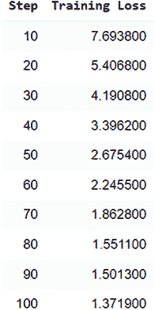

**图 11.1：每 10 步的训练损失**

在之前的截图中，我们看到训练损失每一步都在下降，并在第 80 步之后趋于稳定。

```python
reference_summaries = [item for item in small_validation["highlights"]]
```

# 生成带有适当错误处理的摘要


```python
generated_summaries = []
for text in sample_texts:
    try:
        # 处理过长的文本
        if len(text) > 1024:  # 对非常长的文本进行简单截断
            text = text[:1024]
        # 生成摘要并添加显式错误处理
        summary_output = summarizer(text, max_length=130, min_length=30, do_sample=False)
        # 检查输出是否有效
        if summary_output and isinstance(summary_output, list) and len(summary_output) > 0:
            summary = summary_output[0]["summary_text"]
            generated_summaries.append(summary)
        else:
            # 如果摘要生成失败，使用备选方案
            print(f"Warning: Failed to generate summary, using placeholder")
            generated_summaries.append("Summary generation failed.")
    except Exception as e:
        print(f"Error processing text: {e}")
        generated_summaries.append("Error in summary generation.")
# 确保生成的摘要和参考摘要的数量一致
assert len(generated_summaries) == len(reference_summaries), "Mismatch in number of summaries"
# 使用 ROUGE 进行评估
rouge = evaluate.load("rouge")
results = rouge.compute(predictions=generated_summaries, references=reference_summaries)
# 打印结果
print("ROUGE Evaluation:")
for key, value in results.items():
    print(f"{key}: {value:.4f}")
```

## 输出

```
ROUGE Evaluation:
rouge1: 0.3325
rouge2: 0.1358
rougeL: 0.2286
rougeLsum: 0.2811
```

## 代码解释

### 导入与设置

```python
from transformers import pipeline, AutoTokenizer, AutoModelForSeq2SeqLM
import evaluate
from datasets import load_dataset
```

这导入了必要的库：

* `transformers`: 用于预训练模型和分词器
* `evaluate`: 用于如 `ROUGE` 等评估指标
* `datasets`: 用于加载基准数据集

### 加载数据集

```python
dataset = load_dataset("cnn_dailymail", "3.0.0")
```

* 这从 Hugging Face 的 datasets 库加载了 `CNN/DailyMail` 数据集（版本 3.0.0）。
* 该数据集包含新闻文章以及人工编写的摘要（称为 `highlights`）。

### 模型和分词器初始化

```python
model_name = "facebook/bart-large-cnn"
tokenizer = AutoTokenizer.from_pretrained(model_name)
model = AutoModelForSeq2SeqLM.from_pretrained(model_name)
```

* 使用 `BART-large-CNN` 模型，该模型专门针对 `CNN/DailyMail` 的摘要任务进行了微调。
* `AutoTokenizer`: 加载将文本转换为模型可以理解的标记的分词器。
* `AutoModelForSeq2SeqLM`: 加载用于文本生成的序列到序列模型。

### 创建流水线

```python
summarizer = pipeline("summarization", model=model, tokenizer=tokenizer)
```

创建一个处理整个过程的摘要生成流水线：

* 对输入文本进行分词
* 运行模型进行处理
* 将输出标记解码回文本

### 数据准备

```python
small_validation = dataset["validation"].select(range(9))
sample_texts = [item for item in small_validation["article"]]
reference_summaries = [item for item in small_validation["highlights"]]
```

使用 `select(range(9))` 从验证集中选取 9 个示例。将文章和参考摘要提取为 Python 列表，以便于处理。

### 摘要生成

```python
generated_summaries = []
for text in sample_texts:
    try:
        if len(text) > 1024:
            text = text[:1024]
        summary_output = summarizer(text, max_length=130, min_length=30, do_sample=False)
        if summary_output and isinstance(summary_output, list) and len(summary_output) > 0:
            summary = summary_output[0]["summary_text"]
            generated_summaries.append(summary)
        else:
            print(f"Warning: Failed to generate summary, using placeholder")
            generated_summaries.append("Summary generation failed.")
    except Exception as e:
        print(f"Error processing text: {e}")
        generated_summaries.append("Error in summary generation.")
```

遍历每篇文章并带有以下设置生成摘要：

* 对于长文章将文本截断为 1024 个字符
* 参数：`max_length=130` 和 `min_length=30` 用于控制摘要长度
* `do_sample=False` 用于确定性生成（不带随机性）

包含了完善的错误处理：

* 在提取摘要之前验证输出结构
* 捕获任何异常并提供备用内容

### 一致性检查

```python
assert len(generated_summaries) == len(reference_summaries), "Mismatch in number of summaries"
```

确保我们生成的摘要和参考摘要数量相同，以便进行正确评估。

### 评估

```python
rouge = evaluate.load("rouge")
results = rouge.compute(predictions=generated_summaries, references=reference_summaries)
```

* 从 Hugging Face 的 `evaluate` 库加载 `ROUGE` 指标。
* 通过将生成的摘要与参考摘要对比来计算 `ROUGE` 分数。

这段代码演示了使用预训练模型进行文本摘要并评估其性能的完整工作流。我们收到的 ROUGE 分数（`ROUGE-1: 0.3325`、`ROUGE-2: 0.1358`、`ROUGE-L: 0.2286`、`ROUGE-Lsum: 0.2811`）表明该系统在该数据集上的性能合理。这些分数代表了我们生成的摘要与参考摘要的匹配程度。让我们查看各项指标：

* `ROUGE-1: 0.3325 (33.25%)`: 这衡量了生成的摘要和参考摘要之间单字（单个单词）的重叠情况。33.25% 的得分意味着我们生成的摘要中约三分之一的单个单词与参考摘要中的单词匹配。然而，对于摘要任务来说，这是一个合理的分数，表明处于中等水平。
* `ROUGE-2: 0.1358 (13.58%)`: 这衡量了生成的摘要和参考摘要之间双词（连续两个单词）的重叠情况。13.58% 的得分低于 `ROUGE-1` 是预期的，因为匹配单词对比单个单词更困难。这个中等分数表明模型捕捉到了原始摘要的一些短语结构。
* `ROUGE-L: 0.2286 (22.86%)`: 这衡量了生成的摘要和参考摘要之间的最长公共序列。它通过寻找顺序匹配的单词（但不一定连续）来考虑结构。22.86% 的分数表明生成的摘要与参考摘要之间具有结构相似性。
* `ROUGE-Lsum: 0.2811 (28.11%)`: 这是 `ROUGE-L` 的变体，在摘要级别而非句子级别运行。它通常比 `ROUGE-L` 高，因为它允许跨句子匹配。28.11% 的分数显示了不错的摘要级结构相似性。

### 总体评估

这些分数代表了使用 `BART-large-CNN` 模型在 `CNN/DailyMail` 数据集上的合理摘要性能。作为参考：

* 顶级系统通常在该数据集上达到 40-45% 的 `ROUGE-1` 分
* 我们的分数在预期范围内，但仍有改进空间
* `ROUGE-1` 和 `ROUGE-2` 分数之间的差距表明模型在捕捉单个单词方面优于维持短语结构。

---

# 工具 1：代码补全助手

`CodeSearchNet` 是一个来自 GitHub 的真实世界代码片段大型集合，涵盖了 `Python` 和 `Java` 等多种语言。它能帮助模型学习编码模式、语法和结构。在我们的案例中，我们使用了一个在相似高质量代码数据集上预训练过的模型，避免了全量重新训练。

我们选择了 `Salesforce/codegen-350M-multi` 模型，这是一个紧凑的、针对代码生成任务优化的多语言模型。它旨在跨多种编程语言高效地理解和生成代码。`StarCoder` 是另一个替代方案，在更广泛、更大的代码数据集上进行了训练。这些模型可以处理代码自动补全、错误修复和文档生成等任务。

该工具旨在开发者在 IDE 中输入代码时建议代码补全，类似于 `GitHub Copilot`。模型根据部分输入预测后续行，从而提高编码速度并减少重复输入。虽然目前是基于脚本的，但该工具可以通过 API 或轻量级插件轻松集成到 IDE 中，以获得完整的交互体验。

该工具的代码如下。

```python
from transformers import AutoTokenizer, AutoModelForCausalLM

# Model name
model_name = "Salesforce/codegen-350M-multi"

# Load tokenizer
tokenizer = AutoTokenizer.from_pretrained(model_name)

# Load model without warnings
model = AutoModelForCausalLM.from_pretrained(
    model_name,
    trust_remote_code=True,
    ignore_mismatched_sizes=True
)

# Function to complete code
def complete_code(prompt, max_new_tokens=50):
    inputs = tokenizer(prompt, return_tensors="pt")
    outputs = model.generate(
        inputs,
        max_new_tokens=max_new_tokens,
        do_sample=True,             # enable sampling for creative suggestions
        temperature=0.7,            # controls randomness (lower = more deterministic)
        top_p=0.95,                 # nucleus sampling for quality
        pad_token_id=tokenizer.eos_token_id
    )
    completion = tokenizer.decode(outputs[0], skip_special_tokens=True)
    return completion

# Example usage
user_prompt = "def fibonacci(n):"
completed_code = complete_code(user_prompt)
print("=== Completed Code ===")
print(completed_code)
```

**输出：**

```
=== Completed Code ===
def fibonacci(n):
    return fibonacci(n-1) + fibonacci(n-2)
print(fibonacci(6))
print(fibonacci(5))
```

## 代码解释

| 代码块 | 解释 |
| --- | --- |
| `from transformers import AutoTokenizer, AutoModelForCausalLM` | 导入 Hugging Face 用于代码生成的分词器和模型类。 |
| `model_name = "Salesforce/codegen-350M-multi"` | 指定预训练模型：一个在多种编程语言上训练的 350M 参数版本。 |
| `tokenizer = AutoTokenizer.from_pretrained(model_name)` | 加载分词器，将文本（此处为代码）分解为模型可以理解的标记。 |
| `model = AutoModelForCausalLM.from_pretrained(model_name, trust_remote_code=True, ignore_mismatched_sizes=True)` | 加载用于因果语言建模（文本预测）的预训练模型，并允许信任自定义模型代码。 |
| `prompt = "def fibonacci(n):"` | 提供起始代码或函数签名。这作为代码补全的种子。 |
| `inputs = tokenizer(prompt, return_tensors="pt")` | 将输入文本转换为张量（PyTorch 格式），以便模型进行处理。 |
| `outputs = model.generate(...)` | 为输入代码生成续写：`max_new_tokens=50` 限制生成标记数量。`temperature=0.7` 让预测略具创造性。`do_sample=True` 启用采样而非贪婪生成。`top_p=0.95` 使用核采样保证质量。 |
| `completed_code = tokenizer.decode(outputs[0], skip_special_tokens=True)` | 将张量输出解码为人类可读文本。 |
| `print(completed_code)` | 显示完整输出。 |

---

# 工具 2：文本生成系统

`文本生成系统`使用 GPT-2 模型构建，它可以创建从诗歌到完整文章的输出。通过利用 GPT-2 的语言理解和创作能力，用户可以调整输出以满足不同的语气、风格和深度。总体而言，该系统将手动的创意写作过程转化为由大规模语言模型驱动的更快速、更具创新性的体验。代码如下。


```python
from transformers import AutoModelForCausalLM, AutoTokenizer, pipeline
import torch

# Step 1: Load a powerful text generation model
model_name = "gpt2" 
tokenizer = AutoTokenizer.from_pretrained(model_name)
model = AutoModelForCausalLM.from_pretrained(model_name)

# Step 2: Create a text generation pipeline
text_generator = pipeline(
    "text-generation",
    model=model,
    tokenizer=tokenizer,
    device=0 if torch.cuda.is_available() else -1 # Use GPU if available
)

# Step 3: Define a function to generate content
def generate_content(prompt, content_type="short"):
    if content_type == "short":
        max_length = 100  # Suitable for poems, short posts
    else:
        max_length = 500  # Suitable for blogs, articles
    outputs = text_generator(
        prompt,
        max_length=max_length,
        temperature=0.7,
        top_p=0.9,
        top_k=50,
        num_return_sequences=1,
        do_sample=True
    )
    return outputs[0]["generated_text"]

# Step 4: Example usages
# Generate a poem
poem = generate_content("Write a beautiful poem about Paris", content_type="short")
print("\nGenerated Poem:\n", poem)

# Generate a blog post
blog = generate_content("Write a blog about the future of AI in healthcare", content_type="long")
print("\nGenerated Blog:\n", blog)
```

**输出：**

```
Generated Poem:
Write a beautiful poem about Paris, The city of Paris is a beautiful place, and I am not going to try to convince you otherwise. The city of Paris is beautiful in a way that no other city can be. It is the center of the European Union, and it is the birthplace of modern French literature. It is the home of the French National Theatre, and it is the home of the Louvre Museum. And it is also the home

Generated Blog:
Write a blog about the future of AI in healthcare. What is AI? AI is an umbrella term for any type of machine learning algorithm, which can be used to predict how a computer will perform tasks and predict future events. It can be used to help computers understand the world and act more like humans.
```

例如，AI 可以帮助计算机理解物理世界，比如当要求计算机下国际棋时。它还可以帮助计算机理解世界的运行方式并预测事件，例如 AI 何时会承担新工作。

AI 并不是一项新技术。已知的首次应用出现于 20 世纪 60 年代，当时计算机下国际棋。

# AI 的崛起

随着越来越多的计算机被制造，更强大的 AI 算法被开发出来。例如，能够击败人类选手的超级计算机 `IBM Watson` 开发于 20 世纪 90 年代。

AI 算法已用于帮助提高医疗质量，例如使用人工智能来诊断和治疗疾病。

它还用于通过预测公司运营的未来来提高公司的效率。

AI 也被用于提高业务效率。AI 可用于预测公司和企业的未来，例如公司何时会被收购或员工何时会离职。

AI 也被用于对未来进行预测。例如，当公司对员工的未来做出预测时，AI 算法可以帮助公司做出如何处理员工离职的决策。

使用 Hugging Face 和 PyTorch 构建文本生成系统的代码如下。

## 导入与设置

```python
from transformers import AutoModelForCausalLM, AutoTokenizer, pipeline
import torch
```

*   `AutoModelForCausalLM`：加载预训练的 `causal language model`（适用于文本生成，如 GPT）。
*   `AutoTokenizer`：处理文本与标记之间的反向转换（对于处理 transformers 至关重要）。
*   `pipeline`：Hugging Face 的高级 API，用于快速构建文本生成等 NLP 工具。
*   `torch`：用于检查 GPU 是否可用（为了更快的处理）。

## 加载模型和分词器

```python
model_name = "gpt2-large"
tokenizer = AutoTokenizer.from_pretrained(model_name)
model = AutoModelForCausalLM.from_pretrained(model_name)
```

*   加载 `GPT-2 Large`，这是一个训练用于预测句子中下一个词的生成模型。
*   `AutoTokenizer` 为模型准备输入文本（分词化）。
*   `AutoModelForCausalLM` 加载用于文本生成的实际神经网络。

## 创建文本生成流水线

```python
text_generator = pipeline(
    "text-generation",
    model=model,
    tokenizer=tokenizer,
    device=0 if torch.cuda.is_available() else -1
)
```

*   使用模型 + 分词器创建一个 `text generation pipeline`。
*   `device=0` 在可用时使用 GPU，否则在 CPU 上运行 (-1)。
*   此流水线简化了生成逻辑——我们不需要手动进行编码/解码。

## 定义内容生成器

```python
def generate_content(prompt, content_type="short"):
    if content_type == "short":
        max_length = 100
    else:
        max_length = 500
    
    outputs = text_generator(
        prompt,
        max_length=max_length,
        temperature=0.7,
        top_p=0.9,
        top_k=50,
        num_return_sequences=1,
        sample=True
    )
    return outputs[0]["generated_text"]
```

*   一个处理 `short` 和 `long` 内容的函数。
*   `max_length` 控制模型生成的 token 数量。
*   `outputs` 包含结果。

```python
poem = generate_content("Write a beautiful poem about Paris", content_type="short")
print("\nGenerated Poem:\n", poem)

blog = generate_content("Write a blog about the future of AI", content_type="long")
print("\nGenerated Blog:\n", blog)
```

*   生成 `poem` 和 `blog`。
*   `temperature`、`top_p`、`top_k`、`num_return_sequences` 和 `sample` 控制生成的随机性。

### 总结

该系统使用了：

*   `GPT-2 Large` 进行生成。
*   `AutoTokenizer` 进行文本处理。
*   `pipeline` 用于高级逻辑。
*   `torch` 用于硬件加速。

# 检索增强生成 (RAG)

在本节中，我们将探讨 RAG 及其意义、构建一个 RAG 流水线并部署它。

## 什么是 RAG，其意义何？

RAG 的核心是一个简单而强大的思想：`用外部文档增强语言模型`。

典型的 RAG 架构涉及两个主要组件：

*   **检索器 (Retriever)**：给定用户查询，检索器在大型语料库（文档、文章或任何知识库）中搜索并获取最相关的信息。检索器通常使用 `FAISS`、`Chroma` 或 `ElasticSearch` 等库通过稠密嵌入和相似性搜索。
*   **生成器 (Generator)**：语言模型（如 `BERT`、`BART`、`GPT` 变体）结合 `原始提示` 和 `检索到的文档` 生成连贯的答案。

这种设置允许模型在无需重新训练或微调的情况下补充其知识。

RAG 的主要优势是 `减少幻觉`，这是大语言模型（LLMs）生成听起来相关但实际上错误或过时的信息的常见问题。由于 RAG 模型显式地检索外部文档：

*   **实时更新**：RAG 生成最新信息，无需等待下一次模型重训练周期。
*   **领域适应性**：企业可以自定义检索语料库（例如医疗、法律和财务报告的内部知识库），以提供特定领域的知识。
*   **更高的准确性**：通过将答案建立在实际证据之上，RAG 模型提供了更具可验证性、更可靠的输出。

例如，一个在 2023 年之前训练的传统 LLM 可能不知道最新的科学发现。然而，RAG 模型可以检索 2025 年发表的文章并将其整合到生成的响应中，从而确保事实准确性。

在实际应用中，RAG 驱动了：

*   **企业聊天机器人**，根据内部文档回答问题。
*   **法律助手**，引用相关的法律或案例。
*   **医疗顾问**从经过证实的临床文献中提取信息。
*   **学术搜索工具**，引用更新的研究成果。

总之，`检索增强生成 (RAG)` 不仅扩展了大语言模型的寿命和可靠性，还使其能力更接近现实应用，使 AI 系统在处理关键任务时更加动态、自适应且值得信赖。

构建检索增强生成（RAG）流水线涉及建立一个无缝工作流，其中文档被存储、检索，然后由大语言模型（LLM）用于生成答案。让我们拆解这些核心组件和方法。

## 向量数据库 (FAISS, Chroma)

RAG 系统的第一步是以能够实现快速且有意义检索的方式存储文档。传统的关键词搜索对于细粒度的查询往往效率低下，因此我们使用向量数据库。

*   `Facebook AI Similarity Search (FAISS)`：一个极其高效的库，用于对稠密向量执行快速相似性搜索。使用 `Sentence Transformers` 等模型将文档转换为嵌入，然后 `FAISS` 根据向量距离（例如，`cosine similarity`）快速找到最相关的文档。
*   `Chroma`：一种专为 AI 应用设计的现代、轻量级向量数据库。它设置简单，与 Python 工作流集成良好，并支持在存储文档嵌入的同时存储元数据，以实现更丰富的搜索。

### 流程：

1. 将文档转换为嵌入。
2. 将嵌入存储在 `FAISS` 或 `Chroma` 中。
3. 为给定的用户查询检索前 k 个相似的文档。

## 文档检索 (LangChain, Haystack)

一旦文档以嵌入的形式存储，我们需要一种方法来编排检索和生成步骤。`LangChain` 和 `Haystack` 等框架可以提供帮助。

*   `LangChain`：一个模块化框架，通过链起检索和生成步骤来构建由 LLM 驱动的应用。`LangChain` 能够轻松集成 `FAISS` 或 `Chroma` 等向量数据库，并将检索到的文档输入到 LLM 提示词中。
*   `Haystack`：一个开源的 NLP 框架，专门为构建搜索系统、问答系统和 RAG 流水线而定制。它支持检索器、读者以及可以自定义或大规模部署的流水线。

### 典型的检索流：

1. 用户发送查询。
2. `Retriever` 在 `FAISS/Chroma` 中搜索相关文档。
3. 将检索到的文档同查询一起发送给 LLM。
4. LLM 生成一个经过检索知识增强的最终答案。

## 使用来自 Hugging Face 的预训练 RAG 模型

`Hugging Face` 提供了预训练的 RAG 模型，结合了检索和生成以加速开发。

*   诸如 `facebook/rag-token-nq` 或 `facebook/rag-sequence-nq` 等模型经过训练可以检索段落并生成答案。
*   它们内置了检索器（`DPR`：`Dense Passage Retrieval`），并根据需要可以在自定义数据上进行微调。
*   开发者可以使用 `Hugging Face transformers` 库快速加载并部署这些模型，而无需手动设置检索器。

我们将构建一个简单的 RAG 流水线，以为用户检索并提供准确的答案。代码如下：


```python
from langchain.document_loaders import PyPDFLoader
from langchain.text_splitter import RecursiveCharacterTextSplitter
from langchain.vectorstores import FAISS
from langchain.embeddings import HuggingFaceEmbeddings
from transformers import pipeline

# Step 1: Load PDF Document
loader = PyPDFLoader("HubSpots Guide to Data Analytics.pdf")
documents = loader.load()

# Step 2: 拆分为更小的块
splitter = RecursiveCharacterTextSplitter(chunk_size=700, chunk_overlap=150)
docs = splitter.split_documents(documents)

# Step 3: 使用 HuggingFace 嵌入创建向量数据库
embedding = HuggingFaceEmbeddings()
vectorstore = FAISS.from_documents(docs, embedding)

# Step 4: 检索前 k 个相关文档
retriever = vectorstore.as_retriever(search_kwargs={"k": 5})  # 增加 k 以获取更多上下文
query = "什么是数据可视化 ?"
relevant_docs = retriever.get_relevant_documents(query)
context = " ".join([doc.page_content for doc in relevant_docs])

# 如果上下文太长则截断
context = context[:2000]  # 限制以避免 max_length 截断

# Step 5: 加载更好的生成式问答流水线
model_name = "google/flan-t5-large"
qa_pipeline = pipeline(
    "text2text-generation",
    model=model_name,
    tokenizer=model_name,
    max_length=300,  # 允许更长的响应
    temperature=0.7,
    top_k=50,
    top_p=0.95,
    repetition_penalty=1.2,
    do_sample=True
)

# Step 6: 精炼提示词以鼓励更长、更清晰的答案
prompt = f"""You are a helpful assistant.
Based on the following context, answer the question clearly and in 2-4 informative sentences.
Context: {context}
Question: {query}
Answer:"""
response = qa_pipeline(prompt)[0]["generated_text"]
print("\n Query:", query)
print(" Generated Answer:\n", response.strip())
```

**输出：**

```text
Query: What is data visualization ?
Generated Answer:
“数据可视化”一词是指如何将数字、统计数据和其他数据显示在图表或图中，使其更容易理解和展示。
```

以下是使用 `Hugging Face` 和 `LangChain` 通过检索增强生成（RAG）流水线来回答 PDF 问题的详细部分的说明：

### 目标

创建一个这样一个系统：

* 加载 PDF 文档
* 使用向量搜索检索相关部分
* 使用生成模型创建完整句子的信息答案

在进入代码细节之前，我们需要安装 `langchain`、`pypdf`、`sentence-transformers` 和 `faiss-cpu`。

### 代码拆解

RAG 流水线的步骤代码如下：

#### 加载 PDF 文档

```python
from langchain.document_loaders import PyPDFLoader
loader = PyPDFLoader("HubSpots Guide to Data Analytics.pdf")
documents = loader.load()
```

* 使用 `LangChain` 的 `PyPDFLoader` 加载多页 PDF。
* 提取为 Document 对象。

#### 拆分为块

```python
from langchain.text_splitter import RecursiveCharacterTextSplitter
splitter = RecursiveCharacterTextSplitter(chunk_size=700, chunk_overlap=150)
docs = splitter.split_documents(documents)
```

* 将大型文档拆分为 700 字符的小块，重叠为 150 字符。
* 重叠有助于保留块之间的上下文。

#### 创建向量数据库

```python
from langchain.vectorstores import FAISS
from langchain.embeddings import HuggingFaceEmbeddings
embedding = HuggingFaceEmbeddings()
vectorstore = FAISS.from_documents(docs, embedding)
```

* 使用 `Hugging Face` 模型将每个块转换为向量（嵌入）。
* 使用 `FAISS` 存储和检索这些向量。

#### 检索相关块

```python
retriever = vectorstore.as_retriever(search_kwargs={"k": 5})
query = "什么是数据分析中的分类"
relevant_docs = retriever.get_relevant_documents(query)
context = " ".join([doc.page_content for doc in relevant_docs])
context = context[:2000]
```

* 使用相似性查询检索前 5 个相关块。
* 将它们合并为单个上下文字符串。
* 将上下文截断为 2000 个字符以避免模型过载。

#### 加载文本生成模型

```python
from transformers import pipeline
model_name = "google/flan-t5-large"
qa_pipeline = pipeline(
    "text2text-generation",
    model=model_name,
    tokenizer=model_name,
    max_length=300,
    temperature=0.7,
    top_k=50,
    top_p=0.95,
    repetition_penalty=1.2,
    do_sample=True
)
```

* 从 Hugging Face 加载 `pretrained generative model` (`Flan-T5`)，擅长于指令遵循。
* 关键生成参数：
    * `max_length=300`：允许更长的回答
    * `temperature=0.7, top_k=50, top_p=0.95`：控制创造力和多样性
    * `repetition_penalty=1.2`：减少冗余输出

## 创建 Prompt 并生成答案

```python
prompt = f"""You are a helpful assistant.
Based on the following context, answer the question clearly and in 2-4 informative sentences.
Context: {context}
Question: {query}
Answer:"""

response = qa_pipeline(prompt)[0]["generated_text"]
```

1. 该 prompt 指导模型给出一个`信息量丰富、清晰的、多句句的回答`。
2. 使用 `pipeline` 根据上下文和问题生成回复。

## 显示答案

```python
print("\n Query:", query)
print(" Generated Answer:\n", response.strip())
```

1. 显示原始查询和模型生成的答案。

#### 总结

我们创建了一个`轻量级检索增强 QA 系统`，它：

1. 使用 PDF 作为知识库
2. 使用 `FAISS + Hugging Face embeddings` 检索相关内容
3. 使用 `T5-family model` 生成自然语言答案

# 评估、优化与部署

评估检索增强生成 (RAG) 流水线涉及评估`检索`和`生成`的质量。常见指标包括 `Precision@K`、`Recall@K` 和 `平均倒数排名 (MRR)`，用于评估检索器获取相关文档的性能。对于生成部分，使用 `ROUGE`、`BLEU`、`BERTScore` 和 `METEOR` 等指标来衡量模型答案在`语义和结构`上与参考答案的对齐程度。

`人工评估`也至关重要，关注答案的`相关性`、`事实性`、`流畅性`和`连贯性`，特别是当标准具有主观性或不可用时。

## 常见模型评估指标

* `Perplexity`（困惑度）：衡量语言模型预测序列的能力。困惑度越低表示语言建模效果越好。
    * **用途**：文本生成、下一个词预测。

* `Accuracy`（准确率）：正确预测数数占总预测数的比例。
    * **用途**：分类任务，如情感分析和意图检测。

* `Bilingual Evaluation Understudy (BLEU)`（双语评估辅助）：基于精确率指标，比较生成文本与参考文本之间的 n-gram 重叠度。
    * **用途**：机器翻译、摘要。

* `Recall-Oriented Understudy for Gisting Evaluation (ROUGE)`（面向召回的摘要评估辅助）：衡量 n-gram 重叠度（单字、双词）。
    * **变体**：`ROUGE-1`、`ROUGE-2`、`ROUGE-L`。
    * **用途**：摘要。

* `METEOR`：考虑词形、同义词和顺序。
    * **用途**：翻译。

* `BERTScore`：利用上下文嵌入来衡量相似性。
    * **用途**：摘要。

* `CIDEr`：衡量所需的编辑次数（插入、删除、替换）。
    * **用途**：图像描述生成。

* `Negative Log Likelihood (NLL)`（负对数似然）：评估序列的概率。
    * **用途**：文本生成。

* `Exact Match (EM)`（精确匹配）：检查预测是否与真实值匹配。
    * **用途**：问答任务。

* `Mean Reciprocal Rank (MRR)`（平均倒数排名）：衡量第一个相关文档的排名。
    * **用途**：检索

# 人工评估与反馈循环

人工评估是 RAG 的关键部分，特别是当自动化指标无法捕捉细微差别时。以下是关键评估维度：

* `Relevance`（相关性）：衡量响应回答用户查询的程度。通常采用李克特量表（例如 1–5 分）评分。
* `Factual Accuracy`（事实准确性）：评估提供的信息是否符合事实并是否有源文档的支持。
* `Fluency and Coherence`（流畅性与连贯性）：确定生成的响应是否语法正确、逻辑结构且易于阅读。
* `Trustworthiness`（可靠性）：关注输出的可信度。
* `Faithfulness to Context`（上下文忠实度）：评估生成的文本是否忠实于检索文档且未引入幻觉。
* `Helpfulness`（帮助性）：关注答案对最终用户是否有实际用途。
* `Coverage`（覆盖率）：衡量答案是否涵盖了问题或主题的所有主要方面。

## 人工评估实现方法

* `Pairwise Comparison`（两比较）：并排显示两个输出，让标注人员选择更好的一个。
* `Likert Scale Ratings`（李克特量表评分）：标注人员对每个质量维度进行量表评分。
* `Open-ended Feedback`（开放式反馈）：允许评估者提供定性观察。
* `Crowdsourcing Tools`（众包工具）：如 `Amazon Mechanical Turk`、`Scale AI` 或 `Prolific` 等平台可以高效扩展人工评估的规模。

随着大语言模型（LLMs）和检索增强生成（RAG）系统变得复杂，部署成本和推理延迟成为关键关注问题。目前已有如 `quantization`（量化）、`distillation`（馏）和 `pruning`（裁剪）等优化技术，以及 `ONNX`、`DeepSpeed` 和 `Optimum` 等工具，允许开发者实现更快、更廉且高效的模型性能，这在实时应用中尤为重要。

# 优化技术

## 量化

* 在不降低性能的情况下降低模型权重的精度（例如从 32 位浮点数转换为 8 位整数）。
* **收益**：
    * 模型尺寸更小
    * 推理速度更快
    * 内存占用更低
* **类型**：
    * 后训练量化 (PTQ)：在模型训练后完成。
    * 量化感知训练 (QAT)：训练期间模拟量化以保留准确性。

## 馏

* 训练一个较小的模型来模仿大型高性能模型的行为，其优势是减小尺寸和计算负载。
* **收益**：
    * 模型体积可缩小高达 90%，且性能下降极小
    * 以更低的计算成本实现更快推理
* **常见场景**：从 `BERT-large` 训练 `TinyBERT` 或 `DistilBERT`

## 模型裁剪

* 从模型中移除冗余或不重要的权重或神经元。
* **收益**：
    * 降低模型复杂性和尺寸
    * 加计算
* **类型**：
    * 结构化裁剪：移除整个层或注意力头
    * 非结构化裁剪：稀疏地移除单个权重

## 优化工具

### 开放神经网络交换 (ONNX)

* 一种用于表示 ML 模型的开源格式，用于互操作性和硬件优化。
* **特性**：
    * 将 `PyTorch` 或 `TensorFlow` 模型转换为 `ONNX` 格式
    * 使用 `ONNX Runtime` 运行模型，针对 CPU、GPU 或专用加速器进行了优化
    * 支持量化和裁剪工作流

### DeepSpeed（微软）

* 一个为高效训练和推理超大模型深度学习优化库。
* **核心收益**：
    * `ZeRO optimization`（零冗余优化器）减少了内存占用
    * 用于高吞吐量、低延迟推理的引擎
    * 带有自动损失缩放的混合精度训练
* **适用模型**：如 `GPT-NeoX` 和 `BLOOM` 等模型

### Optimum（Hugging Face）

* 一个将 Hugging Face Transformers 与性能工具（如 `ONNX`、`Intel OpenVINO` 和 `NVIDIA TensorRT`）集成的库。
* **能力**：
    * 将模型导出为 `ONNX`
    * 应用量化和馏
    * 无缝微调并部署优化后的模型

## 结论

本章探讨了 `LLMs` 与实用文本驱动工具的交叉领域。我们看到，微调是将通用 LLM 专门用于特定任务的关键过程，无论是通过全量微调还是通过更高效的方法（如带有 `LoRA` 的 `PEFT (参数高效微调)`）。在此基础之上，我们开发了诸如代码助手和文本摘要器等复杂工具。本章还介绍了 `检索增强生成 (RAG)`，这是一项强大的技术，可以将 LLM 植足于外部、最新的知识中，确保事实性和动态性。最后，我们强调了彻底评估、优化和负责任部署的重要性，以构建稳健且高效的文本驱动系统。

在下一章中，我们将讨论 NLP 的最佳实践、理解伦理和负责任的 AI、NLP 的新兴趋势，并以 NLP 中最具影响力的研究论文结束。

## 参考文献

* [`www.digitalocean.com/community/conceptual-articles/rag-ai-agents-agentic-rag-comparative-analysis`](https://www.digitalocean.com/community/conceptual-articles/rag-ai-agents-agentic-rag-comparative-analysis)
* [`www.linkedin.com/pulse/comparing-rag-systems-ai-agents-which-technology-ph-ekk4c`](https://www.linkedin.com/pulse/comparing-rag-systems-ai-agents-which-technology-ph-ekk4c)
* [`huggingface.co/models`](https://huggingface.co/models)


* [`huggingface.co/datasets?modality=text&sort=trending`](https://huggingface.co/datasets?modality=text&sort=trending)
* [`github.huggingface/transformers/blob/main/docs/en/tasks/summarization.md`](https://github.huggingface/transformers/blob/main/docs/en/tasks/summarization.md)
* [`www.kaggle.com/code/mitanshuchrawarty/fine-tune-llm-for-summary`](https://www.kaggle.com/code/mitanshuchrawarty/fine-tune-llm-for-summary)
* [`huggingface.co/datasets/codesearchnet`](https://huggingface.co/datasets/codesearchnet)
* [`blogs.nvidia.com/blog/what-is-retrieval-augmented-generation/`](https://blogs.nvidia.com/blog/what-is-retrieval-augmented-generation/)
* [`aws.amazon.com/what-is-retrieval-generation/`](https://aws.amazon.com/what-is-retrieval-generation/)
* [`cloud.google.com/use-cases/retrieval-generation?hl=en`](https://cloud.google.com/use-cases/retrieval-generation?hl=en)
* [NLP 中的 METEOR 指标：原理与 Python 教程](https://spotintelligence.com/2024/08/26/meteor-metric-in-nlp-how-it-works-how-to-tutorial-in-python/)
* [arXiv: 1411.5726](https://arxiv.org/pdf/1411.5726)
* [TER（翻译编辑率，也称为翻译错误率）指标描述，受 TERCOM 实现的启发](https://huggingface.co/spaces/evaluate-metric/ter#:~:text=Metric%20Description-,TER%20(Translation%20Edit%20Rate%2C%20also%20called%20Translation%20Error%20Rate),inspired%20by%20the%20TERCOM%20implementation)
* [TorchMetrics：翻译编辑率 (Translation Edit Rate)](https://lightning.ai/docs/torchmetrics/stable/text/translation_edit_rate.html)
* [逻辑回归中的负对数似然维度是什么？](https://saturncloud.io/blog/what-are-negativeloglikelihood-dimensions-in-logistic-regression/#1)
* [交叉熵、负对数似然以及其他知识](https://towardsdatascience.com/cross-entropy-negative-log-likelihood-and-all-that-jazz-47a95bd2e81/)
* [IBM Watsonx SaaS：精确匹配 (Exact Match) 指标](https://www.ibm.com/docs/en/watsonx/saas?topic=metrics-exact-match)
* [精确匹配 (Exact Match) 指标](https://huggingface.co/spaces/evaluate-metric/exact_match)
* [平均倒数排名 (MRR) 是所有用户列表中项目的平均倒数](https://www.evidentlyai.com/ranking-metrics/mean-reciprocal-rank-mrr#:~:text=Mean%20Reciprocal%20Rank%20(MRR)%20is,item%20across%20all%20user%20lists)
* [平均倒数排名 (MRR) 详解](https://spotintelligence.com/2024/08/02/mean-reciprocal-rank-mrr/)
* [arXiv: 2407.00072v5](https://arxiv.org/html/2407.00072v5)
* [重新思考 RAG 评估：人类回路 (HITL) 与 LLM 评判实践的经验](https://medium.com/@1993Tikku/rethinking-rag-evaluations-lessons-from-human-in-the-loop-hitl-and-llm-judge-practices-1be1cb9da0f1)
* [优化 RAG 检索](https://cloud.google.com/blog/products/ai-machine-learning/optimizing-rag-retrieval)
* [arXiv: 2402.01722v1](https://arxiv.org/html/2402.01722v1)
* [蒸馏、量化、剪枝](https://www.youtube.com/watch?v=s9yyH3RPhdM)
* [血缘关系 (Provenance)](https://huggingface.co/blog/nadiinchi/provence)
* [重新思考 RAG 评估：人类回路 (HITL) 与 LLM 评判实践的经验](https://medium.com/@1993Tikku/rethinking-rag-evaluations-lessons-from-human-in-the-loop-hitl-and-llm-judge-practices-1be1cb9da0f1)

## 引言

自然语言处理（NLP）已从基于规则的系统进化为能够理解和生成语言的深度神经网络架构。在本章中，我们关注从数据预处理到评估指标的关键最佳实践，这些有助于构建 NLP 解决方案。

然而，构建有效的 NLP 不仅仅是训练模型。公平性、透明性和数据隐私等伦理考虑现在是任何 NLP 系统的关键部分。对于开发者、研究人员或从业者来说，采用负责任的实践已不再是可选。

本章还探讨了该领域最令人兴奋的趋势。多模态学习使模型能够理解图像、视频和音频。同时，可解释性工具正在帮助揭开复杂的“黑箱”属性。最后，我们对该领域产生重大影响的论文进行了精选，并简要介绍了基于 NLP 的智能体——即能够跨任务进行推理、规划和行动的自主系统。

# NLP 的最佳实践与未来趋势

在本章中，我们关注从数据预处理到评估指标的关键最佳实践，这些有助于构建 NLP 解决方案。

然而，构建有效的 NLP 不仅仅是训练模型。公平性、透明性和数据隐私等伦理考虑现在是任何 NLP 系统的关键部分。对于开发者、研究人员或从业者来说，采用负责任的实践已不再是可选——量化、蒸馏和剪枝。

本章还探讨了该领域最令人兴奋的趋势。多模态学习使模型能够理解图像、视频和音频。同时，可解释性工具正在帮助揭开复杂的“黑箱”属性。最后，我们对该领域产生重大影响的论文进行了精选，并简要介绍了基于 NLP 的智能体——即能够跨任务进行推理、规划和行动的自主系统。

# 本章的目的

鉴于自然语言处理的发展如此迅速，本章为创建可靠、道德且面向未来的 NLP 系统提供了一个实用且具有战略性的手册。最后一章超越了代码本身，重点突出了使 NLP 项目持久、有效且具有意义的基础程序，而之前的章节则集中于使用 spaCy 和 Hugging Face 的技术实现。

构建一个 NLP 模型仅仅是开始。如果不遵循最佳实践，即使是最先进的模型也可能遭受数据泄漏、模型漂移、泛化性差或伦理盲点的影响。此外，随着 NLP 工具日益嵌入日常产品中——从 `chatbots` 到 `recommendation engines`——负责任、透明且包容的 AI 的重要性比以往任何时候都更加大。

理解未来趋势有助于从业人员和研究人员保持领先。随着多模态学习、检索增强生成 (RAG) 和少样本学习等发展重新定义可能的边界，为未来的格局做好准备至关重要——在这种格局中，模型不仅更大，而且更智能、更快且更符合人类需求。预判这些变化使我们能够构建长期具有可扩展性和适应性的解决方案。

本章分为四个主要部分：

* **NLP 最佳实践：** 涵盖数据准备、模型训练、评估、版本控制和部署策略，以提高可靠性和可复现性。
* **伦理考量：** 探索偏见、公平、隐私和透明度——这些是负责任 NLP 开发的核心原则。
* **新兴趋势：** 讨论前沿方向，如少样本学习、多模态模型、模型解释性和检索增强生成。
* **未来展望与研究：** 重点介绍具有影响的研究论文、实用的 AI Agent 以及塑造 NLP 未来的预期性发展。

这些部分共同提供了一个整体视角，使我们能够超越模型准确率，构建高效、符合伦理且前瞻性的系统。

# NLP 最佳实践

NLP 系统日益增长的复杂性和应用范围需要一种结构化、有纪律的方法来确保成功。最佳实践有助于缓解如过拟合、偏见、数据泄漏和部署失败等常见陷阱。本节提供了涵盖 NLP 开发所有阶段的实用、经过实战检验的深度指南。

## 数据收集与准备

垃圾进，垃圾出。NLP 模型基于输入数据学习模式。如果数据存在噪声、不平衡或偏见，模型将反映甚至放大这些问题。

* **策展多样化数据源：** 结合多个多个领域（例如新闻、博客、技术文档）以确保跨越语言风格的稳健性。在这种情况下，可以使用 `BeautifulSoup` 和 `Selenium` 等库来访问数据。
* **文本清洗：** 文本小写、移除 HTML 标签、特殊字符和无关的元数据。`spaCy` 和 `regex` 等库非常有帮助。
* **停用词与词形还原：** 词形还原（通过 `spaCy`、`NLTK`）保留原始含义，而移除停用词有时会移除有用的内容，因此在这些情况下我们需要小心。
* **数据标注：** 我们可以利用 `doccano`、`Label Studio` 或 `Prodigy` 等工具进行高质量、一致的标注。
* **处理类别不平衡：** 在训练中使用 `SMOTE`（用于合成过采样）、欠采样方法或使用加权损失函数。

## 模型训练与验证

NLP 系统日益增长的复杂性和应用范围需要一种结构化、有纪律的方法来确保成功。最佳实践有助于缓解如过拟合、偏见、数据泄漏和部署失败等常见陷阱。本节提供了涵盖 NLP 开发所有阶段的实用、经过实战检验的深度指南。

* **迁移学习：** 微调 `BERT`、`RoBERTa`、`DeBERTa` 等预训练模型。
* **超参数优化：** 使用 `Optuna`、`Ray Tune` 或 `GridSearchCV` 等工具。
* **交叉验证：** 使用 `Stratified K-Fold`。
* **过拟合：** 使用 `dropout`、`regularization` 和早停（`early stopping`）。

## 模型评估与监控

垃圾进，垃圾出。NLP 模型基于输入数据学习模式。如果数据存在噪声、不平衡或偏见，模型将反映甚至放大这些问题。

* **指标：** 跟踪 `f1-score`、`precision`、`recall`、`ROGE`、`BLEU`、`Exact Match (EM)` 和 `perplexity`。
* **任务：** `Classification`、`NER`、`QA`、`Translation`、`Summarization`、`Language Modeling`。
* **错误分析：** 审查假阳性和假阴性。

## 可解释性与可解释性

NLP 模型（尤其是 transformers）通常是黑箱。可解释性确保了责性和信任。

* **特征归因：** 使用 `LIME` 或 `SHAP`。
* **注意力可视化：** 使用 `BertViz`。
* **置信度评分：** 暴露模型的不确定性。

## 版本控制与实验追踪

可复现性是协作、调试和审计的基础。

* **代码与配置跟踪：** 使用 `Git` 并保留 `YAML` 或 `.json` 文件。
* **实验追踪工具：** 集成 `Weights & Biases`、`MLflow` 或 `Comet` 等工具。
* **数据版本控制：** 使用 `DVC` 或 `LakeFS`。

## 部署与可扩展性

构建高性能模型仅完成了一半任务。部署确保模型能够为用户提供价值。

* **模型优化：** 将模型转换为 `ONNX` 或 `TorchScript` 以进行加速。
* **服务机制：** 使用 `FastAPI`、`Flask` 或 `Triton` 构建量级 API；或使用 Hugging Face Inference Endpoints 进行无服务器部署。
* **容器化：** 使用 `Docker` 打包模型和依赖，并使用 `Kubernetes` 进行编排以实现扩展性。
* **推理监控：** 使用 `Prometheus + Grafana` 等工具跟踪 `latency`、`response time`、`failure rate` 和 `cost`。

## 持续学习与反馈循环

语言是动态的。用户反馈和数据漂移会导致最好的模型随时间推移失效。

* **人类回路 (HITL)：** 允许用户标记或修正错误输出。
* **重训练流水线：** 在检测到数据偏移时自动重训练模型（例如使用 `Evidently AI` 或 `Fiddler`）。
* **主动学习：** 使用不性采样或基于熵的方法，优先对不确定的预测进行标注。
* **反馈整合：** 使用点赞/踩评分、响应排序或记录用户选择来指导模型改进。

# 伦理与负责任的 NLP

NLP 系统日益影响金融、医疗、教育和人力资源等领域的决策，伦理考量不再是可选的。本节探索了确保 NLP 模型公平、保护隐私、透明且负责任的原则和实践。

## 偏见与公平性

NLP 中的偏见与公平性是至关重要的问题，因为语言模型往往会学习并放大训练数据中存在的偏见。这些偏见——无论基于性别、种族还是文化——都会导致不公平、不准确甚至有害的输出。确保公平意味着识别、衡量并积极缓解这些偏见，以构建更具包容性和符合伦理的 NLP 系统，公平地服务所有用户。

### NLP 系统中的偏见类型

NLP 中的偏见源于数据偏差、社会偏见以及代表性不平衡。主要类型包括：

* `Representation Bias`（代表性偏差）：训练数据中某些群体的过度代表或代表不足（例如，性别代词）。
* `Stereotyping Bias`（刻板印象偏差）：模型反映或放大了有害刻板印象（例如，将某些职业与特定性别关联，如护士和老师大多为女性，或建筑工人大多为男性）。
* `Measurement Bias`（测量偏差）：评估过程中标记、标注或假设中产生的错误。
* `Historical Bias`（历史偏见）：嵌入源文本或在数据中捕捉到的社会规范中的偏见。

### 检测与缓解技术

* `Bias Audits`（偏见审计）：跨人口统计切片（性别、种族、地理）手动检查输出。
* `Metrics`（指标）：使用公平性感知指标，如等机会差异（Equal Opportunity Difference）或人口统计均衡（Demographic Parity）。
* `Data Augmentation`（数据增强）：添加中性或反事实示例以平衡代表不足的群体。
* `Debiasing Models`（去偏模型）：技术如对抗训练，或模型级方法如 `FairSeq` 或 `FairBERT`。

`IBM AI Fairness 360` 或 `Fairlearn` 等框架提供了用于审计和修正偏见的工具包。

## 隐私与数据安全

隐私和数据安全是开发负责任 NLP 系统的基石，特别是在处理敏感或个人用户数据时。随着全球对数据滥用的关注日益增加，确保符合 `GDPR` 等法规不仅是法律的需要，更是建立信任的举措。现代 NLP 模型必须通过差异隐私和联邦学习等技术优先考虑安全的数据处理，在保护用户信息的同时实现强大的语言理解能力。

### 监管合性 – GDPR 及其他

《通用数据保护条例 (GDPR)` 及类似框架强制要求：

* `Data minimization`（数据最小化）：仅使用严格必要的内容。
* 数据使用的知情同意。
* 被遗忘权（根据用户请求删除）。
* 数据访问的透明度。

对于 NLP 项目，这意味着对敏感用户数据进行匿名化，用通俗语言解释数据用途，并维护清晰的数据血缘。

### 隐私保护技术

* `Differential Privacy`（差异隐私）：引入统计噪声以保护个人数据，同时保留趋势。`OpenDP` 或 `Google TensorFlow Privacy` 等库非常有帮助。
* `Federated Learning`（联邦学习）：在设备上训练模型（例如在智能手机上），仅共享更新而非原始数据，确保敏感用户数据留在本地。


* `Synthetic Data Generation`（合成数据生成）：在隐私至上时生成虚假但统计准确的文本样本以替代真实数据。

# 透明度与可解释性

透明的 NLP 系统有助于用户理解决策是如何做出的，这对于医疗和法律等监管行业至关重要。

## 可解释性方法

* `Token-level Attribution`（标记级归因）：突出哪些词对模型输出影响最大。
* `Model-Agnostic Tools`（模型无关工具）：
    * `SHAP` (SHapley Additive exPlanations)：估计特征影响。
    * `LIME` (Local Interpretable Model-agnostic Explanations)：创建可解释的局部近似。
    * `Captum`：用于理解模型内部行为的 PyTorch 原生工具。
    * `ELI5`：调试线性分类器和 NLP 流的简单库。

可解释性不仅有助于建立，还能促进模型调试、公平性审计和监管合规。

# 负责任的模型共享

在没有适当文档或风险评估的情况下开源大模型，可能会无意中传播偏见、误用或隐私风险。

## 最佳实践

* `Model Cards`（模型卡片）：由 Google 引入，是模型的标准化文档，详细说明训练数据、性能、预期用途、局限性和伦理考量。
* `Datasheets for Datasets`（数据集表）：类似于模型卡片，数据表描述了数据集是如何收集、预处理和标注的。
* `Licensing and Usage Restrictions`（许可与使用限制）：明确定义允许和禁止的使用方式（例如，禁止军事或监控用途）。
* `Release Risk Assessment`（发布风险评估）：评估模型的误用潜力——它是否会生成仇恨言论、虚假信息或偏见结果？

`BigScience 的 BLOOM` 和 `Hugging Face 模型中心` 等项目是社区转向具有透明度和问责性的负责任模型共享的示例。

# NLP 的趋势

随着 NLP 的不断演进，一些变革性趋势正在塑造其未来。这些创新不仅旨在增强模型的能力，还为了扩展其可用性、易用性和可靠性。从融合多种数据模态到赋能代表不足的语言，这些新兴方向对于下一代 NLP 系统至关重要。

# 多模态学习

多模态学习是指将文本与图像、音频和视频等其他模态的 NLP 系统，以获取更丰富的上下文。这些模型不仅依赖语言，还融合来自多个源的信息以提供更可靠的输出。

* `Applications`（应用）包括 `Visual Question Answering (VQA)`（系统解释图像并回答基于文本的查询）、自动图像和视频字幕以及理解跨模态指令的高级 `AI agents`（AI 智能体）。
* `Models such as CLIP, Flamingo, GPT-4-Vision` 正在重新定义机器感知和生成跨模态内容的方式，使 NLP 更加动态且感知上下文。

# 少样本与零样本学习

传统的 NLP 系统依赖大型标注数据集进行训练。相比之下，少样本学习和零样本学习允许模型在极少甚至零直接示例的情况下泛化到新任务。

* `Large Language Models (LLMs)`（大语言模型）如 `GPT-4` 和 `T5` 通过 `prompt engineering`（提示工程）在零样本场景中展现出卓越性能，任务指令直接嵌入输入文本中。
* 这一趋势在标注数据稀缺或快速演变的现实环境中具有特殊影响，赋予了灵活且可扩展的 NLP 部署。

# 低资源语言的 NLP

许多 NLP 进展集中在英语等高资源语言上，为低资源和本土语言留下了巨大的空白。为这些语言构建 NLP 系统对于包容性和保护语言多样性至关重要。

* `Challenges`（挑战）包括缺乏标注数据集、领域特定语料库和语言工具。

社区驱动的努力，如 `Masakhane`（针对非洲语言）、`IndicNLP`（针对印度语言）和 `BLOOM`（多语言开源大模型），正在通过为缺乏支持的语言提供资源和基准来积极填补这一空白。

# NLP 领域影响力最大的研究论文

在本节中，我们将总结 NLP 领域最具影响力的 5 篇研究论文。其目的是通过研究论文理解 NLP 最新进展的基础。例如，`Attention is all you need` 论文引入了 `transformers` 概念，这为现代大模型（LLMs）奠定了基础。我们将关注被认为影响力最大的 5 篇论文；但也可能遗漏了一些。

# Attention Is All You Need (Vaswani et al., 2017)

`Attention Is All You Need` 论文引入了 `Transformer` 架构，它为现代大模型奠定了基础。此前，`RNNs` 和 `LSTMs` 等序列模型被用于翻译和文本生成，但它们在处理长程依赖方面表现不佳，且受限于缓慢的顺序处理。`Transformer` 通过移除递归结构并完全依赖一种名为 `self-attention`（自注意力）的机制打破了这一范式，该机制允许句子中的每个单词直接关注其他所有单词。这使得模型能够更有效地理解上下文，并通过并行计算大大提高了训练速度。

`Transformer` 由 `encoder and a decoder`（编码器和解码器）组成，每个部分由包含多头注意力和前馈网络的层组成，并通过层归一化和残差连接进行增强。一个独特的特性是使用位置编码（positional encodings）来保留词序信息，因为模型本身没有固有的序列感。该架构为之后几乎每一个主要的 NLP 模型奠定了基础，包括 `BERT`、`GPT` 和 `T5`。

一个引人注目的现实应用是机器翻译，它在英译德和英译法基准上取得了最佳结果，例如 `DeepL 或 Google Translate` 等服务。考虑翻译一个复杂的句子：旧方法难以在长序列中保持上下文。然而，`Transformers` 同时分析源句和目标句中的所有单词，识别它们之间复杂的的关系。这种“注意力”方法不考虑位置而权衡不同单词的重要性，产生的翻译更加准确且更符合语境，与之前的模型相比，显著提高了流畅性并减少了不准确。

# BERT: Pre-Training of Deep Bidirectional Transformers for Language Understanding

`BERT: Pre-training of Deep Bidirectional Transformers for Language Understanding` 引入了基于 Transformer 的双向编码器表示 (`BERT`)，这是一种新颖强大的语言表示方法。`BERT` 通过同时检查单词左右的环境来理解单词的整个上下文，而早期的模型是从左到右或从右到左处理文本。这种深度双向方法极大提升了模型理解自然语言细微差别的能力，使其更擅长从上下推断词义。

`BERT` 创新的两个预训练任务是 `Next Sentence Prediction (NSP) 和 Masked Language Modeling (MLM)`。在 `MLM` 任务中，模型在学习预测短语中被随机掩码的单词时，被强制彻底掌握语言结构和上下文。相反，`NSP` 通过教授句子对之间的联系，为需要跨越句子边界进行推理的任务做好了准备。

在 Wikipedia 等海量语料库上完成这一预训练阶段后，`BERT` 可以通过对其设计进行少量调整，以优化各种下游任务，包括命名实体识别、情感分析和问答。

增强搜索引擎相关性是一个常见的实际用例，特别是对于复杂的或对话式的查询。在 `BERT` 之前，搜索“我可以在银行买退烧药吗？”可能难以区分银行（bank）和河岸（riverbank）。由于其双向理解能力，`BERT` 能够识别 `bank`、`medicine` 和 `fever` 之间的细微差别，产生更精确的搜索结果。通过提供极其相关的信息（即使是使用日常语言表达的查询），这种上下文感知极大提升了用户体验。此外，得益于这种预训练和随后的微调方法，`BERT` 可以应用于广泛的其他 NLP 任务，且所需的特定任务数据显著减少。

# GPT-4 Technical Report

OpenAI 发布的 `GPT-4 Technical Report` 总结了 `GPT-4` 的创建、能力和性能，这是一个可以解释文本和视觉输入的大型多模态模型。研究强调了与其前代模型相比在推理、创造力和语言理解方面的增强，但它保留了关于模型架构的信息，包括参数数量和训练数据集的构成。`GPT-4` 遵循复杂指令的能力，以及在各种学术和专业标准上（包括 SAT 和律师考试等标准化测试）达到与人类相当的水平是其最显著的能力之一。

此外，在教育领域，学生可以上传教科书中复杂图表的照片（例如电路板或生物过程），然后要求 `GPT-4` 解释或解决相关问题。模型解释视觉数据结合文本查询的能力使其能够提供准确且详细的解释，充当可以弥合视觉与文本信息之间鸿沟的个人导师。这种能力对于视觉学习至关重要的 STEM 等领域是变革性的，能够实现更个性化、更有效的教育工具。

通过 `人类反馈强化学习 (RLHF)` 等方法，报告强调了 `GPT-4` 与人类价值观的对齐程度。在 `零样本和少样本场景下`，`GPT-4` 表现出对 `用户意图的更好的遵循、更少的幻觉以及增强的事实准确性`。它的多语言能力也得到了极大提高，在许多语言上超过了之前的版本。尽管有这些进展，文章也列出了缺点，例如对输入措辞的敏感以及在事实一致性方面的困难，这强调了谨慎实施和持续改进的必要性。总而言之，`GPT-4` 是通用语言模型创建领域的重大进展，为更复杂、更可靠的 AI 应用开启了大门。

# Retrieval-Augmented Generation for Large Language Models: A Survey

《大语言模型的检索增强生成：综述》研究对 RAG 进行了深度分析。RAG 是一种将外部知识检索系统与大语言模型（LLMs）集成的范式，旨在提升其能力。尽管传统的 LLM 性能强大，但受限于其知识库，即只能访问训练时可用的数据。通过在推理阶段从知识语库中获取相关的文档或事实，RAG 克服了这一限制，使模型能够产生更精确、实时且有据的回答。该综述根据架构、检索技术、集成策略和应用领域对不同的 RAG 方法进行了分类。

文章探讨了 RAG 系统的两个部分：`generator`（生成器）和 `retriever`（检索器）。讨论了各种融合策略（早期融合与后期融合）、稠密和稀疏检索方法（如 `BM25` 和 `FAISS`），以及如何将检索的内容集成到模型的生成流水线中。研究还涵盖了评估方法、`延迟和幻觉`等问题，以及开放领域问答、定制聊天机器人和科学研究助手等实际用途。作者还指出了新的研究方向，包括增强事实一致性以及同时训练生成与检索。该综述通过总结该领域的进展，为旨在开发更可靠、丰富的 NLP 系统的研究人员和从业者提供了实用的见解。

客户服务和企业知识管理提供了一个有趣的现实应用案例。考虑一家拥有大量内部文档的企业，包括产品规格、技术手册和人力资源政策。

RAG 使模型能够 `real-time` 从公司自身的知识库中 `look up`（查找）最新的相关信息，`消除了每次政策变化或引入新产品时重新训练庞大且昂贵的 LLM 的需求`。当员工提出诸如“我如何排除错误代码 748？”或“更新后的产假政策是什么？”的问题时，RAG 系统首先拉取相关文档。然后它用收集到的数据 `augments`（增强）提示词，为 LLM 提供提供 `可靠且准确回答` 所需的 `factual foundation`。这种方法避免了“幻觉”，确保了回答始终更新，并为实现强大的领域特定 AI 助手提供了一种廉价的手段。

# 思维链提示激发大语言模型的推理能力

《思维链提示激发大语言模型中的推理能力》论文探索了一种旨在增强 LLM 推理能力的新颖提示策略。思维链（CoT）提示并非简单地询问问题的最终答案，而是引导模型生成中间推理步骤，模仿人类的构建方法，从而创建一个连贯的工作流。

## 构建 NLP 代理的工具

* **LangChain**：`LangChain` 是一个开源框架，用于使用链、代理和工具集成构建基于 LLM 的应用程序。它为内存、工具、提示词模板和代理工作流提供了抽象，使得 NLP 代理的原型设计和扩展变得更容易。
* **Auto-GPT**：`Auto-GPT` 是一个开创项目，允许 `GPT-4` 等 LLM 通过迭代生成和执行任务来自主完成目标。它包含了互联网访问、内存和命令执行，展示了 LLM 如何在极少人工干预的情况下行动。
* **AgentVerse**：`AgentVerse` 是一个专注于多代理通信与协作的平台。它允许部署多个 AI 智能体，共同完成任务、模拟人类交互，或在人工智能环境中探索合作与竞争。

## NLP 代理的用例

- **研究助理**：NLP 代理可以进行文献综述、总结研究论文、提取关键信息并生成研究大纲。这些代理可以简化学术和工业内部的研发工作流。
- **客户支持机器人**：通过利用工具和内存，代理可以提供上下文化、动态且多步的协助——处理常见问题、解决账户问题，或将复杂查询升级给人工代理。
- **知识挖掘者**：代理可以爬取、解析和分析来自文档、网站或数据库的海量非结构化数据，以构建知识图谱或结构化洞察。
- **业务流程自动化**：NLP 代理可以帮助管理邮件、生成报告、任务调度或会议总结——使用语言作为接口来自动化日常办公任务。

总而言之，NLP 代理代表了大语言模型应用从被动响应向主动、任务驱动和工具集成系统的演进。通过整合内存、规划和工具使用等组件，并使用如 `LangChain` 或 `AutoGPT` 等框架，开发者可以构建出不仅理解语言还能对语言采取行动的代理。

# NLP 的未来

自然语言处理（NLP）的未来正以变革性的速度演进，这得益于基础模型的进步、计算资源的增加以及 AI 在社会中日益的整合。展望未来，NLP 正在远超句子分类或聊天机器人交互——它正在重新定义人类与机器通信的方式、企业运营的方式，以及信息的消费、生成和处理方式。以下是对塑造 NLP 未来的关键支柱的全面展望。

# NLP 未来的主要趋势

NLP 未来的主要趋势反映了向语言模型更加高效、智能和易于使用的重大转变。关键趋势包括通过 `quantization`（量化）和 `distillation`（蒸馏）实现轻量化模型能模型、使用用户特定数据增加个性化，以及通过 `chain-of-thought`（思维链）提示和多代理协作等技术增强推理能力。这些趋势正在重塑 NLP 系统的开发、部署和体验。

## 效率：少积成多

由于大模型对计算和能量有巨大需求，对效率的关注正日益增长：

- `Quantization`：通过降低精度来缩小模型大小。
- `Distillation`：创建模仿大模型的较模型。
- `Sparse Architectures`：例如 `Mixture-of-Experts (MoE)`（混合专家模型），其中只有模型部分在推理期间被激活。
- `Edge Deployment`：让 NLP 模型能够在移动设备和嵌入式系统上运行，同时不牺牲性能。

高效的 NLP 变得至关重要，不仅是为了可持续性，也是为了可访问性，将强大的模型带给没有昂贵基础设施的低资源环境和用户。

## 超个性化

未来的 NLP 系统将深度理解用户偏好、目标和交互历史，以提供个性化的输出。无论是定制搜索结果、个性化教育内容，还是创建个性化的写作助手，感知感知和用户特定的 NLP 都将成为基础。关键技术包括：

- 将用户历史和反馈嵌入到模型的内存中。
- 使用用户特定数据对大语言模型进行微调或提示。
- 联邦学习，以便在不损害隐私的情况下实现设备端个性化。

## 高级推理能力

语言模型被寄予不仅能生成流畅的文本，还能 `reason`、`plan` 并 `solve complex problems`。占据主导地位的研究领域包括：

- `Chain of Thought (CoT) prompting`（思维链提示）：显式引导大语言模型生成中间推理步骤。
- `Self-consistency decoding`（自一致性解码）：聚合多个推理路径以获得一致答案。
- `Program synthesis`（程序合成）：使模型能够编写和调试代码作为推理工作流的一部分。

这种转型将 NLP 推向 `Artificial General Intelligence (AGI)`（通用人工智能），在那里语言不仅是通信，更是认知的媒介。

# 多代理系统的兴起

与其依赖单一大语言模型，`multi-agent NLP systems` 将成为主流。这些系统涉及多个专业代理的通信与协作以解决任务：

- `planner agent`（规划代理）分解任务。
- `retriever agent`（检索代理）收集相关上下文。
- `writer agent`（写作代理）起草或总结信息。

这种模块化架构将提高研究、自主业务流程和实时决策等复杂应用的可靠性、可解释性和性能。

# NLP 的民主化

NLP 的民主化意味着让强大的语言技术对所有人可用——无论技术背景、地理位置或资源如何。

- **开源模型和框架**：如 Hugging Face 的 `transformers`、EleutherAI 的 `GPT-NeoX`、Meta 的 `LLaMA` 以及 BigScience 的 `BLOOM` 等项目正在确保 NLP 的基础层不再被大科技公司垄断。开发者、研究人员、学生甚至小型组织可以在前沿大语言模型的基础上进行构建。
- **低代码/无代码工具**：`Streamlit`、`Gradio` 和 `LangChain` 等框架允许非专家使用简单接口或少量代码构建复杂的 NLP 应用。这加速了医疗、教育、法律和客户服务等领域的 NLP 应用开发。
- **语言包容与无障碍**：在 `low-resource languages`（低资源语言）和 `multilingual corpora`（例如 Meta 的 `IndicNLP`、`Masakhane` 和 `NLLB`）中训练模型的努力正在将 NLP 的益处扩展到英语世界之外。民主化既包括 `技术获取` 和语言包容性，确保 NLP 触及全球多样化的社区。

# 开发者角色的演变

基础模型时代极大改变了“构建 NLP 系统”的含义。开发者现在不再从零训练模型，而是：


- **设计和工程基于提示的解决方案**：提示工程——通过编写有效的提示来诱导大语言模型产生期望的行为——已成为开发者的关键技能。开发者必须理解上下文窗口、温度设置、输出限制和动态提示链。

- **编排代理工作流**：NLP 开发者正日益构建智能系统，而非独立模型。这涉及将大语言模型与外部工具（例如数据库、API）连接起来，管理内存并将人类反馈整合到迭代流水线中。

- **优先考虑伦理与安全**：现在的开发者在部署 NLP 应用时，必须考虑`偏见检测`、`内容过滤`、`模型审计`以及确保`监管合规`（例如 `GDPR`、`HIPAA`）。负责任的 AI 实践不是可选的——它们是现代 NLP 开发不可或的一部分。

- **担任策展人，而不仅仅是编码员**：随着如 `GPT-4` 等能够生成复杂文本模型的出现，开发者往往成为了策展人——引导、监督和精炼模型的输出，而不是手工编写每一行逻辑。这需要`领域专业知识`、`判断力`以及`人机协作技能`。

## 结论

自然语言处理（NLP）的未来不仅在技术上是丰富的，而且具有社会变革性。它承诺带来能够推理、交互和适应的智能系统。它承诺了去中心化、易性和包容性。此外，它还需要一代开发者，他们不仅要理解模型如何运行，还要理解模型如何与外部世界连接。无论你是爱好者、研究人员还是从业者，现在都是利用这些发展、做出负责任的贡献，并为一个智能、以人为中心且全球化的自然语言处理未来做好准备的时候。

关于使用 `spaCy` 和 `Hugging Face` 进行 NLP 项目的书到此结束。我希望读者们会发现这本书内容丰富、资源充足，并具备足够的知识从零构建真实的 NLP 项目和应用。

## 参考文献

- [doccano](https://github.com/doccano/doccano)
- [labelstud](https://labelstud.io/)
- [prodi](https://prodi.gy/)
- [AI Fairness 360](https://research.ibm.com/blog/ai-fairness-360)
- [fairlearn](https://fairlearn.org/)
- [OpenDP](https://docs.opendp.org/en/stable/index.html)
- [SHAP](https://shap.readthedocs.io/en/latest/)
- [LIME: Local Interpretable Model-Agnostic Explanations](https://c3.ai/glossary/data-science/lime-local-interpretable-model-agnostic-explanations/)
- [Captum](https://captum.ai/)
- [ELI5](https://eli5.readthedocs.io/en/latest/)
- [NLP Trends and Use Cases](https://www.capitalnumbers.com/blog/nlp-trends-use-cases/)
- [NLP Current Trends and Future Directions](https://www.linkedin.com/pulse/nlp-current-trends-future-directions-bushra-amjad-f9xxf/)
- [Natural Language Processing Trends](https://savvycomsoftware.com/blog/natural-language-processing-trends/)
- [AI for Natural Language Processing: NLP in 2024: Latest Trends and Advancements](https://medium.com/@yashsinha12354/ai-for-natural-language-processing-nlp-in-2024-latest-trends-and-advancements-17da4af13cde)
- [NLP Trends 2025](https://www.shaip.com/blog/nlp-trends-2025/)
- [Attention Is All You Need](https://arxiv.org/pdf/1706.03762)
- [BERT: Pre-training of Deep Bidirectional Transformers](https://arxiv.org/pdf/1810.04805)
- [Language Models are Few-Shot Learners](https://arxiv.org/pdf/2303.08774)
- [Training Language Models with Prompting](https://arxiv.org/pdf/2312.10997)
- [Prompt Engineering for Language Models](https://arxiv.org/abs/2201.11903#)
- [Chain of Thoughts Papers](https://github.com/Timothyxxx/Chain-of-ThoughtsPapers)
- [AI Agents Course: Introduction](https://huggingface.co/learn/agents-course/en/unit0/introduction)
- [Learn AI Agents](https://www.coursera.org/learn/learn-ai-agents)
- [Mastering AI Agents: The 10 Best Free Courses and Learning Tools](https://medium.com/@maximilian.vogel/mastering-ai-agents-the-10-best-free-courses-learning-tools-46bc380a19d1)
- [AI Agent Fundamentals](https://learn.microsoft.com/en-us/training/modules/ai-agent-fundamentals/)
- [AI Agents Course](https://www.udemy.com/course/ai-agents-course/?srsid=AfmBOoqXyusk-tqfH0GBAqTVCUkIvhlt_ATHNcNeBG_QwxO0&couponCode=LEARNNPLANS)
- [The Open Source Stack for AI Agents](https://medium.com/data-science-collective/the-open-source-stack-for-ai-agents-8ab90e33676)
- [GetStream](https://getstream.io/)
- [Open Source Stack for AI Agents](https://medium.com/data-science-collective/the-open-source-stack-for-ai-agents-8ab90e33676)
- [AI for Natural Language Processing: NLP in 2024: Latest Trends and Advancements](https://medium.com/@yashsinha12354/ai-for-natural-language-processing-nlp-in-2024-latest-trends-and-advancements-17da4af13cde)
- [AI Agent Fundamentals](https://learn.microsoft.com/en-us/training/modules/ai-agent-fundamentals/)
- [1D Convolutions](https://getstream.io/)
- [Open Source Stack for AI Agents](https://medium.com/data-science-collective/the-open-source-stack-for-ai-agents-8ab90e33676)
- [AI for Natural Language Processing: NLP in 2024: Latest Trends and Advancements](https://medium.com/@yashsinha12354/ai-for-natural-language-processing-nlp-in-2024-latest-trends-and-advancements-17da4af13cde)
- [AI Agent Fundamentals](https://learn.microsoft.com/en-us/training/modules/ai-agent-fundamentals/)
- [1D Convolutions](https://getstream.io/)
- [Open Source Stack for AI Agents](https://medium.com/data-science-collective/the-open-source-stack-for-ai-agents-8ab90e33676)

# Index

## Symbols

### 1D Convolutions

- Combining Local (98)
- Local Detection (97)
- Parameter Efficiency (97)
- Position-Invariant (98)
- 1D Convolutions, illustrating (99-101)

### 1D Convolutions, terms

- Convolution Operation (97)
- Input Representation (97)
- Multiple Filters (97)

## B

- Bag-of-Words (`BoW`) (22)
- BERT (203)

### BERT, metrics

- Exact Match (`EM`) (204)
- F1 Score (204)
- BERT, steps (203)
- BLEU (55)

### BoW, advantages

- Feature Engineering (24)
- Robustness (24)
- Simplicity Usage (24)
- BoW, configuring (22-24)
- BoW, disadvantages (25)
- Business Emails, extracting (157-159)

## C

- CBOW, advantages (32)
- CBOW, disadvantages (32)

### CBOW, layers

- Hidden (31)
- Input (31)
- Output (31)
- CBOW, steps (32)

### CNN Model Preparation (124)

- CNN Model Preparation, illustrating (127)
- Compile Model (127)
- Convolutional (126)
- Dense (127)
- Dropout (126)
- Embedding (126)
- Flatten (127)
- Pooling (126)
- Sequential Model (126)

### CNN Model Preparation, significance

- Early Stopping (125)
- Embedding Size (125)
- Vocabulary Size (125)

### CNNs, architecture (96)

### CNNs, layers

- Activation Function (96)
- Convolutional (96)
- Full Connected (97)
- Input (96)
- Output (97)
- Pooling (96)

### CNNs/RNNs, applications

- Machine Translation (111)
- Question Answering (112-113)
- Sentiment Analysis (109)
- Text Classification (110)

### Code Completion Assistant (265)

# 卷积神经网络 (CNNs)  95

# 指代消解  52

## 指代消解，方法

- 机器学习  53
- 基于规则  53
- 统计学  53

## 指代消解，挑战

- 指称  53
- 消歧  53
- 特异性  53

## 指代消解，配置  52

# 自定义语言模型  202

## 自定义语言模型，概念

- 数据清洗  205
- 微调  202
- Hugging Face  204
- 分词  206
- 维基百科数据  204

# 自定义 Transformer  177

## 自定义 Transformer，概念

- DataLoader  185
- 数据集，准备  182
- 前向方法  181
- 损失函数  185
- 分词  182
- 训练循环  183

## 自定义 Transformer，确保  178 - 180

# D

## 数据探索  118

## 数据准备  118

## 数据准备，确保  119 - 121

## 数据准备，目的

- 一致性输入，确保  123
- 防止错误  123

# 深度学习  87

## 深度学习，优势

- 捕捉复杂模式  88
- 上下文  88
- 大规模数据集处理  88
- 迁移学习  88

## 深度学习，应用

- 聊天机器人/虚拟助手  87
- 机器翻译  87
- 命名实体识别 (NER)  88
- 问答系统  88
- 情感分析  87
- 语音识别  88
- 文本摘要  87

## 深度学习，概念

- 深度架构  89
- 端到端学习  90
- 泛化  89
- 表征学习  89
- 可扩展性  89
- 迁移学习  89

## 深度学习，术语

- 激活函数  89
- 优化优化  89
- 前向/反向传播  89
- 层  88
- 学习率  89
- 损失函数  89
- 神经元  88
- 权重/偏置  89

# 深度神经网络 (DNNs)  90

# 依存句法  58，68

## 依存句法，方法

- 机器学习  59
- 基于规则  59
- 统计学  59

## 依存句法，配置  59

## 依存句法/指代消解，比较  60

## 依存句法，术语

- 上下文可视化  69
- 修饰语分析  69
- 否定处理  69
- 主谓关系  69

## DNNs，插图  92，93

## DNNs，库

- Keras  91
- NumPy  91
- Pandas  91
- PyTorch  91
- Scikit-Learn  91
- TensorFlow  91

# DNNs，类型

- 编码器  90
- 卷积神经网络 (CNNs)  90
- 前馈神经网络 (FNNs)  90
- 生成对抗网络 (GANs)  90
- 循环神经网络 (RNNs)  90
- Transformer  91

# F

## FastText  38

## FastText，优势  39

## FastText，劣势  39

## FastText，实现  35，36

## 微调  55

## 微调，方法

- 参数高效微调  54
- 提示微调  54
- 指令微调  54

## 微调，案例研究

- 一致性  53
- 整体评估  54

## 微调，建立  55，60

## 微调，技术

- 适配器 (Adapters)  54
- 低秩适配 (LoRA)  54

# G

## 门控循环单元 (GRU)  108

# H

## Hugging Face  174

## Hugging Face，确保  11

## Hugging Face，模型  12

## 人类评估  80

## 人类评估，组件

- 覆盖率/完整性  81
- 事实准确性  80
- 忠实度  81
- 流畅性/连贯性  81
- 有用性/帮助性  81
- 相关性  80
- 响应时间  81
- 可信度/信任度  81

# I

## IE，挑战

- 数据质量  64
- 领域特定适配  65
- 规模优化  66

## 信息提取 (IE)  64

# L

## 语言模型  200

## 语言模型，分类

- BERT 风格掩码  201
- GPT 风格自回归  201

## 语言模型，来源

- 虚构故事/文学  201
- 新闻文章  201
- 诗歌/非正式文本  201
- 维基百科  201

## 语言模型，类型


- 因果语言模型 (`CLM`) 200
- 掩码语言模型 (`MLM`) 200

# 大语言模型 (`LLMs`) 219

## 法律文档 159
## 法律文档，插图 160 - 164

# 虚假信息/幻觉 237
# 隐私/数据安全 239
# 负责任 AI 指南 243

# 大语言模型 (`LLMs`), 进化 219
# 大语言模型 (`LLMs`), 优化 221

# `LLMs`, 阶段
## 微调 225
## 预训练 225

# `LLMs`, 策略
## 计算资源 226
## 持续微调/指令微调 229
## 仅解码器/编码器解码器模型 227
## 低秩适配 (`LoRA`) 227
## 提示调优 (`Prompt Tuning`) 229
## 自监督学习 225
## 迁移学习 230
## `Transformer` 224

# `LLMs`, 工具
## 内容生成 232
## 对话式 AI/聊天机器人 232
## 信息检索 233
## 自然语言理解 (`NLU`) 231
## 编程辅助 232
## 科学研究/医疗保健 233

# 长短期记忆 (`LSTM`) 108

## `LSTM`, 组件
## 细胞状态 108
## 门 108

## `LSTM`/`GRU`, 差异
## 复杂度 109
## 性能 109
## 训练速度 109

# M
## 机器翻译 111
## 模型评估 128
## 模型评估, 演示 130 - 134
## 模型评估, 确保 128, 129
## 模型草拟 202

# N
## 命名实体识别 (`NER`) 49
## 自然语言处理 (`NLP`) 3
## 信息提取 50
## 机器翻译 50
## 问答 50
## 情感分析 50

## `NER`, 方法
## 机器学习 50
## 基于规则 50
## 统计学 50

## `NER`, 配置 49
## `NER`, 确保 50, 51

## 新闻文章, 配置 149 - 151
## 新闻文章, 阐明 153 - 155

## 新闻文章, 术语
## 形图 152
## 数据转换 152
## 密度计算 152
## 月度分组 152
## 最新日期 152

## N-grams 25
## N-grams, 上下文 26
## 灵活 26

## N-grams, 缺点
## 稀疏性 26
## 足够的上下文 26
## 过拟合 26
## 词义 26

## `NLP` 54

# `NLP`, 活动
## 聊天机器人/虚拟助手 3
## 信息检索 2
## 机器翻译 3
## 情感分析 3
## 文本摘要 3

## `NLP` 代理 300

# `NLP` 代理, 组件
## 执行器 300
## 记忆 300
## 规划器 300
## 工具 300

# `NLP` 代理, 工具
## `AgentVerse` 301
## `Auto-GPT` 301
## `LangChain` 301

# `NLP` 代理, 用例
## 业务流程 301
## 客户支持机器人 301
## 知识矿工 301
## 研究助手 301

# `NLP`, 架构
## 多样化库 3
## 丰富资源 4
## 可读性/简单性 3
## 无缝使用 4
## 更顺畅的开发 4

# `NLP`, 基础
## 词形还原化 6, 7
## 规范化 9
## 停用词 8
## 文本预处理 5
## 分词 5

# `NLP`, 库
## `Hugging Face Transformers` 11
## `NLTK` 13
## `spaCy` 10

# `NLP`, 指标
## 准确率 54
## `BLEU` 55
## F1 分数 54
## 精率 54
## 召回率 54

# `NLP`, 阶段
## 持续学习 292
## 数据收集/准备 289
## 部署/扩展性 291
## 可解释性/可理解性 291
## 模型评估/监控 290
## 模型验证 290

# `NLP`, 支柱
## 民主化 303
## 基础模型 304
## 趋势 302

# `NLP`, 原则
## 偏见/公平性 292
## 数据安全 293
## 负责任的模型共享 294
## 透明性/可解释性 294

# `NLP`, 章节
## `BERT` 297
## 思维链 (`CoT`) 299
## `GPT-4` 297
## `RAG` 298

# `NLP`, 解决方案
## 少样本学习 295
## 低资源语言 295
## 多模态学习 295

# `NLP`, 工具
## `Hugging Face Transformers` 16
## `NLTK` 13
## `spaCy` 15

# `NLP`, 步骤
## 块 2
## 解码 2
## 可理解的 2

# `NLP`, 趋势
## 一维 (`1D`) 卷积 97
## 词性 (`PoS`) 标记 47
## 困惑度 56
## 困惑度，考虑因素 58

# `NLP`, 模型
## 循环神经网络 (`RNNs`) 57
## `Transformer` 57
## 词错误率 (`WER`) 57

# `NLP`, 任务
## 命名实体识别 57
## 问答 57
## 情感分析 57

# `PoS` 标记, 应用
## 命名实体识别 (`NER`) 47
## 情感分析 47
## 句法分析 47

# `PoS` 标记, 方法
## 机器学习 48
## 基于规则 48
## 统计学 48

# 预训练模型
## 预训练模型 175
## 预训练模型，配置 175

# 预训练模型, 术语
## 推理 176
## 正确的模型 177
## 特定任务 176

# 输入数据分词 175

# Q
## 问答，配置 209, 210
## 问答，演示 210 - 215

# 问答 (`QA`) 112

# R
## `RAG`, 优势
# 领域适应性
- 领域适应性 273
- 更高的准确率 273
- 实时更新 272

## `RAG`, 方法
- 文档检索 274
- `Hugging Face` 274 - 276
- 向量存储 (`FAISS`) 273

## `RAG`, 组件
- 生成器 272
- 检索器 272

## `RAG`, 指标 279

## `RAG`, 技术
- 蒸馏 282
- 模型剪枝 282
- 量化 282

## `RAG`, 工具
- `DeepSpeed` 283
- 开放神经网络交换 (`ONNX`) 283
- `Optimum` 283

# 循环神经网络 (`RNNs`) 102
# 文本数据表示 22

# 文本数据表示, 技术
- 词袋模型 (`BoW`) 22
- N-grams 25
- `TF-IDF` 27

# 负责任 AI 准则 243
- 负责任 AI 准则，集成 243 - 245

# 检索增强生成 (`RAG`) 272
# `RNNs`/`CNNs`, 差异 102
# `RNNs`, 演示 105 - 107

# `RNNs`, 输入
- 梯度爆炸问题 104
- 梯度消失问题 104

# `RNNs`, 层
- 隐藏层 103
- 输入层 103
- 输出层 104

# `ROUGE` 55

# `ROUGE` 指标, 类型
- `ROUGE-L` 56
- `ROUGE-N` 56
- `ROUGE-S` 56
- `ROUGE-W` 56
- `ROUGE-WE` 56

# S
- `SBERT`, 配置 42, 43
- `SBERT` (`Sentence-BERT`) 42
- `Sent2Vec` 40
- `Sent2Vec`, 配置 41
- 句子嵌入 39

# 句子嵌入, 优势
- NLP 性能，提升 40
- 简化工作流 40
- 多功能性 40
- 句子嵌入，配置 39

# 句子嵌入, 缺点
- 偏 own 40
- 计算成本 40
- 可解释性 40

# 句子嵌入, 工具
- `SBERT` (`Sentence-BERT`) 42
- `Sent2Vec` 40
- `Skip-Thought Vectors` 41
- 通用句子编码器 (`USE`) 44

# 情感分析 63
- 情感分析，演示 80 - 83
- 情感分析，确保 69, 70

# 情感分析，过程
- 词形还原 75
- 小写化 75
- 分词 75
- 词移除 75

# 情感分析，章节
- 数据获取 63
- 数据加载/探索 64, 65
- 词性标注 66

# 情感分析，术语
- 混淆矩阵 79
- 模型评估 79
- 模型训练 78

# 利用 `CNNs` 的情感分析 117

- `Skip-gram`, 优势 33
- `Skip-gram`, 缺点 33

# `Skip-gram`, 层
- 隐藏层 33
- 输入层 33
- 输出层 33

- `Skip-gram`, 步骤 33
- `Skip-Thought Vectors` 41
- `Skip-Thought Vectors`, 配置 41

# `spaCy` 10
- `spaCy`, 配置 11
- `spaCy Pipelines` 137

# `spaCy Pipelines`, 优势
- 效率 138
- 灵活性 138
- 集成 139
- 可复用性 138

# `spaCy Pipelines`, 架构 139
- `spaCy Pipelines`, 组件 138

# `spaCy Pipelines`, 概念
- 依存句法 143
- 命名实体识别 (`NER`) 142
- 词性标注 142
- 情感分析 143, 144

# `spaCy Pipelines`, 前提 148, 149
- `spaCy Pipelines`, 解决方案 147, 148

# `spaCy Pipelines`, 任务
- 依存句法 141
- `NER` 141
- 词性标注 140
- 情感分析 141
- 文本分类 141
- 分词/词形还原 140

# T
- `TextBlob` 69

# `TextBlob`, 任务
- 内置词典 69
- 自定义 69
- 使用 69

# NLP 任务
- 情感分析 69
- 文本分类 110
- 文本生成 277

# `TF-IDF`, 优势 33
- `TF-IDF`, 缺点 33

# `TF-IDF`, 章节
- 逆文档文档频率 (`IDF`) 27
- 词频 (`TF`) 27

# `TF-IDF`, 特性
- 实例化 75
- 拟合 75
- 转换 75

# `TF-IDF`, 分词 76
- `TF-IDF`, 确保 76, 70
- `TF-IDF`, 参数 41

# 迁移学习 230
- 迁移学习, 方法 230
- 迁移学习, 益处 230
- 迁移学习, 架构 169, 170

# 迁移学习, 案例研究
- 电子商务 192
- 金融科技 195
- 医疗保健 188

# `Word2Vec` 31
- `Word2Vec`, 术语 31

# 词嵌入 29
- 词嵌入, 术语 31

# 词云可视化 72
- 词云可视化，配置 73, 74

# 词义消歧 45
- 词义消歧, 方法 46
- 词义消歧, 挑战
# 上下文复杂度 [47]
# 数据歧义 [46]
# 领域特定性 [47]
# 词义消歧，概念 [46]
