# 人工智能入门指南

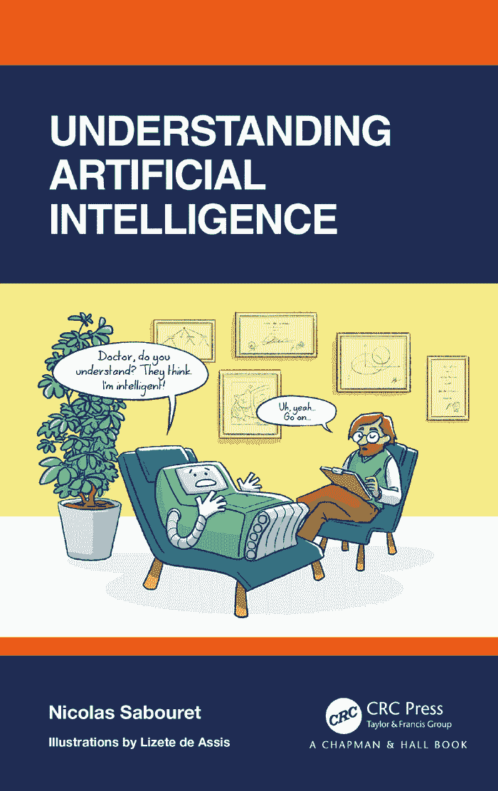

Nicolas Sabouret

插图由 Lizete De Assis 绘制

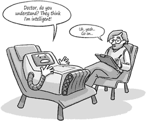


已尽合理努力确保出版的数据和信息可靠，但作者和出版商不承担所有材料的有效性或其使用后果的责任。作者和出版商已尝试追踪本出版物中所有材料的版权持有者，并对未获得出版许可的版权持有者表示歉意。如果本出版物中任何版权材料未被注明，请写信告知我们，以便在未来重印时进行更正。

除美国版权法允许的范围外，本书的任何部分不得以任何电子、机械或其他任何方式（现有或以后发明的方式，包括复印、微缩摄影、录音或在任何信息存储或检索系统中使用）复制、再版、传输或利用，未经出版商书面许可。

如需许可复印或电子使用本书内容，请访问 [www.copyright.com](http://www.copyright.com) 或联系版权清除中心（CCC），地址：222 Rosewood Drive, Danvers, MA 01923，电话：978-750-8400。对于未在 CCC 上提供的作品，请联系 mpkbookspermissions@tandf.co.uk。

*商标声明*：产品或公司名称可能是商标或注册商标，仅用于识别和说明，且不意侵犯任何权利。

ISBN: 978-0-367-53136-2 (平装)

ISBN: 978-0-367-52435-7 (精装)

ISBN: 978-1-003-08062-6 (电子版)

排版采用 Times New Roman 字体

由 MPS Limited, Dehradun 设置排版

*致查克，满怀友谊*。

## 1 什么是人工智能？理解计算机、算法、程序，特别是人工智能程序

计算机科学与计算机

计算机与算法

算法与计算机科学

全能机器

编程程序编程程序

人工智能在此过程中处于何处？

一个会学习的机器？

服从，我说！

注意：一个程序可能隐藏另一个程序！

那么，人工智能是什么？

参考

跟随乌鸦

有一个技巧！

First, it effectively calculates a solution: that’s a good start. Plus, it does it very fast. The program’s complexity is the number of points squared, the same as with Dijkstra’s algorithm, which we used for the GPS. This means the computer can work on graphs with a thousand points before hitting any real difficulty. Not so bad, right? Especially for an AI algorithm that requires less than ten lines of computer code!

Now, with that being said, the solution probably won’t be the best. In certain cases, it can even be very bad.

Imagine we leave from Limoges and have to visit Toulouse, Bordeaux, Marseille, and Nantes before we return to Limoges. With the greedy algorithm, we’re going to go to Bordeaux first (137 miles), then to Toulouse (152 miles), then to Marseille (252 miles), before we go 615 miles in the opposite direction to Nantes, passing through Bordeaux and Toulouse, or through Clermont-Ferrand. If we had done a little thinking, we probably would have gone to Nantes first, which is, admittedly, a little further from Limoges than Bordeaux (186 miles), but then we would have passed through all the other cities in a loop (Nantes, Bordeaux, Toulouse, Marseille), instead of making the same trip twice. Our loop would have been 805 miles instead of almost 1,160 miles!

## COME ON, WE CAN DO BETTER!

The problem with the greedy algorithm is that it doesn’t attempt to do any better than the first path it determines. It’s a real shame because this first solution isn’t necessarily very good, and it might be easy to fix a few mistakes, like going to Nantes and back, which isn’t well positioned on the route。

幸运的是，人工智能研究者拥有更好的方法。要理解它们，我们必须探索一个新的空间。

但先让我们回到我们已经看到的内容：`state` 空间的探索。记住：`state` 空间是可能状态的集合。在 GPS 问题中，我们在这个空间中行走，寻找解决方案。在旅行售货员问题中，情况完全相同：我们的贪婪的售货员会按照“就近选择”原则，从一个点跳到另一个点。

然而，还有一个空间：`solution` 空间。这个概念稍微难以理解。想象一下，你不再关心你经过的城市（即状态），而是关心决定你整个路径的城市列表（即解）。在旅行售货员问题中，任何解都是指你已经访问了所有城市，无论顺序如何。波尔多、图卢兹、马赛、 Nantes 是一个解。马赛、图卢兹、波尔多、 Nantes 是另一个（更好的）解。所有这些解的集合，统称为解空间。

贪婪算法只是匆忙地搜索“任意”解：它选择解空间中的一个单一值。

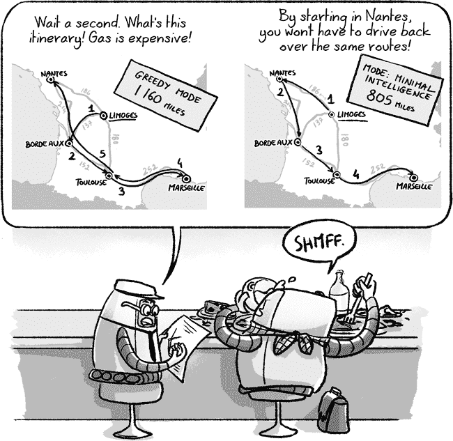

### THE SOLUTION SPACE

旅行售货员问题的难点在于解空间的规模。如果我们要访问 `N` 个城市（除了出发城市），那么第一个城市有 `N` 种选择，下一个有 `N - 1` 种选择，以此类推。总共有

`N × (N − 1) × (N − 2) × ⋯ × 3 × 2 × 1`

种访问所有城市的方案。这对数学家来说很熟悉，被称为 `factorial`，用感叹号表示。因此，我们有 `N!` 种方案来访问 `N` 个城市。换句话说，对于大小为 `N` 的状态空间（如旅行售货员问题），其解空间的大小为 `N!`。

一旦我们开始讨论复杂度和问题规模，`factorial` 函数就失去了魅力。事实上，它的值增长得非常迅速。为了让你有个概念，如果 `N` = 4，我们将有 24 种可能的解；如果 `N` = 7，这就已经是 5,000 种了；如果 `N` = 10，则超过 3 百万！因此，尝试全部方案以决定最佳方案是不可想象的。

### ONE GRAPH CAN CONCEAL ANOTHER!

另一方面，尽管有这么多解，我们仍然可以构建一个图：只需“连接”这些解即可。计算机科学家喜欢这些图，因为他们可以基于图编写大量算法。

要构建这个解空间图，我们需要在解空间中连接两个解，当它们仅因两个城市的位置不同而相同时。例如：

`Limoges` → `Marseille` → `Toulouse` → `Bordeaux` → `Nantes`

将是 `Limoges` → `Bordeaux` → `Toulouse` → `Marseille` → `Nantes` 的邻解。

我们只是在路线中交换了 Bordeaux 和 Marseille 的位置。

在拥有 24 种解（四个城市需要访问）的解空间中，我们将把每个解与六个邻解相连，每个邻解对应于在路线中交换两个城市的可能情况。

现在，我们拥有一个带有邻解的图，情况与状态空间类似。因此，我们可以使用算法来“探索”这个解空间。为什么不呢！

### SPACE EXPLORATION

这一想法被应用于 1986 年由科罗拉多大学研究员 Fred Glover 提出的算法——`Tabu search` 方法。这个有趣的名字来源于在该算法中，我们被禁止重新考虑已经被探索过的任何解：它是禁忌的。该算法不限于旅行售货员问题，它可以用于探索任何人工智能问题的解空间。

使用 Tabu search 方法解决问题的步骤如下：你从一个初始解开始（例如，由贪婪算法得到的解），然后查看其在解空间中的邻解。对于每个邻解，你可以计算其 `cost`——即使用该新解时需要行驶的总里程（如果你在解决旅行售货员问题）。Tabu search 算法然后选择成本最低的邻解。注意：这个解可能比你的初始解**不如**它！它只是在所有邻解中成本最低的那一个。无论它是更好还是更差，你都会把前一个解放入“Tabu”列表。

然后，算法继续：你检查新解的邻解（除非它们已经被禁忌），并选择最佳的一个。接着，你把旧解放入 Tabu 列表，重新开始，以此类推。

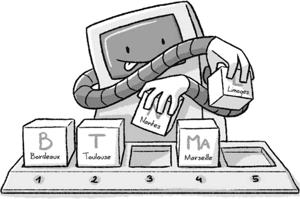

一段时间后，我们需要停止。如果继续下去，我们可能会尝试检查所有的解。数量太多：著名的 `N!`。例如，你说：“好，我只尝试 10,000 种解后停止。”此时，你查看 Tabu 列表中的所有解，从第一个（你最初使用的）到最后一个（你结束时的解），并保留最好的一个。

这就是 Tabu 方法。简单吧？而且这个方法产生相当不错的结果。但如果我们认真思考，我们可以做得更好。为此，我们只需要汇聚多于一个人的努力。

| Darwin 2.0*Understanding How to Explore Space as a Group* || 7 |

| --- | --- |

一种广为人知的人工智能方法用于探索解空间，即使用 `evolutionary algorithms`（进化算法）。该方法由德国研究员 Ingo Rechenberg 在 1965 年发明；然而，人工智能研究者直到 1990 年代末才开始关注它。

### NATURAL SELECTION

进化算法的思想是直接借鉴自然选择理论——查尔斯·达尔文在 1838 年的进化论中提出的原理。达尔文认为，物种的进化取决于环境。适应性更强的个体更有可能生存。生存下来的个体会繁衍后代，传递那些帮助它们生存的特征（更好）。

以一群史前长颈鹿为例：长颈和长腿的长颈鹿会比其他长颈鹿更有优势，因为它们能够吃到非洲草原上生长的金合欢树叶。因此，它们更有可能生育后代，而长颈和长腿是遗传特征，在繁殖时会传递给后代。于是，随着时间的推移，群体中只会留下长颈鹿——即我们今天所知的长颈鹿。

人工智能利用这个思想，构建启发式方法来探索解空间。

我觉得你可能有点困惑。我们要让长颈鹿编程电脑吗？不完全是。我们要编写一个算法，在所有可能的解中找到最佳的一个。从这个意义上说，它和 Tabu 算法类似——但这次，我们不满足于只有一个微不足道的个体在“解空间”图中漫无目的地游荡；我们将使用一整群个体。为此，我们将从草原上的长颈鹿中汲取灵感。

### COMPUTING HERDS

想象一下，如果我们不是长颈鹿，而是一群解——也就是在解空间中有一个点的集合。想象你可以从这群中随机选择两个解，然后从中生成新的解。目前，这可能听起来有点抽象，但我们稍后会更清晰地看到。暂且假设这是可能的。

演化算法的原理如下。我们从我们的群体（即“群体”）中随机选择两个解，并基于这两个点构建新的解。我们不断重复这一过程。初始解的总数随着其他解和从其他解生成的解而增多。

随后，我们消除最弱的解（这是自然选择的硬性法则），从而稍微稀释我们的群体。理论上，新群体的解质量应高于初始群体。初始群体中最好的几个解会保留，而糟糕的解则被消除。同样，在“子解”中，只有最好的才会保留，糟糕的解则被消除。

随后，演化算法在新群体上运行，进行繁殖和选择，以持续改进种群。经过一段时间，我们应只有最优秀的解！

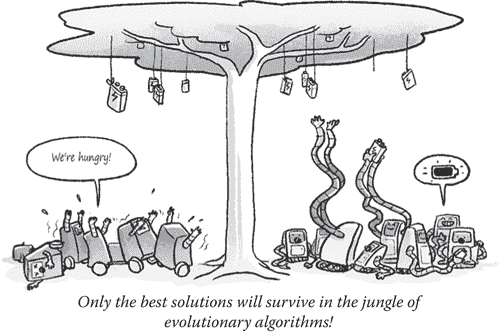

### YOU’VE GOT TO START SOMEWHERE

使用此类算法需要遵循三个步骤：

```
1. 构建初始解集。
```

```
2. 选择成对的解以生成新解。
```

```
3. 消除最弱的解并重复步骤 2。
```

每个步骤都有其自身的困难。第一个困难是创建一个包含大量不同解的群体。如何做到这一点？我们花了一整章时间才理解如何生成一个单一解！

老实说，这取决于具体问题。对于旅行售货员问题，很容易生成大量解：我们只需随机选择一个城市接一个城市即可。 Limoges、Marseille、Bordeaux、Toulouse、Nantes，就完成了！不需要思考。可以编写一个随机生成解的算法如下：

```
Let L be the cluster of cities.
Randomly choose a city in L.
Remove this city from L.
Repeat.
```

它运行非常快：对于包含一百个城市的图（N = 100），我们可以在一千毫秒内生成一千个解！

当然，随机选择的解不一定质量好，恰恰相反，它们很可能完全无用。但这不重要：算法会使它们演化成更好的东西。

### TWO BEAUTIFUL CHILDREN!

记住原则：就像长颈鹿一样，个体（解）会繁殖并生出孩子，只有最优秀的才能在旅行售货员丛林中艰难的自然选择法则下存活。

你可能在想，“解”基本上只是电脑中的数字，怎么能繁殖并产生孩子？为什么不设置一个 eHarmony 供解匹配呢？你是对的。这只是一个示例。我们将随机选择两个解并“混合”它们，就像两个生物体结合 DNA 一样。

让我们看一个例子。假设我们需要访问 15 个城市，我们将它们命名为 A、B、C、D、E、F、G、H、I、J、K、L、M、N、O。现在，随机选择两个解：Dad-solution，其路线为 ABEDCFHGJMNLKIO，以及 Mom-solution，其路线为 DFKNMJOACBEIGLO。

构建“子”解时，我们取 Dad 解中指定顺序的前几个城市，以及 Mom 解中按顺序的后续城市。

我们随机选择初始城市数量。例如，我们决定保留 Dad 的前六个城市：ABEDCF。然后，我们按顺序取 Mom 的城市（排除已访问的）：KNMJOIGLO。这给出以下解：

ABEDCF KNMJOIGLO

这就完成了！这个操作称为 crossover（交叉），也可以写成算法形式：父解是从中取元素放入“子”解的集群。如果算法写得好，它只需要很少的操作，从而可以通过选择父解对来生成大量解。如果我们回到一千个包含一百个城市的解的例子，通过对随机选择的父解一千次应用交叉算法，我们在一千毫秒内得到一千个全新的“子”解！

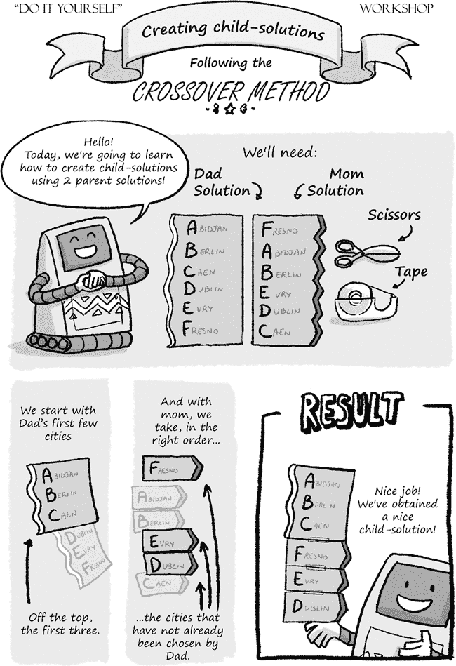

### A LITTLE MORE RANDOMNESS

演化算法也可以使用基因突变，就像在现实生活中一样。有时（随机地），子解中的一个会“突变”，即交换两个城市。这个小操作可以帮助算法更快找到好解，只要这些突变保持罕见。它会生成与父解不一致的解：如果结果灾难性，突变将不会被保留。但如果质量好，突变将在未来世代中对解有益！

演化算法本质上是一种聪明地探索解空间的方法。因为我们的“个体”只是机器中的数字，所以不存在自然选择。当你“混合”两个解来生成新解时，你只是在解空间中选择一个新点，该点共享初始解的特征。

如果你的两个初始解是好的（即相对较短的旅行售货员路径），你有两种可能性。一种是子解的路径不如父解好，此时它将在旅程结束后被消除。另一种可能是子解的路径更好，因为父解的路径帮助缩短了另一条路径，此时我们保留它。这就是你的种群如何进步。

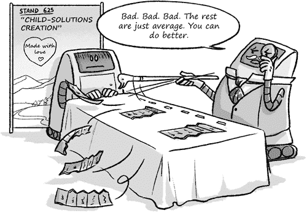

突变本身的行为类似于我们上一章末尾看到的 Tabu search。它允许我们在解空间中探索邻域，寻找旅行售货员的新路径，而不会丢失之前已经计算的所有内容。

研究人员数学上证明，这种算法运行良好。只要你编程正确，并且进行足够多的迭代，你就会得到一个非常好的解！

### SO, WHAT IS THIS GOOD FOR?

与 Tabu search 类似，演化算法是我们称之为 *metaheuristics* 的方法，因为它们在解空间工作，而不是在状态空间。像所有启发式方法一样，它们不寻找最佳解，而是尽可能探索解空间的一小部分，以在可用时间内找到一个“好”解。最终，它们选择的解不过是一种启发式：比如“如果你经过 Nantes、Bordeaux、Toulouse，然后去 Marseille，这不应该太差”。

这些方法的优势在于它们可以用于各种不同的问题，无论解是如何构建的。这使它们非常强大！元启发法广泛用于物流：优化卡车车队的路线、管理空中交通、改善核反应堆的装载……这只是演化算法和元启发法搜索方法的小样本。

还有更多例子，例如 3G 移动网络优化（即在哪里放置天线以确保最佳覆盖），甚至 NASA 工程师开发的自动空天线，它是通过演化算法自动计算的。我们尚未回答的问题是“如何最大化接收？”计算机的答案是这根小而弯曲的铁丝。谁 else 会发明这个，如果不是计算机？

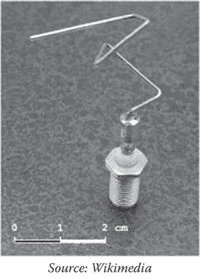

### THIS DOESN’T SOLVE EVERYTHING, HOWEVER


进入`/path/to/xxx`目录，找到`xxx.json`。

在表达式`cvar = avar + bvar`中，加法运算符（`+`）将`avar`与`bvar`相加，得到它们的和`cvar`

在`List.of(arg0, arg1, arg2)`中，`List`接口的工厂方法`of()`接受一系列的元素，返回包含它们的只读列表。

之后我们这样调用`cmd`命令：`cmd arg0 arg1 arg2`。

```
if (condVar > someVal) {console.log("xxx")}
```


人工智能中使用的聚类算法通过启发式方法构建数据分区，使其尽可能符合用户的目标。因此，每个算法都有自己的方法：它使用自己的启发式。

此外，聚类算法在处理非常大的数据量时工作。你可能会失望于以下信息，但我们并不是用算法来对五只动物进行排序。当我们使用人工智能算法时，是因为计算量太大无法手动完成，或是数据量过多。问题的复杂性使得不可能检查所有可能的聚类：可能性太多！

由于需要处理的数据量以及使用启发式方法，几乎不可能得到完美的分类。即使你想要大小相等的类别，也做不到。会有许多物体处于两个类之间的中间状态，你必须把它们放在其中一个位置，而这种选择是有些随意的。每次，算法都会做出并非完全满意的选择。当然，它们并不是真的在“选择”，而是依据程序员设定的规则来尽可能接近目标。

## SO, WHERE’S THE LEARNING IN ALL THIS?

聚类分析方法基于这样一个思想：计算机使用数据来构建一个唯一的决策规则。该计算的结果不仅仅是重新组织已经聚类的对象列表；它随后还能为任何对象分配一个类别。

例如，让我们使用 `k`‑means 算法，它在特征空间中确定点。如果你给系统一个新对象进行分类，计算机会立即通过比较到“均值点”的距离将其放入相应的聚类中。因此，该算法不仅构建了两个类别，还创建了一个用于对同类对象进行分类的计算函数。

这给人一种印象：通过提供的数据，计算机似乎能够自行学会对物体进行分类。这正是计算机科学家常说的 `无监督学习`。

当然，计算机并没有真正“学习”：它仅仅应用了由算法构建的分类规则。该规则的行为就像一个算法一样：我们可以使用它来对新对象进行分类。

## JOY AND GOOD HUMOR!

可以通过无监督的聚类分析让系统“学习”很多东西。例如，系统可以自动识别面部照片中的情感。通过关注面部表情的情感特征，无监督聚类算法能够计算出代表喜悦或愤怒的虚拟点。就像 `k`‑means 算法一样，机器随后可以利用这些点在从未见过的面部上识别情感！在某种意义上，它已经“自行学会”了情感识别。

但要记住，什么都不是凭空发生的。计算机科学家在过程的每一步都发挥了作用：定义要研究的对象特征、选择合适的算法，并确保结果被正确使用。人类告诉机器在提供的数据上执行哪些操作。

机器无法自行找到这些操作，因为它缺乏想象力：它只会执行我们指令它进行的计算。计算机科学家为要聚类的对象编写了距离函数。科学家还决定了对象将如何被聚类。之后，计算机完成所有工作。如果没有计算机，我们的科学家会非常费力才能完成这种分类！

计算机在许多活动中超越人类，包括分类。它能够以远超任何人类的速度处理海量数据。不过，它只能通过遵循算法中提供的指令来实现。

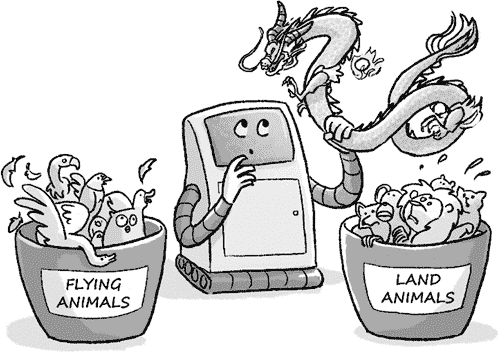

*Taking an AI by the Hand: Understanding That a Good Example Is Often Better Than a Long Explanation* — 10

承认，机器学习的想法有点可怕。我们自然倾向于将机器拟人化，想象它们像小孩子一样能够从周围世界学习并获得对其创造者的真正自主性。事实上并非如此。机器始终受限于我们提供的算法和数据范围之内。

## ASK THE PROGRAM!

要理解机器学习的原理，我们必须回到计算机编程的概念。计算机是能够按照程序处理数据的机器。而程序本身也是以数据的形式提供给计算机的。这里我们可以作出两个观察：

1. 计算机使用数据生成新的数据。

2. 程序本身就是数据。

因此，算法的结果——机器生成的数据——完全可以是一个能够处理新数据的程序。

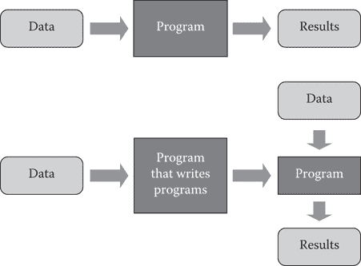

实现该原理的机器学习。它的工作方式类似于：计算机科学家向计算机提供一个计划（数据）以及构建新机器的指令。计算机遵循计划上的指令，得到一个新机器，该机器同样能够处理数据。

## FROM DATA TO PROGRAMS

在计算机科学中，情况比这更微妙。我们并不是真正构建新机器，而是生成新的数据或新的程序，从而以新的方式处理数据。

让我们回到 `k`‑means 算法和无监督分类。计算机对数据进行迭代，计算出 `k` 个均值点。在此过程中，它将数据围绕这 `k` 个点进行分类。现在如果你给它一个从未见过的新对象，它仍然能够根据这 `k` 个点对其进行分类。

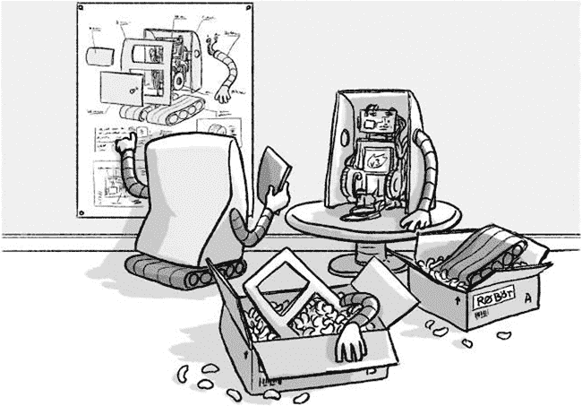

一切看起来像是该算法“构建”了一个基于数据的分类程序。这个新程序能够处理同类型的任何新数据。

然而，机器本身不会自行学习。为了实现这一点，计算机科学家必须首先编写学习程序——也就是说，所有能让计算机利用数据生成新人工智能系统的指令。计算机无法自行发明新的人工智能程序：它仅遵循人类提供的程序。

## AN EXAMPLE IS BETTER THAN A LONG EXPLANATION

当问题过于复杂，无法通过人工编写的启发式规则来解决时，这种编程技术在人工智能领域被广泛使用。以语音命令系统为例，如 Apple 的 Siri、Google Home 或 Amazon 的 Alexa。它们能够将短语（“打开灯光”“现在几点了”）与特定操作关联起来：在网络上查找定义、查询时间、打开灯光等。

正如我们在 第 2 章 看到的，这未必与理解短语的含义有关。这仅仅是将词语与命令进行关联的问题。最早的这类系统是由 Terry Winograd 在 1960 年代后期完全手动编写的。其思想是向机器发出指令，以移动形状各异的物体。

这个难以发音的程序名为`Shrdlu`。要让它运行，Winograd 必须预测将被使用的词汇、给机器下达指令的各种方式等，这既繁琐又耗时。

机器学习的思想是编写一段程序，使其能够自动在命令和需要执行的操作之间建立关联。为实现这一目标，研究人员会聚集巨大的数据库，通常包含数十万条命令示例。对于数据库中的每句话，需要告诉机器期望得到的具体结果。例如：

```
what time is it ›→ tell the time
```

学习算法必须构建一个能够将每种输入值对应的正确答案关联起来的系统。换言之，我们希望它“学会”根据示例中提供的结果复制答案。

该技术被称为 `supervised` learning。

## THE ADVENTURE BEGINS

`supervised` learning 的第一批算法可以追溯到 1950 年代。

当时，Arthur Samuel 正在使用 `minimax` 算法开发一个棋类人工智能程序。他的启发式规则基于棋子和王的数量以及棋子在棋盘上的移动。然而，他发现机器可以记住已下的棋步，并将其与最终结果（胜或负）关联起来。随后，他编写了一个新的启发式规则，能够在评估每一步时考虑先前游戏或已记录的专业游戏的“经验”。通过数据训练，他的系统得以提升启发式规则的质量。

与此同时，尽管方法和目标完全不同，Frank Rosenblatt 提出了一种学习算法，能够在图像中识别三角形。他向机器提供了数百个三角形示例，以校准一个计算函数，使其能够判断一个形状是否为三角形。

这两个 AI 程序很可能是最早使用 `supervised` learning 算法的项目。

## MUCH ADO ABOUT NOTHING?

“训练机器执行任务”而非“手动编写如何执行任务”的思想并不新鲜。起初，它仅局限于少数应用。当时的机器缺乏足够数据，无法在所有场景中使用 `supervised` learning 算法。

如今，计算机能够响应自然语言指令、转录手写内容、检测物理系统中的错误、推荐阅读材料，甚至在图片中区分人脸与猫。这一切得以实现，得益于数据库中海量标记数据——这些数据向机器传达：“看，在这张图片里有一只猫！”


你可能会说：“辨认猫的算法有什么用处？”你可能会惊讶地发现，小猫在网络上嬉戏或摆姿势的视频是最受观看的内容之一。所以，你永远不知道一个程序有多有用！

## FROM IMAGE TO DATA

需要理解的是，计算机并不“解读”数据。就像图灵测试一样，它只能看到符号——具体而言，内存单元中存储的二进制数字。对它而言，这些数字可以是可爱小猫的图片，也可以是电话号码列表。如果你给机器一张巴黎地图，并使用动物识别算法，它会轻松地识别出猫或青蛙！

因此，我们必须向学习程序说明数据的特征，就像在无监督分类算法中所做的那样。这样，只需将原始数据（小猫照片、电话号码或巴黎地图）转换为 `variables`，程序就能学习规则。

## HOW ABOUT WE TAKE THE TRAIN?

学习算法所依赖的 `variables` 类型有时会引发激烈争论。1970 年代末，波兰研究者 Ryszard Michalski 编写了一个使用所谓的 `symbolic` 变量的学习算法——即结构良好的逻辑公式。他使用的数据模型名为`VL[21]`，属于 `description logic`。这类计算机语言在 1980 年代和 1990 年代极为流行，它们允许我们描述变量或决策规则，例如：

```
The animals with triangle-shaped ears are cats
```

这可以用`VL[21]` 的以下公式表达：

```
∃ ear[shape(ear)= triangle] → cat
```

Michalski 使用该语言编写人工智能程序，能够构建逻辑规则。这真是革命性！该系统不再像 `k`-means 那样在向量空间中定位点，而是编写结构良好的公式，代表类似人类的推理过程。

为了展示这一成果，Michalski 编程了一个能够识别一系列火车的系统。它不如小猫有趣，但也证明了互联网出现之前，研究者们并未缺乏想象力！

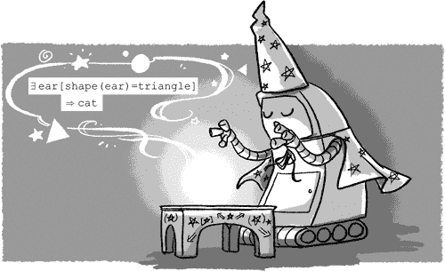

## IT’S LOGIC!

Michalski 的火车由以下特征定义：车厢数量、车厢大小、是否有盖（有盖或无盖）等。研究者向程序提供火车东行或西行的示例，并描述其特征。例如：

*有一列向东行驶的火车，包含三节车厢。第一节车厢体积小且有敞篷，第二节是机车，第三节体积小且有封闭篷。*

显然，这些信息在逻辑语言`VL[21]` 中通过 ∃、[ ] 等符号表达。

Michalski 的程序会自动从示例中学习形如“如果存在如此多的特征，则火车向东行驶（或向西行驶）”的规则。换句话说，当我们将算法应用于略有不同的领域时，它会自动从示例中学习决策规则，从而能够识别物体，这与通过猫耳朵的规则类似：

```
∃ ear[shape(ear) = triangle] → cat
```

为了获得这个结果，该算法按顺序处理示例。在每一步中，它都尝试基于前面的示例构建最广泛的规则。这要感谢米哈尔斯基所使用的描述逻辑。该语言不仅允许我们描述变量的值（例如三角形的耳朵）和决策公式（如果有三角形，则它是猫），还允许描述公式本身的推理规则。例如，当有多辆特征相似的汽车时，米哈尔斯基会让机器应用一条规则，将这些示例归类在一起。

通过使用这些逻辑规则，算法逐步构建出一个能够正确处理所有提供给它的示例的决策规则。

## TELL ME WHAT YOU READ, AND I’LL TELL YOU WHO YOU ARE

逻辑规则是米哈尔斯基算法的核心。它们使我们能够构建这些最终的决策规则，并且全部都是研究者“手动”定义的。正如人工智能通常的情况一样，机器会得到一定的“人类专业知识”。在这里，这种专业知识直接影响学习过程：如果你想学习这个例子，就需要对该示例进行相应的操作以构建你的决策公式。

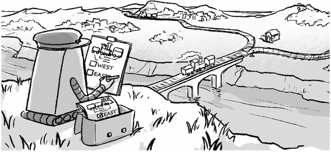

不过，事实仍然是，计算机会自动在计算机语言（这里是描述逻辑`VL[21]`）中构建决策规则。正如我们在本章开头使用的“计划”示例一样，计算机构建了一个基于示例的程序。

所有这些算法的力量都源于其结果是一组可理解的决策规则，只要你使用`VL[21]` 语言。在构建方式如上时，系统（即学习得到的程序）可以解释它每一个决定的原因！

这种方法在推荐系统中尤其有趣。让我们以购书为例。`k`‑means 算法可能会根据距离测量推荐一本与你已选书相似的书籍，但它无法解释为什么这本书是一个好的选择。相反，能够学习书籍的所有特征并将它们组织成结构良好的公式的系统，能够告诉你：“实际上，你喜欢 1980 年代的科幻书籍。” 这不就是很酷吗？

## FROM SYMBOLIC TO NUMERIC

然而，这种受监督的学习方式存在一定局限性。最大的局限在于，当你向系统提供输入时，你需要已经具备某种象征性表示的数据（例如“汽车很大”、“第二辆车有敞篷顶”等）。这有点像向盲人描述一个物体：你必须用大量文字细节来描述，让对方在没有看到的情况下推断出视觉属性。这件事很快变得繁琐，老实说，没有人会乐意用这种方式描述小猫的照片。

第二个问题更为深刻。随着示例数量的增加，每一个新案例都会让机器在最终决策规则上变得稍微复杂一点。约翰·麦卡锡将这种困难称为 *qualification problem*（资格问题）。想象你已经知道“汽车是四轮并配有方向盘的车辆”。如果你遇到一辆只有三轮或使用控制杆代替方向盘的汽车，你就必须在决策规则中加入这些特殊情况。每一个特殊情况都使得规则集越来越复杂……也越来越难以理解！

在 1990 年代，人工智能研究者因此转向了其他方法。机器不再直接操作决策规则，而是只操作变量来调整程序，类似于`k`‑means 算法。这种学习方式被称为 *machine learning*。

*Learning to Count: Understanding What Statistical Learning Is* — 11

受监督学习的目标是构建逻辑系统（或其他模型）中的程序；而统计机器学习仅操作变量之间的关联，产生一组数值作为“程序”，以便做出决策，例如`k`‑means 中的聚类中心点。

与`k`‑means 不同，受监督学习不要求机器对对象进行聚类。它为每个输入定义期望的结果。因此，系统并不计算所有类别（或要给出的答案）；这些类别在示例数据库中已经描述。

为了教机器识别猫的照片，我们必须给它看几张照片，并告诉它每张照片是否包含猫。

## NEW AND OLD ALIKE?

受监督机器学习的统计方法并非在 1990 年代才被发明：上世纪 50 年代末为棋类或三角形游戏开发的第一批受监督学习模型已经基于此原理运行，它们计算输入数值与期望结果之间的关联。

象征性人工智能在 1980 年之前占据了人工智能研究的主导地位，原因有两点。

第一，正如我们所见，象征性学习产生可解释的系统，因为它们使用逻辑语言进行描述。第二，象征性学习在数据量相对较少时表现良好，而 1970 年代并没有像今天那样庞大的数据库。因此，使用统计机器学习方法的难度并不值得。

多年来计算机科学的进步产生了海量数值数据，并使我们能够处理更多变量，超越了象征模型的限制。

## RIDDLE ME THIS

要理解受监督机器学习算法的工作原理，我们可以使用另一个游戏作为例子：“`Akinator`，网络妖精”，由两位法国程序员于 2007 年开发。它是“Guess Who”（猜谁）游戏的变体，计算机需要猜出用户在想哪个角色。

为此，用户需要回答关于角色的问题，例如 “你的角色是男性吗？”可能的回答有 “yes”（是）， “no”（否）， “mostly yes”（大概是）， “mostly no”（大概不是），以及 “I don’t know”（不知道）。随着问题的逐一提出，系统最终会确定你所思考的那个人。

试试看：该软件既可以在线使用，也有手机版！这真的很令人印象深刻。

## TREES AGAIN

为了正确猜出，`Akinator` 使用 *decision tree*（决策树），这是一种数学工具，允许将选择编程进去。最终的决定（即玩家可能在想的角色）位于树枝的叶子节点。为了到达它们，程序从根节点开始沿着分支向下走。每个分支点代表基于变量值的决策。在`Akinator` 中，这些变量对应于它可以提出的问题：角色是真实的吗？角色是男性吗？角色是否仍在世？以此类推。这些问题由游戏的创作者选定。

决策树有点像程序：你提供一组描述问题的变量（在我们的例子中，角色的属性值），系统从分支点到分支点地逐步寻找“正确”的决定（即角色的名称）。

为了实现这一点，首先我们需要构建决策树。这项工作繁琐且无法人工完成。

## A BIT OF PREDICTION

1986 年，Ross Quinlan 提出了历史性的算法：`ID3`。该受监督学习算法能够自动利用数据库中的示例构建决策树。

每个示例都由一组属性描述。`ID3` 然后计算分支的值，使得决策树能够正确预测数据库中所有示例的结果。该算法不仅仅将值与结果关联：分支点的指令被计算为尽可能在数据库中将示例聚集在一起。

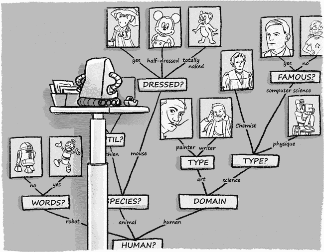

假设我们有一个非常基础的医疗诊断数据库。我们的数据库记录每个人的体温、喉咙颜色以及状态（生病或健康）。通过使用`ID3` 算法，我们可以构建一个决策树来判断一个人是否生病或健康。该算法会确定，所有体温超过 100.4°F 的人都是生病的，无论其喉咙颜色或具体体温数值（如 100.8°F、102.37°F 等）。通过这种方式，它们可以在决策树的同一分支中聚合在一起。相反，当体温较低时，只有喉咙呈红色的人才是生病的。于是我们可以构建如下的决策树：

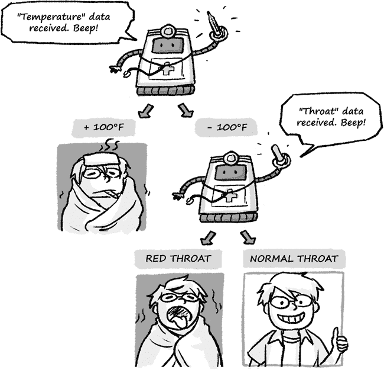

这样的决策树可以用于诊断未在数据库中的患者。因此，即使我们输入一个体温为 99.1°F 且喉咙正常的个体，即使数据库中没有完全匹配这两个数值的示例，算法仍然能够确认该个体不患病！

## LOTS OF EXAMPLES, LOTS OF VARIABLES

你可能更适合咨询医生，而不是依赖这种预测，因为这套人工智能程序仅基于我们提供的数据和变量进行工作。仅有两个变量时，我们无法期望获得非常准确的诊断！

`ID3` 算法及其后继者，尤其是`C4.5` 算法，在 2000 年代是使用最广泛的学习算法之一。它们不仅能够构建紧凑的树结构，还能在处理数据库中的示例时进行特殊处理。

为了实现这一点，在树的每一层，Quinlan 算法会计算哪个变量能够最好地将所给出的示例分离开来。对于`Akinator`，这意味着选择最相关的问题，以便快速得到正确答案。对于医生，这意味着找到变量及其取值范围，使其能够聚合最多的示例。为此，算法使用数学函数测量变量的 *数据增益*。当然，我们需要为每个变量以及所有示例计算这个值。即使有数千个示例和大量变量，计算仍然相对快速。


在计算时，算法也会考虑一些特殊情况。如果示例的属性无法进行推广，因为其值过于具体，则会将其排除在决策树之外。随后，算法会评估最终决策程序产生的每个结果的可靠性。因此，它能够告诉你：“体温 99.1°F 且喉咙正常，你不患病的概率为 82%。”这不正是很令人印象深刻吗？

## TOO MUCH, IT’S TOO MUCH!

这些算法的弱点在于构建“良好”分类所需的数据量。变量越多，所需的示例数量就越多。

你正怀疑我们通常不会仅用两三个变量来编写 AI 程序。对于每一条数据，通常有数十个特征，甚至更多！要像 Siri 那样解释自然语言命令，我们需要数千个维度。

因此，构建一个良好学习算法所需的示例数量可能让人望而却步。即便是自 1990 年代以来构建的庞大数据库，结果也往往达不到要求。该算法无法计算普遍规则。

于是，我们需要另一种方法。

## THE KITTIES RETURN

我们需要的另一种方法自 1963 年起就存在，即支持向量机（SVM），由 Vladimir Vapnik 和 Alexey Chervonenkis 提出。

这两位俄罗斯研究人员在过去近 30 年里研究了从统计角度构建类别的问题。两位数学家关注 *数据分布*，因此他们提出一种能够对数据进行分类的算法，类似于 ID3，但需要的示例更少。其核心思想是“分离”数据，使得在每条分割“线”的两侧拥有尽可能大的边际（margin）。

为了理解这一原理，想象我们有一个能够识别猫图片的系统。我们仅考虑两个维度：图片中三角形的数量（猫耳朵的特征）和圆形的数量。

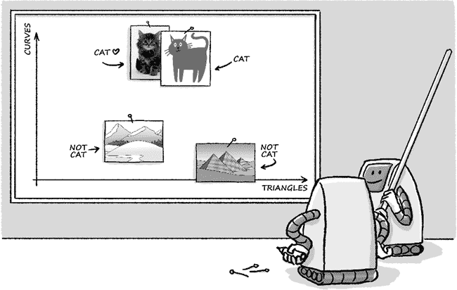

我们向算法提供以下四张图片：一张猫照片、一张猫素描、一张山景带有山丘的图、以及金字塔的视图。

每张图片的垂直位置越高，表示其圆形数量越多；每张图片的水平位置越右，表示其三角形数量越多。

显然，仅凭这两个维度就无法单独构建能够识别图片的系统。但这个简单的例子让我们理解 SVM 的工作原理。

## THE MATHEMATICS OF ARTIFICIAL INTELLIGENCE

SVM 的第一步是在学习阶段分析系统收到的示例，并绘制一条直线将猫图片与其他图片分开。理论上这很容易，但在实践中，用一条直线在空间中分离点有许多种方式，正如我们在图中看到的两个机器人所展示的那样。

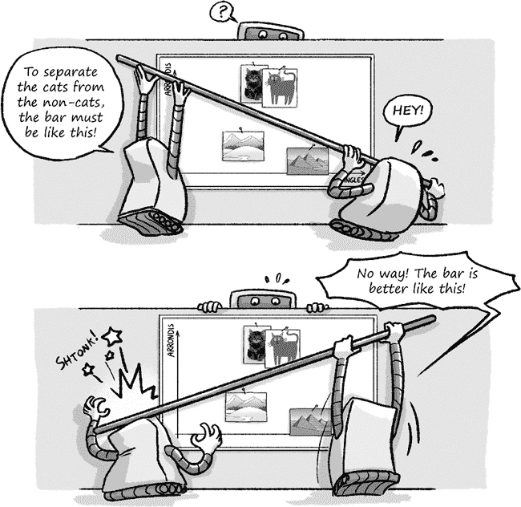

左侧机器人提出的第一种分离方式：分割线非常靠近猫照片和金字塔照片，而另外两张图则离得较远。右侧机器人提出的第二种方式：分割线非常靠近山景图和猫素描，中间还有许多其他可能的位置。

我们首先可以看到，这两种“极端”位置各自都存在问题。我们的目标不是单纯将图片贴在板子上分开，而是构建一个能够在未知分类的情况下，对新图片进行准确分类的程序。如果选择靠近照片的那条线，风险很高：一张非常相似的猫照片若略有 fewer 曲线或三角形，就会被划到另一侧，从而被误判为非猫类。同样，金字塔图片若略有更多曲线，也会被误认为是猫。

相反，右侧机器人提出的靠近猫素描的分离方式同样容易出错：它会导致算法在类似的猫素描或略有不同特征的图片上犯错。最终，Vapnik 提出选择能够提供最大边际的解——即在分割线两侧都保持尽可能大的距离，使两组数据尽可能远离分界线。通过数学计算，算法找到具有最大边际的直线，从而提高对将来图片的正确分类概率。该算法被称为 **最优边际分离器**。

在第三个机器人手持的图中，这意味着在分离线两侧形成最宽的灰色条带。

## TOO MUCH CLASS!

通过计算，我们可以将维度空间划分为两部分：猫的一方和非猫的另一方（在我们的例子中）。

一旦算法利用示例将两边分开，它就能定义一个决策系统。该系统能够根据其属性将任何描述的对象分类为“猫”或“非猫”类别，即使它不在学习示例中。

这项计算即使数据很少也能工作：算法系统地构建最优边界，无论提供了多少维度和示例。当然，示例越多，分离边界越可靠。

因此，这种学习算法特别有吸引力。即使它需要复杂的计算来寻找边界，它仍然能够处理维度很多且示例相对较少的问题。相比之下，决策树算法并非如此。

## KEEP STRAIGHT

然而，即使在 1990 年代，也几乎没有人认真思考这种方法。

SVM 算法确实有一个严重的限制：它建立的两个簇之间的分离必然是 *线性* 的（数学意义上的线性），换言之，是一条直线。

让我们考虑下面的图片：


图中有许多曲线和三角形，意味着它在我们的维度空间的右上方——即靠近猫的区域。在那里，效果不佳：要将这张图从猫组中分离出来，需要一条曲线——即 *非线性* 分离器。然而，SVM 算法无法生成这种分离器，这很令人沮丧！

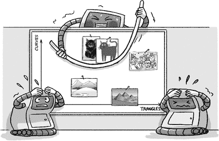

## THE SVM STRIKES BACK

然而，1992 年，Vladimir Vapnik、Bernhard Boser 和 Isabelle Guyon 撰写了一篇将机器学习彻底改变的文章。他们使用一种称为“核函数技巧”的数学变换，证明了可以使用 SVM 实现非线性分类。

*核* 是衡量特征空间中两个点相似性的函数。这类似于 `k`‑means 算法中使用的距离函数。SVM 中的 *核* 使我们能够计算边界（margin）以及因此的分离线。

Vapnik 及其同事的核心思想是：在核函数中加入虚构特征，迫使算法在更高维度的空间中工作。这类似于一些物理学家对我们说：“好吧，三维显然不够。根据我们的计算，我们假设空间有八维，看看结果如何。”

这个 *核函数技巧* 使我们摆脱了 SVM 的局限性：算法仍然计算线性的分界线，但在回到原始维度时，它已不再是线性的。

想象一下这很难吗？想象一下我们的物理学家。多年来，他们用直线画三角形。然后有一天，他们发现地球是圆的，于是他们在纸上绘制地球时，所有的三角形都被扭曲了。这大约就是 *核函数技巧* 的概念。

## INTELLIGENT, DID YOU SAY INTELLIGENT?

自 21 世纪初以来，SVM 在计算领域取得了巨大的成功。它对识别猫图片特别有效，即使出现诸如“耳朵竖起的狼”或“吉萨金字塔”（别笑，三角形形状很容易欺骗计算机）等花招。认真地说，SVM 对众多其他应用特别有用，从自然语言理解（人类语言）开始。

处理自然语言是人工智能的困难问题，也是最具野心的解决目标之一。语言是极其复杂的现象，单凭象征性规则无法描述。一旦离开非常具体的框架，词汇稍微真实一点，规则便会数量暴增。

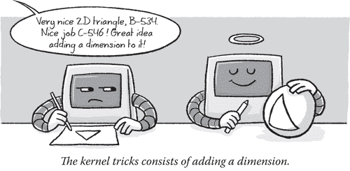

决策树也无法使用：分类算法需要大量示例来覆盖每个维度。有时维度的数量甚至与单词数量相当，甚至达到数万！SVM 使我们能够绕过这一限制，为拥有大量变量和大量取值的对象构建分类。这不是魔法，但要实现它，我们需要大量数据——正例（这张图片包含猫）和负例（这张图片不包含猫）。

如果 Google 的应用目前在文档搜索、图像识别和机器翻译方面表现最佳，这仅仅是因为它们拥有竞争对手所没有的海量数据！试想，为每一条数据标记（这是猫，这不是猫）构建数据库需要投入多少时间和精力。得益于我们每分钟在其服务器上进行的数十亿次搜索，Google 研究人员可以免费获取这些数据。你必须承认，这值得！

## CAREFUL, DON’T SWALLOW THE KERNEL!

然而，就像所有 AI 技术一样，SVM 也有弱点。要运行良好，SVM 不仅需要合适的数据集，还需要一个恰当的核函数。这意味着计算机科学家不仅要定义特征（维度），还要定义核函数内部的行为。这有点像在国际象棋的最小最大（minimax）方法中设置启发式评估函数：如果不告诉机器如何评估棋盘，它就不会下好棋。

有一些经典的核函数非常适合不同类型的问题，它们易于控制且通常产生良好结果。但当你想提升 AI 的性能时，仅仅提供更多示例是不够的；你必须“热锻”核函数，即深入其内部。

要理解 SVM 的工作原理并能够操作这些算法，需要多年的数学和计算机科学高级学习。研究人员为特定问题为每个核函数花费多年时间。然而，自 SVM 问世以来，人工智能图像处理和自然语言理解这两大任务的进步却异常迅速。

在本世纪初，机器学习出现了新的革命：人工神经网络。

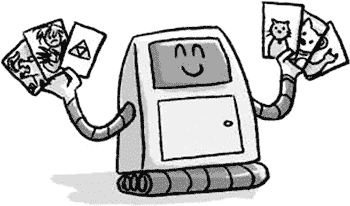

| Learning to Read *Understanding What a Neural Network Is* | 12 |
| --- | --- |

## DRAW ME A NEURON

人工神经元并不像人类神经元。它只是一个基于数字的计算操作。计算结果依赖于若干神经元输入 *参数*。

让我们更仔细地观察一下。

首先，神经元的输入是一个数字列表，通常是二进制（0 或 1）。每个数字都乘以一个系数，称为 `weight`（权重），第一步计算是将所有结果相加。数学家称之为 *weighted sum*（加权和）。

第二步是将这个和与一个值，称为 `bias` 进行比较。如果和大于该值，神经元的输出为 1。如果情况如此，我们说该神经元“激活”。否则，它的输出为 0。注意，然而并没有物体或光。这仅仅是一个产生特定结果的计算。

`weight` 和 `bias` 是神经元的参数。它们使我们能够控制它的工作方式。

例如，让我们看下面的“神经元”。我们标注了输入、`weight` 和 `bias`。

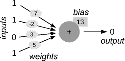

在这个例子中，神经元计算出的和为：

`1×7 + 1×(-2) + 0×3 + 1×5 = 10`

结果（10）小于 `bias`（13）。因此，神经元的输出为 0（因此我们说它仍然“关闭”）。这是计算的结果。

作为对比，下面是一张来自百科全书的人类神经元示意图。你必须承认，这完全不同！

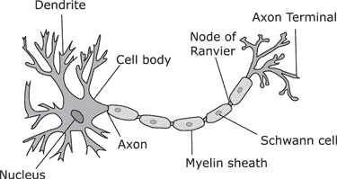

## MORE TRIANGLES

人工神经网络是一种算法，它在数据上执行这种“神经”计算。

最早的网络是在 1950 年代中期编程的，目的是模拟人类神经元，正如 Hebb 的理论所示。正是通过这种方式，“神经”一词开始用来描述这种计算。然而，人工神经网络真正起步于 1957 年由 Frank Rosenblatt 发明的 *perceptron* 算法。

通过抓住人工神经元的思想，Rosenblatt 编写了一个能够学习识别黑白三角形图片的算法。使感知器独特的地方在于，计算被组织成连续的“神经元层”，如下面的图示：

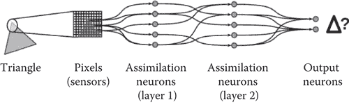

在图的最左侧，传感器将图片转换为数字：每个 `pixel`^(1) 要么为 0（关闭）要么为 1（开启），在我们的绘图中呈灰色。Rosenblatt 用于实验的机器分辨率为 400 像素（20 × 20），相较于当今的照片显得可笑地小。感知器的输入因此是 400 个数字（0 或 1），对应于图片的像素。

感知器的第一层由几百个神经元组成，每个神经元使用这些数字计算不同的结果。每个神经元都有自己的 `weight` 和 `bias`，使得结果各不相同。从第一层计算得到的几百个数字，要么是 0 要么是 1。对 Rosenblatt 而言，这一操作是 *assimilation*，而这第一层计算则是“assimilation layer”。

随后，这些结果被送入第二层输入层。再次，数百个不同的计算产生数百个结果，要么是 0 要么是 1。我们可以继续这样下去很长时间，但 Rosenblatt 在 1958 年发表于 *Psychological Review* 的文章中提出，只需在两层“assimilation layer”之后即可停止。

第三且最后一层仅包含一个神经元。它取前一层计算得到的数字，运行“神经”计算以得到 0 或 1。这个小游戏的目标是：当图片包含三角形时输出 1，否则输出 0。

## JUST A LITTLE FINE TUNING

不幸的是，事情并非如此简单：真正的难点在于为每个参数和 `bias` 找到合适的值。这就像一台拥有数百万旋钮的巨型调音台，每个旋钮都需要调到恰当的位置。

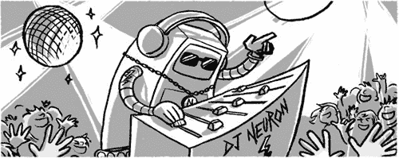

对于每个神经元，输入的数量决定了它拥有的旋钮数量。想象一下，我们的感知器的第一层包含 1,000 个神经元，这意味着仅第一层就有 400,000 个参数需要调节，每个参数都可以取任意值。我们不可能靠运气碰巧找到正确的配置。

正是在此，有监督学习（supervised learning）登场。

## A LONG LEARNING PROCESS

学习算法会自动计算出能够给出正确答案的参数值：当提供的图片是三角形时输出 1，否则输出 0。

初始时，所有参数均设为 0。对于每个示例，网络会计算出输出：要么激活“三角形”神经元，要么不激活。

如果答案正确（例如，当给出的图片确实是三角形时，三角形神经元会激活），则无需做任何修改。相反，如果计算错误，我们需要调整 `weight` 和 `bias`。为此，我们会对所有用于计算错误输出的参数加 1 或减 1。

具体来说，如果网络错误地回答“是”，即使我们向机器展示了一个圆形物体，我们仍会检查所有导致该输出的神经元。然后，我们将所有输入为 1 的 `weight` 减少 1。对于输入为 0 的 `weight`，我们保持不变，因为它们未影响神经元的输出。

让我们回到我们四值的例子：

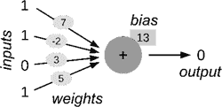

无论第三个 `weight` 的值如何，总和始终为 10。当输入为 0 时，第三个 `weight` 不参与计算。

因此，我们会降低神经网络的 `weight`，同时对每个激活的神经元的 `bias` 加 1，使其在给定数值下更难激活。目的是让下一层的最终神经元在再次输入相同图片时不再激活。

相反，如果网络在被输入三角形时回答“否”，我们需要提高那些非零输入的 `weight`，并降低未激活神经元的 `bias`，以减小它们对输出的过滤作用。

现在，我们对数据库中的每个示例都进行相同的调整（向左或向右移动滑块 1 位），不必手动完成。`weight` 只是计算机中的数字，算法会自行在数千个已记忆的示例中逐一进行计算。经过足够多的示例，运气好的话，旋钮会处于能够识别三角形、猫或其他我们教它的事物的位置。

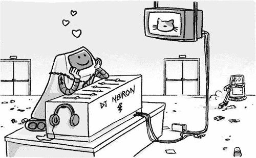

## WHERE DID MY BRAIN GO?

Rosenblatt 的机器使用了不到一千个“神经元”，但即便如此，每个示例仍需进行数十万次计算。尽管如此，该算法足够通用，能够解决许多人工智能问题，且对三角形的识别效果非常有希望。Rosenblatt 坚信感知器最终能够学习、做出决策，并翻译成外语。

然而，这种兴奋并未持续。1969 年，两位著名的研究者出版了一本书，使这类研究戛然而止。他们正是 Marvin Minsky，人工智能之父，我们已经讨论过，以及 Seymour Papert，计算机科学另一大人物，因贡献 Logo 语言而受到我们的感谢。

在他们的书中，这两位权威人士描述了感知器的优势与局限。其中之一是他们证明，感知器无法解决简单的问题，即前一章提到的著名的“非线性问题”。换句话说，一个拥有两个输入的神经元无法被调节为仅在一个输入为 1 而另一个输入为 0 时才激活——这正是所谓的“异或（XOR）问题”。

事实确实如此：单一的“神经”计算本身无法计算非线性函数……但通过像 Rosenblatt 所提议的那样层叠神经元，即使只有一层“assimilation layer”，也可以克服这一限制，计算几乎任意函数。事实上，Rosenblatt 的三角形识别问题是非线性的，正是通过这种神经模型得到解决。

不幸的是，许多研究人员误解了 Minsky 和 Papert 的书籍。大量科学文章中随意引用了“或”示例，导致许多人对感知机持怀疑态度。尽管事实上，到 1972 年，几本科学期刊已展示了如何使用两层感知机解决“或”问题。遗憾的是，直到又过十年，人们才重新对人工神经网络产生兴趣！

## ONE MORE LAYER!

神经网络最终在 20 世纪 80 年代初期重新走红。正如科学中常见的那样，当理论逐渐淡出记忆时，它最终被重新发明。物理学家 John Joseph Hopfield 于 1982 年重新发现了神经网络。他提出了一个新模型，最终与 Rosenblatt 的感知机并不大相径庭，为该领域注入了新的活力。

1986 年，心理学家 David Rumelhart 以及计算机科学家 Geoffrey Hinton 和 Ronald Williams 提出了`back-propagation`的概念，这是一种受 1960 年代算法启发的新学习算法，用于调整机械控制器的参数。通过一些计算，该算法确定哪些参数对网络的正确或错误答案贡献最大。随后，它会更激进地调整这些参数的权重和偏置，而对贡献“较少”的参数则调整较为温和。

通过这种方式，算法能够更快速地找到正确的参数值。

## NETWORK SUCCESS

得益于`back-propagation`，人工神经网络取得了惊人的进展！它们迅速被应用于多个领域，用于自动化分类任务、控制机器人、预测市场变化、模拟液压系统的工作方式等。

我们日常生活中最常见的应用可能是自动字符识别，它使银行能够验证支票金额，或使邮局能够按邮编分类邮件。大多数情况下，所使用的机器是基于单层感知机和`back-propagation`算法编程的。

直到 20 世纪 90 年代中期，神经网络依然风靡一时。但它们仍然难以操作。要为特定任务配置神经网络需要多年的训练。研究人员常常通过试错来学习，并必须运用全部专业知识来确定输入层所需的神经元数量。你需要有足够的神经元来计算非线性函数，但不能太多！

事实上，每增加一个神经元，机器需要进行的计算量就会增加。如果你构建一个包含一千个神经元的输入层，每个神经元接收一千个输入，那么就需要进行一百万次加法运算以及同样数量的乘法运算。算法的一次迭代只需一秒，但要在数百万个示例上重复，以确定权重。

## ONE MORE SMALL BREAK


正如我们所见，神经网络在训练正确时需要大量的计算。这也是 Vapnik 的 SVM（支持向量机，前一章已见）在 90 年代取代神经网络的原因。由于 SVM 的操作更为简单，它们在分类任务以及大多数监督学习问题上能够更快速地获得更好结果。相比之下，神经网络受限于计算机的处理能力。

然而，这一切将在 2000 年代末发生改变，随着一种新的计算工具的出现。

1 在计算机中，图像被分解为称为 `pixels` 的微小点。要理解像素是什么，只需把脸贴近电视屏幕或海报观察。你会看到微小的有色点，从远处看，它们共同构成图像。电话、电视、计算机屏幕和网络图像都由 `resolution` 描述，表示像素的数量。这指示图像的质量。

| Learning as You Draw*Understanding What Deep Learning Is* || 13 |

| --- | --- |

在 2010 年代中期，一种新的计算方式出现：图形处理单元（GPU）计算。这在机器学习领域掀起了真正的革命。

## ARE VIDEO GAMES BAD FOR YOUR HEALTH?

计算机由众多电子组件组成：处理器（CPU）负责计算，内存存储数据，同时还有键盘、屏幕、鼠标、硬盘等。所有这些组件都使用二进制数进行计算。因此，你屏幕上显示的图像是计算机通过运算决定哪些像素该亮哪些不该亮的结果。

当你浏览网页或在平板上工作时，显示屏所需的操作很少：所有计算均可由计算机的处理器完成。但当你玩视频游戏时，计算机必须不断处理新图像以显示它们，并将这项工作委派给特定组件：图形卡。

图形卡是视频游戏主机的关键组件，同样常见于个人电脑。每一代新品提供更高的图像质量和更佳的游戏体验：正是图形卡实现了这一点。这些组件的性能自 80 年代以来持续提升，得益于视频游戏市场的强大经济影响。

## PARALLEL COMPUTING

图形卡由数百（甚至数千）个小型处理器组成：“图形处理单元”或 GPU。这些处理器的计算能力远低于主处理器，但它们“并行”工作——即同时工作。

想象你在打网球。黄色的球必须在屏幕上每秒显示 60 次。为了确定屏幕上哪些像素该涂黄，图形卡需要每 16 毫秒计算球的位置及其相对大小。这通过对矩阵和向量等数学对象进行相对快速的计算来完成。简单来说，这相当于在计算机内存中对数字进行反复的加法和乘法运算。

数千个处理单元同时对图像的百万像素进行这些操作，从而使显示能够极快更新。这之所以可能，是因为所有针对像素的微小计算可以相互独立进行。你无需知道第一个像素的结果才能计算其邻居。计算机科学家称之为 `parallel processing`。

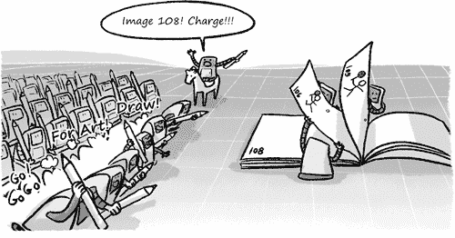

## THE RETURN OF THE NEURAL NETWORKS

在 2010 年代初期，AI 研究人员开始关注图形卡，这些卡最初是为视频游戏和电影设计的。只需几百欧元，即可获得数千个并行计算单元。虽然这些小处理器只执行非常简单的计算，但它们同时执行，这极大提升了速度！

一些 AI 算法（如我们用于旅行售货员问题的 Tabu 算法）无法充分利用并行处理，因为每个阶段依赖于前一阶段的结果，计算不可分割。相反，像神经网络等算法可以并行执行。第一层神经元的计算不依赖于第二层神经元的计算：这两个计算是独立的。

此外，神经网络的计算非常简单：仅涉及加法和乘法。GPU 的小型处理单元非常适合此类任务！这彻底改变了局面。

当你只使用一个处理器时，你无法构建一个包含一千个神经元的多层神经网络。然而，得益于在并行工作的小型 GPU，你可以设计包含多个层的网络……并且每层的神经元数量几乎可以是你想要的！

`Deep learning` 是研究人员给这些包含多个层的神经网络算法起的名字，以区别于仅限于单一层的感知器。

## WHY ADD MORE?

不需要深入深渊就能使用神经网络解决人工智能问题。只需两个层即可构建深度网络。

理论上，添加更多层并不能让你计算出新的事物。数学家已经证明，一个只有一层的网络可以学习到深度网络所能学习的内容……前提是它拥有足够多的神经元。但实际情况并非如此简单。

构建“深度神经网络”算法能够加速学习过程的收敛；换言之，它提升了你获得网络可调参数良好位置的速度。请记住，我们的目标是调整数千个参数，以正确响应输入。这通过在学习阶段逐步根据示例调整参数的值来实现。

在深度网络中，每层参数的“正确”值取决于前一层的工作。整个过程就像你把大问题分解为一系列相互依赖但更易于调整的计算。通过分解问题，并结合良好的反向传播算法，你可以在花费更少时间后确定能产生良好结果的权重值。

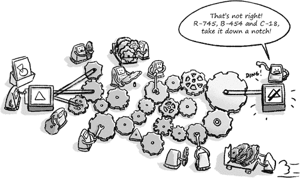

## THE CRUX OF THE PROBLEM

深度神经网络是双赢的。它们不再受限于计算机的处理能力（得益于 GPU，它能并行执行操作），而层级结构则让我们获得更好的学习结果。何等幸福！

当然，我们需要确定如何配置网络——即计算方式的实现方式。为此，研究人员会构建多种配置，包含两层、三层、四层、十层或十六层的不同尺寸网络。随后，他们会在学习数据库上比较这些不同网络的表现，以选择产生最佳结果的配置。这一非常实证的步骤是自动完成的。计算机会根据人类提供的数据，利用人类编写的探索算法比较不同配置的输出。

那么，问题在哪里？为什么这些机器建造的神经元不能解决所有问题？

机器学习系统的表现更多取决于数据的构建和分析方式，而不是所选的配置。让我们看一个例子。

为了让机器“阅读”手写的单词，你可以使用神经网络逐个解码每个字符。但如果系统能同时考虑相邻字符，效率会更高，因为符号并非完全独立。因此，你希望构建一个输入为字符组合的神经网络，而不是单个字符。

这种组合是通过数学计算实现的，这些计算也使用参数。现代算法使用机器学习来调整这些参数。这样，你就拥有了不仅能学习正确回答问题的参数，还能学习 `hyperparameters` 来组合数据或确定网络配置。

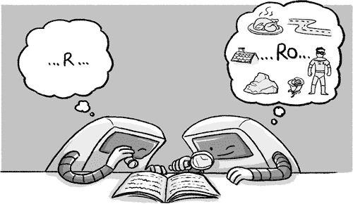

所有这些机器工作必须首先由计算机科学家构思：人类决定如何组合数据以获得更好的结果，具体取决于任务是理解文字、识别图像、规避障碍等。每个问题都需要我们构建正确的解决方案，且良好结果在其他问题上难以复制，即使它们相似。

## THE ACHIEVEMENTS OF DEEP LEARNING

得益于深度学习，人工智能在图像分析和自然语言处理等极其困难的领域取得了惊人的进展。它也用于 AlphaGo，谷歌研发的围棋程序，能够战胜任何人类选手。最令人惊讶的是，像 Google、Facebook、Apple 等知名公司，仅举几例，就迅速投身于此领域。

当研究人员发明新算法时，通常需要数十年才能被企业采用。对于深度神经网络，每一项新发明在不到一年内就会催生另一项新发明！这使得机器学习以闪电速度发展，并取得了惊人成果……同时也面临局限！

神经网络的主要局限性是它们无法解释所作决策的原因。这一问题最早在人工智能研究者提出机器学习时就被提出，至今仍然成立。

机器会在输入上进行计算，在 99% 的情况下产生正确的输出。然而，它无法解释为何得出正确答案，甚至无法说明其过程。无人能够说明其决策依据，这在我们希望理解和控制机器行为时颇为沮丧。

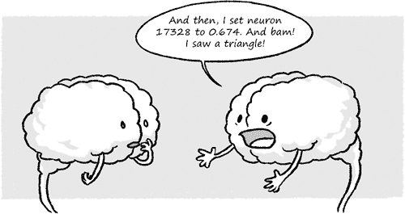

像 Michalski 的“符号”算法（见 第 10 章）试图为系统的每个决策提供“逻辑”解释。相比之下，感知器无法断言三角形是三条边的形状！它只能识别三角形。同样，自动驾驶汽车会刹车转向，但它无法解释“为何”。

## WATCH OUT FOR TRICKS!

神经网络的另一个难点是，如果缺乏学习示例，解决问题会很困难。研究人员假设训练良好的网络工作得更或少“连续”：与已正确处理的示例相似的输入也会被网络正确处理。遗憾的是，事实并非如此。

许多研究团队花费时间发明能够制造导致神经网络失败的示例的算法，这些示例通过对初始输入进行极小修改来实现。他们称这些为“对抗性补丁”。这些补丁可以插入图像中，使任何神经网络算法失效。下一页顶部是 2018 年谷歌研究人员在文章中展示的示例。系统在加入对抗性补丁（那个小圆形图片）后，会把香蕉误认作烤面包机。

## TO EACH HIS OWN METHOD

我们在前面的章节看到，支持向量机和决策树不易受此类技巧影响。但它们需要复杂的输入特征预处理算法才能处理输入特征，这项工作难以完成，只能由那些在人工智能领域研习多年的人完成。

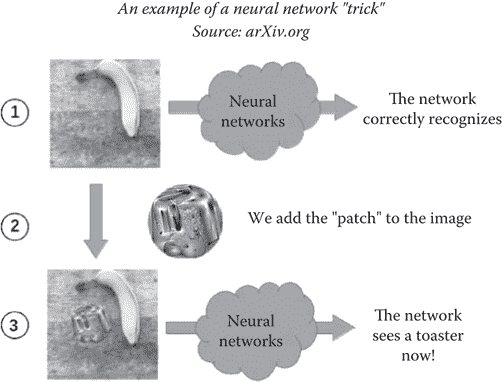

在神经网络中，特征处理被整合到学习过程中，这使得网络更易使用……但也更容易出错。

没有任何 AI 算法是完美的。每种 AI 方法都有优势和劣势。关键是知道如何正确使用它们。

| Winning at Go*Understanding What Reinforcement Learning Is* || 14 |

| --- | --- |

Go 类似于人工智能研究者的“圣杯”。我们在 第 5 章 中看到的大多数“组合游戏”，如国际象棋或跳棋，都可以通过最小最大算法让计算机解决。但不是 Go。

## THE QUEST FOR THE GRAIL

一个 Go 棋盘有 361 个交叉点，你可以放置白棋或黑棋。这会产生 3³⁶¹ 种可能的游戏局面。写出来的数字是：

174089650659031927907188238070564367946602724950

263541194828118706801051676184649841162792889887

149386120969888163207806137549871813550931295148

03369660572893075468180597603

为了让你感受其规模，考虑宇宙中的原子数量（10⁸⁰），这在人工智能领域是衡量大数的金标准。现在，想象我们的宇宙只是一个更大宇宙中的一个原子。你构建一个包含与我们宇宙相同数量原子的宇宙，然后数出这个“原子宇宙”中原子的总数。这数量堪称巨大，足以让你头晕。

要让原子数量与 Go 局面数量相同，你需要构建一万亿个像我们这样的宇宙！简言之，我们离现代计算机的处理能力还很遥远。和国际象棋一样，我们必须使用人工智能算法。

遗憾的是，最小最大算法无法胜任。

## A BIT OF CALCULATION

记住，该算法基于在几步内尝试所有可能的游戏局面，并选择结果最佳的那一步。在游戏开始时有 361 种可能的落子位置，局面数量会迅速增长。例如，仅评估四步游戏，最小最大算法必须考虑 361 × 360 × 359 × 358 种可能性——超过 160 亿种配置。现代计算机处理这需要几秒钟。

仅仅评估四步后，最小最大算法会像新手一样玩游戏。Go 游戏包含数百步。仅四步后的数十亿种可能局面，根本无法洞悉对手的策略！我们需要更好的方法。

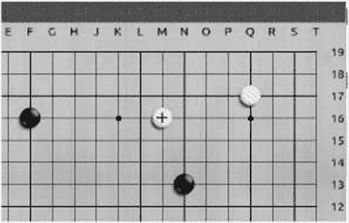

*在 Go 中，玩家轮流在棋盘上放置黑白石子以形成势力区。白方刚下了第二步。此时很难确切地说游戏会如何发展。*

## WANT TO PLAY AGAIN?

计算机赢 Go 的算法自 1940 年代末就被称作“蒙特卡洛树搜索”（Monte Carlo Tree Search），这是指位于摩纳哥的赌场的名称。

这个算法名称听起来很奇怪！因为它依赖于随机性来解决问题。

对于 361 种可能的落子，我们将随机进行一千局游戏。完全随机。对手的落子和计算机的回应都由随机决定。记录游戏结果，然后重复一千次。每次都从相同的初始配置开始。

为了评估每种 361 种首落子的走法，算法会对随机进行的千局游戏的得分进行统计计算。例如，可以计算得分的平均值（实际中，计算机科学家使用更复杂的计算）。蒙特卡洛算法假设，在运气的帮助下，能产生最佳统计结果的落子就是最佳落子，于是选择该落子。

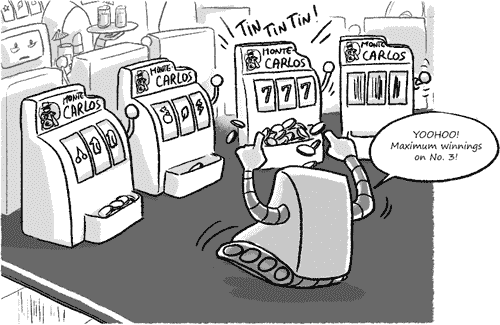

假设每局游戏不超过 300 步（这基于人类对弈的合理限制），我们为每种需要评估的 361 种“首落子”最多进行 300,000 次计算，总计约 1.3 亿次操作。这对现代计算机来说是完全可接受的。

## RED, ODD, AND LOW!

自 1990 年代以来，蒙特卡洛算法一直被用于此方式以赢 Go。2008 年，由法国国家数字科学与技术研究所（Inria）的研究人员编写的程序 MoGo 屡次击败职业选手，取得了新的成就。到 2015 年，程序在正式比赛中已经取得了巨大进步，尽管仍未战胜冠军。

然而，2016 年 3 月，程序 AlphaGo 击败世界冠军 Lee Sedol，四战三胜。计算机首次获得 Go 最高段位——九段，并跻身世界最佳选手之列！

为实现这一壮举，Google 工程师结合了蒙特卡洛算法与深度神经网络。

与任何蒙特卡洛算法一样，它通过大量随机对弈来确定最佳落子。但计算机科学家并不让计算机完全随机下子。既不可能真正随机（总有计算），也无意义完全随机，因为即使是最菜的 Go 选手也能识别出最差的落子。

这就是 AlphaGo 首个神经网络的作用。Google 团队称其为“策略网络”（policy network）。该网络通过给出游戏局面作为输入，教会神经网络如何识别最差的落子。这防止蒙特卡洛算法产生过多劣质对弈，并提高统计计算的准确性。

深度神经网络的工作方式与 Rosenblatt 的感知机相似：输入是 19 × 19 的三色网格（黑、白、空），输出不是简单的“是”或“否”，而是对每个可能落子赋予一个数值。借助深度神经网络和显卡进行 GPU 处理，这在技术上可行。

## NO NEED TO BE STUBBORN

AlphaGo 的另一项改进是提前结束游戏，因为当一方明显落后时继续下去毫无意义。这同样是神经网络擅长解决的问题——输入是棋盘状态，输出是“是否对某位玩家而言游戏彻底失去”。Google 工程师称其为“价值网络”（value network），即衡量游戏价值的网络。

提前结束游戏的意义在于缩短局面，从而更频繁地进行对弈。原本为每个落子只进行一千局，现在可以模拟两到三倍的局数……统计计算从而更精确。

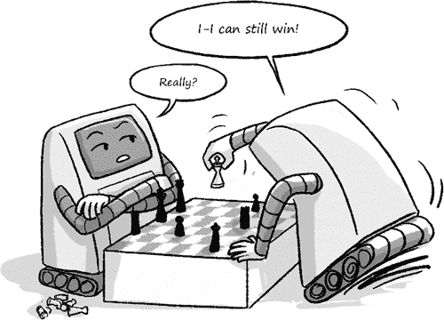

## A BIT OF REINFORCEMENT

通过结合蒙特卡洛算法与神经网络算法，AlphaGo 团队得以编程出一台能够快速准确地决定落子的机器。

然而，要编程这两个神经网络，AlphaGo 团队必须拥有 Go 对弈的示例。仅仅给机器看棋盘并说“继续学习”是不够的。策略网络必须知道哪些局面包含好落子、哪些落子应避免。价值网络需要观看成千上万局 Go 对弈，并每次判断哪些是失败、哪些是必胜。

无论使用何种学习方法，你都必须向机器提供大量示例。无法通过在 Go 档案中手动搜索找到所有示例。AlphaGo 团队采用了另一种人工智能技术：`reinforcement learning`。

## STRONGER THAN EVER!

它是否确切地说明强化学习何时被发明是难以确定的。尽管如此，其原则在人工智能算法中发挥着重要作用。理查德·萨顿于 1988 年发明的 TD-lambda 算法被广泛认为是第一个能够广泛应用于许多问题类别的强化学习算法。

所有强化学习算法都共享一个共同特征：它们不需要例子来学习。

当年幼的孩子学习接球时，他们通过试错来学习。他们一开始手的动作没有什么规律或理由，但他们逐渐学会了正确的动作，以同步球的运动。在这个学习过程中，孩子们不依赖于例子。他们在后续的尝试中纠正自己的错误。

这正是强化学习背后的思想：计算机通过“试错”在每种情况下为每种可能的行动计算一个“分数”。随着它的运作，它会逐步调整计算的参数。

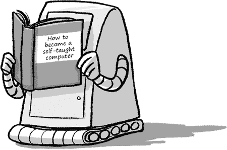

## STEP BY STEP

与神经网络中的反向传播类似，强化学习让我们能够调整一系列计算的参数。然而，与监督学习不同，输出并不依赖于例子。这些算法运行的系统并没有明确的输入，它们从初始状态开始，执行一系列动作以达到目标状态。

让我们以围棋为例。初始状态是空棋盘。系统会进行一系列动作，观察对手的每一次响应，当游戏结束时，最终状态即为结果。基于游戏结束时的结果，你可以为你的动作序列赋予一个分数。计算机科学家称之为 `reward function`。

在这种系统中，不存在与正确输出相关的例子库，这与神经网络的情况相同。我们有一个给定的动作序列以及同样多的中间输入。因此，棋盘上的每个状态对应一个输入，系统的响应是系统选择的动作（它的下子）。动作仅在游戏结束后、所有动作完成后才被评估。

强化学习通过使用奖励函数来调整这些动作的参数。每个动作，或者每个中间状态（这取决于所使用的算法）都会得到一个分数。当计算机到达最终状态时，算法会根据奖励值调整在匹配过程中遇到的所有动作或中间状态的分数。例如，想象系统的第一步是 H5，第二步是 B7，以此类推直到比赛结束并获胜。在这种情况下，动作 H5、B7 以及后续动作的分数会被提高。相反，如果比赛结果是失败，这些分数会根据奖励函数的决定而减少。

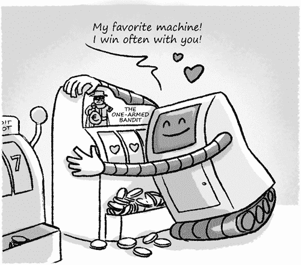

为了调整你的系统在每个过程阶段决定采取哪个动作的参数，强化学习算法会进行数百万次“模拟”围棋局来调整其参数。为了确保学习有效，该算法会仔细选择动作。与蒙特卡洛算法不同，它的动作并非完全随机。随着算法的推进，“正确”的参数被选择的可能性更大。通过这种方式，系统 `reinforces` 了拥有良好策略以实现期望最终状态的信心。

## PLAYING WITHOUT RISK

并非所有问题都能通过这种方法解决。例如，让我们考虑自动驾驶无人机（NASA 自 2000 年代初以来一直在开发原型）。建造一百万架无人机，将它们送上天空，然后反复观察它们撞到地面是不合理的，直到我们最终找到正确的参数。只有舒达科斯^(1)才会使用这种方法。计算机科学家则使用模拟。然而，算法仅在模拟中学习如何表现，没有保证它能在现实中正确工作！

因此，强化学习只能用于模拟无风险操作的应用，如围棋。利用这种强化学习技术，AlphaGo 工程师成功地逐步训练两个神经网络：只需让计算机与自己对弈即可。这产生了数十亿局比赛，使神经网络能够逐渐强化其在做出决策时的信心，无论是拒绝一个动作（即“网络策略”）还是停止游戏（即“价值网络”）。

## GIVE ME THE DATA!

同样的强化学习技术可以用于教 AlphaGo 玩象棋和跳棋。在 24 小时内，系统计算出最佳的动作序列，并变得不可战胜。


这两种学习方法——神经网络和监督学习——依赖于相似的思想。这意味着编写一个算法，调整一组参数，使机器能够做出决策。这种调整是通过探索一个新的空间：`parameter`空间实现的。当你的系统接收输入时，它会基于输入的参数计算输出。学习算法将在该集合的可能参数中进行探索，这是一个庞大的空间，以找到能够在大多数情况下提供良好响应的值。

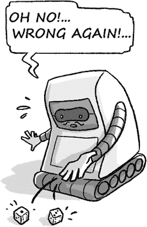

当问题容易模拟时，如围棋（输掉一局并不算大问题），强化学习技术能够以聪明的方式探索这个参数空间。在其他情况下，系统必须被提供例子。大量的例子，往往数量难以想象。因此，要正确训练系统，Rosenblatt 的感知机需要的三角形数量比一位几何老师一生看到的还要多！

然而，在“大数据”时代，满足这种需求已不再是问题。人工智能研究实验室构建庞大的数据库来训练其算法。如果 Google 是图像识别、自然语言理解和围棋方面的最佳，这是因为其工程师能够从我们的网络搜索、电话、视频和电子邮件中收集数据。

某些领域仍然逃避这些基于学习的技术，因为缺乏标记数据。因此，人工智能研究人员开发使用象征模型的技术（如本书早期章节所见），根据给定领域的计算机模型生成合成数据。这些合成数据捕捉了一定程度的人类专业知识。

这些非常有前景的方法已经开发了多年，前景光明。

并且，就这样，计算机现在经常超越我们。这将需要一些时间适应——尽管我们对此完全负责！

________________

1 舒达科斯是 20 世纪 60 年代在法国非常流行的搞笑动画角色，他们不断在构建各种机器时失败。

| Strong AI*Understanding AI’s Limitations* || 15 |

| --- | --- |

我们在人工智能领域的旅程即将结束。我们迄今所见的是对一些问题和用于解决它们的方法的一般概述。还有许多其他技术我们尚未覆盖。Most approaches used in AI require many years of study before they can be fully mastered.

尽管如此，你会得到一个总体的概念：人类构建执行计算、转换数据并解决问题的机器。然而，这些机器并不真正智能。它们应用的是人类创造的程序。

- [费曼学习法](https://wiki.example.org/feynmans_learning_method)的灵感源于诺贝尔物理奖获得者**Richard Feynman**。

1. 运用费曼技巧，你只需花上`20 min`就能深入理解知识点，而且记忆深刻，*难以遗忘*。

```
if (condVar > someVal) {console.log("xxx")}
```

不论我们现在的知识如何，“弱”人工智能没有创造或想象的能力。因此，它们无法超出其编程框架的范围。即使我们谈论“自主车辆”或自动驾驶汽车，所谓的自主性仅限于机器所设计的范围。除非它被编程为这样做，否则汽车不会“转向”对抗其驾驶员。

艾萨克·阿西莫夫在他的`Robot`系列中很好地阐述了这种情况。角色是遵循故事中三条机器人法则的机器，第一条法则是永不伤害人类。在故事中，我们发现机器人会采取非常奇怪的行为，甚至导致事故。然而，机器人从未违背机器人法则。没有任何机器人伤害人类或让人类受到伤害。

这类“自主”系统正日益普及，我们可以看到它们相对安全……只要我们正确使用它们！这正好与我们日常使用的其他工具类似。每年都有许多人因螺丝刀、钻头或锯子受伤，有时是因为缺陷，但更多时候是因为使用不当。然而，这些物品并非在对抗我们。这只发生在恐怖电影中。

至于那些能够自主意识并试图摆脱我们控制的强人工智能，目前没有任何阻碍任何人声称它可能在未来存在。人工智能、大数据的泛化以及深度学习的最新进展是毫无疑问的技术飞跃。然而，它们离人工意识并没有让我们更近一步。它们仍然只是服务于人类的工具。

## AI 滥用

当今人工智能的主要危险在于这些技术如何被使用。让我们以谷歌和百度等搜索引擎为例。它们让任何人都能访问互联网这个庞大的图书馆中包含的任何信息。但同样的算法也可以用来自动过滤您所接触的内容。这正是 Facebook 在根据您的个人资料计算可能感兴趣的信息时所做的。

如果社交网络没有成为 18 至 24 岁人群的主要信息来源，这将不会是大问题。什么阻止了由科技巨头或极权国家控制的信息独裁从明天起决定我们可以或不可以知道什么？

几乎所有的人工智能技术都面临同样的问题。什么阻止了目前用于开发自动驾驶汽车的图像识别或自动决策技术，有一天被用于开发杀人机器人，能够自主识别目标并毫无人工干预地消灭它们？包括斯图尔特·拉塞尔（Stuart Russell）在内的许多研究者已经发出警报，警告人工智能技术的恶意使用。

他们是对的：我们急需了解人工智能算法的能力，以便人类能够决定什么是可接受的。我们需要了解想要防止的 AI 用途以及如何防范它们。我们必须开发不会因任何原因违反伦理规则的算法——哪怕是偶然。

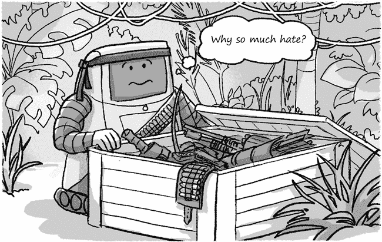

## AI 服务于人类

计算机程序员、用户和政治家都要为人工智能的使用负责：首要的是立法和伦理问题。我们必须防范可能由政治、宗教或经济意识形态驱动的恶意行为。最重要的是，我们不能忘记人工智能是为了帮助我们，而不是为了囚禁我们！

我们每天都在使用数十种人工智能算法来促进公共利益，从起重机和地铁列车的制动系统，到帮助我们查找地址、准备学校作业或寻找最爱歌曲的信息搜索工具。这些用途往往如此微不足道，以至于我们甚至不觉察到自己在使用 AI。

毫无疑问，人工智能程序终将被用于犯罪。事实上，这很可能已经发生在网络安全领域：黑客使用程序完成他们认为是“智能”的任务。这就是人工智能。因此，网络安全专家开发人工智能算法来防范此类威胁。他们借助机器学习检测服务器入侵，并利用多代理系统隔离受感染的网络计算机。

我们不要把目标定错：人工智能可以被滥用，但它不会自行行动。它是由程序员为特定目的编程的，由有明确目标的人类使用。在每一种情况下，最终对使用方式负责的是人。

不要混淆工具与其使用方式。人工智能可以被滥用，但它不能凭空变得恶意，至少在当今的科学知识水平下不能。

## 始终解释，始终解释

人工智能的最大问题之一是帮助用户理解“智能”机器在做什么。

自动驾驶汽车即将上路。事故会发生——这是必然的。当这发生时，我们需要确定系统错误的原因、使用是否正确以及在何种情况下这种错误可能再次出现。这就是为什么越来越多的研究者开始关注开发“可解释”的 AI 算法。

如今，解释人工智能的决策非常困难，无论是下棋、在互联网上识别猫的照片，还是驾驶车辆。输入会被转换为数字，然后输入大量计算。因此，很难确定哪一部分计算导致了决策的某个方面。

一些研究者尝试写数学证明来评估系统的某些属性。其他研究者则尝试找出哪些属性在系统做出决策时起了最主要的作用，例如在三角形例子中识别猫的耳朵。目标是产生一个足够易懂的输出，以便我们随后能够基于程序的初始设置对其进行解释。

这确实是一个困难的主题，我认为我们目前无法说这已经得到解决。但毫无疑问，在未来几年，许多 AI 算法将被开发，能够解释构成决策基础的信息。甚至斯图尔特·拉塞尔（Stuart Russell）所提议的，可能有算法能够自动在出错前检测到。

| 走向无限！*认识 AI 前景光明* || 17 |

| --- | --- |

| | |

人工智能正在改变我们的世界。它赋予我们能够完成长期被认为只有人类才能完成的任务的机器。虽然机器并不像人类那样“思考”，但人工智能的进步简直惊人。这也让我们倍受鼓舞，敢于梦想大。

## 我们在哪里去？

在人工智能的推动下，无数令人惊叹的成就已经被完成。面对如此多的进展，人们很难判断接下来会发生什么。许多挑战依然存在。有些看似触手可及，其他则遥不可及，无论预测者多么聪明地预言 AI 的下一个成功故事。

今天，我们已经能够编程机器轻松战胜围棋或扑克；然而，AI 仍无法战胜人类在《英雄联盟》或《星际争霸》等电子游戏中，尽管电脑每秒能发出数千条指令。程序可以比任何人类更快在医学百科全书中查找信息，并且能够隔离基因，但它们仍无法作出医疗诊断。算法可以通过考虑交通拥堵来寻找路径，并且很快将能够在城镇中导航汽车，但它们仍无法解释原因。

- 原因并不神秘：对情境的部分感知、对时间性的考虑以及可能解决方案的多样性。但目前，人工智能研究人员仍无法绕过这些障碍。不过，每种方法都有所进步，每个算法都有其胜利。渐渐地，我们的知识增长，我们能够构建出越来越令人印象深刻的机器。

[#contents.xhtml#toc2_159]

一些人认为机器很快就能自动纠正哲学论文，或利用简历和视频招聘人员。我不这么认为。除了技术限制之外，这些任务中的人类因素极其微妙，难以在人工智能系统中捕捉。人类会迅速找出如何通过“对抗性数据”来欺骗这些系统。

也许有一天我们会发现人工智能无法做到一切。也许有些事物超出了计算机数据处理的范畴。或者也许不是。随着更多发现的出现，我们最终是否能够完美模仿人类，包括其出错、行为愚蠢以及无论一切都努力不懈改进的能力？

人工智能算法研究教会我们很多关于人类的知识。我们常常尝试理解人类如何执行任务，以便构建能更好完成这些任务的机器。在此之前，许多研究者也尝试构建能够理解人类或自然的机器：例如，神经网络就是为了研究 20 世纪 50 年代心理学家提出的理论而发明的。因此，机器的进步也在引发人们对人类思维机制的思考。

最终，这难道不是人工智能能给我们最大的礼物：更好地理解 ourselves 的能力吗？

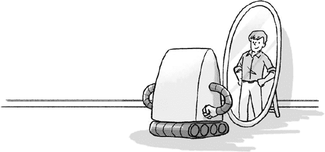

# Even More AI!

遗憾的是，自 1956 年以来发明的所有 AI 技术都谈不完：我们还需要另外 15 章！我在这本书的目标并不是全面覆盖人工智能研究，而是帮助你理解 AI 的工作原理、其局限性，以及历史上我们如何逐步发展出越来越能胜任需要“智能”任务的机器。

AI 技术应用于众多领域，即使我们并不完全意识到。事实上，我们每天都在使用 AI。因此，我认为可以肯定一些著名研究者在人工智能领域的发现——尽管我在前面章节中未能提及。数十个值得提及的名字浮现在脑海中。下面我选择了最著名的几位。

## JAMES ALLEN

James Allen 是一位不满足于在人工智能领域做出单一重大贡献的研究者。他因发展了能够让计算机推理“之前”“之后”“同时”“期间”等概念的时间推理模型而闻名。他还参与开发了多种自然语言对话系统，这些系统结合了符号人工智能中的知识表示技术与统计学习。^(1)

## JOHN MCCARTHY AND PATRICK HAYES

在 1960 年代，John McCarthy 和 Patrick Hayes 奠定了符号人工智能整个领域的基础。他们提出了关于推理行动和变化的模型：事物不再是永远为真或永远为假。通过这种方法，他们铺平了认知机器人研究的道路——换言之，构建能够推理如何在世界中行为的机器人。这并不是完全的人工意识，因为这些机器仅在人类设定的逻辑规则框架内应用数学逻辑。然而，基于此技术开发的系统能够通过逻辑推理适应不同情境。

## RICHARD FIKES, NILS NILSSON, AND DREW MCDERMOTT

在人工智能领域，规划是负责计算实现目标所需操作序列的分支。1971 年，Richard Fikes 和 Nils Nilsson 发明了 STRIPS 模型，用于描述行动、用公式描述目标以及计算实现该目标的操作。规划算法使系统能够在不同情境下自主适应。它们被广泛应用于工业系统……甚至在哈勃太空望远镜中！

此后也提出了其他模型和算法，如 Drew McDermott 的 PDDL 语言，以及 2000 年代初提出的层次任务网络（HTN）模型。每年都有新的进展，使机器能够解决越来越复杂的问题，更接近人类推理。

## CHRISTOPHER WATKINS, LESLIE KAELBLING, AND MICHAEL LITTMAN

最著名的 `reinforcement learning` 算法^(2) 肯定是 Christopher Watkins 在 1989 年提出的 `Q-learning` 算法。它被全球大学人工智能课程教授。2014 年，Google 团队使用 `Q-learning` 的变体开发出一个能像人类一样玩 1980 年代街机游戏 Breakout 的 AI 程序。如今，这类算法常用于工业机器人抓取物体。

在 1990 年代，Leslie Kaelbling 和 Michael Littman 从计算机科学的其他分支借用了一个模型并将其适应人工智能：`部分可观测马尔可夫决策过程`。结合强化学习方法时，该工具使机器能够在考虑传感器传来信息的不确定性时，计算规划问题的最优解。这些规划算法广泛用于机器人，尤其是 NASA 发往火星的机器人。

## ROBERT KOWALSKI, ALAIN COLMERAUER, AND PHILIPPE ROUSSEL

1972 年，法国研究员 Alain Colmerauer 和 Philippe Roussel 提出了第一门完全基于逻辑的编程语言，灵感来源于英国的 Robert Kowalski。该语言是 Programming Logic（Prolog），迅速在人工智能界成为热门。它被广泛用于自动化系统，包括巴黎地铁，至今仍在大学中教授。更近期，Prolog 被用于编程 Watson，IBM 的人工智能系统，它轻松战胜了所有 Jeopardy 冠军。

## EDWARD FEIGENBAUM

Edward Feigenbaum 被认为是`expert systems`（专家系统）之父。这些计算机程序利用逻辑推理来模拟人类专家（如化学师、医生、安全专家等）的决策能力。

专家系统至今仍在大型工业基础设施中使用。

## LOTFI ZADEH

Lotfi Zadeh 是`fuzzy logic`（模糊逻辑）的发明者。其名称看似奇怪，但背后是一种特殊的计算模型，使计算机能够推理关于“外面很美好”“下雨很多”“车速很快”等程度更或少为真的事实。自 80 年代以来，基于人工编写规则的模糊逻辑人工智能程序已应用于各种智能控制系统：起重机、电梯、气象预报、空中交通管制等众多领域。

## ALLEN NEWELL

Allen Newell 是人工智能先驱，他出席了 1956 年达特茅斯研讨会。20 世纪 80 年代，他的工作促成了`cognitive architectures`，最著名的包括 John Laird 的 Soar 和 John Anderson 的 ACT-R。这些模型使计算机能够在特定情境中模拟人类行为。它们被用于视频游戏，为非玩家角色在面对玩家决策时提供更真实的反应。

- 人工智能在决策支持系统中被越来越多地用于模拟人类行为：它帮助领导者、政治家和企业家分析和理解政治中的舆论动态、能源消耗以及城市空间占用等复杂现象。

**JUDEA PEARL**

Judea Pearl 是 `Bayesian networks` 的发明者。这是一种人工智能方法，将符号推理（Bayesian 网络中的对象可由人类解释）与统计学习（这些对象之间的概率可以从数据中学习）相结合。Bayesian networks 在众多应用中用于表示事实之间的关系，特别是在生物信息学、信息研究和决策支持系统中。

**RICHARD RICHENS, JOHN SOWA, AND RONALD BRACHMAN**

在符号人工智能领域，机器尝试推理数据中包含的知识，正如人类所做的那样。为此，`knowledge representation` 模型被开发出来，以便将计算机所需的知识编程进去。第一个通用的知识表示模型由 Richard Richens 在 1956 年提出。他称该模型为 `semantic network`，并推动了人工智能的许多其他进展，如 John Sowa 于 1976 年提出的概念图，以及 Ronald Brachman 于 1980 年代中期提出的 `description logics`。^(3)

**DEBORAH MCGUINNESS**

在 2000 年代初期，符号人工智能专家发明了 `semantic web`。它可以定义为专门为计算机编写的网页，使用结构化公式，使它们能够像人类一样阅读互联网内容。`semantic web` 采用基于描述逻辑和由 Deborah McGuinness 及其同事发明的 OWL 语言的计算机模型。

如今，计算机在互联网上交换“语义”信息以响应我们的需求。例如，当你在搜索引擎中搜索名人时，会看到一个文本框显示该人的年龄、身高和一般信息。这些信息来源于 `semantic web` 中的数据。

________________

1 这些术语在 第 10 章 和 第 11 章 中有解释。

2 该术语在 第 14 章 中有解释。

3 该术语在 第 10 章 中有解释。

# Acknowledgments

我首先在大学时发现了人工智能，并且从此再也没有回头。

这本书不可能在没有我遇到的 extraordinary 人士的帮助下完成。我欠他们太多。Sylvie 是第一个向我介绍 AI 的人。Jean-Paul 在我初次涉足科研时指导了我。Fred、Seb、Sophie、Alex，以及我的同事和朋友，帮助我找到用来阐释困难 AI 概念的恰当表达。过去 20 年里，我结识了许多热情的研究人员、迷人的同事和朋友，实在无法在此列举全部。你们知道自己是谁。请知道，这也是你们的书。

我要特别感谢 Monique 和 Alain，他们带领数百名学生走上 AI 的道路，如果没有他们，我就不会认识我最喜欢的艺术家 Lizete。我感激有机会沿着他们的脚步走，指引年轻人走上 AI 前景光明的道路。

这本书得益于我的妻子和孩子们，他们耐心地审阅了每一章，并各自贡献了一粒沙。他们知道我比什么都爱他们。谢谢我的朋友 Céline 和 Paul，他们的支持和阅读非常重要。谢谢 Lizete，你的耐心和始终如一的好心情！向公众写作并不容易，尤其是当你大部分时间都与专家交流时。如果没有你们的建议，这本书永远不会面世。

我也想感谢 Emmanuel，他帮助我完成这本册子的艰巨出版过程，Kaska 在整个过程中支持我，以及我的出版商 Ms. Baud 和 Ms. Cohen，感谢他们对我们的信任。


最后，感谢所有为 AI 史做出、并继续做出贡献的人。我尤其想到那些在幕后工作的研究人员，他们让这个小型 AI 社区保持运转。全球 AI 社会在过去 20 年里经历了风暴、逆势而行和舆论变化，以确保 AI 的生存。他们很少能享受到劳动的成果，但如果没有他们，今天写这本关于 AI 的书是不可能的。

N. Sabouret

起初，只有三位计算机科学家在博客上发文，讨论宏大的话题。博客随后在 LIP6 的走廊和休息室中延续了 11 年，直到 Nicolas 再次联系我，谈起这次令人惊叹的合作。我衷心感谢我的前博客伙伴：Nicolas Stefanovitch，即 `Zak Galou`，以及 Thibault Opsomer，即 `Glou`。我也要承认我的艺术伙伴：CMIJ 的所有成员、AllfanartsV2 论坛的成员以及 BD&Paillettes 的成员。感谢 François 协助物流（餐具、烹饪以及照看 Renzo），这让我每年十二月都能穿上艺术围裙。最后，感谢 Nicolas，你的热情和随时准备为这项美好合作提供支持。我很高兴能够实现 lifelong 梦想，通过我的艺术帮助他人学习科学。

L. De Assis

# They made AI

但他们并不是唯一…

AlphaGo, 10, 124, 131

Babbage, Ch., 5, 41

Campbell, M., 42, 44

Deep Blue, 44

Dijkstra, E., 21, 36

Dorigo, M., 70

Greedy algorithm, 55

Glover, F., 59

Hart, P., 37

Hinton, G., 117

Hopfield, J., 117

Hsu, F.-H., 44

K-means, 81

Loebner, H., 17

Lovelace, A., 41

McCarthy, J., 50, 95

Michalski, R., 92

Minsky, M., 11, 116

Monte Carlo algorithm, 129

Nilsson, N., 37

Norvig, P., 20

Pitrat, J., 137

Quinlan, R., 99, 101

Raphael, B., 37

Rechenberg, I., 61

Rosenblatt, F., 91, 113

Rumelhart, D., 117

Russell, S., 20, 144

Samuel, A., 90

Searle, J., 19, 138

Sutton, R., 132

Turing, A., 6, 13–21, 25, 42

Vapnik, V., 102

von Neumann, J., 44

Wallace, R., 19

Watson (IBM), 153

Weizenbaum, J., 17

Williams, R., 117

Winograd, T., 90
