# 机器学习 大气河理解指南

曼尼什·库马尔·戈雅尔
土木工程系
印度印多尔理工学院
印度中央邦印多尔

希瓦姆·辛格
土木工程系
印度印多尔理工学院
印度中央邦印多尔

## 前言

大气河（ARs）是引人入胜的现象，它们将气候极端事件与水资源管理错综复杂地联系起来。本书深入探讨了天空中这些河流的内核，探索它们对环境和社会的深远影响。大气河，常被称为“水汽输送带”，在塑造区域降水模式、干旱、洪水和水资源可用性方面发挥着关键作用。了解其特征、行为以及与大规模气候振荡的相互作用，对于推进气候科学、水资源管理和灾害风险减少策略至关重要。

通过多学科视角，本书探索大气河的复杂性，阐明其在气候变率与变化更广泛背景下的重要性。从陆地河流到气候振荡的深远影响，每一章都揭示了大气河的一个独特方面，阐述了其检测、表征、影响及潜在的未来发展轨迹。案例研究提供了数据分析、机器学习和创新技术在解读大气河动态及增强预测能力方面实际应用的现实世界洞察。

大气河研究中科学、技术与创新的融合，为降低风险、改进水资源管理策略以及在应对气候挑战时培养韧性开辟了新的前景。本书是协作努力的结晶，汇聚了专家、研究人员、政策制定者和实践者，旨在深入探索大气河及其对我们地球未来的深远影响的复杂网络。

我们希望本书能作为一本全面指南，激发好奇心，引发讨论，并在大气河和气候极端事件领域激励创新解决方案。

印度，印多尔
曼尼什·库马尔·戈雅尔
希瓦姆·辛格

## 第1章
理解大气河并探索其作为气候极端事件的作用

### 1.1 陆地河流

河流象征着水在景观中持续流动，作为塑造我们世界的重要通道 [1]。它们在地形中蜿蜒前行，创造生态系统，支持生物多样性，并维系人类文明。这些流动的水体，无论是缓缓蜿蜒还是湍急奔流，在塑造其途中的自然和社会景观方面发挥着关键作用 [15]。其影响超越地理边界，沿其流程影响气候、经济和文化。

### 1.2 气候极端事件

气候极端事件是指天气模式中显著偏离典型或平均状况的现象 [40, 56]。这些偏差以多种方式表现出来，如极端温度、异常降水、长期干旱或过多降雨、强烈风暴和热浪 [6, 10, 13, 32, 44]。它们破坏了通常的气候平衡，对自然系统、人类社会和建成基础设施构成重大挑战。理解这些事件需要深入探究其根本原因，这些原因可能源于自然变率、人为引起的气候变化，或两者兼而有之 [10, 50]。

除观察这些异常现象外，研究气候极端事件还需要进行全面分析，以揭示其影响并预测其发生情况 [18, 52]。评估与这些极端天气现象相关的脆弱性和风险，对于制定有效的适应和减缓策略至关重要 [11, 51]。这些策略旨在最大限度地减少此类事件对社区、基础设施和环境的不利影响 [12, 19, 31, 47]。该研究领域对于

| 序号 | 气候极端事件 | 解释/研究方法 | 数学解释 |
| :--- | :--- | :--- | :--- |
| 1 | 热浪 | 分析异常高温的持续时期 | 特定时期内与平均温度的偏差；例如，使用历史温度数据的异常值或标准差 |
| 2 | 洪水 | 研究因强降雨导致土地过度和迅速淹没 | 通过频率分析或概率分布等统计方法，分析降雨强度、河流排放量及极端事件的重现期 |
| 3 | 干旱 | 评估长期水资源短缺或降水赤字期间 | 计算标准化降水指数，或将实际降水与长期平均值进行比较，以确定干旱事件的严重程度和持续时间 |
| 4 | 风暴 | 评估以强风和大雨为特征的强烈天气事件 | 使用气象数据或如博福特风力等级等公式测量风速、大气压力和降雨强度 |

以增强应对气候不确定性的韧性，确保准备就绪，并在不断变化的气候背景下促进可持续发展。

分析气候极端事件涉及采用先进的技术、统计工具和模型来审查历史数据和模式 [7, 14, 16, 43, 46]。主要目标是理解这些极端事件的驱动因素、频率和影响。理解这些偏差背后的机制有助于制定预测模型，并提高我们预测和应对极端天气条件的能力 [4, 16, 43]。通过解开这些事件的复杂性，我们获得了对适应、韧性建设和灾害管理至关重要的见解（表 1.1）。

### 1.3 大气河：天空中的河流

大气河是指在大气中移动的狭长、充满水汽的气流走廊。这些浓缩的水汽通道将大量水汽输送到各个地区，显著影响降水模式（图 1.1）。它们对强降水事件的发生至关重要，在全球水循环和降水分布中发挥着重大作用。

喀拉拉邦洪水（2018年8月18日的大气河）

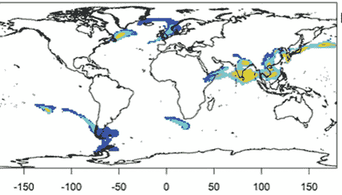

图 1.1 2018年8月18日，基于全球分析且具有IVT幅度的检测到的大气河。南印度地区增强的大气河导致2018年8月印度喀拉拉邦发生极端洪水

#### 1.3.1 历史背景

对大气河的理解随着时间的推移不断演变，不同年代的研究人员做出了重要贡献，并融合了多个学科。

Newell 等人 [28] 对大气中检测到的强水汽输送的狭窄水汽羽流（“对流层河流”）进行了一项开创性研究。尽管“大气河”这一术语直到后来才被提出，但他们的工作为其奠定了基础。[58] 的研究在此基础上提出了“大气河”这一术语，并建立了识别它们的客观技术。他们发现，大气河与中纬度气旋的冷锋相关，并在全球水汽输送中发挥着主要作用。

到1998年，在新兴的大气河领域已取得显著进展，涵盖以下关键进展：

- 1 Zhu & Newell 1998年的研究显著促进了我们对大气河理解的进展。
- 2 在1997–1998年加州登陆喷气流（CALJET）野外考察活动中，使用飞机提供了有助于理解大气河的现场原位数据。
- 3 足够数量的极轨 SSM/I 卫星的可用性，有助于创建全球海洋上近乎全景的柱状水汽视图。
- 4 NCEP/NCAR 发布了用于大气河表征的再分析数据。

在2000年代，大气河研究发生了一项突破性进展，即引入了利用特殊传感器微波成像/探测器（SSM/I）的卫星水汽图像。这一技术代表了一个重要里程碑，使气象学家和研究人员能够近乎实时地分析可降水量（IWV）。使用这种图像提供了

与ARs相关的独特特征 [35, 57]。这标志着对以前依赖水汽通道的方法的重大改进，那些方法只提供温度信息而没有直接揭示水汽的存在和移动。

同时，CALJET野外试验活动作为另一项关键发展出现。通过此次活动，研究人员通过飞越温带气旋并利用落地探空仪测量大气条件来收集数据 [25, 35, 36]。这种方法显著增强了我们对最强水汽输送条件的理解，特别是在低空急流（LLJ）附近以及冷锋沿线或前方。SSM/I观测与飞机数据的整合提供了AR结构的全面视图，为AR事件期间经历的强烈沿海地形降水提供了洞察。基于IWV的大气河探测方法（ARDM）使用SSM/I数据和飞机观测进行了验证 [34, 57]。该方法涉及通过搜索满足特定标准（如长度、宽度和IWV阈值）的大IWV区域来识别ARs，这与原位观测和再分析数据相一致。尽管IWV仍然是一项有价值的指标，但重点转向了集成水汽输送（IVT），它结合了风信息。由于原位数据观测系统和高质量大气再分析产品的可访问性，IVT已成为首选指标 [8, 21, 22, 27, 47–49]。

在2000年代，对ARs的探索经历了研究活动的激增。技术进步，特别是SSM/I的使用，使得对ARs的更彻底观察和记录成为可能。科学家们将重点放在了解气候学、对降水事件的影响以及水文气候影响上，特别是在美国西部 [3, 41, 42]。很明显，ARs在特定地区引发极端天气事件方面发挥了重要作用，带来了独特的挑战。在接下来的十年里，ARs研究的范围扩大，与水文气候学、生态学和大气气溶胶等多个学科交织在一起 [2, 37, 39, 54]。不同领域之间的协作努力有助于全面理解ARs。

目前，从事ARs研究的社区涵盖了来自各个学科的贡献者，包括气象学、水文气候学、土木工程、古气候学和极地科学 [9, 23, 30, 33]。已经开发了许多算法来检测和跟踪AR条件，在区域和全球范围内识别ARs。在目睹ARs影响以及全球对进一步探索这些发现日益增长的兴趣的背景下，一项协作计划——大气河追踪方法比对项目（ARTMIP）——于2017年启动 [38, 41, 45]。该项目旨在量化不同AR探测方法所产生的不确定性。ARTMIP内的研究揭示了不同方法之间AR计数的差异，强调了探测方法对几何标准的敏感性。

#### 1.3.2 ARs形成和增强机制

关于陆地中纬度地区极端冬季降水事件的研究一直揭示其与温带气旋有很强的关联 [26]。当气旋暖区的温暖湿润空气与高地接触时，如美国西海岸的情况 [55]，这些强降水事件经常发生。这种相互作用会导致降水量大幅增加，取决于AR的大小和形状以及相互作用角度 [20]。根据Bader和Roach（1977）的说法，这些事件可以通过中尺度和大尺度天气过程在地形降水增强机制（称为“播种-供给”机制）内的相互作用来描述。这种供给云通常覆盖着一座山丘或小山。这一现象导致盖云下方的高地降水比附近平原更明显。重要的是，这种机制并不显著改变与气旋相关的总体降水，而是用于重新分配降水，将其集中在高地区域 [27, 53]。该过程的有效性取决于是否存在足够强、低层湿润气流，以保持地形供给云中的云水含量，并确保来自播种云的连续降水供应。

#### 1.3.3 理解ARs的影响

已开展研究以识别登陆ARs的显著影响。由ARs驱动的降水贡献也可以为识别与洪水相关的AR易受损地区提供洞察。已经分析了一些与极端洪水相关的重大降水个案研究，以关联ARs。这些个案研究也被分析以验证用于AR表征的算法。我们发现，2005年7月印度孟买市、2017年5月加拿大魁北克省和2018年8月印度喀拉拉邦的重大降水与该地区在此期间持续存在的高强度AR同时发生。

### 1.4 个案研究

#### (a) 喀拉拉邦洪灾（2018年8月）

2018年8月喀拉拉邦洪灾是一场发生在印度南部喀拉拉邦的毁灭性自然灾害。该州在季风季节经历了异常极端的降水，导致该州许多地方出现严重洪灾和滑坡（图1.2和1.3）。洪灾是由西南季风引发的，西南季风于2018年6月初到达喀拉拉邦。然而，它在8月第2周显著升级，导致持续降雨和广泛洪灾。根据印度中央水利委员会（CWC）2018年的报告，该州在2018年6月1日至8月19日期间降雨量为2394.4毫米，超过了预期的1649.5毫米。最显著的降雨发生在8月的头3周，该州在此期间接收到的降水量约为通常量的三倍 [5]。这种强降水导致众多河流和支流泛滥，造成低洼地区洪灾，并使成千上万居民流离失所。

倾盆大雨和洪灾对喀拉拉邦的基础设施、农业和经济造成了灾难性影响。该州经历了房屋、建筑物、道路、桥梁和其他关键基础设施的大规模破坏。众多村庄和城镇完全被淹没，通信和交通系统都面临严重中断。喀拉拉邦14个地区中有13个在2018年8月13日至17日期间因强降雨而遭受广泛洪灾 [24]。根据2018年收入和灾害管理部门的报告，2018年喀拉拉邦洪灾造成500多人死亡，775个乡镇被淹。由于ARs可以携带大量水汽并在较短时间内导致极端降水。为了了解8月13日至17日极端降雨的原因，我们探索了IVT特征和强烈AR条件的可能性（图1.2）。

这些强烈的IVT特征使用定义的阈值进行了分析，以识别2018年8月12日至20日期间的ARs，并在多个步骤中识别了具有强烈IVT特征的ARs（图1.3）。图1.4展示了2018年8月16日00:00和06:00的两个这样的时间步。

分析表明，印度喀拉拉邦在2018年8月13日至17日经历的极端降水是由AR驱动的。

#### (b) 加拿大魁北克洪灾（2017年5月）

据报道，共有5,371套住宅被淹，约4,066人被迫撤离家园，该地区约261个市镇受到影响（Lin et al. 2019）（图1.5）。加拿大气象与海洋学会将洪灾列为2017年第三大天气事件 [29]。为应对情况的严重性，蒙特利尔和拉瓦勒两市宣布进入紧急状态。

2017年5月第一周，具有强烈特征的ARs持续覆盖魁北克省，并可能对该期间的强降水和降雪负责（图1.6）。

#### (c) 孟买洪灾（2005年7月）

2005年7月26日，该城市在季风季节经历了异常强降雨，导致严重洪灾和广泛混乱 [17]。倾盆大雨始于7月26日凌晨，持续数小时，导致多条河流和排水系统溢出。洪灾对建筑物、房屋和公共基础设施造成了重大损害（图1.7）。

Kerala_IVT_20180813_120000.tiff

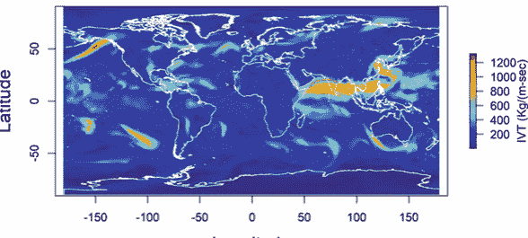

Kerala_IVT_20180815_120000.tiff

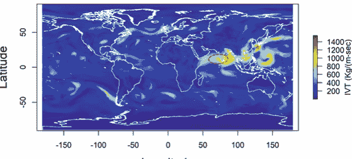

Kerala_IVT_20180817_120000.tiff

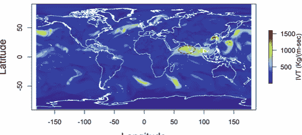

图 1.2 展示了2018年8月13日、15日和17日印度南部地区存在的强烈IVT特征的地图（每天从6张逐小时地图中选择一张图）

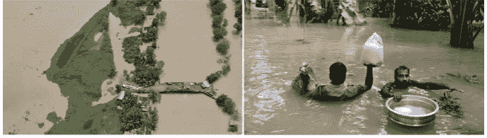

图 1.3. a 2018年8月19日，印度中央喀拉拉邦上空洪水之上的唯一物体是一座桥的俯视图。[来源 The Hindu (2019)]；b 印度南部州喀拉拉邦 Chengannur 的洪水区域。[来源 CNN (2019)]

喀拉拉邦洪水（2018年8月16日的大气河；00:00）

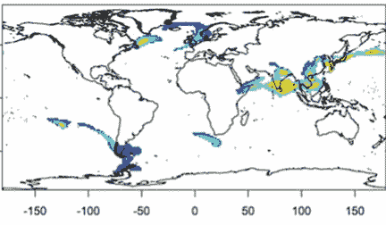

喀拉拉邦洪水（2018年8月16日的大气河；06:00）

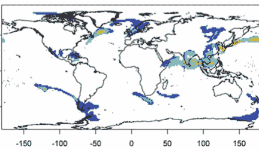

图 1.4 2018年8月16日00:00和06:00印度南部地区存在强烈大气河

图 1.5. **a** 2017年5月4日，加拿大魁北克省加蒂诺的被淹住宅街道 [来源 61]；**b** 2017年5月7日，加拿大魁北克省里戈被淹住宅区一名居民从家中搬出财物 [来源 62]

2005年7月26日08:30起，在24小时内降雨量达到创纪录的994毫米，导致孟买城市陷入停滞。事件发生后，孟买市辖区内的滑坡和突发洪水造成至少419人丧生，其中包括16,000头动物，另有216人死亡归因于洪水相关疾病 [59]。后果还包括超过100,000座住宅和商业建筑以及30,000辆车辆受损 [60]。

洪水还导致巨大的经济损失，企业遭受业务中断以及房产和基础设施损坏。从7月23日起，印度西海岸出现向印度马哈拉施特拉邦移动的显著水汽转移。这些代表潜在大气河的强烈IVT特征持续了数天，跨越了7月最后一周和8月第一周（图 1.8）。由于这些强烈IVT特征集中在印度半岛，一个高强度的大气河在该地区连续数天被持续识别，如图 1.9 所示。

自7月23日起的几天内，大量水汽集中于该地区，代表马哈拉施特拉邦沿海城市孟买上空大气河的这种强烈水汽引起的不稳定性将导致极端降水。即使在这场大雨过后，该地区仍在数天内保持强烈水汽，并且西太平洋上游地点的水汽迅速增强（图 1.8）。

这些大气河可能带来从主要有益到主要危害的区域影响，具体取决于大气河的强度和取向以及登陆部分的大气河。中纬度大陆每年被观察到会经历大气河的显著影响。这些大气河还对极地地区的降雪作出贡献。观察大气河的全球影响，研究大气河的详细影响和驱动因素变得重要。

(a) 加拿大魁北克省洪水（2017年5月1日的大气河）

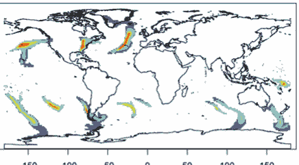

(b) 加拿大魁北克省洪水（2017年5月6日的大气河）

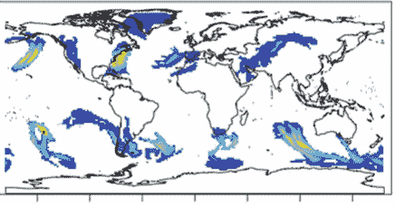

(c) 加拿大洪水（2017年5月1日至8日的大气河）

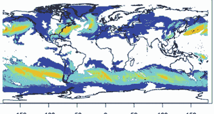

图 1.6 展示了2017年5月第一周加拿大魁北克省存在强烈大气河的地图（来自6小时数据集的一天的大气河检测所有四个步骤的平均值），具体为 a 5月1日，b 5月7日，以及 c 2017年5月1日至8日期间大气河在该地区存在期间的平均IVT特征。

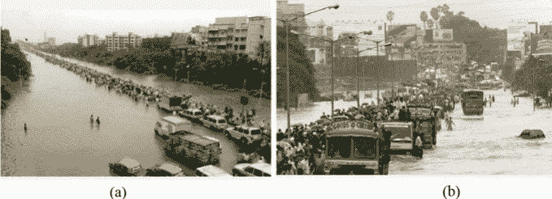

图 1.7 a 2005年7月27日，乘客涉水穿过洪水，此前暴雨导致孟买城市陷入停滞（AFP照片）[来源 NEWS18 (2005a)]; b 2005年7月27日，暴雨使孟买城市瘫痪后，乘客涉水穿过洪水，经过被困的机动车辆（[来源 NEWS18 (2005b)]）)

### 1.5 结论

关于气候极端的讨论强调了偏离典型天气模式的破坏性，凸显了了解其根本原因的重要性。这种理解对于制定应对和适应气候极端带来的挑战的有效策略至关重要。超越简单的观察，呼吁进行全面分析以揭示这些极端的影响并预测其发生。这种基础知识对于评估脆弱性、管理风险以及在变化的气候面前培养韧性至关重要。

大气河是一种此类气候极端，其特征是狭窄的水汽丰富空气通道，对全球降水模式具有深远影响。探索大气河研究的历史背景为其演化提供了时间视角，突出了20世纪末的关键时刻以及2000年代的重大技术进步。“播种-喂养”机制成为理解与大气河相关的强降水事件的关键因素。为了了解登陆大气河的更广泛影响，对2018年8月喀拉拉邦、2017年5月魁北克省和2005年7月孟买等地区的详细案例研究进行了细致的审查。这些现实世界的例子成为大气河相关洪水严重后果的深刻提醒，强调了强大算法和早期预警系统在减轻此类事件中的至关重要作用。这些案例研究所描绘的地理多样性凸显了大气河的全球意义及其在不同地区的多样化影响。

Mumbai_IVT_20050724_060000.tiff

Mumbai_IVT_20050725_120000.tiff

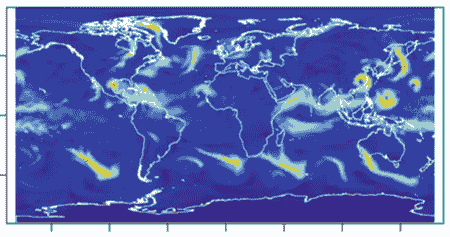

Mumbai_IVT_20050726_060000.tiff

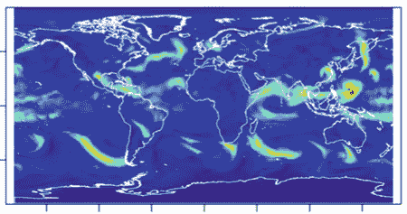

图 1.8 展示了2005年7月24日、25日、26日指向印度的强烈IVT特征的地图（每天从6张逐小时地图中选择一张图）

孟买洪水（2005年7月27日的大气河）

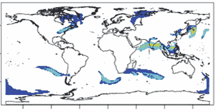

孟买洪水（2005年7月29日的大气河）

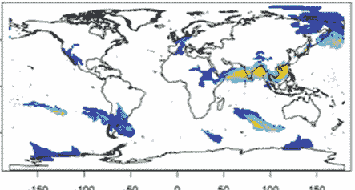

孟买洪水（2005年8月1日至5日的大气河）

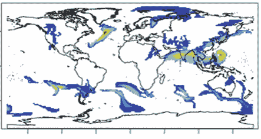

图 1.9 2005年7月27日至29日印度南部地区存在强烈大气河，以及2005年8月1日至5日的平均大气河特征

### 参考文献

- 1. P.J. Ashworth, J. Lewin, 大河为何各不相同？ Earth Sci. Rev. **114**(1–2), 84–107 (2012). https://doi.org/10.1016/j.earscirev.2012.05.003
- 2. S. Chakraborty, B. Guan, D.E. Waliser, A.M. da Silva, S. Ulualam, P. Hess, 将大气河概念扩展到气溶胶：气候和空气质量影响。Geophys. Res. Lett. **48**(9) (2021). https://doi.org/10.1029/2020GL091827
- 3. T.W. Corringham, J. McCarthy, T. Shulgin, A. Gershunov, D.R. Cayan, F.M. Ralph, 气候变化对美国西部未来大气河洪灾损失的贡献。Sci. Rep. **12**(1), 13747 (2022). https://doi.org/10.1038/s41598-022-15474-2
- 4. D. Coumou, S. Rahmstorf, 十年天气极端。Nat. Clim. Chang. **2**(7), 491–496 (2012). https://doi.org/10.1038/nclimate1452
- 5. CWC, _2018年8月喀拉拉邦洪水研究报告_, _水文研究组织水文(S)局_ (2018)
- 6. J. Das, S. Jha, M.K. Goyal, 印度气象同质地区月降水量与气候和季风遥联关系：小波与全球连贯性方法。Atmos. Res. **238**, 104889 (2020). https://doi.org/10.1016/j.atmosres.2020.104889
- 7. J. Das, S. Jha, M.K. Goyal, 基于非平稳和Copula的方法评估印度喜马拉雅邦气候指数涵盖的干旱特征。J. Hydrol. **580**, 124356 (2020). https://doi.org/10.1016/j.jhydrol.2019.124356
- 8. M.J. DeFlorio, D.E. Waliser, B. Guan, D.A. Lavers, F.M. Ralph, F. Vitart, 大气河预测技能全球评估。J. Hydrometeorol. **19**(2), 409–426 (2018). https://doi.org/10.1175/JHM-D-17-0135.1
- 9. M.D. Dettinger, 美国西海岸大气河作为干旱终结者。J. Hydrometeorol. **14**(6), 1721–1732 (2013). https://doi.org/10.1175/JHM-D-13-02.1
- 10. M.K. Goyal, S. Singh, V. Jain, 印度智慧城市热浪特征增强。Sci. Rep. **13**(1), 14786 (2023). https://doi.org/10.1038/s41598-023-41968-8
- 11. V. Gupta, S. Rkakkasai, S. Rajpoot, H.S. El Imanni, S. Singh, 使用SHIVEK方法对Imja Lake进行时空分析以估计下游洪灾危害。Acta Geophysica 1–12 (2023)
- 12. U. Huiskamp, B. Brinke, G.J. Kramer, 气候韧性周期：使用情景分析来制定气候适应性商业战略。Bus. Strateg. Environ. **31**(4), 1763–1775 (2022). https://doi.org/10.1002/bse.2982
- 13. S. Jha, J. Das, M.K. Goyal, 印度降水极端的低频全球尺度模式及其影响：非平稳和不确定性分析。Int. J. Climatol. **41**(3), 1873–1888 (2021). https://doi.org/10.1002/joc.6935
- 14. S. Jha, J. Das, A. Sharma, B. Hazra, M.K. Goyal, 印度植被干旱可能性的概率评估及其对韧性的影响。Glob. Planetary Change **176**, 23–35 (2019). https://doi.org/10.1016/j.gloplacha.2019.01.014
- 15. J.R. Karr, E.W. Chu, 导言：维持活的河流，载于 _评估流水的生态完整性_ (Springer Netherlands, Dordrecht), pp. 1–14 (2000)
- 16. R.W. Katz, 非平稳极端的统计方法，载于 _变化气候中的极端_ (Springer, Dordrecht, 2013), pp. 15–37
- 17. A.T. Kulkarni, T.I. Eldho, E.P. Rao, B.K. Mohan, 印度新孟买沿海城市流域综合洪水淹没模型。Nat. Hazards **73**(2), 403–425 (2014). https://doi.org/10.1007/s11069-014-1079-6
- 18. N. Kumar, P. Patel, S. Singh, M.K. Goyal, 印度多年流域水文气候极端的非平稳性及韧性理解。Sci. Rep. **13**(1), 12524 (2023). https://doi.org/10.1038/s41598-023-38771-w
- 19. N. Kumar, V. Poonia, B.B. Gupta, M.K. Goyal, 面向气候变化的关键基础设施风险评估与韧性新框架。Technol. Forecast. Soc. Chang. **165**, 120532 (2021). https://doi.org/10.1016/j.techfore.2020.120532

- 20. J. Liang, Y. Yong, M.K. Hawcroft, 东亚大气河的长期趋势. Clim. Dyn. **60**(3–4), 643–666 (2023). https://doi.org/10.1007/s00382-022-06339-5

- 21. R.V. Lyngwa, M.A. Nayak, 与2018年8月喀拉拉邦极端降雨事件相关的大气河. Atmos. Res. **253**, 105488 (2021). https://doi.org/10.1016/j.atmosres.2021.105488

- 22. S. Meghani, S. Singh, N. Kumar, M.K. Goyal, 大气河时空特征预测：一种新型数据驱动方法. Glob. Planet. Change **231**, 104295 (2023). https://doi.org/10.1016/j.gloplacha.2023.104295

- 23. A.C. Michaelis, A. Gershunov, A. Weyant, M.A. Fish, T. Shulgina, F.M. Ralph, 气候变化增强的大气河降水：加利福尼亚州奥罗维尔大坝危机风暴案例研究. Earth’s Future **10**(3) (2022). https://doi.org/10.1029/2021EF002537

- 24. V. Mishra, H.L. Shah, 2018年喀拉拉邦洪水的水文气候学视角. J. Geol. Soc. India **92**(5), 645–650 (2018). https://doi.org/10.1007/s12594-018-1079-3

- 25. P.J. Neiman, F.M. Ralph, A.B. White, D.E. Kingsmill, P.O.G. Persson, 加利福尼亚州沿海山脉迎坡气流与降雨的统计关系：CALJET期间的观测. Monthly weather review. Am. Meteorol. Soc. **130**(6), 1468–1492 (2002). https://doi.org/10.1175/1520-0493(2002)130%3c1468:TSRBUF%3e2.0.CO;2

- 26. P.J. Neiman, F.M. Ralph, G.A. Wick, J.D. Lundquist, M.D. Dettinger, 基于八年SSM/I卫星观测的影响北美西海岸大气河的气象特征及地形降水影响. J. Hydrometeorol. Am. Meteorol. Soc. **9**(1), 22–47 (2008). https://doi.org/10.1175/2007JHM855.1

- 27. P.J. Neiman, L.J. Schick, F.M. Ralph, M. Hughes, G.A. Wick, 西华盛顿州洪灾：与大气河的联系. J. Hydrometeorol. **12**(6), 1337–1358 (2011). https://doi.org/10.1175/2011JHM1358.1

- 28. R.E. Newell, N.E. Newell, Y. Zhu, C. Scott, 对流层河？——一项先导研究. Geophys. Res. Lett. **19**(24), 2401–2404 (1992). https://doi.org/10.1029/92GL02916

- 29. I. Olthof, N. Svacina, 基于东加拿大2017年和2019年事件中收集的卫星和原位数据测试城市洪灾测绘方法. Remote Sens. **12**(19), 3141 (2020). https://doi.org/10.3390/rs12193141

- 30. A.E. Payne, M.-E. Demory, L.R. Leung, A.M. Ramos, C.A. Shields, J.J. Rutz, N. Siler, G. Villarini, A. Hall, F.M. Ralph, 大气河对气候变化的响应与影响. Nat. Rev. Earth Environ. **1**(3), 143–157 (2020). https://doi.org/10.1038/s43017-020-0030-5

- 31. V. Poonia, M.K. Goyal, B.B. Gupta, A.K. Gupta, S. Jha, J. Das, 印度不同河流流域干旱发生及基于区块链技术的灾害管理框架. J. Clean. Prod. **312**, 127737 (2021). https://doi.org/10.1016/j.jclepro.2021.127737

- 32. S. Rakkasagi, M.K. Goyal, S. Jha, 使用模糊逻辑激活印度沿海拉姆萨尔湿地未来极端降雨风险. J. Hydrol. **632**, 130869 (2024). https://doi.org/10.1016/j.jhydrol.2024.130869

- 33. F.M. Ralph, M. Dettinger, D. Lavers, I.V. Gorodetskaya, A. Martin, M. Viale, A.B. White, N. Oakley, J. Rutz, J.R. Spackman, H. Wernli, J. Cordeira, 大气河成为全球科学与应用关注焦点. Bull. Am. Meteor. Soc. **98**(9), 1969–1973 (2017). https://doi.org/10.1175/BAMS-D-16-0262.1

- 34. F.M. Ralph, M.D. Dettinger, 暴风雨、洪水与大气河科学. Eos Trans. Am. Geophys. Union **92**(32), 265–266 (2011). https://doi.org/10.1029/2011EO320001

- 35. F.M. Ralph, P.J. Neiman, R. Rotunno, CALJET-1998和PACJET-2001期间东北太平洋低空急流中探空仪观测：平均垂直廓线与大气河特征. Monthly Weather Rev. Am. Meteorol. Soc. Boston MA, USA, **133**(4), 889–910 (2005). https://doi.org/10.1175/MWR2896.1

- 36. F.M. Ralph, P.J. Neiman, G.A. Wick, 1997/98年冬季东北太平洋大气河的卫星与CALJET航空观测. Monthly Weather Rev. Am. Meteorol. Soc. **132**(7), 1721–1745 (2004). https://doi.org/10.1175/1520-0493(2004)132%3c1721:SACAOO%3e2.0.CO;2

- 37. F.M. Ralph, K.A. Prather, D. Cayan, J.R. Spackman, P. DeMott, M. Dettinger, C. Fairall, R. Leung, D. Rosenfeld, S. Rutledge, D. Waliser, A.B. White, J. Cordeira, A. Martin, J. Helly, J. Intrieri, 旨在量化大气河和气溶胶在美国西部调制作用的CalWater野外研究. Bull. Am. Meteorol. Soc. 97(7), 1209–1228 (2016). https://doi.org/10.1175/BAMS-D-14-00043.1

- 38. F.M. Ralph, A.M. Wilson, T. Shulgina, B. Kawzenuk, S. Sellars, J.J. Rutz, M.A. Lamjiri, E.A. Barnes, A. Gershunov, B. Guan, K.M. Nardi, T. Osborne, G.A. Wick, ARTMIP早期启动大气河探测工具比较：有多少条大气河影响了加利福尼亚州北部俄罗斯河流域？. Clim. Dyn. 52(7–8), 4973–4994 (2019). https://doi.org/10.1007/s00382-018-4427-5

- 39. K.S. Rautela, S. Singh, M.K. Goyal, 全球尺度气溶胶大气河时空分布、探测与预测的表征. J. Environ. Manage. 351, 119675 (2024). https://doi.org/10.1016/j.jenvman.2023.119675

- 40. M. Rummukainen, 21世纪气候与天气极端的变化. Wiley Interdiscip. Rev. Clim. Change. 3(2), 115–129 (2012)

- 41. J.J. Rutz, C.A. Shields, J.M. Lora, A.E. Payne, B. Guan, P. Ullrich, T. O'Brien, L.R. Leung, F.M. Ralph, M. Wehner, S. Brands, A. Colloyn, N. Goldenson, I. Gorodetskaya, H. Griffith, K. Kashinath, B. Kawzenuk, H. Krishnan, V. Kurlin, D. Lavers, G. Magnusdottir, K. Mahoney, E. McClenny, G. Muszynski, P.D. Nguyen, M. Prabhat, Y. Qian, A.M. Ramos, C. Sarangi, S. Sellars, T. Shulgina, R. Tome, D. Waliser, D. Walton, G. Wick, A.M. Wilson, M. Viale, 大气河追踪方法比较项目（ARTMIP）：量化大气河气候学中的不确定性. J. Geophys. Res. Atmos. 124(24), 13777–13802 (2019). https://doi.org/10.1029/2019JD030936

- 42. J.J. Rutz, W.J. Steenburgh, F.M. Ralph, 北美西部大气河的内陆渗透：拉格朗日分析. Monthly weather review. Am. Meteorol. Soc. 143(5), 1924–1944 (2015). https://doi.org/10.1175/MWR-D-14-00288.1

- 43. S.B. Seo, Y.-O. Kim, Y. Kim, H.-I. Eum, 基于气候极端指数选择区域水文影响研究的气候变化情景. Clim. Dyn. 52(3–4), 1595–1611 (2019). https://doi.org/10.1007/s00382-018-4210-7

- 44. A. Sharma, M.K. Goyal, 使用小波变换评估印度干旱趋势与变率. Hydrol. Sci. J. 65(9), 1539–1554 (2020). https://doi.org/10.1080/02626667.2020.1754422

- 45. C.A. Shields, 大气河追踪方法比较项目（ARTMIP）：项目目标与实验设计. Geosci. Model Dev. 11, 2455–2474 (2018). https://doi.org/10.5194/gmd-11-2455-2018

- 46. G.M.K. Shivam, A.K. Sarma, 使用CMIP5数据集分析RCP情景下Subansiri河流域温度趋势变化. Theoret. Appl. Climatol. 129(3–4), 1175–1187 (2017). https://doi.org/10.1007/s00704-016-1842-6

- 47. S. Singh, M.K. Goyal, 提升企业气候韧性：人工智能的作用. J. Clean. Prod. 138228 (2023)

- 48. S. Singh, M.K. Goyal, 预测大气河的创新方法：探索卷积自编码器. Atmos. Res. 289, 106754 (2023)

- 49. S. Singh, M.K. Goyal, S. Jha, 大气河相关降水极端中大尺度气候涛动的作用：非平稳框架. Hydrol. Sci. J. 68(3), 395–411 (2023)

- 50. S. Singh, N. Kumar, M.K. Goyal, S. Jha, ENSO、IOD和AMO对印度纳尔马达河流域水文气候极端时空变率的相对影响. AQUA Water Infrastruct. Ecosyst. Soc. 72(4), 520–539 (2023). https://doi.org/10.2166/aqua.2023.219

- 51. S. Singh, B. Prasad, H.L. Tiwari, 利用遥感和GIS技术进行水库淤积物识别. ISH J. Hydraulic Eng. 29(1), 71–79 (2023)

- 52. S. Singh, A. Yadav, G.M. Kumar, 印度热浪的单变量和双变量时空特征及大尺度气候涛动的相对影响. J. Hydrol. 628, 130596 (2024). https://doi.org/10.1016/j.jhydrol.2023.130596

- 53. B.L. Smith, S.E. Yuter, P.J. Neiman, D.E. Kingsmill, 与登陆大气河相关的北加利福尼亚水汽通量与地形降水. 月度天气评论. 138(1), 74–100 (2010). https://doi.org/10.1175/2009MWR2939.1

- 54. S. Verma, M.V. Ramana, R. Kumar, 大气河加剧印度-恒河平原雾霾. 科学报告. 12(1), 5139 (2022). https://doi.org/10.1038/s41598-022-09206-9

- 55. M. Viale, R. Valenzuela, R.D. Garreaud, F.M. Ralph, 大气河对南美洲南部降水的影响. 水文气象学杂志（美国气象学会）. 19(10), 1671–1687 (2018). https://doi.org/10.1175/JHM-D-18-0006.1

- 56. N. Vivekanandan, S. Singh, M.K. Goyal, 极值分析概率分布比较及使用贝叶斯正则化ANN预测月降雨模式 271–294 (2023).

- 57. G.A. Wick, Y.-H. Kuo, F.M. Ralph, T.-K. Wee, P.J. Neiman, SSM/I与COSMIC一体化水汽检索的比较研究. 地球物理研究快报. 35(21), L21805 (2008). https://doi.org/10.1029/2008GL035126

- 58. Y. Zhu, R.E. Newell, 大气河与炸弹气旋. 地球物理研究快报. 21(18), 1999–2002 (1994). https://doi.org/10.1029/94GL01710

- 59. R.B. Bhagat, M. Guha, A. Chattopadhyay, 26/7特大洪水后的孟买：城市规划中的问题与关切. 人口与环境. 27(4), 337–349 (2006). https://doi.org/10.1007/s11111-006-0028-z

- 60. K. Gupta, 城市洪水韧性规划与管理及未来经验教训：印度孟买案例研究. 城市水杂志. 4(3), 183–194 (2007). https://doi.org/10.1080/15730620701464141

- 61. MACLEAN'S. 一名女子在加拿大魁北克省加蒂诺被淹的住宅街道上划独木舟经过一辆废弃汽车。(2017a, 5月4日).

- 62. MACLEAN'S. 一名居民在加拿大魁北克省里戈被淹的住宅区从家中搬出财物。(2017b, 5月7日).

## Chapter 2
大气河的特征与影响

### 2.1 引言

平均而言，中纬度地区约90%的大气水汽由这些大气河输送 [89]。这些窄幅高水汽走廊在科学上被认可为大气水汽输送带或水汽输送通道 [21]，它们会动态改变路径，通过局部辐合、蒸发，有时也从遥远的热带和副热带源区获取水汽 [19, 84]。这些载有大量水汽的大气河通过与地形相互作用，创造出有利于诱导降水的条件 [67]。因此，登陆的大气河可能带来显著的水文影响，包括供水、降水极端事件及相关灾害。洪水是最具破坏性的极端天气事件之一，在全球范围内对基础设施、自然环境和人类生命造成了毁灭性打击 [13, 14, 23, 35, 59, 72]。如果某一年某特定地区缺乏大量大气河，可能会引发干旱。干旱也会对人类、动物、植被等健康造成多种不利影响 [24, 34, 39, 57, 77, 81]。

大多数与大气河相关的降水和洪涝事件观测于中纬度沿海地区。大气河对美国西海岸年降水量的贡献约为20–30% [40]，以及东亚温暖季节总降水量的约14–44% [36]。全球范围内，每个半球任何给定时间平均存在四到五条大气河，在南北美洲西海岸、南非、欧洲、新西兰、澳大利亚和日本出现频率更高。极地地区也受到影响，大气河对降雪有贡献 [2, 86]。大气河的社会经济影响遍及全球各西部沿海地区，导致了众多极端降水事件。

大气河以产生强降水而闻名，常导致极端降雨事件及随后的洪涝 [15, 47, 53]。大气河内集中的水汽输送可能导致短时强降雨，超出排水系统承载能力，引发山洪、河流洪水和滑坡 [60, 82, 83, 89]。这些影响包括财产损失、基础设施中断以及对人类安全的威胁。在1985年至2020年间印度的十起最致命洪水中，有七起与大气河有关 [45]。2017年，袭击加州的大气河造成超过10亿美元的经济损失，而2019年，另一条大气河导致加州北部严重洪涝，损失超过1亿美元 [31]。识别易受大气河相关洪涝影响的地区对于有效的减缓和准备工作至关重要。为了在对流层中表征这些大气河，人们已引入多种方法来观察其区域和全球尺度的影响。

2005年至2017年间，开展了多项野外考察活动，以直接观测东北太平洋上大气河中的水汽运动 [54]。这些活动包括2005年的“Ghost Nets”、2011年的“WISPAR”、2014年和2015年的“CalWater”以及2016年的“AR Recon”，涉及从气象侦察机释放落体探空仪，在多个气压层记录各种气象条件 [65]。利用这些测量数据，计算了IWV和IVT，从而了解大气河的宽度、强度和总IVT。考察活动显示，平均大气河宽约1000 km，输送约5 × 10^8 kg s^-1的水汽，可与大河流量相媲美。落体探空仪剖面观测与再分析数据的合成分析，深入了解了大气河在低对流层中的垂直结构。大气河与锋面相交，并通过WCB中的上升运动引起的降水而减弱 [61]。绝大部分IVT出现在平均海平面（MSL）3 km以下，较小部分出现在高空急流中。

### 2.2 观测与探测

#### 2.2.1 基于卫星的观测

卫星观测是研究大气河科学的最初推动力 [27, 52, 66, 67, 62, 88]。卫星提供全球视角，对大气河事件的各种特征（可用性、范围和强度）提供了独特见解。这些观测尤其有价值，因为它们提供了其他现有观测系统或数值模型无法获得的信息。

两种类型的卫星测量对推进我们对大气河的理解做出了重大贡献：

- **被动微波辐射成像**：将研究飞机数据与该技术相结合，实现了大气河的首次海外测量。利用被动微波辐射计，IWV检索提供了大气河的清晰详细描绘。尽管仅IWV可能无法提供大气河的所有特征，但当与其他信息（如风数据）相辅相成时，它成为一种强有力的代理指标 [28, 83].

- **射电掩星测量**：这些测量在海洋上提供了有用的水汽廓线证据，对大气河的垂直特征提供了独特见解 [87]。

微波辐射测量（特别是特种传感器微波/成像仪SSM/I）在大气河研究复兴方面发挥了重要作用 [9, 63, 86]。与基于红外的测量不同，微波观测可以穿透常与大气河相关的云层，从而进行准确的IWV测量。SSM/I影像提供了俯视图背景，便于探测和研究大气河的细长特性。这促成了ARDM的发展，该方法利用20 mm以上的IWV阈值来满足长度和宽度要求，以有效识别大气河 [60, 88]。与研究飞机测量相比，每日SSM/I测量数据的可用性大大增加了可研究的大气河数量。卫星衍生的IWV影像在大气河领域广泛应用，用于识别和表征各地区的大气河、发展气候学、了解水文影响、验证预报模式和再分析，并支持公众宣传活动 [27, 52]。

#### 2.2.2 再分析数据

由于具有广泛的时空覆盖范围和对气候系统的详细表征，这类数据在水文气象学研究中被广泛使用 [7]。再分析涉及通过合并预报和观测数据来创建地球的当前状态，是研究大气河等大尺度天气现象的宝贵工具 [3, 13, 12, 54]。NCEP–NCAR再分析数据集的引入显著增强了对大气河全球影响和气候学的探索。这些数据集从1948年开始，依赖探空仪数据，已被广泛用于大气河探测 [3]。利用多种卫星观测的现代再分析产品提供了从1979年开始的水文气象观测，增强了对全球水循环的理解 [41]。再分析产品与飞机测量和卫星记录等观测的比较表明，大气河特征在再分析中通常表现良好，尽管某些特定再分析产品中仍存在不同程度的误差。再分析产品有

在AR研究中被证明特别有价值，因为它们能提供关于矢量风、垂直剖面和气候系统状态的全面信息。再分析产品已被应用于各种AR研究应用，包括检查AR登陆的空间模式和垂直结构、评估历史AR活动、开发ARDM以及评估全球天气和气候模型[10, 82, 73, 80]。再分析中对卫星和其他观测数据的同化允许这些观测对AR研究做出集体贡献。

### 2.3 AR识别

已出现众多AR识别方法，采用IWV或IVT作为阈值标准[41, 47]。这些阈值可能保持不变，也可能根据位置、季节或气候学而变化。AR识别考虑长度、宽度、长宽比和曲率等几何标准。有些方法涉及在空间上（欧拉式）跟踪AR，或将其作为对象进行跟踪（拉格朗日式）[16, 71, 90]。时间标准、机器学习技术、滤除非AR现象以及在主观分析或客观算法之间进行选择是其他考虑因素。这种选择阵列导致了多样的排列组合和关于AR识别方法的丰富文献。

最初，AR是基于利用卫星和飞机观测的IWV阈值进行识别的，为评估AR对降水的贡献奠定了基础（图2.1a）。随后，在再分析数据的帮助下，基于IVT的AR表征优于IWV。开发了利用IVT阈值的客观方法，使全球范围内对AR特征的连续检查成为可能（图2.1和2.2）。

最近的努力旨在就AR定义和识别方法达成共识。ARTMIP量化了不同AR检测方法产生的不确定性[68, 72, 78]。ARTMIP内的研究揭示了不同算法之间检测到的AR总数存在差异，强调了检测方法对几何标准的敏感性。尽管如此，在相关AR关键属性（如频率、强度和持续时间）方面，差异相对较小。

### 2.4 全球与局部洞察

最初，AR的影响主要在北美西海岸和欧洲进行了研究[11, 18, 20, 32, 40, 56, 76]。最近的AR研究已扩展到这些地区之外，涵盖极地地区、东部大陆和沿海地区以及其他历史上科学关注较少的地区[36, 37, 42, 43, 45, 74, 79]（图2.3）。这些进步，加上对天气和气候模型进行基准测试的必要性，凸显了在全球范围内表征AR的重要性。为实现这一目标，正在开发适用于不同地区的各种ARDM。ARTMIP概述了这些算法的细节，并提供了比较这些不同方法得出结果的机会[50, 58, 78]。

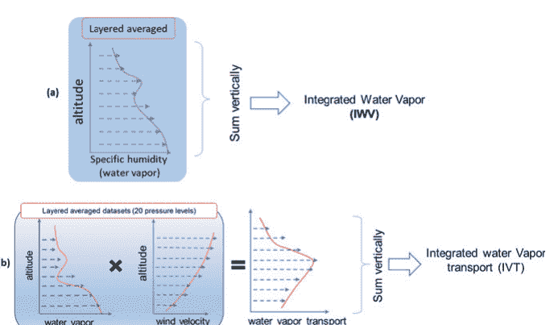

图 2.1 集成水汽的物理表示；b 用于表征对流层中 AR 的集成水汽输送

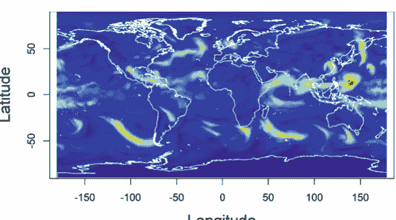

图 2.2 2005 年 7 月 26 日 06:00 源自 ERA5（ECMWF）再分析数据的 IVT（kg m⁻¹ s⁻¹）空间分布

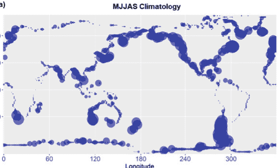

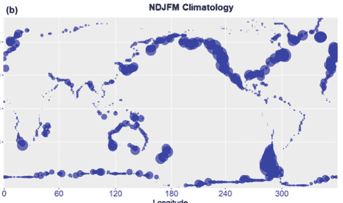

图 2.3 a MJJAS 气候学和 b NDJFM 气候学中的登陆 AR 频率

#### 2.4.1 全球视角

[29]提出的ARDM被应用于跨越1979年至2015年的ERA-Interim IVT数据，从而生成了一份全面的全球AR目录。他们的观察显示，全球平均同时存在11个AR。各种研究中提出的不同ARDM在IVT阈值和几何标准方面存在细微差异。对AR的全球分析表明，登陆位置主要位于两个半球中纬度主要大陆的西海岸[30, 33, 64]（图2.3）。AR频率较高的沿海地区也表现出较高的登陆频率，强调了预计AR影响将实质性的区域。

#### 2.4.2 区域视角

- (a) 北美西海岸

  对北美大陆上AR的研究一直是一个焦点，为其气候学和影响提供了宝贵的见解。Neiman等人[52]率先建立了该地区的AR气候学，将AR定义为具有特定标准的IWV丝状区域。后续研究证实了沿海地区AR的季节性和频率。Gershunov等人[20]采用再分析数据，基于涉及IVT和IWV的标准识别登陆AR。他们的研究结果凸显了AR的季节性进展，频率在不列颠哥伦比亚省9月和10月达到峰值，并在随后几个月向南移动。由于不同的检测方法，AR登陆的季节性出现了差异，基于IWV的方法在温暖季节识别出更多AR，而基于IVT的方法在凉爽季节识别出更多AR。

- (b) 美国西部

  向内陆渗透的AR打破了AR仅局限于沿海地区的传统观念，尤其是在美国西部。这些AR可以对远离海岸的地区产生重大影响，例如2010年1月的AR事件给亚利桑那州带来了极端天气条件并造成了损害[51]。该事件强调了特定定位和地形因素在AR影响中的重要性，包括与上层动力学的垂直耦合、弱静态稳定性、强水汽通量和大尺度动力学。对美国西部利用基于集成水汽输送（IVT）阈值的AR气候学研究揭示，俄勒冈州、华盛顿州和北加利福尼亚州沿海地区的AR频率较高（图2.3）[4, 46, 75]。

- (c) 美国东南部

  美国东南部的强降水事件受到不同大气现象的影响，包括气旋和中尺度对流系统（MCSs）[6]。最近的研究揭示了AR或AR相关特征在某些强降水场景中的作用，尤其是在冬季和过渡季节。[44]的一项研究揭示，大约41%的AR与美国东南部的极端降雨事件相关。

- (d) 欧洲

  欧洲观测到的降水趋势受到来自北大西洋和地中海的水汽移动的影响[17, 33]。AR在欧洲的水文循环中发挥着重要作用。冬季，来自北大西洋的水汽显著影响整个欧洲大陆的降水模式，而地中海则全年为影响南欧的水汽来源[11, 69]。与北美不同，欧洲的AR通常与温带气旋相关联，并且受到的关注较少。尽管如此，研究已证明了它们在极端降水事件中的重要性，例如挪威的一项研究将AR与强降雨联系起来[48]。

  近年来，对研究北大西洋盆地的AR气候学及其对西欧的影响给予了特别关注[11]。到达西欧的AR的水汽来源主要来自副热带地区，另外还来自热带和中纬度地区。理论认为，AR内部的潜热释放影响温带气旋的增强，导致欧洲发生有影响的天气事件[40]。AR对欧洲降水有显著影响，尤其是在冬季活跃的风暴路径期间。然而，随着对流天气系统在夏季更加普遍，其影响会减弱。尽管如此，伊比利亚半岛、法国、英国和西斯堪的纳维亚等地区继续经历来自欧洲AR的显著影响[55, 70]。

- (e) 南美南部

  与北美和欧洲相比，南美洲与AR相关的强降雨影响受到的关注较少。尽管如此，两个大陆中纬度西海岸AR影响之间存在相似之处，其特征是AR直接路径上分布着广阔的山脉。这些地形特征促进地形降水过程，导致强降雨和降雪事件加剧[86]。然而，南美和北美山脉地形的特定局部差异，包括高度、朝向、宽度以及较小沿海山脉的存在，导致与登陆AR相关的地形调制和降水模式各异。

  在南美洲，西海岸会遇到大量的冬季降水事件，这些事件主要与登陆AR相关，对安第斯山脉（具体位于30°S至37°S之间）的年总降雨量和积雪量做出了重大贡献。通常，四到五次强烈的冬季降雨事件贡献了大约70%的年降水量，其中相当一部分事件归因于AR[1]。与登陆AR相关的更强风和更深的气旋往往会导致更高的累积降水量，而由AR引发的极端事件可能导致洪水、滑坡和重大损失，尤其是在中部智利等地区。

- (f) 极地区域的AR

  AR通过向极地输送温暖潮湿的空气，在极地发挥着重要作用。当AR到达格陵兰或南极的冰盖时，由于这些地区的陡坡，会导致地形抬升[22, 85]。格陵兰和东南极的高地地形放大了登陆AR对极地降水的影响，类似于它们对加利福尼亚或南美洲等多山地区的影响。除了引发不寻常的降雨外，AR还导致暖平流，引发诸如2012年7月中格陵兰融冰事件等重大事件[85]。

### 2.5 大气河流的影响

大气河流（ARs）对其途经地区产生重大影响，从有益到危险不等。这些效应在洪涝和水资源管理的背景下至关重要。大气河流经常与外气旋中的山岳地形和暖输送带（WCBs）相互作用，导致持续且强烈的降水 [5, 60]。它们带来的降水，尤其是在与山区结合时，可能导致地形增强降水。这一过程涉及高地抬升湿润空气，从而提高降水效率。多种因素（包括接近气流的稳定性、风速和下垫地形特征）影响大气河流与山脉之间的相互作用。近中性稳定性通常导致气流越过山脉屏障。然而，当大气河流面对像内华达山脉这样的高大山脉时，内华达屏障射流（Sierra Barrier Jet）的形成很常见，从而导致强降水 [8, 28, 38]。

大气河流的影响不仅限于洪涝，还涵盖水资源的各个方面。大气河流在积雪、滑坡、地下水补给、水质、生态系统和植被生产力方面发挥着重要作用 [5, 60]。大气河流引发的强降水对这些环境组分具有影响。先前的研究已强调大气河流与破坏性大风之间的联系，表明其潜在影响超出极端降水范畴。

### 2.6 结论

本文对大气河流的全面探讨揭示了其复杂的本质及其在塑造全球气候极端事件中所起的关键作用。通过利用多种观测技术，包括先进的卫星观测和再分析数据，我们显著提升了在全球和区域尺度上识别和研究大气河流的能力。这一技术进步为揭示大气河流行为及其对气候系统影响所固有的复杂性开辟了新途径。

从多角度考察大气河流（从北美西海岸到欧洲，乃至极地地区）凸显了其适应性及其对区域气候模式的独特影响。大气河流与大尺度气候涛动之间的复杂相互作用进一步强调了这些大气现象的微妙本质。认识到大气河流是气候极端事件的强大驱动因素，是我们探讨中的关键收获。从引发强降水和洪涝到诱导干旱条件，大气河流对其影响地区的气候条件具有重大影响。随着我们对这些动态过程的深入理解，相关信息不仅对于完善气候模型至关重要，而且对于加强预警系统和制定有效策略以减轻极端天气事件相关不利影响也不可或缺。

总之，本章主张在气候极端事件的更广泛背景下，继续探索大气河流相关知识。我们对大气河流不断深化的理解不仅有助于科学上认识地球大气过程，而且对在日益多变的气候中开发主动措施以应对极端天气事件挑战具有巨大的实践意义。在探索大气河流复杂性的过程中，我们增强了复原力和明智决策的能力，从而促进一种更具可持续性和适应性的全球气候挑战应对方法。

### 参考文献

- 1. R.V. Andreoli, M.T. Kayano, W.H.T. Rego, J. Antunes, 大西洋多年代际涛动前置条件在不同厄尔尼诺-南方涛类型遥相连及其对南美洲15°N–15°S区域降水影响中的作用. 1943–1964 (2020). https://doi.org/10.1002/joc.6309
- 2. R.V. Blamey, A.M. Ramos, R.M. Trigo, R. Tomé, C.J.C. Reason, 南大西洋大气河流对南非冬季降雨的影响. J. Hydrometeorol. 19(1), 127–142 (2018). https://doi.org/10.1175/JHM-D-17-0111.1
- 3. F. Cannon, F.M. Ralph, A.M. Wilson, D.P. Lettenmaier, 大气河流中GPM卫星雷达降水和冰区高度测量：与地基雷达及再分析的对比. J. Geophys. Res.: Atmos. 122(23) (2017). https://doi.org/10.1002/2017JD027355
- 4. T.W. Corringham, J. McCarthy, T. Shulgina, A. Gershunov, D.R. Cayan, F.M. Ralph, 气候变化对美国西部未来大气河流洪涝损害的贡献. Sci. Rep. 12(1), 13747 (2022). https://doi.org/10.1038/s41598-022-15474-2
- 5. H.F. Dacre, P.A. Clark, O. Martinez-Alvarado, M.A. Stringer, D.A. Lavers, 大气河流如何形成？ Bull. Am. Meteor. Soc. 96(8), 1243–1255 (2015). https://doi.org/10.1175/BAMS-D-14-00031.1
- 6. N. Debbage, P. Millar, S. Poore, K. Morano, T. Mote, J.M. Sheperd, 大气河流与美国东南部海岸线相互作用的气候学. Int. J. Climatol. 37, 4077–4091 (2017). https://doi.org/10.1002/joc.5000
- 7. D.P. Dee, S.M. Uppala, A.J. Simmons, P. Berrisford, P. Poli, S. Kobayashi, U. Andrae, M.A. Balmaseda, G. Balsamo, P. Bauer, P. Bechtold, A.C.M. Beljaars, L. van de Berg, J. Bidlot, N. Bormann, C. Delsol, R. Dragani, M. Fuentes, A.J. Geer, L. Haimberger, S.B. Healy, H. Hersbach, E. Hólm, L. Isaksen, P. Kållberg, M. Köhler, M. Matricardi, A.P. McNally, B.M. Monge-Sanz, J.J. Morcrette, B.K. Park, C. Peubey, P. de Rosnay, C. Tavolato, J.N. Thépaut, F. Vitart, ERA-Interim再分析：数据同化系统的配置与性能. Q. J. R. Meteorol. Soc. 137(656), 553–597 (2011). https://doi.org/10.1002/qj.828
- 8. M.D. Dettinger, 美国西海岸的大气河流：干旱终结者. J. Hydrometeorol. 14(6), 1721–1732 (2013). https://doi.org/10.1175/JHM-D-13-02.1
- 9. M.D. Dettinger, F.M. Ralph, J.J. Das, 美国西海岸历史大气河流登陆期间最强水汽输送的经验重现期. J. Hydrometeorol. 19(8), 1363–1377 (2018). https://doi.org/10.1175/JHM-D-17-0247.1
- 10. D. Dhana Lakshmi, A.N.V. Satyanarayana, 基于不同再分析数据集，大气河流对钦奈极端降水事件相关毁灭性洪水发生的影响. Atmos. Res. 215, 12–36 (2019). https://doi.org/10.1016/j.atmosres.2018.08.016
- 11. B. teau, M. Dournaux, N. Montoux, J.-L. Baray, 法国及西欧地区的大气河流及其相关降水：1980–2020年。气候学与个例研究. Atmosphere (2021)
- 12. S. Dubey, H. Gupta, M.K. Goyal, N. Joshi, 对Google Earth Engine上印度可用降水数据集的评估. Int. J. Climatol. 41(10), 4844–4863 (2021). https://doi.org/10.1002/joc.7102
- 13. S. Dubey, M.K. Goyal, 印度喜马拉雅山区冰湖溃决洪水危害、下游影响及风险. Water Resources Res. 56(4) (2020). https://doi.org/10.1029/2019WR026533
- 14. S. Dubey, A. Sattar, M.K. Goyal, S. Allen, H. Frey, U.K. Haritashya, C. Huggel, 喜马拉雅山区的大规模移动危害及暴露风险. Earth’s Future 11(9) (2023). https://doi.org/10.1029/2022EF003253
- 15. J. Eiras-Barca, N. Lorenzo, J. Taboada, A. Robles, G. Miguez-Macho, 关于加利西亚（西班牙西北部）大气河流、天气类型与洪水之间关系的研究. Nat. Hazards Earth Syst. Sci. 18, 1633–1645 (2018). https://doi.org/10.5194/nhess-18-1633-2018
- 16. R.E.E.N. Ewell, 一种源自大气河流的水汽通量拟议算法. Mon. Weather Rev. 3, 725–735 (1998)
- 17. Y. Gao, J. Lu, L.R. Leung, 对欧洲大气河流未来变化及其对强降水影响预测的不确定性研究. J. Clim. 29(18), 6711–6726 (2016). https://doi.org/10.1175/JCLI-D-16-0088.1
- 18. Y. Gao, J. Lu, L.R. Leung, Q. Yang, S. Hagos, Y. Qian, 北美西海岸登陆大气河流未来变化的动力学与热力学调制. Geophys. Res. Lett. 42(17), 7179–7186 (2015). https://doi.org/10.1002/2015GL065435
- 19. D. Garaboaz-Paz, J. Eiras-Barca, F. Huhn, V. Pérez-Muñuzuri, 沿大气河流的拉格朗日相干结构. Chaos (Woodbury, N. Y.) 25(6), 63105 (2015). https://doi.org/10.1063/1.4919768
- 20. A. Gershunov, T. Shulgina, F.M. Ralph, D.A. Lavers, J.J. Rutz, 对影响北美西海岸大气河流气候尺度变异性的评估. Geophys. Res. Lett. 44, 7900–7908 (2017). https://doi.org/10.1002/2017GL074175
- 21. L. Gimeno, R. Nieto, M. Vázquez, D.A. Lavers (2014). 大气河流：小型综述. Frontiers in Earth Science, 2(March), 1–6. https://doi.org/10.3389/feart.2014.00002
- 22. I.V. Gorodetskaya, M. Tsukernik, K. Claes, M.F. Ralph, W.D. Neff, N.P.M. Van Lipzig, 大气河流在东南极异常积雪堆积中的作用. Geophys. Res. Lett. 41(17), 6199–6206 (2014). https://doi.org/10.1002/2014GL060881
- 23. M.K. Goyal, C.S.P. Ojha, 对干旱皮乔拉流域平均月降水降尺度中各种线性回归方法的评估. Nat. Resour. 01(01), 11–18 (2010). https://doi.org/10.4236/nr.2010.11002
- 24. M.K. Goyal, V. Poonia, V. Jain, 印度智慧城市三十年城市干旱变异性风险评估. J. Hydrol. 625, 130056 (2023). https://doi.org/10.1016/j.jhydrol.2023.130056
- 25. B. Guan, D.E. Waliser, 20年天气和气候模拟中的大气河流：多模型全球评估. J Geophys. Res. Atmos. 122(11), 5556–5581 (2017). https://doi.org/10.1002/2016JD026174
- 26. B. Guan, 全球大气河流追踪：生命周期特征的空间分布与时态演变. J. Geophys. Res. Atmos. (2020). https://doi.org/10.1029/2019JD031205
- 27. B. Guan, N. Molotch, D. Waliser, F. Fetzer, P. Neiman, 基于卫星测量，大气河流与地表气温相关的极端降雪事件. Geophys. Res. Lett. 37. https://doi.org/10.1029/2010GL044696
- 28. B. Guan, N.P. Molotch, D.F. Waliser, E.J. Fetzer, P.J. Neiman, 加利福尼亚州内华达山脉2010/2011年积雪季：大气河流及大尺度变率模式的作用. Water Resour. Res. 49(10), 6731–6743 (2013). https://doi.org/10.1002/wrcr.20537
- 29. B. Guan, D.F. Waliser, 大气河流探测：面向全球研究的一种算法的评估与应用. J. Geophys. Res. Atmos. 120(24), 12514–12535 (2015). https://doi.org/10.1002/2015JD024257
- 30. B. Guan, D.E. Waliser, 全球大气河流追踪：生命周期特征的空间分布与时态演变. J. Geophys. Res. Atmos. 124, 12523–12552 (2019). https://doi.org/10.1029/2019JD031205

- 31. K. Guirguis, A. Gershunov, T. Shulgina, R.E.S. Clemesha, F.M. Ralph, 影响北加利福尼亚的大气河及其受气候变率的调制. Clim. Dyn. **52**(11), 6569–6583 (2019). https://doi.org/10.1007/s00382-018-4532-5

- 32. K. Guirguis, A. Gershunov, R.E.S. Clemesha, T. Shulgina, A.C. Subramanian, F.M. Ralph, 北美西海岸大气河的环流驱动因素. Geophys. Res. Lett. **45**, 12576–12584 (2018). https://doi.org/10.1029/2018GL079249

- 33. M. Ionita, V. Nagavciuc, B. Guan, 天空中的河流：地上的洪水——大气河在中欧内陆洪水中的作用. Hydrol. Earth Syst. Sci. **24**(11), 5125–5147 (2020). https://doi.org/10.5194/hess-24-5125-2020

- 34. S. Jha, J. Das, A. Sharma, B. Hazra, M.K. Goyal, 印度植被干旱可能性的概率评估及其对韧性的影响. Glob. Planet. Change **176**, 23–35 (2019). https://doi.org/10.1016/j.gloplacha.2019.01.014

- 35. S. Jha, J. Das, M.K. Goyal, 印度降雨极端的低频全球尺度模式及其影响：非平稳性与不确定性分析. Int. J. Climatol. **41**(3), 1873–1888 (2021). https://doi.org/10.1002/joc.6935

- 36. Y. Kamae, W. Mei, S.-P. Xie, 海洋变暖模式对东亚大气河未来变化的影响. Environ. Res. Lett. **14**(5), 054019 (2019). https://doi.org/10.1088/1748-9326/ab128a

- 37. S.Y. Kim, A. Upneja, 基于决策树的多数投票集成法在经济下行期企业失败预测中的应用. J. Innov. Knowl. **6**(2), 112–123 (2021). https://doi.org/10.1016/j.jik.2021.01.001

- 38. D.E. Kingsmill, P.J. Neiman, B.J. Moore, M. Hughes, S.E. Yuter, F.M. Ralph, 北加利福尼亚登陆冬季风暴期间塞拉屏障急流与上抬大气河的运动学与热力学结构. Mon. Weather Rev. **141**(6), 2015–2036 (2013). https://doi.org/10.1175/MWR-D-12-00277.1

- 39. N. Kumar, P. Patel, S. Singh, M.K. Goyal, 印度彭纳尔流域水文气候极端非平稳性及韧性理解. Sci. Rep **13**(1), 12524 (2023). https://doi.org/10.1038/s41598-023-38771-w

- 40. D.A. Lavers, G. Villarini, 大气河对欧洲和美国降水的贡献. J. Hydrol. **522**, 382–390 (2015). https://doi.org/10.1016/j.jhydrol.2014.12.010

- 41. D.A. Lavers, G. Villarini, R.P. Allan, E.F. Wood, A.J. Wade, 大气再分析中大气河的检测及其与英国冬季洪水和大尺度气候环流的联系. J. Geophys. Res. Atmos. **117**(D20) (2012). https://doi.org/10.1029/2012JD018027

- 42. J. Liang, Y. Yong, 亚洲季风区大气河的气候学. Int. J. Climatol. **41**(S1), E801–E818 (2021). https://doi.org/10.1002/joc.6729

- 43. J. Liang, Y. Yong, M.K. Hawcroft, 东亚大气河的长期趋势. Clim. Dyn. **60**(3–4), 643–666 (2023). https://doi.org/10.1007/s00382-022-06339-5

- 44. K. Mahoney, 美国东南部强降水中大气河作用的理解. Mon. Wea. Rev. **144**, 1617–1632 (2016). https://doi.org/10.1175/MWR-D-15-0279.1

- 45. S.S. Mahto, M.A. Nayak, D.P. Lettenmaier, V. Mishra, 登陆印度的大气河与洪水相关. Commun. Earth Environ. **4**(1), 120 (2023). https://doi.org/10.1038/s43247-023-00775-9

- 46. G.J. McCabe, M.D. Dettinger, 美国西部降水与ENSO遥相联强度的十年际变化. Int. J. Climatol. **19**(13), 1399–1410 (1999). https://doi.org/10.1002/(SICI)1097-0088(19991115)19:13<1399::AID-JOC457>3.0.CO;2-A

- 47. S. Meghani, S. Singh, N. Kumar, M.K. Goyal, 大气河时空特征预测：一种新型数据驱动方法. Glob. Planet. Change **231**, 104295 (2023). https://doi.org/10.1016/j.gloplacha.2023.104295

- 48. C. Michel, A. Sorteberg, S. Eckhardt, C. Weijenborg, A. Stohl, M. Cassiani, 挪威与大气河相关的极端降水事件期间大气环境的特征——季节性与区域性方面. Weather Clim. Extremes **34**, 100370 (2021). https://doi.org/10.1016/j.wace.2021.100370

- 49. B.D. Mundhenk, E.A. Barnes, E.D. Maloney, 北太平洋大气河频率的全季节气候学与变率. J. Clim. **29**, 4885–4903 (2016). https://doi.org/10.1175/JCLI-D-15-0655.1

- 50. D. Nash, D. Waliser, B. Guan, H. Ye, F.M. Ralph, 大气河在温带和极地水文气候学中的作用. J. Geophys. Res. Atmos. **123**, 6804–6821 (2018). https://doi.org/10.1029/2017JD028130

- 51. P.J. Neiman, M. Hughes, B.J. Moore, F.M. Ralph, E.M. Sukovich, 基于风廓线仪网络的北加利福尼亚塞拉屏障急流、大气河与降水特征的综合视角. Mon. Weather Rev. **141**(12), 4211–4233 (2013). https://doi.org/10.1175/MWR-D-13-00112.1

- 52. P.J. Neiman, F.M. Ralph, G.A. Wick, J.D. Lundquist, M.D. Dettinger, 基于八年SSM/I卫星观测的影响北美西海岸大气河的气象特征与陆地降水影响. J. Hydrometeorol. **9**(1), 22–47 (2008). https://doi.org/10.1175/2007JHM855.1

- 53. A.E. Payne, M.-E. Demory, L.R. Leung, A.M. Ramos, C.A. Shields, J.J. Rutz, N. Siler, G. Villarini, A. Hall, F.M. Ralph, 大气河对气候变化的响应与影响. Nat. Rev. Earth Environ. **1**(3), 143–157 (2020). https://doi.org/10.1038/s43017-020-0030-5

- 54. A.E. Payne, G. Magnusdottir, 基于30年MERRA再分析的北太平洋登陆大气河动力学. J. Clim. **27**(18), 7133–7150 (2014). https://doi.org/10.1175/JCLI-D-14-00034.1

- 55. J.M. Pereira, M. Basto, A.F. da Silva, 基于逻辑拉索与岭回归的企业失败预测. Procedia Econ. Finance **39**, 634–641 (2016). https://doi.org/10.1016/S2212-5671(16)30310-0

- 56. S.D. Polade, A. Gershunov, D.R. Cayan, M.D. Dettinger, D.W. Pierce, CMIP3和CMIP5模型中太平洋-北美地区降水的自然气候变率与遥相联. Geophys. Res. Lett. **40**(10), 2296–2301 (2013). https://doi.org/10.1002/grl.50491

- 57. V. Poonia, M.K. Goyal, S. Jha, S. Dubey, 印度突发干旱对陆地生态系统的响应. J. Hydrol. **605**, 127402 (2022). https://doi.org/10.1016/j.jhydrol.2021.127402

- 58. H.D. Prince, N.J. Cullen, P.B. Gibson, J. Conway, D.G. Kingston, 新西兰大气河气候学. J. Clim. **34**(11), 4383–4402 (2021). https://doi.org/10.1175/JCLI-D-20-0664.1

- 59. S. Rakkasagi, M.K. Goyal, S. Jha, 基于模糊逻辑评估印度沿海拉姆萨尔湿地未来极端降雨风险. J. Hydrol. **632**, 130869 (2024). https://doi.org/10.1016/j.jhydrol.2024.130869

- 60. F.M. Ralph, M.D. Dettinger, 风暴、洪水与大气河科学. Eos, Trans. Am. Geophys. Union **92**(32), 265–266 (2011). https://doi.org/10.1029/2011EO320001

- 61. F.M. Ralph, P.J. Neiman, R. Rotunno, 基于CALJET-1998和PACJET-2001的东北太平洋低层急流落目探子观测：平均垂直剖面与大气河特征. Mon. Weather Rev. **133**(4), 889–910 (2005). https://doi.org/10.1175/MWR2896.1

- 62. F.M. Ralph, P.J. Neiman, G.A. Wick, S.I. Gutman, M.D. Dettinger, D.R. Cayan, A.B. White, 加利福尼亚俄罗斯河流域洪水：大气河的作用. Geophys. Res. Lett. **33**(13) (2006). https://doi.org/10.1029/2006GL026689

- 63. F.M. Ralph, M.D. Dettinger, M.M. Cairns, T.J. Galarneau, J. Eylender, 定义“大气河”：气象学词汇表如何帮助解决争论. Bull. Am. Meteor. Soc. **99**(4), 837–839 (2018). https://doi.org/10.1175/BAMS-D-17-0157.1

- 64. F.M. Ralph, M. Dettinger, D. Lavers, I.V. Gorodetskaya, A. Martin, M. Viale, A.B. White, N. Oakley, J. Rutz, J.R. Spackman, H. Wernli, J. Cordeira, 大气河成为全球科学与应用焦点. Bull. Am. Meteorol. Soc. **98**(9), 1969–1973 (2017). https://doi.org/10.1175/BAMS-D-16-0262.1

- 65. F.M. Ralph, M.D. Dettinger, J.J. Rutz, D.E. Waliser（编）, *大气河* (Springer International Publishing, Cham, 2020)

- 66. F.M. Ralph, P.J. Neiman, G.N. Kiladis, K. Weickmann, D.W. Reynolds, 太平洋大气河展现热带-温带连接和中尺度锋面波的多尺度观测个例研究. Mon. Weather Rev. **139**(4), 1169–1189 (2011). https://doi.org/10.1175/2010MWR3596.1

- 67. F.M. Ralph, P.J. Neiman, G.A. Wick, 1997/98年冬季东北太平洋大气河的卫星和CALJET飞机观测. Mon. Weather Rev. **132**(7), 1721–1745 (2004). https://doi.org/10.1175/1520-0493(2004)132%3c1721:SACAOO%2.0.CO;2

- 68. F.M. Ralph, A.M. Wilson, T. Shulgina, B. Kawzenuk, S. Sellars, J.J. Rutz, M.A. Lamjiri, E.A. Barnes, A. Gershunov, B. Guan, K.M. Nardi, T. Osborne, G.A. Wick, ARTMIP早期启动大气河检测工具比较：有多少大气河袭击了加利福尼亚北部的俄罗斯河流域？ Clim. Dyn. **52**(7–8), 4973–4994 (2019). https://doi.org/10.1007/s00382-018-4427-5

- 69. A.M. Ramos, R. Tomé, R.M. Trigo, M.L.R. Liberato, J.G. Pinto, CMIP5模型中影响欧洲的大气河预计变化. Geophys. Res. Lett. **43**(17), 9315–9323 (2016). https://doi.org/10.1002/2016GL070634

- 70. A.M. Ramos, R.M. Trigo, M.L.R. Liberato, R. Tomé, 伊比利亚半岛每日降水极端事件及其与大气河的关联. J. Hydrometeorol. **16**(2), 579–597 (2015). https://doi.org/10.1175/JHM-D-14-0103.1

- 71. A.M. Ramos, R.C. Blamey, I. Algarra, R. Nieto, L. Gimeno, R. Tomé, C.J.C. Reason, R.M. Trigo, 从亚马逊到南非：通过低空急流和大气河进行大气水汽输送. Ann. N. Y. Acad. Sci. **1436**, 217–230 (2019). https://doi.org/10.1111/nyas.13960

- 72. K.S. Rautela, J.C. Kuniyal, M.K. Goyal, N. Kanwar, A.S. Bhoj, 印度西北喜马拉雅东部道利甘加河水文-泥沙流的评估与模拟. Nat. Hazards (2024). https://doi.org/10.1007/s11069-024-06413-7

- 73. K.S. Rautela, S. Singh, M.K. Goyal, 全球气溶胶大气河的时空分布、检测和预测特征. J. Environ. Manage. **351**, 119675 (2024). https://doi.org/10.1016/j.jenvman.2023.119675

- 74. K.J. Reid, A.D. King, T.P. Lane, D. Hudson, 澳大利亚地区热带、副热带和温带大气河. J. Clim. **35**(9), 2697–2708 (2022). https://doi.org/10.1175/JCLI-D-21-0066.1

- 75. J.J. Rutz, W.J. Steenburgh, 量化美国内陆西部大气河的作用. Atmos. Sci. Lett. **13**(4), 257–261 (2012). https://doi.org/10.1002/asl.392

- 76. J.J. Rutz, W.J. Steenburgh, F.M. Ralph, 西北美大气河向内陆渗透：拉格朗日分析. Mon. Weather Rev. **143**(5), 1924–1944 (2015). https://doi.org/10.1175/MWR-D-14-00288.1

- 77. A. Sharma, M.K. Goyal, 利用小波变换评估印度的干旱趋势和变异性. Hydrol. Sci. J. **65**(9), 1539–1554 (2020). https://doi.org/10.1080/02626667.2020.1754422

- 78. C.A. Shields, J.J. Rutz, L.R. Leung, F.M. Ralph, M. Wehner, T. O’Brien, 通过比较大气河追踪方法来定义不确定性. Bull. Am. Meteorol. Soc **100**, ES93–ES96 (2019). https://doi.org/10.1175/BAMS-D-18-0200.1

- 79. J. Shu, A.Y. Shamseldin, E. Weller, 大气河对新西兰降雨的影响. Sci. Rep. **1**(1), 5869 (2021). https://doi.org/10.1038/s41598-021-85297-0

- 80. S. Singh, M.K. Goyal, 增强企业气候韧性：人工智能的作用. J. Clean. Prod. 138228 (2023)

- 81. S. Singh, N. Kumar, M.K. Goyal, S. Jha, 印度Narmada流域水文气候极端事件时空变率中ENSO、IOD和AMO的相对影响. AQUA—Water Infrastructure Ecosyst. Soc.**72**(4), 520–539 (2023). https://doi.org/10.2166/aqua.2023.219

- 82. S. Singh, M.K. Goyal, 预测大气河的创新方法：探索卷积自动编码器. Atmos. Res. **289**, 106754 (2023)

- 83. S. Singh, M.K. Goyal, S. Jha, 与大气河相关的降水极端事件中大规模气候振荡的作用：非平稳框架. Hydrol. Sci. J. **68**(3), 395–411 (2023)

- 84. H. Sodemann, A. Stohl, 大气河中的水汽起源与经向输送及其与多个气旋的关联. Mon. Weather Rev. 141(8), 2850–2868 (2013). https://doi.org/10.1175/MWR-D-12-00256.1

- 85. J. Turner, H. Lu, J.C. King, S. Carpentier, M. Lazzara, T. Phillips, J. Wille, 沿海东南极洲与大气河和创纪录夏季下坡风相关的极端高温事件. Geophys. Res. Lett. 49(4) (2022). https://doi.org/10.1029/2021GL097108

- 86. M. Viale, R. Valenzuela, R.D. Garreaud, F.M. Ralph, 大气河对南美洲南部降水的影响. J. Hydrometeorol. 19(10), 1671–1687 (2018). https://doi.org/10.1175/JHM-D-18-0006.1

- 87. G.A. Wick, Y.-H. Kuo, F.M. Ralph, T.-K. Wee, P.J. Neiman (2008). SSM/I和COSMIC集成水汽检索的比对. Geophys. Res. Lett. 35(21), L21805. https://doi.org/10.1029/2008GL035126

- 88. G.A. Wick, P.J. Neiman, F.M. Ralph, 大气河集成水汽特征识别和表征的自动客观技术的描述与验证. IEEE Trans. Geosci. Remote Sens. 51, 2166–2176 (2013). https://doi.org/10.1109/TGRS.2012.2211024

- 89. Y. Zhu, R.E. Newell, 大气河和炸弹气旋. Geophys. Res. Lett. 21(18), 1999–2002 (1994). https://doi.org/10.1029/94GL01710

- 90. Y. Zhu, R.E. Newell, 大气河水汽通量的拟议算法. Mon. Weather Rev. 126(3), 725–735 (1998). https://doi.org/10.1175/1520-0493(1998)126%3c0725:APAFMF%3e2.0.CO;2

## Chapter 3

### 3.1 Introduction

大气河是地球大气环流中迷人且动态的通道，充当浓缩水汽输送的导管，深刻影响区域降水模式和天气系统 [8, 26, 36]。这些大气现象在塑造水文循环中起着关键作用，并与复杂的大气和海洋过程网络密切相关 [22, 23, 25]。大气河事件的时空分布与多种因素复杂关联，包括季节性天气变化、诸如厄尔尼诺事件等海洋温度异常以及更广泛的气候变化动态 [9, 15, 20]。易受大气河影响的地区，如北美西海岸和欧洲的部分地区，这些现象的频率更高 [2, 5–7, 11, 29]。这种高频现象通常在特定季节观测到，当时大气条件有利于大气河的形成和传播 [4, 18]。来自大气河的显著水汽涌入对这些地区的年降水总量作出重大贡献，在补充水资源和维持生态系统方面发挥着关键作用。然而，与大气河相关的降水的强烈性质也可能导致诸如洪水等挑战，尤其是在基础设施和土地利用做法不足的地区。由诸如水汽输送速率和降水水平等指标衡量的大气河事件强度，是决定相关影响严重程度的关键因素 [28, 33, 38]。当大气河释放其含水量大的洪流时，易受强降雨和洪水影响的地区变得特别脆弱，面临一系列给基础设施带来压力、使土壤饱和并加剧水文风险的挑战 [15, 17, 22, 23, 27]。当强大的大气河与当地地形相互作用时，复杂的大气动力学相互作用就会展开，导致强降雨，可在短时间内迅速改变地貌。这种快速转变不仅考验自然生态系统的恢复力，也考验人类的适应能力

定居点，凸显了制定强大灾害防范策略的紧迫性 [1, 3, 13, 14, 24, 32, 37]。

对登陆大气河（AR）发生频率及其特定属性的详细理解，对于准确评估洪水风险、高效管理水资源以及规划灾害至关重要 [19, 34]。当这些大气系统登陆时，它们可能会释放大量降水，淹没低洼地区，使排水系统超负荷运转，并引发突发洪水。登陆大气河的累积影响超出了即时洪水事件，影响土壤湿度水平、地下水补给率以及整体水文平衡 [2, 31]。这凸显了整合气象数据、水文模型和风险评估框架的重要性，以制定主动策略，减轻大气河引发洪水的影响，并增强社区韧性。

诸如 [10, 16, 21, 23, 25, 30, 35, 39] 等专家的重要研究贡献，为大气河的行为及其对气候动力学和水文过程的影响提供了宝贵见解。这些开创性研究深入探讨了大气水汽输送、降水模式和区域气候变率之间错综复杂的相互作用，揭示了驱动大气河变率和演变的底层机制。通过利用这些研究成果，科学家和政策制定者可以制定针对性的策略，以适应当地脆弱性，增强适应能力，并在不断变化的气候情境下提升灾害韧性。通过深入探究大气河行为及其相关降水模式的复杂细节，科学家和政策制定者可以制定针对性的策略，以减轻这些大气现象的影响。持续开展聚焦大气河的研究工作，对于推进我们对这些复杂系统的理解、改进与大气河相关的极端天气事件的预测能力，以及在不断变化的气候情境下增强韧性，至关重要。

### 3.2 大气河关键特征

#### 3.2.1 大气河频率

已对大气河的频率、持续时间和强度进行了分析，以研究其影响。大气河频率表示每个位置（网格）出现大气河条件的频率，并表示为时间步长的百分比。

换句话说，网格在 6 小时大气河检测中表示大气河条件的时间步长百分比（1979 至 2018 年 40 年期间），被视为该网格的大气河频率。北美西部和东部、欧洲、东亚、澳大利亚、新西兰、南美洲最南部和非洲每年都会经历大量大气河。如果这些大气河在某个地区持续较长时间，可能会给这些地区带来从有益到灾难性的影响。

深绿色区域表示 MK z 统计量小于 –1.96，代表显著下降趋势；红色表示“z”大于 1.96，代表

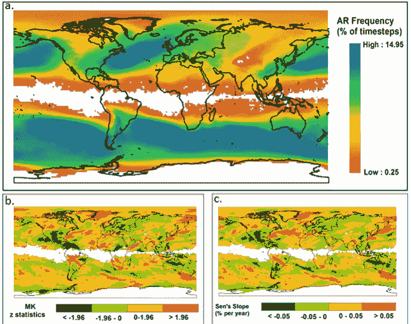

图 3.1 a 每个网格的大气河频率（以时间步长百分比表示）；b Mann–Kendall 趋势检验的“z”统计量；c 5% 显著性水平下 Sen's 斜率（“s”）

表示数据中存在显著上升趋势，而浅绿色和黄色代表下降和上升趋势但不显著。我们观察到大气河频率总体呈上升趋势，特别是在频率较高的地区，但除少数地区外并不十分显著（图 3.1）。Sen's 斜率统计量的空间分布显示，在具有统计学上显著上升和下降趋势的地区，大气河频率大约增加了 0.05%。

#### 3.2.2 大气河持续时间

平均大气河持续时间计算为在大气河检测期间，表示大气河的网格在连续时间步长中的平均时间（图 3.2）。例如，平均大气河持续时间为 20 小时的网格表示，在检测期间的各个时间步长中，该网格平均一直代表大气河的一部分。这种评估使我们能够更好地了解易受大气河影响的地区。美国气象学会将其分为从弱到极端的类别。北美和南美西海岸、欧洲、

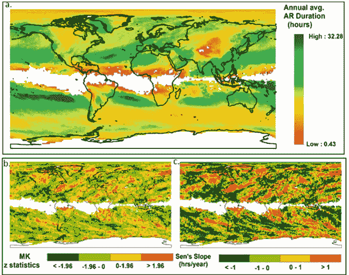

图 3.2 a 大气河持续时间（以区域平均持续时间表示）；b Mann–Kendall 趋势检验的“z”统计量和 Sen's 斜率（“s”），5% 显著性水平

东南亚和澳大利亚的平均大气河持续时间为 20 至 30 小时，这可能导致该地区从有益到毁灭性的大气河降水。大气河频率表示检测期间大气河的总体空间分布，而大气河持续时间表示表示大气河的网格的平均持续时间，这相对是大气河的离散瞬时行为。

图 3.2b（z 统计量）显示年度平均大气河持续时间总体呈下降趋势（不显著），同样可以观察到，持续时间分布较高的地区呈上升趋势，但只有少数地区具有统计学上显著的上升趋势。具有上升趋势的地区被记录为大气河持续时间每年增加 1 小时或更多。

#### 3.2.3 大气河强度

大气河强度是衡量大气河水汽携带能力的主要指标之一，由表示大气河的集合网格的 IVT（水汽输送通量）大小的变化来表示。在大气河检测中，任何时间步长被识别为对象的网格的平均 IVT 大小表示为大气河强度。年度平均大气河强度

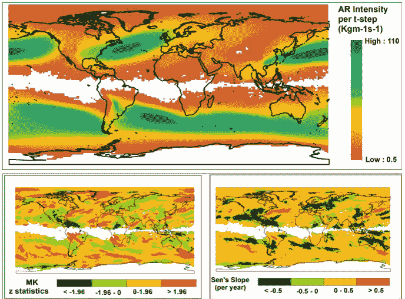

图 3.3 大气河强度表示为区域大气河条件时的平均 IVT 大小；Mann–Kendall 趋势检验的“z”统计量和 Sen's 斜率（“s”），5% 显著性水平

每个时间步长，如图 3.3 所示，指示检测到的大气河位置平均 IVT 大小的变化。强度值越高，该位置湿度密度的概率越高。与强度大小较高区域相对应的大气河形状在登陆时最有可能带来巨大洪水。大气河强度大小较高的地区（北美和欧洲西海岸、南美洲最南部、亚洲东海岸、澳大利亚最南部等）与大气河频率较高的地区重合，这意味着强度高的地区也更有可能出现高强度。

研究发现，大气河强度随大气河频率增加而增加，但仅在一些高强度地区如此，且仅在 5% 显著性水平下在部分中纬度地区具有统计学显著性（图 3.3）。

#### 3.2.4 登陆大气河频率

由于这些大气河会带来洪水，并且在一些地区可能导致干旱，因此了解登陆大气河的时空特征至关重要。

这些大气河在几乎所有大陆都有观测到，但登陆大气河的频率在北美东、西海岸、南美洲西南部、欧洲西海岸、南亚、东亚、东南亚、澳大利亚、新西兰等地相对较高。我们观察到，这些大气河在夏季（MJJAS 气候学）比冬季（NDJFM 气候学）更频繁（图 3.4）。

此外，发现登陆大气河频率较高的地区在十年尺度上更为一致。北美和南美东西海岸、南美洲最南部以及欧洲西海岸每年在两个季节都会经历大约 11–20 天的大气河（图 3.4）。而东南亚、澳大利亚、新西兰和格陵兰在两个季节经历 5–10 个大气河。在两个季节中，登陆大气河在北美、南美和欧洲最为频繁。虽然 MJJAS 气候学下大气河更频繁，但亚洲和澳大利亚大陆观测到大气河频率增长最为显著。

### 3.3 大气河相关降水

使用 1.5° 空间分辨率获得的 ECMWF（ERA5）每日分级总降水数据集，与同一天每个网格的大气河可用性进行了跟踪，以探索其与大气河的连通性。如果某位置接收到的降水被发现与至少持续一个时间步长（6 小时）的大气河条件同时出现，则被视为大气河相关降水。为此，将检测到的大气河空间分布与同一时间步长从 ECMWF 获得的总降水数据进行叠加，并估计了总降水中作为大气河相关降水的比例（图 3.5）。

在 NDJFM 季节气候学的情况下，大气河平均日降水集中在北美和欧洲西海岸以及南美洲和澳大利亚东海岸（图 3.5c）。而在 MJJAS 季节气候学中，大气河降水在中东亚、新西兰、北美最南部以及澳大利亚西南地区更为明显（图 3.5b）。由于在某些情况下，即使某个地区存在大气河，除非水汽（大气河的一部分）的流动出现某种不稳定性，否则不一定会产生降水；并且如果在某些大气条件下带来降水，也不会在大气河延伸正下方均匀分布。

因此，在许多情况下，即使大气河持续存在，接收到的降水也为零，导致某地区的大气河相关降水量较小。而在某些特定情况下，这些大气河可给某个地点带来高达数百厘米的降水。这些图表可以让人了解全球接收降水的区域，以便进一步探索通过这些大气河在不同季节中降水的详细贡献（图 3.5）。

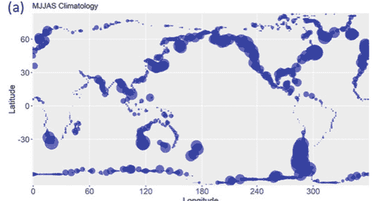

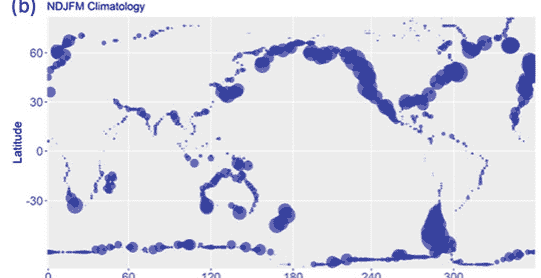

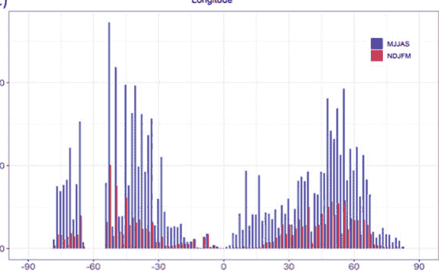

图 3.4 登陆大气河流与海岸相交的频率（天/季节）：a MJJAS，b NDJFM，c 与海岸线相交的大气河流纬度与大气河流频率的关系

#### (a) 年份气候学

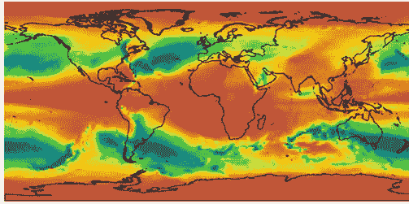

0 mm 55.96 cm

#### (b) MJJAS 气候学

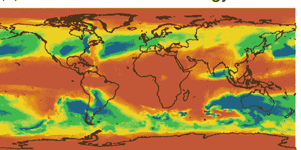

0 mm 97.89 cm

#### (c) NDJFM 气候学

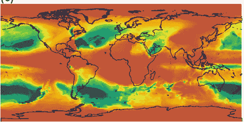

0 mm 101.26 cm

图 3.5 与大气河流相关的降水：a 年份气候学，b MJJAS 气候学，c NDJFM 气候学

### 3.4 结论

大气河流（ARs）是地球大气动力学的重要组成部分，显著影响区域降水模式，并通过产生从有益降雨到灾难性洪水的影响，对受影响地区构成利弊兼备的影响。本章强调了解大气河流事件的时空分布、其对水文循环的影响以及其与大气和海洋过程关联的重要性。除了北美西海岸和欧洲之外，还有几个地区易受大气河流影响，并在特定季节经历显著的大气河流频率，对年降水总量作出重大贡献，同时也带来因强降雨导致洪水等风险。

大气河流事件的强度由水汽输送率和降水水平衡量，在确定相关影响的严重程度方面起着关键作用，特别是在易发生强降雨和洪水的地区。有效的洪水风险评估、水资源管理和灾害准备规划需要对大气河流特征和登陆模式有细致入微的了解。整合气象数据、水文模型和风险评估框架对于制定主动策略以减轻大气河流引发的洪水影响并增强社区复原能力至关重要。

持续的研究工作对于推进我们对大气河流行为的了解、完善与大气河流相关的极端天气事件预报能力以及在变化气候条件下增强复原能力至关重要。通过更深入地探索大气河流现象的复杂性，我们可以更好地为这些重大大气事件的影响做好准备并做出响应，最终增强我们适应变化气候格局的能力。

### 参考文献

- 1. J. Das, S. Jha, M.K. Goyal, 印度气象同质地区月降水量与气候和季风遥相关的关系：小波与全球相干性方法. Atmos. Res. **238**, 104889 (2020). https://doi.org/10.1016/j.atmosres.2020.104889
- 2. M.D. Dettinger, 美国西海岸的大气河流：干旱终结者. J. Hydrometeorol. **14**(6), 1721–1732 (2013). https://doi.org/10.1175/JHM-D-13-02.1
- 3. S. Dubey, M.K. Goyal, 印度喜马拉雅山区冰湖溃坝洪水灾害、下游影响与风险. Water Resour. Res. **56**(4) (2020). https://doi.org/10.1029/2019WR026533
- 4. V. Espinoza, D.E. Walser, B. Guan, D.A. Lavers, F.M. Ralph, 气候变化预测对大气河流影响的全球分析. Geophys. Res. Lett. **45**(9), 4299–4308 (2018). https://doi.org/10.1029/2017GL076968
- 5. Y. Gao, J. Lu, L.R. Leung, 欧洲地区未来大气河流变化及其对强降水影响的投影不确定性. J. Clim. **29**(18), 6711–6726 (2016). https://doi.org/10.1175/JCLI-D-16-0088.1
- 6. A. Gershunov, T. Shulgina, R.E.S. Clemesha, K. Guirguis, D.W. Pierce, M.D. Dettinger, D.A. Lavers, D.R. Cayan, S.D. Polade, J. Kalansky, F.M. Ralph, 北美西部降水制度变化：大气河流的作用. Sci. Rep. **9**(1), 9944 (2019). https://doi.org/10.1038/s41598-019-46169-w
- 7. A. Gershunov, T. Shulgina, F.M. Ralph, D.A. Lavers, J.J. Rutz, 评估影响北美西部的大气河流的气候尺度变率. Geophys. Res. Lett. **44**, 7900–7908 (2017). https://doi.org/10.1002/2017GL074175
- 8. L. Gimeno, R. Nieto, M. Vázquez, D.A. Lavers, 大气河流：一篇小型综述. Front. Earth Sci. **2**, 1–6 (2014). https://doi.org/10.3389/feart.2014.00002
- 9. B. Guan, D.E. Waliser, 大气河流的检测：全球研究算法的评估与应用. J. Geophys. Res. Atmos. **120**(24), 12514–12535 (2015). https://doi.org/10.1002/2015JD024257
- 10. B. Guan, D.E. Waliser, 20 年天气和气候模拟中的大气河流：多模式全球评估. J. Geophys. Res. Atmos. **122**(11), 5556–5581 (2017). https://doi.org/10.1002/2016JD026174
- 11. K. Guirguis, A. Gershunov, R.E.S. Clemesha, T. Shulgina, A.C. Subramanian, F.M. Ralph, 北美西海岸大气河流的环流驱动因素. Geophys. Res. Lett. **45**, 12576–12584 (2018). https://doi.org/10.1029/2018GL079249
- 12. M. Ionita, V. Nagavciuc, B. Guan, 天空之河，地面之洪：大气河流在中欧内陆洪水中的作用. Hydrol. Earth Syst. Sci. **24**(11), 5125–5147 (2020). https://doi.org/10.5194/hess-24-5125-2020
- 13. N. Kumar, P. Patel, S. Singh, M.K. Goyal, 理解印度常年流域水文气候极值的非平稳性与复原力. Sci. Rep. **13**(1), 12524 (2023). https://doi.org/10.1038/s41598-023-38771-w
- 14. N. Kumar, V. Poonia, B.B. Gupta, M.K. Goyal, 面向气候变化的关键基础设施风险评估与复原力新框架. Technol. Forecast. Soc. Chang. **165**, 120532 (2021). https://doi.org/10.1016/j.techfore.2020.120532
- 15. D.A. Lavers, R.P. Allan, E.F. Wood, G. Villarini, D.J. Brayshaw, A.J. Wade, 英国冬季洪水与大气河流相关. Geophys. Res. Lett. **38**(23) (2011). https://doi.org/10.1029/2011GL049783
- 16. D.A. Lavers, G. Villarini, 大气河流对欧洲和美国降水的贡献. J. Hydrol. **522**, 382–390 (2015). https://doi.org/10.1016/j.jhydrol.2014.12.010
- 17. J. Liang, Y. Yong, 亚洲季风区大气河流气候学. Int. J. Climatol. **41**(S1), E801–E818 (2021). https://doi.org/10.1002/joc.6729
- 18. E.C. Massoud, V. Espinoza, B. Guan, D.E. Waliser, 大气河流未来预测的全球气候模型集合方法. Earth’s Future **7**(10), 1136–1151 (2019). https://doi.org/10.1029/2019EF001249
- 19. S. Meghani, S. Singh, N. Kumar, M.K. Goyal, 大气河流时空特征预测：一种新型数据驱动方法. Global Planet. Change **231**, 104295 (2023). https://doi.org/10.1016/j.gloplacha.2023.104295
- 20. D. Nash, D. Waliser, B. Guan, H. Ye, F.M. Ralph, 大气河流在温带和极地水文气候学中的作用. J. Geophys. Res. Atmos. **123**, 6804–6821 (2018). https://doi.org/10.1029/2017JD028130
- 21. P.J. Neiman, M. Hughes, B.J. Moore, F.M. Ralph, E.M. Sukovich, 北加州塞拉屏障喷射、大气河流及降水特征：基于风廓线仪网络的综合视角. Mon. Weather Rev. **141**(12), 4211–4233 (2013). https://doi.org/10.1175/MWR-D-13-00112.1
- 22. H. Paltan, D. Waliser, W.H. Lim, B. Guan, D. Yamazaki, R. Pant, S. Dadson, 大气河流驱动的全球洪水与水资源可用性. Geophys. Res. Lett. **44**(20), 10387–10395 (2017). https://doi.org/10.1002/2017GL074882
- 23. A.E. Payne, M.-E. Demory, L.R. Leung, A.M. Ramos, C.A. Shields, J.J. Rutz, N. Siler, G. Villarini, A Hall, F.M. Ralph, 大气河流对气候变化的响应与影响. Nat. Rev. Earth Environ. **1**(3), 143–157 (2020). https://doi.org/10.1038/s43017-020-0030-5
- 24. S. Rakkasagi, M.K. Goyal, S. Jha, 使用模糊逻辑评估印度沿海拉姆萨尔湿地面临极端降雨的未来风险. J. Hydrol. **632**, 130869 (2024). https://doi.org/10.1016/j.jhydrol.2024.130869

### References

- 25. F.M. Ralph, M.D. Dettinger, 暴风雨、洪水与大气河流的科学. Eos, Trans. Am. Geophys. Union 92(32), 265–266 (2011). https://doi.org/10.1029/2011EO320001
- 26. F.M. Ralph, M.D. Dettinger, J.J. Rutz, D.E. Waliser (eds.), 大气河流 (Springer International Publishing, Cham, 2020)
- 27. F.M. Ralph, P.J. Neiman, G.A. Wick, S.I. Gutman, M.D. Dettinger, D.R. Cayan, A.B. White, 加利福尼亚州俄罗斯河流域的洪水：大气河流的作用. Geophys. Res. Lett. 33(13) (2006). https://doi.org/10.1029/2006GL026689
- 28. F.M. Ralph, J.J. Rutz, J.M. Cordeira, M. Dettinger, M. Anderson, D. Reynolds, L.J. Schick, C. Smallcomb, 表征大气河流强度与影响的量表. Bull. Am. Meteor. Soc. 100(2), 269–289 (2019). https://doi.org/10.1175/BAMS-D-18-0023.1
- 29. A.M. Ramos, R.M. Trigo, R. Tomé, M.L.R. Liberato, 大气河流对欧洲马卡罗尼西亚群岛极端降水的影响. Atmosphere 9, 325 (2018). https://doi.org/10.3390/atmos9080325
- 30. A.M. Ramos, A.M. Wilson, M.J. Deflorio, M.D. Warner, E. Barnes, R. Garreaud, I.V. Gorodetskaya, B. Moore, A. Payne, C. Smallcomb, D.A. Lavers, M. Wehner, F. Martin, H. Sodemann, 2018年国际大气河流会议：大气河流的多学科研究与高影响应用 1–8 (2019). https://doi.org/10.1002/asl.935
- 31. K.S. Rautela, S. Singh, M.K. Goyal, 全球气溶胶大气河流时空分布、检测与预测的表征. J. Environ. Manage. 351, 119675 (2024). https://doi.org/10.1016/j.jenvman.2023.119675
- 32. A. Sharma, M.K. Goyal, 印度水文气候扰动下生态系统恢复力的评估. Global Change Biol. 24(2) (2018). https://doi.org/10.1111/gcb.13874
- 33. J. Shu, A.Y. Shamseldin, E. Weller, 大气河流对新西兰降雨的影响. Sci. Rep. 11(1), 5869 (2021). https://doi.org/10.1038/s41598-021-85297-0
- 34. S. Singh, M.K. Goyal, 提升企业气候韧性：人工智能的作用. J. Cleaner Prod. 138228 (2023)
- 35. S. Singh, M.K. Goyal, 预测大气河流的创新方法：探索卷积自编码器. Atmos. Res. 289, 106754 (2023)
- 36. S. Singh, M.K. Goyal, S. Jha, 大气河流相关降水极值中大规模气候振荡的作用：非平稳框架. Hydrol. Sci. J. 68(3), 395–411 (2023)
- 37. S. Singh, N. Kumar, M.K. Goyal, S. Jha, 印度纳尔马达河流域水文气候极值时空变异性中 ENSO、IOD 和 AMO 的相对影响. AQUA Water Infrastruct. Ecosyst. Soc. (2023). https://doi.org/10.2166/aqua.2023.219
- 38. M. Viale, R. Valenzuela, R.D. Garreaud, F.M. Ralph, 大气河流对南美洲南部降水的影响. J. Hydrometeorol. Am. Meteorol. Soc. 19(10), 1671–1687 (2018). https://doi.org/10.1175/JHM-D-18-0006.1
- 39. Y. Zhu, R.E. Newell, 大气河流与炸弹气旋. Geophys. Res. Lett. 21(18), 1999–2002 (1994). https://doi.org/10.1029/94GL01710

## 第 4 章
大规模气候振荡及其与大气河流的相互作用

### 4.1 引言

气候振荡在塑造全球天气模式以及影响区域水文学的各个方面中发挥着关键作用 [6, 28]。这些振荡以其复杂的动力学为特征，与大气河流（ARs）的相互作用对气候变率、极端天气事件和水资源管理策略具有重要意义。大规模气候振荡（LSCOs）是大气环流和海面温度（SST）异常的持续模式，可在不同的空间和时间尺度上显著影响天气和气候 [6, 28]。观察表明，ARs 与北美和欧洲等地区的知名 LSCOs（如厄尔尼诺-南方涛动（ENSO）、北大西洋涛动（NAO）和北极涛动（AO））相关联 [11, 13, 23]。例如，在 2010–11 年冬季，两个 LSCO（即太平洋/北美（PNA）模式和北极涛动（AO））同时处于负位相，这与加利福尼亚州内华达山脉出现异常多的 ARs 相关联 [10]。Guan 和 Waliser 于 2015 年进行的一项进一步研究表明，在厄尔尼诺阶段，ARs 在中纬度和亚热带地区变得较少见，北大西洋和东北太平洋地区出现了显著异常。此外，他们还观察到，在 Madden–Julian 振荡（MJO）的 5–8 位相期间，AR 频率的负异常紧随正异常之后，MJO 源起东亚并延伸至阿留申群岛以南。在不同的时间尺度上准确预测 ARs 需要理解这些关系 [21, 27, 29, 30]。为了提高我们对影响多个地区和气候中 AR 频率与降水机制的理解，还需要进一步的研究。

LSCOs，或大气遥相关模式，是大气环流和海面温度异常的长期模式 [26, 28]。它们显著影响天气模式和气候条件。一些被广泛研究的 LSCOs 包括 ENSO、NAO、PDO 和 AO [2, 8, 28, 36]。这些 LSCOs 在其各自区域表现出特征性的空间模式、极端温度、降水及其他气候变量。研究表明，北美和欧洲西海岸沿线 LSCOs 与 ARs 之间存在显著联系 [11, 13]。在欧洲进行的研究揭示了 LSCOs 与 ARs 之间的联系，例如斯堪的那维亚模式和 NAO [19]。对 ARs 和 LSCOs 的全球分析表明，它们对 10 月至 3 月延长季节期间的 AR 降水具有影响，这与这些模式的峰值活动期一致 [13, 25]。

在厄尔尼诺阶段，中高纬度地区的 ARs 变得不那么频繁，而 AR 频率的正异常与 Madden–Julian 振荡（MJO）的特定位相相关联 [11]。AO 和 PNA 模式影响各个地区的 AR 频率，正负位相会导致不同的结果。鉴于这些模式在不同的时间尺度上运作，ARs 与 LSCOs 之间的这些关系对次季节性、季节性和长期预测具有影响 [9, 12]。AO 和 PNA 影响 AR 强度的方式与它们影响 AR 降水的方式一致 [11, 12]。然而，这些模式对 AR 降水具有更局部化的影响，这表明必须同时考虑大规模模式以及区域和局部尺度的变异性。为了深入了解不同地区、季节和气候条件下决定 AR 频率与降水的机制，还需要更多的研究。

传统平稳模型假设极端事件的基本统计特性随时间保持不变 [16]。然而，在许多情况下，由于气候变化和其他动态因素，这一假设并不成立。平稳性的局限性源于无法捕捉极端事件的时间演变和变异性 [4, 38]。气候变化、土地利用变化和其他人为因素可以显著改变极端事件的分布和发生情况 [14, 20]。忽略非平稳行为可能导致平稳模型提供不准确的估计和预测。非平稳分析通过将物理过程作为协变量纳入 GEV 模型来解决这一局限性 [3, 34]。这些协变量可以捕捉变化的气候条件对极端事件的影响。通过考虑这些协变量的时间演变，非平稳模型可以捕捉极端事件的时间变化行为，并提供更准确的其幅度和频率估计 [3, 39]。

通过 GEV 模拟非平稳行为已在多个领域得到广泛应用。研究人员利用气候振荡异常（ENSO、PNA、MJO 等）和 SST 等协变量来捕捉气候极值的时空变异性 [14, 18, 32, 33]。通过将协变量纳入 GEV 模型，他们已成功证明在估计极端事件幅度以及理解其与不断变化的环境条件的关系方面取得了改进 [24, 37]。例如，Katz [16] 讨论了使用统计和物理协变量来改进极端气候应用分析。他们应用了带有厄尔尼诺现象等协变量的最大似然估计来评估极端降水和径流。同样，Sugahara 等人 [35] 使用广义帕累托分布对巴西圣保罗的非平稳极端降水进行了建模，发现极端程度和发生频率大幅上升。Yilmaz 和 Perera [40] 通过强度–持续时间–频率曲线对非平稳行为进行了建模以分析极端降雨，强调低估问题。

在平稳假设下的极端降水。Mondal 和 Mujumdar [22] 模拟了印度的极端降水，将气候涛动和温度异常等物理协变量与强度、持续时间和频率相关联。使用 GEV 进行非平稳分析的优势在于其能够捕捉水文气候极端及其底层过程的动态 [1, 17]。通过考虑协变量的时间变化，我们可以考虑到不断变化的气候以及影响极端事件的其他因素。这导致在包括水文学、气候学和工程在内的各个领域进行更准确的风险评估和更明智的决策。

### 4.2 案例研究：气候涛动在降水极端中的相对作用

#### 4.2.1 极值建模

进行了极值建模，以评估 LSCOs 对与 ARs 相关的降水极端的影响。选择非平稳极值建模是为了考虑 AR 降水的时变模式。本研究纳入了四个主要 LSCOs（AO、NAO、ENSO 和 PDO），并将其视为影响降水极端极值分布的潜在协变量。LSCOs 的作用通过比较平稳和非平稳拟合来考察，当 GEV 分布的参数随时间大致保持平稳时，认为是平稳情况；而在非平稳情况下，GEV 分布的参数在纳入降水极端中单个 LSCO 或 LSCO 组合的时变性时拟合效果最好。这些 LSCOs 在降水极端上诱导的平稳性和非平稳性使用多种统计检验进行了评估，并且在发现这些降水极端（PRCPTOT、R95TOT、Rx5day）的影响下，对这些极端在 10、20、50 和 100 年重现期以及两个季节 MJJAS 和 NDJFM 中的重现水平进行了考察。

#### 4.2.2 非平稳极值建模

我们将降水极端（PRCPTOT、R95TOT 和 Rx5day）在 GEV 中作为连续随机变量进行概率分布分析。GEV 分布的累积分布函数（CDF）如式 (4.1) 所示。

\[
F(x, \mu, \sigma, \xi) = \begin{cases} 
\exp \left\{ - \left[ 1 + \frac{\xi(x-\mu)}{\sigma} \right]^{-1/\xi} \right\}, \sigma > 0, 1 + \frac{\xi(x-\mu)}{\sigma} > 0, \xi \neq 0 \\ 
\exp \left\{ - \exp \left[ - \frac{(x-\mu)}{\sigma} \right] \right\}, \sigma > 0, \xi = 0 
\end{cases}
\tag{4.1}
\]

在此背景下，分析涉及用 x 表示的降水极端时间序列，其中 \(\mu\)、\(\sigma\) 和 \(\xi\) 分别表示分布的位置参数、尺度参数和形状参数。x 的 CDF，记为 \(F(x; \mu, \sigma, \xi)\)，由这些参数决定。

在平稳场景下，GEV 分布参数被视为常数，而在非平稳设置中，这些参数随时间变化，受单个或多个 LSCO 组的影响。但是，此处非平稳特性仅应用于位置参数和尺度参数，因为建模形状参数比较复杂，因此保持不变以简化模型。这种方法允许使用协变量的线性组合来建模 LSCOs 对降水极端的影响。之前由 [7, 14, 15, 17, 18, 33] 的研究引用支持这一方法。

\[
\text{M2} : X \sim \text{GEV}[ \mu_0 + \mu_2 C_2, \sigma, \xi ] \tag{4.2}
\]

\[
\text{M20} : X \sim \text{GEV}[(\mu_0 + \mu_3 C_3 + \mu_4 C_4), (\sigma_0 + \sigma_3 C_3 + \sigma_4 C_4), \xi ] \tag{4.3}
\]

在模型中，将 AO、NAO、ENSO 和 PDO 变量分别作为 C1、C2、C3 和 C4 使用，根据式 4.2 和 4.3 生成了总共 28 种此类协变量线性组合作为 LSCOs [31]。

在此，在式 (4.2) 中，特定降水极端的时变性仅在该地区由 NAO 决定，这主要通过 \(\mu\) 的变化来体现。同样，在第 20 种组合或模型 M20 中，特定降水极端的时变性由 AO 和 NAO 共同决定，并表现为该地区该特定降水极端的 GEV 分布位置参数和尺度参数的变化。在此考虑下，28 种此类组合以相同方式制作 [32]。

#### 4.2.3 GEV 参数估计

这些模型的显著性使用似然比检验（LR 检验）[5] 进行了评估。该检验用于在平稳和非平稳情况之间进行优先级排序。选择标准基于式 4.4 导出的统计量：

\[
2[nllh(S) - nllh(NS)] > c_\alpha \tag{4.4}
\]

在此，nllh(S) 和 nllh(NS) 分别表示平稳和非平稳情况的负对数似然，而 $c\alpha$ 是卡方分布的 $(1-\alpha)$ 分位数。显著性水平 ($\alpha$) 设定为 5%。在给定的显著性水平下，假设两个模型之间的差异近似服从卡方分布。

如果验证了非平稳性，则使用卡方分布的 p 值来确定最佳非平稳模型。如果 p 值高于 0.05，则平稳性原假设被视为舍弃。对 28 种非平稳模型的每种组合都进行了 LR 检验。采用最大似然估计方法来估计参数。由于该方法能有效地将非平稳性纳入分布参数，因此更受青睐 [16]。

\[
L(\theta) = -n \log - \left(1 + \frac{1}{\xi}\right) \sum_{i=1}^n \log \left[1 + \frac{\xi(x_i - \mu)}{\sigma}\right] - \sum_{i=1}^n \log \left[1 + \frac{\xi(x_i - \mu)}{\sigma}\right]^{-\left(\frac{1}{\xi}\right)}, \quad 1 + \frac{\xi(x_i - \mu)}{\sigma} > 0 \tag{4.5}
\]

分布参数通过最小化似然函数 $L(\theta)$ 获得，其中 n 表示样本大小，$\theta$ 表示参数向量。

#### 4.2.4 气候涛动的相对影响及受影响的降水极端

使用统计分析，我们比较了降水极端在平稳（假设 GEV 参数随时间保持不变或完全不受 LSCOs 影响）和非平稳（GEV 参数作为 AO、NAO、ENSO 和 PDO 的函数）情况下的 GEV 拟合。结果显示，PDO（一种持久的 ENSO 现象）对大尺度天气模式影响最显著。在约 15% 至 30% 的地区，极端降水的变化与季节性 PDO 指数相关联，MJJAS 指数捕捉这些变化的能力比 NDJFM 强约 50%。这表明，夏季（MJJAS）期间，该地区约 30% 的区域受 PDO 强烈影响 [32]。只有极少数地区（不到 1%）的瞬时极端降水（Rx1day 和 Rx5day）与平稳模型拟合良好，而对于累积极端降水（R95pTOT），这一比例在两个季节中增加到约 14%。平稳极端主要出现在历史降水数据极少或没有的地区。

### 4.3 降水极端与 AR

降水极端集中在赤道附近或特定的中纬度地区。由于 ARs 在向极地输送水分方面发挥重要作用，并对中纬度地区的年总水供应作出重大贡献，我们分析了这些降水极端在空间范围上的变异性，前提是 ARs 的显著可用性。

#### 4.3.1 降水极端与 AR 持续时间

分析深入探讨了极端降水发生与 ARs 之间的相互作用，重点关注 AR 频率和持续时间如何与显著极端事件相关联。通过设定极端降水水平阈值（Rx1day > 20 mm，Rx5day > 30 mm，R95pTOT > 200 mm），研究探讨了 ARs 在何处和何时在产生极端降水中起关键作用。研究结果表明，较长的 AR 持续时间倾向于与极端降水事件一致，特别是在全球某些中纬度地区。但是，人们注意到，赤道沿线的极端降水与 ARs 之间并不表现出强烈的相关性，这是由于 ARs 从赤道地区向中纬度地区延伸的特征所致。

较长 AR 持续时间与同时发生的极端降水的地理分布显著集中在北美洲、南美洲、欧洲、中东亚和澳大利亚沿线。此外，AR 持续时间超过 12 h 的网格成为降水极端的关键贡献者，凸显了长时间 AR 活动在产生极端天气条件中的重要性（Fig. 4.2）。

进一步分析表明，经历较长 AR 持续时间和升高极端降水水平的地区通常表现出与 IVT 幅度相似的模式。这种平行分布模式表明 AR 强度、持续时间及其产生的极端降水之间存在密切关系，强调了 AR 大气水分输送与极端天气事件发生之间的复杂相互作用。

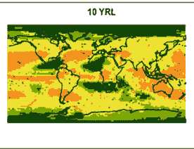

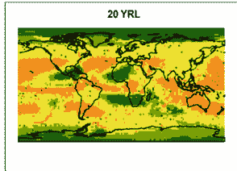

Rx1day_NS_MJJAS (毫米) 0 0 - 10 10 - 25 25 - 50 > 50

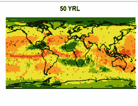

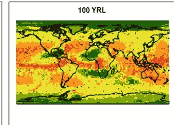

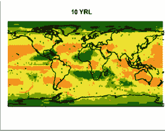

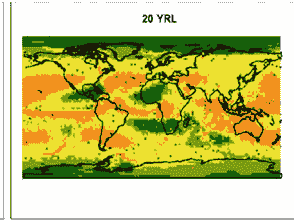

Rx1day_NS_NDJFM (毫米) 0 0 - 10 10 - 25 25 - 50 > 50

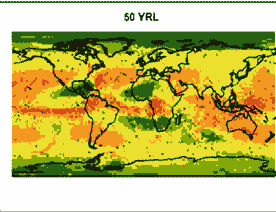

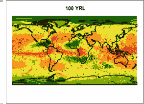

##### (a) 季节 MJJAS 和 NDJFM 的 Rx1day

图 4.1 降水极值的重现水平 a) Rx1day, b) Rx5day, 和 c) R95pTOT，用于 MJJAS 和 NDJFM 气候学，重现期为 10、20、50 和 100 年

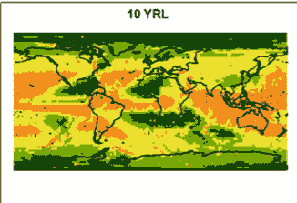

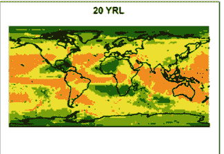

Rx5day_NS_MJJAS (毫米) 0 - 10 10 - 25 25 - 50 50 - 100 > 100

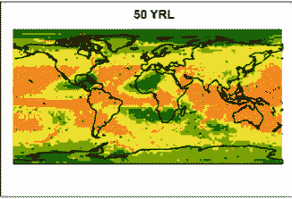

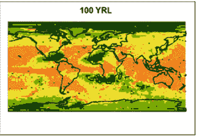

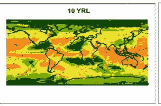

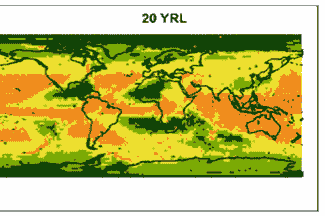

Rx5day_NS_NDJFM (毫米) 0 - 10 10 - 25 25 - 50 50 - 100 > 100

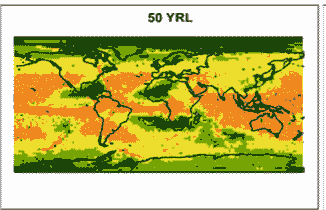

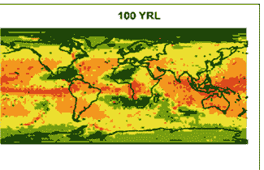

##### (b) 季节 MJJAS 和 NDJFM 的 Rx5day

图 4.1（续）

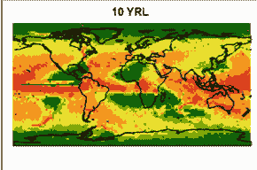

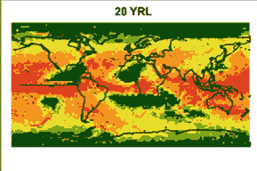

R95pTOT_NS_MJJAS (毫米) 0 - 75 75 - 150 150 - 300 300 - 600 > 600

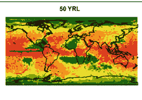

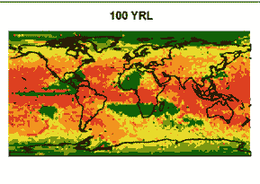

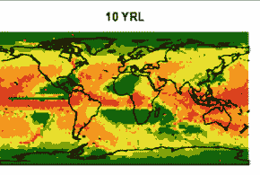

R95pTOT_NS_NDJFM (毫米) 0 - 75 75 - 150 150 - 300 300 - 600 > 600

##### (c) 季节 MJJAS 和 NDJFM 的 R95pTOT

##### (a) Rx1day

图 4.2 不同重现期和条件下两个季节的年平均 AR 持续时间空间分布。上半部分显示了 10 年和 100 年重现期下 Rx1day > 20 毫米、Rx5day > 30 毫米和 R95pTOT > 200 毫米的结果。下半部分展示了相同的重现期，但平均 AR 持续时间超过 12 小时

Average_AR_duration (小时) Rx5day_MJJAS > 30 毫米

Rx5day_MJJAS (毫米) Average_AR_duration > 12 小时

Average_AR_duration (小时) Rx5day_NDJFM > 30 毫米

Rx5day_NDJFM (毫米) Average_AR_duration (小时) > 12 小时

##### (b) Rx5day

图 4.2（续）

Average_AR_duration (小时) R95pTOT_MJJAS > 200 毫米 < 10 10 - 15 15 - 20 20 - 25 > 25

R95pTOT_MJJAS (毫米) Average_AR_duration > 12 小时 < 100 100 - 250 250 - 500 500 - 750 > 750

Average_AR_duration (小时) R95pTOT_MJJAS > 200 毫米 < 10 10 - 15 15 - 20 20 - 25 > 25

R95pTOT_NDJFM (毫米) Average_AR_duration (小时) > 12 小时 < 100 100 - 250 250 - 500 500 - 750 > 750

##### (c) R95pTOT

图 4.2（续）

#### 4.3.2 **降水极值与 AR 频率**

分析还利用特定阈值（Rx1day > 20 毫米、Rx5day > 30 毫米和 R95pTOT > 200 毫米）考察了降水极值与 AR 频率之间的关系。网格点被表征为 AR 的时间步比例（占总时间步数的百分比）被视为 AR 频率。

研究结果表明，高 AR 频率的空间范围与降水极值的大小相符。具体而言，在北半球，北美和欧洲在 NDJFM 气候学期间观察到了更高的 AR 频率及其相关重现水平。相反，在南半球，南美洲最南部和澳大利亚观察到了更多的 AR 频率和高重现水平。这一模式表明 AR 频率与降水极值之间存在强相关性。此外，分析表明，极端降水的较高重现水平（当与季节性协变量 NDJFM 和 MJJAS 结合时）表现出与 AR 频率相似的空间分布。而且，与高 AR 频率相关的降水极值的大小和空间范围随所考虑的更长时期（10 年或 100 年）而增加，凸显了与 AR 活动相关的极端降水模式随时间演变的特性（图 4.3）。

### 4.4 **未来研究与气候适应**

AR 受气候涛动影响，是全球水循环的关键组成部分，可补充水资源并维持生态系统。然而，极端 AR 事件可能引发水相关灾害，对人类聚居地和基础设施韧性构成挑战。为了平衡 AR 的有益方面与其潜在危害，集成水资源管理方法、可持续资源利用和适应性生态系统策略至关重要。

对气候涛动及其与 AR 相互作用的持续研究对于增强预测能力、提高气候建模精度和制定强有力的气候适应策略至关重要。科学家、决策者和利益相关者之间的协作努力对于实施主动措施以应对气候变率、减轻极端天气事件相关风险并在脆弱地区促进气候韧性至关重要。采用气候研究和适应的整体方法是促进不断变化的气候格局中可持续发展和环境管理的关键。

#### (a) Rx1day

图 4.3 各种重现期和条件下平均季节性（MJJAS 和 NDJFM）AR 频率的空间分布。上半部分描绘了 10 年和 100 年重现期下 Rx1day > 20 毫米、Rx5day > 30 毫米和 R95pTOT > 200 毫米的结果。下半部分显示了这些重现期，且两个季节的季节性 AR 频率超过 5%

AR_Frequency_MJJAS (%) Rx5day_MJJAS > 30 毫米

Rx5day_MJJAS (毫米) AR_freq_MJJAS > 5%

AR_Frequency_NDJFM (%) Rx5day_NDJFM > 30 毫米

Rx5day_NDJFM (毫米) AR_freq_NDJFM (%) > 5%

#### (b) Rx5day

图 4.3（续）

##### 10 年重现期

##### 100 年重现期

AR_Frequency_MJJAS (%)
R95pTOT_MJJAS > 200 毫米
< 3   3 - 6   6 - 9   9 - 12   > 12

##### 10 年重现期

##### 100 年重现期

R95pTOT_MJJAS (毫米)
AR_Freq_MJJAS > 5%
< 100   100 - 250   250 - 500   500 - 750   > 750

##### 10 年重现期

##### 100 年重现期

AR_Frequency_NDJFM (%)
R95pTOT_NDJFM > 200 毫米
< 3   3 - 6   6 - 9   9 - 12   > 12

##### 10 年重现期

##### 100 年重现期

R95pTOT_NDJFM (毫米)
AR_freq_NDJFM > 5%
< 100   100 - 250   250 - 500   500 - 750   > 750

#### (c) R95pTOT

图 4.3（续）

### 4.5 结论

气候涛动对全球天气系统和区域水文产生深远影响，其复杂的动力学与大气河流（AR）密切相互作用。这些相互作用对气候变率、极端天气事件以及水资源管理具有重大意义。特别是，厄尔尼诺-南方涛动（ENSO）、北大西洋涛动（NAO）和北极涛动（AO）等大尺度气候涛动（LSCOs）在塑造这些现象方面起关键作用，并与北美和欧洲等地区的 AR 行为表现出清晰的联系。例如，厄尔尼诺阶段 AR 频率的变化说明了 LSCOs 如何调制 AR 动态，以不同方式影响不同地区，并凸显了它们关系的复杂性。

本研究采用统计方法进行了详细分析，比较了平稳和非平稳模型，重点关注 AO、NAO、ENSO 和 PDO 等关键因素。研究结果强调了 PDO（一种持久的 ENSO 现象）对大规模天气模式的显著影响，尤其是在夏季月份尤为明显。此外，研究还揭示，与其他指数相比，季节性 PDO 指数（特别是 MJJAS 指数）在捕捉极端降水事件变化方面更为有效，表明 PDO 对特定区域降水模式具有强烈影响。

更好地了解这些相互联系对于提高不同时间尺度上 AR 预测的准确性以及制定管理气候极端风险的有效策略至关重要。协作努力和科学研究的进步在这项工作中发挥着关键作用，因为它们有助于提升预测能力、水资源管理实践以及在不断变化的气候条件下增强韧性。本研究关于气候涛动、AR 与降水极值之间复杂相互作用的见解，为完善风险评估方法论并在全球脆弱地区实施有针对性的管理策略提供了宝贵基础。

### 参考文献

- 1. V. A. Gilan, N.V. Umamahesh, 开发非平稳降雨强度-持续时间-频率关系的最佳协变量是什么？Adv. Water Resour. **101**, 11–22 (2017). https://doi.org/10.1016/j.advwatres.2016.12.016
- 2. V. A. Gilan, N.V. Umamahesh, 用于建模印度极端降雨强度的厄尔尼诺-南方涛动周期指标。Ecol. Ind. **84**, 450–458. https://doi.org/10.1016/j.ecolind.2017.09.012
- 3. D. Baldan, E. Coraci, F. Crosato, M. Ferla, A. Bonometto, S. Morucci, 在海平面上升背景下评估极端海平面的非平稳分析的重要性。Nat. Hazard. **22**(11), 3663–3677 (2022). https://doi.org/10.5194/nhess-22-3663-2022
- 4. C. Bracken, K.D. Holman, B. Rajagopalan, H. Moradkhani, 多元非平稳水文频率分析的贝叶斯层次方法。Water Resource. Res. **54**(1), 243–255 (2018). https://doi.org/10.1002/2017WR020403
- 5. S. Coles, 极值统计建模导论 (Springer, 2001)

- 6. J. Das, S. Jha, M.K. Goyal, 印度气象同质地区月降水与气候及季风遥测关系：小波与全局相干性方法。Atmos. Res. **238**, 104889 (2020). https://doi.org/10.1016/j.atmosres.2020.104889

- 7. J. Das, S. Jha, M.K. Goyal, 非平稳与Copula方法评估印度喜马拉雅地区气候指数涵盖的干旱特征。J. Hydrol. **580**, 124356 (2020). https://doi.org/10.1016/j.jhydrol.2019.124356

- 8. C. Deser, 关于“北极环流”的遥相连性。779–782 (2000)

- 9. A. Gershunov, T. Shulgina, R.E.S. Clemesha, K. Guirguis, D.W. Pierce, M.D. Dettinger, D.A. Lavers, D.R. Cayan, S.D. Polade, J. Kalansky, F.M. Ralph, 北美西部降水制度变化：大气河的作用。Sci. Rep. **9**(1), 9944 (2019). https://doi.org/10.1038/s41598-019-46169-w

- 10. B. Guan, N.P. Molotch, D.E. Waliser, E.J. Fetzer, P.J. Neiman, 2010/2011年加利福尼亚州内华达山脉雪季：大气河和大尺度变率模式的作用。Water Resour. Res. **49**(10), 6731–6743 (2013). https://doi.org/10.1002/wrcr.20537

- 11. B. Guan, D.E. Waliser, 大气河探测：全球研究算法的评估与应用。J. Geophys. Res. Atmos. **120**(24), 12514–12535 (2015). https://doi.org/10.1002/2015JD024257

- 12. K. Guirguis, A. Gershunov, R.E.S. Clemesha, T. Shulgina, A.C. Subramanian, F.M. Ralph, 北美西海岸大气河环流驱动因素。Geophys. Res. Lett. **45**, 12576–12584 (2018). https://doi.org/10.1029/2018GL079249

- 13. X. Guo, N. Zhao, K. Kikuchi, T. Nasuno, M. Nakano, H. Annamalai, 印度-太平洋大气河及其与北半球夏季内季振荡的关联。J. Clim. **34**(24), 9711–9728 (2021). https://doi.org/10.1175/JCLI-D-21-0290.1

- 14. S. Jha, J. Das, M.K. Goyal, 低频全球尺度模式及其对印度降水极值的影响：非平稳与不确定性分析。Int. J. Climatol. **41**(3), 1873–1888 (2021). https://doi.org/10.1002/joc.6935

- 15. S. Jha, M.K. Goyal, B.B. Gupta, C. Hsu, E. Gilleland, J. Das, 极端气候风险评估方法论框架：在智能系统中整合卫星和基于位置的数据集。Int. J. Intell. Syst. **37**(12), 10268–10288 (2022). https://doi.org/10.1002/int.22475

- 16. R.W. Katz, 非平稳极值的统计方法。Extremes Changing Clim. 15–37 (2013)

- 17. H. Kim, S. Kim, H. Shin, J.-H. Heo, 非平稳广义极值分布模型的适当模型选择方法。J. Hydrol. **547**, 557–574 (2017). https://doi.org/10.1016/j.jhydrol.2017.02.005

- 18. N. Kumar, P. Patel, S. Singh, M.K. Goyal, 理解印度半岛流域水文气候极值非平稳性及恢复力。Sci. Rep. **13**(1), 12524 (2023). https://doi.org/10.1038/s41598-023-38771-w

- 19. D.A. Lavers, G. Villarini, 欧洲大气河与极端降水之间的关联。Geophys. Res. Lett. **40**(12), 3259–3264 (2013). https://doi.org/10.1002/grl.50636

- 20. M. Ma, M. Ren, H. Zang, H. Cui, S. Jiang, Y. Sun, 中国黄河源区低流量非平稳量-持续时间-频率关系。J. Hydrol. Reg. Stud. **48**, 101450 (2023). https://doi.org/10.1016/j.ejrh.2023.101450

- 21. S. Meghani, S. Singh, N. Kumar, M.K. Goyal, 大气河时空特征预测：一种新型数据驱动方法。Global Planet. Change **231**, 104295 (2023). https://doi.org/10.1016/j.gloplacha.2023.104295

- 22. A. Mondal, P.P. Mujumdar, 印度极端降雨强度、持续时间和频率非平稳性建模。J. Hydrol. **521**, 217–231 (2015). https://doi.org/10.1016/j.jhydrol.2014.11.071

- 23. P.J. Neiman, L.J. Schick, F.M. Ralph, M. Hughes, G.A. Wick, 华盛顿州西部洪水：与大气河的联系。J. Hydrometeorol. **12**(6), 1337–1358 (2011). https://doi.org/10.1175/2011JHM1358.1

- 24. T.B.M.J. Ouarda, C. Charron, 非平稳框架下水文气候极值分布的变化。Sci. Rep. **9**(1), 8104 (2019). https://doi.org/10.1038/s41598-019-446-03-7

- 25. H. Paltan, D. Waliser, W.H. Lim, B. Guan, D. Yamazaki, R. Pant, S. Dadson, 由大气河驱动的全球洪水和水资源。Geophys. Res. Lett. **44**(20), 10387–10395 (2017). https://doi.org/10.1002/2017GL074882

- 26. S.D. Polade, A. Gershunov, D.R. Cayan, M.D. Dettinger, D.W. Pierce, CMIP3和CMIP5模型中太平洋-北美地区降水的自然气候变率及遥测关系。Geophys. Res. Lett. **40**(10), 2296–2301 (2013). https://doi.org/10.1002/grl.50491

- 27. K.S. Rautela, S. Singh, M.K. Goyal, 全球尺度气溶胶大气河时空分布、探测和预测表征。J. Environ. Manage. **351**, 119675 (2024). https://doi.org/10.1016/j.jenvman.2023.119675

- 28. P. Shi, T. Yang, C.-Y. Xu, Y. Yong, Q. Shao, Z. Li, X. Wang, X. Zhou, S. Li, 多尺度气候振荡如何触发极端降水？Global Planet. Change **157**, 48–58 (2017). https://doi.org/10.1016/j.gloplacha.2017.08.014

- 29. S. Singh, M.K. Goyal, 商业气候韧性提升：人工智能的作用。J. Cleaner Prod. 138228 (2023)

- 30. S. Singh, M.K. Goyal, 大气河预测的创新方法：探索卷积自编码器。Atmos. Res. **289**, 106754 (2023)

- 31. S. Singh, M.K. Goyal, S. Jha, 与大气河相关的降水极值中大尺度气候振荡的作用：非平稳框架。Hydrol. Sci. J. **68**(3), 395–411 (2023)

- 32. S. Singh, N. Kumar, M.K. Goyal, S. Jha, 纳尔马达盆地（印度）水文气候极值时空变率中ENSO、IOD和AMO的相对影响。AQUA—Water Infrastruct. Ecosyst. Soc.**72**(4), 520–539. https://doi.org/10.2166/aqua.2023.219

- 33. S. Singh, A. Yadav, G.M. Kumar, 印度热浪的一元和双变量时空特征及大尺度气候振荡的相对影响。J. Hydrol. **628**, 130596 (2024). https://doi.org/10.1016/j.jhydrol.2023.130596

- 34. Z. Song, J. Xia, D. She, L. Zhang, C. Hu, L. Zhao, 基于气候协变量的非平稳标准化降水指数开发：中国长江中下游地区案例研究。J. Hydrol. **588**, 125115 (2020). https://doi.org/10.1016/j.jhydrol.2020.125115

- 35. S. Sugahara, R.P. da Rocha, R. Silveira, 巴西圣保罗极端日降水频率非平稳分析。Int. J. Climatol. **29**(9), 1339–1349 (2009). https://doi.org/10.1002/joc.1760

- 36. P.J. Ward, S. Eisner, M. Flörke, M.D. Dettinger, M. Kummu, 全球尺度年洪水对厄尔尼诺-南方涛动的敏感性。Hydrol. Earth Syst. Sci. **18**(1), 47–66 (2014). https://doi.org/10.5194/hess-18-47-2014

- 37. S. Wi, J. Valdes, S. Steinschneider, T.-W. Kim, 基于峰值超过阈值和年度最大值的韩国极端降水非平稳频率分析。Stoch. Environ. Res. Risk Assess. **30** (2016). https://doi.org/10.1007/s00477-015-1180-8

- 38. P. Xu, Y. Wang, X. Fu, V.P. Singh, J. Qiu, 基于非平稳模型的中国长江三角洲夏季极端高温城市化影响的检测与归因。Urban Clim. **47**, 101376 (2023). https://doi.org/10.1016/j.uclim.2022.101376

- 39. R. Yao, S. Zhang, P. Sun, Q. Dai, Q. Yang, 评估长江三角洲都市区极端降水事件非平稳模型中城市化影响。Weather Clim. Extremes **36**, 100445 (2022). https://doi.org/10.1016/j.wace.2022.100445

- 40. A.G. Yilmaz, B.J.C. Perera, 极端降雨非平稳性调查及强度-频率-持续时间关系。J. Hydrol. Eng. **19**(6), 1160–1172 (2014). https://doi.org/10.1061/(ASCE)HE.1943-5584.0000878

## 第5章
机器学习在理解和管理大气河流中的作用

### 5.1 引言

认识到大气河流（ARs）在全球和区域气候学中的关键作用，人们已将大量精力投入到监测和预测其登陆时的轨迹及关键特征 [10, 11, 31, 34]。对具有延长前置时间的AR属性进行准确预测非常有价值，尤其是对于有效的洪灾灾害管理和水资源规划。传统上，天气和气候预报高度依赖数值天气预报（NWP）模型 [20, 28]。这些模型整合了支配大气、海洋和陆地的基本物理过程，融入了源自质量、能量和动量守恒定律的原理 [4, 7, 18, 22, 30, 32, 35]。然而，源自数值近似、模型初始化条件和固有模型约束的固有不确定性会随着时间的推移而逐渐削弱预测准确性 [3, 8, 15, 16, 29, 37, 38]。对东北太平洋地区集成预报系统的评估研究揭示了模型检测AR存在的能力。然而，这些模型在显著前置时间下准确预测登陆AR的精细细节方面面临挑战 [23, 24, 39]。同样，Nardi等人 [20] 指出NWP模型中与AR登陆预测相关的重大预报误差。因此，人们已将精力集中在改进数据收集、凸显关键大气结构，并将这些信息无缝整合到NWP模型中以提高预测准确性 [6, 40]。

人工智能，计算机科学中快速发展的领域，使机器能够在无需显式编程的情况下学习、分析数据和做出决策 [3, 9, 12]。其应用涵盖多个领域，利用算法、机器学习和神经网络处理大型数据集、识别模式，并得出传统方法可能忽略的洞察 [1, 14, 36]。AI处理复杂数据的适应性和能力使其成为解决多方面挑战的强大工具 [21, 25, 37]。近年来，AI已成为大气科学领域的变革者，特别是在理解和管理气候极端情况方面 [17]。AI驱动的模型和算法可以显著提高AR预测准确性，从而更精确地预测AR的发生、轨迹和强度。这些先进的预测能力对于发布及时预警至关重要，从而减轻AR引发的极端天气事件的潜在影响。汲取深度学习（DL）架构理解复杂非线性关系的能力的启示，探索DL算法为把握AR中固有的动力学提供了一种替代方式。与NWP模型不同，这些数据驱动的神经网络可以通过分析给定的大气数据来随时间辨别大气条件，绕过明确建模物理过程的必要性 [7]。

### 5.2 AI在理解AR中的潜在应用

人工智能（AI）在理解和处理AR方面发挥着关键作用，以多种方式提供创新解决方案：

- **(a) 模式识别**：最近的研究表明，机器学习（ML）算法在识别大型复杂数据集中的复杂模式方面表现更佳。当应用于大气数据时，AI可以实现与AR相关的复杂特征和相关性的识别。它可以辨别湿度含量、风行为、温度梯度和压力系统等大气变量的细微变化，这些变量表征了AR。通过分析历史数据和实时数据，AI可以帮助识别指示AR形成、演化和行为的特定特征。这种详细的模式识别增强了我们对AR如何发展、增强以及与其他天气现象相互作用的理解，有助于更准确的跟踪和预测。

- **(b) 预测与建模**：AI驱动的模型，如深度学习算法和神经网络，彻底改变了AR的预测和建模。这些模型处理大量大气数据，学习传统模型可能遗漏的复杂关系和非线性模式。通过从数据中持续学习，AI模型提高了AR预报的精确度，以更高的准确性预测其路径、强度和持续时间。此外，这些基于AI的预测模型会随着时间的推移而适应和改进，纳入新数据并优化其预测，从而增强我们预见和准备AR相关天气事件的能力。

- **(c) 早期预警系统**：AI驱动的早期预警系统在减轻AR相关极端天气事件影响方面可以发挥关键作用。通过将AI算法与卫星图像、雷达数据和大气传感器等多种数据源相结合，这些系统可以快速识别和跟踪AR的出现和移动。AI算法可以分析演变的大气条件，向相关部门和社区发布及时的警报和预报。这些预警可以提供必要的前置时间，使采取主动措施来减轻与AR相关的风险，例如洪水、强降雨或滑坡。因此，AI驱动的早期预警系统对最大限度地减少损失和增强灾害准备能力做出了重大贡献。

### 5.3 案例研究：使用深度学习模型进行AR预测

受DL模型在解开复杂模式和提供精确预测方面的熟练技巧的启发，本研究深入探讨了采用DL技术来理解大气河流（ARs）的动力学。DL方法在不明确包含物理过程的情况下，优于典型的NWP模型来捕捉大气数据中的时空特征 [5, 27]。本研究利用欧洲中期天气预报中心（ECMWF）的ERA5再分析数据（比湿、东西向和南北向风速）来表征AR状态。遵循[11]的方法，采用IVT特征来在每个时间步划分AR（图5.1）。本研究采用自编码器DL模型来预测即将到来的时间步中AR的存在。该研究文章的见解为大气研究人员提供了新的视角，强调了DL模型在提高AR预测的精度和可靠性方面的能力。

#### 5.3.1 AR预测

利用卷积自编码器捕捉空间和时态模式的能力，我们的方法涉及使用这些模型来表征AR的属性。为了训练我们的DL模型，我们采用了以6小时间隔检测到的AR地图作为输入。这些描绘AR存在的帧构成了我们建模过程的基础。所提出的自编码器架构中的卷积层在从AR帧中提取空间信息方面发挥着重要作用

图5.1 (A) 2017年5月21日任意时间步的IVT特征和 (B) 在表征集成水汽输送的强大气场后检测到的AR

图5.2 所提议的卷积自编码器的配置

这些信息随后被编码到潜在空间中的表示中。模型的标准配置包括：编码器、瓶颈层和解码器 [13, 26]（图5.2）。

输入数据被预处理为连续11张图像的序列，以训练所提议的DL模型，利用10张AR帧的序列来预测第11张AR帧。目标是最小化训练损失，并通过优化架构进一步提升模型性能。此外，L2损失被用作重建损失。训练期间，输入数据以每批10帧的方式处理。尽管在23个时代后观察到训练损失增加，但我们继续训练了30个时代以确保全面学习。在训练期间，模型实现了最小均方误差损失0.025，完成30个时代大约需要61分钟。

为了验证模型的可预测性，使用了结构相似性指数（SSIM）和峰值信噪比（PSNR）等常用指标。PSNR通过比较原始图像和压缩图像来评估图像质量，而SSIM评估预测图像与原始图像之间的相似性。MSE和RMSE降低以及PSNR和SSIM升高表明所提议模型的预测能力有所提高 [33]。

图5.3中的示例展示了模型的预测能力，描述了与原始图像相比，来自测试数据集的下一帧的重建。评估得出，在测试数据集上，RMSE和MSE得分平均分别为0.1552和0.0247，SSIM和PSNR得分分别为0.739和64.421 [19]。这些改进的指标得分表明，与[2]的相关研究相比，所提议模型具有更优的预测性能，该研究专注于使用Conv-LSTM模型预测城市扩张，并使用了相似的指标来评估模型的可预测性。

建模AR复杂而动态的时空特征面临重大挑战，尤其是使用NWP模型准确预测它们时，特别是对于延长的前置时间。这通常会导致相当大的不准确性，尤其是在预测登陆位置时 [31]。先进的潜力

(a) AR观测

(b) AR预测

图 5.3 通过拟议自编码器说明大气河流（AR）可用性的预测：a 在任意时间步观测到的大气河流，b 由训练好的深度学习模型在同一时间实例预测的大气河流

深度学习模型的优势在于其能够捕获数据集内的非线性和复杂交互作用，为理解大气河流的动态行为提供了一种可行的解决方案。

受深度学习模型和迁移学习方法进步的鼓舞，我们有动力调查用于捕捉大气河流时空特征的深度学习算法。通过在相关研究启发下优化我们模型的训练，我们在大气河流可预测性方面取得了有前景的成果。人工智能在处理大气河流方面的应用展示了推进我们对这些有影响力的天气现象的理解和预测能力以及减轻其影响的巨大潜力。它证明了技术在应对复杂气候相关挑战方面的力量。

### 5.4 结论

人工智能的整合已成为理解和管理大气河流方法中的一股变革力量。人工智能处理海量大气数据的能力已被证明在揭示大气河流动力学固有的复杂模式方面起着关键作用。这种分析能力有助于识别关键的大气河流特征，从而实现对其行为的精细分类、追踪和理解。人工智能发挥的关键作用之一在于其能够开发复杂的风险评估工具，专门用于评估易受大气河流诱导灾害影响地区的脆弱性。通过识别这些脆弱性，人工智能驱动的分析有助于制定具有韧性的策略和适应性措施。这种主动姿态在减轻潜在影响以及增强社区和基础设施抵御大气河流相关逆境的韧性方面变得至关重要。

将人工智能融入大气河流研究和管理前景广阔。它不仅推动了我们对这些固有复杂现象的理解，而且还作为一种主动力量来减轻其不良影响。展望未来，人工智能技术的演进蕴含着巨大潜力。数据融合技术的创新、强大的预警系统的建立以及人工智能驱动的气候变化分析的应用，有望彻底改变我们应对大气河流相关挑战的能力。这些进步有望重新定义灾害准备策略，并加强易受影响地区的气候韧性。通过发挥人工智能的力量，我们正在迈向一个未来，在这个未来中，社区将更好地具备预测、减轻和适应大气河流影响的能力，在气候变异和极端天气事件面前，培育一个更具韧性和准备充分的世界。

### 参考文献

- 1. R. Ben Ayed, M. Hanana, 利用人工智能改善食品和农业领域. J. Food Qual. **2021**, 1–7 (2021). https://doi.org/10.1155/2021/5584754
- 2. W. Boulila, H. Ghandorh, M.A. Khan, F. Ahmed, J. Ahmad, 一种基于CNN-LSTM的新颖城市扩张预测方法. Eco. Inform. **64**, 101325 (2021). https://doi.org/10.1016/j.ecoinf.2021.101325
- 3. Chandrasekar, B.R. Gurjar, C.S.P. Ojha, M.K. Goyal, 对“利用神经网络和决策树算法预测环境PM2.5和CO浓度的潜力评估：案例研究”的终结，作者：Chandra Sekar, B. R. Gurjar, C. S. P. Ojha, and Manish Kumar Goyal. J. Hazardous, Toxic, Radioactive Waste **21**(4), 1–9 (2017). https://doi.org/10.1061/(ASCE)HZ.2153-5515.0000276
- 4. W.E. Chapman, A.C. Subramanian, L. Delle Monache, S.P. Xie, F.M. Ralph, 利用机器学习改进大气河流预报. Geophys. Res. Lett. **46**(17–18), 10627–10635 (2019). https://doi.org/10.1029/2019GL083662
- 5. S. Chattopadhyay, G. Bandyopadhyay, 采用反向传播学习的人工神经网络，用于预测瑞士Arosa的月平均总臭氧量. Int. J. Remote Sens. 28(20), 4471–4482 (2007). https://doi.org/10.1080/01431160701250440
- 6. A. Cobb, F.M. Ralph, V. Tallapragada, A.M. Wilson, C.A. Davis, L.D. Monroe, J.D. Doyle, F. Pappenberger, C.A. Reynolds, A. Subramanian, P.G. Black, F. Cannon, C. Castellano, J.M. Cordeira, J.S. Haase, C. Hecht, B. Kawzenuk, D.A. Lavers, M.J. Murphy, J. Parrish, R. Rickert, J.J. Rutz, R. Torn, X. Wu, M. Zheng, 2021年大气河流侦察：综述. Weather Forecast. (2022). https://doi.org/10.1175/WAF-D-21-0164.1
- 7. P.D. Dueben, P. Bauer, 基于机器学习的全球天气和气候模型的挑战与设计选择. Geosci Model Develop. 11(10), 3999–4009 (2018). https://doi.org/10.5194/gmd-11-3999-2018
- 8. M.K. Goyal, B. Bharti, J. Quilty, J. Adamowski, A. Pandey, 利用ANN、LS-SVR、模糊逻辑和ANFIS对亚热带气候中的日蒸发皿蒸发量进行建模. Expert Syst. Appl. 41(11), 5267–5276 (2014). https://doi.org/10.1016/j.eswa.2014.02.047
- 9. M.K. Goyal, B. Bharti, J. Quilty, J. Adamowski, A. Pandey, 利用ANN、LS-SVR、模糊逻辑和ANFIS对亚热带气候中的日蒸发皿蒸发量进行建模. Expert Syst. Appl. 41(11), 5267–5276 (2014). https://doi.org/10.1016/j.eswa.2014.02.047
- 10. B. Guan, D.E. Waliser, 20年天气和气候模拟中的大气河流：多模式全球评估. J. Geophys. Res. Atmos. 122(11), 5556–5581 (2017). https://doi.org/10.1002/2016JD026174
- 11. B. Guan, D.E. Waliser, 全球大气河流追踪：生命周期特征的空间分布与时空演变. J. Geophys. Res. Atmos. 124, 12523–12552 (2019). https://doi.org/10.1029/2019JD031205
- 12. G. Hinge, R.Y. Surampalli, M.K. Goyal, 利用数字映射方法预测湿润印度的土壤有机碳储量. Environ. Earth Sci. 77(5), 172 (2018). https://doi.org/10.1007/s12665-018-7374-x
- 13. D. Jana, J. Patil, S. Herkal, S. Nagarajaiah, L. Duenas-Osorio, 基于CNN和卷积自编码器（CAE）的实时传感器故障检测、定位和校正. Mech. Syst. Signal Process. 169, 108723 (2022). https://doi.org/10.1016/j.ymssp.2021.108723
- 14. B. Jena, S. Saxena, G.K. Nayak, L. Saba, N. Sharma, J.S. Suri, 基于人工智能的混合深度学习模型用于图像分类：第一个叙述性综述. Comput. Biol. Med. 137, 104803 (2021). https://doi.org/10.1016/j.compbiomed.2021.104803
- 15. S. Jha, M.K. Goyal, B.B. Gupta, C. Hsu, E. Gilleland, J. Das, 整合卫星和基于位置数据集的智能系统中极端气候风险评估的方法论框架. Int. J. Intell. Syst. 37(12), 10268–10288 (2022). https://doi.org/10.1002/int.22475
- 16. M. Krishan, S. Jha, J. Das, A. Singh, M.K. Goyal, C. Sekar, 利用长短期记忆网络（LSTM）对印度NCT-德里地区的空气质量进行建模. Air Qual. Atmos. Health 899–908 (2019). https://doi.org/10.1007/s11869-019-00696-7
- 17. D.N. Kumar, M.J. Reddy, R. Maity, 利用大规模气候遥感和人工智能技术进行区域降雨预报. J. Intell. Syst. 16(4) (2007). https://doi.org/10.1515/IJSYS.2007.16.4.307
- 18. N. Kumar, P. Patel, S. Singh, M.K. Goyal, 理解印度半岛流域水文气候极端值的非平稳性与韧性. Sci. Rep. 13(1), 12524 (2023). https://doi.org/10.1038/s41598-023-38771-w
- 19. S. Meghani, S. Singh, N. Kumar, M.K. Goyal, 预测大气河流的时空特征：一种新颖的数据驱动方法. Global Planet. Change 231, 104295 (2023). https://doi.org/10.1016/j.gloplacha.2023.104295
- 20. K.M. Nardi, E.A. Barnes, F.M. Ralph, 评估北美西海岸沿线大气河流发生、强度和位置的数值天气预报模式预报. Mon. Weather Rev. 146(10), 3343–3362 (2018). https://doi.org/10.1175/MWR-D-18-0060.1
- 21. R. Nishant, M. Kennedy, J. Corbett, 面向可持续发展的人工智能：挑战、机遇与研究议程. Int. J. Inf. Manage. 53, 102104 (2020). https://doi.org/10.1016/j.ijinfomgt.2020.102104

- 22. S. 拉卡萨吉, M.K. 戈亚尔, S. 贾, 使用模糊逻辑评估印度沿海拉姆萨尔湿地面临极端降雨的未来风险. 水文学期刊 **632**, 130869 (2024). https://doi.org/10.1016/j.jhydrol.2024.130869

- 23. K.S. 劳特拉, D. 库马尔, B.G.R. 甘地, A. 库马尔, A.K. 杜贝, 应用人工神经网络模拟北阿坎德邦西喜马拉雅高海拔河系的径流、泥沙输移和侵蚀率. RBRH**27** (2022). https://doi.org/10.1590/2318-0331.272220220045

- 24. K.S. 劳特拉, J.C. 库尼亚尔, M.K. 戈亚尔, N. 坎瓦尔, A.S. 博杰, 印度西北喜马拉雅东道利甘加河水文-泥沙流的评估与模拟. 自然灾害 (2024). https://doi.org/10.1007/s11069-024-06413-7

- 25. K.S. 劳特拉, S. 辛格, M.K. 戈亚尔, 全球气溶胶大气河的时空分布、探测与预测表征. 环境管理期刊 **351**, 119675 (2024). https://doi.org/10.1016/j.jenvman.2023.119675

- 26. D.E. 拉梅尔哈特, G.E. 辛顿, R.J. 威廉姆斯, 通过误差反向传播学习表征. 自然 **323**(6088), 533–536 (1986). https://doi.org/10.1038/323533a0

- 27. S. 申尔. 迈向数据驱动的天气和气候预报: 用深度学习逼近简单大气环流模型. 地球物理研究快报 **45**(22), 12,612–61622 (2018). https://doi.org/10.1029/2018GL080704

- 28. S. 申尔, G. 梅索里, 利用机器学习预测天气预报不确定性. 皇家气象学会季刊 **144**(717), 2830–2841 (2018). https://doi.org/10.1002/qj.3410

- 29. A. 沙尔玛, M.K. 戈亚尔, 三种软计算技术的比较: 用于月降雨预报的贝叶斯回归、支持向量回归和小波回归. 智能系统期刊 **26**(4), 641–655 (2017). https://doi.org/10.1515/jisys-2016-0065

- 30. A. 沙尔玛, M.K. 戈亚尔, 使用小波变换评估印度的干旱趋势和变率. 水文科学杂志 **65**(9), 1539–1554 (2020). https://doi.org/10.1080/02626667.2020.1754422

- 31. C.A. 谢尔兹, J.J. 尔茨, L.R. 梁, F.M. 拉尔夫, M. 韦纳, T. 奥布莱恩, 通过比较大气河追踪方法界定不确定性. 美国气象学会公报 **100**, ES93–ES96 (2019). https://doi.org/10.1175/BAMS-D-18-0200.1

- 32. S. 辛格, M.K. 戈亚尔, 预测大气河的创新方法: 探索卷积自编码器. 大气研究 **289**, 106754 (2023)

- 33. S. 辛格, M.K. 戈亚尔, 增强企业气候韧性: 人工智能的作用. 清洁生产期刊 138228 (2023)

- 34. S. 辛格, M.K. 戈亚尔, S. 贾, 与大气河相关的降水极端事件中大规模气候振荡的作用: 非平稳框架. 水文科学杂志 **68**(3), 395–411 (2023)

- 35. S. 辛格, N. 库马尔, M.K. 戈亚尔, S. 贾, 印度尼尔马达流域水文气候极端时空变率中ENSO、IOD和AMO的相对影响. AQUA—水基础设施与生态系统社会 (2023). https://doi.org/10.2166/aqua.2023.219

- 36. K. 托尼奥沃, E. 马西耶罗, M. 马萨罗, C. 巴尼奥利, 可持续商业模式与人工智能: 机遇与挑战 103–117 (2020)

- 37. N. 维韦卡南丹, S. 辛格, M.K. 戈亚尔, 极值分析中概率分布的比较及使用贝叶斯正则化人工神经网络预测月降雨模式 271–294 (2023)

- 38. J.A. 卫因, D.R. 杜兰, R. 卡鲁阿纳, 使用立方球面上的深度卷积神经网络改进数据驱动的全球天气预报. 地球系统模型进展 **12**(9) (2020). https://doi.org/10.1029/2020MS002109

- 39. G.A. 维克, P.J. 尼曼, F.M. 拉尔夫, 大气河集成水汽签名识别与表征的自动客观技术描述与验证. IEEE 地球遥感汇刊 **51**, 2166–2176 (2013). https://doi.org/10.1109/TGRS.2012.2211024

- 40. J. 郑, X. 傅, G. 张, 基于深度置信网络的汇率预测研究. 神经计算与应用 **31**(1), 573–582 (2019). https://doi.org/10.1007/s00521-017-3039-z
