# 深度学习理解


## 前言

深度学习的历史在科学史上独树一帜。一小群科学家在一个看似前景渺茫的领域坚持钻研了二十五年，最终彻底变革了该领域，并对社会产生了巨大影响。通常情况下，当研究人员探索科学或工程中一个晦涩且显然不切实际的角落时，它往往就止步于此——依然晦涩且不切实际。然而，这是一个显著的例外。尽管面临广泛的质疑，`Yoshua Bengio`、`Geoffrey Hinton`、`Yann LeCun` 等人的系统性努力最终获得了回报。

本书标题为“Understanding Deep Learning”（理解深度学习），旨在将其与涵盖编码及其他实操层面的书籍区分开来。本书主要关注深度学习背后的*思想*。第一部分介绍深度学习模型，并讨论如何训练它们、衡量其性能以及提升性能。第二部分探讨针对图像、文本和图数据的专用架构。这些章节仅需要入门级的线性代数、微积分和概率知识，任何理工科大二学生均可读懂。后续部分涉及生成模型和强化学习。这些章节需要更多的概率论和微积分知识，面向更高阶的学生。

标题在某种程度上也是个玩笑——撰写本书时，*没有人*真正理解深度学习。现代深层网络学习的分段线性函数拥有的区域数量超过了宇宙中的原子总数，且训练所需的数据样本数可以少于模型参数量。我们既无法显然地断定能可靠地拟合这些函数，也无法显然地断定它们能很好地泛化到新数据。倒数第二章探讨了这些及其他尚未完全理解的方面。无论如何，深度学习将或好或坏地改变世界。最后一章讨论 AI 伦理，并以呼吁从业者考虑其工作的道德含义作为结语。

您的时间宝贵，我竭力筛选并呈现材料，以便您尽可能高效地理解它们。每章正文包含仅最核心思想的简明描述及配套插图。附录复习了所有数学先修知识，无需参考外部资料。对于希望深入钻研的读者，每章都配有习题、`Python` 笔记本和详尽的背景阐释。

写书是一个孤独、枯燥、耗时数年的过程，只有书籍被广泛采纳才值得。如果您喜欢阅读本书或有改进建议，请通过配套网站联系我。我非常期待听到您的想法，这将为后续版本提供参考和动力。

## 致谢

撰写本书若没有以下人士的慷慨帮助和建议将不可能完成：`Kathryn Hume`、`Kevin Murphy`、`Christopher Bishop`、`Peng Xu`、`Yann Dubois`、`Justin Domke`、`Chris Fletcher`、`Yanshuai Cao`、`Wendy Tay`、`Corey Toler-Franklin`、`Dmytro Mishkin`、`Guy McCusker`、`Daniel Worrall`、`Paul McIlroy`、`Roy Amoyal`、`Austin Anderson`、`Romero Barata de Morais`、`Gabriel Harrison`、`Peter Ball`、`Alf Muir`、`David Bryson`、`Vedika Parulkar`、`Patryk Lietzau`、`Jessica Nicholson`、`Alexa Huxley`、`Oisin Mac Aodha`、`Giuseppe Castiglione`、`Josh Akylbekov`、`Alex Gougoulaki`、`Joshua Omilabu`、`Alister Guenther`、`Joe Goodier`、`Logan Wade`、`Joshua Guenther`、`Kylan Tobin`、`Benedict Ellett`、`Jad Araj`、`Andrew Glennerster`、`Giorgos Sfikas`、`Diya Vibhakar`、`Sam Mansat-Bhattacharyya`、`Ben Ross`、`Ivor Simpson`、`Gaurang Aggarwal`、`Shakeel Sheikh`、`Jacob Horton`、`Felix Rammell`、`Sasha Luccioni`、`Akshil Patel`、`Alessandro Gentilini`、`Kevin Mercier`、`Krzysztof Lichocki`、`Chuck Krapf`、`Brian Ha`、`Chris Kang`、`Leonardo Viotti`、`Kai Li`、`Himan Abdollahpouri`、`Ari Pakman`、`Giuseppe Antonio Di Luna`、`Dan Oneat,ă`、`Conrad Whiteley`、`Joseph Santarcangelo`、`Brad Shook`、`Gabriel Brostow`、`Lei He`、`Ali Satvaty`、`Romain Sabathé`、`Qiang Zhou`、`Prasanna Vigneswaran`、`Siqi Zheng`、`Stephan Grein`、`Jonas Klesen`、`Giovanni Stilo`、`Huang Bokai`、`Bernhard Pfahringer`、`Joseph Santarcangelo`、`Kevin McGuinness`、`Qiang Sun`、`Zakaria Lotfi`、`Yifei Lin`、`Sylvain Bouix`、`Alex Pitt`、`Stephane Chretien`、`Robin Liu`、`Bian Li`、`Adam Jones`、`Marcin Świerkot`、`Tommy Löfstedt`、`Eugen Hotaj`、`Fernando Flores-Mangas`、`Tony Polichroniadis`、`Pietro Monticone`、`Rohan Deepak Ajwani`、`Menashe Yarden Einy`、`Robert Gevorgyan`、`Thilo Stadelmann`、`Gui JieMiao`、`Botao Zhu`、`Mohamed Elabbas`、`Satya Krishna Gorti`、`James Elder`、`Helio Perroni Filho`、`Xiaochao Qu`、`Jaekang Shin`、`Joshua Evans`、`Robert Dobson`、`Shibo Wang`、`Edoardo Zorzi`、`Joseph Santarcangelo`、`Stanisław Jastrzębski`、`Pieris Kalligeros`、`Matt Hewitt`、`Zvika Haramaty`、`Ted Mavroidis`、`Nikolaj Kuntner`、`Amir Yorav`、`Masoud Mokhtari`、`Xavier Gabaix`、`Marco Garosi`、`Vincent Schönbach`、`Avishek Mondal`、`Victor S.C. Lui`、`Sumit Bhatia`、`Julian Asilis`、`Hengchao Chen`、`Siavash Khallaghi`、`Csaba Szepesvári` 和 `Mike Singer`。

我特别感谢 `Daniyar Turmukhambetov`、`Amedeo Buonanno`、`Andrea Panizza`、`Mark Hudson` 和 `Bernhard Pfahringer`，他们为本书的多个章节提供了详细意见。我要特别感谢 `Andrew Fitzgibbon`、`Konstantinos Derpanis` 和 `Tyler Mills`，他们通读了全书，他们的热情帮助我完成了这个项目。我还要感谢 `Neill Campbell` 和 `Özgür Şimşek`，他们在巴斯大学接待了我，我在那里首次基于这些材料授课。最后，我要对我的编辑 `Elizabeth Swayze` 表示极大的感谢，感谢她在整个过程中提供的坦诚建议。

第 12 章（Transformers）和第 17 章（变分自编码器）最初作为博客文章发表在 `Borealis AI` 上，经 `Royal Bank of Canada` 与 `Borealis AI` 许可，在此复制改编版本。我感谢他们对这一事业的支持。第 16 章（归一化流）大致基于 `Kobyzev` 等人（2020）的综述文章，我是该文的合著者之一。我非常有幸能与达尔豪斯大学的 `Travis LaCroix` 合作第 21 章，他不仅合作愉快、轻松，而且承担了绝大部分工作。

## 第 1 章 简介

**人工智能**，或 **AI**，致力于构建能够模拟智能行为的系统。它涵盖了广泛的方法，包括基于逻辑、搜索和概率推理的方法。**机器学习** 是 AI 的一个子集，它通过将数学模型拟合到观测数据来学习做决策。该领域经历了爆发式增长，现在（不正确地）几乎与 AI 一词同义。

**深度神经网络** 是一种机器学习模型，当它被拟合到数据时，这个过程被称为 **深度学习**。在撰写本书时，深度网络是最强大、最实用的机器学习模型，且常见于日常生活中。使用 **自然语言处理** 算法翻译外语文本、使用 **计算机视觉** 系统在互联网上搜索特定物体的图像、或通过 **语音识别** 接口与数字助手对话，这些已司空见惯。所有这些应用均由深度学习提供支持。

顾名思义，本书旨在帮助该领域的初学者理解深度学习背后的原理。本书既不深奥理论化（没有证明），也不极度实用化（几乎没有代码）。目标是解释底层的 **思想**；读完此书后，读者将能够将深度学习应用于没有现成成功秘籍的新情境。

机器学习方法大致可分为三大领域：监督学习、无监督学习和强化学习。在撰写本书时，这三个领域的前沿方法均依赖于深度学习（图 1.1）。本介绍性章节从高层描述这三个领域，本书的组织结构也大致反映了这一分类。无论我们喜欢与否，深度学习注定将改变我们的世界，且这种变化并非全然积极。因此，本章还简要介绍了 AI 伦理。我们将以关于如何充分利用本书的建议作为结语。


图 1.1 机器学习是人工智能的一个领域，它将数学模型拟合到观测数据。它大致可分为监督学习、无监督学习和强化学习。深度神经网络为这些领域中的每一个做出了贡献。

### 1.1 监督学习

监督学习模型定义了从输入数据到输出预测的映射。在以下章节中，我们将讨论输入、输出、模型本身，以及“学习”模型的含义。

#### 1.1.1 回归与分类问题

图 1.2 描绘了几个回归和分类问题。在每种情况下，都有一个有意义的现实世界输入（一个句子、一个音频文件、一张图像等），并将其编码为一个数字向量。该向量构成模型输入。模型将输入映射到一个输出向量，然后该向量被“翻译”回一个有意义的现实世界预测。目前，我们关注输入和输出，将模型视为一个吞吐数字向量并返回另一个数字向量的黑盒。

![Figure 1.2 Regression and classification problems. a) This regression model takes a vector of numbers that characterize a property and predicts its price. b) This multivariate regression model takes the structure of a chemical molecule and predicts its melting and boiling points. c) This binary classification model takes a restaurant review and classifies it as either positive or negative. d) This multiclass classification problem assigns a snippet of audio to one of N genres. e) A second multiclass classification problem in which the model classifies an image according to which of N possible objects that it might contain.](img/c1-fig-0002.jpg)

#### 1.1.2 输入

图 1.2 中的输入数据差异很大。在房价预测示例中，输入是一个固定长度的向量，包含刻画房产特征的数值。这是*表格数据*的一个例子，因为它没有内部结构；如果我们改变输入的顺序并构建一个新模型，则期望模型预测保持不变。

相反，餐厅评论示例中的输入是一段文本。其长度可能因评论中的单词数量而异，且此处输入顺序很重要；*my wife ate the chicken*（我妻子吃了鸡肉）不同于 *the chicken ate my wife*（鸡肉吃了我妻子）。在将文本传递给模型之前，必须将其编码为数值形式。这里，我们使用一个大小为 10,000 的固定词汇表，并简单地拼接单词索引。

对于音乐分类示例，输入向量可能是固定大小的（例如 10 秒的片段），但维度非常高。数字音频通常以 44.1 kHz 采样，并用 16 位整数表示，因此一个 10 秒的片段包含 441,000 个整数。显然，监督学习模型必须能够处理大规模输入。图像分类示例中的输入（由每个像素拼接的 RGB 值组成）也非常庞大。此外，其结构天然是二维的；上下相邻的两个像素关系密切，即使它们在输入向量中不相邻。

最后，考虑预测分子熔点和沸点的模型的输入。分子可能包含数量不等、连接方式不同的原子。在这种情况下，模型必须同时接收分子的几何结构和组成原子。

#### 1.1.3 机器学习模型

直到现在，我们一直将机器学习模型视为一个黑盒，它接收一个输入向量并返回一个输出向量。但这个黑盒里到底是什么？考虑一个根据年龄预测儿童身高的模型（图 1.3）。机器学习模型是一个数学方程，描述平均身高如何作为年龄的函数而变化（图 1.3 中的青色曲线）。当我们将年龄代入该方程时，它会返回身高。例如，如果年龄是 10 岁，则预测身高为 139 厘米。

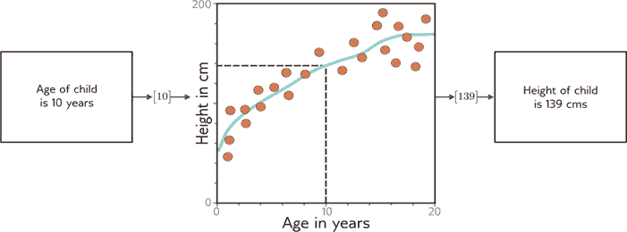

图 1.3 机器学习模型。模型表示一族将输入（儿童年龄）关联到输出（儿童身高）的关系。特定关系是通过*训练数据*（输入/输出对的示例）选择的。在图 1.3 中，这些对由橙色点表示，我们可以看到模型（青色线）相当好地描述了这些数据。当我们谈论*训练*或*拟合*模型时，意思是我们在关联输入输出的可能方程族（可能的青色曲线）中搜索，找到最准确描述训练数据的那个。

由此可见，图 1.2 中的模型训练需要带标签的输入/输出对。例如，音乐分类模型需要大量音频片段，且每个片段的流派都由人类专家标识。这些输入/输出对在训练过程中扮演教师或监督者的角色，从而产生了*监督学习*这一术语。

#### 1.1.4 深度神经网络

本书关注深度神经网络，这是一种特别有用的机器学习模型。它们是能够表示输入与输出之间极其广泛关系族的方程，并且在这种关系族中搜索描述训练数据的关系特别容易。

深度神经网络可以处理非常大、长度可变且包含各种内部结构的输入。它们可以输出单个实数（回归）、多个数值（多元回归），或两个或多个类别上的概率（分别对应二分类和多分类）。正如我们在下一节将看到的，它们的输出也可能非常大、长度可变且包含内部结构。现在很难想象具有这些特性的方程，读者暂时应尽量放下怀疑。

#### 1.1.5 结构化输出

图 1.4a 描绘了一个用于语义分割的多元二分类模型。在这里，输入图像的每个像素都被分配一个二进制标签，指示其属于奶牛还是背景。图 1.4b 展示了一个多元回归模型，其中输入是街景图像，输出是每个像素处的深度。在这两种情况下，输出均为高维且结构化的。然而，这种结构与输入紧密相关，且可被利用；如果一个像素被标记为“奶牛”，则具有相似 RGB 值的邻域像素很可能具有相同的标签。

![Figure 1.4 Supervised learning tasks with structured outputs. a) This semantic segmentation model maps an RGB image to a binary image indicating whether each pixel belongs to the background or a cow (adapted from Noh et al., 2015). b) This monocular depth estimation model maps an RGB image to an output image where each pixel represents the depth (adapted from Cordts et al., 2016). c) This audio transcription model maps an audio sample to a transcription of the spoken words in the audio. d) This translation model maps an English text string to its French translation. e) This image synthesis model maps a caption to an image (example from https://openai.com/dall-e-2/). In each case, the output has a complex internal structure or grammar. In some cases, many outputs are compatible with the input.](img/c1-fig-0004.jpg)


# 图 1.4 具有结构化输出的监督学习任务

a) 该语义分割模型将 RGB 图像映射为二值图像，指示每个像素属于背景还是奶牛（改编自 Noh 等人，2015）。  
b) 该单目深度估计模型将 RGB 图像映射为输出图像，其中每个像素代表深度（改编自 Cordts 等人，2016）。  
c) 该音频转录模型将音频样本映射为音频中口语单词的转录文本。  
d) 该翻译模型将英文文本字符串映射为其法语翻译。  
e) 该图像合成模型将标题映射为图像（示例来自 [`openai.com/dall-e-2/`](https://openai.com/dall-e-2/)）。在每种情况下，输出都具有复杂的内部结构或语法。在某些情况下，许多输出均与输入兼容。

图 1.4c–e 描绘了三个模型，在这些模型中，输出具有复杂的结构，但与输入的联系不那么紧密。图 1.4c 展示了一个模型，其输入为音频文件，输出为该文件的转录单词。图 1.4d 是一个翻译模型，其中输入为一段英文文本，输出包含其法语翻译。图 1.4e 描绘了一项极具挑战性的任务，其中输入为描述性文本，模型必须生成与该描述相匹配的图像。

原则上，后三项任务可在标准监督学习框架内解决，但它们更难，主要有两个原因。首先，输出可能真正存在歧义；从一个英文句子到法语句子存在多个有效翻译，且与任何标题兼容的图像也有多张。其次，输出包含大量结构；并非所有单词串都构成有效的英文或法语句子，也并非所有 RGB 值的集合都构成合理的图像。除了学习映射关系外，我们还必须遵守输出的“语法”。

幸运的是，这种“语法”可以在无需输出标签的情况下学习。例如，我们可以通过学习大量文本语料库的统计规律来学习如何构成有效的英文句子。这为本书的下一节提供了联系，下一节将讨论*无监督学习模型*。

## 1.2 无监督学习

在没有相应输出标签的情况下，仅从输入数据构建模型被称为*无监督学习*；输出标签的缺失意味着不存在“监督”。其目标不是学习从输入到输出的映射，而是描述或理解数据的结构。正如监督学习的情况一样，数据可能具有截然不同的特征；它可能是离散或连续的、低维或高维的、定长或变长的。

### 1.2.1 生成模型

本书重点关注*生成式无监督模型*，这类模型学习合成新的数据样本，使其在统计上与训练数据无法区分。一些生成模型显式地描述了输入域上的概率分布，新样本通过从该分布中采样生成。另一些则仅学习一种生成新样本的机制。

最先进的生成模型能够合成极其逼真但与训练样本不同的样本。它们在生成图像（图 1.5）和文本（图 1.6）方面取得了特别的成功。它们还可以在部分输出被预先确定的约束下合成数据（称为*条件生成*）。示例包括图像修复（图 1.7）和文本补全（图 1.8）。事实上，现代文本生成模型非常强大，以至于它们看起来似乎具有智能。给定一段文本和一个问题，模型通常可以通过生成文档最可能的补全来“填补”缺失的答案。然而，实际上，模型仅了解语言的统计规律，并不理解其答案的意义。


图 1.5 图像生成模型。左侧：两张图像由在猫图片上训练的模型生成。这些不是真实的猫，而是概率模型的样本。右侧：两张由在建筑图像上训练的模型生成的图像。改编自 Karras 等人 (2020b)。


图 1.6 由文本数据生成模型合成的短篇故事。该模型描述了一个概率分布，为每个输出字符串分配概率。从模型中采样可创建遵循训练数据统计规律（此处为短篇故事）但从未见过的字符串。


图 1.7 图像修复。在原始图像（左）中，男孩被金属缆线遮挡。这些不需要的区域（中）被移除，生成模型在剩余像素必须保持不变的约束下合成新图像（右）。改编自 Saharia 等人 (2022a)。


### 1.2.2 潜变量

部分（但并非所有）生成模型利用了这样一个观察结果：数据的维度可能比原始观测变量的数量所暗示的要低。例如，有效且有意义的英语句子数量远少于随机抽取单词所能组成的字符串数量。同理，现实世界的图像只是对每个像素随机抽取 RGB 值所能生成的图像中的一小部分。这是因为图像是由物理过程生成的（参见图 1.9）。


图 1.9 人脸的变化。人脸大约包含 42 块肌肉，因此只需 42 个数字就能描述同一人在相同光照条件下图像的大部分变化。一般来说，图像、音乐和文本数据集均可用相对较少的底层变量来描述，尽管通常很难将这些变量与特定的物理机制联系起来。图片源自 Dynamic FACES 数据库 (Holland et al., 2019)。

由此引出了这样一个概念：我们可以用较少数量的底层 `latent variables`（潜变量）来描述每个数据样本。在这里，深度学习的作用是描述这些潜变量与数据之间的映射关系。潜变量通常在设计上具有简单的概率分布。通过从该分布中采样并将结果传入深度学习模型，我们便能创建新样本（图 1.10）。


图 1.10 潜变量。许多生成模型利用深度学习模型来描述低维“潜”变量与观测到的高维数据之间的关系。潜变量在设计上具有简单的概率分布。因此，可以通过从潜变量的简单分布中采样，再利用深度学习模型将样本映射到观测数据空间，从而生成新样本。

这些模型催生了操控真实数据的新方法。例如，考虑寻找支撑两个真实样本的潜变量。我们可以通过在它们的潜在表示之间插值，并将中间位置映射回数据空间，从而在两个样本之间进行插值（图 1.11）。

![Figure 1.11 Image interpolation. In each row the left and right images are real and the three images in between represent a sequence of interpolations created by a generative model. The generative models that underpin these interpolations have learned that all images can be created by a set of underlying latent variables. By finding these variables for the two real images, interpolating their values, and then using these intermediate variables to create new images, we can generate intermediate results that are both visually plausible and mix the characteristics of the two original images. Top row adapted from Sauer et al. (2022). Bottom row adapted from Ramesh et al. (2022).](img/c1-fig-0011.jpg)

图 1.11 图像插值。在每一行中，最左和最右的图像为真实图像，中间的三幅图像代表由生成模型创建的一系列插值结果。支撑这些插值的生成模型已经学会所有图像均可由一组底层潜变量创建。通过找到这两幅真实图像对应的潜变量，对其值进行插值，再利用这些中间变量生成新图像，我们便能得到既视觉合理又融合了原始两幅图像特征的中间结果。顶行改编自 Sauer 等人 (2022) 的成果。底行改编自 Ramesh 等人 (2022) 的成果。

### 1.2.3 连接监督学习与无监督学习

带有潜变量的生成模型还能造福输出具有结构的监督学习模型（图 1.4）。例如，考虑学习预测与标题对应的图像。我们不直接将文本输入映射到图像，而是学习解释文本的潜变量与解释图像的潜变量之间的关系。

这有三大优势。首先，由于输入和输出均变为低维，我们可能需要更少的文本/图像对来学习该映射。其次，我们更有可能生成一幅貌似合理的图像；潜变量的任何合理取值都应能生成看起来像合理样本的内容。第三，如果我们在两组潜变量之间的映射或从潜变量到图像的映射中引入随机性，便能生成多幅均能被该标题很好地描述的图像（图 1.12）。

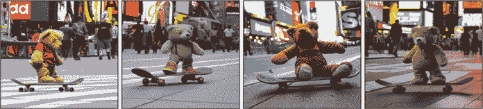

图 1.12 根据标题“泰迪熊在时代广场滑滑板”生成的多幅图像。由 DALL·E-2 生成 (Ramesh et al., 2022)。

## 1.3 强化学习

机器学习的最后一个领域是强化学习。该范式引入了**智能体**的概念，它生存于一个环境中，并可在每个时间步执行特定动作。动作会改变系统的状态，但不一定以确定性方式改变。执行动作还可能产生奖励，强化学习的目标是让智能体学会选择能带来平均高奖励的动作。

一个复杂因素是奖励可能在动作执行一段时间后才出现，因此将奖励与动作关联并非易事。这被称为 `temporal credit assignment problem`（时间信用分配问题）。随着智能体学习，它必须在 `exploration`（探索）和 `exploitation`（利用）已知知识之间权衡；也许智能体已学会如何获得微薄奖励；它是坚持此策略（利用已知），还是尝试不同动作以求改进（探索其他机会）？

### 1.3.1 两个例子

考虑教一个人形机器人移动。机器人在给定时刻只能执行有限数量的动作（移动各个关节），这些动作会改变世界的状态（它的姿态）。我们可能会在机器人到达障碍赛道的检查点时给予奖励。要到达每个检查点，它必须执行许多动作，而在收到奖励时，不清楚哪些动作促成了奖励，哪些无关紧要。这是时间信用分配问题的一个例子。

#### 学习下棋的第二个例子

同样，智能体在任何给定时刻都有一组有效动作（棋步）。然而，这些动作以非确定性的方式改变系统状态；对于任何动作选择，对手可能会以许多不同的棋步进行回应。在这里，我们可能会根据吃子设置奖励结构，或者仅在游戏结束获胜时给予单一奖励。在后一种情况下，时间信用分配问题极其突出；系统必须学习其众多棋步中哪些对成功或失败起到了关键作用。

探索-利用权衡在这两个例子中也很明显。机器人可能已经发现，通过侧卧并用一条腿推地可以取得进展。这种策略能移动机器人并产生奖励，但速度比最优解（用腿保持平衡并行走）慢得多。因此，它面临在利用已知知识（如何笨拙地在地板上滑行）和探索动作空间（可能导致更快的移动方式）之间做选择。同样，在下棋例子中，智能体可能学会了一套合理的开局棋步序列。它应该利用这些知识，还是探索不同的开局序列？

#### 深度学习如何融入强化学习框架

这或许并不明显。有几种可能的方法，但其中一种技术是使用深度网络构建从观测到的世界状态到动作的映射。这被称为**策略网络**（*policy network*）。在机器人例子中，策略网络将学习从其传感器测量值到关节运动的映射。在下棋例子中，网络将学习从棋盘当前状态到棋步选择的映射（图 1.13）。

```

```

图 1.13 强化学习的策略网络。将深度神经网络融入强化学习的一种方法是用它们定义从状态（此处为棋盘上的位置）到动作（可能的棋步）的映射。这种映射称为**策略**（*policy*）。改编自 Pablok (2017)。

## 1.4 伦理

如果在不讨论人工智能伦理影响的情况下撰写本书，将是不负责任的。这项强大技术改变世界的程度，至少不亚于电力、内燃机、晶体管或互联网。在医疗、设计、娱乐、交通、教育及几乎所有商业领域，其潜在益处巨大。然而，科学家和工程师往往对其工作成果抱有不切实际的乐观态度，其潜在危害同样巨大。以下段落重点强调了五大担忧。

### 偏见与公平

如果我们基于历史数据训练系统预测个人薪资水平，该系统将复现历史偏见；例如，它很可能预测女性薪资应低于男性。已有多起此类案例成为国际新闻：一款面部图像超分辨率 AI 系统让非白人肤色变白；一款图像生成系统在被要求合成律师图片时，仅生成男性图片。粗心应用基于 AI 的算法决策，有可能巩固或加剧现有偏见。详见 Binns (2018)。

### 可解释性

深度学习系统做出决策，但我们通常不清楚其具体依据或依赖何种信息。它们可能包含数十亿参数，仅凭人工检查无法理解其工作原理。这催生了可解释 AI 子领域。一个相对成功的方向是生成局部解释；虽无法解释整个系统，但可针对特定决策生成可理解的说明。然而，是否可能构建对用户甚至创建者完全透明的复杂决策系统，仍属未知。详见 Grennan 等 (2022)。

### AI 武器化


所有重大技术均直接或间接应用于战争。遗憾的是，暴力冲突似乎是人类行为的必然特征。AI 可以说是有史以来最强大的技术，必将在军事领域大规模部署。事实上，这已在发生 (Heikkilä, 2022)。

### 权力集中

世界最强大的公司大举投资 AI，并非出于改善人类命运的善意。它们深知这些技术将带来巨额利润。像任何先进技术一样，深度学习极可能将权力集中在少数掌控它的组织手中。自动化目前由人类从事的工作将改变经济环境，并对技能较少、薪资较低的工作者生计产生不成比例的影响。乐观者认为工业革命期间也发生过类似动荡，最终缩短了工时。真相是，我们根本不知道大规模采用 AI 对社会将产生何种影响 (见 David, 2015)。

### 生存风险

人类面临的主要生存风险皆源于技术。气候变化由工业化驱动。核武器源于物理学研究。因交通、农业、建筑创新使人口规模更大、密度更高、联系更紧密，大流行病发生概率更高、传播更快。人工智能带来新的生存风险。我们应对构建比人类更强大、更具扩展性的系统保持极度审慎。在最乐观的情况下，它将把巨大权力交给拥有者；在最悲观的情况下，我们将无法控制它，甚至无法理解其动机 (见 Tegmark, 2018)。

此清单远非详尽。AI 还可能助长监控、虚假信息、隐私侵犯、欺诈、金融市场操纵，且训练 AI 系统所需能源加剧气候变化。此外，这些担忧非臆测；已有大量伦理存疑的 AI 应用案例 (详见 Dao, 2021 部分列表)。而且，互联网近期历史显示，新技术会以意想不到的方式造成危害。八九十年代的在线社区难以预见假新闻、垃圾邮件、网络骚扰、欺诈、网络霸凌、非自愿独身者文化、政治操控、人肉搜索、网络极端化和报复性色情内容的泛滥。

所有研究、研发（或撰写书籍）AI 的人都应深思：科学家对其技术用途应负何种程度的责任？我们应考虑到资本主义是 AI 发展的主要驱动力，法律进步和造福社会的部署恐将显著滞后。我们应反思：作为科学家和工程师，是否有可能控制该领域进展、降低危害风险？我们应考虑愿为何种组织工作。它们对降低 AI 潜在危害的承诺有多认真？仅是为规避声誉风险而“漂绿”，还是真正实施了叫停伦理存疑项目的机制？

所有读者都被鼓励进一步探究这些问题。在线课程 [`ethics-of-ai.mooc.fi/`](https://ethics-of-ai.mooc.fi/) 是一个有用的入门资源。如果您是使用本书授课的教授，建议您与学生讨论这些问题。如果您是选修相关课程但未涉及此内容的学生，请游说您的教授安排相关教学。如果您在企业环境中部署或研究 AI，建议您审视雇主的价值观，并帮助改变它们（或选择离开），如果它们令人失望的话。

### 1.5 书籍结构

本书的结构遵循本引言的结构。第 2-9 章贯穿监督学习流程。我们描述了浅层和深层神经网络，并讨论了如何训练它们、衡量和提升其性能。第 10-13 章描述了深度神经网络常见的架构变体，包括卷积网络、残差连接和 Transformer。这些架构被用于监督学习、无监督学习和强化学习中。

第 14-18 章使用深度神经网络解决无监督学习问题。我们分别用一章介绍四种现代深度生成模型：生成对抗网络、变分自编码器、归一化流和扩散模型。第 19 章简要介绍深度强化学习。该主题足以单独成书，因此处理必然浅显。然而，这旨在为不熟悉该领域的读者提供一个良好的切入点。

尽管本书标题如此，深度学习的某些方面仍知之甚少。第 20 章提出了一些基本问题。为什么深度网络如此易于训练？为什么它们泛化能力如此强？为什么需要如此多的参数？它们必须很深吗？在此过程中，我们探讨了损失函数结构、双重下降、顿悟现象和彩票假设等意外现象。本书以第 21 章结束，讨论伦理与深度学习。

### 1.6 其他书籍

本书自成体系，但仅涵盖深度学习。它旨在成为《深度学习》（Goodfellow 等人，2016）的精神继承者，后者是极佳的资源但未涵盖最新进展。对于更广泛的机器学习视角，最新且百科全书式的资源是《概率机器学习》（Murphy，2022，2023）。然而，《模式识别与机器学习》（Bishop，2006）仍是一本优秀且相关的书籍。

如果您喜欢本书，我之前的著作《计算机视觉：模型、学习与推断》（Prince，2012）仍值得一读。部分内容已过时，但它包含概率论的详尽介绍（包括贝叶斯方法），以及潜变量模型、计算机视觉几何、高斯过程和图模型的良好入门覆盖。它使用与本书相同的符号，可在线找到。图模型的详细处理见《概率图模型：原理与技术》（Koller & Friedman，2009），高斯过程见《机器学习的高斯过程》（Williams & Rasmussen，2006）。

背景数学请参阅《机器学习数学》（Deisenroth 等人，2020）。更偏编程的方法请参阅《动手学深度学习》（Zhang 等人，2023）。计算机视觉的最佳概览是 Szeliski (2022)，即将出版的《计算机视觉基础》（Torralba 等人，2024）也值得期待。学习图神经网络的良好起点是《图表示学习》（Hamilton，2020）。强化学习的权威著作是《强化学习导论》（Sutton & Barto，2018）。良好的初始资源是《深度强化学习基础》（Graesser & Keng，2019）。

### 1.7 如何阅读本书

本书剩余大多数章节包含正文、注释部分和习题集。正文旨在自成体系，无需参考章节其他部分即可阅读。尽可能将背景数学融入正文。然而，对于会干扰主线论证的大型主题，背景材料被移至附录，并在页边提供引用。本书大多数符号是标准的。然而，一些约定不太常用，建议读者在继续阅读前查阅附录 A。

***

## 附录 A

符号

***

正文包含许多深度学习模型和结果的新颖插图和可视化。我努力提供对现有思想的新解释，而不仅仅是整理他人的工作。深度学习是一个新领域，有时现象知之甚少。我试图明确指出这种情况，以及何时应谨慎对待我的解释。

参考文献仅在正文中描绘结果的地方包含。相反，它们位于章节末尾的注释部分。我通常不在正文中遵循历史先例；如果当前技术的祖先不再有用，我将不予提及。然而，领域的历史发展在注释部分描述，希望能公正地分配功劳。注释按段落组织，提供进一步阅读的指针。它们应帮助读者在子领域内定位，并理解其与机器学习其他部分的关系。注释不如正文自成体系。取决于您的背景知识和兴趣，您可能会发现这些部分或多或少有用。

每章有若干相关习题。它们在正文页边被引用，标明应在何处尝试。正如 George Pólya 所言：“数学，你看，不是观众运动。”他说得很对，我强烈建议您随读随练。在某些情况下，它们提供的见解将帮助您理解正文。网站上提供答案的习题用星号标记。此外，帮助理解本书思想的 Python 笔记本也可通过网站获得，并在文本页边引用。确实，如果您感到生疏，现在可能值得先完成背景数学笔记本。

***

##### Notebook 1.1

背景数学

***

遗憾的是，AI 研究的快速步伐使本书必然成为持续进行的工作。如果您发现难以理解的部分、显著的遗漏或似乎多余的章节，请通过相关网站联系我们。共同努力，我们可以使下一版更好。

## 第 2 章 监督学习

*监督学习模型* 定义了从一个或多个输入到一个或多个输出的映射。例如，输入可能是二手丰田普锐斯的车龄和里程，输出可能是该车的美元估值。

模型只是一个数学方程；当输入通过此方程时，它计算输出，这称为 *推理*。模型方程还包含 *参数*。不同的参数值会改变计算结果；模型方程描述了一族输入和输出之间可能的关系，而参数指定了特定的关系。

当我们`训练`或`学习`一个模型时，我们是在寻找能够描述输入与输出之间真实关系的参数。学习算法接收一组输入/输出对作为训练集，并调整参数，直到输入能够尽可能准确地预测其对应的输出。如果模型在这些训练对上表现良好，那么我们希望它也能对真实输出未知的新输入做出良好的预测。

本章的目标是展开阐述这些思想。首先，我们将更正式地描述这一框架并引入一些符号。然后，我们将通过一个简单的例子，使用一条直线来描述输入与输出之间的关系。这种线性模型既熟悉又易于可视化，但仍然阐释了监督学习的所有主要思想。

### 2.1 监督学习概述

在监督学习中，我们的目标是构建一个模型，该模型接收输入 `x` 并输出预测值 `y`。为简单起见，我们假设输入 `x` 和输出 `y` 都是大小预先确定且固定的向量，并且每个向量的元素始终以相同的方式排序；在上述普锐斯示例中，输入 `x` 将始终包含汽车的年龄和里程，且顺序固定。这被称为`结构化`或`表格`数据。

为了进行预测，我们需要一个模型 `f[•]`，它接收输入 `x` 并返回 `y`，即：

`y = f[x].`

(2.1)

当我们根据输入 `x` 计算预测 `y` 时，我们称之为`推理`。

模型只是一个形式固定的数学方程。它代表了输入与输出之间一系列不同的关系。模型还包含`参数 ϕ`。参数的选择决定了输入与输出之间的特定关系，因此我们更准确地应该写为：

`y = f[x, ϕ].`

(2.2)

当我们谈论`学习`或`训练`模型时，意味着我们试图找到参数 `ϕ`，使模型能从输入中做出合理的输出预测。我们利用包含 `I` 个输入/输出示例对 `{x[i], y[i]}` 的`训练数据集`来学习这些参数。我们的目标是选择参数，使每个训练输入能尽可能准确地映射到其关联的输出。我们用`损失 L`来量化这种映射的失配程度。这是一个标量值，总结了在参数 `ϕ` 下模型根据相应输入预测训练输出的效果有多差。

我们可以将损失视为这些参数的函数 `L[ϕ]`。当我们训练模型时，我们寻找的是使该`损失函数`最小化的参数 `ϕ*`：

```
ϕ* = argmin_ϕ L[ϕ]
```

(2.3)

如果最小化后损失很小，说明我们找到了能准确地从训练输入 `x[i]` 预测训练输出 `y[i]` 的模型参数。

训练完模型后，我们现在必须评估其性能；我们在单独的`测试数据`上运行模型，以查看它对训练期间未观察到的示例`泛化`得有多好。如果性能达标，那么我们就可以部署模型了。

### 2.2 线性回归示例

现在让我们通过一个简单的例子使这些思想具体化。我们考虑一个模型 `y = f[x, ϕ]`，它从单个输入 `x` 预测单个输出 `y`。然后我们开发一个损失函数，最后讨论模型训练。

#### 2.2.1 一维线性回归模型

`一维线性回归模型`用一条直线描述输入 `x` 和输出 `y` 之间的关系：

`y = ϕ[0] + ϕ[1]x`

(2.4)

该模型有两个参数 `ϕ = [ϕ[0], ϕ[1]]^T`，其中 `ϕ[0]` 是直线的 y 轴截距，`ϕ[1]` 是斜率。不同的 y 轴截距和斜率选择会导致输入与输出之间不同的关系（图 2.1）。因此，方程 2.4 定义了一系列可能的输入-输出关系（所有可能的直线），而参数的选择决定了该系列中的成员（特定的那条直线）。

![Figure 2.1 Linear regression model. For a given choice of parameters ϕ = [ϕ[0], ϕ[1]]^T, the model makes a prediction for the output (y-axis) based on the input (x-axis). Different choices for the y-intercept ϕ[0] and the slope ϕ[1] change these predictions (cyan, orange, and gray lines). The linear regression model (equation 2.4) defines a family of input/output relations (lines) and the parameters determine the member of the family (the particular line).](images/c2-fig-0001.jpg)

图 2.1 线性回归模型。对于给定的参数选择 `ϕ = [ϕ[0], ϕ[1]]^T`，模型根据输入（x 轴）对输出（y 轴）进行预测。y 轴截距 `ϕ[0]` 和斜率 `ϕ[1]` 的不同选择会改变这些预测（青色、橙色和灰色直线）。线性回归模型（方程 2.4）定义了一系列输入/输出关系（直线），而参数决定了该系列中的成员（特定的那条直线）。

#### 2.2.2 损失

对于该模型，训练数据集（图 2.2a）由 `I` 个输入/输出对 `{x[i], y[i]}` 组成。图 2.2b–d 展示了由三组参数定义的三条直线。图 2.2d 中的绿线比其他两条线更准确地描述了数据，因为它更接近数据点。然而，我们需要一个原则性的方法来决定哪组参数 `ϕ` 更好。为此，我们为每组参数分配一个数值，以量化模型与数据之间的失配程度。我们称该值为`损失`；损失越低意味着拟合越好。

![Figure 2.2 Linear regression training data, model, and loss. a) The training data (orange points) consist of I = 12 input/output pairs {xi, yi}. b–d) Each panel shows the linear regression model with different parameters. Depending on the choice of y-intercept and slope parameters ϕ = [ϕ0, ϕ1]^T, the model errors (orange dashed lines) may be larger or smaller. The loss L is the sum of the squares of these errors. The parameters that define the lines in panels (b) and (c) have large losses L = 7.07 and L = 10.28, respectively because the models fit badly. The loss L = 0.20 in panel (d) is smaller because the model fits well; in fact, this has the smallest loss of all possible lines, so these are the optimal parameters.](images/c2-fig-0002.jpg)

图 2.2 线性回归训练数据、模型和损失。a) 训练数据（橙色点）由 `I = 12` 个输入/输出对 `{x[i], y[i]}` 组成。b–d) 每个面板展示了具有不同参数的线性回归模型。取决于 y 轴截距和斜率参数 `ϕ = [ϕ[0], ϕ[1]]^T` 的选择，模型误差（橙色虚线）可能较大或较小。损失 `L` 是这些误差平方的总和。面板 (b) 和 (c) 中定义直线的参数分别具有较大的损失 `L = 7.07` 和 `L = 10.28`，因为模型拟合得不好。面板 (d) 中的损失 `L = 0.20` 较小，因为模型拟合得好；事实上，这是所有可能直线中损失最小的，因此这些是最优参数。

失配程度由模型预测值 `f[x[i], ϕ]`（直线在 `x[i]` 处的高度）与真实输出 `y[i]` 之间的偏差来体现。这些偏差在图 2.2b–d 中显示为橙色虚线。我们将总失配度、即`训练误差`或`损失`量化为所有 `I` 个训练对的这些偏差平方之和：

```
L[ϕ] = Σ_{i=1}^I (y[i] - f[x[i], ϕ])²
```

(2.5)

由于最佳参数使该表达式最小化，我们称之为*最小二乘*损失。平方运算意味着偏差的方向（即直线位于数据上方还是下方）并不重要。对于这一选择也存在理论依据，我们将在第 5 章中回到这一点。

损失 *L* 是参数 `ϕ` 的函数；当模型拟合较差时（图 2.2b,c）它会较大，而当拟合良好时（图 2.2d）它会较小。从这个角度来看，我们称 `L[ϕ]` 为*损失函数*或*代价函数*。目标是找到使该量最小化的参数 `ϕ̂`：

```
(2.6)
```

***

##### Notebook 2.1

监督学习

***

只有两个参数（y 轴截距 `ϕ[0]` 和斜率 `ϕ[1]`），因此我们可以计算所有值组合的损失，并将损失函数可视化为一个曲面（图 2.3）。“最佳”参数位于该曲面的最小值处。

***

##### 问题 2.1–2.2

***

![Figure 2.3 Loss function for linear regression model with the dataset in figure 2.2a. ¶ a) Each combination of parameters ϕ = [ϕ0, ϕ1] has an associated loss. The resulting loss function L[ϕ] can be visualized as a surface. The three circles represent the three lines from figure 2.2b–d. b) The loss can also be visualized as a heatmap, where brighter regions represent larger losses; here we are looking straight down at the surface in (a) from above and gray ellipses represent isocontours. The best fitting line (figure 2.2d) has the parameters with the smallest loss (green circle).](images/c2-fig-0003.jpg)

图 2.3 使用 图 2.2a 中数据集的线性回归模型的损失函数。¶ a) 参数 `ϕ` = [`ϕ[0]`, `ϕ[1]`] 的每种组合都有一个相关的损失。由此产生的损失函数 `L[ϕ]` 可以可视化为一个曲面。三个圆圈代表 图 2.2b–d 中的三条线。b) 损失也可以可视化为热力图，其中更亮的区域代表更大的损失；这里我们从上方垂直向下俯视 (a) 中的曲面，灰色椭圆代表等高线。最佳拟合线（图 2.2d）具有损失最小的参数（绿色圆圈）。

#### 2.2.3 训练


寻找使损失最小化的参数的过程称为`模型拟合`、`训练`或`学习`。基本方法是随机选择初始参数，然后通过“沿着”损失函数“向下走”来改进它们，直到到达底部（图 2.4）。实现这一点的一种方法是测量当前位置处曲面的梯度，并沿最陡峭的下坡方向迈出一步。然后我们重复此过程，直到梯度变平，无法再进一步改进。²

![Figure 2.4 Linear regression training. The goal is to find the y-intercept and slope parameters that correspond to the smallest loss. a) Iterative training algorithms initialize the parameters randomly and then improve them by “walking downhill” until no further improvement can be made. Here, we start at position 0 and move a certain distance downhill (perpendicular to the contours) to position 1. Then we re-calculate the downhill direction and move to position 2. Eventually, we reach the minimum of the function (position 4). b) Each position 0–4 from panel (a) corresponds to a different y-intercept and slope and so represents a different line. As the loss decreases, the lines fit the data more closely.](img/c2-fig-0004.jpg)

图 2.4 线性回归训练。目标是找到对应最小损失的 y 轴截距和斜率参数。a) 迭代训练算法随机初始化参数，然后通过“向下走”来改进它们，直到无法再进一步改进。这里，我们从位置 0 开始，沿下坡方向（垂直于等高线）移动一段距离到位置 1。然后我们重新计算下坡方向并移动到位置 2。最终，我们到达函数的最小值处（位置 4）。b) 面板 (a) 中的位置 0–4 每个都对应不同的 y 轴截距和斜率，因此代表不同的线。随着损失减小，线条对数据的拟合更紧密。

#### 2.2.4 测试

训练好模型后，我们想知道它在现实世界中的表现如何。我们通过在单独的`测试数据`集上计算损失来实现这一点。预测准确度`泛化`到测试数据的程度部分取决于训练数据的代表性和完整性。然而，这也取决于模型的表达能力。像直线这样的简单模型可能无法捕捉输入和输出之间的真实关系。这被称为`欠拟合`。相反，一个表达能力很强的模型可能会描述训练数据中那些非典型的统计特性，从而导致异常的预测。这被称为`过拟合`。

### 2.3 总结

监督学习模型是一个函数 `y = f[x, ϕ]`，它将输入 `x` 映射到输出 `y`。具体的映射关系由参数 `ϕ` 决定。为了训练模型，我们在训练数据集 `{x[i], y[i]}` 上定义一个损失函数 `L[ϕ]`。这量化了模型预测 `f[x[i], ϕ]` 与观测输出 `y[i]` 之间的不匹配程度，作为参数 `ϕ` 的函数。然后我们寻找使损失最小化的参数。我们在另一组测试数据上评估模型，以查看它对新输入的泛化能力如何。

第 3–9 章将展开阐述这些思想。首先，我们解决模型本身的问题；线性回归有一个明显的缺点，即它只能将输入和输出之间的关系描述为一条直线。浅层神经网络（第 3 章）仅比线性回归稍微复杂一些，但能描述大得多的输入/输出关系族。深层神经网络（第 4 章）表达能力相当，但可以用更少的参数描述复杂函数，且在实践中效果更好。

第 5 章研究不同任务的损失函数，并揭示最小二乘损失的理论基础。第 6 章和第 7 章讨论训练过程。第 8 章讨论如何衡量模型性能。第 9 章探讨`正则化`技术，旨在提高该性能。

### 注释

**损失函数与代价函数：** 在大部分机器学习文献及本书中，损失函数和代价函数这两个术语可互换使用。然而，更严格地说，损失函数是与单个数据点相关的项（即方程 2.5 右侧的每个平方项），而代价函数是被最小化的总体量（即方程 2.5 右侧的整体）。代价函数可以包含不与单个数据点相关的额外项（见第 9.1 节）。更一般地，`目标函数`是指任何待最大化或最小化的函数。

**生成模型与判别模型：** 本章中的模型 `y = f[x, ϕ]` 是`判别模型`。这些模型从现实世界的测量值 `x` 中进行输出预测 `y`。另一种方法是构建`生成模型` `x = g[y, ϕ]`，其中现实世界的测量值 `x` 作为输出 `y` 的函数被计算得出。

***

#### 问题 2.3

***

生成式方法的缺点在于它不能直接预测 `y`。要进行推理，我们必须将生成式方程反转为 `y = g⁻¹[x, ϕ]`，这可能很困难。然而，生成式模型的优势在于我们可以将关于数据如何生成的先验知识构建到模型中。例如，如果我们想预测图像 `x` 中汽车的三维位置和朝向 `y`，那么我们可以将关于汽车形状、三维几何和光传输的知识构建到函数 `x = g[y, ϕ]` 中。

这听起来是个好主意，但实际上，判别式模型主导着现代机器学习；从生成式模型利用先验知识中获得的优势，通常会被利用大量训练数据学习非常灵活的判别式模型所超越。

### 习题

**习题 2.1** 要在损失函数（方程 2.5）上“向下”行走，我们测量其关于参数 `ϕ[0]` 和 `ϕ[1]` 的梯度。计算斜率 `∂L/∂ϕ[0]` 和 `∂L/∂ϕ[1]` 的表达式。

**习题 2.2** 证明我们可以通过将习题 2.1 中导数的表达式设为零并求解 `ϕ[0]` 和 `ϕ[1]`，以闭式找到损失函数的最小值。注意这适用于线性回归，但不适用于更复杂的模型；这就是为什么我们使用迭代模型拟合方法，如梯度下降（图 2.4）。

**习题 2.3\*** 考虑将线性回归重新表述为生成式模型，因此我们有 `x = g[y, ϕ] = ϕ[0] + ϕ[1]y`。新的损失函数是什么？求用于执行推理的反函数 `y = g⁻¹[x, ϕ]` 的表达式。对于给定的训练数据集 `{x[i], y[i]}`，该模型的预测结果会与判别式版本相同吗？验证这一点的一种方法是编写代码，分别使用这两种方法为三个数据点拟合一条线，看结果是否相同。

## 第 3 章

浅层神经网络

第 2 章介绍了使用一维线性回归的监督学习。然而，该模型只能将输入/输出关系描述为一条直线。本章介绍浅层神经网络。它们描述分段线性函数，表达能力足以近似多维输入和输出之间任意复杂的关系。

### 3.1 神经网络示例

浅层神经网络是具有参数 `ϕ` 的函数 `y = f[x, ϕ]`，将多变量输入 `x` 映射到多变量输出 `y`。我们将完整定义推迟到第 3.4 节，并通过一个示例网络 `f[x, ϕ]` 来介绍主要思想，该网络将标量输入 `x` 映射到标量输出 `y`，并具有十个参数 `ϕ = {ϕ[0], ϕ[1], ϕ[2], ϕ[3], θ[10], θ[11], θ[20], θ[21], θ[30], θ[31]}`：

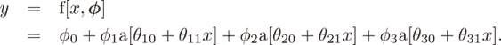

(3.1)

我们可以将此计算分解为三部分：首先，我们计算输入数据的三个线性函数（`θ[10] + θ[11]x`、`θ[20] + θ[21]x` 和 `θ[30] + θ[31]x`）。其次，我们将这三个结果通过一个`激活函数` `a[•]`。最后，我们用 `ϕ[1]、ϕ[2] 和 ϕ[3]` 对生成的三个激活值进行加权，求和，并加上偏移 `ϕ[0]`。

为了完善描述，我们必须定义激活函数 `a[•]`。有很多选择，但最常用的是`线性修正单元`或`ReLU`：

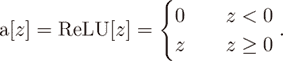

(3.2)

当输入为正时返回输入，否则返回零（图 3.1）。


图 3.1 线性修正单元 (ReLU)。如果输入小于零，该激活函数返回零；否则返回未改变的输入。换句话说，它将负值截断为零。注意，激活函数还有许多其他可能的选择（见图 3.13），但 ReLU 是最常用且最容易理解的。

方程 3.1 表示哪一族输入/输出关系可能并不显而易见。尽管如此，前一章的思想都适用。方程 3.1 表示一族函数，该族的特定成员取决于 `ϕ` 中的十个参数。如果我们知道这些参数，就可以通过为给定输入 `x` 求解方程来执行推理（预测 `y`）。给定训练数据集 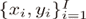，我们可以定义最小二乘损失函数 `L[ϕ]`，并用它来衡量模型对于任意给定参数值 `ϕ` 描述该数据集的效果。为了训练模型，我们寻找使该损失最小化的值 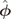。

#### 3.1.1 神经网络直觉

事实上，方程 3.1 表示一族连续分段线性函数（图 3.2），最多包含四个线性区域。我们现在分解方程 3.1 并展示它*为什么*描述这一族函数。为了便于理解，我们将函数分为两部分。首先，我们引入中间量：

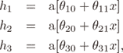

(3.3)


图 3.2 方程 3.1 定义的函数族。a–c) 十个参数 `ϕ` 的三种不同选择对应的函数。在每种情况下，输入/输出关系都是分段线性的。然而，节点的位置、它们之间线性区域的斜率以及整体高度各不相同。

其中我们将 `h[1]、h[2] 和 h[3]` 称为`隐藏单元`。其次，我们通过用线性函数组合这些隐藏单元来计算输出：¹

`y = ϕ[0] + ϕ[1]h[1] + ϕ[2]h[2] + ϕ[3]h[3].`

(3.4)

图 3.3 展示了创建图 3.2a 中函数的计算流程。每个隐藏单元包含输入的一个线性函数 `θ[•0] + θ[•1]x`，该直线被 ReLU 函数 `a[•]` 在零以下截断。三条直线穿过零点的位置成为最终输出中的三个“节点”。然后，三条截断后的直线分别由 `ϕ[1]、ϕ[2] 和 ϕ[3]` 加权。最后，加上控制最终函数整体高度的偏移 `ϕ[0]`。

* * *

习题 3.1–3.8

* * *

![Figure 3.3 Computation for function in figure 3.2a. a–c) The input x is passed through three linear functions, each with a different y-intercept θ•0 and slope θ•1. d–f) Each line is passed through the ReLU activation function, which clips negative values to zero. g–i) The three clipped lines are then weighted (scaled) by ϕ1, ϕ2, and ϕ3, respectively. j) Finally, the clipped and weighted functions are summed, and an offset ϕ0 that controls the height is added. Each of the four linear regions corresponds to a different activation pattern in the hidden units. In the shaded region, h2 is inactive (clipped), but h1 and h3 are both active.](img/c3-fig-0003.jpg)

##### 图 3.3 图 3.2a 中函数的计算过程

a–c) 输入 `x` 通过三个线性函数，每个函数具有不同的 y 轴截距 `θ[•][0]` 和斜率 `θ[•][1]`。d–f) 每条线再通过 ReLU 激活函数，该函数将负值截断为零。g–i) 然后，这三条被截断的线分别由 `ϕ[1]`、`ϕ[2]` 和 `ϕ[3]` 加权（缩放）。j) 最后，将截断并加权后的函数求和，并加上一个控制高度的偏移量 `ϕ[0]`。四个线性区域中的每一个都对应隐藏单元中不同的`激活模式`。在阴影区域中，`h[2]` 处于非激活状态（被截断），但 `h[1]` 和 `h[3]` 均处于激活状态。

图 3.3j 中的每个线性区域都对应隐藏单元中不同的`激活模式`。当一个单元被截断时，我们称其为`非激活`；当它未被截断时，我们称其为`激活`。例如，阴影区域接收来自 `h[1]` 和 `h[3]`（它们是激活的）的贡献，但不接收来自 `h[2]`（它是非激活的）的贡献。每个线性区域的斜率由以下因素决定：(i) 该区域激活输入的原始斜率 `θ[•1]`，以及 (ii) 随后施加的权重 `ϕ[•]`。例如，阴影区域的斜率（见问题 3.3）为 `θ[11]*ϕ[1] + θ[31]*ϕ[3]`，其中第一项是面板 (g) 中的斜率，第二项是面板 (i) 中的斜率。

每个隐藏单元为函数贡献一个“折点”，因此有三个隐藏单元时，最多可有四个线性区域。然而，这些区域的斜率只有三个是独立的；第四个斜率要么为零（如果该区域内所有隐藏单元均非激活），要么是其他区域斜率的总和。

---

##### 笔记本 3.1

###### 浅层网络 I

---

###### 问题 3.9

---

#### 3.1.2 神经网络的描绘

我们一直在讨论一个具有一个输入、一个输出和三个隐藏单元的神经网络。我们在图 3.4a 中可视化了该网络。输入位于左侧，隐藏单元位于中间，输出位于右侧。每个连接代表十个参数中的一个。为了简化这种表示，我们通常不绘制截距参数，因此该网络通常如图 3.4b 所示。

![Figure 3.4 Depicting neural networks. a) The input x is on the left, the hidden units h1, h2, and h3 in the center, and the output y on the right. Computation flows from left to right. The input is used to compute the hidden units, which are combined to create the output. Each of the ten arrows represents a parameter (intercepts in orange and slopes in black). Each parameter multiplies its source and adds the result to its target. For example, we multiply the parameter ϕ1 by source h1 and add it to y. We introduce additional nodes containing ones (orange circles) to incorporate the offsets into this scheme, so we multiply ϕ0 by one (with no effect) and add it to y. ReLU functions are applied at the hidden units. b) More typically, the intercepts, ReLU functions, and parameter names are omitted; this simpler depiction represents the same network.](img/c3-fig-0004.jpg)


**图 3.4 神经网络的描绘。** a) 输入 `x` 在左侧，隐藏单元 `h[1]`、`h[2]` 和 `h[3]` 在中间，输出 `y` 在右侧。计算从左向右流动。输入用于计算隐藏单元，隐藏单元再组合生成输出。十个箭头中的每一个代表一个参数（截距用橙色表示，斜率用黑色表示）。每个参数将其源乘以该参数并将结果加到其目标上。例如，我们将参数 `ϕ[1]` 乘以源 `h[1]` 并将结果加到 `y` 上。我们引入包含 1 的额外节点（橙色圆圈）以将偏移量纳入此方案，因此我们将 `ϕ[0]` 乘以 1（无影响）并将结果加到 `y` 上。ReLU 函数作用于隐藏单元。b) 更典型的是，省略截距、ReLU 函数和参数名称；这种更简单的描绘代表同一个网络。

### 3.2 通用近似定理

在上一节中，我们介绍了一个具有一个输入、一个输出、ReLU 激活函数和三个隐藏单元的示例神经网络。现在让我们稍微推广一下，考虑具有 `D` 个隐藏单元的情况，其中第 `d` 个隐藏单元为：

```
h[d] = a[θ[d][0] + θ[d][1]*x]
```

 (3.5)

这些隐藏单元通过线性组合产生输出：

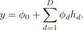

 (3.6)

浅层网络中隐藏单元的数量是*网络容量*的度量。使用 ReLU 激活函数时，具有 `D` 个隐藏单元的网络输出最多有 `D` 个折点，因此是一个最多具有 `D + 1` 个线性区域的分段线性函数。随着隐藏单元的增加，模型可以近似更复杂的函数。

---

#### 问题 3.10

---

确实，只要有足够的容量（隐藏单元），浅层网络就可以以任意精度描述定义在实数线紧子集上的任意连续一维函数。要理解这一点，请考虑每增加一个隐藏单元，我们就给函数增加一个线性区域。随着这些区域变得越来越多，它们代表函数中越来越小的部分，而这些部分越来越能被一条直线很好地近似（图 3.5）。*通用近似定理*证明了对于任意连续函数，都存在一个浅层网络能够以任意指定精度近似该函数。


**图 3.5 分段线性模型对一维函数（虚线）的近似。** a–c) 随着区域数量的增加，模型越来越接近连续函数。具有标量输入的神经网络每个隐藏单元创建一个额外的线性区域。通用近似定理证明了，只要有足够的隐藏单元，就存在一个浅层神经网络可以以任意精度描述定义在 `ℝ^D` 紧子集上的任意给定连续函数。

### 3.3 多变量输入和输出

在上述示例中，网络具有一个标量输入 `x` 和一个标量输出 `y`。然而，通用近似定理对于更一般的情况也成立，即网络将多变量输入 `x = [x[1], x[2],…, c3-fig-5007.jpg]^T` 映射到多变量输出预测 `y = [y[1], y[2],…, c3-fig-5008.jpg]^T`。我们首先探讨如何扩展模型以预测多变量输出。然后考虑多变量输入。最后，在第 3.4 节中，我们给出浅层神经网络的通用定义。

#### 3.3.1 多变量输出的可视化

要将网络扩展为多变量输出 `y`，我们只需为每个输出使用隐藏单元的不同线性函数。因此，一个具有标量输入 `x`、四个隐藏单元 `h[1]`、`h[2]`、`h[3]` 和 `h[4]` 以及二维多变量输出 `y = [y[1], y[2]]^T` 的网络可定义为：

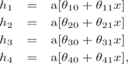

 (3.7)

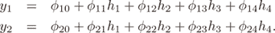

 (3.8)

这两个输出是隐藏单元的两个不同线性函数。

正如我们在图 3.3 中所见，分段函数中的“关节”取决于初始线性函数`θ[•0] + θ[•1]x`在隐藏单元处被 ReLU 函数`a[•]`裁剪的位置。由于两个输出`y[1]`和`y[2]`都是相同四个隐藏单元的不同线性函数，因此两者中的四个“关节”必须位于相同的位置。然而，线性区域的斜率和整体垂直偏移量可能会有所不同（图 3.6）。

---

##### 问题 3.11

---

![图 3.6 具有一个输入、四个隐藏单元和两个输出的网络。a) 网络结构可视化。b) 该网络产生两个分段线性函数，y1[x] 和 y2[x]。这两个函数的四个“关节”（垂直虚线处）被限制在相同的位置，因为它们共享相同的隐藏单元，但斜率和整体高度可能不同。](images/c3-fig-0006.jpg)

图 3.6 具有一个输入、四个隐藏单元和两个输出的网络。a) 网络结构可视化。b) 该网络产生两个分段线性函数，`y[1][x]` 和 `y[2][x]`。这两个函数的四个“关节”（垂直虚线处）被限制在相同的位置，因为它们共享相同的隐藏单元，但斜率和整体高度可能不同。

#### 3.3.2 可视化多变量输入

为了处理多变量输入`x`，我们扩展了输入与隐藏单元之间的线性关系。因此，一个具有两个输入`x = [x[1], x[2]]^T`和标量输出`y`的网络（图 3.7）可能具有由以下公式定义的三个隐藏单元：

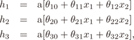

 (3.9)

![图 3.7 具有二维多变量输入 x = [x1, x2]^T 和标量输出 y 的神经网络可视化。](images/c3-fig-0007.jpg)

图 3.7 具有二维多变量输入`x = [x[1], x[2]]^T`和标量输出`y`的神经网络可视化。

其中现在每个输入都有一个斜率参数。隐藏单元按常规方式组合形成输出：

```
y = ϕ[0] + ϕ[1]h[1] + ϕ[2]h[2] + ϕ[3]h[3]
```

 (3.10)

图 3.8 展示了该网络的处理过程。每个隐藏单元接收两个输入的线性组合，这在三维输入/输出空间中形成一个定向平面。激活函数将这些平面的负值裁剪为零。然后，在第二个线性函数（公式 3.10）中重新组合裁剪后的平面，以创建一个由凸多边形区域组成的连续分段线性曲面（图 3.8j）。每个区域对应不同的激活模式。例如，在中间的三角区域中，第一和第三个隐藏单元处于激活状态，而第二个处于非激活状态。

---

##### 问题 3.12–3.13

---

---

##### Notebook 3.2

浅层网络 II

---

---

##### 附录 B.1.2

凸区域

---

![图 3.8 具有两个输入 x = [x1, x2]^T、三个隐藏单元 h1, h2, h3 和一个输出 y 的网络处理过程。a–c) 每个隐藏单元的输入是两个输入的线性函数，对应一个定向平面。亮度表示函数输出。例如，在面板 (a) 中，亮度代表 `θ[10] + θ[11]x[1] + θ[12]x[2]`。细线为等高线。d–f) 每个平面被 ReLU 激活函数裁剪（青色线相当于图 3.3d–f 中的“关节”）。g–i) 然后对裁剪后的平面进行加权，j) 连同决定曲面整体高度的偏移量一起求和。结果是一个由凸分段线性多边形区域组成的连续曲面。](images/c3-fig-0008.jpg)

图 3.8 具有两个输入`x = [x[1], x[2]]^T`、三个隐藏单元`h[1], h[2], h[3]`和一个输出`y`的网络处理过程。a–c) 每个隐藏单元的输入是两个输入的线性函数，对应一个定向平面。亮度表示函数输出。例如，在面板 (a) 中，亮度代表`θ[10] + θ[11]x[1] + θ[12]x[2]`。细线为等高线。d–f) 每个平面被 ReLU 激活函数裁剪（青色线相当于图 3.3d–f 中的“关节”）。g–i) 然后对裁剪后的平面进行加权，j) 连同决定曲面整体高度的偏移量一起求和。结果是一个由凸分段线性多边形区域组成的连续曲面。

当模型输入超过两个时，可视化变得困难。然而，解释是相似的。输出将是输入的连续分段线性函数，其中线性区域现在是多维输入空间中的凸多面体。

请注意，随着输入维度的增加，线性区域的数量会迅速增加（图 3.9）。为了了解增长有多快，请考虑每个隐藏单元定义一个超平面，该超平面划分了该单元处于激活状态的空间部分和处于非激活状态的空间部分（图 3.8d–f 中的青色线）。如果我们拥有与输入维度`D[i]`相同数量的隐藏单元，我们可以将每个超平面与坐标轴之一对齐（图 3.10）。对于两个输入维度，这会将空间划分为四个象限。对于三个维度，这会创建八个八分体，对于`D[i]`个维度，这会创建`2^D[i]`个正交象限。浅层神经网络通常拥有比输入维度更多的隐藏单元，因此它们通常创建超过`2^D[i]`个线性区域。

##### Notebook 3.3

浅层网络区域

---

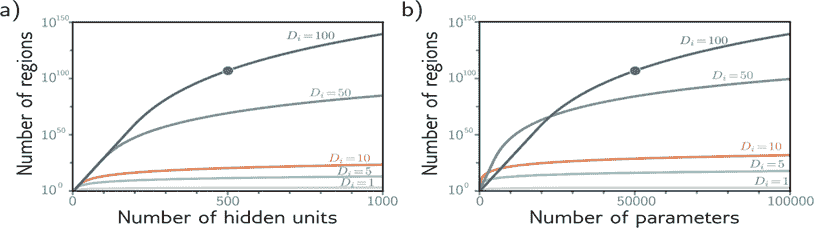

图 3.9 线性区域与隐藏单元。a) 五种不同输入维度`D[i] = {1, 5, 10, 50, 100}`下，最大可能区域作为隐藏单元数量的函数。区域数量在高维中迅速增加；当`D = 500`个单元且输入大小`D[i] = 100`时，区域数可能超过`10¹⁰⁷`个（实心圆）。b) 相同数据作为参数数量的函数绘制。实心圆代表与面板 (a) 相同的模型，具有`D = 500`个隐藏单元。该网络有 51,001 个参数，按现代标准算非常小。

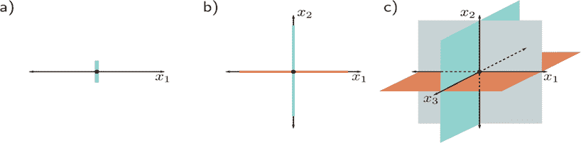

## 3.4 浅层神经网络：一般情况

我们已经描述了几个浅层网络示例，以帮助建立关于其工作原理的直觉。我们现在为浅层神经网络 `y = f[x, ϕ]` 定义一个通用方程，该方程利用 `h ∈ ℝ^D` 个隐藏单元将多维输入 `x ∈ ℝ^D_x` 映射为多维输出 `y ∈ ℝ^D_y`。每个隐藏单元的计算方式为：

```
h_i = a[θ_i^T x + ϕ_i]
```

 (3.11)

这些隐藏单元通过线性组合来生成输出：

```
y = Θ h + b
```

 (3.12)

其中 `a[•]` 是非线性激活函数。模型参数为 `ϕ = {θ[••], ϕ[••]}`。图 3.11 展示了一个包含三个输入、三个隐藏单元和两个输出的示例。

---

**习题 3.14–3.17**

---

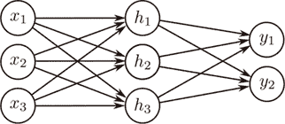

图 3.11 具有三个输入和两个输出的神经网络可视化。该网络有二十个参数。其中有十五个斜率（用箭头表示）和五个偏移量（未显示）。

---

激活函数允许模型描述输入与输出之间的非线性关系，因此它本身必须是非线性的；如果没有激活函数，或者使用线性激活函数，从输入到输出的整体映射将被限制为线性。已经尝试过许多不同的激活函数（参见图 3.13），但最常见的选择是 ReLU（图 3.1），其优点是易于解释。使用 ReLU 激活时，网络将输入空间划分为由 ReLU 函数中的“关节”计算出的超平面相交所定义的凸多面体。每个凸多面体包含一个不同的线性函数。这些多面体对于每个输出都是相同的，但它们所包含的线性函数可以不同。

---

**笔记本 3.4**

激活函数

---

## 3.5 术语

我们通过介绍一些术语来结束本章。遗憾的是，神经网络伴随着大量专业术语。它们通常用*层*来描述。图 3.12 左侧是*输入层*，中间是*隐藏层*，右侧是*输出层*。我们会说 图 3.12 中的网络有一个包含四个隐藏单元的隐藏层。隐藏单元本身有时被称为*神经元*。当我们将数据传递通过网络时，隐藏层的输入值（即应用 ReLU 函数之前）称为*预激活值*。隐藏层的值（即应用 ReLU 函数之后）称为*激活值*。

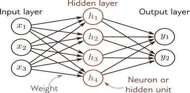

图 3.12 术语。浅层网络由输入层、隐藏层和输出层组成。每一层通过前向连接（箭头）连接到下一层。因此，这些模型被称为前馈网络。当一层中的每个变量都连接到下一层中的每个变量时，我们称之为全连接网络。每个连接代表底层方程中的一个斜率参数，这些参数称为权重。隐藏层中的变量称为神经元或隐藏单元。输入隐藏单元的值称为预激活值，隐藏单元处的值（即应用 ReLU 函数后）称为激活值。

由于历史原因，任何至少包含一个隐藏层的神经网络也被称为*多层感知机*，简称*MLP*。具有一个隐藏层的网络（如本章所述）有时被称为*浅层神经网络*。具有多个隐藏层的网络（如下一章所述）被称为*深层神经网络*。连接形成有向无环图的神经网络（即无环图，如本章所有示例所示）被称为*前馈网络*。如果一层中的每个元素都连接到下一层中的每个元素（如本章所有示例所示），则该网络是*全连接的*。这些连接代表底层方程中的斜率参数，称为*网络权重*。偏移参数（图 3.12 中未显示）称为*偏置*。

## 3.6 总结

浅层神经网络有一个隐藏层。它们 (i) 计算输入的若干线性函数，(ii) 将每个结果通过激活函数，然后 (iii) 对这些激活值进行线性组合以形成输出。浅层神经网络通过将输入空间划分为连续的分段线性区域曲面，基于输入 `x` 进行预测 `y`。只要有足够的隐藏单元（神经元），浅层神经网络可以以任意精度逼近任何连续函数。

第 4 章讨论深层神经网络，它通过增加更多隐藏层来扩展本章的模型。第 5-7 章描述如何训练这些模型。

### 注释

**“神经”网络：** 如果本章中的模型只是函数，为什么它们被称为“神经网络”？这种联系不幸的是很牵强。像 图 3.12 这样的可视化图包含相互密集连接的节点（输入、隐藏单元和输出）。这与哺乳动物大脑中的神经元表面上相似，后者也具有密集连接。然而，几乎没有证据表明大脑计算的工作方式与神经网络相同，在未来的思考中引入生物学视角是无益的。

#### 神经网络的历史

McCulloch & Pitts (1943) 首先提出了人工神经元的概念，该神经元将输入组合以产生输出，但该模型没有实用的学习算法。Rosenblatt (1958) 开发了 `perceptron`（感知机），它对输入进行线性组合，然后通过阈值处理来做出是/否的决策。他还提供了一种从数据中学习权重的算法。Minsky & Papert (1969) 认为线性函数不足以解决一般分类问题，但增加具有非线性激活函数的隐藏层（因此称为多层感知机）可以学习更一般的输入/输出关系。然而，他们得出结论认为 Rosenblatt 的算法无法学习此类模型的参数。直到 1980 年代，一种实用算法（反向传播，见第 7 章）被开发出来，神经网络的重要研究工作才得以恢复。神经网络的历史由 Kurenkov (2020)、Sejnowski (2018) 和 Schmidhuber (2022) 记录在案。

#### 激活函数

`ReLU` 函数早在 Fukushima (1969) 中就已被使用。然而，在神经网络的早期，更常用的是 logistic sigmoid 或 tanh 激活函数（图 3.13a）。`ReLU` 由 Jarrett et al. (2009)、Nair & Hinton (2010) 和 Glorot et al. (2011) 重新推广，是现代神经网络成功故事的重要组成部分。它有一个良好的性质：对于大于零的输入，输出关于输入的导数始终为一。这有助于训练的稳定性和效率（见第 7 章），并与 sigmoid 激活函数的导数形成对比，后者对于大的正输入和大的负输入会饱和（接近于零）。


图 3.13 激活函数。a) Logistic sigmoid 和 tanh 函数。b) 参数为 0.25 的 Leaky ReLU 和参数化 ReLU。c) SoftPlus、高斯误差线性单元和 sigmoid 线性单元。d) 参数为 0.5 和 1.0 的指数线性单元，e) 缩放指数线性单元。f) 参数为 0.4、1.0 和 1.4 的 Swish。

然而，`ReLU` 函数的缺点是其对于负输入的导数为零。如果所有训练样本对给定的 `ReLU` 函数都产生负输入，那么我们在训练期间就无法改进馈入该 `ReLU` 的参数。关于传入权重的梯度在局部是平坦的，所以我们无法“向下走”。这被称为 `dying ReLU`（ReLU 失活）问题。已经提出了许多 `ReLU` 的变体来解决这个问题（图 3.13b），包括 (i) leaky `ReLU`（Maas et al., 2013），它对负值也有线性输出，但斜率较小，为 0.1；(ii) 参数化 `ReLU`（He et al., 2015），它将负部分的斜率视为未知参数；(iii) 串联 `ReLU`（Shang et al., 2016），它产生两个输出，一个在零以下截断（即像典型的 `ReLU`），另一个在零以上截断。

还研究了各种平滑函数（图 3.13c–d），包括 softplus 函数（Glorot et al., 2011）、高斯误差线性单元（Hendrycks & Gimpel, 2016）、sigmoid 线性单元（Hendrycks & Gimpel, 2016）和指数线性单元。这些大多是试图在限制负值梯度的同时避免神经元失活问题。Klambauer et al. (2017) 引入了缩放指数线性单元（图 3.13e），这特别有趣，因为当输入方差具有有限范围时，它有助于稳定激活值的方差（见第 7.5 节）。Ramachandran et al. (2017) 采用实证方法来选择激活函数。他们搜索可能的函数空间，以找到在各种监督学习任务中表现最好的函数。发现的最优函数是 `a[x] = x/(1 + exp[−βx])`，其中 `β` 是学习到的参数（图 3.13f）。他们将此函数称为 `Swish`。有趣的是，这重新发现了 Hendrycks & Gimpel (2016) 和 Elfwing et al. (2018) 之前提出的激活函数。Howard et al. (2019) 用 `HardSwish` 函数近似 `Swish`，它具有非常相似的形状但计算更快：

```
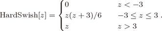
```

(3.13)

关于这些激活函数中哪一个在经验上更优，没有定论。然而，可以证明 leaky `ReLU`、参数化 `ReLU` 和许多连续函数在特定情况下相比 `ReLU` 能提供微小的性能提升。在本书的其余部分，我们将注意力限制在具有基本 `ReLU` 函数的神经网络上，因为它易于从线性区域的数量方面刻画它们创建的函数。

#### 通用近似定理

该定理的`宽度版本`指出，存在一个包含有限个隐藏单元的单隐藏层网络，可以以任意精度近似 ℝ^n 的紧子集上任意指定的连续函数。这由 Cybenko (1989) 对一类 sigmoid 激活函数证明，后来 Hornik (1991) 证明这对更大一类非线性激活函数也成立。

#### 线性区域的数量

考虑一个具有 `D[i] ≥` 2 维输入和 `D` 个隐藏单元的浅层网络。线性区域的数量由 `ReLU` 函数中的“关节”创建的 `D` 个超平面的交点决定（例如 图 3.8d–f）。每个区域由 `ReLU` 函数截断或不截断输入的不同组合创建。Zaslavsky (1975) 证明了在 `D[i]` ≤ `D` 维输入空间中，`D` 个超平面创建的区域数量至多为 ``（即二项式系数的和）。根据经验法则，浅层神经网络几乎总是拥有比输入维度 `D[i]` 更多的隐藏单元数量 `D`，并创建介于 `` 和 2^D 之间的线性区域。

---

##### 附录 B.2

###### 二项式系数

---

##### 问题 3.18

---

#### 线性、仿射和非线性函数

从技术上讲，线性变换 `f[•]` 是指遵循叠加原理的任何函数，即 `f[a + b] = f[a] + f[b]`。这个定义意味着 `f[2a] = 2f[a]`。加权求和 `f[h[1], h[2], h[3]] = ϕ[1]h[1] + ϕ[2]h[2] + ϕ[3]h[3]` 是线性的，但一旦加上偏移（偏置），即 `f[h[1], h[2], h[3]] = ϕ[0] + ϕ[1]h[1] + ϕ[2]h[2] + ϕ[3]h[3]`，这就不再成立。为了看出这一点，考虑当我们将前一个函数的参数加倍时，输出也会加倍。对于后一个函数则不然，它更恰当地称为 `affine`（仿射）函数。然而，在机器学习中混淆这些术语是常见的。我们在本书中遵循这一惯例，将两者都称为线性。我们将遇到的所有其他函数都是非线性的。

### 习题

#### 问题 3.1

如果方程 3.1 中的激活函数是线性的，即 `a[z] = ψ[0] + ψ[1]z`，会创建什么样的从输入到输出的映射？如果移除激活函数，即 `a[z] = z`，会创建什么样的映射？

#### Problem 3.2

对于 figure 3.3j 中的四个线性区域，指出哪些隐藏单元是不活跃的，哪些是活跃的（即哪些会裁剪输入，哪些不会）。

#### Problem 3.3*

推导 figure 3.3j 中函数“关节”位置的表达式，用十个参数 **ϕ** 和输入 *x* 表示。推导四个线性区域斜率的表达式。

#### Problem 3.4

绘制 figure 3.3 的一个版本，其中第三个隐藏单元的 y 截距和斜率如 figure 3.14c 所示发生变化。假设其余参数保持不变。

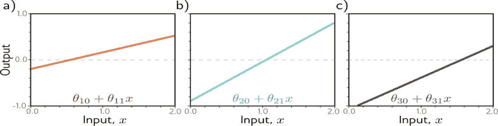

Figure 3.14 Processing in network with one input, three hidden units, and one output for problem 3.4. a–c) The input to each hidden unit is a linear function of the inputs. The first two are the same as in figure 3.3, but the last one differs.

#### Problem 3.5

证明对于 *α* ∈ ℝ⁺，以下性质成立：

```
ReLU[α · z] = α · ReLU[z].
```

 (3.14)

这被称为 ReLU 函数的**非负齐次性**性质。

#### Problem 3.6

承接 Problem 3.5，当我们将方程 3.3 和 3.4 中定义的浅层网络的参数 *θ*[10] 和 *θ*[11] 乘以正常数 *α*，并将斜率 *ϕ*[1] 除以同一参数 *α* 时，会发生什么？如果 *α* 为负数会发生什么？

#### Problem 3.7

考虑使用最小二乘损失函数拟合方程 3.1 中的模型。该损失函数是否有唯一最小值？即是否存在一组单一的“最佳”参数？

#### Problem 3.8

考虑将 ReLU 激活函数替换为：

(i) Heaviside 阶跃函数 `heaviside[z]`

(ii) 双曲正切函数 `tanh[z]`

(iii) 矩形函数 `rect[z]`

其中：

```
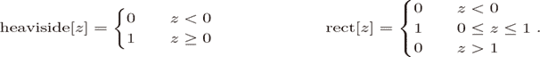
```

 (3.15)

为这些函数中的每一个重绘 figure 3.3 的一个版本。原始参数为：***ϕ*** = {*ϕ*[0], *ϕ*[1], *ϕ*[2], *ϕ*[3], *θ*[10], *θ*[11], *θ*[20], *θ*[21], *θ*[30], *θ*[31]} = {−0.23, −1.3, 1.3, 0.66, −0.2, 0.4, −0.9, 0.9, 1.1, −0.7}。为每种激活函数，非正式地描述由一个输入、三个隐藏单元和一个输出的神经网络所能创建的函数族。

#### Problem 3.9*

证明 figure 3.3 中第三个线性区域的斜率是第一个和第四个线性区域斜率之和。

#### Problem 3.10

考虑一个具有一个输入、一个输出和三个隐藏单元的神经网络。figure 3.3 中的构造展示了这如何创建四个线性区域。在什么情况下，该网络可能产生少于四个线性区域的函数？

#### Problem 3.11*

figure 3.6 中的模型有多少个参数？

#### Problem 3.12

figure 3.7 中的模型有多少个参数？

#### Problem 3.13

figure 3.8 中七个区域中的每一个的激活模式是什么？换句话说，对于每个区域，哪些隐藏单元是活跃的（传递输入），哪些是不活跃的（裁剪输入）？

#### Problem 3.14

写出定义 figure 3.11 中网络的方程。应该有三个方程用于从输入计算三个隐藏单元，以及两个方程用于从隐藏单元计算输出。

#### Problem 3.15*

figure 3.11 中的网络最多可以创建多少个 3D 线性区域？

#### Problem 3.16

写出具有两个输入、四个隐藏单元和三个输出的网络的方程。按 figure 3.11 的风格绘制此模型。

#### Problem 3.17*

方程 3.11 和 3.12 定义了一个具有 *D*[i] 个输入、包含 *D* 个隐藏单元的单隐藏层以及 *D*[o] 个输出的通用神经网络。用 *D*[i]、*D* 和 *D*[o] 表示模型中参数数量的表达式。

#### Problem 3.18*

证明具有 *D*[i] = 2 维输入、*D*[o] = 1 维输出和 *D* = 3 个隐藏单元的浅层网络创建的最大区域数为七，如 figure 3.8j 所示。使用 Zaslavsky (1975) 的结果：用 *D* 个超平面划分 *D*[i] 维空间所能创建的最大区域数为 ``。如果我们向该模型添加两个隐藏单元，使 *D* = 5，最大区域数是多少？

## Chapter 4

Deep neural networks

上一章描述了浅层神经网络，它们只有一个隐藏层。本章介绍深度神经网络，它们拥有多个隐藏层。使用 ReLU 激活函数时，浅层和深度网络都描述了从输入到输出的分段线性映射。

随着隐藏单元数量的增加，浅层神经网络提高了其描述能力。事实上，只要有足够的隐藏单元，浅层网络可以描述高维空间中任意复杂的函数。然而，事实证明，对于某些函数，所需的隐藏单元数量大得不切实际。对于给定数量的参数，深度网络可以产生比浅层网络多得多的线性区域。因此，从实际角度来看，它们可以用来描述更广泛的函数族。

### 4.1 Composing neural networks

为了深入了解深度神经网络的行为，我们首先考虑将两个浅层网络组合起来，使第一个网络的输出成为第二个网络的输入。考虑两个各有三个隐藏单元的浅层网络（figure 4.1a）。第一个网络接受输入 *x* 并返回输出 *y*，定义如下：

```
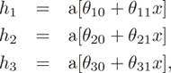
```

 (4.1)

![Figure 4.1 Composing two single-layer networks with three hidden units each. a) The output y of the first network constitutes the input to the second network. b) The first network maps inputs x ∈ [−1, 1] to outputs y ∈ [−1, 1] using a function comprised of three linear regions that are chosen so that they alternate the sign of their slope. Multiple inputs x (gray circles) now map to the same output y (cyan circle). c) The second network defines a function comprising three linear regions that takes y and returns y′ (i.e., the cyan circle is mapped to the brown circle). d) The combined effect of these two functions when composed is that (i) three different inputs x are mapped to any given value of y by the first network and (ii) are processed in the same way by the second network; the result is that the function defined by the second network in panel (c) is duplicated three times, variously flipped and rescaled according to the slope of the regions of panel (b).](images/c4-fig-0001.jpg)

#### 组合网络与深度网络

##### 图 4.1 组合两个各含三个隐藏单元的单层网络

a) 第一个网络的输出 `y` 构成了第二个网络的输入。  

b) 第一个网络使用一个由三个线性区域组成的函数，将输入 `x ∈ [−1, 1]` 映射到输出 `y ∈ [−1, 1]`，这三个区域的选择使得它们的斜率符号交替。多个输入 `x`（灰色圆圈）现在映射到同一个输出 `y`（青色圆圈）。  

c) 第二个网络定义了一个包含三个线性区域的函数，它接收 `y` 并返回 `y′`（即青色圆圈被映射为棕色圆圈）。  

d) 当这两个函数组合时，其综合效果是：(i) 三个不同的输入 `x` 通过第一个网络映射到任意给定的 `y` 值，并且 (ii) 以相同的方式被第二个网络处理；结果是面板 (c) 中第二个网络定义的函数被复制了三次，根据面板 (b) 中各区域的斜率，分别进行翻转和缩放。

```
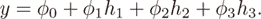
```

(4.2)

第二个网络以 `y` 为输入并返回 `y′`，其定义为：

```
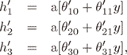
```

 (4.3)

以及

```
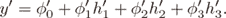
```

 (4.4)

使用 ReLU 激活函数时，该模型同样描述了一族分段线性函数。然而，线性区域的数量可能大于具有六个隐藏单元的浅层网络。为了理解这一点，考虑选择第一个网络以产生三个正负斜率交替的区域（图 4.1b）。这意味着三个不同的 `x` 范围被映射到相同的输出范围 `y ∈ [−1, 1]`，随后从该 `y` 范围到 `y′` 的映射被应用了三次。总体效果是第二个网络定义的函数被复制三次，从而创建出九个线性区域。同一原理也适用于高维空间（图 4.2）。

---

**问题 4.1**

---

**笔记本 4.1**  

组合网络

---

##### 图 4.2 组合具有二维输入的神经网络

a) 第一个网络（来自图 3.8）有三个隐藏单元，接收两个输入 `x[1]` 和 `x[2]` 并返回一个标量输出 `y`。这被传递给一个具有两个隐藏单元的第二个网络以产生 `y′`。  

b) 第一个网络产生一个由七个线性区域组成的函数，其中一个区域是平坦的。  

c) 第二个网络定义了一个在 `y ∈ [−1, 1]` 中包含两个线性区域的函数。  

d) 当这些网络组合时，第一个网络的六个非平坦区域中的每一个都被第二个网络分成两个新区域，从而创建总共 13 个线性区域。


![Figure 4.2 Composing neural networks with a 2D input. a) The first network (from figure 3.8) has three hidden units and takes two inputs x1 and x2 and returns a scalar output y. This is passed into a second network with two hidden units to produce y′. b) The first network produces a function consisting of seven linear regions, one of which is flat. c) The second network defines a function comprising two linear regions in y ∈ [−1, 1]. d) When these networks are composed, each of the six non-flat regions from the first network is divided into two new regions by the second network to create a total of 13 linear regions.](images/c4-fig-0002.jpg)

图 4.2 组合具有二维输入的神经网络。a) 第一个网络（来自图 3.8）有三个隐藏单元，接收两个输入 `x[1]` 和 `x[2]` 并返回一个标量输出 `y`。这被传递给一个具有两个隐藏单元的第二个网络以产生 `y′`。b) 第一个网络产生一个由七个线性区域组成的函数，其中一个区域是平坦的。c) 第二个网络定义了一个在 `y ∈ [−1, 1]` 中包含两个线性区域的函数。d) 当这些网络组合时，第一个网络的六个非平坦区域中的每一个都被第二个网络分成两个新区域，从而创建总共 13 个线性区域。

另一种理解组合网络的方式是：第一个网络将输入空间 `x` “折叠”回自身，使得多个输入产生相同的输出。然后第二个网络应用一个函数，该函数在所有被折叠重叠的点上被复制（图 4.3）。


图 4.3 深度网络作为输入空间的折叠。a) 理解图 4.1 中第一个网络的一种方式是，它将输入空间“折叠”回自身顶部。b) 第二个网络将其函数应用于折叠后的空间。c) 通过再次“展开”，最终输出显现出来。

### 4.2 从组合网络到深度网络

上一节展示了我们可以通过将一个浅层神经网络的输出传递给第二个网络来创建复杂函数。我们现在表明，这是具有两个隐藏层的深度网络的一个特例。

第一个网络的输出（`y = ϕ[0] + ϕ[1]h[1] + ϕ[2]h[2] + ϕ[3]h[3]`）是线性的，第二个网络的第一步运算（方程 4.3，其中我们计算 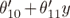、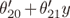 和 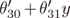）也是线性的。将一个线性函数应用于另一个线性函数会产生另一个线性函数。当我们将 `y` 的表达式代入方程 4.3 时，结果为：

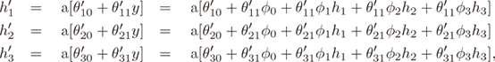

(4.5)

我们可以将其重写为：

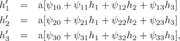

(4.6)

其中 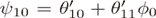*、* 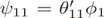*、* 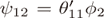 等。结果是一个具有两个隐藏层的网络（图 4.4）。

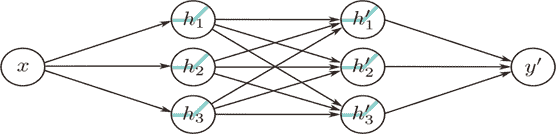

图 4.4 具有单输入、单输出和两个隐藏层的神经网络，每层包含三个隐藏单元。

由此可见，两层网络可以表示将一个单层网络的输出传递给另一个单层网络所创建的函数族。事实上，它表示一个更广泛的函数族，因为在方程 4.6 中，九个斜率参数 `ψ[11]`、`ψ[21]`、`…`、`ψ[33]` 可以取任意值，而在方程 4.5 中，这些参数被约束为外积 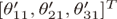[`ϕ[1]`、`ϕ[2]`、`ϕ[3]`]。

### 4.3 深度神经网络

在上一节中，我们展示了组合两个浅层网络产生了具有两个隐藏层的深度网络的一个特例。现在我们考虑具有两个隐藏层、每层包含三个隐藏单元的深度网络的一般情况（图 4.4）。第一层定义为：

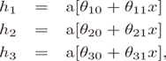

(4.7)

第二层定义为：

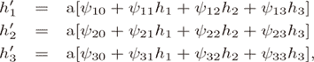

(4.8)

输出定义为：

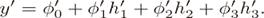

(4.9)

考虑这些方程，可以得出另一种关于网络如何构建日益复杂函数的理解方式（图 4.5）：

---

**笔记本 4.2**

裁剪函数

---

1. 第一层中的三个隐藏单元 `h[1]`、`h[2]` 和 `h[3]` 通过形成输入的线性函数并将其通过 ReLU 激活函数来计算，这与常规方式相同（方程 4.7）。

2. 第二层的预激活值通过获取这些隐藏单元的三个新线性函数来计算（方程 4.8 中激活函数的参数）。此时，我们实际上拥有了一个具有三个输出的浅层网络；我们计算了三个分段线性函数，它们的线性区域之间的“关节”位于相同的位置（见图 3.6）。

3. 在第二隐藏层，另一个 ReLU 函数 `a[•]` 被应用到每个函数上（方程 4.8），这会对它们进行裁剪，并为每个函数添加新的“关节”。

4. 最终输出是这些隐藏单元的线性组合（方程 4.9）。


图 4.5 图 4.4 中深度网络的计算过程。a–c) 第二隐藏层的输入（即预激活值）是三个分段线性函数，它们的线性区域之间的“接头”位于相同位置（见图 3.6）。d–f) 每个分段线性函数都被 ReLU 激活函数截断至零。g–i) 这些被截断的函数随后分别用参数 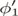、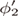 和 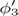 进行加权。j) 最后，将这些被截断并加权的函数求和，并加上一个控制整体高度的偏移量 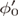。

总之，我们可以将每一层视为在“折叠”输入空间，或者视为创建新函数，这些函数被截断（创建新区域）然后重新组合。前一种观点强调输出函数中的依赖关系，但不强调截断如何创建新的接头；后一种观点则强调相反的方面。归根结底，这两种描述都只能提供关于深度神经网络如何运作的部分洞见。无论如何，重要的是不要忽视这样一个事实：这仍然仅仅是一个将输入 `x` 与输出 `y′` 联系起来的方程。确实，我们可以将方程 4.7–4.9 结合起来得到一个表达式：

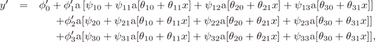

(4.10)

尽管这确实相当难以理解。

#### 4.3.1 超参数

我们可以将深度网络的构建扩展到两个以上的隐藏层；现代网络可能拥有超过一百层，每层包含数千个隐藏单元。每层中隐藏单元的数量称为网络的*宽度*，隐藏层的数量称为*深度*。隐藏单元的总数是衡量网络*容量*的一个指标。

我们用 `K` 表示层数，用 `D[1]`、`D[2]`、…、`D[K]` 表示每层中隐藏单元的数量。这些都是*超参数*的例子。它们是在我们学习模型参数（即斜率和截距项）之前选定的量。对于固定的超参数（例如，`K` = 2 层，每层 `D[k]` = 3 个隐藏单元），模型描述了一族函数，而参数决定了具体的函数。因此，当我们也考虑超参数时，可以将神经网络视为表示一族函数族，这些函数将输入映射到输出。

***

问题 4.2

***

### 4.4 矩阵表示法

我们已经看到，深度神经网络由线性变换与激活函数交替组成。我们可以用矩阵表示法等价地描述方程 4.7–4.9：

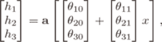

(4.11)

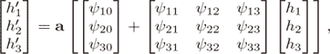

(4.12)

***

附录 B.3

矩阵

***

和

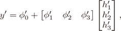

(4.13)

甚至可以用矩阵表示法更紧凑地表示为：

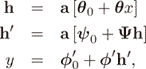

(4.14)

在上述每种情况下，函数 `a[•]` 都将激活函数单独应用于其向量输入的每个元素。

#### 4.4.1 通用公式

对于层数很多的网络，这种表示法会变得繁琐。因此，从现在开始，我们将第 `k` 层的隐藏单元向量描述为 `h[k]`，贡献给第 `k` + 1 层隐藏层的偏置（截距）向量描述为 `β[k]`，应用于第 `k` 层并贡献给第 (`k` + 1) 层的权重（斜率）描述为 `Ω[k]`。具有 `K` 层的通用深度网络 `y` = f[`x`, `ϕ`] 现在可以写为：

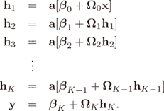

(4.15)

该模型的参数 `ϕ` 包含所有这些权重矩阵和偏置向量 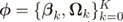。

如果第 `k` 层有 `D[k]` 个隐藏单元，则偏置向量 `β[k−1]` 的大小将为 `D[k]`。最后一个偏置向量 `β[K]` 的大小为输出维度 `D[o]`。第一个权重矩阵 `Ω[0]` 的大小为 `D[1]` × `D[i]`，其中 `Di` 是输入的大小。最后一个权重矩阵 `Ω[K]` 的大小为 `D[o]` × `D[K]`，其余矩阵 `Ω[k]` 的大小为 `D[k+1]` × `D[k]`（图 4.6）。

***

笔记本 4.3

深度网络

***


图 4.6 具有 `D[i]` = 3 维输入 `x`、`D[o]` = 2 维输出 `y` 以及 `K` = 3 个隐藏层 `h[1]`、`h[2]` 和 `h[3]`（维度分别为 `D[1]` = 4、`D[2]` = 2 和 `D[3]` = 3）的网络的矩阵表示法。权重存储在矩阵 `Ω[k]` 中，它们预乘前一层的激活值以创建后续层的预激活值。例如，从 `h[1]` 的激活值计算 `h[2]` 处预激活值的权重矩阵 `Ω[1]` 的维度为 2 × 4。它作用于第一层的四个隐藏单元，并创建第二层两个隐藏单元的输入。偏置存储在向量 `β[k]` 中，其维度等于它们所馈入的层的维度。例如，偏置向量 `β[2]` 的长度为三，因为层 `h[3]` 包含三个隐藏单元。

我们可以等价地将网络写为单个函数：

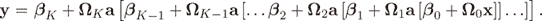

(4.16)

***

问题 4.3–4.6

***

### 4.5 浅层与深度神经网络

第 3 章讨论了浅层网络（具有单个隐藏层），而本章描述了深度网络（具有多个隐藏层）。我们现在比较这些模型。

#### 4.5.1 逼近不同函数的能力

在第 3.2 节中，我们论证了具有足够容量（隐藏单元）的浅层神经网络可以任意精确地建模任何连续函数。在本章中，我们看到具有两个隐藏层的深度网络可以表示两个浅层网络的复合。如果这两个网络中的第二个计算恒等函数，那么该深度网络就复制了一个单一的浅层网络。因此，给定足够的容量，它也可以任意精确地逼近任何连续函数。

***

问题 4.7

***

#### 4.5.2 每个参数的线性区域数量

具有单输入、单输出和 `D >` 2 个隐藏单元的浅层网络最多可以创建 `D` + 1 个线性区域，并由 3`D` + 1 个参数定义。具有单输入、单输出和 `K` 层 `D >` 2 个隐藏单元的深度网络可以使用 3`D` + 1 + (`K` − 1)`D`(`D` + 1) 个参数创建最多 (`D` + 1)^`K` 个线性区域的函数。

***

##### 问题 4.8–4.11

***

图 4.7a 展示了将标量输入 `x` 映射到标量输出 `y` 的网络中，最大线性区域数量如何随参数数量增加而增加。对于固定的参数预算，深度神经网络能创建复杂得多的函数。随着输入维度 `D[i]` 的增加，这种效应被放大（图 4.7b），尽管计算最大区域数量不那么直观。


图 4.7 神经网络的最大线性区域数量随网络深度迅速增加。a) `D[i]` = 1 输入的网络。每条曲线代表固定数量的隐藏层 `K`，随着每层隐藏单元数 `D` 的变化。对于固定的参数预算（水平位置），更深的网络比更浅的网络产生更多线性区域。具有 `K` = 5 层和 `D` = 10 个隐藏单元的网络拥有 471 个参数（高亮点），可产生 161,051 个区域。b) `D[i]` = 10 输入的网络。曲线上每个后续点代表十个隐藏单元。这里，具有 `K` = 5 层和 `D` = 50 个隐藏单元的模型拥有 10,801 个参数（高亮点），可创建超过 `10¹³⁴` 个线性区域。

这看起来很有吸引力，但函数的灵活性仍然受限于参数数量。深度网络可以创建极大数量的线性区域，但这些区域包含复杂的依赖关系和对称性。当我们把深度网络视为对输入空间进行“折叠”时（图 4.3），我们看到了其中一些。因此，除非 (i) 我们希望逼近的真实世界函数中存在类似的对称性，或者 (ii) 我们有理由相信从输入到输出的映射确实涉及简单函数的组合，否则更多的区域数量是否构成优势尚不清楚。

#### 4.5.3 深度效率

深度网络和浅层网络都可以建模任意函数，但某些函数可以用深度网络更高效地逼近。已确定存在一些函数，浅层网络需要指数级更多的隐藏单元才能达到与深度网络相当的逼近效果。这种现象被称为神经网络的*深度效率*。这一特性也很有吸引力，但我们想要逼近的真实世界函数是否属于这一类别尚不清楚。

#### 4.5.4 大型结构化输入

我们讨论了全连接网络，其中每一层的每个元素都对后续层的每个元素有贡献。然而，这些对于图像等大型结构化输入并不实用，因为输入可能包含 ~`10⁶` 个像素。参数数量将过于庞大，此外，我们希望图像的不同部分以相似的方式被处理；在图像的每个可能位置独立学习识别同一物体是毫无意义的。

解决方案是并行处理局部图像区域，然后逐渐整合来自越来越大区域的信息。如果不使用多层，这种局部到全局的处理方式很难指定（见第 10 章）。

#### 4.5.5 训练与泛化

深度网络相对于浅层网络的另一个潜在优势是其拟合的容易程度；通常训练中等深度的网络比训练浅层网络更容易（见图 20.2）。可能是过参数化的深度模型拥有一大族大致等价且易于寻找的解。然而，随着隐藏层的增加，训练又变得更加困难，尽管已经开发出许多方法来缓解这一问题（见第 11 章）。


深度神经网络似乎也比浅层网络更好地泛化到新数据。在实践中，大多数任务的最佳结果都是使用具有数十或数百层的网络实现的。这两种现象都尚未被很好地理解，我们将在第 20 章回到它们。

## 4.6 总结

在本章中，我们首先考虑了组合两个浅层网络会发生什么。我们论证了第一个网络“折叠”输入空间，然后第二个网络应用分段线性函数。第二个网络的效果在输入空间折叠到自身的地方被复制。

然后我们展示了这种浅层网络的组合是具有两层的深度网络的一个特例。我们将每层中的 `ReLU` 函数解释为在多处剪裁输入函数，并在输出函数中创建更多“关节”。我们引入了超参数的概念，对于我们目前所见的网络，它们包括隐藏层的数量和每层隐藏单元的数量。

最后，我们比较了浅层和深度网络。我们看到：(i) 给予足够的容量，两种网络都可以逼近任意函数；(ii) 深度网络每参数产生更多的线性区域；(iii) 某些函数可以用深度网络高效得多地逼近；(iv) 像图像这样的大型结构化输入最好分多阶段处理；(v) 在实践中，大多数任务的最佳结果是使用具有许多层的深度网络实现的。

现在我们理解了深度和浅层网络模型，我们将注意力转向训练它们。在下一章中，我们将讨论损失函数。对于任何给定的参数值 `ϕ`，损失函数返回一个单一数字，指示模型输出与训练数据集的真实预测之间的不匹配程度。在第 6 章和第 7 章中，我们将处理训练过程本身，在其中我们寻找使该损失最小化的参数值。

## 注释

### 深度学习

人们早已理解，通过组合浅层神经网络或开发具有多个隐藏层的网络，可以构建更复杂的函数。事实上，“深度学习”一词最早由 Dechter (1986) 使用。然而，由于实际顾虑，人们的兴趣有限；无法很好地训练此类网络。现代深度学习时代由 Krizhevsky 等人 (2012) 报告的图像分类惊人改进所开启。这一突飞猛进的进步可以说归因于四个因素的汇聚：更大的训练数据集、用于训练的改进算力、`ReLU` 激活函数的使用以及随机梯度下降的使用（见第 6 章）。LeCun 等人 (2015) 概述了现代深度学习时代的早期进展。

### 线性区域的数量

对于使用总共 `D` 个带有 `ReLU` 激活函数的隐藏单元的深度网络，区域数量的上界为 `2^D`（Montufar 等人，2014）。同一作者表明，具有 `D[i]` 维输入和 `K` 层的深度 `ReLU` 网络，每层包含 `D ≥ D[i]` 个隐藏单元，拥有 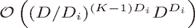 个线性区域。Montúfar (2017)、Arora 等人 (2016) 和 Serra 等人 (2018) 都提供了更紧的上界，这些上界考虑了每层可能拥有不同数量隐藏单元的情况。Serra 等人 (2018) 提供了一种计算神经网络中线性区域数量的算法，尽管它仅适用于非常小的网络。

如果每个 `K` 层中的隐藏单元数量 `D` 相同，且 `D` 是输入维度 `D[i]` 的整数倍，则最大线性区域数量 `N[r]` 可以精确计算，公式为：

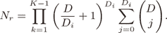

 (4.17)

该表达式中的第一项对应网络的前 `K − 1` 层，可以看作是反复折叠输入空间。然而，我们现在需要为每个输入维度投入 `D/D[i]` 个隐藏单元来创建这些折叠。该方程中的最后一项（二项式系数之和）是浅层网络能创建的区域数量，归因于最后一层。更多信息请参阅 Montufar 等人 (2014)、Pascanu 等人 (2013) 和 Montúfar (2017)。

### 二项式系数

### 通用近似定理

我们在第 4.5.1 节中论证过，如果深度网络的层拥有足够多的隐藏单元，则通用近似定理的宽度版本适用：存在一个网络可以以任意精度近似 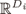 的紧子集上任意给定的连续函数。Lu 等人 (2017) 证明了存在一个具有 `ReLU` 激活函数且每层至少拥有 `D[i] + 4` 个隐藏单元的网络，给定足够多的层，可以以任意精度近似任意指定的 `D[i]` 维勒贝格可积函数。这被称为通用近似定理的*深度版本*。

### 深度效率

有若干结果表明，存在一些函数可以由深度网络实现，但无法由任何容量上界呈指数增长的浅层网络实现。换句话说，浅层网络需要指数级更多的单元才能准确描述这些函数。这被称为神经网络的*深度效率*。

Telgarsky (2016) 表明，对于任意整数 `k`，可以构建具有一个输入、一个输出和 `𝒪[k³]` 层恒定宽度的网络，这些网络无法用 `𝒪[k]` 层且宽度小于 `2^k` 的网络来实现。也许令人惊讶的是，Eldan & Shamir (2016) 表明，当存在多变量输入时，存在一个三层网络，如果容量在输入维度上是亚指数的，则无法由任何两层网络实现。Cohen 等人 (2016)、Safran & Shamir (2017) 和 Poggio 等人 (2017) 也展示了深度网络可以高效近似但浅层网络无法高效近似的函数。Liang & Srikant (2016) 表明，对于一大类函数（包括单变量函数），在给定近似误差上界的情况下，浅层网络所需的隐藏单元比深度网络多指数级。

### 宽度效率

Lu 等人 (2017) 探讨了是否存在无法由深度没有显著增加的窄网络实现的宽浅层网络（即具有大量隐藏单元的浅层网络）。他们表明，存在一些宽浅层网络类，只能用具有多项式深度的窄网络来表达。这被称为神经网络的*宽度效率*。宽度上的这个多项式下界比深度上的指数下界限制性更小，这表明深度更重要。Vardi 等人 (2022) 随后表明，对于具有 `ReLU` 激活函数的网络，减小宽度的代价仅是网络深度的线性增加。

## 习题

### 习题 4.1*

考虑组合图 4.8 中的两个神经网络。为 `x ∈ [−1, 1]` 绘制输入 `x` 和输出 `y′` 之间关系的图。

![图 4.8 习题 4.1 的两个网络组合。a) 第一个网络的输出 y 成为第二个网络的输入。b) 第一个网络计算此函数，输出值 y ∈ [−1, 1]。c) 第二个网络在输入范围 y ∈ [−1, 1] 上计算此函数。](images/c4-fig-0008.jpg)

图 4.8 习题 4.1 的两个网络组合。a) 第一个网络的输出 `y` 成为第二个网络的输入。b) 第一个网络计算此函数，输出值 `y ∈ [−1, 1]`。c) 第二个网络在输入范围 `y ∈ [−1, 1]` 上计算此函数。

### 习题 4.2

找出图 4.6 中的四个超参数。

### 习题 4.3

利用 `ReLU` 函数的非负齐次性质（见习题 3.5），证明：


 (4.18)

其中 `λ[0]` 和 `λ[1]` 为非负标量。由此可知，权重矩阵可以按任意幅度重新缩放，只要偏置也相应调整，缩放因子可以在网络末尾重新应用。

### 习题 4.4

写出一个深度神经网络的方程，该网络接收 `D[i] = 5` 个输入，`D[o] = 4` 个输出，并有三个隐藏层，大小分别为 `D[1] = 20`、`D[2] = 10` 和 `D[3] = 7`，采用方程 4.15 和 4.16 两种形式。每个权重矩阵 `Ω[•]` 和偏置向量 `β[•]` 的尺寸是多少？

### 习题 4.5

考虑一个深度神经网络，具有 `D[i] = 5` 个输入，`D[o] = 1` 个输出，以及 `K = 20` 个隐藏层，每层包含 `D = 30` 个隐藏单元。该网络的深度是多少？宽度是多少？

### 习题 4.6

考虑一个具有 `D[i] = 1` 个输入、`D[o] = 1` 个输出和 `K = 10` 层的网络，每层有 `D = 10` 个隐藏单元。增加一层深度还是增加一个宽度单元会导致权重数量增加更多？请提供你的推理。

### 习题 4.7

为方程 3.1 中浅层神经网络的参数 `ϕ = {ϕ[0], ϕ[1], ϕ[2], ϕ[3], θ[10], θ[11], θ[20], θ[21], θ[30], θ[31]}` 选择数值，使其在有限范围 `x ∈ [a, b]` 上定义一个恒等函数。

### 习题 4.8*

图 4.9 展示了浅层网络（如图 3.3 所示）三个隐藏单元的激活值。隐藏单元的斜率分别为 1.0、1.0 和 -1.0，“关节”位置分别位于 1/6、2/6 和 4/6。找出 `ϕ[0]`、`ϕ[1]`、`ϕ[2]` 和 `ϕ[3]` 的值，将隐藏单元激活值组合为 `ϕ[0] + ϕ[1]h[1] + ϕ[2]h[2] + ϕ[3]h[3]`，以创建一个具有四个线性区域、在输出值 0 和 1 之间振荡的函数。最左侧区域的斜率应为正，下一个为负，依此类推。如果将该网络与自身组合，将创建多少个线性区域？如果组合 `K` 次，将创建多少个？


图 4.9 问题 4.8 的隐藏单元激活值。a) 第一个隐藏单元在位置 `x = 1/6` 处有一个折点，且在激活区域斜率为 1。b) 第二个隐藏单元在位置 `x = 2/6` 处有一个折点，且在激活区域斜率为 1。c) 第三个隐藏单元在位置 `x = 4/6` 处有一个折点，且在激活区域斜率为 -1。

### 习题 4.9*

承接习题 4.8，是否可能利用具有两个隐藏单元的浅层网络，创建一个具有三个线性区域、在输出值 0 和 1 之间来回振荡的函数？是否可能利用具有四个隐藏单元的浅层网络，创建一个具有五个线性区域、以相同方式振荡的函数？

### 习题 4.10

考虑一个深度神经网络，具有单个输入、单个输出，以及 `K` 个隐藏层，每层包含 `D` 个隐藏单元。证明该网络总共将拥有 `3*D + 1 + (K − 1)*D*(D + 1)` 个参数。

### 习题 4.11*

考虑两个将标量输入 `x` 映射到标量输出 `y` 的神经网络。第一个网络是浅层的，具有 `D = 95` 个隐藏单元。第二个是深层的，具有 `K = 10` 层，每层包含 `D = 5` 个隐藏单元。每个网络各有多少参数？每个网络能创建多少个线性区域？哪个运行得更快？

# 第 5 章 损失函数

前三章分别介绍了线性回归、浅层神经网络和深度神经网络。每一种都代表了一族将输入映射到输出的函数，其中特定的成员由模型参数 `ϕ` 确定。当我们训练这些模型时，我们寻找的是能为我们正在考虑的任务产生从输入到输出的“最佳可能”映射的参数。本章将定义何为“最佳可能”映射。

该定义需要一个由输入/输出对组成的训练数据集 `{x[i], y[i]}`。*损失函数* 或 *代价函数* `L[ϕ]` 返回一个单一数值，用以描述模型预测 `f[x[i], ϕ]` 与其对应的真实标签输出 `y[i]` 之间的不匹配程度。在训练期间，我们寻找使损失最小化的参数值 `ϕ`，从而使训练输入能尽可能紧密地映射到输出。我们在第 2 章中见过一个损失函数的例子；最小二乘损失函数适用于目标为实数 `y ∈ ℝ` 的单变量回归问题。它计算模型预测 `f[x[i], ϕ]` 与真实值 `y[i]` 之间偏差的平方和。

---

### 附录 A

#### 数集

---

本章提供了一个框架，既证明了最小二乘准则用于实值输出的合理性，又允许我们为其他预测类型构建损失函数。我们将探讨*二分类*，其中预测 `y ∈ {0, 1}` 是两个类别之一；*多分类*，其中预测 `y ∈ {1, 2, …, K}` 是 `K` 个类别之一；以及更复杂的情况。在接下来的两章中，我们将讨论模型训练，其目标是找到使这些损失函数最小化的参数值。

## 5.1 最大似然估计

在本节中，我们将开发一种构建损失函数的方法。考虑一个具有参数 `ϕ` 的模型 `f[x, ϕ]`，它根据输入 `x` 计算输出。直到现在，我们一直暗示模型直接计算预测值 `y`。我们现在转换视角，将模型视为在给定输入 `x` 的条件下，计算可能输出 `y` 上的条件概率分布 `Pr(y|x)`。损失函数鼓励每个训练输出 `y[i]` 在由对应输入 `x[i]` 计算出的分布 `Pr(y[i]|x[i])` 下具有较高的概率（图 5.1）。

### 附录 C.1.3

#### 条件概率

---

![图 5.1 预测输出上的分布。a) 回归任务，目标是根据训练数据 {x[i], y[i]}（橙色点）从输入 x 预测实值输出 y。对于每个输入值 x，机器学习模型预测输出 y ∈ ℝ 上的一个分布 Pr(y|x)（青色曲线显示了 x = 2.0 和 x = 7.0 时的分布）。损失函数旨在最大化在对应输入 x[i] 预测的分布下，观测到的训练输出 y[i] 的概率。b) 在分类任务中，为了预测离散类别 y ∈{1, 2, 3, 4}，我们使用离散概率分布，因此模型为每个 x[i] 值预测 y[i] 四个可能值上的不同直方图。c) 为了预测计数 y ∈ {0, 1, 2,…} 和 d) 方向 y ∈ (−π, π]，我们分别使用定义在正整数域和圆周域上的分布。](images/c5-fig-0001.jpg)

图 5.1 预测输出上的分布。a) 回归任务，目标是根据训练数据 `{x[i], y[i]}`（橙色点）从输入 `x` 预测实值输出 `y`。对于每个输入值 `x`，机器学习模型预测输出 `y ∈ ℝ` 上的一个分布 `Pr(y|x)`（青色曲线显示了 `x = 2.0` 和 `x = 7.0` 时的分布）。损失函数旨在最大化在对应输入 `x[i]` 预测的分布下，观测到的训练输出 `y[i]` 的概率。b) 在分类任务中，为了预测离散类别 `y ∈ {1, 2, 3, 4}`，我们使用离散概率分布，因此模型为每个 `x[i]` 值预测 `y[i]` 四个可能值上的不同直方图。c) 为了预测计数 `y ∈ {0, 1, 2,…}` 和 d) 方向 `y ∈ (−π, π]`，我们分别使用定义在正整数域和圆周域上的分布。

### 5.1.1 计算输出上的分布

这引出了一个问题：模型 `f[x, ϕ]` 究竟如何被改造以计算概率分布？解决方案很简单。首先，我们在输出域 `y` 上选择一个参数化分布 `Pr(y|θ)`。然后，我们利用网络来计算该分布的一个或多个参数 `θ`。

例如，假设预测域是实数集，即 `y ∈ ℝ`。此时，我们可能会选择定义在 `ℝ` 上的单变量正态分布。该分布由均值 `μ` 和方差 `σ²` 定义，因此 `θ = {μ, σ²}`。机器学习模型可能预测均值 `μ`，而方差 `σ²` 可被视为一个未知常数。

### 5.1.2 最大似然准则

模型现在为每个训练输入 `x[i]` 计算不同的分布参数 `θ[i] = f[x[i], ϕ]`。每个观测到的训练输出 `y[i]` 应在其对应的分布 `Pr(y[i]|θ[i])` 下具有较高的概率。因此，我们选择模型参数 `ϕ`，使其最大化所有 `I` 个训练示例的联合概率：


 (5.1)

联合概率项称为参数的*似然*，因此公式 5.1 称为*最大似然*准则。¹

此处我们隐含地做了两个假设。首先，我们假设数据是同分布的（输出 `y[i]` 上的概率分布形式对每个数据点都相同）。其次，我们假设给定输入下输出的条件分布 `Pr(y[i]|x[i])` 是相互独立的，因此训练数据的总似然可分解为：


 (5.2)

### 附录 C.1.5

#### 独立性

---

换句话说，我们假设数据是*独立同分布*的（*i.i.d.*）。

### 5.1.3 最大化对数似然

#### 最大似然准则与损失函数构建

#### 5.1.3 对数似然

最大似然准则（公式 5.1）不太实用。每一项 `Pr(y[i] | f[x[i], ϕ])` 都可能很小，因此许多此类项的乘积可能极小。用有限精度算术表示该量可能比较困难。幸运的是，我们可以等价地最大化似然的对数：


(5.3)

这个**对数似然**准则是等价的，因为对数是单调递增函数：如果 `z > z'`，则 `log[z] > log[z']`，反之亦然（图 5.2）。由此可见，当我们改变模型参数 `ϕ` 以改进对数似然准则时，也会改进原来的最大似然准则。这也意味着两个准则的整体最大值必定在同一位置，因此最佳模型参数 `ϕ̂` 在两种情况下是相同的。然而，对数似然准则具有使用项的和而非积的实际优势，因此用有限精度表示它不是问题。

![Figure 5.2 The log transform. a) The log function is monotonically increasing. If z > z′, then log[z] > log[z′]. It follows that the maximum of any function g[z] will be at the same position as the maximum of log[g[z]]. b) A function g[z]. c) The logarithm of this function log[g[z]]. All positions on g[z] with a positive slope retain a positive slope after the log transform, and those with a negative slope retain a negative slope. The position of the maximum remains the same.](images/c5-fig-0002.jpg)


## 5.1.4 最小化负对数似然

最后，按照惯例，模型拟合问题通常表述为最小化损失。要将最大对数似然准则转换为最小化问题，我们乘以负一，得到**负对数似然准则**：


(5.4)

这构成了最终的损失函数 `L[ϕ]`。

## 5.1.5 推理

网络不再直接预测输出 `y`，而是确定 `y` 上的概率分布。执行推理时，我们通常想要点估计而非分布，因此返回分布的最大值：


(5.5)

通常可以用模型预测的分布参数 `θ` 来表示该表达式。例如，在单变量正态分布中，最大值出现在均值 `μ` 处。

## 5.2 基于最大似然构建损失函数的配方

使用最大似然方法为训练数据 `{x[i], y[i]}` 构建损失函数的配方如下：

1.  选择一个合适的概率分布 `Pr(y | θ)`，其定义在预测 `y` 的域上，具有分布参数 `θ`。
2.  设置机器学习模型 `f[x, ϕ]` 来预测这些参数中的一个或多个，即 `θ = f[x, ϕ]` 且 `Pr(y | θ) = Pr(y | f[x, ϕ])`。
3.  为了训练模型，找到使训练数据集对 `{x[i], y[i]}` 上的负对数似然损失函数最小化的网络参数 `ϕ̂`：

    

    (5.6)

4.  对于新的测试样本 `x` 执行推理时，返回完整分布 `Pr(y | f[x, ϕ̂])` 或该分布的最大值。

本章其余大部分内容将致力于使用此配方为常见预测类型构建损失函数。

## 5.3 示例 1：单变量回归

我们首先考虑单变量回归模型。目标是使用具有参数 `ϕ` 的模型 `f[x, ϕ]` 从输入 `x` 预测单个标量输出 `y ∈ ℝ`。遵循该配方，我们选择输出域 `y` 上的概率分布。我们选择单变量正态分布（图 5.3），其定义在 `y ∈ ℝ` 上。该分布有两个参数（均值 `μ` 和方差 `σ²`），概率密度函数为：


(5.7)


图 5.3 单变量正态分布（也称为高斯分布）定义在实数线 `z ∈ ℝ` 上，具有参数 `μ` 和 `σ²`。均值 `μ` 决定峰值的位置。方差 `σ²` 的正平方根（标准差）决定分布的宽度。由于总概率密度之和为 1，随着方差减小分布变窄，峰值会变高。

其次，我们设置机器学习模型 `f[x, ϕ]` 来计算该分布的一个或多个参数。这里我们只计算均值，即 `μ = f[x, ϕ]`：


(5.8)

我们旨在找到使训练数据 `{x[i], y[i]}` 在该分布下概率最大的参数 `ϕ`（图 5.4）。为此，我们基于负对数似然选择损失函数 `L[ϕ]`：


(5.9)

![Figure 5.4 Equivalence of least squares and maximum likelihood loss for the normal distribution. a) Consider the linear model from figure 2.2. The least squares criterion minimizes the sum of the squares of the deviations (dashed lines) between the model prediction f[xi, ϕ] (green line) and the true output values yi (orange points). Here the fit is good, so these deviations are small (e.g., for the two highlighted points). b) For these parameters, the fit is bad, and the squared deviations are large. c) The least squares criterion follows from the assumption that the model predicts the mean of a normal distribution over the outputs and that we maximize the probability. For the first case, the model fits well, so the probability Pr(yi|xi) of the data (horizontal orange dashed lines) is large (and the negative log probability is small). d) For the second case, the model fits badly, so the probability is small and the negative log probability is large.](images/c5-fig-0004.jpg)

图 5.4 正态分布下最小二乘法与最大似然损失的等价性。a) 考虑图 2.2 中的线性模型。最小二乘准则最小化模型预测值 `f[x[i], ϕ]`（绿线）与真实输出值 `y[i]`（橙点）之间偏差（虚线）的平方和。此处拟合良好，因此这些偏差很小（例如两个高亮显示的点）。b) 对于这些参数，拟合效果差，平方偏差很大。c) 最小二乘准则源于这样一个假设：模型预测输出的正态分布的均值，且我们最大化概率。对于第一种情况，模型拟合良好，因此数据的概率 `Pr(y[i]∣x[i])`（橙色水平虚线）很大（负对数概率很小）。d) 对于第二种情况，模型拟合不佳，因此概率很小，负对数概率很大。

当我们训练模型时，我们寻找能最小化该损失的参数 `ϕ`。

### 5.3.1 最小二乘损失函数

现在让我们对损失函数进行一些代数操作。我们寻求：

```
(5.10)
```

其中，我们在第二行和第三行之间移除了第一项，因为它不依赖于 `ϕ`。我们在第三行和第四行之间移除了分母，因为这只是一个不影响最小值位置的常数缩放因子。

这些操作的结果是最小二乘损失函数，这正是我们在第 2 章讨论线性回归时最初引入的：

```
(5.11)
```

我们看到，最小二乘损失函数自然地源于以下假设：预测误差 (i) 相互独立，且 (ii) 服从均值为 `μ = f[x[i], ϕ]` 的正态分布（图 5.4）。

---

Notebook 5.1

最小二乘损失

---

### 5.3.2 推理

网络不再直接预测 `y`，而是预测 `y` 的正态分布的均值 `μ = f[x, ϕ]`。当我们进行推理时，通常想要一个单一的“最佳”点估计 `ŷ`，因此我们取预测分布的最大值：

```
(5.12)
```

对于一元正态分布，最大值的位置由均值参数 `μ` 决定（图 5.3）。这正是模型计算的内容，所以 `ŷ = f[x, ϕ]`。

### 5.3.3 估计方差

为了构建最小二乘损失函数，我们假设网络预测正态分布的均值。方程 5.11 的最终表达式（或许令人惊讶地）不依赖于方差 `σ²`。然而，没有什么能阻止我们将 `σ²` 视为模型的一个参数，并同时关于模型参数 `ϕ` 和分布方差 `σ²` 最小化方程 5.9：

```
(5.13)
```

在推理中，模型从输入中预测均值 `μ = f[x, ϕ]`，我们在训练过程中学习了方差 `σ²`。前者是最佳预测。后者告诉我们预测的不确定性。

### 5.3.4 异方差回归

上述模型假设数据的方差处处恒定。然而，这可能不切实际。当模型的不确定性随输入数据变化时，我们称之为*异方差*（相对于*同方差*，后者指不确定性恒定）。

建模这一点的一个简单方法是训练一个神经网络 `f[x, ϕ]`，使其同时计算均值和方差。例如，考虑一个具有两个输出的浅层网络。我们将第一个输出表示为 `f[1][x, ϕ]` 并用它来预测均值，将第二个输出表示为 `f[2][x, ϕ]` 并用它来预测方差。

这里有一个复杂性：方差必须为正，但我们无法保证网络总是产生正输出。为确保计算出的方差为正，我们将第二个网络输出通过一个将任意值映射为正值的函数。一个合适的选择是平方函数，得到：

```
(5.14)
```

从而得到损失函数：

```
(5.15)
```

同方差模型和异方差模型在图 5.5 中进行了比较。


图 5.5 同方差与异方差回归。a) 用于同方差回归的浅层神经网络仅从输入 `x` 预测输出分布的均值 `μ`。b) 结果是，虽然均值（蓝线）是输入 `x` 的分段线性函数，但方差处处恒定（箭头和灰色区域显示 ±2 个标准差）。c) 用于异方差回归的浅层神经网络也预测方差 `σ²`（更准确地说，计算其平方根，然后再平方）。d) 标准差现在也成为输入 `x` 的分段线性函数。

## 5.4 示例 2：二分类

在*二分类*中，目标是将数据 `x` 分配到两个离散类别 `y ∈ {0, 1}` 中的一个。在此背景下，我们称 `y` 为*标签*。二分类的例子包括：(i) 根据文本数据 `x` 预测餐厅评论是正面 (`y = 1`) 还是负面 (`y = 0`)；(ii) 根据 MRI 扫描 `x` 预测肿瘤是存在 (`y = 1`) 还是不存在 (`y = 0`)。

我们再次遵循第 5.2 节的配方来构建损失函数。首先，我们选择输出空间 `y ∈ {0, 1}` 上的概率分布。一个合适的选择是伯努利分布，它定义在域 `{0, 1}` 上。它有一个参数 `λ ∈ [0, 1]`，表示 `y` 取值为 1 的概率（图 5.6）：

```
(5.16)
```


图 5.6 伯努利分布。伯努利分布定义在域 `z ∈ {0, 1}` 上，具有一个参数 `λ`，表示观测到 `z = 1` 的概率。由此可知，观测到 `z = 0` 的概率是 `1 − λ`。

它也可以等价地写为：

```
(5.17)
```

### 第二，我们设置机器学习模型

第二，我们设置机器学习模型 `f[x, ϕ]` 来预测单个分布参数 `λ`。然而，`λ` 只能取 `[0, 1]` 范围内的值，我们无法保证网络输出会落在该范围内。因此，我们将网络输出通过一个将实数 `ℝ` 映射到 `[0, 1]` 的函数。一个合适的函数是 *logistic sigmoid*（图 5.7）：


(5.18)

***

##### 问题 5.1

***

![Figure 5.7 Logistic sigmoid function. This function maps the real line z ∈ ℝ to numbers between zero and one, so sig[z] ∈ [0, 1]. An input of 0 is mapped to 0.5. Negative inputs are mapped to numbers below 0.5, and positive inputs to numbers above 0.5.](images/c5-fig-0007.jpg)

图 5.7 Logistic sigmoid 函数。该函数将实数线 `z ∈ ℝ` 映射到 0 和 1 之间的数字，因此 `sig[z] ∈ [0, 1]`。输入 0 映射为 0.5。负输入映射到低于 0.5 的数字，正输入映射到高于 0.5 的数字。

因此，我们将分布参数预测为 `λ = sig[f[x, ϕ]]`。似然函数现在为：


(5.19)

图 5.8 展示了浅层神经网络模型的此过程。损失函数是训练集的负对数似然：


(5.20)

![Figure 5.8 Binary classification model. a) The network output is a piecewise linear function that can take arbitrary real values. b) This is transformed by the logistic sigmoid function, which compresses these values to the range [0, 1]. c) The transformed output predicts the probability λ that y = 1 (solid line). The probability that y = 0 is hence 1 − λ (dashed line). For any fixed x (vertical slice), we retrieve the two values of a Bernoulli distribution similar to that in figure 5.6. The loss function favors model parameters that produce large values of λ at positions xi that are associated with positive examples yi = 1 and small values of λ at positions associated with negative examples yi = 0.](images/c5-fig-0008.jpg)

图 5.8 二分类模型。a) 网络输出是一个分段线性函数，可以取任意实数值。b) 这通过 logistic sigmoid 函数进行变换，将这些值压缩到范围 `[0, 1]` 内。c) 变换后的输出预测 `y = 1` 的概率 `λ`（实线）。因此 `y = 0` 的概率为 `1 − λ`（虚线）。对于任意固定的 `x`（垂直切片），我们得到类似于图 5.6 中的伯努利分布的两个值。损失函数倾向于使模型参数在与正样本 `y[i] = 1` 相关的位置 `x[i]` 产生较大的 `λ` 值，在与负样本 `y[i] = 0` 相关的位置产生较小的 `λ` 值。

由于将在第 5.7 节中解释的原因，这被称为 *binary cross-entropy loss*（二元交叉熵损失）。

***

##### Notebook 5.2：二元交叉熵损失

***

变换后的模型输出 `sig[f[x, ϕ]]` 预测伯努利分布的参数 `λ`。这代表 `y = 1` 的概率，由此可知 `1 − λ` 代表 `y = 0` 的概率。当我们进行推理时，可能需要 `y` 的点估计，因此如果 `λ > 0.5` 则设 `y = 1`，否则设 `y = 0`。

***

##### 问题 5.2

***

## 5.5 示例 3：多类分类

*Multiclass classification*（多类分类）的目标是将输入数据样本 `x` 分配给 `K > 2` 个类别中的一个，即 `y ∈ {1, 2, …, K}`。现实世界的例子包括：(i) 预测手写数字图像 `x` 中出现的是 `K = 10` 个数字 `y` 中的哪一个；(ii) 预测在不完整句子 `x` 之后跟随的是 `K` 个可能单词 `y` 中的哪一个。

我们再次遵循第 5.2 节中的配方。我们首先选择预测空间 `y` 上的分布。在这种情况下，`y ∈ {1, 2, …, K}`，所以我们选择 *categorical distribution*（图 5.9），它定义在该域上。它有 `K` 个参数 `λ[1], λ[2], …, λ[K]`，它们决定每个类别的概率：


 (5.21)

![Figure 5.9 Categorical distribution. The categorical distribution assigns probabilities to K > 2 categories, with associated probabilities λ1, λ2, …, λK. Here, there are five categories, so K = 5. To ensure that this is a valid probability distribution, each parameter λk must lie in the range [0, 1], and all K parameters must sum to one.](images/c5-fig-0009.jpg)

图 5.9 Categorical 分布。Categorical 分布为 `K > 2` 个类别分配概率，相关概率为 `λ[1], λ[2], …, λ[K]`。此处有五个类别，所以 `K = 5`。为确保这是一个有效的概率分布，每个参数 `λ[k]` 必须位于范围 `[0, 1]` 内，且所有 `K` 个参数之和必须为 1。

这些参数被约束在 0 和 1 之间取值，并且它们的总和必须为 1，以确保是一个有效的概率分布。

然后我们使用一个具有 `K` 个输出的网络 `f[x, ϕ]` 从输入 `x` 计算这 `K` 个参数。不幸的是，网络输出不一定满足上述约束。因此，我们将网络的 `K` 个输出通过一个函数，以确保满足这些约束。一个合适的选择是 `softmax` 函数（图 5.10）。它接收一个长度为 `K` 的任意向量，并返回一个长度相同的向量，但其中的元素现在位于范围 `[0, 1]` 内且和为 1。softmax 函数的第 `k` 个输出为：


 (5.22)


图 5.10 `K = 3` 个类别的多类分类。a) 网络有三个分段线性输出，可以取任意值。b) 经过 `softmax` 函数后，这些输出被约束为非负且和为 1。因此，对于给定的输入 `x`，我们计算 categorical 分布的有效参数：该图的任意垂直切片产生的三个值和为 1，将形成类似于图 5.9 中 categorical 分布柱状图的高度。

其中指数函数确保非负性，分母中的求和确保这 `K` 个数字之和为 1。

***

#### 附录 B.1.3：指数函数

***

因此，输入 `x` 具有标签 `y` 的似然（图 5.10）为：


 (5.23)

损失函数是训练数据的负对数似然：


 (5.24)

其中 `f[k][x, ϕ]` 表示神经网络的第 `k` 个输出。由于将在第 5.7 节中解释的原因，这被称为 `multiclass cross-entropy loss`（多类交叉熵损失）。

转换后的模型输出表示可能类别 `y` ∈ {1, 2, …, `K`} 上的分类分布。对于点估计，我们取概率最大的类别 `ŷ` = argmax[k]`Pr`(`y` = `k`|**f**[**x**, ![c5-fig-5004.jpg])]。这对应于在图 5.10 中该 **x** 值下最高的那条曲线。

---

Notebook 5.3

多类别交叉熵损失

---

#### 5.5.1 预测其他数据类型

在本章中，我们专注于回归和分类，因为这些问题广泛存在。然而，要进行不同类型的预测，我们只需选择该域上合适的分布并应用第 5.2 节中的方法即可。图 5.11 列举了一系列概率分布及其预测域。其中一些将在本章末尾的习题中探讨。

---

Problems 5.3–5.6

---


图 5.11 不同预测类型的损失函数分布。

### 5.6 多输出

通常，我们希望用同一个模型进行多个预测，因此目标输出 **y** 是一个向量。例如，我们可能想要预测分子的熔点和沸点（多元回归问题，图 1.2b），或图像中每个点的物体类别（多元分类问题，图 1.4a）。虽然可以定义多元概率分布并使用神经网络将其参数建模为输入的函数，但更常见的做法是将每个预测视为*独立*的。

独立性意味着我们将概率 `Pr`(**y**|**f**[**x**[i], `ϕ`]) 视为 **y** 中每个元素 `y[d]` 的单变量项的乘积：


 (5.25)

其中 **f**[d][**x**[i], `ϕ`] 是第 `d^(th)` 组网络输出，描述了 `y[d]` 上分布的参数。例如，要预测多个连续变量 `y[d]` ∈ ℝ，我们对每个 `y[d]` 使用正态分布，网络输出 `f`[d][**x**[i], `ϕ`] 预测这些分布的均值。要预测多个离散变量 `y[d]` ∈ {1, 2, …, `K`}，我们对每个 `y[d]` 使用分类分布。在这里，每组网络输出 **f**[d][**x**[i], `ϕ`] 预测为 `y[d]` 构建分类分布的 `K` 个值。

---

Appendix C.1.5

独立性

---

当我们最小化负对数概率时，该乘积变为各项之和：


 (5.26)

其中 `y[id]` 是第 `i^(th)` 个训练样本的第 `d^(th)` 个输出。

要同时进行两种或多种类型的预测，我们同样假设各自的误差是独立的。例如，要预测风向和风速，我们可能为风向选择冯·米塞斯分布（定义在圆域上），为风速选择指数分布（定义在正实数上）。独立性假设意味着两个预测的联合似然是各个似然的乘积。当我们计算负对数似然时，这些项将变为加法形式。

---

Problems 5.7–5.10

---

### 5.7 交叉熵损失

在本章中，我们开发了最小化负对数似然的损失函数。然而，*交叉熵*损失这一术语也非常常见。在本节中，我们将描述交叉熵损失，并证明它等同于使用负对数似然。

交叉熵损失基于这样一个思想：寻找参数 `θ`，使观测数据 `y` 的经验分布 `q`(`y`) 与模型分布 `Pr`(`y`|`θ`) 之间的距离最小化（图 5.12）。两个概率分布 `q`(`z`) 和 `p`(`z`) 之间的距离可以用 Kullback-Leibler (KL) 散度来评估：


 (5.27)

---

Appendix C.5.1

KL 散度

---


图 5.12 交叉熵法。a) 训练样本的经验分布（箭头表示狄拉克 δ 函数）。b) 模型分布（参数为 `θ` = `μ, σ`² 的正态分布）。在交叉熵方法中，我们将这两个分布之间的距离（KL 散度）作为模型参数 `θ` 的函数进行最小化。

现在考虑我们在点  处观测到一个经验数据分布。我们可以将其描述为点质量的加权和：


 (5.28)

其中 `δ`[•] 是狄拉克 δ 函数。我们要最小化模型分布 `Pr`(`y`|`θ`) 与该经验分布之间的 KL 散度：


 (5.29)

---

Appendix B.1.3

狄拉克 δ 函数

---

其中第一项消失，因为它不依赖于 `θ`。剩下的第二项被称为*交叉熵*。它可以解释为在考虑了从另一个分布已知信息后，一个分布中剩余的不确定性量。现在，我们代入公式 5.28 中 `q`(`y`) 的定义：


 (5.30)

第一行中两项的乘积对应于将 图 5.12a 中的点质量与 图 5.12b 中分布的对数进行逐点相乘。我们得到一组以数据点为中心的有限加权概率质量。在最后一行，我们消去了常数缩放因子 1/`I`，因为这不影响最小值的位置。

在机器学习中，分布参数 `θ` 由模型 **f**[**x**[i], `ϕ`] 计算得出，因此我们有：


 (5.31)

这正是第 5.2 节方法中的负对数似然准则。

由此可见，负对数似然准则（源于最大化数据似然）和交叉熵准则（源于最小化模型分布与经验数据分布之间的距离）是等价的。

### 5.8 总结

我们之前将神经网络视为直接从数据 **x** 预测输出 **y**。在本章中，我们转变视角，将神经网络视为计算输出空间上概率分布 `Pr`(**y**∣`θ`) 的参数 `θ`。这导出了一种构建损失函数的原则性方法。我们选择模型参数 `ϕ`，使这些分布下观测数据的似然最大化。我们看到这等价于最小化负对数似然。

最小二乘回归准则是该方法的自然结果；它源于假设 `y` 服从正态分布且我们预测均值。我们还看到了回归模型如何 (i) 扩展以估计预测的不确定性，以及 (ii) 扩展使该不确定性依赖于输入（异方差模型）。我们将相同的方法应用于二分类和多分类，并为每种情况推导了损失函数。我们讨论了如何处理更复杂的数据类型以及如何处理多输出。最后，我们论证了交叉熵是拟合模型的一种等价思维方式。

### 注记

**基于正态分布的损失：** Nix & Weigend (1994) 和 Williams (1996) 研究了异方差非线性回归，其中输出的均值和方差均为输入的函数。在无监督学习背景下，Burda 等人 (2016) 使用基于对角协方差多元正态分布的损失函数，而 Dorta 等人 (2018) 使用基于全协方差正态分布的损失函数。

**鲁棒回归：** Qi 等人 (2020) 研究了最小化平均绝对误差而非均方误差的回归模型的性质。该损失函数源于假设输出服从拉普拉斯分布，并针对给定输入估计中位数输出而非均值。Barron (2019) 提出了一种参数化鲁棒程度的损失函数。在概率语境下解释时，它产生了一族单变量概率分布，其中正态分布和柯西分布作为特例包含在内。

**分位数估计：** 有时，我们在回归任务中可能不想估计均值或中位数，而是想预测一个分位数。例如，这在风险模型中很有用，我们想知道真实值有 90% 的时间小于预测值。这被称为 `分位数回归` (Koenker & Hallock, 2001)。这可以通过拟合异方差回归模型，然后基于预测的正态分布估计分位数来完成。或者，可以使用 `分位数损失`（也称为 `针球损失`）直接估计分位数。在实践中，这最小化了数据相对于模型的绝对偏差，但对一个方向的偏差赋予比另一个方向更大的权重。近期的工作研究了同时预测多个分位数，以了解整体分布形状 (Rodrigues & Pereira, 2020)。

**类别不平衡与焦点损失：** Lin 等人 (2017c) 解决了分类问题中的数据不平衡问题。如果某些类别的样本数量远大于其他类别，则标准最大似然损失效果不佳；模型可能会集中精力对占主导地位的类别中已分类良好的样本变得更加自信，而对代表性较差的类别分类效果不佳。Lin 等人 (2017c) 引入了 `焦点损失`，它增加了一个额外参数，降低已分类良好样本的影响权重以提高性能。

**学习排序：** Cao 等人 (2007)、Xia 等人 (2008) 和 Chen 等人 (2009) 均在学习排序数据的损失函数中使用了 Plackett-Luce 模型。这是学习排序的 `列表式` 方法，因为模型一次性摄入待排序的整个对象列表。替代方法包括 `点式` 方法，即模型摄入单个对象，以及 `成对式` 方法，即模型摄入对象对。Chen 等人 (2009) 总结了学习排序的不同方法。

**其他数据类型：** Fan 等人 (2020) 使用基于 Beta 分布的损失来预测 0 到 1 之间的值。Jacobs 等人 (1991) 和 Bishop (1994) 研究了用于多模态数据的 `混合密度网络`。这些模型将输出建模为高斯混合（参见图 5.14），该混合以输入为条件。Prokudin 等人 (2018) 使用 von Mises 分布来预测方向（参见图 5.13）。Fallah 等人 (2009) 利用泊松分布构建用于预测计数的损失函数（参见图 5.15）。Ng 等人 (2017) 使用基于伽马分布的损失函数来预测持续时间。

![图 5.13 von Mises 分布定义在圆域 (−π, π] 上。它有两个参数。均值 μ 决定峰值的位置。浓度 κ > 0 类似于方差的倒数。因此 1/ 大致相当于正态分布中的标准差。](images/c5-fig-0013.jpg)

图 5.13 von Mises 分布定义在圆域 (−π, π] 上。它有两个参数。均值 μ 决定峰值的位置。浓度 κ > 0 类似于方差的倒数。因此 1/ 大致相当于正态分布中的标准差。

**非概率方法：** 并不严格要求采用本章讨论的概率方法，但这在近年来已成为默认选择；任何旨在减小模型输出与训练输出之间距离的损失函数都足矣，且距离可以用任何看似合理的方式定义。有几个著名的非概率分类机器学习模型，包括支持向量机 (Vapnik, 1995; Cristianini & Shawe-Taylor, 2000)，它们使用 `合页损失`，以及 AdaBoost (Freund & Schapire, 1997)，它使用 `指数损失`。

### 习题

**习题 5.1** 证明逻辑 Sigmoid 函数 `sig[z]` 将 `z = −∞` 映射到 0，`z = 0` 映射到 0.5，`z = ∞` 映射到 1，其中：


(5.32)

**习题 5.2** 单个训练对 `{x, y}` 的二分类损失 `L` 为：


(5.33)

其中 `sig[•]` 定义于公式 5.32。将此损失作为变换后的网络输出 `sig[f[x, ϕ]] ∈ [0, 1]` 的函数绘制出来，（i）当训练标签 `y = 0` 时，（ii）当 `y = 1` 时。

**习题 5.3*** 假设我们想建立一个模型，基于局部气压测量值 `x` 来预测盛行风向 `y`（弧度制）。适合圆域的分布是 von Mises 分布（图 5.13）：


(5.34)

其中 `μ` 是平均方向的度量，`κ` 是浓度的度量（即方差的倒数）。项 `Bessel[0][κ]` 是 0 阶修正贝塞尔函数。

使用第 5.2 节的方法，开发一个用于学习模型 `f[x, ϕ]` 参数 `μ` 的损失函数，以预测最可能的风向。你的解决方案应将浓度 `κ` 视为常数。你将如何进行推理？

**习题 5.4*** 有时，输入 `x` 对应的输出 `y` 是多模态的（图 5.14a）；对于给定的输入，存在不止一个有效的预测。此时，我们可以使用正态分量的加权和作为输出分布。这被称为 `高斯混合` 模型。例如，双高斯混合具有参数 `θ = {λ, μ[1], μ[2], σ²[1], σ²[2]}`：


(5.35)

其中 `λ ∈ [0, 1]` 控制两个分量的相对权重，它们的均值分别为 `μ[1], μ[2]`，方差分别为 `σ²[1], σ²[2]`。该模型可以表示双峰分布（图 5.14b）或单峰但形状更复杂的分布（图 5.14c）。


使用第 5.2 节的方法，为模型 `f[x, ϕ]` 构建一个损失函数，该模型接收输入 `x`，具有参数 `ϕ`，并预测双高斯混合。损失函数应基于 `I` 个训练数据对 `{x[i], y[i]}`。你预见在执行推理时会遇到什么问题？

#### 图 5.14：多模态数据与高斯混合密度

a) 示例训练数据，其中对于输入 `x` 的中间值，相应的输出 `y` 遵循两条路径之一。例如，在 `x = 0` 时，输出 `y` 大致可能是 −2 或 +3，但不太可能介于这两个值之间。

b) 高斯混合模型是一种适合此类数据的概率模型。顾名思义，该模型是两个或多个具有不同均值和方差的正态分布的加权和（实线青色曲线）（此处为两个加权分布，虚线蓝色和橙色曲线）。当均值相距较远时，这会形成多模态分布。

c) 当均值靠近时，混合模型可以建模单峰但非正态的密度。

##### 问题 5.5

考虑将问题 5.3 中的模型扩展为使用两个冯·米塞斯分布的混合来预测风向。为该模型写出似然 `Pr(y|θ)` 的表达式。网络需要产生多少个输出？

##### 问题 5.6

考虑构建一个模型，基于包含一天中时间、经纬度和社区类型信息的数据 `x`，预测下一分钟内将通过城市某一点的行人数量 `y ∈ {0, 1, 2,…}`。建模计数的合适分布是泊松分布（图 5.15）。它有一个称为*速率*的单一参数 `λ > 0`，代表分布的均值。该分布的概率密度函数为：

```
(5.36)
```

假设我们有 `I` 个训练对 `{x[i], y[i]}`，为该模型设计一个损失函数。

#### 图 5.15：泊松分布

该离散分布定义在非负整数 `z ∈ {0, 1, 2, …}` 上。它有一个单一参数 `λ ∈ ℝ⁺`，称为速率，即分布的均值。a–c) 分别为速率为 1.4、2.8 和 6.0 的泊松分布。

##### 问题 5.7

考虑一个多元回归问题，我们预测十个输出，即 `y ∈ ℝ¹⁰`，并用独立的正态分布对每个输出建模，其中均值 `μ[d]` 由网络预测，方差 `σ²` 为常数。写出似然 `Pr(y|f[x, ϕ])` 的表达式。证明：如果我们不估计方差 `σ²`，最小化该模型的负对数似然仍等价于最小化平方项之和。

##### 问题 5.8*

为基于独立正态分布进行多元预测 `y` 构建损失函数，其中每个维度具有不同的方差 `σ²[d]`。假设为异方差模型，即均值 `μ[d]` 和方差 `σ²[d]` 均作为数据的函数而变化。

##### 问题 5.9*

考虑一个多元回归问题，我们从数据 `x` 预测一个人的身高（米）和体重（千克）。这里，单位的取值范围差异很大。你认为这会导致什么问题？提出两种解决这些问题的方法。

##### 问题 5.10

将问题 5.3 中的模型扩展为同时预测风向和风速，并定义相关的损失函数。

## 第 6 章：拟合模型

第 3 章和第 4 章描述了浅层和深层神经网络。这些网络代表分段线性函数族，其中参数决定了特定的函数。第 5 章介绍了损失——一个表示网络预测与训练集真实标签之间不匹配程度的单一数值。

损失取决于网络参数，本章探讨如何找到使该损失最小化的参数值。这被称为*学习*网络参数，或简称为*训练*或*拟合*模型。该过程是选择初始参数值，然后迭代以下两个步骤：(i) 计算损失关于参数的导数（梯度），(ii) 根据梯度调整参数以减小损失。经过多次迭代后，我们希望达到损失函数的全局最小值。

本章解决这两个步骤中的第二个；我们考虑调整参数以减小损失的算法。第 7 章讨论如何初始化参数并计算神经网络的梯度。

### 6.1 梯度下降

为了拟合模型，我们需要一个由输入/输出对组成的训练集 `{x[i], y[i]}`。我们为模型 `f[x[i], ϕ]` 寻找参数 `ϕ`，使其尽可能好地将输入 `x[i]` 映射到输出 `y[i]`。为此，我们定义一个损失函数 `L[ϕ]`，它返回一个量化这种映射不匹配程度的单一数值。*优化算法*的目标是找到使损失最小化的参数 `ϕ*`：

```
(6.1)
```

优化算法有很多家族，但训练神经网络的标准方法是迭代的。这些算法通过启发式方式初始化参数，然后反复调整它们，使损失减小。

这一类中最简单的方法是*梯度下降*。它从初始参数 `ϕ = [ϕ[0], ϕ[1], …, ϕ[N]]ᵀ` 开始，并迭代两个步骤：

**步骤 1.** 计算损失关于参数的导数：

```
(6.2)
```

**步骤 2.** 根据以下规则更新参数：

```
(6.3)
```

其中正标量 `α` 决定了变化的幅度。

第一步计算当前位置处损失函数的梯度。这决定了损失函数的*上坡*方向。第二步沿*下坡*方向移动一小段距离 `α`（因此有负号）。参数 `α` 可以是固定的（在这种情况下，我们称之为*学习率*），或者我们可以执行*线搜索*，尝试几个 `α` 值以找到使损失减小最多的那个。

> **笔记本 6.1：线搜索**

在损失函数的最小值处，曲面必须是平坦的（否则我们可以通过继续下坡来进一步改进）。因此，梯度将为零，参数将停止变化。在实践中，我们监控梯度的大小，当它变得足够小时终止算法。

#### 6.1.1 线性回归示例

考虑将梯度下降应用于第 2 章中的一维线性回归模型。模型 `f[x, ϕ]` 将标量输入 `x` 映射到标量输出 `y`，并具有参数 `ϕ = [ϕ[0], ϕ[1]]ᵀ`，分别代表 y 轴截距和斜率：

```
(6.4)
```

给定一个包含 `I` 个输入/输出对的数据集 {`x[i]`, `y[i]`}，我们选择最小二乘损失函数：

```
L[ϕ] = (1/I) Σ[i=1 to I] ℓ[i]
```

 (6.5)

其中项 `ℓ[i] = (ϕ[0] + ϕ[1]x[i] − y[i])²` 是第 `i^(th)` 个训练样本对损失的单独贡献。

损失函数关于参数的导数可以分解为各个贡献导数的和：

```
∂L[ϕ]/∂ϕ = (1/I) Σ[i=1 to I] ∂ℓ[i]/∂ϕ
```

 (6.6)

其中这些导数由下式给出：

```
∂ℓ[i]/∂ϕ[0] = 2(ϕ[0] + ϕ[1]x[i] − y[i])
∂ℓ[i]/∂ϕ[1] = 2(ϕ[0] + ϕ[1]x[i] − y[i])x[i]
```

 (6.7)

---

**问题 6.1**

---

图 6.1 展示了该算法的演进过程，我们根据公式 6.6 和 6.7 迭代计算导数，然后使用公式 6.3 中的规则更新参数。在本例中，我们使用了线搜索过程来寻找在每次迭代中使损失下降最大的 `α` 值。

---

**笔记本 6.2：梯度下降**

---


图 6.1 线性回归模型的梯度下降。a) `I` = 12 个输入/输出对 {`x[i]`, `y[i]`} 的训练集。b) 显示梯度下降迭代的损失函数。我们从点 0 开始，沿最陡峭的下坡方向移动，直到无法再改进为止，到达点 1。然后我们重复此过程。我们在点 1 测量梯度并向下移动到点 2，依此类推。c) 这可以更好地可视化为热力图，其中亮度代表损失。仅经过四次迭代，我们就已经非常接近最小值。d) 点 0 处参数对应的模型（最浅的线）非常糟糕地描述了数据，但每次连续迭代都改善了拟合。点 4 处参数对应的模型（最深的线）已经是对训练数据的合理描述。

#### 6.1.2 Gabor 模型示例

线性回归问题的损失函数（图 6.1c）总是有一个定义明确的单一全局最小值。更正式地说，它们是*凸*的，这意味着没有任何弦（曲面上两点之间的线段）与函数相交。凸性意味着无论我们在哪里初始化参数，只要我们持续向下走，就注定会到达最小值；训练过程不会失败。

---

**问题 6.2**

---

不幸的是，大多数非线性模型的损失函数（包括浅层和深层网络）都是*非凸*的。由于参数数量众多，可视化神经网络损失函数具有挑战性。因此，我们首先探索一个具有两个参数的更简单的非线性模型，以深入了解非凸损失函数的特性：

```
y = exp(−ϕ1²) sin(x)
```

 (6.8)

这个* Gabor 模型*将标量输入 `x` 映射到标量输出 `y`，由一个正弦分量（产生振荡函数）乘以一个负指数分量（导致振幅随远离中心而减小）组成。它有两个参数 `ϕ = [ϕ[0], ϕ[1]]^T`，其中 `ϕ[0] ∈ ℝ` 决定函数的平均位置，`ϕ[1] ∈ ℝ^+` 沿 `x` 轴拉伸或挤压函数（图 6.2）。

---

**问题 6.3–6.5**

---

![图 6.2 Gabor 模型。这个非线性模型将标量输入 x 映射到标量输出 y，并具有参数 ϕ = [ϕ0, ϕ1]T。它描述了一个振幅随远离中心而减小的正弦函数。参数 ϕ0 ∈ ℝ 决定中心的位置。随着 ϕ0 增加，函数向左移动。参数 ϕ1 ∈ ℝ+ 相对于中心沿 x 轴挤压函数。随着 ϕ1 增加，函数变窄。a–c) 具有不同参数的模型。](images/c6-fig-0002.jpg)

图 6.2 Gabor 模型。这个非线性模型将标量输入 `x` 映射到标量输出 `y`，并具有参数 `ϕ = [ϕ[0], ϕ[1]]^T`。它描述了一个振幅随远离中心而减小的正弦函数。参数 `ϕ[0] ∈ ℝ` 决定中心的位置。随着 `ϕ[0]` 增加，函数向左移动。参数 `ϕ[1] ∈ ℝ^+` 相对于中心沿 `x` 轴挤压函数。随着 `ϕ[1]` 增加，函数变窄。a–c) 具有不同参数的模型。

考虑一个包含 `I` 个样本 {`x[i]`, `y[i]`} 的训练集（图 6.3）。`I` 个训练样本的最小二乘损失函数定义为：

```
L[ϕ] = (1/I) Σ[i=1 to I] (exp(−ϕ1²) sin(x[i]) − y[i])²
```

 (6.9)

![图 6.3 用于拟合 Gabor 模型的训练数据。训练数据集包含 28 个输入/输出样本 {xi, yi}。这些数据通过在 [−15, 15] 中均匀采样 xi，将样本通过参数为 ϕ = [0.0, 16.6]T 的 Gabor 模型，并添加正态分布噪声来创建。](images/c6-fig-0003.jpg)

图 6.3 用于拟合 Gabor 模型的训练数据。训练数据集包含 28 个输入/输出样本 {`x[i]`, `y[i]`}。这些数据通过在 [−15, 15] 中均匀采样 `x[i]`，将样本通过参数为 `ϕ = [0.0, 16.6]^T` 的 Gabor 模型，并添加正态分布噪声来创建。

再次，目标是找到使该损失最小化的参数 `ϕ̂`。

#### 6.1.3 局部极小值和鞍点

图 6.4 描绘了该数据集对应的 Gabor 模型损失函数。存在许多*局部极小值*（青色圆圈）。在这些点上梯度为零，且向任何方向移动损失都会增加，但我们*并不*在函数的整体最小值处。损失最低的点称为*全局极小值*，用灰色圆圈表示。

---

**问题 6.6**

---


图 6.4 Gabor 模型的损失函数。a) 损失函数是非凸的，除了全局极小值（灰色圆圈）外，还有多个局部极小值（青色圆圈）。它还包含鞍点，梯度在局部为零，但函数在一个方向上增加，在另一个方向上减少。蓝色十字是一个鞍点的例子；当我们在水平方向向任一方向移动时函数减小，但在垂直方向移动时函数增加。b–f) 与不同极小值相关联的模型。在每种情况下，没有微小的变化能减小损失。面板 (c) 显示了全局极小值，其损失为 0.64。

如果我们从随机位置开始并使用梯度下降向下搜索，无法保证会到达全局最小值并找到最佳参数（图 6.5a）。算法终止于某个局部最小值的可能性同样大，甚至更大。此外，无法知晓其他地方是否存在更好的解。

***

问题 6.7–6.8

***


图 6.5 梯度下降与随机梯度下降。a) 带线搜索的梯度下降。只要梯度下降算法在损失函数正确的“山谷”中初始化（例如点 1 和 3），参数估计就会稳步向全局最小值移动。然而，如果在该山谷外初始化（例如点 2），它将下降向某个局部最小值。b) 随机梯度下降向优化过程添加噪声，因此有可能逃离错误的山谷（例如点 2）并仍然到达全局最小值。

此外，损失函数包含*鞍点*（例如 图 6.4 中的蓝色十字）。在此处，梯度为零，但函数在某些方向上增加，在其他方向上减少。如果当前参数不完全位于鞍点，则梯度下降可以通过向下移动来逃离。然而，鞍点附近的表面是平坦的，因此很难确定训练是否已收敛；如果我们在梯度很小时终止算法，可能会错误地停在鞍点附近。

## 6.2 随机梯度下降

Gabor 模型有两个参数，因此我们可以通过 (i) 穷举搜索参数空间或 (ii) 反复从不同位置开始梯度下降并选择损失最低的结果，来找到全局最小值。然而，神经网络模型可能拥有数百万个参数，因此这两种方法都不切实际。简而言之，使用梯度下降寻找高维损失函数的全局最优解具有挑战性。我们可以找到*一个*最小值，但无法判断这是全局最小值，甚至无法判断这是否是一个好的最小值。

主要问题之一是梯度下降算法的最终目的地完全由起点决定。*随机梯度下降 (SGD)* 试图通过在每一步向梯度添加一些噪声来解决这个问题。解决方案平均而言仍然向下移动，但在任何给定的迭代中，所选方向不一定是最陡峭的下降方向。实际上，它甚至可能完全不是下降方向。SGD 算法有可能暂时向上移动，从而从损失函数的一个“山谷”跳到另一个（图 6.5b）。

***

笔记本 6.3

随机梯度下降

***

### 6.2.1 批次与轮次

引入随机性的机制很简单。在每次迭代中，算法选择训练数据的一个随机子集，并仅根据这些示例计算梯度。该子集称为*小批量*或简称*批次*。因此，第 `t` 次迭代时模型参数 `ϕ[t]` 的更新规则为：


 (6.10)

其中 `B[t]` 是包含当前批次中输入/输出对索引的集合，和之前一样，`ℓ[i]` 是第 `i^(th)` 对造成的损失。项 `α` 是学习率，它与梯度幅度共同决定每次迭代移动的距离。学习率在过程开始时选定，不依赖于函数的局部性质。

批次通常从数据集中**不放回**地抽取。算法遍历训练示例，直到用完所有数据，此时它再次从完整的训练数据集中开始采样。对整个训练数据集的一次完整遍历称为一个*轮次*。批次可以小到单个示例，也可以大到整个数据集。后一种情况称为*全批量梯度下降*，与常规（非随机）梯度下降相同。

***

问题 6.9

***

SGD 的另一种解释是，它在每次迭代计算不同损失函数的梯度；该损失函数取决于模型和训练数据，因此对于每个随机选择的批次都会不同。从这个角度看，SGD 在一个不断变化的损失函数上执行确定性梯度下降（图 6.6）。然而，尽管存在这种变化，任意一点的期望损失和期望梯度与梯度下降的情况保持相同。


图 6.6 批量大小为三时 Gabor 模型 SGD 的替代视角。a) 整个训练数据集的损失函数。在每次迭代中，可能的参数变化存在一个概率分布（插图显示样本）。这些对应于三个批次元素的不同选择。b) 一种可能批次的损失函数。SGD 算法沿着该函数的下降方向移动，移动距离由学习率和局部梯度幅度决定。当前模型（插图中的虚线函数）发生变化以更好地拟合批次数据（实线函数）。c) 不同的批次产生不同的损失函数，导致不同的更新。d) 对于该批次，算法相对于批次损失函数向*下*移动，但相对于面板 (a) 中的全局损失函数向*上*移动。这就是 SGD 如何逃离局部最小值。

### 6.2.2 随机梯度下降的性质

##### SGD 特性

SGD 具有多个吸引人的特性。首先，尽管它给轨迹增加了噪声，但它仍然在每次迭代中提高了对数据子集的拟合程度。因此，即使更新不是最优的，它们也往往是合理的。其次，因为它不放回地抽取训练样本并遍历数据集，所有训练样本仍然做出同等贡献。第三，仅从训练数据的一个子集计算梯度的计算开销更小。第四，它（原则上）可以逃离局部极小值。第五，它降低了陷入鞍点附近的可能性；在损失函数的任意一点，至少某些可能的批次很可能具有显著梯度。最后，有一些证据表明，SGD 在实践中找到的神经网络参数使其能很好地泛化到新数据（见第 9.2 节）。

##### 收敛与学习率调度


# SGD 不一定按传统意义上“收敛”

然而，我们期望当接近全局极小值时，所有数据点都能被模型很好地描述。因此，无论选择哪个批次，梯度都会很小，参数也就不再发生太大变化。在实践中，SGD 通常配合`学习率调度`使用。学习率 `α` 从一个较高值开始，每 `N` 个周期按一个常数因子衰减。其逻辑是：在训练早期，我们希望算法探索参数空间，在山谷间跳跃以找到一个合理的区域。在后期，我们大致处于正确位置，更关注微调参数，因此减小 `α` 以进行更小幅度的改动。

## 6.3 动量

随机梯度下降的一种常见修改是添加`动量`项。我们用当前批次计算出的梯度与上一步移动方向的加权组合来更新参数：


 (6.11)

其中 `m[t]` 是动量（驱动第 `t` 次迭代的更新），`β ∈ [0, 1)` 控制梯度随时间平滑的程度，`α` 是学习率。

动量计算的递归公式意味着梯度步长是所有先前梯度的无限加权和，权重随时间倒退而变小。如果这些梯度在多次迭代中方向一致，有效学习率会增加；如果梯度方向反复变化，求和项相互抵消，有效学习率则会降低。整体效果是轨迹更平滑，并在山谷中减少了振荡行为（图 6.7）。

***

### 问题 6.10

***


图 6.7 带动量的随机梯度下降。a) 常规随机下降走了一条非常迂回的路径趋向极小值。b) 有了动量项，当前步骤的变化是先前变化和从批次计算出的梯度的加权组合。这使轨迹更平滑并提高了收敛速度。

### 6.3.1 Nesterov 加速动量

动量项可被视为 SGD 算法下一步将移动位置的粗略预测。Nesterov 加速动量（图 6.8）计算的是在这个预测点而非当前点的梯度：


 (6.12)

此时梯度在 `ϕ[t] − α · m[t]` 处评估。理解这一点的一种方式是：梯度项现在修正了仅由动量提供的路径。

***

### 笔记本 6.4：动量

***

![Figure 6.8 Nesterov accelerated momentum. The solution has traveled along the dashed line to arrive at point 1. A traditional momentum update measures the gradient at point 1, moves some distance in this direction to point 2, and then adds the momentum term from the previous iteration (i.e., in the same direction as the dashed line), arriving at point 3. The Nesterov momentum update first applies the momentum term (moving from point 1 to point 4) and then measures the gradient and applies an update to arrive at point 5.](img/c6-fig-0008.jpg)

图 6.8 Nesterov 加速动量。解沿虚线移动到达点 1。传统动量更新在点 1 处测量梯度，沿该方向移动一段距离到达点 2，然后加上上一迭代的动量项（即与虚线同方向），到达点 3。Nesterov 动量更新先应用动量项（从点 1 移至点 4），然后测量梯度并应用更新到达点 5。

## 6.4 Adam

固定步长的梯度下降具有以下不良特性：它对关联大梯度的参数做大幅调整（此时或许应更谨慎），对关联小梯度的参数做小幅调整（此时或许应探索更远）。当损失曲面在某个方向上比另一个方向陡峭得多时，很难选择一个学习率既能（i）在两个方向上都取得良好进展，又能（ii）保持稳定（图 6.9a–b）。

![Figure 6.9 Adaptive moment estimation (Adam). a) This loss function changes quickly in the vertical direction but slowly in the horizontal direction. If we run full-batch gradient descent with a learning rate that makes good progress in the vertical direction, then the algorithm takes a long time to reach the final horizontal position. b) If the learning rate is chosen so that the algorithm makes good progress in the horizontal direction, it overshoots in the vertical direction and becomes unstable. c) A straightforward approach is to move a fixed distance along each axis at each step so that we move downhill in both directions. This is accomplished by normalizing the gradient magnitude and retaining only the sign. However, this does not usually converge to the exact minimum but instead oscillates back and forth around it (here between the last two points). d) The Adam algorithm uses momentum in both the estimated gradient and the normalization term, which creates a smoother path.](img/c6-fig-0009.jpg)

图 6.9 自适应矩估计。a) 该损失函数在垂直方向变化快，在水平方向变化慢。若用在垂直方向取得良好进展的学习率运行全批次梯度下降，算法需很长时间才能到达最终水平位置。b) 若学习率选为在水平方向取得良好进展，则在垂直方向会超调并变得不稳定。c) 一种直接的方法是每步沿每个轴移动固定距离，使两个方向都向下移动。这通过归一化梯度幅度并仅保留符号来实现。然而，这通常不收敛于精确极小值，而是在其周围来回振荡（此处在最后两点之间）。d) Adam 算法在估计梯度和归一化项中均使用动量，从而产生更平滑的路径。

一种直接的方法是归一化梯度，使我们在每个方向上移动固定距离（由学习率控制）。为此，我们首先测量梯度 `m[t+1]` 和逐点平方梯度 `v[t+1]`：


 (6.13)

然后我们应用更新规则：


 (6.14)

其中平方根和除法均为逐点进行，`α` 是学习率，`ϵ` 是一个防止梯度幅度为零时除以零的小常数。项 `v[t+1]` 是平方梯度，其正平方根用于归一化梯度本身，因此每个坐标方向上仅剩下符号。结果是算法沿每个坐标移动固定距离 `α`，方向由哪个方向是下坡决定（图 6.9c）。该简单算法在两个方向上都能取得良好进展，但除非恰好落在极小值点，否则不会收敛。相反，它会在极小值周围来回反弹。

`自适应矩估计`，或 `Adam`，采用了这一思路，并为梯度估计和平方梯度估计都添加了动量：


 (6.15)

其中 `β` 和 `γ` 是这两个统计量的动量系数。

使用动量等同于对这些统计量的历史进行加权平均。在过程开始时，所有先前的测量值实际上均为零，导致估计值异常地小。因此，我们使用以下规则修正这些统计量：


 (6.16)

由于 `β` 和 `γ` 在范围 `[0, 1)` 内，指数为 `t + 1` 的项随每个时间步变小，分母趋近于 1，因此这种修正的影响逐渐减弱。

最后，我们像以前一样更新参数，但使用修正后的项：


 (6.17)

结果是一种能够收敛到整体极小值、且在参数空间的每个方向上都能取得良好进展的算法。请注意，Adam 通常用于随机设置，其中梯度及其平方是从小批量计算得出的：


 (6.18)

因此在实践中轨迹是有噪声的。

***

### Notebook 6.5：Adam

***

正如我们将在第 7 章看到的，神经网络参数的梯度幅度可能取决于它们在网络中的深度。Adam 有助于补偿这种倾向，并平衡不同层之间的变化。在实践中，Adam 还有一个优势，即对初始学习率不那么敏感，因为它避免了图 6.9a–b 中那样的情况，所以不需要复杂的学习率调度。

## 6.5 训练算法超参数

学习算法、批量大小、学习率调度和动量系数的选择都被视为训练算法的`超参数`；这些直接影响最终模型性能，但不同于模型参数。选择这些参数更多是一门艺术而非科学，通常会用不同的超参数训练许多模型并选择最佳的一个。这被称为`超参数搜索`。我们将在第 8 章回到这个问题。

## 6.6 总结

本章讨论了模型训练。该问题被形式化为寻找对应于损失函数 `L[ϕ]` 极小值的参数 `ϕ`。梯度下降法测量当前参数下损失函数的梯度（即当我们对参数做微小改动时损失如何变化）。然后它沿着损失下降最快的方向移动参数。这会重复进行直到收敛。

对于非线性函数，损失函数可能同时存在局部极小值（梯度下降会陷入其中）和鞍点（梯度下降似乎已收敛但实则不然）。随机梯度下降有助于缓解这些问题。¹ 在每次迭代中，我们使用数据的不同随机子集（一个批次）来计算梯度。这为过程增加了噪声，有助于防止算法陷入参数空间的次优区域。由于每次迭代仅使用数据子集，计算成本也更低。我们了解到添加动量项可以使收敛更高效。最后，我们介绍了 Adam 算法。

本章的思想适用于优化`任意`模型。下一章将解决神经网络训练特有的两个方面。首先，我们将探讨如何计算损失相对于神经网络参数的梯度。这是通过著名的反向传播算法实现的。其次，我们将讨论如何在优化开始前初始化网络参数。如果没有谨慎的初始化，优化所用的梯度可能变得极大或极小，从而阻碍训练过程。

## 注释

### 优化算法

优化算法在工程中广泛使用，通常使用`目标函数`一词而非损失函数或代价函数。梯度下降由柯西发明于 1847 年，随机梯度下降至少可追溯至 Robbins & Monro (1951)。二者的一个现代折衷方案是随机方差缩减下降，其中周期性地计算完整梯度，并穿插随机更新。关于神经网络优化算法的综述可参见 Ruder (2016)、Bottou et al. (2018) 和 Sun (2020)。Bottou (2012) 讨论了 SGD 的最佳实践，包括不放回洗牌。

### 凸性、极小值和鞍点

如果没有任何弦（曲面上两点间的线段）与函数相交，则该函数为凸函数。这可以通过考虑`海森矩阵`（二阶导数矩阵）从代数上进行测试：


 (6.19)

如果海森矩阵对所有可能的参数值均为正定（具有正特征值），则该函数为凸函数；损失函数将呈现光滑碗状（如图 6.1c 所示），因此训练将相对容易。将存在单一全局极小值，且没有局部极小值或鞍点。

***

### Appendix B.3.7：特征值

***

对于任意损失函数，梯度为零处海森矩阵的特征值允许我们将该位置分类为：(i) 极小值（特征值均为正），(ii) 极大值（特征值均为负），或 (iii) 鞍点（正特征值对应极小值方向，负特征值对应极大值方向）。

### 线搜索

固定步长的梯度下降效率低下，因为移动距离完全取决于梯度幅度。当函数变化快时移动距离长（此时或许应更谨慎），而函数变化慢时移动距离短（此时或许应探索更远）。因此，梯度下降法通常结合线搜索过程，在期望方向上对函数进行采样，以尝试找到最优步长。一种此类方法是区间搜索（图 6.10）。梯度下降的另一个问题是，在下降山谷时倾向于导致低效的振荡行为（例如图 6.5a 中的路径 1）。

![图 6.10 使用括间法进行线搜索。a) 当前解位于位置 a（橙点），我们希望搜索区域 [a, d]（灰色阴影区域）。我们在搜索区域内部定义两个点 b、c 并在这些点处评估损失函数。此处 L[b] > L[c]，因此我们排除范围 [a, b]。b) 我们现在在细化后的搜索区域中重复此过程，并发现 L[b] < L[c]，因此我们排除范围 [c, d]。c) 我们重复此过程，直到该最小值被紧密括住。](images/c6-fig-0010.jpg)

图 6.10 使用括间法进行线搜索。a) 当前解位于位置 `a`（橙点），我们希望搜索区域 `[a, d]`（灰色阴影区域）。我们在搜索区域内部定义两个点 `b`、`c` 并在这些点处评估损失函数。此处 `L[b] > L[c]`，因此我们排除范围 `[a, b]`。b) 我们现在在细化后的搜索区域中重复此过程，并发现 `L[b] < L[c]`，因此我们排除范围 `[c, d]`。c) 我们重复此过程，直到该最小值被紧密括住。

#### 超越梯度下降

已经开发出许多算法来解决梯度下降的问题。其中最著名的是牛顿法，它利用海森矩阵的逆来考虑曲面的曲率；如果函数的梯度变化迅速，则应用更谨慎的更新。这种方法消除了对线搜索的需求，且不会遭受振荡行为的困扰。然而，它也有自己的问题；在其最简单的形式中，它朝最近的极值移动，但如果我们更接近山顶而非山谷底，这可能是一个最大值。此外，当参数数量很大时（如在神经网络中），计算逆海森矩阵是难以处理的。

---

### 问题 6.11

---

#### SGD 的性质

当学习率趋近于零时，SGD 的极限是一个随机微分方程。Jastrzębski 等人（2018）表明，该方程依赖于学习率与批量大小的比率，并且该比率与所发现极小值的宽度之间存在关系。更宽的极小值被认为更可取；如果测试数据的损失函数相似，则参数估计中的微小误差对测试性能影响甚微。He 等人（2019）证明了 SGD 的一个泛化界，该界与批量大小与学习率的比率呈正相关。他们在不同架构和数据集上训练了大量模型，并发现了经验证据：当批量大小与学习率的比率较低时，测试准确率会提高。Smith 等人（2018）和 Goyal 等人（2018）也确定了批量大小与学习率的比率对泛化很重要（见图 20.10）。

#### 动量

利用动量加速优化的想法可追溯至 Polyak（1964）。Goh（2017）深入讨论了动量的性质。Nesterov 加速梯度法由 Nesterov（1983）引入。Nesterov 动量首次由 Sutskever 等人（2013）在随机梯度下降的背景下应用。

#### 自适应训练算法

AdaGrad（Duchi 等人，2011）是一种优化算法，它通过为每个参数分配不同的学习率，来解决某些参数可能需要比其他参数移动得更远的可能性。AdaGrad 使用每个参数的累积平方梯度来衰减其学习率。这有一个缺点，即学习率会随时间减小，并且学习可能在找到最小值之前就停止。RMSProp（Hinton 等人，2012a）和 AdaDelta（Zeiler，2012）修改了该算法，通过递归更新平方梯度项来帮助防止这些问题。

迄今为止，使用最广泛的自适应训练算法是自适应矩估计或 Adam（Kingma & Ba，2015）。它结合了动量（对梯度向量随时间进行平均）以及 AdaGrad、AdaDelta 和 RMSProp（使用平滑的平方梯度项来修改每个参数的学习率）的思想。Adam 算法的原始论文为凸损失函数提供了收敛证明，但 Reddi 等人（2018）发现了一个反例，他们开发了一个称为 AMSGrad 的 Adam 修正版本，该版本确实收敛。当然，在深度学习中，损失函数是非凸的，Zaheer 等人（2018）随后开发了一种称为 YOGI 的自适应算法，并证明了它在这种情况下收敛。尽管存在这些理论上的异议，原始 Adam 算法在实践中效果良好且被广泛使用，不小因为它在广泛的超参数范围内表现良好并能取得快速的初始进展。

自适应训练算法的一个潜在问题是，学习率基于观察到的梯度的累积统计量。在训练开始时，当样本很少时，这些统计量可能非常嘈杂。这可以通过 `learning rate warm-up`（学习率预热）（Goyal 等人，2018）来补救，即在前几千次迭代中逐渐增加学习率。另一种解决方案是修正 Adam（Liu 等人，2021a），它以一种有助于避免高方差的方式随时间逐渐改变动量项。Dozat（2016）将 Nesterov 动量融入了 Adam 算法。

#### SGD 与 Adam


关于 SGD 和 Adam 相对优劣一直有着热烈的讨论。Wilson 等人（2017）提供了证据，表明带动量的 SGD 可以找到比 Adam 更低的极小值，这在各种深度学习任务中泛化得更好。然而，这很奇怪，因为一旦修正项（方程 6.16）变为 1（这发生得很快），SGD 就是 Adam 的一个特例（当 `ϵ = γ = 0` 时）。因此，更有可能的是，当我们使用 Adam 的默认超参数时，SGD 优于 Adam。Loshchilov & Hutter（2019）提出了 AdamW，它在存在 L2 正则化的情况下大幅提高了 Adam 的性能（见第 9.1 节）。Choi 等人（2019）提供了证据，表明如果我们搜索最佳的 Adam 超参数，其表现与 SGD 一样好且收敛更快。Keskar & Socher（2017）提出了一种称为 SWATS 的方法，它开始使用 Adam（以取得快速的初始进展），然后切换到 SGD（以获得更好的最终泛化性能）。

### 穷举搜索

本章讨论的所有算法都是迭代的。一种完全不同的方法是量化网络参数，并使用 SAT 求解器（Mézard & Mora，2009）穷举搜索生成的离散化参数空间。这种方法有可能找到全局最小值，并保证不存在更低的损失，但仅适用于非常小的模型。

## 问题

### 问题 6.1

证明方程 6.5 中最小二乘损失函数的导数由方程 6.7 中的表达式给出。

### 问题 6.2

如果海森矩阵 `H[ϕ]` 的特征值在所有地方均为正，则曲面是凸的。在这种情况下，曲面有一个唯一的最小值，且优化很容易。求海森矩阵的代数表达式，


(6.20)

针对线性回归模型（方程 6.5）。通过证明特征值始终为正来证明该函数是凸的。这可以通过证明矩阵的迹和行列式均为正来完成。

#### 附录 B.3.7 特征值

#### 附录 B.3.8 迹

#### 附录 B.3.8 行列式

### 问题 6.3

计算 Gabor 模型（方程 6.8）的最小二乘损失 `L[ϕ]` 关于参数 `ϕ[0]` 和 `ϕ[1]` 的导数。

### 问题 6.4*

逻辑回归模型使用线性函数将输入 **x** 分配到两个类别 *y* ∈ {0, 1} 中的一个。对于一维输入和一维输出，它有两个参数，*ϕ*[0] 和 *ϕ*[1]，定义如下：

```
(6.21)
```

其中 sig[•] 是逻辑 Sigmoid 函数：

```
(6.22)
```

(i) 绘制该模型在不同 *ϕ*[0] 和 *ϕ*[1] 值下的 *y* 对 *x* 图，并解释每个参数的定性含义。(ii) 什么是该模型合适的损失函数？(iii) 计算该损失函数关于参数的导数。(iv) 从均值为 -1、标准差为 1 的正态分布中生成十个数据点并分配标签 *y* = 0。再从均值为 1、标准差为 1 的正态分布中生成十个数据点并分配标签 *y* = 1。以两个参数 *ϕ*[0] 和 *ϕ*[1] 为变量，将损失作为热力图绘制出来。(v) 该损失函数是凸的吗？如何证明这一点？

### 问题 6.5*

计算方程 3.1 中引入的简单神经网络模型的最小二乘损失关于其十个参数的导数：

```
(6.23)
```

仔细思考 ReLU 函数 *a*[•] 的导数将是什么。

### 问题 6.6

图 6.11 中的哪个函数是凸的？证明你的答案。将 1-7 每个点表征为 (i) 局部极小值，(ii) 全局极小值，或 (iii) 两者皆非。


图 6.11 问题 6.6 的三个一维损失函数。

### 问题 6.7*

图 6.5a 中路径 1 的梯度下降轨迹在向山谷底部的最小值移动时，会低效地来回震荡。值得注意的是，它在每一步都以直角转向，垂直于前一方向。为这些现象提供定性解释。提出一种可能有助于防止这种行为的解决方案。

### 问题 6.8*

具有固定学习率的（非随机）梯度下降能否逃离局部极小值？

### 问题 6.9

我们在大小为 100 的数据集上运行随机梯度下降算法 1,000 次迭代，批量大小为 20。我们训练模型进行了多少个周期？

### 问题 6.10

证明动量项 **m**[t]（方程 6.11）是之前迭代梯度的无限加权和，并推导该求和系数（权重）的表达式。

### 问题 6.11

如果模型有一百万个参数，海森矩阵将具有什么维度？

# 第 7 章

## 梯度与初始化

第 6 章介绍了迭代优化算法。这些是寻找函数最小值的通用方法。在神经网络的背景下，它们寻找使损失最小化的参数，以便模型能准确地从输入预测训练输出。基本方法是随机选择初始参数，然后进行一系列平均减小损失的小幅更改。每次更改都基于当前位置处损失关于参数的梯度。

本章讨论两个神经网络特有的问题。首先，我们考虑如何高效计算梯度。这是一个严峻的挑战，因为在撰写本文时，最大的模型拥有 ~10¹² 个参数，并且需要在训练算法的每次迭代中为每个参数计算梯度。其次，我们考虑如何初始化参数。如果不小心处理，初始损失及其梯度可能会变得极大或极小。无论哪种情况，都会阻碍训练过程。

### 7.1 问题定义

考虑一个具有多变量输入 **x**、参数 **ϕ** 和三个隐藏层 **h**[1]、**h**[2] 和 **h**[3] 的网络 **f**[**x**, **ϕ**]：

```
(7.1)
```

其中函数 **a**[•] 将激活函数分别应用于输入的每个元素。模型参数 **ϕ** = {**β**[0], **Ω**[0], **β**[1], **Ω**[1], **β**[2], **Ω**[2], **β**[3], **Ω**[3]} 由每层之间的偏置向量 **β**[k] 和权重矩阵 **Ω**[k] 组成（图 7.1）。


图 7.1 反向传播前向传递。目标是计算损失 *ℓ* 关于每个权重（箭头）和偏置（未显示）的导数。换句话说，我们想知道每个参数的微小变化将如何影响损失。每个权重乘以其源头的隐藏单元，并将结果贡献给目标隐藏单元。因此，权重微小变化的影响将按源隐藏单元的激活值进行缩放。例如，蓝色权重应用于第 1 层的第二个隐藏单元；如果该单元的激活值加倍，则蓝色权重微小变化的影响也将加倍。因此，为了计算权重的导数，我们需要计算并存储隐藏层的激活值。这被称为前向传递，因为它涉及按顺序运行网络方程。

我们还拥有单独的损失项 *ℓ[i]*，它们返回在给定训练输入 **x**[i] 的模型预测 **f**[**x**[i], **ϕ**] 下，真实标签 *y[i]* 的负对数似然。例如，这可能是最小二乘损失 *ℓ[i]* = (**f**[**x**[i], **ϕ**] − *y[i]*)²。总损失是这些项在训练数据上的求和：

```
(7.2)
```

训练神经网络最常用的优化算法是随机梯度下降（SGD），它按如下方式更新参数：

```
(7.3)
```

其中 *α* 是学习率，**B**[t] 包含迭代 *t* 时的批量索引。为了计算此更新，我们需要计算导数：

```
(7.4)
```

针对每层 *k* ∈ {0, 1, …, *K*} 的参数 {**β**[k], **Ω**[k]} 以及批量中的每个索引 *i*。本章的第一部分描述了反向传播算法，该算法可高效计算这些导数。

---

#### 问题 7.1

---

### 7.2 计算导数

损失函数的导数告诉我们，当我们对参数进行微小改动时，损失会如何变化。优化算法利用这些信息来操控参数，使损失变小。`backpropagation algorithm`（反向传播算法）用于计算这些导数。数学细节稍显复杂，因此我们首先提出两个观察结果，以提供一些直观理解。

**观察 1：** 每个权重（`Ω[k]` 的元素）将源隐藏单元的激活值相乘，并将结果加到下一层的目标隐藏单元上。由此可见，对权重进行的任何微小改动，其效应都会被源隐藏单元的激活值放大或衰减。因此，我们针对批次中的每个数据样本运行网络，并存储所有隐藏单元的激活值。这被称为 `forward pass`（前向传播）（图 7.1）。存储的激活值随后将用于计算梯度。

**观察 2：** 偏置或权重的微小改动会导致后续网络中产生连锁反应式的变化。该改动会修改其目标隐藏单元的值。这进而会改变后续层中隐藏单元的值，进而改变再下一层隐藏单元的值，以此类推，直到模型输出发生变化，最终导致损失发生变化。

因此，要了解改变参数如何修改损失，我们还需要知道后续每个隐藏层的变化如何反过来修改其后继层。在考虑同一层或更早层中的其他参数时，也需要这些相同的量。由此可见，我们可以计算一次并重复使用它们。例如，考虑计算分别馈入隐藏层 `h[3]`、`h[2]` 和 `h[1]` 的权重发生微小变化时的效应：

*   要计算馈入隐藏层 `h[3]` 的权重或偏置发生微小变化如何修改损失，我们需要知道（i）`h[3]` 层的变化如何改变模型输出 `f`，以及（ii）该输出的变化如何改变损失 `ℓ`（图 7.2a）。
*   要计算馈入隐藏层 `h[2]` 的权重或偏置发生微小变化如何修改损失，我们需要知道（i）`h[2]` 层的变化如何影响 `h[3]`，（ii）`h[3]` 如何改变模型输出，以及（iii）该输出如何改变损失（图 7.2b）。
*   要计算馈入隐藏层 `h[1]` 的权重或偏置发生微小变化如何修改损失，我们需要知道（i）`h[1]` 层的变化如何影响 `h[2]` 层，（ii）`h[2]` 层的变化如何影响 `h[3]` 层，（iii）`h[3]` 层如何改变模型输出，以及（iv）模型输出如何改变损失（图 7.2c）。

![Figure 7.2 Backpropagation backward pass. a) To compute how a change to a weight feeding into layer h3 (blue arrow) changes the loss, we need to know how the hidden unit in h3 changes the model output f and how f changes the loss (orange arrows). b) To compute how a small change to a weight feeding into h2 (blue arrow) changes the loss, we need to know (i) how the hidden unit in h2 changes h3, (ii) how h3 changes f, and (iii) how f changes the loss (orange arrows). c) Similarly, to compute how a small change to a weight feeding into h1 (blue arrow) changes the loss, we need to know how h1 changes h2 and how these changes propagate through to the loss (orange arrows). The backward pass first computes derivatives at the end of the network and then works backward to exploit the inherent redundancy of these computations.](img/c7-fig-0002.jpg)

图 7.2 反向传播的后向传递。a) 要计算馈入 `h[3]` 层的权重变化（蓝色箭头）如何改变损失，我们需要知道 `h[3]` 中的隐藏单元如何改变模型输出 `f`，以及 `f` 如何改变损失（橙色箭头）。b) 要计算馈入 `h[2]` 的权重发生微小变化（蓝色箭头）如何改变损失，我们需要知道（i）`h[2]` 中的隐藏单元如何改变 `h[3]`，（ii）`h[3]` 如何改变 `f`，以及（iii）`f` 如何改变损失（橙色箭头）。c) 类似地，要计算馈入 `h[1]` 的权重发生微小变化（蓝色箭头）如何改变损失，我们需要知道 `h[1]` 如何改变 `h[2]`，以及这些变化如何传播至损失（橙色箭头）。后向传递首先计算网络末端的导数，然后向后工作，以利用这些计算中固有的冗余性。

随着我们在网络中向后移动，我们发现所需的大多数项已经在上一步中计算过了，因此无需重新计算。以这种方式向后遍历网络以计算导数的过程被称为 `backward pass`（后向传递）。

反向传播背后的思想相对容易理解。然而，推导过程需要矩阵微积分，因为偏置和权重项分别是向量和矩阵。为了帮助掌握底层机制，下一节将推导一个具有标量参数的更简单的玩具模型的反向传播。然后我们将在第 7.4 节中将相同的方法应用于深度神经网络。

### 7.3 玩具示例

考虑一个包含八个标量参数 `ϕ = {β[0], ω[0], β[1], ω[1], β[2], ω[2], β[3], ω[3]}` 的模型 `f[x, ϕ]`，它由函数 `sin[•]`、`exp[•]` 和 `cos[•]` 的复合组成：


 (7.5)

以及最小二乘损失函数 `L[ϕ] = Σ[i] ℓ[i]`，其单个项为：


 (7.6)

其中，像往常一样，`x[i]` 是第 `i^(th)` 个训练输入，`y[i]` 是第 `i^(th)` 个训练输出。你可以将其视为一个简单的神经网络，具有一个输入、一个输出、每层一个隐藏单元，以及层与层之间不同的激活函数 `sin[•]`、`exp[•]` 和 `cos[•]`。

我们的目标是计算导数：


当然，我们可以手动推导这些导数的表达式并直接计算它们。然而，其中一些表达式相当复杂。例如：


 (7.7)

此类表达式难以推导和编码且容易出错，且未利用内在的冗余性；请注意这三个指数项是相同的。

反向传播算法是一次性计算所有这些导数的高效方法。它包含（i）前向传递，在此过程中我们计算并存储一系列中间值和网络输出；（ii）后向传递，在此过程中我们从网络末端开始计算每个参数的导数，并在向起点移动时重用之前的计算。

**前向传递：** 我们将损失的计算视为一系列计算：


 (7.8)

我们计算并存储中间变量 `f[k]` 和 `h[k]` 的值（图 7.3）。


图 7.3 反向传播的前向传递。我们依次计算并存储每个中间变量，直到最终计算出损失。

**后向传递 #1：** 我们现在按相反的顺序计算 `ℓ[i]` 关于这些中间变量的导数：


 (7.9)

第一个导数很简单：


 (7.10)

下一个导数可以使用链式法则计算：


 (7.11)

左侧询问当 `h[3]` 变化时 `ℓ[i]` 如何变化。右侧表明我们可以将其分解为：(i) 当 `h[3]` 变化时 `f[3]` 如何变化，以及 (ii) 当 `f[3]` 变化时 `ℓ[i]` 如何变化。在原始方程中，`h[3]` 改变 `f[3]`，进而改变 `ℓ[i]`，而导数代表了这一链条的效应。注意我们已经计算了这两个导数中的第二个，而另一个是 `β[3] + ω[3] · h[3]` 关于 `h[3]` 的导数，即 `ω[3]`。

我们以此类推，计算输出关于这些中间量的导数（图 7.4）：


(7.12)


图 7.4 反向传播后向传递 #1。我们从函数末尾反向工作，计算损失关于中间量的导数 `∂ℓ[i]/∂f[•]` 和 `∂ℓ[i]/∂h[•]`。每个导数都是通过将前一个导数乘以 `∂f[k]/∂h[k]` 或 `∂h[k]/∂f[k−1]` 形式的项来从前一个导数计算得出的。

在每种情况下，我们在上一步中已经计算了括号中的量，而最后一项具有简单的表达式。这些方程体现了上一节的观察 2（图 7.2）；如果我们按逆序计算，就可以重用先前计算的导数。

---

#### 习题 7.2

---


## 后向传递 #2

最后，我们考虑当改变参数 `β[•]` 和 `ω[•]` 时，损失 `ℓ[i]` 如何变化。我们再次应用链式法则（图 7.5）：


(7.13)


图 7.5 反向传播后向传递 #2。最后，我们计算导数 `∂ℓ[i]/∂β[•]` 和 `∂ℓ[i]/∂ω[•]`。每个导数都是通过将项 `∂ℓ[i]/∂f[k]` 乘以 `∂f[k]/∂β[k]` 或 `∂f[k]/∂ω[k]`（视情况而定）来计算的。

在每种情况下，右侧的第二项已在方程 7.12 中计算。当 `k > 0` 时，我们有 `f[k] = β[k] + ω[k] · h[k]`，因此：


(7.14)

这与上一节的观察 1 一致；权重 `ω[k]` 变化的影响与源变量 `h[k]` 的值成正比（该值在前向传递中已存储）。来自项 `f[0] = β[0] + ω · x[i]` 的最终导数为：


(7.15)

---

### 笔记本 7.1 玩具模型中的反向传播

---

反向传播比单独计算导数（如方程 7.7 所示）既更简单又更高效。¹

### 7.4 反向传播算法

现在我们对三层网络重复此过程（图 7.1）。直觉和大部分代数运算是相同的。主要区别在于中间变量 `f[k]`、`h[k]` 是向量，偏置 `β[k]` 是向量，权重 `Ω[k]` 是矩阵，并且我们使用 ReLU 函数而不是简单的代数函数（如 `cos[•]`）。

#### 前向传递

我们将网络写作一系列顺序计算：


(7.16)

其中 `f[k][−1]` 表示第 `k` 个隐藏层的预激活值（即 ReLU 函数 `a[•]` 之前的值），`h[k]` 包含第 `k` 个隐藏层的激活值（即 ReLU 函数之后的值）。项 `l[f[3], y[i]]` 表示损失函数（例如最小二乘损失或二元交叉熵损失）。在前向传递中，我们执行这些计算并存储所有中间量。

#### 后向传递 #1

现在让我们考虑当修改预激活值 `f[0]`、`f[1]`、`f[2]` 时，损失如何变化。应用链式法则，损失 `ℓ[i]` 关于 `f[2]` 的导数表达式为：


(7.17)

---

### 附录 B.5 矩阵微积分

---

右侧的三项尺寸分别为 `D[3] × D[3]`、`D[3] × D[f]` 和 `D[f] × 1`，其中 `D[3]` 是第三层隐藏单元的数量，`D[f]` 是模型输出 `f[3]` 的维度。

类似地，我们可以计算当改变 `f[1]` 和 `f[0]` 时损失如何变化：


(7.18)


(7.19)

注意在每种情况下，括号中的项都是在上一步中计算的。通过反向遍历网络，我们可以重用之前的计算。

---

### 习题 7.3

---

此外，这些项本身很简单。从方程 7.17 右侧反向工作，我们有：

---

### 习题 7.4–7.5

---

* 损失 `ℓ[i]` 关于网络输出 `f[3]` 的导数 `∂ℓ[i]/∂f[3]` 将取决于损失函数，但通常具有简单的形式。
* 网络输出关于隐藏层 `h[3]` 的导数 `∂f[3]/∂h[3]` 为：

    

    (7.20)

    如果您不熟悉矩阵微积分，这个结果并不显而易见。这在习题 7.6 中探讨。

---

### 习题 7.6

---

* 激活函数输出 `h[3]` 关于其输入 `f[2]` 的导数 `∂h[3]/∂f[2]` 将取决于激活函数。它将是一个对角矩阵，因为每个激活值仅依赖于对应的预激活值。对于 ReLU 函数，当 `f[2]` 小于零时对角项为零，否则为一（图 7.6）。我们不直接乘以这个矩阵，而是将对角项提取为向量 `𝕀[f[2] > 0]` 并进行逐点相乘，这样效率更高。

---

### 习题 7.7–7.8

---


图 7.6 线性整流单元的导数。线性整流单元（橙色曲线）在输入小于零时返回零，否则返回输入。其导数（青色曲线）在输入小于零时返回零（因为此处斜率为零），在输入大于零时返回一（因为此处斜率为一）。

方程 7.18 和 7.19 右侧的项具有相似的形式。随着我们向后遍历网络，我们交替进行：(i) 乘以权重矩阵的转置  和 (ii) 基于隐藏层的输入 `f[k][−1]` 进行阈值处理。这些输入在前向传递期间已存储。

#### 后向传递 #2

现在我们知道了如何计算 `∂ℓ[i]/∂f[k]`，我们可以专注于计算损失关于权重和偏置的导数。为了计算损失关于偏置 `β[k]` 的导数，我们再次使用链式法则：


(7.21)

我们已经在方程 7.17 和 7.18 中计算了它。

类似地，权重向量 `Ω[k]` 的导数由下式给出：


(7.22)

同样，从第二行到第三行的推导并不明显，将在习题 7.9 中探讨。然而，结果是合理的。最后一行是一个与 `Ω[k]` 尺寸相同的矩阵。它线性依赖于 `h[k]`，而在原始表达式中 `h[k]` 乘以了 `Ω[k]`。这也符合最初的直觉：`Ω[k]` 中权重的导数将与它们所乘以的隐藏单元值 `h[k]` 成正比。回想一下，我们在前向传播期间已经计算出了这些值。

#### 7.4.1 反向传播算法总结

我们现在简要总结最终的反向传播算法。考虑一个深度神经网络 `f[x[i], ϕ]`，它接收输入 `x[i]`，拥有 `K` 个带有 ReLU 激活函数的隐藏层，以及单个损失项 `ℓ[i] = l[f[x[i], ϕ], y[i]]`。反向传播的目标是计算关于偏置 `β[k]` 和权重 `Ω[k]` 的导数 `∂ℓ[i]/∂β[k]` 和 `∂ℓ[i]/∂Ω[k]`。

**前向传播：** 我们计算并存储以下量：


(7.23)

**后向传播：** 我们从损失函数 `ℓ[i]` 关于网络输出 `f[K]` 的导数 `∂ℓ[i]/∂f[K]` 开始，反向遍历网络：


(7.24)

其中 ⊙ 表示逐点乘法，`𝕀[f[k][−1] > 0]` 是一个向量，在 `f[k][−1]` 大于零的位置包含 1，其他位置包含 0。最后，我们计算关于第一组偏置和权重的导数：


(7.25)

我们为批次中的每个训练样本计算这些导数并将它们相加，以获取用于 SGD 更新的梯度。

---

### 习题 7.10

---

请注意，反向传播算法极其高效；前向和后向传播中计算量最大的步骤都是矩阵乘法（分别乘以 `Ω` 和 `Ω^T`），这仅需要加法和乘法。然而，它在内存方面并不高效；前向传播中的中间值必须全部存储，这可能会限制我们能训练的模型大小。

---

### 笔记本 7.2 反向传播

---

#### 7.4.2 算法微分

虽然理解反向传播算法很重要，但在实践中你不太可能需要亲自编写代码实现它。现代深度学习框架（如 PyTorch 和 TensorFlow）在给定模型规范的情况下会自动计算导数。这被称为*算法微分*。

框架中的每个函数组件（线性变换、ReLU 激活、损失函数）都知道如何计算自己的导数。例如，PyTorch ReLU 函数 `z[out] = relu[z[in]]` 知道如何计算其输出 `z[out]` 关于其输入 `z[in]` 的导数。同样，线性函数 `z[out] = β + Ωz[in]` 知道如何计算输出 `z[out]` 关于输入 `z[in]` 以及关于参数 `β` 和 `Ω` 的导数。算法微分框架还知道网络中操作的序列，因此拥有执行前向和后向传播所需的所有信息。

这些框架利用了现代图形处理单元（GPU）的大规模并行性。矩阵乘法等计算（在前向和后向传播中均出现）天然适合并行化。此外，如果模型和前向传播中的中间结果不超过可用内存，则可以并行地为整个批次执行前向和后向传播。

---

### 习题 7.11

---

由于训练算法现在并行处理整个批次，输入变成了一个多维*张量*。在此背景下，张量可以被视为矩阵向任意维度的推广。因此，向量是 1D 张量，矩阵是 2D 张量，3D 张量是数字的 3D 网格。直到现在，训练数据一直是 1D 的，因此反向传播的输入将是一个 2D 张量，其中第一维索引批次元素，第二维索引数据维度。在后续章节中，我们将遇到更复杂的结构化输入数据。例如，在输入为 RGB 图像的模型中，原始数据样本是 3D 的（高度 × 宽度 × 通道）。在这里，输入给学习框架的将是一个 4D 张量，其中额外的维度索引批次元素。

#### 7.4.3 扩展到任意计算图

我们在一个天然顺序的深度神经网络中描述了反向传播；我们依次计算中间量 `f[0]`、`h[1]`、`f[1]`、`h[2]` …、`f[k]`。然而，模型不必局限于顺序计算。在本书后面，我们将遇到具有分支结构的模型。例如，我们可能获取隐藏层中的值，通过两个不同的子网络处理它们，然后再重新组合。

---

### 习题 7.12–7.13

---

幸运的是，如果计算图是无环的，反向传播的思想仍然适用。现代算法微分框架（如 PyTorch 和 TensorFlow）可以处理任意无环计算图。

### 7.5 参数初始化

反向传播算法计算出的导数被随机梯度下降和 Adam 用来训练模型。我们现在讨论如何在开始训练前初始化参数。为了理解这为何至关重要，请考虑在前向传播期间，每组预激活值 `f[k]` 的计算方式为：


(7.26)

其中 `a[•]` 应用 ReLU 函数，`Ω[k]` 和 `β[k]` 分别是权重和偏置。假设我们将所有偏置初始化为零，并根据均值为零、方差为 `σ²` 的正态分布初始化 `Ω[k]` 的元素。考虑两种情况：

* 如果方差 `σ²` 非常小（例如 10⁻⁵），那么 `β[k] + Ω[k]h[k]` 的每个元素将是 `h[k]` 的加权和，其中权重非常小；结果的幅度可能小于输入。此外，ReLU 函数会截断小于零的值，因此 `h[k]` 的范围将是 `f[k][−1]` 的一半。因此，随着网络层数加深，隐藏层预激活值的幅度将变得越来越小。
* 如果方差 `σ²` 非常大（例如 10⁵），那么 `β[k] + Ω[k]h[k]` 的每个元素将是 `h[k]` 的加权和，其中权重非常大；结果的幅度可能远大于输入。ReLU 函数将输入范围减半，但如果 `σ²` 足够大，预激活值的幅度随着网络层数加深仍会变大。

在这两种情况下，预激活处的值可能变得极小或极大，以至于无法用有限精度的浮点运算来表示。

即使前向传播是可行的，同样的逻辑也适用于后向传播。每次梯度更新（公式 7.24）都涉及乘以 `Ω^T`。如果 `Ω` 的值初始化得不合理，那么梯度幅度在后向传播过程中可能会不可控地减小或增大。这些情况分别被称为*梯度消失问题*和*梯度爆炸问题*。在前一种情况下，模型更新变得微乎其微；在后一种情况下，它们变得不稳定。

#### 7.5.1 前向传播的初始化

##### 数学推导版本

我们现在给出同一论证的数学版本。考虑相邻预激活值 **f** 和 **f′** 之间的计算，它们的维度分别为 `D[h]` 和 `D[h′]`：


 (7.27)

其中 **f** 代表预激活值，**Ω** 和 **β** 代表权重和偏置，**a**[•] 是激活函数。

假设输入层 **f** 中的预激活值 `f[j]` 具有方差 。考虑将偏置 `β[i]` 初始化为零，权重 `Ω[ij]` 初始化为均值为零、方差为  的正态分布。现在我们推导后续层预激活值 **f′** 的均值和方差表达式。

中间值 `f[i]` 的期望（均值）`𝔼[f[i]]` 为：

---

###### 附录 C.2 期望

---


 (7.28)

其中 `D[h]` 是输入层 **h** 的维度。我们使用了期望操作规则，并假设隐藏单元 `h[j]` 和网络权重 `Ω[ij]` 的分布在第二行和第三行之间是独立的。

---

###### 附录 C.2.1 期望规则

---

利用这个结果，我们看到预激活值  的方差  为：


 (7.29)

其中我们使用了方差恒等式 `σ² = 𝔼[(z − 𝔼[z])²] = 𝔼[z²] − 𝔼[z]²`。我们再次假设权重 `Ω[ij]` 和隐藏单元 `h[j]` 的分布在第三行和第四行之间是独立的。

---

###### 附录 C.2.3 方差恒等式

---

假设预激活值 `f[j]` 的输入分布关于零对称，其中一半将被 ReLU 函数截断，`h[j]` 的二阶矩 `𝔼[h[j]]²` 将是 `f[j]` 方差  的一半（见问题 7.14）：


 (7.30)

---

##### 问题 7.14

---

这反过来意味着，如果我们希望后续预激活值 **f′** 的方差  在前向传播期间与原始预激活值 **f** 的方差  相同，我们应该设置：


 (7.31)

其中 `D[h]` 是应用权重的原始层的维度。这被称为 **He 初始化**。

#### 7.5.2 反向传播的初始化

类似的论证确立了梯度 `∂l/∂f[k]` 的方差在反向传播期间如何变化。在反向传播期间，我们乘以权重矩阵的转置 **Ω^T**（公式 7.24），因此等效表达式变为：


 (7.32)

其中 `D[h′]` 是权重连接到的层的维度。

#### 7.5.3 前向和反向传播的初始化

如果权重矩阵 **Ω** 不是方阵（即两个相邻层中的隐藏单元数量不同，所以 `D[h]` 和 `D[h′]` 不同），则无法选择方差以同时满足公式 7.31 和 7.32。一种可能的折中方案是使用平均值 `(D[h] + D[h′])/2` 作为项数的代理，这给出：


 (7.33)

图 7.7 实证表明，当参数适当初始化时，前向传播中隐藏单元的方差和反向传播中梯度的方差都保持稳定。

---

##### 问题 7.15

---

---

### Notebook 7.3 初始化

---


![Figure 7.7 Weight initialization. Consider a deep network with 50 hidden layers and Dh = 100 hidden units per layer. The network has a 100-dimensional input x initialized from a standard normal distribution, a single fixed target y = 0, and a least squares loss function. The bias vectors βk are initialized to zero, and the weight matrices Ωk are initialized with a normal distribution with mean zero and five different variances c7-fig-5031.jpg. a) Variance of hidden unit activations computed in forward pass as a function of the network layer. For He initialization (c7-fig-5031.jpg = 2/Dh = 0.02), the variance is stable. However, for larger values, it increases rapidly, and for smaller values, it decreases rapidly (note log scale). b) The variance of the gradients in the backward pass (solid lines) continues this trend; if we initialize with a value larger than 0.02, the magnitude of the gradients increases rapidly as we pass back through the network. If we initialize with a value smaller, then the magnitude decreases. These are known as the exploding gradient and vanishing gradient problems, respectively.](img/c7-fig-0007.jpg)

图 7.7 权重初始化。考虑一个具有 50 个隐藏层、每层 `D[h]` = 100 个隐藏单元的深层网络。该网络具有 100 维输入 `x`（从标准正态分布初始化）、单一固定目标 `y` = 0 和最小二乘损失函数。偏置向量 `β[k]` 初始化为零，权重矩阵 `Ω[k]` 初始化为均值为零、具有五种不同方差 `c7-fig-5031.jpg` 的正态分布。a) 前向传播中计算的隐藏单元激活值方差随网络层变化的函数。对于 He 初始化（`c7-fig-5031.jpg` = 2/`D[h]` = 0.02），方差是稳定的。然而，对于较大的值，它迅速增加，对于较小的值，它迅速减少（注意对数刻度）。b) 反向传播中梯度的方差（实线）延续了这一趋势；如果我们用大于 0.02 的值初始化，梯度的幅度在反向通过网络时迅速增加。如果我们用较小的值初始化，则幅度减小。这些分别被称为 **梯度爆炸** 和 **梯度消失** 问题。

### 7.6 示例训练代码

本书的主要关注点是科学性的；这不是实现深度学习模型的指南。尽管如此，在图 7.8 中，我们展示了实现本书迄今探讨思想的 PyTorch 代码。该代码定义了一个神经网络并初始化权重。它创建随机输入和输出数据集并定义最小二乘损失函数。模型使用批量大小为 10 的 SGD with momentum 在 100 个 epoch 上从数据中训练。学习率从 0.01 开始，每 10 个 epoch 减半。

---

#### 问题 7.16–7.17

---


图 7.8 在随机数据上训练两层网络的示例代码。

要点是，虽然深度学习的底层思想相当复杂，但实现相对简单。例如，反向传播的所有细节都隐藏在单行代码中：`loss.backward()`。

### 7.7 总结

上一章介绍了随机梯度下降（SGD），一种旨在寻找函数最小值的迭代优化算法。在神经网络的背景下，该算法寻找最小化损失函数的参数。SGD 依赖于损失函数相对于参数的梯度，这些参数必须在优化前初始化。本章解决了深度神经网络的这两个问题。

梯度必须针对大量参数、批次中的每个成员以及每次 SGD 迭代进行评估。因此，梯度计算的高效性至关重要，为此引入了反向传播算法。谨慎的参数初始化同样关键。隐藏单元激活值的幅度在前向传播中可能呈指数级减小或增大。在反向传播中，梯度幅度也存在同样的情况，这些行为被称为梯度消失和梯度爆炸问题。两者都会阻碍训练，但可以通过适当的初始化来避免。

我们现在已经定义了模型和损失函数，并可以针对给定任务训练模型。下一章将讨论如何衡量模型性能。

### Notes

**Backpropagation:** 在计算图中计算梯度时，高效复用部分计算的方法已被反复发现，其中包括 Werbos (1974)、Bryson 等人 (1979)、LeCun (1985) 和 Parker (1985)。然而，最著名的描述来自 Rumelhart 等人 (1985) 和 Rumelhart 等人 (1986)，他们也创造了“反向传播”这一术语。这项后续工作在八十年代和九十年代开启了神经网络研究的新阶段；这是首次使得训练具有隐藏层的网络成为可能。然而，由于（回顾性地看）缺乏训练数据、计算能力有限以及使用了 Sigmoid 激活函数，进展陷入停滞。自然语言处理和计算机视觉等领域直到 Krizhevsky 等人 (2012) 取得卓越的图像分类结果，开启了现代深度学习时代，才开始依赖神经网络模型。

现代深度学习框架（如 `PyTorch` 和 `TensorFlow`）中反向传播的实现是逆模式算法微分的一个示例。这与前向模式算法微分不同，后者在沿计算图向前移动时累积链式法则的导数（见问题 7.13）。关于算法微分的更多信息，请参阅 Griewank & Walther (2008) 和 Baydin 等人 (2018)。

**Initialization:** He 初始化由 He 等人 (2015) 首次提出。它紧随 `Glorot` 或 `Xavier` 初始化 (Glorot & Bengio, 2010) 之后，两者非常相似，但 He 初始化考虑了 ReLU 层的影响，因此相差一个因子 2。本质上相同的方法由 LeCun 等人 (2012) 更早提出，但动机略有不同；当时使用的是 Sigmoid 激活函数，它自然地归一化了每层的输出范围，从而有助于防止隐藏单元幅度呈指数级增加。然而，如果预激活值过大，它们会落入 Sigmoid 函数的平坦区域，导致梯度非常小。因此，合理地初始化权重仍然很重要。Klambauer 等人 (2017) 引入了缩放指数线性单元 (`SeLU`)，并表明在一定的输入范围内，该激活函数倾向于使网络层中的激活值自动收敛到均值为零、方差为一。

一种完全不同的方法是将数据通过网络，然后按经验观察到的方差进行归一化。`Layer-sequential unit variance initialization` (Mishkin & Matas, 2016) 就是此类方法的一个例子，其中权重矩阵被初始化为正交矩阵。`GradInit` (Zhu 等人, 2021) 将初始权重随机化并暂时固定它们，同时为每个权重矩阵学习非负缩放因子。这些因子被选择以在固定学习率下最大化损失的减少量，同时受最大梯度范数约束。`Activation normalization` 或 `ActNorm` 在每个隐藏单元的每个网络层之后添加可学习的缩放和偏移参数。它们运行一个初始批次通过网络，然后选择偏移和缩放，使激活值的均值为零、方差为一。此后，这些额外参数作为模型的一部分被学习。

与这些方法密切相关的是诸如 `BatchNorm` (Ioffe & Szegedy, 2015) 之类的方案，其中网络在每一步处理过程中将每个批次的方差归一化作为其处理的一部分。`BatchNorm` 及其变体将在第 11 章讨论。其他初始化方案已针对特定架构提出，包括用于卷积网络的 `ConvolutionOrthogonal` 初始化器 (Xiao 等人, 2018a)、用于残差网络的 `Fixup` (Zhang 等人, 2019a)，以及用于 Transformer 的 `TFixup` (Huang 等人, 2020a) 和 `DTFixup` (Xu 等人, 2021b)。

**Reducing memory requirements:** 训练神经网络需要大量内存。我们必须在前向传播期间存储模型参数以及批次中每个成员在隐藏单元处的预激活值。减少内存需求的两种方法是 `gradient checkpointing` (Chen 等人, 2016a) 和 `micro-batching` (Huang 等人, 2019)。在梯度检查点中，激活值仅在前向传播期间每 `N` 层存储一次。在反向传播期间，缺失的中间激活值从最近的检查点重新计算。通过这种方式，我们可以以执行两次前向传播的计算成本为代价，大幅降低内存需求（问题 7.11）。在微批处理中，批次被细分为较小的部分，梯度更新在应用于网络之前从每个子批次聚合。一种完全不同的方法是构建可逆网络（例如 Gomez 等人, 2017），其中前一层的激活值可以从当前层的激活值计算得出，因此前向传播期间无需缓存任何内容（见第 16 章）。Sohoni 等人 (2019) 综述了减少内存需求的方法。

**Distributed training:** 对于足够大的模型，内存需求或所需总时间可能过大，单个处理器无法承担。在这种情况下，我们必须使用 `distributed training`，即在多个处理器上并行进行训练。并行性有几种方法。在 `data parallelism` 中，每个处理器或 `node` 包含模型的完整副本，但运行批次的一个子集（见 Xing 等人, 2015; Li 等人, 2020b）。来自每个节点的梯度被集中聚合，然后重新分发回每个节点，以确保模型保持一致。这被称为 `synchronous training`。聚合和重新分发梯度所需的同步可能成为性能瓶颈，这导致了异步训练的想法。例如，在 `Hogwild!` 算法 (Recht 等人, 2011) 中，节点的梯度在准备好时用于更新中央模型。更新后的模型随后被重新分发给该节点。这意味着在任何给定时间，每个节点可能拥有略微不同版本的模型，因此梯度更新可能是陈旧的；然而，它在实践中效果很好。其他去中心化方案也已开发。例如，在 Zhang 等人 (2016a) 中，各个节点在环形结构中相互更新。

数据并行方法仍然假设整个模型可以存放在单个节点的内存中。*流水线模型并行*将网络的不同层存储在不同的节点上，因此没有这一要求。在一种朴素的实现中，第一个节点对批次数据在前几层运行前向传播，并将结果传递给下一个节点，后者在接下来的几层运行前向传播，以此类推。在反向传播中，梯度按相反的顺序进行更新。这种方法显而易见的缺点是，每台机器在大部分周期内都处于空闲状态。针对每个节点顺序处理微批次的各种方案已被提出，以减少这种低效率（例如 Huang 等人，2019；Narayanan 等人，2021a）。最后，在*张量模型并行*中，单个网络层的计算分布在各个节点上（例如 Shoeybi 等人，2019）。关于分布式训练方法的一个很好的综述可以参见 Narayanan 等人（2021b），他们结合了张量、流水线和数据并行，在 3072 个 GPU 上训练了一个拥有万亿参数的语言模型。

### 习题

**习题 7.1** 一个每层包含两个隐藏单元的两层网络可以定义为：


 (7.34)

其中函数 `a[•]` 为 ReLU 函数。直接计算输出 `y` 关于 13 个参数 `ϕ[•]`、`θ[••]` 和 `ψ[••]` 中每一个的导数（即不使用反向传播算法）。ReLU 函数关于其输入 `∂a[z]/∂z` 的导数是指示函数 `𝕀[z > 0]`，如果参数大于零则返回 1，否则返回 0（图 7.6）。

**习题 7.2** 求公式 7.12 中五条导数链中最后一项的表达式。

**习题 7.3** 公式 7.19 中每一项的尺寸是多少？

**习题 7.4** 计算最小二乘损失函数的导数 `∂ℓ[i]/∂f[x[i], ϕ]`：


 (7.35)

**习题 7.5** 计算二分类损失函数的导数 `∂ℓ[i]/∂f[x[i], ϕ]`：


 (7.36)

其中函数 `sig[•]` 为逻辑斯蒂 S 型函数，定义如下：


 (7.37)

**习题 7.6\*** 证明对于 `z = β + Ωh`：

,

其中 `∂z/∂h` 是一个矩阵，其第 `i` 列、第 `j` 行包含项 `∂z[i]/∂h[j]`。为此，首先求出组成元素 `∂z[i]/∂h[j]` 的表达式，然后考虑矩阵 `∂z/∂h` 必须采取的形式。

**习题 7.7** 考虑使用逻辑斯蒂 S 型函数（见公式 7.37）作为激活函数的情况，即 `h = sig[f]`。计算该激活函数的导数 `∂h/∂f`。当输入取 (i) 较大的正值和 (ii) 较大的负值时，导数会发生什么变化？

**习题 7.8** 考虑使用 (i) 单位阶跃函数和 (ii) 矩形函数作为激活函数：


 (7.38)

和


 (7.39)

讨论为什么这些函数对于基于梯度的优化方法训练神经网络是有问题的。

**习题 7.9\*** 考虑一个损失函数 `ℓ[f]`，其中 `f = β + Ωh`。我们想要找到当改变 `Ω` 时损失 `ℓ` 如何变化，这将用一个矩阵来表示，该矩阵在第 `i` 行、第 `j` 列包含导数 `∂ℓ/∂Ω[ij]`。求 `∂f[i]/∂Ω[ij]` 的表达式，并利用链式法则证明：


 (7.40)

**习题 7.10\*** 推导使用 Leaky ReLU 激活函数的网络的反向传播算法后向传播方程，Leaky ReLU 定义为：


 (7.41)

其中 `α` 是一个较小的正常数（通常为 0.1）。

**习题 7.11** 考虑训练一个五十层的网络，我们只有足够的内存在前向传播期间存储每第十个隐藏层的预激活值。解释在这种情况下如何使用梯度检查点技术计算导数。

**习题 7.12\*** 该问题探讨在一般无环计算图上计算导数。考虑函数：


 (7.42)

我们可以将其分解为一系列中间计算，以便：


 (7.43)

相关的计算图如图 7.9 所示。通过*逆模式微分*计算导数 `∂y/∂x`。换句话说，按顺序计算：


 (7.44)

在每种情况下利用链式法则，使用已计算出的导数。


图 7.9 习题 7.12 和习题 7.13 的计算图。改编自 Domke (2010)。

**习题 7.13\*** 对于习题 7.42 中的同一函数，通过*前向模式微分*计算导数 `∂y/∂x`。换句话说，按顺序计算：


 (7.45)

在每种情况下利用链式法则，使用已计算出的导数。为什么在计算深度网络的参数梯度时不使用前向模式微分？

**习题 7.14** 考虑一个方差为 `Var[a] = σ²` 且围绕均值 `𝔼[a] = 0` 对称分布的随机变量 `a`。证明如果将该变量通过 ReLU 函数：


 (7.46)

则变换后变量的二阶矩为 `𝔼[b²] = σ²/2`。

**习题 7.15** 如果将网络中所有的权重和偏置都初始化为零，你预期会发生什么？

**习题 7.16** 用 PyTorch 实现图 7.8 中的代码，并绘制训练损失随训练轮数变化的曲线。

**习题 7.17** 修改图 7.8 中的代码以解决二分类问题。你需要 (i) 更改目标 `y` 使其为二进制值，(ii) 更改网络以预测 0 到 1 之间的数字，(iii) 适当更改损失函数。

## 第 8 章

性能度量

前几章介绍了神经网络模型、损失函数和训练算法。本章探讨如何度量训练模型的性能。只要容量足够（即隐藏单元数量足够），神经网络模型通常能在训练数据上表现完美。然而，这并不一定意味着它能很好地泛化到新的测试数据。


我们将看到，测试误差有三个不同的原因，它们的相对贡献取决于 (i) 任务固有的不确定性，(ii) 训练数据的数量，以及 (iii) 模型的选择。后一种依赖关系引出了超参数搜索的问题。我们将讨论如何选择模型超参数（例如隐藏层的数量和每层隐藏单元的数量）以及学习算法超参数（例如学习率和批次大小）。

## 8.1 训练一个简单的模型

### 我们使用 MNIST-1D 数据集探索模型性能

该数据集包含十个类别 `y ∈ {0, 1, …, 9}`，代表数字 0–9。数据源自每个数字的 1D 模板。每个数据样本 `x` 是通过随机变换其中一个模板并添加噪声来创建的。完整的训练数据集 `{x[i], y[i]}` 包含 `I = 4000` 个训练样本，每个样本由 `D[i] = 40` 个维度组成，表示 40 个位置处的水平偏移。在数据生成过程中，十个类别被均匀抽取，因此每个类别约有 400 个样本。


**图 8.1** MNIST-1D。a) 基于数字 0–9 的 10 个类别 `y ∈ {0, …, 9}` 的模板。b) 训练样本 `x` 通过随机变换模板和 c) 添加噪声来创建。d) 然后在 40 个垂直位置对变换后模板的水平偏移进行采样。改编自 (Greydanus, 2020)。

我们使用一个具有 `D[i] = 40` 个输入和 `D[o] = 10` 个输出的网络，输出通过 `softmax` 函数生成类别概率（见第 5.5 节）。网络有两个隐藏层，每层包含 `D = 100` 个隐藏单元。使用批量大小 100、学习率 0.1 的随机梯度下降进行训练，共 6000 步（150 个周期），损失函数为多类交叉熵损失（公式 5.24）。**图 8.2** 显示训练误差随训练过程而减小。训练数据在约 4000 步后被完美分类。训练损失也随之减小，最终趋近于零。

---

#### 问题 8.1

---


**图 8.2** MNIST-1D 结果。a) 分类错误百分比作为训练步数的函数。训练集错误降至零，但测试错误不降至 ~40% 以下。该模型无法很好地泛化到新的测试数据。b) 损失作为训练步数的函数。训练损失稳步向零减小。测试损失起初减小，但随后随着模型对其（错误）预测越来越自信而增加。

然而，这并不意味着分类器是完美的；模型可能只是记住了训练集，却无法预测新样本。为了估计真实性能，我们需要一组单独的输入/输出对 `{x[i], y[i]}` 作为*测试集*。为此，我们使用相同的过程又生成了 1000 个样本。**图 8.2a** 还显示了该测试数据随训练步数变化的错误率。这些错误率随着训练而减小，但仅降至 40% 左右。这比 90% 的随机猜测错误率要好，但远差于训练集表现；模型未能很好地*泛化*到测试数据。

测试损失（**图 8.2b**）在前 1500 个训练步中减小，但随后再次增加。此时，测试错误率相当稳定；模型犯同样的错误，但置信度越来越高。这降低了正确答案的概率，从而增加了负对数似然。这种置信度的增加是 `softmax` 函数的副作用；softmax 前的激活值被驱动向越来越极端的值，以使训练数据的概率趋近于 1（见图 5.10）。

---

#### 笔记本 8.1

**MNIST-1D 性能**

---

## 8.2 误差来源

我们现在考虑模型无法泛化时发生的误差来源。为了更容易地可视化，我们回到一个 1D 线性最小二乘回归问题，在这里我们确切知道真实数据是如何生成的。**图 8.3** 展示了一个准正弦函数；训练和测试数据均通过在范围 `[0, 1]` 内采样输入值，将其通过该函数，并添加方差固定的高斯噪声来生成。

![Figure 8.3 Regression function. Solid black line shows ground truth function. To generate I training examples {xi, yi}, the input space x ∈ [0, 1] is divided into I equal segments and one sample xi is drawn from a uniform distribution within each segment. The corresponding value yi is created by evaluating the function at xi and adding Gaussian noise (gray region shows ±2 standard deviations). The test data are generated in the same way.](images/c8-fig-0003.jpg)

**图 8.3** 回归函数。实心黑线显示真实函数。为生成 `I` 个训练样本 `{x[i], y[i]}`，输入空间 `x ∈ [0, 1]` 被划分为 `I` 个等长线段，并从每个线段内的均匀分布中抽取一个样本 `x[i]`。对应的值 `y[i]` 通过在 `x[i]` 处评估函数并添加高斯噪声来创建（灰色区域显示 ±2 个标准差）。测试数据以相同方式生成。

我们将一个简化的浅层神经网络拟合到该数据上（**图 8.4**）。连接输入层到隐藏层的权重和偏置被选定，使得函数的“关节”在该区间内均匀分布。如果有 `D` 个隐藏单元，则这些关节将位于 `0, 1/D, 2/D, …, (D − 1)/D`。该模型可以表示在范围 `[0, 1]` 内具有 `D` 个等大小区域的任意分段线性函数。除了易于理解外，该模型还有一个优势：它可以用闭式解拟合，而无需随机优化算法（见问题 8.3）。因此，我们可以保证在训练期间找到损失函数的全局最小值。

---

#### 问题 8.2–8.3

---

![Figure 8.4 Simplified neural network with three hidden units. a) The weights and biases between the input and hidden layer are fixed (dashed arrows). b–d) They are chosen so that the hidden unit activations have slope one, and their joints are equally spaced across the interval, with joints at x = 0, x = 1/3, and x = 2/3, respectively. Modifying the remaining parameters ϕ = {β, ω1, ω2, ω3} can create any piecewise linear function over x ∈ [0, 1] with joints at 1/3 and 2/3. e–g) Three example functions with different values of the parameters ϕ.](images/c8-fig-0004.jpg)

**图 8.4** 具有三个隐藏单元的简化神经网络。a) 输入层和隐藏层之间的权重和偏置是固定的（虚线箭头）。b–d) 它们被选定使得隐藏单元激活函数斜率为 1，且它们的关节在区间内均匀分布，关节分别位于 `x = 0`、`x = 1/3` 和 `x = 2/3`。修改剩余参数 `ϕ = {β, ω[1], ω[2], ω[3]}` 可以创建关节位于 1/3 和 2/3 处、定义在 `x ∈ [0, 1]` 上的任意分段线性函数。e–g) 具有不同参数 `ϕ` 值的三个示例函数。

### 8.2.1 噪声、偏差和方差

有三种可能的误差来源，分别称为*噪声*、*偏差*和*方差*（**图 8.5**）：


**图 8.5** 测试误差的来源。a) 噪声。数据生成过程存在噪声，因此即使模型精确复制了真实的底层函数（黑线），测试数据中的噪声（灰点）也意味着仍会存在一定误差（灰色区域代表两个标准差）。b) 偏差。即使使用最优参数，三区域模型（青色线）也无法精确拟合真实函数（黑线）。这种偏差是另一个误差来源（灰色区域代表有符号误差）。c) 方差。实际上，我们只有有限的带噪训练数据（橙点）。拟合模型时，我们恢复的不是面板 (b) 中的最佳可能函数，而是一个略有不同的函数（青色线），它反映了训练数据的特有性质。这提供了一个额外的误差来源（灰色区域代表两个标准差）。图 8.6 展示了该区域是如何计算的。

**噪声** 数据生成过程包含噪声的添加，因此对于每个输入 `x`，都存在多个可能的有效输出 `y`（图 8.5a）。对于测试数据而言，这种误差来源是不可逾越的。请注意，它不一定限制训练性能；在训练期间，我们极不可能两次看到相同的输入 `x`，因此仍然有可能完美拟合训练数据。

噪声可能源于数据生成过程存在真实的随机成分、部分数据标签错误，或存在未被观测到的进一步解释变量。在极少数情况下，噪声可能不存在；例如，网络可能近似一个确定性函数，但该函数需要大量计算才能求值。然而，噪声通常是可能测试性能的根本限制。

**偏差** 第二个潜在误差来源可能是因为模型不够灵活，无法完美拟合真实函数。例如，即使参数选择最优，三区域神经网络模型也无法精确描述准正弦函数（图 8.5b）。这被称为*偏差*。

**方差** 我们只有有限的训练样本，无法将底层函数的系统性变化与底层数据中的噪声区分开来。拟合模型时，我们得到的不是最接近真实底层函数的近似。实际上，对于不同的训练数据集，结果每次都会略有不同。拟合函数中这种额外的变异性来源被称为*方差*（图 8.5c）。实际上，由于随机学习算法不一定每次都收敛到相同的解，因此可能还存在额外的方差。

### 8.2.2 测试误差的数学表述

我们现在使噪声、偏差和方差的概念在数学上变得精确。考虑一个一维回归问题，其中数据生成过程具有方差为 `σ²` 的加性噪声（例如，图 8.3）；我们可以为相同的输入 `x` 观测到不同的输出 `y`，因此对于每个 `x`，都存在一个分布 `Pr(y|x)`，其期望值（均值）为 `μ[x]`：

```
c8-fig-5001.jpg
```

(8.1)

且固定噪声 `σ² = 𝔼[y][(μ[x] − y[x])²]`。此处我们使用符号 `y[x]` 来指定我们正在考虑给定输入位置 `x` 处的输出 `y`。

***

附录 C.2

期望

***

现在考虑位置 `x` 处模型预测 `f[x, ϕ]` 与该位置观测值 `y[x]` 之间的最小二乘损失：

```
c8-fig-5002.jpg
```

(8.2)

其中我们在第二行既加上又减去了底层函数的均值 `μ[x]`，并在第三行展开了平方项。

底层函数是随机的，因此该损失取决于我们观测到的特定 `y[x]`。期望损失为：

```
c8-fig-5003.jpg
```

(8.3)

其中我们利用了期望运算的操作规则。在第二行，我们分配了期望算子，并将其从不依赖于 `y[x]` 的项中移除；在第三行，我们注意到第二项为零，因为根据定义 `𝔼[y][y[x]] = μ[x]`。最后，在第四行，我们代入了噪声 `σ²` 的定义。我们可以看到，期望损失已分解为两项；第一项是模型与真实函数均值之间的平方偏差，第二项是噪声。

***

附录 C.2.1

期望规则

***

第一项可以进一步分解为偏差和方差。模型 `f[x, ϕ]` 的参数 `ϕ` 取决于训练数据集 `𝒟 = {x[i], y[i]}`，因此更准确地说，我们应该写作 `f[x, ϕ[𝒟]]`。训练数据集是从数据生成过程中抽取的随机样本；使用不同的训练数据样本，我们将学到不同的参数值。因此，关于所有可能数据集 `𝒟` 的期望模型输出 `f[μ][x]` 为：

```
c8-fig-5004.jpg
```

(8.4)

回到公式 8.3 的第一项，我们加上并减去 `f[μ][x]` 并展开：

```
c8-fig-5005.jpg
```

(8.5)

然后我们对训练数据集 `𝒟` 取期望：

```
c8-fig-5006.jpg
```

(8.6)

其中我们使用了与公式 8.3 类似的步骤进行了简化。最后，我们将此结果代入公式 8.3：

```
c8-fig-5007.jpg
```

(8.7)

该公式表明，在考虑了训练数据 `𝒟` 和测试数据 `y` 的不确定性后，期望损失由三个加性分量组成。方差是由于我们采样的特定训练数据集导致的拟合模型的不确定性。偏差是模型相对于我们建模的函数均值的系统性偏离。噪声是输入到输出的真实映射中固有的不确定性。这三种误差来源将存在于任何任务中。对于带最小二乘损失的线性回归，它们以加性方式结合。然而，对于其他类型的问题，它们的相互作用可能更为复杂。

## 8.3 降低误差

在上一节中，我们了解到测试误差源于三个方面：噪声、偏差和方差。噪声分量是不可逾越的；我们无法规避它，它代表了模型性能的根本极限。然而，可以降低另外两项。

### 8.3.1 降低方差

回顾一下，方差源于有限的带噪训练数据。将模型拟合到两个不同的训练集会导致略微不同的参数。因此，我们可以通过增加训练数据量来降低方差。这可以平均掉固有噪声，并确保输入空间得到充分采样。

### 8.3.2 减少偏差

偏差项源于模型无法描述真实的底层函数。这表明我们可以通过使模型更灵活来减少此错误。这通常通过增加模型 `capacity` 来完成。对于神经网络，这意味着添加更多隐藏单元和/或隐藏层。

在简化模型中，增加容量对应于添加更多隐藏单元，以便将区间 `[0, 1]` 划分为更多线性区域。图 8.7a–c 显示（毫不奇怪）这确实减少了偏差；随着我们将线性区域的数量增加到十个，模型变得足够灵活，能够紧密拟合真实函数。


**图 8.7** 模型容量函数下的偏差和方差。a–c) 随着我们增加玩具模型的隐藏单元数量，线性区域的数量增加，模型变得能够紧密拟合真实函数；偏差（灰色区域）减小。d–f) 不幸的是，增加模型容量有一个副作用，即增加方差项（灰色区域）。这被称为偏差-方差权衡。

### 8.3.3 偏差-方差权衡

然而，图 8.7d–f 显示了增加模型容量的一个意外副作用。对于固定大小的训练数据集，方差项随着模型容量的增加而增加。因此，增加模型容量并不一定会减少测试误差。这被称为 `bias-variance trade-off`。

图 8.8 探讨了这一现象。在面板 a–c) 中，我们将简化的三区域模型拟合到三个各包含十五个点的不同数据集。尽管数据集不同，但最终模型大致相同；数据集中的噪声在每个线性区域大致平均掉了。在面板 d–f) 中，我们将具有十个区域的模型拟合到相同的三个数据集。该模型具有更大的灵活性，但这却是不利的；模型确实更好地拟合了数据，训练误差会更低，但大部分额外的描述能力都用于建模噪声。这种现象称为 `overfitting`。


![Figure 8.8 Overfitting. a–c) A model with three regions is fit to three different datasets of fifteen points each. The result is similar in all three cases (i.e., the variance is low). d–f) A model with ten regions is fit to the same datasets. The additional flexibility does not necessarily produce better predictions. While these three models each describe the training data better, they are not necessarily closer to the true underlying function (black curve). Instead, they overfit the data and describe the noise, and the variance (difference between fitted curves) is larger.](img/c8-fig-0008.jpg)

图 8.8 过拟合。a–c) 一个三区域模型分别拟合到三个各包含十五个点的不同数据集。在所有三种情况下结果都相似（即方差较低）。d–f) 一个十区域模型拟合到相同的数据集。额外的灵活性不一定产生更好的预测。虽然这三个模型都能更好地描述训练数据，但它们不一定更接近真实的底层函数（黑色曲线）。相反，它们过拟合数据并描述噪声，且方差（拟合曲线之间的差异）更大。

我们已经看到，随着我们给模型增加容量，偏差会减小，但对于固定大小的训练数据集，方差会增加。这表明存在一个最优容量，使得偏差不会太大而方差仍然相对较小。图 8.9 展示了随着我们增加容量，玩具模型中这些项如何随数值变化，使用的是来自图 8.8 的数据。对于回归模型，总期望误差是偏差和方差之和，当模型容量为四时（即具有四个隐藏单元和四个线性区域），该和最小化。

---

##### Notebook 8.2: 偏差-方差权衡

---


图 8.9 偏差-方差权衡。方程 8.7 中的偏差和方差项被绘制为模型容量（隐藏单元数量/线性区域数量）的函数，在使用来自图 8.8 的训练数据的简化模型中。随着容量增加，偏差（实心橙线）减小，但方差（实心青线）增加。这两项之和（虚线灰线）在容量为四时最小化。

### 8.4 双重下降

在上一节中，我们研究了随着增加模型容量而产生的偏差-方差权衡。现在让我们回到 `MNIST-1D` 数据集，看看这在实践中是否会发生。我们使用 10,000 个训练样本，用另外 5,000 个样本进行测试，并随着增加模型中的容量（参数数量）来检查训练和测试性能。我们使用 `Adam` 和步长 `0.005`，以 10,000 个样本的完整批次训练模型 4000 步。

#### 双重下降

图 8.10a 展示了一个具有两个隐藏层的神经网络，随着隐藏单元数量的增加，其训练误差和测试误差的变化情况。随着容量的增长，训练误差降低并迅速接近零。垂直虚线表示模型参数数量与训练样本数量相等的容量点，但在该点之前模型就已经记住了数据集。随着我们增加模型容量，测试误差降低，但并未如偏差-方差权衡曲线所预测的那样增加；它持续下降。


图 8.10 双重下降。a) 随着我们增加每层隐藏单元（从而增加参数）的数量，两隐藏层网络在 `MNIST-1D` 上的训练和测试损失。随着参数数量接近训练样本数量（垂直虚线），训练损失降至零。测试误差未显示预期的偏差-方差权衡，而是在模型记住数据集后继续下降。b) 使用更嘈杂的训练数据重复相同实验。同样，训练误差降至零，尽管现在需要几乎与训练点一样多的参数来记住数据集。测试误差显示了预测的偏差/方差权衡；随着容量增加而减小，但当我们接近精确记住训练数据的点时又再次增加。然而，随后它再次下降并最终达到更好的性能水平。这被称为 `double descent`（双重下降）。根据损失、模型和数据中的噪声量，双重下降模式可以在许多数据集中或多或少地观察到。c) 来自 Belkin 等人 (2019) 的浅层神经网络在 `MNIST`（无标签噪声）上的结果。d) 来自 Nakkiran 等人 (2021) 的 `ResNet18` 网络（见第 11 章）在 `CIFAR-100` 上的结果。详见原始论文。

在图 8.10b 中，我们重复了这个实验，但这次我们将 15% 的训练标签随机化。再一次，训练误差降至零。这一次，随机性更大，模型需要几乎与数据点数量一样多的参数来记住数据。随着我们增加容量直到模型精确拟合训练数据，测试误差确实显示出典型的偏差-方差权衡。然而，随后它做了一些意想不到的事情；它开始再次下降。确实，如果我们添加足够的容量，测试损失会降低到低于曲线第一部分达到的最小水平。

这种现象被称为 `double descent`（双重下降）。对于像 `MNIST` 这样的某些数据集，它存在于原始数据中（图 8.10c）。对于其他数据集，如 `MNIST-1D` 和 `CIFAR-100`（图 8.10d），当我们向标签添加噪声时，它会出现或变得更加显著。曲线的第一部分被称为 `classical`（经典）或 `under-parameterized regime`（欠参数化区域），第二部分被称为 `modern`（现代）或 `over-parameterized regime`（过参数化区域）。误差增加的中间部分被称为 `critical regime`（临界区域）。

---

##### Notebook 8.3: 双重下降

---

###### 8.4.1 解释

双重下降的发现是近期的、意想不到的，且有些令人困惑。它源于两种现象的相互作用。首先，当模型刚好拥有足够的容量来记住数据时，测试性能会暂时变差。其次，即使训练性能已经完美，测试性能仍随容量的增加而持续改善。第一种现象完全符合偏差-方差权衡的预测。第二种现象更令人困惑；鉴于现在甚至没有足够的训练数据点来唯一约束模型参数，为什么在过参数化区域性能会更好，这尚不清楚。

要理解为什么随着我们添加更多参数性能会持续改善，请注意一旦模型拥有足够的容量将训练损失降至接近零，模型就几乎完美地拟合了训练数据。这意味着进一步增加容量无法帮助模型更好地拟合训练数据；任何变化必须发生在训练点*之间*。模型在外推数据点之间时优先考虑一种解决方案而非另一种的倾向，被称为其 `inductive bias`（归纳偏置）。

---

##### Problems 8.4–8.5

---

模型在数据点之间的行为至关重要，因为在高维空间中，训练数据极其稀疏。`MNIST-1D` 数据集有 40 个维度，我们用 10,000 个样本进行训练。如果这看起来像是大量数据，考虑一下如果我们将每个输入维度量化为 10 个箱会发生什么。总共将有 `10⁴⁰` 个箱，仅受 `10⁵` 个样本约束。即使使用这种粗略的量化，每 `10³⁵` 个箱中也只会有一个数据点！高维空间的体积倾向于压倒训练点数量，这被称为 `curse of dimensionality`（维度灾难）。

这意味着高维问题可能看起来更像图 8.11a；输入空间中存在我们观察到数据的小区域，它们之间有显著的空隙。双重下降的假设解释是，随着我们增加模型容量，它在最近数据点之间的插值变得越来越平滑。在缺乏关于训练点之间发生什么的信息的情况下，假设平滑性是合理的，并且可能会合理地泛化到新数据。


### 8.5 选择超参数

在上一节中，我们讨论了测试性能如何随模型容量变化。遗憾的是，在经典范式中，我们既无法获取偏差（这需要了解真实的底层函数），也无法获取方差（这需要多个独立采样的数据集来估计）。在现代范式中，无法判断在测试误差停止改善之前应增加多少容量。这就引出了一个问题：在实践中，我们究竟该如何选择模型容量？

对于深度网络，模型容量取决于隐藏层的数量、每层隐藏单元的数量，以及我们尚未介绍的架构其他方面。此外，学习算法的选择及其相关参数（学习率等）也会影响测试性能。这些要素统称为*超参数*。寻找最佳超参数的过程称为*超参数搜索*（当侧重于网络结构时，称为*神经架构搜索*）。

超参数通常通过经验选择；我们在同一训练集上使用不同的超参数训练许多模型，衡量它们的性能，并保留最佳模型。然而，我们不在测试集上衡量它们的性能；这会导致这些超参数恰好在测试集上表现良好，却无法泛化到更多数据的可能性。取而代之的是，我们引入第三个数据集，称为*验证集*。对于每一种超参数选择，我们使用训练集训练相关模型，并在验证集上评估性能。最后，我们选择在验证集上表现最好的模型，并在测试集上衡量其性能。原则上，这应能给出真实性能的合理估计。

超参数空间通常小于参数空间，但仍大到无法穷举尝试每一种组合。遗憾的是，许多超参数是离散的（例如隐藏层的数量），而其他超参数可能相互依赖（例如，只有当有十层或更多层时，我们才需要指定第十隐藏层的隐藏单元数量）。因此，我们无法像学习模型参数那样依赖梯度下降方法。超参数优化算法根据先前的结果，智能地采样超参数空间。由于我们必须为每一种超参数组合训练一个完整的模型并衡量验证性能，因此该过程计算成本高昂。

### 8.6 总结

为了衡量性能，我们使用单独的测试集。性能在此测试集上得以保持的程度称为泛化。测试误差可由三个因素解释：噪声、偏差和方差。在具有最小二乘损失的回归问题中，这些因素以加性方式结合。增加训练数据可降低方差。当模型容量小于训练样本数量时，增加容量会降低偏差但增加方差。这被称为偏差-方差权衡，存在一个使权衡达到最优的容量。

然而，这与性能随容量提升而改善的倾向相平衡，即使参数数量超过训练样本也是如此。这两种现象共同形成了双重下降曲线。人们认为，在过参数化的“现代范式”中，模型在训练数据点之间插值更加平滑，尽管驱动这一现象的原因尚不清楚。为了选择容量以及其他模型和训练算法超参数，我们拟合多个模型，并使用单独的验证集评估其性能。

### 注释

#### 偏差-方差权衡

我们已经证明，对于使用最小二乘损失的回归问题，测试误差可以分解为噪声、偏差和方差项之和。这些因素在使用其他损失函数的模型中也都存在，但它们之间的相互作用通常更为复杂（Friedman, 1997; Domingos, 2000）。对于分类问题，存在一些反直觉的预测；例如，如果模型在输入空间的某个区域倾向于选择错误的类别，那么增加方差反而可以提高分类率，因为这会将部分预测推过阈值从而被正确分类。

#### 交叉验证

我们看到，通常将数据分为三部分：训练数据（用于学习模型参数）、验证数据（用于选择超参数）和测试数据（用于估计最终性能）。这种方法称为*交叉验证*。然而，当数据样本总数有限时，这种划分可能会导致问题；如果训练样本数量与模型容量相当，则方差会很大。

缓解这一问题的一种方法是使用*K 折交叉验证*。训练数据和验证数据被划分为*K*个不相交的子集。例如，我们可以将这些数据分成五份。我们用其中四份进行训练，用第五份进行验证，对这五种排列组合分别进行操作，并根据平均验证性能选择超参数。最终测试性能是在一个完全不同的测试集上，使用具有最佳超参数的五个模型的预测平均值来评估。这种想法有许多变体，但它们都共享同一个总体目标：使用更大比例的数据来训练模型，从而降低方差。

#### 容量

我们非正式地使用*容量*一词来指代模型中的参数数量或隐藏单元数量（因此间接地指代模型拟合日益复杂函数的能力）。模型的*表征容量*描述了当我们考虑所有可能的参数值时，模型能够构建的可能函数空间。当我们考虑到优化算法可能无法到达所有这些解这一事实时，剩下的就是*有效容量*。

`Vapnik-Chervonenkis (VC)` 维数（Vapnik & Chervonenkis, 1971）是容量的一种更正式的度量。它是二分类器可以任意标记的最大训练样本数量。Bartlett 等人（2019）根据层数和权重数量推导了 `VC` 维数的上界和下界。另一种容量度量是 `Rademacher` 复杂度，它是分类模型（具有最优参数）在随机标签数据上的期望经验性能。Neyshabur 等人（2017）根据 `Rademacher` 复杂度推导了泛化误差的下界。

#### 双重下降

“双重下降”这一术语由 Belkin 等人（2019）提出，他们证明了对于双层神经网络和随机特征，在过参数化区域测试误差会再次下降。他们还声称这种现象也发生在决策树中，尽管 Buschjäger & Morik（2021）随后提供了相反的证据。Nakkiran 等人（2021）表明，双重下降发生在各种现代数据集（`CIFAR-10`, `CIFAR-100`, `IWSLT'14 de-en`）、架构（`CNN`, `ResNet`, `Transformer`）和优化器（`SGD`, `Adam`）上。当向目标标签添加噪声（Nakkiran 等人，2021）以及使用某些正则化技术（Ishida 等人，2020）时，该现象更为明显。

Nakkiran 等人（2021）还提供了实证证据，表明测试性能取决于*有效模型容量*（给定模型和训练方法能够实现零训练误差的最大样本数量）。此时，模型开始致力于平滑插值。因此，测试性能不仅取决于模型，还取决于训练算法和训练时长。当他们研究固定容量的模型并增加训练迭代次数时，观察到了相同的模式。他们将其称为*逐轮双重下降*。Pezeshki 等人（2022）从模型中不同特征以不同速度被学习的角度对该现象进行了建模。

双重下降做出了一个相当奇怪的预测：增加训练数据有时会恶化测试性能。考虑处于曲线第二下降部分的过参数化模型。如果我们增加训练数据以匹配模型容量，我们将处于新测试误差曲线的临界区域，测试损失可能会增加。

Bubeck & Sellke（2021）证明了过参数化是在高维空间中平滑插值数据的必要条件。他们展示了模型参数数量与 `Lipschitz` 常数（输出随微小输入变化而变化的最快速率）之间的权衡。关于过参数化机器学习理论的综述可参见 Dar 等人（2021）。

---

##### 附录 B.1.1

###### Lipschitz 常数

---

##### 习题 8.6–8.9

---

##### 笔记本 8.4

###### 高维空间

---

####### 维度灾难

随着维度的增加，空间体积增长得如此之快，以至于密集采样所需的数据量呈指数级增长。这种现象称为维度灾难。高维空间具有许多意想不到的特性，因此在尝试基于低维示例对其进行推理时应保持谨慎。本书在一维或二维空间中可视化了深度学习的许多方面，但这些可视化应持健康的怀疑态度对待。

高维空间的惊人特性包括：(i) 从标准正态分布中随机采样的两个数据点，相对于原点，极有可能非常接近正交。(ii) 从标准正态分布采样的样本到原点的距离大致恒定。(iii) 高维球体（超球体）的大部分体积靠近其表面（一个常见的比喻是，高维橙子的大部分体积在果皮中，而不在果肉中）。(iv) 如果我们将一个单位直径的超球体放入边长为单位长度的超立方体内，则随着维度增加，超球体占超立方体体积的比例逐渐减小。由于超立方体的体积固定为 1，这意味着高维超球体的体积接近于零。(v) 对于从高维超立方体的均匀分布中抽取的随机点，最近点与最远点之间欧氏距离的比值接近于 1。更多信息请参阅 Beyer 等人（1999）和 Aggarwal 等人（2001）。

####### 实际性能

在本章中，我们主张可以使用留出的测试集来评估模型性能。然而，如果测试集的统计特性与真实世界的数据不匹配，则结果不能反映实际性能。此外，真实世界数据的统计特性可能会随时间变化，导致模型日益陈旧，性能下降。这被称为*数据漂移*，意味着部署的模型必须经过仔细监控。


现实世界的性能可能比测试性能所暗示的更差，主要有三个原因。首先，输入数据 `x` 的统计特性可能会发生变化；我们现在可能正在观察函数的那些在训练期间稀疏采样或根本未采样的部分。这被称为*协变量偏移*。其次，输出数据 `y` 的统计特性可能会发生变化；如果某些输出值在训练期间很少见，那么模型可能会学会在模棱两可的情况下不预测这些值，如果它们在现实世界中更常见，模型就会犯错。这被称为*先验偏移*。第三，输入和输出之间的关系可能会发生变化。这被称为*概念偏移*。这些问题在 Moreno-Torres 等人 (2012) 的研究中有讨论。

### 超参数搜索

寻找最佳超参数是一项具有挑战性的优化任务。测试单个超参数配置成本高昂；我们必须训练一个完整的模型并衡量其性能。我们没有简单的方法来获取导数（即当我们对超参数进行微小改动时性能如何变化）。此外，许多超参数是离散的，因此我们无法使用梯度下降方法。存在多个局部极小值，且无法判断我们是否接近全局极小值。噪声水平很高，因为每个训练/验证周期都使用随机训练算法；如果我们用相同的超参数训练模型两次，预期会得到不同的结果。最后，一些变量是有条件的，只有当其他变量被设定时才存在。例如，第三隐藏层的隐藏单元数量只有在我们至少有三个隐藏层时才相关。

一种简单的方法是随机采样搜索空间 (Bergstra & Bengio, 2012)。然而，对于连续变量，最好建立一个性能作为超参数函数的模型，以及该函数的不确定性。这可以被用来在不确定性大的地方进行测试（探索空间），或聚焦于性能看起来有希望的区域（利用先验知识）。贝叶斯优化是一个基于高斯过程的框架，正好能做到这一点，其在超参数搜索中的应用见 Snoek 等人 (2012)。Beta-Bernoulli 老虎机（见 Lattimore & Szepesvári, 2020）是一个大致等价的模型，用于描述由离散变量引起的结果不确定性。

顺序模型算法配置 (`SMAC`) 算法 (Hutter et al., 2011) 可以处理连续、离散和条件参数。基本方法是使用随机森林来建模目标函数，其中树预测的均值是对目标函数的最佳猜测，而它们的方差代表不确定性。一种完全不同的、也能应对连续、离散和条件参数组合的方法是树形帕岑估计器 (Bergstra et al., 2011)。前述方法建模的是给定超参数下的模型性能概率。相比之下，树形帕岑估计器建模的是给定模型性能下的超参数概率。

`Hyperband` (Li et al., 2017b) 是一种用于超参数优化的多臂老虎机策略。它假设存在计算成本低廉但近似的性能衡量方法（例如，不训练到收敛），并且这些方法可以与预算相关联（例如，通过训练固定数量的迭代）。采样若干随机配置并运行直到预算用完。然后保留最好的 `η` 比例的运行，并将预算乘以 `1/η`。重复此过程直到达到最大预算。这种方法的优势在于效率；对于糟糕的配置，它不需要将实验运行到结束。然而，每个样本只是随机选择的，这效率低下。`BOHB` 算法 (Falkner et al., 2018) 将 `Hyperband` 的效率与树形帕岑估计器更合理的超参数选择相结合，构建了一种更好的方法。

### 习题

**习题 8.1** 图 8.2 中的多类别交叉熵训练损失是否会达到零？请解释你的推理。

**习题 8.2** 我们应该为图 8.4a 中模型第一层的三个权重和偏置选择什么值，以使隐藏单元的响应如图 8.4b–d 所示？

**习题 8.3\*** 给定一个由 `I` 个输入/输出对 `{x[i], y[i]}` 组成的训练数据集，展示如何用闭式解求出图 8.4a 中模型使用最小二乘损失函数时的参数 `{β, ω[1], ω[2], ω[3]}`。

**习题 8.4** 考虑图 8.10b 中的曲线，在隐藏层大小为 200（将拥有 50,410 个参数）的模型训练点处。如果我们将训练样本数量从 10,000 增加到 50,410，你预测训练和测试性能会发生什么变化？

**习题 8.5** 考虑模型容量超过训练数据点数量，且模型足够灵活以将训练损失降至零的情况。这对拟合异方差模型有什么影响？提出一种方法来解决你发现的任何问题。

**习题 8.6** 证明：从 1000 维标准高斯分布中抽取的两个随机点，相对于原点以高概率是正交的。

**习题 8.7** `D` 维半径为 `r` 的超球体积为：


(8.8)

其中 `Γ[•]` 是伽马函数。利用斯特林公式证明：直径为 1 的超球（半径 `r = 0.5`）的体积随维度增加而趋于零。

***

#### 附录 B.1.3

伽马函数

***

#### 附录 B.1.4

斯特林公式

***

**习题 8.8\*** 考虑一个半径 `r = 1` 的超球。求出位于距离中心最外层 1% 距离内（即厚度为 0.01 的最外层壳层）的体积占总体积的比例表达式。证明该比例随维度增加而趋于 1。

**习题 8.9** 图 8.13c 展示了标准正态分布样本距离随维度增加的分布情况。通过从 25、100 和 500 维的标准正态分布中采样并绘制距离中心的距离直方图，以实证方式验证这一发现。什么闭式概率分布描述了这些距离？


# 第 9 章 正则化

第 8 章介绍了如何衡量模型性能，并指出训练数据和测试数据之间可能存在显著的性能差距。造成这种差异的可能原因包括：(i) 模型描述了训练数据的统计特性，而这些特性并不代表从输入到输出的真实映射关系（过拟合）；(ii) 模型在没有训练样本的区域是无约束的，导致预测结果次优。

本章讨论*正则化*技术。这些是一系列能够缩小训练性能与测试性能之间泛化差距的方法。严格来说，正则化涉及向损失函数添加显式项，以偏向特定的参数选择。然而，在机器学习中，该术语通常用于指代任何能提高泛化能力的策略。

我们首先从最严格的意义上探讨正则化。随后展示随机梯度下降算法本身如何偏向某些解。这被称为隐式正则化。在此之后，我们将探讨一组能提升测试性能的启发式方法。这些方法包括早停法、集成学习、`Dropout`、标签平滑和迁移学习。

## 9.1 显式正则化

考虑使用输入/输出对组成的训练集 `{x[i], y[i]}` 来拟合一个具有参数 `ϕ` 的模型 `f[x, ϕ]`。我们寻求损失函数 `L[ϕ]` 的最小值：

```
L[ϕ] = (1/N) Σ ℓ[i][x[i], y[i]]
```

 (9.1)

其中各个项 `ℓ[i][x[i], y[i]]` 衡量每个训练对的网络预测 `f[x[i], ϕ]` 与输出目标 `y[i]` 之间的不匹配程度。为了使该最小化过程偏向某些解，我们引入一个额外项：

```
L_reg[ϕ] = L[ϕ] + λ · g[ϕ]
```

 (9.2)

其中 `g[ϕ]` 是一个函数，返回一个标量，当参数不那么受青睐时，该标量取较大值。项 `λ` 是一个正标量，控制原始损失函数与正则化项的相对贡献。正则化损失函数的极小值通常不同于原始损失函数的极小值，因此训练过程会收敛到不同的参数值（图 9.1）。


### 9.1.1 概率解释

正则化可以从概率角度来看待。第 5.1 节展示了如何从最大似然准则构建损失函数：

```
L[ϕ] = -log Pr(y[1...N] | x[1...N], ϕ)
```

 (9.3)

正则化项可以被视为一个*先验 Pr(ϕ)*，它代表在观测数据之前关于参数的知识：

```
Pr(ϕ | x[1...N], y[1...N]) ∝ Pr(y[1...N] | x[1...N], ϕ) · Pr(ϕ)
```

 (9.4)

通过取对数并乘以负一，回到负对数似然损失函数，我们可以看到 `λ · g[ϕ] = -log[Pr(ϕ)]`。

### 9.1.2 L2 正则化

以上讨论绕过了正则化项应惩罚*哪些*解（或等价地，先验应偏向哪些解）这一问题。由于神经网络应用于极广泛的领域，这些偏好只能是非常通用的。最常用的正则化项是*L2 范数*，它惩罚参数值平方和：

```
g[ϕ] = Σ ϕ_j²
```

 (9.5)

其中 `j` 为参数索引。这也被称为*Tikhonov 正则化*或*岭回归*（当应用于矩阵时，称为*Frobenius 范数正则化*）。

***

习题 9.1–9.2

***

对于神经网络，L2 正则化通常应用于权重而非偏置，因此被称为*权重衰减*项。其效果是鼓励权重变小，从而使输出函数更平滑。要理解这一点，请考虑输出预测是最后一层隐藏层激活值的加权和。如果权重幅度较小，输出的变化就会较小。同理，这也适用于最后一层隐藏层预激活值的计算，以此类推，向后贯穿整个网络。在极限情况下，如果我们强制所有权重为零，网络将产生一个由最终偏置参数决定的常数输出。

***

笔记本 9.1

L2 正则化

***

图 9.2 展示了使用权重衰减和不同正则化系数 `λ` 值拟合图 8.4 中简化网络的效果。当 `λ` 很小时，影响微乎其微。然而，随着 `λ` 增大，对数据的拟合变得不那么精确，函数变得更平滑。这可能因两个原因改善测试性能：

*   如果网络发生过拟合，添加正则化项意味着网络必须在盲目拟合数据与追求平滑之间做出权衡。一种理解方式是：方差导致的误差减小了（模型不再需要通过每个数据点），代价是偏差增加了（模型只能描述平滑函数）。

*   当网络过参数化时，部分额外的模型容量描述了没有训练数据的区域。在此处，正则化项会偏向于在附近点之间平滑插值的函数。在缺乏关于真实函数知识的情况下，这是合理的行为。


## 9.2 隐式正则化

一个引人入胜的最新发现是，无论是梯度下降还是随机梯度下降，都不会中立地移动到损失函数的最小值处；它们各自都表现出对某些解的偏好，而非其他解。这被称为*隐式正则化*。

### 9.2.1 梯度下降中的隐式正则化

考虑一个步长为无穷小的梯度下降连续版本。参数 `ϕ` 的变化将由以下微分方程控制：

```
dϕ/dt = -∇L(ϕ)
```

(9.6)

梯度下降用一系列大小为 `α` 的离散步骤来近似这一过程：

```
ϕ_{t+1} = ϕ_t - α∇L(ϕ_t)
```

(9.7)

离散化导致了与连续路径的偏离（**图 9.3**）。

**图 9.3** 梯度下降中的隐式正则化。a) 损失函数，其全局最小值族位于水平线 `ϕ₁ = 0.61` 上。虚蓝线显示从左下角开始的连续梯度下降路径。青色轨迹显示步长为 0.1 的离散梯度下降（前几步显式地用箭头表示）。有限步长导致路径发散并到达不同的最终位置。b) 这种差异可以通过向连续梯度下降损失函数添加一个惩罚梯度模平方的正则化项来近似。c) 添加此项后，连续梯度下降路径收敛到离散路径在原始函数上到达的相同位置。

这种偏离可以通过为连续情况推导一个修正损失项 `L_mod(ϕ) = L(ϕ) + (α/4)||∇L(ϕ)||²` 来理解，该项到达的位置与离散版本在原始损失 `L` 上到达的位置相同。可以证明（见章节末尾），这个修正后的损失是：

```
L_mod(ϕ) = L(ϕ) + (α/4)||∇L(ϕ)||²
```

(9.8)

换句话说，离散轨迹会被梯度范数较大（曲面较陡峭）的地方排斥。这无论如何都不会改变梯度为零的极小值位置。然而，它改变了其他地方的有效损失函数并修改了优化轨迹，这可能会收敛到不同的极小值。梯度下降导致的隐式正则化可能是全批量梯度下降在较大学习率下泛化性能更好的原因（**图 9.5a**）。

### 9.2.2 随机梯度下降中的隐式正则化

类似的分析可以应用于随机梯度下降。现在我们寻找一个修正后的损失函数，使得连续版本到达的位置与可能的随机 `SGD` 更新的平均值到达的位置相同。可以证明这是：

```
L_mod(ϕ) = L(ϕ) + (α/4)||∇L(ϕ)||² + (α/4)Var_b[∇L_b(ϕ)]
```

(9.9)

这里，`L_b` 是一个周期中 `B` 个批次中的第 `b` 个批次的损失，`L` 和 `L_b` 现在分别代表完整数据集中 `I` 个个体损失的平均值和批次中 `|B|` 个个体损失的平均值：

```
L(ϕ) = (1/I) Σ_i L_i(ϕ),  L_b(ϕ) = (1/|B|) Σ_{i∈B} L_i(ϕ)
```

(9.10)

公式 9.9 揭示了一个额外的正则化项，它对应于批次损失 `L_b` 的梯度方差。换句话说，`SGD` 隐式地偏向于梯度稳定的地方（所有批次对斜率达成一致）。再次强调，这修改了优化过程的轨迹（**图 9.4**），但不一定改变全局最小值的位置；如果模型是过参数化的，那么它可能精确拟合所有训练数据，因此在全局最小值处，*所有*这些梯度项都将为零。

**图 9.4** 随机梯度下降的隐式正则化。a) Gabor 模型的原始损失函数（第 6.1.2 节）。b) 来自梯度下降的隐式正则化项惩罚梯度模的平方。c) 来自随机梯度下降的额外隐式正则化惩罚批次梯度的方差。d) 修正后的损失函数（原始损失加上两个隐式正则化分量之和）。

`SGD` 的泛化性能优于梯度下降，且较小的批次大小通常比较大的批次表现更好（**图 9.5b**）。一种可能的解释是，固有的随机性使算法能够到达损失函数的不同部分。然而，也有可能部分或全部性能提升归因于隐式正则化；这鼓励所有数据都拟合良好的解（因此批次方差小），而不是部分数据拟合极好而其他数据拟合较差的解（可能具有相同的总体损失，但批次方差较大）。前者更有可能泛化得更好。

---

**笔记本 9.2**

隐式正则化

---

**图 9.5** 来自 `MNIST-1D`（见图 8.1）的 4000 个训练和 4000 个测试样本在具有两个隐藏层的神经网络上的学习率和批次大小的影响。a) 大学习率的表现优于中等或较小的学习率。在每种情况下，迭代次数均为 6000×学习率，因此每个解都有机会移动相同的距离。b) 较小批次大小的表现更优。在每种情况下，迭代次数的选择使得训练数据在大致相同的模型容量下被记忆。

### 9.3 提升性能的启发式方法

我们已经看到，添加显式正则化项通过向损失函数添加额外项，鼓励训练算法找到一个好的解。这也会作为随机梯度下降的一个无意（但看似有帮助）的副产品隐式发生。本节介绍用于改善泛化的其他启发式方法。

#### 9.3.1 早停法

*早停法* 是指在训练过程完全收敛之前停止训练。如果模型已经捕捉到底层函数的粗略形状，但尚未有时间过拟合到噪声，则这可以减少过拟合（图 9.6）。理解这一点的一种方式是：由于权重被初始化为较小的值（见第 7.5 节），它们根本没有时间变大，因此早停法具有类似于显式 L2 正则化的效果。另一种观点是早停法降低了有效模型复杂度。因此，我们从临界区域沿偏差/方差权衡曲线向回移动，性能得到提升（见图 8.9 和 8.10）。

![Figure 9.6 Early stopping. a) Simplified shallow network model with 14 linear regions (figure 8.4) is initialized randomly (cyan curve) and trained with SGD using a batch size of five and a learning rate of 0.05. b–d) As training proceeds, the function first captures the coarse structure of the true function (black curve) before e–f) overfitting to the noisy training data (orange points). Although the training loss continues to decrease throughout this process, the learned models in panels (c) and (d) are closest to the true underlying function. They will generalize better on average to test data than those in panels (e) or (f).](img/c9-fig-0006.jpg)

图 9.6 早停法。a) 具有 14 个线性区域的简化浅层网络模型（图 8.4）随机初始化（青色曲线），并使用批量大小为 5、学习率为 0.05 的 `SGD` 进行训练。b–d) 随着训练进行，函数首先捕捉真实函数（黑色曲线）的粗略结构，随后在 e–f) 过拟合到带噪声的训练数据（橙色点）。尽管训练损失在此过程中持续下降，但面板 (c) 和 (d) 中的学习模型最接近真实的底层函数。平均而言，它们在测试数据上的泛化能力将优于面板 (e) 或 (f) 中的模型。

早停法只有一个超参数，即终止学习后的步数。像往常一样，这是使用验证集（第 8.5 节）经验性地选择的。然而，对于早停法，无需训练多个模型即可选择超参数。模型只训练一次，每 `T` 次迭代监控一次验证集上的性能，并存储相关模型。选择验证性能最好的存储模型。


#### 9.3.2 集成学习

减少训练数据和测试数据之间泛化差距的另一种方法是构建多个模型并对其预测进行平均。这样一组模型称为*集成*。这种技术以训练和存储多个模型并多次执行推理为代价，可靠地提高了测试性能。

模型可以通过取输出的平均值（针对回归问题）或`pre-softmax`激活值的平均值（针对分类问题）来组合。其假设是模型误差是独立的，将会相互抵消。或者，我们可以取输出的中位数（针对回归问题）或频率最高的预测类别（针对分类问题），使预测更加稳健。

训练不同模型的一种方法就是使用不同的随机初始化。这可能有助于远离训练数据的输入空间区域。在这里，拟合函数相对不受约束，不同的模型可能会产生不同的预测，因此多个模型的平均值可能比任何单一模型都泛化得更好。

---

Notebook 9.3

Ensembling

---

第二种方法是通过有放回地重采样训练数据生成多个不同的数据集，并从每个数据集训练一个不同的模型。这被称为*自助聚合*或简称*Bagging*（图 9.7）。它具有平滑数据的效果；如果某个数据点不在某个训练集中，模型将从附近的点进行插值；因此，如果该点是异常值，拟合函数在该区域将更加温和。其他方法包括使用不同超参数训练模型，或训练完全不同系列的模型。


图 9.7 集成方法。a) 将单个模型（灰色曲线）拟合到整个数据集（橙色点）。b–e) 通过有放回地重采样数据四次创建的四个模型（Bagging）（橙色点的大小表示该数据点被重采样的次数）。f) 当我们对该集成的预测进行平均时，结果（青色曲线）比面板 (a) 中针对完整数据集的结果（灰色曲线）更平滑，并且可能泛化得更好。

#### 9.3.3 Dropout

*Dropout*在`SGD`的每次迭代中随机将一部分（通常为 50%）隐藏单元钳制为零（图 9.8）。这使得网络对任何给定隐藏单元的依赖性降低，并鼓励权重具有较小的幅度，从而减少隐藏单元的存在或缺失导致的函数变化。


图 9.8 Dropout。a) 原始网络。b–d) 在每次训练迭代中，随机一部分隐藏单元被钳制为零（灰色节点）。结果是这些单元的输入和输出权重不起作用，因此我们每次都在用一个略有不同的网络进行训练。

这种技术有一个积极的好处，即它可以消除远离训练数据且不影响损失的函数中不希望出现的“折点”。例如，考虑三个隐藏单元，当我们沿曲线移动时它们依次变为激活状态（图 9.9a）。第一个隐藏单元导致斜率大幅增加。第二个隐藏单元降低斜率，使函数回落。最后，第三个单元抵消了这种下降，使曲线恢复到其原始轨迹。这三个单元合谋在函数中制造了一个不希望出现的局部变化。这不会改变训练损失，但不太可能泛化得好。

当多个单元以这种方式合谋时，消除其中一个（如在 Dropout 中会发生的）会导致输出函数发生显著变化，并传播到该单元激活的半空间（图 9.9b）。后续的梯度下降步骤将尝试补偿这种变化所引起的影响，并且这种依赖关系将随时间被消除。总体效果是，即使它们对损失没有任何贡献，训练数据点之间巨大的不必要变化也会逐渐被移除（图 9.9）。


图 9.9 Dropout 机制。a) 曲线中不希望出现的折点是由斜率的连续增加、减少（在圆圈标记的连接处），然后再次增加以使曲线回到其原始轨迹所导致的。这里我们使用的是全批量梯度下降，且模型已经尽可能好地拟合了数据，因此进一步的训练不会消除该折点。b) 考虑如果我们移除在面板 (a) 中产生圆圈标记连接处的隐藏单元，就像使用 dropout 时可能发生的那样。如果没有斜率的减少，函数的右侧将呈上升轨迹，随后的梯度下降步骤将旨在补偿这一变化。c) 经过 2000 次迭代后的曲线，迭代过程为：(i) 随机移除导致折点的三个隐藏单元之一，以及 (ii) 执行一个梯度下降步骤。该折点不影响损失，但仍然被这种 dropout 机制的近似所移除。

在测试时，我们可以像往常一样运行网络，所有隐藏单元均处于激活状态；然而，网络现在拥有的隐藏单元比在任何给定迭代中训练时的都要多，因此我们将权重乘以 1 减去 dropout 概率以进行补偿。这被称为`weight scaling inference rule`（权重缩放推理规则）。另一种推理方法是使用`Monte Carlo dropout`（蒙特卡洛 dropout），即我们使用不同的随机单元子集（在训练中被钳制为零）多次运行网络并组合结果。这与集成学习密切相关，因为网络的每个随机版本都是一个不同的模型；然而，我们在这里不必训练或存储多个网络。

#### 9.3.4 应用噪声

Dropout 可以被解释为向网络激活值施加乘性伯努利噪声。这引出了在训练期间向网络的其他部分施加噪声以使最终模型更加鲁棒的想法。

一种选择是向输入数据添加噪声；这会使学习到的函数变得平滑（图 9.10）。对于回归问题，可以证明这等价于添加一个正则化项，该项惩罚网络输出相对于其输入的导数。一个极端的变体是`adversarial training`（对抗训练），其中优化算法主动搜索导致输出发生大幅变化的输入小扰动。这些可以被视为最坏情况下的加性噪声向量。

---

问题 9.3

---

 的随机噪声被添加到批次数据中。a–c) 具有不同噪声水平的拟合模型（小点代表十个样本）。添加更多噪声会使拟合函数（青色线）变得更平滑。](img/c9-fig-0010.jpg)

图 9.10 向输入添加噪声。在 SGD 的每一步中，方差为`c9-fig-5012.jpg`的随机噪声被添加到批次数据中。a–c) 具有不同噪声水平的拟合模型（小点代表十个样本）。添加更多噪声会使拟合函数（青色线）变得更平滑。

第二种可能性是向权重添加噪声。这鼓励网络即使在权重发生微小扰动时也能做出合理的预测。结果是训练收敛到宽阔、平坦区域中间的局部极小值处，在那里改变单个权重并不重要。

最后，我们可以扰动标签。多类分类的最大似然准则旨在以绝对确定性预测正确类别（公式 5.24）。为此，最终的网络激活值（即 softmax 函数之前的值）被推向正确类别的极大值和错误类别的极小值。

我们可以通过假设训练标签中有一定比例`ρ`是不正确的，且以相等的概率属于其他类别，来抑制这种过度自信的行为。这可以通过在每次训练迭代中随机更改标签来实现。然而，通过更改损失函数以最小化预测分布与一个分布之间的交叉熵，可以达到相同的目的，在该分布中，真实标签的概率为 1 − `ρ`，而其他类别具有相等的概率。这被称为`label smoothing`（标签平滑），并在各种场景中提高了泛化能力。

---

问题 9.4

---

#### 9.3.5 贝叶斯推断

最大似然方法通常过于自信；在训练阶段，它选择最可能的参数，并基于由这些参数定义的模型进行预测。然而，许多参数值可能大体上与数据兼容，且仅略微不那么可能。贝叶斯方法将参数视为未知变量，并利用贝叶斯法则计算参数`ϕ`在给定训练数据`{xi, yi}`条件下的分布`Pr(ϕ|{xi, yi})`：


(9.11)

其中`Pr(ϕ)`是参数的先验概率，分母是一个归一化项。因此，每个参数选择都被分配了一个概率（图 9.11）。

---

附录 C.1.4

贝叶斯法则

---


图 9.11 简化网络模型的贝叶斯方法（见图 8.4）。参数被视为不确定的。一组参数的后验概率`Pr(ϕ|{xi, yi})`由其与数据`{xi, yi}`的兼容性和先验分布`Pr(ϕ)`决定。a–c) 使用均值为零、具有三种方差的正态分布先验，从后验中采样的两组参数（青色曲线）。当先验方差较小时，参数也倾向于较小，函数也更平滑。d–f) 推理通过对所有可能的参数值进行加权求和来进行，权重为后验概率。这产生了均值的预测（青色曲线）和相关的不确定性（灰色区域为两个标准差）。

针对新输入`x`的预测`y`是每个参数集预测的无限加权和（即积分），其中权重是相关概率：


(9.12)

这实际上是一个无限加权集成，其中权重取决于 (i) 参数的先验概率和 (ii) 它们与数据的一致性。

贝叶斯方法优雅且能提供比最大似然估计衍生出的预测更稳健的预测。不幸的是，对于神经网络等复杂模型，没有切实可行的方法来表示参数上的完整概率分布，或在推理阶段对其进行积分。因此，此类所有当前方法都要做出某种近似，且通常这些近似会给学习和推理增加相当大的复杂性。

***

Notebook 9.4

贝叶斯方法

***

#### 9.3.6 迁移学习和多任务学习

当训练数据有限时，可以利用其他数据集来提升性能。在*迁移学习*中（图 9.12a），网络会被*预训练*以执行一个数据更丰富的相关次要任务。然后将生成的模型适配到原始任务。这通常通过移除最后一层并添加一个或多个产生合适输出的层来完成。主模型可能被冻结，仅训练新层以适应原始任务，或者我们可以*微调*整个模型。

![Figure 9.12 Transfer, multi-task, and self-supervised learning. a) Transfer learning is used when we have limited labeled data for the primary task (here depth estimation) but plentiful data for a secondary task (here segmentation). We train a model for the secondary task, remove the final layers, and replace them with new layers appropriate to the primary task. We then train only the new layers or fine-tune the entire network for the primary task. The network learns a good internal representation from the secondary task that is then exploited for the primary task. b) In multi-task learning, we train a model to perform multiple tasks simultaneously, hoping that performance on each will improve. c) In generative self-supervised learning, we remove part of the data and train the network to complete the missing information. Here, the task is to fill in (inpaint) a masked portion of the image. This permits transfer learning when no labels are available. Images from Cordts et al. (2016).](img/c9-fig-0012.jpg)

图 9.12 迁移、多任务和自监督学习。a) 当我们针对主要任务（此处为深度估计）拥有有限的标注数据，但针对次要任务（此处为分割）拥有丰富数据时，会使用迁移学习。我们为次要任务训练一个模型，移除最后几层，并用适合主要任务的新层替换它们。然后我们仅训练新层或微调整个网络以适应主要任务。网络从次要任务中学习到良好的内部表征，随后将其用于主要任务。b) 在多任务学习中，我们训练模型同时执行多个任务，希望每个任务的性能都能提升。c) 在生成式自监督学习中，我们移除部分数据并训练网络补全缺失信息。此处任务是填补（修复）图像的遮挡部分。这使得在没有标签可用时也能进行迁移学习。图片来源：Cordts et al. (2016)。

其原则在于网络将从次要任务中构建数据的良好内部表征，随后可将其用于原始任务。等价地，迁移学习可视为将最终网络的大部分参数初始化在参数空间的一个合理区域，该区域有望产生良好的解。

*多任务*学习（图 9.12b）是一种相关技术，其中网络被训练以同时解决多个问题。例如，网络可能接收一张图像，并同时学习分割场景、估计逐像素深度以及预测描述图像的标题。所有这些任务都需要对图像有一定理解，并且当同时学习时，模型在每个任务上的性能都可能提升。

#### 9.3.7 自监督学习

上述讨论假设我们拥有用于次要任务的丰富数据，或用于多个并发学习任务的数据。如果没有，我们可以使用*自监督*学习创建大量“免费”的标注数据，并将其用于迁移学习。自监督学习有两大类方法：*生成式*和*对比式*。

在*生成式自监督学习*中，每个数据样本的一部分被遮盖，次要任务是预测缺失部分（图 9.12c）。例如，我们可能使用一组无标签图像，次要任务旨在*修复*（填补）图像的缺失部分（图 9.12c）。类似地，我们可能使用大量文本语料库并遮盖某些词汇。我们训练网络预测缺失词汇，然后针对我们感兴趣的实际语言任务对其进行微调（见第 12 章）。

在*对比式自监督学习*中，具有共性的样本对与无关样本对进行比较。对于图像，次要任务可能是判断一对图像是否为彼此的变换版本，还是毫无关联。对于文本，次要任务可能是判断两个句子在原始文档中是否相邻。有时，必须识别关联样本对之间的精确关系（例如，找出来自同一图像的两个补丁的相对位置）。

#### 9.3.8 数据增强

迁移学习通过利用不同数据集提升性能。多任务学习通过利用额外标签提升性能。第三种选择是扩充数据集。我们通常可以变换每个输入数据样本，使其标签保持不变。例如，我们可能旨在判断图像中是否有鸟（图 9.13）。在此，我们可以旋转、翻转、模糊或调整图像的色彩平衡，标签“鸟”依然有效。类似地，对于输入为文本的任务，我们可以替换同义词或翻译成另一种语言再翻译回来。对于输入为音频的任务，我们可以放大或衰减不同频段。

***

Notebook 9.5

数据增强

***


图 9.13 数据增强。对于某些问题，每个数据样本都可以被变换以扩充数据集。a) 原始图像。b–h) 该图像的各种几何和光度变换。对于图像分类，所有这些图像仍具有相同的标签“鸟”。改编自 Wu et al. (2015a)。

以这种方式生成额外训练数据称为`数据增强`。其目的是教会模型对这些无关的数据变换保持不变性。

### 9.4 总结

显式正则化涉及向损失函数添加一个额外项，从而改变极小值的位置。该项可被解释为参数上的先验概率。具有有限步长的随机梯度下降不会中性地下降到损失函数的极小值。这种偏差可被解释为向损失函数添加了额外项，这被称为隐式正则化。

### 正则化方法与泛化改进

有许多启发式方法可以改进泛化能力，包括早停法、Dropout、集成学习、贝叶斯方法、添加噪声、迁移学习、多任务学习和数据增强。这些方法背后有四大主要原则（参见图 9.14）。我们可以：

(i) 鼓励函数更平滑（如 `L2` 正则化）；

(ii) 增加数据量（如数据增强）；

(iii) 组合模型（如集成学习）；

(iv) 寻找更宽的极小值（如向网络权重添加噪声）。

![Figure 9.14 Regularization methods. The regularization methods discussed in this chapter aim to improve generalization by one of four mechanisms. Some methods aim to make the modeled function smoother. Other methods increase the effective amount of data. The third group of methods combine multiple models and hence mitigate against uncertainty in the fitting process. Finally, the fourth group of methods encourages the training process to converge to a wide minimum where small errors in the estimated parameters are less important (see also figure 20.11).](img/c9-fig-0014.jpg)

图 9.14 正则化方法。本章讨论的正则化方法旨在通过四种机制之一改进泛化。一些方法旨在使建模函数更平滑。其他方法增加有效数据量。第三类方法组合多个模型，从而减轻拟合过程中的不确定性。最后，第四类方法鼓励训练过程收敛到一个宽极小值处，在那里估计参数的微小误差不那么重要（另见图 20.11）。

改进泛化的另一种方法是选择适合任务的模型架构。例如，在图像分割中，我们可以在模型内共享参数，这样就不需要独立学习树在每个图像位置的样子。第 10-13 章将探讨为不同任务设计的架构变体。

### 注释

Kukačka 等人（2017）提供了深度学习中正则化技术的概述和分类。本章讨论中明显缺失的是 `BatchNorm`（Szegedy 等人，2016）及其变体，这些将在第 11 章中描述。

#### 正则化

`L2` 正则化惩罚网络权重的平方和。这鼓励输出函数缓慢变化（即变得更平滑），是使用最广泛的正则化项。它有时被称为 Frobenius 范数正则化，因为它惩罚权重矩阵的 Frobenius 范数。它也常被错误地称为“权重衰减”，尽管这是 Hanson & Pratt（1988）设计的一种单独技术，其中参数 `ϕ` 的更新方式为：

```
c9-fig-5015.jpg
```

 (9.13)

其中，像往常一样，`α` 是学习率，`L` 是损失。这与梯度下降相同，只是在梯度更新之前，权重按因子 `1 − λ′` 减小。对于标准 SGD，权重衰减等同于系数 `λ = λ′/2α` 的 `L2` 正则化（公式 9.5）。然而，对于 `Adam`，学习率 `α` 对每个参数都不同，因此 `L2` 正则化和权重衰减有所不同。Loshchilov & Hutter（2019）提出了 `AdamW`，它修改了 `Adam` 以正确实现权重衰减，并表明这能提高性能。

---

**问题 9.5**

---

其他向量范数的选择鼓励权重的稀疏性。`L0` 正则化项对每个非零权重施加固定惩罚。其效果是“剪枝”网络。`L0` 正则化也可用于鼓励组稀疏性；如果给定隐藏单元的任何贡献权重非零，则可能施加固定惩罚。如果它们全为零，我们可以移除该单元，减小模型大小并使推理更快。

---

**附录 B.3.2 向量范数**

---

不幸的是，`L0` 正则化难以实现，因为正则化项的导数不平滑，需要更复杂的拟合方法（见 Louizos 等人，2018）。介于 `L2` 和 `L0` 正则化之间的是 `L1` 正则化或 `LASSO`（最小绝对收缩和选择算子），它对权重的绝对值施加惩罚。`L2` 正则化在一定程度上不鼓励稀疏性，因为平方惩罚的导数随着权重变小而减小，降低了使其进一步变小的压力。`L1` 正则化没有这个缺点，因为惩罚的导数是常数。这比 `L2` 正则化能产生更稀疏的解，但比 `L0` 正则化容易优化得多。有时同时使用 `L1` 和 `L2` 正则化项，这称为 `elastic net` 惩罚（Zou & Hastie，2005）。

---

**问题 9.6**

---

一种不同的正则化方法是修改学习算法的梯度，而从不明确构建新的损失函数（如公式 9.13）。这种方法已被用于在反向传播期间促进稀疏性（Schwarz 等人，2021）。

显式正则化的有效性证据好坏参半。Zhang 等人（2017a）表明 `L2` 正则化对泛化贡献甚微。已证明网络的 Lipschitz 常数（函数随输入修改而变化的速度）限制了泛化误差（Bartlett 等人，2017；Neyshabur 等人，2018）。然而，Lipschitz 常数取决于权重矩阵 `Ω[k]` 的谱范数的乘积，这些仅间接依赖于单个权重的大小。Bartlett 等人（2017）、Neyshabur 等人（2018）和 Yoshida & Miyato（2017）都添加了间接鼓励谱范数变小的项。Gouk 等人（2021）采取了不同方法，开发了一种将网络 Lipschitz 常数限制在特定值以下的算法。

---

**附录 B.1.1 Lipschitz 常数**

---

---

**附录 B.3.2 谱范数**

---

#### 梯度下降中的隐式正则化

梯度下降步骤为：

```
c9-fig-5016.jpg
```

 (9.14)

其中 `g[ϕ[0]]` 是损失函数梯度的负值，`α` 是步长。当 `α → 0` 时，梯度下降过程可用微分方程描述：

```
c9-fig-5017.jpg
```

 (9.15)

对于典型步长 `α`，离散版和连续版收敛到不同的解。我们可以使用 `backward error analysis` 找到连续版的修正项 `g[1][ϕ]`：

```
c9-fig-5018.jpg
```

 (9.16)

使其产生与离散版相同的结果。

考虑修正后的连续解 `ϕ` 在初始位置 `ϕ[0]` 处的泰勒展开前两项：

```
c9-fig-5019.jpg
```

 (9.17)

在第二行中，我们引入了修正项（公式 9.16），在最后一行，我们移除了高于 `α²` 阶的项。

注意，右边前两项 `ϕ[0] + α g[ϕ[0]]` 与离散更新（公式 9.14）相同。因此，为了使连续版和离散版到达同一位置，右边的第三项必须等于零，从而允许我们求解 `g[1][ϕ]`：

```
c9-fig-5020.jpg
```

 (9.18)

训练期间，演化函数 `g[ϕ]` 是损失梯度的负值：

```
c9-fig-5021.jpg
```

 (9.19)

这等同于在损失函数上执行连续梯度下降：

```
c9-fig-5022.jpg
```

 (9.20)

因为公式 9.19 的右边是公式 9.20 中式子的导数。

这种隐式正则化的表述由 Barrett 和 Dherin (2021) 开发，并由 Smith 等人 (2021) 扩展到随机梯度下降。Smith 等人 (2020) 和其他人已经表明，与全批次梯度下降相比，使用小或中等批次大小的随机梯度下降在测试集上表现更好，这在一定程度上可能归因于隐式正则化。

相关地，Jastrzębski 等人 (2021) 和 Cohen 等人 (2021) 都表明，使用大学习率降低了典型优化轨迹向损失函数“更陡峭”部分移动的倾向（即至少有一个方向具有高曲率）。大学习率的这种隐式正则化效应可以通过惩罚 Fisher 信息矩阵的迹来近似，这与惩罚公式 9.20 中的梯度范数密切相关 (Jastrzębski 等人, 2021)。

#### 早停法

Bishop (1995) 和 Sjöberg & Ljung (1995) 认为，早停法限制了训练过程可探索的有效解空间；鉴于权重被初始化为较小的值，这引出了早停法有助于防止权重变得过大的观点。Goodfellow 等人 (2016) 表明，在损失函数的二次近似且参数初始化为零的情况下，早停法在梯度下降中等价于 L2 正则化。有效正则化权重 `λ` 约为 `1/(*τα*)`，其中 `α` 是学习率，`τ` 是早停时间。

#### 集成学习

集成模型可以使用不同的随机种子 (Lakshminarayanan 等人, 2017)、超参数 (Wenzel 等人, 2020b)，甚至完全不同的模型家族进行训练。模型可以通过平均其预测、对预测进行加权，或 `stacking` (Wolpert, 1992) 来组合，其中使用另一个机器学习模型来组合结果。Lakshminarayanan 等人 (2017) 表明，平均独立训练的网络的输出可以提高准确率、校准度和鲁棒性。相反，Frankle 等人 (2020) 表明，如果我们将权重平均在一起以制造一个模型，网络就会失效。Fort 等人 (2019) 将源于不同初始化的集成解与源于同一原始模型生成的集成解进行了比较。例如，在后一种情况下，他们考虑在有限子空间中探索解的周围以找到其他良好的邻近点。他们发现，这两种技术提供了互补的益处，但来自不同随机起始点的真正集成提供了更大的改进。

***

##### 附录 B.3.6

###### 子空间

***

一种高效的集成方法是组合训练中间阶段的模型。为此，Izmailov 等人 (2018) 引入了 `stochastic weight averaging`（随机权重平均），其中在不同时间步采样模型权重并将它们平均在一起。顾名思义，`snapshot ensembles`（快照集成） (Huang 等人, 2017a) 也存储不同时间步的模型并平均它们的预测。通过循环地增加和减小学习率，可以提高这些模型的多样性。Garipov 等人 (2018) 观察到，损失函数的不同极小值通常由一条低能量路径（即沿途损失处处较低的路径）连接。受此观察启发，他们开发了一种方法，探索初始解周围的低能量区域，以在无需重新训练的情况下提供多样化的模型。这被称为 `fast geometric ensembling`（快速几何集成）。关于集成方法的综述可参见 Ganaie 等人 (2022)。

#### Dropout

Dropout 最初由 Hinton 等人 (2012b) 和 Srivastava 等人 (2014) 引入。Dropout 应用于隐藏单元层面。丢弃一个隐藏单元的效果等同于暂时将所有传入和传出的权重以及偏置设为零。Wan 等人 (2013) 通过随机将单个权重设为零来推广 dropout。Gal & Ghahramani (2016) 和 Kendall & Gal (2017) 提出了 `Monte Carlo dropout`（蒙特卡洛 Dropout），其中使用多种 dropout 模式进行推理，并将结果平均在一起。Gal & Ghahramani (2016) 认为，这可以解释为近似贝叶斯推理。

Dropout 等同于对隐藏单元施加乘性伯努利噪声。使用其他分布（包括正态分布 (Srivastava 等人, 2014; Shen 等人, 2017)、均匀分布 (Shen 等人, 2017) 和 Beta 分布 (Liu 等人, 2019b)）可以获得类似的益处。

#### 添加噪声

Bishop (1995) 和 An (1996) 向网络输入添加高斯噪声以提高性能。Bishop (1995) 表明，这等价于权重衰减。An (1996) 还研究了向权重添加噪声。DeVries & Taylor (2017a) 向隐藏单元添加高斯噪声。`randomized ReLU`（随机 ReLU） (Xu 等人, 2015) 通过使激活函数具有随机性，以不同的方式应用噪声。

#### 标签平滑

标签平滑由 Szegedy 等人 (2016) 引入用于图像分类，但此后已被证明在语音识别 (Chorowski & Jaitly, 2017)、机器翻译 (Vaswani 等人, 2017) 和语言建模 (Pereyra 等人, 2017) 中也有帮助。标签平滑提高测试性能的确切机制尚未被充分理解，尽管 Müller 等人 (2019a) 表明它改善了预测输出概率的校准。一种密切相关的技术是 `DisturbLabel` (Xie 等人, 2016)，其中每个批次中一定百分比的标签在每次训练迭代中被随机交换。

#### 寻找更宽的极小值

人们认为更宽的极小值泛化得更好（见图 20.11）。在这里，权重的确切值不那么重要，因此性能应该对其估计中的误差具有鲁棒性。在训练期间向网络的各部分添加噪声有效的原因之一是，它鼓励网络对这些确切值不敏感。

Chaudhari 等人 (2019) 开发了一种 SGD 变体，将优化偏向于平坦极小值，他们称之为 `entropy SGD`（熵 SGD）。其思路是将局部熵作为一项纳入损失函数。在实践中，这采取了一个 SGD 类更新嵌套在另一个 SGD 类更新中的形式。Keskar 等人 (2017) 表明，随着批次大小的减小，SGD 会找到更宽的极小值。这可能是由于 SGD 隐式正则化产生的批次方差项。

Ishida 等人 (2020) 使用了一种名为 `flooding`（淹没法）的技术，他们有意防止训练损失变为零。这鼓励解在损失地形上执行随机游走，并漂移到具有更好泛化性的更平坦区域。

#### 贝叶斯方法

对于某些模型，包括 图 9.11 中的简化神经网络模型，贝叶斯预测分布可以以闭式计算（参见 Bishop, 2006; Prince, 2012）。对于神经网络，参数上的后验分布无法用闭式表示，必须进行近似。两种主要方法是变分贝叶斯 (Hinton & van Camp, 1993; MacKay, 1995; Barber & Bishop, 1997; Blundell 等人, 2015)，即用一个更简单的易处理分布来近似后验，以及马尔可夫链蒙特卡洛 (MCMC) 方法，通过抽取一组样本来近似分布 (Neal, 1995; Welling & Teh, 2011; Chen 等人, 2014; Ma 等人, 2015; Li 等人, 2016a)。样本的生成可以集成到 SGD 中，这被称为随机梯度 MCMC (参见 Ma 等人, 2015)。最近发现，“冷却”参数上的后验分布（使其更尖锐）可以改善这些模型的预测 (Wenzel 等人, 2020a)，但目前尚不完全理解这一点 (参见 Noci 等人, 2021)。

#### 迁移学习

迁移学习在视觉任务中效果极佳（Sharif Razavian 等人，2014），并推动了计算机视觉的快速发展，包括最初的 AlexNet 结果（Krizhevsky 等人，2012）。迁移学习也影响了自然语言处理（NLP），许多模型基于 BERT 模型（Devlin 等人，2019）的预训练特征。更多信息可参阅 Zhuang 等人（2020）和 Yang 等人（2020b）。

#### 自监督学习

图像的自监督学习技术包括：修复被遮挡的图像区域（Pathak 等人，2016）、预测图像中补丁的相对位置（Doersch 等人，2015）、将打乱的图像块重新排列回原始配置（Noroozi & Favaro，2016）、给灰度图像上色（Zhang 等人，2016b），以及将旋转的图像变换回其原始方向（Gidaris 等人，2018）。在 SimCLR（Chen 等人，2020c）中，学习一个网络，将经过光度和几何变换的同一图像的不同版本映射到相同的表示，同时排斥不同图像的版本，目标是对无关的图像变换变得不变。Jing & Tian（2020）综述了图像领域的自监督学习。

NLP 中的自监督学习可以基于预测被遮挡的词（Devlin 等人，2019）、预测句子中的下一个词（Radford 等人，2019；Brown 等人，2020），或预测两个句子是否相互跟随（Devlin 等人，2019）。在自动语音识别中，Wav2Vec 模型（Schneider 等人，2019）旨在将原始音频样本与从片段其他位置交换了 10ms 音频的样本区分开来。自监督也已应用于图神经网络（第 13 章）。任务包括恢复被遮挡的特征（You 等人，2020）和恢复图的邻接结构（Kipf & Welling，2016）。Liu 等人（2023a）综述了图模型的自监督学习。

#### 数据增强

图像数据增强至少可以追溯到 LeCun 等人（1998），并促成了 AlexNet 的成功（Krizhevsky 等人，2012），其中数据集增加了 2048 倍。图像增强方法包括几何变换、改变或操纵色彩空间、噪声注入和应用空间滤波器。更复杂的技术包括随机混合图像（Inoue，2018；Summers & Dinneen，2019）、随机擦除图像部分（Zhong 等人，2020）、风格迁移（Jackson 等人，2019）和随机交换图像补丁（Kang 等人，2017）。此外，许多研究使用生成对抗网络或 GANs（见第 15 章）生成新颖但合理的数据样本（例如 Calimeri 等人，2017）。在其他情况下，数据通过对抗样本（Goodfellow 等人，2015a）进行增强，对抗样本是训练数据的微小扰动，会导致样本被错误分类。图像数据增强的综述可参阅 Shorten & Khoshgoftaar（2019）。


声学数据的增强方法包括音高偏移、时间拉伸、动态范围压缩和添加随机噪声（例如 Abeßer 等人，2017；Salamon & Bello，2017；Xu 等人，2015；Lasseck，2018），以及混合数据对（Zhang 等人，2017c；Yun 等人，2019）、遮挡特征（Park 等人，2019）和使用 GANs 生成新数据（Mun 等人，2017）。语音数据的增强包括声道长度扰动（Jaitly & Hinton，2013；Kanda 等人，2013）、风格迁移（Gales，1998；Ye & Young，2004）、添加噪声（Hannun 等人，2014）和语音合成（Gales 等人，2009）。

文本的增强方法包括：通过交换、删除和插入字母在字符级别添加噪声（Belinkov & Bisk，2018；Feng 等人，2020），或生成对抗样本（Ebrahimi 等人，2018），使用常见拼写错误（Coulombe，2018），随机交换或删除单词（Wei & Zou，2019），使用同义词（Kolomiyets 等人，2011），修改形容词（Li 等人，2017c），被动化（Min 等人，2020），使用生成模型创建新数据（Qiu 等人，2020），以及往返翻译到另一种语言再翻译回来（Aiken & Park，2010）。文本增强方法由 Bayer 等人（2022）综述。

### 习题

#### 习题 9.1

考虑一个模型，其参数的先验分布为均值为零、方差为 `` 的正态分布，因此

```

```

(9.21)

其中 `j` 为模型参数的索引。我们现在最大化 ``。证明该模型的相关损失函数等价于 L2 正则化。

#### 习题 9.2

当加入 L2 正则化（公式 9.5）时，损失函数的梯度如何变化？

#### 习题 9.3*

考虑一个线性回归模型 `y = ϕ[0] + ϕ[1]x`，具有输入 `x`、输出 `y` 和参数 `ϕ[0]` 与 `ϕ[1]`。假设我们有 `I` 个训练样本 `{x[i], y[i]}` 并使用最小二乘损失。考虑在每次训练迭代中向输入 `x[i]` 添加均值为零、方差为 `` 的高斯噪声。期望的梯度更新是什么？

#### 习题 9.4*

推导当我们使用标签平滑时多类分类的损失函数，使得目标概率分布在正确类别处为 0.9，剩余的 0.1 概率质量分配给其余的 `D[o] − 1` 个类别。

#### 习题 9.5

证明具有衰减率 `λ` 的权重衰减参数更新：

```

```

(9.22)

在原始损失函数 `L[ϕ]` 上等价于使用 L2 正则化的标准梯度更新，使得修正后的损失函数 `[ϕ]` 为：

```

```

(9.23)

其中 `ϕ` 为参数，`α` 为学习率。

#### 习题 9.6

考虑一个参数为 `ϕ = [ϕ[0], ϕ[1]]^T` 的模型。以类似于图 9.1b 的形式绘制 L0、`` 和 L1 正则化项。LP 正则化项为 ``。

## 第 10 章：卷积网络

第 2-9 章介绍了深度神经网络的监督学习流程。然而，这些章节仅考虑了具有从输入到输出单一路径的全连接网络。第 10-13 章介绍了具有更稀疏连接、共享权重和并行处理路径的更专业网络组件。本章描述 `卷积层`，主要用于处理图像数据。

图像具有三个特性，表明需要专门的模型架构。首先，它们是高维的。分类任务的典型图像包含 224×224 个 RGB 值（即 150,528 个输入维度）。全连接网络中的隐藏层通常大于输入尺寸，因此即使对于浅层网络，权重数量也将超过 150,528²，即 220 亿。这在所需训练数据、内存和计算方面带来了明显的实际问题。

其次，相邻的图像像素在统计上是相关的。然而，全连接网络没有“相邻”的概念，而是平等地对待每个输入之间的关系。如果以相同的方式随机打乱训练图像和测试图像的像素，网络仍可进行训练，且没有实际区别。第三，图像的解释在几何变换下是稳定的。如果将一棵树的图像向左平移几个像素，它仍然是一棵树的图像。然而，这种平移改变了网络的每一个输入。因此，全连接模型必须在每个位置分别学习代表树的像素模式，这显然是低效的。

卷积层使用在整个图像中共享的参数，独立处理每个局部图像区域。它们比全连接层使用更少的参数，利用了相邻像素之间的空间关系，并且不必在每个位置重新学习像素的解释。一个主要由卷积层组成的网络被称为 `convolutional neural network` 或 `CNN`。

### 10.1 不变性与等变性

我们在上文论证了图像的某些属性（例如树的纹理）在变换下是稳定的。在本节中，我们使这一想法在数学上更加精确。如果图像 `x` 的函数 `f[x]` 满足以下条件，则称其对变换 `t[x]` 是 `invariant`（不变）的：

```
(10.1)
```

换句话说，无论变换 `t[x]` 如何，函数 `f[x]` 的输出都相同。用于图像分类的网络应该对图像的几何变换具有不变性（图 10.1a–b）。即使图像经过了平移、旋转、翻转或扭曲，网络 `f[x]` 仍应将其识别为包含同一物体。

![Figure 10.1 Invariance and equivariance for translation. a–b) In image classification, the goal is to categorize both images as "mountain" regardless of the horizontal shift that has occurred. In other words, we require the network prediction to be invariant to translation. c,e) The goal of semantic segmentation is to associate a label with each pixel. d,f) When the input image is translated, we want the output (colored overlay) to translate in the same way. In other words, we require the output to be equivariant with respect to translation. Panels c–f) adapted from Bousselham et al. (2021).](img/c10-fig-0001.jpg)

如果图像 `x` 的函数 `f[x]` 满足以下条件，则称其对变换 `t[x]` 是 `equivariant`（等变）或 `covariant`（协变）的：

```
(10.2)
```

换句话说，如果 `f[x]` 的输出以与输入相同的方式在变换 `t[x]` 下发生变化，则称 `f[x]` 对该变换是等变的。用于逐像素图像分割的网络应该对变换具有等变性（图 10.1c–f）；如果图像被平移、旋转或翻转，网络 `f[x]` 应返回以相同方式变换的分割结果。

### 10.2 面向 1D 输入的卷积网络

卷积网络由一系列卷积层组成，每一层都对平移具有等变性。它们通常还包含池化机制，从而诱导出对平移的部分不变性。为了阐述清晰，我们首先考虑面向 1D 数据的卷积网络，这更容易可视化。在 10.3 节中，我们将进阶到可应用于图像数据的 2D 卷积。

#### 10.2.1 1D 卷积运算

`Convolutional layers`（卷积层）是基于 `convolution`（卷积）运算的网络层。在 1D 中，卷积将输入向量 `x` 变换为输出向量 `z`，使得每个输出 `z[i]` 都是附近输入的加权和。在每个位置使用相同的权重，这些权重统称为 `convolution kernel`（卷积核）或 `filter`（滤波器）。对输入进行加权求和的区域称为 `kernel size`（核大小）。对于核大小为三的情况，我们有：

```
(10.3)
```

其中 `ω` = [`ω`[1], `ω`[2], `ω`[3]]^T 是卷积核（图 10.2）。请注意，卷积运算对平移具有等变性。如果我们平移输入 `x`，则相应的输出 `z` 将以相同的方式被平移。

---

Problem 10.1

---

![Figure 10.2 1D convolution with kernel size three. Each output z[i] is a weighted sum of the nearest three inputs x[i−1], x[i], and x[i+1], where the weights are ω = [ω1, ω2, ω3]. a) Output z2 is computed as z2 = ω1x1 + ω2x2 + ω3x3. b) Output z3 is computed as z3 = ω1x2 + ω2x3 + ω3x4. c) At position z1, the kernel extends beyond the first input x1. This can be handled by zero padding, in which we assume values outside the input are zero. The final output is treated similarly. d) Alternatively, we could only compute outputs where the kernel fits within the input range ("valid" convolution); now, the output will be smaller than the input.](images/c10-fig-0002.jpg)

#### 10.2.2 填充

公式 10.3 表明，每个输出都是通过对输入中前一个、当前和后一个位置进行加权和来计算的。这引出了一个问题：如何处理第一个输出（没有前一个输入）和最后一个输出（没有后一个输入）。

有两种常见方法。第一种是在输入边缘填充新值，然后照常进行。`Zero padding`（零填充）假设输入在其有效范围之外为零（图 10.2c）。其他可能性包括将输入视为循环的，或在边界处反射它。第二种方法是丢弃卷积核超出输入位置范围的输出位置。这些 `valid convolutions`（有效卷积）的优点是在输入边缘不引入额外信息。然而，它们的缺点是表示的尺寸会减小。

#### 10.2.3 步幅、核大小和膨胀率

在上面的示例中，每个输出都是最近三个输入的总和。然而，这只是卷积操作大家族中的一种，该家族的成员由其 `stride`（步幅）、`kernel size`（核大小）和 `dilation rate`（膨胀率）来区分。当我们在每个位置都计算输出时，我们称之为步幅为一。不过，也可以将核按大于一的步幅进行移动。如果步幅为二，我们创建的输出数量大约减半（图 10.3a–b）。

![Figure 10.3 Stride, kernel size, and dilation. a) With a stride of two, we evaluate the kernel at every other position, so the first output z1 is computed from a weighted sum centered at x1, and b) the second output z2 is computed from a weighted sum centered at x3 and so on. c) The kernel size can also be changed. With a kernel size of five, we take a weighted sum of the nearest five inputs. d) In dilated or atrous convolution, we intersperse zeros in the weight vector to allow us to combine information over a large area using fewer weights.](img/c10-fig-0003.jpg)

图 10.3 步幅、核大小和膨胀。a) 步幅为二时，我们在每隔一个位置计算核，因此第一个输出 `z[1]` 是通过以 `x[1]` 为中心的加权和计算得出的，b) 第二个输出 `z[2]` 是通过以 `x[3]` 为中心的加权和计算得出的，以此类推。c) `kernel size`（核大小）也可以改变。核大小为五时，我们取最近五个输入的加权和。d) 在膨胀或空洞卷积中，我们在权重向量中插入零，以便使用更少的权重来组合更大区域的信息。

`kernel size`（核大小）可以增加以在更大的区域上进行积分（图 10.3c）。然而，它通常保持为奇数，以便能够以当前位置为中心。增加核大小的缺点是需要更多的权重。这引出了 `dilated`（膨胀）或 `atrous`（空洞）卷积的概念，其中核值与零交错插入。例如，我们可以通过将第二个和第四个元素设为零，将大小为五的核变为大小为三的膨胀核。我们仍然从更大的输入区域整合信息，但只需要三个权重即可（图 10.3d）。我们在权重之间插入的零的数量称为 `dilation rate`（膨胀率）。

---

问题 10.2–10.4

---

#### 10.2.4 卷积层

卷积层通过卷积输入、添加偏置 `β`，并将每个结果通过激活函数 `a[•]` 来计算其输出。对于核大小为三、步幅为一、膨胀率为零的情况，第 `i^(th)` 个隐藏单元 `h[i]` 的计算公式为：


 (10.4)

其中偏置 `β` 和核权重 `ω[1]`、`ω[2]`、`ω[3]` 是可训练参数，（采用零填充时）当输入 `x` 超出有效范围时，我们将其视为零。这是全连接层的一个特例，全连接层按如下方式计算第 `i^(th)` 个隐藏单元：


 (10.5)

如果有 `D` 个输入 `x[•]` 和 `D` 个隐藏单元 `h[•]`，该全连接层将拥有 `D²` 个权重 `ω[••]` 和 `D` 个偏置 `β[•]`。卷积层仅使用三个权重和一个偏置。如果大多数权重设为零，其他权重被约束为相同，全连接层可以精确复现这一点（图 10.4）。

![Figure 10.4 Fully connected vs. convolutional layers. a) A fully connected layer has a weight connecting each input x to each hidden unit h (colored arrows) and a bias for each hidden unit (not shown). b) Hence, the associated weight matrix Ω contains 36 weights relating the six inputs to the six hidden units. c) A convolutional layer with kernel size three computes each hidden unit as the same weighted sum of the three neighboring inputs (arrows) plus a bias (not shown). d) The weight matrix is a special case of the fully connected matrix where many weights are zero and others are repeated (same colors indicate same value, white indicates zero weight). e) A convolutional layer with kernel size three and stride two computes a weighted sum at every other position. f) This is also a special case of a fully connected network with a different sparse weight structure.](img/c10-fig-0004.jpg)

图 10.4 全连接层与卷积层对比。a) 全连接层具有连接每个输入 `x` 到每个隐藏单元 `h` 的权重（彩色箭头）以及每个隐藏单元的偏置（未显示）。b) 因此，相关的权重矩阵 `Ω` 包含 36 个权重，关联六个输入与六个隐藏单元。c) 核大小为三的卷积层将每个隐藏单元计算为相同三个相邻输入的加权和（箭头）加上一个偏置（未显示）。d) 权重矩阵是全连接矩阵的一个特例，其中许多权重为零，其他权重重复（相同颜色表示相同值，白色表示零权重）。e) 核大小为三且步幅为二的卷积层在每隔一个位置计算加权和。f) 这也是具有不同稀疏权重结构的全连接网络的一个特例。

---

问题 10.5

---

#### 10.2.5 通道


# 10.2.5 多通道卷积

如果我们只应用单个卷积，信息不可避免地会丢失；我们正在对附近的输入进行平均，而 `ReLU` 激活函数会截断小于零的结果。因此，通常会并行计算多个卷积。每个卷积产生一组新的隐藏变量，称为 `feature map`（特征图）或 `channel`（通道）。

图 10.5a–b 通过两个大小为三且带有零填充的卷积核对此进行了说明。第一个核计算最近三个像素的加权和，加上一个偏置，并将结果通过激活函数以产生隐藏单元 `h[1]` 到 `h[6]`。这些构成了第一个通道。第二个核计算最近三个像素的不同加权和，加上不同的偏置，并将结果通过激活函数以创建隐藏单元 `h[7]` 到 `h[12]`。这些构成了第二个通道。

![Figure 10.5 Channels. Typically, multiple convolutions are applied to the input x and stored in channels. a) A convolution is applied to create hidden units h1 to h6, which form the first channel. b) A second convolution operation is applied to create hidden units h7 to h12, which form the second channel. The channels are stored in a 2D array H1 that contains all the hidden units in the first hidden layer. c) If we add a further convolutional layer, there are now two channels at each input position. Here, the 1D convolution defines a weighted sum over both input channels at the three closest positions to create each new output channel.](img/c10-fig-0005.jpg)

图 10.5 通道。通常，多个卷积被应用于输入 `x` 并存储在通道中。a) 应用一个卷积以创建隐藏单元 `h[1]` 到 `h[6]`，它们构成第一个通道。b) 应用第二个卷积操作以创建隐藏单元 `h[7]` 到 `h[12]`，它们构成第二个通道。通道存储在二维数组 `H[1]` 中，该数组包含第一隐藏层中的所有隐藏单元。c) 如果我们添加另一个卷积层，现在每个输入位置有两个通道。在这里，一维卷积定义了在三个最近位置上跨两个输入通道的加权和，以创建每个新的输出通道。

## 10.2.6 卷积网络与感受野

第 4 章介绍了深度网络，其由一系列全连接层组成。同样，卷积网络由一系列卷积层组成。网络中某隐藏单元的*感受野*是指馈送给它的原始输入区域。考虑一个卷积网络，其中每个卷积层的核大小为三。第一层中的隐藏单元对三个最近的输入进行加权求和，因此感受野大小为三。第二层中的单元对第一层中三个最近位置进行加权求和，而这些位置本身又是三个输入的加权求和。因此，第二层中的隐藏单元具有大小为五的感受野。以此类推，后续层中单元的感受野逐渐增大，来自整个输入的信息被逐步整合（图 10.6）。

**问题 10.9–10.11**

**笔记本 10.1：1D 卷积**

![Figure 10.6 Receptive fields for network with kernel width of three. a) An input with eleven dimensions feeds into a hidden layer with three channels and convolution kernel of size three. The pre-activations of the three highlighted hidden units in the first hidden layer H1 are different weighted sums of the nearest three inputs, so the receptive field in H1 has size three. b) The pre-activations of the four highlighted hidden units in layer H2 each take a weighted sum of the three channels in layer H1 at each of the three nearest positions. Each hidden unit in layer H1 weights the nearest three input positions. Hence, hidden units in H2 have a receptive field size of five. c) The hidden units in the third layer (kernel size three, stride two) increases the receptive field size to seven. d) By the time we add a fourth layer, the receptive field of the hidden units at position three have a receptive field that covers the entire input.](img/c10-fig-0006.jpg)

图 10.6 核宽度为三的网络的感受野。a) 一个十一维的输入馈送到一个具有三个通道且卷积核大小为三的隐藏层。第一隐藏层 `H[1]` 中三个高亮显示的隐藏单元的预激活值是最近三个输入的不同加权求和，因此 `H[1]` 中的感受野大小为三。b) 第二层 `H[2]` 中四个高亮显示的隐藏单元的预激活值分别对第一层 `H[1]` 中三个通道在三个最近位置上的值进行加权求和。第一层 `H[1]` 中的每个隐藏单元对最近的三个输入位置进行加权。因此，`H[2]` 中的隐藏单元具有大小为五的感受野。c) 第三层中的隐藏单元（核大小三，步幅二）将感受野大小增加到七。d) 当我们添加第四层时，位置三处隐藏单元的感受野覆盖了整个输入。

## 10.2.7 示例：MNIST-1D

我们现在将卷积网络应用于 MNIST-1D 数据（见图 8.1）。输入 `x` 是一个 40 维向量，输出 `f` 是一个 10 维向量，通过 `softmax` 层产生类别概率。我们使用一个具有三个隐藏层的网络（图 10.7）。第一隐藏层 `H[1]` 的十五个通道分别使用核大小为三、步幅为二且采用“valid”填充的方式计算，得到十九个空间位置。第二隐藏层 `H[2]` 同样使用核大小为三、步幅为二和“valid”填充进行计算。第三隐藏层的计算方式类似。此时，表示具有四个空间位置和十五个通道。这些值被重塑为大小为六十的向量，并通过一个全连接层映射到十个输出激活值。

![Figure 10.7 Convolutional network for classifying MNIST-1D data (see figure 8.1). The MNIST-1D input has dimension Di = 40. The first convolutional layer has fifteen channels, kernel size three, stride two, and only retains "valid" positions to make a representation with nineteen positions and fifteen channels. The following two convolutional layers have the same settings, gradually reducing the representation size. Finally, a fully connected layer takes all sixty hidden units from the third hidden layer. It outputs ten activations that are subsequently passed through a softmax layer to produce the ten class probabilities.](img/c10-fig-0007.jpg)

图 10.7 用于对 MNIST-1D 数据进行分类的卷积网络（见图 8.1）。MNIST-1D 输入的维度 `D[i]` = 40。第一个卷积层有十五个通道，核大小三，步幅二，仅保留“valid”位置，从而形成一个具有十九个位置和十五个通道的表示。接下来的两个卷积层具有相同的设置，逐渐减小表示的大小。最后，一个全连接层接收来自第三隐藏层的所有六十个隐藏单元。它输出十个激活值，随后通过 `softmax` 层产生十个类别概率。

该网络使用 `SGD`（无动量）、学习率 0.01、批量大小 100，在包含 4,000 个样本的数据集上训练了 100,000 步。我们将其与一个具有相同层数和隐藏单元数量的全连接网络进行比较（即三个隐藏层，分别具有 285、135 和 60 个隐藏单元）。卷积网络有 2,050 个参数，而全连接网络有 150,185 个参数。根据图 10.4 的逻辑，卷积网络是全连接网络的一个特例。后者具有足够的灵活性来精确复制前者。图 10.8 显示两个模型都完美拟合了训练数据。然而，卷积网络的测试误差远小于全连接网络。

**问题 10.12**

**笔记本 10.2：MNIST-1D 卷积**

![Figure 10.8 MNIST-1D results. a) The convolutional network from figure 10.7 eventually fits the training data perfectly and has ~17% test error. b) A fully connected network with the same number of hidden layers and the number of hidden units in each learns the training data faster but fails to generalize well with ~40% test error. The latter model can reproduce the convolutional model but fails to do so. The convolutional structure restricts the possible mappings to those that process every position similarly, and this restriction improves performance.](img/c10-fig-0008.jpg)

图 10.8 MNIST-1D 结果。a) 来自图 10.7 的卷积网络最终完美拟合训练数据，测试误差约为 17%。b) 一个具有相同隐藏层数量和每层隐藏单元数量的全连接网络学习训练数据的速度更快，但无法很好地泛化，测试误差约为 40%。后者模型可以复现卷积模型，但未能做到这一点。卷积结构将可能的映射限制为以相似方式处理每个位置的映射，这种限制提高了性能。

这种差异很可能不是由于参数数量的差异造成的；我们知道过参数化通常能提高性能（第 8.4.1 节）。可能的解释是，卷积架构具有更优越的**归纳偏置**（即能更好地在训练数据之间进行插值），因为我们在架构中体现了一些先验知识；我们强制网络以相同的方式处理输入中的每个位置。

全连接网络必须学习每个数字模板在每个位置上的样子。相比之下，卷积网络跨位置共享信息，因此能更准确地学会识别每个类别。另一种思考方式是，当我们训练卷积网络时，我们在一组较小的输入/输出映射族中进行搜索，这些映射都是合理的。或者，卷积结构可被视为一种正则化项，它对全连接网络能描述的大多数解施加无限大的惩罚。

# 10.3 面向 2D 输入的卷积网络

上一节描述了用于处理 1D 数据的卷积网络。此类网络可应用于金融时间序列、音频和文本。然而，卷积网络更常用于 2D 图像数据。卷积核现在是一个 2D 对象。应用于包含元素 `x[ij]` 的 2D 输入的 `3×3` 卷积核 **Ω** ∈ ℝ³*^×*³ 计算单层隐藏单元 `h[ij]`，公式如下：


 (10.6)

其中 `ω[mn]` 是卷积核的元素。这只是对一个方形 `3×3` 输入区域的加权求和。卷积核在 2D 输入上水平和垂直平移（图 10.9），以在每个位置创建一个输出。

---

**问题 10.13**

---


图 10.9 2D 卷积层。每个输出 `h[ij]` 计算最近的 `3×3` 个输入的加权和，加上偏置，并将结果通过激活函数。a) 此处，输出 `h[23]`（阴影输出）是从 `x[12]` 到 `x[34]` 这九个位置（阴影输入）的加权和。b) 不同的输出是通过将卷积核在图像网格上沿两个维度平移来计算的。c–d) 采用零填充时，超出图像边缘的位置被视为零。

通常输入是 RGB 图像，它被视为具有三个通道的 2D 信号（图 10.10）。这里，一个 `3×3` 的卷积核将拥有 `3×3×3` 个权重，并应用于 `3×3` 个位置上每个位置的三个输入通道，以创建一个与输入图像高宽相同的 2D 输出（假设使用零填充）。为了生成多个输出通道，我们使用不同的卷积核重复此过程，并将结果拼接形成一个 3D 张量。如果卷积核大小为 `K × K`，且有 `C[i]` 个输入通道，则每个输出通道是 `C[i] × K × K` 个量的加权和加上一个偏置。由此可见，要计算 `C[o]` 个输出通道，我们需要 `C[i] × C[o] × K × K` 个权重和 `C[o]` 个偏置。

---

**笔记本 10.3：2D 卷积**

---

---

**问题 10.14**

---

---

**附录 B.3：张量**

---

![Figure 10.10 2D convolution applied to an image. The image is treated as a 2D input with three channels corresponding to the red, green, and blue components. With a 3×3 kernel, each pre-activation in the first hidden layer is computed by pointwise multiplying the 3×3×3 kernel weights with the 3×3 RGB image patch centered at the same position, summing, and adding the bias. To calculate all the pre-activations in the hidden layer, we “slide” the kernel over the image in both horizontal and vertical directions. The output is a 2D layer of hidden units. To create multiple output channels, we would repeat this process with multiple kernels, resulting in a 3D tensor of hidden units at hidden layer H1.](img/c10-fig-0010.jpg)

图 10.10 2D 卷积应用于图像。图像被视为具有三个通道的 2D 输入，分别对应红、绿、蓝三个分量。使用 `3×3` 卷积核时，第一隐藏层中的每个预激活值是通过将 `3×3×3` 卷积核权重与以同一位置为中心的 `3×3` RGB 图像块进行逐点相乘、求和并加上偏置来计算的。为了计算隐藏层中所有的预激活值，我们在水平和垂直方向上“滑动”卷积核遍历图像。输出是一个隐藏单元的 2D 层。要创建多个输出通道，我们将使用多个卷积核重复此过程，从而在隐藏层 **H**[1] 处得到一个隐藏单元的 3D 张量。

# 10.4 下采样和上采样

图 10.7 中的网络通过在每一层使用步长为二的卷积来缩小表示，从而增加感受野大小。我们现在考虑缩小或*下采样* 2D 输入表示的方法。我们还描述了将它们放大（*上采样*）的方法，当输出也是图像时这很有用。最后，我们考虑在层之间改变通道数的方法。这在重组网络两个分支的表示时很有帮助（第 11 章）。

## 10.4.1 下采样


缩小 2D 表示主要有三种方法。这里我们考虑最常见的情况：将两个维度都缩小两倍。首先，我们可以对每隔一个位置进行采样。当我们使用步长为二时，实际上是同时将此方法与卷积操作一起应用（图 10.11a）。

---

### 问题 10.15

---

![Figure 10.11 Methods for scaling down representation size (downsampling). a) Sub-sampling. The original 4×4 representation (left) is reduced to size 2×2 (right) by retaining every other input. Colors on the left indicate which inputs contribute to the outputs on the right. This is effectively what happens with a kernel of stride two, except that the intermediate values are never computed. b) Max pooling. Each output comprises the maximum value of the corresponding 2×2 block. c) Mean pooling. Each output is the mean of the values in the 2×2 block.](img/c10-fig-0011.jpg)

图 10.11 缩小表示尺寸的方法（下采样）。a) 子采样。原始 `4×4` 表示（左）通过保留每隔一个输入而缩小为 `2×2` 尺寸（右）。左侧的颜色指示哪些输入贡献给了右侧的输出。这实际上就是步长为二的卷积核所发生的情况，只是中间值从未被计算过。b) 最大池化。每个输出由对应 `2×2` 块的最大值组成。c) 平均池化。每个输出是 `2×2` 块中值的平均值。

其次，`最大池化` 保留 `2×2` 输入值中的最大值（图 10.11b）。这引入了对平移的某种不变性；如果输入偏移一个像素，许多最大值保持不变。最后，`平均池化` 或 `均值池化` 对输入求平均。对于所有方法，我们分别对每个通道应用下采样，因此输出的宽度和高度减半，但通道数保持不变。

#### 10.4.2 上采样

##### 方法

##### 10.4.2 缩放表示大小（上采样）

将网络层缩放至双倍分辨率的最简单方法是在每个空间位置将所有通道复制四次（图 10.12a）。第二种方法是最大反池化；这用于我们之前使用最大池化操作进行下采样的场景，它将数值分配回它们来源的位置（图 10.12b）。第三种方法使用双线性插值来填充我们有采样点之间的缺失值（图 10.12c）。


图 10.12 缩放表示大小的方法（上采样）。a) 将 2D 层大小加倍的最简单方法是将每个输入复制四次。b) 在我们之前使用过最大池化操作的网络中（图 10.11b），我们可以将数值重新分配到它们最初所在的位置（即最大值所在位置）。这称为最大反池化。c) 第三种选择是输入值之间的双线性插值。

第四种方法大致类似于使用步长为二的下采样。在该方法中，输出数量是输入的一半，对于核大小为三的情况，每个输出是三个最近输入的加权和（图 10.13a）。在`转置卷积`中，这一过程被反转（图 10.13c）。输出数量是输入的两倍，每个输入贡献给三个输出。当我们考虑此上采样机制相关的权重矩阵（图 10.13d）时，会发现它是下采样机制权重矩阵的转置（图 10.13b）。

---

##### Notebook 10.4：下采样与上采样

---


图 10.13 一维转置卷积。a) 核大小为三、步长为二、零填充的下采样。每个输出是三个输入的加权和（箭头表示权重）。b) 这可以用权重矩阵表示（相同颜色表示共享权重）。c) 在转置卷积中，每个输入向输出层贡献三个值，输出层的输出数量是输入的两倍。d) 相关的权重矩阵是面板 (b) 中矩阵的转置。

##### 10.4.3 改变通道数

有时我们想在不进行进一步空间池化的情况下，改变一个隐藏层与下一个隐藏层之间的通道数。这通常是为了将表示与另一个并行计算相结合（见第 11 章）。为此，我们应用核大小为一的卷积。输出层的每个元素通过在同一位置对所有通道进行加权和来计算（图 10.14）。我们可以使用不同的权重重复此操作多次，以生成所需数量的输出通道。相关的卷积权重大小为 `1 × 1 × C[i] × C[∘]`。因此，这被称为 `1×1` 卷积。结合偏置和激活函数，它等同于在每个位置的通道上运行相同的全连接网络。


图 10.14 `1×1` 卷积。为了在不进行空间池化的情况下改变通道数，我们应用 `1×1` 核。每个输出通道通过在同一位置对所有通道进行加权和、加上偏置并通过激活函数来计算。通过使用不同的权重和偏置重复此操作来创建多个输出通道。

### 10.5 应用

我们通过描述三个计算机视觉应用来结束本章。我们描述用于图像分类的卷积网络，其目标是将图像分配到一组预定类别之一。然后我们考虑目标检测，其目标是识别图像中的多个对象并找到每个对象周围的边界框。最后，我们描述一个早期的语义分割系统，其目标是根据存在哪个对象，为每个像素分配一个标签。

#### 10.5.1 图像分类

计算机视觉深度学习的大量开创性工作集中在使用 ImageNet 数据集进行图像分类（图 10.15）。该数据集包含 1,281,167 张训练图像、50,000 张验证图像和 100,000 张测试图像，每张图像都被标记为属于 1000 个可能类别之一。

![Figure 10.15 Example ImageNet classification images. The model aims to assign an input image to one of 1000 classes. This task is challenging because the images vary widely along different attributes (columns). These include rigidity (monkey < canoe), number of instances in image (lizard < strawberry), clutter (compass < steel drum), size (candle < spiderweb), texture (screwdriver < leopard), distinctiveness of color (mug < red wine), and distinctiveness of shape (headland < bell). Adapted from Russakovsky et al. (2015).](img/c10-fig-0015.jpg)

图 10.15 ImageNet 分类图像示例。模型旨在将输入图像分配到 1000 个类别之一。这项任务具有挑战性，因为图像在不同属性（列）上变化很大。这些属性包括刚性（猴子 `<` 独木舟）、图像中的实例数量（蜥蜴 `<` 草莓）、杂乱度（指南针 `<` 钢鼓）、大小（蜡烛 `<` 蜘蛛网）、纹理（螺丝刀 `<` 豹子）、颜色独特性（马克杯 `<` 红酒）和形状独特性（海角 `<` 钟）。改编自 Russakovsky 等人 (2015)。

大多数方法将输入图像重塑为标准尺寸；在典型系统中，网络的输入 `x` 是一个 `224×224` 的 RGB 图像，输出是 1000 个类别上的概率分布。该任务具有挑战性；类别数量大，且表现出相当大的变化（图 10.15）。2011 年，在深度网络被应用之前，最先进的方法在测试图像上的分类错误率约为 25%（正确类别在前五个建议中）。五年后，最好的深度学习模型超越了人类表现。

##### AlexNet (2012)

2012 年，`AlexNet` 成为第一个在此任务上表现良好的卷积网络。它由八个隐藏层组成，使用 `ReLU` 激活函数，其中前五层为卷积层，其余为全连接层（**图 10.16**）。网络首先使用步长为 4 的 `11×11` 卷积核对输入进行下采样，创建 96 个通道。随后通过最大池化层再次下采样，然后应用 `5×5` 卷积核创建 256 个通道。还有三个卷积核大小为 `3×3` 的卷积层，最终形成一个具有 256 个通道的 `13×13` 表示。该表示被重塑为长度为 43,264 的单个向量，然后通过三个全连接层，分别包含 4096、4096 和 1000 个隐藏单元。最后一层通过 `softmax` 函数输出 1000 个类别的概率分布。完整网络包含约 6000 万个参数。其中大部分位于网络末端的全连接层中。

---

###### 图 10.16：AlexNet 架构

![Figure 10.16 AlexNet (Krizhevsky et al., 2012). The network maps a 224×224 color image to a 1000-dimensional vector representing class probabilities. The network first convolves with 11×11 kernels and stride 4 to create 96 channels. It decreases the resolution again using a max pool operation and applies a 5×5 convolutional layer. Another max pooling layer follows, and three 3×3 convolutional layers are applied. After a final max pooling operation, the result is vectorized and passed through three fully connected (FC) layers and finally the softmax layer.](img/c10-fig-0016.jpg)

**图 10.16** AlexNet (Krizhevsky et al., 2012)。网络将 `224×224` 彩色图像映射为代表类别概率的 1000 维向量。网络首先使用步长为 4 的 `11×11` 卷积核进行卷积以创建 96 个通道。它再次使用最大池化操作降低分辨率，并应用 `5×5` 卷积层。随后是另一个最大池化层，并应用三个 `3×3` 卷积层。经过最后一个最大池化操作后，结果被向量化并通过三个全连接（FC）层，最后通过 softmax 层。

数据集大小通过 (i) 空间变换和 (ii) 输入强度修改扩充了 2048 倍。测试时，图像的五个不同裁剪和镜像版本被送入网络，并对它们的预测进行平均。系统使用动量系数为 0.9、批量大小为 128 的 `SGD` 进行训练。`Dropout` 应用于全连接层，并使用了 `L2`（权重衰减）正则化项。该系统实现了 16.4% 的 top-5 错误率和 38.1% 的 top-1 错误率。当时，这在被认为远超当代方法能力的任务上实现了巨大的性能飞跃。这一结果揭示了深度学习的潜力，并开启了现代 AI 研究的新纪元。

---

###### Notebook 10.5：MNIST 卷积

---

##### VGG 网络

`VGG 网络` 同样针对 ImageNet 分类任务，实现了相当更好的性能：6.8% 的 top-5 错误率和 23.7% 的 top-1 错误率。该网络同样由一系列交织的卷积层和最大池化层组成，表示的空间尺寸逐渐减小，但通道数增加。随后是三个全连接层（**图 10.17**）。VGG 网络同样使用数据增强、权重衰减和 dropout 进行训练。

---

###### 图 10.17：VGG 网络架构

![Figure 10.17 VGG network (Simonyan & Zisserman, 2014) depicted at the same scale as AlexNet (see Figure 10.16). This network consists of a series of convolutional layers and max pooling operations, in which the spatial scale of the representation gradually decreases, but the number of channels gradually increases. The hidden layer after the last convolutional operation is resized to a 1D vector and three fully connected layers follow. The network outputs 1000 activations corresponding to the class labels that are passed through a softmax function to create class probabilities.](img/c10-fig-0017.jpg)

**图 10.17** VGG 网络 (Simonyan & Zisserman, 2014) 与 AlexNet 按相同比例绘制（见**图 10.16**）。该网络由一系列卷积层和最大池化操作组成，表示的空间尺度逐渐减小，但通道数逐渐增加。最后一个卷积操作后的隐藏层被重塑为 1D 向量，随后是三个全连接层。网络输出 1000 个激活值，对应通过 `softmax` 函数生成类别概率的类别标签。

尽管训练制度存在各种细微差别，但 AlexNet 和 VGG 之间最重要的变化是网络深度。后者使用了 19 个隐藏层和 1.44 亿个参数。**图 10.16 和图 10.17** 按相同比例绘制以供比较。在数年间，随着网络深度增加，该任务性能普遍呈改善趋势，这证明了深度在神经网络中的重要性。

---

#### 问题 10.18

---

#### 10.5.2 目标检测

在 `目标检测` 中，目标是识别并定位图像中的多个物体。基于卷积网络的早期方法是 `You Only Look Once`，简称 `YOLO`。YOLO 网络的输入是一个 `448×448` 的 RGB 图像。它通过 24 个卷积层，利用最大池化操作逐渐减小表示尺寸，同时增加通道数，这与 VGG 网络类似。最后一个卷积层大小为 `7×7`，拥有 1024 个通道。这被重塑为向量，一个全连接层将其映射为 4096 个值。另一个全连接层将此表示映射到输出。

输出值编码了 `7×7` 网格中每个位置存在的类别（**图 10.18a–b**）。对于每个位置，输出值还编码固定数量的边界框。五个参数定义每个框：中心点的 x 和 y 坐标、框的高度和宽度以及预测的置信度（**图 10.18c**）。置信度估计预测边界框与真实边界框的重叠程度。系统使用动量、权重衰减、dropout 和数据增强进行训练。采用了迁移学习；网络最初在 ImageNet 分类任务上训练，然后针对目标检测进行微调。

---

##### 图 10.18：YOLO 目标检测


**图 10.18** YOLO 目标检测。a) 输入图像重塑为`448×448`并划分为规则的`7×7`网格。b) 系统预测每个网格单元最可能的类别。c) 它还为每个单元预测两个边界框和一个置信度值（用线条粗细表示）。d) 推理期间，保留最可能的边界框，抑制属于同一物体且置信度较低的框。改编自 Redmon 等人(2016)。

网络运行后，会使用启发式过程移除置信度低的矩形框，并抑制对应同一物体的预测边界框，仅保留置信度最高的一个。

### 10.5.3 语义分割

语义分割的目标是根据像素所属的物体为每个像素分配一个标签，如果该像素不对应训练数据库中的任何内容，则不分配标签。图 10.19 展示了一个早期的语义分割网络。输入为 `224×224` 的 RGB 图像，输出为 `224×224×21` 的数组，包含每个位置属于 21 个可能类别中每一类的概率。

![Figure 10.19 Semantic segmentation network of Noh et al. (2015). The input is a 224×224 image, which is passed through a version of the VGG network and eventually transformed into a representation of size 4096 using a fully connected layer. This contains information about the entire image. This is then reformed into a representation of size 7×7 using another fully connected layer, and the image is upsampled and deconvolved (transposed convolutions without upsampling) in a mirror image of the VGG network. The output is a 224×224×21 representation that gives the output probabilities for the 21 classes at each position.](img/c10-fig-0019.jpg)

图 10.19 Noh 等人 (2015) 的语义分割网络。输入为 `224×224` 图像，经过一个版本的 `VGG` 网络，最终通过全连接层转换为大小为 `4096` 的表示。这包含了关于整幅图像的信息。然后通过另一个全连接层将其重塑为大小为 `7×7` 的表示，并在 `VGG` 网络的镜像结构中对图像进行上采样和反卷积（不带上采样的转置卷积）。输出为 `224×224×21` 的表示，给出了每个位置 21 个类别的输出概率。

网络的第一部分是 `VGG` 的一个较小版本（图 10.17），包含十三个而非十五个卷积层，将表示下采样至 `14×14`。随后进行一次最大池化操作，接着是两个全连接层，映射到两个大小为 `4096` 的 1D 表示。这些层不表示空间位置，而是整合来自整幅图像的信息。

在此，架构偏离了 `VGG`。另一个全连接层将表示重组为 `7×7` 空间位置和 `512` 通道。随后是一系列最大取消池化层（见 图 10.12b）和 `反卷积` 层。这些是转置卷积（见 图 10.13），但是在 2D 情况下且不带上采样。最后，有一个 `1×1` 卷积创建代表可能类别的 `21` 个通道，并在每个空间位置进行 softmax 操作，将激活值映射为类别概率。网络的下采样侧有时被称为 `编码器`，上采样侧被称为 `解码器`，因此这类网络有时被称为 `编码器-解码器网络` 或 `沙漏网络`，因其形状而得名。

最终分割结果通过一种启发式方法生成，该方法贪婪地搜索表示最多的类别并推断其区域，同时考虑概率并鼓励连通性。然后在剩余未标记像素中占主导地位的位置添加下一个表示最多的类别。此过程持续进行，直到没有足够证据添加更多类别为止（图 10.20）。


图 10.20 语义分割结果。最终结果由 21 个概率图创建，通过贪婪地选择最佳类别，并使用启发式方法基于概率及其空间邻近性找到合理的二值图。如果有足够证据，则添加后续类别，并组合它们的分割图。改编自 Noh 等人 (2015)。

### 10.6 总结

在卷积层中，每个隐藏单元通过计算附近输入的加权和、加上偏置并应用激活函数来得出。权重和偏置在每个空间位置都相同，因此参数远少于全连接网络，且参数量不随输入图像大小增加。为确保信息不丢失，该操作会使用不同的权重和偏置重复进行，以在每个空间位置创建多个通道。

典型的卷积网络由卷积层和以 2 为因子下采样的层交替组成。随着网络加深，空间维度通常按 2 的因子减小，通道数按 2 的因子增加。网络末端通常有一个或多个全连接层，整合来自整个输入的信息并创建所需输出。如果输出是图像，镜像 `解码器` 会上采样回原始尺寸。

卷积层的平移等变性施加了有用的归纳偏置，使其在基于图像的任务上相对于全连接网络性能更优。我们介绍了图像分类、目标检测和语义分割网络。实验表明，随着网络加深，图像分类性能提高。然而，后续实验表明，无限增加网络深度并不能持续带来帮助；超过一定深度后，系统变得难以训练。这正是 `残差连接` 的动机，将在下一章讨论。

### 注释

Dumoulin & Visin (2016) 概述了卷积的数学原理，扩展了本章的简要论述。

**卷积网络：** 早期卷积网络由 Fukushima & Miyake (1982)、LeCun 等人 (1989a) 和 LeCun 等人 (1989b) 开发。初始应用包括手写识别 (LeCun 等人, 1989a; Martin, 1993)、人脸识别 (Lawrence 等人, 1997)、音素识别 (Waibel 等人, 1989)、语音词识别 (Bottou 等人, 1990) 和签名验证 (Bromley 等人, 1993)。然而，卷积网络由 LeCun 等人 (1998) 推广，他们构建了一个名为 `LeNet` 的系统，用于对 `28×28` 灰度手写数字图像进行分类。这立即被识别为现代网络的前身；它使用一系列卷积层，后接全连接层、Sigmoid 激活而非 `ReLU`、平均池化而非最大池化。`AlexNet` (Krizhevsky 等人, 2012) 被广泛认为是现代深度卷积网络的起点。

#### ImageNet Challenge

Deng 等人（2009）整理了 ImageNet 数据库，相关的分类挑战在 AlexNet 之后的几年里推动了深度学习的进步。该挑战的著名后续获奖者包括 `network-in-network` 架构（Lin 等人，2014），它将卷积与在每个位置的所有通道上独立运行的全连接层交替使用（即 `1×1` 卷积）。Zeiler & Fergus（2014）和 Simonyan & Zisserman（2014）训练了更大、更深的架构，这些架构在根本上与 AlexNet 相似。Szegedy 等人（2017）开发了一种称为 `GoogLeNet` 的架构，引入了 `inception blocks`。这些模块使用几条具有不同滤波器尺寸的并行路径，然后将它们重新组合。这实际上使系统能够学习滤波器尺寸。

趋势是性能随深度的增加而提高。然而，如果不进行修改，最终很难训练更深的网络；这些修改包括残差连接和归一化层，两者将在下一章中描述。ImageNet 挑战的进展总结在 Russakovsky 等人（2015）中。关于使用卷积网络进行图像分类的更通用综述，可参阅 Rawat & Wang（2017）。图像分类网络随时间改进的情况可视化在 图 10.21 中。


图 10.21 ImageNet 性能。每个圆圈代表一个不同的已发布模型。蓝色圆圈代表当时最先进的模型。本书讨论的模型也被高亮显示。AlexNet 和 VGG 网络在当时引人注目，但现在距离最先进水平尚远。ResNet-200 和 DenseNet 将在第 11 章讨论。ImageGPT、ViT、SWIN 和 DaViT 将在第 12 章讨论。改编自 [`paperswithcode.com/sota/image-classification-on-imagenet`](https://paperswithcode.com/sota/image-classification-on-imagenet)。

#### Types of convolutional layers

空洞卷积或膨胀卷积由 Chen 等人（2018c）和 Yu & Koltun（2015）引入。转置卷积由 Long 等人（2015）引入。Odena 等人（2016）指出，它们可能导致棋盘伪影，应谨慎使用。Lin 等人（2014）是使用 `1×1` 滤波器进行卷积的早期示例。

许多标准卷积层的变体旨在减少参数数量。这些包括 `depthwise` 或 `channel-separate convolution`（Howard 等人，2017；Tran 等人，2018），其中不同的滤波器分别卷积每个通道以创建一组新的通道。对于大小为 `K × K`、具有 `C` 个输入通道和 `C` 个输出通道的内核，这需要 `K × K × C` 个参数，而不是常规卷积层中的 `K × K × C × C` 个参数。一种相关的方法是 `grouped convolutions`（Xie 等人，2017），其中每个卷积内核仅应用于通道的一个子集，参数相应减少。事实上，AlexNet 出于计算原因使用了分组卷积；整个网络无法在单个 GPU 上运行，因此一些通道在一个 GPU 上处理，一些在另一个 GPU 上处理，交互点有限。`Separable convolutions` 将每个内核视为 1D 向量的外积；它们为每个 `C` 个通道使用 `C + K + K` 个参数。`Partial convolutions`（Liu 等人，2018a）用于修复缺失像素，并考虑输入的部分遮挡。`Gated convolutions` 从前一层学习掩码（Yu 等人，2019；Chang 等人，2019b）。Hu 等人（2018b）提出了挤压激励网络，利用跨所有空间位置池化的信息重新加权通道。

#### Downsampling and upsampling

平均池化至少可以追溯到 LeCun 等人（1989a），最大池化可以追溯到 Zhou & Chellappa（1988）。Scherer 等人（2010）比较了这些方法，并得出结论认为最大池化更优。最大反池化方法由 Zeiler 等人（2011）和 Zeiler & Fergus（2014）引入。最大池化可被视为将 `L[∞]` 范数应用于待池化的隐藏单元。这导致了应用其他 `L[k]` 范数（Springenberg 等人，2015；Sainath 等人，2013），尽管这些需要更多计算且未被广泛使用。Zhang（2019）引入了 `max-blur-pooling`，即在下采样前应用低通滤波器以防止混叠，并表明这提高了对输入平移的泛化能力，并能抵御对抗攻击（见第 20.4.6 节）。

***

##### Appendix B.3.2

###### Vector norms

***

Shi 等人（2016）引入了 `PixelShuffle`，它使用步长为 `1/s` 的卷积滤波器将 1D 信号按 `s` 倍放大。仅使用完全位于输出位置上的权重来创建输出，落在位置之间的权重被丢弃。这可以通过将内核中的通道数乘以 `s` 倍来实现，其中第 `s^(th)` 个输出位置仅由第 `s^(th)` 个通道子集计算得出。这可以平凡地扩展到 2D 卷积，这需要 `s²` 个通道。

#### Convolution in 1D and 3D

卷积网络通常应用于图像，但也已应用于 1D 数据，应用领域包括语音识别（Abdel-Hamid 等人，2012）、句子分类（Zhang 等人，2015；Conneau 等人，2017）、心电图分类（Kiranyaz 等人，2015）和轴承故障诊断（Eren 等人，2019）。1D 卷积网络的综述可参阅 Kiranyaz 等人（2021）。卷积网络也已应用于 3D 数据，包括视频（Ji 等人，2012；Saha 等人，2016；Tran 等人，2015）和体积测量（Wu 等人，2015b；Maturana & Scherer，2015）。

#### Invariance and equivariance

采用卷积层的部分动机在于它们关于平移近似**等变**，而采用最大池化的部分动机在于诱导对小平移的**不变性**。Zhang（2019）考察了卷积网络真正具备这些特性的程度，并提出了 max-blur-pooling 修改，该修改明显改善了这些特性。人们非常有兴趣使网络对其他类型的变换（如反射、旋转和缩放）具有等变性或不变性。Sifre & Mallat（2013）构建了一个基于小波的系统，该系统在图像块中诱导了平移和旋转不变性，并将其应用于纹理分类。Kanazawa 等人（2014）开发了局部尺度不变卷积神经网络。Cohen & Welling（2016）利用群论构建了 `group CNNs`，它们对更大家族的变换（包括反射和旋转）具有等变性。Esteves 等人（2018）引入了 `polar transformer networks`，它们对平移不变，对旋转和缩放等变。Worrall 等人（2017）开发了 `harmonic networks`，这是第一个对连续旋转等变的 group CNN 示例。

#### 初始化与正则化

卷积网络通常使用 Xavier 初始化（Glorot & Bengio, 2010）或 He 初始化（He et al., 2015），如第 7.5 节所述。然而，`ConvolutionOrthogonal` 初始化器（Xiao et al., 2018a）专门针对卷积网络设计（Xiao et al., 2018a）。使用该初始化方法，无需残差连接即可训练多达 10,000 层的网络。

---

##### 问题 10.19

---

Dropout 对全连接网络有效，但对卷积层效果较差（Park & Kwak, 2016）。这可能是因为相邻图像像素高度相关，因此如果一个隐藏单元被丢弃，相同的信息仍会通过相邻位置传递。这就是空间 dropout 和 cutout 的动机。在空间 dropout 中（Tompson et al., 2015），丢弃的是整个特征图，而不是单个像素。这规避了相邻像素携带相同信息的问题。类似地，DeVries & Taylor (2017b) 提出了 `cutout`，即在训练时对每张输入图像遮盖一个方形补丁。Wu & Gu (2015) 通过一种从构成元素的概率分布中采样而非总是取最大值的方法，修改了用于 dropout 层的最大池化。

#### 自适应卷积核


`inception block`（Szegedy et al., 2017）并行应用不同尺寸的卷积滤波器，从而为网络学习合适的滤波器尺寸提供了一种粗糙的机制。其他工作研究了将卷积尺度的学习作为训练过程的一部分（例如，Pintea et al., 2021; Romero et al., 2021）或下采样层步幅的学习（Riad et al., 2022）。

在某些系统中，卷积核尺寸会根据数据自适应地改变。这有时发生在引导卷积的背景下，即一个输入用于帮助引导另一个输入的计算。例如，RGB 图像可用于帮助上采样低分辨率深度图。Jia et al. (2016) 使用不同的网络分支直接预测滤波器权重本身。Xiong et al. (2020b) 自适应地改变卷积核尺寸。Su et al. (2019a) 通过从另一模态学习的函数来调节固定卷积核的权重。Dai et al. (2017) 学习权重的偏移量，使其不必在规则网格上应用。

#### 目标检测与语义分割

目标检测方法可分为 `proposal-based`（基于候选区域）和 `proposal-free`（无候选区域）两类方案。前者分两阶段处理。卷积网络接收整张图像并提出可能包含目标的区域。这些候选区域随后被调整大小，第二个网络对其进行分析，以确定其中是否存在目标及其类别。该方法的早期示例是 `R-CNN`（Girshick et al., 2014）。随后该方法被扩展以允许端到端训练（Girshick, 2015）并降低区域候选的成本（Ren et al., 2015）。随后关于 `feature pyramid networks`（特征金字塔网络）的工作通过跨多尺度组合特征，提高了性能和速度（Lin et al., 2017b）。相比之下，无候选区域方案在单次前向传递中完成所有处理。第 10.5.2 节所述的 `YOLO`（Redmon et al., 2016）是无候选区域方案中最著名的例子。撰写时该框架的最新迭代版本是 `YOLOv7`（Wang et al., 2022a）。目标检测的最新综述见 Zou et al. (2023)。

第 10.5.3 节所述的语义分割网络由 Noh et al. (2015) 开发。许多后续方法都是 `U-Net`（Ronneberger et al., 2015）的变体，后者见第 11.5.3 节。语义分割的最新综述见 Minaee et al. (2021) 和 Ulku & Akagündüz (2022)。

#### 卷积网络可视化

卷积网络的巨大成功引发了一系列旨在可视化其从图像中提取信息的工作（综述见 Qin et al., 2018）。Erhan et al. (2009) 通过从包含噪声的图像开始，然后使用梯度上升优化输入以使隐藏单元最活跃，从而可视化了激活隐藏单元的最佳刺激。Zeiler & Fergus (2014) 训练一个网络来重建输入，然后将除感兴趣单元外的所有隐藏单元设为零；重建结果提供了关于驱动该隐藏单元的因素的信息。Mahendran & Vedaldi (2015) 可视化了网络的整个层。他们的 `network inversion`（网络反演）技术旨在找到一个导致该层激活的图像，同时结合先验知识，鼓励该图像具有与自然图像相似的统计特性。

最后，Bau et al. (2017) 引入了 `network dissection`（网络解剖）。在此方法中，一系列具有已知像素标签（捕捉颜色、纹理和物体类型）的图像被输入网络，并测量隐藏单元与每个属性的相关性。该方法的优势在于仅使用网络的前向传递，不需要优化。这些方法确实提供了关于网络如何处理图像的一些部分洞察。例如，Bau et al. (2017) 表明早期层与纹理和颜色的相关性更高，而后期层与物体类型的相关性更高。然而，公平地说，完全理解包含数百万参数的网络的处理过程目前是不可能的。

### 问题

**问题 10.1\*** 证明公式 10.4 中的操作关于平移具有等变性。

**问题 10.2** 公式 10.3 定义了卷积核大小为三、步幅为一、膨胀率为零的一维卷积。写出如图 10.3a–b 所示的卷积核大小为三、步幅为二的一维卷积的等效方程。

**问题 10.3** 写出如图 10.3d 所示的卷积核大小为三、膨胀率为一的一维膨胀卷积的方程。

**问题 10.4** 写出卷积核大小为七、膨胀率为二、步幅为三的一维卷积的方程。

**问题 10.5** 仿照图 10.4d 的风格，为以下情况绘制权重矩阵：(i) 图 10.3a–b 中的步幅卷积，(ii) 图 10.3c 中卷积核大小为 5 的卷积，(iii) 图 10.3d 中的膨胀卷积。

**问题 10.6\*** 仿照图 10.4d 的风格，绘制一个 6×12 的权重矩阵，关联输入 `x[1]`, …, `x[6]` 与输出 `h[1]`, …, `h[12]`，对应图 10.5a–b 所示的多通道卷积。

**问题 10.7\*** 仿照图 10.4d 的风格，绘制一个 12×6 的权重矩阵，关联输入 `h[1]`, …, `h[12]` 与输出 ，对应图 10.5c 所示的多通道卷积。

**问题 10.8** 考虑一个输入具有三个通道的一维卷积网络。第一隐藏层使用卷积核大小为三、具有四个通道计算。第二隐藏层使用卷积核大小为五、具有十个通道计算。这两个卷积层各需要多少个偏置和多少个权重？

**问题 10.9** 一个网络包含三个一维卷积层。在每一层，应用卷积核大小为三、步幅为一、膨胀率为零的零填充卷积。第三层中隐藏单元的感受野大小是多少？

### 问题

#### 问题 10.10

一个网络由三个一维卷积层组成。在每一层中，应用了一个零填充卷积，其核大小为七，步幅为一，膨胀率为零。第三层中隐藏单元的感受野大小是多少？

#### 问题 10.11

考虑一个输入为一维 `x` 的卷积网络。第一隐藏层 `H[1]` 使用核大小为五、步幅为二、膨胀率为零的卷积计算。第二隐藏层 `H[2]` 使用核大小为三、步幅为一、膨胀率为零的卷积计算。第三隐藏层 `H[3]` 使用核大小为五、步幅为一、膨胀率为一的卷积计算。每个隐藏层的感受野大小分别是多少？

#### 问题 10.12

图 10.7 中的一维卷积网络使用随机梯度下降进行训练，学习率为 0.01，批量大小为 100，训练数据集包含 4,000 个样本，共训练了 100,000 步。该网络训练了多少个 epoch？

#### 问题 10.13

绘制一个类似于 图 10.4d 风格的权重矩阵，展示 图 10.9 中 24 个输入与 24 个输出之间的关系。

#### 问题 10.14

考虑一个核大小为 5×5 的二维卷积层，它接收 3 个输入通道并输出 10 个输出通道。共有多少个卷积权重？多少个偏置？

#### 问题 10.15

绘制一个类似于 图 10.4d 风格的权重矩阵，对一维输入进行隔变量采样（即 图 10.11a 的一维类比）。证明核大小和步幅均为二的一维卷积的权重矩阵，等价于核大小为一的一维卷积矩阵与该采样矩阵的复合。

#### 问题 10.16*

考虑 AlexNet 网络（图 10.16）。每个卷积层和全连接层分别使用了多少参数？总参数量是多少？

#### 问题 10.17

AlexNet（图 10.16）前三层的感受野大小分别是多少？

#### 问题 10.18

VGG 架构（图 10.17）中，每个卷积层和全连接层分别有多少权重和偏置？

#### 问题 10.19*

考虑两个大小均为 224×224 的隐藏层，通道数分别为 `C[1]` 和 `C[2]`，它们由一个 3×3 卷积层连接。描述如何使用 He 初始化来初始化权重。

## 第 11 章

残差网络

上一章描述了随着卷积网络深度从八层（AlexNet）扩展到十八层（VGG），图像分类性能是如何提升的。这促使人们尝试构建更深的网络。然而，当增加更多层时，性能反而下降了。

本章介绍*残差块*。在此结构中，每个网络层计算当前表示的一个加性变化，而不是直接对其进行变换。这使得更深的网络得以训练，但在初始化时会导致激活值幅度呈指数级增长。残差块采用*批量归一化*来补偿这一问题，它在每一层对激活值进行重新中心化和重新缩放。

带有批量归一化的残差块允许训练深得多的网络，并且这些网络在各种任务上都提升了性能。本章描述了结合残差块以解决图像分类、医学图像分割和人体姿态估计的架构。

### 11.1 顺序处理

我们迄今为止见到的每个网络都按顺序处理数据；每一层接收前一层的输出并将结果传递给下一层（图 11.1）。例如，一个三层网络定义为：

```
h[1] = f[1][x, ϕ[1]]
h[2] = f[2][h[1], ϕ[2]]
h[3] = f[3][h[2], ϕ[3]]
y = h[3]
```

 (11.1)

其中 `h[1]`、`h[2]` 和 `h[3]` 表示中间隐藏层，`x` 是网络输入，`y` 是输出，函数 `f[k][•, ϕ[k]]` 执行处理过程。


图 11.1 顺序处理。标准神经网络将每一层的输出直接传递给下一层。

在标准神经网络中，每一层由一个线性变换和一个激活函数组成，参数 `ϕ[k]` 包含线性变换的权重和偏置。在卷积网络中，每一层由一组卷积和一个激活函数组成，参数包含卷积核和偏置。

由于处理是顺序的，我们可以等价地将该网络视为一系列嵌套函数：

```
y = f[3][f[2][f[1][x, ϕ[1]], ϕ[2]], ϕ[3]]
```

 (11.2)

#### 11.1.1 顺序处理的局限性

原则上，我们可以添加任意数量的层，在上一章中我们看到，向卷积网络添加更多层确实能提升性能；拥有十八层的 VGG 网络（图 10.17）优于八层的 AlexNet（图 10.16）。然而，随着层数进一步增加，图像分类性能再次下降（图 11.2）。这令人惊讶，因为模型通常随着容量增加而表现更好（图 8.10）。事实上，这种下降同时出现在训练集和测试集上，这意味着问题在于训练更深的网络，而非更深网络无法泛化。


图 11.2 增加卷积层导致性能下降。a) 在 CIFAR-10 数据集（Krizhevsky & Hinton, 2009）测试集上，20 层卷积网络的图像分类性能优于 56 层神经网络。b) 训练集上也是如此，这表明问题与训练原始网络有关，而非无法泛化到新数据。改编自 He et al. (2016a)。

这种现象尚未被完全理解。一种推测是，在初始化时，当我们修改早期网络层的参数时，损失梯度会不可预测地变化。通过适当的权重初始化（见第 7.5 节），损失相对于这些参数的梯度将是合理的（即没有梯度爆炸或消失）。然而，导数假设参数发生无限小的变化，而优化算法使用有限的步长。任何合理的步长选择都可能移动到一个具有完全不同且无关梯度的位置；损失地形看起来像是一大片细小的山峰，而不是一个易于下降的单一平滑结构。因此，算法无法像损失函数梯度变化较缓慢时那样取得进展。

---

**Notebook 11.1**

破碎的梯度

---

这一推测得到了对具有单输入和单输出网络中梯度进行实证观察的支持。对于浅层网络，随着输入的改变，输出关于输入的梯度变化缓慢（图 11.3a）。然而，对于深层网络，输入的微小变化会导致完全不同的梯度（图 11.3b）。这由梯度的自相关函数捕捉（图 11.3c）。对于浅层网络，附近的梯度是相关的，但对于深层网络，这种相关性迅速降至零。这被称为 `shattered gradients`（梯度破碎）现象。

***

##### 附录 B.2.1

###### 自相关函数

***

![Figure 11.3 Shattered gradients. a) Consider a shallow network with 200 hidden units and Glorot initialization (He initialization without the factor of two) for both the weights and biases. The gradient ∂y/∂x of the scalar network output y with respect to the scalar input x changes relatively slowly as we change the input x. b) For a deep network with 24 layers and 200 hidden units per layer, this gradient changes very quickly and unpredictably. c) The autocorrelation function of the gradient shows that nearby gradients become unrelated (have autocorrelation close to zero) for deep networks. This shattered gradients phenomenon may explain why it is hard to train deep networks. Gradient descent algorithms rely on the loss surface being relatively smooth, so the gradients should be related before and after each update step. Adapted from Balduzzi et al. (2017).](img/c11-fig-0003.jpg)

图 11.3 梯度破碎。a) 考虑一个具有 200 个隐藏单元的浅层网络，权重和偏置均采用 Glorot 初始化（即无因子 2 的 He 初始化）。随着输入 `x` 的改变，标量网络输出 `y` 关于标量输入 `x` 的梯度 `∂y/∂x` 变化相对缓慢。b) 对于一个具有 24 层、每层 200 个隐藏单元的深层网络，该梯度变化非常快且不可预测。c) 梯度的自相关函数显示，对于深层网络，附近的梯度变得不相关（自相关接近零）。这种 `shattered gradients`（梯度破碎）现象可能解释了为什么难以训练深层网络。梯度下降算法依赖于损失表面相对平滑，因此梯度在每次更新步骤前后应当是相关的。改编自 Balduzzi 等人 (2017)。

推测梯度破碎的产生是因为：随着网络变深，早期网络层的变化以越来越复杂的方式修改输出。网络中第一层 `f[1]` 的输出 `y` 关于该层的导数如公式 11.1 所示：


 (11.3)

当我们改变决定 `f[1]` 的参数时，由于层 `f[2]`、`f[3]` 和 `f[4]` 本身是由 `f[1]` 计算得出的，因此该序列中的*所有*导数都可能发生变化。因此，每个训练样本处的更新梯度可能完全不同，导致损失函数表现不佳。¹

### 11.2 残差连接和残差块

*残差* 或 *跳跃连接* 是计算路径中的分支，其中每个网络层 `f[•]` 的输入被加回到其输出中（图 11.4a）。类比公式 11.1，残差网络定义为：


 (11.4)

其中每行右侧的第一项是残差连接。每个函数 `f*[k]*` 学习对当前表示的一个加性改变。由此可知，它们的输出必须与输入具有相同的尺寸。输入与处理后输出的每个加性组合被称为 *残差块* 或 *残差层*。


![Figure 11.4 Residual connections. a) The output of each function fk[x, ϕk] is added back to its input, which is passed via a parallel computational path called a residual or skip connection. Hence, the function computes an additive change to the representation. b) Upon expanding (unraveling) the network equations, we find that the output is the sum of the input plus four smaller networks (depicted in white, orange, gray, and cyan, respectively, and corresponding to terms in equation 11.5); we can think of this as an ensemble of networks. Moreover, the output from the cyan network is itself a transformation f4[•, ϕ4] of another ensemble, and so on. Alternatively, we can consider the network as a combination of 16 different paths through the computational graph. One example is the dashed path from input x to output y, which is the same in panels (a) and (b).](images/c11-fig-0004.jpg)

图 11.4 残差连接。a) 每个函数 `fk[x, ϕk]` 的输出被加回到其输入上，该输入通过一条称为残差或跳跃连接的并行计算路径传递。因此，该函数计算表示的一个加性改变。b) 通过展开（解卷）网络方程，我们发现输出是输入加上四个较小网络的和（分别以白色、橙色、灰色和青色描绘，对应公式 11.5 中的各项）；我们可以将其视为一个网络集成。此外，青色网络的输出本身是另一个集成的变换 `f4[•, ϕ4]`，以此类推。或者，我们可以将网络视为通过计算图的 16 条不同路径的组合。一个例子是从输入 `x` 到输出 `y` 的虚线路径，它在面板 (a) 和 (b) 中是相同的。

我们再次通过代入中间量 `hk` 的表达式，将其写为单个函数：

```
c11-fig-5005.jpg
```

 (11.5)

为清晰起见，我们省略了参数 `ϕ[•]`。我们可以将此方程视为网络的“展开”（图 11.4b）。我们看到，最终网络输出是输入与四个较小网络之和，对应方程的每一行；一种解释是残差连接将原始网络转变为这些较小网络的集成，它们的输出被求和以计算结果。

***

#### 问题 11.1

***

思考这一残差网络的一个互补方式是，它从输入到输出创建了十六条不同长度的路径。例如，第一个函数 `f1[x]` 出现在这十六条路径中的八条中，包括作为直接加性项（即路径长度为一），类比公式 11.3 的导数为：

```
c11-fig-5006.jpg
```

 (11.6)

***

#### 问题 11.2

***

***

#### 问题 11.3

***

其中每一项对应八条路径中的一条。右侧的恒等项表明，第一层 `f1[x, ϕ1]` 中参数 `ϕ1` 的变化直接导致网络输出 `y` 的变化。它们还通过不同长度的其他导数链间接产生影响。一般来说，较短路径上的梯度表现更好。由于恒等项和各种短导数链都将对每一层的导数产生贡献，具有残差链接的网络较少遭受梯度破碎的困扰。

***

#### 笔记本 11.2

##### 残差网络

***

#### 11.2.1 残差块中的运算顺序

到目前为止，我们暗示加性函数 `f[x]` 可以是任何有效的网络层（例如全连接层或卷积层）。从技术上讲这是正确的，但这些函数中的运算顺序很重要。它们必须包含像 ReLU 这样的非线性激活函数，否则整个网络将是线性的。然而，在典型的网络层中（图 11.5a），ReLU 函数位于末尾，因此输出是非负的。如果我们采用这一惯例，那么每个残差块只能增加输入值。


图 11.5 残差块中的运算顺序。a) 线性变换或卷积后跟 ReLU 非线性的常规顺序意味着每个残差块只能添加非负量。b) 采用反向顺序，可以添加正负量。但是，我们必须在网络开头添加一个线性变换，以防输入全为负。c) 实际上，残差块通常包含多个网络层。

因此，通常会更改运算顺序，使激活函数首先被应用，随后是线性变换（图 11.5b）。有时残差块内部可能包含多个处理层（图 11.5c），但这些层通常以线性变换结束。最后我们注意到，当我们用 ReLU 操作开始这些块时，如果初始网络输入为负，它们将不执行任何操作，因为 ReLU 会将整个信号裁剪为零。因此，通常以线性变换而不是残差块开始网络，如图 11.5b 所示。

#### 11.2.2 具有残差连接的更深层网络

添加残差连接大致使网络在性能下降前可实际训练的深度翻倍。然而，我们希望进一步增加深度。为了理解为什么残差连接不允许我们任意增加深度，我们必须考虑前向传播过程中激活值方差如何变化，以及反向传播过程中梯度幅度如何变化。

### 11.3 残差网络中的梯度爆炸

在第 7.5 节中，我们看到初始化网络参数至关重要。如果没有仔细的初始化，反向传播前向传递过程中中间值的幅度可能会呈指数级增加或减少。同样，当我们向后穿过网络时，反向传递过程中的梯度可能会爆炸或消失。

因此，我们初始化网络参数，使得激活值（在前向传递中）和梯度（在反向传递中）的期望方差在层之间保持不变。He 初始化（第 7.5 节）通过将偏置 `β` 初始化为零，并选择均值为零、方差为 `2/Dh` 的正态分布权重 `Ω`（其中 `Dh` 是前一层隐藏单元的数量），为 ReLU 激活实现了这一点。

现在考虑一个残差网络。由于存在一条路径，使得每一层都直接对网络输出做出贡献（公式 11.5 和图 11.4b），我们不必担心中间值或梯度会随网络深度而消失。然而，即使我们在残差块内使用 He 初始化，前向传递中的值也会随网络深度呈指数级增加。

为了理解原因，请考虑我们将残差块中处理的结果加回到输入上。每个分支都有一些（不相关的）变异性。因此，当我们重新组合它们时，总方差会增加。使用 ReLU 激活和 He 初始化时，每个块中的处理不会改变期望方差。因此，当我们与输入重新组合时，方差翻倍（图 11.6a），并随残差块的数量呈指数级增长。这限制了在前向传递中超过浮点精度之前可能的网络深度。类似的论证也适用于反向传播算法反向传递中的梯度。

***

#### 问题 11.4

***

![Figure 11.6 Variance in residual networks. a) He initialization ensures that the expected variance remains unchanged after a linear plus ReLU layer fk. Unfortunately, in residual networks, the input of each block is added back to the output, so the variance doubles at each layer (gray numbers indicate variance) and grows exponentially. b) One approach would be to rescale the signal by c11-fig-5007.jpg between each residual block. c) A second method uses batch normalization (BN) as the first step in the residual block and initializes the associated offset δ to zero and scale γ to one. This transforms the input to each layer to have unit variance, and with He initialization, the output variance will also be one. Now the variance increases linearly with the number of residual blocks. A side-effect is that, at initialization, later network layers are dominated by the residual connection and are hence close to computing the identity.](img/c11-fig-0006.jpg)

图 11.6 残差网络中的方差。a) He 初始化确保线性加 ReLU 层 `fk` 之后期望方差保持不变。不幸的是，在残差网络中，每个块的输入被加回到输出，因此方差在每一层翻倍（灰色数字表示方差）并呈指数级增长。b) 一种方法是在每个残差块之间按 `c11-fig-5007.jpg` 重新缩放信号。c) 第二种方法在残差块的第一步使用批量归一化（BN），并将相关偏移 `δ` 初始化为零、缩放 `γ` 初始化为一。这将每层的输入转换为单位方差，配合 He 初始化，输出方差也将为一。现在方差随残差块数量线性增加。一个副作用是，在初始化时，后面的网络层由残差连接主导，因此接近于计算恒等映射。

因此，即使使用 He 初始化，残差网络仍然遭受不稳定的前向传播和梯度爆炸。一种能稳定前向和反向传递的方法是使用 He 初始化，然后将每个残差块的组合输出乘以 `c11-fig-5007.jpg` 以补偿翻倍（图 11.6b）。然而，更常用的方法是使用*批量归一化*。

### 11.4 批量归一化

*批量归一化* 或 *BatchNorm* 对每个激活值 `h` 进行平移和重缩放，使其在批次 `B` 上的均值和方差成为训练期间学习的值。首先，计算经验均值 `mh` 和标准差 `sh`：

```
c11-fig-5008.jpg
```

(11.7)

其中所有量均为标量。然后我们使用这些统计量将批次激活值标准化为零均值和单位方差：

```
c11-fig-5009.jpg
```

(11.8)

其中 `ϵ` 是一个防止除以零的小数，如果批次中每个成员的 `hi` 都相同，则 `sh` = 0。

***

#### 附录 C.2.4 标准化

***

最后，归一化变量由 `γ` 缩放并由 `δ` 平移：

```
c11-fig-5010.jpg
```

 (11.9)

经过此操作后，在批次的所有成员中，激活值的均值为 `δ`，标准差为 `γ`。这两个量都在训练过程中学习得到。

---

#### 问题 11.5

---

批量归一化独立地应用于每个隐藏单元。在一个包含 `K` 层的标准神经网络中，每层包含 `D` 个隐藏单元，将会有 `KD` 个学习到的偏移 `δ` 和 `KD` 个学习到的缩放 `γ`。在卷积网络中，归一化统计量是在批次和空间位置上共同计算的。如果有 `K` 层，每层包含 `C` 个通道，则会有 `KC` 个偏移和 `KC` 个缩放。在测试时，我们没有一个批次来收集统计量。为了解决这个问题，统计量 `mh` 和 `sh` 是在整个训练数据集上（而不仅仅是一个批次）计算并冻结在最终网络中的。

---

#### 问题 11.6

---

---

#### 笔记本 11.3

##### BatchNorm

---

#### 11.4.1 批量归一化的代价与收益

批量归一化使网络对每个激活值所贡献的权重和偏置的重缩放具有不变性；如果这些值加倍，则激活值也加倍，估计的标准差 `sh` 加倍，而公式 11.8 中的归一化会补偿这些变化。这对每个隐藏单元分别发生。因此，将存在一大族权重和偏置，它们都产生相同的效果。批量归一化还在每个隐藏单元处增加了两个参数 `γ` 和 `δ`，这使得模型规模略大。因此，它既在权重参数中造成了冗余，又增加了额外参数来补偿这种冗余。这显然是低效的，但批量归一化也提供了几个好处。

**稳定的前向传播：** 如果我们将偏移 `δ` 初始化为零，将缩放 `γ` 初始化为一，则每个输出激活值将具有单位方差。在常规网络中，这确保了在初始化时前向传播期间方差是稳定的。在残差网络中，随着我们在每一层向输入添加新的变化源，方差仍然必须增加。然而，它将随每个残差块线性增加；第 `k` 层向现有的 `k` 方差增加一个单位的方差（图 11.6c）。

在初始化时，这产生了一个副作用，即与早期层相比，后期层对整体变化的改变较小。网络在训练开始时实际上深度较浅，因为后期层接近于计算恒等映射。随着训练进行，网络可以增加后期层中的缩放 `γ` 并控制其自身的有效深度。

**更高的学习率：** 实证研究和理论都表明，批量归一化使损失表面及其梯度变化更平滑（即减少破碎梯度）。这意味着我们可以使用更高的学习率，因为表面更可预测。我们在第 9.2 节中看到，更高的学习率能提高测试性能。

**正则化：** 我们在第 9 章中也看到，向训练过程添加噪声可以改善泛化。批量归一化注入了噪声，因为归一化取决于批次统计量。给定训练示例的激活值由一个取决于批次中其他成员的量进行归一化，并且在每次训练迭代中都会略有不同。

### 11.5 常见残差架构

残差连接现在是深度学习流水线的标准组成部分。本节回顾一些包含它们的知名架构。

#### 11.5.1 ResNet

残差块首次用于图像分类的卷积网络中。由此产生的网络称为残差网络，简称 `ResNets`。在 `ResNets` 中，每个残差块包含一个批量归一化操作、一个 ReLU 激活函数和一个卷积层。随后相同的序列重复一次，然后加回输入（图 11.7a）。反复试验表明，这种操作顺序非常适合图像分类。

---

#### 问题 11.7

---

![Figure 11.7 ResNet blocks. a) A standard block in the ResNet architecture contains a batch normalization operation, followed by an activation function, and a 3×3 convolutional layer. Then, this sequence is repeated. b). A bottleneck ResNet block still integrates information over a 3×3 region but uses fewer parameters. It contains three convolutions. The first 1×1 convolution reduces the number of channels. The second 3×3 convolution is applied to the smaller representation. A final 1×1 convolution increases the number of channels again so that it can be added back to the input.](img/c11-fig-0007.jpg)

图 11.7 ResNet 块。a) `ResNet` 架构中的标准块包含一个批量归一化操作，后跟一个激活函数和一个 3×3 卷积层。然后重复此序列。b) 瓶颈 `ResNet` 块仍在 3×3 区域上整合信息，但使用更少的参数。它包含三个卷积。第一个 1×1 卷积减少通道数。第二个 3×3 卷积应用于较小的表示。最后一个 1×1 卷积再次增加通道数，以便将其加回输入。

对于非常深的网络，参数数量可能变得过大。`瓶颈残差块` 通过使用三个卷积更高效地利用参数。第一个具有 1×1 卷积核并减少通道数。第二个是常规的 3×3 卷积核，第三个是另一个 1×1 卷积核，将通道数增加回原始数量（图 11.7b）。这样，我们就可以使用更少的参数在 3×3 像素区域上整合信息。

---

#### 问题 11.8

---


# ResNet-200 模型与 DenseNet、U-Net 等残差网络变体

## ResNet-200 模型

`ResNet-200` 模型（图 11.8）包含 200 层，用于 ImageNet 数据库（图 10.15）上的图像分类。其架构类似于 `AlexNet` 和 `VGG`，但使用瓶颈残差块代替普通卷积层。与 `AlexNet` 和 `VGG` 一样，这些块定期穿插着空间分辨率的降低和通道数的同步增加。在这里，分辨率通过使用步长为二的卷积进行下采样来降低。通道数通过向表示追加零或使用额外的 `1×1` 卷积来增加。网络开头是一个 `7×7` 卷积层，后跟一个下采样操作。最后，一个全连接层将块映射到长度为 1000 的向量。这通过一个 softmax 层生成类别概率。


图 11.8 ResNet-200 模型。应用一个步长为二的标准 `7×7` 卷积层，后跟一个 MaxPool 操作。随后是一系列瓶颈残差块（括号中的数字是第一个 `1×1` 卷积后的通道数），并定期进行下采样和相应的通道数增加。网络以跨所有空间位置的平均池化和一个映射到 softmax 前激活值的全连接层结束。

## 11.5.2 DenseNet

残差块接收来自前一层的输出，通过某些网络层对其进行修改，然后将其加回到原始输入中。另一种替代方案是将修改后的信号与原始信号进行拼接。这会增加表示的大小（对于卷积网络而言，即通道数），但后续可选的线性变换可以将其映射回原始大小（对于卷积网络而言，即 `1×1` 卷积）。这使得模型能够将表示相加、进行加权求和，或以更复杂的方式将它们组合起来。

DenseNet 架构采用拼接方式，使得某层的输入包含*所有*前序层输出的拼接结果（图 11.9）。这些输出经过处理生成新的表示，该表示本身再与之前的表示拼接，并传递给下一层。这种拼接意味着早期层对输出有直接贡献，因此损失曲面表现良好。


图 11.9 DenseNet。该架构利用残差连接将早期层的输出拼接到后续层。此处，三通道输入图像被处理形成 32 通道表示。输入图像与之拼接，总共得到 35 个通道。该组合表示被处理生成另一个 32 通道表示，两个早期表示再与之拼接，总共得到 67 个通道，以此类推。

在实践中，这种方式只能维持几层，因为通道数量（以及处理它们所需的参数数量）会变得越来越大。可以通过在应用下一个 `3×3` 卷积之前，应用 `1×1` 卷积来减少通道数，从而缓解此问题。在卷积网络中，输入会定期进行下采样。跨越下采样进行拼接没有意义，因为表示的尺寸不同。因此，拼接链会在此处断开，并由一个较小的表示开始新的链。此外，在发生下采样时，还可以应用另一个瓶颈 `1×1` 卷积，以进一步控制表示大小。

该网络在图像分类任务上的表现与 ResNet 模型具有竞争力（见图 10.21）；事实上，在参数量相当的情况下，它的表现可能更好。这大概是因为它能更灵活地复用早期层的处理结果。

## 11.5.3 U-Net 与沙漏网络

第 10.5.3 节描述了一种具有编码器-解码器或沙漏结构的语义分割网络。编码器反复对图像进行下采样，直到感受野足够大，并整合来自整幅图像的信息。然后解码器将其上采样回原始图像的大小。最终输出是每个像素处可能目标类别的概率分布。该架构的一个缺点是，网络中间的低分辨率表示必须“记住”高分辨率细节，以使最终结果准确。如果残差连接将表示从编码器传递到解码器中对应的部分，则无需如此。

*U-Net*（图 11.10）是一种编码器-解码器架构，其中早期的表示被拼接到后期的表示上。原始实现使用了“valid”卷积，因此每应用一次 `3×3` 卷积层，空间尺寸就会减少两个像素。这意味着上采样后的版本比编码器中对应的部分更小，在拼接前必须进行裁剪。后续实现采用了零填充，从而使这种裁剪变得没有必要。请注意，U-Net 完全是卷积的，因此训练完成后，它可以在*任意尺寸*的图像上运行。

---

### 问题 11.9

---

![Figure 11.10 U-Net for segmenting HeLa cells. The U-Net has an encoder-decoder structure, in which the representation is downsampled (orange blocks) and then re-upsampled (blue blocks). The encoder uses regular convolutions, and the decoder uses transposed convolutions. Residual connections append the last representation at each scale in the encoder to the first representation at the same scale in the decoder (orange arrows). The original U-Net used "valid" convolutions, so the size decreased slightly with each layer, even without downsampling. Hence, the representations from the encoder were cropped (dashed squares) before appending to the decoder. Adapted from Ronneberger et al. (2015).](img/c11-fig-0010.jpg)

图 11.10 用于 HeLa 细胞分割的 U-Net。U-Net 具有编码器-解码器结构，其中表示被下采样（橙色块），然后再上采样（蓝色块）。编码器使用常规卷积，解码器使用转置卷积。残差连接将编码器中每个尺度的最后一个表示追加到解码器中相同尺度的第一个表示上（橙色箭头）。原始 U-Net 使用“valid”卷积，因此即使没有下采样，尺寸也会随每层略微减小。因此，来自编码器的表示在追加到解码器之前会被裁剪（虚线方框）。改编自 Ronneberger 等人 (2015)。

U-Net 最初旨在用于医学图像分割（图 11.11），但在计算机图形学和视觉领域还发现了许多其他用途。*沙漏网络* 与此类似，但在跳跃连接中应用了进一步的卷积层，并将结果加回到解码器，而不是进行拼接。一系列此类模型形成*堆叠沙漏网络*，在局部和全局层面交替考虑图像。此类网络用于姿态估计（图 11.12）。系统被训练为为每个关节预测一张“热力图”，估计位置即为每张热力图的最大值处。


#### 图 11.11 在 3D 中使用 U-Net 进行分割

图 11.11 在 3D 中使用 U-Net 进行分割。a) 由扫描电子显微镜拍摄的小鼠皮层 3D 体积的三个切片。b) 单个 `U-Net` 用于将体素分类为神经突内部或外部。连通区域用不同颜色标识。c) 为了获得更好的结果，训练了一个由五个 `U-Nets` 组成的集成模型，只有当所有五个网络都一致时，体素才被分类为属于细胞。改编自 Falk 等人 (2019)。

#### 图 11.12 用于姿态估计的堆叠沙漏网络


图 11.12 用于姿态估计的堆叠沙漏网络。a) 网络输入是一张包含人的图像，输出是一组热力图，每个关节对应一张热力图。这被表述为一个回归问题，目标是热力图图像，在真实关节位置处有小的高亮区域。估计热力图的峰值用于确定每个最终关节位置。b) 架构由初始的卷积层和残差层组成，后面跟随一系列沙漏模块。c) 每个沙漏模块由一个类似于 `U-Net` 的编码器-解码器网络组成，不同之处在于卷积使用零填充，在残差链接中进行了一些进一步处理，并且这些链接添加的是这种处理后的表示而不是将其拼接。每个蓝色长方体本身就是一个瓶颈残差块（图 11.7b）。改编自 Newell 等人 (2016)。

## 11.6 为什么带有残差连接的网络表现如此出色？

残差网络允许训练深得多的网络；可以将 `ResNet` 架构扩展到 1000 层并仍能有效训练。图像分类性能的提升最初归因于网络深度的增加，但有两个证据与这一观点相矛盾。

首先，较浅、较宽的残差网络有时优于参数量相当的更深、更窄的网络。换句话说，有时使用层数更少但每层通道数更多的网络可以获得更好的性能。其次，有证据表明，在训练期间，梯度不能在展开网络的极长路径中有效传播（图 11.4b）。实际上，一个非常深的网络可能更像是较浅网络的组合。

目前的观点是，残差连接本身就增加了一些价值，同时也允许训练更深的网络。这一观点得到了这样一个事实的支持：残差网络在极小值附近的损失表面往往比移除跳跃连接后的同一网络更平滑、更可预测（图 11.13）。这可能使得学习一个泛化性能良好的解决方案变得更容易。


图 11.13 神经网络损失表面的可视化。每个图显示了参数空间中围绕 `SGD` 在 `CIFAR-10` 数据集图像分类任务中找到的极小值的两个随机方向上的损失表面。这些方向经过归一化以便并排比较。a) 56 层残差网络。b) 移除跳跃连接后同一网络的结果。有跳跃连接时表面更平滑。这促进了学习，并使最终网络性能对参数中的微小误差更具鲁棒性，因此它很可能泛化得更好。改编自 Li 等人 (2018b)。

## 11.7 总结

无限增加网络深度会导致图像分类的训练和测试性能均下降。这可能是因为网络早期参数的损失梯度相对于更新步长变化迅速且不可预测。残差连接将处理后的表示加回到其自身的输入上。现在每一层都直接对输出做出贡献，而不仅仅是间接贡献，因此不再强制要求梯度通过许多层传播，且损失表面更平滑。

残差网络不会遭受梯度消失问题，但在前向传播过程中会引入激活值方差的指数级增长，并导致相应的梯度爆炸问题。这通常通过添加批量归一化来处理，批量归一化补偿了批次的经验均值和方差，然后使用学习到的参数进行平移和重缩放。如果这些参数初始化得当，就可以训练非常深的网络。有证据表明，残差链接和批量归一化都使损失表面更平滑，这允许使用更大的学习率。此外，批次统计量的变异性增加了一个正则化来源。

残差块已被纳入卷积网络中。它们允许训练更深的网络，并带来相应的图像分类性能提升。残差网络的变体包括 `DenseNet` 架构，它将所有先前层的输出拼接起来馈送到当前层；以及 `U-Nets`，它将残差连接融入编码器-解码器模型中。

## 注释

### 残差连接

残差连接由 He 等人 (2016a) 提出，他们构建了一个包含 152 层的网络，其规模是 `VGG`（图 10.17）的八倍，并在 `ImageNet` 分类任务上达到了最先进的性能。每个残差块由一个卷积层、批量归一化、一个 `ReLU` 激活函数、第二个卷积层和第二个批量归一化组成。在该块加回主表示后，应用第二个 `ReLU` 函数。该架构称为 `ResNet v1`。He 等人 (2016b) 研究了残差架构的不同变体，其中要么 (i) 跳跃连接上也可以应用处理，要么 (ii) 在两个分支重新合并后应用处理。他们得出结论，两者都不是必需的，从而得到了 图 11.7 中的架构，这有时被称为*预激活残差块*，是 `ResNet v2` 的骨干。他们训练了一个 200 层的网络，进一步提高了 `ImageNet` 分类任务的性能（见 图 11.8）。自那时以来，正则化、优化和数据增强的新方法已被开发出来，Wightman 等人 (2021) 利用这些方法为 `ResNet` 架构展示了一个更现代的训练流程。

#### 为什么残差连接有帮助

残差网络确实允许训练更深的网络。据推测，这与减少训练开始时的破碎梯度（Balduzzi 等人，2017）以及极小值附近更平滑的损失曲面有关，如图 11.13 所示（Li 等人，2018b）。仅靠残差连接（即没有批量归一化）就能将网络的可训练深度增加大约两倍（Sankararaman 等人，2020）。配合批量归一化，可以训练非常深的网络，但深度是否对性能至关重要尚不清楚。Zagoruyko & Komodakis（2016）表明，只有 16 层的宽残差网络在图像分类任务上超越了当时所有的残差网络。Orhan & Pitkow（2017）从消除奇点（损失曲面上海森矩阵退化的位置）的角度，提出了残差连接改善学习的另一种解释。

#### 相关架构

残差连接是*高速公路网络*（Srivastava 等人，2015）的一种特殊情况，后者同样将计算分成两个分支并以加法方式重组。高速公路网络使用门控函数，根据数据本身对两个分支的输入进行加权，而残差网络则以直接的方式将数据同时送入两个分支。Xie 等人（2017）提出了 `ResNeXt` 架构，它在多个并行卷积分支周围放置残差连接。

#### 残差网络作为集成模型

Veit 等人（2016）将残差网络表征为较短网络的集成，并描绘了“展开网络”解释（图 11.4b）。他们通过展示在训练好的网络中删除层（从而删除一部分路径）仅对性能产生适度影响，为该解释的有效性提供了证据。相反，在纯顺序网络（如 `VGG`）中移除一层则是灾难性的。他们还研究了不同长度路径上的梯度幅度，并表明梯度在较长路径中会消失。在一个由 54 个块组成的残差网络中，训练期间几乎所有的梯度更新都来自长度为 5 到 17 个块的路径，尽管这些路径仅占总路径的 0.45%。看来增加更多块实际上是增加了更多并行的较短路径，而不是创建一个真正更深的网络。

#### 残差网络的正则化

权重的 L2 正则化在普通网络和没有 `BatchNorm` 的残差网络中有着根本不同的效果。在前者中，它鼓励层的输出成为由偏置决定的常数函数。在后者中，它鼓励残差块计算恒等映射加上由偏置决定的常数。


已经开发出几种专门针对残差架构的正则化方法。`ResDrop`（Yamada 等人，2016）、随机深度（Huang 等人，2016）和 `RandomDrop`（Yamada 等人，2019）都通过在训练过程中随机丢弃残差块来正则化残差网络。在后一种情况下，丢弃块的倾向由一个伯努利变量决定，其参数在训练期间线性减小。测试时，残差块按其期望概率加回。这些方法实际上是 Dropout 的变体，其中一个块内的所有隐藏单元同时协同被丢弃。在残差网络的多路径视角（图 11.4b）中，它们只是在每个训练步骤移除一些路径。Wu 等人（2018b）开发了 `BlockDrop`，它分析现有网络并在运行时决定使用哪些残差块，旨在提高推理效率。

其他正则化方法是为残差块内部具有多条路径的网络开发的。`Shake-shake`（Gastaldi，2017a,b）在前向和反向传递期间随机重新加权路径。在前向传递中，这可以视为合成随机数据；在反向传递中，则可视为向训练方法注入另一种形式的噪声。`ShakeDrop`（Yamada 等人，2019）抽取一个伯努利变量，决定每个块在该训练步骤是接受 `Shake-Shake` 还是表现得像标准残差单元。

### 批量归一化

批量归一化由 Ioffe & Szegedy（2015）在残差网络背景之外提出。他们在实验上表明，它允许更高的学习率，加快收敛速度，并使 Sigmoid 激活函数更实用（因为输出分布受到控制，样本不太可能落在 Sigmoid 的饱和极值区域）。Balduzzi 等人（2017）研究了深层网络后期隐藏单元在初始化时使用 `ReLU` 函数的激活情况。他们表明，许多此类隐藏单元无论输入如何都始终处于激活或非激活状态，但 `BatchNorm` 减少了这种倾向。

虽然批量归一化有助于稳定信号在网络中的前向传播，但 Yang 等人（2019）表明，在没有跳跃连接的 `ReLU` 网络中，它会导致梯度爆炸，每一层将梯度幅度增加 。Luther（2020）总结了这一论点。既然残差网络可以看作不同长度路径的组合（图 11.4），这种效应也必然存在于残差网络中。然而，推测在具有 `K` 层的网络前向传播中消除 `2*^K*` 量级增长的益处，超过了反向传播中梯度增加 `1*.*21*^K*` 造成的危害，因此总体上 `BatchNorm` 使训练更加稳定。

### 批量归一化的变体

已经提出了几种 `BatchNorm` 变体（图 11.14）。`BatchNorm` 基于跨批次收集的统计数据，分别对每个通道进行归一化。*幽灵批量归一化* 或 `GhostNorm`（Hoffer 等人，2017）仅使用部分批次来计算归一化统计量，这使得统计量更具噪声，并在批次大小非常大时增加正则化量（图 11.14b）。


图 11.14 归一化方案。`BatchNorm` 分别修改每个通道，但根据跨批次和空间位置收集的统计数据以相同方式调整每个批次成员。`Ghost BatchNorm` 仅从部分批次计算这些统计量以使其更多变。`LayerNorm` 基于跨通道和空间位置收集的统计数据，为每个批次成员分别计算统计量。它为每个通道保留单独的学习缩放因子。`GroupNorm` 在每组通道内归一化，并为每个通道保留单独的缩放和偏移参数。`InstanceNorm` 分别在每个通道内归一化，仅跨空间位置计算统计量。改编自 Wu & He (2018)。

### 归一化方法与网络架构

#### Batch Normalization 的挑战

当批次大小非常小或批次内的波动非常大（这在自然语言处理中经常发生）时，`BatchNorm` 中的统计量可能变得不可靠。Ioffe (2017) 提出了*批次重归一化*，它保持批次统计量的运行平均值，并修改任何批次的归一化，以确保其更具代表性。

另一个问题是批次归一化不适合用于循环神经网络（用于处理序列的网络，其中前一个输出被反馈作为额外输入，随着我们在序列中移动（见图 12.19）。在这里，统计量必须在序列的每一步存储，并且如果测试序列比训练序列长，该怎么做尚不清楚。

第三个问题是批次归一化需要访问整个批次。然而，当训练分布在多台机器上时，这可能不容易实现。

#### 替代归一化技术

*层归一化* 或 `LayerNorm` (Ba et al., 2016) 通过单独归一化每个数据样本，使用跨通道和空间位置收集的统计量（图 11.14c），避免了使用批次统计量。然而，每个通道仍然有一个单独的学习缩放参数 `γ` 和偏移参数 `δ`。

*组归一化* 或 `GroupNorm` (Wu & He, 2018) 类似于 `LayerNorm`，但将通道分成组，并分别计算每组内跨通道和空间位置的统计量（图 11.14d）。同样，每个通道仍然有单独的缩放和偏移参数。

*实例归一化* 或 `InstanceNorm` (Ulyanov et al., 2016) 将这一点推向极致，即组的数量与通道的数量相同，因此每个通道单独归一化（图 11.14e），仅使用跨空间位置收集的统计量。

Salimans & Kingma (2016) 研究了归一化网络权重而非激活值，但这在实证上不太成功。Teye et al. (2018) 引入了*蒙特卡洛批次归一化*，它可以为神经网络预测中的不确定性提供有意义的估计。关于不同归一化方案属性的最新对比可参见 Lubana et al. (2021)。

#### 为什么 BatchNorm 有帮助

`BatchNorm` 有助于控制残差网络中的初始梯度（图 11.6c）。然而，`BatchNorm` 提升性能的机制尚未被充分理解。Ioffe & Szegedy (2015) 陈述的目标是减少由*内部协变量偏移*引起的问题，即在反向传播更新过程中，因更新前面的层而导致的层输入分布的变化。然而，Santurkar et al. (2018) 通过人为诱导协变量偏移并表明带有和不带有 `BatchNorm` 的网络表现同样好，为反对这一观点提供了证据。

受此激励，他们寻找 `BatchNorm` 应该提升性能的另一种解释。他们在 VGG 网络上实证表明，添加批次归一化减小了沿梯度方向移动时损失及其梯度的变化。换句话说，损失曲面既更平滑又变化更缓慢，这就是为什么可以使用更大学习率的原因。他们还为这两种现象提供了理论证明，并表明对于任何参数初始化，带有批次归一化的网络到最近最优点的距离更小。Bjorck et al. (2018) 也认为 `BatchNorm` 改善了损失地形的性质并允许更大学习率。

`BatchNorm` 提升性能的其他解释包括降低调整学习率的重要性 (Ioffe & Szegedy, 2015; Arora et al., 2018)。确实，Li & Arora (2019) 表明，使用指数增长的学习率调度在批次归一化下是可行的。归根结底，这是因为批次归一化使网络对权重矩阵的尺度不变（参见 Huszár, 2019，以获得直观的可视化）。

Hoffer et al. (2017) 发现 `BatchNorm` 由于批次随机组合带来的统计波动而具有正则化效应。他们提出使用*幽灵批次大小*，即从批次的一个子集计算均值和标准差统计量。现在可以使用大批次，而不会失去小批次大小带来的额外噪声的正则化效应。Luo et al. (2018) 研究了批次归一化的正则化效应。

#### Batch Normalization 的替代方案

尽管 `BatchNorm` 被广泛使用，但它并非训练深度残差网络的严格必要条件；还有其他方法可以使损失曲面易于处理。Balduzzi et al. (2017) 提出了图 11.6b 中的 `1/sqrt(K)` 重缩放；他们辩称这可以防止梯度爆炸，但无法解决梯度破碎问题。

其他工作研究了在将残差块中函数的输出加回输入之前对其进行重缩放。例如，De & Smith (2020) 引入了 `SkipInit`，在每个残差分支的末尾放置一个可学习的标量乘数。如果该乘数初始化为小于 `1/sqrt(K)`（其中 `K` 是残差块的数量），这会有所帮助。在实践中，他们建议将其初始化为零。

类似地，Hayou et al. (2021) 引入了 `Stable ResNet`，它通过常数 `λ[k]` 重缩放第 `k` 个残差块中函数的输出（在加到主分支之前）。他们证明了在无限宽度极限下，第一层权重的期望梯度范数由缩放系数 `λ[k]` 的平方和下界。他们研究了将这些设置为常数 `1/sqrt(K)`（其中 `K` 是残差块的数量）的情况，并表明可以训练多达 1000 个块的网络。

Zhang et al. (2019a) 引入了 `FixUp`，其中每一层都使用 He 初始化进行初始化，但每个残差块的最后一个线性/卷积层被设置为零。现在初始前向传播是稳定的（因为每个残差块不贡献任何东西），并且梯度在反向传播中不会爆炸（出于同一原因）。他们还重缩放分支，使得参数总期望变化的幅度无论残差块数量多少都保持恒定。

这些方法允许训练深度残差网络，但通常无法达到使用 `BatchNorm` 时的相同测试性能。这可能是因为它们没有从嘈杂的批次统计量所诱导的正则化中获益。De & Smith (2020) 修改他们的方法，通过 dropout 诱导正则化，这有助于缩小这一差距。

#### DenseNet 和 U-Net

`DenseNet` 由 Huang et al. (2017b) 首次引入，`U-Net` 由 Ronneberger et al. (2015) 开发，堆叠沙漏网络由 Newell et al. (2016) 提出。在这些架构中，`U-Net` 已被最广泛地改编。

Çiçek et al. (2016) 引入了 `3D U-Net`，Milletari et al. (2016) 引入了 `V-Net`，两者均将 `U-Net` 扩展以处理 3D 数据。Zhou et al. (2018) 在一个架构中结合了 `DenseNet` 和 `U-Net` 的思想，该架构对图像进行下采样和重上采样，但也反复使用中间表示。

`U-Nets` 常用于医学图像分割（综述参见 Siddique et al., 2021）。然而，它们也已应用于其他领域，包括深度估计 (Garg et al., 2016)、语义分割 (Iglovikov & Shvets, 2018)、图像修复 (Zeng et al., 2019)、全色锐化 (Yao et al., 2018) 和图像到图像转换 (Isola et al., 2017)。`U-Nets` 也是扩散模型（第 18 章）的关键组件。

### 习题

#### 问题 11.1

从公式 11.4 的网络定义推导公式 11.5。

#### 问题 11.2

展开图 11.4a 中的四模块网络，会产生一条长度为零的路径、四条长度为一的路径、六条长度为二的路径、四条长度为三的路径和一条长度为四的路径。如果有 (i) 三个残差模块和 (ii) 五个残差模块，每种长度的路径各有多少条？推导出 *K* 个残差模块的规律。

#### 问题 11.3

证明公式 11.5 中网络关于第一层 **f**[1][**x**] 的导数由公式 11.6 给出。

#### 问题 11.4*

解释为什么图 11.6a 中残差模块两个分支的值是不相关的。证明不相关变量之和的方差等于它们各自方差之和。

#### 问题 11.5*

给定一批标量值 ，批量归一化的前向传播包含以下操作（图 11.15）：


 (11.10)

其中 。编写 Python 代码实现前向传播。现在推导反向传播算法。通过计算图反向计算导数，生成一组操作来计算批次中每个元素的 。编写 Python 代码实现反向传播。


图 11.15 批量归一化的计算图（见问题 11.10）。

#### 问题 11.6

考虑一个全连接神经网络，包含一个输入、一个输出和十个隐藏层，每层包含二十个隐藏单元。该网络有多少参数？如果我们在每个线性变换和 ReLU 之间放置一个批量归一化操作，会有多少参数？

#### 问题 11.7*

考虑对图 11.7a 中卷积层的权重施加 L2 正则化惩罚，但不对后续 BatchNorm 层的缩放参数施加惩罚。随着训练进行，你预期会发生什么？

#### 问题 11.8

考虑一个包含批量归一化操作、ReLU 激活函数和 3×3 卷积层的卷积残差模块。如果输入和输出均为 512 通道，定义该模块需要多少参数？现在考虑一个瓶颈残差模块，包含三个批量归一化/ReLU/卷积序列。第一个使用 1×1 卷积将通道数从 512 降至 128。第二个使用 3×3 卷积，输入输出通道数相同。第三个使用 1×1 卷积将通道数从 128 增至 512（见图 11.7b）。定义该模块需要多少参数？

#### 问题 11.9

U-Net 完全是卷积式的，训练后可处理任意尺寸的图像。为什么我们不使用任意尺寸的图像集合进行训练？

## 第 12 章

### Transformer

第 10 章介绍了卷积网络，它专门用于处理位于规则网格上的数据。它们特别适合处理图像，因为图像拥有极大数量的输入变量，这使得全连接网络难以使用。卷积网络的每一层都采用参数共享，使得局部图像补丁在图像的每个位置都以相似的方式被处理。

本章介绍 Transformer。它们最初针对自然语言处理（NLP）问题，其中网络输入是一系列代表单词或词片的高维嵌入向量。语言数据集与图像数据共享一些特征。输入变量的数量可能非常大，且统计特性在每个位置都相似；在一段文本中，让网络在每个可能的位置重新学习单词“dog”的含义是不合理的。然而，语言数据集有一个复杂性：文本序列长度各异，且不像图像那样，没有简单的方法将它们调整大小。

### 12.1 处理文本数据

为了引出 Transformer，请考虑以下段落：

> 这家餐厅拒绝给我供应火腿三明治，因为它只烹饪素食。最后，他们只给了我两片面包。他们的氛围就像食物和服务一样好。

目标是设计一个网络，将该文本处理成适合下游任务的表示。例如，它可用于将评论分类为正面或负面，或回答诸如“这家餐厅供应牛排吗？”之类的问题。

我们可以立即做出三个观察。首先，编码后的输入可能出奇地大。在本例中，37 个单词中的每一个都可能由一个长度为 1024 的嵌入向量表示，因此即使对于这段很短的文本，编码后的输入长度也将是 37 × 1024 = 37888。一个更现实规模的文本主体可能有数百甚至数千个单词，因此全连接神经网络是不切实际的。

其次，NLP 问题的一个决定性特征是每个输入（一个或多个句子）长度各不相同；因此，甚至不清楚如何应用全连接网络。这些观察表明，网络应跨不同输入位置的单词共享参数，这类似于卷积网络跨不同图像位置共享参数。

第三，语言是模棱两可的；仅从句法上无法判断代词“it”指的是餐厅还是火腿三明治。为了理解文本，单词“it”应以某种方式与单词“restaurant”相关联。用 Transformer 的术语来说，前一个词应该向后一个词支付*注意力*。这意味着单词之间必须存在连接，且这些连接的强度取决于单词本身。此外，这些连接需要跨越大的文本跨度。例如，最后一句中的单词“their”也指代餐厅。

### 12.2 点积自注意力

上一章节论证了用于处理文本的模型将 (i) 使用参数共享来应对不同长度的长输入段落，以及 (ii) 包含取决于单词本身的单词表示之间的连接。Transformer 通过使用*点积自注意力*获得这两个特性。

标准神经网络层 **f**[**x**] 接收一个 *D* × 1 的输入 **x**，并应用线性变换，随后接一个激活函数（如 ReLU），即：


 (12.1)

其中 ***β*** 包含偏置，**Ω** 包含权重。

自注意力模块 **sa**[•] 接收 *N* 个输入 **x**[1], …, **x**[N]，每个维度为 *D* × 1，并返回 *N* 个相同大小的输出向量。在 NLP 背景下，每个输入代表一个单词或词片。首先，为每个输入计算一组*值*：


 (12.2)

其中 ***β***[v] 和 **Ω**[v] 分别代表偏置和权重。

然后，第 *n* 个输出 **sa**[n][**x**[1], …, **x**[N]] 是所有值 **v**[1], …, **v**[N] 的加权和：


 (12.3)

标量权重 *a*[**x**[m], **x**[n]] 是第 *n* 个输出对输入 **x**[m] 所支付的*注意力*。*N* 个权重 *a*[•, **x**[n]] 非负且和为一。因此，自注意力可被视为按不同比例*路由*值以创建每个输出（图 12.1）。

#### 自注意力机制

##### 图 12.1 自注意力作为路由


# 自注意力机制

自注意力机制接收 `N` 个输入 `x[1], …, x[N] ∈ ℝ^D`（此处 `N = 3` 且 `D = 4`），并分别处理每个输入以计算 `N` 个值向量。第 `n` 个输出 `sa[n][x[1], … x[N]]`（简写为 `sa[n][x•]`）随后被计算为这 `N` 个值向量的加权和，其中权重为正且和为 1。

a) 输出 `sa[1][x•]` 计算为 `a[x[1], x[1]] = 0.1` 倍的第一个值向量，加上 `a[x[2], x[1]] = 0.3` 倍的第二个值向量，以及 `a[x[3], x[1]] = 0.6` 倍的第三个值向量。

b) 输出 `sa[2][x•]` 以相同方式计算，但这一次权重为 0.5、0.2 和 0.3。

c) 输出 `sa[3][x•]` 的加权方式又有不同。因此，每个输出都可以被视为对这 `N` 个值的一种不同路由。

![Figure 12.1 Self-attention as routing. The self-attention mechanism takes N inputs x1, …, xN ∈ ℝD (here N = 3 and D = 4) and processes each separately to compute N value vectors. The nth output san[x1, … xN] (written as san[x•] for short) is then computed as a weighted sum of the N value vectors, where the weights are positive and sum to one. a) Output sa1[x•] is computed as a[x1, x1] = 0.1 times the first value vector, a[x2, x1] = 0.3 times the second value vector, and a[x3, x1] = 0.6 times the third value vector. b) Output sa2[x•] is computed in the same way, but this time with weights of 0.5, 0.2, and 0.3. c) The weighting for output sa3[x•] is different again. Each output can hence be thought of as a different routing of the N values.](images/c12-fig-0001.jpg)

以下章节将更详细地探讨点积自注意力。首先，我们考虑值的计算及其后续加权（公式 12.3）。然后描述如何计算注意力权重 `a[x[m], x[n]]` 本身。

## 12.2.1 计算与加权值

公式 12.2 表明，相同的权重 `Ω[v] ∈ ℝ^(D×D)` 和偏置 `β[v] ∈ ℝ^D` 被应用于每个输入 `x[n] ∈ ℝ^D`。该计算随序列长度 `N` 线性缩放，因此所需参数比将所有 `DN` 个输入关联到所有 `DN` 个输出的全连接网络更少。值的计算可视为具有共享参数的稀疏矩阵运算（图 12.2b）。

![Figure 12.2 Self-attention for N = 3 inputs xn, each with dimension D = 4. a) Each input xn is operated on independently by the same weights Ωv (same color equals same weight) and biases βv (not shown) to form the values βv + Ωvxn. Each output is a linear combination of the values, with a shared attention weight a[xm, xn] defining the contribution of the mth value to the nth output. b) Matrix showing block sparsity of linear transformation Ωv between inputs and values. c) Matrix showing sparsity of attention weights relating values and outputs.](images/c12-fig-0002.jpg)

注意力权重 `a[x[m], x[n]]` 组合来自不同输入的值。它们也是稀疏的，因为对于每一对有序输入 `(x[m], x[n])` 仅有一个权重，而与这些输入的大小无关（图 12.2c）。由此可见，注意力权重的数量对序列长度 `N` 呈二次依赖，但与每个输入 `x[n]` 的长度 `D` 无关。

---

**问题 12.1**

---

## 12.2.2 计算注意力权重

在上一节中，我们看到输出来自两个串联的线性变换；值向量 `β[v] + Ω[v]x[m]` 为每个输入 `x[m]` 独立计算，这些向量通过注意力权重 `a[x[m], x[n]]` 线性组合。然而，整体自注意力计算是*非线性*的。正如我们稍后将看到的，注意力权重本身就是输入的非线性函数。这是一个*超网络*的例子，其中一个网络分支计算另一个网络的权重。

为了计算注意力，我们对输入应用两个额外的线性变换：

```
q[n] = β[q] + Ω[q]x[n]
k[m] = β[k] + Ω[k]x[m]
```

 (12.4)

其中 `{q[n]}` 和 `{k[m]}` 分别称为*查询*和*键*。然后我们计算查询与键之间的点积，并将结果通过 softmax 函数：

```
a[x[m], x[n]] = softmax(q[n] · k[m])
```

 (12.5)

因此对于每个 `x[n]`，它们均为非负且和为 1（图 12.3）。显而易见，这被称为*点积自注意力*。

---

**附录 B.3.4 点积**

---


"查询"和"键"的名称源自信息检索领域，其含义如下：点积运算返回其输入之间的相似度度量，因此权重 `a[x•, x[n]]` 取决于第 `n` 个查询与所有键之间的相对相似度。Softmax 函数意味着键向量相互"竞争"以对最终结果做出贡献。查询和键必须具有相同的维度。然而，这些维度可以不同于值的维度，值的维度通常与输入大小相同，因此表示的大小不会改变。

---

**问题 12.2**

---

## 12.2.3 自注意力总结

第 `n` 个输出是对所有输入应用的同一线性变换 `v[•] = β[v] + Ω[v]x[•]` 的加权和，这些注意力权重为正且和为 1。权重取决于输入 `x[n]` 与其他输入之间的相似度度量。虽然没有激活函数，但由于用于计算注意力权重的点积和 softmax 运算，该机制是非线性的。

请注意，该机制满足了最初的要求。首先，存在一组共享参数 `ϕ = {β[v], Ω[v], β[q], Ω[q], β[k], Ω[k]}`。这与输入数量 `N` 无关，因此网络可应用于不同的序列长度。其次，输入（词元）之间存在连接，这些连接的强度通过注意力权重取决于输入本身。

### 12.2.4 矩阵形式

如果 *N* 个输入 **x**[n] 构成 *D* × *N* 矩阵 **X** 的列，则上述计算可以写成紧凑形式。值、查询和键可以计算为：


(12.6)

其中 **1** 是一个包含 1 的 *N* × 1 向量。自注意力计算则为：


(12.7)

其中函数 **Softmax**[•] 接受一个矩阵，并独立地对其每一列执行 softmax 操作（图 12.4）。在这种公式化中，我们显式地包含了值、查询和键对输入 **X** 的依赖关系，以强调自注意力基于输入计算一种三重乘积。然而，从现在开始，我们将省略这种依赖关系，仅写为：


(12.8)

***

Notebook 12.1

自注意力

***


图 12.4 矩阵形式的自注意力。如果我们将 *N* 个输入向量 **x**[n] 存储在 *D*×*N* 矩阵 **X** 的列中，自注意力可以高效实现。输入 **X** 分别由查询矩阵 **Q**、键矩阵 **K** 和值矩阵 **V** 进行操作。然后使用矩阵乘法计算点积，并将 softmax 操作独立地应用于结果矩阵的每一列以计算注意力。最后，值与注意力后相乘，创建一个与输入大小相同的输出。

# 12.3 点积自注意力的扩展

在上一节中，我们描述了自注意力。在这里，我们介绍三种在实践中几乎总是被使用的扩展。

## 12.3.1 位置编码

细心的读者会注意到，自注意力机制丢弃了重要信息：无论输入 **x**[n] 的顺序如何，计算都是相同的。更准确地说，它关于输入排列是等变的。然而，当输入对应句子中的单词时，顺序*很*重要。句子“The woman ate the raccoon”（女人吃了浣熊）的含义与“The raccoon ate the woman”（浣熊吃了女人）不同。主要有两种方法来融入位置信息。

***

Problem 12.3

***

**绝对位置编码：** 向输入 **X** 添加一个矩阵 **Π**，该矩阵编码位置信息（图 12.5）。**Π** 的每一列都是唯一的，因此包含关于输入序列中绝对位置的信息。该矩阵可以手工选择或学习得到。它可以添加到网络输入或每一网络层。有时它在查询和键的计算中添加到 **X**，但不添加到值中。


图 12.5 位置编码。自注意力架构对输入的排列是等变的。为了确保不同位置的输入受到不同的处理，可以将位置编码矩阵 **Π** 添加到数据矩阵中。每一列都不同，因此可以区分位置。这里，位置编码使用预定义的程序化正弦模式（如有必要，可扩展到更大的 *N* 值）。然而，在其他情况下，它们是学习得到的。

**相对位置编码：** 自注意力机制的输入可能是整个句子、多个句子，或仅仅是句子片段，单词的绝对位置远不如两个输入之间的相对位置重要。当然，如果系统知道两者的绝对位置，就可以恢复这一信息，但相对位置编码直接编码了这一信息。注意力矩阵的每个元素对应查询位置 *a* 和键位置 *b* 之间的特定偏移量。相对位置编码为每个偏移量学习一个参数 *π[a]*[,]*[b]*，并通过添加这些值、乘以这些值或以其他方式改变注意力矩阵来修改注意力矩阵。

## 12.3.2 缩放点积自注意力

注意力计算中的点积可能具有很大的幅度，并将 softmax 函数的参数移入一个区域，在那里最大值完全占主导地位。此时，softmax 函数输入的微小变化对输出影响很小（即梯度非常小），使得模型难以训练。为了防止这种情况，点积按查询和键的维度 *D[q]* 的平方根进行缩放（即 **Ω**[q] 和 **Ω**[k] 的行数，二者必须相同）：


(12.9)

***

Problem 12.4

***

这被称为*缩放点积自注意力*。

## 12.3.3 多头

多个自注意力机制通常并行应用，这被称为*多头自注意力*。现在计算 *H* 组不同的值、键和查询：


(12.10)

第 *h* 个自注意力机制或*头*可以写为：


(12.11)

其中每个头有不同的参数 {**β**[vh], **Ω**[vh]}、{**β**[qh], **Ω**[qh]} 和 {**β**[kh], **Ω**[kh]}。通常，如果输入 **x**[m] 的维度是 *D* 且有 *H* 个头，则值、查询和键的大小均为 *D/H*，因为这允许高效实现。这些自注意力机制的输出被垂直拼接，并应用另一个线性变换 **Ω**[c] 来组合它们（图 12.6）：


(12.12)

***

Problem 12.5

***


图 12.6 多头自注意力。自注意力在多个“头”中并行发生。每个头都有自己的查询、键和值。这里描绘了两个头，分别位于青色和橙色框中。输出被垂直拼接，并使用另一个线性变换 **Ω**[c] 来重新组合它们。

多头似乎是使 Transformer 良好工作的必要条件。据推测，它们使自注意力网络对不良初始化更加鲁棒。

***

Notebook 12.2

多头自注意力

***

# 12.4 Transformer

## 自注意力与 Transformer 机制

自注意力只是更大 `transformer` 机制的一部分。这由一个多头自注意力单元（允许词向量相互交互）组成，后面跟着一个全连接网络 `mlp[x[•]]`（分别作用于每个词）。这两个单元都是残差网络（即，它们的输出被加回到原始输入中）。此外，通常在自注意力和全连接网络之后都会添加一个 `LayerNorm` 操作。这类似于 `BatchNorm`，但使用单个输入序列内各 token 之间的统计量来执行归一化（第 11.4 节和图 11.14）。完整的层可以用以下一系列操作来描述（图 12.7）：


 (12.13)

其中列向量 `x[n]` 分别从完整数据矩阵 `X` 中取出。在真实网络中，数据会通过一系列这样的 transformer。

![Figure 12.7 The transformer. The input consists of a D × N matrix containing the D-dimensional word embeddings for each of the N input tokens. The output is a matrix of the same size. The transformer consists of a series of operations. First, there is a multi-head attention block, allowing the word embeddings to interact with one another. This forms the processing of a residual block, so the inputs are added back to the output. Second, a LayerNorm operation is applied. Third, there is a second residual layer where the same fully connected neural network is applied separately to each of the N word representations (columns). Finally, LayerNorm is applied again.](img/c12-fig-0007.jpg)

图 12.7 Transformer。输入由一个 `D` × `N` 矩阵组成，包含 `N` 个输入 token 中每一个的 `D` 维词嵌入。输出是一个相同大小的矩阵。Transformer 由一系列操作组成。首先，有一个多头注意力块，允许词嵌入相互交互。这构成了残差块的处理过程，因此输入会被加回到输出中。其次，应用一个 `LayerNorm` 操作。第三，有一个第二个残差层，其中相同的全连接神经网络被分别应用于 `N` 个词表示（列）中的每一个。最后，再次应用 `LayerNorm`。

# 12.5 用于自然语言处理的 Transformers


上一节描述了 transformer。本节描述它如何用于自然语言处理（NLP）任务。典型的 NLP 流程始于一个 `tokenizer`，它将文本分割成单词或词片段。然后将这些 token 映射到学习到的嵌入中。这些嵌入被传递通过一系列 transformer。我们现在依次考虑这些阶段中的每一个。

### 12.5.1 分词

文本处理流程始于一个 `tokenizer`。它将文本分割成来自可能 token `vocabulary`（词表）的较小组成单元（token）。在上述讨论中，我们暗示这些 token 代表单词，但存在几个困难。

*   不可避免地，一些单词（例如名字）将不在词表中。
*   如何处理标点符号尚不清楚，但这很重要。如果一个句子以问号结尾，我们必须编码此信息。
*   词表将需要针对具有不同后缀的同一单词版本使用不同的 token（例如 walk, walks, walked, walking），并且无法阐明这些变体是相关的。

一种方法是使用字母和标点符号作为词表，但这意味着将文本分割成非常小的部分，并要求后续网络重新学习它们之间的关系。

在实践中，使用字母和完整单词之间的折衷方案，最终词表包含常用单词和词片段，较大且不常用的单词可以由这些片段组成。词表是使用 `sub-word tokenizer`（子词分词器）计算的，例如 `byte pair encoding`（字节对编码，图 12.8），它根据频率贪婪地合并常见的子字符串。

---

**Notebook 12.3: Tokenization（分词）**

---

![Figure 12.8 Sub-word tokenization. a) A passage of text from a nursery rhyme. The tokens are initially just the characters and whitespace (represented by an underscore), and their frequencies are displayed in the table. b) At each iteration, the sub-word tokenizer looks for the most commonly occurring adjacent pair of characters (in this case, se) and merges them. This creates a new token and decreases the counts for the original tokens s and e. c) At the second iteration, the algorithm merges e and the whitespace character_. Note that the last character of the first token to be merged cannot be whitespace, which prevents merging across words. d) After 22 iterations, the tokens consist of a mix of letters, word fragments, and commonly occurring words. e) If we continue this process indefinitely, the tokens eventually represent the full words. f) Over time, the number of tokens increases as we add word fragments to the letters and then decreases again as we merge these fragments. In a real situation, there would be a very large number of words, and the algorithm would terminate when the vocabulary size (number of tokens) reached a predetermined value. Punctuation and capital letters would also be treated as separate input characters.](img/c12-fig-0008.jpg)

图 12.8 子词分词。a) 一段童谣文本。token 最初只是字符和空白字符（用下划线表示），它们的频率显示在表格中。b) 在每次迭代中，子词分词器寻找最常出现的相邻字符对（在本例中为 se）并将它们合并。这创建了一个新 token 并减少了原始 token s 和 e 的计数。c) 在第二次迭代中，算法合并 e 和空白字符 _。注意，要合并的第一个 token 的最后一个字符不能是空白字符，这防止了跨单词合并。d) 经过 22 次迭代后，token 由字母、词片段和常用单词的混合组成。e) 如果我们无限期地继续这个过程，token 最终将代表完整的单词。f) 随着时间推移，token 数量先随着我们将词片段添加到字母中而增加，然后随着我们合并这些片段而再次减少。在真实情况下，会有大量的单词，算法将在词表大小（token 数量）达到预定值时终止。标点符号和大写字母也将被视为单独的输入字符。

### 12.5.2 嵌入

词表 `𝒱` 中的每个 token 都被映射到一个唯一的 `word embedding`（词嵌入），整个词表的嵌入存储在矩阵 `Ω[e] ∈ ℝ^(D×|𝒱|)` 中。为此，`N` 个输入 token 首先被编码在矩阵 `T ∈ ℝ^(|𝒱|×N)` 中，其中第 `n^(th)` 列对应第 `n^(th)` 个 token，是一个 `|𝒱| × 1` 的 `one-hot vector`（独热向量，即除对应 token 的条目设为 1 外，所有条目均为 0 的向量）。输入嵌入计算为 `X = Ω[e]T`，`Ω[e]` 像其他网络参数一样被学习（图 12.9）。典型的嵌入大小 `D` 为 1024，典型的总词表大小 `|𝒱|` 为 30,000，因此即使在主网络之前，`Ω[e]` 中也有许多参数需要学习。

![图 12.9 输入嵌入矩阵 `X` ∈ ℝ*^(D×N)* 包含 *N* 个长度为 *D* 的嵌入，由包含整个词汇表嵌入的矩阵 `Ω`*[e]* 与列中包含对应词或子词索引的独热向量的矩阵相乘创建而成。词汇表矩阵 `Ω`*[e]* 被视为模型的一个参数，并与其他参数一同学习。注意 `X` 中单词 "an" 的两个嵌入是相同的。](images/c12-fig-0009.jpg)

图 12.9 输入嵌入矩阵 `X` ∈ ℝ*^(D×N)* 包含 *N* 个长度为 *D* 的嵌入，由包含整个词汇表嵌入的矩阵 `Ω`*[e]* 与列中包含对应词或子词索引的独热向量的矩阵相乘创建而成。词汇表矩阵 `Ω`*[e]* 被视为模型的一个参数，并与其他参数一同学习。注意 `X` 中单词 "an" 的两个嵌入是相同的。

### 12.5.3 Transformer 模型

最后，代表文本的嵌入矩阵 `X` 通过一系列 *K* 个 Transformer，称为 *Transformer 模型*。共有三类 Transformer 模型。*编码器* 将文本嵌入转换为可支持多种任务的表示。*解码器* 预测下一个词元以延续输入文本。*编码器-解码器* 用于 *序列到序列任务*，即将一个文本字符串转换为另一个（例如机器翻译）。这些变体分别在 12.6–12.8 节中描述。

## 12.6 编码器模型示例：BERT

BERT 是一种编码器模型，使用包含 30,000 个词元的词汇表。输入词元被转换为 1024 维的词嵌入，并通过 24 个 Transformer。每个 Transformer 包含一个具有 16 个头的自注意力机制。每个头的查询、键和值的维度为 64（即矩阵 `Ω`*[vh]*, `Ω`*[qh]*, `Ω`*[kh]* 为 1024 × 64）。Transformer 中全连接网络单隐藏层的维度为 4096。参数总量约为 3.4 亿。BERT 推出时被认为规模很大，但现在比最先进的模型小得多。

像 BERT 这样的编码器模型利用 *迁移学习*（第 9.3.6 节）。在 *预训练* 阶段，利用大规模文本语料库通过 *自监督* 学习 Transformer 架构的参数。此处的目标是让模型学习语言统计规律的通用信息。在 *微调阶段*，利用较小规模的有监督训练数据，将生成的网络调整以解决特定任务。

### 12.6.1 预训练

在预训练阶段，网络使用自监督进行训练。这使得在无需人工标签的情况下使用海量数据成为可能。对于 BERT，自监督任务是从大型互联网语料库的句子中预测缺失单词（图 12.10）¹。训练期间，最大输入长度为 512 个词元，批次大小为 256。系统训练一百万步，相当于约 33 亿词语料库的 50 个轮次。

***

问题 12.6

***


图 12.10 类 BERT 编码器的预训练。输入词元（以及表示序列开始的特殊 `<cls>` 词元）被转换为词嵌入。此处这些嵌入以行而非列的形式表示，因此标记为“词嵌入”的框即为 `X`*^T*。这些嵌入通过一系列 Transformer（橙色连接表示在这些层中每个词元都关注所有其他词元）以创建一组输出嵌入。一小部分输入词元被随机替换为通用的 `<mask>` 词元。在预训练中，目标是根据相关的输出嵌入预测缺失单词。因此，输出嵌入通过 Softmax 函数，并使用多类分类损失（第 5.24 节）。该任务的优势在于利用左右上下文预测缺失单词，但劣势在于数据利用效率不高；此处需处理七个词元才能给损失函数增加两项。

预测缺失单词迫使 Transformer 网络理解一定的语法。例如，它可能学到形容词 "red" 常出现在 "house" 或 "car" 等名词之前，但绝不会出现在 "shout" 等动词之前。这也让模型能学习关于世界的浅层 *常识*。例如，训练后，模型会给句子 "The `<mask>` pulled into the station" 中的缺失词 "train" 分配比 "peanut" 更高的概率。然而，这类模型所能拥有的“理解”程度是有限的。

### 12.6.2 微调

在微调阶段，调整模型参数以使网络专门化于特定任务。在 Transformer 网络后附加一个额外层，将输出向量转换为所需的输出格式。示例包括：

**文本分类：** 在 BERT 中，预训练期间，一个称为分类或 `<cls>` 词元的特殊词元被放置在每个字符串的开头。对于像 *情感分析* 这样的文本分类任务（其中段落被标记为具有积极或消极的情感基调），与 `<cls>` 词元关联的向量被映射为单个数字并通过逻辑 Sigmoid 函数（图 12.11a）。这构成了标准的二元交叉熵损失（第 5.4 节）。


## 12.7 解码器模型示例：GPT3

本节将对 GPT3 进行高层描述，它是解码器模型的一个示例。其基本架构与编码器模型极其相似，由一系列作用于学习到的词嵌入的 Transformer 组成。然而，其目标截然不同。编码器旨在构建文本的表示，以便微调来解决各种更具体的 NLP 任务。相反，解码器只有一个目的：生成序列中的下一个 token。通过将扩展后的序列反馈回模型，它可以生成连贯的文本段落。

### 12.7.1 语言建模

GPT3 构建了一个自回归语言模型。通过一个具体的例子最容易理解这一点。请考虑句子 "It takes great courage to let yourself appear weak." 为简单起见，假设 token 为完整的单词。整个句子的概率为：


(12.14)

更正式地说，自回归模型将观测到的 `N` 个 token 的联合概率 `Pr(t[1], t[2], …, t[N])` 分解为一个自回归序列：


(12.15)

自回归公式揭示了损失函数中最大化 token 对数概率与下一个 token 预测任务之间的联系。

### 12.7.2 掩码自注意力

为了训练解码器，我们在自回归模型下最大化输入文本的对数概率。理想情况下，我们会输入整个句子，并同时计算所有的对数概率和梯度。然而，这会带来一个问题；如果我们输入完整的句子，计算 log `Pr(great|It takes)` 这一项时，将同时获得答案 `great` 和右侧上下文 `courage to let yourself appear weak`。因此，系统可以“作弊”而不是学习预测后续单词，导致无法正常训练。

幸运的是，token 在 Transformer 网络中仅在自注意力层进行交互。因此，可以通过确保对答案和右侧上下文的注意力为零来解决该问题。这可以通过在自注意力计算（公式 12.5）中将对应的点积在传入 `softmax[•]` 函数之前设置为负无穷大来实现。这被称为*掩码自注意力*。其效果是使图 12.1 中所有向上倾斜箭头的权重归零。

整个解码器网络的运作如下。输入文本被分词，并将 token 转换为嵌入。嵌入被传入 Transformer 网络，但现在 Transformer 使用掩码自注意力，因此它们只能关注当前和之前的 token。每个输出嵌入可以被视为代表一个部分句子，对于每一个嵌入，目标都是预测序列中的下一个 token。因此，在 Transformer 之后，一个线性层将每个词嵌入映射到词汇表大小，随后通过 `softmax[•]` 函数将这些值转换为概率。在训练期间，我们旨在使用标准的多类交叉熵损失，最大化每个位置上真实序列中下一个 token 的对数概率之和（图 12.12）。

![Figure 12.12 Training GPT3-type decoder network. The tokens are mapped to word embeddings with a special <start> token at the beginning of the sequence. The embeddings are passed through a series of transformers that use masked self-attention. Here, each position in the sentence can only attend to its own embedding and the embeddings of tokens earlier in the sequence (orange connections). The goal at each position is to maximize the probability of the following ground truth token in the sequence. In other words, at position one, we want to maximize the probability of the token It; at position two, we want to maximize the probability of the token takes; and so on. Masked self-attention ensures the system cannot cheat by looking at subsequent inputs. The autoregressive task has the advantage of making efficient use of the data since every word contributes a term to the loss function. However, it only exploits the left context of each word.](img/c12-fig-0012.jpg)

图 12.12 训练 GPT3 类型的解码器网络。Token 被映射为词嵌入，并在序列开头添加一个特殊的 `<start>` token。嵌入通过一系列使用掩码自注意力的 Transformer。在此，句子中的每个位置只能关注其自身的嵌入以及序列中较早 token 的嵌入（橙色连线）。每个位置的目标都是最大化序列中下一个真实 token 的概率。换句话说，在位置一，我们希望最大化 token `It` 的概率；在位置二，我们希望最大化 token `takes` 的概率；以此类推。掩码自注意力确保系统无法通过查看后续输入来“作弊”。自回归任务的优势在于高效利用数据，因为每个词都为损失函数贡献了一项。然而，它仅利用了每个词的左侧上下文。

### 12.7.3 从解码器生成文本


自回归语言模型是本书中讨论的第一个`生成模型`示例。由于它定义了文本序列上的概率模型，因此可用于采样合理的新文本示例。要从模型生成文本，我们从一个输入文本序列开始（这可能只是一个特殊的 `<start>` 标记，表示序列的开始），并将其送入网络，网络随后输出可能后续标记的概率分布。然后，我们可以选择概率最高的标记，或从该概率分布中采样。新的扩展序列可以被反馈送入解码器网络，后者输出下一个标记的概率分布。通过重复此过程，我们可以生成大量文本。由于掩码自注意力机制的存在，先前的嵌入不依赖于后续的嵌入，因此计算可以变得非常高效。因此，在生成后续标记时，大部分早期计算可以被重复利用。

---

### 问题 12.7

---

### 笔记本 12.4：解码策略

---

### 12.7.4 GPT3 与少样本学习

像 GPT3 这样的`大语言模型`在大规模上应用了这些思想。在 GPT3 中，序列长度为 2048 个标记，总批量大小为 320 万个标记。共有 96 个 Transformer（其中一些实现了注意力的稀疏版本），每个处理大小为 12288 的词嵌入。自注意力层中有 96 个头，值、查询和键的维度为 128。它使用 3000 亿个标记进行训练，包含 1750 亿个参数。

下面是一个 GPT3 模型补全文本的示例，其中提供给模型的文本为橙色，生成的文本为青色：

> Understanding Deep Learning is a new textbook from MIT Press by Simon Prince that's designed to offer an accessible, broad introduction to the field. Deep learning is a branch of machine learning that is concerned with algorithms that learn from data that is unstructured or unlabeled. The book is divided into four sections:
>
> 1. Introduction to deep learning
> 2. Deep learning architecture
> 3. Deep learning algorithms
> 4. Applications of deep learning
>
> The first section offers an introduction to deep learning, including its history and origins. The second section covers deep learning architecture, discussing various types of neural networks and their applications. The third section dives into deep learning algorithms, including supervised and unsupervised learning, reinforcement learning, and more. The fourth section applies deep learning to various domains, such as computer vision, natural language processing, and robotics.

这种续写看似合理，尽管仅部分准确。

在这一规模上训练模型的一个令人惊讶的特性是，它们无需微调即可执行许多任务。如果我们提供几个正确的问答对示例，然后再给出另一个问题，它们通常能通过补全序列正确回答最终问题。一个例子是纠正英语语法：

> **Poor English input:** I eated the purple berries.
>
> **Good English output:** I ate the purple berries.
>
> **Poor English input:** Thank you for picking me as your designer. I'd appreciate it.
>
> **Good English output:** Thank you for choosing me as your designer. I appreciate it.
>
> **Poor English input:** The mentioned changes have done. or I did the alteration that you requested. or I changed things you wanted and did the modifications.
>
> **Good English output:** The requested changes have been made. or I made the alteration that you requested. or I changed things you wanted and made the modifications.
>
> **Poor English input:** I'd be more than happy to work with you in another project.
>
> **Good English output:** I'd be more than happy to work with you on another project.
>
> (result from Brown et al., 2020)

此处，包含成对示例的橙色文本作为上下文提供给 GPT3，系统随后生成了青色的正确答案。这种现象延伸至许多情境，包括基于自然语言描述生成代码片段、算术运算、语言间翻译以及回答关于文本段落的问题。因此，有人认为巨大的语言模型是`少样本学习者`；它们能够仅基于少数示例学会执行新任务。然而，在实践中表现不稳定，其究竟是在从学习示例中外推，还是仅仅在插值或逐字复制，目前尚不清楚。

### 12.8 编码器-解码器模型示例：机器翻译

语言之间的翻译是`序列到序列`任务的一个示例。这需要一个编码器（用于计算源句子的良好表示）和一个解码器（用于生成目标语言的句子）。该任务可以使用`编码器-解码器`模型来解决。

考虑从英语翻译到法语。编码器接收英语句子，并通过一系列 Transformer 进行处理，为每个标记创建输出表示。在训练期间，解码器接收法语的真实翻译，并将其通过一系列使用掩码自注意力的 Transformer 传递，在每个位置预测下一个单词。然而，解码器层也会关注编码器的输出。因此，每个法语输出单词都取决于之前的输出单词*和*源英语句子（图 12.13）。

![Figure 12.13 Encoder-decoder architecture. Two sentences are passed to the system with the goal of translating the first into the second. a) The first sentence is passed through a standard encoder. b) The second sentence is passed through a decoder that uses masked self-attention but also attends to the output embeddings of the encoder using cross-attention (orange rectangle). The loss function is the same as for the decoder model; we want to maximize the probability of the next word in the output sequence.](img/c12-fig-0013.jpg)

图 12.13 编码器-解码器架构。两个句子被传递给系统，目标是将第一个翻译成第二个。a) 第一个句子通过标准编码器。b) 第二个句子通过使用掩码自注意力的解码器，但也通过交叉注意力（橙色矩形）关注编码器的输出嵌入。损失函数与解码器模型相同；我们希望最大化输出序列中下一个单词的概率。

这是通过修改解码器中的 Transformer 来实现的。解码器中的原始 Transformer（图 12.12）由一个掩码自注意力层组成，后面跟着一个单独应用于每个嵌入的神经网络。在这两个组件之间添加了一个新的自注意力层，在该层中，解码器嵌入关注编码器嵌入。这使用了一种称为`编码器-解码器注意力`或`交叉注意力`的自注意力版本，其中查询从解码器嵌入计算，而键和值从编码器嵌入计算（图 12.14）。


图 12.14 交叉注意力。计算流程与标准自注意力相同。然而，查询是从解码器嵌入 `Xdec` 计算得出的，而键和值则来自编码器嵌入 `Xenc`。在翻译任务中，编码器包含源语言的信息，解码器包含目标语言统计信息。

### 12.9 面向长序列的 Transformer

由于 Transformer 编码器模型中的每个标记都与其他每个标记交互，计算复杂度随序列长度呈二次方增长。对于解码器模型，每个标记仅与之前的标记交互，因此交互数量大约减半，但复杂度仍呈二次方增长。这些关系可以通过交互矩阵来可视化（图 12.15a–b）。


图 12.15 自注意力的交互矩阵。a) 在编码器中，每个标记与其他每个标记交互，计算量随标记数量呈二次方扩展。b) 在解码器中，每个标记仅与之前的标记交互，但复杂度仍为二次方。c) 可通过使用卷积结构降低复杂度（编码器情况）。d) 解码器情况的卷积结构。e–f) 膨胀率为二和三的卷积结构（解码器情况）。g) 另一种策略是允许选定的标记与所有其他标记交互（编码器情况）或所有之前的标记交互（图示为解码器情况）。h) 或者引入全局标记（最左两列和最上两行）。这些标记与所有标记以及彼此交互。

计算量的这种二次方增长最终限制了可使用的序列长度。已开发出许多方法来扩展 Transformer 以应对更长的序列。一种方法是剪枝自注意力交互，或等价地稀疏化交互矩阵（图 12.15c-h）。例如，可将其限制为卷积结构，使每个标记仅与少数相邻标记交互。跨多层，随着感受野扩大，标记仍能在更大距离上交互。如同图像卷积，核大小和膨胀率可变。

纯卷积方法需要许多层才能整合长距离信息。加速此过程的一种方法是允许选定标记（或许是每句开头的标记）关注所有其他标记（编码器模型）或所有之前的标记（解码器模型）。类似的思路是引入少量全局标记，它们连接所有其他标记及自身。类似 `<cls>` 标记，这些标记不代表任何单词，而是用于提供长距离连接。

### 12.10 面向图像的 Transformer

Transformer 最初是为文本数据开发的。其在该领域的巨大成功促使人们尝试将其应用于图像。这显然并非一个有前景的想法，主要有两个原因。首先，图像中的像素数量远多于句子中的单词数，因此自注意力的二次方复杂度构成了实际瓶颈。其次，卷积网络具有良好的归纳偏置，因为每一层对空间平移具有等变性，且考虑了图像的二维结构。然而，这些特性必须在 Transformer 网络中学习。

尽管存在这些明显的劣势，用于图像的 Transformer 网络现已在图像分类及其他任务中超越了卷积网络的性能。这部分归功于其可构建的巨大规模以及可用于预训练网络的海量数据。本节介绍用于图像的 Transformer 模型。

#### 12.10.1 ImageGPT

ImageGPT 是一个 Transformer 解码器；它构建图像像素的自回归模型，输入部分图像并预测后续像素值。Transformer 网络的二次方复杂度意味着最大模型（包含 68 亿参数）仍只能处理 64×64 的图像。此外，为使其可行，原始 24 位 RGB 色彩空间必须量化为 9 位色彩空间，因此系统在每个位置输入（并预测）512 个可能标记之一。

图像天然是二维对象，但 ImageGPT 只是在每个像素处学习不同的位置编码。因此它必须学习每个像素与其前序邻居及上一行附近像素有密切关系。图 12.16 展示了生成结果示例。

。](images/c12-fig-0016.jpg)

图 12.16 ImageGPT。a) 从自回归 ImageGPT 模型生成的图像。左上角像素从此位置的估计经验分布中抽取。后续像素依次生成，条件是之前的像素，沿行方向进行，直到到达图像右下角。对每个像素，Transformer 解码器按公式 12.15 生成条件分布，并抽取一个样本。扩展后的序列再反馈给网络生成下一个像素，以此类推。b) 图像补全。在每种情况下，移除图像下半部分（顶行），ImageGPT 逐像素补全剩余部分（展示三种不同的补全结果）。改编自 [`openai.com/blog/image-gpt/`](https://openai.com/blog/image-gpt/)。

该解码器的内部表示被用作图像分类的基础。最终的像素嵌入被平均化，然后一个线性层将这些映射为激活值，并通过 softmax 层传递以预测类别概率。该系统在大量网络图像语料库上进行预训练，随后在缩放至 48×48 像素的 ImageNet 数据库上进行微调，使用的损失函数同时包含用于图像分类的交叉熵项和用于预测像素的生成损失项。尽管使用了大量外部训练数据，该系统在 ImageNet 上仅达到了 27.4% 的 top-1 错误率（图 10.15）。这优于当时的卷积架构（见图 10.21），但考虑到输入图像尺寸很小，这仍然令人印象深刻；毫不奇怪，它无法对目标物体细小或纤细的图像进行分类。

#### 12.10.2 Vision Transformer (ViT)

`Vision Transformer` 通过将图像划分为 16×16 的补丁来解决图像分辨率问题（图 12.17）。每个补丁通过学习到的线性变换映射到较低维度，这些表示被送入 Transformer 网络。同样，标准的 1D 位置编码也是学习得到的。

---

### 问题 12.8

---


图 12.17 Vision Transformer。Vision Transformer (ViT) 将图像分割成补丁网格（原始实现中为 16×16）。每个补丁通过学习到的线性变换投影为补丁嵌入。这些补丁嵌入被送入 Transformer 编码器网络，并使用 `<cls>` 标记来预测类别概率。

这是一个带有 `<cls>` 标记的编码器模型（见图 12.10–12.11）。然而，与 BERT 不同，它在包含来自 18,000 个类别的 3.03 亿张标注图像的大型数据库上使用 `supervised`（有监督）预训练。`<cls>` 标记通过最后一层网络映射以创建激活值，这些激活值被送入 softmax 函数以生成类别概率。预训练后，通过将最后一层替换为映射到所需类别数量的层并进行微调，将系统应用于最终的分类任务。

在 ImageNet 基准测试中，该系统实现了 11.45% 的 top-1 错误率。然而，在没有有监督预训练的情况下，其表现不如最好的当代卷积网络。卷积网络强烈的归纳偏置只能通过使用极大量的训练数据来超越。

#### 12.10.3 多尺度 Vision Transformer

Vision Transformer 与卷积架构的不同之处在于它在单一尺度上运行。已经提出了几种在多个尺度上处理图像的 Transformer 模型。与卷积网络类似，这些模型通常从高分辨率、少通道的补丁开始，并逐渐降低分辨率，同时增加通道数。


# 多尺度 Transformer 的一个典型示例是 `shifted-window`（移动窗口）或 `SWin` Transformer

这是一个编码器 Transformer，它将图像分割成补丁，并将这些补丁分组为窗口网格，在每个窗口内独立应用自注意力（图 12.18）。在相邻的 Transformer 层中，这些窗口发生位移，因此给定补丁的有效感受野可以扩展到窗口边界之外。

![Figure 12.18 Shifted window (SWin) transformer (Liu et al., 2021c). a) Original image. b) The SWin transformer breaks the image into a grid of windows and each of these windows into a sub-grid of patches. The transformer network applies self-attention to the patches within each window independently. c) Each alternate layer shifts the windows so that the subsets of patches that interact with one another change, and information can propagate across the whole image. d) After several layers, the 2×2 blocks of patch representations are concatenated to increase the effective patch (and window) size. e) Alternate layers use shifted windows at this new lower resolution. f) Eventually, the resolution is such that there is just a single window, and the patches span the entire image.](img/c12-fig-0018.jpg)

图 12.18 移动窗口 (SWin) Transformer (Liu et al., 2021c)。a) 原始图像。b) SWin Transformer 将图像分割成窗口网格，并将每个窗口分割成补丁子网格。Transformer 网络独立地对每个窗口内的补丁应用自注意力。c) 每隔一层移动一次窗口，以便相互作用的补丁子集发生变化，信息可以在整个图像中传播。d) 经过几层后，将 2×2 的补丁表示块拼接起来，以增加有效补丁（和窗口）大小。e) 交替层在此新的较低分辨率下使用移动窗口。f) 最终，分辨率变为仅有一个窗口，补丁覆盖整个图像。

通过拼接来自不重叠的 2×2 补丁的特征，并应用将这些拼接特征映射到原始通道数两倍的线性变换，定期降低尺度。该架构没有 `<cls>` 标记，而是对最后一层的输出特征进行平均。然后通过线性层将这些映射到所需的类别数量，并通过 softmax 函数输出类别概率。在撰写本文时，该架构最复杂的版本在 ImageNet 数据库上实现了 9.89% 的 top-1 错误率。

一个相关的想法是定期整合来自整个图像的信息。`Dual attention vision transformers`（DaViT，双注意力 Vision Transformer）交替使用两种类型的 Transformer。在第一种中，图像补丁相互注意，自注意力计算使用所有通道。在第二种中，通道相互注意，自注意力计算使用所有图像补丁。该架构在 ImageNet 上达到了 9.60% 的 top-1 错误率，接近撰写本文时的最先进水平。

***

## Problem 12.9

***

## 12.11 总结

本章介绍了自注意力和 Transformer 架构。随后描述了编码器、解码器和编码器-解码器模型。Transformer 对高维嵌入集合进行操作。它每层的计算复杂度较低，且大部分计算可以使用矩阵形式并行执行。由于每个输入嵌入都与其他所有嵌入交互，它可以描述文本中的长距离依赖关系。最终，计算量与序列长度的平方成正比；降低复杂度的一种方法是稀疏化交互矩阵。

在超大规模无标签数据集上训练 Transformer 是本书中 `unsupervised learning`（无监督学习，即无标签学习）的第一个例子。编码器通过预测缺失标记来学习可用于其他任务的表示。解码器在输入上构建自回归模型，是本书中 `generative model`（生成模型）的第一个例子。生成式解码器可用于创建新的数据样本。

第 13 章讨论用于处理图数据的网络。这些网络与 Transformer 相关，因为图的节点在每个网络层中相互注意。第 14-18 章回归无监督学习和生成模型。

## Notes

### 自然语言处理

Transformer 是为自然语言处理（NLP）任务而开发的。这是一个庞大的领域，涉及文本分析、分类、生成和操作。示例任务包括词性标注、翻译、文本分类、实体识别（人、地点、公司等）、文本摘要、问答、词义消歧和文档聚类。NLP 最初是通过基于规则的方法来解决的，这些方法利用了语法的结构和统计特性。早期方法请参阅 Manning & Schutze (1999) 和 Jurafsky & Martin (2000)。

### 循环神经网络

在 Transformer 引入之前，许多最先进的 NLP 应用使用 `循环神经网络`，简称 `RNN`（图 12.19）。"Recurrent"（循环）一词由 Rumelhart 等人 (1985) 提出，但其核心思想至少可以追溯到 Minsky & Papert (1969)。RNN 逐个按顺序接收输入序列（NLP 中的词）。在每一步，网络同时接收新输入和从上一时间步计算得出的隐藏表示（循环连接）。最终输出包含关于整个输入的信息。该表示随后可支持分类或翻译等 NLP 任务。它们也被用于解码场景，其中生成的标记被反馈回模型以形成序列的下一个输入。例如，`PixelRNN` (Van den Oord 等人, 2016c) 利用 RNN 构建了图像的自回归模型。


图 12.19 循环神经网络 (RNN)。词嵌入按顺序通过一系列相同的神经网络。每个网络有两个输出；一个是输出嵌入，另一个（橙色箭头）连同下一个词嵌入反馈到下一个神经网络。每个输出嵌入包含关于该词本身及其在前文片段中上下文的信息。原则上，最终输出包含关于整个句子的信息，可用于支持分类任务，类似于 Transformer 编码器模型中的 `<cls>` 标记。然而，RNN 有时会逐渐"遗忘"时间上更靠后的标记。

### 从 RNN 到 Transformer

RNN 的问题之一是它们可能会遗忘序列中较早位置的信息。该架构更复杂的版本，如 `长短期记忆网络` 或 `LSTM` (Hochreiter & Schmidhuber, 1997b) 以及 `门控循环单元` 或 `GRU` (Cho 等人, 2014; Chung 等人, 2014)，部分解决了这一问题。然而，在机器翻译中，人们萌生了这样一个想法：RNN 中的所有中间表示都可以被利用来生成输出句子。此外，根据词与词的关系，某些输出词应该更多地 `关注` 某些输入词 (Bahdanau 等人, 2015)。这最终导致摒弃了循环结构，转而采用编码器-解码器 Transformer (Vaswani 等人, 2017)。在此架构中，输入标记相互关注（自注意力），输出标记关注序列中较早的标记（掩码自注意力），输出标记也关注输入标记（交叉注意力）。Transformer 的正式算法描述见 Phuong & Hutter (2022)，相关工作综述见 Lin 等人 (2022)。阅读文献时应保持谨慎，因为许多 Transformer 的改进在经过受控实验仔细评估时，并不能带来有意义的性能提升 (Narang 等人, 2021)。

### 应用

基于自注意力和/或 Transformer 架构的模型已被应用于文本序列 (Vaswani 等人, 2017)、图像块 (Dosovitskiy 等人, 2021)、蛋白质序列 (Rives 等人, 2021)、图 (Veličković 等人, 2019)、数据库模式 (Xu 等人, 2021b)、语音 (Wang 等人, 2020c)、当数学积分被表述为翻译问题时 (Lample & Charton, 2020) 以及时间序列 (Wu 等人, 2020b)。然而，它们最著名的成功在于构建语言模型，以及最近作为卷积网络在计算机视觉中的替代品。

### 大语言模型

Vaswani 等人 (2017) 以翻译任务为目标，但 Transformer 现在更常用于构建纯编码器或纯解码器模型，其中最著名的分别是 `BERT` (Devlin 等人, 2019) 和 `GPT2`/`GPT3` (Radford 等人, 2019; Brown 等人, 2020)。这些模型通常针对 `GLUE` (Wang 等人, 2019b) 等基准进行测试，后者包含第 12.6.2 节所述的 `SQuAD` 问答任务 (Rajpurkar 等人, 2016)、`SuperGLUE` (Wang 等人, 2019a) 和 `BIG-bench` (Srivastava 等人, 2022)，它们结合了许多 NLP 任务以创建衡量语言能力的综合分数。解码器模型通常不针对这些任务进行微调，但当给出几个问答示例并要求完成下一个问题的文本时，仍能表现良好。这被称为 `少样本学习` (Brown 等人, 2020)。

自 `GPT3` 以来，许多解码器语言模型相继发布，在少样本结果上稳步提升。这些模型包括 `GLaM` (Du 等人, 2022)、`Gopher` (Rae 等人, 2021)、`Chinchilla` (Hoffmann 等人, 2023)、`Megatron-Turing NLG` (Smith 等人, 2022) 和 `LaMDa` (Thoppilan 等人, 2022)。大部分性能提升归因于模型规模的增加、稀疏激活模块的使用以及更大数据集的利用。撰写本文时，最新模型是 `PaLM` (Chowdhery 等人, 2022)，拥有 5400 亿参数，在 6144 个处理器上使用 7800 亿标记进行训练。有趣的是，由于文本高度可压缩，该模型拥有足够容量来记忆整个训练数据集。这对许多语言模型均适用。关于大语言模型超越人类性能的大胆言论层出不穷。这对于某些任务可能是真的，但此类言论应谨慎对待（参见 Ribeiro 等人, 2021; McCoy 等人, 2019; Bowman & Dahl, 2021; 和 Dehghani 等人, 2021）。

这些模型拥有相当多的世界知识。例如，在第 12.7.4 节中，模型了解深度学习的关键事实，包括它是一种机器学习类型，具有相关算法和应用。事实上，此类模型曾被误认为具有感知能力 (Clark, 2022)。然而，有令人信服的论据表明，此类模型所能拥有的"理解"程度是有限的 (Bender & Koller, 2020)。

### 分词器

Schuster & Nakajima (2012) 和 Sennrich 等人 (2015) 分别提出了 `WordPiece` 和 `字节对编码` (`BPE`)。这两种方法都基于相邻频率贪婪地合并标记对（图 12.8），主要区别在于初始标记的选择方式。例如，在 BPE 中，初始标记是字符或标点符号，并带有一个特殊标记来表示空白字符。合并操作不能跨越空白字符进行。随着算法的进行，新标记通过递归组合字符形成，从而产生子词和词级标记。Unigram 语言模型 (Kudo, 2018) 生成若干可能的候选合并，并根据语言模型中的似然选择最佳者。Provilkov 等人 (2020) 开发了 BPE dropout，通过在频率计数过程中引入随机性，更高效地生成候选项。`SentencePiece` 库 (Kudo & Richardson, 2018) 包含了字节对编码和 unigram 语言模型的两个版本，它直接作用于 Unicode 字符，可适用于任何语言。He 等人 (2020) 提出了一种方法，将子词分割视为一个潜在变量，在学习和推理过程中应将其边缘化掉。

### 解码算法

Transformer 解码器模型接收一段文本，返回下一个标记的概率分布。然后将其添加到前文之后，再次运行模型。从这些概率分布中选择标记的过程称为 `解码`。简单的做法是 (i) 贪婪地选择概率最高的标记，或 (ii) 根据分布随机选择标记。然而，这两种方法在实践中效果都不佳。前一种情况结果可能非常平淡，后一种情况可能导致输出质量下降 (Holtzman 等人, 2020)。部分原因在于，训练期间模型仅接触真实标记序列（称为 `教师强制`），但在部署时却面对自己的输出。

穷举输出序列中所有标记组合在计算上不可行，但可以维护固定数量的并行假设，并选择整体最可能的序列。这称为 `束搜索`。束搜索倾向于产生许多相似的假设，已有改进旨在探索更多样化的序列 (Vijayakumar 等人, 2016; Kulikov 等人, 2018)。随机采样的一个潜在问题是，极不可能的后续词汇构成了非常长的尾部，但它们合起来具有显著的概率。这促使了 `top-K 采样` 的发展，即仅从 K 个最可能的假设中采样标记 (Fan 等人, 2018)。当只有少数高概率选择时，Top-K 采样仍可能允许不合理的标记选择。为解决此问题，Holtzman 等人 (2020) 提出了 `核采样`，即从固定比例的总概率质量中采样标记。El Asri & Prince (2020) 更深入地讨论了解码算法。

### 注意力类型

缩放点积注意力 (Vaswani 等人, 2017) 只是注意力机制家族中的一种，该家族还包括加性注意力 (Bahdanau 等人, 2015)、乘性注意力 (Luong 等人, 2015)、键值注意力 (Daniluk 等人, 2017) 和记忆压缩注意力 (Liu 等人, 2019c)。Zhai 等人 (2021) 构建了“无注意力” Transformer，其中标记以不具有二次复杂度的方式交互。多头注意力也由 Vaswani 等人 (2017) 引入。有趣的是，训练后似乎大多数头都可以剪枝，而不会严重影响性能 (Voita 等人, 2019)；有人推测其作用是防范不良初始化。Hu 等人 (2018b) 提出了挤压激励网络，这是一种类注意力机制，基于全局计算的特征对卷积层中的通道进行重新加权。

### 自注意力与其他模型的关系

自注意力计算与其他模型有着密切联系。首先，它是超网络 (Ha 等人, 2017) 的一个例子，因为它用网络的一部分来选择另一部分的权重：注意力矩阵形成了一个稀疏网络层的权重，将值映射到输出（图 12.3）。`合成器` (Tay 等人, 2021) 通过简单地使用神经网络从相应输入创建注意力矩阵的每一行，简化了这一想法。即使输入标记不再相互作用以创建注意力权重，这效果出奇地好。Wu 等人 (2019) 提出了一个类似的系统，生成具有卷积结构的注意力矩阵，使标记关注其邻居。门控多层感知机 (Wu 等人, 2019) 计算一个矩阵，逐点乘以值，从而在不混合它们的情况下对其进行修改。Transformer 还与 `快速权重记忆系统` 密切相关，后者是超网络的智力先驱 (Schlag 等人, 2021)。

自注意力也可被视为一种路由机制（图 12.1），从这个角度看，它与胶囊网络 (Sabour 等人, 2017) 有联系。胶囊网络捕捉图像中的层级关系；较低网络层级可能检测面部部位（鼻子、嘴巴），然后在代表面部的高层胶囊中组合（路由）。然而，胶囊网络使用 `协议路由`。在自注意力中，输入相互竞争，以决定它们对给定输出的贡献程度（通过 softmax 操作）。在胶囊网络中，该层的输出相互竞争，以争取来自早期层的输入。一旦我们将自注意力视为路由网络，就可以质疑使这种路由动态化（即依赖于数据）是否必要。随机合成器 (Tay 等人, 2021) 完全移除了注意力矩阵对输入的依赖，改用预定的随机值或学习到的值。这在各种任务中表现出奇地好。

多头自注意力还与图神经网络（见第 13 章）、卷积 (Cordonnier 等人, 2020)、循环神经网络 (Choromanski 等人, 2020) 和 Hopfield 网络中的记忆检索 (Ramsauer 等人, 2021) 有密切联系。有关 Transformer 与其他模型关系的更多信息，请参阅 Prince (2021a)。

### 位置编码

原始 Transformer 论文 (Vaswani 等人, 2017) 尝试了预定义位置编码矩阵 `Π` 和学习位置编码 `Π`。将位置编码 `加` 到 `D × N` 数据矩阵 `X` 上而不是拼接它们，这似乎有些奇怪。然而，数据维度 `D` 通常大于标记数量 `N`，因此位置编码位于一个子空间中。`X` 中的词嵌入是学习得到的，因此系统理论上可以将这两个分量保持在正交子空间中，并在需要时检索位置编码。Vaswani 等人 (2017) 选择的预定义嵌入是一族正弦分量，具有两个吸引人的特性：(i) 两个嵌入的相对位置易于通过线性运算恢复，(ii) 它们的点积通常随位置距离增加而减小（详见 Prince, 2021a）。许多系统（如 GPT3 和 BERT）学习位置编码。Wang 等人 (2020a) 检查了这些模型中位置编码的余弦相似性，表明它们通常随相对距离衰减，尽管也具有周期性成分。

后续大量工作仅修改注意力矩阵，使得在缩放点积自注意力方程中：

### 将 Transformer 扩展到更长序列


# 自注意力机制的复杂度随序列长度呈二次方增长

自注意力机制的复杂度随序列长度呈二次方增长。摘要或问答等任务可能需要长输入，因此这种二次依赖限制了性能。三条研究路线试图解决此问题。第一种减小注意力矩阵的尺寸，第二种使注意力变得稀疏，第三种修改注意力机制以使其更高效。

## 减小注意力矩阵的尺寸

Liu 等人 (2018b) 引入了*内存压缩注意力*。这对键和值应用步长卷积，以一种与卷积网络中下采样非常相似的方式减少位置数量。现在注意力作用于相邻位置的加权组合之间，其中权重是可学习的。沿着类似的思路，Wang 等人 (2020b) 观察到注意力机制中的量在实践中通常是低秩的，并开发了 *LinFormer*，它在计算注意力矩阵之前将键和值投影到一个更小的子空间上。

## 使注意力稀疏

Liu 等人 (2018b) 提出了*局部注意力*，其中相邻的 Token 块仅相互关注。这创建了一个块对角交互矩阵（参见图 12.15）。信息无法在块之间传递，因此此类层通常与全注意力层交替使用。沿着同一思路，GPT3 (Brown 等人, 2020) 使用卷积交互矩阵并将其与全注意力交替。Child 等人 (2019) 和 Beltagy 等人 (2020) 尝试了各种交互矩阵，包括具有不同膨胀率的卷积结构，但允许某些查询与所有其他键交互。Ainslie 等人 (2020) 引入了*扩展 Transformer 构造* (图 12.15h)，它使用一组与所有其他 Token 交互的全局嵌入。这只能在编码器版本中完成，否则这些会隐式地允许系统“窥视未来”。当与相对位置编码结合时，该方案需要特殊的编码来映射到、从以及在这些全局嵌入之间。*BigBird* (Ainslie 等人, 2020) 将全局嵌入、卷积结构与可能连接的随机采样相结合。其他工作研究了学习注意力矩阵的稀疏模式 (Roy 等人, 2021; Kitaev 等人, 2020; Tay 等人, 2020)。

## 修改注意力机制以提高效率

最后，人们注意到计算注意力的 softmax 操作中分子和分母的项具有 `exp[k^T q]` 的形式。这可以被视为核函数，因此可以表示为点积 `g[k]^T g[q]`，其中 `g[•]` 是非线性变换。这种公式解耦了查询和键，使注意力计算更高效。不幸的是，为了复制指数项的形式，变换 `g[•]` 必须将输入映射到无限空间。线性 Transformer (Katharopoulos 等人, 2020) 认识到这一点，并用不同的相似度度量替换了指数项。*Performer* (Choromanski 等人, 2020) 用有限维映射近似这种无限映射。关于将 Transformer 扩展到更长序列的更多细节，请参见 Tay 等人 (2023) 和 Prince (2021a)。

---

### 问题 12.10

---

### Transformer 的训练

训练 Transformer 具有挑战性，需要学习率预热 (Goyal 等人, 2018) 和 Adam 优化器 (Kingma & Ba, 2015)。确实，Xiong 等人 (2020a) 和 Huang 等人 (2020a) 表明，如果没有学习率预热，梯度会消失，且 Adam 更新的幅度会减小。几个相互作用的因素导致了这个问题。残差连接导致梯度爆炸（图 11.6），但归一化层可以防止这种情况。Vaswani 等人 (2017) 使用 `LayerNorm` 而非 `BatchNorm`，因为 NLP 任务中批次间的统计量高度可变，尽管后续工作已为 Transformer 修改了 `BatchNorm` (Shen 等人, 2020a)。`LayerNorm` 位于残差块之外，导致梯度在反向传播通过网络时收缩 (Xiong 等人, 2020a)。此外，残差连接和主自注意力机制的相对权重随着我们在初始化时穿过网络而变化（见图 11.6c）。还有额外的复杂因素：查询和键参数的梯度小于值参数的梯度 (Liu 等人, 2020)，这使得使用 Adam 成为必要。这些因素以复杂的方式相互作用，使训练不稳定，从而需要学习率预热。

已经有各种尝试来稳定训练，包括 (i) 一种称为 *TFixup* 的 FixUp 变体 (Huang 等人, 2020a)，它允许移除 `LayerNorm` 组件，(ii) 改变网络中 `LayerNorm` 组件的位置 (Liu 等人, 2020)，以及 (iii) 重新加权残差分支中的两条路径 (Liu 等人, 2020; Bachlechner 等人, 2021)。Xu 等人 (2021b) 引入了一种称为 *DTFixup* 的初始化方案，允许在较小数据集上训练 Transformer。详细讨论请参见 Prince (2021b)。

## 视觉领域的应用

ImageGPT (Chen et al., 2020a) 和 Vision Transformer (Dosovitskiy et al., 2021) 都是早期应用于图像的 Transformer 架构。Transformer 已被用于图像分类 (Dosovitskiy et al., 2021; Touvron et al., 2021)、目标检测 (Carion et al., 2020; Zhu et al., 2020b; Fang et al., 2021)、语义分割 (Ye et al., 2019; Xie et al., 2021; Gu et al., 2022)、超分辨率 (Yang et al., 2020a)、动作识别 (Sun et al., 2019; Girdhar et al., 2019)、图像生成 (Chen et al., 2021b; Nash et al., 2021)、视觉问答 (Su et al., 2019b; Tan & Bansal, 2019)、图像修复 (Wan et al., 2021; Zheng et al., 2021; Zhao et al., 2020b; Li et al., 2022)、图像着色 (Kumar et al., 2021) 以及许多其他视觉任务 (Khan et al., 2022; Liu et al., 2023b)。

## Transformer 与卷积网络

Transformer 已与卷积神经网络结合用于许多任务，包括图像分类 (Wu et al., 2020a)、目标检测 (Hu et al., 2018a; Carion et al., 2020)、视频处理 (Wang et al., 2018c; Sun et al., 2019)、无监督目标发现 (Locatello et al., 2020) 以及各种文本/视觉任务 (Chen et al., 2020d; Lu et al., 2019; Li et al., 2019)。Transformer 在视觉任务上可超越卷积网络，但通常需要大量数据才能实现卓越性能。通常，它们在 JRT (Sun et al., 2017) 和 LAION (Schuhmann et al., 2021) 等海量数据集上进行预训练。Transformer 不具备卷积网络的归纳偏置，但通过使用海量数据，它可以克服这一劣势。

## 从像素到视频

非局部网络 (Wang et al., 2018c) 是将自注意力应用于图像数据的早期尝试。Transformer 最初被应用于局部邻域内的像素 (Parmar et al., 2018; Hu et al., 2019; Parmar et al., 2019; Zhao et al., 2020a)。ImageGPT (Chen et al., 2020a) 将其扩展以建模小图像中的所有像素。Vision Transformer (ViT) (Dosovitskiy et al., 2021) 使用不重叠的图像块来分析更大的图像。

从那时起，开发了许多多尺度系统，包括 SWin Transformer (Liu et al., 2021c)、SWinV2 (Liu et al., 2022)、多尺度 Vision Transformer (MViT) (Fan et al., 2021) 和金字塔视觉 Transformer (Wang et al., 2021)。Crossformer (Wang et al., 2022b) 对空间尺度间的交互进行建模。Ali et al. (2021) 提出了交叉协方差图像 Transformer，其中通道而非空间位置相互注意，从而使注意力矩阵的大小与图像大小无关。双重注意力视觉 Transformer (DaViT) 由 Ding et al. (2022) 开发，在子窗口内的局部空间注意力和通道间的全局空间注意力之间交替。Chu et al. (2021) 同样在子窗口内的局部注意力和通过空间下采样实现的全局注意力之间交替。Dong et al. (2022) 将 图 12.15 的思想改编到 2D 图像域中，其中元素间的交互被稀疏化。

随后，Transformer 被改编用于视频处理 (Arnab et al., 2021; Bertasius et al., 2021; Liu et al., 2021c; Neimark et al., 2021; Patrick et al., 2021)。关于应用于视频的 Transformer 的综述可参见 Selva et al. (2022)。

## 结合图像与文本

CLIP (Radford et al., 2021) 使用对比预训练任务为图像及其标题学习一个联合编码器。系统摄入 `N` 张图像及其标题，并生成图像与标题之间兼容性的矩阵。损失函数鼓励正确配对获得高分，错误配对获得低分。Ramesh et al. (2021) 和 Ramesh et al. (2022) 训练一个扩散解码器来反转 CLIP 图像编码器，用于文本条件图像生成（见第 18 章）。

# 习题

## 习题 12.1

考虑一个处理长度为 `D` 的 `N` 个输入以产生相同大小的 `N` 个输出的自注意力机制。计算查询、键和值使用了多少权重和偏置？会有多少注意力权重 `a[•, •]`？在一个将所有 `DN` 个输入关联到所有 `DN` 个输出的全连接网络中，会有多少权重和偏置？

## 习题 12.2

为什么我们可能希望确保自注意力机制的输入与输出大小相同？

## 习题 12.3*

证明自注意力机制（公式 12.8）关于数据 `X` 的排列 `XP` 是等变的，其中 `P` 是一个排列矩阵。换句话说，证明：


(12.18)

***

附录 B.4.4

排列矩阵

***

## 习题 12.4

考虑 Softmax 操作：


(12.19)

在有五个输入的情况下，其值为：`z[1] = -3`，`z[2] = 1`，`z[3] = 100`，`z[4] = 5`，`z[5] = -1`。计算所有 `i, j` ∈ {1, 2, 3, 4, 5} 的 25 个导数 `∂y[i]/∂z[j]`。你得出什么结论？

## 习题 12.5

为什么如果 `H` 个头中的值、查询和键各自的维度为 `D/H`（其中 `D` 是数据的原始维度），实现会更高效？

## 习题 12.6

BERT 使用两个任务进行预训练。第一个任务要求系统预测缺失（被掩盖）的单词。第二个任务要求系统将句子对分类为在原文中是否相邻。识别这些任务分别是生成式还是对比式的（见第 9.3.6 节）。你认为为什么要使用两个任务？提出两个可用于预训练语言模型的新颖对比任务。

## 习题 12.7

考虑向一个包含 `N` 个 Token 的预计算掩码自注意力机制中添加一个新 Token。描述为纳入此新 Token 所必须进行的*额外*计算。

## 习题 12.8

视觉 Transformer 中的计算量随图像块数量呈二次方增长。利用 图 12.15 的原则，设计两种减少计算量的方法。

## 习题 12.9

考虑用 16 × 16 的网格图像块表示图像，每个图像块由长度为 512 的图像块嵌入表示。比较 DaViT Transformer 执行注意力所需的计算量：(i) 在图像块之间，使用所有通道；(ii) 在通道之间，使用所有图像块。

## 习题 12.10*

注意力权重通常计算为：


(12.20)

考虑将  替换为点积 `g[k[m]]^T g[q[n]]`，其中 `g[•]` 是一个非线性变换。展示这如何使注意力权重的计算更高效。

# 第 13 章

## 图神经网络

第 10 章介绍了卷积网络，其专门处理规则数据阵列（如图像）。第 12 章介绍了 Transformer，其专门处理可变长度序列（如文本）。本章介绍*图神经网络*。顾名思义，这些是处理图（即由边连接的节点集合）的神经架构。

处理图面临三个新挑战。首先，其拓扑结构是可变的，很难设计既足够表达强又能应对这种变化的网络。其次，图可能非常庞大；表示社交网络用户连接的图可能有十亿个节点。第三，可能只有一个单一的整体图可用，因此用许多样本训练并用新数据测试的常规协议并不总是合适的。

本章首先展示图的真实世界示例。随后描述如何对这些图进行编码，以及如何为图构建监督学习问题。文中讨论了处理图的算法要求，这自然引出了`图卷积网络`，这是一种特定类型的图神经网络。

### 13.1 什么是图？

图是一种非常通用的结构，由一组`节点`或`顶点`组成，成对的节点通过`边`或`链接`相连。图通常是稀疏的；可能存在的边中只有一小部分实际存在。

现实世界中的某些对象天然呈现为图的形式。例如，路网可以视为图，其中节点代表物理位置，边代表它们之间的道路（图 13.1a）。化学分子是小型图，节点代表原子，边代表化学键（图 13.1b）。电路是图，节点代表元件和接点，边代表电气连接（图 13.1c）。


图 13.1 真实世界的图。某些对象，如 a) 路网、b) 分子和 c) 电路，天然地以图的形式构建。

此外，许多数据集也可以用图来表示，即使这不是它们显而易见的表面形式。例如：

*   社交网络是图，节点是人，边代表他们之间的友谊。
*   科学文献可视为图，节点是论文，边代表引用关系。
*   维基百科可视为图，节点是条目，边代表条目间的超链接。
*   计算机程序可表示为图，节点是语法标记（程序流中不同位置的变量），边代表涉及这些变量的计算。
*   几何点云可表示为图。此处，每个点是一个节点，边连接到其他附近的点。
*   细胞中的蛋白质相互作用可表示为图，节点是蛋白质，如果两个蛋白质相互作用，它们之间就有一条边。

此外，集合（无序列表）可视为一种图，其中每个成员都是一个节点并连接到其他所有成员。图像可视为具有规则拓扑的图，其中每个像素是一个节点，边连接到相邻像素。

#### 13.1.1 图的类型

图可通过多种方式分类。图 13.2a 中的社交网络包含`无向边`；有连接的每对个体已达成共识成为朋友，因此这种关系没有方向性之分。相反，图 13.2b 中的引用网络包含`有向边`。每篇论文引用其他论文，这种关系天然是单向的。

![Figure 13.2 Types of graphs. a) A social network is an undirected graph; the connections between people are symmetric. b) A citation network is a directed graph; one publication cites another, so the relationship is asymmetric. c) A knowledge graph is a directed heterogeneous multigraph. The nodes are heterogeneous in that they represent different object types (people, places, companies) and multiple edges may represent different relations between each node. d) A point set can be converted to a graph by forming edges between nearby points. Each node has an associated position in 3D space, and this is termed a geometric graph (adapted from Hu et al., 2022). e) The scene on the left can be represented by a hierarchical graph. The topology of the room, table, and light are all represented by graphs. These graphs form nodes in a larger graph representing object adjacency (adapted from Fernández-Madrigal & González, 2002).](img/c13-fig-0002.jpg)


## 图的类型

图 13.2 展示了不同类型的图：
- **a) 社交网络**：无向图，人与人之间的连接是对称的。
- **b) 引用网络**：有向图，一篇出版物引用另一篇，关系是不对称的。
- **c) 知识图谱**：有向异构多重图。节点是异构的，因为它们代表不同的对象类型（人、地点、公司），且节点之间可能存在多条边代表不同的关系。
- **d) 几何图**：点集可通过在附近点之间形成边转换为图。每个节点在 3D 空间中都有关联位置（改编自 Hu 等人，2022）。
- **e) 层次图**：左侧场景可用层次图表示。房间、桌子和灯的拓扑结构均由图表示。这些图本身构成了一个更大图中的节点，代表对象邻接关系（改编自 Fernández-Madrigal & González, 2002）。

图 13.2c 描绘了一个`知识图谱`，它通过定义对象间的关系来编码一组关于对象的事实。从技术上讲，这是一个`有向异构多重图`。它是异构的，因为节点可以代表不同类型的实体（如人、国家、公司）。它是多重图，因为任意两个节点之间可以存在不同类型的多条边。

图 13.2d 中代表飞机的点集，可通过将每个点连接到其`K`个最近邻来转换为图。结果是一个`几何图`，其中每个点关联一个 3D 空间位置。图 13.2e 代表一个`层次图`。桌子、灯和房间各自由图描述，表示其各自组件的邻接关系。这三个图本身又是另一个图中的节点，代表更大模型中对象的拓扑结构。

所有类型的图均可使用深度学习进行处理。然而，本章重点关注如图 13.2a 所示社交网络这样的无向图。

## 13.2 图表示

除了图结构本身，通常还会有信息与每个节点相关联。例如，在社交网络中，每个个体可能由一个代表其兴趣的定长向量来表征。有时，边也附带信息。例如，在路网示例中，每条边可能由其长度、车道数、事故频率和限速来表征。节点处的信息存储在`节点嵌入`中，边处的信息存储在`边嵌入`中。

更正式地说，图由一组`N`个节点和一组`E`条边连接而成。图可由三个矩阵 `A`、`X` 和 `E` 编码，分别代表图结构、节点嵌入和边嵌入（图 13.3）。

![Figure 13.3 Graph representation. a) Example graph with six nodes and seven edges. Each node has an associated embedding of length five (brown vectors). Each edge has an associated embedding of length four (blue vectors). This graph can be represented by three matrices. b) The adjacency matrix is a binary matrix where element (m, n) is set to one if node m connects to node n. c) The node data matrix X contains the concatenated node embeddings. d) The edge data matrix E contains the edge embeddings.](img/c13-fig-0003.jpg)

### 图表示

图 13.3 图表示。a) 包含六个节点和七条边的示例图。每个节点都有一个关联的长度为五的嵌入（棕色向量）。每条边都有一个关联的长度为四的嵌入（蓝色向量）。该图可以用三个矩阵来表示。b) 邻接矩阵是一个二值矩阵，若节点 `m` 连接到节点 `n`，则元素 `(m, n)` 设为 1。c) 节点数据矩阵 `X` 包含拼接的节点嵌入。d) 边数据矩阵 `E` 包含边嵌入。

图结构由*邻接矩阵* `A` 表示。这是一个 `N × N` 矩阵，若节点 `m` 和 `n` 之间存在边，则位置 `(m, n)` 的条目设为 1，否则设为 0。对于无向图，该矩阵始终是对称的。对于大型稀疏图，可以将其存储为连接列表 `(m, n)` 以节省内存。

---

习题 13.1–13.2

---

第 `n` 个节点具有一个长度为 `D` 的关联节点嵌入 `x^(n)`。这些嵌入被拼接并存储在 `D × N` 的节点数据矩阵 `X` 中。类似地，第 `e` 条边具有一个长度为 `D_E` 的关联边嵌入 `e^(e)`。这些边嵌入被收集到 `D_E × E` 的矩阵 `E` 中。为简化起见，我们最初仅考虑具有节点嵌入的图，并在 13.9 节中回到边嵌入。

### 13.2.1 邻接矩阵的性质

邻接矩阵可用于通过线性代数查找节点的邻居。考虑将第 `n` 个节点编码为独热列向量（仅在位置 `n` 处有一个非零条目（设为 1）的向量）。当我们用邻接矩阵左乘该向量时，它会提取邻接矩阵的第 `n` 列，并返回一个在邻居位置（即从第 `n` 个节点出发、步长为一的游走所能到达的所有位置）为 1 的向量。如果我们重复此过程（即再次用 `A` 左乘），则生成的向量包含从节点 `n` 到每个节点的步长为二的游走数量（图 13.4d–f）。

---

习题 13.3–13.4

---


图 13.4 邻接矩阵的性质。a) 示例图。b) 邻接矩阵 `A` 的位置 `(m, n)` 包含从节点 `m` 到节点 `n` 的步长为一的游走数量。c) 邻接矩阵平方 `A²` 的位置 `(m, n)` 包含从节点 `n` 到节点 `m` 的步长为二的游走数量。d) 代表节点六的独热向量，该节点在面板 (a) 中被高亮显示。e) 当我们用 `A` 左乘该向量时，结果包含从节点六到每个节点的步长为一的游走数量；我们可以一步到达节点五、七和八。f) 当我们用 `A²` 左乘该向量时，生成的向量包含从节点六到每个节点的步长为二的游走数量；我们可以在两步内到达节点二、三、四、五和八，并可通过三种不同方式（经节点五、七和八）返回原始节点。

一般来说，如果我们将邻接矩阵提升到 `L` 次幂，`A^L` 在位置 `(m, n)` 处的条目包含从节点 `n` 到节点 `m` 的步长为 `L` 的唯一*游走*数量（图 13.4a–c）。这与唯一*路径*的数量不同，因为它包含多次访问同一节点的路线。尽管如此，`A^L` 仍然包含关于图连通性的有价值信息；位置 `(m, n)` 处的非零条目表明从 `m` 到 `n` 的距离必须小于或等于 `L`。

---

笔记本 13.1：图编码

---

### 13.2.2 节点索引的排列

图中的节点索引是任意的；对节点索引进行排列会导致节点数据矩阵 `X` 的列排列以及邻接矩阵 `A` 的行和列同时排列。然而，底层图保持不变（图 13.5）。这与图像形成对比，在图像中排列像素会创建不同的图像；也与文本形成对比，在文本中排列词语会创建不同的句子。


图 13.5 节点索引的排列。a) 示例图，b) 关联的邻接矩阵和 c) 节点嵌入。d) 同一图，但索引的（任意）顺序已改变。e) 邻接矩阵和 f) 节点矩阵现在不同了。因此，作用于图的任何网络层都应对节点的排序不敏感。

交换节点索引的操作可以用*排列矩阵* `P` 来数学化表达。这是一个矩阵，其中每行和每列恰好有一个条目取值为 1，其余值为 0。当排列矩阵的位置 `(m, n)` 设为 1 时，表示节点 `m` 在排列后将变为节点 `n`。要从一种索引映射到另一种索引，我们使用以下操作：


 (13.1)

其中右乘 `P` 对列进行排列，左乘 `P^T` 对行进行排列。由此可见，应用于图的任何处理也应对这些排列不敏感。否则，结果将取决于节点索引的选择。

---

习题 13.5

---

## 13.3 图神经网络、任务与损失函数

图神经网络是一种模型，它以节点嵌入 `X` 和邻接矩阵 `A` 作为输入，并将它们通过一系列 `K` 个层进行传递。节点嵌入在每一层都会更新，以创建中间“隐藏”表示 `H[k]`，最终计算出输出嵌入 `H[K]`。

在该网络开始时，输入节点嵌入 `X` 的每一列仅包含关于节点本身的信息。在结束时，模型输出 `H[K]` 的每一列包含关于节点及其在图中上下文的信息。这类似于词嵌入通过 Transformer 网络。它们在开始时代表词汇，但在结束时代表词汇在句子语境下的含义。

### 13.3.1 任务与损失函数

我们将图神经网络模型的讨论推迟到 13.4 节，首先描述这些网络解决的问题类型及其相关的损失函数。有监督图问题通常分为三类（图 13.6）。


图 13.6 图的常见任务。在每种情况下，输入都是由邻接矩阵和节点嵌入表示的图。图神经网络通过将节点嵌入传递给一系列层来处理它们。最后一层的节点嵌入包含关于节点本身及其在图中上下文的信息。a) 图分类。节点嵌入被组合（例如通过平均），然后映射到一个固定大小的向量，该向量通过 softmax 函数产生类别概率。b) 节点分类。每个节点嵌入单独用作分类的基础（青色和橙色代表分配的节点类别）。c) 边预测。与边相邻的节点嵌入被组合（例如通过点积）来计算一个单一数值，该数值通过 sigmoid 函数映射以产生缺失边应该存在的概率。

**图级任务：** 网络利用结构和节点嵌入，从整个图中分配一个标签或估计一个或多个值。例如，我们可能想要预测分子变为液体的温度（回归任务），或者分子是否对人类有毒（分类任务）。

对于图级任务，输出节点嵌入被组合（例如通过平均），生成的向量通过线性变换或神经网络映射到一个固定大小的向量。对于回归，使用最小二乘损失计算结果与真实值之间的差异。对于二分类，输出通过 sigmoid 函数，差异使用二元交叉熵损失计算。此时，图属于类别 1 的概率可能由以下公式给出：


(13.2)

其中标量 `β[K]` 和 `1 × D` 向量 `ω[K]` 是学习到的参数。后乘输出嵌入矩阵 `H[K]` 和包含 1 的列向量 `1` 的效果是将所有嵌入求和，随后除以节点数 `N` 即可计算平均值。这被称为*平均池化*（见图 10.11）。

**节点级任务：** 网络利用图结构和节点嵌入，为图的每个节点分配一个标签（分类）或一个或多个值（回归）。例如，给定一个类似于图 13.2d 由 3D 点云构建的图，目标可能是根据节点属于机翼还是机身对其进行分类。损失函数的定义方式与图级任务相同，只是现在这是在每个节点 `n` 处独立完成的：


(13.3)

**边预测任务：** 网络预测节点 `n` 和 `m` 之间是否应该存在一条边。例如，在社交网络设置中，网络可能预测两个人是否相识且互相喜欢，如果是这种情况则建议他们建立连接。这是一个二分类任务，其中两个节点嵌入必须映射到一个代表边存在概率的单一数值。一种可能性是计算节点嵌入的点积，并将结果通过 sigmoid 函数以创建概率：


(13.4)

## 13.4 图卷积网络

有许多类型的图神经网络，但这里我们专注于*基于空间的卷积图神经网络*，简称* GCN*。这些模型之所以称为卷积，是因为它们通过聚合来自附近节点的信息来更新每个节点。因此，它们诱导了一种*关系归纳偏置*（即优先考虑来自邻居信息的偏置）。它们基于空间，是因为它们使用原始图结构。这与*基于谱的方法*形成对比，后者在傅里叶域应用卷积。

GCN 的每一层都是一个带有参数 `Φ` 的函数 `F[•]`，它接收节点嵌入和邻接矩阵并输出新的节点嵌入。因此网络可以写为：


(13.5)

其中 `X` 是输入，`A` 是邻接矩阵，`H[k]` 包含第 `k` 层修改后的节点嵌入，`ϕ[k]` 表示将第 `k` 层映射到第 `k+1` 层的参数。

### 13.4.1 等变性与不变性

我们之前注意到，图中节点的索引是任意的，节点索引的任何排列都不会改变图。因此，任何模型都必须尊重这一属性。由此可知，每一层必须关于节点索引的排列具有等变性（见第 10.1 节）。换句话说，如果我们对节点索引进行排列，每个阶段的节点嵌入将以相同的方式被排列。用数学术语表示，如果 `P` 是一个排列矩阵，则必须满足：


(13.6)

对于节点分类和边预测任务，输出也应关于节点索引的排列具有等变性。然而，对于图级任务，最后一层聚合来自整个图的信息，因此输出对节点顺序是不变的。事实上，公式 13.2 的输出层实现了这一点，因为：


(13.7)

对任何排列矩阵 `P` 均成立（见问题 13.6）。

***

问题 13.6

***

这与图像的情况相似，其中分割应对几何变换具有等变性，而图像分类应具有不变性（图 10.1）。在那里，卷积层和池化层部分实现了对平移的这些属性，但没有已知方法能为更一般的变换精确保证这些属性。然而，对于图，可以定义网络以确保对排列的等变性或不变性。

### 13.4.2 参数共享

第 10 章论证了将全连接网络应用于图像是不明智的，因为这要求网络在每个图像位置单独学习如何识别物体。相反，我们使用了在图像中每个位置以相同方式处理的卷积层。这减少了参数数量，并引入了一种归纳偏置，迫使模型以相同方式对待图像的每个部分。

关于图中的节点，可以提出相同的论点。我们可以学习一个与每个节点关联独立参数的模型。然而，现在网络必须在每个位置独立学习图中连接的含义，并且训练将需要许多具有相同拓扑结构的图。相反，我们构建一个在每个节点使用相同参数的模型，减少参数数量，并在整个图中共享网络在每个节点学到的知识。

回想一下，卷积（公式 10.3）通过获取来自邻居的加权信息和来更新变量。理解这一点的一种方式是：每个邻居向感兴趣的变量发送一条消息，该变量聚合这些消息以形成更新。当我们考虑图像时，邻居是当前位置周围固定大小正方形区域内的像素，因此每个位置的空间关系是相同的。然而，在图中，每个节点可能有不同数量的邻居，且不存在一致的关系；我们无法以不同的方式加权来自感兴趣节点“上方”节点的信息与来自“下方”节点的信息。

### 13.4.3 示例 GCN 层

这些考量引出了一个简单的 GCN 层（图 13.7）。在第 `k` 层的每个节点 `n` 处，我们通过对其节点嵌入 `h[•]` 求和来聚合来自邻居节点的信息：


 (13.8)

其中 `ne[n]` 返回节点 `n` 的邻居索引集合。然后我们将线性变换 `Ω[k]` 应用于当前节点的嵌入 `h[n]` 和这个聚合值，加上偏置项 `β[k]`，并将结果通过非线性激活函数 `a[•]`，该函数独立地应用于其向量参数的每个成员：


 (13.9)

![图 13.7 简单图 CNN 层。a) 输入图由结构（体现在图邻接矩阵 A 中，未显示）和节点嵌入（存储在 X 的列中）组成。b) 第一隐藏层中的每个节点通过以下方式更新：(i) 聚合邻居节点形成单个向量，(ii) 对聚合节点应用线性变换 Ω[0]，(iii) 对原始节点应用相同的线性变换 Ω[0]，(iv) 将它们与偏置 β[0] 相加，最后 (v) 应用非线性激活函数 a[•]（如 ReLU）。c) 此过程在后续层中重复（但每层使用不同的参数），直到在网络末端产生最终嵌入。](images/c13-fig-0007.jpg)

图 13.7 简单图 CNN 层。a) 输入图由结构（体现在图邻接矩阵 `A` 中，未显示）和节点嵌入（存储在 `X` 的列中）组成。b) 第一隐藏层中的每个节点通过以下方式更新：(i) 聚合邻居节点形成单个向量，(ii) 对聚合节点应用线性变换 `Ω[0]`，(iii) 对原始节点应用相同的线性变换 `Ω[0]`，(iv) 将它们与偏置 `β[0]` 相加，最后 (v) 应用非线性激活函数 `a[•]`（如 ReLU）。c) 此过程在后续层中重复（但每层使用不同的参数），直到在网络末端产生最终嵌入。


我们可以通过注意到矩阵后乘向量返回其列的加权和，来更简洁地写出这一点。邻接矩阵 **A** 的第 `n` 列在邻居位置包含 1。因此，如果我们将节点嵌入收集到 `D × N` 矩阵 **H**[k] 中并后乘以邻接矩阵 **A**，结果的第 `n` 列就是 **agg**[n, k]。节点的更新现在是：


 (13.10)

其中 **1** 是一个包含 1 的 `N × 1` 向量。这里，非线性激活函数 **a**[•] 独立地应用于其矩阵参数的每个成员。

该层满足设计考量：它对节点索引的排列是等变的，可以处理任意数量的邻居，利用图结构提供关系归纳偏置，并在整个图中共享参数。

***

Problem 13.7

***

### 13.5 示例：图分类

我们现在结合这些思想来描述一个将分子分类为有毒或无害的网络。网络输入是邻接矩阵和节点嵌入矩阵 **X**。邻接矩阵 **A** ∈ ℝ^N×^N 来源于分子结构。节点嵌入矩阵 **X** ∈ ℝ¹¹⁸×^N 的列是独热向量，指示周期表中 118 种元素中的哪一种存在。换句话说，它们是长度为 118 的向量，其中每个位置都是零，除了对应相关元素的位置被设为 1。节点嵌入可以通过第一个权重矩阵 **Ω**[0] ∈ ℝ^(D×)¹¹⁸ 转换为任意大小 `D`。

***

Notebook 13.2

图分类

***

网络方程为：


 (13.11)

其中网络输出 `f[X, A, Φ]` 是一个单一值，决定分子有毒的概率（见公式 13.2）。

#### 13.5.1 批量训练

给定 `I` 个训练图 {**X**[i], **A**[i]} 及其标签 `y[i]`，参数  可以使用 SGD 和二元交叉熵损失（公式 5.19）来学习。全连接网络、卷积网络和 Transformer 都利用现代硬件的并行性来并发处理整个批次的训练样本。为此，批次元素被连接成一个高维张量（第 7.4.2 节）。然而，每个图可能有不同数量的节点。因此，矩阵 **X**[i] 和 **A**[i] 具有不同的大小，无法将它们连接成 3D 张量。

幸运的是，一个简单的技巧允许我们并行处理整个批次。批次中的图被视为单个大图的不相连分量。然后网络可以作为网络方程的单个实例运行。平均池化仅在各个图上进行，以生成每个图的单一表示，该表示可被送入损失函数。

### 13.6 归纳式 vs. 传导式模型

直到这一点，本书中的所有模型都是*归纳式*的：我们利用一组带标签的训练数据来学习输入和输出之间的关系。然后将其应用于新的测试数据。理解这一点的一种方式是：我们正在学习将输入映射到输出的规则，然后在别处应用它。

相比之下，*传导式*模型同时考虑带标签和不带标签的数据。它不产生规则，而仅仅产生未知输出的标记。这有时被称为*半监督学习*。其优势在于它可以利用未标记数据中的模式来帮助做决策。然而，其劣势在于当添加额外的未标记数据时，模型需要重新训练。

这两种问题类型在图中都很常见（图 13.8）。有时，我们有许多带标签的图并学习图与标签之间的映射。例如，我们可能有许多分子，每个都根据其对人类是否有毒进行标记。我们学习将图映射到有毒/无毒标签的规则，然后将此规则应用于新分子。然而，有时存在单个整体图。在科学论文引用图中，我们可能有一些节点带有表示领域（物理、生物等）的标签，并希望为剩余节点打标签。在这里，训练数据和测试数据是不可分割地连接在一起的。

### 13.7 示例：节点分类

作为第二个示例，考虑在归纳式设置下的二元节点分类任务。我们从一个包含数百万个节点的商业规模图开始。部分节点拥有真实的二元标签，目标是为剩余的未标记节点打标签。网络的主体将与前一个示例相同（公式 13.11），但最后一层不同，它生成一个大小为 1 × `N` 的输出向量：

```
(13.12)
```

其中函数 `sig[•]` 将 sigmoid 函数独立地应用于行向量输入的每个元素。像往常一样，我们使用二元交叉熵损失，但现在仅在我们知道真实标签 `y` 的节点上计算。注意，公式 13.12 只是公式 13.3 中节点分类损失的向量化版本。

训练该网络会引发两个问题。首先，从后勤角度来看，训练这种规模的图神经网络很困难。考虑到我们必须在前向传播中存储每一网络层的节点嵌入。这将涉及存储和处理一个比整个图大几倍的结构，这可能不切实际。其次，我们只有一个图，因此如何执行随机梯度下降并不明显。如果只有一个对象，如何形成一个批次？

#### 13.7.1 选择批次

形成批次的一种方法是在每个训练步骤中选择一组随机的已标记节点子集。每个节点依赖于上一层中的邻居。这些邻居又依赖于再上一层中的它们的邻居，因此每个节点都拥有等效的感受野（图 13.9）。感受野的大小称为 `k-hop neighborhood`（k 跳邻域）。因此，我们可以使用批次节点的 k 跳邻域的并集所形成的图来执行梯度下降步骤；其余输入不做贡献。

不幸的是，如果层数很多且图是稠密连接的，每个输入节点都可能位于每个输出节点的感受野中，这根本无法减小图的大小。这被称为 `graph expansion problem`（图扩张问题）。解决此问题的两种方法是 `neighborhood sampling`（邻域采样）和 `graph partitioning`（图划分）。

**邻域采样：** 对输入批次节点的完整图进行采样，从而减少每个网络层的连接数（图 13.10）。例如，我们可能从批次节点开始，在上一层中随机采样固定数量的邻居。然后，在再上一层中随机采样固定数量的*它们的*邻居，依此类推。图的大小仍随每一层增加，但以一种更受控的方式。这对每个批次都重新进行，因此即使抽取相同的批次两次，贡献的邻居也会不同。这也让人联想到 dropout（第 9.3.3 节）并增加了一些正则化效果。

> **Notebook 13.3**
>
> 邻域采样

**图划分：** 第二种方法是在处理前将原始图聚类为不相交的节点子集（即彼此不相连的较小图）（图 13.11）。有标准算法来选择这些子集以最大化内部链接的数量。这些较小的图可以各自作为一个批次处理，或者可以将它们的随机子集组合起来形成一个批次（恢复原始图中它们之间的任何边）。

---

##### 图 13.8 归纳式与归纳式问题


**a)** 归纳式设置下的节点分类任务。我们得到一组 `I` 个训练图，其中节点标签（橙色和青色）是已知的。训练后，我们得到一个测试图，并必须为每个节点分配标签。

**b)** 归纳式设置下的节点分类。有一个大型图，其中一些节点有标签（橙色和青色），而其他节点未知。我们训练模型以正确预测已知标签，然后检查未知节点处的预测结果。

图级任务仅发生在有训练图和测试图的归纳式设置中。然而，节点级任务和边预测任务可以在任一设置中发生。在归纳式情况下，损失函数最小化模型输出与已知真实值之间的不匹配。新预测通过运行前向传播并在真实值未知处检索结果来计算。

##### 图 13.9 图神经网络中的感受野


考虑隐藏层二中的橙色节点（右侧）。它接收来自隐藏层一中 1 跳邻域内节点的输入（中间阴影区域）。隐藏层一中的这些节点依次接收来自它们邻居的输入，而层二中的橙色节点接收来自 2 跳邻域内所有输入节点的输入（左侧阴影区域）。对给定节点有贡献的图区域等同于卷积神经网络中感受野的概念。

##### 图 13.10 邻域采样


**a)** 在大图上形成批次的一种方法是在输出层选择一部分已标记节点（此处仅为层二中的一个节点，右侧），然后反向查找 `K` 跳邻域（感受野）中的所有节点。训练该批次仅需要这个子图。不幸的是，如果图是稠密连接的，这可能会保留图的很大一部分。

**b)** 一种解决方案是邻域采样。当我们从最后一层向回工作时，我们在前一层中选择一部分邻居（此处为三个），并在再前一层中选择这些邻居的一部分邻居。这限制了用于训练批次的图的大小。在所有面板中，亮度代表到原始节点的距离。

##### 图 13.11 图划分


第二种方法是在处理前将原始图聚类为不相交的节点子集（即彼此不相连的较小图）。有标准算法来选择这些子集以最大化内部链接的数量。这些较小的图可以各自作为一个批次处理，或者可以将它们的随机子集组合起来形成一个批次（恢复原始图中它们之间的任何边）。


图 13.11 图划分。a) 输入图。b) 输入图使用一种有原则的方法被划分为更小的子图，该方法移除的边最少。c-d) 现在我们可以在归纳式设置中使用这些子图作为批次进行训练，所以这里有四个可能的批次。e) 或者，我们可以使用子图的组合作为批次，恢复它们之间的边。如果我们使用成对的子图，这里将会有六个可能的批次。

给定上述形成批次的方法之一，我们现在可以像在归纳式设置中那样以相同方式训练网络参数，按需将标记节点划分为训练、测试和验证集；我们实际上已将一个归纳式问题转换为了归纳式问题。要执行推理，我们基于未知节点的 k 跳邻域计算预测。与训练不同，这不需要存储中间表示，因此内存效率高得多。

### 13.8 图卷积网络的层

在之前的示例中，我们通过将相邻节点的消息与变换后的当前节点相加来将它们结合。这是通过将节点嵌入矩阵 `H` 后乘以邻接矩阵加上单位矩阵 `A + I` 来实现的。我们现在考虑两种不同的方法：(i) 当前嵌入与聚合邻居的结合，以及 (ii) 聚合过程本身。

#### 13.8.1 结合当前节点和聚合邻居

在上面的示例 GCN 层中，我们通过简单地将聚合邻居 `HA` 与当前节点 `H` 相加来结合它们：


(13.13)

在另一种变体中，当前节点在贡献给求和之前乘以一个因子 `(1 + ε[k])`，其中 `ε[k]` 是一个已学习的标量，每层都不同：


(13.14)

这被称为*对角增强*。一种相关的变体对当前节点应用不同的线性变换 `Ψ[k]`：


(13.15)

其中我们在第三行定义了 。

#### 13.8.2 残差连接

使用残差连接时，来自邻居的聚合表示被变换并通过激活函数，然后再与当前节点求和或拼接。对于后一种情况，相关的网络方程为：


(13.16)

***

问题 13.8

***

#### 13.8.3 均值聚合

上述方法通过对节点嵌入求和来聚合邻居。然而，也可以用不同的方式结合嵌入。有时取邻居的平均值比求和更好；如果嵌入信息更重要而结构信息不那么重要，这可能更优，因为邻域贡献的幅度将不依赖于邻居的数量：


(13.17)

其中如前所述，`ne[n]` 表示包含第 `n` 个节点的邻居索引的集合。通过引入对角 `N × N` 度矩阵 `D`，方程 13.17 可以用矩阵形式简洁地计算。该矩阵的每个非零元素包含相关节点的邻居数量。由此可知，逆矩阵 `D^−¹` 中的每个对角元素都包含计算平均值所需的分母。新的 GCN 层可以写为：


(13.18)

#### 13.8.4 Kipf 归一化

基于均值聚合的图神经网络有许多变体。有时当前节点与其邻居一起包含在均值计算中，而不是单独处理。在 Kipf 归一化中，节点表示的求和按如下方式归一化：


(13.19)

其逻辑是：来自拥有大量邻居的节点的信息应被降权，因为存在许多连接，它们提供的独特信息较少。这也可以使用度矩阵用矩阵形式表示：


(13.20)

***

问题 13.9

***

#### 13.8.5 最大池化聚合

另一种也具有排列不变性的替代操作是计算一组对象的最大值。*最大池化*聚合算子为：


(13.21)

其中算子 `max[•]` 返回作为当前节点 `n` 的邻居的向量 `h[m]` 的逐元素最大值。

#### 13.8.6 基于注意力的聚合

迄今讨论的聚合方法要么同等加权邻居的贡献，要么以依赖于图拓扑的方式加权。相反，在*图注意力层*中，权重取决于节点上的数据。对当前节点嵌入应用线性变换，使得：


(13.22)

然后通过拼接成对的变换节点嵌入  和 ，与一列已学习参数向量 `ϕ[k]` 进行点积，并应用激活函数，计算它们的相似度 `s[mn]`：


(13.23)

这些变量存储在一个 `N × N` 矩阵 `S` 中，其中每个元素代表每个节点与其他每个节点的相似度。如同点积自注意力一样，对每个输出嵌入有贡献的注意力权重通过 softmax 操作被归一化为为正且和为一。然而，只有对应于当前节点及其邻居的那些值才应做出贡献。注意力权重被应用到变换后的嵌入上：


(13.24)

其中 `a[•]` 是第二个激活函数。函数 `Softmask[•, •]` 通过对其第一个参数 `S` 的每一列分别应用 softmax 操作来计算注意力值，但仅在将第二个参数 `A + I` 为零的位置的值设为负无穷大之后，使它们不做出贡献。这确保了对非邻居节点的注意力为零。

这与 Transformer 中的自注意力计算非常相似（参见图 13.12），不同之处在于：(i) 键、查询和值都相同，(ii) 相似度度量不同，以及 (iii) 注意力被掩码，使得每个节点只关注其自身及其邻居。与 Transformer 一样，该系统可以扩展为使用并行运行并重新组合的多头。

***

笔记本 13.4

图注意力

***

***

问题 13.10

***


图 13.12 图卷积网络、点积注意力和图注意力网络的对比。在每种情况下，该机制都将存储在 `D × N` 矩阵 `X` 中的 `N` 个大小为 `D` 的嵌入映射为相同大小的输出。a) 图卷积网络对数据矩阵应用线性变换 `X′ = ΩX`。然后计算变换后数据的加权和，其中加权基于邻接矩阵。加上偏置 `β`，并将结果通过激活函数。b) 自注意力机制的输出也是变换后输入的加权和，但这一次权重通过注意力矩阵取决于数据本身。c) 图注意力网络结合了这两种机制；权重既基于数据计算，又基于邻接矩阵。

## 13.9 边图

到目前为止，我们一直专注于处理节点嵌入。这些嵌入在通过网络传递时不断演化，因此到网络末端时，它们同时代表了节点及其在图中的上下文。我们现在考虑信息与图的边相关联的情况。

使用*边图*（也称为*伴随图*或*线图*），很容易将节点嵌入的处理机制改编为处理边嵌入。这是一个互补图，其中原始图中的每条边变为一个节点，而原始图中具有公共节点的每两条边在新图中创建一条边（图 13.13）。通常，可以从其边图恢复原图，因此可以在这两种表示之间切换。

***

问题 13.11–13.13

***


图 13.13 边图。a) 具有六个节点的图。b) 要创建边图，我们为每条原始边分配一个节点（青色圆圈），c) 如果它们代表的边在原始图中连接到同一节点，则连接这些新节点。

要处理边嵌入，将图转换为其边图。然后我们使用完全相同的技术，从每个新节点的邻居聚合信息，并将其与当前表示相结合。当节点和边嵌入同时存在时，我们可以在这两个图之间来回转换。现在有四种可能的更新（节点更新节点、节点更新边、边更新节点和边更新边），这些可以按需交替进行，或者通过微小的修改，节点可以同时从节点和边进行更新。

***

问题 13.14

***

## 13.10 总结

图由一组节点组成，这些节点成对由边连接。节点和边都可以附带数据，分别称为节点嵌入和边嵌入。许多现实世界的问题可以用图来建模，目标是确定整个图的属性、每个节点或边的属性，或图中额外边的存在。


# 图神经网络

图神经网络是应用于图的深度学习模型。由于图中的节点顺序是任意的，图神经网络的层必须对节点索引的排列保持等变性。基于空间的卷积网络是一类图神经网络，它们从节点的邻居聚合信息，然后用它来更新节点嵌入。

处理图的一个挑战是它们经常出现在转导设置中，即只有一个部分标注的图，而不是成套的训练图和测试图。这个图可能非常大，这在训练方面增加了进一步的挑战，并导致了采样和分区算法的出现。边图在原始图中每条边对应一个节点。通过转换为这种表示，图神经网络可用于更新边嵌入。

## 注释

Sanchez-Lengeling 等人 (2021) 和 Daigavane 等人 (2021) 提供了关于使用神经网络进行图处理的优秀入门文章。关于图神经网络研究的最新综述可参见 Zhou 等人 (2020a)、Wu 等人 (2020c) 和 Veličković (2023) 的文章，以及 Hamilton (2020) 和 Ma & Tang (2021) 的著作。GraphEDM (Chami 等人, 2020) 将许多现有的图算法统一到一个框架中。在本章中，我们遵循 Bruna 等人 (2013) 将图与卷积网络联系起来，但也存在与信念传播 (Dai 等人, 2016) 和图同构测试 (Hamilton 等人, 2017a) 的紧密联系。Zhang 等人 (2019c) 提供了专门关注图卷积网络的综述。Bronstein 等人 (2021) 提供了几何深度学习的总体概述，包括图上的学习。Loukas (2020) 讨论了图神经网络可以学习哪些类型的函数。

**应用：** 应用包括图分类（如 Zhang 等人, 2018b）、节点分类（如 Kipf & Welling, 2017）、边预测（如 Zhang & Chen, 2018）、图聚类（如 Tsitsulin 等人, 2020）和推荐系统（如 Wu 等人, 2023）。节点分类方法由 Xiao 等人 (2022a) 综述，图分类方法由 Errica 等人 (2019) 综述，边预测方法由 Mutlu 等人 (2020) 和 Kumar 等人 (2020a) 综述。

**图神经网络：** 图神经网络由 Gori 等人 (2005) 和 Scarselli 等人 (2008) 提出，他们将其表述为递归神经网络的推广。后一种模型使用迭代更新：


(13.25)

其中每个节点嵌入 `h[n]` 从初始嵌入 `x[n]`、相邻节点的初始嵌入 `x[m]∈ne[n]`、相邻边的初始嵌入 `e[e]∈nee[n]` 以及相邻节点嵌入 `h[m]∈ne[n]` 进行更新。为保证收敛，函数 `f[•, •, •, •, ϕ]` 必须是收缩映射（见图 16.9）。如果我们将此方程在时间上展开 `K` 步，并允许每个时间 `K` 使用不同的参数 `ϕ[k]`，则方程 13.25 变得类似于图卷积网络。后续工作将图神经网络扩展为使用门控循环单元 (Li 等人, 2016b) 和长短期记忆网络 (Selsam 等人, 2019)。

### 谱方法

Bruna 等人（2013）在傅里叶域中应用了卷积运算。傅里叶基向量可以通过对`图拉普拉斯矩阵` **L** = **D** − **A** 进行特征分解来找到，其中 **D** 是度矩阵，**A** 是邻接矩阵。这有缺点：滤波器不具备局部性，且对于大型图而言，分解的计算代价过高。Henaff 等人（2015）通过强制傅里叶表示平滑（从而使空间域具有局部性）解决了第一个问题。Defferrard 等人（2016）提出了 `ChebNet`，利用切比雪夫多项式的递归特性高效近似滤波器。这既提供了空间局部化的滤波器，又降低了计算量。Kipf & Welling（2017）进一步简化了这一点，构建了仅使用 1 跳邻域的滤波器，得到的公式类似于本章所述的空间方法，在谱方法和空间方法之间架起了一座桥梁。

### 空间方法

谱方法最终基于图拉普拉斯矩阵，因此如果图结构发生变化，模型必须重新训练。这一问题推动了空间方法的发展。Duvenaud 等人（2015）在空间域中定义了卷积，使用不同的权重矩阵为每个节点度组合相邻嵌入。其缺点是，如果某些节点拥有非常大量的连接，则变得不切实际。扩散卷积神经网络（Atwood & Towsley, 2016）利用归一化邻接矩阵的幂在不同尺度间融合特征，对这些特征求和，逐点乘以权重，并通过激活函数生成节点嵌入。Gilmer 等人（2017）引入了`消息传递神经网络`，将图上的卷积定义为从空间邻居传播消息。`GraphSAGE` 的“聚合与组合”公式（Hamilton 等人，2017a）符合这一框架。

### 聚合与组合

`图卷积网络`（Kipf & Welling, 2017）对邻居和当前节点进行加权平均，然后应用线性映射和 ReLU。`GraphSAGE`（Hamilton 等人，2017a）对每个邻居应用一个神经网络层，取逐元素最大值进行聚合。Chiang 等人（2019）提出了`对角增强`，其中前一层嵌入的权重大于邻居。Kipf & Welling（2017）引入了 `Kipf 归一化`，根据当前节点及其邻居的度来归一化邻居嵌入的总和（见公式 13.19）。

`混合模型网络`或 `MoNet`（Monti 等人，2017）更进一步，基于当前节点和邻居的度`学习`加权。它们为每个节点关联一个伪坐标系，邻居的位置取决于这两个量。然后基于高斯混合模型学习一个连续函数，并在邻居的伪坐标处对该函数采样以获得权重。这样，它们可以学习具有任意度的节点和邻居的加权。Pham 等人（2017）使用节点嵌入与邻居的线性插值，每个维度采用不同的加权组合。该门控机制的权重作为数据的函数生成。

### 高阶卷积层

Zhou & Li（2017）通过将邻接矩阵 **A** 替换为 **Ã** = **Min**[**A**^L^ + **I**, **1**] 使用了高阶卷积，其中 *L* 是最大游走长度，**1** 是仅包含 1 的矩阵，**Min**[•] 对其两个矩阵参数取逐点最小值；更新现在将至少存在一条长度为 *L* 的游走的任意节点的贡献求和。Abu-El-Haija 等人（2019）提出了 `MixHop`，它从邻居（使用邻接矩阵 **A**）、邻居的邻居（使用 **A**²）等计算节点更新。它们在每一层连接这些更新。Lee 等人（2018）利用几何`基序`结合了超出直接邻居的节点信息，基序是图中的小局部几何模式（例如，五个节点的全连接团）。

### 残差连接

Kipf & Welling（2017）提出了一种残差连接，将原始嵌入加到更新后的嵌入上。Hamilton 等人（2017b）将前一层嵌入连接到下一层的输出（见公式 13.16）。Rossi 等人（2020）提出了一种 Inception 风格的网络，其中节点嵌入不仅连接到其邻居的聚合，还连接到游走长度为二以内所有邻居的聚合（通过计算邻接矩阵的幂）。Xu 等人（2018）引入了`跳跃知识连接`，其中每个节点的最终输出由网络中各层的节点嵌入连接而成。Zhang & Meng（2019）提出了残差嵌入的通用公式 `GResNet`，并研究了多种变体，其中加入了前一层嵌入、输入嵌入，或这些嵌入的聚合邻居信息版本（无进一步变换）。

### 图神经网络中的注意力机制

Veličković 等人（2019）开发了`图注意力网络`（图 13.12c）。其公式使用多个头，其输出以对称方式组合。`门控注意力网络`（Zhang 等人，2018a）以依赖于数据本身的方式对不同头的输出加权。`Graph-BERT`（Zhang 等人，2020）仅使用自注意力进行节点分类；通过向数据添加位置嵌入来捕获图的结构，这类似于 Transformer（第 12 章）中捕获单词绝对或相对位置的方式。例如，它们添加取决于图中节点间跳数的位置信息。

### 排列不变性

在 `DeepSets` 中，Zaheer 等人（2017）提出了一种处理集合的通用排列不变算子。Janossy 池化（Murphy 等人，2018）承认许多函数不是排列等变的，而是使用排列敏感函数并跨多个排列平均结果。

### 边图

`边图`、`线图`或`伴随图`的符号可追溯至 Whitney（1932）。Kearnes 等人（2016）提出了“编织”层的思想，这些层从节点嵌入更新节点嵌入、从边嵌入更新节点嵌入、从边嵌入更新边嵌入、从节点嵌入更新边嵌入。然而，此处节点-节点和边-边更新不涉及邻居。Monti 等人（2018）引入了`对偶-原始图 CNN`，这是一种在 CNN 框架中的现代公式，在原始图和边图之间交替进行更新。

### 图神经网络的表达能力

Xu 等人（2019）认为神经网络应能区分不同的图结构；如果两个图具有相同的初始节点嵌入但不同的邻接矩阵，将它们映射到相同的输出是不可取的。他们识别出之前的方法（如 `GCN` [Kipf & Welling, 2017] 和 `GraphSAGE` [Hamilton 等人，2017a]）无法区分的图结构。他们开发了一种更强大的架构，其判别能力与 `Weisfeiler-Lehman 图同构测试`（Weisfeiler & Leman, 1968）相当，后者已知能区分广泛类别的图。这种由此产生的`图同构网络`基于聚合操作：


(13.26)

#### 批次

图卷积网络的原始论文（Kipf & Welling, 2017）使用了全批次梯度下降。这在训练期间具有与节点数量、嵌入大小和层数成正比的内存需求。自那时起，已提出了三类方法来降低内存需求，并在归纳设置中为 SGD 创建批次：节点采样、层采样和子图采样。

##### 节点采样方法

**节点采样方法**首先随机选择一部分目标节点，然后反向通过网络，在每个阶段添加感受野中一部分节点的子集。`GraphSAGE`（Hamilton et al., 2017a）提出了如图 13.10b 所示的固定数量邻域采样。Chen et al. (2018b) 引入了一种方差缩减技术，但这使用了节点的历史激活值，因此仍然具有较高的内存需求。`PinSAGE`（Ying et al., 2018a）从目标节点发起随机游走，并选择访问次数最高的 `K` 个节点。这优先考虑了连接更紧密的祖先节点。

节点采样在反向通过图时仍然需要不断增加的节点数量。

##### 层采样方法

**层采样方法**通过在每一层独立地直接采样感受野来解决这个问题。层采样的示例包括 `FastGCN`（Chen et al., 2018a）、自适应采样（Huang et al., 2018b）和层依赖重要性采样（Zou et al., 2019）。

##### 子图采样方法

**子图采样方法**随机抽取子图或将原始图划分为子图。这些子图随后作为独立的数据样本进行训练。这些方法的示例包括 `GraphSAINT`（Zeng et al., 2020），它在训练期间使用随机游走采样子图，然后在子图上运行完整的 GCN，同时校正小批量的偏差和方差。`Cluster GCN`（Chiang et al., 2019）在预处理阶段将图划分为簇（通过最大化嵌入利用率或批次内边的数量），并随机选择簇以形成小批量。为了创建更多随机性，他们训练这些簇的随机子集以及它们之间的边（见图 13.11）。

Wolfe et al. (2021) 提出了一种分布式训练方法，该方法既对图进行分区，又通过在不同层对特征空间进行分区，并行训练更窄的 GCN。关于图采样的更多信息可以在 Rozemberczki et al. (2020) 中找到。

#### 正则化和归一化

Rong et al. (2020) 提出了 `DropEdge`，它通过掩盖邻接矩阵，在每次训练迭代中随机从图中丢弃边。这可以针对整个神经网络进行，也可以在每一层以不同方式进行（逐层 DropEdge）。从某种意义上说，这类似于 dropout，因为它打断了数据流中的连接，但它也可以被视为一种增强方法，因为改变图类似于扰动数据。Schlichtkrull et al. (2018)、Teru et al. (2020) 和 Veličković et al. (2019) 也提出了从图中随机丢弃边作为一种类似于 dropout 的正则化形式。节点采样方法（Hamilton et al., 2017a; Huang et al., 2018b; Chen et al., 2018a）也可以被视为正则化器。Hasanzadeh et al. (2020) 提出了一个称为 `DropConnect` 的通用框架，统一了上述许多方法。

针对图神经网络也提出了许多归一化方案，包括 `PairNorm`（Zhao & Akoglu, 2020）、`权重归一化`（Oono & Suzuki, 2019）、`可微分组归一化`（Zhou et al., 2020b）和 `GraphNorm`（Cai et al., 2021）。

#### 多关系图

Schlichtkrull et al. (2018) 为多关系图（即具有多种边类型的图）提出了图卷积网络的一种变体。他们的方案使用不同的参数分别聚合来自每种边类型的信息。如果边类型很多，参数数量可能会变得很大，为了解决这个问题，他们提出每种边类型使用一组基础参数的不同加权。

#### 分层表示和池化

用于图像分类的 CNN 随着网络深入逐渐减小表示大小但增加通道数量。然而，本章用于图分类的 GCN 保持整个图直到最后一层，然后结合所有节点计算最终预测。Ying et al. (2018b) 提出了 `DiffPool`，它对图节点进行聚类，生成一个随着深度增加而逐渐变小的图，这种方式是可微的，因此可以被学习。这可以仅基于图结构完成，也可以基于图结构和嵌入自适应地完成。其他池化方法包括 `SortPool`（Zhang et al., 2018b）和 `自注意力图池化`（Lee et al., 2019）。图神经网络池化层的比较可以在 Grattarola et al. (2022) 中找到。Gao & Ji (2019) 基于 U-Net（见图 11.10）为图提出了一种编码器-解码器结构。

#### 几何图

`MoNet` 模型（Monti et al., 2017）可以利用几何信息，因为相邻节点具有明确定义的空间位置。它们学习一个高斯混合函数，并根据邻居的相对坐标从中采样。通过这种方式，它们可以根据相对位置对相邻节点进行加权，就像标准卷积神经网络一样，即使这些位置不是恒定的。`测地线 CNN`（Masci et al., 2015）和 `各向异性 CNN`（Boscaini et al., 2016）都将卷积适应于由三角网格表示的流形（即表面）。它们将表面局部近似为一个平面，并在当前节点周围的这个平面上定义一个坐标系。

#### 过度平滑和挂起动画

与其他深度学习模型不同，直到最近，图神经网络并没有从增加深度中显著受益。事实上，原始 GCN 论文（Kipf & Welling, 2017）和 GraphSAGE（Hamilton et al., 2017a）都只使用两层，而 Chiang et al. (2019) 训练了一个五层的 Cluster-GCN，在 PPI 数据集上获得了最先进的性能。一种可能的解释是 `过度平滑`（Li et al., 2018c）；在每一层，网络都会融合来自更大邻域的信息，这最终可能导致（重要的）局部信息的消融。确实，Xu et al. (2018) 证明了一个节点对另一个节点的影响与在 `K` 步随机游走中到达该节点的概率成正比。随着 `K` 的增加，这趋近于图上游走的平稳分布，导致局部邻域被冲淡。

Alon & Yahav (2021) 为性能为何不随网络深度提高提出了另一种解释。他们认为增加深度允许从更长的路径聚合信息。然而，在实践中，邻居数量的指数级增长意味着存在一个瓶颈，即过多的信息被“压缩”进固定大小的节点嵌入中。

Ying et al. (2018a) 还指出，当网络深度超过一定限制时，梯度不再反向传播，导致训练和测试数据的学习都失败。他们将这种效应称为 `挂起动画`。这类似于当许多层被天真地添加到卷积神经网络时的情况（图 11.2）。他们提出了一系列残差连接，允许训练更深的网络。消失梯度（第 7.5 节）也被 Li et al. (2021b) 确定为一个局限性。

最近，利用各种形式的残差连接（Xu et al., 2018; Li et al., 2020a; Gong et al., 2020; Chen et al., 2020b; Xu et al., 2021a），训练更深层的图神经网络已成为可能。Li et al. (2021a) 利用可逆网络降低训练内存需求（见第 16 章），训练了一个拥有 1000 多层的最先进模型。

## 习题

**习题 13.1** 写出 图 13.14 中两个图的邻接矩阵。


图 13.14 习题 13.1、13.3 和 13.8 的图。

**习题 13.2\*** 绘制与以下邻接矩阵对应的图：


**习题 13.3\*** 考虑 图 13.14 中的两个图。从节点 1 走到节点 2 共有多少种方式？(i) 三步 (ii) 七步？

**习题 13.4** 图 13.4c 中 **A**² 的对角线包含与每个对应节点相连的边数。解释这一现象。

**习题 13.5** 图 13.5a–c 和 图 13.5d–f 中的图之间的变换由哪个置换矩阵负责？

* * *

附录 B.4.4

置换矩阵

* * *

**习题 13.6** 证明：


(13.27)

其中 **P** 是 *N* × *N* 置换矩阵（一个全零矩阵，除每行和每列恰好有一个元素为 1），**1** 是 *N* × 1 的全 1 向量。

**习题 13.7\*** 考虑简单的 GNN 层：


(13.28)


其中`H`是包含`N`个节点嵌入（在其列中）的`D × N`矩阵，`A`是`N × N`邻接矩阵，`β`是偏置向量，`Ω`是权重矩阵。证明该层对节点顺序的置换是等变的，即：


 (13.29)

其中`P`是`N × N`置换矩阵。

**习题 13.8** 图 13.14 中每个图的度矩阵`D`是什么？

**习题 13.9** GraphSAGE 的作者（Hamilton et al., 2017a）提出了一种池化方法，其中节点嵌入与其邻居的嵌入一起求平均，使得：


 (13.30)

展示如何使用线性代数同时为`D × N`嵌入矩阵`H`中的所有节点嵌入计算此操作。你将需要同时用到邻接矩阵`A`和度矩阵`D`。

**习题 13.10\*** 基于点积自注意力设计一种图注意力机制，并仿照图 13.12 的风格绘制其机制图。

**习题 13.11\*** 绘制与图 13.15a 中的图相关联的边图。


图 13.15 习题 13.11–13.13 的图。

**习题 13.12\*** 绘制与图 13.15b 中的边图对应的节点图。

**习题 13.13** 对于一般无向图，描述节点图的邻接矩阵与相应边图的邻接矩阵之间的关系。

**习题 13.14\**** 设计一个层，根据节点嵌入`h[n]`的邻居节点嵌入`h[n']`和邻居边嵌入`e[n,n']`来更新它。你应该考虑到边嵌入可能与节点嵌入大小不同的情况。

# 第 14 章 无监督学习

第 2–9 章介绍了*监督学习*流程。我们定义了将观测数据`x`映射到输出值`y`的模型，并引入了衡量该映射在训练数据集`{x[i], y[i]}`上质量的损失函数。然后我们讨论了如何拟合和衡量这些模型的性能。第 10–13 章介绍了包含参数共享并允许并行计算路径的更复杂模型架构。

*无监督学习模型*的决定性特征是它们是在没有标签的情况下，从一组观测数据`{x[i]}`中学习得到的。所有无监督模型都共享这一属性，但它们的目标多种多样。它们可用于从数据集生成合理的新样本，或用于操纵、去噪、插值或压缩样本。它们还可用于揭示数据集的内部结构（例如，将其划分为连贯的聚类），或区分新示例是属于同一数据集还是异常值。

本章介绍无监督学习模型的分类，然后讨论模型的理想属性及如何衡量其性能。随后的四章将讨论四种特定模型：生成对抗网络（GAN）、变分自编码器（VAE）、归一化流和扩散模型。¹

## 14.1 无监督学习模型分类

无监督学习中的一种常见策略是定义数据样本`x`与一组未见*潜在*变量`z`之间的映射。这些潜在变量捕捉数据集中的潜在结构，且通常比原始数据维度更低；从这个意义上说，潜在变量`z`可以被视为数据样本`x`的压缩版本，捕捉了其本质特质（图 1.9–1.10）。

原则上，观测变量与潜在变量之间的映射可以是任一方向。一些模型从数据`x`映射到潜在变量`z`。例如，著名的*k-means*算法将数据`x`映射到簇分配`z ∈ {1, 2, …, K}`。其他模型从潜在变量`z`映射到数据`x`。考虑在这些模型中定义潜在变量`z`上的分布`Pr(z)`。现在可以通过(i)从该分布中抽样，以及(ii)将样本映射到数据空间`x`来*生成*新样本。因此，这些被称为*生成模型*（见图 14.1）。


图 14.1 无监督学习模型分类。无监督学习指任何在无标签数据集上训练的模型。生成模型可以合成（生成）具有与训练数据相似统计特性的新样本。其中一部分是概率性的，并定义了数据上的分布。我们从该分布中抽取样本以生成新样本。潜在变量模型定义了底层解释（潜在）变量与数据之间的映射。它们可能属于上述任何类别。

第 15 至 18 章中的四种模型都是使用潜在变量的生成模型。*生成对抗网络*（第 15 章）学习从潜在变量`z`生成数据样本`x*`，使用的损失函数鼓励生成的样本与真实样本无法区分（图 14.2a）。

![Figure 14.2 Fitting generative models a) Generative adversarial models provide a mechanism for generating samples (orange points). As training proceeds (left to right), the loss function encourages these samples to become progressively less distinguishable from real examples (cyan points). b) Probabilistic models (including variational autoencoders, normalizing flows, and diffusion models) learn a probability distribution over the training data. As training proceeds (left to right), the likelihood of the real examples increases under this distribution, which can be used to draw new samples and assess the probability of new data points.](img/c14-fig-0002.jpg)

图 14.2 拟合生成模型 a) 生成对抗模型提供了一种生成样本（橙点）的机制。随着训练进行（从左到右），损失函数促使这些样本逐渐变得与真实样本（青点）难以区分。 b) 概率模型（包括变分自编码器、归一化流和扩散模型）学习训练数据上的概率分布。随着训练进行（从左到右），真实样本在此分布下的似然增加，该分布可用于抽取新样本并评估新数据点的概率。

`Normalizing flows`、`variational autoencoders`和`diffusion models`（第 16-18 章）是`probabilistic generative models`。除了生成新样本外，它们还为每个数据点`x`分配概率`Pr(x|ϕ)`。这取决于模型参数`ϕ`，在训练中，我们最大化观测数据`{x[i]}`的概率，因此损失是负对数似然之和（图 14.2b）：


(14.1)

由于概率分布必须归一化为 1，这隐含地降低了远离观测数据的样本的概率。除了提供训练准则外，分配概率本身也很有用；测试集上的概率可用于定量比较两个模型，而样本的概率可以通过阈值判断其是否属于同一数据集或为`outlier`。²

### 14.2 什么是好的生成模型？

基于潜变量的生成模型应具备以下特性：

*   **高效采样：** 从模型生成样本应计算开销小，并能利用现代硬件的并行性。
*   **高质量采样：** 生成的样本应与训练用的真实数据难以区分。
*   **覆盖性：** 样本应代表整个训练分布。仅生成看起来像训练样本子集的样本是不够的。
*   **表现良好的潜在空间：** 每个潜变量`z`对应一个合理的数据样本`x`。`z`的平滑变化对应`x`的平滑变化。
*   **解耦的潜在空间：** 操纵`z`的每个维度应对应改变数据的一个可解释属性。例如，在语言模型中，可能改变主题、时态或冗长程度。
*   **高效似然计算：** 如果模型是概率性的，我们希望能高效准确地计算新样本的概率。

这自然引出了一个问题：我们考虑的生成模型是否满足这些特性？答案是主观的，但图 14.3 提供了指导。具体分配有争议，但大多数从业者会同意，没有单一模型能同时满足所有这些特性。


图 14.3 四种生成模型的特性。生成对抗网络（GAN）、变分自编码器（VAE）、归一化流以及扩散模型均不具备完整的理想特性组合。

### 14.3 量化性能

上一节讨论了生成模型的理想特性。我们现在考虑生成模型的定量成功指标。由于图像数据广泛可用且易于定性判断样本，生成模型的大量实验都使用图像。因此，某些指标仅适用于图像。

**测试似然：** 比较概率模型的一种方法是测量其在测试数据集上的似然。测量训练数据似然是无效的，因为模型可能给每个训练点分配极高概率，而在中间分配极低概率。这种模型训练似然极高，但只能复现训练数据。测试似然捕捉模型从训练数据泛化的能力以及覆盖性；如果模型仅给训练数据子集分配高概率，它必须在别处分配较低概率，因此部分测试样本将具有低概率。

测试似然是量化概率模型的合理方式，但不幸的是，它与生成对抗模型无关（后者不分配概率），且对于`variational autoencoders`和`diffusion models`难以估计（尽管可以计算对数似然的下界）。`Normalizing flows`是唯一能精确高效计算似然的模型类型。

**Inception Score (IS)：** Inception Score 专用于图像，理想情况下用于在 ImageNet 数据库训练的生成模型。分数使用预训练分类模型计算——通常是“Inception”模型，故得名。它基于两个标准。首先，每个生成图像`x*`应且仅应看起来像 ImageNet 数据库中 1000 个可能类别`y`中的一个。因此，概率分布`Pr(y|x*)`应在正确类别处高度集中。其次，整个生成图像集应以等概率分配给各类别，因此平均所有生成样本后`Pr(y)`应平坦。

Inception Score 测量生成集上这两个分布的平均距离。如果一个集中、一个平坦，该距离将很大（图 14.4）。更精确地说，它返回`Pr(y|x*)`与`Pr(y)`之间期望 KL 散度的指数：


(14.2)

***

附录 C.5.1

KL 散度

***

其中`I`是生成样本数量，且：


(14.3)


#### 图 14.4：Inception Score

图 14.4 Inception Score。a) 预训练网络对生成的图像进行分类。如果图像逼真，则生成的类别概率应在正确类别处达到峰值。b) 如果模型以相同频率生成所有类别，则边缘（平均）类别概率应是平坦的。Inception Score 测量 (a) 中分布与 (b) 中分布之间的平均距离。图片来源：Deng et al. (2009)。

该指标仅适用于 ImageNet 数据库的生成模型，且对特定分类模型敏感；重新训练该模型可能会产生截然不同的数值结果。此外，它不会奖励对象类别内部的多样性；如果模型仅为每个类别生成一个逼真的样本，它也会返回很高的值。

#### Fréchet Inception Distance

**Fréchet Inception Distance（弗雷歇起始距离）：** 该指标同样用于图像，并计算生成样本分布与真实样本分布之间的对称距离。这必须是近似的，因为很难刻画这两种分布中的任意一种（事实上，刻画真实样本的分布首先就是生成模型的任务）。因此，Fréchet Inception Distance 使用多元高斯分布来近似这两个分布，并（顾名思义）使用 Fréchet Distance 来估计它们之间的距离。

##### 附录 C.5.4：Fréchet Distance

然而，它并不是相对于原始数据建模距离，而是相对于 Inception 分类网络最深层的激活值建模距离。这些隐藏单元与对象类别关联最紧密，因此比较发生在语义层面，忽略了图像更精细的细节。该指标确实考虑了类别内的多样性，但严重依赖 Inception 网络特征所保留的信息；网络丢弃的任何信息都不会对结果产生影响。其中一些被丢弃的信息对于生成逼真样本可能仍然很重要。

#### 流形精确率/召回率

**流形精确率/召回率：** Fréchet Inception Distance 同时对样本的逼真度和多样性敏感，但无法区分这两个因素。为了分离这些特性，我们考虑数据*流形*（即真实样本所在的数据空间子集）与模型流形（即生成样本所在的子集）之间的重叠。*精确率*是落入数据流形的模型样本所占的比例。这衡量了生成样本中逼真样本的比例。*召回率*是落入模型流形的数据样本所占的比例。这衡量了模型能生成的真实数据的比例（图 14.5）。


图 14.5 流形精确率/召回率。a) 真实样本和生成模型合成样本的真实分布。b) 重叠部分可用*精确率*（与真实样本分布或*流形*重叠的合成样本比例）和 c) *召回率*（与合成样本流形重叠的真实样本比例）来总结。d) 合成样本的流形可通过以每个样本为中心的一组超球体的并集来近似。此处这些超球体半径恒定，但更常见的是半径基于到第*k^(th)*近邻的距离。e) 真实样本的流形以类似方式近似。f) 精确率可计算为位于样本近似流形内的真实样本比例。类似地，召回率计算为位于真实样本近似流形内的样本比例（未显示）。改编自 Kynkäänniemi et al. (2019)。

为了估计流形，我们在每个数据样本周围放置一个超球体，其半径为到第*k^(th)*近邻的距离。这些球体的并集是流形的一种近似，且很容易判断新点是否位于其中。该流形通常也是在分类器的特征空间中计算的，这带来了相应的优缺点。

### 14.4 总结

无监督模型在没有标签的情况下学习数据集的结构。这些模型的一个子集是生成式的，可以合成新的数据样本。更小的一个子集是概率式的，它们既能生成新样本，又能为观测数据分配概率。接下来四章讨论的模型都从一个具有已知分布的潜在变量`z`开始。然后，一个深度神经网络将潜在变量映射到观测数据空间。我们讨论了生成模型的理想属性，并介绍了试图量化其性能的指标。

### 注释

流行的生成模型包括生成对抗网络（Goodfellow et al., 2014）、变分自编码器（Kingma & Welling, 2014）、归一化流（Rezende & Mohamed, 2015）、扩散模型（Sohl-Dickstein et al., 2015; Ho et al., 2020）、自回归模型（Bengio et al., 2000; Van den Oord et al., 2016b）和基于能量的模型（LeCun et al., 2006）。除基于能量的模型外，其余均在本书中讨论。Bond-Taylor et al. (2022) 提供了生成模型的最新综述。


# 评估

Salimans et al. (2016) 提出了 Inception Score，Heusel et al. (2017) 提出了 Fréchet Inception Distance，两者均基于 `Inception V3` 模型（Szegedy et al., 2016）的 Pool-3 层。Nash et al. (2021) 使用了同一网络的早期层，这些层保留了更多空间信息，以确保图像的空间统计特性也被复现。Kynkäänniemi et al. (2019) 提出了流形精确率/召回率方法。Barratt & Sharma (2018) 详细讨论了 Inception Score 并指出了其弱点。Borji (2022) 讨论了评估生成模型的不同方法的优缺点。

# 第 15 章：生成对抗网络

**生成对抗网络**（Generative Adversarial Network，简称 **GAN**）是一种无监督模型，旨在生成与一组训练样本无法区分的新样本。GAN 只是创建新样本的机制；它们不建立对建模数据的概率分布，因此无法评估新数据点属于同一分布的概率。

## GAN 概述

在 GAN 中，主 **生成器** 网络通过将随机噪声映射到输出数据空间来创建样本。如果第二个 **判别器** 网络无法区分生成的样本和真实样本，则这些样本必须是合理的。如果该网络 **能** 区分，这将提供一个训练信号，可反馈用于提高样本质量。这一想法很简单，但训练 GAN 很 **困难**：学习算法可能不稳定，虽然 GAN 可能学会生成逼真的样本，但这并不意味着它们学会生成 **所有** 可能的样本。

GAN 已应用于多种数据类型，包括音频、3D 模型、文本、视频和图。然而，它们在图像领域取得了最大的成功，能生成几乎与真实图片无法区分的样本。因此，本章示例侧重于图像合成。

### 15.1 判别作为信号

我们的目标是生成新样本 ，使其服从与真实训练数据集 `{x[i]}` 相同的分布。生成单个新样本  的过程为：(i) 从简单的基础分布（如标准正态分布）中选择一个 **潜在变量** `z[j]`；(ii) 将该数据通过带参数 `θ` 的网络 `x* = g[z[j], θ]`。该网络称为 **生成器**。学习过程中，目标是找到参数 `θ`，使生成的样本  与真实数据 `{x[i]}` “相似”（见图 14.2a）。

相似性可用多种方式定义，但 GAN 采用的原则是：样本应在统计上与真实数据无法区分。为此，引入了带参数 `ϕ` 的第二个网络 `f[•, ϕ]`，称为 **判别器**。该网络旨在将输入分类为真实样本或生成样本。若无法分类，则生成样本与真实样本无法区分，即成功；若可分类，判别器提供的信号可用于改进生成过程。

图 15.1 展示了这一机制。我们从真实 1D 样本训练集 `{x[i]}` 开始。每个面板展示不同批次的十个真实样本 （青色箭头）。为创建生成样本批次 ，我们使用简单的生成器：


 (15.1)

其中潜在变量 `{z[j]}` 服从标准正态分布，参数 `θ` 沿 x 轴平移生成样本（图 15.1）。


图 15.1a GAN 机制。a) 给定参数化函数（生成器）合成样本（橙色箭头）和一批真实样本（青色箭头），训练判别器区分真实样本和生成样本（Sigmoid 曲线表示数据点为真实的估计概率）。b) 通过修改生成器参数使判别器对样本为合成的置信度降低（本例中将橙色样本右移）来训练生成器。随后更新判别器。c) 交替更新生成器和判别器，使生成样本与真实样本无法区分，且改变生成器的动力（即 Sigmoid 函数的斜率）逐渐减弱。

初始化时，`θ` = 3.0，生成样本（橙色箭头）位于真实样本（青色箭头）左侧。判别器被训练以区分生成样本和真实样本（Sigmoid 曲线表示数据点为真实的概率）。训练期间，操纵生成器参数 `θ` 以增加其样本被分类为真实的概率。此处即增大 `θ` 使样本右移至 Sigmoid 曲线较高处。

我们交替更新判别器和生成器。图 15.1b–c 展示了该过程的两次迭代。分类逐渐变难，改变 `θ` 的动力减弱（即 Sigmoid 变平）。过程结束时，两组数据无法区分；判别器（此时表现为随机猜测）被丢弃，留下能生成合理样本的生成器。

---

**Notebook 15.1**

**GAN 玩具示例**

---

#### 15.1.1 GAN 损失函数

我们现在更精确地定义训练 GAN 的损失函数。判别器 `f[x, ϕ]` 接收输入 `x`，含参数 `ϕ`，输出一个标量，值越大表示越认为输入是真实样本。这是一个二分类任务，因此我们改编二元交叉熵损失函数（第 5.4 节），其原始形式为：


 (15.2)

其中 `y[i]` ∈ {0, 1} 为标签，`sig[•]` 为逻辑 Sigmoid 函数（图 5.7）。

本例中，假设真实样本 `x` 标签 `y` = 1，生成样本 `x*` 标签 `y` = 0，因此：


 (15.3)

其中 `i` 和 `j` 分别为真实样本和生成样本的索引。

现在代入生成器定义 ，注意我们必须关于 `θ` 最大化，因为我们希望生成样本被误分类（即合成可能性低或负对数似然高）：


 (15.4)

#### 15.1.2 训练 GAN

公式 15.4 是比之前更复杂的损失函数；判别器参数 `ϕ` 被操纵以最小化损失函数，生成器参数 `θ` 被操纵以最大化损失函数。GAN 训练被表征为 **极大极小博弈**；生成器试图找到新方法欺骗判别器，判别器则寻找新方法区分生成样本与真实样本。技术上，解是 **纳什均衡** —— 优化算法寻找一个位置，使其同时是一个函数的最小值和另一个函数的最大值。若训练按计划进行，收敛时 `g[z, θ]` 将服从与数据相同的分布，且 `sig[f[•, ϕ]]` 将处于随机猜测水平（即 0.5）。

训练 GAN 时，可将公式 15.4 分为两个损失函数：


 (15.5)

其中第二个函数乘以负一转为最小化问题，并去除了不依赖 `θ` 的第二项。最小化第一个损失函数训练判别器，最小化第二个训练生成器。

#### 15.1.3 深度卷积 GAN

在每一步中，我们从基础分布中抽取一批潜在变量 `z[j]`，并将它们传递给生成器以创建样本 `x*`。然后我们选择一批真实的训练样本 `x[i]`。给定这两批数据，我们现在可以对每个损失函数执行一次或多次梯度下降步骤（图 15.2）。

![Figure 15.2 GAN loss functions. A latent variable zj is drawn from the base distribution and passed through the generator to create a sample x*. A batch of samples and a batch of real examples {xi} are passed to the discriminator, which assigns a probability that each is real. The discriminator parameters ϕ are modified to assign high probability to the real examples and low probability to the generated samples. The generator parameters θ are modified to “fool” the discriminator into assigning the generated samples a high probability.](img/c15-fig-0002.jpg)

*深度卷积 GAN* 或 *DCGAN* 是一种早期的 GAN 架构，专门用于生成图像（图 15.3）。生成器 `g[z, θ]` 的输入是一个从均匀分布中采样的 100 维潜在变量 `z`。然后，通过线性变换将其映射为具有 1024 个通道的 4×4 空间表示。随后是四个卷积层，每个层都使用分数步长卷积将分辨率加倍（即步长为 0.5 的卷积）。在最后一层，64×64×3 的信号通过反正切函数生成范围在 [−1, 1] 内的图像 `x*`。判别器 `f[•, ϕ]` 是一个标准卷积网络，其最后一个卷积层将尺寸缩减为 1×1 且具有一个通道。这个单一数值通过 Sigmoid 函数 `sig[•]` 生成输出概率。

![Figure 15.3 DCGAN architecture. In the generator, a 100D latent variable z is drawn from a uniform distribution and mapped by a linear transformation to a 4×4 representation with 1024 channels. This is then passed through a series of convolutional layers that gradually upsample the representation and decrease the number of channels. At the end is an arctan function that maps the 64×64×3 representation to a fixed range so that it can represent an image. The discriminator consists of a standard convolutional net that classifies the input as either a real example or a generated sample.](img/c15-fig-0003.jpg)

训练完成后，判别器被丢弃。要创建新样本，从基础分布中抽取潜在变量 `z` 并将其传递给生成器。示例结果如 图 15.4 所示。


#### 15.1.4 GAN 训练的困难

理论上，GAN 相当简单。然而，GAN 以难以训练而著称。例如，为了让 DCGAN 可靠地训练，必须：(i) 使用步长卷积进行上采样和下采样；(ii) 在生成器和判别器中均使用 BatchNorm，但分别不在最后一层和第一层使用；(iii) 在判别器中使用 Leaky ReLU 激活函数（图 3.13）；(iv) 使用 Adam 优化器，但动量系数要比通常值低。这很不寻常。大多数深度学习模型对这类选择相对鲁棒。

一种常见的失效模式是生成器生成看似合理的样本，但这些样本仅代表数据的一个子集（例如，对于人脸，它可能永远不会生成有胡子的人脸）。这被称为*模式丢失*。这种现象的极端版本可能发生在生成器完全或主要忽略潜在变量 `z` 并将所有样本坍缩到一个或几个点时；这被称为*模式崩塌*（图 15.5）。


### 15.2 提高稳定性

要理解 GAN *为什么*难以训练，有必要准确理解损失函数 *代表什么*。

#### 15.2.1 GAN 损失函数分析

如果我们将公式 15.3 中的两个求和分别除以真实样本数 `I` 和生成样本数 `J`，则损失函数可以用期望的形式表示：

```
(15.6)
```

其中 `Pr(x*)` 是生成样本上的概率分布，`Pr(x)` 是真实样本上的真实概率分布。

最优判别器取决于潜在概率：

```
(15.7)
```

将此表达式代入公式 15.6，我们得到：

```
(15.8)
```

忽略加法和乘法常数，这是合成分布 `Pr(x*)` 和真实分布 `Pr(x)` 之间的 Jensen-Shannon 散度：

```
(15.9)
```

其中 `D[KL][•||•]` 是 Kullback-Leibler 散度。

***

Problems 15.1–15.2

***

Appendix C.5.2

Jensen-Shannon divergence

***

第一项表明，如果在样本密度 `Pr(x**)` 较高的地方，混合分布 `(Pr(x**) + Pr(x))/2` 具有较高概率，则距离将很小。换句话说，它惩罚有样本 `x**` 但无真实样本 `x` 的区域；它强制要求 `quality`（质量）。第二项表明，如果在真实密度 `Pr(x)` 较高的地方，混合分布 `(Pr(x**) + Pr(x))/2` 具有较高概率，则距离将很小。换句话说，它惩罚有真实样本但无生成样本的区域。它强制要求 `coverage`（覆盖度）。参考公式 15.6，我们看到第二项不依赖于生成器，因此生成器并不关心覆盖度；它乐于准确地生成可能样本的一个子集。这是模式丢失的推定原因。

***

附录 C.5.1

Kullback-Leibler 散度（KL 散度）

***

#### 15.2.2 梯度消失

在上一节中，我们看到当判别器达到最优时，损失函数最小化生成样本与真实样本之间距离的一种度量。然而，使用概率分布之间的这种距离作为优化 GAN 的标准存在一个潜在问题。如果概率分布完全不相交，则该距离为无穷大，对生成器的任何微小改动都不会降低损失。当我们考虑原始公式时，也可以看到相同的现象；如果判别器能完美区分生成样本和真实样本，则生成数据的任何微小改动都不会改变分类得分（图 15.6）。


图 15.6 GAN 损失函数的问题。如果生成样本（橙色箭头）易于与真实样本（青色箭头）区分，则判别器（Sigmoid 函数）在样本位置处的斜率可能非常平缓；因此，用于更新生成器参数的梯度可能非常微小。

不幸的是，生成样本和真实样本的分布*确实可能*不相交；生成样本位于大小为潜在变量 `z` 的子空间中，而由于产生数据的物理过程，真实样本也位于低维子空间中（图 1.9）。这些子空间之间可能几乎没有或完全没有重叠，结果导致梯度非常小或没有梯度。

图 15.7 提供了支持这一假设的实证证据。如果冻结 DCGAN 生成器并反复更新判别器以提高其分类性能，生成器的梯度会减小。简而言之，判别器和生成器的质量之间存在着非常微妙的平衡；如果判别器变得太好，生成器的训练更新就会被削弱。


图 15.7 DCGAN 生成器中的梯度消失。生成器在 1、10 和 25 个 epoch 后被冻结，判别器继续训练。生成器的梯度迅速减小（注意对数刻度）；如果判别器变得太准确，生成器的梯度就会消失。改编自 Arjovsky & Bottou (2017)。

### 15.2.3 Wasserstein 距离

前几节表明：(i) GAN 损失可以用概率分布之间的距离来解释；(ii) 当生成样本太容易与真实样本区分时，该距离的梯度变为零。显而易见的前进方向是选择一个具有更好性质的距离度量。

*Wasserstein* 距离（对于离散分布称为 *earth mover's* 距离，即“推土机距离”）是将概率质量从一个分布转移以创建另一个分布所需的工作量。这里，“工作”被定义为质量乘以移动距离。这听起来立刻更有希望了；即使分布不相交，Wasserstein 距离也定义良好，并且随着它们相互靠近而平滑减小。

### 15.2.4 离散分布的 Wasserstein 距离

Wasserstein 距离对于离散分布最容易理解（图 15.8）。考虑定义在 `K` 个箱上的分布 `Pr(x = i)` 和 `q(x = j)`。假设将一个单位质量从第一个分布的箱 `i` 移动到第二个分布的箱 `j` 有一个代价 `P[ij]`；这个代价可能是索引之间的绝对差值 `|i - j|`。移动的量构成 *transport plan*（传输计划），并存储在矩阵 `P` 中。

![Figure 15.8 Wasserstein or earth mover's distance. a) Consider the discrete distribution Pr(x = i). b) We wish to move the probability mass to create the target distribution q(x = j). c) The transport plan P identifies how much mass will be moved from i to j. For example, the cyan highlighted square p54 indicates how much mass will be moved from i = 5 to j = 4. The elements of the transport plan must be non-negative, the sum over j must be Pr(x = i), and the sum over i must be q(x = j). Hence P is a joint probability distribution. d) The distance matrix between elements i and j. The optimal transport plan P minimizes the sum of the pointwise product of P and the distance matrix (termed the Wasserstein distance). Hence, the elements of P tend to lie close to the diagonal where the distance cost is lowest. Adapted from Hermann (2017).](img/c15-fig-0008.jpg)

图 15.8 Wasserstein 距离或推土机距离。a) 考虑离散分布 `Pr(x = i)`。b) 我们希望移动概率质量以创建目标分布 `q(x = j)`。c) 传输计划 `P` 标识了将从 `i` 移动到 `j` 的质量有多少。例如，青色高亮的方块 `p[54]` 表示将从 `i = 5` 移动到 `j = 4` 的质量有多少。传输计划的元素必须为非负，对 `j` 求和必须等于 `Pr(x = i)`，对 `i` 求和必须等于 `q(x = j)`。因此 `P` 是一个联合概率分布。d) 元素 `i` 和 `j` 之间的距离矩阵。最优传输计划 `P` 最小化 `P` 与距离矩阵逐点乘积的和（称为 Wasserstein 距离）。因此，`P` 的元素倾向于位于距离代价最低的对角线附近。改编自 Hermann (2017)。

Wasserstein 距离定义为：


(15.10)

受以下约束：


(15.11)

换句话说，Wasserstein 距离是一个将一个分布的质量映射到另一个分布的约束最小化问题的解。这很不方便，因为每次计算距离时，我们都必须对元素 `P[ij]` 求解这个最小化问题。幸运的是，这是一个标准问题，对于小型方程组很容易求解。它是*原始形式*下的*线性规划问题*。

```
p 包含向量化元素 P[ij]，这些元素决定了移动的质量大小，c 包含距离，Ap = b 包含初始分布约束，而 p ≥ 0 确保移动的质量为非负值。¹
```

---

#### 问题 15.3

---

与所有线性规划问题一样，存在一个具有相同解的等价*对偶问题*。在这里，我们针对应用于初始分布的变量 `f` 进行最大化，约束条件取决于距离 `c`。该对偶问题的解为：


 (15.12)

---

##### 笔记本 15.2：Wasserstein 距离

---

约束条件为：


 (15.13)

换句话说，我们在一组新变量 `{f[i]}` 上进行优化，其中相邻值的变化量不能超过 1。

### 15.2.5 连续分布的 Wasserstein 距离

将这些结果转换回连续多维域，原始形式（公式 15.10）的等价形式为：


 (15.14)

---

##### 问题 15.4–15.5

---

其中 `π(x[1], x[2])` 是一个联合概率分布，表示从位置 `x[1]` 移动到 `x[2]` 的质量。对偶形式（公式 15.12）的等价形式为：


 (15.15)

约束条件为函数 `f[x]` 的 Lipschitz 常数小于 1（即函数的绝对梯度小于 1）。

---

##### 附录 B.1.1：Lipschitz 常数

---

### 15.2.6 Wasserstein GAN 损失函数

在神经网络的背景下，我们通过优化神经网络 `f[x, ϕ]` 中的参数 `ϕ`，在函数 `f[x]` 的空间上进行最大化，并使用生成样本  和真实样本 `x*[i]*` 来近似这些积分：


 (15.16)

其中我们必须约束神经网络判别器 `f[x*[i]*, ϕ]` 在每个位置 `x` 处的绝对梯度范数小于 1：


 (15.17)

实现这一点的一种方法是将判别器权重裁剪到一个小范围内（例如 `[−0.01, 0.01]`）。另一种方法是*梯度惩罚 Wasserstein GAN* 或 *WGAN-GP*，它添加一个正则化项，当梯度范数偏离 1 时该项会增加。

## 15.3 渐进式增长、小批量判别与截断

Wasserstein 公式使 GAN 训练更加稳定。然而，生成高质量图像还需要进一步的机制。我们现在回顾*渐进式增长*、*小批量判别*和*截断*，它们都能提高输出质量。

在*渐进式增长*中（图 15.9），我们首先训练一个使用类似 DCGAN 架构合成 4×4 图像的 GAN。然后我们向生成器添加后续层，对表示进行上采样并执行进一步处理以创建 8×8 图像。判别器也添加了额外的层，以便它可以接收更高分辨率的图像，并将它们分类为生成样本或真实样本。在实践中，更高分辨率的层会随时间逐渐“淡入”；最初，更高分辨率的图像是通过残差连接传递的前一结果的上采样版本，新层逐渐接管主导权。


图 15.9 渐进式增长。a) 生成器最初被训练以创建非常小的（4×4）图像，判别器被训练以识别这些图像是合成的还是下采样的真实图像。b) 在此低分辨率训练结束后，向生成器添加后续层以生成（8×8）图像。类似的层被添加到判别器以再次下采样。c) 此过程继续创建（16×16）图像等。通过这种方式，可以训练出生成非常逼真高分辨率图像的 GAN。d) 从同一潜在变量在不同阶段生成的分辨率不断增加的图像。改编自 Wolf (2021)，使用 Karras 等人 (2018) 的方法。

*小批量判别*确保样本具有足够的多样性，从而有助于防止模式崩溃。这可以通过计算合成数据和真实数据的小批量上的特征统计量来完成。这些统计量可以被汇总并作为特征图添加（通常添加在判别器的末尾附近）。这使得判别器能够向生成器发送信号，鼓励其在合成数据中包含与原始数据集相似数量的变化。

另一个改进生成结果的技巧是*截断*（图 15.10），即在采样期间仅选择概率高（即接近均值）的潜在变量 `z`。这减少了样本的变化但提高了其质量。仔细的归一化和正则化方案也能提高样本质量。结合使用这些方法，GAN 可以合成多样且逼真的图像（图 15.11）。在潜在空间中平滑移动有时也能从一张合成图像产生到另一张的逼真插值（图 15.12）。

---

#### 问题 15.6

---


图 15.10 截断。通过拒绝距离均值超过 `τ` 个标准差的潜在变量 `z` 的样本，可以在 GAN 样本的质量和多样性之间进行权衡。a) 如果该阈值较大（`τ` = 2.0），样本在视觉上多样但可能有缺陷。b–c) 随着该阈值降低，平均视觉质量提高，但多样性降低。d) 使用非常小的阈值时，样本看起来几乎相同。通过审慎选择此阈值，可以提高 GAN 结果的平均质量。改编自 Brock 等人 (2019)。


图 15.11 渐进式增长。当在 CELEBA-HQ 数据集上训练时，此方法生成逼真的人脸图像；当在 LSUN 类别上训练时，生成更复杂、多变的物体。改编自 Karras 等人 (2018)。


图 15.12 在 LSUN 汽车数据集上训练的渐进式 GAN 的潜在空间遍历。在潜在空间中移动会产生平滑变化的汽车图像。这通常仅适用于短轨迹；最终，潜在变量会移动到产生不真实图像的位置。改编自 Karras 等人 (2018)。

## 15.4 条件生成

GAN 能够生成逼真的图像，但无法指定其属性：如果不为每种特征组合训练单独的 GAN，我们就无法选择人脸的发色、种族或年龄。*条件生成*模型为我们提供了这种控制。

### 15.4.1 条件 GAN

*条件 GAN* 将属性向量 **c** 同时传递给生成器和判别器，它们现在分别记为 **g**[**z**, **c**, **θ**] 和 f[**x**, **c**, **ϕ**]。生成器旨在将潜在变量 **z** 转换为具有正确属性 **c** 的数据样本 **x**。判别器的目标是区分 (i) 具有目标属性的生成样本或 (ii) 具有真实属性的真实样本 (图 15.13a)。


图 15.13 条件生成。a) 条件 GAN 的生成器还会接收一个描述图像某个方面的属性向量 **c**。像往常一样，判别器接收真实样本或生成样本，但现在它也接收属性向量；这鼓励生成的样本既逼真又与属性兼容。b) 辅助分类器 GAN (ACGAN) 的生成器接收一个离散属性变量。判别器必须 (i) 判断其输入是真实还是合成的，以及 (ii) 正确识别类别。c) InfoGAN 将潜在变量分解为噪声 **z** 和未指定的随机属性 **c**。判别器必须判断其输入是否为真实，并重构这些属性。实际上，这意味着变量 **c** 对应于具有现实解释的数据显著方面（即潜在空间是*解缠*的)。

对于生成器，属性 **c** 可以追加到潜在向量 **z** 后。对于判别器，如果数据是 1D 的，属性可以追加到输入端。如果数据由图像组成，属性可以线性变换为 2D 表示，并作为额外通道追加到判别器输入或其某个中间隐藏层。

### 15.4.2 辅助分类器 GAN

*辅助分类器 GAN* 或 *ACGAN* 通过要求判别器正确预测属性来简化条件生成 (图 15.13b)。对于具有 `C` 个类别的离散属性，判别器以真实/合成图像为输入，并有 `C` + 1 个输出；第一个输出通过 Sigmoid 函数，预测样本是生成的还是真实的。其余输出通过 Softmax 函数，预测数据属于 `C` 个类别中每一个的概率。使用此方法训练的网络可以从 ImageNet 合成多个类别 (图 15.14)。


图 15.14 辅助分类器 GAN。生成器接收类别标签以及潜在向量。判别器必须既识别数据点是否为真实，*又*预测类别标签。该模型在十个 ImageNet 类别上训练。从左到右：帝王蝶、金翅雀、雏菊、红脚鹬和灰鲸的生成示例。改编自 Odena 等人 (2017)。

### 15.4.3 InfoGAN

条件 GAN 和 ACGAN 都生成具有预定属性的样本。相比之下，InfoGAN (图 15.13c) 试图自动识别重要属性。生成器接收一个由随机噪声变量 **z** 和*随机*属性变量 **c** 组成的向量。判别器既预测图像是真实还是合成的，又估计属性变量。

其洞见在于：可解释的现实世界特征应该最容易预测，因此会体现在属性变量 **c** 中。**c** 中的属性可以是离散的（将使用二分类或多分类交叉熵损失）或连续的（将使用最小二乘损失）。离散变量识别数据中的类别，连续变量识别渐变模式 (图 15.15)。


# 图 15.15 用于 MNIST 的 InfoGAN

a) 来自 MNIST 数据库的训练示例，该数据库包含 28×28 像素的手写数字图像。b) 第一个属性 `c[1]` 是分类的，有 10 个类别；每列显示使用其中一个类别生成的样本。InfoGAN 恢复出了十个数字。属性向量 `c[2]` 和 `c[3]` 是连续的。c) 从左到右，每列代表 `c[2]` 的不同值，同时保持其他潜在变量不变。该属性似乎对应于字符的方向。d) 第三个属性似乎对应于笔画的粗细。改编自 Chen 等人 (2016b)。

## 15.5 图像转换

虽然对抗判别器最初是在生成随机样本的 GAN 背景下使用的，但它也可以作为一种先验，用于倾向于真实感的任务，即将一个数据样本转换为另一个。这最常见于图像领域，例如我们可能想要将灰度图像转为彩色、将有噪图像转为干净图像、将模糊图像转为清晰图像，或将草图转为照片级真实感图像。

本节讨论三种使用不同数量人工标注的图像转换模型。Pix2Pix 模型使用前后配对图像进行训练。带有对抗损失的模型对主模型使用前后配对图像，但在判别器中也利用未配对的“后”图像。CycleGAN 模型则使用未配对图像。

### 15.5.1 Pix2Pix

Pix2Pix 模型（图 15.16）是一个网络 `x = g[c, θ]`，它使用带有参数 `θ` 的 U-Net（图 11.10）将一幅图像 `c` 映射为另一种风格的图像 `x`。典型用例是上色，输入为灰度图，输出为彩色图。输出应与输入相似，这通过*内容损失*来鼓励，该损失惩罚输入与输出之间的 `ℓ1` 范数 `||x − g[c, θ]||1`。

***

附录 B.3.2

`ℓ1` 范数

***


图 15.16 Pix2Pix 模型。a) 该模型使用 U-Net（见图 11.10）将输入图像转换为不同风格的预测图像。在此例中，它将灰度图像映射为一个看似合理的彩色版本。U-Net 使用两种损失进行训练。首先，内容损失鼓励输出图像具有与输入图像相似的结构。其次，对抗损失鼓励灰度/彩色图像对在这些图像的每个局部区域中都难以与真实图像对区分。该框架可适应许多任务，包括 b) 将地图转换为卫星影像，c) 将包的草图转换为照片级真实感示例，d) 上色，以及 e) 将标签图转换为照片级真实感的建筑立面。改编自 Isola 等人 (2017)。

然而，输出图像看起来也应像是输入的真实转换。这通过使用对抗判别器 `f[c, x, ϕ]` 来鼓励，该判别器接收前后图像 `c` 和 `x`。在每一步中，判别器试图区分真实的前后对与前/合成对。只要这些能被成功区分，就会提供反馈信号以修改 U-Net，使其输出更真实。由于内容损失确保了大尺度图像结构的正确性，判别器主要用于确保局部纹理合理。为此，*PatchGAN* 损失基于纯卷积分类器。在最后一层，每个隐藏单元指示其感受野内的区域是真实还是合成的。这些响应被平均以提供最终输出。

理解该模型的一种方式是将其视为条件 GAN，其中 U-Net 是生成器，且条件是一幅图像而非标签。但请注意，U-Net 的输入不包含噪声，因此在传统意义上并非真正的“生成器”。有趣的是，原作者曾尝试在输入图像 `c` 之外向 U-Net 添加噪声 `z`。然而，网络只是学会了忽略它。

### 15.5.2 对抗损失

Pix2Pix 模型的判别器试图区分图像转换任务中的前后对是否合理。这有一个缺点：我们需要真实的前后对来利用判别器损失。幸运的是，有一种更简单的方法可以在监督学习背景下利用对抗判别器的力量，而无需额外的标注训练数据。

*对抗损失*会在判别器能将监督网络的输出与其输出域中的真实示例区分开时增加惩罚。相应地，监督模型会改变其预测以减少该惩罚。这可以在整个输出的尺度上进行，也可以在补丁级别进行，如 Pix2Pix 算法中那样。这有助于提高复杂结构化输出的*真实感*。然而，这并不一定能在原始损失函数方面带来更好的解决方案。

*超分辨率 GAN* 或 *SRGAN* 采用了这种方法（图 15.17）。主模型由一个带有残差连接的卷积网络组成，它接收一幅低分辨率图像，并通过上采样层将其转换为高分辨率图像。该网络使用三种损失进行训练。内容损失测量输出与真实高分辨率图像之间的平方差。*VGG 损失*或*感知损失*将合成输出和真实输出通过 VGG 网络，并测量它们激活值之间的平方差。这鼓励图像在语义上与目标相似。最后，对抗损失使用一个判别器，试图区分这是真实的高分辨率图像还是上采样的图像。这鼓励输出难以与真实示例区分。


图 15.17 超分辨率生成对抗网络 (SRGAN)。a) 一个带有残差连接的卷积网络被训练以将图像分辨率提高四倍。该模型具有鼓励内容接近真实高分辨率图像的损失。然而，它也包含对抗损失，该损失惩罚那些能与真实高分辨率图像区分开的结果。b) 使用双三次插值上采样的图像。c) 使用 SRGAN 上采样的图像。d) 使用双三次插值上采样的图像。e) 使用 SRGAN 上采样的图像。改编自 Ledig 等人 (2017)。

### 15.5.3 CycleGAN

对抗损失假设我们拥有用于主监督网络的标注前后图像。*CycleGAN* 解决了这样一种情况：我们拥有两组具有不同风格的数据，但*没有*匹配的配对。一个例子是将照片转换为莫奈的艺术风格。存在许多照片和许多莫奈画作，但它们之间没有对应关系。CycleGAN 利用了这样一个思想：将图像向一个方向转换（例如，照片 → 莫奈），然后再转换回来，应该能恢复原始图像。

#### CycleGAN 损失函数

CycleGAN 损失函数是三个损失的加权和（图 15.18）。内容损失鼓励前后图像相似，并基于 `ℓ1` 范数。对抗损失使用判别器鼓励输出与目标域的真实样本无法区分。最后，*循环一致性* 损失鼓励映射是可逆的。这里，两个模型被联合训练。一个将第一个域映射到第二个域，另一个则反向映射。如果翻译后的图像能成功被翻译回原始域的图像，循环一致性损失将会很低。该模型结合这三个损失来训练网络，实现将图像从一种风格翻译到另一种风格，并再翻译回来。

![图 15.18 CycleGAN。两个模型同时训练。第一个 `c′ = g[cj, θ]` 将第一种风格（马）的图像 `c` 翻译为第二种风格（斑马）的图像 `c′`。第二个模型 `c = g′[c′, θ]` 学习相反的映射。如果两个模型无法成功将图像转换到另一个域并再转换回原始图像，循环一致性损失会惩罚这两个模型。此外，两个对抗损失鼓励翻译后的图像看起来像目标域的真实样本（此处仅展示斑马）。两个内容损失鼓励每次映射前后图像的细节和布局相似（即斑马处于马所在的相同位置和姿势，且背景相同，反之亦然）。改编自 Zhu 等人 (2017)。](images/c15-fig-0018.jpg)

图 15.18 CycleGAN。两个模型同时训练。第一个 `c′ = g[cj, θ]` 将第一种风格（马）的图像 `c` 翻译为第二种风格（斑马）的图像 `c′`。第二个模型 `c = g′[c′, θ]` 学习相反的映射。如果两个模型无法成功将图像转换到另一个域并再转换回原始图像，循环一致性损失会惩罚这两个模型。此外，两个对抗损失鼓励翻译后的图像看起来像目标域的真实样本（此处仅展示斑马）。两个内容损失鼓励每次映射前后图像的细节和布局相似（即斑马处于马所在的相同位置和姿势，且背景相同，反之亦然）。改编自 Zhu 等人 (2017)。

## 15.6 StyleGAN

StyleGAN 是一种更现代的 GAN，它将数据集中的变化划分为有意义的组件，每个组件由一部分潜在变量控制。具体而言，StyleGAN 在不同尺度控制输出图像，并将风格与噪声分离。对于人脸图像，大尺度变化包括脸型和头部姿态，中尺度变化包括面部特征的形状和细节，细尺度变化包括发色和肤色。风格组件代表人类感知显著的图像方面，而噪声方面代表不重要的变化，如头发、胡茬、雀斑或毛孔的确切位置。

我们迄今为止见到的 GAN 都从一个从标准基础分布中抽取的潜在变量 `z` 开始。该变量通过一系列卷积层生成输出图像。然而，生成器的潜在变量输入可以 (i) 在架构的各个点引入，并 (ii) 以不同方式修改这些点的当前表示。StyleGAN 审慎地做出这些选择，以控制尺度并将风格与噪声分离（图 15.19）。


图 15.19 StyleGAN。主管道（中间行）从一个学习到的常数表示（灰色框）开始。这通过一系列卷积层并逐渐上采样以创建输出。噪声（顶行）通过周期性地添加具有逐通道缩放 `ψ•` 的高斯变量 `z•` 在不同尺度添加。高斯风格变量 `z` 通过一个全连接网络创建中间变量 `w`（底行）。这用于在管道的各个点设置每个通道在空间位置上的均值和方差。

StyleGAN 的主生成分支从一个具有 512 个通道的学习到的常数 4×4 表示开始。这通过一系列逐渐上采样表示的卷积层，以生成最终分辨率的图像。代表风格和噪声的两组随机潜在变量在每个尺度被引入；它们越接近输出，代表的细节尺度就越精细。

代表噪声的潜在变量是独立采样的高斯向量 `z[1]`、`z[2]` …，并在主生成管道中每次卷积操作后以加法方式注入。它们在被添加的位置与主表示具有相同的空间尺寸，但会乘以学习到的逐通道缩放因子 `ψ[1]`、`ψ[2]` …，因此以不同量级贡献给每个通道。随着网络分辨率的增加，这种噪声在更精细的尺度上发挥作用。

代表风格的潜在变量始于一个 1×1×512 的噪声张量，该张量通过一个七层全连接网络创建中间变量 `w`。这使得网络能够解耦风格的各个方面，以便 `w` 的每个维度可以代表一个独立的现实因素，如头部姿态或发色。该变量 `w` 被线性变换为一个 2×1×512 的张量 `y`，用于在噪声添加后，设置主分支中表示在空间位置上的逐通道均值和方差。这被称为 *自适应实例归一化*（图 11.14e）。一系列向量 `y[1]`、`y[2]` … 以这种方式在主分支的几个不同点注入，因此相同的风格在不同尺度上发挥作用。图 15.20 展示了在不同尺度操纵风格和噪声向量的示例。


图 15.20 StyleGAN 结果。前四列展示了在各种尺度上风格的系统性变化。第五列展示了增加噪声幅度的效果。最后两列展示了两个不同尺度下的不同噪声向量。

## 15.7 总结

GAN 学习一个生成器网络，将随机噪声转换为与训练集无法区分的数据。为此，生成器使用一个判别器网络进行训练，该判别器试图区分真实样本和生成样本。然后更新生成器，使其创建的数据被判别器识别为更“真实”。这种想法的原始公式有一个缺陷：当很容易判断样本是真实还是生成时，训练信号很弱。这导致了 Wasserstein GAN 的出现，它提供了更一致的训练信号。

### GAN 综述与训练技巧

我们回顾了用于生成图像的卷积 GAN，以及一系列提高生成图像质量的技巧，包括渐进式增长、小批量判别和截断。条件 GAN 架构引入了一个辅助向量，允许控制输出（例如，物体类别的选择）。图像转换任务以图像的形式保留了这种条件信息，但摒弃了随机噪声。GAN 判别器现在作为一个额外的损失项，倾向于生成“逼真”的图像。最后，我们描述了 StyleGAN，它将噪声策略性地注入生成器，以控制不同尺度下的风格和噪声。

### Notes

Goodfellow 等人（2014）引入了生成对抗网络。早期的进展综述见 Goodfellow（2016）。较新的综述包括 Creswell 等人（2018）和 Gui 等人（2021）。Park 等人（2021）展示了一个专注于计算机视觉应用的 GAN 模型综述。Hindupur（2022）维护了一个命名 GAN 模型列表（撰写时共 501 个），从 ABC-GAN（Susmelj 等人，2017）一直到 ZipNet-GAN（Zhang 等人，2017b）。Odena（2019）列出了关于 GAN 的开放问题。

#### Data

GANs 主要是为图像数据开发的。示例包括本章介绍的深度卷积 GAN（Radford 等人，2015）、渐进式 GAN（Karras 等人，2018）和 StyleGAN（Karras 等人，2019）模型。因此，大多数 GANs 基于卷积层，尽管最近开发了在生成器和判别器中利用 Transformer 以捕获长程相关性的 GANs（例如，SAGAN，Zhang 等人，2019b）。然而，GANs 也被用于生成分子图（De Cao & Kipf，2018）、语音数据（Saito 等人，2017；Donahue 等人，2018b；Kaneko & Kameoka，2017；Fang 等人，2018）、EEG 数据（Hartmann 等人，2018）、文本（Lin 等人，2017a；Fedus 等人，2018）、音乐（Mogren，2016；Guimaraes 等人，2017；Yu 等人，2017）、3D 模型（Wu 等人，2016）、DNA（Killoran 等人，2017）和视频数据（Vondrick 等人，2016；Wang 等人，2018a）。

#### GAN loss functions

最初声称 GANs 在训练期间收敛到纳什均衡。然而，较新的证据表明并非总是如此（Farnia & Ozdaglar，2020；Jin 等人，2020；Berard 等人，2019）。Arjovsky 等人（2017）；Metz 等人（2017）；Qi（2020）指出原始 GAN 损失函数不稳定，这导致了不同的公式化。Mao 等人（2017）引入了最小二乘 GAN。对于某些参数选择，这隐式地最小化了 Pearson `χ²` 散度。Nowozin 等人（2016）认为 Jensen-Shannon 散度是更大一族 f-散度的特例，并表明任何 f-散度都可用于训练 GANs。Jolicoeur-Martineau（2019）引入了相对论 GAN，其中判别器估计真实数据示例比生成示例更逼真的概率，而不是其为真实的绝对概率。Zhao 等人（2017a）将 GAN 重构为一个通用的基于能量的框架，其中判别器是一个函数，给真实数据分配低能量，给其他地方分配较高能量。作为示例，他们使用自编码器并基于重构误差计算能量。

Arjovsky & Bottou（2017）分析了 GANs 中的梯度消失问题，这导致了 Wasserstein GAN（Arjovsky 等人，2017），它基于土方距离/最优传输。Wasserstein 公式要求判别器的 Lipschitz 常数小于 1；原始论文提议裁剪判别器中的权重，但后续工作施加了梯度惩罚（Gulrajani 等人，2016）或应用谱归一化（Miyato 等人，2018）来限制 Lipschitz 常数。Wasserstein GAN 的其他变体由 Wu 等人（2018a）、Bellemare 等人（2017b）和 Adler & Lunz（2018）引入。Hermann（2017）展示了一个讨论对偶性和 Wasserstein GAN 的优秀博客文章。关于最优传输的更多信息，请参阅 Peyré 等人（2019）的书。Lucic 等人（2018）展示了当时 GAN 损失函数的实证比较。

#### Tricks for training GANs

许多启发式方法提高了训练 GANs 的稳定性和最终结果的质量。Marchesi（2017）首次使用截断技巧（figure 15.10）来权衡 GAN 输出的变异性与其质量。Pieters & Wiering（2018）和 Brock 等人（2019）也提出了这一点，他们添加了一个正则化项，鼓励生成器中的权重矩阵正交。这意味着截断潜在变量与截断输出方差有更紧密的关系，并提高了样本质量。

其他技巧包括仅使用来自最逼真的前 K 张图像的梯度（Sinha 等人，2020）、判别器中的标签平滑（Salimans 等人，2016）、使用生成图像的历史记录而不是最新生成器产生的图像来更新判别器以避免模型“振荡”（Salimans 等人，2016），以及向判别器输入添加噪声（Arjovsky & Bottou，2017）。Kurach 等人（2019）展示了 GANs 中归一化和正则化的综述。Chintala 等人（2020）提供了训练 GANs 的进一步建议。

#### Sample diversity


原始 GAN 论文（Goodfellow 等人，2014）认为，给予足够的容量、训练样本和计算时间，GAN 可以学会最小化生成样本与真实分布之间的 Jensen-Shannon 散度。然而，后续工作对这在实践中是否发生表示怀疑。Arora 等人（2017）认为判别器的有限容量意味着 GAN 训练目标可以接近其最优值，即使输出分布的变化有限。Wu 等人（2017）使用退火重要性采样近似 GANs 产生的分布的对数似然，发现生成分布与真实分布之间存在不匹配。Arora & Zhang（2017）让人类观察者识别（近似）重复的 GAN 样本，并从这些重复的频率推断图像的多样性。他们发现对于 DCGAN，用 400 个样本出现重复的概率>50%；这意味着支持集大小约为 400,000，小于训练集。他们还表明，多样性随着判别器大小的增加而增加。Bau 等人（2019）采取了不同的方法，研究 GANs 无法生成的数据空间部分。

### 增加多样性和防止模式崩溃

缺乏多样性的极端情况是模式崩溃，即网络反复生成相同的图像（Salimans 等人，2016）。这对于条件 GANs 是一个特定问题，其中潜在变量有时被完全忽略，输出仅取决于条件信息。Mao 等人（2019）引入了一个正则化项以帮助防止条件 GANs 中的模式崩溃，该项最大化生成图像之间的距离与相应潜在变量之间距离的比率，从而鼓励输出的多样性。旨在减少模式崩溃的其他工作包括 VEEGAN（Srivastava 等人，2017），它引入了一个重构网络将生成的图像映射回原始噪声，从而阻止从噪声到图像的多对一映射。

Salimans 等人 (2016) 建议跨小批量计算统计量，并使用判别器确保这些统计量与真实图像批次的统计量无法区分。这被称为 `mini-batch discrimination`（小批量判别），通过在判别器末端附近添加一个层来实现，该层为每张图像学习一个张量，以捕获批次的统计量。Karras 等人 (2018) 对此进行了简化，他们计算了小批量中每个空间位置每个特征的标准差。然后他们对空间位置和特征求平均，以获得单个估计值。这被复制以获得单个特征图，并附加到判别器网络末端附近的一个层。Lin 等人 (2018) 将连接的（真实或生成的）样本传递给判别器，并提供了关于向判别器呈现多个样本如何增加多样性的理论分析。MAD-GAN (Ghosh 等人, 2018) 通过使用多个生成器，并要求单个判别器识别样本是由哪个生成器创建的，从而增加了 GAN 样本的多样性，这提供了一个信号，有助于推动生成器相互创建不同的样本。

### 多尺度

Wang 等人 (2018b) 在不同尺度使用多个判别器，以帮助确保图像在所有频带中的质量都很高。其他工作则在不同分辨率定义了生成器和判别器 (Denton 等人, 2015; Zhang 等人, 2017d; Huang 等人, 2017c)。Karras 等人 (2018) 引入了渐进式增长方法（图 15.9），该方法训练起来相对更简单、更快。

### StyleGAN

Karras 等人 (2019) 引入了 StyleGAN 框架（第 15.6 节）。在后续工作中 (Karras 等人, 2020b)，他们通过 (i) 重新设计生成器中的归一化层以消除“水滴”伪影，以及 (ii) 通过改变渐进式增长框架来减少精细细节不遵循粗略细节处的伪影，从而提高了生成图像的质量。进一步的改进包括开发用于在有限数据上训练 GAN 的方法 (Karras 等人, 2020a) 和修复混叠伪影 (Karras 等人, 2021)。大量工作发现并操纵 StyleGAN 中的潜在变量以编辑图像（例如，Abdal 等人, 2021; Collins 等人, 2020; Härkönen 等人, 2020; Patashnik 等人, 2021; Shen 等人, 2020b; Tewari 等人, 2020; Wu 等人, 2021; Roich 等人, 2022）。

### 条件 GAN

条件 GAN 由 Mirza & Osindero (2014) 开发，辅助分类器 GAN 由 Odena 等人 (2017) 开发，InfoGAN 由 Chen 等人 (2016b) 开发。这些模型的判别器通常将条件信息附加到判别器输入 (Mirza & Osindero, 2014; Denton 等人, 2015; Saito 等人, 2017) 或判别器中的中间隐藏层 (Reed 等人, 2016a; Zhang 等人, 2017d; Perarnau 等人, 2016)。然而，Miyato & Koyama (2018) 尝试了在嵌入的条件信息与判别器的一层之间取内积，其动机是类别信息在底层概率模型中的作用。GAN 生成的图像已被以各种方式进行条件控制：类别 (例如，Odena 等人, 2017)、输入文本 (Reed 等人, 2016a; Zhang 等人, 2017d)、属性 (Yan 等人, 2016; Donahue 等人, 2018a; Xiao 等人, 2018b)、边界框和关键点 (Reed 等人, 2016b) 以及图像 (例如，Isola 等人, 2017)。

### 图像转换

Isola 等人 (2017) 开发了 Pix2Pix 算法（图 15.16），随后 Wang 等人 (2018b) 开发了一个具有更高分辨率结果的类似系统。StarGAN (Choi 等人, 2018) 仅使用单个模型即可跨多个域执行图像到图像的转换。循环一致性损失的思想由 Zhou 等人 (2016b) 在 DiscoGAN 中提出，并由 Zhu 等人 (2017) 在 CycleGAN 中提出（图 15.18）。

### 对抗损失

在许多图像转换任务中，不存在“生成器”；此类模型可被视为带有鼓励真实感的对抗损失的监督学习任务。Ledig 等人 (2017) 的超分辨率算法就是一个很好的例子（图 15.17）。Esser 等人 (2021) 使用了带有对抗损失的自编码器。该网络接收一张图像，减小表示大小以创建“瓶颈”，然后从这个降维数据空间重建图像。实际上，其架构类似于编码器-解码器网络（例如，图 10.19）。训练后，自编码器重现的内容既接近原图又看起来高度真实。他们对自编码器的瓶颈进行矢量量化（离散化），然后使用 Transformer 解码器学习离散变量上的概率分布。通过从这个 Transformer 解码器采样，他们可以生成极大尺寸的高质量图像。

### GAN 反演

编辑真实图像的一种方法是将它们投影到潜在空间，操纵潜在变量，然后将它们重新投影回图像空间。这个过程称为 `resynthesis`（重合成）。不幸的是，GAN 只能从潜在变量映射到观测数据，不能反向映射。这导致了 `invert`（反演）GAN 的方法（即找到与观测图像尽可能接近的潜在变量）。这些方法分为两类。第一类学习一个反向映射的网络 (Donahue 等人, 2018b; Luo 等人, 2017a; Perarnau 等人, 2016; Dumoulin 等人, 2017; Guan 等人, 2020)。这被称为 `encoder`（编码器）。第二种方法是从某个潜在变量 `z` 开始，并优化它，直到它尽可能接近地重建图像 (Creswell & Bharath, 2018; Karras 等人, 2020b; Abdal 等人, 2019; Lipton & Tripathi, 2017)。Zhu 等人 (2020a) 结合了这两种方法。

人们对 StyleGAN 反演特别感兴趣，因为它产生出色的结果，并且可以在不同尺度控制图像。不幸的是，Abdal 等人 (2020) 表明，不产生伪影地反演 StyleGAN 是不可能的，并提出了反演到扩展风格空间，Richardson 等人 (2021) 训练了一个能可靠映射到该空间的编码器。即使反演到扩展空间后，编辑域外图像仍可能效果不佳。Roich 等人 (2022) 通过微调 StyleGAN 的生成器使其精确重建图像来解决此问题，并表明结果可以被良好编辑。他们还添加额外项以精确重建附近的点，从而使修改成为局部的。这种技术称为 `pivotal tuning`（关键调优）。GAN 反演技术的综述可参见 Xia 等人 (2022)。

### 使用 GAN 编辑图像

iGAN (Zhu 等人, 2016) 允许用户通过在现有图像的部分区域涂鸦或扭曲来进行交互式编辑。该工具随后调整输出图像，使其既真实又符合这些新约束。它通过寻找一个潜在向量来实现这一点，该向量生成的图像与编辑后的图像相似，并遵守任何添加线条的边缘图。通常也会添加一个掩码，以便仅更改接近编辑区域的图像部分。EditGAN (Ling 等人, 2021) 联合建模图像及其语义分割掩码，并允许编辑该掩码。

## 问题

### 问题 15.1

当 `q(x) = Pr(x)` 时，方程 15.8 中的损失将是多少？

### 问题 15.2*

写出一个方程，将方程 15.8 中的损失 `L` 与方程 15.9 中的 Jensen-Shannon 距离 `D[JS] [q(x) || Pr(x)]` 联系起来。

### 问题 15.3

考虑使用线性规划的原始形式计算土方距离。离散分布 `Pr(x = i)` 和 `q(x = j)` 定义在 `x = 1, 2, 3, 4` 上：


(15.18)

## 第 15 章 习题

### 习题 15.4

计算以下分布之间的 (i) KL 散度，(ii) 反向 KL 散度，(iii) Jensen-Shannon 散度，以及 (iv) Wasserstein 距离：


(15.19)

范围为 `a ∈ [−3, 3]`。为了得到该特殊情况下 Wasserstein 距离的公式，请考虑必须移动的总“土方”（即概率质量），并将其乘以必须移动的距离的平方。

### 习题 15.5

单变量高斯分布之间的 KL 距离和 Wasserstein 距离分别由下式给出：


(15.20)

以及


(15.21)

对于 `σ[1] = σ[2] = 1` 的情况，将这些距离作为 `μ[1] − μ[2]` 的函数绘制出来。

### 习题 15.6

考虑一个维度为 100 的潜在变量 `z`。考虑将该变量的值截断至 (i) `τ = 2.0`，(ii) `τ = 1.0`，(iii) `τ = 0.5`，(iv) `τ = 0.04` 个标准差。在每种情况下，原始概率分布中被忽略的比例是多少？

# 第 16 章

归一化流

第 15 章介绍了生成对抗网络（GAN）。这些是生成模型，它们将潜在变量通过深度网络传递以创建新样本。GAN 的训练基于这样一个原则：生成的样本应与真实数据无法区分。然而，它们并未定义数据样本的分布。因此，评估新样本属于同一数据集的概率并不直观。

在本章中，我们将描述归一化流。这些模型通过使用深度网络将简单分布转换为更复杂的分布来学习概率模型。归一化流既可以从该分布中采样，也可以评估新样本的概率。然而，它们需要专门的架构：每一层都必须是可逆的。换句话说，它必须能够双向转换数据。

## 16.1 一维示例

归一化流是概率生成模型：它们将概率分布拟合到训练数据（图 14.2b）。考虑建模一维分布 `Pr(x)`。归一化流从潜在变量 `z` 上一个简单易处理的基础分布 `Pr(z)` 开始，并应用函数 `x = f[z, ϕ]`，其中参数 `ϕ` 的选择使得 `Pr(x)` 具有期望的分布（图 16.1）。生成新样本 `x*` 很容易；我们从基础密度中抽取 `z*`，并将其通过该函数，使得 `x* = f[z*, ϕ]`。

![Figure 16.1 Transforming probability distributions. a) The base density is a standard normal defined on a latent variable z. b) This variable is transformed by a function x = f[z, ϕ] to a new variable x, which c) has a new distribution. To sample from this model, we draw values z from the base density (green and brown arrows in panel (a) show two examples). We pass these through the function f[z, ϕ] as shown by dotted arrows in panel (b) to generate the values of x, which are indicated as arrows in panel (c).](images/c16-fig-0001.jpg)

图 16.1 概率分布的转换。a) 基础密度是定义在潜在变量 `z` 上的标准正态分布。b) 该变量通过函数 `x = f[z, ϕ]` 转换为新变量 `x`，c) 后者具有新的分布。为了从该模型采样，我们从基础密度中抽取 `z` 值（面板 a 中的绿色和棕色箭头显示了两个示例）。我们将这些值通过函数 `f[z, ϕ]` 传递，如面板 b 中的虚线箭头所示，以生成 `x` 的值，这些值在面板 c 中用箭头表示。

### 16.1.1 概率测度

测量数据点 `x` 的概率更具挑战性。考虑将函数 `f[z, ϕ]` 应用于具有已知密度 `Pr(z)` 的随机变量 `z`。在函数拉伸的区域，概率密度会降低；在函数压缩的区域，概率密度会增加，以使新分布下的面积保持为 1。函数 `f[z, ϕ]` 拉伸或压缩其输入的程度取决于其梯度的大小。如果输入的微小变化导致输出的较大变化，则函数被拉伸。如果输入的微小变化导致输出的较小变化，则函数被压缩（图 16.2）。

![Figure 16.2 Transforming distributions. The base density (cyan, bottom) passes through a function (blue curve, top right) to create the model density (orange, left). Consider dividing the base density into equal intervals (gray vertical lines). The probability mass between adjacent lines must remain the same after transformation. The cyan-shaded region passes through a part of the function where the gradient is larger than one, so this region is stretched. Consequently, the height of the orange-shaded region must be lower so that it retains the same area as the cyan-shaded region. In other places (e.g., z = −2), the gradient is less than one, and the model density increases relative to the base density.](img/c16-fig-0002.jpg)

图 16.2 分布转换。基础密度（青色，底部）通过函数（蓝色曲线，右上）生成模型密度（橙色，左侧）。考虑将基础密度划分为等距间隔（灰色垂直线）。相邻线之间的概率质量在转换后必须保持不变。青色阴影区域通过梯度大于 1 的函数部分，因此该区域被拉伸。因此，橙色阴影区域的高度必须降低，以保持与青色阴影区域相同的面积。在其他地方（例如 `z = −2`），梯度小于 1，模型密度相对于基础密度增加。

更准确地说，数据 `x` 在转换后分布下的概率为：


(16.1)

其中 `z = f⁻¹[x, ϕ]` 是生成 `x` 的潜在变量。项 `Pr(z)` 是该潜在变量在基础密度下的原始概率。这根据函数导数的大小进行调节。如果导数大于 1，则概率降低；如果小于 1，则概率增加。

***

Notebook 16.1

一维归一化流

***

### 16.1.2 正向与逆向映射

为了从分布中抽取样本，我们需要正向映射 `x = f[z, ϕ]`，但为了计算似然，我们需要计算逆映射 `z = f⁻¹[x, ϕ]`。因此，我们需要审慎地选择 `f[z, ϕ]`，使其具有可逆性。

***

习题 16.1–16.2

***

正向映射有时称为生成方向。基础密度通常选择为标准正态分布。因此，逆映射称为归一化方向，因为它将 `x` 上的复杂分布转换为 `z` 上的正态分布（图 16.3）。


图 16.3 逆映射（归一化方向）。如果函数可逆，则可以将模型密度转换回原始基础密度。模型密度下点 `x` 的概率部分取决于基础密度下等价点 `z` 的概率（见公式 16.1）。

### 16.1.3 学习

为了学习该分布，我们寻找使训练数据 `Pr(x)` 的似然最大化的参数 `ϕ`，或者等价地最小化负对数似然：

```
L[ϕ] = -∑ log Pr(x[i]|ϕ)
     = -∑ log Pr(z[i]) - ∑ log |∂f[z[i], ϕ]/∂z[i]|
```
 (16.2)

其中我们在第一行假设数据是独立同分布的，并在第三行使用了公式 16.1 中的似然定义。

## 16.2 一般情况

上一节开发了一个简单的 1D 示例，通过转换更简单的基础密度 `Pr(z)` 来建模概率分布 `Pr(x)`。我们现在将其扩展到多元分布 `Pr(x)` 和 `Pr(z)`，并增加了由深度神经网络定义转换的复杂性。

考虑将函数 `x = f[z, ϕ]` 应用于具有基础密度 `Pr(z)` 的随机变量 `z ∈ ℝ^D`，其中 `f[z, ϕ]` 是一个深度网络。生成的变量 `x ∈ ℝ^D` 具有新的分布。可以通过以下方式从该分布中抽取新样本 `x*`：(i) 从基础密度中抽取样本 `z*`，(ii) 将其通过神经网络，使得 `x* = f[z*, ϕ]`。

类比公式 16.1，该分布下样本的似然为：

```
Pr(x|ϕ) = Pr(z) |∂f[z, ϕ]/∂z|⁻¹
```
 (16.3)

其中 `z = f⁻¹[x, ϕ]` 是生成 `x` 的潜在变量 `z`。第一项是 `D × D` 雅可比矩阵 `∂f[z, ϕ]/∂z` 的行列式绝对值的倒数，该矩阵在位置 `(i, j)` 处包含项 `∂f[i][z, ϕ]/∂z[j]`。正如绝对导数衡量函数应用时 1D 函数上某点的面积变化一样，绝对行列式衡量多元函数中某点的体积变化。第二项是潜在变量在基础密度下的概率。

> **附录 B.3.8**  
> 行列式
>
> **附录 B.5**  
> 雅可比矩阵

### 16.2.1 使用深度神经网络的前向映射

在实践中，前向映射 `f[z, ϕ]` 通常由神经网络定义，由一系列具有参数 `ϕ[k]` 的层 `f[k][•, ϕ[k]]` 组成，它们按如下方式复合：

```
f[z, ϕ] = f[K][f[K-1][...f[1][z, ϕ[1]]..., ϕ[K-1]], ϕ[K]]
```
 (16.4)

逆映射（归一化方向）由每一层的逆 `f⁻¹[k][•, ϕ[k]]` 按相反顺序复合定义：

```
f⁻¹[x, ϕ] = f⁻¹[1][f⁻¹[2][...f⁻¹[K][x, ϕ[K]]..., ϕ[2]], ϕ[1]]
```
 (16.5)

基础密度 `Pr(z)` 通常定义为多元标准正态分布（即均值为零、协方差为单位矩阵）。因此，每个后续逆层的作用是逐渐移动或“流动”数据密度，使其趋向于该正态分布（图 16.4）。这也就有了“归一化流”这个名字。

![图 16.4 深度神经网络的前向和逆映射。基础密度（左）通过网络层 `f[1][•, ϕ[1]]`、`f[2][•, ϕ[2]]`、……逐渐转换以创建模型密度。每一层都是可逆的，我们可以等价地认为各层的逆逐渐转换（或“流动”）模型密度回到基础密度。](images/c16-fig-0004.jpg)

前向映射的雅可比矩阵可以表示为：

```
∂f[z, ϕ]/∂z = ∂f[K]/∂f[K-1] · ∂f[K-1]/∂f[K-2] · ... · ∂f[1]/∂z
```
 (16.6)

其中我们重载了符号，使 `f[k]` 成为函数 `f[k][•, ϕ[k]]` 的输出。该雅可比矩阵的绝对行列式可以通过计算各个绝对行列式的乘积来得到：

```
|∂f[z, ϕ]/∂z| = ∏ |∂f[k]/∂f[k-1]|
```
 (16.7)

逆映射雅可比矩阵的绝对行列式是通过将同一规则应用于公式 16.5 来求得的。它是前向映射中绝对行列式的倒数。

> **问题 16.3**

我们使用包含 `I` 个训练样本的数据集 `{x[i]}` 通过负对数似然准则训练归一化流：

```
L[ϕ] = -∑ log Pr(x[i]|ϕ)
     = -∑ log Pr(z[i]) - ∑ log |∂f[z[i], ϕ]/∂z[i]|
```
 (16.8)

其中 `z[i] = f⁻¹[x[i], ϕ]`，`Pr(z[i])` 在基础分布下测量，而绝对行列式 `|∂f[z[i], ϕ]/∂z[i]|` 由公式 16.7 给出。

### 16.2.2 网络层的期望特性

归一化流的理论很简单。然而，为了使其具有实用性，我们需要神经网络层 `f[k]` 具备四个性质。

1. 总体而言，网络层的集合必须具有足够的**表达能力**，以将多元标准正态分布映射到任意密度。
2. 网络层必须是**可逆的**；每一层必须从任意输入点到输出点定义唯一的一对一映射（一个**双射**）。如果多个输入映射到同一个输出，逆映射将变得模棱两可。
3. 必须能够**高效地计算**每一层的**逆**。我们每次评估似然时都需要这样做。这在训练期间会反复发生，因此必须存在逆的闭式解或快速算法。
4. 对于前向或逆映射，也必须能够**高效地评估**雅可比矩阵的**行列式**。

> **附录 B.1**  
> 双射

## 16.3 可逆网络层

我们现在描述用于这些模型的不同可逆网络层或*流*。我们从线性流和逐元素流开始。这些易于求逆，且可以计算其雅可比矩阵的行列式，但两者都不足以描述基础密度的任意变换。然而，它们构成了耦合流、自回归流和残差流的构建块，后者都更具表达力。

### 16.3.1 线性流

线性流的形式为 `f[h] = β + Ωh`。如果矩阵 `Ω` 可逆，则线性变换可逆。对于 `Ω ∈ ℝ^(D×D)`，求逆的计算量为 `𝒪[D³]`。雅可比矩阵的行列式就是 `Ω` 的行列式，也可以在 `𝒪[D³]` 内计算。这意味着随着维度 `D` 的增加，线性流会变得昂贵。

> **附录 A**  
> 大 O 符号

如果矩阵 `Ω` 采取特殊形式，则求逆和行列式计算可以变得更高效，但变换会变得不那么通用。例如，对角矩阵求逆和行列式仅需 `𝒪[D]` 计算量，但 `h` 的元素之间不相互作用。正交矩阵求逆也更高效，且其行列式固定，但它们不允许缩放各个维度。三角矩阵更实用；它们可通过称为回代的过程求逆，计算量为 `𝒪[D²]`，且行列式仅为对角值的乘积。

> **附录 B.4**  
> 矩阵类型
>
> **问题 16.4**

### 16.3.2 逐元素流

由于线性流的表达能力不足，我们必须转向非线性流。其中最简单的是逐元素流，它将带有参数 `ϕ` 的逐点非线性函数 `f[•, ϕ]` 应用于输入的每个元素，使得：

```
h'[d] = f[h[d], ϕ]
```
 (16.10)

雅可比矩阵 `∂f[h]/∂h` 是对角矩阵，因为 `f[h]` 的第 `d` 个输入仅影响第 `d` 个输出。其行列式是对角线上各项的乘积，因此：

```
|∂f[h]/∂h| = ∏ ∂f[h[d], ϕ]/∂h[d]
```
 (16.11)

函数 `f[•, ϕ]` 可以是固定的可逆非线性函数，如 `Leaky ReLU`（图 3.13），这种情况下没有参数；也可以是任意参数化的可逆一对一映射。一个简单的例子是具有 `K` 个区域的分段线性函数（图 16.5），它将 `[0, 1]` 映射到 `[0, 1]`，如下所示：

```
f[h, ϕ] = ∑_{k=1}^{b-1} ϕ[k]/K + (h - b/K) ϕ[b]/K
```
 (16.12)

其中参数 `ϕ[1], ϕ[2], …, ϕ[K]` 为正且和为 `K`，`b = ⌊K[h]⌋` 是包含 `h` 的箱子的索引。第一项是所有前面箱子的和，第二项表示 `h` 穿过当前箱子的比例。该函数易于求逆，且其梯度几乎处处可计算。存在许多创建平滑函数的类似方案，通常使用样条，其参数确保函数单调，因此可逆。

![图 16.5 分段线性映射。通过将输入域 `h ∈ [0, 1]` 划分为 `K` 个等大小的区域（此处 `K = 5`），可以创建一个可逆的分段线性映射 `h′ = f[h, ϕ]`。每个区域有一个带参数 `ϕ[k]` 的斜率。a) 如果这些参数为正且和为 1，则 b) 该函数将是可逆的，并映射到输出域 `h′ ∈ [0, 1]`。](images/c16-fig-0005.jpg)

逐元素流是非线性的，但不混合输入维度，因此无法在变量间创建相关性。当与线性流（混合维度）交替使用时，可以建模更复杂的变换。然而在实践中，逐元素流被用作更复杂层（如*耦合流*）的组件。

### 16.3.3 耦合流

*耦合流*将输入 `h` 分成两部分，使得 `h = [h[1], h[2]]`，并按如下方式定义流 `f[h, ϕ]`：

```
h'[1] = h[1]
h'[2] = g[h[2], ϕ[h[1]]]
```
 (16.13)

此处 `g[•, ϕ]` 是逐元素流（或其他可逆层），其参数 `ϕ[h[1]]` 本身是输入 `h[1]` 的非线性函数（图 16.6）。函数 `ϕ[•]` 通常是某种神经网络，不必可逆。原始变量可按如下方式恢复：

```
h[1] = h'[1]
h[2] = g⁻¹[h'[2], ϕ[h[1]]]
```
 (16.14)

![图 16.6 耦合流。a) 输入（橙色向量）被分为 `h[1]` 和 `h[2]`。输出（青色向量）的第一部分 `h'[1] = h[1]` 是 `h[1]` 的副本。输出 `h'[2]` 是通过将可逆变换 `g[, ϕ]` 应用于 `h[2]` 来创建的，其中参数 `ϕ` 本身是 `h[1]` 的（不一定可逆的）函数。b) 在逆映射中，`h[1] = h'[1]`。这使我们能够计算参数 `ϕ[h[1]]`，然后应用逆变换 `g⁻¹[h'[2], ϕ]` 来恢复 `h[2]`。](images/c16-fig-0006.jpg)

如果函数 `g[•, ϕ]` 是逐元素流，雅可比矩阵将是对角矩阵，其左上象限为单位矩阵，右下象限为逐元素变换的导数。其行列式是这些对角值的乘积。

逆变换和雅可比矩阵可以高效计算，但这种方法仅以依赖于前半部分的方式变换后半部分参数。为了实现更通用的变换，使用排列矩阵在层之间随机打乱 `h` 的元素，使每个变量最终都由其他每个变量变换。在实践中，这些排列矩阵难以学习。因此，它们被随机初始化后冻结。对于图像等结构化数据，通道被分成两半 `h[1]` 和 `h[2]`，并使用 `1×1` 卷积在层之间进行置换。

### 16.3.4 自回归流

自回归流是耦合流的推广，将每个输入维度视为单独的“块”（图 16.7）。它们根据输入 `h` 的前 `d−1` 个维度计算输出 `h'` 的第 `d` 个维度：

```
h'[d] = g[h[d], ϕ[h[1:d-1]]]
```
 (16.15)

![图 16.7 自回归流。输入 **h**（橙色列）和输出 **h**′（青色列）被分割为其组成维度（此处为四个维度）。a) 输出 `h'[1]` 是输入 `h[1]` 的可逆变换。输出 `h'[2]` 是输入 `h[2]` 的可逆函数，其参数取决于 `h[1]`。输出 `h'[3]` 是输入 `h[3]` 的可逆函数，其参数取决于之前的输入 `h[1]` 和 `h[2]`，以此类推。输出之间互不依赖，因此可以并行计算。b) 自回归流的逆运算采用与耦合流类似的方法计算。但请注意，要计算 `h[2]`，我们必须已知 `h[1]`；要计算 `h[3]`，我们必须已知 `h[1]` 和 `h[2]`，以此类推。因此，逆运算无法并行计算。](images/c16-fig-0007.jpg)

函数 `g[•, •]` 称为*变换器*¹，参数 `ϕ`、`ϕ[h[1]]`、`ϕ[h[1], h[2]]`……称为*条件器*。与耦合流一样，变换器 `g[•, ϕ]` 必须是可逆的，但条件器 `ϕ[•]` 可以采取任何形式，通常是神经网络。如果变换器和条件器具有足够的灵活性，自回归流就是*通用逼近器*，意味着它们可以表示任意概率分布。

可以使用带有适当掩码的网络并行计算输出 **h**′ 的所有条目，使得位置 `d` 处的参数 `ϕ` 仅依赖于之前的位置。这被称为*掩码自回归流*。其原理与掩码自注意力机制非常相似（第 12.7.2 节）；将输入与之前输出相关联的连接被剪除。

逆变换的效率较低。考虑正向映射：

```
h'[1] = g[h[1], ϕ]
h'[2] = g[h[2], ϕ[h[1]]]
...
```
 (16.16)

这必须采用与耦合流类似的原则按顺序求逆：

```
h[1] = g⁻¹[h'[1], ϕ]
h[2] = g⁻¹[h'[2], ϕ[h[1]]]
...
```
 (16.17)

由于 `h[d]` 的计算依赖于 `h[1:d-1]`（即迄今为止的部分结果），因此无法并行完成。因此，当输入较大时，求逆过程非常耗时。

> **笔记本 16.2**  
> 自回归流

### 16.3.5 逆自回归流

掩码自回归流是在归一化（逆）方向上定义的。这是为了高效评估似然并从而学习模型所必需的。然而，采样需要正向方向，在该方向上，每一层的每个变量都必须按顺序计算，这很慢。如果我们将自回归流用于正向（生成）变换，则采样高效，但计算似然（和训练）很慢。这被称为*逆自回归流*。

一种既能快速学习又能快速（但近似）采样的技巧是：构建一个掩码自回归流来学习分布（教师），然后利用它来训练一个逆自回归流（学生），从而可以从中高效采样。这需要一种不同的归一化流公式，它从另一个函数学习，而不是从一组样本中学习（见第 16.5.3 节）。

### 16.3.6 残差流：iRevNet

*残差流*的灵感来源于残差网络。它们将输入分为两部分 `h = [h[1], h[2]]`（与耦合流类似），并定义输出为：

```
h'[1] = h[1] + g[h[2], ϕ[1]]
h'[2] = h[2] + g[h'[1], ϕ[2]]
```
 (16.18)


其中 `f[1][•, ϕ[1]]` 和 `f[2][•, ϕ[2]]` 是两个函数，不一定非要可逆（图 16.8）。通过反转计算顺序可以计算逆运算：


 (16.19)


图 16.8 残差流。a) 通过将输入分割为 `h[1]` 和 `h[2]` 并创建两个残差层来计算可逆函数。在第一层中，`h[2]` 被处理并加上 `h[1]`。在第二层中，处理结果并加上 `h[2]`。b) 在反向机制中，函数按相反顺序计算，加法运算变为减法。

与耦合流一样，分割成块限制了可表示的变换族。因此，在层之间对输入进行排列，以便变量可以以任意方式混合。

这种公式易于求逆，但对于一般函数 `f[1][•, ϕ[1]]` 和 `f[2][•, ϕ[2]]`，没有高效的方法来计算雅可比矩阵。这种公式有时用于训练残差网络时节省内存；因为网络是可逆的，所以在正向传播中存储每层的激活值是不必要的。

***

### 问题 16.10

***

#### 16.3.7 残差流与收缩映射：iResNet

利用残差网络的另一种方法是利用*巴拿赫不动点定理*或*收缩映射定理*，该定理指出每个收缩映射都有一个不动点。收缩映射 `f[•]` 具有如下性质：


 (16.20)

其中 `dist[•, •]` 是距离函数，且 `0 < β < 1`。当具有此性质的函数被迭代时（即输出反复作为输入传回），结果会收敛到一个满足 `f[z] = z` 的不动点（图 16.9）。要理解这一点，考虑将该函数同时应用于不动点和当前位置；不动点保持静止，但两者之间的距离必须变小，因此当前位置必须更接近不动点。

***

### 笔记本 16.3：收缩映射

***

![图 16.9 收缩映射。如果一个函数在任何地方的绝对斜率都小于一，迭代该函数将收敛到不动点 f[z] = z。a) 从 z0 开始，我们计算 z1 = f[z0]。然后将 z1 传回函数并迭代。最终，过程收敛到 f[z] = z 的点（即函数与虚线对角线恒等线相交的点）。b) 这可用于求解形式为 y = z + f[z] 的方程，给定值 y*，通过注意到 y* − f[z] 的不动点（橙线与虚线恒等线相交处）与 y* = z + f[z] 成立的位置相同。](images/c16-fig-0009.jpg)

图 16.9 收缩映射。如果一个函数在任何地方的绝对斜率都小于一，迭代该函数将收敛到不动点 `f[z] = z`。a) 从 `z[0]` 开始，我们计算 `z[1] = f[z[0]]`。然后将 `z[1]` 传回函数并迭代。最终，过程收敛到 `f[z] = z` 的点（即函数与虚线对角线恒等线相交的点）。b) 这可用于为值 `y*` 求解形式为 `y = z + f[z]` 的方程，通过注意到 `y* − f[z]` 的不动点（橙线与虚线恒等线相交处）与 `y* = z + f[z]` 成立的位置相同。

该定理可用于求解以下形式方程的逆：


 (16.21)

##### 正规化流的逆向计算与多尺度流

如果 `f[z]` 是一个收缩映射。换句话说，它可以用来找到映射到给定值 `y*` 的 `z*`。这可以通过从任意点 `z[0]` 开始并迭代 `z[k+1] = y* - f[z[k]]` 来完成。这在 `z + f[z] = y*` 处有一个不动点（图 16.9b）。

同样的原理可用于求形式为 `h' = h + f[h, ϕ]` 的残差网络层的逆，前提是我们确保 `f[h, ϕ]` 是一个收缩映射。在实践中，这意味着利普希茨常数必须小于 1。假设激活函数的斜率不大于 1，这等价于确保每个权重矩阵 `Ω` 的最大特征值小于 1。一种粗略的方法是通过裁剪来确保权重 `Ω` 的绝对幅度很小。

***

### 附录 B.1.1 利普希茨常数

***

### 附录 B.3.7 特征值

***

雅可比行列式不易直接计算，但其对数可以通过一系列技巧进行近似。


 (16.22)

其中第一行使用了恒等式 `log[|A|] = trace[log[A]]`，第二行将其展开为幂级数。

即使截断该级数，计算各项的迹仍然计算量很大。因此，我们使用 `Hutchinson's trace estimator` 进行近似。考虑一个均值为 `0`、方差为 `I` 的正态随机变量 `ε`。矩阵 `A` 的迹可以估计为：


 (16.23)

***

### 附录 B.3.8 迹

***

第一行成立是因为 `E[εε^T] = I`。第二行源于期望算子的性质。第三行来自迹算子的线性性。第四行是由于迹对循环置换的不变性。最后一行成立是因为第四行中的参数现在是一个标量。我们通过从 `Pr(ε)` 中抽取样本 `ε[i]` 来估计迹：


 (16.24)

通过这种方式，我们可以近似泰勒展开（公式 16.22）中幂的迹并计算对数概率。

### 16.4 多尺度流

在正规化流中，潜在空间 `z` 必须与数据空间 `x` 大小相同，但我们知道自然数据集通常可以用更少的潜在变量来描述。在某个时刻，我们必须引入所有这些变量，但让它们通过整个网络是低效的。这引出了*多尺度流*的概念（图 16.10）。


图 16.10 多尺度流。潜在空间 `z` 必须与正规化流中的模型密度大小相同。然而，它可以被划分为几个组件，这些组件可以在不同层逐步引入。这使得密度估计和采样都更快。对于逆过程，黑色箭头反转，每个块的最后一部分跳过剩余处理。例如，`c16-fig-5036.jpg` 仅作用于前三个块，第四个块变为 `z[4]` 并根据基础密度进行评估。

在生成方向上，多尺度流将潜在向量划分为 `z = [z[1], z[2], ..., z[N]]`。第一个分区 `z[1]` 由一系列维度与 `z[1]` 相同的可逆层处理，直到某个时刻 `z[2]` 被追加并与第一个分区结合。这一直持续到网络大小与数据 `x` 相同。在正规化方向上，网络从 `x` 的全维度开始，但当它到达添加 `z[n]` 的位置时，这会根据基础分布进行评估。

### 16.5 应用

我们现在描述正规化流的三个应用。首先，我们考虑建模概率密度。其次，我们考虑用于合成图像的 GLOW 模型。最后，我们讨论使用正规化流来近似其他分布。

#### 16.5.1 建模密度

在本书讨论的四种生成模型中，正规化流是唯一能计算新样本精确对数似然的模型。生成对抗网络不是概率模型，而变分自编码器和扩散模型只能返回似然的下界。² 图 16.11 描绘了使用 i-ResNet 在两个玩具问题中的估计概率分布。密度估计的一个应用是异常检测；使用正规化流模型描述干净数据集的数据分布。概率低的新样本会被标记为异常值。然而必须谨慎，因为可能存在概率高但不在典型集中的异常值（见图 8.13）。


图 16.11 建模密度。a) 玩具 2D 数据样本。b) 使用 iResNet 建模的密度。c–d) 第二个例子。改编自 Behrmann 等人 (2019)

#### 16.5.2 合成

*生成流*（Generative flows），或 *GLOW*，是一种可以创建高保真图像的正规化流模型（图 16.12），并使用了本章中的许多思想。在正规化方向上最容易理解。GLOW 从一个包含 RGB 图像的 `256 × 256 × 3` 张量开始。它使用耦合层，其中通道被分成两半。第二半在每个空间位置经受不同的仿射变换，仿射变换的参数由在另一半通道上运行的二维卷积神经网络计算。耦合层与 `1 × 1` 卷积交替，后者参数化为 LU 分解以混合通道。


图 16.12 在 CelebA HQ 数据集 (Karras 等人, 2018) 上训练的 GLOW 样本。样本质量尚可，尽管 GAN 和扩散模型产生更优的结果。改编自 Kingma & Dhariwal (2018)。

周期性地，通过将每个 `2 × 2` 补丁合并为一个具有四倍通道数的位置，将分辨率减半。GLOW 是一种多尺度流，部分通道会周期性地被移除以成为潜在向量 `z` 的一部分。图像是离散的（由于 RGB 值的量化），因此向输入添加噪声以防止训练似然无界增长。这被称为*去量化*。

#### 16.5.3 近似其他密度模型

归一化流也可以学习生成样本，以近似一个易于评估但难以采样的现有密度。在此背景下，我们将归一化流 `Pr(x|ϕ)` 称为*学生*，将目标密度 `q(x)` 称为*教师*。

为了取得进展，我们从学生模型生成样本 `x[i] = f[z[i], ϕ]`。由于这些样本是我们自己生成的，因此我们知道它们对应的潜在变量 `z[i]`，并且无需求逆即可计算它们在学生模型中的似然。因此，我们可以使用求逆较慢的模型，如掩码自回归流。我们基于反向 KL 散度定义损失函数，鼓励学生和教师的似然相同，并用它来训练学生模型（图 16.14）：

```
(16.25)
```

---

### 问题 16.11

---

![图 16.14 近似密度模型。a) 训练数据。b) 通常，我们修改流模型参数以最小化从训练数据到流模型的 KL 散度。这等价于最大似然拟合（第 5.7 节）。c) 或者，我们可以修改流参数 ϕ 以最小化从流样本 xi = f[zi, ϕ] 到 d) 目标密度的 KL 散度。](images/c16-fig-0014.jpg)

这种方法与归一化流的典型用法形成对比，后者使用最大似然构建来自未知分布且具有样本 `xi` 的数据的概率模型 `Pr(x[i], ϕ)`，这依赖于正向 KL 散度中的交叉熵项（第 5.7 节）：

```
(16.26)
```

归一化流可以利用这一技巧在 VAE 中建模后验（见第 17 章）。

### 16.6 总结

归一化流通过变换基础分布（通常为正态分布）来创建新的密度。它们的优势在于既能精确评估样本的似然，又能生成新样本。然而，它们具有架构约束，即每一层都必须是可逆的；我们需要正向变换来生成样本，需要反向变换来评估似然。

雅可比矩阵能够被高效估计以评估似然也很重要；学习密度时必须反复进行此操作。然而，即使雅可比矩阵无法被高效估计，可逆层本身仍然很有用；它们将训练 `K` 层网络的内存需求从 `O[K]` 降低到 `O[1]`。

本章回顾了可逆网络层或流。我们考虑了线性流和逐元素流，它们虽然简单但表达能力不足。然后我们描述了更复杂的流，如耦合流、自回归流和残差流。最后，我们展示了归一化流如何用于估计似然、生成图像及在图像间插值，以及近似其他分布。

### 注释

归一化流最早由 Rezende 和 Mohamed (2015) 提出，但在思想上可追溯至 Tabak 和 Vanden-Eijnden (2010)、Tabak 和 Turner (2013) 以及 Rippel 和 Adams (2013) 的工作。关于归一化流的综述可参见 Kobyzev 等人 (2020) 和 Papamakarios 等人 (2021)。Kobyzev 等人 (2020) 对许多归一化流方法进行了定量比较。他们得出结论，当时 Flow++ 模型（一种具有新颖逐元素变换和其他创新的耦合流）表现最佳。

#### 可逆网络层

可逆层降低了反向传播算法的内存需求；正向传递中的激活值不再需要存储，因为它们可以在反向传递中重新计算。除了本章讨论的常规网络层和残差层 (Gomez 等人, 2017; Jacobsen 等人, 2018) 外，研究者还为图神经网络 (Li 等人, 2021a)、循环神经网络 (MacKay 等人, 2018)、掩码卷积 (Song 等人, 2019)、U-Net (Brügger 等人, 2019; Etmann 等人, 2020) 和 Transformer (Mangalam 等人, 2022) 开发了可逆层。

#### 径向流和平面流

最初的归一化流论文 (Rezende 和 Mohamed, 2015) 使用了平面流（沿特定维度收缩或扩展分布）和径向流（围绕某一点扩展或收缩）。这些流的逆变换难以计算，但它们对于近似采样缓慢或似然只能在未知缩放因子下评估的分布很有用（图 16.14）。

#### 应用

应用包括图像生成 (Ho 等人, 2019; Kingma 和 Dhariwal, 2018)、噪声建模 (Abdelhamed 等人, 2019)、视频生成 (Kumar 等人, 2019b)、音频生成 (Esling 等人, 2019; Kim 等人, 2018; Prenger 等人, 2019)、图生成 (Madhawa 等人, 2019)、图像分类 (Kim 等人, 2021; Mackowiak 等人, 2021)、图像隐写 (Lu 等人, 2021)、超分辨率 (Yu 等人, 2020; Wolf 等人, 2021; Liang 等人, 2021)、风格迁移 (An 等人, 2021)、动作风格迁移 (Wen 等人, 2021)、三维形状建模 (Paschalidou 等人, 2021)、压缩 (Zhang 等人, 2021b)、sRGB 到 RAW 图像转换 (Xing 等人, 2021)、去噪 (Liu 等人, 2021b)、异常检测 (Yu 等人, 2021)、图像到图像转换 (Ardizzone 等人, 2020)、在不同分子干预下合成细胞显微镜图像 (Yang 等人, 2021) 以及光传输模拟 (Müller 等人, 2019b)。对于使用图像数据的应用，学习前必须添加噪声，因为输入被量化且因此是离散的（参见 Theis 等人, 2016）。

### 归一化流：应用与架构

#### 应用

Rezende & Mohamed (2015) 利用归一化流在 VAE 中建模后验分布。Abdal 等人 (2021) 利用归一化流建模 StyleGAN 潜在空间中属性的分布，随后利用这些分布改变真实图像中的指定属性。Wolf 等人 (2021) 利用归一化流学习给定干净图像条件下带噪输入图像的条件图像，从而模拟可用于训练去噪或超分辨率模型的带噪数据。

归一化流在物理学 (Kanwar 等人, 2020; Köhler 等人, 2020; Noé 等人, 2019; Wirnsberger 等人, 2020; Wong 等人, 2020)、自然语言处理 (Tran 等人, 2019; Ziegler & Rush, 2019; Zhou 等人, 2019; He 等人, 2018; Jin 等人, 2019) 以及强化学习 (Schroecker 等人, 2019; Haarnoja 等人, 2018a; Mazoure 等人, 2020; Ward 等人, 2019; Touati 等人, 2020) 中也有着多样化的应用。

#### 线性流


对角线性流可以表示归一化变换，如 `Batch-Norm` (Dinh 等人, 2016) 和 `ActNorm` (Kingma & Dhariwal, 2018)。Tomczak & Welling (2016) 探索了结合三角矩阵并使用由 Householder 变换参数化的正交变换。Kingma & Dhariwal (2018) 提出了第 16.5.2 节所述的 `LU` 参数化。Hoogeboom 等人 (2019b) 提出改用 `QR` 分解，这不需要预先确定的置换矩阵。卷积是深度学习中广泛使用的线性变换（图 10.4），但其逆和行列式并不容易计算。Kingma & Dhariwal (2018) 使用了 `1×1` 卷积，这实际上是在每个位置单独应用的全线性变换。Zheng 等人 (2017) 引入了 `ConvFlow`，该方法仅限于 `1D` 卷积。Hoogeboom 等人 (2019b) 为建模 `2D` 卷积提供了更通用的解决方案，要么通过堆叠掩码自回归卷积，要么在傅里叶域中操作。

#### 逐元素流与耦合函数

逐元素流使用相同的函数（但每个变量有不同的参数）独立地变换每个变量。这些相同的流可用于形成耦合流和自回归流中的耦合函数，此时其参数取决于前面的变量。为了可逆，这些函数必须是单调的。

加性耦合函数 (Dinh 等人, 2015) 仅向变量添加偏移量。仿射耦合函数对变量进行缩放并添加偏移量，被 Dinh 等人 (2015)、Dinh 等人 (2016)、Kingma & Dhariwal (2018)、Kingma 等人 (2016) 和 Papamakarios 等人 (2017) 采用。Ziegler & Rush (2019) 提出了非线性平方流，这是一种具有五个参数的可逆多项式比率。连续混合累积分布函数 (Ho 等人, 2019) 基于 `K` 个 Logistic 分布混合的累积分布函数 (CDF) 应用单调变换，后接反 Logistic Sigmoid 函数，并进行缩放和偏移。

分段线性耦合函数 (图 16.5) 由 Müller 等人 (2019b) 开发。此后，基于三次样条 (Durkan 等人, 2019a) 和有理二次样条 (Durkan 等人, 2019b) 的系统被提出。Huang 等人 (2018a) 引入了神经自回归流，其中函数由产生单调函数的神经网络表示。一个充分条件是所有权重均为正且激活函数单调。在权重为正的约束下训练网络很困难，这导致了无约束单调神经网络 (Wehenkel & Louppe, 2019) 的出现，它们建模严格正函数并通过数值积分获得单调函数。Jaini 等人 (2019) 基于一个经典结果（所有一元正多项式均为多项式平方和）构建了可闭式积分的正函数。最后，Dinh 等人 (2019) 探索了分段单调耦合函数。

#### 耦合流

Dinh 等人 (2015) 引入了耦合流，其中维度被对半分割 (图 16.6)。Dinh 等人 (2016) 引入了 `RealNVP`，通过取交替像素或通道块来划分图像输入。Das 等人 (2019) 提出基于导数幅度选择用于传播部分的特征。Dinh 等人 (2016) 将多尺度流（维度逐渐引入）解释为耦合流，其中参数 `ϕ` 不依赖于数据的另一半。Kruse 等人 (2021) 引入了耦合流的分层公式，其中每个分区递归地划分为两部分。`GLOW` (图 16.12–16.13) 由 Kingma & Dhariwal (2018) 设计，使用耦合流，`NICE` (Dinh 等人, 2015)、`RealNVP` (Dinh 等人, 2016)、`FloWaveNet` (Kim 等人, 2018)、`WaveGlOW` (Prenger 等人, 2019) 和 `Flow++` (Ho 等人, 2019) 也是如此。

#### 自回归流

Kingma 等人 (2016) 在归一化流中使用了自回归模型。Germain 等人 (2015) 开发了一种掩码前序变量的通用方法。Papamakarios 等人 (2017) 利用这一点在掩码自回归流中同时计算前向方向的所有输出。Kingma 等人 (2016) 引入了逆自回归流。Parallel WaveNet (Van den Oord 等人, 2018) 将 WaveNet (Van den Oord 等人, 2016a)（一种用于音频的不同类型生成模型）蒸馏为逆自回归流，从而使采样变得快速（见图 16.14c–d）。

#### 残差流

残差流基于残差网络 (He 等人, 2016a)。`RevNets` (Gomez 等人, 2017) 和 `iRevNets` (Jacobsen 等人, 2018) 将输入分为两部分 (图 16.8)，每部分通过一个残差网络。这些网络是可逆的，但雅可比矩阵的行列式不易计算。残差连接可被解释为常微分方程的离散化，这一视角催生了不同的可逆架构 (Chang 等人, 2018, 2019a)。然而，这些网络的雅可比矩阵仍无法高效计算。Behrmann 等人 (2019) 指出，如果网络的 Lipschitz 常数小于一，则可使用不动点迭代进行求逆。这催生了 `iResNet`，其中雅可比矩阵行列式的对数可使用 Hutchinson 迹估计器 (Hutchinson, 1989) 进行估计。Chen 等人 (2019) 通过使用 Russian Roulette 估计器，消除了方程 16.22 中幂级数截断引起的偏差。

#### 无穷小流

如果残差网络可被视为常微分方程 (ODE) 的离散化，那么下一逻辑步骤是直接用 ODE 表示变量的变化。神经 ODE 由 Chen 等人 (2018e) 探索，并利用 ODE 前向和反向传播的标准方法。计算似然不再需要雅可比矩阵；这由另一个 ODE 表示，其中对数概率的变化与前向传播导数的迹相关。Grathwohl 等人 (2019) 使用 Hutchinson 估计器估计迹并进一步简化了这一点。Finlay 等人 (2020) 在损失函数中添加正则化项以使训练更容易，Dupont 等人 (2019) 扩展了表示以允许神经 ODE 表示更广泛的微分同胚类。Tzen & Raginsky (2019) 和 Peluchetti & Favaro (2020) 用随机微分方程替换了 ODE。

**普适性：** 普适性是指归一化流以任意精度建模任意概率分布的能力。某些流（如平面流、逐元素流）不具备此属性。当耦合函数为神经单调网络（Huang 等人，2018a）时，自回归流可被证明具有普适性，该网络基于单调多项式（Jaini 等人，2020）或样条函数（Kobyzev 等人，2020）。对于维度 *D*，一系列 *D* 个耦合流可构成一个自回归流。要理解原因，请注意将变量划分为 `h[1]` 和 `h[2]` 两部分意味着在任意给定层中 `h[2]` 仅依赖于先前的变量（图 16.6）。因此，如果我们在每一层将 `h[1]` 的大小增加一，就能重现自回归流，且结果具有普适性。目前尚不清楚耦合流是否能在少于 *D* 层的情况下实现普适性。然而，在实践中（如 GLOW），它们无需这种诱导的自回归结构也能良好工作。

**其他工作：** 归一化流研究的活跃领域包括对*离散流*的探索（Hoogeboom 等人，2019a；Tran 等人，2019）、非欧几里得流形上的归一化流（Gemici 等人，2016；Wang & Wang，2019），以及*等变流*（Köhler 等人，2020；Rezende 等人，2019），后者旨在创建对一族变换保持不变的密度。

### 习题

**习题 16.1** 考虑使用函数 *x* = f[*z*] = *z*² 变换定义在 *z* ∈ [0, 1] 上的均匀基础密度。求变换后分布 *Pr*(*x*) 的表达式。

**习题 16.2** 考虑变换一个标准正态分布：


(16.27)

使用函数：


(16.28)

求变换后分布 *Pr*(*x*) 的表达式。

**习题 16.3** 以类似于公式 16.6 和 16.7 的形式，写出逆映射 `z = f^−¹[x, ϕ]` 的雅可比矩阵及其绝对行列式的表达式。

**习题 16.4** 手动计算以下矩阵的逆和行列式：


(16.29)

**习题 16.5** 考虑一个均值为 **μ**、协方差为 **Σ** 的随机变量 **z**，经过变换 **x** = **Az** + **b**。证明 **x** 的期望为 **Aμ** + **b**，**x** 的协方差为 **AΣA^T**。

**习题 16.6** 利用以下关系证明：若 **x** = **f**[**z**] = **Az** + **b** 且 *Pr*(**z**) = Norm**[z]**[**μ**, **Σ**]，则 *Pr*(**x**) = Norm**[x]**[**Aμ** + **b**, **AΣA^T**]：


(16.30)

**习题 16.7** Leaky ReLU 定义为：


(16.31)

写出 Leaky ReLU 的逆表达式。对于多元变量 **z** 的逐元素变换 **x** = **f**[*z*]，其中：


(16.32)

写出雅可比矩阵绝对行列式的逆 |*∂***f**[**z**]*/∂***z**|*^−¹ 的表达式。

**习题 16.8** 考虑将公式 16.12 中定义的分段线性函数 f[*h*, **ϕ**] 作用于定义域 *h′* ∈ [0, 1]，逐元素地应用于输入 **h** = [*h*[1], *h*[2], …, *h[D]*]*^T*，使得 **f**[**h**] = [f[*h*[1], **ϕ**], f[*h*[2], **ϕ**], *…*, f[*h[D]*, **ϕ**]]。雅可比矩阵 *∂*f[**h**]*/∂***h** 是什么？雅可比矩阵的行列式是什么？

**习题 16.9** 考虑基于等间距箱中平方根函数的圆锥组合构建逐元素流：


(16.33)

其中 *b* = ⌊*Kh*⌋ 是 *h* 所在的箱索引，参数 **ϕ**[k] 为正且和为 1。考虑 *K* = 5 且 *ϕ*[1] = 0.1，*ϕ*[2] = 0.2，*ϕ*[3] = 0.5，*ϕ*[4] = 0.1，*ϕ*[5] = 0.1 的情况。绘制函数 f[*h*, **ϕ**]。绘制逆函数 f*^−¹*[*h*′, **ϕ**]。

**习题 16.10** 绘制 图 16.8 中残差流前向映射的雅可比矩阵结构（指示哪些元素为零），针对 **f**[1][•, **ϕ**[1]] 和 **f**[2][•, **ϕ**[2]] 分别为 (i) 全连接神经网络，(ii) 逐元素流 的情况。

**习题 16.11** 写出公式 16.25 中 KL 散度的表达式。为什么如果我们只能在缩放因子 *κ* 下评估概率 *q*(**x**) 也没关系？最小化该损失函数是否要求网络可逆？请解释你的理由。

## 第 17 章

变分自编码器

生成对抗网络学习一种机制，以创建出在统计上与训练数据 {**x**[i]} 无法区分的样本。相比之下，与归一化流一样，*变分自编码器*（*VAE*）是*概率生成模型*；它们旨在学习数据上的分布 *Pr*(**x**)（见图 14.2）。训练后，可以从该分布中抽取（生成）样本。然而，由于 VAE 的特性，不幸的是*无法*精确评估新样本 **x*** 的概率。

通常习惯将 VAE 称为 *Pr*(**x**) 的模型，但这具有误导性；VAE 是一种旨在辅助*学习* *Pr*(**x**) 模型的神经网络架构。*Pr*(**x**) 的最终模型既不包含“变分”部分，也不包含“自编码器”部分，更准确的描述应为*非线性潜变量模型*。

本章首先介绍一般的潜变量模型，然后探讨非线性潜变量模型的特定情况。将会清楚地看到，该模型的最大似然学习并非易事。尽管如此，可以定义似然的下界，而 VAE 架构利用蒙特卡洛（采样）方法来近似该下界。本章最后展示了 VAE 的若干应用。

### 17.1 潜变量模型

潜变量模型采用间接方法来描述多维变量 **x** 上的概率分布 *Pr*(**x**)。它们不直接写出 *Pr*(**x**) 的表达式，而是建模数据 **x** 与未观测的*隐变量*或*潜变量* **z** 的联合分布 *Pr*(**x**, **z**)。然后将 *Pr*(**x**) 的概率描述为该联合概率的边缘化，即：


(17.1)

***

附录 C.1.2

边缘化

***

通常，利用条件概率规则，联合概率 *Pr*(**x**, **z**) 分解为数据关于潜变量的*似然*项 *Pr*(**x**|**z**) 和*先验* *Pr*(**z**)：


(17.2)

***

附录 C.1.3

条件概率

***

这是一种描述 *Pr*(**x**) 相当间接的方法，但它很有用，因为相对简单的 *Pr*(**x**|**z**) 和 *Pr*(**z**) 表达式可以定义复杂的分布 *Pr*(**x**)。

#### 17.1.1 示例：高斯混合模型

在一维高斯混合模型中（图 17.1a），潜变量 *z* 是离散的，先验 *Pr*(*z*) 是一个类别分布（图 5.9），每个可能的 *z* 值对应一个概率 *λ[n]*。给定潜变量 *z* 取值 *n* 时数据 *x* 的似然 *Pr*(*x*|*z* = *n*) 服从均值为 *μ[n]*、方差为  的正态分布：


(17.3)

***

习题 17.1

***

### 17.2 非线性潜变量模型

在非线性潜变量模型中，数据 `x` 和潜变量 `z` 均为连续且多元的。先验 `Pr(z)` 是标准多元正态分布：

```
c17-fig-5006.jpg
```

 (17.5)

---

**附录 C.3.2**

**多元正态分布**

---

似然 `Pr(x|z, ϕ)` 同样服从正态分布；其均值是潜变量的非线性函数 `f[z, ϕ]`，其协方差 `σ²I` 是球形的：

```
c17-fig-5007.jpg
```

 (17.6)

函数 `f[z, ϕ]` 由具有参数 `ϕ` 的深度网络描述。潜变量 `z` 的维度低于数据 `x`。模型 `f[z, ϕ]` 描述了数据的重要方面，而剩余的未建模方面被归因于噪声 `σ²I`。

通过对潜变量 `z` 进行边缘化，可得到数据概率 `Pr(x|ϕ)`：

```
c17-fig-5008.jpg
```

 (17.7)

---

**笔记本 17.1**

**潜变量模型**

---

这可以视为具有不同均值的球形高斯分布的无限加权求和（即无限混合），其中权重为 `Pr(z)`，均值为网络输出 `f[z, ϕ]`（图 17.2）。

![Figure 17.2 Nonlinear latent variable model. A complex 2D density Pr(x) (right) is created as the marginalization of the joint distribution Pr(x, z) (left) over the latent variable z; to create Pr(x), we integrate the 3D volume over the dimension z. For each z, the distribution over x is a spherical Gaussian (two slices shown) with a mean f[z, ϕ] that is a nonlinear function of z and depends on parameters ϕ. The distribution Pr(x) is a weighted sum of these Gaussians.](images/c17-fig-0002.jpg)

图 17.2 非线性潜变量模型。通过对联合分布 `Pr(x, z)`（左）在潜变量 `z` 上进行边缘化，创建了一个复杂的二维密度 `Pr(x)`（右）；为创建 `Pr(x)`，我们沿维度 `z` 对三维体积进行积分。对于每个 `z`，`x` 上的分布是一个球形高斯分布（显示了两个切片），其均值 `f[z, ϕ]` 是 `z` 的非线性函数并取决于参数 `ϕ`。分布 `Pr(x)` 是这些高斯分布的加权求和。

#### 17.2.1 生成

可以使用祖先采样生成新样本 `x*`（图 17.3）。我们从潜变量的先验概率 `Pr(z)` 中抽取 `z*`，并将其通过网络 `f[z*, ϕ]` 以计算似然 `Pr(x|z*, ϕ)` 的均值（公式 17.6），然后从中抽取 `x*`。先验和似然均为正态分布，因此这很直观。

---

**附录 C.4.2**

**祖先采样**

---


![Figure 17.3 Generation from nonlinear latent variable model. a) We draw a sample z* from the prior probability Pr(z) over the latent variable. b) A sample x* is then drawn from Pr(x|z*, ϕ). This is a spherical Gaussian with a mean that is a nonlinear function f[•, ϕ] of z* and a fixed variance σ²I. c) If we repeat this process many times, we recover the density Pr(x|ϕ).](images/c17-fig-0003.jpg)

图 17.3 从非线性潜变量模型生成。a) 我们从潜变量的先验概率 `Pr(z)` 中抽取样本 `z*`。b) 然后从 `Pr(x|z*, ϕ)` 中抽取样本 `x*`。这是一个球形高斯分布，其均值是 `z*` 的非线性函数 `f[•, ϕ]`，方差固定为 `σ²I`。c) 如果我们重复此过程多次，即可恢复密度 `Pr(x|ϕ)`。

### 17.3 训练

为了训练模型，我们针对模型参数最大化训练数据集 `c17-fig-5009.jpg` 上的对数似然。为简化起见，我们假设似然表达式中的方差项 `σ²` 已知，并专注于学习 `ϕ`：

```
c17-fig-5010.jpg
```

 (17.8)

其中：

```
c17-fig-5011.jpg
```

 (17.9)

不幸的是，这是难以处理的。该积分没有闭式表达式，也没有简单的方法针对特定的 `x` 值对其进行求值。

#### 17.3.1 证据下界 (ELBO)

为了取得进展，我们在对数似然上定义一个*下界*。对于给定的 `ϕ` 值，这是一个始终小于或等于对数似然的函数，同时也将依赖于其他一些参数 `θ`。最终，我们将构建一个网络来计算该下界并对其进行优化。为了定义这个下界，我们需要*詹森不等式*。

#### 17.3.2 詹森不等式

詹森不等式指出，数据 `y` 的期望的凹函数 `g[•]` 大于或等于数据函数的期望：

```
c17-fig-5012.jpg
```

 (17.10)

---

**附录 B.1.2**

**凹函数**

---

在本例中，凹函数是对数，因此我们有：

```
c17-fig-5013.jpg
```

 (17.11)

---

**习题 17.2–17.3**

---

或者写出期望的完整表达式，我们有：

```
c17-fig-5014.jpg
```

 (17.12)

这在图 17.4–17.5 中进行了探讨。事实上，稍微更一般的陈述也是成立的：

```
c17-fig-5015.jpg
```

 (17.13)

其中 `h[y]` 是 `y` 的函数。这成立是因为 `h[y]` 是具有新分布的另一个随机变量。由于我们从未指定 `Pr(y)`，该关系保持成立。

![Figure 17.4 Jensen's inequality (discrete case). The logarithm (black curve) is a concave function; you can draw a straight line between any two points on the curve, and this line will always lie underneath it. It follows that any convex combination (weighted sum with positive weights that sum to one) of the six points on the log function must lie in the gray region under the curve. Here, we have weighted the points equally (i.e., taken the mean) to yield the cyan point. Since this point lies below the curve, log[𝔼[y]] > 𝔼[log[y]].](images/c17-fig-0004.jpg)

图 17.4 詹森不等式（离散情况）。对数（黑色曲线）是一个凹函数；你可以在曲线上的任意两点之间画一条直线，这条线将始终位于曲线下方。由此可见，对数函数上六个点的任意凸组合（权重为正且和为一的加权求和）必须位于曲线下的灰色区域内。这里，我们对这些点赋予相等的权重（即取平均值）以得到青色点。由于该点位于曲线下方，`log[𝔼[y]] > 𝔼[log[y]]`。

##### 詹森不等式（连续情况）

![Figure 17.5 Jensen's inequality (continuous case). For a concave function, computing the expectation of a distribution Pr(y) and passing it through the function gives a result greater than or equal to transforming the variable y by the function and then computing the expectation of the new variable. In the case of the logarithm, we have log[𝔼[y]] ≥ 𝔼[log[y]]. The left-hand side of the figure corresponds to the left-hand side of this inequality and the right-hand side of the figure to the right-hand side. One way of thinking about this is to consider that we are taking a convex combination of the points in the orange distribution defined over y ∈ [0, 1]. By the logic of figure 17.4, this must lie under the curve. Alternatively, we can think about the concave function as compressing the high values of y relative to the low values, so the expected value is lower when we pass y through the function first.](images/c17-fig-0005.jpg)

**图 17.5** 詹森不等式（连续情况）。对于凹函数，计算分布 `Pr(y)` 的期望并将其代入函数，得到的结果大于或等于先用函数变换变量 `y`，再计算新变量的期望。以对数为例，我们有 `log[𝔼[y]] ≥ 𝔼[log[y]]`。图的左侧对应不等式的左侧，图的右侧对应不等式的右侧。理解这一点的一种方式是考虑我们正在对定义在 `y ∈ [0, 1]` 上的橙色分布中的点进行凸组合。根据图 17.4 的逻辑，这必须位于曲线下方。或者，我们可以将凹函数看作是相对于低值压缩 `y` 的高值，因此当我们先让 `y` 通过函数时，期望值会更低。

#### 17.3.3 推导下界

我们现在利用詹森不等式来推导对数似然的下界。我们首先通过关于潜在变量的任意概率分布 `q(z)` 对对数似然进行乘除：

```
c17-fig-5016.jpg
```

 (17.14)

然后我们利用对数的詹森不等式（公式 17.12）来寻找下界：

```
c17-fig-5017.jpg
```

 (17.15)

其中右侧被称为*证据下界*或*ELBO*。之所以得这个名字，是因为在贝叶斯法则（公式 17.19）的语境下，`Pr(x|ϕ)` 被称为*证据*。

在实践中，分布 `q(z)` 具有参数 `θ`，因此 ELBO 可以写为：

```
c17-fig-5018.jpg
```

 (17.16)

为了学习非线性潜在变量模型，我们将此量作为 `ϕ` 和 `θ` 的函数进行最大化。计算该量的神经网络架构即为 VAE。

### 17.4 ELBO 的性质

初次接触时，ELBO 是一个略显神秘的对象，因此我们现在提供一些关于其性质的直观理解。考虑到数据的原始对数似然是参数 `ϕ` 的函数，且我们想要找到其最大值。对于任何固定的 `θ`，ELBO 仍然是参数的函数，但它必须位于原始似然函数之下。当我们改变 `θ` 时，我们修改了这个函数，根据我们的选择，下界可能会向对数似然靠近或远离。当我们改变 `ϕ` 时，我们沿着下界函数移动（图 17.6）。

![Figure 17.6 Evidence lower bound (ELBO). The goal is to maximize the log-likelihood log[Pr(x|ϕ)] (black curve) with respect to the parameters ϕ. The ELBO is a function that lies everywhere below the log-likelihood. It is a function of both ϕ and a second set of parameters θ. For fixed θ, we get a function of ϕ (two colored curves for different values of θ). Consequently, we can increase the log-likelihood by either improving the ELBO with respect to a) the new parameters θ (moving from colored curve to colored curve) or b) the original parameters ϕ (moving along the current colored curve).](images/c17-fig-0006.jpg)

**图 17.6** 证据下界（ELBO）。目标是关于参数 `ϕ` 最大化对数似然 `log[Pr(x|ϕ)]`（黑色曲线）。ELBO 是一个处处位于对数似然之下的函数。它同时是 `ϕ` 和第二组参数 `θ` 的函数。对于固定的 `θ`，我们得到一个关于 `ϕ` 的函数（针对不同 `θ` 值的两条彩色曲线）。因此，我们可以通过以下两种方式增加对数似然：a) 关于新参数 `θ` 改进 ELBO（从一条彩色曲线移动到另一条），或 b) 关于原始参数 `ϕ` 改进 ELBO（沿着当前彩色曲线移动）。

#### 17.4.1 界的紧致性

当对于固定的 `ϕ` 值，ELBO 与似然函数重合时，ELBO 是*紧致*的。为了找到使界紧致的分布 `q(z|θ)`，我们利用条件概率的定义对 ELBO 中对数项的分子进行分解：

```
c17-fig-5019.jpg
```

 (17.17)

***

**附录 C.1.3**  

**条件概率**

***

这里，第一个积分在第三行和第四行之间消失了，因为 `log[Pr(x|ϕ)]` 不依赖于 `z`，且概率分布 `q(z|θ)` 的积分为 1。在最后一行，我们只是使用了库尔巴克-莱布勒（KL）散度的定义。

***

**附录 C.5.1**  

**KL 散度**

***

该公式表明，ELBO 等于原始对数似然减去 KL 散度 `D_KL[q(z|θ)‖Pr(z|x, ϕ)]`。KL 散度衡量分布间的“距离”，只能取非负值。由此可知，ELBO 是 `log[Pr(x|ϕ)]` 的下界。当 `q(z|θ) = Pr(z|x, ϕ)` 时，KL 距离为零，界是*紧致*的。这是给定观测数据 `x` 时潜在变量 `z` 的后验分布；它指示了哪些潜在变量值可能导致了该数据点（图 17.7）。

![Figure 17.7 Posterior distribution over latent variable. a) The posterior distribution Pr(z|x*, ϕ) is the distribution over the values of the latent variable z that could be responsible for a data point x*. We calculate this via Bayes’ rule Pr(z|x*, ϕ) ∝ Pr(x*|z, ϕ)Pr(z). b) We compute the first term on the righthand side (the likelihood) by assessing the probability of x* against the symmetric Gaussian associated with each value of z. Here, it was more likely to have been created from z1 than z2. The second term is the prior probability Pr(z) over the latent variable. Combining these two factors and normalizing so the distribution sums to one gives us the posterior Pr(z|x*, ϕ).](img/c17-fig-0007.jpg)

**图 17.7** 潜在变量的后验分布。a) 后验分布 `Pr(z|x*, ϕ)` 是可能导致数据点 `x*` 的潜在变量 `z` 值的分布。我们通过贝叶斯法则 `Pr(z|x*, ϕ) ∝ Pr(x*|z, ϕ)Pr(z)` 计算它。b) 我们通过评估 `x*` 在与每个 `z` 值相关联的对称高斯分布下的概率，来计算右侧的第一项（似然）。这里，它更有可能由 `z1` 而非 `z2` 生成。第二项是潜在变量的先验概率 `Pr(z)`。结合这两个因素并归一化使分布求和为 1，即可得到后验 `Pr(z|x*, ϕ)`。

#### 17.4.2 ELBO 作为重构损失减去到先验的 KL 距离

##### 公式 17.16 和 17.17

公式 17.16 和 17.17 是表达 ELBO 的两种不同方式。第三种方式是将该下界视为重构误差减去与先验的距离：

```
c17-fig-5020.jpg
```

(17.18)

其中，联合分布 `Pr(x, z|ϕ)` 在第一行和第二行之间被分解为条件概率 `Pr(x|z, ϕ)Pr(z)`，并在最后一行再次使用了 KL 散度的定义。

---

##### 问题 17.4

在这种表述中，第一项衡量潜在变量与数据的平均一致性 `Pr(x|z, ϕ)`。这被称为*重构损失*。第二项衡量辅助分布 `q(z|θ)` 与先验匹配的程度。这种表述是变分自编码器中使用的形式。

---

### 17.5 变分近似

我们在公式 17.17 中看到，当 `q(z|θ)` 是后验 `Pr(z|x, ϕ)` 时，ELBO 是紧致的。原则上，我们可以使用贝叶斯法则计算后验：

```
c17-fig-5021.jpg
```

(17.19)

但在实践中，这是难以处理的，因为我们无法计算分母中的数据似然（见第 17.3 节）。

一种解决方案是进行变分近似：我们为 `q(z|θ)` 选择一个简单的参数形式，并用它来近似真实后验。这里，我们选择一个均值为 `μ`、对角协方差为 `Σ` 的多元正态分布。这并不总能很好地匹配后验，但对于某些 `μ` 和 `Σ` 的值，效果会比其他值好。在训练期间，我们将找到最“接近”真实后验 `Pr(z|x)` 的正态分布（图 17.8）。这对应于最小化公式 17.17 中的 KL 散度，并使图 17.6 中的彩色曲线向上移动。

---

##### 附录 C.3.2

###### 多元正态分布


图 17.8 变分近似。后验 `Pr(z|x*, ϕ)` 无法以闭式计算。变分近似选择一族分布 `q(z|x, θ)`（此处为高斯分布），并试图找到最接近真实后验的成员。a) 有时，近似（青色曲线）很好，且接近真实后验（橙色曲线）。b) 然而，如果后验是多模态的（如图 17.7 所示），则高斯近似效果会很差。

由于 `q(z|θ)` 的最优选择是后验 `Pr(z|x)`，而这取决于数据样本 `x`，因此变分近似也应如此，所以我们选择：


(17.20)

其中 `g[x, θ]` 是一个具有参数 `θ` 的第二个神经网络，用于预测正态变分近似的均值 `μ` 和方差 `Σ`。

---

## 17.6 变分自编码器

最后，我们可以描述 VAE。我们构建一个计算 ELBO 的网络：


(17.21)

其中分布 `q(z|x, θ)` 是来自公式 17.20 的近似。

第一项仍然涉及一个难以处理的积分，但由于它是关于 `q(z|x, θ)` 的期望，我们可以通过采样来近似它。对于任意函数 `a[•]`，我们有：


(17.22)

其中 `zⁿ` 是从 `q(z|x, θ)` 中抽取的第 *n* 个样本。这被称为*蒙特卡洛估计*。为了得到一个非常粗略的估计，我们可以只使用从 `q(z|x, θ)` 中抽取的单个样本 `z*`：


(17.23)

---

### 附录 C.2

#### 期望

第二项是变分分布 `q(z|x, θ) = Norm[z][μ, Σ]` 与先验 `Pr(z) = Norm[z][0, I]` 之间的 KL 散度。两个正态分布之间的 KL 散度可以闭式计算。对于其中一个分布参数为 `μ, Σ`、另一个为标准正态分布的特殊情况，其公式为：


(17.24)

其中 `D[z]` 是潜在空间的维度。

---

### 附录 C.5.4

#### 正态分布之间的 KL 散度

### 17.6.1 VAE 算法

总结一下，我们的目标是构建一个模型，为数据点 `x` 计算证据下界。然后我们使用优化算法在数据集上最大化这个下界，从而提高对数似然。为了计算 ELBO，我们：

*   使用网络 `g[x, θ]` 计算该数据点 `x` 的变分后验分布 `q(z|θ, x)` 的均值 `μ` 和方差 `Σ`，
*   从该分布中抽取样本 `z*`，以及
*   使用公式 17.23 计算 ELBO。

相关架构如图 17.9 所示。现在应该清楚为什么这被称为变分自编码器了。它是变分的，因为它计算后验分布的高斯近似。它是自编码器，因为它从数据点 `x` 开始，从中计算出一个低维潜在向量 `z`，然后使用该向量尽可能精确地重建数据点 `x`。在此背景下，网络 `g[x, θ]` 将数据映射到潜在变量的过程称为*编码器*，网络 `f[z, ϕ]` 将潜在变量映射回数据的过程称为*解码器*。

![Figure 17.9 Variational autoencoder. The encoder g[x, θ] takes a training example x and predicts the parameters μ, Σ of the variational distribution q(z|x, θ). We sample from this distribution and then use the decoder f[z, ϕ] to predict the data x. The loss function is the negative ELBO, which depends on how accurate this prediction is and how similar the variational distribution q(z|x, θ) is to the prior Pr(z) (equation 17.21).](images/c17-fig-0009.jpg)

图 17.9 变分自编码器。编码器 `g[x, θ]` 接收一个训练样本 `x` 并预测变分分布 `q(z|x, θ)` 的参数 `μ, Σ`。我们从该分布中采样，然后使用解码器 `f[z, ϕ]` 来预测数据 `x`。损失函数是负 ELBO，它取决于该预测的准确性以及变分分布 `q(z|x, θ)` 与先验 `Pr(z)` 的相似程度（公式 17.21）。

VAE 将 ELBO 作为 `ϕ` 和 `θ` 的函数进行计算。为了最大化这个下界，我们让小批量样本通过网络，并使用 SGD 或 Adam 等优化算法更新这些参数。ELBO 关于参数的梯度像往常一样通过自动微分计算。在此过程中，我们既在彩色曲线之间移动（改变 `θ`），也沿着曲线移动（改变 `ϕ`），如图 17.10 所示。在此过程中，参数 `ϕ` 发生变化，使得非线性潜在变量模型为数据分配更高的似然。


Figure 17.10 VAE 在每次迭代中更新决定下界的两个因素。解码器的参数 `ϕ` 和编码器的参数 `θ` 都会被操控以增加该下界。

## 17.7 重参数化技巧

还有一个复杂因素；网络涉及一个采样步骤，很难通过这个随机组件进行求导。然而，为了更新网络中位于该步骤之前的参数 `θ`，必须能够通过该步骤进行求导。

幸运的是，有一个简单的解决方案；我们可以将随机部分移至网络的一个分支中，从 `Norm[ϵ][0, I]` 中抽取样本 `ϵ`，然后利用以下关系：


(17.25)

从预期的高斯分布中抽取样本。现在我们可以像往常一样计算导数，因为反向传播算法不需要向下传递到随机分支。这被称为*重参数化技巧* (figure 17.11)。

***

Problem 17.5

***

***

Notebook 17.2

重参数化技巧

***


Figure 17.11 重参数化技巧。使用原始架构 (figure 17.9) 时，我们无法轻松地通过采样步骤进行反向传播。重参数化技巧将采样步骤从主流程中移除；我们从标准正态分布中抽样，并将其与预测的均值和协方差相结合，以获得来自变分分布的样本。

## 17.8 应用

变分自编码器有许多用途，包括去噪、异常检测和压缩。本节回顾了针对图像数据的几种应用。

### 17.8.1 近似样本概率

在第 17.3 节中，我们论证了无法使用 VAE 评估样本的概率，VAE 将该概率描述为：


(17.26)

原则上，我们可以使用公式 17.22 来*近似*该概率，方法是从 `Pr(z) = Norm[z][0, I]` 中抽取样本并计算：


(17.27)

然而，维度灾难意味着我们抽取的几乎所有 `z[n]` 值的概率都非常低；我们必须抽取大量样本才能获得可靠的估计。更好的方法是使用*重要性采样*。在此方法中，我们从辅助分布 `q(z)` 中采样 `z`，评估 `Pr(x|z[n])`，并按新分布下的概率 `q(z)` 重新缩放结果值：


(17.28)

现在我们从 `q(z)` 中抽取样本。如果 `q(z)` 接近 `Pr(x|z)` 具有高似然的 `z` 区域，那么我们将把采样集中在相关的空间区域，从而更高效地估计 `Pr(x)`。

***

Notebook 17.3

重要性采样

***

我们试图积分的乘积 `Pr(x|z)Pr(z)` 与后验分布 `Pr(z|x)` 成正比（根据贝叶斯规则）。因此，辅助分布 `q(z)` 的一个合理选择是编码器计算出的变分后验 `q(z|x)`。

通过这种方式，我们可以近似新样本的概率。只要样本足够多，这将比下界提供更好的估计，并可用于通过评估测试数据的对数似然来评估模型质量。或者，它可用作判断新示例是否属于该分布或为异常值的标准。

### 17.8.2 生成

VAE 构建了一个概率模型，通过从潜在变量的先验 `Pr(z)` 中抽样，将结果传递给解码器 `f[z, ϕ]`，并根据 `Pr(x|f[z, ϕ])` 添加噪声，即可轻松地从该模型中采样。不幸的是，标准 VAE 生成的样本通常质量较低 (figure 17.12a–c)。这部分是因为朴素的球形高斯噪声模型，部分是因为用于先验和变分后验的高斯模型。提高生成质量的一个技巧是从*聚合后验 `q(z|θ) = (1/I)Σ[i]q(z|x[i], θ)`* 而非先验中采样；这是所有样本的平均后验，是一个高斯混合模型，更能代表潜在空间中的真实分布。

![Figure 17.12 Sampling from a standard VAE trained on CELEBA. In each column, a latent variable z* is drawn and passed through the model to predict the mean f[z*, ϕ] before adding independent Gaussian noise (see figure 17.3). a) A set of samples that are the sum of b) the predicted means and c) spherical Gaussian noise vectors. The images look too smooth before we add the noise and too noisy afterward. This is typical, and usually, the noise-free version is shown since the noise is considered to represent aspects of the image that are not modeled. Adapted from Dorta et al. (2018). d) It is now possible to generate high-quality images from VAEs using hierarchical priors, specialized architecture, and careful regularization. Adapted from Vahdat & Kautz (2020).](images/c17-fig-0012.jpg)

Figure 17.12 在 CELEBA 上训练的标准 VAE 采样。在每一列中，抽取一个潜在变量 `z*` 并将其传递给模型以预测均值 `f[z*, ϕ]`，然后再添加独立的高斯噪声（见 figure 17.3）。a) 一组样本，它们是 b) 预测均值和 c) 球形高斯噪声向量之和。添加噪声前图像看起来过于平滑，添加后过于嘈杂。这是典型现象，通常展示无噪声版本，因为噪声被认为代表了图像中未建模的方面。改编自 Dorta et al. (2018)。d) 现在可以使用分层先验、专用架构和仔细的正则化从 VAE 生成高质量图像。改编自 Vahdat & Kautz (2020)。

现代 VAE 可以生成高质量样本 (figure 17.12d)，但这需要使用分层先验、专用网络架构和正则化技术。扩散模型（第 18 章）可被视为具有分层先验的 VAE。这些模型也能生成非常高质量的样本。

### 17.8.3 重合成

VAE 还可用于修改真实数据。数据点 `x` 可以通过以下两种方式投影到潜在空间：(i) 取编码器预测分布的均值，或 (ii) 使用优化过程寻找使后验概率最大化的潜在变量 `z`，贝叶斯规则告诉我们这与 `Pr(x|z)Pr(z)` 成正比。

在 figure 17.13 中，多张标记为“中性”或“微笑”的图像被投影到潜在空间。通过计算这两组在潜在空间中均值的差值，估计出代表该变化的向量。第二个向量被估计用于表示“闭嘴”与“张嘴”。


图 17.13 重合成。左侧的原始图像通过编码器投影到潜在空间中，并选择预测高斯分布的均值来表示该图像。网格中左数第二张图像是输入的重建图。其他图像是在代表微笑/中性（水平）和张嘴/闭嘴（垂直）方向上操纵潜在空间后的重建结果。改编自 White (2016)。

现在将感兴趣的图像投影到潜在空间中，然后通过加减这些向量来修改其表示。为了生成中间图像，使用了`球面线性插值`或`Slerp`，而不是线性插值。在 3D 中，这相当于沿着球面插值与在球体内部挖一条直线隧道的区别。

***

##### 问题 17.6

***

在再次解码之前对输入数据进行编码（并可能修改）的过程称为`重合成`。这也可以用 GAN 和归一化流来完成。然而，在 GAN 中没有编码器，因此必须使用单独的过程来找到与观测数据对应的潜在变量。

### 17.8.4 解耦

在上述重合成示例中，代表可解释属性的空间方向必须使用带标签的训练数据来估计。其他工作试图改善潜在空间的特性，使其坐标方向对应现实世界的属性。当每个维度代表一个独立的现实世界因素时，该潜在空间被描述为`解耦`的。例如，在建模人脸图像时，我们可能希望将头部姿态或发色作为独立因素发现。

鼓励解耦的方法通常基于以下两者之一，向损失函数添加正则化项：(i) 潜在变量 `z` 的后验 `q(z|x, θ)`，或 (ii) 聚合后验 `q(z|θ) = (1/I)Σ[i]q(z|x[i], θ)`：


(17.29)

此处正则化项 `r[1][•]` 是后验的函数，由 `λ[1]` 加权。项 `r[2][•]` 是聚合后验的函数，由 `λ[2]` 加权。

例如，`beta VAE` 增加了 ELBO（公式 17.18）中第二项的权重：


(17.30)

其中 `β > 1` 决定了偏离先验 `Pr(z)` 的程度相对于重建误差被加权多少。由于先验通常是具有球形协方差矩阵的多元正态分布，其维度是独立的。因此，增加该项的权重鼓励后验分布之间的相关性降低。另一种变体是总相关性 VAE，它添加一项以减少潜在空间中变量间的总相关性（图 17.14）并最大化潜在变量的一小子集与观测值之间的互信息。


图 17.14 总相关性 VAE 中的解耦。修改 VAE 模型使得损失函数鼓励最小化潜在变量的总相关性，从而鼓励解耦。当在椅子图像数据集上训练时，几个潜在维度具有清晰的现实世界解释，包括 a) 旋转，b) 整体大小，和 c) 椅腿（旋转椅与普通椅）。在每种情况下，中间列描绘了模型的样本，当我们从左向右移动时，我们在潜在空间中减去或加上一个坐标向量。改编自 Chen et al. (2018d)。

## 17.9 总结

VAE 是一种有助于学习 `x` 上非线性潜在变量模型的架构。该模型可以通过从潜在变量采样，将结果通过深度网络传递，然后添加独立高斯噪声来生成新样本。

无法以闭式计算数据点的似然，这给最大似然训练带来了问题。然而，我们可以定义似然的下界并最大化该界。不幸的是，为了使该界紧致，我们需要计算给定观测数据的潜在变量的后验概率，这也是难以处理的。解决方案是进行变分近似。这是一种更简单的分布（通常是高斯分布），它近似后验，其参数由第二个编码器网络计算。

为了从 VAE 创建高质量样本，似乎有必要使用比高斯先验和后验更复杂的概率分布来建模潜在空间。一种选择是使用分层先验（其中一个潜在变量生成另一个）。下一章讨论扩散模型，它们能产生非常高质量的样本，并可被视为分层 VAE。

### 注释

VAE 最初由 Kingma & Welling (2014) 提出。关于变分自编码器的全面介绍可参见 Kingma et al. (2019)。


**应用：** VAE 及其变体已应用于图像 (Kingma & Welling, 2014; Gregor et al., 2016; Gulrajani et al., 2016; Akuzawa et al., 2018)、语音 (Hsu et al., 2017b)、文本 (Bowman et al., 2015; Hu et al., 2017; Xu et al., 2020)、分子 (Gómez-Bombarelli et al., 2018; Sultan et al., 2018)、图 (Kipf & Welling, 2016; Simonovsky & Komodakis, 2018)、机器人技术 (Hernández et al., 2018; Inoue et al., 2018; Park et al., 2018)、强化学习 (Heess et al., 2015; Van Hoof et al., 2016)、三维场景 (Eslami et al., 2016, 2018; Rezende Jimenez et al., 2016) 和手写体 (Chung et al., 2015)。

应用包括重合成和插值 (White, 2016; Bowman et al., 2015)、协同过滤 (Liang et al., 2018) 和压缩 (Gregor et al., 2016)。Gómez-Bombarelli et al. (2018) 利用 VAE 构建化学结构的连续表示，随后可针对理想性质进行优化。Ravanbakhsh et al. (2017) 模拟天文观测以校准测量。

**与其他模型的关系：** 自编码器 (Rumelhart et al., 1985; Hinton & Salakhutdinov, 2006) 将数据通过编码器传递到瓶颈层，然后使用解码器重建。瓶颈层类似于 VAE 中的潜在变量，但动机不同。这里的目标不是学习概率分布，而是创建一个捕捉数据本质的低维表示。自编码器也有各种应用，包括去噪 (Vincent et al., 2008) 和异常检测 (Zong et al., 2018)。

如果编码器和解码器是线性变换，自编码器就是主成分分析（PCA）。因此，非线性自编码器是 PCA 的推广。也存在 PCA 的概率形式。概率 PCA（Tipping & Bishop, 1999）向重构中添加球形高斯噪声以创建概率模型，而因子分析添加对角高斯噪声（见 Rubin & Thayer, 1982）。如果我们使这些概率变体的编码器和解码器非线性，我们就回到了变分自编码器。

### 架构变体

条件 VAE（Sohn 等人，2015）将类别信息`c`传递给编码器和解码器。结果是潜在空间不需要编码类别信息。例如，当 MNIST 数据以数字标签为条件时，潜在变量可能编码数字的方向和宽度，而不是数字类别本身。Sønderby 等人（2016a）引入了阶梯变分自编码器，它使用依赖数据的近似似然项递归地修正生成分布。

### 修改似然

其他工作研究了更复杂的似然模型`Pr(x|z)`。PixelVAE（Gulrajani 等人，2016）在输出变量上使用了自回归模型。Dorta 等人（2018）对解码器输出的协方差和均值进行了建模。Lamb 等人（2016）通过添加额外的正则化项提高了重构质量，这些项鼓励重构在图像分类模型某一层的激活空间中与原始图像相似。该模型鼓励保留语义信息，并被用于生成图 17.13 中的结果。Larsen 等人（2016）对重构使用对抗损失，这也改善了结果。

### 潜在空间、先验和后验

已经研究了许多不同形式的后验变分近似，包括归一化流（Rezende & Mohamed, 2015; Kingma 等人，2016）、有向图模型（Maaløe 等人，2016）、无向模型（Vahdat 等人，2020）以及用于时间数据的递归模型（Gregor 等人，2016, 2019）。

其他作者研究了使用离散潜在空间（Van Den Oord 等人，2017; Razavi 等人，2019b; Rolfe, 2017; Vahdat 等人，2018a,b）。例如，Razavi 等人（2019b）使用向量量化潜在空间，并用自回归模型（公式 12.15）建模先验。这采样较慢，但可以描述非常复杂的分布。

Jiang 等人（2016）对后验使用高斯混合模型，允许聚类。这是一个分层潜在变量模型，它添加了一个离散潜在变量以提高后验的灵活性。其他作者（Salimans 等人，2015; Ranganath 等人，2016; Maaløe 等人，2016; Vahdat & Kautz, 2020）尝试了使用连续变量的分层模型。这些与扩散模型（第 18 章）有密切联系。

### 与其他模型结合

Gulrajani 等人（2016）将 VAE 与自回归模型结合以生成更逼真的图像。Chung 等人（2015）将 VAE 与循环神经网络结合以建模随时间变化的测量值。

如上所述，对抗损失已被用于直接告知似然项。然而，其他模型以不同方式将生成对抗网络（GAN）的思想与 VAE 结合。Makhzani 等人（2015）在潜在空间中使用对抗损失；其思想是判别器将确保聚合后验分布`q(z)`与先验分布`Pr(z)`不可区分。Tolstikhin 等人（2018）将其推广到先验和聚合后验之间更广泛的距离族。Dumoulin 等人（2017）引入了对抗学习推断，它使用对抗损失来区分两对潜在/观测数据点。在一种情况下，潜在变量从潜在后验分布中抽取，在另一种情况下，从先验中抽取。其他 VAE 和 GAN 的混合模型由 Larsen 等人（2016）、Brock 等人（2016）和 Hsu 等人（2017a）提出。

### 后验坍塌

训练中的一个潜在问题是*后验坍塌*，即编码器总是预测先验分布。这由 Bowman 等人（2015）识别，可以通过在训练期间逐渐增加鼓励后验与先验之间 KL 距离较小的项来缓解。还提出了其他几种防止后验坍塌的方法（Razavi 等人，2019a; Lucas 等人，2019b,a），这也是使用离散潜在空间（Van Den Oord 等人，2017）的部分动机。

### 模糊重构

Zhao 等人（2017c）提供了证据表明，模糊重构部分归因于高斯噪声，也归因于变分近似诱导的次优后验分布。也许并非巧合，一些最好的合成结果来自于使用由复杂自回归模型建模的离散潜在空间（Razavi 等人，2019b）或使用分层潜在空间（Vahdat & Kautz, 2020；见图 17.12d）。图 17.12a-c 使用了在 CELEBA 数据库（Liu 等人，2015）上训练的 VAE。图 17.12d 使用了在 CELEBA HQ 数据集（Karras 等人，2018）上训练的分层 VAE。

### 其他问题

Chen 等人（2017）指出，当使用更复杂的似然项时，例如 PixelCNN（Van den Oord 等人，2016c），输出可能完全不再依赖于潜在变量。他们将此称为*信息偏好*问题。这由 Zhao 等人（2017b）在 InfoVAE 中解决，后者添加了一个额外项来最大化潜在分布和观测分布之间的互信息。

VAE 的另一个问题是潜在空间中可能存在不对应任何真实样本的“空洞”。Xu 等人（2020）引入了约束后验 VAE，通过添加正则化项帮助防止潜在空间中的这些空白区域。这允许从真实样本进行更好的插值。

### 解耦潜在表示

“解耦”潜在表示的方法包括 beta VAE（Higgins 等人，2017）和其他方法（例如 Kim & Mnih, 2018; Kumar 等人，2018）。Chen 等人（2018d）进一步分解了 ELBO，以显示存在一个测量潜在变量间总相关性的项（即聚合后验与其边缘分布乘积之间的距离）。他们利用此来激励总相关性 VAE，后者试图最小化该量。Factor VAE（Kim & Mnih, 2018）使用不同的方法来最小化总相关性。Mathieu 等人（2019）讨论了解耦表示中重要的因素。

### 重参数化技巧

考虑计算某个函数的期望，其中用于计算期望的概率分布依赖于某些参数。重参数化技巧计算该期望关于这些参数的导数。本章将其作为一种微分采样过程以近似期望的方法引入；存在替代方法（见问题 17.5），但重参数化技巧给出的估计器（通常）具有低方差。Rezende 等人（2014）、Kingma 等人（2015）和 Roeder 等人（2017）讨论了这一问题。

### 下界与 EM 算法

VAE 训练基于优化证据下界（有时也称为 ELBO、变分下界或负变分自由能）。Hoffman & Johnson (2016) 和 Lücke 等人 (2020) 以多种方式重述了该下界，阐明了其性质。其他工作旨在使该界限更紧（Burda 等人, 2016; Li & Turner, 2016; Bornschein 等人, 2016; Masrani 等人, 2019）。例如，Burda 等人 (2016) 使用了一个修正后的界限，该界限基于从近似后验中抽取多个重要性加权样本以形成目标函数。

当分布 `q(z|θ)` 与后验 `Pr(z|x, ϕ)` 匹配时，ELBO 是紧的。这是 *期望最大化* (EM) 算法 (Dempster 等人, 1977) 的基础。在此，我们交替进行 (i) 选择 `θ` 使得 `q(z|θ)` 等于后验 `Pr(z|x, ϕ)`，以及 (ii) 改变 `ϕ` 以最大化下界（图 17.15）。对于高斯混合模型等模型，此方法是可行的，因为我们可以闭式计算后验分布。遗憾的是，对于非线性潜变量模型并非如此，因此无法使用此方法。

---

#### 问题 17.7

---


**图 17.15** 期望最大化 (EM) 算法。EM 算法交替调整辅助参数 `θ`（在彩色曲线间移动）和模型参数 `ϕ`（沿彩色曲线移动），直到达到最大值。这些调整分别称为 E 步和 M 步。因为 E 步使用后验分布 `Pr(h|x, ϕ)` 作为 `q(h|x, θ)`，所以界限是紧的，且彩色曲线在每次 E 步后都接触黑色的似然曲线。

### 问题

**问题 17.1** 创建一个具有 `n = 5` 个分量的一维高斯混合模型（公式 17.4）需要多少个参数？说明每个参数可能取值的范围。

**问题 17.2** 如果一个函数的二阶导数在所有地方都小于或等于零，则该函数是凹的。证明函数 `g[x] = log[x]` 满足此性质。

**问题 17.3** 对于凸函数，Jensen 不等式的方向相反。


(17.31)

如果一个函数的二阶导数在所有地方都大于或等于零，则该函数是凸的。证明函数 `g[x] = x²ⁿ` 对于任意 `n ∈ [1, 2, 3, …]` 都是凸的。结合该结果使用 Jensen 不等式，证明分布 `Pr(x)` 的均值 `𝔼[x]` 的平方必须小于或等于其二阶矩 `𝔼[x²]`。

**问题 17.4** 证明公式 17.18 中表达的 ELBO 也可以从变分分布 `q(z|x)` 与真实后验分布 `Pr(z|x, ϕ)` 之间的 KL 散度推导得出：


(17.32)

从使用贝叶斯规则（公式 17.19）开始。

**问题 17.5** 重参数化技巧计算函数 `f[x]` 期望的导数：


(17.33)

关于期望所依据的分布 `Pr(x|ϕ)` 的参数 `ϕ`。证明该导数也可以计算为：


(17.34)

此方法称为 *REINFORCE 算法* 或 *得分函数估计器*。

**问题 17.6** 为什么在潜在空间中移动点时，使用球面线性插值比常规线性插值更好？提示：考虑图 8.13。

**问题 17.7** 推导具有 `N` 个分量的一维高斯混合模型的 EM 算法。为此，你需要 (i) 找到数据点 `x` 关于潜在变量 `z ∈ {1, 2, …, N}` 的后验分布 `Pr(z|x)` 的表达式，以及 (ii) 找到一个表达式，根据所有数据点的后验分布更新证据下界。你将需要使用拉格朗日乘数法来确保高斯分量的权重 `λ[1], …, λ[N]` 之和为一。

## 第 18 章

### 扩散模型

第 15 章描述了生成对抗模型，它们能生成看似合理的样本，但未在数据上定义概率分布。第 16 章讨论了归一化流。这些模型确实定义了此类概率分布，但必须对网络施加架构约束；每一层必须可逆，且其雅可比矩阵的行列式必须易于计算。第 17 章介绍了变分自编码器，它们也拥有坚实的概率基础，但似然计算难以处理，必须通过下界进行近似。

本章介绍扩散模型。与归一化流一样，这些是概率模型，定义了从潜变量到观测数据的非线性映射，两者具有相同维度。与变分自编码器一样，它们利用一个映射 *到* 潜变量的编码器，基于下界近似数据似然。然而，在扩散模型中，该编码器是预先确定的；目标是学习一个该过程逆过程的解码器，并可用于生成样本。扩散模型易于训练，能生成质量极高的样本，其真实感超过 GAN 生成的样本。读者在阅读本章前应熟悉变分自编码器（第 17 章）。

### 18.1 概述

扩散模型由一个 *编码器* 和一个 *解码器* 组成。编码器接收数据样本 `x`，并将其通过一系列中间潜变量 `z[1] … z[T]` 进行映射。解码器反转此过程；它从 `z[T]` 开始，通过 `z[T−1], …, z[1]` 反向映射，最终（重新）创建数据点 `x`。在编码器和解码器中，映射均为随机而非确定性的。

编码器是预先指定的；它逐渐将输入与白噪声样本混合（图 18.1）。经过足够步骤后，最终潜变量的条件分布 `q(z[T]|x)` 和边缘分布 `q(z[T])` 均变为标准正态分布。由于此过程是预先指定的，所有学习参数都在解码器中。


**图 18.1** 扩散模型。编码器（前向过程，或扩散过程）将输入 `x` 通过一系列潜在变量 `z[1] … z[T]` 进行映射。此过程是预先指定的，逐渐将数据与噪声混合，直到仅剩噪声。解码器（反向过程）是学习得到的，它将数据通过潜在变量反向传递，在每个阶段去除噪声。训练完成后，通过采样噪声向量 `z[T]` 并将其传递通过解码器来生成新样本。

在解码器中，一系列网络被训练用于在每一对相邻的潜在变量 `z[t]` 和 `z[t-1]` 之间执行反向映射。损失函数鼓励每个网络反转相应的编码器步骤。结果是噪声从表示中逐渐被移除，直到剩下一个看起来逼真的数据样本。要生成一个新的数据样本 `x`，我们从 `q(z[T])` 中抽取一个样本并将其传递给解码器。

在第 18.2 节中，我们将详细讨论编码器。其属性并非显而易见，但对学习算法至关重要。第 18.3 节讨论解码器。第 18.4 节推导训练算法，第 18.5 节将其重新表述得更加实用。第 18.6 节讨论实现细节，包括如何使生成过程以文本提示为条件。

### 18.2 编码器（前向过程）

*扩散*或*前向*过程¹（**图 18.2**）将一个数据样本 `x` 通过一系列与 `x` 尺寸相同的中间变量 `z[1]`、`z[2]`、…、`z[T]` 进行映射，映射规则如下：

```
(18.1)
```

其中 `ϵ[t]` 是从标准正态分布中抽取的噪声。第一项衰减数据以及迄今为止添加的任何噪声，第二项添加更多噪声。超参数 `β[t]` ∈ [0, 1] 决定噪声混合的速度，统称为*噪声调度*。前向过程也可以等价地写为：

```
(18.2)
```


# 18.2 前向过程

![图 18.2 前向过程。a) 我们考虑一维数据 `x`，包含 `T = 100` 个潜在变量 `z[1]`、…、`z[100]`，所有步骤的 `β = 0.03`。三个 `x` 值（灰色、青色和橙色）被初始化（顶行）。这些值通过 `z[1]`、…、`z[100]` 传播。在每一步中，变量通过  衰减其值并添加均值为零、方差为 `β` 的噪声来更新（公式 18.1）。因此，这三个示例以噪声方式通过变量传播，并倾向于向零移动。b) 条件概率 `Pr(z[1]|x)` 和 `Pr(z[t]|z[t-1])` 是正态分布，其均值比当前点略微接近零，方差固定为 `β[t]`（公式 18.2）。](img/c18-fig-0002.jpg)

这是一个*马尔可夫链*，因为 `z[t]` 的概率仅取决于紧邻的前一个变量 `z[t-1]` 的值。经过足够多的步骤 `T` 后，原始数据的所有痕迹都被移除，`q(z[T]|x)` = `q(z[T])` 变为标准正态分布。²

***

## 问题 18.1

***

给定输入 `x` 时，所有潜在变量 `z[1]`、`z[2]`、…、`z[T]` 的联合分布为：

```
(18.3)
```

### 18.2.1 扩散核 `q(z[t]|x)`

为了训练解码器以反转此过程，我们对同一示例 `x` 在时间 `t` 使用多个样本 `z[t]`。然而，当 `t` 很大时，使用公式 18.1 顺序生成这些样本非常耗时。幸运的是，`q(z[t]|x)` 存在闭式表达式，称为*扩散核*（图 18.3），它允许我们在给定初始数据点 `x` 的情况下直接抽取样本 `z[t]`，而无需计算中间变量 `z[1]` … `z[t-1]`。

![图 18.3 扩散核。a) 点 `x*` = 2.0 使用公式 18.1 通过潜在变量传播（显示了五条灰色路径）。扩散核 `q(z[t]|x*)` 是给定从 `x*` 开始时变量 `z[t]` 的概率分布。它可以用闭式计算，是一个正态分布，其均值向零移动，方差随 `t` 增加而增加。热力图显示了每个变量的 `q(z[t]|x*)`。青色线显示均值 ±2 个标准差。b) 扩散核 `q(z[t]|x*)` 在 `t` = 20, 40, 80 时显式展示。实际上，扩散核允许我们采样对应于给定 `x*` 的潜在变量 `z[t]`，而无需计算中间变量 `z[1]`、…、`z[t-1]`。当 `t` 变得非常大时，扩散核变为标准正态分布。](img/c18-fig-0003.jpg)

为了推导 `q(z[t]|x)` 的表达式，考虑前向过程的前两步：

```
(18.4)
```

将第一个方程代入第二个，得到：

```
(18.5)
```

最后两项是来自均值为零的正态分布的独立样本，其方差分别为 1 − `β[2]` − (1 − `β[2]`)(1 − `β[1]`) 和 `β[2]`。该和的均值为零，其方差为各分量方差之和（见问题 18.2），因此：

```
(18.6)
```

其中 `ϵ` 也是从标准正态分布中抽取的样本。

***

## 问题 18.2

***

如果我们通过将此方程代入 `z[3]` 的表达式以此类推继续此过程，可以证明：

```
(18.7)
```

其中 。我们也可以等价地写成概率形式：

```
(18.8)
```

***

## 问题 18.3

***

对于任意起始数据点 `x`，变量 `z[t]` 服从具有已知均值和方差的正态分布。因此，如果我们不关心通过中间变量 `z[1]` … `z[t-1]` 的演变历史，从 `q(z[t]|x)` 生成样本就很容易。

### 18.2.2 边缘分布 `q(z[t])`

边缘分布 `q(z[t])` 是在给定可能的起始点 `x` 的分布及每个起始点可能的扩散路径的情况下，观察到 `z[t]` 某值的概率（图 18.4）。它可以通过考虑联合分布 `q(x, z[1…t])` 并对除 `z[t]` 以外的所有变量进行边缘化来计算：

```
(18.9)
```

其中 `q(z[1…t]|x)` 在公式 18.3 中定义。

***

## 附录 C.1.2 边缘化

***

![图 18.4 边缘分布。 a) 给定初始密度 `Pr(x)`（顶行），扩散过程随着其穿过潜在变量 `z[t]` 逐渐模糊分布，并将其移向标准正态分布。热力图的每一条后续水平线代表一个边缘分布 `q(z[t])`。 b) 顶部图表显示初始分布 `Pr(x)`。其余两个图表分别显示边缘分布 `q(z[20])` 和 `q(z[60])`。](images/c18-fig-0004.jpg)

然而，既然我们现在有了一个“跳过”中间变量的扩散核 `q(z[t]|x)` 表达式，我们可以等价地写为：


 (18.10)

因此，如果我们反复从数据分布 `Pr(x)` 中采样，并在每个样本上叠加扩散核 `q(z[t]|x)`，结果就是边缘分布 `q(z[t])`（图 18.4）。然而，边缘分布无法写成闭式形式，因为我们不知道原始数据分布 `Pr(x)`。

***

## 笔记本 18.1 扩散编码器

***

### 18.2.3 条件分布 `q(z[t−1]|z[t])`

我们将条件概率 `q(z[t]|z[t−1])` 定义为混合过程（公式 18.2）。为了反转该过程，我们应用贝叶斯法则：


 (18.11)

***

## 附录 C.1.4 贝叶斯法则

***

这是难以处理的，因为我们无法计算边缘分布 `q(z[t−1])`。

对于这个简单的 1D 示例，可以数值计算 `q(z[t−1]|z[t])`（图 18.5）。通常情况下，它们的形式很复杂，但在许多情况下，它们可以用正态分布很好地近似。这一点很重要，因为当我们构建解码器时，将使用正态分布来近似反向过程。

![图 18.5 条件分布 `q(z[t−1]|z[t])`。 a) 边缘密度 `q(z[t])`，其中高亮显示了三个点 。 b) 概率 （青色曲线）通过贝叶斯法则计算，与  成正比。通常它不是正态分布（顶部图表），尽管正态分布通常是一个很好的近似（底部两个图表）。第一个似然项  在 `z[t−1]` 中是正态分布（公式 18.2），其均值比  略远离零（棕色曲线）。第二项是边缘密度 `q(z[t−1])`（灰色曲线）。](images/c18-fig-0005.jpg)

### 18.2.4 条件扩散分布 `q(z[t−1]|z[t], x)`

还有一个与编码器相关的最终分布需要考虑。我们在上面指出，无法找到条件分布 `q(z[t−1]|z[t])`，因为我们不知道边缘分布 `q(z[t−1])`。然而，如果我们知道起始变量 `x`，那么我们*确实*知道前一时刻的分布 `q(z[t−1]|x)`。这只是扩散核（图 18.3），并且它是正态分布的。

因此，可以闭式计算条件扩散分布 `q(z[t−1]|z[t], x)`（图 18.6）。该分布用于训练解码器。它是在已知当前潜在变量 `z[t]` 和训练数据样本 `x`（训练时当然知道）的情况下 `z[t−1]` 的分布。为了计算 `q(z[t−1]|z[t], x)` 的表达式，我们从贝叶斯法则开始：


 (18.12)

在前两行之间，我们利用了 `q(z[t]|z[t−1], x) = q(z[t]|z[t−1])` 这一事实，因为扩散过程是马尔可夫的，关于 `z[t]` 的所有信息都被 `z[t−1]` 捕获。在第 3 行和第 4 行之间，我们使用高斯变量变换恒等式：


 (18.13)

***

## 附录 C.3.4 高斯变量变换

***

以 `z[t−1]` 的形式重写第一个分布。然后我们使用第二个高斯恒等式：


 (18.14)

***

## 问题 18.4–18.5

***

合并 `z[t−1]` 中的两个正态分布，得到：


 (18.15)

***

## 问题 18.6

***

注意，公式 18.12、18.13 和 18.14 中的比例常数必须相互抵消，因为最终结果已经是一个正确归一化的概率分布。

![图 18.6 条件分布 `q(z[t−1]|z[t], x)`。 a) `x* = −2.1` 的扩散核，其中高亮显示了三个点 。 b) 概率  通过贝叶斯法则计算，与  成正比。*这*是正态分布的，并且可以闭式计算。第一个似然项  在 `z[t−1]` 中是正态分布（公式 18.2），其均值比  略远离零（棕色曲线）。第二项是扩散核 `q(z[t−1]|x*)`（灰色曲线）。](images/c18-fig-0006.jpg)

# 18.3 解码器模型（反向过程）

当我们学习扩散模型时，我们学习的是*反向过程*。换句话说，我们学习一系列从潜在变量 `z[T]` 回到 `z[T−1]`、从 `z[T−1]` 到 `z[T−2]` 的概率映射，依此类推，直到到达数据 `x`。扩散过程的真实反向分布 `q(z[t−1]|z[t])` 是依赖于数据分布 `Pr(x)` 的复杂多模态分布（图 18.5）。我们将这些近似为正态分布：


 (18.16)

其中 `f[t][z[t], ϕ[t]]` 是一个神经网络，用于计算从 `z[t]` 到前一个潜在变量 `z[t−1]` 的估计映射中正态分布的均值。项  是预先确定的。如果扩散过程中的超参数 `β[t]` 接近零（且时间步数 `T` 很大），那么这个正态近似就是合理的。

我们使用祖先采样从 `Pr(x)` 生成新样本。我们首先从 `Pr(z[T])` 中采样 `z[T]`。然后从 `Pr(z[T−1]|z[T], ϕ[T])` 中采样 `z[T−1]`，从 `Pr(z[T−2]|z[T−1], ϕ[T−1])` 中采样 `z[T−2]`，以此类推，直到最终从 `Pr(x|z[1], ϕ[1])` 生成 `x`。

# 18.4 训练

观测变量 `x` 和潜在变量 `{z[t]}` 的联合分布为：


(18.17)

通过边缘化潜在变量可得观测数据的似然 `Pr(x|ϕ[1…T])`：


(18.18)

***

## 附录 C.1.2 边缘化

***

为了训练模型，我们针对参数 `ϕ` 最大化训练数据 `{x[i]}` 的对数似然：


(18.19)

我们无法直接最大化这个值，因为公式 18.18 中的边缘化是难以处理的。因此，我们利用詹森不等式定义似然的下界，并针对该下界优化参数 `ϕ[1…T]`，这与我们在 VAE 中所做的完全相同（见第 17.3.1 节）。

### 18.4.1 证据下界 (ELBO)

为了推导下界，我们将对数似然乘以并除以编码器分布 `q(z[1…T]|x)`，并应用詹森不等式（见第 17.3.2 节）：


(18.20)

这给出了证据下界 (ELBO)：


(18.21)

在 VAE 中，编码器 `q(z|x)` 近似潜在变量的后验分布以使界变紧，解码器最大化该界（图 17.10）。在扩散模型中，由于编码器没有参数，解码器必须完成所有工作。它通过以下两种方式使界变紧：(i) 改变其参数，使静态编码器近似后验 `Pr(z[1…T]|x, ϕ[1…T])`；(ii) 针对该界优化其自身参数（见图 17.6）。

### 18.4.2 简化 ELBO

我们现在将 ELBO 中的对数项操作为我们将要优化的最终形式。我们首先代入公式 18.17 和 18.3 中分子和分母的定义：


(18.22)

然后我们展开第二项的分母：


(18.23)

第一个等式成立是因为关于变量 `z[t]` 的所有信息都包含在 `z[t−1]` 中，因此对数据 `x` 的额外条件是无关的。第二个等式是贝叶斯规则的直接应用。

***

## 附录 C.1.4 贝叶斯规则

***

代入此结果得：


(18.24)

其中，比率乘积 `q(z[t−1]|x)/q(z[t]|x)` 中除两项外的所有项在第二行和第三行之间相互抵消，仅剩下 `q(z[1]|x)` 和 `q(z[T]|x)`。第三行的最后一项约等于 `log[1] = 0`，因为前向过程的结果 `q(z[T]|x)` 是标准正态分布，因此等于先验 `Pr(z[T])`。

因此简化后的 ELBO 为：


(18.25)

其中我们在第二行和第三行之间边缘化了 `q(z[1…T]|x)` 中无关的变量，并使用了 KL 散度的定义（见问题 18.7）。

***

## 问题 18.7

***

***

## 附录 C.5.1 KL 散度

***

### 18.4.3 分析 ELBO

ELBO 中的第一个概率项在公式 18.16 中定义：


(18.26)


等同于 VAE 中的重构项。如果模型预测与观测数据匹配，ELBO 将会更大。与 VAE 一样，我们将使用蒙特卡洛估计（见公式 17.22-17.23）来近似该量的对数期望，其中我们用来自 `q(z[1]|x)` 的样本来估计期望。

ELBO 中的 KL 散度项衡量 `Pr(z[t−1]|z[t], ϕ[t])` 和 `q(z[t−1]|z[t], x)` 之间的距离，它们分别在公式 18.16 和 18.15 中定义：


(18.27)

两个正态分布之间的 KL 散度具有闭式表达式。此外，该表达式中的许多项不依赖于 `ϕ`（见问题 18.8），表达式简化为均值的平方差加上一个常数 `C`：


(18.28)

***

### 附录 C.5.4 正态分布之间的 KL 散度

***

### 问题 18.8

***

#### 18.4.4 扩散损失函数

为了拟合模型，我们针对参数 `ϕ[1…T]` 最大化 ELBO。我们通过乘以负一并用样本近似期望，将其重新表述为最小化问题，从而得到损失函数：


(18.29)

其中 `x[i]` 是第 `i` 个数据点，`z[it]` 是扩散步骤 `t` 对应的潜在变量。

#### 18.4.5 训练过程

该损失函数可用于为每个扩散时间步训练一个网络。它最小化了前一时间步隐变量的估计值 `f[t][z[t], ϕ[t]]` 与给定真实去噪数据 `x` 时其最可能取值之间的差异。

图 18.7 和 18.8 展示了简单 1D 示例的拟合反向过程。该模型通过以下步骤训练：(i) 从原始密度中获取大量样本 `x` 的数据集，(ii) 使用扩散核预测每个时间 `t` 对应的潜在变量 `z[t]` 的许多值，然后 (iii) 训练模型 `f[t][z[t], ϕ[t]]` 以最小化公式 18.29 中的损失函数。这些模型是非参数的（即将 1D 输入映射到 1D 输出的查找表），但通常它们会是深度神经网络。

***

### 笔记本 18.2 1D 扩散模型

***


##### 图 18.7 拟合模型

a) 可以通过从标准正态分布 `Pr(z[T])` 采样（底行），然后从 `c18-fig-5042.jpg` 采样 `z[T−1]`，以此类推直到达到 `x`（显示了五条路径）来生成单个样本。估计的边缘密度（热力图）是这些样本的聚合，并且与真实的边缘密度（图 18.4）相似。b) 估计的分布 `Pr(z[t−1]|z[t])`（棕色曲线）是扩散模型真实后验 `q(z[t−1]|z[t])`（青色曲线，来自图 18.5）的合理近似。估计模型和真实模型的边缘分布 `Pr(z[t])` 和 `q(z[t])`（分别为深蓝色和灰色曲线）也很相似。


##### 图 18.8 拟合模型结果

青色和棕色曲线分别是原始密度和估计密度，对应图 18.4 和 18.7 的顶行。垂直条是来自模型的分箱样本，通过从 `Pr(z[T])` 采样并沿变量 `z[T−1]`、`z[T−2]`、… 反向传播生成，如图 18.7 中所示的五条路径。

### 18.5 损失函数的重参数化

虽然可以使用公式 18.29 中的损失函数，但发现扩散模型采用不同的参数化效果更好；修改损失函数，使模型旨在预测与原始数据示例混合以创建当前变量的噪声。第 18.5.1 节讨论目标的重参数化（公式 18.29 第二行的前两项），第 18.5.2 节讨论网络的重参数化（公式 18.29 第二行的最后一项）。

#### 18.5.1 目标的重参数化

原始扩散更新由下式给出：


(18.30)

由此可见，公式 18.28 中的数据项 `x` 可以表示为扩散后的图像减去添加到其上的噪声：


(18.31)

将其代入公式 18.29 的目标项中得到：


(18.32)

其中我们利用了第二行和第三行之间 `c18-fig-5047.jpg` 这一事实。进一步简化，我们得到：


(18.33)

---

### 问题 18.9

---

其中我们在第二行和第三行之间将第一项的分子和分母同时乘以 `c18-fig-5049.jpg`，展开各项，并在第三行和第四行之间简化了第一项的分子。

---

### 问题 18.10

---

将其代回损失函数（公式 18.29），我们得到：


(18.34)

#### 18.5.2 网络的重参数化

现在我们用一个新模型 `c18-fig-5052.jpg` 替换模型 `ẑ[t−1] = f[t][z[t], ϕ[t]]`，该新模型预测与 `x` 混合以创建 `z[t]` 的噪声 `ϵ`：


(18.35)

将新模型代入公式 18.34 产生准则：


(18.36)

对数正态分布可以写成最小二乘损失加上一个常数 `C[i]`（第 5.3.1 节）：


代入公式 18.31 和 18.35 中 `x` 和 `f[1][z[1], ϕ[1]]` 的定义，第一项简化为：


(18.37)

---

### 问题 18.11

---

将其加回最终损失函数得到：


(18.38)

其中我们忽略了加法常数 `C[i]`。

在实践中，缩放因子（每个时间步可能不同）被忽略，从而得到一个更简单的公式：


(18.39)

其中我们在第二行使用扩散核（公式 18.30）重写了 `z[t]`。

### 18.6 实现

这导致了训练模型（算法 18.1）和采样（算法 18.2）的简单算法。训练算法的优点是（i）易于实现和（ii）自然地增强数据集；我们可以在每个时间步重复使用每个原始数据点 `x[i]` 任意多次，只需使用不同的噪声实例化 `ϵ`。采样算法的缺点是它需要串行处理许多神经网络 `g[t][z[t], ϕ[t]]`，因此耗时较长。

---

### 笔记本 18.3：重参数化模型

---

---

### 算法 18.1：扩散模型训练


<figure id="c18-fig-0010"><figcaption class="figurecaption"></figcaption></figure>

---

---

### 算法 18.2：采样


<figure id="c18-fig-0011"><figcaption class="figurecaption"></figcaption></figure>

---

#### 18.6.1 在图像上的应用

扩散模型在建模图像数据方面非常成功。在这里，我们需要构建能够接收带噪图像并预测每一步添加的噪声的模型。这种图像到图像映射的明显架构选择是 `U-Net`（第 11.10 节）。然而，扩散步骤可能非常多，训练和存储多个 `U-Net` 是低效的。解决方案是训练一个单一的 `U-Net`，它也将代表时间步的预定向量作为输入（图 18.9）。在实践中，这会被调整大小以匹配 `U-Net` 每个阶段的通道数，并用于偏移和/或缩放每个空间位置的表示。


图 18.9 用于图像扩散模型中的 U-Net。该网络旨在预测添加到图像中的噪声。它由一个编码器和一个解码器组成：编码器降低尺度并增加通道数，解码器增加尺度并减少通道数。编码器的表征与解码器中对应的部分进行拼接。相邻表征之间的连接由残差块组成，以及周期性的全局自注意力机制，其中每个空间位置都与其他所有空间位置进行交互。通过将正弦时间嵌入（图 12.5）传递给一个浅层神经网络，并将结果添加到 U-Net 每个阶段每个空间位置的通道中，从而使用单个网络处理所有时间步。

由于当超参数 `β[t]` 接近零时，条件概率 `q(z[t-1]|z[t])` 会变得更接近正态分布，从而与解码器分布 `Pr(z[t-1]|z[t], ϕ[t])` 的形式相匹配，因此需要大量的时间步。然而，这会使采样变慢。我们可能需要运行 `T = 1000` 步 `U-Net` 模型来生成高质量图像。

#### 18.6.2 提高生成速度

损失函数（公式 18.39）要求扩散核具有 `` 的形式。对于具有这种关系的*任意*前向过程，相同的损失函数均有效，存在一族这样的兼容过程。它们都由相同的损失函数优化，但具有不同的前向过程规则，以及在反向过程中使用估计噪声 `g[z[t], ϕ[t]]` 从 `z[t]` 预测 `z[t-1]` 的不同对应规则（图 18.10）。

![图 18.10 与同一模型兼容的不同扩散过程。a) 重参数化模型的五条采样轨迹叠加在真实边缘分布上。顶行代表 `Pr(x)`，后续行代表 `q(x[t])`。b) 从重参数化模型生成的样本直方图与真实密度曲线 `Pr(x)` 一同绘制。同一训练模型兼容一族扩散模型（及反方向的相应更新），包括去噪扩散隐式模型（DDIM），它是确定性的，且在每一步不添加噪声。c) DDIM 模型的五条轨迹。d) DDIM 模型样本的直方图。同一模型也兼容为提高采样速度而跳过推理步骤的加速扩散模型。e) 加速模型的五条轨迹。f) 加速模型样本的直方图。](images/c18-fig-0010.jpg)

图 18.10 与同一模型兼容的不同扩散过程。a) 重参数化模型的五条采样轨迹叠加在真实边缘分布上。顶行代表 `Pr(x)`，后续行代表 `q(x[t])`。b) 从重参数化模型生成的样本直方图与真实密度曲线 `Pr(x)` 一同绘制。同一训练模型兼容一族扩散模型（及反方向的相应更新），包括去噪扩散隐式模型（DDIM），它是确定性的，且在每一步不添加噪声。c) DDIM 模型的五条轨迹。d) DDIM 模型样本的直方图。同一模型也兼容为提高采样速度而跳过推理步骤的加速扩散模型。e) 加速模型的五条轨迹。f) 加速模型样本的直方图。

在这一族模型中，有*去噪扩散隐式模型*，从 `x` 到 `z[1]` 的第一步之后，它们不再是随机的；还有*加速采样*模型，其前向过程仅定义在时间步的子序列上。这允许反向过程跳过时间步，从而使采样效率大大提高；当前向过程不再是随机时，仅需 50 个时间步即可创建高质量样本。这比以前快得多，但仍比大多数其他生成模型慢。

---

### 笔记本 18.4 扩散模型家族

---

#### 18.6.3 条件生成

如果数据具有关联标签 `c`，则可以利用它们来控制生成。有时这可以改善 GAN 的生成结果，我们可能预期扩散模型也是如此；如果你掌握一些关于图像内容的信息，去噪会更容易。扩散模型中条件合成的一种方法是*分类器引导*。这会修改从 `z[t]` 到 `z[t-1]` 的去噪更新，以考虑类别信息 `c`。实际上，这意味着在算法 18.2 的最后更新步骤中添加一个额外项，以得到：

``

 (18.40)

新项取决于基于潜在变量 `z[t]` 的分类器 `Pr(c|z[t])` 的梯度。这将 `U-Net` 下采样部分的特征映射到类别 `c`。与 `U-Net` 一样，它通常在所有时间步之间共享，并以时间作为输入。现在从 `z[t]` 到 `z[t-1]` 的更新使类别 `c` 更有可能。

*无分类器引导*避免学习单独的分类器 `Pr(c|z[t])`，而是将类别信息合并到主模型 `g[t][z[t], ϕ[t], c]` 中。实际上，这通常采用将基于 `c` 的嵌入添加到 `U-Net` 层中的形式，方式类似于时间步的添加方式（见图 18.9）。该模型通过在训练期间随机丢弃类别信息，在条件和无条件目标上联合训练。因此，它可以在测试时生成无条件或有条件的数据样本，或两者的任意加权组合。这带来了一个令人惊讶的优势：如果过度加权条件信息，模型倾向于生成质量非常高但略显刻板的样本。这在一定程度上类似于 GAN 中截断技巧的使用（图 15.10）。

---

### 习题 18.12

---

#### 18.6.4 提高生成质量

与其他生成模型一样，最高质量的结果来自于将各种技巧和扩展应用于基础模型的组合。首先，人们注意到估计反向过程的方差 `` 以及均值（即图 18.7 中棕色正态分布的宽度）也有帮助。这在使用较少步数采样时特别能改善结果。其次，可以修改前向过程中的噪声调度，使 `β[t]` 在每一步变化，这也可以改善结果。

第三，为了生成高分辨率图像，会使用一级联的扩散模型。第一个创建低分辨率图像（可能由类别信息引导）。后续的扩散模型生成逐步提高分辨率的图像。它们通过调整低分辨率图像的大小并将其追加到组成 `U-Net` 的层中，以及任何其他类别信息，来以低分辨率图像为条件（图 18.11）。


### 18.7 总结

扩散模型通过反复将当前表示与随机噪声混合，将数据样本映射经过一系列潜在变量。经过足够的步骤后，表示变得与白噪声无法区分。由于这些步骤很小，每一步的反向去噪过程可以用正态分布近似，并由深度学习模型进行预测。损失函数基于证据下界（ELBO），最终形成简单的最小二乘公式。

对于图像生成，每个去噪步骤都使用 `U-Net` 实现，因此与其他生成模型相比，采样速度较慢。为了提高生成速度，可以将扩散模型更改为确定性公式，此时使用较少的步骤进行采样效果良好。已经提出了多种方法，根据类别信息、图像和文本信息对生成进行条件控制。结合这些方法可产生令人印象深刻的文本到图像合成结果。

### 注释

去噪扩散模型由 Sohl-Dickstein 等人（2015）提出，基于得分匹配的早期相关工作由 Song 和 Ermon（2019）完成。Ho 等人（2020）生成的图像样本与 GAN 具有竞争力，并引发了该领域的研究热潮。本章的大部分阐述，包括原始公式和重参数化，均源自该论文。Dhariwal 和 Nichol（2021）提高了这些结果的质量，并首次表明，在 Fréchet Inception Distance 指标上，扩散模型生成的图像在定量上优于 GAN 模型。在撰写本文时，条件图像合成的最先进结果由 Karras 等人（2022）取得。关于去噪扩散模型的综述可参见 Croitoru 等人（2022）、Cao 等人（2022）、Luo（2022）和 Yang 等人（2022）。

#### 图像应用


扩散模型的应用包括文本到图像生成（Nichol 等人，2022；Ramesh 等人，2022；Saharia 等人，2022b）、图像到图像任务，如着色、修复、外推和复原（Saharia 等人，2022a）、超分辨率（Saharia 等人，2022c）、图像编辑（Hertz 等人，2022；Meng 等人，2021）、去除对抗扰动（Nie 等人，2022）、语义分割（Baranchuk 等人，2022）和医学成像（Song 等人，2021b；Chung 和 Ye，2022；Chung 等人，2022；Peng 等人，2022；Xie 和 Li，2022；Luo 等人，2022），其中扩散模型有时被用作先验。

### 不同数据类型

扩散模型也已应用于视频数据（Ho 等人，2022b；Harvey 等人，2022；Yang 等人，2022；Höppe 等人，2022；Voleti 等人，2022），用于生成、过去和未来帧预测以及插值。它们已被用于 3D 形状生成（Zhou 等人，2021；Luo 和 Hu，2021），最近还引入了一种仅使用 2D 文本到图像扩散模型生成 3D 模型的技术（Poole 等人，2023）。Austin 等人（2021）和 Hoogeboom 等人（2021）研究了用于离散数据的扩散模型。Kong 等人（2021）和 Chen 等人（2021d）将扩散模型应用于音频数据。

### 去噪的替代方案

本章中的扩散模型将噪声与数据混合，并构建模型逐步对结果进行去噪。然而，使用噪声降低图像质量并非必要。Rissanen 等人（2022）设计了一种逐步模糊图像的方法，Bansal 等人（2022）表明，相同的思路适用于一大类不必是随机的降质操作。这些包括掩码、变形、模糊和像素化。

### 与其他生成模型的比较

扩散模型合成的图像质量高于其他生成模型，且易于训练。它们可被视为分层 `VAE`（Vahdat 和 Kautz，2020；Sønderby 等人，2016b）的一种特殊情况，其中编码器是固定的，且潜在空间与数据大小相同。它们是概率模型，但在其基本形式下，只能计算数据点似然的下界。然而，Kingma 等人（2021）表明，该下界在来自归一化流和自回归模型的测试数据上，优于精确对数似然。扩散模型的似然可以通过转换为常微分方程（Song 等人，2021c）或通过基于扩散准则训练连续归一化流模型（Lipman 等人，2022）来计算。扩散模型的主要缺点是速度较慢，且潜在空间缺乏语义解释。

### 提高质量

已提出许多技术来提高图像质量。这些包括第 18.5 节所述的网络重参数化和后续项的等权重加权（Ho 等人，2020）。Choi 等人（2022）随后研究了损失函数中不同项的加权方式。

Kingma 等人（2021）通过学习去噪权重 `β[t]` 提高了模型的测试对数似然。相反，Nichol 和 Dhariwal（2021）通过在学习均值的基础上，额外学习每个时间步去噪估计的单独方差 `σ²` 来提高性能。Bao 等人（2022）展示了如何在训练模型后学习方差。

Ho 等人 (2022a) 开发了用于生成超高分辨率图像的级联方法（图 18.11）。为防止低分辨率图像中的伪影传播到高分辨率，他们引入了 `噪声条件增强`；在此方法中，通过在每个训练步骤添加噪声来降低低分辨率条件图像的质量。这减少了训练期间对低分辨率图像精确细节的依赖。推理阶段也会执行此操作，通过遍历不同的值来选择最佳噪声水平。

### 提升速度

扩散模型的主要缺点之一是训练和采样耗时较长。`稳定扩散`（Rombach 等人，2022）利用传统自编码器将原始数据投影到更小的潜在空间，然后在该较小空间中运行扩散过程。这具有降低扩散过程训练数据维度的优势，并允许其他数据类型（文本、图等）由扩散模型描述。Vahdat 等人 (2021) 应用了类似的方法。

Song 等人 (2021a) 表明，整个扩散过程家族都与训练目标兼容。其中大多数过程是非马尔可夫的（即，扩散步骤不仅取决于前一步的结果）。其中一种模型是去噪扩散隐式模型（`DDIM`），其更新是非随机的（图 18.10b）。该模型适合采取更大的步长（图 18.10b）而不会引入大的误差。它实际上将模型转化为轨迹曲率较低的常微分方程（`ODE`），从而允许应用求解 `ODE` 的高效数值方法。

Song 等人 (2021c) 提出将底层随机微分方程转换为 `概率流 ODE`，其具有与原始过程相同的边缘分布。Vahdat 等人 (2021)、Xiao 等人 (2022b) 和 Karras 等人 (2022) 均利用求解 `ODE` 的技术来加速合成。Karras 等人 (2022) 确定了采样的最佳时间离散化，并评估了不同的采样器调度。这些及其他改进的结果是合成所需步骤显著减少。

采样缓慢是因为需要许多小的扩散步骤，以确保后验分布 `q(z[t-1]|z[t])` 接近高斯分布（图 18.5），从而使解码器中的高斯分布变得合适。如果我们使用在每个去噪步骤描述更复杂分布的模型，那么最初就可以使用更少的扩散步骤。为此，Xiao 等人 (2022b) 探索了使用条件 `GAN` 模型，Gao 等人 (2021) 探索了使用条件基于能量的模型。尽管这些模型无法描述原始数据分布，但它们足以预测（简单得多的）反向扩散步骤。

Salimans 和 Ho (2022) 将去噪过程的相邻步骤蒸馏为单一步骤以加速合成。Dockhorn 等人 (2022) 在扩散过程中引入了动量。这使轨迹更平滑，从而更适合粗采样。

### 条件生成

Dhariwal 和 Nichol (2021) 引入了分类器引导，其中分类器学习在每一步识别正在合成的物体类别，并利用此信息将去噪更新偏向该类别。这效果很好，但训练单独的分类器成本高昂。`无分类器引导`（Ho 和 Salimans，2022）通过在类似 dropout 的过程中以一定比例丢弃类别信息，同时训练条件和无条件去噪模型。该技术允许控制条件和无条件组件的相对贡献。增加条件组件的权重会导致模型生成更典型、更逼真的样本。

基于图像进行条件控制的标准技术是将（调整大小后的）图像追加到 `U-Net` 的不同层。例如，这被用于超分辨率的级联生成过程中（Ho 等人，2022a）。Choi 等人 (2021) 提供了一种在无条件扩散模型中基于图像进行条件控制的方法，通过将潜在变量与条件图像的潜在变量进行匹配。基于文本进行条件控制的标准技术是将文本嵌入线性变换为与 `U-Net` 层相同的大小，然后以引入时间嵌入相同的方式将其添加到表示中（图 18.9）。

现有的扩散模型还可以通过称为 `控制网络` 的神经网络结构（Zhang 和 Agrawala，2023）进行微调，以基于边缘图、关节位置、分割、深度图等进行条件控制。

### 文本生成图像

在扩散模型出现之前，最先进的文本生成图像系统基于 Transformer（例如 Ramesh 等人，2021）。`GLIDE`（Nichol 等人，2022）和 `Dall·E 2`（Ramesh 等人，2022）均基于 `CLIP` 模型（Radford 等人，2021）的嵌入进行条件控制，该模型为文本和图像数据生成联合嵌入。`Imagen`（Saharia 等人，2022b）表明，来自大语言模型的文本嵌入能产生更好的结果（参见 图 18.13）。同一作者引入了一个基准（`DrawBench`），旨在评估模型渲染颜色、物体数量、空间关系及其他特征的能力。Feng 等人 (2022) 开发了一个中文文本生成图像模型。

### 与其他模型的联系

本章将扩散模型描述为分层变分自编码器，因为这种方法与本书的其他部分联系最为紧密。然而，扩散模型还与随机微分方程（考虑 图 18.5 中的路径）和得分匹配（Song 和 Ermon，2019，2020）有着密切联系。Song 等人 (2021c) 提出了一个基于随机微分方程的框架，涵盖了去噪和得分匹配两种解释。扩散模型也与归一化流（Zhang 和 Chen，2021）有密切联系。Yang 等人 (2022) 概述了扩散模型与其他生成方法之间的关系。

## 习题

### 习题 18.1

证明如果 `Var[x[t-1]] = I` 且我们使用更新公式：

```

```

 (18.41)

则 `Var[x[t]] = I`，即方差保持不变。

### 习题 18.2

考虑变量：

```

```

 (18.42)

其中 `ϵ[1]` 和 `ϵ[2]` 均取自均值为零、方差为单位的独立标准正态分布。证明：

```

```

 (18.43)

因此我们可以等价地计算 ``，其中 `ϵ` 也取自标准正态分布。

### 习题 18.3

延续公式 18.5 中的过程，证明：

```

```

 (18.44)

其中 `ϵ'` 是从标准正态分布中抽取的样本。

### 习题 18.4**

证明关系式：

```

```

 (18.45)

### 习题 18.5**

证明关系式：

```

```

 (18.46)

### 习题 18.6**

推导公式 18.15。

### 习题 18.7**

从第二行推导公式 18.25 的第三行。

### 习题 18.8**

`D` 维两个正态分布的 KL 散度，其均值分别为 `a` 和 `b`，协方差矩阵分别为 `A` 和 `B`，由下式给出：

```

```

 (18.47)

将公式 18.27 中的定义代入此表达式，并证明唯一依赖于参数 `ϕ` 的项是公式 18.28 中的第一项。

### 问题 18.9

若 `c18-fig-5071.jpg`，则证明：

`c18-fig-5072.jpg`

 (18.48)

### 问题 18.10

若 `c18-fig-5073.jpg`，则证明：

`c18-fig-5074.jpg`

 (18.49)

### 问题 18.11

证明公式 18.37。

### 问题 18.12

无分类器引导允许我们创建给定类别更具刻板印象的“规范”图像。当我们描述 Transformer 解码器、生成对抗网络和 GLOW 算法时，也讨论了减少变化量并产生更具刻板印象输出的方法。这些方法是什么？你认为以这种方式限制生成模型的输出是不可避免的吗？

# 第 19 章

## 强化学习

强化学习（RL）是一种序贯决策框架，其中智能体学习在环境中执行动作，目标是最大化接收到的奖励。例如，RL 算法可能控制电子游戏（环境）中角色（智能体）的移动（动作），旨在最大化分数（奖励）。在机器人技术中，RL 算法可能控制机器人（智能体）在世界（环境）中的移动（动作）以执行任务（获得奖励）。在金融领域，RL 算法可能控制虚拟交易员（智能体）在交易平台（环境）上买卖资产（动作）以最大化利润（奖励）。

考虑学习下国际象棋。在这里，如果智能体获胜、失败或平局，游戏结束时会有 +1、−1 或 0 的奖励，而在其他每个时间步奖励均为 0。这说明了 RL 的挑战。首先，奖励是稀疏的；在这里，我们必须玩完整局游戏才能获得反馈。其次，奖励在时间上与导致它的动作相脱离；决定性优势可能在胜利前三十步就已获得。我们必须将奖励与这一关键动作联系起来。这被称为 `时序信用分配问题`。第三，环境是随机的；对手在相同情境下并不总是做出相同的动作，因此很难知道一个动作是真正好还是只是运气好。最后，智能体必须在探索环境（例如尝试新的开局走法）与利用已知知识（例如坚持之前成功的开局）之间取得平衡。这被称为 `探索-利用权衡`。

强化学习是一个总体框架，不一定需要深度学习。然而，在实践中，最先进的系统通常使用深度网络。它们对环境（电子游戏画面、机器人传感器、金融时间序列或棋盘）进行编码，并将其直接或间接映射到下一个动作（图 1.13）。

### 19.1 马尔可夫决策过程、回报与策略

强化学习将环境的观测映射为动作，旨在最大化与接收到的奖励相关的数值。在最常见的情况下，我们学习一个 `策略`，使其在 `马尔可夫决策过程` 中最大化期望 `回报`。本节解释这些术语。

#### 19.1.1 马尔可夫过程

`马尔可夫过程` 假设世界始终处于一组可能状态中的某一个。*马尔可夫* 一词意味着处于某一状态的概率仅取决于前一状态，而不取决于之前的状态。状态之间的变化由转移概率 `Pr(s[t+1]|s[t])` 捕获，即给定当前状态 `s[t]` 移动到下一状态 `s[t+1]` 的概率，其中 `t` 为时间步索引。因此，马尔可夫过程是一个产生状态序列 `s[1], s[2], s[3] …` 的演化系统（图 19.1）。

![Figure 19.1 Markov process. A Markov process consists of a set of states and transition probabilities Pr(st+1|st) that define the probability of moving to state st+1 given the current state is st. a) The penguin can visit 16 different positions (states) on the ice. b) The ice is slippery, so at each time, it has an equal probability of moving to any adjacent state. For example, in position 6, it has a 25% chance of moving to states 2, 5, 7, and 10. A trajectory τ = [s1, s2, s3, …] from this process consists of a sequence of states.](images/c19-fig-0001.jpg)

**图 19.1** 马尔可夫过程。马尔可夫过程由一组状态和转移概率 `Pr(s[t+1]|s[t])` 组成，它们定义了给定当前状态为 `s[t]` 时移动到状态 `s[t+1]` 的概率。a) 企鹅可以在冰面上访问 16 个不同的位置（状态）。b) 冰面很滑，因此在每个时刻，它移动到任何相邻状态的概率相等。例如，在位置 6，它有 25% 的概率移动到状态 2、5、7 和 10。该过程产生的轨迹 `τ = [s1, s2, s3, …]` 由一系列状态组成。

#### 19.1.2 马尔可夫奖励过程

`马尔可夫奖励过程` 还包含给定处于状态 `s[t]` 时，下一时间步接收到的可能奖励 `r[t+1]` 的分布 `Pr(r[t+1]|s[t])`。这会产生一个状态及其相关奖励交替的序列 `s[1], r[2], s[2], r[3], s[3], r[4] …`（图 19.2）。

---

**问题 19.1**

---

![Figure 19.2 Markov reward process. This associates a distribution Pr(rt+1|st) of rewards rt+1 with each state st. a) Here, the rewards are deterministic; the penguin will receive a reward of +1 if it lands on a fish and 0 otherwise. The trajectory τ now consists of a sequence s1, r2, s2, r3, s3, r4 … of alternating states and rewards, terminating after eight steps. The return Gt of the sequence is the sum of discounted future rewards, here with discount factor γ = 0.9. b-c) As the penguin proceeds along the trajectory and gets closer to reaching the rewards, the return increases.](img/c19-fig-0002.jpg)

**图 19.2** 马尔可夫奖励过程。这将奖励 `r[t+1]` 的分布 `Pr(r[t+1]|s[t])` 与每个状态 `s[t]` 关联。a) 此处奖励是确定性的；如果企鹅落在鱼上将获得 +1 奖励，否则为 0。轨迹 `τ` 现在由交替的状态和奖励序列 `s[1], r[2], s[2], r[3], s[3], r[4] …` 组成，在八步后终止。该序列的回报 `G[t]` 是折扣未来奖励之和，此处折扣因子 `γ = 0.9`。b-c) 随着企鹅沿轨迹前进并越来越接近获得奖励，回报随之增加。

马尔可夫奖励过程还包含一个 `折扣因子 γ ∈ (0, 1]`，用于计算时间 `t` 的 `回报 G[t]`：

`c19-fig-5001.jpg`

 (19.1)

回报是累积折扣未来奖励之和；它衡量处于此轨迹上的未来收益。小于 1 的折扣因子使得时间上更近的奖励比更远的奖励更有价值。

#### 19.1.3 马尔可夫决策过程

`马尔可夫决策过程` 或 `MDP` 在每个时间步增加了一组可能的 `动作`。动作 `a[t]` 改变转移概率，现在写为 `Pr(s[t+1]|s[t], a[t])`。奖励也可能依赖于动作，现在写为 `Pr(r[t+1]|s[t], a[t])`。MDP 产生一个状态、动作和奖励的序列 `s[1], a[1], r[2], s[2], a[2], r[3], s[3], a[3], r[4] …`（图 19.3）。执行动作的实体称为 `智能体`。


![图 19.3 马尔可夫决策过程。a) 智能体（企鹅）可以在每个状态下执行一组动作中的一个。该动作同时影响移动到后继状态的概率和获得奖励的概率。b) 此处，四个动作分别对应向上、向右、向下和向左移动。c) 对于任意状态（此处为状态 6），动作会改变移动到下一状态的概率。企鹅以 50% 的概率按预期方向移动，但冰面湿滑，因此它可能以相等的概率滑向其他相邻位置之一。因此，在面板 (a) 中，采取的动作（灰色箭头）并不总是与轨迹（橙色线）一致。此处动作不影响奖励，所以 `Pr(r[t+1]|s[t], a[t]) = Pr(r[t+1]|s[t])`。来自 MDP 的轨迹 `τ` 由一系列交替的状态 `s[t]`、动作 `a[t]` 和奖励 `r[t+1]` 组成：`s[1], a[1], r[2], s[2], a[2], r[3], s[3], a[3], r[4] …`。注意，此处企鹅在*离开*有鱼的状态时获得奖励（即，只要经过有鱼的格子就会获得奖励，无论企鹅是否有意到达那里）。](images/c19-fig-0003.jpg)

图 19.3 马尔可夫决策过程。a) 智能体（企鹅）可以在每个状态下执行一组动作中的一个。该动作同时影响移动到后继状态的概率和获得奖励的概率。b) 此处，四个动作分别对应向上、向右、向下和向左移动。c) 对于任意状态（此处为状态 6），动作会改变移动到下一状态的概率。企鹅以 50% 的概率按预期方向移动，但冰面湿滑，因此它可能以相等的概率滑向其他相邻位置之一。因此，在面板 (a) 中，采取的动作（灰色箭头）并不总是与轨迹（橙色线）一致。此处动作不影响奖励，所以 `Pr(r[t+1]|s[t], a[t]) = Pr(r[t+1]|s[t])`。来自 MDP 的轨迹 `τ` 由一系列交替的状态 `s[t]`、动作 `a[t]` 和奖励 `r[t+1]` 组成：`s[1], a[1], r[2], s[2], a[2], r[3], s[3], a[3], r[4] …`。注意，此处企鹅在*离开*有鱼的状态时获得奖励（即，只要经过有鱼的格子就会获得奖励，无论企鹅是否有意到达那里）。

### 19.1.4 部分可观测马尔可夫决策过程

在*部分可观测马尔可夫决策过程*（*POMDP*）中，状态不直接可见（图 19.4）。取而代之的是，智能体接收到一个从 `Pr(o[t]|s[t])` 中抽取的观测值 `o[t]`。因此，POMDP 生成一个由状态、观测、动作和奖励组成的序列：`s[1], o[1], a[1], r[2], s[2], o[2], a[2], r[3], o[3], a[3], s[3], r[4], …`。通常情况下，每个观测值与某些状态的兼容性比与其他状态的更高，但不足以唯一确定状态。


图 19.4 部分可观测马尔可夫决策过程 (POMDP)。在 POMDP 中，智能体无法访问完整状态。此处，企鹅位于状态三，只能看到虚线框内的区域。这与它在状态九时看到的情况无法区分。在第一种情况下，向右移动会导致掉入冰洞（获得 -2 奖励），而在后一种情况下，则会到达鱼的位置（获得 +3 奖励）。

### 19.1.5 策略

决定智能体在每个状态下采取何种动作的规则称为*策略*（图 19.5）。策略可以是随机的（为每个状态定义动作上的分布），也可以是确定性的（智能体在给定状态下总是采取相同的动作）。随机策略 `π[a|s]` 返回状态 `s` 下每个可能动作 `a` 的概率分布，并从中采样出一个新动作。确定性策略 `π[a|s]` 对状态 `s` 选定的动作 `a` 返回 1，否则返回 0。*平稳*策略仅依赖于当前状态。*非平稳*策略则同时依赖于时间步。


图 19.5 策略。a) 确定性策略在每个状态下总是选择相同的动作（由箭头指示）。有些策略比其他策略更好。该策略并非最优，但仍大体上将企鹅从左上角引导至右下角奖励所在的位置。b) 该策略更加随机。c) 随机策略在每个状态下拥有动作的概率分布（概率由箭头大小表示）。其优势在于智能体能更彻底地探索状态，且在部分可观测马尔可夫决策过程中可能是实现最优性能所必需的。

环境与智能体形成一个循环（图 19.6）。智能体接收来自上一时间步的状态 `s[t]` 和奖励 `r[t]`。基于此，它可以在需要时修改策略 `π[a[t]|s[t]]` 并选择下一个动作 `a[t]`。随后，环境根据 `Pr(s[t+1]|s[t], a[t])` 分配下一个状态，并根据 `Pr(r[t+1]|s[t], a[t])` 分配奖励。

***

笔记本 19.1

马尔可夫决策过程

***

![图 19.6 强化学习循环。智能体根据策略 `π[a[t]|s[t]]`，基于状态 `s[t]` 在时间 `t` 采取动作 `a[t]`。这触发了新状态 `s[t+1]` 的生成（通过状态转移函数）和奖励 `r[t+1]` 的生成（通过奖励函数）。两者都被传回智能体，智能体随后选择新的动作。](images/c19-fig-0006.jpg)

图 19.6 强化学习循环。智能体根据策略 `π[a[t]|s[t]]`，基于状态 `s[t]` 在时间 `t` 采取动作 `a[t]`。这触发了新状态 `s[t+1]` 的生成（通过状态转移函数）和奖励 `r[t+1]` 的生成（通过奖励函数）。两者都被传回智能体，智能体随后选择新的动作。

## 19.2 期望回报

上一节介绍了马尔可夫决策过程以及智能体根据策略执行动作的概念。我们希望选择一个能最大化期望回报的策略。在本节中，我们将使这一想法在数学上更加精确。为此，我们为每个状态 `s[t]` 和状态-动作对 `{s[t], a[t]}` 分配一个*价值*。

### 19.2.1 状态价值与动作价值

回报 `G[t]` 取决于状态 `s[t]` 和策略 `π[a|s]`。从该状态出发，智能体将经历一系列状态，采取动作并获得奖励。由于通常情况下策略 `π[a[t]|s[t]]`、状态转移 `Pr(s[t+1]|s[t], a[t])` 和发放的奖励 `Pr(r[t+1]|s[t], a[t])` 都是随机的，因此每次智能体从同一地点出发时，这一序列都会有所不同。

#### 状态值与动作值

我们可以通过考虑在给定策略 `π` 下的期望回报 `v[s[t]|π]` 来描述一个状态有多“好”。这是从该状态开始的序列平均会收到的回报，称为*状态值*或*状态价值函数*（图 19.7a）：


 (19.2)

---

###### 附录 C.2：期望

---

![Figure 19.7 State and action values. a) The value v[st|π] of a state st (number at each position) is the expected return for this state for a given policy π (gray arrows). It is the average sum of discounted rewards received over many trajectories started from this state. Here, states closer to the fish are more valuable. b) The value q[st, at, π] of an action at in state st (four numbers at each position/state corresponding to four actions) is the expected return given that this particular action is taken in this state. In this case, it gets larger as we get closer to the fish and is larger for actions that head in the direction of the fish. c) If we know the action values at a state, then the policy can be modified so that it chooses the maximum of these values (red numbers in panel b).](images/c19-fig-0007.jpg)

图 19.7 状态值与动作值。a) 状态 `s[t]` 的值 `v[s[t]|π]`（每个位置的数字）是给定策略 `π` 下该状态的期望回报（灰色箭头）。它是从该状态开始的许多轨迹中收到的折扣奖励平均和。此处，离鱼更近的状态更有价值。b) 状态 `st` 中动作 `a[t]` 的值 `q[s[t], a[t], π]`（每个位置/状态处对应四个动作的四个数字）是在该状态采取该特定动作时的期望回报。在这种情况下，随着我们靠近鱼，值变大，且朝向鱼的方向的动作值更大。c) 如果我们知道某状态的动作值，则可以修改策略，使其选择这些值中的最大值（面板 b 中的红色数字）。

非正式地说，状态值告诉我们，如果从该状态开始并随后遵循指定策略，平均可以期望获得多少*长期*奖励。对于那些后续转移很可能很快带来大量奖励的状态（假设折扣因子 `γ` 小于 1），其值最高。

类似地，*动作值*或*状态-动作价值函数* `q[s[t], a[t]|π]` 是在状态 `s[t]` 执行动作 `a[t]` 的期望回报（图 19.7b）：


 (19.3)

动作值告诉我们，如果从该状态开始，采取该动作，并随后遵循指定策略，平均可以期望获得多少长期奖励。通过这个量，强化学习算法将未来的奖励与当前的动作联系起来（即解决了时序信用分配问题）。

#### 19.2.2 最优策略

我们想要一个能最大化期望回报的策略。对于 MDP（但不适用于 POMDP），总是存在一个确定性的、平稳的策略，能最大化每个状态的价值。如果我们知道这个最优策略，就能得到最优状态价值函数 `v*[s[t]]`：


 (19.4)

类似地，最优状态-动作价值函数是在最优策略下获得的：


 (19.5)

反过来说，如果我们知道最优动作值 `q*[s[t], a[t]]`，则可以通过选择价值最高的动作 `a[t]` 来推导出最优策略（图 19.7c）：¹


 (19.6)

事实上，一些强化学习算法基于交替估计动作值和策略（见第 19.3 节）。

#### 19.2.3 贝尔曼方程

我们可能不知道任何策略的状态值 `v[s[t]]` 或动作值 `q[s[t], a[t]]`。² 然而，我们知道它们之间必须是一致的，并且很容易写出这些量之间的关系。状态值 `v[s[t]]` 可以通过对动作值 `q[s[t], a[t]]` 进行加权求和来求得，其中权重取决于策略 `π[a[t]|s[t]]` 下采取该动作的概率（图 19.8）：


 (19.7)

![Figure 19.8 Relationship between state values and action values. The value of state six v[st = 6] is a weighted sum of the action values q[st = 6, at] at state six, where the weights are the policy probabilities π[at|st = 6] of taking that action.](images/c19-fig-0008.jpg)

图 19.8 状态值与动作值的关系。状态六的值 `v[s[t] = 6]` 是状态六处动作值 `q[s[t] = 6, a[t]]` 的加权和，权重为采取该动作的策略概率 `π[a[t]|s[t] = 6]`。

类似地，一个动作的价值是采取该动作产生的即时奖励 `r[t+1] = r[s[t], a[t]]`，加上处于后续状态 `s[t+1]` 的价值 `v[s[t+1]]`（折扣因子为 `γ`）（图 19.9）。³ 由于 `s[t+1]` 的分配不是确定性的，我们根据转移概率 `Pr(s[t+1]|s[t], a[t])` 对 `v[s[t+1]]` 的值进行加权：


 (19.8)

![Figure 19.9 Relationship between action values and state values. The value q[st = 6, at = 2] of taking action two in state six is the reward r[st = 6, at = 2] from taking that action plus a weighted sum of the discounted values v[st+1] of being in successor states, where the weights are the transition probabilities Pr(st+1|st = 6, at = 2). The Bellman equations chain this relation with that of figure 19.8 to link the current and next (i) state values and (ii) action values.](images/c19-fig-0009.jpg)

图 19.9 动作值与状态值的关系。在状态六采取动作二的值 `q[s[t] = 6, a[t] = 2]` 等于采取该动作的奖励 `r[s[t] = 6, a[t] = 2]`，加上处于后继状态的折扣价值 `v[s[t+1]]` 的加权和，权重为转移概率 `Pr(s[t+1]|s[t] = 6, a[t] = 2)`。贝尔曼方程将这一关系与图 19.8 的关系串联起来，连接当前和下一时刻的 (i) 状态值和 (ii) 动作值。

将方程 19.8 代入方程 19.7，可得时刻 `t` 和 `t + 1` 状态值之间的关系：


 (19.9)

类似地，将方程 19.7 代入方程 19.8，可得时刻 `t` 和 `t + 1` 动作值之间的关系：


 (19.10)

后两个关系称为*贝尔曼方程*，是许多 RL 方法的基石。简而言之，它们表明状态（动作）值必须自洽。因此，当我们更新一个状态（动作）值的估计时，这会产生涟漪效应，导致所有其他值被修改。

### 19.3 表格型强化学习

*表格型 RL 算法*（即不依赖函数近似的算法）分为*基于模型*和*无模型*方法。*基于模型方法*显式地使用 MDP 结构，并从转移矩阵 `Pr(s[t+1]|s[t], a[t])` 和奖励结构 `r[s, a]` 中找到最佳策略。如果这些是已知的，这是一个简单的优化问题，可以用*动态规划*来解决。如果未知，则必须首先从观察到的 MDP 轨迹中估计它们。⁴

相反，`model-free`（无模型）方法不使用 MDP 模型，并分为两类：

1.  `Value estimation`（价值估计）方法估计最优状态-动作价值函数，然后根据每个状态中价值最大的动作来确定策略。

2.  `Policy estimation`（策略估计）方法直接使用梯度下降技术估计最优策略，无需经过估计模型或价值的中间步骤。

在每个系列中，`Monte Carlo`（蒙特卡洛）方法针对给定策略模拟穿过 MDP 的多条轨迹，以收集可用于改进该策略的信息。有时在更新策略前模拟多条轨迹是不可行或不切实际的。`Temporal difference (TD)`（时序差分）方法在智能体遍历 MDP `while`（时）更新策略。

我们现在简要描述动态规划方法、蒙特卡洛价值估计方法和 TD 价值估计方法。第 19.4 节描述了深度网络如何用于 TD 价值估计方法。我们将在第 19.5 节回到策略估计。

#### 19.3.1 动态规划

动态规划算法假设我们拥有转移和奖励结构的 `perfect`（完美）知识。在这方面，它们区别于大多数 RL 算法，后者通过观察智能体与环境的交互来间接收集关于这些量的信息。

状态价值 `v[s]` 被任意初始化（通常为零）。确定性策略 `π[a|s]` 也被初始化（例如，通过为每个状态选择一个随机动作）。算法随后在为当前策略迭代计算状态价值（`policy evaluation`，策略评估）和改进该策略（`policy improvement`，策略改进）之间交替进行。

**策略评估：** 我们遍历状态 `s[t]`，更新其价值：

```
v[s[t]] = Σ Pr(s[t]+1 | s[t], a[t]) (r[t] + γ v[s[t]+1])
```

 (19.11)


其中`s[t]+1`是后继状态，`Pr(s[t]+1 | s[t], a[t])`是状态转移概率。每次更新都利用状态价值的贝尔曼方程（方程 19.9）使`v[s[t]]`与后继状态`s[t]+1`的价值保持一致。这被称为`bootstrapping`（自举法/引导法）。

**策略改进：** 为了更新策略，我们贪婪地选择使每个状态价值最大化的动作：

```
π[a|s] = argmax_a Σ Pr(s' | s, a) (r + γ v[s'])
```

 (19.12)

根据`policy improvement theorem`（策略改进定理），这保证能改进策略。这两个步骤迭代进行，直到策略收敛（图 19.10）。

***

Problems 19.2-19.3

***


图 19.10 动态规划。a) 状态价值初始化为零，策略（箭头）随机选择。b) 状态价值更新以与其邻居保持一致（方程 19.11，展示两次迭代后的结果）。策略更新以使智能体移动到价值最高的状态（方程 19.12）。c) 经过几次迭代后，算法收敛到最优策略，其中企鹅试图避开洞并到达鱼的位置。

这种方法有许多变体。在`policy iteration`（策略迭代）中，策略评估步骤迭代至收敛，然后再进行策略改进。价值可以在每次遍历中就地更新或同步更新。在`value iteration`（价值迭代）中，策略评估过程在策略改进前仅遍历价值一次。`Asynchronous`（异步）动态规划算法不必在每一步系统地遍历所有价值，而是可以按任意顺序就地更新状态的一个子集。

***

Notebook 19.2

动态规划

***

#### 19.3.2 蒙特卡洛方法

与动态规划算法不同，蒙特卡洛方法不假设已知 MDP 的转移概率和奖励结构。相反，它们通过反复从 MDP 中采样轨迹并观察奖励来获得经验。它们在基于该经验计算动作价值和基于动作价值更新策略之间交替进行。

为了估计动作价值`q[s, a]`，运行一系列`episodes`（回合/情节）。每个回合从给定的状态和动作开始，此后遵循当前策略，产生一系列动作、状态和回报（图 19.11a）。在当前策略下，给定状态-动作对的动作价值被估计为每次观察到该对后所跟随的经验回报的平均值（图 19.11b）。然后通过在每个状态选择价值最大的动作来更新策略（图 19.11c）：

```
π[a|s] = argmax_a q[s, a]
```

 (19.13)

![Figure 19.11 Monte Carlo methods. a) The policy (arrows) is initialized randomly. The MDP is repeatedly simulated, and the trajectories of these episodes are stored (orange and brown paths represent two trajectories). b) The action values are empirically estimated based on the observed returns averaged over these trajectories. In this case, the action values were all initially zero and have been updated where an action was observed. c) The policy can then be updated according to the action which received the best (or least bad) reward.](img/c19-fig-0011.jpg)

图 19.11 蒙特卡洛方法。a) 策略（箭头）随机初始化。MDP 被反复模拟，这些回合的轨迹被存储（橙色和棕色路径代表两条轨迹）。b) 动作价值基于这些轨迹上观察到的平均回报进行经验估计。在这种情况下，动作价值最初全为零，并在观察到动作的地方进行了更新。c) 然后可以根据获得最佳（或最不坏）奖励的动作来更新策略。

这是一种`on-policy`（同策略）方法；当前最优策略用于引导智能体穿越环境。该策略基于每个状态观察到的动作价值，但当然，无法估计未被使用的动作的价值，也没有任何机制鼓励算法探索这些动作。一种解决方案是使用`exploring starts`（探索性起始）。在这里，所有可能的状态-动作对都被用来启动回合，因此每种组合至少被观察一次。然而，如果状态数量巨大或起始点无法控制，这并不切实际。另一种方法是使用`epsilon greedy`（ε-贪婪）策略，即以概率`ϵ`采取随机动作，并将剩余概率分配给最优动作。`ϵ`的选择在利用和探索之间进行权衡。在这里，同策略方法将寻找这个 ε-贪婪家族中的最佳策略，这通常`not`（不）是整体最优策略。

***

Problem 19.4

***

反之，在*离线策略*方法中，最优策略`π`（*目标策略*）是基于由不同的*行为策略`π`′*生成的回合来学习的。通常，目标策略是确定性的，而行为策略是随机的（例如，ε-贪婪策略）。因此，行为策略可以探索环境，但学到的目标策略仍然保持高效。一些离线策略方法显式地使用重要性采样（第 17.8.1 节），利用来自`π`′的样本来估计策略`π`下的动作价值。另一些方法，如 Q 学习（下一节描述），则基于贪婪动作来估计价值，即使这不一定是实际选择的动作。

---

Notebook 19.3

蒙特卡洛方法

---

#### 19.3.3 时序差分方法

动态规划方法使用自举过程来更新价值，使其在当前策略下保持自洽。蒙特卡洛方法对 MDP 进行采样以获取信息。时序差分（TD）方法结合了自举和采样两者。然而，与蒙特卡洛方法不同，它们在智能体遍历 MDP 状态的*过程中*更新价值和策略，而不是在之后。

**SARSA**（状态-动作-奖励-状态-动作）是一种在线策略算法，其更新公式为：


 (19.14)

其中`α ∈ ℝ^+`是学习率。括号中的项称为*TD 误差*，它衡量估计的动作价值`q[s[t], a[t]]`与迈出一步后的估计值`r[s[t], a[t]] + γ · q[s[t+1], a[t+1]]`之间的一致性。

相比之下，**Q 学习**是一种离线策略算法，其更新公式为（图 19.12）：


 (19.15)

此时，每一步的动作选择源自不同的行为策略`π`′。

---

Notebook 19.4

时序差分方法

---

![Figure 19.12 Q-learning. a) The agent starts in state st and takes action at = 2 according to the policy. It does not slip on the ice and moves downward, receiving reward r[st, at] = 0 for leaving the original state. b) The maximum action value at the new state is found (here 0.43). c) The action value for action 2 in the original state is updated to 1.12 based on the current estimate of the maximum action value at the subsequent state, the reward, discount factor γ = 0.9, and learning rate α = 0.1. This changes the highest action value at the original state, so the policy changes.](images/c19-fig-0012.jpg)

图 19.12 Q 学习。a) 智能体从状态`st`开始，根据策略采取动作`a[t] = 2`。它没有在冰面上滑倒，而是向下移动，因离开原状态而获得奖励`r[s[t], a[t]] = 0`。b) 找到新状态下的最大动作值（此处为 0.43）。c) 基于后续状态最大动作值的当前估计、奖励、折扣因子`γ = 0.9`和学习率`α = 0.1`，原状态下动作 2 的动作价值更新为 1.12。这改变了原状态下的最高动作价值，从而导致策略发生变化。

在这两种情况下，策略都是通过取每个状态下最大的动作价值来更新的（公式 19.13）。可以证明这些更新是压缩映射（见公式 16.20）；假设每个状态-动作对都被访问无限次，动作价值最终将收敛。

---

Problem 19.5

---

### 19.4 拟合 Q 学习

上述表格型蒙特卡洛和 TD 算法反复遍历整个 MDP 并更新动作价值。然而，这仅在状态-动作空间较小时才切合实际。不幸的是，这种情况很少见；即使是在国际象棋棋盘这种受限环境中，可能的合法状态也超过`10⁴⁰`个。

在*拟合 Q 学习*中，动作价值的离散表示`q[s[t], a[t]]`被机器学习模型`q[s[t], a[t], ϕ]`所取代，此时状态由向量`s[t]`表示，而不仅仅是一个索引。然后，我们基于相邻动作价值的一致性定义最小二乘损失（类似于 Q 学习，见公式 19.15）：


 (19.16)

进而得到更新公式：


 (19.17)

拟合 Q 学习与 Q 学习的区别在于不再保证收敛。参数的改变可能同时修改目标`max_a' q[s[t+1], a', ϕ]`（最大值可能改变）和预测值`q[s[t], a[t], ϕ]`。理论和实证都表明这会损害收敛性。

#### 19.4.1 用于玩 ATARI 游戏的深度 Q 网络

深度网络非常适合从高维状态空间进行预测，因此它们是拟合 Q 学习中模型的自然选择。原则上，它们可以同时接收状态和动作作为输入并预测价值，但在实践中，网络仅接收状态，并同时预测每个动作的价值。

**深度 Q 网络**是一种突破性的强化学习架构，它利用深度网络学习玩 ATARI 2600 游戏。观测数据包含每个像素有 128 种可能颜色的`220×160`图像（图 19.13）。这被重塑为`84×84`的大小，并仅保留亮度值。不幸的是，单帧无法完全观测完整状态。例如，游戏物体的速度未知。为帮助解决此问题，网络在每个时间步摄取最后四帧以形成`s[t]`。它将这些帧通过三个卷积层和一个全连接层映射，以预测该状态下每个动作的价值（图 19.14）。

![Figure 19.13 Atari Benchmark. The Atari benchmark consists of 49 Atari 2600 games, including Breakout (pictured), Pong, and various shoot-em-up, platform, and other types of games. a-d) Even for games with a single screen, the state is not fully observable from a single frame because the velocity of the objects is unknown. Consequently, it is usual to use several adjacent frames (here, four) to represent the state. e) The action simulates the user input via a joystick. f) There are eighteen actions corresponding to eight directions of movement or no movement, and for each of these nine cases, the button being pressed or not.](img/c19-fig-0013.jpg)

图 19.13 ATARI 基准。ATARI 基准包含 49 款 ATARI 2600 游戏，包括图中的《打砖块》、《乒乓》以及各类射击、平台和其他类型游戏。a-d) 即使是单屏幕游戏，由于物体速度未知，单帧也无法完全观测状态。因此，通常使用多帧相邻帧（此处为四帧）来表示状态。e) 动作通过摇杆模拟用户输入。f) 共有十八个动作，对应八个移动方向或不动，对于这九种情况中的每一种，按钮可以是按下或未按下状态。

![Figure 19.14 Deep Q-network architecture. The input st consists of four adjacent frames of the ATARI game. Each is resized to 84×84 and converted to grayscale. These frames are represented as four channels and processed by an 8×8 convolution with stride four, followed by a 4×4 convolution with stride 2, followed by two fully connected layers. The final output predicts the action value q[st, at] for each of the 18 actions in this state.](images/c19-fig-0014.jpg)

图 19.14 深度 Q 网络架构。输入`st`由 ATARI 游戏的四帧相邻画面组成。每帧调整大小为 84×84 并转为灰度图。这些帧作为四个通道，经由步长为 4 的 8×8 卷积、步长为 2 的 4×4 卷积，再经两个全连接层处理。最终输出预测该状态下 18 个动作各自的动作价值`q[st, at]`。

##### 深度 Q 网络架构

图 19.14 展示了深度 Q 网络架构。输入`s[t]`由 ATARI 游戏的四帧相邻画面组成。每帧被调整为 84×84 并转换为灰度图。这些帧作为四个通道表示，并由步幅为 4 的 8×8 卷积处理，随后是步幅为 2 的 4×4 卷积，最后是两个全连接层。最终输出预测该状态下 18 个动作中每个动作的动作值`q[s[t], a[t]]`。

对标准训练过程进行了若干修改。首先，奖励（由游戏得分驱动）被裁剪为：负变化为 −1，正变化为 +1。这补偿了不同游戏之间得分的巨大差异，并允许使用相同的学习率。其次，系统利用了*经验回放*。系统不基于当前步骤的元组`<s[t], a[t], r[t+1], s[t+1]>`或最后`I`个元组的批次来更新网络，而是将所有最近的元组存储在缓冲区中。每一步从该缓冲区随机采样以生成一个批次。这种方法多次重用数据样本，并减少了因相邻帧相似性而导致的批次中样本间的相关性。

最后，通过将目标参数固定为值`ϕ^−`并仅定期更新它们，解决了拟合 Q 网络的收敛问题。这给出了如下更新：

```
(19.18)
```

现在网络不再追逐移动的目标，且不易发生震荡。

利用这些及其他启发式方法，并采用`ϵ`-贪婪策略，深度 Q 网络在 49 款游戏组成的集合上达到了与专业游戏测试员相当的水平（每款游戏单独训练）。值得注意的是，训练过程数据密集。学习每款游戏大约需要 38 个完整天数的经验。在某些游戏中，算法超越了人类表现。而在像“蒙特祖马的复仇”这样的其他游戏中，它几乎没有取得任何进展。该游戏具有稀疏奖励和多个外观截然不同的屏幕。

#### 19.4.2 双重 Q 学习与双重深度 Q 网络

Q 学习的一个潜在缺陷在于更新中的动作最大化操作：

```
(19.19)
```

会导致估计的状态值`q[s[t], a[t]]`产生系统性偏差。考虑两个提供相同平均奖励的动作，但一个是随机的，另一个是确定性的。随机奖励大约有一半的时间会超过平均值，并被最大化操作选中，导致相应的动作值`q[s[t], a[t]]`被高估。对于网络输出`q[s[t], a[t], ϕ]`的随机不准确性或 q 函数的随机初始化，也可以提出类似的论证。

根本问题是同一个网络既选择目标（通过最大化操作）又更新值。双重 Q 学习通过同时训练两个模型`q1[s[t], a[t], π1]`和`q2[s[t], a[t], π2]`来解决这个问题：

```
(19.20)
```

现在目标的选择与目标本身解耦了，这有助于防止这些偏差。在实践中，新元组`<s, a, r, s'>`被随机分配用于更新其中一个模型。这被称为*双重 Q 学习*。*双重深度 Q 网络*或*双重 DQN*使用深度网络`q[s[t], a[t], ϕ1]`和`q[s[t], a[t], ϕ2]`来估计动作值，更新变为：


# 19.5 策略梯度方法

Q 学习先估计动作值，然后利用这些值更新策略。相反，*基于策略的方法*直接学习一个随机策略 `π[a[t]|s[t], θ]`。这是一个具有可训练参数 `θ` 的函数，它将状态 `s[t]` 映射为动作 `a[t]` 上的分布 `Pr(a[t]|s[t])`，我们可以从中采样。在 MDP 中，总存在一个最优确定性策略。然而，有三个理由使用随机策略：

1. 随机策略天然有助于探索空间；我们不必在每个时间步都采取最佳动作。
2. 随着我们修改随机策略，损失函数平滑变化。这意味着即使奖励是离散的，我们也可以使用梯度下降方法。这类似于在（离散）分类问题中使用最大似然估计。随着模型参数变化使真实类别的可能性变大，损失函数平滑变化。
3. MDP 假设通常是不正确的；我们通常不具备状态的完整知识。例如，考虑一个在环境中导航的智能体，它只能观察附近的位置（例如，图 19.4）。如果两个位置看起来相同，但附近的奖励结构不同，随机策略允许采取不同动作的可能性，直到消除这种歧义。

## 19.5.1 梯度更新的推导

考虑穿过 MDP 的一条轨迹 `τ = [s[1], a[1], s[2], a[2], …, s[T], a[T]]`。该轨迹的概率 `Pr(τ|θ)` 同时取决于状态演化函数 `Pr(s[t+1]|s[t], a[t])` 和当前的随机策略 `π[a[t]|s[t], θ]`：

```
(19.22)
```

策略梯度算法旨在最大化许多此类轨迹的期望回报 `r[τ]`：

```
(19.23)
```

其中回报是沿轨迹接收到的所有奖励之和。

为了最大化该量，我们使用梯度上升更新：

```
(19.24)
```

其中 `α` 为学习率。

我们希望用经验观测到的轨迹之和来近似该积分。这些轨迹取自分布 `Pr(τ|θ)`，因此为了取得进展，我们对被积函数同时乘以并除以该分布：

```
(19.25)
```

该方程有一个简单的解释（图 19.15）；更新改变参数 `θ` 以增加观测轨迹 `τ[i]` 的似然 `Pr(τ[i]|θ)`，增加幅度与该轨迹的奖励 `r[τ[i]]` 成正比。然而，它也通过观测该轨迹的概率进行归一化，以补偿某些轨迹比其他轨迹更常被观测到这一事实。如果一条轨迹已经很常见且产生高奖励，则不需要做太大改变。最大的更新将来自那些不常见但产生巨大奖励的轨迹。


图 19.15 策略梯度。同一策略的五个回合（亮度越高表示奖励越高）。轨迹 1、2 和 3 产生持续的高奖励，但相似的轨迹在该策略下已频繁出现，因此无需改变。相反，轨迹 4 获得低奖励，因此应修改策略以避免产生类似轨迹。轨迹 5 获得高奖励*且*罕见。根据公式 19.25，这将导致策略发生最大的变化。

我们可以使用*似然比恒等式*简化此表达式：


 (19.26)

从而得到更新公式：


 (19.27)

轨迹的对数概率 `log[Pr(τ|θ)]` 由下式给出：


 (19.28)

注意到只有中间项依赖于 `θ`，我们可以将公式 19.27 的更新重写为：


 (19.29)

其中 `s[it]` 是第 `i` 个回合中时间 `t` 的状态，`a[it]` 是第 `i` 个回合中时间 `t` 采取的动作。请注意，由于与状态演化 `Pr(s[t+1]|s[t], a[t])` 相关的项消失了，此参数更新不假设马尔可夫时间演化过程。

我们可以通过注意到以下关系进一步简化：


 (19.30)

其中 `r[it]` 是第 `i` 个回合中时间 `t` 的奖励。第一项（时间 `t` 之前的奖励）不影响从时间 `t` 开始的更新，因此我们可以写为：


 (19.31)

## 19.5.2 REINFORCE 算法

*REINFORCE* 是一种早期的策略梯度算法，它利用了这一结果并结合了折扣因子。它是一种蒙特卡洛方法，基于当前策略 `π[a|s, θ]` 生成回合 `τ[i] = [s[i][1], a[i][1], r[i][2], s[i][2], a[i][2], r[i][3], …, r[iT]]`。对于离散动作，该策略可由神经网络 `π[s|θ]` 确定，该网络接收当前状态 `s` 并为每个可能的动作返回一个输出。这些输出通过 softmax 函数生成动作分布，并在每个时间步进行采样。

对于每个回合 `i`，我们遍历每一步 `t` 并计算从时间 `t` 开始的部分轨迹 `τ[it]` 的经验折扣回报：


 (19.32)

然后我们更新每个轨迹中每个时间步 `t` 的参数：


 (19.33)

其中 `c19-fig-5035.jpg` 是给定当前状态 `s[t]` 和参数 `θ` 时神经网络输出动作 `a[t]` 的概率，`α` 是学习率。额外项 `γ^t` 确保相对于序列开始对奖励进行折扣，因为我们最大化整个序列回报的对数概率（公式 19.23）。

## 19.5.3 基线

策略梯度方法的缺点是表现出高方差；可能需要许多回合才能获得稳定的导数更新。减少这种方差的一种方法是从基线 `b` 中减去轨迹回报 `r[τ]`：


 (19.34)

只要基线 `b` 不依赖于动作：

***

Problem 19.6

***


 (19.35)

期望值将不会改变。然而，如果基线与增加不确定性的无关因素协同变化，则减去它会减小方差（图 19.16）。这是*控制变量法*的一个特例（见 Problem 19.7）。

***

Notebook 19.5

Control variates

***

***

Problem 19.7

***

![Figure 19.16 Decreasing variance of estimates using control variates. a) Consider trying to estimate 𝔼[a] from a small number of samples. The estimate (the mean of the samples) will vary based on the number of samples and the variance of those samples. b) Now consider observing another variable b that co-varies with a and has 𝔼[b] = 0 and the same variance as a. c) The variance of the samples of a − b is much less than that of a, but the expected value 𝔼[a − b] = 𝔼[a], so we get an estimator with lower variance.](images/c19-fig-0016.jpg)

图 19.16 使用控制变量降低估计方差。a) 考虑尝试从少量样本中估计 `𝔼[a]`。估计值（样本均值）将根据样本数量和样本方差而变化。b) 现在考虑观察另一个与 `a` 协同变化、且 `𝔼[b] = 0` 且方差与 `a` 相同的变量 `b`。c) `a − b` 样本的方差远小于 `a`，但期望值 `𝔼[a − b] = 𝔼[a]`，因此我们获得了一个方差更低的估计器。

这引出了如何选择 `b` 的问题。我们可以通过写出方差表达式、对 `b` 求导、将结果设为零并求解来找到使方差最小化的 `b` 值：


 (19.36)

***

Problem 19.8

***

在实践中，这通常近似为：


 (19.37)

减去此基线可以消除当所有轨迹的回报 `r[τ[i]]` 都大于典型值时可能出现的方差，但这仅仅是因为它们碰巧通过了无论采取何种动作回报都高于平均水平的状态。

## 19.5.4 状态相关基线

一个更好的选择是使用依赖于当前状态 `s[it]` 的基线 `b[s[it]]`。


 (19.38)

在这里，我们补偿了某些状态比其他状态具有更大总体回报所引入的方差，无论我们采取什么动作。

一个合理的选择是基于当前状态的期望未来奖励，即状态价值 `v[s]`。在这种情况下，经验观测奖励与基线之间的差值称为*优势估计*。由于我们处于蒙特卡洛背景下，这可以由一个神经网络 `b[s] = v[s, ϕ]` 进行参数化，参数为 `ϕ`，我们可以使用最小二乘损失将其拟合到观测回报：


 (19.39)

# 19.6 Actor-Critic 方法

Actor-Critic 算法是时序差分（TD）策略梯度算法。它们可以在每一步更新策略网络的参数。这与蒙特卡洛 REINFORCE 算法形成对比，后者*必须*等待一个或多个回合完成后才能更新参数。

在 TD 方法中，我们无法获得该轨迹未来的奖励 `c19-fig-5042.jpg`。Actor-Critic 算法用观测到的当前奖励加上下一状态的折扣价值来近似所有未来奖励的总和：


 (19.40)

此处价值 `v[s[i,t][+1], ϕ]` 由具有参数 `ϕ` 的第二个神经网络估计。

将其代入公式 19.38 得到更新：


 (19.41)

同时，我们通过使用损失函数进行自举来更新参数 `ϕ`：


 (19.42)

预测 `Pr(a|s[t])` 的策略网络 `π[s[t], θ]` 称为*Actor*。价值网络 `v[s[t], ϕ]` 称为*Critic*。通常同一个网络同时表示 Actor 和 Critic，具有两组输出分别预测策略和价值。请注意，尽管 Actor-Critic 方法可以在每一步更新策略参数，但在实践中很少这样做。智能体通常在更新策略之前，跨许多时间步收集一批经验。

# 19.7 离线强化学习

## 强化学习中的环境交互

与环境的交互是强化学习的核心。然而，在某些场景中，让一个初始的智能体进入环境以探索不同动作的效果并不切实际。这可能是因为环境中的异常行为具有危险性（例如驾驶自动驾驶汽车），或者因为数据收集耗时或昂贵（例如进行金融交易）。

然而，在这两种情况下，从人类智能体收集历史数据*是*可能的。**离线强化学习**或**批量强化学习**旨在通过观察过去的序列 `s[1]`、`a[1]`、`r[2]`、`s[2]`、`a[2]`、`r[3]`……来学习如何采取最大化未来回合奖励的动作，而无需与环境进行交互。这与**模仿学习**截然不同，后者是一种相关技术，它（i）无法访问奖励，（ii）试图复制历史智能体的表现，而非加以改进。

尽管存在基于 `Q-Learning` 和策略梯度的离线强化学习方法，但这一范式开辟了新的可能性。特别是，我们可以将其视为一个序列学习问题，其目标是给定状态、奖励和动作的历史，预测下一个动作。**决策变换器**利用变换器解码器框架（第 12.7 节）进行这些预测（图 19.17）。


图 19.17 决策变换器。决策变换器将离线强化学习视为序列预测任务。输入是一系列状态、动作和回报（回合中剩余的奖励），每个都被映射到固定大小的嵌入。在每个时间步，网络预测下一个动作。在测试期间，回报是未知的；实际上，会做出一个初始估计，随后观察到的奖励将从中减去。

然而，目标是基于*未来奖励*预测动作，而这些奖励并未包含在标准的 `s`、`a`、`r` 序列中。因此，决策变换器用*回报* （即经验观测到的未来奖励之和）替换了奖励 `r[t]`。其余框架与标准变换器解码器非常相似。状态、动作和回报通过学习到的映射转换为固定大小的嵌入。对于 Atari 游戏，状态嵌入可能通过类似于图 19.14 中的卷积网络进行转换。动作和回报的嵌入可以像词嵌入（图 12.9）一样学习。变换器使用掩码自注意力和位置嵌入进行训练。

这种公式化在训练期间很自然，但在推理期间却带来了困境，因为我们不知道回报。这可以通过在第一步使用期望的总回报，并在接收奖励时递减该值来解决。例如，在 Atari 游戏中，期望的总回报将是获胜所需的总分。

决策变换器也可以从在线经验中微调，从而随时间学习。它们的优势在于摒弃了大部分强化学习机制及其相关的不稳定性，并用标准的监督学习取而代之。变换器可以从海量数据中学习，并跨越大时间上下文整合信息（使时间信用分配问题更易处理）。这代表了强化学习一个引人入胜的新方向。

# 19.8 总结

强化学习是马尔可夫决策过程及类似系统的序贯决策框架。本章回顾了强化学习的表格方法，包括动态规划（其中环境模型已知）、蒙特卡洛方法（运行多个回合，随后根据接收到的奖励改变动作值和策略）以及时序差分方法（在回合进行时更新这些值）。

深度 Q-Learning 是一种时序差分方法，使用深度神经网络预测每个状态的动作值。它能训练智能体以接近人类的水平玩 Atari 2600 游戏。策略梯度方法直接优化策略，而非给动作赋值。它们产生随机策略，这在环境部分可观时很重要。更新过程有噪声，并引入了许多改进来降低其方差。

当我们无法与环境交互，但必须从历史数据中学习时，会使用离线强化学习。决策变换器利用深度学习的最新进展来构建状态-动作-奖励序列的模型，并预测将最大化奖励的动作。

# 注释

Sutton & Barto (2018) 深入涵盖了表格强化学习方法。Li (2017)、Arulkumaran 等人 (2017)、François-Lavet 等人 (2018) 和 Wang 等人 (2022c) 都提供了深度强化学习的概述。Graesser & Keng (2019) 是一份包含 Python 代码的优秀入门资源。

## 深度强化学习的里程碑

大多数强化学习的里程碑式成就都发生在视频游戏或现实世界游戏中，因为这些提供了动作有限、规则固定的约束环境。深度 Q-Learning（Mnih 等人，2015）在一套 ATARI 游戏基准测试中达到了人类水平的表现。AlphaGo（Silver 等人，2016）击败了围棋世界冠军。这款游戏以前被认为对计算机来说非常难玩。Berner 等人（2019）构建了一个系统，在五对五玩家游戏《Dota 2》中击败了世界冠军团队，这需要玩家间的协作。Ye 等人（2021）构建了一个系统，能在数据有限的情况下在 Atari 游戏中击败人类（与之前需要比人类多得多经验的系统形成对比）。最近，Cicero 系统在《Diplomacy》游戏中展示了人类水平的表现，该游戏需要玩家间的自然语言谈判与协调（FAIR，2022）。

强化学习也已成功应用于组合优化问题（参见 Mazyavkina 等人，2021）。例如，Kool 等人（2019）学习了一个模型，其在旅行商问题上的表现类似于最佳启发式算法。最近，AlphaTensor（Fawzi 等人，2022）将矩阵乘法视为游戏，并学会了用更少的乘法运算进行更快的矩阵乘法。由于深度学习严重依赖矩阵乘法，这是 AI 自我改进的首批案例之一。

## 经典强化学习方法

Thompson (1933) 和 Thompson (1935) 对 MDP 理论做出了非常早期的贡献。Bellman 递归由 Bellman (1966) 引入。Howard (1960) 引入了策略迭代。Sutton & Barto (2018) 指出 Andreae (1969) 的工作为首个使用 MDP 形式化描述强化学习的工作。

## 强化学习的现代时代


# 强化学习的现代时代

强化学习的现代时代可以说始于 Sutton（1984）和 Watkins（1989）的博士论文。Sutton（1988）引入了时序差分学习这一术语。Watkins（1989）和 Watkins & Dayan（1992）引入了 Q-Learning，并利用 Banach 定理证明了其收敛到一个不动点，因为 Bellman 算子是一个压缩映射。Watkins（1989）首次明确建立了动态规划与强化学习之间的联系。SARSA 由 Rummery & Niranjan（1994）开发。Gordon（1995）引入了`拟合 Q-learning`，其中使用机器学习模型来预测每个状态-动作对的动作价值。Riedmiller（2005）引入了`神经网络拟合 Q-learning`，它使用神经网络从状态一次性预测所有动作价值。Singh & Sutton（1996）开展了早期的蒙特卡洛方法研究，而探索性起始算法由 Sutton & Barto（1999）引入。请注意，这只是对五十多年工作的极其简略的总结。更详尽的论述可参见 Sutton & Barto（2018）。

## 深度 Q-Networks

深度 Q-Learning 由 Mnih 等人（2015）设计，是神经网络拟合 Q-learning 的智力传承者。它利用当时卷积网络的最新成功，开发出一种拟合 Q-Learning 方法，能在 ATARI 游戏基准测试中达到人类水平的表现。深度 Q-Learning 受到`致命三要素问题`（Sutton & Barto, 2018）的困扰：任何包含（i）自举、（ii）离策略学习和（iii）函数近似的方案，其训练过程都可能不稳定。随后的大量工作旨在使训练更加稳定。Mnih 等人（2015）引入了经验回放缓冲区（Lin, 1992），随后 Schaul 等人（2016）对其进行改进，使其更倾向于重要的元组，从而提高学习速度。这被称为`优先经验回放`。

原始 Q-Learning 论文拼接了四帧，以便网络能观察物体的速度，使底层过程更接近全可观测。Hausknecht & Stone（2015）引入了`深度循环 Q-learning`，它使用循环网络架构，每次只输入单帧，因为它能“记住”之前的状态。Van Hasselt（2010）指出了由于最大值操作导致的状态价值系统性高估，并提出了双重 Q-Learning，即同时训练两个模型来解决这一问题。随后该方法被应用于深度 Q-learning（Van Hasselt 等人, 2016），尽管其有效性后来受到质疑（Hessel 等人, 2018）。Wang 等人（2016）引入了`深度决斗网络`，其中同一网络的两个头分别预测（i）状态价值和（ii）每个动作的`优势`（相对价值）。其直觉在于：有时状态价值才是关键，采取哪个动作并不太重要，解耦这些估计能提高稳定性。

Fortunato 等人（2018）引入了`带噪声的深度 Q-Networks`，其中 Q-Network 中的部分权重乘以噪声，以增加预测的随机性并鼓励探索。随着网络收敛到合理的策略，它可以学会随时间降低噪声的幅度。分布式 DQN（Bellemare 等人, 2017a; Dabney 等人, 2018 继 Morimura 等人, 2010 之后）旨在估计比单纯期望更完整的回报分布信息。这潜在地允许网络规避最坏情况，并且也能提高性能，因为预测高阶矩提供了更丰富的训练信号。`Rainbow`（Hessel 等人, 2018）结合了对原始深度 Q-learning 算法的六项改进，包括决斗网络、分布式 DQN 和带噪声 DQN，以提高 ATARI 基准测试上的训练速度和最终性能。

## 策略梯度

Williams（1992）引入了 REINFORCE 算法。“策略梯度方法”这一术语可追溯至 Sutton 等人（1999）。Konda & Tsitsiklis（1999）引入了 Actor-Critic 算法。Greensmith 等人（2004）和 Peters & Schaal（2008）讨论了通过使用不同基线来降低方差。此后有观点认为，价值基线主要降低的是更新的激进程度，而非其方差（Mei 等人, 2022）。

策略梯度已被改编用于生成确定性策略（Silver 等人, 2014; Lillicrap 等人, 2016; Fujimoto 等人, 2018）。最直接的方法是对可能的动作进行最大化，但如果动作空间是连续的，这需要在每一步进行优化过程。`深度确定性策略梯度`算法（Lillicrap 等人, 2016）沿着动作价值的梯度方向移动策略（这意味着使用 Actor-Critic 方法）。

## 现代策略梯度

我们从参数更新的角度介绍了策略梯度。然而，它们也可以被视为基于重要性采样期望奖励来优化代理损失，使用来自当前策略参数的轨迹。这种视角允许我们有效地进行多步优化。然而，这可能导致非常大的策略更新。在监督学习中，过度更新是一个次要问题，因为轨迹稍后可以被修正。然而，在强化学习中，它会影响未来的数据收集，并可能造成极大的破坏。

已经提出了几种方法来缓和这些更新。`自然策略梯度`（Kakade, 2001）基于自然梯度（Amari, 1998），通过 Fisher 信息矩阵修改下降方向。这提供了更好的更新，不太可能陷入局部平台期。然而，在参数众多的模型中，Fisher 矩阵难以计算。在`信任区域策略优化`或`TRPO`（Schulman 等人, 2015）中，代理目标在新旧策略间 KL 散度约束下被最大化。Schulman 等人（2017）提出了一种更简单的公式，其中 KL 散度作为正则化项出现。正则化权重根据 KL 散度与目标值（表示我们希望策略改变多少）之间的距离进行调整。`近端策略优化`或`PPO`（Schulman 等人, 2017）是一种更简单的方法，通过裁剪损失来确保更新幅度较小。

## Actor-Critic

在第 19.6 节描述的 Actor-Critic 算法（Konda & Tsitsiklis, 1999）中，Critic 使用了 1 步估计器。也可以使用 k 步估计器（即我们观察 `k` 个折扣奖励，并用状态价值的估计来近似后续奖励）。随着 `k` 的增加，估计的方差增加，但偏差减小。`广义优势估计`（Schulman 等人, 2016）将多步估计加权组合，并用单个项参数化加权，以权衡偏差和方差。Mnih 等人（2016）引入了`异步 Actor-Critic`或`A3C`，其中多个智能体在并行环境中独立运行并更新相同的参数。策略和价值函数每 `T` 个时间步使用 k 步回报的混合进行一次更新。Wang 等人（2017）引入了几种旨在使异步 Actor-Critic 更高效的方法。`软 Actor-Critic`（Haarnoja 等人, 2018b）在代价函数中增加了一个熵项，这鼓励探索并减少过拟合，因为策略被鼓励变得不那么自信。

## 离线强化学习

在离线强化学习中，通过观察其他智能体的行为（包括它们获得的奖励）来学习策略，*无需*改变策略的能力。它与模仿学习相关，后者的目标是在无法获取奖励的情况下复制另一个智能体的行为（参见 Hussein 等人，2017）。一种方法是像处理异策略强化学习那样处理离线强化学习。然而，在实践中，观察到的策略与应用的策略之间的分布偏移会表现为对动作价值的过度乐观估计和糟糕的表现（参见 Fujimoto 等人，2019；Kumar 等人，2019a；Agarwal 等人，2020）。保守 Q 学习（Kumar 等人，2020b）通过正则化 Q 值来学习价值函数的保守、下界估计。决策变换器（Chen 等人，2021c）是一种简单的离线学习方法，它利用了经过充分研究的自注意力架构。随后，它可以通过在线训练进行微调（Zheng 等人，2022）。

## 强化学习与聊天机器人

聊天机器人可以使用一种称为*基于人类反馈的强化学习*或 *RLHF* 的技术进行训练（Christiano 等人，2018；Stiennon 等人，2020）。例如，*InstructGPT*（ChatGPT 的前身，Ouyang 等人，2022）从标准的 Transformer 解码器模型开始。然后，基于提示词-响应对对其进行微调，其中响应由人工标注员编写。在此训练步骤中，模型被优化以预测真实响应中的下一个词。

不幸的是，生成足以支持高质量性能的此类训练数据成本高昂。为了解决这个问题，人工标注员随后指出他们更倾向于几个模型响应中的哪一个。这些（便宜得多的）数据被用来训练一个*奖励模型*。这是一个第二个 Transformer 网络，它接收提示词和模型响应，并返回一个标量来指示响应的质量。最后，使用奖励模型作为监督，进一步训练微调后的聊天机器人模型以产生高奖励。在这里，标准梯度下降无法使用，因为无法通过聊天机器人输出中的采样过程计算导数。因此，使用近端策略优化（一种导数易于处理的策略梯度方法）来训练模型以生成更高的奖励。

## 强化学习的其他领域

强化学习是一个庞大的领域，完全足以单独成书，而本文献综述极其浅显。我们未讨论的其他值得注意的强化学习领域包括*基于模型的强化学习*，其中对状态转移概率和奖励函数进行建模（参见 Moerland 等人，2023）。这允许前向规划，并且具有可以为不同的奖励结构重用同一模型的优势。*混合方法*如 AlphaGo（Silver 等人，2016）和 MuZero（Schrittwieser 等人，2020）分别拥有用于状态动态、策略和未来位置价值的独立模型。

本章仅讨论了简单的探索方法，如 epsilon-greedy 方法、带噪声的 Q 学习，以及添加熵项以惩罚过度自信的策略。*内在动机*指的是为探索增加奖励的方法，从而赋予智能体“好奇心”（参见 Barto，2013；Aubret 等人，2019）。*分层强化学习*（参见 Pateria 等人，2021）指的是将最终目标分解为子任务的方法。*多智能体强化学习*（参见 Zhang 等人，2021a）考虑多个智能体共存于同一环境中的情况。这可能是竞争性的，也可能是合作性的。

# 习题

## 习题 19.1

图 19.18 显示了示例 MDP 中的一条单一轨迹。已知折扣因子 *γ* 为 0.9，计算该轨迹中每一步的回报。


图 19.18 MDP 中的一条轨迹。企鹅到达第一块鱼砖时获得 +1 奖励，掉入洞中时获得 -2 奖励，到达第二块鱼砖时获得 +1 奖励。折扣因子 *γ* 为 0.9。

## 习题 19.2

证明策略改进定理。考虑从策略 *π* 改变为策略 *π′*，其中对于状态 *s[t]*，新策略 *π′* 选择使期望回报最大化的动作：


(19.43)

对于所有其他状态，策略保持相同。证明原策略的价值 *v*\[*s[t]*|*π*\] 必须小于或等于新策略的价值 *v*\[*s[t]*|*π′*\] = *q*(*s[t]*, *π′*\[*a*|*s[t]*\]|*π*\]：


(19.44)

提示：首先用新策略表示项 *v*\[*s[t]*[+1]|*π*\]。

## 习题 19.3

证明当状态价值和策略按图 19.10a 初始化时，经过两次迭代的 (i) 策略评估（基于当前价值更新所有状态，然后替换之前的值）和 (ii) 策略改进后，它们会变成图 19.10b 中的样子。状态转移将一半的概率分配给策略指示的方向，并将剩余概率平均分配给其他有效动作。当企鹅离开洞时，奖励函数无论采取何种动作均返回 -2。当企鹅离开鱼砖且回合结束时，奖励函数无论采取何种动作均返回 +3，因此鱼砖的价值为 +3。

## 习题 19.4

*玻尔兹曼策略*通过基于当前状态-动作奖励函数 *q*\[*s, a*\] 来确定动作概率 *π*\[*a*|*s*\]，在探索和利用之间取得平衡：


(19.45)

解释如何改变温度参数 *τ* 以优先考虑探索或利用。

## 习题 19.5

当学习率 *α* 为 1 时，Q 学习更新由下式给出：


(19.46)

证明这是一个压缩映射（公式 16.30），使得：


(19.47)

其中 ||•||*[∞]* 表示 *ℓ[∞]* 范数。根据 Banach 定理，由此可知存在不动点，且更新最终会收敛。

***

附录 B.3.2

向量范数

***

## 习题 19.6

证明：


(19.48)

因此添加基线更新不会改变期望的策略梯度更新。

## 习题 19.7

假设我们想从样本 *a*[1], *a*[2] … *a[I]* 中估计量 𝔼\[*a*\]。考虑我们也有配对样本 *b*[1], *b*[2] … *b[I]*，它们是与 *a* 协变的样本，其中 𝔼\[*b*\] = *μ[b]*。我们定义一个新变量：


(19.49)

证明当常数 *c* 选择得当时，Var\[*a*′\] ≤ Var\[*a*\]。求 *c* 的最优值表达式。

## 习题 19.8

公式 19.34 中的梯度估计可以写为：


(19.50)

其中


(19.51)

和


(19.52)

证明使梯度估计方差最小化的 *b* 值由下式给出：


(19.53)

# 第 20 章：深度学习为什么有效？

本章与前几章不同。它不展示既定结果，而是提出关于深度学习为何如此有效的“如何”和“为什么”的问题。这些问题在教科书中很少被讨论。然而，重要的是要认识到（尽管本书标题如此），对深度学习的理解仍然有限。

我们认为，深层网络易于训练这一点令人惊讶，它们能够泛化也同样令人惊讶。然后我们依次考虑这两个主题。我们列举了影响训练成功的因素，并讨论了关于深层网络损失函数的已知情况。接着我们考虑影响泛化的因素。最后，我们以一场关于网络是否需要过参数化和深度的讨论作为结语。

## 20.1 深度学习的反面论据

`MNIST-1D` 数据集（图 8.1）只有四十个输入维度和十个输出维度。只要每层有足够的隐藏单元，两层全连接网络就能完美分类 10000 个 `MNIST-1D` 训练数据点，并能合理地泛化到未见样本（图 8.10a）。确实，我们现在认为理所当然的是，只要有足够的隐藏单元，深层网络几乎能完美拟合任何训练集。我们也认为理所当然的是，拟合出的模型能泛化到新数据。然而，训练过程应该成功，以及由此产生的模型应该泛化，这*完全*不是显而易见的。本节论证这两种现象都令人惊讶。

### 20.1.1 训练

在 10000 个 `MNIST-1D` 训练样本上，两层全连接网络的性能在每层有 43 个隐藏单元（约 4000 个参数）时达到完美。然而，寻找任意非凸函数的全局最小值是 NP-hard 问题，这对某些神经网络损失函数同样成立。令人称奇的是，拟合算法既没有陷入局部极小值，也没有卡在鞍点附近，并且它能高效地利用多余的模型容量来拟合训练数据中未被解释的部分，无论它们位于何处。

也许当参数远多于训练数据时，这种成功不那么令人惊讶。然而，这是否普遍成立尚有争议。`AlexNet` 拥有约 6000 万参数，使用约 100 万数据点进行训练。然而，使问题复杂化的是，每个训练样本都通过 2048 种变换进行了增强。`GPT-3` 拥有 1750 亿参数，使用 3000 亿 token 进行训练。没有明确证据表明这两个模型中的任何一个是过参数化的，但它们都成功训练了。

简而言之，我们能够可靠且高效地拟合深层网络，这令人惊讶。数据、模型、训练算法，或这三者的某种组合，必定具有某种特殊性质，使这成为可能。

### 20.1.2 泛化

如果神经网络的高效拟合令人震惊，那么它们对新数据的泛化能力简直*令人目瞪口呆*。首先，*先验*来看，典型数据集足以表征输入/输出映射并不明显。维度灾难意味着训练数据集与*可能*的输入相比微乎其微；如果 `MNIST-1D` 数据的 40 个输入每个都量化为 10 个可能值，将会有 $10^{40}$ 种可能的输入，这比训练样本数量多出 $10^{35}$ 倍。

---

**问题 20.1**

---

其次，深层网络描述*极其*复杂的函数。一个具有两个宽度为 400 的隐藏层的 `MNIST-1D` 全连接网络，可以创建多达 $10^{42}$ 个线性区域的映射。这大约是每个训练样本 $10^{37}$ 个区域，因此在训练的任何阶段，极少数区域包含数据；无论如何，那些*确实*遇到数据点的区域约束了其余区域表现得合理。

第三，随着参数增加，泛化能力反而*变好*（图 8.10）。上一段提到的模型有 177,201 个参数。假设它每个参数能拟合一个训练样本，它仍有 167,201 个多余的自由度。这种过剩赋予了模型在训练数据之间做*几乎任何事*的自由度，但它表现得却很合理。

### 20.1.3 深度学习的不可思议的有效性

总之，我们既无法显然地看出应该能拟合深层网络，也无法显然地看出它们应该泛化。*先验*来看，深度学习不应该奏效。然而它却奏效了。本章探究原因。第 20.2–20.3 节描述了我们关于拟合深层网络及其损失函数的已知情况。第 20.4–20.6 节考察泛化。

## 20.2 影响拟合性能的因素


图 6.4 表明非线性模型的损失函数可能同时拥有局部极小值和鞍点。然而，我们可以可靠地将深层网络拟合到复杂的训练集上。例如，图 8.10 展示了在 `MNIST-1D`、`MNIST` 和 `CIFAR-100` 上完美的训练性能。本节考虑可能化解这一矛盾的因素。

### 20.2.1 数据集

重要的是要认识到我们无法学习*任意*函数。考虑一个从每一个可能的 28×28 二值图像到十个类别之一的完全随机映射。由于该函数没有结构，唯一的办法是记住 $2^{784}$ 个分配。然而，在 `MNIST` 数据集上训练模型很容易（图 8.10 和 15.15），该数据集包含 60,000 个 28×28 图像样本，每个标注十个类别之一。这一矛盾的一个解释可能是：因为我们要近似的现实世界函数相对简单，所以很容易找到全局最小值。¹

Zhang 等人（2017a）研究了这一假设，他们在以下两种情况下于 `CIFAR-10` 图像分类数据集上训练 `AlexNet`：（i）每张图像被高斯噪声替换，（ii）十个类别的标签被随机打乱（图 20.1）。这些变化减慢了学习速度，但网络仍能很好地拟合这个有限数据集。这表明数据集的性质并非关键。

---

**笔记本 20.1：随机数据**

---

---

**问题 20.2**

---


**图 20.1** 拟合随机数据。使用 `SGD` 在 `CIFAR-10` 数据集上训练的 `AlexNet` 架构的损失。当像素从与原始数据具有相同均值和方差的高斯随机分布中抽取时，模型仍可被拟合（尽管速度较慢）。当标签被随机化时，模型仍可被拟合（尽管速度更慢）。改编自 Zhang 等人（2017a）。

### 20.2.2 正则化

模型易于训练的另一个可能解释是正则化使损失表面变得更平坦、更凸。然而，Zhang 等人（2017a）发现，拟合随机数据既不需要显式正则化，也不需要 `Dropout`。这并不排除拟合算法有限步长带来的隐式正则化（第 9.2 节）。然而，这种效应随学习率增加（公式 9.9），而模型拟合并不会随着学习率增大而变得更容易。

### 20.2.3 随机训练算法

第 6 章论证 `SGD` 算法可能允许优化轨迹在训练期间在“山谷”之间移动。然而，Keskar 等人（2017）表明，包括全连接和卷积网络在内的多种模型，可以在许多数据集（包括 `CIFAR-100` 和 `MNIST`）上，使用 5000-6000 张图像的超大批次，几乎完美地进行拟合。这消除了大部分随机性，但训练仍然成功。

#### 图 20.2 训练结果

图 20.2 展示了四个全连接模型的训练结果，这些模型使用全批次（即非随机）梯度下降拟合 4000 个标签随机化的 MNIST-1D 样本。没有显式正则化，学习率设置为较小的常数值 0.0025 以最小化隐式正则化。在这里，从数据到标签的真实映射没有结构，训练是确定性的，也没有正则化，但训练误差*仍然*降为零。这表明这些损失函数可能真正没有局部极小值。

---

##### Notebook 20.2

###### 全批次梯度下降

---

##### 问题 20.3

---


图 20.2 MNIST-1D 训练。四个全连接网络使用全批次梯度下降、He 初始化、无动量或正则化、学习率 0.0025 拟合 4000 个标签随机的 MNIST-1D 样本。1、2、3、4 层的模型每层分别有 298、100、75 和 63 个隐藏单元，参数量分别为 15208、15210、15235 和 15139。所有模型都成功训练，但更深的模型所需轮数更少。

### 20.2.4 过参数化

过参数化几乎肯定*是*导致训练容易的重要因素。这意味着存在大量退化解，因此可能总是存在一个可以修改参数以降低损失的方向。Sejnowski (2020) 指出：“……解的退化性将问题的性质从大海捞针变成了针的干草堆。”

在实践中，网络经常过参数化一到两个数量级（图 20.3）。然而，数据增强使得难以做出精确陈述。增强可能会使数据增加几个数量级，但这些是对现有样本的操作，而不是独立的新数据点。此外，图 8.10 显示神经网络有时在参数数量与数据点数量相同或更少时也能很好地拟合训练数据。这大概是因为来自同一底层函数的训练样本存在冗余。


图 20.3 过参数化。卷积网络在 ImageNet 上的性能作为过参数化程度（数据集大小的倍数）的函数。大多数模型的参数量是训练样本数的 10–100 倍。对比模型包括 ResNet (He et al., 2016a,b)、DenseNet (Huang et al., 2017b)、Xception (Chollet, 2017)、EfficientNet (Tan & Le, 2019)、Inception (Szegedy et al., 2017)、ResNeXt (Xie et al., 2017) 和 AmoebaNet (Cubuk et al., 2019)。

有几个理论收敛结果表明，*在特定条件下*，当网络充分过参数化时，SGD 收敛到全局极小值。例如，Du et al. (2019b) 表明，对于具有足够隐藏单元的浅层全连接 ReLU 网络和最小二乘损失，随机初始化的 SGD 收敛到全局极小值。同样，Du et al. (2019a) 考虑了激活函数平滑且满足 Lipschitz 条件的深层、残差和卷积网络。Zou et al. (2020) 分析了梯度下降在深层全连接网络上使用 hinge 损失的收敛性。Allen-Zhu et al. (2019) 考虑了具有 ReLU 函数的深层网络。

如果神经网络充分过参数化，以至于可以记住任何固定大小的数据集，那么所有驻点都变成全局极小值 (Livni et al., 2014; Nguyen & Hein, 2017, 2018)。其他结果表明，如果网络足够宽，损失高于全局极小值的局部极小值很少见（参见 Choromanska et al., 2015; Pascanu et al., 2014; Pennington & Bahri, 2017）。Kawaguchi et al. (2019) 证明，随着网络变深、变宽或两者兼有，对于平方损失函数，局部极小值处的损失会更接近全局极小值处的损失。

这些理论结果很有趣，但通常对网络结构做出不切实际的假设。例如，Du et al. (2019a) 表明，当网络宽度 *D*（即隐藏单元数量）为 𝒪\[*I*⁴*K*²\] 时（其中 *I* 是训练数据量，*K* 是网络深度），残差网络收敛到零训练损失。同样，Nguyen & Hein (2017) 假设网络宽度大于数据集大小，这在大多数实际场景中是不现实的。过参数化似乎很重要，但理论尚无法解释经验拟合性能。

### 20.2.5 激活函数

激活函数也已知会影响训练难度。激活函数仅在输入范围的一小部分发生变化的网络比 ReLU（在输入范围的一半变化）或 Leaky ReLU（在全范围变化）更难拟合；例如，sigmoid 和 tanh 非线性（图 3.13a）在其尾部具有浅梯度；在激活函数接近常数的地方，训练梯度接近零，因此没有机制来改进模型。

### 20.2.6 初始化

另一个潜在解释是 Xavier/He 初始化将参数设置为易于优化的值。当然，对于更深的网络，这种初始化对于避免梯度爆炸和消失是必要的，因此从平凡意义上说，初始化对训练成功至关重要。然而，对于较浅的网络，权重的初始方差不那么重要。Liu et al. (2023c) 在 1000 个 MNIST 数据点上训练了一个每层 200 个隐藏单元的 3 层全连接网络。他们发现，随着方差从 He 提出的值增加（图 20.4），拟合训练数据所需的迭代次数增加，但这最终并未阻碍拟合。因此，初始化并不能很好地解释为什么拟合神经网络很容易，尽管梯度爆炸/消失确实揭示了在有限精度算术下使训练困难的初始化方式。


图 20.4 初始化与拟合。一个每层 200 个隐藏单元的三层全连接网络在 1000 个 MNIST 样本上使用 AdamW、one-hot 目标和均方误差损失进行训练。使用更大倍数的 He 初始化时拟合网络需要更长时间，但这不会改变结果。这可能仅反映了权重必须移动的额外距离。改编自 Liu et al. (2023c)。

### 20.2.7 网络深度

#### 当深度变得非常大时，神经网络更难拟合

由于梯度爆炸和消失（图 7.7）以及梯度破碎（图 11.3），当深度变得非常大时，神经网络更难拟合。然而，这些（可以说）是实际的数值问题。没有确凿证据表明，随着网络深度的增加，底层损失函数在根本上变得更凸或更不凸。图 20.2 确实显示，对于具有随机标签和 He 初始化的 MNIST 数据，更深的网络在更少的迭代次数中完成训练。然而，这可能是因为（i）更深网络中的梯度更陡峭，或者（ii）He 初始化只是让更宽、更浅的网络起始于离最优参数更远的位置。

Frankle & Carbin (2019) 表明，对于像 `VGG` 这样的小型网络，如果你（i）训练网络，（ii）剪除幅度最小的权重，以及（iii）从相同的初始权重重新训练，可以获得相同或更好的性能。如果权重被随机重新初始化，这行不通。他们得出结论，原始的过参数化网络包含小型的可训练子网络，这些子网络足以提供性能。他们将其称为*彩票假设*，并将这些子网络称为*中奖彩票*。这表明有效子网络的数量可能在拟合中起关键作用。这（也许）随固定参数量下的网络深度而变化，但对此想法缺乏精确的表征。

---

##### Notebook 20.3: 彩票假设

---

## 20.3 损失函数的性质

上一节讨论了影响神经网络训练难易程度的因素。参数数量（过参数化程度）和激活函数的选择都很重要。令人惊讶的是，数据集的选择、拟合算法的随机性以及正则化的使用似乎都不重要。没有确凿证据表明（在参数量固定的情况下）网络深度很重要（除了由梯度爆炸/消失/破碎引起的数值问题）。本节从另一个角度探讨同一主题，通过考察损失函数的经验性质。大多数证据来自全连接网络和 CNN；Transformer 网络的损失函数了解较少。

### 20.3.1 多个全局最小值

我们*预期*深度网络的损失函数拥有一大族等价的全局最小值。在全连接网络中，每一层的隐藏单元及其相关权重可以排列组合而不改变输出。在卷积网络中，适当地排列通道和卷积核不会改变输出。我们可以在任何 `ReLU` 函数之前乘以权重，在之后除以一个正数，而不改变输出。使用 `BatchNorm` 会诱导出另一组冗余，因为每个隐藏单元或通道的均值和方差被重置。

上述修改对*每个*输入都产生相同的输出。然而，全局最小值仅取决于训练数据点的输出。在过参数化网络中，也将存在在数据点处表现相同但在数据点之间表现不同的解族。所有这些也是全局最小值。

### 20.3.2 通往最小值的路径

Goodfellow 等人 (2015b) 考察了初始参数和最终值之间的直线。他们表明，沿这条线的损失函数通常单调下降（除了起始附近有时有一个小凸起）。这种现象在几种不同类型的网络和激活函数中均被观察到（图 20.5a）。


图 20.5 损失函数的线性切片。a) 一个两层全连接 `ReLU` 网络在 MNIST 上训练。沿着从初始参数（*δ*=0）开始到训练后参数（*δ*=1）结束的直线，损失单调下降。b) 然而，在这个 MNIST 上的两层全连接 `MaxOut` 网络中，沿着一个解（*δ*=0）和另一个解（*δ*=1）之间的直线，损失有所增加。改编自 Goodfellow 等人 (2015b)。

当然，真实的优化轨迹并非沿直线进行。然而，Li 等人 (2018b) 发现它们确实位于低维子空间中。他们将其归因于损失地形中存在大的、近似凸的区域，这些区域早早地捕获轨迹并将其引导至几个重要方向。令人惊讶的是，Li 等人 (2018a) 表明，如果优化*被约束*在随机低维子空间中，网络仍能良好训练（图 20.6）。


图 20.6 子空间训练。一个具有两个隐藏层（每层 200 个单元）的全连接网络在 MNIST 上训练。参数使用标准方法初始化，但随后被约束在随机子空间内。当该子空间为 750D（称为*内在维度*）时，性能达到无约束水平的 90%，这仅占原始参数的 0.4%。改编自 Li 等人 (2018a)。

Li & Liang (2018) 表明，训练期间参数的相对变化随着网络宽度的增加而减小；对于更大的宽度，参数从较小的值开始，按这些值的较小比例变化，并在更少的步骤内收敛。

### 20.3.3 最小值之间的连接

Goodfellow 等人 (2015b) 检查了两个独立找到的最小值之间直线上的损失函数。他们在两者之间看到了损失的显著增加（图 20.5b）；好的最小值通常不是线性连通的。然而，Frankle 等人 (2020) 表明，如果网络最初以相同方式训练，随后通过使用不同的 SGD 噪声和增强被允许发散，这种增加就会消失。这表明解在训练早期受到约束，并且*某些*最小值族是线性连通的。

Draxler 等人 (2018) 在 CIFAR-10 数据集上找到了性能良好（但不同）的最小值。他们随后表明，可以从一个构建路径到另一个，使得损失函数沿此路径保持较低。他们得出结论，存在一个单一的连通低损失流形（图 20.7）。随着网络宽度和深度的增加，这似乎越来越真实。Garipov 等人 (2018) 和 Fort & Jastrzębski (2019) 提出了其他连接最小值的方案。


图 20.7 极小值之间的连接。DenseNet 在 CIFAR-10 上的损失函数切片。参数 `ϕ1` 和 `ϕ2` 是两个独立发现的极小值。这些参数之间的线性插值揭示了一个能量势垒（虚线）。然而，对于足够深和宽的网络，可以在两个极小值之间找到一条低能量的曲线路径（青色线）。改编自 Draxler 等人 (2018)。

### 20.3.4 损失曲面的曲率


随机高斯函数（其中点联合分布，协方差由其距离的核函数给出）具有一个有趣的性质：对于梯度为零的点，当这些点出现在较低损失值时，函数向下弯曲的方向比例变得更小（参见 Bahri 等人，2020）。Dauphin 等人 (2014) 在神经网络损失函数中搜索鞍点，并同样发现了损失与负特征值数量之间的相关性（图 20.8）。Baldi & Hornik (1989) 分析了浅层网络的误差曲面，发现**不存在局部极小值**，只有鞍点。这些结果表明，几乎不存在或完全不存在糟糕的局部极小值。


图 20.8 临界点与损失。a) 在随机高斯函数中，梯度为零的点处函数向下弯曲的方向数量随函数高度的增加而减少，因此极小值都出现在较低的函数值处。b) Dauphin 等人 (2014) 在神经网络损失曲面上找到了临界点（即梯度为零的点）。他们表明，负特征值的比例（向下的方向）随损失的增加而减少。其含义是，所有极小值（梯度为零且无方向向下的点）都具有较低的损失。改编自 Dauphin 等人 (2014) 和 Bahri 等人 (2020)。

Fort & Scherlis (2019) 测量了神经网络损失曲面上随机点的曲率；他们表明，当权重的 `ℓ2` 范数位于某个范围内时，曲面的曲率异常地为正（图 20.9），他们称之为**“恰到好处区”**。He 初始化和 Xavier 初始化均落在此范围内。


图 20.9 “恰到好处区”。在应用于 MNIST 的双层全连接网络中，相对于 Xavier 初始化，参数平方半径 `r²` 作为函数，维度为 `Ds` 的随机子空间内海森矩阵大于零的特征值比例（正曲率/凸性的度量）。存在一个显著的正曲率区域，称为**“恰到好处区”**。改编自 Fort & Scherlis (2019)。

### 20.4 决定泛化能力的因素

前两节讨论了决定网络能否成功训练的因素以及关于神经网络损失函数的已知情况。本节讨论决定网络泛化能力好坏的因素。这补充了正则化的讨论（第 9 章），后者显式地旨在鼓励泛化。

#### 20.4.1 训练算法

由于深层网络通常是过参数化的，训练过程的细节决定了算法收敛到退化极小值族中的哪一个。其中一些细节能可靠地提高泛化能力。

LeCun 等人 (2012) 表明 `SGD` 的泛化能力优于全批量梯度下降。有人认为 `SGD` 的泛化能力优于 `Adam`（例如，Wilson 等人，2017；Keskar & Socher，2017），但更近期的研究表明，当超参数搜索仔细进行时，两者差别不大（Choi 等人，2019）。Keskar 等人 (2017) 表明，在不使用其他形式正则化的情况下，较小的批量大小能使深层网络泛化得更好。此外，较大的学习率往往能带来更好的泛化能力（例如，图 9.5）这一现象也广为人知。Jastrzębski 等人 (2018)、Goyal 等人 (2018) 和 He 等人 (2019) 认为批量大小/学习率比率很重要。He 等人 (2019) 展示了该比率与泛化程度之间的显著相关性，并证明了神经网络的泛化界，该界与该比率呈正相关（图 20.10）。


图 20.10 批量大小与学习率之比。两个模型在 CIFAR-10 数据库上的泛化能力取决于批量大小与学习率的比率。随着批量大小增加，泛化能力下降。随着学习率增加，泛化能力上升。改编自 He 等人 (2019)。

这些观察结果与 `SGD` 隐式地向损失函数添加正则化项（第 9.2 节）的发现一致，这些正则化项的大小取决于学习率。参数的轨迹因这种正则化而改变，并收敛到损失函数中泛化效果好的部分。

#### 20.4.2 极小值的平坦度

至少从 Hochreiter & Schmidhuber (1997a) 以来，一直有推测认为损失函数中的平坦极小值比尖锐极小值泛化得更好（图 20.11）。非正式地说，如果极小值更平坦，则估计参数中的微小误差就不那么重要。这也可以从各种理论观点得到支持。例如，最小描述长度理论表明，由较少比特指定的模型泛化得更好（Rissanen, 1983）。对于宽阔的极小值，存储权重所需的精度较低，因此它们应该泛化得更好。


图 20.11 平坦极小值与尖锐极小值。预期平坦极小值泛化效果更好。在平坦区域中，参数估计中的微小误差或训练损失函数与测试损失函数对齐中的微小误差问题较小。改编自 Keskar 等人 (2017)。

平坦度可以通过以下方式衡量：(i) 极小值周围训练损失相似的连通区域大小 (Hochreiter & Schmidhuber, 1997a)，(ii) 极小值周围的二阶曲率 (Chaudhari 等人, 2019)，或 (iii) 极小值邻域内的最大损失 (Keskar 等人, 2017)。然而，需要谨慎；由于 `ReLU` 函数的非负齐次性，估计的平坦度可能会受到网络平凡重参数化的影响 (Dinh 等人, 2017)。

尽管如此，Keskar 等人 (2017) 改变批量大小和学习率，并表明平坦度与泛化相关。Izmailov 等人 (2018) 对学习轨迹中多个点的权重进行平均。这不仅使极小值处的测试和训练曲面更加平坦，还提高了泛化能力。其他正则化技术也可以通过这一视角来看待。例如，模型输出平均（集成）也可能使测试损失曲面更加平坦。Kleinberg 等人 (2018) 表明，训练期间较大的梯度方差有助于避开尖锐区域。这可能解释了为什么减小批量大小和添加噪声有助于泛化。

上述研究考虑的是单个模型和训练集的平坦度。然而，尖锐度并不是预测数据集间泛化的好标准；当 CIFAR 数据集中的标签被随机化（使得泛化变得不可能）时，极小值的平坦度并没有相应地下降 (Neyshabur 等人, 2017)。

#### 20.4.3 架构

网络的归纳偏置由其架构决定，审慎的模型选择可以显著提高泛化能力。第 10 章介绍了卷积网络，其设计用于处理规则网格上的数据；它们隐式地假设输入统计量在输入空间中是相同的，因此跨位置共享参数。同样，Transformer 适合建模对排列不变的数据，而图神经网络适合表示在不规则图上的数据。将架构与数据属性相匹配，比起通用的全连接架构，能提高泛化能力（见图 10.8）。

#### 20.4.4 权重范数

第 20.3.4 节回顾了 Fort & Scherlis (2019) 的发现：当权重的 `ℓ2` 范数位于某个范围内时，损失曲面的曲率异常地为正。同一作者提供了证据，表明当 `ℓ2` 权重范数落入这个“恰到好处区间”时，泛化效果也很好（图 20.12）。这或许并不令人惊讶。权重的范数（间接地）与模型的 Lipschitz 常数相关。如果该范数太小，模型将无法足够快地变化以捕捉底层函数的变化。如果范数太大，模型将在训练点之间产生不必要的剧烈变化，无法平滑插值。


图 20.12 超球面上的泛化。一个具有两个隐藏层的全连接网络，每层包含 200 个单元（198,450 个参数），在 MNIST 数据库上进行训练。参数被初始化为给定的 `ℓ2` 范数，然后被约束以维持该范数并位于一个子空间中（垂直方向）。网络在由 Xavier 初始化定义的半径 `r` 附近的一个小范围内泛化效果良好（青色虚线）。改编自 Fort & Scherlis (2019)。

这一发现被 Liu 等人 (2023c) 用来解释*顿悟*现象，即在训练误差已经为零后的许多轮次，泛化能力可能会突然提高（图 20.13）。据推测，顿悟发生在权重范数最初过大时；训练数据拟合良好，但模型在数据点之间的变化很大。随着时间的推移，隐式或显式正则化降低了权重范数，直到它们达到“恰到好处区间”，泛化能力随之突然提高。


图 20.13 顿悟。当参数初始化使其 `ℓ2` 范数（半径）远大于 He 初始化指定的值时，训练耗时更长（虚线），泛化耗时*更长*（实线）。泛化的滞后归因于权重范数减小回“恰到好处区间”所需的时间。改编自 Liu 等人 (2023c)。

#### 20.4.5 过参数化

图 8.10 显示，泛化性能倾向于随着过参数化程度的提高而改善。结合偏差/方差权衡曲线，这导致了双重下降。对此改善的假设解释是，当模型过参数化时，网络拥有更大的自由度，可以在训练数据点*之间*变得更平滑。

由此可见，权重范数也可用于解释双重下降。当参数数量与数据点数量相似时，权重范数会增加（因为模型扭曲自身以精确拟合这些点），导致泛化能力下降。随着网络变宽和权重数量增加，这些权重的总体范数会减小；权重使用与宽度成反比的方差进行初始化（即 He 或 Glorot 初始化），并且权重与其初始值的变化很小。

#### 20.4.6 偏离数据流形

直到现在，我们讨论的是模型如何泛化到从与训练数据相同分布中抽取的新数据。这对于实验来说是一个合理的假设。然而，部署在现实世界中的系统可能会因噪声、数据统计随时间的变化或蓄意攻击而遇到意外数据。当然，对于这种情况很难做出确定的陈述，但 D’Amour 等人 (2020) 表明，在损坏数据上使用不同种子训练的相同模型，其变异性可能是巨大且不可预测的。

Goodfellow 等人 (2015a) 表明，深度学习模型易受*对抗攻击*。考虑扰动一张被网络正确分类为“狗”的图像，使正确类别的概率尽可能快地下降，直到类别翻转。如果这张图像现在被分类为飞机，你可能会预期扰动后的图像看起来像狗和飞机的混合体。然而，实际上，扰动后的图像看起来与原始狗图像几乎无法区分（图 20.14）。

---

Notebook 20.4

对抗攻击

---

![Figure 20.14 Adversarial examples. In each case, the left image is correctly classified by AlexNet. By considering the gradients of the network output with respect to the input, it's possible to find a small perturbation (center, magnified by 10 for visibility) that, when added to the original image (right), causes the network to misclassify it as an ostrich. This is despite the fact that the original and perturbed images are almost indistinguishable to humans. Adapted from Szegedy et al. (2014).](img/c20-fig-0014.jpg)

Figure 20.14 对抗样本。在每种情况下，左侧图像均被 AlexNet 正确分类。通过考虑网络输出相对于输入的梯度，可以找到一个微小的扰动（中间，放大 10 倍以便观察），当将其添加到原始图像（右侧）时，会导致网络将其误分类为鸵鸟。尽管原始图像和扰动后的图像对人类来说几乎无法区分。改编自 Szegedy 等人 (2014) 的成果。

结论是，存在一些接近但不在数据流形上的位置会被误分类。这些被称为 `adversarial examples`（对抗样本）。它们的存在令人惊讶；网络输入的如此微小的变化，怎么会导致输出发生如此剧烈的变化？目前最好的解释是，对抗样本并非源于对训练数据流形之外数据的鲁棒性缺乏。相反，它们利用了训练分布中存在但范数很小且人类无法感知的信息来源 (Ilyas et al., 2019)。

### 20.5 我们需要这么多参数吗？

第 20.4 节论证了模型在过参数化时泛化效果更好。确实，在复杂数据集上达到最先进性能的案例中，几乎没有模型的参数显著少于训练数据点的数量。

然而，第 20.2 节回顾的证据表明，随着参数数量的增加，训练会变得更容易。因此，尚不清楚是较小模型的某些基本属性阻碍了它们表现得同样好，还是训练算法无法为小模型找到好的解决方案。`Pruning`（剪枝）和 `distilling`（蒸馏/知识蒸馏）是减小训练模型规模的两种方法。本节将探讨这些方法是否能产生保留过参数化模型性能的欠参数化模型。

#### 20.5.1 剪枝

剪枝训练好的模型可以减小其规模，从而降低存储需求（figure 20.15）。最简单的方法是移除单个权重。这可以基于损失函数的二阶导数 (LeCun et al., 1990; Hassibi & Stork, 1993) 完成，或者（更实用地）基于权重的绝对值 (Han et al., 2016, 2015) 完成。其他工作包括剪枝隐藏单元 (Zhou et al., 2016a; Alvarez & Salzmann, 2016)、卷积网络中的通道 (Li et al., 2017a; Luo et al., 2017b; He et al., 2017; Liu et al., 2019a)，或残差网络中的整个层 (Huang & Wang, 2018)。通常，网络在剪枝后会进行微调，有时此过程会重复进行。


Figure 20.15 神经网络剪枝。目标是在不降低性能的前提下移除尽可能多的权重。这通常仅基于权重的大小进行。通常，网络在剪枝后会进行微调。a) 示例全连接网络。b) 剪枝后。

一般来说，模型越小，在不显著损害性能的情况下可以剪枝的权重比例就越大。例如，Han et al. (2016) 在 ImageNet 分类任务上，仅保留 8% 的权重时，仍保持了 VGG 网络的良好性能。这显著减小了模型规模，但不足以证明不需要过参数化；VGG 网络的参数数量约为 ImageNet 训练数据数量的 100 倍（忽略数据增强）。

剪枝是一种架构搜索形式。在他们的彩票假说研究中（见第 20.2.7 节），Frankle & Carbin (2019) (i) 训练一个网络，(ii) 剪枝幅度最小的权重，(iii) 从相同的初始权重重新训练剩余网络。通过迭代此过程，他们在 CIFAR-10 数据集（60,000 个样本）上将 VGG-19 网络（原始 1.38 亿参数）的规模减小了 98.5%，同时保持了良好性能。对于 ResNet-50（2,560 万参数），他们在不降低 ImageNet（128 万样本）性能的情况下将参数减少了 80%。这些演示令人印象深刻，但（忽略数据增强）这些网络剪枝后仍然是过参数化的。

#### 20.5.2 知识蒸馏

参数也可以通过训练一个较小的网络（学生）来复制较大网络（教师）的性能来减少。这被称为 `knowledge distillation`（知识蒸馏），至少可以追溯到 Buciluǎ et al. (2006)。Hinton et al. (2015) 表明输出类别间的信息模式很重要，并训练一个较小的网络来近似较大网络的 pre-softmax logits（softmax 前的 logits，figure 20.16）。


# 第 20 章 深度学习：理论与实践

## 20.5.3 讨论

目前的证据表明，过参数化*是*泛化所需的——至少对于目前使用的数据集规模和复杂度而言。没有演示显示在参数显著少于训练样本的复杂数据集上达到最先进性能。通过剪枝或蒸馏训练网络来减小模型规模的尝试并未改变这一局面。

此外，最近的理论表明，模型的 Lipschitz 常数与过参数化之间存在权衡；Bubeck & Sellke (2021) 证明在 *D* 维空间中，*平滑*插值所需的参数数量是单纯插值的 *D* 倍。他们论证当前针对大型数据集（如 ImageNet）的模型过参数化程度*还不够*；进一步增加模型容量可能是提高性能的关键。

## 20.6 网络必须很深吗？

第 3 章讨论了通用近似定理。该定理指出，给定足够多的隐藏单元，浅层神经网络可以以任意精度近似任何函数。这引出了一个显而易见的问题：网络*是否需要*是深层的。

首先，让我们考虑深度*是*必需的证据。从历史上看，性能与深度之间存在明确的相关性。例如，ImageNet 基准测试的性能最初随着网络深度的增加而提高，直到训练变得困难。随后，残差连接和批量归一化（第 11 章）使得更深层网络的训练成为可能，并带来了相应的性能提升。在撰写本文时，几乎所有最先进的应用，包括图像分类（如 Vision Transformer）、文本生成（如 GPT-3）和文本引导图像合成（如 DALL·E-2），都基于拥有数十或数百层的深层网络。

尽管存在这一趋势，但也曾有过使用更浅层网络的尝试。Zagoruyko 和 Komodakis（2016）构建了更浅但更宽的残差神经网络，并达到了与 ResNet 相似的性能。最近，Goyal 等人（2021）构建了一个使用并行卷积通道的网络，仅用 12 层就达到了与更深层网络相似的性能。此外，Veit 等人（2016）表明，在残差网络中，主要是 5-17 层的较短路径驱动了性能。

尽管如此，证据的权衡表明深度至关重要；即使是具有良好图像分类性能的最浅层网络也需要 >10 层。然而，对于*为什么*并没有确定的解释。三种可能的解释是：（i）深层网络比浅层网络能表示更复杂的函数，（ii）深层网络更容易训练，以及（iii）深层网络施加了更好的归纳偏置。

### 20.6.1 建模函数的复杂性

第 4 章表明，对于相同的参数量，深层网络产生的函数比浅层网络拥有多得多的线性区域。我们还看到，已经确定了一些“病态”函数，用浅层网络建模它们所需的隐藏单元比深层网络多指数级（例如 Eldan 和 Shamir，2016；Telgarsky，2016）。确实，Liang 和 Srikant（2016）发现了相当普遍的函数族，这些函数由深层网络建模更高效。然而，Nye 和 Saxe（2018）发现，其中一些函数在实践中无法被深层网络轻松拟合。此外，几乎没有证据表明我们要近似的现实世界函数具有这些病态特性。

### 20.6.2 训练的可行性

另一种解释是，具有实际数量隐藏单元的浅层网络*本可以*支持最先进的性能，只是很难找到一个既能很好地拟合训练数据又能合理插值的好解。

证明这一点的一种方法是将成功的深层网络蒸馏到更浅（但更宽）的学生模型中，并查看性能是否能保持。Urban 等人（2017）将用于 CIFAR-10 数据集图像分类的 16 个卷积网络的集成蒸馏到不同深度的学生模型中。他们发现浅层网络无法复制更深层教师网络的性能，并且在参数预算固定的情况下，学生模型的性能随深度的增加而提高。

### 20.6.3 归纳偏置

大多数当前模型依赖于卷积块或 Transformer。这些网络为输入数据的局部区域共享参数，并且通常逐渐整合整个输入的信息。这些约束意味着这些网络能表示的函数不是通用的。那么，深层网络占优的一个解释是，这些约束具有良好的归纳偏置，而很难强迫浅层网络遵守这些约束。

多层卷积架构似乎天生就有帮助，甚至无需训练。Ulyanov 等人（2018）证明了未经训练的 CNN 结构可用作去噪和超分辨率等低级任务的先验。Frankle 等人（2021）通过随机初始化卷积核、固定其值，仅训练批量归一化的偏移和缩放因子，在图像分类中取得了良好性能。Zhang 等人（2017a）表明，随机初始化的卷积滤波器提取的特征可以支持使用核模型进行后续的图像分类。

关于卷积网络提供有用归纳偏置的更多证据来自 Urban 等人（2017），他们尝试将卷积网络蒸馏到更浅层网络中。他们发现，蒸馏到卷积架构系统性地优于蒸馏到全连接网络。这表明卷积架构具有某种固有优势。由于卷积网络的顺序局部处理无法被更浅层网络轻易复制，这从侧面论证了深度确实很重要。

## 20.7 总结

本章论证了深度学习的成功令人惊讶。我们讨论了优化高维损失函数的挑战，并论证了过参数化和激活函数的选择是使深层网络变得可处理的两个最重要因素。我们看到，在训练过程中，参数通过低维子空间移动到一族相连的全局极小值之一，并且局部极小值并不明显。

神经网络的泛化能力也随过参数化而提高，尽管其他因素（如极小值的平坦度和架构的归纳偏置）也很重要。似乎良好的泛化既需要大量参数也需要多层网络，尽管我们还不知道原因。

许多问题仍未得到解答。我们目前没有任何规范性理论来预测训练和泛化将在何种情况下成功或失败。我们不知道深层网络学习的极限，也不知道是否存在高得多效率的模型。我们不知道在同一模型中是否存在能更好地泛化的参数。深度学习的研究仍由实证演示驱动。这些演示无疑令人印象深刻，但它们尚未与我们对深度学习机制的理解相匹配。

### 习题

**习题 20.1** 考虑 ImageNet 图像分类任务，其中输入图像包含 224×224×3 个 RGB 值。考虑将这些输入粗略量化为每个 RGB 值十个箱，并使用约 10⁷ 个训练样本进行训练。每个训练数据点有多少种可能的输入？

**习题 20.2** 考虑图 20.1。你认为为什么当像素被随机化时，算法比标签被随机化时拟合数据更快？

**习题 20.3** 图 20.2 展示了一个使用固定学习率的非随机拟合过程，成功拟合了随机数据。这是否意味着损失函数没有局部极小值？这是否意味着该函数是凸的？证明你的回答，如果你认为任一陈述为假，请给出反例。

---

# 第 21 章 深度学习与伦理

*本章由 Travis LaCroix 和 Simon J.D. Prince 撰写。*

AI 即将改变社会，或好或坏。这些技术具有巨大的社会公益潜力（Taddeo 和 Floridi，2018；Tomašev 等人，2020），包括在医疗保健（Rajpurkar 等人，2022）和应对气候变化（Rolnick 等人，2023）中的重要作用。然而，它们也有被滥用和造成意外伤害的潜力。这导致了* AI 伦理 *领域的出现。

## 深度学习的现代时代

深度学习的现代时代始于 2012 年的 AlexNet，但对 AI 伦理的持续关注并未随即而来。事实上，一场关于机器学习公平性的研讨会因缺乏素材而被 NeurIPS 2013 拒稿。直到 2016 年，AI 伦理才迎来了其“AlexNet 时刻”，当时 ProPublica 曝光了 COMPAS 再犯预测模型中的偏见（Angwin 等人，2016），Cathy O'Neil 的著作《数学毁灭武器》（O'Neil, 2016）也随之出版。从那时起，关注度急剧上升；自 2018 年首届会议召开以来的五年间，提交给“公平性、问责制与透明度会议”（FAccT）的论文数量增加了近十倍。

与此同时，许多组织提出了负责任 AI 的政策建议。Jobin 等人（2019）发现了 84 份包含 AI 伦理原则的文件，其中 88% 发布于 2016 年之后。这种非立法政策协议的激增——它们依赖于自愿的、无约束力的合作——引发了对其功效的质疑（McNamara 等人，2018；Hagendorff，2020；LaCroix & Mohseni，2022）。简而言之，AI 伦理尚处于起步阶段，伦理考量往往是被动反应式的，而非主动预防式的。

本章探讨 AI 系统的设计与使用可能引发的潜在危害。这些危害包括算法偏见、缺乏可解释性、数据隐私侵犯、军事化、欺诈以及环境问题。目的不在于提供关于如何更合乎伦理的建议。相反，目标是表达观点，并在哲学、政治学及更广泛的社会科学等已受关注的关键领域开启对话。

### 21.1 价值对齐

当我们设计 AI 系统时，希望确保其“价值观”（目标）与人类的价值观保持一致。这有时被称为*价值对齐问题*（Russell, 2019; Christian, 2020; Gabriel, 2020）。这具有挑战性，主要有三个原因。首先，很难完整且正确地定义我们的价值观。其次，将这些价值观编码为 AI 模型的目标很困难；第三，确保模型学会执行这些目标也很困难。

***

#### 问题 21.1

***

在机器学习模型中，损失函数是我们真实目标的代理，二者之间的错位被称为*外部对齐问题*（Hubinger 等人，2019）。在该代理不充分的程度上，会存在系统可利用的“漏洞”，使其在最小化损失函数的同时，未能满足预期目标。例如，考虑训练一个 RL 智能体下棋。如果智能体因吃子而获得奖励，这可能导致大量和棋，而非预期的行为（赢得比赛）。相比之下，*内部对齐问题*旨在确保即使损失函数定义良好，AI 系统的行为也不会偏离预期目标。如果学习算法未能找到全局最小值，或训练数据不具代表性，训练可能会收敛到一个与真实目标错位的解，从而导致不良行为（Goldberg, 1987; Mitchell 等人, 1992; Lehman & Stanley, 2008）。

***

#### 问题 21.2

***

Gabriel（2020）将价值对齐问题划分为*技术*和*规范*两个层面。技术层面关注我们如何将价值观编码进模型，使其可靠地做它该做的事。一些具体问题，如避免奖励黑客攻击和安全探索，可能拥有纯技术解决方案（Amodei 等人，2016）。相比之下，规范层面关注首先什么才是正确的价值观。鉴于不同文化和社会所重视的事物千差万别，这个问题可能没有单一答案。重要的是，编码的价值观应代表所有人，而不仅仅是社会中占主导地位的文化子集。

理解价值对齐的另一种方式是将其视为一个*结构性*问题，当人类*委托人*将任务委托给人工*代理人*时就会出现（LaCroix, 2022）。这类似于经济学中的委托-代理问题（Laffont & Martimort, 2002），后者承认在任何一方被期望为另一方最佳利益行事的关系中，都存在固有的竞争激励。在 AI 语境下，当出现以下任一情况时，均可能产生此类利益冲突：（i）目标设定错误，或（ii）委托人与代理人之间存在信息不对称（图 21.1）。


图 21.1 价值对齐问题的结构性描述。a) 问题源于 a) 目标错位（如偏见）或 b) （人类）委托人与（人工）代理人之间的信息不对称（如缺乏可解释性）。改编自 LaCroix (2023)。

AI 伦理中的许多主题均可通过这种价值对齐的结构性视角来理解。以下章节将讨论偏见与公平性问题以及人工道德能动性（均涉及目标设定），以及透明度与可解释性（均与信息不对称相关）。

#### 21.1.1 偏见与公平性

从纯科学角度来看，偏见指统计学上偢离某一规范。在 AI 中，当这种偏离取决于影响输出的*非正当*因素时，便会变得有害。例如，性别与工作表现无关，因此以性别作为录用候选人的依据是非正当的。同样，种族与犯罪性无关，因此将种族作为再犯预测的特征也是非正当的。

AI 模型中的偏见可通过多种方式引入（Fazelpour & Danks, 2021）：

*   **问题设定：** 选择模型目标需要对什么对我们重要做出价值判断，这为偏见的产生留有余地（Fazelpour & Danks, 2021）。如果我们未能成功将这些选择具体化，且问题*设定*未能捕捉我们的预期目标，可能会产生进一步的偏见（Mitchell 等人，2021）。

*   **数据：** 当数据集不具代表性或不完整时，可能产生算法偏见（Danks & London, 2017）。例如，PULSE 人脸超分辨率算法（Menon 等人，2020）是在以白人名人照片为主的数据库上训练的。当将其应用于巴拉克·奥巴马的低分辨率肖像时，它生成了一张白人男性的照片（Vincent, 2020）。

    如果生成训练数据的社会结构性地偏见边缘化群体，即使完整且具代表性的数据集也会引出偏见（Mayson, 2018）。例如，美国黑人遭遇警方盘查和监禁的频率高于白人。因此，用于训练再犯预测模型的历史数据已预先带有针对黑人社区的偏见。

*   **建模与验证：** 选择一个数学定义来衡量模型公平性需要价值判断。存在截然不同但同样直观的定义，它们在逻辑上却相互矛盾（Kleinberg 等人，2017; Chouldechova, 2017; Berk 等人，2017）。这表明需要从纯数学的公平性概念化，转向对算法在实践中是否促进正义的更实质性评估（Green, 2022）。

##### 部署

已部署的算法可能会与社会中的其他算法、结构或机构相互作用，从而产生复杂的反馈循环，使现有的偏见根深蒂固（O’Neil, 2016）。例如，像 `GPT3` 这样的大语言模型（Brown et al., 2020）是在网络数据上训练的。然而，当 `GPT3` 的输出被发布到网上时，未来模型的训练数据质量会下降。这可能会加剧偏见并产生新的社会危害（Falbo & LaCroix, 2022）。

---

###### 问题 21.3

---

不公平性可能会因*交叉性*的考量而加剧；社会范畴可以结合在一起，形成重叠且相互依存的压迫体系。例如，一位有色酷儿女性所经历的歧视，不仅仅是她作为酷儿、作为女性或作为种族化个体可能经历的歧视的简单相加（Crenshaw, 1991）。在 AI 领域，Buolamwini & Gebru (2018) 表明，主要在浅色皮肤面孔上训练的面部分析算法，在深色皮肤面孔上的表现不佳。然而，它们在肤色和性别等特征组合上的表现，甚至比单独考虑这些特征时预期的还要差。

当然，可以采取措施确保数据具有多样性、代表性和完整性。但如果产生训练数据的社会在结构上就对边缘化群体存在偏见，即使完全准确的数据集也会引发偏见。鉴于上述算法偏见的潜在可能性以及训练数据集中缺乏代表性，还必须考虑这些系统输出的失败率如何可能加剧对已经处于边缘地位的社区的歧视（Buolamwini & Gebru, 2018; Raji & Buolamwini, 2019; Raji et al., 2022）。由此产生的模型可能会将权力和压迫体系编码化并使其固化，包括资本主义和阶级主义；性别歧视、厌女症和父权制；殖民主义和帝国主义；种族主义和白人至上主义；健全人中心主义；以及顺性别和异性恋规范性。一种保持对权力动态敏感的偏见视角，要求我们解释数据中编码的历史不平等和劳动条件（Micelli et al., 2022）。

为了防止这种情况，我们必须积极确保我们的算法是公平的。一种天真的方法是*“不知情即公平”*，即简单地从输入特征中移除*受保护属性*（如种族、性别）。不幸的是，这无效；剩余的特征仍可能携带关于受保护属性的信息。更实用的方法首先定义一个公平性的数学准则。例如，二分类中的*分离*度量要求预测值 `ŷ` 在给定真实标签 `y` 的条件下，与受保护变量 `a`（如种族）条件独立。然后，它们通过各种方式进行干预，以最小化与此度量的偏差（图 21.2）。

---

###### 笔记本 21.1：偏见缓解

---


**图 21.2** 偏见缓解。已经提出了在训练流水线的所有阶段（从数据收集到已训练模型的后处理）补偿偏见的方法。参见 Barocas et al. (2023) 和 Mehrabi et al. (2022)。

#### 21.1.2 人工道德能动性

许多决策空间不包含具有道德分量的行动。例如，选择下一步棋走哪里没有明显的道德后果。然而，在其他地方，行动可能具有道德分量。例子包括自动驾驶汽车中的决策（Awad et al., 2018; Evans et al., 2020）、致命自主武器系统（Arkin, 2008a,b），以及用于儿童照护、老年照护和医疗保健的专业服务机器人（Anderson & Anderson, 2008; Sharkey & Sharkey, 2012）。随着这些系统变得更加自主，它们可能需要在没有人类输入的情况下做出道德决策。


这引出了`人工道德能动性`的概念。人工道德主体是一种能够做出道德判断的自主 AI 系统。道德能动性可以按复杂性递增的方式分类（Moor, 2006）：

1.  **伦理影响主体**是其行动具有伦理影响的主体。因此，几乎任何部署在社会中的技术都可能算作伦理影响主体。

2.  **隐性伦理主体**是包含某些内置安全功能的伦理影响主体。

3.  **显性伦理主体**能够根据情境遵循一般道德原则或伦理行为规范。

4.  **完全伦理主体**是拥有信念、欲望、意图、自由意志并对其行动具有意识的主体。

机器伦理学领域寻求创建人工道德主体的方法。这些方法可分为`自上而下`、`自下而上`或`混合`方法（Allen et al., 2005）。自上而下（理论驱动）方法基于某种道德理论，直接实现并层级化地安排具体规则以指导伦理行为。阿西莫夫的“机器人三定律”就是这种方法的一个简单例子。

在自下而上（学习驱动）方法中，模型从数据中学习道德规律，而无需显式编程（Wallach et al., 2008）。例如，Noothigattu et al. (2018) 设计了一个基于投票的伦理决策系统，该系统利用从人类在道德困境中的偏好收集的数据来学习社会偏好；然后系统对结果进行总结和聚合，以做出“伦理”决策。混合方法结合了自上而下和自下而上的方法。

一些研究人员质疑人工道德能动性的概念本身，并认为道德能动性对于确保安全并非必要（van Wynsberghe & Robbins, 2019）。关于人工道德能动性的最新综述参见 Cervantes et al. (2019)，关于人工道德能动性技术方法的最新综述参见 Tolmeijer et al. (2020)。

### 21.1.3 透明性与不透明性

如果一个复杂计算系统的所有运作细节都是已知的，那么它就是`透明`的。如果人类能够理解系统是如何做决策的，那么它就是`可解释`的。在缺乏透明性或可解释性的情况下，用户和 AI 系统之间存在信息不对称，这使得难以确保价值对齐。

Creel (2020) 从几个粒度层面刻画了透明性。`功能透明性`是指了解系统的算法运作（即将输入映射到输出的逻辑规则）。本书中的方法就是在这个细节层面上描述的。`结构透明性`意味着知道程序*如何*执行算法。当高级编程语言编写的命令由机器码执行时，这可能会被掩盖。最后，`运行透明性`要求理解程序在特定实例中是如何执行的。对于深度网络，这包括关于硬件、输入数据、训练数据及其相互作用的知识。这些都无法通过审查代码来确定。

---

**问题 21.4**

---

例如，`GPT-3` 在功能上是透明的；其架构在 Brown 等人 (2020) 的论文中有描述。然而，它并不具备结构透明性，因为我们无法访问其代码；也不具备运行透明性，因为我们无法访问其学习到的参数、硬件或训练数据。随后的版本 `GPT-4` 则完全不透明。这款商业产品的工作细节不为人知。

### 21.1.4 可解释性与可理解性

即使一个系统是透明的，这也不意味着我们能理解决策是如何做出的，或者该决策基于什么信息。深度网络可能包含数十亿个参数，因此我们无法仅凭检查就理解其工作原理。然而，在某些司法管辖区，公众可能拥有获得解释的权利。《欧盟通用数据保护条例》第 22 条规定，当决策完全基于自动化处理时，所有数据主体都应有权“获得关于所做出决定的解释”。¹

这些困难催生了可解释 AI 这一子领域。一个颇具成效的方向是生成局部解释。虽然我们无法解释整个系统，但有时可以描述特定输入是如何被分类的。例如，`局部可解释模型无关解释` 或 `LIME` (Ribeiro 等人, 2016) 在附近的输入处对模型输出进行采样，并利用这些样本构建一个更简单的模型（图 21.3）。即使原始模型既不透明也不可解释，这也能为分类决策提供洞见。

***

**Notebook 21.2：可解释性**

***

![图 21.3 LIME. 深度网络的输出函数很复杂；在高维空间中，若无法访问模型，很难知道为何做出某个决策，或如何修改输入以改变决策。a) 考虑试图理解为何在白色十字处 `Pr(y = 1|x)` 很低。LIME 在附近点探测网络，以查明其是否将这些点识别为 `Pr(y = 1|x) < 0.5`（青色点）或 `Pr(y = 1|x) ≥ 0.5`（灰色点）。它根据与关注点的邻近程度对这些点加权（权重由圆圈大小表示）。b) 加权点用于训练一个更简单的模型（此处为逻辑回归——一个通过 Sigmoid 函数的线性函数）。c) 在白色十字附近，该近似模型接近 d) 原始函数。即使我们无法访问原始模型，也能从该近似模型的参数推断出：若增加 `x[1]` 或减小 `x[2]`，`Pr(y = 1|x)` 将会增加，输出类别也会随之改变. 来源：Prince (2022).](images/c21-fig-0003.jpg)

图 21.3 LIME. 深度网络的输出函数很复杂；在高维空间中，若无法访问模型，很难知道为何做出某个决策，或如何修改输入以改变决策。a) 考虑试图理解为何在白色十字处 `Pr(y = 1|x)` 很低。LIME 在附近点探测网络，以查明其是否将这些点识别为 `Pr(y = 1|x) < 0.5`（青色点）或 `Pr(y = 1|x) ≥ 0.5`（灰色点）。它根据与关注点的邻近程度对这些点加权（权重由圆圈大小表示）。b) 加权点用于训练一个更简单的模型（此处为逻辑回归——一个通过 Sigmoid 函数的线性函数）。c) 在白色十字附近，该近似模型接近 d) 原始函数。即使我们无法访问原始模型，也能从该近似模型的参数推断出：若增加 `x[1]` 或减小 `x[2]`，`Pr(y = 1|x)` 将会增加，输出类别也会随之改变. 来源：Prince (2022)。

目前尚不清楚是否有可能构建出用户甚至创建者都能完全理解的复杂决策系统。关于什么是可解释、可理解或可诠释的系统，目前也存在持续的争论 (Erasmus 等人, 2021)；这些概念目前尚无具体定义。更多信息请参见 Molnar (2022)。

### 21.2 故意滥用

上一节的问题源于目标设定不当和信息不对称。然而，即使系统运行正常，也可能涉及不道德行为或被故意滥用。本节重点介绍了因 AI 系统滥用而产生的一些具体伦理问题。

***

**Problem 21.5**

***

#### 21.2.1 人脸识别与分析

人脸识别技术具有极高的滥用风险。威权国家可利用它们识别并压制抗议者，从而危及言论自由和抗议权利等民主理想。Smith & Miller (2022) 认为，自由民主价值观（如安全、隐私、自主和问责）与这些技术的潜在用例（如边境安全、刑事调查和执法、国家安全、个人数据商业化）之间存在错位。因此，一些研究人员、活动家和政策制定者已质疑这项技术是否应当存在 (Barrett, 2020)。

此外，这些技术往往无法实现其宣称的功能 (Raji 等人, 2022)。例如，纽约大都会运输管理局尽管在概念验证试验中报告了在可接受参数内检测人脸的失败率高达 100%，仍推进并扩大了人脸识别的使用 (Berger, 2019)。同样，人脸分析工具往往夸大其能力 (Raji & Fried, 2020)，可疑地声称能推断个体的性取向 (Leuner, 2019)、情绪 (Stark & Hoey, 2021)、雇佣适配度 (Fetscherin 等人, 2020) 或犯罪倾向 (Wu & Zhang, 2016)。Stark & Hutson (2022) 强调，计算机视觉系统导致了“毫无科学依据、种族主义且已被揭穿的伪科学领域”——相面术和颅相学——的复苏。

#### 21.2.2 军事化与政治干预

政府出于国家安全和国家建设的名义，有既得利益去资助 AI 研究。这引发了国家间的军备竞赛风险，伴随“高投入率、缺乏透明度、相互猜疑与恐惧，以及抢先部署的感知意图”(Sisson 等人, 2020)。

致命自主武器系统备受关注，因为它们易于构想，且确实有许多此类系统正在开发中 (Heikkilä, 2022)。然而，AI 还助长了网络攻击和虚假信息运动（即蓄意欺骗而分享的不准确或误导性信息）。AI 系统支持创建高度逼真的虚假内容，并促进信息传播，通常面向特定受众 (Akers 等人, 2018) 且大规模进行 (Bontridder & Poullet, 2021)。

***

**Problem 21.6**

***

Kosinski 等人 (2013) 指出，包括性取向、种族、宗教和政治观点、人格特质、智力、幸福感、成瘾物质使用、父母离异、年龄和性别在内的敏感变量，仅凭社交媒体上的“点赞”即可预测。利用这些信息，如“开放性”等人格特质可被用于操纵目的（例如改变投票行为）。

#### 21.2.3 诈骗

不幸的是，AI 是自动化欺诈活动的有力工具（例如发送大量电子邮件或短信，诱骗人们泄露敏感信息或汇款）。生成式 AI 可用于欺骗人们，使其误以为正在与合法实体互动，或生成误导、欺骗人们的虚假文件。此外，AI 可能增加网络攻击的复杂性，例如生成更具说服力的钓鱼邮件，或适应目标组织的防御措施。

这凸显了要求机器学习系统透明化的弊端：这些系统越开放透明，就可能越容易受到安全风险或恶意行为者的利用。例如，生成式语言模型（如 `ChatGPT`）已被用于编写可用于间谍活动、勒索软件和其他恶意软件的软件和邮件（Goodin, 2023）。

***

**问题 21.7**

***

将计算机行为拟人化的倾向，特别是将意义投射到符号串上的现象，被称为 `ELIZA 效应`（Hofstadter, 1995）。这在与复杂聊天机器人交互时会导致虚假的安全感，使人们更容易受到基于文本的欺诈，如恋爱诈骗或商务电子邮件入侵计划（Abrahams, 2023）。Véliz (2023) 强调了某些聊天机器人使用表情符号本质上具有操纵性，利用了人们对情感图像的本能反应。

#### 21.2.4 数据隐私

现代深度学习方法依赖于庞大的众包数据集，其中可能包含敏感或私人信息。即使移除了敏感信息，辅助知识和冗余编码仍可用于对数据集进行去匿名化（Narayanan & Shmatikov, 2008）。事实上，1997 年马萨诸塞州州长威廉·韦尔德就曾发生过这种著名事件。在一家保险集团发布了剥离了患者姓名和地址等明显个人信息的健康记录后，一名有志的研究生通过与公开选民名单交叉比对，成功“去匿名化”出了属于韦尔德州长的记录。

***

**问题 21.8**

***

因此，隐私优先设计对于确保个人信息安全至关重要，尤其是在将深度学习技术应用于医疗和金融等高风险领域时。差分隐私和语义安全（同态加密或安全多方计算）方法可用于确保模型训练过程中的数据安全（参见 Mireshghallah 等, 2020; Boulemtafes 等, 2020）。

### 21.3 其他社会、伦理和职业问题

上一节确定了 AI 可能被故意滥用的领域。本节描述了 AI 广泛采用可能产生的其他副作用。

#### 21.3.1 知识产权

知识产权（IP）可被描述为原创思维产物的非物质财产（Moore & Himma, 2022）。在实践中，许多 AI 模型是在受版权保护的材料上训练的。因此，这些模型的部署可能带来法律和伦理风险，并触犯知识产权（Henderson 等, 2023）。

有时这些问题很显性。当语言模型被提示输入受版权保护材料的片段时，其输出可能逐字包含受版权保护的文本，扩散模型中的图像生成也存在类似问题（Henderson 等, 2023; Carlini 等, 2022, 2023）。即使训练属于“合理使用”，在某些情况下也可能侵犯内容创作者的道德权利（Weidinger 等, 2022）。

更微妙的是，生成式模型（第 12, 14-18 章）引发了关于 AI 与知识产权的新问题。机器学习模型的输出（如艺术、音乐、代码、文本）能否获得版权或专利？针对特定艺术家的作品对模型进行微调以复现该艺术家的风格，在道德上是否可接受或合法？知识产权法凸显了现有立法并非考虑到机器学习模型而制定。尽管政府和法院可能在不久的将来确立先例，但在撰写本文时，这些问题仍未有定论。

***

**问题 21.9**

***

#### 21.3.2 自动化偏见与道德技能退化

随着社会越来越依赖 AI 系统，自动化偏见（即因为模型输出是“客观的”就预期其正确）的风险增加。这导致了一种观点，即定量方法优于定性方法。然而，正如我们将在第 21.5 节看到的，所谓的客观事业很少是价值中立的。

社会学中的“技能退化”概念是指因自动化而导致技能变得多余和贬值（Braverman, 1974）。例如，将记忆等认知技能卸载给技术可能导致我们记忆能力的下降。类似地，AI 在涉及道德的决策中的自动化可能导致我们道德能力的下降（Vallor, 2015）。例如，在战争背景下，武器系统的自动化可能导致战争受害者的非人化（Asaro, 2012; Heyns, 2017）。同样，养老、托儿或医疗环境中的护理机器人可能会降低我们彼此照料的能力（Vallor, 2011）。

#### 21.3.3 环境影响

训练深层网络需要巨大的计算能力，因此消耗大量能源。Strubell 等 (2019, 2020) 估计，训练一个拥有 2.13 亿参数的 Transformer 模型排放了约 284 吨 `CO₂`。² Luccioni 等 (2022) 为训练 `BLOOM` 语言模型产生的排放提供了类似估算。不幸的是，封闭专有模型日益普遍，导致我们对它们的环境影响一无所知（Luccioni, 2023）。

#### 21.3.4 就业与社会

技术创新的历史就是岗位被取代的历史。2018 年，麦肯锡全球研究院估计，到 2030 年，AI 可能使经济产出增加约 13 万亿美元，主要来自于自动化对劳动力的替代（Bughin 等, 2018）。麦肯锡全球研究院的另一项研究表明，2016 年至 2030 年间，多达 30% 的全球劳动力（1 亿至 8 亿人）可能因 AI 而面临工作被取代（Manyika 等, 2017; Manyika & Sneader, 2018）。

然而，预测本质上是困难的，虽然 AI 自动化可能导致短期失业，但“技术性失业”的概念被描述为“适应不良的暂时阶段”（Keynes, 2010）。这是因为财富增长可以通过创造对产品和服务的更多需求来抵消生产力增长。此外，新技术可以创造新类型的工作。

***

**问题 21.10**

***

即使自动化从长远来看不会导致总就业的净损失，短期内可能仍需要新的社会项目。因此，无论人们对 AI 导致的失业持乐观（Brynjolfsson & McAfee, 2016; Danaher, 2019）、中立（Metcalf 等, 2016; Calo, 2018; Frey, 2019）还是悲观（Frey & Osborne, 2017）态度，很明显社会将发生重大变化。

#### 21.3.5 权力集中

随着深层网络规模的扩大，训练这些模型所需的数据量和算力相应增加。在这方面，中小公司和初创企业可能无法与大型成熟科技公司竞争。这可能引发一个反馈循环，导致权力和财富日益集中在少数公司手中。一项最新研究发现，大型科技公司和“精英”大学与中低层次大学在主要 AI 会议上的出版物数量差距正在扩大（Ahmed & Wahed, 2016）。在许多观点中，这种财富和权力的集中与社会的公正分配不相容（Rawls, 1971）。

这导致了人们呼吁实现 AI 民主化，使每个人都能创建此类系统（Li, 2018; Knight, 2018; Kratsios, 2019; Riedl, 2020）。这一过程要求通过开源和开放科学，让深度学习技术更广泛地可用且更易于使用，以便更多人能从中受益。这降低了准入门槛，增加了对 AI 的访问，同时削减成本、确保模型准确性，并提高参与度和包容性（Ahmed et al., 2020）。

***

**问题 21.11**

***

### 21.4 案例研究

我们现在描述一个案例研究，它涉及本章讨论的许多问题。2018 年，大众媒体报道了一个有争议的面部分析模型——被称为“同性恋探测 AI”（Wang & Kosinski, 2018）——并配以耸人听闻的标题，如*《AI 能判断你是否是同性恋：人工智能仅凭一张照片就能以惊人准确度预测性取向》*（Ahmed, 2017）；*《一种可怕的 AI 能以 91% 的准确度判断一个人是否是同性恋》*（Matsakis, 2017）；以及*《人工智能系统能判断你是否是同性恋》*（Fernandez, 2017）。

这项工作存在许多问题。首先，训练数据集高度偏颇且缺乏代表性，主要由白人图像组成。其次，考虑到性别和性取向的流动性，建模和验证也令人存疑。第三，此类模型最明显的用例是在将酷儿身份定为犯罪的国家，针对 LGBTQ+ 群体进行有针对性的歧视和迫害。第四，关于透明度、可解释性和价值对齐等更广泛的问题，“同性恋探测”模型似乎捕捉到了修饰、外表和生活方式模式中的虚假相关性，而非作者所声称的面部结构（Agüera y Arcas et al., 2018）。第五，关于数据隐私，从约会网站抓取“公开”照片和性取向标签的伦理问题浮出水面。最后，关于科学传播，研究人员以一种必然会产生轰动标题的方式传达他们的结果：甚至论文标题*《深度神经网络能从面部检测性取向》*也是对模型能力的夸大。（它们做不到。）

同样显而易见的是，用于判断性取向的面部分析模型*完全无法*造福 LGBTQ+ 群体。如果要造福社会，最重要的问题是某项特定研究、实验、模型、应用或技术是否服务于其相关社区的利益。

### 21.5 科学的无价值理想

本章列举了多种 AI 系统目标无意中或因滥用而偏离人类价值观的方式。我们现在论证科学家并非中立行动者；他们的价值观不可避免地会渗透到他们的工作中。

这或许令人惊讶。有一种广泛的信念认为科学是——或应该是——客观的。这被`科学的无价值理想`所规范。许多人会争辩说机器学习是客观的，因为算法只是数学。然而，类似于算法偏见（第 21.1.1 节），AI 从业者的价值观可以在四个阶段影响他们的工作（Reiss & Sprenger, 2017）：

1.  研究问题的选择。

2.  收集与研究问题相关的证据。

3.  接受科学假设作为问题的答案。

4.  应用科学研究成果。


价值观在第一和最后阶段发挥重要作用，这或许无可争议。最初的研究问题选择和后续的应用选择受到科学家、机构和资助机构利益的影响。然而，科学的无价值理想规定要将道德、个人、社会、政治和文化价值观对中间科学过程的影响降至最低。这一观点预设了*价值中立论题*，即科学家原则上可以在不做这些价值判断的情况下处理阶段（2）和（3）。

然而，无论有意还是无意，价值观都嵌入在机器学习研究中。其中大多数价值观可归类为*认知价值*（例如性能、泛化能力、基于过往工作构建、效率、新颖性）。但决定这一价值观集合本身就是一个带有价值判断的决策；极少有论文明确讨论社会需求，讨论潜在负面影响的更少（Birhane et al., 2022b）。科学哲学家质疑科学的无价值理想是否可达成或值得追求。例如，Longino（1990, 1996）认为这些认知价值并非*纯粹*认知的。Kitcher（2011a,b）认为科学家通常不关心*真理*本身；相反，他们追求与其目标和利益相关的真理。

机器学习依赖于归纳推理，因此容易面临归纳风险。模型仅在训练数据点受到约束，维度灾难意味着这仅占输入空间的极小比例；无论我们使用多少数据训练模型，输出都可能是错误的。由此可见，选择接受或拒绝模型预测需要价值判断：即我们若错误接受的风险低于我们若错误拒绝的风险。

因此，归纳推理的使用意味着机器学习模型深深带有价值色彩（Johnson, 2022）。事实上，如果它们没有，就不会有任何应用：正是*因为*它们带有价值色彩，才使其有用。因此，接受算法被用于现实世界中的排序、筛选、过滤、推荐、分类、标记、预测等，意味着这些过程将产生现实世界的影响。随着机器学习系统日益商业化和应用化，它们与我们关心的事物纠缠得更深。

这些见解对那些认为算法比人类决策者更客观（因此应该在我们认为客观性至关重要的领域取代人类决策者）的研究人员具有重要意义。

## 21.6 作为集体行动问题的负责任 AI 研究

推卸责任很容易。阅读本章的学生和专业人士可能会认为他们的工作离现实世界太远，或只是大机器中的一小部分，以至于他们的行动无法产生影响。然而，这是一个错误。研究人员通常可以选择投入时间的项目、工作的公司或机构、寻求的知识、互动的社交和智力圈子，以及沟通的方式。

做正确的事，无论其包含什么，往往采取社会困境的形式；最佳结果取决于合作，尽管合作不一定符合任何个人的利益：负责任的 AI 研究是一个集体行动问题。

***

### 问题 21.12

***

### 21.6.1 科学传播

一个积极的步骤是负责任地传播。在许多类型的社交网络中，错误信息比真相传播得更快、持续得更久（LaCroix et al., 2021; Ceylan et al., 2023）。因此，重要的是不要夸大机器学习系统的能力（见上述案例研究），并避免误导性的拟人化。同时，也要意识到机器学习技术被误用的可能性。例如，伪科学实践如颅相学和相面术在 AI 中惊人地复活了（Stark & Hutson, 2022）。

### 21.6.2 多样性与异质性

#### 积极的第二步：鼓励多样性

当社会群体是同质的（主要由相似成员组成）或同质亲和的（由倾向于与相似者交往的成员组成）时，主导群体往往会使其惯例得到重述和稳定（O’Connor & Bruner, 2019）。缓解压迫体系的一种方法是确保考虑多元观点。这可以通过以下方式实现：在制度层面推行公平、多元、包容和无障碍举措；在研究层面采用参与式和基于社区的研究方法；在个人层面提高对社会、政治和道德问题的认识。

*立场认识论*（Harding, 1986）理论表明，知识是社会情境化的（即取决于一个人在社会中的社会地位）。技术圈子的同质性可能导致技术偏见（Noble, 2018; Eubanks, 2018; Benjamin, 2019; Broussard, 2023）。缺乏多样性意味着创造这些技术的个人的观点将作为默认视角渗透到数据集、算法和代码中。Broussard (2023) 认为，由于许多技术是由健全、白人、顺性别、美国男性开发的，这些技术是为健全、白人、顺性别、美国男性*优化*的，他们的视角被视为现状。要确保技术惠及历史上被边缘化的社区，研究人员必须了解这些社区的需求、愿望和观点（Birhane et al., 2022a）。*设计正义*以及参与式和基于社区的 AI 研究方法主张，受技术影响的社区应积极参与其设计（Constanza-Chock, 2020）。

## 21.7 前进的道路

不可否认，AI 将从根本上改变社会，无论是好是坏。然而，对由 AI 驱动的未来乌托邦社会的乐观愿景应保持谨慎，并进行健康的批判性反思。AI 的许多所谓益处仅在特定情境下、仅对部分人群有益。例如，Green (2019) 指出，一个利用 AI 增强警察问责制和监禁替代方案的项目，另一个利用预测性警务增加安全性的项目，两者都被宣传为“造福社会的 AI”。贴上这个标签是一种价值判断，缺乏任何基本原则；一个社区的利益可能是另一个社区的伤害。

在考虑新兴技术造福社会的潜力时，有必要反思这些益处是否会平等或公平地分配。人们常假设技术最先进的解决方案是最好的——即所谓的*技术沙文主义*（Broussard, 2018）。然而，许多社会问题源于潜在的社会问题，并不需要技术解决方案。

本章出现了一些共同主题，我们想向读者强调四个要点：

1.  **机器学习研究无法回避伦理。** 历史上，研究人员可以在受控的实验室环境中专注于工作的基本方面。然而，由于商业化 AI 的巨大经济激励以及学术工作由产业资助的程度（见 Abdalla & Abdalla, 2021），这种奢侈正在消失；即使是理论研究也可能产生社会影响，因此研究人员必须关注其工作的社会和伦理维度。

2.  **即使是纯技术决策也可能承载价值。** 仍有一种广泛持有的观点认为 AI 本质上只是数学，因此是“客观”的，伦理无关紧要。当我们考虑 AI 系统的创建或部署时，这一假设并不成立。

3.  **我们应该质疑 AI 工作所处的结构。** 许多 AI 伦理研究关注具体情境，而非质疑 AI 将在其中部署的更大社会结构。例如，人们对确保算法公平性有相当大的兴趣，但并不总能在现存的社会和政治结构中实例化公平、正义或公正的概念。因此，技术本质上是政治的。

4.  **社会和伦理问题不一定需要技术解决方案。** 围绕 AI 技术的许多潜在伦理问题主要是社会和结构性的，因此仅靠技术创新无法解决这些问题；如果科学家想用新技术带来积极变革，他们必须采取政治和道德立场。

***

### 问题 21.13

***

这让普通科学家处于何地？也许面临以下 `imperatives`：有必要反思自己工作的道德和社会维度。这可能要求积极接触那些最可能受新技术影响的社区，从而培养研究人员与社区之间的关系并赋能这些社区。同样，这可能涉及接触本学科以外的文献。对于哲学问题，*`Stanford Encyclopedia of Philosophy`* 是宝贵资源。跨学科会议在这方面也很有用。领先的工作发表在 `Fairness, Accountability, and Transparency Conference (FAccT)` 和 `AI and Society Conference (AIES)` 上。

## 21.8 总结

本章探讨了深度学习和 AI 的伦理影响。价值对齐问题是确保 AI 系统的目标与人类目标一致的任务。偏见、可解释性、人工道德代理等主题可以通过这一视角来审视。AI 可能被故意滥用，本章详述了其中一些方式。AI 的进步在知识产权法和气候变化等不同领域都有进一步影响。

伦理 AI 是一个集体行动问题，本章以呼吁科学家考虑其工作的道德和伦理影响作为结语。并非每个伦理问题都在每个计算机科学家的控制范围内。然而，这并不意味着研究人员完全没有责任去考虑——并在力所能及的地方减轻——他们创建的系统被滥用的可能性。

## 习题

**问题 21.1** 有人建议，AI 价值对齐问题最常见的表述是“确保 AI 系统的价值与人类价值观一致的问题”。讨论这一问题表述在哪些方面是 `underspecified`（未充分指定/定义不全）的。*讨论资源*：LaCroix (2023)。

**问题 21.2** 古德哈特定律指出：“当一种衡量标准成为目标时，它就不再是一个好的衡量标准。”考虑如何重述该定律以适用于 AI 的价值对齐，鉴于损失函数只是我们真实目标的代理。

**问题 21.3** 假设一所大学利用过往学生数据构建模型来预测“学生成功”，这些模型可以支持政策和实践的明智变革。考虑偏见如何影响该模型开发和部署的四个阶段。

*讨论资源*：Fazelpour & Danks (2021)。

**问题 21.4** 我们可以将功能透明性、结构透明性和运行透明性视为正交的。提供一个例子，说明一种透明度的增加如何可能不会导致另一种透明度的同步增加。

*讨论资源*：Creel (2020)。

**问题 21.5** 如果一位计算机科学家撰写了一篇关于 AI 的研究论文或将代码推送到公共仓库，你认为他们对其工作未来的滥用负有责任吗？

**问题 21.6** 你认为 AI 军事化在多大程度上是不可避免的？

### 问题 21.7

鉴于第 21.2 节中强调的 AI 可能被滥用的情况，请就深度学习研究中的开源文化提出正反双方的论点。

### 问题 21.8

有人认为，个人数据是拥有者的权力来源。请探讨个人数据对利用深度学习的公司有哪些价值，并考量这一主张：隐私损失是集体性地而非个别性地被体验的。

*讨论资源*：Véliz (2020)。

### 问题 21.9

生成式 AI 对创意产业有何影响？你认为知识产权法应如何修改以应对这一新发展？

### 问题 21.10

一个好的预测必须：(i) 足够具体，以便知道何时是错误的；(ii) 考虑到可能的认知偏差；(iii) 允许理性地更新信念。请考察近期媒体关于未来 AI 的任何一项主张，并讨论其是否满足这些标准。

*讨论资源*：Tetlock & Gardner (2016)。

### 问题 21.11

一些批评者认为，关于“实现 AI 民主化”的呼吁过于侧重民主的*参与式*层面，这可能会增加集体感知、推理和能动性出错的风险，从而导致不良的道德后果。请分别反思以下几点：*什么*方面的 AI 应该被民主化？*为什么*要让 AI 民主化？*如何*让 AI 民主化？

*讨论资源*：Himmelreich (2022)。

### 问题 21.12

2023 年 3 月，未来生命研究所发布了一封题为“暂停巨型 AI 实验”的公开信，呼吁所有 AI 实验室立即暂停训练比 GPT-4 更强大的 AI 系统，至少持续六个月。请讨论作者撰写此信的动机、公众的反应，以及此类暂停的影响。将这一事件与“AI 伦理可被视为集体行动问题”这一观点联系起来（第 21.6 节）。

*讨论资源*：Gebru et al. (2023)。

### 问题 21.13

请讨论第 21.7 节中四点的优劣。你同意这些观点吗？

## 附录 A

### 符号表

本附录详述了本书使用的符号。这主要遵循计算机科学领域的标准惯例，但深度学习适用于许多不同领域，因此将进行全面解释。此外，还有几个本书特有的符号约定，包括函数的表示法，以及参数与变量的系统性区分。

#### 标量、向量、矩阵和张量

标量用小写或大写字母 `a`、`A`、`α` 表示。列向量（即数字的一维数组）用小写粗体字母 `a`、`ϕ` 表示，行向量表示为列向量的转置 `a^T`、`ϕ^T`。矩阵和张量（即分别为二维和 N 维数字数组）均用大写粗体字母 `B`、`Φ` 表示。

#### 变量和参数

变量（通常是函数的输入和输出或中间计算结果）始终用罗马字母 `a`、`b`、`C` 表示。参数（函数或概率分布的内部量）始终用希腊字母 `α`、`β`、`Γ` 表示。通用的、未指定的参数用 `ϕ` 表示。本书始终保持这一区别，除了强化学习中的策略，根据惯例用 `π` 表示。

#### 集合

集合用花括号表示，因此 `{0, 1, 2}` 表示数字 0、1 和 2。符号 `{0, 1, 2, …}` 表示正整数集合。有时我们想指定一个变量集合，`x[1], … x[I]` 表示 `I` 个变量 `x[1], … x[I]`。当不必指定集合中项目数量时，简写为 `{x[i]}`。符号 `x[i], y[i]` 表示 `I` 对 `x[i], y[i]` 的集合。命名集合的惯例是使用花体字母。值得注意的是，`B[t]` 用于表示训练期间第 `t` 次迭代中一个批次的索引集合。集合 `S` 的元素数量用 `|S|` 表示。

集合 `R` 表示实数集合。集合 `R^+` 表示非负实数集合。符号 `R^D` 表示包含实数的 D 维向量集合。符号 `R^(D1 × D2)` 表示维度为 `D1 × D2` 的矩阵集合。符号 `R^(D1 × D2 × D3)` 表示大小为 `D1 × D2 × D3` 的张量集合，以此类推。

符号 `[a, b]` 表示从 `a` 到 `b` 的实数，包括 `a` 和 `b` 本身。当方括号替换为圆括号时，意味着不包含相邻的值。例如，集合 `(-π, π]` 表示从 `-π` 到 `π` 的实数，但不包括 `-π`。

集合成员资格用符号 `∈` 表示，因此 `x ∈ R^+` 意味着变量 `x` 是非负实数，符号 `Σ ∈ R^(D×D)` 表示 `Σ` 是一个 `D × D` 的矩阵。有时我们想系统地遍历集合中的每个元素，符号 `∀ {1, …, K}` 表示“对于”从 1 到 `K` 的所有整数。

#### 函数

函数表示为一个名称，后跟包含函数参数的方括号。例如，`log[x]` 返回变量 `x` 的对数。当函数返回向量时，用粗体且以小写字母开头书写。例如，函数 `y = mlp[x, ϕ]` 返回向量 `y`，并具有向量参数 `x` 和 `ϕ`。当函数返回矩阵或张量时，用粗体且以大写字母开头书写。例如，函数 `Y = Sa[X, ϕ]` 返回矩阵 `Y`，并具有参数 `X` 和 `ϕ`。当我们想故意模糊函数的参数时，使用圆点符号（例如 `mlp[•, ϕ]`）。

#### 最小化和最大化

文中反复使用一些特殊函数：

*   函数 `min[x][f[x]]` 返回函数 `f[x]` 在变量 `x` 所有可能取值下的最小值。此符号常在不指定寻找最小值的具体细节的情况下使用。

*   函数 `argmin[x][f[x]]` 返回使 `f[x]` 最小化的 `x` 的值，因此如果 `y = argmin[x][f[x]]`，则 `min[x][f[x]] = f[y]`。

*   函数 `max[x][f[x]]` 和 `argmax[x][f[x]]` 执行针对最大化函数的等效操作。

#### 概率分布

概率分布应写作 `Pr(x = a)`，表示随机变量 `x` 取值 `a`。然而，这种符号比较繁琐。因此，我们通常简化为 `Pr(x)`，其中 `x` 根据等式的含义表示随机变量或其取值。给定 `x` 时 `y` 的条件概率写作 `Pr(y|x)`。`y` 和 `x` 的联合概率写作 `Pr(y, x)`。这两种形式可以结合，因此 `Pr(y|x, ϕ)` 表示在已知 `x` 和 `ϕ` 的情况下变量 `y` 的概率。类似地，`Pr(y, x|ϕ)` 表示在已知 `ϕ` 的情况下变量 `y` 和 `x` 的概率。当我们需要同一变量的两个概率分布时，第一个分布写作 `Pr(x)`，第二个写作 `q(x)`。更多关于概率分布的信息见附录 C。

#### 渐近符号

*渐近符号* 用于比较不同算法在输入规模 *D* 增加时所做的工作量。这可以通过多种方式完成，但本书仅使用 *大 O* 符号，它表示算法中计算增长的紧确上界。如果存在常数 `c > 0` 和整数 `n[0]`，使得对于所有 `n > n[0]` 都有 `f[n] < c * g[n]`，则函数 `f[n]` 为 `𝒪[g[n]]`。

该符号提供了算法最坏情况运行时间的界限。例如，当我们说 `D × D` 矩阵的求逆是 `𝒪[D³]` 时，意思是一旦 `D` 足够大，计算量的增加将不会快于某个常数乘以 `D³`。这让我们了解求逆不同规模矩阵的可行性。如果 `D = 10³`，则求逆它可能需要 `10⁹` 量级的操作。

##### 杂项

数学公式中的小圆点旨在提高阅读的便利性，没有实际含义（或仅暗示乘法）。例如，`α ⸱ f[x]` 与 `αf[x]` 相同，但更易读。为避免歧义，点积写作 `a^T b`（见附录 B.3.4）。左箭头符号 `←` 表示赋值，因此 `x ← x + 2` 意味着我们将当前的 `x` 值加二。

## 附录 B

### 数学

本附录回顾正文中使用的数学概念。

### B.1 函数

*函数* 定义了从集合 `𝒳`（例如实数集）到另一个集合 `𝒴` 的映射。*单射* 是一对一函数，其中第一个集合中的*每个*元素都映射到第二个集合中的唯一位置（但第二个集合中可能存在未被映射的元素）。*满射* 是指第二个集合中的每个元素都接收来自第一个集合的映射的函数（但第一个集合中可能存在未被映射的元素）。*双射* 或 *双射映射* 既是单射又是满射的函数。它在两个集合的所有成员之间提供一一对应关系。*微分同胚* 是双射的一种特殊情况，其中正向和反向映射均可微。

#### B.1.1 利普希茨常数

如果对于所有 `z[1]`、`z[2]` 均有：

```

```

 (B.1)

则函数 `f[z]` 为 *利普希茨连续*，其中 `β` 称为利普希茨常数，它决定了函数相对于距离度量的最大梯度（即函数变化的速度）。如果利普希茨常数小于一，该函数为压缩映射，我们可以使用巴拿赫定理为任意点求逆（见图 16.9）。

将利普希茨常数分别为 `β[1]` 和 `β[2]` 的两个函数复合，会产生一个新的利普希茨连续函数，其常数小于或等于 `β[1]β[2]`。将利普希茨常数分别为 `β[1]` 和 `β[2]` 的两个函数相加，会产生一个新的利普希茨连续函数，其常数小于或等于 `β[1] + β[2]`。关于欧几里得距离度量，线性变换 `f[z] = Az + b` 的利普希茨常数是 `A` 的最大特征值。

#### B.1.2 凸性


如果可以在函数上任意两点之间画一条直线，且这条直线始终位于函数上方，则该函数为凸函数。类似地，如果任意两点之间的直线始终位于函数下方，则该函数为凹函数。根据定义，凸（凹）函数至多有一个最小值（最大值）。

如果可以在`ℝ^D`区域边界上的任意两点之间画一条直线，而不在其他地方与边界相交，则该区域为凸区域。梯度下降保证能找到任何既是凸函数又定义在凸区域上的函数的全局最小值。

### B.1.3 特殊函数

正文中使用了以下函数：

*   **指数函数** `y = exp[x]` （图 B.1a）将实变量 `x ∈ ℝ` 映射为非负数 `y ∈ ℜ^+`，即 `y = e^x`。
*   **对数** `x = log[y]` （图 B.1b）是指数函数的逆，将非负数 `y ∈ ℜ^+` 映射为实变量 `x ∈ ℝ`。注意本书中所有对数均为自然对数（即以 `e` 为底）。
*   **伽马函数** `Γ[x]` （图 B.1c）定义为：

```

 (B.2)
```

    这将阶乘函数扩展到连续值，使得对于 `x ∈ {1, 2, …}` 有 `Γ[x] = (x − 1)!`。

*   **狄拉克 δ 函数** `δ[z]` 总面积为一，且全部集中在 `z = 0` 处。包含 `N` 个元素的数据集可视为一种概率分布，由 `N` 个以各数据点 `x[i]` 为中心、缩放因子为 `1/N` 的 δ 函数求和组成。δ 函数通常绘制为箭头（如图 5.12）。δ 函数具有关键性质：

```

 (B.3)
```

![图 B.1 指数、对数和伽马函数。a) 指数函数将实数映射为正数。它是凸函数。b) 对数是指数的逆，将正数映射为实数。它是凹函数。c) 伽马函数是阶乘函数的连续扩展，使得对于 x ∈ {1, 2, …} 有 Γ[x] = (x − 1)!。](images/b2-fig-0001.jpg)

图 B.1 指数、对数和伽马函数。a) 指数函数将实数映射为正数。它是凸函数。b) 对数是指数的逆，将正数映射为实数。它是凹函数。c) 伽马函数是阶乘函数的连续扩展，使得 `Γ[x] = (x − 1)!` 对于 `x ∈ {1, 2, …}` 成立。

### B.1.4 斯特林公式

斯特林公式 （图 B.2）使用以下公式近似阶乘函数（从而也是伽马函数）：

```

 (B.4)
```

![图 B.2 斯特林公式。阶乘函数 x! 可用斯特林公式 Stir[x] 近似，后者对每个实数值均有定义。](images/b2-fig-0002.jpg)

图 B.2 斯特林公式。阶乘函数 `x!` 可用斯特林公式 `Stir[x]` 近似，后者对每个实数值均有定义。

### B.2 二项式系数

**二项式系数** 写作 `` ，读作 “n 选 k”。它们是正整数，表示从 `n` 个项目的集合中不放回地选择 `k` 个项目的无序子集的方法数。二项式系数可用简单公式计算：

```

 (B.5)
```

#### B.2.1 自相关

连续函数 `f[z]` 的自相关 `r[τ]` 定义为：

```

 (B.6)
```

其中 `τ` 为时间滞后。有时会以 `r[0]` 归一化，使得零时间滞后处的自相关为一。自相关函数衡量函数与自身随偏移量（即时间滞后）变化的相关性。如果函数缓慢且可预测地变化，则自相关函数将随着时间滞后从零增加而缓慢下降。如果函数快速且不可预测地变化，则它将迅速下降至零。

### B.3 向量、矩阵和张量

#### 线性代数基础

在机器学习中，向量 `**x** ∈ ℝ^D` 是一个包含 `D` 个数字的一维数组，我们假设它们按列组织。类似地，矩阵 `**A** ∈ ℝ^(D₁×D₂)` 是一个包含 `D₁` 行和 `D₂` 列的二维数组。张量 `**T** ∈ ℝ^(D₁×D₂×...×D_N)` 是一个 `N` 维数组。令人困惑的是，在 PyTorch 和 TensorFlow 等深度学习 API 中，这三种量都存储在称为“张量”的对象中。

##### B.3.1 转置

矩阵 `**A** ∈ ℝ^(D₁×D₂)` 的转置 `**A**^T` 是通过绕主对角线反射形成的，使得第 `k` 列变为第 `k` 行，反之亦然。如果我们对矩阵乘积 `**AB**` 取转置，则取原矩阵的转置但反转顺序，即：

```
**A**^T **B**^T = (**BA**)^T
 (B.7)
```

列向量 `**a**` 的转置是行向量 `**a**^T`，反之亦然。

##### B.3.2 向量和矩阵范数

对于向量 `**z**`，`*ℓ_p*` 范数定义为：

```
‖**z**‖_p = (∑_i |z_i|^p)^(1/p)
 (B.8)
```

当 `p = 2` 时，这返回向量的长度，称为**欧几里得范数**。这是深度学习中最常用的情况，通常省略指数 `p`，欧几里得范数仅写为 `‖**z**‖`。当 `p = ∞` 时，算子返回向量中最大的绝对值。

矩阵的范数计算方式类似。例如，矩阵 `**Z**` 的 `*ℓ_2*` 范数（称为**弗罗贝尼乌斯范数**）计算为：

```
‖**Z**‖_F = √(∑_i ∑_j |Z_ij|²)
 (B.9)
```

##### B.3.3 矩阵乘积

两个矩阵 `**A** ∈ ℝ^(D₁×D₂)` 和 `**B** ∈ ℝ^(D₂×D₃)` 的乘积 `**C** = **AB**` 是第三个矩阵 `**C** ∈ ℝ^(D₁×D₃)`，其中：

```
C_ij = ∑_k A_ik B_kj
 (B.10)
```

##### B.3.4 向量点积

两个向量 `**a** ∈ ℝ^D` 和 `**b** ∈ ℝ^D` 的点积 `**a**^T **b**` 是一个标量，定义为：

```
**a**^T **b** = ∑_i a_i b_i
 (B.11)
```

可以证明，点积与第一个向量的欧几里得范数、第二个向量的欧几里得范数以及它们之间的夹角 `θ` 成正比：

```
**a**^T **b** = ‖**a**‖ ‖**b**‖ cos θ
 (B.12)
```

##### B.3.5 逆矩阵

方阵 `**A**` 可能有也可能没有逆矩阵 `**A**^−¹`，使得 `**A**^−¹**A** = **AA**^−¹ = **I`。如果矩阵没有逆，则称为**奇异矩阵**。如果我们对矩阵乘积 `**AB**` 求逆，则可以等价地对每个矩阵单独求逆并反转乘法顺序：

```
(**AB**)^−¹ = **B**^−¹ **A**^−¹
 (B.13)
```

通常，求 `D × D` 矩阵的逆需要 `𝒪[D³]` 次操作。然而，对于特殊类型的矩阵（包括对角、正交和三角矩阵，见第 B.4 节），求逆更高效。

##### B.3.6 子空间

考虑矩阵 `**A** ∈ ℝ^(D₁×D₂)`。如果矩阵的列数 `D₂` 大于行数 `D₁`（即矩阵为“竖向”），则乘积 `**Ax**` 无法到达 `D₁` 维输出空间中的所有可能位置。该乘积由 `**A**` 的 `D₂` 列加权 `D₂` 个 `**x**` 元素组成，只能到达由这些列张成的**线性子空间**。这称为矩阵的**列空间**。无法到达的剩余空间部分（即对所有 `**x**` 都有 `**Ax** = 0` 的部分）称为矩阵的**零空间**。

##### B.3.7 特征谱

如果我们将单位圆上的 2D 点集乘以 2×2 矩阵 `**A`，它们会映射到一个椭圆（图 B.3）。该椭圆长轴和短轴的半径（即最长和最短方向）对应于矩阵特征值 `λ₁` 和 `λ₂` 的大小。特征值也有符号，这与矩阵是否关于原点反射输入有关。同样的思想适用于高维。`D` 维球体通过 `D × D` 矩阵 `**A**` 映射到 `D` 维椭球体。该椭球体 `D` 个主轴的半径决定了特征值的大小。


方阵的**谱范数**是最大绝对特征值。它捕捉了将矩阵应用于单位长度向量时幅度的最大可能变化。因此，它告诉我们变换的 Lipschitz 常数。特征值的集合有时称为**特征谱**，它告诉我们矩阵在所有方向上施加的缩放幅度。这些信息可以用矩阵的**行列式**和**迹**来总结。

##### B.3.8 行列式和迹

每个方阵 `**A**` 都有一个与之相关的标量，称为行列式，记为 `|**A**|` 或 `det[**A**]`，它是特征值的乘积。因此，它与矩阵对不同输入施加的平均缩放有关。绝对行列式较小的矩阵在乘法时倾向于减小向量的范数。绝对行列式较大的矩阵倾向于增大范数。如果矩阵是**奇异**的，行列式将为零，并且当矩阵应用时，空间中至少有一个方向会被映射到原点。矩阵表达式的行列式遵循以下规则：

```
det(**AB**) = det(**A**) det(**B**)
det(**A**^T) = det(**A**)
det(**A**^−¹) = 1 / det(**A**)
 (B.14)
```

方阵的迹是对角线元素之和（矩阵本身不必是对角矩阵）或特征值之和。迹遵循以下规则：

```
tr(**A** + **B**) = tr(**A**) + tr(**B**)
tr(**A**^T) = tr(**A**)
tr(**AB**) = tr(**BA**)
 (B.15)
```

其中在最后一个关系中，迹仅对循环排列不变，因此通常 `tr(**ABC**) ≠ tr(**BAC**)`。

### B.4 特殊类型的矩阵

计算方阵 `**A** ∈ ℝ^(D×D)` 的逆的复杂度为 `𝒪[D³]`，行列式的计算也是如此。然而，对于具有特殊性质的某些矩阵，这些计算可以更高效。

#### B.4.1 对角矩阵

**对角矩阵** 在主对角线以外的位置全为零。如果这些对角线元素全非零，则逆矩阵也是对角矩阵，每个对角线元素 `d_ii` 替换为 `1/d_ii`。行列式是对角线值的乘积。一个特例是**单位矩阵**，其对角线上为 1。因此，它的逆也是单位矩阵，行列式为 1。

#### B.4.2 三角矩阵

**下三角矩阵**仅在主对角线及其以下位置包含非零值。**上**三角矩阵仅在主对角线及其以上位置包含非零值。在这两种情况下，矩阵均可在 `𝒪[D²]` 时间内求逆（见问题 16.4），且行列式仅为对角线上值的乘积。

#### B.4.3 正交矩阵

**正交矩阵**表示绕原点的旋转和反射，因此在图 B.3 中，圆将被映射为另一个单位半径的圆，但会发生旋转且可能被反射。因此，特征值的模必须均为 1，且行列式必须为 1 或 -1。正交矩阵的逆即为其转置，即 `**A**^−¹ = **A**^T`。

#### B.4.4 置换矩阵

置换矩阵在每行和每列中恰好有一个非零元素，且这些元素的值均为 1。它是正交矩阵的一种特例，因此其逆矩阵即为其自身的转置，且其行列式恒为 1。顾名思义，它的作用是置换向量的元素。例如：

```

 (B.16)
```

#### B.4.5 线性代数

线性代数是研究线性函数的数学，其形式如下：

```

 (B.17)
```

其中 `ϕ[1], …, ϕ[D]` 是定义该函数的参数。我们通常在右侧添加一个常数项 `ϕ[0]`。严格来说这是一个**仿射**函数，但在机器学习中通常被称为线性函数。我们全书沿用这一惯例。

#### B.4.6 矩阵形式的线性方程

考虑一组线性函数：

```

 (B.18)
```

这些可以写成矩阵形式：

```

 (B.19)
```

或简写为 `**y** = **ϕ**[0] + **Φz**`，其中 ``。

### B.5 矩阵微积分

本书的大多数读者都习惯这样一个概念：若函数 `y = f[x]`，我们可以计算导数 `∂y/∂x`，它表示当 `x` 发生微小变化时 `y` 如何变化。这一概念可推广至将向量 `**x**` 映射为标量 `y` 的函数 `y = f[**x**]`、将向量 `**x**` 映射为向量 `**y**` 的函数 `**y** = **f**[**x**]`、将矩阵 `**X**` 映射为向量 `**y**` 的函数 `**y** = **f**[**X**]` 等。**矩阵微积分**的规则帮助我们计算这些量的导数。导数采取以下形式：

*   对于函数 `y = f[**x**]`，其中 `y ∈ ℝ` 且 `**x** ∈ ℝ^D`，导数 `∂y/∂**x**` 也是一个 `D` 维向量，其第 `i` 个元素计算为 `∂y/∂x[i]`。
*   对于函数 `**y** = **f**[**x**]`，其中 `` 和 ``，导数 `∂**y**/∂**x**` 是一个 `D[x] × D[y]` 矩阵，其元素 `(i, j)` 包含导数 `∂y[j]/∂x[i]`。这被称为**雅可比矩阵**，在其他文献中有时记为 `∇[**x**]y`。
*   对于函数 `**y** = **f**[**X**]`，其中 `` 和 ``，导数 `∂**y**/∂**X**` 是一个包含导数 `∂y[i]/∂x[jk]` 的 3D 张量。

这些矩阵和向量导数通常具有与标量情况表面上相似的形式。例如，我们有：

```

 (B.20)
```

和

```

 (B.21)
```

## 附录 C 概率

概率对深度学习至关重要。在监督学习中，深度网络隐式地依赖损失函数的概率公式。在无监督学习中，生成模型旨在生成服从与训练数据相同概率分布的样本。强化学习发生在马尔可夫决策过程中，而这些过程是用概率分布定义的。本附录为机器学习中使用的概率提供了一个入门指南。

### C.1 随机变量与概率分布

**随机变量** `x` 表示一个不确定的量。它可以是**离散**的（仅取特定值，例如整数）或**连续**的（在连续体上取任意值，例如实数）。若我们观察随机变量 `x` 的多个实例，它将取不同的值，而取不同值的相对倾向由**概率分布** `Pr(x)` 描述。

对于离散变量，该分布将概率 `Pr(x = k) ∈ [0, 1]` 与每个潜在结果 `k` 关联，这些概率之和为 1。对于连续变量，`x` 定义域内的每个值 `a` 都关联一个非负的**概率密度** `Pr(x = a) ≥ 0`，该概率密度函数（PDF）在该定义域上的积分必须为 1。该密度在任意点 `a` 处可以大于 1。从这里开始，我们假设随机变量是连续的。离散分布的思想完全相同，只是用求和代替积分。

#### C.1.1 联合概率

考虑有两个随机变量 `x` 和 `y` 的情况。**联合分布** `Pr(x, y)` 告诉我们 `x` 和 `y` 取特定值组合的倾向（图 C.1a）。现在，每一对值 `x = a` 和 `y = b` 都关联一个非负概率密度 `Pr(x = a, y = b)`，且必须满足：

```

 (C.1)
```


图 C.1 联合分布与边缘分布。a) 联合分布 `Pr(x, y)` 捕捉变量 `x` 和 `y` 取不同值组合的倾向。此处概率密度用颜色图表示，更亮的位置概率更高。例如，组合 `x = 6, y = 6` 被观测到的可能性远低于组合 `x = 5, y = 0`。b) 变量 `x` 的边缘分布 `Pr(x)` 可通过对 `y` 积分恢复。c) 变量 `y` 的边缘分布 `Pr(y)` 可通过对 `x` 积分恢复。

这一思想可推广至两个以上变量，因此 `x`, `y` 和 `z` 的联合密度记为 `Pr(x, y, z)`。有时我们将多个随机变量存储在向量 `**x**` 中，并将它们的联合密度记为 `Pr(**x**)`。进一步地，我们可以将两个向量 `**x**` 和 `**y**` 中所有变量的联合密度记为 `Pr(**x**, **y**)`。

#### C.1.2 边缘化

若我们知道两个变量的联合分布 `Pr(x, y)`，可通过对另一变量积分来恢复**边缘**分布 `Pr(x)` 和 `Pr(y)`（图 C.1b-c）：

```

 (C.2)
```

此过程称为**边缘化**，其含义是我们计算一个变量的分布，*而不管*另一个变量取了什么值。边缘化的思想可推广至高维，因此若我们有联合分布 `Pr(x, y, z)`，可通过对 `y` 积分来恢复联合分布 `Pr(x, z)`。

#### C.1.3 条件概率与似然


条件概率 `Pr(x|y)` 是变量 `x` 取某个值的概率，前提是我们知道 `y` 的值。竖线读作英文单词 "given"，因此 `Pr(x|y)` 表示给定 `y` 时 `x` 的概率。条件概率 `Pr(x|y)` 可以通过在固定 `y` 下对联合分布 `Pr(x, y)` 取切片来获得。然后将该切片除以该值 `y` 出现的概率（切片下的总面积），使得条件分布之和为 1（图 C.2）：

```
(C.3)
```

![Figure C.2 Conditional distributions. a) Joint distribution Pr(x, y) of variables x and y. b) The conditional probability Pr(x|y = 3.0) of variable x, given that y takes the value 3.0, is found by taking the horizontal "slice" Pr(x, y = 3.0) of the joint probability (top cyan line in panel a), and dividing this by the total area Pr(y = 3.0) in that slice so that it forms a valid probability distribution that integrates to one. c) The joint probability Pr(x, y = -1.0) is found similarly using the slice at y = -1.0.](img/b3-fig-0003.jpg)

同理，

```
(C.4)
```

当我们将条件概率 `Pr(x|y)` 视为 `x` 的函数时，其总和必须为 1。当我们将同一量 `Pr(x|y)` 视为 `y` 的函数时，它被称为给定 `y` 时 `x` 的*似然*，且不必求和为 1。

### C.1.4 贝叶斯规则

由公式 C.3 和 C.4，我们得到联合概率 `Pr(x, y)` 的两个表达式：

```
(C.5)
```

重新排列可得：

```
(C.6)
```

该表达式将给定 `y` 时 `x` 的条件概率 `Pr(x|y)` 与给定 `x` 时 `y` 的条件概率 `Pr(y|x)` 联系起来，称为*贝叶斯规则*。

贝叶斯规则中的每一项都有特定名称。项 `Pr(y|x)` 是给定 `x` 时 `y` 的*似然*，项 `Pr(x)` 是 `x` 的*先验概率*。分母 `Pr(y)` 称为*证据*，左侧 `Pr(x|y)` 称为给定 `y` 时 `x` 的*后验概率*。该公式将先验 `Pr(x)`（观察 `y` 之前我们对 `x` 的了解）映射为后验 `Pr(x|y)`（观察 `y` 之后我们对 `x` 的了解）。

### C.1.5 独立性

如果随机变量 `y` 的值无法告诉我们关于 `x` 的任何信息，反之亦然，我们称 `x` 和 `y` *独立*，并可写为 `Pr(x|y) = Pr(x)` 和 `Pr(y|x) = Pr(y)`。由此可知，所有条件分布 `Pr(y|x = •)` 相同，条件分布 `Pr(x|y = •)` 也相同。

从公式 C.5 中联合概率的第一个表达式出发，我们可以看到，当变量独立时，联合分布变为边缘分布的乘积：

```
(C.7)
```

（图 C.3）。


## C.2 期望

考虑函数 `f[x]` 和定义在 `x` 上的概率分布 `Pr(x)`。随机变量 `x` 的函数 `f[•]` 关于概率分布 `Pr(x)` 的*期望值*定义为：

```
(C.8)
```

顾名思义，这是在考虑看到 `x` 不同值的概率后，`f[x]` 的期望或平均值。这一概念可推广到多个随机变量的函数 `f[•, •]`：

```
(C.9)
```

期望总是相对于一个或多个变量的分布计算的。然而，当分布的选择显而易见时，我们通常不明确指出，而是写作 `E[f[x]]` 而非 `E_x[f[x]]`。

如果我们从 `Pr(x)` 中抽取大量 `I` 个样本，计算每个样本的 `f[x[i]]` 并取这些值的平均值，结果将近似函数的期望 `E[f[x]]`：

```
(C.10)
```

### C.2.1 期望操作规则

操作期望有四条规则：

```
(C.11)
```

其中 `k` 为任意常数。以下针对连续情况进行证明。

**规则 1：** 常数 `k` 的期望 `E[k]` 即为 `k`。

```
```

**规则 2：** 常数 `k` 乘以变量 `x` 的函数的期望 `E[k * f[x]]` 等于 `k` 乘以该函数期望 `E[f[x]]`：

```
```

**规则 3：** 各项之和 `E[f[x] + g[x]]` 的期望等于各项期望之和 `E[f[x]] + E[g[x]]`：

```
```

**规则 4：** 如果 `x` 和 `y` 独立，各项乘积 `E[f[x] * g[y]]` 的期望等于各项期望的乘积 `E[f[x]] * E[g[y]]`。

```
```

其中我们在第一行和第二行之间使用了独立性的定义（公式 C.7）。

这四条规则推广到多元情况：

```
(C.12)
```

其中 `A` 为常数矩阵，`f[x]` 为返回向量的向量 `x` 的函数，`g[y]` 为返回向量的向量 `y` 的函数。

### C.2.2 均值、方差和协方差

对于某些函数 `f[•]` 的选择，期望会被赋予特殊名称。这些量常用于总结复杂分布的性质。例如，当 `f[x] = x` 时，所得期望 `E[x]` 称为*均值*，记为 `μ`。它是分布中心的度量。类似地，与均值的期望平方偏差 `E[(x - μ)²]` 称为*方差*，记为 `σ²`。它是分布分散程度的度量。*标准差 σ* 是方差的正平方根。它也度量分布的分散程度，但优点是与变量 `x` 具有相同的单位。

#### 协方差与正态概率分布

顾名思义，两个变量 `x` 和 `y` 的*协方差* `𝔼[(x − μ[x])(y − μ[y])]` 衡量了它们协同变化的程度。此处 `μ[x]` 和 `μ[y]` 分别代表变量 `x` 和 `y` 的均值。当两个变量的方差都很大，且 `x` 的值倾向于随着 `y` 的值增加而增加时，协方差将会很大。

如果两个变量相互独立，则它们的协方差为零。然而，协方差为零并不意味着独立。例如，考虑一个分布 `Pr(x, y)`，其概率在 `x`、`y` 平面上以原点为中心、半径为一的圆上均匀分布。平均而言，`x` 没有随着 `y` 增加而增加的趋势，反之亦然。然而，已知 `x = 0` 的值告诉我们 `y` 有相等的机会取值 `±1`，因此这些变量不可能是独立的。

存储在列向量 `x ∈ ℝ^D` 中的多个随机变量的协方差可以用 `D × D 协方差矩阵` `𝔼[(x − μ[x])(x − μ[x])^T]` 来表示，其中向量 `μ[x]` 包含均值 `𝔼[x]`。该矩阵位置 `(i, j)` 处的元素代表变量 `x[i]` 和 `x[j]` 之间的协方差。

##### C.2.3 方差恒等式

期望规则（附录 C.2.1）可用于证明以下恒等式，它允许我们以不同形式书写方差：

```

```

 (C.13)

**证明：**

```

```

 (C.14)

其中我们在第 1 行和第 2 行之间使用了规则 3，在第 2 行和第 3 行之间使用了规则 1 和 2，并在剩余两行中使用了定义 `μ = 𝔼[x]`。

##### C.2.4 标准化

将随机变量的均值设为零、方差设为一称为*标准化*。这是通过以下变换实现的：

```

```

 (C.15)

其中 `μ` 是 `x` 的均值，`σ` 是标准差。

**证明：** 新分布 `z` 的均值由下式给出：

```

```

 (C.16)

我们再次使用了操纵期望的四条规则。新分布的方差由下式给出：

```

```

 (C.17)

通过类似的论证，我们可以取一个均值为零、方差为一的标准化变量 `z`，并使用以下公式将其转换为均值为 `μ`、方差为 `σ²` 的变量 `x`：

```

```

 (C.18)

在多元情况下，我们可以使用以下公式标准化均值为 `μ`、协方差矩阵为 `Σ` 的变量 `x`：

```

```

 (C.19)

结果将具有均值 `𝔼[z] = 0` 和单位协方差矩阵 `𝔼[(z − 𝔼[z])(z − 𝔼[z])^T] = I`。要逆转此过程，我们使用：

```

```

 (C.20)

## C.3 正态概率分布

本书中使用的概率分布包括伯努利分布（图 5.6）、类别分布（图 5.9）、泊松分布（图 5.15）、冯·米塞斯分布（图 5.13）和高斯混合模型（图 5.14 和 17.1）。然而，机器学习中最常见的分布是正态分布或高斯分布。

### C.3.1 一元正态分布

标量变量 `x` 上的一元正态分布（图 5.3）有两个参数：均值 `μ` 和方差 `σ²`，定义如下：

```

```

 (C.21)

不出所料，正态分布变量的均值 `𝔼[x]` 由均值参数 `μ` 给出，方差 `𝔼[(x − 𝔼[x])²]` 由方差参数 `σ²` 给出。当均值为零、方差为一时，我们称之为*标准正态分布*。

正态分布的形状可以从以下论证推断。项 `−(x − μ)²/2σ²` 是一个二次函数，当 `x = μ` 时从零开始下降，当 `σ` 变小时下降速率增加。当我们将其通过指数函数（图 B.1）时，会得到一个钟形曲线，该曲线在 `x = μ` 处值为一，并向两侧下降。除以常数

```

```

确保函数积分为一，从而成为一个有效的分布。由此论证可知，均值 `μ` 控制钟形曲线中心的位置，方差的平方根 `σ`（标准差）控制钟形曲线的宽度。

### C.3.2 多元正态分布

多元正态分布将正态分布推广至描述长度为 `D` 的向量量 `x` 的概率。它由一个 `D × 1 均值向量` `μ` 和一个对称正定 `D × D 协方差矩阵` `Σ` 定义：

```

```

 (C.22)

其解释类似于一元情况。二次项 `−(x − μ)^T Σ^−¹ (x − μ)/2` 返回一个标量，随着 `x` 偏离均值 `μ` 越远，该标量减小，减小的速率取决于矩阵 `Σ`。指数函数将其转化为钟形曲线，除以 `(2π)^(D/2)|Σ|¹/²` 确保分布积分为一。

协方差矩阵可以采取球形、对角和完整形式：

```

```

 (C.23)

在二维情况下（图 C.4），球形协方差产生圆形等密度轮廓线，对角协方差产生与坐标轴对齐的椭球等高线。完整协方差产生一般的椭球等密度轮廓线。当协方差为球形或对角时，各个变量相互独立：

```

```

 (C.24)


图 C.4 二元正态分布。a–b) 当协方差矩阵是对角矩阵的倍数时，等高线为圆形，我们称之为球形协方差。c–d) 当协方差为任意对角矩阵时，等高线为轴对齐的椭圆，我们称之为对角协方差。e–f) 当协方差为任意对称正定矩阵时，等高线为一般椭圆，我们称之为完整协方差。

### C.3.3 两个正态分布的乘积

根据以下关系，两个正态分布的乘积与第三个正态分布成正比：

```

```

这可以通过展开指数项并配方面轻松证明（见问题 18.5）。

### C.3.4 变量变换

当 `x` 的多元正态分布的均值是第二个变量 `y` 的线性函数 `Ay + b` 时，这与另一个关于 `y` 的正态分布成正比，其中均值是 `x` 的线性函数：

```

```

 (C.25)

乍一看，这种关系相当晦涩，但 图 C.5 展示了标量 `x` 和 `y` 的情况，这很容易理解。与前一个关系一样，这可以通过展开指数项中的二次乘积并配方来证明，使其成为关于 `y` 的分布（见问题 18.4）。


图 C.5 变量变换。a) 条件分布 `Pr(x|y)` 是一个方差恒定且均值线性依赖于 `y` 的正态分布。青色分布展示了 `y = −0.2` 时的一个示例。b) 这与条件概率 `Pr(y|x)` 成正比，后者是一个方差恒定且均值线性依赖于 `x` 的正态分布。青色分布展示了 `x = −3` 时的一个示例。

## C.4 采样

要从单变量分布 `Pr(x)` 中采样，我们首先计算累积分布 `F[x]`（即 `Pr(x)` 的积分）。然后我们从范围 `[0, 1]` 上的均匀分布中抽取一个样本 `z*`，并将其与累积分布的逆函数进行对比，从而创建样本 `x*`：

```

```

(C.26)

### C.4.1 从正态分布采样

上述方法可用于从单变量标准正态分布生成样本 `x*`。然后，利用公式 C.18，可以创建一个均值为 `μ`、方差为 `σ²` 的正态分布样本。类似地，通过独立采样 `D` 个单变量标准正态变量，可以创建一个来自 D 维多元标准分布的样本 `x**`。随后，利用公式 C.20，可以创建一个均值为 `μ`、协方差为 `Σ` 的多元正态分布样本。

### C.4.2 祖先采样

当联合分布可以分解为一系列条件概率时，我们可以使用 `祖先采样` 来生成样本。基本思路是先生成根变量的样本，然后基于该实例化从后续的条件分布中采样。这一过程称为 `祖先采样`，通过一个示例最容易理解。考虑三个变量 `x`、`y` 和 `z` 的联合分布，其中该分布分解为：

```

```

(C.27)

要从该联合分布中采样，我们首先从 `Pr(x)` 中抽取样本 `x*`。然后从 `Pr(y|x*)` 中抽取样本 `y*`。最后从 `Pr(z|y*)` 中抽取样本 `z*`。

## C.5 概率分布间的距离

监督学习可以表述为最小化由模型隐含的概率分布与由样本隐含的离散概率分布之间的距离（第 5.7 节）。无监督学习通常可以表述为最小化真实样本的概率分布与来自模型的数据分布之间的距离。在这两种情况下，我们都需要一种衡量两个概率分布间距离的度量。本节探讨几种不同分布间距离度量的性质（另见图 15.8 中关于 Wasserstein 距离或土方距离的讨论）。

### C.5.1 Kullback-Leibler 散度

概率分布 `p(x)` 和 `q(x)` 之间最常用的距离度量是 `Kullback-Leibler` 散度或 KL 散度，定义如下：

```

```

(C.28)

该距离总是大于或等于零，这可以通过注意到 `−log[y] ≥ 1 − y`（图 C.6）轻松证明，因此：

```

```

(C.29)

![图 C.6 负对数的下界。函数 `1 − y` 始终小于函数 `−log[y]`。此关系用于证明 Kullback-Leibler 散度总是大于或等于零。](images/b3-fig-0006.jpg)

图 C.6 负对数的下界。函数 `1 − y` 始终小于函数 `−log[y]`。此关系用于证明 Kullback-Leibler 散度总是大于或等于零。


如果存在 `q(x)` 为零但 `p(x)` 非零的情况，则 KL 散度为无穷大。当我们基于此距离最小化函数时，这可能会导致问题。

### C.5.2 Jensen-Shannon 散度

KL 散度不对称（即 `D[KL][p(x)‖q(x)] ≠ D[KL][q(x)‖p(x)]`）。Jensen-Shannon 散度是一种通过构造具有对称性的距离度量：


(C.30)

它是 `p(x)` 和 `q(x)` 到这两个分布平均值的散度的均值。

### C.5.3 Fréchet 距离

两个分布 `p(x)` 和 `q(x)` 之间的 Fréchet 距离 `D[FR]` 由下式给出：


(C.31)

它是累积概率曲线之间最大距离的度量。

### C.5.4 正态分布间的距离

通常我们想要计算两个多元正态分布之间的距离，它们的均值分别为 `μ[1]` 和 `μ[2]`，协方差分别为 `Σ[1]` 和 `Σ[2]`。在这种情况下，各种距离度量都可以写成闭式解。

KL 散度可以计算为：


(C.32)

其中 `tr[•]` 表示矩阵参数的迹。Fréchet 距离和 Wasserstein 距离均由下式给出：


(C.33)

## 参考文献

1. Abdal, R., Qin, Y., & Wonka, P. (2019). Image2StyleGAN: How to embed images into the StyleGAN latent space? *IEEE/CVF 国际计算机视觉会议*, 4432–4441. 301

2. Abdal, R., Qin, Y., & Wonka, P. (2020). Image2StyleGAN++: How to edit the embedded images? *IEEE/CVF 计算机视觉与模式识别会议*, 8296–8305. 301

3. Abdal, R., Zhu, P., Mitra, N. J., & Wonka, P. (2021). StyleFlow: Attribute-conditioned exploration of StyleGAN-generated images using conditional continuous normalizing flows. *ACM Transactions on Graphics (ToG)*, *40*(3), 1–21. 300, 322

4. Abdalla, M., & Abdalla, M. (2021). The grey hoodie project: Big tobacco, big tech, and the threat on academic integrity. *AAAI/ACM 人工智能、伦理与社会会议*, 287–297. 434

5. Abdel-Hamid, O., Mohamed, A.-r., Jiang, H., & Penn, G. (2012). Applying convolutional neural networks concepts to hybrid NN-HMM model for speech recognition. *IEEE 国际声学、语音与信号处理会议*, 4277–4280. 182

6. Abdelhamed, A., Brubaker, M. A., & Brown, M. S. (2019). Noise flow: Noise modeling with conditional normalizing flows. *IEEE/CVF 国际计算机视觉会议*, 3165–3173. 322

7. Abeßer, J., Mimilakis, S. I., Gräfe, R., Lukashevich, H., & Fraunhofer, I. (2017). Acoustic scene classification by combining autoencoder-based dimensionality reduction and convolutional neural networks. *声学场景检测与分类研讨会*, 7–11. 160

8. Abrahams, D. (2023). Let's talk about generative AI and fraud. *Forter 博客, 2023 年 3 月 27 日*. <https://www.forter.com/blog/letstalk-about-generative-ai-and-fraud/>. 428

9. Abu-El-Haija, S., Perozzi, B., Kapoor, A., Alipourfard, N., Lerman, K., Harutyunyan, H., Ver Steeg, G., & Galstyan, A. (2019). MixHop: Higher-order graph convolutional architectures via sparsified neighborhood mixing. *国际机器学习会议*, 21–29. 263

10. Adler, J., & Lunz, S. (2018). Banach Wasserstein GAN. *神经信息处理系统*, *31*, 6755–6764. 299

11. Agarwal, R., Schuurmans, D., & Norouzi, M. (2020). An optimistic perspective on offline reinforcement learning. *International Conference on Machine Learning*, 104–114. 398

12. Aggarwal, C. C., Hinneburg, A., & Keim, D. A. (2001). On the surprising behavior of distance metrics in high dimensional space. *International Conference on Database Theory*, 420–434. 135

13. Agüera y Arcas, B., Todorov, A., & Mitchell, M. (2018). Do algorithms reveal sexual orientation or just expose our stereotypes? *Medium*, Jan 11, 2018. [`medium.com/@blaisea/do-algorithms-reveal-sexual-orientation-or-just-expose-our-stereotypes-d998fafdf477`](https://medium.com/@blaisea/do-algorithms-reveal-sexual-orientation-or-just-expose-our-stereotypes-d998fafdf477). 431

14. Ahmed, N., & Wahed, M. (2016). The dedemocratization of AI: Deep learning and the compute divide in artificial intelligence research. *arXiv:1606.06565*. 430

15. Ahmed, S., Mula, R. S., & Dhavala, S. S. (2020). A framework for democratizing AI. *arXiv:2001.00818*. 430

16. Ahmed, T. (2017). AI can tell if you're gay: Artificial intelligence predicts sexuality from one photo with startling accuracy. *Newsweek*, 8 Sept 2017. [`www.newsweek.com/ai-can-tell-if-youre-gay-artificial-intelligence-predicts-sexuality-one-photo-661643`](https://www.newsweek.com/ai-can-tell-if-youre-gay-artificial-intelligence-predicts-sexuality-one-photo-661643). 430

17. Aiken, M., & Park, M. (2010). The efficacy of round-trip translation for MT evaluation. *Translation Journal*, *14*(1). 160

18. Ainslie, J., Ontañón, S., Alberti, C., Cvicek, V., Fisher, Z., Pham, P., Ravula, A., Sanghai, S., Wang, Q., & Yang, L. (2020). ETC: Encoding long and structured inputs in transformers. *ACL Empirical Methods in Natural Language Processing*, 268–284. 237

19. Akers, J., Bansal, G., Cadamuro, G., Chen, C., Chen, Q., Lin, L., Mulcaire, P., Nandakumar, R., Rockett, M., Simko, L., Toman, J., Wu, T., Zeng, E., Zorn, B., & Roesner, F. (2018). Technology-enabled disinformation: Summary, lessons, and recommendations. *arXiv:1812.09383*. 427

20. Akuzawa, K., Iwasawa, Y., & Matsuo, Y. (2018). Expressive speech synthesis via modeling expressions with variational autoencoder. *INTERPSPEECH*, 3067–3071. 343

21. Ali, A., Touvron, H., Caron, M., Bojanowski, P., Douze, M., Joulin, A., Laptev, I., Neverova, N., Synnaeve, G., Verbeek, J., et al. (2021). XCiT: Cross-covariance image transformers. *Neural Information Processing Systems*, *34*, 20014–20027. 238

22. Allen, C., Smit, I., & Wallach, W. (2005). Artificial morality: Top-down, bottom-up, and hybrid approaches. *Ethics and Information Technology*, *7*, 149–155. 424

23. Allen-Zhu, Z., Li, Y., & Song, Z. (2019). A convergence theory for deep learning via over-parameterization. *International Conference on Machine Learning*, *97*, 242–252. 404

24. Alon, U., & Yahav, E. (2021). On the bottleneck of graph neural networks and its practical implications. *International Conference on Learning Representations*. 265

25. Alvarez, J. M., & Salzmann, M. (2016). Learning the number of neurons in deep networks. *Neural Information Processing Systems*, *29*, 2262–2270. 414

26. Amari, S.-I. (1998). Natural gradient works efficiently in learning. *Neural Computation*, *10*(2), 251–276. 397

27. Amodei, D., Olah, C., Steinhardt, J., Christiano, P., Schulman, J., & Mané, D. (2016). Concrete problems in AI safety. *arXiv:1606.06565*. 421

28. An, G. (1996). The effects of adding noise during backpropagation training on a generalization performance. *Neural Computation*, *8*(3), 643–674. 158

29. An, J., Huang, S., Song, Y., Dou, D., Liu, W., & Luo, J. (2021). ArtFlow: Unbiased image style transfer via reversible neural flows. *IEEE/CVF Computer Vision & Pattern Recognition*, 862–871. 322

30. Anderson, M., & Anderson, S. L. (2008). Ethical healthcare agents. *Advanced Computational Intelligence Paradigms in Healthcare 3. Studies in Computational Intelligence*, vol. 107, 233–257. 424

31. Andreae, J. (1969). Learning machines: A unified view. *Encyclopaedia of Linguistics, Information and Control*, 261–270. 396

32. Angwin, J., Larson, J., Mattu, S., & Kirchner, L. (2016). Machine bias: There's software used across the country to predict future criminals. and it's biased against blacks. *ProPublica*, May 23, 2016. [`www.propublica.org/article/machine-bias-risk-assessments-in-criminal-sentencing`](https://www.propublica.org/article/machine-bias-risk-assessments-in-criminal-sentencing). 420

33. Ardizzone, L., Kruse, J., Lüth, C., Bracher, N., Rother, C., & Köthe, U. (2020). Conditional invertible neural networks for diverse image-to-image translation. *DAGM German Conference on Pattern Recognition*, 373–387. 322

34. Arjovsky, M., & Bottou, L. (2017). Towards principled methods for training generative adversarial networks. *International Conference on Learning Representations*. 283, 299

35. Arjovsky, M., Chintala, S., & Bottou, L. (2017). Wasserstein generative adversarial networks. *International Conference on Machine Learning*, 214–223. 280, 299

36. Arkin, R. C. (2008a). Governing lethal behavior: Embedding ethics in a hybrid deliberative/reactive robot architecture—Part I: Motivation and philosophy. *ACM/IEEE International Conference on Human Robot Interaction*, 121–128. 424


## 参考文献

37. Arkin, R. C. (2008b). Governing lethal behavior: Embedding ethics in a hybrid deliberative/reactive robot architecture—Part II: Formalization for ethical control. *Conference on Artificial General Intelligence*, 51–62. 424

38. Arnab, A., Dehghani, M., Heigold, G., Sun, C., Lučić, M., & Schmid, C. (2021). ViVit: A video vision transformer. *IEEE/CVF International Conference on Computer Vision*, 6836–6846. 238

39. Arora, R., Basu, A., Mianjy, P., & Mukherjee, A. (2016). Understanding deep neural networks with rectified linear units. *arXiv:1611.01491*. 52

40. Arora, S., Ge, R., Liang, Y., Ma, T., & Zhang, Y. (2017). Generalization and equilibrium in generative adversarial nets (GANs). *International Conference on Machine Learning*, 224–232. 300

41. Arora, S., Li, Z., & Lyu, K. (2018). Theoretical analysis of auto rate-tuning by batch normalization. *arXiv:1812.03981*. 204

42. Arora, S., & Zhang, Y. (2017). Do GANs actually learn the distribution? An empirical study. *arXiv:1706.08224*. 300

43. Arulkumaran, K., Deisenroth, M. P., Brundage, M., & Bharath, A. A. (2017). Deep reinforcement learning: A brief survey. *IEEE Signal Processing Magazine*, *34*(6), 26–38. 396

44. Asaro, P. (2012). On banning autonomous weapon systems: human rights, automation, and the dehumanization of lethal decision-making. *International Review of the Red Cross*, *94*(886), 687–709. 429

45. Atwood, J., & Towsley, D. (2016). Diffusion-convolutional neural networks. *Neural Information Processing Systems*, *29*, 1993–2001. 262

46. Aubret, A., Matignon, L., & Hassas, S. (2019). A survey on intrinsic motivation in reinforcement learning. *arXiv:1908.06976*. 398

47. Austin, J., Johnson, D. D., Ho, J., Tarlow, D., & van den Berg, R. (2021). Structured denoising diffusion models in discrete state-spaces. *Neural Information Processing Systems*, *34*, 17981–17993. 369

48. Awad, E., Dsouza, S., Kim, R., Schulz, J., Henrich, J., Shariff, A., Bonnefon, J.-F., & Rahwan, I. (2018). The moral machine experiment. *Nature*, *563*, 59–64. 424

49. Ba, J. L., Kiros, J. R., & Hinton, G. E. (2016). Layer normalization. *arXiv:1607.06450*. 203

50. Bachlechner, T., Majumder, B. P., Mao, H., Cottrell, G., & McAuley, J. (2021). ReZero is all you need: Fast convergence at large depth. *Uncertainty in Artificial Intelligence*, 1352–1361. 238

51. Bahdanau, D., Cho, K., & Bengio, Y. (2015). Neural machine translation by jointly learning to align and translate. *International Conference on Learning Representations*. 233, 235

52. Bahri, Y., Kadmon, J., Pennington, J., Schoenholz, S. S., Sohl-Dickstein, J., & Ganguli, S. (2020). Statistical mechanics of deep learning. *Annual Review of Condensed Matter Physics*, *11*, 501–528. 409, 410

53. Baldi, P., & Hornik, K. (1989). Neural networks and principal component analysis: Learning from examples without local minima. *Neural networks*, *2*(1), 53–58. 410

54. Balduzzi, D., Frean, M., Leary, L., Lewis, J., Ma, K. W.-D., & McWilliams, B. (2017). The shattered gradients problem: If ResNets are the answer, then what is the question? *International Conference on Machine Learning*, 342–350. 188, 202, 203, 205

55. Bansal, A., Borgnia, E., Chu, H.-M., Li, J. S., Kazemi, H., Huang, F., Goldblum, M., Geiping, J., & Goldstein, T. (2022). Cold diffusion: Inverting arbitrary image transforms without noise. *arXiv:2208.09392*. 369

56. Bao, F., Li, C., Zhu, J., & Zhang, B. (2022). Analytic-DPM: An analytic estimate of the optimal reverse variance in diffusion probabilistic models. *International Conference on Learning Representations*. 369

57. Baranchuk, D., Rubachev, I., Voynov, A., Khrulkov, V., & Babenko, A. (2022). Labelefficient semantic segmentation with diffusion models. *International Conference on Learning Representations*. 369

58. Barber, D., & Bishop, C. (1997). Ensemble learning for multi-layer networks. *Neural Information Processing Systems*, *10*, 395–401. 159

59. Barocas, S., Hardt, M., & Narayanan, A. (2023). *Fairness and Machine Learning: Limitations and Opportunities*. MIT Press. 423

60. Barratt, S., & Sharma, R. (2018). A note on the inception score. *Workshop on Theoretical Foundations and Applications of Deep Generative Models*. 274

61. Barrett, D. G. T., & Dherin, B. (2021). Implicit gradient regularization. *International Conference on Learning Representations*. 157

62. Barrett, L. (2020). Ban facial recognition technologies for children — and for everyone else. *Boston University Journal of Science and Technology Law*, *26*(2), 223–285. 427

63. Barron, J. T. (2019). A general and adaptive robust loss function. *IEEE/CVF Computer Vision & Pattern Recognition*, 4331–4339. 73

64. Bartlett, P. L., Foster, D. J., & Telgarsky, M. J. (2017). Spectrally-normalized margin bounds for neural networks. *Neural Information Processing Systems*, vol. 30, 6240–6249. 156

65. Bartlett, P. L., Harvey, N., Liaw, C., & Mehrabian, A. (2019). Nearly-tight VC-dimension and pseudodimension bounds for piecewise linear neural networks. *Journal of Machine Learning Research*, *20*(1), 2285–2301. 134

66. Barto, A. G. (2013). Intrinsic motivation and reinforcement learning. *Intrinsically Motivated Learning in Natural and Artificial Systems*, 17–47. 398

67. Bau, D., Zhou, B., Khosla, A., Oliva, A., & Torralba, A. (2017). Network dissection: Quantifying interpretability of deep visual representations. *IEEE/CVF Computer Vision & Pattern Recognition*, 6541–6549. 184

68. Bau, D., Zhu, J.-Y., Wulff, J., Peebles, W., Strobelt, H., Zhou, B., & Torralba, A. (2019). Seeing what a GAN cannot generate. *IEEE/CVF International Conference on Computer Vision*, 4502–4511. 300

69. Baydin, A. G., Pearlmutter, B. A., Radul, A. A., & Siskind, J. M. (2018). Automatic differentiation in machine learning: A survey. *Journal of Marchine Learning Research*, *18*, 1–43. 113

70. Bayer, M., Kaufhold, M.-A., & Reuter, C. (2022). A survey on data augmentation for text classification. *ACM Computing Surveys*, *55*(7), 1–39. 160

71. Behrmann, J., Grathwohl, W., Chen, R. T., Duvenaud, D., & Jacobsen, J.-H. (2019). Invertible residual networks. *International Conference on Machine Learning*, 573–582. 318, 323

72. Belinkov, Y., & Bisk, Y. (2018). Synthetic and natural noise both break neural machine translation. *International Conference on Learning Representations*. 160

73. Belkin, M., Hsu, D., Ma, S., & Mandal, S. (2019). Reconciling modern machine-learning practice and the classical bias–variance trade-off. *Proceedings of the National Academy of Sciences*, *116*(32), 15849–15854. 130, 134

74. Bellemare, M. G., Dabney, W., & Munos, R. (2017a). A distributional perspective on reinforcement learning. *International Conference on Machine Learning*, 449–458. 397

75. Bellemare, M. G., Danihelka, I., Dabney, W., Mohamed, S., Lakshminarayanan, B., Hoyer, S., & Munos, R. (2017b). The Cramer distance as a solution to biased Wasserstein gradients. *arXiv:1705.10743*. 299

76. Bellman, R. (1966). Dynamic programming. *Science*, *153*(3731), 34–37. 396

77. Beltagy, I., Peters, M. E., & Cohan, A. (2020). Longformer: The long-document transformer. *arXiv:2004.05150*. 237

78. Bender, E. M., & Koller, A. (2020). Climbing towards NLU: On meaning, form, and understanding in the age of data. *Meeting of the Association for Computational Linguistics*, 5185–5198. 234

79. Bengio, Y., Ducharme, R., & Vincent, P. (2000). A neural probabilistic language model. *Neural Information Processing Systems*, *13*, 932–938. 274

80. Benjamin, R. (2019). *Race After Technology: Abolitionist Tools for the New Jim Code*. Polity. 433

81. Berard, H., Gidel, G., Almahairi, A., Vincent, P., & Lacoste-Julien, S. (2019). A closer look at the optimization landscapes of generative adversarial networks. *arXiv:1906.04848*. 299


## 参考文献

82. Berger, P. (2019). MTA's initial foray into facial recognition at high speed is a bust. April 07, 2019. <https://www.wsj.com/articles/mtasinitial-foray-into-facial-recognition-at-high-speed-is-a-bust-11554642000>. 427

83. Bergstra, J., & Bengio, Y. (2012). Random search for hyper-parameter optimization. *Journal of Machine Learning Research*, *13*(10), 281–305. 136

84. Bergstra, J. S., Bardenet, R., Bengio, Y., & Kégl, B. (2011). Algorithms for hyper-parameter optimization. *Neural Information Processing Systems*, vol. 24, 2546–2554. 136

85. Berk, R., Heidari, H., Jabbari, S., Kearns, M., & Roth, A. (2017). Fairness in criminal justice risk assessments: the state of the art. *Sociological Methods & Research*, *50*(1), 3–44. 422

86. Berner, C., Brockman, G., Chan, B., Cheung, V., Dębiak, P., Dennison, C., Farhi, D., Fischer, Q., Hashme, S., Hesse, C., et al. (2019). DOTA 2 with large scale deep reinforcement learning. *arXiv:1912.06680*. 396

87. Bertasius, G., Wang, H., & Torresani, L. (2021). Is space-time attention all you need for video understanding? *International Conference on Machine Learning*, 3, 813–824. 238

88. Beyer, K., Goldstein, J., Ramakrishnan, R., & Shaft, U. (1999). When is “nearest neighbor” meaningful? *International Conference on Database Theory*, 217–235. 135

89. Binns, R. (2018). Algorithmic accountability and public reason. *Philosophy & Technology*, *31*(4), 543–556. 13

90. Birhane, A., Isaac, W., Prabhakaran, V., Diaz, M., Elish, M. C., Gabriel, I., & Mohamed, S. (2022a). Power to the people? Opportunities and challenges for participatory AI. *Equity and Access in Algorithms, Mechanisms, and Optimization*. 433

91. Birhane, A., Kalluri, P., Card, D., Agnew, W., Dotan, R., & Bao, M. (2022b). The values encoded in machine learning research. *ACM Conference on Fairness, Accountability, and Transparency*, 173–184. 431

92. Bishop, C. (1995). Regularization and complexity control in feed-forward networks. *International Conference on Artificial Neural Networks*, 141–148. 157, 158

93. Bishop, C. M. (1994). Mixture density networks. *Aston University Technical Report*. 73

94. Bishop, C. M. (2006). *Pattern recognition and machine learning*. Springer. 15, 159

95. Bjorck, N., Gomes, C. P., Selman, B., & Weinberger, K. Q. (2018). Understanding batch normalization. *Neural Information Processing Systems*, *31*, 7705–7716. 204

96. Blum, A. L., & Rivest, R. L. (1992). Training a 3-node neural network is NP-complete. *Neural Networks*, *5*(1), 117–127. 401

97. Blundell, C., Cornebise, J., Kavukcuoglu, K., & Wierstra, D. (2015). Weight uncertainty in neural network. *International Conference on Machine Learning*, 1613–1622. 159

98. Bond-Taylor, S., Leach, A., Long, Y., & Willcocks, C. G. (2022). Deep generative modelling: A comparative review of VAEs, GANs, normalizing flows, energy-based and autoregressive models. *IEEE Transactions on Pattern Analysis & Machine Intelligence*, *44*(11), 7327–7347. 274

99. Bontridder, N., & Poullet, Y. (2021). The role of artificial intelligence in disinformation. *Data & Policy*, *3*, E32. 427

100. Borji, A. (2022). Pros and cons of GAN evaluation measures: New developments. *Computer Vision & Image Understanding*, *215*, 103329. 274

101. Bornschein, J., Shabanian, S., Fischer, A., & Bengio, Y. (2016). Bidirectional Helmholtz machines. *International Conference on Machine Learning*, 2511–2519. 346

102. Boscaini, D., Masci, J., Rodolà, E., & Bronstein, M. (2016). Learning shape correspondence with anisotropic convolutional neural networks. *Neural Information Processing Systems*, *29*, 3189–3197. 265

103. Bottou, L. (2012). Stochastic gradient descent tricks. *Neural Networks: Tricks of the Trade: Second Edition*, 421–436. 91

104. Bottou, L., Curtis, F. E., & Nocedal, J. (2018). Optimization methods for large-scale machine learning. *SIAM Review*, *60*(2), 223–311. 91

105. Bottou, L., Soulié, F. F., Blanchet, P., & Liénard, J.-S. (1990). Speaker-independent isolated digit recognition: Multilayer perceptrons vs. dynamic time warping. *Neural Networks*, *3*(4), 453–465. 181

106. Boulemtafes, A., Derhab, A., & Challal, Y. (2020). A review of privacy-preserving techniques for deep learning. *Neurocomputing*, *384*, 21–45. 428

107. Bousselham, W., Thibault, G., Pagano, L., Machireddy, A., Gray, J., Chang, Y. H., & Song, X. (2021). Efficient self-ensemble framework for semantic segmentation. *arXiv:2111.13280*. 162

108. Bowman, S. R., & Dahl, G. E. (2021). What will it take to fix benchmarking in natural language understanding? *ACL Human Language Technologies*, 4843–4855. 234

109. Bowman, S. R., Vilnis, L., Vinyals, O., Dai, A. M., Jozefowicz, R., & Bengio, S. (2015). Generating sentences from a continuous space. *ACL Conference on Computational Natural Language Learning*, 10–21. 343, 344, 345

110. Braverman, H. (1974). *Labor and monopoly capital: the degradation of work in the twentieth century*. Monthly Review Press. 429

111. Brock, A., Donahue, J., & Simonyan, K. (2019). Large scale GAN training for high fidelity natural image synthesis. *International Conference on Learning Representations*. 287, 299

112. Brock, A., Lim, T., Ritchie, J. M., & Weston, N. (2016). Neural photo editing with introspective adversarial networks. *International Conference on Learning Representations*. 345

113. Bromley, J., Guyon, I., LeCun, Y., Säckinger, E., & Shah, R. (1993). Signature verification using a “Siamese” time delay neural network. *Neural Information Processing Systems*, *6*, 737–744. 181

114. Bronstein, M. M., Bruna, J., Cohen, T., & Veličković, P. (2021). Geometric deep learning: Grids, groups, graphs, geodesics, and gauges. *arXiv:2104.13478*. 262

115. Broussard, M. (2018). *Artificial Unintelligence: How Computers Misunderstand the World*. The MIT Press. 433

116. Broussard, M. (2023). *More than a Glitch: Confronting Race, Gender, and Ability Bias in Tech*. The MIT Press. 433

117. Brown, T., Mann, B., Ryder, N., Subbiah, M., Kaplan, J. D., Dhariwal, P., Neelakantan, A., Shyam, P., Sastry, G., Askell, A., et al. (2020). Language models are few-shot learners. *Neural Information Processing Systems*, *33*, 1877–1901. 9, 159, 234, 237, 422, 425

118. Brügger, R., Baumgartner, C. F., & Konukoglu, E. (2019). A partially reversible U-Net for memory-efficient volumetric image segmentation. *International Conference on Medical Image Computing and Computer-Assisted Intervention*, 429–437. 322

119. Bruna, J., Zaremba, W., Szlam, A., & LeCun, Y. (2013). Spectral networks and locally connected networks on graphs. *International Conference on Learning Representations*. 262

120. Brynjolfsson, E., & McAfee, A. (2016). *The Second Machine Age: Work, Progress, and Prosperity in a Time of Brilliant Technologies*. W. W. Norton. 430

121. Bryson, A., Ho, Y.-C., & Siouris, G. (1979). Applied optimal control: Optimization, estimation, and control. *IEEE Transactions on Systems, Man & Cybernetics*, *9*, 366–367. 113

122. Bubeck, S., & Sellke, M. (2021). A universal law of robustness via isoperimetry. *Neural Information Processing Systems*, *34*, 28811–28822. 135, 416

123. Buciluǎ, C., Caruana, R., & Niculescu-Mizil, A. (2006). Model compression. *ACM SIGKDD International Conference on Knowledge Discovery and Data Mining*, 535–541. 415

124. Bughin, J., Seong, J., Manyika, J., Chui, M., & Joshi, R. (2018). *Notes from the AI Frontier: Modelling the Impact of AI on the World Economy*. McKinsey Global Institute, Sept 4, 2018. 429

125. Buolamwini, J., & Gebru, T. (2018). Gender shades: Intersectional accuracy disparities in commercial gender classification. *Proceedings of Machine Learning Research*, *81*. 423

126. Burda, Y., Grosse, R. B., & Salakhutdinov, R. (2016). Importance weighted autoencoders. *International Conference on Learning Representations*. 73, 346

127. Buschjäger, S., & Morik, K. (2021). There is no double-descent in random forests. *arXiv:2111.04409*. 134


## 参考文献

128. Cai, T., Luo, S., Xu, K., He, D., Liu, T.-y., & Wang, L. (2021). GraphNorm: A principled approach to accelerating graph neural network training. *International Conference on Machine Learning*, 1204–1215. 265

129. Calimeri, F., Marzullo, A., Stamile, C., & Terracina, G. (2017). Biomedical data augmentation using adversarial neural networks. *International Conference on Artificial Neural Networks*, 626–634. 159

130. Calo, R. (2018). Artificial intelligence policy: A primer and roadmap. *University of Bologna Law Review*, *3*(2), 180–218. 430

131. Cao, H., Tan, C., Gao, Z., Chen, G., Heng, P.-A., & Li, S. Z. (2022). A survey on generative diffusion model. *arXiv:2209.02646*. 369

132. Cao, Z., Qin, T., Liu, T.-Y., Tsai, M.-F., & Li, H. (2007). Learning to rank: From pairwise approach to listwise approach. *International Conference on Machine Learning*, 129–136. 73

133. Carion, N., Massa, F., Synnaeve, G., Usunier, N., Kirillov, A., & Zagoruyko, S. (2020). End-to-end object detection with transformers. *European Conference on Computer Vision*, 213–229. 238

134. Carlini, N., Hayes, J., Nasr, M., Jagielski, M., Sehwag, V., Tramèr, F., Balle, B., Ippolito, D., & Wallace, E. (2023). Extracting training data from diffusion models. *arXiv:2301.13188*. 428

135. Carlini, N., Ippolito, D., Jagielski, M., Lee, K., Tramer, F., & Zhang, C. (2022). Quantifying memorization across neural language models. *arXiv:2202.07646*. 428

136. Cauchy, A. (1847). Methode generale pour la resolution des systemes d’equations simultanees. *Comptes Rendus de l’Académie des Sciences*, *25*. 91

137. Cervantes, J.-A., López, S., Rodríguez, L.-F., Cervantes, S., Cervantes, F., & Ramos, F. (2019). Artificial moral agents: A survey of the current status. *Science and Engineering Ethics*, *26*, 501–532. 424

138. Ceylan, G., Anderson, I. A., & Wood, W. (2023). Sharing of misinformation is habitual, not just lazy or biased. *Proceedings of the National Academy of Sciences of the United States of America*, *120*(4). 432

139. Chami, I., Abu-El-Haija, S., Perozzi, B., Ré, C., & Murphy, K. (2020). Machine learning on graphs: A model and comprehensive taxonomy. *arXiv:2005.03675*. 261

140. Chang, B., Chen, M., Haber, E., & Chi, E. H. (2019a). AntisymmetricRNN: A dynamical system view on recurrent neural networks. *International Conference on Learning Representations*. 323

141. Chang, B., Meng, L., Haber, E., Ruthotto, L., Begert, D., & Holtham, E. (2018). 任意深度残差神经网络的可逆架构。*AAAI 人工智能会议*，2811–2818。 323

142. Chang, Y.-L., Liu, Z. Y., Lee, K.-Y., & Hsu, W. (2019b). 基于 3D 门控卷积和时域 Patch-GAN 的自由形式视频修复。*IEEE/CVF 计算机视觉国际会议*，9066–9075。 181

143. Chaudhari, P., Choromanska, A., Soatto, S., Le-Cun, Y., Baldassi, C., Borgs, C., Chayes, J., Sagun, L., & Zecchina, R. (2019)。Entropy-SGD：将梯度下降引向宽平谷底。*统计力学杂志：理论与实验*，*12*，124018。 158, 411

144. Chen, D., Mei, J.-P., Zhang, Y., Wang, C., Wang, Z., Feng, Y., & Chen, C. (2021a)。带语义校准的跨层蒸馏。*AAAI 人工智能会议*，7028–7036。 416

145. Chen, H., Wang, Y., Guo, T., Xu, C., Deng, Y., Liu, Z., Ma, S., Xu, C., Xu, C., & Gao, W. (2021b)。预训练图像处理 Transformer。*IEEE/CVF 计算机视觉与模式识别会议*，12299–12310。 238

146. Chen, J., Ma, T., & Xiao, C. (2018a)。FastGCN：基于重要性采样的图卷积网络快速学习。*国际学习表征会议*。 264, 265

147. Chen, J., Zhu, J., & Song, L. (2018b)。基于方差缩减的图卷积网络随机训练。*国际机器学习会议*，941–949。 264

148. Chen, L., Lu, K., Rajeswaran, A., Lee, K., Grover, A., Laskin, M., Abbeel, P., Srinivas, A., & Mordatch, I. (2021c)。决策 Transformer：基于序列建模的强化学习。*神经信息处理系统会议*，*34*，15084–15097。 398

149. Chen, L.-C., Papandreou, G., Kokkinos, I., Murphy, K., & Yuille, A. L. (2018c)。DeepLab：采用深度卷积网络、空洞卷积和全连接 CRF 的语义图像分割。*IEEE 模式分析与机器智能汇刊*，*40*(4)，834–848。 181

150. Chen, M., Radford, A., Child, R., Wu, J., Jun, H., Luan, D., & Sutskever, I. (2020a)。基于像素的生成式预训练。*国际机器学习会议*，1691–1703。 238

151. Chen, M., Wei, Z., Huang, Z., Ding, B., & Li, Y. (2020b)。简单且深度的图卷积网络。*国际机器学习会议*，1725–1735。 266

152. Chen, N., Zhang, Y., Zen, H., Weiss, R. J., Norouzi, M., Dehak, N., & Chan, W. (2021d)。WaveGrad 2：文本转语音合成的迭代细化。*INTERSPEECH*，3765–3769。 369

153. Chen, R. T., Behrmann, J., Duvenaud, D. K., & Jacobsen, J.-H. (2019)。用于可逆生成建模的残差流。*神经信息处理系统会议*，*32*，9913–9923。 324

154. Chen, R. T., Li, X., Grosse, R. B., & Duvenaud, D. K. (2018d)。变分自编码器中解耦来源的隔离。*神经信息处理系统会议*，*31*，2615–2625。 343, 346

155. Chen, R. T., Rubanova, Y., Bettencourt, J., & Duvenaud, D. K. (2018e)。神经常微分方程。*神经信息处理系统会议*，*31*，6572–6583。 324

156. Chen, T., Fox, E., & Guestrin, C. (2014)。随机梯度哈密顿蒙特卡洛。*国际机器学习会议*，1683–1691。 159

157. Chen, T., Kornblith, S., Norouzi, M., & Hinton, G. (2020c)。视觉表征对比学习的简单框架。*国际机器学习会议*，1597–1607。 159

158. Chen, T., Xu, B., Zhang, C., & Guestrin, C. (2016a)。亚线性内存成本训练深层网络。*arXiv:1604.06174*。 114

159. Chen, W., Liu, T.-Y., Lan, Y., Ma, Z.-M., & Li, H. (2009)。学习排序中的排序度量与损失函数。*神经信息处理系统会议*，*22*，315–323。 73

160. Chen, X., Duan, Y., Houthooft, R., Schulman, J., Sutskever, I., & Abbeel, P. (2016b)。Info-GAN：通过最大化互信息的生成对抗网络进行可解释表征学习。*神经信息处理系统会议*，*29*，2172–2180。 291, 301

161. Chen, X., Kingma, D. P., Salimans, T., Duan, Y., Dhariwal, P., Schulman, J., Sutskever, I., & Abbeel, P. (2017)。变分有损自编码器。*国际学习表征会议*。 345

162. Chen, Y.-C., Li, L., Yu, L., El Kholy, A., Ahmed, F., Gan, Z., Cheng, Y., & Liu, J. (2020d)。UNITER：通用图文表征学习。*欧洲计算机视觉会议*，104–120。 238

163. Chiang, W.-L., Liu, X., Si, S., Li, Y., Bengio, S., & Hsieh, C.-J. (2019)。Cluster-GCN：训练深度大规模图卷积网络的高效算法。*ACM SIGKDD 知识发现与数据挖掘国际会议*，257–266。 263, 264, 265

164. Child, R., Gray, S., Radford, A., & Sutskever, I. (2019)。利用稀疏 Transformer 生成长序列。*arXiv:1904.10509*。 237

165. Chintala, S., Denton, E., Arjovsky, M., & Matheiu, M. (2020)。如何训练 GAN？使 GAN 生效的技巧与窍门。[`https://github.com/soumith/ganhacks`](https://github.com/soumith/ganhacks)。 299

166. Cho, K., van Merrienboer, B., Bahdanau, D., & Bengio, Y. (2014)。神经机器翻译的性质：编码器-解码器方法。*ACL 统计翻译中的句法、语义与结构研讨会*，103–111。 233

167. Choi, D., Shallue, C. J., Nado, Z., Lee, J., Maddison, C. J., & Dahl, G. E. (2019)。深度学习优化器的实证比较。*arXiv:1910.05446*。 94, 410

168. Choi, J., Kim, S., Jeong, Y., Gwon, Y., & Yoon, S. (2021)。ILVR：去噪扩散概率模型的条件控制方法。*IEEE/CVF 计算机视觉国际会议*，14347–14356。 370

169. Choi, J., Lee, J., Shin, C., Kim, S., Kim, H., & Yoon, S. (2022)。扩散模型的感知优先训练。*IEEE/CVF 计算机视觉与模式识别会议*，11472–11481。 369

170. Choi, Y., Choi, M., Kim, M., Ha, J.-W., Kim, S., & Choo, J. (2018)。StarGAN：用于多域图像到图像转换的统一生成对抗网络。*IEEE/CVF 计算机视觉与模式识别会议*，8789–8797。 301

171. Chollet, F. (2017)。Xception：采用深度可分离卷积的深度学习。*IEEE/CVF 计算机视觉与模式识别会议*，1251–1258。 405

172. Choromanska, A., Henaff, M., Mathieu, M., Arous, G. B., & LeCun, Y. (2015)。多层网络的损失面。*国际人工智能与统计会议*。 405

173. Choromanski, K., Likhosherstov, V., Dohan, D., Song, X., Gane, A., Sarlos, T., Hawkins, P., Davis, J., Mohiuddin, A., Kaiser, L., et al. (2020)。重新思考注意力机制：Performers。*国际学习表征会议*。 236, 237

174. Chorowski, J., & Jaitly, N. (2017)。面向序列到序列模型的更好解码与语言模型融合。*INTERSPEECH*，523–527。 158

175. Chouldechova, A. (2017)。具有差异影响的公平预测：再犯预测工具偏见研究。*大数据*，*5*(2)，153–163。 422

176. Chowdhery, A., Narang, S., Devlin, J., Bosma, M., Mishra, G., Roberts, A., Barham, P., Chung, H. W., Sutton, C., Gehrmann, S., et al. (2022)。PaLM：利用 Pathways 扩展语言建模。*arXiv:2204.02311*。 234

177. Christian, B. (2020)。《对齐问题：机器学习与人类价值观》。W. W. Norton。 421

178. Christiano, P., Shlegeris, B., & Amodei, D. (2018)。通过放大弱专家监督强学习者。*arXiv:1810.08575*。 398

179. Chu, X., Tian, Z., Wang, Y., Zhang, B., Ren, H., Wei, X., Xia, H., & Shen, C. (2021)。Twins：重审视觉 Transformer 中空间注意力的设计。*神经信息处理系统会议*，*34*，9355–9366。 238

180. Chung, H., Sim, B., & Ye, J. C. (2022). Come-closer-diffuse-faster: Accelerating conditional diffusion models for inverse problems through stochastic contraction. *IEEE/CVF Computer Vision & Pattern Recognition*, 12413–12422. 369

181. Chung, H., & Ye, J. C. (2022). Score-based diffusion models for accelerated MRI. *Medical Image Analysis*, *80*, 102479. 369

182. Chung, J., Gulcehre, C., Cho, K., & Bengio, Y. (2014). Empirical evaluation of gated recurrent neural networks on sequence modeling. *Deep Learning and Representation Workshop*. 233


## 参考文献

183. Chung, J., Kastner, K., Dinh, L., Goel, K., Courville, A. C., & Bengio, Y. (2015). A recurrent latent variable model for sequential data. *Neural Information Processing Systems*, *28*, 2980–2988. 344, 345

184. Çiçek, Ö., Abdulkadir, A., Lienkamp, S. S., Brox, T., & Ronneberger, O. (2016). 3D U-Net: Learning dense volumetric segmentation from sparse annotation. *International Conference on Medical Image Computing and Computer-Assisted Intervention*, 424–432. 205

185. Clark, M. (2022). The engineer who claimed a Google AI is sentient has been fired. *The Verge*, July 22, 2022. [`www.theverge.com/2022/7/22/23274958/google-ai-engineer-blake-lemoine-chatbot-lamda-2-sentience`](https://www.theverge.com/2022/7/22/23274958/google-ai-engineer-blake-lemoine-chatbot-lamda-2-sentience). 234

186. Clevert, D.-A., Unterthiner, T., & Hochreiter, S. (2015). Fast and accurate deep network learning by exponential linear units (ELUs). *arXiv:1511.07289*. 38

187. Cohen, J. M., Kaur, S., Li, Y., Kolter, J. Z., & Talwalkar, A. (2021). Gradient descent on neural networks typically occurs at the edge of stability. *International Conference on Learning Representations*. 157

188. Cohen, N., Sharir, O., & Shashua, A. (2016). On the expressive power of deep learning: A tensor analysis. *PMLR Conference on Learning Theory*, 698–728. 53

189. Cohen, T., & Welling, M. (2016). Group equivariant convolutional networks. *International Conference on Machine Learning*, 2990–2999. 183

190. Collins, E., Bala, R., Price, B., & Susstrunk, S. (2020). Editing in style: Uncovering the local semantics of GANs. *IEEE/CVF Computer Vision & Pattern Recognition*, 5771–5780. 300

191. Conneau, A., Schwenk, H., Barrault, L., & Lecun, Y. (2017). Very deep convolutional networks for text classification. *Meeting of the Association for Computational Linguistics*, 1107–1116. 182

192. Constanza-Chock, S. (2020). *Design Justice: Community-Led Practices to Build the Worlds We Need*. Cambridge, MA: The MIT Press. 433

193. Cordonnier, J.-B., Loukas, A., & Jaggi, M. (2020). On the relationship between self-attention and convolutional layers. *International Conference on Learning Representations*. 236

194. Cordts, M., Omran, M., Ramos, S., Rehfeld, T., Enzweiler, M., Benenson, R., Franke, U., Roth, S., & Schiele, B. (2016). The Cityscapes dataset for semantic urban scene understanding. *IEEE/CVF Computer Vision & Pattern Recognition*, 1877–1901. 6, 153

195. Coulombe, C. (2018). Text data augmentation made simple by leveraging NLP cloud APIs. *arXiv:1812.04718*. 160

196. Creel, K. A. (2020). Transparency in complex computational systems. *Philosophy of Science*, *87* (4), 568–589. 425, 435

197. Crenshaw, K. (1991). Mapping the margins: Intersectionality, identity politics, and violence against women of color. *Stanford Law Review*, *43*(6), 1241–1299. 423

198. Creswell, A., & Bharath, A. A. (2018). Inverting the generator of a generative adversarial network. *IEEE Transactions on Neural Networks and Learning Systems*, *30*(7), 1967–1974. 301

199. Creswell, A., White, T., Dumoulin, V., Arulkumaran, K., Sengupta, B., & Bharath, A. A. (2018). Generative adversarial networks: An overview. *IEEE Signal Processing Magazine*, *35*(1), 53–65. 298

200. Cristianini, M., & Shawe-Taylor, J. (2000). *An Introduction to support vector machines*. CUP. 74

201. Croitoru, F.-A., Hondru, V., Ionescu, R. T., & Shah, M. (2022). Diffusion models in vision: A survey. *arXiv:2209.04747*. 369

202. Cubuk, E. D., Zoph, B., Mané, D., Vasudevan, V., & Le, Q. V. (2019). Autoaugment: Learning augmentation strategies from data. *IEEE/CVF Computer Vision & Pattern Recognition*, 113–123. 405

203. Cybenko, G. (1989). Approximation by superpositions of a sigmoidal function. *Mathematics of Control, Signals and Systems*, *2*(4), 303–314. 38

204. Dabney, W., Rowland, M., Bellemare, M., & Munos, R. (2018). Distributional reinforcement learning with quantile regression. *AAAI Conference on Artificial Intelligence*. 397

205. Dai, H., Dai, B., & Song, L. (2016). Discriminative embeddings of latent variable models for structured data. *International Conference on Machine Learning*, 2702–2711. 262

206. Dai, J., Qi, H., Xiong, Y., Li, Y., Zhang, G., Hu, H., & Wei, Y. (2017). Deformable convolutional networks. *IEEE/CVF International Conference on Computer Vision*, 764–773. 183

207. Daigavane, A., Balaraman, R., & Aggarwal, G. (2021). Understanding convolutions on graphs. *Distill*, [`distill.pub/2021/understanding-gnns/`](https://distill.pub/2021/understanding-gnns/). 261

208. Danaher, J. (2019). *Automation and Utopia: Human Flourishing in a World without Work*. Harvard University Press. 430

209. Daniluk, M., Rocktäschel, T., Welbl, J., & Riedel, S. (2017). Frustratingly short attention spans in neural language modeling. *International Conference on Learning Representations*. 235

210. Danks, D., & London, A. J. (2017). Algorithmic bias in autonomous systems. *International Joint Conference on Artificial Intelligence*, 4691–4697. 422

211. Dao, D. (2021). *Awful AI*. Github. Retrieved January 17, 2023. [`github.com/daviddao/awful-ai`](https://github.com/daviddao/awful-ai). 14

212. Dar, Y., Muthukumar, V., & Baraniuk, R. G. (2021). A farewell to the bias-variance trade-off? An overview of the theory of overparameterized machine learning. *arXiv:2109.02355*. 135

213. Das, H. P., Abbeel, P., & Spanos, C. J. (2019). Likelihood contribution based multi-scale architecture for generative flows. *arXiv:1908.01686*. 323

214. Dauphin, Y. N., Pascanu, R., Gülçehre, Ç., Cho, K., Ganguli, S., & Bengio, Y. (2014). Identifying and attacking the saddle point problem in high-dimensional non-convex optimization. *Neural Information Processing Systems*, vol. 27, 2933–2941. 409, 410

215. David, H. (2015). Why are there still so many jobs? The history and future of workplace automation. *Journal of Economic Perspectives*, *29*(3), 3–30. 14

216. De, S., & Smith, S. (2020). Batch normalization biases residual blocks towards the identity function in deep networks. *Neural Information Processing Systems*, *33*, 19964–19975. 205

217. De Cao, N., & Kipf, T. (2018). MolGAN: An implicit generative model for small molecular graphs. *ICML Workshop on Theoretical Foundations and Applications of Deep Generative Models*. 299

218. Dechter, R. (1986). Learning while searching in constraint-satisfaction-problems. *AAAI Conference on Artificial Intelligence*, 178––183. 52

219. Defferrard, M., Bresson, X., & Vandergheynst, P. (2016). Convolutional neural networks on graphs with fast localized spectral filtering. *Neural Information Processing Systems*, *29*, 3837–3845. 262

220. Dehghani, M., Tay, Y., Gritsenko, A. A., Zhao, Z., Houlsby, N., Diaz, F., Metzler, D., & Vinyals, O. (2021). The benchmark lottery. *arXiv:2107.07002*. 234

221. Deisenroth, M. P., Faisal, A. A., & Ong, C. S. (2020). *Mathematics for machine learning*. Cambridge University Press. 15

222. Dempster, A. P., Laird, N. M., & Rubin, D. B. (1977). Maximum likelihood from incomplete data via the EM algorithm. *Journal of the Royal Statistical Society: Series B*, *39*(1), 1–22. 346

223. Deng, J., Dong, W., Socher, R., Li, L.-J., Li, K., & Fei-Fei, L. (2009). ImageNet: A large-scale hierarchical image database. *IEEE Computer Vision & Pattern Recognition*, 248–255. 181, 272

224. Denton, E. L., Chintala, S., Fergus, R., 等 (2015). 使用对抗网络的拉普拉斯金字塔的深度生成图像模型. *神经信息处理系统*, *28*, 1486–1494. 300, 301

225. Devlin, J., Chang, M., Lee, K., & Toutanova, K. (2019). BERT: 用于语言理解的深度双向变换器的预训练. *ACL 人类语言技术*, 4171–4186. 159, 234

226. DeVries, T., & Taylor, G. W. (2017a). 特征空间中的数据集增强. *arXiv:1702.05538*. 158

227. DeVries, T., & Taylor, G. W. (2017b). 使用 Cutout 改进卷积神经网络的正则化. *arXiv:1708.04552*. 183

228. Dhariwal, P., & Nichol, A. (2021). 扩散模型在图像合成上胜过 GAN. *神经信息处理系统*, *34*, 8780–8794. 367, 368, 370


## 参考文献

229. Ding, M., Xiao, B., Codella, N., Luo, P., Wang, J., & Yuan, L. (2022). DaViT: 双重注意力视觉变换器. *欧洲计算机视觉会议*, 74–92. 238

230. Dinh, L., Krueger, D., & Bengio, Y. (2015). NICE: 非线性独立成分估计. *国际学习表征会议研讨会*. 323

231. Dinh, L., Pascanu, R., Bengio, S., & Bengio, Y. (2017). 锐极小值可用于深层网络的泛化. *国际机器学习会议*, 1019–1028. 411

232. Dinh, L., Sohl-Dickstein, J., & Bengio, S. (2016). 使用 Real NVP 进行密度估计. *国际学习表征会议*. 322, 323

233. Dinh, L., Sohl-Dickstein, J., Larochelle, H., & Pascanu, R. (2019). 一种用于深度混合模型的 RAD 方法. *高度结构化数据深度生成模型 ICLR 研讨会*. 323

234. Dockhorn, T., Vahdat, A., & Kreis, K. (2022). 具有临界阻尼朗之万扩散的基于分数的生成建模. *国际学习表征会议*. 370

235. Doersch, C., Gupta, A., & Efros, A. A. (2015). 通过上下文预测进行无监督视觉表征学习. *IEEE 国际计算机视觉会议*, 1422–1430. 159

236. Domingos, P. (2000). 统一的偏差-方差分解. *国际机器学习会议*, 231–238. 133

237. Domke, J. (2010). 统计机器学习. [`people.cs.umass.edu/~domke/`](https://people.cs.umass.edu/~domke/). 116

238. Donahue, C., Lipton, Z. C., Balsubramani, A., & McAuley, J. (2018a). 生成对抗网络潜在空间的语义分解. *国际学习表征会议*. 301

239. Donahue, C., McAuley, J., & Puckette, M. (2018b). 对抗性音频合成. *国际学习表征会议*. 299, 301

240. Dong, X., Bao, J., Chen, D., Zhang, W., Yu, N., Yuan, L., Chen, D., & Guo, B. (2022). CSWin Transformer: 具有交叉形状窗口的通用视觉变换器骨干网络. *IEEE/CVF 计算机视觉与模式识别会议*, 12124–12134. 238

241. Dorta, G., Vicente, S., Agapito, L., Campbell, N. D., & Simpson, I. (2018). 结构化不确定性预测网络. *IEEE/CVF 计算机视觉与模式识别会议*, 5477–5485. 73, 340, 344

242. Dosovitskiy, A., Beyer, L., Kolesnikov, A., Weissenborn, D., Zhai, X., Unterthiner, T., Dehghani, M., Minderer, M., Heigold, G., Gelly, S., 等 (2021). 一幅图像胜过 16x16 个词：大规模图像识别变换器. *国际学习表征会议*. 234, 238

243. Dozat, T. (2016). 将 Nesterov 动量融入 Adam. *国际学习表征会议 — 研讨会轨道*. 94

244. Draxler, F., Veschgini, K., Salmhofer, M., & Hamprecht, F. A. (2018). 神经网络能量景观中本质上不存在障碍. *国际机器学习会议*, 1308–1317. 408, 409

245. Du, N., Huang, Y., Dai, A. M., Tong, S., Lepikhin, D., Xu, Y., Krikun, M., Zhou, Y., Yu, A. W., Firat, O., 等 (2022). GLaM: 使用专家混合高效扩展语言模型. *国际机器学习会议*, 5547–5569. 234

246. Du, S. S., Lee, J. D., Li, H., Wang, L., & Zhai, X. (2019a). 梯度下降找到深度神经网络的全局极小值. *国际机器学习会议*, 1675–1685. 404, 405

247. Du, S. S., Zhai, X., Poczos, B., & Singh, A. (2019b). 梯度下降可证明地优化过参数化神经网络. *国际学习表征会议*. 404

248. Duchi, J., Hazan, E., & Singer, Y. (2011). 用于在线学习和随机优化的自适应子梯度方法. *机器学习研究期刊*, *12*, 2121–2159. 93

249. Dufter, P., Schmitt, M., & Schütze, H. (2021). 变换器中的位置信息：综述. *计算语言学*, 1–31. 236

250. Dumoulin, V., Belghazi, I., Poole, B., Mastropietro, O., Lamb, A., Arjovsky, M., & Courville, A. (2017). 对抗性学习推断. *国际学习表征会议*. 301, 345

251. Dumoulin, V., & Visin, F. (2016). 深度学习卷积运算指南. *arXiv:1603.07285*. 180

252. Dupont, E., Doucet, A., & Teh, Y. W. (2019). 增强型神经 ODE. *神经信息处理系统*, *32*, 3134–3144. 324

253. Durkan, C., Bekasov, A., Murray, I., & Papamakarios, G. (2019a). 三次样条流. *ICML 可逆神经网络与归一化流研讨会*. 323

254. Durkan, C., Bekasov, A., Murray, I., & Papamakarios, G. (2019b). 神经样条流. *神经信息处理系统*, *32*, 7509–7520. 323

255. Duvenaud, D. K., Maclaurin, D., Iparraguirre, J., Bombarell, R., Hirzel, T., Aspuru-Guzik, A., & Adams, R. P. (2015). 用于学习分子指纹的图卷积网络. *神经信息处理系统*, *28*, 2224–2232. 262

256. D’Amour, A., Heller, K., Moldovan, D., Adlam, B., Alipanahi, B., Beutel, A., Chen, C., Deaton, J., Eisenstein, J., Hoffman, M. D., 等 (2020). 欠规范化给现代机器学习的可信度带来挑战. *机器学习研究期刊*, 1–61. 413

257. Ebrahimi, J., Rao, A., Lowd, D., & Dou, D. (2018). HotFlip: 文本分类的白盒对抗样本. *计算语言学协会会议*, 31–36. 160

258. El Asri, L., & Prince, J. D., Simon (2020). 教程 #6：神经自然语言生成 — 解码算法. [`www.borealisai.com/research-blogs/tutorial-6-neural-natural-language-generation-decoding-algorithms/`](https://www.borealisai.com/research-blogs/tutorial-6-neural-natural-language-generation-decoding-algorithms/). 235

259. Eldan, R., & Shamir, O. (2016). 前馈神经网络深度的力量. *PMLR 学习理论会议*, 907–940. 53, 417

260. Elfwing, S., Uchibe, E., & Doya, K. (2018). 用于强化学习中神经网络函数逼近的 Sigmoid 加权线性单元. *神经网络*, *107*, 3–11. 38

261. Erasmus, A., Brunet, T. D. P., & Fisher, E. (2021). 什么是可解释性? *哲学与技术*, *34*, 833–862. 425

262. Eren, L., Ince, T., & Kiranyaz, S. (2019). 使用紧凑自适应 1D CNN 分类器的通用智能轴承故障诊断系统. *信号处理系统期刊*, *91*(2), 179–189. 182

263. Erhan, D., Bengio, Y., Courville, A., & Vincent, P. (2009). 深度网络高层特征的可视化. *蒙特利尔大学技术报告*, *1341*(3). 184

264. Errica, F., Podda, M., Bacciu, D., & Micheli, A. (2019). 图神经网络用于图分类的公平比较. *国际学习表征会议*. 262

265. Eslami, S., Heess, N., Weber, T., Tassa, Y., Szepesvari, D., Hinton, G. E., 等 (2016). 关注、推理、重复：使用生成模型快速理解场景. *神经信息处理系统*, *29*, 3225–3233. 344

266. Eslami, S. A., Jimenez Rezende, D., Besse, F., Viola, F., Morcos, A. S., Garnelo, M., Ruderman, A., Rusu, A. A., Danihelka, I., Gregor, K., et al. (2018). Neural scene representation and rendering. *Science*, *360*(6394), 1204–1210. 344

267. Esling, P., Masuda, N., Bardet, A., Despres, R., et al. (2019). Universal audio synthesizer control with normalizing flows. *International Conference on Digital Audio Effects*. 322

268. Esser, P., Rombach, R., & Ommer, B. (2021). Taming transformers for high-resolution image synthesis. *IEEE/CVF Computer Vision & Pattern Recognition*, 12873–12883. 301

269. Esteves, C., Allen-Blanchette, C., Zhou, X., & Daniilidis, K. (2018). Polar transformer networks. *International Conference on Learning Representations*. 183

270. Etmann, C., Ke, R., & Schönlieb, C.-B. (2020). iunets: Fully invertible U-Nets with learnable up-and downsampling. *IEEE International Workshop on Machine Learning for Signal Processing*. 322

271. Eubanks, V. (2018). *Automating Inequality: How High-Tech Tools Profile, Police, and Punish the Poor*. New York: St. Martin's Press. 433

272. Evans, K., de Moura, N., Chauvier, S., Chatila, R., & Dogan, E. (2020). Ethical decision making in autonomous vehicles: the AV ethics project. *Science and Engineering Ethics*, *26*(6), 3285–3312. 424

273. FAIR (2022). Human-level play in the game of Diplomacy by combining language models with strategic reasoning. *Science*, *378*(6624), 1067–1074. 396

274. Falbo, A., & LaCroix, T. (2022). Est-ce que vous compute? Code-switching, cultural identity, and AI. *Feminist Philosophy Quarterly*, *8*(3/4). 423

275. Falk, T., Mai, D., Bensch, R., Çiçek, Ö., Abdulkadir, A., Marrakchi, Y., Böhm, A., Deubner, J., Jäckel, Z., Seiwald, K., et al. (2019). U-Net: Deep learning for cell counting, detection, and morphometry. *Nature Methods*, *16*(1), 67–70. 199

276. Falkner, S., Klein, A., & Hutter, F. (2018). BOHB: Robust and efficient hyperparameter optimization at scale. *International Conference on Machine Learning*, 1437–1446. 136

277. Fallah, N., Gu, H., Mohammad, K., Seyyedsalehi, S. A., Nourijelyani, K., & Eshraghian, M. R. (2009). Nonlinear Poisson regression using neural networks: A simulation study. *Neural Computing and Applications*, *18*(8), 939–943. 74

278. Fan, A., Lewis, M., & Dauphin, Y. N. (2018). Hierarchical neural story generation. *Meeting of the Association for Computational Linguistics*, 889–898. 235

279. Fan, H., Xiong, B., Mangalam, K., Li, Y., Yan, Z., Malik, J., & Feichtenhofer, C. (2021). Multiscale vision transformers. *IEEE/CVF International Conference on Computer Vision*, 6824–6835. 238

280. Fan, K., Li, B., Wang, J., Zhang, S., Chen, B., Ge, N., & Yan, Z. (2020). Neural zero-inflated quality estimation model for automatic speech recognition system. *Interspeech*, 606–610. 73

281. Fang, F., Yamagishi, J., Echizen, I., & Lorenzo-Trueba, J. (2018). High-quality nonparallel voice conversion based on cycle-consistent adversarial network. *International Conference on Acoustics, Speech and Signal Processing*, 5279–5283. 299

282. Fang, Y., Liao, B., Wang, X., Fang, J., Qi, J., Wu, R., Niu, J., & Liu, W. (2021). You only look at one sequence: Rethinking transformer in vision through object detection. *Neural Information Processing Systems*, *34*, 26183–26197. 238

283. Farnia, F., & Ozdaglar, A. (2020). Do GANs always have Nash equilibria? *International Conference on Machine Learning*, 3029–3039. 299


## 参考文献

284. Fawzi, A., Balog, M., Huang, A., Hubert, T., Romera-Paredes, B., Barekatain, M., Novikov, A., R Ruiz, F. J., Schrittwieser, J., Swirszcz, G., et al. (2022). Discovering faster matrix multiplication algorithms with reinforcement learning. *Nature*, *610*(7930), 47–53. 396

285. Fazelpour, S., & Danks, D. (2021). Algorithmic bias: Senses, sources, solutions. *Philosophy Compass*, *16*. 421, 422, 435

286. Fedus, W., Goodfellow, I., & Dai, A. M. (2018). MaskGAN: Better text generation via filling in the\_. *International Conference on Learning Representations*. 299

287. Feng, S. Y., Gangal, V., Kang, D., Mitamura, T., & Hovy, E. (2020). GenAug: Data augmentation for finetuning text generators. *ACL Deep Learning Inside Out*, 29–42. 160

288. Feng, Z., Zhang, Z., Yu, X., Fang, Y., Li, L., Chen, X., Lu, Y., Liu, J., Yin, W., Feng, S., et al. (2022). ERNIEViLG 2.0: Improving text-to-image diffusion model with knowledge-enhanced mixture-of-denoising-experts. *arXiv:2210.15257*. 371

289. Fernandez, C. (2017). Can a computer tell if you're gay? Artificial intelligence system guesses your sexuality with 91% accuracy just by looking at a photo of your face. Daily Mail, 7 Sept, 2017. [`www.dailymail.co.uk/sciencetech/article-4862676/Artificial-intelligence-tell-gay.html`](https://www.dailymail.co.uk/sciencetech/article-4862676/Artificial-intelligence-tell-gay.html). 430

290. Fernández-Madrigal, J.-A., & González, J. (2002). Multihierarchical graph search. *IEEE Transactions on Pattern Analysis and Machine Intelligence*, *24*(1), 103–113. 242

291. Fetscherin, M., Tantleff-Dunn, S., & Klumb, A. (2020). Effects of facial features and styling elements on perceptions of competence, warmth, and hireability of male professionals. *The Journal of Social Psychology*, *160*(3), 332–345. 427

292. Finlay, C., Jacobsen, J., Nurbekyan, L., & Oberman, A. M. (2020). How to train your neural ODE: The world of Jacobian and kinetic regularization. *International Conference on Machine Learning*, 3154–3164. 324

293. Fort, S., Hu, H., & Lakshminarayanan, B. (2019). Deep ensembles: A loss landscape perspective. *arXiv:1912.02757*. 158

294. Fort, S., & Jastrzębski, S. (2019). Large scale structure of neural network loss landscapes. *Neural Information Processing Systems*, vol. 32, 6706–6714. 408

295. Fort, S., & Scherlis, A. (2019). The Goldilocks zone: Towards better understanding of neural network loss landscapes. *AAAI Conference on Artificial Intelligence*, 3574–3581. 409, 410, 412, 413

296. Fortunato, M., Azar, M. G., Piot, B., Menick, J., Osband, I., Graves, A., Mnih, V., Munos, R., Hassabis, D., Pietquin, O., et al. (2018). Noisy networks for exploration. *International Conference on Learning Representations*. 397

297. François-Lavet, V., Henderson, P., Islam, R., Bellemare, M. G., Pineau, J., et al. (2018). An introduction to deep reinforcement learning. *Foundations and Trends in Machine Learning*, *11*(3-4), 219–354. 396

298. Frankle, J., & Carbin, M. (2019). The lottery ticket hypothesis: Finding sparse, trainable neural networks. *International Conference on Learning Representations*. 406, 415

299. Frankle, J., Dziugaite, G. K., Roy, D. M., & Carbin, M. (2020). Linear mode connectivity and the lottery ticket hypothesis. *International Conference on Machine Learning*, 3259–3269. 158, 408

300. Frankle, J., Schwab, D. J., & Morcos, A. S. (2021). Training BatchNorm and only BatchNorm: On the expressive power of random features in CNNs. *International Conference on Learning Representations*. 418

301. Freund, Y., & Schapire, R. E. (1997). A decision-theoretic generalization of on-line learning and an application to boosting. *Journal of Computer and System Sciences*, *55*(1), 119–139. 74

302. Frey, C. B. (2019). *The Technology Trap: Capital, Labour, and Power in the Age of Automation*. Princeton University Press. 430

303. Frey, C. B., & Osborne, M. A. (2017). The future of employment: How susceptible are jobs to computerisation? *Technological forecasting and social change*, *114*, 254–280. 430

304. Friedman, J. H. (1997). On bias, variance, 0/1— loss, and the curse-of-dimensionality. *Data Mining and Knowledge Discovery*, *1*(1), 55–77. 133

305. Fujimoto, S., Hoof, H., & Meger, D. (2018). Addressing function approximation error in actorcritic methods. *International Conference on Machine Learning*, 1587–1596. 397

306. Fujimoto, S., Meger, D., & Precup, D. (2019). Off-policy deep reinforcement learning without exploration. *International Conference on Machine Learning*, 2052–2062. 398

307. Fukushima, K. (1969). Visual feature extraction by a multilayered network of analog threshold elements. *IEEE Transactions on Systems Science and Cybernetics*, *5*(4), 322–333. 37

308. Fukushima, K., & Miyake, S. (1982). Neocognitron: A self-organizing neural network model for a mechanism of visual pattern recognition. *Competition and Cooperation in Neural Nets*, 267–285. 180

309. Gabriel, I. (2020). Artificial intelligence, values, and alignment. *Minds and Machines*, *30*, 411–437. 421

310. Gal, Y., & Ghahramani, Z. (2016). Dropout as a Bayesian approximation: Representing model uncertainty in deep learning. *International Conference on Machine Learning*, 1050–1059. 158

311. Gales, M. J. (1998). Maximum likelihood linear transformations for HMM-based speech recognition. *Computer Speech & Language*, *12*(2), 75–98. 160

312. Gales, M. J., Ragni, A., AlDamarki, H., & Gautier, C. (2009). Support vector machines for noise robust ASR. *2009 IEEE Workshop on Automatic Speech Recognition & Understanding*, 205–210. 160

313. Ganaie, M., Hu, M., Malik, A., Tanveer, M., & Suganthan, P. (2022). Ensemble deep learning: A review. *Engineering Applications of Artificial Intelligence*, *115*. 158

314. Gao, H., & Ji, S. (2019). Graph U-Nets. *International Conference on Machine Learning*, 2083–2092. 265

315. Gao, R., Song, Y., Poole, B., Wu, Y. N., & Kingma, D. P. (2021). Learning energy-based models by diffusion recovery likelihood. *International Conference on Learning Representations*. 370

316. Garg, R., Bg, V. K., Carneiro, G., & Reid, I. (2016). Unsupervised CNN for single view depth estimation: Geometry to the rescue. *European Conference on Computer Vision*, 740–756. 205

317. Garipov, T., Izmailov, P., Podoprikhin, D., Vetrov, D., & Wilson, A. G. (2018). Loss surfaces, mode connectivity, and fast ensembling of DNNs. *Neural Information Processing Systems*, vol. 31, 8803–8812. 158, 408

318. Gastaldi, X. (2017a). Shake-shake regularization. *arXiv:1705.07485*. 203

319. Gastaldi, X. (2017b). Shake-shake regularization of 3-branch residual networks. 203

320. Gebru, T., Bender, E. M., McMillan-Major, A., & Mitchell, M. (2023). Statement from the listed authors of stochastic parrots on the “AI pause” letter. [`www.dair-institute.org/blog/letter-statement-March2023`](https://www.dair-institute.org/blog/letter-statement-March2023). 435

321. Gemici, M. C., Rezende, D., & Mohamed, S. (2016). Normalizing flows on Riemannian manifolds. *NIPS Workshop on Bayesian Deep Learning*. 324

322. Germain, M., Gregor, K., Murray, I., & Larochelle, H. (2015). MADE: Masked autoencoder for distribution estimation. *International Conference on Machine Learning*, 881–889. 323

323. Ghosh, A., Kulharia, V., Namboodiri, V. P., Torr, P. H., & Dokania, P. K. (2018). Multi-agent diverse generative adversarial networks. *IEEE/CVF Computer Vision & Pattern Recognition*, 8513–8521. 300

324. Gidaris, S., Singh, P., & Komodakis, N. (2018). Unsupervised representation learning by predicting image rotations. *International Conference on Learning Representations*. 159

325. Gilmer, J., Schoenholz, S. S., Riley, P. F., Vinyals, O., & Dahl, G. E. (2017). Neural message passing for quantum chemistry. *International Conference on Machine Learning*, 1263–1272. 262


## 参考文献

326. Girdhar, R., Carreira, J., Doersch, C., & Zisserman, A. (2019). Video action transformer network. *IEEE/CVF Computer Vision & Pattern Recognition*, 244–253. 238

327. Girshick, R. (2015). Fast R-CNN. *IEEE International Conference on Computer Vision*, 1440–1448. 183

328. Girshick, R., Donahue, J., Darrell, T., & Malik, J. (2014). Rich feature hierarchies for accurate object detection and semantic segmentation. *IEEE Computer Vision & Pattern Recognition*, 580–587. 183

329. Glorot, X., & Bengio, Y. (2010). Understanding the difficulty of training deep feedforward neural networks. *International Conference on Artificial Intelligence and Statistics*, *9*, 249–256. 113, 183

330. Glorot, X., Bordes, A., & Bengio, Y. (2011). Deep sparse rectifier neural networks. *International Conference on Artificial Intelligence and Statistics*, 315–323. 37, 38

331. Goh, G. (2017). Why momentum really works. Distill, [`distill.pub/2017/momentum`](http://distill.pub/2017/momentum). 92

332. Goldberg, D. E. (1987). Simple genetic algorithms and the minimal deceptive problem. *Genetic Algorithms and Simulated Annealing*, 74–88. Morgan Kaufmann. 421

333. Gomez, A. N., Ren, M., Urtasun, R., & Grosse, R. B. (2017). The reversible residual network: Backpropagation without storing activations. *Neural Information Processing Systems*, *30*, 2214–2224. 114, 322, 323

334. Gómez-Bombarelli, R., Wei, J. N., Duvenaud, D., Hernández-Lobato, J. M., Sánchez-Lengeling, B., Sheberla, D., Aguilera-Iparraguirre, J., Hirzel, T. D., Adams, R. P., & Aspuru-Guzik, A. (2018). Automatic chemical design using a data-driven continuous representation of molecules. *ACS Central Science*, *4*(2), 268–276. 343, 344

335. Gong, S., Bahri, M., Bronstein, M. M., & Zafeiriou, S. (2020). Geometrically principled connections in graph neural networks. *IEEE/CVF Computer Vision & Pattern Recognition*, 11415–11424. 266

336. Goodfellow, I. (2016). Generative adversarial networks. *NIPS 2016 Tutorial*. 298

337. Goodfellow, I., Bengio, Y., & Courville, A. (2016). *Deep learning*. MIT Press. 15, 157

338. Goodfellow, I., Pouget-Abadie, J., Mirza, M., Xu, B., Warde-Farley, D., Ozair, S., Courville, A., & Bengio, Y. (2014). Generative adversarial networks. *Communications of the ACM*, *63*(11), 139–144. 273, 298, 300

339. Goodfellow, I. J., Shlens, J., & Szegedy, C. (2015a). Explaining and harnessing adversarial examples. *International Conference on Learning Representations*. 159, 413

340. Goodfellow, I. J., Vinyals, O., & Saxe, A. M. (2015b). Qualitatively characterizing neural network optimization problems. *International Conference on Learning Representations*. 407, 408

341. Goodin, D. (2023). ChatGPT is enabling script kiddies to write functional malware. ars Technica, June 1, 2023. [`arstechnica.com/information-technology/2023/01/chatgpt-is-enabling-script-kiddies-to-write-functional-malware/`](https://arstechnica.com/information-technology/2023/01/chatgpt-is-enabling-script-kiddies-to-write-functional-malware/). 428

342. Gordon, G. J. (1995). Stable fitted reinforcement learning. *Neural Information Processing Systems*, *8*, 1052–1058. 396

343. Gori, M., Monfardini, G., & Scarselli, F. (2005). A new model for learning in graph domains. *IEEE International Joint Conference on Neural Networks*, 2005, 729–734. 262

344. Gouk, H., Frank, E., Pfahringer, B., & Cree, M. J. (2021). Regularisation of neural networks by enforcing Lipschitz continuity. *Machine Learning*, *110*(2), 393–416. 156

345. Goyal, A., Bochkovskiy, A., Deng, J., & Koltun, V. (2021). Non-deep networks. *arXiv:2110.07641*. 417

346. Goyal, P., Dollár, P., Girshick, R., Noordhuis, P., Wesolowski, L., Kyrola, A., Tulloch, A., Jia, Y., & He, K. (2018). Accurate, large minibatch SGD: Training ImageNet in 1 hour. *arXiv:1706.02677*. 92, 93, 237, 410

347. Graesser, L., & Keng, W. L. (2019). *Foundations of deep reinforcement learning*. Addison-Wesley Professional. 16, 396

348. Grathwohl, W., Chen, R. T., Bettencourt, J., Sutskever, I., & Duvenaud, D. (2019). Ffjord: Free-form continuous dynamics for scalable reversible generative models. *International Conference on Learning Representations*. 324

349. Grattarola, D., Zambon, D., Bianchi, F. M., & Alippi, C. (2022). Understanding pooling in graph neural networks. *IEEE Transactions on Neural Networks and Learning Systems*. 265

350. Green, B. (2019). “Good” isn't good enough. *NeurIPS Workshop on AI for Social Good*. 433

351. Green, B. (2022). Escaping the impossibility of fairness: From formal to substantive algorithmic fairness. *Philosophy & Technology*, *35*(90). 422

352. Greensmith, E., Bartlett, P. L., & Baxter, J. (2004). Variance reduction techniques for gradient estimates in reinforcement learning. *Journal of Machine Learning Research*, *5*(9), 1471–1530. 397

353. Gregor, K., Besse, F., Jimenez Rezende, D., Danihelka, I., & Wierstra, D. (2016). Towards conceptual compression. *Neural Information Processing Systems*, *29*, 3549–3557. 343, 344

354. Gregor, K., Papamakarios, G., Besse, F., Buesing, L., & Weber, T. (2019). Temporal difference variational auto-encoder. *International Conference on Learning Representations*. 344

355. Grennan, L., Kremer, A., Singla, A., & Zipparo, P. (2022). *Why businesses need explainable AI—and how to deliver it*. McKinsey, September 29, 2022. <https://www.mckinsey.com/capabilities/quantumblack/our-insights/why-businesses-need-explainable-ai-and-how-to-deliver-it/>. 13

356. Greydanus, S. (2020). Scaling down deep learning. *arXiv:2011.14439*. 119

357. Griewank, A., & Walther, A. (2008). *Evaluating derivatives: Principles and techniques of algorithmic differentiation*. SIAM. 113

358. Gu, J., Kwon, H., Wang, D., Ye, W., Li, M., Chen, Y.-H., Lai, L., Chandra, V., & Pan, D. Z. (2022). Multi-scale high-resolution vision transformer for semantic segmentation. *IEEE/CVF Computer Vision & Pattern Recognition*, 12094–12103. 238

359. Guan, S., Tai, Y., Ni, B., Zhu, F., Huang, F., & Yang, X. (2020). Collaborative learning for faster StyleGAN embedding. *arXiv:2007.01758*. 301

360. Gui, J., Sun, Z., Wen, Y., Tao, D., & Ye, J. (2021). A review on generative adversarial networks: Algorithms, theory, and applications. *IEEE Transactions on Knowledge and Data Engineering*. 299

361. Guimaraes, G. L., Sanchez-Lengeling, B., Outeiral, C., Farias, P. L. C., & Aspuru-Guzik, A. (2017). Objective-reinforced generative adversarial networks (ORGAN) for sequence generation models. *arXiv:1705.10843*. 299

362. Gulrajani, I., Kumar, K., Ahmed, F., Taiga, A. A., Visin, F., Vazquez, D., & Courville, A. (2016). PixelVAE: A latent variable model for natural images. *International Conference on Learning Representations*. 299, 343, 344, 345

363. Ha, D., Dai, A., & Le, Q. V. (2017). Hypernetworks. *International Conference on Learning Representations*. 235

364. Haarnoja, T., Hartikainen, K., Abbeel, P., & Levine, S. (2018a). Latent space policies for hierarchical reinforcement learning. *International Conference on Machine Learning*, 1851–1860. 322

365. Haarnoja, T., Zhou, A., Abbeel, P., & Levine, S. (2018b). Soft actor-critic: Off-policy maximum entropy deep reinforcement learning with a stochastic actor. *International Conference on Machine Learning*, 1861–1870. 398

366. Hagendorff, T. (2020). The ethics of AI ethics: An evaluation of guidelines. *Minds and Machines*, *30*(1), 99–120. 420

367. Hamilton, W., Ying, Z., & Leskovec, J. (2017a). Inductive representation learning on large graphs. *Neural Information Processing Systems*, *30*, 1024–1034. 262, 263, 264, 265, 267

368. Hamilton, W. L. (2020). Graph representation learning. *Synthesis Lectures on Artifical Intelligence and Machine Learning*, *14*(3), 1–159. 15, 261

369. Hamilton, W. L., Ying, R., & Leskovec, J. (2017b). Representation learning on graphs: Methods and applications. *IEEE Data Engineering Bulletin*, *40*(3), 52–74. 263


## 参考文献

370. Han, S., Mao, H., & Dally, W. J. (2016). Deep compression: Compressing deep neural networks with pruning, trained quantization and Huffman coding. *International Conference on Learning Representations*. 414, 415

371. Han, S., Pool, J., Tran, J., & Dally, W. (2015). Learning both weights and connections for efficient neural network. *Neural Information Processing Systems*, vol. 28, 1135–1143. 414

372. Hannun, A. Y., Case, C., Casper, J., Catanzaro, B., Diamos, G., Elsen, E., Prenger, R., Satheesh, S., Sengupta, S., Coates, A., & Ng, A. Y. (2014). Deep speech: Scaling up end-to-end speech recognition. *arXiv:1412.5567*. 160

373. Hanson, S. J., & Pratt, L. Y. (1988). Comparing biases for minimal network construction with back-propagation. *Neural Information Processing Systems*, vol. 2, 177–185. 155

374. Harding, S. (1986). *The Science Question in Feminism*. Cornell University Press. 433

375. Härkönen, E., Hertzmann, A., Lehtinen, J., & Paris, S. (2020). GANSpace: Discovering interpretable GAN controls. *Neural Information Processing Systems*, *33*, 9841–9850. 300

376. Hartmann, K. G., Schirrmeister, R. T., & Ball, T. (2018). EEG-GAN: Generative adversarial networks for electroencephalograhic (EEG) brain signals. *arXiv:1806.01875*. 299

377. Harvey, W., Naderiparizi, S., Masrani, V., Weilbach, C., & Wood, F. (2022). Flexible diffusion modeling of long videos. *Neural Information Processing Systems*, *35*. 369

378. Hasanzadeh, A., Hajiramezanali, E., Boluki, S., Zhou, M., Duffield, N., Narayanan, K., & Qian, X. (2020). Bayesian graph neural networks with adaptive connection sampling. *International Conference on Machine Learning*, 4094–4104. 265

379. Hassibi, B., & Stork, D. G. (1993). Second order derivatives for network pruning: Optimal brain surgeon. *Neural Information Processing Systems*, vol. 6, 164–171. 414

380. Hausknecht, M., & Stone, P. (2015). Deep recurrent Q-learning for partially observable MDPs. *AAAI Fall Symposia*, 29–37. 397

381. Hayou, S., Clerico, E., He, B., Deligiannidis, G., Doucet, A., & Rousseau, J. (2021). Stable ResNet. *International Conference on Artificial Intelligence and Statistics*, 1324–1332. 205

382. He, F., Liu, T., & Tao, D. (2019). Control batch size and learning rate to generalize well: Theoretical and empirical evidence. *Neural Information Processing Systems*, *32*, 1143–1152. 92, 410, 411

383. He, J., Neubig, G., & Berg-Kirkpatrick, T. (2018). Unsupervised learning of syntactic structure with invertible neural projections. *ACL Empirical Methods in Natural Language Processing*, 1292–1302. 322

384. He, K., Zhang, X., Ren, S., & Sun, J. (2015). Delving deep into rectifiers: Surpassing human-level performance on ImageNet classification. *IEEE International Conference on Computer Vision*, 1026–1034. 38, 113, 183

385. He, K., Zhang, X., Ren, S., & Sun, J. (2016a). Deep residual learning for image recognition. *IEEE/CVF Computer Vision & Pattern Recognition*, 770–778. 188, 201, 323, 405

386. He, K., Zhang, X., Ren, S., & Sun, J. (2016b). Identity mappings in deep residual networks. *European Conference on Computer Vision*, 630–645. 202, 405

387. He, P., Liu, X., Gao, J., & Chen, W. (2021). DeBERTa: Decoding-enhanced BERT with disentangled attention. *International Conference on Learning Representations*. 236

388. He, X., Haffari, G., & Norouzi, M. (2020). Dynamic programming encoding for subword segmentation in neural machine translation. *Meeting of the Association for Computational Linguistics*, 3042–3051. 234

389. He, Y., Zhang, X., & Sun, J. (2017). Channel pruning for accelerating very deep neural networks. *IEEE/CVF International Conference on Computer Vision*, 1389–1397. 414

390. Heess, N., Wayne, G., Silver, D., Lillicrap, T., Erez, T., & Tassa, Y. (2015). Learning continuous control policies by stochastic value gradients. *Neural Information Processing Systems*, *28*, 2944–2952. 344

391. Heikkilä, M. (2022). *Why business is booming for military AI startups*. MIT Technology Review, July 7 2022. <https://www.technologyreview.com/2022/07/07/1055526/why-business-is-booming-for-military-ai-startups/>. 13, 427

392. Henaff, M., Bruna, J., & LeCun, Y. (2015). 基于图结构数据的深度卷积网络。*arXiv:1506.05163*。 262

393. Henderson, P., Li, X., Jurafsky, D., Hashimoto, T., Lemley, M. A., & Liang, P. (2023). 基础模型与合理使用。*arXiv:2303.15715*。 428

394. Hendrycks, D., & Gimpel, K. (2016). 高斯误差线性单元 (GELU)。*arXiv:1606.08415*。 38

395. Hermann, V. (2017). Wasserstein GAN 与 Kantorovich-Rubinstein 对偶性。[`vincentherrmann.github.io/blog/wasserstein/`](https://vincentherrmann.github.io/blog/wasserstein/)。 284, 299

396. Hernández, C. X., Wayment-Steele, H. K., Sultan, M. M., Husic, B. E., & Pande, V. S. (2018). 复杂动力学的变分编码。*Physical Review E*，《97》(6)，062412。 344

397. Hertz, A., Mokady, R., Tenenbaum, J., Aberman, K., Pritch, Y., & Cohen-Or, D. (2022). 基于交叉注意力控制的提示词到提示词图像编辑。*arXiv:2208.01626*。 369

398. Hessel, M., Modayil, J., van Hasselt, H., Schaul, T., Ostrovski, G., Dabney, W., Horgan, D., Piot, B., Azar, M., & Silver, D. (2018). Rainbow：结合深度强化学习中的改进。*AAAI Conference on Artificial Intelligence*，3215–3222。 397

399. Heusel, M., Ramsauer, H., Unterthiner, T., Nessler, B., & Hochreiter, S. (2017). 采用双时间尺度更新规则训练的 GAN 收敛到局部纳什均衡。*Neural Information Processing Systems*，《30》，6626–6637。 274

400. Heyns, C. (2017). 武装冲突中的自主武器与享有尊严生活的权利：非洲视角。*South African Journal of Human Rights*，《33》(1)，46–71。 429

401. Higgins, I., Matthey, L., Pal, A., Burgess, C., Glorot, X., Botvinick, M., Mohamed, S., & Lerchner, A. (2017). Beta-VAE：利用受约束的变分框架学习基本视觉概念。*International Conference on Learning Representations*。 345

402. Himmelreich, J. (2022). 反对“AI 民主化”。*AI & Society*。 435

403. Hindupur, A. (2022). GAN 动物园。GitHub，于 2023 年 1 月 17 日检索。[`github.com/hindupuravinash/the-gan-zoo`](https://github.com/hindupuravinash/the-gan-zoo)。 299

404. Hinton, G., Srivastava, N., & Swersky, K. (2012a). 机器学习神经网络：第 6a 讲 – 小批量梯度下降概述。[`www.cs.toronto.edu/~tijmen/csc321/slides/lecture_slides_lec6.pdf`](https://www.cs.toronto.edu/~tijmen/csc321/slides/lecture_slides_lec6.pdf)。 93

405. Hinton, G., & van Camp, D. (1993). 通过最小化权重描述长度来保持神经网络简单。*Computational learning theory*，5–13。 159

406. Hinton, G., Vinyals, O., Dean, J., et al. (2015). 神经网络中的知识蒸馏。*arXiv:1503.02531*，《2》(7)。 415

407. Hinton, G. E., & Salakhutdinov, R. R. (2006). 利用神经网络降低数据维度。*Science*，《313》(5786)，504–507。 344

408. Hinton, G. E., Srivastava, N., Krizhevsky, A., Sutskever, I., & Salakhutdinov, R. R. (2012b). 通过防止特征检测器的共适应来改进神经网络。*arXiv:1207.0580*。 158

409. Ho, J., Chen, X., Srinivas, A., Duan, Y., & Abbeel, P. (2019). Flow++：利用变分去量化和架构设计改进基于流的生成模型。*International Conference on Machine Learning*，2722–2730。 322, 323

410. Ho, J., Jain, A., & Abbeel, P. (2020). 去噪扩散概率模型。*Neural Information Processing Systems*，《33》，6840–6851。 274, 367, 369

411. Ho, J., Saharia, C., Chan, W., Fleet, D. J., Norouzi, M., & Salimans, T. (2022a). 用于高保真图像生成的级联扩散模型。*Journal of Machine Learning Research*，《23》，47–1。 369, 370

412. Ho, J., & Salimans, T. (2022). 无分类器扩散引导。*NeurIPS Workshop on Deep Generative Models and Downstream Applications*。 370

413. Ho, J., Salimans, T., Gritsenko, A., Chan, W., Norouzi, M., & Fleet, D. J. (2022b). 视频扩散模型。*International Conference on Learning Representations*。 369

414. Hochreiter, S., & Schmidhuber, J. (1997a). 平坦极小值。*Neural Computation*，《9》(1)，1–42。 411

415. Hochreiter, S., & Schmidhuber, J. (1997b). 长短期记忆。*Neural Computation*，《9》(8)，1735–1780。 233

416. Hoffer, E., Hubara, I., & Soudry, D. (2017). 训练更久，泛化更好：缩小神经网络大批量训练中的泛化鸿沟。*Neural Information Processing Systems*，《30》，1731–1741。 203, 204

417. Hoffman, M. D., & Johnson, M. J. (2016). ELBO 手术：分割变分证据下界的另一种方法。*NIPS Workshop in Advances in Approximate Bayesian Inference*，2。 346

418. Hoffmann, J., Borgeaud, S., Mensch, A., Buchatskaya, E., Cai, T., Rutherford, E., Casas, D. d. L., Hendricks, L. A., Welbl, J., Clark, A., et al. (2023). 训练计算最优大语言模型。*arXiv:2203.15556*。 234


## 参考文献

419. Hofstadter, D. R. (1995). 不可根除的伊丽莎效应及其危险（前言 4）。*Fluid Concepts and Creative Analogies: Computer Models Of The Fundamental Mechanisms Of Thought*，155–168。Basic Books。 428

420. Holland, C. A., Ebner, N. C., Lin, T., & Samanez-Larkin, G. R. (2019). 利用动态面部情感表达数据库，跨成年期识别不同年龄段（青年、中年、老年）成年人的情绪。*Cognition and Emotion*，《33》(2)，245–257。 9

421. Holtzman, A., Buys, J., Du, L., Forbes, M., & Choi, Y. (2020). 神经文本退化的奇特案例。*International Conference on Learning Representations*。 235

422. Hoogeboom, E., Nielsen, D., Jaini, P., Forré, P., & Welling, M. (2021). Argmax 流与多项式扩散：学习类别分布。*Neural Information Processing Systems*，《34》，12454–12465。 369

423. Hoogeboom, E., Peters, J., Van Den Berg, R., & Welling, M. (2019a). 整数离散流与无损压缩。*Neural Information Processing Systems*，《32》，12134–12144。 324

424. Hoogeboom, E., Van Den Berg, R., & Welling, M. (2019b). 用于生成归一化流的涌现卷积。*International Conference on Machine Learning*，2771–2780。 322

425. Höppe, T., Mehrjou, A., Bauer, S., Nielsen, D., & Dittadi, A. (2022). 用于视频预测和补全的扩散模型。*ECCV Workshop on AI for Creative Video Editing and Understanding*。 369

426. Hornik, K. (1991). 多层前馈网络的逼近能力。*Neural Networks*，《4》(2)，251–257。 38

427. Howard, A., Sandler, M., Chu, G., Chen, L.-C., Chen, B., Tan, M., Wang, W., Zhu, Y., Pang, R., Vasudevan, V., et al. (2019). 搜索 MobileNetV3。*IEEE/CVF International Conference on Computer Vision*，1314–1324。 38

428. Howard, A. G., Zhu, M., Chen, B., Kalenichenko, D., Wang, W., Weyand, T., Andreetto, M., & Adam, H. (2017). MobileNets：面向移动视觉应用的高效卷积神经网络。*arXiv:1704.04861*。 181

429. Howard, R. A. (1960)。*Dynamic programming and Narkov processes*。Wiley。 396

430. Hsu, C.-C., Hwang, H.-T., Wu, Y.-C., Tsao, Y., & Wang, H.-M. (2017a). 利用变分自编码 Wasserstein 生成对抗网络，从未对齐语料库进行语音转换。*INTERSPEECH*，3364–3368。 345

431. Hsu, W.-N., Zhang, Y., & Glass, J. (2017b). 学习用于语音生成和转换的潜在表示。*INTERSPEECH*，1273–1277。 343

432. Hu, H., Gu, J., Zhang, Z., Dai, J., & Wei, Y. (2018a). 用于目标检测的关系网络。*IEEE/CVF Computer Vision & Pattern Recognition*，3588–3597。 238

433. Hu, H., Zhang, Z., Xie, Z., & Lin, S. (2019). 用于图像识别的局部关系网络。*IEEE/CVF International Conference on Computer Vision*，3464–3473。 238

434. Hu, J., Shen, L., & Sun, G. (2018b). Squeeze-and-Excitation 网络。*IEEE/CVF Computer Vision & Pattern Recognition*，7132–7141。 181, 235

435. Hu, W., Pang, J., Liu, X., Tian, D., Lin, C.-W., & Vetro, A. (2022). Graph signal processing for geometric data and beyond: Theory and applications. *IEEE Transactions on Multimedia*, *24*, 3961–3977. 242

436. Hu, Z., Yang, Z., Liang, X., Salakhutdinov, R., & Xing, E. P. (2017). Toward controlled generation of text. *International Conference on Machine Learning*, 1587–1596. 343

437. Huang, C.-W., Krueger, D., Lacoste, A., & Courville, A. (2018a). Neural autoregressive flows. *International Conference on Machine Learning*, 2078–2087. 323, 324

438. Huang, G., Li, Y., Pleiss, G., Liu, Z., Hopcroft, J. E., & Weinberger, K. Q. (2017a). Snapshot ensembles: Train 1, get M for free. *International Conference on Learning Representations*. 158

439. Huang, G., Liu, Z., Van Der Maaten, L., & Weinberger, K. Q. (2017b). Densely connected convolutional networks. *IEEE/CVF Computer Vision & Pattern Recognition*, 4700–4708. 205, 405

440. Huang, G., Sun, Y., Liu, Z., Sedra, D., & Weinberger, K. Q. (2016). Deep networks with stochastic depth. *European Conference on Computer Vision*, 646–661. 202

441. Huang, W., Zhang, T., Rong, Y., & Huang, J. (2018b). Adaptive sampling towards fast graph representation learning. *Neural Information Processing Systems*, *31*, 4563–4572. 264, 265

442. Huang, X., Li, Y., Poursaeed, O., Hopcroft, J., & Belongie, S. (2017c). Stacked generative adversarial networks. *IEEE/CVF Computer Vision & Pattern Recognition*, 5077–5086. 300

443. Huang, X. S., Perez, F., Ba, J., & Volkovs, M. (2020a). Improving transformer optimization through better initialization. *International Conference on Machine Learning*, 4475–4483. 114, 237

444. Huang, Y., Cheng, Y., Bapna, A., Firat, O., Chen, D., Chen, M., Lee, H., Ngiam, J., Le, Q. V., Wu, Y., et al. (2019). GPipe: Efficient training of giant neural networks using pipeline parallelism. *Neural Information Processing Systems*, *32*, 103–112. 114

445. Huang, Z., Liang, D., Xu, P., & Xiang, B. (2020b). Improve transformer models with better relative position embeddings. *Empirical Methods in Natural Language Processing*. 236

446. Huang, Z., & Wang, N. (2018). Data-driven sparse structure selection for deep neural networks. *European Conference on Computer Vision*, 304–320. 414

447. Hubinger, E., van Merwijk, C., Mikulik, V., Skalse, J., & Garrabrant, S. (2019). Risks from learned optimization in advanced machine learning systems. *arXiv:1906.01820*. 421

448. Hussein, A., Gaber, M. M., Elyan, E., & Jayne, C. (2017). Imitation learning: A survey of learning methods. *ACM Computing Surveys*, *50*(2), 1–35. 398

449. Huszár, F. (2019). Exponentially growing learning rate? Implications of scale invariance induced by batch normalization. [`www.inference.vc/exponentially-growing-learning-rate-implications-of-scale-invariance-induced-by-BatchNorm/`](https://www.inference.vc/exponentially-growing-learning-rate-implications-of-scale-invariance-induced-by-BatchNorm/). 204

450. Hutchinson, M. F. (1989). A stochastic estimator of the trace of the influence matrix for Laplacian smoothing splines. *Communications in Statistics-Simulation and Computation*, *18*(3), 1059–1076. 324

451. Hutter, F., Hoos, H. H., & Leyton-Brown, K. (2011). Sequential model-based optimization for general algorithm configuration. *International Conference on Learning and Intelligent Optimization*, 507–523. 136

452. Iglovikov, V., & Shvets, A. (2018). TernausNet: U-Net with VGG11 encoder pre-trained on ImageNet for image segmentation. *arXiv:1801.05746*. 205

453. Ilyas, A., Santurkar, S., Tsipras, D., Engstrom, L., Tran, B., & Madry, A. (2019). Adversarial examples are not bugs, they are features. *Neural Information Processing Systems*, *32*, 125–136. 414

454. Inoue, H. (2018). Data augmentation by pairing samples for images classification. *arXiv:1801.02929*. 159

455. Inoue, T., Choudhury, S., De Magistris, G., & Dasgupta, S. (2018). Transfer learning from synthetic to real images using variational autoencoders for precise position detection. *IEEE International Conference on Image Processing*, 2725–2729. 344

456. Ioffe, S. (2017). Batch renormalization: Towards reducing minibatch dependence in batch-normalized models. *Neural Information Processing Systems*, *30*, 1945–1953. 203

457. Ioffe, S., & Szegedy, C. (2015). Batch normalization: Accelerating deep network training by reducing internal covariate shift. *International Conference on Machine Learning*, 448–456. 114, 203, 204

458. Ishida, T., Yamane, I., Sakai, T., Niu, G., & Sugiyama, M. (2020). Do we need zero training loss after achieving zero training error? *International Conference on Machine Learning*, 4604–4614. 134, 159

459. Isola, P., Zhu, J.-Y., Zhou, T., & Efros, A. A. (2017). Image-to-image translation with conditional adversarial networks. *IEEE/CVF Computer Vision & Pattern Recognition*, 1125–1134. 205, 293, 301

460. Izmailov, P., Podoprikhin, D., Garipov, T., Vetrov, D., & Wilson, A. G. (2018). Averaging weights leads to wider optima and better generalization. *Uncertainly in Artificial Intelligence*, 876–885. 158, 411

461. Jackson, P. T., Abarghouei, A. A., Bonner, S., Breckon, T. P., & Obara, B. (2019). Style augmentation: Data augmentation via style randomization. *IEEE Computer Vision and Pattern Recognition Workshops*, 10–11. 159

462. Jacobs, R. A., Jordan, M. I., Nowlan, S. J., & Hinton, G. E. (1991). Adaptive mixtures of local experts. *Neural Computation*, *3*(1), 79–87. 73

463. Jacobsen, J.-H., Smeulders, A., & Oyallon, E. (2018). i-RevNet: Deep invertible networks. *International Conference on Learning Representations*. 322, 323


## 参考文献

464. Jaini, P., Kobyzev, I., Yu, Y., & Brubaker, M. A. (2020). Tails of Lipschitz triangular flows. *International Conference on Machine Learning*, 4673–4681. 324

465. Jaini, P., Selby, K. A., & Yu, Y. (2019). Sum-of-squares polynomial flow. *International Conference on Machine Learning*, 3009–3018. 323

466. Jaitly, N., & Hinton, G. E. (2013). Vocal tract length perturbation (VTLP) improves speech recognition. *ICML Workshop on Deep Learning for Audio, Speech and Language*. 160

467. Jarrett, K., Kavukcuoglu, K., Ranzato, M., & LeCun, Y. (2009). What is the best multi-stage architecture for object recognition? *IEEE International Conference on Computer Vision*, 2146–2153. 37

468. Jastrzębski, S., Arpit, D., Astrand, O., Kerg, G. B., Wang, H., Xiong, C., Socher, R., Cho, K., & Geras, K. J. (2021). Catastrophic fisher explosion: Early phase fisher matrix impacts generalization. *International Conference on Machine Learning*, 4772–4784. 157

469. Jastrzębski, S., Kenton, Z., Arpit, D., Ballas, N., Fischer, A., Bengio, Y., & Storkey, A. (2018). Three factors influencing minima in SGD. *arXiv:1711.04623*. 92, 410

470. Ji, S., Xu, W., Yang, M., & Yu, K. (2012). 3D convolutional neural networks for human action recognition. *IEEE Transactions on Pattern Analysis & Machine Intelligence*, *35*(1), 221–231. 182

471. Jia, X., De Brabandere, B., Tuytelaars, T., & Gool, L. V. (2016). Dynamic filter networks. *Neural Information Processing Systems*, *29*. 183

472. Jiang, Z., Zheng, Y., Tan, H., Tang, B., & Zhou, H. (2016). Variational deep embedding: An unsupervised and generative approach to clustering. *International Joint Conference on Artificial Intelligence*, 1965–1972. 344

473. Jin, C., Netrapalli, P., & Jordan, M. (2020). What is local optimality in nonconvex-nonconcave minimax optimization? *International Conference on Machine Learning*, 4880–4889. 299

474. Jin, L., Doshi-Velez, F., Miller, T., Schwartz, L., & Schuler, W. (2019). Unsupervised learning of PCFGs with normalizing flow. *Meeting of the Association for Computational Linguistics*, 2442–2452. 322

475. Jing, L., & Tian, Y. (2020). Self-supervised visual feature learning with deep neural networks: A survey. *IEEE Transactions on Pattern Analysis & Machine Intelligence*, *43*(11), 4037–4058. 159

476. Jobin, A., Ienca, M., & Vayena, E. (2019). The global landscape of AI ethics guidelines. *Nature Machine Intelligence*, *1*, 389–399. 420

477. Johnson, G. M. (2022). Are algorithms value-free? feminist theoretical virtues in machine learning. *198*. 432

478. Johnson, R., & Zhang, T. (2013). Accelerating stochastic gradient descent using predictive variance reduction. *Neural Information Processing Systems*, *26*, 315–323. 91

479. Jolicoeur-Martineau, A. (2019). The relativistic discriminator: A key element missing from standard GAN. *International Conference on Learning Representations*. 299

480. Jurafsky, D., & Martin, J. H. (2000). *Speech and Language Processing, 2nd Edition*. Pearson. 233

481. Kakade, S. M. (2001). A natural policy gradient. *Neural Information Processing Systems*, *14*, 1531–1538. 397

482. Kanazawa, A., Sharma, A., & Jacobs, D. (2014). Locally scale-invariant convolutional neural networks. *Neural Information Processing Systems Workshop*. 183

483. Kanda, N., Takeda, R., & Obuchi, Y. (2013). Elastic spectral distortion for low resource speech recognition with deep neural networks. *IEEE Workshop on Automatic Speech Recognition and Understanding*, 309–314. 160

484. Kaneko, T., & Kameoka, H. (2017). Parallel-data-free voice conversion using cycle-consistent adversarial networks. *arXiv:1711.11293*. 299

485. Kang, G., Dong, X., Zheng, L., & Yang, Y. (2017). PatchShuffle regularization. *arXiv:1707.07103*. 159

486. Kanwar, G., Albergo, M. S., Boyda, D., Cranmer, K., Hackett, D. C., Racaniere, S., Rezende, D. J., & Shanahan, P. E. (2020). Equivariant flow-based sampling for lattice gauge theory. *Physical Review Letters*, *125*(12), 121601. 322

487. Karras, T., Aila, T., Laine, S., & Lehtinen, J. (2018). Progressive growing of GANs for improved quality, stability, and variation. *International Conference on Learning Representations*. 286, 287, 299, 300, 319, 345

488. Karras, T., Aittala, M., Aila, T., & Laine, S. (2022). Elucidating the design space of diffusion-based generative models. *Neural Information Processing Systems*. 369, 370

489. Karras, T., Aittala, M., Hellsten, J., Laine, S., Lehtinen, J., & Aila, T. (2020a). Training generative adversarial networks with limited data. *Neural Information Processing Systems*, *33*, 12104–12114. 300

490. Karras, T., Aittala, M., Laine, S., Härkönen, E., Hellsten, J., Lehtinen, J., & Aila, T. (2021). Alias-free generative adversarial networks. *Neural Information Processing Systems*, *34*, 852–863. 300

491. Karras, T., Laine, S., & Aila, T. (2019). A style-based generator architecture for generative adversarial networks. *IEEE/CVF Computer Vision & Pattern Recognition*, 4401–4410. 299, 300

492. Karras, T., Laine, S., Aittala, M., Hellsten, J., Lehtinen, J., & Aila, T. (2020b). Analyzing and improving the image quality of Style-GAN. *IEEE/CVF Computer Vision & Pattern Recognition*, 8110–8119. 8, 300, 301

493. Katharopoulos, A., Vyas, A., Pappas, N., & Fleuret, F. (2020). Transformers are RNNs: Fast autoregressive transformers with linear attention. *International Conference on Machine Learning*, 5156–5165. 237

494. Kawaguchi, K., Huang, J., & Kaelbling, L. P. (2019). Effect of depth and width on local minima in deep learning. *Neural Computation*, *31*(7), 1462–1498. 405

495. Ke, G., He, D., & Liu, T.-Y. (2021). Rethinking positional encoding in language pre-training. *International Conference on Learning Representations*. 236

496. Kearnes, S., McCloskey, K., Berndl, M., Pande, V., & Riley, P. (2016). Molecular graph convolutions: Moving beyond fingerprints. *Journal of computer-aided molecular design*, *30*(8), 595–608. 264

497. Kendall, A., & Gal, Y. (2017). What uncertainties do we need in Bayesian deep learning for computer vision? *Neural Information Processing Systems*, *30*, 5574–5584. 158

498. Keskar, N. S., Mudigere, D., Nocedal, J., Smelyanskiy, M., & Tang, P. T. P. (2017). On largebatch training for deep learning: Generalization gap and sharp minima. *International Conference on Learning Representations*. 158, 403, 410, 411

499. Keskar, N. S., & Socher, R. (2017). Improving generalization performance by switching from Adam to SGD. *arXiv:1712.07628*. 94, 410

500. Keynes, J. M. (2010). Economic possibilities for our grandchildren. *Essays in Persuasion*, 321–332. Palgrave Macmillan. 430

501. Khan, S., Naseer, M., Hayat, M., Zamir, S. W., Khan, F. S., & Shah, M. (2022). Transformers in vision: A survey. *ACM Computing Surveys*, *54*(10), 200:1–200:41. 238

502. Killoran, N., Lee, L. J., Delong, A., Duvenaud, D., & Frey, B. J. (2017). Generating and designing DNA with deep generative models. *NIPS 2017 Workshop on Computational Biology*. 299

503. Kim, H., & Mnih, A. (2018). Disentangling by factorising. *International Conference on Machine Learning*, 2649–2658. 345, 346

504. Kim, I., Han, S., Baek, J.-w., Park, S.-J., Han, J.-J., & Shin, J. (2021). Qualityagnostic image recognition via invertible decoder. *IEEE/CVF Computer Vision & Pattern Recognition*, 12257–12266. 322

505. Kim, S., Lee, S.-g., Song, J., Kim, J., & Yoon, S. (2018). FloWaveNet: A generative flow for raw audio. *International Conference on Machine Learning*, 3370–3378. 322, 323

506. Kingma, D., Salimans, T., Poole, B., & Ho, J. (2021). Variational diffusion models. *Neural Information Processing Systems*, *34*, 21696–21707. 369

507. Kingma, D. P., & Ba, J. (2015). Adam: A method for stochastic optimization. *International Conference on Learning Representations*. 93, 237


## 参考文献

508. Kingma, D. P., & Dhariwal, P. (2018). Glow: Generative flow with invertible 1x1 convolutions. *Neural Information Processing Systems*, *31*, 10236–10245. 319, 322, 323

509. Kingma, D. P., Salimans, T., Jozefowicz, R., Chen, X., Sutskever, I., & Welling, M. (2016). Improved variational inference with inverse autoregressive flow. *Neural Information Processing Systems*, *29*, 4736–4744. 323, 344

510. Kingma, D. P., Salimans, T., & Welling, M. (2015). Variational dropout and the local reparameterization trick. *Advances in neural information processing systems*, *28*, 2575–2583. 346

511. Kingma, D. P., & Welling, M. (2014). Auto-encoding variational Bayes. *International Conference on Learning Representations*. 273, 343

512. Kingma, D. P., Welling, M., et al. (2019). An introduction to variational autoencoders. *Foundations and Trends in Machine Learning*, *12*(4), 307–392. 343

513. Kipf, T. N., & Welling, M. (2016). Variational graph auto-encoders. *NIPS Bayesian Deep Learning Workshop*. 159, 344

514. Kipf, T. N., & Welling, M. (2017). Semi-supervised classification with graph convolutional networks. *International Conference on Learning Representations*. 262, 263, 264, 265

515. Kiranyaz, S., Avci, O., Abdeljaber, O., Ince, T., Gabbouj, M., & Inman, D. J. (2021). 1D convolutional neural networks and applications: A survey. *Mechanical Systems and Signal Processing*, *151*, 107398. 182

516. Kiranyaz, S., Ince, T., Hamila, R., & Gabbouj, M. (2015). Convolutional neural networks for patient-specific ECG classification. *International Conference of the IEEE Engineering in Medicine and Biology Society*, vol. 37, 2608–2611. 182

517. Kitaev, N., Kaiser, Ł., & Levskaya, A. (2020). Reformer: The efficient transformer. *International Conference on Learning Representations*. 237

518. Kitcher, P. (2011a). *The Ethical Project*. Harvard University Press. 432

519. Kitcher, P. (2011b). *Science in a Democratic Society*. Prometheus Books. 432

520. Klambauer, G., Unterthiner, T., Mayr, A., & Hochreiter, S. (2017). Self-normalizing neural networks. *Neural Information Processing Systems*, vol. 30, 972–981. 38, 113

521. Kleinberg, J., Mullainathan, S., & Raghavan, M. (2017). Inherent trade-offs in the fair determination of risk scores. *Innovations in Theoretical Computer Science Conference*, vol. 67, 1–23. 422

522. Kleinberg, R., Li, Y., & Yuan, Y. (2018). An alternative view: When does SGD escape local minima? *International Conference on Machine Learning*, 2703–2712. 411

523. Knight, W. (2018). One of the fathers of AI is worried about its future. *MIT Technology Review*, Nov 20, 2018. [`www.technologyreview.com/2018/11/17/66372/one-of-the-fathers-of-ai-is-worried-about-its-future/`](https://www.technologyreview.com/2018/11/17/66372/one-of-the-fathers-of-ai-is-worried-about-its-future/). 430

524. Kobyzev, I., Prince, S. J., & Brubaker, M. A. (2020). Normalizing flows: An introduction and review of current methods. *IEEE Transactions on Pattern Analysis & Machine Intelligence*, *43*(11), 3964–3979. xv, 321, 324

525. Koenker, R., & Hallock, K. F. (2001). Quantile regression. *Journal of Economic Perspectives*, *15*(4), 143–156. 73

526. Köhler, J., Klein, L., & Noé, F. (2020). Equivariant flows: Exact likelihood generative learning for symmetric densities. *International Conference on Machine Learning*, 5361–5370. 322, 324

527. Koller, D., & Friedman, N. (2009). *Probabilistic graphical models: Principles and techniques*. MIT Press. 15

528. Kolomiyets, O., Bethard, S., & Moens, M.-F. (2011). Model-portability experiments for textual temporal analysis. *Meeting of the Association for Computational Linguistics*, 271–276. 160

529. Konda, V., & Tsitsiklis, J. (1999). Actor-critic algorithms. *Neural Information Processing Systems*, *12*, 1008–1014. 397

530. Kong, Z., Ping, W., Huang, J., Zhao, K., & Catanzaro, B. (2021). DiffWave: A versatile diffusion model for audio synthesis. *International Conference on Learning Representations*. 369

531. Kool, W., van Hoof, H., & Welling, M. (2019). Attention, learn to solve routing problems! *International Conference on Learning Representations*. 396

532. Kosinski, M., Stillwell, D., & Graepel, T. (2013). Private traits and attributes are predictable from digital records of human behavior. *Proceedings of the National Academy of Sciences of the United States of America*, *110*(15), 5802–5805. 427

533. Kratsios, M. (2019). The national artificial intelligence research and development strategic plan: 2019 update. Tech. rep., Networking and Information Technology Research and Development. [`www.nitrd.gov/pubs/National-AI-RD-Strategy-2019.pdf`](https://www.nitrd.gov/pubs/National-AI-RD-Strategy-2019.pdf). 430

534. Krizhevsky, A., & Hinton, G. (2009). Learning multiple layers of features from tiny images. *Technical Report, University of Toronto*. 188

535. Krizhevsky, A., Sutskever, I., & Hinton, G. E. (2012). ImageNet classification with deep convolutional neural networks. *Neural Information Processing Systems*, *25*, 1097–1105. 52, 113, 159, 176, 181

536. Kruse, J., Detommaso, G., Köthe, U., & Scheichl, R. (2021). HINT: Hierarchical invertible neural transport for density estimation and Bayesian inference. *AAAI Conference on Artificial Intelligence*, 8191–8199. 323

537. Kudo, T. (2018). Subword regularization: Improving neural network translation models with multiple subword candidates. *Meeting of the Association for Computational Linguistics*, 66–75. 234

538. Kudo, T., & Richardson, J. (2018). SentencePiece: A simple and language independent subword tokenizer and detokenizer for neural text processing. *Empirical Methods in Natural Language Processing*, 66–71. 234

539. Kukačka, J., Golkov, V., & Cremers, D. (2017). Regularization for deep learning: A taxonomy. *arXiv:1710.10686*. 155

540. Kulikov, I., Miller, A. H., Cho, K., & Weston, J. (2018). Importance of search and evaluation strategies in neural dialogue modeling. *ACL International Conference on Natural Language Generation*, 76–87. 235

541. Kumar, A., Fu, J., Soh, M., Tucker, G., & Levine, S. (2019a). Stabilizing off-policy Q-learning via bootstrapping error reduction. *Neural Information Processing Systems*, *32*, 11761–11771. 398

542. Kumar, A., Sattigeri, P., & Balakrishnan, A. (2018). Variational inference of disentangled latent concepts from unlabeled observations. *International Conference on Learning Representations*. 345

543. Kumar, A., Singh, S. S., Singh, K., & Biswas, B. (2020a). Link prediction techniques, applications, and performance: A survey. *Physica A: Statistical Mechanics and its Applications*, *553*, 124289. 262

544. Kumar, A., Zhou, A., Tucker, G., & Levine, S. (2020b). Conservative Q-learning for offline reinforcement learning. *Neural Information Processing Systems*, *33*, 1179–1191. 398

545. Kumar, M., Babaeizadeh, M., Erhan, D., Finn, C., Levine, S., Dinh, L., & Kingma, D. (2019b). VideoFlow: A flow-based generative model for video. *ICML Workshop on Invertible Neural Networks and Normalizing Flows*. 322

546. Kumar, M., Weissenborn, D., & Kalchbrenner, N. (2021). Colorization transformer. *International Conference on Learning Representations*. 238

547. Kurach, K., Lučić, M., Zhai, X., Michalski, M., & Gelly, S. (2019). A large-scale study on regularization and normalization in GANs. *International Conference on Machine Learning*, 3581–3590. 299

548. Kurenkov, A. (2020). *A Brief History of Neural Nets and Deep Learning*. [`www.skynettoday.com/overviews/neural-net-history`](https://www.skynettoday.com/overviews/neural-net-history). 37

549. Kynkäänniemi, T., Karras, T., Laine, S., Lehtinen, J., & Aila, T. (2019). Improved precision and recall metric for assessing generative models. *Neural Information Processing Systems*, *32*, 3929–3938. 274

550. LaCroix, T. (2022). The linguistic blind spot of value-aligned agency, natural and artificial. *arXiv:2207.00868*. 421


## 参考文献

551. LaCroix, T. (2023). *Artificial Intelligence and the Value-Alignment Problem: A Philosophical Introduction*. [`value-alignment.github.io`](https://value-alignment.github.io). 422, 435

552. LaCroix, T., Geil, A., & O’Connor, C. (2021). The dynamics of retraction in epistemic networks. *Philosophy of Science*, *88*(3), 415–438. 432

553. LaCroix, T., & Mohseni, A. (2022). The tragedy of the AI commons. *Synthese*, *200*(289). 420

554. Laffont, J.-J., & Martimort, D. (2002). *The Theory of Incentives: The Principal-Agent Model*. Princeton University Press. 421

555. Lakshminarayanan, B., Pritzel, A., & Blundell, C. (2017). Simple and scalable predictive uncertainty estimation using deep ensembles. *Neural Information Processing Systems*, *30*, 6402–6413. 158

556. Lamb, A., Dumoulin, V., & Courville, A. (2016). Discriminative regularization for generative models. *arXiv:1602.03220*. 344

557. Lample, G., & Charton, F. (2020). Deep learning for symbolic mathematics. *International Conference on Learning Representations*. 234

558. Larsen, A. B. L., Sønderby, S. K., Larochelle, H., & Winther, O. (2016). Autoencoding beyond pixels using a learned similarity metric. *International Conference on Machine Learning*, 1558–1566. 344, 345

559. Lasseck, M. (2018). Acoustic bird detection with deep convolutional neural networks. *Detection and Classification of Acoustic Scenes and Events*, 143–147. 160

560. Lattimore, T., & Szepesvári, C. (2020). *Bandit algorithms*. Cambridge University Press. 136

561. Lawrence, S., Giles, C. L., Tsoi, A. C., & Back, A. D. (1997). Face recognition: A convolutional neural-network approach. *IEEE Transactions on Neural Networks*, *8*(1), 98–113. 181

562. LeCun, Y. (1985). Une procedure d’apprentissage pour reseau a seuil asymmetrique. *Proceedings of Cognitiva*, 599–604. 113

563. LeCun, Y., Bengio, Y., & Hinton, G. (2015). Deep learning. *Nature*, *521*(7553), 436–444. 52

564. LeCun, Y., Boser, B., Denker, J., Henderson, D., Howard, R., Hubbard, W., & Jackel, L. (1989a). Handwritten digit recognition with a back-propagation network. *Neural Information Processing Systems*, *2*, 396–404. 180, 181

565. LeCun, Y., Boser, B., Denker, J. S., Henderson, D., Howard, R. E., Hubbard, W., & Jackel, L. D. (1989b). Backpropagation applied to hand-written zip code recognition. *Neural Computation*, *1*(4), 541–551. 180

566. LeCun, Y., Bottou, L., Bengio, Y., & Haffner, P. (1998). Gradient-based learning applied to document recognition. *Proceedings of the IEEE*, *86*(11), 2278–2324. 159, 181

567. LeCun, Y., Chopra, S., Hadsell, R., Ranzato, M., & Huang, F. (2006). A tutorial on energy-based learning. *Predicting structured data*, *1*(0). 274

568. LeCun, Y., Denker, J. S., & Solla, S. A. (1990). Optimal brain damage. *Neural Information Processing Systems*, vol. 3, 598–605. 414

569. LeCun, Y. A., Bottou, L., Orr, G. B., & Müller, K.-R. (2012). Efficient backprop. *Neural Networks: Tricks of the trade*, 9–48. Springer. 113, 410

570. Ledig, C., Theis, L., Huszár, F., Caballero, J., Cunningham, A., Acosta, A., Aitken, A., Tejani, A., Totz, J., Wang, Z., et al. (2017). Photo-realistic single image super-resolution using a generative adversarial network. *IEEE/CVF Computer Vision & Pattern Recognition*, 4681–4690. 294, 301

571. Lee, J., Lee, I., & Kang, J. (2019). Self-attention graph pooling. *International Conference on Machine Learning*, 3734–3743. 265

572. Lee, J. B., Rossi, R. A., Kong, X., Kim, S., Koh, E., & Rao, A. (2018). Higher-order graph convolutional networks. *arXiv:1809.07697*. 263

573. Lehman, J., & Stanley, K. O. (2008). Exploiting open-endedness to solve problems through the search for novelty. *International Conference on Artificial Life*, 329–336. 421

574. Leuner, J. (2019). A replication study: Machine learning models are capable of predicting sexual orientation from facial images. *arXiv:1902.10739*. 427

575. Li, C., Chen, C., Carlson, D., & Carin, L. (2016a). Preconditioned stochastic gradient Langevin dynamics for deep neural networks. *AAAI Conference on Artificial Intelligence*, 1788–1794. 159

576. Li, C., Farkhoor, H., Liu, R., & Yosinski, J. (2018a). Measuring the intrinsic dimension of objective landscapes. *International Conference on Learning Representations*. 407, 408

577. Li, F.-F. (2018). How to make A.I. that's good for people. *The New York Times*, March 7, 2018. [`www.nytimes.com/2018/03/07/opinion/artificial-intelligence-human.html`](https://www.nytimes.com/2018/03/07/opinion/artificial-intelligence-human.html). 430

578. Li, G., Müller, M., Ghanem, B., & Koltun, V. (2021a). Training graph neural networks with 1000 layers. *International Conference on Machine Learning*, 6437–6449. 266, 322

579. Li, G., Müller, M., Qian, G., Perez, I. C. D., Abualshour, A., Thabet, A. K., & Ghanem, B. (2021b). DeepGCNs: Making GCNs go as deep as CNNs. *IEEE Transactions on Pattern Analysis and Machine Intelligence*. 266

580. Li, G., Xiong, C., Thabet, A., & Ghanem, B. (2020a). DeeperGCN: All you need to train deeper GCNs. *arXiv:2006.07739*. 266

581. Li, H., Kadav, A., Durdanovic, I., Samet, H., & Graf, H. P. (2017a). Pruning filters for efficient ConvNets. *International Conference on Learning Representations*. 414

582. Li, H., Xu, Z., Taylor, G., Studer, C., & Goldstein, T. (2018b). Visualizing the loss landscape of neural nets. *Neural Information Processing Systems*, *31*, 6391–6401. 201, 202, 407

583. Li, L., Jamieson, K., DeSalvo, G., Rostamizadeh, A., & Talwalkar, A. (2017b). Hyperband: A novel bandit-based approach to hyperparameter optimization. *Journal of Machine Learning Research*, *18*(1), 6765–6816. 136

584. Li, L. H., Yatskar, M., Yin, D., Hsieh, C.-J., & Chang, K.-W. (2019). VisualBERT: A simple and performant baseline for vision and language. *arXiv:1908.03557*. 238

585. Li, Q., Han, Z., & Wu, X.-M. (2018c). Deeper insights into graph convolutional networks for semi-supervised learning. *AAAI Conference on Artificial Intelligence*, 3438–3545. 265

586. Li, S., Zhao, Y., Varma, R., Salpekar, O., Noordhuis, P., Li, T., Paszke, A., Smith, J., Vaughan, B., Damania, P., & Chintala, S. (2020b). Pytorch distributed: Experiences on accelerating data parallel training. *International Conference on Very Large Databases*. 114

587. Li, W., Lin, Z., Zhou, K., Qi, L., Wang, Y., & Jia, J. (2022). MAT: Mask-aware transformer for large hole image inpainting. *IEEE/CVF Computer Vision & Pattern Recognition*, 10758–10768. 238

588. Li, Y. (2017). Deep reinforcement learning: An overview. *arXiv:1701.07274*. 396

589. Li, Y., Cohn, T., & Baldwin, T. (2017c). Robust training under linguistic adversity. *Meeting of the Association for Computational Linguistics*, 21–27. 160

590. Li, Y., & Liang, Y. (2018). Learning overparameterized neural networks via stochastic gradient descent on structured data. *Neural Information Processing Systems*, *31*, 8168–8177. 407

591. Li, Y., Tarlow, D., Brockschmidt, M., & Zemel, R. (2016b). Gated graph sequence neural networks. *International Conference on Learning Representations*. 262

592. Li, Y., & Turner, R. E. (2016). Rényi divergence variational inference. *Neural Information Processing Systems*, *29*, 1073–1081. 346

593. Li, Z., & Arora, S. (2019). An exponential learning rate schedule for deep learning. *International Conference on Learning Representations*. 204

594. Liang, D., Krishnan, R. G., Hoffman, M. D., & Jebara, T. (2018). Variational autoencoders for collaborative filtering. *World Wide Web Conference*, 689–698. 344

595. Liang, J., Zhang, K., Gu, S., Van Gool, L., & Timofte, R. (2021). Flow-based kernel prior with application to blind super-resolution. *IEEE/CVF Computer Vision & Pattern Recognition*, 10601–10610. 322

596. Liang, S., & Srikant, R. (2016). Why deep neural networks for function approximation? *International Conference on Learning Representations*. 53, 417


## 参考文献

597. Lillicrap, T. P., Hunt, J. J., Pritzel, A., Heess, N., Erez, T., Tassa, Y., Silver, D., & Wierstra, D. (2016). Continuous control with deep reinforcement learning. *International Conference on Learning Representations*. 397

598. Lin, K., Li, D., He, X., Zhang, Z., & Sun, M.-T. (2017a). Adversarial ranking for language generation. *Neural Information Processing Systems*, *30*, 3155–3165. 299

599. Lin, L.-J. (1992). Self-improving reactive agents based on reinforcement learning, planning and teaching. *Machine learning*, *8*, 293–321. 396

600. Lin, M., Chen, Q., & Yan, S. (2014). Network in network. *International Conference on Learning Representations*. 181

601. Lin, T., Wang, Y., Liu, X., & Qiu, X. (2022). A survey of transformers. *AI Open*, *3*, 111–132. 233

602. Lin, T.-Y., Dollár, P., Girshick, R., He, K., Hariharan, B., & Belongie, S. (2017b). Feature pyramid networks for object detection. *IEEE Computer Vision & Pattern Recognition*, 2117–2125. 184

603. Lin, T.-Y., Goyal, P., Girshick, R., He, K., & Dollár, P. (2017c). Focal loss for dense object detection. *IEEE/CVF International Conference on Computer Vision*, 2980–2988. 73

604. Lin, Z., Khetan, A., Fanti, G., & Oh, S. (2018). PacGAN: The power of two samples in generative adversarial networks. *Neural Information Processing Systems*, *31*, 1505–1514. 300

605. Ling, H., Kreis, K., Li, D., Kim, S. W., Torralba, A., & Fidler, S. (2021). EditGAN: High-precision semantic image editing. *Neural Information Processing Systems*, *34*, 16331–16345. 302

606. Lipman, Y., Chen, R. T., Ben-Hamu, H., Nickel, M., & Le, M. (2022). Flow matching for generative modeling. *arXiv:2210.02747*. 369

607. Lipton, Z. C., & Tripathi, S. (2017). Precise recovery of latent vectors from generative adversarial networks. *International Conference on Learning Representations*. 301

608. Liu, G., Reda, F. A., Shih, K. J., Wang, T.-C., Tao, A., & Catanzaro, B. (2018a). Image inpainting for irregular holes using partial convolutions. *European Conference on Computer Vision*, 85–100. 181

609. Liu, H., Simonyan, K., & Yang, Y. (2019a). DARTS: 可微架构搜索。*International Conference on Learning Representations*。414

610. Liu, L., Jiang, H., He, P., Chen, W., Liu, X., Gao, J., & Han, J. (2021a). 关于自适应学习率的方差及其他。*International Conference on Learning Representations*。93

611. Liu, L., Liu, X., Gao, J., Chen, W., & Han, J. (2020). 理解训练 Transformer 的困难。*Empirical Methods in Natural Language Processing*，5747–5763。237, 238

612. Liu, L., Luo, Y., Shen, X., Sun, M., & Li, B. (2019b). Beta-dropout：一种统一的 dropout。*IEEE Access*，*7*，36140–36153。158

613. Liu, P. J., Saleh, M., Pot, E., Goodrich, B., Sepassi, R., Kaiser, L., & Shazeer, N. (2018b). 通过摘要长序列生成维基百科。*International Conference on Learning Representations*。237

614. Liu, X., Zhang, F., Hou, Z., Mian, L., Wang, Z., Zhang, J., & Tang, J. (2023a). 自监督学习：生成式还是对比式。*IEEE Transactions on Knowledge and Data Engineering*，*35*(1)，857–876。159

615. Liu, Y., Qin, Z., Anwar, S., Ji, P., Kim, D., Cald-well, S., & Gedeon, T. (2021b). 可逆去噪网络：真实噪声去除的轻量级解决方案。*IEEE/CVF Computer Vision & Pattern Recognition*，13365–13374。322

616. Liu, Y., Zhang, Y., Wang, Y., Hou, F., Yuan, J., Tian, J., Zhang, Y., Shi, Z., Fan, J., & He, Z. (2023b). 视觉 Transformer 综述。*IEEE Transactions on Neural Networks and Learning Systems*。238

617. Liu, Z., Hu, H., Lin, Y., Yao, Z., Xie, Z., Wei, Y., Ning, J., Cao, Y., Zhang, Z., Dong, L., Wei, F., & Guo, B. (2022). Swin Transformer V2：扩展容量与分辨率。*IEEE/CVF Computer Vision & Pattern Recognition*，12009–12019。238

618. Liu, Z., Lin, Y., Cao, Y., Hu, H., Wei, Y., Zhang, Z., Lin, S., & Guo, B. (2021c). Swin Transformer：使用移位窗口的层级视觉 Transformer。*IEEE/CVF International Conference on Computer Vision*，10012–10022。231, 238

619. Liu, Z., Luo, P., Wang, X., & Tang, X. (2015). 野外人脸属性深度学习。*IEEE International Conference on Computer Vision*，3730–3738。345

620. Liu, Z., Michaud, E. J., & Tegmark, M. (2023c). Omnigrok：超越算法数据的 Grokking。*International Conference on Learning Representations*。405, 406, 412, 413

621. Liu, Z., Sun, M., Zhou, T., Huang, G., & Darrell, T. (2019c). 重新思考网络剪枝的价值。*International Conference on Learning Representations*。235

622. Livni, R., Shalev-Shwartz, S., & Shamir, O. (2014). 关于训练神经网络的计算效率。*Neural Information Processing Systems*，*27*，855–863。405

623. Locatello, F., Weissenborn, D., Unterthiner, T., Mahendran, A., Heigold, G., Uszkoreit, J., Dosovitskiy, A., & Kipf, T. (2020). 基于槽注意力的以物体为中心的学习。*Neural Information Processing Systems*，*33*，11525–11538。238

624. Long, J., Shelhamer, E., & Darrell, T. (2015). 用于语义分割的全卷积网络。*IEEE/CVF Computer Vision & Pattern Recognition*，3431–3440。181

625. Longino, H. E. (1990)。*Science as Social Knowledge: Values and Objectivity in Scientific Inquiry*。Princeton University Press。432

626. Longino, H. E. (1996)。科学中的认知价值与非认知价值：重新思考二分法。*Feminism, Science, and the Philosophy of Science*，39–58。432

627. Loshchilov, I., & Hutter, F. (2019)。解耦权重衰减正则化。*International Conference on Learning Representations*。94, 156

628. Louizos, C., Welling, M., & Kingma, D. P. (2018)。通过 *l*0 正则化学习稀疏神经网络。*International Conference on Learning Representations*。156

629. Loukas, A. (2020)。图神经网络无法学到什么：深度与宽度。*International Conference on Learning Representations*。262

630. Lu, J., Batra, D., Parikh, D., & Lee, S. (2019)。VilBERT：用于视觉语言任务的任务无关视觉语言表示预训练。*Neural Information Processing Systems*，*32*，13–23。238

631. Lu, S.-P., Wang, R., Zhong, T., & Rosin, P. L. (2021)。基于可逆神经网络的大容量图像隐写术。*IEEE/CVF Computer Vision & Pattern Recognition*，10816–10825。322

632. Lu, Z., Pu, H., Wang, F., Hu, Z., & Wang, L. (2017)。神经网络的表达能力：从宽度视角出发。*Neural Information Processing Systems*，*30*，6231–6239。53

633. Lubana, E. S., Dick, R., & Tanaka, H. (2021)。超越 BatchNorm：走向深度学习中归一化的统一理解。*Neural Information Processing Systems*，*34*，4778–4791。204

634. Lucas, J., Tucker, G., Grosse, R., & Norouzi, M. (2019a)。理解生成潜变量模型中的后验坍塌。*ICLR Workshop on Deep Generative Models for Highly Structured Data*。345

635. Lucas, J., Tucker, G., Grosse, R. B., & Norouzi, M. (2019b)。别怪 ELBO！后验坍塌的线性 VAE 视角。*Neural Information Processing Systems*，*32*，9403–9413。345

636. Luccioni, A. S. (2023)。生成式 AI 不断攀升的人力与环境成本。ars Technica，2023 年 4 月 12 日。[`arstechnica.com/gadgets/2023/04/generative-ai-is-cool-but-lets-not-forget-its-human-and-environmental-costs`](https://arstechnica.com/gadgets/2023/04/generative-ai-is-cool-but-lets-not-forget-its-human-and-environmental-costs)。429

637. Luccioni, A. S., Viguier, S., & Ligozat, A.-L. (2022)。估算 Bloom 的碳足迹，一个 1760 亿参数语言模型。*arXiv:2211.02001*。429

638. Lucic, M., Kurach, K., Michalski, M., Gelly, S., & Bousquet, O. (2018)。GANs 都是平等创建的吗？一项大规模研究。*Neural Information Processing Systems*，*31*，698–707。299

639. Lücke, J., Forster, D., & Dai, Z. (2020)。变分自编码器的证据下界收敛于三个熵之和。*arXiv:2010.14860*。346

640. Luo, C. (2022)。理解扩散模型：一个统一视角。*arXiv:2208.11970*。369

641. Luo, G., Heide, M., & Uecker, M. (2022)。通过具有联合不确定性估计的数据驱动马尔可夫链进行 MRI 重建。*arXiv:2202.01479*。369

642. Luo, J., Xu, Y., Tang, C., & Lv, J. (2017a)。基于自编码器生成对抗网络学习逆映射。*Neural Information Processing Systems*，vol. 30，207–216。301

643. Luo, J.-H., Wu, J., & Lin, W. (2017b)。ThiNet：一种用于深度神经网络压缩的滤波器级剪枝方法。*IEEE/CVF International Conference on Computer Vision*，5058–5066。414

644. Luo, P., Wang, X., Shao, W., & Peng, Z. (2018)。理解批归一化中的正则化。*International Conference on Learning Representations*。205

645. Luo, S., & Hu, W. (2021)。用于 3D 点云生成的扩散概率模型。*IEEE/CVF Computer Vision & Pattern Recognition*，2837–2845。369

646. Luong, M.-T., Pham, H., & Manning, C. D. (2015)。基于注意力的神经机器翻译的有效方法。*Empirical Methods in Natural Language Processing*，1412–1421。235

647. Luther, K. (2020)。为什么 BatchNorm 会导致梯度爆炸。<https://kyleluther.github.io/2020/02/18/BatchNorm-exploding-gradients.html>。203

648. Ma, Y., & Tang, J. (2021)。*Deep learning on graphs*。Cambridge University Press。261

649. Ma, Y.-A., Chen, T., & Fox, E. (2015)。随机梯度 MCMC 的完整配方。*Neural Information Processing Systems*，*28*，2917–2925。159


## 参考文献

650. Maaløe, L., Sønderby, C. K., Sønderby, S. K., & Winther, O. (2016)。辅助深度生成模型。*International Conference on Machine Learning*，1445–1453。344, 345

651. Maas, A. L., Hannun, A. Y., & Ng, A. Y. (2013). Rectifier nonlinearities improve neural network acoustic models. *ICML Workshop on Deep Learning for Audio, Speech, and Language Processing*. 38

652. MacKay, D. J. (1995). Ensemble learning and evidence maximization. *Neural Information Processing Systems*, vol. 8, 4083–4090. 159

653. MacKay, M., Vicol, P., Ba, J., & Grosse, R. B. (2018). Reversible recurrent neural networks. *Neural Information Processing Systems*, *31*, 9043–9054. 322

654. Mackowiak, R., Ardizzone, L., Kothe, U., & Rother, C. (2021). Generative classifiers as a basis for trustworthy image classification. *IEEE/CVF Computer Vision & Pattern Recognition*, 2971–2981. 322

655. Madhawa, K., Ishiguro, K., Nakago, K., & Abe, M. (2019). GraphNVP: An invertible flow model for generating molecular graphs. *arXiv:1905.11600*. 322

656. Mahendran, A., & Vedaldi, A. (2015). Understanding deep image representations by inverting them. *IEEE/CVF Computer Vision & Pattern Recognition*, 5188–5196. 184

657. Makhzani, A., Shlens, J., Jaitly, N., Goodfellow, I., & Frey, B. (2015). Adversarial autoencoders. *arXiv:1511.05644*. 345

658. Mangalam, K., Fan, H., Li, Y., Wu, C.-Y., Xiong, B., Feichtenhofer, C., & Malik, J. (2022). Reversible vision transformers. *IEEE/CVF Computer Vision & Pattern Recognition*, 10830–10840. 322

659. Manning, C., & Schutze, H. (1999). *Foundations of statistical natural language processing*. MIT Press. 233

660. Manyika, J., Lund, S., Chui, M., Bughin, J., Woetzel, J., Batra, P., Ko, R., & Sanghvi, S. (2017). *Jobs Lost, Jobs Gained: Workforce Transitions in a Time of Automation*. McKinsey Global Institute. 429

661. Manyika, J., & Sneader, K. (2018). *AI, automation, and the future of work: Ten things to solve for*. McKinsey Global Institute. 429

662. Mao, Q., Lee, H.-Y., Tseng, H.-Y., Ma, S., & Yang, M.-H. (2019). Mode seeking generative adversarial networks for diverse image synthesis. *IEEE/CVF Computer Vision & Pattern Recognition*, 1429–1437. 300

663. Mao, X., Li, Q., Xie, H., Lau, R. Y., Wang, Z., & Paul Smolley, S. (2017). Least squares generative adversarial networks. *IEEE/CVF International Conference on Computer Vision*, 2794–2802. 299

664. Marchesi, M. (2017). Megapixel size image creation using generative adversarial networks. *arXiv:1706.00082*. 299

665. Martin, G. L. (1993). Centered-object integrated segmentation and recognition of overlapping handprinted characters. *Neural Computation*, *5*(3), 419–429. 181

666. Masci, J., Boscaini, D., Bronstein, M., & Vandergheynst, P. (2015). Geodesic convolutional neural networks on Riemannian manifolds. *IEEE International Conference on Computer Vision Workshop*, 832–840. 265

667. Masrani, V., Le, T. A., & Wood, F. (2019). The thermodynamic variational objective. *Neural Information Processing Systems*, *32*, 11521–11530. 346

668. Mathieu, E., Rainforth, T., Siddharth, N., & Teh, Y. W. (2019). Disentangling disentanglement in variational autoencoders. *International Conference on Machine Learning*, 4402–4412. 346

669. Matsakis, L. (2017). A frightening AI can determine whether a person is gay with 91 percent accuracy. Vice, Sept 8, 2017. [`www.vice.com/en/article/a33xb4/a-frightening-ai-can-determine-a-persons-sexuality-with-91-accuracy`](https://www.vice.com/en/article/a33xb4/a-frightening-ai-can-determine-a-persons-sexuality-with-91-accuracy). 430

670. Maturana, D., & Scherer, S. (2015). VoxNet: A 3D convolutional neural network for real-time object recognition. *IEEE/RSJ International Conference on Intelligent Robots and Systems*, 922–928. 182

671. Mayson, S. G. (2018). Bias in bias out. *Yale Law Journal*, *128*, 2122–2473. 422

672. Mazoure, B., Doan, T., Durand, A., Pineau, J., & Hjelm, R. D. (2020). Leveraging exploration in off-policy algorithms via normalizing flows. *Conference on Robot Learning*, 430–444. 322

673. Mazyavkina, N., Sviridov, S., Ivanov, S., & Burnaev, E. (2021). Reinforcement learning for combinatorial optimization: A survey. *Computers & Operations Research*, *134*, 105400. 396

674. McCoy, R. T., Pavlick, E., & Linzen, T. (2019). Right for the wrong reasons: Diagnosing syntactic heuristics in natural language inference. *Meeting of the Association for Computational Linguistics*, 2428–3448. 234

675. McCulloch, W. S., & Pitts, W. (1943). A logical calculus of the ideas immanent in nervous activity. *The Bulletin of Mathematical Biophysics*, *5*(4), 115–133. 37

676. McNamara, A., Smith, J., & Murphy-Hill, E. (2018). Does ACM's code of ethics change ethical decision making in software development? *ACM Joint Meeting on European Software Engineering Conference and Symposium on the Foundations of Software Engineering*, 729–733. 420

677. Mehrabi, N., Morstatter, F., Saxena, N., Lerman, K., & Galstyan, A. (2022). A survey on bias and fairness in machine learning. *ACM Computing Surveys*, *54*(6), 1–35. 423

678. Mei, J., Chung, W., Thomas, V., Dai, B., Szepesvári, C., & Schuurmans, D. (2022). The role of baselines in policy gradient optimization. *Neural Information Processing Systems*, vol. 35, 17818–17830. 397

679. Meng, C., Song, Y., Song, J., Wu, J., Zhu, J.-Y., & Ermon, S. (2021). SDEdit: Image synthesis and editing with stochastic differential equations. *International Conference on Learning Representations*. 369

680. Menon, S., Damian, A., Hu, S., Ravi, N., & Rudin, C. (2020). PULSE: self-supervised photo upsampling via latent space exploration of generative models. *IEEE/CVF Computer Vision & Pattern Recognition*, 2434–2442. 422

681. Metcalf, J., Keller, E. F., & Boyd, D. (2016). Perspectives on big data, ethics, and society. *Council for Big Data, Ethics, and Society*. [`bdes.datasociety.net/council-output/perspectives-on-big-data-ethics-and-society/`](https://bdes.datasociety.net/council-output/perspectives-on-big-data-ethics-and-society/). 430

682. Metz, L., Poole, B., Pfau, D., & Sohl-Dickstein, J. (2017). Unrolled generative adversarial networks. *International Conference on Learning Representations*. 299

683. Mézard, M., & Mora, T. (2009). Constraint satisfaction problems and neural networks: A statistical physics perspective. *Journal of Physiology-Paris*, *103*(1-2), 107–113. 94

684. Micelli, M., Posada, J., & Yang, T. (2022). Studying up machine learning data: Why talk about bias when we mean power? *Proceedngs of ACM on Human-Computer Interaction*, *6*. 423

685. Milletari, F., Navab, N., & Ahmadi, S.-A. (2016). V-Net: Fully convolutional neural networks for volumetric medical image segmentation. *International Conference on 3D Vision*, 565–571. 205

686. Min, J., McCoy, R. T., Das, D., Pitler, E., & Linzen, T. (2020). Syntactic data augmentation increases robustness to inference heuristics. *Meeting of the Association for Computational Linguistics*, 2339–2352. 160

687. Minaee, S., Boykov, Y. Y., Porikli, F., Plaza, A. J., Kehtarnavaz, N., & Terzopoulos, D. (2021). Image segmentation using deep learning: A survey. *IEEE Transactions on Pattern Analysis & Machine Intelligence*, *44*(7), 3523–3542. 184

688. Minsky, M., & Papert, S. A. (1969). *Perceptrons: An introduction to computational geometry*. MIT Press. 37, 233

689. Mireshghallah, F., Taram, M., Vepakomma, P., Singh, A., Raskar, R., & Esmaeilzadeh, H. (2020). Privacy in deep learning: A survey. *arXiv:2004.12254*. 428

690. Mirza, M., & Osindero, S. (2014). Conditional generative adversarial nets. *arXiv:1411.1784*. 301

691. Mishkin, D., & Matas, J. (2016). All you need is a good init. *International Conference on Learning Representations*. 113

692. Mitchell, M., Forrest, S., & Holland, J. H. (1992). The royal road for genetic algorithms: Fitness landscapes and GA performance. *European Conference on Artificial Life*. 421


## 参考文献

693. Mitchell, S., Potash, E., Barocas, S., D’Amour, A., & Lum, K. (2021). 算法公平性：选择、假设与定义。 *Annual Review of Statistics and Its Application*, *8*, 141–163. 422

694. Miyato, T., Kataoka, T., Koyama, M., & Yoshida, Y. (2018). 生成对抗网络的谱归一化。 *International Conference on Learning Representations*. 299

695. Miyato, T., & Koyama, M. (2018). 带投影判别器的 cGAN。 *International Conference on Learning Representations*. 301

696. Mnih, V., Badia, A. P., Mirza, M., Graves, A., Lillicrap, T., Harley, T., Silver, D., & Kavukcuoglu, K. (2016). 深度强化学习的异步方法。 *International Conference on Machine Learning*, 1928–1937. 398

697. Mnih, V., Kavukcuoglu, K., Silver, D., Rusu, A. A., Veness, J., Bellemare, M. G., Graves, A., Riedmiller, M., Fidjeland, A. K., Ostrovski, G., et al. (2015). 通过深度强化学习实现人类水平的控制。 *Nature*, *518*(7540), 529–533. 396

698. Moerland, T. M., Broekens, J., Plaat, A., Jonker, C. M., et al. (2023). 基于模型的强化学习：综述。 *Foundations and Trends in Machine Learning*, *16*(1), 1–118. 398

699. Mogren, O. (2016). C-RNN-GAN：具有对抗训练的连续循环神经网络。 *NIPS 2016 Constructive Machine Learning Workshop*. 299

700. Molnar, C. (2022). *Interpretable Machine Learning: A Guide for Making Black Box Models Explainable*。 <https://christophm.github.io/interpretable-ml-book>. 425

701. Monti, F., Boscaini, D., Masci, J., Rodola, E., Svoboda, J., & Bronstein, M. M. (2017). 使用混合模型 CNN 在图和流形上进行几何深度学习。 *IEEE/CVF Computer Vision & Pattern Recognition*, 5115–5124. 263, 265

702. Monti, F., Shchur, O., Bojchevski, A., Litany, O., Günnemann, S., & Bronstein, M. M. (2018). 对偶-原始图卷积网络。 *arXiv:1806.00770*. 264

703. Montúfar, G. (2017). 关于深度神经网络线性区域数量的注记。 52, 53

704. Montufar, G. F., Pascanu, R., Cho, K., & Bengio, Y. (2014). 关于深度神经网络线性区域的数量。 *Neural Information Processing Systems*, *27*, 2924–2932. 52, 53

705. Moor, J. (2006). 机器伦理的本质、重要性与困难。 *Intelligence Systems*, *21*(4), 18–21. 424

706. Moore, A., & Himma, K. (2022). 知识产权。 *The Stanford Encyclopedia of Philosophy*. 428

707. Moreno-Torres, J. G., Raeder, T., Alaiz-Rodríguez, R., Chawla, N. V., & Herrera, F. (2012). 分类中数据集偏移的统一视角。 *Pattern Recognition*, *45*(1), 521–530. 135

708. Morimura, T., Sugiyama, M., Kashima, H., Hachiya, H., & Tanaka, T. (2010). 强化学习的非参数回报分布近似。 *International Conference on Machine Learning*, 799–806. 397

709. Müller, R., Kornblith, S., & Hinton, G. E. (2019a). 标签平滑何时有帮助？ *Neural Information Processing Systems*, *32*, 4696–4705. 158

710. Müller, T., McWilliams, B., Rousselle, F., Gross, M., & Novák, J. (2019b). 神经重要性采样。 *ACM Transactions on Graphics (TOG)*, *38*(5), 1–19. 322, 323

711. Mun, S., Shon, S., Kim, W., Han, D. K., & Ko, H. (2017). 基于深度神经网络的中层音频特征学习与迁移，用于声学场景分类。 *IEEE International Conference on Acoustics, Speech and Signal Processing*, 796–800. 160

712. Murphy, K. P. (2022). *Probabilistic machine learning: An introduction*。 MIT Press. 15

713. Murphy, K. P. (2023). *Probabilistic machine learning: Advanced topics*。 MIT Press. 15

714. Murphy, R. L., Srinivasan, B., Rao, V., & Ribeiro, B. (2018). Janossy 池化：学习用于可变大小输入的深度排列不变函数。 *International Conference on Learning Representations*. 263

715. Murty, K. G., & Kabadi, S. N. (1987). 二次和非线性规划中的一些 NP 完全问题。 *Mathematical Programming*, *39*(2), 117–129. 401

716. Mutlu, E. C., Oghaz, T., Rajabi, A., & Garibay, I. (2020). 关于用于链接预测的图特征学习与提取的综述。 *Machine Learning and Knowledge Extraction*, *2*(4), 672–704. 262

717. Nair, V., & Hinton, G. E. (2010). 修正线性单元改进受限玻尔兹曼机。 *International Conference on Machine Learning*, 807–814. 37

718. Nakkiran, P., Kaplun, G., Bansal, Y., Yang, T., Barak, B., & Sutskever, I. (2021). 深度双重下降：更大的模型和更多数据何时会有害。 *Journal of Statistical Mechanics: Theory and Experiment*, *2021*(12), 124003. 130, 134

719. Narang, S., Chung, H. W., Tay, Y., Fedus, W., Fevry, T., Matena, M., Malkan, K., Fiedel, N., Shazeer, N., Lan, Z., et al. (2021). Transformer 修改是否能跨实现和应用迁移？ *Empirical Methods in Natural Language Processing*, 5758–5773. 233

720. Narayanan, A., & Shmatikov, V. (2008). 大型稀疏数据集的稳健去匿名化。 *IEEE Symposium on Security and Privacy*, 111–125. 428

721. Narayanan, D., Phanishayee, A., Shi, K., Chen, X., & Zaharia, M. (2021a). 内存高效的流水线并行 DNN 训练。 *International Conference on Machine Learning*, 7937–7947. 114

722. Narayanan, D., Shoeybi, M., Casper, J., LeGresley, P., Patwary, M., Korthikanti, V., Vainbrand, D., Kashinkunti, P., Bernauer, J., Catanzaro, B., et al. (2021b). 使用 Megatron-LM 在 GPU 集群上高效进行大规模语言模型训练。 *International Conference for High Performance Computing, Networking, Storage and Analysis*, 1–15. 114

723. Nash, C., Menick, J., Dieleman, S., & Battaglia, P. W. (2021). 使用稀疏表示生成图像。 *International Conference on Machine Learning*, 7958–7968. 238, 274

724. Neal, R. M. (1995). *Bayesian learning for neural networks*。 Springer. 159

725. Neimark, D., Bar, O., Zohar, M., & Asselmann, D. (2021). 视频 Transformer 网络。 *IEEE/CVF International Conference on Computer Vision*, 3163–3172. 238

726. Nesterov, Y. E. (1983). 一种以收敛速度求解凸规划问题的方法。 *Doklady Akademii Nauk SSSR*, vol. 269, 543–547. 93

727. Newell, A., Yang, K., & Deng, J. (2016). 用于人体姿态估计的堆叠沙漏网络。 *European Conference on Computer Vision*, 483–499. 200, 205

728. Neyshabur, B., Bhojanapalli, S., McAllester, D., & Srebro, N. (2017). 探索深度学习中的泛化。 *Neural Information Processing Systems*, *30*, 5947–5956. 134, 412

729. Neyshabur, B., Bhojanapalli, S., & Srebro, N. (2018). 一种用于神经网络谱归一化边界的 PAC-贝叶斯方法。 *International Conference on Learning Representations*. 156

730. Ng, N. H., Gabriel, R. A., McAuley, J., Elkan, C., & Lipton, Z. C. (2017). 使用神经异方差回归预测手术时长。 *PMLR Machine Learning for Healthcare Conference*, 100–111. 74

731. Nguyen, Q., & Hein, M. (2017). 深层和宽层神经网络的损失曲面。 *International Conference on Machine Learning*, 2603–2612. 405

732. Nguyen, Q., & Hein, M. (2018). 深度 CNN 的优化景观与表达能力。 *International Conference on Machine Learning*, 3730–3739. 405

733. Nichol, A. Q., & Dhariwal, P. (2021). 改进的去噪扩散概率模型。 *International Conference on Machine Learning*, 8162–8171. 369

734. Nichol, A. Q., Dhariwal, P., Ramesh, A., Shyam, P., Mishkin, P., McGrew, B., Sutskever, I., & Chen, M. (2022). GLIDE：面向文本引导扩散模型的照片级真实图像生成与编辑。 *International Conference on Machine Learning*, 16784–16804. 369, 370

735. Nie, W., Guo, B., Huang, Y., Xiao, C., Vahdat, A., & Anandkumar, A. (2022). 用于对抗净化的扩散模型。 *International Conference on Machine Learning*, 16805–16827. 369

736. Nix, D. A., & Weigend, A. S. (1994). Estimating the mean and variance of the target probability distribution. *IEEE 国际神经网络会议*, 55–60. 73

737. Noble, S. (2018). *压迫的算法*. 纽约: 纽约大学出版社. 433

738. Noci, L., Roth, K., Bachmann, G., Nowozin, S., & Hofmann, T. (2021). Disentangling the roles of curation, data-augmentation and the prior in the cold posterior effect. *神经信息处理系统*, *34*, 12738–12748. 159

739. Noé, F., Olsson, S., Köhler, J., & Wu, H. (2019). Boltzmann generators: Sampling equilibrium states of many-body systems with deep learning. *Science*, *365*(6457). 322

740. Noh, H., Hong, S., & Han, B. (2015). Learning deconvolution network for semantic segmentation. *IEEE 国际计算机视觉会议*, 1520–1528. 6, 179, 180, 184

741. Noothigattu, R., Gaikwad, S. N., Awad, E., Dsouza, S., Rahwan, I., Ravikumar, P., & Procaccia, A. D. (2018). A voting-based system for ethical decision making. *AAAI 葡萄牙人工智能会议*, 1587–1594. 424

742. Noroozi, M., & Favaro, P. (2016). Unsupervised learning of visual representations by solving jigsaw puzzles. *欧洲计算机视觉会议*, 69–84. 159

743. Nowozin, S., Cseke, B., & Tomioka, R. (2016). f-GAN: Training generative neural samplers using variational divergence minimization. *神经信息处理系统*, *29*, 271–279. 299

744. Nye, M., & Saxe, A. (2018). Are efficient deep representations learnable? *国际学习表征会议 (研讨会)*. 417

745. O’Connor, C., & Bruner, J. (2019). Dynamics and diversity in epistemic communities. *Erkenntnis*, *84*, 101–119. 433

746. Odena, A. (2019). Open questions about generative adversarial networks. Distill, <https://distill.pub/2019/gan-open-problems>. 299


## 参考文献

747. Odena, A., Dumoulin, V., & Olah, C. (2016). Deconvolution and checkerboard artifacts. *Distill*, <https://distill.pub/2016/deconv-checkerboard/>. 181

748. Odena, A., Olah, C., & Shlens, J. (2017). Conditional image synthesis with auxiliary classifier GANs. *国际机器学习会议*, 2642–2651. 290, 301

749. O’Neil, C. (2016). *数学毁灭武器*. Crown. 420, 422

750. Oono, K., & Suzuki, T. (2019). Graph neural networks exponentially lose expressive power for node classification. *国际学习表征会议*. 265

751. Orhan, A. E., & Pitkow, X. (2017). Skip connections eliminate singularities. *国际学习表征会议*. 202

752. Ouyang, L., Wu, J., Jiang, X., Almeida, D., Wainwright, C., Mishkin, P., Zhang, C., Agarwal, S., Slama, K., Ray, A., et al. (2022). Training language models to follow instructions with human feedback. *神经信息处理系统*, *35*, 27730–27744. 398

753. Pablok, J. (2017). *改进的棋子与棋盘*. Wikimedia Commons. 于 2023 年 1 月 17 日检索. <https://commons.wikimedia.org/wiki/File:Chess_pieces_and_board_improved.svg>. 13

754. Papamakarios, G., Nalisnick, E. T., Rezende, D. J., Mohamed, S., & Lakshminarayanan, B. (2021). Normalizing flows for probabilistic modeling and inference. *机器学习研究期刊*, *22*(57), 1–64. 321

755. Papamakarios, G., Pavlakou, T., & Murray, I. (2017). Masked autoregressive flow for density estimation. *神经信息处理系统*, *30*, 2338–2347. 323

756. Park, D., Hoshi, Y., & Kemp, C. C. (2018). A multimodal anomaly detector for robot-assisted feeding using an LSTM-based variational autoencoder. *IEEE 机器人与自动化快报*, *3*(3), 1544–1551. 344

757. Park, D. S., Chan, W., Zhang, Y., Chiu, C.-C., Zoph, B., Cubuk, E. D., & Le, Q. V. (2019). SpecAugment: A simple data augmentation method for automatic speech recognition. *INTERSPEECH*. 160

758. Park, S., & Kwak, N. (2016). Analysis on the dropout effect in convolutional neural networks. *亚洲计算机视觉会议*, 189–204. 183

759. Park, S.-W., Ko, J.-S., Huh, J.-H., & Kim, J.-C. (2021). Review on generative adversarial networks: Focusing on computer vision and its applications. *Electronics*, *10*(10), 1216. 299

760. Parker, D. B. (1985). *学习逻辑: 将人脑皮层铸于硅中*. 斯隆管理学院, MIT. 113

761. Parmar, N., Ramachandran, P., Vaswani, A., Bello, I., Levskaya, A., & Shlens, J. (2019). Stand-alone self-attention in vision models. *神经信息处理系统*, *32*, 68–80. 238

762. Parmar, N., Vaswani, A., Uszkoreit, J., Kaiser, L., Shazeer, N., Ku, A., & Tran, D. (2018). Image transformer. *国际机器学习会议*, 4055–4064. 238

763. Pascanu, R., Dauphin, Y. N., Ganguli, S., & Bengio, Y. (2014). On the saddle point problem for non-convex optimization. *arXiv:1405.4604*. 405

764. Pascanu, R., Montufar, G., & Bengio, Y. (2013). On the number of response regions of deep feed forward networks with piece-wise linear activations. *arXiv:1312.6098*. 53

765. Paschalidou, D., Katharopoulos, A., Geiger, A., & Fidler, S. (2021). Neural parts: Learning expressive 3D shape abstractions with invertible neural networks. *IEEE/CVF 计算机视觉与模式识别会议*, 3204–3215. 322

766. Patashnik, O., Wu, Z., Shechtman, E., Cohen-Or, D., & Lischinski, D. (2021). StyleCLIP: Text-driven manipulation of StyleGAN imagery. *IEEE/CVF 国际计算机视觉会议*, 2085–2094. 300

767. Pateria, S., Subagdja, B., Tan, A.-h., & Quek, C. (2021). Hierarchical reinforcement learning: A comprehensive survey. *ACM 计算机综述*, *54*(5), 1–35. 398

768. Pathak, D., Krahenbuhl, P., Donahue, J., Darrell, T., & Efros, A. A. (2016). Context encoders: Feature learning by inpainting. *IEEE/CVF 计算机视觉与模式识别会议*, 2536–2544. 159

769. Patrick, M., Campbell, D., Asano, Y., Misra, I., Metze, F., Feichtenhofer, C., Vedaldi, A., & Henriques, J. F. (2021). Keeping your eye on the ball: Trajectory attention in video transformers. *神经信息处理系统*, *34*, 12493–12506. 238

770. Peluchetti, S., & Favaro, S. (2020). Infinitely deep neural networks as diffusion processes. *国际人工智能与统计会议*, 1126–1136. 324

771. Peng, C., Guo, P., Zhou, S. K., Patel, V., & Chellappa, R. (2022). Towards performant and reliable undersampled MR reconstruction via diffusion model sampling. *医学图像计算与计算机辅助干预*, *13436*, 623–633. 369

772. Pennington, J., & Bahri, Y. (2017). Geometry of neural network loss surfaces via random matrix theory. *国际机器学习会议*, 2798–2806. 405

773. Perarnau, G., Van De Weijer, J., Raducanu, B., & Álvarez, J. M. (2016). Invertible conditional GANs for image editing. *NIPS 2016 对抗训练研讨会*. 301

774. Pereyra, G., Tucker, G., Chorowski, J., Kaiser, ., & Hinton, G. (2017). Regularizing neural networks by penalizing confident output distributions. *国际学习表征会议研讨会*. 158

775. Peters, J., & Schaal, S. (2008). Reinforcement learning of motor skills with policy gradients. *神经网络*, *21*(4), 682–697. 397

776. Peyré, G., Cuturi, M., et al. (2019). Computational optimal transport with applications to data science. *机器学习基础与趋势*, *11*(5-6), 355–607. 299

777. Pezeshki, M., Mitra, A., Bengio, Y., & Lajoie, G. (2022). Multi-scale feature learning dynamics: Insights for double descent. *国际机器学习会议*, 17669–17690. 134

778. Pham, T., Tran, T., Phung, D., & Venkatesh, S. (2017). Column networks for collective classification. *AAAI Conference on Artificial Intelligence*, 2485–2491. 263

779. Phuong, M., & Hutter, M. (2022). Formal algorithms for transformers. *Technical Report, DeepMind*. 233

780. Pieters, M., & Wiering, M. (2018). Comparing generative adversarial network techniques for image creation and modification. *arXiv:1803.09093*. 299

781. Pintea, S. L., Tömen, N., Goes, S. F., Loog, M., & van Gemert, J. C. (2021). Resolution learning in deep convolutional networks using scalespace theory. *IEEE Transactions on Image Processing*, *30*, 8342–8353. 183

782. Poggio, T., Mhaskar, H., Rosasco, L., Miranda, B., & Liao, Q. (2017). Why and when can deep-but not shallow-networks avoid the curse of dimensionality: A review. *International Journal of Automation and Computing*, *14*(5), 503–519. 53

783. Polyak, B. T. (1964). Some methods of speeding up the convergence of iteration methods. *USSR Computational Mathematics and Mathematical Physics*, *4*(5), 1–17. 92

784. Poole, B., Jain, A., Barron, J. T., & Mildenhall, B. (2023). DreamFusion: Text-to-3D using 2D diffusion. *International Conference on Learning Representations*. 369

785. Power, A., Burda, Y., Edwards, H., Babuschkin, I., & Misra, V. (2022). Grokking: Generalization beyond overfitting on small algorithmic datasets. *arXiv:2201.02177*. 412

786. Prenger, R., Valle, R., & Catanzaro, B. (2019). Waveglow: A flow-based generative network for speech synthesis. *IEEE International Conference on Acoustics, Speech and Signal Processing*, 3617–3621. 322, 323

787. Prince, S. J. D. (2012). *Computer vision: Models, learning, and inference*. Cambridge University Press. 15, 159

788. Prince, S. J. D. (2021a). Transformers II: Extensions. [`www.borealisai.com/en/blog/tutorial-16-transformers-ii-extensions/`](https://www.borealisai.com/en/blog/tutorial-16-transformers-ii-extensions/). 236, 237

789. Prince, S. J. D. (2021b). Transformers III: Training. [`www.borealisai.com/en/blog/tutorial-17-transformers-iii-training/`](https://www.borealisai.com/en/blog/tutorial-17-transformers-iii-training/). 238

790. Prince, S. J. D. (2022). Explainability I: local post-hoc explanations. [`www.borealisai.com/research-blogs/explainability-i-local-post-hoc-explanations/`](https://www.borealisai.com/research-blogs/explainability-i-local-post-hoc-explanations/). 426

791. Prokudin, S., Gehler, P., & Nowozin, S. (2018). Deep directional statistics: Pose estimation with uncertainty quantification. *European Conference on Computer Vision*, 534–551. 74

792. Provilkov, I., Emelianenko, D., & Voita, E. (2020). BPE-Dropout: Simple and effective subword regularization. *Meeting of the Association for Computational Linguistics*, 1882–1892. 234

793. Qi, G.-J. (2020). Loss-sensitive generative adversarial networks on Lipschitz densities. *International Journal of Computer Vision*, *128*(5), 1118–1140. 299


## 参考文献

794. Qi, J., Du, J., Siniscalchi, S. M., Ma, X., & Lee, C.-H. (2020). On mean absolute error for deep neural network based vector-to-vector regression. *IEEE Signal Processing Letters*, *27*, 1485–1489. 73

795. Qin, Z., Yu, F., Liu, C., & Chen, X. (2018). How convolutional neural network see the world — A survey of convolutional neural network visualization methods. *arXiv:1804.11191*. 184

796. Qiu, S., Xu, B., Zhang, J., Wang, Y., Shen, X., De Melo, G., Long, C., & Li, X. (2020). EasyAug: An automatic textual data augmentation platform for classification tasks. *Companion Proceedings of the Web Conference 2020*, 249–252. 160

797. Radford, A., Kim, J. W., Hallacy, C., Ramesh, A., Goh, G., Agarwal, S., Sastry, G., Askell, A., Mishkin, P., Clark, J., et al. (2021). Learning transferable visual models from natural language supervision. *International Conference on Machine Learning*, 8748–8763. 238, 370

798. Radford, A., Metz, L., & Chintala, S. (2015). Unsupervised representation learning with deep convolutional generative adversarial networks. *International Conference on Learning Representations*. 280, 299

799. Radford, A., Wu, J., Child, R., Luan, D., Amodei, D., Sutskever, I., et al. (2019). Language models are unsupervised multitask learners. *OpenAI Blog*, *1*(8), 9. 159, 234

800. Rae, J. W., Borgeaud, S., Cai, T., Millican, K., Hoffmann, J., Song, F., Aslanides, J., Henderson, S., Ring, R., Young, S., et al. (2021). Scaling language models: Methods, analysis & insights from training Gopher. *arXiv:2112.11446*. 234

801. Raffel, C., Shazeer, N., Roberts, A., Lee, K., Narang, S., Matena, M., Zhou, Y., Li, W., Liu, P. J., et al. (2020). Exploring the limits of transfer learning with a unified text-to-text transformer. *Journal of Machine Learning Research*, *21*(140), 1–67. 236

802. Raji, I. D., & Buolamwini, J. (2019). Actionable auditing: Investigating the impact of publicly naming biased performance results of commercial AI products. *AAAI/ACM Conference on AI, Ethics, and Society*, 429–435. 423

803. Raji, I. D., & Fried, G. (2020). About face: A survey of facial recognition evaluation. *AAAI Workshop on AI Evaluation*. 427

804. Raji, I. D., Kumar, I. E., Horowitz, A., & Selbst, A. (2022). The fallacy of AI functionality. *ACM Conference on Fairness, Accountability, and Transparency*, 959–972. 423, 427

805. Rajpurkar, P., Chen, E., Banerjee, O., & Topol, E. J. (2022). AI in health and medicine. *Nature Medicine*, *28*(1), 31–38. 420

806. Rajpurkar, P., Zhang, J., Lopyrev, K., & Liang, P. (2016). SQuAD: 100,000+ questions for machine comprehension of text. *Empirical Methods in Natural Language Processing*, 2383–2392. 234

807. Ramachandran, P., Zoph, B., & Le, Q. V. (2017). Searching for activation functions. *arXiv:1710.05941*. 38

808. Ramesh, A., Dhariwal, P., Nichol, A., Chu, C., & Chen, M. (2022). Hierarchical text-conditional image generation with CLIP latents. *arXiv:2204.06125*. 10, 11, 238, 369, 370

809. Ramesh, A., Pavlov, M., Goh, G., Gray, S., Voss, C., Radford, A., Chen, M., & Sutskever, I. (2021). Zero-shot text-to-image generation. *International Conference on Machine Learning*, 8821–8831. 238, 370

810. Ramsauer, H., Schäfl, B., Lehner, J., Seidl, P., Widrich, M., Adler, T., Gruber, L., Holzleitner, M., Pavlović, M., Sandve, G. K., et al. (2021). Hopfield networks is all you need. *International Conference on Learning Representations*. 236

811. Ranganath, R., Tran, D., & Blei, D. (2016). Hierarchical variational models. *International Conference on Machine Learning*, 324–333. 345

812. Ravanbakhsh, S., Lanusse, F., Mandelbaum, R., Schneider, J., & Poczos, B. (2017). Enabling dark energy science with deep generative models of galaxy images. *AAAI Conference on Artificial Intelligence*, 1488–1494. 344

813. Rawat, W., & Wang, Z. (2017). Deep convolutional neural networks for image classification: A comprehensive review. *Neural Computation*, *29*(9), 2352–2449. 181

814. Rawls, J. (1971). *A Theory of Justice*. Belknap Press. 430

815. Razavi, A., Oord, A. v. d., Poole, B., & Vinyals, O. (2019a). Preventing posterior collapse with delta-VAEs. *International Conference on Learning Representations*. 345

816. Razavi, A., Van den Oord, A., & Vinyals, O. (2019b). Generating diverse high-fidelity images with VQ-VAE-2. *Neural Information Processing Systems*, *32*, 14837–14847. 344, 345

817. Recht, B., Re, C., Wright, S., & Niu, F. (2011). Hogwild!: A lock-free approach to parallelizing stochastic gradient descent. *Neural Information Processing Systems*, *24*, 693–701. 114

818. Reddi, S. J., Kale, S., & Kumar, S. (2018). On the convergence of Adam and beyond. *International Conference on Learning Representations*. 93

819. Redmon, J., Divvala, S., Girshick, R., & Farhadi, A. (2016). You only look once: Unified, realtime object detection. *IEEE/CVF Computer Vision & Pattern Recognition*, 779–788. 178, 184

820. Reed, S., Akata, Z., Yan, X., Logeswaran, L., Schiele, B., & Lee, H. (2016a). Generative adversarial text to image synthesis. *International Conference on Machine Learning*, 1060–1069. 301

821. Reed, S. E., Akata, Z., Mohan, S., Tenka, S., Schiele, B., & Lee, H. (2016b). Learning what and where to draw. *Neural Information Processing Systems*, *29*, 217–225. 301

822. Reiss, J., & Sprenger, J. (2017). Scientific Objectivity. *The Stanford Encyclopedia of Philosophy*. 431

823. Ren, S., He, K., Girshick, R., & Sun, J. (2015). Faster R-CNN: Towards real-time object detection with region proposal networks. *Neural Information Processing Systems*, *28*. 183

824. Rezende, D. J., & Mohamed, S. (2015). Variational inference with normalizing flows. *International Conference on Machine Learning*, 1530–1538. 273, 321, 322, 344

825. Rezende, D. J., Mohamed, S., & Wierstra, D. (2014). Stochastic backpropagation and approximate inference in deep generative models. *International Conference on Machine Learning*, 1278–1286. 346

826. Rezende, D. J., Racanière, S., Higgins, I., & Toth, P. (2019). Equivariant Hamiltonian flows. *arXiv:1909.13739*. 324

827. Rezende Jimenez, D., Eslami, S., Mohamed, S., Battaglia, P., Jaderberg, M., & Heess, N. (2016). Unsupervised learning of 3D structure from images. *Neural Information Processing Systems*, *29*, 4997–5005. 344

828. Riad, R., Teboul, O., Grangier, D., & Zeghidour, N. (2022). Learning strides in convolutional neural networks. *International Conference on Learning Representations*. 183

829. Ribeiro, M., Singh, S., & Guestrin, C. (2016). “Why should I trust you?”: Explaining the predictions of any classifier. *Meeting of the Association for Computational Linguistics*, 97–101. 425

830. Ribeiro, M. T., Wu, T., Guestrin, C., & Singh, S. (2021). Beyond accuracy: Behavioral testing of NLP models with CheckList. 4824–4828. 234

831. Richardson, E., Alaluf, Y., Patashnik, O., Nitzan, Y., Azar, Y., Shapiro, S., & Cohen-Or, D. (2021). Encoding in style: A Style-GAN encoder for image-to-image translation. *IEEE/CVF Computer Vision & Pattern Recognition*, 2287–2296. 301

832. Riedl, M. (2020). AI democratization in the era of GPT-3. The Gradient, Sept 25, 2020. [`thegradient.pub/ai-democratization-in-the-era-of-gpt-3/`](https://thegradient.pub/ai-democratization-in-the-era-of-gpt-3/). 430

833. Riedmiller, M. (2005). Neural fitted Q iteration — first experiences with a data efficient neural reinforcement learning method. *European Conference on Machine Learning*, 317–328. 396

834. Rippel, O., & Adams, R. P. (2013). High-dimensional probability estimation with deep density models. *arXiv:1302.5125*. 321

835. Rissanen, J. (1983). A universal prior for integers and estimation by minimum description length. *The Annals of Statistics*, *11*(2), 416–431. 411

836. Rissanen, S., Heinonen, M., & Solin, A. (2022). Generative modelling with inverse heat dissipation. *arXiv:2206.13397*. 369


## 参考文献

837. Rives, A., Meier, J., Sercu, T., Goyal, S., Lin, Z., Liu, J., Guo, D., Ott, M., Zitnick, C. L., Ma, J., et al. (2021). Biological structure and function emerge from scaling unsupervised learning to 250 million protein sequences. *Proceedings of the National Academy of Sciences*, *118*(15). 234

838. Robbins, H., & Monro, S. (1951). A stochastic approximation method. *The Annals of Mathematical Statistics*, *22*(3), 400–407. 91

839. Rodrigues, F., & Pereira, F. C. (2020). Beyond expectation: Deep joint mean and quantile regression for spatiotemporal problems. *IEEE Transactions on Neural Networks and Learning Systems*, *31*(12), 5377–5389. 73

840. Roeder, G., Wu, Y., & Duvenaud, D. K. (2017). Sticking the landing: Simple, lower-variance gradient estimators for variational inference. *Neural Information Processing Systems*, *30*, 6925–6934. 346

841. Roich, D., Mokady, R., Bermano, A. H., & Cohen-Or, D. (2022). Pivotal tuning for latent-based editing of real images. *ACM Transactions on Graphics (TOG)*, *42*(1), 1–13. 300, 301

842. Rolfe, J. T. (2017). Discrete variational autoencoders. *International Conference on Learning Representations*. 344

843. Rolnick, D., Donti, P. L., Kaack, L. H., Kochanski, K., Lacoste, A., Sankaran, K., Ross, A. S., Milojevic-Dupont, N., Jaques, N., Waldman-Brown, A., Luccioni, A. S., Maharaj, T., Sherwin, E. D., Mukkavilli, S. K., Kording, K. P., Gomes, C. P., Ng, A. Y., Hassabis, D., Platt, J. C., Creutzig, F., Chayes, J. T., & Bengio, Y. (2023). Tackling climate change with machine learning. *ACM Computing Surveys*, *55*(2), 1–42. 420

844. Rombach, R., Blattmann, A., Lorenz, D., Esser, P., & Ommer, B. (2022). High-resolution image synthesis with latent diffusion models. *IEEE/CVF Computer Vision & Pattern Recognition*, 10684–10695. 370

845. Romero, D. W., Bruintjes, R.-J., Tomczak, J. M., Bekkers, E. J., Hoogendoorn, M., & van Gemert, J. C. (2021). FlexConv: Continuous kernel convolutions with differentiable kernel sizes. *International Conference on Learning Representations*. 183

846. Rong, Y., Huang, W., Xu, T., & Huang, J. (2020). DropEdge: Towards deep graph convolutional networks on node classification. *International Conference on Learning Representations*. 264

847. Ronneberger, O., Fischer, P., & Brox, T. (2015). U-Net: Convolutional networks for biomedical image segmentation. *International Conference on Medical Image Computing and Computer-Assisted Intervention*, 234–241. 184, 198, 205

848. Rosenblatt, F. (1958). The perceptron: A probabilistic model for information storage and organization in the brain. *Psychological review*, *65*(6), 386. 37

849. Rossi, E., Frasca, F., Chamberlain, B., Eynard, D., Bronstein, M., & Monti, F. (2020). SIGN: Scalable inception graph neural networks. *ICML Graph Representation Learning and Beyond Workshop*, *7*, 15. 263

850. Roy, A., Saffar, M., Vaswani, A., & Grangier, D. (2021). Efficient content-based sparse attention with routing transformers. *Transactions of the Association for Computational Linguistics*, *9*, 53–68. 237

851. Rozemberczki, B., Kiss, O., & Sarkar, R. (2020). Little ball of fur: A Python library for graph sampling. *ACM International Conference on Information & Knowledge Management*, 3133–3140. 264

852. Rubin, D. B., & Thayer, D. T. (1982). EM algorithms for ML factor analysis. *Psychometrika*, *47* (1), 69–76. 344

853. Ruder, S. (2016). An overview of gradient descent optimization algorithms. *arXiv:1609.04747*. 91

854. Rumelhart, D. E., Hinton, G. E., & Williams, R. J. (1985). Learning internal representations by error propagation. *Techical Report, La Jolla Institute for Cognitive Science, UCSD*. 113, 233, 344

855. Rumelhart, D. E., Hinton, G. E., & Williams, R. J. (1986). Learning representations by back-propagating errors. *Nature*, *323*(6088), 533–536. 113

856. Rummery, G. A., & Niranjan, M. (1994). *On-line Q-learning using connectionist systems*. Technical Report, University of Cambridge. 396

857. Russakovsky, O., Deng, J., Su, H., Krause, J., Satheesh, S., Ma, S., Huang, Z., Karpathy, A., Khosla, A., Bernstein, M., et al. (2015). ImageNet large scale visual recognition challenge. *International Journal of Computer Vision*, *115*(3), 211–252. 175, 181

858. Russell, S. (2019). *Human Compatible: Artificial Intelligence and the Problem of Control*. Viking. 420

859. Sabour, S., Frosst, N., & Hinton, G. E. (2017). Dynamic routing between capsules. *Neural Information Processing Systems*, *30*, 3856–3866. 235

860. Safran, I., & Shamir, O. (2017). Depth-width tradeoffs in approximating natural functions with neural networks. *International Conference on Machine Learning*, 2979–2987. 53

861. Saha, S., Singh, G., Sapienza, M., Torr, P. H., & Cuzzolin, F. (2016). Deep learning for detecting multiple space-time action tubes in videos. *British Machine Vision Conference*. 182

862. Saharia, C., Chan, W., Chang, H., Lee, C., Ho, J., Salimans, T., Fleet, D., & Norouzi, M. (2022a). Palette: Image-to-image diffusion models. *ACM SIGGRAPH*. 8, 369

863. Saharia, C., Chan, W., Saxena, S., Li, L., Whang, J., Denton, E., Ghasemipour, S. K. S., Ayan, B. K., Mahdavi, S. S., Lopes, R. G., et al. (2022b). Photorealistic text-to-image diffusion models with deep language understanding. *arXiv:2205.11487*. 366, 368, 369, 371

864. Saharia, C., Ho, J., Chan, W., Salimans, T., Fleet, D. J., & Norouzi, M. (2022c). Image super-resolution via iterative refinement. *IEEE Transactions on Pattern Analysis & Machine Intelligence*, 1–14. 369

865. Sainath, T. N., Kingsbury, B., Mohamed, A.-r., Dahl, G. E., Saon, G., Soltau, H., Beran, T., Aravkin, A. Y., & Ramabhadran, B. (2013). Improvements to deep convolutional neural networks for LVCSR. *IEEE Workshop on Automatic Speech Recognition and Understanding*, 315–320. 182

866. Saito, Y., Takamichi, S., & Saruwatari, H. (2017). Statistical parametric speech synthesis incorporating generative adversarial networks. *IEEE/ACM Transactions on Audio, Speech, and Language Processing*, *26*(1), 84–96. 299, 301

867. Salamon, J., & Bello, J. P. (2017). Deep convolutional neural networks and data augmentation for environmental sound classification. *IEEE Signal Processing Letters*, *24*(3), 279–283. 160

868. Salimans, T., Goodfellow, I., Zaremba, W., Cheung, V., Radford, A., & Chen, X. (2016). Improved techniques for training GANs. *Neural Information Processing Systems*, *29*, 2226–2234. 274, 299, 300

869. Salimans, T., & Ho, J. (2022). Progressive distillation for fast sampling of diffusion models. *International Conference on Learning Representations*. 370

870. Salimans, T., Kingma, D., & Welling, M. (2015). Markov chain Monte Carlo and variational inference: Bridging the gap. *International Conference on Machine Learning*, 1218–1226. 345

871. Salimans, T., & Kingma, D. P. (2016). Weight normalization: A simple reparameterization to accelerate training of deep neural networks. *Neural Information Processing Systems*, *29*, 901–909. 204

872. Sanchez-Lengeling, B., Reif, E., Pearce, A., & Wiltschko, A. B. (2021). A gentle introduction to graph neural networks. Distill, [`distill.pub/2021/gnn-intro/`](https://distill.pub/2021/gnn-intro/). 261

873. Sankararaman, K. A., De, S., Xu, Z., Huang, W. R., & Goldstein, T. (2020). The impact of neural network overparameterization on gradient confusion and stochastic gradient descent. *International Conference on Machine Learning*, 8469–8479. 202

874. Santurkar, S., Tsipras, D., Ilyas, A., & Madry, A. (2018). How does batch normalization help optimization? *Neural Information Processing Systems*, *31*, 2488–2498. 204

875. Sauer, A., Schwarz, K., & Geiger, A. (2022). StyleGAN-XL: Scaling StyleGAN to large diverse datasets. *ACM SIGGRAPH*. 10

876. Scarselli, F., Gori, M., Tsoi, A. C., Hagenbuchner, M., & Monfardini, G. (2008). The graph neural network model. *IEEE Transactions on Neural Networks*, *20*(1), 61–80. 262


## 参考文献

877. Schaul, T., Quan, J., Antonoglou, I., & Silver, D. (2016). Prioritized experience replay. *International Conference on Learning Representations*. 396

878. Scherer, D., Müller, A., & Behnke, S. (2010). Evaluation of pooling operations in convolutional architectures for object recognition. *International Conference on Artificial Neural Networks*, 92–101. 181

879. Schlag, I., Irie, K., & Schmidhuber, J. (2021). Linear transformers are secretly fast weight programmers. *International Conference on Machine Learning*, 9355–9366. 235

880. Schlichtkrull, M., Kipf, T. N., Bloem, P., Berg, R. v. d., Titov, I., & Welling, M. (2018). Modeling relational data with graph convolutional networks. *European Semantic Web Conference*, 593–607. 265

881. Schmidhuber, J. (2022). Annotated history of modern AI and deep learning. *arXiv:2212.11279*. 37

882. Schneider, S., Baevski, A., Collobert, R., & Auli, M. (2019). wav2vec: Unsupervised pre-training for speech recognition. *INTERSPEECH*, 3465–3469. 159

883. Schrittwieser, J., Antonoglou, I., Hubert, T., Simonyan, K., Sifre, L., Schmitt, S., Guez, A., Lockhart, E., Hassabis, D., Graepel, T., et al. (2020). Mastering Atari, Go, chess and shogi by planning with a learned model. *Nature*, *588*(7839), 604–609. 398

884. Schroecker, Y., Vecerik, M., & Scholz, J. (2019). Generative predecessor models for sample-efficient imitation learning. *International Conference on Learning Representations*. 322

885. Schuhmann, C., Vencu, R., Beaumont, R., Kaczmarczyk, R., Mullis, C., Katta, A., Coombes, T., Jitsev, J., & Komatsuzaki, A. (2021). Laion-400m: Open dataset of clip-filtered 400 million image-text pairs. *NeurIPS Workshop on Data-centric AI*. 238

886. Schulman, J., Levine, S., Abbeel, P., Jordan, M., & Moritz, P. (2015). Trust region policy optimization. *International Conference on Machine Learning*, 1889–1897. 397

887. Schulman, J., Moritz, P., Levine, S., Jordan, M., & Abbeel, P. (2016). High-dimensional continuous control using generalized advantage estimation. *International Conference on Learning Representations*. 398

888. Schulman, J., Wolski, F., Dhariwal, P., Radford, A., & Klimov, O. (2017). Proximal policy optimization algorithms. *arXiv:1707.06347*. 397

889. Schuster, M., & Nakajima, K. (2012). Japanese and Korean voice search. *IEEE International Conference on Acoustics, Speech and Signal Processing*, 5149–5152. 234

890. Schwarz, J., Jayakumar, S., Pascanu, R., Latham, P., & Teh, Y. (2021). Powerpropagation: A sparsity inducing weight reparameterisation. *Neural Information Processing Systems*, *34*, 28889–28903. 156

891. Sejnowski, T. J. (2018). *The deep learning revolution*. MIT press. 37

892. Sejnowski, T. J. (2020). The unreasonable effectiveness of deep learning in artificial intelligence. *Proceedings of the National Academy of Sciences*, *117* (48), 30033–30038. 404

893. Selsam, D., Lamm, M., Bünz, B., Liang, P., de Moura, L., & Dill, D. L. (2019). Learning a SAT solver from single-bit supervision. *International Conference on Learning Representations*. 262

894. Selva, J., Johansen, A. S., Escalera, S., Nasrollahi, K., Moeslund, T. B., & Clapés, A. (2022). Video transformers: A survey. *arXiv:2201.05991*. 238

895. Sennrich, R., Haddow, B., & Birch, A. (2015). Neural machine translation of rare words with subword units. *Meeting of the Association for Computational Linguistics*. 234

896. Serra, T., Tjandraatmadja, C., & Ramalingam, S. (2018). Bounding and counting linear regions of deep neural networks. *International Conference on Machine Learning*, 4558–4566. 52

897. Shang, W., Sohn, K., Almeida, D., & Lee, H. (2016). Understanding and improving convolutional neural networks via concatenated recti fied linear units. *International Conference on Machine Learning*, 2217–2225. 38

898. Sharif Razavian, A., Azizpour, H., Sullivan, J., & Carlsson, S. (2014). CNN features off-the-shelf: An astounding baseline for recognition. *IEEE Conference on Computer Vision and Pattern Recognition Workshop*, 806–813. 159

899. Sharkey, A., & Sharkey, N. (2012). Granny and the robots: Ethical issues in robot care for the elderly. *Ethics and Information Technology*, *14*(1), 27–40. 424

900. Shaw, P., Uszkoreit, J., & Vaswani, A. (2018). Self-attention with relative position representations. *ACL Human Language Technologies*, 464–468. 236

901. Shen, S., Yao, Z., Gholami, A., Mahoney, M., & Keutzer, K. (2020a). PowerNorm: Rethinking batch normalization in transformers. *International Conference on Machine Learning*, 8741–8751. 237

902. Shen, X., Tian, X., Liu, T., Xu, F., & Tao, D. (2017). Continuous dropout. *IEEE Transactions on Neural Networks and Learning Systems*, *29*(9), 3926–3937. 158

903. Shen, Y., Gu, J., Tang, X., & Zhou, B. (2020b). Interpreting the latent space of GANs for semantic face editing. *IEEE/CVF Computer Vision & Pattern Recognition*, 9243–9252. 300

904. Shi, W., Caballero, J., Huszár, F., Totz, J., Aitken, A. P., Bishop, R., Rueckert, D., & Wang, Z. (2016). Real-time single image and video super-resolution using an efficient sub-pixel convolutional neural network. *IEEE/CVF Computer Vision & Pattern Recognition*, 1874–1883. 182

905. Shoeybi, M., Patwary, M., Puri, R., LeGresley, P., Casper, J., & Catanzaro, B. (2019). Megatron-LM: Training multi-billion parameter language models using model parallelism. *arXiv:1909.08053*. 114

906. Shorten, C., & Khoshgoftaar, T. M. (2019). A survey on image data augmentation for deep learning. *Journal of Big Data*, *6*(1), 1–48. 159

907. Siddique, N., Paheding, S., Elkin, C. P., & Devabhaktuni, V. (2021). U-Net and its variants for medical image segmentation: A review of theory and applications. *IEEE Access*, 82031–82057. 205

908. Sifre, L., & Mallat, S. (2013). Rotation, scaling and deformation invariant scattering for texture discrimination. *IEEE/CVF Computer Vision & Pattern Recognition*, 1233–1240. 183

909. Silver, D., Huang, A., Maddison, C. J., Guez, A., Sifre, L., Van Den Driessche, G., Schrittwieser, J., Antonoglou, I., Panneershelvam, V., Lanctot, M., et al. (2016). Mastering the game of Go with deep neural networks and tree search. *Nature*, *529*(7587), 484–489. 396, 398

910. Silver, D., Lever, G., Heess, N., Degris, T., Wierstra, D., & Riedmiller, M. (2014). Deterministic policy gradient algorithms. *International Conference on Machine Learning*, 387–395. 397

911. Simonovsky, M., & Komodakis, N. (2018). Graph-VAE: Towards generation of small graphs using variational autoencoders. *International Conference on Artificial Neural Networks*, 412–422. 344

912. Simonyan, K., & Zisserman, A. (2014). Very deep convolutional networks for large-scale image recognition. *International Conference on Learning Representations*. 177, 181

913. Singh, S. P., & Sutton, R. S. (1996). Reinforcement learning with replacing eligibility traces. *Machine learning*, *22*(1), 123–158. 396

914. Sinha, S., Zhao, Z., Goyal, A., Raffel, C., & Odena, A. (2020). Top-k training of GANs: Improving GAN performance by throwing away bad samples. *Neural Information Processing Systems*, *33*, 14638–14649. 299

915. Sisson, M., Spindel, J., Scharre, P., & Kozyulin, V. (2020). The militarization of artificial intelligence. *United Nations Office for Disarmament Affairs*. 427

916. Sjöberg, J., & Ljung, L. (1995). Overtraining, regularization and searching for a minimum, with application to neural networks. *International Journal of Control*, *62*(6), 1391–1407. 157

917. Smith, M., & Miller, S. (2022). The ethical application of biometric facial recognition technology. *AI & Society*, *37*, 167–175. 426

918. Smith, S., Elsen, E., & De, S. (2020). On the generalization benefit of noise in stochastic gradient descent. *International Conference on Machine Learning*, 9058–9067. 157


## 参考文献

919. Smith, S., Patwary, M., Norick, B., LeGresley, P., Rajbhandari, S., Casper, J., Liu, Z., Prabhumoye, S., Zerveas, G., Korthikanti, V., et al. (2022). Using DeepSpeed and Megatron to train Megatron-Turing NLG 530B, a large-scale generative language model. *arXiv:2201.11990*. 234

920. Smith, S. L., Dherin, B., Barrett, D. G. T., & De, S. (2021). On the origin of implicit regularization in stochastic gradient descent. *International Conference on Learning Representations*. 157

921. Smith, S. L., Kindermans, P., Ying, C., & Le, Q. V. (2018). Don't decay the learning rate, increase the batch size. *International Conference on Learning Representations*. 92

922. Snoek, J., Larochelle, H., & Adams, R. P. (2012). Practical Bayesian optimization of machine learning algorithms. *Neural Information Processing Systems*, vol. 25, 2951–2959. 136

923. Sohl-Dickstein, J., Weiss, E., Maheswaranathan, N., & Ganguli, S. (2015). Deep unsupervised learning using nonequilibrium thermodynamics. *International Conference on Machine Learning*, 2256–2265. 274, 367

924. Sohn, K., Lee, H., & Yan, X. (2015). Learning structured output representation using deep conditional generative models. *Neural Information Processing Systems*, *28*, 3483–3491. 344

925. Sohoni, N. S., Aberger, C. R., Leszczynski, M., Zhang, J., & Ré, C. (2019). Low-memory neural network training: A technical report. *arXiv:1904.10631*. 114

926. Sønderby, C. K., Raiko, T., Maaløe, L., Sønderby, S. K., & Winther, O. (2016a). How to train deep variational autoencoders and probabilistic ladder networks. *arXiv:1602.02282*. 344

927. Sønderby, C. K., Raiko, T., Maaløe, L., Sønderby, S. K., & Winther, O. (2016b). Ladder variational autoencoders. *Neural Information Processing Systems*, *29*, 738–3746. 369

928. Song, J., Meng, C., & Ermon, S. (2021a). Denoising diffusion implicit models. *International Conference on Learning Representations*. 370

929. Song, Y., & Ermon, S. (2019). Generative modeling by estimating gradients of the data distribution. *Neural Information Processing Systems*, *32*, 11895–11907. 367, 371

930. Song, Y., & Ermon, S. (2020). Improved techniques for training score-based generative models. *Neural Information Processing Systems*, *33*, 12438–12448. 371

931. Song, Y., Meng, C., & Ermon, S. (2019). Mint-Net: Building invertible neural networks with masked convolutions. *Neural Information Processing Systems*, *32*, 11002–11012. 322

932. Song, Y., Shen, L., Xing, L., & Ermon, S. (2021b). Solving inverse problems in medical imaging with score-based generative models. *International Conference on Learning Representations*. 369

933. Song, Y., Sohl-Dickstein, J., Kingma, D. P., Kumar, A., Ermon, S., & Poole, B. (2021c). Score-based generative modeling through stochastic differential equations. *International Conference on Learning Representations*. 369, 370, 371

934. Springenberg, J. T., Dosovitskiy, A., Brox, T., & Riedmiller, M. (2015). Striving for simplicity: The all convolutional net. *International Conference on Learning Representations*. 182

935. Srivastava, A., Rastogi, A., Rao, A., Shoeb, A. A. M., Abid, A., Fisch, A., Brown, A. R., Santoro, A., Gupta, A., Garriga-Alonso, A., et al. (2022). Beyond the imitation game: Quantifying and extrapolating the capabilities of language models. *arXiv:2206.04615*. 234

936. Srivastava, A., Valkov, L., Russell, C., Gutmann, M. U., & Sutton, C. (2017). VEEGAN: Reducing mode collapse in GANs using implicit variational learning. *Neural Information Processing Systems*, *30*, 3308–3318. 300

937. Srivastava, N., Hinton, G., Krizhevsky, A., Sutskever, I., & Salakhutdinov, R. (2014). Dropout: A simple way to prevent neural networks from overfitting. *Journal of Machine Learning Research*, *15*(1), 1929–1958. 158

938. Srivastava, R. K., Greff, K., & Schmidhuber, J. (2015). Highway networks. *arXiv:1505.00387*. 202

939. Stark, L., & Hoey, J. (2021). The ethics of emotions in artificial intelligence systems. *ACM Conference on Fairness, Accountability, and Transparency*, 782–793. 427

940. Stark, L., & Hutson, J. (2022). Physiognomic artificial intelligence. *Fordham Intellectual Property, Media & Entertainment Law Journal*, *XXXII* (4), 922–978. 427, 432

941. Stiennon, N., Ouyang, L., Wu, J., Ziegler, D., Lowe, R., Voss, C., Radford, A., Amodei, D., & Christiano, P. F. (2020). Learning to summarize with human feedback. *Neural Information Processing Systems*, *33*, 3008–3021. 398

942. Strubell, E., Ganesh, A., & McCallum, A. (2019). Energy and policy considerations for deep learning in NLP. *Meeting of the Association for Computational Linguistics*, 3645–3650. 429

943. Strubell, E., Ganesh, A., & McCallum, A. (2020). Energy and policy considerations for modern deep learning research. *Meeting of the Association for Computational Linguistics*, 13693–13696. 429

944. Su, H., Jampani, V., Sun, D., Gallo, O., Learned-Miller, E., & Kautz, J. (2019a). 像素自适应卷积神经网络。 *IEEE/CVF 计算机视觉与模式识别会议*, 11166–11175. 183

945. Su, J., Lu, Y., Pan, S., Wen, B., & Liu, Y. (2021). Roformer: 带旋转位置编码的增强型 Transformer。 *arXiv:2104.09864*. 236

946. Su, W., Zhu, X., Cao, Y., Li, B., Lu, L., Wei, F., & Dai, J. (2019b). VL-BERT: 通用视觉-语言表示的预训练。 *国际学习表示会议*. 238

947. Sultan, M. M., Wayment-Steele, H. K., & Pande, V. S. (2018). 用于蛋白质动力学增强采样的可迁移神经网络。 *化学理论与计算杂志*, *14*(4), 1887–1894. 344

948. Summers, C., & Dinneen, M. J. (2019). 改进的混合样本数据增强。 *计算机视觉应用冬季会议*, 1262–1270. 159

949. Sun, C., Myers, A., Vondrick, C., Murphy, K., & Schmid, C. (2019). VideoBERT: 用于视频和语言表示学习的联合模型。 *IEEE/CVF 国际计算机视觉会议*, 7464–7473. 238

950. Sun, C., Shrivastava, A., Singh, S., & Gupta, A. (2017). 重审深度学习时代数据的惊人有效性。 *IEEE/CVF 国际计算机视觉会议*, 843–852. 238

951. Sun, R.-Y. (2020). 深度学习优化：综述。 *中国运筹学学会期刊*, *8*(2), 249–294. 91

952. Susmelj, I., Agustsson, E., & Timofte, R. (2017). ABC-GAN：用于提高生成对抗网络训练稳定性的自适应模糊与控制。 *ICML 隐式模型研讨会*. 299

953. Sutskever, I., Martens, J., Dahl, G., & Hinton, G. (2013). 关于初始化和动量在深度学习中的重要性。 *国际机器学习会议*, 1139–1147. 93

954. Sutton, R. S. (1984). *强化学习中的时序信用分配*。博士学位论文，马萨诸塞大学阿默斯特分校。 396

955. Sutton, R. S. (1988). 通过时序差分方法学习预测。 *机器学习*, *3*(1), 9–44. 396

956. Sutton, R. S., & Barto, A. G. (1999). *强化学习导论*。MIT 出版社。 396

957. Sutton, R. S., & Barto, A. G. (2018). *强化学习导论，第 2 版*。MIT 出版社。 16, 396

958. Sutton, R. S., McAllester, D., Singh, S., & Mansour, Y. (1999). 具有函数近似的强化学习策略梯度方法。 *神经信息处理系统会议*, *12*, 1057–1063. 397

959. Szegedy, C., Ioffe, S., Vanhoucke, V., & Alemi, A. A. (2017). Inception-v4、Inception-Resnet 及残差连接对学习的影响。 *AAAI 人工智能会议*, 4278–4284. 181, 183, 405

960. Szegedy, C., Vanhoucke, V., Ioffe, S., Shlens, J., & Wojna, Z. (2016). 重新思考计算机视觉的 Inception 架构。 *IEEE/CVF 计算机视觉与模式识别会议*, 2818–2826. 155, 158, 274

961. Szegedy, C., Zaremba, W., Sutskever, I., Bruna, J., Erhan, D., Goodfellow, I., & Fergus, R. (2014). 神经网络的迷人特性。 *国际学习表示会议*. 414

962. Szeliski, R. (2022). *计算机视觉：算法与应用，第 2 版*。Springer。 15

963. Tabak, E. G., & Turner, C. V. (2013). 一类非参数密度估计算法。 *纯粹与应用数学通讯*, *66*(2), 145–164. 321

964. Tabak, E. G., & Vanden-Eijnden, E. (2010). 基于对数似然对偶上升的密度估计。 *数学科学通讯*, *8*(1), 217–233. 321

965. Taddeo, M., & Floridi, L. (2018). AI 如何成为一股向善的力量。 *科学*, *361*(6404), 751–752. 420

966. Tan, H., & Bansal, M. (2019). LXMERT：从 Transformer 学习跨模态编码器表示。 *自然语言处理实证方法会议*, 5099–5110. 238

967. Tan, M., & Le, Q. (2019). EfficientNet：重新思考卷积神经网络的模型缩放。 *国际机器学习会议*, 6105–6114. 405

968. Tay, Y., Bahri, D., Metzler, D., Juan, D.-C., Zhao, Z., & Zheng, C. (2021). Synthesizer：重新思考 Transformer 模型的自注意力机制。 *国际机器学习会议*, 10183–10192. 235

969. Tay, Y., Bahri, D., Yang, L., Metzler, D., & Juan, D.-C. (2020). 稀疏 Sinkhorn 注意力。 *国际机器学习会议*, 9438–9447. 237

970. Tay, Y., Dehghani, M., Bahri, D., & Metzler, D. (2023). 高效 Transformer：综述。 *ACM 计算机调查*, *55*(6), 109:1–109:28. 237

971. Tegmark, M. (2018). *生命 3.0：人工智能时代的人类*。Vintage。 14

972. Telgarsky, M. (2016). 神经网络深度的优势。 *PMLR 学习理论会议*, 1517–1539. 53, 417

973. Teru, K., Denis, E., & Hamilton, W. (2020). 基于子图推理的归纳关系预测。 *国际机器学习会议*, 9448–9457. 265


## 参考文献

974. Tetlock, P. E., & Gardner, D. (2016). *超级预测：预测的艺术与科学*。多伦多：Signal, McClelland & Stewart。 435

975. Tewari, A., Elgharib, M., Bharaj, G., Bernard, F., Seidel, H.-P., Pérez, P., Zollhofer, M., & Theobalt, C. (2020). StyleRig：为 StyleGAN 绑定骨架以实现对肖像图像的 3D 控制。 *IEEE/CVF 计算机视觉与模式识别会议*, 6142–6151. 300

976. Teye, M., Azizpour, H., & Smith, K. (2018). 批归一化深度网络的贝叶斯不确定性估计。 *国际机器学习会议*, 4907–4916. 204

977. Theis, L., Oord, A. v. d., & Bethge, M. (2016). 关于生成模型评估的说明。 *国际学习表示会议*. 322

978. Thompson, W. R. (1933). 基于两个样本的证据，一个未知概率超过另一个的可能性。 *生物测度学*, *25*(3-4), 285–294. 396

979. Thompson, W. R. (1935). 分配理论。 *美国数学杂志*, *57* (2), 450–456. 396

980. Thoppilan, R., De Freitas, D., Hall, J., Shazeer, N., Kulshreshtha, A., Cheng, H.-T., Jin, A., Bos, T., Baker, L., Du, Y., et al. (2022). LaMDA：用于对话应用的语言模型。 *arXiv:2201.08239*. 234

981. Tipping, M. E., & Bishop, C. M. (1999). 概率主成分分析。 *皇家统计学会期刊：B 系列*, *61*(3), 611–622. 344

982. Tolmeijer, S., Kneer, M., Sarasua, C., Christen, M., & Bernstein, A. (2020). 机器伦理实现：综述。 *ACM 计算机调查*, *53*(6), 1–38. 424

983. Tolstikhin, I., Bousquet, O., Gelly, S., & Schoelkopf, B. (2018). Wasserstein 自编码器。 *国际学习表示会议*. 345

984. Tomašev, N., Cornebise, J., Hutter, F., Mohamed, S., Picciariello, A., Connelly, B., Belgrave, D. C., Ezer, D., Haert, F. C. v. d., Mugisha, F., et al. (2020). 造福社会的 AI：释放积极影响的机遇。 *自然通讯*, *11*(1), 2468. 420

985. Tomasev, N., McKee, K. R., Kay, J., & Mohamed, S. (2021). 针对未观测特征的公平性：来自技术对酷儿社区影响的洞见。 *AAAI/ACM 人工智能、伦理与社会会议*, 254–265. 424

986. Tomczak, J. M., & Welling, M. (2016). 使用 Householder 流改进变分自编码器。 *NIPS 贝叶斯深度学习研讨会*. 322

987. Tompson, J., Goroshin, R., Jain, A., LeCun, Y., & Bregler, C. (2015). 使用卷积网络进行高效目标定位。 *IEEE/CVF 计算机视觉与模式识别会议*, 648–656. 183

988. Torralba, A., Freeman, W., & Isola, P. (2024). *计算机视觉基础*。MIT 出版社。 15

989. Touati, A., Satija, H., Romoff, J., Pineau, J., & Vincent, P. (2020). 通过乘法正规化流实现的随机化价值函数。 *人工智能不确定性会议*, 422–432. 322

## 参考文献

990. Touvron, H., Cord, M., Douze, M., Massa, F., Sablayrolles, A., & Jégou, H. (2021). 通过注意力机制训练数据高效的图像 Transformer 与蒸馏模型。*International Conference on Machine Learning*, 10347–10357. 238

991. Tran, D., Bourdev, L., Fergus, R., Torresani, L., & Paluri, M. (2015). 利用 3D 卷积网络学习时空特征。*IEEE International Conference on Computer Vision*, 4489–4497. 182

992. Tran, D., Vafa, K., Agrawal, K., Dinh, L., & Poole, B. (2019). 离散流：离散数据的可逆生成模型。*Neural Information Processing Systems*, *32*, 14692–14701. 322, 324

993. Tran, D., Wang, H., Torresani, L., Ray, J., LeCun, Y., & Paluri, M. (2018). 深入剖析用于动作识别的时空卷积。*IEEE/CVF Computer Vision & Pattern Recognition*, 6450–6459. 181

994. Tsitsulin, A., Palowitch, J., Perozzi, B., & Müller, E. (2020). 基于图神经网络的图聚类。*arXiv:2006.16904*. 262

995. Tzen, B., & Raginsky, M. (2019). 神经随机微分方程：扩散极限下的深度潜在高斯模型。*arXiv:1905.09883*. 324

996. Ulku, I., & Akagündüz, E. (2022). 基于深度学习的 2D 图像语义分割架构综述。*Applied Artificial Intelligence*, *36*(1). 184

997. Ulyanov, D., Vedaldi, A., & Lempitsky, V. (2016). 实例归一化：快速风格化的缺失拼图。*arXiv:1607.08022*. 203

998. Ulyanov, D., Vedaldi, A., & Lempitsky, V. (2018). 深度图像先验。*IEEE/CVF Computer Vision & Pattern Recognition*, 9446–9454. 418

999. Urban, G., Geras, K. J., Kahou, S. E., Aslan, O., Wang, S., Caruana, R., Mohamed, A., Philipose, M., & Richardson, M. (2017). 深度卷积网络真的需要既深又卷积吗？*International Conference on Learning Representations*. 417, 418

1000. Vahdat, A., Andriyash, E., & Macready, W. (2018a). DVAE#：具有松弛玻尔兹曼先验的离散变分自编码器。*Neural Information Processing Systems*, *31*, 1869–1878. 344

1001. Vahdat, A., Andriyash, E., & Macready, W. (2020). 无向图模型作为近似后验。*International Conference on Machine Learning*, 9680–9689. 344

1002. Vahdat, A., & Kautz, J. (2020). NVAE：一种深层分层变分自编码器。*Neural Information Processing Systems*, *33*, 19667–19679. 340, 345, 369

1003. Vahdat, A., Kreis, K., & Kautz, J. (2021). 潜在空间中的基于评分的生成建模。*Neural Information Processing Systems*, *34*, 11287–11302. 370

1004. Vahdat, A., Macready, W., Bian, Z., Khoshaman, A., & Andriyash, E. (2018b). DVAE++：具有重叠变换的离散变分自编码器。*International Conference on Machine Learning*, 5035–5044. 344

1005. Vallor, S. (2011). 护理机器人与护理者：在 21 世纪维护关怀的伦理理想。*Philosophy and Technology*, *24*(3), 251–268. 429

1006. Vallor, S. (2015). 新机器时代的道德技能丧失与提升：对性格模棱两可的未来的反思。*Philosophy & Technology*, *28*, 107–124. 429

1007. Van den Oord, A., Dieleman, S., Zen, H., Simonyan, K., Vinyals, O., Graves, A., Kalchbrenner, N., Senior, A., & Kavukcuoglu, K. (2016a). WaveNet：一种原始音频生成模型。*ISCA Speech Synthesis Workshop*. 323

1008. Van den Oord, A., Kalchbrenner, N., Espeholt, L., Vinyals, O., Graves, A., et al. (2016b). 具有 PixelCNN 解码器的条件图像生成。*Neural Information Processing Systems*, *29*, 4790–4798. 274

1009. Van den Oord, A., Kalchbrenner, N., & Kavukcuoglu, K. (2016c). 像素循环神经网络。*International Conference on Machine Learning*, 1747–1756. 233, 345

1010. Van den Oord, A., Li, Y., Babuschkin, I., Simonyan, K., Vinyals, O., Kavukcuoglu, K., Driessche, G., Lockhart, E., Cobo, L., Stimberg, F., et al. (2018). Parallel WaveNet：快速高保真语音合成。*International Conference on Machine Learning*, 3918–3926. 323

1011. Van Den Oord, A., Vinyals, O., et al. (2017). 神经离散表征学习。*Neural Information Processing Systems*, *30*, 6306–6315. 344, 345

1012. Van Hasselt, H. (2010). 双重 Q 学习。*Neural Information Processing Systems*, *23*, 2613–2621. 397

1013. Van Hasselt, H., Guez, A., & Silver, D. (2016). 基于双重 Q 学习的深度强化学习。*AAAI Conference on Artificial Intelligence*, 2094–2100. 397

1014. Van Hoof, H., Chen, N., Karl, M., van der Smagt, P., & Peters, J. (2016). 利用自编码器处理触觉和视觉数据的稳定强化学习。*IEEE/RSJ International Conference on Intelligent Robots and Systems*, 3928–3934. IEEE. 344

1015. van Wynsberghe, A., & Robbins, S. (2019). 批判制造人工道德主体的理由。*Science and Engineering Ethics*, *25*, 719–735. 424

1016. Vapnik, V. (1995). *统计学习理论的本质*。纽约：Springer Verlag. 74

1017. Vapnik, V. N., & Chervonenkis, A. Y. (1971). 事件相对频率向其概率一致收敛。*Measures of Complexity*, 11–30. 134

1018. Vardi, G., Yehudai, G., & Shamir, O. (2022). 在 ReLU 神经网络中宽度不如深度重要。*PMRL Conference on Learning Theory*, 1–33. 53

1019. Vaswani, A., Shazeer, N., Parmar, N., Uszkoreit, J., Jones, L., Gomez, A. N., Kaiser, Ł., & Polosukhin, I. (2017). Attention is all you need。*Neural Information Processing Systems*, *30*, 5998–6008. 158, 233, 234, 235, 236, 237

1020. Veit, A., Wilber, M. J., & Belongie, S. (2016). 残差网络的表现类似于相对浅层网络的集成。*Neural Information Processing Systems*, *29*, 550–558. 202, 417

1021. Veličković, P. (2023). 万物皆连接：图神经网络。*Current Opinion in Structural Biology*, *79*, 102538. 261

1022. Veličković, P., Cucurull, G., Casanova, A., Romero, A., Lio, P., & Bengio, Y. (2019). 图注意力网络。*International Conference on Learning Representations*. 234, 263, 265

1023. Véliz, C. (2020). *隐私即权力：为什么以及如何夺回对你数据的控制权*。Bantam Press. 435

1024. Véliz, C. (2023). 聊天机器人不应使用表情符号。*Nature*, *615*, 375. 428

1025. Vijayakumar, A. K., Cogswell, M., Selvaraju, R. R., Sun, Q., Lee, S., Crandall, D., & Batra, D. (2016). 多样化束搜索：从神经序列模型中解码多样化解决方案。*arXiv:1610.02424*. 235

1026. Vincent, J. (2020). 将奥巴马“变白”的机器学习工具能（也不能）告诉我们关于 AI 偏见的什么 / 一张仅暗示更大问题的震撼图像。The Verge, 2020 年 6 月 23 日。[`www.theverge.com/21298762/face-depixelizer-ai-machine-learning-tool-pulse-stylegan-obama-bias`](https://www.theverge.com/21298762/face-depixelizer-ai-machine-learning-tool-pulse-stylegan-obama-bias). 422

1027. Vincent, P., Larochelle, H., Bengio, Y., & Manzagol, P.-A. (2008). 利用去噪自编码器提取和组合鲁棒特征。*International Conference on Machine Learning*, 1096–1103. 344

1028. Voita, E., Talbot, D., Moiseev, F., Sennrich, R., & Titov, I. (2019). 分析多头自注意力：专用头承担主要工作，其余头可被剪枝。*Meeting of the Association for Computational Linguistics*, 5797–5808. 235

1029. Voleti, V., Jolicoeur-Martineau, A., & Pal, C. (2022). MCVD：用于预测、生成和插值的掩码条件视频扩散。*Neural Information Processing Systems*, *35*. 369

1030. Vondrick, C., Pirsiavash, H., & Torralba, A. (2016). 生成具有场景动态的视频。*Neural Information Processing Systems*, *29*, 613–621. 299

1031. Wachter, S., Mittelstadt, B., & Floridi, L. (2017). 为何通用数据保护条例中不存在自动化决策解释权。*International Data Privacy Law*, *7* (2), 76–99. 425


## 参考文献

1032. Waibel, A., Hanazawa, T., Hinton, G., Shikano, K., & Lang, K. J. (1989). 使用时延神经网络进行音素识别。*IEEE Transactions on Acoustics, Speech, and Signal Processing* (*IEEE 声学、语音与信号处理汇刊*), *37*(3), 328–339. 181

1033. Wallach, W., Allen, C., & Smit, I. (2008). 机器道德：为建模人类道德机能而采用的自下而上和自上而下方法。*AI & Society*, *22*(4), 565–582. 424

1034. Wan, L., Zeiler, M., Zhang, S., Le Cun, Y., & Fergus, R. (2013). 使用 DropConnect 对神经网络进行正则化。*International Conference on Machine Learning* (*国际机器学习会议*), 1058–1066. 158

1035. Wan, Z., Zhang, J., Chen, D., & Liao, J. (2021). 基于 Transformer 的高保真多元化图像补全。*IEEE/CVF International Conference on Computer Vision* (*IEEE/CVF 国际计算机视觉会议*), 4692–4701. 238

1036. Wang, A., Pruksachatkun, Y., Nangia, N., Singh, A., Michael, J., Hill, F., Levy, O., & Bowman, S. (2019a). SuperGLUE：面向通用语言理解系统的更具挑战性的基准。*Neural Information Processing Systems* (*神经信息处理系统会议*), *32*, 3261–3275. 234

1037. Wang, A., Singh, A., Michael, J., Hill, F., Levy, O., & Bowman, S. R. (2019b). GLUE：面向自然语言理解的多任务基准与分析平台。*International Conference on Learning Representations* (*国际学习表征会议*). 234

1038. Wang, B., Shang, L., Lioma, C., Jiang, X., Yang, H., Liu, Q., & Simonsen, J. G. (2020a). 关于 BERT 中的位置嵌入。*International Conference on Learning Representations* (*国际学习表征会议*). 236

1039. Wang, C.-Y., Bochkovskiy, A., & Liao, H.-Y. M. (2022a). Yolov7：可训练的免费包集合为实时目标检测器设立了新的最先进水平。*arXiv:2207.02696*. 184

1040. Wang, P. Z., & Wang, W. Y. (2019). 用于文本建模的变分 Wasserstein 自编码器上的黎曼正规化流。*ACL Human Language Technologies* (*ACL 人类语言技术会议*), 284–294. 324

1041. Wang, S., Li, B. Z., Khabsa, M., Fang, H., & Ma, H. (2020b). Linformer：具有线性复杂度的自注意力机制。*arXiv:2006.04768*. 237

1042. Wang, T., Liu, M., Zhu, J., Yakovenko, N., Tao, A., Kautz, J., & Catanzaro, B. (2018a). 视频到视频合成。*Neural Information Processing Systems* (*神经信息处理系统会议*), vol. 31, 1152–1164. 299

1043. Wang, T.-C., Liu, M.-Y., Zhu, J.-Y., Tao, A., Kautz, J., & Catanzaro, B. (2018b). 基于条件 GAN 的高分辨率图像合成与语义操纵。*IEEE/CVF Computer Vision & Pattern Recognition* (*IEEE/CVF 计算机视觉与模式识别会议*), 8798–8807. 300, 301

1044. Wang, W., Xie, E., Li, X., Fan, D.-P., Song, K., Liang, D., Lu, T., Luo, P., & Shao, L. (2021). 金字塔视觉 Transformer：一种无需卷积即可进行稠密预测的通用骨干网络。*IEEE/CVF International Conference on Computer Vision* (*IEEE/CVF 国际计算机视觉会议*), 568–578. 238

1045. Wang, W., Yao, L., Chen, L., Lin, B., Cai, D., He, X., & Liu, W. (2022b). Crossformer：一种基于跨尺度注意力的通用视觉 Transformer。*International Conference on Learning Representations* (*国际学习表征会议*). 238

1046. Wang, X., Girshick, R., Gupta, A., & He, K. (2018c). 非局部神经网络。*IEEE/CVF Computer Vision & Pattern Recognition* (*IEEE/CVF 计算机视觉与模式识别会议*), 7794–7803. 238

1047. Wang, X., Wang, S., Liang, X., Zhao, D., Huang, J., Xu, X., Dai, B., & Miao, Q. (2022c). 深度强化学习：综述。*IEEE Transactions on Neural Networks and Learning Systems* (*IEEE 神经网络与学习系统汇刊*). 396

1048. Wang, Y., & Kosinski, M. (2018). 深度神经网络在根据面部图像检测性取向方面比人类更准确。*Journal of Personality and Social Psychology* (*人格与社会心理学杂志*), *114*(2), 246–257. 430

1049. Wang, Y., Mohamed, A., Le, D., Liu, C., Xiao, A., Mahadeokar, J., Huang, H., Tjandra, A., Zhang, X., Zhang, F., et al. (2020c). 用于混合语音识别的基于 Transformer 的声学建模。*IEEE International Conference on Acoustics, Speech and Signal Processing* (*IEEE 国际声学、语音与信号处理会议*), 6874–6878. 234

1050. Wang, Z., Bapst, V., Heess, N., Mnih, V., Munos, R., Kavukcuoglu, K., & de Freitas, N. (2017). 带经验回放的样本高效 Actor-Critic。*International Conference on Learning Representations* (*国际学习表征会议*). 398

1051. Wang, Z., Schaul, T., Hessel, M., van Hasselt, H., Lanctot, M., & Freitas, N. (2016). 用于深度强化学习的决斗网络架构。*International Conference on Machine Learning* (*国际机器学习会议*), 1995–2003. 397

1052. Ward, P. N., Smofsky, A., & Bose, A. J. (2019). 利用正规化流策略改进 Soft-Actor-Critic 中的探索。*ICML Workshop on Invertible Neural Networks and Normalizing Flows* (*ICML 可逆神经网络与正规化流研讨会*). 322

1053. Watkins, C. J., & Dayan, P. (1992). Q-learning。*Machine learning* (*机器学习*), *8*(3-4), 279–292. 396

1054. Watkins, C. J. C. H. (1989). *Learning from delayed rewards* (*从延迟奖励中学习*). Ph.D., University of Cambridge. 396

1055. Wehenkel, A., & Louppe, G. (2019). 无约束单调神经网络。*Neural Information Processing Systems* (*神经信息处理系统会议*), *32*, 1543–1553. 323

1056. Wei, J., Ren, X., Li, X., Huang, W., Liao, Y., Wang, Y., Lin, J., Jiang, X., Chen, X., & Liu, Q. (2019). NEZHA：面向中文语言理解的神经语境化表征。*arXiv:1909.00204*. 236

1057. Wei, J., & Zou, K. (2019). EDA：用于提升文本分类任务性能的简易数据增强技术。*ACL Empirical Methods in Natural Language Processing* (*ACL 自然语言处理实证方法会议*), 6382–6388. 160

1058. Weidinger, L., Uesato, J., Rauh, M., Griffin, C., Huang, P.-S., Mellor, J., Glaese, A., Cheng, M., Balle, B., Kasirzadeh, A., Biles, C., Brown, S., Kenton, Z., Hawkins, W., Stepleton, T., Birhane, A., Hendricks, L. A., Rimell, L., Isaac, W., Haas, J., Legassick, S., Irving, G., & Gabriel, I. (2022). 语言模型带来的风险分类学。*ACM Conference on Fairness, Accountability, and Transparency* (*ACM 公平性、问责制与透明度会议*), 214–229. 428

1059. Weisfeiler, B., & Leman, A. (1968). 图的规范形式归约及其所涉及的代数。*NTI, Series*, *2*(9), 12–16. 264

1060. Welling, M., & Teh, Y. W. (2011). 通过随机梯度朗之万动力学进行贝叶斯学习。*International Conference on Machine Learning* (*国际机器学习会议*), 681–688. 159

1061. Wen, Y.-H., Yang, Z., Fu, H., Gao, L., Sun, Y., & Liu, Y.-J. (2021). 基于生成流的自回归风格化运动合成。*IEEE/CVF Computer Vision & Pattern Recognition* (*IEEE/CVF 计算机视觉与模式识别会议*), 13612–13621. 322

1062. Wenzel, F., Roth, K., Veeling, B. S., Świątkowski, J., Tran, L., Mandt, S., Snoek, J., Salimans, T., Jenatton, R., & Nowozin, S. (2020a). 深度神经网络中的贝叶斯后验究竟有多好？*International Conference on Machine Learning* (*国际机器学习会议*), 10248–10259. 159

1063. Wenzel, F., Snoek, J., Tran, D., & Jenatton, R. (2020b). 用于鲁棒性和不确定性量化的超参数集成。*Neural Information Processing Systems* (*神经信息处理系统会议*), *33*, 6514–6527. 158

1064. Werbos, P. (1974). 超越回归：行为科学中预测与分析的新工具。*Ph.D. dissertation, Harvard University* (*哈佛大学博士学位论文*). 113

1065. White, T. (2016). 采样生成网络。*arXiv:1609.04468*. 342, 344

1066. Whitney, H. (1932). 同构图与图的连通性。*Hassler Whitney Collected Papers* (*Hassler Whitney 文集*), 61–79. 264

1067. Wightman, R., Touvron, H., & Jégou, H. (2021). ResNet 反击：timm 中的改进训练流程。*Neural Information Processing Systems Workshop* (*神经信息处理系统会议研讨会*). 202

1068. Williams, C. K., & Rasmussen, C. E. (2006). *Gaussian processes for machine learning* (*机器学习的高斯过程*). MIT Press. 15

1069. Williams, P. M. (1996). 使用神经网络建模条件多元密度。*Neural Computation* (*神经计算*), *8*(4), 843–854. 73

1070. Williams, R. J. (1992). 用于连接主义强化学习的简单统计梯度跟随算法。*Machine learning* (*机器学习*), *8*(3), 229–256. 397

1071. Wilson, A. C., Roelofs, R., Stern, M., Srebro, N., & Recht, B. (2017). 机器学习中自适应梯度方法的边际价值。*Neural Information Processing Systems* (*神经信息处理系统会议*), *30*, 4148–4158. 94, 410

1072. Wirnsberger, P., Ballard, A. J., Papamakarios, G., Abercrombie, S., Racanière, S., Pritzel, A., Jimenez Rezende, D., & Blundell, C. (2020). 基于学习映射的目标自由能估计。*The Journal of Chemical Physics*, *153*(14), 144112. 322

1073. Wolf, S. (2021). ProGAN：NVIDIA 如何生成前所未有质量的图像。[`towardsdatascience.com/progan-how-nvidia-generated-images-of-unprecedented-quality-51c98ec2cbd2`](https://towardsdatascience.com/progan-how-nvidia-generated-images-of-unprecedented-quality-51c98ec2cbd2)。 286

1074. Wolf, V., Lugmayr, A., Danelljan, M., Van Gool, L., & Timofte, R. (2021). DeFlow：利用条件流从无配对数据中学习复杂的图像退化。*IEEE/CVF Computer Vision & Pattern Recognition*, 94–103. 322

1075. Wolfe, C. R., Yang, J., Chowdhury, A., Dun, C., Bayer, A., Segarra, S., & Kyrillidis, A. (2021). GIST：大规模图卷积网络的分布式训练。*NeurIPS Workshop on New Frontiers in Graph Learning*. 264

1076. Wolpert, D. H. (1992). 堆叠泛化。*Neural Networks*, *5*(2), 241–259. 158

1077. Wong, K. W., Contardo, G., & Ho, S. (2020). 基于深度流生成网络的引力波群体推断。*Physical Review D*, *101*(12), 123005. 322

1078. Worrall, D. E., Garbin, S. J., Turmukhambetov, D., & Brostow, G. J. (2017). 谐波网络：深度平移与旋转等变性。*IEEE/CVF Computer Vision & Pattern Recognition*, 5028–5037. 183


## 参考文献

1079. Wu, B., Xu, C., Dai, X., Wan, A., Zhang, P., Yan, Z., Tomizuka, M., Gonzalez, J., Keutzer, K., & Vajda, P. (2020a). 视觉 Transformer：面向计算机视觉的基于 Token 的图像表示与处理。*arXiv:2006.03677*。 238

1080. Wu, F., Fan, A., Baevski, A., Dauphin, Y. N., & Auli, M. (2019). 以轻量级动态卷积减少注意力开销。*International Conference on Learning Representations*。 235

1081. Wu, H., & Gu, X. (2015). 用于卷积神经网络正则化的最大池化 Dropout。*Neural Information Processing Systems*, vol. 18, 46–54. 183

1082. Wu, J., Huang, Z., Thoma, J., Acharya, D., & Van Gool, L. (2018a). GAN 的 Wasserstein 散度。*European Conference on Computer Vision*, 653–668. 299

1083. Wu, J., Zhang, C., Xue, T., Freeman, B., & Tenenbaum, J. (2016). 通过 3D 生成对抗建模学习物体形状的概率潜在空间。*Neural Information Processing Systems*, *29*, 82–90. 299

1084. Wu, N., Green, B., Ben, X., & O’Banion, S. (2020b). 用于时间序列预测的深度 Transformer 模型：流感流行病例。*arXiv:2001.08317*。 234

1085. Wu, R., Yan, S., Shan, Y., Dang, Q., & Sun, G. (2015a). Deep Image：扩大图像识别规模。*arXiv:1501.02876*, *7* (8). 154

1086. Wu, S., Sun, F., Zhang, W., Xie, X., & Cui, B. (2023). 推荐系统中的图神经网络：综述。*ACM Computing Surveys*, *55*(5), 97:1–97:37. 262

1087. Wu, X., & Zhang, X. (2016). 基于面部图像的犯罪倾向自动推断。*arXiv:1611.04135*。 427

1088. Wu, Y., Burda, Y., Salakhutdinov, R., & Grosse, R. (2017). 基于解码器的生成模型定量分析。*International Conference on Learning Representations*。 300

1089. Wu, Y., & He, K. (2018). 组归一化。*European Conference on Computer Vision*, 3–19. 203, 204

1090. Wu, Z., Lischinski, D., & Shechtman, E. (2021). StyleSpace 分析：StyleGAN 图像生成的解耦控制。*IEEE/CVF Computer Vision & Pattern Recognition*, 12863–12872. 300

1091. Wu, Z., Nagarajan, T., Kumar, A., Rennie, S., Davis, L. S., Grauman, K., & Feris, R. (2018b). BlockDrop：残差网络中的动态推理路径。*IEEE/CVF Computer Vision & Pattern Recognition*, 8817–8826. 203

1092. Wu, Z., Pan, S., Chen, F., Long, G., Zhang, C., & Philip, S. Y. (2020c). 图神经网络综述。*IEEE Transactions on Neural Networks and Learning Systems*, *32*(1), 4–24. 261

1093. Wu, Z., Song, S., Khosla, A., Yu, F., Zhang, L., Tang, X., & Xiao, J. (2015b). 3D ShapeNets：体积形状的深度表示。*IEEE/CVF Computer Vision & Pattern Recognition*, 1912–1920. 182

1094. Xia, F., Liu, T.-Y., Wang, J., Zhang, W., & Li, H. (2008). 学习排序的列表式方法：理论与算法。*International Conference on Machine Learning*, 1192–1199. 73

1095. Xia, W., Zhang, Y., Yang, Y., Xue, J.-H., Zhou, B., & Yang, M.-H. (2022). GAN 反演：综述。*IEEE Transactions on Pattern Analysis and Machine Intelligence*, 1–17. 301

1096. Xiao, L., Bahri, Y., Sohl-Dickstein, J., Schoenholz, S., & Pennington, J. (2018a). 动力学等距与 CNN 的平均场理论：如何训练 10,000 层普通卷积神经网络。*International Conference on Machine Learning*, 5393–5402. 114, 183

1097. Xiao, S., Wang, S., Dai, Y., & Guo, W. (2022a). 节点分类中的图神经网络：综述与评估。*Machine Vision and Applications*, *33*(1), 1–19. 262

1098. Xiao, T., Hong, J., & Ma, J. (2018b). DNAGAN：从多属性图像中学习解耦表示。*International Conference on Learning Representations*。 301

1099. Xiao, Z., Kreis, K., & Vahdat, A. (2022b). 利用去噪扩散 GAN 解决生成学习三难困境。*International Conference on Learning Representations*。 370

1100. Xie, E., Wang, W., Yu, Z., Anandkumar, A., Alvarez, J. M., & Luo, P. (2021). SegFormer：基于 Transformer 的语义分割简洁高效设计。*Neural Information Processing Systems*, *34*, 12077–12090. 238

1101. Xie, L., Wang, J., Wei, Z., Wang, M., & Tian, Q. (2016). DisturbLabel：在损失层正则化 CNN。*IEEE/CVF Computer Vision & Pattern Recognition*, 4753–4762. 158

1102. Xie, S., Girshick, R., Dollár, P., Tu, Z., & He, K. (2017). 用于深度神经网络的聚合残差变换。*IEEE/CVF Computer Vision & Pattern Recognition*, 1492–1500. 181, 202, 405

1103. Xie, Y., & Li, Q. (2022). 面向欠采样医学图像重建的测量条件去噪扩散概率模型。*Medical Image Computing and Computer Assisted Intervention*, vol. 13436, 655–664. 369

1104. Xing, E. P., Ho, Q., Dai, W., Kim, J. K., Wei, J., Lee, S., Zheng, X., Xie, P., Kumar, A., & Yu, Y. (2015). Petuum：面向大数据分布式机器学习的新平台。*IEEE Transactions on Big Data*, *1*(2), 49–67. 114

1105. Xing, Y., Qian, Z., & Chen, Q. (2021). 可逆图像信号处理。*IEEE/CVF Computer Vision & Pattern Recognition*, 6287–6296. 322

1106. Xiong, R., Yang, Y., He, D., Zheng, K., Zheng, S., Xing, C., Zhang, H., Lan, Y., Wang, L., & Liu, T. (2020a). 关于 Transformer 架构中的层归一化。*International Conference on Machine Learning*, 10524–10533. 237

1107. Xiong, Z., Yuan, Y., Guo, N., & Wang, Q. (2020b). 用于室内场景解析的变分上下文可变形卷积网络。*IEEE/CVF Computer Vision & Pattern Recognition*, 3992–4002. 183

1108. Xu, B., Wang, N., Chen, T., & Li, M. (2015). 卷积网络中修正激活函数的实证评估。*arXiv:1505.00853*。 158, 160

1109. Xu, K., Hu, W., Leskovec, J., & Jegelka, S. (2019). 图神经网络有多强？*International Conference on Learning Representations*。 264

1110. Xu, K., Li, C., Tian, Y., Sonobe, T., Kawarabayashi, K.-i., & Jegelka, S. (2018). 基于跳跃知识网络的图表示学习。*International Conference on Machine Learning*, 5453–5462. 263, 265, 266

1111. Xu, K., Zhang, M., Jegelka, S., & Kawaguchi, K. (2021a). 图神经网络优化：跳跃连接带来的隐式加速及更深层网络。*International Conference on Machine Learning*, 11592–11602. 266

1112. Xu, P., Cheung, J. C. K., & Cao, Y. (2020). On variational learning of controllable representations for text without supervision. *International Conference on Machine Learning*, 10534–10543. 343, 345

1113. Xu, P., Kumar, D., Yang, W., Zi, W., Tang, K., Huang, C., Cheung, J. C. K., Prince, S. J. D., & Cao, Y. (2021b). Optimizing deeper transformers on small datasets. *Meeting of the Association for Computational Linguistics*. 114, 234, 238

1114. Yamada, Y., Iwamura, M., Akiba, T., & Kise, K. (2019). Shakedrop regularization for deep residual learning. *IEEE Access*, *7*, 186126–186136. 202, 203

1115. Yamada, Y., Iwamura, M., & Kise, K. (2016). Deep pyramidal residual networks with separated stochastic depth. *arXiv:1612.01230*。 202

1116. Yan, X., Yang, J., Sohn, K., & Lee, H. (2016). Attribute2Image: Conditional image generation from visual attributes. *European Conference on Computer Vision*, 776–791. 301

1117. Yang, F., Yang, H., Fu, J., Lu, H., & Guo, B. (2020a). Learning texture transformer network for image super-resolution. *IEEE/CVF Computer Vision & Pattern Recognition*, 5791–5800. 238

1118. Yang, G., Pennington, J., Rao, V., Sohl-Dickstein, J., & Schoenholz, S. S. (2019). A mean field theory of batch normalization. *International Conference on Learning Representations*。 203

1119. Yang, K., Goldman, S., Jin, W., Lu, A. X., Barzilay, R., Jaakkola, T., & Uhler, C. (2021). Mol2Image: Improved conditional flow models for molecule to image synthesis. *IEEE/CVF Computer Vision & Pattern Recognition*, 6688–6698. 322

1120. Yang, Q., Zhang, Y., Dai, W., & Pan, S. J. (2020b). *Transfer learning*. Cambridge University Press. 159

1121. Yang, R., Srivastava, P., & Mandt, S. (2022). Diffusion probabilistic modeling for video generation. *arXiv:2203.09481*。 369, 371

1122. Yao, W., Zeng, Z., Lian, C., & Tang, H. (2018). Pixel-wise regression using U-Net and its application on pansharpening. *Neurocomputing*, *312*, 364–371. 205

1123. Ye, H., & Young, S. (2004). High quality voice morphing. *IEEE International Conference on Acoustics, Speech, and Signal Processing*, 1–9. 160

1124. Ye, L., Rochan, M., Liu, Z., & Wang, Y. (2019). Cross-modal self-attention network for referring image segmentation. *IEEE/CVF Computer Vision & Pattern Recognition*, 10502–10511. 238

1125. Ye, W., Liu, S., Kurutach, T., Abbeel, P., & Gao, Y. (2021). Mastering Atari games with limited data. *Neural Information Processing Systems*, *34*, 25476–25488. 396

1126. Ying, R., He, R., Chen, K., Eksombatchai, P., Hamilton, W. L., & Leskovec, J. (2018a). Graph convolutional neural networks for webscale recommender systems. *ACM SIGKDD International Conference on Knowledge Discovery & Data Mining*, 974–983. 264, 265

1127. Ying, Z., You, J., Morris, C., Ren, X., Hamilton, W., & Leskovec, J. (2018b). Hierarchical graph representation learning with differentiable pooling. *Neural Information Processing Systems*, *31*, 4805–4815. 265

1128. Yoshida, Y., & Miyato, T. (2017). Spectral norm regularization for improving the generalizability of deep learning. *arXiv:1705.10941*。 156


## 参考文献

1129. You, Y., Chen, T., Wang, Z., & Shen, Y. (2020). When does self-supervision help graph convolutional networks? *International Conference on Machine Learning*, 10871–10880. 159

1130. Yu, F., & Koltun, V. (2015). Multi-scale context aggregation by dilated convolutions. *International Conference on Learning Representations*. 181

1131. Yu, J., Lin, Z., Yang, J., Shen, X., Lu, X., & Huang, T. S. (2019). Free-form image inpainting with gated convolution. *IEEE/CVF International Conference on Computer Vision*, 4471–4480. 181

1132. Yu, J., Zheng, Y., Wang, X., Li, W., Wu, Y., Zhao, R., & Wu, L. (2021). FastFlow: Unsupervised anomaly detection and localization via 2D normalizing flows. *arXiv:2111.07677*. 322

1133. Yu, J. J., Derpanis, K. G., & Brubaker, M. A. (2020). Wavelet flow: Fast training of high resolution normalizing flows. *Neural Information Processing Systems*, *33*, 6184–6196. 322

1134. Yu, L., Zhang, W., Wang, J., & Yu, Y. (2017). SeqGAN: Sequence generative adversarial nets with policy gradient. *AAAI Conference on Artificial Intelligence*, 2852–2858. 299

1135. Yun, S., Han, D., Oh, S. J., Chun, S., Choe, J., & Yoo, Y. (2019). CutMix: Regularization strategy to train strong classifiers with localizable features. *IEEE/CVF International Conference on Computer Vision*, 6023–6032. 160

1136. Zagoruyko, S., & Komodakis, N. (2016). Wide residual networks. *British Machine Vision Conference*. 202, 417

1137. Zagoruyko, S., & Komodakis, N. (2017). Paying more attention to attention: Improving the performance of convolutional neural networks via attention transfer. *International Conference on Learning Representations*. 415

1138. Zaheer, M., Kottur, S., Ravanbakhsh, S., Poczos, B., Salakhutdinov, R. R., & Smola, A. J. (2017). Deep sets. *Neural Information Processing Systems*, *30*, 3391–3401. 263

1139. Zaheer, M., Reddi, S., Sachan, D., Kale, S., & Kumar, S. (2018). Adaptive methods for nonconvex optimization. *Neural Information Processing Systems*, *31*, 9815–9825. 93

1140. Zaslavsky, T. (1975). *Facing up to arrangements: Face-count formulas for partitions of space by hyperplanes: Face-count formulas for partitions of space by hyperplanes*. Memoirs of the American Mathematical Society. 38, 40

1141. Zeiler, M. D. (2012). ADADELTA: An adaptive learning rate method. *arXiv:1212.5701*. 93

1142. Zeiler, M. D., & Fergus, R. (2014). Visualizing and understanding convolutional networks. *European Conference on Computer Vision*, 818–833. 181, 184

1143. Zeiler, M. D., Taylor, G. W., & Fergus, R. (2011). Adaptive deconvolutional networks for mid and high level feature learning. *IEEE International Conference on Computer Vision*, 2018–2025. 181

1144. Zeng, H., Zhou, H., Srivastava, A., Kannan, R., & Prasanna, V. (2020). GraphSAINT: Graph sampling based inductive learning method. *International Conference on Learning Representations*. 264

1145. Zeng, Y., Fu, J., Chao, H., & Guo, B. (2019). Learning pyramid-context encoder network for high-quality image inpainting. *IEEE/CVF Computer Vision & Pattern Recognition*, 1486–1494. 205

1146. Zhai, S., Talbott, W., Srivastava, N., Huang, C., Goh, H., Zhang, R., & Susskind, J. (2021). An attention free transformer. 235

1147. Zhang, A., Lipton, Z. C., Li, M., & Smola, A. J. (2023). *Dive into deep learning*. Cambridge University Press. 15

1148. Zhang, C., Bengio, S., Hardt, M., Recht, B., & Vinyals, O. (2017a). Understanding deep learning requires rethinking generalization. *International Conference on Learning Representations*. 156, 403, 418

1149. Zhang, C., Ouyang, X., & Patras, P. (2017b). ZipNet-GAN: Inferring fine-grained mobile traffic patterns via a generative adversarial neural network. *International Conference on emerging Networking EXperiments and Technologies*, 363–375. 299

1150. Zhang, H., Cisse, M., Dauphin, Y. N., & Lopez-Paz, D. (2017c). mixup: Beyond empirical risk minimization. *International Conference on Learning Representations*. 160

1151. Zhang, H., Dauphin, Y. N., & Ma, T. (2019a). Fixup initialization: Residual learning with-out normalization. *International Conference on Learning Representations*. 114, 205

1152. Zhang, H., Goodfellow, I., Metaxas, D., & Odena, A. (2019b). Self-attention generative adversarial networks. *International Conference on Machine Learning*, 7354–7363. 299

1153. Zhang, H., Hsieh, C.-J., & Akella, V. (2016a). Hogwild++: A new mechanism for decentralized asynchronous stochastic gradient descent. *IEEE International Conference on Data Mining*, 629–638. 114

1154. Zhang, H., Xu, T., Li, H., Zhang, S., Wang, X., Huang, X., & Metaxas, D. N. (2017d). StackGAN: Text to photo-realistic image synthesis with stacked generative adversarial networks. *IEEE/CVF International Conference on Computer Vision*, 5907–5915. 300, 301

1155. Zhang, J., & Meng, L. (2019). GResNet: 用于使深度 GNN 从挂起动画中复苏的图残差网络。 *arXiv:1909.05729*. 263

1156. Zhang, J., Shi, X., Xie, J., Ma, H., King, I., & Yeung, D.-Y. (2018a). GaAN: 用于大型时空图学习的门控注意力网络。 *人工智能中的不确定性*, 339–349. 263

1157. Zhang, J., Zhang, H., Xia, C., & Sun, L. (2020). Graph-Bert: 学习图表示仅需注意力。 *arXiv:2001.05140*. 263

1158. Zhang, K., Yang, Z., & Başar, T. (2021a). 多智能体强化学习：理论与算法的选择性综述。 *强化学习与控制手册*, 321–384. 398

1159. Zhang, L., & Agrawala, M. (2023). 为文本到图像扩散模型添加条件控制。 *arXiv:2302.05543*. 370

1160. Zhang, M., & Chen, Y. (2018). 基于图神经网络的链接预测。 *神经信息处理系统*, *31*, 5171–5181. 262

1161. Zhang, M., Cui, Z., Neumann, M., & Chen, Y. (2018b). 用于图分类的端到端深度学习架构。 *AAAI 人工智能会议*, 4438–4445. 262, 265

1162. Zhang, Q., & Chen, Y. (2021). 扩散归一化流。 *神经信息处理系统*, *34*, 16280–16291. 371

1163. Zhang, R. (2019). 使卷积网络再次具有平移不变性。 *国际机器学习会议*, 7324–7334. 182, 183

1164. Zhang, R., Isola, P., & Efros, A. A. (2016b). 彩色图像着色。 *欧洲计算机视觉会议*, 649–666. 159

1165. Zhang, S., Tong, H., Xu, J., & Maciejewski, R. (2019c). 图卷积网络：综述。 *计算社会网络*, *6*(1), 1–23. 262

1166. Zhang, S., Zhang, C., Kang, N., & Li, Z. (2021b). iVPF：用于高效无损压缩的数值可逆体积保持流。 *IEEE/CVF 计算机视觉与模式识别会议*, 620–629. 322

1167. Zhang, X., Zhao, J., & LeCun, Y. (2015). 用于文本分类的字符级卷积网络。 *神经信息处理系统*, *28*, 649–657. 182

1168. Zhao, H., Jia, J., & Koltun, V. (2020a). 探索用于图像识别的自注意力。 *IEEE/CVF 计算机视觉与模式识别会议*, 10076–10085. 238

1169. Zhao, J., Mathieu, M., & LeCun, Y. (2017a). 基于能量的生成对抗网络。 *国际学习表示会议*. 299

1170. Zhao, L., & Akoglu, L. (2020). PairNorm：解决 GNN 中的过度平滑问题。 *国际学习表示会议*. 265

1171. Zhao, L., Mo, Q., Lin, S., Wang, Z., Zuo, Z., Chen, H., Xing, W., & Lu, D. (2020b). UCTGAN：基于无监督跨空间转换的多样化图像修复。 *IEEE/CVF 计算机视觉与模式识别会议*, 5741–5750. 238

1172. Zhao, S., Song, J., & Ermon, S. (2017b). InfoVAE：在变分自编码器中平衡学习与推断。 *AAAI 人工智能会议*, 5885–5892. 345

1173. Zhao, S., Song, J., & Ermon, S. (2017c). 深入理解变分自编码模型。 *arXiv:1702.08658*. 345

1174. Zheng, C., Cham, T.-J., & Cai, J. (2021). TFill：基于 Transformer 架构的图像补全。 *arXiv:2104.00845*. 238

1175. Zheng, G., Yang, Y., & Carbonell, J. (2017). 卷积归一化流。 *arXiv:1711.02255*. 322

1176. Zheng, Q., Zhang, A., & Grover, A. (2022). 在线决策 Transformer。 *国际机器学习会议*, *162*, 27042–27059. 398

1177. Zhong, Z., Zheng, L., Kang, G., Li, S., & Yang, Y. (2020). 随机擦除数据增强。 *AAAI 人工智能会议*, 13001–13008. 159

1178. Zhou, C., Ma, X., Wang, D., & Neubig, G. (2019). 用于双语词嵌入的密度匹配。 *ACL 人类语言技术会议*, 1588–1598. 322

1179. Zhou, H., Alvarez, J. M., & Porikli, F. (2016a). 少即是多：走向紧凑型 CNN。 *欧洲计算机视觉会议*, 662–677. 414

1180. Zhou, J., Cui, G., Hu, S., Zhang, Z., Yang, C., Liu, Z., Wang, L., Li, C., & Sun, M. (2020a). 图神经网络：方法与应用综述。 *AI Open*, *1*, 57–81. 261

1181. Zhou, K., Huang, X., Li, Y., Zha, D., Chen, R., & Hu, X. (2020b). 迈向具有可微分组归一化的更深层图神经网络。 *神经信息处理系统*, *33*, 4917–4928. 265

1182. Zhou, L., Du, Y., & Wu, J. (2021). 通过点体素扩散进行 3D 形状生成与补全。 *IEEE/CVF 国际计算机视觉会议*, 5826–5835. 369

1183. Zhou, T., Krahenbuhl, P., Aubry, M., Huang, Q., & Efros, A. A. (2016b). 通过 3D 引导的循环一致性学习稠密对应关系。 *IEEE/CVF 计算机视觉与模式识别会议*, 117–126. 301

1184. Zhou, Y.-T., & Chellappa, R. (1988). 使用神经网络计算光流。 *IEEE 国际神经网络会议*, 71–78. 181

1185. Zhou, Z., & Li, X. (2017). 图卷积：一种高阶自适应方法。 *arXiv:1706.09916*. 263


## 参考文献

1186. Zhou, Z., Rahman Siddiquee, M. M., Tajbakhsh, N., & Liang, J. (2018). UNet++：用于医学图像分割的嵌套 U-Net 架构。 *医学图像分析深度学习研讨会*, 3–11. 205

1187. Zhu, C., Ni, R., Xu, Z., Kong, K., Huang, W. R., & Goldstein, T. (2021). GradInit：学习初始化神经网络以实现稳定高效的训练。 *神经信息处理系统*, *34*, 16410–16422. 113

1188. Zhu, J., Krähenbühl, P., Shechtman, E., & Efros, A. A. (2016). 自然图像流形上的生成视觉操作。 *欧洲计算机视觉会议*, 597–613. 301

1189. Zhu, J., Shen, Y., Zhao, D., & Zhou, B. (2020a). 用于真实图像编辑的域内 GAN 反演。 *欧洲计算机视觉会议*, 592–608. 301

1190. Zhu, J.-Y., Park, T., Isola, P., & Efros, A. A. (2017). 使用循环一致对抗网络进行无配对图像到图像转换。 *IEEE/CVF 国际计算机视觉会议*, 2223–2232. 296, 301

1191. Zhu, X., Su, W., Lu, L., Li, B., Wang, X., & Dai, J. (2020b). Deformable DETR：用于端到端目标检测的可变形 Transformer。 *国际学习表示会议*. 238

1192. Zhuang, F., Qi, Z., Duan, K., Xi, D., Zhu, Y., Zhu, H., Xiong, H., & He, Q. (2020). 迁移学习综述。 *IEEE 会刊*, *109*(1), 43–76. 159

1193. Ziegler, Z., & Rush, A. (2019). 用于离散序列的潜在归一化流。 *国际机器学习会议*, 7673–7682. 322, 323

1194. Zong, B., Song, Q., Min, M. R., Cheng, W., Lumezanu, C., Cho, D., & Chen, H. (2018). 用于无监督异常检测的深度自编码高斯混合模型。 *国际学习表示会议*. 344

1195. Zou, D., Cao, Y., Zhou, D., & Gu, Q. (2020). 梯度下降优化过参数化深度 ReLU 网络。 *机器学习*, *109*, 467–492. 404

1196. Zou, D., Hu, Z., Wang, Y., Jiang, S., Sun, Y., & Gu, Q. (2019). 用于训练深度大规模图卷积网络的层依赖重要性采样。 *神经信息处理系统*, *32*, 11247–11256. 264

1197. Zou, H., & Hastie, T. (2005). 通过弹性网络进行正则化与变量选择。 *皇家统计学会期刊：B 系列*, *67* (2), 301–320. 156

1198. Zou, Z., Chen, K., Shi, Z., Guo, Y., & Ye, J. (2023). 20 年目标检测：综述。 *IEEE 会刊*. 184

## 索引

*   `ℓ[2]` 范数, 442
*   `ℓ[∞]` 范数, 442
*   `ℓ[p]` 范数, 442
*   `<cls>` 标记, 221
*   `1×1` 卷积, 174, 181
*   `1D` 卷积, 163
*   `1D` 卷积网络, 162–170, 182
*   `2D` 卷积网络, 170–174
*   `3D` U-Net, 205
*   `3D` 卷积网络, 182
*   `ACGAN`, 288
*   `action value` (动作价值), 377
*   `activation` (激活), 35
*   `activation function` (激活函数), 25, 38
    *   `concatenated ReLU` (拼接 ReLU), 38
    *   `ELU`, 38
    *   `GeLU`, 38
    *   `HardSwish`, 38
    *   `leaky ReLU`, 38
    *   `logistic sigmoid`, 38
    *   `parametric ReLU`, 38
    *   `ReLU`, 25, 38
    *   `scaled exponential linear unit`, 113
    *   `SiLU`, 38
    *   `Softplus`, 38
    *   `Swish`, 38
    *   `tanh`, 38
*   激活归一化, 113
*   激活模式, 27
*   `ActNorm`, 113
*   Actor-Critic 方法, 393
*   `AdaDelta`, 93
*   `AdaGrad`, 93
*   `Adam`, 88, 93
    *   修正版, 93
*   `AdamW`, 94, 155
*   自适应核, 183
*   自适应矩估计, 93
*   自适应训练方法, 93
*   邻接矩阵, 243–245
*   伴随图, 260
*   优势估计, 391
*   优势函数, 393
*   对抗攻击, 413
*   对抗损失, 292, 301
*   对抗训练, 149
*   仿射函数, 446
*   聚合后验, 340, 341
*   `AlexNet`, 174
*   算法微分, 106
*   `AMSGrad`, 93
*   祖先采样, 459
*   `argmax` 函数, 437
*   `argmin` 函数, 437
*   人工道德代理, 424
    *   伦理影响代理, 424
    *   显性伦理代理, 424
    *   完全伦理代理, 424
    *   隐性伦理代理, 424
*   异步数据并行, 114
*   `ATARI 2600` 基准, 386
*   空洞卷积, 181
*   注意力
    *   加性, 235
    *   作为路由, 235
    *   图注意力网络, 258
    *   键值, 235
    *   局部, 237
    *   内存压缩, 235, 237
    *   乘性, 235
    *   `Squeeze-and-Excitation` 网络, 235
    *   合成器, 235
*   数据增强, 152–154, 159
    *   在图神经网络中, 264
*   自相关函数, 441
*   自编码器, 344
    *   变分, 326–347
*   自动翻译, 226
*   自动化偏见, 429
*   工作自动化, 13
*   自回归流, 311–313, 323
*   辅助分类器 GAN, 288
*   平均池化, 171, 181
*   渐近符号, 438
*   反向传播, 97–106, 113
    *   在分支图中, 107
    *   在无环图上, 116
*   `Bagging`, 146
*   `Banach` 不动点定理, 314
*   基线, 391
*   批次, 85
*   批归一化, 192–194, 203
    *   替代方案, 205
    *   成本与收益, 194
    *   `Ghost`, 203
    *   蒙特卡洛, 203
    *   为何有效, 204
*   批强化学习, 394
*   批重归一化, 203
*   贝叶斯法则, 450
*   贝叶斯神经网络, 150
*   贝叶斯优化, 135
*   束搜索, 224
*   行为策略, 384
*   `Bellman` 方程, 379
*   伯努利分布, 65
*   `BERT`, 219–222
*   `Beta VAE`, 342, 345
*   `Beta-伯努利` 老虎机, 135
*   偏差（测试误差的组成部分）, 122
*   偏差与公平性, 13, 421–424
    *   通过无知实现公平, 423
    *   缓解, 423
    *   受保护属性, 423
    *   分离, 423
*   偏置参数, 36
*   偏置向量, 49
*   偏差-方差权衡, 125
*   大 O 符号, 438
*   `BigBird`, 237
*   双射, 439
*   二分类, 64–66
*   二元交叉熵损失, 66
*   二项式系数, 441
*   `BlockDrop`, 202
*   `BOHB`, 136
*   `Boltzmann` 策略, 399
*   `Bootstrap` 聚合, 146
*   `BPE dropout`, 234
*   字节对编码, 218, 234
*   容量, 29, 46, 125, 134
    *   有效, 134
    *   `Rademacher` 复杂度, 134
    *   `Vapnik-Chervonenkis` 维数, 134
*   胶囊网络, 235
*   级联扩散模型, 367, 369
*   类别分布, 67
*   通道, 165
*   通道分离卷积, 181
*   聊天机器人, 398
    *   `ChatGPT`, 398
    *   `InstructGPT`, 398
*   经典区域, 129
*   分类
    *   二分类, 2, 64–66
    *   `ImageNet`, 174–176, 181
    *   多分类, 2, 67–69
    *   文本, 221
*   分类器引导, 364, 370
*   无分类器引导, 365
*   `CLIP`, 238
*   `cls token`, 221
*   `Cluster GCN`, 264
*   `CNN`, *见* 卷积网络
*   上色, 291
*   列空间, 443
*   计算机视觉
    *   图像分类, 174
    *   目标检测, 177
    *   语义分割, 178
*   凹函数, 440
*   权力集中, 430
*   概念漂移, 135
*   条件 GAN, 288, 300
*   条件生成, 7, 288, 290, 370
*   条件概率, 449
*   条件 VAE, 344
*   连续分布, 448
*   压缩映射, 314
*   控制网络, 370
*   凸函数, 80, 91
*   凸区域, 440
*   卷积
    *   `1×1`, 174, 181
    *   `1D`, 163
    *   自适应, 183
    *   空洞, 181
    *   通道, 165
    *   深度可分, 181
    *   膨胀, 164, 181
    *   特征图, 165
    *   分数步长, 278
    *   门控, 181
    *   分组, 181
    *   引导, 183
    *   核, 163
    *   填充, 164
    *   部分, 181
    *   可分离, 181
    *   步长, 164
    *   转置, 172, 181
    *   有效, 164
*   卷积层, 161, 165
*   卷积网络, 161–185
    *   `1D`, 162–170, 182
    *   `2D`, 170–174
    *   `3D`, 182
    *   `AlexNet`, 174
    *   改变通道数, 174
    *   下采样, 171
    *   早期应用, 180
    *   `Geodesic CNN`, 265
    *   `GoogLeNet`, 181
    *   归纳偏置, 170
    *   `LeNet`, 180
    *   网络中的网络, 181
    *   上采样, 172
    *   `VGG`, 176
    *   可视化, 184
*   `ConvolutionOrthogonal` 初始化器, 183
*   代价函数, *见* 损失函数
*   耦合流, 310–311, 323
*   耦合函数, 322
*   协方差, 454
*   协方差矩阵, 454, 456
    *   对角, 456
    *   全, 456
    *   球形, 456
*   协变函数, 162
*   协变量漂移, 135
*   交叉注意力, 227
*   交叉协方差图像 Transformer, 238
*   交叉熵, 71–72
*   交叉验证, 134
*   `Crossformer`, 238
*   维度灾难, 129, 135
*   `Cutout`, 158, 183
*   `CycleGAN`, 292–295
*   `DALL·E-2`, 11, 370
*   数据
    *   结构化, 17
    *   表格, 17
    *   训练集, 118
*   数据增强, 152–154, 159
*   数据漂移, 135
    *   概念漂移, 135
    *   协变量漂移, 135
    *   先验漂移, 135
*   数据并行
    *   异步, 114
    *   同步, 114
*   数据隐私, 428
*   数据集
    *   `ImageNet`, 174
    *   `MNIST`, 291
    *   `MNIST-1D`, 118
*   `DaViT`, 232, 238
*   `DCGAN`, 278
*   `DDIM`, 370
*   致命三元组问题, 396
*   决策 Transformer, 395
*   解码器
    *   卷积网络, 179
    *   扩散模型, 348
    *   Transformer, 222–227
    *   VAE, 337
*   解码算法, 234
*   深度卷积 GAN, 278
*   深度决斗网络, 397
*   深度神经网络, 41–55
    *   矩阵表示法, 49
    *   必要性, 417–418
    *   线性区域数量, 50, 52
    *   对比 浅层, 49–51
*   深度 Q 网络, 385–387, 396
*   `DeepSets`, 263
*   度矩阵, 257
*   去噪扩散隐式模型, 364, 370
*   `DenseNet`, 195, 205
*   深度效率, 50, 53
*   神经网络深度, 46
*   深度可分离卷积, 181
*   设计正义, 433
*   行列式, 444
*   对角协方差矩阵, 456
*   对角增强, 257
*   对角矩阵, 445
*   微分同胚, 439
*   微分
    *   前向模式, 117
    *   反向模式, 116
*   `DiffPool`, 265
*   扩散模型, 348–372
    *   应用, 369
    *   级联, 369
    *   分类器引导, 364, 370
    *   无分类器引导, 365
    *   计算似然, 369
    *   条件分布, 353–355
    *   控制网络, 370
    *   `DALL·E-2`, 370
    *   `DDIM`, 370
    *   解码器, 348, 355–356
    *   去噪扩散隐式模型, 364
    *   编码器, 348–355
    *   证据下界, 356–358
    *   前向过程, 349–355
    *   生成图像, 362
    *   `GLIDE`, 370
    *   `Imagen`, 370
    *   实现, 362–367
    *   提升质量, 369
    *   提升速度, 363, 369
    *   核函数, 350–352
    *   损失函数, 358–359
    *   边缘分布, 352–353
    *   噪声条件增强, 369
    *   噪声调度, 349
    *   概率流 ODE, 370
    *   与其他模型的关系, 371
    *   重参数化, 360–362
    *   反向过程, 355–356
    *   文本生成图像, 370
    *   训练, 356–360
    *   更新, 349
    *   与其他生成模型对比, 369
*   膨胀卷积, 164, 181
*   膨胀率, 165
*   狄拉克 δ 函数, 440
*   折扣因子, 374
*   离散分布, 448
*   判别模型, 23
*   判别器, 275
*   解耦潜在空间, 270
*   解耦, 341, 345
*   分布间距离, 459–461
*   正态分布间距离, 461
*   蒸馏, 415, 418
*   分布式训练, 114
    *   数据并行
        *   异步, 114
        *   同步, 114
    *   流水线模型并行, 114
    *   张量模型并行, 114
*   分布
    *   伯努利分布, 65
    *   类别分布, 67
    *   高斯混合模型, 75, 327
    *   多元正态分布, 456
    *   正态分布, 61
    *   泊松分布, 76
    *   一元正态分布, 456
    *   冯·米塞斯分布, 74
*   散度
    *   詹森-香农散度, 460
    *   库尔巴克-莱布勒散度, 71, 460
*   多样性, 433
*   点积, 443
*   点积自注意力, 208–215
    *   键, 210
    *   矩阵表示, 212
    *   查询, 210
    *   缩放, 214
    *   值, 208
*   双重下降, 127, 134, 412
    *   按轮次, 134
*   `Double DQN`, 387
*   `Double Q-learning`, 387
*   下采样, 171
*   `DropConnect`, 265
*   `DropEdge`, 264


* Dropout，147
    * Cutout，158，183
    * 在最大池化层中，183
    * 蒙特卡洛，158
    * 循环，158
    * 空间，158，183
* 双重注意力视觉 Transformer，232，238
* 对偶-原始图 CNN，264
* 逐点消亡 ReLU 问题，38
* 动态规划方法，382
* 早停法，145，157
* 边，240
    * 有向，241
    * 嵌入，243
    * 无向，241
* 边图，260
* 有效模型容量，134
* 特征谱，444
* 特征值，444
* 弹性网络惩罚，156
* ELBO，*参见* 证据下界
* 逐元素流，309–310，322
* ELIZA 效应，428
* ELU，38
* EM 算法，346
* 嵌入，218
* 就业，429
* 编码器，179
    * 卷积网络，179
    * 扩散模型，348
    * Transformer，219–222
    * VAE，337
* 编码器-解码器网络，179
* 编码器-解码器自注意力，227
* 编码器-解码器 Transformer，226
* 集成，145，157，158
    * 快速几何集成，158
    * 快照集成，158
    * 随机权重平均，158
* 熵 SGD，158
* 环境影响，429
* 回合，383
* 轮次，85
* ε-贪婪策略，384
* 等变性，162
    * 群，182
    * 置换，239
    * 旋转，182
    * 平移，182
* 伦理影响智能体，424
* 伦理，12–14，420–435
    * 人工道德代理，424
        * 伦理影响智能体，424
        * 显式伦理智能体，424
        * 完全伦理智能体，424
        * 隐式伦理智能体，424
    * 自动化偏见，429
    * 工作自动化，13
    * 偏见与公平，13，421–424
        * 通过不知情实现公平，423
        * 缓解，423
        * 受保护属性，423
        * 分离，423
    * 案例研究，430
    * 权力集中，430
    * 多样性，433
    * 就业，429
    * 环境影响，429
    * 存续风险，14
    * 可解释性，13，425–426
        * LIME，426
    * 知识产权，428
    * 滥用
        * 军事化，13
    * AI 滥用，426
        * 数据隐私，428
        * 人脸识别，426
        * 欺诈，427
        * 军事化，427
        * 政治干预，427
    * 道德技能退化，429
    * 科学传播，432
    * 透明度，424–425
        * 功能性，425
        * 运行时，425
        * 结构性，425
    * 价值对齐，420–426
        * 内部对齐问题，421
        * 外部对齐问题，421
        * 委托-代理问题，421
    * 科学无价值理想，431
* 欧几里得范数，442
* 证据，451
* 证据下界，330–335
    * 性质，333
    * 重新表述，333
    * 界的紧致性，333
* 存续风险，14
* 期望，452–455
    * 操作规则，452
* 期望最大化，346
* 经验回放，386
* 可解释性，13，425–426
    * LIME，426
* 显式伦理智能体，424
* 梯度爆炸问题，108
    * 在残差网络中，192
* 探索-利用权衡，373
* 指数函数，440
* 扩展 Transformer 构造，237
* 人脸识别，426
* 因子分析，344
* Factor VAE，346
* 公平性，*参见* 偏见
* 通过不知情实现公平，423
* 快速几何集成，158
* 特征图，165
* 特征金字塔网络，183
* 前馈网络，35
* 少样本学习，224，225
* 滤波器，163
* 微调，151，152
* 拟合 Q-learning，384
* 拟合，*参见* 训练
* Fixup，205
* 极小值平坦度，411
* Flooding，159
* Focal Loss，73
* 前向模式微分，117
* Fréchet 距离，461
    * 正态分布之间，461
* Fréchet Inception Distance，272
* 分数步长卷积，278
* 欺诈，427
* Frobenius 范数，442
    * 正则化，140，155
* 完整协方差矩阵，456
* 完全伦理智能体，424
* 全批量梯度下降，85
* 全连接，36
* 函数，437，439
    * 双射，439
    * 微分同胚，439
    * 指数，440
    * Gamma，440
    * 单射，439
    * 对数，440
    * 满射，439
* 功能性透明度，425
* Gabor 模型，80
* Gamma 函数，440
* GAN，*参见* 生成对抗网络
* 门控卷积，181
* 门控多层感知机，235
* 高斯分布，*参见* 正态分布
* GeLU，38
* 泛化，118，402
    * 决定因素，410–414
* 生成对抗网络，275–302
    * ACGAN，288
    * 对抗损失，292
    * 条件，288，300
    * 条件生成，288–290
    * CycleGAN，292–295
    * DCGAN，278
    * 训练困难，279
    * 判别器，275
    * 使用其编辑图像，301
    * 生成器，275
    * 图像转换，290–295
    * InfoGAN，290
    * 反演，301
    * 最小二乘，299
    * 损失函数，276，299
    * 小批量判别，288，300
    * 模式崩溃，279，300
    * 模式丢失，279
    * 多尺度，300
    * PatchGAN，291
    * Pix2Pix，291
    * 渐进式增长，286，300
    * SRGAN，292
    * StyleGAN，295–297，300
    * 训练技巧，299
    * 截断技巧，288
    * VEEGAN，300
    * Wasserstein，280–285，299
        * 梯度惩罚，285
        * 权重裁剪，285
* 生成模型，7，23，223，269
    * 理想属性，269
    * 量化性能，271
* 生成器，275
* 测地线 CNN，265
* 几何图
    * 示例，241
    * 测地线 CNN，265
    * MoNet，265
* 幽灵批归一化，203
* GLIDE，370
* 全局最小值，81
* Glorot 初始化，113
* GLOW，318–320，323
* 适居带，410，412
* GoogLeNet，181
* GPT3，222–227
    * 解码，223
    * 少样本学习，224
* GPU，107
* `gradient checkpointing`（梯度检查点），114
* `gradient descent`（梯度下降），77–78, 91
* `GradInit`，113
* `graph`（图）
    * `adjacency matrix`（邻接矩阵），243–245
    * `adjoint`（伴随），260
    * `edge`（边），240, 260
        * `directed`（有向），241
        * `embedding`（嵌入），243
        * `undirected`（无向），241
    * `examples`（示例），240
    * `expansion problem`（扩展问题），254
    * `geometric`（几何），241
    * `heterogenous`（异构），241
    * `hierarchical`（层次），241
    * `knowledge`（知识），241
    * `line`（线图），260
    * `max pooling aggregation`（最大池化聚合），258
    * `neighborhood sampling`（邻域采样），254
    * `node`（节点），240
        * `embedding`（嵌入），243, 244
    * `partitioning`（划分），254
    * `real world`（现实世界），240
    * `tasks`（任务），246
    * `types`（类型），241
* `graph attention network`（图注意力网络），258, 263
* `graph isomorphism network`（图同构网络），264
* `graph Laplacian`（图拉普拉斯算子），262
* `graph neural network`（图神经网络），240–267
    * `augmentation`（增强），264
    * `batches`（批次），264
    * `dual-primal graph CNN`（对偶-原始图 CNN），264
    * `graph attention network`（图注意力网络），258
    * `GraphSAGE`，262
    * `higher-order convolutional layer`（高阶卷积层），263
    * `MixHop`，263
    * `MoNet`，262
    * `normalization`（归一化），265
    * `over-smoothing`（过度平滑），265
    * `pooling`（池化），265
    * `regularization`（正则化），264
    * `residual connection`（残差连接），263, 266
    * `spectral methods`（谱方法），262
    * `suspended animation`（暂停动画/挂起动画），265–266
* `graphics processing unit`（图形处理单元），107
* `GraphNorm`，265
* `GraphSAGE`，262
* `GraphSAINT`，264
* `GResNet`，263
* `grokking`（顿悟/彻悟），412
* `group normalization`（组归一化），203
* `grouped convolution`（分组卷积），181
* `guided convolution`（引导卷积），183
* `HardSwish`，38
* `He initialization`（He 初始化），110, 113
* `Heaviside function`（海维赛函数），104
* `heteroscedastic regression`（异方差回归），64, 73
* `hidden layer`（隐藏层），35
* `hidden unit`（隐藏单元），27, 35
* `hidden variable`（隐变量），*see* `latent variable`
* `hierarchical graph`（层次图），241
* `highway network`（高速公路网络），202
* `Hogwild!`，114
* `homoscedastic regression`（同方差回归），64
* `hourglass network`（沙漏网络），179, 197, 205
    * `stacked`（堆叠），198
* `Hutchinson trace estimator`（Hutchinson 迹估计器），316
* `hyperband`，136
* `hypernetwork`（超网络），235
* `hyperparameter`（超参数），46
    * `model`（模型），46
    * `training algorithm`（训练算法），91
* `hyperparameter search`（超参数搜索），132, 133, 135
    * `Bayesian optimization`（贝叶斯优化），135
    * `beta-Bernoulli bandit`（Beta-伯努利老虎机），135
    * `BOHB`，136
    * `hyperband`，136
    * `random sampling`（随机采样），135
    * `SMAC`，136
    * `Tree-Parzen estimators`（树形帕岑估计器），136
* `i.i.d.`，*see* `independent and identically distributed`
* `identity matrix`（单位矩阵），445
* `image interpolation`（图像插值），11
* `image translation`（图像转换），290–295, 301
* `ImageGPT`，229
* `Imagen`，370
* `ImageNet classification`（ImageNet 分类），174–176, 181
* `implicit ethical agent`（隐性伦理智能体），424
* `implicit regularization`（隐式正则化），144, 156–157
* `importance sampling`（重要性采样），339
* `inception block`（Inception 模块），181
* `inception score`（Inception 得分），271
* `independence`（独立性），451
* `independent and identically distributed`（独立同分布），58
* `inductive bias`（归纳偏置），129
    * `convolutional`（卷积），170
    * `relational`（关系），248
* `inductive model`（归纳模型），252
* `inference`（推理），17
* `infinitesimal flows`（无限小流），324
* `InfoGAN`，290
* `information preference problem`（信息偏好问题），345
* `initialization`（初始化），107–111
    * `ActNorm`，113
    * `convolutional layers`（卷积层），183
    * `ConvolutionOrthogonal`，183
    * `Fixup`，205
    * `Glorot`，113
    * `GradInit`，113
    * `He`，113
    * `layer-sequential unit variance`（逐层单位方差），113
    * `LeCun`，113
    * `SkipInit`，205
    * `TFixup`，237
    * `Xavier`，113
* `injection`（注入），439
* `inner alignment problem`（内部对齐问题），421
* `inpainting`（图像修复），8
* `instance normalization`（实例归一化），203
* `InstructGPT`，398
* `intellectual property`（知识产权），428


## 索引

### I

*   `internal covariate shift`（内部协变量偏移），203
*   `interpretability`（可解释性），*see* `explainability`
*   `intersectionality`（交叉性），423
*   `invariance`（不变性），161
    *   `permutation`（置换），162, 213, 249
    *   `rotation`（旋转），182
    *   `scale`（缩放），182
    *   `translation`（平移），182
*   `inverse autoregressive flow`（逆自回归流），313
*   `inverse of a matrix`（矩阵求逆），443
*   `invertible layer`（可逆层），308
    *   `autoregressive flow`（自回归流），311–313, 323
    *   `coupling flow`（耦合流），310–311
    *   `elementwise flow`（逐元素流），309–310
    *   `linear flow`（线性流），308–309
    *   `residual flow`（残差流），313–316, 323
*   `iResNet`，314–316, 323
*   `iRevNet`，313–314, 323
*   `Jacobian`（雅可比矩阵），447
*   `Janossy pooling`（Janossy 池化），263
*   `Jensen's inequality`（詹森不等式），330
*   `Jensen-Shannon divergence`（詹森-香农散度），460
*   `joint probability`（联合概率），448

### K

*   `k-fold cross-validation`（K 折交叉验证），134
*   `k-hop neighborhood`（K 跳邻域），254
*   `kernel`（核/卷积核），163
    *   `size`（大小），163
*   `key`（键/Key），210
*   `Kipf normalization`（Kipf 归一化），258, 262
*   `KL divergence`，*see* `Kullback-Leibler divergence`
*   `knowledge distillation`（知识蒸馏），415, 418
*   `knowledge graph`（知识图谱），241
*   `Kullback-Leibler divergence`（KL 散度/库尔巴克-莱布勒散度），71, 460
    *   `between normals`（正态分布之间），461

### L

*   `L*[k]* pooling`，181
*   `L-infinity norm`（L-无穷范数），442
*   `L0 regularization`（L0 正则化），155
*   `L1 regularization`（L1 正则化），156
*   `L2 norm`（L2 范数），442
*   `L2 regularization`（L2 正则化），140
*   `label`（标签），64
*   `label smoothing`（标签平滑），149, 158
*   `language model`（语言模型），222, 234
    *   `few-shot learning`（少样本学习），224
    *   `GPT3`，222–227
*   `large language model`（大语言模型），224, 234
*   `LASSO`，155, 156
*   `latent space disentangled`（潜在空间解耦），270
*   `latent variable`（潜在变量），7, 268
*   `latent variable model`（潜在变量模型），326
    *   `mixture of Gaussians`（高斯混合），327
    *   `nonlinear`（非线性），327
*   `layer`（层），35
    *   `convolutional`（卷积），161, 165
    *   `hidden`（隐藏），35
    *   `input`（输入），35
    *   `invertible`（可逆），308
        *   `autoregressive flow`（自回归流），311–313
        *   `coupling flow`（耦合流），310–311
        *   `elementwise flow`（逐元素流），309–310
        *   `linear flow`（线性流），308–309
        *   `residual flow`（残差流），313–316, 323
    *   `output`（输出），35
    *   `residual`（残差），189
*   `layer normalization`（层归一化），203
*   `layer-sequential unit variance initialization`（逐层单位方差初始化），113
*   `layer-wise DropEdge`（逐层 DropEdge），264
*   `leaky ReLU`（Leaky ReLU），38
*   `learning`（学习），18
*   `learning rate`（学习率），78
    *   `schedule`（调度/计划），86
    *   `warmup`（预热），93
*   `learning to rank`（学习排序），73
*   `least squares GAN`（最小二乘 GAN），299
*   `least squares loss`（最小二乘损失），19, 62
*   `LeCun initialization`（LeCun 初始化），113
*   `LeNet`，180
*   `likelihood`（似然），58, 450, 451
*   `likelihood ratio identity`（似然比恒等式），389
*   `LIME`，426
*   `line graph`（线图），260
*   `line search`（线搜索），92
*   `linear algebra`（线性代数），446
*   `linear flow`（线性流），308–309, 322
*   `linear function`（线性函数），27, 446
*   `linear programming`（线性规划），284
*   `linear regression`（线性回归），18
*   `LinFormer`，237
*   `Lipschitz constant`（利普希茨常数），439
*   `local attention`（局部注意力），237
*   `local minimum`（局部最小值），81
*   `in real loss functions`（在真实损失函数中），408
*   `log-likelihood`（对数似然），59
*   `logarithm`（对数），440
*   `logistic regression`（逻辑回归），94
*   `logistic sigmoid`（逻辑 Sigmoid 函数），66
*   `loss`（损失），19–21
    *   `adversarial`（对抗），292
    *   `perceptual`（感知），292
    *   `VGG`，292
*   `loss function`（损失函数），21, 56–76
    *   `binary cross-entropy`（二元交叉熵），66
    *   `convex`（凸），80
    *   `cross-entropy`（交叉熵），71–72
    *   `focal`（Focal），73
    *   `global minimum`（全局最小值），81
    *   `least squares`（最小二乘），19, 62
    *   `local minimum`（局部最小值），81
    *   `multiclass cross-entropy`（多类交叉熵），69
    *   `negative log-likelihood`（负对数似然），60
    *   `non-convex`（非凸），80
    *   `pinball`（Pinball/弹球），73
    *   `quantile`（分位数），73
    *   `ranking`（排序），73
    *   `recipe for computing`（计算配方/方法），60
    *   `saddle point`（鞍点），81
    *   `vs. cost function`（对比代价函数），23
    *   `vs. objective function`（对比目标函数），23
*   `lottery ticket`（彩票/中奖彩票），406
*   `lottery ticket`（彩票假设/中奖彩票），415
*   `lower triangular matrix`（下三角矩阵），445
*   `LP norm`（LP 范数），442

### M

*   `manifold`（流形），273
*   `manifold precision/recall`（流形精确率/召回率），273
*   `marginalization`（边缘化），449
*   `Markov chain`（马尔可夫链），350
*   `Markov decision process`（马尔可夫决策过程），377
*   `Markov process`（马尔可夫过程），373
*   `Markov reward process`（马尔可夫奖励过程），373
*   `masked autoregressive flow`（掩码自回归流），312
*   `masked self-attention`（掩码自注意力），223
*   `matrix`（矩阵），436, 442
    *   `calculus`（微积分），447
    *   `column space`（列空间），443
    *   `determinant`（行列式），444
    *   `eigenvalue`（特征值），444
    *   `inverse`（逆），443
    *   `Jacobian`（雅可比矩阵），447
    *   `permutation`（置换），245
    *   `product`（乘积），443
    *   `singular`（奇异），443
    *   `special types`（特殊类型），445
        *   `diagonal`（对角），445
        *   `identity`（单位），445
        *   `lower triangular`（下三角），445
        *   `orthogonal`（正交），446
        *   `permutation`（置换），446
        *   `upper triangular`（上三角），445
    *   `trace`（迹），444
    *   `transpose`（转置），442
*   `max function`（最大值函数），437
*   `max pooling`（最大池化），171, 181
*   `max pooling aggregation`（最大池化聚合），258
*   `max unpooling`（最大反池化），172, 181
*   `MaxBlurPool`，182
*   `maximum likelihood`（最大似然），56–59
*   `mean`（均值），454
*   `mean pooling`（平均池化），171, 246
*   `measuring performance`（性能度量），118–137
*   `median estimation`（中位数估计），73
*   `memory-compressed attention`（内存压缩注意力），237
*   `micro-batching`（微批处理），114

### M (续)

*   `militarization`（军事化），427
*   `min function`（最小值函数），437
*   `mini-batch`（小批量），85
    *   `discrimination`（判别），288, 300
*   `minimax game`（极小极大博弈），277
*   `minimum`（最小值），81
    *   `connections between`（之间的联系），407
    *   `family of`（族），407
    *   `global`（全局），81
    *   `local`（局部），81
    *   `route to`（通往...的路径），407
*   `misuse`（滥用），426
    *   `data privacy`（数据隐私），428
    *   `face recognition`（人脸识别），426
    *   `fraud`（欺诈），427
    *   `militarization`（军事化），427
    *   `political interference`（政治干预），427
*   `MixHop`，263
*   `mixture density network`（混合密度网络），74
*   `mixture model network`（混合模型网络），262, 265
*   `mixture of Gaussians`（高斯混合），75, 327
*   `MLP`，35
*   `MNIST`，291
*   `MNIST-1D`，118
*   `mode collapse`（模式崩塌），279, 300
*   `mode dropping`（模式丢失），279
*   `model`（模型），17
    *   `capacity`（容量），134
        *   `effective`（有效），134
            *   `representational`（表征），134
    *   `inductive`（归纳式），252
    *   `machine learning`（机器学习），4
    *   `parameter`（参数），18
    *   `testing`（测试），22
    *   `transductive`（推断式），252
*   `modern regime`（现代区域/状态），129
*   `momentum`（动量），86, 92
    *   `Nesterov`（内斯特罗夫），86, 92
*   `MoNet`，262, 265
*   `Monte Carlo batch normalization`（蒙特卡洛批量归一化），203
*   `Monte Carlo dropout`（蒙特卡洛 Dropout），158
*   `Monte Carlo method`（蒙特卡洛方法），381, 383
*   `moral deskilling`（道德技能退化），429
*   `multi-head self-attention`（多头自注意力），214
*   `multi-layer perceptron`（多层感知机），35
*   `multi-scale flow`（多尺度流），316–317
*   `multi-scale vision transformer`（多尺度视觉 Transformer），230, 238
*   `multi-task learning`（多任务学习），151
*   `multiclass classification`（多分类），67–69
*   `multiclass cross-entropy loss`（多分类交叉熵损失），69
*   `multigraph`（多重图），241
*   `multivariate normal`（多元正态分布），456
*   `multivariate regression`（多元回归），69
*   `MViT`，238

### N

*   `NAdam`，92
*   `named entity recognition`（命名实体识别），221
*   `Nash equilibrium`（纳什均衡），277
*   `natural language processing`（自然语言处理），207, 216
    *   `automatic translation`（自动翻译），226
    *   `benchmarks`（基准测试），234
    *   `BERT`，219–222
    *   `embedding`（嵌入），218
    *   `GPT3`，222–227
    *   `named entity recognition`（命名实体识别），221
    *   `question answering`（问答），222
    *   `sentiment analysis`（情感分析），221
    *   `tasks`（任务），232
    *   `text classification`（文本分类），221


*   `tokenization`（分词/标记化），218

*   **natural policy gradients**（自然策略梯度），397

*   **negative log-likelihood**（负对数似然），60

*   **neighborhood sampling**（邻域采样），254

*   **Nesterov accelerated momentum**（内斯特罗夫加速动量），86, 92

*   **network**（网络），*see* `neural network`（参见神经网络）

*   **network dissection**（网络解剖），184

*   **network inversion**（网络反演），184

*   **network-in-network**（网络套网络），181

*   **neural architecture search**（神经架构搜索），132

*   **neural network**（神经网络）

    *   shallow（浅层），25–40

    *   bias（偏置），36

    *   capacity（容量），29, 46

    *   capsule（胶囊），235

    *   composing（组合），41

    *   convolutional（卷积），161–185

    *   deep（深层），41–55

    *   deep vs. shallow（深层与浅层对比），49–51

    *   depth（深度），46

    *   depth efficiency（深度效率），50, 53

    *   encoder-decoder（编码器-解码器），179

    *   feed-forward（前馈），35

    *   fully connected（全连接），36

    *   graph（图），240–267

    *   highway（高速公路），202

    *   history（历史），37

    *   hourglass（沙漏型），179, 197

    *   hyperparameter（超参数），46

    *   layer（层），35

    *   matrix notation（矩阵表示法），49

    *   recurrent（循环），233

    *   residual（残差），186, 206

    *   stacked hourglass（堆叠沙漏型），198

    *   transformer（Transformer），207–239

    *   U-Net，197

    *   weights（权重），36

    *   width（宽度），46

    *   width efficiency（宽度效率），53

*   **neural ODE**（神经常微分方程），202

*   **neuron**（神经元），*see* `hidden unit`（参见隐藏单元）

*   **Newton method**（牛顿法），92

*   **NLP**，*see* `natural language processing`（参见自然语言处理）

*   **node**（节点），240

    *   embedding（嵌入），243, 244

*   **noise**（噪声），122

    *   adding to inputs（添加到输入），149

    *   adding to weights（添加到权重），149

*   **noise conditioning augmentation**（噪声条件增强），369

*   **noise schedule**（噪声调度），349

*   **noisy deep Q-network**（噪声深度 Q 网络），397

*   **non-convex function**（非凸函数），80

*   **non-negative homogeneity**（非负齐次性），39

*   **nonlinear function**（非线性函数），27

*   **nonlinear latent variable model**（非线性潜变量模型），327

*   **norm**（范数）

    *   `ℓ[p]`，442

    *   Euclidean（欧几里得），442

    *   spectral（谱），442

    *   vector（向量），442

*   **norm of weights**（权重范数），412

*   **normal distribution**（正态分布），61, 456–458

    *   change of variable（变量变换），458

    *   distance between（之间的距离），461

    *   Frećhet distance between（弗雷歇距离），461

    *   KL divergence between（KL 散度），461

    *   multivariate（多元），456

    *   product of two normals（两个正态分布的乘积），458

    *   sampling（采样），459

    *   standard（标准），456

    *   univariate（一元），456

    *   Wasserstein distance between（瓦瑟斯坦距离），461

*   **normalization**（归一化）

    *   batch（批量），192–194

        *   Monte Carlo（蒙特卡洛），203

    *   batch renormalization（批量重归一化），203

    *   ghost batch（虚拟批量），203

    *   group（组），203

    *   in graph neural networks（在图神经网络中），265

    *   instance（实例），203

    *   Kipf，258, 262

    *   layer（层），203

*   **normalizing flows**（归一化流），303–325

    *   applications（应用），322

    *   autoregressive（自回归），311–313, 323

    *   coupling（耦合），323

    *   coupling flow（耦合流），310–311

    *   coupling functions（耦合函数），322

    *   elementwise（逐元素），309–310, 322

    *   generative direction（生成方向），305

    *   **GLOW**，318–320, 323

    *   in variational inference（在变分推断中），320

    *   infinitesimal（无穷小），324

    *   inverse autoregressive（逆自回归），313

    *   linear（线性），308–309, 322

    *   masked autoregressive（掩码自回归），312

    *   multi-scale（多尺度），316–317

    *   normalizing direction（归一化方向），305

    *   planar（平面），322

    *   radial（径向），322

    *   residual（残差），313–316, 323

        *   **iResNet**，314–316

        *   **iRevNet**，313–314

    *   universality（普适性），324

*   **notation**（符号表示法），436–438

*   **nullspace**（零空间），443

*   **number set**（数集），436

### O

*   **object detection**（目标检测），177, 183

    *   feature pyramid network（特征金字塔网络），183

    *   proposal based（基于提议），183

    *   proposal free（无提议），184

    *   **R-CNN**，183

    *   **YOLO**，177, 184

*   **objective function**（目标函数），*see* `loss function`（参见损失函数）

*   **off-policy method**（离策略方法），384

*   **offline reinforcement learning**（离线强化学习），394

*   **on-policy method**（在线策略方法/同策略方法），384

*   **one-hot vector**（独热向量），218, 245

*   **opacity**（不透明度），*see* `transparency`（参见透明度）

*   **optimization**（优化）

    *   **AdaDelta**，93

    *   **AdaGrad**，93

    *   **Adam**，93

    *   **AdamW**，94

    *   algorithm（算法），77

    *   **AMSGrad**，93

    *   gradient descent（梯度下降），91

    *   learning rate（学习率）

        *   warmup（预热），93

    *   line search（线搜索），92

    *   **NAdam**，92

    *   **Newton method**（牛顿法），92

    *   objective function（目标函数），91

    *   **RAdam**，93

    *   **RMSProp**，93

    *   **SGD**，91

    *   stochastic variance reduced descent（随机方差缩减梯度下降），91

    *   **YOGI**，93

*   **orthogonal matrix**（正交矩阵），446

*   **outer alignment problem**（外部对齐问题），421

*   **output function**（输出函数），*see* `loss function`（参见损失函数）

*   **over-smoothing**（过度平滑），265

*   **overfitting**（过拟合），22, 125

*   **overparameterization**（过参数化），404, 414

### P

*   **padding**（填充），164

*   **PairNorm**，265

*   **parameter**（参数），18, 436

*   **parameteric ReLU**（参数化 ReLU），38

*   **partial convolution**（部分卷积），181

*   **partially observable MDP**（部分可观测马尔可夫决策过程），377

*   **PatchGAN**，291

*   **PCA**，344

*   **perceptron**（感知机），37

*   **perceptual loss**（感知损失），292

*   **performance**（性能），118–137

*   **Performer**，237

*   **permutation invariance**（排列不变性），162, 213, 249

*   **permutation matrix**（排列矩阵），245, 446

*   **pinball loss**（针球损失/分位数损失），73

*   **pipeline model parallelism**（流水线模型并行），114

*   **pivotal tuning**（关键微调），301

*   **Pix2Pix**，291

*   **PixelShuffle**，182

*   **PixelVAE**，344

*   **planar flow**（平面流），322

*   **Poisson distribution**（泊松分布），76

*   **policy**（策略），377

    *   behavior（行为），384

    *   Boltzmann（玻尔兹曼），399

    *   epsilon-greedy（ε-贪婪），384

    *   target（目标），384

*   **policy gradient method**（策略梯度方法），388

    *   **PPO**，397

    *   **REINFORCE**，391

    *   **TRPO**，397

*   **policy network**（策略网络），12

*   **political interference**（政治干预），427

*   **POMDP**，377

*   **pooling**（池化）

    *   `ℓ[k]`，181

    *   average（平均），181

    *   in graph neural networks（在图神经网络中），265

    *   Janossy，263

    *   max（最大），181

    *   max-blur（最大模糊），181

*   **positional encoding**（位置编码），213, 236

*   **posterior**（后验），451

*   **posterior collapse**（后验坍塌），345

*   **PPO**，397

*   **pre-activation**（预激活），35

*   **pre-activation residual block**（预激活残差块），201

*   **pre-training**（预训练），151

    *   transformer encoder（Transformer 编码器），219

*   **precision**（精确率），273

*   **principal agent problem**（委托-代理问题），421

*   **prior**（先验），139, 140, 451

*   **prior shift**（先验偏移），135

*   **prioritized experience replay**（优先经验回放），396

*   **probabilistic generative model**（概率生成模型），269

*   **probabilistic PCA**（概率 PCA），344

*   **probability**（概率），448–461

    *   Bayes’ rule（贝叶斯法则），450

    *   conditional（条件），449

    *   density function（密度函数），448

    *   distribution（分布），437, 448

        *   Bernoulli（伯努利），65

        *   categorical（类别），67

        *   continuous（连续），448

        *   discrete（离散），448

        *   distance between（之间的距离），459–461

        *   mixture of Gaussians（高斯混合），327

        *   multivariate normal（多元正态），456

        *   normal（正态），456–458

        *   Poisson（泊松），76

        *   sampling from（从...采样），459

        *   univariate normal（一元正态），61, 456

        *   von Mises（冯·米塞斯），74

    *   joint（联合），448

    *   marginalization（边缘化），449

    *   notation（符号表示法），437

    *   random variable（随机变量），448

*   **probability flow ODE**（概率流常微分方程），370

*   渐进式增长，286，300

*   受保护属性，423

*   近端策略优化，397

*   剪枝，414

*   金字塔视觉 Transformer，238

*   `PyTorch`，106

*   Q-learning，384

    *   深度，385–387

    *   双重，387

    *   双重深度，387

    *   拟合，384

    *   噪声深度 Q 网络，397

*   分位数损失，73

*   分位数回归，73

*   查询，210

*   问答，222

*   `R-CNN`，183

*   Rademacher 复杂度，134

*   径向流，322

*   Rainbow，397

*   随机合成器，235

*   随机变量，448

*   `RandomDrop`，202

*   排序，73

*   召回率，273

*   感受野，167

    *   在图神经网络中，254

*   重构损失，334

*   修正 Adam，93

*   修正线性单元，25

    *   导数，104

    *   逐渐消亡的 ReLU 问题，38


* 非负齐次性，39
* 循环 dropout，158
* 循环神经网络，233
* 回归，2
    * 异方差，73
    * 多变量，2，69
    * 分位数，73
    * 稳健，73
    * 单变量，61
* 正则化，131，138–160
    * `AdamW`，155
    * 添加噪声，158
    * 向输入添加噪声，149
    * 向权重添加噪声，149
    * 对抗训练，149
    * 数据增强，152–154
    * Bagging，146
    * 贝叶斯方法，150
    * 数据增强，159
    * `DropConnect`，265
    * `DropEdge`，264
    * Dropout，147
    * 早停，145，157
    * 弹性网络，156
    * 集成学习，145，157
    * Flooding，159
    * Frobenius 范数，140，155
    * 隐式，141，144，156–157
    * 在图神经网络中，264
    * L0，155
    * L1，156
    * L2，140
    * 标签平滑，149，158
    * `LASSO`，156
    * 多任务学习，151
    * 概率解释，139
    * `RandomDrop`，202
    * `ResDrop`，202
    * 岭回归，140
    * 自监督学习，159
    * Shake drop，203
    * Shake-shake，203
    * 随机深度，202
    * Tikhonov，140
    * 迁移学习，151，159
    * 权重衰减，140
    * 对比 L2，155
* REINFORCE，391
* 强化学习，373–400
    * 动作价值，377
    * 优势函数，393
    * 基线，391
    * 批次，394
    * Bellman 方程，379
    * 经典，396
    * 致命三元组问题，396
    * 深度决斗网络，397
    * 折扣因子，374
    * 动态规划方法，382
    * 回合，381，383
    * 经验回放，386
    * 探索-利用权衡，373
    * 用于组合优化，396
    * 简介，11–12
    * 马尔可夫决策过程，377
    * 蒙特卡洛方法，381，383
    * 自然策略梯度，397
    * 离线，394
    * 策略，377
        * 行为，384
        * Boltzmann，399
        * ε-贪婪，384
        * 最优，378
        * 目标，384
    * 策略梯度方法，388
        * PPO，397
        * REINFORCE，391
        * TRPO，397
    * 策略网络，12
    * POMDP，377
    * 优先经验回放，396
    * Q-learning，384
        * 深度 Q 网络，385–387，396
        * 双重 DQN，387
        * 双重 Q-learning，387
        * 拟合，384
        * 噪声深度 Q 网络，397
    * Rainbow，397
    * 回报，374
    * 奖励，374
    * 轨迹采样，381
    * SARSA，384
    * 状态价值，377
    * 状态-动作价值函数，378
    * 状态价值函数，378
    * 表格型，381–384
    * 时序差分方法，384
    * 轨迹，381
    * 价值，374
    * 基于人类反馈，398
* 关系归纳偏置，248
* ReLU，*参见* 修正线性单元
* 重参数化技巧，338，346
* 表征能力，134
* `ResDrop`，202
* 残差块，189
    * 操作顺序，191
* 残差连接，189
    * 在图神经网络中，263，266
    * 为何提升性能，202
* 残差流，313–316，323
    * iResNet，314–316
    * iRevNet，313–314
* 残差网络，186–206
    * 作为集成，202
    * 性能，198
    * 稳定 ResNet，205
    * 解析，189
* ResNet v1，201
* ResNet v2，201
* ResNet-200，195
* ResNeXt，202
* 重合成，341
* 回报，374
* 反向模式微分，116
* 奖励，374
* 岭回归，140
* RL，*参见* 强化学习
* RMSProp，93
* RNN，233
* 稳健回归，73
* 轨迹采样，381
* 旋转等变性，182
* 旋转不变性，182
* 运行透明度，425
* 鞍点，81，83，91
* 采样，459
    * 祖先采样，459
    * 从多元正态分布，459
* SARSA，384
* 标量，436
* 尺度不变性，182
* 缩放点积自注意力，214
* 缩放指数线性单元，113
* 科学传播，432
* 分割，178
    * U-Net，199
* 自注意力，208–215
    * 作为路由，235
    * 编码器-解码器，227
    * 键，210
    * 掩码，223
    * 矩阵表示，212
    * 多头，214
    * 位置编码，213
    * 查询，210
    * 缩放点积，214
    * 值，208
* 自监督学习，152，159
    * 对比，152
    * 生成，152
* SeLU，113
* 语义分割，178，184
* 半监督学习，252
* SentencePiece，234
* 情感分析，221
* 可分离卷积，181
* 分离，423
* 序列到序列任务，226
* 顺序模型配置，136
* 集合，436
* SGD，*参见* 随机梯度下降
* Shake-drop，203
* Shake-shake，203
* 浅层神经网络，25–40，41
* 破碎梯度，187
* SiLU，38
* 奇异矩阵，443
* 跳跃连接，*参见* 残差连接
* SkipInit，205
* Slerp，341
* SMAC，136
* 快照集成，158
* Softmax，68
* Softplus，38
* 稀疏性，155
* 空间 dropout，183
* 谱范数，442
* 球面协方差矩阵，456
* 球面线性插值，341
* SQuAD 问答任务，222
* 挤压激励网络，235
* SRGAN，292
* Stable Diffusion，369
* 稳定 ResNet，205
* 堆叠沙漏网络，198，205
* 堆叠泛化，157
* 标准差，454
* 标准正态分布，456
* 标准化，455
* 立场认识论，433
* 状态价值，377
* 状态-动作价值函数，378
* 状态价值函数，378
* Stirling 公式，440
* 随机深度，202
* 随机梯度下降，83–86，91，403
    * 全批次，85
    * 性质，85
* 随机方差缩减梯度下降，91
* 随机权重平均，158
* 步幅，164
* 结构透明度，425
* 结构化数据，17
* StyleGAN，295–297，300
* 子词分词器，218
* 子空间，443
* 超分辨率，292
* 监督学习，1–7，17–24
* 满射，439
* 暂停动画，265–266
* SWATS，94
* Swin Transformer，230，238
    * v2，238
* Swish，38
* 同步数据并行，114
* 合成器，235
    * 随机，235
* 表格数据，2，17
* 表格型强化学习，381–384
* 目标策略，384
* 教师强制，234
* 技术沙文主义，433
* 技术性失业，429
* 时序差分方法，381，384
* 张量，107，436，442
* 张量模型并行，114
* TensorFlow，106
* 测试数据，22
* 测试误差偏差，122
    * 双重下降，127
    * 噪声，122
    * 方差，122
* 测试集，118
* 文本分类，221
* 文本合成，8，224–225
    * 条件，9
* 文本到图像，367，370
* TFixup，237
* Tikhonov 正则化，140
* 分词，218，234
    * BPE dropout，234
    * 字节对编码，234
    * SentencePiece，234
    * 子词，218
    * WordPiece，234
* top-k 采样，224
* 总相关 VAE，345
* 迹，444
    * Hutchinson 估计量，316
* 训练，5，18，77–117
    * 批次，85
    * 轮次，85
    * 误差，19
    * 决定成功的因素，402–406
    * 梯度检查点，114
    * 微批处理，114
    * 降低内存需求，114
    * 随机梯度下降，83–86
    * 可处理性，401
* 轨迹，381
* 传导模型，252
* 迁移学习，151，159，219
    * 微调，151
    * 预训练，151
* Transformer，207–239
    * 应用，233
    * 应用于图像，228–232
    * BERT，219–222
    * BigBird，237
    * CLIP，238
    * 与 CNN 结合，238
    * 结合图像和文本，238
    * 交叉协方差图像 Transformer，238
    * Crossformer，238
    * DaViT，232，238
    * 解码算法，234
    * 定义，215
    * 编码器模型，219–222
    * 编码器-解码器模型，226
    * 扩展结构，237
    * 用于 NLP，216
    * 用于视频处理，238
    * 用于视觉，238
    * ImageGPT，229
    * LinFormer，237
    * 长序列，227
    * 多头自注意力，214
    * 多尺度，238
    * 多尺度视觉，230
    * Performer，237
    * 位置编码，213，236
    * 金字塔视觉，238
    * 缩放点积注意力，214
    * SWin，230，238
    * SWin V2，238
    * 合成器，235
    * TFixup，237
    * ViT，229
* 翻译（自动），226
* 平移等变性，182
* 平移不变性，182
* 透明度，424–425
    * 功能性，425
    * 运行时，425
    * 结构性，425
* 传输计划，283
* 转置，442
* 转置卷积，172，181
* Tree-Parzen 估计器，136
* 三角矩阵，445
* TRPO，397
* 截断技巧，288
* 信任区域策略优化，397
* U-Net，197，205
    * ++，205
    * 3D，205
    * 分割结果，199
* 欠拟合，22
* 无向边，241
* 一元正态分布，456
* 一元回归，61
* 通用近似定理，29
    * 深度，53
    * 宽度，38
* 通用归一化流，324
* 反池化，181
* 展开，189
* 无监督学习，7–11，268–274
    * 模型分类学，268
* 上三角矩阵，445
* 上采样，171
* V-Net，205
* VAE，*参见* 变分自编码器
* 有效卷积，164
* 值，208，374
* 价值对齐，420–426
    * 内部对齐问题，421
    * 外部对齐问题，421
    * 委托-代理问题，421
* 动作价值，377
* 状态价值，377
* 科学无价值理想，431
* 梯度消失问题，108
    * 在残差网络中，192
* Vapnik-Chervonenkis 维数，134
* 变量，436
* 方差，122，454
    * 恒等式，454
* 变分近似，335
    * 结合归一化流，320
* 变分自编码器，326–347
    * 对抗学习推断，345
    * 聚合后验，340，341
    * 应用，343
    * Beta VAE，342，345
    * 与其他模型结合，345
    * 条件式，344
    * 解码器，337
    * 解离，341
    * 编码器，337
    * 概率估计，339
    * Factor VAE，346
    * 生成，340
    * 后验的分层模型，344
    * 潜在空间中的空洞，345
    * 信息偏好问题，345
    * 修改似然项，344
    * 归一化流，344
    * PixelVAE，344
    * 后验坍塌，345
    * 与 EM 算法的关系，346
    * 与其他模型的关系，344
    * 重参数化技巧，338，346
    * 重构，341
    * 总相关 VAE，345
* VC 维数，134
* 向量，436，442
    * 点积，443
    * 范数，442
* VEEGAN，300
* VGG，176
* VGG 损失，292
* 视觉 Transformer
    * DaViT，232
    * ImageGPT，229
    * 多尺度，230
    * SWin，230
    * ViT，229
* 可视化激活值：，184
* ViT，229
* von Mises 分布，74
* Wasserstein 距离，282
    * 正态分布之间，461
* Wasserstein GAN，280–285，299
* AI 武器化，13
* 权重，36
    * 衰减，140，155
    * 初始化，107–111
    * 矩阵，49
* Weisfeiler-Lehman 图同构测试，264
* WGAN-GP，285
* 宽极小值，158
* 宽度效率，53
* 神经网络宽度，46
* 词分类，221
* 词嵌入，218
* WordPiece，234
* Xavier 初始化，113
* YOGI，93
* YOLO，177，184
* 零填充，164
