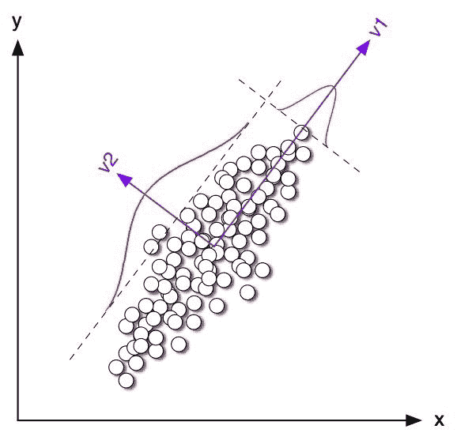

# Python 无监督深度学习：使用 Python 和 Theano 编写的现代神经网络精通数据科学与机器学习


## 引言

当我们谈论现代深度学习时，我们通常指的不是普通的神经网络——而是新的进展，例如使用 `Autoencoders` 和 `Restricted Boltzmann Machines` 来进行无监督预训练。

深度神经网络深受梯度消失问题的困扰，多年来研究人员一直无法解决这个问题——直到新的无监督深度学习方法被发明出来。

这这本书想要教给你的内容。

此外，我们还会介绍 `Principal Components Analysis`（`PCA`）和 `t-Distributed Stochastic Neighbor Embedding`（`t-SNE`），它们不仅在数学上与深度学习相关，而且通常是深度学习或机器学习流水线的一部分。

我对 `PCA` 通常的教学方式感到非常沮丧！因此，我正在这个平台上用一种清晰、逻辑化且直观的方式教你 `Principal Components Analysis`，而你不需要想象旋转的地球仪和旋转向量之类的这类八道。

无监督学习的一个主要组成部分是可视化。我们将在书中进行大量的尝试。`PCA` 和 `t-SNE` 都能帮助你将高维空间的数据可视化到二维平面上。

`Autoencoders` 和 `Restricted Boltzmann Machines` 帮助你可视化神经网络中每个隐藏节点学习了什么。研究人员发现的一个有趣特性是神经网络是分层学习的。以人脸图像为例，神经网络的第一层将学习一些基础笔画。下一层将这些笔画组合成组合。再一层可能会形成脸部的部位，如眼睛、鼻子和嘴巴。这真的太神奇了！

这可能为我们大脑如何获取简单信号并将其组合以执行复杂反应提供见解。在书中，我们还将看到如何在训练神经网络后“欺骗”它！你可能认为它已经学会了识别数据集中的所有图像，但加入一些智能噪声，神经网络就会认为它看到了其他东西，即使这张照片对你来说完全看起来一样！

所以，如果机器最终接管了世界，你至少有一些工具来对抗它们。最后，在书中，我将向你展示如何如何训练深度神经网络以避免梯度消失问题——这种方法被称为“贪婪逐层预训练”。等一下……深度学习以及这些疯狂的东西到底是什么？如果你是深度学习的初学者，你可能想查看我之前关于该主题的书和课程：[Deep Learning in Python](https://www.udemy.com/data-science-deep-learning-in-python), [Deep Learning in Python Prerequisites](https://www.udemy.com/data-science-logistic-regression-in-python)。

就像 IBM 的 `Deep Blue` 在 1996 年击败世界冠军 `Garry Kasparov` 一样，谷歌的 `AlphaGo` 在 2016 年 3 月击败世界冠军 `Lee Sedol` 时登上头条。这次胜利令人惊讶的地方在于，该领域的专家认为这将在 10 年后才会发生。围棋的搜索空间远大于象棋，深度学习是使 `AlphaGo` 能够正确预测移动结果并击败世界冠军的技术。由于更强的处理能力（参见张量处理单元或 `TPU`）、更大的数据集以及像书中讨论的新型算法，深度学习的进展在近年来加速了。

## 格式

我知道电子书的格式在许多平台上可能非常有限。如果你发现这本书的格式存在缺陷，特别是在代码或图表方面，请向 `info@lazyprogrammer.me` 向我发送电子邮件，我将向你发送创建这本书的原始 `epub` 文件。

## 第 1 章：主成分分析

在本章中，我们将讨论 `PCA` 或主成分分析。其描述包含两个部分：

1. 描述 `PCA` 的作用以及如何使用它
2. `PCA` 背后的数学原理

那么 `PCA` 是做什么的？首先，它是一个线性变换。

如果你考虑将向量乘以一个标量时会发生什么，你会发现它永远不会改变方向。它只是变成了一个长度不同的向量。当然，你可以把它乘以 `-1`，它将指向相反的方向，但它不能被任意旋转。

例。`2(1, 2) = (2, 4)`

如果你将向量乘以矩阵——它可以改变方向并被任意旋转。

例。`[[1, 1], [1, 0]][1, 2]^T = [3, 1]^T`

那么 `PCA` 是做什么的？简单来说，是对你的数据矩阵进行线性变换：

```
Z = XQ
```

它接收一个输入数据矩阵 `X`（大小为 `Nx`），乘以变换矩阵 `Q`（大小为 `DxD`），并输出转换后的数据 `Z`（也是 `Nx`）。

如果你想将单个向量 `x` 转换为对应的单个向量 `z`，那就是：
```
z = Qx
```
顺序不同是因为当 `x` 在数据矩阵中时，它是一个 `1xD` 行向量，但当我们谈论单个向量时，它们是 `Dx1` 列向量。这只是习惯用法。

让 `PCA` 变得有趣的算法是它选择 `Q` 矩阵的方式。注意，因为这是无监督学习，我们有 `X` 但没有 `Y`，或者没有目标。

### 旋转

乘以矩阵时发生变化的另一种视角不是你正在旋转向量，而是你正在旋转向量所在的坐标系。我们采取哪种视角取决于我们正在试图解决什么问题。

### 降维

`PCA` 的一个用途是降维。当你查看 de `MNIST` 数据集时（它是 28x28 的图像，或者大小为 784 的向量），维度非常多，这绝对不是你可以可视化的。

`28x28` 是一个非常小的图像，而现在的大多数图像都比这大得多——所以我们要么需要处理具有数百万维度数据的资源，要么可以使用像 `PCA` 这样的技术来降低数据维度。

我们不能仅仅从 `X` 中提取任意维度——我们想减小数据规模，同时尽可能地捕捉信息。因此，如果我们想从 784 降到 2 个维度——以便我们可视化——我们希望这 2 个维度尽可能包含来自 `X` 的信息。

例。`info(1st col of Z) > info(2nd col of Z) > ...`

我们如何衡量这种信息？在传统的 `PCA` 和许多其他传统的统计方法中，我们使用方差。如果某物变化越大，携带的信息就越多。你可以想象相反的情况，即一个变量是完全确定的，也就是说它没有方差。那么测量这个变量就不会带给我们任何新信息，因为我们已经知道它会是什么了。

所以当我们得到转换后的数据 `Z` 时，我们希望第一列拥有最多的信息，第二列拥有第二多的信息，依此类推。


因此，当我们选取信息量最大的 2 列时，意味着选取了前 2 列。

### 去相关性

`PCA` 的另一个作用是去相关性。

如果我们发现相关性，意味着某些数据是冗余的，因为我们可以从其中一列预测出另一列。



现在，如果你从坐标系旋转的角度来看，可以想象，如果我们旋转坐标系使其与这些点的分布对齐，那么数据就会变得互不相关。

问题再次是——我们如何找到 `Q` 以便完全按照这种方式旋转数据呢？

### 可视化

一旦我们将数据在每个维度上的信息按降序排列，就可以取前 2 个维度并绘制散点图。这将让我们对数据点的分离情况有一个直观的认识，并允许我们创建高维数据的视觉表示。

### 预处理与过拟合

我们将讨论的 `PCA` 的最后一个应用是预处理和过拟合。

你可以想象我们的数据通常包含噪声。希望噪声与真实模式相比是很小的。在这种情况下，噪声的方差（本应很小）会进入我们变换后的数据 `Z` 的最后几列，此时我们将其丢弃即可。

我们可以将这些新数据输入到监督机器学习模型中，例如 `logistic regression` —— 实际上，在我之前的课程中我们就这样做过。

因此，通过消除噪声，我们通过确保不拟合噪声来防止过拟合。

为了更清楚起见，这里有一个想象的数据流水线：

输入：`X`（数据），`Y`（目标）

1) 将 `X` 转换为 `Z` -> `Z = XQ`
2) 取 `Z` 的前 `K` 列，称为 `Z[K]`
3) 在 `(Z[K], Y)` 上训练你的模型，即 `model.fit(Z[K], Y)`
4) 任何进一步预测可以使用相同的模型和流水线：

1) `z[K] = Qx`
2) `prediction = model.predict(z[K])`

你会发现，这种无监督预训练的思想在我们学习 `autoencoders` 和 `RBMs` 时会再次发挥作用。

### 隐变量

`PCA` 的另一个视角是，变换后的变量 `Z` 是“隐变量”，即它们是数据 `X` 的某种底层原因。

那么，它们应该是互不相关的就很合理了，因为它们只是独立的隐藏原因。

`X` 中的某些数据具有相关性也是合理的，因为它们只是你对某些数据所进行的测量，而这些数据是由这些隐藏原因组合产生的。

当我们进行 `PCA` 时，我们假设数据是这些隐藏原因的线性组合。

事实上，在 `PCA` 中，线性关系是双向的——隐变量 `Z` 是观测变量 `X` 的线性组合，但如果你进行反向变换，观测数据 `X` 也是隐变量 `Z` 的线性组合。

`Z = XQ`

`X = ZQ^(\1)`

你会记得，我们在我的第一门关于聚类和高斯混合模型的无监督学习课程中首次遇到隐变量的概念——因为那些模型假设簇的身份就是隐变量。

### PCA 背后的数学原理

现在让我们转向 `PCA` 描述的第二部分——如何实际找到变换矩阵 `Q`。

回顾一下，我刚刚告诉了你这个 `Q` 矩阵可以做的所有神奇事情：

1) 即使 `X` 是相关的，也能使 `Z` 不相关
2) 按其信息内容（方差）对 `Z` 的每一列进行排序

这里的许多步骤初看起来可能是随意的，但你将看到它们最终如何紧密结合，并产生我之前提到过的所有属性。

第一步是计算 `X` 的协方差。

`C(x(i), x(j)) = E\[ (x(i) - m(i))(x(j) - m(j)) ] = sum(n=1..N){ (xn - m(i))(xn - m(j)) } / N`

其中 `m(i)` 是所有 `x(i)` 的平均值。

如果 `i = j`，它就是普通的方差。换句话说，`C` 矩阵的对角线是 `X` 每个维度的方差。这以后将很重要。

矩阵形式为：

`C = (X - m)^T(X - m) / N`

这给了我们一个 `DxD` 矩阵。记住，`D` 是维度，`N` 是数量。

### 特征值与特征向量

（注：提供的文本在后半部分包含大量的重复/乱码字符串。我根据前面部分提供的核心数学背景清理了逻辑流。）

### PCA 目标

`PCA` 推导中一个并不显而易见的一点是，它实际上在最小化一个目标函数。

目标函数就是你自然预期的——它是数据的平方重构误差。

`J = || X - XQQ(\-1) ||²`


`Q[k]` 只是 `X` 的协方差的前 `k` 个特征向量——这意味着它是一个 `Dxk` 矩阵。

通过将 `X` 乘以 `Q[k]`，我们得到 `Z[k]`，即 `Z` 的前 `k` 列。记住，这给了我们一个“没有噪声的” `Z`。

由于我们现在没有使用完整的 `Q`，将会存在非零的重构误差。

我们可以通过乘以 `Q[k]^T` 来 get 重构。

```
X[hat] = Z[k]Q[k]^T
```

```
J = || X - XQ[k]Q[k]^T ||²
```

你需要将这个 PCA 目标函数的想法记在脑里，因为我们以后还会再次遇到它。

### 练习

在 MNIST 数据集上尝试 PCA。（使用 scikit-learn 库或尝试自己编写 PCA）


在这一节课中，我们将讨论另一种名为 t-SNE 的降维和可视化方法。`t` 意味着我们将引入 `t` 分布，而 `SNE` 代表“随机邻域嵌入”（stochastic neighbor embedding）。

t-SNE 的一个大优势是非是非线性方法，因此它比 PCA 更具表达力。

### 为什么要学习 t-SNE？

两个原因：

1) t-SNE 由 Geoffrey Hinton 共同开发，如你所知，他是深度学习的主要人物之一。
2) 通过使用 t-SNE，我们看到了如何通过更复杂的数学模型来克服 PCA 的局限性。

除了 t-SNE 是非线性之外，PCA 和 t-SNE 之间的一个关键区别是它没有变换模型。

相反，t-SNE 只是直接修改输出以最小化代价函数。

这意味着你将没有任何任何训练集和测试集，而且在对某些其他数据拟合后，无法转换数据。t-SNE 的工作方式本质上是尝试保持每个输入向量之间的距离。

我们将从对称 SNE 开始，因为它在直觉上更合逻辑。

在原始数据 `X` 上，我们定义了一个联合概率分布 `p(i,j)`，它等于：

```
p(i,j) = exp(-||xi - xj||² /(2s²)) / sum[k!=m]{ exp(-||xm - xk||² /(2s²)) }
```

注意，这里的 `i` 和 `j` 不是像我们在做 PCA 时那样的维度索引，而是数据集中的第 `i` 个和第 `j` 个数据点，即 `i` 和 `j` 是第 `i` 和第 `j` 个样本。

注意它看起来有点像高斯分布。你可以把“`s`”看作超参数。它控制着分布的“扩散”。接下来是我们的低维映射 `Y`，我们以相同的方式定义它，但没有 `s` 项。

```
q(i,j) = exp(-||yi - yj||²) / sum[k!=m]{ exp(-||ym - yk||²) }
```

注意我们只是设置了 `p(i,i) = q(i,i) = 0`。

所以我们了两个概率分布，一个在 `X` 中每对点之间，另一个在 `Y` 中每对点之间。我们通常只是随机初始化 `Y` 中的每个数据点。即：如果我们在寻找 2 维表示，我们将这样创建 `Y`：

```
Y = np.randn(N, 2)
```

一旦完成这些，我们就可以尝试通过优化一个联系 `p(i,j)` 和 `q(i,j)` 的目标函数来寻找更好的 `Y`。如果你不熟悉如何比较两个概率分布，通常使用 Kullback-Leibler 散度或简称 `KL` 散度。

```
C = DKL = sum[i,j]{ p(i,j)log(p(i,j) / q(i,j)) }
```

如果 `P` 和 `Q` 完全相同，结果将是 `0`。我们解决这个问题的方法与解决其他问题的方法相同——对目标求导并进行梯度下降。注意在这种类型的模型中我们没有权重——我们只有 `Y`。所以是关于 `Y` 取梯度，即输出本身。即：

```
Y <- Y - learning_rate*dC/dY
```

对称 SNE 和之前的 SNE 有一个已知问题，被称为“拥挤问题”（crowding problem），它阻止了自然簇周围形成间隙。t-SNE 的做法是对 `Q` 和 `P` 使用不同的分布，这有助于拉开聚类。新的 `P` 和 `Q` 定义如下：

```
p(i,j) = [p(i | j) + p(j | i)] / 2N
```

其中：

```
p(j | i) = exp(-||xi - xj||² /(2s²)) / sum[k!=i]{ exp(-||xi - xk||² /(2s²)) }
```

注意这里每个样本都有自己的“`s`”。

```
q(i,j) = (1 + ||yi - yj||²)^(-1) / sum[k!=m]{ (1 + ||ym - yk||²)^(-1) }
```

注意我们只是设置了 `p(i,i) = q(i,i) = 0`。

`Q` 使用 `t` 分布，因此如此。为了让输出在 0 和 1 之间，我们将使用 `sigmoid` 函数。实际上是新的新的，由于我们使用 `sigmoid` 函数在隐藏层和输出层。我们`

```
X[hat] = Z[k]Q[k]^T
```

```
J = || X - XQ[k]Q[k]^T ||²
```

你需要将这个 PCA 目标函数的想法记在脑里，因为我们以后还会再次遇到它。

### 练习

在 MNIST 数据集上尝试 PCA。（使用 scikit-learn 库或尝试自己编写 PCA）

在这一节课中，我们将讨论另一种名为 t-SNE 的降维和可视化方法。`t` 意味着我们将引入 `t` 分布，而 `SNE` 代表“随机邻域嵌入”（stochastic neighbor embedding）。

t-SNE 的一个大优势是非线性方法，因此它比 PCA 更具表达力。

### 为什么要学习 t-SNE？

两个原因：

1) t-SNE 由 Geoffrey Hinton 共同开发，如你所知，他是深度学习的主要人物之一。
2) 通过使用 t-SNE，我们看到了如何通过更复杂的数学模型来克服 PCA 的局限性。

除了 t-SNE 是非线性之外，PCA 和 t-SNE 之间的一个关键区别是它没有变换模型。

相反，t-SNE 只是直接修改输出以最小化代价函数。

这意味着你将没有任何任何训练集和测试集，而且在对某些其他数据拟合后，无法转换数据。t-SNE 的工作方式本质上是尝试保持每个输入向量之间的距离。

我们将从对称 SNE 开始，因为它在直觉上更合逻辑。

在原始数据 `X` 上，我们定义了一个联合概率分布 `p(i,j)`，它等于：

```
p(i,j) = exp(-||xi - xj||² /(2s²)) / sum[k!=m]{ exp(-||xm - xk||² /(2s²)) }
```

注意，这里的 `i` 和 `j` 不是像我们在做 PCA 时那样的维度索引，而是数据集中的第 `i` 个和第 `j` 个数据点，即 `i` 和 `j` 是第 `i` 和第 `j` 个样本。

注意它看起来有点像高斯分布。你可以把“`s`”看作超参数。它控制着分布的“扩散”。接下来是我们的低维映射 `Y`，我们以相同的方式定义它，但没有 `s` 项。

```
q(i,j) = exp(-||yi - yj||²) / sum[k!=m]{ exp(-||ym - yk||²) }
```

注意我们只是设置了 `p(i,i) = q(i,i) = 0`。

所以我们了两个概率分布，一个在 `X` 中每对点之间，另一个在 `Y` 中每对点之间。我们通常只是随机初始化 `Y` 中的每个数据点。即：如果我们在寻找 2 维表示，我们将这样创建 `Y`：

```
Y = np.randn(N, 2)
```

一旦完成这些，我们就可以尝试通过优化一个联系 `p(i,j)` 和 `q(i,j)` 的目标函数来寻找更好的 `Y`。如果你不熟悉如何比较两个概率分布，通常使用 Kullback-Leibler 散度或简称 `KL` 散度。

```
C = DKL = sum[i,j]{ p(i,j)log(p(i,j) / q(i,j)) }
```

如果 `P` 和 `Q` 完全相同，结果将是 `0`。我们解决这个问题的方法与解决其他问题的方法相同——对目标求导并进行梯度下降。注意在这种类型的模型中我们没有权重——我们只有 `Y`。所以是关于 `Y` 取梯度，即输出本身。即：

```
Y <- Y - learning_rate*dC/dY
```

对称 SNE 和之前的 SNE 有一个已知问题，被称为“拥挤问题”（crowding problem），它阻止了自然簇周围形成间隙。t-SNE 的做法是对 `Q` 和 `P` 使用不同的分布，这有助于拉开聚类。新的 `P` 和 `Q` 定义如下：

```
p(i,j) = [p(i | j) + p(j | i)] / 2N
```

其中：

```
p(j | i) = exp(-||xi - xj||² /(2s²)) / sum[k!=i]{ exp(-||xi - xk||² /(2s²)) }
```

注意这里每个样本都有自己的“`s`”。

```
q(i,j) = (1 + ||yi - yj||²)^(-1) / sum[k!=m]{ (1 + ||ym - yk||²)^(-1) }
```

`Q` 使用 `t` 分布，因此如此。为了让输出在 0 和 1 之间，我们将使用 `sigmoid` 函数在隐藏层和输出层。实际上是新的新的，由于我们使用 `sigmoid` 函数在隐藏层和输出层。我们

```
X[hat] = Z[k]Q[k]^T
```

```
J = || X - XQ[k]Q[k]^T ||²
```

你需要将这个 PCA 目标函数的想法记在脑里，因为我们以后还会再次遇到它。

### 练习

在 MNIST 数据集上尝试 PCA。（使用 scikit-learn 库或尝试自己编写 PCA）


在这一节课中，我们将讨论另一种名为 t-SNE 的降维和可视化方法。`t` 意味着我们将引入 `t` 分布，而 `SNE` 代表“随机邻域嵌入”（stochastic neighbor embedding）。

t-SNE 的一个大优势是非线性方法，因此它比 PCA 更具表达力。

### 为什么要学习 t-SNE？

两个原因：

1) t-SNE 由 Geoffrey Hinton 共同开发，如你所知，他是深度学习的主要人物之一。
2) 通过使用 t-SNE，我们看到了如何通过更复杂的数学模型来克服 PCA 的局限性。

除了 t-SNE 是非线性之外，PCA 和 t-SNE 之间的一个关键区别是它没有变换模型。

相反，t-SNE 只是直接修改输出以最小化代价函数。

这意味着你将没有任何任何训练集和测试集，而且在对某些其他数据拟合后，无法转换数据。t-SNE 的工作方式本质上是尝试保持每个输入向量之间的距离。

我们将从对称 SNE 开始，因为它在直觉上更合逻辑。

在原始数据 `X` 上，我们定义了一个联合概率分布 `p(i,j)`，它等于：

```
p(i,j) = exp(-||xi - xj||² /(2s²)) / sum[k!=m]{ exp(-||xm - xk||² /(2s²)) }
```

注意，这里的 `i` 和 `j` 不是像我们在做 PCA 时那样的维度索引，而是数据集中的第 `i` 个和第 `j` 个数据点，即 `i` 和 `j` 是第 `i` 和第 `j` 个样本。

注意它看起来有点像高斯分布。你可以把“`s`”看作超参数。它控制着分布的“扩散”。接下来是我们的低维映射 `Y`，我们以相同的方式定义它，但没有 `s` 项。

```
q(i,j) = exp(-||yi - yj||²) / sum[k!=m]{ exp(-||ym - yk||²) }
```

注意我们只是设置了 `p(i,i) = q(i,i) = 0`。

所以我们了两个概率分布，一个在 `X` 中每对点之间，另一个在 `Y` 中每对点之间。我们通常只是随机初始化 `Y` 中的每个数据点。即：如果我们在寻找 2 维表示，我们将这样创建 `Y`：

```
Y = np.randn(N, 2)
```

一旦完成这些，我们就可以尝试通过优化一个联系 `p(i,j)` 和 `q(i,j)` 的目标函数来寻找更好的 `Y`。如果你不熟悉如何比较两个概率分布，通常使用 Kullback-Leibler 散度或简称 `KL` 散度。

```
C = DKL = sum[i,j]{ p(i,j)log(p(i,j) / q(i,j)) }
```

如果 `P` 和 `Q` 完全相同，结果将是 `0`。我们解决这个问题的方法与解决其他问题的方法相同——对目标求导并进行梯度下降。注意在这种类型的模型中我们没有权重——我们只有 `Y`。所以是关于 `Y` 取梯度，即输出本身。即：

```
Y <- Y - learning_rate*dC/dY
```

对称 SNE 和之前的 SNE 有一个已知问题，被称为“拥挤问题”（crowding problem），它阻止了自然簇周围形成间隙。t-SNE 的做法是对 `Q` 和 `P` 使用不同的分布，这有助于拉开聚类。新的 `P` 和 `Q` 定义如下：

```
p(i,j) = [p(i | j) + p(j | i)] / 2N
```

其中：

```
p(j | i) = exp(-||xi - xj||² /(2s²)) / sum[k!=i]{ exp(-||xi - xk||² /(2s²)) }
```

注意这里每个样本都有自己的“`s`”。

```
q(i,j) = (1 + ||yi - yj||²)^(-1) / sum[k!=m]{ (1 + ||ym - yk||²)^(-1) }
```

`Q` 使用 `t` 分布，因此如此。为了让输出在 0 和 1 之间，我们将使用 `sigmoid` 函数在隐藏层和输出层。实际上是新的新的，由于我们使用 `sigmoid` 函数在隐藏层和输出层。我们

```
X[hat] = Z[k]Q[k]^T
```

```
J = || X - XQ[k]Q[k]^T ||²
```


请注意，这并不是真正的全貌，因为我们没有考虑偏置，而且没有要求权重每一列的长度为 1，也没有要求每列之间相互正交，或者要求它们以任何特定的方式排序。

所以，虽然函数形式看起来“像”PCA，但它并没有完成 PCA 所执行的所有工作。

## 降噪自动编码器 (Denoising Autoencoders)

在本节中，我们将讨论另一种正则化方法。

记住，当我们获得一个数据集时，并不非只能在该数据集上进行训练。我们在讨论图像时已经见过这一点。一只倒过来的猫的还是一只猫，所以我们应该把它加入数据集中。同样，一只侧卧的猫还是一只猫。照片右上角的猫和移动到左下角的猫仍然是同一只猫。

因此，我们有方法可以修改数据来提高神经网络的泛化能力。

除了显式移动物体外，修改数据的另一种方法是添加噪声。

一种方法是对输入添加高斯噪声，另一种方法简单是将某些值置为 0。

这几乎是轻而易举的，只需对输入添加一个位掩码（bitmask），换句话说，你生成一个由 0 和 1 组成的随机向量，并对 `X` 进行逐元素相乘，得到新的 `X`。

例如。

```python
from theano.tensor.shared_randomstreams import RandomStreams

rng = RandomStreams()

bitmask = rng.binomial(n=1, p=p, size=X.shape)

X = bitmask * X
```

通常，我们将生成 0 的概率设置为小于 50% 的值，也许可能是 30% 左右，但研究人员发现高达 50% 仍然能产生良好的的结果。

## 堆叠自动编码器 (Stacked Autoencoders)

在本节中，我们将探索当我们将一组自动编码器按层堆叠在一起时会发生什么。

基本算法如下。

你训练一个自动编码器，然后固定它的权重。接着丢弃最后一层，只保留到隐藏部分的输入。

接下来，取第一个自动编码器隐藏层的输出，并将其作为另一个自动编码器的输入。

只需对多个自动编码器重复这个过程。

例：

训练：
o--o--o
x z x’
保留：
o--o
x z

训练另一个：
o--o--o
z z2 z’
保留另一个：
o--o
z z2

再训练另一个：
o--o--o
z2 z3 z2’
保留另一个：
o--o
z2 z3

最后，你得到了一堆自动编码器，每个的设计都仅仅是为了学习前一层更更紧凑的版本。

你最终得到的是一个深度无监督网络：
o--o--o--o
x z z2 z3

由于我们每次使用自动编码器时都在尝试获得比前一层更紧凑的表示，因此我们希望每一层的大小都比前一层小。

请注意，这并不一定如此。事实上，我们可以在中间层拥有大量的隐藏单元。理论上，如果我们有 `N` 个训练样本和 `N` 个隐藏单元，那么我们可以获得完美的重构，因为 `W` 的 `N` 列中的每一列都可以负责一个不同的样本。你可能认为这会导致严重的过拟合，但研究人员发现它不会过拟合，甚至数量大于 `N` 的隐藏单元也可以正常工作。在我们的代码中，我们将使用类和对象来表示 `ANN` 和 `Autoencoder`。鉴于我们可以有任意数量的自动编码器，这将有助于更好地模块化代码。然后我们可以简单地将每个自动编码器的隐藏输出作为下一个自动编码器的输入。

### 贪心逐预训练 (Greedy-wise pretraining)

我们刚刚讨论的过程被称为“贪心逐预训练”。之所以被称为“贪心”，直观上意味着你做了局部最优决策，在我们的情况下仅仅是训练一层自动编码器。虽然这在理论上不是最优的，但它对监督训练非常有帮助，这就是为什么我们预预训练。最后一步是在自动编码器的最后添加一个逻辑回归层。一旦你完成了这一点，你就创建了一个深度神经网络。

由于带有逻辑回归的最后层具有随机权重，我们需要进行反向传播。但我们发现在这里进行反向传播并不缓慢，因为自动编码器的权重已经让我们处于正确答案的附近。所以我们只需要进行几次反向传播来微调（fine-tune）网络。在架构方面，这里没有新东西，只有旧的想法。在代码中，注意我们通常有一个函数返回一个 `xD` 矩阵作为输入和一个 `Nx1` 向量作为输出。我们将加载训练数据和测试数据，因此会有大小为 `NxD` 的 `Xtrain`、大小为 `Nx1` 的 `Ytrain`、大小为 `NxD` 的 `Xtest` 以及大小为 `Nx1` 的 `Ytest`。注意，这里有误差目标和交叉熵目标。我们通常使用交叉熵来处理 0/1 目标，但你会发现它比误差目标效果更好。我们稍会在书中解释。

来看代码：

```python
def relu(x):
    return x * (x > 0)

def error_rate(p, t):
    return np.mean(p != t)

def init_weights(shape):
    return np.random.randn(*shape) / np.sqrt(sum(shape))

import numpy as np
import theano
import theano.tensor as T
import matplotlib.pyplot as plt
from sklearn.utils import shuffle

class AutoEncoder(object):
    def __init__(self, M):
        self.M = M

    def fit(self, X, learning_rate=0.5, mu=0.99, epochs=1, batch_sz=100, show_fig=False):
        N, D = X.shape
        n_batches = N / batch_sz
        W0 = init_weights((D, M))
        self.W = theano.shared(W0)
        self.bh = theano.shared(np.zeros(M))
        self.bo = theano.shared(np.zeros(D))
        self.params = [self.W, self.bh, self.bo]
        self.forward_params = [self.W, self.bh]
        self.dW = theano.shared(np.zeros(W0.shape))
        self.dbh = theano.shared(np.zeros(M))
        self.dbo = theano.shared(np.zeros(D))
        self.dparams = [self.dW, self.dbh, self.bo]
        self.forward_dparams = [self.dW, self.dbh]
        X_in = T.matrix('X_%s' % self.id)
        X_hat = self.forward_output(X_in)
        # 将其附加到对象以便以便使用
        # 必须是 sigmoid，因为输出也是 sigmoid
        H = T.nnet.sigmoid(X_in.dot(self.W) + self.bh)
        self.hidden_op = theano.function(
            inputs=[X_in],
            outputs=H,
        )
        # cost = ((X_in - X_hat) * (X_in - X_hat)).sum() / N
        cost = -(X_in * T.log(X_hat) + (1 - X_in) * T.log(1 - X_hat)).sum() / N
        cost_op = theano.function(
            inputs=[X_in],
            outputs=cost,
        )
        updates = [
            (p, p + mu*dp - learning_rate*T.grad(cost, p)) for p, dp in zip(self.params, self.dparams)
        ] + [
            (dp, mu*dp - learning_rate*T.grad(cost, p)) for p, dp in zip(self.params, self.dparams)
        ]
        train_op = theano.function(
            inputs=[X_in],
            updates=updates,
        )
        costs = []
        for i in xrange(epochs):
            print "epoch:", i
            X = shuffle(X)
            for j in xrange(n_batches):
                batch = X[j*batch_sz:(j*batch_sz + batch_sz)]
                train_op(batch)
                the_cost = cost_op(X) # 技术上我们在这里也可以获取 Xtest 的 cost
                print "j / n_batches:", j, "/", n_batches, "cost:", the_cost
            costs.append(the_cost)
        if show_fig:
            plt.plot(costs)
            plt.show()

    def forward_hidden(self, X):
        Z = T.nnet.sigmoid(X.dot(self.W) + self.bh)
        return Z

    def forward_output(self, X):
        Z = self.forward_hidden(X)
        Y = T.nnet.sigmoid(Z.dot(self.W.T) + self.bo)
        return Y

    @staticmethod
    def createFromArrays(W, bh, bo):
        ae = AutoEncoder(W.shape[1])
        ae.W = theano.shared(W)
        ae.bh = theano.shared(bh)
        ae.bo = theano.shared(bo)
        return ae
```


```python
ae.params = [ae.W, ae.bh, ae.bo]

ae.forward_params = [ae.W, ae.bh]

return ae

class DNN(object):
    def __init__(self, hidden_layer_sizes, UnsupervisedModel=AutoEncoder):
        self.hidden_layers = []
        for M in hidden_layer_sizes:
            ae = UnsupervisedModel(M)
            self.hidden_layers.append(ae)

    def fit(self, X, Y, Xtest, Ytest, pretrain=True, learning_rate=0.01, mu=0.99, reg=0.1, epochs=1, batch_sz=100):
        # 自动编码器的逐层贪训练
        pretrain_epochs = 1
        if not pretrain:
            pretrain_epochs = 0
        current_input = X
        for ae in self.hidden_layers:
            ae.fit(current_input, epochs=pretrain_epochs)
            # 为下一层创建当前输入
            current_input = ae.hidden_op(current_input)
        # 初始化逻辑回归层
        N = len(Y)
        K = len(set(Y))
        W0 = init_weights((self.hidden_layers[-1].M, K))
        self.W = theano.shared(W0)
        self.b = theano.shared(np.zeros(K))
        self.params = [self.W, self.b]
        for ae in self.hidden_layers:
            self.params += ae.forward_params
        # 用于动量
        self.dW = theano.shared(np.zeros(W0.shape))
        self.db = theano.shared(np.zeros(K))
        self.dparams = [self.dW, self.db]
        for ae in self.hidden_layers:
            self.dparams += ae.forward_dparams
        X_in = T.matrix('X_in')
        targets = T.ivector('Targets')
        pY = self.forward(X_in)
        # squared_magnitude = [(p*p).sum() for p in self.params]
        # reg_cost = T.sum(squared_magnitude)
        cost = -T.mean( T.log(pY[T.arange(pY.shape[0]), targets]) ) #+ reg*reg_cost
        prediction = self.predict(X_in)
        cost_predict_op = theano.function(
            inputs=[X_in, targets],
            outputs=[cost, prediction],
        )
        updates = [
            (p, p + mu*dp - learning_rate*T.grad(cost, p)) for p, dp in zip(self.params, self.dparams)
        ] + [
            (dp, mu*dp - learning_rate*T.grad(cost, p)) for p, dp in zip(self.params, self.dparams)
        ]
        train_op = theano.function(
            inputs=[X_in, targets],
            updates=updates,
        )
        n_batches = N / batch_sz
        costs = []
        print "supervised training..."
        for i in xrange(epochs):
            print "epoch:", i
            X, Y = shuffle(X, Y)
            for j in xrange(n_batches):
                Xbatch = X[j*batch_sz:(j*batch_sz + batch_sz)]
                Ybatch = Y[j*batch_sz:(j*batch_sz + batch_sz)]
                train_op(Xbatch, Ybatch)
            the_cost, the_prediction = cost_predict_op(Xtest, Ytest)
            error = error_rate(the_prediction, Ytest)
            print "j / n_batches:", j, "/", n_batches, "cost:", the_cost, "error:", error
            costs.append(the_cost)
        plt.plot(costs)
        plt.show()

    def predict(self, X):
        return T.argmax(self.forward(X), axis=1)

    def forward(self, X):
        current_input = X
        for ae in self.hidden_layers:
            Z = ae.forward_hidden(current_input)
            current_input = Z
        # 逻辑层
        Y = T.nnet.softmax(T.dot(current_input, self.W) + self.b)
        return Y

def main():
    Xtrain, Ytrain, Xtest, Ytest = getKaggleMNIST()
    # 两种都尝试！
    # dnn = DNN([1000, 750, 500])
    # dnn.fit(Xtrain, Ytrain, Xtest, Ytest, epochs=3)
    # vs
    dnn = DNN([1000, 750, 500])
    dnn.fit(Xtrain, Ytrain, Xtest, Ytest, pretrain=False, epochs=10)

if __name__ == '__main__':
    main()
```

### 练习

-   为自动编码器添加去噪功能。
-   交叉熵对比 KL 散度（KL Divergence）

你已经看到 `KL Divergence` 可以用于比较两个概率分布之间的相似性，就像我们在 `t-SNE` 中所做的那样。

需要记住的一个等式是：交叉熵在差一个常数的情况下等同于 `KL divergence`。

即：

`H(P, Q)` = $P$ 与 $Q$ 之间的交叉熵

`H(P)` = $P$ 的熵

`DKL` = $P$ 与 $Q$ 之间的 `KL divergence`


目前有一些材料从高层面上介绍了如何构建一个高斯单位，但这些其他表述被报道认为存在稳定性问题，因此我们在这里不会介绍它们。

我们准备好讨论 `RBMs` 背后的数学原理了。

请注意，这与标准的波尔兹曼机非常相似，有一个项取决于 2 个不同节点之间的交互，以及一个仅取决于一个节点的类似偏置项。

总能量为 `E(v,h) = -b^Tv - c^Th - v^TWh`。

如果 `v` 是 `Dx1` 且 `h` 是 `Mx1`，那么 `W` 必须是 `DxM`，这正是我们在神经网络中通常拥有的。

`b` 是 `Dx1`，`c` 是 `Mx1`，以便得到有效的点积。

请注意，根据这些变量，我们之前讨论的条件概率是：

`p(h | v) = sigmoid(W^Tv + c)`（正向）

`p(v | h) = sigmoid(Wh + b)`（反向）

像自动编码器一样，我们再次使用了共享权重。

现在我们已经有了能量函数的表达式，现在可以定义 `v` 和 `h` 的联合概率了。

`P(v,h) = exp(-E(v,h)) / Z`

其中：

`Z = sum{ sum{ exp(-E(v,h)) }}`

我们将 `Z` 称为配分函数，它只是确保所有概率之和为 1。

请注意，这本身是不可计算的，因为求和意味着对 `v` 和 `h` 的所有可能值进行求和。由于它们都是二值变量，对于每一个来说复杂度都是 `O(2^N)`。

例如，如果 `M=3`，那么 `h` 的可能值为：

000
001
010
011
100
101
110
111

我们必须对所有这些值进行求和。

那么，在给定模型的情况下，我们想要的是最大化 `P(v)`，它是对 `h` 进行边缘化后的 `P(v,h)`。这是因为我们实际上并不在乎 `h` 的值，我们只是想最大化我们所看到的内容概率，即 `v`。

即

`P(v) = sum[h]{ P(v, h) }`

与一样，我们并不直接最大化 `P(v)`，而是最大化 `P(v)` 的对数。所以让我们从尝试对某个任意参数 `w` 求导开始。

```
d(-log(P(v))/dw
= d(-log(sum[h] {P(v,h) } )/dw
= d(-log(sum[h] { exp(-E(v,h)) / Z })/dw
= sum[h]{ P(h | v)E(v,h) } -sum[v,h]{ P(v,h)E(v,h) }
=E[h | v]{ E(v,h) } - E[v,h]{ E(v,h) }
```

这被读作“在条件分布 `P(h | v)` 上 `E(v,h)` 的期望值” —— “在联合分布 `P(v, h)` 上 `E(v,h)` 的期望值”。

所以我们最终得到的是两个期望值之间的差。第一个期望很容易得到，但第二个期望很难得到，因为需要无限数量的样本。我们通常将第一项称为夹紧项（clamped term），第二项称为未夹紧项（unclamped term）。

让我们取前面的表达式并进一步扩展。让我们处理输入到隐藏层的权重。

`J = sum[h]{ P(h | v)E(v,h) } - sum[v,h]{ P(v,h)E(v,h) }`

`dJ/dW(i, j) = - sum[h] { P(h | v) h(j) } + sum[v]{ P(v,h)h(j) }`

`dJ/dW(i, j) = - p(h=1 | v)v(i) + sum[v]{ P(v)p(h=1 | v) }`

`dJ/dW(i, j) = - sigmoid(c(j) + v^TW(:,j))v(i) + sum[v]{ P(v)sigmoid(c(j) + v^TW(:,j)) }`

我们可以对偏置进行类似的求导，并得到这些更新方程：

`dJ/dW(i, j) = - sigmoid(c(j) + v^TW(:,j))v(i) + sum[v]{ P(v)sigmoid(c(j) + v^TW(:,j)) }`

`dJ/b(i) = v(i) - sum[v]{ P(v)v(i) }`

`dJ/dc(j) = sigmoid(c(j) + v^TW(:,j)) - sum[v]{ P(v)sigmoid(c(j) + v^TW(:,j)) }`

现在你明白我们说的夹紧项和未夹紧项的意思了。我们将通过直接计算得到第一项，但对于第二项（这需要对所有 `v` 进行求和——这是不可行的），将通过采样来获得。

请注意，如果我们使用 `numpy` 编写 `RBM`，我们将使用实际的...


```python
from theano.tensor.shared_randomstreams import RandomStreams

from autoencoder import DNN

class RBM(object):
    def __init__(self, M):
        self.M = M
        self.rng = RandomStreams()

    def fit(self, X, learning_rate=0.1, epochs=1, batch_sz=100, show_fig=False):
        N, D = X.shape
        n_batches = N / batch_sz
        W0 = init_weights((D, self.M))
        self.W = theano.shared(W0)
        self.c = theano.shared(np.zeros(self.M))
        self.b = theano.shared(np.zeros(D))
        self.params = [self.W, self.c, self.b]
        self.forward_params = [self.W, self.c]
        # we won't use this to fit the RBM but we will use these for backpropagation later
        self.dW = theano.shared(np.zeros(W0.shape))
        self.dc = theano.shared(np.zeros(self.M))
        self.db = theano.shared(np.zeros(D))
        self.dparams = [self.dW, self.dc, self.db]
        self.forward_dparams = [self.dW, self.dc]
        X_in = T.matrix('X')
        # attach it to the object so it can be used later
        # must be sigmoidal because the output is also a sigmoid
        H = T.nnet.sigmoid(X_in.dot(self.W) + self.c)
        self.hidden_op = theano.function(
            inputs=[X_in],
            outputs=H,
        )
        # we won't use this cost to do any updates
        # but we would like to see how this cost function changes
        # as we do contrastive divergence
        X_hat = self.forward_output(X_in)
        cost = -(X_in * T.log(X_hat) + (1 - X_in) * T.log(1 - X_hat)).sum() / N
        cost_op = theano.function(
            inputs=[X_in],
            outputs=cost,
        )
        # do one round of Gibbs sampling to obtain X_sample
        H = self.sample_h_given_v(X_in)
        X_sample = self.sample_v_given_h(H)
        # define the objective, updates, and train function
        objective = T.mean(self.free_energy(X_in)) - T.mean(self.free_energy(X_sample))
        # need to consider X_sample constant because you can't take the gradient of random numbers in Theano
        updates = [(p, p - learning_rate*T.grad(objective, p, consider_constant=[X_sample]) for p in self.params]
        train_op = theano.function(
            inputs=[X_in],
            updates=updates,
        )
        costs = []
        for i in xrange(epochs):
            print "epoch:", i
            X = shuffle(X)
            for j in xrange(n_batches):
                batch = X[j*batch_sz:(j*batch_sz + batch_sz)]
                train_op(batch)
                the_cost = cost_op(X) # technically we could also get the cost for Xtest here
                print "j / n_batches:", j, "/", n_batches, "cost:", the_cost
                costs.append(the_cost)
            if show_fig:
                plt.plot(costs)
                plt.show()

    def free_energy(self, V):
        return -V.dot(self.b) - T.sum(T.log(1 + T.exp(V.dot(self.W) + self.c)), axis=1)

    def sample_h_given_v(self, V):
        p_h_given_v = T.nnet.sigmoid(V.dot(self.W) + self.c)
        h_sample = self.rng.binomial(size=p_h_given_v.shape, n=1, p=p_h_given_v)
        return h_sample

    def sample_v_given_h(self, H):
        p_v_given_h = T.nnet.sigmoid(H.dot(self.W.T) + self.b)
        v_sample = self.rng.binomial(size=p_v_given_h.shape, n=1, p=p_v_given_h)
        return v_sample

    def forward_hidden(self, X):
        return T.nnet.sigmoid(X.dot(self.W) + self.c)

    def forward_output(self, X):
        Z = self.forward_hidden(X)
        Y = T.nnet.sigmoid(Z.dot(self.W.T) + self.b)
        return Y

    @staticmethod
    def createFromArrays(W, c, b, an_id):
        rbm = AutoEncoder(W.shape[1], an_id)
        rbm.W = theano.shared(W, 'W_%s' % rbm.id)
        rbm.c = theano.shared(c, 'c_%s' % rbm.id)
        ...
```

排版后：

from `theano.tensor.shared_randomstreams` import `RandomStreams`

from `autoencoder` import `DNN`

class `RBM(object)`:
    def `__init__(self, M)`:
        `self.M = M`
        `self.rng = RandomStreams()`

    def `fit(self, X, learning_rate=0.1, epochs=1, batch_sz=100, show_fig=False)`:
        `N, D = X.shape`
        `n_batches = N / batch_sz`
        `W0 = init_weights((D, self.M))`
        `self.W = theano.shared(W0)`
        `self.c = theano.shared(np.zeros(self.M))`
        `self.b = theano.shared(np.zeros(D))`
        `self.params = [self.W, self.c, self.b]`
        `self.forward_params = [self.W, self.c]`
        # we won't use this to fit the RBM but we will use these for backpropagation
        `self.dW = theano.shared(np.zeros(W0.shape))`
        `self.dc = theano.shared(np.zeros(self.M))`
        `self.db = theano.shared(np.zeros(D))`
        `self.dparams = [self.dW, self.dc, self.db]`
        `self.forward_dparams = [self.dW, self.dc]`
        `X_in = T.matrix('X')`
        # attach it to the object so it can be used later
        # must be sigmoidal because the output is also a sigmoid
        `H = T.nnet.sigmoid(X_in.dot(self.W) + self.c)`
        `self.hidden_op = theano.function(`
            inputs=[X_in],
            outputs=H,
        )`
        # we won't use this cost to do any updates
        # but we would like to see how this cost function changes
        # as we do contrastive divergence
        `X_hat = self.forward_output(X_in)`
        `cost = -(X_in * T.log(X_hat) + (1 - X_in) * T.log(1 - X_hat)).sum() / N`
        `cost_op = theano.function(`
            inputs=[X_in],
            outputs=cost,
        )`
        # do one round of Gibbs sampling to obtain X_sample
        `H = self.sample_h_given_v(X_in)`
        `X_sample = self.sample_v_given_h(H)`
        # define the objective, updates, and train function
        `objective = T.mean(self.free_energy(X_in)) - T.mean(self.free_energy(X_sample))`
        # need to consider X_sample constant because you can't take the gradient of random numbers in Theano
        `updates = [(p, p - learning_rate*T.grad(objective, p, consider_constant=[X_sample]) for p in self.params]`
        `train_op = theano.function(`
            inputs=[X_in],
            updates=updates,
        )`
        `costs = []`
        for i in xrange(epochs):
            print "epoch:", i
            `X = shuffle(X)`
            for j in xrange(n_batches):
                `batch = X[j*batch_sz:(j*batch_sz + batch_sz)]`
                `train_op(batch)`
                `the_cost = cost_op(X)` # technically we could also get the cost for Xtest here
                print "j / n_batches:", j, "/", n_batches, "cost:", the_cost
                `costs.append(the_cost)`
            if show_fig:
                plt.plot(costs)
                plt.show()`

    def `free_energy(self, V)`:
        return -V.dot(self.b) - T.sum(T.log(1 + T.exp(V.dot(self.W) + self.c)), axis=1)

    def `sample_h_given_v(self, V)`:
        `p_h_given_v = T.nnet.sigmoid(V.dot(self.W) + self.c)`
        `h_sample = self.rng.binomial(size=p_h_given_v.shape, n=1, p=p_h_given_v)`
        return h_sample

    def `sample_v_given_h(self, H)`:
        `p_v_given_h = T.nnet.sigmoid(H.dot(self.W.T) + self.b)`
        `v_sample = self.rng.binomial(size=p_v_given_h.shape, n=1, p=p_v_given_h)`
        return v_sample

    def `forward_hidden(self, X)`:
        return T.nnet.sigmoid(X.dot(self.W) + self.c)

    def `forward_output(self, X)`:
        `Z = self.forward_hidden(X)`
        `Y = T.nnet.sigmoid(Z.dot(self.W.T) + self.b)`
        return Y

    @staticmethod
    def `createFromArrays(W, c, b, an_id)`:
        `rbm = AutoEncoder(W.shape[1], an_id)`
        `rbm.W = theano.shared(W, 'W_%s' % rbm.id)`
        `rbm.c = theano.shared(c, 'c_%s' % rbm.id)`
        ...


你对这些材料已经得心了吗，并想要将你的深度学习技能提升到新的水平？那么，我关于深度学习的 Udemy 后课程非常适合你。与这本书类似，我将带你学习 `Theano` 和 `TensorFlow` 的基础知识——创建函数、变量和表达式，并从零开始构建神经网络。我将教你加速学习过程的方法，包括批量梯度下降、动量和自适应学习率。我还会向你现场演示如何在 Amazon `AWS` `EC2` 上创建 `GPU` 实例，并向你证明使用 `GPU` 优化的神经网络训练比在 `CPU` 上快几个数量级。

[数据科学：Theano 和 TensorFlow 中的实用深度学习](https://www.udemy.com/data-science-deep-learning-in-theano-tensorflow/)
[`www.udemy.com/data-science-deep-learning-in-theano-tensorflow`](https://www.udemy.com/data-science-deep-learning-in-theano-tensorflow)

当你掌握了深度学习的基础知识后，就可以准备探索其他的架构了。一种非常流行的替代方案是卷积神经网络，它是专门为图像分类创建的。这些网络在医学影像、自动驾驶车辆等领域具有广阔的应用。在课程中，我将向你如何在 `Theano` 和 `TensorFlow` 中构建卷积网络。

[深度学习：Python 中的卷积神经网络](https://www.udemy.com/deep-learning-convolutional-neural-networks-theano-tensorflow)
[`www.udemy.com/deep-learning-convolutional-neural-networks-theano-tensorflow`](https://www.udemy.com/deep-learning-convolutional-neural-networks-theano-tensorflow)

在我深度学习系列的第 4 部分中，我将带你学习无监督深度学习方法（这这本书的内容！）。我们将学习主成分分析 (`PCA`)、`t-SNE`（由深度学习之父 Geoffrey Hinton 共同开发）、深度自动编码器和受限玻尔兹曼机 (`RBMs`)。我将演示如何通过自动编码器和 `RBMs` 对深度网络进行无监督预训练来提高监督学习的性能。

[Python 中的无监督深度学习](https://www.udemy.com/unsupervised-deep-learning-in-python)
[`www.udemy.com/unsupervised-deep-learning-in-python`](https://www.udemy.com/unsupervised-deep-learning-in-python)

你想了解神经网络的基础构建模块——逻辑回归吗？在这门课程中，我将教你逻辑回归的理论（我们对神经元的计算模型），并带你深入研究二分类分类、手动创建特征和梯度下降。如果你觉得书中的材料太有挑战性，可能想看看这门课程。

[数据科学：Python 中的逻辑回归](https://udemy.com/data-science-logistic-regression-in-python)
[`udemy.com/data-science-logistic-regression-in-python`](https://udemy.com/data-science-logistic-regression-in-python)

为了更简单地了解通用机器学习的概况（在那种情况下我们甚至不需要梯度下降，可以直接通过“闭式解”求解最优模型参数），你可能想查看我第一门关于经典统计方法——线性回归的 Udemy 课程：

[数据科学：Python 中的线性回归](https://www.udemy.com/data-science-linear-regression-in-python)
[`www.udemy.com/data-science-linear-regression-in-python`](https://www.udemy.com/data-science-linear-regression-in-python)

如果你对学习机器学习如何应用于语言、文本和语音感兴趣，你可能想查看我关于自然语言处理（或 `NLP`）的课程。

[数据科学：Python 中的自然语言处理](https://www.udemy.com/data-science-natural-language-processing-in-python)
[`www.udemy.com/data-science-natural-language-processing-in-python`](https://www.udemy.com/data-science-natural-language-processing-in-python)

如果你对学习 `SQL` —— 结构化查询语言——一种可以适用于 iPhone 上的微型数据库，也可以适用于跨越多个大陆的大型数据库，并且不仅想学习语言的机制，还想知道如何将其应用于真实的数据分析和营销问题？请在这里查看我的课程：

[面向营销人员的 SQL：统治数据分析、数据科学和大数据](https://www.udemy.com/sql-for-marketers-data-analytics-data-science-big-data)
[`www.udemy.com/sql-for-marketers-data-analytics-data-science-big-data`](https://www.udemy.com/sql-for-marketers-data-analytics-data-science-big-data)

你对股票预测、时间序列和一般的序列感兴趣吗？我的隐马尔可夫模型课程是你的首选。我不仅会教你 `HMMs` 的所有经典理论，还会教你如何使用 `Theano` 和梯度下降来编写它们！这对于编写深度学习模型是非常极佳的练习，并将为它的续集《深度学习第五部分：Python 中的循环神经网络》做好充分准备。你可以在这里获取 HMM 课程：

[无监督机器学习：Python 中的隐马尔可夫模型](https://udemy.com/unsupervised-machine-learning-hidden-markov-models-in-python)
[`udemy.com/unsupervised-machine-learning-hidden-markov-models-in-python`](https://udemy.com/unsupervised-machine-learning-hidden-markov-models-in-python)

最后，我一直在发放优惠券，并告诉你何时可以免费获得我的资源。但只有当你是我的现有学生时才能这样做！以下是我通知学生优惠券和免费赠送的几种方式：

- 我的时事通讯，你可以在 `http://lazyprogrammer.me` 注册（附带一个免费的期期 6 周机器学习入门课程）
- 我的 Twitter，`https://twitter.com/lazy_scientist`
- 我的 Facebook 页面，`https://facebook.com/lazyprogrammer.me`（别忘记点“赞”！）

