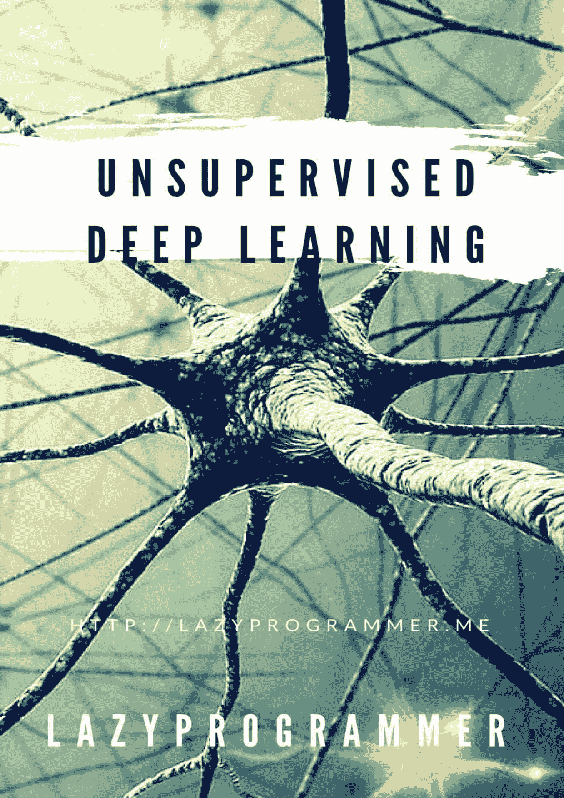
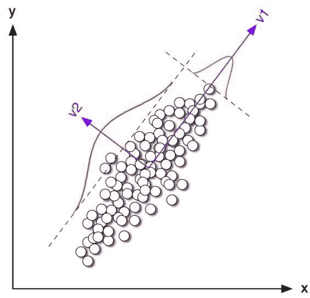

## Python 无监督深度学习



作者：The LazyProgrammer (http://lazyprogrammer.me)

# 引言

当我们谈论现代深度学习时，我们通常指的不是原始的神经网络——而是较新的进展，例如使用自动编码器和受限玻尔兹曼机进行无监督预训练。

深度神经网络深受梯度消失问题的困扰，多年来研究人员一直无法有效解决这个问题——直到新的无监督深度学习方法被发明。

这正是一本书想要教给你的。

此外，我们还将介绍主成分分析 `PCA` 和 t-分布随机邻域嵌入 `t-SNE`，这些方法在数学上与深度学习相关，而且通常是深度学习或机器学习流水线的一部分。

很大程度上，我对通常 `PCA` 的教学方式感到沮丧！因此，我利用这个平台以一种清晰、逻辑化且直观的方式向你教授主成分分析，而不需要让你想象什么旋转的地球仪、旋转向量之类的无意义的内容。

无监督学习的一个主要优势是可视化。我们将在书中进行大量的可视化工作。`PCA` 和 `t-SNE` 都能帮助你在平面上可视化来自高维空间的数据。

自动编码器和受限玻尔兹曼机可以帮助你可视化神经网络中每个隐藏节点学习了什么。研究人员发现的一个有趣特性是神经网络是分层学习的。以人脸图像为例，神经网络的第一层将学习一些基础笔画。下一层将这些笔画组合成笔画的组合。再一层可能会形成脸部的部位，如眼睛、鼻子、耳朵和嘴巴。这真的、太神奇了！

这或许为我们的大脑如何获取简单的电信号并将其组合以执行复杂的反应提供了见解。

在本书中，我们还将看到如何在训练一个神经网络后“欺骗”它！你可能认为它已经学会了识别数据集中的所有图像，但只要添加一些智能设计的噪声，神经网络就会认为它看到了其他东西，即使这些图片在在你看来看起来完全一样！

所以，如果机器最终接管了世界，你至少拥有一些智能设计的噪声，而神经网络会认为它看到了其他东西，即使这些图片在在你看来看起来完全一样！

所以，如果机器最终接管了世界，你至少拥有一些智能设计的噪声，而神经网络会认为它看到了其他东西，即使这些图片在在你看来看起来完全一样！

所以，如果机器最终接管了世界，你至少拥有一些智能设计的噪声，而神经网络会认为它看到了其他东西，即使这些图片在在你看来看起来完全一样！

- 我们希望在减少数据规模的同时，尽可能捕捉多的信息。

所以，如果我们想从 784 维降到 2 维——以便我们可视化——我们希望这 2 个维度包含尽可能的信息。

例如：`info(Z` 的第一列) > `info(Z` 的第二列) >

我们如何衡量这些信息呢？在传统的 `PCA` 和许多其他统计方法中，我们使用方差。如果某个东西变化越大，它携带的信息就越多。

你可以想象相反的情况，即一个变量是完全确定的，也就是说它没有方差。那么测量这个变量就不会为我们提供任何新信息，因为我们已经知道它将是什么了。

所以，当我们得到转换后的数据 `Z` 时，我们希望第一列包含最多的信息，第二列包含次多的信息，以此此类推。

因此，当我们取信息最多的两列时，意味着选取前两列。

`PCA` 的独特之处在于它如何选择。

所以现在，如果你从坐标系旋转的角度来看，你可以想象如果我们旋转坐标系使其与这些点的分布对齐，那么数据就会……

- 我们采取哪种视角取决于我们正在尝试解决的问题。

# 降维

`PCA` 的用途之一是降维。当你查看 `MNIST` 数据集时，它是 28x28 的或者是大小为 784 的向量，维度非常多，这绝对不是你可以直接可视化的。28x28 是一个非常小的图像，而现在的大多数图像比这大得多——所以我们要么拥有资源来处理数百万维度的数据，要么就可以使用 `PCA` 等技术来还原数据。

我们当然不能从 `X` 中任意选取维度——我们希望在减少数据规模的同时，尽可能捕捉多的信息。

所以，如果我们想从 784 维降到 2 维——以便我们可视化——我们希望这 2 个维度包含尽可能的信息。

## 去相关

`PCA` 做的另一件事是非相关。

如果我们发现相关性，意味着某些数据是冗余的，因为我们可以从其中一列预测另一列。



所以现在如果你从坐标系旋转的角度来看，你可以想象如果我们旋转坐标系使其与这些点的分布对齐，那么数据就会……

变得不相关。

再次回到问题——我们如何找到 `Q` 以便按照这种特定的方式旋转数据？

## 可视化

一旦我们对每个维度的数据信息按降序排序，我们就可以取前两个并绘制散点图。这将让我们对数据点之间的分离有一个直观认识，并允许我们创建高维数据的视觉表示。

## 预处理与过拟合

我们将讨论的 `PCA` 最后一个应用是预处理和过拟合。

你可以想象我们的数据通常是有噪声的。希望噪声与真实模式相比很小。在这种情况下，噪声的方差（本应该很小）会进入我们转换后的数据 `Z` 的最后几列，此时我们只需将其丢弃即可。

然后我们可以将这些新数据输入到监督机器学习模型中，例如逻辑回归——事实上，在我之前的课程中做过这一点。

所以，通过消除噪声，我们通过确保不对噪声进行拟合，从而防止了过拟合。

为了让这一点清晰，这里有一个想象的数据流水线：

输入：`X` (数据), `Y` (目标)

- 1) 将 `X` 转换为 `Z` → `Z = XQ`

- 2) 取 `Z` 的前 `K` 列，称之为 `Z_K`

- 3) 在 (`Zₖ`, `Y`) 上训练你的模型，即 `model.fit(Zₖ, Y)`

- 4) 任何进一步预测可以使用相同的模型和流水线：

  - 1) `Zₖ = Qx`

  - 2) `prediction = model.predict(Zₖ)`

## 隐变量

`PCA` 的另一个视角是，转换后的变量 `Z` 是“隐变量”，它们是数据 `X` 的某种底层原因。

那么它们应该是不相关的就很合理了，因为它们仅仅是独立的隐藏原因。

`X` 中的某些数据是相关的也是合理的，因为它们只是你对某些由这些隐藏原因组合产生的数据所进行的测量。

我们在进行 `PCA` 时假设假设数据是这些隐藏原因的线性组合。

事实上，在 `PCA` 中，线性关系是双向的——隐变量 `Z` 是观测变量 `X` 的线性组合，但如果你进行反变换，观测数据 `X` 也是隐变量 `Z` 的线性组合。

`Z = XQ`

`X = ZQ⁻¹`

你会记得我们在我的第一门关于聚类和高斯混合模型的无监督学习课程中首次遇到隐变量的概念——因为那些模型假设聚类的身份就是隐变量。

## PCA 背后的数学原理

现在让我们转向 `PCA` 描述的部分——如何实际找到变换矩阵 `Q`。

回顾一下，我刚刚告诉了你这个 `Q` 矩阵可以做的所有魔法：

- 1) 即使 `X` 是相关的，也能让 `Z`变得不相关

- 2) 按其信息内容（方差）对 `Z` 的每一列进行排序

这里的许多步骤初看起来似乎是任意的，但你将看到它们最终是如何结合在一起的，并产生我之前提到过的所有属性。

第一步是计算 `X` 的协方差。

`C(x(i), x(j)) = E[ (x(i) - m(i))(x(j) - m(j)) ] = sum(n=1..N){ (x_n(i) - m(i))(x_n(j) - m(j)) } / N`

其中 `m(i)` 是所有 `x(i)` 的平均值。

如果 `i = j`，那么就是普通的方差。换句话说，`C` 矩阵的对角线是 `X` 每个维度的方差。这在以后将非常重要。

矩阵形式为：

`C = (X - m)^T(X - m) / N`

这给了我们一个 `DxD` 矩阵。记住，`D` 是维度，`N` 是数据点的数量。

技术上，你不能那样减去平均值，因为它的形状与 `X` 不同，但我们将假设使用了广播（broadcasting）。

## 特征值与特征

记得 `DxD` 矩阵有 `D` 个特征值和 `D` 个特征。如果你不知道什么是特征值和特征，我将给你一个简短的介绍。

记住矩阵通常会改变向量的方向或旋转向量。矩阵的特征是特殊的向量，它们**不会**被矩阵旋转，只是改变长度。长度的变化被称为特征值。

所以我们可以通过这个方程将协方差矩阵、它的特征及其特征值联系起来，其中 `e` 是特征值，`v` 是特征。

`Cv = ev`

有些定理我们不会证明，但基本上会有 `D` 个特征和 `D` 个对应的特征值，且特征值大于或等于 0。

寻找特征和特征值本身并不是一项轻易的任务，有很多算法可以做到这一点，包括梯度下降。由于 `numpy` 已经有了执行此操作的函数，我们不需要担心它——理论部分对于给你提供正确的视角是重要的。

现在我们有了这些 `D` 个特征值，我们要对它们做什么呢？

同样是一个任意的步骤，但让我们按降序排列特征值。这意味着对应的特征也必须以相同的方式排序。

`e1 > e2 > e3 > ... > eD`

一旦我们完成了这些，就可以将它们放入大小为 `DxD` 的矩阵中。特征值将进入大小为 `DxD` 的对角矩阵 `E`，而特征将并排放在一个矩阵 `V` 中。

例如。在 2 维中：

```
E = [ e1 0 ]
[ 0 e2 ]
```

```
V = [ v11 v12 ]
[ v21 v22 ]
```

其中 `v(i,j)` 是第 `j` 个特征的第 `i` 个分量。

证明这一点很容易：

```
CV = VE
```

自己在纸上用标量分试试。

最后一个成分是矩阵 `V` 是正交的。这意味着任何特征与自身的点积为 1，而任何特征与另一个不同特征的点积为 0。

例如。

```
viᵀVj = 0 if i != j
viᵀTVi = 1
```

矩阵形式：

```
VTV = I（单位矩阵）
```

最后，我们现在来看转换后的数据 `Z`。记住我们仍然不知道 `Q` 是什么。但让我们求解它的协方差。注意我们如何用 `X` 的协方差来表示 `Z` 的协方差。

```
C_z = (Z - mz)^T(Z - mz) / N
C_z = (XQ - mQ)^T(XQ - mQ) / N
C_z = Q^T(X - m)^T(X - m)Q / N
C_z = Q^T[(X - m)^T(X - m) / N ] Q
C_z = Q^T C Q
```

我们可以用 `X` 的协方差和 `Q` 来表示 `Z` 的协方差！

接下来看看如果我们选择 `Q = V` 会发生什么。

```
C_z = V^TCV
```

但记得 `CV = VE`。

```
C_z = V^TV E
```

记住 `V` 是正交的，所以 `V^TV = I`（单位矩阵）。因此：

```
C_z = E
```

我们得到 `Z` 的协方差等于 `E`，即特征值的对角矩阵。

这一切意味着什么？

由于 `E` 的所有离对角元素均为 0，这意味着任何维度 `i` 都与任何其他维度 `j` 相关，这意味着转换后的数据没有相关性。

所以通过选择 `Q = V`，我们让 `Z` 去了相关。接下来，因为我们按降序排序了 `E`，这意味着 `Z` 的第一个维度具有最大的方差，第二个维度具有次大的方差，以此此类推。

## PCA 目标

`PCA` 推导中一个并不立即明显的点是它实际上最小化了一个目标函数。

目标函数是你自然预期的——它是数据的平方重建误差。

```
J = || X - XQQ¹ ||²
```

由于 `Q` 是正交的，我们知道 `Qᵀ = Q¹`。

句话说，`Q` 的转置等于 `Q` 的逆。

因此我们可以使用转置代替逆来重建 `X`。

当我们观察自动编码器时会再次遇到这一点。

`Q_k` 只是 `X` 协方差的前 `k` 个特征——这意味着是一个 `Dkx` 矩阵。通过将 `X` 乘以 `Q��`，我们得到 `Z��`，即 `Z` 的前 `k` 列。记住，这给了我们“没有噪声”的 `Z`。

由于我们现在没有使用完整的 `Q`，将存在非零重建误差。

我们可以通过乘以 `Qₖ` 获取重建结果。

`Xhat = Zₖᵀ`

`$J = ||X - XQ_kQ_k^T||^2$`

你会希望将 `PCA` 目标这个想法留在记忆中，因为我们以后会再次遇到它。

## 练习

在 `MNIST` 数据集上尝试 `PCA`。（使用 `sci-kit learn` 库或尝试自己编写 `PCA`）

# 第 2 章：t-SNE

在本节课程中，我们将讨论另一种名为 `t-SNE` 的降维和可视化方法。`t` 代表我们引入了 `t` 分布，而 `SNE` 代表“随机邻域嵌入”（stochastic neighbor embedding）。

`t-SNE` 的一个很大优势是它是一种非线性方法，因此比 `PCA` 具有更表达能力。

## 为什么要学习 t-SNE？

有两个原因：

- 1) `t-SNE` 由 Geoffrey Hinton 共同开发，如你所知，他是深度学习领域的灵魂人物之一。

- 2) 通过使用 `t-SNE`，我们可以看到通过更复杂的数学模型如何克服 `PCA` 的局限性。

`PCA` 和 `t-SNE` 之间的一个关键区别（除了 `t-SNE`是非线性的之外）是 `t-SNE` 并没有转换模型。

相反，`t-SNE` 只是直接修改输出以最小化代价函数。

这意味着你不会有任何训练集和测试集，而且在对某些数据进行拟合后无法对数据进行转换。

`t-SNE` 的工作原理本质是尝试保持每个输入向量之间的距离。

我们将从对称 `SNE` 开始，因为它在直觉上更符合逻辑。

在原始数据 `$X$` 上，我们定义了一个联合概率分布 `$p(i,j)$`，它等于：

`$p(i,j) = \frac{\exp(-|x_i - x_j|^2 /(2s^2))}{\sum_{k \neq m} \exp(-|x_m - x_k|^2 /(2s^2))}$`

注意，`$i$` 和 `$j$` 不是像我们在处理 `PCA` 时那样的维度索引，而是数据集中的第 `$i$` 个和第 `$j$` 个数据点，即第 `$i$` 个和第 `$j$` 个样本。

注意它看起来有点像高斯分布。你可以将“s” 思考为一个超参数。它控制着分布的“扩散程度”。

接下来，我们有了低维映射 `$Y$`，我们以相同的方式定义它，但没有 `$s$` 项。

`$q(i,j) = \frac{\exp(-|y_i - y_j|^2)}{\sum_{k \neq m} \exp(-|y_m - y_k|^2)}$`

注意我们只是设置了 `$p(i,i) = q(i,i) = 0$`。

我们定义了两个概率分布，一个位于 `$X$` 中每对点之间，另一个位于 `$Y$` 中每对点之间。我们通常只是随机初始化 `$Y$` 中的每个数据点。即：如果我们正在寻找一个 2 维表示，我们会创建 `$Y$` 为：

`Y = np.random.randn(N, 2)`

一旦完成这些，我们就可以尝试通过优化关联 `$p(i,j)$` 和 `$q(i,j)$` 的目标函数来寻找更好的 `$Y$`。如果你不熟悉如何比较概率分布，我们通常使用 Kullback-Leibler 散度（KL 散度）：

`$C = D_{KL}(P || Q) = \sum p(i,j) \log\left(\frac{p(i,j)}{q(i,j)}\right)$`

如果 `$P$` 和 `$Q$` 完全相同，该值将为 0。我们解决这个问题的方法与解决其他此类类型的方法相同——对目标函数求导并进行梯度下降。注意，在这类模型中我们没有权重——所以我们是关于输出映射 `$Y$` 求梯度。即：

`Y <- Y - learning_rate * dC/dY`

之前的对称 `SNE` 有一个问题被称为“拥挤问题”（crowding problem），它阻止了簇的自然形成。`t-SNE` 对 `$Q$` 和 `$P$` 使用了稍微不同的分布，这有助于拉开簇。它们的定义如下：

`$p(i,j) = \frac{p(i | j) + p(j | i)}{2}$`

其中：

`$p(j | i) = \frac{\exp(-|x_i - x_j|^2 /(2s^2))}{\sum_{k} \exp(-|x_i - x_k|^2 /(2s^2))}$`

注意每个样本都有自己的“s”。尽管根据上面的定义相对简单，但代价函数保持不变。问题在于它是慢的，并且对内存有巨大，因为我们需要为 `$i=1..N$` 和 `$j=1..N$` 计算 `$q(i,j)$` 和 `$p(i,j)$`，这自然是 `$O(N^2)$` 的。它有一个变体称为 Barnes-Hut，运行时间为 `$O(N \log N)$`，但仍然对内存有巨大需求。这是 SciKit Learn 中使用的默认方法。一种解决方案是仅抽取几百个点并对其执行 `t-SNE`，或者如果你愿意等待并有足够的内存。

## 练习

- 在 `MNIST` 数据集上尝试使用 `scikit-learn` 中的 `t-SNE`。

- 根据上面的定义尝试编写你自己的实现，并利用自动微分。

# 第 3 章：自动编码器

在本章中，我们将讨论自动编码器。自动编码器其实并不新奇，只是对你已经熟悉的东西进行了一小改动。监督学习模型作为 API 有两个主要功能：`fit` 和 `predict`。通常我们调用神经网络时，会调用 `model.fit(X, Y)`，然后在进行预测时调用 `model.predict(X)`。但如果我们只是让神经网络尝试预测它自己呢？所以我们改用 `model.fit(X, X)`。

这正是自动编码器的本质。在我之前的很多课程中，我们做的是分类，但请记住 `$X$` 可以是任何实值。所以如果你正在尝试预测一般的实值，可以使用平方误差，它会变得更像回归。你也可以仍然使用交叉熵误差，并将你的输入和输出视为二值，即使这些变量并不是严格的二值。你会看到我们在自动编码器和 RBM 中都这样这样做，并且你会发发现这两种误差函数都是有效的。你可以认为像 `MNIST` 这样的图像具有像素强度：0 表示完全没有强度，1 表示最大强度，因为我们总是通过 255 进行缩放。

为了让输出介于 0 和 1 之间，我们将在隐藏层和输出层都使用 `sigmoid` 函数。我们有时对自动编码器和 RBM 使用的一种轻微修改是权重共享（shared weights）的理念。因此，我们不再在输出层使用另一个权重，而是直接使用第一个权重的转置。

`Z = sigmoid(XW + b)`

`X_hat = sigmoid(ZW^T + c)`

当我们在观察卷积神经网络时首次遇到权重共享的概念，因为同一个过滤器传递到图像的每个部分。记住，权重共享是一种正则化，因为我们减少了参数的数量，从而减少了过拟合概率。

接下来，回到平方误差目标。如果我们用权重和输入来表示它（忽略偏置），我们得到：

`$J = \|X - \sigma(XW)W^T\|^2$`

记得我们在做 `PCA` 的时候，我要求你记住目标函数吗？

`$J = \|X - XX^T\|^2$`

考虑一下如果我们在这里**不**使用 `sigmoid` 会发生什么：

`$J = \|X - XWW^T\|^2$`


我们实际上只是变回 `PCA`！你实际上可以将自动编码器视为一种非线性 `PCA`。这是在进行非线性映射，就像 `t-SNE` 一样。注意这不是全貌，因为我们没有考虑偏置，而且我们没有要求权重的每列长度为 `1`，或者每列正交，或者它们以任何特定方式排序。所以虽然函数形式看起来“像”`PCA`，但它并没有做 `PCA` 所做的所有事情。

## 去噪自动编码器

在本节中，我们将讨论另一种正则化方法。记住，当我们被给一个数据集时，我们不必只在该数据集上进行训练。

这几乎是轻而易举的，因为只需要给输入添加一个位掩码（`bitmask`），换句话说，你生成一个由 `0` 和 `1` 组成的随机向量，并对 `X` 进行逐元素乘法，从而得到新的 `X`。

示例：

```
from theano.tensor.shared_randomstreams import RandomStreams
ng = RandomStreams()
bitmask = rng.binomial(n=1, p=p, size=X.shape)
X = bitmask * X
```

通常，我们将生成 `0` 的概率设置为小于 `50%` 的值，也许可能是 `30%` 左右，但研究人员发现，高达 `50%` 仍然能获得良好的的结果。

## 堆叠自动编码器 (Stacked Autoencoders)

在本节中，我们将探索当我们取一组自动编码器并将它们分层组合时会发生什么。

基本算法如下：

你训练一个自动编码器，然后固定它的权重。接着丢弃最后一层，只保留到隐藏部分的输入。

接下来，你取第一个自动编码器的隐藏层输出，并将其作为另一个自动编码器的输入。

你对多个自动编码器重复此过程。

示例：

训练：

—o—

x z x'

保留：

—o

x z

训练另一个：

—o—

z z2 z'

保留另一个：

—o

z z2

训练另一个：

—o—

z2 z3 z2'

保留另一个：

—o

z2 z3

最后，你得到了一堆堆叠的自动编码器，每个自动编码器的设计仅仅是为了学习前一层更紧凑的版本。

你最终得到的是一个深度无监督网络：

—o—o—

z z2 z3

由于我们每次使用自动编码器时，都试图获得一个比上一层更紧凑的表示，因此我们希望每一层的尺寸都比前一层更小。

注意，这并非必须如此。事实上，我们可以在中间层拥有大量的隐藏单元单元。从理论上讲，如果我们有 `N` 个训练样本和 `N` 个隐藏单元，那么我们可以获得完美的重建，因为 `W` 的 `N` 列中的每一列都可以负责复制一个不同的样本。

你可能会认为这会导致严重的过拟合，然而研究人员发现它并不会过拟合，即使隐藏单元的数量大于 `N` 也可以工作。

在我们的代码中，我们将使用类和对象来表示人工神经网络（`ANN`）和自动编码器。

这将有助于我们更好地模块化代码，考虑到我们可以拥有任意数量的自动编码器。

然后我们可以简单地将每个自动编码器的隐藏输出作为下一个自动编码器的输入。

## 贪婪逐层预训练 (Greedy layer-wise pretraining)

我们刚刚讨论的过程被称为“贪婪逐层预训练”。

如果你学习过算法，就应该理解为什么被称为“贪婪”。直观上，贪婪意味着你做出最好的短视决策，在我们的案例中这仅仅是训练自动编码器的一层。

虽然这在理论上不是最优的，但它实际上对下一步——监督训练有很大帮助，这就是我们称其为预训练的原因。

该过程的最后一步是在堆叠自动编码器的末尾添加一个逻辑回归层。

一旦你完成了这一步，你就得到了所谓的深度神经网络。

由于带有逻辑回归的最后一层权重是随机的，我们仍然需要进行一些反传播。

但我们发现，在此时进行反传播并不花费长时间，因为自动编码器的权重已经把我们带了正确答案的邻域。

所以我们只需要进行几次轮次（`epochs`）的反传播来“微调”网络。

注意，在架构和函数形式方面这里有新东西，只不过是使用旧思想的新概念。

你已经知道如何做这这一切了——构建神经网络、构建多层神经网络、在 `Theano` 中进行梯度下降等。

在代码中，请注意我们像常一样假设有一个函数 `getData()`，它返回一个用于输入数据的 `N×D` 矩阵和一个用于输出目标的 `N×1` 向量。

我们将加载训练数据和测试数据，因此我们将有大小为 `NTrainXD` 的 `Xtrain`、大小为 `NTrainX1` 的 `Ytrain`、大小为 `NtestXD` 的 `Xtest` 以及大小为 `NtestX1` 的 `Ytest`。

注意，代码中包含了平方误差目标和交叉熵目标。通常我们对 `0/1` 目标使用交叉熵，但你会发现它的效果甚至比平方误差更好。我们将在书的后面解释原因。

让我们来看看代码：

```
def relu(x):
  return x * (x > 0)
```

```
def error_rate(p, t):
  return np.mean(p != t)
```

```
def init_weights(shape):
    return np.random.randn(*shape) / np.sqrt(sum(shape))
```

```
import numpy as np
import theano
import theano.tensor as T
import matplotlib.pyplot as plt
```

```
from sklearn.utils import shuffle

class AutoEncoder(object):
    def __init__(self, M):
        self.M = M
```

```
def fit(self, X, learning_rate=0.5, mu=0.99, epochs=1, batch_sz=100, show_fig=False):
    N, D = X.shape
    n_batches = N / batch_sz

    W0 = init_weights(D, M)
    self.W = theano.shared(W0)
    self.bh = theano.shared(np.zeros(M))
    self.bo = theano.shared(np.zeros(D))
    self.params = [self.W, self.bh, self.bo]
    self.forward_params = [self.W, self.bh]

    self.dW = theano.shared(np.zeros(W0.shape))
    self.dbh = theano.shared(np.zeros(M))
    self.dbo = theano.shared(np.zeros(D))
    self.dparams = [self.dW, self.dbh, self.dbo] # 从上下文逻辑推断

    X_in = T.matrix('X_%s' % self.id)
    X_hat = self.forward_output(X_in)

    # 将其附加到对象以便以后使用
    # 必须是 sigmoid，因为输出也是 sigmoid
    H = T.nnet.sigmoid(X_in.dot(self.W) + self.dbh)
    self.hidden_op = theano.function(
    inputs=[X_in],
    outputs=H,
    )

    # cost = ((X_in - X_hat) * (X_in - X_hat)).sum() / N
    cost = -(X_in * T.log(X_hat) + (1 - X_in) * T.log(1 - X_hat)).sum() / N
    cost_op = theano.function(
    inputs=[X_in],
    outputs=cost,
    )

    updates = [
    (p, p + mu*dp - learning_rate*T.grad(cost, p)) for p, dp in zip(self.params, self.dparams)
    ] + [
    (dp, mu*dp - learning_rate*T.grad(cost, p)) for p, dp in zip(self.params, self.dparams) # 注意：OCR 错误修正了 'mu'
    ]
    train_op = theano.function(
    inputs=[X_in],
    updates=updates,
    )

```

costs = []

for i in xrange(epochs):

    print "epoch:", i

    X = shuffle(X)

for j in xrange(n_batches):

    batch = X[j*batch_sz:(j+1)*batch_sz]

    train_op(batch)

    cost = cost_op(batch)

    print "j:", j, "/", n_batches, "cost:", cost

    costs.append(cost)

if show_fig:

    plt.plot(costs)

    plt.show()

```

```

def forward_hidden(self, X):

    Z = T.nnet.sigmoid(X.dot(self.W) + self.dbh)

    return Z

```

```

def forward_output(self, X):

    Z = self.forward_hidden(X)

    Y = T.nnet.sigmoid(Z.dot(self.W) + self.bo)

    return Y

```

```

@staticmethod

def createFromArrays(W, bh, bo):

    ae = AutoEncoder(W.shape[1])

    ae.W = theano.shared(W)

    ae.bh = theano.shared(bh)

    ae.bo = theano.shared(bo)

    ae.params = [ae.W, ae.bh, ae.bo]

    ae.forward_params = [ae.W, ae.bh]

```

```

class DNN(object):

    def __init__(self, hidden_layer_sizes, UnsupervisedModel=AutoEncoder):

        self.hidden_layers = []

        for M in hidden_layer_sizes:

            ae = UnsupervisedModel(M)

            self.hidden_layers.append(ae)

    def fit(self, X, Y, Xtest, Ytest, pretrain=True, learning_rate=0.01, mu=0.99, reg=0.1, epochs=1, batch_sz=100):

        # 自动编码器的逐层训练

        pretrain_epochs = 1

        if not pretrain:

            pretrain_epochs = 0

        current_input = X

        for ae in self.hidden_layers:

            ae.fit(current_input, epochs=pretrain_epochs)

            # 为下一层创建 current_input

            current_input = ae.forward_op(current_input)

        # 初始化逻辑回归层

        N = len(Y)

        K = len(set(Y))

        W0 = init_weights(self.hidden_layers[-1].M, K)

        self.W = theano.shared(W0)

        self.b = theano.shared(np.zeros(K))

        self.params = [self.W, self.b]

        for ae in self.hidden_layers:

            self.params += ae.forward_params

        # 动量

        self.dW = theano.shared(np.zeros(W0.shape))

        self.db = theano.shared(np.zeros(K))

        self.dparams = [self.dW, self.db]

        for ae in self.hidden_layers:

            self.dparams += ae.forward_dparams

        X_in = T.matrix('X_in')

        targets = T.vector('Targets')

        pY = self.forward(X_in)

        # squared_magnitude = [(p*p).sum(p) for p in self.params]

        # reg_cost = T.sum(squared_magnitude)

        cost = -T.mean(T.log(pY[T.arange(pY.shape[0]), targets]))+# reg*reg_cost

        prediction = self.predict(X_in)

        cost_predict_op = theano.function(

        inputs=[X_in, targets],

        outputs=[cost, prediction],

        )

```

```python

updates=updates

```

```python

def predict(self, X):

return T.argmax(self.forward(X), axis=1)

```

```python

def forward(self, X):

current_input = X

for ae in self.hidden_layers:

Z = ae.forward_hidden(current_input)

current_input = Z

```

```python

## logistic layer

Y = T.nnet.softmax(T.dot(current_input, self.W) + self.b)

```

```python

return Y

```

```python

def main():

    Xtrain, Ytrain, Xtest, Ytest = getKaggleMNIST()

    # 尝试两种！

    # dnn = DNN([1000, 750, 500])

    dnn.fit(Xtrain, Ytrain, Xtest, Ytest, epochs=3)

    # 对

    dnn = DNN([1000, 750, 500])

    dnn.fit(Xtrain, Ytrain, Xtest, Ytest, pretrain=False, epochs=10)

```

```python

if __name__ == '__main__':

    main()
```


## 练习

为自动编码器添加去噪功能。

# 交叉熵 vs. KL 散度

你已经看到 KL 散度可以比较概率分布的相似性，就像我们在 t-SNE 中做过的那样。

需要记住的一个等式是交叉熵在加常数范围内等同于 KL 散度。

即：

`H(P, Q)` = `P` 和 `Q` 之间的交叉熵
`H(P)` = `P` 的熵
`D_{KL}(P || Q)` = `P` 和 `Q` 之间的 KL 散度

`H(P,Q) = -sum[i]{ P(i) logQ(i) }`
`H(P) = -sum[i]{ P(i)logP(i) }`
`D_{KL}(P || Q) = sum[i]{ P(i)log( P(i) / Q(i) }`

我们可以证明：

`H(P,Q) = H(P) + D_{KL}(P || Q)`

为什么这很重要？

常数的导数为 0。因此，梯度（以及梯度下降）对于交叉熵和 KL 散度来说是相同的。

所以当我们在自动编码器上使用交叉熵，，实际上是在说输入 `X` 的分布是目标分布，而 `X` 的重构分布是输出分布，我们希望它们是相同的。

# 总结

从中得到的**最重要**的概念是：对于单个自动编码器来说，“Z”是输入数据 `X` 的“低维表示”。我们在 PCA 中见过这个相同的概念。我们将在 RBM 中再次看到它。

# 第 4 章：受限玻尔兹曼机与深度置信网络

在这一章中，我们将讨论受限玻尔兹曼机和深度置信网络，后者本质上就是堆叠的受限玻尔兹曼机——其使用方法与我们堆叠自动编码器的方法完全相同。

回顾一下我们目前为止所学的内容是有意思的。

当我们进行线性回归时——我们能够计算代价的导数，将其设为 0，并求解权重以获得最佳权重。

对于逻辑回归和神经网络，你知道我们无法直接求解权重，因此我们对权重对代价求导数，并沿着该方向迈出小步。

对于 RBM，我们进入了一个更困难的境地。我们甚至无法计算导数，因此我们尝试使用吉布斯采样（Gibbs sampling）来进行近似估计，这是马尔可夫链蒙特卡洛（MCMC）方法的一种特殊情况。

为了理解 RBM，我们首先得介绍一下马尔可夫随机场。

马尔可夫随机场只是状态图，其中每个节点都是一个状态，即一个随机变量。

A B
0—
|V|
|/
0—0
C D

`P(A, B, C, D)`

马尔可夫随机场表示联合概率分布，即所有这些随机变量的概率。

关于 MRF 有两点需要注意：

第一：马尔可夫性质成立，即：

`P(s(t) | s(t-1), s(t-2), ...) = P(s(t) | s(t-1))`

下一个状态仅取决于当前状态，而不取决于之前的任何状态。

第二：图是无向的，因此你可以沿着任何边边向任何方向移动。

这引出了玻尔兹曼机的概念。

玻尔兹曼机是万物都相互连接的马尔可夫随机场。

主思想是在网络上定义一个能量，你的目标是找到最小能量状态，就像物理系统那样。

事实上，玻尔兹曼分布（我们在谈论玻尔兹曼机和受限玻尔兹曼机时使用的分布）源自统计力学。

能量定义为：

`E(s) = -( sum[i,j]{ w(i,j)s(i)s(j) } + sum[i]{ b(i)s(i) }`

这并不是超级重要，因为我们不会使用这种精确的形式，但要识别这里的“结构”。这里有一个 2 维权重与“交互项”相乘，以及 1 维线性权重。

现在我们可以从玻尔兹曼机转向受限玻尔兹曼机。

我们不再是万物都相互连接，而是拥有一个“二分图”。
`img/6ac8fa20cda45963f131e45_0.png`

这意味着左侧的所有节点都与右侧的所有节点，反之亦然。我们通常将左侧的节点标记为可见单元 `v`，将右侧的节点标记为隐藏单元 `h`。这给了我们一个隐变量模型，就像 PCA 和自动编码器一样。

注意马尔可夫性质依然成立。这在图中意味着我们具有条件独立性。因此概率 `p(i | v)` 独立于概率 `p(j | v)`。

同样，如果你从另一个方向进入（记住，这个图是无向的），概率 `p(i | h)` 独立于概率 `p(j | h)`。

对于 RBM，我们在技术上假设所有可见单元和隐藏单元都是二元的。这就是为什么我们对自动编码器使用 `sigmoid`，以及为什么我们在整本书中只使用 `sigmoid`。我们知道这对于 MNIST 效果良好，而且事实上，很多数据是二元的（因为我们使用 one-hot 编码），所以基本上任何与自然语言处理（NLP）有关的内容也适用。

现有一些材料可以包含高斯单元，但这些表述据报道存在稳定性问题，因此我们不使用。

玻尔兹曼分布（我们在谈论玻尔兹曼机和受限玻尔兹曼机时使用的分布）源自统计力学。

能量定义为：

`s(s) = -( sum[i,j]{ w(i,j)s(i)s(j) } + sum[i]{ b(i)s(i) }`

这并不是超级重要，因为我们不会使用这种精确的形式，但要识别这里的“结构”。这里有一个 2 维权重与“交互项”相乘，以及 1 维线性权重。

现在我们可以从玻尔兹曼机转向受限玻尔兹曼机。

我们不再是万物都相互连接，而是拥有一个“二分图”。
`img/6ac8fa20cda45963f131e45_0.png`

这意味着左侧的所有节点都与右侧的所有节点，反之亦然。我们通常将左侧的节点标记为可见单元 `v`，将右侧的节点标记为隐藏单元 `h`。这给了我们一个隐变量模型，就像 PCA 和自动编码器一样。

注意马尔可夫性质依然成立。这在图中意味着我们具有条件独立性。因此概率 `p(i | v)` 独立于概率 `p(j | v)`。

同样，如果你从另一个方向进入（记住，这个图是无向的），概率 `p(i | h)` 独立于概率 `p(j | h)`。

对于 RBM，我们在技术上假设所有可见单元和隐藏单元都是二元的。这就是为什么我们对自动编码器使用 `sigmoid`，以及为什么我们在整本书中只使用 `sigmoid`。我们知道这对于 MNIST 效果良好，而且事实上，很多数据是二元的（因为我们使用 one-hot 编码），所以基本上任何与自然语言处理（NLP）有关的内容也适用。

另一种方法，也是我们将要使用的方法，利用了一个被称为自由能量（free energy）的函数。

我们将自由能量定义为所有 `$h$` 的联合概率顶部和的负对数。

`F(v) = -log(sum[h]{ exp(-E(v,h)) })`

这很难证明，因为你不能直接使用代数符号，但如果你有兴趣学习更多的话，这是所有单元条件独立的结果，而且它与一种称为乘积算法（sum-product algorithm）的东西有关。在任何情况下，自由能量简化为：

`F(v) = -b^Tv - sum[j=1..M]{ log(1+exp(c(j)) + v^T W(:;j)) }`

这样它现在就不再依赖于 `$h$` 了。

当你在代价函数中使用它并求导数时，你得到的是一个只有一个期望值的简单表达式。

`dJ(v)/dw = dF(v)/dw - sum[v'] P(v')dF(v')/dw`

注意这实际上带带了我们与之前相同的更新规则。

我们将第一项称为正相（positive phase），第二项称为负相（negative phase）。

由于第一项沿着样本 `v` 处自由能量的方向移动，它基本上是在尝试降低该特定 `v` 的能量，这对应于更高的概率。

另一项，即负相，试图降低 `v` 的所有可能值的概率。

关于 RBM 的最后一点是，我们可以像堆叠自动编码器那样进行“逐层贪心预训练”（greedy-wise pretraining）。

关于术语的一个小说明——“深度信念网络”（deep belief network）指的是无监督模型，而如果你以监督的方式训练它，它被称为“深度神经网络”（deep neural network）。有时“深度信念网络”也可以指上一节中的堆叠自动编码器配置。

# 对比散度 Contrastive Divergence

在本节中，我们将讨论一种名为对比散度的采样算法，用于估计我们在上一节中推出的梯度。如果你发现了材料，不要太担心它，因为遵循 CD 算法实际上要简单得多。对比散度通常被称为 `CD-k`，意味着执行 `k` 步吉尔斯采样。

这意味着，给定一个样本 `v0`，我们将计算 `p(h|v0)`，这只是通常的前向传播。接下来，我们将使用这些概率绘制一个样本 `h0`。如果 `p(h_j|v)` 是 0.3，那么 `h_j` 将具有 0.3 的概率。接下来，我们进行反向传播以计算 `p(v1|h0)`。现在我们使用这些概率绘制一个样本 `v1`。接下来，我们计算 `p(h1|v1)` 并再次绘制一个 `h`。我们重复这个过程直到无限。0-0-0-... `v0, h1`...

通过无限迭代，我们可以得到精确答案，但显然不需要这样训练神经网络。研究人员发现 `k=1` 效果良好。我们将使用 `k=1`，这将避免任何循环。在伪代码中，过程可能如下：

```
def derivative(v0):

p_h0 = self.forward(v0)

h0 = sample(p_h0)

p_v1 = self.backward(h0)

v1 = sample(p_v1)

p_h1 = self.forward(v1)

return v0.dot(p_h0.T) - v1.dot(p_h1.T)
```

当然，如果我们使用 `numpy`，这将可行，但我们将使用 `Theano`，它会自动寻找梯度。相反地，我们在从 `v0` 计算 `v1` 后，将目标设定为 `free_energy(v0) - free_energy(v1)`，并让 `Theano` 为我们计算梯度。

有趣的一点是，由于我们实际上并想计算 `P(v)`，随着训练的进行，我们将继续使用像之前处理自动编码器那样的交叉熵误差函数。如果你运行代码，你会看到尽管有不同的训练框架，误差函数仍然会下降。让我们来看看代码。假设 `relu`、`getData` 和 `init_weights` 与上节定义的相同。

```
import numpy as np

import theano

import theano.tensor as T

import matlab.pyplot as plt
```

```
from sklearn.utils import shuffle

from theano.tensor.shared import RandomStreams

from autoencoder import DNN
```

```
class RBM(object):

    def __init__(self, M):

        self.M = M

        self.rng = RandomStreams()

    def fit(self, X, learning_rate=0.1, epochs=1, batch_sz=100, show_fig=False):

        N, D = X.shape

        n_batches = N / batch_sz

        W0 = init_weights(D, M)

        self.W = theano.shared(W0)

        self.c = theano.shared(np.zeros(M))

        self.b = theano.shared(np.zeros(D))

        self.params = [self.W, self.c, self.b]

        self.forward_params = [self.W, self.c]

## 我们不会用这个来拟合 RBM，但我们将将其用于反向传播

        self.dW = theano.shared(np.zeros(W0.shape))

        self.dc = theano.shared(np.zeros(M))

        self.db = theano.shared(np.zeros(D))

        self.dparams = [self.dW, self.dc, self.db]

        self.forward_dparams = [self.dW, self.dc]
```
`X_in = T.matrix('X_in')`

## 将其附加到对象以便以后使用
## 必须是 sigmoid，因为输出也是 sigmoid
`H = theano.sigmoid(X_in.dot(self.W) + self.c)`
`self.hidden_op = theano.function(`
`inputs=[X_in],`
`outputs=H,`
`)`

```
## 我们不会用这个代价进行任何更新
## 但我们想看到执行对比散度时这个函数是如何变化的
X_hat = self.forward_output(X_in)
cost = -(X_in * T.log(X_hat) + (1 - X_in) * T.log(1 - X_hat)).sum() / N
cost_op = theano.function(
inputs=[X_in],
outputs=cost,
)
```

```
## 执行一轮吉尔斯采样以获得 X_sample
H = self.sample_h_v(X_in)
X_sample = self.sample_v_h(H)

## 定义目标、更新和训练函数
objective = T.mean(self.free_energy(X_in)) - T.mean(self.free_energy(X_sample))
```

```
def free_energy(self, V):
    return -V.dot(self.b) - T.sum(T.log(1 + T.exp(V.dot(self.W) + self.c)), axis=1)
```

```
def sample_h_v(self, V):
    p_h_given_v = theano.sigmoid(V.dot(self.W) + self.c)
    h_sample = self.rng.binomial(size=p_h_given_v)
```

```
def sample_v_h(self, H):
    p_v_given_h = theano.sigmoid(H.dot(self.W.T) + self.b.T)
    v_sample = self.rng.binomial(size=p_v_given_h)
```

```python
plt.imshow(X, cmap='gray')
```

为了确保图像是灰度图而不是热力图。

对于输入到隐藏层之外的层，我们无法通过闭式解来求解，因此我们回到我们的老朋友——梯度下降法。

这应该是简单的，因为 `Theano` 可以为我们计算梯度。唯一的注意事项是，你现在需要对输入求导，而不是像我们通常在训练期间做的那样对权重求导。

# 第 6 章：欺骗神经网络

现在你已经学会了如何对变量相对于输入而非权重的求导数，我们已经准备好讨论如何欺骗神经网络了。

关键在于代价函数 `J`。

我们希望尽可能增加代价函数，同时对 `X` 引起最小的变化。

为了做到这一点，我们只需要问：“我应该哪个哪个改变 `X`，才能使 `J` 的变化最大？”

这仍然仅仅是一个微积分问题——我们想要找到 `dJ/dX`。

我们再次使用 `Theano` 来自动计算梯度。

完成这一步后，我们只需要在该方向上微调 `X` 即可。

```python
X = X + eps*dJ/dX
```

其中 `eps` 是一个很小的数字。

你会发现，图像本身看起来并没有任何不同（记住，matplotlib 会将你的值缩缩到 0..255），但神经网络有很大的概率错误地分类图像，即使它能正确地分类原始图像。

这在训练神经网络方面有什么意义？

你肯定不希望你的神经网络如此容易被欺骗，而这里的关键是我们之前已经讨论过的东西：

数据增强（Data augmentation）。

我喜欢举的例子是：一只倒过来的猫还是猫。一只向左移动的猫还是猫。一只旋转过的猫还是猫。

所以，如果你只有一只猫，你应该创建这些不变性变换并将它们作为训练数据包含进来。

同样，带有某些噪声的猫还是猫。

这就像我们对自动编码器所做的那样——将某些输入设置为 0。带有一些 0 的猫仍然是猫，所以将其作为训练数据添加。

正如我们在这一章中看到的，猫 + 一些“精心设计”的噪声仍然是猫，所以也将将其包含在训练数据中。

通过包含所有形式的数据增强，你正在让你的神经网络更加健壮。

# 结论

我真心希望你读这本书的乐趣就像我制作它时的乐趣一样。

你发现有任何困惑的地方吗？你有任何问题吗？

我随时为你提供帮助。请发送邮件给我：`info@lazyprogrammer.me`

我也提供 1:1 的辅导和咨询。

你想学习更多关于深度学习的知识吗？也许在线课程更符合你的风格。我在 Udemy 上有几门课程。

我的第一门深度学习课程非常像这本书，但你可以看到我现场推导公式并编写代码：

数据科学：Python 深度学习

`https://udemy.com/data-science-deep-learning-in-python`

你对这些材料熟悉吗，并且想将你的深度学习技能提升到下一个水平吗？我在 Udemy 上的深度学习后续课程是为你准备的。与这本书类似，我带你学习 `Theano` 和 `TensorFlow` 的基础知识——创建函数、变量、表达式并从零开始构建神经网络。我教你加速学习过程的方法，包括批量梯度下降、动量和自适应学习率。我向你展示如何在 Amazon AWS EC2 上创建 GPU 实例，并向你证明使用 GPU 优化的神经网络训练比在 CPU 上快几个数量级。

数据科学：Theano 和 TensorFlow 深度学习实战

`https://www.udemy.com/data-science-deep-learning-in-theano-tensorflow`

当你掌握了深度学习的基础后，你就准备好探索替代架构了。一种流行的替代方案是专门为图像分类创建的卷积神经网络。它们在医学成像、自动驾驶等领域具有广阔的应用。在这门课程中，我向你展示如何在 `Theano` 和 `TensorFlow` 中构建卷积。

## 深度学习：Python 卷积神经网络

`https://udemy.com/deep-learning-convolutional-neural-networks-theano-tensorflow`


在我深度学习系列的第 4 部分，我将带你学习无监督深度学习方法（这就是这本书！）。我们学习了主成分分析 (`PCA`)、`t-SNE`（由深度学习之父 Geoffrey Hinton 联合开发）、深度自动编码器和受限玻尔兹曼机 (`RBMs`)。我演示了使用自动编码器和 `RBM` 在深度网络上进行无监督预训练如何提高无监督学习的性能。

## Python 无监督深度学习

https://www.udemy.com/unsupervised-deep-learning-in-python

你想学习神经网络的基础构建模块——逻辑回归介绍吗？在这门课程中，我教你逻辑回归的理论（我们对神经元的计算模型），并让你深入了解二分类、手动创建特征和梯度下降。如果你觉得书中的材料太有挑战性，你可能想去看看这门课程。

## 数据科学：Python 逻辑回归

https://udemy.com/data-science-logistic-regression-in-python

为了获得对通义机器学习更简单的直观理解（其中我们甚至不需要梯度下降，并且可以直接以“闭式解”求解最优模型参数），你想要查看我关于经典统计方法——线性回归的第一门 Udemy 课程：

## 数据科学：Python 线性回归

https://www.udemy.com/data-science-linear-regression-in-python

如果你对机器学习如何应用于语言、文本和语音感兴趣，查看我关于自然语言处理（`NLP`）的课程：

数据科学：Python 自然语言处理

https://www.udemy.com/data-science-natural-language-processing-in-python

如果你对学习 `SQL`——结构查询语言——一种可以应用于 iPhone 数据库，也可以应用于跨越多个大陆的大型数据库的语言——并且不仅学习语言机制，还想如何将其应用于真实世界的数据分析和营销问题？请查看我的课程：

营销人员 `SQL`：主宰数据分析、数据科学和大数据

https://www.udemy.com/sql-for-marketers-data-analytics-data-science-big-data

你对股票预测、时间序列和一般的序列感兴趣吗？我的隐马尔可夫模型课程是你去的地方。我不仅教你 `HMM` 的所有经典理论，还向你展示如何使用梯度下降编写 `Theano`！这是编写深度学习模型的极佳练习，并将为其续集《深度学习 Python 第5 部分：Python 递归神经网络》做好准备。你可以在这里获取 `HMM` 课程：

无监督机器学习：Python 隐马尔可夫模型

https://udemy.com/unsupervised-machine-learning-hidden-markov-models-in-python

最后，我一直在发放优惠并告诉你何时可以免费。但只有我的学生才能这样做！以下是我通知学生优惠和免费赠送的方式：

- 我的邮件列表，你可以订阅 http://lazyprogrammer.me（包含一个免费的六周机器学习入门课程）
- 我的 Twitter，https://twitter.com/lazy_scientist
- 我的 Facebook 页面，https://facebook.com/lazyprogrammer.me（别忘了点“赞”！）
