# USB 完全指南：开发自定义 USB 外设所需的一切；固件示例和主机应用程序代码；包含 USB 2.0 和 USB On-The-Go


## 引言

本书面向设计和编程使用通用串行总线（USB）接口的设备的开发人员。我的目标是向您介绍 USB，并帮助您尽可能快速、轻松地让设备投入运行并进行通信。

USB 接口用途广泛，足以支持各种各样的外围设备。使用 USB 的标准外设包括鼠标、键盘、驱动器、打印机和音频/视频设备。USB 还适用于数据采集单元、控制系统以及具有特殊功能的其他设备，包括独一无二的设计。

要开发带 USB 接口的设备，您需要了解该接口的工作原理、设备固件要在总线上进行通信必须执行哪些任务，以及您的设备将要连接的主机提供了哪些类驱动程序和其他支持。正确选择设备硬件、设备类别以及开发工具和技术，对于避免障碍、简化需要完成的工作大有帮助。

如果您参与设计 USB 设备、编写驻留在 USB 设备内部的固件，或编写与 USB 设备通信的应用程序，本书将一路为您提供帮助。

## 本书内容

以下是本书回答的一些问题：

- *USB 设备如何通信？* USB 接口乍一看可能令人生畏。USB 2.0 规范超过 600 页，这还不包括类别规范和其他补充文档。本书并不试图重述规范中的所有内容，而是重点介绍您需要了解的内容，以使您的设备能够高效、可靠地进行通信。
- *如何决定我的设备是否应使用 USB 接口？* USB 并非是所有应用的最佳选择。了解您的设计应使用 USB 还是其他接口。不过，您很可能会选择 USB。如果是这样，您将学习如何确定 USB 的三种速度和四种传输类型中哪些适合您的应用。
- *我的设备应使用哪种控制器芯片？* 每个 USB 设备都必须包含一个智能控制器来实现 USB 接口。数十家制造商提供具有不同架构和能力的控制器芯片。本书包含流行芯片的描述和选购技巧，可帮助您根据项目需求以及您的背景和偏好选择控制器。
- *应用程序如何与 USB 设备通信？* PC 应用程序通过与该设备的操作系统分配的设备驱动程序进行通信来访问 USB 设备。某些设备可以使用 Windows 附带的类驱动程序，其他设备则需要自定义驱动程序。本书将向您介绍这些类别，并帮助您确定已定义的类别是否适合您的设备。如果您的设备需要自定义驱动程序，您将了解编写驱动程序涉及的内容、哪些工具可以加快这一过程，以及从其他来源获取驱动程序的选项。示例代码演示了如何在 Visual Basic .NET 和 Visual C++ .NET 应用程序中检测设备并与之通信。
- *我的设备需要什么固件来支持 USB 通信？* 学习如何编写设备固件，使您的设备能够响应收到的请求并在总线上交换其他数据。
- *如何决定我的设备可以使用总线电源还是需要自己的电源？* 许多 USB 设备可以完全由总线供电。了解您的设备是否可以使用总线电源。学习如何确保您的设备满足 USB 规范中关于在主机挂起总线时限制总线电流使用的要求。
- *我可以将其他 USB 外设连接到我的设备吗？* 了解如何使用 USB On-The-Go 使您的设备充当功能有限的主机，从而访问其他 USB 外设。
- *如何确保我的设备能够无问题地通信？* 在设备端，编写无缺陷的固件需要了解您的设备必须做什么才能满足 USB 规范的要求。在主机端，Windows 必须拥有识别设备并查找驱动程序以与该设备通信所需的信息。本书提供了有关调试软件和硬件的技巧、示例代码和信息，以帮助完成这些任务。

要理解本书的内容，最好在几个领域具备基础知识。我假设您对数字逻辑、PC 应用程序编程和为外设编写嵌入式代码有一些经验。您完全不必对 USB 有任何了解。

## 第三版有何新内容？

自*USB Complete 第二版*出版以来，USB 领域发生了许多变化。USB 规范新增了许多更新和扩展的设备类别规范以及 USB On-The-Go 补充规范。许多新的设备控制器芯片已经发布。新的调试和合规性测试工具也已推出。Windows 下对 USB 设备类别的支持得到了改善。微软的 .NET Framework 已成为开发主机应用程序的热门平台。

这些发展促使我撰写了*USB Complete 第三版*。本书内容从头到尾进行了修订和更新，以反映这些以及与 USB 硬件和编程相关的其他发展。

## 更多信息、更新和更正

要了解有关开发 USB 设备及与之通信的软件的更多信息，我邀请您访问 Lakeview Research 网站上的 USB Central 页面（*www.Lvr.com*）。您会找到代码示例以及与开发 USB 设备相关的文章、产品、工具和其他信息的链接。如果您有建议、代码或其他希望我发布或链接的信息，请通过 *jan@Lvr.com* 告诉我。

更正和更新信息也将在 *www.Lvr.com* 上提供。如果您发现错误，请告诉我，我会将其发布。

## 致谢

USB 这个主题太过宏大，没有帮助是无法完成写作的。我要感谢许多人。

我衷心感谢我的技术审阅者们，他们提供的反馈极大地改进了本书。（话虽如此，本书中的每一个错误都是我一个人的责任。）

首先要感谢 MCCI 架构副总裁兼 USB-IF 设备工作组主席 Paul E. Berg。还要感谢 USB-IF 视频设备工作组的 David Goll、微芯科技（Microchip Technology）的 Lucio DiJasio 和 Rawin Rojvanit、*usb-by-example.com* 的 John Hyde、USB-IF 音频设备工作组的 Geert Knapen、Walter Oney Software 的 Walter Oney 以及 System Solutions 的 Marc Reinig。


我还要感谢以下人士的支持：赛普拉斯半导体公司的 Glenn M. Roberts、FTDI Chip 的 Fred Dart 和 Keith Dingwall、Keil Software 的 Wendy Dee、DeVaSys Embedded Systems 的 Michael DeVault、Saelig Company Inc. 的 Alan Lowne、Ellisys 的 Laurent Guinnard、RPM Systems Corporation 的 Rich Moran 以及 NCR Corporation 的 Bob Nathan。

对于本书所依托的先前版本提供的帮助和支持，我要感谢 Joshua Buergel、Gary Crowell、Dave Dowler、Mike Fahrion、John M. Goodman、Lane Hauck、David James、Christer Johansson、Kosta Koeman、Jon Lueker、Brad Markisohn、Amar Rajan、Robert Severson、Craig R. Smith 和 Dave Wright。

希望这本书对您有用。欢迎评论！

Jan Axelson

jan@lvr.com

## 引言

## USB 基础

如果你有机会从零开始设计一种外设接口，你会希望它具备哪些特性？你的愿望清单很可能会包括以下几点：

- 易于使用，因此无需费心处理配置和设置细节。
- 速度快，使接口不会成为通信瓶颈。
- 可靠，错误极少发生，出现错误时能自动重试。
- 多用途，许多类型的外设都能使用该接口。
- 成本低，使制造商和用户不会对价格望而却步。
- 节能，以节省能源并延长便携式计算机和设备的电池寿命。
- 得到 Windows 和其他操作系统的支持，因此开发人员无需编写底层驱动程序来与外设通信。

通用串行总线（USB）具备所有这些特性。USB 从一开始就被设计为一种与多种类型外设通信的接口，没有旧接口的那些限制和烦扰。

每一台最新的 PC 和 Macintosh 计算机都包含 USB 端口，可以连接键盘、鼠标、扫描仪、相机、打印机和驱动器等标准外设，以及几乎任何用途的定制硬件。

本章介绍 USB，包括其优点和局限、该接口的一些历史及其最近的增强，以及了解设计和编程具有 USB 接口的设备涉及哪些内容。

## USB 能做什么

任何时候你想使用计算机与计算机外部的设备通信，USB 都是一种可能的解决方案。这种接口适用于大规模生产的标准外设类型，也适用于小批量设计，包括独一无二的项目。

为了取得成功，一种接口必须让两类受众满意：希望使用外设的用户，以及设计硬件并编写与设备通信代码的开发人员。USB 具有让两者都满意的特性。

## 对用户的益处

从用户的角度来看，USB 的优点是易于使用、数据传输快速可靠、灵活、成本低廉且节能。表 1-1 将 USB 与其他流行接口进行了比较。

## 易于使用

易于使用是 USB 的一个主要设计目标，结果便是这个接口使用起来令人愉悦，原因有很多：

**一个接口适用于多种设备。** USB 功能多样，足以用于各种类型的外设。无需为每个外设配备不同的连接器类型和支持硬件，一个接口即可服务于多种设备。

表 1-1：流行计算机接口对比。当标准未指定最大值时，表中显示典型最大值。

| 接口 | 格式 | 设备数量（最大） | 距离（最大，英尺） | 速度（最大，位/秒） | 典型用途 |
|---|---|---|---|---|---|
| USB | 异步串行 | 127 | 16（使用 5 个集线器时可达 96 英尺） | 1.5M、12M、480M | 鼠标、键盘、驱动器、音频、打印机及其他标准和自定义外设 |
| 以太网 | 串行 | 1024 | 1600 | 10G | 通用网络通信 |
| IEEE-1394b（FireWire 800） | 串行 | 64 | 300 | 3.2G | 视频、大容量存储 |
| IEEE-488（GPIB） | 并行 | 15 | 60 | 8M | 仪器仪表 |
| IrDA | 异步串行红外 | 2 | 6 | 16M | 打印机、掌上电脑 |
| I²C | 同步串行 | 40 | 18 | 3.4M | 微控制器通信 |
| Microwire | 同步串行 | 8 | 10 | 2M | 微控制器通信 |
| MIDI | 串行电流环 | 2（采用直通模式时可更多） | 50 | 31.5k | 音乐、演出控制 |
| 并行打印机端口 | 并行 | 2（支持菊花链时为 8） | 10–30 | 8M | 打印机、扫描仪、磁盘驱动器 |
| RS-232（EIA/TIA-232） | 异步串行 | 2 | 50-100 | 20k（某些硬件为 115k） | 调制解调器、鼠标、仪器仪表 |
| RS-485（TIA/EIA-485） | 异步串行 | 32 个单元负载（某些硬件最多支持 256 个设备） | 4000 | 10M | 数据采集与控制系统 |
| SPI | 同步串行 | 8 | 10 | 2.1M | 微控制器通信 |

**自动配置。** 当用户将 USB 外设连接到 PC 时，Windows 会检测到该外设并加载相应的软件驱动程序。外设第一次连接时，Windows 可能会提示用户插入包含驱动软件的磁盘，但除此之外，安装是自动的。使用外设前无需重新启动系统。

**易于连接。** 使用 USB，无需打开计算机机箱为每个外设添加扩展卡。典型的 PC 有四个或更多 USB 端口。你可以通过添加带有额外端口的集线器来扩充端口数量。

**电缆连接简单。** USB 电缆连接器带有键控设计，因此不会插错。一段电缆最长可达 5 米。使用集线器时，外设距离其主机 PC 最远可达 30 米。与典型的 RS-232 和并行连接器相比，USB 连接器小巧紧凑。为确保可靠运行，USB 规范包含了所有电缆和连接器必须满足的详细要求。

**支持热插拔。** 你可以随时连接和断开 USB 外设，无论系统和外设是否通电，都不会损坏 PC 或设备。操作系统会检测外设何时连接并准备好供使用。

**无需用户设置。** USB 外设没有端口地址和中断请求（IRQ）线等用户可选设置，因此无需设置跳线或运行配置实用程序。

**释放硬件资源供其他设备使用。** 尽可能多地使用 USB 连接外设，可以为需要 IRQ 线的外设释放 IRQ 线。PC 将一系列端口地址和一条 IRQ 线专门用于 USB 主机控制器，但单个外设不需要额外资源，也不需要任何涉及指定端口地址或检测硬件中断的 PC 编程。相比之下，使用其他接口的外设可能需要专用的端口地址、IRQ 线和扩展插槽。

**（有时）无需电源。** USB 接口包含电源线和地线，从计算机或集线器的电源提供标称 +5V 电压。需要高达 500 毫安培电流的外设可以从总线获取全部电力，而无需自带电源。相比之下，使用其他接口的外设可能不得不在设备内部包含电源或使用笨重且不方便的外部电源之间做出选择。

## 速度

USB 支持三种总线速度：高速 480 兆比特/秒、全速 12 兆比特/秒和低速 1.5 兆比特/秒。最新 PC 中的 USB 主机控制器支持所有这三种速度。

总线速度描述信息在总线上传输的速率。除了数据，总线还必须承载状态、控制和错误检查信号。此外，所有外设必须共享总线。因此，单个外设可获得的数据传输速率将低于总线速度。单次数据传输的理论最大速率在高速下约为 53 兆字节/秒，在全速下为 1.2 兆字节/秒，在低速下为 800 字节/秒。

USB 1.0 规范定义了低速和全速。加入低速有两个原因。鼠标需要柔韧的电缆以便设备易于移动。低速电缆不需要双绞线或那么多屏蔽，因此可以比全速/高速电缆更柔韧。此外，低速设备通常可以更便宜地制造。全速旨在取代大多数使用 RS-232（串行）和并行端口的其他外设。全速可达到的数据传输速率与早期接口可达到的速度相当或更好。随着 USB 规范 2.0 版的发布，高速成为可选。

## 可靠性

USB 的可靠性归功于硬件和数据传输协议。USB 驱动器、接收器和电缆的硬件规范确保了安静的接口，消除了大多数可能导致数据错误的噪声。USB 协议能够检测接收数据中的错误并通知发送方，以便其重新传输。检测、通知和重传均在硬件中完成，不需要任何编程或用户干预。


## 低成本

尽管USB比早期接口更复杂，但其组件和线缆价格低廉。带有USB接口的设备很可能与具有旧接口或更新接口（如IEEE-1394）的等效设备价格相同或更低。

## 低功耗

省电电路和代码可以在USB外设不使用时自动关闭电源，同时保持它们随时响应。降低的功耗节省了金钱，对环境友好，对于电池供电的设备，允许更长的充电间隔。

## 无线通信

USB起源于有线接口，但现在也有了使用USB与PC通信的无线设备选项。

## 对开发者的好处

上述许多用户优势也使开发者的工作更加容易。例如，USB定义的线缆标准和自动错误检查意味着开发者不必担心指定线缆特性或在软件中提供错误检查。

USB还有其他有利于开发者的优势。这些开发者包括选择组件和设计设备电路的硬件设计师、编写设备内置软件的程序员，以及编写与设备通信的PC软件的程序员。

对开发者的好处源于USB协议内置的灵活性、控制器芯片和操作系统的支持，以及USB实施者论坛提供的支持。

## 多功能性

USB的四种传输类型和三种速度使得该接口适用于多种外设。有适合交换大数据块和小数据块的传输类型，无论有无时间约束均可。对于不能容忍延迟的数据，USB可以保证带宽或传输之间的最长时间。这些能力在Windows下尤其受欢迎，因为在Windows下实时访问外设常常是一个挑战。尽管操作系统、设备驱动程序和应用程序软件会引入不可避免的延迟，但USB使得尽可能接近实时传输变得容易。

与其他接口不同，USB不将特定功能分配给信号线，也不对接口的使用方式做出其他假设。例如，PC并行端口的状态和控制线被定义为用于与行式打印机通信。有五个输入线具有指定功能，如指示忙或缺纸状态。当开发者开始将该端口用于扫描仪和其他向PC发送大量数据的外设时，只有五个输入是一个限制。（最终该接口得到增强，允许8位输入。）USB没有这种假设，适用于几乎任何类型的外设。

对于与打印机、键盘和驱动器等常见外设类型通信，USB定义了指定设备要求和协议的类。开发者可以使用这些类作为指南，而不必从头开始重新发明一切。

## 操作系统支持

Windows 98是第一个可靠支持USB的Windows操作系统，其后的版本，包括Windows 2000、Windows Me、Windows XP和Windows Server 2003，也支持USB。本书专注于PC的Windows编程，但其他计算机和操作系统也支持USB，包括苹果电脑的Macintosh和PC的Linux操作系统。一些实时内核也支持USB。

声称操作系统支持USB可能意味着很多事情。在最基本的层面上，支持USB的操作系统必须做三件事：

- 检测设备何时连接到系统以及何时从系统移除。
- 与新连接的设备通信，以了解如何与其交换数据。
- 提供一种机制，使软件驱动程序能够与计算机的USB硬件以及想要访问USB外设的应用程序通信。

在更高层面上，操作系统支持也可能意味着包含类驱动程序，使应用程序程序员能够访问设备。如果操作系统不包含适用于特定外设的驱动程序，则外设供应商必须提供该驱动程序。

随着每个新的Windows版本，微软都添加了类驱动程序。最近的Windows版本中支持设备类型包括人机接口设备（键盘、鼠标、游戏控制器）、音频设备、调制解调器、静态图像和视频摄像机、扫描仪、打印机、驱动器和智能卡读卡器。筛选器驱动程序可以支持类中的设备特定功能和能力。应用程序使用应用程序编程接口（API）函数或其他操作系统组件与设备驱动程序通信。

对于不在支持类中的设备，一些USB外设控制器供应商提供了开发者可以与其控制器一起使用的驱动程序。

USB设备驱动程序使用Windows驱动程序模型（WDM），该模型定义了在Windows 98及更高版本Windows下运行的驱动程序架构。旨在使开发者能够使用单个驱动程序支持多个Windows版本，但某些设备可能需要不同驱动程序用于Windows 98/Windows Me和Windows 2000/Windows XP。由于Windows包含处理USB硬件通信的低层驱动程序，编写USB设备驱动程序通常比编写使用其他接口的设备驱动程序更容易。

## 外设支持

在外设方面，每个USB设备的硬件必须包括一个管理USB通信细节的控制器芯片。一些控制器

## 超越炒作

USB的所有优势意味着它是许多外设的良好候选。但单一接口不能处理所有任务。

## 接口限制

每个接口都有一些限制，使得该接口在某些应用中不切实际。对于USB，需要注意的限制包括速度和距离、缺乏对点对点通信的支持、没有广播能力，以及旧硬件和操作系统缺乏支持。

### 速度。

USB是多功能的，但并非设计来做所有事情。USB的高速使其与IEEE-1394a（Firewire）接口的400兆比特/秒具有竞争力，但IEEE-1394b更快，为3.2吉比特/秒。

### 距离。

USB被设计为桌面扩展总线，预期外设相对靠近。一个线缆段最长可达5米。其他接口，包括RS-232、RS-485、IEEE-1394b和以太网，允许更长的线缆。通过使用连接五个集线器和一个设备的线缆，可以将USB链路的长度增加到最多30米。

要将范围扩展到30米之外，一种选择是在PC上使用USB接口，然后转换为RS-485或其他接口，用于长距离布线和外设接口。

### 点对点通信。

每次USB通信都在主机计算机和外设之间进行。主机是带有主机控制器硬件的PC或其他计算机。外设包含设备控制器硬件。主机之间不能直接通信，外设之间也不能直接通信。其他接口，如IEEE-1394，允许直接外设到外设的通信。

USB通过USB On-The-Go提供了部分解决方案。On-The-Go设备既可以用作外设，也可以用作有限功能的主机，与其他设备通信。两个主机可以通过PC到PC的网络桥接电缆相互通信，该电缆包含两个设备，每个设备连接到不同的PC并在PC之间传递数据。

时间，包括从DOS内部、从启动时可见的BIOS屏幕以及从Windows的安全模式。

当然，支持旧硬件和操作系统的问题随着这些系统被替换而逐渐减少。

## 开发者挑战

从开发者的角度来看，USB的主要挑战是编程的复杂性，对于小规模开发者，还需要获得供应商ID。

### 协议复杂性。

USB外设是一种智能设备，知道如何响应总线上的请求和其他事件。芯片在执行USB通信时需要多少固件支持各不相同。在大多数情况下，要对USB外设进行编程，您需要相当了解USB的协议，即总线上交换数据的规则。在PC端，设备驱动程序使应用程序程序员无需了解许多细节，但设备驱动程序编写者需要熟悉USB协议和驱动程序的职责。

相比之下，一些旧接口可以连接到非常简单的电路，使用非常基本的协议。例如，PC的原始并行打印机端口只是一系列数字输入和输出。您可以连接到基本的输入和输出电路，如继电器、开关和模数转换器，外设端不需要计算机智能。PC软件可以监视和控制端口上的各个位。

使用USB，应用程序不能直接读写端口地址，设备也不能直接呈现一系列输入和输出来读写。要访问USB设备，应用程序必须与类或设备驱动程序通信，而类或设备驱动程序又与管理总线上通信的低层USB驱动程序通信。设备必须实现使PC能够检测、识别和与之通信的协议。

### 操作系统支持的发展。

Windows附带的类驱动程序使应用程序能够与许多设备通信。通常，您可以设计您的设备使用其中一个提供的驱动程序。如果没有，


你可能能够使用或改编由控制器芯片厂商提供的驱动程序。如果需要自行提供驱动程序，有一些工具包可以让编写 USB 驱动程序的工作变得更容易。

**费用。** USB-IF 在其网站上免费提供 USB 规范、相关文档、合规性测试软件等等。任何人都可以开发 USB 软件而无需支付许可费用。

然而，任何分发带有 USB 接口的设备的人都必须获得使用厂商 ID 的权利。截至本文撰写时，从 USB-IF 获取厂商 ID 的行政费用为 1500 美元。如果你加入 USB-IF（目前为每年 2500 美元），厂商 ID 将包含在内，同时还享有诸如参加合规研讨会等其他福利。厂商 ID 和厂商分配的产品 ID 被嵌入到每个设备中，以便操作系统识别该设备。

对于高产量产品的开发商来说，这笔费用不是问题，但对于预期销售少量廉价设备的开发商来说，这可能是一个阻碍。对于使用芯片厂商的驱动程序且无需对 USB 接口进行厂商编程的某些控制器，外设开发商可以使用芯片制造商的厂商 ID 以及芯片制造商分配给外设开发商的产品 ID。

## 接口演进

新接口很少出现的主要原因是现有接口拥有用户不愿丢弃的所有外设的不可抗拒的吸引力。使用现有接口还可以节省设计新接口的时间和费用。这就是为什么原始 IBM PC 的设计者选择与现有的 Centronics 并行接口和 RS-232 串行端口接口兼容的原因——以加快设计过程并使用户能够连接到市场上已有的打印机和调制解调器。这些接口在近二十年内被证明是可用的。但随着计算机变得更加强大，外设的数量和种类增加，旧接口成为通信缓慢、扩展选项有限的瓶颈。

当对增强的需求大于变革的不便和费用时，打破传统是合理的。这正是促使 USB 开发的情况。

USB 2.0 规范的版权由七家公司共同持有，这些公司都深度参与 PC 硬件或软件：Compaq、Hewlett-Packard、Intel、Lucent、Microsoft、NEC 和 Philips。USB-IF 的网站上有 USB 2.0 规范、相关文档以及面向开发人员和终端用户的其他信息。

## 原始 USB

USB 规范的 1.0 版本于 1996 年 1 月发布。版本 1.1 的日期为 1998 年 9 月。USB 1.1 添加了一种新的传输类型（中断 OUT）。在本書中，USB 1.x 指的是 USB 1.0 和 1.1。2000 年 4 月发布了 USB 2.0，增加了使用高速的选项。工程变更通知（ECNs）包含对规范的修订和补充，包括定义新的 mini-B 连接器、规定设备使用公差较宽松的总线上拉和下拉电阻的方式，以及定义新的描述符类型（接口关联描述符）。

USB 功能首次在 PC 上可用，是随着 Windows 95 OEM 服务版本 2 的发布而出现的，该版本仅提供给在他们销售的 PC 上安装 Windows 95 的厂商。这些版本中的 USB 支持有限且存在错误，而且当时可用的 USB 外设也不多，因此在那个时代 USB 的使用受到限制。

随着 1998 年 6 月 Windows 98 的发布，情况有所改善。到那时，更多厂商已有 USB 外设可用，USB 开始作为一种流行的接口站稳脚跟。Windows 98 第二版（SE）修复了一些错误并进一步增强了 USB 支持。Windows 98 的原始版本被称为 Windows 98 Gold，以区别于 Windows 98 SE。

本书重点介绍运行 Windows 98 及更高版本 Windows 版本的 PC。Windows NT4 在 Windows 98 之前发布且不支持 USB。Windows 2000、Windows Me、Windows XP 和 Windows Server 2003 都支持 USB。

在本書中，术语 PC 包括所有共享原始 IBM PC 共同祖先的各种计算机。表达式“Windows 98 及更高版本”是指 Windows 98、Windows 98 SE、Windows 2000、Windows Me、Windows XP 和 Windows Server 2003，也可能适用于其后的任何 Windows 版本。假定 USB 兼容的 PC 使用的是 Windows 98 或更高版本。主机计算机是任何可以与 USB 外设通信的计算机。

## USB 2.0

随着 USB 1.x 的流行，显然更快的总线速度会很有用。调查显示，总线速度比全速快四十倍仍可与低速和全速接口保持向后兼容。版本 2.0 支持 480 兆比特/秒的总线速度，使 USB 对于打印机、扫描仪、磁盘驱动器和视频等外设更具吸引力。

外部 USB 2.0 集线器必须支持全部三种速度。其他 USB 2.0 设备可以支持低速、全速或高速或其组合。USB 2.0 与 USB 1.1 向后兼容。换句话说，USB 2.0 外设可以使用与 1.x 外设相同的连接器和电缆，并且 USB 2.0 外设在连接到支持 USB 1.x 或 2.0 的 PC 时可以工作。要使用高速，高速能力的设备必须连接到 2.0 主机计算机下，并且主机计算机与设备之间的所有集线器都必须是 2.0 集线器。版本 2.0 主机和集线器也可以与 1.x 外设通信。连接了较慢设备的 2.0 兼容集线器会根据需要进行速度转换。这种能力增加了 2.0 集线器的复杂性，但节省了总线带宽，而无需为不同速度提供不同的集线器。

当 USB 2.0 设备首次上市时，用户对是否所有 USB 2.0 设备都支持高速感到困惑。为了减少这种困惑，USB-IF 发布了强调速度和兼容性而非 USB 版本号的命名和包装建议。建议说，支持高速的产品应被标记为“Hi-Speed USB”产品，包装上的信息可能包括“与原始完全兼容”

常见的外设，如键盘、打印机和扫描仪，以及低速到中速且对成本敏感的应用。对于许多设备，如驱动器，任一接口都工作良好，事实上有些设备同时包含两种接口。

## USB 与以太网

对于某些应用，选择是在 USB 和以太网之间。以太网的优点包括能够使用非常长的电缆、广播能力和在 PC 和以太网开发系统中的 Internet 协议支持。然而，与 IEEE-1394 一样，支持以太网所需的硬件比典型的 USB 外设硬件更复杂、更昂贵。USB 也更通用，具有四种传输类型和多种针对不同目的定义的类。

## 总线组件

通用串行总线的物理组件包括主机与一个或多个设备之间的电路、连接器和电缆。

主机是包含 USB 主机控制器和根集线器的 PC 或其他计算机。这些组件协同工作，使操作系统能够与总线上的设备通信。主机控制器格式化要在总线上传输的数据，并将接收到的数据转换为操作系统组件可以理解的格式。主机控制器还执行与管理总线通信相关的其他功能。根集线器有一个或多个用于连接设备的连接器。根集线器结合主机控制器检测已连接和已移除的设备，执行主机控制器的请求，并在设备与主机控制器之间传递数据。

设备是连接到总线的外设和额外的集线器。集线器有一个或多个用于连接设备的端口。每个设备必须包含知道如何与主机通信的电路和代码。USB 规范定义了连接设备到集线器的电缆和连接器。


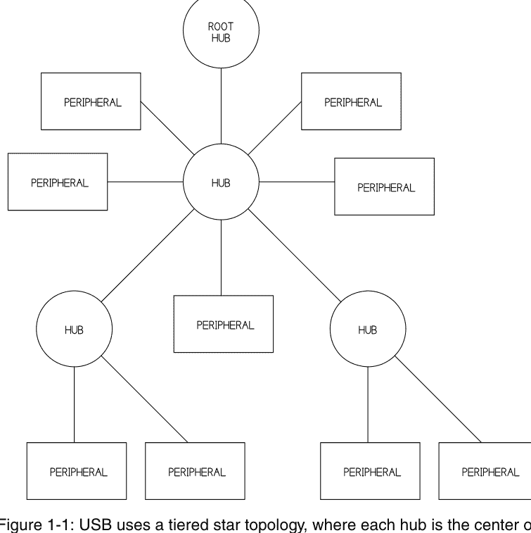

图 1-1：USB 采用层级星型拓扑，其中每个集线器是一个星型的中心，可连接外设或额外的集线器。

## 拓扑

总线上的拓扑，即连接的排列方式，是一种层级星型结构（图 1-1）。每个星型的中心是一个集线器。星型上的每个点都是一个连接到集线器端口的设备。每个星型上的点数可以不同，典型的集线器有两个、四个或七个端口。当多个集线器串联时，可以将其视为按层级或串联方式连接，一个位于另一个之上。

层级星型只描述物理连接。在编程中，重要的是逻辑连接。为了通信，主机和设备无需知道或关心通信要经过多少个集线器。

一次只能有一个设备与主机控制器通信。为了增加 USB 设备可用的带宽，PC 可以有多个主机控制器。

图 1-2 展示了一台带有两个 USB 连接器的 PC 的几种可能配置。有些设备是复合设备，同时包含外设和集线器。你可以串联最多五个外部集线器，包括根集线器在内，最多共 127 个外设和集线器。然而，让这么多设备与单个主机控制器通信可能并不实际。

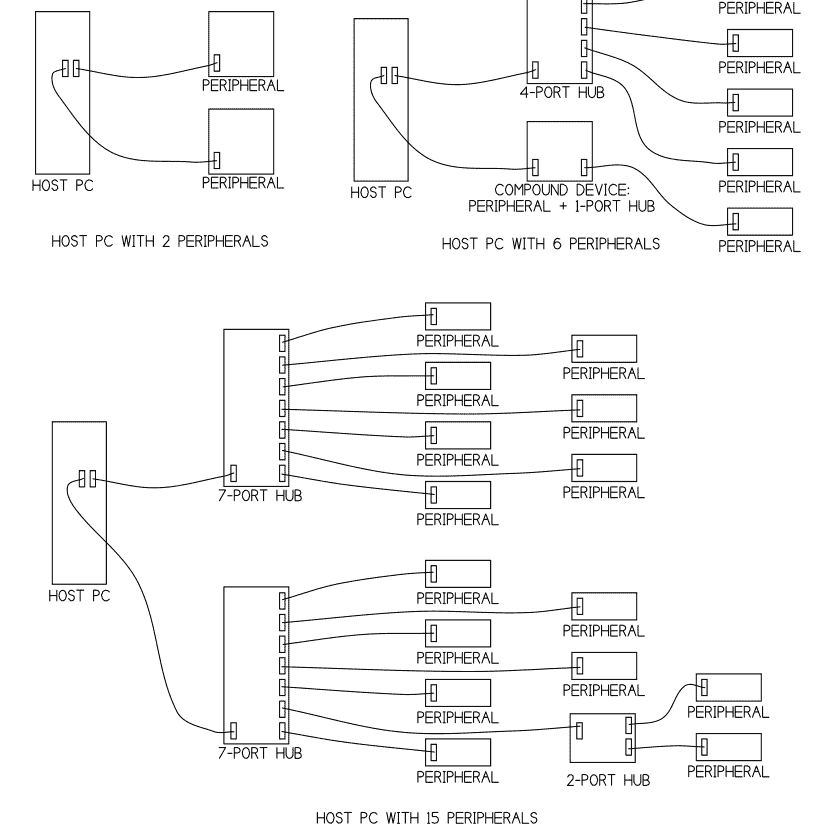

图 1-2：将 USB 设备连接到主机 PC 的方式有很多种。这里展示的是带有两个端口的主机的几种选项。

在某些情况下，尤其是复合设备中集线器隐藏在外设内部时，外设可能看起来像是使用菊花链类型的连接，即每个新外设挂接到链中的最后一个设备上。但 USB 的拓扑比菊花链更灵活、更复杂。每个外设都连接到一个管理主机通信的集线器，外设和集线器并不局限于单一链式连接。

## 术语定义

在 USB 领域中，一些日常词语具有特定的含义。除了前面定义为主控计算机的 *主机* 之外，还有三个这样的术语：*功能*、*集线器* 和 *设备*。理解 USB 端口的概念及其与其他端口（如 RS-232）的区别也很重要。

### 功能

USB 规范将功能定义为向主机提供某种能力的设备。功能的示例包括鼠标、一组扬声器或数据采集单元。单个物理设备可以包含多个功能。

### 集线器

集线器有一个用于与主机通信的上行连接器，以及一个或多个下行连接器或到嵌入式设备的内部连接。每个下行连接器或内部连接都代表一个 USB 端口。

1.x 集线器在双向重复接收到的 USB 通信，管理电源，并发送和响应状态及控制消息。2.0 集线器执行所有这些功能，还支持高速，并根据需要在不同速度之间进行转换。

### 设备

USB 规范对设备的定义是功能或集线器，但复合设备这一特殊情况除外，复合设备包含一个集线器和一个或多个功能。主机对待复合设备的方式，在很大程度上与集线器及其功能是独立物理设备时相同。总线上的每个设备都有唯一的地址，但复合设备再次除外，其集线器和功能各有唯一地址。

组合设备是一种具有多个独立接口的多功能设备。这些接口由存储在设备中的接口描述符定义。组合设备在总线上有一个地址，但每个接口具有不同的功能，并在主机上指定自己的设备驱动程序。例如，组合设备可以有一个用于音频设备的接口，另一个用于控制面板的接口。某些 Microsoft 文档使用术语“组合设备”来指代其功能由接口描述符而非设备描述符定义的任何设备，无论是否有多于一个活动接口。

### 端口

从一般意义上讲，计算机端口是一个可寻址的位置，可用于连接附加电路。通常，电路终止于连接器，该连接器允许将电缆连接到外设。一些外设电路是硬连线到端口的。软件可以通过读写端口地址来监视和控制端口电路。计算机内存也由可寻址位置组成，但 CPU 访问内存时通常使用与访问端口不同的机器指令。

USB 端口与许多其他端口不同，因为总线上的所有端口共享通往主机的单一路径，并且不可直接寻址。对于 RS-232 接口，每个端口都在 PC 上，并且相互独立。如果你有两个 RS-232 端口，每个端口都有自己的数据路径，每条电缆传输自己的数据，不与其他设备共享。这两个端口可以同时发送和接收数据。

对于 USB，每个主机控制器管理单条总线（即数据路径）。总线上的每个连接器代表一个 USB 端口，但与 RS-232 不同，所有设备共享总线的带宽。因此，即使 USB 主机控制器可以与多个端口通信，每个端口都有自己的连接器和电缆，但只有一条数据路径为所有端口服务。一次只能有一个设备或主机进行传输。不过，一台计算机可以有多个 USB 主机控制器，每个控制器都有自己的总线。其他允许多个设备共享数据路径的接口包括 IEEE-1394、SCSI 和以太网。

USB 的另一个不同之处在于，总线可以在主机控制器 PC 外部的集线器上拥有端口。

## 分工

主机及其设备各有明确的职责。主机承担了管理通信的大部分负担，但设备必须具有智能，能够响应主机及其所连接集线器的通信和其他总线事件。

### 主机的职责

为了与 USB 设备通信，计算机需要硬件和软件支持，使其能够充当 USB 主机。硬件包括一个 USB 主机控制器和一个带有一个或多个 USB 端口的根集线器。软件支持是操作系统，它提供驱动程序与 USB 硬件通信的机制。

几乎所有近期生产的 PC 都会有 USB 主机控制器和两个或更多 USB 端口连接器。许多 PC 拥有多个主机控制器。如果计算机的主板没有内置 USB 支持，你可以在插入 PCI 总线插槽的扩展卡上添加主机控制器。对于便携式计算机，可以使用 PC 卡上的 USB 控制器。

主机负责管理总线。主机必须知道总线上有哪些设备以及每个设备的能力。主机还必须尽最大努力确保总线上的所有设备都能按需发送和接收数据。一条总线可能有许多设备，每个设备都有不同的要求，并且都希望同时传输数据。主机的工作并不简单。

幸运的是，主机控制器硬件和 Windows 中的主机控制器驱动程序承担了管理总线的大部分工作。连接到主机的每个设备还必须有一个设备驱动程序，使应用程序能够与设备通信。某些外设可以使用 Windows 附带的设备驱动程序。其他设备使用设备制造商提供的驱动程序。各种系统级软件组件管理设备驱动程序与主机控制器和根集线器硬件之间的通信。

应用程序不必担心与设备通信的 USB 特定细节。应用程序只需使用几乎所有编程语言都可访问的标准操作系统函数来发送和接收数据。通常，应用程序不必知道或关心设备使用的是 USB 还是其他接口。

主机执行以下任务。这些描述是概括性的，后续章节会提供更多细节。

### 检测设备

在加电时，集线器让主机感知所有已连接的 USB 设备。在称为枚举的过程中，主机为每个设备分配地址并请求附加信息。加电后，每当移除或连接设备时，主机都会获知该事件，枚举任何新连接的设备，并从可供应用程序使用的设备列表中移除已断开连接的设备。


## 管理数据流

主机管理总线上的数据流。多个外设可能同时想要传输数据。主机控制器将可用时间划分为称为帧和微帧的段，并为每次传输分配一个帧或微帧的一部分。

必须以特定速率发生的传输在每个帧中都保证有其所需的时间量。在枚举期间，设备的驱动程序会请求其需要保证时序的任何传输所需的带宽。如果带宽不可用，主机不允许通信开始。然后驱动程序必须请求较小的带宽部分或等待请求的带宽可用。没有保证时序的传输使用帧的剩余部分，如果总线忙则必须等待。

## 错误检查

传输数据时，主机添加错误检查位。接收数据时，设备对数据进行计算并将结果与接收到的错误检查位进行比较。如果结果不匹配，设备不确认接收到数据，主机知道应重新传输。为了保持恒定的传输速率，USB 还支持一种不允许重新传输的传输类型。类似地，主机对从设备接收到的数据进行错误检查。

主机可能收到设备无法发送或接收数据的其他指示。然后主机可以通知设备的驱动程序该问题，驱动程序可以通知应用程序以便采取适当措施。

## 提供电源

除了两根信号线外，USB 电缆还具有 +5V 和地线。有些设备从这些导线获取全部电力。主机在上电或连接时为所有设备供电，并在可能时与设备协作以节省电量。高功率总线供电设备可抽取高达 500 毫安的电流。电池供电主机或集线器的端口可能仅支持低功耗设备，其限制为 100 毫安。设备也可能有自己的电源。

## 与外设交换数据

上述所有任务都支持主机的主要工作，即与外设交换数据。在某些情况下，设备驱动程序请求主机在定义的时间间隔内尝试发送或接收数据，而在其他情况下，只有当应用程序或其他软件组件请求传输时主机才会通信。设备驱动程序将任何问题报告给相应的应用程序。

## 外设的职责

在许多方面，外设的职责是主机的镜像。当主机发起通信时，外设必须响应。但外设也有独特的职责。外设不能自行开始 USB 通信。相反，外设必须等待并响应来自主机的通信。（例外是远程唤醒功能，它使外设能够请求与主机的通信。）

外设中的 USB 控制器以硬件方式处理设备的许多职责。设备固件所需的支持程度因芯片而异。

外设必须执行下面描述的所有任务。描述是概括性的。后续章节有更具体的说明。

## 检测发往芯片的通信

每个设备都会监视总线上每条通信中包含的设备地址。如果地址与设备存储的地址不匹配，设备会忽略该通信。如果地址匹配，设备会将数据存储在其接收缓冲区中并触发中断以指示数据已到达。在几乎所有芯片中，这些功能都内置于硬件中，无需代码支持。固件在芯片检测到包含设备地址的通信之前无需采取行动或做出决策。

## 响应标准请求

在上电时，或当设备连接到已通电系统时，设备必须响应主机在枚举期间发送的标准请求。枚举完成后，主机也可能随时发送请求。

所有设备必须响应这些请求，这些请求查询设备的特性和状态或请求设备执行其他操作。接收到请求时，设备将数据或状态信息放入发送缓冲区以发送给主机。对于某些请求，例如选择配置，设备除了响应信息外还会采取其他操作。

USB 规范定义了十一种请求，类或厂商可能定义额外的请求。然而，设备不必执行每个请求；设备只需以可理解的方式响应请求即可。例如，当主机请求设备不支持的配置时，设备会响应一个代码，指示该配置不受支持。

## 错误检查

与主机一样，设备在发送的数据中添加错误检查位。接收包含错误检查位的数据时，设备执行错误检查计算。设备的响应或缺乏响应告诉主机是否需要重新传输。这些功能通常内置于控制器的硬件中，无需编程。在适当情况下，设备还会检测主机在接收到来自设备的数据时返回的确认。

## 管理电源

设备可能是总线供电或具有自己的电源。对于使用总线供电的设备，当总线无活动时，设备必须限制其对总线电流的使用。当主机进入低功耗状态时，总线上的所有通信都会停止，包括主机通常发送的周期性定时标记。检测到总线活动缺失三毫秒后，设备必须进入挂起状态并限制从总线抽取的电流。在挂起状态下，设备必须继续监视总线，并在总线活动恢复时退出挂起状态。

不支持远程唤醒功能的设备在挂起状态下从总线消耗的电流不应超过 500 微安。如果设备支持远程唤醒功能且主机已启用该功能，则限制为 2.5 毫安。这些是 1 秒内的平均值；峰值电流可能更大。

## 与主机交换数据

上述所有任务都支持设备 USB 端口的主要工作，即与主机交换数据。配置后，设备必须响应可能包含数据且可能要求设备返回数据或状态信息的通信。设备的特性、主机的设备驱动程序以及使用设备的应用程序共同决定通信的类型和发生时间。

对于主机向设备发送数据的多数传输，设备必须通过发送代码响应每次传输尝试，指示设备是否接受了数据或太忙而无法处理。对于设备向主机发送数据的多数传输，设备必须通过返回数据或代码响应每次尝试，指示没有数据可发送或设备忙。通常，硬件会根据固件中先前设置的设置自动响应。某些传输不使用确认，发送方假定接收方已接收到所有传输的数据。

控制器芯片的硬件处理为总线格式化数据的细节。格式化包括向待传输数据添加错误检查位、检查接收数据的错误，以及在总线上发送和接收各个位。

当然，设备还必须执行其负责的任何其他任务。例如，鼠标必须准备好检测移动和按钮点击，数据采集单元必须读取其传感器的数据，而打印机必须将接收到的数据转换为纸上的图像。

## 关于速度？

设备控制器可能支持一种或多种总线速度。几乎所有集线器都支持低速和全速设备。例外是复合设备中的集线器，其功能使用单一速度。低速或全速外设可以连接到任何 USB 集线器。用户无需知道设备是低速还是全速，因为没有针对不同速度的用户设置或配置。

高速外设很可能是双速设备，也能在全速下工作。1.x 主机或集线器不支持高速，因为在编写 1.x 规范时高速还不存在。为了确保高速设备不会混淆 1.x 主机和集线器，所有高速设备至少必须以全速响应标准枚举请求。因此任何主机都可以识别任何已连接的设备。

除了以全速响应总线复位和标准请求外，高速设备不必在全速下工作。但由于添加全速支持很容易，并且是通过 USB IF 合规性测试的必要条件，因此大多数高速设备也可在全速下工作。

外设与主机之间实际的数据传输速率低于总线速度，且并不总是可预测的。部分传输位用于标识、同步和错误检查，数据速率还取决于传输类型和总线的繁忙程度。

对于时间敏感数据，USB 支持具有保证速率或保证最大延迟的传输类型。同步传输具有保证的速率，其中主机可以在定义的时间间隔内请求传输特定数量的字节到或来自外设。间隔可以频繁到全速时每毫秒一次，或高速时每 125 微秒一次。然而，同步传输没有错误校正。

中断传输具有错误校正和保证的最大延迟，这意味着精确的速率无法保证，但传输尝试之间的时间不会超过指定周期。在低速下，请求的最大间隔范围为 10 至 255 毫秒。在全速下，范围为 1 至 255 毫秒。在高速下，范围为 125 微秒至 4.096 秒。


由于总线是共享的，因此无法保证设备一定能获得特定的传输速率或最大延迟。如果总线过于繁忙，无法满足请求的速率或最大延迟，主机将拒绝完成使主机能够尝试传输的配置过程。要充分利用预留带宽，设备驱动程序和应用程序软件或设备固件必须确保在主控制器准备发起传输时，数据已准备好发送。数据接收方也必须准备好在其到达时接收数据。

在全速和高速模式下，空闲总线上最快的传输是批量传输，其理论最大速率在全速模式下为1.216兆字节/秒，在高速模式下为53.248兆字节/秒。但是，主控制器可能会将单个批量传输限制为较慢的速率。带宽最有保证的传输是高速中断传输和等时传输，速率为24.576兆字节/秒。

尽管低速总线速度为1.5兆比特/秒，但单次传输中数据最快的保证交付是每10毫秒8字节，即仅800字节/秒。

## 开发设备

为PC设计USB产品既涉及让外设正常运行，也涉及开发或获取与外围设备通信所需的PC软件。

## 链路中的要素

USB外设需要满足以下所有条件：

- 带有USB接口的控制器芯片。
- 外设中用于执行USB通信的代码。
- 外设执行其其他功能（处理数据、读取输入、写入输出）所需的任何硬件和代码。
- 支持USB的主机。
- 主机上的设备驱动程序软件，使应用程序能够与外设通信。
- 如果外设不是操作系统支持的标准类型，则主机必须有应用程序软件使用户能够访问该外设。对于鼠标、键盘或磁盘驱动器等标准外设类型，您不需要定制的应用程序软件，但可能需要编写测试应用程序。

## 开发工具

要开发USB外设，您需要以下工具：

- 用于创建设备固件（在设备控制器芯片内运行的代码）的汇编器或编译器。
- 设备编程器或开发套件，使您能够将汇编或编译后的代码存储到控制器的程序存储器中。
- 主机上用于编写和调试主机软件的编程语言和开发环境。主机软件可能包括设备驱动程序或过滤器驱动程序及/或应用程序代码。要编写设备驱动程序，您需要微软的Windows驱动程序开发工具包（DDK）。
- 另外还推荐使用用于调试设备固件的监视器程序和用于查看USB流量的协议分析仪。

## 项目开发步骤

对于任何规模的项目，您都希望分模块创建项目，并在继续下一个模块之前让每个部分正常工作。在编写固件时，您可以先只编写足够的代码，使Windows能够检测和枚举设备。当该代码正常工作时，您可以继续与应用程序交换小块数据。然后，您可以添加针对您的应用程序的特定代码。项目开发的步骤包括初始决策、枚举和交换数据。

## 初始决策

在开始开发之前，您需要收集数据并做出一些决策：

- 1. 明确您设备的需求。对于USB接口，它需要传输多少数据，速度多快？需要纠错吗？设备将消耗多少功率？设备还需要做什么？
- 2. 根据您的需求，决定PC将使用Windows内置驱动程序、来自其他来源的通用设备驱动程序还是自定义驱动程序与外设通信。
- 3. 选择符合您需求的控制器芯片。

## 枚举

以下是让Windows枚举您的设备所需执行的步骤：

- 1. 编写控制器芯片被其主机枚举所需的代码。具体细节因芯片而异，但每个芯片都必须能够向主机发送一系列描述符。描述符是描述设备USB能力及其使用方式的数据结构。芯片必须有程序代码或硬件来解码和响应主机发送的请求以及主机枚举设备时发生的其他事件。芯片供应商通常会提供您可以修改的示例代码。少数控制器可以在无需用户代码的情况下完成枚举。
- 2. 识别或创建设备驱动程序和INF（信息）文件，以便Windows能够识别设备并分配驱动程序。INF文件是一个文本文件，用于指定设备在主机上使用的驱动程序名称。如果您的设备符合Windows支持的类别，您也许可以使用Windows附带的INF文件。
- 3. 如有必要，设计和构建电路以测试芯片和您的固件。在许多情况下，您可以使用芯片制造商提供的开发板。
- 4. 将代码加载到设备中，并将设备插入主机总线。Windows应枚举该设备，将其添加到控制面板并正确识别。
- 5. 调试并根据需要重复上述步骤！

## 交换数据

当设备成功枚举后，您可以添加组件和代码，使设备能够执行其预期功能。如有必要，编写应用程序代码以与设备通信并测试设备。当代码调试完成后，您就可以将代码编程到芯片中，并在最终硬件上进行测试。

但在您开始之前，有必要多了解一些主机如何枚举设备以及如何与设备传输数据的知识，以便您能对控制器芯片和驱动程序做出正确的选择。这正是后续章节的目的。

## USB传输内部机制

本章及接下来的三章是关于USB传输的教程。本章包含适用于所有传输的基本要点。接下来的章节将介绍USB支持的四种传输类型、枚举过程以及控制传输中使用的标准请求。

您不需要了解所有这些信息就能让项目运行起来，但了解传输的一些工作原理有助于决定使用哪些传输类型、编写设备固件以及进行调试。

这些章节中的信息非常密集。如果您没有USB背景，不可能一次阅读就完全吸收。但是，您应该对USB的工作原理有所了解，并在以后需要查看细节时知道去哪里查找。

USB接口的最终权威是规范文档*《通用串行总线规范》*，可在USB-IF的网站上获取。按照设计，该规范省略了任何操作系统或控制器芯片特有的信息和提示。这类信息在设计面向实际应用的产品时至关重要，因此我在相关的地方包含了这些信息。

## 传输基础

您可以将USB通信分为两类：用于枚举设备的通信，以及用于执行设备功能的应用程序通信。在枚举期间，主机了解设备并为其交换数据做准备。应用程序通信发生在主机交换执行设备设计功能的数据时。例如，对于键盘，应用程序通信是将按键数据发送到主机，以告知应用程序显示字符或执行其他操作。

## 枚举通信

在枚举期间，设备的固件响应来自主机的一系列标准请求。设备必须识别每个请求、返回请求的信息，并执行请求指定的其他操作。

在PC上，Windows执行枚举，因此不涉及用户编程。但是，为了完成枚举，在首次连接时，Windows必须找到标识设备驱动程序文件名和位置的INF文件。如果所需文件可用且固件功能正常，枚举过程通常对用户是不可见的。第9章有更多关于设备驱动程序和INF文件的详细信息。

## 应用程序通信

在主机与设备交换枚举信息并且设备驱动程序已分配并加载后，应用程序通信就可以开始了。在主机端，应用程序可以使用标准Windows API函数或其他软件组件来读写设备。在设备端，传输数据通常需要将待发送的数据放入USB控制器的发送缓冲区，或从接收缓冲区检索接收到的数据，并在完成传输后确保设备已准备好


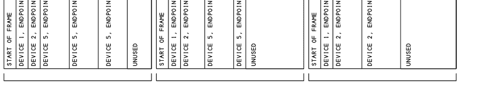

Figure 2-1: 在低速和全速下，主机在 1 毫秒帧内调度事务。主机可以在帧内的任意位置调度事务。高速下的过程类似，但使用 125 微秒的微帧。

对于下一次传输。大多数设备还需要额外的固件支持来处理错误和其他事件。每次数据传输使用四种传输类型之一：控制、中断、批量或等时。每种都有适合不同需求的格式和协议。

## Managing Data on the Bus
USB 的两条信号线将数据传输到总线上所有设备以及从总线上所有设备传输数据。这些电线形成一条单一的传输路径，所有设备必须共享。（正如本章后面所解释的，一个例外是高速总线上 1.x 设备与 2.0 集线器之间的电缆段，但即使在此，所有数据也共享集线器与主机之间的路径。）与 RS-232 不同，RS-232 具有一条用于单向传输数据的 TX 线和另一条用于另一方向的 RX 线，USB 的一对电线承载单一差分信号，方向轮流进行。

主机负责确保所有传输尽可能快速地进行。主机通过将时间划分为称为帧（低速和全速时）或微帧（高速时）的块来管理流量。主机为每次传输分配每个帧或微帧的一部分（Figure 2-1）。一个帧的周期为一毫秒。对于高速流量，主机将每个帧分为八个 125 微秒的微帧。每个帧或微帧都以 Start-of-Frame 定时参考开始。

每次传输由一个或多个事务组成。控制传输始终具有多个事务，因为它们具有多个阶段，每个阶段由一个或多个事务组成。其他传输类型在数据多于单个事务所能容纳时使用多个事务。根据主机调度事务的方式以及设备的响应速度，一次传输的事务可能全部位于单个帧或微帧中，也可能分布在多个（微）帧中。

由于所有流量共享一条数据路径，每个事务必须包含一个标识事务目的地的设备地址。每个设备都有主机分配的唯一地址，所有数据都流向主机或从主机流出。每个事务始于主机发送一个信息块，其中包含接收设备的地址以及设备内的特定位置，称为端点。设备发送的所有内容都是对接收到主机发送的数据包的响应。

## Host Speed and Bus Speed
通用 PC 中的 USB 2.0 主机支持低速、全速和高速。1.x 主机仅支持低速和全速。（专用主机，通常存在于小型嵌入式系统中，并不总是支持所有速度。）

1.x 集线器不会在速度之间转换；它只是将接收到的流量沿总线向上或向下传递，仅改变连接到低速设备的流量的边沿速率和信号极性。相比之下，2.0 集线器充当具有存储转发能力的远程处理器。集线器根据需要在高速与低速或全速之间转换，并执行其他有助于高效利用总线时间的功能。2.0 集线器的额外智能是高速总线仍与 1.x 硬件兼容的主要原因之一。

只有当设备为高速，并且主机控制器以及主机与设备之间的所有集线器都符合 2.0 标准时，总线段上的流量才是高速。Figure 2-2 illustrates。高速总线也可能具有 1.x 集线器，如果是这样，则该集线器下游（远离主机）的任何总线段均为低速或全速。在主机与连接到主机的任何 2.0 集线器之间且中间没有 1.x 集线器的情况下，低速和全速设备之间的数据传输以高速进行。2.0 集线器与 1.x 集线器或另一个低速或全速设备之间的数据传输以低速或全速进行。仅具有 1.x 主机控制器的总线仅支持低速和全速，即使总线具有 2.0 集线器和高速设备也是如此。

## Elements of a Transfer
每次 USB 传输由一个或多个事务组成，而每个事务又包含包含信息的数据包。要理解事务、数据包及其内容，你还需要了解端点和管道。所以我们就从这里开始。

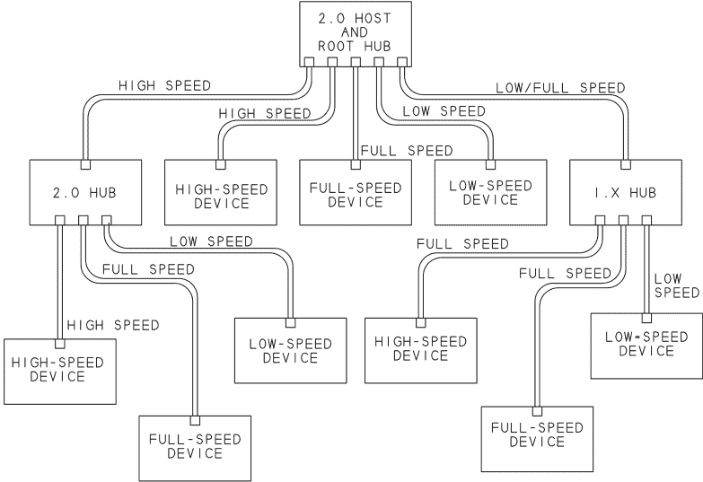

Figure 2-2: USB 2.0 集线器在可能的情况下使用高速，在必要时切换到低速和全速。

## Device Endpoints: the Source and Sink of Data
所有总线流量都流向设备端点或从设备端点流出。端点是一个存储多个字节的缓冲区。通常端点是控制器芯片中的一块数据存储器或寄存器。存储在端点中的数据可能是接收到的数据或等待传输的数据。主机也有缓冲区来保存接收到的数据和等待传输的数据，但主机没有端点。相反，主机充当与设备端点通信的起点和终点。

USB 规范将设备端点定义为“a uniquely addressable portion of a USB device that is the source or sink of information in a communication flow between the host and device.” 该定义表明端点仅在一个方向上传输数据。然而，正如我将要解释的那样，控制端点是一个特殊的双向情况。

端点地址由端点编号和方向组成。编号的值为 0 到 15。方向是从主机的角度定义的：IN 端点提供要发送给主机的数据，而 OUT 端点存储从主机接收到的数据。配置为控制传输的端点必须在两个方向上传输数据，因此控制端点实际上由一对共享端点编号的 IN 和 OUT 端点地址组成。

每个设备必须将 Endpoint 0 配置为控制端点。很少需要额外的控制端点。然而，一些控制器芯片支持它们。

其他类型的传输仅在一个方向上传送数据，尽管状态和控制信息可能在相反方向流动。单个端点编号可以同时支持 IN 和 OUT 端点地址。例如，设备可能具有 Endpoint 1 IN 端点地址用于向主机发送数据，以及 Endpoint 1 OUT 端点地址用于从主机接收数据。

除 Endpoint 0 外，全速或高速设备最多可有 30 个额外的端点地址（1 到 15，每个都支持 IN 和 OUT 传输）。低速设备最多只能有两种额外的端点地址，方向可以任意组合（例如，Endpoint 1 IN 和 Endpoint 1 OUT 或 Endpoint 1 IN 和 Endpoint 2 IN）。

总线上的每个事务都以包含端点编号和指示数据流方向以及事务是否启动控制传输的代码的数据包开始。代码为 IN、OUT 和 Setup：

| Transaction Type | Source of Data | Types of Transfers that Use this Transaction Type | Contents |
|---|---|---|---|
| IN | device | all | data or status information |
| OUT | host | all | data or status information |
| Setup | host | control | a request |

与端点方向一样，IN 和 OUT 事务的命名约定也是从主机的角度来看的。在 IN 事务中，数据从设备传输到主机。在 OUT 事务中，数据从主机传输到设备。

Setup 事务类似于 OUT 事务，因为数据从主机传输到设备，但 Setup 事务是一个特例，因为它启动了控制传输。设备需要识别 Setup 事务，因为这是设备必须始终接受的唯一类型的事务，并且因为设备需要识别并响应接收到的数据中包含的请求。任何传输类型都可以使用 IN 或 OUT 事务。

每个事务包含一个设备地址和一个端点地址。当设备接收到包含设备地址的 OUT 或 Setup 数据包时，端点存储 OUT 或 Setup 数据包之后的数据，并且硬件通常会触发中断。设备中的中断服务程序随后可以处理接收到的数据并执行任何其他必要操作。当设备接收到包含其设备地址的 IN 数据包时，如果设备有准备好发送给主机的数据，则硬件会将数据从指定的端点发送到总线并通常触发中断。An

设备中的中断服务例程随后就可以做任何必要的准备工作，以便进行下一次 IN 事务。

## 管道：连接端点到主机

在传输发生之前，主机和设备必须建立一条管道。USB 管道是设备端点与主机控制器软件之间的关联。

主机在枚举期间建立管道。如果设备从总线上移除，主机也会移除不再需要的管道。主机还可以在其他时候通过请求设备的备用配置或接口来请求新管道或移除不需要的管道。每个设备都有一个使用端点 0 的默认控制管道。

主机接收到的配置信息包括设备想要使用的每个端点的端点描述符。每个端点描述符是一个信息块，告诉主机与该端点通信所需了解的信息。这些信息包括端点地址、要使用的传输类型、数据包的最大大小，以及（适当时）期望的传输间隔。

## 传输类型

USB 旨在处理许多类型的外设，这些外设对传输速率、响应时间和错误校正有不同的要求。四种数据传输类型各自满足不同的需求，设备可以支持最适合其用途的传输类型。表 2-1 总结了每种传输类型的特点和用途。

控制传输是唯一由 USB 规范定义其功能的传输类型。控制传输使主机能够读取有关设备的信息、设置设备地址，并选择配置和其他设置。控制传输还可以发送供应商特定的请求，用于任何目的的数据发送和接收。所有 USB 设备都必须支持控制传输。

表 2-1：USB 的四种传输类型分别适用于不同的用途。

| 传输类型 | 控制 | 批量 | 中断 | 等时 |
|---|---|---|---|---|
| 典型用途 | 标识和配置 | 打印机、扫描仪、驱动器 | 鼠标、键盘 | 流式音频、视频 |
| 必需？ | 是 | 否 | 否 | 否 |
| 允许低速？ | 是 | 否 | 是 | 否 |
| 每次传输的数据字节/毫秒，每管道最大可能值（高速）。* | 15,872（每微帧三十一个 64 字节事务） | 53,248（每微帧十三个 512 字节事务） | 24,576（每微帧三个 1024 字节事务） | 24,576（每微帧三个 1024 字节事务） |
| 每次传输的数据字节/毫秒，每管道最大可能值（全速）。* | 832（每帧十三个 64 字节事务） | 1216（每帧十九个 64 字节事务） | 64（每帧一个 64 字节事务） | 1023（每帧一个 1023 字节事务） |
| 每次传输的数据字节/毫秒，每管道最大可能值（低速）。* | 24（三个 8 字节事务） | 不允许 | 0.8（每 10 毫秒 8 字节） | 不允许 |
| 数据流方向 | IN 和 OUT | IN 或 OUT | IN 或 OUT（USB 1.0 仅支持 IN） | IN 或 OUT |
| 所有该类型传输的保留带宽（百分比） | 低速/全速时为 10%，高速时为 20%（最小） | 无 | 低速/全速时为 90%，高速时为 80%（等时与中断合计，最大） |  |
| 错误校正？ | 是 | 是 | 是 | 否 |
| 消息还是流数据？ | 消息 | 流 | 流 | 流 |
| 保证投递速率？ | 否 | 否 | 否 | 是 |
| 保证延迟（传输之间的最大时间）？ | 否 | 否 | 是 | 是 |
| *假设传输使用最大数据包大小。 |  |  |  |  |

批量传输适用于传输速率不关键的情况，例如将文件发送到打印机、从扫描仪接收数据或访问驱动器上的文件。对于这些应用，快速传输很好，但数据在必要时可以等待。如果总线非常繁忙，批量传输会被延迟，但如果总线空闲，批量传输会非常快。只有全速和高速设备才能进行批量传输。设备不要求必须支持批量传输，但特定的设备类别可能需要它们。

中断传输适用于必须定期获得主机或设备关注的设备。除了控制传输，中断传输是低速设备传输数据的唯一方式。键盘和鼠标使用中断传输来发送按键和鼠标移动数据。中断传输可以使用任何速度。设备不要求必须支持中断传输，但特定的设备类别可能需要它们。

等时传输具有保证的投递时间，但没有错误校正。可能使用等时传输的数据包括要实时播放的音频或视频。等时是唯一不支持自动重传错误接收数据的传输类型，因此必须接受偶尔的错误。只有全速和高速设备才能进行等时传输。设备不要求必须支持等时传输，但特定的设备类别可能需要它们。

## 流管道和消息管道

除了按所承载的传输类型对管道进行分类外，USB 规范还根据信息是单向还是双向传输，将管道定义为流管道或消息管道。控制传输使用双向消息管道；所有其他传输类型使用单向流管道。

## 控制传输使用消息管道

在消息管道中，每次传输都从一个包含请求的设置事务开始。为了完成传输，主机和设备可以交换数据和状态信息，或者设备可以只发送状态信息。每个控制传输至少有一个事务在每个方向发送信息。

如果设备支持收到的请求，设备就会执行所请求的操作。如果设备不支持该请求，设备会返回一个代码，表明不支持该请求。

## 所有其他传输使用流管道

在流管道中，数据没有 USB 规范定义的结构。接收方主机或设备只接收到达的数据。然后，设备固件或主机软件可以以适合应用程序的任何方式处理数据。

当然，即使是流数据，发送和接收设备也需要就某种格式达成一致。例如，主机应用程序可以定义一个代码，请求设备发送一系列字节，指示温度读数及读数时间。虽然主机可以使用带有供应商定义的 Get_Temperature 请求的控制传输，但中断传输可能更可取，因为它们具有保证的带宽。

## 发起传输

当主机中的设备驱动程序想要与设备通信时，驱动程序会发起传输。USB 规范将传输定义为发出并执行通信请求的过程。传输可以非常短，只发送一个字节的应用程序数据，也可以非常长，发送一个大文件的内容。

Windows 应用程序可以使用通过标准 API 函数获取的句柄与设备打开通信。要开始传输，应用程序可以在调用 API 函数时使用句柄向设备驱动程序请求传输。应用程序可能请求“将文件 data.txt 的内容发送到设备”或“从设备获取输入报告 1 的内容”。当应用程序请求传输时，操作系统将该请求传递给相应的设备驱动程序，驱动程序又将请求传递给其他系统级驱动程序，再传递给主机控制器。然后主机控制器在总线上发起传输。

对于标准类设备，编程语言可以提供访问设备的其他方式。例如，.NET Framework 包含用于访问驱动器上文件的 Directory 和 File 类。供应商提供的驱动程序也可以定义自己的 API 函数。例如，使用 FTDI Chip 控制器的设备可以使用 FTDI 的 D2XX 驱动程序，该驱动程序公开了一个

用于设置通信参数和交换数据的函数系列。

在某些情况下，驱动程序被配置为请求周期性传输，应用程序可以读取检索到的数据或提供要在这些传输中发送的数据。在枚举期间，操作系统会发起传输。其他传输需要应用程序请求发送或接收数据。

## 事务：传输的构建块

图 2-3 显示了典型传输的各个元素。这里的许多术语开始听起来相似。有传输和事务、阶段和阶段、数据事务和数据包、状态阶段和握手阶段。数据阶段有握手包，而状态阶段有数据包。吸收所有内容需要一段时间。表 2-2 列出了构成四种传输类型的各个元素，有助于理清术语。

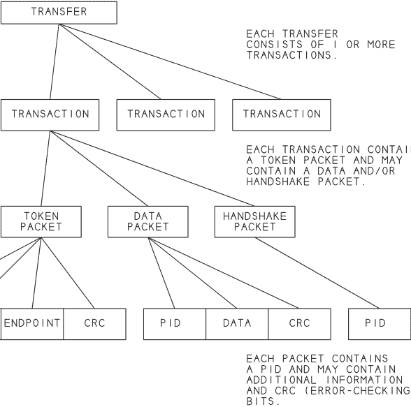

图 2-3：USB 传输由事务组成。事务又包含数据包，而数据包包含数据包标识符（PID）、PID 检查位，有时还包含其他信息。

每个传输由一个或多个事务组成，每个事务又由一个、两个或三个数据包组成。

三种事务类型由其目的和数据流方向定义。Setup 事务向设备发送控制传输请求。OUT 事务向设备发送其他数据或状态信息。IN 事务向主机发送数据或状态信息。

USB 规范将事务定义为向端点提供服务。在这种情况下，服务可能意味着主机向设备发送信息，或主机请求并从设备接收信息。

每个事务包括标识、错误检查、状态和控制信息以及任何需要交换的数据。完整的传输可能跨多个帧或微帧进行，但事务必须不间断完成。总线上没有任何其他通信可以中断事务的中间。因此设备必须能够在事务中快速响应请求的数据或状态信息。设备固件通常配置，或武装，端点以响应接收到的数据包，硬件在数据包到达时做出响应。

数据量小的传输可能只需要一个事务。其他传输需要多个事务，每个事务包含部分数据。

## 事务阶段

每个事务最多有三个阶段，或按顺序发生的部分：令牌、数据和握手。每个阶段由一个或两个传输的数据包组成。每个数据包都是具有定义格式的信息块。所有数据包都以数据包 ID（PID）开头，其中包含标识信息（见表 2-3）。根据事务的不同，PID 后面可能跟随端点地址、数据、状态信息或帧号，以及错误检查位。

在事务的令牌阶段，主机通过发送令牌数据包来发起通信。PID 指示事务类型，例如 Setup、IN、OUT 或帧开始。

在数据阶段，主机或设备可能在数据包中传输任何类型的信息。PID 包含数据切换或数据排序值，用于在传输包含多个数据包时防止数据丢失或重复。

# 第2章

表 2-2：四种传输类型各自由一个或多个事务组成，每个事务包含两个或三个阶段。（本表未显示某些传输中使用的拆分事务和 PING 协议所需的额外事务。）

| 传输类型 | 阶段 | 事务 | 阶段（数据包）。每个下游、低速数据包前还带有 PRE 数据包。 |
|---|---|---|---|
| 控制 | 设置阶段 | 一个事务 | 令牌 |
| 控制 | 设置阶段 | 一个事务 | 数据 |
| 控制 | 设置阶段 | 一个事务 | 握手 |
| 控制 | 数据阶段 | 零个或多个事务（IN 或 OUT） | 令牌 |
| 控制 | 数据阶段 | 零个或多个事务（IN 或 OUT） | 数据 |
| 控制 | 数据阶段 | 零个或多个事务（IN 或 OUT） | 握手 |
| 控制 | 状态阶段 | 一个事务（与数据阶段中的事务（或事务）方向相反，如果没有数据阶段则为 IN） | 令牌 |
| 控制 | 状态阶段 | 一个事务（与数据阶段中的事务（或事务）方向相反，如果没有数据阶段则为 IN） | 数据 |
| 控制 | 状态阶段 | 一个事务（与数据阶段中的事务（或事务）方向相反，如果没有数据阶段则为 IN） | 握手 |
| 批量 |  | 一个或多个事务（IN 或 OUT） | 令牌 |
| 批量 |  | 一个或多个事务（IN 或 OUT） | 数据 |
| 批量 |  | 一个或多个事务（IN 或 OUT） | 握手 |
| 中断 |  | 一个或多个事务（IN 或 OUT） | 令牌 |
| 中断 |  | 一个或多个事务（IN 或 OUT） | 数据 |
| 中断 |  | 一个或多个事务（IN 或 OUT） | 握手 |
| 等时 |  | 一个或多个事务（IN 或 OUT） | 令牌 |
| 等时 |  | 一个或多个事务（IN 或 OUT） | 数据 |

表 2-3：PID（数据包标识符）提供有关事务的信息。
（第 2 页，共 2 页）

| 数据包类型 | PID 名称 | 值 | 用在的传输类型 | 源 | 总线速度 | 描述 |
|---|---|---|---|---|---|---|
| 特殊 | PRE | 1100 | control, interrupt | host | full | 主机发出的前导码，用于指示下一个数据包为低速。 |
|  | ERR | 1100 | 全部 | 集线器 | 高速 | 由集线器返回，用于报告拆分事务中的低速或全速错误。 |
|  | SPLIT | 1000 | 全部 | 主机 | 高速 | 在令牌数据包之前，用于指示拆分事务。 |
|  | PING | 0100 | control Write, bulk OUT | 主机 | 高速 | 在 NYET 之后对批量输出和控制写入数据事务进行忙检查。 |
|  | reserved | 0000 | – | – | – | 供将来使用。 |

在握手阶段，主机或设备在握手数据包中发送状态信息。PID 包含状态码（ACK、NAK、STALL 或 NYET）。USB 规范有时使用术语 *状态阶段* 和 *状态数据包* 来指代握手阶段和数据包。

令牌阶段还有一个额外的用途。令牌数据包可能携带帧开始（SOF）标记，这是一个定时参考，主机在全速时以 1 毫秒间隔发送，在高速时以 125 微秒间隔发送。该数据包还包含一个帧号，该帧号递增并在达到最大值时回绕。该数字表示帧计数，因此帧内的八个微帧都具有相同的数字。端点可以同步到帧开始数据包或使用帧计数作为定时参考。帧开始标记还可防止设备在没有其他 USB 流量时进入低功耗挂起状态。

低速设备看不到 SOF 数据包。相反，设备所连接的集线器使用一种更简单的包结束（EOP）信号，称为低速保持活动信号，每帧发送一次。就像 SOF 对全速设备的作用一样，低速保持活动可防止低速设备进入挂起状态。

在四个特殊 PID 中，一个仅用于低速设备，一个仅用于高速设备，另外两个用于低速或全速设备的 2.0 集线器以高速与主机通信时。

特殊的低速 PID 是 PRE，其中包含前导码，告诉集线器下一个数据包为低速。接收到 PRE PID 后，集线器启用与任何已连接低速设备的通信。在低速和全速总线上，PRE PID 在所有发送到低速设备的令牌、数据和握手数据包之前。高速总线将 PRE 编码在 SPLIT 数据包中，而不是单独发送 PRE。设备发送的低速数据包不需要 PRE PID。

仅用于高速设备的 PID 是 PING。在包含多个数据包的批量或控制传输中，在发送第二个及后续数据包之前，主机可能会发送 PING 以确定端点是否准备好接收更多数据。设备以状态码响应。

SPLIT PID 将令牌数据包标识为拆分事务的一部分，如本章后面所述。ERR PID 仅在拆分事务中使用。2.0 集线器使用此 PID 向主机报告低速或全速事务中的错误。ERR 和 PRE PID 具有相同的值，但不会混淆，因为集线器永远不会向主机发送 PRE，也不会向设备发送 ERR。此外，ERR 仅在高速段中使用，而 PRE 从未在高速段中使用。

## 数据包序列

每个事务都有一个令牌数据包。主机始终是该数据包的来源，它通过标识数据包类型、接收设备和端点以及事务将传输的任何数据的方向来设置事务。对于全速总线上的低速事务，PRE 数据包在令牌数据包之前。对于拆分事务，SPLIT 数据包在令牌数据包之前。

根据传输类型以及主机或设备是否有信息发送，数据包可能跟随令牌数据包。方向规-

令牌包中指定的内容决定主机或设备发送数据包。

在除等时传输之外的所有传输类型中，数据包的接收方（如果没有数据包则为设备）会返回一个握手包，其中包含表示事务成功或失败的代码。预期握手包的缺失表示更严重的错误。

## 时序约束和保证

事务中令牌、数据和握手包之间的允许延迟非常短，仅用于电缆延迟和切换时间，外加一段简短的时间以允许硬件针对接收到的包准备响应，例如状态码。

编写固件时常见的错误是假设固件应在提供要发送给主机的数据之前等待中断。相反，在主机请求数据之前，固件必须将要发送的数据复制到端点的缓冲区中，并配置端点在接收到 IN 令牌包时发送数据。中断在事务完成后发生，以告知固件端点的缓冲区可以存储下一个事务的数据。如果固件在提供初始数据之前等待中断，则中断永远不会发生，也不会传输数据。

单个事务可携带的数据量最多为端点指定的最大包大小。小于最大包大小的数据包为短包。包含多个事务的传输可能在多个帧或微帧上进行，这些帧或微帧不必连续。例如，在全速批量传输 512 字节时，单个事务中的最大字节数为 64，因此传输所有数据至少需要 8 个事务，这些事务可能发生在一个或多个（微）帧中。

## 拆分事务

2.0 集线器以高速与 2.0 主机通信，除非 1.x 集线器位于它们之间。当低速或全速设备连接到 2.0 集线器时，集线器会根据需要进行速度转换。但速度转换并不是集线器管理多种速度所做的唯一工作。高速比全速快 40 倍，比低速快 320 倍。在集线器与设备交换低速或全速数据时，整个总线等待是没有意义的。

解决方案是拆分事务。当 2.0 主机在高速总线上与低速或全速设备通信时，使用拆分事务。在低速或全速下本应为单个事务的操作通常需要两种类型的拆分事务：一个或多个开始拆分事务用于向设备发送信息，以及一个或多个完成拆分事务用于从设备接收信息。例外情况是等时 OUT 事务，因为设备没有要发送的内容，所以不使用完成拆分事务。

尽管需要更多的事务，拆分事务能更好地利用总线时间，因为它们最大限度地减少了等待低速或全速设备传输数据所花费的时间。USB 2.0 主机控制器和低速或全速设备上游最近的 2.0 集线器完全负责执行拆分事务。设备及其固件不必知道或关心主机是否使用拆分事务。设备处的事务无论主机是否使用拆分事务都是相同的。在主机端，设备驱动程序和应用程序软件不必知道或关心主机是否使用拆分事务，因为协议在更低的层级处理。第 15 章有关于拆分事务如何工作的更多内容。

## 确保传输成功

USB 传输使用握手和错误检查，以帮助确保数据尽可能快且无错误地到达目的地。

## 握手

与其他接口一样，USB 使用状态和控制，即握手信息来帮助管理数据流。在硬件握手中，专用线路承载握手信息。例如 RS-232 接口中的 RTS 和 CTS 线路。在软件握手中，承载数据的同一线路也承载握手代码。例如在 RS-232 链路的数据线上传输的 XON 和 XOFF 代码。

USB 使用软件握手。除了等时传输外，代码表示所有事务的成功或失败。此外，在控制传输中，状态阶段使设备能够报告整个传输的成功或失败。

握手信号在握手包或数据包中传输。定义的状态码为 ACK、NAK、STALL、NYET 和 ERR。预期握手代码的缺失表示更严重的错误。在所有情况下，握手的预期接收方使用这些信息来帮助决定下一步做什么。表 2-4 显示了状态指示符以及它们在每种事务类型中的传输位置。

### ACK

ACK（确认）表示主机或设备已无错误地接收到数据。当令牌和数据包无错误接收时，设备必须在 Setup 事务的握手包中返回 ACK。设备也可在 OUT 事务的握手包中返回 ACK。主机在 IN 事务的握手包中返回 ACK。

### NAK

NAK（否定确认）表示设备忙或没有数据返回。如果主机在设备太忙而无法接收数据时发送数据，设备会在握手包中返回 NAK。如果主机在设备没有要发送的数据时请求数据，设备会在数据包中返回 NAK。在任何情况下，NAK 都表示临时状况，主机稍后会重试。

主机永远不会发送 NAK。等时事务不使用 NAK，因为它们没有用于返回 NAK 的握手包。如果设备或主机未接收到传输的等时数据，则该数据已丢失。

表 2-4：握手信号的位置、来源和内容取决于事务类型。

| 事务类型或 PING 查询 | 数据包源 | 数据包内容 | 握手包源 | 握手包内容 |
|---|---|---|---|---|
| Setup | 主机 | 数据 | 设备 | ACK |
| OUT | 主机 | 数据 | 设备 | ACK, NAK, STALL, NYET（仅高速）, ERR（来自完整拆分中的集线器） |
| IN | 设备 | 数据, NAK, STALL, ERR（来自完整拆分中的集线器） | 主机 | ACK |
| PING（仅高速） | 无 | 无 | 设备 | ACK, NAK, STALL |

### STALL

STALL 握手可能具有三种含义中的任意一种：不支持的控制请求、控制请求失败或端点失败。

当设备接收到不支持的控制传输请求时，设备会向主机返回 STALL。如果设备支持请求但由于某种原因无法执行请求的操作，设备也会返回 STALL。例如，如果主机发送 Set_Configuration 请求，要求设备将其配置设置为 2，而设备仅支持配置 1，则设备返回 STALL。要清除此类停滞，主机只需发送另一个 Setup 包以开始新的控制传输。USB 规范将此类停滞称为协议停滞。

STALL 的另一种用途是在端点的 Halt 功能被设置时做出响应，这意味着端点完全无法发送或接收数据。USB 规范将此类停滞称为功能性停滞。

批量和中断端点必须支持功能性停滞。虽然控制端点也可能支持这种 STALL 用法，但不建议这样做。处于功能性停滞的控制端点必须继续正常响应与控制和监控停滞状况相关的其他请求。而且能够响应这些请求的端点显然有通信能力，不应被停滞。等时事务不使用 STALL，因为它们没有用于返回 STALL 的握手包。

在接收到功能性 STALL 后，主机丢弃对设备的所有待处理请求，并且在主机发送成功请求以清除设备上的 Halt 功能之前不会恢复通信。主机永远不会发送 STALL。

### NYET

只有高速设备使用 NYET，其含义为 *尚未*。高速批量和控制传输具有一种协议，使主机能够在发送数据之前获知设备是否准备好接收数据。在全速和低速下，当主机想要在控制、批量或中断传输中发送数据时，主机发送令牌和数据包，并在事务的握手包中从设备接收回复。如果设备未准备好接收数据，设备会返回 NAK，主机稍后重试。如果数据包很大且设备经常未准备好，这会浪费大量总线时间。

具有多个数据包的高速批量和控制事务有更好的方法。接收到数据包后，设备端点可以返回 NYET 握手，表示端点已接受数据但尚未准备好接收另一个数据包。当主机认为设备可能已准备好时，主机可以发送 PING 令牌包，端点返回 ACK 表示设备已准备好接收下一个数据包，或在设备未准备好时返回 NAK 或 STALL。发送 PING 比仅为发现设备未准备好而发送整个数据包然后稍后重新发送更有效。即使在对 PING 或 OUT 响应 ACK 之后，端点在接收到后续数据包时仍可返回 NAK，但应很少这样做。然后主机用另一个 PING 再次尝试。主机使用 PING 是可选的。


2.0 集线器在完整拆分事务中也可能使用 NYET。主机以及低速和全速设备从不发送 NYET。

## ERR

ERR 握手仅由高速集线器在完整拆分事务中使用。ERR 表示在集线器与主机完成的事务中，设备没有返回预期的握手。

## 无响应

另一种状态指示发生在主机或设备期望收到握手但什么也没收到时。如果接收方的错误检查计算检测到错误，就可能出现这种无响应。收到无响应后，发送方知道它应该重试。如果多次尝试失败，发送方可以采取其他措施。（如果接收方对数据返回了 ACK 但未使用它，问题可能出在数据切换值上。）

## 报告控制传输的状态

除了报告事务状态之外，同样的 ACK、NAK 和 STALL 码也报告完整控制传输的成功或失败。另一个状态码是零长度数据包（ZLP），它报告控制传输的成功完成。带有零长度数据包的事务是这样的事务：其数据阶段由数据 PID 和错误检查位组成，但没有数据。表 2-5 显示了控制传输的状态指示。

对于控制写传输，设备在数据阶段接收数据，设备在状态阶段的数据包中返回传输状态。零长度数据包表示传输成功，STALL 表示设备无法完成传输，NAK 表示设备尚未准备好完成传输。主机在状态阶段的握手包中返回 ACK，以表示主机已收到响应。

对于控制读传输，主机在数据阶段接收数据，设备在状态阶段的握手包中返回传输状态。

表 2-5：根据数据阶段的方向，控制传输的状态信息可能位于状态阶段的数据包或握手包中。

| 传输类型和方向 | 状态阶段方向 | 状态阶段的数据包 | 状态阶段的握手包 |
|---|---|---|---|
| 控制写（主机向设备发送数据或无数据阶段） | IN | 设备发送状态：零长度数据包（成功）、NAK（忙）或 STALL（失败） | 主机返回 ACK |
| 控制读（设备向主机发送数据） | OUT | 主机发送零长度数据包 | 设备发送状态：ACK（成功）、NAK（忙）或 STALL（失败） |

主机通常等待接收数据阶段中的所有数据包，然后在状态阶段返回一个零长度数据包。设备以 ACK、NAK 或 STALL 作为响应。但是，如果主机在所有请求的数据包发送完毕之前就开始状态阶段，则设备必须放弃数据阶段并返回状态码。

## 错误检查

USB 规范规定了硬件要求，以确保由线路噪声引起的错误很少发生。尽管如此，噪声干扰或意外断开的电缆仍有可能破坏传输。因此，USB 数据包包含错误检查位，使接收方能够识别几乎所有与发送内容不匹配的接收数据。此外，对于需要多个事务的传输，数据切换值使发送器和接收器保持同步，以确保不会完全遗漏任何事务。

### 错误检查位

所有令牌、数据和帧起始数据包都包含用于错误检查的位。位值是使用称为循环冗余校验（CRC）的数学算法计算的。USB 规范解释了 CRC 的计算方法。硬件处理计算，计算必须快速完成，以便设备能够做出适当的响应。

CRC 应用于要检查的数据。发送设备执行计算并将结果与数据一起发送。接收设备对接收到的数据执行相同的计算。如果结果匹配，则数据无误到达，接收设备返回 ACK。如果结果不匹配，则接收设备不发送握手。缺少预期的握手会告诉发送方重试。

通常，主机总共尝试三次，但 USB 规范在确定重试次数方面给予主机一定的灵活性。放弃时，主机将问题通知驱动程序。

令牌包中的 PID 字段使用更简单的错误检查形式。字段中的低四位是 PID，高四位是其补码。接收方可以通过对高四位取补并确保它们与 PID 匹配来检查 PID 的完整性。如果不匹配，则数据包已损坏并被忽略。

### 数据切换

在需要多个事务的传输中，数据切换值可以通过保持发送和接收设备同步来确保不会遗漏任何事务。数据切换值包含在 IN 和 OUT 事务的令牌包的 PID 字段中。DATA0 是代码 0011，DATA1 是 1011。在控制器芯片中，寄存器位通常指示数据切换状态，因此数据切换值通常被称为数据切换位。每个端点维护自己的数据切换。

发送方和接收方都跟踪数据切换。Windows 主机处理数据切换，不需要任何用户编程。一些设备控制器芯片也完全自动处理数据切换，而其他一些则需要固件控制。如果你正在调试一个设备，看起来正确的数据正在总线上传输但接收方丢弃了数据，那么很有可能是设备没有发送或期望正确的数据切换。

当主机在上电或连接时配置设备时，主机和设备各自将其数据切换设置为 DATA0，但某些高速等时端点除外。在检测到传入的数据包时，主机或设备将其数据切换状态与接收到的数据切换进行比较。如果值匹配，接收方切换其值并向发送方返回 ACK 握手包。ACK 使发送方为下一个事务切换其值。

传输中下一个接收到的数据包应包含 DATA1 的数据切换，接收方再次切换其位并返回 ACK。数据切换继续交替，直到传输完成。（一个例外是控制传输，其状态阶段始终使用 DATA1。）

如果接收方忙并返回 NAK，或者接收方检测到损坏的数据并返回无响应，则发送方不切换其位，而是使用相同的数据和数据切换重试。

如果接收方返回 ACK 但由于某种原因发送方没有看到 ACK，发送方会认为接收方没有收到数据，并将使用相同的数据和数据切换位重试。在这种情况下，重复数据的接收方不切换数据切换，忽略数据但返回 ACK。ACK 重新同步数据切换。如果发送方错误地连续两次发送相同的数据切换，也会发生同样的情况。

控制传输在设置阶段始终使用 DATA0，在数据阶段的第一个事务中使用 DATA1，在任何额外的数据阶段事务中切换该位，并在状态阶段使用 DATA1。批量端点在每个事务中切换该位，仅在完成 Set_Configuration、Set_Interface 或 Clear_Feature(ENDPOINT HALT) 请求后重置数据切换。中断端点的行为可以与批量端点相同。或者，中断 IN 端点可以在每个事务中切换其数据切换，而不检查主机的 ACK，但存在丢失一些数据的风险。全速等时传输始终使用 DATA0。等时传输不能使用数据切换来纠正错误，因为没有用于返回 ACK 或 NAK 的握手包，也没有时间重新发送丢失的数据。

一些高速等时传输使用 DATA0、DATA1 以及附加的 PID DATA2 和 MDATA。高速等时 IN 传输


每个微帧有两到三个事务时，使用 DATA0、DATA1 和 DATA2 编码来指示事务在微帧中的位置：

| 微帧中 IN 事务的数量 | 第一个事务 | 第二个事务 | 第三个事务 |
|---|---|---|---|
| 1 | DATA0 | – | – |
| 2 | DATA1 | DATA0 | – |
| 3 | DATA2 | DATA1 | DATA0 |

每个微帧有两到三个事务的高速等时 OUT 传输使用 DATA0、DATA1 和 MDATA 编码来指示微帧中是否还有更多数据：

| 微帧中 OUT 事务的数量 | 第一个事务 | 第二个事务 | 第三个事务 |
|---|---|---|---|
| 1 | DATA0 | – | – |
| 2 | MDATA | DATA1 | – |
| 3 | MDATA | MDATA | DATA2 |

数据切换和其他 PID 的这种用法称为数据 PID 排序。

# 第3章

## 适用于各种用途的传输类型

本章将深入探讨 USB 的四种传输类型：控制、批量、中断和等时。每种传输类型都有各自的能力和限制，使其适用于不同的用途。表 3-1 比较了每种传输类型在三种速度下可以传输的数据量。

## 控制传输

控制传输有两种用途。控制传输承载 USB 规范定义的请求，主机使用这些请求来了解并配置设备。控制传输还可以承载由类别或供应商定义的、用于任何目的的请求。

表 3-1：最大可能的数据传输速率随传输类型和总线速度的不同而有很大差异。

| 传输类型 | 低速 | 全速 | 高速 |
|---|---|---|---|
| 控制 | 24 | 832 | 15,872 |
| 中断 | 0.8 | 64 | 24,576 |
| 批量 | 不允许 | 1216 | 53,248 |
| 等时 |  | 1023 | 24,576 |

## 可用性

每个设备都必须支持端点 0 上的默认管道上的控制传输。设备也可以有额外的管道用于控制传输，但实际上没有必要超过一个。即使设备需要发送大量控制请求，主机也会根据请求的数量和大小来分配控制传输的带宽，而不是根据控制端点的数量，因此额外的控制端点没有任何优势。

## 结构

第 2 章介绍了控制传输及其阶段：设置（Setup）、数据（可选）和状态（Status）。每个阶段由一个或多个事务组成。

每个控制传输都必须有设置阶段和状态阶段。数据阶段是可选的，但特定请求可能需要数据阶段。由于每个控制传输都需要双向传输信息，控制传输的消息管道同时使用 IN 和 OUT 端点地址。

在控制写传输中，数据阶段的数据从主机传输到设备。没有数据阶段的控制传输也被视为控制写传输。在控制读传输中，数据阶段的数据从设备传输到主机。图 3-1 和图 3-2 显示了在低速/全速总线上，控制读和控制写传输在低速和全速下的阶段。对于某些高速传输以及高速总线上带有 2.0 集线器的低速和全速传输，存在本章后面描述的差异。

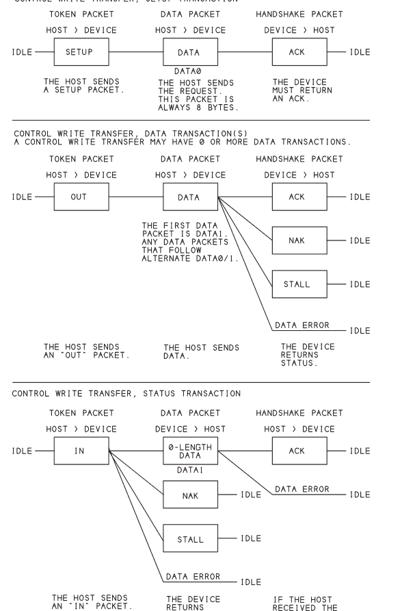

图 3-1：控制写传输包含一个设置事务、零个或多个数据事务以及一个状态事务。未显示的是某些具有多个数据包的高速传输中使用的 PING 协议，以及高速总线上用于低速和全速设备的拆分事务。

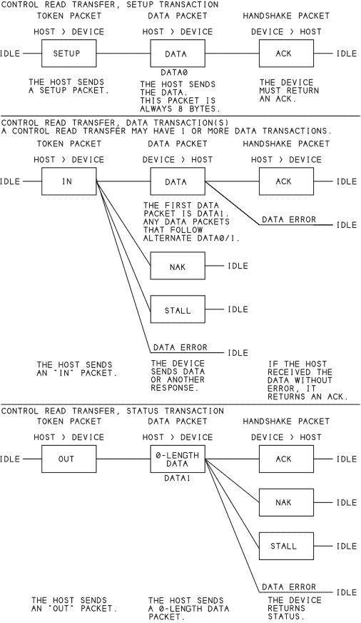

图 3-2：控制读传输包含一个设置事务、一个或多个数据事务以及一个状态事务。未显示的是高速总线上用于低速和全速设备的拆分事务。

在设置阶段，主机通过发送有关请求的信息来开始设置事务。令牌包包含一个 PID，用于标识传输为控制传输。数据包包含有关请求的信息，包括请求编号、传输是否具有数据阶段，如果有，数据将沿哪个方向传输。

USB 2.0 规范定义了 11 个标准请求。成功的枚举需要对某些请求做出特定响应，例如设置设备地址的请求。对于其他请求，设备可以返回一个代码，指示该请求不受支持。特定类别可能要求设备支持类别特定请求，任何设备都可以支持由供应商特定驱动程序定义的供应商特定请求。

如果存在数据阶段，则数据阶段由一个或多个数据事务组成，这些事务可以是 IN 或 OUT 事务。根据请求的不同，主机或外设可能是这些事务的发起者，但该阶段中的所有数据包都沿同一方向传输。

如第 2 章所述，如果高速控制写传输在数据阶段有多个数据包，并且设备在接收到数据包后返回 NYET，主机可以在发送下一个数据包之前使用 PING 协议。

状态阶段由一个 IN 或 OUT 事务组成，也称为状态事务。在状态阶段，设备报告先前阶段的成功或失败。状态阶段数据包的源是数据阶段数据的接收者。当没有数据阶段时，设备发送状态阶段的数据包。设备在状态阶段发送的数据或握手包包含一个代码，指示请求的成功或失败。

如果主机在高速总线上与低速或全速设备执行控制传输，主机将使用第 2 章介绍的拆分事务来处理该传输的所有事务。对设备而言，该事务与 1.x 主机的事务没有区别。设备的集线器与设备执行事务，并在请求时向主机报告。

## 数据大小

数据阶段数据包的最大大小因设备速度而异。对于低速设备，最大为 8 字节。对于全速设备，最大可为 8、16、32 或 64 字节。对于高速设备，最大必须为 64 字节。这些字节仅包括数据包中传输的信息，不包括 PID 和 CRC 位。

在数据阶段，除最后一个数据包外，所有数据包都必须是该端点的最大数据包大小。默认控制管道的最大数据包大小位于主机在枚举期间检索的设备描述符中。如果存在其他控制端点（这种情况很少见），则大小位于端点描述符中。如果传输的数据量超过一个数据事务所能容纳的量，主机将在多个事务中发送或接收数据。

在某些控制读传输中，设备返回的数据量可能不同。如果数据量小于请求的字节数，并且是端点最大数据包大小的整数倍，则设备应在所有数据发送完毕后，通过响应下一个到达的 IN 令牌包返回零长度数据包，以指示没有更多数据要发送。

## 速度

主机必须尽最大努力确保所有控制传输尽快完成。主机控制器为控制传输保留一部分总线带宽：低速和全速总线为 10%，高速总线为 20%。如果控制传输不需要这么多时间，批量传输可以使用剩余时间。如果总线还有其他未使用的带宽，控制传输可以使用超出保留量的带宽。

主机试图尽可能公平地将可用时间分配给所有设备。对于每次传输，单个帧或微帧可能包含多个事务，或者事务可能位于不同的（微）帧中。

关于控制传输是否适合传输枚举和配置数据以外的数据，有两种观点。有人说

# 第3章

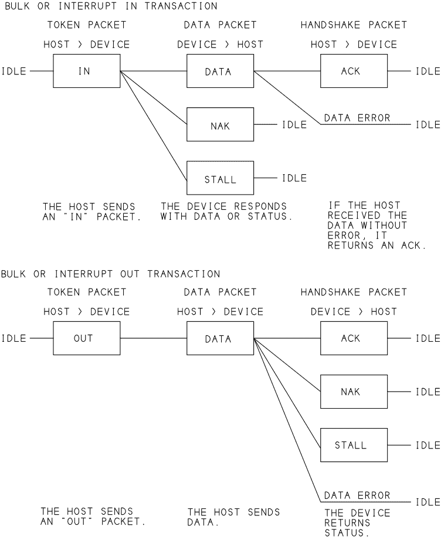

图 3-3：批量传输和中断传输使用 IN 和 OUT 事务。它们的结构相同，但主机调度方式不同。未显示的是在某些高速批量 OUT 传输中使用多个数据包的 PING 协议，或在高速总线上使用低速和全速设备的拆分事务。

如果数据无法装入单个数据包，主机将使用多个事务完成传输。

### 速度

主机控制器保证批量传输最终会完成，但不会为传输保留任何带宽。控制传输在低速和全速下保证拥有 10% 的带宽，在高速下保证 20%。中断和等时传输可以使用剩余部分。因此如果总线非常繁忙，批量传输可能需要很长时间。

然而，当总线空闲时，批量传输可以使用任何类型中最多的带宽，并且开销低，因此它们是最快的。当端点的最大数据包大小小于该速度允许的最大大小时，一些主机控制器即使有更多带宽可用，也最多只调度每个帧一个数据包。因此如果可能，最好为批量端点指定允许的最大数据包大小。

在全速且总线空闲的情况下，最多可进行十九次 64 字节的批量传输，每帧可传输多达 1216 字节数据，数据率为 1.216 MB/秒。这为其他用途保留了 18% 的总线带宽。包含一个数据包的批量传输的协议开销在全速下为 13 字节，在高速下为 55 字节。

在高速且总线空闲的情况下，最多可进行十三次 512 字节的批量传输，每个微帧可传输多达 6656 字节数据，数据率为 53.248 MB/秒，使用了除 2% 之外的全部总线带宽。包含一个数据包的批量传输的协议开销为 55 字节。实际性能因主机控制器硬件和驱动程序以及主机架构而异，包括访问系统内存时的延迟。截至本文撰写时，一些高速主机可将单次传输性能提高到约 35 MB/秒。

### 检测和处理错误

批量传输使用错误检测。如果设备未返回预期的握手数据包，主机最多再尝试两次。主机在收到 NAK 握手时也会重试。主机的驱动程序决定主机在收到多次 NAK 后是否最终放弃。批量传输使用数据切换以确保不会丢失数据。

### 中断传输

中断传输在数据需要在特定时间内传输时很有用。典型应用包括键盘、指向设备、游戏控制器和集线器状态报告。用户不希望在按下键或移动鼠标与在屏幕上看到结果之间有明显延迟。集线器需要及时报告设备的连接或移除。仅支持控制和中断传输的低速设备很可能对通用数据使用中断传输。

在低速和全速下，中断端点可用的带宽有限，但高速放宽了限制，使中断端点每单位时间传输的数据量几乎是全速的 400 倍。

“中断传输”这一名称暗示设备可能会自发发送数据，从而在主机上触发硬件中断。但中断传输与其他所有 USB 传输一样，仅在主机轮询设备时发生。然而，这些传输具有中断特性，因为它们保证主机以最小延迟请求或发送数据。

### 可用性

三种速度都允许中断传输。设备不需要支持中断传输，但设备类可能要求支持。例如，HID 类设备必须支持中断 IN 传输以向主机发送数据。

### 结构

中断传输由一个或多个 IN 事务或一个或多个 OUT 事务组成。在总线上，中断事务与批量事务相同（图 3-3）。唯一的区别是调度。 中断传输是单向的；事务必须全部是 IN 事务，或全部

超过每微帧 1024 字节称为高带宽端点。 然而，Windows XP/Windows Server 及更早版本不支持高带宽中断端点，因此这些操作系统的可实现最大值为 8.192 MB/秒。如果主机的驱动程序不支持备用接口，则最大值为 64 KB/秒。 全速端点可在每个 1 毫秒帧中请求多达 64 字节，或 64 KB/秒。 低速端点可每 10 毫秒请求多达 8 字节，或 800 字节/秒。

存储在设备中的端点描述符指定最大延迟周期。对于低速设备，最大延迟可以是 10 到 255 毫秒之间的任意值。对于全速，该值范围为 1 到 255 毫秒。对于高速，范围为 125 微秒到 4 秒，以 125 微秒为增量。 此外，最大延迟为 125 微秒的高速中断端点可请求每个间隔 1、2 或 3 次事务。 主机控制器确保事务尝试在指定的周期内发生。

主机可在自上次事务开始以来不超过指定的最大延迟的任何时间开始每次事务。因此，例如，在全速下最大为 10 毫秒，五次传输可能长达 50 毫秒，也可能短至 5 毫秒。 OHCI 主机控制器使用对应于 2 的幂的值，最大为 32 毫秒。因此，对于请求最大值为 8 到 15 毫秒之间的全速设备，OHCI 主机将每 8 毫秒开始一次事务，而最大延迟在 32 到 255 之间时会每 32 毫秒尝试一次事务。然而，设备不应依赖于特定类型主机控制器的行为，而应仅假设主机符合规范。（第 8 章有更多关于主机控制器类型的内容。）

### 针对每种用途的传输类型

空闲总线可每帧承载多达六个低速 8 字节事务。然而请注意，单个低速中断端点可请求的最高带宽为每 10 毫秒 8 字节，且低速设备最多只能有两个中断端点。 需要每方向传输超过 800 字节/秒的设备应为全速或高速。 对低速端点限制的原因是，与以全速或高速发送相同数据量相比，低速流量使用更多带宽。 限制低速端点可用的总线时间有助于保持总线供其他设备使用。

在全速下，十九个 64 字节事务可放入一帧。由于传输之间的最小时间间隔为一毫秒或更长，因此帧中的每个事务必须针对不同的端点地址。 实际上，主机可能无法在一个帧中调度十九个全速中断事务，因此每帧中断事务的实际最大数量可能更少。

在高速下，限制为每个微帧两次传输，每次传输由三个 1024 字节事务组成。

包含一个数据包的每次传输的协议开销在低速下为 19 字节，全速下为 13 字节，高速下为 55 字节。 高速中断和等时传输合计最多可使用微帧的 80%。 全速等时传输以及低速和全速中断传输合计最多可使用帧的 90%。 本章后面“有关时间关键传输的更多信息”部分对中断传输的功能和限制有更多说明。

### 检测和处理错误

如果设备未返回预期的握手数据包，PC 中的主机控制器将最多再重试两次。 主机通常在收到 NAK 时无限重试。 例如，键盘可能闲置数天，然后才有人按下键。


中断传输可以使用数据切换来确保所有数据都能无错误地接收。只关心最新数据的接收方可以忽略数据切换。

## 等时传输

等时传输是流式、实时传输，当数据必须以恒定速率到达，或在特定时间内到达，并且偶尔出现错误可以容忍时很有用。在全速下，等时传输每帧传输的数据量可超过中断传输，但对于接收到错误的数据没有重传机制。

等时传输的用途示例包括实时播放的编码语音和音乐。但最终将以恒定速率消耗的数据并不总是需要等时传输。例如，主机可以使用批量传输将音乐文件发送到设备。接收文件后，设备可以以适当的速率播放音乐。

等时传输中的数据也不必以恒定速率消耗。等时传输是一种确保在繁忙的总线上大块数据能够快速通过的方式，即使数据不需要实时传输。与批量传输不同，一旦等时传输开始，主机保证将有时间以恒定速率发送数据，因此完成时间可预测。

## 可用性

只有全速和高速设备才能进行等时传输。设备不需要支持等时传输，但设备类可能要求支持。例如，许多音频和视频类设备使用等时端点。

## 结构

等时意味着数据具有固定的传输速率，每帧或微帧传输的字节数是确定的。其他传输类型均不保证每帧特定数量的字节带宽（除具有最短最大延迟的中断传输外）。

全速等时传输由一个或多个帧中的每帧一个 IN 或 OUT 事务组成，间隔相等。高速等时传输更灵活。它们每微帧可请求多达三个事务，或每 32,768 个微帧请求一个事务。图 3-4 显示了全速等时 IN 和 OUT 事务中的数据包。等时传输是单向的。传输中的事务必须全部是 IN 事务或全部是 OUT 事务。在两个方向传输数据需要为每个方向使用单独的管道和传输。

USB 规范未定义用于指定等时传输中数据量的协议。必要时，设备和主机可以使用类特定或厂商特定的协议传递此信息。为

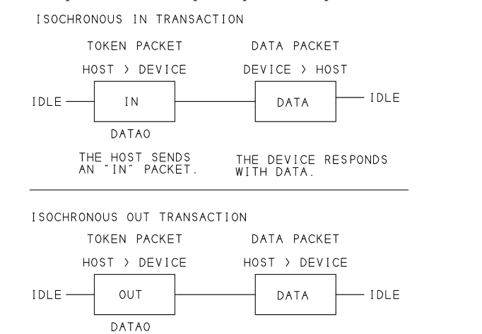

图 3-4：等时传输没有握手数据包，因此偶尔出现错误必须是可以接受的。未显示的是在高速总线上使用全速设备的拆分事务，或在每微帧具有多个数据包的高速传输中的数据 PID 排序。

例如，传输可以以指定要传输的字节数的头部开始，或者设备或主机可以使用类特定或厂商特定协议请求数据量。

在选择消耗等时带宽的设备配置之前，主机控制器通过将可用未保留的总线带宽与配置的等时端点（们）的最大数据包大小和传输速率进行比较来确定请求的带宽是否可用。每帧最大 1023 字节的全速传输使用总线带宽的 69%。如果两个全速设备都想每帧传输 1023 字节，1.x 主机将拒绝配置第二个设备，因为数据无法放入剩余带宽中。

每个具有等时端点的 USB 2.0 设备必须有一个不请求等时带宽的接口，以便主机即使在没有可保留带宽的情况下也能配置设备。除了此接口和请求设备最佳带宽的接口外，设备还可以具有备选接口，这些接口具有较小的等时数据包或每微帧使用较少的等时数据包。设备驱动程序然后可以根据需要请求使用以较低速率传输数据的接口。或者驱动程序可以稍后再试，希望带宽可用。主机配置设备后，传输将保证有所需的时间。

尽管等时传输可能每帧发送固定数量的字节，但数据并非以恒定的比特每秒速率传输。每个事务都有开销，并且必须与其他设备共享总线。因此数据实际上是在 12 兆比特/秒或 480 兆比特/秒的突发中传输，并且可能发生在帧或微帧内的任何时间。为了以恒定速率使用数据，例如将数据发送到扬声器，接收方必须将接收到的位转换为跨越该间隔的信号。

等时传输还可与另一个数据源或接收方同步，或与总线的帧开始信号同步。例如，麦克风的输入可能与扬声器的输出同步。USB 规范描述了几种与内部和外部时钟同步的方法。USB 2.0 等时端点的描述符可以指定同步能力、设备驱动程序和应用程序软件的能力，以及主机硬件和软件中的延迟。

## 总线带宽

当设备请求的终端或等时带宽超过可用带宽时，主机拒绝配置该设备。低速和全速中断传输使用很少的带宽，因此主机不太可能因其要求而拒绝配置。高速中断传输则不同。高速端点每微帧可请求多达三个 1024 字节的数据包，使用高达总线带宽的 40%。为确保设备能够无问题枚举，设备默认接口中的中断端点必须指定最大数据包大小不超过 64 字节。然后设备驱动程序可通过请求备选接口设置或配置来尝试增加端点的保留带宽。

等时端点也可能导致带宽问题。1.x 设备上等时端点的常见问题是设备请求超过可用的带宽。主机正确地拒绝配置设备，用户会得到一个无法工作且不知道原因的设备。

为确保设备能够无问题枚举，符合 2.0 的设备的默认接口设置必须不请求等时带宽。换句话说，默认接口完全不能传输等时数据。遵守的明显方式是在默认接口中不包含等时端点。枚举后，设备驱动程序可通过请求具有等时端点的备选接口或配置来尝试请求等时带宽。请注意，即使是全速端点也必须满足此要求才能符合 USB 2.0。

## 设备能力

如果主机已承诺请求的 USB 带宽将可用，仍然无法保证设备在需要时准备好发送或接收数据。

为了有效使用中断和等时传输，发送方和接收方都必须能够以所需速率发送和接收。发送数据的设备必须及时将要发送的数据写入端点的发送缓冲区，以便在接收到 IN 令牌数据包时控制器能够将数据放置在总线上。接收数据的设备必须在新数据到达之前从端点缓冲区读取先前的数据。否则旧数据将被覆盖，或者设备将 NAK 或丢弃新数据。

确保设备始终准备好进行传输的一种方法是使用双缓冲（或四缓冲），如第 6 章所述。多个缓冲区为固件提供了额外的时间来加载下一个要传输的数据或检索刚接收到的数据。

## 主机能力

主机上的设备驱动程序和应用程序软件的能力也可能影响是否进行所有可用传输。

设备驱动程序通过向低层驱动程序提交 I/O 请求包（IRP）来请求传输。对于中断和等时传输，如果在预定时间到来时端点没有未完成的 IRP，主机控制器将跳过事务尝试。为了确保不遗漏任何传输机会，驱动程序通常在完成前一个 IRP 后立即提交新的 IRP。

使用数据的应用程序软件也必须能够跟上传输。例如，HID 类设备的驱动程序将中断传输中接收到的报告数据放在缓冲区中，应用程序使用 ReadFile 从缓冲区检索报告。如果缓冲区在新报告到达时已满，驱动程序会丢弃最旧的报告并用最新的报告替换它。如果应用程序跟不上，一些报告会丢失。一种解决方案是增加驱动程序用于存储接收数据的缓冲区的大小或一次读取多个报告。

确保应用程序以最小延迟发送或接收数据的一种方法是放置与设备驱动程序通信的代码在


总线传输不那么关键。数据压缩也能通过减少需要传输的数据量来提供帮助。

## 枚举：主机如何了解设备

在应用程序能与设备通信之前，主机需要了解设备并分配设备驱动程序。枚举就是完成这些任务的信息交换过程。该过程包括为设备分配地址、从设备读取描述符、分配并加载设备驱动程序，以及选择一种配置来指定设备的电源需求、端点和其它特性。之后，设备便可使用其配置中的任何端点来传输数据。

本章描述枚举过程，包括主机在枚举期间从设备读取的描述符的结构。设计USB外设时，你并不需要了解关于枚举的每一个细节，但大致理解枚举的工作原理对于创建设备中将要驻留的描述符，以及编写响应枚举请求的固件来说至关重要。

### 枚举过程

集线器的职责之一是检测设备的接入和移除。每个集线器都有一个中断IN端点用于向主机报告这些事件。在系统启动时，主机会轮询其根集线器，以了解是否有设备连接，包括连接在那些集线器上的其它集线器和设备。启动之后，主机继续定期轮询，以了解任何新接入或移除的设备。

当发现新设备时，主机会向设备的集线器发送一系列请求，使集线器在主机与设备之间建立通信路径。然后，主机尝试通过向设备的端点0发送包含标准USB请求的控制传输来枚举设备。所有USB设备都必须支持控制传输、标准请求和端点0。要成功枚举，设备必须通过返回所请求的信息并执行其它被请求的操作来响应每个请求。

从用户的角度来看，枚举是不可见的、自动进行的，最多只会出现一条消息，告知检测到了新设备以及配置尝试是否成功。有时在首次使用时，用户需要协助选择驱动程序或指定主机应到哪里查找驱动文件。

枚举完成后，Windows会将新设备添加到控制面板中设备管理器的显示列表中。当用户从总线上移除设备时，Windows会从设备管理器中删除该设备。

在典型设备中，固件包含主机将请求的信息，而硬件和固件的组合会对这些信息请求进行解码和响应。某些控制器可以完全在硬件中管理枚举，无需固件支持。在主机端，Windows下无需编写枚举代码，因为操作系统会处理该过程。

### 枚举步骤

USB规范定义了六种设备状态。在枚举期间，设备会经历其中四种状态：供电（Powered）、默认（Default）、地址（Address）和已配置（Configured）。（其它两种状态是连接（Attached）和挂起（Suspend）。）在每种状态下，设备都具有明确的功能和行为。

以下步骤是在Windows下枚举期间发生的*典型*事件序列。但设备固件*绝不能假设*枚举请求和事件会以特定顺序发生。为了成功运行，设备必须能够随时检测并响应任何控制请求或其它总线事件。

1. **用户将设备连接到USB端口。** 或者系统在已有设备连接的情况下启动。该端口可以位于主机上的根集线器上，也可以位于从主机向下游连接的集线器上。集线器为端口供电，设备处于供电状态。

2. **集线器检测到设备。** 集线器监视其每个端口信号线上的电压。集线器在端口的两个信号线（D+和D-）上各有一个14.25至24.8千欧的下拉电阻。设备在D+（全速设备）或D-（低速设备）上有一个900至1575欧的上拉电阻。高速设备以全速连接。当设备插入端口时，设备的上拉电阻将其信号线拉高，使集线器能够检测到设备已连接。第15章有更多关于集线器如何检测设备的介绍。

    检测到设备后，集线器继续供电，但暂时不向设备传输USB流量。

3. **主机获知新设备。** 每个集线器使用其中断端点来报告集线器处的事件。报告仅指示集线器或某个端口（如果是端口，哪个端口）是否发生了事件。得知事件后，主机会向集线器发送Get_Port_Status请求以了解更多信息。Get_Port_Status以及此处描述的其它请求是所有集线器都支持的标准集线器类请求。返回的信息告知主机新设备何时接入。

4. **集线器检测设备是低速还是全速。** 就在集线器复位设备之前，集线器通过检查两个信号线上的电压来确定设备是低速还是全速。集线器通过判断空闲时哪条线电压更高来检测设备速度。集线器会在下一次Get_Port_Status请求的响应中将该信息发送给主机。1.x集线器也可能在总线复位之后才检测设备速度。USB 2.0要求速度检测必须在复位之前进行，以便集线器知道在复位期间是否要检查设备是否具备高速能力，如下文所述。

5. **集线器复位设备。** 当主机得知新设备时，主机控制器会向集线器发送一个Set_Port_Feature请求，要求集线器复位端口。集线器将设备的USB数据线置于复位状态至少10毫秒。复位是一种特殊状态，此时D+和D-均为逻辑低电平。（通常情况下，这两条线的逻辑状态相反。）集线器仅向新设备发送复位信号。总线上的其它集线器和设备看不到复位。

6. **主机获知全速设备是否支持高速。** 检测设备是否支持高速需要使用两种特殊信号状态。在Chirp J状态中，仅驱动D+线；在Chirp K状态中，仅驱动D-线。

    在复位期间，支持高速的设备发送一个Chirp K。支持高速的集线器检测到该chirp，并以一系列交替的Chirp K和Chirp J作为响应。设备检测到KJKJKJ模式后，会移除其全速上拉电阻，并在此后以高速进行所有通信。如果集线器不响应设备的Chirp K，设备就会知道其必须继续以全速通信。所有高速设备都必须能够以全速响应枚举请求。

7. **集线器在设备和总线之间建立信号路径。** 主机通过发送Get_Port_Status请求来验证设备是否已退出复位状态。返回数据中的一位指示设备是否仍处于复位状态。如有必要，主机会重复该请求，直到设备退出复位状态。

    当集线器移除复位时，设备处于默认状态。设备的USB寄存器处于复位状态，设备已准备好响应端点0处的控制传输。设备使用默认地址00h与主机通信。设备可从总线汲取最多100毫安电流。

8. **主机发送Get_Descriptor请求以了解默认管道的最大数据包大小。** 主机将请求发送到设备地址0、端点0。由于主机一次只枚举一个设备，因此即使多个设备同时连接，也只有一台设备会响应发往设备地址0的通信。

    设备描述符的第八个字节包含端点0支持的最大数据包大小。Windows主机会请求64字节，但在收到一个数据包（无论其是否包含64字节）后，主机就开始传输的状态阶段。状态阶段完成后，Windows主机会像上面步骤5一样请求集线器复位设备。USB规范不要求在此处复位。复位是一种预防措施，可确保复位结束时设备处于已知状态。

9. **主机分配地址。** 主机控制器通过发送Set_Address请求为设备分配一个唯一地址。设备使用默认地址完成请求的状态阶段，然后启用新地址。设备现在处于地址状态。此后所有通信都使用新地址。该地址在设备断开、端口复位或系统重启之前一直有效。在下一次枚举时，主机可能会为设备分配不同的地址。

10. **主机了解设备的能力。** 主机向新地址发送Get_Descriptor请求以读取设备描述符。这一次主机会检索整个描述符。描述符是一种数据结构，包含端点0的最大数据包大小、设备支持的配置数量以及其它有关设备的基本信息。主机在后续通信中使用这些信息。


主机通过请求设备描述符中指定的一个或多个配置描述符来继续了解设备。请求配置描述符实际上是请求该配置描述符及其所有从属描述符。Windows 主机首先只请求配置描述符的九个字节。这些字节中包含了配置描述符及其从属描述符的总长度。

Windows 然后再次请求配置描述符，这次使用检索到的总长度。设备通过发送配置描述符，随后是该配置的接口描述符（s），每个接口描述符后跟该接口的任何端点描述符来进行响应。某些配置还包括扩展或修改另一个描述符的类特定或厂商特定描述符。这些描述符跟在被扩展或修改的描述符之后。每个描述符都以其长度和类型开头。本章的“描述符”部分对每个描述符包含的内容有更详细的说明。

## 11. 主机分配并加载设备驱动程序

（复合设备除外）。在通过其描述符了解设备后，主机会在设备驱动程序中寻找最佳匹配以管理与设备的通信。在选择驱动程序时，Windows 会尝试将 PC 的 INF 文件中的信息与从设备检索到的厂商 ID、产品 ID 以及（可选）发布号进行匹配。如果没有匹配项，Windows 会尝试将从设备检索到的任何类、子类和协议值进行匹配。如果设备之前已被枚举，Windows 可以使用系统注册表中的信息，而不必搜索 INF 文件。在操作系统分配并加载驱动程序后，驱动程序可能会请求设备重新发送描述符或发送其他类特定描述符。

此序列的例外是复合设备，它们可以在配置中的不同接口上分配不同的驱动程序。主机只能在接口启用后分配这些驱动程序，而这需要设备被配置（如下一步所述）。

## 12. 主机的设备驱动程序选择配置。

在通过描述符了解设备后，设备驱动程序通过发送带有所需配置号的 Set_Configuration 请求来请求配置。某些设备仅支持一种配置。如果设备支持多种配置，驱动程序可以根据其关于设备使用方式的信息决定请求哪种配置，或者驱动程序可以询问用户该怎么做或直接选择第一个配置。设备读取请求并启用所请求的配置。设备现在处于已配置状态，并且设备的接口（s）已启用。

对于复合设备，主机在此阶段分配驱动程序。与其他设备一样，主机使用从设备检索到的信息为配置中的每个活动接口找到匹配的驱动程序。设备现在可供使用。

其他两个设备状态为已连接和挂起。

**已连接状态。** 如果集线器未为设备的 VBUS 线提供电源，则设备处于已连接状态。电源缺失可能发生在集线器检测到过流条件时，或主机请求集线器从端口移除电源时。VBUS 上没有电源，主机和设备无法通信，因此从它们的角度来看，情况与设备根本未连接时相同。

**挂起状态。** 设备在检测到至少 3 毫秒内没有总线活动（包括帧开始标记）后进入挂起状态。在挂起状态下，设备应限制其对总线电源的使用。已配置和未配置的设备都必须支持此状态。第 16 章对挂起状态有更多说明。

## 枚举集线器

集线器也是 USB 设备，主机以与枚举其他设备完全相同的方式枚举新连接的集线器。如果集线器上连接有设备，主机在集线器通知主机其存在后会枚举这些设备。

## 设备移除

当用户从总线上移除设备时，集线器会禁用设备的端口。主机在轮询集线器、得知事件发生并发送 Get_Port_Status 请求以了解事件内容后，才得知移除的发生。Windows 将设备从设备管理器显示中移除，并且设备的地址可供另一个新连接的设备使用。

## 成功枚举的提示

成功枚举至关重要。没有它，设备和主机就无法进行任何额外的通信。大多数芯片厂商提供示例代码供您入门。即使您的设备使用不同的类或有其他差异，示例代码也可以作为模型。如果您的控制器与外部 CPU 接口，您可能需要改编为另一芯片编写的代码。

总体而言，设备不应假设主机将发起什么请求或事件，而应专注于响应发生的请求和事件。以下提示提供了有关如何避免常见问题的具体建议。

**不要假设请求或事件会按特定顺序发生。** USB 2.0 规范没有说明主机在枚举期间发送控制请求的顺序。主机也可能随时选择重置总线，设备必须检测到重置并做出适当响应。

**准备好放弃控制传输或提前结束。** 在接收到新的 Setup 数据包时，设备必须放弃正在进行的任何传输并开始新的传输。在接收到 OUT 令牌数据包时，设备必须假设主机正在开始传输的状态阶段，即使设备尚未在数据阶段发送所有请求的数据。

**不要尝试发送比主机请求更多的数据。** 在控制读取传输的数据阶段，设备不应发送超过主机请求的数据量。如果主机请求九个字节，设备不应发送超过九个字节。

**在需要时发送零长度数据包。** 如果设备返回的数据少于请求量，并且数据量是端点最大数据包大小的精确倍数，则设备应通过对下一个 IN 令牌数据包返回零长度数据包来指示没有更多数据。

**挂起不支持的请求。** 设备不应假设它知道主机可能发送的每个请求。设备应针对任何不识别或不支持的请求返回 STALL。

**不要过早设置地址。** 在 Set_Address 请求中，设备应在请求的状态阶段完成后才设置其新地址。

**准备好进入挂起状态。** 主机可以在设备处于任何供电状态时挂起总线，包括在设备配置之前。当总线被挂起时，设备必须减少其对总线电源的使用。

**在不同主机控制器类型下测试。** 一些主机控制器在一个帧中安排控制传输的多个阶段，而另一些则不安排。设备应能够处理这两种方式。第 8 章对主机控制器有更多说明。

## 描述符

USB 描述符是使主机能够了解设备的数据结构或格式化信息块。每个描述符包含有关整个设备或设备元素的的信息。

所有 USB 设备必须响应对标准 USB 描述符的请求。设备必须存储描述符中的信息并响应对描述符的请求。

## 描述符类型

如本章前面所述，在枚举期间，主机使用控制传输从设备请求描述符。随着枚举的进行，所请求的描述符涉及设备越来越小的元素：首先是整个设备，然后是每个配置、每个配置的接口（s），最后是每个接口的端点（s）。表 4-1 列出了描述符类型。

高层描述符会通知主机任何额外的低层描述符。除了复合设备外，每个设备只有一个设备描述符，其中包含有关整个设备的信息并指定设备支持的配置数量。每个设备还具有一个或多个配置描述符，其中包含有关设备对电源的使用以及配置支持的接口数量的信息。每个接口描述符指定零个或多个端点描述符，其中包含与端点通信所需的信息。每个端点描述符都有关于端点如何传输数据的信息。没有端点描述符的接口必须使用控制端点进行通信。

在接收到配置描述符请求时，设备应返回配置描述符以及该配置的所有接口、端点和其他从属描述符，直到请求的字节数。没有请求例如仅检索一个端点描述符。支持全速和高速的设备支持两种额外的描述符类型：device_qualifier 和 other_speed_configuration。这些描述符及其从属描述符包含有关设备在使用当前未选定速度时的行为的信息。

字符串描述符可以存储诸如厂商或设备名称之类的文本。其他描述符可以包含指向这些字符串描述符的索引值，并且主机可以使用 Get_Descriptor 请求读取字符串描述符。

除了标准描述符外，设备可能包含类特定或厂商特定的描述符。这些描述符为设备提供更详细信息的结构化方式。例如，一个接口

## 枚举：主机如何了解设备

表 4-1：描述符中的 bDescriptorType 字段包含一个标识描述符类型的值。

| bDescriptorType | 描述符类型 | 是否必需？ |
|---|---|---|
| 01h | 设备 | 是。 |
| 02h | 配置 | 是。 |
| 03h | 字符串 | 否。可选描述文本。 |
| 04h | 接口 | 是。 |
| 05h | 端点 | 否，如果设备仅使用端点 0。 |
| 06h | device_qualifier | 是，对于同时支持全速和高速的设备。其他设备不允许。 |
| 07h | other_speed_configuration | 是，对于同时支持全速和高速的设备。其他设备不允许。 |
| 08h | interface_power | 否。支持接口级电源管理。 |
| 09h | OTG | 仅限 On-The-Go 设备。 |
| 0Ah | debug | 否。 |
| 0Bh | interface_association | 用于复合设备。 |

描述符可能指定接口属于 HID 类并且具有 HID 类描述符。

每个描述符都包含一个标识描述符类型的值。表 4-1 显示了标准描述符类型的值。除了这些值之外，类或厂商还可以定义额外的描述符。类代码的两个示例是 29h 用于集线器描述符和 21h 用于 HID 描述符。在 HID 类中，22h 表示报告描述符，23h 表示物理描述符。

在描述符的 bDescriptorType 值中，第 7 位始终为零。第 6 位和第 5 位标识描述符类型：00h=标准，01h=类，02h=厂商，03h=保留。第 4 位至第 0 位标识描述符。

每个描述符由一系列字段组成。大多数字段名称使用前缀来表示该字段中数据的格式或内容：b = 字节（8 位），w = 字（16 位），bm = 位图，bcd = 二进制编码十进制，i = 索引，id = 标识符。

## 设备描述符

设备描述符包含有关设备的基本信息。此描述符是主机在设备连接时读取的第一个描述符，并且包含主机需要从设备检索额外信息的信息。主机通过发送 Get_Descriptor 请求来检索设备描述符，其中 Setup 事务的 wValue 字段的高字节等于 1。

该描述符有 14 个字段。表 4-2 按描述符中出现的顺序列出了这些字段。描述符包含有关描述符本身、设备、其配置以及设备所属的任何类的信息。以下描述按功能对信息进行分组。

表 4-2：设备描述符有 14 个字段，共 18 字节。

| 偏移量（十进制） | 字段 | 大小（字节） | 描述 |
|---|---|---|---|
| 0 | bLength | 1 | 描述符大小（字节） |
| 1 | bDescriptorType | 1 | 常量 DEVICE (01h) |
| 2 | bcdUSB | 2 | USB 规范发布号（BCD） |
| 4 | bDeviceClass | 1 | 类代码 |
| 5 | bDeviceSubclass | 1 | 子类代码 |
| 6 | bDeviceProtocol | 1 | 协议代码 |
| 7 | bMaxPacketSize0 | 1 | 端点 0 的最大包大小 |
| 8 | idVendor | 2 | 厂商 ID |
| 10 | idProduct | 2 | 产品 ID |
| 12 | bcdDevice | 2 | 设备发布号（BCD） |
| 14 | iManufacturer | 1 | 制造商的字符串描述符索引 |
| 15 | iProduct | 1 | 产品的字符串描述符索引 |
| 16 | iSerialNumber | 1 | 包含序列号的字符串描述符索引 |
| 17 | bNumConfigurations | 1 | 可能的配置数量 |

### 描述符

bLength. 描述符的字节长度。

bDescriptorType. 常量 DEVICE (01h)。

### 设备

bcdUSB. 设备及其描述符所遵循的 USB 规范版本，采用 BCD（二进制编码十进制）格式。如果将版本的值视为十进制数，则高字节表示整数，接下来的四位是十分位，最后四位是百分位。因此版本 1.0 为 0100h；版本 1.1 为 0110h，版本 2.0 为 0200h。请注意，版本 1.1 不是 0101h。还请记住，2.0 设备不一定是高速。任何新的低速或全速设计都应符合规范的最新版本。

idVendor. USB-IF 的成员和其他支付管理费的人有权使用唯一的厂商 ID。主机可能具有包含此值的 INF 文件，如果有，Windows 会使用该值来帮助决定为设备加载什么驱动程序。除仅在内部使用的设备且用户负责防止冲突外，每个设备描述符必须在此字段中具有有效的厂商 ID。

idProduct. 厂商 ID 的所有者分配产品 ID 以标识设备。设备描述符和主机上的设备 INF 文件都可能包含此值，如果有，Windows 会使用该值来帮助决定为设备加载什么驱动程序。每个产品 ID 特定于一个厂商 ID，因此多个厂商可以使用相同的产品 ID 而不会冲突。

**bcdDevice.** 设备在 BCD 格式中的发布号。厂商分配此值。主机在决定加载哪个驱动程序时可能会使用此值。

**iManufacturer.** 一个指向描述制造商的字符串的索引。如果没有制造商描述符，此值为零。

**iProduct.** 一个指向描述产品的字符串的索引。如果没有字符串描述符，此值为零。

**iSerialNumber.** 一个指向包含设备序列号的字符串的索引。如果没有序列号，此值为零。某些设备类（如大容量存储）需要序列号。序列号在用户可能在总线上拥有多个相同设备且主机需要在重新启动后仍跟踪它们是哪个时很有用。序列号还使主机能够确定外设是之前使用过的同一外设，还是具有相同厂商 ID 和产品 ID 的外设的新安装。具有相同厂商 ID、产品 ID 和设备发布号的设备不应具有相同的序列号。

### 配置

**bNumConfigurations.** 设备支持的配置数量。

**bMaxPacketSize0.** 端点 0 的最大包大小。主机在后续请求中使用此信息。对于低速设备，此值必须为 8。全速设备可使用 8、16、32 或 64。高速设备必须使用 64。

### 类

**bDeviceClass.** 对于在设备级别定义其功能的设备，此字段指定设备的类。1 到 FEh 的值保留给 USB 定义的类。表 4-3 显示了定义的编码。FFh 的值表示类特定于厂商并由厂商定义。许多设备在接口描述符中指定其类或类，对于这些设备，设备描述符中的 bDeviceClass 字段为 00h（如果功能使用接口关联描述符，则为 EFh）。

**bDeviceSubclass.** 此字段可以指定类中的子类。如果 bDeviceClass 为 0，则 bDeviceSubclass 必须为 0。如果 bDeviceClass 在 1 到 FEh 之间，则 bDeviceSubclass 必须是在 USB 类规范中定义的编码。FFh 的值表示子类特定于厂商。子类可以为类中一组功能添加对额外特性和能力的支持。

**bDeviceProtocol.** 此字段可以指定所选类或子类定义的协议。例如，2.0 集线器使用此字段来指示集线器当前是否支持高速，如果支持，则集线器是否支持一个或多个事务转换器。如果 bDeviceClass 在 01h 到 FEh 之间，则协议必须是由 USB 类规范定义的编码。

表 4-4：device_qualifier 描述符有九个字段。

| 偏移量（十进制） | 字段 | 大小（字节） | 描述 |
|---|---|---|---|
| 0 | bLength | 1 | 描述符大小（字节） |
| 1 | bDescriptorType | 1 | 常量 DEVICE_QUALIFIER (06h) |
| 2 | bcdUSB | 2 | USB 规范发布号（BCD） |
| 4 | bDeviceClass | 1 | 类代码 |
| 5 | bDeviceSubclass | 1 | 子类代码 |
| 6 | bDeviceProtocol | 1 | 协议代码 |
| 7 | bMaxPacketSize0 | 1 | 端点 0 的最大包大小 |
| 8 | bNumConfigurations | 1 | 可能的配置数量 |
| 9 | Reserved | 1 | 供将来使用 |

### 描述符

bLength. 描述符的字节长度。

bDescriptorType. 常量 DEVICE_QUALIFIER (06h)。

### 设备

bcdUSB. 设备及其描述符所遵循的 USB 规范编号。必须至少为 0200h（USB 2.0）。

### 配置

bNumConfigurations. 设备支持的配置数量。

bMaxPacketSize0. 端点 0 的最大包大小。

### 类

bDeviceClass. 对于属于某个类的设备，此字段可以命名该类。

bDeviceSubclass. 对于属于某个类的设备，此字段可以指定类中的子类。

bDeviceProtocol. 此字段可以指定所选类或子类定义的协议。例如，2.0 集线器必须同时支持低速和全速协议以及高速协议。设备描述符 con-

包含当前活动协议的代码，而 device_qualifier 描述符包含非活动协议的代码。

**保留。** 供将来使用。

## 配置描述符

检索设备描述符后，主机可以检索设备的配置、接口和端点描述符。

每个设备至少有一个配置来指定其特性和能力。通常一个配置就足够了，但具有多种用途或模式的设备可以支持多个配置。一次只能有一个配置处于活动状态。每个配置都需要一个描述符。配置描述符包含有关设备电源使用情况和支持的接口数量的信息。每个配置描述符都有下级描述符，包括一个或多个接口描述符以及可选的端点描述符。主机通过发送 Get_Descriptor 请求来检索配置描述符及其下级描述符，该请求的 Setup 事务的 wValue 字段的高字节等于 2。

主机使用 Set_Configuration 请求选择配置，并使用 Get_Configuration 请求读取当前配置编号。

该描述符有八个字段。表 4-5 按字段在描述符中出现的顺序列出了这些字段。这些字段包含有关描述符本身、配置以及设备在该配置中的电源使用情况的信息。以下描述按功能对信息进行分组。

### 描述符

- **bLength。** 描述符的长度（以字节为单位）。
- **bDescriptorType。** 常量 CONFIGURATION (02h)。
- **wTotalLength。** 配置描述符及其所有下级描述符的字节数。

表 4-5：配置描述符有八个字段。

| 偏移量（十进制） | 字段 | 大小（字节） | 描述 |
|---|---|---|---|
| 0 | bLength | 1 | 描述符大小（字节） |
| 1 | bDescriptorType | 1 | 常量 Configuration (02h) |
| 2 | wTotalLength | 2 | 配置描述符及其所有下级描述符的字节数 |
| 4 | bNumInterfaces | 1 | 配置中的接口数量 |
| 5 | bConfigurationValue | 1 | Set_Configuration 和 Get_Configuration 请求的标识符 |
| 6 | iConfiguration | 1 | 配置的字符串描述符索引 |
| 7 | bmAttributes | 1 | 自供电/总线供电和远程唤醒设置 |
| 8 | bMaxPower | 1 | 所需总线功率，表示为（最大毫安数/2） |

### 配置

**bConfigurationValue。** 标识 Get_Configuration 和 Set_Configuration 请求的配置。必须为 1 或更高。值为零的 Set_Configuration 请求会使设备进入未配置（Not Configured）状态。

**iConfiguration。** 描述配置的字符串索引。如果没有字符串描述符，该值为零。

**bNumInterfaces。** 配置中的接口数量。最小值为 1。

### 电源使用

**bmAttributes。** 如果设备自供电，则位 6=1；如果总线供电，则为 0。如果设备支持远程唤醒功能，则位 5=1。远程唤醒功能使挂起的 USB 设备能够告诉主机该设备想要通信。如果总线上 3 毫秒内没有活动，USB 设备必须进入挂起（Suspend）状态。如果挂起设备上的某个事件需要主机采取行动，启用了远程唤醒的设备可以请求主机恢复通信。

该字段中的其他位未使用。位 0 到位 4 必须为 0。位 7 必须为 1。（在 USB 1.0 中，位 7 设置为 1 表示配置为总线供电。在 USB 1.1 及更高版本中，将位 6 设置为 0 就足以表示配置为总线供电。）

**bMaxPower。** 指定设备所需的总线电流量。bMaxPower 值等于所需毫安数的一半。如果设备需要 200 毫安，则 bMaxPower=100。设备可请求的最大电流为 500 毫安。存储毫安数的一半使得一个字节可以存储最大值以内的值。如果请求的电流不可用，主机将拒绝配置设备。然后，驱动程序可以请求备用配置（如果可用）。

## Other_speed_configuration 描述符

支持全速和高速的设备所独有的另一个描述符是 other_speed_configuration 描述符。该描述符的结构与配置描述符的结构相同。唯一的区别是，other_speed_configuration 描述符描述的是设备以当前非活动速度运行时的配置。other_speed_configuration 描述符与配置描述符一样，也有下级描述符。主机通过发送 Get_Descriptor 请求来检索 other_speed_configuration 描述符，该请求的 Setup 事务的 wValue 字段高字节 = 7。

该描述符有八个字段。表 4-6 按字段在描述符中出现的顺序列出了这些字段。

表 4-6：other_speed_configuration 描述符与配置描述符有相同的八个字段。

| 偏移量（十进制） | 字段 | 大小（字节） | 描述 |
|---|---|---:|---|
| 0 | bLength | 1 | 描述符大小（字节） |
| 1 | bDescriptorType | 1 | 常量 OTHER_SPEED_CONFIGURATION (07h) |
| 2 | wTotalLength | 2 | 配置描述符及其所有下级描述符的字节数 |
| 4 | bNumInterfaces | 1 | 配置中的接口数量 |
| 5 | bConfigurationValue | 1 | Set_Configuration 和 Get_Configuration 请求的标识符 |
| 6 | iConfiguration | 1 | 配置的字符串描述符索引 |
| 7 | bmAttributes | 1 | 自供电/总线供电和远程唤醒设置 |
| 8 | bMaxPower | 1 | 所需总线功率，表示为（最大毫安数/2） |

## 接口关联描述符

接口关联描述符（IAD）标识与某个功能关联的多个接口。对于设备及其描述符而言，术语“接口”指的是设备实现的特性或功能。

大多数设备类别在接口级别而不是设备级别指定其功能。将功能分配给接口使得单个配置可以支持多个接口，从而支持多个功能。如第 1 章所述，同时有多个接口处于活动状态的设备是复合设备。每个接口都有自己的接口描述符，以及该接口使用的每个端点的端点描述符。主机为每个接口加载驱动程序。

当配置中的两个或多个接口与同一功能关联时，接口关联描述符可以告诉主机哪些接口相互关联。例如，视频摄像功能可以使用一个接口来控制摄像头，使用另一个接口来传输视频数据。

定义接口关联描述符的 USB 工程变更通知（Engineering Change Notice）指出，该描述符“必须由将来使用多个接口来管理单一设备功能的设备实现所支持。”符合视频类规范的设备必须使用接口关联描述符。当然，早于该描述符的类别规范不要求使用它。不支持该描述符的主机会忽略它。对描述符的支持是在 Windows XP SP2 中新增的。

为了使主机能够识别使用接口关联描述符的设备，设备描述符应包含以下值：bDeviceClass = EFh（杂项设备类）、bDeviceSubClass = 02h（公共类）和 bDeviceProtocol = 01h（接口关联描述符）。这些代码统称为“多接口功能设备类代码”。

主机通过请求接口关联所属配置的配置描述符来检索接口关联描述符。

接口关联描述符有八个字段。表 4-8 按字段在描述符中出现的顺序列出了这些字段。以下描述按功能对信息进行分组。

### 描述符

**bLength。** 描述符中的字节数。

**bDescriptorType。** 常量 INTERFACE ASSOCIATION (0Bh)。

### 接口

**bFirstInterface。** 标识与功能关联的多个接口中第一个接口的接口编号。接口编号是接口描述符中 bInterfaceNumber 的值。关联接口的编号必须连续。

**bInterfaceCount。** 给出与该功能关联的连续接口数量。

### 功能

**bFunctionClass。** 关联接口所共享功能的类别代码。对于未指定要使用的值的类别，首选值是第一个关联接口描述符中的 bInterfaceClass 值。01h 到 FEh 的值保留给 USB 定义的类别。FFh 表示供应商定义的类别。不允许为零。

**bFunctionSubClass。** 关联接口所共享功能的子类别代码。对于未指定要使用的值的类别，现有设备类别的首选值是第一个关联接口描述符中的 bInterfaceSubClass 值。

## 枚举：主机如何了解设备


表4-7：接口关联描述符有八个字段。

| 偏移量（十进制） | 字段 | 大小（字节） | 描述 |
|---|---|---|---|
| 0 | bLength | 1 | 描述符大小（字节） |
| 1 | bDescriptorType | 1 | 常量接口关联（0Bh） |
| 2 | bFirstInterface | 1 | 标识与该功能关联的第一个接口的编号 |
| 3 | bInterfaceCount | 1 | 与该功能关联的连续接口数量 |
| 4 | bFunctionClass | 1 | 类别代码 |
| 5 | bFunctionSubClass | 1 | 子类代码 |
| 6 | bFunctionProtocol | 1 | 协议代码 |
| 7 | iFunction | 1 | 该功能的字符串描述符索引 |

bFunctionProtocol。由关联接口共享的功能协议代码。对于未指定使用值的类别，现有设备类别的首选值是第一个关联接口描述符中的 bInterfaceProtocol 值。

iFunction。描述该功能的字符串的索引。如果没有字符串描述符，此值为零。

## 接口描述符

接口描述符提供有关设备实现的功能或特性的信息。该描述符包含类别、子类、协议信息以及接口使用的端点数量。

一个配置可以有多个同时处于活动状态的接口。这些接口可以与单个功能关联，也可以互不相关。一个配置还可以支持备选的、互斥的接口。主机可以通过 Set_Interface 请求请求一个备选接口，并通过 Get_Interface 请求读取当前接口编号。每个接口都有自己的接口描述符和从属描述符。使用等时传输的设备必须具有备选接口，因为默认接口必须不请求等时带宽。更改接口比更改配置更简单。

主机通过请求接口所属配置的配置描述符来检索接口描述符。

接口描述符有九个字段。表4-8按描述符中出现的顺序列出了这些字段。许多设备不使用所有字段中的值，例如启用备选设置和协议的设备。以下描述按功能对这些信息进行分组。

### 描述符

bLength。描述符中的字节数。

bDescriptorType。常量 INTERFACE（04h）。

### 接口

iInterface。描述该接口的字符串的索引。如果没有字符串描述符，此值为零。

bInterfaceNumber。标识接口。在复合设备中，一个配置有多个同时活动的接口。每个接口必须有一个描述符，且此字段中的值必须唯一。默认值为零。

bAlternateSetting。当一个配置支持多个互斥接口时，每个接口都有一个描述符，这些描述符在 bInterfaceNumber 中具有相同的值，在 bAlternateSetting 中具有唯一的值。Get_Interface 请求检索当前活动的设置。Set_Interface 请求选择要使用的设置。默认值为零。

bNumEndpoints。接口除端点0外支持的端点数量。对于仅支持端点0的设备，NumEndpoints 为零。

bInterfaceClass。类似于设备描述符中的 bDeviceClass，但适用于由接口指定类别的设备。表4-9显示了已定义的代码。从 01h 到 FEh 的值保留用于 USB 定义的类别。FFh 表示厂商定义的类别。零为保留值。

bInterfaceSubClass。类似于设备描述符中的 bDeviceSubClass，但适用于由接口定义类别的设备。对于属于某个类别的接口，此字段可以指定该类别中的子类。如果 bInterfaceClass 为零，则 bInterfaceSubClass 必须为零。如果 bInterfaceClass 在 01h 和 FEh 之间，则 bInterfaceSubClass 必须为零或由 USB 规范定义的代码。值 FFh 表示子类为厂商特定。诊断设备、无线控制器和应用特定类别具有已定义的子类。

bInterfaceProtocol。类似于设备描述符中的 bDeviceProtocol，但适用于类别由接口定义的设备。可以指定由所选 bInterfaceClass 或 bInterfaceSubClass 定义的协议。如果 bInterfaceClass 在 01h 和 FEh 之间，则 bInterfaceProtocol 必须为零或由 USB 规范定义的代码。

表4-8：接口描述符有九个字段。

| 偏移量（十进制） | 字段 | 大小（字节） | 描述 |
|---|---|---|---|
| 0 | bLength | 1 | 描述符大小（字节） |
| 1 | bDescriptorType | 1 | 常量接口（04h） |
| 2 | bInterfaceNumber | 1 | 标识此接口的编号 |
| 3 | bAlternateSetting | 1 | 用于选择备选设置的值 |
| 4 | bNumEndpoints | 1 | 支持的端点数量，不计端点0 |
| 5 | bInterfaceClass | 1 | 类别代码 |
| 6 | bInterfaceSubClass | 1 | 子类代码 |
| 7 | bInterfaceProtocol | 1 | 协议代码 |
| 8 | iInterface | 1 | 接口的字符串描述符索引 |

表4-9：接口描述符中的 bInterfaceClass 字段可以命名接口所属的类别。

| 类别代码（十六进制） | 描述 |
|---|---|
| 01 | 音频 |
| 02 | （通信设备类别）通信接口 |
| 03 | 人机接口设备 |
| 05 | 物理 |
| 06 | 图像 |
| 07 | 打印机 |
| 08 | 大容量存储 |
| 09 | 集线器 |
| 0A | （通信设备类别）数据接口 |
| 0B | 智能卡 |
| 0D | 内容安全 |
| 0E | 视频 |
| DC | 诊断设备（也可以在设备级别声明）<br>bInterfaceSubClass = 1 表示可重新编程的诊断设备，bInterfaceProtocol = 1 表示 USB2 合规设备 |
| E0 | 无线控制器（也可以在设备级别声明）<br>bInterfaceSubClass = 1 表示 RF 控制器，bInterfaceProtocol = 1 表示蓝牙编程接口 |
| FE | 应用特定<br>bInterfaceSubClass = 1 表示设备固件更新<br>bInterfaceSubClass = 2 表示 IrDA 桥接器<br>bInterfaceSubClass = 3 表示测试与测量 |
| FF | 厂商特定（也可以在设备级别声明） |

## 端点描述符

接口描述符中指定的每个端点都有一个端点描述符。端点0从不会有描述符，因为每个设备都必须支持端点0，设备描述符包含最大数据包大小，并且 USB 规范定义了有关该端点的所有其他内容。主机通过请求端点所属配置的配置描述符来检索端点描述符。

表4-10按描述符中出现的顺序列出了端点描述符的六个字段。以下描述按功能对这些信息进行分组。

### 描述符

bLength。描述符中的字节数。

bDescriptorType。常量 ENDPOINT（05h）。

表4-10：端点描述符有六个字段。

| 偏移量（十进制） | 字段 | 大小（字节） | 描述 |
|---|---|---|---|
| 0 | bLength | 1 | 描述符大小（字节） |
| 1 | bDescriptorType | 1 | 常量端点（05h） |
| 2 | bEndpointAddress | 1 | 端点编号和方向 |
| 3 | bmAttributes | 1 | 支持的传输类型 |
| 4 | wMaxPacketSize | 2 | 支持的最大数据包大小 |
| 5 | bInterval | 1 | 最大延迟/轮询间隔/NAK 速率 |

### 端点

bEndpointAddress。包含端点编号和方向。位0到3是端点编号。低速设备最多可以有3个端点（通常编号为0到2），而全速和高速设备可以有16个（0到15）。位7是方向：Out = 0，In = 1，双向（用于控制传输）= 忽略。位4、5和6未使用，必须为零。

bmAttributes。位1和0指定端点支持的传输类型。00=控制，01=等时，10=批量，11=中断。对于端点0，假定为控制。

在 USB 1.1 中，位2到7是保留的。USB 2.0 将位2到5用于全速和高速等时端点。位3和2表示同步类型：00=无同步，01=异步，10=自适应，11=同步。位5和4表示使用类型：00=数据端点，01=反馈端点，10=隐式反馈数据端点，11=保留。对于非等时端点，位2到5必须为零。对于所有端点，位6和7必须为零。

wMaxPacketSize。端点在一次事务中可以传输的最大数据字节数。允许的值随设备速度和传输类型而变化。

位10到0是最大数据包大小，从0到1024（USB 1.x 中为0到1023）。在 USB 2.0 中，位12和11表示高速端点每个微帧支持多少额外事务：00=每个微帧无额外事务。


## 枚举：主机如何了解设备

位 11 和 12 指定端点每微帧可支持的额外事务数：00 = 无额外事务（每微帧总共 1 个事务），01 = 1 个额外（每微帧总共 2 个事务），10 = 2 个额外（每微帧总共 3 个事务），11 = 保留。在 USB 1.x 中，这些位被保留并设为零。位 13 至 15 被保留且必须为零。

**bInterval.** 可指示轮询中断端点的最大延迟、轮询等时端点的间隔，或高速批量 OUT 或控制端点的最大 NAK 率。允许的范围以及值的用法会根据设备速度、传输类型以及设备是否符合 USB 2.0 而变化。

对于低速中断端点，最大延迟等于以毫秒为单位的 bInterval。值范围为 10 到 255。

对于所有全速中断端点以及 1.x 设备上的全速等时端点，间隔等于以毫秒为单位的 bInterval。对于中断端点，值范围为 1 到 255。对于 1.x 设备中的等时端点，值必须为 1。对于全速 2.0 设备中的等时端点，允许的值为 1 到 16，且间隔计算为 2^{bInterval-1}，允许的范围为 1 毫秒到 32.768 秒。

对于全速批量和控制传输，该值被忽略。

对于高速端点，值以 125 微秒为单位，即微帧的宽度。中断和等时端点的值范围可为 1 到 16，且间隔计算为 2^{bInterval-1}，以允许 125 微秒到 4.096 秒的范围。

对于高速批量 OUT 和控制端点，该值表示端点的最大 NAK 率。当设备已接收数据并返回 ACK，且主机在传输中还有更多数据要发送时，此值相关。通过返回 ACK，设备表示它期望能够接收下一个事务的数据。（否则设备将返回 NYET。）如果下一个数据包到达且由于某种原因设备无法接收该数据包，端点将返回 NAK。bInterval 值表示端点在 bInterval 指定的每个周期内返回 NAK 的次数不会超过一次。值范围为 0 到 255 个微帧。值为零表示端点永远不会 NAK。主机不必使用最大 NAK 率信息。

### 字符串描述符

字符串描述符包含描述性文本。USB 2.0 规范定义了可包含各种字符串索引的描述符，包括描述制造商、产品、序列号、配置和接口的字符串。类和厂商特定的描述符可包含指向其他字符串描述符的索引。字符串描述符的支持是可选的，尽管某个类可能要求它们。主机通过发送 Get_Descriptor 请求来检索字符串描述符，其中 Setup 事务的 wValue 字段的高字节等于 3。表 4-11 显示了描述符的字段及其用途。

**表 4-11：** 字符串描述符有三个或更多字段。

| 偏移量（十进制） | 字段 | 大小（字节） | 描述 |
|---|---|---|---|
| 0 | bLength | 1 | 描述符大小（以字节为单位） |
| 1 | bDescriptorType | 1 | 常量 STRING (03h) |
| 2 | bString 或 wLANGID | varies | 对于字符串描述符 0，包含一个或多个语言标识符代码的数组。对于其他字符串描述符，则为 Unicode 字符串。 |

#### 描述符

bLength。描述符中的字节数。

bDescriptorType。常量 STRING (03h)。

#### 字符串

当主机请求字符串描述符时，wValue 字段的低字节为索引值。索引值为零具有特殊功能，即请求语言 ID，而其他索引值请求可能包含任意文本的字符串。

wLANGID[0...n]。仅用于字符串描述符 0。字符串描述符 0 包含一个或多个 16 位语言 ID 代码，表示字符串可用的语言。英语的代码为 0009h，美国英语的子代码为 0004h。这些很可能就是操作系统支持的唯一代码。wLANGID 值必须有效，否则其他字符串无效。返回无字符串描述符的设备不得返回语言 ID 数组。USB-IF 的网站列出了定义的 USB 语言 ID。

bString。对于值 1 及以上，字符串字段包含 Unicode 字符串。Unicode 使用 16 位表示每个字符。除了少数例外，ANSI 字符代码 00h 到 7Fh 对应于 Unicode 值 0000h 到 007Fh。例如，名为 "Gizmo" 的产品的产品字符串将包含五个 16 位 Unicode 值，表示产品名称中的字符：0047 0069 007A 006D 006F。字符串不以空字符结尾。

### 其他标准描述符

USB 2.0 规范列出了 interface_power、OTG 和 debug 描述符的三个额外描述符代码。

interface_power 描述符在拟议的 Interface Power Management 规范中定义，以便接口能够单独管理其功耗。该规范由微软于 1998 年提出，但尚未获批或实施。描述此描述符结构和用途的文档是 USB Feature Specification: Interface Power Management。

OTG 描述符对于支持 On-The-Go 的主机协商协议（HNP）或会话请求协议（SRP）的设备是必需的。描述符指示支持的协议。第 20 章对此描述符有更多介绍。

debug 描述符在拟议的 USB 2.0 Debug Devices 规范中定义。调试设备连接到 EHCI 规范中为高速主机控制器定义的 optional 调试端口。调试端口和设备旨在取代 PC 长期用于调试目的的 RS-232 端口。

### Microsoft OS 描述符

Microsoft 已为厂商定义类中的设备定义了自己的 Microsoft OS 描述符。该描述符旨在协助提供 Windows 特定数据，例如图标和注册表设置。

该描述符由一个特殊的字符串描述符和一个或多个 Microsoft OS 功能描述符组成。字符串描述符的索引必须为 EEh 并包含嵌入式签名。Windows XP SP1 及更高版本在首次连接时请求此字符串描述符。不支持此描述符的设备应返回 STALL。

如果设备包含 Microsoft OS 字符串描述符，Windows 会请求其他 Microsoft 特定描述符。Windows DDK 的未来版本将对这些描述符提供更多文档。

### 符合 2.0 的设备中的描述符

如果您将符合 1.x 的设备升级到 2.0，描述符需要做哪些更改？在双速设备中，能否通过读取其描述符来检测设备是否使用全速或高速？本节回答这些问题。

#### 使 1.x 描述符符合 2.0

表 4-12 列出了描述符字段，其内容可能需要更改以使 1.x 设备符合 USB 2.0 规范。对于除具有等时端点的某些设备之外的所有设备，唯一且仅有的必需更改是：在设备描述符中，bcdUSB 字段必须为 0200h。

如第 3 章所述，USB 2.0 设备的默认接口不得请求任何等时带宽。而且由于默认接口对于传输等时数据毫无用处，想要进行等时传输的设备必须支持至少一个备用接口设置，并且备用接口描述符将至少有一个从属端点描述符。一些 1.x 设备已满足此要求。

**表 4-12：** 符合 1.x 的设备中的描述符只需很少的更改即可符合 USB 2.0。

| 描述符 | 字段 | 更改 |
|---|---|---|
| Device | bcdUSB | 设为 0200h。 |
| Endpoint | wMaxPacketSize | 仅等时：必须在默认配置中为 0。 |

USB 2.0 规范还为现有字段中的位添加了两个新的描述符和功能，但新描述符仅在双速设备中使用，而其他描述符与 1.x 向后兼容。

全速等时端点具有一些新的可选功能。端点描述符可以指定同步和用途类型（bmAttributes 字段），并且间隔可以大于 1 毫秒（bInterval 字段）。在 1.x 描述符中，这些位默认为 0（无同步）和 1（一毫秒）。

选择中断和等时端点的 bInterval 值时，请记住 bInterval 与间隔时间之间的关系会根据传输类型和速度而变化。对于低速和全速中断端点，间隔等于以毫秒为单位的 bInterval。对于全速等时端点，间隔等于 2^{bInterval-1} 毫秒。对于高速中断和等时端点，间隔等于 2^{bInterval-1} 个 125 微秒单位。请注意，如果 bInterval = 1，则全速间隔在 USB 1.x 和 USB 2.0 中均为 1 毫秒。因此，1.x 等时端点必须具有 bInterval = 1，符合 USB 2.0 无需更改。

如果您将全速设备升级为同时支持高速，则设备需要 device_qualifier 描述符、other_speed_configuration 描述符以及高速配置的描述符集。默认接口中的任何中断端点必须具有最大 64 或更小的包大小。仅支持低速或仅支持全速的 USB 2.0 设备必须对 device_qualifier 和 other_speed_configuration 描述符的请求返回 STALL。


## 检测双速设备的速度

高速设备必须以全速响应枚举请求，并且该设备在全速下也可能完全正常运作。如第1章所述，具备高速能力的设备如果连接的是 1.x 主机，或者主机与设备之间存在 1.x 集线器，则必须使用全速。应用程序和设备驱动程序通常不需要知道双速设备当前使用哪种速度，因为所有与速度相关的细节都在较低层处理。Windows 没有提供直接的方法来获取设备的速度。但如果主机应用程序想知道，有几种技术可以检测许多设备的总线速度。

如果设备具有批量端点，可以通过检查活动配置中的端点描述符来了解当前速度。wMaxPacketSize 字段在高速设备中必须为 512，而在全速设备中不能为 512。如果没有批量端点，那么当中断或等时端点使用了仅高速才支持的最大数据包大小时，其 wMaxPacketSize 可以提供速度信息。对于中断端点，wMaxPacketSize 大于 64 表示高速。如果 wMaxPacketSize 为 64 或更小，则设备可能在使用全速或高速。对于等时端点，wMaxPacketSize 为 1024 表示高速。如果 wMaxPacketSize 为 1023 或更小，则设备可能在使用全速或高速。

如果你正在编写设备固件，可以在由配置描述符和 other_speed_configuration 描述符索引的可选字符串中提供速度信息。例如，由配置描述符索引的字符串可能包含文本“high speed”，而由 other_speed_configuration 描述符索引的字符串可能包含文本“full speed”。应用程序随后可以读取配置字符串来了解当前速度。

Windows DDK 中的 USBView 应用程序演示了应用程序如何读取描述符。

# 第5章

## 控制传输：关键数据的结构化请求

在 USB 的四种传输类型中，控制传输具有最复杂的结构。它们也是唯一一种由 USB 规范定义其功能的传输类型。本章将更详细地探讨控制传输的结构以及规范中定义的请求。

### 控制传输的组成元素

如第2章所述，控制传输使主机和设备能够交换关于设备能力的信息。控制传输也为设备提供了一种传输其他类特定或厂商特定信息的方式。如第3章所述，控制传输具有明确的格式，包括设置阶段、数据阶段（某些传输可选）和状态阶段。每个阶段由一个或多个事务组成，每个事务包含令牌阶段、数据阶段和握手阶段。每个阶段传输一个令牌包、数据包或握手包。

如第2章所述，低速传输还使用 PRE 包，高速传输使用 PING 协议，一些低速和全速传输使用拆分事务。每个数据包还包含错误检查位。应用程序程序员、设备驱动程序编写者和固件开发者不必担心 PRE、PING、错误检查或拆分事务，因为主机控制器、集线器和设备硬件会处理这些协议。

### 设置阶段

设置阶段由一个设置事务组成，它有两个目的：将该传输标识为控制传输，以及传输请求和设备完成该请求所需的其他信息。

设备必须接受并确认每一个设置事务。正在执行另一个控制传输的设备必须放弃该传输，并确认新的设置事务。以下是设置阶段事务中每个包的更多详细信息：

### 令牌包

**用途：** 标识接收者，并将该事务标识为设置事务。

**发送方：** 主机。

**PID：** SETUP

**附加内容：** 设备和端点地址。

### 数据包

**用途：** 传输请求及相关信息。

**发送方：** 主机。

**PID：** DATA0

**附加内容：** 五个字段共八个字节：bmRequestType、bRequest、wValue、wIndex 和 wLength。

**bmRequestType** 是一个字节，用于指定数据流的方向、请求类型和接收者。

第 7 位是方向位，用于指定数据阶段中数据的流向。主机到设备（OUT）或无数据阶段为 0；设备到主机（IN）为 1。

第 6 位和第 5 位是请求类型位，用于指定该请求是 USB 标准请求（00）、为特定 USB 类定义的请求（01），还是由厂商特定驱动程序定义的用于特定产品或产品系列的请求（10）。

第 4 位到第 0 位是接收者位，用于定义请求是发送给设备（00000），还是发送给设备中的特定接口（00001）、端点（00010）或其他元素（00011）。

**bRequest** 是一个字节，用于指定请求。每个已定义的请求都有唯一的 bRequest 值。当 bmRequestType 中的请求类型位为 00 时，bRequest 指定一个标准 USB 请求。当请求类型位为 01 时，bRequest 指定为设备所属类定义的请求。当请求类型位为 10 时，bRequest 指定由厂商定义的请求。

**wValue** 是两个字节，主机可以用它向设备传递信息。每个请求可以自行定义这些字节的含义。例如，在 Set_Address 请求中，wValue 包含设备地址。

**wIndex** 是两个字节，主机可以用它向设备传递信息。典型用途是传递索引或偏移量，例如接口号或端点号，但每个请求可以以任何方式定义这些字节的含义。当传递端点索引时，第 0-3 位表示端点号，第 7 位对于控制或 OUT 端点为 0，对于 IN 端点为 1。当传递接口索引时，第 0-7 位是接口号。所有未使用的位均为零。

**wLength** 是两个字节，包含后续数据阶段中的数据字节数。对于主机到设备的传输，wLength 是主机想要传输的确切字节数。对于设备到主机的传输，wLength 是一个最大值，设备可以返回该字节数或更少的字节数。如果 wLength 字段为零，则没有数据阶段。

### 握手包

用途：传输设备的确认信息。

发送方：设备。

PID：ACK。

附加内容：无。握手包仅由 PID 组成。

说明：如果设备在接收到的设置或数据包中检测到错误，设备不会返回握手。设备的硬件通常负责错误检查和发送 ACK，无需编程。

### 数据阶段

当控制传输包含数据阶段时，该阶段由一个或多个 IN 或 OUT 事务组成。设备描述符指定了端点 0 处一个事务中数据字节的最大数量。

当数据阶段使用 IN 事务时，设备向主机发送数据。一个例子是 Get_Descriptor 请求，设备向主机发送所请求的描述符。当数据阶段使用 OUT 事务时，主机向设备发送数据。一个例子是 HID 类请求 Set_Report，主机向设备发送报告。如果设置事务中的 wLength 字段为零，则没有数据阶段。例如，在 Set_Configuration 请求中，主机在设置阶段的数据包的 wValue 字段中向设备传递配置值，因此不需要数据阶段。

如果所有数据无法在一个数据包中容纳，则该阶段使用多个事务。传输所有数据所需的事务数等于设置事务中 wLength 字段的值除以端点描述符中的 wMaxPacketSize 值，然后向上取整。例如-


## 控制传输：关键数据的结构化请求

例如，在 Get_Descriptor 请求中，如果 wLength 为 18 且 wMaxPacketSize 为 8，则传输需要 3 个数据事务。数据阶段中的事务必须全部方向一致。当存在数据阶段但没有要传输的数据时，数据阶段由一个零长度数据包（仅 PID）组成。

当设备为低速或全速，且上游集线器连接到高速总线时，主机在数据阶段使用拆分事务。当设备为高速时，主机可以使用 PING 协议，数据阶段使用 OUT 事务，并且存在多个数据事务。

数据阶段中的每个 IN 或 OUT 事务都包含令牌、数据和握手包。以下是关于数据阶段事务中各数据包的更多详细信息：

### 令牌包

**用途：** 标识接收方，并将事务标识为 IN 或 OUT 事务。

**发送方：** 主机。

**PID：** 如果请求要求设备向主机发送数据，则 PID 为 IN。如果请求要求主机向设备发送数据，则 PID 为 OUT。

**附加内容：** 设备和端点地址。

### 数据包

**用途：** 传输设置事务的数据包中 wLength 字段所指定的全部或部分数据。

**发送方：** 如果令牌包的 PID 为 IN，则设备发送数据包；如果令牌包的 PID 为 OUT，则主机发送数据包。

**PID：** 第一个数据包为 DATA1。数据阶段中任何额外的数据包在 DATA0/DATA1 之间交替。

**附加内容：** 数据或零长度数据包。

### 握手包

**用途：** 数据包的接收方返回状态信息。

**发送方：** 数据阶段数据包的接收方。如果令牌包的 PID 为 IN，则主机发送握手包；如果令牌包的 PID 为 OUT，则设备发送握手包。

**PID：** 任何设备都可以返回 ACK（已接收到有效数据）、NAK（端点忙）或 STALL（不支持该请求或端点已停止）。接收多个数据包的高速设备可以返回 NYET（当前事务的数据已被接受，但端点尚未准备好接收另一个数据包）。主机只能返回 ACK。

**附加内容：** 无。握手包仅由 PID 组成。

**备注：** 如果接收方检测到令牌或数据包中有错误，接收方不返回任何握手包。

### 状态阶段

状态阶段是设备报告整个传输成功或失败的阶段。状态阶段的目的类似于事务握手包的目的，事实上状态信息有时在状态阶段的握手包中传输。但状态阶段报告的是整个传输的成功或失败，而不是单个事务的成功或失败。

在某些情况下（例如在枚举期间收到设备描述符的第一个数据包后），主机可能在数据阶段完成之前就开始状态阶段，设备必须检测到状态阶段的令牌包，放弃数据阶段，并完成状态阶段。

以下是关于状态阶段事务中各数据包的更多详细信息：

### 令牌包

**用途：** 标识接收方，并指示状态阶段数据包的方向。

**发送方：** 主机。

**PID：** 与前一个事务数据包的方向相反。如果数据阶段的 PID 为 OUT，或者没有数据阶段，则状态阶段的 PID 为 IN。如果数据阶段的 PID 为 IN，则状态阶段的 PID 为 OUT。

**附加内容：** 设备和端点地址。

### 数据包

**用途：** 使数据阶段数据的接收方能够指示传输的状态。

**发送方：** 如果状态阶段令牌包的 PID 为 IN，则设备发送数据包；如果状态阶段令牌包的 PID 为 OUT，则主机发送数据包。

**PID 类型：** DATA1

**附加内容：** 主机发送零长度数据包。设备可以发送零长度数据包（成功）、NAK（忙）或 STALL（端点已停止）。

**备注：** 对于大多数请求，设备发送的零长度数据包表示已执行所请求的操作（如果有）。一个例外是 Set_Address，设备在状态阶段完成后才执行该请求。

### 握手包

**用途：** 数据阶段数据的发送方指示传输的状态。

**发送方：** 状态阶段数据包的接收方。如果状态阶段令牌包的 PID 为 IN，则主机发送握手包；如果令牌包的 PID 为 OUT，则设备发送握手包。

**PID 类型：** 设备的响应可以是 ACK（成功）、NAK（忙）或 STALL（不支持该请求或端点已停止）。主机对无错误接收到的数据包的响应必须是 ACK。

**附加内容：** 无。握手包仅由 PID 组成。

**备注：** 状态阶段的握手包是传输中的最终传输。如果接收方检测到令牌或数据包中有错误，接收方不返回任何握手包。

对于任何预计需要许多毫秒才能完成的请求，协议应定义一种替代方式来确定请求何时完成。这样做可确保主机不会浪费大量时间等待一个需要很久才出现的确认。一个例子是发送给集线器的 Set_Port_Feature(PORT_RESET) 请求。复位信号至少持续 10 毫秒。集线器不会强制主机等待这么长时间让设备完成复位，而是在集线器首次将端口置于复位状态时确认收到请求。当复位完成时，集线器设置一个位，主机可以在空闲时使用 Get_Port_Status 请求获取该位。

### 处理错误

设备并不总是执行它们收到的每个控制传输请求。设备的固件可能不支持某个请求。或者设备可能无法响应，因为其固件已崩溃，或端点处于停止状态，或设备不再连接到总线。主机也可以出于任何原因决定在发送所有数据之前提前结束传输。

一个不受支持请求的例子是：请求使用了设备固件不知道如何响应的请求代码。或者设备可能支持该请求，但设置阶段中的其他信息与设备期望或支持的不匹配。在这些情况下，存在请求错误条件，设备通过在握手包中发送 STALL 代码通知主机。设备必须对设置事务以 ACK 响应，因此 STALL 必须在数据阶段或状态阶段的握手包中传输。

当主机未获得预期响应，或检测到接收数据中的错误或端点出现停止状态时，主机将放弃该传输。

然后主机尝试通过发送新设置事务的令牌包来重新建立通信。如果设备在完成先前控制传输之前收到设置事务的令牌包，设备必须放弃先前传输并开始新传输。如果传输使用默认控制管道，并且新的令牌包不能使设备恢复，则主机将采取更严厉的措施，请求设备的集线器复位设备的端口。

主机也可以通过在所有数据阶段的事务完成之前开始状态阶段来提前结束传输。在这种情况下，设备必须放弃剩余数据，并对状态阶段做出与所有数据已传输时相同的响应。

### 设备固件

以下描述概述了典型设备固件为支持控制传输必须执行的操作。

### 带数据阶段的控制写请求

要完成一个控制写请求（主机向设备发送数据），设备必须在设置阶段检测到该请求，在数据阶段接收数据，并在状态阶段返回握手：

- 1. 硬件检测到设置数据包，存储事务数据包的内容，返回 ACK，并触发中断。
- 2. 中断服务例程解码请求，并将端点 0 配置为接受跟随 OUT 令牌包到达的数据。端点还应能够处理新设置数据包的到达，以防主机决定提前放弃传输。
- 3. 设备返回正常操作。OUT 令牌包到达端点 0 表示主机正在数据阶段发送数据。端点在手握包中返回 ACK，硬件触发中断。
- 4. 中断服务例程存储或使用接收到的数据。


5. 如果在数据阶段预期有更多数据包，则步骤 3 和 4 会针对额外的 OUT 事务重复执行，直到 Setup 事务中的 wLength 值。

6. 当所有数据都已接收后，固件配置端点 0 以响应 IN 令牌包发送零长度数据包。主机返回 ACK 以完成传输。

## 无数据阶段的控制写请求

要在没有数据阶段的情况下完成控制写请求，设备必须在设置阶段检测到请求，并在状态阶段发送握手：

- 1. 硬件检测到 Setup 包，存储事务数据包的内容，返回 ACK，并触发中断。
- 2. 中断服务程序解码请求，执行所需操作以完成请求的操作，并配置端点 0 以响应 IN 令牌包。端点还应能够处理新的 Setup 包的到达，以防主机决定提前放弃传输。
- 3. 接收到的 IN 令牌包开始状态阶段。端点发送零长度数据包，主机返回 ACK 以完成传输。

## 控制读请求

要完成控制读请求（主机从设备请求数据），设备必须在设置阶段检测到请求，在数据阶段发送数据，并在状态阶段确认接收到的握手：

- 1. 硬件检测到 Setup 包，存储事务数据包的内容，返回 ACK，并触发中断。
- 2. 中断服务程序解码请求并配置端点 0 以在接收到 IN 令牌包时发送数据。端点还应能够处理新的 Setup 或 OUT 包的到达，以防主机决定放弃传输或提前开始状态阶段。
- 3. 设备恢复正常操作。IN 令牌包到达端点 0 表示主机在数据阶段请求数据。设备硬件发送数据，检测到来自主机的 ACK，并触发中断。
- 4. 如果还有更多数据要发送，中断服务程序配置端点以在接收到另一个 IN 令牌包时发送数据，并重复步骤 3 和 4。
- 5. 在接收到 OUT 令牌包后跟零长度数据包时，端点返回 ACK 以完成传输。

## 请求

表 5-1 总结了 USB 的十一个标准请求。表后提供了每个请求的更多信息。所有设备都必须响应这些请求（尽管响应可能只是 STALL）。值范围从 00 到 0Ch，其中一些值未使用。

大多数请求成对出现，每个 Set 请求都有对应的 Get 或 Clear 请求。例外是 Set_Address、Synch_Frame 和 Get_Status。

# 第5章

表 5-1：USB 规范为控制传输定义了十一个标准请求。

| 请求编号 | 请求 | 数据源（数据阶段） | 接收方 | wValue | wIndex | 数据阶段中的数据长度（字节）（wLength） | 数据（数据阶段中） |
|---|---|---|---|---|---|---|---|
| 00h | Get_Status | 设备 | 设备、接口、端点 | 0 | 设备、接口或端点 | 2 | 状态 |
| 01h | Clear_Feature | 无数据阶段 | 设备、接口、端点 | 特性 | 设备、接口或端点 | – | – |
| 03h | Set_Feature | 无数据阶段 | 设备、接口、端点 | 特性 | 设备、接口或端点 | – | – |
| 05h | Set_Address | 无数据阶段 | 设备 | 设备地址 | 0 | – | – |
| 06h | Get_Descriptor | 设备 | 设备 | 描述符类型和索引 | 设备或语言 ID | 描述符长度 | 描述符 |
| 07h | Set_Descriptor | 主机 | 设备 | 描述符类型和索引 | 设备或语言 ID | 描述符长度 | 描述符 |
| 08h | Get_Configuration | 设备 | 设备 | 0 | 设备 | 1 | 配置 |
| 09h | Set_Configuration | 无数据阶段 | 设备 | 配置 | 设备 | – | – |
| 0Ah | Get_Interface | 设备 | 接口 | 0 | 接口 | 1 | 备用设置 |
| 0Bh | Set_Interface | 无数据阶段 | 接口 | 接口 | 接口 | – | – |
| 0Ch | Synch_Frame | 设备 | 端点 | 0 | 端点 | 2 | 帧号 |

## 获取状态

**目的：** 主机请求设备、接口或端点的特性状态。

**请求编号（bRequest）：** 00h

**数据源：** 设备

**数据长度（wLength）：** 2

**wValue 字段的内容：** 0

**wIndex 字段的内容：** 对于设备，为 0。对于接口，为接口号。对于端点，为端点号。

**数据阶段中数据包的内容：** 设备、接口或端点的状态。

**支持的状态：** 默认：未定义。地址：地址 0、端点 0 时为 OK。否则设备返回 STALL。已配置：OK。

**错误行为：** 如果接口或端点不存在，设备返回 STALL。

**注释：** 对于发往设备的请求，定义了两个状态位。位 0 为自供电字段：0=总线供电，1=自供电。（主机无法更改此值。）位 1 为远程唤醒字段。复位时的默认值为 0（禁用）。所有其他位均保留。对于发往接口的请求，所有位均保留。对于发往端点的请求，仅定义位 0。位 0=1 表示暂停条件。有关远程唤醒和暂停的更多详细信息，请参阅 Set_Feature 和 Clear_Feature。

## 清除特性

**目的：** 主机请求禁用设备、接口或端点上的特性。

**请求编号（bRequest）：** 01h.

**数据源：** 无数据阶段

**数据长度（wLength）：** 无

**wValue 字段的内容：** 要禁用的特性

**wIndex 字段的内容：** 对于设备特性，为 0。对于接口特性，为接口号。对于端点特性，为端点号。

**数据阶段中数据包的内容：** 无。

**支持的状态：** 默认：未定义。地址：地址 0、端点 0 时为 OK。否则设备返回 STALL。已配置：OK。

**错误行为：** 如果指定的特性、设备或端点不存在，或特性无法清除，设备将以 STALL 响应。当 wLength 大于 0 时，行为未定义。

**注释：** 此请求可以清除 DEVICE_REMOTE_WAKEUP 特性和 ENDPOINT_HALT 特性，但不能清除 TEST_MODE 特性。Clear_Feature(ENDPOINT_HALT) 将端点的数据切换重置为 DATA0。另请参阅 Set_Feature 和 Get_Status。

## 设置特性

**目的：** 主机请求启用设备、接口或端点上的特性。

**请求编号（bRequest）：** 03h

**数据源：** 无数据阶段

**数据长度（wLength）：** 无

**wValue 字段的内容：** 要启用的特性

**wIndex 字段的内容：** 对于设备，为 0。对于接口，为接口号。对于端点，为端点号。

**数据阶段中数据包的内容：** 无。

**支持的状态：** 对于除 TEST_MODE 之外的特性：默认：未定义。地址：地址 0、端点 0 时为 OK。否则设备返回 STALL。已配置：OK。使用高速时，TEST_MODE 特性必须在默认、地址和已配置状态下受支持。

**错误行为：** 如果指定的端点或接口不存在，设备将以 STALL 响应。

**注释：** USB 2.0 规范定义了三个特性。ENDPOINT_HALT，值为 0，适用于端点。批量和中断端点必须支持暂停条件。两种类型的事件可能导致暂停条件：通信问题，例如设备未接收到握手包或接收到超出预期的数据，或设备接收到暂停端点的 Set_Feature 请求。DEVICE_REMOTE_WAKEUP，值为 1，适用于设备。当主机设置 DEVICE_REMOTE_WAKEUP 特性时，处于挂起状态的设备可以请求主机恢复通信。TEST_MODE，值为 2，适用于设备。设置此特性会导致上游端口进入测试模式。第 18 章对测试模式有更多说明。

Get_Status 请求告知主机已启用哪些特性（如有）。另请参阅 Clear_Feature。


## 设置地址（Set_Address）

| 字段 | 值 |
|---|---|
| **用途** | 主机指定一个地址，用于后续与设备通信。 |
| **请求号（bRequest）** | 05h |
| **数据来源** | 无数据阶段 |
| **数据长度（wLength）** | 无 |
| **wValue 字段内容** | 新设备地址。允许值为 1 到 127。总线上的每个设备（包括根集线器）都有唯一地址。 |
| **wIndex 字段内容** | 0 |
| **数据阶段的数据包内容** | 无 |
| **支持的状态** | 默认状态、地址状态。 |
| **出错时的行为** | 未指定。 |
| **说明** | 集线器在上电或连接后启用端口时，端口使用默认地址 0，直到完成主机发出的 Set_Address 请求。<br><br>此请求与大多数其他请求不同，因为设备直到通过发送零长度数据包完成请求的状态阶段后才会执行该请求。主机将状态阶段的令牌包发送到默认地址，因此设备必须先检测并响应此数据包，然后再更改其地址。<br><br>完成此请求后，所有通信均使用新地址。<br><br>使用默认地址 0 的设备处于默认状态。完成 Set_Address 请求以设置非零地址后，设备进入地址状态。<br><br>设备必须在收到请求后 50 毫秒内发送握手包，并且必须在完成状态阶段后 2 毫秒内实现该请求。 |

## 获取描述符（Get_Descriptor）

| 字段 | 值 |
|---|---|
| **用途** | 主机请求特定的描述符。 |
| **请求号（bRequest）** | 06h |
| **数据来源** | 设备 |
| **数据长度（wLength）** | 要返回的字节数。如果描述符长于 wLength，则设备最多返回 wLength 字节。如果描述符短于 wLength，则设备返回描述符。如果描述符短于 wLength 并且是端点最大数据包大小的偶数倍，则设备在描述符后跟一个零长度数据包。主机在收到所请求的数据量或包含小于最大数据包大小（包括零字节）的数据包时，即检测到数据结束。 |
| **wValue 字段内容** | 高字节：描述符类型。低字节：描述符索引，用于在存在多个相同类型的描述符时指定返回哪个描述符。 |
| **wIndex 字段内容** | 对于字符串描述符，为语言 ID。否则为零。 |
| **数据阶段的数据包内容** | 请求的描述符。 |
| **支持的状态** | 默认状态、地址状态、已配置状态。 |
| **出错时的行为** | 当设备收到不支持请求时，设备应返回 STALL。 |
| **说明** | 主机可以请求以下描述符类型：设备、设备限定符、配置、其他速度配置和字符串。收到配置或其他速度配置描述符的请求时，设备应返回所请求的描述符，后跟该配置的所有从属描述符，直至所请求的字节数。类或供应商也可以定义主机可以请求的描述符，例如 HID 类报表描述符。另请参阅 Set_Descriptor。 |

## 设置描述符（Set_Descriptor）

| 字段 | 值 |
|---|---|
| **用途** | 主机添加描述符或更新现有描述符。 |
| **请求号（bRequest）** | 07h |
| **数据来源** | 主机 |
| **数据长度（wLength）** | 主机将传输到设备的字节数。 |
| **wValue 字段内容** | 高字节：描述符类型。（参见 Get_Descriptor）低字节：描述符索引，用于在存在多个相同类型的描述符时指定正在发送哪个描述符。 |
| **wIndex 字段内容** | 对于字符串描述符，为语言 ID。否则为零。 |
| **数据阶段的数据包内容** | 描述符数据。 |
| **支持的状态** | 地址状态和已配置状态。 |
| **出错时的行为** | 当设备收到不支持请求时，设备应返回 STALL。 |
| **说明** | 此请求使主机能够添加新描述符或更改现有描述符。许多设备不支持此请求，因为它可能使错误的软件在描述符中放置不正确的信息。另请参阅 Get_Descriptor。 |

## 获取配置（Get_Configuration）

| 字段 | 值 |
|---|---|
| **用途** | 主机请求当前设备配置的值。 |
| **请求号（bRequest）** | 08h |
| **数据来源** | 设备 |
| **数据长度（wLength）** | 1 |
| **wValue 字段内容** | 0 |
| **wIndex 字段内容** | 0 |
| **数据阶段的数据包内容** | 配置值 |
| **支持的状态** | 地址状态（返回零）、已配置状态 |
| **出错时的行为** | 未指定。 |
| **说明** | 未配置的设备返回零。另请参阅 Set_Configuration。 |

## 设置配置（Set_Configuration）

| 字段 | 值 |
|---|---|
| **用途** | 主机请求设备使用指定的配置。 |
| **请求号（bRequest）** | 09h |
| **数据来源** | 无数据阶段 |
| **数据长度（wLength）** | 无 |
| **wValue 字段内容** | 低字节指定一个配置。如果该值与设备支持的配置匹配，则设备实现请求的配置。值为零表示未配置。如果值为零，则设备进入地址状态，需要新的 Set_Configuration 请求才能进行配置。 |
| **wIndex 字段内容** | 0 |
| **数据阶段的数据包内容** | 无 |
| **支持的状态** | 地址状态、已配置状态。 |
| **出错时的行为** | 如果 wValue 既不为零，也不是设备支持的配置，则设备返回 STALL。 |
| **说明** | 完成指定受支持配置的 Set_Configuration 请求后，设备进入已配置状态。许多标准请求要求设备处于已配置状态。另请参阅 Get_Configuration。此请求将端点的数据切换复位为 DATA0。 |

## 获取接口（Get_Interface）

| 字段 | 值 |
|---|---|
| **用途** | 对于具有多个互斥接口设置的设备，主机请求当前激活的接口设置。 |
| **请求号（bRequest）** | 0Ah |
| **数据来源** | 设备 |
| **数据长度（wLength）** | 1 |
| **wValue 字段内容** | 0 |
| **wIndex 字段内容** | 接口号 |
| **数据阶段的数据包内容** | 当前设置 |
| **支持的状态** | 已配置状态 |
| **出错时的行为** | 如果接口不存在，则设备返回 STALL。 |
| **说明** | 此请求的 wIndex 字段中的接口号指的是接口描述符中的 bInterface 字段。该值将接口与同时处于活动状态的其他接口区分开来。此请求的数据字段中的设置指的是接口描述符中 bAlternateInterface 字段中的值。该值标识接口当前使用的两个或多个备用（互斥）设置中的哪一个。每个设置都有一个接口描述符和可选的端点描述符。许多设备仅支持一种接口设置。另请参阅 Set_Interface。 |

## 设置接口（Set_Interface）

| 字段 | 值 |
|---|---|
| **用途** | 对于具有备用（互斥）设置的接口的设备，主机请求设备使用特定的接口设置。 |
| **请求号（bRequest）** | 0Bh |
| **数据来源** | 无数据阶段 |
| **数据长度（wLength）** | 无 |
| **wValue 字段内容** | 要选择的备用设置 |
| **wIndex 字段内容** | 接口号 |
| **数据阶段的数据包内容** | 无 |
| **支持的状态** | 已配置状态 |
| **出错时的行为** | 如果设备仅支持默认接口，则设备可以返回 STALL。如果所请求的接口或设置不存在，则设备返回 STALL。 |
| **说明** | 此请求将端点的数据切换复位为 DATA0。另请参阅 Get_Interface。 |

## 同步帧（Synch_Frame）

| 字段 | 值 |
|---|---|
| **用途** | 设备设置并报告端点的同步帧。 |
| **请求号（bRequest）** | 0Ch |
| **数据来源** | 设备 |
| **数据长度（wLength）** | 2 |
| **wValue 字段内容** | 0 |
| **wIndex 字段内容** | 端点号 |
| **数据阶段的数据包内容** | 帧号 |
| **支持的状态** | 默认状态：未定义。地址状态：设备返回 STALL。已配置状态：正常。 |
| **出错时的行为** | 如果端点不支持该请求，则端点应返回 STALL。 |
| **说明** | 在同步传输中，设备端点可以按顺序请求大小变化的数据包。例如，端点可以发送 8、8、8、64 字节的重复序列。Synch_Frame 请求使主机和端点能够就哪个帧将开始该序列达成一致。<br><br>收到 Synch_Frame 请求后，端点返回将先于新序列开始的帧号。<br><br>此请求很少使用，因为很少需要它提供的信息。 |


## 其他控制请求

除 USB 2.0 规范中定义的要求外，设备还可能响应类特定和厂商特定的控制请求。

### 类特定请求

一个类可以为其类的设备定义请求。类特定请求对于该类的设备可能是必需的，也可能是可选的。有些请求与标准请求无关，而其他请求则通过在请求中定义类特定字段而在标准请求的基础上构建。与标准请求无关的请求的一个例子是某些大容量存储设备支持的 Get_Max_LUN 请求。主机使用此请求来了解接口支持的逻辑单元数量。建立在现有请求之上的请求的一个例子是集线器必须支持的 Get_Port_Status 请求。此请求的结构类似于标准的 Get_Status 请求。但 Get_Port_Status 在两个字段中的值不同。在 bmRequestType 中，位 6 和 5 为 01 以指示请求由标准 USB 类定义，且位 4 到 0 为 00011 以指示请求适用于除设备或接口或端点之外的单元。（请求适用于集线器上的端口。）wIndex 字段保存端口号。

### 厂商特定请求

厂商可以为特定设备的控制传输定义自定义请求。在控制传输中实现自定义请求需要以下全部条件：

- 根据需要在请求的 Setup 和可选数据阶段中使用厂商定义的字段。Setup 阶段数据包中的位 6 和 5 设置为 10 以指示厂商定义的请求。
- 在设备中，检测 Setup 数据包中的请求号并知道如何响应的代码。
- 在主机中，用于发起请求的厂商特定设备驱动程序。应用程序不能自行发起厂商特定请求。应用程序必须调用由驱动程序公开的函数来定义该请求。

# 6 芯片选择

当你需要为项目选择 USB 控制器时，好消息是可供选择的芯片很多。缺点是，一开始决定项目中使用什么控制器可能会让人不知所措。

与任何涉及嵌入式系统的项目一样，决策取决于芯片需要执行的功能、成本、可用性以及开发的便捷性。开发便捷性取决于开发工具的可用性和质量、主机的设备驱动程序软件以及示例代码的质量，再加上你对设备架构和语言编译器的经验和偏好。

本章是选择 USB 控制器的指南，包括你需要考虑的事项的教程以及具有不同能力的芯片样本的描述。所涵盖的芯片包括具有简单架构和基本 USB 支持的低成本芯片，以及功能更全的高端芯片。第 20 章讨论了用于 USB On-The-Go 设备的控制器。

### USB 设备组件

每个 USB 设备都必须具有实现 USB 协议的智能。设备必须检测并响应其 USB 端口上的请求和其他事件。设备必须能够提供要在总线上发送的数据并检索和使用总线上接收到的数据。微控制器或专用集成电路（ASIC）通常在设备中执行这些功能。

控制器芯片在 USB 通信所需的固件支持方面各不相同。一些控制器只需访问一系列寄存器即可提供和检索 USB 数据。其他控制器则要求设备固件处理更多协议，包括管理向主机发送描述符、设置数据切换值以及确保发送适当的握手数据包。

一些控制器在芯片上具有通用 CPU。其他控制器必须与外部 CPU 接口，后者处理非 USB 任务并根据需要与 USB 控制器通信。这些芯片有时称为 USB 接口芯片，以区别于具有 USB 功能的微控制器。所有 USB 控制器都具有 USB 端口以及控制器完成任务所需的缓冲区、寄存器和其他 I/O 功能。具有通用 CPU 的控制器芯片要么在芯片上具有程序和数据存储器，要么具有与外部存储器中的这些存储器的接口。

对于需要快速性能的大批量应用，另一个选择是设计和制造 ASIC。多个来源提供可综合的 VHDL 和 Verilog 源代码供自定义 ASIC 使用。

并非所有控制器芯片都支持全部四种传输类型，并且控制器可能支持一种或多种总线速度。许多控制器支持的端点地址少于最大数量（1 个控制端点和 30 个其他端点地址），因为很少有设备需要最大数量。

NET2272，CPU 通过读写寄存器访问缓冲区，而其他芯片，例如 Cypress Semiconductor 的 EZ-USB，则为缓冲区保留一部分数据存储器。

保存传输或接收数据的缓冲区通常结构化为 FIFO（先进先出）缓冲区。对接收 FIFO 的每次读取都会返回在缓冲区中最久的字节。对发送 FIFO 的每次写入都会存储一个字节，该字节将在缓冲区中已有的所有字节传输完毕后传输。内部指针指向下一个要读取或写入的位置，随着固件对 FIFO 的读写而自动递增。

在某些芯片中，例如 Cypress 的 enCoRe 系列，USB 缓冲区位于普通数据存储器中，固件显式选择每个要读写的位置。当固件读写缓冲区时，没有指针自动递增。USB 发送缓冲区中的字节按从最低地址到最高地址的顺序发出，而 USB 接收缓冲区中的字节按到达顺序存储，从最低地址到最高地址。这些缓冲区技术上不是 FIFO，但有时仍被称为 FIFO。

为了实现更快的传输，一些芯片具有双缓冲，可在每个方向存储两套完整的数据。在一个数据块传输时，固件可以向另一个缓冲区写入下一个数据块，以便在第一个数据块传输完成时数据即可准备就绪。在接收方向，额外的缓冲区使新事务的数据可以在固件完成处理上一个事务的数据之前到达。硬件在两个缓冲区之间自动切换，或乒乓切换。一些高速控制器，例如 Cypress 的 EZ-USB FX2 系列，支持四重缓冲。

#### 配置、状态和控制信息

USB 控制器芯片通常具有寄存器，用于保存有关哪些端点已启用、接收的字节数、准备传输的字节数、挂起状态、错误检查信息以及有关接口如何使用以及传输或接收数据的当前状态的其他信息。例如，在配置寄存器中设置一位可能会启用一个端点。寄存器的数量、其内容以及如何访问它们因芯片系列而异。由于这些细节因芯片或芯片系列而异，因此用于 USB 通信的低级设备固件特定于每个芯片或芯片系列。

#### 时钟

USB 通信需要一个定时源，通常由晶体振荡器提供。低速设备有时可以使用价格更低廉的陶瓷谐振器。一些控制器具有片上时钟电路，不需要外部定时源。

#### 其他设备组件

除了 USB 接口外，典型 USB 设备中的电路还包括 CPU、程序和数据存储器、其他 I/O 接口以及定时器和计数器等附加功能。这些电路可能位于控制器芯片中，也可能位于单独的组件中。

#### CPU

USB 设备的 CPU 通过执行存储在芯片中的固件中的指令来控制芯片的操作。如果 USB 控制器在芯片上具有 CPU，则 CPU 可能基于 8051 或 PICMicro 等通用微控制器，也可能是一种专门为 USB 应用开发的架构。仅接口的 USB 控制器可以与具有兼容接口的任何 CPU 接口。

#### 程序存储器

程序存储器保存 CPU 执行的代码。程序代码协助 USB 通信并执行芯片负责的其他任务。此存储器可能位于微控制器中，也可能位于单独的芯片中。

程序存储可能使用多种存储器类型中的任何一种：ROM、EPROM、EEPROM、Flash 存储器或 RAM。除 RAM（除非带电池备份）外，其他均为非易失性；断电后存储器仍保留其数据。程序存储器的容量可能从几千

字节及以上。能够访问片外存储器的芯片可能支持兆字节或更多的程序存储器。

存储在程序存储器中的代码的另一个名称是固件，这表明该存储器是非易失性的，并且不像可以加载到 RAM 中、编辑后重新保存到磁盘上的程序代码那样容易更改。在本书中，我使用术语固件来指代控制器的程序代码，其含义是代码可能存储在多种类型的存储器中，有些比其他存储器更易失。

ROM（只读存储器）必须在工厂进行掩膜编程，无法擦除。它仅适用于数千件的产品批量生产。

EPROM（可擦除可编程只读存储器）可由用户编程。许多芯片都有价格低廉的编程硬件和软件可用。要擦除 EPROM，需将芯片插入 EPROM 擦除器，使紫外线照射到芯片石英窗口下的电路。数据手册很少指定芯片可承受的擦除/重编程次数，但通常至少为 100 次。

OTP（一<|message|> 可编程）PROM 是一种更便宜、不可擦除的可擦除 EPROM 替代品。内部而言，它们与 EPROM 相同，且编程方式与 EPROM 完全一样。区别在于芯片缺少用于擦除的窗口。可擦除品种适用于产品开发。然后为了节省成本，可以在最终产品批量生产时改用 OTP PROM。许多微控制器同时具有 EPROM 和 OTP PROM 型号。

Flash 存储器是另一种电可擦除存储技术，因其不需要石英窗口且通常不需要其他 EPROM 所需的特殊编程电压而广受欢迎。当前 Flash 存储器技术可实现约 100,000 次擦除/重编程循环。由于 Flash 存储器易于重新编程，因此在项目开发期间进行更改以及在小批量项目中编程最终固件时非常方便。

EEPROM（电可擦除可编程只读存储器）也不需要窗口，也不像其他 EPROM 那样需要特殊编程电压。EEPROM 的访问时间往往比 Flash 存储器更长。EEPROM 既有 EPROM 和 Flash 存储器使用的并行接口，也有多种同步串行接口：Microwire、I²C 和 SPI。串行 EEPROM 可用于存储少量偶尔更改的数据，例如配置数据，包括 Vendor ID 和 Product ID。Cypress 的 EZ-USB 控制器可以将固件存储在串行 EEPROM 中，并在上电时将固件加载到 RAM 中。当前 EEPROM 技术可实现约 10 百万次擦除/重编程循环。

RAM（随机存取存储器）可以无限次擦除和重写，但存储的数据在芯片断电时会消失。通过使用电池备份或在每次上电时从 PC 加载代码，可以使用 RAM 进行程序存储。任何具有外部程序存储器的 CPU 都可以使用带电池备份的 RAM 进行程序存储。Cypress Semiconductor 的 EZ-USB 芯片可使用 RAM 进行程序存储，并配合特殊硬件和驱动代码在上电或连接时将代码加载到芯片中。可由主机加载的 RAM 对擦除/重写次数没有限制。对于带电池备份的 RAM，其限制是电池寿命。RAM 的访问时间很快。

## Data Memory

数据存储器在程序执行期间提供临时存储。数据存储器的内容可能包括从 USB 端口接收的数据、要发送到 USB 端口的数据、用于计算的值，或芯片需要记住或跟踪的任何其他内容。数据存储器通常是 RAM。内部数据存储器的典型容量为 128 至 1024 字节。

## Other I/O

每个 USB 控制器除了 USB 端口外，还有一个通向外部世界的接口。仅接口的芯片必须具有到设备 CPU 的本地总线或其他接口。（例外是 FTDI Chip 在 Bit Bang 模式下使用的控制器，用于实现基本输入和输出。）大多数芯片还有一系列通用输入输出（I/O）引脚，可连接到其他电路。芯片可能内置对其他串行接口的支持，例如用于 RS-232 的异步接口，或 I²C、Microwire 和 SPI 等同步接口。一些芯片具有专用接口。例如，Philips UDA1325 是一款用于音频应用的立体声 USB 编解码器，包含 I²S（Inter-IC Sound）数字立体声回放输入和输出。

## Other Features

设备控制器芯片可能具有额外的功能，例如硬件定时器、计数器、模数和数模转换器以及脉宽调制（PWM）输出。通用微控制器中可能出现的几乎任何功能都可能在 USB 设备控制器中提供。

## Simplifying Device Development

在为项目选择芯片时，显而易见的考虑是找到满足所设计产品硬件要求的控制器。此外，如果您选择具有以下所有功能的控制器芯片，项目开发将更容易、更快：
- 您熟悉的芯片架构和编程语言。
- 详细且组织良好的硬件文档。
- 针对与您类似的应用、文档完善且无错误的示例固件。
- 能够轻松下载和调试固件的开发系统。

此外，如果主机系统可以使用随操作系统提供的类驱动程序，或由芯片厂商或其他来源提供、文档完善且无错误、可用作原样或只需少量修改的驱动程序，您的项目将进展得更快。

这些都不是微不足道的考虑！正确的选择将为您节省许多小时和大量烦恼。

新芯片或移除、擦除、重新编程并更换芯片。Cypress 的 EZ-USB 有一种更简单的方法，能够在每次上电或连接时从主机加载固件到 RAM 中。另一个选项是将程序代码存储在电可重编程的 Flash 存储器或 EEPROM 中。该存储器可以位于设备控制器中，也可以位于外部芯片中。*Device Firmware Upgrade* 类规范描述了一种从主机向设备加载固件的机制。第 7 章对此类有更多介绍。

**设备是否需要柔性电缆？** 鼠标几乎肯定是低速设备的一个原因是，低速电缆要求不那么严格，这意味着电缆可以更薄、更柔韧。然而，符合 USB 2.0 的低速电缆的要求与全速和高速度相同，只是编织外屏蔽和双绞线是推荐的，但不是必需的。

**设备是否需要长电缆？** 连接到低速设备的电缆不得长于三米，而全速电缆可长达五米。

**还需要哪些其他硬件功能和能力？** 其他需要考虑的事项包括通用或专用 I/O 的数量、程序和数据存储器的大小、片上定时器以及特定设备可能需要的其他特殊功能。

## Chip Documentation

大多数厂商会用技术手册、应用说明、示例代码和其他文档来补充其芯片的数据手册。开始编写固件的最佳方式是从与您的应用相似的示例代码开始。从示例入手比从头开始拼凑要容易得多。芯片和工具厂商提供的文档和示例代码的数量和质量差异很大，因此在确定芯片之前，值得查看制造商的网站以了解有哪些可用资源。在某些情况下，您可以从其他来源找到代码示例，尤其是在互联网上，其他用户愿意分享他们编写的内容。

开发板提供的调试软件通常是一个在 PC 上运行的监视程序，使您能够控制程序执行并观察结果。标准功能包括逐行执行程序、设置断点以及查看芯片寄存器和存储器的内容。您可以同时运行监视程序和测试应用程序。您可以看到芯片与您的应用程序通信时内部发生的确切情况。

如果您拥有自己喜爱的微控制器系列的开发系统，您可能也能将该系统用于 USB 开发。

## Boards from Other Sources

如果您预算紧张，来自各种厂商的低价印刷电路板可以作为芯片制造商提供的开发套件的替代品。您也可以将这些板用作独一无二或小规模项目的基板，从而节省为控制器芯片设计和制作板子的时间和费用。

## I/O Boards.

典型的板子包含 USB 控制器和连接器，以及可连接到您自行设计的外部电路的各种 I/O 引脚。EZ-USB 系列是此类板子的自然选择，因为其固件可从主机下载，因此您无需担心编程硬件。多个来源提供带有 EZ-USB 芯片的板子。

来自 DeVaSys Embedded Systems 的 USB I2C/IO 板（图 6-1）包含一个 AN2131 EZ-USB 芯片、一个带 20 位 I/O 的连接器、用于同步串行通信的 I²C 接口以及异步串行接口。板载的 24LC128 是一款 I²C EEPROM，可存储 16 千字节的数据，包括 Vendor ID、Product ID 和固件。该板可在连接或上电时从 EEPROM 或主机加载其固件。

DeVaSys 提供该板的原理图以及免费的自定义设备驱动程序和固件，使应用程序能够打开通信并读写端口，包括 I²C 端口。如果您愿意，您可以加载自己的


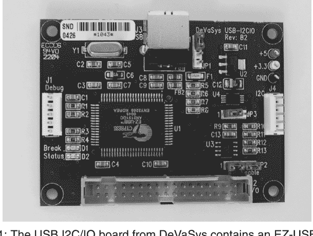

图6-1：来自DeVaSys的USB I2C/IO板包含一个EZ-USB芯片和多种I/O选项。

将固件下载到设备中，并使用你自己的驱动程序或Windows提供的驱动程序。

其他来源也提供使用EZ-USB及其他控制器的类似板卡。

## 使用PC模拟设备

在开发早期阶段，另一个有用的选项是使用PC来模拟设备。你可以使用PC上熟悉的编译器、调试器和其他软件工具，在PC上编译、运行和调试设备代码。

PLX Technology的NET2272 PCI-RDK是一个开发套件，当使用PLX Technology的NET2272 USB接口芯片开发代码时，它允许将PC用作设备。该套件包含一块带排针的PCI卡，排针连接到包含NET2272的子卡。你可以将PCI卡安装到PC中，并编写应用程序来扮演设备固件的角色，与接口芯片通信。该应用程序可以在PC上作为控制台应用程序运行。

PCI卡上的USB连接器可以连接到任何USB主机。当模拟设备的开发完成时，你可以将固件移植到最终设计将使用的CPU上运行。如果你想使用开发套件的电路，可以将子板从PCI卡上取下，并将子板连接到你的设备硬件上。

当然，模拟设备可能存在时序差异，而且PC的硬件架构与设备不同，但在PC上开发的便利性有助于快速实现枚举和基本数据传输的代码。

## 内置CPU的控制器

以下对带有内置CPU的USB控制器的描述将让您了解可用芯片的范围。所描述的芯片只是示例，新芯片不断发布，因此任何新项目都值得查看最新的产品。

如果您有喜欢的CPU系列，很可能有支持USB的变体可供选择。与现有芯片系列兼容的控制器有两个优点。许多开发人员已经熟悉该架构和指令集。选择流行的系列意味着可用的编程和调试工具，并且其他用户可能会提供示例代码和其他建议。

设备控制器来源最多的系列是古老的8051。Intel是8051系列的创始者，也是第一个发布兼容8051的USB控制器的公司（8x930和8x931）。Intel不再提供支持USB的8051，但其他制造商仍在提供。其他系列的兼容控制器也可用，包括Atmel的AVR、Microchip的PICmicro、飞思卡尔半导体的68HC05和68HC08。表6-1列出了与流行微控制器系列兼容的各种芯片。

表6-1：与流行微控制器系列兼容的USB控制器芯片可从众多来源获得。

| 兼容性 | 制造商 | 芯片 | 总线速度 |
|---|---|---|---|
| Atmel AVR | Atmel | AT43USB35x, AT76C713 | 全速 |
| Freescale/Motorola 68HC05 | 飞思卡尔半导体 | 68HC05JB3/4 | 低速 |
| Freescale/Motorola 68HC08 | 飞思卡尔半导体 | 68HC08JB8 | 低速 |
| Freescale/Motorola PowerPC | 飞思卡尔半导体 | MCF5482 | 全速/高速 |
| Infineon C166 | Infineon | C161U | 全速 |
| Intel 80C186 | AMD | Am186CC | 全速 |
| Intel 8051 | Atmel | AT89C513x | 全速 |
| Intel 8051 | 赛普拉斯半导体 | EZ-USB, EZ-USB FX | 全速 |
| Intel 8051 | 赛普拉斯半导体 | EZ-USB FX2 | 全速/高速 |
| Intel 8051 | 旺玖科技 | PL-23xx | 全速 |
| Intel 8051 | 旺玖科技 | PL-25xx | 全速/高速 |
| Intel 8051 | 芯科实验室 | C8051F32x | 全速 |
| Intel 8051 | 标准微系统公司（SMSC） | USB97Cxxx, USB222x | 全速, 全速/高速 |
| Intel 8051 | 德州仪器 | TUSB3210/3410 | 全速 |
| Intel 8051 | 德州仪器 | TUSB6250 | 全速/高速 |
| Microchip PIC16 | Microchip Technology | PIC16C7x5 | 低速 |
| Microchip PIC18 | Microchip Technology | PIC18F2455/2550/4455/4550 | 全速/高速 |
| STMicroelectronics ST7, ST9 | 意法半导体 | ST7265X, ST7263, ST92163 | 低速, 全速 |

一些设备控制器包含专为USB应用设计的CPU。这些设计并非在现有架构上添加USB功能，而是从一开始就针对USB进行优化。赛普拉斯半导体的enCoRe系列就是一个例子。

对于键盘、驱动器和接口转换器等常见应用，有包含支持特定应用的硬件的专用控制器。供应商通常提供示例固件事务。

地址低寄存器和地址高寄存器包含端点缓冲区在RAM中的起始地址。

微控制器的CPU和USB SIE共享对缓冲区和缓冲区描述符的访问。缓冲区描述符状态寄存器中的UOWN位决定CPU或SIE拥有缓冲区及其缓冲区描述符。当数据准备好传输或在总线上等待接收数据时，SIE拥有所有权。当SIE拥有所有权时，CPU不应尝试访问缓冲区或缓冲区描述符，除非读取UOWN位。当准备端点执行传输时，固件应执行的最后一个操作是更新状态寄存器，设置UOWN以将所有权传递给SIE。当事务完成时，SIE清除UOWN位，将所有权交还给CPU。

每个端点号也有一个控制寄存器，可以启用控制端点、IN端点、OUT端点，或具有相同端点号的IN和OUT端点对。寄存器中的其他位可以停止端点并禁用握手（用于等时事务）。

额外的寄存器存储设备在总线上的地址，并包含USB通信和中断的状态及控制信息。

Microchip提供了用于USB通信的USB固件框架代码和示例应用程序。固件是为Microchip的C18 C编译器编写的。框架代码的结构旨在尽可能轻松地为不同类别设备和供应商特定设备开发固件。第11章有更多关于使用该芯片的内容。

Microchip另外两款支持USB的微控制器是PIC16C745和PIC16C765。它们的灵活性较低，因为它们仅支持低速，且程序存储器是EPROM而非Flash存储器。

## 赛普拉斯EZ-USB

赛普拉斯半导体的EZ-USB系列包括全速和全速/高速控制器。这些芯片支持多种固件存储选项，包括在每次上电或连接时从主机加载固件。

EZ-USB系列源于Anchor Chips，赛普拉斯于1999年收购了该公司。在旧文档中您可能会看到Anchor的名称。

### 架构

EZ-USB的架构类似于Maxim Integrated Products/Dallas Semiconductor的DS80C320，后者是一款内核经过重新设计以增强性能的8051。该芯片每个指令周期使用四个时钟周期，而原始8051使用十二个。每条指令占用一到五个指令周期。平均而言，相同的时钟速度下，EZ-USB的速度是8051的2.5倍。

指令集与8051兼容。所有代码和数据存储器组合起来都是RAM。片上无非易失性存储器。但是，这些芯片支持在I²C串行EEPROM和外部并行存储器中进行非易失性存储。

EZ-USB系列包括三个系列：基本型EZ-USB（AN21XX）、FX（CY7C646XX）和FX2（CY7C68013）。每个系列中的芯片在功能上有所不同，例如I/O引脚数量或外部数据总线的可用性。表6-2总结了每个系列的功能。FX系列增加了更快的I/O和通用可编程接口，支持可配置的自动握手。FX2系列增加了对高速的支持。

Keil Software为EZ-USB系列提供了C编译器，或者您可以使用汇编代码。该编译器有一个功能有限但免费的评估版本。赛普拉斯提供了用C语言编写的Frameworks固件，以处理大部分USB通信工作。

### USB控制器

一些EZ-USB芯片支持最大数量的端点和所有四种传输类型。也提供端点较少的芯片。EZ-USB的多种固件存储选项使其架构


**Table 6-2: Cypress Semiconductor 的 EZ-USB 系列与 8051 微控制器兼容。**

| 特性 | AN21xx (EZ-USB) | CY7C646xx (EZ-USB-FX) | CY7C68013 (EZ-USB-FX2) |
|---|---|---|---|
| 速度 | 全速 | 全速 | 全速/高速 |
| 端点数 | 13, 16, 31 | 31 | 11 |
| 兼容性 | 80C320, 8051 | 80C320, 8051 | 80C320, 8051 |
| RAM（字节） | 256 + 4-8K 组合数据和程序存储器 | 256 + 4-8K 组合数据和程序存储器 | 256 + 8K 组合数据和程序存储器 |
| 程序存储器类型 | RAM、串行 EEPROM、外接并行 | RAM、串行 EEPROM、外接并行 | RAM、串行 EEPROM、外接并行 |
| 内部程序存储器（字节） | 4–8K 组合数据和程序存储器 | 4–8K 组合数据和程序存储器 | 8K 组合数据和程序存储器 |
| 外部存储器总线（字节） | 64K | 64K | 一个或两个 64K 总线 |
| 通用 I/O 引脚 | 16–24 | 16–40 | 16–40 |
| 其他 I/O | 2 个 UART、I²C | 2 个 UART、I²C | 2 个 UART、I²C |
| 供电电压 | 3–3.6 | 3–3.6 | 3–3.6 |
| 引脚数 | 44, 48, 80 | 52, 80, 128 | 56, 100, 128 |

与其他芯片相比更复杂。这些选项很有用，因为它们使芯片非常灵活，因此我将详细描述它们。

当 EZ-USB 想要使用存储在主机中的固件时，设备会枚举两次。在启动或设备连接时，主机尝试枚举设备。但主机如何在没有存储固件的情况下枚举设备呢？每个 EZ-USB 都包含一个核心，该核心知道如何响应枚举请求，并且可以在设备首次连接到总线时控制通信。EZ-USB 核心独立于在枚举后通常控制芯片的 8051 核心。EZ-USB 核心在将 8051 核心保持在复位状态的同时与主机通信。

EZ-USB 核心还响应厂商特定的请求，使芯片能够接收、存储和运行从主机接收的固件。对于基本测试，核心电路还使设备能够在没有任何固件编程的情况下使用全部四种传输类型传输数据。

ReNum 寄存器位决定是 EZ-USB 核心还是 8051 核心响应 Endpoint 0 的请求。上电时，ReNum 为零，EZ-USB 核心控制 Endpoint 0。当 ReNum 设置为 1 时，8051 核心控制 Endpoint 0。

EZ-USB 的固件来源取决于两件事：外部 EEPROM 中初始字节的内容以及芯片 EA 输入的状态。上电并在枚举之前，EZ-USB 核心尝试从芯片 I²C 接口上的串行 EEPROM 读取字节。结果连同芯片 EA 输入的状态告诉核心下一步该做什么：使用默认模式、从主机加载固件、从 EEPROM 加载固件，或从外部并行数据总线上的代码存储器启动（Table 6-3）。所有三个 EZ-USB 系列的芯片都可以使用下面描述的方法。第一个 EEPROM 位置中的值取决于芯片是 EZ-USB、EZ-USB-FX 还是 EZ-USB-FX2。下面描述使用的是基本 EZ-USB 的值。Table 6-3 有其他系列的值。

### 默认模式

默认模式是最基本的运行模式，不使用串行 EEPROM 或其他外部存储器。如果 EA 为逻辑低电平并且核心检测不到 EEPROM 或从 EEPROM 读取的第一个字节不是 B0h 或 B2h，则 EZ-USB 核心使用此模式。

当主机枚举设备时，EZ-USB 核心响应请求。在此期间，8051 核心处于复位状态。此复位状态由芯片中的一个寄存器位控制。主机可以请求写入该位以将芯片置于复位或退出复位。此复位仅影响 8051 核心，与 USB 的 Reset 信号无关。

主机检索到的描述符将设备标识为 Default USB Device。主机将检索到的 Vendor ID 和 Product ID 与 Cypress 提供的 INF 文件中的值进行匹配，该文件指示主机加载其中一个 Cypress 通用驱动程序（CyUsb 驱动程序或旧的通用驱动程序）以与芯片通信。ReNum 位保持为零。

**Table 6-3: EZ-USB 可以从四个来源运行固件。**

| 固件来源 | EA 引脚状态 | 串行 EEPROM 中的第一个字节 |
|---|---|---|
| 在重新枚举时从主机加载 | 不关心 | EZ-USB: B0h<br>EZ-USB-FX: B4h<br>EZ-USB-FX2: C0h |
| 从串行 EEPROM 加载 | 不关心 | EZ-USB: B2h<br>EZ-USB-FX: B6h<br>EZ-USB-FX2: C2h |
| 默认 USB 设备 | 低 | 无 EEPROM 或<br>EZ-USB: 不是 B0h 或 B2h,<br>EZ-USB-FX: 不是 B4h 或 B6h,<br>EZ-USB-FX2: 不是 C0h 或 C2h |
| 外部并行存储器 | 高 | 无 EEPROM 或<br>EZ-USB: 不是 B0h 或 B2h,<br>EZ-USB-FX: 不是 B4h 或 B6h,<br>EZ-USB-FX2: 不是 C0h 或 C2h |

此默认模式 intended 用于调试。你可以使用此模式使 USB 接口启动并传输数据。除了支持 Endpoint 0 上的传输外，Default USB Device 还可以在其他端点上使用其他三种传输类型。所有这些都可以在无需编写任何固件或设备驱动程序的情况下实现。

### 从主机加载固件

核心还可以在上电时从 EEPROM 读取标识字节，并在枚举期间将此信息提供给主机。如果从 EEPROM 读取的第一个值是 B0h，核心会读取包含芯片 Vendor ID、Product ID 和发布号的 EEPROM 字节。在设备连接或系统启动时，主机使用这些字节查找匹配的 INF 文件，以标识设备的驱动程序。驱动程序包含在重新枚举之前下载到设备的固件。Cypress 提供了构建具有此功能的驱动程序的说明。

驱动程序使用厂商特定的 Firmware Load 请求将固件下载到设备。固件包含一组新的描述符和设备将运行的代码。例如，HID 类设备将具有报告描述符和用于传输 HID 报告数据的代码。

下载完成后，驱动程序使芯片退出复位状态并运行固件。通过写入控制芯片 DISCON# 引脚的寄存器，固件使设备在电气上模拟从总线移除然后重新连接到总线。该引脚拉高或使一个电阻的一端浮空，该电阻的另一端连接到 D+。当被拉高时，引脚表示设备已连接；当浮空时，表示设备已移除。固件还将 ReNum 设置为 1，以使 8051 核心而不是 EZ-USB 核心响应 Endpoint 0 的请求。

在检测到模拟的重新连接后，主机再次枚举设备，这次检索新存储的描述符并使用其中的信息选择要加载的设备驱动程序。

将固件存储在主机上的明显优点是易于更新。要更新固件，只需在主机上存储新版本，驱动程序就会在下次上电或连接时将固件发送到设备。无需更换芯片或使用特殊的编程硬件或软件。缺点是设备驱动程序复杂性增加，需要在主机上提供固件，并且枚举时间更长。

### 从 EEPROM 加载固件

第三种运行模式提供了一种让芯片将固件存储在外部串行 EEPROM 中的方法。如果从 EEPROM 读取的第一个字节是 B2h，核心会在上电时将 EEPROM 的全部内容加载到 RAM 中。EEPROM 必须包含 Vendor ID、Product ID 和发布号以及枚举所需的所有描述符以及设备所需的其他固件和数据。退出复位状态后，设备已具备 USB 通信所需的一切。核心在完成代码加载后将 ReNum 位设置为 1。枚举设备时，主机读取存储的描述符并加载适当的驱动程序。没有重新枚举。

### 从外部并行存储器运行代码

如果未检测到 EEPROM，或第一个字节不是 B0h 或 B2h，并且 EA 为逻辑高电平，则芯片将从外部并行数据总线上的代码存储器启动。此存储器可以是 EPROM、EEPROM、Flash 存储器或带电池备份的 RAM。存储器包含描述符和其他固件。ReNum 设置为 1。主机枚举设备并加载驱动程序，且没有重新枚举。


## 赛普拉斯 enCoRe II

赛普拉斯半导体公司的 enCoRe II 系列芯片（没错，这种奇怪的大小写正是赛普拉斯的商标写法）是低成本、低速控制器，其指令集针对 USB 通信进行了优化。

### CPU 架构

enCoRe II 系列是赛普拉斯最新的低速控制器产品。这些芯片与最初的 enCoRe 控制器相似，不同之处在于程序存储器采用闪存而非 OTP EPROM。该架构是赛普拉斯独有的，因此要用汇编语言编程，你需要学习一套新的指令集。不过，指令集很小，如果你有汇编代码编程经验，学习语法应该相当轻松。此外还提供了 C 编译器。

该系列包含具有不同程序存储器容量、I/O 引脚数和封装形式的芯片。可选配置包括最大 256 字节 RAM、8 千字节闪存和 36 个 I/O 引脚，其中两个引脚用作 USB 接口。

芯片包含内部振荡器，无需添加外部晶体或谐振器。USB 端口可配置为 PS/2（同步串行）通信，使指针设备能够同时支持两种接口。当 USB 模式被禁用时，两个 USB 引脚可充当用于闪存编程的串行编程模式接口。

### USB 控制器

enCoRe II 控制器具有三个端点：必需的端点 0，以及用于中断传输的端点 1 和端点 2。该芯片可支持一个中断 IN 端点和一个中断 OUT 端点，或两个同向中断端点。每个端点在 RAM 中都有一个 8 字节缓冲区。USB 通信需要相当多的固件支持，因此示例代码很有帮助。

## 飞思卡尔 MC68HC908JB16

飞思卡尔半导体的 MC68HC08 系列 8 位微控制器包含带闪存且支持低速 USB 的芯片，MC68HC908JB16 就是一个例子。飞思卡尔半导体是 2004 年摩托罗拉公司剥离其半导体产品部门时成立的。

### 架构

MC68HC08 系列是飞思卡尔广受欢迎的 MC68HC05 系列的升级版。'HC08 芯片更快、更高效，目标代码与 'HC05 代码向上兼容。

'HC908JB16 包含 16 千字节闪存和 21 个 I/O 引脚。其中两个 I/O 引脚是 USB 接口。其他一些 I/O 引脚具有同步串行通信和键盘接口的硬件支持。监控 ROM 使得可以通过芯片上的单个引脚，利用异步串行接口进行闪存编程和调试。

### USB 控制器

该 USB 控制器为低速，支持端点 0、一个中断 IN 端点，以及一个可配置为中断 IN 或中断 OUT 的端点。

## 飞思卡尔 MCF5482 ColdFire

飞思卡尔半导体的 MCF5482 ColdFire 微处理器是具备 USB 能力的高端控制器的一个例子。该芯片包含一个 32 位 CPU、一个全速/高速 USB 设备控制器，以及一个以太网控制器和大量其他 I/O。请求处理器自动处理许多标准 USB 请求。例如，收到 Get_Descriptor 请求时，请求处理器从 RAM 中检索所请求的描述符，并将描述符返回给主机。该芯片支持端点 0 和另外七个端点地址。

## 与外部 CPU 接口的控制器

与外部 CPU 接口的控制器使你可以将 USB 添加到几乎任何微控制器电路中。缺点是需要使用两颗芯片，而其他控制器则将 CPU 和 USB 控制器整合在一颗芯片上。此外，针对你的 CPU 的 USB 通信示例电路和代码可能不可用。

与外部 CPU 接口的控制器可能支持一组用于 USB 相关通信的命令集，也可能仅使用一系列寄存器来存储 USB 数据以及配置、状态和控制信息。

大多数接口芯片都有一个通过并行接口与 CPU 通信的本地数据总线。为了与外部存储器进行快速传输，许多芯片支持直接存储器访问（DMA）。在带有 DMA 控制器的设备中，CPU 可以在无需 CPU 干预的情况下，设置一个传输，将数据块读入数据存储器或从数据存储器写出。对于没有外部并行总线的 CPU，少数控制器可以使用同步或异步串行接口。当控制器接收到 USB 数据或需要发送新数据时，中断引脚可向 CPU 发出信号。

表 6-4 比较了一部分接口芯片。以下描述将让你了解可用芯片的范围。新芯片不断发布，因此任何新项目都值得查看最新的产品。

**表 6-4：** 与外部 CPU 接口的 USB 控制器选型。

| 公司 | 芯片 | CPU 接口 | 总线速度 |
|---|---|---|---|
| Agere Systems | USS-820D | 并行 | 全速 |
| FTDI Chip | FT232BM | 异步串行 | 全速 |
|  | FT245BM | 并行 | 全速 |
| National Semiconductor | USBN9603/4 | 并行、Microwire | 全速 |
| Philips Semiconductors | PDIUSBD12, ISP1181/83 | 并行 | 全速 |
|  | ISP1581 | 并行 | 全速/高速 |
| PLX Technology | NET22272 | 并行 | 全速/高速 |

## 美国国家半导体 USBN9603

美国国家半导体的 USBN9603 可以连接到任何具有并行数据总线、Microwire 接口，甚至只有四个完全由固件控制的备用 I/O 引脚来支持 Microwire 通信的 CPU。

### 架构

'9603 有一个用于处理 USB 通信的串行接口引擎、USB 端点缓冲区以及状态和控制寄存器。CPU 可以通过外部本地总线访问地址 00h 至 3Fh 的端点缓冲区和状态及控制寄存器。

该芯片提供了三种访问本地数据总线的选项：非复用并行、复用并行和 Microwire 同步串行。

大多数具有外部数据总线的 CPU 都可以使用其中一种并行接口，几乎无需额外逻辑。为了更快地传输数据块，该芯片支持突发模式，CPU 向控制器芯片写入起始地址，然后在连续地址上传输或接收多个字节。外部 CPU 也必须支持此模式。并行接口还支持 DMA 传输。

对于没有外部并行数据总线的微控制器，'9603 通过其 Microwire 接口提供了一种解决方案。Microwire 只需要四条线，几乎可以连接到任何具有四个备用 I/O 引脚的微控制器。该接口使用数据线串行输入（SIN）和串行输出（SOUT）、一个片选（CS）以及一条时钟线（SYNC）。命令/地址和数据字节利用 SYNC 线上的跳变作为时序参考，逐位移入和移出。外部 CPU 控制 SYNC。SYNC 没有最低频率要求，信号也不必有恒定频率；CPU 可以根据需要切换该线。该接口只需足够快以跟上 USB 流量。如果 USB 端口只传输少量、偶尔的数据块，你可以在固件中对 Microwire 通信进行编程。一些微控制器，如美国国家半导体的 COP888，内置了对 Microwire 的支持。

### USB 控制器

'9603 支持七个端点地址：用于控制传输的端点 0，三个 IN 端点和三个 OUT 端点。端点 0 的缓冲区为 8 字节；其他端点为 64 字节。如果固件读取传入数据的速度足够快以防止缓冲区溢出，则端点可以接收大于缓冲区大小的数据包。类似地，如果固件写入缓冲区的速度足够快以防止缓冲区变空，则端点可以发送大于缓冲区大小的数据包。USBN9604 是相同的芯片，不同之处在于其芯片复位也会复位芯片的时钟生成电路。'9604 推荐用于总线供电设备。

## 飞利浦半导体 ISP1181B

飞利浦半导体的 ISP1181B 是一款全速芯片，通过并行接口与外部 CPU 连接。

### 架构

该芯片有一个用于处理 USB 流量的串行接口引擎、一个可配置的 8 位或 16 位数据总线，以及一个 2 位地址总线。控制器通过命令集与 CPU 通信。当地址位 A0 = 1 时，控制器将数据总线上的低字节解释为命令。对于后面紧跟数据的命令，CPU 将地址位 A0 = 0，并在寄存器或端点缓冲区之间传输数据。

该芯片支持复用和非复用地址总线以及 DMA 传输。

ISP1183 是低功耗版本，具有 8 位数据总线和 32 个引脚，而 '1181 有 48 个引脚。早期的飞利浦芯片 PDIUSBD12 具有类似的架构，但能力较弱，数据总线较慢，USB 端点也较少。


# 第6章

### USB 控制器

ISP1181B 的 USB 控制器支持端点 0 以及最多 14 个额外的端点地址。所有启用的端点共享 2462 字节的缓冲区内存。控制端点具有 64 字节的缓冲区。分配给其他每个端点地址的内存量是可配置的。等时端点和批量端点采用双缓冲。

固件控制芯片何时连接到总线。在外部 CPU 发送命令将内部上拉电阻切换到总线的 D+ 线路之前，芯片表现为与总线断开。这种由固件控制的连接可以让芯片在上电后、被主机枚举之前有时间进行初始化。

状态输出可以连接到 LED，当 USB 连接建立时 LED 亮起，并在数据传输时闪烁。

### 飞利浦半导体 ISP1581

飞利浦半导体的 ISP1581 是一款全速/高速控制器，通过并行接口与外部 CPU 连接。

### 架构

该芯片具有用于处理 USB 通信的串行接口引擎、16 位数据总线和 8 位地址总线。外部 CPU 可以通过访问一系列寄存器与控制器通信。控制器支持复用和非复用地址总线以及 DMA 传输。

### USB 控制器

USB 控制器支持全速和高速。除端点 0 外，该芯片最多可支持 7 个 IN 端点地址和 7 个 OUT 端点地址。所有启用的端点共享 8 千字节的缓冲区内存。控制端点具有 64 字节的缓冲区。分配给其他每个端点地址的内存量是可配置的，并且这些端点地址中的任何一个都可以使用双缓冲。

固件控制芯片何时连接到总线。外部上拉电阻连接到芯片的 RPU 引脚和上拉电压。硬件复位后，在外部 CPU 设置一个寄存器位使芯片将上拉电阻切换到总线的 D+ 线路之前，芯片表现为与总线断开。这种由固件控制的连接可以让芯片在上电后、被主机枚举之前有时间进行初始化。

### PLX Technology NET2272

PLX Technology, Inc. 的 NET2272 是一款全速/高速芯片，通过并行接口与外部 CPU 连接。PLX Technology 于 2004 年收购了 Netchip Technology, Inc. 及其 USB 控制器。

### 架构

一系列寄存器保存配置数据和其他信息。数据包缓冲区保存已接收的 USB 数据和准备传输的数据。并行接口具有 5 个地址位和 16 个数据位。与数据包缓冲区之间的传输可以是 8 位或 16 位。

寄存器存储状态和控制信息，以及最后一次 Setup 事务中接收的数据。CPU 还使用寄存器从数据包缓冲区读写端点数据。

’2272 支持三种访问其寄存器的模式。在直接地址模式下，五个地址位指定要读取或写入的寄存器。在复用地址模式下，CPU 将寄存器地址放在数据位上，’2272 在 ALE 控制信号的下降沿读取地址。在间接地址模式下，CPU 使用最低地址位来区分寄存器地址指针 (0) 和数据 (1)。CPU 写入寄存器地址指针以指定一个配置寄存器，然后在指向的地址处读取或写入数据。直接和复用地址模式只能访问 00h 到 1Fh 的寄存器，这些寄存器通常包含最常访问的信息。间接地址模式可以访问所有寄存器。控制器还支持 DMA 传输。CPU 可以向 ’2272 写入，速度高达 60 MB/秒，并且可以从 ’2272 读取，速度高达 57 MB/秒（在 DMA 模式下）。

要访问数据包缓冲区中的端点数据，CPU 通过写入端点页选择寄存器或 DMA 端点选择寄存器来选择端点，然后通过读或写端点数据寄存器来访问数据。

### USB 控制器

’2272 的 USB 控制器支持全速和高速以及所有四种传输类型。除端点 0 外，控制器还有三个物理端点。需要更多端点的设备可以使用虚拟端点，其中一个或多个逻辑端点共享一个物理端点的资源。设备固件必须根据需要切换逻辑端点和物理端点之间的资源。

端点 0 具有 128 字节的缓冲区，其他端点共享 3 千字节的数据包缓冲区。其中两个端点可以使用双缓冲。在收到 Setup 数据包时，设备固件必须读取请求并提供要返回给主机的任何数据。在 IN 或 OUT 事务失败后，端点会自动恢复并等待主机重试。

### FTDI Chip FT232BM 和 FT245BM

Future Technology Devices International (FTDI) Chip 提供的控制器采用了一种不同的 USB 设计方法。FT232BM USB UART 和 FT245BM USB FIFO 是接口芯片，完全在硬件中管理枚举和其他总线通信。这些芯片设计用于配合 FTDI Chip 提供的主机驱动程序。这些控制器完全不需要 USB 特定的固件，尽管你可以使用 EEPROM 来存储描述符中某些项目的值。设备固件只需要提供要由控制器发送的数据以及取回接收到的数据。由于 USB 通信完全在硬件中处理并使用 FTDI Chip 的驱动程序，你甚至可以在开发和销售的设备中使用 FTDI Chips 的厂商 ID。

如果你的设备不需要标准类驱动程序，并且每个方向只需要不超过一个批量或等时端口，那么这些控制器是一个不错的解决方案。

### 架构

两个芯片都是全速。FT245BM 具有并行接口，FT232BM 具有异步串行接口。

表 6-5 显示了 ’245BM 上引脚的功能。并行接口有 8 条数据线和 4 个握手信号。握手信号的名称是从与芯片接口的外部 CPU 的角度出发的。当 CPU 可以读取从主机接收的字节时，RXF# 输出为低电平。CPU 选通 RD# 以读取该字节。在另一个方向上，当 CPU 可以写入要发送到 USB 主机的字节时，TXE# 输出变为低电平，CPU 选通 WR 以将该字节写入 ’245BM 的缓冲区。外部 CPU 可以使用数据总线或任何空闲的端口引脚来访问 ’245BM。

’232BM 在 USB 和异步串行接口之间进行转换。表 6-6 显示了引脚的功能。串行接口包括一个 TXD 数据输出、一个 RXD 数据输入，以及用于标准 RS-232 握手信号（RTS、CTS、DTR、DSR、DCD 和 RI）的引脚。当数据在 TXD 上传输时，TXDEN 输出为高电平。此输出可以直接连接到 RS-485 收发器的发送使能输入，从而无需使用固件和额外硬件来使能发送器。按照 EIA/TIA-232 标准的定义，’232BM 充当 DTE。（PC 上的 RS-232 端口也是 DTE。）在 DTE 上，TXD、RTS# 和 DTR 信号是输出，RXD、CTS# 和 DSR 信号是输入。充当 DCE 的设备具有互补的信号。（例如，TXD 是输入，RXD 是输出。）要将两个 DTE 相互连接，请使用零调制解调器电缆，它会交换信号对，使每个输出连接到对应的输入。

要创建 USB/RS-232 转换器，请使用 Maxim MAX3245 或类似的芯片在 ’232BM 的 5V 逻辑信号和 RS-232 电压之间进行转换。类似地，你可以将 ’232BM 连接到 RS-485 收发器。第 7 章将更详细地介绍如何使用 ’232BM 将这些传统接口的设备转换为 USB。

两个芯片还支持位拆模式（Bit Bang mode），在这种模式下，芯片作为一个非常基础的控制器工作，无需连接到外部 CPU。在

# 第6章

表 6-5：FT245BM USB FIFO 的引脚排列。

| 引脚 | 名称 | I/O | 描述 |
|---|---|---|---|
| 1 | EESK | 输出 | EEPROM 时钟 |
| 2 | EEDATA | 输出 | EEPROM 数据 |
| 3 | VCC | 电源 | +4.35 至 5.25V |
| 4 | RESET# | 输入 | 复位芯片 |
| 5 | RSTOUT# | 输出 | 复位发生器的输出 |
| 6 | 3V3OUT | 输出 | 稳压 +3.3V 输出 |
| 7 | USBDP | I/O | D+ USB 数据 |
| 8 | USBDM | I/O | D- USB 数据 |
| 9 | GND | 电源 | 接地 |
| 10 | PWREN# | 输出 | 设备配置时变为低电平，在挂起状态时变为高电平 |
| 11 | SI/WU | 输入 | 在下一个批量 IN 请求时发送 USB 数据 / 请求远程唤醒 |
| 12 | RXF# | 输出 | 当 FIFO 包含 CPU 可以读取的数据时变为低电平 |
| 13 | VCCIO | 电源 | +3.0 至 5.25V |
| 14 | TXE# | 输出 | 当 CPU 可以向 FIFO 写入数据时变为低电平 |
| 15 | WR | 输入 | 在高→低跳变时，将 D0–D7 写入发送 FIFO 缓冲区 |
| 16 | RD# | 输入 | 在高→低跳变时，从接收 FIFO 缓冲区取出一个字节放到 D0–D7 上供 CPU 读取 |
| 17 | GND | 电源 | 接地 |
| 18 | D7 | I/O | 数据位 7 |
| 19 | D6 | I/O | 数据位 6 |
| 20 | D5 | I/O | 数据位 5 |
| 21 | D4 | I/O | 数据位 4 |
| 22 | D3 | I/O | 数据位 3 |
| 23 | D2 | I/O | 数据位 2 |
| 24 | D1 | I/O | 数据位 1 |
| 25 | D0 | I/O | 数据位 0 |
| 26 | VCC | 电源 | +4.35 至 5.25V |
| 27 | XTIN | 输入 | 晶振单元输入 |
| 28 | XTOUT | 输出 | 晶振单元输出 |
| 29 | AGND | 电源 | 模拟地 |
| 30 | AVCC | 电源 | 模拟电源 |
| 31 | TEST | 输入 | 拉高以启用测试模式 |
| 32 | EECS | I/O | EEPROM 片选信号 |


**表 6-6：FT232BM USB UART 引脚排列。**

| 引脚 | 名称 | I/O | 描述 |
|---:|---|---|---|
| 1 | EESK | Output | EEPROM 时钟 |
| 2 | EEDATA | Output | EEPROM 数据 |
| 3 | VCC | Power | +4.35 至 5.25V |
| 4 | RESET# | Input | 复位芯片 |
| 5 | RSTOUT# | Output | 复位生成器输出 |
| 6 | 3V3OUT | Output | 调节的 +3.3V 输出 |
| 7 | USBDP | I/O | D+ USB 数据 |
| 8 | USBDM | I/O | D- USB 数据 |
| 9 | GND | Power | 地 |
| 10 | SLEEP# | Output | 在挂起状态下变低 |
| 11 | RXLED# | Output | 接收 LED 驱动器，开集电极 |
| 12 | TXLED# | Output | 发送 LED 驱动器，开集电极 |
| 13 | VCCIO | Power | +3.0 至 5.25V |
| 14 | PWRCTL | Input | 总线供电时接地，自供电时接高 |
| 15 | PWREN# | Output | 设备配置时变低，挂起状态时变高 |
| 16 | TXDEN | Output | RS-485 发送使能 |
| 17 | GND | Power | 地 |
| 18 | RI# | Input | 振铃指示 |
| 19 | DCD | Output | 数据载波检测 |
| 20 | DSR# | Input | 数据终端就绪 |
| 21 | DTR# | Output | 数据终端准备好 |
| 22 | CTS# | Input | 清除发送 |
| 23 | RTS# | Output | 请求发送 |
| 24 | RXD | Input | 接收数据 |
| 25 | TXD | Output | 发送数据 |
| 26 | VCC | Power | +4.35 至 5.25V |
| 27 | XTIN | Input | 晶体振荡器单元输入 |
| 28 | XTOUT | Output | 晶体振荡器单元输出 |
| 29 | AGND | Power | 模拟地 |
| 30 | AVCC | Power | 模拟电源 |
| 31 | TEST | Input | 置高以启用测试模式 |
| 32 | EECS | I/O | EEPROM 芯片选择 |

在 FT245BM 上，数据总线引脚作为 8 位 I/O 端口工作。在 FT232BM 上，数据和握手引脚是 I/O 端口。你可以使用 FTDI Chip 的驱动程序以任意组合将引脚配置为输入或输出。输出可以控制 LED、继电器或其他电路。输入可以与开关和逻辑门输出接口。主机应用程序可以通过 USB 连接读取和写入 I/O 引脚。

### USB 控制器

与其它设备控制器不同，FT232BM 和 FT245BM 并非设计为可编程以使用任意主机驱动程序的通用设备。相反，FTDI Chip 提供了两种驱动程序选项，即虚拟 COM 端口驱动程序和 D2XX 直接驱动程序。

使用虚拟 COM 端口驱动程序，设备在主机上显示为好像设备已连接到 COM（RS-232）端口。在大多数情况下，使用 FT232BM 将 RS-232 设备转换为 USB 时，无需更改访问该设备的应用程序软件。在 Windows 下，应用程序可以使用标准 API 函数（ReadFile、WriteFile）或用于 COM 端口通信的其他类、库或工具包来访问带有 FT232BM 的设备。FT245BM 也可以使用虚拟 COM 端口驱动程序。

如果你不想使用 COM 端口编程，需要更快的性能，或想使用位 bang 模式，FTDI Chip 提供了 D2XX 直接驱动程序，该驱动程序提供了一系列供应商特定函数，应用程序可使用这些函数与设备通信。

芯片支持到 EEPROM 的 Microwire 接口，该 EEPROM 可存储诸如供应商 ID、产品 ID、包含序列号、制造商和产品描述的字符串以及指定设备是总线供电还是自供电等项目的供应商特定值。如果某项没有 EEPROM 数据，控制器将使用默认值。FTDI Chip 提供了一个实用程序，可将信息编程到连接到 FT232BM 或 FT245BM 的 EEPROM 中。

没有 EEPROM 时，芯片使用 FTDI Chip 的供应商 ID 和产品 ID。根据请求，FTDI Chip 还会授予你的设备使用其供应商 ID 以及 FTDI Chip 分配给你的产品 ID 的权利。省去购买供应商 ID 的需求对开发低价、小批量销售产品的开发者来说是一个巨大的优势。

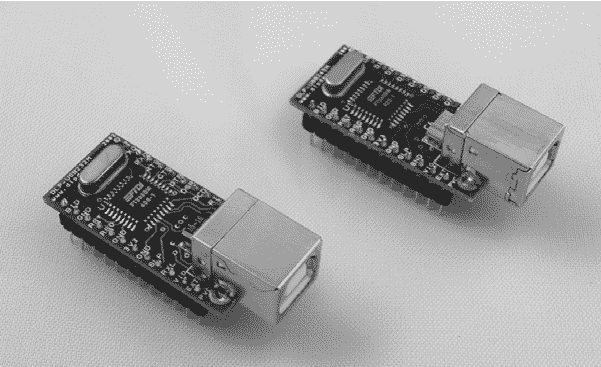

**图 6-2：** 为便于使用 FTDI Chip 的控制器进行原型制作，请使用 DLP Design 的 DLP-USB232M 和 DLP-USB245M 模块。

两款芯片均具有 384 字节的发送缓冲区和 128 字节的接收缓冲区。FT245BM 的数据总线可将数据传输速率提高到最高 1 Megabyte/秒。FT232BM 的异步串行端口可将数据传输速率提高到最高 3 Million 波特，相当于每字节一个起始位和一个停止位时为 300 kilobytes/秒。

芯片默认使用批量传输。也提供等时传输的驱动程序。

FTDI Chip 的另一款控制器是 FT2232C 双 USB UART/FIFO。该芯片包含两个控制器，每个控制器都支持多种配置。选项包括相当于 FT232BM 或 FT245BM 接口、同步串行接口以及 8051 兼容并行接口。快速的光隔离串行接口模式可使用外部光隔离器创建隔离的同步接口。高驱动电平选项使 I/O 引脚能够源和沉至多 6 毫安（源电流最低 3.2V，沉电流最高 0.6V）。

# 7 设备类

本章介绍了定义的 USB 类，包括如何判断新设计是否适合定义的类或需要自定义驱动程序。

### 关于类

大多数 USB 设备与其他执行类似功能的设备有很多共同点。所有鼠标都发送有关鼠标移动和按钮点击的信息。所有驱动器都传输文件。所有打印机都接收打印数据并将状态信息发送回主机。

当一组设备或接口共享许多属性或提供或请求类似服务时，将属性和服务定义在类规范中是有意义的。该规范可作为设计和编程该类设备的开发人员以及为与设备通信的主机系统编写设备驱动程序的程序员的指南。操作系统可以为通用类提供驱动程序，从而消除了设备厂商为该类中的设备提供驱动程序的需求。

当受支持类中的设备具有类驱动程序中未包含的独特功能或能力时，设备厂商有时可以提供过滤驱动程序来支持新增功能和能力，而不必编写完整的设备驱动程序。在其他情况下，过滤驱动程序不可行，设备需要自定义驱动程序。

即使设备的类未被操作系统支持，该类也可能在操作系统的未来版本中得到支持。符合类规范的固件很可能与操作系统未来版本中添加的任何驱动程序兼容。

### 设备工作组

USB-IF 发布由设备工作组开发的类规范，其成员在特定领域具有专业知识和兴趣。一个特例是集线器类，它是在主 USB 2.0 规范中定义，而不是在单独的文档中。每个操作系统都必须支持集线器类，因为主机需要根集线器才能进行任何通信。

定义的类涵盖了大多数常见的设备功能。版本号为 1.0 或更高的规范是已批准的规范，适用于作为开发商业发布设备和驱动程序的参考。表 7-1 列出了具有已批准规范的类。

Windows 包含驱动程序来支持这些类中的许多类。随着 Windows 和类规范的演进，受支持的类数量和对类的支持水平都有所提高。对于一些较为冷门的类，例如设备固件升级，尽管规范多年前就已获批，Windows 仍未提供驱动程序。第 4 章列出了设备在其设备和接口描述符中可能具有的定义类代码。表 7-2 显示了在每个 Windows 版本中添加的类驱动程序。

### 类规范的元素

所有 USB 类规范均基于通用类规范，该规范描述了类规范应包含的信息以及

表 7-1：这些类具有已批准的类规范。

| 类 | 描述符声明类的位置 |
|---|---|
| 音频 | 接口 |
| 芯片/智能卡接口 | 接口 |
| 通信 | 设备或接口 |
| 内容安全 | 接口 |
| 设备固件升级 | 接口（应用程序特定接口的子类） |
| 人机接口 (HID) | 接口 |
| IrDA 桥 | 接口（应用程序特定接口的子类） |
| 大容量存储 | 接口 |
| 打印机 | 接口 |
| 静态图像捕获 | 接口 |
| 测试和测量 | 接口（应用程序特定接口的子类） |
| 视频 | 接口 |

如何组织规范文档。类规范定义了属于该类的设备可能具有的必需和可选端点的数量和类型。规范还可能定义或命名要传输的数据格式，包括应用程序数据（例如按键或视频数据）以及与设备及其操作相关的状态和控制信息。一些类规范定义了函数或功能，描述传输的数据将如何使用。例如，HID 类具有使用表，定义如何解释键盘、鼠标、操纵杆和其他 HID 发送的数据。一些类使用 USB 以由另一规范定义格式传输数据。一个例子是用于大容量存储设备的 SCSI 命令。

类规范可能为标准描述符中的项目定义值，同时还定义类特定的描述符、接口、端点用途和控制请求。例如，集线器的设备描述符包括 bDeviceClass 值为 09h，以指示设备属于集线器类。集线器必须具有类特定的集线器描述符，其描述符类型为 29h。集线器还必须支持类特定的请求。例如，当主机向集线器发送 Get_Port_Status 请求，并在索引字段中提供端口号时，集线器会响应端口的状态信息。类还可能要求设备支持特定端点或对标准请求遵守更严格的时序。

# 第7章

表 7-2：Microsoft 已在 Windows 的每个版本中添加了 USB 类支持。版本按从早到晚的顺序列出。除非另有说明，每个版本还包括随早期版本提供的驱动程序。

| Windows 版本 | USB 版本兼容性 | 添加的 USB 驱动程序 |
|---|---|---|
| Windows 98 Gold（原始发行版） | 1.0 | 音频 |
|  |  | HID 1.0 |
|  |  | 视频（USB 摄像头微型驱动程序库 USBCAMD 1.0；Windows 2000 下不支持） |
| Windows 98 SE | 1.1 | 通信设备：调制解调器 |
|  |  | HID 1.1（增加了执行中断 OUT 传输的能力） |
|  |  | 静态图像（第一阶段/初步） |
| Windows 2000 | 1.1（Service Pack 4（SP4）中添加了 2.0 支持） | 大容量存储。Service Pack 3（SP3）中添加了对多个 LUN（分区）的支持。 |
|  |  | 打印机 |
|  |  | 通信设备：Remote NDIS（网络设备接口规范） |
|  |  | 静态图像（大幅改进） |
|  |  | 芯片/智能卡接口（可通过 Windows 更新获得） |
| Windows Me | 1.1 | 音频：MIDI |
|  |  | 视频（USB 摄像头微型驱动程序库 USBCAMD 2.0） |
| Windows XP | 1.1；Service Pack 1（SP1）中添加了 2.0 支持；Service Pack 2（SP2）中添加了接口关联描述符支持。 | 音频：MIDI，已改进 |
|  |  | Service Pack 2（SP2）中添加了视频类驱动程序。 |

### 已定义类

以下各节介绍已定义的类。我不试图重复规范文档中的每个细节。相反，我的目标是提供足够的信息，帮助您决定新设计可能适合哪一类，设备支持该类通信所需的资源，用于该类设备的设备控制器示例，以及在 Windows 下对该类的支持程度，如果有的话。

### 音频

音频类用于发送或接收音频数据的设备，可能包含编码的语音、音乐或其他声音。音频功能通常是同时支持视频、存储或其他功能的设备的一部分。音频设备可以使用等时传输用于音频流，或使用批量传输用于使用 MIDI（乐器数字接口）协议编码的数据。

本节描述音频规范的 1.0 版本。截至本文撰写时，2.0 版本正在开发中。2.0 版本将与 1.0 版本不向后兼容。换句话说，2.0 设备无法与 1.0 主机驱动程序一起工作。2.0 版本中提出的更改包括完全支持高速操作、使用接口关联描述符以及支持许多新的功能和控件。

### 文档

音频规范为音频设备、音频数据格式、终端类型和 MIDI 设备提供了单独的设备类定义文档。截至本文撰写时，这些文档的最新版本均为 1.0。MIDI 标准可从 MIDI 制造商协会 www.midi.org 获得。

### 概述

设备中的每个音频功能都有一个音频接口集合，由一个或多个接口组成。接口包括一个 AudioControl（AC）接口、零个或多个 AudioStreaming（AS）接口以及零个或多个 MIDIS 流（MS）接口（图 7-1）。换句话说，每个音频接口集合都有一个 AudioControl 接口，而 AudioStreaming 和 MIDIS 流接口是可选的。

AudioControl 接口可以启用访问音量、静音、低音和高音等控件。AudioStreaming 接口以等时传输传输音频数据。MIDIS 流接口传输 MIDI 数据。MIDI 是控制合成器、声卡和其他产生音乐和其他声音的电子设备的标准。MIDI 对声音的表示包括音高、长度、音量和其他特征的值。纯 MIDI 硬件接口以 31.25 千比特/秒的异步数据传输。承载 MIDI 数据的 USB 接口使用 MIDI 数据格式，但不使用 MIDI 的异步接口。相反，MIDI 数据在总线上以批量传输传输。

设备可以同时激活多个音频接口集合，每个集合控制一个独立的音频功能。

### 描述符

每个音频接口类型都使用标准和类特定描述符，使主机能够了解接口、其端点以及端点期望传输的数据类型。

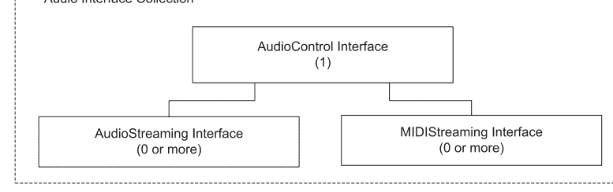

图 7-1：每个音频功能都有一个音频接口集合，其中包含一个或多个接口。

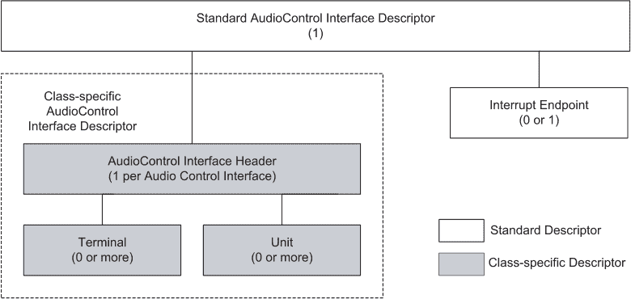

图 7-2：AudioControl 接口包含音频终端和单元的描述符。

**AudioControl 接口。** 图 7-2 显示了 AudioControl 接口中的描述符。在 AudioControl 接口描述符中，bInterfaceClass = 01h 用于将接口标识为音频类，bInterfaceSubclass = 01h 用于将子类标识为 AudioControl。

在 AudioControl 接口描述符之后是类特定的 AC 接口描述符，由 AudioControl 接口的一系列描述符组成。类特定的 AC 接口头描述符包含其自身以及接口中所有终端和/或单元描述符的总长度。

终端描述符包含有关可寻址逻辑对象的信息的描述，该对象表示 USB 端点或其他外部接口。音频接口中的每个 IN 或 OUT 等时端点都必须具有关联的输出或输入终端以及终端描述符。音频功能在输入终端处从主机接收音频信息，并在输出终端处向主机传输音频信息。请注意，输入终端和输出终端的术语是从音频功能的角度来看的，而 USB 端点则是从主机的角度命名的。因此，IN 端点具有关联的输出终端

An IN endpoint has an associated Output Terminal, while an OUT endpoint has an associated Input Terminal. Other Terminals in a function can represent interfaces to audio components such as microphones and speakers.

An audio function might receive a microphone’s output at an Input Terminal and transmit the received audio data to the host at an Output Terminal that represents a USB IN endpoint. Or an audio function might receive audio data from the host at an Input Terminal that represents an OUT endpoint and send the received data to a speaker at an Output Terminal.

A Unit descriptor contains information about an addressable logical object that represents a subfunction within an audio function. Table 7-3 shows the Unit types defined in the specification.

If the AudioControl Interface has an interrupt endpoint, the interface includes an endpoint descriptor for the endpoint.

## The AudioStreaming Interface.

Following the AudioControl interface descriptor, an Audio Interface Collection may have one or more AudioStreaming interface descriptors with bInterfaceClass field = 01h to identify the interface as audio class and bInterfaceSubclass = 02h to identify the subclass as AudioStreaming. Figure 7-3 shows the descriptors.

Following each AudioStreaming interface descriptor is a class-specific AudioStreaming interface descriptor, which identifies the Terminal associated with the interface and contains information about the data format and any delay the function requires for internal processing. The Audio Data Formats specification lists the supported formats, which include Pulse Code Modulation (PCM), Digital Audio Compression (AC-3), and MPEG. A class-specific AS Format Type descriptor contains more information about the format. Some formats require an additional AS Format-specific Type descriptor.

Each AudioStreaming interface can have one isochronous endpoint. The endpoint has a standard endpoint descriptor and a class-specific AS Isochronous Audio Data endpoint descriptor. The class-specific descriptor indicates which audio controls the endpoint supports, specifies whether the endpoint requires all except zero-length data packets to contain wMaxPacketSize

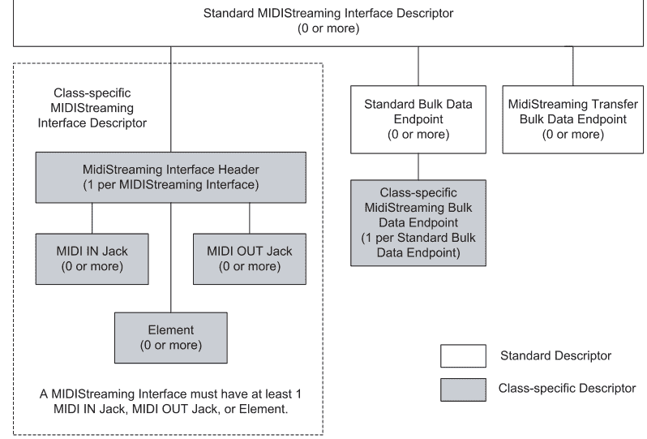

Figure 7-4: A MIDIStreaming interface contains descriptors for bulk endpoints that carry MIDI data.

An Element converts between MIDI and audio data streams or other MIDI streams. A MIDI IN Jack receives data from the outside world, and a MIDI OUT Jack provides data to the outside world. An Embedded MIDI Jack is a jack that represents a USB endpoint. An Embedded MIDI OUT Jack represents an IN endpoint, and an Embedded MIDI IN Jack represents an OUT endpoint. (The MIDI OUT and MIDI IN names are from the perspective of the MIDI function, while the IN endpoint and OUT endpoint names are from the perspective of the USB host.) An External MIDI Jack is a physical jack that connects to a MIDI device.

Every USB MIDI device contains a USB/MIDI converter that converts between USB data and the data at the Embedded MIDI Jack(s). Each USB endpoint can connect to up to 16 Embedded MIDI Jacks. Data travels in 32-bit USBMIDI Event Packets, with the first 4 bits designating a specific Embedded MIDI Jack. Inside a device, External Jacks connect to Embedded MIDI Jacks, other External MIDI Jacks, or Elements. Multiple External MIDI OUT Jacks can implement MIDI PARALLEL OUT. Each Element, MIDI IN Jack, and MIDI OUT Jack has a class-specific descriptor.

Table 7-3: The specification for the audio class defines these Unit types.

| Unit Type | Description |
|---|---|
| Mixer | 将若干逻辑输入通道转换为若干逻辑输出通道。 |
| Selector | 从 n 个音频通道簇中选择并将其不经更改路由到单个输出音频通道簇 |
| Feature | 提供音量、音调控制和静音等控件 |
| Processing | 将多个逻辑输入通道转换为单个音频通道簇 |
| Up/Down-mix Processing | 提供从 n 个输入音频通道导出 m 个输出音频通道的设施。 |
| Dolby Prologic Processing | 提取额外音频数据（上/下混音处理单元的专用派生） |
| 3D-Stereo Extender Processing | 处理现有的立体声音轨以添加宽阔感效果。 |
| Reverberation Processing | 添加房间声学效果。 |
| Chorus Processing | 添加合唱效果。 |
| Dynamic Range Compressor | 智能限制动态范围。 |
| Extension Unit | 允许添加厂商特定的构建块。 |

A MIDIStreaming interface can have one or more Standard MS Bulk Data endpoints and one or more Class-specific MS Transfer Bulk Data endpoints. Many MIDI interfaces handle all traffic with one Standard Bulk Data IN endpoint and one Standard Bulk Data OUT endpoint. For audio streams that require more bandwidth, an interface can have one or more MS Transfer Bulk Data endpoints. A host can use the class-specific Set_Endpoint_Control request to dynamically allocate a Transfer Bulk Data endpoint to an Element. Typical applications for a Transfer Bulk Data endpoint are transferring DownLoadable Sounds (DLS) to a Synthesizer Element and transferring program code to a programmable Element.

Each endpoint of either type has a standard endpoint descriptor. Each Standard Bulk Data endpoint also has an MS Bulk Data endpoint descriptor that names the Embedded MIDI Jacks associated with the endpoint.

## Class-specific Requests

The audio class defines optional class-specific requests for setting and getting the state of audio controls, accessing memory, and requesting status information.

## Chips

USB-capable chips are available with built-in support for audio functions. The support includes codec (compressor/decompressor) functions, analog-to-digital converters (ADCs), digital-to-analog converters (DACs), and support for Sony/Philips Digital Interface (S/PDIF) encoding for transmitting audio data in digital format.

Texas Instruments’ PCM2900 is a stereo audio codec with a full-speed USB port and 16-bit ADC and DAC. The chip has an AudioControl interface, an AudioStreaming interface for each direction, and a HID interface that reports the status of three pins on the chip. The chip requires no user programming but has the option to use a vendor-specific Vendor ID, Product ID, and strings. The PCM2902 adds support for S/PDIF encoding. Another option for a USB codec is Philips Semiconductors UDA1325.

Texas Instruments’ PCM2702 is a 16-bit stereo DAC with a full-speed USB interface. The chip can accept data sampled at 48, 44.1, and 32 kilohertz using either 16-bit stereo or monaural audio data. The chip supports digital attenuation and soft-mute features.

Texas Instruments’ TUSB3200A USB Streaming Controller contains an 8052-compatible microcontroller that supports up to seven IN endpoints and seven OUT endpoints. The audio support includes a codec port interface, a DMA controller with four channels for streaming isochronous data packets to and from the codec port, and a phase lock loop (PLL) and adaptive clock generator (ACG) to support synchronization modes.

## Windows Support

Under Windows, the *usbaudio.sys* minidriver supports USB audio devices, including MIDI devices. In Windows editions up to and including Windows XP, the driver supports a subset of the features in the USB audio specification. Microsoft’s Universal Audio Architecture (UAA) initiative promises an improved driver architecture for future Windows editions. *USB Audio Devices and Windows* is a white paper from Microsoft that details the abilities and limits of Windows XP’s audio driver.

Applications can access USB audio devices using the DirectMusic and DirectSound components of Windows’ DirectX technology or using Windows Multimedia audio functions.

## Chip/Smart Card Interface

Smart cards are the familiar plastic cards used for phone calls, gift cards, keyless entry, access to toll roads and mass transit, storing medical and insurance data, enabling of satellite TV receivers, and other applications that require storing small-to-moderate quantities of information with easy and portable access.

Each card contains a module with memory and often a CPU. Many cards allow updating of their contents, to change a monetary value or an entry code, for example. Some cards have exposed electrical contacts, while others communicate via embedded antennas. Another term for smart card is chip card.

To access a smart card, you connect it to a Chip Card Interface Device (CCID), typically by inserting the card into a slot or waving a contactless card by a reader. A popular term for CCID is smart-card reader, though many CCIDs can also write to cards. USB enters the picture because some CCIDs have USB interfaces for communicating with USB hosts.

## Documentation

The specification *USB Chip/Smart Card Interface Devices* defines a protocol for CCIDs with USB interfaces. The current version at this writing is 1.0. The ISO/IEC 7816 standard (available from *www.iso.ch*) defines the physi-


用于调制解调器控制或本地网络流量的以太网。通信设备类也是通过主机上的 COM 端口功能访问的其他设备的选项。

## 文档

通信设备的主要文档是通信设备类（CDC）的规范。两个子类各有自己的文档。无线移动通信（WMC）子类包括可执行音频和数据通信等多种功能的无线设备终端设备。以太网仿真模型（EEM）设备子类包括发送和接收以太网帧的设备。截至本文撰写时，最新规范版本为 CDC 的 1.1 版，WMC 和 EEM 的 1.0 版。V.250 标准（以前称为 V.25ter，涵盖 Hayes AT 命令集）可从国际电信联盟 www.itu.int 获取。以太网标准 IEEE 802.3 可从 www.ieee.org 获取。

远程网络驱动程序接口规范（NDIS）定义了一种使用 USB 和其他总线来配置网络接口并发送和接收以太网数据的协议。远程 NDIS 基于 NDIS，后者定义了一种管理与网络适配器和更高层驱动程序通信的协议。NDIS 和远程 NDIS 由 Windows 支持，但不被其他操作系统支持。NDIS 和远程 NDIS 的文档可从 www.microsoft.com 获取。

## 概述

通信设备负责设备管理、呼叫管理（可选）和数据传输等任务。设备管理包括控制和配置设备并通知主机事件。呼叫管理涉及建立和终止电话呼叫或其他连接。并非所有设备都需要呼叫管理。数据传输是发送和接收应用程序数据，例如通过调制解调器或网络发送的电话通话或文件。

通信设备类支持三种基本的通信模型。POTS（Plain Old Telephone Service，即普通电话服务）模型用于通过普通电话线路通信。ISDN 模型用于通过具有 ISDN 接口的电话线路通信。联网模型用于通过以太网或 ATM（异步传输模式）网络通信。一些 USB/以太网设备使用 POTS 模型配合厂商特定协议。

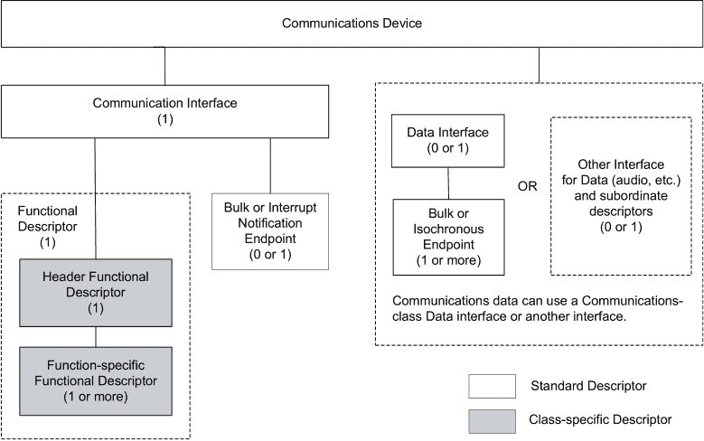

图 7-5：通信类接口具有用于承载通信设备类数据的端点的描述符。

通知，用于宣布振铃检测和网络连接或断开等事件，可以通过中断或批量管道传输到主机。大多数设备使用中断管道。每个通知由一个 8 字节的头部后跟一个可变长度的数据字段组成。

## 描述符

通信功能可以在设备级或接口级定义。如果在设备级定义，则设备的全部接口都属于该通信功能。在设备描述符中，bDeviceClass = 02h 表示通信设备类（图 7-5）。如果通信功能在接口级定义，则关联的接口描述符可以指定哪些接口属于该通信功能，前提是操作系统支持关联的接口描述符。1.1 版通信设备类规范没有按名称提及关联接口描述符，但指出用于关联接口的方法正在开发中，并且这种方法将是一个有效选项。

每个通信设备必须具有一个接口描述符，其中 bInterfaceClass = 02h 表示通信接口。该接口处理设备管理和呼叫管理。bInterfaceSubClass 字段指定通信模型。表 7-4 显示了定义的值。bInterfaceProtocol 字段可以命名子类支持的协议。表 7-5 显示了协议的定义值。

在通信接口描述符之后是一个类特定的功能描述符，由头部功能描述符后跟一个或多个描述符（也称为功能描述符）组成，这些描述符提供有关特定通信功能的信息。表 7-6 显示了这些描述符的定义值。

其中一个描述符，即联合功能描述符，具有定义多个接口形成的逻辑单元之间关系的特殊功能。该描述符指定一个接口为主接口或控制接口，该接口可以发送和接收适用于整个组的某些消息。例如，通信接口可以作为由通信接口和数据接口组成的组的从接口。组成组的接口可以包括通信类接口以及其他相关接口，如音频和 HID。

如果通信接口具有用于事件通知的批量或中断端点，则该端点具有标准端点描述符。

通信设备还可能具有一个接口描述符，其中 bInterfaceClass = 0Ah 表示数据接口。数据接口可以具有用于承载应用程序数据的批量或等时端点。每个存在的端点都有一个标准端点描述符。一些设备使用其他类或厂商特定的接口进行数据传输。例如，电话可能会使用音频接口来发送和接收语音数据。

## 表 7-4：在通信设备的接口描述符中，bInterfaceSubClass 字段指示设备支持的通信模型。

| 代码 | bInterfaceSubClass | 应用 |
|---|---|---|
| 00h | RESERVED | – |
| 01h | 直线控制模型 | 电话调制解调器，主机提供任何数据压缩和错误校正。设备或主机可能提供调制解调器数据的调制/解调。 |
| 02h | 抽象控制模型 | 电话调制解调器，设备提供任何数据压缩、错误校正以及调制解调器数据的调制/解调。 |
| 03h | 电话控制模型 | 电话。 |
| 04h | 多通道控制模型 | 具有多个复用通道的 ISDN 设备。 |
| 05h | CAPI 控制模型 | 支持 COMMON-ISDN-API（CAPI）命令和消息的 ISDN 设备。 |
| 06h | 以太网联网控制模型 | 交换以太网帧数据的设备。 |
| 07h | ATM 联网控制模型 | ATM 设备。 |
| 08h–0Bh | WMC 模型 | 无线移动通信设备。 |
| 0Ch | 以太网仿真模型（EEM） | 交换以太网帧的设备。 |
| 0Dh–7Fh | 保留 | 未来使用。 |
| 80h–FEh | 保留 | 厂商特定。 |

作为远程 NDIS 设备功能的 USB/以太网转换器由通信接口和数据接口组成。在通信接口中，bInterfaceSubClass = 02h 指定抽象控制模型，bInterfaceProtocol = FFh 指定厂商特定协议。（远程 NDIS 设备不使用通信类的以太网控制模型。）通信接口具有一个中断端点。数据接口具有两个批量端点。每个端点都有一个端点描述符。

## 表 7-5：在通信设备的接口描述符中，bInterfaceProtocol 字段可以指示通信模型支持的协议。

| 代码 | 描述 |
|------|-------------|
| 00h | 无需类特定协议 |
| 01h | AT 命令（ITU V.250 中规定） |
| 02h–06h | WMC 设备的 AT 命令 |
| 07h–FDh | 未来使用 |
| FEh | WMC 设备的外部协议 |
| FFh | 厂商特定 |

以太网仿真模型设备子类定义了一种使用 USB 发送和接收以太网帧的替代方法。EEM 子类旨在比通信设备类规范中定义的以太网联网控制模块子类更便宜、更高效。

## 类特定请求

通信设备类具有多种类特定请求，用于获取和设置状态和控制信息。并非每个请求对每个设备都有效。例如，Set_Hook_State 请求用于将电话线路挂机或摘机，Set_Ethernet_Packet_Filter 请求用于根据指定设置过滤以太网流量。

## 芯片

对于调制解调器，Cypress Semiconductor 提供了使用 EZ-USB 控制器和合作公司调制解调器组件的多个参考设计。

对于 USB/以太网桥，Asix Electronics Corporation 有多个芯片，包括 AX88172 控制器，可在全速或高速 USB 与 10 或 100 Mbps 以太网之间转换。该芯片的以太网接口连接到外部以太网 PHY。外部串行 EEPROM 可以存储设备的以太网硬件地址、USB 描述符以及转换器的配置数据。该芯片具有两个用于以太网的批量端点


表7-6：功能描述符由一个头功能描述符后跟一个或多个特定功能描述符组成。

| bInterfaceSubClass | 功能描述符类型 |
|---|---|
| 00h | 头 |
| 01h | 呼叫管理 |
| 02h | 抽象控制管理 |
| 03h | 直接线路控制管理 |
| 04h | 电话振铃器 |
| 05h | 电话呼叫和线路状态报告能力 |
| 06h | 联合 |
| 07h | 国家选择 |
| 08h | 电话操作模式 |
| 09h | USB终端 |
| 0Ah | 网络通道终端 |
| 0Bh | 协议单元 |
| 0Ch | 扩展单元 |
| 0Dh | 多通道管理 |
| 0Eh | CAPI控制管理 |
| 0Fh | 以太网联网 |
| 10h | ATM联网 |
| 11h–18h | WMC功能描述符 |
| 19h–FFh | 保留 |

数据以及一个用于发送通知的中断端点。一系列供应商特定的请求可实现配置和读取芯片的状态信息，并可访问三个I/O位。

川崎微电子拥有多款芯片，每款均包含以太网、USB和串行EEPROM接口以及一个16位CPU。飞思卡尔半导体的32位MCF5482 ColdFire微处理器包含一个全速/高速USB设备控制器和一个以太网控制器。

## Windows 支持

Windows 98 SE及更高版本附带的调制解调器驱动程序（usbser.sys）与使用抽象控制模型的调制解调器兼容。使用Windows电话应用程序编程接口（TAPI）的应用程序所使用的调制解调器必须有自己的INF文件。Microsoft提供了一个调制解调器开发工具包，其中包含工具、示例INF文件以及用于创建和测试调制解调器INF文件的信息。

调制解调器以外的设备也可以使用*usbser.sys*驱动程序。要使主机应用程序能够使用COM端口功能（虚拟COM端口）访问设备，必须将bInterfaceSubClass设置为抽象控制模型。然而，为了获得更好的性能，大多数设备开发人员使用其他来源的驱动程序。

在Windows 2000及更高版本中，*usb8023.sys*驱动程序将远程NDIS映射到USB。

## 内容安全

内容安全类定义了一种方式，使内容所有者能够控制对总线上传输的文件、音乐、视频或其他数据的访问。该控制可以使用两种已定义的内容安全方法之一：基本授权或数字传输内容保护（DTCP）。

### 文档

除了主要内容安全规范之外，每种内容安全方法（CSM）都有自己的规范文档。在撰写本文时，规范的最新版本是1.0。DTCP规范和许可信息可从数字传输许可管理员（*www.dtcp.com*）获取。

### 概述

该类定义了一种协议，用于激活和停用内容安全方法，以及将内容安全方法关联到通道。通道表示接口或端点与一个或多个CSM之间的关系。一个通道上同一时间只能有一个CSM处于活动状态。

基本授权，也称为内容安全方法1，或CSM-1，仅包含类特定请求Get_Unique_ID，该请求使主机能够从设备请求ID值。

CSM-2即DTCP，其开发目的是防止通过USB和其他总线未经授权复制音频和视频娱乐内容。内容所有者可以使用DTCP指定是否允许复制、识别授权用户以及指定加密方法。DTCP接口必须在每个方向都有一个用于发送和接收事件通知的中断端点。想要使用DTCP的内容提供商必须签署许可协议并支付年度（不菲的）费用。

在撰写本文时，还没有USB规范的另外两种CSM是开放复制保护系统（CSM-3）和椭圆曲线内容保护协议（CSM-4）。

### 描述符

内容安全功能在接口级别定义，bInterfaceClass = 0Dh 表示内容安全类。

有四个类特定描述符：

| 描述符名称 | 描述 | 用途 |
|---|---|---|
| CS_GENERAL | 标识内容安全接口版本号。 | 每个接口一个 |
| Channel | 标识通道的一个或多个CSM，可以通过接口号或端点地址指定。 | 每个通道一个 |
| Content Security Method | 描述设备上实现的CSM。 | 每个CSM一个 |
| Content Security Method Variant | 描述关联CSM的变体。 | CSM-1或CSM-2不使用 |

CSM-2还为字符串“Digital Transmission Content Protection Version 1.00”定义了一个字符串描述符。

### 类特定请求

两个类特定请求适用于所有CSM接口。Get_Channel_Settings使主机能够了解分配给通道的CSM。Set_Channel_Settings请求使主机能够为通道分配CSM或停用先前分配的CSM。

CSM-2具有额外的控制请求，用于传输身份验证和密钥交换（AKE）命令和响应。

### 芯片

对于使用内容安全的设备，USB控制器的选择主要取决于交换受保护内容所需的能力。添加内容安全功能仅需要偶尔使用控制端点，对于CSM-2，还需要两个中断端点。

### Windows 支持

Windows不包含内容安全类的驱动程序，只有一个例外。在Windows XP及更高版本中，如果设备具有CSM-1接口，应用程序可以调用DeviceIoControl函数，并将dwIoControlCode参数设置为以下值：

```
IOCTL_STORAGE_GET_MEDIA_SERIAL_NUMBER
```

该函数从Windows的通用父驱动程序中请求设备的序列号。

## 设备固件升级

设备固件升级（DFU）类定义了一种协议，使主机能够向设备发送固件增强和补丁。收到固件升级后，设备使用其新固件重新枚举。

### 文档

设备固件升级规范定义了该类。在撰写本文时，当前版本是1.0。

### 概述

要执行规范中所述的固件升级，设备必须有两组完整的描述符：运行时和DFU模式。运行时描述符用于正常操作，还包括告知主机设备能够进行固件升级的描述符。DFU模式描述符是当设备升级其固件时使用的一组独立描述符。例如，使用运行时描述符的键盘枚举为HID类设备，并向主机发送按键数据。在固件升级期间，设备暂停作为键盘的正常操作，并使用DFU模式描述符与主机上的DFU驱动程序通信。

升级过程有四个阶段。在第一阶段，设备枚举，设备将其运行时描述符发送到主机并正常运行。在重新配置阶段，主机发送DFU_Upgrade请求，然后重置并重新枚举设备，设备返回其DFU模式描述符。在传输阶段，主机将固件升级传输到设备。实现阶段始于设备通知主机已收到升级。主机重置总线，设备使用升级后的固件进行枚举并恢复正常操作。在升级过程中，设备会经历定义的状态，如dfuIdle（等待DFU请求）或dfuError（发生错误）。

存储在主机上的升级文件包含用于升级的固件，后跟一个DFU后缀，主机可以使用该后缀来帮助确保固件有效且适用于特定设备。后缀包含一个错误检查值、一个由文本“DFU”的ASCII码组成的签名，以及固件适用的可选供应商ID、产品ID和产品发布号值。后缀仅供主机使用；主机不会将后缀发送到设备。

为确保主机将为固件升级过程加载新的驱动程序，设备应在其运行时和DFU模式设备描述符中使用不同的产品ID。

DFU通信仅使用控制端点。

### 描述符

DFU功能在接口子类级别定义。在支持DFU的设备中，运行时和DFU模式描述符都包含一个标准接口描述符，其中bInterfaceClass = FEh表示应用特定类，bInterfaceSubClass = 01h表示


设备固件升级类。在 DFU 模式下，DFU 接口必须是设备中唯一的活动接口。

两个描述符集都包含一个运行时 DFU 功能描述符，指定设备在显现阶段后是否可以立即在总线上通信、接收到 DFU_Upgrade 请求后等待复位的时长，以及在固件升级期间设备在控制写入传输中可以接受的最大字节数。

## 类特定请求

有七个类特定请求：

| 请求 | 描述 |
|---|---|
| DFU_Detach | 如果在 DFU 功能描述符指定的时间段内发生总线复位，则使用 DFU 模式描述符进行枚举。 |
| DFU_Dnload | 在请求的 Data 阶段接受新固件。wLength = 0 的请求表示所有固件已传输完毕。 |
| DFU_Upload | 在请求的 Data 阶段向主机发送固件。 |
| DFU_GetStatus | 返回状态和错误信息。出错时进入 dfuError 状态。 |
| DFU_ClrStatus | 清除对 DFU_GetStatus 请求的响应中报告的 dfuError 状态并进入 dfuIdle 状态。 |
| DFU_GetState | 与 DFU_GetStatus 相同，但在出错时状态不发生变化。 |
| DFU_Abort | 返回到 dfuIdle 状态。 |

## 芯片

USB 控制器的选择主要取决于设备在运行时模式下的要求。设备必须具有足够的内存和其他资源来存储和实现升级后的固件。

## Windows 支持

Windows 未为此类别提供驱动程序。意法半导体（STMicroelectronics）提供了 Windows 驱动程序和固件示例，用于其带 Flash 存储器的 ST7 微控制器。

## 人机接口

人机接口设备（HID）类包括键盘、指向设备和游戏控制器。使用这些设备时，主机读取并响应人类输入，例如按键和鼠标移动。主机必须足够快速地响应，以使用户不会注意到操作与预期响应之间的延迟。一些执行厂商特定功能的设备也可以使用 HID 类。

所有 HID 数据都通过报告传输，报告是具有定义格式的结构。报告中的 Usage 标签告诉主机或设备如何使用接收到的数据。例如，Usage Page 值为 09h 表示按钮，而 Usage ID 值则说明按下了哪个按钮（如果有）。

Windows 及其他操作系统从最早支持 USB 的版本开始就包含 HID 驱动程序。类驱动程序的可用性有助于使 HID 类在除明显的人机接口应用之外的设备中也很受欢迎。HID 可以交换任何类型的数据，但只能使用控制传输和中断传输。第 11 章、第 12 章和第 13 章对在自定义设备中使用 HID 有更多介绍。

## 文档

HID 规范包含在多个文档中。截至本文撰写时，HID 规范的当前版本为 1.11。从 1.0 版本的主要更改是允许主机通过中断 OUT 传输发送报告。在 HID 1.0 接口中，主机必须通过控制传输发送所有报告。

若干文档为不同设备类型定义 Usage 标签值。*HID Usage Tables* 包含键盘、指向设备、各种游戏控制器、显示器、电话控制等的值。另有四种设备类型各有自己的文档：

- *Class Definition for Physical Interface Devices (PID)* 定义了力反馈摇杆和其他需要根据输入提供物理反馈的设备的值。
- *Monitor Control* 类规范定义了显示器用户控制和电源管理的值。（HID 接口仅控制显示器的设置。图像数据使用不同的硬件接口。）
- *Usage Tables for HID Power Devices* 定义了不间断电源（UPS）设备以及主机监控和控制电池或其他电源组件的设备的值。
- *Point of Sale (POS) Usage Tables* 定义了条码阅读器、称重设备和磁条阅读器的值。

## 概述

HID 通过使用控制传输和中断传输交换报告进行通信。输入和输出报告可以使用控制传输或中断传输。特性报告使用控制传输。报告描述符定义每个报告的大小以及报告数据的 Usage 值。

## 描述符

HID 功能在接口级别定义。在接口描述符中，bInterfaceClass = 03h 表示 HID 类。bInterfaceSubClass 字段指示 HID 是否支持引导协议，该协议是主机可替代设备报告描述符中定义的报告协议使用的协议。鼠标和键盘可能支持引导协议，以便在完整 HID 驱动程序加载之前即可使用设备。

接口描述符之后是类特定的 HID 描述符，其中包含报告描述符的大小。报告描述符包含有关 HID 报告中数据的信息。可选的物理描述符可以描述激活控件的人体部位。

## 类特定请求

HID 有六个类特定控制请求，用于发送和接收报告、设置和读取空闲速率（如果数据未更改，设备发送报告的频率）以及设置或读取当前活动协议（引导或报告）。要获取报告描述符或物理描述符，主机向接口发送 Get_Descriptor 请求，将 wValue 的高字节设置为 01h 以指示类特定描述符，将 wValue 的低字节设置为 22h 请求报告描述符或 23h 请求物理描述符。

## 芯片

对于具有人机接口的设备，低速足以在没有可检测延迟的情况下对接收到的用户输入做出反应。许多 HID 使用低速，因为设备需要更灵活和/或更便宜的电缆。然而，HID 可以使用任何速度。

各类控制器包括对键盘、鼠标和游戏控制器的额外支持。Atmel Corporation 的 AT43USB325 包含一个 AVR 微控制器和一个 5 端口集线器。集线器的一个端口连接到具有 20 x 8 键盘矩阵支持的嵌入式功能。该控制器支持低速和全速。AT43USB355 类似，但支持 18 x 8 键盘矩阵。其他为键盘设计控制器的厂商包括 Alcor Micro 和 Winbond Electronics Corporation。一些通用控制器，例如 Cypress 的 CY7C63743，同时支持 USB 和 PS/2 接口，便于设计双接口设备。

Code Mercenaries 提供用于指向设备、键盘和摇杆的编程芯片。MouseWarrior 系列具有传感器和按钮接口，并支持四种接口：USB、PS/2、异步串行和 Apple Desktop Bus（ADB）。KeyWarrior 系列支持 USB、PS/2 和 ADB，并具有键盘矩阵接口以及可选的键盘宏支持。JoyWarrior 系列支持各种游戏控制器输入。

## Windows 支持

应用程序可以使用 API 函数与 HID 通信。用于交换报告的 API 函数包括 ReadFile 和 WriteFile 以及 HID 特定 API，例如 HidD_SetFeature 和 HidD_GetFeature。访问游戏控制器的应用程序可以使用 DirectX 的 DirectInput 组件实现快速、更直接的访问。

Windows 请求对系统键盘和指向设备的输入报告进行独占访问，因此应用程序无法直接读取描述按键、鼠标移动和鼠标按钮点击的报告。相反，操作系统在更低的层级处理这些数据。例如，Visual-Basic 应用程序无需读取鼠标点击即可判断用户是否点击了选项按钮，因为按钮的点击事件会在按钮被点击时自动执行。

如果系统有多个键盘或指向设备，Windows 将它们全部视为单个“虚拟”键盘或指向设备。如果您想限制可以访问键盘或指向设备的应用程序，或想确定哪个键盘或指向设备是输入源，则需要提供数字签名的过滤驱动程序，或设计主机不识别为系统鼠标或键盘的厂商特定设备。

## IrDA 桥

IrDA（红外数据协会）接口定义了通过红外能量在短距离交换数据的硬件要求和协议。USB IrDA 桥在 USB 和 IrDA 数据之间进行转换，使主机能够使用 USB 监控、控制并通过 IrDA 接口交换数据。

## 文档

USB IrDA 桥的规范是 *IrDA Bridge Device Definition*。截至本文撰写时，当前版本为 1.0。IrDA 规范可从 *www.irda.org* 获取。

## 概述

IrDA 链路中的数据使用红外链路访问协议（IrLAP），该协议定义了承载数据、地址以及状态和控制信息的 IrDA 帧的格式。IrLAP 有效载荷由 IrLAP 帧中的地址、控制和可选信息（数据）字段组成。除 IrLAP 有效载荷外，每个帧还包含错误检查值以及帧开始和结束的标记。


USB IrDA 桥使用批量管道与主机交换数据。主机和桥在报头中放置状态和控制信息，其格式在 IrDA 桥规范中定义。在从 IrDA 链路接收数据时，IrDA 桥提取 IrLAP 有效载荷，添加报头，并将数据和报头传递给主机。报头可以包含 IrDA 链路的 Media_Busy 和 Link_Speed 参数的值。在从主机接收 IrDA 数据时，IrDA 桥移除主机添加的报头。报头可以指定 Link_Speed 的新值和帧开始标记的数量。然后桥将 IrDA 有效载荷置于 IrDA 帧中以进行传输。

## Descriptors

IrDA 桥功能在接口子类级别定义。在接口描述符中，bInterfaceClass = FEh 表示应用特定接口和 bInterfaceSubclass 02h 表示 IrDA Bridge Device。类特定描述符包含 IrDA 特定信息，例如 IrDA 帧中的最大字节数和支持的波特率。

## Class-specific Requests

有五个类特定控制请求：

| 请求 | bRequest | 描述 |
|---|---|---|
| Receiving | 1 | 设备当前是否正在接收 IrLAP 帧？ |
| Check_Media_Busy | 3 | 是否存在红外流量？ |
| Set_IrDA_Rate_Sniff | 4 | 以任意速度或单一速度接受帧。 |
| Set_IrDA_Unicast_List | 5 | 仅接受来自指定地址的帧。 |
| Get_Class_Specific_Descriptors | 6 | 返回类特定描述符。 |

## Chips

SigmaTel, Inc.’s STIR4000 是一款 IrDA USB 桥芯片，包含全速 USB 收发器和 IrDA 收发器的接口。主机通过访问一系列寄存器与芯片通信，这些寄存器可用于配置、获取状态信息和交换数据。该芯片支持用于读取和写入寄存器的厂商特定控制请求。STIR4200 是该芯片的高速版本。

将 IrDA 添加到 USB 主机的另一种方法是使用带 IrDA 接口的 USB/异步串行转换器。Texas Instruments’ TUSB3410 是一款用于有线和 IrDA 串行接口的 USB/异步串行转换器。对于有线链路，芯片内部的 UART 接口到串行数据引脚。对于 IrDA 链路，UART 接口到内部 IrDA 编解码器，后者再连接到外部 IrDA 收发器。

## Windows Support

Windows XP 通过两种软件配置文件支持 IrDA 通信。拨号网络配置文件可启用使用 IrDA 连接 PC 和移动电话。LAN 访问配置文件可启用使用点对点协议 (PPP)、直接点对点网络连接或直接连接到网络接入点。Windows XP 不包含 USB-IrDA 桥功能的通用驱动程序，但 SigmaTel 为其芯片提供了驱动程序。

## Mass Storage

大容量存储类用于在单向或双向传输文件的设备。典型设备包括软盘、硬盘、CD、DVD 和闪存驱动器。相机可以使用大容量存储类来访问相机内存中的图片文件。在 Windows 计算机中，使用大容量存储驱动程序的设备在“我的电脑”中显示为驱动器，文件系统使用户能够复制、移动和删除设备中的文件。

## Documentation

大容量存储设备的 USB 规范包含在四份文档中：概述（版本 1.2）、仅批量传输协议规范（版本 1.0）和控制/批量/中断（CBI）传输协议规范（版本 1.1）以及通用软盘接口（UFI）命令（版本 1.0）。

每种媒体类型都有一个行业标准的命令块集，用于控制设备和读取状态信息。以下规范定义了大容量存储类支持的设备类型的命令块集：

ATAPI CD/DVD 设备使用来自 *www.t13.org* 的 *ATA/ATAPI* 规范和来自 *www.t10.org* 的 *MultiMedia Command (MMC) Set*。 （ATA/ATAPI 规范的早期版本称为 *SFF 8020i*。）

ATAPI 可移动媒体使用来自 *www.sffcommittee.com* 的 *SFF-8070i: ATAPI Removable Rewritable Media Devices*。该文档是 ATA/ATAPI 规范的补充。软盘驱动器通常属于此类子类。

通用 SCSI 媒体使用来自 *www.t10.org* 的 *SCSI Primary Command (SPC) Set* 和 *SCSI Block Command (SBC) Set* 中的强制命令。

QIC-157 磁带驱动器使用来自 *www.qic.org* 的 *Common SCSI/ATAPI Command Set for Streaming Tape*。

UFI 使用来自 *www.usb.org* 的 *UFI Command Specification*。命令基于 SCSI-2 和 SFF-8070i 命令集。

## Overview

大容量存储设备使用批量传输交换数据。控制传输发送类特定请求并可以清除批量端点的 Stall 条件。用于交换其他信息，设备可以使用两种传输协议之一：仅批量或控制/批量/中断（CBI）。CBI 仅批准用于全速软盘驱动器。仅批量传输推荐用于所有类型的新设备。

在仅批量协议中，成功的数据传输有三个阶段：命令传输、数据传输和状态传输。在命令传输阶段，主机在称为命令块包装器（CBW）的结构中发送命令。在数据传输阶段，主机或设备发送请求的数据。在状态传输阶段，设备在称为命令状态包装器（CSW）的结构中发送状态信息。有些命令没有数据传输阶段。

### 表 7-7：CBW 包含命令块和其他有关命令的信息。

| 名称 | 位 | 描述 |
|---|---|---|
| dCBWSignature | 32 | 值 43425355h，用于标识该结构为 CBW。 |
| dCBWTag | 32 | 一个标签，将此 CBW 与设备响应时发送的 CSW 关联起来。 |
| dCBWDataTransferLength | 32 | 主机在数据传输阶段期望传输的字节数。 |
| bmCBWFlags | 8 | 指定数据传输阶段的方向。位 7 = 0 表示 OUT（主机到设备）传输。位 7 = 1 表示 IN（设备到主机）传输。所有其他位均为零。如果没有数据传输阶段，则忽略位 7。 |
| Reserved | 4 | 0 |
| bCBWLUN | 4 | 对于具有多个 LUN 的设备，指定命令块指向的 LUN。否则值为零。 |
| Reserved | 3 | 0 |
| bCBWCBLength | 5 | 命令块的长度（以字节为单位，1–16） |
| CBWCB | 128 | 设备要执行的命令块。 |

表 7-7 显示了 CBW 中的字段，共 31 字节。CBWCB 字段中命令块值的含义随接口描述符的 bInterfaceSubClass 字段指定的命令集而变化。

在接收到 CBW 后，设备必须检查该结构是否有效且内容有意义。如果在 CSW 或复位后接收到 CBW，且为 31 字节，并在 dCBWSignature 中具有正确的值，则 CBW 有效。如果未设置保留位、bCBWLUN 包含受支持的 LUN 值，并且 bCBWCBLength 和 CBWCB 对接口的子类有效，则内容被视为有意义。

表 7-8 显示了 CSW 中的字段，共 13 字节。在接收到 CSW 后，设备必须检查该结构是否有效且内容有意义。CSW 有效如果它有 13 字节，具有正确的值在

### 表 7-8：CSW 包含有关命令的状态和相关信息。

| 名称 | 位 | 描述 |
|---|---|---|
| dCSWSignature | 32 | 值 53425355h，用于标识该结构为 CSW。 |
| dCSWTag | 32 | 从主机接收到的 CBW 中的 dCBWTag 的值。 |
| dCSWDataResidue | 32 | 对于 OUT 传输，dCBWDataTransferLength 与设备处理的字节数之差。对于 IN 传输，dCBWDataTransferLength 与设备发送的字节数之差。 |
| bCSWStatus | 8 | 00h = 命令通过
01h = 命令失败
02h = 阶段错误 |

dCSWSignature 中，并且具有与相应 CBW 的 dCBWTag 匹配的 dCSWTag 值。如果 bCSWStatus 等于 02h，或者 bCSWStatus 等于 00h 或 01h 且 dCSWDataResidue 小于或等于 dCBWDataTransferLength，则内容被视为有意义。

## Descriptors

大容量存储功能在接口级别定义。在设备的接口描述符中，bInterfaceClass = 08h 表示接口属于大容量存储类。

bInterfaceSubClass 字段指示受支持的命令块集：

| bInterfaceSubClass | 子类描述 |
|---|---|
| 02h | ATAPI CD/DVD 设备 |
| 03h | QIC-157 磁带设备 |
| 04h | USB 软盘接口（UFI） |
| 05h | ATAPI 可移动媒体 |
| 06h | 通用 SCSI 媒体 |


bInterfaceProtocol 字段指示所支持的传输协议。

| bInterfaceProtocol | 协议描述 |
|---|---|
| 00h | CBI，带命令完成中断传输 |
| 01h | CBI，不带命令完成中断传输 |
| 50h | 仅批量传输 |

每个仅批量传输的大容量存储设备必须具有至少 12 个字符的序列号，且只能使用 0–9 和 A–F 范围内的字符。该序列号使操作系统能够在用户将设备移到另一个端口，或连接多个具有相同 Vendor ID（厂商 ID）和 Product ID（产品 ID）的设备后，保留驱动器号、访问策略等属性。设备描述符的 iSerialNumber 字段包含指向序列号的索引，序列号存储在字符串描述符中。该值必须不同于设备描述符中 idVendor、idProduct 和 bcdDevice 字段值均相同的其他设备所使用的任何序列号。

大容量存储设备必须为每个方向各提供一个批量端点。

## 类特定请求

仅批量协议定义了两个控制请求：Bulk Only Mass Storage Reset（重置设备）和 Get Max Lun（获取设备支持的逻辑单元或分区数）。所有其他命令和状态信息都通过批量传输进行传送。

控制/批量/中断（CBI）协议定义了一个控制请求：Accept Device-Specific Command（ADSC）。请求的数据阶段携带命令。设备可以使用中断传输来指示设备已完成命令所请求的操作。

## 芯片

大容量存储设备几乎可以使用任何全速或高速控制器芯片，但有几家制造商拥有专门为大容量存储设备设计的控制器。Prolific Technology 和 Standard Microsystems Corporation（SMSC）各有多种芯片，可连接多种大容量存储设备类型。可直接连接 ATA/ATAPI 设备的控制器包括飞利浦半导体的 ISP1183、德州仪器的 TUSB6250 和赛普拉斯半导体的 EZUSB AT2。

## Windows 支持

Windows 2000 及更高版本包含一个支持仅批量设备和 CBI 设备的驱动程序。当设备的描述符将设备标识为大容量存储类时，操作系统会加载 USB 存储端口驱动程序（usbstor.sys）。该驱动程序管理底层 USB 驱动程序与 Windows 存储类驱动程序之间的通信。当设备使用支持的文件系统进行格式化后，操作系统会为设备分配一个驱动器号，设备将出现在“我的电脑”中。

Windows XP 中的大容量存储驱动程序支持 bInterfaceSubClass 代码 02h、05h 和 06h。对具有多个逻辑单元号（LUN）的驱动器的支持在 Windows 2000 SP3 中新增。

在 Windows 下对大容量存储支持的一个易混淆之处是可移动设备与可移动媒体之间的区别。所有 USB 驱动器都是可移动设备，因为它们易于连接和断开 PC。可移动设备可能具有可移动媒体或不可移动媒体。CD、DVD 和软盘驱动器具有可移动媒体。硬盘是不可移动媒体，因为您不容易将盘片从驱动器中取出。Windows 的自动运行（Autorun）功能（也称为自动播放 AutoPlay）适用于具有可移动媒体的设备。自动运行使操作系统可以在插入磁盘或其他可移动媒体时运行程序、播放电影或执行其他操作。

## 打印机

打印机类适用于将接收到的数据转换为纸张或其他媒体上的文本和/或图像的设备。最基本的打印机以单一字体打印文本行。大多数激光打印机和喷墨打印机理解一种或多种页面描述语言（PDL），并且可以以任何字体打印文本和复杂图像。

### 文档

USB 打印设备规范适用于所有类型的打印机。在撰写本文时，该规范的当前版本为 1.1。来自 www.ieee.org 的 IEEE-1284 标准描述了并口打印机使用的接口，并包含 USB 打印机所使用的信息，例如设备 ID 的格式。

### 概述

打印数据使用批量输出管道（bulk OUT）。主机通过控制请求或可选的批量输入管道（bulk IN）获取状态信息。

### 描述符

打印机功能在接口级别定义。在接口描述符中，bInterfaceClass = 07h 表示打印机类。

接口描述符的 bInterfaceProtocol 字段包含一个值，用于命名打印机接口的类型：

| bInterfaceProtocol | 类型 |
|---|---|
| 01h | 单向 |
| 02h | 双向 |
| 03h | 兼容 IEEE-1284.4 的双向 |

对于这三种接口协议，主机都使用批量输出端点向打印机发送数据。对于单向协议，主机通过发送类特定请求 Get_Port_Status 来获取状态信息。对于双向协议，主机可以使用 Get_Port_Status 或批量输入管道获取状态信息，后者可以提供更详细的信息。兼容 IEEE-1284.4 的双向协议类似于双向协议，但增加了对多功能外设中各个功能进行通信的支持。

### 类特定请求

打印机类有三个类特定请求：

| 请求 | bRequest |
|---|---|
| Get_Device_ID | 0 |
| Get_Port_Status | 1 |
| Soft_Reset | 2 |

作为对 GET_DEVICE_ID 请求的响应，设备返回符合 IEEE-1284 标准所规定格式的设备 ID。设备 ID 的前两个字节是以字节为单位的长度，最高有效字节在前。长度之后是一个字符串，其中包含一系列键及其值，格式如下：

```
key: value {,value};
```

所有设备 ID 必须包含键 MANUFACTURER、COMMAND SET 和 MODEL，或其缩写形式（MFG、CMD 和 MDL）。COMMAND SET 键指定打印机支持的任何 PDL，例如惠普的打印机控制语言（PCL）或 Adobe Postscript。其他键（可能是厂商自定义的）是可选的。

下面是一个设备 ID 示例：

```
MFG:My Printer Company;
MDL:Model 5T;
CMD:MLC,PCL,PML;
DESCRIPTION:My Printer Company Laser Printer 5T;
CLASS:PRINTER;
REV:1.3.2;
```

作为对 GET_PORT_STATUS 请求的响应，设备返回一个字节，模拟并行打印机端口上的状态端口字节。该字节中的三个位包含状态信息：

| 位 | 名称 | 为 1 时的含义 | 为 0 时的含义 |
|---|---|---|---|
| 3 | Not Error（无错误） | 无错误 | 错误 |
| 4 | Select（选择） | 打印机已选择 | 打印机未选择 |
| 5 | Paper Empty（缺纸） | 缺纸 | 未缺纸 |

无法获取状态信息的打印机应以 18h 响应，以表示*无错误、打印机已选择且未缺纸*。并行端口打印机还有两个附加状态位 Busy 和 Ack，用于握手，不适用于 USB 打印机。

收到 Soft_Reset 请求后，设备应清空所有缓冲区，将接口的批量管道重置为默认状态，并清除所有停止（Stall）条件。

在 Soft_Reset 请求中，设置事务中的 bmRequestType 值应为 21h，以表示这是一个定向到接口且没有数据阶段的类特定请求。但是，打印机类规范 1.0 版错误地将 Soft_Reset 的 bmRequestType 列为 23h。因此，为安全起见，设备应响应使用 bmRequestType 为 23h 的主机所发送的此请求；而主机在使用正确值发送此请求后如果收到 STALL 响应，则应尝试使用不正确的值。

### 芯片

几乎任何全速或高速控制器都具有打印机功能所需的一个或两个批量端点。对于将并行端口打印机转换为 USB，Prolific Technology 提供 PL-2305 USB 转 IEEE-1284 桥接控制器。该芯片支持三个端点：一个批量输入、一个批量输出和一个中断输入。该芯片的 IEEE-1284 并行端口可以连接打印机或其他外设上的现有并行端口。

### Windows 支持

Windows 包含的驱动程序可处理非 Postscript 和 Postscript 打印机共有的任务。打印机厂商可以通过提供一个小型驱动程序（minidriver）来为特定打印机定制驱动程序，该小型驱动程序由一个或多个包含定制信息的文本文件组成。Windows DDK 包含有关如何创建打印机小型驱动程序的信息。

当应用程序请求打印文件时，打印机驱动程序将打印数据发送到打印后台处理程序的打印处理器。如果打印机具有 USB 接口，打印处理器会将数据直接发送到 *Usbmon* 端口驱动程序，或发送到语言监视器，由后者修改数据流并

将其传递给 *Usbmon*。*Usbmon* 随后与访问端口的低层 USB 驱动程序进行通信。

*Usbmon* 和 *Usbprint* 驱动程序提供了一个软件接口，该接口类似于访问并行端口打印机的接口。在许多情况下，打印机可以对并行端口和 USB 接口使用相同的打印机驱动程序和语言监视器。如有需要，语言监视器或其他上层软件可以支持 USB 特定、厂商特定的请求。

## 静止图像捕获：相机和扫描仪

静止图像类涵盖了捕获静止图像（换句话说，不是视频）的相机和扫描仪。静止图像设备的 USB 接口的主要任务是从设备向主机传输图像数据。一些设备也可以从主机接收图像数据。如果只需要一种从相机传输图像文件的方式，另一个选择是使用大容量存储驱动程序。

### 文档

USB 类规范 *静止图像捕获设备定义* 包含来自 *PIMA 15740: 2000 图片传输协议* 的功能和命令，该协议描述了传输文件和控制数码静止相机的要求。截至本文撰写时，静止图像规范的当前版本为 1.0。PIMA 文档可从国际影像工业协会（I3A）在 *www.i3a.org* 获取。

### 概述

静止图像设备有一个 bulk IN 端点和一个 bulk OUT 端点，用于传输图像数据和非图像数据。规范还要求有一个 interrupt IN 端点用于事件数据。

在 bulk 和 interrupt 管道中，信息以称为容器的结构传输。四种容器类型为 Command Block、Data Block、Response Block 和 Event Block。bulk OUT 管道承载 Command 和 Data 块。bulk IN 管道承载 Data 和 Response 块。interrupt IN 管道承载 Event 块。

在 bulk 管道上，主机使用具有三个阶段的协议进行通信：Command、Data 和 Response。短数据包表示一个阶段的结束。在 Command 阶段，主机发送一个 Command Block，命名 PIMA 15740 中定义的操作。Command Block 包含一个操作码，用于确定操作是否需要数据传输，如果需要，则确定数据传输的方向。如果有数据传输，数据将在 Data 阶段以 Data Block 的形式传输。Data Block 的前四个字节是正在传输的数据的长度（以字节为单位）。有些操作没有 Data 阶段。最后阶段是 Response 阶段，设备在此阶段发送包含完成信息的 Response Block。

在 interrupt 管道上，Event Block 可包含最多三个 Event Codes，其中包含状态信息，例如低电量警告或存储卡已被移除的通知。Check Device Condition Event Code 请求主机发送特定于类的 Get_Extended_Event_Data 请求以获取有关事件的更多信息。

使用 bulk-only 协议的设备通过使 bulk 端点进入停滞状态来取消传输。然后主机发送特定于类的 Get_Device_Status 请求，并使用 Clear_Feature 请求清除停滞的端点。主机通过发送特定于类的 Cancel_Request 请求来取消传输。当设备对 Get_Device_Status 请求的响应返回 OK（PIMA 15740 响应代码 2001h）时，表示设备已准备好恢复数据传输。

### 描述符

静止图像功能在接口级别定义。在接口描述符中，bInterfaceClass = 06h 表示静止图像设备，bInterfaceSubclass = 01h 表示图像接口，bInterfaceProtocol = 01h 表示静止图像捕获功能。接口必须具有 bulk IN、bulk OUT 和 interrupt IN 端点的描述符。

### 特定于类的请求

有四个特定于类的控制请求：

| 请求 | bRequest | 是否必需？ |
|---|---|---|
| Cancel_Request | 64h | 是 |
| Get_Extended_Event_Data | 65h | 否 |
| Device_Reset_Request | 66h | 是 |
| Get_Device_Status | 67h | 否 |

使用 Cancel_Request，主机请求取消请求中命名的 PIMA 15740 事务。使用 Get_Extended_Event_Data，主机请求有关事件或厂商条件的扩展信息。使用 Device_Reset_Request，主机请求设备返回到 Idle 状态。主机可以在 bulk 端点返回 STALL 后使用此请求，或清除厂商特定条件。使用 Get_Device_Status，主机请求清除已停止端点所需的信息。主机在设备取消数据传输后使用此请求。

### 芯片

几乎任何全速或高速 USB 控制器都具有静止图像类所需的三个端点。

### Windows 支持

近期的 Windows 版本支持 Windows 图像获取（WIA）API，用于与静止图像类中的设备通信。应用程序通过使用 ReadFile、WriteFile 和 DeviceIoControl 命令与设备通信。为 WIA 添加 USB 支持的驱动程序是 Windows XP 及更高版本中的 usbscan.sys 和 Windows Me 中的 usbscan9x.sys。

在 Windows XP 下，使用 PIMA 15740 标准中描述的图片传输协议（PTP）的相机不需要厂商提供的驱动组件，尽管厂商可以提供迷你驱动程序来增强驱动程序并支持厂商特定的功能和能力。对于扫描仪，厂商必须提供微型驱动程序，即“辅助 DLL”，它在驱动程序的通信与扫描仪理解的语言之间进行转换，或提供迷你驱动程序以与提供的驱动程序配合使用，从而实现与设备的通信。

Windows 98 和 Windows 2000 使用更早的静止图像架构（STI）。产品厂商必须提供用户模式驱动程序以配合提供的 STI 驱动程序使用。

## 测试和测量

测试和测量类（USBTMC）适用于数据不需要保证时序的仪器设备。这些设备通常包含 ADC、DAC、传感器和转换器等组件。设备可以是独立单元，也可以是较大计算机中的卡。

在 USB 之前，许多测试和测量设备使用 IEEE-488 并行接口，也称为通用接口总线（GPIB）。测试和测量类的 USB488 子类定义了使用 IEEE-488 的数据格式和命令进行通信的协议。

### 文档

该类的规范包括主要的 *测试和测量类* 规范和 USB488 子类的单独文档。截至本文撰写时，这两个文档的当前版本均为 1.0。IEEE-488 标准可从 *www.ieee.org* 获取。

### 概述

测试和测量设备需要一个 bulk OUT 端点和一个 bulk IN 端点。USB488 子类中的设备需要 interrupt IN 端点，而在其他情况下它是可选的，用于返回事件和状态信息。

bulk 管道交换消息，每条消息由头部后跟数据组成。bulk OUT 端点接收命令消息，bulk IN 端点发送响应消息。命令消息的头部包含消息 ID、标识传输的 bTag 值以及特定于消息的信息。响应消息的头部包含触发响应的命令的消息 ID 和 bTag 值，后跟特定于消息的信息。消息 ID 指定命令是设备相关还是厂商特定，以及主机是否期望响应。

### 描述符

测试和测量功能在接口子类级别指定。在接口描述符中，bInterfaceClass = FEh 表示应用特定接口，bInterfaceSubClass = 03h 表示测试和测量类。没有特定于类的描述符。

### 特定于类的请求

该类定义了八个控制请求，用于控制和请求接口或传输的状态，以及请求有关接口属性和功能的信息。

### 芯片

几乎任何全速或高速设备都具有该类所需的两个或三个端点。

### Windows 支持

Windows 不包含该类的驱动程序。National Instruments 提供了用于其硬件的驱动程序。其他使用 bulk 传输的测试和测量设备的选项包括大容量存储类或厂商特定驱动程序。HID 类设备也可以执行测试和测量功能。对于具有 IEEE-488 接口的现有设备，快速解决方案是使用商用 IEEE-488/USB 转换器。

## 视频

视频类支持数码摄像机、网络摄像头和其他发送、接收或处理瞬时或运动图像的设备。该类还支持从视频设备传输静止图像。由于传输高质量视频需要大量带宽，随着高速主机和设备的出现，使用 USB 进行视频变得更具吸引力。


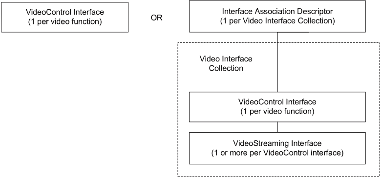

图 7-6：视频接口由一个 VideoControl 接口和零个或多个 VideoStreaming 接口组成。

## 文档

视频规范由多种文档组成。*视频类定义*定义了视频设备的标准描述符、类特定描述符和类特定控制请求。*媒体传输终端*规范定义了针对摄像机和数字录像机等设备的描述符和请求，这些设备流式传输存储在顺序介质中的数据，并可能需要播放、录制、倒带和弹出等功能。单独的有效载荷规范包含多种视频格式（如 MJPEG、MPEG2-TS、DV 和未压缩视频）的格式特定信息。视频类规范 1.1 版（撰写本文时尚在开发中）将弃用其他一些 1.0 格式，并增加通用的基于帧和基于流的格式。其他规范文档包括摄像机示例、常见问题解答（FAQ）以及一份标识符文档，该文档汇集了其他视频类规范中定义的标识符值。在撰写本文时，所有这些规范的当前版本均为 1.0。

## 概述

图 7-6 显示了构成 USB 设备中视频功能的各个元素。每个功能都必须有一个 VideoControl 接口，它提供有关该功能的输入、输出和其他组件的信息。大多数功能还拥有一个或多个 VideoStreaming 接口，用于传输视频数据。视频接口集合（Video Interface Collection）由一个 VideoControl 接口及其关联的 VideoStreaming 接口组成。（仅具有 VideoControl 接口的功能不属于视频接口集合的一部分。）一个设备可以有多个独立的 VideoControl 接口和视频接口集合。

VideoControl 接口使用控制端点，也可能使用中断 IN 端点。每个 VideoStreaming 接口都有一个用于视频数据的等时或批量端点，以及一个可选的用于静止图像数据的批量端点。

## 描述符

视频类定义了大量描述符，使设备能够提供有关设备能力的详细信息。每个视频接口集合都必须有一个接口关联描述符，该描述符指定第一个 VideoControl 接口的接口编号，以及与该功能关联的 VideoStreaming 接口的数量。

## VideoControl 接口。

VideoControl 接口（图 7-7）有一个标准接口描述符，其中 bInterfaceClass = 0Eh 表示视频类，另外还有一个类特定的 VideoControl 接口描述符，该描述符由一个 VideoControl 接口头描述符以及一个或多个 Terminal 和/或 Unit 描述符组成。终端（Terminal）是流入或流出功能的信息的起点或终点。终端可以表示 USB 端点或其他组件，例如 CCD 传感器、显示模块或复合视频输入/输出。终端描述符可以描述输入终端或输出终端。描述符的 wTerminalType 字段指明该描述符所关联终端的功能，如相机、媒体传输输入或媒体传输输出。单元（Unit）对流经功能的数据进行变换。单元描述符有三种类型：选择器单元（Selector Unit）用于将数据流路由到输出，处理单元（Processing Unit）用于控制视频属性，扩展单元（Extension Unit）用于厂商定义的功能。

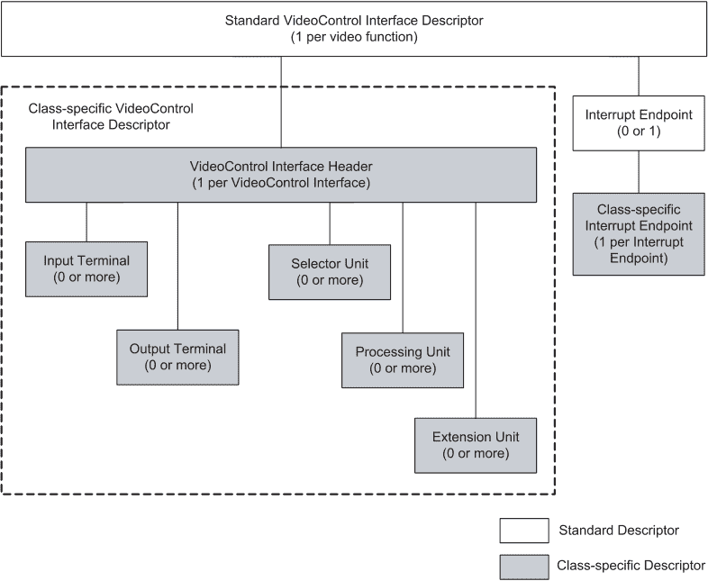

图 7-7：VideoControl 接口提供有关视频功能的输入、输出和其他组件的信息。

如果接口具有中断端点，则该端点有一个标准端点描述符，后跟一个类特定的端点描述符。

### VideoStreaming 接口。

每个 VideoStreaming 接口（图 7-8）都有一个标准接口描述符。在标准接口描述符之后，具有 IN 端点的接口有一个类特定的 VideoStreaming Input Header 描述符，具有 OUT 端点的接口有一个类特定的 VideoStreaming Output Header 描述符。

在 Header 描述符之后，是每种受支持视频格式的 Payload Format 描述符。对于基于帧的格式，在 Payload Format 描述符之后是一个或多个 Frame 描述符，这些描述符描述该类的需求，并且设备必须仅使用 HID 规范中定义的中断或控制传输来传输数据。

海量存储类（mass-storage class）是另一种选择，适用于以文件交换数据并支持主机可理解文件系统的设备。

有些设备需要提供自己的驱动程序。使用芯片制造商提供的驱动程序是一种选择。这种方法使您无需自行开发驱动程序，但会让您依赖芯片供应商来修复错误并跟上新的操作系统版本。第 8 章有更多关于创建自定义驱动程序的内容。

## 从 RS-232 转换

RS-232 串行端口从 PC 诞生之初就一直伴随其左右。该端口已被数千种外设使用。几乎所有使用 RS-232 的设备都可以用 USB 来实现。有几种方法可以实现这种转换。

首先确定该设备是否属于已定义的类。调制解调器应使用通信设备类。指点设备、不间断电源和销售点设备应设计为 HID。

对于许多其他设备，第 6 章介绍的 FTDI Chip 的 FT232BM USB UART 提供了一种快速将设计升级到 USB 的方式。该芯片可以以最小的设计改动将现有 RS-232 设备转换为 USB 设备，并且在大多数情况下无需更改主机软件。

图 7-9 显示了一个示例。带有 RS-232 接口的典型设备包含一个 UART，它在 RS-232 通信中使用的串行数据与 CPU 使用的并行数据之间进行转换。UART 线路侧的信号连接到转换器，这些转换器在 RS-232 电压与 UART 使用的 5V 逻辑之间进行转换。转换器的线路侧连接到通往远程计算机的电缆，该计算机具有 RS-232 接口。要从 RS-232 转换为 USB，请用 FT232BM 替换 RS-232 转换器。在主机上，FTDI Chip 的虚拟 COM 端口驱动程序使应用程序能够使用与 RS-232 通信相同的函数来访问设备。

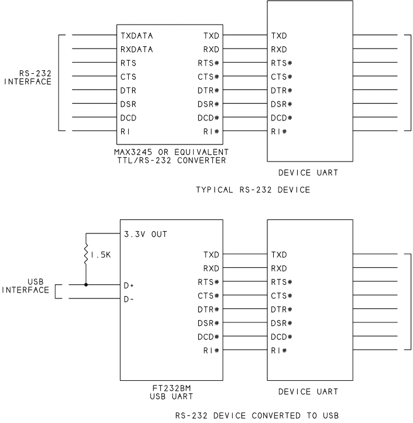

图 7-9：FTDI 的 USB UART 可以将具有 RS-232 接口的设备转换为 USB。FTDI 提供的驱动程序使该设备在主机应用程序看来就像传统的 COM 端口设备。

更简单的解决方案是使用 RS-232/USB 转换器模块。这些模块通常仅包含一个 FT232BM 或类似芯片、一个 RS-232 接口芯片、一个 RS-232 连接器和一个 USB 连接器。这样，用户既可以选择使用原始接口，也可以添加转换器并使用 USB。

使用 USB/RS-232 转换器时，以非常规方式使用状态和控制信号且对时序有严格要求的设备，可能需要对设备硬件、固件或应用程序软件进行修改。

## 从并行端口转换

所有 PC 从一开始就拥有的另一个端口是并行端口。该端口最初用于连接打印机，但许多其他类型的设备也利用了这个端口。并行接口比 RS-232 更快，因此成为扫描仪和外置驱动器的首选连接方式。现在，扫描仪、驱动器和打印机都可以使用 USB 以及针对这些设备类型的标准类。

对于其他设备，有几种转换为 USB 的选项。外设端并行端口接口有 8 个双向数据引脚、5 个状态输出和 4 个控制输入。具有 17 个或更多 I/O 位的 USB 控制器可以模拟并行端口。Prolific Technology 的 PL-2305 具有 USB 接口和完整的 PC 端 IEEE-1284 并行端口，可以直接与现有的并行端口设备连接。

对于固件和驱动程序而言，仅使用控制传输和中断传输即可工作的设备或许可以使用 HID 类。设备将需要新的应用软件来与 HID 驱动程序通信，以取代访问并行端口的驱动程序。如果您希望尽可能少地更改应用程序，可以提供一个自定义驱动程序，其中包含可模拟原始应用程序所调用函数的函数。

## PC 到 PC 的通信

每一次 USB 通信都必须在主机和设备之间进行。USB 不允许主机之间直接交换数据。然而，由于每台 PC 都有 USB 端口，人们自然希望使用该接口将 PC 相互连接，尤其是在 PC 没有以太网端口的情况下。

USB On-The-Go 使设备也可以充当主机。不过，大多数 PC 不包含 On-The-Go 主机控制器。另一种解决方案是使用


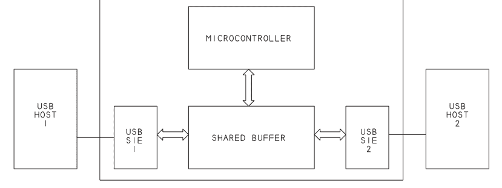

图 7-10：为了使两个 USB 主机能够相互通信，两个 USB 串行接口引擎可以共享一个缓冲区。每个 SIE 将接收到的 USB 数据复制到共享缓冲区中，而另一设备则从缓冲区中检索数据并将其发送到另一主机。

包含两个串行接口引擎的主机到主机桥接电缆。每个 PC 都通过 USB 连接到其中一个 SIE，两个设备通过共享缓冲区相互通信（图 7-10）。PC 发送的数据经过其中一个 SIE、共享缓冲区，然后从另一个 SIE 传出到远程 PC。

Prolific Technology 的 PL-2501 Hi-Speed USB 主机到主机桥接控制器是一款专为此类主机到主机应用设计的单芯片。该芯片包含一个 8032 微控制器和两个可访问公共缓冲区的 USB SIE。PL-2301 是全速版本。许多商用的“数据链路文件传输电缆”都包含其中一种芯片。通常，驱动程序使每个 PC 都能将对方视为网络连接的计算机。

另一种方法是使用两个 FTDI Chip USB UART 并以“空调制解调器”配置交叉连接异步接口。这样 PC 彼此之间就被视为 COM 端口设备。另一种选择是通过为每台 PC 连接一个 USB/Ethernet 转换器并将每个转换器连接到本地网络来建立网络连接。

## 使用通用驱动程序

对于不符合标准类别的设备，通用驱动程序可以是一种解决方案。通用驱动程序通常使应用程序能够使用特定于驱动程序的 API 请求控制、中断、批量和等时传输。两种此类选项是 Tetradyne Software, Inc. 的 DriverX USB 工具包和 Thesycon Systemsoftware & Consulting GmbH 的 USBIO 开发套件。（是的，这个拼写是正确的。）

DriverX USB 工具包包括一个通用驱动程序、用于 Visual C++ 和 Borland C++ Builder 的头文件和库文件，以及对 Delphi 和 Visual Basic 的额外支持。

要与 USBIO 开发套件中包含的驱动程序通信，应用程序可以使用标准 Windows API 函数（ReadFile、WriteFile、DeviceIoControl）、C++ 类库、原生的 Delphi 和 Java 接口，或基于 Microsoft 组件对象模型（COM）技术的 USBIO COM 接口。

# 第8章

## 主机如何通信

在 Windows 下，想要访问 USB 外设的应用程序必须与一个了解如何管理与系统 USB 驱动程序通信的设备驱动程序通信。本章解释了 Windows 如何管理 USB 通信并探讨了设备驱动程序的选项。

### 设备驱动程序基础

设备驱动程序是使应用程序能够访问硬件设备的软件组件。硬件设备可能是打印机、调制解调器、键盘、视频显示器、数据采集单元，或 CPU 可以访问的电路控制的几乎任何东西。一些设备，例如内部磁盘驱动器，位于 CPU 所在的机箱内。其他设备，包括几乎所有 USB 设备，都是通过电缆（或无线链路）连接到系统的外部设备。如第 7 章所述，一些设备驱动程序是类驱动程序，处理与执行类似功能的各种设备的通信。

### 将应用程序与细节隔离开

应用程序是用户运行的程序，包括从文字处理器和数据库到访问定制硬件的专用应用程序的一切。设备驱动程序使应用程序免于了解与设备通信所需的物理连接、信号和协议的细节。

设备驱动程序可以在应用程序仅知道外设的名称（例如 HP LaserJet 2300）或设备的功能（操纵杆、驱动器、扫描仪）时，使应用程序代码访问外设。应用程序不必知道外设连接到的端口的物理地址，也无需监控和控制握手信号。应用程序甚至不必知道设备使用的是 USB 还是其他接口。对于执行类似功能但接口不同的设备，应用程序代码可以相同，硬件特定细节在较低层级处理。

设备驱动程序在应用程序级代码和硬件特定代码之间进行转换。应用程序使用操作系统支持的函数与设备驱动程序通信。硬件特定代码处理访问外设电路所需的协议，包括检测状态信号的状态并在适当时间切换控制信号。

Windows 中 USB 设备的驱动程序使用分层驱动程序模型，其中系列中的每个驱动程序执行通信的一部分。顶层包含客户端设备驱动程序（简称客户端驱动程序），它管理应用程序与低层总线驱动程序之间的通信。客户端驱动程序的另一个术语是功能驱动程序。底层包含总线驱动程序，管理客户端驱动程序与硬件之间的通信。一个或多个过滤驱动程序可以补充客户端和总线驱动程序。

分层驱动程序模型简化了编写驱动程序的工作。设备可以共享共同任务的代码。处理与系统 USB 硬件通信的驱动程序包含在 Windows 中，因此客户端驱动程序的编写者不必处理这些细节。另请注意，分层驱动程序模型意味着应用程序无法直接访问 USB 端口。Windows 不允许这样做。所有应用程序通信必须与分配给设备的驱动程序进行。

### USB 设备的选项

对于正在开发的 USB 设备，有几种获取驱动程序的方法。许多设备可以使用随 Windows 提供的驱动程序或由芯片厂商或其他来源提供的驱动程序。其他设备可能需要自定义驱动程序。当需要自定义驱动程序时，有工具包可用于简化并加快驱动程序编写任务。有时不止一种方法可行，选择取决于什么更简单、更便宜或性能更好。

如第 7 章所示，许多外设属于标准类别，例如磁盘驱动器、打印机、调制解调器、键盘和鼠标。这些设备中的每一个都提供多种接口选择，包括 USB。例如，磁盘驱动器可能使用 ATA/ATAPI、SCSI、IEEE-1394 或 USB。当同一类别中的设备可能具有多种硬件接口时，补充驱动程序可以支持不同的接口。如果设备的特性和功能超出了类驱动程序支持的范围，则特定于设备的过滤驱动程序可能能够按需支持这些特性。

### 用户模式和内核模式

要了解设备驱动程序需要做什么，您需要了解驱动程序在数据传输通信路径中的位置。即使您不需要为设备编写驱动程序，了解驱动程序的作用也有助于理解您实际编写的应用程序级代码。

从最一般的意义上讲，设备驱动程序是处理与 CPU 接口的硬件设备的通信细节的任何代码。应用程序中的一个简短子程序也可以被视为设备驱动程序。在 Windows 下，大多数驱动程序（包括 USB 驱动程序）的代码与应用程序代码不同，因为操作系统允许驱动程序代码比应用程序更高的特权级别。

Windows 系统中的程序代码在两种模式之一中运行：用户模式或内核模式。每种模式在访问内存和其他系统资源时允许不同的特权级别。应用程序必须在用户模式下运行。大多数驱动程序，包括所有 USB 驱动程序，都在内核模式下运行，尽管 USB 设备的驱动程序

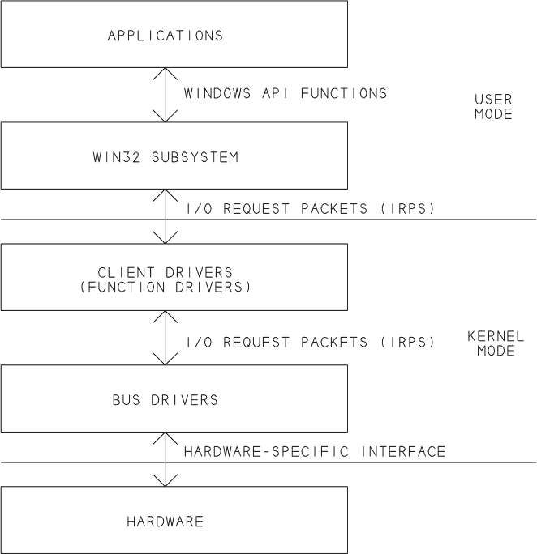

图 8-1：在 Windows 下，USB 使用分层驱动程序模型，具有用于设备及其连接的总线的单独驱动程序。

可能有一个补充的用户模式驱动程序。图 8-1 显示了 USB 通信中用户模式和内核模式的主要组件。

在用户模式下，Windows 限制对内存和其他系统资源的访问。Windows 不允许应用程序访问操作系统指定为受保护的内存。以这种方式管理内存使 PC 能够同时运行多个应用程序。如果一个应用程序崩溃，其他应用程序不应受影响。在 x86 处理器上，用户模式对应于 CPU 的 Ring 3 模式。


在内核模式下，代码可以不受限制地访问系统资源，包括执行内存管理指令和控制对 I/O 端口的访问的能力。内核模式驱动程序可以允许或拒绝应用程序访问设备。例如，操纵杆驱动程序可以允许任何应用程序使用设备，或者驱动程序可以允许应用程序将设备保留为独占使用。Windows 为内核模式驱动程序保留的其他功能包括 DMA 传输和响应硬件中断。在 x86 处理器上，内核模式对应于 CPU 的 Ring 0 模式。

应用程序使用 Windows API 函数或内部调用 API 函数但将细节屏蔽给应用程序程序员的其他组件与客户端驱动程序通信。Windows WIN32 子系统管理应用程序与客户端驱动程序之间的通信。要与 USB 设备通信，应用程序通常不需要了解任何关于 USB 协议的信息，甚至不需要知道设备是否使用 USB。

驱动程序使用称为 I/O 请求包（IRP）的结构相互通信。Windows 定义了一组驱动程序可使用的 IRP。每个 IRP 请求单个输入或输出操作。USB 设备的客户端驱动程序使用 IRP 与处理 USB 通信的总线驱动程序通信。总线驱动程序包含在 Windows 中，应用程序程序员或设备驱动程序编写者无需对其进行编程。

## WDM Drivers

Windows 的 USB 设备驱动程序是内核模式驱动程序，必须符合 Microsoft 为 Windows 98 及更高版本使用而定义的 Windows 驱动程序模型。这些驱动程序被称为 WDM 驱动程序，扩展名为 .sys。（其他驱动程序类型也可能使用 .sys 扩展名。）

应用程序程序员可以选择编程语言，包括 Visual Basic、Delphi 以及 C 及其衍生语言。但要编写 USB 设备的驱动程序，您需要一种能够编译 WDM 驱动程序的工具。Windows DDK 包含用于此目的的 C 编译器。例外情况是驱动程序工具包，它们提供通用驱动程序，要么完全不需要编程，要么允许您使用其他编译器通过用户模式组件来自定义通用驱动程序。

## Layered Drivers

在 USB 通信中使用的分层驱动程序模型中，每一层处理通信过程的一部分。将通信分为层是高效的，因为具有共同任务的设备可以对这些任务使用相同的驱动程序。例如，各类设备都可能使用 USB，因此拥有一个驱动程序集来处理所有设备共有的 USB 特定任务是有意义的。将这些驱动程序包含在 Windows 中意味着设备供应商不必提供驱动程序。另一种选择是让每个设备驱动程序直接与 USB 硬件通信，造成大量工作重复。

图 8-2 显示了 Windows XP 下 USB 通信涉及的层。

## Client Drivers

客户端驱动程序可以由一个或多个文件组成。主要的客户端驱动程序可以是随 Windows 提供的类驱动程序或供应商提供的驱动程序。客户端驱动程序管理特定于设备或设备类别的通信。类驱动程序还可能与管理与某类设备子集通信的迷你类驱动程序通信。例如，HID USB 迷你类驱动程序管理与具有 USB 接口的 HID 类设备的 USB 特定通信。其他 HID 迷你类驱动程序可以管理与具有其他硬件接口的 HID 的总线特定通信。

客户端驱动程序或迷你类驱动程序还可能有一个或多个上层和下层过滤驱动程序（图 8-3）。上层过滤驱动程序可以监视和修改应用程序与客户端驱动程序之间的通信。下层过滤驱动程序可以监视和修改客户端驱动程序与总线驱动程序之间的通信。

## How the Host Communicates

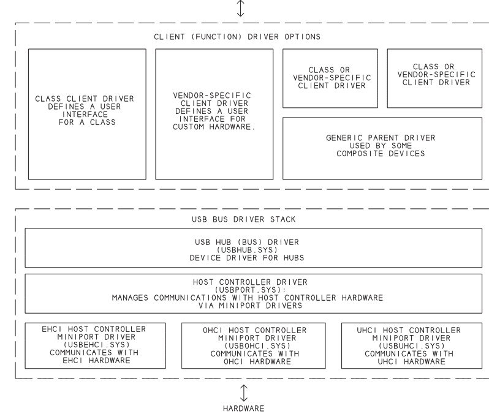

图 8-2：Windows XP 下的 USB 通信涉及 USB 总线驱动程序堆栈和一个或多个客户端驱动程序。

对于某些复合设备，Windows XP 在总线驱动程序与设备接口的客户端驱动程序之间加载一个 USB 通用类通用父驱动程序。通用父驱动程序处理设备的整体同步、即插即用和电源管理功能，并管理总线驱动程序与复合设备接口的客户端驱动程序之间的通信。

## USB Drivers

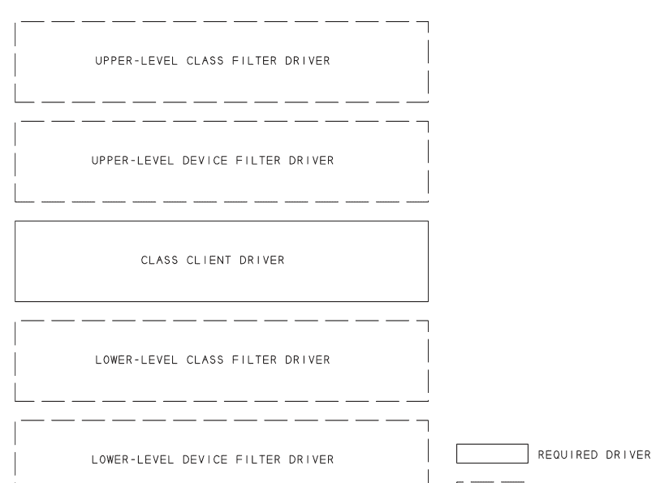

图 8-3：客户端驱动程序可以有一个或多个过滤驱动程序来监视或修改与设备的通信。

在 Windows XP 下，USB 总线驱动程序由主机控制器驱动程序、一个或多个迷你端口驱动程序和集线器驱动程序组成。主机控制器驱动程序有时称为端口驱动程序，管理所有主机控制器共有的任务。主机控制器驱动程序由一个端口驱动程序（usbport.sys）和一个或多个迷你端口驱动程序组成，每个迷你端口驱动程序管理与三种主机控制器类型之一的通信。集线器驱动程序管理与系统集线器的通信。在 Windows XP 中，集线器驱动程序是 usbhub.sys。

总线驱动程序包含在 Windows 中，应用程序和设备驱动程序编写者不必了解其工作原理的细节。

也许正因为如此，Microsoft 对这些驱动程序提供的文档很少。如果您想了解更多关于低级通信如何工作，Linux USB 项目的源代码和其他文档是一个信息来源。

## Host Controller Types

有三种类型的主机控制器。两种支持低速和全速通信，一种支持高速通信。低速和全速控制器类型是开放主机控制器接口（OHCI）和通用主机控制器接口（UHCI）。高速主机控制器实现增强主机控制器接口（EHCI）。USB-IF 的网站提供了规范的链接。

Windows 的设备管理器使您能够查看 PC 中主机控制器的信息。要查看驱动程序类型，右键单击主机控制器名称，选择属性，然后选择驱动程序和驱动程序详细信息。其中一个驱动程序的名称中应包含 *ohci*、*uhci* 或 *ehci*。第 9 章有更多关于使用设备管理器的内容。

## OHCI and UHCI Differences

在 Windows XP 中，符合 OHCI 标准的控制器使用驱动程序 *usbohci.sys*，符合 UHCI 标准的控制器使用驱动程序 *usbuhci.sys*。在其他 Windows 版本中，驱动程序名称可能有所不同，但会包含 *ohci* 或 *uhci*。这两个驱动程序都为 USB 硬件与总线类驱动程序通信提供了一种方式。两个驱动程序在实现主机控制器功能方面采用不同的方法。UHCI 将更多通信负担放在软件上，允许使用更简单、更便宜的硬件。OHCI 将更多负担放在硬件上，允许更简单的软件控制。UHCI 由 Intel 开发，OHCI 由 Compaq、Microsoft 和 National Semiconductor 开发。

这些差异对驱动程序开发人员和应用程序程序员应该是透明的。两个控制器都完全符合 USB 规范。然而，它们的性能可能不同。开发人员不应仅根据使用一种主机控制器类型的测试就假设其设备工作正常。

OHCI 控制器能够在一个帧中调度控制传输的多个阶段，而 UHCI 控制器始终在不同的帧中调度每个阶段。对于最大数据包大小小于 64 字节的批量端点，UHCI 驱动程序每帧尝试不超过一次事务，而 OHCI 驱动程序可能在一个帧中调度额外的事务。OHCI 控制器将至少每 32 毫秒轮询一次中断端点，即使端点描述符请求的最大延迟为 255 毫秒，而 UHCI 控制器可以，但不必，支持更不频繁的轮询。

使用 UHCI 主机的开发人员有时会惊讶于他们的设备连接到 OHCI 主机时失败，通常是因为设备不期望在单个传输中每帧看到多次事务尝试。每个设备都应该与两种控制器类型一起工作。在两者上测试您的设备！

## Supporting All Speeds

EHCI 控制器仅处理高速通信。EHCI 规范规定，支持 EHCI 的主机还必须支持低速和全速，除非出现每个端口都有永久连接的高速设备的特殊情况。要支持低速和全速，主机必须具有配套的 OHCI 或 UHCI 主机控制器或符合 USB 2.0 的集线器，后者执行低速和全速设备的控制器功能。几乎每台具有 EHCI 控制器的 PC 都有配套的 OHCI 或 UHCI 控制器。EHCI 控制器和配套的 OHCI 或 UHCI 控制器可以共享总线。

用户和应用程序程序员不必知道或关心哪个主机控制器正在与设备通信，尽管如果系统具有高速端口并且用户将高速设备连接到 1.x 集线器，Windows 会发出警告。EHCI 控制器的驱动程序是 *usbehci.sys*。


## 通信流程

要更好地理解 USB 传输过程中发生的事情，一种方法是查看一个示例。以下是使用供应商特定客户端设备驱动程序的数采设备进行 USB 传输的步骤。

## 初步要求

在应用程序可以与设备通信之前，必须完成几项准备工作。当设备连接时，Windows 会管理枚举，如第 4 章所述。为了在首次枚举时确定使用哪个驱动程序，Windows 会将检索到的描述符与系统 INF 文件中的信息进行比较。第 9 章将详细介绍 INF 文件。当设备支持多种配置时，驱动程序会选择一种配置。随后，将访问该设备的应用程序可以获得一个标识该设备并启用与其通信的句柄。

## 发起数据传输

要从数采设备读取数据，用户可能会点击数采应用程序中的按钮。或者用户可能会选择一个选项，使应用程序每分钟请求一次读数。或者，当设备驱动程序被加载或用户运行应用程序时，周期性数据采集可能会自动开始。

## 应用程序的角色

Windows 包含使应用程序能够与客户端驱动程序通信的 API 函数。使用 Visual Basic、C/C++/C#、Delphi 和其他语言编写的应用程序可以调用 API 函数。可用函数因驱动程序而异，但应用程序通常可以通过 `CreateFile` 打开通信，通过组合使用 `ReadFile`/`ReadFileEx`、`WriteFile`/`WriteFileEx` 和 `DeviceIoControl` 交换数据，并通过 `CloseHandle` 关闭通信。

为了使编程更简单、更安全，许多语言支持访问各种类型设备的替代方式。Microsoft 的 .NET 平台包含类和方法，无需直接调用许多 API 函数。相反，应用程序通过中间层与公共语言运行时（CLR）组件通信，而该组件再调用 API 函数。例如，在 Visual Basic .NET 中，`PrintDocument` 类包含的方法使应用程序能够将文本和图像发送到打印机。

然而，与任何设备的通信有时可能需要调用 API 函数。例如，.NET 不提供通过 `WM_DEVICECHANGE` 消息检测设备连接和断开的方法。

每次调用 API 函数都包括请求、其他必要信息（如要写入的数据或要读取的数据量）以及用于访问设备的句柄。Microsoft 的平台软件开发工具包（SDK）对这些函数进行了文档说明。

尽管这些函数名称暗示它们仅用于文件，但 `ReadFile` 和 `WriteFile`（以及 `ReadFileEx` 和 `WriteFileEx`）可以向任何支持基于句柄操作的驱动程序传输数据，也可以从中接收数据。正在读取的数据或将要写入的数据存储在函数调用指定的缓冲区中。调用 `ReadFile` 并不总是导致驱动程序从设备检索数据。该函数可能改为返回驱动程序已请求并存储在缓冲区中的数据。具体细节因驱动程序而异。

`DeviceIoControl` 是在缓冲区之间传输数据的另一种方式。每个 `DeviceIoControl` 请求都包含一个标识特定请求的控制代码。与 `ReadFile` 和 `WriteFile` 不同，单个 `DeviceIoControl` 调用可以双向传输数据。驱动程序为每个控制代码指定在每个方向上传递哪些数据（如果有）。某些控制代码是不需要传递额外数据的命令。

Windows 驱动程序为驱动器和其他常见设备定义控制代码。例如，`IOCTL_STORAGE_CHECK_VERIFY` 确定可移动介质上是否存在介质且可读，`IOCTL_STORAGE_GET_MEDIA_TYPES` 返回驱动器支持的介质类型。

特定供应商的驱动程序也可以定义控制代码。由于这些代码仅发送给特定驱动程序，因此其他驱动程序使用相同的代码无关紧要。例如，Cypress Semiconductor 的通用驱动程序 CyUsb.sys 定义了一系列用于传输数据、配置设备以及请求状态和配置信息的 `DeviceIoControl` 代码。

驱动程序还可以定义应用程序可以使用的其他函数。例如，HID 驱动程序定义了 `Hid_GetFeature` 和 `HidD_SetFeature` 函数，用于检索和发送 Feature 报告。这些函数在内部使用 `DeviceIoControl`，但为应用程序程序员公开了驱动程序特定的函数。

## 客户端驱动程序的角色

当应用程序调用读取或写入 USB 设备的 API 函数时，Windows 会将调用传递给相应的客户端驱动程序。该驱动程序以 USB 总线类驱动程序能够理解的格式传递请求。

如前所述，驱动程序使用 IRP 相互通信。对于 USB 通信，IRP 包含称为 USB 请求块（URB）的结构，使驱动程序能够配置设备和传输数据。例如，驱动程序通过提交包含以下 URB 的 IRP 来请求描述符：

```
URB_FUNCTION_GET_DESCRIPTOR_FROM_DEVICE
```

Windows DDK 对这些 URB 进行了文档说明。

客户端驱动程序通过创建 URB 并将其作为 IRP 提交给更底层驱动程序来请求传输。总线和主机控制器驱动程序处理在总线上调度事务的细节。对于中断和等时传输，如果端点的计划时间到来时没有未完成的 IRP，则主机控制器会跳过该事务。

对于需要多个事务的传输，客户端驱动程序为整个传输提交一个 IRP。然后，传输的所有事务都会被调度，而无需与客户端驱动程序进一步通信。

如果您使用的是现有客户端驱动程序（而不是自己编写），则需要了解如何访问驱动程序的应用程序级接口，但无需关心 IRP 和 URB。如果您正在编写客户端驱动程序，则需要提供与系统 USB 驱动程序通信的 IRP。

## 集线器驱动程序的角色

USB 集线器驱动程序，也称为总线驱动程序，是总线上集线器的设备驱动程序。总线驱动程序不需要设备开发人员进行编程。

## 主机控制器驱动程序的角色

主机控制器驱动程序将客户端驱动程序提供的数据传递给主机控制器硬件，而主机控制器硬件再连接到总线。主机控制器驱动程序不需要设备开发人员进行编程。

## 设备的角色

离开主机端口的数据可能会经过其他集线器。最终，数据到达连接到设备的集线器，然后集线器将数据传递给设备。设备识别其地址，读取传入数据，并采取相应操作。

## 响应

大多数通信都需要响应，其中可能包括响应请求而发送的数据或带有状态代码的数据包。该信息以相反顺序返回主机：通过设备的集线器、进入总线，然后到达 PC 的硬件和软件。客户端驱动程序可能会将响应传递给应用程序，应用程序可能会显示结果或采取其他操作。

## 结束通信

当通信完成时，应用程序可以使用 API 函数 `CloseHandle` 释放系统资源。

## 更多示例

与其他 USB 设备的通信遵循类似的路径，但传输的发起方式以及客户端驱动程序处理通信的方式可能存在差异。

用户发起传输的其他示例包括：单击 USB 驱动器图标以查看磁盘文件夹，或在应用程序中单击“打印”以将文件发送到 USB 打印机。在这些情况下，在应用程序请求通信并且设备驱动程序用要发送的数据填充缓冲区或为接收的数据提供缓冲区之前，不会进行数据传输。

驱动程序也可以使主机持续从设备请求数据，无论应用程序是否已请求。例如，键盘驱动程序使主机频繁请求按键数据，因为无法预测用户何时按键。

主机还会在系统上电或设备连接时发送枚举请求。当集线器通知主机存在设备时，设备的集线器会使主机发起这些请求。挂起设备可以使用 USB 的远程唤醒功能，通过向其集线器发送信号来发起传输，进而向主机发送信号，以请求恢复通信。

## 创建自定义驱动程序

创建 WDM 驱动程序并非易事。编写驱动程序需要 C 编程方面的专业知识，并且需要大量了解 Windows 如何与硬件和应用程序通信。但是，有几种产品可以帮助简化和加速该过程。

### 从头开始编写驱动程序

从头开始编写设备驱动程序的最低要求是 Windows 驱动程序开发工具包（DDK），其中包含创建驱动程序所需的内容：C 编译器、链接器、构建实用工具和文档。还包括过滤驱动程序以及请求批量传输和等时传输的驱动程序的示例源代码。这些示例驱动程序是开发自定义驱动程序的有用起点。

如何从头开始编写 USB 驱动程序是一个比本书篇幅所允许的更大的主题。关于此主题的一本优秀书籍是 Walter Oney 所著的《编程 Microsoft Windows 驱动程序模型》。


为了获得更快的性能，你可以将部分代码从用户模式驱动程序转移到称为 Kernel PlugIn 的内核模式驱动程序中，并使用 Visual C++ 编译该驱动程序。为了调试，附带的 Debug Monitor 应用程序使你可以监控驱动程序处理的通信。WinDriver USB 的不同版本支持 Windows、Windows CE .NET 和 Linux。

## 提供用于创建自定义驱动程序的库的工具包

完全自动化的工具包并非适用于所有设备。它们无法创建筛选器驱动程序，而且你可能希望获得一个完全自定义的驱动程序以获得最佳性能。用于创建自定义驱动程序的两个产品是 DriverStudio 套件中的 Compuware 的 DriverWorks 和 Jungo 的 KernelDriver USB。

这两个产品都有向导和代码库，可为你完成大部分工作。你需要填写提供的骨架代码并编译驱动程序。该驱动程序的性能可以与从头编写的驱动程序一样快。DriverWorks 能够为使用 USB 以外其他总线的设备生成驱动程序代码。Jungo 有一个针对非 USB 设备的独立 KernelDriver 产品。

## 使用 GUID

全局唯一标识符（GUID）是一个 128 位值，用于唯一标识类或其他实体。Windows 使用 GUID 来标识两种类型的设备类：设备安装类和设备接口类。设备安装 GUID 标识设备安装类，该类包含 Windows 以相同方式安装的设备。设备接口 GUID 标识设备接口类。设备接口 GUID 提供了一种机制，使应用程序能够与分配给该类中设备的驱动程序通信。在许多情况下，属于特定设备安装类的设备也属于同一个设备接口类。某些 SetupDi_ API 函数可接受任一类型的 GUID。但每种类型的 GUID 可访问不同类型的信息，这些信息用于不同的目的。

表 8-1：Windows 支持的设备安装类以及包含这些安装类中设备的 USB 设备类的选择。

| 设备安装类 | USB 类 |
| --- | --- |
| 电池设备 | HID |
| CD-ROM 驱动器 | 大容量存储 |
| 磁盘驱动器 | 大容量存储 |
| 人机接口设备 (HID) | HID |
| 成像设备（静止图像） | 静止图像捕获 |
| 键盘 | HID |
| 调制解调器 | 通信 |
| 鼠标 | HID |
| 打印机 | 打印机 |
| 智能卡读卡器 | 芯片/智能卡接口 |
| 磁带驱动器 | 大容量存储 |
| USB | 主机控制器和集线器，厂商特定功能 |

获取有关设备的信息并执行诸如启用、禁用、重启、更新设备的驱动程序以及删除设备等功能。用户可以通过 Windows 的设备管理器执行这些相同的功能。

## 设备接口 GUID

类或设备驱动程序可以注册一个或多个设备接口类，以使应用程序能够了解并使用该驱动程序的设备进行通信。每个设备接口类都有一个设备接口 GUID。

使用设备接口 GUID 和 SetupDi_ 函数，应用程序可以查找设备接口类中的所有已连接设备。检测到设备后，应用程序可以获得设备路径名，并将其传递给 CreateFile 函数。CreateFile 返回一个句柄，应用程序可以使用该句柄向设备读写数据。应用程序还可以使用设备接口 GUID 请求在设备连接或移除时获得通知。第 10 章将更多介绍将 GUID 用于此目的的细节。

# 9 将驱动程序与设备匹配

在检测到新连接的 USB 设备时，操作系统需要决定为该设备分配哪个驱动程序。本章介绍 Windows 如何使用 INF 文件选择驱动程序。我还将介绍 Windows 设备管理器和系统注册表如何存储有关设备及其驱动程序的信息。

### 使用设备管理器

Windows 设备管理器显示所有已安装设备的信息，并提供一个用户界面，用于启用、禁用和卸载设备以及更新或更改设备的指定驱动程序。对于开发人员来说，设备管理器可用于显示是否正确分配并成功安装了驱动程序，并提供一种方法强制 Windows 忘记它了解的设备信息并重新开始。

### 查看设备

要查看设备管理器，在 Windows XP 中，右键单击“我的电脑”，单击“管理”，然后在“计算机管理”窗格中选择“设备管理器”。或者单击“开始”，然后选择“设置”>“控制面板”>“系统”>“硬件”>“设备管理器”。或者通过创建指向 Windows\System32 中 devmgmt.msc 文件的快捷方式来节省点击次数。

设备管理器的“查看”菜单提供四种查看信息的方式：按类型和按连接查看设备，以及按类型和按连接查看资源。按连接查看设备（图 9-1）显示从每个主机控制器和根集线器经过任何附加集线器到所连接设备的物理连接。要查看有关设备的信息，包括其驱动程序以及操作系统检测到的与该设备相关的任何问题，请右键单击设备列表并选择“属性”（图 9-2）。

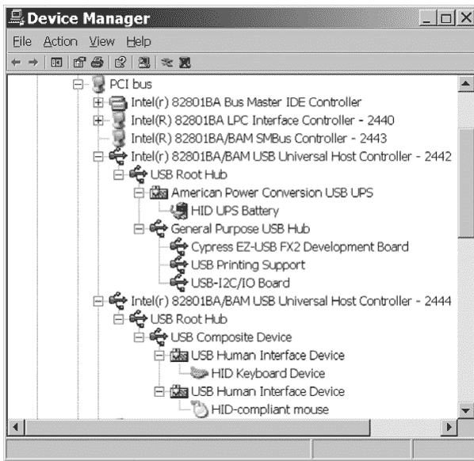

图 9-1：设备管理器按连接查看设备的选项可快速显示哪些设备连接到哪些集线器和主机控制器。

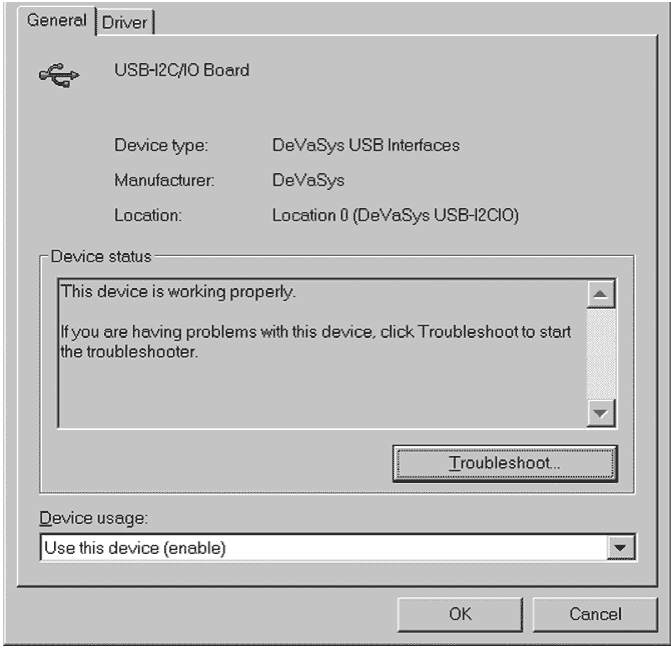

图 9-2：设备管理器的“属性”屏幕提供有关设备的更多信息，包括操作系统分配给该设备的驱动程序。

按类型查看设备（图 9-3）会根据设备的功能对设备进行分组，而几乎不考虑硬件接口。注册表中的 Class 键决定设备出现在哪个类别或哪些类别中。许多设备适合标准类别，如磁盘驱动器、键盘和调制解调器。有些设备属于多个类别。例如，键盘可能同时出现在“人机接口设备”和“键盘”下。USB 类别列出主机控制器、集线器和其他一些设备。带有厂商特定驱动程序的设备可以有自己的类别，也可以使用 USB 类别。

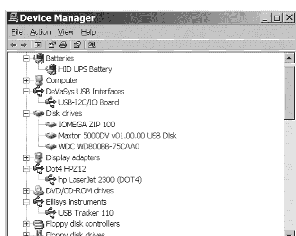

图 9-3：设备管理器也有一个按类型（或功能）分组查看设备的选项。

按连接或按类型查看资源会显示分配给每个主机控制器的内存和 I/O 地址以及中断请求（IRQ）线路。在开发 USB 设备、驱动程序或应用程序时，你可能不太需要这些信息。

设备图标上的感叹号表示主机在与设备通信或查找驱动程序时遇到问题。图标上的 X 表示设备存在但已被禁用，可能是由用户禁用的。

默认情况下，设备管理器仅显示已连接的 USB 设备。要查看已被移除但其驱动程序仍处于安装状态的设备，请设置以下系统环境变量：

```
DEVMGR_SHOW_NONPRESENT_DEVICES=1
```

若要设置该变量，请在 Windows 的“控制面板”中，单击“系统”>“高级”>“环境变量”，输入变量名称并设置其值。然后在设备管理器中，单击“查看”并选中“显示隐藏的设备”选项。设置环境变量后，你可能需要重新启动。

### 属性页

设备管理器中的每个列表都有“属性页”，提供有关设备的附加信息以及控制设备和驱动程序的能力。要查看“属性页”，请双击设备列表。你可以请求启用或禁用设备，或查看、更新、回滚或卸载设备的驱动程序。“详细信息”页提供附加信息，包括各种系统 ID、设备使用的任何筛选器驱动程序或联合安装程序，以及电源功能。

### 注册表中的设备信息

系统注册表是 Windows 维护的数据库，用于存储系统上安装的硬件和软件的关键信息。注册表存储所有已安装设备的信息，无论这些设备当前是否已连接。当枚举新设备时，Windows 会在注册表中存储有关该设备的信息。

注册表中有关 USB 设备的一些信息来自总线驱动程序，这些驱动程序从设备获取信息。其他信息来自操作系统在为设备分配驱动程序时选择的 INF 文件。

你可以使用 Windows 的 regedit 实用程序查看注册表的内容。（从“开始”菜单中选择“运行”，然后输入 regedit。）你也可以使用 regedit 编辑注册表的内容，但不建议以这种方式更改注册表，而且很少有必要这样做。Windows Platform SDK 记录了使应用程序能够读写注册表的 API 函数。通常，只有在设备安装时才需要更改注册表中的设备信息。通过设备管理器或其他应用程序请求卸载设备也会导致注册表发生更改。

系统注册表是 Windows 的关键且必要的组成部分。它非常重要，以至于 Windows 维护多个备份副本，以防当前-

# 第9章

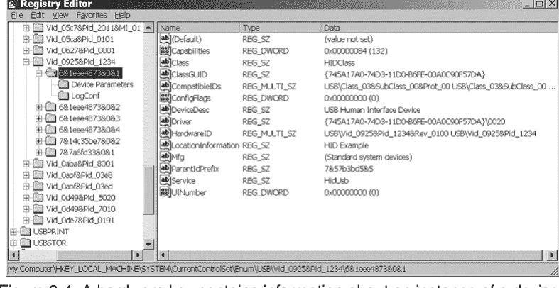

图 9-4：硬件键包含有关具有特定供应商 ID 和产品 ID 的设备实例的信息。

当前副本将变得不可用。对注册表进行更改时务必极其小心。Windows 的系统还原实用程序可以将注册表恢复到较早的状态。然而，仅查看注册表是安全的。

注册表的数据具有树形结构。树上的每个节点都是一个注册表键。每个键可以具有带分配值的条目以及子键，而子键又可以具有条目和子键。有关系统硬件和已安装软件的信息位于 HKEY_LOCAL_MACHINE 键下，其中有关 USB 设备的信息位于几个子键下：硬件键、类键、驱动程序键和服务键。

### 硬件键

硬件键，也称为实例键或设备键，存储有关特定设备实例的信息。硬件键位于枚举程序 (Enum) 键下：

```
HKEY_LOCAL_MACHINE\System\CurrentControlSet\Enum
```

在 Enum 键下有一个 USB 键。USB 键的每个子键都包含 USB 设备的供应商 ID 和产品 ID。图 9-4 显示了供应商 ID 为 0925h 且产品 ID 为 1234h 的设备的条目。在这些键的每个键下可能有一个或多个硬件键，每个硬件键标识设备的实例。表 9-1 列出了硬件键下的一些条目。

没有 USB 序列号的设备每次连接到之前未连接过的端口时都会获得一个新的硬件键。如果你物理移除设备并将具有相同描述符的不同设备连接到同一端口，操作系统无法区分，因此不会创建新的硬件键。具有 USB 序列号的设备每个物理设备只有一个硬件键，与设备连接的端口无关。

USB 设备还可能具有一个或多个用于其他枚举程序的键，例如 HID、USBPRINT 和 USBSTOR。例如，具有 HID 接口的 UPS 备份设备可以在 Enum\USB 分支中有一个键来命名 HidUsb 服务，并在 Enum\HID 分支中有一个键来命名 HidBatt 服务。

### 类键

类键存储有关设备设置类及其所属设备的信息。类键位于此注册表键下：

```
HKEY_LOCAL_MACHINE\System\CurrentControlSet\Control\Class
```

类键的名称是该类的设备设置 GUID。这与存储在该类设备的硬件键下的 ClassGUID 中的值相同。图 9-5 显示了 HID 类的类键。类键包含设置类的友好名称、定义 GUID 的头文件中的类名，以及指定在设备管理器和其他显示设置信息的窗口中使用的图标的索引值。应用程序可以通过调用 SetupDiGetClassBitmapIndex 来检索类的迷你图标的索引。特定于厂商的类安装程序或协同安装程序可以提供特定于厂商的图标。

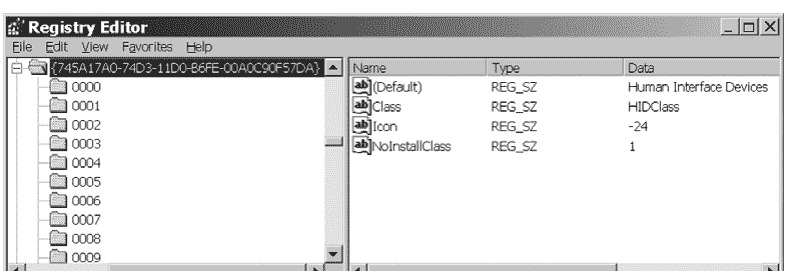

图 9-5：HID 类的类键包含类的友好名称和指向图标的索引。

类键中的可选条目会影响用户在设备安装时看到的内容。如果存在 NoInstallClass 且不等于零，用户永远不需要手动安装该类中的设备。如果存在 SilentInstall 且不等于零，即插即用管理器将安装该类中的设备，而不会显示对话框或要求用户交互。如果存在 NoDisplayClass 且不等于零，设备管理器不会显示该类的设备。

UpperFilters 和 LowerFilters 条目可以指定适用于该类中所有设备的上层过滤器和下层过滤器驱动程序。

### 驱动程序键

在类键下，类中的每个设备都有一个驱动程序键，也称为软件键。在设备实例的硬件键中，Driver 条目命名一个与类键匹配的设备设置 GUID 和一个与类键下的驱动程序子键匹配的设备实例号。图 9-6 显示了通用 HID 类设备的键。表 9-2 列出了驱动程序键的一些条目。

驱动程序键包含 INF 文件的名称，而该 INF 文件又命名设备的驱动程序文件。

### 将驱动程序与设备匹配

表 9-1：USB 设备硬件键中的一些条目。

| 键 | 描述 | 信息来源 |
|---|---|---|
| Class | 设备的设置类名称 | INF 文件（来自 devguid.h） |
| ClassGUID | 设备的设置类 GUID | INF 文件（来自 devguid.h） |
| DeviceDesc | 设备描述 | INF 文件，Models 部分，设备描述条目 |
| HardwareID | 包含设备供应商 ID 和产品 ID 的 ID 字符串 | 设备描述符 |
| CompatibleIDs | 包含设备的类以及（可选）子类和协议的 ID 字符串 | 设备和接口描述符 |
| Mfg | 设备制造商 | INF 文件，Manufacturer 部分，制造商名称条目 |
| Driver | 设备驱动程序键的名称 | 系统注册表，位于 CurrentControlSet\Control\Class 下 |
| Location Information | “USB 设备” 或 iProduct 字符串 | 总线驱动程序或字符串描述符 |
| Service | 设备的服务键名称 | 系统注册表，位于 HKLM\System\CurrentControlSet\Services 下 |

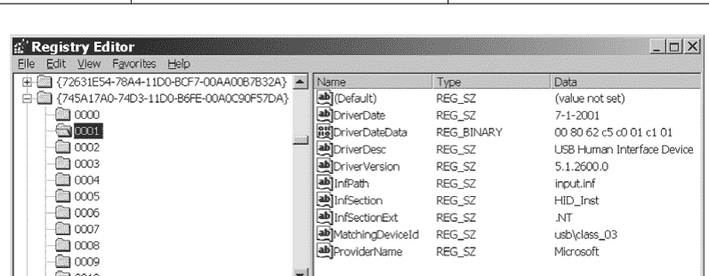

图 9-6：每个类键下的驱动程序键包含有关分配给该类中设备实例的驱动程序的信息。

表 9-2：驱动程序键包含有关分配给设备的驱动程序的信息。

| 键 | 描述 | 信息来源 |
|---|---|---|
| DriverDate | 驱动程序文件日期 | INF 文件，Version 部分，DriverVer 指令 |
| DriverDesc | 驱动程序描述 | INF 文件 |
| DriverVer | 驱动程序版本 | INF 文件，Version 部分，DriverVer 指令 |
| InfPath | INF 文件名称 | INF 文件名 |
| InfSection | 驱动程序的 DDInstall 部分名称 | INF 文件 |
| InfSectionExt | INF 文件中使用的“修饰”扩展名（.NT 等） | INF 文件 |
| MatchingDeviceID | 用于分配驱动程序的硬件或兼容 ID | 设备描述符和 INF 文件 |
| ProviderName | 驱动程序提供者 | INF 文件，Provider 字符串 |

### 服务键

服务键包含有关驱动程序文件的信息，包括它们存储的位置以及如何加载它们。服务键位于此分支中：

```
HKEY_LOCAL_MACHINE\System\CurrentControlSet\Services
```

每个主机控制器类型、集线器以及诸如存储（USBSTOR）、打印机（USBPRINT）和 HID（HidBatt、HidServ、HidUsb）之类的类都有服务键。图 9-7 显示了 HidUsb 的服务键。

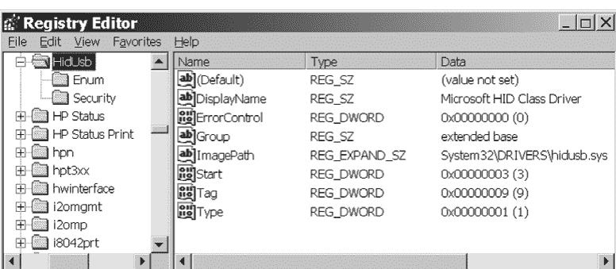

图 9-7：服务键命名驱动程序的文件。

### INF 文件内部

设备设置信息文件，或 INF 文件，是一个文本文件，其中包含有关设备设置类中一个或多个设备的信息。这些设备可能来自一个或多个制造商。该文件告诉 Windows 使用什么驱动程序或驱动程序，并包含要存储在注册表中的信息。Windows 包含随操作系统提供的驱动程序的 INF 文件。这些文件位于 %SystemRoot%\inf 文件夹中。任何为新增设备添加的新 INF 文件也会复制到此文件夹。默认情况下，该文件夹是隐藏的。如果你在 Windows 资源管理器中看不到它，请选择 工具 > 文件夹选项 > 查看，然后在隐藏文件下，选择 *显示隐藏的文件和文件夹*。不要选择 *为已知文件类型隐藏文件扩展名*。

在首次连接后，在从 USB 设备检索描述符后，Windows 会在描述符中的信息与系统 INF 文件中的信息之间查找匹配项。

本节并不试图记录 INF 文件创建的每个细微差别。相反，我使用一个示例 INF 文件来展示 INF 文件可以包含的信息类型。Windows DDK 文档有更多详细信息。检查随 Windows 包含的 INF 文件是了解文件中包含的内容类型以及信息结构方式的另一种方法。

列表 9-1 显示了 Ellisys USB Explorer 协议分析仪的 INF 文件，该分析仪使用特定于厂商的驱动程序。（该分析仪具有与运行分析仪软件的 PC 通信的 USB 接口。）此 INF 文件适用于 Windows 98、Windows Me、Windows 2000 和 Windows XP。


```ini
; Copyright (C) 1999-2004 Ellisys. All rights reserved.

[Version]
Signature="$CHICAGO$"
DriverVer=01/29/2004,2.0.1600.0
Provider=%Provider%
Class=EllisysProtocolAnalyzers
ClassGUID={D8854594-A4EF-480e-B8D8-CBDDADB4F3B4}

[ClassInstall]
AddReg=ClassAddReg

[ClassInstall32]
AddReg=ClassAddReg

[ClassAddReg]
HKR,,,,"%ClassName%"
HKR,,Icon,, -20

[Manufacturer]
%Manufacturer%=Models

[DestinationDirs]
DefaultDestDir=10,System32\Drivers

[SourceDisksNames]
1=%SourceDisk%,,,

[SourceDisksFiles]
ellex200.sys=1

[Models]
%DeviceDesc%=Install,USB\VID_0ABA&PID_8002

[Install]
CopyFiles=Install.CopyFiles
AddReg=Install.AddReg

[Install.CopyFiles]
ellex200.sys,,,2

[Install.AddReg]
HKR,,DevLoader,,*ntkern
HKR,,NTMPDriver,ellex200.sys

[Install.NT]
CopyFiles=Install.CopyFiles

[Install.NT.Services]
AddService=ellex200,2,Install.NT.AddService

[Install.NT.AddService]
DisplayName=%SvcDesc%
ServiceType=1
StartType=3
ErrorControl=1
ServiceBinary=%10%\system32\drivers\ellex200.sys

[Strings]
ClassName="Ellisys protocol analyzers"
Provider="Ellisys"
Manufacturer="Ellisys"
SourceDisk="USB Explorer 200 Installation Disk"
DeviceDesc="USB Explorer 200"
SvcDesc="USB Explorer 200 Driver (ellex200.sys)"
```

清单 9-1：Ellisys USB Explorer 200 协议分析仪的 INF 文件（第 1 张，共 2 张 和 第 2 张，共 2 张）。

## 语法

INF 文件的内容必须遵循一些语法规则。

- 信息按节排列，每节包含一个或多个项目。节名放在方括号 [ ] 中。其中一些节（Version、Manufacturer）是每个 INF 文件都有的标准节。其他节与其它节中指定的值相匹配。例如，如果 Manufacturer 节将制造商指定为 Lakeview，INF 文件中也将有 [Lakeview] 节。节的顺序可以任意，但节内项目的顺序可能很关键。
- 分号（`;`）表示注释。
- 行尾的反斜杠（`\`）用作续行符，除非它被引号（`"`）括起来。
- 用百分号括起来的文本（`%sampletext%`）引用一个字符串。例如，你可能有以下项目：

  `Provider=%Provider%`

  字符串节中有一个项目定义提供者字符串：

  `Provider="Ellisys"`
- 有些项目设置条目的值。例如，此项目指定设备的类别：

  `Class=EllisysProtocolAnalyzers`
- 有些项目提供要存储在系统注册表中的信息。此项目存储设备驱动程序的名称：

  `HKR,,NTMPDriver,ellex200.sys`

## 各节

INF 文件的每个节都有助于 Windows 找到与设备匹配的文件、加载适当的驱动程序并将设备信息存储到注册表中。下面讨论将解释示例 INF 文件中每个节的作用，目的是展示 INF 文件可以提供的信息类型。

### 版权注释

为通过本章后面描述的 Chkinf 实用程序中的测试，INF 文件必须包含一个包含单词 copyright 的注释：

```ini
; Copyright (C) 1999-2004 Ellisys. All rights reserved.
```

### 版本

Version 节是文件的头。每个 INF 文件都必须有此节。示例中的 Version 节包含以下项目：

```ini
[Version]
Signature="$CHICAGO$"
DriverVer=01/29/2004,2.0.1600.0
Provider=%Provider%
Class=EllisysProtocolAnalyzers
ClassGUID={D8854594-A4EF-480e-B8D8-CBDDADB4F3B4}
```

Signature 指令指定 INF 文件适用于哪些操作系统。对于使用 WDM 驱动程序的设备，其值可以是 `$Windows 95$`、`$Windows NT$` 或 `$Chicago$`，无论 PC 使用的是哪个操作系统。Chicago 是 Windows 95 开发期间使用的名称，其使用在 Windows 的后续版本中仍然有效。该值不区分大小写。

DriverVer 指令给出 INF 文件中命名的驱动程序的日期和版本号。在选择驱动程序时，其他条件相同的情况下，Windows 会选择更新的驱动程序。DriverVer 指令也可以出现在 DDInstall 节中，以提供仅适用于该节中驱动程序的信息。Windows 2000 和 Windows XP 必须在 Version 节中具有 DriverVer 指令，并且可以在 DDInstall 节中具有 DriverVer 指令。Windows 98 和 Windows Me 不识别 Version 节中的 DriverVer 指令，因此这些 Windows 版本的任何 DriverVer 指令都必须放在 DDInstall 节中。

Provider 指令命名 INF 文件的创建者。在示例中，%Provider% 是稍后在文件中定义的一个字符串。

Class 指令指定使用 INF 文件安装的设备的类别。示例指定了厂商特定的类别 EllisysProtocolAnalyzers。

ClassGUID 指令是存储在注册表中设备 Class 键中的设备设置 GUID。厂商特定的驱动程序可以使用 USB 设备的 GUID 或厂商特定的 GUID。示例使用厂商特定的 GUID。

### ClassInstall32

ClassInstall32 节在注册表的 Class 节中安装新类别。只有在设备的类别尚未安装时才会处理此节。此节应仅存在于厂商特定设备设置类别设备的 INF 文件中。

示例 ClassInstall32 节有一个项目：

```ini
[ClassInstall32]
AddReg=ClassAddReg
```

AddReg 指令将类别描述添加到注册表。在示例中，该指令的值引用 ClassAddReg 节。该节在 %ClassName% 字符串中提供类别描述，并在设备管理器中显示图标的索引值：

```ini
[ClassAddReg]
HKR,,,, "%ClassName%"
HKR,,Icon,, -20
```

负的 Icon 值引用 Windows *setupapi.dll* 中定义的图标。正的 Icon 值引用要从类别安装程序 DLL 或属性页 DLL 中提取的图标。

HKR 代表 HKEY_ROOT，它是 AddReg 出现的节的基础注册表键。在此示例中，信息存储在设备的 Class 键下。

示例还为 Windows 98 系统有一个标题为 [ClassInstall] 的节。

### 制造商

Manufacturer 节标识一个或多个设备组以及每个组的 Install 节。每个 INF 文件都必须有此节。

在示例中，%Manufacturer% 是稍后在文件中定义的一个字符串，而 Models 是标识制造商设备的节的名称。Models 是该节的通用名称。名称可以更具体，例如 *CypressMice* 或 *PhilipsAudio*，并且具有多个 Models 节的 INF 文件当然必须为每个节使用不同的名称。

```ini
[Manufacturer]
%Manufacturer%=Models
```

### 目标目录

DestinationDirs 节命名 INF 文件中任何 CopyFiles、RenFiles 和 DelFiles 项目将使用的文件夹或文件夹。*dirid* 值为 10 指定 Windows 文件夹。Windows DDK 文档列出了其他 dirid 值。Windows 98 文档使用术语 LDID（逻辑磁盘标识符）代替 dirid。

```ini
[DestinationDirs]
DefaultDestDir=10,System32\Drivers
```

### 源磁盘名称

SourceDisksNames 节为安装磁盘提供文本描述。在下面的条目中，有一个源磁盘，其名称是稍后在文件中定义的 %SourceDisk% 字符串。条目还可以指定磁盘的卷标和序列号。

```ini
[SourceDisksNames]
1=%SourceDisk%,,,.
```

### 源磁盘文件

SourceDisksFiles 节命名要从安装磁盘安装的任何文件。如果文件不在磁盘的根目录中，条目可以指定子目录。

```ini
[SourceDisksFiles]
ellex200.sys=1
```

### 型号

Manufacturer 节命名一个或多个 Models 节。每个 Models 节包含一个或多个将设备描述与 DDInstall 节和硬件 ID 匹配的条目。

在示例中，设备描述是稍后在文件中定义的 %DeviceDesc% 字符串。Install 是 INF 文件的 DDInstall 节的名称，其中包含设备的安装说明，并且可以向注册表添加设备信息。USB\VID_0ABA&PID_8002 是通过其厂商 ID 和产品 ID 标识设备的硬件 ID。硬件 ID 之后，条目可以提供一个或多个提供替代的兼容 ID，


通常更通用的方法是识别使用同一驱动程序的设备。本章后面的*使用设备标识字符串*部分将详细介绍硬件 ID 和兼容 ID。

```
[Models]
%DeviceDesc%=Install,USB\VID_0ABA&PID_8001
```

示例 INF 文件有两组 Install 节。一组（Install、Install.CopyFiles 和 Install.AddReg）用于 Windows 98 和 Windows Me。另一组（Install.NT、Install.CopyFiles、Install.NT.Services 和 Install.NT.AddService）用于 Windows 2000 和 Windows XP。两组都使用相同的 Install.CopyFiles 节。名称中包含 .NT 的节被称为*修饰*节：

```
[Install]
CopyFiles=Install.CopyFiles
AddReg=Install.AddReg

[Install.CopyFiles]
ellex200.sys,,,2

[Install.AddReg]
HKR,,DevLoader,,*ntkern
HKR,,NTMPDriver,,ellex200.sys

[Install.NT]
CopyFiles=Install.CopyFiles

[Install.NT.Services]
AddService=ellex200,2,Install.NT.AddService

[Install.NT.AddService]
DisplayName=%SvcDesc%
ServiceType=1
StartType=3
ErrorControl=1
ServiceBinary=%10%\system32\drivers\ellex200.sys
```

在示例的 Install 节中，CopyFiles 指令指定了 Install.CopyFiles 节，该节指定了要复制的驱动程序文件（*ellex200.sys*）。标志值 2 告诉 Windows 不允许用户跳过复制该文件。AddReg 指令命名了 Install.AddReg 节，该节提供要添加到注册表中的信息。在 Install.AddReg 节中，DevLoader 指定与设备关联的设备加载器，NTMPDriver 指定驱动程序。

Windows 2000 和 Windows XP 的 DDInstall 节是 Install.NT。CopyFiles 指令指定了与 Windows 98 和 Windows Me 相同的 Install.CopyFiles 节。这些 Windows 版本不需要 DevLoader 和 NTMPDriver 条目，因此没有 AddReg 节。

Windows 2000 和 Windows XP 需要两个额外的节：Install.NT.Services 和 Install.NT.AddService。Services 节为驱动程序指定服务名称（*ellex200*），将该服务指定为设备的即插即用功能驱动程序（flags = 2），并命名一个 AddService 节，该节指定如何以及何时加载驱动程序的服务（Install.NT.AddService）。

示例中的 AddService 节有五个条目。DisplayName 为服务指定一个友好名称。ServiceType = 1 表示该条目用于内核模式设备驱动程序。StartType = 3 表示在枚举时启动驱动程序。ErrorControl = 1 表示在加载或初始化设备时如果出现错误，则显示警告并继续。ServiceBinary 指定 CopyFiles 节中命名的驱动程序的位置。此节可以包含许多附加指令，这些指令是可选的，或者仅对某些设备和驱动程序是必需的。

## 字符串

Strings 节定义了其他节引用的所有字符串。

```ini
[Strings]
ClassName="Ellisys protocol analyzers"
Provider="Ellisys "
Manufacturer="Ellisys"
SourceDisk="USB Explorer 200 Installation Disk"
DeviceDesc="USB Explorer 200"
SvcDesc="USB Explorer 200 Driver (ellex200.sys)"
```

## 使用设备标识字符串

为了识别设备的可能驱动程序，Windows 会搜索系统上的 INF 文件，查找与设备描述符中的信息所生成的字符串相匹配的设备标识字符串。设备标识字符串分为三类：设备 ID、硬件 ID 和兼容 ID。

### 从设备获取的标识字符串

每个 USB 设备至少有一个设备 ID，该 ID 由集线器驱动程序根据设备描述符中的 Vendor ID、Product ID 和修订号创建。USB 设备的设备 ID 有以下形式之一：

```text
USB\VID_xxxx&PID_yyyy&REV_zzzz
USB\VID_xxxx&PID_yyyy
```

xxxx、yyyy 和 zzzz 中的值各为四个字符：xxxx 是 idVendor 值，yyyy 是 idProduct 值，zzzz 是 bcdDevice 值。idVendor 和 idProduct 值是十六进制值，但 Windows Me 除外，它使用十进制，而 bcdDevice 使用 BCD 格式。

例如，VID = 0925h、PID = 1234h、bcdDevice = 0310 的设备具有以下设备 ID：

```text
USB\VID_0925&PID_1234&REV_0310
```

具有多个接口的设备可以为每个接口指定一个驱动程序。在这种情况下，设备有多个设备 ID，每个接口一个。接口的设备 ID 有以下形式之一：

```text
USB\VID_xxxx&PID_yyyy&REV_zzzz&MI_ww
USB\VID_xxxx&PID_yyyy&MI_ww
```

xxxx、yyyy 和 zzzz 中的值与之前的设备 ID 相同。

ww 中的 2 字符值等于设备某个接口的接口描述符中的 bInterfaceNumber。例如，一个充当鼠标和键盘的复合设备可能在两个 Models 节中有条目，一个用于键盘（接口 00），一个用于鼠标（接口 01）：

```text
[LAKEVIEW_KEYBOARD]
%USB\VID_0925&PID_0801&MI_00.DeviceDesc%=
HID_Inst,, USB\VID_0925&PID_0801&MI_00
```

### 将驱动程序与设备匹配

```text
[LAKEVIEW_MOUSE]
%USB\VID_0925&PID_0801&MI_01.DeviceDesc%=
HID_Inst,, USB\VID_0925&PID_0801&MI_01
```

HID 类设备的报告描述符如果包含多个顶级集合，则每个集合可以有一个设备 ID。集合的设备 ID 可以采用以下任何形式，其中 bb 表示集合编号：

```text
USB\VID_xxxx&PID_yyyy&REV_zzzz&Colbb
USB\VID_xxxx&PID_yyyy&Colbb
USB\VID_xxxx&PID_yyyy&REV_zzz&MI_ww&Colbb
USB\VID_xxxx&PID_yyyy&MI_ww&Colbb
```

除了设备 ID 之外，一些驱动程序还会为设备创建一个或多个兼容 ID 字符串。兼容 ID 可以通过设备描述符中的类代码以及任何子类和协议代码来标识设备。兼容 ID 使用以下形式之一：

```text
USB\CLASS_aa&SUBCLASS_bb&PROT_cc
USB\CLASS_aa&SUBCLASS_bb
USB\CLASS_aa
```

aa、bb 和 cc 的值与设备描述符中的值匹配，每个值都是两个字符：aa 是 bDeviceClass 值，bb 是 bDeviceSubclass 值，cc 是 bDeviceProtocol 值。这些值用十六进制表示，但 Windows Me 除外，它使用十进制。

例如，HID 的类代码是 03h，因此 HID 类设备具有以下兼容 ID：

```text
USB\Class_03
```

对于某些兼容 ID，Windows 会定义描述性名称，例如 USBSTOR_BULK 或 GENERIC_USB_PRINTER。

INF 文件中的兼容 ID 表示不太理想但可以接受的匹配。兼容 ID 使 Windows 能够在 INF 文件不包含匹配的设备 ID 时找到并加载驱动程序。供应商的 INF 文件不应包含兼容 ID。

### 从 INF 文件获取标识字符串

在 INF 文件中，Models 节中的每个条目都有一个硬件 ID 和零个或多个兼容 ID。硬件 ID 列在最前面，后面跟任何兼容 ID，ID 之间用逗号分隔。

硬件 ID 可以有多种形式。它可以采用上面描述的设备、接口或 HID 集合的设备 ID 形式之一。Windows 附带的 INF 文件可能包含使用上述兼容 ID 格式来标识设备的硬件 ID，这些格式通过类或描述性名称标识设备。

### 查找匹配

为了在从设备检索的信息与 INF 文件中的信息之间寻找最佳匹配，Windows 会为找到的每个匹配分配一个等级，等级越低表示匹配越好（表 9-3）。基于 NT 的操作系统，包括 Windows 2000 和 Windows XP，会给予“受信任”的驱动程序更低的等级。这些驱动程序的目录（.cat）文件具有数字签名，表示该驱动程序已通过 Windows 硬件质量实验室（WHQL）测试。第 17 章有更多关于 WHQL 测试的内容。受信任的驱动程序也称为已签名驱动程序。Windows 98 不检查受信任的驱动程序。

在基于 NT 的操作系统中，最佳匹配是设备 ID 与受信任 INF 文件中的硬件 ID 匹配。次佳匹配是设备 ID 与受信任 INF 文件中的兼容 ID 匹配。再次是设备中的兼容 ID 与受信任 INF 文件中的硬件 ID 匹配，然后是设备中的兼容 ID 与受信任 INF 文件中的兼容 ID 匹配。只有当与受信任 INF 文件完全没有匹配时，基于 NT 的操作系统才会考虑来自不受信任 INF 文件的 ID。

如果 Windows 找不到匹配，它会启动“找到新硬件”向导，让用户有机会指定位置（例如 CD 驱动器）来查找 INF 文件。

复合设备（具有多个接口）是一个特例。由于每个接口可能需要不同的驱动程序，因此在选择使用哪个驱动程序时


## 表 9-3：Windows 会为每个与设备 ID 或兼容 ID 匹配的 INF 文件分配一个排名。

| 排名（十六进制） | 描述符中的 ID | INF 文件中的 ID | 受信任的驱动程序？ | “修饰过的”INF 节？ |
|---|---|---|---|---|
| 0000–0FFF | 设备 | 硬件 | 是 | 是。（所有受信任的驱动程序都有适用于基于 NT 的操作系统的修饰过的 INF 节。） |
| 1000–1FFF | 设备 | 兼容 | 是 |  |
| 2000–2FFF | 兼容 | 硬件 | 是 |  |
| 3000–3FFF | 兼容 | 兼容 | 是 |  |
| 8000–8FFF | 设备 | 硬件 | 否 | 是* |
| 9000–BFFF | 兼容 | 兼容 | 否 | 是* |
| C000–CFFF | 设备 | 硬件 | 否 | 否 |
| D000–FFFE | 兼容 | 兼容 | 否 | 否 |
| FFFF | 最差匹配。由共同安装程序等组件使用 |  |  |  |

\*仅基于 NT 的操作系统（Windows 2000、Windows XP）会考虑。

仅有供应商 ID 和产品 ID 并不总是足够的。如果没有更好的匹配，Windows XP 会使用兼容 ID USB\COMPOSITE，这将导致加载 USB 通用类父驱动程序。该驱动程序会为每个接口创建一组设备 ID 和兼容 ID，然后 Windows 就可以为每个接口分配一个驱动程序。在较早的 Windows 版本中，总线或集线器驱动程序负责处理此任务。

Windows 自带数百个 INF 文件，新设备也可能附带自己的 INF 文件。为了加快搜索速度，在设备安装期间，Windows 会创建一个 PNF（预编译 INF）文件，并将其存储在与设备 INF 文件相同的文件夹中。PNF 文件包含与 INF 文件基本相同的信息，但采用的格式可以更快地搜索。

## 是否需要提供 INF 文件？

并非每个设备都需要自己的 INF 文件。许多仅使用系统类驱动程序的设备可以使用 Windows 为相应类提供的 INF 文件。以下是 Windows XP 中一些 USB 类的 INF 文件：

| 类 | INF 文件 |
|---|---|
| 音频 | wdmaudio.inf |
| 人机接口设备（HID） | input.inf（Windows 98 中为 hiddev.inf） |
| 集线器 | usb.inf |
| 大容量存储 | usbstor.inf |
| 打印机 | usbprint.inf |
| 智能卡 | smartcrd.inf |
| 静态图像 | sti.inf |

由于 Windows XP 及更高版本更偏好受信任的驱动程序，因此如果你为受支持类中的设备提供不受信任的驱动程序，Windows XP 及更高版本不会使用你的驱动程序，而会从该类的 INF 文件中选择一个兼容 ID。INF 文件被视为驱动程序包的一部分，所以如果你尝试提供将受信任的驱动程序分配给设备的不受信任 INF 文件，Windows XP 及更高版本会优先使用系统提供的 INF 文件而不是你的 INF 文件。对受信任 INF 文件内容的任何更改都会使该 INF 文件变为不受信任，因此你不能在不使 INF 文件变为不受信任的情况下将你的设备添加到现有的 INF 文件中。

当最佳匹配是未签名驱动程序时，操作系统设置会控制 Windows 是阻止安装、在发出警告的情况下安装驱动程序，还是无警告安装。要更改该设置，请在 Windows 控制面板中，单击“系统”>“硬件”>“驱动程序签名”。

使用类驱动程序的设备可以拥有自定义 INF 文件，其中包含显示在设备管理器中的供应商特定字符串。例如，HID 的条目可以是供应商特定字符串，如“我的神奇 HID”，而不是默认的“USB 人机接口设备”。但在 Windows XP 及更高版本下使用自定义 INF 文件要求设备和 INF 文件通过 WHQL 测试。

Windows 随附的 INF 文件通常包含带有制造商特定信息的节。当设备通过 WHQL 测试时，Microsoft 通常会将设备的节添加到现有的 INF 文件中，或者将制造商特定的 INF 文件添加到随 Windows 分发的文件中。

某些设备（如调制解调器）必须提供自己的 INF 文件。Windows DDK 中有示例。具有供应商特定驱动程序的设备也必须有自己的 INF 文件。

## 工具和诊断辅助

Microsoft 提供了多种工具来帮助创建和测试 INF 文件：GenInf 用于创建文件，ChkInf 用于测试文件的结构和语法，以及一个记录设备安装期间发生的事件的日志文件。

GenInf 是一个向导，它会询问有关你的设备的问题，并使用这些信息创建 INF 文件。文档警告说，所创建的文件是一个可能不完全有效的框架，很可能需要添加内容或进行修改。特别是，生成的 INF 文件不支持较早的 Windows 版本，也不会创建多平台 INF 文件。

ChkINF 是一个 Perl 脚本，需要 Perl 解释器，你可以从 www.activeware.com 和其他来源免费下载。该脚本从命令提示符运行，并创建一个 HTML 页面，用错误和警告对 INF 文件进行标注。

当检测到设备时，Windows 会使用安装和设备安装函数来选择匹配的 INF 文件并安装设备的驱动程序。这些函数还会将事件和错误记录在存储在 %SystemRoot%\setupapi.log 中的文本文件中。该日志在调试设备安装问题时非常有用。Windows DDK 文档中有更多关于如何使用日志记录功能的信息。

## 使用 INF 文件的提示

以下是一些使用和试验 INF 文件的提示：

### 使用有效的供应商 ID

在受控环境之外提供的固件必须使用由 USB-IF 分配的供应商 ID。我的示例代码使用供应商 ID 0925h，该 ID 分配给我的公司 Lakeview Research。供应商 ID 的所有者有责任确保每个产品和版本都有唯一的供应商 ID/产品 ID 对。如果 ID 的所有者将相同的值用于不同的设备，借用他人的供应商 ID 可能会导致冲突。

### 查找 INF 文件

使用新的 INF 文件安装设备时，Windows 会将 INF 文件复制到 %SystemRoot%\inf，并可能将该文件重命名为 oem*.inf，并创建一个名为 oem*.pnf 的 .PNF 文件，其中 * 是数字。要查找包含特定供应商 ID 和产品 ID 的 INF 文件，请从 Windows 的“开始”菜单 >“搜索”>“文件或文件夹”开始搜索。浏览到 %SystemRoot%\inf 文件夹，并搜索文本 VID_xxxx&PID_yyyy，其中 xxxx 是设备的供应商 ID，yyyy 是产品 ID。

### 删除设备信息

在尝试 INF 文件中的不同设置时，你可能会发现 Windows 有时会使用系统注册表中存储的来自先前版本 INF 文件的信息。如果你希望 Windows 为设备使用不同或更改后的 INF 文件（例如，因为你想要更改驱动程序或设备描述），你可能需要告诉 Windows 忘记它对该设备所了解的信息。在设备已安装的情况下，在设备管理器中右键单击其列表项，然后选择“卸载”。删除任何包含你的设备供应商 ID 和产品 ID 的不需要的 INF 和 PNF 文件。然后你可以移除设备并重新连接它，Windows 将重新开始搜索驱动程序。（如果此方法失败，你可能需要手动删除不需要的 INF 和 PNF 文件以及注册表项。）

要使 Windows 98 忘记它对该设备所了解的信息，你可能需要重建驱动程序信息数据库。在 %SystemRoot%\inf 文件夹中，将 drvdata.bin 重命名为 drvdata.xxx，并将 drvid x.bin 重命名为 drvid x.xxx。通过重命名而不是删除文件，你可以在必要时恢复它们。

### INF 文件名

Windows 自带的 INF 文件的文件名都不超过八个字符，外加 3 个字符的扩展名。Microsoft 表示这是由于“产品安装的技术问题”，但在 Windows 安装后添加的 INF 文件可以使用更长的文件名。

### 用户看到的内容

连接 USB 设备后，用户在屏幕上看到的内容可能会有所不同，具体取决于 Windows 版本、设备 INF 文件的内容、驱动程序的位置、驱动程序是否具有共同安装程序以及是否经过数字签名，以及设备之前是否已连接和枚举过且具有序列号。

### 设备和类安装程序

设备和类安装程序提供与设备安装相关的功能。安装程序是 DLL（动态链接库）。Windows 为受支持的设备安装类中的设备提供默认安装程序。设备供应商可以提供共同安装程序，与类安装程序协同工作，以支持类中一个或多个设备特有的操作。共同安装程序可以向注册表添加信息、向用户请求其他配置信息、为设备管理器提供设备特定的属性页，并执行与设备安装相关的其他任务。供应商定义的设备安装类可以有自己的类安装程序。Windows DDK 文档中有关于编写安装程序和共同安装程序的信息。

### 搜索驱动程序

在启动或连接设备时，操作系统在检索设备的描述符后，会搜索匹配的硬件键。如果该键存在，操作系统就拥有为设备分配驱动程序所需的信息。硬件键的 Driver 条目指向驱动程序键，该键指定了 INF 文件的名称。


# 10 检测设备

本章介绍应用程序如何获取已连接设备的信息、请求用于与设备通信的句柄，以及检测设备何时被连接或移除。这些任务都会使用 Windows API 函数和第 8 章介绍的设备接口 GUID。为了帮助那些对 API 函数经验有限的读者，本章开头先提供一篇关于该主题的简短教程。

### 调用 API 函数简要指南

你可以在不调用任何 API 函数的情况下完成大量编程工作。微软的 .NET Framework 提供了支持常见任务的类，例如创建用户界面、访问文件、处理文本和图形、访问常见外设类型、网络、安全功能和异常处理。在内部，这些类的方法很可能会调用 API 函数，但这些类提供了一种更安全、更可靠、更模块化、面向对象的方式来完成任务。支持使用 .NET Framework 的语言包括 Visual Basic .NET、Visual C# .NET 和 Visual C++ .NET。

但是 .NET Framework 并不能处理所有任务。某些情况下应用程序仍然需要调用 API 函数。.NET 应用程序可以在可能的情况下使用 .NET Framework，在需要时调用 API。早于 .NET 平台的语言（如 Visual Basic 6）编写的应用程序有时也需要调用 API 函数。本章示例使用 Visual Basic .NET 和 Visual C++ .NET 编写。

由于调用 API 函数有时可能是一门晦涩的艺术，本节介绍一些在使用 Windows API 时有用的知识。

### 托管代码和非托管代码

理解如何在 Visual Basic .NET 应用程序中调用 API 函数，需要理解托管代码和非托管代码之间的区别。Windows API 函数使用非托管代码。它们的 DLL 包含直接在目标 CPU 上执行的已编译机器代码。在 Visual Basic .NET 和 Visual C# .NET 中，所有程序代码都是托管代码，编译为 Microsoft 中间语言 (MSIL)。.NET 平台的公共语言运行时 (CLR) 环境执行 MSIL 代码。

托管代码具有优势。因为所有 .NET 语言都使用相同的 CLR，用不同 .NET 语言编写的组件可以轻松地互操作。例如，Visual Basic .NET 应用程序可以调用 Visual C# .NET 编写的函数，而无需担心调用约定上的差异。CLR 还通过使用垃圾回收来管理内存，从而简化了编程。

.NET 应用程序可以调用使用非托管代码的函数，包括 Windows API 函数。但 Visual Basic .NET 和 Visual C# .NET 应用程序必须特别小心，以确保传递的任何数据都能在托管代码和非托管代码之间顺利传输，并在必要时返回。

比 Visual Basic .NET 或 Visual C# .NET 中的等效代码更简单、更简洁。

### 文档

Windows API 函数位于各种 DLL 和库中，其文档分布在 Windows DDK 和 Platform SDK 的多个区域。与检测设备相关的函数位于 setupapi.dll 中，在 Windows DDK 的“设备安装”部分以及 Platform SDK 的“基础服务 > 设备管理”部分有文档记录。与打开设备通信相关的函数位于 kernel32.dll 中，在 Platform SDK 的“基础服务”中的“存储 > 文件管理”和“设备输入输出控制”部分有文档记录。与设备通知相关的函数位于 user32.dll 中，在 Platform SDK 的“基础服务 > 设备管理”部分有文档记录。

这些 DLL 的头文件通常也包含有用的注释。函数文档通常会指明头文件。如果没有指明，一个快速查找的方法是使用 Windows 开始菜单中的“搜索 > 文件或文件夹”工具。在文件名文本框中输入 *.h，在包含文字或短语的文本框中输入你想要查找的函数的名称。确保勾选“包含子文件夹”，然后让 Windows 帮你查找文件。

### 使用 Visual C++ .NET

要使用 API 函数，Visual C++ 应用程序需要三样东西：定位包含函数编译代码的文件的能力、函数声明，以及使函数执行的调用。

每个 DLL 都有两个或更多配套文件：一个库文件（setupapi.lib、kernel32.lib、user32.lib）和一个或多个头文件（setupapi.h、kernel32.h、user32.h）。库文件消除了应用程序获取 DLL 中函数指针的需要。头文件包含应用程序可以调用的函数的原型、结构和符号。

DLL 包含该 DLL 导出（即提供给应用程序使用）的函数的编译代码。对于每个导出的函数，DLL 的库文件都包含一个存根函数，其名称和参数与 DLL 中某个函数的名称和参数匹配。存根函数调用其在 DLL 中对应的函数。在编译过程中，链接器将库文件中的代码合并到应用程序的可执行文件中。当应用程序调用库文件中的函数时，DLL 中同名函数就会执行。

Windows 附带的 DLL 通常存储在 %SystemRoot%\system32 文件夹中。当应用程序调用 DLL 函数时，Windows 会搜索此文件夹。Windows API 函数的库文件和头文件包含在 Windows DDK 中。

要在应用程序中包含 API 函数，你需要执行以下操作：

- 1. 将库文件添加到项目中。在 Visual Studio 中，单击“项目 > 属性 > 链接器 > 输入”。在“附加依赖项”框中输入 .lib 文件的名称。如果需要，可以在“链接器 > 常规”窗口中的“附加库目录”下输入库文件的路径。
- 2. 在应用程序的某个文件中包含头文件。下面是一个示例：

```
extern "C" {
#include "hidsdi.h"
#include <setupapi.h>
}
```

#include 指令会将指定文件的内容包含到该文件中，就像将内容复制并粘贴到该文件中一样。extern "C" 修饰符使 C++ 模块能够包含使用 C 命名约定的头文件。区别在于 C++ 对外部符号使用名称修饰（也称为名称改编）。

要添加包含目录的路径，请在 Visual Studio 中单击“项目 > 属性 > 资源 > 常规”。在“附加包含目录”框中输入你的 .h 文件的路径。（在命令行中，这些路径位于编译器的 /I 选项中。）

文件名周围的标点决定了编译器在哪里以及以什么顺序搜索该文件。如果你在多个位置有不同版本的文件，这一点很重要！将文件名括在尖括号中（<setupapi.h>）会使编译器首先在编译器 /I 选项指定的路径中搜索该文件，然后在 Include 环境变量指定的路径中搜索。将文件名括在引号中（"hidsdi.h"）会使编译器首先在包含该 #include 指令的文件所在目录中搜索，然后在任何包含该文件的 #include 指令的文件目录中搜索，然后在编译器 /I 选项指定的路径中搜索，最后在 Include 环境变量指定的路径中搜索。

许多函数的头文件会在你创建项目时自动包含。例如，afxwin.h 会为常见的 Windows 和 MFC 函数添加头文件。

- 3. 调用函数。下面代码声明了变量 HidGuid，并将指向它的指针传递给 hid.dll 中的函数 HidD_GetHidGuid：

```
GUID    HidGuid;
HidD_GetHidGuid(&HidGuid);
```

### 使用 Visual Basic .NET

要在 Visual Basic .NET 程序中使用 API 函数，你需要三样东西：包含该函数的 DLL、使应用程序能够找到该函数的声明，以及使函数执行的调用。

与 Visual C++ 相比，Visual Basic .NET 在调用 API 函数时还有额外的考虑。C 包含文件中的信息必须转换为 Visual Basic 语法和数据类型，并且托管 .NET 代码通常需要封送处理，以便访问 API 函数返回的非托管数据。

Visual Basic .NET 应用程序必须拥有 DLL 函数和结构的 Visual Basic 声明，而不是 C 包含文件。Visual Basic 只需要引用 DLL，而不需要库文件。

调用 API 函数（或 DLL 中的任何函数）的代码遵循与其他 Visual Basic 函数调用相同的语法规则。但是，并不是将函数的可执行代码放在某个例程中，而是在


应用程序，应用程序只需要一个声明即可使 Windows 找到包含函数代码的 DLL。

Microsoft 对 API 函数的文档使用 C 语法来展示如何声明和调用函数。要在 Visual Basic 中使用 API 函数，需要将声明和函数调用从 C 翻译成 Visual Basic。过程比简单的语法更改更复杂，主要是因为许多变量和结构类型在 Visual Basic 中没有完全对应的类型。

## 声明

下面是 API 函数 RegisterDeviceNotification 的 Visual Basic 声明，应用程序可使用它在设备附加或移除时请求收到通知：

```
<DllImport("user32.dll", CharSet:=CharSet.Auto)> _
Function RegisterDeviceNotification _
(ByVal hRecipient As IntPtr, _
ByVal NotificationFilter As IntPtr, _
ByVal Flags As Int32) _
As IntPtr
End Function
```

该声明包含以下信息：

- 命名包含函数可执行代码的文件（*user32.dll*）的 DllImport 属性。可选的 CharSet 字段设置为 CharSet.Auto，以使操作系统根据目标平台选择 ANSI（8 位）或 Unicode（16 位）字符。ANSI 是 Windows 98 和 Windows Me 的默认值。Unicode 是 Windows 2000 和 Windows XP 的默认值。
- 函数的名称（RegisterDeviceNotification）。
- 函数将传递给操作系统的参数（hRecipient、NotificationFilter、Flags）。
- 传递值的 数据类型（IntPtr、Int32）。
- 参数是按值传递（ByVal）还是按引用传递（ByRef）。此声明中的三个参数均按 ByVal 传递。
- 函数返回值的 数据类型（IntPtr）。少数 API 调用没有返回值，可以声明为子程序而不是函数。

声明必须位于模块的 Declarations 部分。

## 提供 DLL 的名称

每个声明必须命名包含函数可执行代码的文件。该文件是一个 DLL。当应用程序运行时，Windows 会将命名的 DLL 加载到内存中（除非它们已加载）。

在大多数情况下，声明只需要提供文件名而不需要位置。包含 Windows API 函数的 DLL 存储在标准位置（例如 %SystemRoot%\system32），Windows 会自动搜索这些位置。对于某些系统文件，例如 kernel32.dll，声明中 .dll 扩展名是可选的。

## 数据类型

Visual Basic .NET 应用程序可以使用 Visual Basic 的数据类型或 .NET Framework 中等效的数据类型。例如，Visual Basic 的 Integer 类型等同于 .NET Framework 中的 System.Int32。

API 调用的 C 头文件通常使用 Platform SDK 中定义但未由 Visual Basic 明确定义的其他数据类型。因此，创建 Visual Basic 声明通常需要额外的翻译。要为 API 调用指定变量类型，在许多情况下，您只需要确定变量的长度，然后使用匹配的 Visual Basic 类型即可。例如，DWORD 是一个 32 位整数，因此 Visual Basic .NET 应用程序可以将 DWORD 声明为 Integer。LPDWORD 是指向 DWORD 的指针，可以声明为按引用传递的 Integer。C 中定义为 HANDLE 的参数可以使用 System.IntPtr 类型，它是一个具有平台特定大小的 Integer。GUID 转换为 System.Guid 类型。

## ByRef 和 ByVal

在调用函数时，您可以按引用（ByRef）或按值（ByVal）传递参数或参数。通常两者都可行。但在调用 API 函数时理解这一概念很重要，因为许多函数中的变量必须以特定方式传递。

ByRef 和 ByVal 决定调用传递的信息以使函数能够访问变量。每个变量在内存中都有一个地址来存储变量的值。向函数传递变量时，应用程序可以传递变量的地址或其本身的值。信息是通过将其放在堆栈（临时存储位置）上来传递的。

传递变量 ByRef 意味着函数调用将变量的地址放在堆栈上。如果函数通过写入新值到该地址来更改值，则新值将可供调用应用程序使用，因为该值将存储在应用程序期望找到变量的地址处。传递的地址称为指针，因为它指向或指示存储值所在的地址。

传递变量 ByVal 意味着函数调用将变量的值放在堆栈上。变量在内存中的原始地址处的值保持不变。如果函数更改该值，调用应用程序将不知道更改，因为函数没有办法将新值传回应用程序。

在 Visual Basic .NET 下，按 ByVal 传递是默认值。如果您想按 ByRef 传递参数，必须在声明中指定它。（在 Visual Basic 6 中，按 ByRef 传递是默认值。）

除字符串外，如果被调用的函数更改值并且调用应用程序需要使用新值，则必须按 ByRef 传递变量。按 ByRef 传递使调用应用程序能够访问新值。

字符串是特例，应按 ByVal 传递给 API 函数。如果您按 ByVal 将字符串传递给 API 函数，Visual Basic 实际上会传递指向字符串的指针，就好像字符串已声明为 ByRef 一样。如果函数将更改字符串的内容，应用程序应将字符串初始化为至少与预期返回的最长字符串一样长。

## 传递结构

某些 API 函数传递和返回结构，其中包含可能为不同类型的多个项。API 函数的文档也记录了函数传递的结构。头文件包含 C 语法中的结构声明。

Visual Basic .NET 应用程序通常可以在结构或类中声明等效的结构。为了确保托管代码和非托管代码对结构成员的布局和对齐达成一致，可以将结构的声明或类定义设置为 StructLayout 属性为 LayoutKind.Sequential：

```
<StructLayout(LayoutKind.Sequential)>
```

与函数声明一样，CharSet 属性可以确定在将字符串传递给非托管代码之前，字符串是转换为 ANSI 还是 Unicode：

```
<(CharSet:=CharSet.Auto)>
```

结构可以按 ByVal 传递给 API 函数，或者应用程序可以使用 ByRef 传递指向结构的指针。

某些结构在 Visual Basic 中难以或不切实际地复制。解决方案是使用预期大小的通用缓冲区。应用程序可以在传递之前填充缓冲区，并在需要时从缓冲区中提取返回的数据。

## 调用函数

在声明函数以及要传递的任何结构或类之后，应用程序可以调用该函数。这是前面声明的 RegisterDeviceNotification 函数的调用：

```
Public Const DEVICE_NOTIFY_WINDOW_HANDLE As Integer _
    = 0

deviceNotificationHandle = _
    RegisterDeviceNotification _
    (formHandle, _
    DevBroadcastDeviceInterfaceBuffer, _
    DEVICE_NOTIFY_WINDOW_HANDLE)
```

DEVICE_NOTIFY_WINDOW_HANDLE 常量在 *dbt.h* 中定义。formHandle 和 DevBroadcastDeviceInterfaceBuffer 参数是 IntPtr 变量。函数在 deviceNotificationHandle 中返回一个 IntPtr。

## 查找您的设备

Windows API 提供了一系列 SetupDi_ API 函数，使应用程序能够找到设备接口类中的所有设备，并为每个设备获取设备路径名称。CreateFile 函数可以使用设备路径名称获取用于访问设备的句柄。

获取设备路径名称需要以下步骤：

- 1. 获取设备接口 GUID。
- 2. 请求指向设备信息集的指针，其中包含设备接口类中所有已安装和存在的设备的信息。
- 3. 请求指向包含设备信息集中设备接口信息的结构的指针。
- 4. 请求包含设备接口的设备路径名称的结构。
- 5. 从结构中提取设备路径名称。

然后应用程序可以使用设备路径名称打开用于与设备通信的句柄。

表 10-1 列出了应用程序可用于执行这些操作的 API 函数。这些函数可用于查找使用某些厂商特定驱动程序的设备以及执行厂商特定功能的 HID 类设备。对于执行标准功能的许多设备，应用程序有其他方法来查找和访问设备。例如，要访问驱动器，.NET Framework 的 Directory 类包含 GetLogicalDrives 方法，使应用程序能够找到系统上的所有逻辑驱动器（无论是否使用 USB）。然后您可以使用 Directory 和 File 类的方法访问驱动器上的文件。


表 10-1：应用程序使用这些函数查找设备并获取设备路径名以启用设备访问。

| API 函数 | DLL | 用途 |
|---|---|---|
| HidD_GetHidGuid | hid | 获取 HID 类的设备接口 GUID |
| SetupDiDestroyDeviceInfoList | setupapi | 释放 SetupDiGetClassDevs 使用的资源。 |
| SetupDiGetClassDevs | setupapi | 检索指定类中设备的设备信息集。 |
| SetupDiGetDeviceInterfaceDetail | setupapi | 检索设备路径名。 |
| SetupDiEnumDeviceInterfaces | setupapi | 检索设备信息集中有关设备的的信息。 |

以下代码展示了如何使用 API 函数查找设备并获取其设备路径名。有关演示如何使用这些函数的完整 Visual C++ .NET 和 Visual Basic .NET 应用程序，请访问 www.Lvr.com。

## 获取设备接口 GUID

正如第 8 章所述，对于许多驱动程序，应用程序可以从随驱动程序提供的 C 头文件或 Visual-Basic 声明中获取设备接口 GUID。对于 HID 类，Windows 提供了一个 API 函数来获取 GUID，该 GUID 也定义在 hidclass.h 中。

### Visual C++

这是函数的声明：

```
VOID
    HidD_GetHidGuid(
        OUT LPGUID HidGuid
    );
```

这是调用函数的代码：

```
HidD_GetHidGuid(&HidGuid);
```

### Visual Basic

该函数没有返回值，因此声明为 Sub：

```
<DllImport("hid.dll")>
Sub HidD_GetHidGuid _
    (ByRef HidGuid As System.Guid)
End Sub
```

这是调用函数的代码：

```
Dim HidGuid As System.Guid
HidD_GetHidGuid(HidGuid)
```

## 请求指向设备信息集的指针

SetupDiGetClassDevs 函数可以返回一个指向结构数组的指针，其中包含由 GUID 指定的设备接口类中所有设备的信息。

### Visual C++

这是函数的声明：

```
HDEVINFO
    SetupDiGetClassDevs(
        IN LPGUID  ClassGuid,  OPTIONAL
        IN PCTSTR  Enumerator,  OPTIONAL
        IN HWND    hwndParent,  OPTIONAL
        IN DWORD   Flags
    );
```

这是调用函数的代码：

```
HANDLE DeviceInfoSet;

DeviceInfoSet = SetupDiGetClassDevs
    (&HidGuid,
    NULL,
    NULL,
    DIGCF_PRESENT|DIGCF_INTERFACEDEVICE);
```

DeviceInfoSet 包含指向设备 devnode（表示设备的结构）的句柄以及与设备关联的设备接口的链表。

使用完设备信息集后，应用程序应通过调用 SetupDiDestroyDeviceInfoList 来释放所使用的资源，如本章后面所述。

## 标识设备接口

调用 SetupDiEnumDeviceInterfaces 会检索到一个指向结构的指针，该结构标识先前检索到的 Device-InfoSet 数组中的特定设备接口。调用通过传递数组索引来指定设备接口。为了检索有关所有设备接口的信息，应用程序可以循环遍历数组，增加数组索引，直到函数返回零，表示没有更多接口。然后 GetLastError API 函数返回 No more data is available。

如何知道设备接口是否是您要查找的？在决定使用设备接口之前，应用程序可能需要请求更多信息。在检测到多个接口时，应用程序可以依次调查每个接口，直到找到所需设备或确定设备不存在。

### Visual C++

这是 DeviceInterfaceData 类型的声明：

```
typedef struct _SP_DEVICE_INTERFACE_DATA {
    DWORD cbSize;
    GUID InterfaceClassGuid;
    DWORD Flags;
    ULONG_PTR Reserved;
} SP_DEVICE_INTERFACE_DATA,
*PSP_DEVICE_INTERFACE_DATA;
```

### Visual Basic

这是函数的声明：

```
<DllImport("setupapi.dll")> _
Function SetupDiEnumDeviceInterfaces _
    (ByVal DeviceInfoSet As IntPtr, _
    ByVal DeviceInfoData As Integer, _
    ByRef InterfaceClassGuid As System.Guid, _
    ByVal MemberIndex As Integer, _
    ByRef DeviceInterfaceData As _
        SP_DEVICE_INTERFACE_DATA) _
    As Boolean
End Function
```

这是调用函数的代码：

```
Dim MemberIndex As Integer
Dim MyDeviceInterfaceData As SP_DEVICE_INTERFACE_DATA
Dim Result As Boolean

myDeviceInterfaceData.cbSize = _
    Marshal.SizeOf(myDeviceInterfaceData)
MemberIndex = 0

Result = SetupDiEnumDeviceInterfaces _
    (DeviceInfoSet, _
    0, _
    HidGuid, _
    MemberIndex, _
    MyDeviceInterfaceData)
```

### 详细信息

在 SP_DEVICE_INTERFACE_DATA 结构中，参数 cbSize 是结构以字节为单位的大小。在调用 SetupDiEnumDeviceInterfaces 之前，必须将大小存储在函数将传递的结构中。Visual C++ 中的 sizeof 运算符或 Visual Basic 中的 Marshal.SizeOf 方法可检索大小。结构中的其他值应为零。

HidGuid 和 DeviceInfoSet 参数是先前检索到的值。DeviceInfoData 是指向 SP_DEVINFO_DATA 结构的 optional 指针，可将搜索限制为特定设备实例。MemberIndex 是 DeviceInfoSet 数组中结构的索引。MyDeviceInterfaceData 是返回的 SP_DEVICE_INTERFACE_DATA 结构，用于标识所请求类型的设备接口。

## 请求包含设备路径名的结构

SetupDiGetDeviceInterfaceDetail 函数返回一个结构，其中包含在 SP_DEVICE_INTERFACE_DATA 结构中标识的设备接口的设备路径名。

在首次调用此函数之前，无法知道 DeviceInterfaceDetailDataSize 参数的值，该参数必须包含 DeviceInterfaceDetailData 结构以字节为单位的大小。然而，除非函数调用包含此信息，否则函数不会返回结构。解决方案是调用函数两次。第一次，GetLastError 返回错误 The data area passed to a system call is too small，但 RequiredSize 参数包含 DeviceInterfaceDetailDataSize 的正确值。第二次，您传递返回的大小值，函数将返回结构。

### Visual C++

这是 DeviceInterfaceDetailData 结构的声明：

```
typedef struct _SP_DEVICE_INTERFACE_DETAIL_DATA {
    DWORD cbSize;
    TCHAR DevicePath[ANYSIZE_ARRAY];
} SP_DEVICE_INTERFACE_DETAIL_DATA,
*PSP_DEVICE_INTERFACE_DETAIL_DATA;
```

这是函数的声明：

```
BOOLEAN
SetupDiGetDeviceInterfaceDetail(
    IN HDEVINFO DeviceInfoSet,
    IN PSP_DEVICE_INTERFACE_DATA DeviceInterfaceData,
    OUT PSP_DEVICE_INTERFACE_DETAIL_DATA
        DeviceInterfaceDetailData, OPTIONAL
    IN DWORD DeviceInterfaceDetailDataSize,
    OUT PDWORD RequiredSize, OPTIONAL
    OUT PSP_DEVINFO_DATA DeviceInfoData OPTIONAL
);
```

这是首次调用函数的代码：

```c
BOOLEAN Result;
PSP_DEVICE_INTERFACE_DETAIL_DATA DetailData;
ULONG Length;

Result = SetupDiGetDeviceInterfaceDetail
    (DeviceInfoSet,
    &MyDeviceInterfaceData,
    NULL,
    0,
    &Length,
    NULL);
```

然后代码为 DetailData 结构分配内存，设置 DetailData 的 cbSize 属性，并再次调用函数，将 Length 中的返回缓冲区大小传递进去：

```c
DetailData =
    (PSP_DEVICE_INTERFACE_DETAIL_DATA)malloc(Length);

DetailData -> cbSize =
    sizeof(SP_DEVICE_INTERFACE_DETAIL_DATA);

Result = SetupDiGetDeviceInterfaceDetail
    (DeviceInfoSet,
    &MyDeviceInterfaceData,
    DetailData,
    Length,
    &Length,
    NULL);
```

### Visual Basic

Visual-Basic 代码并未显式声明 SP_DEVICE_INTERFACE_DETAIL_DATA 结构用于 Device-InterfaceDetailData 参数。相反，代码保留一个通用缓冲区，传递指向缓冲区的指针，并直接从缓冲区中提取设备路径名。因此应用程序不使用以下声明，但我已将其包含在内以显示返回缓冲区的内容：

```
<StructLayout(LayoutKind.Sequential)> _
Public Structure SP_DEVICE_INTERFACE_DETAIL_DATA
    Dim cbSize As Integer
    Dim DevicePath As String
End Structure
```

这是函数的声明：

```
<DllImport("setupapi.dll", CharSet:=CharSet.Auto)> _
Function SetupDiGetDeviceInterfaceDetail _
    (ByVal DeviceInfoSet As IntPtr, _
     ByRef DeviceInterfaceData _
         As SP_DEVICE_INTERFACE_DATA, _
     ByVal DeviceInterfaceDetailData As IntPtr, _
     ByVal DeviceInterfaceDetailDataSize As Integer, _
     ByRef RequiredSize As Integer, _
     ByVal DeviceInfoData As IntPtr) _
     As Boolean
End Function
```

这是首次调用的代码：

```
Dim BufferSize As Integer
Dim Success As Boolean

Success = SetupDiGetDeviceInterfaceDetail _
    (DeviceInfoSet, _
     MyDeviceInterfaceData, _
     IntPtr.Zero, _
     0, _
     BufferSize, _
     IntPtr.Zero)
```

调用 SetupDiGetDeviceInterfaceDetail 后，BufferSize 包含要在 DeviceInterfaceDetailDataSize 缓冲区参数中传递的值 in the

next call. But before calling the function again, we need to take care of a few things.

下一次调用。但在再次调用函数之前，我们需要处理一些事情。

The function will return a pointer (DetailDataBuffer) to an SP_DEVICE_INTERFACE_DETAIL_DATA structure in unmanaged memory. The Marshal.AllocHGlobal method uses the returned BufferSize value to reserve memory for the structure:

函数将返回一个指针（DetailDataBuffer）指向非托管内存中的 SP_DEVICE_INTERFACE_DETAIL_DATA 结构。Marshal.AllocHGlobal 方法使用返回的 BufferSize 值来为该结构预留内存：

```
Dim DetailDataBuffer As IntPtr
DetailDataBuffer = Marshal.AllocHGlobal(BufferSize)
```

The cbSize member of the structure passed in DetailDataBuffer equals four bytes for the cbSize integer plus the length of one character for the device path name (which is empty when passed to the function). The Marshal.WriteInt32 method copies the cbSize value into the first member of DetailDataBuffer:

传递到 DetailDataBuffer 中的结构的 cbSize 成员等于 cbSize 整数的四个字节加上设备路径名称的一个字符的长度（在传递给函数时为空）。Marshal.WriteInt32 方法将 cbSize 值复制到 DetailDataBuffer 的第一个成员中：

```
Marshal.WriteInt32 _
    (DetailDataBuffer, _
    4 + Marshal.SystemDefaultCharSize)
```

The second call to SetupDiGetDeviceInterfaceDetail passes the DetailDataBuffer pointer and sets the DeviceInterfaceDetailDataSize parameter equal to the BufferSize value returned previously in RequiredSize:

对 SetupDiGetDeviceInterfaceDetail 的第二次调用传递 DetailDataBuffer 指针，并将 DeviceInterfaceDetailDataSize 参数设置为之前在 RequiredSize 中返回的 BufferSize 值：

```
Success = SetupDiGetDeviceInterfaceDetail _
    (deviceInfoSet, _
    MyDeviceInterfaceData, _
    DetailDataBuffer, _
    BufferSize, _
    BufferSize, _
    IntPtr.Zero)
```

When the function returns, DetailDataBuffer points to a structure containing a device path name.

当函数返回时，DetailDataBuffer 指向包含设备路径名称的结构。

## Extracting the Device Path Name

提取设备路径名称

The device path name is in the DevicePath member of the SP_DEVICE_INTERFACE_DETAIL_DATA structure returned by SetupDiGetDeviceInterfaceDetail.

设备路径名称位于 SetupDiGetDeviceInterfaceDetail 返回的 SP_DEVICE_INTERFACE_DETAIL_DATA 结构体的 DevicePath 成员中。

### Visual C++

Visual C++

The device path name is in DetailData -> DevicePath.

设备路径名称位于 DetailData -> DevicePath 中。

### Visual Basic

Visual Basic

The string containing the device path name is stored beginning at byte 5 in DetailDataBuffer. (The first four bytes are the cbSize member.) The pDevicePathName variable points to this location:

包含设备路径名称的字符串从 DetailDataBuffer 的第 5 字节开始存储。（前四个字节是 cbSize 成员。）pDevicePathName 变量指向此位置：

```
Dim DevicePathName(127) As String
Dim pDevicePathName As IntPtr = _
    New IntPtr(DetailDataBuffer.ToInt32 + 4)
```

The Marshal.PtrToString method retrieves the string from the buffer:

Marshal.PtrToString 方法从缓冲区检索字符串：

```
DevicePathName = _
    Marshal.PtrToStringAuto(pDevicePathName)
```

We’re finished with DetailDataBuffer, so we should free the memory previously allocated for it:

我们已经完成了对 DetailDataBuffer 的使用，因此应释放为其先前分配的内存：

```
Marshal.FreeHGlobal(DetailDataBuffer)
```

## Closing Communications

关闭通信

When finished using the DeviceInfoSet returned by SetupDiGetClassDevs, the application should call SetupDiDestroyDeviceInfoList.

使用 SetupDiGetClassDevs 返回的 DeviceInfoSet 完成后，应用程序应调用 SetupDiDestroyDeviceInfoList。

### Visual C++

Visual C++

This is the function’s declaration:

这是函数的声明：

```cpp
BOOL SetupDiDestroyDeviceInfoList(
    HDEVINFO DeviceInfoSet);
```

This is the code to call the function:

这是调用函数的代码：

```cpp
SetupDiDestroyDeviceInfoList(DeviceInfoSet);
```

### Visual Basic

Visual Basic

This is the function’s declaration:

这是函数的声明：

```vb
<DllImport("setupapi.dll")> Function
SetupDiDestroyDeviceInfoList _
        (ByVal DeviceInfoSet As IntPtr) _
        As Integer
        End Function
```

This is the code to call the function:

这是调用函数的代码：

```vb
SetupDiDestroyDeviceInfoList (deviceInfoSet)
```

## Obtaining a Handle

获取句柄

An application can use a retrieved device path name to obtain a handle that enables communicating with the device. Table 10-2 shows the API functions related to requesting a handle.

应用程序可以使用检索到的设备路径名称获取一个句柄，从而能够与设备通信。表 10-2 显示了与请求句柄相关的 API 函数。

## Requesting a Communications Handle

请求通信句柄

After retrieving a device path name, an application is ready to open communications with the device. The CreateFile function requests a handle to an object, which can be a file or another resource managed by a driver that supports handle-based operations. For example, applications can request a handle to use in exchanging reports with HID-class devices.

检索到设备路径名称后，应用程序即可准备好打开与设备的通信。CreateFile 函数请求对对象的句柄，该对象可以是文件或由支持基于句柄操作的驱动程序管理的其他资源。例如，应用程序可以请求一个句柄以用于与 HID 类设备交换报告。

### Visual C++

Visual C++

This is the function’s declaration:

这是函数的声明：

```cpp
HANDLE CreateFile(
    LPCSTR lpFileName,
    DWORD dwDesiredAccess,
    DWORD dwShareMode,
    LPSECURITY_ATTRIBUTES lpSecurityAttributes,
    DWORD dwCreationDisposition,
    DWORD dwFlagsAndAttributes,
    HANDLE hTemplateFile
);
```

Table 10-2: Applications can use CreateFile to request a handle to a device and CloseHandle to free the resources used by a handle.

表 10-2：应用程序可以使用 CreateFile 请求对设备的句柄，并使用 CloseHandle 释放句柄使用的资源。

| API Function | DLL | Purpose |
|---|---|---|
| CloseHandle | kernel32 | Free resources used by CreateFile. |
| CreateFile | kernel32 | Retrieve a handle for communicating with a device. |

This is the code to call the function:

这是调用函数的代码：

```
HANDLE DeviceHandle;

DeviceHandle=CreateFile
(DetailData->DevicePath,
GENERIC_READ|GENERIC_WRITE,
FILE_SHARE_READ|FILE_SHARE_WRITE,
(LPSECURITY_ATTRIBUTES)NULL,
OPEN_EXISTING,
0,
NULL);
```

### Visual Basic

Visual Basic

This is a declaration for the SECURITY_ATTRIBUTES structure:

这是 SECURITY_ATTRIBUTES 结构体的声明：

```
<StructLayout(LayoutKind.Sequential)> _
Public Structure SECURITY_ATTRIBUTES
    Dim nLength As Integer
    Dim lpSecurityDescriptor As Integer
    Dim bInheritHandle As Integer
End Structure
```

This is the function's declaration:

这是函数的声明：

```
<DllImport("kernel32.dll", CharSet:=CharSet.Auto)>
Function CreateFile _
    (ByVal lpFileName As String, _
    ByVal dwDesiredAccess As Integer, _
    ByVal dwShareMode As Integer, _
    ByRef lpSecurityAttributes As _
        SECURITY_ATTRIBUTES, _
    ByVal dwCreationDisposition As Integer, _
    ByVal dwFlagsAndAttributes As Integer, _
    ByVal hTemplateFile As Integer) _
    As Integer
End Function
```

This is the code to call the function:

这是调用函数的代码：

```
Public Const GENERIC_READ = &H80000000
Public Const GENERIC_WRITE = &H40000000
Public Const FILE_SHARE_READ = &H1
Public Const FILE_SHARE_WRITE = &H2
Public Const OPEN_EXISTING = 3
Dim DeviceHandle As Integer
Dim Security As SECURITY_ATTRIBUTES

Security.lpSecurityDescriptor = 0
Security.bInheritHandle = CInt(True)
Security.nLength = Len(Security)

DeviceHandle = CreateFile _
    (DevicePathName, _
    GENERIC_READ Or GENERIC_WRITE, _
    FILE_SHARE_READ Or FILE_SHARE_WRITE, _
    Security, _
    OPEN_EXISTING, _
    0, _
    0)
```

## Details

详细信息

The function passes a pointer to the device-path-name string returned by SetupDiGetDeviceInterfaceDetail. The dwDesiredAccess parameter requests read/write access to the device. The dwShareMode parameter allows other processes to access the device while the handle is open. The lpSecurityAttributes parameter is a pointer to a SECURITY_ATTRIBUTES structure. The dwCreationDisposition parameter must be OPEN_EXISTING for devices. The final two parameters are unused in this example.

该函数传递一个指向由 SetupDiGetDeviceInterfaceDetail 返回的设备路径名称字符串的指针。dwDesiredAccess 参数请求对设备的读/写访问。dwShareMode 参数允许在句柄打开时其他进程访问设备。lpSecurityAttributes 参数是指向 SECURITY_ATTRIBUTES 结构的指针。dwCreationDisposition 参数对于设备必须为 OPEN_EXISTING。此示例中最后两个参数未使用。

## Closing the Handle

关闭句柄

Chapter 13 shows how to use a handle to exchange information with a HID-class device. For other device classes, the details will vary with the driver. When finished communicating with a device, the application should call CloseHandle to free the resources used by CreateFile.

第 13 章展示了如何使用句柄与 HID 类设备交换信息。对于其他设备类，细节将因驱动程序而异。与设备通信完成后，应用程序应调用 CloseHandle 以释放 CreateFile 使用的资源。

### Visual C++

Visual C++

This is the function's declaration:

这是函数的声明：

```
BOOL CloseHandle(
    HANDLE hObject);
```

This is the code to call the function:

这是调用函数的代码：

```
CloseHandle(DeviceHandle);
```

### Visual Basic

Visual Basic

This is the function's declaration:

这是函数的声明：

```
<DllImport("kernel32.dll")> Function CloseHandle _
    (ByVal hObject As Integer) _
    As Integer
End Function
```

This is the code to call the function:

这是调用函数的代码：

```
CloseHandle(DeviceHandle)
```

## Detecting Attachment and Removal

检测附加和移除

Many applications find it useful to know when a device has been attached or removed. An application that detects when a device has been attached can begin communicating automatically on attachment. An application that detects when a device has been removed can stop attempting to communicate, notify the user, and wait for reattachment. Windows provides device-notification functions for this purpose.

许多应用程序发现知道设备何时被附加或移除很有用。能够检测到设备已附加的应用程序可以在附加时自动开始通信。能够检测到设备已移除的应用程序可以停止尝试通信、通知用户并等待重新附加。Windows 为此目的提供了设备通知函数。

## About Device Notifications

关于设备通知

To request to be informed when a device is attached or removed, an application’s form can register to receive notification messages for devices in a device interface class. The messages are WM_DEVICECHANGE messages that the operating system passes to the form’s WindowProc (WndProc in Visual Basic) method. An application can override the WindowProc method in a form’s base class with a method that processes the messages and then passes them to the base class’s WindowProc method. Each notification contains a device path name that the application can use to identify the device the notification applies to. Table 10-3 lists the API functions used in registering for device notifications. The example that follows shows how to use the functions.

为了在设备附加或移除时收到通知，应用程序的窗体可以注册以接收设备接口类中设备的通知消息。这些消息是 WM_DEVICECHANGE 消息，操作系统将其传递给窗体的 WindowProc（Visual Basic 中的 WndProc）方法。应用程序可以用一种处理消息然后将其传递给基类 WindowProc 方法的方法来重写窗体基类中的 WindowProc 方法。每个通知都包含一个设备路径名称，应用程序可使用它来标识通知适用的设备。表 10-3 列出了用于注册设备通知的 API 函数。下面的示例展示了如何使用这些函数。

## Registering for Device Notifications

注册设备通知

Applications use the RegisterDeviceNotification function to request to receive notification messages. The function requires a pointer to a handle for the window or service that will receive the notifications, a pointer to a DEV_BROADCAST_DEVICEINTERFACE structure that holds information about the request, and flags to indicate whether the handle is for a window or service status.

应用程序使用 RegisterDeviceNotification 函数请求接收通知消息。该函数需要一个指向将接收通知的窗口或服务的句柄的指针、一个指向保存请求信息的 DEV_BROADCAST_DEVICEINTERFACE 结构的指针，以及指示句柄是用于窗口还是服务状态的标志。

In the DEV_BROADCAST_DEVICEINTERFACE structure passed to RegisterDeviceNotification, the dbcc_devicetype member is set to DBT_DEVTYP_DEVICEINTERFACE to specify that the application wants to receive notifications about a device interface class, and classguid is the GUID of the device interface class (HidGuid in the examples).

传递给 RegisterDeviceNotification 的 DEV_BROADCAST_DEVICEINTERFACE 结构中，dbcc_devicetype 成员设置为 DBT_DEVTYP_DEVICEINTERFACE，以指定应用程序希望接收有关设备接口类的通知，而 classguid 是设备接口类的 GUID（示例中为 HidGuid）。

When the WM_DEVICECHANGE messages are no longer of interest, the application should call UnregisterDeviceNotification, as described later in this chapter.

当 WM_DEVICECHANGE 消息不再感兴趣时，应用程序应调用 UnregisterDeviceNotification，如本章后面所述。


表10-3：这些函数使应用程序能够请求接收或停止接收有关设备连接和移除的通知。

| API 函数 | DLL | 用途 |
|---|---|---|
| RegisterDeviceNotification | user32 | 请求接收设备通知 |
| UnregisterDeviceNotification | user32 | 请求停止接收设备通知 |

## Visual C++

DEV_BROADCAST_DEVICEINTERFACE 结构的声明如下：

```
typedef struct _DEV_BROADCAST_DEVICEINTERFACE {
    DWORD dbcc_size;
    DWORD dbcc_devicetype;
    DWORD dbcc_reserved;
    GUID dbcc_classguid;
    TCHAR dbcc_name[1];
} DEV_BROADCAST_DEVICEINTERFACE
*PDEV_BROADCAST_DEVICEINTERFACE;
```

这是该函数的声明：

```
HDEVNOTIFY RegisterDeviceNotification(
    HANDLE hRecipient,
    LPVOID NotificationFilter,
    DWORD Flags
);
```

这是调用该函数的代码：

```
HDEVNOTIFY DeviceNotificationHandle;

DEV_BROADCAST_DEVICEINTERFACE
    DevBroadcastDeviceInterface;

DevBroadcastDeviceInterface.dbcc_size =
    sizeof(DevBroadcastDeviceInterface);

DevBroadcastDeviceInterface.dbcc_devicetype =
    DBT_DEVTYP_DEVICEINTERFACE;

DevBroadcastDeviceInterface.dbcc_classguid = HidGuid;
```

```
DeviceNotificationHandle = RegisterDeviceNotification
    (m_hWnd,
    &DevBroadcastDeviceInterface,
    DEVICE_NOTIFY_WINDOW_HANDLE);
```

## Visual Basic

设备通知函数使用头文件中定义的几个常量。这些来自 *dbt.h*：

```
Public Const DBT_DEVTYP_DEVICEINTERFACE As Integer = 5
Public Const DEVICE_NOTIFY_WINDOW_HANDLE As Integer _
    = 0
Public Const WM_DEVICECHANGE As Integer = &H219
```

这些来自 *setupapi.h*：

```
Public Const DIGCF_PRESENT As Short = &H2
Public Const DIGCF_DEVICEINTERFACE As Short = &H10
```

DEV_BROADCAST_DEVICEINTERFACE 结构有以下声明：

```
<StructLayout(LayoutKind.Sequential)> _
Public Class DEV_BROADCAST_DEVICEINTERFACE
    Public dbcc_size As Integer
    Public dbcc_devicetype As Integer
    Public dbcc_reserved As Integer
    Public dbcc_classguid As Guid
    Public dbcc_name As Short
End Class
```

这是 RegisterDeviceNotification 的声明：

```
<DllImport("user32.dll", CharSet:=CharSet.Auto)> _
Function RegisterDeviceNotification _
    (ByVal hRecipient As IntPtr, _
    ByVal NotificationFilter As IntPtr, _
    ByVal Flags As Int32) _
    As IntPtr
End Function
```

这是调用该函数的代码：

```vb
Dim DevBroadcastDeviceInterface _
    As DEV_BROADCAST_DEVICEINTERFACE = _
        New DEV_BROADCAST_DEVICEINTERFACE()
Dim DevBroadcastDeviceInterfaceBuffer As IntPtr
Dim DeviceNotificationHandle As IntPtr
Dim Size As Integer
Friend frmMy As frmMain
```

Marshal.SizeOf 方法获取 DEV_BROADCAST_DEVICEINTERFACE 结构的大小，然后将其存储在结构的 dbcc_size 成员中：

```vb
Size = Marshal.SizeOf(DevBroadcastDeviceInterface)

DevBroadcastDeviceInterface.dbcc_size = Size
DevBroadcastDeviceInterface.dbcc_devicetype = _
    DBT_DEVTYP_DEVICEINTERFACE
DevBroadcastDeviceInterface.dbcc_reserved = 0
DevBroadcastDeviceInterface.dbcc_classguid = _
    HidGuid
```

Marshal.AllocHGlobal 为将保存 DEV_BROADCAST_DEVICEINTERFACE 结构的缓冲区预留内存。Marshal.StructureToPointer 方法将结构复制到缓冲区中。然后应用程序就可以调用 RegisterDeviceNotification 了：

```vb
DevBroadcastDeviceInterfaceBuffer = _
    Marshal.AllocHGlobal(Size)

Marshal.StructureToPtr _
    (DevBroadcastDeviceInterface, _
    DevBroadcastDeviceInterfaceBuffer, _
    True)

DeviceNotificationHandle = _
    RegisterDeviceNotification _
    (frmMy.Handle, _
    DevBroadcastDeviceInterfaceBuffer, _
    DEVICE_NOTIFY_WINDOW_HANDLE)
```

使用完 DevBroadcastDeviceInterfaceBuffer 后，应用程序应释放 AllocHGlobal 为其分配的内存：

```
Marshal.FreeHGlobal _
(DevBroadcastDeviceInterfaceBuffer)
```

## 捕获设备更改消息

WindowProc 函数处理窗体、对话框或其他窗口接收到的消息。

## Visual C++

要接收 WM_DEVICECHANGE 消息，对话框的消息映射必须包含 ON_WM_DEVICECHANGE() 这一行：

```
BEGIN_MESSAGE_MAP(MyApplicationDlg, CDialog)
//{{AFX_MSG_MAP(MyApplicationDlg)
.
.
.
//}}AFX_MSG_MAP
ON_WM_DEVICECHANGE()
END_MESSAGE_MAP()
```

## Visual Basic

这是覆盖基窗体默认 WndProc 例程的 WndProc 例程的代码：

```
Protected Overrides Sub WndProc(ByRef m As Message)

    If m.Msg = WM_DEVICECHANGE Then
        OnDeviceChange(m)
    End If

    MyBase.WndProc(m)

End Sub
```

收到 WM_DEVICECHANGE 消息后，该方法调用 OnDeviceChange 方法，然后将消息传递给窗体基类中的 WndProc 方法。

## 读取设备更改消息

收到 WM_DEVICECHANGE 消息后，窗口的 OnDeviceChange 方法会执行。该方法可以检查消息的内容并采取任何所需操作。消息包含两个指针：lParam 和 wParam。

wParam 属性是一个代码，指示设备到达、移除或其他事件。

lParam 属性是一个设备管理结构。有几种类型的设备管理结构，但都以相同的头部开头，该头部包含三个成员。该头部是一个 DEV_BROADCAST_HDR 结构，其 dbch_devicetype 成员指示 lParam 所指的设备管理结构的类型。

如果 dbch_devicetype = DBT_DEVTYP_DEVICEINTERFACE，则该结构是 DEV_BROADCAST_INTERFACE，应用程序可以检索完整结构，读取 dbcc_name 成员中的设备路径名，并将该名称与目标设备的设备路径名进行比较。

## Visual C++

这是 DEV_BROADCAST_HDR 结构的声明：

```
typedef struct _DEV_BROADCAST_HDR {
    DWORD dbch_size;
    DWORD dbch_devicetype;
    DWORD dbch_reserved;
} DEV_BROADCAST_HDR, *PDEV_BROADCAST_HDR;
```

这是 OnDeviceChange 函数的代码：

```cpp
BOOL CUSbhidiocDlg::OnDeviceChange
    (WPARAM wParam,
     LPARAM lParam)
{
    switch(wParam)
    {
        case DBT_DEVICEARRIVAL:
            // Find out if the device path name matches
            // wParam.
            // If yes, perform any tasks required
            // on device attachment.

            return TRUE;

        case DBT_DEVICEREMOVECOMPLETE:

            // Find out if the device path name matches
            // wParam.
            // If yes, perform any tasks required
            // on device removal.

            return TRUE;

        default:
            return TRUE;
    }
}
```

## Visual Basic

这些常量来自 dbt.h：

```vb
Public Const DBT_DEVICEARRIVAL As Integer = &H8000
Public Const DBT_DEVICEREMOVECOMPLETE As Integer _
    = &H8004
```

这是 DEV_BROADCAST_HDR 结构的声明：

```
<StructLayout(LayoutKind.Sequential)> _
Public Class DEV_BROADCAST_HDR
    Public dbch_size As Integer
    Public dbch_devicetype As Integer
    Public dbch_reserved As Integer
End Class
```

这是检查设备到达和移除消息的代码：

```
Friend Sub OnDeviceChange(ByVal m As Message)

    If (m.WParam.ToInt32 = DBT_DEVICEARRIVAL) Then

        ' Find out if the device path name matches
        ' wParam.
        ' If yes, perform any tasks required
        ' on device removal.

    ElseIf (m.WParam.ToInt32 = _
        DBT_DEVICEREMOVECOMPLETE) Then

        ' Find out if the device path name matches
        ' wParam.
        ' If yes, perform any tasks required
        ' on device removal.

    End If

End Sub
```

## 检索消息中的设备路径名

如果消息指示设备到达或移除（或其他感兴趣的事件），应用程序可以进一步调查。

在 lParam 指向的结构中，如果 dbch_devicetype 包含 DBT_DEVTYP_DEVICEINTERFACE，则该事件与设备接口相关。lParam 中的结构是 DEV_BROADCAST_INTERFACE 结构，它以一个 DEV_BROADCAST_HDR 结构开始。dbcc_name 成员包含该消息所应用的设备的设备路径名。


应用程序可以将此设备路径名与目标设备的设备路径名进行比较。如果匹配，应用程序可以采取任何所需的操作。

## Visual C++

以下代码用于检索设备路径名并查找匹配项：

```
PDEV_BROADCAST_HDR lpdb = (PDEV_BROADCAST_HDR)lParam;

if (lpdb->dbch_devicetype ==
    DBT_DEVTYP_DEVICEINTERFACE)
{
    PDEV_BROADCAST_DEVICEINTERFACE lpdbi =
        (PDEV_BROADCAST_DEVICEINTERFACE)lParam;

    CString DeviceNameString;

    DeviceNameString = lpdbi->dbcc_name;

    if
        ((DeviceNameString.CompareNoCase
          (DetailData->DevicePath)) == 0)
    {
        // The names match.
    }
    else
    {
        // It's a different device.
    }
}
```

## Visual Basic

应用程序对 `DEV_BROADCAST_DEVICEINTERFACE` 结构使用两个声明。第一个声明（前面已介绍）在调用 `RegisterDeviceNotification` 时使用。第二个声明 `DEV_BROADCAST_DEVICEINTERFACE_1` 可以对 `dbcc_name` 和 `classguid` 中的数据进行封送处理：

```
<StructLayout _
    (LayoutKind.Sequential, _
        CharSet:=CharSet.Unicode)> _
Public Class DEV_BROADCAST_DEVICEINTERFACE_1
    Public dbcc_size As Integer
    Public dbcc_devicetype As Integer
    Public dbcc_reserved As Integer
    <MarshalAs _
        (UnmanagedType.ByValArray, _
        ArraySubType:=UnmanagedType.U1, _
        SizeConst:=16)> _
        Public dbcc_classguid() As Byte
    <MarshalAs _
        (UnmanagedType.ByValArray, SizeConst:=255)> _
        Public dbcc_name() As Char
End Class
```

以下代码用于检索设备路径名并查找匹配项：

```
Dim DevBroadcastDeviceInterface As _
    New DEV_BROADCAST_DEVICEINTERFACE_1()
Dim DevBroadcastHeader As New DEV_BROADCAST_HDR()

Marshal.PtrToStructure(m.LParam, DevBroadcastHeader)

If (DevBroadcastHeader.dbch_devicetype = _
    DBT_DEVTYP_DEVICEINTERFACE) Then
    Dim StringSize As Integer = _
        CInt((DevBroadcastHeader.dbch_size - 32) / 2)
    ReDim DevBroadcastDeviceInterface.dbcc_name _
        (StringSize)

    Marshal.PtrToStructure _
        (m.LParam, DevBroadcastDeviceInterface)
```

```
Dim DeviceNameString As New String _
    (DevBroadcastDeviceInterface.dbcc_name, _
    0, _
    StringSize)

If (String.Compare _
    (DeviceNameString, _
    DevicePathName, _
    True) = 0) Then
    'The name matches.
Else
    'It's a different device.
End If
End If
```

`Marshal.PtrToStructure` 会将消息的 `lParam` 属性复制到 `DEV_BROADCAST_HDR` 结构中。如果 `lParam` 指示该消息与设备接口相关，应用程序就会检索设备路径名。

该名称位于非托管内存中的 `Char` 数组中。应用程序需要检索该 `Char` 数组并将其转换为 `String`。

`DEV_BROADCAST_HDR` 的 `dbch_size` 成员包含整个 `DEV_BROADCAST_INTERFACE` 结构中的字节数。若要获取存储在 `dbcc_name` 中的设备路径名的字符数，请减去结构中不属于名称部分的 32 个字节，然后除以 2，因为每个字符占 2 个字节。

`DevBroadcastDeviceInterface` 是一个 `DEV_BROADCAST_DEVICEINTERFACE_1` 结构，用于对 `classguid` 和 `dbcc_name` 成员中的数据进行封送处理。`ReDim` 语句会修剪 `dbcc_name`，使其与设备路径名的大小匹配。`Marshal.PtrToStructure` 会将 `lParam` 中非托管块的数据复制到 `DevBroadcastDeviceInterface` 结构中。包含设备路径名的 `Char` 数组随后作为 `String` 存储在 `DeviceNameString` 中，并通过 `String.Compare` 方法查找匹配项。

## 停止设备通知

要停止接收设备通知，应用程序会调用 `UnregisterDeviceNotification`。应用程序应在关闭之前调用该函数。

### Visual C++

这是该函数的声明：

```
BOOL UnregisterDeviceNotification(
    HDEVNOTIFY Handle
);
```

这是调用该函数的代码：

```
UnregisterDeviceNotification(
    DeviceNotificationHandle);
```

### Visual Basic

这是该函数的声明：

```
<DllImport("user32.dll")> Function
UnregisterDeviceNotification _
    (ByVal Handle As IntPtr) _
    As Boolean
End Function
```

这是调用该函数的代码：

```
UnregisterDeviceNotification _
    (DeviceNotificationHandle)
```

# 11 人机接口设备：使用控制和中断传输

人机接口设备（HID）类是 Windows 最早支持的 USB 类之一。在运行 Windows 98 或更高版本的 PC 上，应用程序可以使用操作系统内置的驱动程序与 HID 通信。因此，许多厂商专用的 USB 设备都使用 HID 类。

第 7 章介绍了该类。本章说明如何确定某个特定设备是否能归入人机接口类，详细介绍了将设备定义为 HID 并使其能够与主机交换数据的固件要求，介绍了六个 HID 专用的控制请求，并给出了一个 HID 固件示例。第 12 章介绍 HID 用于交换信息的报告，第 13 章说明如何从应用程序访问 HID。

## 什么是 HID？

名称中的*人机接口*表示 HID 直接与人交互，许多 HID 也确实如此。鼠标可以检测到有人按下按键或移动鼠标，主机也可以发送一条消息，转换为用户体验到的操纵杆效果。除了键盘、鼠标和操纵杆之外，HID 类还包括带有旋钮、开关、按钮和滑块的前面板；遥控器；电话键盘；以及数据手套和方向盘等游戏控制设备。

但 HID 不一定非要有人机接口。设备只需能够在 HID 类规范的限制内运行即可。以下是 HID 类设备的主要能力和限制：

- 所有交换的数据都存放在称为报告（report）的结构中。主机通过控制传输或中断传输发送和请求报告来发送和接收数据。报告格式灵活，几乎可以处理任何类型的数据，但每个定义的报告都有固定大小。
- HID 接口必须有一个中断 IN 端点用于发送输入报告。
- HID 接口最多只能有一个中断 IN 端点和一个中断 OUT 端点。如果需要更多中断端点，可以创建一个包含多个 HID 的复合设备。应用程序必须为复合设备中的每个 HID 获取独立的句柄。
- 中断 IN 端点使 HID 能够在不可预测的时间向主机发送信息。例如，计算机无法知道用户何时会按下键盘上的按键，因此主机驱动程序使用中断事务定期轮询设备以获取新数据。
- 数据交换速率受到限制，尤其是在低速和全速下。如第 3 章所述，主机可以保证低速中断端点不超过 800 字节/秒。对于全速端点，最大为 64 千字节/秒；对于高速端点，如果主机支持高带宽端点，最大约为 24 兆字节/秒，否则约为 8 兆字节/秒。控制传输没有保证带宽，但总线上为所有控制传输保留的带宽除外。
- Windows 98 Gold（原始版本）支持 USB 1.0，因此不支持中断 OUT 传输，所有主机到设备的报告都必须使用控制传输。

任何能在该类别限制内运行的设备都可以成为 HID。HID 规范提到了条形码阅读器、温度计和电压表作为可能没有传统人机接口的 HID 示例。这些设备都会向计算机发送数据，也可能接收配置设备的请求。主要接收数据的设备示例包括远程显示器、远程设备的控制面板、机器人，以及任何会从主机接收偶发或定期命令的设备。

HID 接口可能只是设备支持的多个 USB 接口之一。例如，使用等时传输进行音频传输的 USB 扬声器也可能有一个 HID 接口，用于控制音量、平衡、高音和低音。HID 接口通常比设备上的传统物理控件更便宜。

## 硬件要求

要符合 HID 规范，接口的端点和描述符必须满足若干要求。

### 端点

所有 HID 传输要么使用控制端点，要么使用中断端点。每个 HID 都必须有一个中断 IN 端点用于向主机发送数据。中断 OUT 端点是可选的。表 11-1 显示了 HID 中的传输类型及其典型用途。


表 11-1：在 HID 传输中使用的传输类型取决于芯片的能力以及发送数据的要求。

| 传输类型 | 数据来源 | 典型数据 | 是否需要管道？ | Windows 支持 |
|---|---|---|---|---|
| 控制 | 设备（IN 传输） | 数据对时序要求不关键。 | 是 | Windows 98 及更高版本 |
| 控制 | 主机（OUT 传输） | 数据对时序要求不关键，或在没有 OUT 中断管道时可传输任何数据。 | 是 |  |
| 中断 | 设备（IN 传输） | 周期性或低延迟数据。 | 是 |  |
| 中断 | 主机（OUT 传输） | 周期性或低延迟数据。 | 否 | Windows 98 SE 及更高版本 |

## 报告

中断 IN 端点的要求表明，每个 HID 必须在其 HID 报告描述符中至少定义一个输入报告。输出报告和特性报告是可选的。

## 控制传输

HID 规范定义了六个类特定请求。两个请求 Set_Report 和 Get_Report 提供了主机和设备使用控制传输向设备传输报告和从设备传输报告的方式。主机使用 Set_Report 发送报告，使用 Get_Report 接收报告。其余四个请求与配置设备有关。Set_Idle 和 Get_Idle 请求设置和读取空闲速率，该速率决定设备是否在上次轮询后重新发送未更改的数据。Set_Protocol 和 Get_Protocol 请求设置和读取协议值，这可以使设备在主机上未加载完整的 HID 驱动程序时，例如在启动期间，使用简化协议运行。

## 中断传输

中断端点提供了一种交换数据的方式，特别是当接收方必须快速或定期获取数据时。如果总线非常繁忙，控制传输可能会被延迟，而中断传输的带宽在设备配置后可保证可用。

在 USB 规范 1.1 版本中添加了执行中断 OUT 传输的能力，而在 HID 规范 1.1 版本中添加了使用中断 OUT 管道的选项。Windows 98 SE 是首个支持 USB 1.1 和 HID 1.1 的 Windows 版本。

## 固件要求

设备的固件还必须满足类要求。设备的描述符必须包括指定 HID 类的接口描述符、HID 描述符和中断 IN 端点描述符。中断 OUT 端点描述符是可选的。固件还必须包含报告描述符，其中包含有关 HID 报告内容的信息。

HID 可以支持一个或多个报告。报告描述符指定设备报告中数据的大小和内容，还可能包括有关接收方应如何使用数据的说明。描述符中的值将每个报告定义为输入、输出或特性报告。主机在输入报告中接收数据，在输出报告中发送数据。特性报告可以在任一方向传输。

每个设备应至少支持一个主机可通过中断传输或控制请求检索的输入报告。输出报告是可选的。为了与 Windows 98 Gold 兼容，使用输出报告的设备应支持使用控制传输发送报告。使用中断传输进行输出报告是可选的。特性报告始终使用控制传输，并且是可选的。

## 将设备识别为 HID

与任何 USB 设备一样，HID 的描述符告诉主机与设备通信所需的信息。列表 11-1 显示了供应商特定 HID 的示例设备、配置、接口、类和端点描述符。主机在枚举期间通过发送 Get_Descriptor 请求来了解 HID 接口，该请求针对包含 HID 接口的配置。配置的接口描述符将接口标识为 HID 类。HID 类描述符指定接口支持的报告描述符数量。在枚举期间，HID 驱动程序请求报告描述符和任何物理描述符。

```
// Device Descriptor

0x12,      // Descriptor size in bytes
0x01,      // Descriptor type (Device)
0x0200,    // USB Specification release number (BCD) (2.00)
0x00,      // Class Code
0x00,      // Subclass code
0x00,      // Protocol code
0x08,      // Endpoint 0 maximum packet size
0x0925,    // Vendor ID (Lakeview Research)
0x1234,    // Product ID
0x0100,    // Device release number (BCD)
0x01,      // Manufacturer string index
0x02,      // Product string index
0x00,      // Device serial number string index
0x01      // Number of configurations

// Configuration Descriptor

0x09,      // Descriptor size in bytes
0x02,      // Descriptor type (Configuration)
0x0029,    // Total length of this and subordinate descriptors
0x01,      // Number of interfaces in this configuration
0x01,      // Index of this configuration
0x00,      // Configuration string index
0xA0,      // Attributes (bus powered, remote wakeup supported)
0x50,      // Maximum power consumption (100 mA)

// Interface Descriptor

0x09,      // Descriptor size in bytes
0x04,      // Descriptor type (Interface)
0x00,      // Interface Number
0x00,      // Alternate Setting Number
0x02,      // Number of endpoints in this interface
0x03,      // Interface class (HID)
0x00,      // Interface subclass
0x00,      // Interface protocol
0x00,      // Interface string index
}
```

列表 11-1：供应商特定 HID 的描述符（第 1 页，共 2 页）

```
// HID Descriptor

0x09,      // Descriptor size in bytes
0x21,      // Descriptor type (HID)
0x0110,    // HID Spec. release number (BCD) (1.1)
0x00,      // Country code
0x01,      // Number of subordinate class descriptors
0x22,      // Descriptor type (report)
0x02F,      // Report descriptor size in bytes

// IN Interrupt Endpoint Descriptor

0x07,      // Descriptor size in bytes
0x05,      // Descriptor type (Endpoint)
0x81,      // Endpoint number and direction (1 IN)
0x03,      // Transfer type (interrupt)
0x40,      // Maximum packet size
0x0A,      // Polling interval (milliseconds)

// OUT Interrupt Endpoint Descriptor

0x07,      // Descriptor size in bytes
0x05,      // Descriptor type (Endpoint)
0x01,      // Endpoint number and direction (1 OUT)
0x03,      // Transfer type (interrupt)
0x40,      // Maximum packet size
0x0A      // Polling interval (milliseconds)
}
```

列表 11-1：供应商特定 HID 的描述符（第 2 页，共 2 页）

## HID 接口

在接口描述符中，bInterfaceclass = 3 用于将接口标识为 HID。接口描述符中包含 HID 特定信息的其他字段是子类和协议字段，它们可以指定启动接口。

如果 bInterfaceSubclass = 1，则设备支持启动接口。具有启动接口的 HID 在主机 HID 驱动程序未加载时仍可使用。这种情况可能发生在计算机直接启动到 DOS 时，或在查看启动时可访问的系统设置屏幕时，或在使用 Windows 安全模式进行系统故障排除时。具有启动接口的键盘或鼠标可以使用许多主机 BIOS 支持的简化协议。BIOS 在启动时从 ROM 或其他非易失性存储器加载，并在任何操作系统模式下可用。HID 规范为键盘和鼠标定义了启动接口协议。如果设备具有启动接口，则 bInterfaceProtocol 字段指示设备是否支持键盘（1）或鼠标（2）接口。

HID 用法表文档定义了使用启动协议的键盘和鼠标的报告格式。BIOS 知道启动协议是什么，并假定启动设备会支持该协议，因此无需从设备读取报告描述符。在发送或请求报告之前，BIOS 会发送 HID 特定的 Set_Report 请求以请求使用启动协议。当完整的 HID 驱动程序已加载后，驱动程序可以使用 Set_Protocol 使设备从启动协议切换到报告协议，后者使用报告描述符中定义的报告格式

如果 HID 不支持启动协议，则 bInterfaceSubclass 字段应等于零。

## HID 类描述符

HID 类描述符标识用于 HID 通信的附加描述符。类描述符具有七个或更多字段，具体取决于附加描述符的数量。表 11-2 显示了这些字段。请注意


表11-2：HID 类描述符包含 7 个或更多字段，占用 9 个或更多字节。

| 偏移量（十进制） | 字段 | 大小（字节） | 说明 |
|---|---|---|---|
| 0 | bLength | 1 | 描述符的大小（以字节为单位）。 |
| 1 | bDescriptorType | 1 | 此描述符的类型：21h 表示 HID 类。 |
| 2 | bcdHID | 2 | HID 规范版本号（BCD）。 |
| 4 | bCountryCode | 1 | 标识本地化硬件的国别的数字表达式（BCD）。 |
| 5 | bNumDescriptors | 1 | 紧随其后的报表描述符和物理描述符的数量。 |
| 6 | bDescriptorType | 1 | 后面跟随的类专用描述符的类型。（报表描述符（必需）的类型为 22h。） |
| 7 | wDescriptorLength | 2 | 上述标识的描述符的总长度。 |
| 9 | bDescriptorType | 1 | 可选。后面跟随的类专用描述符的类型。物理描述符的类型为 23h。 |
| 10 | wDescriptorLength | 2 | 上述标识的描述符的总长度。仅当紧邻其上方存在 bDescriptorType 时才存在。后面可能跟有附加的 bDescriptorType 和 wDescriptorLength 字段，用于标识其他物理描述符。 |

该描述符具有两个或更多 bDescriptorType 字段。其中一个标识 HID 描述符，其他的标识从属描述符的类型。

### 描述符

**bLength。** 描述符的字节长度。

**bDescriptorType。** 值 21h 表示 HID 描述符。

### 类

**bcdHID。** 接口所遵循的 HID 规范版本号，采用 BCD 格式。版本 1.0 为 0100h；版本 1.1 为 0110h。

**bCountryCode。** 如果硬件针对特定国家/地区进行了本地化，该字段是标识国家/地区的代码。HID 规范列出了这些代码。如果硬件未本地化，该字段为 00h。

## 人机接口设备：使用控制传输和中断传输

```text
0x06  0xFFA0      Usage Page (vendor-defined)
0x09  0x01        Usage (vendor-defined)
0xA1  0x01        Collection (Application)

0x09  0x03        Usage (vendor-defined)
0x15  0x00        Logical Minimum (0)
0x26  0x00FF      Logical Maximum (255)
0x95  0x02        Report Count (2)
0x75  0x08        Report Size (8 bits)
0x81  0x02        Input (Data, Variable, Absolute)

0x09  0x04        Usage (vendor-defined)
0x15  0x00        Logical Minimum (0)
0x26  0x00FF      Logical Maximum (255)
0x75  0x08        Report Size (8 bits)
0x95  0x02        Report Count (2)
0x91  0x02        Output (Data, Variable, Absolute)

0x09  0x05        Usage (vendor-defined)
0x15  0x00        Logical Minimum (0)
0x26  0x00FF      Logical Maximum (255)
0x75  0x08        Report Size (8 bits)
0x95  0x02        Report Count (2)
0xB1  0x02        Feature (Data, Variable, Absolute)

0xC0              End Collection
```

清单 11-2：该报表描述符定义了一个输入报表、一个输出报表和一个特征报表。每个报表传输两个厂商自定义的字节。

报表描述符定义了报表可以包含的条目。以下说明示例描述符中每个条目的含义：

Usage Page（用法页）条目由值 06h 标识，指定设备的一般功能，例如通用桌面控制、游戏控制或字母数字显示。在示例描述符中，Usage Page 是厂商定义的值 FFA0h。HID 规范列出了不同 Usage Page 的值，以及为厂商定义的 Usage Page 保留的值。

Usage（用法）条目由值 09h 标识，指定一个报表在某个 Usage Page 中的功能。例如，可用于通用桌面控制的 Usage 包括鼠标、操纵杆和键盘。由于示例中的 Usage Page 是厂商定义的，该 Usage Page 中的所有 Usage 也都是厂商定义的。在示例中，Usage 为 01h。

**Collection (Application)**（集合（应用））条目开启一组条目，这些条目共同执行单一功能，例如键盘或鼠标。每个报表描述符都必须有一个应用集合。

该集合包含三个报表。每个报表具有以下条目：

-   一个厂商定义的 Usage 应用于报表中的数据。
-   Logical Minimum（逻辑最小值）和 Logical Maximum（逻辑最大值）指定报表可以包含的值的范围。
-   Report Count（报表数量）条目指示报表包含多少个数据项。在示例中，每个报表包含两个数据项。
-   Report Size（报表大小）条目指示每个被报告的数据项占多少位。在示例中，每个数据项为 8 位。
-   最后一个条目指定该报表是输入报表 (81h)、输出报表 (91h) 还是特征报表 (B1h)。该条目附带的位包含有关报表数据的附加信息。

End Collection（结束集合）条目关闭应用集合。

第 12 章有更多关于报表格式的内容。

### HID 专用请求

表 11-3：HID 类定义了六个 HID 专用请求。

| 请求编号 | 请求 | 数据源（数据阶段） | wValue（高字节，低字节） | wIndex | 数据长度（字节）(wLength) | 数据阶段内容 | 是否需要？ |
|---|---|---|---|---|---|---|---|
| 01h | Get_Report | 设备 | 报表类型、报表 ID | 接口 | 报表长度 | 报表 | 是 |
| 02h | Get_Idle | 设备 | 0、报表 ID | 接口 | 1 | 空闲持续时间 | 否 |
| 03h | Get_Protocol | 设备 | 0 | 接口 | 1 | 协议 | 对于支持启动协议的 HID 为必需 |
| 09h | Set_Report | 主机 | 报表类型、报表 ID | 接口 | 报表长度 | 报表 | 否 |
| 0Ah | Set_Idle | 无数据阶段 | 空闲持续时间、报表 ID | 接口 | – | – | 否，使用启动协议的键盘除外 |
| 0Bh | Set_Protocol | 无数据阶段 | 0、协议 | 接口 | – | – | 对于支持启动协议的 HID 为必需 |

**Get_Report**

**用途：** 主机使用控制传输从 HID 请求输入报表或特征报表。

**请求编号（bRequest）：** 01h

**数据来源：** 设备

**数据长度（wLength）：** 报表长度

**wValue 字段内容：** 高字节包含报表类型（1=输入，3=特征），低字节包含报表 ID。默认报表 ID 为零。

**wIndex 字段内容：** 该请求所指向的接口编号。

**数据阶段中数据包内容：** 报表

**备注：** 所有 HID 都必须支持此请求。另请参阅 Set_Report。

**Get_Idle**

**用途：** 主机从 HID 读取当前的 Idle（空闲）速率。

**请求编号（bRequest）：** 02h

**数据来源：** 设备

**数据长度（wLength）：** 1

**wValue 字段内容：** 高字节为零。低字节指示此请求所应用的报表 ID。如果低字节为零，此请求应用于 HID 的所有输入报表。

**wIndex 字段内容：** 支持此请求的接口编号。

**数据阶段中数据包内容：** Idle 速率，以 4 毫秒为单位。

**备注：** 更多详情请参阅 Set_Idle。HID 不要求支持此请求。

**Get_Protocol**

**用途：** 主机获知 HID 中当前激活的是启动协议还是报表协议。

**请求编号（bRequest）：** 03h

**数据来源：** 设备

**数据长度（wLength）：** 1

**wValue 字段内容：** 0

**wIndex 字段内容：** 支持此请求的接口编号。

**数据阶段中数据包内容：** 协议（0 = 启动协议，1 = 报表协议）。

**备注：** 启动设备必须支持此请求。另请参阅 Set_Protocol。


### Set_Report

**Purpose:** 主机使用控制传输向 HID 发送输出或特性报告。

**Request Number (bRequest):** 09h

**Source of Data:** 主机

**Data Length (wLength):** 报告的长度

**Contents of wValue field:** 高字节包含报告类型（2=输出，3=特性），低字节包含报告 ID。默认报告 ID 为零。

**Contents of wIndex field:** 请求所指向的接口编号。

**Contents of data packet in the Data stage:** 报告

**Comments:** 如果 HID 接口没有中断 OUT 端点或主机仅符合 HID 规范的 1.0 版本，则此请求是主机向 HID 发送数据的唯一方式。HID 不必支持此请求。另请参阅 Get_Report。

### Set_Idle

**Purpose:** 通过限制中断 IN 端点的报告频率来节省带宽，当数据自上次报告以来未发生变化时。

**Request Number (bRequest):** 0Ah

**Source of Data:** 无数据阶段

**Data Length (wLength):** 无数据阶段

**Contents of wValue field:** 高字节设置持续时间，即报告之间的最大时间间隔。值为零表示 HID 仅在报告数据发生变化时发送报告。低字节指示请求适用的报告 ID。如果低字节为零，则请求适用于 HID 的所有输入报告。

**Contents of wIndex field:** 支持此请求的接口编号。

**Contents of data packet in the Data stage:** 无数据阶段。

**Comments:** 持续时间以 4 毫秒为单位，这给出 4 到 1,020 毫秒的范围。无论持续时间值如何，如果自上次发送的输入报告以来报告数据已发生变化，在接收到中断 IN 令牌数据包时，HID 发送报告。如果数据未发生变化且自上次报告以来持续时间尚未过去，HID 返回 NAK。如果数据未发生变化且自上次报告以来持续时间已过去，HID 发送报告。持续时间值为零表示无限持续时间：HID 仅在报告数据发生变化时发送报告，并对所有其他中断 IN 请求响应 NAK。

如果 HID 对此请求返回 STALL，则 HID 可以在数据是否发生变化时发送报告。在枚举 HID 时，Windows HID 驱动程序尝试将空闲速率设置为零。如果不想要无限空闲持续时间，HID 应 Stall 此请求！除使用引导协议的键盘外，HID 不必支持此请求。

另请参阅 Get_Idle。

### Set_Protocol

**Purpose:** 主机指定 HID 应使用引导协议还是报告协议。

**Request Number (bRequest):** 0Bh

**Source of Data:** 无数据阶段

**Data Length (wLength):** 无数据阶段

**Contents of wValue field:** 协议（0 = 引导协议，1 = 报告协议）。

**Contents of wIndex field:** 支持此请求的接口编号。

**Contents of data packet in the Data stage:** 无数据阶段

**Comments:** 引导设备必须支持此请求。另请参阅 Get_Protocol

## Transferring Data

当枚举完成后，主机已将设备接口识别为 HID，并已与接口的端点建立管道，并了解用于发送和接收数据的报告格式。

主机然后可以使用中断 IN 传输和/或使用 Get_Report 请求的控制传输请求报告。设备还可以选择使用中断 OUT 传输和/或使用 Set_Report 请求的控制传输接收报告。

如果您没有 Get_Report 和 Set_Report 的示例固件，枚举代码可以作为模型。Get_Report 是控制读取传输，其行为与 Get_Descriptor 类似，只是设备返回报告而不是描述符。Set_Report 是控制写入传输。不幸的是，唯一具有主机到设备数据阶段的标准 USB 请求是很少支持的 Set_Descriptor，因此控制写入传输的示例代码更难找到。

## About the Example Code

本章中的示例代码为第 6 章中介绍的 Microchip PIC18F4550 编写。代码基于 Microchip 的 USB 固件框架。框架代码适用于 PIC18 系列微控制器，但可以为其他 CPU 的代码结构提供思路。我的代码改编自 Microchip 的鼠标代码，并实现了一个通用 HID 设备，可在双向交换报告。

即使您的设备不是 HID，代码的部分内容也可能有用。控制传输示例可作为响应其他类特定和厂商特定请求的模型。从固件的角度来看，批量传输和中断传输是相同的，因此中断传输代码可作为使用批量传输或中断传输的任何固件的模型。

在框架代码中，一组系统文件处理通用 USB 任务和类特定任务。这些文件通常不需要更改，或仅对特定应用进行少量更改和添加。系统文件包括以下内容：

- *usbmmap.c* 为 USB 通信中使用的变量、端点和其他缓冲区分配内存。
- *usbdru.c* 包含用于检测设备连接和移除、检查并响应 USB 硬件中断、进入和退出挂起状态以及响应总线复位的函数。
- *usbctrltrf.c* 包含用于处理控制传输中事务的函数。这些函数解码接收到的 Setup 数据包、管理 Data 阶段中数据的发送和接收，以及管理 Status 阶段中状态信息的发送和接收。
- *usb9.c* 包含用于管理对 USB 规范第 9 章中定义的请求响应的函数。这些函数解码接收到的请求、提供指向要返回的描述符和其他请求数据的指针，并执行所请求的操作，例如选择配置或设置地址。
- *hid.c* 包含用于管理 HID 类特定任务的函数。这些函数解码发送到 HID 接口的接收 Setup 数据、定义要发送的数据的指针以及在控制和中断传输中存储接收数据的<|message|>

其他文件处理其他任务：

- *usbdesc.c* 包含保存设备描述符的结构，包括设备描述符、配置及从属描述符、字符串描述符和报告描述符。此信息当然会因设备而异。
- *user_generic_hid.c* 包含特定于通用 HID 应用的大部分代码。函数获取设备将在报告中发送的数据并使用报告中接收到的数据。
- *main.c* 初始化系统并执行一个循环，该循环检查总线状态并调用 *user_generic_hid* 文件中的函数以执行设备的目的。

以下各节包含此代码的摘录。摘录集中于用于发送和接收报告的应用特定代码。

完整的设备固件和用于与设备通信的主机应用程序可从 www.Lvr.com 获取。有关 '18F4550 架构的介绍，请参阅第 6 章。

## Sending Reports via Interrupt Transfers

当主机加载 HID 驱动程序时，主机控制器开始向 HID 的中断 IN 端点发送周期性 IN 令牌数据包。端点应 NAK 这些数据包，直到 HID 有要发送的输入报告为止。要在中断传输中发送数据，设备固件通常将数据放在端点的缓冲区中，并在接收到 IN 令牌数据包时配置端点将数据发送给主机。

下面的代码在主机配置 HID 后执行。usbm-map.c 文件声明 hid_report_in 为一个 char 数组，其长度等于端点的 wMaxPacketSize：

```
extern volatile far unsigned char
    hid_report_in[HID_INT_IN_EP_SIZE];
```

代码通过在端点的缓冲区描述符（HID_BD_IN）中设置值来初始化中断 IN 端点：

// Set the endpoint's address register to the address
// of the hid_report_in buffer.

HID_BD_IN.ADR = (byte*)&hid_report_in;

// Set the status register bits:
// _UCPU = the CPU owns the buffer.
// _DAT1 = a DATA1 data toggle is expected next.
// (Before sending data, call the mUSBBufferReady
// macro to toggle the data toggle.)

HID_BD_IN.Stat._byte = _UCPU|_DAT1;
```

Listing 11-3 是一个函数，它接受一个包含报告数据 (*buffer) 的缓冲区的指针和要发送的字节数（len），并使数据在端点的缓冲区中可用。


## 人机接口设备：使用控制传输和中断传输

```c
void HIDTxReport(char *buffer, byte len)
{
    byte i;

    // len can be no larger than the endpoint’s wMaxPacketSize
    // (HID_INT_IN_EP_SIZE). Trim len if necessary

    if(len > HID_INT_IN_EP_SIZE)
        len = HID_INT_IN_EP_SIZE;

    // Copy data from the passed buffer to the endpoint’s buffer.

    for (i = 0; i < len; i++)
        hid_report_in[i] = buffer[i];

    // To send len bytes, set the buffer descriptor’s count
    // register to len.

    HID_BD_IN.Cnt = len;

    // Toggle the data toggle and transfer ownership of the
    // buffer to the SIE, which will send the data on receiving
    // an interrupt IN token packet.

    mUSBBufferReady(HID_BD_IN);

}//end HIDTxReport
```

Listing 11-3：HIDTxReport 函数提供在 HID 的中断 IN 端点发送的输入报告中的数据，并准备端点发送报告。

此代码调用该函数：

```c
char transmit_buffer[2];

// Place report data in transmit_buffer:

transmit_buffer[0] = 104;
transmit_buffer[1] = 105;

// If necessary, wait until the CPU owns the interrupt
// IN endpoint's buffer.

while(mHIDTxIsBusy())
{
    // Service USB interrupts.
    USBDriverService();
}

// Make the report data available to send in the next
// interrupt IN transaction.

HIDTxReport(transmit_buffer, 2);
```

在调用该函数之前，固件将报告数据放置在 char 数组（transmit_buffer）中，并在必要时等待 mHIDTxIsBusy 宏返回 false，表示 CPU 拥有 HID 的中断 IN 端点缓冲区。在等待期间，循环调用 USBDriverService 函数以处理发生的任何 USB 中断。

在 HIDTxReport 函数中，如果传递给函数的 len 值大于端点的 wMaxPacketSize 值，则 len 会被修剪为 wMaxPacketSize。函数将报告数据从传递的缓冲区复制到端点的缓冲区（hid_report_in）。

端点的字节计数寄存器（HID_BD_IN.Cnt）保存要发送的字节数。宏 mUSBBufferReady 切换数据切换位并将端点缓冲区的拥有权转移给 SIE。在接收到中断 IN 令牌包时，SIE 发送该包并将缓冲区的拥有权返回给 CPU。

### 通过中断传输接收报告

如果 HID 接口具有中断 OUT 端点且操作系统支持 USB 1.1 或更高版本，则主机可以使用中断传输向设备发送输出报告。

为了在中断传输中接收数据，设备固件通常配置端点在接收到 OUT 令牌包时从主机接收数据，并且中断或轮询寄存器会通知数据已接收。

下面的代码在主机配置完 HID 后执行。usbmmap.c 文件声明 hid_report_out 为 char 数组，其长度等于端点的 wMaxPacketSize：

```c
extern volatile far unsigned char
    hid_report_out[HID_INT_OUT_EP_SIZE];
```

该代码通过在端点的缓冲区描述符（HID_BD_OUT）中设置值来初始化中断 OUT 端点：

```c
// Set the endpoint's byte-count register to the
// length of the output report expected.

HID_BD_OUT.Cnt = sizeof(hid_report_out);

// Set the endpoint's address register to the address
// of the hid_report_out buffer.

HID_BD_OUT.ADR = (byte*)&hid_report_out;

// Set the status register bits:

// _USIE =  The SIE owns the buffer.
// _DATA0 = a DATA0 data toggle is expected next.
// _DTSEN = Enable data-toggle synchronization.

HID_BD_OUT.Stat._byte = _USIE|_DATA0|_DTSEN;
```

端点随后即可接收报告。Listing 11-4 是一个函数，用于检索到达中断 OUT 端点的数据。该函数接受一个指向用于复制报告数据的缓冲区的指针（*buffer）以及期望的字节数（len）。如果没有可用数据，函数返回复制的字节数或零。

```c
byte HIDRxReport(char *buffer, byte len)
{
    // hid_rpt_rx_len is a byte variable declared in hid.c.
    hid_rpt_rx_len = 0;

    if(!mHIDRxIsBusy())
    {
        // If necessary, trim len to equal
        // the actual number of bytes received.

        if(len > HID_BD_OUT.Cnt)
            len = HID_BD_OUT.Cnt;

        // The report data is in hid_report_out.
        // Copy the data to the user's buffer (buffer).

        for(hid_rpt_rx_len = 0;
            hid_rpt_rx_len < len;
            hid_rpt_rx_len++)

            buffer[hid_rpt_rx_len] =
                hid_report_out[hid_rpt_rx_len];

        // Prepare the endpoint buffer for next OUT transaction.

        // Set the endpoint's count register to the length of
        // the report buffer.

        HID_BD_OUT.Cnt = sizeof(hid_report_out);

        // The mUSBBufferReady macro toggles the data toggle
        // and transfers ownership of the buffer to the SIE.

        mUSBBufferReady(HID_BD_OUT);
    }//end if

    return hid_rpt_rx_len;
}//end HIDRxReport
```

Listing 11-4：HIDRxReport 函数检索在 HID 的中断 OUT 端点接收到的输出报告中的数据。

此代码调用该函数：

```c
byte number_of_bytes_read;
char receive_buffer[2];

number_of_bytes_read =
    HIDRxReport(receive_buffer, 2);
```

在 HIDRxReport 函数中，mHIDRxIsBusy 宏检查 CPU 是否拥有缓冲区的拥有权。如果不是，函数返回零。否则，如果必要，函数会将期望的字节数（len）修剪为与端点的字节计数寄存器（HID_BD_OUT.Cnt）报告的已接收字节数相匹配。接收到的报告位于缓冲区 hid_report_out 中。函数将接收到的字节从 hid_report_out 复制到传递给函数的缓冲区（receive_buffer）。为了准备新的事务，函数将端点的字节计数寄存器设置为 hid_report_out 缓冲区的大小并调用 mUSBBufferReady 宏，该宏切换数据切换并将缓冲区的拥有权转移给 SIE。端点随后可以接收新数据。当函数返回时，报告数据可在 receive_buffer 中获得。hid_rpt_rx_len 变量包含接收到的字节数（如果未接收到字节则为零）。

### 通过控制传输发送报告

要使用控制传输发送输入或特性报告，设备固件必须检测到发送到 HID 接口的控制请求设置阶段的 bRequest 字段中的 Get_Report 代码。然后固件配置端点 0 在数据阶段发送报告并在状态阶段接收主机的响应。

Microchip 的 Framework HID 示例包含检测该请求并调用 Listing 11-5 中的 HIDGetReportHandler 函数的代码。

该函数检查设置阶段数据包的 wValue 字段的高字节（MSB(SetupPkt.W_Value)），以确定主机是否请求输入或特性报告。

```c
void HIDGetReportHandler(void)
{
    // The report type is in the high byte of the setup packet's
    // wValue field. 1 = Input; 3 = Feature.

    switch(MSB(SetupPkt.W_Value))
    {
        byte count;

        case 1: // Input report

            // Find out which report ID was specified.
            // The report ID is in the low byte (LSB) of the
            // wValue field. This example supports Report ID 0.
            switch(LSB(SetupPkt.W_Value))
            {
                case 0: // Report ID 0

                    // The HID class code will handle the request.
                    ctrl_trf_session_owner = MUID_HID;

                    // Provide the data to send.
                    GetInputReport0();

                    break;

                case 1: // Report ID 1
                    // Add code to handle Report ID 1 here.
                    break;

            } // end switch(LSB(SetupPkt.W_Value))

            break;

        case 3: // Feature report

            // Add code to handle Feature reports here.

    } // end switch(MSB(SetupPkt.W_Value))
}//end HIDGetReportHandler
```

Listing 11-5：接收到 Get_Report 请求时调用 HIDGetReportHandler 函数。


发送输入报告或特性报告。wValue 字段的低字节 (LSB(SetupPkt.W_Value)) 是报告 ID，用于标识所请求的特定报告。

如果代码支持所请求的报告，则将 ctrl_trf_session_owner 变量设置为 MUID_HID。处理传输其他阶段的固件可以使用此变量来检测谁在处理该请求。

要发送输入报告 0，函数会调用 GetInputReport0 函数（列表 11-6）。该函数将 pSrc.bRam，一个指向 RAM 中数据的指针，设置为报告数据的存储位置（hid_report_in）。

Framework 固件在接收到 IN 令牌包时准备 Endpoint 0 发送 pSrc.bRam 指向的数据，并在传输的状态阶段接受主机的零长度包。

发送其他报告的代码，包括具有其他报告 ID 的输入报告和特性报告，基本相同，只是报告内容来源会根据报告而变化。

## 通过控制传输接收报告

要在控制传输中接收输出报告或特性报告，固件必须在发送到 HID 接口的请求中检测 bRequest 字段中的 Set_Report 请求。设备还必须在数据阶段接收报告数据，并在状态阶段返回握手。Microchip 的 Framework HID 示例包含检测该请求并调用列表 11-7 中的 HIDSetReportHandler 函数的代码。

该函数检查 Setup 阶段数据包的 wValue 字段的高字节 (MSB(SetupPkt.W_Value))，以确定主机是否正在发送输出报告或特性报告。wValue 字段的低字节 (LSB(SetupPkt.W_Value)) 是报告 ID，用于标识正在发送的特定报告。

如果代码支持所请求的报告，则将 ctrl_trf_session_owner 变量设置为 MUID_HID，以便处理传输其他阶段的固件可以检测谁在处理该请求。

Framework 固件在接收到 OUT 令牌包时准备 Endpoint 0 接收报告数据。

```
void GetInputReport0(void)
{
    byte count;
    // Set pSrc.bRam to point to the report.
    pSrc.bRam = (byte*)&hid_report_in;
}
```

Listing 11-6: GetInputReport0 函数处理特定于报告的任务。

当输出报告 0 在传输的数据阶段到达时，Framework 固件将数据置于 pDst.bRam 指向的 RAM 位置，并管理在传输的状态阶段发送零长度包。在此示例中，pDst.bRam 已被设置为指向字符数组 hid_report_out。固件可以调用一个使用报告数据的函数：

```
if (ctrl_trf_session_owner == MUID_HID)
{
    // Call a function that uses the report data.
    HandleControlOutReport();
}
```

接收其他报告的代码，包括具有其他报告 ID 的输出报告和特性报告，基本相同，只是固件对报告内容的使用会根据报告而变化。

## 人机接口设备：使用控制和中断传输

```
void HIDSetReportHandler(void)
{
    // The report type is in the high byte of the Setup packet's
    // wValue field. 2 = Output; 3 = Feature.

    switch(MSB(SetupPkt.W_Value))
    {
        case 2: // Output report

            // The report ID is in the low byte of the Setup
            // packet's wValue field.
            // This example supports Report ID 0.

            switch(LSB(SetupPkt.W_Value))
            {
                case 0: // Report ID 0

                    // The HID-class code will handle the request.
                    ctrl_trf_session_owner = MUID_HID;

                    // When the report arrives in the Data stage,
                    // the report data will be available in
                    // hid_report_out.
                    pDst.bRam = (byte*)&hid_report_out;
                    break;

                case 1: // Report ID 1
                // Place code to handle Report ID 1 here.

            } // end switch(LSB(SetupPkt.W_Value))

            break;

        case 3: // Feature report

            // Place code to handle Feature reports here.

    } // end switch(MSB(SetupPkt.W_Value))

} //end HIDSetReportHandler
```

Listing 11-7: HIDSetReportHandler 函数准备从主机接收输出报告或特性报告。

# 12 人机接口设备：报告

第 11 章介绍了 HID 用于交换数据的报告。报告可以是字节的基本缓冲区，也可以是每个都有指定功能和单位的复杂项目集合。本章展示如何设计报告以适应特定应用。

## 报告结构

报告描述符可能包含数十种以各种组合排列的项目。更复杂的描述符的优点是设备可以提供有关其发送和预期接收的数据的详细信息。描述符可以指定值的使用方式以及应用于原始数据的单位。从报告描述符中，应用程序可以了解设备是否支持特定功能，例如操纵杆上的力反馈。

但仅仅因为规范定义了一个可能适用于设备数据的项目，并不意味着报告描述符必须使用该项目。对于专为单个应用程序设计的厂商特定设备，应用程序通常事先就知道报告中数据的类型、大小和顺序，因此无需从设备获取此信息。例如，当数据采集单元的厂商为该单元创建应用程序时，厂商已经知道设备在报告中使用的格式。最多，应用程序可能会检查设备描述符中的产品 ID 和发布号，以了解应用程序是否可以请求特定设置或操作。

报告结构的一些细节可能很繁琐，而且很少有必要理解每种项目类型的每个细微差别。所以请随意浏览本章的细节，并在需要时稍后再回来查看。

报告描述符包含一个或多个控件和数据项，用于描述要在一个或多个报告中传输的值。控件是按钮、开关或其他物理实体，用于操作或调节设备的某个方面。数据项描述报告传输的任何其他数据。每个控件或数据项都有定义的范围。一些项目可以应用于多个值，从而消除重复的需要。

## 使用 HID 描述符工具

HID 描述符工具（图 12-1）是 USB-IF 提供的一个免费实用程序。该工具有助于创建报告描述符，还会检查描述符的结构并报告错误。无需查找报告中每个项目对应的值，您可以从列表中选择项目并输入要分配给它的值，工具会将项目添加到描述符中。您也可以手动添加项目。解析描述符功能会显示描述符中的原始值和解释值，并对发现的任何错误发表评论。当您有一个没有错误的描述符时，可以将其转换为固件所需的语法。该工具对厂商特定项目的支持有限，可能将这些项目标记为错误。

## 人机接口设备：报告

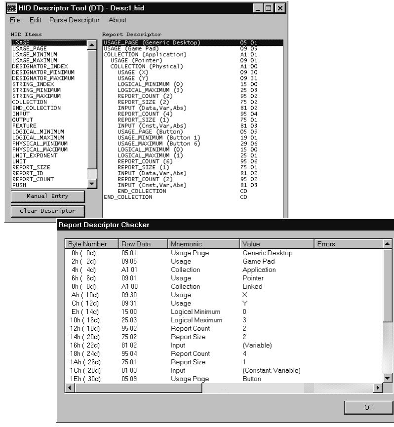

Figure 12-1: HID 描述符工具有助于创建和测试 HID 报告描述符。

## 控件和数据项值

多份文档定义了报告可能包含的值。首先要查看的是 *HID Usage Tables* 文档，其中定义了通用桌面控件、仿真控件、游戏控件、LED、按钮、电话设备等的值。该文档还告诉您在哪里可以找到其他地方定义的值。有些在 HID 规范中，而其他则在特定设备功能的类规范中，例如监视器、电源和销售点设备。

## 项目类型

HID 规范定义了两种报告项目类型：短项目和长项目。截至 HID 1.1，没有定义的长项目，该类型仅保留供将来使用。

### 短项目

短项目的 1 字节前缀指定项目类型、项目标签和项目大小。这些是构成前缀字节的元素：

| 位号 | 内容 | 描述 |
|---|---|---|
| 0 | 项目大小 | 项目中的字节数 |
| 1 |  |  |
| 2 | 项目类型 | 项目范围：主、全局或本地 |
| 3 |  |  |
| 4 | 项目标签 | 表示项目功能的数值 |
| 5 |  |  |
| 6 |  |  |
| 7 |  |  |


项目大小（位 1 和 0）指示项目包含多少个数据字节。注意，项目大小为 3（二进制 11）对应 4 个数据字节：

| 项目大小（二进制） | 数据字节数 |
|---|---|
| 00 | 0 |
| 01 | 1 |
| 10 | 2 |
| 11 | 4 |

项目类型（位 3 和 2）描述项目的范围：主项（00）、全局（01）或本地（10）。主项在描述符中定义或分组数据字段。全局项描述数据。本地项定义单个控件或数据的特性。（本章对这些项目类型有更多信息。）

项目标签（位 4-7）指示项目的功能。

## Long Items

长项目使用多个字节存储与短项目 1 字节前缀相同的信息。长项目的 1 字节前缀（FEh）标识该项目为长项目。此外，该项目还有一个字节指定数据字节数、一个包含项目标签的字节，以及最多 255 字节的数据。

## The Main Item Type

主项目在报告描述符中定义或分组数据项目。共有五种主项目类型。输入、输出和特性项目各自在一种类型的报告中定义字段。集合和结束集合项目在报告内分组相关项目。所有主项目的默认值均为零。

## Input, Output, and Feature Items

表 12-1 显示了输入、输出和特性项目的支持值，包括项目前缀以及前缀后数据的位含义。

输入项目适用于设备发送给主机的數據。输入报告包含一个或多个输入项目。主机使用中断 IN 传输或 Get_Report 请求来请求输入报告。

输出项目适用于主机发送给设备的信息。输出报告包含一个或多个输出项目。输出报告包含报告控件状态的数据，例如是否打开或关闭开关或应用于效果的强度。如前所述，如果 HID 具有中断 OUT 端点，则符合 HID 1.1 的主机可以使用中断 OUT 传输发送输出报告。所有主机也可以使用 Set_Report 请求发送输出报告。

特性项目通常适用于主机发送给设备的信息。然而，主机也可以从设备读取特性项目。特性报告包含一个或多个特性项目。特性报告通常包含影响设备或其组件整体行为的配置设置。报告通常控制您可能在物理控制面板上调整的设置。例如，主机可能具有虚拟（屏幕上）控制面板，以便用户选择和控制设备的特性和设置。主机使用带 Set_Report 和 Get_Report 请求的控制传输来发送和接收特性报告。

在每个输入、输出或特性项目前缀之后最多有 9 位描述项目的数据。（另外 23 位为保留。）例如，后跟 9 位数据的输入项目前缀的值为 82h。前缀的高四位等于 08h 以指示输入项目，低四位等于 02h 以指示数据的 9 位需要 2 个字节。后跟 8 位数据的输入项目前缀的值为 81h。前缀的高四位等于 08h 以指示输入项目，低四位等于 01h，因为数据的 8 位适合于 1 个字节。设备固件和主机软件可能会使用或忽略这些项目中的信息。

表 12-1：输入、输出和特性项目前缀后的位描述报告项目中的数据。

| 主项目前缀 | 位号 | 位 = 0 时的含义 | 位 = 1 时的含义 |
|---|---|---|---|
| 输入（100000nn，其中 nn=前缀后数据的字节数）使用 81h 表示 1 字节项目数据或使用 82h 表示 2 字节项目数据。 | 0 | 数据 | 常量 |
|  | 1 | 数组 | 可变 |
|  | 2 | 绝对 | 相对 |
|  | 3 | 无环绕 | 环绕 |
|  | 4 | 线性 | 非线性 |
|  | 5 | 首选状态 | 无首选状态 |
|  | 6 | 无空位置 | 空状态 |
|  | 7 | 保留 | 保留 |
|  | 8 | 位域 | 缓冲字节 |
|  | 9-31 | 保留 | 保留 |
| 输出（100100nn，其中 nn=前缀后数据的字节数）使用 91h 表示 1 字节项目数据或使用 92h 表示 2 字节项目数据。 | 0 | 数据 | 常量 |
|  | 1 | 数组 | 可变 |
|  | 2 | 绝对 | 相对 |
|  | 3 | 无环绕 | 环绕 |
|  | 4 | 线性 | 非线性 |
|  | 5 | 首选状态 | 无首选状态 |
|  | 6 | 无空位置 | 空状态 |
|  | 7 | 非易失 | 易失 |
|  | 8 | 位域 | 缓冲字节 |
|  | 9-31 | 保留 | 保留 |
| 特性（101100nn，其中 nn=前缀后数据的字节数）使用 B1h 表示 1 字节项目数据或使用 B2h 表示 2 字节项目数据。 | 0 | 数据 | 常量 |
|  | 1 | 数组 | 可变 |
|  | 2 | 绝对 | 相对 |
|  | 3 | 无环绕 | 环绕 |
|  | 4 | 线性 | 非线性 |
|  | 5 | 首选状态 | 无首选状态 |
|  | 6 | 无空位置 | 空状态 |
|  | 7 | 非易失 | 易失 |
|  | 8 | 位域 | 缓冲字节 |
|  | 9-31 | 保留 | 保留 |

位功能对输入、输出和特性项目相同，只是输入项目不支持易失/非易失位。以下是每个位的用途：

### Data | Constant
数据表示项目的內容可修改（读/写）。常量表示內容不可修改（只读）。

### Array | Variable
此位指定数据是否报告每个控件的状态（可变）或仅报告被断言或激活的控件的状态（数组）。仅报告被断言的控件可为键盘等设备生成更紧凑的报告，其中控件（键）很多，但同时被断言的只有一两个。

例如，如果键盘有八个键，将此位置为可变意味着键盘的报告将为每个键包含一位。在报告描述符中，报告大小为一位，报告计数为八，发送的总数据量为八位。将位设为数组意味着每个键都有一个分配的索引，键盘的报告将仅包含被按下的键的索引。对于八个键，报告大小为三位，可以报告 0 到 7 的键号。报告计数等于可报告的同时按键的最大数量。如果用户一次只能按一个键，报告计数为 1，发送的总数据量仅为 3 位。如果用户可以同时按下所有键，报告计数为 8，发送的总数据量为 24 位。

对于数组项目报告的超出范围值表示没有控件被断言。

### Absolute | Relative
绝对表示值基于固定原点。相对表示数据指示与上次读取的更改。操纵杆通常报告绝对数据（操纵杆的当前位置），而鼠标报告相对数据（自上次报告以来鼠标移动了多远）。

### No Wrap | Wrap
环绕表示如果值在达到最大值后继续递增，则回滚到最小值；如果值在达到最小值后继续递减，则回滚到最大值。指定为无环绕且超出指定限制的项目可能会报告超出限制的值。此位不适用于数组数据。

### Linear | Non-linear
线性表示测量数据与报告值具有线性关系。换句话说，报告数据与被测属性的图形形成直线。在非线性数据中，报告数据与被测属性的图形形成曲线。此位不适用于数组数据。

### Preferred State | No Preferred State
首选状态表示当用户不与之交互时，控件将返回到特定状态。瞬时按钮在无人按下时具有首选状态（弹起）。拨动开关没有首选状态，并保持用户最后选择的状态。此位不适用于数组数据。

### No Null Position | Null State
空状态表示控件支持一种状态，在该状态下控件不发送有意义的数据。控件通过发送超出其逻辑最小值和逻辑最大值定义范围的值来指示其处于空状态。无空位置表示控件发送的任何数据都是有意义的数据。操纵杆上的帽开关在未被按下时处于空位置。此位不适用于数组数据。

### Non-volatile | Volatile
易失位仅适用于输出和特性报告数据。易失表示设备可以在没有主机交互的情况下自行更改值，也可以在主机发送请求设备更改值的报告时更改值。例如，控制面板可能具有用户可以通过两种方式设置的控件。用户可以使用鼠标单击屏幕上的按钮以使主机向设备发送报告，或用户可以按下设备上的物理按钮。非易失表示设备仅在主机在报告中请求新值时才更改值。

当主机发送报告且不想更改易失项目时，分配给该项目的值取决于数据是定义为相对还是绝对。如果易失项目定义为相对，则分配值为 0 的报告应导致无变化。如果易失项目定义为绝对，则分配超出范围值的报告应导致无变化。


此位不适用于数组数据。

### 位域 | 缓冲字节。
位域表示字节中的每个位或一组位可以代表单独的数据片段，而字节本身并不代表单一数量。应用程序解释该字段的内容。缓冲字节表示数据由一个或多个字节组成。缓冲字节项的报告大小必须为八。此位不适用于数组数据。请注意，此位是项数据中的第 8 位，因此使用此位需要在项中使用两个数据字节。

## 集合和结束集合项

所有报告类型都可以使用集合和结束集合项来分组相关项。

定义的三种集合类型为应用、物理和逻辑。厂商也可以定义集合类型。集合可以嵌套。表 12-2 显示了集合和结束集合标签的值以及不同集合类型的定义值。

应用集合包含具有共同目的或共同执行单一功能的项。例如，键盘的引导描述符将按键和 LED 数据分组在应用集合中。所有报告项必须位于应用集合中。

物理集合包含代表单个几何点数据的项。收集多个位置各种传感器读数的设备可能会将每个位置的数据分组到物理集合中。鼠标的引导描述符将按钮和位置指示器分组在物理集合中。

逻辑集合形成由集合链接的不同类型项组成的数据结构。一个例子是数据缓冲区的内容和缓冲区中字节数的计数。

每个集合都以集合项开始，以结束集合项结束。集合项和结束集合项之间的所有主项都是集合的一部分。每个集合必须具有用法标签（下面描述）。

表 12-2：集合和结束集合主项标签的数据值。

| 主项类型 | 值 | 描述 |
|---|---|---|
| 集合 (A1h) | 00h | 物理 |
|  | 01h | 应用 |
|  | 02h | 逻辑 |
|  | 03h-7Fh | 保留 |
|  | 80h-FFh | 厂商定义 |
| 结束集合 (C0h) | 无 | 关闭集合 |

顶层集合是未嵌套在另一个集合中的集合。HID 接口可以有多个顶层集合，每个顶层集合代表不同的 HID。例如，带有嵌入式指向设备的键盘可以有一个 HID 接口，其中包含两个顶层集合，一个用于指向设备的报告，一个用于键盘的报告。与位于单独接口中的 HID 不同，这些 HID 共享中断端点。

如果报告包含未知的厂商定义集合类型，主机会忽略集合中的所有主项。如果已知的集合类型具有未知的用法，主机会忽略集合中的所有项。

## 全局项类型

全局项标识报告并描述其中的数据，包括数据的功能、允许的最大值和最小值以及报告项的大小和数量。全局项标签适用于其后直到下一个全局标签的所有项。为了节省设备中的存储空间，报告描述符不必重复从一项到下一项未发生变化的值。定义了 12 个全局项，显示在表 12-3 中。以下各节更详细地描述了这些项。

## 识别报告

### 报告 ID。
此值可以标识特定报告。HID 可以支持同一类型的多个报告，每个报告都有自己的报告 ID、内容和格式。这样，传输就不必每次都包含每条数据。通常，拥有单个报告的简单性比减少较长报告使用的带宽需求更重要。

在报告描述符中，报告 ID 项适用于其后直到下一个报告 ID 的所有项。如果没有报告 ID 项，则假定默认 ID 为零。描述符不应声明报告 ID 为零。报告 ID 特定于每种报告类型，因此 HID 可以使用默认 ID 拥有每种类型的报告一种。然而，如果至少一种报告类型使用多个报告 ID，则 HID 中的每个报告都必须具有声明的 ID。例如，如果接口对功能报告支持报告 ID 1 和报告 ID 2，则任何输入或输出报告也必须具有大于零的报告 ID。

在使用 Set_Report 或 Get_Report 请求的传输中，主机会在 Setup 事务中指定报告 ID，在 wValue 字段的低字节中。在中断传输中，如果接口支持一个以上的报告 ID，则报告 ID 在总线上先于报告数据。如果接口仅支持默认报告 ID 为零，则使用中断传输时不会随报告发送报告 ID。

在 Windows 下，提供给 API 调用的报告缓冲区必须足够大以容纳报告加上报告 ID 的一个字节。当 HID 对不同大小的输入报告支持多个报告 ID 时，Windows HID 驱动程序要求应用程序使用足够大的缓冲区以容纳最长的报告。当 HID 支持同一类型且不同大小的多个报告并且 HID 发送的报告数据是端点最大数据包大小的倍数时，HID 通过发送零长度数据包来指示报告数据的结束

对于存在多个输入报告 ID 的输入报告，主机驱动程序无法从 HID 请求特定报告。在接收到 IN 令牌数据包时，设备返回其缓冲区中的任何报告。换句话说，设备固件决定发送哪个报告。在主机端，HID 驱动程序将接收到的报告及其报告 ID 存储在缓冲区中。

表 12-3：定义了十二个全局项。

| 全局项类型 | 值（nn 表示其后跟随的字节数） | 描述 |
|---|---|---|
| 用法页 | 000001nn | 指定数据的用法或功能。 |
| 逻辑最小值 | 000101nn | 项将报告的最小值。 |
| 逻辑最大值 | 001001nn | 项将报告的最大值。 |
| 物理最小值 | 001101nn | 以物理单位表示的逻辑最小值。 |
| 物理最大值 | 010001nn | 以物理单位表示的逻辑最大值。 |
| 单位指数 | 010101nn | 单位的以 10 为底的指数。 |
| 单位 | 011001nn | 单位值。 |
| 报告大小 | 011101nn | 项字段的位数大小。 |
| 报告 ID | 100001nn | 标识报告的前缀。 |
| 报告计数 | 100101nn | 项的数据字段数。 |
| 推入 | 101001nn | 将全局项状态表的副本放置在栈上。 |
| 弹出 | 101101nn | 用最后压入栈的结构替换项状态表。 |
| 保留 | 110001nn 至 111101nn | 供将来使用。 |

## 描述数据的用途

描述数据及其使用方式的全局项为用法页、逻辑和物理最大值和最小值、单位和单位指数。这些项中的每一个都有助于报告的接收者解释报告的数据。除了用法页之外，所有项都涉及将原始报告数据转换为带有单位的值。它们使报告能够以紧凑形式包含数据，由数据的接收者负责将数据转换为有意义的值。然而，报告数据的发送者也可以选择执行部分或全部转换。

### 用法页。
项的用法是一个 32 位值，标识设备执行的功能。用法包含两个值：上 16 位为全局用法页项，下 16 位为局部用法项。局部用法项中的值为用法 ID。术语 *Usage* 可以指 32 位值或 16 位局部值。为了防止混淆，一些资料使用术语 Extended Usage 来指 32 位值。在 Microsoft 的 doc-

文档中，USAGE 类型是一个 16 位值，可以包含一个用法页（Usage Page）或一个用法 ID（Usage ID）。

多个条目可以共享同一个用法页，但拥有不同的用法 ID。在报告中出现某个用法页之后，其后的所有用法 ID 都使用该用法页，直到声明新的用法页为止。

HID 用法表（HID Usage Tables）文档列出了已定义的用法页及其值，并指出描述每个页面及其索引的章节或其他文档。许多常见设备类型都有对应的用法页，包括通用桌面控件（鼠标、键盘、操纵杆）、数字化仪、条形码扫描器、相机控制以及各种游戏控件。对于没有已定义用法页的专用设备，供应商可以使用 FF00h 到 FFFFh 之间的值来定义用法页。

## 逻辑最小值和逻辑最大值

逻辑最小值（Logical Minimum）和逻辑最大值（Logical Maximum）定义了报告值的上下限。这些限值以“逻辑单位”表示，这意味着它们与所描述的值使用相同的单位。例如，如果某个设备以 2 毫安的增量报告最高 500 毫安的读数，逻辑最大值就是 250。

如果最高字节的最高有效位为 1，则该值为负数，以二进制补码表示。（要求出二进制补码所表示的负数值，需将每一位取反，然后在结果上加 1。）对于 1 字节的值，00h 到 7Fh 对应十进制正数 0 到 127，FFh 到 80h 对应十进制负数 -1 到 -128。

HID 规范指出，如果逻辑最小值和逻辑最大值都被视为正数，则不需要符号位。但是，USB-IF 合规性工具中的报告描述符测试假定：如果最高有效位为 1，则该值为负数。以下值将无法通过合规性测试，因为逻辑最小值（0）大于逻辑最大值（-1）：

```
0x15 0x00    // Logical Minimum
0x25 0xFF    // Logical Maximum WRONG!
```

如果希望最小值为 0、最大值为 255，解决办法是对最大值使用 2 字节的值：

```
0x15 0x00   // Logical Minimum
0x26 0x00FF   // Logical Maximum
```

请注意，逻辑最大值的条目标记现在是 26h，表示标记之后的数据是两个字节。由于逻辑最大值的最高有效位为零，因此该值被认定为正数，合规性测试会接受这些值为有效值。

## 单位换算

物理最小值（Physical Minimum）、物理最大值（Physical Maximum）、单位指数（Unit Exponent）和单位（Unit）条目定义了如何将报告值转换为更有意义的单位。

### 物理最小值和物理最大值

物理最小值和物理最大值定义了以单位标记所定义的单位表示某个值时的上下限。在前面提到的以 2 毫安为增量、值为 0 到 250 的示例中，物理最小值为 0，物理最大值为 500。接收设备使用逻辑和物理限值来获取所需单位的值。在该示例中，以 2 毫安为增量报告数据意味着该值可以用单个字节传输，数据的接收方使用物理最小值和最大值将其换算为毫安。与每毫安 1 比特的报告方式相比，代价是分辨率有所损失。如果报告中没有指定这些值，它们默认与逻辑最小值和逻辑最大值相同。

### 单位指数

单位指数指定在使用逻辑和物理限值将值转换为所需单位之后，对该值应用 10 的多少次幂。指数范围为 -8 到 +7。值为 0 时，该值乘以 10⁰（即 1），相当于不应用任何指数。代码如下：

| 指数 | 代码 |
| --- | --- |
| 0 | 00h |
| 1 | 01h |
| 2 | 02h |
| 3 | 03h |
| 4 | 04h |
| 5 | 05h |
| 6 | 06h |
| 7 | 07h |
| -8 | 08h |
| -7 | 09h |
| -6 | 0Ah |
| -5 | 0Bh |
| -4 | 0Ch |
| -3 | 0Dh |
| -2 | 0Eh |
| -1 | 0Fh |

例如，如果得到的值为 1234，单位指数为 0Eh，则最终值为 12.34。

### 单位

单位（Unit）标记指定了在使用物理条目和单位指数条目转换值之后，应用于报告数据的单位。HID 规范定义了长度、质量、时间、温度、电流和发光强度等基本单位的代码。大多数其他单位都可以从这些基本单位推导出来。

指定单位值可能比你预期的更复杂。表 12-4 显示了一些可以使用的值。该值最长可达四个字节，每个半字节都有定义好的功能。半字节 0（最低有效半字节）指定测量系统，即英制或 SI（国际单位制），以及测量单位是线性单位还是角度单位。其后的每个半字节代表一个待测量的物理量，半字节的值表示应用于该量的指数。例如，值为 2 的半字节表示相应的量以单位的平方表示。值为 Dh（代表 -3）的半字节表示单位表示为 1/单位³。这些指数与单位指数值不同；单位指数是应用于数据的 10 的幂，而不是应用于单位的指数。

## 转换原始数据

要将原始数据转换为带有单位的值，必须满足三个条件。固件的报告描述符必须包含转换所需的信息。数据发送方发送的数据必须与描述符中的规范一致。数据接收方必须应用描述符中指定的转换。

下面是一些描述符以及原始数据和转换后数据的示例。请记住，HID 规范中存在某个标记并不意味着你必须使用它。如果应用程序知道它要发送或接收的值使用什么格式和单位，固件就不必指定这些条目。

要指定以秒为单位的时间（最多一分钟），报告描述符可能包含以下信息：

- 逻辑最小值：0
- 逻辑最大值：60

表 12-4：应用于报告值的单位是单位条目中指定的测量系统和指数值的函数

| 半字节编号 | 物理量 | 无（0） | SI 线性（1） | SI 旋转（2） | 英制线性（3） | 英制旋转（4） |
| --- | --- | --- | --- | --- | --- | --- |
| 1 | 长度 | 无 | 厘米 | 弧度 | 英寸 | 度 |
| 2 | 质量 | 无 | 克 |  | 斯勒格 |  |
| 3 | 时间 | 无 | 秒 |  |  |  |
| 4 | 温度 | 无 | 开尔文 |  | 华氏度 |  |
| 5 | 电流 | 无 | 安培 |  |  |  |
| 6 | 发光强度 | 无 | 坎德拉 |  |  |  |
| 7 | 保留 | 无 |  |  |  |  |

- 物理最小值：0
- 物理最大值：60
- 单位：1003h。半字节 0 = 3，选择英制线性测量系统（不过在这种情况下，1 到 4 中的任何值都可以）。半字节 3 = 1，选择以秒为单位的时间。
- 单位指数：0

有了这些信息，接收方就知道发送的值等于多少秒。

那么，如果你想指定以十分之一秒为单位的时间，同样最多一分钟呢？你需要增大逻辑最大值和物理最大值，并更改单位指数：

- 逻辑最小值：0
- 逻辑最大值：600
- 物理最小值：0
- 物理最大值：600
- 单位：1003h。半字节 0 = 3，选择英制线性测量系统。半字节 3 = 1，选择以秒为单位的时间。
- 单位指数：0Fh。这表示指数为 -1，以表明该值以十分之一秒为单位，而不是秒。

发送最大为 600 的值需要 3 个字节，固件在报告大小（Report Size）标记中指定这一点。

要使用一个字节发送温度值，表示 -20 到 110 华氏度的温度范围，报告描述符可能包含以下内容：

- 逻辑最小值：-128（以二进制补码的十六进制表示时为 80h）
- 逻辑最大值：127（7Fh）
- 物理最小值：-20（以二进制补码的十六进制表示时为 ECh）
- 物理最大值：110（6Eh）
- 单位：10003h。半字节 0 = 3，选择英制线性测量系统，不过在这种情况下，1 到 4 中的任何值都可以。半字节 4 = 3，选择华氏度。
- 单位指数：0

这些值确保了单字节报告条目能够达到尽可能高的分辨率，因为传输的值可以覆盖从 0 到 255 的完整范围。

在这种情况下，逻辑和物理限值不同，因此需要进行转换。以下 Visual Basic 代码可以求出分辨率，即每单位对应的比特数：

```
Resolution = _
    (Logical_Maximum - Logical_Minimum) / _
    ((Physical_Maximum - Physical_Minimum) * _
    (10 ^ Unit_Exponent))
```

使用示例中的值，分辨率为每度 1.96 比特，即每比特 0.51 度。

以下 Visual Basic 代码可将值转换为指定单位：

```
Value = _
    Value_In_Logical_Units * _
    ((Physical_Maximum - Physical_Minimum) * _
    (10 ^ Unit_Exponent )) / _
    (Logical_Maximum - Logical_Minimum)
```

如果逻辑单位值（原始数据）为 63，则转换后的指定单位值为 32 华氏度。


作为另一个示例，以厘米每秒指定速度需要一个包含厘米和秒两个单位的 Unit 值。根据表 12-4，应使用的 Unit 值为 1011h。Nibble 0 = 1 用于选择 SI 测量系统，nibble 1 = 1 用于选择长度单位为厘米，nibble 3 = 1 用于选择时间单位为秒。

为了说明其复杂程度，伏特的 Unit 值为 F0D121h，表示 SI 线性测量系统，单位为 (cm²)(gm)/(sec³)(amp⁻¹)。然而，请记住 Unit 值仅指定单位。接收方只需识别 Units 值并将单位分配给接收到的数据；无需执行 Units 值中暗示的计算。

## 描述数据的大小和格式

两个全局项描述报告数据的大小和格式。

**报告大小** 指定 Input、Output 或 Feature 项中一个字段的位数。每个字段包含一个数据。

**报告计数** 指定 Input、Output 或 Feature 项包含的字段数。

例如，如果一个报告有两个 8 位字段，则报告大小为 8，报告计数为 2。如果一个报告有一个 16 位字段，则报告大小为 16，报告计数为 1。

单个 Input、Output 或 Feature 报告可以包含多个项目，每个项目都有自己的报告大小和报告计数。

## 保存和恢复全局项

最后两个全局项可启用保存和恢复全局项集合。这些项在使用设备中最小存储空间的同时提供了报告格式的灵活性。

**推送** 将全局项状态表的副本放置在 CPU 的堆栈上。全局项状态表包含所有先前定义的全局项的当前设置。

**弹出** 是推送的补充。它恢复先前推送的全局项状态的已保存状态。

## 本地项类型

本地项指定报告中控件和数据项的特性。本地项的值适用于 Main 项内其后跟随的所有项目，直到分配新值。本地项不会传递到下一个 Main 项；每个 Main 项都重新开始，未定义任何本地项。

本地项涉及通用用法、身体部位指定符和字符串。分隔符项可用于对本地项集合进行分组。表 12-5 显示了每个项的值和含义。

**表 12-5：定义了十个本地项。**

| 本地项类型 | 值（nn 表示其后跟随的字节数） | 描述 |
|---|---|---|
| 用法 | 000010nn | 描述项目或集合用途的索引。 |
| 用法最小值 | 000110nn | 与数组或位图中的元素关联的起始用法。 |
| 用法最大值 | 001010nn | 与数组或位图中的元素关联的结束用法。 |
| 指定符索引 | 001110nn | 物理描述符中的指定符值。指示哪个身体部位适用于控件。 |
| 指定符最小值 | 010010nn | 与数组或位图中的元素关联的起始指定符。 |
| 指定符最大值 | 010110nn | 与数组或位图中的元素关联的结束指定符。 |
| 字符串索引 | 011110nn | 将字符串与项目或控件关联。 |
| 字符串最小值 | 100010nn | 将一组顺序字符串分配给数组或位图中的控件时使用的第一个字符串索引。 |
| 字符串最大值 | 100110nn | 将一组顺序字符串分配给数组或位图中的控件时使用的最后一个字符串索引。 |
| 分隔符 | 101010nn | 本地项集合的开始（1）或结束（0）。 |
| 保留 | 101011nn 至 111110nn | 供将来使用。 |

**用法。** 本地 Usage 项是与全局 Usage Page 协同工作以描述控件、数据或集合功能的 Usage ID。

与 Usage Page 项类似，HID Usage Tables 文档列出了许多 Usage ID。例如，Buttons Usage Page 使用 1 到 FFFFh 的本地 Usage ID 来识别一组中按下的是哪个按钮，值为 0 表示没有按钮被按下。

报告可能将一个 Usage 分配给多个项目。如果报告项前面只有一个 Usage，则该 Usage 适用于该项的所有数据。如果报告项前面有多个 Usage 且控件或数据项的数量等于 Usage 的数量，则每个 Usage 适用于一个控件或数据项，Usage 与控件/数据项按顺序配对。在下面的示例中，报告包含两个字节。第一个字节的 Usage 为 X，第二个字节的 Usage 为 Y。

```
Usage (X),
Usage (Y),
Report Count (2),
Report Size (8),
Input (Data, Variable, Absolute),
```

如果报告项前面有多个 Usage 且控件或数据项的数量大于 Usage 的数量，则每个 Usage 按顺序与一个控件或数据项配对，最后一个 Usage 适用于所有剩余的控件/数据项。在下面的示例中，报告为 16 字节。Usage X 适用于第一个字节，Usage Y 适用于第二个字节，厂商定义的 Usage 适用于第三到第 16 个字节。

```
Usage (X)
Usage (Y)
Usage (vendor defined)
Report Count (16),
Report Size (8),
Input (Data, Variable, Absolute)
```

### 用法最小值和最大值

用法最小值和用法最大值可以将一系列 Usage ID 分配给数组或位图中的元素。下面的示例描述了一个报告，其中包含三个按钮各自的状态（0 或 1）。用法最小值和用法最大值指定第一个按钮的 Usage ID 为 1，第二个按钮的 Usage ID 为 2，第三个按钮的 Usage ID 为 3：

```
Usage Page (Button Page)
Logical Minimum (0)
Logical Maximum (1)
Usage Minimum (1)
Usage Maximum (3)
Report Count (3)
Report Size (1)
Input (Data, Variable, Absolute)
```

### 指定符索引

对于具有物理描述符的项目，指定符索引指定物理描述符中的指定符值。指定符指定控件使用的身体部位。

### 指定符最小值和指定符最大值

当报告包含适用于位图或数组中元素的多个指定符索引时，指定符最小值和指定符最大值可以为每个位或数组项分配顺序的指定符索引。

### 字符串索引

项目或控件可以包含字符串索引以将字符串与项目或控件关联。字符串以与第 4 章中描述的产品、制造商和序列号字符串相同的格式存储。

### 字符串最小值和最大值

当报告包含适用于位图或数组中元素的多个字符串索引时，字符串最小值和字符串最大值可以为每个位或数组项分配顺序的字符串索引。

### 分隔符

分隔符定义本地项的开始（1）或结束（0）。分隔的本地项可能包含控件的替代用法。因此，不同应用程序可以以不同的方式定义设备的控件。例如，一个按钮可能具有通用用途（Button1）和特定用途（Send、Quit 等）。

## 物理描述符

物理描述符指定用于激活控件的身体部位或部位。例如，每个手指可能有自己的分配控件。相似的物理描述符被分组为物理描述符集。一个集合由头部组成，其后跟物理描述符。

物理描述符是 HID 特定的描述符。主机可以通过发送 Get_Descriptor 请求，在 wValue 字段的高字节中放置 23h，并在 wValue 字段的低字节中放置描述符集的编号来检索物理描述符集。

物理描述符是可选的。对于大多数设备，这些描述符要么完全不适用，要么它们可能提供的信息没有实际用途。HID 规范对需要它们的设备提供了有关如何使用物理描述符的更多信息。

## 填充

为了使描述符包含八位的倍数，描述符可以包含一个未分配 Usage 的 Main 项。以下键盘报告描述符的摘录指定了一个传输五位数据和三位填充的 Output 报告：

```
Usage Page (LEDs)
Usage Minimum (1)
Usage Maximum (5)
Output (Data, Variable, Absolute) (5 1-bit LEDs)

Report Count (1)
Report Size (3)
Output (Constant) (3 bits of padding)
```


# 第13章
## 人机接口设备：主机应用程序

第10章展示了如何获取与设备通信的句柄。本章展示了 Visual Basic .NET 和 Visual C++ .NET 应用程序如何使用该句柄与 HID 类设备通信。

### HID API 函数

Windows API 包含应用程序可用于了解 HID 的报告并发送和接收报告数据的函数。Windows DDK 记录了这些函数。

HID API 将每个报告项视为按钮或值。根据 HID API 的定义，按钮是一种具有离散二进制值的控件或数据项，例如 ON（1）或 OFF（0）。按钮包括在 Buttons、Keyboard 和 LED Usage 页面中由唯一 Usage ID 表示的项。值用法或值可以具有一系列值中的任意值。任何不是按钮的报告项都是值。

Windows 98 Gold 最早包含 HID API。Windows 98 SE、Windows 2000 和 Windows Me 支持额外的 HID 函数。该 API 在 Windows XP 中再次扩展。本章中的表格注明了在所有 Windows 版本中均不可用的函数。

### 请求 HID 信息

表 13-1 列出了请求 HID 及其报告信息的 API 函数。HidD_GetPreparsedData 检索指向包含 HID 报告信息的缓冲区的指针。HidP_GetCaps 使用该指针检索 HIDP_CAPS 结构，该结构指定设备支持的报告类型并提供报告中信息类型的相关信息。例如，该结构包括具有有关按钮或一组按钮的信息的 HIDP_BUTTON_CAPS 结构的数量。然后应用程序可以使用 HidP_GetButtonCaps 函数检索这些结构

API 还包括多个用于检索字符串的函数。表 13-2 列出了这些函数。

### 发送和接收报告

表 13-3 列出了应用程序可用于发送和接收报告的函数。

Windows 的 HID 驱动程序会定期导致主机控制器请求 Input 报告。驱动程序将接收到的报告存储在缓冲区中。ReadFile 从缓冲区检索一个或多个报告。如果缓冲区为空，ReadFile 会等待报告到达。因此 ReadFile 不会导致设备发送报告，而只是读取驱动程序已请求的报告。

WriteFile 向 HID 发送 Output 报告。如果 HID 具有中断 OUT 端点且操作系统晚于 Windows 98 Gold，则 WriteFile 使用中断传输。否则，WriteFile 使用带有 Set_Report 请求的控制传输。如果使用中断传输，当设备 NAK 时 WriteFile 会等待。如果使用控制传输，WriteFile 在失败或超时时返回错误代码。

HidD_GetInputReport 使用带有 Get_Report 请求的控制传输请求 Input 报告，绕过 Input 报告缓冲区。HidD_SetOutputReport 提供了一种使用带有 Set_Report 请求的控制传输发送 Output 报告的方法，即使 HID 和操作系统支持使用中断传输也是如此。

对于 Feature 报告，HidD_GetFeature 使用控制传输和 Get_Report 请求检索报告，而 HidD_SetFeature 使用控制传输和 Set_Report 请求发送报告。请注意，HidD_SetFeature 与标准 USB 请求 Set_Feature 不同！

所有使用控制传输的函数在失败或超时时都会返回错误代码。

表 13-1：应用程序可以使用这些 API 函数获取有关 HID 及其报告的信息。

| API 函数 | 用途 |
|---|---|
| HidD_FreePreparsedData | 释放 HidD_GetPreparsedData 使用的资源。 |
| HidD_GetPhysicalDescriptor¹ | 检索物理描述符。 |
| HidD_GetPreparsedData | 返回包含有关 HID 报告信息的缓冲区的句柄。 |
| HidP_GetButtonCaps | 检索指定报告类型顶层集合中按钮信息的数组。 |
| HidP_GetCaps | 检索描述 HID 报告的结构。 |
| HidP_GetExtendedAttributes¹ | 检索有关 HID 解析器未识别的 Global 项信息的结构。 |
| HidP_GetLinkCollectionNodes | 检索有关顶层集合内集合信息的结构。 |
| HidP_GetSpecificButtonCaps | 类似于 HidP_GetButtonCaps，但可以指定 Usage Page、Usage ID 和链接集合。 |
| HidP_GetSpecificValueCaps | 类似于 HidP_GetValueCaps，但可以指定 Usage Page、Usage ID 和链接集合。 |
| HidP_GetValueCaps | 检索指定报告类型顶层集合中值信息的数组。 |
| HidP_IsSameUsageAndPage | 确定两个 Usages（Usage Page 和 Usage ID）是否相等。 |
| HidP_MaxDataListLength | 检索 HidP_GetData 对于 HID 报告类型和顶层集合可以返回的 HIDP_DATA 结构的最大数量。 |
| HidP_MaxUsageListLength | 检索 HidP_GetUsages 对于报告类型和顶层集合可以返回的 Usage ID 的最大数量。 |
| HidP_TranslateUsagesToI8042ScanCodes | 将 HID_USAGE_PAGE_KEYBOARD Usage Page 上的 Usages 映射到 PS/2 扫描码。 |
| HidP_UsageAndPageListDifference | 检索两个 Usages（Usage Page 和 Usage ID）数组之间的差异。 |
| HidP_UsageListDifference | 检索两个 Usage ID 数组之间的差异。 |

¹在 Windows 98 Gold 下不受支持。

表 13-2：应用程序可以使用这些 API 函数从 HID 检索字符串。

| API 函数 | 用途 |
|---|---|
| HidD_GetIndexedString¹ | 检索指定的字符串。 |
| HidD_GetManufacturerString¹ | 检索制造商字符串 |
| HidD_GetProductString¹ | 检索产品字符串。 |
| HidD_GetSerialNumberString¹ | 检索序列号字符串。 |

¹在 Windows 98 Gold 下不受支持。

表 13-3：应用程序可以使用这些 API 函数发送和接收报告。

| API 函数 | 用途 |
|---|---|
| HidD_GetFeature | 读取 Feature 报告。 |
| HidD_GetInputReport¹ | 使用控制传输读取 Input 报告。 |
| HidD_SetFeature | 发送 Feature 报告。 |
| HidD_SetOutputReport¹ | 使用控制传输发送 Output 报告。 |
| ReadFile | 读取通过中断传输获得的 Input 报告。 |
| WriteFile | 发送 Output 报告。如果可能，使用中断传输，否则使用控制传输。 |

¹需要 Windows XP 或更高版本。

### 提供和使用报告数据

检索报告后，应用程序可以直接从缓冲区使用原始数据，或使用 API 函数提取按钮或值数据。类似地，应用程序可以直接将要发送的数据写入报告的缓冲区，或使用 API 函数将数据放入发送缓冲区。

表 13-4 列出了提取接收报告中信息并将信息存储在待发送报告中的 API 函数。例如，应用程序可以通过调用 HidP_GetButtons 了解哪些按钮已被按下，该函数返回一个缓冲区，其中包含属于指定 Usage Page 且设置为 ON 的所有按钮的 Usage ID。应用程序可以通过调用 HidP_SetButtons 和 HidP_UnsetButtons 在待发送报告中设置和清除按钮。类似地，应用程序可以使用 HidP_GetUsageValue 和 HidP_SetUsageValue 检索和设置报告中的值。

### 管理 HID 通信

表 13-5 列出了应用程序在管理 HID 通信时可使用的 API 函数。

第10章展示了如何使用 HidD_GetHidGuid 获取 HID 类的设备接口 GUID。HidD_SetNumInputBuffers 使应用程序能够更改 HID 驱动程序用于 Input 报告的缓冲区的大小。如果应用程序有时太忙而无法在缓冲区溢出之前读取报告，则更大的缓冲区会有所帮助。设置的值是缓冲区将容纳的报告数量。HidD_FlushQueue 删除缓冲区中的任何 Input 报告。

### 识别设备

按照第10章所述获取 HID 的句柄后，应用程序可以使用 HID API 函数来确定该 HID 是否为

表13-4：应用程序可以使用这些API函数从检索到的报告中提取信息，并将信息存储到要发送的报告中。

| API函数 | 用途 |
|---|---|
| HidP_GetButtons | 与HidP_GetUsages相同。 |
| HidP_GetButtonsEx | 与HidP_GetUsagesEx相同。 |
| HidP_GetData | 检索一个结构数组，每个结构标识一个设置为ON（1）的按钮控件的数据索引和状态，或一个值控件的数据索引和数据。 |
| HidP_GetScaledUsageValue | 从报告中检索一个有符号且缩放后的值。 |
| HidP_GetUsages | 检索指定用法页上所有设置为ON（1）的按钮列表。 |
| HidP_GetUsagesEx | 检索所有设置为ON（1）的按钮列表。 |
| HidP_GetUsageValue | 检索指定值的数据。 |
| HidP_GetUsageValueArray | 检索具有相同用法ID的值数组的数据。 |
| HidP_InitializeReportForID¹ | 将所有按钮设置为OFF（0），并将所有值设置为其空值（如果已定义），否则设置为零。 |
| HidP_SetButtons | 与HidP_SetUsages相同。 |
| HidP_SetData | 设置报告中按钮的状态和值中的数据。 |
| HidP_SetScaledUsageValue | 将有符号且缩放后的物理数转换为用法的逻辑值，并在报告中设置该值。 |
| HidP_SetUsages | 将报告中的一个或多个按钮设置为ON（1）。 |
| HidP_SetUsageValue | 设置指定值的数据。 |
| HidP_SetUsageValueArray | 设置具有相同用法ID的值数组的数据。 |
| HidP_UnsetButtons | 与HidP_UnsetUsages相同。 |
| HidP_UnsetUsages | 将报告中的一个或多个按钮设置为OFF（0）。 |

¹在Windows 98 Gold下不受支持。

应用程序想要与之通信。应用程序可以通过供应商ID和产品ID来识别设备，或者通过搜索具有特定用法（例如游戏控制器）的设备来识别设备。

## 读取供应商ID和产品ID

对于没有标准用法的供应商特定设备，搜索具有特定供应商ID和产品ID的设备通常很有用。API函数HidD_GetAttributes检索一个指向包含供应商ID、产品ID和设备发布号的结构体的指针。

表13-5：应用程序可以使用这些API函数来管理HID通信。

| API函数 | 用途 |
|---|---|
| HidD_FlushQueue | 删除缓冲区中的所有输入报告。 |
| HidD_GetHidGuid | 检索HID类设备的设备接口GUID。 |
| HidD_GetNumInputBuffers¹ | 检索输入报告缓冲区可以容纳的报告数。 |
| HidD_SetNumInputBuffers¹ | 设置输入报告缓冲区可以容纳的报告数。 |
| HidRegisterMinidriver | HID迷你驱动程序在初始化期间调用此函数以向HID类驱动程序注册。 |
| ¹在Windows 98 Gold下不受支持。 |  |

### Visual C++

HIDD_ATTRIBUTES结构包含有关设备的信息：

```cpp
typedef struct _HIDD_ATTRIBUTES {
    ULONG   Size;
    USHORT  VendorID;
    USHORT  ProductID;
    USHORT  VersionNumber;
} HIDD_ATTRIBUTES, *PHIDD_ATTRIBUTES;
```

这是函数的声明：

```cpp
BOOLEAN
HidD_GetAttributes(
    IN HANDLE HidDeviceObject,
    OUT PHIDD_ATTRIBUTES Attributes
);
```

这是检索结构的代码：

```cpp
BOOLEAN Result;
HIDD_ATTRIBUTES Attributes;

// Set the Size member to the number of bytes
// in the structure.
Attributes.Size = sizeof(Attributes);
Result = HidD_GetAttributes
    (DeviceHandle,
    &Attributes);
```

然后，应用程序可以将供应商ID和产品ID与所需值进行比较：

```cpp
const unsigned int VendorID = 0x0925;
const unsigned int ProductID = 0x1234;

if (Attributes.VendorID == VendorID) {
    if (Attributes.ProductID == ProductID) {
        // The Vendor ID and Product ID match.
    }
    else {
        // The Product ID doesn't match.
        // Close the handle.
    }
}
else {
    // The Vendor ID doesn't match.
    // Close the handle.
}
```

### Visual Basic

HIDD_ATTRIBUTES结构包含有关设备的信息：

```vb
<StructLayout(LayoutKind.Sequential)> _
Public Structure HIDD_ATTRIBUTES
    Dim Size As Integer
    Dim VendorID As Short
    Dim ProductID As Short
    Dim VersionNumber As Short
End Structure
```

这是函数的声明：

```
<DllImport("hid.dll")> _
Function HidD_GetAttributes _
    (ByVal HidDeviceObject As Integer, _
    ByRef Attributes As HIDD_ATTRIBUTES) _
As Boolean
End Function
```

这是检索结构的代码：

```
Dim DeviceAttributes As HIDD_ATTRIBUTES
Dim MyVendorID as Short
Dim MyProductID as Short
Dim Result as BOOLEAN

' Set the Size property of DeviceAttributes to the
' number of bytes in the structure.

DeviceAttributes.Size =
    Marshal.SizeOf(myHID.DeviceAttributes)

Result = HidD_GetAttributes _
    (DeviceHandle, _
    DeviceAttributes)
```

然后，应用程序可以将供应商ID和产品ID与所需值进行比较：

```
MyVendorID = &h0925
MyProductID = &h1234

If (DeviceAttributes.VendorID = MyVendorID) And _
    (DeviceAttributes.ProductID = MyProductID) Then

    Debug.WriteLine("My device detected")

Else

    Debug.WriteLine("Not my device")
    ' Close the handle.
```

### 详细信息

DeviceHandle是CreateFile返回的句柄。在调用HidD_GetAttributes之前，必须将DeviceAttributes的Size成员设置为结构的大小。如果函数返回True，则DeviceAttributes结构已无错误地填充。然后，应用程序可以将检索到的值与所需的供应商ID、产品ID和设备发布号进行比较。

如果属性未指示所需设备，应用程序应使用CloseHandle API函数关闭接口的句柄。然后，应用程序可以继续测试使用SetupDiGetClassDevs检索到的设备信息集中的下一个HID，如第10章所述。

## 获取指向包含设备功能的缓冲区的指针

另一种了解设备更多信息的方法是检查其功能。你可以对供应商ID和产品ID与你查找的值匹配的设备执行此操作，也可以检查未知设备的功能。

第一个任务是调用HidD_GetPreparsedData来获取指向包含设备功能信息的缓冲区的指针。

### Visual C++

这是函数的声明：

```
BOOLEAN
    HidD_GetPreparsedData(
        IN HANDLE HidDeviceObject,
        OUT PHIDP_PREPARSED_DATA *PreparsedData
    );
```

这是调用函数的代码：

```
PHIDP_PREPARSED_DATA PreparsedData;

HidD_GetPreparsedData
    (DeviceHandle,
    &PreparsedData);
```

### Visual Basic

这是函数的声明：

```
<DllImport("hid.dll")> _
Function HidD_GetPreparsedData _
    (ByVal HidDeviceObject As Integer, _
    ByRef PreparsedData As IntPtr) _
    As Boolean
End Function
```

这是调用函数的代码：

```
Dim PreparsedData As IntPtr

HidD_GetPreparsedData _
    (DeviceHandle, _
    PreparsedData)
```

### 详细信息

DeviceHandle是CreateFile返回的句柄。PreparsedData是指向包含数据的缓冲区的指针。应用程序不需要直接访问缓冲区中的数据。代码只需将该指针传递给另一个API函数。

使用完PreparsedData缓冲区后，应用程序应通过调用本章后面描述的HidD_FreePreparsedData来释放系统资源。

## 获取设备的功能

HidP_GetCaps函数返回一个指向包含设备功能信息的结构的指针。该结构包含HID的用法页、用法、报告长度，以及标识输入、输出和功能报告中特定控件和数据项的按钮功能结构、值功能结构和数据索引的数量。应用程序可以使用功能信息来识别特定的HID，并了解其报告和报告数据。并非结构中的每一项都适用于所有设备。


## Visual C++

这是 HIDP_CAPS 结构的声明：

```c
typedef struct _HIDP_CAPS
{
    USAGE      Usage;
    USAGE      UsagePage;
    USHORT     InputReportByteLength;
    USHORT     OutputReportByteLength;
    USHORT     FeatureReportByteLength;
    USHORT     Reserved[17];

    USHORT     NumberLinkCollectionNodes;

    USHORT     NumberInputButtonCaps;
    USHORT     NumberInputValueCaps;
    USHORT     NumberInputDataIndices;

    USHORT     NumberOutputButtonCaps;
    USHORT     NumberOutputValueCaps;
    USHORT     NumberOutputDataIndices;

    USHORT     NumberFeatureButtonCaps;
    USHORT     NumberFeatureValueCaps;
    USHORT     NumberFeatureDataIndices;
} HIDP_CAPS, *PHIDP_CAPS;
```

这是函数的声明：

```c
NTSTATUS
HidP_GetCaps(
    IN PHIDP_PREPARSED_DATA PreparsedData,
    OUT PHIDP_CAPS Capabilities
);
```

这是调用函数的代码：

```c
HIDP_CAPS Capabilities;

HidP_GetCaps
(PreparsedData,
&Capabilities);
```

## Visual Basic

这是 HIDP_CAPS 结构的声明：

```
<StructLayout(LayoutKind.Sequential)> _
Public Structure HIDP_CAPS
    Dim Usage As Short
    Dim UsagePage As Short
    Dim InputReportByteLength As Short
    Dim OutputReportByteLength As Short
    Dim FeatureReportByteLength As Short
    <MarshalAs _
    (UnmanagedType.ByValArray, _
    SizeConst:=17)> _
    Dim Reserved() As Short
    Dim NumberLinkCollectionNodes As Short
    Dim NumberInputButtonCaps As Short
    Dim NumberInputValueCaps As Short
    Dim NumberInputDataIndices As Short
    Dim NumberOutputButtonCaps As Short
    Dim NumberOutputValueCaps As Short
    Dim NumberOutputDataIndices As Short
    Dim NumberFeatureButtonCaps As Short
    Dim NumberFeatureValueCaps As Short
    Dim NumberFeatureDataIndices As Short
End Structure
```

这是函数的声明：

```
<DllImport("hid.dll")> _
Function HidP_GetCaps _
    (ByVal PreparsedData As IntPtr, _
    ByRef Capabilities As HIDP_CAPS) _
    As Boolean
End Function
```

这是调用函数的代码：

```
Dim Capabilities As HIDP_CAPS

HidP_GetCaps _
    (PreparsedData, _
    Capabilities)
```

## Details

PreparsedData 是由 HidD_GetPreparsedData 返回的指针。函数返回后，应用程序可以检查并使用 Capabilities 结构中感兴趣的任何值。例如，如果您正在寻找一个操纵杆，可以查找 Usage Page 为 01h 且 Usage 为 04h。

报告长度对于设置发送和接收报告的缓冲区大小很有用。

## Getting the Capabilities of the Buttons and Values

设备的 capabilities 并不是应用程序可以从 HID 中检索的唯一内容。应用程序还可以获取报告中每个按钮和值的 capabilities。

HidP_GetValueCaps 返回一个指向包含报告中值信息的结构数组的指针。HIDP_CAPS 结构的 NumberInputValueCaps 属性是 HidP_GetValueCaps 返回的结构数量。

结构中的项目包括从 HID 的报告描述符中获得的许多值，如第 12 章所述。项目包括 Report ID、值是绝对还是相对、值是否有空状态，以及逻辑和物理最小值和最大值。LinkCollection 标识符区分同一集合中具有相同 Usage 和 Usage Page 的控件。

类似地，HidP_GetButtonCaps 函数可以检索有关报告按钮的信息。信息存储在 HidP_ButtonCaps 结构中。

不需要此信息的应用程序不必检索它。

## Sending and Receiving Reports

所有之前的 API 函数都与查找和了解与应用程序所查找内容匹配的设备有关。找到感兴趣的设备后，应用程序和设备就可以在报告中交换数据。

表 13-6：用于发送或接收报告的传输类型可能会因 API 函数、操作系统版本和可用端点而异。

| Report Type | API Function | Transfer Type |
|---|---|---|
| Input | ReadFile | Interrupt IN |
|  | HidD_GetInputReport | Control with Get_Report request |
| Output | WriteFile | Interrupt OUT if possible; otherwise Control with Set_Report request |
|  | HidD_SetOutputReport | Control with Set_Report request |
| Feature IN | HidD_GetFeature | Control with Get_Report request |
| Feature OUT | HidD_SetFeature | Control with Set_Report request |

表 13-3 列出了用于交换报告的六个 API 函数。表 13-6 显示主机使用的传输类型会随着报告类型而变化，并且也可能取决于操作系统和可用端点。

## Sending an Output Report to the Device

在获得句柄并了解报告中的字节数后，应用程序可以向 HID 发送 Output 报告。应用程序将要发送的数据复制到缓冲区并调用 WriteFile。如第 11 章所述，HID 驱动程序用于发送 Output 报告的传输类型取决于 Windows 版本以及 HID 接口是否具有中断 OUT 端点。应用程序不必知道或关心驱动程序使用哪种传输类型。

## Visual C++

这是函数的声明：

```
BOOL WriteFile(
    HANDLE hFile,
    LPCVOID lpBuffer,
    DWORD nNumberOfBytesToWrite,
    LPDWORD lpNumberOfBytesWritten,
    LPOVERLAPPED lpOverlapped
);
```

这是调用函数的代码：

```
BOOLEAN Result;

// The report data can reside in a byte array.
// The array size should equal at least the report
// length in bytes + 1.

CHAR OutputReport[3];

DWORD BytesWritten;

// The first byte in the buffer containing the report
// is the Report ID.

OutputReport[0]=0;

// Store data to send in OutputReport[] in the
// bytes following the Report ID.
// Example:

OutputReport[1]=79;
OutputReport[2]=75;

Result = WriteFile
    (DeviceHandle,
    OutputReport,
    Capabilities.OutputReportByteLength,
    &BytesWritten,
    NULL);
```

## Visual Basic

这是函数的声明：

```
<DllImport("kernel32.dll")> Function WriteFile _
    (ByVal hFile As Integer, _
    ByRef lpBuffer As Byte, _
    ByVal nNumberOfBytesToWrite As Integer, _
    ByRef lpNumberOfBytesWritten As Integer, _
    ByVal lpOverlapped As Integer) _
    As Boolean
End Function
```

这是向 HID 发送 Output 报告的代码：

```
Dim NumberOfBytesWritten As Integer
Dim OutputReportBuffer() As Byte
Dim ReportID As Integer
Dim Result As Boolean

ReDim OutputReportBuffer _
    (Capabilities.OutputReportByteLength - 1)

ReportID = 0
OutputReportBuffer(0) = ReportID

' Store data to send in OutputReportBuffer()
' in the bytes following the report ID.
' Example:

OutputReportBuffer(1) = 79
OutputReportBuffer(2) = 75

Result = WriteFile _
    (DeviceHandle, _
    OutputReportBuffer(0), _
    UBound(OutputReportBuffer) + 1, _
    NumberOfBytesWritten, _
    0)
```

## Details

hFile 参数是 CreateFile 返回的句柄。lpBuffer 参数指向包含报告数据的缓冲区。nNumberOfBytesToWrite 参数指定要写入的字节数，应等于使用 HidP_GetCaps 检索的 HIDP_CAPS 结构的 OutputReportByteLength 属性。此值等于报告大小的字节数加上 Report ID 的一个字节，Report ID 是缓冲区中的第一个字节。缓冲区必须足够大以容纳 Report ID 和报告数据。

lpOverlapped 参数在此示例中未使用，但 WriteFile 可以使用重叠 I/O，如以下 ReadFile 部分所述。重叠 I/O 可以防止应用程序线程在 HID 的中断 OUT 端点无休止地 NAK 时挂起。在正常操作中，端点应以很小的延迟接受接收到的数据。

成功时，函数返回 True，NumberOfBytesWritten 包含函数成功写入 HID 的字节数。

如果接口仅支持默认 Report ID 0，则 Report ID 不会在总线上传输，但 Report ID 必须始终存在于应用程序传递给 WriteFile 的缓冲区中。

向中断端点发送报告时，WriteFile 在成功或出错时返回。如果设备 NAK 报告数据，WriteFile 会等待端点 ACK 数据。通过控制端点发送报告时，WriteFile 在成功、出错或超时时返回（如果端点继续 NAK 报告数据）。

在 HID 通信中，WriteFile 返回的最常见错误可能是 CRC Error。此错误表示主机控制器尝试发送报告，但设备没有按预期响应。尽管错误消息如此，问题可能并非由于 CRC 计算中检测到的错误。错误更可能是由于固件问题导致端点无法接受报告数据。如果 WriteFile 根本不返回，中断 OUT 端点可能未配置为接受报告数据。

## Reading an Input Report from the Device

WriteFile 的补充是 ReadFile。当应用程序拥有 HID 接口的句柄并且知道设备的

对于输入报告，应用程序可以使用 ReadFile 从设备读取输入报告。

要读取报告，应用程序会声明一个用于保存数据的缓冲区并调用 ReadFile。缓冲区大小应至少等于 HidP_GetCaps 返回的 HIDP_CAPS 结构中 InputReportByteLength 属性所报告的大小。

使用非重叠 I/O 调用时，ReadFile 是一个阻塞调用。如果应用程序在 HID 的读取缓冲区为空时调用 ReadFile，应用程序的线程将等待，直到报告可用、用户从任务管理器关闭应用程序，或用户将设备从总线移除。有几种方法可以防止应用程序在等待报告时挂起。设备可以持续发送报告。应用程序只能在先使用输出报告或特性报告请求一个报告后才尝试读取报告。应用程序可以使用带超时和重叠 I/O 的 ReadFile。ReadFile 调用也可以在单独的线程中进行。

为确保设备始终有数据发送，可以编写固件使 IN 端点始终启用并准备好响应数据请求。如果没有新数据发送，设备可以发送上次相同的数据，或设备可以返回一个厂商定义的代码，表示没有新的报告。或者在每次 ReadFile 之前，应用程序可以发送一个报告，提示固件提供要发送给主机的报告。

在重叠读取中，即使没有报告可用，ReadFile 也会立即返回，应用程序可以调用 WaitForSingleObject 来检索报告。WaitForSingleObject 的优点是可以设置超时。如果在超时时间过去时数据仍未到达，该函数会返回一个表示超时的代码，应用程序可以重试或使用 CancelIo 函数取消读取操作。如果报告通常可以无延迟获得，但应用程序需要在某种原因下没有报告时重新获得控制权，则此方法效果良好。

为防止等待 WaitForSingleObject 返回而产生长时间延迟，应用程序可以将超时设置为零并在循环中重复调用该函数，或由计时器定期触发。如果没有报告可用，该函数会立即返回，应用程序可以在循环中或超时之间执行其他任务。

提高读取输入报告的应用程序性能的另一种方法是，在单独的线程中进行 ReadFile 调用，并在报告可用时通知主线程。.NET 应用程序可以定义一个异步委托，并使用 BeginInvoke 方法调用在不同线程中执行 ReadFile 调用的方法。BeginInvoke 可以指定一个回调例程，当调用了 ReadFile 的方法返回时，该例程在应用程序的主线程中执行，从而使应用程序能够检索返回的报告。

## Visual C++

除了第 10 章中介绍的 CreateFile 之外，重叠的 ReadFile 使用以下函数：

```c
BOOL CancelIo
    (HANDLE hFile);

HANDLE CreateEvent
    (LPSECURITY_ATTRIBUTES lpEventAttributes,
    BOOL bManualReset,
    BOOL bInitialState,
    LPCTSTR lpName);

BOOL ReadFile
    (HANDLE hFile,
    LPVOID lpBuffer,
    DWORD nNumberOfBytesToRead,
    LPDWORD lpNumberOfBytesRead,
    LPOVERLAPPED lpOverlapped);

DWORD WaitForSingleObject
    (HANDLE hHandle,
    DWORD dwMilliseconds);
```

执行重叠 ReadFile 的代码如下：

```c
CHAR    InputReportBuffer[3];
DWORD   BytesRead;
DWORD   Result;
HANDLE  hEventObject;
OVERLAPPED HIDOverlapped;

hEventObject = CreateEvent
    ((LPSECURITY_ATTRIBUTES)NULL,
    FALSE,
    TRUE,
    "");

HIDOverlapped.hEvent = hEventObject;
HIDOverlapped.Offset = 0;
HIDOverlapped.OffsetHigh = 0;

// Set the first byte in the buffer to the Report ID.
InputReportBuffer[0] = 0;

ReadHandle = CreateFile
    (DetailData->DevicePath,
    GENERIC_READ|GENERIC_WRITE,
    FILE_SHARE_READ|FILE_SHARE_WRITE,
    (LPSECURITY_ATTRIBUTES)NULL,
    OPEN_EXISTING,
    FILE_FLAG_OVERLAPPED,
    NULL);

Result = ReadFile
    (ReadHandle,
    InputReportBuffer,
    Capabilities.InputReportByteLength,
    &BytesRead,
    (LPOVERLAPPED) &HIDOverlapped);

Result = WaitForSingleObject
    (hEventObject,
    3000);

switch (Result)
{
    case WAIT_OBJECT_0: {
        // Success;
        // Use the report data;
        break;
    }
    case WAIT_TIMEOUT: {
        // Timeout error;
        // Cancel the read operation.
        CancelIo(ReadHandle);
        break;
    }
    default: {
        // Undefined error;
        // Cancel the read operation.
        CancelIo(ReadHandle);
        break;
    }
}
```

## Visual Basic

这些是在重叠 ReadFile 中使用的常量和结构：

```vb
Public Const FILE_FLAG_OVERLAPPED As Integer _
    = &H40000000
Public Const FILE_SHARE_READ As Short = &H1S
Public Const FILE_SHARE_WRITE As Short = &H2S
Public Const GENERIC_READ As Integer = &H80000000
Public Const GENERIC_WRITE As Integer = &H40000000
Public Const OPEN_EXISTING As Short = 3
Public Const WAIT_OBJECT_0 As Short = 0
Public Const WAIT_TIMEOUT As Integer = &H102
```

```vb
<StructLayout(LayoutKind.Sequential)> _
Public Structure OVERLAPPED
    Dim Internal As Integer
    Dim InternalHigh As Integer
    Dim Offset As Integer
    Dim OffsetHigh As Integer
    Dim hEvent As Integer
End Structure
```

除了第 10 章中介绍的 CreateFile 之外，重叠的 ReadFile 使用以下函数：

```vb
<DllImport("kernel32.dll")> _
Function CancelIo _
    (ByVal hFile As Integer) _
    As Integer
End Function
```

```vb
<DllImport("kernel32.dll", CharSet:=CharSet.Auto)> _
Function CreateEvent _
    (ByRef SecurityAttributes _
        As SECURITY_ATTRIBUTES, _
    ByVal bManualReset As Integer, _
    ByVal bInitialState As Integer, _
    ByVal lpName As String) _
    As Integer
End Function
```

```vb
<DllImport("kernel32.dll")> _
Function ReadFile _
    (ByVal hFile As Integer, _
    ByRef lpBuffer As Byte, _
    ByVal nNumberOfBytesToRead As Integer, _
    ByRef lpNumberOfBytesRead As Integer, _
    ByRef lpOverlapped As OVERLAPPED) _
    As Integer
End Function
```

```vb
<DllImport("kernel32.dll")> _
Function WaitForSingleObject _
    (ByVal hHandle As Integer, _
    ByVal dwMilliseconds As Integer) _
    As Integer
End Function
```

执行重叠 ReadFile 的代码如下：

```vb
Dim EventObject As Integer
Dim HIDOverlapped As OVERLAPPED
Dim InputReportBuffer() As Byte
Dim NumberOfBytesRead As Integer
Dim Result As Integer
Dim Security As SECURITY_ATTRIBUTES
Dim Success As Boolean

Security.lpSecurityDescriptor = 0
Security.bInheritHandle = CInt(True)
Security.nLength = Len(Security)

EventObject = CreateEvent _
    (Security,
    CInt(False),
    CInt(True),
    "")

HIDOverlapped.Offset = 0
HIDOverlapped.OffsetHigh = 0
HIDOverlapped.hEvent = EventObject

' Set the first byte in the report buffer to the
' report ID.

InputReportBuffer(0) = 0

ReadHandle = CreateFile _
    (DevicePathName, _
    GENERIC_READ Or GENERIC_WRITE, _
    FILE_SHARE_READ Or FILE_SHARE_WRITE, _
    Security, _
    OPEN_EXISTING, _
    FILE_FLAG_OVERLAPPED, _
    0)

ReDim InputReportBuffer _
    (Capabilities.InputReportByteLength - 1)

Result = ReadFile _
    (ReadHandle, _
    InputReportBuffer(0), _
    Capabilities.InputReportByteLength, _
    NumberOfBytesRead, _
    HIDOverlapped)

Result = WaitForSingleObject _
    (EventObject, _
    3000)

Select Case Result
    Case WAIT_OBJECT_0

        ' Success
        ' Use the report data.

    Case WAIT_TIMEOUT

        ' Timeout error.
        ' Cancel the Read operation.

        CancelIo(ReadHandle)

    Case Else

        ' Undefined error.
        ' Cancel the Read operation.

        CancelIo(ReadHandle)

    End Select
```

## 详细信息

在第一次调用 ReadFile 之前，应用程序调用 CreateEvent 来创建一个事件对象，当 ReadFile 操作完成时该对象被设置为有信号状态。重叠 I/O 需要一个通过调用 CreateFile 获得的句柄，其中 dwFlagsAndAttributes 参数设置为 FILE_FLAG_OVERLAPPED。


InputReportBuffer 是一个字节数组，其大小必须足以容纳报告 ID 以及 HID 报告描述符中定义的最大输入报告。

对 ReadFile 的调用会传入由 CreateFile 返回的句柄、InputReportBuffer 数组中第一个元素的地址、由 HidP_GetCaps 返回的 Capabilities 结构体中的报告长度、一个用于保存所读取字节数的 Integer，以及一个 overlapped 结构体，其 hEvent 参数是事件对象的句柄。ReadFile 调用会立即返回。然后应用程序调用 WaitForSingleObject，该函数在读取到报告或超时后返回。传给 WaitForSingleObject 的参数是事件对象和以毫秒为单位的超时值。

如果 WaitForSingleObject 返回成功（WAIT_OBJECT_0），则 InputReportBuffer 中的第一个字节是报告 ID，后续字节是从设备读取的报告数据。如果接口只支持默认报告 ID 0，那么报告 ID 不会在总线上传输，但始终存在于 ReadFile 返回的缓冲区中。

ReadFile 调用不会在总线上发起流量。该调用只是取回主机先前在某个周期性中断输入传输中请求的报告。如果没有未读的报告，ReadFile 会等待报告到达。主机在枚举期间加载 HID 驱动程序时开始请求报告。驱动程序将报告存储在环形缓冲区中。当缓冲区已满且新报告到达时，最旧的报告会被覆盖。ReadFile 调用读取缓冲区中最旧的报告。在 Windows 98 SE 及更高版本中，应用程序可以使用 HidD_SetNumInputBuffers 函数设置缓冲区大小。不同的 Windows 版本具有不同的默认缓冲区大小，范围从 Windows 98 Gold 下的 2 到 Windows XP 下的 32。

每个具有 HID 读取访问权限的句柄都有自己独立的输入缓冲区，因此多个应用程序可以读取相同的报告。

如果应用程序请求报告的频率低于报告的发送频率，则一些报告将会丢失。避免丢失报告的一种方法是增大传递给 ReadFile 的报告缓冲区大小。如果有多个报告可用，ReadFile 会返回缓冲区能容纳的尽可能多的报告。如果你需要绝对确保不丢失任何报告，则应改用功能报告。另请参阅第3章中关于执行时间关键型传输的技巧。

第11章中引入的空闲速率决定如果自上次传输以来数据未发生变化，设备是否发送报告。在枚举期间，Windows 的 HID 驱动程序尝试将空闲速率设置为 0，这意味着 HID 只有在报告数据发生变化时才会发送报告。没有任何 API 调用能使应用程序更改空闲速率。为防止将空闲速率设置为 0，HID 可以对 Set_Idle 请求返回 STALL，以告知主机不支持该请求。并非所有设备控制器都在硬件上支持空闲速率，不过可以在固件中使用定时器来实现支持。

无论是否支持 Set_Idle，固件都可以被编程为仅发送每个报告一次。发送报告后，固件可以将端点配置为对 IN 令牌包返回 NAK。当设备有新数据要发送时，固件可以将端点配置为发送报告。否则，每次主机轮询端点时，设备都会继续发送相同的数据，应用程序很可能会多次读取相同的报告。

如果 ReadFile 没有返回，可能的原因如下：

-   HID 的中断 IN 端点正在对 IN 令牌包返回 NAK，因为端点尚未配置为发送报告数据。请记住，端点的硬件中断通常在数据发送后触发，因此设备必须准备在第一次中断之前发送初始报告。
-   端点发送的字节数不等于报告中的字节数（对于默认报告 ID），也不等于报告中的字节数加 1（对于其他报告 ID）。
-   端点正在发送带有报告 ID 0 的报告，或者端点没有发送带有大于 0 的报告 ID 的报告。

## 向设备写入功能报告

要向设备发送功能报告，请使用 HidD_SetFeature 函数。该函数在控制传输中发送 Set_Report 请求和报告。

### Visual C++

函数声明如下：

```
BOOLEAN
HidD_SetFeature(
    IN HANDLE HidDeviceObject,
    IN PVOID ReportBuffer,
    IN ULONG ReportBufferLength
);
```

调用该函数的代码如下：

```
CHAR OutFeatureReportBuffer[3];
BOOLEAN Result;

// The first byte in the report buffer is the
// report ID:

OutFeatureReportBuffer[0]=0;

// Store data to send in FeatureReport[] in the
// bytes following the Report ID.
// Example:

OutFeatureReportBuffer[1]=79;
OutFeatureReportBuffer[2]=75;

Result = HidD_SetFeature
    (DeviceHandle,
    OutFeatureReportBuffer,
    Capabilities.FeatureReportByteLength);
```

### Visual Basic

函数声明如下：

```
<DllImport("hid.dll")> _
Function HidD_SetFeature _
    (ByVal HidDeviceObject As Integer, _
    ByRef lpReportBuffer As Byte, _
    ByVal ReportBufferLength As Integer) _
    As Boolean
End Function
```

调用该函数的代码如下：

```
Dim OutFeatureReportBuffer _
    (Capabilities.FeatureReportByteLength - 1) as Byte
Dim Success As Boolean

'The first byte in the report buffer is the report ID:

OutFeatureReportBuffer(0) = 0

' Example report data following the report ID:

OutFeatureReportBuffer(1) = 55
OutFeatureReportBuffer(2) = 41

Success = HidD_SetFeature _
    (DeviceHandle, _
    OutFeatureReportBuffer(0), _
    Capabilities.FeatureReportByteLength)
```

### 说明

一个字节数组保存要发送的报告。数组中的第一个字节是报告 ID。功能报告的长度加上报告 ID 的一个字节位于由 HidP_GetCaps 检索到的 HIDP_CAPS 结构体中。HidD_SetFeature 需要 HID 的句柄、字节数组中第一个元素的地址以及字节数组的长度。

该函数在成功时返回 True。如果设备继续对报告数据返回 NAK，该函数会超时并返回。

调用 HidD_SetOutputReport 的工作方式类似，通过控制传输发送输出报告。该函数传入 HID 的句柄、指向包含输出报告的字节数组的指针，以及报告中字节数加上报告 ID 的一个字节。

## 从设备读取功能报告

要从设备读取功能报告，请使用 HidD_GetFeature API 函数。该函数在控制传输中发送 Get_Feature 请求。设备在数据阶段返回报告。

### Visual C++

函数声明如下：

```
BOOLEAN
    HidD_GetFeature(
        IN HANDLE HidDeviceObject,
        OUT PVOID ReportBuffer,
        IN ULONG ReportBufferLength
    );
```

调用该函数的代码如下：

```
BOOLEAN Result;
CHAR    InFeatureReportBuffer[3];

// The first byte in the report buffer is the
// report ID:

InFeatureReportBuffer[0]=0;

Result = HidD_GetFeature
    (DeviceHandle,
    InFeatureReportBuffer,
    Capabilities.FeatureReportByteLength)
```

### Visual Basic

函数声明如下：

```
<DllImport("hid.dll")> Function HidD_GetFeature _
    (ByVal HidDeviceObject As Integer, _
    ByRef lpReportBuffer As Byte, _
    ByVal ReportBufferLength As Integer) _
    As Boolean
    End Function
```

调用该函数的代码如下：

```
Dim InFeatureReportBuffer _
    (Capabilities.FeatureReportByteLength - 1) as Byte
Dim Success As Boolean

'The first byte in the report buffer is the report ID:

InFeatureReportBuffer(0) = 0

Success = HidD_GetFeature _
    (DeviceHandle, _
    InFeatureReportBuffer(0), _
    Capabilities.FeatureReportByteLength)
```

### 说明

一个字节数组保存检索到的报告。数组中的第一个字节是报告 ID。功能报告的长度加上报告 ID 的一个字节位于由 HidP_GetCaps 检索到的 HIDP_CAPS 结构体中。HidD_GetFeature 需要 HID 的句柄、字节数组中第一个元素的地址以及字节数组的长度。

该函数在成功时返回 True。如果设备在传输的数据阶段继续返回 NAK，该函数会超时并返回。

调用 HidD_GetInputReport 的工作方式类似，通过控制传输请求输入报告。该函数传入 HID 的句柄、指向用于保存输入报告的字节数组的指针，以及报告中字节数加上报告 ID 的一个字节。


## 结束通信

当应用程序完成与设备的通信后，应调用 CloseHandle 关闭由 CreateFile 打开的所有句柄，如第10章所述。当使用完由 HidD_GetPreparsedData 返回的 PreparsedData 缓冲区后，应用程序应调用 HidD_FreePreparsedData。

### Visual C++

这是 HidD_FreePreparsedData 的声明：

```
BOOLEAN
    HidD_FreePreparsedData(
        IN PHIDP_PREPARSED_DATA PreparsedData
    );
```

这是调用该函数的代码：

```
HidD_FreePreparsedData(PreparsedData);
```

### Visual Basic

这是 HidD_FreePreparsedData 的声明：

```
<DllImport("hid.dll")> _
Function HidD_FreePreparsedData _
    (ByRef PreparsedData As IntPtr) _
    As Boolean
End Function
```

这是调用该函数的代码：

```
HidD_FreePreparsedData(PreparsedData)
```

# 14 适用于任意 CPU 的批量传输

第6章介绍了 FTDI 芯片公司的 FT245BM 和 FT232BM 设备控制器，它们使几乎任何带有并行或异步串行接口的 CPU 都能与 USB 主机通信。这些芯片处理枚举和其他任务，无需编写 USB 专用程序。本章介绍两个示例应用程序以及使用这些控制器进行设计的一些技巧。

### 两个项目

两个示例应用程序均与 Microchip PICMicro 16F877 微控制器接口。第一个示例使用具有异步串行接口的 FT232BM。第二个示例使用具有并行接口的 FT245BM。固件是为 microEngineering Labs 的 PicBasic Pro Basic 编译器编写的，但也可以改编为其他语言。

正如你将看到的，为这些芯片编写设备固件和主机应用程序几乎不需要 USB 知识。然而，了解 USB 可以帮助你理解这些设备的能力和限制。

### 异步串行接口

FT232BM 具有一个 USB 端口和一个可连接到外部 CPU 的异步串行接口。

### 电路

图14-1显示了一个示例电路。DLP Design 的 DLP-232M 模块包含 FT232BM 芯片、用于存储配置数据的 EEPROM 以及一个 USB 连接器。我使用 microEngineering Labs, Inc. 的 LAB-X2 板构建了该电路，该板具有用于 PICMicro 16F877 微控制器的 40 引脚 DIP 插座、一个电源稳压器和一个可访问 ’877 端口引脚的 40 引脚排针。你可以使用基于 FTDI Chip 示例原理图的几乎任何 FT232BM 电路，以及任何具有异步串行端口的 CPU。如果使用 LAB-X2 板，请从插座中取出 MAX232 芯片（因为 ’877 的串行端口引脚连接到 ’232BM 而不是它），并且如果使用硬件握手，板上的开关 S1 和 S2 将不可用。

为了向主机发送数据，’877 的固件将串行数据写入其 TX 输出，该输出连接到 DLP-232M 的 RXD 输入。该引脚又连接到 ’232BM 上的 RXD。在 RXD 接收到数据后，’232BM 将数据从其 USB 端口发送到主机。

在从主机接收到 USB 数据时，’232BM 将数据写入其 TXD 输出，该输出连接到 DLP-232M 上的 RX 以及 ’877 上的 RX 输入。微控制器的固件读取在 RX 接收到的数据。

该电路有两个可选的 LED，当 ’232BM 向 PC 发送数据或从 PC 接收数据时，它们会闪烁。

示例电路包含硬件握手的连接。当 ’232BM 和 ’877 配置为使用硬件握手时，’232BM 仅在 ’877 将 RTS# 拉低时发送数据，而 ’877 仅在 ’232BM 将 CTS# 拉低时才应发送数据。如果相应的握手信号为高电平，发送方应等待。大多数微控制器（包括 ’877）没有用于串行端口握手的专用引脚，但可以使用任何由固件监视和控制的备用端口引脚。

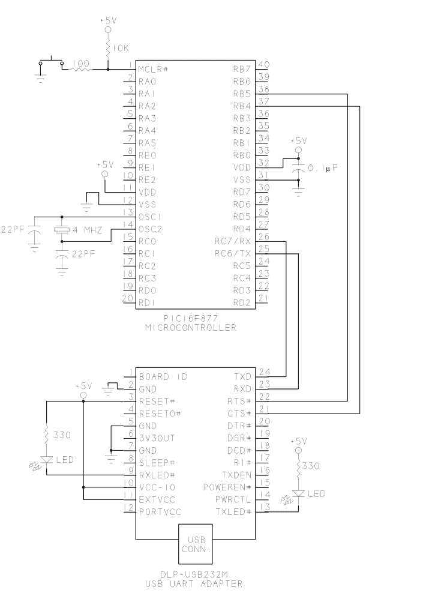

图14-1：FTDI Chip 的 FT232BM USB UART 可以与几乎任何具有异步串行端口的 CPU 接口。

如图所示，电路使用自己的 +5V 电源。要为 DLP-USB232M 使用总线电源，请将 VCC-IO、EXTVCC 和 RESET# 连接到 PORTVCC。使用总线电源的电路在主机配置 USB 设备之前，电流消耗不得超过 100 毫安，并且必须限制其在挂起状态下的电流，如第16章所述。FTDI Chip 提供了有关如何确保总线供电设备符合 USB 电源规范的信息。

### 程序代码

为与 ’232BM 进行异步串行通信而对 CPU 编程，不需要了解 USB 协议。’232BM 与设备 CPU 之间的连接是一条异步串行链路。设备 CPU 不需要知道 ’232BM 与 USB 主机之间的任何通信。程序代码将根据设备是否包含硬件 UART/USART 以及编程语言而有所不同。’877 有一个硬件 USART，在 TX 引脚上发送数据，在 RX 引脚上接收数据。当串行端口收到一个字节以及当一个字节已发送时，中断可以导致例程执行。

清单14-1演示了 PicBasic Pro 中 ’877 与 ’232BM 之间的通信。’877 读取从主机接收的一个字节，将该字节加一，然后将该字节发送回主机。对于握手，代码将一个端口位（PORTB.4）定义为 CTS 输出，将一个端口位（PORTB.5）定义为 RTS 输入。

程序将 CTS 拉低，以表示 ’877 准备好接收一个字节。CTS 连接到 ’232BM 的 RTS# 输入。在从 PC 接收到一个字节并确定 RTS# 为低电平后，’232BM 将该字节写入 ’877。

```basic
' Registers that relate to serial communications:

' Automatically clear any receive overflow errors.
DEFINE HSER_CLRERR 1

' Set the baud rate.
DEFINE HSER_BAUD 2400

' Enable the serial receiver.
DEFINE HSER_RCSTA 90h

' Enable the serial transmitter.
DEFINE HSER_TXSTA 20h

' Handshaking bits. Use any spare port bits.
CTS                 VAR    PORTB.4
RTS                 VAR    PORTB.5

error               VAR    BYTE
byte_was_received   VAR    BIT
serial_in           VAR    BYTE
serial_out          VAR    BYTE

' The CTS output connects to the '232BM's RTS# input.
' The RTS input connects to the '232BM's CTS# output.
OUTPUT CTS
INPUT  RTS

' On detecting a hardware interrupt, jump to interrupt_service.
ON INTERRUPT GOTO interrupt_service

' Enable global and peripheral interrupts.
INTCON = %11000000

' Enable the serial receive peripheral interrupt.
PIE1 = %00100000

' Tell the '232BM it's OK to send a byte.
byte_was_received = 0
CTS = 0
```

```basic
' The main program loop.
loop:

    ' Find out if a serial byte was received.
    if byte_was_received = 1 then

        ' Find out if the '232BM is ready to receive a byte.
        if RTS = 0 then

            ' Increment the received byte.
            If (serial_in = 255) then
                serial_out = 0
            else
                serial_out = (serial_in + 1)
            endif

            ' Write the incremented byte to the serial port.
            HSEROUT [serial_out]

            ' Prepare to receive another byte.
            byte_was_received = 0
            CTS = 0
        endif
    endif

GOTO loop
```

```basic
' Disable interrupt processing in the interrupt-service routine.
DISABLE INTERRUPT
interrupt_service:

    ' This routine executes on detecting a hardware interrupt.

    ' Find out if a byte was received on the serial port.
    if ((PIR1 & %00100000) = %00100000) then

        ' Set CTS high to prevent receiving more serial data.
        CTS = 1

        ' Find out if there was a framing error.
        error = (RCSTA & %0000000100)

        ' Store the byte in serial_in.
        ' This also clears any framing-error flag.
        HSERIN [serial_in]

        ' If a byte was received without error,
        ' set byte_was_received = 1 to tell the main program loop
        ' that it should send a byte to the serial port.
        ' Otherwise, set CTS = 0 to enable receiving another byte.

        if error = 0 then
            byte_was_received = 1
        else
            CTS = 0
        endif
    endif

RESUME

' Re-enable interrupt processing.
ENABLE INTERRUPT
```

清单14-1：用于使 PICMicro 16F877 与 FTDI Chip FT232BM 通信的 PicBasic Pro 代码。


'877 的 RX 输入。该字节到达时会触发中断，中断服务例程读取该字节并设置一个变量以通知主程序循环。

当 '232BM 的 CTS# 输出为低时，'232BM 已准备好接收一个字节。CTS# 连接到 '877 上的 RTS。在接收到一个字节且 RTS 为低后，主程序循环递增接收到的字节并将其写入 TX 输出。'232BM 通过其 USB 端口将接收到的字节发送到主机。'877 将 CTS 置为低电平，以通知 '232BM 可以发送另一个字节。

如果使用指定 FTDI Chip 的虚拟 COM 端口 (VCP) 驱动程序的 INF 文件安装 '232BM，该驱动程序会使操作系统创建一个虚拟 COM 端口用于与设备通信。要访问该设备，您可以使用任何能够与 COM 端口设备通信的应用程序，包括 Windows 提供的超级终端附件。

在 PC 软件中，将 COM 端口的参数设置为与微控制器电路使用的参数匹配。例如，程序清单 14-1 使用 2400 位/秒的波特率以及默认设置：8 个数据位、1 个停止位、无校验。PC 不使用 COM 端口参数与 '232BM 通信，但驱动程序会在特定于供应商的请求中将参数传递给 '232BM。'232BM 在通过其异步串行接口通信时使用这些参数。

本章的“主机编程”部分有更多关于 FTDI Chip 的 VCP 驱动程序和替代的 D2XX Direct 驱动程序的内容。

## 并行接口

FT245BM 与 '232BM 类似，但使用 8 位并行接口替代 '232BM 的异步串行接口。

### 电路

图 14-2 显示了一个示例电路。DLP Design 的 DLP-245M 模块包含 FT245BM 芯片、一个 EEPROM 和一个 USB 连接器。与之前的电路一样，我使用了 microEngineering Labs 的 LAB-X2 板，板上有 PICMicro 16F877 微控制器。

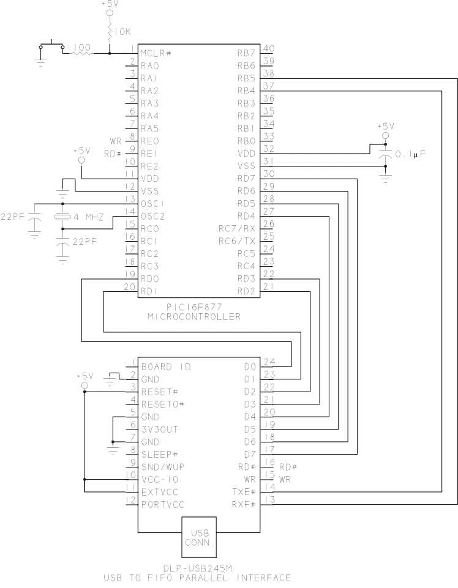

图 14-2：FTDI Chip 的 FT245BM USB FIFO 具有 8 位并行接口。

您几乎可以使用任何基于 FTDI Chip 参考原理图的 FT245BM 电路，以及任何带有并行 I/O 端口和四个额外备用端口引脚的 CPU。如果您使用 LAB-X2 板，板上的开关 S1 和 S2 将不可用。

图 14-3 显示了读写 '245BM 的时序图。当 PC 向 '245BM 写入一个字节后，该芯片将其 RXF# 输出拉低，表示有一个字节可用。要读取该字节，外部 CPU 将 '245BM 的 RD# 输入拉低。然后 '245BM 将该字节置于数据引脚 D0–D7 上，外部 CPU 可以读取该字节，并在读取操作完成时将 RD# 拉高。当有另一个字节可供外部 CPU 读取时，'245BM 再次将 RXF# 拉低。

要向 PC 写入一个字节，外部 CPU 将 WR 拉高，并在必要时等待 '245BM 将其 TXE# 输出拉低，以表示芯片已准备好接收一个字节。然后外部 CPU 将该字节置于数据引脚 D0–D7 上，并将 WR 拉低，使 '245BM 将该字节复制到其发送缓冲区并将 TXE# 拉高。芯片通过 USB 端口将该字节发送到主机。外部 CPU 将 WR 拉高，为下一次传输做准备。当准备好读取另一个字节时，'245BM 再次将 TXE# 拉低，外部 CPU 便可以向数据线写入另一个字节。

在图 14-2 中，数据端口是 16F877 上的端口 D。握手信号使用端口 B 和端口 E 上的位。您可以使用任何备用端口引脚与 '245BM 的数据引脚以及状态和控制信号连接。电源连接与 '232BM 的相同。

### 程序代码

程序清单 14-2 是 PICBasic Pro 代码，它等待通过 '245BM 从主机接收一个字节，递增该字节，然后将其发送回主机。固件在尝试读取字节之前检查 RXF# 的状态。另一种选择是使用硬件中断，当 RXF# 变为低电平（表示有字节可读）时，使 CPU 采取行动。固件在尝试写入字节之前检查 TXE# 的状态。

- 从 USB 主机读取一个字节：
  - 当 FT245BM 已从主机接收到一个字节时，RXF# 为低电平。
  - 设备 CPU 将 RD# 拉低，使 FT245BM 将该字节置于数据线上。
  - 设备 CPU 读取数据线上的字节，并再次将 RD# 拉高。
- 向 USB 主机写入一个字节：
  - 当 FT245BM 准备好从设备 CPU 接收一个字节时，TXE# 为低电平。
  - 设备 CPU 将一个字节写入数据线。
  - 设备 CPU 切换 WR，使 FT245BM 读取该字节。然后 FT245BM 将该字节发送到 USB 主机。

图 14-3：在读操作中，设备 CPU 从 FT245BM 读取一个字节。在写操作中，设备 CPU 向 FT245BM 写入一个字节。

**程序清单 14-2：使 PICMicro 16F877 能够从 FTDI FT245BM 读取字节的 PICBasic Pro 代码。**

```basic
' The PICMicro waits to receive a byte from the PC,
' increments the byte, and sends it back to the PC.

' An FT245BM provides the interface between a parallel port
' on the PICMicro and a USB port on the PC.

INPUTS                 CON $FF
OUTPUTS                CON 0

' Parallel interface data bits.

data_port             VAR PORTD
data_port_direction   VAR TRISD

' Parallel interface control outputs.
RD                    VAR PORTE.1
WR                    VAR PORTE.0

' Parallel interface status inputs.
RXF                   VAR PORTB.5
TXE                   VAR PORTB.4

data_in               VAR BYTE
data_out              VAR BYTE
read_or_write         VAR BIT

' Configure the control signals as outputs.

OUTPUT RD
OUTPUT WR

' Configure the status signals as inputs.

INPUT RXF
INPUT TXE

'Set RD and WR to their default (inactive) states.
RD = 1
WR = 0
' If read_or_write = 1,
' the PICMicro is waiting to receive a byte from the '245BM.
' If read_or_write = 0,
' the PICMicro is waiting to send a byte to the '245BM.

read_or_write = 1

'The main program loop.
loop:

    if (read_or_write = 1) then

        ' The PICMicro is waiting to receive a byte.
        ' Find out if a byte is available.

        if (RXF = 0) then

            ' RXF = 0, indicating the '245BM has a byte
            ' available to read.

            'Configure the data port's bits as inputs.
            data_port_direction = INPUTS

            ' Bring RD low to cause the '245BM to place a byte
            ' on the data port.
            RD = 0

            ' Store the byte in data_in.
            data_in = data_port

            ' Bring RD high.
            RD = 1

            ' Do something with the received byte.
            gosub process_received_data

        endif
else
  ' The PICMicro is ready to send a byte.
  ' Find out if the '245BM is ready to receive a byte.
  if (TXE = 0) then
    ' TXE = 0, indicating that the '245BM is ready
    ' to receive a byte.
    ' Configure the data port's bits as outputs.
    data_port_direction = OUTPUTS
    ' Write the byte to the data port.
    data_port = data_out
    ' Bring WR high, then low, to cause the '245BM
    ' to read the byte.
    WR = 1
    WR = 0
    'The PICMicro is now ready to receive a byte.
    read_or_write = 1
  endif
endif
GoTo loop
process_received_data:

' This example program increments the received byte
' and sets read_or_write = 0 to cause the PICMicro to send
' the byte back to the '245BM and thus on to the host.

If (data_in = 255) then
    data_out = 0
else
    data_out = (data_in + 1)
endif

' The PICMicro is now ready to send a byte.
read_or_write = 0

return
```

与之前的电路一样，PC 应用程序可以使用 FTDI Chip 的 VCP 驱动程序或 D2XX Direct 驱动程序与 '245BM 电路通信。

## 主机编程

与 FTDI Chip 的控制器通信时，如果您正在升级使用 RS-232 或其他异步串行接口的现有设备，VCP 驱动程序是自然的选择。FTDI Chip 还提供 D2XX Direct 驱动程序，使应用程序能够使用特定于供应商的功能与 '232BM 和 '245BM 通信。

使用 D2XX 驱动程序的原因包括更快的传输、对外部 CPU 通信的更多控制，以及使用位拆裂（Bit Bang）模式的选项。


## 使用D2XX直接驱动程序

应用程序可以使用FTDI Chip的原始经典函数或一组模拟Windows API函数的替代函数与D2XX驱动程序通信。

表14-1列出了经典接口函数。交换数据的基本函数是FT_Open、FT_Read、FT_Write和FT_Close。附加函数支持配置控制器和访问EEPROM。少数函数仅适用于FT232BM的握手信号和串行通信参数。

表14-1：应用程序可以使用这些经典接口函数与使用FTDI Chip D2XX直接驱动程序的设备通信。

| 函数 | 用途 |
| --- | --- |
| FT_EE_Read | 读取FT_PROGRAM_DATA结构中的EEPROM数据。 |
| FT_EE_Program | 使用FT_PROGRAM_DATA结构中的数据对EEPROM进行编程。 |
| FT_EE_UARead | 读取EEPROM的用户区域。 |
| FT_EE_UASize | 获取EEPROM用户区域的大小。 |
| FT_EE_UAWrite | 写入EEPROM的用户区域。 |
| FT_GetBitMode | 在Bit Bang模式下读取位。 |
| FT_GetLatencyTimer | 获取延迟定时器的值。 |
| FT_GetModemStatus* | 获取调制解调器状态信号的状态。 |
| FT_GetQueueStatus | 获取接收缓冲区中的字符数。 |
| FT_GetStatus | 获取发送和接收缓冲区中的字符数以及事件状态。 |
| FT_ListDevices | 获取已连接设备的数量和设备字符串。 |
| FT_Open | 获取访问设备的句柄。通过编号指定设备。 |
| FT_OpenEx | 获取访问设备的句柄。通过序列号或描述指定设备。 |
| FT_Purge | 清除发送和接收缓冲区。 |
| FT_Read | 从设备读取指定数量的字节。 |
| FT_ResetDevice | 重置设备。 |
| FT_SetBaudRate* | 设置波特率，包括非标准波特率。 |
| FT_SetBitMode | 启用/禁用Bit Bang模式，并将Bit Bang引脚配置为输入或输出。 |
| FT_SetBreakOff | 重置Break条件。 |
| FT_SetChars | 指定事件字符和错误字符。 |
| FT_SetDataCharacteristics* | 设置每字符位数、停止位数和奇偶校验。 |
| FT_SetDTR* | 设置DTR。 |
| FT_SetEventNotification | 设置事件通知的条件（接收到字符或调制解调器状态变化）。 |
| FT_SetFlowControl* | 选择流控制方法。 |
| FT_SetLatencyTimer | 设置延迟定时器（默认值 = 16毫秒）。 |
| FT_SetRTS* | 设置RTS。 |
| FT_SetTimeouts | 设置设备的读写超时时间。 |
| FT_SetUSBParameters | 设置USB最大传输大小（默认值 = 4096）。 |
| FT_Write | 将指定字节写入设备。 |

\* FT245BM不支持或不需要（Bit Bang模式下的SetBaudRate除外）。

经典函数之外的替代方案是FT-Win32 API函数集（表14-2）。这些函数模拟标准的Win32 API函数，如CreateFile、ReadFile和WriteFile。如果您现有代码使用Win32函数但希望使用D2XX驱动程序，这些函数将非常方便。FT-Win32函数不支持设置延迟定时器、EEPROM访问或Bit Bang模式。

表14-2：作为经典函数的替代方案，应用程序可以使用这些模拟Windows API函数的FT-Win32函数，与使用FTDI Chip D2XX直接驱动程序的控制器通信。

| 函数 | 用途 |
| --- | --- |
| FT_W32_ClearCommBreak | 清除Break条件。 |
| FT_W32_ClearCommError | 获取设备状态和通信错误信息。 |
| FT_W32_CloseHandle | 关闭通过FT_W32_CreateFile获取的句柄。 |
| FT_W32_CreateFile | 获取访问设备的句柄。通过序列号或描述指定设备。 |
| FT_W32_EscapeCommFunction* | 设置或清除RTS、DTR或Break。 |
| FT_W32_GetCommModemStatus* | 获取调制解调器状态信号的状态。 |
| FT_W32_GetCommState | 获取设备控制块中的通信参数。 |
| FT_W32_GetCommTimeouts | 获取读写超时值。 |
| FT_W32_GetLastError | 获取设备上最后一次操作的状态代码。成功 = 非零；失败 = 零。 |
| FT_W32_GetOverlappedResult | 获取重叠操作的结果。 |
| FT_W32_PurgeComm | 终止未完成的读和/或写操作，并/或清除读和/或写缓冲区。 |
| FT_W32_ReadFile | 从设备读取指定数量的字节。 |
| FT_W32_SetCommBreak | 使通信进入Break状态。 |
| FT_W32_SetCommMask | 指定要监视的事件。 |
| FT_W32_SetCommState* | 设置设备控制块中的通信参数。 |
| FT_W32_SetCommTimeouts | 设置设备读写的超时值。 |
| FT_W32_SetupComm | 设置读写缓冲区的大小。 |
| FT_W32_WaitCommEvent | 等待事件。 |
| FT_W32_WriteFile | 将指定字节写入设备。 |

\* FT245BM不支持或不需要。

应用程序应使用经典接口或FT-Win32接口，但不能同时使用两者。

### 选择驱动程序

第9章说明了Windows如何选择与设备通信的驱动程序。FTDI Chip控制器是一个特例，因为它们有两个驱动选项，并且控制器可以使用默认的厂商ID和产品ID运行。如果您的控制器不连接EEPROM，默认值将是您的唯一选择。为避免主机应为设备分配哪个驱动程序时产生混淆，最好使用具有唯一厂商ID/产品ID对的EEPROM。

尽管FT232BM和FT245BM与其设备CPU的接口不同，但这两个芯片在主机看来是相同的。主机不关心设备控制器在USB端口之外对数据做了什么。使用这两种芯片的设备可以使用相同的驱动程序和INF文件。FT245BM可以使用VCP驱动程序，即使它没有传统COM端口上的异步串行接口；FT232BM可以使用D2XX驱动程序，即使它具有异步串行接口，您可能会认为它应使用COM端口驱动程序。

### 使用唯一ID

确保Windows分配所需驱动程序的最可靠方法是分配自己的厂商ID和产品ID，或者使用FTDI Chip的厂商ID以及向FTDI Chip申请的唯一产品ID。将这些ID存储在与控制器连接的EEPROM中，并将ID放在所需驱动程序的INF文件中。这样Windows将始终知道要分配哪个驱动程序。（分配驱动程序时，Windows会复制INF文件并将其重命名为**oemxx.inf**，其中*xx*是唯一编号，因此其他供应商也编辑了FTDI Chip提供的INF文件也没关系。）

### 使用默认ID时的注意事项

如果设备使用默认的厂商ID和产品ID，Windows可能会坚持为您选择驱动程序，而您可能得不到想要的结果，尤其是当您的INF文件未签名时。（有关签名驱动程序和INF文件的更多信息，请参见第9章。）为避免在使用默认ID时出现此问题，请在设备安装期间删除、移动或重命名任何为默认ID指定不需要的驱动程序且已签名的INF文件，并断开互联网连接以防Windows下载驱动程序。但是，您当然不希望最终用户在安装设备时费这么大功夫。

### 避免COM端口激增

默认情况下，Windows会为每个使用VCP驱动程序且具有序列号的设备创建一个新的COM端口。如果您在测试一批设备，可能会很快达到256个COM端口的上限。若要释放一些端口号，可使用Windows的设备管理器卸载不再需要的设备。另一种解决方案（仅适用于内部测试环境！）是编辑*ftdibus.inf*，让Windows仅将VCP驱动程序分配给连接到指定物理端口或端口的设备，并让Windows为所有这些设备创建一个COM端口，即使它们具有不同的序列号。FTDI Chip提供了一份应用笔记，详细说明如何编辑INF文件来实现这一点。

### 性能提示

使用FTDI Chip控制器时，您可以采取多种措施来获得最佳性能。以下提示说明如何尽可能快地传输数据以及如何防止数据丢失。

### 速度注意事项

在考虑使用FTDI Chip控制器时的数据传输速率时，您需要考虑主机与设备控制器之间的传输速率，以及设备控制器与设备CPU之间的传输速率。

由于设备控制器使用批量传输，在主机PC和设备控制器之间传输特定数据量所需的时间可能因总线的繁忙程度而异。如果发送端必须等待接收端表明其已准备好接收


一个字节。当然，异步串行接口的速度不可能快于所选的波特率。

使用 VCP 或 D2XX 驱动程序时，FT232BM 上的一个端点可传输高达 3 兆比特/秒。这相当于 300 千字节/秒，假设一个停止位和一个起始位。要达到此速率，控制器的异步串行端口必须使用 3 兆比特/秒的波特率。

FT245BM 端点使用 VCP 驱动程序可传输高达 300 千字节/秒，使用 D2XX 驱动程序可达 1 兆字节/秒。为获得最快的传输速度，请使用 D2XX 驱动程序。

## 最小化延迟

对于小于 62 个数据字节的 IN 传输，有几种方法可以使数据更快地传输。默认情况下，除非满足以下任一条件，否则控制器的批量 IN 端点会 NAK IN 数据包：

-   传输缓冲区至少包含 62 个字节。
-   自上次 IN 数据包被 ACK 以来至少已过去 16 毫秒。
-   已启用事件字符并且设备已接收到该字符。
-   仅适用于 FT232BM，CTS、DSR、DCD 或 RI 的状态已发生变化。

如果上述任一条件为真，控制器将返回两个状态字节，然后是传输缓冲区的全部内容或 62 个字节，以较少者为准。

对于必须在不延迟的情况下向主机发送少于 62 个字节的设备，D2XX 驱动程序提供了一个函数，可将延迟计时器从默认的 16 毫秒更改。允许的范围为 1 到 255 毫秒。为了获得最短的延迟，将计时器设置为 1，并且如果自上次批量 IN 数据包被 ACK 以来至少已过去 1 毫秒，设备将发送状态字节和任何数据。

事件字符使主机能够请求设备立即发送数据。D2XX 驱动程序有一个函数可以定义一个字符作为特殊事件字符。接收到事件字符后，控制器会响应下一个 IN 数据包发送状态字节和最多 62 个数据字节。接收到的事件字符嵌入在数据中，设备固件负责识别并丢弃该字符，如果它不是有意义数据的一部分。

FT232BM 也可以通过更改其握手输入之一的状态来提示发送数据。当然，任何控制器都可以通过填充传输缓冲区使其包含 62 个字节来强制数据传输。

## 防止数据丢失

本章中的示例程序使用握手使异步串行或并行链路的每一端能够指示何时可以发送数据。如果链路的两端都有足够大的缓冲区来存储接收到的数据，直到 CPU 读取为止，则不需要握手。像 Parallax Inc. 的 Basic Stamp 这样只能在执行 SerialIn 语句时接收串行数据的设备几乎肯定需要握手以防止数据丢失。

当 CPU 向 FT232BM 写入异步串行数据时，该芯片将接收到的数据存储在 384 字节的传输缓冲区中，并响应 IN 数据包将数据发送到主机，如上所述。由于接口使用批量传输，无法保证主机何时请求数据。如果总线繁忙或主机忙于其他任务，与设备的 USB 通信可能需要等待。如果传输缓冲区已满且 CPU 继续向 FT232BM 发送数据，数据将被丢失。握手为 FT232BM 提供了一种方式，让设备的 CPU 知道何时可以发送数据。在主机端，应用程序通常可以预留一个充足的缓冲区来保存数据，直到应用程序可以使用它。

在另一个方向上，主机上的应用程序软件将数据写入缓冲区。主机的驱动程序以 OUT 批量传输方式将缓冲区中的数据发送到 FT232BM。FT232BM 最多可存储从主机接收到的 128 字节数据。如果缓冲区已满，FT232BM 会对发送更多数据的尝试返回 NAK。FT232BM 通过异步串行链路将从主机接收到的数据发送到设备的 CPU。接收来自 FT232BM 数据的 CPU 和相关电路可能具有非常小的缓冲区或根本没有缓冲区。如果 FT232BM 可能比 CPU 处理得更快地写入数据，则握手可以防止数据丢失。

FT232BM 支持三种握手方法。示例程序使用 RTS# 和 CTS# 引脚。DTR# 和 DSR# 引脚也可以以相同方式使用。电路也可以按照 TIA/EIA-232 标准定义使用这两对。第三种选择是 Xon/Xoff 软件握手，它使用嵌入在数据中的专用代码来请求停止和开始传输。

FT245BM 具有与 FT232BM 相同的缓冲区。该芯片通过 RXF# 和 TXE# 引脚支持握手，可使每一端指示何时准备好接收数据，以及通过 RD# 和 WR 信号指示何时读或写操作完成。

## EEPROM 编程

D2XX Direct Driver 使应用程序软件能够通过 Microwire 同步串行接口读取和写入连接到 FT232BM 或 FT245BM 的 EEPROM。

## EEPROM 数据

如果要自定义各种设备特性，包括 Vendor ID、Product ID 或远程唤醒支持，则需要 EEPROM。列表 14-3 显示了一个 C 结构，其中包含应用程序可使用 D2XX 驱动程序和 FT_EE_Program 函数写入 EEPROM 的值。

EEPROM 还可以在用户区域存储数据。主机应用程序可以读取和写入此区域，但设备的 CPU 只能在 USB 控制器处于复位状态时访问用户区域。

## 编辑数据

FTDI Chip 提供了一个 MPROG 实用程序，可在与 FT232BM 或 FT245BM 接口的 EEPROM 中存储新的 Vendor ID、Product ID、序列号和其他信息。一个复杂之处在于，该实用程序要求将 D2XX 驱动程序分配给控制器，但 Windows 可能不愿将 D2XX 驱动程序分配给使用默认 ID 的设备。为

```c
typedef struct ft_program_data {
    DWORD Signature1;        // Header - must be 0x00000000
    DWORD Signature2;        // Header - must be 0xFFFFFFFF
    DWORD Version;           // Header - FT_PROGRAM_DATA version
                             //   0 = original,
                             //   1 = contains FT2232C extensions
    WORD VendorId;           // Vendor ID (0x0403)
    WORD ProductId;          // Product ID (0x6001)
    char *Manufacturer;      // Pointer to Manufacturer string
                             //   ("FTDI")
    char *ManufacturerId;    // Pointer to Manufacturer ID string
                             //   ("FT")
    char *Description;       // Pointer to Device descr. string
                             //   ("USB HS Serial Converter")
    char *SerialNumber;      // Pointer to Serial Number string
                             //   ("FT000001" if fixed, or NULL)
    WORD MaxPower;           // Max. required bus current (mA) (44)
    WORD PnP;                // Plug and Play:
                             //   disabled (0), enabled (1)
    WORD SelfPowered;        // power source: bus (0), self (1)
    WORD RemoteWakeup;       // remote wakeup available:
                             //   no (0), yes (1)
    //
    // Rev4 (-BM series) extensions
    //
    UCHAR Rev4;              // Chip series:
                             //   -BM series (0), other (non-zero)
    UCHAR IsoIn;             // IN endpoint:
                             //   bulk (0), isochronous (non-zero)
    UCHAR IsoOut;            // OUT endpoint:
                             //   bulk (0), isochronous (non-zero)
    UCHAR PullDownEnable;    // pull-down mode:
                             //   not enabled (0), enabled (1)
    UCHAR SerNumEnable;      // serial number:
                             //   enabled (non-zero), not enabled (0)
    UCHAR USBVersionEnable;  // USBVersion enabled?
                             //   yes (non-zero), no (0)
    WORD USBVersion;         // USB version (BCD) (0x0200 = USB2.0)
} FT_PROGRAM_DATA;
```

列表 14-3：FTDI Chip 设备的 EEPROM 数据结构。粗体文本表示默认值。改编自 FTDI Chip 的 D2XX 程序员指南。（第 1 页，共 2 页）


```c
// FT2232C extensions

UCHAR Rev5;              // FT2232C chip? yes (non-zero), no (0)
UCHAR IsoInA;            // "A" channel IN endpoint:
                         //   bulk (0), isochronous (non-zero)
UCHAR IsoInB;            // "B" channel IN endpoint:
                         //   bulk (0), isochronous (non-zero)
UCHAR IsoOutA;           // "A" channel OUT endpoint:
                         //   bulk (0), isochronous (non-zero)
UCHAR IsoOutB;           // "B" channel OUT endpoint:
                         //   bulk (0), isochronous (non-zero)
UCHAR PullDownEnable5;   // pull-down mode:
                         //   not enabled (0), enabled (1)
UCHAR SerNumEnable5;     // serial number:
                         //   enabled (non-zero), not enabled (0)
UCHAR USBVersionEnable5; // USBVersion enabled?
                         //   yes (non-zero), no (0)
WORD USBVersion5;        // USB version (BCD) (0x0200 = USB2.0)
UCHAR AIsHighCurrent;    // "A" channel is high current?
                         //   yes (non-zero), no (0)
UCHAR BIsHighCurrent;    // "B" channel is high current?
                         //   yes (non-zero), no (0)
UCHAR IFAIsFifo;         // "A" channel is 245 FIFO?
                         //   yes (non-zero), no (0)
UCHAR IFAIsFifoTar;      // "A" channel is 245 FIFO CPU target?
                         //   yes (non-zero), no (0)
UCHAR IFAIsFastSer;      // "A" channel is Fast Serial?
                         //   yes (non-zero), no (0)
UCHAR AIsVCP;            // "A" channel uses VCP driver?
                         //   yes (non-zero), no (0)
UCHAR IFBIsFifo;         // "B" channel is 245 FIFO?
                         //   yes (non-zero), no (0)
UCHAR IFBIsFifoTar;      // "B" channel is 245 FIFO CPU target?
                         //   yes (non-zero), no (0)
UCHAR IFBIsFastSer;      // "B" channel is Fast Serial?
                         //   yes (non-zero), no (0)
UCHAR BIsVCP;            // "B" channel uses VCP driver?
                         //   yes (non-zero), no (0)
} FT_PROGRAM_DATA, *PFT_PROGRAM_DATA;
```

清单14-3：FTDI Chip设备的EEPROM数据结构。粗体文本表示默认值。改编自FTDI Chip的D2XX程序员指南。（共2页，第2页）

为了能够在具有默认厂商ID和产品ID并使用VCP驱动程序的设备上运行MPROG，FTDI Chip提供了一个应用程序，可将产品ID更改为特殊的“D2XX Recovery”产品ID（6006h），以及一个INF文件，该文件为具有该产品ID的设备指定D2XX驱动程序。然后您可以运行MPROG并将最终的厂商ID和/或产品ID存储在EEPROM中。另一种方法是在将EEPROM连接到控制器之前，使用其他方法对其编程。

# 15 集线器：设备与主机之间的连接

每个USB外设都必须连接到集线器。正如第1章所述，集线器是一种智能设备，为设备提供连接点，并管理每个设备与总线的连接。直接插入PC的设备连接到根集线器。其他设备则连接到根集线器下游的外部集线器。

集线器的主要工作是管理其设备的连接和电源，以及向主机传递流量和从主机接收流量。管理连接包括帮助新连接的设备启动并进行通信，以及阻止行为异常设备的通信，使其不干扰总线上的其他通信。管理电源包括向连接的设备提供所请求的总线电流。集线器在向主机传递流量和从主机接收流量方面的作用取决于主机、设备以及它们之间的集线器的速度。集线器可能只是重复接收到的内容，也可能将流量转换为不同的速度并管理与该设备的事务。

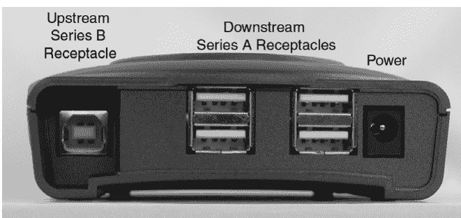

图15-1：集线器有一个上行端口和一个或多个下行端口。

本章介绍有关集线器通信的基本知识。设计USB外设时，您不需要了解集线器的每个细节。主机应用程序、设备驱动程序和设备固件不必知道或关心主机与设备之间有多少个集线器。但是，对集线器功能的些许了解有助于理解设备在总线上的检测和通信方式。

### 集线器基础知识

每个外部集线器都有一个端口或连接点，用于向上游方向（朝向主机）连接（图15-1）。该上行端口可以直接连接到主机的根集线器，也可以连接到另一个外部集线器上的下行端口。每个集线器还拥有一个或多个位于主机下游的端口。大多数下行端口都有一个用于连接电缆的连接器。例外情况是作为复合设备一部分的集线器，其端口连接到设备内嵌的功能。具有一个、两个、四个和七个下行端口的集线器很常见。集线器可以是自供电或总线供电的。正如第16章所述，总线供电的集线器是有限的，因为无法向它们连接高功率设备。

1.x集线器将从主机接收到的所有低速和全速数据包（包括已经过一个或多个额外集线器的数据）重复到所有已启用的全速下行端口。已启用端口包括所有连接了设备并准备好从集线器接收通信的端口。端口未启用的设备包括：因错误或其他问题而主机控制器已停止与其通信的设备、处于挂起状态的设备，以及因刚刚连接或正在退出挂起状态而尚未准备好通信的设备。

集线器中继器不会以任何方式转换、检查内容或处理往返全速端口的流量。集线器中继器只是重新生成信号转换的边沿并将其传递过去。

低速设备永远不会看到全速流量。1.x集线器只向低速设备重复低速数据包。集线器通过数据包前面的PRE数据包标识符来识别低速数据包。集线器将低速数据包（且仅这些数据包）重复到任何已启用的低速端口。集线器还将低速数据包重复到其全速下行端口，因为全速端口可能连接到集线器，而该集线器又连接到低速设备。为了让集线器有时间使它们的低速端口准备好接收数据，主机在PRE数据包和低速数据包之间添加了至少四个全速位宽度的延迟。

与全速相比，低速电缆段中的流量不仅速度不同，边沿速率和极性也不同。距离低速设备最近的集线器在与该设备通信时使用低速的边沿速率和极性。当向上游通信时，集线器使用全速的更快的边沿速率和与低速相比反转的极性。集线器中继器根据需要转换边沿速率和极性。第18章将详细介绍信号极性，第19章将详细介绍边沿速率。

### 高速中继器

当集线器的上行端口连接到高速总线段时，2.0集线器使用高速中继器。在这种情况下，集线器以高速发送和接收所有上游流量，即使流量发往低速或全速设备或来自这些设备。

流量通过具有高速中继器的集线器所走的路径取决于所连接设备的速度。集线器中的路由逻辑确定往返下行端口的流量是否通过事务转换器。

与低速和全速中继器不同，高速中继器对接收到的数据重新计时，以最大限度地减少累积抖动。换句话说，高速中继器不仅仅是重复接收到的转换，而是提取数据，并在重传时使用自己的本地时钟来定时转换。边沿速率和极性保持不变。弹性缓冲区允许两个时钟频率之间存在微小差异。当缓冲区半满时，接收到的数据开始被时钟输出。

高速设备不使用事务转换器。流量从集线器上的接收端口通过高速中继器路由到集线器的发送端口。

对于往返低速和全速设备的流量，高速中继器与事务转换器通信，后者管理这些设备的事务。从上游接收的流量被路由到高速中继器，然后经过事务转换器，以适当的速度与下行端口通信。在另一个方向上，来自低速和全速设备的流量被路由到事务转换器，事务转换器处理接收的数据并采取下一节所述的适当操作。

### 事务转换器

每个2.0集线器必须有一个事务转换器来管理低速和全速设备的通信。事务转换器以高速向上游通信，但使1.x设备能够以低速和全速通信，方式与它们与1.x主机通信完全相同。事务转换器存储接收到的数据，然后以不同的速度将数据转发到目的地。

事务转换器通过允许其他总线通信在设备完成低速或全速事务的同时发生，从而释放总线时间。


## 集线器：设备与主机之间的连接

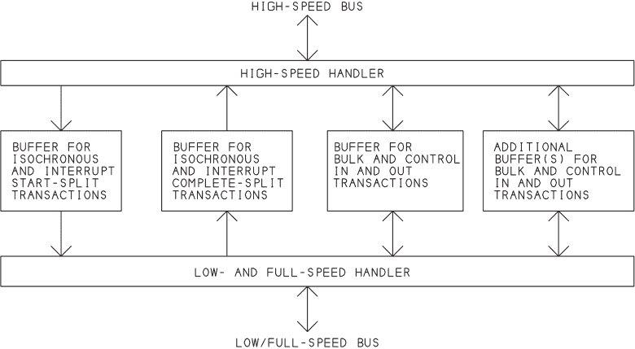

图 15-3：事务转换器包含用于上行流量的高速处理器、用于在拆分事务中存储信息的缓冲区，以及用于向低速和全速设备下行流量的低速和全速处理器。

事务转换器还可以使低速和全速设备使用比在共享 1.x 总线上更多的带宽。

### 各部分

事务转换器包含三个部分（图 15-3）。高速处理器以高速与主机通信。低/全速处理器以低速和全速与设备通信。缓冲区存储与低速和全速设备事务中使用的數據。每个事务转换器至少必须有四个缓冲区：一个用于中断和等时开始拆分事务，一个用于中断和等时完成拆分事务，以及两个或更多用于控制和批量传输。

### 管理拆分事务

当高速总线上的 2.0 主机想要与低速或全速设备通信时，主机启动与最近该设备并以高速上行通信的 2.0 集线器的开始拆分事务。一个或多个开始拆分事务包含集线器完成与设备事务所需的信息。事务转换器存储从主机接收到的信息并完成与主机的开始拆分事务。

完成开始拆分事务后，集线器在执行与设备的事务时执行主机控制器的功能。事务转换器在令牌阶段启动事务，在数据阶段根据需要发送数据或存储返回的数据或状态信息，并在握手阶段根据需要发送或接收状态码。集线器在与设备的通信中使用低速或全速，具体视情况而定。

在集线器有时间与设备交换数据后，除等时 OUT 外的所有事务中，主机启动一个或多个完成拆分事务以检索设备返回并存储在事务转换器缓冲区中的信息。集线器以高速执行这些事务。

图 15-4 显示了构成拆分事务的事务。表 15-1 比较了不同总线速度下与低速和全速设备的事务结构和内容。

在解释拆分事务的工作原理时，我将从批量和控制传输开始，这些传输没有中断和等时传输的时序限制。在开始拆分事务中，2.0 主机发送开始拆分令牌包（SSPLIT），随后是通常的低速或全速令牌包，以及任何发往设备的數據包。最近该设备并以高速上行通信的 2.0 集线器返回 ACK 或 NAK。主机随后可以自由使用总线进行其他事务。设备目前还不知道该事务。

在开始拆分事务中返回 ACK 时，集线器有两个责任。集线器必须完成与设备的事务。而且集线器必须继续处理从主机或其他连接设备接收到的任何其他总线流量。

为完成事务，集线器将从主机接收到的包或包转换为适当的速率，发送给设备并存储设备返回的数据或握手。根据事务的不同，设备可能会返回数据、握手或无内容。对于 IN 事务，集线器向设备返回握手。对设备而言，事务已按预期的低速或全速进行，现在已完成。设备不知道这是一个拆分事务。主机尚未收到设备的响应。

在集线器完成与设备的事务时，主机可能会启动设备集线器也必须处理的其他总线流量。这两个功能由集线器内的独立硬件模块处理。当主机认为集线器有足够时间完成与设备的事务时，主机开始与集线器的完成拆分事务。

在完成拆分事务中，主机发送完成拆分令牌包（CSPLIT），随后发送低速或全速令牌包以请求数据

表 15-1：当低速或全速设备在高速总线上进行事务时，主机使用与最近设备的 2.0 集线器的开始拆分（SSPLIT）和完成拆分（CSPLIT）事务。集线器负责以低速或全速完成事务并向主机报告。

| 总线速度 | 事务类型 | 令牌 | 数据 | 握手 |
|---|---|---|---|---|
| 与设备的低/全速通信 | 设置，输出 | 低速时 PRE，LS/FS 令牌 | 低速时 PRE，数据 | 状态（等时除外） |
| 与设备的低/全速通信 | IN | 低速时 PRE，LS/FS 令牌 | 数据或状态 | 低速时 PRE，状态（等时除外） |
| 与低速或全速设备事务中 2.0 集线器与主机之间的高速通信 | 设置，输出（等时 OUT 没有 CSPLIT 事务） | SSPLIT，LS/FS 令牌 | 数据 | 状态（仅批量和控制） |
| 与低速或全速设备事务中 2.0 集线器与主机之间的高速通信 | 设置，输出（等时 OUT 没有 CSPLIT 事务） | CSPLIT，LS/FS 令牌 | – | 状态 |
| 与低速或全速设备事务中 2.0 集线器与主机之间的高速通信 | IN | SSPLIT，LS/FS 令牌 | – | 状态（仅批量和控制） |
| 与低速或全速设备事务中 2.0 集线器与主机之间的高速通信 | IN | CSPLIT，LS/FS 令牌 | 数据或状态 | – |

或集线器从设备接收到的状态信息。集线器返回信息。传输现在在主机处完成。主机不向集线器返回 ACK。如果集线器没有准备好发送的包，集线器返回 NYET 状态码，主机稍后重试。设备不知道完成拆分事务。

在中断和等时传输的拆分事务中，过程类似，但时序定义更严格。目标是在设备有数据可发送后尽快将数据传输给主机，并在设备准备好接收新数据之前将数据传输给设备。为了实现这一时序，具有大包的等时事务使用多个开始拆分或完成拆分，每次传输一部分数据。

与批量和控制传输不同，中断和等时传输中的开始拆分事务没有握手阶段，只有开始拆分令牌，后跟 IN、OUT 或 Setup 令牌以及 OUT 或 Setup 事务的数据。

## 集线器：设备与主机之间的连接

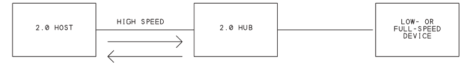

- 主机启动并完成与集线器的开始拆分事务。

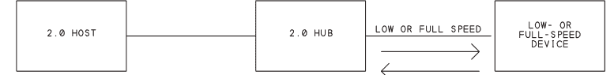

- 集线器启动并完成与设备的事务。

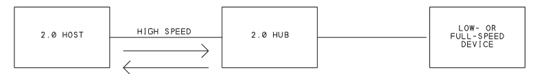

- 主机启动并完成与集线器的完成拆分事务。

图 15-4：在使用拆分事务的传输中，主机以高速与 2.0 集线器通信，集线器以低速或全速与设备通信。等时事务可能使用多个开始拆分或完成拆分事务。

## 集线器：设备与主机之间的连接

在中断事务中，集线器在预期开始与设备事务的最早时间之前的微帧中安排开始拆分。例如，假设帧中的微帧按顺序编号为 Y0 到 Y7。如果开始拆分为 Y0，则与设备的事务最早可能在 Y1 发生。设备最早可能在 Y2 返回数据或握手响应给主机。之前事务的结果和位填充会影响与设备事务实际发生的时间，因此主机安排在 Y2、Y3 和 Y4 进行三次完成拆分事务的时间。如果集线器在完成拆分时尚未有要返回的信息，集线器返回 NYET 状态码，主机重试。

全速等时事务可传输多达 1023 字节。为了确保数据及时传输，或在设备有数据发送或准备好接收数据时尽快传输，具有大包的事务使用多个开始拆分或完成拆分，每个拆分最多包含 188 字节数据。这是适合微帧的全速数据最大量。单个事务的数据最多需要八个开始拆分或完成拆分事务。

在等时 IN 事务中，主机在预期设备至少会返回部分数据的每个微帧中安排完成拆分事务。以较小的块请求数据可确保主机尽快接收数据。主机不必等待所有数据以全速从设备传输后再开始检索数据。

在等时 OUT 事务中，主机在一个或多个开始拆分事务中发送数据。主机安排事务，使集线器的缓冲区永远不会为空，但包含尽可能少的字节。每个 SPLIT 包包含位以指示数据在低速或全速数据包中的位置（开头、中间、结尾或全部）。没有完成拆分事务。


## 低速和全速设备的带宽使用

因为 2.0 集线器在管理事务时充当主机控制器，低速和全速设备仅与使用相同事务转换器的设备共享 1.x 带宽。因此，如果两个全速设备连接到高速总线上的各自 2.0 集线器，每个设备都可以按需使用全部全速带宽。当集线器转换为高速时，1.x 通信将只占用很少的高速带宽。

然而，对于批量事务而言，每个分拆事务中与主机进行的额外事务可能会降低在同时承载高速批量流量的繁忙总线上与全速设备的数据传输速率。

许多集线器为所有端口提供一个事务转换器，但单个集线器也可以为每个连接到低速或全速设备的端口配备一个事务转换器。

## 集线器控制器

集线器控制器管理主机与集线器之间的通信。通信包括枚举以及由于下游端口事件而产生的其他通信和操作。

正如对所有设备所做的那样，主机枚举新检测到的集线器以了解其能力。枚举期间检索到的集线器描述符告诉主机集线器有多少个端口。枚举集线器后，主机请求集线器报告是否有设备连接。如果有，主机也会枚举这些设备。

主机通过发送集线器类请求 Get_Port_Status 来判断端口是否连接了设备。这类似于 Get_Status 请求，但发送给集线器，并在 Index 字段中包含端口号。集线器返回两个 16 位值，指示设备是否已连接以及其他信息，例如设备是否处于低功耗或 Suspend 状态。

集线器控制器还负责禁用导致总线活动丢失或 babble 的任何端口。总线活动丢失发生在数据包未以预期的 End-of-Packet 信号结束时。Babble 发生在设备在 End-of-Packet 信号之后继续传输时。

## 集线器：设备与主机之间的链路

除了所有设备必须用于控制传输的 Endpoint 0 之外，每个集线器必须有一个配置为中断 IN 传输的 Status Change 端点。主机轮询此端点以了解集线器是否发生任何更改。每次轮询时，如果没有更改，集线器控制器返回 NAK；否则返回指示特定端口或集线器本身为更改源的数据。如果有更改，主机将发送请求以了解有关更改的更多信息并采取必要的操作。例如，如果集线器报告新设备已连接，主机将尝试枚举它。

## 速度

外部 2.0 集线器的下游端口必须支持全部三种速度。在上行方向，如果 2.0 集线器的上行段为高速，则集线器以高速通信。否则，集线器以低速和全速上行通信。

1.x 集线器的上行端口必须支持低速和全速通信。所有带连接器的下游端口必须同时支持低速和全速通信。1.x 集线器从不支持高速。

## 根据速度过滤流量

低速设备无法接收全速数据，因此集线器不会向低速设备转发全速流量。这种行为是必要的，因为低速设备会尝试将全速流量解释为低速数据，甚至可能错误地看到看起来像有效数据的内容。低速电缆上的全速或高速数据也可能由于辐射电磁干扰 (EMI) 而引起问题。在另一方向上，集线器接收并上行转发任何低速数据。

低速和全速设备无法接收高速数据，因此 2.0 集线器不会向这些设备转发高速流量，包括 1.x 集线器。

## 检测设备速度

连接时，每个设备必须支持低速或全速。集线器通过检测空闲线路上哪个信号线更正来判断已连接设备是低速还是全速。图 15-5 说明了这一点。

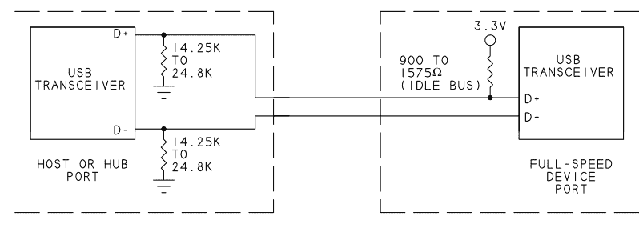

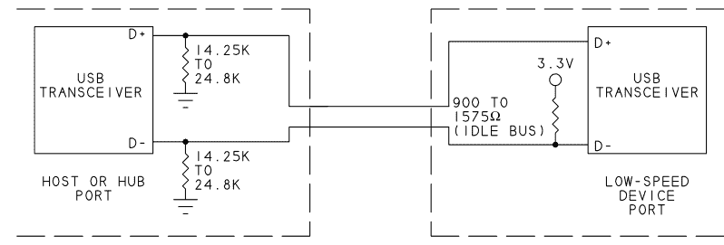

图 15-5：设备的端口的上拉比集线器的上拉更强。上拉的位置告诉集线器设备是低速还是全速。高速设备在连接时为全速。

正如第 4 章所述，集线器在端口的两个信号线 D+ 和 D- 上各有一个 14.25 至 24.8 千欧的下拉电阻。新连接的设备在全速设备上为 D+ 或低速设备上为 D- 具有 900 至 1575 欧姆的上拉电阻。当设备连接到端口时，具有上拉的线路比集线器的逻辑高输入阈值更正。集线器检测到电压，假定设备已连接，并通过被上拉的线路检测速度。

检测到全速设备后，2.0 集线器通过使用高速检测握手来确定设备是否支持高速。握手发生在集线器在枚举期间发起的 Reset 状态期间。如果握手成功，设备会移除其上拉，通信以高速进行。1.x 集线器忽略握手尝试，握手失败会通知设备必须使用全速。第 18 章对握手有更详细的说明。

## 保持空闲总线

Start-of-Frame 数据包可防止全速和高速设备在空闲总线上进入 Suspend 状态。当全速总线上没有数据时，主机每帧继续发送一个 Start-of-Frame 数据包，所有集线器将这些数据包转发给其全速设备。当高速总线上没有数据时，主机每微帧继续发送一个 Start-of-Frame 数据包，所有集线器将这些数据包转发给其高速设备。连接到以高速上行通信的 2.0 集线器的全速设备也会每帧接收一次 Start-of-Frame。

低速设备看不到 Start-of-Frame 数据包。相反，集线器必须至少每帧向其低速设备发送一次低速 End-of-Packet (EOP) 信号（第 18 章中定义）。该信号充当保持活动信号，可防止设备在没有低速活动时进入总线的 Suspend 状态。主机还可以请求集线器在单个端口挂起总线。第 16 章更详细地介绍了集线器如何管理 Suspend 状态。

## 串联多少个集线器？

USB 设计用于在短至中等距离上连接外设。但这并没有阻止用户好奇 USB 外设可以离其主机有多远。

USB 2.0 规范没有给出电缆段的最大长度，但最大允许传播延迟将长度限制为全速和高速约 5 米，低速约 3 米。您可以使用一系列集线器，每个集线器配有 5 米电缆来增加设备与其主机之间的距离。

## 集线器描述

- **bNbrPorts.** 集线器支持的下游端口数量。
- **wHubCharacteristics:**
  - 位 1 和 0 指定电源切换模式。00 = 整体；所有端口一起供电。01 = 端口单独供电。1X：仅用于无电源切换的 1.0 集线器。
  - 位 2 指示集线器是否为复合设备的一部分（1）或不是（0）。
  - 位 4 和 3 为过流保护模式。00 = 全局保护和报告。01 = 每个端口的保护和报告。1X = 无保护和报告（仅限总线供电集线器）。
  - 位 6 和 5 为事务转换器思考时间。这些位指示低速或全速下游总线上两次事务之间所需的最大全速位时间数。00 = 8；01 = 16；10 = 24；11 = 32。仅适用于 2.0 集线器。
  - 位 7 指示集线器是否支持端口指示灯（1）或不支持（0）。仅适用于 2.0 集线器。
  - 位 8 至 15 为保留。
- **bPwrOn2PwrGood.** 端口上电序列开始与端口供电可用之间的最大延迟。值为 2 毫秒为单位。（设置为 100 表示 200 毫秒延迟。）
- **bHubContrCurrent.** 仅集线器控制器电子所需的最大电流，以毫安为单位。
- **DeviceRemovable.** 指示连接到集线器端口的设备是否可移除（0）或不可移除（1）。该值的位数等于集线器上的端口数 + 1。位 0 为保留。位 1 用于端口 1，位 2 用于端口 2，以此类推。
- **PortPowerCtrlMask.** 所有位应为 1。该字段仅用于与 1.0 软件兼容。每个端口有一个位，并且字段应填充额外的 1，使字段的位数为 8 的倍数。


## 集线器：设备与主机之间的连接

表 15-2：2.0 集线器类有 12 个类特定请求，而 1.x 集线器类有 9 个。其中许多是 USB 标准请求的集线器特定变体。

| 请求 | USB 版本 | bRequest | 数据源 | wValue | wIndex | 数据长度（字节）（数据阶段） | 数据（在数据阶段中） |
|---|---|---|---|---|---|---|---|
| 清除集线器功能 | 所有 | Clear_Feature | 无数据阶段 | 功能 | 0 | – | – |
| 清除端口功能 | 所有 | Clear_Feature | 无数据阶段 | 功能 | 端口 | – | – |
| 清除 TT 缓冲区 | 仅 2.0 | Clear_TT_Buffer | 无数据阶段 | 设备地址，端点号 | TT_端口 | – | – |
| 获取总线状态 | 仅 1.x | Get_State | 集线器 | 0 | 端口 | 1 | 每端口总线状态 |
| 获取集线器描述符 | 所有 | Get_Descriptor | 集线器 | 描述符类型和索引 | 0 或语言 ID | 描述符长度 | 描述符 |
| 获取集线器状态 | 所有 | Get_Status | 集线器 | 0 | 0 | 4 | 集线器状态和变化指示器 |
| 获取端口状态 | 所有 | Get_Status | 集线器 | 0 | 端口 | 4 | 端口状态和变化指示器 |
| 获取 TT 状态 | 仅 2.0 | Get_TT_State | 集线器 | TT 标志 | 端口 | TT 状态，长度 | TT 状态 |
| 重置 TT | 仅 2.0 | Reset_TT | 无数据阶段 | 0 | 端口 | – | – |
| 设置集线器描述符（可选） | 所有 | Set_Descriptor | 主机 | 描述符类型和索引 | 0 或语言 ID | 描述符长度 | 描述符长度 |
| 设置集线器功能 | 所有 | Set_Feature | 无数据阶段 | 功能 | 0 | – | – |
| 设置端口功能 | 所有 | Set_Feature | 无数据阶段 | 功能 | 端口 | – | – |
| 停止 TT | 仅 2.0 | Stop_TT | 无数据阶段 | 0 | 端口 | – | – |

## 集线器类请求

所有集线器都接受或返回 USB 十一项标准请求中的七项请求的数据。一些 2.0 集线器支持额外的请求。在其他标准请求中，一个是可选的，另外两个对集线器未定义。与所有设备一样，集线器必须对不支持的请求返回 STALL。

集线器以标准方式响应 Clear_Feature、Get_Configuration、Get_Descriptor、Get_Status、Set_Address、Set_Configuration 和 Set_Feature 请求。Set_Descriptor 是可选的，如果不支持则应返回 STALL。只有支持多个事务转换器的 2.0 集线器支持 Get_Interface 和 Set_Interface。集线器不能有等时端点，因此 Synch_Frame 对集线器未定义。

集线器类定义了八个集线器特定请求，这些请求基于带有集线器特定值的标准请求构建。例如，将 Index = 0 的 Get_Status 请求发送到集线器，会使集线器在数据包中返回一个值，指示集线器是否正在使用外部电源以及是否存在过流情况。

表 15-2 显示了集线器特定请求。1.x 规范中的一个请求 Get_Bus_State 未包含在 2.0 规范中。该请求使主机能够读取集线器上指定端口处 D+ 和 D- 的状态。

主机使用许多集线器特定请求来监视和控制集线器及其端口的状态。Get_Hub_Status 读取集线器中的状态位。Set_Hub_Feature 和 Clear_Hub_Feature 设置和清除集线器中的状态位。表 15-3 显示了这些位及其含义。类似地，Get_Port_Status、Set_Port_Feature 和 Clear_Port_Feature 使主机能够读取和控制集线器中选定端口的状态位。表 15-4 显示了这些位及其含义。

在 2.0 集线器中，Set_Port_Feature 可以将端口置于五种测试模式之一。第 18 章有更多关于这些模式的内容。

2.0 规范中的四个新请求都与监视和控制事务转换器（TT）有关。这些请求使主机能够清除 TT 中的缓冲区、停止 TT、使用供应商特定格式检索已停止 TT 的状态，以及通过重置 TT 来重新启动它。

表 15-3：主机可以使用 Get_Hub_Status、Set_Hub_Feature 和 Clear_Hub_Feature 监视和控制集线器中的状态位。

| 字段 | 位 | 状态指示符 | 含义（0 状态/1 状态） |
|---|---|---|---|
| 集线器状态 | 0 | HUB_LOCAL_POWER | 本地电源正常/未激活。 |
|  | 1 | HUB_OVER_CURRENT | 存在/不存在过流情况。 |
|  | 2-15 | 保留 | 读取时返回 0。 |
| 集线器变化 | 0 | C_HUB_LOCAL_POWER | 本地电源状态未改变/已改变。 |
|  | 1 | C_HUB_OVER_CURRENT | 过流状态未改变/已改变。 |
|  | 2-15 | 保留 | 读取时返回 0。 |

## 端口指示灯

USB 2.0 规范定义了可选的指示灯来向用户指示端口状态。许多集线器都有状态 LED。该规范为 LED 的颜色和闪烁属性分配了标准含义。集线器描述符中 wHubCharacteristics 字段的第 7 位指示集线器是否具有端口指示灯。

集线器上的每个下游端口都可以有一个指示灯，可以是单个双色绿色/琥珀色 LED，也可以是每种颜色的独立 LED。指示灯指示集线器端口的状态，而不是所连接设备的状态。以下是指示灯对用户的意义：

- 绿色：完全运行
- 琥珀色：错误状态
- 闪烁关闭/绿色：需要软件注意
- 闪烁关闭/琥珀色：需要硬件注意
- 关闭：不运行

表 15-4：主机可以使用 Get_Port_Status、Set_Port_Feature 和 Clear_Port_Feature 监视和控制端口的状态位。

| 字段 | 位 | 状态指示符 | 含义（0 状态/1 状态） |
|---|---|---|---|
| 端口状态 | 0 | PORT_CONNECTION | 设备不存在/存在。 |
| 端口状态 | 1 | PORT_ENABLE | 端口已禁用/已启用。 |
| 端口状态 | 2 | PORT_SUSPEND | 端口未处于/处于挂起状态。 |
| 端口状态 | 3 | PORT_OVERCURRENT | 存在/不存在过流情况。 |
| 端口状态 | 4 | PORT_RESET | 集线器未在/正在端口上发出复位信号。 |
| 端口状态 | 5-7 | 保留 | 读取时返回 0。 |
| 端口状态 | 8 | PORT_POWER | 端口处于/未处于关闭电源状态。 |
| 端口状态 | 9 | PORT_LOW_SPEED | 所连接的设备是全速或高速/低速。 |
| 端口状态 | 10 | PORT_HIGH_SPEED | 所连接的设备是全速/高速。（仅限 2.0 集线器） |
| 端口状态 | 11 | PORT_TEST | 端口未处于/处于端口测试模式。（仅限 2.0 集线器） |
| 端口状态 | 12 | PORT_INDICATOR | 端口指示灯显示默认/软件控制的颜色。（仅限 2.0 集线器） |
| 端口状态 | 13-15 | 保留 | 读取时返回 0。 |
| 端口状态变化 | 0 | C_PORT_CONNECTION | 连接状态未改变/已改变。 |
| 端口状态变化 | 1 | C_PORT_ENABLE | 端口错误条件不存在/存在。 |
| 端口状态变化 | 2 | C_PORT_SUSPEND | 恢复信号未/已完成。 |
| 端口状态变化 | 3 | C_PORT_OVERCURRENT | 过流情况未改变/已改变。 |
| 端口状态变化 | 4 | C_PORT_RESET | 复位处理未/已完成。 |
| 端口状态变化 | 5-15 | 保留 | 读取时返回 0。 |

## 电源管理

USB 的一个便捷特性是设备可以从总线获取电源。许多设备可以完全由总线供电。但从总线获取电源意味着必须遵守可用电源的限制，包括在需要时进入低功耗挂起状态。

本章将帮助您决定您的设计是否可以使用总线电源。无论您的设计是总线供电还是自供电，您都将了解如何确保您的设计遵循 USB 规范对电源管理的要求。

### 供电选项

在典型的 PC 内部，有一个安培数绰绰有余的电源。许多集线器也有自己的电源。许多 USB 外设可以利用这些现有的电源，而不必提供自己的电源。

从与 PC 之间传输数据的同一根电缆获取电源有几个优点。用户不再需要外设附近的电源插座，而且外设没有内部电源可以更小更轻。没有电源的外设制造成本更低，因此售价可以更低。总线供电设备可以节省能源，因为 PC 中的电源使用高效的开关稳压器，而不是许多外设代替内部电源提供的“墙式电源”中廉价的线性稳压器。（然而，大多数自供电集线器使用墙式电源。）

在 USB 之前，大多数外设使用 PC 的 RS-232 串口和并口。这两者都不包含电源线。使用总线电源的能力如此引人注目，以至于一些连接到这些端口的外设设计者采用了从接口中未使用的数据或控制输出借用少量可用电流的方案。使用超高效稳压器，您可以从串口或并口获得几毫安电流来为设备供电。一些外设使用的另一种方法是搭接键盘连接器，该连接器可以接入 PC 的电源。有了 USB，您不必再采用这些技巧。

### 电压

USB 电缆中 VBUS 和 GND 线之间的标称电压为 5V，但实际值可能稍高或低很多。使用总线电源的设备必须能够处理这些变化。

以下是集线器下游端口允许的最小和最大电压：

| 集线器类型 | 最小电压 | 最大电压 |
|---|---|---|
| 高功率 | 4.75 | 5.25 |
| 低功率 | 4.4 | 5.25 |

为了允许电缆和其他损耗，设备应能在比最小可用电压低零点几伏的电源电压下工作，该最小可用电压位于


集线器的连接器。此外，瞬态条件可能导致低功耗集线器端口上的电压短暂降至低至4.07V。

如果设备中的组件需要更高的电压，则设备可以包含升压开关稳压器。大多数USB控制器芯片需要+5V或+3.3V电源。使用3.3V的组件非常方便，因为设备可以使用廉价低压差线性稳压器从VBUS获得3.3V。

## 哪些外设可以使用总线电源？

并非每个外设都可以利用总线电源。尽管与其他接口相比，总线可以提供充足的电流，但PC电源或外部集线器可用的电流是有限的。图16-1中的图表将帮助您决定设备是否可以使用总线电源。

半导体技术的进步降低了许多电子设备所需的功率。这对总线供电设备的设计者来说是个好消息。得益于芯片制造中使用的CMOS工艺、组件更低的工作电压以及CPU中的省电模式，你可以用100毫安培做很多事情。

需要高达100毫安培的设备可以由任何主机或集线器提供总线电源。需要高达500毫安培的设备在连接到自供电集线器或除某些电池供电主机之外的任何主机时可以使用总线电源。在主机配置设备之前，任何设备都不应消耗超过100毫安培的电流。并且所有设备在总线挂起时必须限制其功耗。

当然，有些设备在未连接到主机时需要正常工作。数码相机就是一个例子。这些设备需要自己的电源。自供电可以使用电池或墙壁插座电源。为了节省电池电量而无需用户插入电源，可以将设备设计为在连接到总线时使用总线电源，在其他情况下使用自供电。某些电池供电设备在连接到总线时可以充电。

处于挂起状态的设备只能从总线汲取很少的电流，因此某些设备需要自己的电源才能在总线挂起时运行。

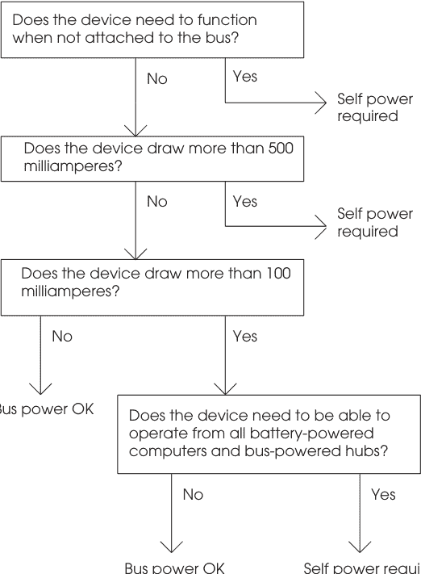

图 16-1：并非每个设备都能单独使用总线电源。使用总线电源的设备还必须满足USB规范对挂起电流的限制。

## 电源需求

USB规范将低功耗设备定义为从总线汲取高达100毫安培电流的设备，将高功耗设备定义为从总线汲取高达500毫安培电流的设备。自供电设备可以从总线汲取高达100毫安培的电流，并可从设备电源中获取尽可能多的功率。

高功耗设备必须能够在低功耗下枚举。上电时，任何设备在枚举期间被配置之前，可以从总线汲取高达100毫安培的电流。检索到配置描述符后，主机会检查bMaxPower中请求的电流量，如果电流可用，主机将发送指定配置的Set_Configuration请求。然后设备可以从总线汲取高达bMaxPower的电流。实际上，主机和集线器很可能会向设备分配100或500毫安培，而不是bMaxPower中请求的精确电流值。

自供电设备在总线未挂起的任何时候也可以从总线汲取高达100毫安培的电流。此能力使设备的USB接口在设备电源关闭时能够正常工作，以便主机能够检测和枚举设备。否则，如果设备的上拉电阻使用总线电源而接口的其余部分使用自供电，主机将检测到设备，但无法与之通信。

这些限制是绝对最大值，而不是平均值。还要记住，总线的电源电压可高达5.25V，这可能导致更大的电流消耗。

设备绝不能提供上游电源。甚至在VBUS出现之前，上拉电阻器也必须保持无电状态。因此，自供电设备必须连接到VBUS以检测其是否存在，即使设备从不使用总线电源。

## 通知主机

在枚举期间，主机会得知设备是自供电还是总线供电，以及设备将从总线汲取的最大电流。正如第4章所述，每个设备的配置描述符包含一个bMaxPower值，用于指定设备所需的最大总线电流。所有集线器都具有过流保护功能，可防止过大电流流入设备。

如果你将高功耗设备连接到低功耗集线器，Windows会显示一条消息，告知你集线器没有足够的可用电源，并提供帮助。如果总线上有低功耗设备连接到高功耗端口，Windows会建议将该设备与高功耗设备交换（图16-2）。

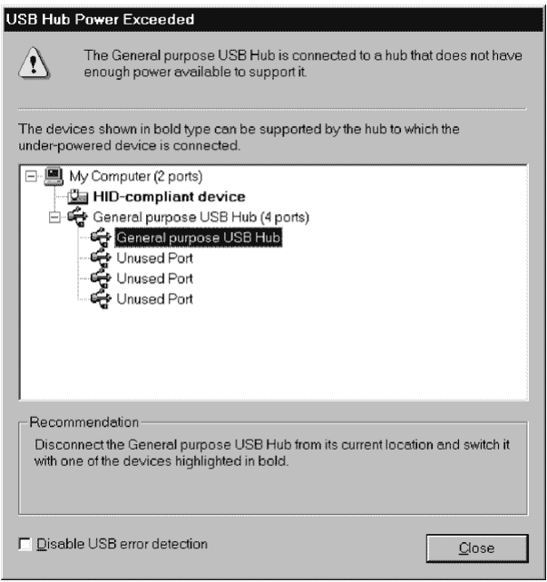

图 16-2：当用户将高功耗设备连接到低功耗集线器时，Windows会发出警告，并帮助他们找到替代连接。

设备可以同时支持总线供电和自供电选项，在有可用自供电时使用自供电，否则使用总线电源（可能功能受限）。当电源来源改变时，主机必须重新枚举设备。为了强制重新枚举，可以短暂关闭设备总线拉电阻的电源，然后重新打开，以模拟断开和重新连接。如果设备不具备此功能，用户在连接或移除电源之前，需要先将设备从总线上移除。设备会响应来自主机的Get_Status（设备）请求，报告其使用的是总线还是自供电。

## 集线器电源

集线器的供电选项与其他设备的选项类似，但集线器有一些特殊考虑。集线器还必须控制其设备的电源并监控功耗，在设备使用过大电流并构成安全隐患时采取措施。

## 电源来源

与其他设备一样，除根集线器外，所有集线器都是自供电或总线供电的。根集线器从主机获取电源。

如果主机使用墙壁插座或其他外部来源的交流电源，则根集线器必须是大功率的，并且能够向集线器上的每个端口提供500毫安培电流。如果主机使用电池供电，集线器可以向其每个端口提供500或100毫安培电流。提供100毫安培电流的集线器是低功耗集线器。

总线供电集线器的所有下游设备必须是低功耗的。集线器汲取的电流不得超过500毫安培，且集线器本身会消耗其中一部分，因此所有连接设备总共可用的电流将小于500毫安培。

不要将两个总线供电的集线器串联。上游集线器最多只能保证向每个下游端口提供100毫安培电流，如果第二个集线器还有一个或多个下游端口，每个端口都需要100毫安培，则没有足够的电流为其供电。一个例外是总线供电的复合设备，它由一个集线器和一个或多个不可移除的下游设备组成。在这种情况下，集线器的配置描述符可以报告集线器电子设备及其不可移除设备所需的最大功率。不可移除设备的配置描述符报告这些设备是自供电的，bMaxPower = 0。集线器描述符指示集线器的端口是否可移除。

与其他高功耗、总线供电设备一样，总线供电集线器在配置之前最多可汲取100毫安培，配置之后最多可汲取500毫安培。在配置期间，集线器必须管理可用电流，使其设备与集线器总电流不超过允许电流。

与其他自供电设备一样，自供电集线器也可以从总线汲取高达100毫安培的电流，以便在集线器电源关闭时集线器接口仍能继续工作。如果集线器的电源来自外部来源，例如墙壁插座的交流电源，则该集线器是大功率的，并且必须能够向集线器上的每个端口提供500毫安培电流。如果集线器使用电池电源，集线器可以向其每个端口提供100或500毫安培电流。

## 过流保护

作为安全预防措施，集线器必须能够检测过流情况，过流情况发生在集线器上连接的所有设备使用的总电流超过预设值时。当集线器上的端口电路检测到过流情况时，它们会限制端口的电流，并且集线器会向主机报告此问题。当设备超过其集线器端口的电流限制时，Windows会警告用户（图16-3）。

USB 2.0规范仅说明触发过流操作的电流必须小于5安培。为了允许瞬态电流，过流值应大于设备最大允许电流的总和。在最坏情况下，七个高功耗、总线供电的下游设备按照规范最多可汲取3.5安培。因此，对于最多有七个下游端口的自供电集线器，其电源在所有时候提供的电流都应远低于5安培，除非出现严重问题。

USB规范允许设备在连接到总线时汲取更大的浪涌电流。该电流通常由位于过流保护电路下游的电容器中储存的能量提供，因此保护电路不会看到浪涌电流。如果浪涌电流过大，设备将无法通过USB-IF的合规性测试。


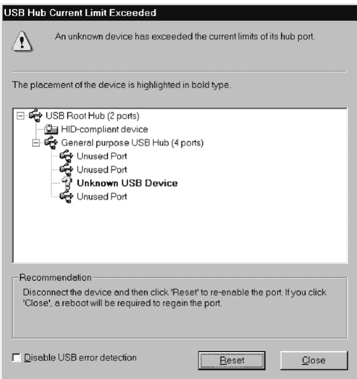

图 16-3：当设备超过其集线器端口的电流限制时，Windows 会警告用户并提供帮助。

## 电源切换

总线供电的集线器必须支持电源切换，能够根据控制请求向下游端口提供并切断电源。一个开关可以控制所有端口，也可以单独切换各端口。自供电集线器必须支持切换到“已关闭电源”状态，并且还可以通过控制传输支持电源切换。

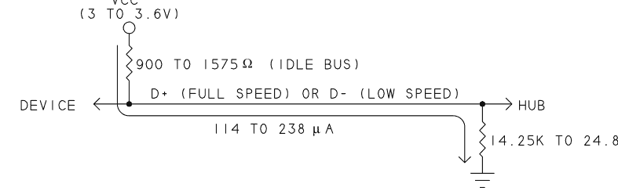

图 16-4：Suspend 状态下允许的总线电流包括流经设备上拉电阻的电流。如图 16-4 所示，上拉电流从设备的上拉电源流出，该电源必须在 3.0 至 3.6V 之间，经过设备的上拉电阻和集线器的下拉电阻流向地。在最坏情况下，上拉电压为 3.6V 且电阻为允许的最小值时，上拉电流为 238 微安，只剩下 262 微安供其他用途使用。

高速设备在正常通信中不使用上拉电阻，进入 Suspend 状态时必须切换到全速并使用上拉电阻。因此高速设备对可用电流也有同样的限制。

在合规性测试中，USB-IF 已对 Suspend 状态下消耗高达 2.5 毫安的低功耗设备授予自动豁免。

支持远程唤醒且主机已启用其远程唤醒功能的高速设备在挂起时可从总线汲取高达 2.5 毫安的电流，其中包括流经上拉电阻的电流。每个设备都以低功耗连接，因此要符合 USB 规范，如果主机在将设备配置为启用远程唤醒的高速设备之前就挂起该设备，则设备必须满足 500 微安的限制（假设未授予豁免）。

这些限制是长达 1 秒间隔内的平均值，因此瞬时电流可以更大。例如，一个闪烁的 LED 每秒十分之一的时间消耗 20 毫安电流，其平均值为每秒 2 毫安。

设备应在总线段处于空闲状态 3 毫秒后开始进入 Suspend 状态。设备应在总线段处于空闲状态 10 毫秒后进入 Suspend 状态。

## 恢复通信

在 Suspend 状态下，有两种操作可使设备进入 Resume 状态并重新开始通信。总线上的任何活动都会使设备进入 Resume 状态。如果设备的远程唤醒功能由主机启用，设备本身可在任何时候请求恢复。

要恢复，主机将总线置于 Resume 状态（第 18 章中定义的 K 状态）至少 20 毫秒。主机随后用低速的 End-of-Packet 信号跟随 Resume。（有些主机错误地在仅几百微秒后发送 End-of-Packet。）主机随后恢复发送帧开始包以及设备驱动程序请求的任何其他通信。

设备通过将上游总线段驱动到 Resume 状态 1 至 15 毫秒来触发 Resume。随后设备将其驱动器置于高阻抗状态以接收来自上游集线器的流量。设备可在总线已挂起至少 5 毫秒后随时发起 Resume。主机控制器软件必须允许所有设备至少有 10 毫秒时间从 Resume 中恢复。

根据设备的 USB 控制器，监视总线以确定是否进入 Suspend 状态可能需要固件支持。恢复信号通常由设备的串行接口引擎处理，无需固件支持。

当设备使用总线供电时，USB 控制器可能需要控制外部电路的电源，在进入 Suspend 状态时切断电源，在恢复时重新供电。具有软启动能力的电源开关可以通过限制开关打开时的电流浪涌来防止问题。Micrel Inc. 有几种适用于 USB 设备的电源分配开关。每个开关包含一个或多个具有软启动能力的高侧 MOSFET 开关。

## Windows 下的电源管理

最近的 PC 根据高级配置和电源接口规范（ACPI）管理电源。该规范于 1997 年首次发布，由 Hewlett-Packard、Intel、Microsoft、Phoenix Technologies 和 Toshiba 共同开发。修订版 3.0 于 2004 年发布。实现 ACPI 电源管理的系统使操作系统能够在计算机空闲时通过关闭组件，包括挂起 USB 总线来节省电量。

要实现 ACPI，PC 必须包含 ACPI 控制器。ACPI BIOS 提供描述系统硬件电源管理功能以及操作系统可以执行的例程的表。

PC 支持三种低功耗或睡眠状态：

在 S1 状态下，显示器关闭且驱动器断电。USB 总线被挂起，但 VBUS 保持供电。

在 S3 状态下，PCI 总线的主电源关闭且内存未被访问，但系统内存继续刷新。能够唤醒系统的设备从 PCI 总线的辅助电源（Vaux）获取电力。在较旧的系统中，USB 的 VBUS 在 S3 状态下未供电。在较新的系统中，VBUS 由 Vaux 供电。

在 S4 状态下，系统上下文保存到磁盘，系统包括 USB 总线被断电。

在 Windows XP 中，您可以在“控制面板 > 电源选项”中查看和更改系统的电源管理选项。在“电源方案”选项卡（图 16-5）中，您可以指定系统进入待机和休眠的时间。休眠是 S4 状态。待机是 S1 或 S3。在没有可唤醒系统的 USB 设备的系统上，待机状态为 S3。在具有 USB 键盘、鼠标或其他可唤醒系统的 USB 设备的系统上，待机状态为 S1，这是由于使用 S3 时存在一些（行为不正常）硬件的问题。这些问题包括 S3 状态下 VBUS 丢失、恢复时出现错误的设备移除和到达通知、挂起和恢复期间设备重置以及无法完全恢复。

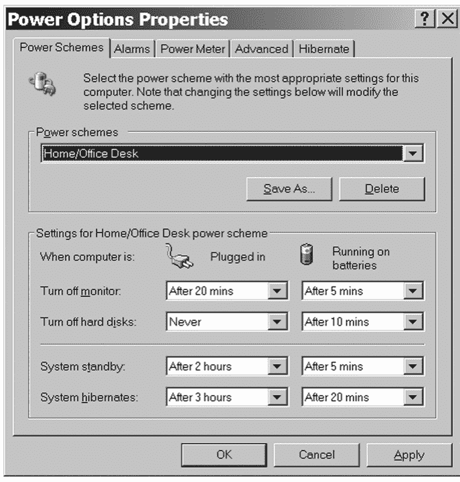

图 16-5：Windows 控制面板中的“电源选项属性”使用户能够指定节能方案，从而确定 USB 设备必须进入 Suspend 状态的时间。

要为特定支持远程唤醒的设备启用或禁用远程唤醒功能，在 Windows 的设备管理器中，选择该设备，右键单击，选择“属性 > 电源管理”，并勾选或取消勾选“允许此设备唤醒计算机”。

在一些早期的 Intel 主机控制器上，挂起的根端口对远程唤醒的响应不正确。此外，在 Windows 98 Gold、Windows 98 SE 和 Windows Me 下使用远程唤醒需要变通方法。在这些操作系统下，设备可能正确唤醒，但设备的驱动程序未被告知唤醒，因此通信无法恢复。Intel 的一篇白皮书题为 *理解 WDM 电源管理*，作者为 Kosta Koeman（可在 USB-IF 网站上获得），详细说明了问题和解决方案。简而言之，使用这些操作系统的设备不应自行进入 Suspend 状态，除非主机请求，并且设备驱动程序需要额外的代码以确保唤醒成功完成。Windows 2000 及更高版本没有此问题。

# 第17章

## 测试和调试

除了第 6 章中描述的芯片专用开发板和调试软件外，还有各种其他硬件和软件工具可以帮助测试和调试 USB 设备及其主机软件。本章介绍来自 USB-IF 和其他来源的可用工具。我还解释了设备和驱动程序要获得 Certified USB 标志和 Windows 标志所需的测试所涉及的内容。

### 工具

毫无疑问，对 USB 设备开发人员最有用的工具是协议分析仪，它使您能够监视 USB 流量和其他总线事件。分析仪收集总线上的数据并解码并以用户友好的格式显示您请求的数据。您可以观察枚举期间发生的情况，检测并检查协议和信号错误，查看控制、中断、批量和等时传输期间传输的数据，并专注于您指定的通信的任何方面。


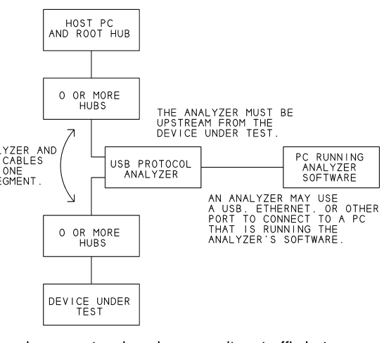

图 17-1：硬件协议分析器监视被测设备与其主机之间的流量。连接到 PC（或逻辑分析器）的接口可查看捕获的数据。

硬件分析器是硬件和软件的结合体，而软件分析器仅由运行在设备主机上的软件组成。两种类型的功能有很大重叠，但每种类型也能记录和显示另一种类型无法获取的信息。

另一种有用的工具是流量生成器，它模拟主机或设备，并能精确控制被模拟的主机或设备在总线上发送的内容。

## 硬件协议分析器

硬件协议分析器包含一台设备，它能在不影响电缆段中流量的情况下捕获其中的信号。分析器连接在被测设备上游的电缆段中（图 17-1）。为了便于查看捕获的流量，分析器另有一个连接，通向 PC 或逻辑分析器。到 PC 的连接可以通过 USB 或另一种端口类型（如以太网）。少数分析器则连接到 Agilent 或 Tektronix 的逻辑分析器。

使用硬件分析器，你可以看到电缆中的数据，细到构成每个数据包的各个字节。对于主机或设备发送了什么或没发送什么，不会存在疑问。例如，如果主机发送了一个 IN 令牌包，你可以迅速看到设备是返回了数据还是返回了 NAK。你可以查看控制请求每个阶段的数据包。时间戳让你能够看到主机轮询端点的频率。

分析器有多个供应商提供，价格不一。Ellisys 的 USB Explorer 200 是一款相对便宜但非常实用的分析器，支持所有三种总线速度。在本章中，我使用 Explorer 来演示使用分析器可以做的各种事情。供应商总是在更新和改进他们的产品，因此当你准备购买时，请查看最新信息。

### 硬件

要使用 Explorer，你必须有两个可用的 USB 主机控制器。一个与 Explorer 通信，另一个控制被监视的总线。两个主机控制器可以在同一台 PC 中，但为了获得最佳性能，Ellisys 建议使用两台 PC。

Explorer 的后面板有一个 USB 插座，连接到运行 Explorer 软件的 PC。PC 将 Explorer 检测为一个 USB 设备，该设备使用由 Ellisys 提供的厂商特定驱动程序。

前面板上的两个 USB 插座将分析器连接到被测设备上游的电缆段中。一根电缆连接到被测设备或设备上游的集线器。另一根电缆连接到主机的根集线器或分析器上游的另一个集线器。

分析器的电路必须尽可能无干扰地捕获流量。当分析器存在时，主机和设备应该察觉不到总线流量有任何不同。前面板上的两根电缆和分析器的电子设备必须模拟一段 5 米或更短（低速段为 3 米或更短）的普通电缆段。对于这些电缆，Ellisys 建议使用长度合计不超过 3 米的电缆。

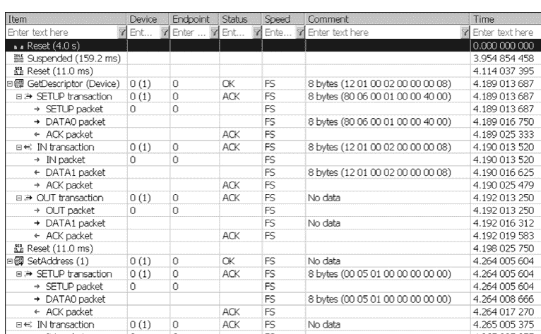

图 17-2：Ellisys 的 USB Explorer 200 协议分析器附带用于查看捕获数据的 Visual USB 应用软件。此示例显示了当设备连接到分析器下游时发生的事务和其他事件。

### 软件

Ellisys 的 Visual USB 分析软件使你能启动和停止数据记录，并保存、查看和打印结果。图 17-2 显示了由分析器捕获的数据。你可以指定要显示的数据量、类型和格式。为了减少细节，你可以选择隐藏单独的数据包、重复的 NAK 以及其他信息。过滤器使你能够选择要显示的精确数据。你可以指定条件，例如一个或多个设备、端点、速度、状态代码和控制请求。软件只显示符合你指定条件的流量。

“详细信息”窗格提供关于应用程序主窗口中一行里的请求、事务、数据包或其他项目的更多信息（图 17-3）。“数据”窗格以十六进制和 ASCII 显示各个字节。

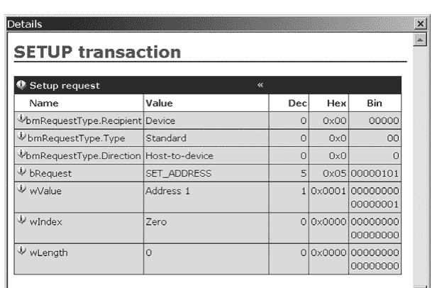

图 17-3：Ellisys Visual USB 软件中的“详细信息”窗格包含关于请求、事务、数据包或其他事件的更多信息。

你还可以搜索特定项目，包括事件、令牌包类型、进出特定设备或端点的流量，以及数据。

额外的软件模块增加了对事件触发、解码类特定信息以及以文本、XML 和其他格式导出捕获数据的支持。

## 软件协议分析器

纯软件协议分析器运行在被测设备的主机上。你可以查看连接到该计算机任意主机控制器的任何设备的进出流量。

软件分析器可以显示硬件分析器无法访问的驱动程序信息。如第 8 章所述，Windows 驱动程序使用包含 USB 请求块（URB）的 I/O 请求包（IRP）与 USB 设备通信。软件分析器可以显示驱动程序已提交的 IRP 和 URB，以及从设备收到的响应。

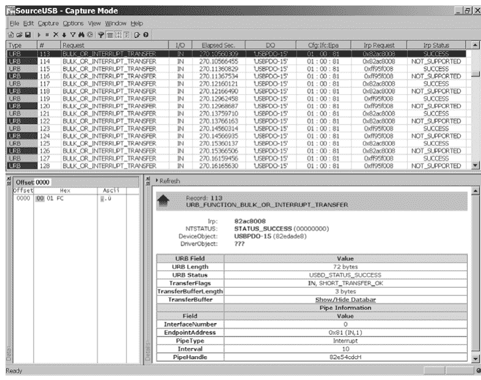

图 17-4：SourceUSB 的应用程序显示主机上的 USB I/O 请求。这些请求用于鼠标通信。

但是，软件分析器无法显示主机控制器或集线器硬件自行处理的任何内容。例如，分析器不会显示端点在一个事务返回 ACK 之前 NAK 了多少次，也不会显示一个事务在总线上发生的精确时间。

一些软件分析器使用过滤器驱动程序，该驱动程序在操作系统为被监视设备加载驱动程序时加载。由于过滤器驱动程序直到主机枚举设备后才加载，分析器无法显示在设备连接时发生的枚举请求和其他事件。

Sourcequest 公司的 SourceUSB 是一款软件分析器，它记录 USB I/O 请求和其他事件，包括枚举请求。你可以查看这些请求，以及关于系统主机控制器、主机控制器总线上的设备、分配给每个主机控制器和设备的驱动程序等附加信息。图 17-4 显示了记录在案的请求以及所选行中请求的附加信息。

SourceUSB 应用程序还可以显示系统中所有主机控制器及其所连接设备的树状结构，并提供分配给每个主机控制器和设备的驱动程序信息。与硬件分析器一样，你可以非常灵活地选择要记录和查看的信息。

另一个纯软件分析器是 SnoopyPro 项目，可从 www.sourceforge.net 免费获得源代码。

## 流量生成器

有时，能够控制总线流量和信号很有用，这超出了主机软件和设备固件所能实现的范围。一些高端协议分析器还可以充当流量生成器，模拟主机或设备，并精确控制被模拟的主机或设备在总线上发送的流量。除了生成有效的流量外，流量生成器还可以引入错误，例如位填充错误和 CRC 错误。具有这些能力的两个协议分析器是 Catalyst Enterprises 公司的 SBAE-30 分析器/练习器和 LeCroy 公司的 CATC USBTracer/Trainer。另一个选择是 RPM Systems 的 Root 2 USB 测试主机，它模拟 USB 主机，使你能够指定在总线上生成的流量、控制总线电压并测量总线电流。

## 测试

USB-IF 和 Microsoft 为 USB 设备和主机软件的开发者提供测试机会。通过测试可以为产品赢得展示“Certified USB”标识和/或“Microsoft Windows”标识的权利。标识可以让用户确信设备经过全面测试且可靠。通过 Microsoft 测试的驱动程序可以进行数字签名，这让用户确信该驱动程序能够正常工作。


# 第17章 合规性测试

USB 相较于其他接口的一个优势在于，规范的开发者在发布规范后并未停止工作。USB-IF 仍积极参与帮助开发者设计和测试 USB 产品。USB-IF 的网站上有许多有用的文档和工具。

USB-IF 还开发了一个合规性计划，规定并赞助对外设、集线器、主机系统、On-The-Go 设备、硅构建模块、电缆组件和连接器的测试。当产品通过测试后，USB-IF 认为其具有“合理的可接受性”并将该产品添加到其合规设备集成商列表中。在收到签署的许可协议和付款后，USB-IF 授权产品展示 Certified USB 标志。即使你不打算将设备提交正式合规性测试，也可以使用这些测试来验证设备的性能。

要通过合规性测试，设备必须满足适当清单中规定的要求，并通过对设备对标准控制请求的响应、在所有主机类型下以及与总线上其他设备一起运行的能力、以及电气性能的测试。除了高速电气测试之外，所有测试都描述在文档 *Universal Serial Bus Implementers Forum Full and Low Speed Electrical and Interoperability Compliance Test Procedure* 中。高速电气测试的规范、程序和工具在 USB-IF 网站上的其他文档和文件中。

你可以在 USB-IF 赞助的合规性研讨会上或在 USB-IF 授权执行测试的独立实验室之一提交设备进行合规性测试。为了节省时间和费用，你应在提交产品进行合规性测试之前尽可能自行完成测试。

### 清单

合规性清单包含一系列关于产品规范和行为的问题。有面向外设、集线器、集线器和外设硅以及主机系统的清单。外设清单涵盖机械设计、设备状态和信号、工作电压以及功耗。你需要能够对清单中的每个问题都回答“是”。每个问题都附有对 USB 规范中更详细信息的章节引用。

### 设备框架

设备框架测试验证设备是否正确响应标准控制请求。USB Command Verifier（USBCV）软件实用程序执行这些测试。文档 *USB Command Verifier Compliance Test Specification* 描述了这些测试。USBCV 软件和测试规范文档可从 USB-IF 的网站获取。

USBCV 软件需要一台配备 USB 2.0 主机控制器的 PC。此外，任何正在测试的低速或全速设备必须通过外部 USB 2.0 集线器连接到主机。当你运行 USBCV 时，软件会用其自己的测试堆栈驱动程序替换主机控制器的驱动程序。退出 USBCV 后，软件会恢复原始驱动程序。堆栈切换已使用 Microsoft 的主机控制器驱动程序进行测试，USB-IF 建议仅在主机使用 Microsoft 驱动程序时运行该软件。

该软件有多个测试套件：Chapter 9、Current Measurement、HID、Hub 和 OTG（图 17-5）。

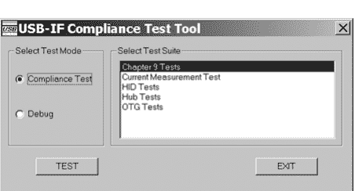

在第 9 章测试中，主机发出 USB 规范第 9 章中定义的标准控制请求，并对设备返回的信息进行额外检查（图 17-6）。例如，在检索设备描述符时，软件会检查 bMaxPacketSize0 值是否对设备的速度有效，并且 bDeviceClass 值是否为标准类的值或 0FFh（厂商定义）。软件在设备处于默认、地址和配置状态时请求设备描述符，如果设备同时支持全速和高速，则在两种速度下请求，并在每个受支持的配置中请求。

**USB-IF 合规测试工具**

| 步骤名称 | 状态 |
|---|---|
| DeviceDescriptorTest_DeviceConfigured | 通过 |
| DeviceDescriptorTest_DeviceAddressed | 通过 |
| ConfigDescriptorTest_DeviceConfigured | 通过 |
| ConfigDescriptorTest_DeviceAddressed | 通过 |
| InterfaceDescriptorTest | 通过 |
| EndpointDescriptorTest_DeviceConfigured | 通过 |
| EndpointDescriptorTest_DeviceAddressed | 通过 |
| HaltEndpointTest | 通过 |
| SetConfigurationTest | 通过 |
| SuspendResumeTest | 通过 |
| RemoteWakeupTestEnabled | 通过 |
| RemoteWakeupTestDisabled | 通过 |
| EnumerateTest | 通过 |

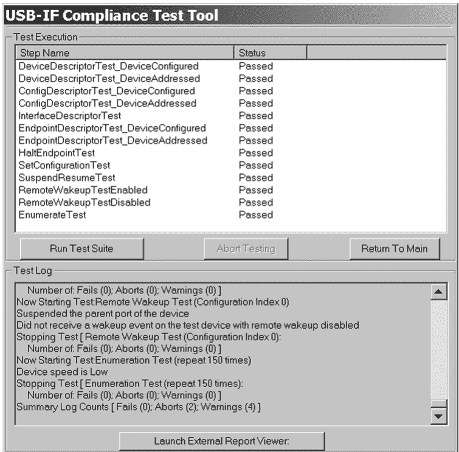

第 9 章测试还包括以下测试：

- 使用不同的地址多次枚举设备。
- 验证所有批量和中断端点是否都可以用 Clear_Feature 请求停止。
- 确保设备在收到对不支持的描述符类型的请求时返回 STALL。
- 确保设备在收到对不支持的功能的 Set_Feature 请求时返回 STALL。
- 挂起并恢复设备。
- 如果设备支持远程唤醒，则挂起设备并要求用户执行操作以唤醒设备。

每个设备都必须通过所有第 9 章测试。

Current Measurement 测试套件在设备处于未配置和已配置状态时暂停，以便你测量设备在每种状态下从总线汲取的电流。在未配置状态下，设备不应消耗超过 100 毫安。配置后，设备不应消耗超过当前活动配置的配置描述符的 bMaxPower 字段中指定的量。

其他测试套件提供针对集线器、HID 类设备以及返回 On-The-Go（OTG）描述符的设备的测试。

该软件有两种模式。Compliance Test 模式运行整个测试套件。Debug 模式允许选择并运行套件内的单个测试，并提供更多控制，例如在运行测试时选择要使用的配置。

### 互操作性测试

互操作性测试通过使用不同的主机控制器以及各种其他 USB 设备同时使用来模拟用户的体验，对产品进行测试。设备必须在 EHCI/UHCI 和 EHCI/OHCI 主机下以及支持和不支持高速的集线器下进行测试。为了能够测试 S3 睡眠状态的两种实现，设备必须在进入 S3 状态时保持 VBUS 的主机下以及进入 S3 状态时移除 VBUS 的主机下进行测试。设备在以下所有条件下进行测试：

- 总线正在传输控制、批量、中断和等时传输。
- 设备与主机之间有五个外部集线器。
- 设备距离主机 30 米（低速设备为 28 米）。
- 总线正在传输全速和高速流量。

为了执行测试，测试规范定义了一个 Gold Tree，其中包含与被测设备在总线上的各种集线器和其他设备。自测试规范修订版 1.3 起，Gold Tree 包含以下设备：

- 视频摄像机：高速，使用等时传输，高功耗，总线供电。
- 大容量存储设备：高速，使用批量传输，自供电。
- 闪存媒体驱动器：高速，使用批量传输，总线供电。
- 键盘：低速 HID。
- 鼠标：低速 HID。
- 七个集线器：五个支持全部三种总线速度的集线器，其中一个集线器具有多个事务转换器；两个仅支持低速和全速的集线器。

设备以图 17-7 所示的配置连接到主机。测试规范命名了已证明本身没有互操作性问题的产品。你可以使用这些或等效设备。

在连接时，主机必须枚举并安装设备的驱动程序（如果适当，需要用户协助识别驱动程序位置）。在 Gold Tree 中的其他设备同时运行时，设备必须正常运行。此外，在执行以下每个操作后，设备必须继续正常运行：

- 断开设备并重新连接到同一端口。
- 断开设备并连接到不同端口。


图17-7：合规性测试使用此“金树”配置，测试设备在系统中其他USB设备正在使用时的行为。

- 执行热启动。（开始 > 关机 > 重新启动。）
- 执行冷启动。（开始 > 关机 > 关机。然后打开电脑。）
- 当设备处于活动状态时，将系统置于S1睡眠状态并恢复。
- 当设备处于空闲状态时，将系统置于S1睡眠状态并恢复。
- 当设备处于活动状态时，将系统置于S3睡眠状态并恢复。

高速设备还必须在全速下完全正常工作。测试规范中有更多关于测试的详细信息。

## 豁免

设备无需通过所有测试即可获得USB标志。USB-IF可自行决定授予某项要求的豁免。例如，某些设备在挂起状态下应仅消耗500微安培，但实际消耗高达2.5毫安培，此类设备已获得豁免。

## 认证USB标志

通过合规性测试的设备有资格展示官方的认证USB标志。该标志指示设备是否支持高速和/或USB On-The-Go（图17-8）。要使用该标志，您必须签署USB-IF商标许可协议。如果您不是USB-IF的成员，还必须支付标志管理费（撰写本文时为1500美元）。该标志与第19章描述的USB图标不同。

## WHQL测试

对于将用于Windows PC的设备和驱动程序，微软提供Windows硬件质量实验室（WHQL）测试。这些测试用于识别“满足平台功能和质量的基线定义，从而确保最终用户获得良好Windows体验”的设备和驱动程序。当设备通过WHQL测试后，其包装和营销材料可展示“Designed for Microsoft Windows”标志。在微软的在线Windows兼容设备目录中，合格的设备会在其列表中显示该标志。如第9章所述，通过WHQL测试的驱动程序具有数字签名，可将该驱动程序标识为受信任的驱动程序。


TM & © 2000 USB-IF. 保留所有权利。


TM & © 2000 USB-IF. 保留所有权利。


TM & © 2000 USB-IF. 保留所有权利。


TM & © 2000 USB-IF. 保留所有权利。

图17-8：通过合规性测试的设备可以展示其中一个认证USB标志。该标志指示设备是否支持高速和/或USB On-The-Go。

## Windows标志计划

要获得Windows标志，设备必须正确安装和卸载，不干扰其他系统组件，并且设备必须与其他系统组件良好互操作。Windows XP和Windows Server 2003有不同的测试和标志。一个设备可以获得多个标志。为设备获得Windows标志需要执行以下步骤：

- 通过微软提供的Windows硬件兼容性测试（HCT）工具包中的相应兼容性测试。
- 使用微软的HCT提交审核实用程序创建包含兼容性测试日志的报告。
- 提交硬件、测试日志、驱动程序（如有）、用户文档、其他配置实用程序或附件（视需要）以及费用。硬件将提交至Windows质量在线服务测试地点。撰写本文时，大多数设备的费用为每个操作系统250美元。

微软的网站提供与WHQL测试相关的最新信息和下载。

## 数字签名

要获得Windows标志，设备必须使用带有数字签名的驱动程序。驱动程序可以是操作系统附带的驱动程序，也可以由供应商提供。要获得数字签名，驱动程序必须通过WHQL测试，并且供应商必须提供从www.verisign.com获取的VeriSign数字代码签名ID。撰写本文时，VeriSign ID费用为400美元。微软使用加密技术对驱动程序的目录（.cat）文件进行数字签名，并将签名后的文件返回给供应商。

设备的INF文件引用该目录文件。签名使Windows能够检测驱动程序在通过WHQL测试后是否被修改。每个INF文件都有自己的目录文件。一个INF文件可以支持多个设备。对INF文件的任何更改（包括添加新的产品ID或设备发布号）都需要获取新的数字签名。

对于大多数USB设备，签名驱动程序的INF文件必须包含包含设备VID和PID的设备标识字符串。使用兼容ID仅通过类别（以及可选子类别和协议）识别设备的INF文件将无法通过WHQL测试，打印机除外。

如果您希望驱动程序包含在微软的Windows Update中，则必须对驱动程序进行签名。Windows的这一功能使用户可以轻松更新其系统上安装的驱动程序。在某些情况下，Windows Update还可以为新安装的设备找到驱动程序。通过Windows Update提供的驱动程序必须满足额外要求，以确保Windows能够轻松识别、下载和安装该驱动程序。

在Windows Server 2003及更高版本中，某些设备可以使用另一种方式获取数字签名。如果WHQL没有针对驱动程序安装类别（setup class）的测试程序，供应商可以使用微软的代码签名工具为驱动程序生成Authenticode签名。

# 第18章

## 信号与编码

您无需了解总线上数据编码的所有细节即可设计和编程USB外设。但了解这些主题有助于理解设备的能力和限制。

本章介绍USB编码和数据格式的要点。USB规范提供了详细信息。

## 总线状态

USB规范定义了与总线上的信号电压或这些电压所表示的条件相对应的总线状态。总线上的不同线缆段可能同时处于不同状态。例如，响应主机的请求，集线器可能将其一个下行端口置于复位状态，而其其他端口处于空闲状态。低速/全速和高速各自定义了不同的总线状态，尽管有许多相似之处。

## 低速和全速总线状态

低速和全速支持相同的总线状态，尽管某些状态的定义取决于线缆段的速度。低速段是低速设备与其最近的集线器之间的段。全速段是任何其他以低速或全速比特率传输数据的段。

## 差分0和差分1

传输数据时，总线上的两种状态是差分0和差分1。当D+为逻辑低电平且D-为逻辑高电平时，存在差分0。当D+为逻辑高电平且D-为逻辑低电平时，存在差分1。第19章有关于定义逻辑低电平和高电平的电压的详细信息。

差分0和差分1并不直接转换为电压电平，而是指示逻辑电平的变化、逻辑电平的无变化或位填充，如本章后面所述。

## 单端零

单端零（SE0）状态发生在D+和D-均为逻辑低电平时。总线在进入数据包结束、断开和复位状态时使用单端零状态。

## 单端一

单端零的补码是单端一（SE1）。该状态发生在D+和D-均为逻辑高电平时。这是一个无效的总线状态，不应发生。

## 数据J和数据K

除了由线路电压定义的差分1和0状态外，USB还定义了两种数据总线状态：J和K。它们是


由总线状态是差分0还是差分1，以及线缆段是低速还是全速来定义：

| 总线状态 | 低速 | 全速 |
|---|---|---|
| 差分 0 | J | K |
| 差分 1 | K | J |

以这种方式定义J和K状态，使得即使低速和全速线路上的电压不同，也可以使用同一套术语来描述事件或逻辑状态。例如，当总线从空闲状态变为K状态时，就存在数据包起始状态。在全速段，当D-变得比D+更正时出现该状态；而在低速段，当D+变得比D-更正时出现该状态。

## 空闲（Idle）

在空闲状态下，没有驱动器处于激活状态。在全速段，D+比D-更正；而在低速段，D-比D+更正。设备连接后不久，集线器通过检查设备端口处空闲总线上的电压，来确定设备是低速还是全速。

## 恢复（Resume）

当设备处于挂起状态时，设备端口处的数据K状态表示从挂起状态恢复。

## 数据包起始（Start-of-Packet）

当线路从空闲状态变为K数据状态时，就存在数据包起始（SOP）总线状态。每个发送的低速或全速数据包都以数据包起始开始。

## 数据包结束（End-of-Packet）

当接收器处于单端零状态至少一个位时间，随后处于数据J状态至少一个位时间时，就存在数据包结束（EOP）状态。接收器也可以选择为数据J状态定义更短的最短时间。在驱动器端，单端零大约持续两个位宽。每个发送的低速或全速数据包都以数据包结束结束。

## 断开（Disconnect）

当单端零持续至少2.5微秒时，下游端口处于断开状态。

## 连接（Connect）

当总线处于空闲状态至少2.5微秒且不超过2.0毫秒时，下游端口进入连接状态。

## 复位（Reset）

当单端零持续10毫秒时，设备必须处于复位状态。设备可以在单端零持续至少2.5微秒后进入复位状态。支持高速通信的全速设备在复位状态下执行高速握手。

退出复位状态时，设备必须以正确的速度运行，并且必须响应发送到默认地址（00h）的通信。

## 高速总线状态

许多高速总线状态与低速和全速状态相似。有些是高速特有的，而一些低速和全速总线状态在高速下没有对应状态。

## 高速差分0和差分1

传输高速数据时存在的两种总线状态是高速差分0和高速差分1。与低速和全速一样，当D+为逻辑低且D-为逻辑高时，存在高速差分0；当D+为逻辑高且D-为逻辑低时，存在高速差分1。但高速时的电压要求不同，而且高速对AC差分电平有额外要求。

## 高速数据J和高速数据K

高速数据J和高速数据K状态的定义与全速J和K相同：

| 总线状态 | 数据状态，高速 |
|---|---|
| 差分 0 | K |
| 差分 1 | J |

## Chirp J 和 Chirp K

Chirp J和Chirp K总线状态仅在高速检测握手期间出现。当2.0集线器将下游总线段置于复位状态时，就会发生该握手。Chirp J和Chirp K被定义为DC差分电压。在Chirp J中，D+比D-更正；在Chirp K中，D-比D+更正。

高速设备在连接到总线时必须使用全速。高速检测握手使高速设备能够告诉2.0集线器该设备支持高速，并切换到高速通信。

如第4章所述，在检测到设备连接后不久，设备的集线器会将设备端口和总线段置于复位状态。当支持高速的设备检测到复位时，设备向集线器发送一个持续1至7毫秒的Chirp K。以高速向上游通信的2.0集线器检测到Chirp K，并响应地发送交替的Chirp K和Chirp J序列。该序列一直持续到复位状态结束前不久。在复位结束时，集线器将端口置于高速使能状态。

在检测到Chirp K和Chirp J序列后，设备断开其全速上拉电阻，启用其高速终端，并进入高速默认状态。

1.x集线器会忽略设备的Chirp K。设备看不到应答序列，就知道通信必须以全速进行。

## 高速静噪（High-speed Squelch）

高速静噪状态表示无效信号。高速接收器必须包含检测静噪状态的电路，该状态由100毫伏或更低的差分总线电压表示。

## 高速空闲（High-speed Idle）

在高速空闲状态下，没有高速驱动器激活，低速/全速驱动器则输出单端零。D+和D-都处于-10毫伏到+10毫伏之间。

## 高速数据包起始（Start of High-speed Packet）

当段从高速空闲状态变为高速数据K状态时，就存在高速数据包起始（HSSOP）。每个高速数据包都以高速数据包起始开始。

## 高速数据包结束（End of High-speed Packet）

当总线从高速数据K或数据J状态变为高速空闲状态时，就存在高速数据包结束（HSEOP）。每个高速数据包都以高速数据包结束结束。

## 高速断开（High-speed Disconnect）

从总线上移除高速设备也会移除设备处的高速线路终端。终端的移除会导致集线器处的差分电压加倍。数据线上625毫伏或更高的差分电压表示高速断开状态。2.0集线器包含检测该电压的电路。

## 数据编码

总线上的所有数据都经过编码。这种称为不归零反转（NRZI）并带有位填充的编码格式，确保接收器与发送器保持同步，而无需为每个字节发送单独的时钟信号或起始位和停止位。


图18-1：在NRZI编码中，0引起变化，1不引起变化。位填充在连续六个1之后添加一个0。

如果你使用示波器或逻辑分析仪查看总线上的USB数据，你会发现与其他一些接口不同，读取位并不像将电压电平与逻辑电平匹配那么简单。

NRZI编码不是将逻辑0和逻辑1定义为电压，而是将逻辑0定义为电压变化，将逻辑1定义为电压保持不变。图18-1显示了一个示例。每个逻辑0都会导致从前一状态发生变化。每个逻辑1不会导致电压变化。位按最低有效位（LSB）先发送。

幸运的是，可用的USB硬件会自动完成所有编码和解码，因此设备开发人员和程序员不必担心这些。编码后的数据使得在示波器或逻辑分析仪上解释数据变得困难，但正如第17章所示，解决方案是使用协议分析仪帮你解码数据。

## 保持同步

当两个设备交换数据时，接收设备需要一种方式来知道每个位何时可读取。对于RS-232接口，发送器和接收器各自有自己的时钟参考，双方必须就交换数据的比特率达成一致。每个发送的字以从空闲状态到起始位的跳变开始。接收器与该跳变同步，然后使用定时电路和约定的比特率在每个位时间的中间读取每个位。停止位将链路返回到空闲状态，以便检测下一个起始位。如果发送器和接收器的时钟相差几个百分点，接收器仍能在新起始位重新同步时钟之前读取十或十一位。但为每个数据字节添加起始位和停止位会增加25%的开销。一个9600 bps的链路，带有8个数据位和一个起始位及停止位，每秒钟只能传输7680个数据位（960字节）。

SPI、I²C和Microwire接口使用的另一种方法是随数据一起发送时钟信号。接收器根据协议，在检测到上升沿或下降沿，或高或低逻辑电平时检测位。然而，发送时钟需要额外的信号线，时钟线上的噪声毛刺可能导致读取错误的数据。

USB通信中使用的NRZI编码不需要起始位、停止位或时钟线。相反，USB使用另外两种技术来保持同步：位填充和SYNC字段。每种技术都为每个事务增加了一些开销，但对于大数据包来说，开销很小。

## 位填充

位填充是必需的，因为接收器依靠跳变来同步。如果数据全部是0，会有大量跳变。但如果数据包含一长串的1，缺乏跳变可能导致接收器失去同步。

如果数据有连续六个1，发送器会在第六个1之后填充（即插入）一个0（用跳变表示）。这确保了每七个位宽度至少有一次跳变。接收器会检测并丢弃任何跟在连续六个1之后的位。


位填充最多可使传输的位数增加 17%。实际上平均值要低得多。对于随机数据，位填充开销仅为 0.8%，即每 125 个数据位一个填充位。

## SYNC 字段

位填充单独不足以确保传输中发送方和接收方时钟同步。因为设备和主机不共享时钟，接收设备无法确切知道发送设备何时会发送标记新数据包开始的转换。一次转换不足以确保接收器在整个数据包期间保持同步。

为了保持同步，每个数据包都以一个 SYNC 字段开始，使接收设备能够将其时钟与传输数据对齐或同步。对于低速和全速，SYNC 模式为八位：KJKJKJK K。从 Idle 到第一个 K 的转换充当一种起始位，表示新数据包的到来。每个数据包有一个 SYNC 字段，而不是每个字节一个起始位。

对于高速，SYNC 模式为 32 位：十五次 KJ 重复，后跟 KK。重复数据包的高速集线器最多可从同步字段的开头丢弃四个位，因此由第五级外部集线器重复的 SYNC 字段最短可为 12 位。

交替的 K 和 J 提供了同步所需的转换，最后两个 K 标记字段的结束。在 SYNC 模式结束时，接收设备可以精确确定数据包中剩余每个位到达的时间。同步的代价是每个数据包增加 8 到 32 个位时间。因此，大数据包比小数据包效率高得多。

## 数据包结束

结束包信号将总线返回到 Idle 状态，为下一个 SYNC 字段做准备。结束包信号对于低速/全速和高速度不同。

低速或全速的结束包是一个持续两个位宽度的单端零。

在高速下，信号更复杂。高速接收器将任何位填充错误视为数据包结束，因此高速数据包结束必须导致位填充错误。

对于除帧开始数据包外的所有高速数据包，高速数据包结束是一个未经过位填充的编码字节 01111111。如果前一位是 J，则高速数据包结束为 KKKKKKKK。初始的 0 导致第一位从 J 变为 K 的状态变化，而后面的 1 表示其余位不发生变化。如果前一位是 K，则高速数据包结束为 JJJJJJJJ。初始的 0 导致第一位从 K 变为 J 的状态变化，而后面的 1 表示其余位不发生变化。在任何情况下，七个 1 的序列都会导致位填充错误。

在高速帧开始数据包中，高速数据包结束为 40 位。这给了集线器时间来检测指示设备已从总线移除的加倍差分电压。编码字节以零开头，后跟 39 个一，这导致高速数据包结束由 40 个 J 或 40 个 K 组成。与低速和全速一样，该序列导致接收器视为数据包结束的位填充错误。

## 定时精度

速度的权衡是更严格的定时要求。USB 的高速具有最关键的定时，其次是全速，然后是低速，后者对定时变化相当宽容。

设备通常从晶体获得定时。许多因素会影响晶体的频率，包括初始精度、电容负载、晶体老化、供电电压和温度。晶体精度通常以百万分之几（ppm）指定，即在额定频率下完成 100 万个周期所需的时间内晶体可能变化的最大周期数。

高速的比特率为 480 兆位/秒，最多只能变化 0.05%，即 500 ppm。全速的比特率为 12 兆位/秒，最多只能变化 0.25%，即 2500 ppm。低速的比特率为 1.5 兆位/秒，最多可变化 1.5%，即 15,000 ppm。低速的更大容差意味着低速设备可以使用廉价的陶瓷谐振器代替石英晶体。

主机或 2.0 集线器的数据速率在所有速度下必须在指定速率的 0.05% 或 500 ppm 范围内。帧间隔也必须准确，为每帧 1 毫秒 ±500 纳秒或每微帧 125.0 ±62.5 微秒。为了保持这种精度，集线器必须能够调整其帧间隔以匹配主机。每个集线器都有自己的定时源，并将其传输与每个帧或微帧中主机的帧开始信号同步。

USB 规范还定义了数据抖动或单个位转换定时微小变化的限制。这些限制允许驱动器的上升和下降时间存在微小差异，以及时钟抖动和其他随机噪声。

## 数据包格式

正如第 2 章所解释的，所有 USB 数据都以数据包形式传输，数据包是具有定义格式的信息块。数据包反过来包含字段，每个字段类型保存特定类型的信息。

### 字段

表 18-1 列出了数据包包含的字段及其用途。

### SYNC

每个数据包都以 8 位 SYNC 字段开始，如前所述。SYNC 字段用作开始包分隔符。

表 18-1：所有 USB 流量都在数据包中。数据包由字段组成。字段类型决定其内容。

| 名称 | 大小（位） | 数据包类型 | 用途 |
|---|---|---|---|
| SYNC | 8 | all | 开始包和同步 |
| PID | 8 | all | 标识数据包类型 |
| Address | 7 | IN, OUT, Setup | 标识功能地址 |
| Endpoint | 4 | IN, OUT, Setup | 标识端点 |
| Frame Number | 11 | SOF | 标识帧 |
| Data | 0 to 8192 (1024 bytes) for 2.0 hardware; 0 to 8184 (1023 bytes) for 1.x hardware | Data0, Data1 | 数据 |
| CRC | 5 or 16 | IN, OUT, Setup, Data0, Data1 | 检测错误 |

### 数据包标识符

数据包标识符字段（PID）为 8 位。第 0 到第 3 位标识数据包的类型，第 4 到第 7 位是这些位的按位取反，用于错误检查。

对于令牌、数据、握手和特殊数据包定义了 16 个 PID 代码。第 2 章介绍了这些代码。低两位标识 PID 类型，高两位标识特定的 PID。

### 地址

地址字段为七位，用于标识主机正在通信的设备。

### 端点

端点字段为四位，用于标识设备内的端点号。

### 帧号

帧号字段为十一位，用于标识特定帧。主机在开始每个帧或微帧的帧开始数据包中发送此字段。在 07FFh 之后，数字回滚到零。全速主机维护一个每帧递增一次的 11 位计数器。高速主机维护一个每微帧递增一次的 14 位计数器。只有微帧计数器的第 3 到 13 位在帧号字段中传输，因此帧号每帧递增一次，连续八个微帧具有相同的帧号。

### 数据

数据字段的范围可能为 0 到 1024 字节，具体取决于传输类型、总线速度和事务中的数据量。

### CRC

CRC 字段对于地址和端点字段为 5 位，对于数据字段为 16 位。这些位用于错误检查。发送硬件通常插入 CRC 位，接收硬件执行必要的计算；无需程序代码来完成。

### 包间延迟

USB 在一对线上双向传输来自多个源的数据。数据一次只能沿一个方向传输。为了确保先前的发送设备有时间关闭其驱动器，总线需要在事务中一个数据包的结束和下一个数据包的开始之间要求一个短暂的延迟。然而，该延迟时间是有限的，设备必须快速切换方向。

USB 规范对低速/全速和高速定义了不同的延迟。延迟由硬件处理，无需代码支持。


## 测试模式

为合规性测试使用，USB 2.0 规范新增了五种新的测试模式，所有主机控制器、集线器和高速度设备都必须支持。

### 进入和退出测试模式

上游端口在收到 wValue 字段中包含 TEST_MODE 的 Set_Feature 请求时进入测试模式。下游端口在收到 wValue 字段中包含 PORT_TEST 的集线器类请求 Set_Port_Feature 时进入测试模式。在这两种情况下，wIndex 字段包含端口号和测试编号。待测试端口所在的集线器的所有下游端口必须处于挂起、禁用或断开连接状态。

上游端口在设备断电后重新上电时退出测试模式。下游端口在集线器复位时退出测试模式。

### 测试模式

这五种测试模式如下：

### Test_SE0_NAK

- 值：01h。
- 操作：收发器进入并保持在高速接收模式。上游端口对 IN 令牌包响应 NAK。
- 目的：测试输出阻抗、低电平输出电压和负载特性。测试设备静噪电平电路。为基本功能测试提供刺激-响应测试。

### Test_J

- 值：02h。
- 操作：收发器进入并保持在高速数据 J 状态。
- 目的：测试 D+ 上的高输出驱动电平。

### Test_K

- 值：03h。
- 操作：收发器进入并保持在高速数据 K 状态。
- 目的：测试 D- 上的高输出驱动电平。

### Test_Packet

- 值：04h。
- 操作：重复传输 USB 规范定义的测试包。
- 目的：测试上升和下降时间、眼图、抖动和其他动态波形规范。

### Test_Force_Enable

- 值：05h。
- 操作：在高速模式下启用集线器下游端口。到达上游端口的包在被测试端口重复。可以在改变端口负载的同时轮询断开检测位。
- 目的：测量断开检测阈值。

### 其他值

测试模式值 06h 至 3Fh 保留用于未来标准测试。值 C0h 至 FFh 可用于厂商自定义测试。所有其他值均保留。

# 19 电气接口

世界上所有的协议和程序代码如果信号不能以良好状态通过电缆传输就毫无用处。电气接口在使 USB 成为可靠的信息传输方式方面发挥着重要作用。

从实际角度来看，如果你使用的是符合规范的电缆和组件，就不需要了解太多电气接口。但如果你正在设计 USB 收发器或电缆、带 USB 接口的印刷电路板，或必须不显眼地监视总线的协议分析仪，就需要了解电气接口以及它如何影响项目中的组件。

本章介绍了 USB 的驱动器和接收器的电气接口要点以及承载信号的电缆的细节。

### 收发器和信号

USB 电缆上的信号电气特性取决于电缆段的速度。低速、全速和高速信号各有不同的边沿速率，边沿速率是线路上电压上升和下降时间的量度，从而是输出切换所需的时间。产生和检测总线信号的收发器和支持电路也因速度而异。

在任何速度下，连接到 USB 电缆的组件必须能够承受任意线路短路到任意其他线路或电缆屏蔽而不会损坏组件。

### 电缆段

电缆段是连接设备（可能是集线器）到上游集线器（可能是主机上的根集线器）的单根物理电缆。段中的数据速度、边沿速率和极性取决于该段是低速、全速还是高速。图 19-1 说明了这一点。

低速段仅存在于低速设备与其集线器之间。低速段仅承载低速数据，使用低速的边沿速率以及与全速相比反转的极性。

全速段存在于段的下游设备以全速运行时。上游设备可以是 1.x 或 2.0 集线器（包括根集线器）。当下游设备是集线器时，该段还可能承载到和来自该集线器下游的低速设备的数据。在这种情况下，全速段上的低速数据使用低速的比特率但使用全速的极性和边沿速率。连接到低速设备的集线器在低速和全速的极性和边沿速率之间转换。全速段永远不会以高速承载数据。如果高速设备连接到 1.x 集线器，通信以全速进行。高速设备至少必须以全速响应枚举请求。

高速段仅存在于主机为 USB 2.0、所有上游设备均为 2.0 集线器且下游设备为高速时。


图 19-2：1.x 集线器在低速和全速的极性和边沿速率之间转换。（未按比例绘制）

在连接时，所有设备必须以低速或全速通信。在可能的情况下，高速设备在设备连接后不久，在高速握手期间从全速转换到高速。

### 低速和全速收发器

与高速收发器相比，低速和全速的收发器设计更简单。

### 低速和全速差异

低速数据在电气上与全速有三点不同。比特率更慢，为 1.5 Megabits/sec，而全速为 12 Megabits/sec。低速流量的极性与全速相比反转。而且低速的边沿速率比全速慢。图 19-2 说明了这一点。较慢的边沿速率降低了线路上的反射电压，使得可以使用屏蔽较少、因此更便宜且物理上更灵活的电缆。

收发器的硬件不关心信号极性。收发器只是重新传输输入端的逻辑电平。支持两种速度的驱动器，例如集线器下游端口的驱动器，必须能够在两种边沿速率之间切换。

### 电路

图 19-3 显示了低速和全速通信的端口电路和电缆段。每个收发器包含一个差分驱动器和接收器，用于在总线的双绞线上发送和接收数据。

在传输数据时，驱动器有两个输出，相位相差 180 度：当一个输出为高时，另一个为低。单个驱动器可以通过控制输入来选择全速或低速边沿速率，从而同时支持低速和全速。

差分接收器检测线路之间的电压差。差分接收器有两个输入，并根据输入之间的电压差定义逻辑电平。某些差分接口，例如 RS-485，严格将逻辑电平定义为两条信号线电压之间的差，与地无关（尽管接口需要公共地连接）。USB 不同，因为它除了接收器处所需的电压差外，还规定了绝对电压。差分接收器的输出是相对于地的逻辑高或逻辑低电压。

每个端口还具有两个单端接收器，用于相对于信号地检测 D+ 和 D- 上的电压。接收器输出的逻辑状态指示总线是低速还是全速，或总线是否处于单端零状态。

驱动器的输出阻抗加上每个驱动器输出处的 36 欧姆串联电阻充当源端接，减少输出切换时的反射电压。串联电阻可以位于芯片内部或芯片外部。

### 上拉和下拉值

设备上游端口上的 D+ 或 D- 上拉电阻使集线器能够检测设备的速度。集线器的下游端口在 D+ 和 D- 上具有下拉电阻。

带有可拆卸电缆的设备，上拉电阻必须连接到 3.0–3.6V 的电压源。带有固定电缆的设备可以改用


图 19-3：1.x 集线器上的下游端口必须同时支持低速和全速（嵌入式或永久连接设备的端口除外）。设备的上游端口通常仅支持一种速度。

替代性端接方式，包括直接连接到 VBUS。在选择替代性端接方式时，设计人员有责任确保总线的所有信号电平符合 USB 规范的要求。

一份题为 Pull-up/pull-down resistors 的工程变更通知通过放宽连接到 3.0–3.6V 电压源的上拉和下拉电阻的容差来修订 USB 2.0 规范。原始值为上拉电阻 1.5 千欧 ±5%，下拉电阻 15 千欧 ±5%。容差被放宽，以便更容易将电阻集成到芯片上，而无需对数值进行激光修调。使用较宽松的容差会在上游端口略微增加复杂性，因为设备必须根据总线是空闲还是活动在两个上拉值之间切换。但总体而言，结果可以降低设备制造商的成本。

表 19-1 显示了新的数值。使用旧容差的设备仍然符合规范，并且使用旧容差的设备可以与使用新容差的设备通信。要使用更宽的容差，设备在总线空闲时必须使用一个上拉值，并在上游设备开始传输时切换到更高的值。空闲总线上拉的上限确保空闲电压至少达到要求的最低值 2.7V。对于活动总线，下限与原始下限相同，上限确保如果接收器将噪声解释为 Start-of-Packet 信号，数据线仍保持高电平。

使用新的限制，电阻的容差可高达 27%。符合规范的示例值包括下拉电阻 19 千欧 ±25%，上拉电阻 1200 和 2400 欧姆 ±25%。设备可以使用两个串联电阻实现其上拉，并在上游设备开始传输时将第二个电阻切换到电路中。设备必须在检测到总线上 J 到 K 转换后的 0.5 个比特时间内切换到更高的电阻。为了确定何时切换到较低电阻，设备可以使用以下一种或两种方法：检测到 Single-ended Zero 持续超过 0.5 个比特时间，或检测到总线处于 J 状态超过 7 个比特时间。ECN 详细说明了使用更宽容差的芯片设计人员需要考虑的若干硬件影响。

表 19-1：设备和集线器处上拉和下拉电阻的值。上拉值假定上拉连接到 3–3.6V 的电压源，如可拆卸电缆设备所要求的那样。

| 电阻 | 总线状态 | 最小值（欧姆） | 最大值（欧姆） | 25% 容差下的可接受值 |
|---|---|---|---|---|
| 下拉 | 全部 | 14,250 | 24,800 | 19k |
| 上拉 | 空闲 | 900 | 1575 | 1.2k |
|  | 活动 | 1425 | 3090 | 2.4k |
|  | 单端零 | 900 | <3090 | 2.4k |

## 高速收发器

高速设备必须以全速支持控制请求，因此设备必须包含支持全速和高速的收发器以及在两者之间切换的逻辑。高速能力的设备的上游收发器不允许支持低速。在外部 2.0 集线器中，具有用户可访问连接器的端口的下游收发器必须支持全部三种速度。

### 为什么是每秒 480 兆比特？

高速的速率 480 Megabits/sec. 是基于以下几个原因选择的。该频率足够低，可以使用与全速相同的电缆和连接器。元件可以使用 CMOS 工艺，而不需要高速数字信号处理器中使用的先进补偿。高速驱动器的测试显示在 480 Megabits/sec. 时抖动为 20 至 30%。由于接收器可以设计为容忍 40% 的抖动，此比特率提供了良好的误差裕度。而且 480 是 12 的整数倍，因此单个晶体可以同时支持全速和高速。

为高速使用单独的驱动器使得将高速添加到现有接口变得容易。电流模式驱动器因其速度快而被选中。


设备上游端口的全速/高速收发器

图 19-4：高速设备的上游端口还必须支持全速通信。

### 电路

图 19-4 显示了高速能力设备中的上游收发器电路，而图 19-5 显示了 2.0 集线器中的下游收发器电路。


图 19-5：外部 2.0 集线器的下游端口必须支持全部三种速度（嵌入式或永久连接设备的端口除外）。

高速需要自己的驱动器，因此高速设备必须包含两套驱动器。对于接收，收发器可以使用单个接收器处理所有支持的速度，或为低速/全速和高速使用单独的接收器。

当高速驱动器发送数据时，电流源驱动一条线路，另一条线路接地。电流源可以始终处于活动状态，或仅在传输时活动。始终处于活动状态的电流源设计起来更容易，但功耗更高。USB 规范要求设备从数据包中的第一个符号开始满足信号幅度和时序要求。这一要求使仅在传输时活动的电流源的设计变得复杂。如果驱动器改为始终保持其电流源处于活动状态，则驱动器在总线上未传输时可以将电流导向地。

在高速能力的收发器中，全速驱动器的输出阻抗容差比仅全速驱动器更严格（45 欧姆 ±10%，相比 36 欧姆 ±22%）。这种改变是必要的，因为高速总线使用全速驱动器作为电缆上的电气端接。不属于高速收发器的全速驱动器不需要改变输出阻抗。

当高速驱动器处于活动状态时，全速驱动器将两条数据线拉低（Single-ended-Zero 状态）。每个驱动器及其串联电阻随后作为 45 欧姆到地的端接工作。由于电缆段的每一端都有一个驱动器，因此源端和负载端都有端接。这种双端接比全速段中仅源端的串联端接更有效地抑制线路噪声。使用全速驱动器作为端接意味着不需要额外的元件。

USB 规范提供了眼图模板，显示了所需的高速发射器输出和接收器灵敏度。高速接收器还必须满足新的规范，要求使用差分时域反射仪（TDR）来测量阻抗特性。

所有高速接收器必须包含差分包络检测器以检测 Squelch（无效信号）状态，其特征为差分总线电压为 100 毫伏或更低。所有 2.0 集线器的下游端口还必须包含高速断开检测器，用于检测设备何时从总线上移除。

高速能力设备的其他新职责包括管理从全速到高速的切换以及处理进入和退出 Suspend 和 Reset 状态的新协议。

### 切换速度

在低速或全速设备中，信号线上的上拉电阻指示设备速度。当低速或全速设备连接到总线或从总线移除时，由于上拉引起的电压变化会通知集线器该变化。高速能力设备始终以全速连接，因此集线器以相同的方式检测高速能力设备的连接。

如第 18 章所述，切换到高速发生在设备被检测到之后，在集线器发送的 Reset 期间进行。高速能力设备必须支持高速握手，以通知集线器设备具有高速能力。切换到高速时，设备将其上拉从总线上移除。

### 检测高速设备的移除

2.0 集线器还必须检测高速设备的移除。因为设备在高速下没有上拉，集线器必须使用不同的方法来检测移除。当设备从总线移除时，差分端接被移除，并且移除导致集线器端口处的差分电压加倍。在检测到电压加倍时，集线器知道设备已被移除。

集线器通过在每个高速 Start-of-Frame Packet（HSSOP）中的扩展 End of High-speed Packet（HSEOP）期间测量差分总线电压来检测电压。差分电压至少为 625 毫伏表示断开连接。

### 高速下的挂起和恢复

如第 16 章所述，设备必须在总线处于 Idle 状态至少 3 毫秒且无

超过 10 毫秒。当总线空闲 3 毫秒时，高速设备切换到全速。设备随后检查全速总线的状态以确定主机是否请求挂起或复位。如果总线状态为单端零，则主机请求复位，因此设备准备进行高速检测握手。如果总线状态为空闲，则设备进入挂起状态。设备在退出挂起状态时必须返回高速。

## 信号电压

第 18 章介绍了 USB 的总线状态。定义这些状态的电压取决于电缆段的速度。发送器和接收器处指定电压的差异意味着信号可能存在一些噪声或衰减，而接收器仍能看到正确的逻辑电平。

### 低速和全速

表 19-2 显示了低速/全速和高速度的驱动器输出电压。在低速和全速下，当 D+ 输出至少为 2.8V 且 D- 输出不超过 0.3V（相对于驱动器的信号地）时，驱动器处存在差分 1。当 D- 至少为 2.8V 且 D+ 不超过 0.3V（相对于驱动器的信号地）时，驱动器处存在差分 0。

在低速或全速接收器中，当 D+ 相对于接收器的信号地至少为 2V，且 D+ 与 D- 之间的差值大于 200 毫伏时，存在差分 1。当 D- 相对于接收器的信号地至少为 2V，且 D- 与 D+ 之间的差值大于 200 毫伏时，存在差分 0。然而，接收器可选择采用较宽松的定义，只要求差分电压大于 200 毫伏，而忽略一条线路至少为 2V 的要求。

表 19-2：与低速和全速相比，高速需要不同的驱动器并且具有不同的输出规范。接收器规范也有所不同。

| 参数 | 低速/全速 (V) | 高速 (V) |
|---|---:|---:|
| Vout 低最小值 | 0 | -0.010 |
| Vout 低最大值 | 0.3 | 0.010 |
| Vout 高最小值 | 2.8 | 0.360 |
| Vout 高最大值 | 3.6 | 0.440 |
| Vin 低最大值 | 0.8 | 由 USB 规范中的眼图模板定义限制 |
| Vin 高最小值 | 2.0 |  |

### 高速

在高速下，当 D+ 输出至少为 0.36V 且 D- 输出不超过 0.01V（相对于驱动器的信号地）时，驱动器处存在差分 1。当 D- 至少为 0.36V 且 D+ 不超过 0.01V（相对于驱动器的信号地）时，驱动器处存在差分 0。

在高速接收器中，输入必须满足 USB 规范中眼图模板所示的要求。眼图指定最大和最小电压、上升和下降时间、传输信号中的最大抖动以及接收器必须容忍的最大抖动。USB 规范详细说明了如何进行测量。

## 电缆

USB 2.0 规范包含有关电缆的详细要求。这些要求有助于确保任何符合规范的电缆都能在不因电缆中的噪声而出错且不从电缆辐射大量噪声的情况下传输总线的数字信号。

### 导体

USB 电缆有四个导体：VBUS、GND、D+ 和 D-。VBUS 是 +5V 电源。GND 是 VBUS 以及 D+ 和 D- 的地参考。D+ 和 D- 是差分信号对。

第 16 章描述了 VBUS 的电压和电流限制。

用于全速或高速段的电缆与用于低速段的电缆相比具有不同的要求。表 19-3 对比了两种电缆类型。低速段是低速设备与其集线器之间的电缆段。集线器之间任何额外的上游段均被视为全速或高速段。

USB 2.0 规范收紧了对低速电缆的要求。符合 1.1 规范的低速电缆完全不需要屏蔽。符合 2.0 规范的低速电缆必须具有全速所需相同的内屏蔽层和排水线。USB 规范还推荐但不要求编织外屏蔽层和用于数据传输的双绞线，如全速和高速电缆上所用。

全速和高速段可以使用相同的电缆。在 USB 2.0 规范开发期间，对 1.x 规范的一项工程变更通知增加了新要求，以确保全速电缆也能在高速下工作。2.0 规范也包含这些要求。这些要求描述了通常在符合规范的全速电缆中发现的内容，因此大多数提供符合规范电缆的厂商无需对产品进行更改。

在全速/高速电缆中，信号线必须具有 90 欧姆的差分特性阻抗。该值是无限开路线的输入阻抗的度量，并决定输出切换时线路上的初始电流。低速电缆的特性阻抗未定义，因为较慢的边沿速率意味着初始电流不会影响接收器看到的逻辑状态。

USB 规范列出了电缆的导体、屏蔽和绝缘要求。这些是全速/高速电缆的主要要求：

- 数据线：双绞线，#28 AWG。
- 电源和地：非双绞，#20 至 #28 AWG。

表 19-3：全速/高速电缆和连接到低速设备的电缆对电缆及相关组件的要求不同。

| 规格 | 低速 | 全速/高速 |
|---|---|---|
| 最大长度（米） | 3 | 5 |
| 内屏蔽层和排水线是否必需？ | 是（USB 2.0 中的新要求） | 是 |
| 编织外屏蔽层是否必需？ | 否，但推荐 | 是 |
| 是否需要双绞线？ | 否，但推荐 | 是 |
| 共模阻抗（欧姆） | 未指定 | 30 ±30% |
| 差分特性阻抗（欧姆） | 未指定 | 90 |
| 电缆偏移（皮秒） | < 100 |  |
| 线规（AWG#） | 20–28 |  |
| 直流电阻，插头外壳到插头外壳（欧姆） | 0.6 |  |
| 电缆延迟 | 18 纳秒（单向） | 5.2 纳秒/米 |
| 设备上拉位置 | D- | D+ |
| 可拆卸电缆可以吗？ | 否 | 是 |
| 固定电缆可以吗？ | 是 |  |

- 排水线：绞合镀锡铜线，#28 AWG
- 内屏蔽层：金属化聚酯铝
- 外屏蔽层：编织镀锡铜

USB 规范还列出了电缆的耐用性和性能要求。

如果电缆满足所有低速电缆要求，低速设备可以使用全速电缆。这些包括在设备端*不*使用任何标准 USB 连接器类型以及最大长度为 3 米。

## 连接器

USB 规范定义了 USB 电缆的四种插头类型。USB 2.0 将电缆上游端定义为 Series-A 插头，将下游端定义为 Series-B 插头。每种插头类型都有一个对应的插座类型。（图 19-6）。由于 Series-B 连接器对某些设备来说过于笨重，因此在一项题为 *Mini-B 连接器* 的工程变更通知中定义了新的 mini-B 连接器。mini-B 插座的高度不到 Series-B 插座的一半。任何设备都可以使用 mini-B 插座代替 Series-B 插座。On-The-Go 补充规范增加了 mini-A 插头作为连接到 On-The-Go 主机的选项。图 19-7 显示了全部四种插头类型。第 20 章有更多关于 On-The-Go 连接器的内容。

所有连接器均带键槽，因此无法将插头倒置插入。信号连接略微凹入，以确保电源线先连接。


图 19-6：Series-A 插头（上）位于电缆的上游端，并与集线器或主机上的 Series-A 插座相配。Series-B 插头（下）位于电缆的下游端，并与设备上的 Series-B 插座相配。


Connect first when a cable is attached. The receptacle should be mounted so the USB icon on the top of the plug is visible when a plug is attached.

The USB icon can identify a USB plug or receptacle (Figure 19-8). A “+” added to the icon indicates that a downstream-facing port supports high speed. Don’t confuse the icon with the USB logo described in Chapter 17.

All of the connectors have connections for the bus’s two signal wires, the VBUS supply, and ground. The mini-A and mini-B plugs have an additional ID pin. On-The-Go devices use the ID pin to identify a device’s default mode (host or function).


Figure 19-7: The USB specifications define four plug types. From left to right, they are Series A, Series B, mini-A, and mini-B.


Figure 19-8: The USB icon identifies a USB plug or receptacle. A “+” indicates support for high speed.

The USB 2.0 specification gives the following pin and color assignments for the cable and connectors:

| Series A or Series B pin | Mini-B pin | Conductor | Cable Wire |
|---|---|---|---|
| 1 | 1 | VBUS (+5V) | red |
| 2 | 2 | D- | white |
| 3 | 3 | D+ | green |
| 4 | 5 | GND | black |
| - | 4 | ID | not connected |
| shell |  | shield | drain wire |

## Detachable and Captive Cables

The USB specification defines cables as being either detachable or captive. From the names, you might think that a detachable cable is one you can remove, while a captive cable is permanently attached to its downstream device. But in fact, a captive cable can be removable as long as its downstream connector is *not* one of the standard USB connector types.

A detachable cable must be full/high speed, with a Series-A plug for the upstream connection and a Series-B or mini-B plug for the downstream connection. A captive cable may be low or full/high speed. The upstream end has a Series-A plug. For the downstream connection, the cable can be permanently attached or removable with a non-standard connector type. The non-standard connector doesn’t have to be hot pluggable, but the Series-A connector must be hot pluggable. Requiring low-speed cables to be captive eliminates the possibility of trying to use a low-speed cable in a full- or high-speed segment.

## Cable Length

Version 1.0 of the USB specification gave maximum lengths for cable segments. A full-speed segment could be up to 5 meters and a low-speed segment could be up to 3 meters. Version 1.1 dropped the length limits in favor of a discussion of characteristics that limit a cable’s ability to meet the interface’s timing and voltage requirements. On full- and high-speed cables, the limits are due to signal attenuation, cable propagation delay (the amount of time it takes for a signal to travel from driver to receiver), and the voltage drops on the VBUS and GND wires. On low-speed cables, the length is limited by the rise and fall times of the signals, the capacitive load presented by the segment, and the voltage drops on the VBUS and GND wires.

The original limits of 3 and 5 meters are still good guidelines. A 2.0-compliant 5-meter cable will work at full and high speeds. Compliant cables of these lengths are readily available. Chapter 16 explained how the length limits translate to a maximum distance of 30 meters between a host and its peripheral, assuming the use of five hubs and six 5-meter cable segments.

The USB specification prohibits extension cables, which would extend the length of a segment by adding a second cable in series. An extension cable for the upstream side of a cable would have a Series-A plug on one end and a Series-A receptacle on the other, while an extension cable for the downstream side would have a Series-B plug and receptacle.

Prohibiting extension cables eliminates the temptation to stretch a segment beyond the interface’s electrical limits. Extension cables are available, but just because you can buy one doesn’t mean that it’s a good idea or that the cable will work. Instead, buy a single cable of the length you need and add hubs as needed.

An exception is an active extension cable that contains a hub, a downstream port, and a cable. This type of cable works fine because it contains the required hub. Depending on the attached devices, the hub may need its own power supply. Chapter 20 discusses two cable adapters that are approved for use only with On-The-Go devices.

An option for longer distances is to use a standard USB cable that connects to a device that translates between USB and Ethernet, RS-485, or another interface designed for use over long distances. The remote device would then need to support the long-distance interface, rather than USB.

Another option enables you to place a USB device anywhere in a local Ethernet network. Two products that use this approach are the AnywhereUSB hub from Inside Out Networks, Inc. and the USB Server from Keyspan. The hub/server contains one or more host controllers that communicate with the host PC over an Ethernet connection using the Internet Protocol (IP). The hub/server can attach to any Ethernet port in the PC’s local network. The device drivers are on the PC. The PC can use the hub/server to access many devices that use bulk and interrupt transfers, with some increased latency due to the additional protocol layer.

## Ensuring Signal Quality

The USB specifications for drivers, receivers, and cable design ensure that virtually all data transfers occur without errors. Requirements that help to ensure signal quality include the use of balanced lines and shielded cables, twisted pairs required for full/high-speed cables, and slower edge rates required for low-speed drivers.

## Sources of Noise

Noise can enter a wire in many ways, including by conductive, common-impedance, magnetic, capacitive, and electromagnetic coupling. If a noise voltage is large enough and is present when the receiver is attempting to detect a transmitted bit, the noise can cause the receiver to misread the received logic level. Very large noise voltages can damage components.

Conductive and common-impedance coupling require ohmic contact between the signal wire and the wire that is the source of the noise. Conductive coupling occurs when a wire brings noise from another source into a circuit. For example, a noisy power-supply line can carry noise into the circuit the supply powers. Common-impedance coupling occurs when two circuits share a wire, such as a ground return.

The other types of noise coupling result from interactions between the electric and magnetic fields of the wires themselves and signals that couple into the wires from outside sources, including other wires in the interface. Capacitive and inductive coupling can cause crosstalk, where signals on one wire enter another wire. Capacitive coupling, also called electric coupling, occurs when two wires carry charges at different potentials, resulting in an electric field between the wires. The strength of the field and the resulting capacitive coupling varies with the distance between the wires. Inductive, or magnetic, coupling occurs because current in a wire causes the wire to emanate a magnetic field. When the magnetic fields of two wires overlap, the energy in each wire’s field induces a current in the other wire. When wires are greater than 1/6 wavelength apart, the capacitive and inductive coupling is considered together as electromagnetic coupling. An example of electromagnetic coupling is when a wire acts as a receiving antenna for radio waves.

### Balanced Lines

One way that USB eliminates noise is with the balanced lines that carry the bus’s differential signals. Balanced lines are electrically quiet. Noise that couples into the interface is likely to couple equally into both signal wires. At a differential receiver, which detects only the difference between the two wires’ voltages, any noise that is common to both wires cancels out.

In contrast, in the unbalanced, single-ended lines used by RS-232 and other interfaces, the receiver detects the difference between a signal wire and a ground line shared by other circuits. The ground line is likely to be carrying noise from a number of sources, and the receiver sees this noise when it detects the difference between the signal voltage and ground.

### Twisted Pairs

In a full/high-speed USB cable, the two signal wires must form a twisted pair. Twisted pairs are recommended, but not required, for low-speed cables. A twisted pair is two insulated conductors that spiral around each other with a twist every few inches (Figure 19-9). The twisting reduces noise in two ways: by reducing the amount of noise in the wires and by canceling whatever noise does enter the wires. Twisting is most effective at eliminating low-frequency, magnetically coupled signals such as 60-Hz power-line noise.

Twisting reduces noise by minimizing the area between the conductors. The magnetic field that emanates from a circuit is proportional to the area between the conductors. Twisting the conductors around each other reduces the total area between them. The tighter the twists, the smaller the area. Reducing the area shrinks the magnetic field emanating from the wires and thus reduces the amount of noise coupling into the field.

A twisted pair tends to cancel any noise that enters the wires because the conductors swap physical positions with each twist. Any noise that magnetically couples into the wires reverses polarity with each twist. The result is that the noise present in one twist is cancelled by a nearly equal, opposite


Figure 19-9: 全速/高速 USB 电缆包含一对用于数据传输的双绞线、VBUS 和 GND 线，以及铝金属化聚酯和编织铜屏蔽层。

Noise signal in the next twist. Of course, the twists aren’t perfectly uniform, so the canceling isn’t perfect, but noise is much reduced.
噪声信号在下一个绞合处。当然，绞合并不完全均匀，因此抵消并不完美，但噪声大大降低。

## Shielding
屏蔽

Metal shielding prevents noise from entering or emanating from a cable. Shielding is most effective at blocking noise due to capacitive, electromagnetic, and high-frequency magnetic coupling. The USB 2.0 specification requires both low-speed and full/high-speed cables to be shielded, though the requirements differ.
金属屏蔽可防止噪声进入电缆或从电缆发出。屏蔽在阻断由电容性、电磁性和高频磁性耦合引起的噪声方面最有效。USB 2.0 规范要求低速和全速/高速电缆均需屏蔽，但要求有所不同。

In a full/high-speed cable, an aluminum metallized polyester shield surrounds the four conductors. Around this shield is an outer shield of braided, tinned copper wire. Between the shields and contacting both is a copper drain wire. The outside layer is a polyvinyl chloride jacket. The shield terminates at the connector plug.
在全速/高速电缆中，铝金属化聚酯屏蔽层包围四根导线。围绕该屏蔽层的是编织镀锡铜线的外屏蔽层。屏蔽层之间并与两者接触的是铜排水线。最外层是聚氯乙烯护套。屏蔽层在连接器插头处终止。

A low-speed cable has the same requirements except that the braided outer shield is recommended but not required. The 1.x specification required no shielding for low-speed cables on the premise that the slower rise and fall times made shielding unnecessary. The shielding requirement was added in USB 2.0 not because the USB interface is noisy in itself, but because the cables are likely to attach to computers that are noisy internally. Shielding helps to keep the cable from radiating this noise and helps the cable pass FCC tests. The downside is that 2.0-compliant low-speed cables are more expensive to make and physically less flexible.
低速电缆的要求相同，只是编织外屏蔽层是推荐但非必需的。1.x 规范以较慢的上升和下降时间使屏蔽不必要为前提，要求低速电缆无需屏蔽。USB 2.0 中增加屏蔽要求并非因为 USB 接口本身嘈杂，而是因为电缆很可能连接到内部嘈杂的计算机。屏蔽有助于防止电缆辐射这种噪声，并有助于电缆通过 FCC 测试。缺点是符合 2.0 标准的低速电缆制造成本更高且物理上更不灵活。

## Edge Rates
边沿速率

Low speed’s slower data rate enables the drivers to use slower edge rates that reduce both the reflected voltages seen by receivers and the noise that emanates from the cable.
低速的较慢数据速率使驱动器能够使用较慢的边沿速率，从而降低接收器看到的反射电压以及从电缆发出的噪声。

When a digital output switches, a mismatch between the line’s characteristic impedance and the load presented by the receiver can cause reflected voltages that affect the voltage at the receiver. If the reflections are large enough and last long enough, the receiver may misread a transmitted bit.
当数字输出切换时，线路特性阻抗与接收器呈现的负载之间的不匹配可能会导致影响接收器处电压的反射电压。如果反射足够大且持续时间足够长，接收器可能会误读传输的位。

In low-speed cables, the slower edge rate ensures that any reflections have died out by the time the output has finished switching. The slow edge rate also means that the signals contain less high-frequency energy and thus the noise emanated by the cables is less.
在低速电缆中，较慢的边沿速率确保在输出完成切换时任何反射都已衰减。慢速边沿速率还意味着信号包含更少的频率能量，因此电缆发出的噪声更少。

## Isolated Interfaces
隔离接口

Galvanic isolation can be useful in preventing electrical noise and power surges from coupling into a circuit. Circuits that are galvanically isolated from each other have no ohmic connection. Typical methods of isolation include using a transformer that transfers power by magnetic coupling and optoisolators that transfer digital signals by optical coupling.
电气隔离在防止电气噪声和浪涌耦合到电路中时很有用。彼此电气隔离的电路之间没有欧姆连接。典型的隔离方法包括使用通过磁耦合传输功率的变压器以及通过光耦合传输数字信号的光隔离器。

USB devices should require no additional protection in offices, classrooms, and similar environments. For industrial environments or anywhere that devices require additional protection, USB’s timing requirements and use of a single pair of wires for both directions make it difficult to completely isolate a USB device from its host. It is feasible, however, to isolate the circuits that a device controller connects to. For example, in a motor controller with a USB interface, the motor and control circuits can be isolated from the USB controller and bus.
在办公室、教室和类似环境中，USB 设备不应需要额外的保护。对于工业环境或任何需要额外保护的设备，USB 的时序要求以及使用一对线进行双向通信使得完全隔离 USB 设备与其主机变得困难。然而，隔离设备控制器连接的电路是可行的。例如，在具有 USB 接口的电机控制器中，电机和控制电路可以与 USB 控制器和总线隔离。

Another option is an isolated hub available from B&B Electronics. The hub has four low- and full-speed downstream ports with 2500 VAC of optical isolation between the upstream port and the downstream ports.
另一个选择是 B&B Electronics 提供的隔离集线器。该集线器具有四个低速和全速下游端口，上游端口与下游端口之间具有 2500 VAC 的光学隔离。

## Wireless Links
无线链路

For the same reasons that isolated USB interfaces are difficult to implement, replacing a USB cable with a wireless connection isn’t a simple task. USB transactions involve communicating in both directions with tight timing requirements. For example, when a host sends a token and data packet in the Data stage of an interrupt OUT transaction, the device must respond quickly with ACK or another code in the handshake packet.
由于与实现隔离 USB 接口困难的原因相同，用无线连接替换 USB 电缆并不是一项简单的任务。USB 事务涉及在严格的时序要求下双向通信。例如，当主机在中断 OUT 事务的数据阶段发送令牌和数据包时，设备必须迅速以 ACK 或握手包中的其他代码作出响应。

But the idea of a wireless connection for USB devices is so appealing that several technologies that incorporate USB in wireless devices are available and under development. In most implementations, the wireless links use conventional wired devices that serve as wireless bridges, or adapters. The bridge or adapter uses USB to communicate with the host and a wireless link to communicate with the peripheral. The peripheral contains a wireless bridge to convert between the wireless interface and the peripheral’s circuits.
但 USB 设备无线连接的想法如此诱人，以至于几种将 USB 纳入无线设备的技术已经可用并正在开发中。在大多数实现中，无线链路使用作为无线桥或适配器的传统有线设备。桥或适配器使用 USB 与主机通信，并使用无线链路与外设通信。外设包含无线桥，用于在无线接口和外设电路之间转换。

## Cypress WirelessUSB
Cypress WirelessUSB

Cypress Semiconductor offers the WirelessUSB technology as a solution for low-speed devices, including HIDs, without cables. The obvious market is wireless keyboards, mice, and game controllers. With a wireless range of up to 50 meters, the technology might also find uses in building and home automation and industrial control. The wireless interface uses radio-frequency (RF) transmissions at 2.4 gigahertz in the unlicensed Industrial, Scientific, and Medical (ISM) band.
Cypress Semiconductor 提供 WirelessUSB 技术作为低速设备（包括 HID）无需电缆的解决方案。明显的市场是无线键盘、鼠标和游戏控制器。无线范围最远可达 50 米，该技术也可能用于建筑和家庭自动化以及工业控制。无线接口使用在未授权的工业、科学和医疗（ISM）频段 2.4 千兆赫的射频（RF）传输。

A WirelessUSB system consists of a WirelessUSB bridge and one or more WirelessUSB devices (Figure 19-10). The bridge translates between USB and the wireless protocol and medium. The WirelessUSB device carries out the device’s function (mouse, keyboard, game controller) and communicates with the bridge.
WirelessUSB 系统由一个 WirelessUSB 桥和一个或多个 WirelessUSB 设备组成（图 19-10）。桥在 USB 与无线协议和介质之间进行转换。WirelessUSB 设备执行设备的功能（鼠标、键盘、游戏控制器）并与桥通信。

The bridge contains a USB-capable microcontroller and a WirelessUSB transceiver chip and antenna. The WirelessUSB device contains a Cypress PSoC or another microcontroller and a WirelessUSB transmitter or transceiver chip and antenna. A device with a transceiver is 2-way: the device can communicate in both directions. A device with just a transmitter is 1-way: the device can send data to the host but can’t receive data or status information. In both the bridge and device, the transmitter and transceiver chips use the SPI synchronous serial interface to communicate with their microcontrollers.
桥包含 USB 兼容的微控制器和 WirelessUSB 收发器芯片及天线。WirelessUSB 设备包含 Cypress PSoC 或其他微控制器以及 WirelessUSB 发射器或收发器芯片及天线。带收发器的设备为双向：设备可以双向通信。仅带发射器的设备为单向：设备可以向主机发送数据但不能接收数据或状态信息。在桥和设备中，发射器和收发器芯片均使用 SPI 同步串行接口与各自的微控制器通信。

In a 2-way system, when a device has data to send to the host, the device’s microcontroller writes the data to the transceiver chip, which encodes the data and transmits it through the air to the bridge’s transceiver. On receiving the data, the bridge returns an acknowledgement to the device, decodes the data, and sends the data to the host in conventional USB interrupt or control transfers. If the device doesn’t receive an acknowledgement from the bridge, the device resends the data.
在双向系统中，当设备有数据要发送给主机时，设备的微控制器将数据写入收发器芯片，收发器芯片对数据进行编码并通过空中传输到桥的收发器。接收到数据后，桥向设备返回确认，解码数据，并以常规 USB 中断或控制传输方式将数据发送给主机。如果设备未收到桥的确认，设备会重新发送数据。

When the host has data to send to the device, the host writes the data to the bridge’s USB controller, which ACKs the data (if not busy) and passes the data to the bridge’s transceiver. The transceiver encodes the data and sends it over the air to the WirelessUSB device. The device returns an acknowledgement to the bridge. On receiving a NAK or no reply, the bridge retries the transmission.
当主机有数据要发送给设备时，主机将数据写入桥的 USB 控制器，控制器对数据进行 ACK（如果未忙）并将数据传递给桥的收发器。收发器对数据进行编码并通过空中发送到 WirelessUSB 设备。设备向桥返回确认。收到 NAK 或无回复时，桥会重试传输。

In a 1-way system, a device sends data to the host in much the same way as in a 2-way system, except that the device receives no acknowledgements from the host. To help ensure that the bridge and host receive all transmitted data, the device sends its data multiple times. Sequence numbers enable the bridge to identify previously received data.
在单向系统中，设备以与双向系统基本相同的方式向主机发送数据，只是设备不会从主机接收确认。为了确保桥和主机接收到所有传输的数据，设备会多次发送数据。序列号使桥能够识别先前接收到的数据。


Figure 19-10: WirelessUSB provides a way to design low-speed devices that use a wireless interface.
图 19-10：WirelessUSB 提供了一种设计使用无线接口的低速设备的方法。

With both systems, the host thinks it's communicating with an ordinary HID and has no knowledge of the wireless link.
在这两种系统中，主机认为它正在与普通 HID 通信，对无线链路一无所知。

A WirelessUSB link can have a data throughput of up to 62.5 kilobits/sec., but low-speed traffic is of course limited to the USB bandwidth available for low-speed control and interrupt transfers. A device and its bridge must use the same frequency/code pair. A single WirelessUSB bridge can use multiple frequency/code pairs to communicate with multiple devices.
WirelessUSB 链路的数据吞吐量最高可达 62.5 千比特/秒，但低速流量当然受限于低速控制和中断传输可用的 USB 带宽。设备及其桥必须使用相同的频率/代码对。单个 WirelessUSB 桥可以使用多个频率/代码对与多个设备通信。

For devices with human interfaces, communications between the wired and wireless interfaces must be fast enough so users don't perceive delays in response to keypresses, mouse movements, and similar actions. For faster performance, the microcontroller can use burst reads to read multiple registers in the WirelessUSB chip in sequence.
对于具有人机界面的设备，有线和无线接口之间的通信必须足够快，以便用户不会感知到对按键、鼠标移动等操作的延迟响应。为了获得更快的性能，微控制器可以使用突发读取按顺序读取 WirelessUSB 芯片中的多个寄存器。

## The Wireless USB Initiative
无线 USB 倡议

The mission of the Wireless USB Promoter Group is to specify a Wireless USB (WUSB) extension that can transmit at 480 megabits/sec. over a distance of 3 meters (and at lower speeds over longer distances). Note that Wireless USB (WUSB) and Cypress' WirelessUSB have similar names but are different and unrelated technologies!
无线 USB 推广组织的目标是制定无线 USB（WUSB）扩展规范，该规范可在 3 米距离内以 480 兆比特/秒的速度传输（在更长距离上以更低速度传输）。请注意，无线 USB（WUSB）和 Cypress 的 WirelessUSB 名称相似但为不同且无关的技术！

In Wireless USB, a conventional USB host can have a wired connection to a USB device that functions as a host wire adapter (HWA). The HWA can communicate with native WUSB devices and with device wire adapters (DWAs). A native WUSB device is a peripheral with Wireless USB support built in. A DWA connects to a conventional wired USB device and enables the wired device to communicate over the wireless link. Data on the wireless link is encrypted.
在无线 USB 中，常规 USB 主机可以与用作主机线适配器（HWA）的 USB 设备进行有线连接。HWA 可以与原生 WUSB 设备和设备线适配器（DWA）通信。原生 WUSB 设备是内置无线 USB 支持的外设。DWA 连接到常规有线 USB 设备并使有线设备能够通过无线链路通信。无线链路上的数据是加密的。

The members of the Wireless USB Promoter Group are Agere Systems, Hewlett Packard, Intel, Microsoft Corporation, NEC, Philips Semiconductors and Samsung Electronics. The specification is due for release in 2005.
无线 USB 推广组织的成员包括 Agere Systems、Hewlett Packard、Intel、Microsoft Corporation、NEC、Philips Semiconductors 和 Samsung Electronics。该规范计划于 2005 年发布。


## 其他选项

无线设备中使用 USB 的其他方式包括各种无线桥接器和无线网络选项。

ZigBee 是一种经济实惠、低功耗的 RF 接口，适用于建筑和工业自动化以及其他应用，这些应用的传输速率最高可达 250 千比特/秒，距离最远可达 500 米。DLP Design 的 DLP-RF1 USB/RF OEM 收发器模块提供了一种通过 USB 端口监视和控制 Zigbee 接口的方法。该模块的 USB 控制器为 FTDI Chip 的 FT245BM。一个或多个 DLP-RF2 RF OEM 收发器模块可以与 DLP-RF1 通信。

第 7 章中描述的 IrDA Bridge 类定义了一种 USB 设备使用批量传输通过红外链路通信的方式。

另一个选项是厂商特定的无线桥接器，它使用红外、RF 或其他为机器人和其他低速至中速应用设计的无线模块。桥接器作为有线 USB 设备运行并支持无线接口。远程设备执行外设的功能并同时支持无线接口。桥接器中的固件将接收到的无线数据传递给主机，并将接收到的 USB 数据传递给设备。

如果你想无线使用现有的 USB 设备，你可能可以使用本章前面描述的 AnywhereUSB 或 Keyspan 集线器/服务器，并在主机 PC 与集线器/服务器之间使用无线网络接口。

# 第20章

## 具有 USB On-The-Go 的双角色设备

桌面系统中的 USB 主机承担许多职责，包括支持三种总线速度、管理与多个设备的通信，以及为连接到根集线器的每个设备提供高达 500 毫安的电流。PC 和其他桌面计算机通常拥有实现完整 USB 主机的资源。但许多较小的系统如果也能充当主机将受益匪浅。例如，相机可以直接连接到 USB 打印机。数据采集设备可以将数据存储在 USB 驱动器中。PDA 可以连接 USB 键盘和鼠标。两个驱动器可以交换文件。

嵌入式系统可以集成一个功能有限的主机，仅支持与一个或少数几个设备的通信。但对于小型系统而言，即使是功能有限的 USB 主机也可能难以实现。CPU 可能资源有限，且电池供电系统可能无法提供主机必须提供的总线电源。而且同时作为主机运行的 USB 设备需要两个连接器：主机用的 Series-A 插座和设备用的 Series-B 或 mini-B 插座。

USB 2.0 规范的 On-The-Go（OTG）补充说明为希望同时充当主机的小型设备提供了另一种选择。该补充说明定义了一种使 USB 设备以有限能力充当主机的方法，这些能力在许多更简单的设备能力范围内。On-The-Go 补充说明的 1.0 版于 2001 年发布。

## 设备与主机合一

OTG 设备是一种双角色设备，既可作为功能有限的主机运行，也可作为 USB 外设运行。作为主机运行时，OTG 设备可以与目标外设列表中的设备通信。该列表可以仅限于单个设备，也可以扩展到一系列设备类型（键盘、鼠标、大容量存储）。目标外设可以是其他 OTG 设备和仅外设设备的任意组合。

## 能力与限制

表 20-1 比较了作为主机运行的 On-The-Go 设备与传统非 On-The-Go 主机的要求。OTG 主机不必支持外部集线器、同时连接的多个设备，或高速和低速。桌面系统中的 USB 主机支持全部三种速度并具有多个端口。然而，USB 2.0 规范并未禁止功能更有限的主机。

由于 On-The-Go 通信通常涉及电池供电设备，节能很重要。因此，作为主机运行的 OTG 设备在总线未使用时允许关闭 VBUS 电压。通信以会话形式进行，会话在 VBUS 高于会话有效阈值电压时开始，在 VBUS 低于该电压时结束。会话请求协议（SRP）使设备即使在 VBUS 不存在时也能请求会话。

On-The-Go 补充说明在 USB 2.0 规范中定义的 Series A、Series B 和 mini-B 插头和插座之外定义了新的连接器类型。mini-A 插头是 Series-A 插头的更小替代品。mini-AB 插座可接受 mini-A 插头或 mini-B 插头。图 20-1 显示了 mini-AB 和 mini-B 插座。每个 OTG 设备


图 20-1：mini-AB 插座（左）可接受 mini-A 或 mini-B 插头。mini-B 插座（右）仅接受 mini-B 插头。

必须具有 mini-AB 插座。mini-A 插座的唯一批准用途是在将 mini-A 插头转换为 Series-A 插头的适配器中。

在每根获批的 USB 电缆上，一端具有 Series A 或 mini-A 插头，另一端具有 Series-B 插头、mini-B 插头、厂商特定连接器或与设备的永久连接。

每个 On-The-Go 连接都是在 A 设备和 B 设备之间进行的。A 设备由插入设备 USB 插座的插头类型定义。具有 Series A 或 mini-A 插头的设备是 A 设备，电缆另一端的设备是 B 设备。A 设备最初作为主机运行，B 设备最初作为外设运行。两个连接的 OTG 设备可以使用协议在需要时交换功能，如下所述。即使作为外设运行，A 设备始终提供 VBUS 电压和电流。

表 20-1：与非 OTG 主机相比，作为主机运行的 OTG 设备不必提供那么多功率，并且可以使用单个连接器用于主机和外设功能。

| 能力或特性 | 非 OTG 主机 | 作为主机运行的 OTG 设备 |
|---|---|---|
| 以高速通信 | 桌面系统的主机支持全部三种速度。嵌入式系统的主机可支持一种或多种速度。 | 可选 |
| 以全速通信 |  | 是 |
| 以低速通信 |  | 主机模式下可选；设备模式下不允许 |
| 允许外部集线器 | 是 | 可选 |
| 提供目标外设列表 | 否 | 是 |
| 作为外设运行 | 否 | 是 |
| 支持会话请求协议 | 可选 | 是 |
| 支持主机协商协议 | 否 | 是 |
| 每端口最小可用总线电流 | 500 mA（电池供电时为 100 mA） | 8 mA |
| 不需要时可关闭 VBUS？ | 否 | 是 |
| 连接器 | 1 个或多个标准 A | 1 个 mini-AB |

## OTG 设备的要求

OTG 设备必须提供以下所有功能：

- 能够作为全速外设运行。高速支持为可选。外设不得使用低速。
- 能够作为主机运行，可与一个或多个全速设备通信。低速和高速通信支持为可选。集线器支持为可选。
- 支持主机协商协议，使两个 OTG 设备能够交换角色。（主机变为外设，外设变为主机。）
- 能够发起和响应会话请求协议，使设备即使在 VBUS 不存在时也能请求与主机的通信。
- 支持远程唤醒。
- 一个且仅一个 Mini-AB 插座，可接受 Mini-A 插头或 Mini-B 插头。
- 作为 A 设备运行时，能够提供至少 8 毫安的总线电流。

hnp_enable 请求代码。该请求通知 B 设备，当总线被挂起时，它可以使用 HNP 请求作为主机运行。

在枚举之后任何时间，如果 A 设备没有与 B 设备的通信，A 设备可以挂起总线。然后支持 HNP 的 B 设备可以请求通信。B 设备可以响应用户输入（如按下按钮）使用 HNP，或固件可以在没有用户干预的情况下发起 HNP。

标准集线器不识别 HNP 信号。如果 B 设备和 A 设备之间存在集线器，A 设备不得发送 hnp_enable 请求，且 B 设备不能使用 HNP。

B 设备请求作为主机运行所使用的协议如下：

- 1. A 设备挂起总线。
- 2. 如果设备以全速通信，B 设备通过关闭 D+ 上的上拉电阻从总线断开。如果设备以高速通信，B 设备将 D+ 上的上拉电阻打开 1 至 147 毫秒，然后关闭电阻。总线此时处于 SE0 状态。
- 3. A 设备检测到 SE0 状态并通过打开 D+ 上的上拉电阻作为设备连接到总线。总线处于 J 状态。
- 4. B 设备检测到 J 状态并复位总线。
- 5. B 设备枚举 A 设备，然后可以与该设备进行其他通信。

当 B 设备完成通信后，它使用以下协议返回到其作为外设的角色：

- 1. B 设备挂起总线并可打开其上拉电阻。
- 2. A 设备检测到挂起的总线并关闭其上拉电阻或移除 VBUS 以结束会话。
- 3. 如果 B 设备在步骤 1 中未打开其上拉电阻，B 设备将打开上拉电阻以作为外设连接。总线处于 J 状态。


Philips 传输描述符 (PTD) 定义了与主机控制器驱动程序交换信息的一种格式。描述符由一个头部组成，头部包含诸如端点号、事务类型（Setup、IN、OUT）、总线速度、切换位值和完成代码等信息，其后是数据。

芯片包含两个 USB 端口。一个端口可在 OTG 设备中用作 OTG 端口，或用作非即插即用主机或设备的宿主机或设备端口。第二个端口只能用作主机端口，不建议在即插即用设备中使用。

飞利浦为运行 Linux、Windows CE、DOS 和 FlexiUSB 实时操作系统的 PCI 平台以及运行 Linux 或 Windows CE 的 Intel PXA250/ARM 架构平台提供主机、[content]
Philips 传输描述符 (PTD) 定义了与主机控制器驱动程序交换信息的一种格式。描述符由一个头部组成，头部包含诸如端点号、事务类型（Setup、IN、OUT）、总线速度、切换位值和完成代码等信息，其后是数据。

芯片包含两个 USB 端口。一个端口可在 OTG 设备中用作 OTG 端口，或用作非即插即用主机或设备的宿主机或设备端口。第二个端口只能用作主机端口，不建议在即插即用设备中使用。

飞利浦为运行 Linux、Windows CE、DOS 和 FlexiUSB 实时操作系统的 PCI 平台以及运行 Linux 或 Windows CE 的 Intel PXA250/ARM 架构平台提供主机、[content]
Philips 传输描述符 (PTD) 定义了与主机控制器驱动程序交换信息的一种格式。描述符由一个头部组成，头部包含诸如端点号、事务类型（Setup、IN、OUT）、总线速度、切换位值和完成代码等信息，其后是数据。

芯片包含两个 USB 端口。一个端口可在 OTG 设备中用作 OTG 端口，或用作非即插即用主机或设备的宿主机或设备端口。第二个端口只能用作主机端口，不建议在即插即用设备中使用。

飞利浦为运行 Linux、Windows CE、DOS 和 FlexiUSB 实时操作系统的 PCI 平台以及运行 Linux 或 Windows CE 的 Intel PXA250/ARM 架构平台提供主机、[content]
Philips 传输描述符 (PTD) 定义了与主机控制器驱动程序交换信息的一种格式。描述符由一个头部组成，头部包含诸如端点号、事务类型（Setup、IN、OUT）、总线速度、切换位值和完成代码等信息，其后是数据。

芯片包含两个 USB 端口。一个端口可在 OTG 设备中用作 OTG 端口，或用作非即插即用主机或设备的宿主机或设备端口。第二个端口只能用作主机端口，不建议在即插即用设备中使用。

飞利浦为运行 Linux、Windows CE、DOS 和 FlexiUSB 实时操作系统的 PCI 平台以及运行 Linux 或 Windows CE 的 Intel PXA250/ARM 架构平台提供主机、[content]
Philips 传输描述符 (PTD) 定义了与主机控制器驱动程序交换信息的一种格式。描述符由一个头部组成，头部包含诸如端点号、事务类型（Setup、IN、OUT）、总线速度、切换位值和完成代码等信息，其后是数据。

芯片包含两个 USB 端口。一个端口可在 OTG 设备中用作 OTG 端口，或用作非即插即用主机或设备的宿主机或设备端口。第二个端口只能用作主机端口，不建议在即插即用设备中使用。

飞利浦为运行 Linux、Windows CE、DOS 和 FlexiUSB 实时操作系统的 PCI 平台以及运行 Linux 或 Windows CE 的 Intel PXA250/ARM 架构平台提供主机、[content]
Philips 传输描述符 (PTD) 定义了与主机控制器驱动程序交换信息的一种格式。描述符由一个头部组成，头部包含诸如端点号、事务类型（Setup、IN、OUT）、总线速度、切换位值和完成代码等信息，其后是数据。

芯片包含两个 USB 端口。一个端口可在 OTG 设备中用作 OTG 端口，或用作非即插即用主机或设备的宿主机或设备端口。第二个端口只能用作主机端口，不建议在即插即用设备中使用。

飞利浦为运行 Linux、Windows CE、DOS 和 FlexiUSB 实时操作系统的 PCI 平台以及运行 Linux 或 Windows CE 的 Intel PXA250/ARM 架构平台提供主机、[content]
Philips 传输描述符 (PTD) 定义了与主机控制器驱动程序交换信息的一种格式。描述符由一个头部组成，头部包含诸如端点号、事务类型（Setup、IN、OUT）、总线速度、切换位值和完成代码等信息，其后是数据。

芯片包含两个 USB 端口。一个端口可在 OTG 设备中用作 OTG 端口，或用作非即插即用主机或设备的宿主机或设备端口。第二个端口只能用作主机端口，不建议在即插即用设备中使用。

飞利浦为运行 Linux、Windows CE、DOS 和 FlexiUSB 实时操作系统的 PCI 平台以及运行 Linux 或 Windows CE 的 Intel PXA250/ARM 架构平台提供主机、[content]
Philips 传输描述符 (PTD) 定义了与主机控制器驱动程序交换信息的一种格式。描述符由一个头部组成，头部包含诸如端点号、事务类型（Setup、IN、OUT）、总线速度、切换位值和完成代码等信息，其后是数据。

芯片包含两个 USB 端口。一个端口可在 OTG 设备中用作 OTG 端口，或用作非即插即用主机或设备的宿主机或设备端口。第二个端口只能用作主机端口，不建议在即插即用设备中使用。

飞利浦为运行 Linux、Windows CE、DOS 和 FlexiUSB 实时操作系统的 PCI 平台以及运行 Linux 或 Windows CE 的 Intel PXA250/ARM 架构平台提供主机、[content]
Philips 传输描述符 (PTD) 定义了与主机控制器驱动程序交换信息的一种格式。描述符由一个头部组成，头部包含诸如端点号、事务类型（Setup、IN、OUT）、总线速度、切换位值和完成代码等信息，其后是数据。

芯片包含两个 USB 端口。一个端口可在 OTG 设备中用作 OTG 端口，或用作非即插即用主机或设备的宿主机或设备端口。第二个端口只能用作主机端口，不建议在即插即用设备中使用。

飞利浦为运行 Linux、Windows CE、DOS 和 FlexiUSB 实时操作系统的 PCI 平台以及运行 Linux 或 Windows CE 的 Intel PXA250/ARM 架构平台提供主机、[content]
Philips 传输描述符 (PTD) 定义了与主机控制器驱动程序交换信息的一种格式。描述符由一个头部组成，头部包含诸如端点号、事务类型（Setup、IN、OUT）、总线速度、切换位值和完成代码等信息，其后是数据。


- 命令状态包装器 (CSW)，210–11，211
- 公共语言运行时 (CLR)，282
- 通信设备类
  - 关于，192–3
  - 芯片，196–7
  - 描述符，193，193–6，195，196，197
  - 设备设置类等效项，251
  - 文档，192
  - 声明位置，179
  - Windows 支持，197–8
- Compaq
  - 与 OHCI 标准，241
  - 与 USB 2.0 规范，14
- 兼容 ID，272，273，274，275
- 编译器，作为 USB 设备开发的必要工具，30
- 合规性测试，478–84，479，480，483
- 复合设备
  - 定义，21，103–4
  - 在枚举过程中，90，91
  - 查找驱动程序，274–5
  - 标识字符串，272–3
  - 分层驱动程序，239
- 组合设备
  - 关于，21
  - 总线供电，461
  - 定义，21
  - 其中的集线器，434，450
  - 在外设-主机 PC 配置中，19，20
  - 速度问题，28
- 计算机端口。参见端口
- 导体，518–20
- 配置描述符，94，95，101–3，102
- 连接总线状态，492
- 连接器，520–3，521，522，523
  - 用于即插即用 (OTG) 设备，542，543，544
- 内容安全类，179，198–200
- 控制端点
  - 关于，38
  - 用于 HID 传输，321–2
  - 数量，62，66
  - 对功能停滞的支持，54
- 控制器。参见芯片，控制器；设备控制器；主机控制器
- 控制读取请求，126–7
- 控制传输
  - 关于，40，41，46，61
  - 可用性，62
  - 与批量传输对比，41，46
  - 数据大小，66
  - 数据阶段，46，62，63，64，65，120–2
  - 其中的数据切换，58
  - 元素，117–27
  - 错误处理，68，124–5
  - 在 HID 传输中，321，322，322
  - 与中断传输对比，41，46
  - 与等时传输对比，41，46
  - 每端点最大数据传输速率，62
  - 与消息管道，42
  - 通过其接收 HID 报告，347–8，349
  - 请求，127，128，129–39
  - 通过其发送 HID 报告，345，346，347，348
  - 设置阶段，46，62，63，64，65，118–20
  - 速度，66–8
  - 状态代码，55
  - 状态阶段，46，62，63，64，65，122–4
  - 结构，62–5
  - 事务，36，46
- 控制写入请求，125–6
- 成本，USB，6
- CPU
  - 嵌入式，带控制器的，154–64
  - 在 USB 设备中，145
- CRC（循环冗余校验），56–7
- CRC 字段，500，501
- CreateFile API 函数
  - 关于，303，305–6
  - 定义，304
  - 在 Visual Basic .NET 代码中，304–5
  - 在 Visual C++ 代码中，303–4
- 晶体，498–9
- CSW（命令状态包装器），210–11，211
- 循环冗余校验 (CRC)，56–7
- Cypress Semiconductor
  - CY7C67200 EZ-OTG 控制器芯片，548–9
  - enCoRe，155，163
  - EZ-USB 芯片系列，155，157–62，159
WirelessUSB，530–1，532，533

## D
- D2XX 直接驱动程序，421，422，423–4，424–6，425
- 数据编码。参见非归零反转 (NRZI) 带位填充编码
- 数据字段，500，501
- 数据流
  - 方向代码，39，41，45
  - 主机的作用，24
- Data J 总线状态，490–1。另请参见高速 Data J 总线状态
- Data K 总线状态，490–1。另请参见高速 Data K 总线状态
- 数据存储器，147
- 数据包，44，44，45，46，47，49–50，52，53，118–20，121，123
- 数据阶段，事务。参见数据包
- 数据阶段
  - 关于，46，120–1
  - 在控制传输结构中，62，63，64，65
  - 控制写入请求，125–6
  - 数据包，121
  - 握手包，122
  - 令牌包，121
- 数据切换，57–9
- 数据类型，Visual Basic 与 .NET Framework 对比，288
- DDK（驱动程序开发工具包），30
- 调试描述符，95，113
- 调试工具，30，151–2
- 默认控制管道，40，62，66
- 分隔符项，371，372
- 描述符
  - 关于，93
  - 音频类，182–8
  - 芯片/智能卡接口类，190–1
  - 类特定，94–5
  - 通信设备类，193，193–6，195，196，197
  - 配置，94，95，101–3，102
  - 调试，95，113
  - 定义，93
  - 设备，94，95，96–9，97，99
  - device_qualifier，94，95，99–101，100
  - 端点，94，95，108–12，110
  - 在枚举过程中，89–90
  - HID 类，326–8，327
  - 接口，94，95，106–8，108，109
  - 接口关联，95，103–6，106
  - interface_power，95，113
  - 使其符合 2.0，114–15，115
  - Microsoft OS，114
  - OTG，95，113，545，546
  - other_speed_configuration，94，95，103，104
  - 填充，373
  - 物理，373
  - 报告，328–30，329
  - 字符串，94，95，112–13，113
  - 类型，94–5
  - 厂商特定，94–5，324，325
  - 视频类，223–5
- 指示符索引项，371，372
- 指示符最大值项，371，372
- 指示符最小值项，371，372
- 可拆卸电缆，524
- DeVaSys Embedded Systems USB 12C/IO 板，152–3，153
- 开发人员
  - USB 优势，6–9
  - USB 挑战，12–13
  - USB 限制，10–12
- 开发套件
  - 来自芯片制造商，151–2
  - 作为 USB 设备开发的必要工具，30
  - 印刷电路板替代方案，152–4
- 设备控制器。另请参见芯片，控制器和总线速度，28–9
  - 芯片文档，150
  - 调试工具，151–4
  - 开发概述，148–54
  - 驱动程序选择，151
  - 元素，142–8
  - 带嵌入式 CPU，154–64
  - 与外部 CPU 接口，165–76，166
  - 作为 USB 设备的必要元素，29
  - 要求，149–50

## Index
- 选择，141–76
- USB 控制器概述，143–5
- 它们的作用，8–9，25，27
- 设备描述符，94，95，96–9，97，99
- 设备驱动程序
  - 关于，233–7
  - 使用驱动程序工具包创建，248–9
  - 自定义，创建，247–9
  - 定义，233
  - 数字签名，486–7
  - 在枚举过程中，90–3
  - 通用，231，248
  - 分层驱动程序模型，234，235，236，238–42，239
  - 做出初始决定，31
  - 与设备匹配，253–80
  - 作为 USB 设备的必要元素，30
  - 在数据传输中的作用，235–7
  - 选择，279–80，422，423–4，424–6
  - 作为速度限制因素，82–3
  - 用户模式与内核模式，235–7，249
  - 在设备管理器中查看信息，254，254–7，255，256
  - 获取方式，235
  - Windows 搜索过程，279–80
  - 编写，30，247
- 设备固件升级 (DFU) 类，179，200–2
- 设备框架测试，479–81
- 设备标识字符串
  - 查找匹配项，274–5
  - 从设备获取，272–3
  - 从 INF 文件获取，273
- 设备 ID，272–3，274，275
- 设备安装程序，279
- 设备接口类
  - 获取 GUID，291，292–3
  - 注册设备通知，307
  - 请求指针，293–5
  - GUID 的作用，249，250，251
- 设备接口 GUID
  - 关于，251–2
  - 定义，249
  - 与设备设置 GUID 对比，249，252
  - 在 Visual Basic 代码中获取，293
  - 在 Visual C++ 代码中获取，292
- 设备接口
  - 提取设备路径名，301–2
  - 识别，295–8
  - 检索设备路径名，298–301
- 设备管理器
  - 关于，253
  - 启用/禁用远程唤醒功能，468
  - 在其中查看设备信息，254，254–7，255，256
  - 查看属性页，257，279
- device_qualifier 描述符，94，95，99–101，100
- 设备，USB
  - 关于，21
  - 总线供电与自供电，26–7，457，460，462
  - 关闭通信句柄，306
  - 复合，21，90，91，103–4，239，272–3，274–5
  - 组合，19，20，21，28，434，450，461
  - 控制器。参见设备控制器
  - 定义，21
  - 检测，281–318
  - 检测附加和移除，306–18
  - 开发，29–32
  - 元素，29–30
  - 枚举过程，86–93
  - 识别为 HID，323–30
  - 低功耗与高功耗，458–60
  - 低速与高速，28–9
  - 准备枚举，31–2
  - 编程应用程序以查找，291–303
  - 移除，92
  - 请求通信句柄，303–6
  - 恢复通信，466
  - 主机的作用，23
  - 指定要求，31
  - 速度限制因素，81–2
  - 项目开发步骤，30–2
  - 挂起，464–6
  - 测试，477–87
  - 开发工具，30
  - 测试和调试工具，471–7
  - 在设备管理器中查看信息，254，254–7，255，256
  - 在 Windows 注册表中，258–9
  - 无线连接，530–4
- 设备设置类，249，250，251
- 设备设置 GUID
  - 关于，250–1
  - 定义，249
  - 与设备接口 GUID 对比，249，252
  - 在 Windows 注册表中，259，260，267
- 设备工作组，178
- 差分 1 总线状态，490。另请参见高速差分 1 总线状态
- 差分 2 总线状态，490。另请参见高速差分 2 总线状态
- 数码相机，457
- 数字签名，486–7
- 断开总线状态，492。另请参见高速断开总线状态
- 磁盘驱动器设备设置类，251
- 距离
  - USB 限制，10
  - USB 与其他接口对比，3，10
- DLL 文件，279，284
- DLP Design，166，534
- DOS，11
- 驱动程序开发工具包 (DDK)，30
- 驱动程序键，Windows 注册表，260–2，261，279
- 驱动程序。参见类驱动程序；设备驱动程序
- Driver X USB 工具包，231
- 双速设备，检测速度，116

## E
- 边沿速率，529
- EEPROM（电可擦除 PROM）存储器
  - 关于，146–7
  - 与 Cypress Semiconductor EZ-USB 芯片系列，160–2，161
  - 编程，429，430–1，432
- EHCI（增强型主机控制器接口），239，241，242
- EIA/TIA-232 接口与 USB 对比，3
- Ellisys USB Explorer 协议分析仪，263，264–5，473，474，474–5，475
- 结束集合项，360–1，361
- 结束高速数据包 (HSEOP) 总线状态，494
- 结束包 (EOP) 总线状态，491–2，498
- 结束包 (EOP) 信号
  - 关于，48–9
  - 与恢复状态，466
  - 与 SYNC 字段，497–8
- 端点描述符，94，95，108–12，110
- 端点字段，500，500
- 端点
  - 关于，38–40
  - 地址，38–9
  - 定义，38
  - 用于 HID 传输，321–2
- 增强型主机控制器接口 (EHCI)，239，241，242
- 枚举
  - 关于，86–7
  - 作为 USB 传输的方面，34
  - 定义，85
  - 电源问题，459–60
  - 准备，31–2
  - 过程步骤，87–91
  - 成功技巧，92–3
- EOP（结束包）信号，48–9
- EPROM（可擦除可编程 ROM）存储器，146
- ERR 握手代码，52，53，55
- 错误处理
  - 在批量传输中，71–2
  - 在控制传输中，68
  - 在中断传输中，75–6
  - 在等时传输中，80
  - 数据切换的作用，57–9
  - 主机的作用，24
  - 外设的作用，26
  - 在 USB 传输中，56–9
- ERR PID，48，49
- 以太网与 USB 对比，3，10，17
- 延长电缆，525
- EZ-USB 板，152


## F

- 功能项，356, 357, 358–60
- 功能报告
  - 主要项类型，356, 357, 358–60
  - 从设备读取，404–5
  - 传输类型，389, 389
  - 向设备写入，402–4
- 字段，数据包，499–501, 500
- FireWire 800 与 USB 对比，3
- 固件，定义，146。另请参阅设备驱动程序
- 闪存，146
- 480 兆比特/秒，512
- 帧号字段，500, 501
- 帧
  - 在批量传输中，71
  - 在控制传输中，66, 67
  - 定义，24, 35
  - 与帧号，48, 501
  - 图示，35
  - 在中断传输中，74–5
  - IrDA，206, 207
  - 在等时传输中，76–80
  - 在 USB 传输中的作用，35–6
  - 在拆分事务中，443
  - 与计时精度，499
  - 在事务中，48, 50, 66
- 飞思卡尔半导体
  - 68HC05JB3/4 芯片，155
  - 68HC08JB8 芯片，155
  - MC68HC08 系列，164
  - MCF5482 ColdFire，155, 164
- FTDI。参见 Future Technology Devices International (FTDI)
- 全速，定义，5
- 全速总线状态，490–2
- 全速收发器，508–12
- 函数，定义，19, 21
- Future Technology Devices International (FTDI)
  - D2XX Direct 驱动程序，421, 422, 423–4, 424–6, 425
  - FT232BM，166, 170, 171, 173, 174–6, 227–9, 228
  - 在批量传输示例中，408, 409, 410, 411–13, 414
  - FT245BM，166, 170, 171, 172, 174–6
  - 在批量示例中，414, 415, 416, 417, 418–21, 421
  - 提高芯片性能，426–9
  - 虚拟 COM 端口驱动程序，174, 227, 421

## G

- 电隔离，529–30
- 通用驱动程序，231, 239, 248
- GenInf 工具，277
- Get_Bus_State 请求，451, 452
- Get_Configuration 请求，128, 135, 452
- Get_Descriptor 请求，94, 128, 133, 452
- Get_Hub_Descriptor 请求，451
- Get_Hub_Status 请求，451, 452, 453
- Get_Idle 请求，331, 333
- Get_Interface 请求，128, 137, 452
- Get_Port_Status 请求，444, 451, 452, 454
- Get_Protocol 请求，331, 334
- Get_Report 请求，331, 332
- Get_Status 请求，128, 129, 444, 452, 460
- Get_TT_State 请求，451, 452
- 全局项类型
  - 定义，361
  - 逻辑最大值项，362, 364–5
  - 逻辑最小值项，362, 364–5
  - 物理最大值项，362, 365, 366
  - 物理最小值项，362, 365, 366
  - 弹出项，362, 370
  - 压入项，362, 369
  - 报告计数组，362, 369
  - 报告 ID 项，361–3, 362
  - 报告大小项，362, 369
  - 保留项，362
  - 单位指数项，365, 366
  - 单位项，362, 366
  - 用法页项，362, 363–4
- 全局唯一标识符。参见 GUID（全局唯一标识符）
- Gold Tree 测试配置，482, 483, 484
- GPIB 接口与 USB 对比，3
- GUID（全局唯一标识符）
  - 关于，249–50
  - 设备接口，249, 251–2, 292, 293
  - 设备设置，249, 250–1, 252, 259, 260, 267
  - 在 Windows 注册表中，259, 260, 267

## H

- 句柄，通信
  - 关闭，306
  - 打开，303–6
- 握手数据包，*44, 45, 46, 47, 48, 50, 52, 53, 120, 122, 123–4*
- 握手阶段，事务。*参见*握手数据包
- 握手
  - 关于，51–2
  - 硬件*与*软件，51–2
  - 状态代码，52–5, 53
- 硬件 ID，272, 274
- 硬件项，Windows 注册表，258, 258–9, 261, 279–80
- 硬件协议分析器，*472, 472–5, 474, 475*
- 惠普（Hewlett-Packard）
  - 与 USB 2.0 规范，14
  - 与 Wireless USB 促进组，533
- HID 描述符工具，352, 353
- HidD_FlushQueue 信息，379, 381
- HidD_FreePreparedData API 函数，377, 406
- HidD_GetAttributes API 函数
  - 关于，384
  - 在 Visual Basic 代码中，382–3
  - 在 Visual C++ 代码中，381–2
- HidD_GetFeature API 函数
  - 关于，378, 404, 405
  - 定义，379
  - 在 Visual Basic 代码中，405
  - 在 Visual C++ 代码中，404
- HidD_GetHidGuid API 函数
  - 定义，292, 381
  - 在 Visual Basic 代码中，293
  - 在 Visual C++ 代码中，292
- HidD_GetIndexedString API 函数，378
- HidD_GetInputReport API 函数，378, 379, 405
- HidD_GetManufacturerString API 函数，378
- HidD_GetNumInputBuffers API 函数，381
- HidD_GetPhysicalDescriptor API 函数，377
- HidD_GetPreparsedData API 函数，376, 377, 388, 406
  - 关于，384, 385
  - 在 Visual Basic 代码中，385
  - 在 Visual C++ 代码中，384
- HidD_GetProductString API 函数，378
- HidD_GetSerialNumberString API 函数，378
- HidD_SetFeature API 函数
  - 关于，378, 402, 403–4
  - 定义，379
  - 在 Visual Basic 代码中，403
  - 在 Visual C++ 代码中，402
- HidD_SetNumInputBuffers API 函数，379, 381, 400
- HidD_SetOutputReport API 函数，378, 379
- HidP_GetButtonCaps API 函数，376, 377, 388
- HidP_GetButtons API 函数，379, 380
- HidP_GetButtonsEx API 函数，380
- HidP_GetCaps API 函数
  - 关于，385, 388
  - 定义，377
  - 从设备读取功能报告，405
  - 从设备读取输入报告，393, 400
  - 请求 HID 信息，376
  - 在 Visual Basic 代码中，387
  - 在 Visual C++ 代码中，386
  - 向设备写入功能报告，403
  - 向设备写入输出报告，392
- HidP_GetData API 函数，380
- HidP_GetExtendedAttributes API 函数，377
- HidP_GetLinkCollectionNodes API 函数，377
- HidP_GetScaleUsageValue API 函数，380
- HidP_GetSpecificButtonCaps API 函数，377
- HidP_GetSpecificValueCaps API 函数，377
- HidP_GetUsages API 函数，380
- HidP_GetUsagesEx API 函数，380
- HidP_GetUsageValue API 函数，379, 380
- HidP_GetUsageValueArray API 函数，380
- HidP_GetValueCaps API 函数，377, 388
- HidP_InitializeReportForID API 函数，380
- HidP_IsSameUsageAndPage API 函数，377
- HidP_MaxDataListLength API 函数，377
- HidP_MaxUsageListLength API 函数，377
- HidP_SetButtons API 函数，379, 380
- HidP_SetData API 函数，380
- HidP_SetScaledUsageValue API 函数，380
- HidP_SetUsages API 函数，380
- HidP_SetUsageValue API 函数，379, 380
- HidP_SetUsageValueArray API 函数，380
- HidP_TranslateUsagesToI8042ScanCodes API 函数，377
- HidP_UnsetButtons API 函数，379, 380
- HidP_UnsetUsages API 函数，380
- HidP_UsageAndPageListDifference API 函数，377
- HidP_UsageListDifference API 函数，377
- HidRegisterMinidriver API 函数，381
- HID。另请参阅人机接口设备（HID）类；报告，HID
  - 能力，320–1
  - 关于，320–1
  - API 函数概述，375–9
  - 用于管理通信的 API 函数，379, 381
  - 类描述符，326–8, 327
  - 描述符示例，323, 324–5
  - 将设备指定为 HID，226–7
  - 固件要求，323
  - 硬件要求，321–3
  - 将设备标识为 HID，323, 324–5, 325–30, 327, 329
  - 限制，320–1
  - 请求列表，331, 332–7
  - 通过控制传输接收报告，347–8, 349
  - 通过中断传输接收报告，343, 344, 345
  - 报告描述符，328–30
  - 请求相关信息，376, 377, 378
  - 人机接口在其中的作用，320
  - 通过控制传输发送报告，345, 346, 347, 348
  - 通过中断传输发送报告，340, 341, 342
  - 供应商特定示例，323, 324–5, 325
- HID 用法表文档，354
- 高速，定义，5, 15–16
- 高速总线状态，492–4
- 高速数据 J 总线状态，493
- 高速数据 K 总线状态，493
- 高速差分 1 总线状态，492
- 高速差分 2 总线状态，492
- 高速断开总线状态，494
- 高速空闲总线状态，494
- 高速静噪总线状态，494
- 高速收发器，512–17
- HNP（主机协商协议），539–41, 545
- 主机计算机
  - 关于，17
  - 总线速度支持，36–7
  - 连接 USB 设备的配置，19, 20, 29
  - 定义，17
  - 枚举过程，86–93
  - 硬件和软件要求，22–3
  - PC 到 PC 通信，229–30, 230
  - 电源问题，24–5, 460, 460, 462, 463, 467–9, 468
  - 速度限制因素，82–4
  - 作为 USB 设备必要元素的支持，29
  - 传输职责，35–6
  - 它们的作用，22–5
- 主机控制器驱动程序
  - 关于，23, 240
  - 在分层驱动程序模型中，239, 241–2
  - 来自 Microsoft，479
  - 用于 OHCI 控制器类型，241–2
  - 在数据通信流中的作用，245, 246
  - 来自 Transdimension，548
  - 用于 UHCI 控制器类型，241–2
- 主机控制器，17, 19, 22, 23
- 主机协商协议（HNP），539–41, 545
- 主机线路适配器（HWA），533
- 集线器类，178, 179, 276, 448–54, 451
- 集线器类描述符，449–50
- 集线器类请求，444, 451, 451–2, 453
- 集线器控制器，444–5
- 集线器驱动程序，239, 240, 246, 272, 275。另请参阅总线驱动程序
- 集线器。另请参阅根集线器
  - 1.0 描述符，448
  - 2.0 描述符，448
  - 关于，21, 433–4, 434
  - 总线供电，434, 461–2, 463
  - 电缆长度问题，447–8
  - 定义，21
  - 枚举过程，91
  - 低功耗，459–60, 461
  - 过流状态，462–3
  - 电源选项，461–3
  - 电源切换支持，463
  - 集线器控制器的作用，444–5
  - 中继器的作用，435–8, 436
  - 事务转换器的作用，438–44, 439
  - 自供电，462
  - 串联，447–8
  - 速度问题，445–7, 446
  - 在分层星型拓扑中，18, 18–19
- 人机接口设备（HID）类，179, 203–6, 251, 276, 319。另请参阅 HID
- HWA（主机线路适配器），533

## I

- I²C 接口与 USB 对比，3
- 图标，USB，522, 523。另请参阅徽标，USB
- 空闲总线状态，491。另请参阅高速空闲总线状态
- IEEE-488 接口与 USB 对比，3
- IEEE-1394a 接口与 USB 对比，10
- IEEE-1394b 接口与 USB 对比，3, 10
- IEEE-1394 接口与 USB 对比，16–17
- 成像设备安装类，251
- INF 文件
  - 关于，262–3
  - 用于设备类别，276–7
  - ClassInstall32 节，267–8
  - 版权注释，266
  - 删除，278–9
  - DestinationDirs 节，269
  - 文件名约定，279
  - 查找，278
  - Install 节，270–1
  - 节列表，266–71
  - 制造商节，268
  - Models 节，269–70
  - 示例清单，264–5
  - 搜索设备标识字符串，272–7
  - SourceDiskFiles 节，269
  - SourceDiskNames 节，269
  - Strings 节，271
  - 语法，265–6
  - 工具和诊断辅助程序，277–80
  - 版本节，266–7
- 英飞凌（Infineon），155
- 输入项，356, 357, 358–60
- 输入报告
  - 主要项类型，356, 357, 358–60
  - 从设备读取，392–401
  - 传输类型，389, 389
- 英特尔公司
  - 80C186 芯片，155
  - 8051 芯片，9, 145, 154, 155, 158, 159, 159, 160, 162, 175
  - 与 UHCI 标准，241
  - 与 USB 2.0 规范，14
  - 与 Wireless USB 促进组，533


## 索引

### I

- 接口关联描述符，95，103–6，106
- 接口描述符，94，95，106–8，108，109
- interface_power 描述符，95，113
- 互操作性测试，481–4
- 中断端点
  - 带宽问题，81
  - 与数据切换，58
  - 在枚举过程中，87
  - 用于HID传输，321–2
  - 与速度，111，115，116
  - 支持功能停止，54
- 中断传输
  - 概述，41，42，46，72
  - 可用性，72
  - 与批量传输对比，41，46
  - 与控制传输对比，41，46
  - 数据大小，73
  - 数据切换，58
  - 错误处理，75–6
  - 在HID传输中，321，322，322–3
  - 与等时传输对比，41，46
  - 每个端点的最大数据传输速率，62
  - 通过中断传输接收HID报告，343，344，345
  - 通过中断传输发送HID报告，340，341，342
  - 速度，73–5
  - 与流管道，43
  - 结构，70，72–3
  - 事务，36，46
- IN事务，38–9，39，45，53
- I/O板，152–3，153
- I/O接口，147–8
- I/O请求包（IRPs），475，第8章
- IrDA桥接类，179，206–8，534
- IrDA接口与USB对比，3
- 等时端点，81
- 等时传输
  - 概述，41，42，46，76
  - 可用性，76
  - 与批量传输对比，41，46
  - 与控制传输对比，41，46
  - 数据大小，79
  - 数据切换，58–9
  - 错误处理，80
  - 与中断传输对比，41，46
  - 每个端点的最大数据传输速率，62
  - 速度，79–80
  - 与流管道，43
  - 结构，76–9，77
  - 事务，36，46
- 隔离，电气，530

### J

- Jungo的WinDriver USB设备工具包，248

### K

- 内核模式，235，237，249
- 键盘设备安装类，251
- Keyspan集线器/服务器，525，534

### L

- 延迟
  - 最小化，427–8
  - 在Windows下，83–4
- 分层驱动模型
  - 概述，234，236，238
  - 客户端驱动程序，238–40，239，240，245
  - 主机控制器驱动程序，239，241–2
  - 主要组件，236
  - USB驱动程序，239，240–1
  - WDM驱动程序概述，237–8
- LeCroy公司，477
- 旧硬件，11–12
- Linux，对USB的支持，7–8
- 本地项类型
  - 定义，370
  - 分隔符项，371，372
  - 标识符索引项，371，372
  - 标识符最大值项，371，372
  - 标识符最小值项，371，372
  - 保留项，371
  - 字符串索引项，371，372
  - 字符串最大值项，371，372
  - 字符串最小值项，371，372
  - 用法项，370–1，371
  - 用法最大值项，371，372
  - 用法最小值项，371，372
- 在设备安装过程中记录事件，277
- 逻辑最大值项，362，364–5
- 逻辑最小值项，362，364–5
- 徽标，USB，477，484，485。另见图标，USB
- 长项，定义，354–5
- 低速，定义，5
- 低速总线状态，490–2
- 低速保持活动信号，48–9
- 低速收发器，508–12
- 朗讯，与USB 2.0规范，14

### M

- Macintosh，对USB的支持，7–8
- 主项类型
  - 集合项，360–1，361
  - 定义，355
  - 结束集合项，360–1，361
  - 功能项，356，357，358–60
  - 输入项，356，357，358–60
  - 输出项，356，357，358–60
- 托管代码，282–4
- 封送处理，283
- 大容量存储类，179，208–13，251
  - INF文件，276
- 存储器
  - 用于数据，147
  - 电可擦除可编程只读存储器（EEPROM），146–7
  - 可擦除可编程只读存储器（EPROM），146
  - 闪存，146
  - 一次性可编程只读存储器（OTP ROM），146
  - 随机存取，147
  - 只读，146
- 消息管道，42
- Micrel公司，466
- 微芯科技（Microchip Technology）
  - HID数据传输示例代码，338–49
  - 控制器芯片，155
  - PIC16C745微控制器，155，157
  - PIC16C765微控制器，155，157
  - FT232BM设备控制器示例中的PIC16F877微控制器，408，409，410，411–13，414
  - FT245BM设备控制器示例中的PIC16F877微控制器，414，415，416，417，418–21，421
  - PIC18F4550微控制器，155，156–7，338
- 微控制器，定义，9
- 微帧
  - 在批量传输中，71
  - 在控制传输中，66，67
  - 定义，24，35
  - 与帧号，48，501
  - 图示，35
  - 在中断传输中，73–5
  - 在等时传输中，76–80
  - 在USB传输中的作用，35–6
  - 在拆分事务中，443
  - 与定时精度，499
  - 在事务中，48，50，59，66
- 微软公司。另见Windows操作系统
  - 与OHCI标准，241
  - 测试机会，477
  - 与USB 2.0规范，14
  - WDM驱动程序，8，237–47
  - Windows硬件质量实验室测试，484–7
  - 与无线USB促进组，533
- 微软中间语言（MSIL），282
- Microsoft .NET，243–4，281–4。另见Visual Basic .NET；Visual C++ .NET
- Microsoft OS描述符，114
- Microsoft Windows徽标，477，485–6
- Microwire接口与USB对比，3
- MIDI接口与USB对比，3
- MIDI流接口，185–8，186
- 微端口驱动程序，240
- 调制解调器设备安装类，251
- 鼠标设备安装类，251
- MS-DOS，11
- MSIL（微软中间语言），282
- 多任务，Windows，83–4

### N

- NAK（否定应答）握手码，48，52，53，55，56，56
- 美国国家半导体（National Semiconductor）
  - 与OHCI标准，241
  - USBN9603控制器芯片，165–7，166
- NEC
  - 与USB 2.0规范，14
  - 与无线USB促进组，533
- .NET平台。另见Microsoft .NET；Visual Basic .NET；Visual C++ .NET
- 噪声，来源，526
- 带位填充编码的反向不归零（NRZI），494–5，495，496
- NRZI（带位填充编码的反向不归零），494–5，495，496
- NYET（尚未）握手码，48，52，53，54–5，56

### O

- OHCI（开放主机控制器接口），239，239，241
- OnDeviceChange方法，312
- 一次性可编程（OTP）ROM存储器，146
- On-The-Go（OTG）设备
  - 概述，536
  - 电缆，542，543，544
  - 能力与限制，536–8，537
  - 连接器，542，543，544
  - 控制器芯片，545–9
  - Cypress CY7C67200 EZ-OTG控制器芯片，548–9
  - 与对等通信，10，16，229–30，230
  - 飞利浦ISP1261桥接控制器，549
  - 飞利浦ISP1362控制器芯片，546–7
  - 远程唤醒支持，542
  - 要求，538–44
  - 目标外设列表，544
  - TransDimension TD242LP，547–8
- 开放主机控制器接口（OHCI），239，239，241
- 操作系统，对USB的支持，7–8，14，15。另见Windows操作系统
- OTG。另见On-The-Go（OTG）设备
- OTG描述符，95，113，545，546
- other_speed_configuration 描述符，94，95，103，104
- OTP（一次性可编程）ROM存储器，146
- 输出项，356，357，358–60
- 输出报告
  - 其中的主项类型，356，357，358–60
  - 发送到设备，389–92
  - 传输类型，389，389
- OUT事务，38–9，39，45，53
- 过流保护，462–3

### P

- 数据包ID（PIDs）
  - 概述，45–6
  - 数据切换值，57–9
  - 定义，500，500
  - ERR，48，49
  - 错误检查，57
  - PING，48，49
  - PRE，48，49
  - 特殊，48，49
  - SPLIT，48，49
  - 表，47–8
  - 在事务数据阶段，46，47
  - 在事务握手阶段，47，48
  - 在事务令牌阶段，46，47，48–9
- 数据包
  - 数据，44，44，45，46，47，49–50，52，53
  - 字段，499–501，500
  - 握手，44，45，46，47，48，50，52–3，53
  - 包间延迟，501
  - 序列，49–50
  - 短包，50
  - 时间问题，50
  - 令牌，44，45，46，47，48，49
  - 作为事务元素，45–51
- 填充描述符，373
- 并行端口
  - 转换器，229
  - 与USB对比，3
- PC。另见主机
  - 旧硬件，11–12
  - 电源问题，460，460，462，463，467–9，468
  - 对USB的支持，7–8
  - 使用PC仿真设备，153–4
- 对等通信，10，16，229–30
- 外设。另见设备
- 飞利浦半导体
  - ISP1181B控制器，166，167–8
  - ISP1261桥接控制器，549
  - ISP1362控制器，546–7
  - ISP1581控制器，166，168–9
  - PDIUSBD12控制器，166
  - 与USB 2.0规范，14
  - 与无线USB促进组，533
- 物理描述符，373
- 物理最大值项，362，365，366
- 物理最小值项，362，365，366
- PIC16C745微控制器，155，157
- PIC16C765微控制器，155，157
- PIC16F877微控制器，408，409，410，411–13，414，415，416，417，418–21，421
- PIC18F4550微控制器，155，156–7，338
- PID字段。另见数据包ID（PIDs）
- PING PID，48，49，53，54
- 管道
  - 概述，40
  - 默认控制管道，40，62，66
  - 定义，40
  - 消息，42
  - 流，43
  - 与传输类型，40–2
- 插头。另见电缆；连接器
- PLX Technology
  - NET2272控制器，166，169–70
  - NET2272 PCI-RDK开发套件，153–4
- PNF文件，278
- Pop项，362，370
- 端口驱动程序，213，216，240。另见主机控制器驱动程序
- 端口指示器，453，454
- 端口
  - 概述，21–2
  - 并行，3，229
  - USB，22，27
  - 用户状态指示器，453，454
- 功耗，USB，6，455–69
- 电源，4–5，25，26，455–6，457，458。另见总线电源；自供电设备
- 电源切换，463
- PRE PID，48，49
- 打印机类，179，213–17，251，276
- 产品ID
  - 与复合设备，274–5
  - 从产品ID创建设备ID，272
  - 自定义，429，486
  - 默认，424–6，432
  - 与FTDI芯片控制器，422，424
  - 在INF文件中，269，278，486
  - 获取，13
  - 读取，380–4
  - 在Windows注册表中，258，258–9，261
- 程序存储器，在USB设备中，145–7
- 编程语言，作为USB设备开发的必要工具，30。另见Visual Basic .NET；Visual C++ .NET
- Prolific Technology，155，230
- 属性页，Windows设备管理器，257，279
- 协议分析器
  - 概述，471–2
  - Ellisys USB Explorer，473，474，474–5，475
  - 硬件，472，472–5，474，475
  - 作为USB设备开发的推荐工具，30
  - 软件，475–7，476
- 下拉电阻，446，509，511，512
- 上拉电阻，446，446，465，465，509，510，511，512，513
- Push项，362，369

### R

- RAM（随机存取存储器），147
- 随机存取存储器（RAM），147


## 索引

ReadFile API 函数，376, 379, 392–401
只读存储器（ROM），146
插座。参见 电缆；连接器
RegisterDeviceNotification API 函数
  关于，307
  定义，308
  在 Visual Basic 代码中，309–11
  在 Visual C++ 代码中，308–9
寄存器，在 USB 控制器中，144–5
注册表，Windows
  关于，257–8
  类键，259–60, 260
  驱动程序键，260–2, 261, 279
  硬件键，258, 258–9, 261, 279–80
  服务键，262, 263, 263, 280
  查看内容，257
可靠性，USB，5
远程 NDIS 设备，195
远程唤醒功能
  启用/禁用，468
  用于 OTG 设备，542
  电源问题，464, 465
  针对旧版 Windows 的解决方法，468–9
中继器，集线器，435–8, 436
报告计数项，362, 369
报告描述符，HID，328–30, 329
报告 ID 项，361–3, 362
报告，HID
  关于，322, 323, 351–2
  用于管理通信的 API 函数，379, 381
  用于提供和使用报告数据的 API 函数，378–9, 380
  用于发送和接收的 API 函数，376–8, 379
  控制值，354
  转换原始数据，366–9, 367
  转换单位，365–6
  定义，351
  描述数据大小和格式，369
  描述用途，363–5
  全局项类型，361–70
  标识，361–3
  项类型，354–5
  局部项类型，370–3
  主项类型，355–61
物理描述符，373
从设备读取输入报告，392–401
通过控制传输接收，347–8, 349
通过中断传输接收，343, 344, 345
保存和恢复全局项，369–70
通过控制传输发送，345, 346, 347, 348
通过中断传输发送，340, 341, 342
结构，351–5
传输类型，389, 389
向设备写入输出报告，389–92
报告大小项，362, 369
请求
  关于，127
  类特定。参见 类特定请求
  Clear_Feature 请求，128, 130
  Get_Configuration 请求，128, 135
  Get_Descriptor 请求，94, 128, 133, 452
  Get_Interface 请求，128, 137
  Get_Status 请求，128, 129
  Set_Address 请求，128, 132
  Set_Configuration 请求，128, 136
  Set_Descriptor 请求，128, 134
  Set_Feature 请求，128, 131
  Set_Interface 请求，128, 138
  Synch_Frame 请求，128, 139
  厂商特定，140
保留项，362, 371
复位总线状态，492
Reset_TT 请求，451, 452
电阻，上拉与下拉，446, 509, 511, 512
恢复总线状态，491
恢复状态，466
ROM（只读存储器），146
Root 2 USB 测试主机，477
根集线器，17, 18, 22, 23, 86, 87, 254, 434, 435, 461
RPM Systems，477

### S

RS-232 接口
  转换器，11, 227–9, 228
  单端线路，527
  对比 USB，3, 10, 22
RS-485 接口
  转换器，11
  对比 USB，3, 10
三星电子，及 Wireless USB 推广组，533
SBAE-30 分析器/练习器，477
自供电设备，456, 457, 458–9, 462
串行接口引擎（SIEs）
  在 Microchip PIC18F4550 中，157
  在 PC 到 PC 通信中，230, 230
  在 USB 控制器中，143
服务键，Windows 注册表，262, 263, 263, 280
会话请求协议（SRP），541–2, 545
Set_Address 请求，128, 132, 452
Set_Configuration 请求，128, 136, 452
Set_Descriptor 请求，128, 134
Set_Feature 请求，128, 131, 452, 545
Set_Hub_Descriptor 请求，451
Set_Hub_Feature 请求，451, 452, 453
Set_Idle 请求，331, 336
Set_Interface 请求，128, 138, 452
Set_Port_Feature 请求，451, 452, 454
Set_Protocol 请求，331, 337
Set_Report 请求，331, 335
SetupDi API 函数，定义，291, 292
SetupDiDestroyDeviceInfoList API 函数
  定义，292
  在 Visual Basic 代码中，303
  在 Visual C++ 代码中，302
SetupDiEnumDeviceInterfaces API 函数
  关于，295, 297–8
  定义，292
  在 Visual Basic 代码中，296–7
  在 Visual C++ 代码中，295–6
SetupDiGetClassDevs API 函数
  关于，294–5
  定义，292
  在 Visual Basic 代码中，294
  在 Visual C++ 代码中，293
SetupDiGetDeviceInterfaceDetail API 函数
  关于，298
  定义，292
  提取设备路径名，301–2
  请求包含设备路径名的结构，298–301
  在 Visual Basic 代码中，300–1
  在 Visual C++ 代码中，298–9
设置阶段
  关于，46, 118
  在控制传输结构中，62, 63, 64, 65
  数据包，118–20
  握手包，120
  令牌包，118
设置事务，39, 39, 42, 45, 53, 63, 64, 65, 118
屏蔽，528–9
短项，定义，354–5
短包，50
SIEs（串行接口引擎）
  在 Microchip PIC18F4550 中，157
  在 PC 到 PC 通信中，230, 230
  在 USB 控制器中，143
信号质量
  边沿速率因子，529
  噪声源，526
  平衡线路的作用，527
  电气隔离的作用，529–30
  屏蔽的作用，528–9
  双绞线的作用，527–8, 528
信号电压，517–18
已签名驱动程序，274
Silicon Laboratories C8051F32x 控制器，151, 155
单端一（SE1）总线状态，490
单端零（SE0）总线状态，490, 498
智能卡读卡器。参见 CCIDs（芯片卡接口设备）
智能卡读卡器设备安装类，251
智能卡，189。另请参见 芯片/智能卡接口类
SOF（帧起始）包，48, 447, 464, 498
软启动能力，466
软件。参见 固件，定义
软件协议分析器，475–7, 476
Sourcequest 公司，476
SourceUSB 软件分析器，476, 476–7
速度。参见 总线速度
SPI 接口对比 USB，3
SPLIT PID，48, 49
拆分事务，50–1, 439–44, 441, 442
SRP（会话请求协议），541–2, 545
STALL 握手码，48, 52, 53, 53–4, 55, 56, 56
Standard Microsystems Corporation（SMSC），155
起始位，496
帧起始（SOF）包
  关于，48
  其中的高速包结束，498
  错误检查位，56
  与恢复状态，466
  与挂起状态，447, 464
高速包起始（HSSOP）总线状态，494
包起始（SOP）总线状态，491
星型拓扑，18, 18–19
状态包，定义，48。另请参见 握手包
状态阶段，定义，48。另请参见 握手包
状态阶段
  关于，46, 122
  在控制传输结构中，56, 62, 63, 64, 65
  数据包，56, 123
  握手包，56, 123–4
  令牌包，122–3
静态图像类，179, 217–20, 251, 276
STMicroelectronics，155
停止位，496
Stop_TT 请求，451, 452
流管道，43
字符串描述符，94, 95, 112–13, 113
字符串索引项，371, 372
字符串最大项，371, 372
字符串最小项，371, 372
字符串，用于接收的 API 函数，376, 378
结构，在 Visual Basic .NET 中传递，290
挂起状态，447, 457, 458, 464–6, 465, 516–17
SYNC 字段，497, 499, 500
Synch_Frame 请求，128, 139, 452
同步，496–8
系统注册表。参见 注册表，Windows

### T

磁带机设备安装类，251
目标外设列表，544
终端描述符，183, 183–4
Tetra dyne Software，231
测试与测量类（USBTMC），179, 220–1
测试模式
  关于，502
  进入，502
  退出，502
Test_Force Enable，503
Test_K，503
Test_Packet，503
Test_SEO_NAK，502–3
德州仪器，155
Thesycon Systemsoftware & Consulting GmbH，231
TIA/EIA-485。参见 RS-485
分层星型拓扑，18, 18–19
令牌包，44, 45, 46, 47, 48, 49, 118, 121, 122–3
令牌阶段，事务。参见 令牌包
拓扑，USB，18–19
流量生成器，477
事务
  关于，37, 44–5
  数据阶段，45, 46, 47, 49–50, 52, 53
  握手阶段，45, 46, 47, 48, 50, 52, 53
  IN、OUT 和 Setup 类型，39–40, 45
  多个，50
  其中的包，45–6, 46
  阶段，45–51
  在 USB 传输中的作用，36, 44–5
  拆分，50–1, 439–44, 441, 442
  令牌阶段，45, 46, 47, 48, 49
  作为传输元素，36, 37, 44–5
事务转换器，438–44, 439
收发器
  全速，508–12, *510*
  高速，512–17, *513, 514*
  低速，508–12, *510*
  低速对比全速，508
  在 USB 控制器中，143
TransDimension TD242LP，547–8
传输
  应用程序通信，34
  批量类型。*参见* 批量传输
  通信流，243–6
  控制类型。*参见* 控制传输
  元素，37–51
  确保成功，51–9
  枚举通信，34
  示例，243–7
  图示，44
  发起，43–4
  中断类型。*参见* 中断传输
  等时类型。*参见* 等时传输
  设备驱动程序的作用，235–7
  信号质量问题，255–30
  速度限制因素，80–4
  事务，36, 37, 39–40, 44–5, *46*
  类型概述，40–2, *46*
受信任的驱动程序，274, 275, 276
双绞线电缆，527–8, 528

### U

UHCI（通用主机控制器接口），239, 239, 241
单元描述符，183, 184, 187
单位指数项，365, 366
单位项，362, 366, 367
通用主机控制器接口（UHCI），239, 239, 241
通用串行总线。*参见* USB（通用串行总线）
*通用串行总线规范*，33
非托管代码，282–4
UnregisterDeviceNotification API 函数
  关于，317
  定义，308
  在 Visual Basic 代码中，318
  在 Visual C++ 代码中，318
不受信任的驱动程序，276
用途项，370–1, *371*
用途最大项，371, 372
用途最小项，371, 372
用途页项，362, 363–4
USB 1.x 规范
  关于，14–15
  电缆要求，524–5
  集线器描述符，448
  低速和全速，5
  使描述符符合 2.0 规范，114–15
USB 2.0 规范
  关于，15–16
  电缆要求，524–5
  集线器描述符，448
  使 1.x 描述符符合规范，114–15
USB 命令验证器（USBCV）实用工具，479, 479–81, *480*
USB 控制器。*参见* 设备控制器
USBCV（USB 命令验证器）实用工具，479, 479–81, *480*
USB 设备。*参见* 设备
USB 设备安装类，251
USB 驱动程序。*参见* 设备驱动程序
USB 图标，522, 523。*另请参见* USB 标志
USB-IF（USB 实施者论坛）
  关于，9
  合规计划，478–84, *479, 480, 483*
设备工作组，178
HID 描述符工具，352, 353
  测试机会，477
USBIO 开发套件，231
USB 标志，477, 484, 485。*另请参见* USB 图标
USB On-The-Go（OTG）。*参见* On-The-Go（OTG）设备
USB 端口，22, 27
USB 请求块（URBs），245, 475
USBTMC。*参见* 测试与测量类（USBTMC）
USB 传输。*参见* 传输
USB（通用串行总线）
  关于，1–2
  对开发者的好处，6–9
  对用户的好处，2–6


## 索引
- 易用性, 2–5
- 与以太网对比, 3, 10, 17
- 与 FireWire 800 对比, 3
- 与 GPIB 对比, 3
- 历史, 13–17
- 与 I²C 对比, 3
- 与 IEEE-488 对比, 3
- 与 IEEE-1394 对比, 3, 10, 16–17
- 与 IrDA 对比, 3
- 局限性, 10–12
- 与 Microwire 对比, 3
- 与 MIDI 对比, 3
- 操作系统支持, 7–8, 14, 15, 180
- 与其他计算机接口对比, 3
- 与并行打印机端口对比, 3
- 物理组件, 17–22
- 可靠性, 5
- 与 RS-232 对比, 3, 10, 22
- 与 RS-485 对比, 3, 10
- 速度问题, 5, 15–16
- 与 SPI 对比, 3
- 拓扑, 18–19
- 传输路径, 35–36
- 版本 1.x 规范, 14–15
- 版本 2.0 规范, 15–16
- 用户模式, 235–236

### V
- VCP（虚拟 COM 端口）驱动程序, 174, 198, 227, 421, 426
- 供应商 ID
  - 与复合设备, 274–275
  - 从中创建设备 ID, 272
  - 自定义, 429, 486
  - 默认, 424–426, 432
  - 与 FTDI 芯片控制器, 422, 424
  - 在 INF 文件中, 269, 278, 486
  - 获取, 13
  - 读取, 380–384
  - 有效性问题, 278
  - 在 Windows 注册表中, 258, 258–259, 261
- 供应商特定请求, 140
- 视频类
  - 概述, 222, 222–223
  - 芯片, 225
  - 描述符, 223–225
  - 文档, 222
  - 声明位置, 179
- VideoControl 接口, 223–224, 224
- VideoStreaming 接口, 224–225, 225
- 虚拟 COM 端口（VCP）驱动程序, 174, 198, 227, 421, 426
- Visual Basic .NET
  - ByRef 和 ByVal, 289
  - 调用 API 函数, 282–283
  - 捕获设备更改消息, 311
  - 关闭通信, 303
  - 关闭设备通信, 406
  - 关闭句柄, 306
  - 数据类型, 288
  - API 函数声明, 287–288
  - 代码中的 DLL 名称, 288
  - 提取设备路径名, 302
  - 获取指向包含设备能力的缓冲区的指针, 385
  - HidD_GetAttributes API 函数, 382–383
  - HidD_GetFeature API 函数, 405
  - HidD_GetPreparsedData API 函数, 385
  - HidD_SetFeature API 函数, 403
  - HidP_GetCaps API 函数, 387
  - 识别设备接口, 296–297
  - 获取设备接口 GUID, 293
  - 传递结构, 290
  - 读取设备更改消息, 313–314
  - 读取消息中的设备路径名, 316–317
  - 从设备读取输入报告, 396–399
  - 读取供应商 ID 和产品 ID, 382–383
  - 注册设备通知, 309–311
  - 请求通信句柄, 304–305
  - 请求指向设备信息集的指针, 293
  - 请求包含设备路径名的结构, 300–301
  - 停止设备通知, 318
  - 在应用程序中使用 Windows API 函数, 286–291
  - 与 Visual C++ 对比, 286
  - 向设备写入输出报告, 391
- Visual C++ .NET
  - 调用 API 函数, 282–283
  - 捕获设备更改消息, 311
  - 关闭通信, 302
  - 关闭设备通信, 406
  - 关闭句柄, 306
  - 提取设备路径名, 302
  - 获取设备能力, 386, 387
  - 获取指向包含设备能力的缓冲区的指针, 384
  - HidD_GetAttributes API 函数, 381–382
  - HidD_GetFeature API 函数, 404
  - HidD_GetPreparsedData API 函数, 384
  - HidD_SetFeature API 函数, 402
  - HidP_GetCaps API 函数, 386
  - 识别设备接口, 295–296
  - 托管代码与非托管代码, 283
  - 获取设备接口 GUID, 292
  - 读取设备更改消息, 312–313
  - 读取消息中的设备路径名, 315
  - 从设备读取输入报告, 394–396
  - 读取供应商 ID 和产品 ID, 381–382
  - 注册设备通知, 308–309
  - 请求通信句柄, 303–304
  - 请求指向设备信息集的指针, 293
  - 请求包含设备路径名的结构, 298–299
  - 停止设备通知, 318
  - 在应用程序中使用 Windows API 函数, 284–286
  - 向设备写入功能报告, 402, 403
  - 向设备写入输出报告, 390
- Visual C# .NET, 调用 API 函数, 282–284

### W
- 豁免, USB-IF, 484
- WDM（Windows 驱动程序模型）驱动程序, 8, 237–247
- WHQL（Windows 硬件质量实验室）, 484–487
- WindowProc 函数, 307, 311
- Windows 98
  - 对 USB 的支持, 7–8, 14, 180
  - 远程唤醒故障排除, 469
- Windows 2000, 对 USB 的支持, 7–8, 180
- Windows API 函数
  - 概述, 243–245, 281–284
  - 文档, 284
  - HID, 375–379
  - 在 Visual Basic .NET 应用程序中, 286–291
  - 在 Visual C++ 应用程序中, 284–286
- Windows 设备管理器, 253–257, 254, 255, 256
  - 查看设备信息, 254–257
  - 查看属性页, 257, 279
- Windows 驱动程序开发工具包（DDK）, 30, 237
- Windows 驱动程序模型。参见 WDM（Windows 驱动程序模型）驱动程序
- Windows 硬件质量实验室（WHQL）, 274, 484–487
- Windows 徽标, 477, 485–486
- Windows Me
  - 对 USB 的支持, 7–8, 180
  - 远程唤醒故障排除, 469
- Windows 操作系统
  - 电源问题, 460, 460, 462, 463, 467–469, 468
  - 搜索驱动程序, 279–280
  - 对 USB 的支持, 7–8, 180
  - 系统注册表, 257–262
- Windows 注册表
  - 概述, 257–258
  - 类键, 259–260, 260
  - 驱动程序键, 260–262, 261, 279
  - 硬件键, 258, 258–259, 261, 279–280
  - 服务键, 262, 263, 263, 280
- Windows Server 2003, 对 USB 的支持, 7–8
- Windows XP, 对 USB 的支持, 7–8, 180
- winDriver USB 设备工具包, 248
- 无线网桥, 534
- 无线连接, 530–531, 532, 533
- 无线 USB 促进组, 533
- 无线 USB 规范, 16
- WirelessUSB（Cypress）, 530–531, 532, 533
- WM_DEVICECHANGE 消息, 307, 311
- WriteFile API 函数, 376, 379, 389–392

### Z
- ZigBee, 534
