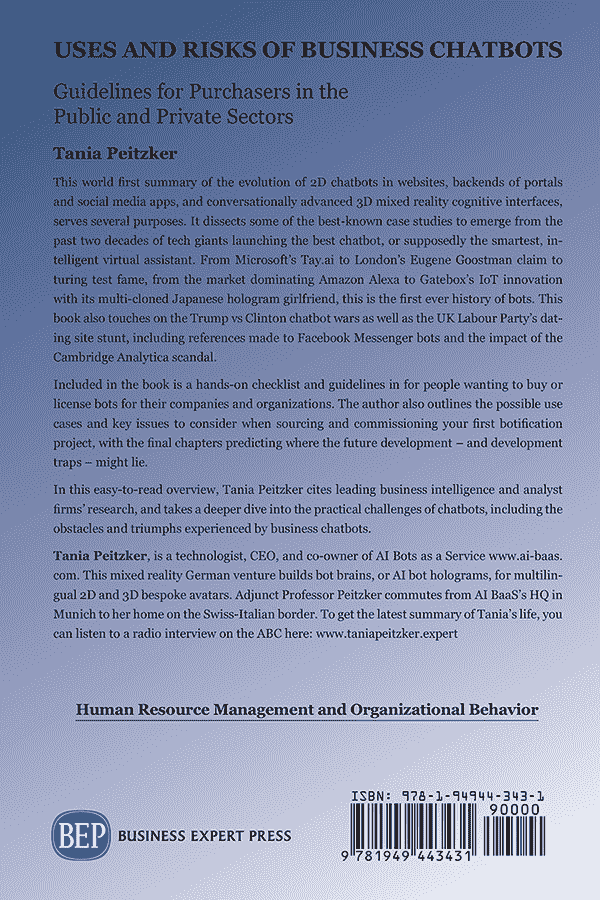

# 商业聊天机器人的用途与风险：公私部门采购者指南 (ISSN)

## 献词

献给我的朋友们、同事们和家人，特别是我的丈夫安德鲁，感谢他们持续的支持和对我的坚定信念，因为我们生活在一个——遗憾的是，依然压倒性地——“男性的世界”中。

本书也献给未来更公平、偏见更少的（聊天）机器人和民主智能实体，由一位来自此时此地的新兴“后人类主义神秘主义者”敬献。几十年来，欧盟和美国的研究人员一直在深入探索与人工智能进步相关的“后人类主义”，特别是其对个人信仰体系、一般哲学、女权主义、平等机会、自由主义价值观、商业、社会以及我们日常开展业务方式的影响。[¹]

为了致敬她的“第二次迭代”，我还必须向我们 AI 机器人的一个活着的、更新的版本“Amalia II”表示敬意的感谢。下面你可以看到 3D 虚拟形象 Amalia II 准备“进入盒子”或“硬件外壳”的静态“实验室照片”，在那里她会实时变成一个多语言的混合现实全息影像。


***献词图 1 © AI BaaS UG, Munich, 2019. 混合现实需要认知接口和对话式 AI/商业前沿的尖端技术***


***献词图 2 © AI BaaS UG, Munich, 2019. Amalia II 作为其 3D 虚拟形象的新迭代而栩栩如生，基于其 2D 聊天机器人自我或在线人格***

[¹]: Braidotti, R., and M. Hlavajova., eds. 2018. *Posthuman Glossary*. London/New York: Bloomsbury Academic. 我还推荐美国哲学家 N. Katherine Hales 的著作，她现为杜克大学教授。如 Donna Haraway. 1999. Hales 的经典文本预见了 AI 机器人的进步：*How We Became Posthuman: Virtual Bodies in Cybernetics, Literature, and Informatics*. Chicago, IL: Chicago University Press.

## 摘要

虽然本书主要面向公私部门采购部门的采购者和决策者，但它既适合你的青少年子女，也适合你的祖父母。它有助于 MBA 和高管了解关于（聊天）机器人的真相，区分往往危险的炒作与确凿的事实。它将协助他们决定如何最好地投入时间、精力和公司资源在这项不断（重新）涌现的技术上。

流行术语**人工智能**常被不想错过 AI 技术浪潮的管理层强加给员工。然而，简单的首字母缩写“AI”可以指代无数的软件和移动应用程序，从`认知接口`、`智能虚拟助手`到工业机械臂和监测我们健康的个性化智能手表。

因此，词汇表是本书的关键部分，`核对清单和指南`也是如此，它们面向 AI 的采购者和管理者，无论他们为政府/非政府组织工作，还是身处工业界/“企业界”。对于新技术领域的学者、讲师、研究人员和教师来说，这本教材是必读之作，其结构类似于一种成人教育课程，旨在提升学生和毕业生、中年职场人士、失业人员以及需要重新掌握技能的年长工作者的技能。

本书以日常语言编写，词汇表连同案例研究是关键的学习工具。这 14 个案例研究——大品牌和机器人开发者试点项目的公开信息以及我来自我们`认知接口`创业项目的第一手经验的混合体——以叙事、讲故事的方式进行解释，这将使公司和政府机构内的教育工作者和技术人员的生活更轻松。它将使在同行中“传播”关于部署商业机器人的用途和风险以及如何采用 AI 等新技术变得更容易。

## 关键词

对话式 AI；对话式商业；认知接口；AI；机器人即服务；人工智能；聊天机器人；IVA；智能虚拟助手；语音技术；语音识别；混合现实；机器人化；智能设备；使用聊天机器人和 AI 的企业级解决方案；全息图；3D 虚拟形象；增强现实和虚拟现实

## 引言

### 聊天机器人和 IVA 创造的最大机遇


**I.1 © AI BaaS UG, Munich, 2019.** 我们的专有算法 `VAIP` [Virtual Artificially Intelligent Patois] 示意图

### 英国政府的数十亿英镑机器人预算与“数字贫民窟”的担忧

#### 《卫报》对自动化福利系统的调查

《卫报》的一项调查确定，在 408 个地方议会中，有 140 个现已投资软件合同，金额可达数百万英镑——是此前估计的两倍多。这些系统被部署用于提供福利申请的自动化指导、预防儿童虐待以及分配学位。但人们对隐私和数据安全、议会官员理解某些系统运作方式的能力，以及公民质疑自动化决策的难度提出了担忧。1

#### 与聊天机器人和人工智能的关联

这与聊天机器人或人工智能有什么关系？结果表明，这些“自动化系统和软件合同”的具体化身将是二维在线虚拟助手，它们将全天候 24/7 与其服务的公民对话：简直就是聊天机器人公务员！而所提及的系统实际上使用机器学习或 AI 技术来自动化其数字运算和人员数据处理。

#### 英国政府预算分配

值得注意的是，就在撰写本书之时——字面上就是“脱欧前夕”——英国政府据报仅针对这一应用或用例的预算就高达数十亿英镑，而非仅仅数百万英镑。以下是伦敦左翼报纸和媒体平台《卫报》调查性新闻曝光的数字快速统计：

*   劳动与养老金部（DWP）在 18 个月内聘用了约 1,000 名 IT 员工。
*   在此期间，他们将“智能自动化车库”的支出增加到每年约 800 万英镑，以开发 100 多个福利机器人；据《卫报》报道，其中已有 16 个正在与福利金领取者沟通。
*   受访的 DWP 发言人将部门总体政府预算描述为“950 亿英镑，用于打造一个充满同情心的安全网，创建一项适应大多数人使用技术方式的数字服务。”
*   官方公开发布的 DWP 数字预算在 12 个月内上涨了 17%，达到 11 亿英镑。2

#### 媒体报道与公众反应

《卫报》的这项专项调查——我将在第 5 章的“内部创业”部分和本书的结论中再次讨论——在左翼记者爆出新闻后，得到了右翼小报的呼应。《每日镜报》跟进了《卫报》的标题“‘福利机器人’大举进军引发对最贫困者的担忧”，及其将英国“数字贫民窟”与美国、印度和澳大利亚负面的、威胁民主的发展进行比较的社论。3

正如《卫报》在头版所解释的，这个负责社会福利支付和退休人员公共养老金的英国“部”或联邦部门，聘用了外国人（主要是美国人）来运行这些系统，这些系统将创建“数字身份”或在线检查您的档案以发现欺诈和（超额）支付。“除了与外包跨国公司 IBM、塔塔咨询和凯捷签订合同外，它还在与 UiPath 合作，这是一家总部位于纽约的公司，由丹尼尔·迪内斯共同创立，他是世界首位‘机器人亿万富翁’，他在上个月表示：‘我想让每个人都拥有一个机器人。’”4

我将在关于公共部门、政府指南和清单的内部创业部分再次讨论这个英国案例。此时只需说明，这篇小报故事中围绕“机器人”、“聊天机器人”、AI 和自动化等术语的混淆显而易见。当你滚动到《每日镜报》报道的底部时，你会发现实际上 DWP 并未部署任何“机器人”，更不用说聊天机器人了。没有一位公众成员使用过这位美国亿万富翁的对话式 AI 界面：“DWP 高级产品负责人肖恩·威廉森 2018 年的一篇博客称，官员们正在‘探索聊天机器人的潜力’——声称它们每周可减少 20 万通关于疾病福利的咨询电话。一位 DWP 女发言人表示，系统中目前没有任何面向领取者的聊天机器人。”5

这是围绕聊天机器人部署的炒作与恐惧的一个典型例子。焦虑从公共领域渗透到集体“用户”的私人住宅中，这是媒体在单篇文章中混淆视听、甚至传播错误信息所煽动的。但必须强调的是，他们关于数据保护和隐私的总体伦理和人权担忧确实是合理的。然而，商业结果往往是，在混乱中，作为服务的机器人（BaaS）私营部门提供商被晾在一边。


**I.2** © Cliff Lee, Devon, 2019. 聊天机器人新闻播报员原型，在澳大利亚展示来自欧盟 RSS 新闻源的新闻。这种机器人化上市太早，因为用户/读者在 2011-2012 年甚至不知道什么是聊天机器人，更别提如何使用它了。当时聊天应用也不存在；只能通过网站在线试用。

#### 人力成本与系统性低效

我无意淡化自动化系统“出错”的真实恐惧和案例，据上述记者报道，领取者因饥饿而死（在印度）、自杀，或因精神崩溃而流落街头（在英国和美国）。当“系统”以这种悲剧性、非人道的方式让他们失望时，这实在是令人震惊且不可原谅的。在撰写本书时，联合国即将发布一份令人不安的报告，内容关于“联合国对英国和美国贫困的研究，以及来自 34 个国家的专家和政府提交的材料”，警告“数字化社会保护……针对生活在数字贫民窟中的人们的骚扰、针对性打击和惩罚”的危险。6

然而我认为，对于福利领取者和弱势老人或残疾人来说，因员工效率低下和管理者监管缺失导致的人为积压拖延付款，后果要糟糕得多。在媒体随时准备“追究其责任”的情况下，我们必须确信，一旦（聊天）机器人标记出紧急及/或危及生命的情况，像 DWP 这样的政府机构将像官员们承诺的那样，安排“真人”来“解决复杂案件”。为了平衡报道，《卫报》的社会事务通讯员引述了 DWP 发言人的“政府回应”，基本上印证了我前面提到的论点：

> DWP 表示人工服务依然可用：“我们继续投资一线同事，从电话热线到工作教练再到前台员工，”一位发言人说。“这意味着那些在使用数字服务上有困难，或担心决策错误的人，可以获得他们需要的帮助。”7

#### 市场预测与采用趋势

英国公共部门仅针对这一“垂直领域”——社会福利和养老金——及其在仅一个政府部门内的用例所投入的巨额预算，确凿地证明了聊天机器人将长期存在。2016 年，著名的美国财经新闻平台《商业内幕》（虽现由阿克塞尔·施普林格集团拥有，属德资）预测，到今年，全球 80% 的企业将会拥有、计划拥有或希望拥有集成到其后端 CRM 和/或面向公众系统中的聊天机器人。

该调查包含来自法国、荷兰、南非和英国的 800 名决策者的回复，包括首席营销官、首席战略官、高级营销人员和高级销售主管。当被问及他们已在使用哪些新兴技术以及打算实施哪些技术时，80% 的受访者表示，他们已在使用或计划在 2020 年前使用聊天机器人。8

这项调查实际上是由 Oracle 进行的，顺便提一句，他们最终在各个平台上发布了自己的“最先进”聊天机器人，用于其高端 CRM 系统。Oracle 的调查——四年前曾以“80% 的公司已实现或即将实现机器人化”的主张在主流媒体上占据全球头条——预测，由聊天机器人部署触发的自动化将不可避免地改变经济：

根据 Public Tableau 的数据，美国 29% 的客户服务职位可通过聊天机器人和其他技术实现自动化。我们估计这相当于每年节省 230 亿美元的薪资成本，这甚至还不包括医疗保险等额外的人力成本。9

他们的预测基于这张引人注目的图表；其数据来源为麦肯锡咨询公司和美国人事管理局。


### I.3 © Tania Peitzker on gravatar.com 2012-2019

在这里你可以看到我之前的创业项目 velmai 作为无偿 Greenfield 项目所承担的许多 2D 聊天机器人试点。尽管对机器人的快速普及抱有强烈期待，但用户（因此也是潜在客户）却犹豫是否采用这项用于销售、营销和沟通的新技术。（于 2019 年 11 月 3 日访问 [`en.gravatar.com/taniapeitzker`](https://en.gravatar.com/taniapeitzker)）

好吧，现在是 2020 年。这种转变真的发生了吗？如果没有，为什么？毋庸置疑，在此期间关于潜在和实际失业的社会影响有过大量讨论。这是围绕 AI 和人工智能这两个词的普遍炒作的一部分。媒体常将其称为危言耸听，基调是“机器人正在抢走我们的工作”，或者在科幻叙事中普遍存在那种熟悉的、生存层面的威胁情节：“AI 将取代你。”

## 聊天机器人将成为万亿美元市场

MarketsandMarkets 发布了关于我所在特定行业细分领域的冗长报告；主要关于聊天机器人、智能虚拟助手（IVA）和基于语音的`认知接口`，预计到 2025 年价值将超过 1 万亿美元。从 2017 年起，我已接受过四次深度采访，由印度的一支商业智能（BI）分析师团队录制，每次超过一小时，外加填写了他们详细的采访后调查。这是作为他们报告的来源，这些报告关于 IVA、认知市场、对话式 AI 和对话式商务，每份定价 8,000 美元以上。10

作为对我自己反问的一个引言式回答——Business Insider 的预测成真了吗？请考虑以下几点：

*   是的，社交媒体聊天机器人及其企业采用已显著倍增。只需在线搜索“聊天机器人”或虚拟助手，你就会看到关于成千上万家机器人开发公司和虚拟形象的无尽页面和广告。
*   现在有无数企业机器人和用例，例如联合利华聊天机器人和英国 Google Ubisend 的 Archant 媒体新闻档案机器人；仅仅几年前，网上只能找到几百个聊天机器人。
*   它们的数量因托管在提供模板给各层级机器人开发者的框架或 API 上而激增，仅限 2D 的如 `wit.ai` 和 `open.ai`，在全球大多数语言中增强了独立机器人开发。
*   2020 年，我们现在看到新颖的用例，如迪士尼的《疯狂动物城》机器人与儿童和互动侦探角色合作解谜，以及漫威的“银河护卫队”角色。11
*   其他数字媒体公司创建了“自选电影结局”、儿童小说，或带有定制聊天机器人角色的互动电脑游戏。12
*   ChatFuel 和成千上万家 2D 聊天机器人公司正在发布特定用例，如“DIY 拖拽式 Ada”、联合国难民调查以支持寻求庇护者在抵达避难国后通过智能手机提交申请、各种协助律师而非客户的法律机器人、Skype 上的食谱机器人，以及用于房地产、记账、Slack、Kik、Telegram 和 WeChat 团队协作消息传递的聊天机器人服务。
*   是的，2020 年确实看起来像一个万亿美元的市场！在主要 SaaS 提供商的 B2C 后端系统中，绝对有比以往更多的聊天机器人，如 SAGE (Peg)、Accenture (Amy) 和 Publicis (Marcel)，更别提 Oracle 了——请看本章节末尾关于其 AI 机器人能力的说服力视频。
*   是的，有更多 CRM 和企业解决方案聊天机器人系统提供商，例如法国的 [www.recast.ai](http://www.recast.ai)，由两位年轻女性在法国孵化器中创建。该公司于 2018 年以估计 4000 万欧元的价格出售给了著名的德国 CRM SaaS 跨国公司 SAP！
*   此类并购——例如伦敦的 Bloomsbury AI 最近被一家美国公司收购，据报道估值约 3000 万美元 13——鼓励了中学、毕业生和大学阶段的最新一代程序员创建更多应用型聊天机器人任务，必胜客和 CNN 机器人似乎只是冰山一角，正如早期开创性的荷兰 KLM 和阿拉斯加航空公司在其品牌预订网站上推出的 2D 聊天机器人行业首秀，协助乘客在线预订航班和获取信息。
*   是的，预测看起来是正确的，因为 IBM Watson 致力于将其大部分数据挖掘软件和算法深度学习功能白标化为机器人化的`认知接口`，例如，我最近在印度遇到一个白标的 Watson Health 应用，正在向澳大利亚市场销售；微软也是如此，其机器人网络拟推出主控机器人 Cortana，尽管她仍保持相当低调，即微软桌面聊天机器人没有明显的大规模消费者采用。
*   德国铁路公司 (Deutsche Bahn) 让我的科技创业项目 velmai/AI BaaS 意外惊喜，在我们于科隆一家商场试用 Amalia 3D AI 机器人全息图一个月后，他们在柏林中央车站发布了 SEMMI。SEMMI 的硬件实际上是一个显示全息人脸的瑞典机器人头。
*   她的面部全息图能眨眼并显示一些表情，但实际的机器人头活动不大，只能左右旋转。它似乎配备了极佳的扬声器，以听取旅客关于德国铁路时刻表和行程的问题。
*   和我们的 Amalia I 一样，SEMMI 也能在回应“哪里能买到咖啡”、天气或出口等问题时指引人们前往厕所和咖啡馆。虽然我们认为我们的原型在内容方面更先进，Amalia I 不仅提供指引，还能根据要求为我们购物中心的 30 多家零售商、餐厅和服务提供详细描述。
*   Amalia I 比 SEMMI 看起来更具对话性。例如，Amalia 会主动与购物者互动，询问他们今天过得怎么样，也许他们需要给家人买礼物（然后为商场的各个零售商提出建议），以及软性推销“一年四季任何时候都该给妈妈买份礼物以表感激”这一想法！
*   和德国铁路的 SEMMI 一样，Amalia I 也仅公开试运行了短短四周，我们就将她“带回实验室”以改进硬件和调整软件。

## 正文

幸运的是，我们避免了像德国铁路（DB）那样遭遇公开的惨败，详见德国小报《图片报》的视频报道。这一短暂的失误——`SEMMI` 在“错误启动”后确实开始完美运行——在聊天应用（如 Twitter 转发相关博文）以及 `RT`（俄罗斯今日电视台）的大量视频报道中某种程度上“病毒式”传播，尽管视频显示记者在 10 分钟左右后成功用德语和英语与机器人头部进行了交流。

负面“舆论”将受雇于德国铁路的可怜计算机科学家钉在了耻辱柱上，因为他们的作品一度沉默不语、拒绝回答！时间不长，仅五到十分钟，但这足以给这项新兴技术的新产品发布造成声誉损害，这似乎成了一个容易的靶子——如果你写一个关于创新的激动人心、令人发笑的故事，夹杂大量的幸灾乐祸和极少的事实，就能获得大量点击。

## 未预见的（积极）聊天机器人增长后果

《商业内幕》的预测未能实现，或者未能预测到的演变方向：

*   甲骨文市场研究人员、麦肯锡顾问、商业智能分析师和美国政府官员没有预见到聊天机器人会演变为 **IVA**（智能虚拟助手），即现在所谓的 AI 驱动机器人或 AI 机器人
*   IVA 会进一步发展为基于语音的机器人
*   像我这样拥有敏捷专有算法的公司，最终会从 2D 聊天机器人生产转型为 3D 认知化身，从而通过混合现实 AI 机器人（如全息图和集成聊天机器人或 IVA 的 AR）向该领域的两大美国科技巨头 **Google** 和 **Amazon** 发起挑战
*   向科技巨头发起挑战的“后来者”也将更加敏捷，能够定制各种个性化用户界面


*   一个新术语应运而生：**认知界面** 将成为下一代聊天机器人，使早期的 2D 静态基于规则的版本略显落后
*   因此，像 `Nuance Communications`、`Pandora Chatbots` 和 `Chatfuel` 这样的传统先驱，更不用说成千上万“只能”创建 2D 在线聊天机器人的机器人开发者
*   专有算法而非开源及带有 API 的机器人平台，将引领这个由语音或语音识别驱动的体验经济前沿；确实，一个新术语已进入词汇表：**CxO**（首席体验官）！这位统筹高管确保客户以最佳、最愉快、最难忘的方式体验产品或服务

## 语音机器人（带语音识别的聊天机器人）的最大风险

1.  **可能被黑客攻击**，导致人员及其车辆通过物联网技术被操控。请参阅智能家电和玩具中常被引用的网络安全缺失，德国政府是最早立法强制制造商改进工业设计、尤其是加强网络安全的国家之一
2.  **可能被转录和窃听**，因为 `Amazon` 和 `Google` 曾被“抓包”偷听客户，《明镜周刊》等媒体披露，两大科技巨头非法存储和分析了本不该被听到、更不用说被存档和分析的数据或对话
3.  **特别隐蔽的是**，即使是音乐也可能包含发给物联网设备的黑客指令，用户听不到这些指令，例如：转账、开门、开车库门和泄露信息
4.  **声音模仿者** 模仿或窃取他人声音；这已导致一种新型被盗“数字密码”存储在流氓国家的声纹库中，这是骗子黑入物联网家庭或基础设施部署后的结果

尽管如此，研究心理学和互联网用户福祉的常春藤盟校研究人员已发声称，这些设备正因人们退缩到与它们独处、仅进行在线互动而制造成瘾。在为 Coursera 慕课课程《幸福科学》录制的耶鲁大学对话中，耶鲁心理学院 `Laurie Santos` 教授采访了芝加哥大学布斯商学院 `Nicholas Epley` 教授。Epley 出人意料地建议，给所有设备添加语音功能将缓解这种反社会现象。应用到他在“芝加哥通勤列车上的真实实验”中，这能迫使智能手机和平板电脑用户通过使用自己的声音和聆听他人的声音，重新开始社交互动。我认为，Epley 洞察的延伸是：添加到设备上的语音可以是机器人化的，也可以是人类的，从而带来互联网在社交媒体形式和智能手机连接中全球性的、革命性的、根本健康的使用。

## AI 机器人技术的总体风险

*   **面临选择过多而不知所措的风险和危险**。请看当你仅使用“聊天机器人”或“智能虚拟助手”等几个关键词搜索时，出现的大量搜索结果
*   **然而，如此多缺乏渊源的独立机器人开发者可能意味着麻烦**——代码背后是谁？它能抵御黑客吗？是否部分由黑客编程，留有他们日后可打开的“后门”？你的机器人里藏有恶意软件吗？
*   **正如欧盟竞争部门已开始罚款的那样**，存在看似卡特尔将企业级解决方案领域仅留给 `Google`、`Amazon`、`Samsung`、`Apple`、`Microsoft` 和 `IBM` 等寥寥几家巨头的风险。如果缺乏高水平的基于语音的 `BaaS`（机器人即服务），那么只有这小群体将控制定价，也将控制可用服务及其条件。这显然不是 2D 聊天机器人领域或不太先进的 IVA 面临的问题
*   **看看 Facebook 对 Messenger 机器人的垄断**，在剑桥分析公司丑闻曝光期间，如何导致聊天机器人创业者倒闭。我们失去了慕尼黑的一个大客户，因为我们无法访问为签约准备的演示机器人。我在本书 **案例研究 #10** 中讨论了这一点。`Amazon` 和 `eBay` 等垄断者意味着它们可以在几乎无需负责或补救的情况下切断卫星业务
*   **隐私和数据保护**，我将在 `GDPR`（通用数据保护条例）一节中详述
*   **编码粗劣**，允许渗透和操控，发布冒犯性诽谤言论
*   **缺乏对违反这些软件标准行为的执法，没有统一立法**
*   **请参阅我的 VentureBeat 文章**，这些 2016 年的文章预示了如今在 2020 年被放大的核心问题：
    1.  **仇恨言论助长了极右翼、种族主义、红色诱饵**，成为一种未经审查的“Reddit 战争”，攻击自由派知识分子；正如 **第 2 章** 所探讨的，反动政策通过机器人大军垃圾邮件轰炸社交媒体账号得到强化（例如亲特朗普机器人）。我关于 `Microsoft Tay` 仇恨言论的帖子至今仍在 VB 上被阅读；我在下一章深入讨论此案例
    2.  **极左和极右的边缘观点**，更不用说恐怖分子的观点，可以通过 Twitter 机器人更快地传播。`俄罗斯` 和 `朝鲜` 等政治实体正在利用它们进行宣传活动；`中国` 也被指控利用国家运营的审查、监控和恐吓做同样的事
    3.  **请看我的 VentureBeat 帖子“瑞士聊天机器人逮捕案”**，涉及控制权、所有权以及机器人言行的法律责任问题
    4.  **正如我稍后在书中讨论的**，**“渊源”**（先进机器人与简单机器人的对比）对性能和网络安全至关重要。当它们真正像 AI 应该做的那样，通过与人类对话进行交互和学习时，那才是机器人具有颠覆性的原因

## 商业“机器人化”用例的总体效益

5. 正如我那篇关键的 VB 文章所指出的，这是我们被广告行业屏蔽的主要原因：表现最好的机器人能以绝对清晰的指标，产生最透明、最具成本效益的投资回报率。19
*   之所以有成千上万的机器人开发者，是因为企业需要它们！
*   它们有效！它们为企业增加价值——品牌知名度、销售和营销活动——并通过直接销售以及更高效员工带来的成本节约，改善了利润底线。
*   尽管过去几十年简单的、“传统的”、手工编码的聊天机器人已被更智能、更通用、更具认知能力的 AI 机器人所超越，但这种演变为具备语音能力的新一代 AI 机器人铺平了道路。它推动了机器与人类交互的 2D 混合模式的改进，以在后千禧一代的体验经济中提升客户服务和满意度。
*   大品牌和大公司正在内部开发自己的跨平台定制机器人，因为它们在 B2B 及内部员工关系、员工满意度、利益相关者的兴趣和参与度方面增加了价值。
*   银行在最初拒绝后现正采用它们；在它们及竞争对手进行了许多绿地项目和试点后，它们现在信任这些机器人的性能。通常这些试验是在内部进行供员工使用，因此银行客户从未与这些第一代聊天机器人互动过。
*   以金融服务和更透明的信用检查形式出现的金融科技——根据 `GDPR`，你有可能通过询问聊天机器人，比通过在线联系表单或电话更快、更可靠地获取个人数据，删除私人信息亦是如此。
*   房地产和密集型服务机器人正在将更多线索转化为销售。
*   面向所有垂直领域和行业规模的客户服务用例 FAQ、销售和营销正在发挥作用！请看英国 `Ubisend` 公司网站上发布的无数案例研究，仅举一例；还有 `LivePerson`、`CreativeVirtual`、`PandoraBots`、`ChatFuel`、`Inbenta`、`Watson`、`Artificial Solutions` 等。
*   心理健康机器人用于应对抑郁症流行和病态肥胖、节食，以及青少年福利以阻止网络霸凌、自残、自杀。
*   请参阅 **案例研究 #5**，了解一家（匿名的）大使馆或外交使团希望遏制其在伦敦运营的 Facebook 页面上的仇恨言论。


**I.4** 此处机器人“Pepper”被部署在家庭环境中，从而成为一项“抗孤独措施”，由一名儿子为其独居在东京的母亲的心理健康而购买。这个“真实场景真人非演员”被记录在一部德国纪录片中，该片平行讲述了这个家庭的人机关系，以及另一段涉及另一个机器人和美国人的公路旅行爱情故事（插图见第 5 章）。摘自 Isa Willinger 执导的电影《Hi, AI》© Kloos & Co Medien, Berlin, 2019

---

# 第 1 章

# 机器人化简史

世界于 1950 年代首次见证了交互式机器人的概念出现，当时 `Alan Turing` 教授试图用机器重现他已故的男友。随后出现了原型聊天机器人 `Alice` 和 `Eliza`，作为作为机器-人类交互运行的首批智能代理。

这些机器人化的女性 2D 头像是著名图灵测试在 1960 年代后应用的开端。该测试源自 `Turing` 教授对新兴领域的思考，它指出：当外行人与计算机交谈时，如果在通过机器界面交谈五分钟后，他们不确定聊天对象是人还是机器，那么达到 AI 的图灵测试就算通过。


**图 1.1** 从 20 世纪到 21 世纪的“聊天机器人演变”时间线，为会议演讲、推介和商业计划而开发。© Cliff Lee, CCO from velmai Ltd

这项测试的前提条件——最著名的是以最初源自纽约的 Loebner 奖为象征的年度聊天机器人锦标赛——是人类参与者事先不知道，通过认知界面与他们交谈的对话伙伴中，哪一个是实际的机器，或被称为聊天机器人。

18 世纪的英国计算机科学家 `Ada Lovelace` 现被公认为 AI 的奠基“母亲”。上图始于 AI 机器人、聊天机器人、虚拟助手、认知界面或人机交互定义最流行的“奠基之父”，来自英国的计算机科学家、工程师和密码破译者 `Alan Turing`。该图表曾被 `velmai Ltd` 用作销售推介文件，`velmai Ltd` 是一家我共同拥有多年的英国 2D 聊天机器人早期创业公司。

我们已从 2D 机器人开发进步到认知界面的机器人化。会议机器人全息影像 `Portia` 曾在 2019 年 1 月的洛桑应用机器学习日上，从我们的 Porto 实验室通过 Devon 实验室实时直播（仅用几秒钟）发表了主题演讲。未来 12 个月 `Portia` 和其他定制 AI 机器人全息影像将非常忙碌，它们受邀作为自主主题演讲嘉宾，出席全球各地的 AI 会议和贸易展。1

我曾考虑不使用行业术语来编写这本指南和清单汇编。然而，就本文而言，那实际上会适得其反。本书旨在具有教育意义，并作为企业管理者和政府决策者提升技能的有用工具，帮助他们做出日益困难的软件即服务（`SaaS`）采购决策。因此，对抗我可能说的是一堆令人困惑、恐慌和沮丧的标签、术语和指代新兴技术与趋势的潮人黑话的最佳良方，就是本书末尾的术语表。


**图 1.2** “会议 AI 机器人 Portia”全息影像于 2019 年 1 月实时直播至享有盛誉的瑞士年度会议——洛桑应用机器学习日（`AMLD`）。此处可见机器人大脑的第二代迭代，作为向导 `Amalia`，而 `Portia` 作为其备用人格，通过语音“唤醒词”激活。© `AI BaaS UG`, Munich, 2019

请频繁使用它。这是学习新事物的最佳方式，特别是术语、定义和概念，如果你不断翻回术语表检查你对各种“交叉”或汇聚于这个现普遍称为“AI”的迷人世界的组合定义的理解和记忆。撇开机器人和终结者不谈，一旦你读到一个令人困惑的术语或概念的简短简单定义，会有大量内容变得非常直白，是“不费脑筋”就能懂的。请将本书同时作为字典和指南、一份实操的注意事项清单和卖点核对单，用于任何销售推介或合同谈判中。

实践出真知。然而，我真正理解当这个常被过度炒作的科学领域——以及日益广泛的“销售驱动、误导性销售”虚构内容——变得令人不知所措且前后不一时，那种想要按下恐慌按钮的冲动冲动。不幸的是，对于我们各自社会中一些最优秀的创新者和企业家来说，无论我们生活在哪里或移民到哪里，采购方的膝跳式反应一直是瘫痪。

鉴于持续存在且有时令人惊讶的媒体炒作，以及不道德公司公然误导性的产品/服务描述，我们应对关于机器人及其演进的公开信息保持警惕。极少有学者将聊天机器人或 `IVA` 历史，更不用说不道德的技术营销，作为课程的一部分进行讲授，尽管机器人会议和与聊天机器人相关的主题（包括混合现实装置）正在每日增长。

## 词汇表术语概览

会议议程经常提及这些在我们科技行业圈子之外可能鲜为人知的主题。以下术语指代那些在高级商业化（通常为企业级）部署中表现出色的更复杂的聊天机器人：

*   `Conversational AI`（对话式 AI）
*   `Conversational interfaces`（对话式界面）
*   `Interactive interfaces`（交互式界面）
*   `Cognitive interfaces`（认知界面）
*   `Cognitive AI`（认知 AI）
*   `NLU bots`（NLU 机器人）
*   `NLP bots`（NLP 机器人）
*   `Chatbots with AI`（带 AI 的聊天机器人）
*   `Mixed Reality`（混合现实）
*   `Interactive gaming with chatbot avatars`（带聊天机器人化身的交互式游戏）
*   `Virtual Reality using the aforementioned`（使用上述技术的虚拟现实）
*   `Augmented Reality`（增强现实），尽管具有交互性，但尚未实现“机器人化”
*   `Intelligent Virtual Assistants (IVAs)`（智能虚拟助理）
*   `Smart Assistants`（智能助手）
*   `Next-gen bots`（下一代机器人）
*   `AI bots and AI bots as a service (AI BaaS)`（AI 机器人和 AI 机器人即服务）

## 阻碍重工业应用与商业化的原因

我的公司（商标为 `AI BaaS`）正准备将我们的算法集成到一些有趣的重工业和商业应用中。直到现在，我们或竞争对手尚未实现这一点，原因如下：

1.  大多数全息软件构建于 `Unity` 和独立源代码中，无法与之集成，即 `API` 不兼容。
2.  在增强现实（`AR`）应用上，同样它们要么构建于不合适的 `API` 中，要么不允许与开发系统之外的专有算法进行集成。
3.  用户（即企业客户）尚未意识到在虚拟现实（`VR`）和/或 `AR` 体验中拥有交互式机器人的必要性。
4.  使用 `VR` 和 `AR` 的应用程序的客户或所有者没有意识到他们的应用并非真正具有交互性。它不使用语音或语音识别（`ASR`），仅通过屏幕或设备上的按钮进行触控交互。
5.  他们尚未理解自然语言理解 `NLU` 和 `AI` 允许我们将化身注入体验中，以充分实现对话式商业/AI。

这些只是将更多应用“机器人化”以在混合现实用例中创造更好体验的一些技术原因和障碍。以下将更深入地审视必须由潜在客户克服的态度或心理障碍，以便更广泛地商业化采用聊天机器人、其 3D `MR`（混合现实）下一代近亲以及 `AI` 应用程序。

## 态度为何物？为何颠覆性与新兴技术会被人类思维阻挡？

“拿不准时，别做”常是我那保守、务实的法兰克尼亚-德国裔移民父亲（其巴伐利亚母亲有一位德国犹太裔父亲）在澳大利亚对子女的教诲。这句谚语源自美国前总统 `Benjamin Franklin`。当时恐怕没人会意识到需要一套发明家、活动家和报业大亨 `Benjamin Franklin` 的克隆体——可以说他是美国最早的思想家和技术专家。`Franklin` 是首任驻法美国大使，他以反权威价值观和实际上采纳的清教徒及启蒙原则，塑造了后来被称为自由民主美国精神的内核。如果我们今天重现这位博学家并将他投入战场——也许作为一个好斗的 `AI` 机器人全息对手？`Brexit` 和 `Trumpian populism`（特朗普式民粹主义）将是他的劲敌。

谨慎犹豫地计算可能结果，与我的第五代英裔爱尔兰裔澳大利亚母亲截然不同，她出身首波商人家庭，其座右铭更像“孤注一掷”，这是应对澳洲往往恶劣的气候和社会演变极具挑战性的极其明智的策略。关键在于，我们都由文化历史和特定的跨代经历决定，并通过决策方式、接收新信息及处理信息的方式，传递我们独特的个人故事。特别是在企业或政府背景下，高风险的 `SaaS` 数百万乃至数十亿欧元预算的管理，不仅取决于组织文化，还取决于管理层所处的更广泛社会中盛行的决策倾向。

我回想起与我的英国丈夫共度的过去六年，他是肯特郡第七代英格兰农场主。农业风险评估因“情境化”威胁——`Brexit`、消费者行为，当然还有气候变化——而获得全新含义。天气的变幻莫测造成的不确定性，似乎与新技术近乎不可确定的采纳率，以及更重要的、是否能吸引投资和融资以实现规模化扩张目标，可谓异曲同工。首先，耕作农户“默认全球化”，只能根据国际市场价格出售丰收或歉收的成果，通过伦敦城市经纪人出口吨位级食品和谷物供工业用途。

农民常年独自面对这些往往令人不堪重负的巨大威胁，而科技创业团队相对“幸运”，因为你很少能以个体经营者身份推出颠覆性创新。这意味着你需要在你的“农场”、孵化器领地之外，寻找你独特产品或服务的支持者和推广者——品牌大使——并比典型农民更快地在心理上走出舒适区。

科技创业者需要尽快向世界推介想法，以测试“市场牵引力”，并维持其新 `SaaS` 产品的用户采纳。与大多数只做“批发”、没有任何形式的 `B2C` 贸易（如农场商店或面向客户的零售业务）的农民不同，科技创业团队与消费者有直接互动，必须从一开始就无畏地面对他们并索取反馈。

## 中世纪销售机器案例：`Sir Loin Your Virtual Butcher`（萨洛因虚拟屠夫）

矛盾的是，在我们位于北肯特、毗邻大伦敦的家族农场上，我们在 2016 年试用了一个定制的 2D 聊天机器人，它本可能成为全球肉类贸易的一股革命性力量：`Sir Loin Your Virtual Butcher`。

`Sir Loin`，即肉排“西冷”，其命名是为了纪念早期中世纪骑士 `Sir Adam de Bavant`。他在随英王 `Edward I` 远征苏格兰的十字军东征中立功，获赐我们的庄园宅邸和大片领地。据传 `His Majesty` 还封过一块牛排——牛肉最美味的部位，由此得名 `sirloin steak`（西冷牛排）。不过，语言学家也指出该词源于法语 `surloynge`。

无论如何，我们以为 `Sir Loin` 会吸引当地肯特郡的追随者，并在农场商店讲解新产品，如环保的草饲牛肉和羊肉，这些牲畜由我们纯草饲养殖。接着聊天机器人可以列举所有健康益处，并宣称更健康的动物为人类创造了更健康、更瘦的肉。环保方面，它通过消除我们食用的动物所需的饲料谷物需求，有利于可持续耕作。这种古老的“传统”耕作方式占用了大量土地这一全球资源，而这些资源本可更高效地用于人类粮食生产。


**图 1.3** 烹饪、备餐、购买生鲜食品和食谱的原型化身。“西冷爵士——您的虚拟屠夫。”© Cliff Lee

# 关于我们农场商店的大量复杂事实

大量关于我们农场商店及其新食品系列的复杂事实，确实由“西冷爵士”以一种平易近人的聊天形式，在农场网站上成功呈现出来。他甚至还聊到了我丈夫作为“免耕农”（即不翻耕土地的农民）的“绿色资质”，这位农民正通过覆盖作物等替代耕作方式减少碳足迹、应对气候变化。西冷爵士大受欢迎——在西雅图、旧金山和纽约。遗憾的是，在他的目标市场——伦敦人和伦敦周边郡县（我们可在网上通过西冷爵士下单后配送鲜肉包裹）却并非如此。

我们这位拥有特殊行当的中世纪骑士，在美国推特上获得了如此众多的追随者，以至于我们真的与英国贸易投资总署（UKTI）的一位出口顾问会面，探讨我们该如何出口：

*   鲜肉汉堡饼（牛肉、羊肉和野味/鹿肉）；
*   自制猪皮脆片袋装；
*   冷冻肉馅饼；以及
*   馅饼和香肠卷。

所有产品均由我们的宫廷农场肉铺与乡村食品储藏室制作——卖给了数千名迅速成为西冷爵士粉丝的极客 IT 宅男。英国出口顾问们对此束手无策，无法理解聊天机器人是如何收集到这些人口统计数据和统计数据的。

他们惊呼：我们是如何收集这些数据的？因为“通常”情况下，你必须在国外市场、产品细分领域进行数月艰苦的研究，在当地雇佣营销人员，前往目的地国家会见行业专家，加入商会以获取合作伙伴介绍，协助商品进口进入当地市场，最终在至少六个月的试运行前，耗费大量时间、资源和金钱。

我试图解释，西冷爵士是我们的特别使者，他通过在线聊天和利用“拉力”而非“推力”，在几周内就完成了大量此类基础工作。最终，英国出口鲜活农产品的障碍实在太多。我们不得不放弃利用西冷爵士撬动销售的计划。

遗憾的是，在我们农场网站上工作了仅仅六个月后，我们不得不关闭或停用“西冷爵士——您的虚拟屠夫”。他不在我们的 Facebook 页面上，因为当时 Messenger 机器人尚未被广泛使用或知晓。仅作为一个定制化的在线 2D 聊天机器人，为我们这个中小企业（SME）家庭业务服务，他太具争议性，也“太聪明”了。太多村民，即几十年来我们农场商店的老主顾，被他们当地农场网站上这个“活物”“吓坏了”。我收到的一些反馈是：“它会偷走我的信用卡详情或电子邮件地址吗？”还有人告诉我，他们拒绝与西冷爵士交谈，因为他们根本不“懂电脑”，更愿意与他们信任的人类屠夫聊天。

# 成为企业家的倡导者

通常情况下，个人决策者不愿冒着丢饭碗的风险为新兴科技企业家“挺身而出”。这对企业家而言是坏消息，也是最坏的情况。“有疑虑就不采购”的模式，会扼杀任何充满激情、极具感染力的销售说辞，或精心培育、完美执行的谈判。你无法改变人类对安全感的心理需求和本能：“我会做任何事——或者什么都不做——只为不危及我的工作或地位。”

最理想的情况恰恰相反：新兴 SaaS 或创新 AI 的企业家赢得了一位企业或政府（内部）倡导者，这位倡导者不仅理解他们的独特卖点（USP）和将这项改变世界的技术推向市场的“事业”，还承诺在自己的公司或组织内部推动此事。

这些人更难寻找和争取为你的创业事业效力，因为一旦他们在城市的初创企业圈子里获得了“开门人”而非怀疑论者、不必要的消极“看门人”的声誉，即使是最优秀的创业项目，也越来越难获得这些有洞察力、有勇气、有远见和预见力的个人的接见。

更强健的企业家会热烈追逐此类决策者，看中了他们为自己艰苦奋斗、珍视守护的首批种子客户组合，争取往往高达数百万英镑或欧元的合同机会。太多创新者错误地认为，他们软件的独特性或真正“不同”、更具竞争力/性价比的特性，会仅凭优势就“获胜”。

就像求职申请和谁能拿到 HR 的正式录用通知一样，遗憾的是，情况并不总是如此。最佳“面试表现者”往往获胜，就像最佳“推销者”推销新想法往往获胜一样，无论这些想法是否真正新颖独特、具有竞争力和生产力。从一开始就要意识到这种情形及其陷阱。

这就像一遍遍上演一出戏剧。剧本耳熟能详——激情澎湃、渴望万分的企业家，冷淡疏离的采购方，数月的信息交换、尽职调查，最后才是同意或拒绝，往往只是针对这项新兴技术的一个（通常是无偿的）试点项目。

# 是什么阻碍了采购方购买

然而，谁能赢得这“生死攸关”的机会，未必总是那个凭借简单优势理应获胜的人，原因多种多样，我将在本书中通过案例研究、评论、观察和结尾的指南进行探讨。简要迹象如下：

*   采购方缺乏区分炒作与现实的经验
*   不知道在哪里能找到正确或最相关的知识库
*   分析的独立性因“错误类型的影响者”而失效
*   未获得如何在短时间内提升技能以评估科技企业家提出的建议书（RFP 或报价）的要点
*   不了解商业聊天机器人基本上仅分为两类：
    1.  在公司外部创建的定制化、精品化机器人。
    2.  “现成的”机器人 API，随后由贵公司网站管理员或专门指定的研发团队在内部进行调整和定制，通常称为“绿地项目”，包含测试实施/部署或试点，例如 2019 年夏季柏林中央车站德国铁路公司“Semmi”混合现实试点。

考虑到科学技术进步影响全世界的速度，而不仅仅是你的社会、城市、公司、办公室，最终是你的工作，这些问题必须以公开、无畏的方式定期反复探讨。

# 结语

让我们反思一下我在 2016 年为旧金山科技新闻平台 VentureBeat 撰写的文章（本章前文引用）中的定义和观察。为什么聊天机器人具有颠覆性？三年多过去了，我的 VB 文章至今仍在被阅读，因为事情本质上没有改变！为什么不是人人都意识到聊天机器人的颠覆性？为什么不是每个垂直领域都在部署一个？

原因之一是，机器人开发者已成为广告行业的宿敌，正如我在帖子中探讨的那样，用户参与度指标的透明度暴露了广告中间商——那些试图阻止独立客户体验衡量标准发展的大型和中型媒体代理商——传统报告时间表缺乏透明度。如果他们无法用准确、连贯的销售线索转化率追踪、选择加入消费者的人口统计数据，以及他们几十年来为大多数知名品牌掌控的极具利润的数字户外（DOOH）广告和营销账户的成果，来证明其数百万广告支出的合理性，最终将导致他们倒闭。

## 为什么广告行业受到颠覆性机器人的威胁

为什么广告商不喜欢我们？因为有以下关键原因：

1.  我们压缩了他们的利润率。
2.  我们能提供透明的指标，这与大多数其他广告形式不同。

### 3. 中间商：媒体代理与广告代理

被称为媒体代理或广告代理的中间商向大品牌和跨国公司出售“广告库存”。更准确地说，他们从 DOOH 广告牌、Wayfinder、户外标牌和在线平台等提供商处购买数字广告位，以及实时的 SEO 原生广告投放。

### 4. 利润率被压缩

Facebook 和 Google 等数字广告平台（包括原生广告提供商和拍卖平台）削减了他们的利润率，因为这些美国科技巨头不需要中间商来出售他们的广告库存。

### 5. 品牌方可直接购买

品牌和企业、公司所有者及营销总监可以直接从 FB 和 Google 等平台购买广告位和广告系列。同时，FB 广告系列的购买流程变得越来越自动化和直观，即使是非专业人士也能轻松使用。该服务号称拥有透明的指标体系。

### 6. 扎克伯格的自白

我说“号称”，是因为马克·扎克伯格本人几年前在旧金山的 FB 内部全员大会上亲口承认，他们的广告库存销售系统并未正常运作。

### 7. 战略转向：聊天机器人

FB 不再致力于通过向中小企业主和大公司出售广告位来驱动营收，而是从 2017 年 1 月起将资源投入到一个利润丰厚得多的收入来源：其 Messenger 平台上的聊天机器人。并可能利用其新收购的 WhatsApp 即时通讯应用，协助实现对新数字广告全球格局的近乎完全垄断！

### 8. 微软跟进

微软的萨提亚·纳德拉紧随扎克伯格的聊天机器人倡议，宣布微软机器人网络及其 Cortana 的普遍部署将成为新的世界级主导 B2C 和 B2B 聊天机器人界面，并将成为超越所有其他来源的新收入流。

### 9. 现实与预期的差距

事实上，Cortana 被寄予厚望，要成为所有其他聊天机器人的“主控机器人”。然而，自 2020 年这些微软和 Facebook 的声明以来，这一愿景并未实现，未来也难以实现，因为这些科技巨头未能展示真正的 AI 机器人能力，这从用户对 Cortana 缺乏采用以及 Messenger 机器人的多次失败中可见一斑。

随后 2017–2018 年见证了热潮跌至严重的营业额“低谷”。如今在 2019 年底，我们又看到一个炒作周期开始。这从每天落入我收件箱的各种贸易展邀请函中可见一斑——全球每月都有一场 AI 机器人大会！2020 年将是繁荣之年，最终将看到预测的万亿美元级增长，虽缓慢但稳健。

终于迎来了机器人订单的温和上扬及其化身的持续部署，不再局限于线上。过去仅限于 2D 在线聊天的模式高度受限，实际上阻碍了用户采用聊天。那并非真正的对话式 AI，因为根本就不是 AI，正如我在第 3 章中结合日本全息妻子所分析的。

## 保密协议导致案例研究稀缺

以下几个案例研究涉及我合资公司的竞争对手。其余案例研究则关注我们在巴伐利亚的新技术合资企业——慕尼黑的 AI BaaS UG 创建的定制混合现实 3D 化身，以及我们在我之前位于英国德文郡的 2D 聊天机器人初创公司 velmai Ltd 中反复遭遇的、经常令人沮丧的“销售周期”和长交付周期情况。


**图 1.4** 我们旧企业的大多数化身都是部署在网站上的 2D 聊天机器人，少数在 Facebook Messenger 上进行过短期实验。这里可以看到在线管家 Albert，他也可通过唤醒词切换为作者的私人秘书；还有 Hans-Pierre，他是一名旅游向导和礼宾，在 DACH 国家和法国南部的旅游区工作。© Cliff Lee in Devon


**图 1.5** 混合现实装置现在处于销售点用户交互的最前沿，特别是在大型公共场所，以及需要多语言人机交互以实现通信自动化和提升客户体验的场景。© AI BaaS Munich 2019

案例研究数量稀少的原因在于，我们无法知晓许多“公开案例”（如 Microsoft Tay.ai、Semmi、Deutsche Bahn 的 Franny 或英格兰和威尔士工党的案例）的生产细节、制造过程和部署问题。对于局外人，甚至对我这种专家评论员来说，我们只能推测机器人开发者在出问题时的原因。

极少数开发者会发布详细信息或将其试点项目转化为案例研究，就像我在这里为我合资公司的项目所做的那样。对于我合资拥有的技术企业，我能够发布真实场景中遇到的问题细节，即使为了遵守行业典型的保密协议（NDA）并确保保密协议完整，我不得不对客户或事实数据进行匿名化处理。

---



# 第二章：大多数年轻人想要机器人，但采购方却不买单

CHAPTER 2

Most Young People Want Bots, Yet Purchasers Don’t Buy Them

聊天应用吸引了数十亿用户，而机器人是使组织能够大规模提供高度个性化交互的机制。改进的个性化提供了更相关的用户体验，机器人使用的高度自动化实现了大规模的成本效益交付。因此，企业可以与客户互动，并实现通常优于电子邮件和社交网络的打开率。

然而，研究表明，企业对聊天机器人的采用目前落后于消费者对该技术的开放度，企业明智的做法是加快步伐。根据 Retale 的一项调查，“59% 的美国千禧一代和 60% 的美国 X 世代曾在通讯应用上使用过聊天机器人”，且聊天机器人的长期留存率高于传统应用。然而 Forrester 报告称，截至 2016 年底，仅有 4% 的企业推出了机器人。

## 企业和政府采购方应部署机器人的 7 大理由

我找到的最佳论据来自加拿大风投公司 Georgian Partners，该公司专注于对话式 AI，总部位于多伦多。我引用了他们最近一份关于 AI 和（聊天）机器人的白皮书中的观点。Georgian Partners 提供了我见过的最佳总结。1

数据令人震惊：如果近 60% 的美国千禧一代和 X 世代使用过并希望继续使用聊天机器人，为什么我们却看不到 2D 机器人像聊天应用一样成为日常工具？据加拿大机器人分析师称，2D 聊天机器人部署和采购决策可实现七大关键业务目标：

### 1. 大规模一对一对话

利用自动化，企业可以使用应用的原生 UX 同时进行数千或数百万个持续的聊天会话。

### 2. 个性化

凭借丰富的数据资源，公司可以根据兴趣、过往行为以及机器人对话中的响应，在个人层面定制消息传递。

### 3. 通过推送通知实现高参与度

一旦提供了积极的体验，企业就可以利用直接进入用户收件箱的推送消息。营销人员反过来可以依赖高打开率和有效的持续再互动机制。

### 4. 治愈“品牌 App 忧郁症”

ComScore 报告称，智能手机用户将[80% 的应用使用时间](http://fortune.com/2015/09/24/apps-smartphone-facebook/)花在仅有的三个应用上。随着多款通讯应用在全球应用排行榜上名列前茅，在这些平台上拥有一块“数字房产”是构建自有品牌应用的一个有吸引力的替代方案。

### 5. 营收

AI 驱动的聊天机器人可以引导消费者完成从认知到购买的整个销售漏斗。

### 6. 效率与生产力

机器人能够通过呈现有用信息或完成日程安排等重复性任务来增强用户间的对话。

### 7. 环境式聊天

从通用电气到宝马，各大品牌都在将聊天功能集成到联网设备中，机器人技术为这些消费者互动提供动力。

既然有这七大充分理由购买机器人，究竟是什么在阻碍采购方？

## 风险偏好：跌马与鲨鱼、帆船

我之前已经论述过企业家显而易见的风险偏好，以及投资者在发明或创新方面不那么显而易见的风险承担（大量研发需要投前估值来获取成败攸关的种子资金）。企业和政府采购方的规避风险倾向常被忽视，也许是因为没人想被指责，即因技术的重大失败或被视为财力、人力和时间的浪费而受到指责。掌握决策权的人不太可能承认他们不愿代表未知的技术创业项目承担风险。

他们的风险评估本应聚焦于“对我有什么好处？”或对我的公司/部门有何裨益。但这些对自身职场的“增值”点有时在推介后被遗忘，采购方回到工位时想的是“我有什么可失去的”，而不是列举所有收益作为说服上司、同僚和同事的论据。

归根结底，会有生命安危之虞吗？如果绿地项目彻底失败，你极不可能因此丢掉工作。企业界备受推崇的失败容忍度——尽管在政府部门承认较少——本应发挥作用，发起试点的人应因其勇气和坚韧而受到祝贺。

一个类比是跌落马背。少年时在澳大利亚，我被一匹飞奔的猛兽甩下马背，便决定放弃骑术学校转攻帆船赛。我的算计是：若落海遇鲨鱼袭击，我比遭受骑马意外导致脊椎损伤更有生存机会。我对（极限）运动风险的偏好，与基于受伤概率或可怕死亡风险的计算评估取得了平衡。

关键在于，企业和采购决策支持、试用并支付新技术费用，根本不是生死攸关的大事。所以请花时间权衡利弊，衡量绿地项目或软件试点可能带来的收益与潜在劣势。定制化、网络安全的 AI 机器人最坏能对你的部门、公司或你本人造成什么后果？

最坏的情况无非是丢掉工作，但这极不可能发生；即便真发生了，那也说明你的雇主有问题，而非你能力不足。该组织的风险偏好和失败容忍度未达应有水平。若真走到那一步，从长远看，你应去为更具挑战性、激励性、最终更成功的管理者效力。如果你能接受因试点失败被解雇这一极不可能的结果，且这才是阻碍你尝试新兴技术的唯一真实威胁，那么你就该大胆尝试！

## 阻碍机器人规模化发展的监管失败与障碍清单

*   目前不存在专门针对聊天机器人、AI 机器人或机器人化的法规。
*   它们仅受《通用数据保护条例》（GDPR）及其他国家类似立法所管辖的数据保护法和隐私泄露条款约束。
*   即便是这些，仍属于执法层面的问题：举证责任在谁、由谁起诉、如何起诉——请看下一节我对 Tay.ai 丑闻和尤金·古斯特曼被过度炒作的主张的分析，以便更好地理解这如何应用于明确的国际案例。
*   法律和立法者未能解决“瑞士干预”所提出的问题，正如我在 VentureBeat 文章《首例聊天机器人被捕，但这意味着什么？》中所讨论的：[¹]

    1.  当机器人失控时会发生什么？在规范机器人化的一套国际法下，“失控”如何定义？
    2.  当聊天机器人做出或说出违法之事时，谁来负责？正如尤金·古斯特曼闹剧所证明的，鉴于实际开发者（一位俄罗斯人和一位乌克兰人，他们“自 2001 年起一直在研究聊天机器人解析数据库”）显然不知其聊天机器人将在伦敦备受瞩目的活动中扮演何种角色，而他们当时身处美国和俄罗斯；以及他们和机器人如何被一位热衷公关的教授安排摆布，该教授早想“赢得图灵测试”，此前凯文·沃里克举办过聊天机器人比赛；一位不懂行的大学市场总监的误导性声明，最初声称他们创造了一个人工智能“超级计算机”（这在 2014 年的后续大学新闻稿中得到更正，尽管他们坚持认为雷丁大学在皇家学会的活动确实通过了著名的图灵测试，由一些精心挑选的名人和知名人士担任评委）。[²]
    3.  如果能为聊天机器人或混合现实 AI 机器人全息图的违法行为分配责任，检方如何提交证据？这些证据可能难以在网络上记录，且因隐私法阻止访问相关数据和统计信息，如有关机器人的用户体验。
    4.  关于人工智能伦理的出版物和辩论很多。然而为何极少 AI 伦理学家关注聊天机器人？也许因为正如我上一章所论证的，它们遭到诋毁和阻挠。尽管聊天机器人具有全球影响力并影响公司利润，但其历史仍在演变中，且很大程度上未被记录。

## 案例研究 #1 微软失控的 Twitter 机器人与特朗普对克林顿 2D 聊天机器人

### 微软 Tay 骗局及其鲜为人知的继任者 Zo

本节基于我 2016 年在 VentureBeat 发表的文章《当聊天机器人开始散播仇言时该怎么办》。[³] 我那年为 VentureBeat 写了三篇文章，正如 2019 年为 Medium 写了三篇帖子。[⁴] 为知名科技新闻平台撰写三部曲或系列博文，是当时各种情况下的良好策略。秉持“少即是多”的原则，尽管我在知名商学院和国际会议上做过主题演讲和演讲，但我基本保持了低调的公众形象。


图 2.1 © Cliff Lee and Darren Lee in Devon. “市场研究员 Sophia。” 市场信任的丧失主要源于全球媒体对微软 Tay 聊天机器人失控的广泛报道

如今，作为某种聊天机器人权威，我可以将 Tay.ai 事件总结如下：

1.  Tay 由微软机器人网络在 Twitter 上发布，这本身就很奇怪，因为大多数聊天机器人开发者（至今）无法访问 Twitter API。这意味着极少有人能独立于公司将聊天机器人部署在 Twitter 上，这暗示微软（以下简称 MS）母公司与 Twitter Inc. 达成了协议。

2.  发生了什么？主流、基本无异议的说法是：Tay.ai 是一款无辜的 MS 旗下聊天机器人，通过自己的 Twitter 动态展示其所谓的 AI 能力，突然被怀有恶意的聊天机器人爱好者“黑客攻击”并/或“操纵”。

3.  这些恶意“黑客”通过“教导她”坏东西、种族主义概念、冒犯性言论（如“女权主义是癌症”）以及更糟的内容（我不愿在本书中重复），全权导致了 Tay 纯真的堕落。

[¹]: 02_Chapter_2.xhtml#footnote-053

[²]: 02_Chapter_2.xhtml#footnote-052

[³]: 02_Chapter_2.xhtml#footnote-051

[⁴]: 02_Chapter_2.xhtml#footnote-050

#### 4. 如果你搜索“Tay chatbot”

搜索结果的标题讲述了它们自己的故事：主流媒体甚至许多技术专家都宣扬了一种观点，即一个本质上良好的 AI 机器人被所谓的“邪恶、恶意的人类”玷污和腐蚀了。

#### 5. 为什么这是不真实的？

因为没有客观证据表明该 Twitter 账户被黑客入侵，如果真被入侵，Twitter 本身会立即采取行动屏蔽该信息流。

#### 6. 这引出了下一个问题

为什么 Twitter 信息流的所有者和安装的聊天机器人 Tay 在出现麻烦时没有立即封锁该账户？他们本可以轻易在早期就撤下账户，但却让它保持活跃，发布最具冒犯性的言论并转发评论，至少持续了两天。

#### 7. 似乎在享受公关和营销红利

这很像一个“恶棍 YouTuber”在网红引发冒犯并获得数百万观看时所获得的关注一样，微软让 Tay 继续“天真地”重复人类最糟糕的言论，风格类似于 Reddit 和 Breitbart 那种未经审查的评论污水。

#### 8. 微软未被起诉

至少据我们所知，没有任何人权倡导团体、受诽谤的族群或政府监管机构成功起诉过微软。

#### 9. 他们发布的即时“辩护”

由微软传播总监发布的声明称，微软是一个聊天机器人的无辜所有者，该机器人被残酷地引入歧途，无意中冒犯了数百万人——毕竟 Tay 只是一个聊天机器人。

这个论点中显而易见的漏洞如下：

1.  作为一家跨国数十亿美元的公司，微软本应有员工在全球范围内全天候监控这个聊天机器人，覆盖其公开亮相的前 24 小时所有时区。究竟为什么没有一位微软经理或员工做出决定，封禁这个故障聊天机器人？

2.  构建防御机制（如过滤器）以阻止聊天机器人（无论多聪明或愚蠢）学习“脏话”和冒犯性观点，这相对容易。这是《创建机器人教程 101》的基础内容。

3.  瞬间关闭或隐藏一个坏机器人甚至更容易。隐藏它很简单，因为你只需在其运行的账户（本例中为 Twitter、Facebook Messenger 或 Microsoft Bot Network）中将其停用。

4.  粉碎微软所有关于清白和“缺乏责任”抗辩的决定性证据——针对聊天机器人的渎职和罪行（例如煽动仇恨和暴力、诽谤可识别群体等）——仅仅在于：那个好的聊天机器人现在在哪里？

5.  微软确实发布了 Tay 的继任者，名为 Zo，存在时间从 2016 年到 2019 年初。6

也许微软构建的聊天机器人从未具备真正的 AI 能力。如果微软拥有所有机器人开发者梦寐以求展示的“圣杯”般的 AI，他们肯定会在 Tay 的继任者身上展示出来？但直到 2020 年的今天，他们仍未这样做。

这很可能会成为聊天机器人历史上最大的故意骗局。我们中只有少数勇敢的技术博主（像我）揭露了这一点，因为当一家美国巨头实际上统治了文字处理领域，并属于一个既能施加惩罚也能提供并购机会的科技巨头卡特尔时，有太多东西需要恐惧。最糟糕的结果是，许多 2D 聊天机器人开发者变得很难向潜在客户推销其独立服务——他们都失去了对机器人开发者“控制其化身”能力的信任。如果微软无法控制 Tay，你如何控制你的机器人或阻止它被“腐蚀”？这确实损害了我们许多人的销售，特别是我的老公司 velmai 当时发布的几个挑战者聊天机器人。


**图 2.2** © Cliff Lee（化身 UX 设计）和 Darren Lee（网站平面设计）。金融服务 2D 聊天机器人 Sophie 在微软“Tay 灾难”后变得难以销售。

### 克林顿对特朗普聊天机器人大战

我将简要总结，因为这相当不言自明。如果你在网上搜索（我推荐法国的 Qwant 或荷兰的 Startpage.com 搜索引擎），你会找到关于“trump clinton chatbots”查询的安全独立结果。大量博客文章和新闻报道了这些化身在上一届高度激烈且有争议的美国大选中产生的影响。毋庸赘述，许多在 Twitter 和 FB 上抨击克林顿的垃圾机器人犯有仇恨言论、骚扰、种族诽谤或煽动仇恨罪，无论是否自动化。

主要总统竞争者——民主党的希拉里·克林顿和共和党的唐纳德·特朗普——势均力敌。有趣的是，这是全球和聊天机器人历史上首次出现两个主流美国政党及/或其支持者都诉诸化身部署的情况，甚至被标志性的传统媒体《华盛顿邮报》严肃分析和对待！7 事实上，一位机器人开发者 SapientX 同时为双方政治阵营创建了聊天机器人，推测是采取了无偏见的特朗普对克林顿立场，以获取其技术的观看量和互动。8

《VentureBeat》的一位编辑对 AskHilaryandDonald.com 平台印象深刻（顺便说一句，如果你尝试点击进入，该平台现已失效）。以下是 Khari Johnson 的介绍：

> 可能几乎所有事情都有相应的应用程序（很快也会有机器人），但这可能是首创。SapientX 是一家处于隐身模式一年的公司，为唐纳德·特朗普和希拉里·克林顿创建了聊天机器人，它们能直接从候选人嘴中提供关于从堕胎到税收再到恐怖主义等话题的原话。
>
> 这些聊天机器人能以文本或语音回答约 100 个话题的问题，例如：“你怎么看 Black Lives Matter 运动？”或“你认为女性应该获得同工同酬吗？”完整的示例问题和话题列表可在 [此处](https://www.askhillaryanddonald.com/assets/Sample_Questions.pdf) 的 VentureBeat 文章中找到。9

有趣的是，尽管 Johnson 称 SapientX 处于“隐身模式”，但他们随后引用创始人之一的话称，他们实际上已经运营了一段时间，拥有“Conversational AIs” 和基于语音的聊天机器人——客户不亚于美国情报机构（CIA、FBI）。

希拉里和唐纳德机器人是 SapientX 首次公开分享的机器人。在推出这些语音识别政治机器人之前，SapientX 曾与“美国情报部门的各个部门在 AI 和机器人技术上合作了十多年”，Hirshon 表示。10

Johnson 还提到了其他几个特朗普机器人平台，它们是讽刺或恶搞化身，独立于 2016 年的总统候选人运作，那是特朗普和克林顿宣布竞选最高职位一年后的事。

[www.deepdrumpf.com](http://www.deepdrumpf.com) 基于著名的英国喜剧演员、移民美国的 John Oliver 在 HBO 播出的《Last Week Tonight》周喜剧节目中的一段讽刺作品。DeepDrumpf 是一个 Twitter 机器人，于 2017 年 5 月失效（像许多早夭的 2D 聊天机器人一样！），比其账户于 2016 年 3 月创建晚了一年多。该化身的 Twitter 个人资料神秘地陈述道，试图为其存在众筹：

```
DeepDrumpf
@DeepDrumpf
I’m a Neural Network trained on Trump’s transcripts. Priming text in []s. Donate (http://gofundme.com/deepdrumpf ) to interact! Created by @hayesbh.
```

另一个令人好奇的特朗普化身是 Donald Trumpbot，它在 2015 年至 2016 年作为 NLP 聊天机器人存活了一年多的时间里，作为 Twitter 机器人粉丝数未达 900，点赞数仅有七个。11 同样已停运的 Trumpbot 听起来在被其讽刺意味浓厚的创作者停用之前，曾非常有趣：

现在，有几个唐纳德·特朗普和 Trumpbot 之间重要的区别需要牢记。当然，显而易见的区别有：唐纳德·特朗普是一位 69 岁的商业大亨；Trumpbot 则是用 `Python` 编程语言编写的约 75 行代码。唐纳德·特朗普正在竞选美国总统；Trumpbot 正运行在北美某处的一台服务器上。但 Trumpbot 也有优点：与真正的特朗普不同，它永远不会拒绝回答你（尽管它有时会转移话题）。它永远不会索要 500 万美元的出场费（尽管它实际上只能出现在网页内部）。而且它永远不会发布其医生的奇怪信件（它没有实体，因此也没有医生）。偶尔 Trumpbot 的回答与你的实际问题毫无关系。从这个角度看，Trumpbot 确实很像特朗普。12

据我所知，大多数 Messenger 机器人都是为由民主党和共和党支持者创建并运营的 Facebook 页面而构建的。

另一个很好的例子是一家美国媒体机构创建了讽刺聊天机器人 BFF Trump，并承认它有偏见，因为它“以前为民主党工作过。”然而，重要的是要注意，作为克林顿竞选活动政治宣传武器而创建的两个官方聊天机器人，是由她办公室拥有聊天机器人构建技能的工作人员开发的。我想你可以称这种活动或职位为一种政治“内部创业者”。

> **BFF Trump 是一款** Facebook Messenger 机器人，它还会向你发送唐纳德·特朗普说过的最具冒犯性的一些言论。这款面向年轻选民的机器人由 SS+K 制作，该机构有与民主党合作的历史。据 Fast Company 报道，SS+K 还重新设计了民主党的标志。

近期，BFF Trump 一直是 Botlist 上最受欢迎的机器人之一。HelloVote 选民登记机器人的创建者 Elana Berkowitz 曾与克林顿竞选团队合作，但竞选团队发言人表示，克林顿的两个竞选机器人均由克林顿技术团队内部开发。13

随后我读到 SS+K 与 Dexter 合作，赢得了超过 200 万美元的风险投资，用于创建聊天机器人平台！提供该投资信息的同一来源——即前文引用的同一份 VB 报告——还推荐 FutureStates 公司作为一个非党派的聊天机器人提供商，提供作为互动化身的政客，并给出他们引用政策的来源。与许多仅使用识别关键词的基础 NLP 机器人大脑的同行不同（因此它们经常针对查询给出错误信息，例如：为什么不给我们看看你的纳税记录？回答却是关于税收政策的推文或即时消息）。

然而，正如你从这里的 BFF Trump Facebook 页面所见，它在 2016 年很早就停用了，粉丝和关注者不足 600 个。14 鉴于前述的热烈描述，你可以看到，仅凭一个精美的网站、一些知名人士、可信的发言人、令人印象深刻的营销材料和一些听起来严肃的报道，单个聊天机器人是多么容易被炒作起来。

在 2019 年 7 月的 ABC 昆士兰电台采访中，15 我提到了克林顿竞选团队创建的这些官方讽刺聊天机器人之一。我在直播中解释说，有人在运行一个唐纳德·特朗普机器人，它是讽刺性的，因为我只是在澳大利亚广播公司采访后研究这本书时，才发现这个聊天机器人是一个官方党派机器人。

VB 的 Khari Johnson 之前的报告证实了这一世界首创现象：一位政治家在全国竞选期间“战略性部署”了官方聊天机器人。请注意，我们将更仔细研究的“Text Trump”聊天机器人，是被设计为存在于官方 `www.hillaryclinton.com` 网站上，而非社交媒体。与其许多聊天机器人同伴一样，它是一个暂时的化身，现已停用，即它不再弹出于希拉里·克林顿的网站上。

Johnson 通过直接从机器人创建源头获取声明，做了一番不错的调查性报道（感谢 VB 的报道标准，为了技术史留存！）：

克林顿竞选设计师兼创作者 Suelyn Yu 今天在一条推文中重点介绍了该机器人。克林顿竞选发言人通过电子邮件告诉 VentureBeat，它利用的后端数据库与“Literally Trump”相同，后者是首次总统辩论期间使用的 hillaryclinton.com 事实核查页面。16

与本书中我的其他案例研究更为相关的是——关于英国工党的 Facebook Messenger 机器人被多次克隆，用于在一个所谓的私人约会网站上进行（非法）竞选活动，以及我代表另一个英国政党创建的肯特大学实习挑战——民主党竞选办公室创建了第二个竞选 Messenger 机器人，实现了高度针对性、真实的选票转化效果。

克林顿竞选团队今天还推出了 I Will Vote Facebook Messenger 机器人。它帮助你登记投票或核实你是否已登记投票。它还能指引你找到当地的投票站，并声称能回答“你关于投票的任何问题”。竞选首席技术官 Stephanie Hannon 在今天的一条推文中表示，该机器人由 Hillary for America 技术团队制作。17

我经常引用的 The Donald 讽刺机器人的例子是，它通过实时事实核查凸显特朗普候选人最荒谬或站不住脚的言论，为克林顿竞选团队赢得了政策分数。它将基础自然语言处理“机器人化”，用于一个良好的搜索查找交付用例。总结其成功之处：

*   当用户登陆官方希拉里·克林顿网站——无论政治倾向如何——当聊天机器人弹出时，他们可以选择与 Text Trump 化身互动。他们可以向他提问，他会闲聊并保持互动，同时提供真实特朗普在竞选途中发表的`名言`以及政策文件或视频的链接。

*   如果用户提问迟缓，Text Trump 会敏捷地发短信给他们说，“快点问我点什么，否则你就被`解雇了！！！`”，这正是我们所熟知的真正特朗普式、单边的推文风格——就严肃的政策制定和为公共利益服务而言，我们大多数人都厌恶这种风格。

Khari Johnson 指出，Text Trump 实际上关乎民主党筹款，因为这个聪明的 2D NLP 聊天机器人的信息娱乐部分，通向注册和真实货币交易的转化目标或目的，所有这些在像上届美国大选这样激烈的政治竞选中都会累积起来。

看来 Text Trump 也在希拉里·克林顿的官方 Facebook 页面上作为 Messenger 机器人运行。由于社交媒体历史仍相当短暂，我们只能通过联系记者或机器人创作者直接确认这一点。正如 Johnson 所解释的，“最终，机器人会问你是否想接收克林顿竞选团队的推广短信，或者要求你捐款 5 美元给竞选团队。”18 同时，许多克林顿聊天机器人，显然由极右翼、布赖特巴特类型的狂热者或亲特朗普机器人极客运行，显然旨在通过重新分发口号、反克林顿指控以及旨在抵消民主党立场的政策来破坏她的竞选活动。

### 结束语：奥巴马机器人

有一个奥巴马机器人曾在华盛顿奥巴马总统的政府官方页面上正式运行了一段时间。如果你读过约翰·布兰登在其 VentureBeat 评论文章中对奥巴马机器人的分析，他对其显而易见的局限性进行了相当尖锐的批评。19 布兰登有力地论证了我在这本书中所主张的观点：有许多先进的机器人技术因为被视为新兴技术而遭到封杀，未能走向市场。

这并不是说奥巴马机器人故意阻挠其更具颠覆性和 AI 能力的“表亲”们。然而，正如布兰登所言，选择一个“稳妥之选”——一个在服务常见问题时重复乏味的 NLP 聊天机器人——对聊天机器人行业是一种损害。它本应是历史上最著名的聊天机器人——或者理应成为最著名的一个——但显然，它已在不如它强大却更臭名昭著的聊天机器人（如 `Tay.ai` 和 `Eugene Goostman`）的光芒下被遗忘，后者据称于 2015 年在伦敦皇家学会通过一场精心策划的尝试通过了图灵测试。20

## 尤金·古斯特曼 2014 年“赢得”图灵测试：聊天机器人炒作的争议？

雷丁大学的凯文·沃里克教授早已于 2008 年在其大学举办过洛布纳奖或图灵测试，当时来自德国和瑞典的 `Elbot` 获胜。21 沃里克向来是个有争议的人物，例如，他曾声称自己是世界上第一个半机械人！正如我当时在博客中所写，真正的过错在于媒体（包括 BBC），他们以“不加掩饰”的标题——“计算机 AI 在‘世界首例’中通过图灵测试”——引发了一场相当激烈的国际媒体炒作浪潮。22

一些勇敢的博主和在线科技新闻平台（如《赫芬顿邮报》和 Mashable）站出来反对夸大其词的说法，质疑古斯特曼 2D 聊天机器人通过了图灵测试。23 我也曾向科技编辑提供一些不公开的分析，因为我不想被视为竞争对手，试图贬低包括英国皇家学会高层在内的多家机构备受全球赞誉的成就。毋庸赘言，在聊天机器人历史上，借助几个著名名字来炒作技术进步是多么容易，例如那些不知情地被拉来公开测试 `Eugene Goostman` 的名人——在伦敦皇家学会拍摄电视节目——并作为一场全球图灵测试运行，以庆祝艾伦·图灵诞辰，这位英国赠予 AI 世界的礼物。

## 德国对政治聊天机器人和剑桥分析公司骗局的反应

如果你认为我在夸大政治制造的聊天机器人对上届美国大选的影响，请三思。欧洲人怀着民主和知识分子的恐惧，注视着垃圾机器人在 Twitter 上所谓的“娱乐性”推进——参见前文对微软 `Tay` 精心策划事件的讨论，以及其继任者 `Zo` 如何愚蠢到在 2019 年被停用，此前仅运行了几年，用户相对较少，且几乎没有关于微软“神奇 AI 机器人”的公关或技术讨论。事实是，如果 `Tay` 如此聪明，她的妹妹 `Zo` 怎么会如此平庸，显然只是另一个 NLP 聊天机器人。

与此同时，购买者对机器人技术失去了更多信任。垃圾机器人，特别是 Twitter 和 Facebook 上的骚扰型，或 Skype 和 `kik.com` 上的骚扰型，实际上已经破坏了严肃机器人开发者的市场。直到 2020 年，糠秕才从干草中分离出来，因此才有了本书的理由和时机。


回顾过去十年，我的 2D 聊天机器人创业项目在英国徘徊在上市前的研发阶段，这对互联网监管、隐私法、竞选规则以及社会大众在社交媒体和网站上遭遇大量低性能、单一维度的 2D 聊天机器人冲击后的总体福祉和满意度，产生了什么后果？

德国总理默克尔的反应——得到其更为保守的巴伐利亚盟友基民盟（CDU）的支持，后者诡异地与德国绿党和 `Die Linke`（左翼党，曾是东德共产党）在这个问题上罕见地保持一致——建议禁止能够影响选举的社交（媒体）机器人。这一政策（如果不是立法）呼吁发生在剑桥分析公司丑闻曝光和中情局确认俄罗斯干预美国大选之前。英国情报机构和其他来源也表明，俄罗斯（至少通过 Facebook 广告操纵，并有一些证据显示使用了政治化聊天机器人）在英国大选中也这样做了，当然还有那场极具分裂性的脱欧公投。

我在第 6 章的后记中再次讨论了上述政治事件。如果你不知何故错过了剑桥分析公司滥用数百万人 Facebook 数据进行政治定向的全球性隐私泄露事件，我强烈建议你观看 2019 年 7 月发布的 Netflix 纪录片《大黑客窃取案》（*The Great Hack*）。这是对该丑闻深远维度的最佳分析和总结。24

《大黑客窃取案》未能展示剑桥分析公司的投资者是拥有激进议程的脱欧派，以及公司投资者中有过去和现在的保守党议员，更不用说英国前国防部长和其他公务员了。所有这些都在随后调查性报道的狂潮中曝光，揭示了这家所谓中立的私营数据挖掘公司重叠的利益和妥协的政治关系。

《纽约书评》记者塔姆辛·肖同意我的这一观点。我在烂番茄（Rotten Tomatoes）的《大黑客窃取案》页面上看到了她经过策评的评论。25 肖是《观察家报》和《卫报》英国记者卡罗尔·卡德沃拉德的朋友和同事。正是卡德沃拉德揭露了 Facebook 在剑桥分析公司侵犯个人数据事件中的核心作用，随后遭受死亡威胁、被指名肇事者提起法律诉讼，并持续受到厌女辱骂。

正如肖在《大黑客窃取案》发布时所沉思的，真正的故事是亿万富翁和威权主义个人如何试图破坏和控制民主制度，而不仅仅是侵犯你我等数十亿普通人的数据以扩张自身权力和触角：

> 更大的图景——那是卡罗尔和我在之前几个月里一直在讨论的——是剑桥分析公司的故事如何打开了一扇窗，让我们窥见了一群国际亿万富翁、腐败政客和战争获利者正在明显积聚巨大权力的新星座。这个故事不仅关乎技术、数据和心理画像；从根本上说，它也是一个关于根深蒂固的经济不平等后果、基本公共资产和政府职能（甚至包括国家安全）私有化后果的故事，以及国际克勒普特克拉特（kleptocrats，掠夺统治者）之间达成的交易对传统外交政策构成的挑战。它告诉我们，除了在社交媒体上被操纵，我们为什么要关心像剑桥分析公司这样的企业——以及为什么我们应该关注穆勒调查未能揭露的内容。26

## 剑桥分析公司丑闻与媒体报道

正如严肃报纸的报道所揭露，已破产的剑桥分析公司董事会/投资人中有两位姐妹，她们是超级富有的英国脱欧支持者，经营公关活动并与关键投资人 Stephen Bannon 密切合作。后者是美国极右翼新闻平台 Breitbart 的三 K 党支持者。Bannon 后来作为 Trump 的媒体和战略顾问而臭名昭著，直到被不体面地踢出白宫，这与 Trump 总统许多最可疑的追随者的下场一样。

## 德国媒体对“社交机器人”的讨论

在 2017 年 3 月我在 CeBIT Hannover 做主题演讲期间，我接受了德国百年老报《南德意志报》技术编辑的非公开采访，地点在慕尼黑，内容关于德国呼吁禁止“社交机器人”。他在为“商业机器人”辩护，反对人们所担心的“社交机器人”，后者可能根据德国法律被禁止，因为如果允许它们在选举期间操纵民众，就会对民主构成危险。请注意，德国评论家将英文关键词组合为“social bots”来讨论网络上操纵性的 NLP 2D 聊天机器人现象，这与他们为德国辩论创造的英文术语“Business Bots vs Social Bots”形成对比。

## 与主流媒体的深度交流

顺便提一下，我经常接受领先技术编辑的非公开采访。迄今为止已接受 BBC 采访三次，最近一次深度采访是关于“关闭或停用你创建的 AI 机器人是什么感觉？”那是 Zoe Kleinman 在伦敦制作的一个深度报道，她之前已经在伦敦的 New Yorker “UTTR on Chatbots” 会议上现场采访过我和同行。[¹]

我曾多次与 BBC 技术编辑 Leo Kelion 面谈，地点在伦敦的 BBC 总部，也通过电话讨论过 Microsoft Tay.ai 事件。我想他读过我在 VentureBeat 上的文章“当聊天机器人开始散布仇恨言论该怎么办？”，该文批评了 Microsoft 的“失控坏机器人噱头”。正如本章所解释的，Tay 的行为严重损害了我们和所有其他机器人开发商的市场。购买者不再信任聊天机器人，毕竟，如果 Microsoft 的机器人都能失控，小公司怎么管理得了自己的机器人？

在本章和上一章中，我评估了采购者在面对未知的、“实验性”新技术决策时，往往表现出的膝跳式主观反应。在 Tay.ai 事件及其周围被炒作的媒体风暴之后（无视科技博主指出这很可能是一场企业骗局），采用 NLP 聊天机器人所暗示的风险被评估为远大于实际风险。这显然是一个“存疑不买”的案例，即“被鲨鱼吃掉比骑马摔断脖子好”这种前景，并不能缓解企业采购者或公共部门采购的恐惧。

## 案例研究 #2：德国购物中心的世界首个向导 AI 机器人全息投影

我们在科隆购物中心的试点项目变成了一场冒险，过程相当漫长，但充满了成功与失败的过山车式体验！我们犯了几个判断错误，而非错误的设计选择或有缺陷的代码。我们专有的算法可靠且表现稳健。然而，我们没有预料到合作伙伴、供应商和客户那边出现的故障。

不深究那些错误和失误的细节，我在此总结这个刻意匿名的绿地项目的目标和成就，项目涉及两家领先的房地产开发商，为本书目的暂不透露其名称。不过，有决心的研究人员如果查看我的 ResearchGate 个人资料或我当时撰写的公开 Medium.com 帖子（包含商场试验照片），就能找出他们是谁。[²]

在我接受哈佛、耶鲁和代尔夫特大学的学术研究人员采访后，我建立了 ResearchGate 账号和 Medium 作者档案，以记录我们试点的发现。发布的照片和评论将帮助他们独立开展研究，并在其工作中引用我的公司。[³] 一位常春藤盟校的研究人员认为我们的 Amalia 原型已经处于 Google Home 和 Amazon Alexa 的水平（我有保密义务，无法透露具体是谁）。她兴奋地告诉我：“你们在做的事情与所有其他商业试验完全不同！”

或许是由于新兴技术引起的焦虑，我们在与客户和硬件供应商谈判合同时浪费了太多时间。邮件往来和追踪利益相关者每周可能占用我作为 CEO 的 20 多个小时，持续了几个月。我们于 2018 年 4 月在科隆首次推介，随后由于决策者的假期和缺席，加上我们最初选定的硬件供应商意外更换，最终在 12 个月后才签署合同。

我们于 2019 年 1 月 31 日开始现场演示，向日内瓦 EPFL 的应用机器学习日直播。[⁴] 该演示的是姊妹机器人 Portia，会议 AI 机器人全息投影，而定制的向导机器人是 Amalia。你可以在我的 Amazon 作者个人页面的影片部分查看 2019 年 1 月直播中拍摄的三个视频片段。向右滚动即可找到 Portia 实际运行的短视频。[⁵]

请注意，这两个全息投影人格 Portia 和 Amalia 构建在独立的机器人大脑上，拥有特定的定制内容。Portia 面向会议发表主题演讲，并与观众和主持人进行问答，内容针对特定会议主题和整体会议主题定制。同时，Amalia 的多语言大脑主要用于谈论购物中心、商场内定制的零售商和服务列表、以及品牌的销售点定制内容和她所在的城市。

### 为多个客户准备软件、硬件 + 定制

想象一下：作为一家拥有 10 年研发积累的初创公司，我们非常渴望启动这个（完全无偿且完全自费）试点项目。依托这个世界首个向导机器人，我们希望吸引大量复制销售，即销售营销中众所周知的乘数效应。这是 velmai Ltd 在英国经过计算的风险和投资。

再设想一下残酷的现实：我离开肯特的家，住在波恩 Bad Godesberg 的德国家庭度假公寓里长达六周，以便每天乘电车往返两小时，直达科隆购物中心大门。因为我们完全没有现金流入，只有大量流出，加上我们在编程、机器人训练、客户联络、客户指导和合作伙伴关系上的所有汗水股权，在零预算下执行此项目的选择非常少。自筹资金或自举式创业更是不言而喻！

销售和营销实际上通过 Google Maps Local Tour Guide 账户免费为我们的双子机器人 Amalia 和 Portia 解决了。她开始发布抵达科隆的照片，在几周内吸引了数千次浏览！当她最终被释放到商场的公共空间时，位于扶梯旁和电梯对面的中心位置，购物者评论和互动中体现出的这种对新技术部署的明显好奇心显而易见。

[¹]: [02_Chapter_2.xhtml#footnote-028]

[²]: [02_Chapter_2.xhtml#footnote-027]

[³]: [02_Chapter_2.xhtml#footnote-026]

[⁴]: [02_Chapter_2.xhtml#footnote-025]

[⁵]: [02_Chapter_2.xhtml#footnote-024]

简而言之，由于 velmai 需要每周最多往返客户现场四次，持续近两个月，这在时间、金钱和精力上都是一项巨大的投入，旨在让原型机在公共空间投入运行。需要在现场用德语训练机器人大脑的内容如下：

*   必须测试其对周围环境的“地图知识”，即 30 多家商店和设施、餐厅、咖啡馆及服务。她在这方面的整体表现极佳，我当时在 Medium 博文中对此进行了记录。32

*   Amalia 需要在商场上方安静的办公空间里进行现场持续练习，以便实时理解德语中的新信息、随机问候语和称呼方式。

*   她需要与德语母语者对话，因为我的德语带有浓重的英语口音。这让她感到困惑，她一直用英语回复我，尽管她已经用德语理解了我的问题和评论！33

*   有些客户（未）提供的信息必须在最后一刻添加，例如，地下楼层在英语和德语中都被称为 Basement，他们用外来语 Basement 代替了德语单词 Untergeschoss。因此，必须为所有商店、美食广场餐厅、洗手间、婴儿护理室以及通往地铁的出口调整这一称呼。

*   地铁必须称为 underground train 或 tube，因为食品连锁店 Subway 也位于 Basement。这让 Amalia 正在有机学习的机器人大脑感到困惑！其他英文公司品牌名也是如此，例如 Flying Tiger Copenhagen、“Only”（一家服装店）、Depot、美妆连锁店 “Rituals”、Comfort Baby、Claire’s、Hair Express、the Barber、US Nails、Bun n Roll 和 Fruit World。

*   我在关于此事的三篇 Medium 博文之一中，专门写了一篇趣文，讲述 Amalia 如何对名为 Eyesight 的虹膜摄影店开玩笑。34 我们不得不更改一些条目，比如虹蜂摄影店，我们人类误以为它是卖眼镜和眼部护理产品的验光师。实际上，它是一家礼品店，Amalia 最终对其进行了大量深思熟虑，并无意中讲了一个笑话。


图 2.3 © AI BaaS UG, Munich, 2019. Amalia I 部署在一家年客流量达 1000 万的科隆购物中心。此处可见其继任者 Amalia II 即将在慕尼黑部署，面对大小人群，实现常见问题解答和资讯娱乐的多语言自动化。

### 从业务开发和客户联络角度吸取的教训

我们在科隆的试验中发现：

*   不要过于野心勃勃——作为`最小可行性产品 (MVP)`，花哨的功能必须留到以后再加。

*   如果客户坚持要求书面协议中未约定的某些功能，则可以制定时间表，在稍后阶段添加这些元素，例如在试点的下一阶段。

*   在实施前、中、后控制客户的预期。

*   仅与可靠的硬件供应商或所需的任何其他外部模块供应商合作。

*   现成的软件插件最容易添加，而不是让合作伙伴进行定制编码。

*   尽可能`将一切纳入内部`！这样你就不再容易受到外部供应商和第三方合作伙伴的失败和延误的影响——包括反复延期和交付故障设备。

*   我们现在会在开始构建定制机器人大脑之前，发送一份定制模板给客户填写。请参阅我们新公司 AI BaaS UG 关于汽车展厅案例研究中的标准客户模板。

*   我们现在有一份标准合同，必须在开始任何类型的试点或企业活动之前达成一致并签署。其中规定了所有相关方的付款条款和交付里程碑。

迄今为止，你在世界各地看到的几乎所有全息投影都没有 AI 机器人大脑。这使得 AI BaaS UG 成为全球首家通过全息图创建带语音的`认知界面`的机器人开发商。


图 2.4 © Realfiction, Copenhagen, 2019. 这家丹麦公司是我们的硬件供应商，近十年来一直在创建高品质的“预录制”全息图。他们的 3D 全息图互动性有限，通常通过键盘、设备上的按钮和/或手势进行。

## 案例研究 #3：汽车展厅中的“迎宾销售”全息图

这是我们的生产和销售团队在我完成本书（2019 年秋季）时正在处理的一份提案请求。我将在该教材的下一版中对此进行报告，如果不作为续集或相关期刊的文章发表的话。在我们运行了购物中心 AI 机器人全息图安装后，销售团队决定我们管道中的下一个最佳原型将是汽车展厅混合现实装置。与购物中心 AI 机器人全息图不同，该装置将减少导航功能，增加直接销售功能。

安装在销售点意味着 AI 机器人必须理解试探性询问、关于库存的犹豫提问，并且在建议潜在客户与其人类同事交谈时不能过于咄咄逼人。显然是为了将销售推进到成交阶段。

我们的销售团队需要在销售过程中管理预期，以免客户及其组织中的其他人错误地认为他们刚订购了一个类人机器人或像科幻电影里的 AI 克隆体。这类电影有很多，让“AI 门外汉”对我们的发明和创造物产生困惑和过高期望！因此，我们开始制作演示视频，并将在德国的各个地点让原型机现场运行。如果潜在客户无法前往我们在宾根莱茵河畔或蔚蓝海岸的主办方/展厅，他们可以参加与 AI 机器人全息图的直播会话，既可以看到其 3D 虚拟形象，也可以与其 2D 形态聊天。


图 2.5 © AI BaaS UG, 2019 年 10 月. 我们公司登陆页面 [www.ai-baas.com](http://www.ai-baas.com) 上宣传视频的屏幕截图。新企业于去年秋天从慕尼黑郊区格吕恩瓦尔德的巴伐利亚电影城启动。

## 案例研究 #4：英国工党机器人在约会网站上“失控”

2017 年全国大选期间，英国工党使用定制的 Facebook Messenger 聊天机器人取得了毁灭性效果。我在我在坎特伯雷肯特大学举办的实习项目（目前已举办两届）中，将此例作为道德测试使用。我们为期两周的 velmai 国际和本地实习生们，对创建聊天机器人的“该做和不该做”这一挑战感到欣喜。

本质上，工党在其官方党部 Facebook 页面上创建了一个聊天机器人。这意味着，在该竞选活动期间（后来被停用），当你访问英国工党 FB 页面时，即使不是粉丝或成员，也会收到其虚拟形象的问候，该形象恰好是英国玫瑰，即该党的标志。我本该对此现象进行录制和截图，因为这个小机器人注定将在全球聊天机器人演变史上占据重要地位，尽管这段历史可能尚未被书写。

## 我为肯特大学就业能力积分实习生撰写的案例研究

我为肯特大学就业能力积分实习生撰写的案例研究，是探讨这款定制版 Messenger 聊天机器人在欧洲进行政治部署所带来影响的第一步。该 2D 聊天机器人的职责是“迎接”访问该页面的访客。它相当成功地完成了这一任务，尽管我记得与它的对话测试了它的局限性。例如，在打过招呼、说声欢迎后，它便直接进入政策推荐和新闻快讯环节。到目前为止一切顺利，但对于一个所谓“自发”的、机器人与人类之间实时的有机对话来说，这可能会显得重复。

尽管如此，这款小型 NLP 聊天机器人尽管存在内容和对话上的局限，却成为了工党党员人数激增至创纪录数字（增加了数十万）的巨大推动因素。当然，很大一部分归功于一个名为“动力”的左翼青年运动以及英国工会运动的面对面竞选活动。但在英国历史这一选举时期，迄今为止被忽视的是，这款定制版 Messenger 机器人是如何增加其 Facebook 页面粉丝数量的。

我无法获取那些具体统计数据，但在选举活动期间的几个月里，我通过多次使用他们的 Facebook 页面亲眼目睹了粉丝数量的增长。这纯粹源于职业好奇心，想看看这款勇敢的 NLP 聊天机器人在激烈的政治争议中，作为一款 Messenger 机器人表现如何。聊天机器人历史上另一个被忽视且代表巨大伦理争议的事实是：工党支持者和/或党员在 Facebook 上复制了这款“英国玫瑰”Logo 头像。随后，他们将这款 2D 聊天机器人部署在一个约会网站上，没有 Logo 或头像，仅使用大量真实人名，正如我将在下文所述。

争议在于：

1.  这款聊天机器人采用了各种人设，或使用了作为工党成员/支持者的真实人员的姓名。

2.  拥有真实人名的这款聊天机器人的各种人格，被赋予了各种不同的个人地址和邮政编码。为什么？

3.  因为这种约会部署是一种高度战略性、创新性的竞选方法，旨在赢得摇摆选民。如何做到的？

4.  工党头像的各种克隆体被部署在工党可能从保守党手中赢得边缘席位的摇摆选区或城镇/地区。它们虚构的地址使它们能够联系到该约会应用上“寻找爱情”的单身男女。

5.  问题在哪里？问题在于这些孤独的（人类）真心并不知道他们正在被一个聊天机器人联系，更不知道这是一个经过政治改造的 2D 机器人，其唯一目的就是影响他们在这场激烈竞争的大选中的特定投票。

6.  这款克隆的、多重人格的工党机器人是如何做到的？它向约会网站上的人类目标发送自动短信，用口语化、非正式且极具说服力的英语“方言”或俚语询问：“亲爱的，你今天打算投给谁？我投工党！”以及类似的信息。

7.  这款具有政治动机、拥有众多 ID（显然患有严重的多重人格障碍）的聊天机器人在约会网站上实施的“致命部署”或约会短信，是在投票前一天发出的。“别忘了去投票哦，亲爱的！”以及类似的话语。

我们不知道或没有该机器人短信对人类孤独之心的成功率或转化率的实际指标。我只能说，机器人管理者承担伦理和法律风险实施此举，显然是值得的！


因为直到今天仍没有关于这一事件的正式案例研究，所以我让我忙碌的两周项目实习生们如果有空去调查一下。我们发现，据称无意中托管了这一任性行为的约会网站公司当时发布了一份在线新闻稿，发表了公开声明。

他们遗憾地表示，他们的用户被工党支持者这样利用了。他们正在调查该事件并将采取行动。我认为他们从未真正采取过行动。工党自然与整个“机器人化”的在线恶作剧划清界限，声称这不是党中央、行政人员或党员所为，只是一些粉丝因渴望工党获胜而在网上冲动行事。

---

# 第三章：最佳实践用例与最坏案例场景

## 通过“它不是什么”来定义认知界面：“日本全息女友”

我为 2017 年秋季学期剑桥贾奇商学院的一大批 MBA 学生和教职员工创建了这个案例研究。我不会在本书中重复该案例研究，因为它作为播客免费在线提供，可在 YouTube 上观看，并配有 SWAY PowerPoint 的视觉资料。[¹] 分析的核心在于：Gatebox 在日本创建的交互式全息投影**不是**认知界面。它不会成长或学习。它是一个优秀的、高质量的动画 3D 头像。

迄今为止，“全息女友”曾被部署在一个小型半透明圆柱体中供 B2C 使用或大众消费，主要使用日语，尽管其英文版在美国也有一定采用率。然而，盒子里包含的个性**不是** AI 机器人全息投影，因为它运行在循环或重复内容上。它不会从主人或与人类的互动中学习以扩展其技能库。

话虽如此，它作为一个独立的 3D 全息投影，满足特定细分市场需求的表现是非凡的。其最佳创新——并因迅速被东京一家大公司并购而获得回报——是“全息女友”作为家庭环境中物联网设备的成功，它连接到主人的家电，并能通过智能手机给他发短信，一个以 2D 副本形式与主人沟通的 3D NLP 聊天机器人。

另写一本书来按大洲审视聊天机器人历史可能是个好主题，例如非洲、亚洲、印度、澳大利亚[²]、美洲[³]。我们收到过来自南美的 RFP（提案请求），并注意到那里最流行的即时通讯应用是 Telegram，上面也运行着成千上万个用于各种用例的交互式基础 NLP 聊天机器人。

我不断偶然发现日本、韩国、中国、印度尼西亚、马来西亚和新加坡的聊天机器人，更别提印度市场上涌现的成千上万个。许多已经存在了几十年，比如这家成立于 1990 年代初的韩国 AI 公司，通过即时通讯平台提供 2D 聊天机器人应用的企业用例。[⁴]

## 八大行业垂直领域用例

为我们的营销宣传资料，我的公司 AI BaaS 定义了以下用例：

1.  **导览与资讯娱乐**——用于商场、机场、火车站和体育场馆，包括在用户与现场 3D 多媒体格式的 velmai AI 机器人全息头像聊天期间，针对“想知道”用户的赞助营销定向投放。

2.  **会议与贸易展**——见 Portia 实验。当你可以派遣一个定制的 3D 全息头像代替员工时，可节省时间、金钱和精力！她在 AMLD 向 AI 专家发表演讲并回答现场提问。随后全息投影可安装在活动现场，进行进一步的一对一互动。

3.  **旅游向导与酒店礼宾**——类似于用例 1，但内容更定制化，解答酒店客人常见问题并实现目的地营销目标。

4.  **大学校园**——用于安保和课程表查询，实时掌握教室变动。3D 形象是大学的吉祥物，我们可以授权学生团队访问，即他们可通过 CRM 上传新信息。2D 副本可通过大学和学生社团的社交媒体页面传播这些信息。我们还受邀开发一款用于校园心理支持的学生福利机器人。

[¹]: [03_Chapter_3.xhtml#footnote-060]

[²]: [03_Chapter_3.xhtml#footnote-059]

[³]: [03_Chapter_3.xhtml#footnote-058]

[⁴]: [03_Chapter_3.xhtml#footnote-057]

### 5. 政府部门和非政府组织

同样作为现场信息娱乐向导，部署在大型政府建筑和场所中。面向消费者（B2C）交互的二维机器人及定制化服务，让政府服务在实时对话中“活”起来，助力办成官僚事务。

### 6. 销售点销售助理

在店内或特别促销活动中——社交媒体和企业网站上的二维数字分身强化了现场三维全息 AI 机器人的销售工作与互动。

### 7. 营销化身

例如在银行、保险公司及其他削减了销售和前台接待人员的服务机构中。但作为客户、商业合作伙伴和供应商的首个接触点，现场的三维 AI 机器人全息像是一位 7×24 小时的大使，能将企业的物联网（IoT）与核心信息汇聚于“一脑”之中。

### 8. 教育领域总体

我们收到过许多关于导师机器人的 RFP（提案请求），例如针对 MOOCs（大规模开放在线课程）。

## “做与不做”案例研究：基于真实事件的假设场景

### 案例研究 #5：外交使团的 Facebook 页面与 Messenger 二维聊天机器人

这笔交易源于伦敦一位副大使的来电或去电（我已不记得这份 RFP 最初是如何发起的）。他们希望我们解决一个政治、技术和社会层面的问题。有趣的是，这与脱欧和民粹主义有关。

在不透露过多细节的前提下，我们可以透露：该实体运营着一个 Facebook 页面，定期有数千名粉丝访问。在我们起草提案时，该 FB 页面有 4000 到 5000 名粉丝或关注者。遗憾的是，其中包含大量网络喷子和几名极具攻击性的“脱欧派”，他们在任何事物中都能看到阴谋。

因此，我们的任务是构建一个符合该页面使命声明和目的的 Facebook Messenger 机器人。它要实时迎接访客，例如：“嗨，感谢访问我们的 FB 页面。您好！我能为您提供什么信息帮助吗？”随后采用“选择答案”的树状结构，逐步过渡到定制机器人对自发评论或问题进行“自然”的自由形式或非结构化回复。

然而，主要任务是让机器人解决网站持续、随机遭遇喷子骚扰的问题。挑战在于让它识别辱骂性语言并全天候自动发出警告。初衷是让一个冷静、中立且“外交辞令”式的机器人处理基础沟通，从而降低该 FB 页面“粉丝”之间不断升级的“讨论”温度——该机器人不会被来访“敌对” Facebook 用户的任何人身攻击或语言辱骂所激怒、愤怒或困扰。

这本将是一个完美的案例研究，展示即使是基础的 Messenger 机器人也能缓和网络仇恨言论，尤其是在 Facebook 上，该平台因迟迟不删除冒犯性评论而臭名昭著。尽管该平台在全球各地每年赚取数十亿利润，Facebook 仍无法应对或管控霸凌和喷子这些恶劣肇事者。

再次，几乎是惯例，在获得所有利益相关者签署批准后，我们即将开始构建该机器人。随后脱欧局势急转直下，显而易见，相关人员将不得不改变政策，并将这个作为“外联”或公关项目的 Facebook 页面在英国关闭。客户无法为这项在线活动最后 12 个月的 1 万英镑预算做出合理解释，因为由于政治变革和社会压力——关于在民粹主义信仰狂热、无成效谈判以及英国公众日益高涨的愤怒或挫败感中维持项目可行性的问题（截至 2019 年 10 月 5 日，距离脱欧协议达成与否仅剩几周）——他们被迫收尾。


**图 3.1** © Cliff Lee, CCO from velmai Ltd. “在线管家 Albert”（蝙蝠侠管家 Alfred 的一个迭代版本）是吸引这位伦敦客户注意的原型。Albert 还在 2017 年伦敦数字旅游峰会上被评为最佳创新。[`youtube.com/watch?v=6coVEQzE27A`](https://www.youtube.com/watch?v=6coVEQzE27A)

我们的聊天机器人公司投入了时间进行面对面会议，并制作了针对工作目标和任务量身定制的 PowerPoint 演示文稿。对我们而言，1 万英镑显然不是决定性因素，如此规模的首个客户带来的价值远超初始收入！后来，我将这份提案或提案请求 (RFP) 转化为一个现场案例研究，供我在法国南部一所国际商学院的理科硕士学生学习。

挑战在于在其他国家复兴该项目，与这位外交特使和组织的其他分支合作。该课程主题为“谈判与 CRM 的运用”。结果证明，这极大地激发了学生的想象力，让他们设身处地扮演企业家和非政府组织或 NGO 决策者的角色。他们在德国和意大利几乎达成两笔交易，其他几次推介也获得积极反馈，并在学期结束前成功追踪到一笔成交记录，他们忠实地在云端 ERP 系统中记录了这些进展。

### 案例研究 #6：国际电视台与数字广播商：作为信息娱乐的在线机器人

这笔交易以一种奇怪的“隐蔽”方式赢得，并非直接推介竞标。相反，我们在不知情的情况下被置入一场“现场实验”，随后从同行中脱颖而出！我们收到了来自纽约的邀请，参加一个关于聊天机器人的为期一天的闭门研讨会，与会者包括我们的竞争对手和同行领袖。实际的 BaaS（机器人即服务）提供商数量最多仅限二十几家。

当时我不理解会议组织者的商业模式。作为一个面向 20 位竞争对手的为期一天的伦敦研讨会，与会者不足一屋子，也没有明显的活动赞助商。商业参与者免费参加，站在企业家一方。正如我们后来意识到的，除下午在我们的 AI 机器人小组讨论中采访了我和其他两人的 BBC 外，现场人员均来自大型企业。他们是采购方或买家。

显然，他们付费“卧底”来观察我们在自然环境中的表现，这后来由几位人力资源专家向我解释。他们显然在自己的领域见过类似做法。我的一些同行在不知情的情况下讨论了机器人部署的重大失败案例和交付失误，以为我们大家都是作为 BaaS 提供商在场。

与会者没有姓名牌，我只在午餐时偶然得知部分人来自哪里。我有幸坐在了后来给我打电话的那家电视公司的餐桌上。最终竞标赢得采购合同的在我们和另一家公司之间！

我们被要求就以下内容报价：

*   一个二维定制机器人。
*   它是一种菜单型机器人，帮助用户浏览其在线网站的内容。
*   这是英国点播服务的开端，而这家公司在特定垂直领域已处于领先地位。

#### 推介与结果

针对前文所述的客户明确需求：

*   我们为化身创建了一个名字和角色，其团队很喜欢。
*   然而，市场总监担心机器人的自动化特性，这在市场和业务开发（biz dev）人员中很典型——他们以为公司内部有人密谋削弱他们的权威和对网站的控制。
*   该内容拥有全球数百万用户，我们同意首期部署仅限欧洲。

在我们付出努力发送定制许可协议后，此事突然被叫停。该电视公司并未用竞争对手的机器人取代我们。据我所知，该网站或其任何在线内容至今仍未实现“机器人化”。

我们唯一的线索表明前期制作又一次被取消，那就是那位曾与我们共进午餐的项目经理——实际上是一位高级主管——突然被调往另一个国家，英国子公司出现了“新管理层”。他们不愿意继续讨论机器人和机器人化技术，以帮助用户在其网站上查找内容。

这本可以帮助用户找到他们想观看的视频和影片。更重要的是，它本可以推广和宣传用户自行无法发现的内容。作为一名内部受信任的企业宣传员，提供 7×24 小时、多语言的按需服务，本会让点击率和用户参与度飙升。


**图 3.2** © Cliff Lee in Devon。“查理假新闻播报员”是该内容管理机器人的原型 2D 聊天机器人，旨在在线推广节时事纪录片，并代表品牌或客户开展“小型投票”和用户测验。

然而，全球跨国公司的内部政治和问题再次导致了低成本创新受阻，以及这项新兴技术采用的延迟。

### 案例研究 #7：国际特许经营电视节目：2D 搜索与 3D AI 机器人

我们以一种意想不到的方式获得了该电视交易的投标邀请，这与本节讨论的另一个点播项目类似。我曾在享有盛誉的剑桥大学贾奇商学院做过一次客座演讲。演讲主题宣称是从行业视角谈 AI 机器人。紧接着我就得知他们最大的礼堂门前排起了长队，学生们不得不坐在楼梯间和站在过道上。

在我就“日本女友”及机器人化等话题演讲了近一个小时后（参见我在第 1 章中的相关讨论），一位已回复出席但无法亲自到场的人在剑桥与我进行了一对一会面。他们在一家著名的广播公司工作，一两个月内，我们就与这档全国知名电视节目的执行制片人进行了会面，该节目也可在线观看。

他们在 Amazon Alexa 技能上投入了大量资金。5 他们希望我们修复这些技能，因为效果并不尽如人意。在（具有讽刺意味的）Amazon 差评中，相对容易找到客户、用户和开发者对该产品及机器人即服务日益增长的不满。

**127 条客户评价**


**MR G S BOOTH**

**2.0 颗星（满分 5 颗星） 浪费钱**

**2018 年 7 月 13 日**

**版本：平装 经验证的购买**

这真的是浪费钱——在互联网上能找到更多信息。Amazon 居然无法制作一本像样的手册（包含 Alexa 能理解的所有指令），以及如何设置所有内置技能的完整说明，简直令人难以置信。例如，设置了免费 Spotify 账号后，直到尝试关联时才被告知必须是付费高级账号。这种浪费时间的做法令人愤怒。

**37 人认为这有帮助**

关于如何构建 Alexa Skills 的 Amazon Echo 书籍评论。6 我将在第 6 章、本书的结语和后记中讨论 Amazon Alexa 在全球大规模普及所引发的社会和心理问题。

教授给 Alexa 平台的技能旨在通过语音查询从其庞大的档案库中返回搜索结果。然而，Amazon API 和机器人开发遇到了麻烦：

1.  理解语音查询；
2.  做出适当回应；以及
3.  找到正确的结果。

最大的问题之一在于，创建技能并修正这些问题耗时甚多，所需人力资源超出预期，且浪费了他们的电视制作团队和后台办公室的大量时间。这并非他们付费开发时所预期的。随后又要再付费来修复问题。

为什么我们获得了这份工作，却在一周内被撤销？因为他们不想付钱给我们，因为我们是一家无名初创公司。我们本应免费为这档著名电视节目修复 Amazon Alexa 技能，然后继续免费提供我们性能更好的 AI 机器人，并将其完全集成到他们的档案库和搜索结果/用户需求内容数据库中。当然我们拒绝了。不，我们不想要为著名电视制作公司免费工作的“名声”。无论是否全球知名。不劳而获，免谈。

### 案例研究 #8：商会 2D 聊天机器人用于会员招募

同样我不确定是谁先发起的。我想是我们有兴趣成为该商会的会员。随后 CEO 对我们的技术、试点项目和创新产生了个人兴趣。在 2017 年底美国大选前至少 12 个月里，我们成了他在组织内的“宠儿项目”。


**图 3.3** © Cliff Lee。“罗宾虚拟屠夫先生”及我们的几个 2D 聊天机器人试点项目激发了潜在客户要求我们“修复 Amazon Alexa”，因为与食品相关的“技能”无法正常工作。请见我的引言中 Sir Loin 的头像，其中讨论了这个“替代农场屠宰与可持续发展传播”案例研究。


**图 3.4** © Cliff Lee，viledge Ltd. 联合创始人。这是 velmai 之前的原型初创公司。它是在社交媒体出现之前（即 Twitter、聊天应用和 Facebook 之前）的一个社交论坛。其目的惊人地相似：通过使用“卧底”或隐身 2D 聊天机器人将人们相互连接。我们是部署在线机器人的先驱，这些机器人相互发短信并给网站上的真人会员发短信，自行将用户数量招募到数万，且未透露自己是聊天机器人身份。

从某种意义上说，这是一个非常简单的机器人构建任务，但从另一种意义上说，在利益相关者利益方面却极具挑战性！由于我们被置于拥有特殊特权的服务提供商角色，谈判耗时超过一年。例如，我们将被作为商业聊天机器人的典型倡导者。这将引领我们在组织内运营一个论坛和网络小组，供会员探索通知功能，显然不仅限于我们，而是面向所有服务提供商。

我们即将创建一个女性虚拟形象，作为网站的迎宾定制机器人。她的主要目的是招募新会员，并让现有会员及时了解活动和倡议。发生了什么？在不透露该长期实体名称的前提下，我只能说他们原籍国发生了一场重大选举。一个月内，CEO 被替换。他的大部分团队被解雇。而我们突然收到通知，整笔交易告吹。


**图 3.5** © Realfiction，哥本哈根，2019 年。用于容纳全息形式 AI 机器人或高质量全息视觉效果的硬件设备图像。2020 年，我们看到了从 2D 在线平台向混合现实设备转变的开端，这些设备使人们能够通过语音获取和听取信息。全息设计正在迅速改进，以便能够取代网站界面。人们将与动态图像、移动画面互动，并通过语音、手势和聊天指挥 3D 视觉效果。这在商业应用中已被称为对话式商务，或对话式 AI。

***

# 第四章：赢得内外部利益相关者的“认同”

你是新技术的倡导者还是反对者？

## 技术变革态度自测问卷

正如您将在案例研究中看到的，新技术和创新往往会被那些害怕变革的人所阻挠。他们成为新兴技术的激烈反对者，即使他们的职位或公司角色是寻找创新的商业模式。

他们往往无法打破部门壁垒，转而关注软件即服务、价格、实施成本，而非长期投资回报率（ROI）。遗憾的是，他们会阻碍企业与外部企业家之间建立信任关系，因为他们（误）解了自己的角色为严格的把关人，试图将创新者拒之门外，而非引入组织内部。

请参加此调查，了解您在公司或组织中倾向于成为技术变革的倡导者还是反对者。请对自己诚实。没有对错之分，我们只是试图提供关于您对风险、变革和创新态度的自我认知。这样，如果您倾向于反对派，通过对企业家所处境产生共情，可能从阅读本书和真实案例研究中获益更多。往往是职场环境阻碍了创新并导致其失败，而非技术本身的固有缺陷或过错。

### 阅读迷你案例研究前后请完成此调查

#### 多项选择题

##### 1. 如果一位企业家突然发邮件给您，提及您的职位和/或所在行业，您会如何回应？

1.  表示鼓励，并索要更多信息和在线案例。
2.  发送一封恼火的邮件，告诉他们如果想推销，需要联系您的同事。
3.  忽略邮件，希望他们不再联系您。

##### 2. 您在展会或会议上遇到一位企业家。他们通过您名片上的手机号跟进致电。您如何反应？

1.  表示惊喜，并承诺如果同事看到绿地项目的潜力，将尝试安排会议。
2.  谨慎应对并提出许多问题，然后安排后续电话，如果工作太忙可能在最后一刻取消。
3.  表示恼火，告知他们应该先发邮件申请安排会议。

##### 3. 您因公出差乘坐航班，阅读机上杂志，其中介绍了许多与您领域相关的创新。您好奇想联系其中一些公司所有者，探讨在贵公司的应用或新用例，您会：

1.  撕下杂志页面，回办公室后立即在线搜索。如果靠谱，则发邮件申请会议或电话会议。


## 2. 记下姓名和网站，让助理或初级员工在线调研。如果发现有趣内容，您可能发邮件，但这不是优先事项，您工作已够多了。

## 3. 对人们不断冒险尝试新事物感到惊讶。在工作中提及，但没人感兴趣，很快便忘记了。

### 4. 您的老板对公司在新产品和服务方面缺乏竞争力感到焦虑。他们表示竞争对手已投资研发和新技术。您被要求制定计划“追赶”创新。您的第一步是：

1.  召开部门会议头脑风暴，制定行动计划。从团队众包商业情报，找出公司失误之处及最受益的创新类型。
2.  认为管理层苛刻，因为您确信公司拥有稳固的独特卖点（USP）。如果没坏，何必修？暗地里认为是销售部门的错，但仍开始在线研究相关创新。如何落地实施让您失眠。
3.  因不同意老板而恐慌。部门已尽力，最不需要的就是尝试未知技术。调研竞争对手，发现他们推出新产品和服务，感到不安。

### 5. 您观看一部关于国家需支持企业家和创新的纪录片。否则若经济无法利用初创企业和大学衍生企业增长，未来将黯淡。您认为：

1.  完全正确，迫不及待明天去公司行动：启动新绿地项目，设定年度研发试点目标，并制定更好的指标衡量公司对 `AI` 等新技术的采纳情况。
2.  认为这是对现实的悲观描述——初创企业需要亿万富翁支持，不需要您！为何您要为这些冒险者能否上市负责？况且您不够资深，无法决定公司采纳何种新技术；最好留给老板决定。
3.  这与您无关。您不为此承担责任，也不理解 `AI` 等新技术。如果老板让做，您会做。但前提是有足够同事支持，以将对您工作的风险和失败可能性降至最低。

---

### 结果解读

#### 多数选 A

您善于承担经过计算的风险，勇于做先锋。您不惧失败，这需要职场中的“企业勇气”。干得好！

您对创新的承诺有双重动力：视其为公司持续盈利的途径，也是您作为新技术倡导者晋升的途径。您可能也是热衷公开演讲的人，渴望参加会议宣传您主导的开创性工作，或说服高层采纳新技术。

您甚至可能向聘用的技术企业家坦白，内心深处一直想创办并拥有自己的公司。但因种种原因未能迈出那一步。

#### 多数选 B

您真心对新技术好奇，乐于支持创新，因为这符合您富有创造力的技术天性。您也同情为社会利益承担高风险的企业家。然而，您更希望同事带头向管理层倡导。获批后，您很乐意推动项目圆满结束。

一旦确信项目明显成功，您愿参与媒体和营销推广，为公司、本地技术圈和国家创新目标宣传“胜利”。但前提是他人一致认定试点已彻底成功。

#### 多数选 C

您真心害怕个人使用新技术，也因担心工作后果而恐惧——即若实验性项目彻底失败，您可能丢掉工作。您不愿为“新技术”这类高风险事项承担任何责任。新兴技术的未知性让您恐惧。

您需要看到先行者，才会考虑与企业家或同事讨论绿地项目或试点。即使自上而下被说服或施压采用 `AI` 等新技术，您也需要管理者和主管保证，不会让您为任何失败或风险承担责任。

## 案例研究：RFP 与创新的代价

建议您在阅读完这五个关于 RFP（提案请求）的案例研究后，重新进行调查。这些 RFP 从 2012 年到 2018 年几乎为我的英国 2D 聊天机器人公司所实现。正如您将在此发现的那样，处理初步询盘、分析需求、制作推介、接着制定正式提案并最终形成带定价的报价，耗费了数月——甚至数年——的无偿劳动，以及参加面对面会议、电话沟通、即时通讯、短信，当然还有大量往来邮件所花费的时间。随后试图通过调整演示文稿并向该垂直领域的竞争对手推介、优化用例，以挽回或收回成本，希望最终能为这项工作——AI 机器人化服务——获得报酬。

只有“安享薪资者”才能想象“连续被拒”的挫败感，以及不得不在自力更生、多年无收入的情况下完成这些艰苦工作的实际精神耗竭。这促使我写下此书，作为对采购方的警示：除非您在早期阶段公平且高效地支持创新者，否则您无法在新技术中获得多样性和选择权。

请别无视我们，请付费给我们，并向您的同行推荐我们。金钱让世界运转。创新需要变现，以持续发明并更新自身以及我们赖以生存的社会——以公共利益和提高生活水平为最终目标。

### 案例研究 #9：面向行业协会的市场研究员 2D 机器人

我们接触了英国这个享有盛誉、权力巨大的行业机构，因为他们的许多成员曾拒绝我们。为什么？因为我们将颠覆该行业。让我解释一下。为什么我们——或我们的任何竞争对手和同行——没有被采纳？为什么认知 `AI` 尚未被市场研究公司和跨国企业采用？

正如本书引言中提到的我的 2016 年 VentureBeat 文章所解释的，聊天机器人本质上是颠覆性技术——至少对某些行业而言，即广告业和市场研究领域。直到现在，情况才开始改变，这距离我因我们透明的指标而指责这两个行业阻碍聊天机器人采用，已过去将近四年。

正如另一个关于国际商会的案例研究所述，这是一个基于会员的商业模式和独立的行业协会。然而，这些实体往往也会被成员用来阻挠甚至破坏创新，正如我们国家层面的商会网站推广和会员招募机器人因政治动机而被终止所显示的那样。

传统的市场研究公司不一定想要创新，并抵制会削减其舒适获利空间的变革。在本案中，我们的 `Sophia Market Research` 聊天机器人，尽管仅以高度个性化的方式引导用户完成多项选择问卷，却构成了巨大威胁。

现有软件效率低下、生产力不高，因为它需要大量人工输入和人工交互来采访焦点小组中的其他人（仅一个城市的一个小型焦点小组成本就至少 100,000 欧元！）。更别提像 `YouGov` 那样进行的全国大选民意调查等，顺便说一句，他们从未回复过我的电话和无数次邮件推介，内容是关于通知 `YouGov` 调查以使其更中立、更低价，从而获得生产力提升。即使我通过人脉网络接触到了他们的最高管理层，他们也不愿了解我们的颠覆性技术。凭借长期等待上市的经验，我们只能猜测原因，并得出我在此提供的答案！


*图 4.1 © Cliff Lee & velmai Ltd. Sophie the Banking Advisor 由 velmai 在 kik.com 发布。作为一款聊天应用 2D 机器人，她能够运行问卷——这由她的前身 Sophia the Market Researcher 进行了试用——作为对话式商务的自然组成部分。*

正如您在我们聊天机器人 Sophia the Market Researcher 的 YouTube 演示中所见，她能独自引导人们完成客户调查或问卷。[^1]

她通过陪伴受访者或用户完成关于其财务建议需求和满意度的多项选择调查来实现这一点。

正如您在录制的演示中所见，Sophia 能成功让用户：

*   参与在线调查，此时参与率——更重要的是完成率——对调查发起方而言仍相对较低。即使他们使用像 `SurveyMonkey` 这样的模板民调服务来半自动化流程。Sophia 与用户聊天并说服他们开始调查，在每个阶段都利用对话式商务鼓励完成问卷。
*   在此完全自动化的过程中，Sophia 会与个别用户私下闲聊，并在他们答题过程中分析结果。
*   例如，在询问年龄后，她会了解他们是否有养老金计划。随后她会切中肯綮地询问他们是否对财务顾问满意，以及对将领取的养老金或退休金是否感到安心或自信。
*   多项选择题通过预设答案进行细化，如“是”、“不确定”、“大概”等。这样 Sophia 就能获得线索，判断是否应建议将他们介绍给她推荐的一位新财务顾问——一位能与他们共同审视情况的人类同事。如果他们对现有安排非常满意，她就不会建议这一点。

通过展示一个相当基础的聊天机器人能在关键的潜在客户开发工作中做什么——这对用户及其时间的不被浪费至关重要，实际上也是在用户选择加入后满足其需求，而不仅仅是为想要新客户和线索的金融服务业服务——我们向市场研究公司展示了巨大的颠覆。这可能是一个世纪以来、由人执行、面向人的、一成不变的人工焦点小组和问卷调查中的首次颠覆。

我们通过确保中立、客观的自动化来改变民意调查的面貌。中立性？我们的聊天机器人从不因个人经历和态度而产生偏见、疲劳或成见。正如前述购买态度一节所探讨的，我们不得不在一定程度上受制于文化教养、社会历史、代际态度以及我们自身塑造我们周思考和反应方式的传记。

这与保持我们创建时状态的非人类聊天机器人截然不同。我们公司像最优秀的机器人即服务提供商一样，致力于创造无偏见的人工智能。为确保质量并达成这些目标，我们拥有 100% 的溯源——即对专有算法中输入内容的长达 10 年以上的控制，以构建其自然语言理解（NLU）储备库以及各种化身角色、个性和词汇库。

我们最重要的里程碑之一是 `Sophie the Banking Advisor` 的成功，她在加拿大-中文聊天应用 `kik.com` 上取得了成功。即使在早期训练中，她也取得了巨大飞跃，能够用表情符号交流并理解表情包——这是世界上最早做到这一点的机器人之一，如今您仍很少见到能做到这一点的 2D 聊天机器人！

1.  如果遭到骚扰，告诉人们别烦她！
2.  理解聊天中正在讨论第三方！
3.  立即响应数据保护请求以删除某人的数据！


*图 4.2 © Cliff Lee & velmai Ltd. Sophie the Banker 在 kik.com 上。如果人们对她刻薄，她会为自己挺身而出！*


[^1]: 原文脚注引用。

### 图 4.3

© Cliff Lee & velmai Ltd. kik.com 上的银行家 Sophie。在此次对话中，她寻求澄清，随后在“谁想和谁交谈”的问题上出现了混淆。她的训练进展如下


### 图 4.4

© Cliff Lee & velmai Ltd. kik.com 上的银行家 Sophie。遵循 GDPR，并在收到特定请求或指令后删除某人的数据。这在聊天中可以做得更通用一些，关于“forget about it”（忘掉它）作为一种表达，而不是依据 GDPR 规则行使您的被遗忘权。

### 案例研究 #10：因剑桥分析公司丑闻而失单的德国出版商

2018 年上半年，我在法国蔚蓝海岸的一所国际商学院任教。出于个人和职业原因，我那年的大部分时间都在蔚蓝海岸度过，例如，我们正在为位于圣让卡费拉的面向游客的展厅奠基，那是一个介于尼斯和摩纳哥之间、拥有高端住宅和度假村的奢华半岛。

我担任兼职教授的 MBA 课程名为“全球化与数字化”。在这个拥有近 100 名来自法国及世界各地学生的冬季学期中，剑桥分析公司丑闻爆发了。当我们在为他们的数字营销硕士学位分析 Facebook 及社交媒体的使用时，我立即将这起数据泄露和选举操纵事件变成了一个官方案例研究。

毋庸置疑，我是在亲身经历这个案例研究，而不仅仅是撰写、阅读和教授它！Facebook 突然冻结其 Messenger 聊天机器人平台，直接冲击了我当时在英国的聊天机器人公司。我们原定要在慕尼黑会见一家著名德国出版商的高层管理人员。正如所述，由于保密协议（NDA），我们无法透露他们是谁，也无法透露其行业垂直领域，否则会暴露其身份。我们只能说，这家有着数十年历史的中型企业，在其细分内容的交付和分发方面拥有近乎垄断的地位。这位德国业主想必从澳大利亚报业大亨鲁伯特·默多克的媒体帝国扩张手册中汲取了灵感！

这家德国媒体细分帝国显然拥有超过 2000 万读者，因此其每个杂志主标题都拥有数百万 Facebook 粉丝或关注者。他们甚至已将业务多元化，拓展到其行业或垂直领域的纯在线内容。并配有相应的 FB 群组和 WhatsApp 粉丝群，他们在其中讨论电子杂志和博客的文章及议题。

这是我们的完美客户。我们遇到一些障碍，但即将克服它们时，FB 丑闻爆发了：

1.  CEO 任命了一位社交媒体经理，负责调研聊天机器人，以及如何将其在线内容平台、每个杂志主标题和兴趣小组的 Facebook 页面“机器人化”。
2.  问题在于，他是一位年轻工程师和“传统程序员”，对聊天机器人持怀疑态度。他可能与许多糟糕或平庸的聊天机器人交谈过。
3.  这使得他在商业应用方面很难被说服。他“看不出聊天机器人的用处”。他“不理解聊天机器人对公司的益处”，也不认为它们是好的投资回报。显然，如果他拒绝看到任何优点，只看到他测试的聊天机器人界面的缺点。

面对这些几乎不懂营销价值、更别提为销售和公关目的进行高效沟通的风险厌恶型工程师的消极态度，我们必须说服这位把关人，我们的聊天机器人将为这家出版公司的利润增加价值。我们让他打开了大门，并安排了他、几位同事和 CEO 参加的会议，时间定在我在法国蔚蓝海岸的教学学期结束时。

那年春天我从未去成慕尼黑，因为 Facebook 泄露事件的后果巨大。在我们预定会见德国出版商及其怀疑论者经理的前一周，他们切断了我们对 Messenger 平台的访问权限。Facebook 随意关闭了所有 2D 聊天机器人提供商的接入。他们突然失去了业务收入，且无法向现有客户做出解释。据我观察，数百家甚至数千家公司在几周内倒闭。谢天谢地，我的公司没有建立在创建和变现 Messenger 机器人上的商业模式。

对于我们的竞争对手来说，他们不得不费力解释这不是他们的错。他们不是“可疑分子”，也没有因任何显而易见的原因被科技巨头 Facebook 关闭。他们只是无法访问客户的聊天机器人来控制内容和更新消息，持续了数周甚至数月。且没有任何解释。

然而，Facebook 解释称，Messenger 机器人平台“正在审查中”，以保护 Facebook 用户并确保他们的安全。可怜的 FB 高管们被不道德的机器人开发者利用和滥用，这些开发者窃取了 FB 账户所有者的个人数据。这并非 FB 所不知情；他们知道这些数据可被第三方访问，一旦被移除或复制，就会被违规者用于其选择的任何邪恶目的。他们讲了一个故事：FB 是好的，机器人开发者是坏的，因为他们不值得信任，不会不去利用 FB 历史上对全球数十亿人大规模数据收集中明显存在的漏洞。

事实是，这是 Facebook 的错。他们的系统本不应允许数据被滥用。但它不仅允许未经用户选择加入的个人数据被窃取用于销售和营销，实际上还从中牟利。他们将这些数据出售给第三方，并未料到会被抓现行。然而我们就身处这场剑桥分析公司“泄露事件”中，那是他们无意中促成或被一群邪恶的机器人开发者、数据挖掘者和政治黑客（误）利用的结果，后者随后试图操纵美国大选、英国大选，以及在那五年期间全球几乎所有有争议的选举或政治竞选。

所有这些错综复杂的信息、丑闻、支持和反对 Facebook 的头条新闻的综合效应，导致该平台宣称自身无辜，甚至连其传奇 CEO 马克·扎克伯格在面对美国华盛顿部长、英国威斯敏斯特以及基本上全球各国元首的质询时（他们代表关切且理所当然愤怒的公民）也是如此。慕尼黑的那位怀疑论者社交媒体经理决定不干了——聊天机器人风险太大，回报太少。显然，剑桥分析公司事件证明机器人开发者不可靠，对日常运营毫无价值，更别提那个模糊的销售和营销任务了。

他取消了我们的会议，因为我们无法现场演示为推介准备的聊天机器人。而且没人知道全能的 FB 何时会再次授予我们和其他机器人开发者访问权限。显然，如果控制权可能被任意剥夺，那么对他的雇主来说投资回报率 (ROI) 就是不稳定的。且科技巨头本身给我们在 FB 平台上的存在蒙上了一层阴影，质疑我们的诚信。

舔舐伤口之际，我对这个我们亲历、进行危机公关、最终却因之亏损金钱和业务的案例研究进行了后续跟进。Facebook 继续向其数十亿客户推销其自有品牌的机器人，即由硅谷值得信赖的 FB 程序员内部创建的 Messenger 聊天机器人。没必要冒险去尝试那些未知的、未经考验的、未经测试的外部机器人开发者，他们不是 Facebook，根本不值得信任。

### 案例研究 #11：英国某大学工程学院的 2D 和 3D BaaS

这笔交易源于剑桥的一场非常有针对性的“迷你贸易展”。它是剑桥无线网络系列活动的一部分。主办方称这是首个完全专注于应用人工智能的活动。

#### 我司是全国仅有的 12 家受邀初创企业之一

这意味着我们在科技园举办的为期一天的 AI 研讨会期间，拥有一个展位，可在间歇和午餐休息时间与与会者交流。在与数十位业内人士交谈中，这所大学向我们提出了定制应用开发的需求。工程学院院长走到了我们的展位前。我们针对他的具体愿望进行了头脑风暴——增加女生和少数族裔背景学生申请进入该校及 STEM 学科（科学、技术、工程、数学）的比例。随后我们访问了位于英国的校区。这就是最终的成果。

#### 面向大学相关垂直领域用例的预估（例如心理学与住宿）

为了响应他们的 RFP（需求建议书）撰写这份复杂的预估，我们不得不派遣英国销售代理参加员工主管和部门主管的大型会议。客户方约有八人出席，我方仅一人。会议旨在协调聊天机器人在 2D 和 3D 形式下的复杂用例。如前所述，他们希望看到中学采用其 2D 聊天机器人，以便它能“作为大使走出去”，面向毕业生，说服他们报名攻读该校的 STEM 学科。这是一种广撒网的方式，旨在吸引最优秀、最合适的大一新生。

一旦学生入学，他们希望这些大一新生能由 2D“外联”定制机器人的 3D 化身来迎接。显然，该形象将带有大学品牌，并由工业界的联合赞助商冠名，以资助混合现实机器人的构建。Facebook Messenger 聊天机器人的构建成本仅约为 10,000 英镑。但要将其扩展为校园内的 3D 向导，他们预计需要至少 100,000 英镑的投资，为期长达五年。

一个具体的设计需求——类似于澳大利亚的 RFP——是让学生能够从活跃的 2D 和 3D 机器人中学习。因此，他们将需要一个 `CRM`（客户关系管理）系统，作为一款易用、直观的云端软件，允许任意数量的学生访问内置于 `CRM` 中的内容管理系统（`CMS`）。这样，学生将能积极参与塑造不断成长的机器人大脑，并能用新内容更新它，例如本周或本学期的学生活动。

对大学管理者而言更重要的是，这种易于访问的 `CMS` 和 `CRM` 将在真实的商业情境中提升学生技能：大学将其学生联系“机器人化”，并按日定制人机交互的内容。学生可负责：

*   管理赞助商和赞助请求；
*   分析、审核并否决他们认为不合适的任何品牌；
*   例如，酒精或烟草公司、大型连锁加盟店而非本地 `SME`（中小企业）服务（如咖啡店），或禁止那些没有任何绿色或清洁技术资质的公司通过校内外的 2D 和 3D 机器人进行自我推广。


员工们对这位大学大使 3D 化身及其 2D 复制体所能执行的所有潜在任务、功能和特性感到非常兴奋。他们在为期三小时的会议中与我们的销售代表就主用例的以下变体进行了头脑风暴：

*   它可以在女生和少数族裔学生还在上学时，通过展示“榜样”或像她们一样“成功”并选择投身 STEM 行业的大学生的短视频，来招募她们。缺乏榜样被确认为说服犹豫不决的毕业生的最大障碍之一——这些毕业生对接受高等教育缺乏信心，更别提踏上被认为艰难的学位之路了。

*   一旦入校，2D 和 3D 全息机器人可以成为朋友和“熟悉的面孔”，协助他们解决学生福利问题，如感到不知所措，或给予他们打气谈话和辅导建议，教导如何最好地管理时间、完成课程作业、任务和辅导课。其记忆或资讯娱乐功能的一部分将是针对个别学生用户定制的专属课程表。

*   如果学生对大学生活变得更加严重担忧，24/7 在线的机器人可以在他们陷入抑郁、焦虑或更糟的情况之前“接住他们”。[²] 在获得许可的情况下，手机上无处不在的聊天机器人可以鼓励他们寻求专业帮助，如预约校内的心理咨询师或职业顾问。[³]

*   同时，校园内作为向导的 3D AI 机器人全息图可以充当实际安保人员，因为大多数大学因预算紧张，无法负担急需的 24 小时安保人员。详情请参阅第 2 章中关于智慧城市向导的讨论，了解此安保功能如何运作。

*   大学招生和住宿管理人员也出席了会议。他们对所有繁琐、重复的常见问题（FAQ）能从他们手中移交出去感到兴奋。他们每天花费大量时间反复回答相同的问题，每周数千次。每学期、每年反复如此。这是巨大的生产力杀手！

*   他们立刻意识到，在处理这些常规问答时可以达到的效率和准确性水平，例如：“住宿区 X、Y、Z 还有空房吗？”“每学期费用多少？”“有押金吗？”“何时可以通知退租？”“有厨房/共用浴室/客房吗？”“何时发送我的录取确认函？”“如何退课/终止注册/延期选课？”

*   工程学院特别高兴，因为他们希望学生使用`CRM`来理解新技术商业化的过程，即使他们无法参与编程。

**注。** 我们也收到了来自澳大利亚大学的相同请求，希望他们的计算机科学学生能为我们的源代码做贡献。这是不可能的，因为这是我们的知识产权，并非开源，即不能由公司外部的任何人贡献代码。我们的专有算法作为商业机密予以保护，旨在保障隐私、来源和估值，特别是因为我们不想向外界开放代码质量，从而因糟糕的编程导致黑客攻击或对我们 IP（知识产权）的网络安全风险。

#### 2020 年推广计划

在此阶段，我们预计将于 2020 年推广。这是老生常谈：内部倡导者喜欢它。然后，大学组织内无数孤岛般的利益相关者倾向于采取“存疑不决，不予推进”的态度。那种“背水一战”的紧迫感根本不存在，无法推动谈判在从剑桥贸易展初次接触起两到四年内进入最终合同阶段。

我们有一份原则上已签署的预估书。他们只是在等待寻找项目资金的途径。考虑到脱欧的巨大不确定性以及所有的延误和不确定性，我们在等待这个用例落地的过程中已经损失了近三年时间。即便如此，除非我们的澳大利亚和新加坡客户抢在前面，否则他们仍将成为全球首家在校园部署 3D AI 机器人向导的大学！

**供参考：** 我们的亚太客户也面临融资延迟。作为外部承包商，我们能施加的压力有限，只能催促他们确认订单、预付款和开始日期。我们只能为他们提供所需信息，以便提交给资助机构。

[²]: 参考脚注 062。

[³]: 参考脚注 061。

我们的墨尔本销售代表甚至不得不接受教育部督察长达一小时的面谈，只为我们要为隔壁大学和当地政府合作的智慧城市推广项目创建的那个二维高中聊天机器人，该项目涉及户外旅游和本地居民信息娱乐向导。正如本书第 1 章所讨论的，采购方的态度以及他们所受制的结构，是阻碍和采用 AI 及机器人化等新兴技术的最大问题。


图 4.5 © 未来，当用户请求删除其数据时，他们将需要要求面前设备中看到的全息 AI 机器人大脑执行删除操作。利用语音，他们可以告诉 3D 虚拟形象删除他们的信息，前提是这些信息是在对话式商务过程中由他们主动选择加入的。这将符合欧盟 GDPR 法律下的“隐私设计”原则。或者，机器人开发者可以构建默认隐私保护的机器人大脑，这正是 AI BaaS UG 所做的，以便我们的 3D AI 机器人全息影像绝不会收集其交谈对象的信息，除非对方专门请求并授权，例如参与市场调查、品牌民意测验或选择加入的客户反馈。

### 案例研究 #12：全球邮轮航运公司的对话式 AI 定制二维与三维虚拟形象

这笔交易源于一次针对其垂直领域的行业专业会议。在最后一天，该公司董事总经理（MD）作为主题演讲嘉宾介绍了公司的创新计划，会后我主动接洽了他。这成为了一个多媒体部署项目，那时混合现实装置的概念在科技界尚未真正流行。

我们受邀为一支智能船队——准确说是邮轮——报价制作 3D 和 2D AI 机器人全息影像。这家知名企业从事乘客邮轮假期业务已有数十年。他们渴望创新，且不满意竞争对手强迫客人始终称呼“Alexa”。我们提议赋予虚拟形象专属的定制企业名称。

我们赢得了这份合同，历经数月谈判并敲定许可协议细节，因为我们的竞争对手无法做到以下几点：

1.  他们无法以定制化方式为虚拟形象命名。

2.  唤醒词需要针对船队中的每艘船进行个性化设置，同时还需提供一个统一的品牌选项。

3.  **最重要的是**，我们的竞争对手无法满足技术规格中要求算法必须可移植这一条件。

关于最后一点，让我解释一下。我们需要将服务器放置在船上，因为该公司不希望我们的机器人依赖卫星供电。如果 7000 名乘客全天候不同时段都在与我们的机器人聊天，卫星费用将高得惊人。这就像老式昂贵的固定电话，只不过是在大海上！他们在海上也无法使用 Wi-Fi。

因此，唯一的选择是让我们在邮轮底部的数据机房“下层”放置两三台服务器。他们最初曾问我们能否将算法部署在他们船上现有的服务器上。绝无可能！那样我们会失去知识产权！即使客户不故意窃取我们的源代码、我们的“秘方”，这也会让我们暴露在黑客面前，他们会白白夺走我们十年的编程心血，且极可能在暗网上无法追踪。

就在我們即將著手開發第一批 3D 和 2D AI 機器人時，該公司推遲了整個試點項目。我們感覺原因如下：

*   他们的乘客尚未准备好，因为现有 2D 聊天机器人的试点船只未见预期的采纳率。同时也存在应用程序开发问题。

*   除了船上和岸上的营销及用户采纳问题外，我们的一位主要竞争对手为该合同提交了极具进攻性的报价。据我们了解，他们试图复制我们在报价和合同中的内容。然而，他们无法交付。

我们知道竞争对手未能为这位流失/推迟的客户交付，因为他们：

*   通过第三方人力资源团队激进地挖角我们的团队，持续致电我并开出任意薪资，诱导我们解散创业项目并加入他们；

*   我们未见任何关于在茫茫大海中实现我们为该推广项目设定的技术目标的公关或营销宣传；以及

*   据我们所知，至今仍无竞争对手能将其算法压缩至几台可在海上独立运行的便携式服务器中，且不依赖卫星互联网或任何类型的岸上主数据中心 Wi-Fi 连接。

### 案例研究 #13：复兴失落语言：土著与岛民的声音

这一极具创新性的应用源于与其他潜在客户和线索的会面。我们在探讨如何在澳洲校园实施 AI 机器人全息向导时，我想起联系一位老同学，她现任该校土著语言与文化教授。她和同事们提到，他们的语言学家正在做大量复兴工作，以便下一代能够了解并说出他们部落早已失传的语言和词汇。

我询问是否有任何 AI 驱动的数据库在推广语言学家的工作，并将他们抢救失落词汇和含义的成果数字化。毕竟土著和岛民语言原本没有文字，所以这在语音文化中是一项浩大的工程。这正中我们下怀！口述文化和口述历史正通过语音复兴、记录语音、发音、含义及定义而复苏，覆盖澳洲及托雷斯海峡群岛的每个氏族、部落和地区！

没有。于是 AI BaaS 带着新使命登场：教导我们的澳洲机器人掌握当地土著和原住民部落所需的“黑人语言”。在与客户进行现场讨论前，我们快速核查了一下：新西兰已成功复兴毛利语并将其纳入 Google 翻译。凭借我们的技术和语音插件植入定制机器人大脑，这在技术上必定可行。我们只需要用户或我们服务对象的自愿参与——这些第一民族语言的母语使用者！

几周后，我参加了悉尼一家州立美术馆的导览，该馆热衷于展出来自全国各地的土著和岛民艺术家的当代艺术作品：画家、雕塑家，尤其是装置艺术。我的私人向导确认，美术馆曾咨询当地语言学家，以正确展示每件艺术品的标牌和描述。这是另一个语音复兴的例证，我在新南威尔士州立图书馆书店的见闻也印证了这一点，那里正展示“复兴的黑人语言”，语言学家正将这一现象普及给大众。

这些书籍包含大量推测已数字化的词汇表、词典、同义词词典和术语表，换句话说，它们是我们可以用来喂养这一激动人心的新社会企业机器人大脑的新兴词典。有趣的是，本周我抵达慕尼黑在巴伐利亚开设 AI BaaS 总部时，接待了一位年长德国绅士的咨询，我怀疑他近百岁或已过百岁。他是波希米亚人——他们是/曾是前捷克斯洛伐克的一个德语群体或部落，曾属普鲁士，也分布在波兰边境一带，英语称作西里西亚。这位我称之为“老先生”的绅士，也是该族裔少数群体在德国协会的领导人。

## 案例研究 #14：英格兰和威尔士的一个政党

尽管他年事已高，但他表示，鉴于 AI 在 Google 翻译中表现出的显著能力，他以为 AI “现在可以恢复我们古老的波希米亚方言和语言”。就在你最意想不到的时候，一位先行者从社会最年长的群体中出现了。这就是为什么我始终保持开放的心态并及时回复询问。世界充满了关于“谁懂了”以及社会创业可能从何处涌现的惊喜。

我通过联系他们的数字事务官以及我所在郡（肯特郡）的其他党代表，赢得了这个机会。此外还有伦敦、该党位于牛津的总部，以及英格兰东南部的其他下议院议员 (MPs) 和欧洲议会议员 (MEPs)。在不透露是哪个政党的前提下，我将概述他们给我的肯特大学实习生团队设定的挑战。

我利用这个潜在客户的情境，培训了一些非常优秀的毕业生和三年级学生——顺带一提，他们来自经济学和人文学科。第二年，我带的一组实习生背景甚至更加多元；既有 IT 和技术专业的学生和毕业生，也有文科、商科和语言专业的。完美！

所以我在第一个两小时的会议中向实习生们简要介绍了潜在客户的情况，即他们人手不足且**不希望**被联系！

她最大的担忧是这个聊天机器人的成功——如果它 24/7 与人交谈，会产生大量新的询问和新的 Facebook 关注者，而这些都是她必须处理的。那太多了。换句话说，整个项目被一位人士否决了，因为她觉得在组织层面无法获得足够的支持，无法在个人和职业上应对我们聊天机器人“任务完成”后的局面！

如果聊天机器人能产生更多新成员、志愿者、信息请求、各种请求，而这些都需要由人类来处理政策声明中更复杂的一面，那么在主要负责这个孤岛部门的人眼中，这就是一件坏事。我们试图向她保证，如果她只开启 Messenger 让我们上线机器人，聊天机器人将会减轻她在 Facebook 上积压的消息和联系请求。

我们只打算收取 10,000 英镑。这是另一个问题。对于这个有其他财务优先事项、即将为下届大选筹款，随后还要应对所有郡选举、地区选举和教区选举的政党来说，这是一个无法负担的预算。我们试图讲明投资回报率 (ROI) 会更高，因为我们可以根据选举优先事项调整或修改聊天机器人内容，甚至利用用户的地理位置（Facebook 提供的 IP 和其他数据）来本地化聊天机器人的展示位置。

不行，我们被否决了，因为有几个人害怕“机器人化”成功带来的新成员潮（正如当时工党聊天机器人正在做的那样！）。还有就是缺乏想象力，无法意识到仅需一次机器人构建，在一个 12 个月的许可期内部署到各种竞选活动和多场选举中，这 1 万英镑的投资回报率将达到十倍。

---

# 第 5 章：核对清单与指南

## 定价的主要问题：一分价钱一分货！

我曾读到一位聊天机器人博主非常精准地评论过，为什么更好的聊天机器人无法进入市场，或者即使进入了，也鲜为人知或鲜少被使用。他说原因在于采购者期望得到一辆法拉利，却想付一辆非常基础的二手车的价格。于是当他们廉价、基础的 NLP 聊天机器人没有成为炒作所誓言的杰出“AI 交互奇迹”时，他们自然会感到失望。


**图 5.1** 什么是真，什么是假？《嗨，AI》展示了未经安排的真实对话，那是“自发”机器人与其“真正的照料者或伴侣”之间的对话，而非演员。这是作者与电影制作人之间关于伊莎·维林格 2019 年纪录片《嗨，AI》的电子邮件交流。© Tania Peitzker

我的 2D 聊天机器人公司 `velmai Ltd` 经历过多次这种情况。我们无法穿透数百家竞争对手制造的大规模炒作和误导性销售话术，这在过去几年里变成了一片令人失望的喧嚣。我们遇到的每一位采购者都曾与 2D 聊天机器人有过非常糟糕的体验。一些科技巨头竞争对手让他们相信，如果他们支付给这个知名品牌和人机交互提供商 100,000 美元或更多，用六个月左右时间构建一个“复杂”机器人，他们就会获得更好、更满意的体验。

## 公私部门的这些采购者一次次感到失望，并因被推销这些机器人服务而愤怒。

一些企业多年来投入了数十万的美元、欧元和英镑，试验定制的二维 NLP 聊天机器人，却一无所获。除了几乎面临失去客户而非赢得客户的风险外，别无所得。没人告诉他们该如何开展理应伴随这些机器人试点项目的整合营销活动。

最糟糕的是，承诺给他们的聊天机器人“大脑”并不会自主学习。它们的认知水平堪比日本全息女友。它们运行在循环中，若无创作者——即机器人开发者——注入新内容，便无法学习新知识。几位遭受损失的公私部门客户告诉我，除了支付给科技巨头的 10 万预算外，他们还不得不额外花钱支付自家员工加班费，试图收拾内容烂摊子，并手动向订购的机器人大脑中添加素材。


**图 5.2** 性产业和色情业向来是数字创新和机器人技术飞跃进入市场的简捷、暴利捷径。遍布机器人性爱娃娃的性用品店可在美国、中国、日本及亚洲部分地区找到（参见澳大利亚 SBS 2017 年纪录片《日本的机器人之恋》）。在该德国影片中，一位名为“Harmony”的浪漫家庭伴侣/爱人由新主人从美国这家“性爱娃娃实验室”领走，附带一套维护和使用说明。截自 Isa Willinger 执导的电影《你好，AI》© Kloos & Co Medien, Berlin, 2019

关于廉价劣质、根本不好用、惹恼客户或利益相关者而非协助他们、或整体表现不佳的聊天机器人，此类故事不胜枚举。我在此概述的三个阶段应能帮助您避免此类失望，以及拼写错误和交付失败等不可原谅的案例。这让我相当恼火，因为这破坏了所有优秀机器人开发者的市场！

## 阶段 1：在令人困惑的技术生态系统中启动采购流程

*   在领英、Xing 或您拥有工作档案的任何平台上发帖征询，寻找您关注主题的最佳会议。同行的知识和推荐将助您在三个月内筛选出值得参加的展会和活动短名单。

*   安排一名实习生或初级员工在网上搜寻相关文章一周，撰写每篇文章的简短梗概，并说明其为何契合您引入新技术的目标。

*   通过非正式闲聊告知您的管理层，您认为应调研此事，理由有三。

*   询问您的团队和向您汇报的人怎么看——若有数人或更多在私下里竟是科技爱好者，请做好惊讶的准备。他们在该阶段及未来阶段将成为宝贵的支持和信息来源。

*   询问人力资源部门能否推荐贵组织内其他隐性专家加入相关的本地技术群体，例如 SaaS 和创新。查看 Meetup 群组和 Eventbrite，这些通常是免费此类活动的丰富来源。

*   询问当地商会正在举办、计划或过去举办过哪些相关活动。联系商会推荐的专家名单，但要明确表示您想直接采购技术，而非聘请昂贵的顾问来代劳。

## 阶段 2：选择初创企业、创业团队并敲定条件

确定候选对象后，列出三到四家公司进行面谈。会见创业者前，请核对以下清单：

*   您是否见过公司所有者/创始人？

*   您是否通过阅读关于他们的访谈或其所涉技术的文章，为会面做好了准备？

*   会见风险投资创始人前，与几位可信赖的同事讨论该创新，集思广益，探讨其如何能直接为贵公司、部门、产品、服务和运营带来用处和价值。

*   列出首次会面时向技术创新者提问的问题清单。讨论可能令人应接不暇，最好随身携带初步调研和讨论的笔记。

*   向创始人提问：你们的目标是什么？首批客户是谁？哪些公司愿意在近期进行技术试点或试用？

*   鉴于新兴技术的性质，并不总能提供推荐信。事实上，如果推荐信很多，说明创新已成熟，不再属于新兴。

*   若有与贵公司及其利用创新构想相关的推荐信，请征得创业者许可联系这些人。

*   与同行进行至少三四次讨论后，您很快就能判断推荐信是真实还是捏造，例如作为人情为朋友或旧同事所写，或极端情况下完全由创业者编造。

*   显然，若推荐信造假，您不应再与该企业或创业者有任何往来。信任将无法重建，但遗憾的是总有人宁愿造假也不愿放弃先发制人的商机。

*   遗憾的是，商界已忽视举报人和基本商业道德标准的执行。名人地位在社交媒体上似乎唾手可得，一些不道德的参与者认为欺骗或夸大事实就能赢得地位。我看不知他们从当前的领导力水准和政客素质中汲取了何种想法。

*   关于炒作——请自行调研创业者的创新宣称。


**图 5.3** 十多年来，关于 AI（机器）人有多智能，充斥着许多虚假或夸大的宣称。采购者常因观看可信视频和受控环境下的令人信服的演示而被欺骗。Willinger 这部真实纪录片之所以迷人，是因为她和制片团队捕捉到了“真实互动”，即人机互动在自发、未经伪造的情况下被记录下来。关于此主题，请参见我与 Willinger 的电子邮件交流（图 5.1）。截自 Isa Willinger 执导的电影《你好，AI》© Kloos & Co Medien, Berlin, 2019

## 若自行调研过于繁杂，寻求独立专家建议

如果因 AI 主题吸引了各种夸大宣称（甚至来自知名科技巨头，如前章所述）而过于混乱，可致电以下专家，他们乐意抽出五分钟时间帮助您支持新兴技术领域：

1.  **教授和博士研究人员。** 他们拥有深厚的知识储备和阅读量，能迅速提供协助。基于职业操守，他们必须保持独立。

2.  **然而，如果大学系别由大企业赞助，甚至其系主任职位或教席由行业品牌资助，请保持警惕。** 更稳妥的做法是完全避开他们，选择一位薪资由政府按传统方式支付的、不那么知名的学者。这能确保中立性和独立性。

### 3. 在线网站或报纸的技术编辑和全职记者


他们可能很难联系，但如果你给他们发一封邮件，在标题中注明你的公司或政府部门名称以及“寻求建议”，你肯定会收到回复，并获得他们日程中至少五分钟的时间。这会让记者感到自己很重要，更重要的是让他们接触到趋势，例如，哪个主要采购方支持哪个项目。同样，他们的职业操守将保证你的交谈内容保密。除非你联系的是煽情小报的技术编辑，这意味着你不能指望他们遵守传统的职业保密标准，也不能指望他们遵守你声明必须“非公开”的谈话内容。

### 4. 智库和独立研究机构

如果你谷歌搜索 `AI` 以及你正在调查的软件创新的关键词，你可能会惊讶地发现，在你的国家或其他国家的某个地方，会有一个专门致力于这一新兴技术领域的机构。

### 5. 原因在于学术资助和慈善赞助

为了保持研究的中立性，这些位于你常规大学和商学院之外的“离群”研究人员，靠其作为可靠信息独立来源的声誉生存。他们也会有更多时间与你交谈，并为你提供该领域的全貌图景。

### 6. 对行业资助机构保持警惕

同样，如果他们的机构挂着某个行业参与者的品牌名，请谨慎对待。企业对研究的资助必然带来对其研究课题范围的限制和影响，以及更难证明、更难察觉的研究结果操纵。你以为烟草行业和气候变化否认者为何能持续这么久？更别提农药制造商了，但那是另一个完全不同的问题。

### 7. 对政治关联机构保持警惕

还要核查该智库或研究机构是否隶属于某个政党，因为越来越多的此类机构确实如此，例如，英国的脱欧辩论催生了一些带有政治偏见的机构，它们试图从自己的角度影响公共辩论。如果智库是由行业游说团体秘密成立、打着独立研究的旗号来引导公共话语，情况也是如此。

### 8. 与行业同行交流

为了平衡技术编辑和学术界对新兴技术及其用例的看法，请与你行业内的同行交流，找那些你认为尝试过相关技术，或至少愿意尝试的人。他们可以为你提供关于他们经历的试错过程的见解。这又是一种众包用例信息的方式，这些信息可能因保密协议和 `NDA` 而尚未进入公共领域或主流视野。至少，你将通过一个由先行者思想家和实干家组成的支持网络，获得想法和建议！

### 9. 风险投资家（VC）和成熟投资者

另一个可以为企业家背书、或验证创新程度、独创性或实用性的专业来源是风险投资家，即 `VC` 或成熟投资者。通常，私募股权公司和 `VC` 都有驻场技术侦察员和专家，在寻找你正在对接的那类风险投资项目。

## 在此尽职调查流程中需注意的重要事项

*   **保密协议和 NDA：** 关于保密协议和 `NDA` 要小心。你需要获得明确许可，才能与科技公司讨论你正在做或打算做的事情，特别是如果你已经与他们签署了 `NDA`。

*   **VC 立场一致性与利益冲突：** 问题不在于这些 `VC` 必然与科技巨头站在一边，尽管他们组织中的许多投资者和顾问事实上都是前 `Facebook`、前 `Google`、前 `IBM`、微软等人员。仅这一点就是关于保密性的警钟，也正因如此，企业家可能会拒绝给予许可。越来越多你遇到的 `VC` 是前企业家，他们曾将自己的创新新兴技术告知给更大的竞争对手或成熟企业。

*   **商业秘密泄露风险：** 更关键的是，如果他们的商业秘密与你共享，可能会被（错误地）传递给一个处于隐身模式、尚不可见的竞争对手项目。这意味着这个隐藏项目可能正在 `VC` 的交易管道中孵化，或已获得资金并处于即将上市的研发阶段。

*   **对风险项目的致命后果：** 这对你想给予机会的科技项目来说可能是致命的！如果你与竞争对手或资助这些潜在未来或当前隐藏竞争对手的专家过于自由地讨论，你也可能因违反 `NDA` 或隐含保密义务而被起诉。仅仅因为你和你的同行直到现在可能都未听说过这项创新，但他们的私募股权公司的人才和趋势侦察员很可能几年前就已经发现了这项创新的趋势。这是他们的工作，也是他们赚钱的方式，他们想做先行者！

*   **早期项目的困境：** 然而悲哀的事实是，对于自力更生、默默无闻的项目来说，在业务发展的早期阶段从这些大投资者那里赢得资本投资通常非常困难。这就是为什么你会感觉像进入了一个烟幕弥漫、尔虞我诈的世界。

*   **高风险：** 风险很高。我们谈论的是“投前”估值达数千万美元的项目，它们在拥有第一个付费客户或显示盈利之前——针对高利润的突破性创新。这通常关乎战略定位和战略传播。这就是为什么你很难做出采购决策。

*   **需要深度尽职调查：** 这种恶性循环在真正新颖、令人兴奋、创新的技术面前总会出现。你需要深入表面之下获取信息，并进行你所需的尽职调查，以承诺进行六个月或更长时间的试点。任何少于此期限的合作，在营销、新客户获取以及将你作为先行客户的关键背书方面，对科技企业家来说价值较低，并不真正可行。

## 极其谨慎地接触竞争对手和企业赞助的专家

极其谨慎地接触你的企业家的任何竞争对手，或任何企业赞助的专家。我过去以为科技巨头有什么好怕的？现实是，没有一个主导者愿意哪怕失去一丁点市场份额，即使对手只是一个完全未知、未变现、由无薪联合创始人运营的早期微型项目。

遗憾的是，太多的科技巨头及其前任和现任高管以不良甚至不道德的手段著称，他们会不惜一切阻止一家创新科技公司的发展。他们不想要丝毫竞争。如果该初创公司作为新项目存活下来——按行话说就是在市场上获得了牵引力——并成为对巨头市场份额的严重威胁，那么他们通常会竞标收购它。这被称为 `M&A`（并购），即新项目基本被老牌公司接管。

但在此之前，一个真正具有颠覆性和创新性的科技项目必须在战略上守护其先行客户名单、营销策略，甚至团队成员姓名。鉴于这些生死攸关的敏感性，你必须始终保持道德操守，并与企业家确认他们对你背景调查的对象感到舒服。专家薪资或组织背后挂着大竞争对手的名字，在此时应向你发出巨大的危险信号。

## 第三阶段：培养和管理你选定的 Bot 开发者

## 处理内部创业与外部创业合作

记得在教材开头，我讨论了英国公共部门正在发生的事情。具体来说，是英国工作与养老金部（`DWP`）及其数十亿英镑的预算，用于推出聊天机器人和 `AI`。我凭借第一手经验知道，他们一直在与外部机器人开发者洽谈，将私营部门的聊天机器人接入并适配其公共服务需求。因此，我在“脱欧前夕”（我将 2019 年 10 月底称为此时）前不久读到，`DWP` 决定建立一个高规格、广泛的内部创业部门和全国性中心，我对此很感兴趣。

`DWP` 还在迅速扩张其自有的私营技术公司——福利与养老金数字技术服务有限公司，该公司在截至 4 月的一年里招募了 400 多名员工，而 `DWP Digital` 招募了 520 名。

`DWP` 发言人坚称，他们正利用人工智能帮助人们找工作，减轻申请人证明其情况的负担，并帮助弱势群体更容易地获得福利，而无需提供其数字身份证据。1

这个 `DWP` 案例是公共部门采购的一个明确例子，采购对象不是委托机器人化服务的外部企业家，而是招募内部创业者或新全职员工，从构成该部或部委的众多政府组织内部，构思、开发和实施绿地项目和试点。

或者，你可以选择一家公司外部的科技创业公司，将其引入并运行一个绿地项目。或者，一些公司自行“寻找企业家和程序员”，给他们短期合同，让他们在公司内部开发应用程序。

我认为，在组织内部创建自己的初创公司能给你更多控制权和安全性，这是一种错误的信念。然而，这种内部创业类型存在许多陷阱，我将在下文中介绍这些要点。对于提供试点的公司外部企业家，以及在你组织内部为项目做研发的内部创业者，都应考虑以下要点：

*   设定切合实际的里程碑。

*   在截止日期上保持灵活和公平。

*   始终保持沟通渠道畅通。

*   可靠地按时给予反馈，如果你不理解某事请告知他们——不承认你无法理解合作的任何细节或整体描述，可能会对项目造成致命影响，并会制造不必要的摩擦和潜在怨恨的工作氛围。

*   如果可能，让你的团队和管理者在每个里程碑后给予反馈。

### 处理外部创建和运营项目的外部企业家

*   在 `AB` 测试完成并令创业公司和你都满意之前，让媒体远离。

*   与企业家讨论你希望如何处理媒体报道和未来的外部传播（沟通、媒体联络、营销、公关），他们应如何被描绘，以及他们的技术故事是什么。

*   与你的驻场营销人员和传播总监制定公关和营销策略，以免他们感到被排除在外。他们很可能需要给你和项目签字批准，而不仅仅是你的老板。

*   在每一点上清晰地向所有利益相关者传达期望值，如果有延迟，解释原因，不要掩盖，即不要不及时、公平地沟通问题。

*   大多数人理解试点会有意外问题。鉴于科技创业公司在你的公司或组织外部运营，企业家不可避免地会在开发其他原型并向其他先行客户推介，如果不已经在并行处理多个试点的话。如果你不为此工作付费或付费很少，这是不可避免的。

*   如果你不喜欢他们不专注于你公司的试点这一事实，那么你可能不得不签署一份独家合同，协商他们的时间以及应有多长时间专门用于你的试点。企业家会希望为此获得报酬（可能是额外的）。

*   然而，不要指望外部科技创业公司会给你其技术的独家权！这是一种反竞争的要求，毫无疑问应获得货币补偿或奖励。

*   如果你希望他们不向竞争对手提供创新解决方案，你必须在合同中加入更高的付款条款，即企业家因放弃其他客户和合同而专注于你，不应处于财务劣势。

*   知识产权律师届时可能会介入，计算技术当前及在`[独家期限]`内的价值，并得出一个对企业家公平的定价区间。

*   如果这种独家付费制度被商定为公平交换，以换取付费客户相对于那些采纳企业家新技术太慢的竞争对手的先行优势，则这不属于垄断情况。

### 内部创业者

*   鼓励所有参与者保持积极和乐观。

*   如果你公司的人过度消极和怀疑，要指出这种态度。让他们做第 4 章开头的测验，问问他们是新技术的倡导者还是反对者。

*   在萌芽状态遏制这种情况，可以防止发布日期出现暴民效应：如果出了问题，公司不会惊慌失措地在未经适当考虑和合理规划的情况下扼杀创新项目，例如，同意推迟第二次发布，并制定新的里程碑和预算。

*   受雇程序员在内部创业情况下（如 `DWP` 的新业务和员工），朝九晚五地在你的内部试点和研发上工作，这些时间限制本身就将其变成了一份办公室工作，而非初创公司。如果进度比那些由拥有知识产权所有权、利润和股息回报以及在公司外部自行建立业务（规模化）驱动和激励的科技企业家慢，不要感到惊讶。

*   因此，将试点作为独立创业公司分拆出来，作为一个早期里程碑可能很有用，即独立于你的公司注册，以便程序员和业务发展经理拥有所有权感和自主控制感。许多大学以这种方式运营，拥有全职薪资制的商业化或知识转移经理来引导这一过程。甚至到大学分拆公司 `IPO` 阶段，该公司从大学获得种子资金。注意，这意味着企业家/学者通常会失去其知识产权的完全所有权，所有权将与作为其商业天使提供孵化环境的大学共享。

*   这对大公司和一些中小企业来说可能听起来很可怕，然而，对于具有经验证吸引力和相对快速商业化前景的研发项目，使其成为母公司的分拆公司（英国称 `spin-outs`，美国称 `spinoff`）已成为常见做法。

*   这是一个最常用于大学和商学院实验室实验及长期研究并获得动力的术语。

*   学术结构通常提供一个专家单位，监督这些主要由其自身学生、毕业生和学术人员创建的创业公司分拆。

*   就像大学版本一样，作为你自己分拆创业公司的企业投资者，你应仔细审视知识产权安排——如果创新始于“内部”，谁拥有知识产权？如果程序员团队说是他们的发明，还有谁能声称不是？

### 历史背景与现状

在上个世纪，这个问题主要通过雇佣合同解决，合同规定所有研发成果归“作为投资者的公司”所有，公司雇佣他们作为内部创业者。

然而，如今随着发明和融合的快速发展，可能很难找到最优秀的人才，他们愿意同意这些条件，即在一个小型编码团队中放弃他们可能负责的创新成果。

为了激励他们，提供公司的部分所有权和股东股份可能很有用，特别是如果他们成功将发明从“大母公司”分拆成一家独立公司时，你们大家都在那里作为受薪雇员和/或承包商工作。

## 政府采购清单

*   您是否已与相关部门核实，他们是否有计划试用这项技术？

*   不要假设没有任何事情发生，可能只是尚未沟通——传统的部门壁垒往往阻碍知识共享。

*   询问人力资源负责人是否知道相关计划。

*   如果可能，在规划阶段发布征集令或电子通讯以收集想法和反馈；建议单独在食堂会面，如果反响强烈，建议每月下班后或午餐时间举办一次“`AI` 午餐会”或其他主题活动，以激发员工的“认同感”并持续众包他们的想法。

*   如果您在大型企业、政府或国际非政府组织工作，请咨询公司的图书管理员和档案管理员，查阅过往试点的文献记录和当前政策文件，以实施您想要试用的新兴技术领域。

*   询问您的管理层对当前政策和规划的看法。

*   询问您的初级员工和其他部门的同事关于新技术的计划，看看是否有重叠和潜在的跨部门合作机会，这是您可能还没想到的。

*   在员工电子通讯上公布拟议的实施日期。

*   询问同事是否听说过您候选名单上的风投企业和/或企业家。

*   咨询政府资助机构，他们是否了解这些企业，或能否推荐任何新技术初创公司作为供应商。

*   将您的目标和计划与其他国家及其部委或部门进行比较；您会对相似之处感到惊讶，并从差异中学习。

*   如果另一个国家有类似的项目已完成或正在进行，请联系您的对应部门，请求视频会议以分享经验。

*   咨询大学研究人员、商学院和研究所。

*   作为政府官员或公务员，最好避免找科技巨头或成熟公司进行同行评审——请参阅前文讨论。这本质上不会是中立的，因为他们的目标是将任何现有系统拆解为遗留系统——他们不希望市场份额被颠覆。

*   同样，您必须小心与风投和顾问交谈，他们不可避免地在他们已拥有或投资的公司中拥有既得利益。他们显然会将他们的门生呈现为您的最佳选择，且不能指望他们申明这种利益冲突。在当今动荡的商业道德世界中，这虽悲哀但却是事实！


**图 5.4** © Realfiction, Copenhagen, 2019. 这是一个在实时增强现实成像中用于推广产品或品牌的完美例子。未来随着认知接口的加入，例如带有语音的 `AI` 机器人化，仅在商业环境中看到这样一辆车的 `AR` 体验将变成一种更具互动性的品牌体验。语音技术将让购物者与汽车本身、其全息人类大使或销售代表聊天。

## 政府决策者的特别考量

*   遵循与前述企业清单相同的尽职调查步骤，并注意从未知技术获取可靠信息的陷阱。

*   向其他相关政府机构询问信息时，可能得不到回应。甚至同级政府的其他部门（例如市议会、地方、县、州、联邦或国家级）也可能采取防御态度，如果他们错过了趋势或不够敏捷而未能发现趋势。或者他们就是单纯反对新技术的人，正如本书测验中所述！

*   半政府专家往往变得过于舒适，不愿做出采用新技术等根本性改变，尤其是（具有讽刺意味的是）如果他们身处资助机构，如拨款和政府融资计划中。

*   他们有太多渴望向他们推销的创业者迫切需要资金，以至于一些政府官员和公务员可能躺在功劳簿上，迅速掩盖他们的缺陷、对当前趋势缺乏了解，并夸大过去的成就。

*   由于之前的测试和试验失败，可能会掩盖和不披露同一技术或相关创新的类似测试和试验。淡化您可能直接或间接负责的失败是人之常情。在政府中，这种不愿披露的倾向可能达到史诗级规模，因为他们有不同的动态来披露部门事件，并有某种保密协议不共享信息，甚至不与同事共享。

*   在私营部门，盈利和规模经济的财务必要性是决定性因素。人们不愿隐瞒信息，因为很快就会暴露他们因缺乏信息共享而导致失败。

*   早期阶段的科技风投通常是精简高效的五人运营团队，有时是十人团队。无处可藏，因此向同事披露失败尝试或“客户流失”几乎是有保证的。否则您会发现合同被突然终止。精简高效的初创公司没有时间浪费，也没有钱因员工对失败的个人不适感而浪费。

*   咨询您尊重的行业专家，但由于与外部企业家签署的保密协议中的反竞争条款，不要告诉他们您在核查谁。这只是在高度竞争的创新发布世界中的一般良好实践。

*   请参阅前述的企业采购商清单，该清单深入探讨了这一方面。我没有将其同等程度地应用于公共部门，因为根据我的经验，公务员在谨慎和遵循部门采购指南方面有更多的意识和公开严格的规则。

*   公务员的雇佣基础是中立性，这由严格的行为准则以及内部采购和招标供应商指南强制执行，即大多数政府都有专门的单位，根据严格的公共采购指南寻找提供商和供应商，以避免公共和/或政治职务中的腐败、贿赂和偏袒。

## 面向公共和私营部门

### 关键建议

---

**原始消息**

**发件时间：** 2019 年 10 月 17 日星期四 13:20

**发件人：** Jon <jon@leftfieldmedia.com.au>

我同意，“我打赌没人根本没向一把手提过这事”！

我自己多次身处这种境地，您说的“让初创公司一次次向不同孤岛重复推介简直不公平”，简直太真实了。

初创公司正被剥夺氧气，没有时间这一奢侈品，迫切需要获得牵引力并实现产品商业化。

塔尼亚，您一点也不咄咄逼人，事实上我认为您在陈述事实和向他展示利益之间取得了很好的平衡。

发自我的 Left Field Interactive Media iPhone，在途中……

墨尔本亚太区销售主管 Jon Field 与身处肯特郡农场、在全球范围内在线追逐交易的我之间的这封电子邮件，真实地概括了一切。2 请公平对待企业家，他们通常平均每天工作近 20 小时。

当你确信他们拥有贵公司应采纳的创新，却不成为他们的内部倡导者时，你就是在用不必要的推介和会议消耗他们的精力。初创公司老板会让这些会议对你来说舒适且轻松，这是他们的工作。但在幕后，要促成这些企业推介，需要付出巨大的精力和资源，往往是在预算极其有限甚至没有预算的情况下完成的。

以下是一些更多建议，教你如何让创业之旅更愉快，并让所有相关人员做好更充分的准备，甚至包括贵公司内部的维修人员，他们可能承担着为设备或混合现实体验安装电力和网络连接这一繁琐任务：

*   在 YouTube 和 TED 大会演讲中观看与你想要实施的内容相关的视频。

*   如果时间允许，尽可能多参加各类会议和技术展会，请求介绍认识受邀付费演讲的领军人物，而不是反过来。遗憾的是，大多数展会和技术会议的商业模式是：营销预算最大的公司付费给主办方以获得上台机会。然后所有人假装没听出那是变相广告。

*   明确你想要达成的目标，以及如何结合你的品牌、部门、公司或组织进行宣传，以便企业家了解他们在媒体计划中的角色以及所需的保密等级。

*   如果记者和技术编辑以某种方式得知了你的试点项目并开始联系你，例如：政府是否打算用机器人取代公务员？X 公司是否打算用人工智能取代业务分析师、用聊天机器人取代呼叫中心、用数字化和远程办公取代办公室和总部？那么你可能需要准备回应。在某些媒体中，“无可奉告”可能被视为默许。


*   与贵组织的媒体团队以及外部企业家（或若为内部招募的内部创业者，在研发绿地项目中为你工作）的意愿进行协调。

## AI 应用指南：理解你的需求并衡量它

### 该做与不该做的事

*   **网络安全**——确保所有相关方都已充分采取防黑客措施，以防止黑客或恶意软件进入或从你的试点项目中扩散。
*   **数据保护**——签署一份包含条款规定在 `GDPR` 下数据泄露由谁承担责任的 `MOU`（谅解备忘录），基本上这就是你需要做的全部。但最好还是核实一下！
*   始终尊重科技创企的创意成果和知识产权，尽可能通过行动、言语或书面形式赞扬共同取得的里程碑。
*   如果可能，通过付费确认这项新兴技术的商业价值。如果这是一个基于“以营销活动交换技术试用”的无偿试点，那么请确保你履行承诺，清晰可靠地推广初创公司的创新，令其满意。
*   做一个可靠的合作伙伴——沟通进展情况，不要让团队陷入“失联”状态。他们正在资金不足、高压的环境中工作！
*   给予公正的证言——如果你对潜在新客户给予不公正的批评，可能在一周内就让一家早期创企倒闭。
*   对初创公司而言，规模化是一个缓慢而痛苦的过程，因此你处于一个掌控其未来和过往投资的特权权力地位。请保持警觉，不要滥用权力迅速终结他们的创新。
*   不要失去耐心，记住这些企业家正在极端条件下工作——多年无薪或薪酬不足地从事研发，在现金流压力和获取新客户资金需求的双重夹击下自筹资金发展业务。
*   不要向竞争对手透露秘密，即使这些竞争对手是直接或间接接触你以收集商业情报、甚至试图抢走你正在扶持的初创公司合同的“知名”成熟品牌。坚守承诺，不向行业巨头透露任何细节，保持正直。
*   鼓励他们的创业精神，承认他们为将技术推向市场所做出的诸多牺牲，无论是在个人生活还是职业生涯中，例如，他们放弃了像你这样高薪的全职工作！

## 将网站、数据库和公共空间“机器人化”的通用指南

当委托开发用于在线部署的 2D 聊天机器人（通常在即时通讯平台上），或者如果你想成为 3D 混合现实虚拟形象领域、AI 机器人全息图或虚拟现实/增强现实体验的先行者，那么你应确保考虑以下所有要点：

*   隐私
*   数据保护
*   语境实践与文化期望
*   人群特征期望
*   用户习惯
*   明确的消费者群体
*   随机交互
*   不可预测的互动
*   网站的使用率低于应用
*   世界上大多数人，手机上经常使用的应用最多只有五个
*   因此，即时通讯是并将继续是人与品牌之间首选的沟通媒介
*   社交媒体和装置，例如沉浸式现实。


**图 5.5** © Realfiction, Copenhagen, 2019. 迄今为止，增强现实和虚拟现实尚未实现体验的“机器人化”。交互是通过手势创建的，如图所示。男子正向 AR 图像挥手以选择颜色按钮。一旦 AR 软件识别出该手势，就会为购物者改变汽车颜色。语音指令是下一步互动方式，“植入”机器人大脑也是如此，我的公司 AI BaaS 正在慕尼黑总部和英国德文郡混合现实实验室开展这项工作。

---

# 第 6 章：结语

## 支持本地经济、区域基础设施和国家生产力目标

有充分理由认为，作为采购专家和决策者，你应将公司或政府机构的当前目标置于创新发展的更广阔背景下审视。这项创新是如何诞生的？它是否源自你所在的区域基础设施——即主要由纳税人资金资助的科技中心、孵化器或加速器？这家新创企业是否为透明拥有知识产权的私营初创公司？还是说它是大公司或大学的分拆项目，意味着企业家不一定完全拥有知识产权？

这些因素至关重要，因为花别人的钱——在本案中是你的部门、单位或上司分配给你的预算——购买一个人尽皆知的稳妥品牌，实在太容易了。不点名的情况下，直接签约一家无处不在的大型软件即服务提供商的套餐，是一个低风险选项。会出什么问题呢？

你需要重新审视采购创新的方式，并将其置于回报的框架中：我承担了更多风险，但始终可以用“在本地经济中创造了就业岗位”这一事实来证明其合理性。这使我的公司或政府机构与区域基础设施提供商（例如，地方政府服务、商会/商业团体）建立了良好关系，因为我们从本地卖家而非外国公司采购——后者甚至可能不在你的国家缴纳企业税，因此无法通过涓滴效应为上述基础设施和技术中心提供资金！

最重要的是，你可以将采购决策置于国家生产力目标的框架内。具体而言，这如何体现到你日常的办公生活和工作惯例中？让我们聚焦于电子邮件和聊天机器人的例子。正如我们在本书中所见，许多商业智能公司将聊天机器人或 `IVA`（智能虚拟助手）视为通信的未来，这不可避免地使电子邮件变得多余——如果在许多方面它尚未如此的话。

## 根据伦敦游说平台和市长的观点，聊天机器人是未来（2019 年）

以下摘自《CognitionX Taster White Paper 2019》，非常清楚地表明：“大多数聊天机器人部署计划在未来一年左右，大多数聊天机器人计划预期将进行大量投资并产生重大影响，自然语言的使用预计将大幅增长。”1 我们需要认真对待他们的研究，因为尽管 `CogX` 是一个相对较新的 AI 机器人平台，旨在支持英国的利基产业，但它获得了政府最高层的支持，这在英国经济背景下至关重要。

它得到了伦敦市长 `Sadiq Khan` 的支持，后者于 2019 年夏季在首都举行的 `CogX` 年度会议上发表了讲话。它还得到了现任英国政府的明确支持，通过 `CogX` 的高调联合创始人 `Tabitha Goldstaub`（来自温布尔登的成功连续创业者）体现。`Goldstaub` 在科技界拥有强大的女权主义声誉，公开倡导让更多女性进入 `STEM` 领域，特别是进入人工智能公司，以减少算法偏见在开发和商业推广中的影响。

正如前文 `CogX` 摘要所述，聊天机器人将接管世界！它描述“聊天机器人的未来无处不在，就像人类的语言一样。”这很好，因为正如我们从以下美国用例中看到的，即使是绝对必要的商业或教育人类对话，对于下一代来说也远非有保障，这部分归咎于技术，也部分由技术解决。


**Figure 6.1** © Realfiction, Copenhagen, 2019. 这家丹麦制造商制造的相框能创造 3D 全息体验，如恐龙骨架突然复活，是 `CX` 技术的先驱。即使是自然历史博物馆的参观者，客户体验（`CX`）也达到了新的期望和消费者满意度标杆。像这样的混合现实体验为用户交互或 `UX` 提供了基准。

## 波士顿的大学园区“机器人化”面向新一代人类

让我们看看这家总部位于波士顿的挑战者科技公司 `AdmitHub` 的优秀数据。完全公开：我在 2016 年底的 `Re-Work Deep Learning Summit` 首届聊天机器人专场会议上见到了联合创始人 `Andrew Maggioli`。我喜欢 `Andrew` 在主题演讲中分享的案例研究，并钦佩地关注着 `AdmitHub` 以来的指数级增长，因为尽管本书讨论了关于 2D 聊天机器人的种种误解，他们依然开拓前行。他们在高等教育垂直领域说服了足够多的用户认可其特定用例。

这里关于生产力的关键点在于：`AdmitHub` 的研究发现，Z 世代仅打开高等教育管理者、招生中心、讲师及相关大学服务提供商发送给他们的 **20% 的电子邮件**。2 这代表了学生-管理员沟通中高达 **80% 的生产力损失**！我曾听到英国、澳大利亚、法国和德国的高等教育运营商重复这一痛点，他们来到我的公司 `AI Bots as a Service` 寻求提案请求，所以这绝对是一个全球趋势。

这意味着对于宝贵的大学预算——在大多数发达经济体中主要由纳税人和政府资助——大量资金浪费在了学生忽略的沟通上。他们该怎么办？给叛逆的 Z 世代发送鸽子和烟信号？在校园内中断他们的 Wi-Fi 以广播官方新闻和通讯，就像 1950 年代电视和广播向全国发布警报的黄金时代那样？

答案在于聊天机器人，因为 2D 机器人处于 Z 世代确实会参与的媒介中：短信，或更准确地说是即时通讯（`IM`）。`AdmitHub` 发布了一份白皮书断言：与忽略 80% 发给他们的电子邮件相反，**98% 的大学生会打开并阅读短信或 IM 通知，且几乎是即时完成**。在富有成效的沟通方面，以及在校园内投入的大量人力、时间和组织资源方面，**40% 的 Z 世代学生也会回复管理员的消息**！

`AdmitHub` 巧妙地将这些新兴数据整合进了他们的销售话术，我注意到其波士顿员工大多数是销售和市场客户经理。他们现在称为聊天机器人解决方案的 2D AI 机器人可以帮助实现那 40% 的转化率，并为学生-管理员沟通恢复一定程度的生产力。

面对现实吧——不到五分之一的目标受众甚至阅读你关于他们即将到来的考试日期、换教室、考试成绩和录取信息等重要事项的通告，这只能被视为对时间的非生产性浪费。聊天机器人来拯救局面，至少它们能送达信息，并获得双倍机会得到回复、反应（如果不是行动的话）来自沟通目标对象。

## 创业、内部创业与销售死胡同

正如我们在前面的检查清单部分所见，对于与组织外部合作的创业者，与招募内部创业者（即从公司内部雇佣的新员工来运行试点）相比，需要不同的方法。如果你失误并终止试点，可能意味着外部创业项目的终结。你可能刚刚在公共领域扼杀了一家初创公司。对你而言是坏声誉，消息在你是合作伙伴/采购方的技术圈子里会传开，大家会避开你。如今“点名羞辱”可能非常不加掩饰地发生，但确实会发生。

关闭内部研发单位则是另一回事。财务风险通常通过强制在预定义预算内运营而降至最低，资金在内部创业团队甚至还未在分配的办公空间启动前就已“给予”他们。一种被培育的舒适感，消除了自筹资金和“必须想办法筹钱支付成本”的巨大压力，但这也移除了正常初创场景中那种生存和呼吸的紧迫感。


**Figure 6.2** © Realfiction Copenhagen, 2019. 这只恐龙是一个动画等身全息图的例子。这种混合现实是 `AI BaaS` 使用的多媒体格式，用于“植入各种机器人大脑”，有效地将巨大的硬件设备变成一个外壳或物理框架，供一个活着的、有机发展的认知接口使用。

因此，终止作为绿地项目创建的那个试点项目，给内部创业者带来的财务痛苦较小，因为他们毕竟是领薪员工，并且拥有情感上的安全感——确切知道下一笔薪水何时到账。且会提前被告知，如果项目“失败”或终止，他们的薪资将会停发。

通常，这些团队成员会由人力资源部重新部署到公司的其他部门，并且因完成了这个与著名品牌 X 或知名公司 Y 合作的试点项目而变得更具“就业竞争力”。受雇进行实验所获得的声誉，使他们在就业市场上处于有利地位，因为其中许多人会被处于扩张期的新企业“战略性招募”。因此，那些愿意承担更多财务风险、接受初创公司这种相对不稳定的雇佣形式的人——或许已获得风投或天使投资支持，或靠初期收入维持——通常在初创生态系统中会有多个职位可供选择。

我对某人个人、文化、种族及心理层面的风险承担态度，以及长期适应高压环境能力的评论，将在很大程度上决定一名内部创业者是转为全职薪金或合同制员工，还是留在永远波动、充满不确定性的新兴科技领域。即使你最终获得了 `C-suite`（高管层）头衔，而公司里不足五个人！工作更多、灵活性更大、对业务发展的掌控更强，希望能以此换取更多财务收益和直接的薪酬“回报”，以补偿那种忙碌的生活方式。

两者都面临销售死胡同，只是内部创业者受到的保护更好。初创公司缩减规模或突然倒闭，可能意味着创业者失去房产、汽车和积蓄。这就是风险、汗水股权和“亲身下注”的含义！

正如本书通过众多案例研究所明确指出的，为提案请求、演示、合同谈判及项目启动准备投入了巨大工作量，却突然陷入“销售死胡同”，这对许多创业者来说可能是致命的。企业采购方和公务员采购部门必须时刻意识到，他们正在与社会中的高价值创新者打交道。仅凭这一点，他们就值得尊重。并在沟通项目获批并付款的概率——或不获批的原因时，给予礼遇。

遗憾的是，在当今全球社会，新企业常被公私部门“利用完就弃”。许多大型公共广播机构、电信运营商、能源巨头、国有基础设施（如交通或大型银行）拥有源源不断的资金，让研发部门运行并扩张数十年。但将它们谨慎、保守的绿地实验与初创企业在极度紧张预算下进行的“生死软启动”和“高调大推广”相比，前者成果寥寥。这些内部创业者常对组织外的新兴竞争对手“吊着胃口”或虚假接触，承诺许可其小众创新并为其软件或设备付费。

然而，我必须指出这一悲哀的现实——基于道听途说和亲身经历——十有八九，这些充满信任的初创企业会被榨取其专有技术、创意，甚至公然窃取其知识产权。这些成果被领薪的内部创业者复制，或被高管们通过他处“更便宜”地修改采购，因为这些高管认为直接打交道那些看似游手好闲、过度激情的创业者太麻烦，且若日后项目搞砸，可能会给他们个人带来无法挽回的地位损失。

回顾我在初创生态系统领域的 20 年，从柏林到悉尼、伦敦到旧金山、墨尔本到新加坡、法国到非洲，以及看似不可撼动的美国科技巨头的统治地位——它们有时像卡特尔一样协同行动，在互联网影响力和定价上达成一致，仅受到来自中国、日本和韩国为数不多、同样不透明的技术垄断巨头的制衡——我可以看到创新是如何被无耻地扼杀的。

美国民主党领袖 `伊丽莎白·沃伦` 及其团队理所应当地呼吁遏制美国科技巨头摧毁和阻挠甚至初出茅庐的竞争对手的权力。事实上，`Facebook` 公开承认他们有一套“雷达系统”，用于探测来自全球初创生态系统的任何新兴威胁，哪怕只能抢走它们极微小的一小部分市场份额。

当一个城市的生态系统出现威胁时，我们看到了属于 `FAANG` 集团的其他科技巨头迅速采取的扼杀行动，因为现在大多数创业中心都是按城市和区域基础设施建立的。它们收购有前景的初创公司，将其纳入自家的“青年未知数”马厩。大公司对小公司的并购，在主流媒体中普遍被描绘为凯旋，以及该并购发生地的科技中心（由政府投入数百万纳税人的钱建设）实现商业化成功的典范。

多么悲哀，下一代创新者被其官方政府出资方、国家资助的商业顾问、科技律师、会计师，以及最重要的是其生态系统同行告知：终极目标和成功的衡量标准，是被一家通常是美国的公司收购？立志成为世代相传的家族企业去哪了？靠创新本身以及创造独特卖点（`USP`）所投入的数十年资源和无偿劳动，让公司自行运营并盈利去哪了？

立志成为德国人所说的、颇受尊敬且常令人羡慕的“中型企业”（`Mittelstand`，中坚力量）的一员去哪了？甚至在公开股票市场上市似乎也已从可实现的里程碑中被移除，取而代之的希望是你或许能被合并或收购。并因拥有将创业“推过终点线”的那份七天无休的辛勤工作和无数小时变现的眼光，而被视为聪明的赢家。

如果你倾向于出售给大竞争对手，而不是坚持经营公司并使其成为科技巨头的挑战者，这表明你对自己知识产权的稳健性失去了信心。当然，作为全球经济中的小角色，它们会搞破坏、让你日子难过。但我认为这个问题必须在我们中间被提出来。从买方和卖方、创新者和采购方来看，在工业 4.0 的技术时代，创新必须蓬勃发展。

如果科技创业者过于愿意在大竞争对手伸手索要时，就毫不犹豫地交出他们的知识产权和专有算法，市场的多样性、有竞争力的价格和质量提升的动力将从何而来？

### 3. 实验

以下摘自乔纳森·赖琴塔尔关于“政府服务的未来”需考虑的五件事的清单。他和这篇论文的合著者确定了政府采购的最佳实践，以及政府采纳新技术的最佳实践。3 面向公务员和政府官员的前两项“推荐行为”是（a）领导力和（b）愿景。以下是赖琴塔尔和乔杜里关于其他最佳实践及其应用领先案例的论述：欧盟的爱沙尼亚、中东的迪拜和阿拉伯联合酋长国（`UAE`）。

### 4. 共创

优秀的组织与客户共同构建解决方案。他们尽早引入客户，共同实验与设计，然后共同部署。所有利益相关者（内部和外部）在取得成功时共担责任，在事情不如意时谦逊地接受现实。在政府领域，引入民众共创解决方案能为流程增加巨大价值。至少，他们很可能会提出政府机构视角未曾考虑的绝妙想法，并能指导优化客户旅程的过程。

### 5. 行动

最后，一个机构可能拥有所需的所有领导力和愿景，但如果缺乏行动的倾向，一切皆为徒劳。诚然，行动伴随风险，总有无数理由让人推迟、拖延、搁置。但行动正是关键所在！即使结果比预期更不确定，倾向于做事的机构也能推动进展。高质量政府体验的愿景需要大量的行动，而非困扰大多数政府实体的官僚主义作风。

## 未来

可供参考的例子有很多，但我们特别认为爱沙尼亚的电子服务工作体现了我们确定的这五种行为。它们是刻意改变政府体验游戏规则所取得的最佳成果。另一个很好的例子来自阿联酋（`UAE`）的迪拜和阿布扎比正在开展的工作，那里的政府站在前沿，主导利用多种技术提升服务周围的客户体验，如神秘顾客、共创、实验、原型设计、基于生活事件的服务捆绑等。

诚然，爱沙尼亚或阿联酋的情况各有其独特性，但我们的这五种行为不依附于任何特定文化或环境。事实上，我们认识到这五种行为可应用于各种广泛的语境中。请大胆使用它们。

全世界都有一个显著的机会，去改变人们与政府互动的方式。这不仅关乎更好的结果，更是民众渴望体验的东西。工具、技术和人才都已具备。剩下的只是一个选择。

在今年二月于迪拜举行的世界政府峰会上，来自世界各地的领导人在政府服务论坛上讨论了这些挑战。您可在此阅读该讨论的报告：[`gx.ae/en/resources/government-services-forum-at-the-world-government-summit-2019-detailed-report`](https://gx.ae/en/resources/government-services-forum-at-the-world-government-summit-2019-detailed-report)

## 后记

当我在 2019 年深秋完成本书写作时，我回顾了过去一年左右撰写本书期间的实体与虚拟旅程。几乎有一种“多元宇宙”的感觉！作为后人类主义思想流派的临时订阅者，我认为 IT 创新能乐观地改善我们的日常生活并带来平等机会，而非摧毁它；同时，我也像日本人及其神道教信仰那样是一位神秘主义者，这让他们能与 AI 注入的机器人和物品，以及自然的精神力量建立有意义的关系。

越来越多的人正在建立神道教与“应对”AI 驱动实体的方式之间的联系，例如 BBC 的 `Aleks Krotoski` 在其《数字人类》系列节目“泛灵论”4 一集中所探讨的。

`Aleks Krotoski` 探讨了我们对 AI 和自动化的焦虑。通过对比西方哲学与东方哲学，她将询问对技术的某些恐惧是否源于文化。西方思维在很大程度上仍深受基督教传统影响，该传统将人类置于创造物链的顶端。我们会反抗任何挑战这一地位的事物。无论是伽利略告诉我们我们不是宇宙的中心，还是达尔文告诉我们我们只不过是剃了毛的猴子。


可以论证，AI 的发明正是对我们霸权的那种挑战。但在日本，他们看问题截然不同；神道教引出了一种没有基督教式等级制度的哲学。在他们的“创世观”中，万物皆有灵且相互关联。这就像现代数字世界一样。我们能从用不同眼光看待技术中学到什么。

我与“大众”一样，担忧不受约束、即未经监管地推出人工智能应用会对一个国家的大量人口造成损害。在第 2 章的第一个案例研究中，我就聊天机器人在竞选活动期间影响人类会带来什么后果敲响了警钟。剑桥大学的研究人员将这种不妥协的机器人称为“狂热机器人”5，现已证实了这一情况。

《卫报》的深度报道（本书前文已讨论）指出，根据其调查性新闻，主要由美国、英国、澳大利亚和印度政府正在创建一个国际性的“数字贫民窟”6。让我彻夜难眠的，不是像 2019 年德国邪典经典纪录片《你好，AI》以叙事电影形式巧妙呈现的那样，类似 Pepper 这种人形机器人的机械形态横行霸道或玩弄我们的情感、操纵人类；而是面部识别和数据挖掘等 AI 驱动的应用。

英国公民自由团体指出警方在公众不知情的情况下使用面部识别，甚至企业在国王十字车站及伦敦周边街道（也许还有英国其他地方，谁知道呢？）使用面部识别，由此认定不受约束的面部识别技术，现已列入民权组织在本国（而非通常我们预期人权会被侵犯甚至持续滥用的发展中国家或贫穷国家）奋斗的议程。他们将诉求带上电视脱口秀和互联网社交媒体论坛。面部识别技术的主要问题在于其成功率低，或无法正确识别人身份。因此，美国当局最近已禁止在警务中使用该技术，因为它无法可靠地识别罪犯和/或区分追捕目标与普通公众。

你知道自己正受到 AI 驱动软件的监控吗？如果不知道，如何才能发现？出发点显然是围绕科技巨头和社交媒体公司使用我们的个人数据和私人通讯的所有监控问题。对我来说，最大的风险是社会操纵和人类技能退化——像抚养孩子和如何投票这样的基本“技能”，这些事务如此私密且公共，却从未以一种消极的方式被从核心颠覆过。

2019 年秋天，第四频道新闻（Channel 4 News）的一篇报道引发了对 Amazon Alexa 的强烈反弹。报道指出，Alexa 给孩子们讲睡前故事，导致他们“不知道什么是书，也不懂得如何使用书”，且语言能力差，甚至不会说完整的句子或以可理解的方式表达。正如呼应第四频道报道的文章所显示的，四五岁的孩子看着同龄、英语流利的同伴，“仿佛他们在看不懂语言的外国人”。更令人震惊的是，甚至连我这位行业专家都感到震惊，这些孩子试图滑动书页，因为他们不知道要翻页。

我之所以关注这篇《每日邮报》（Daily Mail）7 的报道（一份面向工薪阶层的大众报纸），有几个原因。这起“丑闻”最初是由所谓的“知识分子首选新闻媒体”——第四频道新闻曝光的。然而，正如我将在下文解释的，悲剧的是，这在英国其实根本不算什么“新闻”。

### 新闻标题：家长依赖 AI 导致部分儿童入学时不会说句子，甚至由 Alexa 等设备讲睡前故事

*   接待班老师发现入学儿童不会使用书籍
*   一位老师甚至声称其班级过半学生不会说完整句子
*   另一位老师称孩子们现在都是听完 Alexa 讲的故事后入睡

教师们警告称，孩子们由 Alexa 讲睡前故事，导致入学时不会说句子。

一项调查发现，家庭依赖虚拟助手来娱乐孩子——一些四五岁的孩子甚至尝试“滑动”书本，因为他们过度沉迷手机。

这些发现来自对 100 名接待班教师的民意调查，调查对象是本月入学的学生。

一位老师表示，其班级过半学生“无法用句子表达，或无法被成人可靠理解”。另一位告诉研究人员，许多孩子“现在都是听完 Alexa 讲的故事而不是父母讲的故事后入睡” [File photo]

82% 受访者表示“入学准备不足的儿童数量在增加”。

同比例受访者称，语言障碍问题比五年前更多。

一位老师表示，其班级过半学生“无法用句子表达，或无法被成人可靠理解”。

72% 受访教师班级中至少有一个孩子“完全不知道”如何使用书籍。

第四频道新闻昨晚播出了该研究，一位老师告诉他们：“现在许多孩子都是听完 Alexa 讲的故事而不是父母讲的故事后入睡。”

一项调查发现，家庭依赖虚拟助手来娱乐孩子——而一些四五岁的孩子尝试“滑动”书本，因为他们过度沉迷手机 [File photo]

《每日邮报》读者的以下讨论显示，这部分人群持有越来越强烈的反科技立场。他们渴望回到礼仪规范、幼儿正确教育、阅读书籍等传统学校教育的美好旧时光，更重要的是，恢复父母亲自给孩子讲睡前故事的亲子关系和角色，而不是用虚拟助手设备、机器人、智能电视、永久在线的平板电脑、智能手机或游戏终端等机器取代父母。

但当我搜索这则第四频道独家新闻的更多媒体报道时，发现了令人不安的重复标题——来自 2013 年！和 2018 年！这意味着什么？尽管早期的独家新闻同样基于政府支持或国家运营的小学教师和幼儿看护人员民调，但因早于 Amazon Alexa 占据市场主导地位，未提及该品牌设备，却得出了相同的发现。

孩子们穿着纸尿裤入学、未社会化、无法用基础英语或完整句子交流、注意力短暂、不熟悉书籍、读写和语言能力极低。事实上，早期的报告和研究已将这一现象在英国称为“教育底层阶级”。随后 Amazon Alexa 登场，其在线营销材料吹嘘只能增强幼儿教育体验、通过给孩子读书来支持学习。

有趣的是，除了《每日邮报》转载第四频道 2019 年报道外，我快速在网上找到的唯一其他参考是著名的 [www.mumsnet.com](http://www.mumsnet.com) 上的一个讨论。我阅读了前一天晚上开始讨论第四频道报道的帖子下的评论区。出乎意料的是，许多母亲（实际上是大多数评论者）试图淡化整个情况，甚至有人称数据不可靠，因为“只采访了 100 位老师”。其他人为晚如厕训练、吸奶嘴、上学穿纸尿裤等现象辩护。

与针对 Amazon Alexa 给孩子读书的反弹相关的是，这些英国母亲在 Mumsnet 上表现出的反复防御性反应。她们没有点名 Amazon 或 Alexa，而是指代整个数字化现象——每个人都已数字化，在线阅读大部分材料，从书籍到杂志。典型评论包括：“我经常发现自己试图滑动杂志页面”或“我发现自己看页面顶部找时间，或点击书页翻页” 8 换句话说，这些 Mumsnet 上的母亲作为甘愿的“数字原住民”，认可了交互式技术（无论是否 AI）对日常生活的侵蚀。对妈妈够好的，对幼儿在人生第一间教室里的行为也就可辩护了。

我曾撰文论述 2D 和 3D 虚拟形象通过更透明地让用户选择加入（opt-in）来颠覆广告，以及广告主通过自动化的人机交互和转化率直接指标获得的投资回报，其背后隐藏着“隐形广告”的真实危险。如果没有用户在 GDPR 或其他地方的道德选择加入机制。请看这个 CNET 推广（本意是文章但读起来像软广）。这位科技记者未加批判地列举了 Amazon Alexa 所有“很棒”的功能，从未质疑每个技能背后显而易见的广告商，如何从你天真地向一个监听设备询问食谱、天气或控制家中开关中赚钱。9

### 餐饮

*   如果你像我一样，完全不知道哪款酒搭配哪道菜。幸运的是，`MySomm` 技能会告诉你。只需问：“Alexa, ask Wine Gal what goes with a pot roast?”
*   啤酒同理，有 `What beer?` 技能。该技能的调用措辞巧妙，自然易记。只需说：“Alexa, ask what beer goes with ramen.”
*   想提升家庭调酒技巧，可启用 `The Bartender`。你可以问某款饮料的成分，它会告诉你配料和配方。答案一次性给出信息量很大，但这项技能绝对能帮你拆解最爱的鸡尾酒。
*   想查询烹饪不同肉类时安全的内部温度，可用 `Meat Thermometer`。说：“Alexa, ask `Meat Thermometer` what is the best temperature for steak.”
*   想找食谱和美食推荐，可试用 `Best Recipes` 技能。你可以基于最多三种食材找食谱，并按早餐、午餐或晚餐筛选。开始使用请说：“Alexa, tell Best Recipes I’m hungry”或“Alexa, ask Best Recipes what’s for dinner.”

## 适用于美食、健身与日常生活的 Alexa 技能

### 美食与外卖技能

*   同样，**Meal Idea** 也会提供食谱创意，所需食材均为常见的日常用品，你的储藏室里很可能已经备齐了。它建议制作诸如骨头汤（用罐装番茄汤和肘子面）以及由生菜叶、罐装甜菜根和山羊奶酪制成的沙拉等菜品。其中至少有一款听起来很棒。
*   我个人最喜欢的技能之一是 **Domino's（达美乐）**。你只需对着设备说：“Alexa，打开达美乐并下我的简易订单”，即可**下达美乐简易订单**。你也可以通过说“Alexa，打开达美乐以追踪我的订单”来查询已下单的订单状态。
*   如果你偏爱 **Pizza Hut（必胜客）**，也有相应的技能可用。要开始使用，请先启用该技能，关联你的账户，然后说：“Alexa，告诉必胜客我要下单。”
*   **Starbucks（星巴克）** 让你可以使用 **星巴克复购** 技能通过 Alexa 下单。启用技能后，你需要关联账户。除非你此前曾在 Android 或 iOS 上通过星巴克 App 下过手机订单，否则该技能将无法工作。它可以在你最近亲自光顾过的 10 家星巴克门店中的任意一家下单。你也可以查询账户余额，并在你最近的五个手机订单之间切换。

### 健身与健康技能

*   对于熟悉 **7 分钟锻炼** 的人来说，会很高兴地得知 Alexa 音箱上提供了这项著名锻炼的技能。说：“Alexa，打开 7 分钟锻炼。” 锻炼将开始。你可以根据需要暂停和恢复锻炼。
*   同样，也有 **5 分钟平板支撑锻炼** 技能。该技能会指导你进行五分钟的各式平板支撑，每个动作间隔 10 秒休息。
*   如果你佩戴 **Fitbit** 追踪器，可以启用 **Fitbit** 技能。使用该技能，你可以询问 Alexa 关于你的活动进展或前一晚的睡眠情况。不过，在使用该技能前，你需要访问 `alexa.amazon.com` 的技能页面关联你的 Fitbit 账户。
*   为了记录饮食，你可以使用 **Track by Nutritionix** 技能，它允许你用语音记录饮食摄入量，或查询食物的热量值（Alexa 默认执行后者）。你可以说：“Alexa，告诉食物追踪器记录一杯杏仁奶”，或者“Alexa，问食物追踪器两个鸡蛋和三片培根有多少卡路里。”
*   **引导冥想** 每天会提供不同的冥想练习，时长从 3 到 8 分钟不等。如果你不喜欢当前的练习，可以说“Alexa，播放下一个”跳到下一个练习。

> **延伸阅读：** *用于锻炼、改善睡眠和缓解压力的最佳 Alexa 指令*。

## 隐私、数据与商业模式

任何有过与媒体互动经验的人，无论是电视、印刷媒体还是数字媒体，都明白其商业模式通常是：用户观看广告 = 用户购买广告商品 + 为广告平台及商品制造商或提供商赚钱。显而易见，仅仅通过询问日常需求，如做什么菜、如何锻炼、甚至如何睡眠，你就将关于你自己、你的日常习惯、你的购物偏好，以及最重要的是你愿意为之掏腰包的程度——从而形成你的消费记录——这些宝贵数据免费提供给了免费技能背后的“赞助商”或广告商。

这是新“数据即石油”时代的黄金。而我们不清楚，通过无处不在的广告软文和持续不断的推销，提供这些进入你汽车、家中乃至卧室的“免费”服务的主导者——本质上是垄断力量——我们究竟在隐私和数据保护方面付出了多大代价。

即使只是查看这组幻灯片，其中展示了亚马逊 Alexa 能为我做什么的图片，这些图片嵌入在前文讨论的 CNET 文章中[¹]，我就正在被 CNET、亚马逊以及想要获取我的 Cookie 用于营销目的的不知名第三方广告商追踪。一旦选择“加入”，用户该如何才能“退出”？


**图 6.3** © Realfiction, Copenhagen, 2019. 混合现实体验将变得越来越复杂，对感官的冲击力也越来越强。图中一位女性沉浸在投影在她对夜晚城市景观实时感知之上的全息建筑与物体幻觉中。这是艺术还是商业体验？这种融合似乎是 21 世纪初新体验经济的必然趋势，让位于本书讨论的 CX 技术与创新。

为了确保我们数字生活的未来包含多样性与洞见，当下需要更多自由奔放的交流，而非仅在受控环境中精心编排的谨慎互动——大学研讨会、学术会议，甚至贸易展小组辩论，最终可能沦为同行闭门会议的“安全空间”。如果我们未能可持续地在理论家与实践者之间建立起稳固的对话，我们将面临我所谓的**断联风险**。

当关于“人工智能伦理”以及如何“控制风险”等宏大议题的理论探讨——这些风险由 AI 机器人、无处不在的虚拟助手和认知界面的某些用途带来——实际上变得无关紧要时，这种风险就发生了，因为它们与这个令人兴奋的新的人机交互混合现实世界脱节了。正如我在本书献词页所解释的“后人类时代”。享受增强的连接性，并留意在关于这个永恒迷人主题的交流中，你排除了谁、纳入了谁；一旦炒作消退，我们开始体验多重（混合）现实，它很快将成为我们日常生活中赋能的一面。


**图 6.4** 一个动作精准的大型机器人在厨房里自主制作爆米花，即无人监督、独立完成，尽管许多人会认为这是一个高风险、甚至危险的情境和任务——对机器人技术和 AI 而言。取自 Isa Willinger 执导的电影《Hi, AI》 © Kloos & Co Medien, Berlin, 2019.


**图 6.5** 中国如今已成为拥有 AI 交互能力（如识别情绪和辨认人脸）的机器人制造大国。与此同时，据报道日本每月都在制造数千种新型机器人。日本机器人通常拟人化，如图中这款拥有“逼真皮肤”和会眨眼的逼真眼睛的机器人。然而，这尚未能完全让它们摆脱“恐怖谷”效应，即外观和行为酷似人类的机器人会让普通人感到毛骨悚然，因为它们看起来几乎像人，但又不完全是。取自 Isa Willinger 执导的电影《Hi, AI》 © Kloos & Co Medien, Berlin, 2019.

---

# 术语表

## 科技术语与行业黑话词典

### AB 测试或工作流的最后阶段

这是指委托客户获得近乎完善的聊天机器人，在“隐藏页面”上自行测试。该网站页面位于一个链接或 URL 处，客户可将其分发给团队、管理层、传播和市场部门人员以及任何其他利益相关者。


**术语表 1** © Realfiction, Copenhagen, 2019. 一只全息蝴蝶在绚丽色彩中翩翩起舞，为购物者和路人增添乐趣。

这款近乎完整的聊天机器人将全天候在线，以便收集关于其在不同设备、浏览器和各种语言下运行情况的重要反馈。这是关键时刻，客户会反馈其预期是否得到满足，如果没有，他们会解释聊天机器人哪里需要改进。

[¹]: 参考原文献第 10 条脚注（第 6 章，脚注 66）。

### 即使客户对机器人的性能感到满意

即使客户对机器人的性能感到满意，机器人开发人员仍应寻求关于对话式 AI 的内容和信息传递的进一步意见。这至关重要，因为定制机器人的首个迭代版本构成了所有其他版本、后续输入和改进的基础或框架。

一旦隐藏 URL 或页面上的聊天机器人“草稿”经过改进令各方满意，聊天机器人将获得一个发布日期。当 2D 机器人用于网站时，则需要客户的网站管理员参与。如果是社交媒体，则该信息流的管理者（例如 Facebook 的 Messenger 平台）需要知情。

对于复杂的 3D AI 机器人全息图，我们建议采用低调的面向公众的安装发布日期，然后在机器人通过实时引导与用户相互了解几周或几个月后，与利益相关者和公司嘉宾举行新闻发布会或发布活动。

### 加速器

见 `Incubator`。

### 算法或源代码

见 `Proprietary Algorithm`。

### 人工智能或 AI

遗憾的是，这已成为一个陈词滥调，以至于它要么失去了大量含义，要么让技术圈外的人感到困惑。甚至一些科学家也被行话搞糊涂了，所以你不必觉得要成为 AI 世界的“内行”有什么严格规则！

AI 很“性感”，这毋庸置疑。这导致了编写这本教科书的主要原因：消除将其与聊天机器人和“由 AI 驱动”的机器人结合使用以定义或描述它们时的炒作和误导性定义。

它可以指处理数据并分析自身错误的算法——请参阅本词汇表中机器学习和深度学习的定义。如果机器人能够纠正其行为或“思想”，也被认为拥有 AI，例如那些会踢足球的微型机器人，它们跌倒后能自己爬起来，并缓慢运用从过往比赛中学到的策略。

Deep Mind Technologies 在被美国科技巨头 Google 收购前在伦敦赢得的中国围棋比赛，以及 IBM Watson 在电视问答节目《危险边缘》中的著名胜利，是最著名的例子。然而，这属于相当狭窄但深度的 AI 应用，更类似于本词汇表中机器学习下描述的深度学习。

圣杯在于通用 AI，那将意味着一个类人机器人，不仅能像我们一样移动，更重要的是能像人类一样做决策，结合了理性、合理性、情商、道德理解和逻辑。还有一丝直觉，那将是其情商装备的一部分。

就聊天机器人而言，它标志着那些也能自我纠正并从错误中学习的 AI 机器人，尽管这种能力可能很微弱。这样它就拥有了一个有机的机器人大脑，能缓慢但稳步地改进，以提供更好的 CX 或客户体验。

根据我公司在语音混合现实集成前沿的经验，它也可以意味着 AI 教会虚拟形象如何识别任何语言的口音和含义。它通过体验对话来学习。另见本词汇表中的 `NLU` 和 `NLP`。

### 增强现实，AR

见 `Mixed Reality`。

### 自动化，自动化流程

在企业界，人们大谈特谈自动化。它始于重工业，例如大型机器人制造汽车零件，甚至整车，机械臂取代流水线上的人类，仓库里的机器人搬运箱子，现在甚至能为面对客户或 B2B 合作伙伴的人类搜寻并递送物品。

对企业而言，自动化通常意味着使工作流程更加精简的数字化流程。是的，除非人力资源部门能将他们调配到公司的其他部位，否则这也意味着人类失业。AI 自动化事物的一个例子可以是算法为记者撰写文本，或利用图像识别为医生工作，筛查 X 光片和诊断结果，例如试图发现癌症迹象或眼部退化。

### 虚拟形象

这指代表机器人大脑的卡通人物或人物图像。虚拟形象的选择在电脑游戏中由来已久，标志着玩家选择一个在游戏中象征自己的面孔或图像。它就像你个人资料的 ID，而不是一张实际照片。


在机器人化中，它指我们在本书中讨论的人机交互中的那个作为“机器”的交互式角色或形象——即独立实体。作为一种认知界面，你可以创建一个没有虚拟形象的机器人大脑。但我公司在试点和测试中发现，人们仅使用语音（例如对着智能手机对虚拟助手说话）而没有虚拟形象角色可供聚焦、产生共鸣或拟人化，会阻碍大规模使用。人类喜欢将虚拟形象、机器人或全息图拟人化，无论它们是类人、类动物、物体还是符号。

## BaaS，机器人即服务

源自软件即服务或 `SaaS`，机器人即服务或缩写 `BaaS` 指示在云端运营的总体行业。这意味着聊天机器人和 3D 机器人可以远程运行和托管，而无需安装在客户的服务器或硬件系统上。

我公司自称 `AI BaaS`，旨在打破新科技初创公司取怪异名字的潮流。`AI BaaS` 基本上说明了我们的业务——带有 AI 的机器人即服务。然而，我们以前的名字 `velmai Ltd.`（`Virtual Empirical Lifeforms with Multimedia AI`，多媒体 AI 虚拟实证生命体）确实犯了取极客风险投资名字的错误。我就此为购买者不必猜测神秘公司首字母缩略词的观点休庭陈词！

## 机器人化，使机器人化

这是一个新术语，可在表面或机器变得具备认知能力时应用。简单的例子是当你能与吸尘器、冰箱、电视和汽车对话或互动时！所以不仅是家庭环境，还包括自动驾驶和混合动力或半自动化车辆。

本质上，它意味着你在人机交互中放入了一个虚拟形象。例如，如果你在 `SurveyMonkey` 或在线表单上与调查互动，那是人机交互最简单的形式。当你将聊天机器人植入该沟通中，让像我们的市场研究员 `Sophia` 这样的机器人（见视频演示中的以下截图）来运行调查，你可以说在线问卷已被机器人化。

当汽车拥有个性（就语音而言），不一定需要视觉虚拟形象，该车辆就已被机器人化。苹果手机也是如此——`Siri` 执行机器人化。我们仍在探索从个人电器到可穿戴设备的万物机器人化方式。另见“认知界面”。

## 机器人

见 `Intelligent Virtual Assistants`。

## 聊天机器人，或机器人

见 `Intelligent Virtual Assistants`。

## 认知界面，CI 或认知市场、对话式 AI、对话式商务

正如本词汇表中虚拟形象和人工智能定义前文所讨论的，它表示人机交互。本质上，计算机与人类之间的对话必须显示出证据：

1.  实体或虚拟形象能自发（甚至有创造性地）响应
2.  它证明如果反复纠正，它能随时间学习
3.  它能通过与人类的增加互动来构建其知识库和情商

## 客户体验或 CX，源自 UX 或用户体验

这对客户满意度至关重要。如果用户与技术的体验不好，他们就不会再次使用它。因此，如果技术糟糕的 CX 导致用户数量少和互动质量差，它就会失去商业价值。它无法创造预期的 `ROI` 或投资回报率。

## 深度学习

见 `Machine Learning`。

## 早期采用者

见 `First Movers`。

## 新兴技术

见 `New Technologies`。

## 绿地项目

见 `Pilot`。

## 人机交互

见 `Intelligent Virtual Assistants` 和/或见 `Artificial Intelligence`。

## Immersive Reality（沉浸式现实）

见 Mixed Reality（混合现实）

## Industrie 4.0（工业 4.0）

该术语起源于 2000 年代初的德国。它代表第四次工业革命，在德国以外被称为下一次工业革命、后工业时代、数字时代或融合时代。

许多关于增长和经济规划的德国政府政策都聚焦于 `Industrie 4.0`，后者也被称为 `Digitalisierung` 或数字化（参见本词汇表中的定义）。

即使在 2019 年，人们仍普遍担心德国企业（尤其是中小企业）未能最优地使用数字技术，无论是云和软件即服务，还是仅仅是利用社交媒体和整合营销活动在线进行充分的营销。

因此，`Industrie 5.0` 专注于 `Digitalisierung`、人工智能，并向量子计算迈进，后者是德国在 `Informatik`（信息技术）领域的优势之一。

## Intelligent Virtual Assistants (IVAs)（智能虚拟助手）

也称为聊天机器人和机器人，`Virtual Assistants`（虚拟助手）

该领域的许多美国人喜欢称其为 `Intelligent Virtual Assistants`，它们是新一代聊天机器人。它们已超越了依赖相当基础的自然语言处理（`NLP`）的手工编码聊天机器人，后者是 1950 年代至 2000 年代初的情况。

随后我们开始看到 `Conversational AI`（对话式 AI）的开端，以及具有改进的自然语言理解（`NLU`）的更聪明的机器人。更智能的虚拟助手或聊天机器人是分析公司 `Gartner` 定义的机器人炒作周期的一部分。在 `Mark Zuckerberg` 宣布通知是未来、`微软` 的 `Satya Nadella` 也持相同观点后，投资热潮和用例蓬勃发展。这种资金涌入主要发生在硅谷，欧洲较少。

区分标准基础聊天机器人和 AI 机器人的决定性要素是情商（`EI`）。或者如我在 2016 年 `VentureBeat` 文章《Why Chatbots are so disruptive》1 中所述，一种更复杂的沟通形式。应用于高级聊天机器人的 `EI` 意味着它们不仅能模仿人类以说服用户他们不是在与机器交谈，还能通过展示直觉或善良、同理心等情感特质来给用户惊喜。

在这个更高级或表现更好的 AI 机器人阶段，人机交互提供了令人满意的体验。用户可能意识到他们在与机器交谈，但会有时刻认为该机器人几乎像人类或类人。这是所有机器人开发者的经典图灵测试目标！

## Iterations（迭代）

这指开发中的机器人的最新版本。也可以指机器人大脑的克隆或新诠释。因此，基于虚拟形象的基础角色或个性，开发者随后发布一个类似的机器人，但具有更新的内容或截然不同的角色。然而，部分原始内容仍然是聊天机器人的基础。

## Machine Learning（机器学习）

也包括 `Deep Learning`（深度学习）和 `Neural Networks`（神经网络）

现已取代 `Neural Networks` 成为首选术语，表示能够从错误中学习并逐步自行改进其知识库的源代码。在技术圈中缩写为 `ML`，它构成了当今大部分数据挖掘的基础，当算法能够自我纠正时，这也被称为 `Deep Learning`。

`Machine Learning` 正被应用于生物技术以更好地诊断医疗状况，以及绿色技术以进行数值计算并提供建议。同样，金融科技长期以来一直使用 `Deep Learning`，遗留代码现在正被 AI 复兴或替代，在此例中 AI 指 `Machine Learning`。

## Mixed Reality（混合现实）

`Mixed Reality Installations or Experiences`（混合现实装置或体验），也称为 `Immersive Reality`（沉浸式现实），包括 `Augmented Reality (AR)`（增强现实）和 `Virtual Reality (VR)`（虚拟现实）

该术语指多种媒体形式的混合，如全息图、机器人、`Virtual Reality` 和 `Augmented Reality`。它是一个统称，通常也表示混合现实组合中包含语音识别，因此混合技术基于语音。我的公司现在专注于定制全息图，包含可包含 `VR` 体验的多媒体元素。我们还可以将聊天机器人算法集成到某些允许集成的 `Augmented Reality` 算法中。这便成为混合现实体验，将成为即将到来的体验经济的关键。

`Virtual Reality` 通常定义为人们佩戴特殊眼镜，获得在空间上非常强烈、在大多数感官方面甚至包括嗅觉（某些应用）的 3D 体验。极少数应用无需眼镜即可改变人类对所见事物的感知。

批评者指出这些体验会诱发恶心，而粉丝称 `VR` 甚至具有治愈能力，通过展示恐惧图像并让受影响的用户重温创伤或恐惧经历，治愈创伤后应激障碍（`PTSD`）和恐惧症。`VR` 广泛用于商业推广旅游交易，当然也用于游戏或电脑游戏。

`Augmented Reality` 则相反，极少需要特殊眼镜或眼镜来实现 `AR` 体验。它最常见的工作方式是用户将平板电脑或智能手机举过表面，然后该表面“弹出”体验设计的 3D 视频或影片。

`AR` 应用最常被旅游部门用于推广观光奇观，或汽车制造商在扩展的 3D 虚拟图像中展示所选颜色、轮胎或功能的最新车型。

## Natural Language Processing (NLP) 或 Natural Language Understanding (NLU)（自然语言处理或自然语言理解）

这是较简单聊天机器人的基础编程类型，几乎所有在线运行的 2D 虚拟形象均属此类。早期的仅在网站上运行。随后随着即时通讯平台的出现，为这些媒介开发了新类型的 `NLP` 聊天机器人。因此虚拟形象能够通过允许机器人化（即聊天机器人集成）的应用程序与用户进行即时通讯或聊天。

`NLU` 声称是遗留 `NLP` 语言处理的更复杂渲染，使这些 2D 聊天机器人能展示更多理解和情感。然而，它们不应被归类为 `Cognitive Interfaces`（认知接口）或 `Conversational AI`（对话式 AI）。它们可被归类为 `Conversational Commerce`（对话式商务）兴起前、具有机器人化接口的 `Mixed Reality` 装置（如 3D AI 全息图）出现之前的成功遗留案例。

## Speech Recognition（语音识别）

`ASR` 或 `Voice tech`，见 Voice（语音）

## Three dimensional interfaces（三维界面），3D AI bots

这是前沿领域。目前仅我的公司在为交互式 3D 全息图做这项工作。贸易展上有许多试点，大多数是录制的，你可以与它们对话。曾有几次交互尝试，但尚无产品上市。`Deutsche Bahn` 用于寻路和时刻表信息的机器人头部。日本、韩国和中国用于零售部署的 `Pepper` 机器人和其他机器人。

另见“Cognitive Interfaces”了解 3D 机器人。

## Two dimensional bots（二维机器人），2D bots 或 Instant Messaging interfaces（即时通讯界面）

见 `Intelligent Virtual Assistants (IVAs)`（智能虚拟助手）

## UX，User Experience

见 `CX Customer Experience`

## Virtual Assistants

见 `IVAs` 或 `Intelligent Virtual Assistants`

## Virtual Reality

见 `Mixed Reality`

## Voice（语音），voice-based（基于语音），也称为 Speech Recognition (ASR)

我们现在看到聊天机器人会议被语音技术峰会取代。这意味着更多机器人开发者看到了为虚拟形象“插入”语音以赋予其更多个性的优势，就像使其动画化而非仅仅是二维静态一样。不过，并非所有语音机器人都相同。你可能与一个被赋予语音的基础 `NLP` 聊天机器人交互。这意味着它使用语音识别软件理解你对它说的内容，然后将回复“解析”为语音返回给你，而不是其通常的文本消息。

### 对于 3D 虚拟形象，语音是最佳选择

对于 3D 虚拟形象，语音是最佳选择，因为它符合整体混合现实工业设计。它们能够识别语音，借助更好的 `ASR` 插件还能识别方言。这一细分领域正作为核心竞争力迅速发展。

语音技术专家将使更多机器人开发者能够接入其专业音频软件，这是自然语言处理的一种高级形式，但不一定是独立的人工智能。它需要与一个已展现出认知思维的优秀“大脑”相结合，才能被归类为对话式 AI 或认知界面。

### 语音激活

参见 唤醒词

### 唤醒词

使用唤醒词的最著名的语音机器人当然是 `Amazon Alexa`。在这种情况下，唤醒词是“Alexa”，说出它是为了唤醒机器以便其响应。媒体（如《明镜周刊》）的多次曝光表明，`Amazon` 的设备（包括 `Echo` 和 `Dot`）潜在地“一直在听你说话”。

报道证实，这些设备在未经许可的情况下，在主人最亲密和私密的时刻录制了他们，也就是说，并未给出唤醒词来示意它们开始监听。设备也没有通过响应来提醒用户它们处于激活状态。相反，`Amazon` 总部非法录制了人们的私人对话，并将其发送到世界各地的后台办公室进行“转录和分析，以便改进我们的软件和语音识别”。关于语音识别是什么，请参见语音定义。

唤醒词可用于 2D 聊天机器人以及 3D 机器人。例如，`三星` 希望你说“Bixby”来唤醒其内置聊天机器人，当然还有史上最著名的智能手机虚拟助手——苹果设备上的 `Siri`。`Microsoft` 将 2D 机器人 `Cortana` 放到了其 PC 和台式机上，希望用户能对她说话并使用唤醒词来激活这个内置在每台 `Microsoft` 设备中的虚拟助手。许多机器人开发者纷纷效仿，尤其是基于语音的 `IVA`。我的公司 `AI BaaS` 也使用此功能。


Glossary2 © Realfiction, Copenhagen, 2019. 下一代观众着迷地注视着一枚全息火箭在混合现实中以全音效和色彩发射升空。这意味着火箭被投射到你在 MR 设备或“Deep Frame”（制造商 `Realfiction` 称其产品为“Deep Frame”）后方看到的真实海洋上，创造出实时体验，尽管全息表演是在工作室或实验室中创建的，旨在利用真实生活场景和音频进行部署。

---

# 作者简介

技术专家 `Tania Peitzker` 是 `AI Bots as a Service` 的 CEO 兼联合所有者。这家混合现实德国企业为多语言 2D 和 3D 定制虚拟形象构建“大脑”或 AI 机器人全息图。这些独特的类人或中性角色具备语音或语音识别（`ASR`）功能，可在任何设备上说 130 多种语言。

`AI BaaS` 在其专有的可定制机器人化算法上投入了十多年的研发；它被称为 `VAIP` [`Virtual Artificially Intelligent Patois`，虚拟人工智能方言]。要获取她生平和工作的最新摘要，您可以收听 2019 年在她的家乡凯恩斯与 `ABC`（澳大利亚广播公司）进行的广播采访。时长 10 分钟，可在她的作品集网站 `www.taniapeitzker.expert` 上作为播客在线收听。


© `Tania Peitzker`, 2018 年圣让卡费拉海岸自拍


© `AI BaaS UG` 公司徽标，慕尼黑，2019 年

这位拥有 `波茨坦大学` 英语语言文学博士学位的澳德双重国籍人士，现为欧洲多所商学院的 AI 管理与数字化兼职教授。由于英国多年的“脱欧动荡”，她从英国往返于位于慕尼黑——她父亲的故乡巴伐利亚——的德国技术企业总部，并将大部分时间花在欧洲大陆上。

## 索引

- 土著语言, 78–80
- `AB` 测试, 125–126
- 广告行业, 12–13
- `AI`. 见 人工智能
- `AI` 机器人全息图
  - 业务开发和客户联络角度, 41
  - 描述, 37–38
  - 软件、硬件和定制, 38–41
- `AR`. 见 增强现实
- 人工智能 (`AI`), 125–126
  - 机器人技术, 风险, xxiii–xxv
  - 对话式, 129
- 增强现实, 131–132
- 自动化流程, 127
- 自动化, 127
- 虚拟形象, 127–128
- `BaaS`. 见 机器人即服务
- 最佳实践和最坏情况场景
  - 认知界面, 47–48
  - `Facebook` 页面, 49–51
  - 行业垂直领域, 48–49
  - “日本全息女友”, 47–48
  - 信使 2D 聊天机器人, 49–51
  - 在线机器人作为资讯娱乐, 51–54
  - 2D 搜索和 3D `AI` 机器人, 54–56
- 机器人开发者, 培育与管理, 91–94
- 机器人化, 128–129
- 波士顿大学新一代人类校园, 107–108
- 聊天机器人革命时间线, 1
- 商业, xxv–xxvii
- 颠覆性和新兴技术, 5–7
- 企业家, 10
- 重工业应用和商业化, 5
- 中世纪销售机器案例, 7–12
- 防止购买, 11–12
- 原型虚拟形象, 8
- 网站、数据库和公共空间, 103–104
- 机器人即服务 (`BaaS`), xiv, 128
- 商业聊天机器人, 11
- `Business Insider`, xv, xviii, xxi
- 剑桥分析公司丑闻, 33–36, 69–71
- 聊天应用, 17
- 聊天机器人
  - 商业, 11
  - 企业采购方, 17–21
  - 颠覆性, 12–13
  - 未来, 106–107
  - 政府采购方, 17–21
  - `NLP`, 44
  - 积极后果, xxi–xxii
  - 监管失败和障碍, 20–21
  - 风险偏好, 19–20
  - 带语音识别, xxii–xxv
  - 面向万亿美元市场, xvii–xxi
- 清单和指南
  - 面向 `AI` 应用, 102–103
  - 机器人开发者, 培育与管理, 91–94
  - 面向网站、数据库和公共空间机器人化, 103–104
  - 尽职调查流程, 89–91
  - 面向企业家, 86–91
  - 专家建议, 88–89
  - 面向外部企业家, 93–94
  - 政府决策者, 98–100
  - 政府采购, 96–98
  - 面向内部创业者, 94–96
  - 定价, 83–85
  - 面向私营部门, 100–102
  - 采购流程, 85–86
  - 面向公共部门, 100–102
- 认知界面, 129
- 认知市场, 129
- 商业机器人化, xxv–xxvii
- 保密协议, 13–15
- 对话式 `AI`, 129
- 对话式 `AI` 定制 2D 和 3D 虚拟形象, 77–78
- 对话式商务, 129
- 客户体验, 129
- 网络安全, 102
- 数据保护, 102
- 深度学习, 131


## 索引

- 工作与养老金部 (DWP), xii
- “数字贫民窟”, xi–xvi
- 颠覆性机器人, 12–13
- “成败”机会, 11
- 尽职调查流程, 89–91
- DWP. 见 工作与养老金部
- 英格兰, 政党, 80–82
- 企业家, 10, 86–91
- 外部企业家, 93–94
- Franklin, Benjamin, 6
- Goostman 2D 聊天机器人, 32–33
- 政府决策者, 98–100
- 政府采购清单, 96–98
- The Guardian, xii–xiii, 34
- 指南. 见 清单和指南
- Huffington Post, 32
- 沉浸式现实, 131–132
- 工业 4.0, 129–130
- 工业 5.0, 130
- 智能虚拟助手 (IVAs), 130–131
- 内部和外部利益相关者
  - 土著和岛民语言, 78–80
  - 剑桥分析公司丑闻, 69–71
  - 对话式 AI 定制 2D 和 3D 虚拟形象, 77–78
  - 英格兰, 政党, 80–82
  - 新技术和创新, 59, 63–64
  - 阅读前后调查, 60–63
  - 2D 和 3D BaaS, 72–76
  - 2D 机器人市场研究员, 64–68
  - 威尔士, 政党, 80–82
- 内部创业者, 94–96
- 岛民语言, 78–80
- 迭代, 131
- IVAs. 见 智能虚拟助手
- Lovelace, Ada (AI 之母), 2
- 机器学习, 131
- MarketsandMarkets, xvii
- 中世纪销售机器案例, 7–12
- “迎宾”销售全息图, 42–43
- The Mirror 报道, xiii
- 混合现实 (MR), 131
- 混合现实装置/体验, 131–132
- MR. 见 混合现实
- 国家生产力目标

---

**botification**，波士顿面向新一代人类的大学校园，107–108

**chatbots**，未来展望，106–107

**entrepreneurial**（创业型）、intrapreneurial（内部创业型）和 sales（销售型）已死，109–114

**Natural Language Processing (NLP)**（自然语言处理），132

**Natural Language Understanding (NLU)**（自然语言理解），132

**Neural Networks**（神经网络），131

**The New York Review**（纽约书评），34

**NLP**。*See* Natural Language Processing

**NLP chatbot**，44

**NLU**。*See* Natural Language Understanding

**The Observer**（观察家报），34

**Online bot as infotainment**（作为资讯娱乐的在线机器人），51–54

**“Pepper” robot**（“Pepper”机器人），xxvi

**Political chatbots**（政治聊天机器人），33–36

**Political party**（政党）

- in England，80–82
- in Wales，80–82

**Portia the Conference Bot hologram**（会议机器人 Portia 全息影像），2–3

**Pricing**（定价），83–85

**Procurement process**（采购流程），85–86

**Request for a proposal (RFP) case studies**（提案请求 (RFP) 案例研究）

- Facebook Page，49–51
- messenger 2D chatbot，49–51
- online bot as infotainment，51–54
- 2D search and 3D AI bots，54–56

**Speech recognition**（语音识别），132–133

**3D AI bots**，54–56，132–133

**3D BaaS**，72–76

**Three dimensional interfaces**（三维界面），132–133

**Turing test**（图灵测试），32–33

**2D BaaS**，72–76

**2D bot market researcher**（2D 机器人市场研究员），64–68

**2D chatbots**

- Cambridge Analytica scam（剑桥分析丑闻），33–36
- Clinton vs. Trump chatbot wars（克林顿对特朗普聊天机器人大战），25–27
- controversy of chatbot（聊天机器人争议），32–33
- DeepDrumpf，27–32
- membership recruitment（会员招募），56–58
- Microsoft Tay.ai incident（微软 Tay.ai 事件），21–25
- political chatbots（政治聊天机器人），33–36
- Turing test（图灵测试），32–33

**2D search**（2D 搜索），54–56

**UK Labour Party bot**（英国工党机器人），43–45

**User experience**（用户体验），129

**VentureBeat**，11，21，26，36，64

**Virtual Assistants**（虚拟助手）。*See* Intelligent Virtual Assistants

**Virtual Reality**（虚拟现实），131–132

**Voice**，voice-based bots（语音型机器人），133

- risks of（风险），xxii–xxiii

**VR**。*See* Virtual Reality

**Wake words**（唤醒词），133–134

**Wales**，political party（政党），80–82

**Worst case scenarios**（最坏情况）。*See* Best practices and worst case scenarios

---

### HUMAN RESOURCE MANAGEMENT AND ORGANIZATIONAL BEHAVIOR COLLECTION 丛书其他书目

- *Our Glassrooms* by Dhruva Trivedy
- *Creating the Accountability Culture* by Yvonnne Thompson
- *Conflict and Leadership* by Christian Muntean
- *Power Quotes* by Danai Krokou
- *Negotiating with Winning Words* by Michael Schatzki
- *21st Century Skills for Non-Profit Managers* by Don Macdonald and Charles Oham

---

### 发布 Business Expert Press 数字图书馆

*Concise e-books business students need for classroom and research*

This book can also be purchased in an e-book collection by your library as

- a one-time purchase,
- that is owned forever,
- allows for simultaneous readers,
- has no restrictions on printing, and
- can be downloaded as PDFs from within the library community.

Our digital library collections are a great solution to beat the rising cost of textbooks. E-books can be loaded into their course management systems or onto students’ e-book readers.

The Business Expert Press digital libraries are very affordable, with no obligation to buy in future years. For more information, please visit [`www.businessexpertpress.com/librarians`](https://www.businessexpertpress.com/librarians). To set up a trial in the United States, please email `sales@businessexpertpress.com`.
