# 区块链技术在医疗环境中的使用指南：赋予患者可信数据的力量


本书探讨了区块链技术在医疗环境中的集成，重点关注其解决医疗应用程序安全和隐私问题的潜力。从分散的电子健康记录（`EHRs`）到数据泄露和互操作性问题，创新解决方案对于释放健康信息的全部潜力并防止此类问题再次发生是必要的。

区块链为应对这些挑战提供了一个有前景的框架。其去中心化、防篡改的特性是构建医疗数据管理中信任和透明度的关键。通过利用区块链技术，安全、互操作的系统使患者能够掌控自己的健康信息，同时促进医疗服务提供者之间的无缝协作。在本书中，作者探讨了区块链技术的基本原理及其在医疗领域中的应用。从 `EHRs` 和患者同意管理到制药供应链和临床研究，本书考察了区块链如何推动效率、增强安全性，并最终改善患者预后。

本书面向广泛的读者群体，包括医疗专业人员、患者、政策制定者以及任何对技术与医疗交叉领域感兴趣的人。


人工智能（`AI`）和分析正越来越多地应用于各种医疗环境。`AI` 和分析对于促进对医疗数据的更好理解以及在许多实践和研究领域识别关键洞察至关重要，这些领域包括基因组、个体、医院、社区和/或人群水平。Chapman & Hall/CRC Press 医疗分析与人工智能系列旨在帮助专业人员提升技能，并利用分析和人工智能的技术、工具、技术和策略，以实现更好的医疗服务、可及性和结果。该系列涵盖了医疗保健中分析和人工智能的所有领域。它将探讨预防、预测、诊断、治疗、监测、康复和生存等关键领域。

# 系列编辑简介

Nilmini Wickramasinghe 教授是澳大利亚斯威本科技大学 Iverson 健康创新研究所的数字健康教授兼副所长，也是维多利亚州艾普沃思医疗保健机构的首任健康信息学管理教授–主任。她还在 Peter MacCallum 癌症中心、Murdoch 儿童研究所和 Northern Health 担任荣誉研究教授职位。20 多年来，Wickramasinghe 教授一直在健康信息学/数字健康领域进行研究和教学。她因在数字健康方面的杰出贡献而获得了享有盛誉的亚历山大·冯·洪堡奖。


## 编辑

Ben Othman Soufiene 是突尼斯加贝斯大学计算机科学助理教授。他于 2016 年在马努巴大学获得计算机科学博士学位，论文题目为“无线传感器网络中的安全数据聚合”。他于 2012 年在莫尼斯蒂尔大学获得硕士学位。他的研究兴趣包括医疗物联网、无线身体传感器网络、无线网络、人工智能、机器学习和大数据。他合著了 110 多篇研究论文，Google H 指数为 20。

Saurav Mallik（IEEE 会员）于 2017 年在印度加尔各答贾达夫普尔大学获得博士学位。他的研究生学习是在印度加尔各答印度统计研究所机器智能部进行的。他是美国亚利桑那大学的研究科学家。他此前曾担任哈佛大学 T. H. Chan 公共卫生学院、德克萨斯大学健康科学中心休斯顿分校环境表观遗传学博士后研究员，以及美国迈阿密大学米勒医学院博士后研究员。他合著了 150 多篇研究论文，Google H 指数为 20。他的研究兴趣包括计算生物学、生物信息学、数据挖掘、生物统计学和模式识别。

Abdulatif Alabdulatif 是沙特阿拉伯卡西姆大学计算机科学与信息技术学院助理教授。他于 2018 年在澳大利亚 RMIT 大学获得计算机科学博士学位。他于 2008 年在沙特阿拉伯卡西姆大学获得计算机科学学士学位，并于 2013 年在澳大利亚 RMIT 大学获得计算机科学硕士学位。他在知名期刊上发表了 70 多篇学术论文。他的研究兴趣包括应用密码学、云计算和电子健康。

## 贡献者

Alanoud Eisa Faraj Alfalahi，阿拉伯联合酋长国艾因阿拉伯联合酋长国大学。

Shahd Rashed Abdulla Alhebsi，阿拉伯联合酋长国艾因阿拉伯联合酋长国大学。

Syed Immamul Ansarullah，印度查谟和克什米尔桑巴尔政府学院。

R. Mohan Krishna Ayyappa，印度海得拉巴圣雄甘地技术学院。

J. Balajee，印度安得拉邦奇托尔母亲特蕾莎工程技术学院。

Syed Muzamil Basha，印度卡纳塔克邦班加罗尔 REVA 大学。

C A Bindyashree，印度卡纳塔克邦班加罗尔 REVA 大学。

Faten Chaabane，突尼斯加贝斯大学。

Mrinalini Choudhary，巴林里法皇家女子大学。

Narayanage Jayantha Dewasiri，斯里兰卡贝利胡拉亚萨巴拉加穆瓦大学。

Sonia Dhiman，印度旁遮普邦奇特卡拉大学。

Fayaz Ahmad Fayaz，印度旁遮普邦勒夫利专业大学。

G. S. Pradeep Ghantasala，印度班加罗尔联盟大学。

Sumita Gupta，印度北方邦诺伊达艾米蒂大学。

Prabhjot Kaur，印度旁遮普邦奇特卡拉大学。

Shahbaz Khan，沙特阿拉伯塔布克塔布克大学。

Adyaa Khaneja，印度北方邦诺伊达艾米蒂大学。

Mamatha Kurra，印度旁遮普邦奇特卡拉大学。

Anand Muni Mishra，印度旁遮普邦莫哈利昌迪加尔大学。

Anita Mohanty，印度奥里萨邦布巴内斯瓦尔硅谷大学。

Maitri Mohanty，印度奥里萨邦古尼普尔 GIET 大学。

Ambarish G. Mohapatra，印度奥里萨邦布巴内斯瓦尔硅谷大学。

Thangavel Murugan，阿拉伯联合酋长国艾因阿拉伯联合酋长国大学。

Amar Ratnakar Naik，印度班加罗尔 PES 大学。

Sivachandran Narayanan，马来西亚塞朗丹布特拉商学院。

Sukanta Nayak，印度安得拉邦阿马拉瓦蒂伊纳沃卢维洛尔技术学院。

Paresh Kumar Panigrahi，印度安得拉邦阿马拉瓦蒂伊纳沃卢维洛尔技术学院。

Md Mahfujur Rahman，马来西亚吉打州辛托克北马来西亚大学。

Premansu Sekhara Rath，印度奥里萨邦古尼普尔 GIET 大学。

Mananage Shanika Hansini Rathnasiri，斯里兰卡贝利胡拉亚萨巴拉加穆瓦大学。

Kamalesh Ravesangar，马来西亚吉隆坡敦阿都拉萨管理与技术大学。

Anuradha Reddy，印度旁遮普邦奇特卡拉大学。

Shrddha Sagar，印度北方邦大诺伊达加尔戈蒂亚大学。

Puneeta Singh，印度北方邦大诺伊达加尔戈蒂亚大学。

Rubee Singh，印度马图拉 GLA 大学。

Muzaffar Ahmad Sofi，印度旁遮普邦勒夫利专业大学。

Ben Othman Soufiene，突尼斯苏塞大学。

Kalyan Tadepalli，印度马哈拉施特拉邦纳维孟买乌尔韦 Jio 学院。

Mounira Tarhouni，突尼斯加贝斯大学。

A. Thriveni，印度安得拉邦安纳马亚 Viswam 工程学院。

T. Vijaykumar，印度安得拉邦奇托尔母亲特蕾莎工程技术学院。

Abdul Wahid Wali，印度查谟和克什米尔桑巴尔政府学院。

# 全球医疗保健系统中区块链技术的应用

Adyaa Khaneja and Sumita Gupta

DOI: [10.1201/9781003483113-1](https://doi.org/10.1201/9781003483113-1)

## 1.1 引言

将交易或交换完成或结算的过程通常用于定义“交易”一词。无论规模或复杂程度如何，所有交易，无论其大小或类型，都有一个共同点：它们都要求相关各方相互信任，或遵循一套使这种信任成为可能的规则。监管机构和特定政府部门的几乎所有职能都是制定可执行的规则或法律，为利益相关方开展业务营造可信赖的环境。


一项技术研究 \[1\] 描述了中本聪对一种名为比特币的全新支付系统的构想，该研究于 2008 年发表。该论文声称，传统的基于信任的支付方式允许撤销交易，从而增加了交易成本以及“可信第三方”（在此示例中为银行）所需的中介工作量。由于交易费用高昂，小额交易无法以数字方式完成。

根据该研究，信任可以通过密码学方式添加到交易中，而非通过“信任系统”或“可信第三方”。

无需各方相互认识，这将通过计算保证交易的共享顺序。参与者将能够通过对交易进行时间戳的点对点分布式网络执行交易，而无需中介方，从而避免更传统方法带来的低效率 \[2\]。

这为区块链技术奠定了基础，区块链技术是一种去中心化的分布式数字账本，由称为区块的记录组成，这些记录使用密码学哈希安全地链接在一起，以在许多计算机上记录交易。因此，任何涉及的区块都不能在不更改所有后续区块的情况下被追溯性更改，使其防篡改且安全 \[3\]。

数据所有权和数据安全性是当今医疗保健行业面临的两个主要问题。目前，敏感的医疗记录没有安全的框架，导致数据泄露并造成严重后果。另一个问题是，个人目前并不完全拥有自己的医疗数据，随着可穿戴技术和个性化治疗的出现，这一点变得越来越重要。数字医疗保健生态系统必须成功解决这两个问题 \[4\]。

区块链技术有潜力改变医疗保健系统。它利用密码学、去中心化和共识这三个原则，创建一个高度安全的底层系统，该系统几乎不可能被篡改，可以改善患者信息的可访问性和安全性，因此可以解决上述数字医疗保健生态系统面临的两个挑战 \[5\]。

## 1.1.1 研究目标

- 研究区块链技术在医疗保健行业的当前应用情况及其潜在应用方式。
- 评估区块链对医疗保健系统中数据隐私和安全性的影响，特别是在管理电子健康记录 (`EHRs`) 的背景下。
- 探索区块链在改善不同医疗保健提供者和系统之间的互操作性和数据交换方面的潜力。
- 调查区块链技术如何改善医疗保健领域药品和医疗设备供应链的管理。
- 分析在临床试验和研究中实施区块链的优势和挑战，重点关注数据完整性、透明度和参与者同意。
- 评估区块链在促进高效健康保险和索赔处理方面的作用，包括欺诈预防和简化行政流程。
- 调查区块链在支持远程医疗和远程患者监护方面的潜力，实现安全且去中心化的患者-医生交互。
- 回顾区块链在医疗保健领域的实际案例研究和实施，分析其结果并确定关键成功因素和局限性。
- 评估区块链对医疗保健结果的整体影响，包括改善患者结果、降低成本和增强医疗保健服务。
- 为医疗保健组织、政策制定者和研究人员提供关于在医疗保健领域采用区块链技术及其未来方向的建议。

这些研究目标将指导研究，并帮助探索医疗保健领域区块链实施的各个维度，确保对其优势、挑战和潜在影响进行全面分析。

## 1.2 区块链技术：概述与关键概念

### 1.2.1 定义

被称为区块链的分布式账本技术 (`DLT`) 创建了一个信任层，并消除了第三方验证交易的必要性。区块链技术结合了分布式系统、密码学和其他技术 \[6\]。

区块链包含称为区块的记录，这些记录包含使用密码学哈希算法防止篡改的数据和交易（如 图 1.1 所示）。使用哈希函数，区块被安全地相互链接。这形成了区块链，一种在不同网络节点上维护的分布式账本。每个区块包括交易信息、前一个区块的哈希、日期等，如 图 1.1 所示。

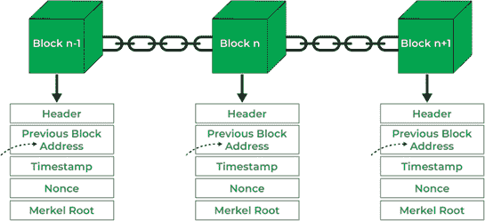

图 1.1 区块链中的区块结构。

来源：\[原创（由作者创作）\]

在大多数地方，敌人很难更改存储的详细信息。因此，与集中式系统相比，区块链提供了更高的安全性。使用 Merkle 树将合法交易的批次哈希和编码为区块。每个区块包含一个密码学哈希，用于将每个区块链接到区块链中的前一个区块。连接的区块形成一条链。创世块，也称为区块 0，是第一个区块，在一个迭代过程中验证每个后续区块的完整性。分布式网络的成员将数字交易输入共享账本。在将拟议的交易添加到网络之前，网络成员对其进行评估和验证。如果交易被网络的大多数参与者接受，则共享账本将更新以反映新交易。在几分钟内，或者在某些情况下几秒钟内，对共享账本的更改会反映在区块链的每个副本中。交易一旦添加，就无法修改或撤销；它变得不可更改。网络中的任何单个成员都无权篡改或更改数据，因为每个成员都拥有区块链的完整副本。

### 1.2.2 分布式账本技术

使用分布式账本技术 (`DLT`)，许多位置同时记录资产交易及其相关信息（如 图 1.2 所示）。分布式账本缺乏中央数据存储和管理功能，这与传统数据库不同。分布式账本中的节点处理和验证每个项目，生成其记录并就其真实性达成共识 \[7\]。

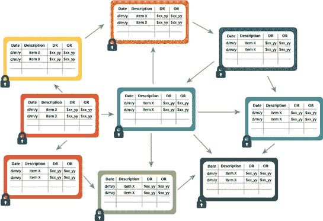

图 1.2 在区块中记录交易。

\[原创（由作者创作）\]

包括区块链在内的几种可比技术统称为分布式账本技术 (`DLT`)（如 图 1.3 所示）。尽管“分布式账本技术”和“区块链技术”这两个术语有时被互换使用，但它们各自使用不同的数据存储机制。将区块链概念化的一种方式是将其视为 DLT 的一个子集，其中许多交易保存在“区块”中，并通过“链”以密码学方式链接到前一个区块。

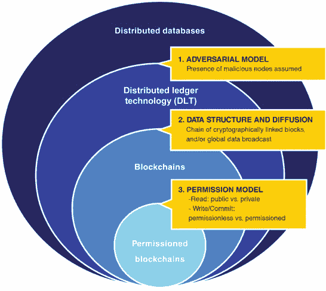

图 1.3 分布式账本技术。


## 1.2.3 基于时间戳且容错的账本记录

从本质上讲，所有区块链都使得对已上传至区块链的记录进行更改在技术和财务上都变得不切实际。网络的所有节点都会保留交易的时间戳、任何关联信息以及相关方的数字签名，这些内容在被追加后即被记录。除非网络中大多数节点串通一致，否则这些数据无法被更改，而随着网络的扩展，这种串通变得越来越罕见且成本高昂。

区块链是跟踪任何数字资产（包括资金、房地产、健康信息、贵重收藏品、域名等）的最佳选择，因为它们天然保留了审计追踪。

点对点网络用于去中心化存储在账本中通过网络进行的数据和交易。区块链网络节点间的共识（共识协议）用于验证和核实交易。在区块链网络中，在线交易流程如图 1.4 所示。

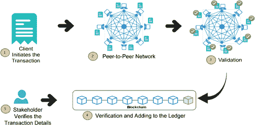

图 1.4 区块链网络及向账本添加新交易的过程。

## 1.2.4 用于去中心化、防篡改、自动触发应用的智能合约

到目前为止，在研究中，区块链仅被描述为一个全球性的点对点存储库，但它们也可以被开发为一个全球性的点对点处理器，以未经修改的方式执行开发者提供的代码和应用程序。

智能合约是一段计算机代码，在区块链网络中充当具有法律约束力的合同。一旦发布或关闭，代码就无法更改。更重要的是，当满足特定条件时，它可以自动启动区块链交易，防止不诚实方干预该过程。

区块链是一种无服务器/去中心化基础设施，其中执行代码并转移资金，防止第三方干预交易或介入将资金转移到其自身账户。

## 1.2.5 资产数字化与新经济模型

所有类型的现实世界资产都可以有数字表示，包括可移动或不可移动资产（如土地与汽车）或可替代或不可替代资产（如黄金与知识产权）。

由于任何资产都可以表示为表示对底层经济资源完全或部分所有权的代币，因此区块链是资产数字化的理想平台。无需中介，区块链代币可以在各方之间无摩擦地交易，即使底层资产缺乏流动性，也能提供流动性。这为新型经济模型打开了大门，例如自动向部分土地所有者分配股息的智能合约，或自动向资产提供者付款的资产消费者。

代币所有者的身份可以被验证，但不能被更改或伪造，这与传统数据库系统中的数字资产和代币不同。区块链系统上的这些代币转移是防篡改的，使得中介无法窃取资金或进行双重支出。

区块链可以影响数字市场的竞争力和创新。根据 Cataline 和 Gams \[9\]，技术影响的两项重要成本是网络成本和验证成本。

验证成本是指以低成本验证状态的能力，包括关于先前交易及其特征的详细信息，以及对原生数字资产的当前所有权。

网络成本取决于组织引导和管理市场的能力，而不是将控制权交给集中式中介。这是通过将低成本验证状态的能力与旨在奖励对网络特别有帮助的状态转换的财务激励相结合来实现的，例如提供运行、扩展和保障去中心化网络所需的资源。

由此产生的数字市场，其特征是竞争更激烈、进入门槛更低、隐私风险更低，使参与者能够在不将市场权力让给平台运营商的情况下，对共享基础设施和数字公共事业进行联合投资。

## 1.2.6 区块链架构

基于各种不同的底层技术决策，区块链可以分为几个类别（如图 1.5 所示）。该技术显著增强当前流程的潜力，以及上述标准，基本保持一致。以下是一些突出的技术选项和相关技术组。

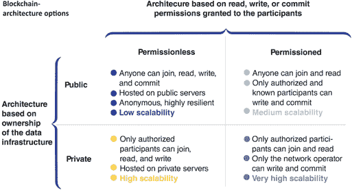

图 1.5 的长描述

它包括数据基础设施的所有权（公共或私有）以及授予参与者的权限（无需许可或需许可）。公共无许可架构允许任何人加入、读取、写入和提交；托管在公共服务器上；匿名、高度弹性；且可扩展性低。公共需许可架构允许任何人加入和读取；只有授权且已知的参与者可以写入和提交；中等可扩展性。私有无许可架构仅允许授权参与者加入、读取和写入；托管在私有服务器上；高可扩展性。私有需许可架构仅允许授权参与者加入和读取；只有网络运营商可以写入和提交；非常高的可扩展性。

图 1.5 区块链架构。

*   > 应该让交易公开吗？区块链既可以是公共的，也可以是私有的。

*   > 如何就新信息的加入达成一致？不同的共识协议。

*   > 私有区块链系统：在私有区块链系统中，每个节点都是一个被认可的实体，并被鼓励加入网络。系统管理员还可以更改每个网络节点的读/写范围。以一个为其工业供应链创建区块链的大型组织为例。该供应链的每个环节都将有机会在这个网络中运行一个节点。其他人将没有这种能力。因此，可以说各方相互认识（如果不信任的话），需要一种更宽松的方法来达成决策或进行数据库修改。这些需许可的私有区块链系统提供细粒度的访问限制，使系统管理员能够控制每个网络节点的读/写范围。


> 公共区块链系统：任何用户都可以加入公共区块链系统的点对点网络，无需受邀。所有节点拥有相同的权利，这使它们可以从网络中读取任何内容并向其提交交易。

这些区块链是完全开放的，可能包含不诚实或密谋的参与者，例如，他们可能会尝试覆盖/删除先前的交易或修改一段数据。这与私有区块链形成对比，在私有区块链中，所有节点都被假定为可信的。公共区块链系统用金钱奖励道德行为，并用金钱惩罚不诚实的人，以试图阻止不诚实行为。

立法清晰度将是允许这种重要形式的区块链在印度存在所必需的，因为预计公共区块链将因多种原因而拥有最有前景的用例。公共区块链要正常扩展，必须存在代币经济。

## 1.3 区块链在医疗保健领域的应用

医疗保健领域正在迅速发展。由于基因研究的改进和精准医疗的进步，它正在见证疾病预防和更好患者护理的创新方法。同时，由于 IT 的进步，研究人员和临床医生可以访问大量健康信息数据库，这些数据库可以帮助进一步精细化治疗计划，以改善患者护理。

区块链技术有潜力解决当前困扰健康 IT 系统的互操作性问题，并将其确立为使个人、医疗保健实体、提供者和研究人员能够安全交换电子健康数据的技术规范。此外，这项技术有潜力显著促进健康结果的改善（如 图 1.6 所示）。

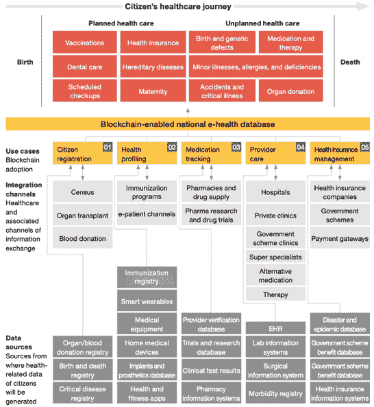

图 1.6 长描述

公民的医疗保健旅程始于出生并持续到死亡，分为计划内医疗和计划外医疗。计划内医疗包括疫苗接种、健康保险、牙科护理、产科、遗传病管理和定期体检等服务。计划外医疗涵盖出生缺陷、遗传疾病、轻微疾病、过敏、缺乏症、意外、危重疾病、药物、治疗和器官捐赠。区块链支持的国家电子健康数据库概述了五个关键区块链用例：公民登记、健康画像、药物追踪、提供者护理和健康保险管理。每个用例整合各种医疗保健渠道，实现无缝信息交换。公民登记利用人口普查数据、器官移植登记和血液捐献记录。健康画像结合免疫计划和电子患者渠道。药物追踪涉及药房、药品供应链、制药研究数据和药物试验。提供者护理整合医院、私人诊所、政府方案诊所、超级专科医生、替代药物和治疗中心。健康保险管理连接保险公司、政府方案和支付网关。数据来源：将生成公民健康相关数据的来源包括以下内容。公民登记：包括器官和血液捐献登记、出生和死亡记录、危重疾病登记。健康画像：包括免疫登记、智能可穿戴设备、医疗设备、家用医疗设备、植入物和假体数据库以及健康和健身应用程序。药物追踪：包括提供者验证数据库、试验和研究数据、临床测试结果以及药房信息系统。提供者护理：包括电子健康记录、实验室信息系统、手术信息系统和发病率登记。健康保险管理：包括灾难和流行病数据库、政府方案福利数据库以及健康保险信息系统。

图 1.6 区块链在医疗保健领域的主要用例。

\[原始（由作者创建）]

得益于区块链支持的干预，健康数据管理和信息交换在众多利益相关者之间变得更加集成和顺畅的机会存在。在印度的医疗保健及其他相关生态系统中，这种信息交换可以分为五个关键区块链用例。然后可以将患者在整个生命周期内医疗旅程的各个步骤与这些用例相匹配 \[10\]。

### 1.3.1 使用电子健康记录进行患者数据管理

在医疗保健领域，安全地管理和共享患者健康记录至关重要。电子健康记录（EHR）在数字化医疗数据方面取得了重大进展，但它们仍然面临与安全性、互操作性和隐私相关的挑战。通过利用区块链的独特属性，EHR 系统可以得到增强，以确保数据完整性、安全性和无缝共享，同时保持患者隐私。区块链技术具有彻底改变 EHR 系统和患者健康记录的巨大潜力。其提供增强安全性、数据完整性、互操作性和隐私的能力，使其成为解决传统 EHR 系统所面临挑战的理想方案。

> 增强的安全性和数据完整性：区块链的基本功能之一是其提供增强安全性和数据完整性的能力。传统的 EHR 系统通常是集中式的，这使它们容易受到网络攻击和未经授权的访问。另一方面，区块链提供了一种去中心化的架构，由于其分布式账本的特性，更能抵御黑客攻击。在基于区块链的 EHR 系统中，对患者记录的每笔交易或更新都被记录为一个区块并添加到链中。这些区块与之前的区块以加密方式链接，创建了一个不可更改且防篡改的记录。这确保了患者健康数据保持安全、透明且不可更改。网络会立即检测并拒绝任何未经授权的数据修改尝试，这使得区块链成为保护敏感患者信息的理想方案。

> 互操作性和无缝数据共享：互操作性是医疗保健领域的一大挑战，因为不同的医疗保健提供者和组织通常使用无法有效相互通信的不同系统。通过为数据共享和互操作性提供标准化框架，区块链技术有潜力克服这一障碍。使用基于区块链的 EHR 系统，患者健康记录可以安全地在不同的医疗保健提供者之间共享，无论他们使用什么特定的 EHR 软件。区块链的去中心化特性消除了对中介的需求，并允许直接的点对点通信和数据交换。信息的这种无缝共享改善了护理协调，减少了医疗错误，并使人们能够全面了解患者的病史，从而带来更好的医疗保健结果。


## 1.3.2 药品可追溯性与供应链管理

高效的供应链管理对于确保医疗产品和服务的可用性、可追溯性和安全性至关重要。然而，医疗行业在管理其复杂的供应链时面临着诸多挑战，包括假药、库存管理效率低下以及透明度有限。区块链技术为解决这些问题并彻底改变医疗供应链管理提供了一个有前景的解决方案。使用区块链可以增强透明度、可追溯性和安全性，最终提高医疗供应链中的患者安全性和运营效率。

图 1.7 演示了如何使用区块链来解决药品欺诈问题。在 (a) 中，原始药物在从制造商通过分销商和药剂师到患者的整个过程中，存在被篡改标签、有效期等的风险。如果没有反馈系统，任何修改都无法被识别。同样，药剂师也无法验证医生给患者的处方是否被更改。为了弥补这些可能的漏洞，(b) 中使用了区块链。每种药物都会记录到区块链中，并且由于所有相关人员都连接到它，他们可以验证所获得的任何信息或产品的真实性 \[11\]。

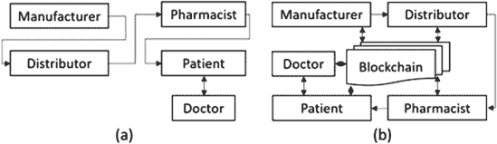

图 1.7 使用区块链解决药品假冒问题。

\[原创（由作者创作）\]

### 隐私与患者控制

围绕患者健康记录的隐私问题是采用数字系统的重大障碍。区块链可以通过融入增强隐私的功能，同时赋予患者对其自身数据更大的控制权来解决这些问题。在基于区块链的电子健康记录（EHR）系统中，患者可以保留对其健康记录的所有权和控制权。他们可以授予医疗服务提供者、研究人员或其他授权实体访问其数据特定部分的权限。这种去中心化的方法使患者能够管理其隐私偏好，并确保其数据不会不必要地暴露给未经授权的各方。此外，区块链固有的透明度使患者能够追踪其记录被访问的每一次情况，为他们提供全面的审计跟踪，并增强对系统的信任。

### 增强透明度和可用性

在医疗供应链中，透明度和可追溯性对于跟踪产品流动、识别潜在问题以及确保符合监管要求至关重要。区块链技术提供了一个去中心化且不可更改的账本，使供应链中的实时可见性和透明度成为可能。通过利用区块链，每笔交易或产品移动都会作为一个区块被记录，形成一条不可更改的信息链。这使利益相关者能够追踪产品从起源到最终目的地的整个旅程，包括制造商、分销商和零售商的信息。区块链提供的透明度降低了假药进入供应链的风险，因为每个步骤都可以被审计和验证，确保产品的真实性和完整性。

### 改善库存管理和效率

库存管理效率低下通常会导致供应短缺、患者护理延误以及成本增加。区块链技术可以通过简化库存管理流程和提高供应链效率来解决这些挑战。通过基于区块链的系统，供应链中的所有利益相关者，包括制造商、分销商和医疗服务提供者，都可以访问库存数据的共享、同步账本。这种对库存水平、需求和分销的实时视图使准确预测、高效库存管理和主动补货成为可能。通过优化库存水平并尽量减少缺货，基于区块链的供应链管理确保及时获取医疗产品并减少浪费，最终改善患者护理。

### 确保产品真实性并防止假冒

假药对患者安全和公共卫生构成重大威胁。区块链技术可以通过确保产品真实性并防止假冒或劣质药物流通，在打击这一问题中发挥关键作用。基于区块链的解决方案使实施唯一产品标识符（如序列号或条形码）成为可能，这些标识符可以安全地存储在区块链上。这些标识符结合智能合约，允许在整个供应链中验证产品真实性。患者、医疗服务提供者和监管机构可以扫描唯一标识符，即时访问有关产品来源、制造过程和分销历史的信息。这种透明度有助于识别和消除假冒产品，保护患者健康和对医疗系统的信任。

### 增强监管合规性和审计

管理医疗供应链的一个关键组成部分是监管合规性。通过提供交易、文件和质量控制程序的安全且可审计的记录，区块链技术有助于简化合规操作。通过利用区块链，监管机构可以访问医疗产品流动的实时信息，确保遵守安全标准、许可要求和质量认证。此外，审计可以更高效、更准确地进行，因为区块链作为不可更改的信息来源。这简化了监管流程，减少了行政负担，并促进了供应链中利益相关者之间的信任。

## 1.3.3 临床试验与研究

临床研究和创新对于推进医学知识、开发新疗法和改善患者护理至关重要。然而，传统的临床研究流程常常面临数据碎片化、缺乏透明度以及对数据隐私和完整性的担忧等挑战。区块链技术通过提供一个去中心化且安全的框架，为临床研究和医疗保健创新带来了变革性的解决方案。

### 安全性与数据完整性

临床研究产生大量敏感且有价值的数据，包括患者健康记录、基因组数据和研究结果。通过利用区块链，研究人员可以创建对数据所做的每笔交易或更新的不可更改且防篡改的记录。每个数据片段都通过加密链接并存储在分布式计算机网络的区块中。区块链的这种去中心化特性防止了未经授权的修改，确保研究数据保持透明、可信且可追溯。通过消除数据被篡改的风险，区块链增强了对研究结果的信心，提高了可重复性，并为循证医学奠定了基础，从而推进医学知识并加速新疗法和治疗方法的开发。


## 简化数据共享与互操作性

高效的数据共享与互操作性对于加速医学研究以及促进研究人员、机构和制药公司之间的协作至关重要。然而，当前的研究环境常常受到数据孤岛和分散系统的困扰，阻碍了数据交换。区块链技术为跨不同实体共享研究数据提供了标准化且安全的框架。通过基于区块链的平台，研究人员可以在保持对其知识产权控制的同时安全地共享数据。智能合约作为区块链的一项功能，可以自动化数据共享协议，并根据预定义的权限实现对特定数据集的选择性访问。这种简化的数据共享不仅促进了多学科协作，还促进了数据重用，减少了冗余并优化了研究工作。

## 促进代币化激励与资助

区块链固有的创建数字代币和执行智能合约的能力，为激励临床研究参与和简化资助机制开辟了创新途径。代币化使得能够创建代表研究贡献、知识产权甚至财务奖励的数字资产。基于区块链的平台可以通过为研究人员、患者和其他利益相关者在研究生态系统中的贡献提供代币奖励来激励他们。这些代币可以兑换研究数据访问权、出版学分甚至财务补偿。此外，区块链的透明和可审计性质增强了问责制，确保分配给研究的资金得到适当使用，并可以在整个研究生命周期中有效追踪。

## 患者赋能与增强的同意管理

区块链技术可以通过为患者提供对其数据的更大控制权和透明度来增强同意流程。通过利用区块链，研究人员可以以不可变且可审计的方式安全地记录和管理患者同意信息。患者可以随时授予、撤销或修改其同意偏好，从而在决定其数据如何用于研究目的方面拥有更多主动权。基于区块链的同意框架使患者能够跟踪和监控其数据的使用情况，在研究过程中培养信任和道德透明度 \[12\]。

## 1.3.4 健康保险与索赔处理

健康保险行业在为个人和家庭提供财务保护和医疗保健服务方面发挥着至关重要的作用。然而，该行业面临着重大挑战，包括复杂的索赔处理、欺诈活动和缺乏透明度。区块链技术已成为解决这些问题并通过简化索赔处理、增强数据安全性和提高运营效率来彻底改变健康保险的强大工具 \[13\]。

### 简化索赔处理

传统的健康保险索赔处理是一个复杂且耗时的程序，涉及多个中介和手动验证流程。区块链技术有可能简化这一过程，降低行政成本并提高索赔管理的效率。通过利用区块链，健康保险索赔可以记录为去中心化账本上的交易。智能合约（由预定义条件触发的自动执行协议）可以用于自动化索赔处理。当满足特定条件（例如诊断代码或治疗资格）时，智能合约可以自动执行付款，消除手动干预的需求并缩短处理时间。这种自动化不仅加快了索赔结算，还最大限度地减少了错误并提高了准确性，从而为医疗保健提供者带来更快的报销并提高了客户满意度。

### 防止欺诈并提高合规性

欺诈活动（如虚假索赔和身份盗窃）对健康保险行业构成重大挑战。区块链技术可以通过提供交易的透明且不可变的记录来降低这些风险，从而更容易检测和防止欺诈。通过区块链，每笔交易都会被记录并加上时间戳，创建活动的可审计轨迹。这允许实时监控和分析，使保险公司能够更有效地识别可疑模式并检测欺诈行为。通过整合来自各种来源（如医疗保健提供者、药房和索赔处理器）的数据，区块链可以提供个人病史的全面视图，确保索赔准确且符合保单条款。这种透明度和实时监控使主动欺诈预防措施成为可能，保护保险公司和投保人免受财务损失。

### 改善提供者–保险公司协作

医疗保健提供者与保险公司之间的协作对于高效的索赔处理和护理的无缝协调至关重要。区块链技术通过创建安全高效的数据交换共享平台来促进这种协作。基于区块链的系统使医疗保健提供者和保险公司之间能够实时共享信息，消除了手动数据对账的需求并减少了行政负担。提供者可以通过区块链网络直接向保险公司安全地提交索赔相关信息（如医疗记录和治疗详情）。这种简化的沟通加快了索赔处理，减少了错误，并确保及时报销。此外，区块链促进了提供者与保险公司之间的透明沟通和争议解决，提高了运营效率并在系统中建立了信任。

## 1.3.5 医疗资质认证与验证

医疗资质认证与验证是医疗保健行业中的关键流程，确保医疗保健提供者具备提供优质护理所需的资格和标准。然而，传统的资质认证方法往往耗时、容易出错且缺乏透明度。区块链技术为彻底改变医疗资质认证和验证流程提供了有前途的解决方案，通过转变这些流程并提高医疗保健的效率、准确性和信任度。

### 简化资质认证流程

区块链技术简化了医疗资质认证中涉及的复杂且手动的流程。通过利用区块链的去中心化和不可变账本，医疗保健组织可以安全地存储和共享提供者资质、执照、认证及其他相关信息。区块链消除了资质认证流程中对中介和中央机构的需求。相反，医疗保健提供者可以在区块链上维护其资质，确保数据完整性并消除伪造或过时信息的风险。资质验证变得更快、更高效，因为医疗保健组织可以直接访问区块链，而不是依赖耗时的手动验证方法。


> 提高准确性和可信度：区块链通过提供提供者资质的透明且可审计的记录，增强了医疗资质认证的准确性和可靠性。每个资质认证事件，例如完成医学院学习、获得执照或完成住院医师培训，都会作为一笔交易记录在区块链上。这些交易形成了一条不可更改的信息链，可由授权方访问和验证。这种透明性和不可更改性显著降低了提供者资质中欺诈性索赔和虚假陈述的可能性。医疗机构、保险公司和监管机构可以放心地依赖区块链来验证提供者的资质，确保只有合格的专业人员才能获得执业权限，并降低医疗质量低下的风险。

> 提供跨境资质认证：区块链有可能彻底改变跨境资质认证，使医疗专业人员能够更轻松地在国际上执业。在传统的资质认证过程中，由于不同国家的监管要求和验证流程各异，提供者在寻求在不同国家执业时常常面临重大挑战和延误。区块链通过提供一个用于存储和验证资质的标准化平台，简化了跨境资质认证。国际组织可以访问区块链来验证提供者的资质并简化资质认证流程。这有助于医疗专业人员的全球流动，促进劳动力多样性，并改善全球医疗服务的可及性。

## 1.4 医疗领域区块链实施的挑战

### 1.4.1 监管和法律不确定性

区块链技术的引入使得医疗行业本已复杂的法律和监管环境变得更加复杂。区块链实施使得遵守数据隐私规则（例如美国的《健康保险可携性和责任法案》（`HIPAA`））变得困难。由于区块链的去中心化和不可更改性，满足这些监管义务可能会很困难。被遗忘权、数据可移植性和同意管理可能难以与区块链上存储的数据的永久性相协调。

医疗领域的区块链实施可能需要患者明确同意以共享或访问其医疗数据。在遵守现有法律框架的同时，确定如何在区块链上获取、记录和管理同意可能很复杂。必须设计同意和授权机制，以满足法律要求并确保患者对其数据的自主权和控制权。

区块链技术跨越国界运行，医疗数据法规在不同司法管辖区之间可能存在显著差异。这在国际共享数据时保持合规性方面带来了挑战。在法律和监管环境中导航，以确保跨境数据传输符合适用法律，可能是一项复杂且耗时的任务。

现有法规并非专门针对区块链技术制定的。监管机构和政策制定者可能需要调整和更新法规，以考虑区块链在医疗领域所带来的独特特征和挑战。缺乏针对区块链实施的明确指南和标准，可能会在医疗机构中造成不确定性和犹豫。

### 1.4.2 互操作性和标准化挑战

医疗数据以各种格式生成和存储，从基于文本的医疗记录到医学影像文件。缺乏标准化的数据格式和协议阻碍了不同医疗提供者和区块链网络之间的互操作性。建立定义医疗数据结构、分类和共享方式的通用数据标准，可以实现与区块链平台的有效集成。医疗术语和词汇，例如 `SNOMED CT` 或 `LOINC`，用于对医疗数据进行编码和分类。然而，不同医疗机构之间术语的差异和变化可能会阻碍数据互操作性。实现语义互操作性需要协调和统一术语，以确保对区块链上共享数据的解释和理解保持一致。健康信息交换（`HIEs`）在促进医疗提供者之间交换患者信息方面发挥着至关重要的作用。将区块链与现有的 `HIEs` 集成，在数据同步、身份验证以及在多个组织之间保持一致且最新的患者记录方面面临挑战。区块链网络与 `HIEs` 之间的协作对于实现无缝互操作性至关重要。区块链网络建立在不同的平台和技术之上，例如 `Ethereum`、`Hyperledger Fabric` 或 `Corda`。确保这些不同区块链平台之间的互操作性并实现它们之间的数据交换是一项重大挑战。标准化能够实现跨平台兼容性的协议和接口可以增强互操作性，并使医疗机构能够利用多个区块链网络。医疗机构、标准制定组织和监管机构之间的协作努力对于建立针对医疗领域区块链的通用数据标准、术语框架和互操作性协议是必要的。这些标准应被广泛采用和实施，以确保一致性和无缝的数据交换。进行互操作性测试和认证计划也很重要，因为这些可以验证区块链实施与既定标准的兼容性和合规性。这些计划有助于医疗机构选择可互操作的区块链解决方案，并向利益相关方提供关于系统有效交换数据能力的保证。

### 1.4.3 可扩展性挑战

区块链网络通常在快速处理交易方面面临限制。在医疗领域，实时数据交换至关重要，可扩展性成为一个主要问题。随着参与者和交易数量的增加，区块链网络可能会出现延迟和性能下降。

随着区块链不断添加新数据，网络规模扩大，导致存储需求增加和网络性能变慢。在区块链上存储大量医疗数据，例如医疗记录和影像文件，可能会给网络容量带来压力并影响其可扩展性。

共识算法，例如 `proof-of-work (PoW)` 或 `proof-of-stake (PoS)`，确保区块链上交易的有效性。然而，这些机制可能会限制可扩展性，因为它们通常需要大量计算资源，或者对可同时处理的交易数量有限制。

实施链下解决方案，例如侧链或状态通道，可以减轻主区块链网络的负担，提高可扩展性。这些解决方案在保持区块链技术优势的同时，实现更快、更高效的交易处理。探索替代共识算法，例如需要较少计算能力的 `proof-of-authority (PoA)` 或 `practical Byzantine fault tolerance (PBFT)`，可以提升医疗区块链应用的性能和可扩展性。

### 1.4.4 性能挑战

某些区块链网络，尤其是使用 `PoW` 共识的网络，会消耗大量能源。在医疗领域，可持续性和环境因素很重要，某些区块链实施的高能耗特性带来了性能挑战，并引发了对生态影响的担忧。


虽然区块链提供了不可变性和透明度，但在医疗保健领域，维护患者隐私和数据机密性至关重要。在数据隐私需求与区块链的透明性之间取得平衡可能具有挑战性，且低效的加密方法可能会影响系统的整体性能。

将区块链技术集成到现有的医疗保健系统和基础设施中可能会带来性能挑战。旧系统和互操作性问题可能会阻碍区块链网络与传统数据库之间数据的无缝流动，从而可能影响整体系统性能。将大型数据集分解为较小的分区并利用数据压缩技术可以优化存储需求并提高网络性能。仅在区块链上存储必要的元数据，而将大部分数据保存在链下，也可以增强可扩展性。

## 1.5 医疗保健区块链生态系统及一些实际实现

医疗保健生态系统将从以患者为中心的区块链临床护理改进方法中受益，这也将确保患者的信任得到维护。此类基于区块链的生态系统的优势可以分为两类：提供方的优势和患者的优势。在重新设计的住院场景中，区块链将充当接口，允许临床医生在获得必要授权并以安全且经过授权的方式后直接更改患者的档案。新的住院记录将使用患者的病史以及任何相关健康数据（例如保险计划）。通过将医疗信息的交换与索赔和支付信息相结合，将改善患者的体验 [12]。使用区块链重新构想的医疗保健生态系统的详细流程结构如 图 1.8 所示。

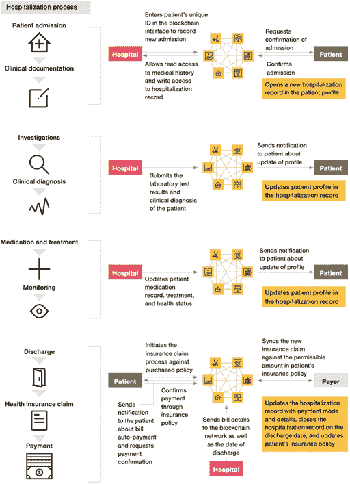

### 图 1.8 的详细描述

住院流程的阶段包括患者入院、临床文档记录、检查、临床诊断、用药和治疗、监测、出院、健康保险索赔和支付。在患者入院阶段，医院将患者的唯一 ID 输入区块链并记录新的入院。它请求患者确认入院并确认入院。它在患者档案中打开一条新的住院记录。它允许读取病历和写入住院记录。检查和临床诊断涉及提交实验室结果和患者的临床诊断。它向患者发送关于档案更新的通知，并在住院记录中更新患者档案。在用药和治疗阶段，患者记录会根据用药、治疗和健康状况进行更新。它向患者发送关于档案更新的通知，并更新住院记录。出院时，它会针对购买的保单启动保险索赔流程，通过保险单确认付款，向患者发送关于账单自动付款的通知，并请求付款确认。它会将新的保险索赔与患者保险单中的允许金额进行同步。它会用付款方式和详细信息更新住院记录，在出院日期关闭住院记录，并更新患者的保险单。医院将账单详细信息以及出院日期发送到区块链网络。它通过区块链集成确保医院、患者和付款人之间安全透明的数据交换。

图 1.8 使用区块链重新构想的医疗保健生态系统。

[原始（由作者创建）]

### 1.5.1 全球医疗保健中的区块链用例

全球医疗保健领域有多种区块链技术的实际实现。以下是一些著名示例：

*   > MedRec（美国）：MedRec 是由麻省理工学院研究人员开发的基于区块链的电子病历（EMR）系统。它允许患者拥有并控制其医疗数据，同时能够与医疗保健提供者安全共享。患者可以授予其医疗记录特定部分的访问权限，改善护理协调并减少重复检查。

*   > Medicalchain（英国）：Medicalchain 是一个区块链平台，旨在提供安全且可访问的健康记录。它允许患者将其医疗数据存储在区块链上，并根据需要向医疗保健提供者和研究人员授予访问权限。Medicalchain 还促进远程医疗咨询、处方管理和保险索赔。

*   > Guardtime（爱沙尼亚）：Guardtime 是一家与爱沙尼亚政府合作，在其国家健康记录系统中实施区块链的公司。基于区块链的系统确保健康记录的完整性和安全性，防止未经授权的修改，并提供数据变更的可审计追踪。爱沙尼亚的每位患者都可以通过名为电子健康记录（e-Health Record）的国家系统在线访问单一记录，该系统整合了该国众多医疗保健提供者的数据。e-Health Record 的运作方式非常类似于集中的国家数据库，但它实际上会根据需要从多个可能使用不同系统的提供者处检索数据，并通过 e-Patient 接口以通用格式提供。得益于这一有效工具，医生现在可以轻松地从单个电子文件中检索患者的记录。医疗专业人员可以在输入时查看测试结果，包括来自远程设施的 X 光片等图像文件。电子病历的检索和系统访问日志的完整性均由区块链技术保证。

*   > Gem 和 Philips Blockchain Lab（美国）：Gem 是一家区块链平台提供商，与 Philips Blockchain Lab 合作开发了一个用于临床试验的基于区块链的数据共享和管理平台。该平台旨在简化试验流程；提高数据完整性；并增强研究人员、赞助商和参与者之间的协作。

*   > [MyClinic.com](http://MyClinic.com)（澳大利亚）：[MyClinic.com](http://MyClinic.com) 是一个基于区块链的平台，允许患者访问和控制其健康记录。它使患者能够安全地存储其医疗数据，与医疗保健提供者共享，并接收远程医疗服务。该平台还为保险索赔和自动付款引入了智能合约。

*   > Shivom（全球）：Shivom 是一个专注于基因组学和医疗保健的区块链平台。它旨在安全地存储和共享基因组数据，同时确保患者的隐私和控制权。该平台促进研究协作，使患者能够将其基因组数据货币化，并支持个性化医疗的发展。

*   > BitMED（美国）：BitMED 是一个基于区块链的远程医疗平台，将患者与医疗保健提供者连接起来。该平台支持安全的视频咨询、医疗数据共享和处方管理。它还引入了基于加密货币的奖励系统，以激励健康行为。

### 1.5.2 印度医疗保健系统中的区块链应用


# 印度医疗保健系统

印度医疗保健系统是一个庞大而复杂的公共和商业提供商网络。其目标是提供价格低廉且可及的医疗保健服务。七个重要方参与其中：患者、提供者、付款人、制药行业、医疗技术行业、技术供应商和供应商，以及政府和医疗保健监管机构。为了产生可操作的健康信息，这些利益相关方参与相互关联且数据密集的复杂活动网络。印度已开始实现全民健康覆盖（UHC）的进程，并已将其国家卫生政策（NHP）2017 与这一目标相匹配 \[14\]。

对于这种规模的举措，需要一种技术解决方案，使所有参与者能够以安全和及时的方式生成和传输有用的健康信息。部署连接全国分散的多个健康与健康中心（HWC）的技术将至关重要，以便执行总理人民健康保险计划（PMJAY）并实现 UHC。阿育巴拉特数字使命（ABDM）\[15\]旨在为国家的综合数字健康系统构建必要的基础设施。它将通过数字高速公路弥合医疗保健生态系统各利益相关方之间的当前差距，并作为开发国家级 IT 平台的基础，以便使受益人识别、医疗服务的战略采购、提供者付款拨付、欺诈检测和方案监测更加容易。

这就是区块链、密码学、去中心化和共识这三大支柱可以提供解决方案的地方，以创建一个高度安全、可靠且可扩展的底层系统。除了印度政府的举措 \[16\]之外，还有几家初创公司正在使用区块链技术为医疗保健领域提供创新解决方案。

这些示例展示了区块链在医疗保健领域的多样化应用，从患者控制的健康记录到临床试验和远程医疗。虽然这些实现展示了区块链技术的潜在好处，但重要的是要注意，它们仍处于相对早期阶段，持续的研究和开发继续探索区块链在医疗保健领域的全部潜力。

## 1.6 未来方向和建议

虽然在印度交换医疗保健信息的背景下有许多使用区块链理念的方法，但确定最有用和最有说服力的方法至关重要，这些方法将说服提供者选择区块链，而不是市场上已经存在的竞争技术 \[17\]。

区块链是一种相对较新的技术，有潜力提高电子数据管理的开放性和问责性。计算机网络的每个用户都可以查看称为区块链的交互账本的精确副本。

*   > 区块链对于受益于可见性和不可更改性、具有有限数字足迹且透明的交易最为有效。区块链在医疗保健领域可能特别有用，用于处理患者的动态同意、数据共享和访问授权、管理制药和医疗器械的供应链以及身份验证。

*   > 区块链技术在医疗保健行业的前景被过度炒作，其价值可能被夸大。大多数关于区块链在医疗保健行业应用的已发表研究包括理论框架、设计或模型，技术细节很少。很少能从原型或试点项目中吸取教训。医疗保健领域的国家区块链技术采用不常见。

*   > 在管理良好的健康信息系统中，应在最合适的地方实施区块链，并与其他技术结合使用，以满足信息需求和政策目标。

*   > 最重要的是，由于每个网络参与者都需要复制区块链，因此区块链不适合存储大量数据。在区块链上存储大型记录（如全面的电子病历或基因数据集）成本高昂且效率低下。用于数值、医疗和科学目的的数据使用也受到查询存储在区块链中的数据的困难的限制。

*   > 此外，将私有数据“存储在链上”（根据定义，其他网络用户可以访问）违反了数据隐私。欧盟《通用数据保护条例》授予的权利与链中区块的不可更改性无法共存。这尤其适用于被遗忘权。

## 1.7 结论

区块链技术具有巨大的潜力，可以彻底改变电子健康记录（EHR）系统和患者健康记录，以提供增强的安全性、数据完整性、互操作性和隐私性，使其成为解决传统 EHR 系统面临挑战的理想方案。区块链技术可以通过解决数据完整性、透明度和协作等关键挑战，彻底改变医疗保健领域的临床研究和创新。通过利用区块链的去中心化架构、增强的安全性和简化的数据共享能力，研究人员可以解锁多学科协作的新机遇，加速新疗法的发现，并改善患者预后。对于医疗保险行业，区块链技术有望通过彻底改变索赔处理、增强数据安全性和提高运营效率来改变健康保险行业。通过利用区块链的去中心化账本、智能合约和增强的数据透明度，保险公司可以简化索赔管理、防止欺诈并为投保人提供更好的服务。区块链的不可更改记录确保所有交易都安全记录且易于审计，最大限度地减少争议和错误。智能合约可以自动化索赔验证和支付流程，降低行政开支并加快索赔结算。此外，增强的数据透明度通过加密安全措施保持数据隐私的同时，使利益相关方能够实时访问准确信息，从而增强信任。这种集成最终提高了保险行业的效率，降低了成本，并改善了客户体验。

区块链技术正在改变医疗资质认证和验证流程，为医疗保健行业带来效率、准确性和透明度。增强患者对其健康信息安全的信心，并通过实现跨提供者轻松访问患者健康记录来确保互操作性，是印度和世界各地医疗保健提供者关注的两个领域。区块链技术将在这些领域中的每一个发挥关键作用。行业利益相关方之间的合作、标准化努力、监管框架和持续创新对于应对这些挑战并在医疗保健领域创建强大且有效的区块链生态系统至关重要。

# 参考文献

1.  S. Nakamoto, “Bitcoin: A Peer-to-Peer Electronic Cash System,” 2008. \[Online\]. Available: [`bitcoin.org/bitcoin.pdf`](https://bitcoin.org/bitcoin.pdf).


2. H. S. Chen, J. T. Juliet, K. A. Carpenter, D. S. Cohen 和 X. Huang，“医疗保健中的区块链：以患者为中心的模型，”马萨诸塞总医院和哈佛医学院，2019 年。[在线]。可用：[`www.ncbi.nlm.nih.gov/pmc/articles/PMC6764776/`](https://www.ncbi.nlm.nih.gov/pmc/articles/PMC6764776/).

3. MeitY，“区块链国家战略——迈向可信数字平台，”2011 年 12 月。[在线]。可用：[`www.meity.gov.in/writereaddata/files/National\_BCT\_Strategy.pdf`](https://www.meity.gov.in/).

4. L. A. Linn 和 M. B. Koo，“用于健康数据的区块链及其在健康 IT 和医疗保健相关研究中的潜在应用，”2016 年 [在线]。可用：[`www.healthit.gov/sites/default/files/11-74-ablockchainforhealthcare.pdf`](https://www.healthit.gov/sites/default/files/11-74-ablockchainforhealthcare.pdf).

5. R. Kandaswamy, D. Furlonger 和 A. Stevens，“数字颠覆概况：区块链的激进承诺横跨商业与社会，”Gartner，2022 年 [在线]。可用：[`www.gartner.com/en/doc/3855708-digital-disruption-profile-blockchains-radical-promise-spans-business-and-society#:∼:text=Gartner%20forecasts%20that%20the%20business,and%20%243.1%20trillion%20by%202030…`](https://www.gartner.com/en/doc/3855708-digital-disruption-profile-blockchains-radical-promise-spans-business-and-society#:∼:text=Gartner%20forecasts%20that%20the%20business,and%20%243.1%20trillion%20by%202030…)

6. W. J. Gordon 和 C. Catalini，“区块链的一些简单经济学。国家经济研究局，”2016 年。[在线]。可用：[`www.nber.org/papers/w22952`](http://www.nber.org/papers/w22952).

7. A. Basu 和 A. Majumdar，“利用区块链重新构想印度的健康信息交换，”2019 年。[在线]。可用：[`www.pwc.com/gx/en/healthcare/pdf/reimagining-health-information-exchange-in-india-using-blockchain.pdf`](https://www.pwc.com/gx/en/healthcare/pdf/reimagining-health-information-exchange-in-india-using-blockchain.pdf).

8. C. Chidubem 和 Q. Mahmoud，“医疗保健中的区块链：机遇、挑战与可能的解决方案，”国际医疗保健信息系统与信息学杂志，15(3)，2020 年。[在线]。可用：[`www.researchgate.net/publication/342602958\_Blockchain\_in\_Healthcare\_Opportunities\_Challenges\_and\_Possible\_Solutions`](https://www.researchgate.net/publication/342602958_Blockchain_in_Healthcare_Opportunities_Challenges_and_Possible_Solutions).

9. W. Y. Ng, T. E. Tan, P. V. Movva 和 A. H. Se，“COVID-19 及以后医疗保健中的区块链应用：系统综述，”《柳叶刀》，3(1)，2021 年 [在线]。可用：[`www.thelancet.com/action/showPdf?pii=S2589-7500%2821%2900210-7`](https://www.thelancet.com/action/showPdf?pii=S2589-7500%2821%2900210-7).

10. L. Hertz，“区块链保险 - 简化保险流程，”2024 年 [在线]。可用：[`www.leewayhertz.com/blockchain-insurance-streamlining-insurance-process/`](https://www.leewayhertz.com/blockchain-insurance-streamlining-insurance-process/).

11. L. Hertz，“区块链保险 - 简化保险流程，”2024 年 [在线]。可用：[`www.leewayhertz.com/blockchain-insurance-streamlining-insurance-process/`](https://www.leewayhertz.com/blockchain-insurance-streamlining-insurance-process/).

12. N. H. Authority，“Ayushman Bharat 数字使命，”2023 年 [在线]。可用：[`abdm.gov.in`](https://abdm.gov.in).

13. N. Ayog，“区块链：印度战略，”2020 年。[在线]。可用：[`www.niti.gov.in/sites/default/files/2020-01/Blockchain\_The\_India\_Strategy\_Part\_I.pdf`](https://www.niti.gov.in/sites/default/files/2020-01/Blockchain_The_India_Strategy_Part_I.pdf).

14. B. P. S. b. OECD，“医疗保健中区块链技术的机遇与挑战，”2020 年 12 月。[在线]。可用：[`www.oecd.org/finance/Opportunities-and-Challenges-of-Blockchain-Technologies-in-Health-Care.pdf`](https://www.oecd.org).

15. S. B. Othman, F. A. Almalki 和 H. Sakli. 医疗保健应用中的物联网：安全和隐私问题概述。载于：Chakraborty, C. 和 Khosravi, M. R. (eds) Intelligent Healthcare. Springer, Singapore, 2022. [`doi.org/10.1007/978-981-16-8150-9\_9`](https://doi.org/10.1007/978-981-16-8150-9_9)

16. K. S. Alqarni, F. A. Almalki, B. O. Soufiene, O. Ali 和 F. Albalwy，“使用区块链的无人机与传感器之间经过身份验证的无线链路：智慧农业案例，”无线通信与移动计算，2022 年，4389729，13 页，2022 年。[`doi.org/10.1155/2022/4389729`](https://doi.org/10.1155/2022/4389729)

17. S. Gupta, F. Alharbi, R. Alshahrani, P. Kumar Arya, S. Vyas, D. H. Elkamchouchi 和 B. O. Soufiene，“智慧城市应用中隐私保护通信的安全轻量级身份验证协议，”可持续性，15，5346，2023 年。[`doi.org/10.3390/su15065346`](https://doi.org/10.3390/su15065346)

## 医疗保健中的区块链技术

C A Bindyashree 和 Syed Muzamil Basha

DOI: [10.1201/9781003483113-2](https://doi.org/10.1201/9781003483113-2)

## 2.1 引言

安全且可互操作的医疗记录日益重要，并将区块链介绍为一种有前景的解决方案。它强调了本综述的动机，并概述了需要解决的挑战范围。在当代医疗保健领域，电子健康记录（`EHRs`）是以患者为中心的信息管理的基石，能够实现高效的医疗服务提供和明智的决策。然而，通往无缝 `EHR` 管理的道路布满了涵盖数据安全、隐私、互操作性和患者主体性的复杂挑战。区块链技术应运而生，这是一种去中心化的加密创新，为 `EHRs` 的设计、存储和管理方式提供了潜在的范式转变。然而，在深入探讨潜在协同效应之前，必须理解传统 `EHR` 系统所带来的挑战。传统系统受数据孤岛的困扰，患者信息分散在不同的实体中，导致效率低下、错误以及患者护理受损。此外，围绕数据安全的担忧，尤其是在频繁针对医疗机构的网络攻击背景下，凸显了对更强大解决方案的迫切需求。互操作性问题进一步加剧了局面，阻碍了不同医疗服务提供者之间患者数据的无缝交换。此外，随着患者越来越要求控制自己的健康信息，与数据所有权和隐私相关的问题已成为焦点 [1].


区块链的承诺在于其通过提供一个去中心化的账本来解决这些挑战的能力，该账本确保数据的完整性、透明度和隐私。然而，从概念化到实施的过程是一个复杂的过程，充满了复杂的设计考量、技术障碍和监管复杂性。在透明度与隐私之间取得平衡是一个关键问题，因为区块链与生俱来的透明性可能与健康数据的敏感性质相冲突。可扩展性是另一个至关重要的方面，鉴于医疗记录的数据密集性以及对快速交易验证的需求。此外，围绕医疗数据的法律和监管环境错综复杂，并受到严格的合规要求的约束，为区块链集成增加了另一层复杂性。在此背景下，本章着手对区块链技术与电子健康记录（EHR）框架的融合进行细致的探索。它阐述了区块链的基础原则 \[2\]，审视了传统 EHR 系统的不足之处，深入探讨了区块链集成的复杂性，分析了现实世界中的案例研究，并对区块链赋能的医疗生态系统的未来格局进行了推测。

近年来，区块链技术已超越其作为加密货币底层框架的起源，并因其在各行各业的变革潜力而得到认可。区块链的创新能力具有前景的一个领域是医疗保健，具体来说，是在保护和管理 EHRs 的领域。从本质上讲，区块链是一个去中心化的分布式账本，确保交易的安全和透明记录。与传统的中心数据库不同，区块链在计算机网络（或节点）上运行，每个节点都维护账本的相同副本。这种去中心化的特性带来了固有的优势，例如数据不可更改性、增强的安全性以及对中介机构的依赖减少。当这些属性在医疗保健领域中被利用时，有可能彻底改变 EHR 管理。传统的 EHR 方法通常涉及由医疗保健提供者或机构管理的中心数据库。然而，这种中心化结构带来了挑战，包括易受网络攻击、潜在的数据泄露以及关于数据所有权和访问的担忧。区块链凭借其密码学基础和去中心化架构，可以从根本上解决这些挑战 \[3\]。

区块链在医疗保健中的应用最引人注目的方面之一，是其有可能建立患者数据的不可更改且可审计的记录。在此背景下，每个交易或数据条目都经过加密，并通过密码学哈希链接到前一个条目，形成数据块链。一旦记录，这些块在未经整个网络共识的情况下无法被追溯性更改，从而确保数据完整性。这一特性在确保医疗记录的准确性和真实性方面具有巨大的前景，这对于知情医疗决策、研究和法律程序至关重要。此外，区块链可以通过赋予患者对其健康数据更大的控制权来赋能患者。患者可以为特定目的临时授予其记录的访问权限，确保其数据仅与授权方共享。这一特性符合日益增长的以患者为中心的医疗保健需求，即个人对其数据的使用和共享方式有发言权。

在医疗保健互操作性的背景下，一个困扰该行业的重大挑战是，区块链的去中心化特性可以促进不同系统之间的安全数据交换。它可以创建一种用于数据共享的标准格式，同时保持隐私和安全协议，弥合各种医疗保健提供者和机构之间的差距。区块链技术的出现为解决医疗保健中的关键问题（尤其是关于 EHR 安全性和管理）提供了有前途的途径。其建立信任、透明度和数据控制的能力有可能彻底改变患者记录的管理和共享方式。随着我们深入探索用于 EHR 的区块链赋能框架，对其潜在应用及相关挑战的深入理解对于即将发生变革的医疗保健格局来说变得至关重要。这些知识将使研究人员、医疗保健从业者和政策制定者能够就区块链技术在彻底改变 EHR 管理方面的变革潜力进行知情的讨论和决策。

本章的主要目标是深入探讨围绕用于 EHR 的区块链赋能框架的设计和实施的复杂格局。重点在于全面探讨在区块链技术与医疗保健这一创新交汇点上出现的众多问题和挑战。通过剖析这种集成固有的复杂性，本章旨在提供对在追求由区块链驱动的安全、透明和互操作的 EHR 系统过程中所面临的障碍和呈现的机会的细致理解。通过对这些挑战的系统性考察，本章旨在为研究人员、从业者和政策制定者提供有价值的见解，以帮助他们在医疗保健领域部署区块链解决方案的复杂性中导航，并为高效且以患者为中心的 EHR 管理的发展做出贡献。

## 2.2 医疗保健中的区块链技术

区块链技术最初因其在加密货币领域实现安全和透明交易的作用而得到认可，现已成为各行各业的变革力量。在这些领域中，医疗保健行业有望从区块链技术的集成中获益匪浅。从本质上讲，区块链提供了一个去中心化、防篡改且不可更改的数据管理框架，这些特性与医疗保健行业对数据安全性、互操作性和患者隐私的基本需求深度契合。在医疗保健背景下，准确和安全地管理敏感患者信息至关重要，区块链的应用为解决长期存在的挑战开辟了新途径。通过采用密码学技术和去中心化架构，区块链确保数据完整性得到维护，同时减轻未经授权的访问和篡改的漏洞。这一特性在处理 EHR（即患者健康信息的关键存储库，需要更高的安全性和可访问性标准）时尤其重要。

在医疗保健中集成区块链有可能彻底改变 EHR 的管理和共享方式。随着患者更积极地参与其医疗旅程并要求对其健康数据拥有更大的控制权，区块链的以患者为中心的方法允许对数据访问权限进行细粒度控制。这种转变与不断发展的医疗保健范式相一致，即患者是其医疗信息的合法管理者。此外，区块链增强互操作性的能力不容低估。当前的医疗保健格局以碎片化的数据孤岛为特征，患者信息分散在不同的提供者之间，导致医疗服务交付效率低下。区块链的去中心化结构，加上标准化的数据格式，有可能打破这些障碍，并促进医疗保健实体之间的无缝数据交换 \[4\]。


# 区块链在医疗保健应用中的关键特性

以下关键特性凸显了区块链在医疗保健应用中的吸引力：

*   > **去中心化**: `Blockchain` 作为去中心化的节点网络运行，消除了对中央机构或中介的需求。这种去中心化不仅通过减少单点故障来增强数据安全性，还符合以患者为中心的护理原则，使个人能够按照自己的条件控制和共享健康数据。

*   > **不可篡改性**: 一旦数据记录在 `blockchain` 上，就几乎不可能进行追溯性更改。每个数据条目都通过加密哈希与前一个条目相关联，形成一条不间断的链。此功能确保了患者记录的完整性，这对于保持准确的病史以及支持法律和研究活动至关重要。

*   > **透明性和可审计性**: `Blockchain` 的透明和可审计性使参与者能够追踪和验证每笔交易或数据修改。这种透明度可以提高医疗保健利益相关者之间的信任，因为它允许追踪数据访问、更改和共享权限。

*   > **数据安全性**: `Blockchain` 的加密确保存储在链上的数据高度安全。这在医疗保健领域尤其重要，因为患者隐私和防止数据泄露至关重要。通过采用先进的加密技术，`blockchain` 保护敏感的健康信息免受未经授权的访问。

*   > **互操作性**: 互操作性一直是医疗保健领域的挑战，因为各种系统难以无缝通信和交换数据。`Blockchain` 可以作为一个通用平台，标准化数据格式和协议，促进不同医疗保健提供者、机构和系统之间的数据交换。

*   > **智能合约**: `Smart contracts` 是具有预定义规则和条件的自动执行协议。在医疗保健中，这些合同可以自动执行保险索赔、同意管理和医疗账单等流程。通过减少人工干预并最大限度地减少行政错误，`smart contracts` 提高了效率和准确性。

*   > **数据所有权和控制权**: `Blockchain` 使患者能够更好地控制自己的健康数据。患者可以授予和撤销对其记录的访问权限，增强他们与医疗保健提供者和研究人员共享信息的主动性。这种向以患者为中心的数据控制转变，符合不断发展的隐私法规和患者期望。

*   > **可靠性和信任**: `blockchain` 中的共识机制确保交易由网络参与者验证，从而提高系统的整体可靠性。这在利益相关者中建立了信任，使 `blockchain` 成为对可靠性和数据准确性要求极高的关键医疗保健应用的合适候选方案。

*   > **减少欺诈**: `blockchain` 的透明和防篡改特性可以阻止欺诈活动，例如保险欺诈和假药分销。通过创建可信的审计跟踪，`blockchain` 可以增强医疗用品的验证并简化保险索赔流程。

`Blockchain` 的关键特性与医疗保健领域的复杂需求高度契合，使其成为彻底改变 `EHR` 管理和医疗保健数据系统的有吸引力的候选方案。将这些特性集成到医疗保健生态系统中，可以带来数据安全性的提升、患者参与度的增强、流程的简化，并最终带来更好的医疗保健结果。除了在 `EHRs` \[5\] 中的应用外，`blockchain` 技术已渗透到医疗保健行业的各个方面，为解决关键挑战提供了创新解决方案。这些用例不仅突出了该技术在提高数据安全性、互操作性和患者控制方面的潜力，还强调了其在医疗保健运营中的多功能性：

*   > **供应链管理**: `Blockchain` 的透明性和可追溯性被用于增强制药供应链的完整性。它通过实时跟踪供应链中每个步骤（从制造到分销）来确保药物的真实性。这可以防止假药并确保患者安全。

*   > **临床试验和研究**: `Blockchain` 可以通过安全地记录试验数据、确保其完整性并提供参与者同意的可审计记录来简化临床试验流程。这增强了研究结果的透明度和信任度，同时解决了数据操纵和选择性报告的问题。

*   > **医疗账单和索赔处理**: `blockchain` 上的 `Smart contracts` 可以自动执行复杂的医疗账单和保险索赔流程。这些合同执行预定义规则，确保准确且及时的支付交易，降低行政开支，并最大限度地减少争议。

*   > **医疗资质认证**: 验证医疗资质是一个耗时且容易出错的过程。`Blockchain` 的去中心化特性可以创建一个安全且易于访问的已验证医疗资质存储库。医疗保健提供者可以轻松验证彼此的资格，加快资质认证流程。

*   > **健康数据交换**: `Blockchain` 的互操作性功能扩展到健康数据交换。它允许在不同医疗保健提供者之间安全地共享患者记录，同时确保数据隐私和同意管理。患者可以控制谁访问其数据，增强对交换过程的信任。

*   > **远程医疗和远程患者监测**: `Blockchain` 可以通过加密通信和安全存储患者数据来增强远程医疗的安全性和隐私性。在远程患者监测场景中，`blockchain` 确保传输数据的真实性和完整性，降低篡改或未经授权访问的风险。

*   > **个性化医疗**: `Blockchain` 可以促进遗传和医疗数据的安全共享，用于个性化医疗研究。患者可以安全地将其数据贡献给研究项目，同时保持对访问权限的控制，可能加速个性化治疗方法的进步。

*   > **医疗保健 IoT 数据**: 医疗保健中的物联网 (`IoT`) 设备产生大量数据。`Blockchain` 可以保护和验证这些数据，从而实现设备、患者和提供者之间更可靠、更透明的数据聚合、分析和共享。

*   > **供体器官匹配**: `Blockchain` 可以优化将器官供体与受体匹配的过程。通过创建器官可用性和患者需求的去中心化、不可更改记录，它可以提高器官移植协调的速度和准确性。

*   > **公共卫生监测**: `Blockchain` 可以通过安全地收集、共享和分析跨地理区域的健康数据，帮助实时监测传染病暴发。这种及时的数据共享增强了全球卫生应对工作。

这些参数案例共同说明了 `blockchain` 在 `EHR` 管理之外彻底改变医疗保健运营的潜力。通过解决数据安全性、互操作性和患者控制问题，`blockchain` 技术将其自身定位为一种多功能工具，可以增强医疗保健生态系统中的透明度、效率和信任。随着这些参数的成熟并为进一步创新铺平道路，`blockchain` 对医疗保健的变革性影响变得越来越明显。

## 2.3 电子健康记录


# EHRs 和区块链技术在医疗保健中的应用

在快速发展的医疗保健领域，患者信息的数字化开启了医疗记录保存和患者护理的新时代。处于这一转型前沿的是 `EHRs`，即数字化存储库，涵盖了患者的完整病史、诊断、治疗、处方以及其他相关医疗信息。`EHRs` 是技术与医疗保健融合的结晶，彻底改变了医疗数据的收集、存储和访问方式。`EHRs` 取代了传统的纸质记录，消除了物理存储和手动数据检索的限制。通过将患者数据集中在数字形式中，医疗保健提供者可以简化对全面患者病史的访问，从而实现明智的决策、高效的护理协调和改善的患者预后。此外，`EHRs` 超越了地理边界，允许授权的医疗专业人员无论身处何地都能访问患者记录，促进护理的连续性并减少检查和治疗的重复。

`EHRs` 的重要性超越了对患者护理的直接好处。这些数字记录有助于医学研究、人群健康管理以及医疗保健趋势的高效分析。汇总的数据可以使医疗机构、政策制定者和研究人员做出基于证据的决策，优化医疗保健服务，并为医学进步做出贡献。然而，向 `EHRs` 的过渡也带来了一系列需要创新解决方案的挑战。数据安全、患者隐私、互操作性、数据标准化和可用性已成为需要仔细考虑和战略方法的复杂问题。患者数据的敏感性要求采取强有力的安全措施，以防止未经授权的访问、泄露和数据丢失。隐私问题凸显了在可访问性与患者对其健康信息的同意和控制之间取得平衡的必要性。在各种医疗保健系统和平台之间实现互操作性对于确保无缝的数据交换和护理连续性至关重要。随着医疗保健行业继续适应数字时代，尖端技术的整合具有巨大的潜力来解决这些挑战。区块链技术，凭借其安全性、不可更改性、透明度和以患者为中心的属性，已引起关注，被视为增强 `EHR` 管理和数据完整性的潜在解决方案 \[6\]。

本文将对 `EHRs` 领域的挑战、机遇和新兴解决方案进行全面探讨。它将深入探讨数据安全、患者赋权、互操作性和隐私问题的复杂领域。此外，它还将调查将区块链技术作为解决这些挑战的新方法的整合，为 `EHRs` 不仅能够高效管理，而且能够被安全利用并发挥最大潜力的未来铺平道路。通过深入探讨这些关键方面，本调查旨在为在技术进步和以患者为中心的医疗保健时代 `EHRs` 演进的讨论做出贡献。虽然传统的纸质医疗记录系统几十年来一直是患者数据管理的基础，但它们本质上存在阻碍高效医疗保健服务和数据利用的局限性。向 `EHRs` 的过渡旨在克服这些局限性，但即使是 `EHR` 系统本身也遇到了一系列必须解决的复杂挑战，以实现最佳的患者护理和数据管理。本节探讨了与传统 `EHR` 系统相关的多方面挑战，包括数据安全、隐私问题、数据碎片化和缺乏互操作性。

## 数据安全

> `EHRs` 包含敏感的患者信息，从病史和诊断到社会安全号码和支付详情。这种丰富的个人数据使 `EHR` 系统成为网络攻击和数据泄露的诱人目标。传统的 `EHR` 系统往往缺乏强有力的安全措施，使患者数据容易受到未经授权的访问和潜在滥用。高调的泄露事件凸显了强大的网络安全在保护患者隐私和维护医疗记录完整性方面的关键重要性。

## 隐私问题

> 隐私问题源于 `EHRs` 的数字化特性以及未经授权的数据访问的潜在可能性。患者担心其敏感健康信息被处理不当、可能暴露他们希望保密的病症，以及其数据可能在未经同意的情况下被使用。从纸质记录向数字记录的过渡引发了关于谁有权访问数据以及如何保护数据的问题，需要采取严格的隐私保障措施。

## 数据碎片化

> 在缺乏标准化数据共享框架的情况下，医疗机构通常维护无法轻松相互通信的不同 `EHR` 系统。不同系统之间的数据碎片化导致患者档案不完整，使医疗专业人员难以全面了解患者的病史。缺乏统一的数据结构阻碍了高效的护理协调，并可能导致诊断和治疗延误。

## 缺乏互操作性

> 互操作性是指不同 `EHR` 系统交换和使用数据的能力。传统的 `EHR` 系统通常缺乏标准化的数据格式和通信协议，导致在不同医疗保健提供者、医院和诊所之间共享患者数据时面临挑战。这种缺乏互操作性可能阻碍护理协调，增加行政负担，并导致检查和程序的重复。

这些挑战的积累凸显了迫切需要创新解决方案，以提高 `EHR` 系统的效率、安全性和以患者为中心的特性。随着医疗保健行业的发展，区块链等技术成为解决这些挑战的潜在补救措施，有望重新定义患者数据在医疗保健网络中的管理、保护和共享方式。通过解决传统 `EHR` 系统的局限性，医疗保健利益相关者可以为更加互联、安全和以患者为中心的医疗保健生态系统铺平道路 \[7\]。

## 区块链支持的电子健康记录的优势

在不断发展的医疗保健技术领域，将区块链技术与 `EHRs` 相结合代表了一种变革性的范式转变。区块链的固有属性——去中心化、不可更改性、透明度和安全性——汇聚在一起，为 `EHR` 管理提供了一种新方法，有望解决长期存在的挑战并带来诸多好处。通过将数字记录保存的精确性与区块链的创新相结合，医疗保健系统有望实现增强的数据完整性、改善的患者参与度、简化的互操作性和增强的安全性。本节探讨了将区块链技术集成到 `EHRs` 领域所带来的引人注目的好处，强调了彻底改变患者数据收集、存储和利用方式的潜力。

## 将区块链技术集成到 EHR 系统中的潜在好处


# 区块链技术在电子健康记录（EHR）系统中的集成

区块链技术与电子健康记录（EHR）系统的集成具有巨大的前景，提供了一系列变革性的优势，以解决医疗保健数据管理中的关键挑战。这些优势由区块链的独特特性驱动，有可能彻底改变 EHR 系统，并将患者护理提升到新的水平。本节探讨了在 EHR 系统中采用区块链技术的多方面优势，涵盖数据完整性、不可变性、可审计性、患者控制和改进的互操作性。

## 数据完整性

数据完整性是区块链支持的 EHR 系统的基本优势之一，可以确保数据完整性。添加到区块链的每条信息都与前一条记录加密链接，形成不间断的数据链。这种防篡改架构确保一旦数据被记录，除非获得网络共识，否则无法更改。因此，患者记录的完整性得以维护，降低了错误、遗漏和未经授权修改的风险。

## 不可变性

区块链的不可变性确保输入系统的记录无法被追溯性更改、删除或篡改。这种永久性消除了数据操纵或伪造的潜在可能性，这是医疗保健领域的一项关键功能，因为准确且不可更改的病史对于正确诊断、治疗和法律合规至关重要。

## 可审计性

区块链的透明性和可追溯性使 EHR 系统具备强大的可审计性。每笔交易、修改或对患者数据的访问都记录在区块链上，创建了不可更改的审计跟踪。此功能增强了问责制和透明度，使医疗保健提供者能够追踪数据变更和访问权限的血缘，这对于合规性、法律和质量保证目的尤其有价值。

## 患者控制

区块链技术为患者提供了对其自身健康数据的前所未有的控制权。通过加密密钥和智能合约，患者可以按需知悉的基础上授予或撤销对其 EHR 的访问权限。这种转变使患者能够积极参与其医疗保健旅程，确保其数据仅与授权的个人或实体共享，从而减轻隐私顾虑。

## 改进的互操作性

互操作性挑战长期以来阻碍了不同医疗保健系统之间患者数据的无缝交换。区块链的标准化协议和去中心化架构可以弥合这些互操作性差距。它使不同医疗保健提供者之间能够进行安全高效的数据交换，确保患者记录被准确且快速地共享，同时保持数据隐私和安全性。

将区块链技术集成到 EHR 系统中的潜在好处，为医疗保健数据管理的未来提供了引人注目的愿景。通过解决数据完整性、不可变性、可审计性、患者控制和互操作性等核心挑战，区块链支持的 EHR 有可能重塑医疗保健格局。

## 2.5 区块链支持的 EHR 的设计注意事项

将区块链技术集成到 EHR 中，引入了医疗保健数据管理和保护方式的动态转变。然而，这种转变需要仔细的设计注意事项，以充分发挥区块链的全部潜力，同时应对医疗保健数据带来的独特挑战。从架构选择到数据标准化和隐私问题，区块链支持 EHR 的设计过程需要战略决策，以确保数据完整性、患者隐私和高效的互操作性。本节深入探讨了医疗保健利益相关者必须应对的关键设计注意事项，以创建成功且有影响力的区块链支持的 EHR 框架。

## 架构模型

选择合适的区块链架构至关重要。需要评估私有链与公有链、许可链与非许可链以及混合模式等因素。在医疗保健领域，由于数据安全和隐私至关重要，私有链和许可链可能更受青睐，因为它们具有受控访问和集中治理，确保符合监管标准。

## 数据标准化

在不同医疗保健实体之间实现数据一致性和标准化至关重要。区块链支持的 EHR 需要预定义的数据格式和编码标准，以促进无缝数据交换。建立共同的数据标准可以增强互操作性，减少数据碎片化，并使不同系统之间对患者信息有统一的理解。

## 智能合约

智能合约是基于预定义条件自动执行流程的自执行协议。设计高效且安全的智能合约可以优化医疗保健运营，例如保险索赔处理、预约安排和同意管理。确保这些合约准确反映现实世界的医疗保健场景并遵守隐私法规至关重要。

## 加密和访问控制

隐私保护机制（例如加密）在区块链支持的 EHR 中起着关键作用。患者数据在静止状态和传输过程中都必须加密，以确保只有授权人员才能访问敏感信息。访问控制需要精心设计，以授予不同利益相关者不同级别的访问权限，确保数据安全和患者隐私。

## 与现有系统集成

医疗保健系统通常包含各种旧技术和基础设施。区块链支持的 EHR 与现有系统的无缝集成对于最大限度地减少中断和过渡挑战至关重要。设计应考虑兼容性、数据迁移和潜在的数据转换要求。

## 可扩展性

区块链在可扩展性和交易吞吐量方面的固有局限性需要得到解决，尤其是在数据量巨大的医疗保健领域。可以探索分片、侧链和链下数据存储等解决方案，以在不影响数据完整性的前提下优化性能。

## 监管合规

医疗保健受到严格的监管标准约束，例如美国的《健康保险可携性和责任法案》（HIPAA）。设计符合这些法规并确保患者同意机制的区块链支持的 EHR 对于合法和合乎伦理的数据处理至关重要。区块链支持的 EHR 的设计注意事项涵盖了超越技术领域的复杂决策阵列。平衡数据安全、隐私、互操作性和监管合规需要一种全面的方法，涉及技术专家、医疗保健从业者、法律专业人士和患者。成功应对这些注意事项对于释放区块链在医疗保健中的全部潜力至关重要，为 EHR 管理的安全、透明和以患者为中心的未来铺平道路。


基于区块链的电子健康记录（EHR）架构，如图 2.1 所示，旨在利用区块链技术的独特功能，同时解决医疗数据管理中的复杂挑战。其核心，该架构包含协同工作的各个层级，以创建一个安全、透明且可互操作的生态系统来管理患者健康信息。区块链层构成了该架构的基础。它由共识机制组成，该机制决定交易如何被验证并添加到区块链中。根据用例，共识机制可以是工作量证明（PoW）、权益证明（PoS）或其他确保数据准确性和安全性的方法。智能合约是由预定义条件触发的自动执行协议，可自动化各种流程，例如数据共享和同意管理。这些合约安全地存储在区块链上，提高了透明度和效率。不可变账本由链接和加密的区块组成，确保一旦数据被记录，它将长期保持防篡改和不可更改。位于区块链层之上的是数据层，包含患者特定的健康信息。这包括全面的医疗记录、诊断、治疗历史和其他相关数据。元数据随每个数据条目一起提供，提供时间戳和交易详情等信息，这对于可审计性和可追溯性至关重要 \[8\]。

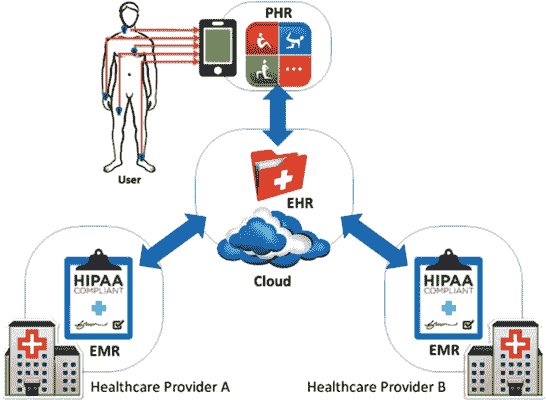

图 2.1 使用区块链技术维护 EHR 数据的架构工作流。

\[原创（由作者创作）\]

身份和访问管理在维护患者数据的隐私和安全方面发挥着关键作用。去中心化身份解决方案为患者和医疗服务提供者分配唯一标识符，促进生态系统内的安全交互。访问控制机制通过加密密钥建立，确保只有授权人员才能访问特定的患者记录。互操作性层解决了医疗保健领域长期存在的数据碎片化挑战。标准化的数据格式和术语确保了不同系统之间的一致性和兼容性。数据映射将现有数据转换为这些标准化格式，实现无缝数据交换并改善护理协调。安全和隐私在基于区块链的 EHR 中至关重要。加密在数据静止和传输过程中保护患者数据，确保机密性。同意管理通过智能合约促进，授予患者控制谁可以访问其数据以及出于何种目的访问的能力。

## 2.5.1 私有链与公有链

> 私有区块链：私有区块链是受限网络，只有授权参与者才能加入并参与共识过程。由于其对数据访问的增强控制、更高的隐私性以及符合行业法规，这些网络在医疗保健领域备受青睐。医疗机构可以在受控环境中协作，确保只有可信实体可以验证交易并访问敏感的患者数据。这种架构适用于医疗服务提供者、保险公司和监管机构的联盟在保持数据隐私的同时协作的场景。

> 公有区块链：公有区块链，如著名的比特币和以太坊网络，对任何人开放，并依赖去中心化共识机制。虽然公有区块链提供了无与伦比的透明度和不可变性，但由于隐私问题和数据安全法规，它们可能不太适合医疗保健。患者保密性和法规合规性通常需要对数据访问有更大的控制权，而私有区块链可以提供这种控制权。

## 2.5.2 许可网络与非许可网络

> 许可网络：在许可网络中，参与者需要明确许可才能加入并验证交易。这种架构与医疗联盟的协作性质以及监管要求非常契合。医疗机构可以在已知参与者之间建立信任，为数据交换维持受控环境。与非许可网络相比，许可网络提供了更高的可扩展性，使其适用于有限数量的利益相关者需要进行交互，同时确保数据隐私的场景。

> 非许可网络：非许可网络，如公有区块链中所见，允许任何参与者加入并验证交易。虽然非许可网络提供了高度的去中心化和抗审查能力，但由于患者数据的敏感性以及需要遵守严格的数据保护法规，它们可能不适合医疗保健。医疗保健需要对数据访问和验证有更高程度的控制，使得许可网络成为更可行的选择。

## 2.5.3 混合方法

混合区块链：混合架构结合了公有链和私有链的元素。它们为某些交易或数据共享提供了公有链的灵活性，同时为敏感信息保持了私有链的控制和隐私。混合方法可以满足某些数据需要对更广泛的生态系统开放，同时确保机密患者数据在受限网络中保持安全和合规的场景。

架构模型的选择取决于对数据敏感性、监管要求、协作需求以及所需去中心化程度等因素的仔细分析。医疗机构必须在数据安全性和可访问性之间取得平衡，将其架构决策与特定的用例和合规义务相一致。随着区块链与 EHR 系统集成的发展，选择适当的架构模型变得至关重要，以创建一个具有韧性且有效的解决方案，既能增强医疗数据管理，又能确保患者隐私和法规合规性。

## 2.6 挑战与问题

虽然将区块链技术与 EHR 系统集成有望彻底改变医疗数据管理，但它并非没有挑战和问题。在医疗领域实施区块链引入了一系列需要仔细考虑和战略解决方案的复杂性。本节深入探讨了在尝试将区块链技术的变革潜力与医疗数据管理的复杂性协调一致时出现的多方面挑战和问题。通过承认和剖析这些挑战，利益相关者可以更好地导航通往利用基于区块链的 EHR 优势的道路，同时主动解决前方的障碍。在患者隐私、数据机密性和区块链固有的透明度之间保持微妙的平衡，提出了需要细致关注的复杂挑战。虽然区块链的不可变性和透明度提供了增强的数据安全性，但在医疗环境中解决数据隐私问题引入了需要全面解决方案的复杂性。

## 2.6.1 匿名数据


# 匿名化数据

匿名化数据是指与化名或唯一标识符相关联，而非与个人真实身份相关联的一种信息类型。在基于区块链的电子健康记录（EHR）及其他数据管理系统的语境下，匿名化数据用于在允许授权方访问和与数据交互的同时增强隐私。化名作为个人实际身份的占位符，减少了数据与个人现实世界信息之间的直接关联。匿名化数据的概念在数据透明性、完整性和安全性至关重要的情况下尤其相关，例如在医疗保健领域。匿名化旨在通过允许用户与系统交互并共享数据，而不必披露其完整身份，来提供一定程度的隐私保护。相反，一种称为化名的加密标识符或令牌用于在交易和交互中代表个人 \[9\]。

例如，在基于区块链的 EHR 系统中，患者健康记录可以与化名相关联，而不是患者的姓名。这样，医疗数据保持机密，同时仍允许医疗保健提供者、研究人员或授权方访问治疗或分析所需的信息。匿名化链接可以通过加密技术、访问控制和智能合约进行管理，以确保只有拥有必要权限的人才能解密或访问与特定化名相关联的数据。匿名化数据管理在数据隐私和数据实用性之间取得了平衡。它使患者能够共享信息，同时保护其个人身份，这在涉及敏感信息的环境中（例如医疗保健）尤其关键。然而，它也引入了管理访问、确保数据完整性以及在必要时将化名与真实身份同步方面的挑战。因此，各种研究工作和方法正在被探索，以增强区块链和其他安全数据系统中匿名化数据管理的有效性。下面是关于匿名化数据及其优缺点的工作说明。

## Samanthula 等人

Samanthula 等人 \[10\] 提出了一种创新的匿名化数据方法：在他们的研究中，作者探讨了在医疗保健区块链中应用零知识证明，以在保持数据实用性的同时增强匿名性。零知识证明允许各方证明陈述的有效性，而无需透露任何特定信息。通过采用这种加密方法，他们实现了更高水平的数据隐私，使患者能够授予其记录的访问权限，而无需泄露敏感细节。其优势在于在透明性和机密性之间取得平衡；授权参与者可以验证数据的真实性，而不会损害个人身份。然而，实施零知识证明会引入计算开销和复杂性，可能会影响系统性能，并增加开发和可审计性的难度。

## Du 等人

Du 等人 \[11\] 提出了一种混合方法，将加密技术与访问控制机制相结合。他们的方法涉及为患者分配唯一标识符，这些标识符可以匿名地链接到其真实身份。智能合约管理对患者数据的访问，授权方可以使用化名请求访问，而受信任的机构在链下验证其身份。这种方法在透明性和隐私之间取得了平衡，允许授权访问，同时最大限度地降低暴露患者身份的风险。然而，这种混合模型需要仔细同步链上和链下数据，并在管理访问方面引入了额外的复杂性层。

## Haddad 和 Aziz

Haddad 和 Aziz \[12\] 提出了一种基于患者控制的匿名性框架，利用区块链提供细粒度的同意管理。患者使用加密密钥控制对其健康记录的访问。访问请求由区块链网络使用零知识证明进行验证。这种方法使患者能够根据特定条件匿名地授予访问权限。这种方法的优势在于患者在数据共享决策中发挥积极作用。然而，区块链的去中心化特性可能会导致在高效处理大量访问请求方面出现挑战，可能会影响系统响应能力。

## Othman 等人

Othman 等人 \[13\] 的研究重点是通过共识机制增强匿名性。他们提出了一种保护隐私的共识协议，该协议加密交易，同时保持患者的匿名身份。这种方法确保只有授权参与者才能解密和验证交易，从而增强数据安全性和患者隐私。这种方法的优势在于其直接集成到共识过程中，降低了协议级别未经授权访问的风险。然而，加密和解密过程可能会引入计算开销，可能会影响区块链网络的可扩展性。倡导将数据最小化作为增强匿名性的措施。通过直接在区块链上存储最少的患者数据，并利用链外存储存储更详细的记录，该方法减少了敏感信息的暴露。这种方法符合隐私设计原则。数据最小化的优势在于降低与未经授权访问敏感数据相关的风险。然而，确保链外数据的同步、安全性和完整性面临挑战，数据粒度与可访问性之间的权衡必须得到仔细管理。

这些研究贡献凸显了基于区块链的电子健康记录中匿名化数据管理的复杂性。虽然各种方法为增强患者隐私提供了有希望的解决方案，但每种方法都有其自身的优缺点。在透明性和机密性之间取得正确的平衡仍然是开发基于区块链的医疗保健系统时的一个关键考虑因素。

## 2.6.2 同意的粒度


# 管理同意粒度

管理同意粒度在区块链支持的电子健康记录（EHR）中是一项多方面的挑战，尤其是在努力使患者自主权与数据访问需求相一致时。传统的患者同意模型通常是二元性质的，缺乏适应医疗保健中多样化场景所需的复杂性。为了解决这个问题，Dagher 等人（2019）提出了一种混合方法，将加密技术与访问控制机制相结合。该方法涉及为患者分配唯一标识符，允许与真实身份进行假名链接。智能合约随后根据这些标识符促进对患者数据的访问，从而实现同意管理的细粒度方法。其优势在于授予患者向其记录提供细粒度访问的能力，同时减轻暴露个人身份的风险。然而，这种方法引入了维护链上和链下数据同步的挑战，需要仔细考虑以确保一致的访问控制。此外，Zhang 等人 \[14\] 主张一种由区块链智能合约驱动的动态同意机制。他们提出了一种自适应模型，患者可以为其记录的不同方面指定不同级别的数据共享同意。通过将这些偏好嵌入智能合约，患者可以在个案基础上保留对其数据访问的控制。这种方法增强了患者的主动性，并符合知情同意原则。其优势在于使患者能够定制其同意选择，但管理大量合约的潜在复杂性需要一个设计良好的用户界面来促进可用性。

在互补方面，Ekblaw 等人 \[15\] 引入了“代理密钥”的概念，作为调节数据访问粒度的一种手段。代理密钥允许患者使用预定义条件将访问权限委托给不同方。这种方法确保患者记录的特定方面可以由指定实体访问，从而增强数据粒度。这种方法的优势在于其灵活性，使患者能够对其数据共享偏好进行分类。然而，挑战在于在委托的便利性与过于复杂的访问结构的风险之间取得正确的平衡。此外，Yin 等人 \[16\] 提出了一个全面的框架，其中数据共享协议通过智能合约进行管理，允许患者定义同意的范围和持续时间。智能合约强制执行访问限制，并在预定义期限后自动撤销权限，确保时间粒度。其优势在于增强患者对数据的控制，同时最大限度地减少长期未经授权访问的风险。然而，确保智能合约与不断发展的法规和患者偏好同步是一个持续的挑战。

最后，Roehrs 等人 \[17\] 主张一种以患者为中心的方法，强调教育工具和界面的重要性，这些工具和界面使患者能够有效地理解和管理其同意选择。他们提出了一个同意仪表板，患者可以在其中修改其偏好并查看访问历史。这种方法优先考虑患者参与，并符合共同决策的精神。其优势在于促进透明和参与性的同意过程。然而，挑战仍然在于设计对不同数字素养水平的患者都直观、信息丰富且易于访问的界面。在区块链支持的 EHR 领域，解决同意的粒度对于尊重患者自主权和数据隐私至关重要。加密技术、智能合约和用户友好界面的融合提供了有希望的解决方案，但需要仔细关注，以在细粒度访问控制和可用性之间取得正确的平衡。

## 2.6.3 加密和密钥管理

在区块链支持的 EHR 领域，确保患者数据的机密性和安全性至关重要。加密和密钥管理成为实现这一目标的关键组成部分。加密涉及将敏感信息转换为只能使用适当的解密密钥才能解密的不可读格式。将加密技术与区块链技术有效集成不仅保护患者隐私，还解决与未经授权的访问和数据泄露相关的问题。伴随加密，密钥管理策略对于安全地生成、存储、分发和撤销加密密钥至关重要。在区块链环境中协调加密和密钥管理是一项复杂但必不可少的挑战，需要仔细考虑以在数据安全性和可访问性之间取得微妙的平衡。

Yin 等人 \[18\] 提出了一种数据共享框架。他们采用基于属性的加密（ABE）和智能合约来管理访问权限。患者数据使用属性进行加密，智能合约强制执行访问控制。其优势在于细粒度控制和机密性，但 ABE 的计算开销和智能合约的复杂性可能会影响系统性能。Azaria 等人 \[1\] 介绍了 MedRec。加密数据存储在链下，Ethereum 智能合约管理访问。链下存储减少了区块链臃肿，而智能合约确保精确控制。然而，同步挑战和智能合约的可扩展性限制是缺点。Dagher 等人 \[19\] 展示了 MedChain。他们使用 ABE 进行数据加密，并使用区块铜进行密钥分发。患者通过智能合约提供同意。ABE 确保隐私和透明度，患者保持控制。然而，密钥管理的复杂性和 ABE 的计算开销可能会带来挑战。

Ekblaw 等人 \[15\] 提出了 MedRec 2.0。他们引入了“代理密钥”用于访问委托。患者保持数据控制，允许授权方进行特定访问。虽然灵活，但管理复杂的代理密钥层次结构可能具有挑战性。Xu 和 Zhu \[20\] 展示了一个 EHR 系统。他们使用区块链和层次结构属性结构进行数据访问控制。区块链确保数据完整性和安全的密钥分发。层次结构属性提供灵活性，但管理它们和区块链的计算开销可能会影响系统可用性。这些作者共同强调了加密和密钥管理在基于区块链的 EHR 中的重要性。虽然他们提出的方法在数据隐私和访问控制方面提供了优势，但必须应对复杂性、计算开销和可扩展性等挑战，才能创建有效且安全的医疗数据系统。

## 2.6.4 链下数据

在区块链支持的 EHR 的复杂领域中，管理链下数据的挑战成为一个关键考虑因素。链下数据涵盖由于其体量或敏感性而存储在区块链之外的信息，以解决可扩展性限制并确保高效的数据管理。这引入了在优化区块链技术优势的同时，在保持数据完整性、安全性和可访问性之间取得微妙平衡的需求。因此，探索将链下数据纳入基于区块链的 EHR 系统的方法和解决方案，对于解决这些复杂考虑因素至关重要 \[21\]。


# Zohrevand 和 Beznosov 的混合数据存储方案

Zohrevand 和 Beznosov \[22\] 提出一种混合数据存储方案。他们提出一种混合解决方案，其中关键患者数据使用 IPFS 存储在链下，而基本元数据存储在链上。这确保了大文件不会使区块链臃肿，同时保持数据完整性和可追溯性。其优势在于高效的数据管理，但挑战包括确保链上和链下存储之间的数据同步一致。

# Ekblaw 等人的 MedRec 2.0

Ekblaw 等人 \[15\] 介绍 MedRec 2.0。他们利用链下存储来存放患者记录，提高可扩展性。MedRec 2.0 的方法允许在链上引用医疗数据，而实际文件存储在链下。这最大限度地减少了区块链的存储负担，同时保持数据可用性。然而，管理链上引用与链下存储之间的数据同步和访问控制会带来复杂性。

# Kuo 等人的区块链混合架构

Kuo 等人 \[23\] 提出区块链混合架构。他们的系统采用链下存储来存放医疗记录，提高可扩展性。患者数据被加密并存储在链下，而访问控制和权限通过区块链智能合约进行管理。这种方法解决了区块链可扩展性问题，同时确保数据机密性。不过，确保同步访问控制和数据可用性的潜在挑战需要谨慎考虑。

# Mohsin 等人的隐私保护 EHR 系统

Mohsin 等人 \[24\] 提出一种隐私保护 EHR 系统。他们利用链下存储来存放加密的患者数据，确保只有授权方才能访问。链下存储支持高效的数据管理，同时保持患者隐私。然而，这种方法的潜在劣势在于解决加密链下数据与区块链上的访问控制机制之间的同步问题。

# Chen 等人的隐私与可扩展性探讨

Chen 等人 \[25\] 探讨隐私和可扩展性。他们强调了像安全多方计算（SMPC）这样的链下解决方案，以在解决可扩展性问题的同时增强隐私。SMPC 允许在不暴露实际数据的情况下对加密数据进行计算，从而增强机密性和可扩展性。这种方法的优势在于有可能在计算过程中保护隐私，但将 SMPC 与区块链集成可能会引入集成复杂性。

在区块链支持的 EHR 系统中引入链下数据，成为优化可扩展性、隐私性和数据可访问性的关键考量。虽然链下存储提供了显著优势，但与数据同步、访问控制和系统复杂性相关的挑战需要精心规划，以确保区块链的优势与管理敏感且海量的患者信息的复杂性能够和谐统一。

## 2.6.5 监管合规

在不断发展的区块链支持的 EHR 领域，在利用去中心化技术优势的同时遵守严格的监管框架，引入了监管合规的挑战。区块链的透明性和不可篡改性与医疗数据的敏感性和受监管性质的交汇，需要仔细考虑，以确保患者隐私、数据安全和法律要求得到有效平衡。

# Pilkington 等人的区块链与 GDPR 兼容性研究

Pilkington 等人 \[26\] 研究区块链与 GDPR 的兼容性。Pilkington 探讨了区块链与欧盟《通用数据保护条例》（GDPR）的兼容性。虽然区块链的透明性与 GDPR 的原则一致，但由于数据的永久性和“被遗忘权”，挑战随之而来。其优势在于促进透明性，但在区块链环境中解决 GDPR 的细微差别可能会带来挑战。

# Shaikh 等人的区块链与健康数据共享分析

Shaikh 等人 \[27\] 分析区块链与健康数据共享。他们讨论了区块链在实现受控健康数据共享方面的潜力，同时解决 HIPAA 合规性问题。区块链的数据共享模型可以与以患者为中心的控制和隐私要求保持一致。然而，挑战包括在复杂的监管环境中集成区块链，并确保去中心化不会损害数据安全。

# Ouaddah 等人的区块链 EHR 与 GDPR 探讨

Ouaddah 等人 \[28\] 探讨区块链 EHR 与 GDPR。他们提出了一种符合 GDPR 原则的基于区块链的 EHR 系统。患者通过智能合约控制数据访问，确保透明度和用户同意。其优势在于实现以患者为中心的数据共享，但将 GDPR 原则集成到智能合约逻辑中，并确保在不同司法管辖区合规，仍然是挑战。

# Yin 等人的患者同意与合规研究

Yin 等人 \[16\] 强调患者同意与合规。他们的方法将患者同意与区块链相结合，确保符合 HIPAA 和 GDPR。智能合约管理同意和访问，增强患者控制权。其优势在于赋予患者权力，但挑战包括将复杂法规转化为可执行的智能合约，以及解决法规之间的潜在冲突。

# Yin 等人的 MedChain 隐私框架

Yin 等人 \[29\] 提出 MedChain 的隐私框架。他们提出 MedChain 作为解决隐私问题和监管合规的方案。MedChain 采用基于属性的加密来符合数据保护法规。其优势在于在保持透明度的同时确保数据隐私，但潜在挑战包括向用户介绍合规机制，以及解决各种法规的复杂性。

图 2.2 中的用例图概述了患者注册如何以安全方式进行，以及区块创建过程如何进行。

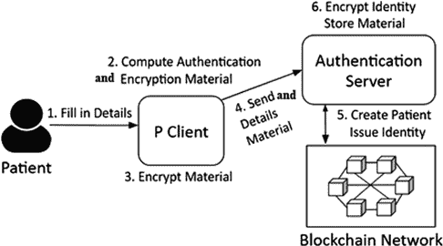

图 2.2 安全创建区块的患者注册。

\[原始（由作者创建）\]

*   > 参与者初始化：序列始于授权参与者（例如医疗服务提供者或经过身份验证的用户）启动更新患者 EHR 数据的过程。

*   > 身份验证与授权：参与者与系统交互以验证其身份，并获得修改 EHR 数据所需的权限和访问权。

*   > 数据准备：在更新 EHR 之前，参与者准备要纳入的新数据。这可能包括医疗报告、治疗记录或任何其他相关患者信息。

*   > 数据验证：新数据经过验证过程，以确保其准确性、合法性以及符合医疗标准。验证方法可能包括数字签名、共识机制或医疗专业人员的验证。

*   > 数据哈希：验证后，新数据被转换为唯一的加密哈希。此哈希作为数据的安全表示。

*   > 区块链更新请求：参与者向区块链组件提交请求，表示其意图更新患者的 EHR 数据。

*   > 区块链处理：区块链组件处理请求，并根据预定义规则和共识机制评估其有效性。

*   > 区块链数据更新：如果请求有效并符合所需标准，则区块链将使用代表新数据的加密哈希进行更新。此更新通常通过智能合约或共识过程执行。

*   > 时间戳：为了保持患者 EHR 的时间顺序历史，区块链为数据更新分配时间戳，记录修改发生的时间。


> 审计追踪：与数据更新相关的所有操作，以及对 EHR 的访问，都会在区块链上被仔细记录。该审计追踪确保透明度，并提供审计和问责的手段。

> 流程完成：数据更新过程成功结束，患者在区块链上的 EHR 现在包含新添加或修改的信息。

此序列图提供了在区块链上更新 EHR 数据所涉及的顺序交互和步骤的简化表示。

## 2.7 案例研究与当前举措：探索区块链-EHR 集成

将区块链技术与 EHR 系统集成具有彻底改变医疗保健数据管理的变革潜力。近年来，已出现多个项目、举措和试点实施来探索这一交叉领域，旨在增强数据安全性、互操作性和患者控制权。本节深入探讨了著名的案例研究和正在进行的举措，揭示了在区块链与 EHR 系统集成中取得的成功和学到的经验 \[30\]。

### 2.7.1 MedRec：区块链-EHR 集成的先驱

该领域的先驱项目之一是 MedRec，这是由 Ekblaw 等人开发的去中心化 EHR 系统 \[15\]。MedRec 利用区块链为患者提供对其医疗记录的控制权，并增强医疗保健提供者对数据的可访问性。通过将加密的患者记录存储在链下，MedRec 解决了数据可扩展性问题，同时利用区块链的透明性和不可篡改性来维护数据完整性。该项目表明，区块链可以提供一种以患者为中心的数据共享方法，促进信任并增强医疗保健提供者之间的数据可移植性。

### 2.7.2 Guardtime：确保数据完整性

Guardtime 与爱沙尼亚电子健康基金会合作，踏上了利用区块链保障医疗记录完整性的旅程。通过实施基于区块链的数据时间戳和不可篡改性，他们旨在防止对医疗记录的未经授权的篡改。该举措旨在建立可审计的数据修改轨迹，确保记录的真实性，同时遵守数据保护法规。

## 2.8 结论

区块链技术对 EHR 管理的潜在变革性影响是深远且广泛的。这种初步的协同效应有能力重塑医疗保健数据处理，催化一种转变，即患者对其记录拥有前所未有的控制权，而提供者则能访问安全且准确的数据。尽管挑战依然存在，包括跨学科合作、法规协调和以用户为中心的设计，但创建一个更加透明、以患者为中心和安全的医疗保健生态系统的愿望推动着进步。通往区块链支持的 EHR 系统的道路可能充满挑战，但它充满了重新定义医疗保健未来的机遇。对患者隐私、数据安全和医疗保健卓越的承诺将成为塑造区块链潜力与 EHR 关键作用汇聚的格局的指引之光，最终为改善患者护理、简化流程和更具韧性的医疗保健行业铺平道路。当我们站在这个十字路口时，研究人员、从业者和利益相关者的协作努力将引导方向走向变革性的未来。

## 参考文献

1. Azaria, A., Ekblaw, A., Vieira, T., & Lippman, A. (2016). MedRec: Using blockchain for medical data access and permission management. In International Conference on Open and Big Data (pp. 25–30).

2. Li, H., Zhu, X., Lyu, L., Guo, Z., & Wu, D. (2018). A secure privacy-preserving key management scheme for blockchain-based electronic health records system. IEEE Access, 6, 44849–44859.

3. Zohrevand, P., & Beznosov, K. (2018). Personal health records: Privacy and security considerations for mobile apps. International Journal of Medical Informatics, 112, 54–71.

4. Conoscenti, M., Vetrò, A., & De Martin, J. C. (2016). Blockchain for the internet of things: A systematic literature review. IEEE Access, 4, 2292–2303.

5. Shusterman, D., & Krawiec, R. J. (2017). Utilizing blockchain technology for personal health records. Journal of Health & Medical Informatics, 8(1), 261.

6. Roehrs, A., da Costa, C. A., & Righi, R. R. (2016). OmniPHR: A distributed architecture model to integrate personal health records. In 2016 IEEE 29th International Symposium on Computer-Based Medical Systems (CBMS) (pp. 459–464).

7. Iqbal, M. F., Asim, M., & Umair, M. (2019). A blockchain based framework for healthcare data sharing with patients consent. IEEE Access, 7, 114002–114011.

8. Alqarni, K. S., Almalki, F. A., Soufiene, B. O., Ali, O., & Albalwy, F., Authenticated wireless links between a drone and sensors using a blockchain: Case of smart farming. Wireless Communications and Mobile Computing, 2022, 4389729, 2022. [`doi.org/10.1155/2022/4389729`](https://doi.org/10.1155/2022/4389729)

9. Gupta, S., Alharbi, F., Alshahrani, R., Kumar Arya, P., Vyas, S., Elkamchouchi, D. H., & Soufiene, B. O. Secure and lightweight authentication protocol for privacy preserving communications in smart city applications. Sustainability, 2023, 15, 5346. [`doi.org/10.3390/su15065346`](https://doi.org/10.3390/su15065346).

10. Samanthula, B. K., & Parikh, R. B. (2020). A blockchain based EHR sharing and access control scheme for COVID-19 pandemic. Journal of Medical Systems, 44(8), 1–11.

11. Du, J., Wang, S., & Fang, Y. (2019). A novel blockchain-based privacy-preserving EHR sharing scheme for healthcare 4.0. IEEE Access, 7, 13519–13527.

12. Haddad, P., & Aziz, A. (2019). A novel blockchain framework for data sharing in EHRs. Journal of Ambient Intelligence and Humanized Computing, 10(12), 4753–4763.

13. Othman, S. B., Almalki, F. A., & Sakli, H. (2022). Internet of Things in the Healthcare Applications: Overview of Security and Privacy Issues. In: Chakraborty, C., Khosravi, M.R. (eds) Intelligent Healthcare. Springer, Singapore. [`doi.org/10.1007/978-981-16-8150-9\_9`](https://doi.org/10.1007/978-981-16-8150-9_9)

14. Zhang, P., White, J., Schmidt, D. C., & Lenz, G. (2020). Blockchain technology use cases in healthcare: A systematic review. Journal of Medical Systems, 44(7), 1–14.

15. Ekblaw, A., Azaria, A., Halamka, J. D., & Lippman, A. (2016). A case study for blockchain in healthcare: “MedRec” prototype for electronic health records and medical research data. In Proceedings of IEEE Open & Big Data Conference (OBD) (pp. 1–8).

16. Yin, S., Nong, G., Shao, L., & Zhang, W. (2019). An access control method of electronic medical records based on blockchain technology. Future Generation Computer Systems, 95, 511–517.

17. Roehrs, A., da Costa, C. A., da Rosa Righi, R., & da Silva, D. S. (2017). OmniPHR: A distributed architecture model to integrate personal health records. Journal of Biomedical Informatics, 71, 70–81.


18. Yin, J., Lamp, J., Cameron, K., Wurtz, R., & Chen, H. (2017). A blockchain framework for patient-centered health records and sharing behavior consent. In International Conference on Security and Privacy in Communication Systems (pp. 25–44).

19. Dagher, G. G., Marella, P. B., & Malluhi, Q. M. (2018). MedChain: Efficient blockchain-based healthcare system with decentralized access control. Journal of Medical Systems, 42(7), 130.

20. Xu, R., & Zhu, Y. (2018). Patient self-controlled medical record based on blockchain technology. Journal of Medical Systems, 42(8), 1–9.

21. Kang, J. M., Ryu, S. Y., & Kim, D. (2018). A survey of mobile blockchain: Architecture, consensus, and network. Journal of Communications and Networks, 20(4), 393–402.

22. Zohrevand, P., & Beznosov, K. (2017). A systematic literature review on blockchain technology for secure sharing of medical electronic records. In 2017 IEEE 19th International Conference on e-Health Networking, Applications and Services (Healthcom) (pp. 1–6).

23. Kuo, T. T., Kim, H. E., & Ohno-Machado, L. (2017). Blockchain distributed ledger technologies for biomedical and health care applications. Journal of the American Medical Informatics Association, 24(6), 1211–1220.

24. Mohsin, A., Jararweh, Y., Al-Ayyoub, M., Gupta, B. B., & Gupta, B. (2018). BCDS-health: Permissioned blockchain-based system for secure and efficient sharing of electronic health records. Future Generation Computer Systems, 86, 1106–1116.

25. Chen, M., Mao, S., & Liu, Y. (2014). Big data: A survey. Mobile Networks and Applications, 19(2), 171–209.

26. Pilkington, M. (2016). Blockchain Technology: Principles and Applications. Research Handbook on Digital Transformations, 1–33. Edward Elgar. [`https://ssrn.com/abstract=2662660`](https://ssrn.com/abstract=2662660)

27. Shaikh, Z. A., Memon, A. A., Shaikh, A. M., Soomro, S., & Sayed, M. (2023). Blockchain in healthcare: Unlocking the potential of blockchain for secure and efficient applications for medical data management—A presentation of basic concepts. Liaquat Medical Research Journal, 5(2). [`https://doi.org/10.38106/LMRJ.2023.5.2-08`](https://doi.org/10.38106/LMRJ.2023.5.2-08)

28. Ouaddah, A., Elkalam, A. A., & Ouahman, A. A. (2017). Towards a novel privacy-preserving access control model based on blockchain technology in IoT. In 2017 IEEE International Conference on Cloud Computing Technology and Science (CloudCom) (pp. 229–236).

29. Yin, J., Srinivasan, S., Wang, K., & Jiang, Z. (2018). A blockchain-based framework for data sharing with fine-grained access control in decentralized storage systems. Journal of Parallel and Distributed Computing, 118, 112–123.

30. Ekblaw, A., Azaria, A., Halamka, J. D., & Lippman, A. (2016). A case study for blockchain in healthcare: “MedRec” prototype for electronic health records and medical research data. In Proceedings of IEEE Open & Big Data Conference (pp. 1–8).

# 基于区块链技术的医疗监测系统：追踪公开捐赠并最大限度地缩小器官贩卖范围

Puneeta Singh 和 Shrddha Sagar

DOI: [`10.1201/9781003483113-3`](https://doi.org/10.1201/9781003483113-3)

## 3.1 引言

在不断发展的医疗技术领域，器官管理系统是一项变革性举措，利用区块链、智能合约和以太坊等尖端技术的力量。在深入探讨我们项目的具体细节之前，让我们先来了解支撑这一创新平台的基础技术 \[1\]。

区块链是一种去中心化的分布式账本技术，确保数据的透明性、安全性和不可篡改性。在器官管理系统中，区块链作为防篡改记录保存系统的基础 \[2\]。通过在计算机网络中去中心化数据，该系统保证了与器官捐赠相关活动的完整性，提供了无与伦比的信任和安全性。区块链是一种革命性技术，运行在去中心化网络上，通过共识算法建立信任，确保交易的透明和安全。其由加密哈希驱动的不可篡改记录保存防止了篡改和欺诈。智能合约自动执行协议，减少了对中介的需求，而透明性和可追溯性使参与者能够查看整个交易历史。通过各种共识机制确保有效性，区块链促进了分布式网络中安全、透明且防篡改的交易。这些共识机制，如工作量证明（PoW）、权益证明（PoS）、委托权益证明（DPoS）和实用拜占庭容错（PBFT），在没有中央机构的情况下验证并就区块链的状态达成一致 \[3\]。

我们项目的核心在于智能合约的实现，智能合约是将协议条款直接写入代码的自动执行合同。这些合同自动化并强制执行预定义规则的执行，确保交易的透明性和效率。在器官管理系统中，智能合约在管理和保障器官捐赠过程中发挥着关键作用，为每一次交互增加了额外的信任层。智能合约是区块链创新的标志，重新定义了自动化协议的格局。由以太坊等平台开创，智能合约是具有编码条款的自动执行程序，消除了合同流程中对中介的需求 \[4\]。这些合同运行在去中心化网络上，当预定义条件满足时自动执行操作，增强了各行业的透明度、效率和信任。智能合约已成为去中心化应用（DApps）的组成部分，支持从金融到供应链管理等各种功能 \[5\]。其多功能性，加上区块链上的防篡改执行，标志着协议概念化和执行方式的范式转变，为未来交易和合同关系提供了安全且自动化的基础 \[6\]。

> 公有区块链：它具有极高的信任度，没有中央机构，允许用户进行读写操作，但也消耗大量能源 \[7\]。

> 私有区块链：对区块链的访问或修改可能仅限于控制它的特定实体。它是一个去中心化的区块链，可靠性较低。当吞吐量高时，能耗较低 \[8\]。

> 联盟区块链：它可以由一组公司拥有，组内每个成员都可以对其进行读写。也被称为部分去中心化的区块链，它能耗较低且吞吐量高 \[8\]。

> 混合区块链：混合区块链可能像公有区块链一样为所有参与者提供读写权限。它提供适度的可信度和一定程度的中心化 \[9\]。

## 3.2 相关文献综述


# 文献综述

根据 Alqarni 等人 \[10\] 的说法，区块链技术可以通过减少其产生的区块数量来潜在地降低对人力劳动的需求，同时保护物联网（IoT）智能传感器免受黑客攻击并促进透明度。存在许多安全漏洞，例如身份验证延迟和伪造攻击。

为了解决安全问题，Singh 和 Verma \[11\] 提议将区块链技术与 CIA（机密性、完整性和可用性）公式结合使用。它可以取代当前的物联网系统。他们将不得不处理完整性和保密性问题。

Araujo-Inastrilla 和 Vitón-Castillo \[12\] 建议，网络功能虚拟化（NFV）、控制和行政功能以及与物联网设备的集成可用于提供 5G 技术。本文探讨了许多与区块链相关的主题，包括立法和标准化。人工智能（AI）和区块链技术可以帮助解决这些问题。

Lakhan 等人 \[13》指出，共识机制的概念可以用于将区块链技术与物联网设备相结合。区块链及其物联网传感器可以生成基于哈希的身份验证代码，并利用共享密钥使用随机函数建立块节点。选举的获胜者是块节点，也称为离线快速选举节点。在块节点为区块链流程更新之前，还引入了 AI 技术来消除传感器异常值。

Ahmad 等人 \[14》建议物联网传感器相互连接并与每个节点共享信息。作者同意使用去中心化技术可能解决集中式基础设施的一个重大问题。

Sun 及其同事 \[15》讨论了物联网的安全性、可靠性和透明度作为三个主要问题。借助区块链技术的基本特征——去中心化，最关键的方面在于共识机制。该过程确保网络中所有相互连接并利用智能合约、数据加密、解密、工作量证明和权益证明机制的节点协调一致且安全地运行。

Tareen 等人 \[16》建议使用物联网记录所有患者数据。在利用患者数据收集数据时，这项研究特别关注安全性和患者隐私。保持数据完整性具有挑战性。

Singh \[6》讨论了区块链技术的分布式特性及其各种用途，包括联盟链、公有链和私有链。此外，本文还详细解释了区块链，包括隐私、机密数据和身份验证。

Pathak 等人 \[17》提议，智能物流能够快速有效地移动货物。物联网和新技术大大缩短了提前期，使物流管理更加容易。它更多地依赖数字技术，并使用更少的资源——人员、运输、文件和其他事物。但是，这也可能导致数据窃取和隐私侵犯等问题。尽管如此，物联网和区块链技术的集成将提高数字物流系统的安全性。

Elgamal 等人 \[18》提议，尽管存在物联网安全风险，但区块链技术提供的安全通信平台可用于解决该问题。区块链技术将使用智能合约用于安全相关目的。

David 解释了医疗保健部门如何运作以及它如何影响信息技术 \[19》以及个人数据的隐私和安全性。这项技术提高了其有效性、韧性和透明度。

# 表格

表 3.1 概述了相关差距。

表 3.1 研究差距

| 区域关注 || 研究缺陷 |

| QoSResult 成就 || |

*   > 未考虑聚类，一些已发表的研究成功地将数据直接传输到沉节点，这通过造成不必要的延迟而对服务质量产生负面影响 \[20\]。

*   > 虽然许多已发表的文章进行了聚类，但网关对聚类数据在间隔和延迟方面的处理不足也会对服务质量产生不利影响 \[21\]。

*   > 当前研究中使用的路由协议有限，通信可靠性较差，并遭受传输错误，这些错误也会影响 QoS \[22\]。

| 安全实现 || |

*   > 多项正在进行的计划优先考虑数据安全而非身份验证，这会影响患者隐私 \[23\]。

*   > 许多最先进的作品采用复杂的加密技术进行数据加密和身份验证，这会增加 WBAN-IoT 网络的能耗 \[8\]。

*   > 由于当前工作存在一些限制，WBAN-IoT 环境容易受到冒充和虚假注入攻击等严重攻击的影响，这些攻击仅考虑最低限度的安全措施来确保安全 \[24\]。

| 区块链 || |

*   > 传统区块链架构的特点是高能耗、延迟以及区块生成和验证时间的可扩展性问题。由于资源限制，WBAN-IoT 不适合解决典型区块链的这些问题 \[25\]。

| 来源：\[原创（由作者创作）\]。 |

## 3.3 问题陈述

*   > 聚类过程无效，因为当使用许多传感器时，聚类特征（CF）计算可能耗时，并且不能始终确保生成最佳解决方案。这项工作减少了重复数据的数量，但未考虑异常（故障）数据。这意味着簇头（CH）会消耗大量能量和带宽。

*   > 当两个传感器通过同一信道同时通信时，会产生干扰。通过次优节点进行多跳传输会导致交付率下降和能耗增加。

## 3.4 动机

*   > 器官短缺危机：全球移植器官短缺是一个紧迫问题。数百万人需要挽救生命的器官移植，可用器官的短缺导致等待时间延长和死亡率增加。

*   > 传统系统的低效：传统的器官捐赠系统常常面临低效问题，包括捐赠者与受赠者匹配延迟、分配过程缺乏透明度以及维护安全且可访问的医疗记录方面的挑战。

*   > 地理障碍：地理障碍可能阻碍潜在器官捐赠者与受赠者的及时识别和连接。器官管理系统旨在通过促进本地化搜索和连接来克服这些障碍。

*   > 数据安全和信任问题：与器官捐赠过程中的数据安全、隐私和透明度相关的问题可能会导致潜在捐赠者和受赠者产生犹豫。该项目通过利用区块链技术来确保安全和透明的记录保存，以解决这些问题。


## 3.5 方法论/系统模型

## 3.5.1 系统的基本工作原理

器官管理系统运行在去中心化的区块链基础设施上，以确保器官捐赠交易的透明性、安全性和可靠性。该系统涉及三个主要参与者：捐赠者、受赠者和区块链网络，参见 图 3.1。

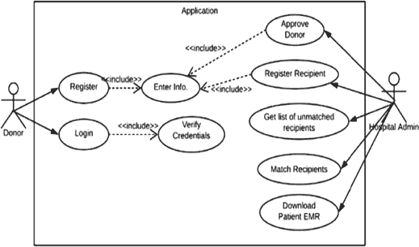

图 3.1 区块链网络。

[原创（由作者创建）]

*   > 匹配过程复杂：目前的器官捐赠匹配过程涉及复杂的算法和人工评估，可能导致延误和不准确。器官管理系统旨在通过实施智能合约来简化这一过程，根据预定义标准自动化和优化捐赠者-受赠者匹配。

*   > 通信渠道低效：潜在捐赠者、受赠者和医疗保健提供者之间的通信差距可能导致机会错失和器官匹配延误。拟议的系统集成了高效的通信渠道，利用区块链的透明性，实现所有利益相关者之间的无缝和安全的信息交换。

*   > 器官分配政策不一致：不同地区和国家之间不同的器官分配政策导致获得挽救生命的移植机会存在差异。器官管理系统通过实施符合预定义分配标准的标准化智能合约，促进一致性和公平性，确保器官分配更加公平。

*   > 捐赠者：捐赠者在平台上注册，创建包含病史、血型和器官兼容性信息的个人资料。他们表示愿意成为活体捐赠者，并指定愿意捐赠的器官。

*   > 受赠者：受赠者创建详细说明其病史、器官需求和紧急程度的个人资料。他们根据兼容性和地理位置搜索潜在捐赠者。

*   > 区块链网络：作为去中心化账本，用于记录和验证器官捐赠交易。智能合约管理器官捐赠的规则和条件，确保交易安全且透明。

## 3.5.2 数据流基本模型

图 3.2 显示了数据流模型。

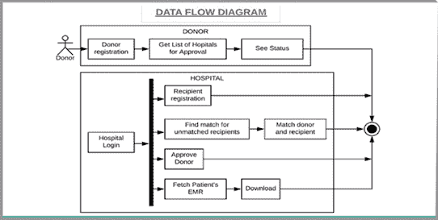

图 3.2 数据流系统。

[原创（由作者创建）]

*   > 用户注册：捐赠者和受赠者在平台上注册，提供必要的个人和医疗信息。

*   > 个人资料创建：用户创建详细的个人资料，指定其器官兼容性、病史和偏好。

*   > 搜索和匹配：受赠者根据兼容性、位置和其他相关标准搜索潜在捐赠者。系统采用算法将兼容的捐赠者与受赠者匹配。

*   > 连接建立：一旦找到匹配，用户可以通过平台发起联系，讨论进一步的细节和安排。

*   > 区块链交易：当双方同意捐赠时，智能合约在区块链上执行，安全地记录交易。

*   > 医疗验证：在最终确定交易之前，医疗专业人员验证双方的兼容性和健康状况。

*   > 器官捐赠流程：器官捐赠流程在线下进行，由医疗专业人员监督移植。

## 3.5.3 系统架构

器官管理系统遵循微服务架构，以确保可扩展性、可维护性和灵活性。图 3.3 显示了系统架构之间的通信流。组件包括以下内容：

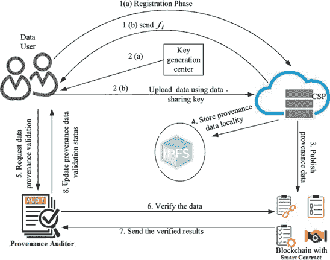

图 3.3 通信流。

[原创（由作者创建）]

*   > 用户界面 (ReactJS)：为捐赠者和受赠者提供用户友好的前端，以便与系统交互。

*   > 应用服务器 (NodeJS)：管理用户请求、身份验证以及与区块链网络的通信。

*   > 区块链网络：利用去中心化网络（例如，Hyperledger Fabric）来存储和验证器官捐赠交易。

*   > 数据库：存储非敏感用户信息并促进快速数据检索。

*   > 通信流：用户与前端交互，触发向应用服务器发送的请求。应用服务器与区块链网络通信以执行智能合约并记录交易。

    > 用户数据存储在安全的数据库中，以便快速访问和检索。

## 3.6 结果

器官管理系统的实施在解决传统器官捐赠系统固有的挑战方面取得了显著的积极成果。区块链技术的应用成功提高了整个器官捐赠流程的效率、透明度和安全性。

*   > 匹配效率提高：引入智能合约显著简化了捐赠者-受赠者匹配过程，减少了延误和不准确。自动化算法提高了识别兼容捐赠者的速度和准确性，从而缩短了受赠者的等待时间。

*   > 数据安全性和透明度增强：区块链技术的集成成功解决了与数据安全性、隐私和透明度相关的问题。区块链的去中心化和不可篡改性确保了安全的记录保存，增强了捐赠者、受赠者和医疗专业人员之间的信任。

*   > 克服地理障碍：器官管理系统的本地化搜索和连接功能有效地克服了地理障碍，能够快速识别并将潜在捐赠者与受赠者配对。这显著提高了器官捐赠机会的可及性。

*   > 促进公众意识：旨在提高公众意识的功能导致潜在捐赠者注册量增加。系统的外展举措教育并吸引了社区，有助于更好地理解器官捐赠对挽救生命的影响。

*   > 匹配效率的精确性：引入智能合约不仅加快了匹配过程，还带来了以前无法实现的精确度。自动化算法以无与伦比的准确性分析标准，从而实现快速且准确的捐赠者-受赠者配对。这大大缩短了受赠者的等待时间，在面对器官短缺危机时带来了一线希望。

*   > 加强数据安全性和信任：区块链的集成充当了抵御与数据安全性和信任相关问题的坚固屏障。区块链的去中心化特性确保敏感的医疗记录保持安全、不可篡改，并且仅对授权人员可见。这显著增强了捐赠者、受赠者和医疗专业人员对器官捐赠流程完整性的信心。

*   > 精准克服地理障碍：器官管理系统促进本地化搜索和连接的能力不仅克服了地理障碍，而且做到了精准。系统能够定位特定区域内的潜在匹配，彻底改变了器官捐赠机会的可及性，为那些以前因距离而受阻的人提供了生命线。


## 3.7 结论

总之，器官管理系统通过巧妙利用区块链技术，正处于改变全球器官短缺危机的前沿。这个创新项目有效解决了传统系统固有的低效问题，消除了地理障碍，并增强了器官捐赠流程的整体透明度和安全性。精简的匹配流程与增强的数据安全措施相结合，不仅加快了器官转移速度，还增强了用户之间的信任感。通过成功克服地理限制，该系统大大扩大了潜在捐赠者的范围，从而对缩短受者等待时间产生深远影响。此外，该系统在提高公众意识和参与度方面的显著贡献，凸显了其对器官捐赠率产生持久影响的潜力。技术创新、安全增强和社区参与的和谐结合，使器官管理系统成为一股开创性力量，有望彻底改变器官捐赠实践，并最终在全球范围内拯救无数生命。

## 参考文献

1. Gupta, S., Alharbi, F., Alshahrani, R., Kumar Arya, P., Vyas, S., Elkamchouchi, D. H., & Soufiene, B. O. (2023). Secure and lightweight authentication protocol for privacy preserving communications in smart City applications. Sustainability, 15, 5346. [`doi.org/10.3390/su15065346`](https://doi.org/10.3390/su15065346)

2. Hajian, A., Prybutok, V. R., & Chang, H. C. (2023). An empirical study for blockchain-based information sharing systems in electronic health records: A mediation perspective. Computers in Human Behavior, 138, 107471.

3. Hegde, P., & Maddikunta, P. K. R. (2023). Secure PBFT consensus-based lightweight blockchain for healthcare application. Applied Sciences, 13(6), 3757.

4. Wenhua, Z., Qamar, F., Abdali, T. A. N., Hassan, R., Jafri, S. T. A., & Nguyen, Q. N. (2023). Blockchain technology: Security issues, healthcare applications, challenges and future trends. Electronics, 12(3), 546. [`doi.org/10.3390/electronics12030546`](https://doi.org/10.3390/electronics12030546)

5. Othman, S. B., Almalki, F. A., & Sakli, H. (2022). Internet of Things in the Healthcare Applications: Overview of Security and Privacy Issues. In: Chakraborty, C., Khosravi, M.R. (eds) Intelligent Healthcare. Singapore: Springer. [`doi.org/10.1007/978-981-16-8150-9\_9`](https://doi.org/10.1007/978-981-16-8150-9_9)

6. Singh, P., Sinha, P., & Raghav, A. (2023). A Blockchain IoT Hybrid Framework for Security and Privacy in a Healthcare Database Network. In: Arumugam Suresh Kumar, et al., (eds) Dynamics of Swarm Intelligence Health Analysis for the Next Generation. (pp. 210–225). IGI Global. [`doi.org/10.4018/978-1-6684-6894-4.ch011`](https://doi.org/10.4018/978-1-6684-6894-4.ch011)

7. Sharma, P., Namasudra, S., Crespo, R. G., Parra-Fuente, J., & Trivedi, M. C. (2023). EHDHE: Enhancing security of healthcare documents in IoT-enabled digital healthcare ecosystems using blockchain. Information Sciences, 629, 703–718.

8. Ali, A., Al-Rimy, B. A. S., Alsubaei, F. S., Almazroi, A. A., & Almazroi, A. A. (2023). HealthLock: Blockchain-based privacy preservation using homomorphic encryption in internet of things healthcare applications. Sensors, 23(15), 6762.

9. Badri, S., Ullah Jan, S., Alghazzawi, D., Aldhaheri, S., & Pitropakis, N. (2023). BIoMT: A blockchain-enabled healthcare architecture for information security in the internet of medical things. Computer Systems Science and Engineering, 46(3), 3667–3684.

10. Alqarni, K. S., Almalki, F. A., Soufiene, B. O., Ali, O., & Albalwy, F. (2022). Authenticated wireless links between a drone and sensors using a blockchain: Case of smart farming. Wireless Communications and Mobile Computing, 2022, 4389729. [`doi.org/10.1155/2022/4389729`](https://doi.org/10.1155/2022/4389729)

11. Singh, P., & Verma, S. (2019). Analysis on different strategies used in blockchain technology. Journal of Computational and Theoretical Nanoscience, 16(10), 4350–4355.

12. Araujo-Inastrilla, C. R., & Vitón-Castillo, A. A. (2023). Blockchain in health sciences: Research trends in Scopus. Iberoamerican Journal of Science Measurement and Communication, 3(2). [`doi.org/10.47909/ijsmc.56`](https://doi.org/10.47909/ijsmc.56)

13. Lakhan, A., Mohammed, M. A., Nedoma, J., Martinek, R., Tiwari, P., & Kumar, N. (2023). DRLBTS: Deep reinforcement learning-aware blockchain-based healthcare system. Scientific Reports, 13(1), 4124.

14. Ahmad, S., Arya, S. K., Gupta, S., Singh, P., & Dwivedi, S. K. (2023, May). Study of Cryptographic Techniques Adopted in Blockchain. In 2023 4th International Conference on Intelligent Engineering and Management (ICIEM) (pp. 1–6). IEEE. [10.1109/ICIEM59379.2023.10166591](https://doi.org/10.1109/ICIEM59379.2023.10166591).

15. Sun, M., Chai, Q., & Ng, C. T. (2023). Managing the quality-speed tradeoff in blockchain-supported healthcare diagnostic services. Omega, 120, 102911.

16. Tareen, F. N., Alvi, A. N., Malik, A. A., Javed, M. A., Khan, M. B., Saudagar, A. K. J., … Abul Hasanat, M. H. (2023). Efficient load balancing for blockchain-based healthcare system in smart cities. Applied Sciences, 13(4), 2411.

17. Pathak, R., Soni, B., & Muppalaneni, N. B. (2023, February). Role of Blockchain in Health Care: A Comprehensive Study. In Proceedings of 3rd International Conference on Recent Trends in Machine Learning, IoT, Smart Cities and Applications: ICMISC 2022 (pp. 137–154). Singapore: Springer Nature Singapore.

18. Elgamal, E., Medhat, W., Abd Elfatah, M., & Abdelbaki, N. (2023, January). Blockchain in Healthcare for Achieving Patients’ Privacy. In 2023 20th Learning and Technology Conference (L&T) (pp. 59–64). IEEE. [10.1109/LT58159.2023.10092352](https://doi.org/10.1109/LT58159.2023.10092352).

19. David, S., Duraipandian, K., Chandrasekaran, D., Pandey, D., Sindhwani, N., & Pandey, B. K. (2023). Impact of Blockchain in Healthcare System. In: Unleashing the Potentials of Blockchain Technology for Healthcare Industries. (pp. 37–57). Academic Press. [`doi.org/10.1016/B978-0-323-99481-1.00004-3`](https://doi.org/10.1016/B978-0-323-99481-1.00004-3)

20. Bennacer, S. A., Sabiri, K., Aaroud, A., Akodadi, K., & Cherradi, B. (2023). A comprehensive survey on blockchain-based healthcare industry: Applications and challenges. Indonesian Journal of Electrical Engineering and Computer Science, 30, 1558–1571.


# 21. Singh, P., Singh, A. P., & Gupta, A. (2021). Design Strategies for Mobile Ad-hoc Network to Prevent from Attack. Proceedings of the 3rd International Conference on Advanced Computing and Software Engineering (pp. 194–201). SCITEPRESS - Science and Technology Publications, 194–201. [10.5220/0010566800003161](https://doi.org/10.5220/0010566800003161).

# 22. Aloini, D., Benevento, E., Stefanini, A., & Zerbino, P. (2023). Transforming healthcare ecosystems through blockchain: Opportunities and capabilities for business process innovation. Technovation, 119, 102557.

# 23. Miriam, H., Doreen, D., Dahiya, D., & Rene Robin, C. R. (2023). Secured cyber security algorithm for healthcare system using blockchain technology. Intelligent Automation & Soft Computing, 35(2), 1–6.

# 24. Sinha, P., Singh, R., Roy, R., & Singh, P. (2022, March). Education and Analysis of Autistic Patients Using Machine Learning. In 2022 International Conference on Emerging Smart Computing and Informatics (ESCI) (pp. 1–6). IEEE. [10.1109/ESCI53509.2022.9758322](https://doi.org/10.1109/ESCI53509.2022.9758322).

# 25. Kiania, K., Jameii, S. M., & Rahmani, A. M. (2023). Blockchain-based privacy and security preserving in electronic health: A systematic review. Multimedia Tools and Applications, 82, 28493–28519.

# 4

# TRANSFORMING HEALTHCARE SERVICES IN SOUTH ASIA

## Leveraging Blockchain Technology

Mananage Shanika Hansini Rathnasiri, Narayanage Jayantha Dewasiri, Rubee Singh, Shahbaz Khan, and Ben Othman Soufiene

DOI: [10.1201/9781003483113-4](https://doi.org/10.1201/9781003483113-4)

## 4.1 Introduction

Technological progress in recent years has swiftly revolutionized multiple industries, and the healthcare sector is now on the verge of a digital transformation. Within the healthcare sector, the ongoing trend of digitalization has presented numerous prospects for enhancing the efficiency of diagnostic and therapeutic procedure \[1\]. In contrast, there are numerous obstacles such as data security risks, interoperability issues, and the fragmentation of patient information. However, there is a promising technology called blockchain that has the potential to bring about a significant change. Blockchain, a distributed and unchangeable system for recording information, which serves as the foundation for digital currencies such as Bitcoin, has expanded beyond its original financial uses and now holds significant promise in the healthcare field \[2\]. The healthcare business has been plagued by systemic inefficiencies for a long time. However, the decentralized, transparent, and cryptographically secure nature of blockchain technology offers a compelling answer to these problems \[3\].

The healthcare sector encounters a variety of enduring obstacles that hinder its effectiveness and efficiency \[4\]. Data security remains a critical concern, as regular data breaches continue to compromise highly sensitive patient information \[5\]. The sector is facing significant challenges with interoperability, which is impeding the smooth interchange of patient data among different healthcare systems. Furthermore, the presence of data silos hinders the provision of comprehensive patient care and impedes medical progress by causing information fragmentation across different healthcare professionals and systems. Traditional methods have been insufficient, leading to the creation of isolated data sets, security breaches, and inefficiencies that undermine the quality of patient care and hinder advancements in medicine \[6\]. Nevertheless, in the face of these obstacles, blockchain technology arises as a promising solution for the healthcare business \[7\]. The intrinsic attributes of blockchain technology, namely decentralization, immutability, and cryptographic security, provide revolutionary solutions \[8\]. Through the utilization of blockchain technology, healthcare organizations have the potential to completely transform the way patient data is managed and shared. This can help overcome challenges related to interoperability and guarantee the integrity and security of data. The decentralized structure of blockchain facilitates the establishment of a safe and integrated system for electronic health records (EHRs), enabling smooth data exchange across healthcare providers while upholding patient privacy and autonomy \[9\].

The unchangeability of blockchain guarantees that once data is documented, it remains unaltered, hence ensuring the integrity and reliability of medical records \[10\]. Moreover, the openness of blockchain provides clear insight into data exchanges, promoting responsibility and reducing the chances of fraud or illegal entry \[11\].

This chapter aims to investigate the diverse uses of blockchain technology in the healthcare environment. The potential of blockchain is extensive and disruptive, since it can revolutionize various areas such as EHRs, supply chain management, clinical trials optimization, and billing and claims processing. However, like with any rising invention, the incorporation of blockchain in health care is not without hurdles. Obstacles like as regulatory constraints, scalability concerns, and the complexities of maintaining patient privacy require careful consideration. Hence, this chapter aims to offer a thorough comprehension of how blockchain technology has the potential to transform healthcare services by examining real-world case studies, practical implementations, and future prospects. Through elucidating its potential, analyzing present obstacles, and envisioning future prospects, our objective is to stimulate dialogues and encourage the integration of blockchain as a catalyst for beneficial transformation in the healthcare sector.

## 4.2 Methodology


# 区块链技术在医疗保健应用中的利用研究

为了理解区块链技术在医疗保健应用中的利用情况，我们采用系统文献综述技术，对现有文献进行了全面分析，该方法遵循严谨且结构良好的方法。采用类似的方法论 \[12, 13, 14\] 和 \[15\] 研究了一个尚未解决的研究难题。研究人员利用学术数据库、搜索引擎以及相关银行期刊（如 Scopus 和 Google Scholar）进行了全面搜索。我们使用了替代搜索词，例如“区块链技术和医疗服务”，来考察该现象。在首次搜索中识别出 98 篇出版物后，我们应用严格的纳入和排除标准，以确保所选论文与我们的研究问题和目标相关。选定的研究发表在会议论文集、同行评议期刊以及专门针对医疗保健领域区块链技术实施的出版物中。我们排除了缺乏足够信息或与我们特定情况不相关的研究。研究选择由三名不偏不倚的评审员进行。最初，通过评估摘要和标题识别相关研究。随后，根据预定义的纳入和排除标准，对这些论文的完整内容进行了资格评估。评审员之间的任何冲突均通过讨论解决，必要时咨询第三名评审员。

我们采用系统且结构化的方法，从所选研究中获取相关数据。所提供的材料涵盖关键发现；区块链技术；其在医疗服务中的应用；以及研究特征，如作者、出版年份和研究方法。我们使用适用于各类研究的公认质量评估工具，以评估所选研究的严谨性和质量。研究从方法论严谨性、样本代表性和结果清晰度等方面进行了评估。系统综述最终纳入了 52 篇相关研究用于分析。

## 4.3 区块链在医疗服务中的应用

区块链技术在医疗保健中的应用涵盖多个关键学科，有效解决了重大挑战并正在改变该行业 \[16\]。区块链技术有潜力通过改善电子健康记录管理、保护供应链完整性、维护研究数据准确性以及简化账单操作，来彻底改变医疗服务 \[17\]。它提供了效率提高、安全性增强和透明度改善等优势。

### 4.3.1 电子健康记录

区块链技术为处理电子健康记录（EHR）所固有的困难提供了可行的解决方案 \[18\]。区块链在互操作性领域表现出色 \[19\]。医疗系统经常面临数据交换的挑战，原因是存在不兼容的格式和孤立的数据库。区块链的去中心化结构和加密安全性，为促进不同医疗系统之间的互操作性提供了统一且安全的平台 \[20\]。它保证了不同提供者之间患者数据的可访问性，同时维护隐私和安全性。

此外，区块链允许个人掌控自己的健康数据 \[21\]。通过利用智能合约和加密技术，个人可以安全地将健康信息披露给授权方，保证数据的透明性和准确性 \[22\]。这种以患者为中心的方法不仅促进了信息交换，还增强了患者在医疗选择中的参与度和包容性。

区块链的不可变性对于保持电子健康记录中数据的准确性和一致性至关重要 \[23\]。一旦数据存储在区块链上，它就变得不可篡改且无法修改。这一功能保证了医疗记录的真实性和可靠性，降低了与数据操纵或非法更改相关的风险，从而增强了对医疗系统的信心。

### 4.3.2 物流与运营管理

在医疗保健领域实施区块链技术，为供应链管理带来了重大变革，特别是在药品和医疗器械的监控与追踪方面 \[24\]。确保药品可追溯性在打击假药方面至关重要。区块链的不可变性使药物监控透明，追踪其从生产到最终用户交付的全过程 \[25\]。药品运输的每个阶段都被仔细记录，保证了其真实性，并阻止了欺诈药品进入市场。

同样，区块链技术允许监控医疗器械，保证其真实性和安全性。区块链技术建立了医疗器械保管的连续且安全的记录，确保验证其来源、生产流程和分销渠道 \[26\]。这一过程保证了医疗器械符合监管标准且未被破坏，从而提高了患者安全性并降低了假冒或劣质器械的可能性。

### 4.3.3 临床试验与研究探索

区块链技术在临床试验和研究项目中保证数据可靠性和透明度方面具有巨大潜力 \[27\]。保持研究结果的可信度和可靠性在很大程度上依赖于维护数据完整性。区块链的不可变性保证了研究数据保持不可篡改，从而防止任何形式的操纵或欺诈性调整 \[28\]。这一特性对于保持临床试验结果的完整性以及防止数据中的任何操纵或偏见至关重要。

此外，区块链增强了临床试验参与者的保密性 \[29\]。它能够开发安全且透明的平台，使人们能够在保持匿名的同时提供数据。通过采用加密方法和受限访问，区块链技术促进了参与者之间的安全数据共享。这确保了信息的安全性，同时也能够实现透明且可验证的记录，从而促进研究人员与参与者之间的信任。

### 4.3.4 账单与索赔处理


Blockchain technology optimizes the billing and claims processing procedures in the healthcare industry, resulting in decreased administrative expenses and enhanced operational efficiency \[30\]. Blockchain streamlines and expedites the billing and claims processes by utilizing smart contracts and decentralized ledgers \[31\]. Smart contracts automate payment arrangements between parties, guaranteeing precision, minimizing delays, and obviating intermediaries. This automation results in increased transaction efficiency, reduced billing errors, and improved transparency in financial activities within the healthcare system.

## 4.4 实施挑战与注意事项

尽管区块链技术有潜力在医疗保健领域带来重大变革，但其采用面临着监管合规、可扩展性、与现有基础设施集成以及保护患者隐私等挑战 \[32\]。为克服这些问题，必须促进利益相关方之间的合作，实施技术进步，并建立能够有效平衡创新与遵守医疗保健标准和法规的监管框架 \[33\]。

### 4.4.1 监管合规

在医疗保健领域集成区块链技术面临着多项监管障碍和合规性问题 \[34\]。医疗保健领域在一个复杂的监管框架内运作，受多项立法监管，包括 HIPAA（《健康保险可携性和责任法案》）和 GDPR（《通用数据保护条例》）。这些立法的主要目标是确保患者数据隐私、安全以及医疗保健信息的道德利用 \[35\]。

在严格规则的限制内导航区块链技术的集成需要谨慎关注。区块链技术的去中心化和不可篡改性引发了关于数据控制和治理的担忧 \[36\]。在考虑数据修改或删除的必要性时，确保遵守规则变得更加复杂，特别是在涉及患者要求或监管要求的情况下。协调区块链不可更改的记录与遵守数据修改或删除法规的需求，是一项重大挑战。此外，还需要清楚了解基于区块链技术的系统中数据泄露或错误所产生的法律和责任后果。建立能够保证问责制、责任和遵守医疗保健立法的框架，是区块链技术应用面临的巨大挑战 \[37\]。

### 4.4.2 可扩展性与集成

将区块链集成到现有医疗保健基础设施中引发了关于可扩展性的重大担忧。区块链网络，特别是公共且无需许可的网络，在交易速度、容量和可扩展性方面面临限制 \[38\]。医疗保健系统产生大量数据，有效管理这一数据量同时确保效率至关重要 \[36\]。

将区块链技术纳入现有医疗保健系统面临着困难。区块链与既有系统（如 EHR 平台、电子处方系统和其他医疗保健数据库）之间的无缝集成需要仔细的战略规划和资金投入。为了实现区块链网络与现有系统之间的顺畅数据交换，必须仔细分析集成协议和标准，且不得干扰当前运营 \[39\]。

此外，有必要解决与区块链共识方法所需的能源消耗和计算能力相关的可扩展性问题 \[40\]。提供能够最大化资源利用率并保证区块链网络有效性和安全性的可扩展解决方案，对于在医疗保健领域成功采用区块链技术至关重要。

### 4.4.3 与个人信息保护和隐私权相关的问题

确保患者隐私和保密性在医疗保健行业至关重要，而区块链技术的引入引发了隐私方面的担忧 \[41\]。虽然区块链提供了更好的安全性和透明度，但其固有的透明性在保护敏感患者数据方面构成挑战。区块链固有的不可更改性，虽然有助于维护数据完整性，但在满足患者数据修改或删除的需求方面存在困难，尤其是涉及敏感健康信息时 \[42\]。

为解决隐私问题，有必要将增强隐私的技术纳入区块链网络。零知识证明、加密和选择性数据披露等方法可以促进安全且保密的交易，同时保持数据完整性 \[43\]。此外，开发强大的同意管理系统至关重要，这些系统能够使患者控制其在区块链上的数据访问权限。在使用区块链技术优势的同时遵守隐私标准，需要在透明度、安全性和患者匿名性保护之间取得谨慎的平衡。各种现实实例展示了区块链技术在医疗保健领域的成功集成，凸显了其带来深刻变革的能力 \[44\]。其中一个例子是 Medicalchain，这是一个利用区块链技术转变以患者为中心的医疗保健数据管理的平台 \[45\]。

## 4.5 用例

区块链技术的实施对多种医疗保健场景产生了深远影响，彻底改变了流程并改善了患者结果。一个重要的应用是优化医药供应链。IBM 与沃尔玛和默克等公司合作开发的区块链技术，提高了从药物创建到分销的追踪能力。区块链技术通过建立药物整个旅程的不可更改记录，防止假药进入市场，并保证患者安全和法规遵从性。

另一个重要的应用涉及提高临床试验的效率和透明度。Synaptic Health Alliance（包括 Etna 和 Ascension 等知名医疗保健公司）使用区块链技术优化临床试验的行政程序。区块链的不可更改账本保证了可见且可审计的记录，从而降低行政开销，促进利益相关方之间的数据共享，并最终加速新疗法和治疗方法的开发。


此外，区块链技术已被用于确保医疗设备数据的安全性。Chronicled 是一个利用区块链技术来保证医疗产品真实性和可追溯性的平台。Chronicled 通过为每个设备分配独特的加密身份，并在区块链上记录其历史，帮助医疗从业者验证医疗设备的真实性，防止假冒物品流通，并提高患者安全性 \[46\]。

## 4.5.1 案例 1：Medicalchain

Medicalchain 是一个利用区块链技术来革新医疗数据管理的创新平台 \[47\]。该平台通过使用区块链技术进行安全和去中心化的存储，使患者能够完全拥有其健康记录的所有权。Medicalchain 的架构保证了患者数据的完整性，使其具有抗篡改性，同时也便于授权医疗从业者之间的便捷访问和共享。患者有权授权特定的医疗人员安全地访问其记录，从而改善护理协调和治疗效果。

## 4.5.2 案例 2：Guardtime

Guardtime 是一家专注于为医疗行业提供网络安全解决方案的公司，通过采用区块链技术。其无密钥签名基础设施（`KSI`）利用区块链技术来保证医疗数据的完整性和安全性。Guardtime 基于区块链的技术通过使用不可更改的记录和加密证明，保护重要的患者数据免受网络威胁和非法访问。该解决方案大大提高了数据安全性和真实性，有效解决了医疗行业中的重要合规性和隐私问题。

## 4.6 南亚的未来展望

南亚在医疗保健中采用区块链技术的未来前景非常乐观，其特征是具有改变医疗保健提供、诊断和资助潜力的发展模式。利益相关方之间的合作与协作对于充分发挥区块链技术的能力至关重要。这种合作将促进创新；保证遵守法规；并最终改善该地区医疗服务的质量、可及性和成本。

### 4.6.1 新兴趋势

区块链技术在南亚医疗保健中的潜力非常有前景，展示了通往重大进步和突破的道路。该地区的医疗保健场景将因区块链技术应用的新兴趋势而经历革命性的转变。可能的进步包括互操作区块链网络的发展，促进医疗保健提供者之间的无缝数据交换，增强护理连续性，并使不同地区和系统之间能够全面了解患者的健康信息。此外，人工智能（`AI`）和医疗物联网（`IoMT`）与区块链技术的结合预计将通过促进预测分析、个性化医疗和远程患者监测来提高医疗服务的有效性。这种集成还保证了数据的保护和准确性。

此外，医疗保健领域去中心化金融（`DeFi`）方法的研究已迫在眉睫。这涉及利用区块链技术进行医疗保健融资、保险和透明的收入分配模式，这有可能使医疗服务的获取民主化并为新的医疗项目提供资金。非同质化代币（`NFTs`）及其在医疗保健中用于独特个人身份、医疗记录和知识产权的应用是一项引人入胜的发展，可能会获得普及。这些进步表明，通过融合区块链技术，南亚在获取、提供和资助医疗保健的方式上将发生重大变化。

### 4.6.2 合作与伙伴关系

利益相关方之间的合作与伙伴关系对于在南亚医疗保健领域成功实施和整合区块链技术至关重要。多个实体（如政府机构、医疗保健提供者、技术公司、研究机构和监管机构）的合作对于有效解决部署区块链技术所涉及的复杂性至关重要。协作努力有助于制定针对该地区医疗保健需求的标准化程序、兼容性指南和监管框架 \[47\]。

此外，培养合作伙伴关系促进了知识交流、最佳实践共享以及共同创造创新解决方案以解决特定的本地挑战。区块链专家、医疗保健专业人员和技术创新者之间的合作使得能够共同开发安全、可扩展且用户友好的区块链解决方案，这些方案专门针对南亚多样化医疗保健系统的独特需求。这些伙伴关系对于刺激在研究、基础设施和技能发展方面的投资至关重要，这些投资是广泛实施区块链技术所必需的，以确保这项技术的优势在整个地区都能获得并产生重大影响 \[48\]。

## 4.7 结论

对南亚医疗保健行业区块链技术可能性的调查显示了一个充满变革前景的领域。在整个讨论中，强调了显示区块链在医疗保健中影响的重要要素。区块链有可能彻底改变该地区的医疗服务。它可以应用于多个领域，例如 `EHRs`、供应链管理、临床试验和账单系统。区块链被视为一种创新技术，预计将为医疗保健行业带来重大变化。

未来预测涵盖了各种新兴趋势，例如互操作区块链网络的整合、`AI` 和 `IoT` 与区块链的融合、去中心化金融模式的研究以及 `NFTs` 在医疗保健中的应用。这些趋势表明医疗保健提供方式的重大变化，提供了改进的数据保护、无缝的信息交换、个性化治疗以及可以使优质医疗保健在南亚普及的创新金融结构。区块链技术在改变南亚医疗服务方面的革命性潜力是无与伦比的。这项技术的去中心化、安全和透明的特性有效地解决了数据安全、互操作性和患者隐私等重要问题，同时也促进了医疗保健系统的创新和效率。

区块链技术有能力在医疗保健领域带来重大变化，超越单纯的技术突破。它代表了医疗服务提供方式的根本性变革，关注患者需求，提高效率，并确保透明度。通过促进合作、伙伴关系和吸引利益相关方，该地区可以充分利用区块链技术的能力，建立一个未来，其中医疗保健不仅可及，而且能够根据个人需求进行定制，具有主动性，并专注于预防。


# 区块链技术在南亚医疗领域的应用

为了让南亚地区能够有效地在医疗领域采用区块链技术，有必要培育一个鼓励创造力、为研究和基础设施分配资源并提供强有力监管框架的合作环境。这一协作努力将保证区块链革命潜力的实现，从而建立一个安全且高效的医疗环境，重点关注提升整个南亚地区个人和社区的福祉。

# 参考文献

1. Albanese, G., Calbimonte, J. P., Schumacher, M., & Calvaresi, D. (2020). Dynamic consent management for clinical trials via private blockchain technology. Journal Of Ambient Intelligence and Humanized Computing, 11(11), 4909–4926.

2. Al-Farsi, S., Rathore, M. M., & Bakiras, S. (2021). Security of blockchain-based supply chain management systems: Challenges and opportunities. Applied Sciences, 11(12), 5585.

3. Ali, O., Jaradat, A., Ally, M., & Rotabi, S. (2022). Blockchain Technology Enables Healthcare Data Management and Accessibility. In Blockchain Technologies for Sustainability. Singapore: Springer, pp. 91–118. [`doi.org/10.1007/978-981-16-6301-7\_5`](https://doi.org/10.1007/978-981-16-6301-7_5)

4. Aloini, D., Benevento, E., Stefanini, A., & Zerbino, P. (2023). Transforming healthcare ecosystems through blockchain: Opportunities and capabilities for business process innovation. Technovation, 119, 102557.

5. Alzahrani, S., Daim, T., & Choo, K. K. R. (2022). Assessment of the blockchain technology adoption for the management of the electronic health record systems. IEEE Transactions on Engineering Management, 70(8), 2846–863.

6. Attaran, M. (2022). Blockchain technology in healthcare: Challenges and opportunities. International Journal of Healthcare Management, 15(1), 70–83.

7. Attaran, M., & Gunasekaran, A. (2019). Blockchain-enabled technology: The emerging technology set to reshape and decentralise many industries. International Journal of Applied Decision Sciences, 12(4), 424–444.

8. Biancone, P., Secinaro, S., Brescia, V., & Calandra, D. (2019). Management of open innovation in healthcare for cost accounting using EHR. Journal of Open Innovation: Technology, Market, and Complexity, 5(4), 1–16.

9. Biancone, P., Secinaro, S., Marseglia, R., & Calandra, D. (2023). E-health for the future. Managerial perspectives using a multiple case study approach. Technovation, 120, 102406.

10. Boulos, M. N. K., Wilson, J. T., & Clauson, K. A. (2018). Geospatial blockchain: Promises, challenges, and scenarios in health and healthcare. International Journal of Health Geographics, 17(25), 1–10.

11. Chang, Y., Iakovou, E., & Shi, W. (2020). Blockchain in global supply chains and cross border trade: A critical synthesis of the state-of-the-art, challenges and opportunities. International Journal of Production Research, 58(7), 2082–2099.

12. Chattu, V. K. (2021). A review of artificial intelligence, big data, and blockchain technology applications in medicine and global health. Big Data and Cognitive Computing, 5(3), 41–50.

13. Dewasiri, N. J., Baker, H. K., Banda, Y. W., & Rathnasiri, M. S. H. (2022). The Dividend Decision Model: A Possible Solution for the Dividend Puzzle. In Exploring the Latest Trends in Management Literature. Bingley: Emerald Publishing Limited, pp. 249–267. [`doi.org/10.1108/978-1-80262-277-520231021`](https://doi.org/10.1108/978-1-80262-277-520231021)

14. Dewasiri, N. J., Karunarathne, K. S. S. N., Menon, S., Jayarathne, P. G. S. A., & Rathnasiri, M. S. H. (2023). Fusion of Artificial Intelligence and Blockchain in the Banking Industry: Current Application, Adoption, and Future Challenges’. In Saini, A. and Garg, V. (Ed.) Transformation for Sustainable Business and Management Practices: Exploring the Spectrum of Industry 5.0. Emerald Publishing Limited, pp. 293–307. [`doi.org/10.1108/978-1-80262-277-520231021`](https://doi.org/10.1108/978-1-80262-277-520231021)

15. Dewasiri, N. J., Karunarathna, K. S. S. N., Rathnasiri, M. S. H., Sood, K., & Saini, A. (2023). The Role of Health-Related Perceptions on Mobile Payment Adoption: Evidence from the Mobile Banking Industry in Sri Lanka. In Sood, K., Balusamy, B. and Grima, S. (Ed.) Digital Transformation, Strategic Resilience, Cyber Security and Risk Management (Contemporary Studies in Economic and Financial Analysis, Vol. 111C). Leeds: Emerald Publishing Limited, pp. 67–86. [`doi.org/10.1108/S1569-37592023000111C004`](https://doi.org/10.1108/S1569-37592023000111C004)

16. Dewasiri, N. J., Pigera, A. K. M., Karunarathne, K. S. S. N., & Rathnasiri, M. S. H. (2023). Financial Services Employee Engagement and Attitude Toward Artificial Intelligence: Evidence from Sri Lanka. In Saini, A. and Garg, V. (Ed.) Transformation for Sustainable Business and Management Practices: Exploring the Spectrum of Industry 5.0. Bingley: Emerald Publishing Limited, pp. 231–245. [`doi.org/10.1108/978-1-80262-277-520231017`](https://doi.org/10.1108/978-1-80262-277-520231017)

17. Dewasiri, N. J., Rana, S., & Kashif, M. (2021). Editorial – Theory building in marketing: Rationalizing South Asian perspective. South Asian Journal of Marketing, 2(1), 1–4. [`doi.org/10.1108/SAJM-03-2021-071`](https://doi.org/10.1108/SAJM-03-2021-071)

18. Esmaeilzadeh, P., & Mirzaei, T. (2019). The potential of blockchain technology for health information exchange: Experimental study from patients’ perspectives. Journal Of Medical Internet Research, 21(6), e14184.

19. Farouk, A., Alahmadi, A., Ghose, S., & Mashatan, A. (2020). Blockchain platform for industrial healthcare: Vision and future opportunities. Computer Communications, 154, 223–235.

20. Grech, A., Sood, I., & Ariño, L. (2021). Blockchain, self-sovereign identity and digital credentials: Promise versus praxis in education. Frontiers in Blockchain, 4, 616779.

21. Jabbar, S., Lloyd, H., Hammoudeh, M., Adebisi, B., & Raza, U. (2021). Blockchain-enabled supply chain: Analysis, challenges, and future directions. Multimedia Systems, 27, 787–806.

22. Jaiman, V., & Urovi, V. (2020). A consent model for blockchain-based health data sharing platforms. IEEE Access, 8, 143734–143745.

23. Javed, I. T., Alharbi, F., Margaria, T., Crespi, N., & Qureshi, K. N. (2021). PETchain: A blockchain-based privacy enhancing technology. IEEE Access, 9, 41129–41143.

24. Khalid, M. I., Ahmed, M., & Kim, J. (2023). Enhancing data protection in dynamic consent management systems: Formalizing privacy and security definitions with differential privacy, decentralization, and Zero-Knowledge proofs. Sensors, 23(17), 7604.

25. Khan, D., Jung, L. T., & Hashmani, M. A. (2021). Systematic literature review of challenges in blockchain scalability. Applied Sciences, 11(20), 9372.


26. Khezr, S., Moniruzzaman, M., Yassine, A., & Benlamri, R. (2019). 医疗保健中的区块链技术：全面综述及未来研究方向. Applied Sciences, 9(9), 1736.

27. Kuperberg, M. (2020 年 11 月). 旨在实现仅追加区块链中的删除功能以支持数据增长管理和 GDPR 合规性. 在 2020 年 IEEE 国际区块链会议（Blockchain）（第 393–400 页）. IEEE.

28. Mackey, T., Bekki, H., Matsuzaki, T., & Mizushima, H. (2020). 考察区块链技术满足 21 世纪日本医疗保健需求的潜力：关于用例和政策的观点. Journal of Medical Internet Research, 22(1), e13649.

29. Mackey, T. K., Kuo, T. T., Gummadi, B., Clauson, K. A., Church, G., Grishin, D., & Palombini, M. (2019). “适用性？”–区块链技术在未来医疗保健中的应用面临的挑战与机遇. BMC Medicine, 17(1), 1–17.

30. Nanda, S. K., Panda, S. K., & Dash, M. (2023). 医疗供应链与区块链和物联网集成以追踪医疗产品物流. Multimedia Tools and Applications, 82, 32917–32939.

31. Omar, I. A., Jayaraman, R., Salah, K., Yaqoob, I., & Ellahham, S. (2021). 区块链技术在临床试验中的应用：综述与开放挑战. Arabian Journal for Science and Engineering, 46, 3001–3015.

32. Pandey, P., & Litoriya, R. (2020). 大规模实施医疗服务：基于区块链技术的挑战与补救措施. Health Policy and Technology, 9(1), 69–78.

33. Politou, E., Casino, F., Alepis, E., & Patsakis, C. (2019). 区块链可变性：挑战与拟议解决方案. IEEE Transactions on Emerging Topics in Computing, 9(4), 1972–1986.

34. Radanović, I., & Likić, R. (2018). 区块链技术在医学中的应用机会. Applied Health Economics and Health Policy, 16, 583–590.

35. Rathnasiri, M. S. H. & De Silva, V. (2023). 购物价值、认知和情感评价对商店环境与商店光顾意向之间关系的影响：未来研究议程. Sri Lanka Journal of Management Studies, 5(1), 100–120.

36. Reegu, F., Daud, S. M., & Alam, S. (2021). 医疗保健区块链系统中的互操作性挑战 - 系统综述. Annals of the Romanian Society for Cell Biology, 25(4), 15487–15499.

37. Rejeb, A., Keogh, J. G., Simske, S. J., Stafford, T., & Treiblmaier, H. (2021). 区块链技术在供应链协作中的潜力：概念框架. The International Journal of Logistics Management, 32(3), 973–994.

38. Rojnic, S. (2022). 区块链在医疗保健中的应用：Farma trust、Medical chain 和 E-Hcert 的示例. Amsterdam LF, 14, 69.

39. Shelke, P., Sable, N. P., Dedgaonkar, S., & Mirajkar, R. (2023). 区块链应用：一个医疗保健用例. 在 Nature-Inspired Methods for Smart Healthcare Systems and Medical Data. Cham: Springer Nature Switzerland，第 67–88 页.

40. Sunny, J., Undralla, N., & Pillai, V. M. (2020). 基于区块链的可追溯性实现供应链透明度：概述与演示. Computers & Industrial Engineering, 150, 106895.

41. Tanwar, S., Parekh, K., & Evans, R. (2020). 基于区块链的电子医疗记录系统用于医疗 4.0 应用. Journal of Information Security and Applications, 50, 102407.

42. Thapa, C., & Camtepe, S. (2021). 精准健康数据：数据安全与隐私的要求、挑战及现有技术. Computers in Biology and Medicine, 129, 104130.

43. Villarreal, E. R. D., García-Alonso, J., Moguel, E., & Alegría, J. A. H. (2023). 医疗保健管理系统的区块链：互操作性和安全性调查. IEEE Access, 11, 5629–5652.

44. Velmovitsky, P. E., Bublitz, F. M., Fadrique, L. X., & Morita, P. P. (2021). 区块链在医疗保健和公共卫生中的应用：提高透明度. JMIR Medical Informatics, 9(6), e20713.

45. Wang, Y., Singgih, M., Wang, J., & Rit, M. (2019). 理解区块链技术：它将如何改变供应链？ International Journal of Production Economics, 211, 221–236.

46. Yaqoob, I., Salah, K., Jayaraman, R., & Al-Hammadi, Y. (2021). 区块链在医疗数据管理中的应用：机遇、挑战与未来建议. Neural Computing and Applications, 34(14), 11475–11490.

47. Zachariadis, M., Hileman, G., & Scott, S. V. (2019). 分布式账本中的治理与控制：理解区块链技术在金融服务中面临的挑战. Information and Organization, 29(2), 105–117.

48. Zarour, M., Ansari, M. T. J., Alenezi, M., Sarkar, A. K., Faizan, M., Agrawal, A., … Khan, R. A. (2020). 评估区块链模型对安全可信电子医疗记录的影响. IEEE Access, 8, 157959–157973.

# 5 医疗保健环境中区块链技术的挑战与未来方向

Syed Immamul Ansarullah, Abdul Wahid Wali, Fayaz Ahmad Fayaz, and Muzaffar Ahmad Sofi

DOI: [10.1201/9781003483113-5](https://doi.org/10.1201/9781003483113-5)

## 5.1 区块链技术概述

区块链技术是一种去中心化的分布式账本系统，旨在促进安全、透明且防篡改的记录保存。从本质上讲，区块链是一个由区块组成的链，其中每个区块包含一系列交易 \[1\]。该技术在点对点网络上运行，多个参与者（节点）维护和验证共享账本。区块链技术的关键组件如下 \[2, 3\]：

*   区块：链中的每个区块包含一组交易。这些交易被捆绑在一起，并通过加密哈希链接到前一个区块。

*   加密哈希：哈希函数用于保护每个区块内数据的完整性。任何交易的更改都会改变哈希值，使篡改易于被检测到。

*   去中心化：与传统的集中式系统不同，区块链在去中心化网络上运行。每个参与者都拥有整个区块链的副本，消除了对中央机构的需求。

*   共识机制：这些是用于就区块链状态达成一致的协议。流行的机制包括工作量证明（PoW）和权益证明（PoS）。


# 区块链技术颠覆各行各业

区块链技术通过引入安全、透明且去中心化的记录保存和价值交换方式，颠覆了各行各业。区块链作为底层技术，赋能于一系列应用 \[4\]。区块链技术的变革潜力在各行各业中显而易见。无论是颠覆金融交易、自动化合同协议、优化供应链管理，还是保护医疗数据，区块链都作为一种多功能且强大的工具，对各个行业的未来产生深远影响。

## 5.2 区块链技术在医疗环境中的相关性

区块链技术在解决与数据管理、安全性和互操作性相关的关键挑战方面，具有彻底变革医疗行业的巨大前景。以下是医疗环境中区块链的主要应用：

*   > 电子健康记录（EHRs）：传统的 EHR 系统常常因其集中式特性而面临数据碎片化、安全漏洞以及不同医疗服务提供者之间缺乏互操作性等问题。区块链通过确保 EHR 的安全和去中心化存储来解决这些挑战。患者记录分布在网络中，降低了单点故障的风险。这种方法不仅赋予患者对其数据更大的控制权，还使医疗服务提供者能够访问全面且防篡改的记录。因此，护理协调得到改善，从而提升了患者的治疗效果 \[5\]。

*   > 数据安全与隐私：鉴于医疗数据的高度敏感性，它成为网络攻击和未经授权访问的主要目标，因此需要采取强有力的安全措施。传统安全协议往往不足，促使采用区块链，区块链采用先进的加密技术来加固患者数据。区块链中的每个区块都通过加密哈希与前一个区块紧密相连，为任何未经授权实体篡改信息的尝试设置了强大的屏障。这种加密基础，加上区块链的去中心化特性，通过消除单一脆弱点，显著增强了安全性，确保了医疗数据的完整性和保密性 \[5\]。

*   > 互操作性：不同系统中医疗数据的标准和格式多样，给医疗服务提供者之间的无缝数据交换带来了相当大的障碍。区块链通过创建授权参与者可访问的标准化和去中心化账本，成为一种解决方案。这一创新通过建立共享和访问医疗数据的共同平台来促进互操作性。因此，医疗服务提供者可以访问患者的完整病史，从而做出更明智的决策并改善护理连续性。区块链的去中心化和标准化特性因此成为克服与互操作性相关挑战的催化剂，最终有助于构建更加集成和高效的医疗生态系统 \[6\]。

*   > 供应链管理：制药供应链面临着假药、缺乏透明度和运营效率低下等挑战。区块链作为一种变革性解决方案，提供了供应链全过程的端到端可见性。从制造到分销的每个阶段都会在区块链上被细致记录，确保无与伦比的透明度。这种透明度不仅保障了药物的真实性和安全性，而且成为打击假药的强大武器，最终简化了整个供应链 \[6\]。

*   > 临床试验与研究：临床试验常常面临缺乏透明度、数据不准确以及潜在欺诈等障碍。区块链通过采用智能合约来自动化和强制执行管理临床试验的规则，引入了一种开创性的方法。这一创新通过提供试验数据的实时、可审计记录来增强透明度。因此，研究人员和监管机构对临床试验结果的完整性和准确性更有信心，解决了医学研究领域长期存在的挑战 \[6\]。

*   > 患者同意与数据所有权：管理和尊重患者同意偏好的复杂任务，常常与数据所有权和道德使用的问题纠缠在一起，而区块链为其提供了一个强有力的解决方案。这项技术建立了一种安全且透明的机制来处理患者同意，赋予个人控制谁访问其数据以及出于何种目的访问的权力。除了保护患者自主权之外，这种方法还增强了对医疗系统的信任，解决了与数据所有权和同意管理相关的复杂性 \[7\]。

*   > 账单和保险索赔：与账单和保险索赔相关的行政流程因其繁琐的性质、容易出错和耗时的特点而臭名昭著。区块链通过实施智能合约，通过自动化和简化这些流程来彻底改变它们。这不仅降低了行政开支，还最大限度地减少了错误和欺诈的风险，从而加快了医疗服务提供者的报销流程 \[8\]。

*   > 公共卫生监测：及时追踪和应对疾病爆发对公共卫生的紧迫性是不容置疑的，但传统系统可能缺乏实时能力。区块链应运而生，它通过一个去中心化且安全的平台，促进疾病爆发的实时追踪。这种创新方法允许相关各方之间快速共享信息，从而能够对新出现的健康威胁做出快速和协调的响应，并显著增强公共卫生监测能力 \[8\]。

## 5.3 在医疗保健中实施区块链的挑战

区块链技术的实施面临着若干需要解决的挑战，以实现成功的集成。解决这些挑战需要医疗保健组织、技术开发者、监管机构和其他利益相关方的协作努力，为医疗保健中区块链的成功集成创造一个支持性的生态系统。

*   > 互操作性和集成：医疗保健系统通常使用多样化的技术和标准，导致在集成区块链时出现互操作性问题。为了应对这一问题，持续的标准化努力和互操作性协议的制定至关重要，以确保其能够平滑地融入现有的 IT 基础设施 \[9\]。

*   > 监管合规：医疗保健行业受到严格的法规和合规要求的约束，集成区块链可能会引发法律和监管方面的担忧。行业参与者与监管机构之间的协作方法变得至关重要，以制定明确的指导方针和合规框架 \[9\]。


## 5.4 安全与隐私

确保强大的安全性和保护隐私是区块链技术中至关重要的考量因素。在医疗保健领域实施区块链以解决安全和隐私问题，涉及先进的密码技术、对智能合约的精心设计、适当的身份管理以及许可区块链的战略使用。在医疗保健领域，平衡透明度与隐私，并定期审计系统以发现漏洞，是构建安全且注重隐私的区块链的关键组成部分 \[12\]。

### 5.4.1 密码技术

> 安全措施：密码哈希用于为每个区块创建唯一标识符（哈希），以保障数据完整性。

> 隐私问题：虽然哈希能确保数据完整性，但它们在区块链上是可见的。先进的密码技术，例如零知识证明，使各方能够在不透露具体细节的情况下证明信息的真实性，从而增强隐私 \[12\]。

### 5.4.2 患者同意与数据所有权

> 安全措施：区块链通过智能合约促进患者同意偏好的透明且安全的管理。

> 隐私问题：患者同意对于隐私至关重要。智能合约可以强制执行和自动化同意协议，确保患者能够控制谁访问其数据以及出于何种目的访问，从而保护其隐私 \[13\]。

### 5.4.3 去中心化

> 安全措施：去中心化降低了单点故障的风险，增强了网络的整体安全性。

> 隐私问题：虽然去中心化是一种安全措施，但去中心化账本的透明性可能带来隐私挑战。实施强大的访问控制和权限对于保护敏感的患者信息至关重要 \[13\]。

### 5.4.4 身份管理

> 安全措施：区块链通过密码密钥实现安全且不可更改的身份管理。

> 隐私问题：平衡身份验证与匿名或化名的需求至关重要。基于区块链构建的自主身份（SSI）框架允许个人控制其数字身份，从而同时促进安全性和隐私性 \[13\]。

### 5.4.5 智能合约

> 安全措施：智能合约自动化流程并透明地强制执行预定义规则。

> 隐私问题：智能合约代码的透明性可能会暴露敏感信息。在智能合约中正确加密敏感数据并仔细设计合约逻辑对于保持隐私至关重要 \[14\]。

### 5.4.6 共识机制

> 安全措施：共识机制确保对区块链状态达成一致，防止恶意活动。

> 隐私问题：共识机制的选择会影响隐私。例如，工作量证明会暴露交易细节，而其他机制（如零知识简洁非交互式知识论证（zk-SNARKs）中的零知识证明）则能增强隐私。选择适当的机制取决于安全性与隐私之间所需的平衡 \[14\]。

### 5.4.7 用于敏感数据的链外存储

> 安全措施：将高度敏感的数据存储在链外，并在链上保留引用，可增强隐私。

> 隐私问题：在透明度与保护敏感数据之间取得平衡需要精心设计。可以使用加密数据库或去中心化存储解决方案进行链外存储，同时保留链上引用以实现透明度 \[15\]。

### 5.4.8 数据最小化

> 安全措施：实施数据最小化原则可减少存储在区块链上的敏感信息量。

> 隐私问题：仅在区块链上存储必要信息，可最大限度地减少敏感数据的暴露并降低潜在的隐私风险。这一做法符合隐私法规并保护患者信息 \[15\]。

### 5.4.9 定期安全审计

> 安全措施：定期安全审计有助于识别和解决区块链系统中的漏洞。

> 隐私问题：确保安全审计涵盖技术安全性和隐私考量至关重要。审计应评估隐私功能的有效性以及对隐私法规的合规性 \[15\]。

## 5.5 监管格局


# 区块链在医疗保健领域的监管格局

区块链在医疗保健领域的监管格局是指规范医疗保健行业内区块链技术的使用、实施和运营的法律和监管框架。该格局涵盖了法律、指南和合规要求，规定了区块链解决方案在医疗保健领域的开发、部署和使用方式 \[16》。它涉及数据隐私、安全标准、互操作性、患者同意以及与现有医疗保健法规的整体合规性等问题。

### 5.5.1 当前法规

*   > GDPR（通用数据保护条例）：GDPR 适用于欧盟，规定了严格的数据保护和隐私标准。区块链应用程序必须遵守 GDPR 原则，确保透明的数据处理、明确的用户同意以及被遗忘权 \[16\]。

*   > HIPAA（健康保险可携性和责任法案）：美国的 HIPAA 规定了受保护健康信息（PHI）的隐私和安全。美国的医疗保健区块链解决方案必须符合 HIPAA 要求，实施措施以保障和保护 PHI \[17\]。

*   > DSCSA（药品供应链安全法案）：DSCSA 侧重于确保药品在整个供应链中的可追溯性。区块链可以通过提供透明且可追溯的账本来协助合规，增强药品供应链数据的安全性和真实性 \[17\]。

*   > FDA（食品药品监督管理局）监管：FDA 监管医疗器械、药品和其他医疗保健相关产品。与医疗器械和药物开发相关的区块链应用程序可能会受到 FDA 的审查，以确保安全性、有效性和符合监管标准 \[17\]。

### 5.5.2 未来框架提案

*   > 全球协调努力：国际合作正在进行中，以协调医疗保健领域跨境区块链应用的法规。拟议的框架涉及持续努力，以建立一致的全球监管框架，促进互操作性，并确保在不同司法管辖区之间符合监管要求 \[18\]。

*   > 代币化指南：随着区块链代币的日益普及，监管机构可能会引入指南，以规范其在医疗保健领域的合法和合规使用。拟议的框架旨在澄清区块链代币的监管地位，解决与所有权、可转让性以及遵守证券法相关的问题，以促进负责任和合法的代币利用 \[19\]。

*   > 智能合约法律认可：智能合约的法律认可在全球范围内各不相同，亟需监管明确性。未来的框架预计将通过对智能合约法律效力提供明确立场来解决这一问题。可能会引入标准化的法律框架，以增强智能合约在医疗保健流程中的采用，确保法律确定性和可靠性 \[19\]。

*   > 隐私增强技术：区块链的透明性促使监管机构做出回应，以解决隐私问题。拟议的框架可能会就区块链系统中隐私增强技术的使用提供指导。这些框架旨在透明性与个人隐私之间取得平衡，为医疗保健区块链应用中的负责任数据处理设定标准 \[20\]。

*   > 互联健康数据市场：随着区块链上的健康数据市场日益普及，监管考量变得至关重要。拟议的框架预计监管机构将引入指南，以确保互联市场中健康数据的安全和合乎伦理的交换。这些框架旨在解决数据所有权和补偿机制等问题，为健康数据交换创造一个安全且透明的环境 \[20\]。

## 5.6 未来方向

随着区块链技术的不断发展，其在医疗保健领域的应用预计将取得重大进展。以下几个未来方向表明区块链在医疗保健行业的潜在增长和影响：

*   > 可扩展性解决方案：可扩展性仍然是区块链网络面临的当前挑战，尤其是在医疗保健应用中，不断增加的交易量会影响整体性能。正在进行的研究和开发工作专注于可扩展性解决方案，例如分片、侧链和第二层协议。这些创新有望克服可扩展性问题，并预计将显著提升医疗保健环境中区块链网络的性能 \[21\]。

*   > 与新兴技术的集成：区块链在医疗保健领域的现状反映了对其与其他新兴技术（如人工智能（AI）和物联网（IoT））协同作用的日益探索。展望未来，未来方向设想区块链与 AI 用于高级数据分析以及 IoT 用于实时数据收集的无缝集成。这种融合有望建立全面且安全的医疗保健生态系统，促进医疗保健领域数据管理和分析中的创新与效率 \[21\]。

*   > 全球协作与数据交换：区块链促进透明度和信任，便于在本地化网络内进行安全数据交换。预期包括开发可互操作的区块链网络，以实现全球协作、数据共享和研究计划。利用区块链的跨境医疗保健解决方案可能会变得更加普遍 \[22\]。

*   > 增强的隐私功能：区块链目前通过密码学确保安全性，但努力仍在继续以提升隐私功能。展望未来，趋势涉及隐私保护技术的进步，具体包括集成先进的零知识证明和同态加密。这些创新预计将在加强区块链上的隐私方面发挥关键作用，尤其是在处理敏感医疗保健数据时。未来方向旨在为区块链框架内的医疗保健信息建立一个更强大且更保密的环境 \[22\]。

*   > 医疗保健资产的代币化：一些项目正在探索在区块链上对医疗保健资产（例如患者数据或研究结果）进行代币化。预计代币化趋势将增长，为医疗保健资产的安全和透明管理创造新的可能性。代币化系统可以增强数据所有权并激励数据共享 \[23\]。

*   > 监管框架发展：关于在医疗保健领域使用区块链，各地区存在监管不确定性。预计将建立针对医疗保健领域区块链的更清晰的监管框架。监管机构与行业利益相关者之间的协作努力将有助于区块链技术的负责任和合规采用 \[23\]。


## 5.7 结论

本研究深入探讨了区块链技术对医疗环境的深远影响。随着区块链的发展，其在医疗保健领域的应用有望取得重大进展。该研究详细考察了在医疗环境中实施区块链所面临的挑战，详述了为解决这些障碍并开发能够释放区块链变革潜力的综合框架而进行的持续协作努力。这一集体努力有望改善患者预后、简化运营，并促进安全且可互操作的医疗系统的出现。该研究还详细探讨了规范区块链在医疗保健中使用的规则和指南，概述了规定该领域区块链解决方案开发、部署和利用的法律要求。最后，它探讨了区块链在医疗保健中的未来，为医疗专业人员、技术专家和监管机构提供了见解，以促进该领域的持续改进。

# 参考文献

1. Haleem, A., Javaid, M., Singh, R. P., Suman, R., & Rab, S. (2021). 医疗保健中的区块链技术应用：概述. International Journal of Intelligent Networks, 2, 130–139.

2. Agbo, C. C., Mahmoud, Q. H., & Eklund, J. M. (2019). 医疗保健中的区块链技术：系统综述. Healthcare, 7(2), 56.

3. Navadkar, V. H., Nighot, A., & Wantmure, R. (2018). 政府/公共部门区块链技术概述. International Research Journal of Engineering and Technology, 5(6), 2287–2292.

4. Othman, S. B., Almalki, F. A., & Sakli, H. (2022). 医疗保健应用中的物联网：安全和隐私问题概述. In: Chakraborty, C., Khosravi, M.R. (eds) Intelligent Healthcare. Springer, Singapore. [`doi.org/10.1007/978-981-16-8150-9\_9`](https://doi.org/10.1007/978-981-16-8150-9_9)

5. Attaran, M. (2022). 医疗保健中的区块链技术：挑战与机遇. International Journal of Healthcare Management, 15(1), 70–83.

6. Abu-Elezz, I., Hassan, A., Nazeemudeen, A., Househ, M., & Abd-Alrazaq, A. (2020). 医疗保健中区块链技术的益处与威胁：范围综述. International Journal of Medical Informatics, 142, 104246.

7. Ben Fekih, R., & Lahami, M. (2020). 医疗保健中区块链技术的应用：全面研究. In The Impact of Digital Technologies on Public Health in Developed and Developing Countries: 18th International Conference, ICOST 2020, Hammamet, Tunisia, June 24–26, 2020, Proceedings 18 (pp. 268–276). Springer International Publishing.

8. Hasselgren, A., Kralevska, K., Gligoroski, D., Pedersen, S. A., & Faxvaag, A. (2020). 医疗保健和健康科学中的区块链——范围综述. International Journal of Medical Informatics, 134, 104040.

9. Al-Asmari, A. M., Aloufi, R. I., & Alotaibi, Y. (2021). 区块链技术中医疗保健应用的概念、优势和陷阱综述. International Journal of Computer Science & Network Security, 21(5), 199–210.

10. Hussien, H. M., Yasin, S. M., Udzir, N. I., Ninggal, M. I. H., & Salman, S. (2021). 医疗保健行业中的区块链技术：趋势与机遇. Journal of Industrial Information Integration, 22, 100217.

11. Kaur, M., & Gupta, S. (2021). 用于融合的区块链技术：概述、应用和挑战. In: Blockchain and AI Technology in the Industrial Internet of Things (pp. 1–17). IGI Global. [`doi.org/10.4018/978-1-7998-6694-7.ch001`](https://doi.org/10.4018/978-1-7998-6694-7.ch001)

12. Fatima, N., Agarwal, P., & Sohail, S. S. (2022). 医疗保健中区块链技术的安全和隐私问题——综述. In: ICT Analysis and Applications (Vol. 314, pp. 193–201). Springer, Singapore. [`doi.org/10.1007/978-981-16-5655-2\_18`](https://doi.org/10.1007/978-981-16-5655-2_18).

13. Alqarni, K. S., Almalki, F. A., Soufiene, B. O., Ali, O., & Albalwy, F. (2022). 使用区块链的无人机与传感器之间的经过身份验证的无线链路：智能农业案例. Wireless Communications and Mobile Computing, 2022, 4389729, 13. [`doi.org/10.1155/2022/4389729`](https://doi.org/10.1155/2022/4389729)

14. Shah, V., Thakkar, V., & Khang, A. (2023). 使用区块链技术增强电子健康记录的安全性和隐私性. In: Data-Centric AI Solutions and Emerging Technologies in the Healthcare Ecosystem (pp. 1–13). Imprint: CRC Press. Pub. Location: Boca Raton, 12 October 2023.

15. Joshi, A. P., Han, M., & Wang, Y. (2018). 区块链技术安全和隐私问题调查. Mathematical Foundations of Computing, 1(2), 121–147. Doi [10.3934/mfc.2018007](http://dx.doi.org/10.3934/mfc.2018007)

16. Katuwal, G. J., Pandey, S., Hennessey, M., & Lamichhane, B. (2018). 医疗保健中区块链的应用：当前格局与挑战. arXiv preprint arXiv:1812.02776.

17. Boulos, M. N. K., Wilson, J. T., & Clauson, K. A. (2018). 地理空间区块链：健康和医疗保健中的承诺、挑战和场景. International Journal of Health Geographics, 17, 1–10.

18. Balasubramanian, S., Shukla, V., Sethi, J. S., Islam, N., & Saloum, R. (2021). 区块链采用准备度评估框架：医疗保健案例研究. Technological Forecasting and Social Change, 165, 120536.

# 高级智能合约

> 区块链上的智能合约以透明的方式自动执行预定义的流程。智能合约的演变将涉及更复杂和可定制的功能。这可能包括适应不断变化条件的动态和自执行合同，从而增强自动化和效率 \[24\].

# 分布式自治组织（DAOs）

> DAO（由区块链上的智能合约运行的组织）的概念正在引起关注。医疗保健组织可能会探索 DAO 结构，用于去中心化治理、决策和资源分配。DAO 可以促进医疗保健系统中的透明度和社区参与 \[24\].

# 互联健康数据市场

> 区块链促进了安全的数据共享，但尚未完全实现互联的健康数据市场。安全的基于区块链的健康数据市场的发展将使个人能够安全地共享其数据以用于研究或医疗保健目的，并具有透明的补偿机制 \[25\].

# 环境可持续性

> 如比特币等 PoW 区块链网络引发了对能源消耗的担忧。采用更节能的共识机制，例如 PoS 或委托 PoS，将使区块链技术与医疗保健应用中的环境可持续性目标保持一致 \[25\].


19. Gupta, S., Alharbi, F., Alshahrani, R., Kumar Arya, P., Vyas, S., Elkamchouchi, D. H., & Soufiene, B. O. (2023). 面向智慧城市应用中隐私保护通信的安全轻量级身份验证协议. Sustainability, 15, 5346. [`doi.org/10.3390/su15065346`](https://doi.org/10.3390/su15065346)

20. Soltanisehat, L., Alizadeh, R., Hao, H., & Choo, K. K. R. (2020). 基于区块链的医疗保健中技术、时间和空间研究挑战与机遇：系统文献综述. IEEE Transactions on Engineering Management, 70(1), 353–368.

21. Saranya, R., & Murugan, A. (2023). 医疗保健系统中区块链赋能的系统综述：分析、现状、挑战与未来方向. Materials Today: Proceedings, 80, 3010–3015.

22. Andrew, J., Isravel, D. P., Sagayam, K. M., Bhushan, B., Sei, Y., & Eunice, J. (2023). 医疗保健系统中的区块链：架构、安全挑战、趋势与未来方向. Journal of Network and Computer Applications, 103633.

23. Khezr, S., Moniruzzaman, M., Yassine, A., & Benlamri, R. (2019). 医疗保健中的区块链技术：全面综述及未来研究方向. Applied Sciences, 9(9), 1736.

24. Hussien, H. M., Yasin, S. M., Udzir, S. N. I., Zaidan, A. A., & Zaidan, B. B. (2019). 医疗保健应用中区块链技术开发的系统综述：分类法、实质性分析、动机、挑战、建议与未来方向. Journal of Medical Systems, 43, 1–35.

25. Kassab, M., DeFranco, J., Malas, T., Laplante, P., Destefanis, G., & Neto, V. V. G. (2019). 探索医疗保健领域的区块链研究及未来路线图. IEEE Transactions on Emerging Topics in Computing, 9(4), 1835–1852.

# 6 区块链赋能的放射学

## 变革潜力与实施障碍

Kalyan Tadepalli 和 Amar Ratnakar Naik

DOI: [10.1201/9781003483113-6](https://doi.org/10.1201/9781003483113-6)

## 6.1 区块链技术简介

区块链技术源于比特币，通过密码学账本实现去中心化共识，在数字基础设施领域代表了一种范式转变。其基础是分布式数据库，能够安全、透明且不可篡改地记录交易，无需中心化中介机构 \[1\]。通过去中心化节点不断验证账本，将加密交易块链接起来，从而实现这一目标。最初为比特币的无许可价值转移而设计，区块链架构表现出有利于跨行业增强信任与安全性的属性。交易去中介化消除了对第三方的盲目依赖，而分布式账本则提高了透明度、可审计性和数据完整性。密码学不可篡改性促进了来源追踪 \[2\]。

### 6.1.1 什么是区块链？

区块链技术作为一种复杂的数字账本，确保信息的安全透明记录。与传统数据库不同，它无需中央机构，从而营造出更可靠、更具协作性的环境。这种安全系统在加密货币之外具有多种应用。它可以用于追踪供应链中货物的流动，保证真实性和效率。此外，区块链技术有望通过提供可验证且防篡改的选票记录来彻底改变投票系统。随着技术的成熟，我们可以期待其在不同行业得到更广泛的应用，改变我们管理信息和进行交易的方式 \[3\]。

### 6.1.2 关键特征

尽管区块链仍处于早期阶段，但如果经过深思熟虑地整合，它在推动医疗保健领域的效率、安全性、患者控制权和数据分析方面具有显著潜力。然而，要实现这些益处，需要解决与扩展复杂区块链系统、协调监管和合规需求以及在保持实用性的同时解决数据隐私问题相关的特定情境挑战。区块链的核心特征，包括去中心化、不可篡改性、透明性和密码学安全性，通过分布式防篡改账本并基于数学共识建立信任，使跨行业的创新应用成为可能。这些属性已为供应链追踪、身份管理、投票系统及其他领域提供了解决方案。随着区块链从概念承诺过渡到实际的大规模实施，全面的基于证据的分析（权衡效率和成本等定量指标，以及涵盖伦理、政策和社会的定性动态）对于指导其在医疗保健等关键系统中的审慎整合至关重要 \[4\]。

### 6.1.3 详细架构

区块链架构的支柱是密码学链接的区块，这些区块按时间顺序不可篡改地记录交易批次。每个区块包含一个带有元数据的头部，包括前一个区块的哈希值、时间戳、区块版本号和用于密码学的随机数。哈希值按顺序链接区块，因此篡改任何区块都需要重新计算所有后续哈希值，使得修改在实际中不可行。这种链接机制提供了区块链特有的安全性和不可篡改性。当发生新交易时，网络节点会验证并将其添加到候选区块中。一旦根据协议规则达成共识，该区块将被永久添加到所有节点的账本中。因此，每个节点都从创世区块开始维护链中所有区块的相同记录。这种去中心化分布消除了集中式故障点，增强了完整性。使分布式区块链账本成为可能的技术称为分布式账本技术（DLT）。它允许在去中心化网络中无需中央中介即可进行多方记录保存和验证的同步。与集中式数据库不同，DLT 没有单一权威机构，从而提高了透明度。更新需要根据预定义协议在节点之间达成共识。因此，DLT 促进了大规模的无需信任的协作，支撑了从金融到供应链追踪等多种区块链应用。从根本上说，区块链将交易批次的密码学不可篡改顺序链接与去中心化共识和记录保存相结合，以实现无需集中式信任的透明、可验证、防篡改交易。

#### 6.1.3.1 区块链类型

根据访问权限，区块链主要分为两类：公有区块链和私有区块链。此外，还有结合两者特性的联盟区块链。

> 公有（无许可）区块链：公有、无许可区块链是开放的去中心化网络，匿名参与者可以自由加入并参与共识机制和交易验证。虽然无许可架构促进了包容性、广泛协作和社区创新，但其透明性可能引发隐私问题，且公共共识机制在高吞吐量环境中可能会遇到可扩展性限制。


### 6.1.3.2 共识机制

在区块链网络中，共识机制充当信任与协议的基础。这些协议确保网络上的所有参与者（`nodes`）对交易的有效性以及区块链账本的当前状态达成统一结论。以下是一些常见的共识机制类型：

> **工作量证明（Proof-of-Work，PoW）**：`PoW` 是在 `Bitcoin` 中首次实现的共识协议。它涉及矿工竞争解决复杂的加密难题，第一个解决难题的矿工将获得将下一个区块添加到链上的权利。这种解谜过程需要大量的计算能力和电力，使得 `PoW` 能源密集。然而，计算工作使得篡改区块链变得昂贵且资源密集，从而提供了安全性。一个缺点是，随着网络的增长，由于区块创建速度慢，`PoW` 面临可扩展性限制。像 `proof-of-capacity` 这样的变体旨在提高可持续性。

> **权益证明（Proof-of-Stake，PoS）**：`PoS` 提供了一种比 `PoW` 更节能的替代方案。它不涉及挖矿，而是根据验证者质押或锁定作为抵押品的加密货币数量，选择验证者来提议新区块。这种质押为验证者提供了维护网络完整性的经济激励。选择方法包括随机算法和轮流。`PoS` 在不需要高电力需求的情况下增强了参与度和安全性，尽管存在中心化方面的担忧。`Ethereum` 计划过渡到 `PoS` 凸显了其日益增长的可行性。

> **委托权益证明（Delegated Proof-of-Stake，DPoS）**：`DPoS` 涉及代币持有者投票选举节点作为负责区块创建的验证者，这与任何质押者都可以验证的 `PoS` 形成对比。这在验证者选择中引入了民主和去中心化的元素，但意味着参与共识的节点较少。虽然不如 `PoW` 或 `PoS` 去中心化，但 `DPoS` 能够实现大规模应用所需的更高交易吞吐量和效率。`DPoS` 被 `Ethereum on Steroids (EOS)` 和 `TRON` 等平台使用。

> **实用拜占庭容错（Practical Byzantine Fault Tolerance，PBFT）**：`PBFT` 使网络上的节点能够在单个节点故障或恶意行为的情况下高效地达成共识。它通过一组受信任节点之间的投票机制来实现这一点。`PBFT` 避免了 `PoW` 资源密集的计算工作，从而允许更快的交易确认时间。其权衡在于去中心化程度较低。`PBFT` 的效率使其适合高吞吐量系统，如金融交易。

存在具有不同去中心化、安全性、效率和可扩展性权衡的各种共识协议。选择合适的机制取决于架构、用例和社区需求。持续的区块链研究旨在优化这些因素，在能源效率、安全性和可扩展性等方面取得进展。

### 6.1.3.3 区块链中的数据存储

虽然由于成本和不可变性，区块链本身不适合存储大量数据，但数据仍可以通过两种主要方法集成：哈希，即仅在链上存储数据的唯一标识符；以及链下存储，即数据存储在其他地方，但将对其的引用放在区块链上以进行安全跟踪和验证。

> **链上存储**：链上存储涉及将数据直接存储在区块链的区块中。通过在分布式账本中嵌入数据，链上存储确保完全去中心化和完全透明。所有节点都维护数据的副本，防止单点故障。在链上存储数据还保证了不可变性，因为除非重写整个区块链，否则无法更改数据。然而，链上存储在可扩展性和效率方面面临重大限制。区块链设计用于小型事务数据，而不是大型文件存储。在链上存储大量数据集会导致区块大小膨胀，减慢节点间的同步速度。这限制了区块链的交易吞吐量。链上数据还会产生高昂的存储和访问 gas 费用。尽管有局限性，链上存储对于关键记录（如金融交易和智能合约）仍然至关重要，因为在这些场景中不可变性和透明性至关重要。用例包括金融结算、投票系统、凭证验证，以及任何需要防篡改不可变数据记录的应用。对于所有其他大型或敏感的数据集，更倾向于使用链下存储。


### 6.1.3.4 区块链中的数据加密与隐私

区块链通过加密提供数据安全性，但其固有的透明性可能会暴露信息。虽然公共区块链可能会泄露某些交易细节，但可以使用哈希来掩盖敏感数据。此外，具有零知识证明等功能的隐私导向型区块链正在涌现，以提供更强的隐私保障。

## 链下存储

> 链下存储涉及将大量数据存储在主区块链之外，同时使用区块链本身进行验证和协调。数据的访问引用和哈希存储在链上，而数据本身存储在外部。这有助于克服链上存储的可扩展性问题。链下存储数据可以在不膨胀区块链或产生高昂 Gas 费用的情况下，以具有成本效益的方式处理大型数据集。它还增强了隐私性，因为敏感数据无需在链上公开可见。只有数据的指针存储在链上，并附带哈希或数字签名，以便在需要时验证完整数据。链下存储大大提高了可扩展性，并降低了医疗记录、基因组数据或流媒体等应用程序的存储成本。然而，它牺牲了链上存储的完全透明性和去中心化。仍需要适当的去中心化，以避免重新引入单点故障。正确的平衡取决于特定应用程序在透明度、隐私性、去中心化和成本方面的优先级。链上存储保证完全透明和去中心化，但面临可扩展性问题，而链下存储以部分去中心化为代价提供效率。在不可变性、隐私性和成本方面存在权衡，这些权衡决定了何种方法更可取。链上和链下存储的组合通常是最优的。

## 去中心化文件存储

> 去中心化文件存储：集中式数据存储模型对安全性、隐私性和可靠性构成关键风险，去中心化方法旨在克服这些风险。星际文件系统（IPFS）建立了一种点对点方法，用于在分布式网络中安全地存储和共享文件，而无需中央控制点。通过消除集中式基础设施的漏洞，IPFS 增强了对数据丢失或审查的抵御能力。Filecoin 区块链协议通过激励参与并通过经济模型保证存储可用性，进一步加强了这一模型。Storj 和 Sia 等替代方案体现了区块链支持的云存储平台，它们在多个独立节点之间分发数据加密和存储职责。用户可以在透明且可验证的过程中，将多余的存储容量租赁给网络。如果单个节点失败，网络中的数据残余将确保完整性得以保留。

与将权力和数据集中在单一存储库中的传统云服务相比，这些去中心化架构通过混淆来促进安全性。文件被匿名地分割在不可靠的节点之间，从而排除了完全控制或监控。吞吐量需求也能更具弹性地由市场驱动的节点群体来适应，而不是受限于基础设施。去中心化解决方案保护敏感的患者数据免受集中式弱点的利用，同时促进普遍访问。其经济模型承诺存储成本与现有服务具有竞争力。

Table 6.2 总结了比特币生态系统中遵循的最常见存储方法。

TABLE 6.2 区块链中的存储方法

| 存储机制 | 优势 | 劣势 | 应用 |
|---|---|---|---|
| 链上存储 | 完全去中心化、不可变性、透明性 | 可扩展性问题、高成本、同步较慢 | 财务记录、投票系统、凭证验证 |
| 链下存储 | 可扩展、成本效益高、增强隐私性 | 部分去中心化、透明度降低、可能出现中心点 | 医疗记录、流媒体 |
| 去中心化文件存储 | 弹性强、无中央控制、参与有激励 | 市场驱动的吞吐量、弹性需求响应、具有竞争力的存储成本 | 电子健康记录 |

| \[原文（由作者创作）\] |

## 端到端加密

> 端到端加密：端到端加密（E2EE）是一种强大的加密技术，用于增强区块链网络中的数据机密性。通过在发送方设备上加密数据，并且仅允许预期接收方解密，E2EE 消除了第三方在传输过程中访问明文信息的可能性。这在区块链交易固有的加密之外，提供了额外的机密性层。E2EE 对于隐私敏感的用例至关重要，例如基于区块链构建的医疗数据共享、金融交易和身份管理平台。它向用户保证，他们的数据和通信不会被网络上的中间节点或外部攻击者拦截。特定的 E2EE 实现利用椭圆曲线加密和临时密钥交换等技术，以确保强大的加密且开销最小。将 E2EE 集成到去中心化应用程序中，可以增强用户通过区块链生态系统共享敏感个人信息的信任和舒适度。随着区块链扩展到需要严格数据保护保证的领域（如医疗保健），像 E2EE 这样的严格隐私技术对于遵守法规和赢得用户信任将至关重要。

## 零知识证明

> 零知识证明：零知识证明（ZKP）是一种高级加密技术，它允许证明者向验证者验证陈述的真实性，而无需传达除陈述本身有效性之外的任何信息。这个看似悖论的机制为区块链上的交易和计算提供了私下验证的方法。ZKP 促进了保密的加密货币交易，其中发送方、接收方和金额等关键元数据保持隐藏。这允许创建以隐私为中心的区块链，这对于金融和医疗保健应用至关重要。ZKP 还可以执行私有智能合约，其中合约条件和参与者身份被隐藏。领先的 ZKP 实现包括 ZK-SNARKs 和 ZK-STARKs，它们在效率、安全性假设和可扩展性方面提供了不同的优化。ZKP 的兴起强调了日益认识到，仅公共区块链的透明性无法为许多应用程序提供足够的隐私。随着区块链扩展到高度敏感的领域，ZKP 提供了一种满足严格隐私要求的方法，而不仅仅依赖加密。ZKP 的广泛采用可能会扩展区块链在需要可验证性和保密性的各个领域的适用性。

## ZK-SNARKs

ZK-SNARKs（零知识简洁非交互式知识论证）：ZK-SNARKs 使一方能够向另一方证明一个陈述为真，而无需透露除陈述本身有效性之外的任何信息。这项技术是 Zcash 等以隐私为中心的加密货币的基础，允许在不披露任何交易细节的情况下验证交易，从而确保交易双方的匿名性和隐私性。

## ZK-STARKs

ZK-STARKs（零知识可扩展透明知识论证）：ZK-SNARKs 的改进版，ZK-STARKs 提供类似的 ZKP 功能，但不需要可信设置。它们更具可扩展性且具有抗量子性，为区块链交易提供了增强的安全性和隐私性。ZK-STARKs 特别适用于对高吞吐量和严格隐私要求有需求的应用，包括金融服务和身份验证。


# Homomorphic Encryption

Homomorphic encryption represents a pioneering cryptographic technique with applications across industries grappling with privacy-sensitive data analysis. Within blockchain, homomorphic encryption holds the potential to rationalize the tension between leveraging data insights and preserving user confidentiality. Homomorphic encryption allows computations on ciphertexts, encrypted data, to generate outputs decrypting to the same results as if run on plaintext inputs. This mathematically ensures processing can transpire without access to the underlying information. Blockchain presents opportunities to extract value from networked data sets while guaranteeing user privacy. Homomorphic encryption facilitates this by creating secure computational environments. Voting systems exemplify how encrypted ballots can release tallies without divulging individual choices. Similarly, homomorphic encryption allows health data analysis yielding population-level insights absent, exposing personal medical profiles. Such capabilities address pressing needs across domains reliant on confidential analytics. Within blockchain, homomorphic encryption could revolutionize services from medical research collaboratives to financial auditing consortiums by concentrating networked computer power onto obfuscated contributions. Technical barriers persist, yet steady advances indicate homomorphic encryption’s long-term viability when thoughtfully implemented. Continued cross-discipline cooperation will bolster privacy protections via encryption techniques while optimizing data-driven solutions’ utility, benefiting all parties through distributed yet private progress.

# Multi Party Computation

Multi party computation (MPC) is a technique that allows multiple participants to collaboratively calculate a function using their inputs while keeping those inputs confidential. In the context of blockchain, MPC can improve privacy and security by enabling decentralized nodes to perform computations securely without exposing the underlying data. Integrating MPC into ecosystem features, like smart contracts and secure voting systems, can be supported. The key benefits include maintaining privacy-enhancing security and promoting decentralization. However, challenges such as overhead, protocol design, and interoperability issues need to be resolved for successful implementation.

# Trusted Execution Environments

Trusted execution environments (TEEs) create enclaves within processors where code and data are isolated from the operating system. TEEs play a role in protecting operations by establishing secure channels for processing sensitive data and enhancing the reliability of transaction validations. They offer isolation mechanisms and data security measures and contribute to building trust within networks. Despite facing obstacles like hardware dependency, potential vulnerabilities, and integration complexities in applications, TEEs have the potential to serve as a security component in blockchain infrastructure.

Table 6.3 summarizes some of the commonly used encryption protocols.

TABLE 6.3 Encryption methodologies

| Encryption method | Key idea | Advantage | Disadvantage | Typical scenarios |
|---|---|---|---|---|
| E2EE | Encrypts data | Ensures privacy | Complex implementation | Health care, finance |
| ZK-SNARKs | Proof with no info | Anonymity ensured | Trusted setup needed | Privacy-centric crypto |
| ZK-STARKs | Quantum-resistant, no trusted setup | Resource-intensive | High-throughput apps | High-throughput apps |
| Homomorphic Encryption | Enables encrypted data computations | Analysis without access | Computationally heavy | Voting, health data |
| Multi Party Computation | Private collaborative function calculation | Improved privacy and security | Overhead, protocol design | Smart contracts, secure voting |
| Trusted Execution Environment | Creates isolated enclaves in processors | Protects operations, enhances reliability | Hardware dependency, potential vulnerabilities | Security component in blockchain |

[Original (created by authors)]

### 6.1.3.5 Smart contracts

The concept of smart contracts, initially proposed in the early 1990s, envisions a transformative approach to contractual agreements. These digital protocols autonomously execute contractual terms without relying on human intermediaries, offering significant potential for efficiency and reliability. Realizing this transformative application has necessitated advancements in enabling technologies and the identification of practical use case alignments. Open-source projects have played a pivotal role in evaluating alternative approaches to meet varying governance needs. Ethereum has emerged as a prominent model through its Ethereum Virtual Machine and Solidity smart contracting language. In contrast, Hyperledger Fabric focuses on permissioned distributed ledger systems, prioritizing enterprise interoperability through modularity and private network architectures ethereium review.

In the financial sector, smart contracts have facilitated activities such as lending, insurance, and securities trading through programmed rules that automate conditional payments. Supply chain applications have also benefited from smart contracts, enabling improved provenance traceability. Ongoing collaboration is standardizing environments to optimize platforms and languages for application-specific needs. Technical uncertainties remain regarding upgradability, cross-system compatibility, and jurisdictional arbitrage.

Table 6.4 summarizes some of the smart contracts.

TABLE 6.4 Types of smart contracts

| Comparative aspect | Ethereum | Hyperledger Fabric | Bitcoin | Ripple | Corda | EOS |
|---|---|---|---|---|---|---|
| Mechanism of Consensus | PoW/PoS Hybrid | Pluggable modules | PoW | XRP Ledger Consensus Protocol | Notary-based | DPoS |
| Native Currency | Ether | Nonexistent | Bitcoin (BTC) | XRP | Nonexistent | EOS Tokens |
| Transaction Visibility | Universally observable | Selectively disclosed | Universally observable | Selectively disclosed | Selectively disclosed | Configurable |
| Contractual Logic | Ethereum Virtual Machine (EVM) | Chaincode system | Scripting system | Ripple Consensus Ledger | Smart contracts (Flows) | WebAssembly (WASM) |
| System Governance | Decentralized autonomy | Permissioned membership | Decentralized | Permissioned | Permissioned | Decentralized autonomy |
| Programming Languages | Solidity, Vyper | Go, Java, JavaScript | C++, Script | RippleAPI (JavaScript) | Kotlin, Java | C++, WebAssembly |
| Network Architecture | Public and private | Consortium and private | Public | Permissioned | Private | Public |

[Original (created by authors)]

## 6.1.4 Advanced concepts and technologies

## Layer 2 Solutions (Lightning Network, State Channels, Plasma, Rollups [Optimistic Rollups, ZK-Rollups])

One of the key challenges from the early days of blockchain has been scaling pressures arising from expanding user bases, which posed challenges to furthering adoption. On first-generation networks, all transactions occurred directly “on-chain,” incurring latency and transaction costs that precluded high-frequency applications. Layer 2 technologies addressed this by developing dedicated “channels” that bundled numerous interactions, settling balances through periodic on-chain commitments.


闪电网络率先通过锚定到主链的支付通道，为加密货币微支付开创了这种方法。通道允许近乎即时的链下结算，其吞吐量仅受参与节点限制。状态通道将这一概念推广到智能合约脚本执行。然而，通道仍然是点对点的安排。Plasma 通过在主链下保护的分层“子链”扩大了其范围，划分了验证工作量并提高了效率。Rollups 采取了不同的方法，将批量交易汇总为压缩的区块链“快照”。通过重新路由处理负载并提高交易密度，第 2 层协议克服了阻碍可扩展性的链上限制。零知识 Rollups 等优化进一步在验证过程中实现了隐私保护。随着框架协同发展，第 2 层因此通过可配置的卸载实现了区块链增长，同时保障了安全属性。

## 互操作性解决方案（Polkadot、Cosmos、Interledger 协议、跨链桥）

实现区块链的愿景需要能够进行跨系统协作的协调账本。然而，各个区块链孤立地出现，使用不同的协议，并在数据结构中存在分叉。早期，Polkadot 等提案设想了一种域名式层次结构，用于在区块链之间路由价值和信息，类似于 DNS 如何管理互联网命名。Cosmos 通过独立但相互通信的“区域”开创了一种替代方案。Interledger 协议为各种账本提供了一种模块化连接方法。与此同时，跨链桥应运而生，用于直接实现资产可移植性。桥梁通过在两个账本上锁定等量资产，充当区块链之间的双向通道。这允许在转移过程中无需信任对手方托管资产即可进行迁移。

目前，在区块链生态系统上构建标准化的跨账本通信，正朝着自诞生以来所追求的统一语义可理解性迈进。集成先进协议的项目承诺网络将作为单一逻辑实体进行协作，实现中本聪最初关于无需中心化中介的可信全球价值传输的愿景。持续的进步推动区块链通过互操作性多元化实现其潜力。

表 6.5 突出了各种互操作性协议之间的关键相似点和差异。

TABLE 6.5 互操作性协议

| 比较方面 | Polkadot | Cosmos | Interledger 协议 | 跨链桥 |
|---|---|---|---|---|
| 基本概念 | 异构多链 | 区块链间通信（IBC） | 支付网络间支付协议 | 连接两个区块链以进行资产转移 |
| 连接器实体 | 中继链 | 中枢和区域 | 连接器 | 桥梁智能合约 |
| 通信方法 | 共享安全和消息传递 | IBC | ILP 分组交换 | 锁定与铸造，销毁与释放 |
| 治理 | 链上投票 | 代币持有者的链上治理 | 取决于网络参与者 | 取决于实现 |
| 共识机制 | 提名权益证明（NPoS） | 拜占庭容错（BFT）算法 | 不适用（与账本机制无关） | 取决于连接的链 |
| 原生代币 | DOT（Polkadot） | ATOM（Cosmos）| 无（使用现有账本资产） | 取决于连接的链 |
| 用例 | 互操作性智能合约，共享安全 | 可扩展的 DApp，代币转移 | 跨账本支付，微支付 | 资产转移，跨链 DApp |

[原创（由作者创建）]

## 区块链可扩展性（分片、侧链、链下计算）

像比特币和以太坊这样的公共区块链由于其去中心化架构而面临固有的性能限制，其中每个节点都会复制和验证整个账本。这对交易吞吐量和延迟设定了硬性上限。然而，许多创新正在涌现以增强区块链的可扩展性。分片涉及将区块链网络分割成称为分片的较小段，每个分片维护独立的交易和状态子集，并通过根链进行协调。这种并行处理使得交易量大大增加。以太坊的分片链等实验凸显了这种方法的前景。

侧链是单独的配套区块链，与主链相连，并可以向主链转移价值，也可以从主链接收价值。通过将交易卸载到侧链，主链得以摆脱拥堵。侧链为各种用例提供了实验和定制的可能性。链下计算涉及在主区块链之外执行密集计算，并仅将最终状态根提交到链上。这节省了大量计算资源并避免了区块链臃肿，显著提升了性能。

## 共识机制创新（权威证明 [PoA]、空间和时间证明 [PoST]、有向无环图 [DAGs]）

比特币的 PoW 共识的卓越之处催生了区块链。然而，其计算密集性和相关的能源需求推动了对替代协议的探索。

权威证明（PoA）利用经批准的验证者，根据声誉和领域专业知识赋予投票权。这规避了 PoW 的资源密集性，实现了更快的共识最终性。然而，批评者认为 PoA 重新引入了中心化和信任的元素。PoA 对公共区块链的适用性仍然存在争议。

空间证明（PoSpace）将挖矿转向一种新资源：未使用的硬盘空间。通过允许“矿工”预分配在区块提议期间随机访问的磁盘空间，PoSpace 打破了 PoW 为提高效率和环境可持续性而进行的计算军备竞赛。然而，有些人认为，在 PoSpace 下，规模经济也可能导致集中化的挖矿池。

有向无环图（DAGs）完全重新构想了区块链的顺序数据结构。通过将交易组织为 DAG，并行执行解锁了巨大的可扩展性改进。DAGs 承诺解决多种限制，包括吞吐量约束、延迟和成本。然而，基于 DAG 的共识中的确定性和最终性仍然是活跃的研究挑战。

历史证明（PoH）使时间戳可以直接嵌入到区块链中。这最大限度地减少了处理负载，因为网络被告知交易发生的特定顺序，无需其他节点的确认。

在 表 6.6 中，我们简要介绍了每种共识机制的核心理念及其相关挑战。虽然 PoW 的优雅之处无可争议，但其局限性催生了可能深刻影响区块链未来的巧妙解决方案。PoA、PoSpace 和 DAGs 凸显了共识机制在去中心化、安全性、效率和可持续性之间存在多方面的权衡。持续的研究和实验无疑将为不同的环境和用例揭示最佳解决方案。

TABLE 6.6 共识机制摘要

| 共识机制 | 核心理念 | 相关挑战 |
|---|---|---|
| 工作量证明（PoW） | 竞争性密码学难题求解 | 能源消耗，可扩展性问题 |
| 权益证明（PoS） | 所有权质押决定验证权 | 通过财富积累导致中心化 |
| 委托权益证明（DPoS） | 通过代币持有者投票选举验证者 | 去中心化受损，治理问题 |


| 实用拜占庭容错（PBFT） | 基于可信节点多数的共识 | 易受节点串通影响 |
| --- | --- | --- |
| 权威证明（PoA） | 基于身份和信任的权威 | 集中化权力，削弱无需信任特性 |
| 空间证明（PoSpace） | 利用磁盘空间而非 CPU | 通过规模经济导致集中化 |
| 有向无环图（DAGs） | 非顺序链接的交易 | 实现共识最终性存在挑战 |
| 历史证明（PoH） | 通过历史记录进行序列验证 | 需要额外机制来实现共识最终性 |

\[Original (created by authors)\]

> 区块链中的隐私增强：从创立之初，隐私和可扩展性就给区块链网络带来了挑战。Mimblewimble 通过修改标准交易结构提供了一种创造性解决方案。它的名字源自毫无意义的《哈利·波特》咒语，反映了该协议对区块链基础的奇思妙想式重构。其核心在于，Mimblewimble 通过在记录到共享账本之前合并大量交易，实现隐私和效率的提升。合并交易中的单个金额和地址变得模糊不清。通过采用机密交易和 CoinJoin 等技术，Mimblewimble 在保持可验证性的同时模糊了交易细节。这些架构增强既提升了隐私性，也提升了性能。zk-SNARKs、机密交易、环签名和隐身地址等隐私增强技术，为确保交易输出可以在不暴露输入、金额或其他敏感细节的情况下进行验证提供了机制。这些技术在隐私与透明度之间取得了平衡，为区块链生态系统提供了更私密、更安全的用户体验。同时，通过将多个交互配对为单个“超级交易”，性能得到了提升，节省了存储和带宽资源。作为一个开源项目，Mimblewimble 体现了区块链社区致力于通过创造性的技术重新评估来解决固有挑战的精神。通过重新构想基本组件，它揭示了额外第二层协议优化核心协议的潜力，推动持续进步。对这类方法的更广泛考虑可能会推动分布式系统中可扩展性和隐私保护的进一步优化。

> 可持续区块链技术：区块链技术（尤其是 PoW 共识机制这种耗能密集型机制）对环境的影响，促使人们寻找更可持续的替代方案。区块链社区正在积极探索节能共识算法和碳中和网络模型，以解决这些问题。

除了 PoW 之外，PoS、DPoS 和 PoA 等替代方案为在区块链网络上实现共识提供了更节能的机制。这些算法大幅降低了维护网络所需的计算能力和能源，使区块链技术与可持续发展目标保持一致。

除了提高能源效率之外，一些区块链项目还通过碳补偿和使用可再生能源来追求碳中和。举措包括直接购买可再生能源信用额度、投资可持续能源项目，以及开发专门设计用于促进碳信用交易的区块链平台。

这些对可持续区块链技术的努力，反映了人们日益认识到需要在创新与环境责任之间取得平衡。通过采用节能共识算法并致力于碳中和，区块链社区可以确保这项变革性技术的益得以实现，而不会损害我们星球的健康。

Table 6.7 介绍了区块链技术栈的概览，以及组织在选择和设计区块链解决方案时必须做出的关键决策。

TABLE 6.7 决定实施时的技术决策

| 决策 | 可用选项 | 关键考量 |
| --- | --- | --- |
| 区块链类型 | 私有 | 控制，确保隐私 |
| | 联盟 | 促进共享治理 |
| | 混合 | 兼具两者优势，增强访问 |
| 共识机制 | PoA | 快速，节能 |
| | PBFT | 确保网络可靠性 |
| | DPoS | 平衡效率与治理 |
| 数据存储 | 链上 | 保护关键数据 |
| | 链下 | 解决可扩展性和性能问题 |
| | 去中心化（IPFS、Filecoin） | 安全存储大型文件 |
| 智能合约平台 | Ethereum | 广泛采用，社区强大 |
| | Hyperledger Fabric | 隐私，许可功能 |
| | Corda | 隐私，法规合规 |
| 数据加密和隐私 | 端到端加密 | 保护数据传输 |
| | ZKPs | 增强隐私 |
| | 同态加密 | 加密数据处理 |
| 互操作性框架 | HL7 FHIR | 确保有效通信 |
| | 跨区块链协议 | 实现数据交换 |
| | API 网关 | 连接技术和系统 |
| 身份和访问管理 | 区块链 ID | 安全的数字身份 |
| | 区块链上的 RBAC | 精确管理访问控制 |
| 合规性和标准 | DICOM | 标准化影像数据 |
| | 合规性智能合约 | 自动化执行 |

\[Original (created by authors)]

从选择在隐私与协作之间取得平衡的适当区块链类型，到选择确保可靠性和效率的共识机制，每个决策都对系统的性能、安全性和可用性产生深远影响。该表概述了每个类别中的关键选项，包括数据存储解决方案、智能合约平台和数据加密方法，所有这些都有助于敏感医疗数据的完整性和机密性。

此外，互操作性框架和身份管理对于确保与现有医疗系统的无缝集成以及维持严格的访问控制至关重要。最后，在医疗领域，遵守标准和法规是不可谈判的，而 Table 6.7 说明了如何利用区块链来满足这些严格的要求。

## 6.2 区块链在提升医疗实践中的作用

### 6.2.1 区块链在医疗实践中的作用简介

医疗行业目前正经历一场革命。使用先进的数字系统来管理患者数据和健康记录，正在取代过时的纸质方法。这一转变旨在提高效率、可及性和护理质量。然而，在这个新的数字环境中，整合和管理敏感医疗数据面临挑战。关于患者隐私、系统碎片化和数据管理缺陷的担忧，威胁着阻碍健康潜力的发挥。区块链有望解决这些障碍。由于区块链建立在去中心化、不可篡改性和透明度这三大支柱之上，它似乎独特地适合为医疗保健的一些传统问题提供新颖的解决方案。从增强数据安全性到实现记录互操作性，区块链技术有潜力改变医疗保健运营。成功实施将需要技术人员、医疗专业人员和监管机构之间的合作，因为它正从一种可能性，转变为医疗保健中的现实 \[5, 6\]。

### 6.2.2 区块链在提升医疗实践中的关键作用，超越基本数据管理


Blockchain 技术在医疗保健领域的扩张预示着一场重大转变，其影响远远超出单纯的数据管理，正在彻底改变医疗实践。最初，区块链作为医疗保健领域安全数据存储和访问的工具，是对传统系统在高效管理和保护患者信息方面局限性的回应 \[6\]。然而，其角色已发生演变，现在在推动医疗实践方面发挥着关键作用。

区块链在医疗保健领域的出现解决了传统系统的核心问题——互操作性有限和孤立数据管理的低效率。通过实现不同医疗系统之间的无缝数据交换和集成，区块链促进了护理连续性的改善，这是迈向互联医疗生态系统的一大飞跃 \[7\]。此外，它还解决了医疗保健领域最紧迫的问题之一：患者隐私和数据安全 \[8\]。通过其去中心化架构和加密机制，区块链确保患者信息保持安全和私密，降低未经授权的访问和数据泄露的风险。

除了增强安全性和隐私性，区块链还显著简化了医疗保健运营。它减少了行政负担，加快了医疗资质验证流程，并由此带来成本节约和医疗保健服务的提升 \[9\]。这种运营效率在时间和准确性至关重要的领域中至关重要。此外，区块链的影响还延伸到以患者为中心的护理，赋予患者对其健康数据的控制权 \[7\]。这种赋权促进了以患者为中心的方法，允许个性化的医疗保健解决方案，并促进患者参与其健康管理。

区块链对医疗保健的影响超越了基本的数据管理。它推动该领域走向更安全、更高效、更以患者为中心的实践。区块链在医疗保健领域的未来前景广阔，伴随着持续的发展和创新解决方案的潜力 \[10\]。随着该领域不断发展，技术人员、医疗保健专业人员和政策制定者的协作努力将至关重要，以实现区块链彻底改变医疗实践和患者护理的全部潜力。

## 6.2.3 向医疗保健领域的区块链过渡

在快速技术演进的时代，全球医疗保健领域面临着一系列阻碍其效率和效能的挑战。其中，数据泄露、系统性低效和准入障碍尤为突出。值得注意的是，医疗保健领域数据安全和互操作性的核心难点凸显了该领域的脆弱性，并强调了创新解决方案的紧迫性。区块链技术在此背景下成为潜力的灯塔，承诺通过其去中心化、不可篡改和强大加密的基础原则彻底改变医疗保健。这种变革性技术不仅为加强数据管理提供了途径，还为推动医疗保健实践超越当前局限提供了可能。通过实现医疗信息的安全、透明和无缝交换，区块链为医疗保健的新时代铺平了道路，其特征是运营效率的提升和以患者为中心的护理。

区块链在医疗保健领域的预期影响是深远的，该技术有望重新定义全球患者数据管理和医疗保健服务的范式。展望未来，区块链解决医疗保健领域多方面挑战的潜力预示着向更加集成、安全和以患者为中心的医疗保健解决方案转变。

本讨论为更深入地探索区块链的能力及其在减轻当今医疗保健面临的挑战方面的作用奠定了基础，强调了该技术在全球医疗实践演进中的关键重要性。

## 6.2.4 区块链技术如何集成到医疗保健系统中

将区块链技术集成到医疗保健系统中预示着一场范式转变，从传统的数据存储和交换方法过渡到更安全、更高效、更以患者为中心的框架。这种过渡通过利用区块链的去中心化、不可篡改和透明特性，解决了医疗保健系统现有的漏洞，例如数据孤岛和安全漏洞。区块链在医疗保健领域的应用范围从确保不同提供者之间的患者数据安全交换，到增强药品可追溯性和管理医疗记录，展示了包括加强数据安全、改善互操作性以及增强患者对个人健康信息的控制在内的实际好处。然而，区块链在医疗保健领域广泛采用的道路充满了挑战，包括技术标准、监管障碍以及各利益相关方之间协作的需求。这些持续的努力和考虑凸显了区块链彻底改变医疗保健实践的潜力，预示着一个医疗保健系统更加互联、安全并以患者需求为中心的未来。

## 6.2.5 区块链在医疗保健中带来好处的理论基础

区块链技术被誉为医疗保健领域的革命性力量，为数据安全、患者隐私和互操作性等长期存在的问题提供了解决方案。传统的医疗保健系统往往是孤立的，并且充满了安全漏洞，这凸显了迫切需要一个能够安全地管理和共享患者数据的系统。区块链在医疗保健中的应用承诺了一个去中心化、安全且互操作的数据管理系统，促进了不同提供者之间患者数据的无缝共享。这项技术已出现从安全的患者数据交换到药品可追溯性和电子病历管理等实际应用，展示了其实际好处。尽管具有潜力，但区块链在医疗保健领域的广泛采用面临着技术标准、监管合规以及利益相关方协作等挑战。解决这些挑战对于利用区块链的全部潜力来转变医疗保健系统至关重要。

## 6.2.6 为放射学领域的区块链奠定基础

区块链技术的出现预示着医疗保健领域的一个变革时代，其影响远远超出传统的健康数据管理。基于 Gordon 和 Catalini 的开创性见解，我们观察到向增强数据安全、患者隐私和互操作性的关键转变 \[7\]。这种演变解决了医疗保健系统固有的挑战，这些系统以数据孤岛和安全漏洞为特征，为去中心化、安全且互操作的健康数据管理框架铺平了道路。正如 Hasselgren 等人所阐述的那样，区块链的核心属性——分布式、去中心化、时间戳、数据来源和不可否认性——成为医疗信息学难题的重要解决方案，推动该领域朝着医疗 4.0 的理想发展 \[11\]。


## 6.3 放射学简介及其独特挑战

### 6.3.1 放射学简介

放射学是医学的一个分支，专注于利用和解读影像来诊断和治疗疾病。它处于将技术融入医疗保健的前沿。随着时间的推移，放射学已从 X 射线成像发展到 MRI、CT 扫描和 PET 成像等先进技术。这种演变不仅意味着复杂性和能力的提升，还凸显了放射学在现代诊断中所起的关键作用，即通过可视化人体内部结构，实现精确和早期的疾病检测。在其发展过程中，放射学拥抱创新，超越了对 X 射线的依赖，涵盖了具有特定应用和效用的各种成像技术。这种演变不仅提高了诊断准确性，还促进了医学中更少侵入性和更以患者为中心的方法。

放射学面临着与其他医学专科共享的共同挑战，例如关于数据隐私、诊断信息准确性以及跨学科合作需求的担忧。由于放射学的数据密集性，这些挑战被放大，它会产生大量高清晰度图像，需要强大的数据管理和安全协议。放射学中影像数据的存储、管理和分析面临挑战，因为其性质庞大且复杂。为了确保高分辨率图像的可访问性和实用性，需要大量的数字存储和先进的数据处理系统。

在放射学领域，由于医学影像的性质，隐私和安全问题尤其严峻。在可访问性和保密性之间取得平衡对于保护患者数据的同时，使医疗保健提供者之间能够进行必要的图像共享至关重要 `[28`] `[29`]。然而，面对日益增长的网络威胁，这项任务变得越来越具有挑战性。

放射学还面临着在实现不同医疗保健 IT 系统之间的互操作性方面的紧迫挑战。在这些系统之间无缝交换医学影像数据对于患者护理至关重要。不幸的是，不兼容的系统和格式常常阻碍影像数据的共享和集成到 `EHRs` 中。

放射学的一个独特之处在于其依赖可视化技术来推动诊断。这不仅需要先进的成像技术，还需要能够准确解读这些图像的复杂分析工具。此外，该领域的特点是需要能够处理大量数据并促进快速检索系统的存储解决方案。这对于管理对长期患者护理至关重要的影像数据档案至关重要。

放射学中的有效数据管理需要能够处理归档大量影像数据以及为诊断和治疗目的促进快速检索这两方面需求的系统。目标是确保历史图像和当前图像随时可用于比较和分析，这项任务需要先进的数字基础设施和严谨的数据治理。

放射学高度依赖放射科医生、转诊医生和其他医疗保健专业人员之间的合作。沟通和共享机制对于将放射学发现与其他临床数据相结合至关重要，从而能够全面了解患者的健康状况并制定有效的治疗策略。

放射学与区块链技术的交汇为解决这些多方面的挑战提供了有前途的途径。通过利用区块链在安全、去中心化的数据管理方面的能力，放射学领域将在增强数据安全性、改善互操作性以及在医疗保健连续体中实现更高效协作方面获益匪浅。

# TABLE 6.8 医疗保健供应链中区块链技术的采用

| 专科 | 关键痛点 | 传统方法 | 区块链革命 |
| --- | --- | --- | --- |
| 电子健康记录 (`EHRs`) | 共享效率低下，安全性 | 集中式数据库，缺乏透明度，患者控制 | 安全、透明的共享，患者数据控制 `[12`] |
| 供应链管理 | 缺乏透明度，安全性 | 集中式跟踪系统，易受欺诈 | 改进的可追溯性，安全性，效率 `[13`] |
| 患者数据隐私 | 数据泄露，缺乏控制 | 集中式存储，患者访问受限 | 增强的安全性，患者数据控制 `[14`] |
| 制药研发 | 药物开发，试验效率 | 孤立的数据库，利益相关者手动共享数据 | 简化研发，安全的数据协作 `[15`] `[16`] `[17`] |
| 假药 | 打击假药 | 手动跟踪，物理安全措施 | 透明、不可更改的药物来源，分销记录 `[18`]–`[20`] |
| 医疗保险 | 欺诈，理赔处理效率低下 | 手动验证，易出错和欺诈 | 使用智能合约进行安全的理赔处理 `[21`] `[22`] `[23`] |
| 医疗供应链 | 效率低下，缺乏实时数据 | 集中式供应管理，不准确 | 实时跟踪，去中心化网络的效率 `[19`] `[24`] |
| 患者身份验证 | 身份识别方法效率低下 | 实体身份证，文件，易受欺诈 | 安全、不可更改的身份验证系统 `[25`] `[26`] |
| 数据互操作性 | 缺乏可互操作的患者数据 | 孤立的系统，专有格式 | 系统间无缝、安全的数据交换 `[7`] `[27`] |
| 药物可追溯性 | 药物安全，打击假药 | 用于追踪和追溯的条形码，RFID，并非万无一失 | 安全、透明的药物可追溯性系统 `[19`] |

[Original (created by authors)]


表 6.9 概述了放射学工作流程中可通过区块链解决的潜在领域。

表 6.9 放射学工作流程中可通过区块链解决的潜在领域

| 放射学工作流程方面 | 关键痛点 | 传统解决方案（当前做法） | 传统解决方案的挑战 |
| --- | --- | --- | --- |
| 影像数据的隐私与安全 | 确保数据机密性和完整性 | 加密、安全访问协议 | 集中式系统易受泄露和未经授权访问的影响 |
| 互操作性与数据共享 | 促进跨系统的无缝数据交换 | 用于互操作性的 HL7、DICOM 标准 | 标准实施不一致阻碍数据共享 |
| 患者数据管理与同意 | 管理患者对数据共享和使用的同意 | 通过患者门户进行手动同意流程 | 耗时，患者对数据的控制有限 |
| 影像数据的归档与检索 | 在数据量不断增长的情况下实现高效数据管理 | 带有访问控制的集中式数字档案 | 检索的可扩展性、效率问题，成本增加 |
| 临床协作 | 医疗专业人员之间的安全协作 | 共享电子健康系统、团队会议 | 同步会议延迟决策；访问控制有限 |
| 可追溯性与数据完整性 | 维护和验证影像数据的完整性 | PACS 和 EHR 系统中的审计追踪 | 审计追踪繁琐，无法完全确保数据完整性 |
| 访问控制与授权 | 将数据访问限制在授权人员 | 医疗 IT 系统中的基于角色的访问控制 | 基于角色的系统不灵活，限制或允许泄露 |
| 实时数据访问 | 提供影像数据的即时访问 | 网络内的即时数据共享协议 | 加密流程导致的延迟，系统不兼容 |
| 去中心化数据存储 | 减少对集中式数据存储的依赖 | 基于云的存储解决方案 | 集中式存储存在数据丢失、服务中断的风险 |
| 数据货币化与知识产权 | 管理和货币化知识产权 | 许可协议、专有系统 | 知识产权管理复杂，权利执行困难 |

[原创（由作者创作）]

## 6.3.2 区块链如何改变放射学

区块链技术对放射学领域的潜在影响巨大。它为解决数据隐私、安全性和互操作性方面的当前挑战提供了强有力的解决方案。随着我们致力于将这项技术整合到既定的临床工作流程中，开展持续的研究和试点项目以验证其为放射学带来的实际益处变得至关重要。通过利用区块链，我们不仅可以简化放射学操作，还可以增强提供给患者的服务的信任度和有效性。区块链的独特特性，如去中心化、不可篡改性和透明度，在放射学领域提供了特定的优势。使用不可篡改的审计追踪可确保法律合规性，同时在不损害患者隐私的情况下促进研究目的的数据验证。此外，区块链网络透明且安全的特性增强了利益相关者之间的信任——这是协作放射学实践和多机构研究计划的关键要素。

保障数据安全对于维护患者信任和医疗系统的完整性至关重要。区块链的架构提供了抗篡改能力，使其成为保护放射学数据的理想解决方案。即使网络攻击破坏了某个节点，网络中的其余节点也会保留未受污染的数据，确保放射学网络的连续性和可靠性 \[30\]。

为了确保治疗，放射科医生通常需要与各种医疗服务提供者协作，这需要数据的无缝互操作性。区块链可以作为统一的基础设施，使医疗系统能够安全、高效地访问和共享放射学数据。这种互操作性是在不损害数据完整性的情况下实现的，因为区块链上的每笔交易都经过身份验证，并在系统之间保持一致 \[7, 27\]。

在放射学中，及时协作对于提供快速诊断和避免不必要的延误起着重要作用。区块链通过合同来促进这种协作，这些合同可自动执行各种任务，例如根据预定义的标准将影像研究释放给相关方。这种功能有可能简化发现并将其与转诊医生共享，从而加快患者管理并可能改善临床结果 \[31\]。

区块链为放射学中日益复杂的数据管理提供了解决方案。它能够创建一个数据库，其中医学图像和相关元数据可以安全存储、轻松访问，并在需要时快速共享。此外，它确保了不可更改的审计追踪。这种效率水平对于处理大量影像数据的大规模放射学实践尤为重要 \[31\]。

智能合同有可能通过自动化流程来彻底改变放射学。这些直接写入代码的自执行合同可以简化同意程序、图像分析请求，甚至财务交易，例如放射学服务的计费。通过降低开销并消除人为错误的可能性，这种自动化使医疗专业人员能够更多地专注于提供高质量的患者护理 \[32, 33\]。

区块链技术使患者能够掌控自己的放射学数据。通过区块链提供的访问机制，患者可以管理谁可以访问其影像数据，设置访问权限的特定时间范围，并定义其数据可以被使用的条件。这种授权与向以患者为中心的护理转变相一致，并强调了让患者参与决策过程的重要性 \[32, 34\]。

## 6.4 放射学中区块链的实现

区块链在放射学和医学影像中的整合是一个充满复杂挑战和可能性的新兴领域。最近的研究揭示了区块链的潜力，同时也认识到其细微差别和局限性。一个主要焦点是利用区块链的去中心化、透明度和加密等特性，实现医学影像和数据的安全、可追溯共享 \[30, 35, 36\]。但解决方案必须在隐私、可访问性、可扩展性和可用性之间取得平衡。


多项研究已提出用于权限管理、审计和来源追踪的区块链系统，以实现跨提供商的高效且受控的图像共享 \[35, 37, 38\]。智能合约可自动化通知和访问策略。去中心化的点对点网络可在无需第三方中介的情况下促进可用性 \[34, 38\]。然而，区块链无法完全解决围绕受保护健康信息的监管限制。在平衡安全性、功能性和用户体验的优化系统方面，设计空间仍然很大。

一个关键应用是利用区块链的防篡改、透明特性，实现可问责、保护隐私的协作建模和分布式学习 \[39–41\]。本地训练的深度学习模型可以聚合，以创建更强大的联合模型，同时保持原始数据的去中心化。但仍需与医疗 IT 系统进行有效集成。研究还表明，区块链在众包标注、模型共享激励和持久数据集存储方面很有用 \[42\]。然而，在成本、可扩展性以及与临床工作流程的兼容性方面，采用障碍仍然存在。

重要的是，许多研究仍然是概念性的或基于模拟实验 \[39, 43\]。关于临床集成、规模和切实患者影响的现实世界证据在很大程度上缺乏。此外，区块链的具体细节，如共识机制、平台架构、加密技术和智能合约逻辑，可能会显著影响安全性、效率、互操作性和隐私等属性 \[38–40\]。这些细微差别值得进一步调查。

### 6.4.1 数据共享与管理

鉴于医学影像的敏感性，在放射学中确保数据安全性和可追溯性至关重要。随着医疗数据通过电子健康记录（EHR）日益数字化，需要强大的安全框架来防止未经授权的访问以及涉及受保护健康信息的数据泄露。区块链技术通过其在无需中央机构的情况下，在不可变的分布式账本中安全记录交易的能力，提供了一个有前景的解决方案。

近期研究已探讨将区块链应用于增强放射学中的数据安全性和可追溯性。在开创性工作中，Aguiar 等人提出了一种基于区块链的协议，用于追踪用户对共享医学影像的访问 \[44\]。他们的方法通过在数字成像和通信医学（DICOM）文件元数据中嵌入唯一令牌，解决了医疗系统中数据隐私和泄露的关键问题。该令牌随后通过 Hyperledger Fabric 区块链进行管理，以控制医疗服务提供者和患者等利益相关方对医学影像的访问。通过在区块链上不可变地记录访问日志，他们的协议使数据泄露事件可审计，从而追究组织责任，帮助遵守 GDPR 等隐私法规。

在相关工作中，Patel 开发了一个去中心化框架，用于利用区块链安全地共享医学影像数据 \[30\]。通过去除对第三方中介的依赖，Patel 的框架旨在解决传统医疗数据共享方法的低效率和安全漏洞问题。它建立了一个基于区块链的放射学研究和患者定义访问权限的账本，以提供一个更安全、更具互操作性的医疗系统。这展示了区块链在缓解隐私问题以及简化不同医疗服务提供者之间的医学影像共享方面的潜力，从而提高效率和患者预后。

综上所述，这些研究表明区块链技术在增强放射学中的数据安全性、可追溯性和共享能力方面具有变革性的潜力。通过利用去中心化、不可变性和透明度等区块链属性，所提出的解决方案为医疗数据管理挑战提供了安全、高效且以患者为中心的方法。该领域的未来工作可能有助于推进安全的互操作性，并通过改善对诊断影像数据的访问来优化医疗服务。

### 6.4.2 去中心化图像管理

去中心化图像管理系统的一个显著优势是，它们使患者能够控制谁可以访问其医学影像，而不同于传统的集中式存储系统，后者由医疗机构拥有数据。通过分布式存储并利用区块链技术的防篡改特性，去中心化系统旨在确保只有各医疗服务提供者之间的授权方才能安全地访问医学影像。

Jabarulla 等人提出了一种基于技术的框架，用于以优先考虑以患者为中心的方式存储和共享医学影像，同时增强隐私和安全性 \[45\]。他们的系统通过将数据存储在无法被篡改的追加结构中，确保数据的完整性。Mohsan 等人引入了一种结合区块链与 IPFS 的架构，用于管理图像和报告的存储 \[34\]。该架构使患者能够在不依赖集中式服务器的情况下，保持对其数据在授权方之间共享方式的控制。

这些研究强调了去中心化系统在解决医学影像管理中关键挑战方面的变革潜力。通过利用区块链和分布式账本等去中心化技术，这些系统可以解决与安全性、隐私性以及医疗数据孤岛碎片化相关的关键漏洞。所建议的方法利用区块链 IPFS 来保证图像被安全地存储和共享，同时仍允许患者在各医疗服务提供者之间保持控制和可访问性。在更大规模上实施这些方法，可能会改善医疗数据管理的隐私性、安全性和互操作性。然而，还需要更多研究来评估这些方法如何集成到医疗工作流程中，并确定与其他方法相比的优势。

### 6.4.3 通过区块链促进研究

Kuo 引入了一个基于合约的系统，用于在区块链网络上共享 X 光图像 \[37\]。通过将访问策略纳入这些合约，该方法允许研究人员之间进行可追溯的受控医学影像共享。这不仅保护了数据隐私，还促进了去中心化共享，为分散的数据访问提供了可扩展的解决方案。

同样，Ortega 等人开发了一个数据库，用于利用区块链技术结合点对点网络共享电子断层扫描数据 \[36\]。他们的系统为传播超过 30 太字节的科学影像数据集提供了一个分布式解决方案。通过开放访问模型，他们的工作通过提供充足的标准化数据资源来鼓励进步。


两项研究都体现了如何利用区块链来管理权利、确保透明度，并使医学研究数据可访问。此类基于区块链的框架有望实现安全协作并促进开放科学。然而，为了推动采用，必须解决可扩展性、与研究工作流程的集成以及可持续性问题。未来的研究应着重评估这些技术在影像学研究中的实际可行性和定量影响。尽管如此，这些创新凸显了区块链在提升医学影像数据可信度、来源追踪和可用性方面的潜力。

### 6.4.4 隐私保护诊断工具

区块链与人工智能（AI）的融合为开发隐私保护诊断工具提供了有前景的途径，而这在放射学中是一个关键需求。Heidari 等人和 Kumar 等人的研究表明，结合这些技术可以实现安全且准确的医学影像分析，特别是针对 COVID-19 检测 \[40, 46\]。

Heidari 等人提出了一种基于区块链的 AI 方法，用于从胸部 X 光片中诊断 COVID-19，同时保护数据机密性。他们的方法利用 AI 进行检测，而区块链提供安全性和隐私性。这展示了在不损害患者数据的前提下实现高准确性的可能性，凸显了将这些技术集成用于伦理诊断的价值。

同样，Kumar 等人开发了一个复杂的框架，将区块链与同态加密相结合，用于敏感医学影像的协作训练。他们的系统允许不同实体通过加密梯度共享来共同分析图像，从而促进隐私保护的联邦学习。验证表明，在保持严格数据隐私的同时实现集体训练是可行的，为开发安全诊断工具提供了模型。

综上所述，这些研究共同展示了区块链与 AI 集成在放射学诊断方面的变革潜力。增强安全性和准确性的能力可能为医疗保健领域的更广泛采用铺平道路。尽管如此，实际实施仍然有限，需要进一步研究将这些技术转化为临床实践。随着区块链和 AI 的不断成熟，像这样的研究可能会加速伦理且高效的诊断系统的发展。

### 6.4.5 安全模型训练和图像分析

A. H. Mohsin 等人的工作展示了区块链技术和粒子群优化（PSO）在放射学中保护医学影像数据方面的创新应用 \[47\]。他们提出的模型将区块链与 PSO 驱动的图像隐写术相结合，以在保持诊断价值的同时将患者信息隐藏在医学影像中。其核心，这种方法利用区块链的去中心化和防篡改特性，为管理影像数据创建安全环境。通过在区块链上存储图像哈希的引用，可以可靠地建立数据来源。使用 PSO 优化嵌入过程，以最大化容量并尽量减少图像失真。这种双重机制旨在增强对未经授权的数据访问或修改的安全性。作者认为，他们的模型解决了数字放射学中紧迫的隐私问题，包括潜在的数据泄露和缺乏完整性控制。他们认为，区块链与隐写术的集成可以通过安全传输图像来促进协作研究。然而，临床实施和实际验证仍然是开放的研究领域。

尽管是概念性的，这项工作凸显了将区块链与隐写术等数据隐藏技术相结合用于放射学应用的前景。所提出的模型提供了一种方法，用于协调医学影像中隐私、安全性、保真度和协作的目标。需要进一步研究将这些原则转化为临床系统并量化所涉及的权衡。尽管如此，Mohsin 等人的研究为区块链在重新定义技术赋能放射学中的安全性和信任范式方面的转化潜力提供了宝贵的见解。

### 6.4.6 协作学习和模型训练

区块链与 AI 在放射学中的融合通过 Yang Luo 等人 \[39\] 和 Fadila Zerka 等人 \[41\] 的工作得以体现，展示了在保护隐私的同时进行协作深度学习的应用。

Luo 等人开发了一个利用区块链技术的框架，以实现跨机构医学影像分割的安全去中心化协作。他们的方法促进了集体模型训练，而无需共享敏感的医学数据，克服了数据共享的关键障碍。通过整合区块链以实现透明的协作机制，他们解决了在严格隐私法规下部署 AI 的挑战。这体现了区块链作为隐私保护分布式学习系统基础设施的潜力，以增强诊断工具。

同样，Zerka 等人引入了一种结合顺序训练与区块链平台的分布式学习方法，用于多中心医学影像。他们提出的系统允许医疗中心在不集中信息的情况下参与模型训练，从而保持数据机密性。它产生与集中式方法相当的结果，同时提高了安全性、隐私性和信任度。这代表了向放射学中隐私保护 AI 采用迈出的重要一步，通过可追溯性保障模型训练过程。

综上所述，这些研究展示了在放射学中深思熟虑地将区块链与 AI 技术相结合的可行性和益处。在改善诊断和治疗的同时解决数据共享和隐私挑战的能力，凸显了这些技术的变革前景。然而，实际实施仍然有限，需要进一步研究将这些框架转化为临床实践。随着区块链和 AI 的成熟，在这些基础上构建可能会推动放射学进入一个伦理和协作创新的时代。

### 6.4.7 用于增强诊断的分布式学习

Mohammadreza Noei 等人的工作展示了将区块链技术与深度学习相结合，在保护数据隐私的同时增强放射学诊断的潜力 \[38\]。他们提出的安全混合许可区块链平台促进了医院之间基于 CT 图像的协作性肺炎分类。

该平台允许医院通过许可区块链共享训练好的神经网络权重，而不是实际的患者数据。通过将 5,856 张 CT 图像的数据集均匀分配给五家医院进行本地化训练，每个机构都可以利用其他机构的共享权重来改进其诊断模型。这种方法解决了由于隐私问题而导致的医疗数据共享的传统障碍。

该研究采用了一种针对 CT 图像分析优化的 28 层残差神经网络架构。这凸显了深度学习在医学影像模式识别方面的价值。许可区块链确保了模型权重的安全和可验证交换，以进行协作学习，同时保持数据隐私和完整性。


结果验证，与孤立的模型训练相比，安全的权重共享可以提高诊断准确性。Noei 等人展示了通过在去中心化区块链平台上进行协作深度学习来增强放射学诊断的潜力。虽然还需要更多的现实世界证据，但这项开创性工作照亮了通过协同区块链安全与 AI 能力来造福大众的医疗保健转型之路。

### 6.4.8 系统基础设施和流程优化

Jiyoun Randolph 的研究突出了区块链技术优化远程放射学工作流程的潜力 \[43\]。尽管承认远程放射学在促进远程诊断方面的好处，Randolph 指出，源于系统不一致的重大技术和运营限制。远程放射学平台与现场医疗 IT 系统之间缺乏集成，可能导致关键的低效率，例如图像可用性延迟和关键结果沟通缓慢。这些因素延长了放射学报告的周转时间，对及时诊断和治疗产生负面影响。

为了解决这些限制，Randolph 提出了一种许可区块链系统，利用去中心化、透明性和不可篡改性等属性，为远程放射学工作流程实现安全、集成的平台。所提议的架构旨在通过自动化简化图像请求和关键结果通知，最大限度地减少对手动流程的依赖。一个原型机展示了这种方法在放射学工作流程中节省时间和提高效率的潜力。

总体而言，Randolph 的研究为利用基于区块链的自动化优化远程放射学提供了宝贵的见解。原型机说明了所提议的架构在减少图像共享和关键结果沟通中的步骤和延迟方面的可行性。尽管这是一个早期的概念模型，但这项工作为进一步的区块链创新奠定了基础，以塑造下一代远程放射学平台。结合以用户为中心的设计和大规模临床集成评估的额外研究对于将这些架构见解转化为患者护理改进将至关重要。

### 6.4.9 激励放射学协作

Witowski 等人的工作展示了区块链技术激励和优化医学图像协作注释的潜力 \[42\]。他们提出的平台 MarkIt 旨在通过集成 AI 和区块链功能来简化注释过程。MarkIt 加快了分类和目标检测任务的注释，同时透明地跟踪用户贡献以实现公平的奖励计算。

一项关键创新是用于安全共享模型权重的许可区块链后端，以促进协作深度学习。MarkIt 还确保监管合规性和数据隐私，这是医学影像中的关键考量。放射学家注释 1000 张 X 光片的概念验证展示了该平台带来的效率提升。总体而言，这项研究突出了区块链和 AI 在转变数据集注释和模型开发工作流程方面的协同作用。基于可追踪贡献的自动奖励发放可以激励医学专家进行更高质量的注释。正如 MarkIt 所体现的，深思熟虑的区块链集成可以优化数据共享、保护隐私并加速 AI 进步。然而，临床集成、法律合规性和患者获益的现实世界验证仍然是必要的，以将这些架构见解转化为实践。

Table 6.10 介绍了放射学中区块链实现的概览。

TABLE 6.10 放射学中区块链实现摘要

| 集群 | 解决方案 | 解决的放射学工作流程 | 放射学中的应用 |
| --- | --- | --- | --- |
| 数据共享与管理 | 医学图像跟踪的区块链协议 \ [44\] | 医学图像共享和访问控制 | 安全且可追踪的图像共享 |
| | 基于区块链的去中心化图像管理 \ [45\] | 医学图像的存储和共享 | 以患者为中心的安全图像管理 |
| | X 光图像共享的区块链 \ [37\] | 用于研究的 X 光图像共享 | 高效且安全的图像共享 |
| | 医学图像/报告的去中心化管理 \ [34\] | 以患者为中心的数据管理 | 安全存储和共享 |
| | 电子断层扫描数据共享的区块链 \ [36\] | 科学成像数据共享 | 用于研究的去中心化数据共享 |
| | 去中心化图像数据共享的区块链 \ [30\] | 跨站点图像传输 | 安全且互操作的医疗系统 |
| 隐私保护诊断工具 | 用于 COVID-19 检测的区块链和 AI \ [46\] | 胸部 CT 图像中的 COVID-19 检测 | 隐私保护的 COVID-19 诊断 |
| | 用于 COVID-19 的联邦学习与区块链 \ [48\] | 使用 CT 成像进行 COVID-19 检测 | 协作且隐私保护的诊断 |
| | 图像的隐私保护模型聚合 \ [40\] | 医学图像分析和共享 | 安全的协作模型训练 |
| | 隐写术-区块链用于 COVID-19 数据共享 \ [47\] | 医院之间的安全数据共享 | 增强的数据机密性和可用性 |
| 协作学习与模型训练 | 用于协作模型训练的区块链 \ [39\] | 医学图像分割 | 隐私保护的协作学习 |
| | 用于分布式机器学习的区块链 \ [41\] | 多机构模型开发 | 可信且私密的模型训练 |
| | 用于 CT 图像分类共享的区块链 \ [38\] | CT 扫描中的肺炎分类 | 隐私保护的分布式深度学习 |
| 系统基础设施和流程优化 | 用于图像共享和通知的区块链 \ [43\] | 远程放射学工作流程优化 | 高效的图像共享和关键结果通知 |
| | 用于协作 AI 注释的区块链 \ [42\] | 医学图像注释 | 高效且有激励的众包 |

\[原创（由作者创作）\]

## 6.5 在医疗保健和放射学中实施区块链的当前挑战

### 6.5.1 区块链挑战概述


区块链技术在医疗保健行业面临可扩展性和性能方面的挑战。这些障碍源于区块链系统的结构方式，该结构优先考虑安全性和去中心化。随着去中心化系统（例如区块链网络）中交易数量的增加，可能会出现多种挑战，包括延迟和成本增加。这些问题源于底层共识机制、网络容量和可扩展性的局限性。这些局限性可能会阻碍区块链在医疗保健领域的采用，用于管理信息、供应链以及其他需要实时访问信息的数据密集型应用程序。为了解决这些问题，正在探索各种解决方案，例如链下交易和分片。其目标是在不牺牲安全性的前提下增强可扩展性。

尽管区块链以其安全性而闻名，但它仍然存在漏洞。鉴于患者信息的性质，医疗保健领域中安全性和隐私的重要性不容忽视。区块链的设计理念使其非常适合解决这些挑战。然而，关于 51% 攻击的潜在可能性存在担忧，这种攻击发生在单个实体控制了大部分网络算力时 \[13, 49\]。此外，由于区块链技术的性质，还会出现隐私问题；虽然数据被加密，但账簿仍然对公众开放。这种困境强调了需要采取措施，在透明度和隐私之间取得微妙的平衡，确保患者的数据安全和保密性。

## 6.5.2 医疗解决方案中使用区块链的挑战

管理医疗保健行业的数据，特别是在利用区块链技术方面，面临挑战，因为需要在不同的医疗系统之间保持一致性和兼容性。医疗保健行业生成各种数据，包括患者记录、临床试验信息、账单详情和其他相关数据。通过将技术融入医疗保健行业，我们旨在通过增强医疗过程（如开药和管理供应链）的数据共享、管理和控制来彻底改变该领域。区块链技术以其以患者为中心的方法而闻名，因为它确保数据完整性并保护信息免受未经授权的更改。

然而，在医疗保健行业成功实施技术需要克服重大障碍。一个关键障碍在于在不同组织和系统之间实现健康信息的呈现和传输。虽然区块链有潜力增强互操作性，但需要就数据格式、术语和协议达成共识。此外，访问控制方法必须足够复杂，以保护机密性，同时允许授权的个人和实体交换必要的信息 \[50, 51\]。

要有效地将技术应用于医疗保健领域，必须仔细考虑遵守医疗保健立法，例如美国的 HIPAA 和欧盟的 GDPR。这些法规确保患者健康信息保持机密、安全且可访问 \[51, 52\]。区块链的去中心化账簿系统为保护患者数据和确保其真实性提供了框架。然而，由于区块链账簿的性质和永久数据保存，我们必须解决有关隐私和被遗忘权的问题。

要将区块链融入医疗保健行业的格局，需要在数据管理和合规性方面采取创新方法。拟议的解决方案包括许可区块链以及将链上引用与链下数据存储技术相结合。这些策略利用技术的安全性和透明度优势，同时仍然遵守隐私和数据保护法规。

## 6.5.3 医疗环境中区块链实施的挑战

将区块链纳入当前的医疗保健 IT 基础设施面临多重障碍。一个需要考虑的重要问题是与现有系统（例如 EHR）的兼容性，这些系统需要顺畅的数据交换和即时访问。医疗数据的特定要求，例如大量机密患者信息，使得应用最初为满足其他业务垂直领域的要求而创建的区块链技术变得具有挑战性。关键挑战包括系统兼容性、数据传输以及维护医疗数据完整性和隐私的至关重要问题 \[52\]。此外，医疗保健行业的监管环境，包括严格的数据保护立法和标准，要求区块链解决方案具备卓越的合规性和安全措施。此外，其他利益相关方（如医疗服务、医生供应商和保险付款人）没有电子病历，这使得过渡到区块链架构变得困难 \[13, 53\]。

在医疗环境中实施区块链在用户参与和变革管理方面面临重大挑战。医疗保健人员可能对采用新技术存在担忧，因为他们优先考虑可用性、数据安全性和既定程序的完整性。促进采用的有效方法包括实施广泛的培训计划；透明地传播区块链技术的优势，例如提高数据保护和运营效率；以及在开发阶段积极吸引最终用户，以确保符合他们的要求和偏好 \[13, 53, 54\]。为了妥善管理这一转型，必须采取一种系统的方法，专门解决这些问题，并展示区块链技术在改善医疗保健结果方面的优势。

## 6.5.4 在放射环境中实施区块链的特定挑战


鉴于影像文件本身庞大且复杂，在区块链网络上管理和存储海量放射学数据集面临着某些挑战。传统区块链系统旨在处理较小的事务数据，在面对放射学产生的大量数据时，在可扩展性和吞吐量方面存在困难 \[51, 53, 55\]。解决这些问题需要改进区块链设计以实现更高的可扩展性，集成数据压缩技术，并探索利用区块链进行元数据管理，同时将实际图像数据存储在链下的混合模型。这种技术保留了区块链的安全性和完整性优势，同时解决了速度限制。为了及时评估和治疗，能够实时查看和分析放射学数据至关重要。区块链的去中心化特性提供了一种结构，允许来自多个地点的授权人员安全且及时地访问影像数据。然而，实现这一目标的实际实施需要解决与区块链事务相关的延迟挑战，并保证区块链基础设施能够有效处理高需求场景。改进区块链协议以实现更快的共识机制，并与当前的放射学信息系统（RIS）和图像存档与通信系统（PACS）无缝集成，是允许实时操作的可能解决方案 \[53, 55\]。将区块链与放射学特定技术集成，需要协调区块链的功能与放射学流程的复杂要求，包括与各种成像模态的兼容性以及遵守医学影像标准。挑战包括确保平滑集成而不干扰当前工作流程，为放射科医生提供用户友好的界面，并遵守健康数据指令。解决方案旨在创建可以与传统放射学软件和硬件无缝集成的基于区块链的应用程序。这些应用程序应能够容纳放射学中常用的独特数据格式和协议。

放射学高度依赖可靠且一致的数据。医学图像及其伴随元数据在区块链网络上的任何更改都可能导致患者护理受损。此外，将区块链与 PACS 和 RIS 集成具有挑战性，实现区块链与传统系统之间的平滑数据交换仍在进行中。最后，区块链网络必须处理大量图像共享事务。快速访问图像以进行准确诊断是放射科医生当前的迫切需求。传统上，由于共识程序，区块链事务可能会产生延迟。在安全性与速度之间取得平衡是一种微妙的权衡。分片或链下通道等可扩展性替代方案需要更可靠的测试以满足放射学工作流程 \[55\]。

放射学图像是巨大的文件；因此，需要高效的存储和检索。区块链的去中心化特性可以帮助在节点之间分布图像数据；然而，优化存储和检索技术是困难的 \[54\]。在放射学领域集成区块链技术需要仔细考虑监管和伦理方面，尤其是在保护患者隐私和确保数据安全方面。区块链固有的不可更改性为安全和透明的数据管理提供了可靠的框架。然而，关于患者同意以及遵守 HIPAA 和 GDPR 等法规修改或删除数据的能力存在担忧 \[49, 54\]。为了解决这些挑战，开发创新方法来设计既符合法规要求，又能利用区块链技术在安全性和去中心化方面优势的系统至关重要。

表 6.11 介绍了区块链技术在放射学领域提供的可能解决方案的摘要。

表 6.11 区块链技术在放射学领域提供的可能解决方案摘要

| 涉及的放射学工作流程部分 || 挑战 || 可能的解决方案 |

| 数据管理和存储 \ [50, 51\] || 在确保隐私和遵守法规的同时管理大量敏感健康数据 || 利用区块链实现安全、去中心化的存储解决方案；实施高级加密和隐私保护技术 |

| 互操作性和系统集成 \ [13, 52\] || 区块链与现有医疗 IT 基础设施集成困难，以及确保无缝数据交换 || 开发互操作性通用标准；采用中间件解决方案连接区块链网络与医疗系统 |

| 安全性和隐私 \ [49, 54\] || 确保患者数据存储和交换过程中的数据保密性 || 利用区块链不可更改和透明的特性进行数据保护；使用匿名签名和加密保护隐私 |

| 监管合规性 \ [51, 52\] || 应对 HIPAA 和 GDPR 等医疗法规的复杂局面 || 开发具有内置合规机制的区块链系统；与监管机构合作制定明确指南 |

| 可扩展性和性能 \ [56, 57\] || 区块链在处理医疗和放射学产生的海量数据时的可扩展性问题 || 探索存储优化和区块链重新设计；采用分片、第二层协议和新的共识机制 |

| 用户采用和培训 \ [13, 53\] || 医疗专业人员对新技术的抵触以及对专业知识的需求 || 实施全面的培训计划；在医疗环境中培养创新和开放变革的文化 |

| 供应链和治疗定制 \ [13\] || 个体患者护理所需的定制在供应链管理中引入复杂性 || 利用智能合约自动化协议和流程；确保利益相关者在整个供应链中的协作 |

| 数字化转型和技术抵触 \ [13, 53\] || 从传统系统过渡到基于区块链的解决方案的抵触 || 制定策略展示区块链的优势；专注于渐进式实施以缓解过渡 |

| \[原创（由作者创作）\] |

## 6.6 结论与前进道路


# 区块链技术在医疗和放射学领域的应用挑战与展望

区块链技术在医疗和放射学领域的整合面临诸多障碍。这些挑战涵盖可扩展性和性能问题，以及安全性、隐私性、数据管理、标准化、法规遵循、与现有医疗 IT 系统的集成以及用户采用等问题。具体到放射学领域，还需要解决放射学数据集的处理和存储等问题。在集成放射学技术的同时，确保实时访问和分析至关重要。此外，还需关注监管和伦理考量。成功应对这些挑战，对于充分发挥区块链技术在医疗和放射学领域的优势至关重要。

## 总结

跨学科协作方法对于实现区块链技术在医疗和放射学领域的潜力至关重要。需要关注的关键领域包括：探索架构和共识机制、开发健康数据互操作性协议、在推动标准化的同时改进数据管理实践，以及确保符合法规要求。开展试点项目和概念验证研究，将通过培训计划和以用户为中心的设计方法，在推动用户接受方面发挥关键作用。具体到放射学领域，应优先处理数据集管理、实时处理能力以及伦理问题。在这些领域持续开展研发工作，将确保医疗解决方案具备可扩展性、安全合规性和良好的用户体验。

## 参考文献

1. S. Aggarwal 和 N. Kumar，“History of Blockchain-Blockchain 1.0: Currency”，载于 Advances in Computers, vol. 121, Elsevier, 2021, pp. 147–169. 访问日期：2024 年 2 月 21 日。[在线]。可用：[`www.sciencedirect.com/science/article/pii/S0065245820300632`](https://www.sciencedirect.com/science/article/pii/S0065245820300632)

2. J. “Joey” Ryan 和 S. S. Smith，“History of Blockchain”，载于 The Emerald Handbook of Blockchain for Business, Emerald Publishing Limited, 2021, pp. 15–29. 访问日期：2024 年 2 月 21 日。[在线]。可用：[`www.emerald.com/insight/content/doi/10.1108/978-1-83982-198-120211004/full/html`](https://www.emerald.com/insight/content/doi/10.1108/978-1-83982-198-120211004/full/html)

3. S. S. Sarmah，“Understanding Blockchain Technology”，Comput. Sci. Eng., vol. 8, no. 2, pp. 23–29, 2018.

4. S. K. Panda, A. A. Elngar, V. E. Balas, 和 M. Kayed, Bitcoin and Blockchain: History and Current Applications, CRC Press, 2020. 访问日期：2024 年 2 月 21 日。[在线]。可用：[`books.google.com/books?hl=en&lr=lang\_en&id=iYr1DwAAQBAJ&oi=fnd&pg=PT14&dq=history+of+blockchain&ots=Jq9Hxu-7mt&sig=LhMgW7S9KbWCSTbrjSs5RoqPt3Y`](https://books.google.com/books?hl=en&lr=lang_en&id=iYr1DwAAQBAJ&oi=fnd&pg=PT14&dq=history+of+blockchain&ots=Jq9Hxu-7mt&sig=LhMgW7S9KbWCSTbrjSs5RoqPt3Y)

5. H. S. Andrew Fang，“Commercially Successful Blockchain Healthcare Projects: A Scoping Review”，Blockchain Healthc. Today, vol. 4, 2021, doi: [10.30953/bhty.v4.166](http://dx.doi.org/10.30953/bhty.v4.166).

6. H. S. A. Fang, T. H. Tan, Y. F. C. Tan, 和 C. J. M. Tan，“Blockchain Personal Health Records: Systematic Review”，J. Med. Internet Res., vol. 23, no. 4, p. e25094, Apr. 2021, doi: [10.2196/25094](http://dx.doi.org/10.2196/25094).

7. W. J. Gordon 和 C. Catalini，“Blockchain Technology for Healthcare: Facilitating the Transition to Patient-Driven Interoperability”，Comput. Struct. Biotechnol. J., vol. 16, pp. 224–230, 2018, doi: [10.1016/j.csbj.2018.06.003](http://dx.doi.org/10.1016/j.csbj.2018.06.003).

8. A. AbuHalimeh 和 O. Ali，“Comprehensive Review for Healthcare Data Quality Challenges in Blockchain Technology”，Front. Big Data, vol. 6, p. 1173620, 2023, doi: [10.3389/fdata.2023.1173620](http://dx.doi.org/10.3389/fdata.2023.1173620).

9. H. Fatoum, S. Hanna, J. D. Halamka, D. C. Sicker, P. Spangenberg, 和 S. K. Hashmi，“Blockchain Integration With Digital Technology and the Future of Health Care Ecosystems: Systematic Review”，J. Med. Internet Res., vol. 23, no. 11, p. e19846, Nov. 2021, doi: [10.2196/19846](http://dx.doi.org/10.2196/19846).

10. S. E. Chang 和 Y. Chen，“Blockchain in Health Care Innovation: Literature Review and Case Study From a Business Ecosystem Perspective”，J. Med. Internet Res., vol. 22, no. 8, p. e19480, Aug. 2020, doi: [10.2196/19480](http://dx.doi.org/10.2196/19480).

11. A. Hasselgren, K. Kralevska, D. Gligoroski, S. A. Pedersen, 和 A. Faxvaag，“Blockchain in Healthcare and Health Sciences - A Scoping Review”，Int. J. Med. Inf., vol. 134, p. 104040, Feb. 2020, doi: [10.1016/j.ijmedinf.2019.104040](http://dx.doi.org/10.1016/j.ijmedinf.2019.104040).

12. R. Malviya 和 S. Sundram, Blockchain for Healthcare 4.0: Technology, Challenges, and Applications, 1st ed., Boca Raton, CRC Press, 2023. doi: [10.1201/9781003408246](http://dx.doi.org/10.1201/9781003408246).

13. O. Bak, A. Braganza, 和 W. Chen，“Exploring Blockchain Implementation Challenges in the Context of Healthcare Supply Chain (HCSC)”，Int. J. Prod. Res., pp. 1–16, Dec. 2023, doi: [10.1080/00207543.2023.2286491](http://dx.doi.org/10.1080/00207543.2023.2286491).

14. S. M. Idrees, P. Agarwal, 和 M. A. Alam, Blockchain for Healthcare Systems: Challenges, Privacy, and Securing of Data, 1st ed., Boca Raton, CRC Press, 2021. doi: [10.1201/9781003141471](http://dx.doi.org/10.1201/9781003141471).

15. P. Tagde 等，“Blockchain and Artificial Intelligence Technology in e-Health”，Environ. Sci. Pollut. Res., vol. 28, no. 38, pp. 52810–52831, Oct. 2021, doi: [10.1007/s11356-021-16223-0](http://dx.doi.org/10.1007/s11356-021-16223-0).

16. M. M. Schöner, D. Kourouklis, P. Sandner, E. Gonzalez, 和 J. Förster，“Blockchain technology in the pharmaceutical industry”，Frankf. Sch. Blockchain Cent. Frankf. Ger., 2017, 访问日期：2024 年 2 月 21 日。[在线]。可用：[`explore-ip.com/2017\_Blockchain-Technology-in-the-Pharmaceutical-Industry.pdf`](http://explore-ip.com/2017_Blockchain-Technology-in-the-Pharmaceutical-Industry.pdf)

17. C. Olsson 和 M. Toorani，“A permissioned blockchain-based system for collaborative drug discovery”，载于 ICISSP, 2021, pp. 121–132. 访问日期：2024 年 2 月 21 日。[在线]。可用：[`pdfs.semanticscholar.org/d35c/5be67a4786486ef9a6b998c4ad65bec8eeca.pdf`](https://pdfs.semanticscholar.org/d35c/5be67a4786486ef9a6b998c4ad65bec8eeca.pdf)

18. I. Haq 和 O. M. Esuka，“Blockchain Technology in Pharmaceutical Industry to Prevent Counterfeit Drugs”，Int. J. Comput. Appl., vol. 180, no. 25, pp. 8–12, 2018.

19. R. Kumar 和 R. Tripathi，“Traceability of counterfeit medicine supply chain through blockchain”，载于 2019 11th International Conference on Communication Systems & Networks (COMSNETS), IEEE, 2019, pp. 568–570. 访问日期：2024 年 2 月 21 日。[在线]。可用：[`ieeexplore.ieee.org/abstract/document/8711418/`](https://ieeexplore.ieee.org/abstract/document/8711418/)


## 参考文献

20. A. Kumar, D. Choudhary, M. S. Raju, D. K. Chaudhary, and R. K. Sagar, “打击假药：利用区块链技术打击假药行业的定量分析,” in 2019 9th International Conference on Cloud Computing, Data Science & Engineering (Confluence), IEEE, 2019, pp. 174–178. Accessed: Feb. 21, 2024. [Online]. Available: [`https://ieeexplore.ieee.org/abstract/document/8776891/`](https://ieeexplore.ieee.org/abstract/document/8776891/)

21. G. Saldamli, V. Reddy, K. S. Bojja, M. K. Gururaja, Y. Doddaveerappa, and L. Tawalbeh, “利用区块链进行医疗保险欺诈检测,” in 2020 Seventh International Conference on Software Defined Systems (SDS), IEEE, 2020, pp. 145–152. Accessed: Feb. 21, 2024. [Online]. Available: [`https://ieeexplore.ieee.org/abstract/document/9143900/`](https://ieeexplore.ieee.org/abstract/document/9143900/)

22. D. Park and D. Ryu, “区块链在健康保险中的应用：共享医疗信息和防止保险欺诈,” Korean J. Financ. Stud., vol. 48, no. 4, pp. 417–447, 2019.

23. P. Pandey and R. Litoriya, “大规模实施医疗服务：基于区块链技术的挑战与补救措施,” Health Policy Technol., vol. 9, no. 1, pp. 69–78, 2020.

24. Y. Yue and X. Fu, “基于区块链技术的医疗设备供应链管理方法研究,” in 2020 International Conference on Service Science (ICSS), IEEE, 2020, pp. 143–148. Accessed: Feb. 21, 2024. [Online]. Available: [`https://ieeexplore.ieee.org/abstract/document/9283738/`](https://ieeexplore.ieee.org/abstract/document/9283738/)

25. B. Houtan, A. S. Hafid, and D. Makrakis, “基于区块链的医疗自主患者身份调查,” IEEE Access, vol. 8, pp. 90478–90494, 2020.

26. M. Shuaib, S. Alam, M. S. Alam, and M. S. Nasir, “利用区块链的医疗自主身份,” Mater. Today Proc., vol. 81, pp. 203–207, 2023.

27. S. Schmeelk, M. Kanabar, K. Peterson, and J. Pathak, “电子健康记录与区块链互操作性要求：范围综述,” JAMIA Open, vol. 5, no. 3, p. ooac068, Oct. 2022, doi: [`10.1093/jamiaopen/ooac068`](http://dx.doi.org/10.1093/jamiaopen/ooac068).

28. M. Bak, V. I. Madai, M.-C. Fritzsche, M. T. Mayrhofer, and S. McLennan, “人工智能不能两全其美：公平平衡健康数据隐私与访问权限,” Front. Genet., vol. 13, p. 929453, 2022, doi: [`10.3389/fgene.2022.929453`](http://dx.doi.org/10.3389/fgene.2022.929453).

29. D. Chen, “开放数据：对医疗保健研究隐私的影响,” Blockchain Healthc. Today, vol. 3, 2020, doi: [`10.30953/bhty.v3.144`](http://dx.doi.org/10.30953/bhty.v3.144).

30. V. Patel, “通过区块链共识实现安全去中心化医学影像数据共享框架,” Health Informatics J., vol. 25, no. 4, pp. 1398–1411, Dec. 2019, doi: [`10.1177/1460458218769699`](http://dx.doi.org/10.1177/1460458218769699).

31. A. S. Tagliafico et al., “放射学研究与临床实践中的区块链：当前趋势与未来方向,” Radiol. Med. (Torino), vol. 127, no. 4, pp. 391–397, Apr. 2022, doi: [`10.1007/s11547-022-01460-1`](http://dx.doi.org/10.1007/s11547-022-01460-1).

32. N. S. Ghorashi, M. Rahimi, R. Sirous, and R. Javan, “放射学与区块链及智能合约的交汇：一种视角,” Cureus, vol. 15, no. 10, p. e46941, Oct. 2023, doi: [`10.7759/cureus.46941`](http://dx.doi.org/10.7759/cureus.46941).

33. European Society of Radiology (ESR), “ESR 白皮书：区块链与医学影像,” Insights Imaging, vol. 12, no. 1, p. 82, Jun. 2021, doi: [`10.1186/s13244-021-01029-y`](http://dx.doi.org/10.1186/s13244-021-01029-y).

34. S. A. H. Mohsan, A. Razzaq, S. A. K. Ghayyur, H. K. Alkahtani, N. Al-Kahtani, and S. M. Mostafa, “基于区块链技术和星际文件系统的去中心化以患者为中心的报告和医学影像管理系统,” Int. J. Environ. Res. Public. Health, vol. 19, no. 22, p. 14641, 2022.

35. X. Liao, J. Zhou, and J. Shu, “一种用于可靠医学图像分割的区块链支持联邦域泛化架构,” in 2022 IEEE 6th Advanced Information Technology, Electronic and Automation Control Conference (IAEAC), IEEE, 2022, pp. 1655–1658. Accessed: Feb. 08, 2024. [Online]. Available: [`https://ieeexplore.ieee.org/abstract/document/9929625/`](https://ieeexplore.ieee.org/abstract/document/9929625/)

36. D. R. Ortega, C. M. Oikonomou, H. J. Ding, P. Rees-Lee, Alexandria, and G. J. Jensen, “ETDB-Caltech：一种基于区块链的分布式公共电子断层扫描数据库,” PLoS One, vol. 14, no. 4, p. e0215531, 2019, doi: [`10.1371/journal.pone.0215531`](http://dx.doi.org/10.1371/journal.pone.0215531).

37. M. M. Li and T.-T. Kuo, “面向临床研究的可预览合同链上 X 射线图像共享框架,” Int. J. Med. Inf., vol. 156, p. 104599, Dec. 2021, doi: [`10.1016/j.ijmedinf.2021.104599`](http://dx.doi.org/10.1016/j.ijmedinf.2021.104599).

38. M. Noei, M. Parvizimosaed, A. S. Bigdeli, and M. Yalpanian, “一种用于 CT 图像分类的安全混合许可区块链和深度学习平台,” in 2022 International Conference on Machine Vision and Image Processing (MVIP), IEEE, 2022, pp. 1–5. Accessed: Feb. 08, 2024. [Online]. Available: [`https://ieeexplore.ieee.org/abstract/document/9738736/`](https://ieeexplore.ieee.org/abstract/document/9738736/)

39. J. P. Yang Luo, H. Su, T. Wu, and X. Wu, “基于区块链网络的医学图像分割协作建模,” 2023, Accessed: Feb. 08, 2024. [Online]. Available: [`https://itiis.org/journals/tiis/digital-library/manuscript/file/38514/TIIS%20Vol%2017,%20No%203-15.pdf`](https://itiis.org/journals/tiis/digital-library/manuscript/file/38514/TIIS%20Vol%2017,%20No%203-15.pdf)

40. R. Kumar et al., “基于区块链和同态加密的医学图像隐私保护模型聚合,” Comput. Med. Imaging Graph. Off. J. Comput. Med. Imaging Soc., vol. 102, p. 102139, Dec. 2022, doi: [`10.1016/j.compmedimag.2022.102139`](http://dx.doi.org/10.1016/j.compmedimag.2022.102139).

41. F. Zerka et al., “用于多中心医学影像中隐私保护和可信分布式机器学习的区块链 (C-DistriM),” IEEE Access, vol. 8, pp. 183939–183951, 2020.

42. J. Witowski et al., “MarkIt：利用区块链的医学影像研究协作人工智能标注平台,” Blockchain Healthc. Today, vol. 4, 2021, doi: [`10.30953/bhty.v4.176`](http://dx.doi.org/10.30953/bhty.v4.176).

43. J. Randolph, “基于区块链的医学影像共享和关键结果通知,” 2022, Accessed: Feb. 08, 2024. [Online]. Available: [`https://digitalcommons.kennesaw.edu/msit_etd/11/`](https://digitalcommons.kennesaw.edu/msit_etd/11/)


44. E. J. De Aguiar, A. J. Dos Santos, R. I. Meneguette, E. Robson, and J. Ueyama, “基于区块链的共享医学影像用户访问跟踪协议,” Future Gener. Comput. Syst., vol. 134, pp. 348–360, 2022.

45. M. Y. Jabarulla and H.-N. Lee, “基于区块链的分布式以患者为中心的图像管理系统,” Appl. Sci., vol. 11, no. 1, p. 196, 2020.

46. A. Heidari, S. Toumaj, N. J. Navimipour, and M. Unal, “使用轻量级深度卷积神经网络和区块链的胸部 CT 图像中 COVID-19 检测的隐私感知方法,” Comput. Biol. Med., vol. 145, p. 105461, Jun. 2022, doi: [10.1016/j.compbiomed.2022.105461](http://dx.doi.org/10.1016/j.compbiomed.2022.105461).

47. A. H. Mohsin et al., “基于 PSO–区块链的图像隐写术：迈向去中心化医院智能架构中 COVID-19 数据安全更新和共享的新方法,” Multimed. Tools Appl., vol. 80, no. 9, pp. 14137–14161, Apr. 2021, doi: [10.1007/s11042-020-10284-y](http://dx.doi.org/10.1007/s11042-020-10284-y).

48. R. Kumar et al., “使用 CT 成像的 COVID-19 检测的区块链联邦学习和深度学习模型,” IEEE Sens. J., vol. 21, no. 14, pp. 16301–16314, Jul. 2021, doi: [10.1109/JSEN.2021.3076767](http://dx.doi.org/10.1109/JSEN.2021.3076767).

49. Z. Wenhua, F. Qamar, T.-A. N. Abdali, R. Hassan, S. T. A. Jafri, and Q. N. Nguyen, “区块链技术：安全问题、医疗应用、挑战和未来趋势,” Electronics, vol. 12, no. 3, p. 546, Jan. 2023, doi: [10.3390/electronics12030546](http://dx.doi.org/10.3390/electronics12030546).

50. S. Khatri, F. A. Alzahrani, M. T. J. Ansari, A. Agrawal, R. Kumar, and R. A. Khan, “区块链与医疗领域集成的系统分析：范围和挑战,” IEEE Access, vol. 9, pp. 84666–84687, 2021, doi: [10.1109/ACCESS.2021.3087608](http://dx.doi.org/10.1109/ACCESS.2021.3087608).

51. M. Attaran, “医疗保健中的区块链技术：挑战与机遇,” Int. J. Healthc. Manag., vol. 15, no. 1, pp. 70–83, Jan. 2022, doi: [10.1080/20479700.2020.1843887](http://dx.doi.org/10.479700.2020.1843887).

52. E. Gökalp, M. O. Gökalp, S. Çoban, and P. E. Eren, “分析医疗保健中集成区块链技术的机遇与挑战,” in Information Systems: Research, Development, Applications, Education, S. Wrycza and J. Maślankowski, Eds., Lecture Notes in Business Information Processing, vol. 333., Cham, Springer International Publishing, 2018, pp. 174–183. doi: [10.1007/978-3-030-00060-8\_13](http://dx.doi.org/10.1007/978-3-030-00060-8_13).

53. A. K. Tyagi, S. Dananjayan, D. Agarwal, and H. F. Thariq Ahmed, “区块链—物联网应用：工业 4.0 和社会 5.0 的机遇与挑战,” Sensors, vol. 23, no. 2, p. 947, Jan. 2023, doi: [10.3390/s23020947](http://dx.doi.org/10.3390/s23020947).

54. H. Taherdoost, “区块链与医疗保健：过去五年进展与挑战的批判性分析,” Blockchains, vol. 1, no. 2, pp. 73–89, Nov. 2023, doi: [10.3390/blockchains1020006](http://dx.doi.org/10.3390/blockchains1020006).

55. M. A. Al-Shareeda, M. A. Saare, and S. Manickam, “区块链物联网：综述、机遇、挑战和建议,” Indones. J. Electr. Eng. Comput. Sci., vol. 31, no. 3, p. 1673, Sep. 2023, doi: [10.11591/ijeecs.v31.i3.pp1673-1683](http://dx.doi.org/10.11591/ijeecs.v31.i3.pp1673-1683).

56. S. B. Othman, F. A. Almalki, H. Sakli, “医疗保健应用中的物联网：安全和隐私问题概述,” in Intelligent Healthcare, C. Chakraborty and, M. R. Khosravi, Eds., Singapore, Springer, 2022, doi: [10.1007/978-981-16-8150-9\_9](http://dx.doi.org/10.1007/978-981-16-8150-9_9)

57. K. S. Alqarni, F. A. Almalki, B. O. Soufiene, O. Ali, and F. Albalwy, “使用区块链的无人机与传感器之间的经过身份验证的无线链路：智慧农业案例,” Wireless Communications and Mobile Computing, vol. 2022, Article ID 4389729, p. 13, 2022, doi: [10.1155/2022/4389729](http://dx.doi.org/10.1155/2022/4389729)

# 7

## 医疗保健中区块链和人工智能简介

Prabhjot Kaur, Sonia Dhiman, and Anand Muni Mishra

DOI: [10.1201/9781003483113-7](https://doi.org/10.1201/9781003483113-7)

## 7.1 引言

区块链和人工智能（AI）技术是医疗保健领域的新发展。由多个监管机构进行的 Google 民意调查数据用于创建医疗保健指数。“健康指数是使用众多联邦监管机构的 Google 民意调查数据生成的” \[1\]。区块链技术使存储 AI 需要的加密数据更加容易。区块链允许医疗专业人员访问患者健康记录，而 AI 将采用各种拟议的算法、判断技能和大量数据。因此，通过实施最新发展，医疗保健流程可以更便宜、结构更好、更民主。此外，尖端技术增强了他们即时管理大型数据集的能力，允许通过自动比较和治疗替代方案更快地识别和发现疾病。区块链技术使创建和维护“账本”或内容集合成为可能，并能够安全且自动地分析数据 \[2\]。区块链促进健康数据的预测和分析。研究已展示了技术的众多应用，包括医疗供应文件的评估、带有药物意识的数字研究、重新组装的能力以及健康和治疗区域的高效应用。付款人、医疗保健提供者和医学专家会从收集的医疗数据中获得即时更新 \[3\]。这通过区块链和 AI 的协同工作得到进一步改善。得益于 AI，机器可以识别健康中的模式和趋势。此外，自动驾驶汽车行业已证明可以使用 AI 制造能够自动驾驶的汽车。另一方面，一些公司正在使用机器学习来创建识别欺诈和金融风险的技术。


医疗治疗系统由三个主要组成部分构成：(i) 医疗治疗服务的主要提供者，例如医生、护士、技术人员和医院管理人员；(ii) 急救服务；以及 (iii) 健康和健康相关服务的消费者，包括个体患者 \[4\]。在本工作中，我们将健康维护定义为参与服务提供商扩展的一组技术支持的远程控制服务，其目标是促进、维持或改善受益人的健康。每年，医疗领域都会经历安全和隐私泄露的增加。从 2010 年到 2020 年，多达 3700 万条记录可能已被泄露；在 2021 年，披露了超过 300 起泄露事件。医疗保健数字化的增加促进了对患者记录访问、所有权、安全存储以及相关来源的医疗数据等问题的关注 \[5\]。建议使用区块链来解决医疗保健行业面临的重要问题，例如数据保护法合规性和安全记录共享。存储在一种称为区块链的特定类型数据库中的不可变数据块，可以在不涉及第三方的情况下进行强交易，该数据库可能由经过验证的用户或节点网络管理。数据使用加密签名和共识技术进行注册和存储，这些技术被用作其使用中的关键推动者 \[6, 7\]。利用区块链技术 (BCT) 的主要目标之一是数据保存，尤其是在医疗保健行业，该行业共享和传播大量数据。

区块链技术的进步及其在不同环境中的实现已达到各种实现阶段。智能合约在金融和房地产等领域的使用占据了区块链发展的第二阶段，而加密货币占据了第一阶段 \[8, 9\]。发展的第三阶段集中于将区块链应用于非金融行业，如政府、医疗保健和文化。此外，得益于人工智能和数据不可变性等尖端技术能力的发展，区块链技术正处于其第四代演进阶段。区块链创建去中心化和无需信任的交易环境的能力解释了其应用范围中上述的多样性。区块链非常适合医疗保健行业，因为它可以解决自动索赔认证和公共卫生管理等重要问题。患者现在可以拥有自己的数据并选择谁可以访问它，这要归功于解决数据所有权和共享问题的技术 \[10\]。同时，它通过共识协议促进适当机构对记录数据的安全集成、修改、共享和及时检索。在医疗系统中使用这项技术的一大优势是，目前的做法要求数据由第三方存储。最后，由于人为错误的可能性，区块链可能增强数据管理程序的问责性；因此，降低记录数据被不当管理或滥用的可能性 \[11\]。鉴于区块链技术对社会和商业变革的有希望的影响——一种偏离先入为主观念的偏离——这似乎是一场关于其固有利益和次要利益的辩论。

根据最近的一项研究，尽管普遍认为区块链技术的好处可能被夸大了，但公司可能会采取审慎务实的态度，并在未来投入大量资金。可以断言，围绕这项技术的炒作尚未实现。这可能是因为区块链正在被广泛采用，尤其是由于监管障碍和其他困难 \[12\]。公众和一些用户（例如医生或患者）对区块链技术、其在数据处理方面的好处及其工作原理缺乏了解，是区块链广泛采用的另一个主要障碍。组织、社会和实施挑战——例如安全或治理问题——可能会阻止这项技术在计划的业务转换阶段充分发展到预期的程度 \[13\]。关于将区块链系统应用于政府法规和执法的广泛误解可能会加剧这一情况。当前的研究工作旨在通过消除这些挑战来促进区块链技术的运营增长并加速其采用。

2009 年推出，区块链是一种技术和架构平台。区块链技术以去中心化的方式将数据存储在分布于构成区块链基础设施的所有计算机系统中的记录账本中。点对点架构由参与交易的网络用户和帮助在分布式记录中推动交易的区块链矿工组成。记录由分布式系统中的单元维护，这些单元由每个网络参与者的加密操作计算构建。如 图 7.1 所示，区块链保持匿名性并以通用、分布式方式存储所有数据，同时提供包括不可否认性、安全性、完整性和可追溯性在内的丰富高级功能。

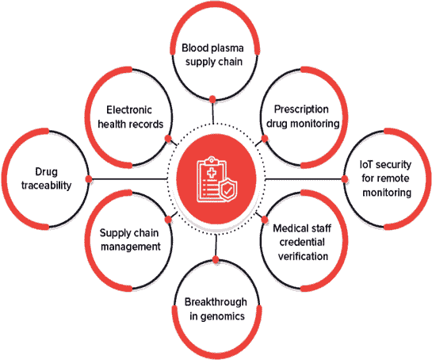

图 7.1 区块链与医疗保健的关系。

\[原创（由作者创作）\]

区块链应用可以在政府、房地产、银行和金融行业找到。虽然银行和金融领域吸引了更多调查，但医疗保健领域的区块链支持应用直到最近才开始引起更多关注。许多学者强调了区块链技术如何用于解决医疗保健应用中的当前问题 \[15\]。区块链消除了第三方在实体之间调解交易的需求。它依赖于验证者——通常是矿工——他们取代中间人并执行去中心化的交易验证。这是通过分布式共识实现的，即几个不信任的人能够就任何事情达成一致的能力。在加密货币领域，这个计算问题与双重支出问题相关，即如何验证给定数量的虚拟货币未经可信第三方（通常是银行）的许可而未被使用，该银行保存每笔交易和用户余额的记录。

本章的其余部分描述如下：第 2 节解释医疗保健应用，第 3 节讨论与区块链相关的应用，第 4 节解释医疗保健中区块链的需求，第 5 节讨论区块链的一些安全问题，第 6 节讨论医疗保健中的区块链技术。第 7 节讨论医疗保健中区块链的使用，以及第 8 节的优势和第 9 节的一些应用。第 10 节总结本章。

## 7.2 医疗保健应用


医疗行业对患者医疗信息的安全性和隐私性格外关注，因为还存在额外的监管义务。在互联网时代，由于移动医疗设备和基于云的存储的使用，记录保存和数据共享变得越来越普遍，但恶意攻击的可能性也更高，共享的个人数据可能会被泄露。患者正在就诊多位医生，并通过智能设备更轻松地获取健康信息，这引发了关于数据共享和隐私的担忧 \[15, 16\]。医疗行业面临着独特的需求，包括与识别、互操作性、数据共享、医疗记录转移和移动健康问题相关的需求，如 图 7.2 所示，并将在下文讨论。

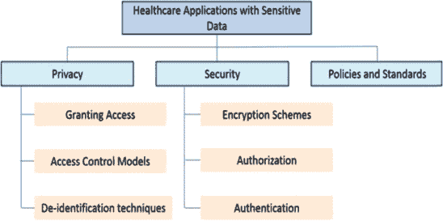

图 7.2 医疗应用程序要求。

\[原创（由作者创作）\]

### 7.2.1 数据共享

在民用健康记录中，存在固有的安全问题以及数据共享和访问问题。共享医疗记录有时会很具挑战性，因为一个人的完整医疗数据可能存储在多个位置。如果记录位于其他地方，医疗从业者也无法获取最新的患者数据；因此，患者无法获得这些分散记录的统一视图 \[17\]。医疗记录分布在多家医院中，使得记录链接——即基于可能或可能没有共同身份（例如社会安全号码）的组件合并数据库的想法——变得具有挑战性。

### 7.2.2 数据安全

医疗和医学数据的主要安全需求包括访问控制、身份验证和记录不可否认性。这些标准支持医疗数据的可用性、机密性和完整性。为了开发医疗信息，医疗记录（如患者档案）可以与来自体感传感器和其他应用程序的医疗数据合并 \[14, 18\]。医疗记录从纸质格式向数字格式的转变需要实施基于角色的权限和额外的安全措施，以保护患者数据。此外，如果不同系统使用不同的加密标准，可能会出现保护个人健康信息和医疗数据（包括电子健康记录（EHR）和电子病历（EMR）或个人健康记录（PHR））的问题。传播患者的医疗记录可能会产生实际后果，目前保护文档的安全措施已被证明无效 \[19\]。

### 7.2.3 互操作性

互操作性是医疗行业必须满足的另一项前提条件。互操作性是指在多个来源之间共享和传输数据的能力。互操作性主要受医疗机构使用集中式数据存储的阻碍。所有数据都存储在单个中央数据库或数据库中，这给使用集中式数据存储的医疗从业者带来了问题 \[20\]。患者主体性、健康信息碎片化、健康信息可用性差、系统兼容性缺乏以及医学研究的数据数量和质量，都是集中式数据存储导致的一些具体问题。许多医院数据每天都在单一区域创建和维护。如果记录分散在多个机构中并丢失，患者将无法访问信息 \[21\]。由于集中式健康记录保存系统，大量记录变得分散。集中式数据机构需要在不可靠的网络上提供可信的数据库。

### 7.2.4 数据访问/移动性

移动性正在成为医疗领域越来越重要的需求，因为患者希望他们的信息可以随身携带，因为他们变得越来越流动。随着传感器、智能设备和各种联网设备数量的增加，传输数据的能力变得更加重要。要求从任何位置在任何设备上即时交换和访问数据，进一步加剧了确保数据安全并受法律要求保护的难度 \[22\]。医疗应用程序中迅速扩展的一个领域是移动健康，它利用无处不在的智能手机、低功耗体域无线网络和微型传感器等设备。医疗保健中广泛使用的集中式服务器架构的许多问题也影响着 mHealth。特定问题包括用户信任、访问控制、身份验证、同意管理和数据共享。要在物联网（IoT）或无线传感器网络（WSN）中实现安全和保护，需要大量资源，但处理不当和医疗数据被破坏可能会伤害患者以及对移动健康解决方案的未来期望。

另一种可能存在安全问题的技术是可穿戴技术，它在医疗保健中有应用。可穿戴技术引发了与健康信息的敏感性和法律保护相关的独特隐私问题 \[23\]。传感器、设备和智能技术的隐私风险包括信息泄露、拒绝提供服务或信息、不可审计性、篡改信息、不可否认性以及有效性或真实性的丧失。无线体域网络（WBAN）部署可能包括可穿戴体感传感器。与 WBAN 部署相关的安全问题包括数据完整性、新鲜度、网络可用性、可靠性、身份验证、安全定位、安全管理、灵活性和问责制。由于 WBAN 设备可能资源受限，将需要实施轻量级安全解决方案。可穿戴健康技术还带来额外风险，例如数据失真、设备故障或损坏，以及用户为自身利益操纵数据。对包括输送胰岛素（一种救命药物）的植入式医疗设备在内的关键设备的有效入侵，可能会导致严重甚至致命的健康问题 \[2, 20\]。


# IoT technology in healthcare

IoT technology is spreading throughout the healthcare sector as more and more customers are eager to take an active role while making health-related decisions. In addition, patients have become more eager to participate actively in personalizing their treatment. One approach to individualizing health care and therapy is through smart sensors and smart devices that gather and send crucial medical information to the patient’s physician, enabling them to monitor and assess chronic conditions remotely \[24\].

There are two types of assaults against wireless IoT systems: active and passive. When an attacker may change the destination of data packets or interfere with the routing protocols while they are being routed through the system, this is known as a passive attack. Active assaults occur when a hacker actively seeks for, steals, modifies, or obtains user data by taking advantage of a device or network vulnerability. A malevolent actor may employ many techniques to procure medical data from IoT devices, including data alteration, impersonation, eavesdropping, and playback, all aimed at obtaining confidential information from the target. Administrator security, physical security, information security, and general system security are some of the specific security flaws that hackers can take advantage of \[10\].

Particular privacy concerns that IoT applications for health care face include query privacy, location privacy, footprint privacy, owner privacy, and identity privacy. Privacy concerns are also present for third-party cloud providers when it comes to health record exchange between various healthcare facilities. Access control of patient data and medical information utilized and maintained by outside service providers is the subject of these privacy concerns. IoT technologies provide privacy risks due to inference attacks in addition to access control privacy implications. Malicious actors carry out inference attacks by combining data mining and wireless eavesdropping techniques to determine the significance of a given signal or message \[25\]. Wireless networks and IoT applications give rise to further privacy concerns. Among these worries is the possibility that, in an emergency, “healthcare data, such as a heart rate monitor, can be gained from the individual without the consent of the person.” Concerning the distribution of critical information and its storage requirements, this topic poses privacy-related considerations. Until such concerns about privacy are resolved and patients can rest easy knowing that their records are safe in cloud-based infrastructures, such solutions are probably going to be widely used.

## 7.3 Blockchain applications

Blockchain has a wide range of applications across numerous industries that can take advantage of its inherent characteristics and technology. Applications are distinct from features in that the former are procedures that may be used with blockchain technology to meet new needs, while the latter are aspects of the system itself \[7, 13\]. Fraud detection, identity verification, and smart contracts are some of the applications that will be covered. These three applications shown in Figure 7.3 were investigated for the paper’s objectives because of their potential to address the healthcare-related problems covered in the preceding section.

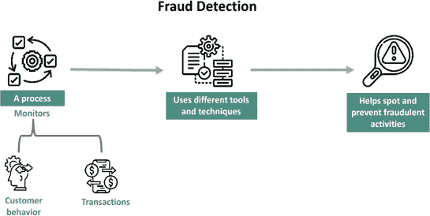

FIGURE 7.3 Applications of blockchain.

\[Original (created by authors)\]

### 7.3.1 Smart contracts

One important use of blockchain technology is smart contracts, which allow a user or agent to utilize the blockchain to produce a legal document. Smart contracts, which are autonomous agents stored in blockchain technology, encapsulate transactions and convert them into contracts or other legal documents in order to perform legal services \[26\]. These scripts, known as smart contracts, are stored on the blockchain and have unique addresses that allow for their location and validation. In a decentralized way, smart contracts offer a way to minimize contact between parties and guarantee fair exchange. The capacity to create documents alone, without the assistance of a notary or legal advisor, eliminates considerable time and expense obstacles and facilitates more efficient resource transfer.

### 7.3.2 Fraud detection

The identification of fraud is yet another use for blockchain. Validating a record or additional information source to find any instances of data tampering or other malicious activities is known as fraud detection. Examples of this include stopping the introduction of false reviews into online review platforms through vote stuffing and bad-mouthing, as well as fact-based fraud in the financial sector through loan applications \[27\]. A further field of research in fraud detection focuses on the relatively new idea of crowdsourcing. In order to acquire capital for a business, crowdfunding is a tactic used to convince a significant number of people to invest money or buy shares from the organization. Blockchain technology could be applied to crowdfunding by streamlining purchases and transferring equity more quickly, securely, and affordably. It can also be utilized as a low-cost platform.

### 7.3.3 Identity verification

Outside of the healthcare sector, other internet companies have discovered a variety of techniques for identity verification. Nowadays, a lot of companies and the governments utilize fingerprints and passports to identify people. Although the government prepares and verifies all documentation, blockchain technology offers an alternative to government-sponsored identity verification \[23\]. Blockchain technology can confirm a user’s identification with parties other than the government. Using blockchain technology to notarize contracts for businesses, marriages, and birth certificates is one example of this application. By utilizing the distributed ledger feature of the blockchain, an individual can demonstrate their existence at a specific location and time, and this can be independently verified by several users.

## 7.4 The need for blockchain in health care

Health care is one industry wherein blockchain is considered to hold a lot of value. Transforming health care requires giving data management, which benefits from connecting disparate systems and increasing EHR accuracy, top priority. Prescription medication management, supply chain management, pregnancy, and any related concerns can all be handled with blockchain technology. It can also be used to handle data exchange, access control, and the maintenance of an audit trail of medical procedures. Clinical trials, medical billing, contracting, medical record sharing, provider credentialing, and anti-counterfeiting medications are further healthcare domains that stand to gain from blockchain technology \[11, 28\]. A patient-centric approach is made possible by the transformation of healthcare services. Healthcare solutions built on blockchain technology have the potential to improve patient data security and dependability by giving people authority over their medical information.


患者医疗数据的存储在医疗保健领域至关重要。由于其高度敏感性，敏感数据经常成为网络攻击的目标。保证任何敏感数据的安全至关重要。另一个要素是对数据的控制，理想情况下应由患者掌控。因此，共享和获取对患者医疗数据的控制权是另一个可以从最先进的现代技术中受益的用例。区块链技术提供许多访问控制机制，并且对故障和攻击具有极强的韧性。因此，区块链为医疗数据提供了坚实的基础。

## 7.5 区块链技术的安全问题

区块链在医疗保健领域有许多用途，可帮助研究人员通过管理药品供应链、允许安全传输患者医疗数据以及实现患者医疗记录的安全转移来破解遗传密码。描述强调了去中心化、不可篡改性和密码学，所有这些看起来都很安全，因为数据很少在其他参与者不知情的情况下被更改，且具有密码学安全性。数据安全系统的实现需要密码学方法 \[29\]。这并不意味着区块链上不会发生证券欺诈和网络攻击。由于其多学科复合性质、广泛研究和众多安全事件，区块链技术正在逐渐暴露其在所有层面的安全弱点。

基于区块链的医疗系统是小规模集中式的，电子健康记录（EHR）现在以数字形式保存。由于区块链技术将极大地惠及最终用户，众多资助提供者、医学研究人员和卫生部将需要合作，以继续使区块链技术取得成功。这将改变医疗行业。

Figure 7.4 中展示了众多重要的区块链安全问题和解决方案。

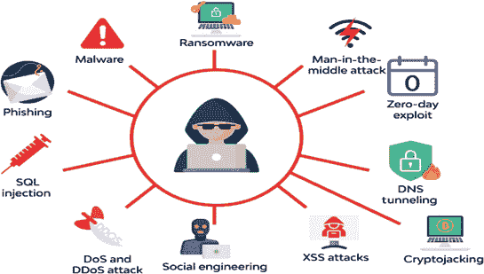

FIGURE 7.4 攻击类型。

\[Original (created by authors)\]

*   > 51% 攻击：矿工的主要职责是验证交易请求并打包数据，以便能够更详细地调查下一个区块。由于有可能改变整个区块链，51% 攻击可能是区块链领域最危险的攻击。这些攻击在链的早期阶段更可能发生，因为当时矿工数量不足。为防止 51% 攻击，应提高哈希率、加强矿池监管，并避免使用工作量证明（PoW）共识机制。

*   > 女巫攻击：在女巫攻击中，网络犯罪分子会伪造虚假网络节点，并用虚假身份淹没目标网络，导致系统崩溃并阻碍链上交易。为防止女巫攻击，应使用适当的共识技术，监控其他节点的活动，并查找仅转发来自单个用户区块的节点 \[30\]。

*   > 钓鱼攻击：钓鱼攻击在区块链系统中越来越频繁，并造成实际问题。钓鱼攻击旨在获取黑客所需的用户凭据。攻击者可以发送看起来真实的伪造电子邮件给钱包密钥所有者。当用户通过加入的伪造超链接提交其登录凭据时，攻击者会获取凭据和其他信息。通过安装可信的反恶意软件或恶意链接检测软件，并保持系统和软件更新，您可以增强浏览器和设备的安全性 \[15, 31\]。为防止钓鱼尝试，在使用电子钱包或其他敏感信息时避免开启 Wi-Fi，且不要点击意外的 URL。

*   > 路由攻击：路由攻击是区块链领域下一个主要的安全和保密问题。黑客可以利用账户的匿名性来拦截传输到互联网服务提供商（ISP）的数据。风险在于，这些攻击经常会在受害者不知情的情况下泄露资产或私人信息。用户需要使用强密码、保护个人信息并经常更改密码；采用安全路由机制（带证书）；并自行了解与信息安全相关的风险，以减少路由攻击。

*   > 在医疗保健中的作用：在集中式架构（如大多数 EHR 系统中发现的架构）下，集中式机构负责监督、指导和监控整个网络。AI 能够执行复杂的计算任务并快速分析大量患者数据。

尽管 AI 已证明可以比人类更快地执行许多动态和认知任务，但一些医生仍不愿使用 AI 来影响患者的健康。此外，最近一项研究中进行的一项调查发现，医疗服务的利用与距离呈负相关 \[32\]。如今，区块链和 AI 是两种各自在医疗保健领域显示出扩展前景的技术。

科学界对将这些技术应用于 EHR 数据处理的领域表现出了兴趣。另一方面，医疗行业中区块链的使用有所增加。为了防止患者记录被恶意篡改，它解决了当前 EHR 框架的互操作性问题。一些基于 EHR 的程序（包括 Epic \[33\]）目前正在使用实时 AI 解决方案来支持临床决策系统和人群健康管理，以预测医院再入院、死亡和患者病情恶化。

同样，患者现在可以访问一个名为 MedRec 的基于区块链的平台。研究人员已使用基于区块链和 AI 技术的各种策略来探索上述结果。多项功能允许医疗部门以高标准评估数据，但它们也严重损害数据安全，并限制专家在有限时间内访问其数据的能力 \[31\]。本报告的主要目的是突出专家的贡献，使读者更好地了解 AI 区块链在 EHR 系统中的功能和有效性。本研究以从未结合过的 AI 和 IoT 为重点，评估影响，提出研究课题，并探讨区块链在农业、食品和健康领域的应用。此外，新技术现在可以更好地处理大量数据。

## 7.6 医疗保健中的区块链技术

区块链技术的应用可以在许多不同的领域找到，例如金融、电力、房地产、医疗保健、社交媒体、数学、交通、娱乐、权利保护、政府、非营利、技术、人力资源、零售、教育和农业。我们将在此讨论区块链的三种主要用途，以及它对提升生命价值的重要性。区块链为医疗行业带来了许多好处。对于每位患者，该技术创造了一个去中心化的环境。尽管这项技术在行业中尚未获得显著的普及，但它很快将被广泛使用 \[34\]。患者的数据从不被讨论，也不讨论医院接收数据后数据去向，也不会讨论为未来使用提供给他们多少数据。此外，随时携带所有报告是不可行的。为避免这种困境，技术催生了患者数据保留的某些新方面。


> EHR（数字化）：在纸上记录每位患者的信息是一项极其困难且混乱的工作。无人能指望记得同一个人做过的每项检查、医疗问题、过敏及其他病症的具体细节，数据中的任何不准确都可能导致灾难性后果。在紧急情况下，对患者身体进行检测会浪费大量时间，且在收到报告前可能需要更长时间才能治愈他们 \[34\]。EHR 包含患者的病史、诊断、处方、治疗方案、免疫日期、过敏史、放射影像以及实验室和检测结果，是解决这一问题的一种技术方案。它通过让患者能够接触到治疗医生，从而使患者获得更轻松、更舒适的治疗。

> 实验室信息系统：允许医疗专业人员查看与患者实验室结果相关的所有数据。无论检测地点在哪里，提供者都可以查看和研究检测结果，以继续进一步治疗。

> 诊断影像存储库：允许医生无论检测诊所位于何处都能查看诊断结果，并允许提供者查看和阅读报告。

> 药物信息系统：保护患者的用药史 \[5\]。

> 远程医疗：当患者和诊所位于不同地点时提供医疗保健的方法。

> 隐私：患者信息的保密性。

利用 EHR 是安全可靠的。由于基于区块链技术，它是去中心化的，几乎难以篡改，并且在各节点之间极其安全。网络中的每个节点都存储链中前一个区块的哈希函数，防止外部人员通过雪崩效应试图篡改或阻止数据 \[16\]。因此，识别被篡改的数据不会花费太长时间。由于每个节点都有数据副本，并且可以自行下载和存储文件副本，因此不会丢失任何数据。即使存储在区块链上，一个人的病历也完全安全可靠。患者可以根据自己的意愿披露数据，无需医疗机构的同意。患者数据将是他们的财产。如果你给予人们少量激励，你可以激励越来越多的人加入这个链。一个人可能会因为管理好自己的健康并妥善照顾它而获得奖励。此外，你还可以因为为研究项目提供数据而获得奖励 \[35\]。通过区块链技术进行药品供应可以使药店受益。一些骗子在中间运作，从供应商和卖家那里偷窃药品，然后非法转售或以更高的价格出售。使用区块链可以实现买卖双方之间的安全交易。矿工将处理所有背景调查并完成购买。点对点（P2P）连接将保证药品的追踪直到交付。

## 7.7 区块链在医疗保健中的应用

在过去几十年中，医疗保健领域一直是最受欢迎的研究领域之一，不断发现新的、更可靠的解决方案来支持该领域以及社区。从业者、医学专家、医院、治疗师、患者、付款人和其他利益相关者都必须以安全、互操作的方式管理、访问和共享健康记录，且不得修改它们。为了确认记录的真实性，还需要数据来源。区块链技术可以解决医疗保健领域目前面临的一些主要问题，并正在各种场景中应用 \[36\]。然而，需要更多有针对性的研究来将这项技术应用于实时应用。这些只是该技术在医疗领域的几种用途。

医疗保健利益相关者可以借助 MedRec 平台去中心化地交换数据、保存记录并授权设备。患者可以保存自己的数据，并授予或拒绝对其信息的访问权限。由于日志、权限和记录仅保存在此区块链上，并且是指向数据存储站点的指针，因此该系统提供完全的保密性 \[6\]。Gem 正在使用以太坊区块链，与飞利浦区块链实验室合作推出 Gem Health Network。该框架的目的是处理运营费用。得益于这种共享基础设施，不同提供者之间的互操作性使他们可以访问相同的信息，从而促进更好的患者护理 \[8\]。爱沙尼亚的 Guard Time 医疗保健平台促进了医疗保健提供者与患者之间的直接沟通。Guard Time 区块链通过在患者、医生和付款人之间实现透明的信息共享，确保安全、可靠且可审计的记录 \[9\]。研究小组需要患者的健康数据。在这方面，Health Bank 一直在为患者提供一种方式，以便与研究小组存储和交换他们的健康信息，这些信息可用于制药和学术目的。此外，患者还从该平台获得因其贡献而获得的经济奖励 \[18\] 开发了一种基于权限的区块链数据共享（BBDS）访问控制系统。数据所有者使用共享数据池来访问他们的 EMR。这个可扩展且安全的系统通过使用数字签名和加密密钥进行用户识别、身份验证和授权，相对于 HDG（医疗保健数据网关）具有优势。

## 7.8 区块链的优势

自比特币推出 10 年来，其他版本的区块链也已推出。金融交易是区块链技术应用于数字资产的方式。在最具前景和关注度的行业中，医疗保健是其中之一 \[19, 20\]。区块链技术正在改变医疗保健应用中的治理和数据管理方法。这主要归功于其灵活性以及保护、分段和共享医疗数据和服务的独特方式。区块链技术正在推动医疗保健行业的众多当前进步 \[21\]。当前系统与外部系统不兼容，主要在医疗保健和医疗领域内部转移医疗数据。另一方面，证据表明，将这些系统整合到更好的标准化、联网的医疗保健中具有多种优势，例如与不同组织和医学信息学学者建立联系 \[1\]。医疗领域面临的最大问题之一是安全地处理常规业务运作和交易以及服务交付所产生的海量医疗信息。大部分医疗数据是无用的；难以处理、理解和交换；并且在系统之间不标准化 \[13\]。


# 医疗保健中的数据安全

数据安全是医疗保健领域的一大关切问题。大多数医疗保健组织过时的 IT 架构使其容易受到恶意软件和其他攻击的威胁。敏感的健康数据被集中存储。区块链技术可以通过更轻松地共享、处理、管理数据并最大限度地降低与数据相关的安全风险，帮助医疗保健行业实现数字化 \[23\]。此外，医疗保健行业安全、可靠且安全地整合其可用的众多数据集所需的计算机程序、战略规划和基础设施的发展仍处于早期阶段。

# 区块链技术的基本理念

本节阐述了区块链技术的基本理念，以帮助读者更好地理解文章的其余部分。根据 \[7\]，区块链考虑了几种数字账本，这些账本为了安全地存储数据，会同时复制到相关系统上的多个位置。分布式账本技术（DLT）的一个更具体的定义是区块链，它是同时在多个站点上维护的数据库。根据 \[8\]，区块链中的每个数据块除了包含内容外，还有一个指向前一个数据块的指针。区块链是一个由链接数据块组成的网络，这些数据块通过指针在共享记录中连接，每个数据块都由哈希地址表示。

# 区块链在医疗保健中的优势

得益于医疗保健领域的区块链技术，患者和医疗保健专业人员现在可以更轻松地沟通并享受各种好处。为了提高医疗保健系统的有效性和效率，医疗保健行业正致力于利用现代技术 \[37\]。本节阐述了医疗保健行业中区块链的显著优势，如 图 7.5 所示。

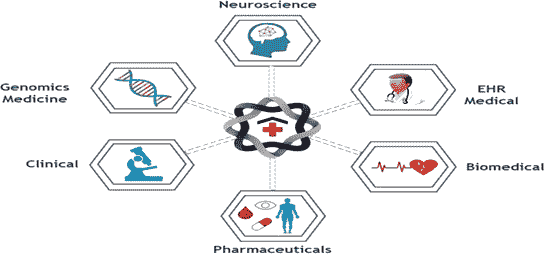

图 7.5 医疗保健领域的区块链优势。

\[原创（由作者创作）\]

### 7.8.1 去中心化

与由单个个人监督的传统数据库不同，区块链是一个去中心化的网络，类似于带时间戳的记录表，并经过加密以防止欺骗和操纵。当我们谈论与区块链相关的去中心化时，我们指的是决策权从中央组织转移到去中心化网络。使这项技术如此重要的原因是其去中心化的存储架构，这改善了数据身份验证和系统安全性 \[38\]。

每个块还包含交易数据、时间戳和前一个块的加密哈希。它还包含所有先前块和交易的历史记录，这些可以用于构建网络或链。对任何块的数据集进行任何更改都会触发一系列事件，最终可能导致整个区块链冻结。一旦区块链处理了数据，连接到网络的每台机器都会同时锁定，从而创建数据的不可逆记录。每个区块链系统都指定谁可以作为修改机构将块添加到网络以及如何操作 \[28\]。一旦信息被放入数据库中的某个块，就无法编辑或修改数据。

### 7.8.2 信任与透明度

新块正确添加到系统后，所有参与者都将能够访问更新后的区块链。数据块不会被添加到区块链中；相反，如果它有缺陷，则会被销毁。参与者使用共识技术作为验证机制，以确认数据块是合法的。通过使用共识技术，参与者可以快速就数据块的有效性达成一致 \[39\]。在区块链上，已被捕获和存储的数据对潜在用户可见，并会迅速更新。区块链的透明度可能使数据更难丢失或被篡改。

### 7.8.3 安全性与隐私性

区块链是一种保护块中数据和交易信息免受外部、内部、恶意或意外威胁的技术。利用 IT 和安全策略、工具及服务来识别和降低风险并为威胁提供相关解决方案是常见的做法。区块链隐私是指投资者或组织区别于其他数据并因此能够以可识别的方式进行通信的能力。它是指在不泄露私人信息的情况下进行交易的能力。用户还可以通过谨慎的自我披露来保持合规性 \[40\]。

### 7.8.4 可用性与鲁棒性

区块链结构是安全的。由于其缺乏集中所有权以及网络中医疗数据的统一块存储，它没有单点故障 \[41\]。在没有中央机构的情况下，多对一的流量被消除，所有参与节点的资源都用于确保灵活性和弹性。这种方法解决了单阶段故障的问题，并消除了延迟。

### 7.8.5 可验证性

区块链确保数据的准确性和完整性，即使在没有相应记录明文的情况下也可以进行验证。在医疗保健行业中，处理保险索赔和管理制药供应链需要验证记录时，此功能非常有用 \[42\]。数字账本软件通过在区块链上的所有节点之间实现多次共享重复，使所有医疗保健数据都易于验证并可供所有网络用户使用。区块链会在预定的时间段后自动更新，以确保数据的完整性和文件同步。

## 7.9 医疗保健中的应用

### 7.9.1 区块链层方法

区块链、应用、共识、智能合约和交易构成了区块链各层的技术基础。这些组件被分为几组，对应于区块链生态系统。

### 7.9.2 数据管理

为了采用以患者为中心的策略来存储医疗记录，并确保与医疗记录处理要求（例如患者指定的授权策略）相关的患者隐私和安全性，已建立一个系统以促进 EHR 数据的安全、可靠管理、分发和汇总 \[43\]。他们建议一种区块链技术，允许授权的 EHR 数据集成和共享。为了解决权限管理、数字版权管理、数据管理、数据完整性和数据共享问题，提出了 MedRec 系统用于医疗数据访问和权限管理。作者使用了三种不同类型的智能合约来管理大量的记录表示，即患者-提供者关系（PPR）合同、注册商合同（RC）和摘要合同（SC） \[44\]。


### 7.9.3 数据安全与隐私

一些作者通过实施基于区块链的安全医疗系统（SHS）架构，建立了一个安全且私密的医疗系统。本研究证实，在 SHS 中部署区块链技术可能有效解决传统 SHS 所面临的问题和障碍。此外，提出了该系统的架构。\[48\] 提出并开发了一种基于区块链智能合约的物联网支持智能医疗设备及医疗系统的访问控制模型。此外，他们在私有以太坊区块链上构建了一个方案。

研究方法考虑了整个医疗系统。为了说明所选的分散式、以患者为中心的智能合约授权系统，给出了一个示例用例 \[6\]。作者还建议一种主动的基于智能合约的分布式访问控制系统。

\[26\] 描述了一种基于区块链的远程健康监测（RHM）系统。为了在不经过其他服务的情况下安全地将患者数据与医生通信，该研究利用 Tor 伪装的链外数据传输服务。基于多种威胁实例，文章对该方案的安全性进行了评估。\[49\] 中描述的建议新型去中心化访问控制系统基于 Tangle，并让用户控制谁可以访问其资产。该程序验证工作，并使用自动化验证互联网安全协议和应用（AVISPA）工具进行检查，这些工具即使在攻击者存在时也能验证安全性。

## 7.10 结论

综上所述，区块链技术可能有助于解决医疗行业面临的一些当前问题。由于总账和与块相关的基础设施，区块链技术在医疗领域中研究最充分的应用包括安全性、完整性、去中心化、可用性和身份验证原则。这些应用具有最大的前景。医疗行业正努力跟上以智能、互联的物联网和传感设备为中心的快速发展的技术基础设施。虽然这些技术使医疗行业能够更轻松地在连接日益增长的世界中为患者服务，但攻击者也可以利用此类创新以及用户和流程行为中的缺陷来获取访问权限并复制信息，从而使医院交换记录变得更加困难。这可能导致数据过时，进而导致健康问题或不准确的诊断，甚至导致验证患者身份出现问题。本章声称，本研究提出了区块链技术在医疗领域应用的多个用例，并将涵盖未来在该领域具有潜在应用的技术。然而，目前缺乏足够的研究和原型实现来评估这些使用场景的效率。该分析还强调了创建基于区块链的医疗应用的当前最先进水平，以及该领域存在的差距和未来研究的潜在方向。

# 参考文献

1. Vyas S, Shabaz M, Pandit P, Parvathy LR, Ofori I. Integration of artificial intelligence and blockchain technology in healthcare and agriculture. Journal of Food Quality. 2022 May 28; 2022: 11. [`doi.org/10.1155/2022/4228448`](https://doi.org/10.1155/2022/4228448)

2. Gorkhali A, Li L, Shrestha A. Blockchain: A literature review. Journal of Management Analytics. 2020 Jul 2;7(3):321–43.

3. Conoscenti M, Vetro A, De Martin JC. Blockchain for the Internet of Things: A systematic literature review. In 2016 IEEE/ACS 13th International Conference of Computer Systems and Applications (AICCSA) 2016 Nov 29 (pp. 1–6). IEEE.

4. Lin WC, Chen JS, Chiang MF, Hribar MR. Applications of artificial intelligence to electronic health record data in ophthalmology. Translational Vision Science & Technology. 2020 Jan 28;9(2):13.

5. Tutty MA, Carlasare LE, Lloyd S, Sinsky CA. The complex case of EHRs: Examining the factors impacting the EHR user experience. Journal of the American Medical Informatics Association. 2019 Jul;26(7):673–7.

6. Wenhua Z, Qamar F, Abdali TA, Hassan R, Jafri ST, Nguyen QN. Blockchain technology: Security issues, healthcare applications, challenges and future trends. Electronics. 2023 Jan 20;12(3):546.

7. Zheng Z, Xie S, Dai HN, Chen X, Wang H. Blockchain challenges and opportunities: A survey. International Journal of Web and Grid Services. 2018; 14(4):352–75.

8. Wong J, Murray Horwitz M, Zhou L, Toh S. Using machine learning to identify health outcomes from electronic health record data. Current Epidemiology Reports. 2018 Dec;5:331–42.

9. Sun J, Yao X, Wang S, Wu Y. Blockchain-based secure storage and access scheme for electronic medical records in IPFS. IEEE Access. 2020 Mar 24;8:59389–401.

10. Hölbl M, Kompara M, Kamišalić A, NemecZlatolas L. A systematic review of the use of blockchain in healthcare. Symmetry. 2018 Oct 10;10(10):470.

11. Saluja K, Gupta S, Vajpayee A, Debnath SK, Bansal A, Sharma N. Blockchain technology: Applied to big data in collaborative edges. Measurement: Sensors. 2022 Dec 1;24:100521.

12. Alhadhrami Z, Alghfeli S, Alghfeli M, Abedlla JA, Shuaib K. Introducing blockchains for healthcare. In 2017 International Conference on Electrical and Computing Technologies and Applications (ICECTA) 2017 Nov 21 (pp. 1–4). IEEE.


13. Kuo TT, Zavaleta Rojas H, Ohno-Machado L. 区块链平台比较：系统综述与医疗保健示例. Journal of the American Medical Informatics Association. 2019 May;26(5):462–78.

14. Gong X, Liu X, Jing S, Xiong G, Zhou J. 基于平行教育区块链的智能教育：挑战与问题. In 2018 Chinese Automation Congress (CAC) 2018 Nov 30 (pp. 2390–2395). IEEE.

15. Dey T, Jaiswal S, Sunderkrishnan S, Katre N. HealthSense：物联网与区块链的医疗应用案例. In 2017 International Conference on Intelligent Sustainable Systems (ICISS) 2017 Dec 7 (pp. 486–491). IEEE.

16. Zhang J, Xue N, Huang X. 基于普适社交网络的医疗安全系统. IEEE Access. 2016 Dec 29;4:9239–50.

17. Liu W, Zhu SS, Mundie T, Krieger U. 电子健康系统的先进区块链架构. In 2017 IEEE 19th International Conference on e-Health Networking, Applications and Services (Healthcom) 2017 Oct 12 (pp. 1–6). IEEE.

18. Xia Q, Sifah EB, Smahi A, Amofa S, Zhang X. BBDS：云环境中电子病历的基于区块链的数据共享. Information. 2017 Apr 17;8(2):44.

19. Wadhwa S, Rani S, Verma S, Shafi J, Wozniak M. 面向边缘计算的物联网网络区块链节能共识方法. Sensors. 2022 May 13;22(10):3733.

20. Magyar G. 区块链：解决电子病历数据隐私与研究可用性权衡问题的新颠覆性健康数据管理技术. In 2017 IEEE 30th Neumann Colloquium (NC) 2017 Nov 24 (pp. 000135–000140). IEEE.

21. Elangovan D, Long CS, Bakrin FS, Tan CS, Goh KW, Yeoh SF, Loy MJ, Hussain Z, Lee KS, Idris AC, Ming LC. 医疗保健领域区块链技术的应用：系统综述. JMIR Medical Informatics. 2022 Jan 20;10(1):e17278.

22. Abu-Elezz I, Hassan A, Nazeemudeen A, Househ M, Abd-Alrazaq A. 医疗保健中区块链技术的益处与威胁：范围综述. International Journal of Medical Informatics. 2020 Oct 1;142:104246.

23. Mazlan AA, Daud SM, Sam SM, Abas H, Rasid SZ, Yusof MF. 医疗保健区块链系统的可扩展性挑战——系统综述. IEEE Access. 2020 Jan 24;8:23663–73.

24. Durneva P, Cousins K, Chen M. 患者护理中区块链技术的研究现状、挑战及未来研究方向：系统综述. Journal of Medical Internet Research. 2020 Jul 20;22(7):e18619.

25. Tandon A, Dhir A, Islam AN, Mäntymäki M. 医疗保健中的区块链：系统文献综述、综合框架与未来研究议程. Computers in Industry. 2020 Nov 1;122:103290.

26. Merlo V, Pio G, Giusto F, Bilancia M. 医疗保健领域区块链技术的利用：系统综述. Expert Systems with Applications. 2023 Mar 1;213:118897.

27. Gupta S, Alharbi F, Alshahrani R, Kumar Arya P, Vyas S, Elkamchouchi DH, Soufiene BO. 智慧城市应用中隐私保护通信的安全轻量级身份验证协议. Sustainability. 2023;15:5346. [`https://doi.org/10.3390/su15065346`](https://doi.org/10.3390/su15065346)

28. O’Donoghue O, Vazirani AA, Brindley D, Meinert E. 医疗保健区块链实现中的设计选择与权衡：系统综述. Journal of medical Internet Research. 2019 May 10;21(5):e12426.

29. Hasselgren A, Kralevska K, Gligoroski D, Pedersen SA, Faxvaag A. 医疗保健与健康科学中的区块链：范围综述. International Journal of Medical Informatics. 2020 Feb 1;134:104040.

30. McGhin T, Choo KK, Liu CZ, He D. 医疗保健应用中的区块链：研究挑战与机遇. Journal of network and computer applications. 2019 Jun 1;135:62–75.

31. Alqarni KS, Almalki FA, Soufiene BO, Ali O, Albalwy F. 基于区块链的无人机与传感器之间的认证无线链路：智慧农业案例. Wireless Communications and Mobile Computing. 2022;2022, Article ID 4389729:13. [`https://doi.org/10.1155/2022/4389729`](https://doi.org/10.1155/2022/4389729)

32. Anjum A, Sporny M, Sill A. 合规与信任的区块链标准. IEEE Cloud Computing. 2017 Oct 12;4(4):84–90.

33. Charles W, Marler N, Long L, Manion S. 区块链设计合规：临床研究中区块链的监管考量. Frontiers in Blockchain. 2019 Nov 8;2:18.

34. Wang B, Lin Z, Wang M, Wang F, Xiangli P, Li Z. 将区块链技术应用于确保个人防护装备多层级供应链符合可持续性标准. International Journal of Production Research. 2023 Jul 18; 61(14):4934–50.

35. Meyers G, Keymolen E. 无需区块链也能实现区块链解决方案？区块链、解决方案主义与信任. Regulation & Governance. 2023 Sep 15;14:53–68.

36. Zidan F, Nugroho D, Putra BA. 保障企业安全：利用区块链技术应对网络犯罪威胁. International Journal of Cyber and IT Service Management. 2023 Oct 31;3(2):167–72.

37. Patel S, Patel R, Akbari A, Mukkala SR. 多机构数据隐私保护模型的广泛研究与综述. Journal of Information Security. 2023 Aug 8;14(4):343–65.

38. Liu J, Fan Y, Sun R, Liu L, Wu C, Mumtaz S. 面向电子医疗系统的区块链辅助隐私保护医疗数据共享方案. IEEE Internet of Things Journal. 2023 Jun 20;10(24):21377–88.

39. Samaniego M, Deters R. 面向物联网管理的数字孪生与区块链. In Proceedings of the 5th ACM International Symposium on Blockchain and Secure Critical Infrastructure 2023 Jul 10 (pp. 64–74).

40. Akella GK, Wibowo S, Grandhi S, Mubarak S. 智能与可持续农业中区块链技术采用的障碍与促进因素系统综述. Big Data and Cognitive Computing. 2023 May 4;7(2):86.

41. Miličević K, Omrčen L, Kohler M, Lukić I. 面向物联网区块链应用的信任模型概念，作为计量学数字化转型的一部分. Sensors. 2022 Jun 22;22(13):4708.

42. Tan CL, Yeo SF, Tan KH, Kumar KM. 面向智慧农业的区块链技术模型：拟议模型. International Journal of Business and Technology Management. 2023 Mar 31;5(1):249–60.

43. Saranya R, Murugan A. 医疗保健系统中启用区块链的系统综述：分析、现状、挑战与未来方向. Materials Today: Proceedings. 2023 Jan 1;80:3010–5.

44. Myrzashova R, Alsamhi SH, Shvetsov AV, Hawbani A, Wei X. 医疗保健中区块链与联邦学习的结合：带有挑战与机遇的系统综述. IEEE Internet of Things Journal. 2023 Mar 31;10(16):14418–37.


45. Baysal MV, Özcan-Top Ö, Betin-Can A. 医疗领域的区块链技术应用：多声道文献综述. 超级计算机期刊. 2023 Feb;79(3):3112–56.

46. Othman, S.B., Almalki, F.A., Sakli, H. (2022). 医疗应用中的物联网：安全与隐私问题概述. In: Chakraborty, C., Khosravi, M.R. (eds) 智能医疗. Springer, Singapore. [`doi.org/10.1007/978-981-16-8150-9\_9`](https://doi.org/10.1007/978-981-16-8150-9_9)

47. Yap KY, Chin HH, Klemeš JJ. 分布式发电的区块链技术：当前发展、挑战与未来前景综述. 可再生能源与可持续能源评论. 2023 Apr 1;175:113170.

48. Ghosh PK, Chakraborty A, Hasan M, Rashid K, Siddique AH. 医疗系统中的区块链应用：综述. 系统. 2023 Jan 8;11(1):38.

49. Bali S, Bali V, Mohanty RP, Gaur D. 医疗领域区块链技术实施的关键成功因素分析. 基准测试：国际期刊. 2023 Apr 14;30(4):1367–99.

# 8 通过安全数据管理实现患者赋能

Anuradha Reddy, G S Pradeep Ghantasala, Mamatha Kurra, and R Mohan Krishna Ayyappa

DOI: [10.1201/9781003483113-8](https://doi.org/10.1201/9781003483113-8)

## 8.1 引言

医疗背景 \[1\] 正在迅速发展，受科学进步、患者机遇变化以及对个性化护理日益重视的推动。在这个动态环境中，患者赋能的概念已成为一种关键力量，重塑医疗服务提供者与其服务对象之间的互动。这一转型的核心在于数据管理的关键作用，它不仅促进信息的无缝交换，还确保敏感健康信息的安全与保密 \[2\]。

### 8.1.1 医疗格局概述

传统的医疗模式以家长式作风为特征，医疗决策主要由专业人士做出 \[3》，使患者处于被动角色。然而，当代医疗格局呈现出向以患者为中心的护理转变的特征。患者不再仅仅是治疗指导的接受者；他们是医疗旅程中的积极参与者。这种转变是由个人日益增强的意识所推动的，这种意识得益于通过互联网和其他数字渠道获取信息的机会增加。

慢性综合征 \[4\] 的增加、人口老龄化以及医疗复杂性的不断提高，进一步凸显了对更具协作性和以患者为中心的方法的需求。当今的患者希望成为护理的合作伙伴，做出符合其理想、偏好和生活方式的明智决策。

### 8.1.2 患者赋能的重要性

患者授权是一种复杂的模式，涵盖个人参与其医疗决策过程、了解其健康状况，并拥有积极实现其福祉所需的基本工具 \[5\]。授权患者更有可能遵循行动程序，参与预防性过程，并与医疗提供者有效沟通，从而改善健康结果。

赋能患者不仅在个体层面有帮助，而且有助于整个医疗系统的效率和效果。它培养责任感 \[6\] 和问责制，减少不必要的医疗利用和成本。此外，授权患者往往从事更健康的行为和生活方式，促进主动的健康方法。

### 8.1.3 信息组织在医疗中的作用

医疗的数字化转型导致了健康数据的前所未有的激增。EHRs \[7\]、可穿戴设备和其他与健康相关的技术产生大量信息，如果管理得当，可以显著促进患者赋能。数据管理包括收集、存储、分析和安全分发这些信息，构成了现代医疗系统的支柱。

医疗中的数据管理 \[8\] 服务于几个关键目的。首先，它保证了完整准确的患者信息的可访问性，帮助医疗提供者做出明智的决策。这在替代情况下尤其重要，快速访问病史可以挽救生命。其次，强大的数据管理系统支持各医疗专业人员之间的护理协调，促进患者护理的整体和协作方法。

安全和保密是医疗数据管理中的首要任务。患者必须相信他们的敏感信息受到 utmost care 的处理。监管议程，例如美国的《健康保险可携性和责任法案》(HIPAA) \[9》，为健康数据的安全处理建立了标准，为患者和医疗提供者营造了安全的环境。

总之，医疗格局正在经历向患者赋能的转型转变，数据管理在促进这一演变中发挥着关键作用。随着我们深入探讨通过安全数据管理实现患者赋能的细节，显而易见，知识、患者参与 \[10\] 和数据安全的结合正在塑造医疗的新时代——一个人们不仅是护理的接受者，而且是其健康和福祉的积极贡献者的时代。

## 8.2 患者赋能的演变：一段时光之旅

### 8.2.1 患者-医生关系的历史视角

患者-医生关系的历史 \[11》叙述揭示了一个引人入胜的演变，其特征是从家长式模式转向将患者置于中心的模式。在古代，治疗者拥有受人尊敬但专制的角色，代表患者做出决策，患者的投入极少。患者的角色是被动的，通常仅限于在缺乏太多理解的情况下遵循规定的治疗。

随着世纪的推移，逐渐发生转变。文艺复兴时期出现了更科学的医学方法 \[12》，促进了思想和知识的交流。然而，患者在决策过程中仍然相对边缘化。直到 20 世纪，由社会变革、伦理考量和对患者权利的承认所推动，范式转变才开始。

### 8.2.2 转向以患者为中心的护理

20 世纪下半叶，向以患者为中心的护理转变的趋势明显。患者曾被边缘化为被动角色，开始被视为其医疗旅程中的积极参与者。这种转变 \[13\] 是由多种因素共同推动的，包括民权运动、生物伦理学和知情同意的兴起。患者不仅要求医学专业知识，还要求尊重、透明度以及积极参与有关其健康选择的准确性。


# 社群决策与患者赋能

社群决策的观念日益受到重视，强调医疗资助方与患者之间的关联。这种策略承认患者带来的独特视角和价值，标志着从传统的自上而下沟通方式的转变，促进了一种更加平等和以患者为中心的模式。

在过去几十年中，全球医疗系统广泛采用了诸如以患者为中心的医疗之家（PCMHs）\[14\]和负责任医疗组织（ACOs）等模式，强化了患者参与、沟通和个性化护理计划的重要性。向以患者为中心的护理转变，认识到患者的多样化需求，并寻求相应地定制医疗服务。

## 8.2.3 技术对患者赋能的影响

进入 21 世纪——一场技术文艺复兴，进一步加速了患者的赋能。可穿戴健康技能的出现\[15\]从根本上改变了患者与医生关系的动态。患者现在通过互联网获得前所未有的健康信息，使他们能够成为护理中更知情的合作伙伴。

## 8.3 安全数据管理的重要性：保障医疗保健的基础

### 8.3.1 健康数据安全的重要性

在当代医疗背景下，信息作为患者护理的本质流动，健康数据安全的重要性不容忽视。健康数据包含大量敏感信息，包括病史、治疗计划和个人标识符\[16\]。保护这些信息的安全至关重要，不仅为了捍卫个人隐私，也为了维护医疗系统的完整性和可信度。

健康文件安全不仅仅是防止未经授权的访问，更是关于保护信息的隐私、准确性和可访问性。未经授权的访问不仅危及个人隐私，还可能导致身份盗窃、保险欺诈和其他恶意活动。此外，健康数据的机密性与患者对医疗系统的信任相互交织\[17\]。数据泄露可能会削弱这种信任，阻碍患者充分参与护理，并与医疗提供者分享关键信息。

在数据作为医学研究和创新基石的时代，健康数据安全对于保护社区的集体福祉至关重要。研究机构、制药公司和医疗提供者依赖强大的安全措施来保护从健康数据中获得的洞察，确保医学知识的进步在不损害个人隐私的前提下实现\[18\]。

### 8.3.2 不安全数据管理相关的风险

医疗保健中不安全数据管理相关的风险是多方面的，远远超出对个别患者的直接影响。最紧迫的担忧之一是数据泄露的潜在风险，这可能导致大规模暴露敏感信息。这不仅使患者面临风险，也使医疗提供者面临法律和财务后果。

不安全的数据管理也对患者护理的连续性构成威胁。如果健康记录被泄露或篡改，医疗信息的准确性和可靠性将受到质疑，导致潜在的误诊、不当治疗和患者安全受损。在相互关联的医疗网络中，系统某一部分的泄露可能会产生连锁反应，影响整个护理连续体。

医疗保健领域勒索软件攻击的兴起进一步凸显了保护健康数据的紧迫性。网络犯罪分子针对医疗组织，加密关键数据并要求支付赎金以释放数据。此类攻击不仅扰乱医疗服务，还凸显了现代医疗保健相互关联的数字基础设施中固有的漏洞。

### 8.3.3 监管格局（HIPAA、GDPR 等）

认识到保护健康数据的迫切需求，全球已建立了各种监管框架来管理其管理和保护。在美国，HIPAA 是健康数据安全的基石。HIPAA 规定了严格的保障措施，以确保电子受保护健康信息（ePHI）的机密性、完整性和可用性。医疗组织必须遵守 HIPAA 标准，实施加密、访问控制和定期审计等措施以保持合规。

在国际舞台上，通用数据保护条例（GDPR）管理欧盟（EU）境内个人的数据保护和隐私。GDPR 适用于健康数据，强调获得数据处理的明确同意、确保被遗忘权的重要性，并在发生数据泄露时实施严格的通知要求。

这些监管框架是强大的工具，激励医疗组织优先考虑安全数据管理。它们不仅概述了数据保护的期望，还确立了不合规的处罚，强化了在医疗数据管理中保持最高安全标准的严肃性。

总之，医疗保健中安全数据管理的重要性不容忽视。它是维护患者信任、医疗护理完整性和医学知识进步的关键。随着技术的不断发展，我们对强大安全措施的承诺也必须随之提升，由对风险的全面理解和对旨在保护健康数据神圣性的监管框架的坚定遵守所指导。

## 8.4 塑造安全数据管理的技术

在不断发展的医疗保健格局中，技术进步在塑造安全数据管理实践中发挥着关键作用。本节探讨关键技术，即电子健康记录（EHRs）、健康信息交换（HIE）\[[19](#index_split_015.html#filepos711618\]、医疗保健中的区块链和基于云的解决方案，强调它们在增强安全性和赋能患者方面的贡献。

### 8.4.1 电子健康记录

电子健康记录改变了患者数据在医疗系统中的记录、访问和共享方式。电子健康记录通过将患者记录整合为数字格式，更新了数据管理，允许高效检索和更新医疗信息。从纸质病历转向电子健康记录不仅扩大了医疗沟通，还通过访问控制和审计追踪支持数据安全。电子健康记录中的安全措施：探讨电子健康记录系统中嵌入的安全结构，如加密、用户身份验证和基于角色的访问控制。了解电子健康记录如何有助于数据完整性并减少与手动记录保存相关的风险。

### 8.4.2 健康信息交换

健康信息交换简化了不同医疗单位之间患者数据的整体共享，帮助护理协调并减少测试和程序的重复。本节探讨健康信息交换如何通过为跨机构健康信息交换提供统一且安全的框架来促进安全数据管理。互操作性与安全性：讨论与健康信息交换中互操作性相关的任务和解释。重点介绍管理数据交换的安全属性和价值，确保患者数据在传输过程中保持机密和安全。

### 8.4.3 医疗保健中的区块链


# 区块链技术在医疗保健领域的应用日益广泛

区块链技术在医疗保健领域的应用日益广泛，因为它有可能改善数据安全性、透明度和互操作性。了解区块链的去中心化和防篡改特性如何被用来保障健康数据安全、更新流程，并授予患者对其数据的更大控制权。

## 利用区块链保障健康数据安全

阐述区块链在医疗保健领域的明显用例，例如保障医疗记录安全、实现安全数据分发以及支持临床试验的完整性 \[20\]。探讨与在医疗环境中采用区块链相关的挑战和注意事项。

### 8.4.4 基于云的解决方案

基于云的解决方案改变了医疗保健领域的数据存储、处理和可访问性。本节探讨云技术如何通过提供可扩展且成本效益高的解决方案来促进受保护的数据管理，从而存储和管理大量医疗数据。

## 基于云的医疗系统中的安全考量

考察云服务提供商实施的安全措施，以及加密、数据备份和遵守监管标准。讨论基于云的解决方案在增强医疗保健提供者数据可访问性方面的优势，同时保持强大的安全协议。

# 结论

总之，集成电子健康记录（EHRs）、健康信息交换（HIE）、区块链和基于云的解决方案等技术，标志着在实现医疗保健安全数据管理方面迈出的重大一步。这些技术不仅提高了医疗流程的效率，还通过确保健康信息的保密性和完整性，有助于增强患者的权能。随着我们继续拥抱技术创新，在创新与数据安全之间取得平衡，仍然是塑造医疗保健未来的关键。

## 8.5 互操作性与集成

医疗数据互操作性和无缝集成对于通过安全数据管理实现患者权能的全部潜力至关重要。在本节中，我们将探讨挑战，研究解决方案，并强调标准（如 HL7（健康七级）和 FHIR（快速医疗互操作性资源））的关键作用。

### 8.5.1 医疗数据互操作性面临的挑战

医疗保健领域的特点是存在大量不同的系统，每个系统都以单一格式收集和加载数据。缺乏标准化的协议和格式对互操作性构成了重大障碍。医疗保健提供者通常使用不同的电子健康记录系统，这些系统难以相互通信。此外，从医疗设备到可穿戴技术等多种数据来源，增加了实现无缝互操作性的复杂性。这些挑战导致患者病历碎片化，阻碍了全面和协调的护理。

### 8.5.2 实现无缝数据集成的解决方案

为了克服互操作性挑战，医疗保健组织越来越多地实施集成解决方案，以连接不同的系统并促进数据的顺畅交换。应用程序编程接口（API）发挥着关键作用，使不同的软件应用程序能够相互通信。中间件解决方案充当中介，在不兼容的格式之间转换数据。数据标准化技术被用于标准化多样化的数据集，确保一致性和连贯性。

互操作性倡议，如 Common Well Health Alliance 和 Care quality，旨在建立一个全国性的医疗数据交换框架。这些协作努力汇集了医疗保健利益相关者，以定义和实施互操作性标准，促进一个更加互联和以患者为中心的医疗保健生态系统。

### 8.5.3 标准的作用（HL7、FHIR 等）

医疗保健标准在实现互操作性和无缝数据集成方面发挥着核心作用。HL7 \[21\] 是一种广泛采用的国际标准，为电子健康信息的交换、集成、共享和恢复提供了框架。它描述了用于交换临床和行政数据的消息格式和协议。

快速医疗互操作性资源（FHIR）由 HL7 开发，因其对医疗保健互操作性的现代方法而日益重要。FHIR 利用基于 Web 的技术，与其前身相比，代表了一种更轻量、更灵活的标准。其模块化结构允许更轻松的实现和适应性，使其非常适合不断发展的医疗保健领域。

标准化术语，如 SNOMED CT（医学体系化术语 – 临床术语）和 LOINC（逻辑观测识别符名称和代码），通过确保医疗系统间一致的编码和术语使用，有助于语义互操作性。

总之，解决医疗数据互操作性问题需要一种多方面的方法，包括技术解决方案、协作倡议和遵守公认的标准。采用 HL7 和 FHIR 等互操作性标准 \[22]，结合创新的集成策略，为无缝连接的医疗保健生态系统奠定了基础。这种互联互通反过来提高了患者护理质量，支持明智的决策，并最终通过安全和全面的数据管理增强患者的权能。

## 8.6 患者访问健康信息

通过访问其健康信息来增强患者权能是现代医疗保健的一个变革性方面。在本节中，我们将探讨赋予患者对其健康数据控制权的重要性、这种权能带来的益处，以及医疗系统在实施强大的患者数据访问政策时所面临的挑战。

### 8.6.1 通过数据访问增强患者权能

患者访问健康信息标志着医疗保健动态的标准转变。传统上，医疗信息通常由医疗保健提供者保护，限制了患者对自身健康的了解。电子健康记录和患者门户的出现开启了一个新时代，使个人能够方便地访问其健康数据。这种权能鼓励患者积极参与护理结果，促进患者与医疗保健提供者之间的协作关系。

### 8.6.2 患者掌控其健康信息的益处

授予患者对其健康信息的控制权带来诸多益处。首先，它通过提供患者病史、诊断、药物和检验结果的全面视图来增强患者参与度。这种透明度促进明智的决策，并鼓励患者在管理自身健康方面发挥主动作用。此外，获得授权的患者更有能力参与其护理计划、遵守处方治疗并采取预防措施。健康信息的可访问性也促进了患者与医疗保健提供者之间的沟通，使医疗预约期间的讨论更加有意义和富有成效。

### 8.6.3 实施患者数据访问面临的挑战


尽管具有明显的优势，但实施常见的患者数据访问面临多项挑战。隐私和安全问题占据主导地位，因为医疗服务提供者必须确保敏感信息得到保护。在数据可访问性与保持机密性之间取得平衡，需要强大的网络安全措施，并遵守 HIPAA 和 GDPR 等监管标准。技术障碍，包括不同电子健康记录（EHR）系统之间的互操作性问题 \[23\]，可能会阻碍无缝的患者数据访问。确保在不同医疗平台上提供标准化且用户友好的界面，对于提高可访问性和可用性至关重要。

医疗差距也带来挑战，因为并非所有患者都能平等地获得数字工具或使用电子健康平台的能力。弥合数字鸿沟对于防止加剧医疗保健获取方面的现有不平等至关重要。医疗组织和医疗服务提供者内部对变革的抵制可能会阻碍患者数据访问计划的实施。培训计划和变革管理策略对于克服抵制并培养一种通过数据访问赋予患者权力的文化至关重要。

总之，患者访问健康数据是数字时代患者赋权的基石。知情且积极参与的患者有多种好处，有助于改善健康结果，并构建更以患者为中心的医疗保健格局。然而，解决与隐私、技术、差距和组织抵制相关的挑战对于确保患者数据访问计划的成功实施至关重要。通过有效应对这些挑战，医疗系统可以创造一个更具协作性和赋权性的环境，将患者置于其护理的中心。

## 8.7 数据隐私和同意

在数字医疗时代，数据隐私与知情同意之间的联系对于建立信任、尊重自主权和保护个人权利至关重要。本节探讨了知情同意的关键重要性、隐私增强技术的作用，以及在处理数据分发和隐私问题时所需的微妙平衡。

### 8.7.1 知情同意的重要性

知情同意是管理个人健康数据使用的原则性和法律性原则的基石。它代表个人自愿且知情地同意参与任何医疗活动或研究，并了解潜在的风险和益处。在数据隐私的背景下，获得知情同意不仅仅是一项法律要求，更是尊重个人自主权和隐私权的基本道德义务。

### 8.7.2 隐私增强技术

隐私增强技术（PETs） \[24\] 在减轻与收集和处理健康数据相关的隐私风险方面发挥着重要作用。匿名化、加密和差分隐私等技术确保个人身份得到保护，同时仍允许进行有意义的分析。例如，匿名化会删除可识别个人的信息，从而允许在不损害个人隐私的情况下将数据用于研究。加密通过对数据进行编码来增加额外的安全层，使其仅对授权方可访问。

差分隐私是一种更高级的技术，它向数据集中引入受控噪声，以保护个人身份，同时仍提供有价值的洞察。PETs 的集成不仅符合隐私原则，还能增强个人对其敏感健康信息得到负责任处理的信心。

### 8.7.3 平衡数据共享与隐私问题

在数据共享与隐私问题之间取得微妙的平衡是一项复杂的挑战。一方面，共享健康数据对于医学研究、公共卫生计划和创新治疗方法的开发至关重要。另一方面，保护个人隐私是不可谈判的。取得这种平衡需要一种细致入微的方法，涉及强大的治理框架、透明的沟通，以及将隐私设计原则纳入数据分发计划。

医疗组织必须批准全面的数据治理准则，明确说明数据将如何使用、谁将拥有访问权限以及有哪些措施来保护个人隐私。与个人就数据共享的目的、对公共卫生或研究的潜在益处以及现有的安全措施进行透明沟通，对于建立信任至关重要。

此外，数据最小化的概念鼓励将个人健康数据的收集和保留限制在为预定目的所必需的范围内。实施严格的访问控制和定期审计，可进一步确保只有授权人员才能访问敏感数据。

总之，应对数据隐私和同意的格局需要一种全面且符合道德的方法。知情同意充当特定自主权的保障，隐私增强技术为负责任的数据处理提供了技术基础，而对数据共享采取平衡的方法则既承认了社会效益，也承认了保护个人隐私的必要性。通过坚持这些原则，医疗系统可以培养一种信任文化，尊重个人的权利和隐私，同时利用健康数据的力量造福集体福祉。

## 8.8 远程医疗和远程患者监测

远程医疗和远程患者监测（RPM） \[25\] 代表了现代医疗保健的变革性方面，利用技术弥合地理差距、增强患者授权并优化医疗保健提供。在本节中，我们将探讨远程医疗对患者赋权的影响、远程监测在数据收集中的作用，以及确保远程医疗数据安全的必要性。

### 8.8.1 远程医疗对患者赋权的影响

远程医疗以通过数字通信提供医疗服务为特征，已成为赋予患者权力的强大工具。其主要影响之一是医疗保健获取的民主化。无论患者身处何地，都可以与医疗专业人员联系、获取医疗建议并参与虚拟咨询。

这种更高的可访问性培养了赋权感，尤其是对偏远或服务不足地区的个人而言。患者可以通过参与远程医疗预约、获得及时的医疗建议和获取教育资源，在管理自身健康方面发挥更积极的作用。此外，远程医疗促进了护理的连续性，使患者能够在不受物理距离限制的情况下，与医疗服务提供者保持定期联系。

### 8.8.2 远程患者监测和数据收集

RPM 通过促进传统医疗环境之外的持续数据收集和分析，补充了远程医疗。可穿戴设备、传感器和智能技术使生命体征、用药依从性和其他相关健康指标能够实时追踪。这种持续的数据流为医疗专业人员提供了对患者健康状况更全面、更动态的了解。


RPM 对患者赋能的影响是深远的。患者成为护理的积极参与者，因为他们可以实时监测健康指标，并了解生活方式选择如何影响自身健康。对于患有慢性病的个人，RPM 提供了一种主动的管理方法，允许进行早期干预并对治疗计划进行个性化调整。

### 8.8.3 确保远程医疗数据的安全性

远程医疗与 RPM 的整合为确保医疗数据安全带来了新的关注点，特别是在远程通信和存储时。患者隐私和数据保密性必须放在首位，以维持对这些技术的信任。

### 8.8.4 加密与安全通信

实施强大的加密协议对于在传输过程中保护患者数据至关重要。安全通信渠道可防止敏感信息遭受未经授权的访问和拦截。无论是视频咨询、消息传递平台，还是可穿戴设备的数据传输，加密都能确保医疗互动保持保密。

### 8.8.5 身份验证与访问控制

建立强大的身份验证措施和访问控制对于验证参与远程医疗会诊的患者和医疗服务提供者的身份至关重要。多因素身份验证增加了一层额外的安全性，降低了患者记录或远程医疗平台被非法访问的风险。

### 8.8.6 遵守监管标准

遵守监管标准，例如美国的 HIPAA 或其他地区的同等数据安全法律，是不可协商的。远程医疗平台和远程监测系统必须遵守这些法规，以确保患者数据的合法和合乎伦理的处理。

### 8.8.7 设备安全性与数据完整性

保障用于远程医疗咨询和远程监测的设备安全至关重要。定期更新、端点保护和数据完整性措施可降低恶意软件或未经授权篡改的风险。确保整个生态系统（包括可穿戴设备和监测设备）的安全性，有助于采取全面的数据保护方法。

随着远程医疗和远程患者监测的不断发展，应对网络安全挑战并领先于潜在威胁将是一项持续的工作。包括整合人工智能（AI）用于预测分析以及持续完善安全协议在内的技术进步，将在确保这些技术持续获得信任和采用方面发挥至关重要的作用。

总之，远程医疗、远程患者监测与患者赋能之间的协同作用正在重塑医疗格局。通过采用这些技术，患者能够获得更多的医疗服务，积极参与健康管理，并为个性化干预提供宝贵数据。然而，远程医疗和 RPM 的成功整合取决于优先保障远程医疗数据的安全性。通过加密、强大的身份验证、合规控制以及持续的技术进步，医疗服务提供者可以充分发挥这些创新的潜力，同时保持患者信息的隐私和安全。

## 8.9 赋能弱势群体

在医疗保健中赋能弱势群体涉及解决医疗服务获取方面的差距，为各类患者群体采用个性化方法，并克服与数字健康素养相关的挑战。本节探讨了医疗保健差距的复杂性、量身定制方法的重要性以及增强数字健康素养的策略。

### 8.9.1 解决医疗服务获取方面的差距

弱势群体（可能包括社会经济地位较低的个人、少数民族、老年人以及生活在服务不足地区的人）在医疗服务获取方面往往面临显著差异。无法获得优质医疗服务可能会加剧现有的健康不平等，导致不良后果。为解决这些差距，医疗系统必须实施有针对性的干预措施。这可能包括增加服务不足地区的医疗设施可用性、提供交通服务，并利用远程医疗弥补地理差距。文化胜任力护理和外展计划可以帮助在弱势社区建立信任，鼓励定期参与医疗服务。

### 8.9.2 为多样化患者群体定制方法

在医疗保健中，没有一种方法适用于所有人，尤其是在处理弱势群体时。修改后的方法对于解决多样化患者群体面临的独特需求和挑战至关重要。根据文化、语言和社会经济因素量身定制医疗干预措施对于实现积极的健康结果至关重要。医疗服务提供者应参与社区伙伴关系，并与社区领袖合作，了解弱势群体的具体需求。文化胜任力护理涉及识别和尊重文化差异，这可以积极影响患者对医疗倡议的信任和参与。此外，引入患者导航员或倡导者可以帮助个人了解医疗系统的复杂性，促进更以患者为中心的方法。

### 8.9.3 克服数字健康素养挑战

数字健康素养是授权弱势群体在日益技术驱动的医疗保健格局中的一个组成部分。然而，这些群体中的许多个人在有效理解和利用数字健康工具方面面临挑战。

*   > 教育计划：医疗服务提供者和公共卫生组织可以实施教育计划以增强数字健康素养。这可能包括社区研讨会、信息宣传册以及旨在教育个人如何浏览数字健康平台、访问远程医疗设施和解读在线可用健康数据的在线资源。

*   > 用户友好型技术：开发用户友好型数字健康工具对于克服与技术接受相关的障碍至关重要。应用程序和平台的设计应考虑用户的多样化需求，包括不同数字素养水平的用户。加入简单界面、多语言支持和无障碍选项等功能，可以使数字健康工具更具包容性。

*   > 与社区组织合作：与社区组织和基层倡议合作可以促进旨在提高数字健康素养的外展工作。当地组织通常对其社区面临的需求和挑战有更深入的了解，使其成为设计和提供有针对性的干预措施的宝贵合作伙伴。

*   > 远程医疗支持服务：为远程医疗接受提供专门的支持服务可以授权弱势群体有效利用数字健康工具。这可能包括建立热线、虚拟协助或社区为基础的远程医疗支持中心，个人可以在那里获得使用远程医疗平台的指导。

## 8.10 案例研究与成功故事

在医疗保健领域，成功实施安全数据管理的机构不仅增强了患者赋能，还为行业最佳实践树立了先例。考察现实世界的案例揭示了所学到的经验、克服的挑战以及对患者护理的变革性影响。

### 8.10.1 成功案例：梅奥诊所


# 8.10 成功案例

Mayo Clinic（梅奥诊所）是一家著名的医疗机构，体现了安全数据管理在赋能患者方面的整合应用。通过实施全面的电子健康记录（EHR）系统，Mayo Clinic 确保其网络内授权的医疗服务提供者均可访问患者数据。这种无缝的数据交换促进了协作式、以患者为中心的护理，使不同专科医生能够统一查看患者的病史。

## 经验教训：

*   > 互操作性是关键：Mayo Clinic 的成功凸显了医疗数据管理中互操作性的重要性。整合不同系统并确保它们能够“互通”可提升护理的连续性和质量。

*   > 患者访问赋能：通过患者门户为患者提供便捷的医疗记录访问权限，使个人能够积极参与医疗决策。患者可以查看检验结果、了解治疗方案，并与医疗团队高效沟通。

## 8.10.2 成功案例：Kaiser Permanente

Kaiser Permanente（凯撒医疗集团）是一家领先的医疗服务提供商，采用由强大数据管理实践支持的综合护理模式。凭借集中式 EHR 系统，Kaiser Permanente 确保患者数据在其医院和诊所网络中持续更新并可访问。这种整合增强了护理协调，从而促成更明智、更具协作性的决策。

## 经验教训：

*   > 数据治理至关重要：Kaiser Permanente 的成就凸显了强大数据治理政策的重要性。标准化的数据管理实践确保数据的准确性、完整性和安全性，为有效的患者护理奠定基础。

*   > 通过分析实现主动护理：通过利用数据分析，Kaiser Permanente 能够识别患者健康中的趋势和模式。这种主动方法使医疗服务提供者能够及早干预，预防并发症并改善患者预后。

## 8.10.3 成功案例：Cleveland Clinic

Cleveland Clinic（克利夫兰诊所）通过采用包括区块链在内的先进技术，体现了安全数据管理的成功实施。通过采用区块链进行健康数据交换，Cleveland Clinic 提升了患者病历的安全性和完整性。这项技术确保患者同意被不可更改地记录，解决隐私问题，并赋予患者对其数据的控制权。

## 经验教训：

*   > 区块链增强信任：Cleveland Clinic 使用区块链凸显了这项技术在建立信任方面的作用。不可更改的记录和透明的数据共享有助于增强患者对其健康数据安全性和隐私性的信心。

*   > 隐私与安全并重：区块链实施的成功强调了优先考虑隐私和安全的重要性。取得平衡可确保患者在共享数据时感到安全，同时保持对谁可以访问其数据的控制权。

## 8.10.4 来自现实案例的经验教训

*   > 强调患者教育：在这些案例研究中，一个共同点是患者教育的重要性。成功的组织认识到教育患者了解安全数据管理益处的重要性。Mayo Clinic、Kaiser Permanente 和 Cleveland Clinic 均提供教育资源和工具，使患者能够积极参与其医疗旅程。

*   > 适应技术进步：这些成功案例也凸显了组织不断适应技术进步的必要性。无论是整合 EHR 系统、利用数据分析还是实施区块链，始终处于技术前沿都能使医疗服务提供者提升患者护理并保持健康数据的安全性。

这些案例研究的经验教训凸显了医疗保健中安全数据组织的不断演变性质。随着技术的不断进步，组织必须保持敏捷，优先考虑患者教育，并利用创新解决方案，使个人在医疗决策中获得力量。

总之，此处介绍的案例研究和成功故事为安全数据管理如何赋能患者并转变医疗服务提供了宝贵的见解。通过从这些示例中学习，医疗组织可以不断完善其实践，优先考虑以患者为中心的护理，并始终处于不断演变的医疗数据管理格局的前沿。

## 8.11 未来趋势：医疗保健和数据管理中的新兴技术

当我们站在医疗保健新时代的门槛上时，新兴技术与数据管理的结合正在塑造未来的格局。在本节中，我们将探讨有望彻底改变医疗保健的前沿技术，并预测通过安全数据管理实现患者赋能的轨迹。

### 8.11.1 人工智能和机器学习

人工智能和机器学习通过分析海量数据集来分类模式、预测疾病轨迹并个性化治疗方案，正在成为医疗保健不可或缺的一部分。未来预测：

*   > 精准医疗：人工智能算法将增强对个体患者特征的理解，从而能够开发高度个性化的治疗方案，以适应遗传、生活方式和环境因素。

*   > 诊断进步：机器学习模型将不断发展，以提供更准确、更及时的诊断，改善早期疾病检测和干预。

*   > 人群健康预测分析：人工智能将在分析人群层面数据以预测和预防公共卫生问题方面发挥关键作用，从而实现主动干预和资源分配。

### 8.11.2 物联网和可穿戴技术

物联网（IoT）设备和可穿戴设备的普及使患者健康指标的持续监测成为可能，创造了大量实时数据。未来预测：

*   > 远程患者监测的演进：物联网设备和可穿戴设备将不断发展，以监测不断扩大的健康参数阵列，为医疗服务提供者提供更丰富的数据集。

*   > 与 EHR 集成：可穿戴设备生成的数据无缝集成到 EHR 中将成为标准做法，从而全面了解患者的健康状况。

*   > 行为健康监测：可穿戴设备将越来越多地包含用于监测心理健康的功能，提供关于压力水平、睡眠模式和整体幸福感的洞察。

### 8.11.3 区块链技术

区块链确保安全、透明且不可更改的健康数据共享，解决与数据完整性和隐私相关的问题。未来预测：

*   > 以患者为中心的数据所有权：区块链将使患者能够更好地控制其健康数据，授予特定数据访问权限并保持所有权。

*   > 增强的互操作性：区块链将有助于改善不同医疗系统之间的互操作性，支持无缝数据交换。

*   > 临床试验和研究：区块链将简化并保障临床试验数据的管理，加速医学研究和药物开发的步伐。

### 8.11.4 5G 技术

5G 网络的部署正在通过提供高速、低延迟通信来改变医疗保健，促进实时数据交换。未来预测：

*   > 远程医疗转型：5G 将实现无缝且身临其境的远程医疗体验，包括高质量视频咨询和实时监测。

*   > 物联网连接：5G 的增加带宽和低延迟将支持更广泛的互联医疗设备和可穿戴设备网络。


## 8.12 结论

在前面的章节中，我们踏上了一段探索医疗保健动态格局的旅程，探讨了患者赋权的演变、安全数据管理的重要性以及关键技术的变革性影响。在总结之际，让我们回顾关键要点，并强调患者赋权和安全数据管理在医疗保健中持续的重要性：

*   > 历史患者赋权演变：从家长式模式到以患者为中心的护理，患者-医生关系的历史发展凸显了向承认和尊重个人在管理自身健康方面的自主权的转变。

*   > 技术对患者赋权的影响：技术的出现对赋权患者起到了关键作用。数据访问、数字健康工具以及以患者为中心的技术的兴起，使个人对其医疗决策拥有了前所未有的控制权。

*   > 健康数据安全的重要性：健康数据的机密性、完整性和可用性至关重要。健康数据安全不仅是法律和道德的要求，而且对于维持对医疗系统的信任以及确保患者的福祉至关重要。

*   > 不安全数据管理相关的风险：不安全的数据管理会带来重大风险，包括未经授权的访问、数据操纵和潜在的泄露。这些风险可能导致严重后果，危及患者隐私并削弱医疗保健组织的可信度。

*   > 监管环境：HIPAA 和 GDPR 等法规为安全数据管理提供了框架。遵守这些法规不仅是法律要求，也是保护患者权利和发展负责任的数据处理文化的承诺。

*   > 塑造安全数据管理的技术：EHRs 简化了数据管理，增强了可访问性，并有助于医疗保健流程的整体效率。HIE 促进无缝数据交换，促进护理协调并减少医疗服务中的冗余。区块链为保护健康数据提供了去中心化且防篡改的解决方案，促进透明度并赋权患者。云技术彻底改变了数据存储和可访问性，为管理大量医疗数据集提供了可扩展且安全的解决方案。

## 患者赋权和安全数据管理的持续重要性

*   > 以患者为中心的护理：向以患者为中心的护理的持续转变强调患者在其医疗旅程中的积极参与。这不仅提高了患者满意度，还有助于更好的健康结果。

*   > 知情决策：赋权的患者具备做出有关其健康的明智决策的能力。访问准确和及时的数据促进了医疗保健提供者和患者之间的合作方式。

*   > 隐私和信任：安全数据管理是保护患者隐私和建立信任的基础。患者必须相信其敏感的健康信息得到 utmost care and integrity 的处理。

*   > 利用技术赋权：将尖端技术持续集成到医疗保健中，确保患者能够获得创新工具和平台，以促进自我管理和积极参与其健康。

*   > 互联互通和互操作性：医疗保健系统的互联性需要关注互操作性。不同实体之间的无缝数据交换确保了护理的连续性和患者健康的全面视图。

*   > 监管合规：遵守监管标准仍然是医疗保健运营中不可谈判的方面。合规不仅能减轻法律风险，还能体现对道德和负责任的数据管理的承诺。

*   > 持续创新：医疗保健和知识的格局在不断演变。紧跟新兴趋势并接受创新解决方案对于增强患者权能以及在面临新挑战时确保数据安全至关重要。

## 结论

总之，通过安全数据管理实现患者赋权的旅程是一个持续且动态的过程。在我们应对医疗保健交付的复杂性时，尊重患者自主权、确保数据安全以及利用技术实现积极结果的原则必须始终处于前沿。医疗保健当局、技术创新者、政策制定者和患者自身的合作努力将塑造一个未来，在这个未来中，个人不仅能获得高质量的护理，还能积极参与其通往健康的道路。平衡创新与伦理考量是构建真正赋权个人并优先考虑其健康数据神圣性的医疗保健生态系统的关键。

## References

1.  Eysenbach, G., Powell, J., Kuss, O., & Sa, E. R. (2002). Empirical studies assessing the quality of health information for consumers on the world wide web: A systematic review. JAMA, 287(20), 2691–700. [`doi.org/10.1001/jama.287.20.2691`](https://doi.org/10.1001/jama.287.20.2691). PMID: 12020305.

2.  Othman, S. B., Almalki, F. A., & Sakli, H. (2022). Internet of Things in the Healthcare Applications: Overview of Security and Privacy Issues. In: Chakraborty, C., Khosravi, M.R. (eds) Intelligent Healthcare. Springer, Singapore. [`doi.org/10.1007/978-981-16-8150-9\_9`](https://doi.org/10.1007/978-981-16-8150-9_9)

3.  Borycki, E. (2012). M-health: Can chronic obstructive pulmonary disease patients use mobile phones and associated software to self-manage their disease? Studies in Health Technology and Informatics, 172, 79–84. PMID: 22910504.

4.  Anderson, R. M., & Funnell, M. M. (2011). Patient empowerment: Myths and misconceptions. Patient Education and Counseling, 79(3), 277–282.

5.  Ant Ozok, A., Wu, H., Garrido, M., Pronovost, P. J., & Gurses, A. P. (2014). Usability and perceived usefulness of personal health records for preventive health care: A case study focusing on patients’ and primary care providers’ perspectives. 45(3), 613–628. doi: [10.1016/j.apergo.2013.09.005](https://doi.org/10.1016/j.apergo.2013.09.005).

6.  Archer, N., Fevrier-Thomas, U., Lokker, C., McKibbon, K. A., & Straus, S. E. (2011). Personal health records: A scoping review. Journal of the American Medical Informatics Association, 18(4), 515–522.

7.  Barello, S., Graffigna, G., & Vegni, E. (2012). Patient engagement as an emerging challenge for healthcare services: Mapping the literature. Nursing Research and Practice, 2012, 1–7.

8.  Bartlett, C., Simpson, K., & Turner, A. N. (2012). Patient access to complex chronic disease records on the internet. BMC Medical Informatics and Decision Making, 12(1), 87.


# 9. 利用区块链确保医疗保健领域的数据隐私与安全

Maitri Mohanty, Ambarish G. Mohapatra, Premansu Sekhara Rath, and Anita Mohanty

DOI: [`10.1201/9781003483113-9`](https://doi.org/10.1201/9781003483113-9)

## 9.1 引言

21 世纪见证了数字数据的空前激增，尤其是在医疗保健领域。患者数据，包括病历、治疗计划和个人健康信息，已从传统的纸质系统转向电子健康记录（EHR）和数字数据库 `[1]`。随着这一数字化转型而来的是一项至关重要的任务：确保患者数据的安全性和完整性。医疗保健领域的数据安全至关重要，不仅为了保护患者隐私，也是为了维持对医疗保健生态系统的信任和信心 `[2]`。本引言部分阐明了数据安全在医疗保健中的重要性，并揭示了医疗保健组织在安全管理患者数据方面面临的普遍挑战。

该表概括了将区块链技术纳入医疗保健领域的关键方面。在数据安全方面，区块链提供不可更改且防篡改的数据存储，确保患者记录的完整性 `[2]`。然而，需要解决可扩展性和显著能耗方面的挑战，以实现更广泛的采用。互操作性得到了显著增强，允许在各种医疗保健系统之间实现无缝数据交换和患者信息的统一视图 `[3]`。然而，将区块链与现有系统集成会带来集成复杂性，并需要标准化工作。在数据隐私方面，区块链使患者能够控制数据共享和同意管理 `[4]`。

## 参考文献

9. Alqarni, K. S., Almalki, F. A., Soufiene, B. O., Ali, O., & Albalwy, F. (2022). Authenticated wireless links between a drone and sensors using a blockchain: Case of smart farming. Wireless Communications and Mobile Computing, 2022, Article ID 4389729, 13. [`https://doi.org/10.1155/2022/4389729`](https://doi.org/10.1155/2022/4389729)

10. Sezer, B. B., Turkmen, H., & Nuriyev, U. (2023). PPFchain: A novel framework privacy-preserving blockchain-based federated learning method for sensor networks. Internet of Things, 22, 100781. [`https://doi.org/10.1016/j.iot.2023.100781`](https://doi.org/10.1016/j.iot.2023.100781)

11. Abaoud, M., Almuqrin, A., & Khan, M. F. (2023). Advancing federated learning through novel mechanism for privacy preservation in healthcare applications. IEEE Access, 11, 83562–83579. [`https://doi.org/10.1109/ACCESS.2023.3301162`](https://doi.org/10.1109/ACCESS.2023.3301162)

12. Baucas, M. J., Spachos, P., & Plataniotis, K. N. (2023). Federated learning and blockchain-enabled fog-IoT platform for wearables in predictive healthcare. IEEE Transactions on Computational Social Systems, 10(4), 1732–1741. [`https://doi.org/10.1109/TCSS.2023.3235950`](https://doi.org/10.1109/TCSS.2023.3235950)

13. Moulahi, W., Jdey, I., Moulahi, T., Alawida, M., & Alabdulatif, A. (2023). A blockchain-based federated learning mechanism for privacy preservation of healthcare IoT data, Computers in Biology and Medicine, 167, 107630. [`https://doi.org/10.1016/j.compbiomed.2023.107630`](https://doi.org/10.1016/j.compbiomed.2023.107630)

14. Guduri, M., Chakraborty, C., Maheswari, U., & Margala, M. (2023). Blockchain-based federated learning technique for privacy preservation and security of smart electronic health records. IEEE Transactions on Consumer Electronics, 70(1), 2608–2617. [`https://doi.org/10.1109/TCE.2023.3315415`](https://doi.org/10.1109/TCE.2023.3315415)

15. Gupta, S., Alharbi, F., Alshahrani, R., Kumar Arya, P., Vyas, S., Elkamchouchi, D. H., & Soufiene, B. O. (2023). Secure and lightweight authentication protocol for privacy preserving communications in smart city applications. Sustainability, 15, 5346. [`https://doi.org/10.3390/su15065346`](https://doi.org/10.3390/su15065346)

16. Prokop, K., Połap, D., Srivastava, G. et al. (2023). Blockchain-based federated learning with checksums to increase security in internet of things solutions. Journal of Ambient Intelligence and Humanized Computing, 14, 4685–4694. [`https://doi.org/10.1007/s12652-022-04372-0`](https://doi.org/10.1007/s12652-022-04372-0)

17. Vatambeti, R., Krishna, E. S. P., Karthik, M. G. et al. (2023). Securing the medical data using enhanced privacy preserving based blockchain technology in internet of things. Cluster Computing. [`https://doi.org/10.1007/s10586-023-04056-0`](https://doi.org/10.1007/s10586-023-04056-0)

18. Jabarulla, M. Y., & Lee, H.-N. (2021). Blockchain-based distributed patient-centric image management system. Applied Sciences, 11, 196. [`https://doi.org/10.3390/app11010196`](https://doi.org/10.3390/app11010196)

19. Chang, Y., Fang, C., & Sun, W. (2021). A blockchain-based federated learning method for smart healthcare. Computational Intelligence and Neuroscience, 2021, Article ID 4376418, 12. [`https://doi.org/10.1155/2021/4376418`](https://doi.org/10.1155/2021/4376418)

20. Liu, W., He, Y., Wang, X., Duan, Z., Liang, W., & Liu, Y. (2023). BFG: Privacy protection framework for internet of medical things based on blockchain and federated learning. Connection Science, 35(1). [`https://doi.org/10.1080/09540091.2023.2199951`](https://doi.org/10.1080/09540091.2023.2199951)

21. Qayyum, A., Ahmad, K., Ahsan, M. A., Al-Fuqaha, A., & Qadir, J. (2022). Collaborative federated learning for healthcare: Multi-modal COVID-19 diagnosis at the edge. IEEE Open Journal of the Computer Society, 3, 172–184. [`https://doi.org/10.1109/OJCS.2022.3206407`](https://doi.org/10.1109/OJCS.2022.3206407)

22. Nchinda, N., Cameron, A., Retzepi, K., & Lippman, A. (2019). MedRec: A Network for Personal Information Distribution. 2019 International Conference on Computing, Networking and Communications (ICNC), Honolulu, HI, USA, pp. 637–641. [`https://doi.org/10.1109/ICCNC.2019.8685631`](https://doi.org/10.1109/ICCNC.2019.8685631)

23. Kuo, T. T., & Ohno-Machado, L. (2018). Modelchain: Decentralized privacy-preserving healthcare predictive modeling framework on private blockchain networks. arXiv preprint arXiv:1802.01746.

24. Wang, M., Guo, Y., Zhang, C., Wang, C., Huang, H., & Jia, X. (2023). MedShare: A privacy-preserving medical data sharing system by using blockchain. IEEE Transactions on Services Computing, 16(1), 438–451. [`https://doi.org/10.1109/TSC.2021.3114719`](https://doi.org/10.1109/TSC.2021.3114719)

25. Kurniabudi, Stiawan, D., Darmawijoyo, Bin Idris, M. Y., Bamhdi, A. M., & Budiarto, R. (2020). CICIDS-2017 dataset feature analysis with information gain for anomaly detection. IEEE Access, 8, 132911–132921. [`https://doi.org/10.1109/ACCESS.2020.3009843`](https://doi.org/10.1109/ACCESS.2020.3009843)


尽管如此，在公共区块链上实现数据透明度与隐私之间的正确平衡仍然是一个令人担忧的问题。技术促进了透明度，通过可审计和可追溯的数据增强了信任和问责制 \[5\]。然而，与完全透明相关的隐私问题需要细粒度访问控制和混合区块链模型等解决方案。最后，区块链通过减少中介及其相关成本来实现成本效率。尽管如此，初始设置成本以及克服技术采用障碍的需求，要求继续研究成本效益高的共识算法和部署策略。为了充分发挥区块链在医疗保健领域的全部潜力，持续的研究和开发应着重于解决 表 9.1 中概述的这些优势、局限性和未来方向。

表 9.1 区块链在医疗保健领域的应用：优势、局限性和未来方向概览

| 方面 | 优势 | 局限性 | 未来方向 |
| :--- | :--- | :--- | :--- |
| 数据安全 | – 不可变、防篡改的数据存储<br>– 强大的加密和访问控制 | – 可扩展性问题<br>– 所需的能源和计算资源 | – 实施高效的共识机制<br>– 量子耐受密码技术研究 |
| 互操作性 | – 促进无缝数据交换<br>– 实现患者数据的统一视图 | – 标准化挑战<br>– 与现有系统集成的复杂性 | – 互操作的区块链解决方案<br>– 开发医疗保健特定标准 |
| 数据隐私 | – 患者控制的数据共享<br>– 增强的同意管理 | – 法规合规（例如，GDPR、HIPAA）<br>– 公共区块链可能导致数据泄露的风险 | – 增强以隐私为中心的共识机制<br>– 零知识证明和高级加密 |
| 透明度 | – 增加信任和问责制<br>– 可审计、可追溯的数据 | – 与完全数据透明相关的隐私问题<br>– 在透明度与数据机密性之间取得平衡 | – 细粒度访问控制机制<br>– 混合区块链解决方案 |
| 成本效率 | – 减少中介及其相关成本 | – 初始设置成本和技术采用障碍 | – 成本效益高的共识算法研究 |

\[原创（由作者创作）\]

## 9.1.1 医疗保健中数据安全的重要性

在医疗保健领域，与数据安全相关的风险异常高。患者数据包含大量敏感和机密信息。保护这些数据对于保护个人隐私和维护医疗服务的完整性至关重要 \[6\]。数字技术、电子健康记录（EHR）、远程医疗和互联的医疗保健系统的出现，使医疗数据面临网络威胁和未经授权访问的脆弱性呈指数级增长。因此，强大的措施对于加强数据安全至关重要，以确保患者信息对未经授权的实体不可访问，并免受潜在泄露的影响。图 9.1 展示了基于区块链的医疗保健系统各种优势的分类法。

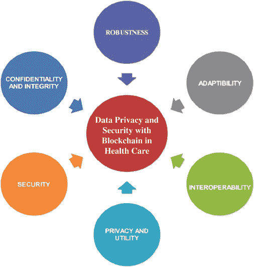

图 9.1 通过利用区块链在医疗保健领域增强安全性并保护隐私。

原创（由作者创作）

## 9.1.2 患者数据管理中的当前挑战

尽管医疗保健技术取得了进步，但有效管理患者数据仍然是一项复杂且多方面的挑战。传统的集中式数据存储方法，尽管被广泛使用，但使医疗保健系统面临诸多漏洞 \[7\]。未经授权的访问、数据篡改、系统故障和勒索软件攻击对患者数据的安全性和完整性构成严重威胁 \[8\]。此外，由于缺乏标准化的协议和格式，实现不同医疗保健系统之间的互操作性仍然是一个紧迫问题 \[8\]。遵守监管要求，例如美国的《健康保险可移植性与责任法案》（HIPAA），进一步加剧了安全管理患者数据的挑战 \[9\]。解决这些挑战对于建立强大且安全的患者数据管理框架至关重要 \[10\]。

## 9.2 理解区块链技术

区块链技术是一种去中心化和分布式账本系统，它使得在计算机网络上安全且公开地记录交易成为可能。它最初作为被称为比特币的虚拟货币的基础技术被创建，但随后已在银行业以外的多个领域找到了应用。以下是理解区块链技术的关键方面 \[11\]：

*   > 去中心化：与集中式系统不同，区块链作为一个去中心化网络运行，在所有节点之间分配数据控制权，并提供对单点故障的抵御能力。

*   > 区块和链：区块是由交易组生成的，每个区块都有一个时间戳、对前一个区块的引用以及一个称为加密哈希的识别号。由于区块的链接，创建了一条链，因此得名区块链。

*   > 不可变性：一旦区块被添加到区块链中，就很难对其进行修改。区块链技术通过共识过程和加密哈希创建不可变性，从而使记录可靠且防篡改。

*   > 共识机制：共识策略已被用于确保所有参与者都同意区块链的当前状态。一些流行的包括实用拜占庭容错、权益证明（PoS）、委托权益证明（DPoS）和工作量证明（PoW；比特币使用）。这些过程防止恶意行为和双重支出。

*   > 许可区块链与无许可区块链：无许可区块链，如以太坊和比特币，允许任何人登录。相反，许可区块链更适合私有或商业应用，因为它们将访问权限限制在个人。

### 9.2.1 区块链的核心原则

去中心化是区块链技术的基本原则，确保了一个没有中央权威的点对点网络 \[12\]。使用加密哈希，不可变性保证了数据的永久性和完整性 \[13\]。通过 PoW 或 PoS 等共识程序避免双重支出，这些程序在节点之间建立共识 \[14\]。使用密钥对，加密安全保护交易并验证参与者。分布式账本在每个节点上复制，提高了透明度并挫败了中央权威。通过为所有相关方提供相同信息的访问权限，他们可以朝着透明度努力。这培养了一种不信任的文化，使对中央权威的信任变得不必要。智能合约通过使用技术自动化和强制执行协议来提高效率和可靠性。

### 9.2.2 安全数据管理的关键特性


# 用于安全数据管理的区块链技术

区块链技术对于安全的数据管理至关重要，因为它利用关键特性来加强数字交易。密码学安全的基石是使用安全密钥对和尖端加密技术，以确保交易的机密性、完整性和合法性。由于数据分布在多个节点中以防止篡改和未经授权的访问，其去中心化结构通过消除单点故障来提高安全性。通过不可变性保证数据完整性，这使得记录后的修改变得极其困难 \[15\]。共识机制，如 PoW 或 PoS，建立参与者协议并保护账本。通过在所有节点上复制分布式账本来加强安全性，消除了集中式数据库中存在的弱点。由于其透明性，允许每个人查看和验证整个交易历史，区块链促进了信任。许可网络通过访问限制提供额外的安全层。通过简化和保障协议并提供防篡改执行，智能合约减少了对中介的需求。综合来看，这些特性为区块链数据管理构成了坚实可靠的基础，最大限度地降低风险并保持交易准确性。Figure 9.2 描绘了一个集成区块链技术的生物医学安全系统。

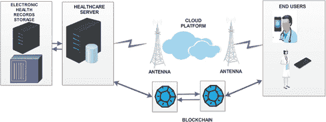

FIGURE 9.2 基于区块链的生物医学安全系统。

\[原创（由作者创作）\]

## 9.3 利用区块链保障患者数据安全

通过利用其去中心化和不可攻破的结构，区块链技术可以用于增强患者数据安全性并解决医疗领域的隐私问题。每个患者交易都安全地记录在不可更改的链中，提高了记录的完整性并降低了未经授权访问的可能性。区块链的公钥和私钥对以及其他密码学安全特性提供了额外的安全保障，确保患者数据仅由授权的医疗提供者访问。这满足了 HIPAA 等法律要求。通过私钥访问让患者掌控其医疗数据，从而促进透明度，并使用智能合约安全地处理敏感数据，这些合约自动化同意管理 \[16\]。

### 9.3.1 用于数据完整性的密码学哈希函数

密码学哈希函数对于在多个领域（如区块链技术和网络安全）中维护数据完整性至关重要。这些函数接受任何输入数据并输出一个称为哈希或摘要的固定长度字符串。抗碰撞性和雪崩效应等特性在其重要性中发挥作用。通过使两个不同的输入产生相同哈希输出在计算上不可能，抗碰撞性保证了唯一性。雪崩效应通过确保输入数据的微小变化会产生明显不同的哈希输出来增强对变化的敏感性。使用密码学哈希函数的组织可以通过比较传输前后的哈希值来确定数据的完整性，并有效识别任何未经授权的修改或损坏 \[17\]。

### 9.3.2 用于增强安全性的去中心化和不可变性

在区块链技术的背景下，去中心化和不可变性是大大提高安全性的基本理念 \[18\]。它描述了权力、处理和控制如何分散到网络中。在区块链的背景下，它表明系统由用户网络而非单一实体控制。去中心化系统更能抵御攻击和单点故障。即使一个或多个节点被攻破，网络仍然是安全的。当存在去中心化时，单个组织更难以审查或管制信息或交易的流动。这对于维护开放和自由的系统尤其重要。缺乏中央机构使得数据篡改变得困难。

区块链的不可变性确保数据在记录后保持不变；一旦区块被添加，它就变得不可更改。这种对参与者操纵的抵抗力消除了对中央机构的需求。不可变性还简化了可审计性，使整个交易历史的可视验证成为可能 \[16\]。当去中心化和不可变性结合时，会产生一个强大的安全框架。去中心化且不可更改的区块链为包括供应链管理、智能合约和金融交易在内的各种应用提供了可靠且透明的平台。它对广泛的安全风险具有免疫力。

## 9.4 患者数据隐私和同意管理

区块链技术通过去中心化、不可更改的记录确保安全性，从而彻底改变了医疗同意和患者数据隐私。患者通过智能合约远程控制数据访问，而透明工具则能实现合规性的实时监控。区块链的互操作性促进了医疗提供者之间的私密数据交换。有效的身份管理和加密 ID 降低了患者身份被盗的风险 \[19\]。总之，区块链增强了安全性，赋予了患者权力，并推进了医疗数据平台的隐私性。

### 9.4.1 通过数据控制赋予患者权力

区块链技术通过允许直接监督并去中心化健康数据控制来赋予个人权力。用户可以通过智能合约规定和自动化同意，指明谁可以访问数据。区块链上的透明跟踪鼓励问责制，为每次数据交换提供清晰的审计轨迹。互操作性使各种医疗提供者之间能够顺畅且受监管地共享健康信息。包含密码学身份管理增强了验证和整体安全性。总之，区块链促进了一种以患者为中心的范式，确保医疗保健中的数据自主权和隐私 \[20\]。

### 9.4.2 用于自动化同意管理的智能合约

智能合约在自动化同意管理中的应用使同意相关流程更加高效和安全，简化了各种交易和交互中同意的请求、确认和提供。

## 9.5 加密和访问控制

区块链技术中的基本保障措施包括访问限制和加密。加密通过将数据转换为安全代码来保证数据机密性，而访问控制管理权限，决定谁可以访问或修改区块链数据。这些元素共同增强了基于区块链系统的安全性和完整性。

### 9.5.1 通过加密增强数据安全性

加密对于增强区块链中的数据安全性至关重要，它将数据转换为安全代码，保护其免受未经授权的访问，并确保区块链生态系统内的机密性。

### 9.5.2 实施强大的访问控制机制


# 确保分布式账本的安全性和完整性

在不断发展的区块链技术领域，确保分布式账本的安全性和完整性需要实施强大的访问控制。访问控制对于防止未经授权的访问和交易至关重要，确保只有授权用户才拥有与区块链网络交互所需的权限。这种方法的核心在于制定授权和权限程序，明确每个用户被允许执行的具体任务。身份管理由加密方法和去中心化身份技术促进，是安全识别用户的关键要素。未经授权交易的预防由加密密钥和数字签名促进，在每笔交易被纳入区块链之前验证其合法性 \[21\]。

## 9.6 确保互操作性和无缝数据交换

在区块链环境下促进信息通信并确保互操作性，对于建立一个统一且互联的网络至关重要。这需要无缝集成各种区块链系统和平台，以促进数据和交易的高效传输。区块链互操作性通过实现不同区块链网络和去中心化应用程序（`DApps`）之间的有效交互来简化协作 \[22\]。通过实施通用标准和协议，互操作性确保了不同区块链生态系统之间的数据共享，提高了去中心化系统的整体效果和效率。区块链技术在从供应链和金融到医疗保健及其他领域的各种应用中发挥全部潜力，取决于采用这种互操作性方法。

### 9.6.1 使用区块链标准化数据交换

利用区块链技术标准化数据交换是增强信息共享可靠性和有效性的基本方法。通过建立标准化的协议和格式，区块链确保网络中不同各方之间数据交换的一致性和统一性。这种标准化有助于在不同行业和领域中创造一个更加透明和协作的环境，提高互操作性，简化沟通，并促进无缝交易。

### 9.6.2 促进医疗系统之间的安全互操作性

安全且无缝地共享患者数据需要结合区块链技术，从而促进医疗机构之间的安全互操作性。凭借其去中心化设计和加密安全特性，区块链增强了医疗记录的安全性，确保不同医疗专业人员之间的安全共享。通过建立标准化协议，区块链确保数据格式统一且兼容，在保持强大安全措施的同时，促进医疗系统之间的有效沟通。除了促进信息共享，这种方法还保护患者隐私，并在整个医疗系统中保持数据完整性 \[21\]。

## 9.7 案例互操作性和无缝数据交换

在各种应用中，区块链生态系统内的无缝互操作性和有效数据共享是基本要求。无论是在经济、供应链、医疗保健还是其他领域，各种区块链系统和平台的协作对于简化和透明的运营至关重要。确保不同区块链网络和应用程序能够交换数据、交易和智能合约功能，对于实现全面的案例互操作性至关重要。这有助于营造一个更加互联和协作的环境，使区块链技术能够在众多领域中实现其最大潜力。

在医疗保健应用中利用区块链技术有可能显著提高安全性、隐私性和数据完整性，采用一系列数学模型。尽管机器学习（`ML`）和区块链通常被视为不同的技术，但在某些情况下，它们在医疗保健应用中的集成可以产生协同效应 \[20, 22\]。以下概念和数学模型说明了`ML`与区块链在医疗保健领域的融合。这些数学模型通常用于医疗保健应用的区块链技术领域：

1. > 联邦学习

   > 医疗保健区块链模型可以从去中心化的患者数据中学习，同时保持数据的机密性和隐私，这是由于联邦学习，这是`ML`中的一个革命性概念，它能够在去中心化设备上进行模型训练，而无需集中共享信息。在联邦学习中，迭代过程涉及根据每个参与者的本地数据集 `Dt` 调整模型参数 `θ`，如下方公式所示：

   > 这个公式代表了分散节点之间的协作学习过程，使模型能够在不需要集中交换私人患者数据的情况下提高其性能和准确性。

2. > 安全多方计算

   > 安全多方计算（`SMPC`）通过允许多方协作计算函数来确保输入隐私。该过程涉及高级加密技术，所使用的方程取决于特定的计算。`SMPC` 方程

   *   > 让 `f(x1, x2-------xn)` 是要共同计算的函数。

   *   > 各方拥有私有输入 `x1`、`x2`、`--------xn`。

   > 它可以在医疗保健区块链上提供协作 `ML` 任务，而无需披露私人患者信息。

3. > 机器学习的同态加密

   > 机器学习任务可以使用同态加密对加密数据集进行处理，这使得可以对加密数据进行计算。

   *   > `E(x)` - 指定加密函数，使其能够对加密数据进行计算。

   *   > `E (a).E (b) = E (a + b)` 由于其同态特性，使得对加密数据进行加法运算成为可能。

   > 这种方法允许在医疗保健领域研究机密患者信息，而无需披露原始信息。

4. > 健康信息的代币化

   > 必须对敏感数据进行代币化，以便由一个保护其真实内容的代币来表示。

   *   > 让 `D` 为敏感数据。

   *   > `Token (D) = Token`，其中 `Token` 表示代币化形式。

   > 这个方程表示将敏感数据代币化并将其转换为代币化格式以供医疗保健区块链使用的过程。

   > 在医疗保健区块链中，代币化和 `ML` 模型可以结合使用，以允许在不披露患者个人身份信息的情况下进行分析。

5. > 使用强化学习规划治疗方案

   > 让 `Q(s, a)` 表示执行动作（或状态 `s` 下的动作值函数 “`a`”）的预测累积奖励。

   *   > `Rt` 是在状态 `st` 下执行动作所获得的即时奖励。

   *   > `α` 是学习率。

   *   > `γ` 是折扣因子。

   > 强化学习采用 Q-learning 更新规则，由这个方程表示，使医疗保健区块链能够优化治疗方案并提供个性化建议，同时维护患者数据的机密性。

6. > 在个性化医疗中应用预测分析

   > 基于历史信息，预测分析模型预测疾病风险或患者预后。


> `P (y|X)` symbolizes the predictive analytics model and predicts the result `y` according to input features.

> `Ɵ` represents the model parameters that have been obtained from previous information.

> `P (y|X,Ɵ)` This equation describes the predictive analytics model, which uses input feature-based evaluation for predicting patient outcomes or disease risks.

To keep patient data confidential during the prediction process, this model must be implemented in a safe, privacy-preserving environment in a healthcare blockchain. Table 9.2 illustrates the utilization of predictive analytics for efficient sharing of relevant healthcare data.

TABLE 9.2 用例：预测分析和共享相关医疗数据

| 目的 || 促进医疗数据的安全和保密交换，用于分析目的。 |

| 实施步骤： || |

| 用于数据共享的区块链 || 总节点数（医疗服务提供者数量）10 每日区块链交易数 1000 区块链安全级别 256 位加密 |

| 与隐私相关的代币化 || 记录代币化 50,000 代币化算法强度 AES with 128-bit keys |

| 用于预测分析的联邦学习 || 每个提供商训练的本地模型：10 联邦学习迭代次数：20 学习率 (`η`) : 0.01 |

| 使用智能合约管理同意 || 已创建的智能合约数量：100 每个合同定义的同意条款：数据使用限制和隐私设置 |

| 结果 || 预测分析模型的准确性：90%协作疾病预测的成功率：85%患者对数据安全的满意度：95% |

| 挑战和注意事项 || (a) 监管合规：合规性评分：98%。进行了两次隐私审计。(b) 互操作性：互操作性评分：75%医疗系统集成时间：6 个月 |

| \[原始（由作者创建）\] |

仅用于演示目的，使用这些假设的数值。在实际场景中，这些值将根据正在部署的医疗系统的需求、数量和特征来选择。

## 9.8 挑战与未来方向

区块链的未来方向包括增强的互操作性、可持续性和隐私技术，而挑战包括可扩展性、监管不确定性以及标准化的迫切需求 \[23\]。

### 9.8.1 解决区块链实施中的挑战

采用区块链技术涉及多个问题，需要采取智能且多学科的方法。

> 首先，分片和第二层协议是解决公共区块链中常见可扩展性问题的两种创新方法。

> 明确的合规框架和与监管机构的积极参与在解决监管不确定性方面发挥着关键作用。与标准化相关的挑战强调了跨行业协作努力的重要性，以制定共享协议，增强互操作性并促进更统一的区块链生态系统。

> 解决区块链中的安全问题涉及实施强大的加密措施并促进用户教育，而从能源密集型 PoW 过渡到可持续替代方案（如 PoS）对于减少环境影响至关重要。

> 确保保密性标准，尤其是在医疗保健和金融等敏感领域，涉及利用同态加密和零知识证明等先进技术。建立跨链标准对于解决互操作性挑战至关重要，促进不同区块链网络之间的无缝通信，最终需要在技术创新、监管倡导和行业参与方面进行协作，以充分实现区块链的潜力。

### 9.8.2 未来趋势和潜在创新

> 一个流行的趋势已转向基于区块链的去中心化健康记录，允许消费者对其信息拥有更大的所有权，以增强安全性和提供商互操作性。

> 医疗保健中对互操作性日益重视涉及纳入区块链网络和标准化协议，以简化数据交换并促进跨系统协作。

> 区块链技术目前正在被用于增强制药供应链可追溯性，以新颖的方式确保透明度，减少假药数量，并提高供应链的整体效率。

> 应用尖端的隐私增强技术，例如零知识证明，已变得流行。这种策略在处理敏感患者数据时，能有效实现隐私与透明度之间的平衡。

> 当前的开发涉及将区块链技术与人工智能 (`AI`) 集成，以促进高级数据分析，通过利用 AI 协同效应，动态改进预测分析、定制治疗方案和医学研究。

> 目前广泛采用区块链技术来提供可见且不可更改的临床试验数据。这种独特的数据完整性保证方法减少了欺诈，并增强了对临床试验结果的信任。

## 9.9 结论

区块链为医疗保健信息管理带来了范式转变，并对患者数据安全产生了深远的革命性影响。通过提供受限访问和加密患者数据，区块链承诺改善隐私。去中心化结构保证了患者数据的完整性，减少了不想要的更改的可能性。通过让个人对其健康信息拥有更多控制权，区块链促进了信心和透明度。区块链记录的不可更改性确保了可审计且防篡改的系统，从而保留了患者数据的完整性。本质上，区块链将自己定位为一种改变游戏规则的技术，极大地提高了整个医疗保健行业患者数据保护的标准。

## 参考文献

1. Suhasini, M., & Singh, D. (2021). Blockchain based framework for secure data management in healthcare information systems. Annals of the Romanian Society for Cell Biology, 25, 16933–16946.

2. Gupta, R., Thakker, U., Tanwar, S., Obaidat, M., & Hsiao, K. F. (5–7 October 2020). BITS: A Blockchain-driven Intelligent Scheme for Telesurgery System. In Proceedings of the 2020 International Conference on Computer, Information and Telecommunication Systems (CITS), Hangzhou, China; pp. 1–5.

3. Chukwu, E., & Garg, L. (2020). A systematic review of blockchain in healthcare: Frameworks, prototypes, and implementations. IEEE Access, 8, 21196–21214.

4. Hathaliya, J. J., & Tanwar, S. (2020). An exhaustive survey on security and privacy issues in healthcare 4.0. Computer and Communications, 153, 311–335.

5. Guntur, L. N., Dornadula, G., & Nimbagal, R. N. (2022). Blockchain Technology: A Breakthrough in the Healthcare Sector. In: Idrees, S. M., Nowostawski, M. (eds) Transformations Through Blockchain Technology (pp. 137–160). Springer, Cham, Switzerland.

6. Saha, A., Amin, R., Kunal, S., Vollala, S., & Dwivedi, S. K. (2019). Review on “Blockchain technology based medical healthcare system with privacy issues”. Security and Privacy, 2(5), e83.


7. Ali, A., Rahim, H. A., Pasha, M. F., Dowsley, R., Masud, M., Ali, J., & Baz, M. (2021). Security, privacy, and reliability in digital healthcare systems using blockchain. Electronics, 10(16), 2034.

8. Singh, S., Pankaj, B., Nagarajan, K., Singh, N. P., & Bala, V. (2022). Blockchain with cloud for handling healthcare data: A privacy-friendly platform. Materials Today: Proceedings, 62, 5021–5026.

9. Idrees, S. M., Agarwal, P., & Alam, M. A. (eds). (2021). Blockchain for Healthcare Systems: Challenges, Privacy, and Securing of Data. CRC Press.

10. Shah, V., Thakkar, V., & Khang, A. (2023). Electronic Health Records Security and Privacy Enhancement Using Blockchain Technology. In (Eds.) Alex Khang, Geeta Rana, R. K. Tailor and Vugar Abdullayev: Data-Centric AI Solutions and Emerging Technologies in the Healthcare Ecosystem (pp. 1–13). CRC Press.

11. Zaabar, B., Cheikhrouhou, O., Jamil, F., Ammi, M., & Abid, M. (2021). HealthBlock: A secure blockchain-based healthcare data management system. Computer Networks, 200, 108500.

12. Zhang, A., & Lin, X. (2018). Towards secure and privacy-preserving data sharing in e-health systems via consortium blockchain. Journal of Medical Systems, 42(8), 140.

13. Rani, P., Verma, S., Yadav, S. P., Rai, B. K., Naruka, M. S., & Kumar, D. (2022). Simulation of the lightweight blockchain technique based on privacy and security for healthcare data for the cloud system. International Journal of E-Health and Medical Communications (IJEHMC), 13(4), 1–15.

14. Othman, S. B., Almalki, F. A., & Sakli, H. (2022). Internet of Things in the Healthcare Applications: Overview of Security and Privacy Issues. In: Chakraborty, C., Khosravi, M.R. (eds) Intelligent Healthcare. Springer, Singapore. [`doi.org/10.1007/978-981-16-8150-9\_9`](https://doi.org/10.1007/978-981-16-8150-9_9)

15. Tanrıverdi, M. (2020). A systematic review of privacy-preserving healthcare data sharing on blockchain. Journal of Cybersecurity and Information Management, 5(2 SI 1), 31–37.

16. Patil, S. D., Kathole, A. B., Kumbhare, S., & Vhatkar, K. (2024). A blockchain-based approach to ensuring the security of electronic data. International Journal of Intelligent Systems and Applications in Engineering, 12(11s), 649–655.

17. Alqarni, K. S., Almalki, F. A., Soufiene, B. O., Ali, O., & Albalwy, F. (2022). Authenticated wireless links between a drone and sensors using a blockchain: Case of smart farming. Wireless Communications and Mobile Computing, 2022, Article ID 4389729, 13. [`doi.org/10.1155/2022/4389729`](https://doi.org/10.1155/2022/4389729)

18. Gupta, S., Alharbi, F., Alshahrani, R., Kumar Arya, P., Vyas, S., Elkamchouchi, D. H., & Soufiene, B. O. (2023). Secure and lightweight authentication protocol for privacy preserving communications in smart city applications. Sustainability, 15, 5346. [`doi.org/10.3390/su15065346`](https://doi.org/10.3390/su15065346)

19. Wang, B., & Li, Z. (2021). Healthchain: A privacy protection system for medical data based on blockchain. Future Internet, 13(10), 247.

20. Balasubramanium, S., Sivasankar, K., & Rajasekaran, M. P. (2021, March). A survey on data privacy and preservation using blockchain in healthcare organization. In 2021 International Conference on Advance Computing and Innovative Technologies in Engineering (ICACITE) (pp. 956–962). IEEE.

21. Wu, H., Dwivedi, A. D., & Srivastava, G. (2021). Security and privacy of patient information in medical systems based on blockchain technology. ACM Transactions on Multimedia Computing, Communications, and Applications (TOMM), 17(2s), 1–17.

22. Jennath, H. S., Anoop, V. S., & Asharaf, S. (2020). Blockchain for healthcare: Securing patient data and enabling trusted artificial intelligence. ACM Transactions on Multimedia Computing, Communications, and Applications (TOMM), Volume 17, Issue 2, Article No.: 60, Pages 1 - 17.

23. Steria, S. (2021). A blockchain-based healthcare platform for secure personalised data sharing. Public Health and Informatics - Proceedings of MIE, 281, 208.

# 10 基于 IPFS 和区块链技术的高级安全医疗文件共享系统

Mounira Tarhouni 和 Faten Chaabane

DOI: [10.1201/9781003483113-10](https://doi.org/10.1201/9781003483113-10)

## 10.1 引言

区块链是一种革命性的去中心化分布式账本技术，旨在为记录交易提供安全且透明的框架。与依赖中央机构的传统系统不同，区块链作为点对点网络运行，允许多个参与者在无需中介的情况下进行交互。区块链有望在各个行业（如金融科技、政府、医疗和供应链）带来变革性变化 \[1\]。

区块链技术的潜在优势包括降低各方之间交易的成本和复杂性、加强安全措施、提高透明度以及增强监管能力。

医疗保健领域通常被描述为一个传统上僵化的行业，抗拒变革且采用创新实践的速度缓慢。近年来，与医疗保健相关的问题，如隐私、护理质量和信息安全，已引起全球关注。区块链技术正在成为解决医疗保健领域信息分布挑战的公认方案。这些技术有望改善即时的医疗保健实践，包括改进医疗服务交付和支持护理质量。已提出几种创新的信息系统解决方案，以利用医疗保健领域的区块链导向应用程序。这些不断发展的解决方案主要面向医疗保健专业人员和患者，使他们能够就治疗、护理和服务支持的行政安排做出明智的决策。

Jiang 等人 \[2\] 介绍了 BlocHIE，这是一个用于医疗信息交换的基于区块链的平台。该平台旨在评估医疗数据交换的标准。最初，作者审查了来自各种来源的医疗数据共享的不同先决条件。基于这一分析的洞察，作者实现了两个松耦合区块链，以有效管理不同类型的医疗数据。随后，他们集成了链下存储和链上验证方法，以满足隐私和真实性的双重需求。

在 \[3\] 中，作者提出了一种共享 EHR 的架构。这项工作基于加密机制来加密健康数据，以及访问控制以确保健康记录的隐私和机密性。所提方案采用了结合云和区块链的存储机制。


With a particular healthcare system, Ramani et al. \[4\] proposed a blockchain-based secure and effective data access method for the patient and the doctor to protect the confidentiality and privacy of the patients set by the elliptic curve cryptography (`ECC`) techniques. The proposed system is also capable of safeguarding patients’ privacy. This scheme’s security research reveals that it can withstand well-known attacks while retaining system integrity.

GuptaXia et al. \[5\] proposed MeDShare, a system that addresses the issue of medical data sharing among medical big data custodians in a trust-less environment. The system employs smart contracts and an access control mechanism to effectively track the behavior of the data and revoke access to offending entities on detection of violation of permissions on data.

In \[6\], the authors have shown the various possibilities of creating reliable artificial intelligence (`AI`) models in e-health using blockchain, which is an open network for the sharing and authorization of information. Healthcare professionals will have access to the blockchain to display the medical records of the patient, and AI uses a variety of proposed algorithms and decision-making capability, as well as large quantities of data.

In \[7\], authors proposed an innovative IPFS-based storage model for blockchain. The miners deposit the transaction data into the IPFS network and pack the returned IPFS hash of transaction into the block. The proposed scheme is applied to the Bitcoin blockchain.

A blockchain-based framework integrated with InterPlanetary File System (`IPFS`) for EHR in healthcare management has been proposed by Jayabalan and Jeyanthi in \[8\]. This proposed framework empowers healthcare institutions to uphold fail-safe and tamper-proof healthcare ledgers in a decentralized fashion. Hospitals and doctors function as lightweight nodes, while patient nodes can operate as either full or lightweight nodes, enhancing the overall security and reliability of the system.

In this context, our chapter presents a cutting-edge mobile application that utilizes the IPFS and Ethereum technology to establish a secure and streamlined medical file-sharing platform. This innovative amalgamation capitalizes on the decentralized and immutable characteristics of blockchain, complemented by the efficiency and scalability of IPFS, offering a robust solution specifically designed for mobile environments.

## 10.2 Blockchain technology

A blockchain is an ever-expanding, decentralized ledger comprising records known as “blocks.” These blocks are interconnected in a chain through a process called mining, where pending transactions are transformed into a cryptographic puzzle. Miners, individuals utilizing computer systems, solve this puzzle, generating a unique sequence of letters and numbers known as a hash for the block. Every block comprises crucial components, including a cryptographic hash of the preceding block, a timestamp, and transaction data. Additionally, it incorporates details from all antecedent blocks and transactions, intricately weaving a network or chain that ensures the integrity and coherence of the entire blockchain system \[9, 10\].

Any alteration to the data within a single block initiates a chain reaction that could potentially stall the entire blockchain. After processing the information, every computer in the network simultaneously secures the data, establishing a permanent, unchangeable digital record. The rules governing each blockchain system dictate the entities authorized to append new blocks to the chain and define how the procedure is done. At its core, a blockchain is a series of interconnected blocks, where each block contains a cryptographic hash of the previous block, creating an immutable chain of transaction history. This fundamental structure ensures the integrity and security of the recorded data.

Understanding how blocks are linked to form the blockchain is crucial for gaining insight into the functioning of this decentralized technology. As illustrated in Figure 10.1, the blockchain is essentially a chain of blocks, and each block contains a list of transactions. A block typically consists of a header and a body. The header contains metadata, including a timestamp, a reference to the previous block (`hash`), and other relevant information. The concept of hashing plays a pivotal role. Each block is assigned a unique cryptographic hash based on its content, including the transactions and the previous block’s hash.

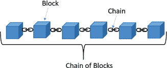

FIGURE 10.1 Blockchain architecture.

Original (created by authors)

This hash is a digital fingerprint that uniquely identifies the block. If any information in the block is altered, the hash changes, providing a tamper-evident mechanism.

The body of the block contains a set of transactions, each representing a transfer of value or data.

The distinctive advantages of blockchain lie in its capacity to facilitate the sharing of data and transactions across an unalterable peer-to-peer (`P2P`) network, thereby augmenting transparency and security.

Blockchain has the potential to address certain interoperability challenges within health care and can play a pivotal role in placing patients at the forefront of the ecosystem.

Blockchain can be applied to facilitate the access and sharing of patient medical records, mobile applications, remote monitoring, and medical data management systems. This application enables patients to retain ownership and control over their health records.

*   > Header: It serves the purpose of pinpointing a specific block within the entire blockchain. This component manages all blocks in the blockchain. Miners periodically hash the block header by altering the `nonce` value during routine mining operations. Additionally, the block header encompasses three sets of block metadata. 

*   > Previous Block Address/Hash: It is employed to establish a connection between the (i+1)th block and the ith block through the use of hashing. In brief, it functions as a pointer to the hash of the preceding (parent) block in the chain. 

*   > Timestamp: It is a system designed to validate the data within a block and allocate a specific time or date of creation for digital documents. The timestamp, represented as a unique string of characters, serves to distinctly identify the document or event and signifies its creation time. 

*   > Nonce: A nonce is a numerical value utilized only once, integral to the proof-of-work (`PoW`) process within a block. This nonce is assessed by comparing it to the active target, and if it proves smaller or equal to the current target, it is deemed valid. Miners engage in the exhaustive testing of numerous nonces per second, persisting until they discover a valuable nonce that meets the validation criteria. 

*   > Merkle Root: A data structure that forms the backbone of various data blocks, the Merkle Tree efficiently stores all transactions within a block by generating a digital fingerprint of the entire transaction set. This mechanism enables users to verify the eligibility of a transaction for inclusion in a block. 

### 10.2.1 Mining techniques


# Mining

Mining involves the creation of blocks that become permanently appended to the blockchain database. In certain blockchain applications, miners who successfully generate the initial valid block are rewarded, as seen in the case of Bitcoin. This reward, typically in the form of monetary compensation for financial applications \[11\], is provided by the system. Mining stands out as a pivotal concept in blockchain technology, enabling nodes to produce blocks subject to validation by others \[12\]. Nodes engaged in the creation of new blocks are termed “mining nodes,” engaging in a competitive race to swiftly validate transactions and create a new block in order to secure the reward.

## 10.2.2 Consensus algorithms

Blockchain consensus algorithms are mechanisms that enable distributed nodes in a blockchain network to agree on the state of the system and validate transactions. Consensus is crucial for maintaining the integrity of the blockchain and ensuring that all participants have a consistent view of the ledger. Several consensus algorithms exist, each with its own set of characteristics and use cases \[13\].

The consensus algorithm of the blockchain is the logic that determines who can add new blocks to a blockchain and how nodes reach an agreement on the next transaction to be added to the chain. Consensus is a critical aspect of maintaining the integrity of the blockchain, ensuring that all participants share a consistent view of the ledger.

There are several major categories of blockchain algorithms:

*   > Proof-of-Work (PoW) is the most well-known consensus mechanism in the field of cryptocurrencies but is much less utilized due to its energy and hardware-intensive operation. It is the first consensus algorithm used by Satoshi Nakamoto in the creation of Bitcoin. The PoW consensus mechanism, therefore, requires a significant amount of energy and hardware to operate, and it is considered by many as the most secure solution for a network and for resisting censorship.

*   > Proof-of-Stake (PoS) is the second most prevalent consensus mechanism in the field of cryptocurrencies. Indeed, it is the most used due to its often-lower energy and hardware costs. PoS was introduced in 2011 to address the limitations of PoW networks, with Peercoin being the first cryptocurrency to implement the PoS mechanism. Unlike PoW, PoS operates with minimal computational power, relying instead on a certain number of tokens staked in a smart contract to secure the distributed network (blockchain). This process is known as “staking.” Validators are randomly chosen to validate blocks and are rewarded in cryptocurrency.

*   > Proof-of-Authority (PoA) was proposed in 2017 by Gavin Wood, cofounder of Ethereum. He suggested a new practical and efficient solution to operate and secure the blockchain. Unlike PoW or PoS, PoA does not depend on computational power or the number of tokens a node possesses. Instead, it relies on the reputation of validators, referred to as “trusted entities.” Block validation is carried out by validators who have been authoritatively selected.

*   > Delegated Proof-of-Stake (DPoS) Developed in 2014 by Daniel Larimer, the DPoS consensus algorithm is also an alternative to the PoW consensus algorithm. It is particularly well regarded in the community because this algorithm has been presented as a more efficient and democratic version of previous algorithms.

## 10.2.3 Smart contracts

Smart contracts are essentially software programs residing within a blockchain framework, designed to activate when specific predetermined conditions are satisfied. Their primary function is to facilitate the automatic execution of agreements, ensuring that all participants gain immediate certainty regarding the outcome, eliminating the need for intermediaries and minimizing time loss. Beyond agreement execution, these contracts also serve to automate entire workflows, seamlessly initiating subsequent actions as soon as the specified conditions are met.

## 10.3 Blockchain in e-health

Patients and healthcare practitioners are faced with the challenge of accessing, managing, integrating, and sharing health records securely. Patients should be able to manage their health records anywhere in the world, keep track of medical background, give access to data, and share those with any healthcare professional securely.

Blockchain technology is well suited for managing any type of digital data where authentication and consensus on data integrity are crucial. It proves particularly valuable in situations requiring shared write access for multiple parties. In the healthcare context, blockchain can be employed to ensure the safety and security of critical medical data.

The blockchain’s limited storage capacity per block hinders its ability to store extensive data. Moreover, the requirement for duplicating block data across multiple network nodes leads to inefficient use of storage space. To address this, off-chain storage becomes essential for accommodating substantial data volumes while maintaining network efficiency and performance. Notably, solutions such as IPFS offer a means to reduce the cost implications for blockchain nodes by minimizing the data stored and processed by these nodes.

The integration of IPFS and blockchain empowers developers to architect decentralized and resilient systems, harnessing the advantages of distributed file storage and tamper-resistant transaction records. This synergy is particularly invaluable in applications where priorities include decentralization, safeguarding data integrity, and ensuring resistance to censorship.

In practical terms, this integration addresses several critical challenges. Firstly, the decentralized nature of IPFS facilitates efficient and scalable storage, ensuring that files are not reliant on a central server. The use of content addressing in IPFS ensures the integrity of stored data, as each file is uniquely identified by its cryptographic hash.

Ethereum was chosen for its advanced smart contract capabilities, which allow us to automate critical aspects of medical data management securely and transparently. Its widespread adoption and supportive ecosystem offer additional tools and libraries that accelerate development and ensure long-term viability.

## 10.4 Implementation

In assessing the system’s performance, a comprehensive evaluation is conducted through the execution of a simulation on the Ethereum decentralized computing platform. This simulation involves the creation and execution of smart contracts, meticulously programmed in Solidity and deployed on the Ethereum platform. This approach thoroughly examines the system’s performance on the Ethereum blockchain.

There are several programming languages that can be used to create this application, such as Python, JavaScript, etc. We have chosen to use Node.js for developing this application. In the context of our application, Node.js is much more than just a development choice; it is the diligent conductor orchestrating the symphony of our system’s operations. Imagine Node.js as the backbone, seamlessly connecting the vibrant frontend with the complex, blockchain-powered backend, all while managing the flow of data like a skilled traffic controller. Whether it is handling user requests with the agility of a seasoned athlete, ensuring that each interaction with the Ethereum blockchain and IPFS network is as smooth as silk, or securing the gates of our digital world, Node.js does it all.

Firstly, we installed the necessary packages using `import create from "ipfs-http-client"`. This imports the `create` function from the `ipfs-http-client` module. This line suggests the use of the IPFS HTTP client to interact with the IPFS network through HTTP calls, as shown in Figure 10.2.


## 10.4 区块链与 IPFS 集成

### 10.4.1 IPFS 客户端集成

Client library for the IPFS HTTP Application Programming Interface (API)

\[Original (created by authors)\]

然后，我们创建了一个连接到本地主机和端口的 IPFS 客户端，如 图 10.3 所示。

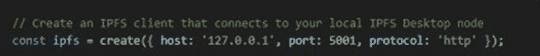

图 10.3 创建 IPFS 客户端。

\[Original (created by authors)\]

要发送医疗文件，我们利用对象提供的方法，使用“add”方法，如 图 10.4 所示。

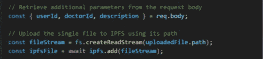

图 10.4 在 IPFS 中存储文档。

\[Original (created by authors)\]

要检索数据，我们使用存储在 IPFS 系统中的文件哈希 `ipfsHash`，如 图 10.5 所示。

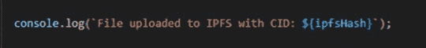

图 10.5 恢复文档。

\[Original (created by authors)\]

最后，我们获得了添加到 IPFS 的数据的内容标识符（CID），表明添加操作已成功完成，如 图 10.6 所示。

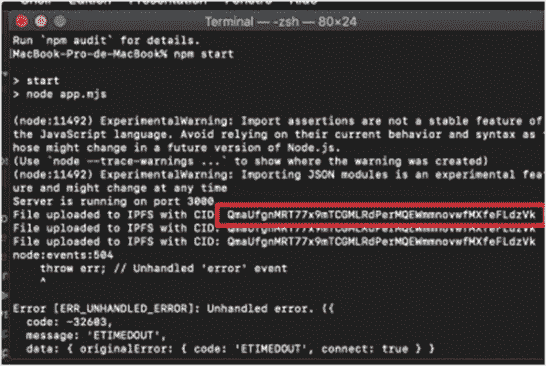

图 10.6 内容标识符（CID）。

\[Original (created by authors)\]

#### 10.4.1.1 区块链与 IPFS 的集成

IPFS 作为一种点对点内容寻址文件共享系统，利用加密哈希进行数据存储。这种去中心化的存储方法提高了效率。将区块链与 IPFS 相结合，形成了一个强大的文件共享系统。这些技术的集成不仅提供了有效的数据存储，还有助于降低成本并最大限度地发挥去中心化存储能力。

Truffle 是我们选择的智能合约开发框架，因为它简化了在以太坊区块链上创建、测试和部署的过程。这个框架不仅简化，而且简化了整个过程，包括智能合约的创建、编译、部署和测试阶段。其全面的功能有助于为基于以太坊的项目提供高效且有效的开发工作流程。

##### 10.4.1.1.1 智能合约创建

在“contracts”目录中，创建一个带有 .sol 扩展名的新 Solidity 文件，名为“ipfs.sol”，如 图 10.7 所示。随后，将 Solidity 代码合并到文件中，如 图 10.8 所示。


图 10.7 创建智能合约。

\[Original (created by authors)\]

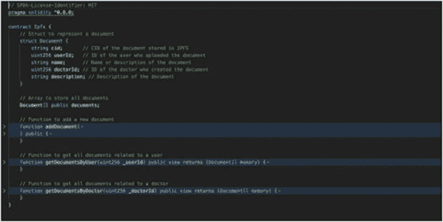

图 10.8 智能合约代码。

\[Original (created by authors)\]

要编译我们的智能合约，我们执行以下命令：`truffle compile`。

这将在我们项目的“build/contracts”目录中生成输出文件，这些文件代表我们将用于进一步集成的 API。接下来，我们在“migrations”目录中创建一个迁移文件，以指定如何在区块链上部署我们的合约。我们将使用 JavaScript 定义部署步骤，如 图 10.9 所示。

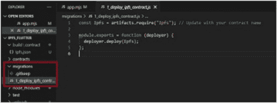

图 10.9 智能合约迁移。

\[Original (created by authors)\]

最后，我们使用以下命令执行迁移：`truffle migrate`。

这将在我们 Truffle 配置中指定的区块链上部署我们的智能合约。要在我们之前开发的应用程序中使用此合约，我们需要合约的地址。

我们之前已获得使用 Truffle 即将部署的合约。要在我们现有的 Node 应用程序中使用此合约，我们需要两个元素：合约的 ABI，它在合约编译期间自动生成并存储在“build/contracts”目录中，以及合约的地址（图 10.10）。

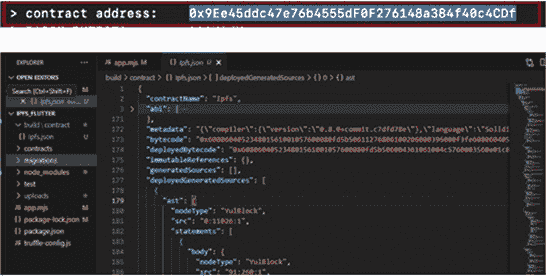

图 10.10 合约的 ABI 和地址。

\[Original (created by authors)\]

## 10.4.2 移动应用程序

在此步骤中，我们将集成区块链和 IPFS。我们需要导入“web3”、“HDWalletProvider”和“json”包，如 图 10.11 所示。

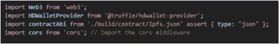

图 10.11 区块链和 IPFS 集成所需的包。

\[Original (created by authors)\]

Infura 是一项提供基础设施节点以与以太坊等去中心化区块链进行交互的服务。因此，通常需要调用 Infura API 来访问区块链功能，如 图 10.12 所示。

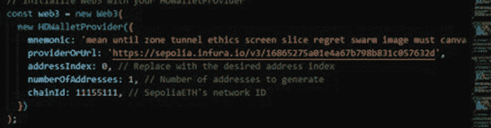

图 10.12 Infura API 调用。

\[Original (created by authors)\]

web3 和 HDWalletProvider 的用法：Web3 是一个 JavaScript 库，它简化了去中心化应用程序与以太坊区块链的交互，如 图 10.13 所示。

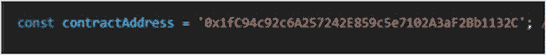

图 10.13 合约地址。

\[Original (created by authors)\]

在检索 IPFS CID（如前一节所述）后，我们现在可以使用“set”函数将此值发送到区块链，如 图 10.14 所示。

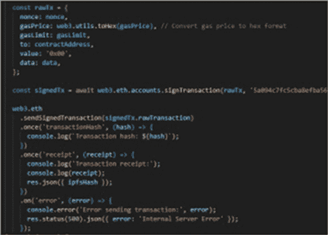

图 10.14 合约地址。

\[Original (created by authors)\]

最后，我们可以使用 Etherscan（如 图 10.15 所示）观察区块链上的区块和交易。

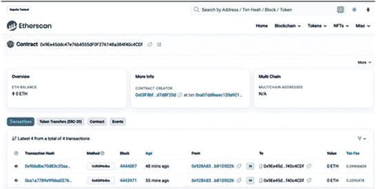

图 10.15 Etherscan 界面。

\[Original (created by authors)\]

### 10.4.2.1 Spring Boot + MySQL

Spring Boot 凭借其安全功能套件，充当堡垒墙，保护应用程序免受潜在威胁和漏洞的影响。它简化了身份验证和授权机制的实现，确保只有合法用户才能访问敏感信息。这个框架自动化了许多繁琐的安全配置，使我们能够专注于开发功能而不牺牲安全性。MySQL 是我们选择的数据库，通过提供可靠的数据存储基础来补充 Spring Boot 的安全措施。它通过强大的访问控制和加密功能确保数据的完整性和机密性。Spring Boot 和 MySQL 共同构建了一个不仅能抵御攻击，还能从任何漏洞中迅速恢复的后端系统，从而保持应用程序的稳定性和可信度，如 图 10.16 所示。

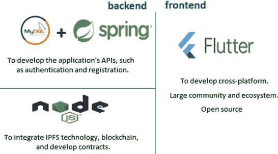

图 10.16 拟议的系统架构。

\[Original (created by authors)\]

本质上，Spring Boot 和 MySQL 的组合不仅支持我们的应用程序，还使其更上一层楼。通过集成这些技术，我们构建了一个作为安全堡垒和可靠性灯塔的后端，确保用户数据受到保护，系统性能稳定可靠，即使在我们在数字医疗保健的动态环境中扩展和发展时也是如此。

> Node.js

> 对于在区块链上管理医疗记录和去中心化文件存储，我们转向 Node.js，结合区块链和 IPFS 技术。这种组合确保数据安全，并实现高效访问。


# Node.js 简介

Node.js 是一个基于 V8 JavaScript 引擎的 JavaScript 运行时。它允许开发者在 Web 浏览器之外执行 JavaScript 代码，使其适合服务器端开发。Node.js 以其非阻塞、事件驱动的架构而闻名，能够高效地处理并发操作。它在构建可扩展和高性能的应用程序方面广受欢迎，尤其是在实时功能至关重要的场景中。Node.js 通常用于开发 Web 服务器、API 以及各种类型的网络应用程序。

# Flutter 简介

Flutter 是一个用于构建用户界面的框架，能够提供流畅且一致的用户体验。Flutter 将开发流程转变为从单一代码库构建、测试和部署移动、Web、桌面及嵌入式体验。

# 技术生态系统

在医疗应用程序中，使用 Spring Boot、Node.js、Flutter、区块链和 IPFS 技术可以创建一个全面的生态系统，以满足医疗数据的安全性、隐私性和可访问性需求。这些技术各自为应用程序带来特定的优势。

## Spring Boot 优势

- **强大且安全的后端**：Spring Boot 便于开发具有集成安全功能的强大后端，包括用户管理、会话处理和端点安全。
- **便捷的数据库集成**：它允许将应用程序连接到数据库，以安全地存储医疗信息。

## Node.js 优势

Node.js 是一个允许开发者在 Web 浏览器之外执行 JavaScript 代码的运行时环境。它基于 Google Chrome 的 V8 JavaScript 引擎，广泛用于构建可扩展、高性能的应用程序，特别是在服务器端。

- **异步处理**：Node.js 在异步处理方面表现出色，这对于同时管理大量实时医疗查询非常有价值。
- **可扩展性**：Node.js 的事件驱动特性能够实现高效的可扩展性，这对于不断扩展的医疗应用程序至关重要。

## Flutter 优势

- **响应式用户界面**：Flutter 为移动应用程序提供响应式且吸引人的用户界面，这对于医疗领域的现代用户体验至关重要。
- **跨平台开发**：它能够开发在 Android 和 iOS 上均可运行的医疗应用程序，使用共享源代码。

## 区块链优势

- **数据安全性**：区块链确保医疗数据的完整性，防止未经授权的篡改。
- **可追溯性**：区块链技术允许追踪数据的来源和所做的修改，提供完整的可追溯性。

## IPFS 优势

- **去中心化存储**：IPFS 提供去中心化存储，增强医疗数据的弹性和可用性。
- **文件共享**：在确保保密性的同时，促进不同利益相关者之间安全地共享医疗文件。

# 结论

基于 IPFS 和区块链技术的安全医疗文件共享系统的实施，旨在创建一个强大的平台，以确保医疗数据的安全性和完整性。我们的解决方案依赖于 IPFS 提供的去中心化以及区块链固有的安全性，从而确保最大程度的保密性。该系统包含通过区块链上的哈希值验证数据真实性的机制，使任何篡改都可被检测到。共享过程以加密且高效的方式进行，为安全交换敏感医疗信息提供了可靠的解决方案。

# 参考文献

1. Othman, S. B., Almalki, F. A., & Sakli, H. (2022). Internet of Things in the Healthcare Applications: Overview of Security and Privacy Issues. In: Chakraborty, C., Khosravi, M.R. (eds) Intelligent Healthcare. Springer, Singapore. [`doi.org/10.1007/978-981-16-8150-9\_9`](https://doi.org/10.1007/978-981-16-8150-9_9)

2. Jiang, S., Cao, J., Wu, H., Yang, Y., Ma, M., & He, J. (2018). Blochie: A blockchain based platform for healthcare information exchange. In 2018 IEEE International Conference on Smart Computing (SMARTCOMP) (pp. 49–56).

3. Alqarni, K. S., Almalki, F. A., Soufiene, B. O., Ali, O., & Albalwy, F. (2022). Authenticated wireless links between a drone and sensors using a blockchain: Case of smart farming. Wireless Communications and Mobile Computing, Article ID 4389729, 13. [`doi.org/10.1155/2022/4389729`](https://doi.org/10.1155/2022/4389729)

4. Ramani, V., Bracken, A., Liyanage, M., Ylianttila, M., & Kumar, T. (2018). Secure and efficient data accessibility in blockchain based healthcare systems. In IEEE Global Communications Conference (GLOBECOM) (pp. 206–212).

5. Gupta, S., Alharbi, F., Alshahrani, R., Kumar Arya, P., Vyas, S., Elkamchouchi, D. H., & Soufiene, B. O. (2023). Secure and lightweight authentication protocol for privacy preserving communications in smart city applications. Sustainability, 15, 5346. [`doi.org/10.3390/su15065346`](https://doi.org/10.3390/su15065346)

6. Tagde, P, Tagde, S, & Rahman, M. H. (2021). Blockchain and artificial intelligence technology in e-health. Environmental Science and Pollution Research International, 28(38), 14757–14767.

7. Zheng, Q., Li, Y., Chen, P., & Dong, X. (2018). An innovative IPFS-based storage model for blockchain. In 2018 IEEE/WIC/ACM International Conference on Web Intelligence (WI) (pp. 704–708).

8. Jayabalan, J., & Jeyanthi, N. (2022). Scalable blockchain model using off-chain IPFS storage for healthcare data security and privacy. Journal of Parallel and Distributed Computing, 164, 152–167, ISSN 0743-7315. [`doi.org/10.1016/j.jpdc.2022.03.009`](https://doi.org/10.1016/j.jpdc.2022.03.009)

9. Guo, H., & Yu, X. (2022). A survey on blockchain technology and its security. Blockchain: Research and Applications, 3(2), 100067. Retrieved from [`www.sciencedirect.com/science/article/pii/S2096720922000070`](https://www.sciencedirect.com/science/article/pii/S2096720922000070)

10. Bhutta, M. N. M., Khwaja, A. A., Nadeem, A., Ahmad, H. F., Khan, M. K., Hanif, M. A., & Cao, Y. (2021). A survey on blockchain technology: Evolution, architecture and security. IEEE Access, 9, 61048–61073.

11. Salman, T., Zolanvari, M., Erbad, A., Jain, R., & Samaka, M. (2019). Security services using blockchains: A state of the art survey. IEEE Communications Surveys Tutorials, 21(1), 858–880.

12. Kaushik, A., Choudhary, A., Ektare, C., Thomas, D., & Akram, S. (2017). Blockchain—Literature survey. In 2017 2nd IEEE International Conference on Recent Trends in Electronics, Information Communication Technology (RTEICT) (pp. 2145–2148). doi: [10.1109/RTEICT.2017.8256979](http://dx.doi.org/10.1109/RTEICT.2017.8256979)

13. Sankar, L. S., Sindhu, M., & Sethumadhavan, M. (2017). Survey of consensus protocols on blockchain applications. In 2017 4th International Conference on Advanced Computing and Communication Systems (ICACCS) (pp. 1–5).

# 11

## A SURVEY ON SECURITY ENHANCEMENTS OF ELECTRONIC HEALTH RECORDS THROUGH BLOCKCHAIN TECHNOLOGY

Shahd Rashed Abdulla Alhebsi, Alanoud Eisa Faraj Alfalahi, and Thangavel Murugan

DOI: [10.1201/9781003483113-11](https://doi.org/10.1201/9781003483113-11)

## 11.1 Introduction


# EHRs 概述

EHRs 是一种以数字形式记录患者医疗数据，并通过应用程序或在线方式向用户显示的系统，使用户在需要时能够随时更轻松、更快速地访问。EHRs 可以存储姓名、年龄、身体质量指数（BMI）、病史、实验室检测结果、过敏史、免疫状态等个人统计数据，以及更多信息。所有这些类型的数据都会通过患者创建的账户显示给患者，患者可以随时访问查看，没有任何限制。此外，这些数据还会显示给医生，用于用药和诊断目的 \[1\]。

EHRs 可以提供多种优势，有助于改善医疗服务。EHRs 还为专业人员和患者提供了便捷的访问和高效的护理。此外，EHRs 的另一个好处是有助于消除和降低将数据插入数据库时的人为错误风险。同时，EHRs 可能帮助患者更好地理解自己的数据，并了解每个术语的含义，从而使他们能够追踪健康状况并获得改善健康的动力。与 EHRs 相关的另一个好处是，它们通过数据挖掘的帮助，为增强研究和数据分析做出了贡献。使用 EHR 数据更容易识别趋势和模式，这些趋势和模式有助于发现新的冥想或药物，或新的疾病类型 \[2\]。

另一方面，EHRs 也可能涉及一些会影响患者的缺点。EHR 实施可能成本高昂，需要大量资金或投资者来启动这项技术，包括软件开发、硬件以及参与构建的人员薪资成本。此外，EHRs 可能会给患者和医疗服务提供者带来一些困难，因为这是一项新技术，医疗服务提供者可能没有时间来适应它。一些患者，尤其是老年人，可能难以使用 EHR 技术。EHRs 存储与患者医疗数据相关的敏感数据，可能包含一些私人数据，因此存在数据泄露以及数据安全和隐私问题的潜在风险 \[3\]。

EHR 安全性将是每位研究者都力求实现的目标，因为这是需要尽快解决的挑战之一。解决或增强 EHR 的安全性可能有助于患者，并提升患者对最新技术的信任，从而更多地使用它。我们需要提高 EHR 系统安全性的另一个原因是，存在保护患者数据的法律和道德义务，有一项名为《健康保险可携性和责任法案》（HIPAA）的法律。确保 EHR 的安全性也意味着确保数据完整性，保护其免受未经授权的修改，并确保患者数据免遭窃取并出售给可能怀有不良意图的第三方。此外，保护患者医疗数据将防止身份盗窃和任何其他欺诈行为 \[4\]。

区块链技术可以提供数据完整性，并确保数据仅由授权用户访问，且数据未发生任何修改。区块链还可以保护存储在网络某处的患者数据 \[5\]。数据完整性可以通过不同的区块链机制和功能来实现，其中一些功能包括密码学、共识机制、智能合约、许可型和非许可型区块链以及哈希函数（参见 图 11.1）。

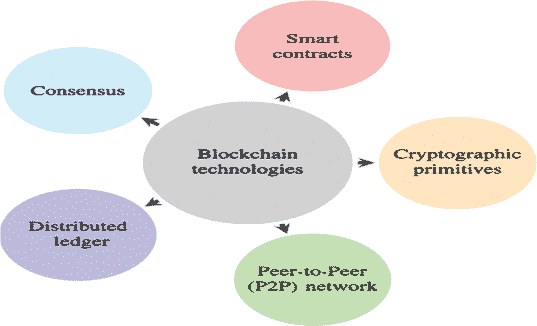

图 11.1 不同的区块链机制和功能。

原创（由作者创建）

区块链技术使用密码学，密码学是编写秘密代码的科学，除了发送者和接收者之外，任何人都无法理解，以确保数据的机密性。此外，区块链的另一个用途是智能合约，它可以确保并验证数据在传输过程中未发生变化。哈希函数也包含在区块链技术中，无论消息的大小如何，它始终生成固定大小的输出，作为函数的输入。哈希函数可以为患者数据以及数据完整性提供安全性 \[6\]。

区块链技术及其一些功能可以集成到医疗保健中，并通过使用区块链的各种功能来增强 EHR 的安全性。例如，区块链可以促进医院之间数据的便捷增强，同时保持交换数据的安全性。区块链技术的加密功能可以提供患者医疗记录的数据机密性，并安全地存储它们，以确保数据安全和隐私 \[7\]。

文献调查的目的是进行分析，并对其他研究者的解决方案以及他们使用的功能、函数、技术和方法进行全面研究，尤其是与区块链技术相关的内容，以增强 EHR 的安全性，因为这是对人类最重要的数据之一。通过创建和开发最佳解决方案，应对其他作者和研究人员使用区块链技术所面临的所有挑战，并增强电子健康记录的安全性，从而为改善医疗服务做出贡献。在调查了区块链领域研究者开发的解决方案后，我们将了解每个解决方案，然后建立使用区块链保护 EHR 并提升安全性和隐私性的解决方案 \[8\]。

## 11.2 电子健康记录概述

EHRs 是一种将患者数据以数字化方式存储的方法，其中包含与患者相关的医疗信息部分，如用药史、过敏史、实验室检测结果，以及 BMI、年龄和姓名等个人信息。EHRs 的建立旨在方便在不同医疗地点之间安全且更便捷地共享患者数据，使医疗服务提供者能够访问数据、检查患者健康状况并提供诊断 \[9\]。

EHRs 带来了多种好处。其中一些主要优势包括：

*   > 与传统的患者数据存储方法相比，效率和生产力得到提升。

*   > 减少手动插入数据的时间，从而降低人为错误和失误。

*   > 减少冗余，并改善不同医院之间共享数据的一致性。

*   > 降低支出成本，因为转向 EHRs 可能减少购买纸张的需求，并将支出集中在其他可能必要的资源上。

*   > 由于消除了人工手动输入记录，准确性将大幅提高。

*   > 使患者能够轻松访问自己的数据，并相应监测健康状况。

*   > 法律和法规合规性，包括为维护患者健康数据部分的安全性和隐私性而制定的不同法律。


虽然采用电子健康记录（EHR）为医疗服务带来了诸多好处，但仍有一些挑战和问题需要更专注地加以解决。EHR 会跟踪并存储患者的健康数据，由于存储了这些数据，因此需要确保其安全并符合法律规定，因为这些数据对患者至关重要，有时被视为私密信息，患者不希望除医疗服务提供者和本人之外的任何人能够访问。如果 EHR 安全性不足，可能出现的一些挑战包括数据泄露（即未经授权访问患者健康数据部分）、未经授权的人员修改数据、完整性问题以及其他类型的挑战。这些挑战需要立即通过能够提供 EHR 安全性和安全性的解决方案来解决。

## 11.3 区块链技术

计算机网络中的交易需要安全、防篡改且透明。通过使用区块链技术，所有交易记录以及其他需要存储的数据（例如 EHR）都需要具备安全性，实现数据完整性，并且记录需要能够抵抗未经授权的数据修改。区块链是一种通过创建区块链而实现分布式和去中心化的技术，每个区块都连接到前一个区块，从而允许更安全且难以破解的关系 \[10\]。

区块链涉及的原则如下：去中心化和分布式、哈希函数、密码学、智能合约，以及许可网络和非许可网络。所有这些原则都可以帮助区块链实现其设计目标。

> 去中心化和分布式：消除对中央机构的依赖，使区块更安全、更可信。同时，由于区块是分布式的，还降低了故障风险。

> 哈希函数：哈希函数用于评估区块的完整性，使其更安全。哈希函数接收大小可变的输入消息，并生成固定长度的哈希值或摘要。

> 密码学：它是一种使用技术或方法将明文转换为密文的科学。密码学中使用的技术有两种：对称密钥和非对称密钥。

> 许可网络和非许可网络：不同类型的网络，例如许可网络限制对区块的访问，而非许可网络允许任何人访问区块。

根据三种类型的区块链（公有链、私有链和联盟链）可以识别区块链（参见 图 11.2）。每种类型都包含一些特性，并提供另外两种类型在特殊情况和目的下所需的其他功能 \[11\]。例如，公有链允许任何人访问和参与，这意味着如果用于这些目的，公众可以访问区块并验证交易。此外，单个实体不能完全控制网络上的所有区块，而参与者可以做到这一点。私有链类型与公有链相反，其中特定人员可以验证和访问网络中的区块，仅限授权用户访问，并且可能是中心化或部分去中心化的，而不依赖于中央机构。最后，混合链类型介于前两种类型之间，它结合了公有链和私有链的功能。

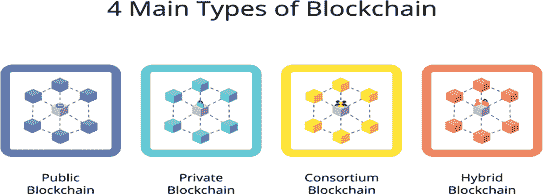

图 11.2 区块链类型。

\[原创（由作者创作）\]

区块链技术可以应用于不同的领域，并对不同类型的行业产生不同的影响和目的。以下是可以应用区块链的潜在领域和行业：

> 医疗保健：可用于保障患者医疗数据（例如 EHR）的传输安全。

> 政府：保障选举新内阁的投票安全；减少欺诈行为。

> 金融与银行：可用于加密货币，并确保比特币和交易的安全性。

> 知识产权：证明知识产权所有者是设计或发明的拥有者。

> 法律与合规：遵守法律，减少对第三方的信任需求。

> 教育：保障并评估学术凭证的完整性，例如员工信息（如社会安全号码）或学生信息（如成绩）。

## 11.4 区块链技术在医疗保健中的应用

区块链技术在医疗保健系统中部署时可以提供许多不同的优势。促进医疗服务是实施区块链技术后可能出现的优势之一；例如，它可以帮助提供数据完整性，并确保数据在传输过程中未被更改，从而确保患者在 EHR 中的健康数据在与其他医院医疗系统共享时保持隐私。区块链可以利用 EHR 中存储数据的实时更新，使紧急情况下的流程更快，并增加患者在使用区块链技术时对 EHR 技术的信任。

采用区块链技术可以为国家向技术创新领导者的过渡架起桥梁。区块链技术已在各个领域和行业中实施，以执行和促进不同的目的。医疗保健领域的区块链技术是主要关注点之一，因为其实施可能至关重要。医疗保健中区块链的实施示例包括以下内容：

> 区块链可用于 EHR，主要目的是确保数据完整性并增强记录的安全性。

> 药品管理也可以是实施区块链的一个领域，确保药物和药品符合国家法律，安全可靠。

> 患者健康记录在全国范围内的安全转移，使得身处国外的人更容易在另一个国家获得治疗。

> 区块链还可以借助物联网（IoT）设备，促进远程医疗和远程患者监护的过程。

尽管区块链技术及其他任何技术都有优势和进步，但在使用区块链技术时仍可能遇到一些限制和挑战。以下是医疗保健中出现的一些挑战和限制。首先，由于区块链中的不可更改记录，修改区块链中的区块可能会很困难。如果用户想要进行更改，需要更改目标区块之后的所有区块。其次，在讨论区块链时，可扩展性是一个问题，因为将有大量数据需要存储在安全的地方。第三，在实施区块链技术时，EHR 的安全性和隐私性可能会引起问题。最后，在医疗保健中实施区块链技术的成本可能昂贵且资源密集。

## 11.5 通过区块链增强 EHR 安全性：研究工作


该研究的目的是调查区块链技术建立私有化设计（private by-design）物联网系统的能力，并确保 CIA 三要素——机密性（Confidentiality）、完整性（Integrity）和可用性（Availability）在所创建的系统中得到应用 \[5\]。该工作确保使用区块链和点对点（peer-to-peer）方法的物联网应用程序产生的数据不是由集中式公司生成的，决策是从顶层生成以确保决策的完整性。通过使用分层架构，该研究声称可以解决不可信数据的问题，即仅在区块链中存储有限部分的数据。

由于物联网是一个动态环境，依赖第三方审计员的现有框架不足以确保应用程序中数据完整性的验证。因此，\[8\] 使用区块链构建了一个框架，为物联网系统提供更可靠的框架，而无需使用第三方审计员。该研究的目标是创建一个区块链框架，帮助在不借助第三方审计员的情况下验证物联网应用程序的数据完整性，以确保通过物联网系统传输的数据的完整性。替换现有框架中使用完整性管理服务（Integrity Management Service）的问题，该服务引发了完整性问题。因此，该研究建立了一个区块链框架，替换第三方审计员并提高所提供服务的可靠性。该解决方案还包括使用协议来验证数据所有者和数据客户端的数据完整性。该工作还着重于改进物联网应用程序的随机环境，并改进智能合约以大规模验证数据。

临床和精准医学需要强大的区块链技术来提供数据完整性和隐私，以识别客户端。\[9\] 的作者提出了一种新架构，将为该问题提供解决方案并增强健康信息的安全性。该研究的目标是为临床和医疗数据建立一个新平台，该数据在处理时需要精确和准确。该工作旨在描述构建区块链技术的要求，并帮助其他研究人员在开发新架构理念时做出决策。该研究创建了一个新平台，在传输时提供跨互联网的信任。为了实现所需的信任，研究人员使用带有分类账的分布式和并行计算机制的概念。智能合约也可用于提供通信实体的保证，而不是使用机构来传输数据。该系统将赋予患者访问其数据并调查各种数据的权利。该研究工作仅解释了他们为医疗领域创建的区块链，用于处理时需要精确的数据。因此，作为概念论文，没有实验结果。研究人员未来的目标是调查和学习大数据分析以及机器学习及其特性的使用，以增强其解决方案。

\[10\] 旨在为医疗保健系统中局限于数据隐私和安全问题的挑战和局限性提供解决方案。该研究工作旨在提供一个在移动端运行的系统，以维护数据所有者和医疗服务提供者之间的数据收集和共享，以讨论病例和研究目的。此外，该研究工作旨在解决现有解决方案中的挑战，并利用区块链技术（特别是 Hyperledger Fabric 的使用）来克服这些挑战。所提议的解决方案是一个移动医疗保健系统，它是健康数据的安全去中心化平台。系统的工作方式如下：（i）与患者相关的健康数据将使用可穿戴设备收集。（ii）数据将存储在可信平台的云服务器上。数据的所有权属于患者，他们有权拒绝或允许任何操作。（iii）用户可以请求医疗服务，并在完成时撤销请求，以确保医生在治疗后无法访问数据。（iv）系统使用 Merkle 树方法来确保数据处理的质量。（v）对数据的任何类型的更新或修改都将记录在区块链网络中，以提高数据隐私。该系统针对大量记录进行了测试和评估，发现结果快速且延迟低，这意味着系统可以在短时间内处理大量记录。

\[12\] 提到需要创建一个新系统来确保数据完整性。该研究的目标是提供一个新系统来保护基于云的应用程序中的通信。然而，研究人员旨在建立一个安全性高的可信且具有弹性的架构。研究人员希望系统能够验证物联网系统中的数据完整性。DroneChain 是作者提出的系统，它是一个基于区块链的无人机系统。DroneChain 的组件包括无人机、云服务器、控制系统和区块链网络。它是一组无人机的系统，控制系统用于发送无人机分发和通信目的的命令。区块链被包含进来以提供数据完整性并在系统中提供信任。此外，云服务器提供存储和收集大量数据所需的容量。未来工作提到的是扩展系统并使其用于不同的物联网应用。

研究人员寻求提供一个系统，该系统将解决所有局限性，并将区块链技术与点对点（P2P）云存储相结合。这样，框架将建立云服务器中传输数据的可信通信，\[13\] 创建了一种将现有解决方案分为两部分的方法：可证明数据持有（PDP）和可扩展高效的可证明数据持有（SE-PDP）。为了建立一个能够封装验证过程并使其更加开放和可审计的框架。使用基于区块链的 P2P 云服务器，研究人员旨在为当前框架中的挑战提供解决方案。使用 P2P 云存储功能并将区块链与用于识别数据完整性的框架相结合是所提议的解决方案。研究人员利用 Merkle 树特性作为生成的哈希值的存储，以识别实体并为系统提供信任级别。研究人员建立的验证过程的使用可以确保数据未被篡改。该研究已构建原型并进行了普遍仿真，以测试框架在验证数据完整性方面是否有效。结果表明，该系统灵活且提高了数据完整性。


\[6\]旨在利用默克尔树方法增强和改进电子健康记录（EHR）的安全性和数据完整性验证。为了在私有网络中提出使用区块链技术的解决方案，并借助基于默克尔树的方法帮助识别数据完整性，研究人员寻求简化区块链技术，并提出一种具有该功能且避免数据挖掘的解决方案。它使用密码学来保护区块链中的内容。所提方法经过了不同类型的测试，结果表明该方法具有鲁棒性，可以防范不同的修改，无论是意外的还是故意的。与旧方法相比，新方法的处理开销较低。该方法使用了名为 MIMIC-III 的知名数据库进行测试，测试结果质量很高。

云存储服务器（大部分敏感数据存储于此）容易受到修改和数据泄露漏洞的影响。此外，这些系统缺乏开放性和问责制。\[4\]旨在提供一种防篡改且能够准确验证医疗领域数据完整性的解决方案。使用区块链技术的解决方案会修改区块以添加事务；然而，研究人员提出的方法是将元数据文件作为事务追加到区块链中。该解决方案将有助于避免区块中数据的不必要重写。它通过监控服务器上的文件来确保云存储系统不被更改。所提解决方案对于不经常修改但经常访问的归档数据非常高效。结果表明，该解决方案的响应时间和成本是合理的。

关于个人的收集数据不断增加，这导致在医疗机构间共享数据时出现挑战，原因是缺乏数据可靠性以及对数据在传输过程中未被修改的信任。\[3\]的目标是提供一个名为 Sharechain 的标准化且可共享的医疗系统。它将确保数据对用户透明并确保其互操作性。它将提供一个框架来解决所有提到的问题，使其成为结合所有功能的解决方案。SHAREChain 是研究人员提出的解决方案，它是一个医疗框架，将提供数据互操作性并确保其可靠性。该解决方案使用的区块链技术类型是联盟链。它防止存储数据的复制。研究人员使用的系统称为 XDS（跨企业文档共享）。

电子健康系统中事务的透明度可能导致健康系统中数据完整性和隐私方面的问题。\[6\]的目标可以通过名为 eHealth Integrity model 的基于区块链的解决方案来实现，该方案基于研究人员设计的许可链，旨在确保电子健康信息的数据完整性。该系统可以集成用于辅助验证 EHR 完整性。名为 BEIM（基于区块链的完整性管理）的基于区块链的模型是所提系统，其目标是构建一个确保数字格式医疗数据完整性和准确性的系统。研究人员寻求添加从系统中删除信息的功能，并可以使用带有链下存储的许可链来启用此功能。研究人员建议一种系统，将使用基于区块链的技术保证医疗数据的完整性和准确性。所提系统未提供任何实验结果。在实验室环境中测试该系统也实现了所提解决方案概念的验证，以便将来发表。测试过程将进行，以确认节点数量、网络延迟和其他威胁如何影响验证速度。

为了提供大规模 IoT 数据的基于区块链的数据完整性验证，并确保数据在传输/存储和压缩过程中的完整性。\[14\]的目标是使用动态基于区块链的方法来降低计算和通信开销，以确保存储在云存储中的 IoT 数据的完整性。研究人员将允许云服务器上 IoT 数据的实时更新。所提解决方案以确保 IoT 设备数据完整性为理念进行设计。所提系统是用于大规模 IoT 数据的基于区块链的数据完整性验证，它使用区块链技术的属性组合。它允许对存储在云服务器上的数据进行实时修改，同时在不依赖第三方的情况下确保数据完整性。研究人员分析了所提算法的性能，并发现所提供的方案是可行的。关于所提系统的安全性，研究人员分析了可能发生在系统上的场景，并发现该系统可以抵御恶意攻击。

云服务器上确保数据完整性的重要性局限性问题也为第三方审计员提供了信心。\[15\]提出了一种基于联盟链的解决方案，旨在利用区块链技术的属性提供对数据完整性和第三方审计员的信任能力。为了保护匿名性和用户隐私，研究人员使用基于零知识证明的身份混合器。此外，研究人员使用了 Hyperledger Fabric，它将生成数字证书来证明通信。基于联盟链的所提方案可以在合理的时间成本内实现 IoT 安全的数据完整性。

如今，随着技术的蓬勃发展，关于个人信息的数据收集不断增加；因此，需要一个能够安全高效地存储数据的系统。在数据可能处于的所有状态中，都有一长串与之相关的威胁和问题，例如数据修改、数据泄露和未经授权的披露。\[16\]提出了一种能够解决所有当前问题的系统，包括数据存储位置相关的安全性。为了确保数据安全且不可修改，所提解决方案旨在使用区块链技术存储校验和。研究人员旨在提供一个可在可扩展环境中使用且需要快速响应的系统。RIVAChain 是所提解决方案，它是一个基于区块链的账本系统。它是一个将数据存储在能够抵抗修改或任何数据损坏的存储中的系统。它能够在不需要数据源为每次传输计算文件校验和的情况下，验证文件传输的完整性。该系统使用哈希函数创建一个唯一值，该值将传递到区块链以避免数据被篡改。结果显示了 Rivachain 系统的性能和可扩展性评估。结果表明，所提系统可以显示高吞吐量，并以低时间速率计算校验和。


`[17]` 的范围涉及战术数据链路（TDL）及其应用。TDL 是一种点对点数据传输方式，由于数据以明文传输且未进行加密以保障数据安全，因此缺乏安全性。随着时间推移，TDL 面临着诸多发展问题，包括使用加密来解决明文问题。TDL 链的设计目标旨在实现传输控制的完全自动化。自动化传输可通过以下方式实现：数据一致性、访问控制、数据审计以及自主性和智能性。TDL 链提出的解决方案是一种基于区块链技术的智能数据传输控制系统。其旨在解决 TDL 中多链共享不一致的问题。该方案涉及使用区块链技术及其特性、云服务器和证书颁发机构。密文策略属性加密（CP-ABE）将使 TDL 链能够访问云服务器和区块链上的数据。该系统经历了多次实验以评估性能并实现某些指标。实验重点关注效率。测试重点关注以下参数：智能合约响应的效率、对事件快速响应的低延迟、区块链中存储的大量数据的吞吐量以及通信成本。TDL 链系统的优化与开发，包括增强区块链网络的可扩展性和性能、探索更有效的加密技术，以及进行更彻底的安全研究和测试。

`[18]` 的研究人员旨在为用户及其交易数据提供安全性和隐私保护。提出的解决方案是一种基于区块链的个人数据交易系统，该系统由使用 DID（去中心化标识符）和 VC（可验证凭证）组成。去中心化是管理个人数据的系统基础设施，允许用户更可靠地存储和使用其数据。系统的工作流程如下：在用户交易其数据之前，用户需要验证身份并声明自己是所交易数据的所有者。DID 用于辅助身份验证过程，VC 用于确保所有权。作者以用户数据为例说明系统，并利用 DID 和 VC 的特性证明，使用所提系统可以有效且高效地实现用户数据交易。系统中有一个数据库，将在区块链中记录所有先前交易的历史，从而提供不可变性、可靠性和安全性。

问题陈述是验证大数据分析分布式系统中的数据完整性，以避免在数据从发送时被修改或更改时出现任何冲突或信任丢失。该系统的性质使得验证数据完整性变得困难。`[19]` 将提供一种解决方案，用于验证数据完整性以满足信任需求。Clouseau 是一种基于区块链的系统，可在 Hadoop 分布式文件系统（HDFS）上提供可验证的完整性。该系统将用于检测恶意行为，同时确保数据的完整性并提供信任。其目标是提供一个不会影响读写操作的系统。该系统将确保分布式系统中的数据完整性，该系统的环境使得提供数据完整性和数据信任变得困难。为了确保数据完整性，系统将使用 Merkle 证明和智能合约，从而简化数据验证过程。系统将允许用户根据自身需求选择合适的配置，同时提供安全性。Clouseau 是一种在分布式系统中检测恶意活动并维护数据完整性的有效系统。研究人员测试了系统的性能，以评估读写操作的吞吐量和延迟。此外，该系统可以检测恶意活动和数据完整性的修改。

`[20]` 提出了一种多层区块链基础的电子健康记录（EHR）系统。基于多层区块链的 EHR 解决方案解决了医疗数据管理中的问题。系统的目标是构建类似 PDP 的数据验证机制以保障数据完整性，并提供支持医疗组织运营层级的分层结构。系统设计如下：医疗组织的半节点和全节点在降低存储成本的同时，保持作者将构建的系统中的数据安全性。研究人员评估了系统的性能，发现当全节点数量超过 30 时，吞吐量会随全节点数量增加而提高，但当节点数量从 4 增加到 30 时，吞吐量会下降。

`[21]` 提出了一种在信息安全领域使用区块链技术并提供数据完整性保证的系统。该系统创建一个消息认证码，该码将与哈希值一起存储在块中，以提供数据完整性。哈希值在加密后使用 SHA-256 算法生成。基于区块链的数据完整性保证方法优于当前系统，因为它更加稳健且不断发展。该系统在基于区块链的完整性测试中使用了渗透测试。所提系统已在实时环境中实现和部署，以保障系统中使用数据的完整性；系统应进一步测试，以确保系统能够更加稳健并在所需范围内发挥作用。

`[22]` 提出了一种针对 IoT 网络数据完整性验证问题的架构或解决方案。该解决方案基于区块链技术，将用于 IoT 网络。研究人员旨在提供一种增强 IoT 网络数据完整性并提高其安全性的解决方案。所提系统旨在验证使用 IoT 设备的网络的数据完整性。系统流程分为三个步骤，三个阶段为：(i) 设置阶段：数据将被切分成小部分，并在该步骤中生成密钥。(ii) 处理阶段：然后切分的数据将在区块链中重新组合，并发送到云服务器。(iii) 验证阶段：验证数据完整性。用于 IoT 的区块链可以高效地用于 IoT 应用程序。研究人员使用三个参数测试了系统的性能；例如，内存利用率、准确率和端到端延迟。内存利用率是指 IoT 应用程序在验证过程中使用的内存量。准确率是指数据验证被预测为成功的比例。端到端延迟是指数据包在网络中从源到目的地所需的时间。所提方案在端到端延迟方面表现更好。


# IoT 应用面临的安全与隐私挑战

IoT 应用面临的挑战源于其日益增长的普及度，以及缺乏与安全和隐私问题相关的研究。在农业领域，IoT 设备用于传输存储在数据库中的感知数据，因此存在数据完整性问题，这是作者将要解决的问题。\[11\] 旨在提出解决当前论文研究中存在的所有问题的方案，其中研究仅关注实现 IoT，而不关注安全和数据完整性。研究人员提出了一种区块链实现，将使用 Ethereum 确保智能灌溉的安全性和完整性。拟议的区块链解决方案中使用的网络类型分为三种：公共网络，即任何人都可以访问；仅授权用户可以访问区块链；以及只有获得许可的人才能访问此网络。该系统由以下组件构建：(i) IoT 传感器：其任务是使用一种称为 MQTT (Message Queuing Telemetry Transport) 的协议将数据传输到区块链。(ii) Ethereum 确保系统的安全性。(iii) 数据存储库用于包含结果并存储它。(iv) 用户。在对私有区块链网络进行不同类型的测试（例如软件单元测试、智能合约测试和数据完整性测试）后得出了结果。

\[23\] 的目标是保护在云服务提供商 (CSP) 中收集并存储在云边缘协作存储中的数据收集。这些信息可能导致用户隐私问题。研究人员旨在提供一种基于区块链技术的解决方案，以帮助改善物联网车辆 (IoV) 上的安全性和隐私问题。拟议的解决方案使用了双线性映射，这是一种在线性路径上创建转换的函数；第三方审计 (TPA)，云服务提供商用于存储资源，数据生成器收集关于 IoV 的数据，边缘节点存储从数据生成器收集的数据，数据用户是数据的用户，区块链技术用于验证数据完整性和事务的有效性。系统经过评估并发现：(i) 数据已加密以避免数据被窃取，因此系统可以在一定程度上实现数据隐私。(ii) 第三方审计不可信。(iii) 云服务提供商和边缘节点会产生时间开销以提供数据完整性的证据。(iv) 减少了第三方审计员的时间开销。

随着大数据分析的兴起，存在对存储在云服务器上的数据的信任问题。\[24\] 的目标是对基于区块链的系统中的链外交易队列延迟进行评估并保证数据完整性。研究人员阐明了一种用于链外的协议及其如何影响队列模型的性能。拟议的解决方案是一种用于创建证明的排队方法，该方法考虑了链外交易 (OTXs) 处理所需的时间。特别是在定期更新的数据（例如 IoT 数据）的情况下，该模型有助于估计平均 OTX 排队时间并确定实施的链外策略是否成功保证了数据完整性。该研究说明了 OTX 批量大小和 OTX 速率等变量如何影响 OTX 排队延迟，并给出了理论和模拟数据来支持结论的有效性。研究人员评估 OTX 排队延迟以评估排队模型的结果。此外，作者构建了一个比较来比较测试结果的值。评估过程中使用了一个数值参数，例如 OTX 批量大小和 OTX 速率，这些参数会影响 OTX 排队延迟。

存在保护由低功耗 IoT 设备在公共区块链网络上存储和使用的传感器数据完整性的问题。\[25\] 还解决了链外选项的缺点以及与链上存储相关的高交易成本。拟议的数据保护协议解决了这些问题，并提供了一种在公共区块链上存储和验证传感器数据的低成本且安全的方法。该研究的目标是提供一种协议，旨在解决与使用公共区块链网络的 IoT 设备延长电池寿命、降低交易费用以及保护记录传感器数据的数据完整性相关的问题。此外，它还为低功耗 IoT 设备提供了一种在公共区块链上安全且经济地存储和验证传感器数据的方法。拟议的解决方案是一种数据安全协议，旨在解决链上和链外存储的缺点，同时结合它们的优势。拟议的解决方案使用智能合约、去中心化 Web 应用程序和公共区块链的不同组合，旨在保护数据安全、节省交易成本并延长电池寿命。协议包括以下操作：(i) 数据收集：收集关于传感器的信息，例如传感器 ID、开始时间、增量时间和数据哈希。(ii) 数据加密：一种对称密钥加密方法来加密收集的数据。(iii) 智能合约实现：为了存储和验证加密数据，将智能合约引入公共区块链。(iv) 数据验证：创建一个去中心化 Web 应用程序来验证在公共区块链上收集的信息。使用 ESP32S2 设备作为概念验证，以确认数据存储机制的评估和有效性。该研究评估和测试了解决方案的能耗、内存利用率和安全性。研究人员发现，如果数据使用 Wi-Fi 传输，低功耗传感器节点可以提及公共区块链的数据完整性。

# 相关研究发现汇总

Table 11.1 讨论了相关研究发现。

TABLE 11.1 研究发现摘要

| 参考文献 | 解决的问题 | 拟议的解决方案 | 结果 | 优缺点 |
| :--- | :--- | :--- | :--- | :--- |
| \[1\] | 使用区块链技术开发去中心化的 IoT 应用程序 | 分层架构，仅在区块链中存储有限部分的不可信数据，并采用点对点方法，确保数据完整性和决策完整性。 | 根据设计的机制选取了 35 篇论文，以创建使用区块链技术的 IoT 应用程序系统。 | 该论文的优势在于它确保了区块链技术的完整性，并将其与不同的解决方案进行了比较。发现了使用区块链技术的各种方式。 |
| \[2\] | 基于区块链的 IoT 系统框架，消除了对第三方审计员的需求，从而确保了 IoT 动态环境中的数据完整性和可靠性。 | 一个区块链框架，用于替换第三方审计员，提高服务可靠性，并使用一种协议来验证数据所有者和客户端的数据完整性。 | 该研究实现了一个原型，将展示作者致力于实现的功能。IoT 不足以生成智能合约。 | 拟议框架的优势在于它更可靠且数据完整性得到增强。然而，另一方面的劣势是与智能合约相关的 IoT 不够高效。 |
| \[3\] | | | | |


> 一种用于临床和精准医学的新架构，同时也加强了健康信息安全。

> 该研究旨在创建一个基于信任的平台，利用分布式计算、分类账和智能合约，确保患者访问和调查其数据。

> 该研究解释了一种用于医疗领域精确数据处理的区块链，但缺乏其概念论文中的实验结果。

> 该研究的一个目标是提供一种隐藏患者身份的方法，而其他任何论文都未做到这一点。

> \ [4 \]

> 医疗保健系统中的数据隐私和安全挑战，重点关注安全云服务器共享和用户访问控制。

> 移动医疗保健系统使用可穿戴设备收集和存储患者健康数据，通过 Merkle tree 方法和区块链网络确保隐私和质量。

> 该系统经过大量记录测试，表现出快速性能和低延迟，实现快速记录访问，并经过了安全性分析。

> 该论文的优势在于，作者解决了其他设计提供的所有局限性，并构建了一个解决所有问题的最优解决方案系统。

> \ [5 \]

> 为无人机传输中的数据完整性设计一个安全的基于云的 IoT 系统，利用区块链技术确保无人机使用日益增长中的高度保护。

> DroneChain 是一个基于区块链的无人机系统，包含无人机、云服务器、控制系统和区块链网络，确保数据完整性和信任，并为大量数据集合提供存储容量。

> 该研究未提供任何实验或经验结果。

> 提供一个高可靠性和责任性的系统，同时提供一定级别的安全性，并确保无人机系统的完整性，该系统将用于配送目的，以缩短时间和地点。

> \ [6 \]

> 将区块链技术与 P2P 云存储相结合，以解决可扩展性、效率、安全性和数据验证过程中的局限性。

> 使用 P2P 云存储、区块链和 Merkle tree 属性的解决方案，用于数据完整性和验证，确保信任并防止篡改。

> 使用原型和普遍仿真来评估框架在验证数据完整性方面的有效性，展示其可行性和改进。

> 该论文通过使用不受信任的第三方并利用区块链技术来解决不受信任的验证机制问题。

> \ [7 >

> 问题是增强医疗保健领域中医疗记录的安全性和隐私性，因为它们对于患者数据收集和医生访问至关重要。

> 一种基于 Merkle tree 的区块链解决方案，用于在私有网络中识别数据完整性，简化技术，并通过加密避免数据挖掘。

> 使用 MIMIC-III 数据库进行测试，它具有强健性和低处理开销，确保防止意外或故意的修改，从而产生高质量结果。

> 提供一个轻量级解决方案，以克服无论是故意还是错误导致的错误，这些错误可能代价高昂。

> \ [8 >

> 存储敏感数据的云存储服务器容易受到修改和数据泄露的影响，缺乏透明度和问责制，导致数据完整性不佳。

> 一种区块链技术解决方案，将元数据文件作为交易添加，避免不必要的数据重写，并确保安全的云存储系统。

> 提出的解决方案能高效管理频繁访问的归档数据，表现出合理的响应时间和成本，并通过集群中的 11 个节点推进云存储中的数据保留。

> 缺点是框架响应需要花费大量时间，因此适合很少修改或更新的数据。使用 Endolith 的优势在于，对于响应时间不关键的文件来说，它是最佳选择。

> \ [9 >

> 个人数据的不断增长的收集在医疗保健数据共享中带来了挑战，因为在没有修改的情况下传输数据缺乏可靠性和信任。

> SHAREChain 是一个利用联盟区块链技术实现数据互操作性和可靠性的医疗保健框架，包含具有五个属性的 XDS 系统。

> 论文中未讨论所提系统的任何结果。

> 提出的系统可以解决当前数据共享系统中的所有局限性，提供互操作性和可靠性。

> \ [10 >

> 作者提出了一种基于区块链的解决方案，以解决电子健康系统中的数据完整性和隐私问题，确保交易的透明度。

> 一个名为 BEIM 的基于区块链的模型，确保医疗保健中的数据完整性和准确性，使用许可区块链和链下存储实现信息删除。

> 提出的系统未能提供任何实验结果。

> 结合两种不同的方法为所提系统提供隐私。该研究提供了一种方法，在不暴露内容和追溯其来源的情况下删除块的内容。

> \ [23 >

> 基于区块链的大规模 IoT 数据完整性验证正在开发中，以确保在传输、存储和处理过程中的数据完整性，因为 IoT 应用程序的普及呈指数级增长。

> 提出的基于区块链的 IoT 设备数据完整性验证系统，通过允许对云中存储的数据进行实时修改而无需依赖第三方来确保数据完整性。

> 该研究评估了所提算法的性能和安全性，确认了其可行性和在各种场景中对抗恶意攻击的潜力。

> 一种新的完整性验证系统可以用于提供区块链的完整性。该系统仍处于创建阶段，无法为不同类型的数据（如图表、图像等）提供完整性。

> \ [12 >

> 一种区块链技术解决方案，用于解决确保云服务器数据完整性的挑战，从而增强对第三方审计员的信心。

> 提出的用于 IoT 设备数据完整性的联盟区块链解决方案，通过零知识证明身份混合器和 Hyperledger Fabric 数字认证确保信任、匿名性和隐私。

> 该研究测试了基于联盟区块链的 IoT 安全提议架构，展示了其以合理的时间成本实现数据完整性的潜力。

> 通过使用 Hyperledger Fabric，作者可以解决不受信任的第三方审计员的问题。实验证明了系统的可行性，并可以确保完整性。

> \ [13 >

> 个人信息的不断收集需要一个安全且高效的数据存储系统，以减轻数据修改、泄露和未经授权披露等威胁。


> RIVAChain 是一种基于区块链的账本系统，可安全存储数据，确保文件传输的完整性而无需文件校验和，并使用唯一的哈希函数进行数据验证。

> Rivachain 系统展示了高性能和可扩展性，在校验和计算中实现了高吞吐量和低延迟，即使在大数据量的情况下也是如此。

> 使用 Rivachain，传输到区块链的时间可减少 50%，最大限度地降低开销。

> \ [22 \]

> TDL 链（一种依赖加密和证书颁发机构进行数据存储和实体识别的区块链网络）的系统和安全模型。

> 提出的 TDL 链解决方案利用区块链技术、云服务器和证书颁发机构来解决 TDL 中多链共享的不一致性。

> 智能合约有效地管理数据传输，为包含数据的 TDL 智能决策，并确保高效的数据传输，从而允许进一步提高系统吞吐量。

> 该系统可以保证数据安全；该系统的缺点是吞吐量不如预期的高。

> \ [11 \]

> 将传统区块链与边缘云存储相结合，旨在提高可信度并解决资源不足问题。

> 用于数据完整性验证的 Merkle 树采用各种采样策略，并利用智能合约确保过程完整性。

> 该研究试验了三个损失函数变量，以增强框架的安全性和效率。

> 该框架提供了更好的性能、数据存储安全性和可靠性，但开销更高。

> \ [24 ]

> 利用第三方，面临着诸如由于其集中式数据库导致数据安全性低效等问题，使其容易受到泄露和黑客攻击。

> 提出的基于区块链的个人数据交易系统利用去中心化标识符（DIDs）和可验证凭证（VCs）进行身份验证和所有权，确保可靠的数据存储和使用。

> 该研究展示了所提系统的高效使用，该系统利用 DID 和 VC 功能，以及基于区块链的数据库进行用户数据存储。

> 该论文的优点在于避免了使用集中式系统，这意味着用户本身可以自行进行身份验证并提供其身份。

> \ [18 ]

> 问题陈述涉及在大数据分析的分布式系统中验证数据完整性，以防止因数据变化而导致信任丢失。

> Clouseau，一种基于区块链的系统，用于确保分布式系统中的数据完整性，使用 Merkle 证明和智能合约，允许用户定义配置，同时确保安全性。

> Clouseau 是一种能有效检测恶意活动并维护分布式系统中数据完整性的系统，在读写操作中表现出高吞吐量和延迟。

> 该研究提供了一个演示，以帮助用户更好地了解和理解该系统。

> \ [25 ]

> MB-EHR 是一种用于医疗数据管理的基于区块链的 EHR 系统。

> MB-EHR 是一种具有高效数据存储和验证机制的基于区块链的 EHR 系统。

> 该研究评估了 MB-EHR 的性能，揭示全节点数量增加会导致系统吞吐量下降。

> MB-HER 是一种用于分层 EHR 系统的基于区块链的解决方案。

> \ [15 ]

> 讨论了 IoT 生态系统中区块链实施的研究差距。

> 提出了三种在 IoT 生态系统中实施区块链技术的解决方案。

> 区块链技术可以满足 IoT 效率标准并确保数据完整性。

> 区块链技术确保 IoT 生态系统数据库中的数据完整性。

> \ [14 ]

> 为应对日益增长的网络威胁，强调了在信息安全中验证和管理数据完整性的挑战，从而解决新的安全和隐私问题。

> 提出了一种用于信息安全的区块链系统，通过消息认证码和 SHA-256 哈希值确保数据完整性，并使用非对称密钥加密和接收者公钥进行加密。

> 基于区块链的数据完整性保证方法提供了强大且不断发展的安全性，通过使用 Wireshark、OpenSSL 和 Nmap 等工具进行五轮渗透测试进行了测试。

> 该研究声称，所提议的区块链完整性安全管理比现有解决方案更强大。另一个优点是区块不可更改，使其更加安全。

> \ [16 ]

> 问题涉及 IoT 网络和应用程序中的安全和隐私问题，尽管由于其易于使用而日益流行。

> 提出的系统利用 IoT 网络的区块链技术，通过三个阶段（设置、处理和验证）确保数据完整性，使其高效用于 IoT 应用程序。

> 该研究使用内存利用率、准确率和端到端延迟参数测试了系统的性能，发现所提议的方案在端到端延迟方面表现更好。

> 提出的系统安全性已实现，系统的完整性也已实现。该系统的缺点是，随着区块数量的增加，内存消耗会增加，因此在处理大量数据方面存在不足。

> \ [17 ]

> 为解决不断增长的农业 IoT 应用中的安全和隐私问题，重点关注存储在数据库中的感知数据的数据完整性。

> 提出的区块链实施使用 Ethereum 进行智能灌溉安全，分为公共网络、授权网络和仅限权限的网络。组件包括 IoT 传感器、Ethereum、数据存储库和用户。

> 私有区块链网络经过了各种测试，包括软件单元测试、智能合约测试和数据完整性测试，所有测试在各种场景中都取得了成功的结果。

> 该系统的优点是它确保存储在区块链中的数据 100% 完整。

> \ [26 ]

> 云服务提供商的局限性、数据损坏恢复以及第三方未经授权披露的问题。

> 提出了一种利用 Merkle 树属性和区块链智能合约的新数据存储系统。

> 使用一些技术对其进行了分析和测试，发现其高效且强大。

> 修复和恢复数据损坏，验证用户，并提供高级别的安全性和隐私性。

> \ [19 ]

> 公共云数据服务器中数据的非停止可用性。

> 该系统使用可验证延迟函数 VDF、零知识隐私和智能合约进行验证。

> 任务涉及验证数据，确保没有信息泄露，并确保协议的可靠性。

> 节省设备空间有助于提高企业的安全性。

> \ [20 ]


> 物联网车辆（IoV）涉及在云服务器上收集用户和车辆数据，由于完整性和可信度较低，存在安全和隐私问题。

> 所提系统利用双线性映射、TPA、云服务器、数据生成器、边缘节点和区块链技术来转换 IoV 数据、验证事务完整性并提升用户体验。

> 系统的数据加密确保隐私，但第三方审计不可信。建议减少数据完整性的时间开销。

> 确保 IoV 数据的安全性和完整性。另外，一个优势是降低系统性能的最小开销。它还提高了整个系统的效率。

> \[27\]

> 研究人员正在探索区块链技术以解决云服务器数据中的信任问题，但该技术的短事务时间限制了其在大数据集中的应用。

> 所提解决方案使用排队方法来估算链下事务排队时间，评估 IoT 数据的完整性，并考虑批量大小和速率等因素。

> 该研究评估了 OTX 排队延迟，并使用批量大小和 OTX 速率等数值参数比较结果，强调它们对排队模型的影响。

> 该研究的优势在于所提系统确保了区块的完整性以及 OTX 的延迟。该研究的劣势在于难以理解，因为它提供了大量计算和公式。

> \[21\]

> 该研究提出了一种用于公共区块链网络上低功耗 IoT 设备的数据保护协议，解决了数据完整性、交易成本和链下选项等问题。

> 所提解决方案结合了链上和链下存储以保障数据安全，利用智能合约、去中心化 Web 应用程序和公共区块链进行数据收集、加密、智能合约实现和数据验证。

> ESP32S2 设备用于评估一种数据存储机制，证明了其在低功耗 IoT 设备方面的有效性、能耗、内存利用率和安全性。

> 作者取得的优势在于，该研究专注于低功耗 IoT 设备并提高了其效率和完整性。使用智能合约证明所使用的安全工具不存在漏洞。

\[Original (created by authors)\]

## 11.6 研究空白与未来工作潜在领域

为了保护现代医疗系统中的电子健康记录（EHRs），已做出了许多努力。部分工作通过区块链技术、基于 Merkle 树的方法、建立应用程序、物联网等方式完成。还有更多技术可用于 EHRs 并确保其安全性和隐私性。例如，有潜力使用机器学习和数据挖掘来检查异常模式和趋势，以提高 EHRs 的效率。如果 EHRs 不符合某些标准，其安全性可能成为问题。为避免此问题，可以使用生物识别身份验证来提高安全性并确保尝试访问账户的人的身份。必须实施入侵检测系统（IDSs）和入侵防御系统（IPSs）以建立一道防御线，在不良行为发生前检测到它。IPS 将采取行动防止不良行为，威胁等级可呈指数级下降。

## 11.7 讨论与结论

在调查文献综述并理解关键特性、设计工作原理、目的和问题陈述后，作者提出并创建了解决方案。许多研究人员旨在使用区块链技术来确保 EHRs 的数据完整性。然而，不同的文献综述使用了不同类型的区块链以及不同的技术和特性。有些作者实现了应用程序或网站以实现其目标。最常用的技术之一称为 Merkle 树方法，用于确保区块链上记录的完整性。

有些领域研究人员无法对 EHRs 进行调查。机器学习可用于预测 EHRs 中的异常事件。ML 技术可用于预测疾病并制定治疗方案。尽管有些研究人员创建了移动应用程序并使用区块链，但该领域缺乏调查；例如，研究人员可能有机会创建一个移动应用程序并集成 EHR，确保其足够安全以供用户部署。

该研究领域在现代医疗系统中可被视为重要，因为它涉及患者医疗记录，有时这些记录可能是私密的，包含对用户至关重要的信息，患者不希望向除医疗服务提供者或可能是家人之外的任何人披露这些信息。EHR 是一个因素，它推动医疗行业为研究人员提供动力，使其工作并为提高安全性和推进该技术做出贡献。

## 参考文献

1. Conoscenti, M., Vetro, A., & De Martin, J. C. (2016, November). Blockchain for the internet of things: A systematic literature review. In 2016 IEEE/ACS 13th International Conference of Computer Systems and Applications (AICCSA) (pp. 1–6). IEEE.

2. Nagpal, D., Alsubaie, N., Soufiene, B. O., Alqahtani, M. S., Abbas, M., & Almohiy, H. M. (2023). Automatic detection of diabetic hypertensive retinopathy in fundus images using transfer learning. Applied Sciences, 13, 4695. [`doi.org/10.3390/app13084695`](https://doi.org/10.3390/app13084695)

3. Liang, X., Zhao, J., Shetty, S., Liu, J., & Li, D. (2017, October). Integrating blockchain for data sharing and collaboration in mobile healthcare applications. In 2017 IEEE 28th Annual International Symposium on Personal, Indoor, and Mobile Radio Communications (PIMRC) (pp. 1–5). IEEE.

4. Liang, X., Zhao, J., Shetty, S., & Li, D. (2017, October). Towards data assurance and resilience in IoT using blockchain. In MILCOM 2017-2017 IEEE Military Communications Conference (MILCOM) (pp. 261–266). IEEE.

5. Yue, D., Li, R., Zhang, Y., Tian, W., & Peng, C. (2018, December). Blockchain-based data integrity verification in P2P cloud storage. In 2018 IEEE 24th International Conference on Parallel and Distributed Systems (ICPADS) (pp. 561–568). IEEE.

6. Othman, S. B., Almalki, F. A., & Sakli, H. (2022). Internet of Things in the Healthcare Applications: Overview of Security and Privacy Issues. In: Chakraborty, C., Khosravi, M.R. (eds) Intelligent Healthcare. Springer, Singapore. [`doi.org/10.1007/978-981-16-8150-9\_9`](https://doi.org/10.1007/978-981-16-8150-9_9)

7. Sharma, B., Sekharan, C. N., & Zuo, F. (2018, November). Merkle-tree-based approach for ensuring the integrity of electronic medical records. In 2018 9th IEEE Annual Ubiquitous Computing, Electronics & Mobile Communication Conference (UEMCON) (pp. 983–987). IEEE.

8. Renner, T., Müller, J., & Kao, O. (2018, March). Endolith: A blockchain-based framework to enhance data retention in cloud storage. In 2018 26th Euromicro International Conference on Parallel, Distributed and Network-Based Processing (PDP) (pp. 627–634). IEEE.


9. Lee, A. R., Kim, M. G., & Kim, I. K. (2019, November). SHAREChain: 医疗数据共享框架，采用 Blockchain-registry 和 FHIR. 在 2019 IEEE 生物信息学与生物医学国际会议 (BIBM) (pp. 1087–1090). IEEE.

10. Alqarni, K. S., Almalki, F. A., Soufiene, B. O., Ali, O., & Albalwy, F. (2022). 使用区块链的无人机与传感器之间的经过身份验证的无线链路：智慧农业案例. Wireless Communications and Mobile Computing, 2022, Article ID 4389729, 13. [`https://doi.org/10.1155/2022/4389729`](https://doi.org/10.1155/2022/4389729)

11. Yue, D., Li, R., Zhang, Y., Tian, W., & Huang, Y. (2020). 边缘-云存储中数据完整性的基于区块链的验证框架. Journal of Parallel and Distributed Computing, 146, 1–14.

12. Dong, G., & Wang, X. (2020, May). 基于联盟区块链的安全 IoT 数据完整性审计方案. 在 2020 年第 5 届 IEEE 大数据分析国际会议 (ICBDA) (pp. 246–250). IEEE.

13. Alhussen, A., & Arslan, E. (2020, December). RIVAChain: 基于区块链的文件传输完整性验证. 在 2020 年 IEEE 大数据国际会议 (Big Data) (pp. 3255–3261). IEEE.

14. Salagrama, S., Bibhu, V., & Rana, A. (2022). 基于区块链的数据完整性安全管理. Procedia Computer Science, 215, 331–339.

15. Rodrigues, C. K. D. S., & Rocha, V. (2021). 迈向适用于 IoT 生态系统交易的区块链，以实现合适的效率和数据完整性. IEEE Latin America Transactions, 19(7), 1199–1206.

16. Chanal, P. M., & Kakkasageri, M. S. (2022, August). 物联网的安全数据完整性方案. 在 2022 年第 2 届亚洲技术创新会议 (ASIANCON) (pp. 1–5). IEEE.

17. Sumarudin, A., Putra, W. P., Puspaningrum, A., Suheryadi, A., Anam, I. S., Yani, M., & Hanif, I. (2022, December). 使用区块链 Ethereum 实现精准农业灌溉中 IoT 传感器数据完整性. 在 2022 年第 5 届信息技术与智能系统研究国际研讨会 (ISRITI) (pp. 29–33). IEEE.

18. Konsta, A., Mytilinis, I., Doka, K., Niarchos, S., & Koziris, N. (2021, April). Clouseau: HDFS 集群的基于区块链的数据完整性. 在 2021 年 IEEE 第 37 届数据工程国际会议 (ICDE) (pp. 2725–2728). IEEE.

19. Huang, Y., Yu, Y., Li, H., Li, Y., & Tian, A. (2022). 带零知识隐私保护的基于区块链的连续数据完整性检查协议. Digital Communications and Networks, 8(5), 604–613.

20. Qi, H., Li, H., Yu, W., & Wang, C. (2023, June). 基于区块链的 IoV 边缘数据完整性审计方法. 在 2023 年区块链技术与信息安全国际会议 (ICBCTIS) (pp. 180–186). IEEE.

21. Khor, J. H., Sidorov, M., Ong, M. T., & Chua, S. Y. (2023). 低功耗 IoT 设备的公共区块链数据完整性验证. IEEE Internet of Things Journal, vol. 10, no. 14, pp. 13056–13064, 15 July15, 2023, doi: [`10.1109/JIOT.2023.3259975`](https://doi.org/10.1109/JIOT.2023.3259975).

22. Yang, X., Li, Y., Chen, L., Feng, W., & Yan, Z. (2020, November). TDL-chain: 基于区块链的战术数据链中智能数据传输控制系统. 在 2020 年 IEEE 区块链国际会议 (Blockchain) (pp. 305–312). IEEE.

23. Wang, H., & Zhang, J. (2019). 大规模 IoT 数据的基于区块链的数据完整性验证. IEEE Access, 7, 164996–165006.

24. Yoon, D., Moon, S., Park, K., & Noh, S. (2021, October). 基于去中心化标识符和可验证凭证的基于区块链的个人数据交易系统. 在 2021 年信息与通信技术融合国际会议 (ICTC) (pp. 150–154). IEEE.

25. Wu, H., Li, L., Paik, H. Y., & Kanhere, S. S. (2021, May). Mb-EHR: 一种多层基于区块链的 EHR. 在 2021 年 IEEE 区块链与加密货币国际会议 (ICBC) (pp. 1–3). IEEE.

26. Haifeng, M., & Ji, Z. (2022, November). 可恢复数据的基于区块链的云存储完整性验证方案. 在 2022 年第 7 届智能信息学与生物医学国际会议 (ICIIBMS) (Vol. 7, pp. 280–285). IEEE.

27. Seike, H., Aoki, Y., & Koshizuka, N. (2023, April). 评估链下交易排队延迟以通过区块链确保数据完整性. 在 2023 年第 8 届云计算与大数据分析国际会议 (ICCCBDA) (pp. 68–75). IEEE.

# 12 医疗保健中清真完整性的区块链

## 提升合规性，确保效益

Md Mahfujur Rahman

DOI: [`10.1201/9781003483113-12`](https://doi.org/10.1201/9781003483113-12)

## 12.1 清真医疗保健和区块链技术简介

### 12.1.1 定义清真医疗保健

清真医疗保健代表了医疗保健领域的重大演进，将伊斯兰教义融入医疗护理和产品开发的各个方面 \[1\]. 这种创新方法不仅限于遵守伊斯兰饮食法规，还涵盖了根植于伊斯兰教的更广泛的伦理、道德和精神价值观。它关乎为穆斯林患者提供不仅在身体上有益，而且在精神上能带来提升的医疗保健系统。这种整体护理模式尤其重要，考虑到全球穆斯林人口的不断增长，他们正在积极寻求与其宗教和文化价值观相契合的医疗保健解决方案。因此，清真医疗保健在满足这些特定需求方面发挥着关键作用，确保医疗治疗、药品和医疗保健实践不违背伊斯兰原则。 \[2\] 强调了这种方法在现代医疗保健中的重要性，承认需要既创新又符合信仰的系统和解决方案。

### 12.1.2 释放潜力：区块链技术的重要性

#### 12.1.2.1 基于不可更改性的信任

信任是合作伙伴之间相互依赖和期望，相信彼此能以可预测和合理的方式行事 \[2\]. 信任是区块链技术的基本属性 \[3\]. 区块链的不可更改性巩固了成功合作伙伴关系的基石——信任。它使用加密技术和哈希值确保交易记录不可更改，防止虚假信息的传播，并无需中央机构即可自我调节代理的行为 \[4\]. 不可更改性保证一旦数据存储，就无法被修改或更改，从而增强安全性和数据完整性。

#### 12.1.2.2 透明度


# 透明度

透明度被定义为与交易相关的相关信息对所有参与方（包括外部观察者）是否易于获取的程度。考虑到区块链技术提供的安全性不断提高，透明度是评估供应链效率的关键因素。区块链通过让每个成员都拥有所有数据的相同副本来确保透明度。将交易区块添加到账簿需要大多数节点批准，从而消除了欺诈行为，并确保整个供应链的透明度。这种透明度是评估供应链绩效的关键因素，并保证了各个阶段的合规性、安全性和准确性 \[4\]。区块链技术有能力增强系统的透明度，从而减少故障 \[5\]。

#### 12.1.2.3 具有安全性的去中心化技术

如 \[5\] 和 \[6\] 所述，区块链的去中心化特征意味着没有控制机构或负责人。网络由一组节点维护，这提高了安全性并减少了干扰。区块链消除了对中央机构的需求，禁止个人为了自身利益操纵网络属性。加密哈希保护区块链上的每一份数据。

#### 12.1.2.4 分布式账本、共识和更快的结算

利用分布式账本，区块链确保每个参与节点都拥有相同的副本，从而保证一致性。共识机制确保所有节点之间有一个共享的单一记录，增强了真实性和诚实性。区块链有可能加速资产交易结算，绕过现有的中介机构，从而实现更快、更灵活的交易。矿工可以因维护准确记录而获得奖励，从而提高整个系统的效率 \[6\]。

## 12.1.3 清真医疗与区块链的交汇点

区块链技术与清真医疗的融合是医学领域的一项有前景的发展。区块链可以显著提升医疗服务和产品从生产到分销过程中与伊斯兰标准的可信度和合规性 \[5\]。这项技术确保了清真认证和交易的透明且可验证的追踪，增强了清真医疗市场中消费者和利益相关者的信心。

此外，区块链在患者数据管理中的作用至关重要。它为存储和共享患者信息提供了一个安全且高效的平台，确保符合隐私标准和伊斯兰伦理原则。在区块链平台上实施智能合约可以简化医疗流程，确保其遵守清真原则。这些合约会自动执行商定的条款，减少对中介的需求，并最大限度地降低错误和合规违规的潜在可能性 \[6\]。

区块链在清真医疗中的集成不仅限于确保遵守宗教教义；它代表了提升医疗服务整体质量的机会。通过增强清真认证流程和供应链中的透明度和信任，区块链技术可能成为改善伊斯兰世界医疗服务的关键因素。先进技术与基于信仰的原则之间的这种协同作用，将导致一个更具包容性且符合伦理的医疗体系，满足穆斯林人口的特定需求，并促进一种全面的健康和福祉方法。

因此，清真医疗与区块链技术的融合代表着迈向一个整合的、符合伦理且技术先进的医疗体系的重要一步。这种集成不仅确保遵守伊斯兰原则，还推动医疗部门朝着更高的效率、透明度和信任发展。随着我们继续应对现代医疗的复杂性，区块链等创新解决方案在增强清真合规性方面的作用变得越来越关键，预示着一个未来，届时医疗将既技术先进又宗教谨慎。

## 12.2 医疗中清真合规的重要性

### 12.2.1 伦理和宗教要求

医疗中的清真合规超越了饮食法规，延伸到伊斯兰教更广泛的伦理和宗教要求 \[6\]。“清真”一词在阿拉伯语中意为“允许的”，作为一种指导原则，影响着穆斯林生活的各个方面，包括医疗决策。清真医疗中的伦理考量与伊斯兰关于生命神圣性的教义、关于来世的信仰以及生命和死亡由上帝意志决定的信念相互交织。

在伊斯兰教中，生命被视为神圣的恩赐，塑造了医疗的方法。安乐死和自杀等行为被禁止，反映了对生命和死亡的神圣主权的信念 \[7\]。这种观点影响医疗决策，例如实施不复苏（DNR）医嘱，在特定情况下停止维持生命的治疗被视为在伊斯兰法下是允许的。伊斯兰教中的死亡概念，被视为灵魂前往来世的旅程，影响了穆斯林对临终关怀的方法。在医学上无效的情况下停止生命支持在伊斯兰教中是可以接受的，只要明确传达并与安乐死等不允许的行为区分开来 \[8\]。

### 12.2.2 清真医疗：消费者偏好和质量保证

清真产品日益受到重视，与伊斯兰教义中强调消费“清真”（合法）和“泰耶布”（良好和洁净）的事物相一致，如《古兰经》和其他伊斯兰教义所概述 \[9\]。将伊斯兰原则融入医疗，涵盖制药和医疗旅游，正成为一个重大且日益增长的全球关切。受穆斯林人口不断扩大对遵循伊斯兰原则的医疗服务和产品的需求推动，这一趋势对医疗行业具有深远的影响。

#### 12.2.2.1 清真制药中的消费者偏好和质量保证

对清真认证药品日益增长的需求反映了全球性的担忧，特别是在穆斯林消费者中，即对符合伊斯兰饮食法规和宗教信仰的产品的需求。随着清真制药市场即将大幅扩张，马来西亚在国内和国际环境中都扮演着关键角色。本研究阐明了推动清真制药需求的消费者偏好，这些偏好根植于宗教遵循以及对质量和安全的考虑。对符合沙里亚的制造和成分的偏好意味着一种更广泛的转变，其中清真认证不仅代表宗教合规，还代表产品质量和安全。这种向清真制药的转变意味着一种全面的健康方法，将身体健康与精神遵循相协调，并引起穆斯林和非穆斯林消费者的共鸣 \[10\]。

#### 12.2.2.2 清真医疗旅游：一个不断增长的行业


在过去二十年中，清真概念在国际医疗旅游领域获得了显著地位。全球穆斯林人口的显著增长在推动清真旅游发展方面发挥着关键作用。预计到 2030 年，穆斯林人口将达到 22 亿，占预计全球人口 83 亿的 26.4%，穆斯林群体的增长正在重塑医疗保健趋势。“清真”一词根植于《古兰经》和圣训，指根据伊斯兰法律体系（即沙里亚）被认为可接受的行为或事物。清真友好型医疗保健服务已成为更广泛医疗保健体系的重要组成部分，并获得全球认可。对清真友好型医疗保健服务的需求激增显而易见，这由穆斯林访客这一庞大且不断扩大的市场细分所驱动 \[11\]。

## 12.2.3 不合规在清真医疗保健中的影响

### 12.2.3.1 伦理与宗教错位

在医疗保健环境中不遵守清真原则，可能导致所提供的医疗保健服务与穆斯林患者的伦理和宗教期望之间出现错位。将伊斯兰原则融入医疗机构工作伦理的承诺（如伊斯兰医院联盟所体现的）至关重要。然而，这种错位可能会在患者中产生不适和不满情绪，影响医患关系。这种整体方法不仅强调技术方面，还强调与伊斯兰伦理的一致性，凸显了确保医疗服务各个方面符合沙里亚的重要性 \[12\]。

### 12.2.3.2 医疗质量与患者体验

在医疗保健环境中不遵守沙里亚原则，可能会损害提供给穆斯林患者的医疗质量，并可能导致次优的健康结果。这种不合规表现为穆斯林患者在常规医院面临的各种挑战，为沙里亚合规医疗服务的需求创造了独特的背景 \[13\]。遇到不合规的穆斯林患者在治疗过程中常常面临隐私问题、跨性别互动以及对药品清真状态的担忧。这些挑战显著推动了对符合沙里亚原则的医疗服务的需求，正如作者在 \[14\] 和 \[15\] 中所强调的。按照伊斯兰价值观提供医疗保健的复杂性在满足穆斯林患者的独特需求和偏好方面变得尤为重要。

加扎利伊玛目关于医疗治疗的观点强调，在可能存在潜在副作用的情况下，治疗是被允许的。这种观点在沙里亚合规医疗保健的背景下变得至关重要，因为在确保遵守伊斯兰原则的同时应对潜在副作用成为关键考量。此外，先知穆罕默德的圣训（引用自 \[15\]）强化了鼓励穆斯林患者寻求治疗的观点，向他们保证每种疾病都有治愈方法，有些为人所知，有些则未知。这段圣训为面临健康挑战的穆斯林患者提供了指导原则，提供精神支持，并强调寻求医疗治疗与伊斯兰教义的兼容性。本质上，这种背景下不合规的影响在于可能阻碍个人遵循先知穆罕默德寻求医疗治疗的指导，在治愈方法可用性中找到保证，并从已知和未知的医疗解决方案中受益。它强调了将医疗实践与伊斯兰教义保持一致的重要性，以确保个人获得必要的支持和鼓励以维护其福祉 \[16\]。

## 12.3 清真医疗保健：认证与监管挑战

### 12.3.1 清真认证实施中的运营挑战

清真法的颁布及随后的政府法规为制药行业带来了众多实际挑战。复杂性源于清真认证的繁重性质，制药企业发现其实施具有挑战性。制药公司协会主张不将清真认证应用于药品，认为药品成分多样，包括可能的禁用材料，使得合规变得困难 \[16\]。

此外，负责保证清真产品的清真产品认证机构（BPJPH）面临在短时间内检查大量产品的挑战。随着制药行业需要清真认证，认证机构的能力必须不断提升。特定生产流程和药物开发的专家在解决制药生产链不同环节所带来的独特挑战方面变得至关重要 \[17\]。

此外，合规成本是一个重大问题，估计高达 44 亿新元。制药公司承担着与重新印刷标签、处置成品以及定期更新清真证书相关的成本。合规成本可能导致价格上涨，从而导致销售下降，影响公司的财务稳定性。该法对不合规的严厉处罚，包括两年监禁或罚款，给企业带来了更大压力 \[18\]。

社区对清真概念缺乏了解，主要将其与宗教事务联系起来，这构成了额外的障碍。药品清真认证的复杂过程涉及对制造工艺和成分的调查，增加了复杂性和更高的成本。这一监管层不仅增加了生产成本，还引入了可能扰乱制药业务和向公众供应药品的不确定性。最大的挑战在于可能对分销系统和供应链造成干扰，特别是考虑到进口药品中相当比例的活性成分缺乏清真认证 \[19\]。

### 12.3.2 监管挑战

清真法引入了根本性缺陷，带来了重大的监管挑战，特别是在其试图建立清真认证和标签的法律框架方面。第 4 条规定“进入、分销和在印度尼西亚交易的产品必须获得清真认证”，这造成了潜在的矛盾。第 4 条所暗示的义务表明，非清真产品可能被限制进入或在印度尼西亚交易，影响制药行业。然而，第 26 条提供了一项矛盾的规定，允许非清真产品的进入和分销，前提是它们带有适当的标签。这种不一致可能会在印度尼西亚运营的药品生产商和公司中造成混淆 \[19\]。


此外，还存在与缺乏实施条例相关的挑战，例如总统条例（PR）和宗教事务部条例（PMARMRA）。尽管草案已最终确定，但缺乏公布的条例会造成法律不确定性。此外，作为世界贸易组织（WTO）的成员，印度尼西亚受技术贸易壁垒（TBT）协定的约束，引发了对创建与 TBT 协定相抵触的贸易壁垒的担忧。在避免不必要的贸易障碍的同时，平衡清真要求与国际协定变得至关重要 \[20\]。

## 12.4 区块链：清真医疗合规的技术解决方案

### 12.4.1 区块链及其在清真认证中的基础应用

区块链技术因其去中心化和透明的特性，越来越被视为各行业的变革力量。在清真认证的背景下，区块链的应用为解决与真实性、可追溯性和全球标准化相关的挑战提供了一种新颖的解决方案。

#### 12.4.1.1 区块链在清真认证和实时更新中的优势

区块链技术的去中心化非常适合清真食品可追溯性的复杂需求，这是患者食品供应的重要因素。通过解决缺乏普遍认可的清真认证体系、清真产品不准确数据的传播、原材料监管不足以及管理集中式监管系统困难等全球性挑战，区块链提供了一种全面的解决方案。区块链能够实时更新清真产品的状况和状态，方便寻求准确信息的消费者获取信息。区块链提供的透明度确保最终消费者可以就其消费的产品做出明智的决定，从而全面了解清真产品信息 \[16\]。

#### 12.4.1.2 WhatsHalal 应用及消费者参与

消费者通过 WhatsHalal 等应用程序受益于区块链的集成。利用区块链，该应用成为消费者访问食品配送和餐厅预订等第三方服务的入口。此外，消费者通过提出产品询问和提供反馈来为生态系统做出贡献。这种由区块链实现的信息循环，使生产商能够根据实时消费者洞察改进其流程 \[17\]。

#### 12.4.1.3 用于加速认证的智能合约

在区块链技术中实施智能合约旨在简化清真认证申请流程。智能合约通过公开验证不可更改地记录在区块链上的信息，带来透明度和可追溯性。清真测试结果、实验室和场地检查、设备和耗材评估以及成分配料表分析结果等数据均安全地存储在区块链上。认证机构可以快速审查这些信息，在认证过程中节省时间和资源。

#### 12.4.1.4 用于真实性的数字清真认证

在区块链上开发数字清真认证有助于轻松追踪真实性。这一创新不仅验证了清真认证，还将印度尼西亚定位为全球清真标准的倡导者。通过引领标准的协调，印度尼西亚支持企业在简单透明的程序中导航，为建立清真实践的全球基准做出贡献。

### 12.4.2 利用区块链增强供应链透明度

#### 12.4.2.1 区块链正在革新清真医疗保健供应链

清真医疗保健供应链的主要目标是确保清真医疗用品（包括药品、设备和服务）的可用性，以维护公众健康。高效的供应链管理涉及在供应商和客户之间建立强大的联系，同时以合理的成本追求高客户满意度 \[17\]。基于区块链的清真医疗保健供应链结构（如 图 12.1 所示）凸显了区块链技术在优化清真医疗保健物流方面的变革潜力。

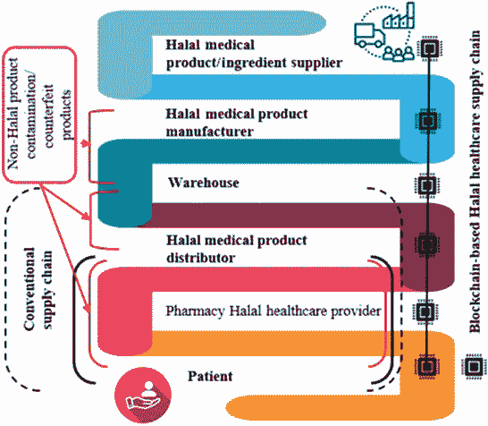

图 12.1 使用区块链的清真医疗保健供应链。

原创（由作者创作）

#### 12.4.2.2 传统与基于区块链的清真供应链

在传统的清真医疗保健供应链中，制造商将清真医疗产品发送到分销中心或分销商，原材料来自各种清真供应商。分销商在安全地将清真医疗产品送至医疗保健提供者、药店或直接送至患者方面发挥着关键作用。实施星际文件系统（IPFS） \[18\] 作为一种去中心化协议，进一步增强了利益相关者的数据安全性和可访问性，确保抵御潜在挑战。

区块链的变革潜力在 图 12.3 中显而易见，其中传统供应链（由红色和蓝色线条描绘）涉及分销商等中介。区块链使药店、医疗专业人员和患者等利益相关者能够直接与制造商接触，将清真患者置于首位。面对与假冒相关的挑战，区块链的透明性和不可更改性为追踪和追溯供应链中清真药品提供了强有力的解决方案，确保去中心化清真医疗保健网络中的数据完整性。每笔交易都安全地记录在区块链上，为全面的数据管理和分析奠定了基础 \[19\]。

#### 12.4.2.3 区块链在清真医疗保健供应链中的集成

清真医疗保健供应链专注于确保清真认证的医疗用品（包括药品、医疗设备和医疗服务）的可用性和可及性，同时遵循伊斯兰原则。其主要目标是通过提供符合伦理和宗教要求的产品和服务来维护公众健康，确保穆斯林消费者的信任和合规性 \[19\]。基于区块链的清真医疗保健供应链结构（如 图 12.1 所示）凸显了区块链技术在优化清真医疗保健供应链方面的变革潜力。

传统的清真医疗保健供应链通常涉及清真医疗产品制造商，然后将清真药品发送到分销中心或清真产品分销商。制造所需的原材料由各种清真供应商提供。分销商在安全地将清真医疗产品送至清真医疗保健提供者、清真药店或在紧急情况下直接送至患者方面发挥着关键作用。


# IPFS 的实现

IPFS 的实现，如 \[19\] 和 \[20\] 所述，提供了一种去中心化协议，用于在分布式文件系统中存储医疗行业细分详情。IPFS 可利用数据寻址在全球范围内唯一标识每个部门，方便清真供应商、制造商、仓库、分销商、清真药房、清真医疗服务提供者和清真患者等利益相关方访问。IPFS 的去中心化特性确保了对恶意软件攻击或服务器故障的抵御能力，从而能够从替代系统访问数据。

# 传统供应链交互

在传统供应链中，利益相关方（清真制造商、分销商、药房、医疗从业者和患者）之间的交互可能采取两种形式，如 图 12.1 中黑色虚线和黑色实线所示。产品通常在制造后存储在清真制造商的仓库中。分销商或中间件从仓库提取药品或其他产品，并将其分发给其他各方。此场景由 图 12.1 中的黑色虚线表示。在另一种场景中，以黑色实线突出显示，利益相关方（药房、医疗专业人员和患者）可以直接从制造商处购买药品，绕过分销商等中间商。患者是系统的核心，我们必须为他们服务。

# 医疗供应网络挑战

医疗供应网络复杂、多样且不断演变。如 图 12.1 所示，产品可能在多个方面出现非清真污染或伪造。其中包括：1）药品从制造商运往仓库时；2）药品在仓库中储存时；以及 3）药品从仓库运往分销商、药房、医疗专业人员和患者等其他利益相关方时。对于任何层级的任何人来说，识别和追踪非清真污染或伪造产品判定都极其困难。因此，需要区块链技术等强大技术来实现无缝监控和追踪。区块链是一种透明、可追溯且分布式的账本技术，有潜力解决传统供应链的许多挑战 \[20\]。由于区块链网络的不可篡改特性，从供应商到最终用户的每一笔交易都将被记录，且无人可修改。这些区块链网络细节用于数据管理和数据分析系统。基于区块链的清真医疗供应链采用完全去中心化结构，为管理医疗产品和服务提供了一种变革性方法。该系统通过分布式账本连接所有利益相关方——包括客户、制药公司、医疗服务提供者和监管机构——确保透明度、安全性和符合清真标准。

## 12.4.3 利用区块链导航清真医疗数据管理

在不断发展的医疗技术领域，区块链技术的融入与伊斯兰原则建立了共生关系，彻底改变了清真医疗领域内医疗数据管理的格局。这种变革性集成带来了众多维度，每个维度都有助于提升医疗服务并遵循清真原则 \[21\]。

### 12.4.3.1 医疗数据的不确定性和复杂性

患者数据的复杂特性，往往模糊且不一致，带来了挑战。区块链借助密码学技术，提供了一种去中心化解决方案，确保医疗数据的完整性和可靠性。这与伊斯兰原则中强调的医疗透明度和诚实相一致 \[21\]。

### 12.4.3.2 医疗信息的去中心化

在去中心化医疗信息方面观察到一种范式转变，使个人能够管理自己的健康旅程。区块链的架构使患者能够控制其健康记录，确保透明度和确认的同意。这与伊斯兰原则中优先考虑个人自主权和信息公平获取相呼应 \[21\]。

### 12.4.3.3 可靠的临床试验管理

临床试验的可靠性对于推进医学知识至关重要。区块链通过自动化数据流程并提高临床试验管理的透明度来增强效率。从伊斯兰伦理角度来看，这与强调在医疗实践中保持高标准相一致 \[22\]。

### 12.4.3.4 基于结果的区块链合同用于成本估算

区块链在将临床结果与成本相关联方面的创新，改变了成本估算的方法。这种透明度与伊斯兰原则中金融交易的公平和开放相一致。区块链将临床结果与成本相关联的特性与这些原则相呼应，为医疗成本估算提供了一种清晰且可问责的机制 \[23\]。

### 12.4.3.5 医疗数据的安全性和保密性

确保医疗数据的安全性和保密性至关重要。区块链去中心化、安全且防篡改的特性使其非常适合保护和共享敏感医疗信息。从伊斯兰角度来看，保护隐私和维护保密性至关重要。区块链与这些原则相一致，提供了一个安全的平台，个人可以信任其医疗信息受到保护。所采用的密码学机制增加了额外的保护层，确保医疗数据的真实性和完整性。这与伊斯兰更广泛的可信赖价值相呼应 \[24\]。

### 12.4.3.6 电子病历的高效交换

高效交换电子病历在医疗领域仍然是一个挑战。区块链通过为数据交换提供安全透明的平台来解决这一问题。这种效率与伊斯兰价值观中交易的信任和保密性相一致。在伊斯兰教中，保持交换（尤其是涉及敏感医疗信息的交换）中的保密性和信任至关重要。区块链对高效数据交换的贡献支持了伊斯兰更广泛的可信赖交易价值 \[25\]。

### 12.4.3.7 医疗数据的验证和真实性

区块链在使用户能够存储具有可验证真实性的医疗数据方面的作用，增强了对信息的信任。从伊斯兰角度来看，信任是生活各个方面的基础。区块链的密码学算法确保医疗数据的保密性和完整性，与伊斯兰原则中的可信赖性和数据完整性相一致。这增强了对医疗信息准确性的信心，促进了可信赖的医疗生态系统。验证真实性的能力与伊斯兰更广泛原则相一致，即确保交易中的真实性和完整性 \[26\]。

### 12.4.3.8 实施挑战与原型


# 区块链在医疗保健领域的持续开发

区块链在医疗保健领域的持续开发反映了技术进步的动态性。当前项目通常处于原型阶段，并对持续改进持开放态度。这与伊斯兰教在医疗保健服务中持续改进和创新的原则相一致，同时确保伦理考量。在伊斯兰教中，追求知识和技术进步是受到鼓励的，前提是它们符合伦理考量。区块链在医疗保健领域的开发符合伊斯兰教在保持伦理标准的同时寻求进步的精神。实施过程中遇到的挑战强调了彻底测试和改进的重要性，确保最终解决方案既符合技术卓越性，也符合伦理考量。这反映了伊斯兰教在追求卓越的同时坚持伦理标准和持续改进的原则 \[27\]。

# 表 12.1

表 12.1 概述了区块链技术发挥关键作用的基本维度，解决挑战并重塑清真医疗保健领域内医疗数据处理的格局。每个维度都突出了区块链承担的具体角色，强调其与基本清真医疗保健原则的一致性。技术与伦理考量的交叉点得到了仔细探讨，提供了关于区块链如何在遵循医疗保健实践中伊斯兰价值观的同时促进透明度、安全性和可靠性的见解。在本综合表中探索关键维度、区块链的角色及其与清真医疗保健原则的深刻一致性。

表 12.1 关键维度、区块链的角色及其与清真医疗保健原则的一致性

| 序号 | 维度 | 区块链的角色 | 参考文献 | 清真医疗保健原则 |
| --- | --- | --- | --- | --- |
| 1 | 医疗数据的不确定性和复杂性 | 区块链为管理不确定的医疗数据提供了一个去中心化、安全且可靠的解决方案。它通过加密方法和哈希函数确保数据完整性 | \[29\] | 确保医疗数据的完整性和可靠性，符合伊斯兰教在医疗保健中诚实和透明的原则 |
| 2 | 医疗保健信息的去中心化 | 区块链去中心化医疗信息，提高可用性、效率、透明度和可信度。它促进完整的纵向健康记录，增强患者控制权和确认的同意 | \[30\] | 去中心化符合伊斯兰教原则，为个人提供更多对其健康信息的控制权，同时保持透明度和可信度 |
| 3 | 可靠的临床试验管理 | 区块链工具结合电子数据收集，提供临床数据的自动聚合、复制和分发。与传统系统相比，这确保了更大的修订、跟踪和控制 | \[31\] | 提高临床试验的可靠性，这对于根据伊斯兰教原则在医疗保健中保持伦理标准至关重要 |
| 4 | 基于结果的区块链合同 | 区块链支持基于结果的合同，将临床结果与成本相关联。这简化了医疗护理中的成本估算，减少了复杂性并增强了记录保存 | \[32\] | 符合伊斯兰教的公平和透明原则，通过将医疗护理中的成本直接与结果挂钩 |
| 5 | 医疗数据的安全性和保密性 | 区块链的去中心化、安全且防伪的特性使其适合保护和共享医疗数据。它确保安全存储，防止伪造，并允许用户验证其数据的真实性 | \[33\] | 增强医疗数据的安全性和保密性，解决隐私和未经授权访问方面的担忧，符合伊斯兰教原则 |
| 6 | 电子病历的高效交换 | 区块链促进电子病历的安全高效交换。它确保隐私和安全，解决与数据泄露和保密性泄露相关的挑战 | \[34\] | 实现更高效和安全的医疗记录交换，促进符合伊斯兰价值观的保密性和信任 |
| 7 | 医疗数据的验证和真实性 | 区块链允许用户存储具有可验证真实性的重要医疗数据。加密算法确保数据保密性，提供额外的安全层 | \[35\] | 提供医疗数据的可验证真实性和保密性，符合伊斯兰教的信任和数据完整性原则 |
| 8 | 实施挑战和原型 | 当前在医疗保健中使用区块链的项目大多处于开发阶段的原型。它们是开源的，但基于区块链技术的有效医疗数据管理方法仍在不断发展 | \[36\] | 持续开发符合伊斯兰教在医疗保健服务中持续改进和创新的原则，同时确保伦理考量 |

\[原创（由作者创作）\]

借鉴利用区块链技术的既定医疗数据管理系统的分析见解，如 \[28\] 所述，我们构建了一个融入伊斯兰教原则的清真医疗保健基于区块链的医疗数据管理系统。这个创新系统经过精心开发，以符合伊斯兰医疗保健的伦理基础，并在 图 12.2 中以视觉形式呈现。

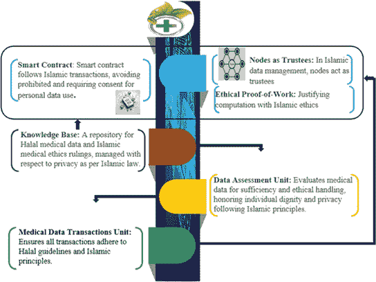

图 12.2 的长描述

智能合约遵循伊斯兰交易，避免禁止的行为，并要求个人数据使用需获得同意。节点在伊斯兰数据管理中充当受托人。伦理工作量证明确保计算符合伊斯兰伦理。知识库存储清真医疗数据和伊斯兰伦理裁决，同时根据伊斯兰法律保持隐私。数据评估单元评估医疗数据的充分性和伦理处理，尊重个人尊严和隐私，遵循伊斯兰原则。医疗数据交易单元确保符合清真指南和伊斯兰原则。

图 12.2 清真医疗保健基于区块链的医疗数据管理系统结构，融合伊斯兰教原则。

原创（由作者创作）

## 12.5 将区块链集成到清真医疗保健系统中

### 12.5.1 区块链实施以增强效益的相关问题

区块链技术虽然具有革命性，但在实施清真医疗保健区块链系统方面面临挑战。本节审查了与区块链实施相关的问题，揭示了需要考虑的关键方面，以创建一个具有韧性和伦理的清真医疗保健区块链框架，确保更多效益 \[36\]。

#### 12.5.1.1 吞吐量和延迟挑战


解决吞吐量挑战，正如 Porru 等人所强调的 \[37\]，至关重要。当前比特币网络每秒仅处理 3 到 20 笔交易（tps），远远落后于 VISA（2000 tps）和 Twitter（5000 tps）等成熟网络。这种有限的吞吐量对区块链的广泛接受构成了重大障碍，尤其是在清真医疗保健领域，及时交易至关重要 \[38\]。时间因素在区块链实现中至关重要，交易处理的延迟对普遍技术接受构成了障碍。以比特币为例，完成一笔交易大约需要 10 分钟，而 VISA 则在几秒钟内完成交易 \[39\]。这种延迟问题影响了区块链在清真医疗保健等时间敏感型应用中的效率。

#### 12.5.1.2 大小、带宽和可扩展性挑战

比特币网络中区块链的巨大体量（2016 年 2 月超过 50,000 MB）引发了对可扩展性和带宽利用率的担忧 \[40\]。鉴于每年可能增长 214 PB，可扩展性成为处理不断增长的交易量的一个突出问题，这是构建强大的清真医疗保健区块链系统的关键考量。可扩展性成为一项重大挑战，需要大量全节点来确保去中心化安全。可扩展性限制与数据大小、交易处理速率和数据传输延迟密切相关。在不牺牲安全性的前提下实现可扩展性，对于清真医疗保健区块链的成功实施至关重要。

#### 12.5.1.3 成本影响和数据可塑性

区块链虽然是去中心化的，但并非没有成本，这影响了其作为去中心化解决方案的吸引力。用户承担交易和计算能力成本，这可能会将他们引向费用可能不那么明显的集中式替代方案。在清真医疗保健的背景下，解决与成本相关的挑战对于广泛采用至关重要。数据可塑性在区块链实现中构成潜在威胁，攻击者可以修改并重新广播交易，从而使交易确认变得复杂 \[41\]。解决数据可塑性问题对于确保清真医疗保健区块链中医疗交易的完整性和真实性至关重要。

#### 12.5.1.4 身份验证、隐私和安全性考量

像 Mt. Gox 案例这样的事件凸显了区块链交易中的身份验证挑战。客户私钥的泄露引发了对清真区块链系统中医疗数据安全性的担忧。强大的身份验证机制对于防止未经授权的访问和数据泄露至关重要。隐私问题源于区块链系统中多个地址的问题，允许用户创建大量地址，研究人员试图对这些地址进行聚类 \[42\]。虽然地址聚类是出于合法目的进行的，但它引发了隐私考量。平衡隐私和透明度对于清真医疗保健区块链实施至关重要。

#### 12.5.1.5 双重支付攻击和安全问题

易受双重支付攻击（如比特币中观察到的）是一个值得注意的安全问题。在医疗保健领域，交易的完整性至关重要，降低双重支付攻击的风险对于建立对清真医疗保健区块链系统的信任至关重要。公共分布式账本的投机性质引发了安全担忧，比特币区块链可能面临 51% 攻击 \[43\]。分布式拒绝服务（DDoS）攻击和账户黑客攻击等安全漏洞，强调了在清真医疗保健区块链实施中采取强大安全措施的必要性。

#### 12.5.1.6 解决资源浪费问题

比特币挖矿的能源支出（每天约 1500 万美元）引发了环境和效率方面的担忧 \[34\]。解决挖矿的环境影响对于创建可持续和合乎道德的清真医疗保健区块链系统至关重要。

### 12.5.2 清真医疗保健区块链合规性的完整性和质量策略

确保区块链系统的可信度至关重要，需要高数据完整性、安全性、可靠性和节点隐私 \[35\]。在清真医疗保健的背景下，解决特定挑战对于开发强大且合乎道德的区块链框架至关重要。

#### 12.5.2.1 吞吐量增强和可扩展性解决方案

为了解决吞吐量问题，一个潜在的解决方案是增加每个区块的大小。然而，这种方法会引入与大小相关的问题。一种更微妙的策略是为特定应用定制区块链大小，避免采用一刀切的方法。这种适应性确保了在各种应用中实现最佳性能。可扩展性是一个重要问题，一种方法是为不同目的部署多个区块链。区块链可以互连，增强不同应用之间的安全性。这种策略允许矿工专注于大小合适的区块链，保持令人满意的安全水平 \[44\]。

#### 12.5.2.2 身份验证和隐私措施

像 BlueWallet 设备这样的创新，为加密货币及其他领域的下一代身份验证设定了标准。通过结合强大的安全性和易用性，此类设备可以解决金融、医疗保健和物联网等领域的更广泛身份验证挑战，确保在日益互联的世界中进行安全的数字交互。此外，提出的认证系统为认证用户之间的交易提供了保障，为比特币地址增加了一层信任。比特币钱包的双因素身份验证，结合智能手机，提供了另一层安全性。为了解决隐私问题，许可区块链提供了一个更受控的环境，允许开发人员授予特定权限。ChainAnchor 系统为许可区块链提出了身份和隐私保护，在区块链之上引入了一层以增强安全性。清真医疗保健区块链可以采用此类模型，以有效平衡隐私和透明度 \[45\]。

#### 12.5.2.3 人力资源信息管理

基于区块链的人力资源信息管理拟议模型，增强了组织的真实性和决策支持。利用共识机制、智能合约和支付功能，该模型为清真医疗保健环境中安全可靠的人力资源信息处理提供了基础 \[46\]。

#### 12.5.2.4 能源效率和数据存储优化

在追求能源效率的过程中，通过在区块链区块中添加额外字节来优化时间戳，为能源密集型的工作量证明（PoW）效率提供了一种替代方案。探索权益证明（PoS），其中挖矿能力取决于持有的比特币数量，引入了一种更可持续的共识机制。当前区块链实现中数据存储容量的挑战需要战略性设计选择。平衡成本效率、性能和灵活性，需要决定哪些数据和计算应链上，哪些应链下存储。常见的做法是将原始数据存储在链下，将关键元数据和哈希存储在链上 \[46\]。


#### 12.5.2.5 通过测试进行质量保证

确保区块链软件的安全性和可靠性至关重要。IBM 倡导的持续测试提供了一种稳健的方法。测试过程涉及对平台性质（公有或私有）以及与其他应用程序的集成测试等因素的仔细考虑。测试团队的早期介入对于实际场景测试至关重要，以识别对更广泛系统的潜在影响 \[47\]。

#### 12.5.2.6 增强的软件架构和区块链性能评估指标

采用特定的设计符号、模式和建模语言可以提高实现区块链技术的软件质量。为复杂性、通信、资源消耗和性能定义指标有助于评估和改进软件流程。区块链性能评估依赖于定性和定量指标。这些指标包括提交吞吐量、最大/平均验证吞吐量、平均交易验证延迟、延迟波动性、安全性、保密性、交易费用、硬件要求、可扩展性、复杂性和智能合约限制。这些指标全面展示了区块链系统的效率和可靠性 \[48\]。

#### 12.5.2.7 集成到既有系统中

在伊斯兰教和清真原则的背景下，将区块链集成到既有供应链系统中，是指将区块链技术纳入现有的物流和运营流程 \[49\]。这种集成旨在提高供应链中的透明度、可追溯性和问责制，与伊斯兰教关于公平、诚实和道德商业实践的原则相一致，包括与清真标准相关的原则。表 12.2 提供了在遵循伊斯兰原则的同时实施清真医疗区块链系统的关键考虑因素和策略概述。

TABLE 12.2 清真医疗区块链实施的关键考虑因素和策略

| Topic | Description | Challenges/Considerations | Solutions/Strategies | References | Islamic/Halal principle |
|---|---|---|---|---|---|
| Throughput Enhancement | 针对特定应用定制区块链大小，以提高吞吐量而不出现大小相关问题。 | 避免一刀切，大小限制 | 应用特定的区块链大小 | \ [50\] | 公平，效率，资源优化 |
| Scalability Solutions | 互连多个区块链可以增强安全性，并允许以合适的大小进行可扩展性。 | 安全性维护，可扩展框架 | 多个互连的区块链 | \ [51\] | 安全性，效率 |
| Authentication and Privacy | 像 BlueWallet 和认证系统这样的解决方案确保安全交易和用户隐私。 | 受控环境中的信任和隐私 | 使用安全硬件令牌，许可区块链 | \ [52\] | 信任，隐私，道德行为 |
| Human Resource Management | 增强人力资源信息处理中的决策支持和真实性。 | 安全处理和真实性验证 | 人力资源管理的区块链模型 | \ [53\] | 真实性，决策支持 |
| Energy and Data Storage Optimization | 节能修改和 PoS 用于可持续性；战略数据存储设计。 | 能源消耗，存储容量管理 | PoS，链上/链下数据策略 | \ [54\] | 可持续性，效率，成本效益 |
| Quality Assurance and Testing | 持续的软件测试和早期团队介入，以确保安全性和可靠性。 | 平台性质，集成测试挑战 | 早期测试，持续测试程序 | \ [55\] | 可靠性，稳健性 |
| Software Architecture | 使用特定的设计符号、模式和性能指标来提高软件质量。 | 复杂性，资源消耗测量 | 设计符号，性能指标 | \ [56\] | 效率，质量 |
| Performance Evaluation | 使用各种指标全面评估区块链的效率和可靠性。 | 吞吐量，延迟和安全性的测量 | 实施定性和定量指标 | \ [57\] | 效率，安全性 |
| System Integration | 将区块链集成到现有系统中，以实现透明度和问责制。 | 现有系统的复杂性和集成工作 | 无缝互操作性和系统适应 | \ [58\] | 透明度，问责制，道德实践 |
| \[Original (created by authors)\] | | | | | |

## 12.6 区块链支持的清真医疗保健的好处

### 12.6.1 对患者：保障与信任

#### 12.6.1.1 数据所有权和隐私

在伊斯兰教义中，隐私和个人权利至关重要。快速医疗互操作性资源和基于区块链的多级隐私保护位置共享方案等区块链应用程序使患者能够控制其健康数据。这反映了伊斯兰教对隐私和个人权利的尊重，而通过区块链实现的赋权与清真保护个人权利的原则相一致 \[59\]。

### 12.6.2 通过完整性确保优质护理

区块链技术不可变和透明的特性支持患者记录的保护。这种对数据完整性和保密性的遵守与伊斯兰教的可信度和卓越价值观相一致，确保护理交付符合清真医疗保健协议所要求的高标准。这种系统与伊斯兰教的卓越（Ihsan）和可信度（Amanah）价值观相一致，保证护理交付质量最高，并符合清真医疗保健标准 \[60\]。

### 12.6.3 效率与伊斯兰管理

区块链技术在医疗保健中优化业务流程，改善患者结果，降低成本，从而提高运营效率和成本效益。因此，利用区块链使医疗保健提供者能够简化运营，反映了伊斯兰教的高效资源管理原则。这种优化不仅改善了护理质量，还提高了成本效益，体现了伊斯兰教的管理精神和环境意识 \[61\]。

### 12.6.4 伊斯兰教法合规与价值提升

区块链标准化医疗保健运营并确保监管遵守的能力，是清真医疗保健提供者的一个宝贵方面。这种能力有助于遵守伊斯兰教法，并增强对穆斯林社区提供的整体价值，与伊斯兰教的社区福利和道德行为原则相一致 \[62\]。


# 区块链技术在清真医疗保健中的集成

区块链技术在清真医疗保健中的集成标志着向更具道德、透明和以患者为中心的医疗服务演进的重要步骤。这种创新方法通过确保对医疗记录的安全控制，严格遵守伊斯兰隐私原则，从而赋予患者权力。通过利用区块链固有的安全性和透明度特性，医疗保健提供者可以提供符合清真标准的、具有成本效益的护理，这不仅满足伊斯兰饮食法和宗教信仰，还通过改进服务交付提高患者满意度。

通过简化符合沙里亚法的流程，最大限度地减少错误和不必要的成本，从而体现了伊斯兰对卓越和财务审慎的承诺，实现了运营卓越。这一进步确保了医疗服务不仅高效，而且在道德上站得住脚，在患者和提供者之间建立基于信任的关系。通过区块链进行财务管理，使医疗保健部门能够以具有成本效益的方法增强收入创造，同时促进伊斯兰经济责任。它通过建立信任和减少信息差距来改善医疗保健网络，这在清真实践中至关重要。

在伊斯兰伦理框架内推动创新和道德合规，利用区块链推动增长并确保持续遵守沙里亚法。这促进了医疗保健流程中持续改进的文化，使其更加高效和合规。

通过分布式账本技术构建的协作伙伴关系确保清真合规和数据隐私，扩大了医疗保健的覆盖范围和效果。这创造了一个更加互联和互操作的医疗保健生态系统，促进跨境无缝交换和访问符合清真标准的医疗保健服务。

Figure 12.3 展示了区块链技术对清真医疗保健的变革性影响，强调了其在赋予患者对其医疗记录的安全控制、简化符合沙里亚法的医疗保健交付以及促进创新和道德合规方面的作用。它概括了患者赋权、运营卓越、财务管理、创新和协作伙伴关系的本质，所有这些都由区块链在确保清真合规和扩大医疗保健覆盖范围方面的能力所支撑。

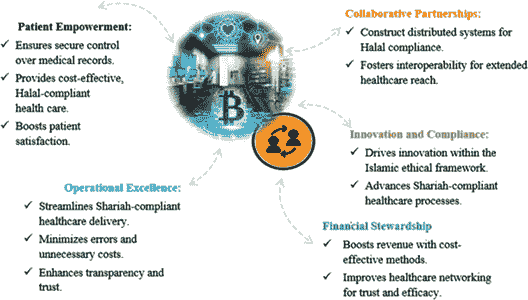

FIGURE 12.3 区块链技术融入清真医疗保健，标志着向实现基于价值、赋予患者权力的医疗保健系统迈出的变革性步伐。

原创（由作者创作）

## 12.7 区块链支持的清真医疗保健简化审计和合规

区块链技术为这些挑战提供了一个引人注目的解决方案。它使医疗机构能够以可验证、防篡改和永久的方式管理其数据，从而加强存储健康数据的可信度。区块链的这一特性使审计员能够高效地验证区块链平台上的交易，简化审计流程，并确保严格遵守法律和伊斯兰监管标准 \[63\]。

在清真医疗保健中，审计过程对于确保遵守沙里亚法以及医疗保健政策、程序、规则和法规至关重要。传统的医疗保健数据管理系统往往因其手动性质和缺乏复杂的协调而受到阻碍，使其容易发生数据泄露和未经授权的更改。这些限制可能会损害审计过程及其质量，挑战伊斯兰的可信度原则（Amanah）。

此外，基于区块链的医疗保健数据审计有助于改善患者服务，并确保医疗机构满足关键的法律要求和法规 \[64\]。它还有助于消除不必要的数据冗余，支持伊斯兰的资源优化（Iqtisad）和效率（Itqan）精神，这些对于提供和管理卓越的清真医疗保健服务至关重要。

Table 12.3 提供了关于区块链技术如何彻底改变清真医疗保健中审计和合规的全面分析。它深入探讨了集成区块链的运营、合规、道德和监管利益，展示了其在增强医疗保健数据管理、确保沙里亚合规以及促进信任和效率环境方面的关键作用。

TABLE 12.3 区块链对清真医疗保健审计和合规的增强影响

| Aspect | Benefit detail | Impact on auditing process | Alignment with Islamic principles | Regulatory impact |
| :--- | :--- | :--- | :--- | :--- |
| Data Management | Blockchain ensures that healthcare data is managed in a way that is verifiable, tamper-proof, and permanent, enhancing the trustworthiness of the data stored. | Facilitates a more efficient audit process by enabling auditors to verify the authenticity and integrity of healthcare data with ease. | Upholds the Islamic principle of Amanah (trustworthiness) by ensuring data integrity and security, fostering a reliable healthcare environment. | Significantly improves data integrity and reliability, which are critical for regulatory audits and compliance checks. |
| Compliance | Automates and standardizes compliance processes to adhere to Shariah laws alongside healthcare regulations, ensuring consistent application across institutions. | Reduces the complexity of compliance verification, allowing for real-time monitoring and reporting of compliance status. | Supports the Islamic ethos of adherence to legal and Shariah standards, ensuring that healthcare services are provided in an ethically compliant manner. | Streamlines regulatory adherence, making it easier for healthcare institutions to meet and exceed legal and ethical standards. |
| Operational Efficiency | Leverages smart contracts and blockchain’s immutable ledger to streamline healthcare operations, reducing manual errors and inefficiencies. | Enhances the quality and speed of audits by automating the tracking of transactions and patient data, reducing the likelihood of errors. | Reflects Islamic values of Itqan (excellence) and Iqtisad (resource optimization) by promoting efficient and error-free healthcare service delivery. | Contributes to a reduction in audit time and complexity by automating processes, leading to more efficient regulatory oversight. |
| Data Redundancy | Utilizes blockchain’s distributed ledger technology to eliminate duplicate records and ensure that all data entries are unique and accurate. | Simplifies the data management process, reducing the time and resources required for auditing redundant data. | Promotes the efficient use of resources and stewardship, aligning with Islamic values by avoiding waste and ensuring accuracy in healthcare data management. | Minimizes storage requirements and management costs by reducing redundant data entries, leading to operational and financial efficiencies. |
| Transparency and Trust | Blockchain technology enhances transparency in healthcare transactions and data management, building trust among patients, providers, and regulators. | Enables a transparent audit trail of all transactions and data changes, facilitating thorough and straightforward audits. | | |


> 符合医疗体系利益相关方之间伊斯兰教关于透明度和相互信任（Muta’amin）的原则。

> 通过提供交易和数据管理实践的清晰、可审计记录，增强患者和公众对医疗体系的信任。

| \[原文（由作者创作）\] |

将区块链技术融入清真医疗体系，监管机构和医疗服务提供者可以显著提升审计流程，确保遵守伊斯兰教法和医疗法规，同时推动伊斯兰教关于可信性、效率和管理的原则。这项技术不仅能简化运营并减少错误，还能建立一个透明且值得信赖的医疗环境。区块链在医疗数据管理各个方面的综合应用，体现了一种前瞻性方法，用于应对当前医疗审计和合规性方面的挑战，为清真医疗领域的运营卓越和道德合规性设立了新的基准。

## 12.8 结论

在探索区块链与清真医疗交叉领域时，已出现几个关键发现。清真认证在医疗领域所涉及的复杂性，在伦理一致性、护理质量、文化敏感性、法律法规合规性、社区信任和患者满意度方面构成了挑战。不合规不仅危及穆斯林患者的福祉，还影响医疗机构的声誉和可信度。对符合伊斯兰教法的医疗替代方案的需求日益增长，表明需要强有力的解决方案。

展望未来，区块链在清真医疗领域的前景充满巨大潜力。区块链的去中心化特性，加上其提供实时更新和增强透明度的能力，使其成为建立全球公认的清真医疗框架的催化剂。该技术不仅符合伊斯兰教原则，还能促进合规性，从而改善患者护理和社区关系。

在总结本章时，很明显区块链有能力提升医疗领域的清真完整性。然而，成功实施需要医疗机构、监管机构和技术开发者之间的合作。为了应对清真认证的复杂性，建议利益相关方积极参与区块链解决方案的开发和采用。合作应扩展到制定全球标准，以确保协调一致，并促进清真医疗实践的国际认可。

此外，在医疗领域持续进行区块链应用的研究和开发，可以进一步完善和优化现有解决方案。随着领域的发展，利益相关方应保持适应性和主动性，拥抱符合穆斯林社区不断变化需求的创新。

因此，区块链与清真医疗的融合，在追求合规性、透明度和以患者为中心的护理方面标志着一个重要的里程碑。通过拥抱这项技术，医疗行业不仅可以满足穆斯林患者的独特需求，还能为医疗实践中的诚信和信任设立新的标准。

## 致谢

我们谨向马来西亚北方大学伊斯兰商学院清真管理研究所表示感谢，感谢他们对此工作的支持。

## 参考文献

1. Abu-Elezz, I., Hassan, A., Nazeemudeen, A., Househ, M., & Abd-Alrazaq, A. (2020). 区块链技术在医疗领域的利益与威胁：范围综述. International Journal of Medical Informatics, 142, 104246.

2. Alexander, C., & Wang, L. (2019, 11–14 April) 基于区块链的网络安全、信息保障和大数据. In: 在 IEEE 东南会议上发表的论文. Huntsville, USA.

3. Alzeer, J., Rieder, U., & Abou Hadeed, K. (2018). 食品安全背景下清真与泰耶布的理性与实际方面. Trends in Food Science & Technology, 71, 264–267.

4. Atzori, M. (2015). 区块链技术与去中心化治理：国家是否仍然必要？Available at SSRN 2709713.

5. Aziz, Y. A. A. (2013). 医学教法. (S. Afsar, Ed.) (p. 86). IMAK Ofset Turkey.

6. Bamert, T., Decker, C., Wattenhofer, R., & Welten, S. (2014). Bluewallet：安全的比特币钱包. In Security and Trust Management: 10th International Workshop, STM 2014, Wroclaw, Poland, September 10-11, 2014. Proceedings 10 (pp. 65–80). Springer International Publishing.

7. Cao, Y., Sun, Y., & Min, J. (2020). 跨医疗信息控制系统的混合区块链隐私保护电子病历共享方案. Measurement and Control, 53(7–8), 1286–1299. [`doi.org/10.1177/0020294020926636`](https://doi.org/10.1177/0020294020926636)

8. Centobelli, P., Cerchione, R., Del Vecchio, P., Oropallo, E., & Secundo, G. (2022). 区块链技术用于连接循环供应链中的信任、可追溯性和透明度. Information & Management, 59(7), 103508.

9. Chen, F., Huang, J., Wang, C., Tang, Y., Huang, C., Xie, D., Wang, T., & Zhao, C. (2021). 区块链在医疗物理系统中的数据访问控制. Security and Communication Networks, 2021, 3395537. [`doi.org/10.1155/2021/3395537`](https://doi.org/10.1155/2021/3395537)

10. Chen, Y., Meng, L., Zhou, H., & Xue, G. (2021). 一种基于属性访问控制和隐私保护的区块链医疗数据共享机制. Wireless Communications and Mobile Computing, 2021, 6685762. [`doi.org/10.1155/2021/6685762`](https://doi.org/10.1155/2021/6685762)

11. Decker, C., & Wattenhofer, R. (2014). 比特币交易可变性与 MtGox. In Computer Security-ESORICS 2014: 19th European Symposium on Research in Computer Security, Wroclaw, Poland, September 7-11, 2014. Proceedings, Part II 19 (pp. 313–326). Springer International Publishing.

12. Dietrich, F., Ge, Y., Turgut, A., Louw, L., & Palm, D. (2021). 供应链管理中区块链项目的回顾与分析. Procedia Computer Science, 180, 724–733. [`doi.org/10.1016/j.procs.2021.01.295`](https://doi.org/10.1016/j.procs.2021.01.295)

13. Dutta, P., Choi, T. M., Somani, S., & Butala, R. (2020). 供应链运营中的区块链技术：应用、挑战与研究机会. Transportation Research Part E: Logistics and Transportation Review, 142, 102067.

14. Efendi. (2018, May 2). 清真产业可以帮助印尼进行国际贸易 - Lifestyle - The Jakarta Post. Retrieved January 31, 2024.

15. Herrera-Joancomartí, J., & Pérez-Solà, C. (2016). 比特币交易中的隐私：区块链可扩展性解决方案带来的新挑战. In Modeling Decisions for Artificial Intelligence: 13th International Conference, MDAI 2016, Sant Julià de Lòria, Andorra, September 19–21, 2016. Proceedings 13 (pp. 26–44). Springer International Publishing.

16. Hovorushchenko, T., Hnatchuk, Y., Herts, A., Moskalenko, A., & Osyadlyi, V. (2021) 考虑法律基础的支持医疗决策的信息技术理论与应用原则. In: CEUR-WS, vol 3038, pp 172–181.


17. Hovorushchenko, T., Moskalenko, A., & Osyadlyi, V. (2023). 基于区块链技术的医疗数据管理方法. Journal of Reliable Intelligent Environments, 9(1), 5–16.

18. Majah, I. (1953). 伊本·马贾圣训集. (Q. I. Yazid, Ed.) (pp. 1137–1138). 开罗: Dar Ihya" al-Kutub.

19. Jadhav, J. S., & Deshmukh, J. (2022). 基于区块链的医疗保健供应链综述研究. Social Sciences & Humanities Open, 6(1), 100328.

20. Kakavand, H., Kost De Sevres, N., & Chilton, B. (2017). 区块链革命: 分布式账本技术相关监管与技术分析. Available at SSRN 2849251.

21. Kashmanian, R. M. (2017). 构建供应链更大透明度以推动可持续发展. Environmental Quality Management, 26(3), 73–104.

22. Khezr, S., Moniruzzaman, M., Yassine, A., & Benlamri, R. (2019). 医疗保健中的区块链技术: 全面综述及未来研究方向. Applied Sciences, 9(9), 1736.

23. Kim, S., & Huh, J. (2020). 医疗保健系统的人工神经网络区块链技术: 侧重于个人健康记录. Electronics, 9(5), 763. [`https://doi.org/10.3390/electronics9050763`](https://doi.org/10.3390/electronics9050763)

24. Kim, T., Lee, S., Chang, D., Koo, J., Kim, T., Yoon, K., & Choi, I. (2021). DynamiChain: 基于动态同意系统的医疗区块链生态系统开发. Applied Sciences-Basel, 11(4), 1612. [`https://doi.org/10.3390/app11041612`](https://doi.org/10.3390/app11041612)

25. Koteska, B., Karafiloski, E., & Mishev, A. (2017, September). 区块链实施质量挑战: 文献综述. In SQAMIA 2017: 第六届软件质量、分析、监控、改进与应用研讨会 (Vol. 1938, p. 8).

26. Levashenko, V., Zaitseva, E., Kvassay, M., & Deserno, T. (2016, 23–25 September). 使用模糊决策树对医疗保健系统可靠性进行估算. In: 计算机科学与信息系统联合会议论文 (pp 331–340). 利沃夫, 乌克兰. [`https://doi.org/10.15439/2016F150`](https://doi.org/10.15439/2016F150)

27. Li, X., Jiang, P., Chen, T., Luo, X., & Wen, Q. (2017). 区块链系统安全性综述. Future Generation Computer Systems, 107, 841–853. [`https://doi.org/10.1016/j.future.2017.08.020`](https://doi.org/10.1016/j.future.2017.08.020)

28. Mann, C., & Loebenberger, D. (2017). 比特币协议的双因素身份验证. International Journal of Information Security, 16, 213–226.

29. Mayer, R. C., Davis, J. H., & Schoorman, F. D. (1995). 组织信任的整合模型. Academy of Management Review, 20(3), 709–734.

30. Mougayar, W. (2016). 商业区块链: 下一代互联网技术的承诺、实践与应用. John Wiley & Sons.

31. Muflih, B. K. (1999). 清真消费在塑造文明穆斯林中的重要性. Muslim World, 89(3–4), 208.

32. Naimat, N., Mustafa, M. S. A., Nasrijal, N. M. H., & Mahat, I. R. (2023). 马来西亚清真制药行业的挑战与机遇. Information Management and Business Review, 15(4), 73–78.

33. Nakamoto, S. (2008). 比特币: 一种点对点电子现金系统. Decentralized Business Review. Retrieved from [`https://bitcoin.org/bitcoin.pdf`](https://bitcoin.org/bitcoin.pdf)

34. Naserirad, M., Tavakol, M., Abbasi, M., Jannat, B., Sadeghi, N., & Bahemmat, Z. (2023). 国际穆斯林医疗游客对清真友好型医疗服务期望的预测因素: 一项医院基础研究. Health Services Management Research, 36(4), 230–239.

35. Norazmi, M. N., & Lim, L. S. (2015). 清真制药行业: 机遇与挑战. Trends in Pharmacological Sciences, 36(8), 496–497.

36. Notheisen, B., Cholewa, J. B., & Shanmugam, A. P. (2017). 区块链上的现实世界资产交易: 无信任交易系统的应用. in the Market for Lemons. Business & Information Systems Engineering, 59, 425–440.

37. Porru, S., Pinna, A., Marchesi, M., & Tonelli, R. (2017, May). 面向区块链的软件工程: 挑战与新方向. In 2017 IEEE/ACM 39th International Conference on Software Engineering Companion (ICSE-C) (pp. 169–171). IEEE.

38. Rahmah, M., & Barizah, N. (2020). 数字时代印度尼西亚专利药品的清真认证: 一种万能药吗? International Journal Systematic Reviews in Pharmacy, 11(12), 210–217.

39. Rahman, M. K., Zainol, N. R., Nawi, N. C., Patwary, A. K., Zulkifli, W. F. W., & Haque, M. M. (2023). 清真医疗服务: 患者满意度及来自伊斯兰友好医院的口碑经验. Sustainability, 15(2), 1493.

40. Rahman, M. M. (2024). 确保人工智能驱动医疗解决方案中的清真合规性: 平衡创新与信仰. In Federated Learning and AI for Healthcare 5.0 (pp. 298–320). IGI Global. [`https://doi.org/10.4018/979-8-3693-1082-3.ch015`](https://doi.org/10.4018/979-8-3693-1082-3.ch015)

41. Salama. (2017, October 12). 印度尼西亚跻身全球十大清真消费国 - [`HalalFocus.net`](http://HalalFocus.net) - 每日清真市场新闻. Retrieved January 31, 2024, from [`https://halalfocus.net/indonesia-in-top-10-world-halal-consumers/`](https://halalfocus.net/indonesia-in-top-10-world-halal-consumers/)

42. Shariff, S. M., & Rahman, A. R. A. (2016). 符合沙里亚的医院: 从概念到现实: 马来西亚经验. Bangladesh Journal of Medical Science, 15(1), 1.

43. Shrier, D., Wu, W., & Pentland, A. (2016). 区块链与基础设施 (身份, 数据安全). Massachusetts Institute of Technology-Connection Science, 1(3), 1–19.

44. Swan, M. (2015). 区块链: 新经济蓝图. O’Reilly Media. Inc, Sebastopol, CA.

45. Syed, T., Alzahrani, A., Jan, S., Siddiqui, M., Nadeem, A., & Alghamdi, T. (2019) 区块链架构及其应用的比较分析: 问题与建议. IEEE Access, 7, 176838–176869. [`https://doi.org/10.1109/ACCESS.2019.2957660`](https://doi.org/10.1109/ACCESS.2019.2957660)

46. Taheri. (2020, August 14). 伊斯兰历史与经验中的医疗保健概述. Retrieved January 18, 2024, from [`https://ethnomed.org/resource/overview-of-health-care-in-islamic-history-and-experience/`](https://ethnomed.org/resource/overview-of-health-care-in-islamic-history-and-experience/)


# 47. Tieman, M., Darun, M. R., Fernando, Y., & Ngah, A. B. (2019). Utilizing blockchain technology to enhance halal integrity: The perspectives of halal certification bodies. In Services–SERVICES 2019: 15th World Congress, Held as Part of the Services Conference Federation, SCF 2019, San Diego, CA, USA, June 25–30, 2019, Proceedings 15 (pp. 119–128). Springer International Publishing.

# 48. Tith, D., Lee, J. S., Suzuki, H., Wijesundara, W. M. A. B., Taira, N., Obi, T., & Ohyama, N. (2020). Application of blockchain to maintaining patient records in electronic health record for enhanced privacy, scalability, and availability. Healthcare Informatics Research, 26(1), 3–12.

# 49. Wang, S. M. (2015). Identifying niche markets for Taiwan’s inbound tourism. International Journal of Organizational Innovation, 7(3), 96–114.

# 50. Westphal, E., & Seitz, H. (2021) Digital and decentralized management of patient data in healthcare using blockchain implementations. Front Blockchain, 4, 732112. [`https://doi.org/10.3389/fbloc.2021.732112`](https://doi.org/10.3389/fbloc.2021.732112)

# 51. Xiao, Y., Xu, B., Jiang, W., & Wu, Y. (2021). The HealthChain blockchain for electronic health records: Development study. Journal of Medical Internet Research, 23(1), Article e13556. [`https://doi.org/10.2196/13556`](https://doi.org/10.2196/13556)

# 52. Yaga, D. J., Mell, P., Roby, N., & Scarfone, K. (2018). Blockchain technology overview US National Institute of Standards and Technology, [`10.6028/nist.ir.8202`](https://doi.org/10.6028/nist.ir.8202)

# 53. Yaqoob, I., Salah, K., Jayaraman, R., & Al-Hammadi, Y. (2021). Blockchain for healthcare data management: Opportunities, challenges, and future recommendations. Neural Computing and Applications, 34, 11475–11490.

# 54. Yaqoob, S., Khan, M. M., Talib, R., Butt, A. D., Saleem, S., Arif, F., & Nadeem, A. (2019). Use of blockchain in healthcare: A systematic literature review. International Journal of Advanced Computer Science and Applications, 10(5), 644–653.

# 55. Yli-Huumo, J., Ko, D., Choi, S., Park, S., & Smolander, K. (2016). Where is current research on blockchain technology?—A systematic review. PLoS One, 11(10), e0163477.

# 56. Zaitseva, E., & Levashenko, V. (2016). Construction of a reliability structure function based on uncertain data. IEEE Transactions on Reliability, 65(4), 1710–1723. [`https://doi.org/10.1109/TR.2016.2578948`](https://doi.org/10.1109/TR.2016.2578948)

# 57. Zaitseva, E., Levashenko, V., Rabcan, J., & Krsak, E. (2020). Application of the structure function in the evaluation of the human factor in healthcare. Symmetry, 12(1), 93. [`https://doi.org/10.3390/sym12010093`](https://doi.org/10.3390/sym12010093)

# 58. Zawawi, M., & Othman, K. (2018). An overview of Shari’ah compliant healthcare services in Malaysia. Malaysian Journal of Consumer and Family Economics, 3(1), 91–100.

# 59. Zelbst, P. J., Green, K. W., Sower, V. E., & Bond, P. L. (2020). The impact of RFID, IIoT, and blockchain technologies on supply chain transparency. Journal of Manufacturing Technology Management, 31(3), 441–457.

# 60. Zhang, L., Peng, M., Wang, W., Su, Y., Cui, S., & Kim, S. (2021). Secure and efficient data storage and sharing scheme based on double blockchain. CMC-Computers, Materials & Continua, 66(1), 499–515. [`https://doi.org/10.32604/cmc.2020.012205`](https://doi.org/10.32604/cmc.2020.012205)

# 61. Zhang, P., White, J., Schmidt, D. C., Lenz, G., & Rosenbloom, S. T. (2018). FHIRChain: Applying blockchain to securely and scalably share clinical data. Computational and Structural Biotechnology Journal, 16, 267–278. [`https://doi.org/10.1016/j.csbj.2018.07.004`](https://doi.org/10.1016/j.csbj.2018.07.004)

# 62. Zhang, R., George, A., Kim, J., Johnson, V., & Ramesh, B. (2019). Benefits of blockchain initiatives for value-based care: Proposed framework. Journal of Medical Internet Research, 21(9), e13595.

# 63. Zheng, Z., Xie, S., Dai, H., Chen, X., & Wang, H. (2017, 25–30 June) An overview of blockchain technology: Architecture, consensus, and future trends. In: Paper Presented at the IEEE International Congress on Big Data (pp 557–564). Honolulu, Hawaii. [`https://doi.org/10.1109/BigDataCongress.2017.85`](https://doi.org/10.1109/BigDataCongress.2017.85)

# 64. Zou, R., Lv, X., & Zhao, J. (2021). SPChain: Blockchain-based medical data sharing and privacy-preserving eHealth system. Information Process Management, 58(4), 102604. [`https://doi.org/10.1016/j.ipm.2021.102604`](https://doi.org/10.1016/j.ipm.2021.102604)

# 解决区块链技术应用中多目标优化模型的非概率方法

Paresh Kumar Panigrahi 和 Sukanta Nayak

DOI: [`10.1201/9781003483113-13`](https://doi.org/10.1201/9781003483113-13)

## 13.1 引言

近年来，数据在人们的社会生活和科学研究中都发挥了至关重要的作用。这归功于大数据和互联网技术的持续增长，以及研究文档的传播和共享正在逐渐成为推动社会和科学进步的重要因素。在这方面，区块链技术中数据的重要性不容忽视。它构成了整个系统信任、安全性和功能的基础。区块链提供的不可篡改性、透明度和去中心化，之所以成为可能，完全归功于对数据的可靠和安全处理。在各个领域，大数据的使用已显著惠及社会和经济。例如，处理医疗、金融、能源和气象数据的行业已取得显著进步。然而，大数据技术的发展，在提高许多领域便利性和效率的同时，也带来了众多数据安全挑战。这些安全问题使得确保敏感信息的隐私和保护变得更加困难。在此背景下，人们不敢在服务器上共享和存储数据，这在日常使用中存在许多弊端。在此背景下，区块链技术为数据共享提供了一种有前途的方法，得益于其关键特性。一旦数据被添加到区块链中，就无法被更改、删除或篡改，从而确保了信息的完整性和不可篡改性。这使得区块链成为在各个领域（如医疗、金融和供应链管理）安全共享敏感数据的理想解决方案。加密安全性是区块链技术的另一项特性，可防止篡改。在将新数据添加到区块链之前，每个网络通信都会被加密，哈希值保证了交易信息的准确性。另一方面，仅仅将区块链与数据共享相结合，并不能满足安全有效的数据交换的先决条件。


# 区块链与物联网数据安全

区块链旨在在去中心化环境中提供数据可用性和防篡改能力。它不可更改，特别适用于改善物联网（IoT）数据的安全性、可用性和完整性，同时改善物联网应用 \[1\]。它是一种带有加密的分布式账本技术，可用于各种行业来创建防篡改的实时数据 \[2, 3\]。此外，该平台提供了一个可靠的物联网设备生态系统。

此外，物联网网络用于合适的任务；一些物联网设备的表现会优于其他设备。关键问题是被审查并找出哪些节点最合适。在正确的时间获得合适的节点并仔细选择它们，有助于减少与资源分配、网络寿命和数据采集可信度等相关的典型物联网不确定性 \[4\]。选择节点而不是优化节点数量和位置可能解决能源和路由问题 \[5\]。在此场景中，节点可以按顺序排列，并且在任何给定时间仅针对给定任务刺激一个子类别的节点。节点选择通过根据任务标准选择合适的节点子集来提高能源效率 \[6\]。此外，存在基于个体的选择（每个节点独立评估）和基于组的选择（将潜在集群作为一致单元评估并选择最优集）之间的选择。因此，评估集中于任务规范和约束 \[7\]。由于存在多种缺陷，特别是最新的选择技术不适合定位任务。因此，本研究利用区块链技术来增强系统的隐私和安全性。此外，引入边缘平台有可能提高系统效率、降低延迟并优化整体性能。在这方面，设计了一个优化模型，用于根据输入参数为特定任务选择合适的节点。研究人员的主要目标是最小化执行时间、功耗、响应时间和延迟，并最小化与卸载工作负载相关的处理成本。

# 资源分配与调度方法论

在这里，本研究的重点是基于线性优化模型的资源分配与调度方法论。线性规划（LPP）涉及一个单目标函数，需要在线性约束条件下最大化或最小化。但是，在实际应用中，LPP 对于不精确的目标函数和约束具有模糊的解。这种不精确性的性质可能是由于系数、常数和决策变量的随机性和/或模糊性引起的。因此，这些因素使系统难以处理。在这里，我们在调查中考虑了模糊不确定性。为了处理模糊性，我们可以应用模糊规划技术。因此，模糊规划与 LPP 相结合。

# 模糊线性规划问题

众多研究人员专注于模糊线性规划问题。同时，在 1970 年，\[8\] 在决策问题中提出了模糊线性规划的概念。然后，\[9\] 提出了处理模糊不确定性的优化问题的一般概念，而 \[10\] 在模糊参数存在的情况下制定了线性规划问题。一般来说，如果纳入模糊不确定性，我们会得到两种类型的 LPP。这些是模糊 LPP（目标函数模糊或约束模糊）和完全模糊 LPP（目标函数和约束均模糊）。

在这方面，许多研究人员提出了不同的方法来解决模糊线性规划问题。这里讨论了一些相关的研究工作。作者 \[11, 12, 13, 14\] 在模糊线性规划问题（FLPP）领域做出了贡献，并开发了许多方法来寻找最优解。在这方面，\[14\] 引入了完全模糊线性规划问题（FFLPP）。此外，作者 \[15, 16, 17, 18, 19\] 提出了几种方法，使用不同类型的模糊数来解决 FFLPP。鉴于此，研究人员提出了不同的方法来解决 FFLPP。这里讨论了一些相关的研究工作。在 \[15\] 中，作者使用词典法来解决 FFLPP。在 \[18\] 中，作者提出了一种方法来解决带有梯形模糊数的 FFLPP，而 \[20\] 使用了一种修改技术来解决带有三角模糊数的 FFLPP 以获得最优解。此外，\[21\] 提出了一种方法，使用排序函数来解决带有无限制模糊变量的 FFLPP 的非线性模型。此外，各种类型的模糊数被纳入调查。但也注意到，同一系统在不同场景下需要优化两个或多个目标函数。因此，有必要研究带有不确定性的多目标线性规划问题（MOLPP）。

经济学、社会科学、工程和医学领域中出现的许多复杂问题可以用带有不确定性的 MOLPP 来表述。最初，带有模糊参数的 MOLPP 是由 \[22\] 提出的。然后，\[23, 24\] 提出了一种方法来解决 MOLPP，以在模糊不确定性下找到最优解。在 \[25\] 中，作者针对带有模糊系数的 MOLPP，该系数可以通过参数表示转换为区间。此外，\[26\] 包含了基于切割的灵活约束，用于求解模糊多目标二次规划问题。此外，从最近的研究中发现，不确定性是由于在处理区间时出现的误差估计而产生的。有不同的方法来处理 MOLPP，以求解作为区间的目标函数系数和带有区间参数的问题 \[27, 28\]。在此背景下，\[29\] 提出了一种新型的区间类型三角模糊数与 MOLPP。


# 从上述文献综述来看

从上述文献综述可以看出，处理模糊多目标线性规划问题（FMOLPP）有许多方法，但基于宽度分析寻找有效解决方案仍有探索空间。因此，本研究的主要重点是开发一种有效处理 FMOLPP 的替代方法。在此背景下，我们将模糊集理论的概念与广为人知的加权和法相结合，开发了一种模糊加权和法。随后提出了各种定理，以确立所提方法的有效性。考虑了一个示例问题来说明所提方法。所得结果与现有的宽度分析方法进行了比较，发现两者吻合良好，且宽度较窄。

# 本文结构

本文结构如下。第 13.2 节 包含模糊数及其算术运算的初步知识。第 13.3 节 描述了标准 MOLPP 的表述。第 13.4 节 提出了模糊 MOLPP 的表述。在 第 13.5 节 中，我们分析了模糊加权和法及其三种计算类型。最后，在 第 13.6 节 中，通过模糊加权和法演示了一个示例问题，并报告了求解结果。

## 13.2 初步知识

在本节中，我们将了解模糊集和三角模糊数（TFN）及其算术运算的基础知识。

**定义 2.1** \[30\]: 如果隶属度定义为

```
(13.1)
```

则模糊数被称为三角模糊数，其中 ` ` 是左侧单调非递减函数，` ` 是右侧单调非递增函数。这些函数可以表示为 ` ` 和 ` `。

**定义 2.2** \[31\]: 三角模糊数 ` ` 当且仅当 ` ` 和 ` ` 时，被称为非负三角模糊数。

**定义 2.3** \[32\]: 任意三角模糊数 ` ` 可以通过使用 `-cut` 表示为以下区间形式。

**定义 2.4** \[33\]: 三角模糊数 ` ` 的中点定义为 ` `，其中

**定义 2.5** \[34\]: 三角模糊数 ` ` 的宽度写作 ` `，其中 ` `。

考虑一个三角模糊数 ` `，其中 ` `、` ` 和 ` ` 分别是三角模糊数的左值、中心值和右值。为了计算目的，可以通过参数的 cut 将三角模糊数转换为区间。然后，可以使用 \[33\] 中给出的传统算术运算将区间转换为精确值，如 图 13.1 所示。同样的精确形式也可以用于计算目的，通过使用 \[34\] 中给出的传统算术运算。

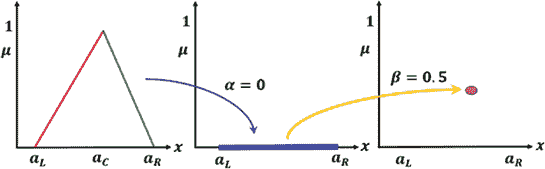

图 13.1 模糊参数示意图。

\[原创（由作者创作）\]

**定义 2.7** \[35\]: 如果 ` ` 和 ` ` 是两个三角模糊数，则序关系定义为如果 ` ` 和 ` `。

**定义 2.8** \[36\]: 如果 ` ` 和 ` ` 是两个三角模糊数，则序关系定义为如果 ` ` 和 ` `。

## 13.3 MOLP 表述

考虑以下 MOLP 问题表述。

受约束条件限制

```
(13.2)
```

所有目标函数、系数矩阵和右侧向量均通过三角模糊数表示 \[即，` ` \]。取两个向量：` ` 和 ` ` 在 ` ` 中。然后，如果对于 ` ` 且至少存在一个使得 ` `。另外，如果对于 ` `。

**定义 3.1** \[28\]: MOLP 问题初始值的可行解如果不存在另一个可行解使得 ` `，则称为有效解。

**定义 3.2**: MOLP 问题的可行解如果不存在另一个可行解使得 ` `，则称为弱有效解。

**定义 3.3**: 考虑一个向量 ` `，使得 ` `。与 MOLP 问题对应的加权和线性规划问题如下。

受约束条件限制

```
(13.3)
```

**定理 1** \[28\]: 可行解 ` ` 是 MOLP 问题的弱有效解，当且仅当存在权重 ` ` 使得 ` ` 为该问题的最优解。

**定理 2**: 可行解是 MOLP 问题的有效解，当且仅当存在 ` ` 使得 ` ` 为 MOLP 问题的最优解。

下一节包含 FMOLPP。

## 13.4 模糊 MOLP 表述

在本节中，我们研究 FMOLPP。FMOLPP 可以表述如下：

受约束条件限制

```
(13.4)
```

为了使用模糊加权和法求解 FMOLPP，需要进行三种类型的计算（即左侧、中心和右侧计算）。这些计算在第 5 节中讨论。

**定义 4.1**: FMOLPP 的可行解如果不存在另一个可行解使得 ` `，即 ` `，则称为左中点（LM）有效解。

**定义 4.2**: FMOLPP 的可行解如果不存在另一个可行解使得 ` `，即 ` `，则称为 LM 弱有效解。

**定义 4.3**: FMOLPP 的可行解如果不存在另一个可行解使得 ` `，即 ` `，则称为中心（N）有效解。

**定义 4.4**: FMOLPP 的可行解如果不存在另一个可行解使得 ` `，即 ` `，则称为 N 弱有效解。

**定义 4.5**: FMOLPP 的可行解如果不存在另一个可行解使得 ` `，即 ` `，则称为右中点（RM）有效解。

**定义 4.6**: FMOLPP 的可行解如果不存在另一个可行解使得 ` `，即 ` `，则称为 RM 弱有效解。

## 13.5 求解 FMOLPP 的模糊加权和方法

为了求解 FMOLPP，正在尝试获得一个可比较的精确问题。多目标优化问题及其求解过程的系统表述如 图 13.2 所示。

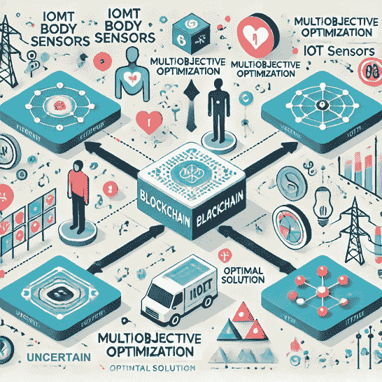

图 13.2 提出的系统表述。

\[原创（由作者创作）\]

该方法通过将所有给定的目标函数乘以一定的权重因子 ` ` 来组合它们，形成一个单一函数，然后将其最小化。权重的相对值通常反映目标的相对重要性。优化问题表述如下：

受约束条件限制

```
(13.5)
```

其中 ` ` 和 ` `。

为了使用 FMOLPP 找到最优解，需要左侧、中心和右侧计算。这些计算如下所示。

左侧计算通过以下形式描述，当 ` ` 时。

受约束条件限制

```
(13.6)
```

中心计算通过以下形式描述，当 ` ` 时。

受约束条件限制

```
(13.7)
```

右侧计算通过以下形式描述，当 ` ` 时。

受约束条件限制

```
(13.8)
```

上述计算将在下一节中通过示例问题进行讨论和求解。

讨论的权重可以以以下两种方式使用：

1. > 用户可以设置 ` ` 以反映偏好。

2. > 用户可以系统地改变 ` ` 以产生不同的帕累托最优解。

加权和法的优点如下：

1. > 易于使用。

2. > 如果所有权重均为正，则 Eq. (13.5) 的最小值始终是帕累托最优解。

3. > 权重可以用于生成单个解或多个解。

流程图描述了所提模糊加权和法的过程，如 图 13.3 所示。

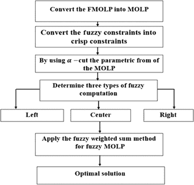

图 13.3 求解 FMOLPP 的模糊加权和法流程图。

\[原创（由作者创作）\]

**定理 3**: 根据序关系，任何带有 ` ` 的问题的有效解都是 FMOLPP 的最优解。


Proof: Suppose 是 FMOLPP 且 cut 为零的一个有效解。Assume that 不是根据顺序关系  的问题的最优解。因此，存在 FMOLPP 的一个可行解，，使得

(13.9)

这与  对于  的问题的效率相矛盾。

### Theorem 4
根据顺序关系，任何  的问题的有效解都是 FMOLPP 的最优解。

Proof: Suppose 是 cut 为零时  的问题的一个有效解。Assume that 不是根据顺序关系  的问题的最优解。因此，存在 FMOLPP 的一个可行解，，使得

(13.10)

这与  对于 FMOLPP 的效率相矛盾。

### Theorem 5
根据顺序关系，任何  的问题的有效解都是  的问题的最优解。

Proof: Suppose 是 cut 为一时  的问题的一个有效解。Assume that 不是根据顺序关系  的问题的最优解。因此，存在  的问题的某个可行解，，使得

(13.11)

这与  对于 FMOLPP 的效率相矛盾，证明完成。

### Theorem 6
根据顺序关系，任何  的问题的最优解都是 FMOLPP 的 LM-有效解。

Proof: Assume that 是带有正权重系数的加权问题的最优解。根据顺序关系 ，它不是现有问题的 Pareto 最优解。因此，根据 Theorem 1，存在 MOLPP 的一个可行解，，使得

(13.12)

Since ，我们有 ，因此，它与 必须是最优解的假设相矛盾。

### Theorem 7
根据顺序关系，  的问题的唯一最优解是 FMOLPP 的 LM-有效解。

Proof: Assume that 是带有正权重系数的加权问题的唯一最优解。因此，根据 Theorem 6，存在 MOLPP 的一个可行解，，使得根据 Theorem 6，我们可以写成如下形式。

(13.13)

and

(13.14)

Since ，我们有 ；因此，这与 必须是唯一最优解的假设相矛盾。

同样，我们可以证明顺序关系  是加权问题的最优解和唯一最优解，同时也是 FMOLPP 的有效解。

### Theorem 8
类似于顺序关系，如果所有权重系数均为正，则加权问题的解是恰当最优解。

Proof: Assume that 是带有正权重系数的加权问题的最优解。根据 Theorem 7，我们必须表示该解是最优的。我们必须证明  是恰当优化的。Assume that 。

让我们反驳上述假设。Assume 不是加权问题的恰当优化解。那么，根据 Theorem 7，和 ，我们有

(13.15)

where 。

对于所有 ，

(13.16)

两边同时乘以

(13.17)

where

(13.18)

这意味着

(13.19)

(13.20)

我们假设的矛盾原则是  必须是加权问题的解，且  必须是恰当优化的。

### Theorem 9
如果  是加权问题的最优解，那么它是 FMOLPP 的精确最优解。

Proof: 通过矛盾法，令  是给定 FMOLPP 的最优解，根据顺序关系  且它不是该问题的精确解。存在给定问题的一个可行解。

令 ，使得  的最小化目标函数为 。根据 Theorem 7，我们知道加权问题的最优解是恰当优化的。关于这一点，一种证明方法可以是 TFN 的中心得到加权问题的最优解。因此，我们可以证明左侧和右侧也通过使用模糊加权和方法得到 FMOLPP 的最优解。

令  的最小化问题。另外，假设我们有 ，且左侧、中心和右侧的目标函数始终大于  中的目标值。

(13.21)

根据矛盾原则，我们的假设是  必须是 FMOLPP 的解，且  必须是最优解。

## 13.6 数值示例

在本节中，我们采用模糊加权和方法求解给定的数值示例。

### EXAMPLE 1

问题 \[37\] 被表述为 FMOLPP。例如，目标函数、系数约束、决策变量和右侧向量均取为 TFNs。

subject to

(13.22)

where 和

根据给定的 TFNs 上的 FMOLPP，当我们应用模糊加权和方法寻找最优解时，需要对 FMOLPP 进行左侧、中心和右侧计算。因此，FMOLP 要求另一种参数计算是相同的。TFNs 的精确表示具有两个参数（即  和 。为了使用左侧、中心、右侧和参数计算找到 FMOLPP 的有效解，权重值取自 0 到 1。所得结果列在 表 13.1 和 13.2 中，而最终函数值列在 表 13.3 中。结果与 \[37\] 进行比较。\[37\] 和所提方法的 TFNs 图形表示分别显示在 图 13.4 和 13.5 中。相同的目标函数显示为 图 13.4 和 13.5。

### TABLE 13.1 组件及其参数计算的解

| w || || || || || || |

| 0 || 0 || 1 || 3 || 0.9964 || 9 || 3 || 6.0356 |

| 0.1 || 0 || 0 || 3 || 0 || 8.9996 || 3 || 6.0356 |

| 0.2 || 0 || 0 || 3 || 0 || 0 || 3 || 6.0356 |

| 0.3 || 0 || 0 || 3 || 0 || 0 || 3 || 6.0356 |

| 0.4 || 0 || 0 || 3 || 0 || 0 || 3 || 6.0356 |

| 0.5 || 0 || 0 || 3 || 0 || 0 || 3 || 6.0356 |

| 0.6 || 0 || 0 || 3 || 0 || 0 || 3 || 6.0356 |

| 0.7 || 0 || 0 || 3 || 0 || 0 || 3 || 6.0356 |

| 0.8 || 0 || 0 || 3 || 0 || 0 || 3 || 6.0356 |

| 0.9 || 0 || 0 || 3 || 0 || 0 || 3 || 6.0356 |

| \[Original (created by authors)\] |

### TABLE 13.2 组件及其参数计算的最优解

| w || || || || || || |

| 0 || 1 || 2 || 3.6 || 1.0018 || 0 || 2 || 0.0001 |

| 0.1 || 1.5 || 2 || 3.6 || 1.5 || 0.0002 || 2 || 0.0001 |

| 0.2 || 1.5 || 2 || 3.6 || 1.5 || 3.6 || 2 || 0.0001 |

| 0.3 || 1.5 || 2 || 3.6 || 1.5 || 3.6 || 2 || 0.0001 |

| 0.4 || 1.5 || 2 || 3.6 || 1.5 || 3.6 || 2 || 0.0001 |

| 0.5 || 1.5 || 2 || 3.6 || 1.5 || 3.6 || 2 || 0.0001 |

| 0.6 || 1.5 || 2 || 3.6 || 1.5 || 3.6 || 2 || 0.0001 |

| 0.7 || 1.5 || 2 || 3.6 || 1.5 || 3.6 || 2 || 0.0001 |

| 0.8 || 1.5 || 2 || 3.6 || 1.5 || 3.6 || 2 || 0.0001 |

| 0.9 || 1.5 || 2 || 3.6 || 1.5 || 3.6 || 2 || 0.0001 |

| \[Original (created by authors)\] |

### TABLE 13.3 目标函数的最优解

| w || Value || Value || Value || || || || Min |

| 0 || 6 || 23 || 45 || 6 || 36 || 23 || 18.1074 || 6 |

| 0.1 || 6.6 || 25.7 || 45 || 5.7 || 42.3 || 25.3 || 22.3324 || 5.7 |

| 0.2 || 7.2 || 28.4 || 45 || 5.4 || 41.76 || 27.6 || 26.5573 || 5.4 |


| 0.3 || 7.8 || 31.1 || 45 || 5.1 || 41.04 || 29.9 || 30.7823 || 5.1 |

| 0.4 || 8.4 || 33.8 || 45 || 4.8 || 40.32 || 32.2 || 35.0073 || 4.8 |

| 0.5 || 9 || 36.5 || 45 || 4.5 || 39.6 || 34.5 || 39.2322 || 4.5 |

| 0.6 || 9.6 || 39.2 || 45 || 4.2 || 38.88 || 36.8 || 43.4572 || 4.2 |

| 0.7 || 10.2 || 41.9 || 45 || 3.9 || 38.16 || 39.1 || 47.6821 || 3.9 |

| 0.8 || 10.8 || 44.6 || 45 || 3.6 || 37.44 || 41.4 || 51.9071 || 3.6 |

| 0.9 || 11.4 || 47.3 || 45 || 3.3 || 36.72 || 43.7 || 56.1321 || 3.3 |

[原文（由作者创作）]

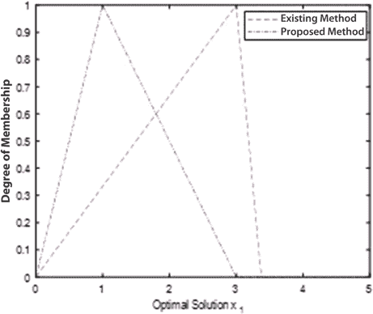

图 13.4 模糊最优解的比较。

[原文（由作者创作）]

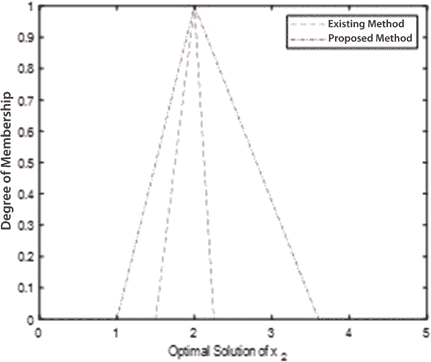

图 13.5 的长描述

x 轴表示 x 下标 2 的最优解，范围从 0 到 5。y 轴表示隶属度，范围从 0 到 1。现有方法呈现三角形趋势，从 (1.5, 0) 增加到峰值 (2, 1)，然后减少到 (2.5, 0)。所提方法遵循类似的三角形模式，从 (1, 0) 增加到 (2, 1)，然后减少到 (3.5, 0)。所有数据均为近似值。

图 13.5 模糊最优解的比较。

[原文（由作者创作）]

我们从等式 (13.22) 计算左、中心和右计算。使用权重值为 0 到 1 的模糊加权和方法，通过 FMOLPP 计算出带有参数的高效解。在处理 FMOLPP 的参数化计算时，我们需要执行四种类型的计算：(i) 和 ，(ii) 和 ，(iii) 和 ，(iv) 和 。这四种解决方案分别在 表 13.1 和 表 13.2 中表示。

按权重计算的解决方案在 表 13.1 和 表 13.2 中给出。在左、中心和右解的每个值中，不确定解介于它们之间。此外，为了了解有效性，所提方法和获得的结果与 [37] 进行了比较。

表 13.1、表 13.2 和 表 13.4 中给出的获得的模糊三角数（TFNs）分别在 图 13.4、图 13.5、图 13.6 和 图 13.7 中显示，并与现有方法进行了比较。

表 13.4 所提方法与 [37] 的比较

| 最优解 || || || || |

| [37] 方法 || (0, 3.000, 3.3743) || (1.5, 2.000, 2.2503) || (12, 50, 66.3712) || (6, 23, 40.5008) |

| 所提方法 || (0, 1, 3) || (1, 2, 3.6) || (8, 30, 79.8) || (4, 17, 52.2) |

[原文（由作者创作）]

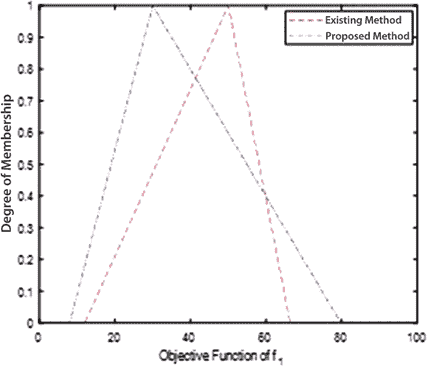

图 13.6 模糊目标函数的最优解。

[原文（由作者创作）]

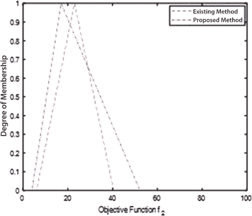

图 13.7 模糊目标函数的最优解。

[原文（由作者创作）]

和 的宽度方向解在 图 13.8 中表示。从上述内容可以提到，所提方法与在 [37] 中获得的结果具有良好的一致性。最后，可以注意到，当前方法易于使用，并且可以适用于其他 FMOLPPs。

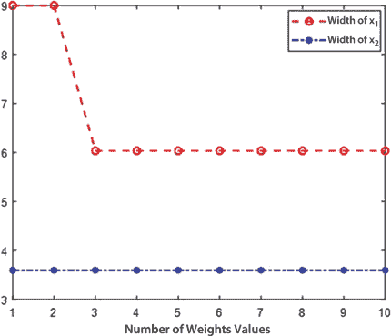

图 13.8 宽度方向最优解。

[原文（由作者创作）]

## 13.7 结论

在此，提出了一种基于模糊的方法，用于求解带有区块链技术的建模优化问题。提出了一种基于模糊三角数（TFNs）适当序关系的新解决方案方法，以处理 FMOLPP。TFNs 被视为 FMOLPPs 中的不确定性。为了展示所提方法的效率，演示了模糊环境下的多目标线性规划（MOLPP）示例问题。系数、目标函数和约束均采用 TFNs。使用所提方法，求解相同问题并报告最优解。所得解与其他方法进行了比较，发现具有良好的一致性。还注意到，解集产生紧凑的不确定宽度。最后，从调查中观察到，所提方法可能为其他 FMOLPPs 和与区块链技术相关的模型提供有希望的结果和更好的拟合。

## 参考文献

1. B. B. Gupta, K.-C. Li, V. C. Leung, K. E. Psannis 和 S. Yamaguchi，“面向云端医疗物理系统的区块链辅助安全细粒度可搜索加密，”IEEE/CAA 自动学报，第 8 卷，第 12 期，第 1877–1890 页，2021 年。

2. R. Kumar 和 R. Tripathi，“DBTP2SF：工业物联网系统中基于深度区块链的可信隐私保护安全框架，”新兴电信技术事务，第 32 卷，第 4 期，第 e4222 页，2021 年。

3. L. Yan, S. Yin-He, Y. Qian, S. Zhi-Yu, W. Chun-Zi 和 L. Zi-Yun，“基于区块链集成有限可信数据的食品安全概率共识达成方法，”IEEE Access，第 9 卷，第 123764–123776 页，2021 年。

4. A. Alagha, S. Singh, R. Mizouni, A. Ouali 和 H. Otrok，“面向物联网应用的数据驱动动态活动节点选择——辐射定位案例研究，”IEEE Access，第 7 卷，第 16168–16183 页，2019 年。

5. Y. Xiao, X. Zuo, J. Huang, A. Konak 和 Y. Xu，“连续污染路由问题，”应用数学与计算，第 387 卷，第 125072 页，2020 年。

6. G. Sun, Y. Cong, Q. Wang, B. Zhong 和 Y. Fu，“面向灵活聚类终身学习的代表性任务自我选择，”IEEE 神经网络与学习系统交易，第 33 卷，第 4 期，第 1467–1481 页，2020 年。

7. A. Shukla 和 S. Tripathi，“面向节能 WSN 辅助物联网的有效中继节点选择技术，”无线个人通信，第 112 卷，第 2611–2641 页，2020 年。

8. R. E. Bellman 和 L. A. Zadeh，“模糊环境下的决策，”管理科学，第 17 卷，第 4 期，第 B-141–B-164 页，1970 年。

9. H. Tanaka, T. Okuda 和 K. Asai，“关于模糊数学编程，”控制论杂志，第 3 卷，第 3 期，第 37–46 页，1974 年。

10. H. J. Zimmermann，“具有多个目标函数的模糊编程与线性编程，”模糊集合与系统，第 1 卷，第 1 期，第 45–55 页，1978 年。

11. S. M. Guua 和 Y.-K. Wu，“求解模糊线性规划问题的两阶段方法，”模糊集合与系统，第 107 卷，第 2 期，第 191–195 页，1999 年。

12. M. Jiménez, M. Arenas, A. Bilbao 和 M. V. Rodrıguez，“具有模糊参数的线性规划：一种交互式方法分辨率，”欧洲运筹学杂志，第 117 卷，第 3 期，第 1599–1609 页，2007 年。


13. H. R. Maleki, M. Tata 和 M. Mashinchi，“Linear programming with fuzzy variables,” Fuzzy Sets and Systems, vol. 109, no. 1, pp. 21–33, 2000.

14. J. J. Buckley 和 T. Feuring，“Evolutionary algorithm solution to fuzzy problems: Fuzzy linear programming,” Fuzzy Sets and Systems, vol. 109, no. 1, pp. 35–53, 2000.

15. F. Lotfi, T. Allahviranloo, M. Jondabeh 和 L. Alizadeh，“Solving a full fuzzy linear programming using lexicography method and fuzzy approximate solution,” Applied Mathematical Modelling, vol. 33, no. 7, pp. 3151–3156, 2009.

16. A. K. J. Kau 和 P. Singh，“A new method for solving fully fuzzy linear programming problems,” Applied Mathematical Modelling, vol. 38, no. 17–18, pp. 817–823, 2011.

17. H. Cheng, W. Huang 和 J. Cai，“Solving a fully fuzzy linear programming problem through compromise programming,” Journal of Applied Mathematics, vol. 2013, no. 726296, p. 10, 2013.

18. S. K. Das, T. Mandal 和 S. A. Edalatpanah，“A mathematical model for solving fully fuzzy linear programming problem with trapezoidal fuzzy numbers,” Applied Intelligence, vol. 46, pp. 509–519, 2017.

19. Z. Gong, W. Zhao 和 K. Liu，“A straightforward approach for solving fully fuzzy linear programming problem with LR-type fuzzy numbers,” Journal of the Operations Research Society of Japan, vol. 61, no. 2, pp. 172–185, 2018.

20. S. K. Das, “Modified method for solving fully fuzzy linear programming problem with triangular fuzzy numbers,” International Journal of Research in Industrial Engineering, vol. 6, no. 4, pp. 293–311, 2017.

21. H. Najafi, S. A. Edalatpanah 和 H. Dutta，“A nonlinear model for fully fuzzy linear programming with fully unrestricted variables and parameters,” Alexandria Engineering Journal, vol. 55, no. 3, pp. 2589–2595, 2016.

22. S. Chanas, “Fuzzy programming in multiobjective linear programming—A parametric approach,” Fuzzy Sets and Systems, vol. 29, no. 3, pp. 303–313, 1989.

23. M. Jiménez 和 A. Bilbaob，“Pareto-optimal solutions in fuzzy multi-objective linear programming,” Fuzzy Sets and Systems, vol. 160, no. 18, pp. 2714–2721, 2009.

24. M. K. Luhandjula 和 M. J. Rangoaga，“An approach for solving a fuzzy multiobjective programming problem,” European Journal of Operational Research, vol. 232, no. 2, pp. 249–255, 2014.

25. H. F. Wang 和 M. L. Wang，“A fuzzy multiobjective linear programming,” Fuzzy Sets and Systems, vol. 86, no. 1, pp. 61–72, 1997.

26. H. Nasseri, A. Baghban 和 I. Mahdavi，“A new approach for solving fuzzy multi-objective quadratic programming of water resource allocation problem,” Journal of Industrial Engineering and Management Studies, vol. 6, no. 2, pp. 78–102, 2019.

27. A. Batamiz, M. Allahdadi 和 M. Hladík，“Obtaining efficient solutions of interval multi-objective linear programming problems,” International Journal of Fuzzy Systems, vol. 3, p. 873–890, 2020.

28. S. Rivaz 和 Z. Saeidi，“Solving multiobjective linear programming problems with interval parameters,” Fuzzy Information and Engineering, vol. 31, no. 4, pp. 497–504, 2021.

29. C. Li, “A fuzzy multi-objective linear programming with interval-typed triangular fuzzy numbers,” Open Mathematics, vol. 17, no. 1, pp. 607–626, 2019.

30. S. Nayak 和 S. Chakraverty，“A new approach to solve fuzzy system of linear equations,” Journal of Mathematics and Computer Science, vol. 7, no. 3, pp. 205–212, 2013.

31. P. K. Panigrahi 和 S. Nayak，“Numerical investigation of non-probabilistic systems using inner outer direct search optimization technique,” AIMS Mathematics, vol. 8, no. 9, pp. 21329–21358, 2023.

32. P. K. Panigrahi 和 S. Nayak，“Numerical approach to solve imprecisely defined systems using inner outer direct search optimization technique,” Mathematics and Computers in Simulation, vol. 215, pp. 578–606, 2024.

33. P. K. Panigrahi 和 S. Nayak，“Conjugate gradient with Armijo line search approach to investigate imprecisely defined unconstrained optimisation problem,” International Journal of Computational Science and Engineering, vol. 27, no. 4, 2024.

34. S. Priyadarshini 和 S. Nayak，“A numerical approach to study heat and mass transfer in porous medium influenced by uncertain parameters,” International Communications in Heat and Mass Transfer, vol. 139, p. 106411, 2022.

35. S. Priyadarshini 和 S. Nayak，“Effects of imprecisely defined parameters on heat and mass transfer in a vertical annular porous cylinder,” International Communications in Heat and Mass Transfer, vol. 149, p. 107097, 2023.

36. S. Nayak, “Uncertain quantification of field variables involved in transient convection diffusion problems for imprecisely defined parameters,” International Communications in Heat and Mass Transfer, vol. 119, p. 104894, 2020.

37. X.-P. Yang, B.-Y. Cao 和 H.-T. Lin, “Multi-objective fully fuzzy linear programming problems with triangular fuzzy numbers,” in International Conference on Fuzzy Systems and Knowledge Discovery, Xiamen, China, 2014.

# 分散式健康

## 医疗保健中区块链的未来

A. Thriveni, J. Balajee, 和 T. Vijaykumar

DOI: [10.1201/9781003483113-14](https://doi.org/10.1201/9781003483113-14)

## 14.1 引言

在技术突破正在改变各个领域的时代，区块链作为一种变革力量在医疗保健领域崭露头角。“分散式健康”深入探讨了区块链技术与医疗保健的交汇点，审视其前所未有的潜力，以改变我们处理、分发和保护健康相关数据的方式。传统的医疗保健系统长期以来一直面临着数据碎片化、安全风险和互操作性无效等问题。区块链以其去中心化和安全的特性而闻名，通过提供透明、防篡改和去中心化的账本，代表着一种范式转变。这种账本，也称为分布式账本技术（DLT），在解决医疗保健领域长期存在的数据孤岛和可访问性问题方面显示出前景 \[1\]。

本研究将深入探讨区块链如何促进以患者为中心的方法。区块链的去中心化结构使个人对其健康数据拥有更多控制权，从而允许在医疗保健提供者之间进行无缝交换，同时保留隐私和安全性。这种向患者赋权的趋势预计将改善合作、治疗结果和整体医疗保健体验。此外，智能合约（即可编程的自动执行协议）的加入，增加了区块链的变革潜力。智能合约能够自动和透明地实施预设规则，消除保险索赔和账单等流程中的行政麻烦和不一致性 \[1\]。


# 14.1 区块链在医疗保健中的应用

随着我们穿越不断变化的医疗保健世界，本调查旨在揭示区块链技术的独特应用。从可互操作的电子健康记录到制药供应链管理，“去中心化健康”旨在揭开区块链带到医疗保健创新前沿的可能性层面。加入我们，一起探索医疗保健的未来，因为去中心化为构建一个更高效、更安全、更以患者为中心的生态系统奠定了基础 \[2\]。

### 14.1.1 背景

医疗保健领域的区块链技术源于该行业长期存在的困难。历史上，医疗保健一直面临着数据碎片化和隔离化、互操作性障碍以及对数据安全和隐私的担忧等挑战。认识到这些缺陷后，引入区块链技术被视为一种可行的解决方案。区块链最初是作为加密货币的基础技术设计的，因其去中心化和防篡改的特性而广受欢迎。这吸引了希望以安全且透明的方式管理健康数据的医疗保健利益相关者。开发一个跨越企业边界的单一互操作系统的机会，推动了对医疗保健领域区块链应用的探索 \[3\]。

随着人们清楚地认识到区块链可能为安全地存储和传输敏感健康信息提供坚实基础，这一理念获得了关注。作为一种去中心化账本，它既降低了数据泄露的风险，又确保了医疗记录的完整性。随着时间的推移，数字企业家与医疗机构之间的试点项目和合作已证明了区块链应用的可行性，推动了医疗保健领域去中心化和以患者为中心的未来的发展 \[4\]。

### 14.1.2 区块链在医疗保健中的动机

在医疗保健中使用区块链的动力源于消除现有医疗保健系统中长期存在的低效率和弱点的强烈愿望。一个关键问题是多个提供者和系统之间的健康数据碎片化，这导致患者记录断开连接，并阻碍了医疗保健专业人员之间的协作。区块链凭借其去中心化和透明的特性，为统一这一碎片化的局面提供了解决方案。对数据安全和隐私的担忧在医疗保健领域长期存在。区块链的去中心化特性使其成为存储敏感健康信息的防篡改且安全的平台。考虑到针对医疗保健数据库的网络攻击频率和复杂性不断增加，这一向更好安全性的趋势尤其重要。通过实施区块链，该行业希望加强对数据泄露和未经授权访问的防御，最终保护患者匿名性。

此外，在医疗保健中引入区块链的动力深深植根于赋予个人权力的愿望。现有系统经常限制消费者对其健康数据的所有权，使得在医疗保健专业人员之间无缝共享信息变得困难。区块链的以患者为中心的方法使患者能够安全地维护和共享其健康信息，促进其在医疗保健旅程中更积极、更知情地参与。效率优势是另一个有吸引力的原因。区块链集成允许通过智能合约实现更高效的流程，智能合约是自动执行先前所述操作的自执行协议。这种自动化减轻了行政职责，减少了错误，并确保保险索赔和账单等医疗保健交易得到清晰有效的执行 \[5\]。

医疗保健生态系统内的协作对于提供完整和协调的治疗至关重要。区块链构建共享且可互操作账本的能力，促进了多个机构之间的顺畅信息流动，从而实现更加协作和以患者为中心的医疗保健环境。最后，在医疗保健中引入区块链的动力源于其改变一个充满低效率、不稳定性和碎片化的系统的能力，为更加互联、安全和以患者为中心的未来铺平道路 \[6\]。

### 14.1.3 范围和目标

区块链技术的范围和目标是多方面的，旨在彻底改变各行业的传统系统。其核心，区块链寻求去中心化网络，确保透明性和弹性，同时消除中介的需求。通过不可更改的记录保存和加密安全措施，它促进了参与者之间的数据完整性和信任。效率提升是通过自动化和减少行政开支实现的，而互操作性则促进了不同系统之间的无缝通信。区块链的潜力还延伸到通过用户控制的数据访问来增强隐私，并促进智能合约执行以实现无需信任的协议。此外，其在供应链管理中的应用能够实现透明度和可追溯性，而去中心化身份管理有望改变数字身份验证。总体而言，区块链技术旨在重新定义范式，提供在广泛领域中优先考虑安全性、透明性、效率和信任的解决方案。Table 14.1 描述了区块链技术的范围和目标。

TABLE 14.1 区块链技术的范围和目标

| 区块链的范围 | 区块链的目标 |
| --- | --- |
| 可互操作的健康记录：促进开发单一且可互操作的健康记录系统，使医疗保健提供者能够无缝共享数据。 | 增强数据互操作性：改善健康数据的互操作性，使医疗机构之间能够更高效、更安全地传输信息。 |
| 数据安全性和完整性：利用区块链的去中心化和防篡改特性，确保健康数据的安全性和完整性，降低未经授权访问和泄露的风险。 | 患者赋权：通过为患者提供对其健康数据的更多控制权，使其能够安全地管理和共享信息，并鼓励其积极参与医疗决策，从而赋予患者权力。 |
| 供应链管理：改善制药供应链的可追溯性和透明度，降低假药的风险并保持药物的完整性。 | 行政效率：智能合约可以通过自动化保险索赔和账单等任务来简化行政流程，减少错误并提高效率。 |
| 临床试验和研究：允许对临床试验数据进行透明且可追溯的管理，保护研究结果的完整性并推动医学进步。 | 凭证和验证：简化并保障医疗保健专业人员的凭证流程，确保资格易于验证并消除行政开支。 |
| 改进决策：为医务人员提供全面且准确的患者数据，使他们能够做出更好的决策并提供更个性化的治疗。 | 协作生态系统：通过建立一个共享且安全的信息共享平台，鼓励医疗保健利益相关者之间的协作，从而形成更加协调和以患者为中心的医疗保健系统。 |

| \[原创（由作者创建）\] |


## 14.2 区块链技术基础

区块链技术本质上是一种去中心化和分布式账本系统，它支撑着超出最初与加密货币关联之外的广泛应用。区块链的基础建立在若干关键理念之上，这些理念共同改变了数据的存储、处理和分发方式。

*   > 去中心化：消除中央权威是区块链概念的核心。与由单一实体管理的传统数据库不同，区块链将控制权分散到节点网络中。每个网络参与者都拥有整个账本的副本，从而消除了单点故障的可能性。去中心化提高了透明度、安全性和韧性。

*   > 分布式账本：区块链运行在分布式账本上，这是交易或信息的数字记录。该账本在网络中复制，以确保每个人都能访问相同的信息。对账本的更改存储在区块中并按时间顺序连接，从而形成不可更改的数据链。

*   > 共识机制：区块链网络使用共识机制来就交易合法性达成一致并保持一致的账本。这种方法保证了网络中的所有节点在添加新区块之前达成一致。常见的共识算法包括工作量证明（PoW；用于比特币）和权益证明（PoS），每种都有其独特的确认交易的方法。

*   > 密码学安全：区块铅在很大程度上依赖密码学方法来保护数据和交易。哈希函数、数字签名和加密对于保持记录在区块链上的信息的完整性、有效性和保密性至关重要。密码学是使区块链能够抵抗操纵和欺诈的关键组成部分。

*   > 智能合约：智能合约是自动执行的合同，其中协议条款直接编码到代码中。这些合同在无需中介的情况下自动执行流程并强制执行规则。智能合约提高了生产力，消除了错误，并简化了从金融交易到复杂企业协议的广泛流程。

*   > 不可更改性：一旦区块被添加到区块链中，就几乎不可能更改其内容。不可更改性通过密码学哈希和共识方法实现，确保历史记录安全且不可更改。这一属性增加了对存储数据完整性的信任。

区块链技术的基础，包括去中心化、分布式账本、共识过程、密码学安全、智能合约和不可更改性，为不同行业的创新解决方案铺平了道路，提供了更多的透明度、安全性和效率 \[7\]。

### 14.2.1 区块链概述

区块链技术最初是比特币等加密货币的底层架构，现已发展成为一股在多个领域产生深远影响的革命性力量。区块链本质上是一种去中心化和分布式账本系统，它改变了数据的存储、验证和共享方式。区块链的主要特征是去中心化，它消除了对中央权威的需求，并将控制权分散到节点网络中。这种去中心化通过消除单点故障来提高透明度、安全性和韧性。区块链的信息被组织为分布式账本，即按时间顺序排列的区块链，每个网络参与者都拥有一个相同的副本 \[8\]。

区块链技术最初是比特币等加密货币的基本架构，现已发展成为一股在多个行业产生深远影响的变革性力量。区块链本质上是一种去中心化和分布式账本系统，它彻底改变了数据的存储、验证和共享方式。区块链的主要特征是去中心化，它消除了对中央权威的需求，并将控制权分散到节点网络中。这种去中心化通过消除单点故障来增强透明度、安全性和韧性。区块链的数据被安排为分布式账本，即按时间顺序排列的区块链，每个网络参与者都拥有一个相同的副本 \[9\]。

智能合约是另一个重要组成部分，是条款以代码形式表达的自动执行协议。这些合同自动执行流程，强制执行法规，并消除对中介的需求，从而简化操作并降低出错风险。不可更改性是区块链的一个特征，意味着一旦数据被输入账本，就几乎不可能更改。这一特性由密码学哈希和共识方法提供，在保持先前数据完整性的同时增加信任。区块链的适应性超出了金融领域，延伸到医疗保健、供应链和法律等领域。其去中心化设计，加上密码学安全性，解决了传统系统中存在的数据碎片化、低效率和安全问题等问题 \[10\]。

区块链技术是一种去中心化、安全且透明的系统，有能力通过促进信任、效率和合作来改变企业。随着突破性进展不断涌现，区块链的变革能力始终处于技术进步的前沿。

### 14.2.2 关键组件和术语

*   > 区块链：

    *   > > 定义：由一系列区块组成的分布式账本，每个区块包含一系列交易。

    *   > > 意义：记录交易的基础框架，实现透明度、安全性和不可更改性。

*   > 区块：

    *   > > 定义：区块链由容器组成，这些容器保存一系列按时间顺序连接到前一个区块的交易。

    *   > > 意义：每个区块都有一个唯一标识符（哈希）和对前一个区块的引用，从而形成一个防篡改且可验证的链。

*   > 节点：

    *   > > 定义：区块链网络中的参与者保存整个账本的副本并验证交易。

    *   > > 意义：去中心化的节点有助于确保区块链的安全性、韧性和完整性。

*   > 密码学哈希：

    *   > > 定义：一种将数据转换为固定长度字符串的方法，同时保持数据的完整性和唯一性。

    *   > > 意义：用于链接区块、保护交易和生成数字签名，从而提高区块链安全性。

*   > 数字签名：

    *   > > 定义：用于验证通信或交易的来源、身份和真实性的密码学程序。

    *   > > 意义：确保交易安全和不可否认性，从而提高区块链的可靠性。

*   > 不可更改账本：

    *   > > 定义：一旦数据被添加到区块链中，就几乎不可能更改或删除。

    *   > > 意义：确保记录交易的完整性和持久性，从而增加对账本正确性的信任。

*   > 挖矿：

    *   > > 定义：确认交易并将新区块添加到区块链的过程；通常与 PoW 共识相关。

    *   > > 意义：在保持区块链安全性和完整性的同时，通过激励来激励参与者。

理解这些主要组件和术语，有助于揭示支撑区块链技术的基本理念和方法，使其成为一种安全、透明且去中心化的解决方案，具有众多用途。


### 14.2.3 不同类型的区块链平台

区块链平台有多种类型，每种都针对特定功能和用例进行了设计。以下是一些主要类型：

## 公有区块链

### 特点
共识过程对公众开放且去中心化，允许任何人加入并贡献。

### 示例
比特币、以太坊。

## 私有区块链

### 特点
访问受限，通常在单个组织内部使用，并由中央机构管理。

### 示例
Hyperledger Fabric、Corda。

## 联盟区块链

### 特点
由企业联盟共享，在公有区块链和私有区块链之间提供平衡。

### 示例
R3 Corda（由银行联盟使用）。

## 无许可区块链

### 特点
对任何人开放，没有中央机构，参与者保持匿名。

### 示例
比特币、以太坊。

## 有许可区块链

### 特点
访问受限，参与者经过身份识别，并且通常需要获得许可才能参与。

### 示例
Hyperledger Fabric、Corda。

## 混合区块链

### 特点
结合公有区块链和私有区块链的组件，以最大限度地发挥两种格式的优势。

### 示例
Dragonchain。

## 智能合约平台

### 特点
专注于支持和执行智能合约，即强制执行合同要求的自执行代码。

### 示例
以太坊、币安智能链。

## 企业区块链平台

### 特点
专为企业级应用程序设计，具有改进的可扩展性、隐私性和集成能力。

### 示例
Hyperledger Fabric、Quorum。

## 代币化平台

### 特点
专注于代币的创建和管理，代币反映区块链上的现实世界资产。

### 示例
以太坊（用于创建 ERC-20 代币）。

## 可扩展区块链平台

### 特点
强调可扩展性，以容纳每秒大量交易。

### 示例
Solana、Algorand。

### 14.2.4 与医疗保健的相关性

区块链技术在医疗保健领域具有极高的相关性，为长期存在的行业难题提供了解决方案。以下是区块链产生重大影响的主要领域：

## 可互操作的健康记录

### 挑战
碎片化且不可互操作的健康记录阻碍了医疗保健提供者之间患者信息的顺畅交换。

### 区块链解决方案
创建一个统一且可互操作的系统，患者记录可以在许多医疗机构之间安全交换，从而实现更好的协调和患者护理。

## 数据安全与隐私

### 挑战
传统医疗保健系统容易发生数据泄露，危及患者机密性。

### 区块链解决方案
使用加密安全技术保护健康数据的完整性和机密性，降低未经授权访问的风险，并提高整体数据安全性。

## 患者赋能

### 挑战
患者对其个人健康数据的控制有限，并且与多个医疗保健提供者交换信息很困难。

### 区块链解决方案
让人们对其健康数据拥有更多控制权。患者可以向特定提供者授予访问权限，从而增加数据所有权并促进以患者为中心的治疗。

## 供应链管理

### 挑战
假药和供应链运营不善可能危及患者安全。

### 区块链解决方案
提高制药供应链的透明度和可追溯性，降低假药的风险。区块链记录供应链的每个阶段，确保流程的完整性。

## 临床试验与研究

### 挑战
临床试验中缺乏透明度和数据完整性问题可能会影响研究结果的可信度。

### 区块链解决方案
提供临床试验数据的透明且不可更改的记录，确保研究结果的完整性。这可以加速医学进步的发展并提高研究结果的可信度。

## 资质认证与验证

### 挑战
验证医疗专业人员资质的手动且耗时的流程。

### 区块链解决方案
通过创建专业人员资质的安全且防篡改记录，简化资质验证流程。这减少了行政负担并提高了资质认证流程的效率。

## 行政效率

### 挑战
保险索赔和账单等行政流程可能容易出错且效率低下。

### 区块链解决方案
智能合约在行政流程中自动执行并强制执行预定义规则，减少错误，最大限度地减少欺诈，并提高保险索赔和账单的效率。

## 医疗保健数据货币化

### 机遇
使患者能够共享匿名健康数据用于研究目的，为医学进步做出贡献。

### 区块链解决方案
促进安全且透明的数据共享，允许患者在保持隐私的同时控制和货币化其匿名健康数据。

区块链在医疗保健中的价值在于其处理数据安全、互操作性和效率问题的能力。通过培养信任、透明度和患者赋能，区块链有助于将医疗保健行业转变为更加互联、安全且以患者为中心的生态系统。

## 14.3 医疗保健中的去中心化

去中心化由区块链技术驱动，正在通过彻底改变数据的存储、共享和访问方式来重塑医疗保健行业。传统医疗保健系统往往受困于集中式数据库，导致碎片化、低效且安全性较低的数据管理。区块链引入了一种去中心化的方法来解决这些挑战，培育一个更加透明、高效且以患者为中心的医疗保健生态系统。医疗保健中去中心化的一个关键方面是创建一个分布式且可互操作的健康信息系统。患者记录不再局限于个别医疗保健提供者或机构，而是安全地存储在授权参与者可访问的分布式账本中。这种方法增强了数据互操作性，允许在不同医疗实体之间无缝共享患者信息。结果，医疗专业人员可以全面了解患者的病史，提高诊断准确性和治疗效果 \[11\]。


数据安全和隐私在医疗保健中至关重要，区块链的去中心化特性对解决这些问题贡献显著。使用传统的集中式数据库时，数据泄露的风险会增加，从而暴露敏感的患者信息。在去中心化系统中，加密技术和共识机制确保健康数据的完整性和安全性。患者对谁可以访问其信息拥有更大的控制权，从而促进保密性和信任。去中心化还通过授予患者其健康数据的所有权来赋予患者权力。通过区块链，个人可以控制其医疗记录的访问权限，与医疗保健提供者共享特定信息，甚至可以为研究目的贡献匿名数据。这种从以提供者为中心向以患者为中心的数据管理的转变增强了患者参与度，促进了医疗保健提供者与个人之间更具协作性的关系 \[12\]。

此外，区块链的去中心化方法减轻了医疗保健流程中对中介的依赖。智能合约是嵌入区块链的自动执行协议，可自动化并强制执行预定义规则。这简化了诸如保险索赔等行政任务，降低了成本并最大限度地减少了错误。总之，通过区块链技术在医疗保健中实现去中心化，促进了透明度、安全性、患者赋权和运营效率。随着这种变革性方法的普及，它有可能重新定义医疗保健格局，使其更具韧性、更以患者为中心且更加技术先进。

### 14.3.1 传统医疗保健系统中的集中化挑战

集中化在传统医疗保健系统中带来重大挑战，表现在各个方面。一个突出的问题是患者数据集中在集中式数据库中，使其成为网络攻击和数据泄露的诱人目标。此外，集中化往往会导致不同医疗保健提供者和系统之间的互操作性挑战，阻碍了协调护理所需的患者信息的无缝交换。这种缺乏互操作性不仅阻碍医疗决策，还导致低效和工作重复。此外，集中式医疗保健系统可能官僚主义且对不断变化的患者需求和技术进步反应迟缓。由于集中式控制机制，患者可能难以访问自己的医疗记录或行使对其医疗数据的控制权。此外，依赖集中式机构可能导致医疗保健获取和质量方面的差异，特别是在服务不足或边缘化社区 \[13\]。总体而言，医疗保健系统的集中化对实现以患者为中心、高效且具有韧性的医疗保健交付模式构成了 formidable 障碍。Table 14.2 描述了区块链技术在传统医疗保健中的集中化挑战。

TABLE 14.2 区块链技术在传统医疗保健中的集中化挑战

| 集中化挑战 | 区块链技术解决方案 |
|--------------------------|-------------------------------------|
| 健康记录分散 | 区块链为健康记录创建了一个统一且互操作的系统，将患者数据安全地存储在授权实体可访问的去中心化账本中。 |
| 互操作性问题 | 区块链通过标准化数据格式并实现跨异构系统的安全数据交换，确保不同医疗保健提供者之间无缝共享和访问患者信息。 |
| 安全问题 | 区块链的加密功能确保健康数据的安全性和完整性，去中心化存储降低了数据泄露和未经授权访问的风险。 |
| 行政低效 | 智能合约自动化保险索赔和账单等行政流程，减少错误、简化工作流程并最大限度地减少对中介的需求。 |
| 供应链漏洞 | 区块链增强了制药供应链的可追溯性和透明度，降低了假药风险并确保药物的完整性。 |
| 患者控制有限 | 区块链通过赋予患者对其健康数据的更大控制权来赋予患者权力，使他们能够管理访问权限并选择性地与医疗保健提供者共享信息。 |

\[Original (created by authors)\]

通过解决这些集中化挑战，区块链技术彻底改变了传统医疗保健系统中的数据管理、安全性和患者护理，促进了一个更高效、更安全且更以患者为中心的生态系统。

### 14.3.2 去中心化的优势

使用区块链技术的去中心化为各个行业提供了一系列优势，特别是在金融、医疗保健和供应链等领域。以下是主要优势：

- 增强的安全性：区块链利用加密技术来保护交易和数据。由于信息分布在网络中，没有单一故障点，因此对黑客攻击和未经授权的访问具有高度抵抗力。
- 改进的透明度：区块链的去中心化特性确保网络中的所有参与者都可以访问相同的信息。交易对所有相关方可见，促进透明度并降低欺诈风险。
- 减少中介：区块链的智能合约自动化并强制执行预定义规则，消除了各种流程中对中介的需求。这将加快交易速度，降低成本，并最大限度地减少错误的潜在可能性。
- 数据完整性：一旦信息记录在区块链上，就几乎不可能更改。这种不可更改性确保了数据的完整性，使其在各种应用（包括供应链管理和数字身份）中可靠且值得信赖。
- 提高效率：传统上涉及多个中介和复杂验证步骤的流程可以通过去中心化的区块链网络进行简化。这将带来更快、更高效的运营。
- 赋予个人权力：去中心化通常通过赋予个人对其数据的更多控制权来增强个人能力。在基于区块链的系统中，用户可以管理和控制对其信息的访问，从而增强隐私和用户自主权。
- 全球可访问性：区块链在全球网络上运行，允许来自不同地理位置的参与者在无需中介的情况下进行交易。这促进了金融包容性和全球协作。
- 互操作性：区块链可以促进不同系统和平台之间的互操作性。这在医疗保健等行业尤其有益，其中各提供者之间无缝共享患者数据可以带来更好的医疗保健结果。
- 对系统故障的韧性：传统的集中式系统容易发生系统故障或中断。在去中心化的区块链网络中，没有中央控制点，使系统对这类故障更具韧性。
- 激励网络参与：某些区块链网络使用代币或加密货币来鼓励成员为网络提供资源，例如验证交易（例如，PoS 或 PoW）。这有助于维护一个强大且安全的网络。


# 基于区块链技术的去中心化

基于区块链技术的去中心化为各个行业引入了一种变革性的方法，促进了信任、安全性、效率和用户赋权。随着技术的进步，其对重塑传统集中式系统的影响可能会进一步扩大。

### 14.3.3 医疗保健中的分布式账本技术

分布式账本技术（DLT），通常以区块链为代表，在医疗保健领域日益受到重视，因其有潜力解决数据管理、安全性和互操作性方面的关键挑战。以下是 DLT 在医疗保健中的应用探讨：

*   > 互操作性健康记录：DLT 使创建共享且互操作的健康记录系统成为可能。患者数据安全地存储在分布式账本中，可由授权的医疗保健提供者无缝访问和更新。这有助于全面、实时地查看患者的病史。

*   > 数据安全性和完整性：区块链的加密特性确保了健康数据的安全性和完整性。账本的去中心化设计降低了未经授权的访问、篡改或数据泄露的可能性，解决了医疗保健中的主要问题之一。

*   > 以患者为中心的数据控制：DLT 通过赋予患者对其健康数据更大的控制权来增强患者能力。通过私钥，个人可以管理访问权限，并有选择地向医疗保健提供者共享特定信息，促进以患者为中心和数据所有权。

*   > 供应链可追溯性：区块链通过在账本上记录每笔交易和流动，改善了药品和医疗用品的可追溯性。这种透明度降低了假药的可能性，保护了供应链的完整性，并最终提高了患者安全性。

*   > 临床试验和研究：DLT 保护临床试验数据的透明度和完整性。通过将试验数据存储在不可更改的账本上，结果变得更加可靠，研究过程获得可信度，从而加速医学进步。

*   > 资质认证和验证：区块链简化并加快了医疗保健专业人员的认证流程。经过验证的凭证安全地存储在分布式账本上，既降低了行政开销，又提供了高效且可信的验证。

*   > 简化行政流程：智能合约是嵌入区块链的自动执行协议，可自动执行保险索赔和账单等行政操作。这降低了错误，提高了效率，并减少了对中介的需求。

*   > 数据货币化和研究贡献：DLT 使匿名健康数据能够安全、透明地共享用于研究目的。患者可以在保持隐私的同时为医学研究做出贡献，某些基于区块链的平台使他们能够货币化匿名健康数据。

*   > 不可更改的审计追踪：分布式账本的不可更改性保证了所有交易和健康数据修改的可审计且防篡改的记录。这一特性提高了问责制，并为合规目的创建了坚实的审计追踪。

*   > 全球可访问性：DLT 在去中心化的全球网络上运行，允许跨境访问和交易医疗保健信息。这在紧急情况下或对于需要在旅途中获得医疗关注的人来说尤其有用。

随着医疗保健领域探索 DLT 的可能性，DLT 的使用有潜力改变数据管理、安全性和合作，从而创造一个更高效、以患者为中心且集成的医疗保健环境。

## 14.4 医疗保健中区块链的应用

区块链技术有望通过解决长期存在的挑战并为安全、高效和以患者为中心的护理创造新机遇，来彻底改变医疗保健。影响的关键领域之一在于数据管理。区块链可以将患者的电子健康记录（EHR）安全地存储在分布式账本中，仅在患者同意的情况下，授权提供者才能访问。这不仅通过赋予患者控制其数据的权力来培养信任，还为改善护理协调创建了统一且可追溯的病史。此外，区块链固有的不可更改性保障了数据完整性，防止未经授权的更改并确保医疗记录的真实性。这种增强的安全性也延伸到行政流程。区块链可以通过消除文书工作并实现提供者、付款人和患者之间安全、自动化的通信来简化保险索赔处理等任务。同样，该技术可以追踪药品和医疗用品在整个供应链中的流动，保证来源并打击假冒。除了行政效率之外，区块链还以其他方式赋予患者权力 \[14\]。他们可以为临床研究目的获得对其数据的控制权，同时促进与不同医疗保健提供者的无缝数据共享，消除冗余检查并培养更协作的护理方式。潜在的应用甚至更广泛，包括安全的预约安排和远程医疗咨询，以及利用安全存储的基因组数据的个性化医疗计划。虽然在医疗保健中仍是一项新兴技术，但区块链增强数据安全性、简化流程和赋予患者权力的能力，使其成为构建更高效、透明和以患者为中心的医疗保健系统的变革力量。表 14.3 描述了区块链技术在医疗保健中的主要应用。

表 14.3 医疗保健中区块链技术的应用

| 应用 | 描述 |
| --- | --- |
| 健康记录管理 | 区块链技术为管理电子健康记录（EHR）提供了一个安全且互操作的平台，确保患者数据透明且可访问。 |
| 供应链可追溯性 | 区块链通过追踪药品从生产商到患者的流动，消除假药并提高患者安全性，从而改善了医药供应链的可追溯性。 |
| 临床试验和研究 | 区块链提供临床试验数据的公开性和完整性，从而提升研究可信度并加速医学发现。 |
| 资质认证和验证 | 区块链通过安全记录经过验证的凭证，简化了医疗保健专业人员的资质验证，同时降低了行政限制。 |
| 保险索赔和账单 | 智能合约自动化保险索赔和账单流程，减少错误和欺诈，并提高行政效率。 |
| 远程医疗和远程健康 | 区块链技术使远程医疗中的数据交换安全且透明，确保远程医疗咨询和检测过程中的隐私和完整性。 |
| 患者数据所有权 | 区块链赋予患者对其健康数据更多的控制权，允许他们管理访问权限并有选择地分发信息。 |
| 医疗物联网和可穿戴设备 | 区块链保护来自医疗物联网设备和可穿戴设备的数据，保护这些设备获取的健康信息的完整性和隐私。 |
| 药品认证 | 区块链提供药品认证，验证药品有效性并减少假药的流通。 |
| 医学研究协作 | 区块链通过为跨机构交换数据和结论提供安全且透明的平台，促进医学研究协作。 |
| \[原创（由作者创作）》 |


## 14.5 以患者为中心的方法

### 14.5.1 通过区块链实现患者赋能

区块链技术使患者对其健康数据拥有更多控制权，促进医疗决策中的开放性、隐私性和自主性。患者可以使用分布式账本技术来控制访问权限、安全地共享信息，并在治疗中发挥更积极的作用。区块链通过允许患者拥有和控制其健康数据来赋予患者权力。在传统的医疗系统中，患者数据通常被隔离并由医疗从业者或机构管理。然而，区块链使患者能够在分布式账本上安全地存储其医疗信息，同时保持所有权和控制权。这使个人能够控制谁可以访问其数据，保护隐私和机密性。

此外，区块链提高了医疗交易的透明度，使患者清楚了解其数据是如何被处理的。每一次与患者数据的交互都会记录在区块链上，从而形成不可更改的审计追踪。患者可以追踪谁访问了其信息以及出于何种目的，这在医疗系统中培养了信任和问责制。区块链还支持健康信息的安全和选择性共享。患者可以使用加密方法对其数据进行加密，并向选定的医疗从业者或研究人员提供访问权限。这保证了敏感信息得到保护，同时允许合作与研究。此外，区块链鼓励患者为研究目的提供其数据。患者可以在基于区块链的平台上交换匿名化的健康数据，确信其隐私由加密和分布式存储保护。作为回报，患者可能会因其贡献获得报酬或奖励，从而为医疗研究创造一个互利的环境 \[14\]。

总体而言，区块链技术通过提供对其健康信息的所有权、透明度和控制权来赋予患者权力。患者可以积极参与其医疗旅程，做出明智的决策，并为医学研究的发展做出贡献，同时保持隐私和自主性，这要归功于分布式账本技术。随着区块链的发展，其在医疗领域患者赋能中的作用将进一步增长。

### 14.5.2 患者记录的隐私与安全

患者记录的隐私与安全在医疗保健中至关重要，区块链技术提供了创新的解决方案来解决这些问题。通过利用加密技术和分布式架构，区块链确保了患者数据的机密性、完整性和可访问性。存储在区块链上的患者记录经过加密，仅授权方可访问，增强了隐私保护。此外，区块链交易的不可更改性防止了对患者记录的未经授权的修改或篡改，确保了数据完整性。访问控制和同意管理机制使患者能够控制谁可以查看其医疗信息，赋予他们更大的隐私权利。区块链的分布式账本消除了单点故障并降低了数据泄露的风险，因为没有易受网络攻击的中央存储库。此外，区块链提供的审计追踪使数据访问和修改的透明跟踪成为可能，增强了问责制，并符合《健康保险可携性和责任法案》（`HIPAA`）等隐私法规。总体而言，区块链技术加强了患者记录的隐私与安全，增强了对医疗系统的信任和信心，同时促进了患者自主权和数据主权。表 14.4 描述了区块链技术中患者记录的隐私与安全措施。

TABLE 14.4 区块链技术中患者记录的隐私与安全措施

| 方面 | 描述 |
| --- | --- |
| 分布式存储 | 存储在分布式区块链网络上的患者记录分布在多个节点上，消除了单点故障和非法访问的可能性。 |
| 加密技术 | 区块链使用加密和哈希等加密技术来保护患者数据，确保其保持机密且防篡改。 |
| 不可更改的账本 | 存储在区块链上的患者记录是不可更改的，这意味着它们不能被编辑或删除。此功能保护健康数据的完整性和有效性。 |
| 访问控制 | 区块链允许患者使用私钥管理其健康信息的访问权限，允许他们向特定个人或机构授予或拒绝访问权限。 |
| 透明度 | 每一次对患者信息的交易或访问都会在区块链上公开记录，形成可审计的追踪，增加系统的责任感和信任度。 |
| 数据所有权 | 患者保留其存储在区块链上的健康数据的所有权，使他们能够更多地选择谁可以访问、使用或共享其信息，从而改善隐私权。 |

\[原创（由作者创作）\]

### 14.5.3 患者对健康数据的控制访问

患者对健康数据的控制访问是区块链技术的一项基本功能，允许个人拥有和控制其自身的健康信息。以下是区块链如何允许患者管理对健康数据的访问：

*   > 分布式存储：区块链技术支持健康数据的分布式存储，患者记录存储在节点网络中，而不是单一的集中式数据库。这种分布式存储降低了数据泄露和非法访问的风险，让患者对其信息的安全性更有信心。

*   > 私钥和访问权限：患者会获得私钥，这是一种加密密钥，允许访问记录在区块链上的其健康数据。使用这些私钥，患者可以控制谁可以访问其信息以及在什么条件下访问。他们可以根据需要向医疗专业人员、研究人员和其他批准的实体授予或撤销访问权限。

*   > 选择性数据共享：区块链技术允许个人选择与各方共享其健康数据的特定部分。患者可以使用智能合约或其他技术创建数据共享规则，例如指定哪些医疗提供者可以访问某些医疗信息或数据如何被使用。这确保个人对其信息拥有控制权，并可以在允许关键医疗联系的同时保护其隐私。

*   > 可审计的访问日志：每一次涉及患者健康数据的访问或交易都以透明且不可更改的格式存储在区块链上。这会生成一个可审计的访问日志，患者可以检查该日志以查看谁访问了其信息以及出于何种目的。这种透明度增加了系统的责任感和信任度，使患者能够监控和验证其数据的使用方式。

*   > 增强的数据所有权：当健康数据存储在区块链上时，患者保留其所有权和控制权。这将重点从医疗专业人员控制患者数据转变为患者拥有和管理其自身数据。患者有能力控制其数据如何共享、使用和访问，从而获得更多的自主权和隐私权利。


总体而言，区块链技术通过实现去中心化存储、用于访问控制的私钥、选择性数据共享选项、可审计的访问日志以及改进的数据所有权，使患者能够控制对健康数据的访问。这使患者成为其医疗体验的核心，使他们能够控制和保护其敏感的健康信息。

## 14.6 智能合约在医疗保健中的应用

### 14.6.1 理解智能合约

医疗保健中的智能合约是基于区块链技术的自动执行协议，可在无需中介的情况下自动强制执行和执行预设的规范和条件。这些数字合约允许在医疗系统中进行安全、透明且高效的交易，改变了医疗运营和患者护理的许多领域。医疗保健中的智能合约可以改善患者与提供者的关系，加快行政程序，并实现安全的数据交换。例如，智能合约可以通过验证资格、确定保险范围并根据既定标准处理付款来自动化保险索赔处理。这节省了行政开支，减少了错误，并加快了医疗保健提供者的报销。

智能合约还可以帮助医疗保健利益相关者安全且透明地共享数据。例如，患者可能会使用智能合约向特定的医疗专业人员或研究人员提供其医疗数据的访问权限，确保敏感的健康信息仅由授权方访问。这保护了患者的隐私和保密性，同时鼓励在医疗服务和研究中进行协作和信息共享。此外，智能合约能够自动化和强制执行患者护理指南和治疗方案。例如，在临床研究中，智能合约可以自动监控和强制执行对研究方案的遵守情况，确保符合既定标准并降低方案违规的可能性。这提高了临床试验数据的可靠性和完整性，从而产生更准确的研究结果并加快药物开发流程 \[15\]。

总体而言，智能合约有能力改变医疗运营的多个方面，例如行政程序、数据共享和患者护理标准。智能合约利用区块链技术，在医疗保健中实现安全、透明且高效的交易，从而改善患者和提供者的医疗服务质量、效率和可及性。为了充分获得医疗保健中智能合约的好处，有必要克服监管合规性、互操作性和数据保护等问题。

### 14.6.2 智能合约在医疗保健中的应用

利用区块链技术的变革力量，智能合约正在成为医疗保健领域的一种颠覆性力量，有望简化行政流程并赋予患者权力。通过自动化基于合同中预定义标准的保险索赔裁决等任务，智能合约可以加快索赔处理、减少错误，并确保患者和医疗保健提供者都能更快地获得报销。此外，智能合约可以通过促进药品和医疗用品的实时来源追踪、防止假冒以及在必要时实现有针对性的召回，来提高供应链效率和安全性 \[16\]。除了这些运营改进之外，智能合约通过赋予患者对其医疗数据的更大控制权来增强患者的能力。患者可以利用智能合约来管理临床试验参与的同意，并确保为研究目的安全地共享数据。此外，智能合约可以在个性化医疗中发挥关键作用，通过实现基因组数据的安全存储和管理，为开发个性化治疗方案铺平道路。区块链技术固有的不可更改性和安全性支撑着这些进步，在医疗保健生态系统中培养信任和透明度。虽然仍在开发中，但智能合约具有巨大的潜力，可以通过自动化流程、增强安全性以及赋予患者在其护理中发挥更积极作用的能力来彻底改变医疗保健交付 \[17\]。表 14.5 描述了智能合约在医疗保健中的主要应用。

表 14.5 智能合约在医疗保健中的应用

| 应用 | 描述 |
| --- | --- |
| 保险索赔处理 | 智能合约通过验证资格、计算保险范围并使用预定义标准执行付款来自动化保险索赔处理。这简化了行政操作，减少了错误，并加快了报销。 |
| 患者数据共享 | 智能合约允许医疗保健提供者和研究人员以安全且透明的方式共享患者数据。患者可以允许特定方访问其医疗记录，在保护隐私和保密性的同时鼓励协作。 |
| 临床试验管理 | 智能合约在临床试验期间自动化并强制执行对研究程序和治疗方案的遵守。它们监控参与者交互，发起付款，并检查对既定标准的合规性，从而提高研究结果的可靠性。 |
| 凭证验证 | 智能合约通过安全地捕获和确认凭证，简化了医疗保健工作者的凭证验证流程。它们自动化凭证、执照和证书的验证，在保持正确性的同时降低行政开支。 |
| 远程医疗和远程患者监测 | 智能合约为远程医疗和远程患者监测提供安全且透明的交易。它们自动化付款处理、预约安排和数据交换，以确保远程医疗接触过程中的隐私和效率。 |
| 医疗 IoT 设备管理 | 智能合约为医疗物联网（IoT）设备提供安全的数据管理和自动化。它们管理数据收集、处理和共享，确保通过连接设备获得的健康信息的准确性和隐私性。 |
| 药品认证 | 智能合约通过在区块链账本上存储交易信息来确保药品的有效性。它们确保可追溯性，最大限度地减少假冒药品，并通过检查供应链中药物的真实性来提高患者安全性。 |
| \[原创（由作者创作）\] |

### 14.6.3 简化交易和工作流程

区块链技术为简化医疗交易和工作流程提供了众多选择，改变了那些之前因中介、低效率和安全问题而受阻的运营。以下是区块链如何改善医疗交易和工作流程：

*   > 索赔处理和账单：区块链通过使用智能合约自动化验证、裁决和付款程序来简化保险索赔处理。这节省了行政开支，减少了错误，并加快了医疗保健提供者的报销。

*   > 凭证和验证：区块链通过在去中心化账本上安全地存储和确认凭证，使医疗保健工作者的凭证验证更加容易。这简化了验证流程，消除了行政开支，并保证凭证是准确可靠的。


## 14.7 案例研究：医疗保健中的区块链实现

### 14.7.1 医疗保健中的成功部署

区块链技术因其承诺改变数据管理、安全性和互操作性，在医疗保健行业引起了广泛关注。医疗保健领域的几个成功的区块链实现凸显了该技术解决重大行业问题并改善患者预后的能力。本案例研究探讨了医疗保健环境中成功区块链安装的重要示例。

#### 14.7.1.1 案例研究 1：MedRec

MedRec 是由 MIT 研究人员创建的基于区块链的解决方案，旨在解决电子健康记录（EHR）中的碎片化和互操作性问题。该解决方案使个人能够完全控制其医疗记录，这些记录安全地保存在区块链网络上。智能合约使医疗专业人员能够在保持数据隐私和透明度的同时请求访问患者记录。MedRec 在数据可访问性、行政负担减少和患者参与度提高方面表现出令人鼓舞的结果。

#### 14.7.1.2 案例研究 2：Guardtime

Guardtime 是一家网络安全公司，与爱沙尼亚电子健康管理局合作，利用区块链技术保护患者健康信息。KSI 区块链技术通过对每个区块链记录进行时间戳和哈希处理，保持健康数据的完整性和不可篡改性。此次部署大大降低了数据泄露和非法访问的风险，增强了人们对爱沙尼亚医疗保健系统的信任。

#### 14.7.1.3 案例研究 3：Medicalchain

Medicalchain 是一个基于区块链的网络，允许患者安全地存储和交换医疗信息，与医疗保健提供者共享。该平台利用智能合约使交易可见且可审计，确保患者数据保持私密且防篡改。Medicalchain 已成功应用于各种医疗保健环境，包括医院和诊所，以改善数据可访问性和互操作性，同时保护患者匿名性。

#### 14.7.1.4 案例研究 4：Solve.Care

Solve.Care 是一个基于区块链的医疗保健平台，旨在减少行政运营并改善护理协调。该平台利用智能合约来管理医疗保健付款、就诊和保险索赔，降低行政费用并提高效率。Solve.treatment 已在全球多家医疗机构实施，证明了其简化工作流程并改善患者获得优质治疗机会的潜力。

这些案例研究说明了医疗保健领域成功的区块链实现，展示了该技术克服长期存在的困难并改变医疗保健服务的能力。通过采用区块链的数据安全性、透明度和互操作性特性，医疗保健企业可以改善患者预后、简化工作流程并推动行业创新。随着区块链应用的增长，它很可能在决定医疗保健的未来方面发挥更重要的作用。

### 14.7.2 改善互操作性和透明度

互操作性和透明度是医疗保健中的关键难题，因为健康数据分散且医疗保健系统复杂。区块链技术是一个可行的选择，因为它提供了一个安全的、去中心化的账本，允许医疗保健利益相关者以透明且互操作的方式共享数据。本案例研究探讨了一项旨在改善互操作性和透明度的医疗保健领域成功的区块链应用。健康信息交换（HIE）联盟是多家医疗机构（包括医院、诊所、保险公司和政府机构）之间的一项协作努力，旨在改善整个医疗保健生态系统中的健康信息流动。在部署区块链技术之前，HIE 联盟在数据孤岛、互操作性以及数据隐私和安全方面遇到了困难 \[18\]。

HIE 联盟开发了一个基于区块链的平台，以解决这些问题并促进医疗保健数据共享的互操作性和透明度。该技术运行在许可区块链网络上，成员公司保存健康数据交易的共享记录。智能合约用于提供访问和交换健康信息的规则和权限，提供开放性和问责制。

### 主要特点：

*   > 去中心化数据共享：区块链技术促进医疗机构之间的去中心化数据共享，允许健康信息的无缝传输，同时确保数据完整性和安全性。
*   > 不可更改的审计追踪：区块链上的每笔交易都是防篡改且不可更改的，提供了数据访问和共享操作的清晰审计追踪。这提高了相关组织之间的责任感和信任度。
*   > 以患者为中心的数据所有权：患者通过数字身份和基于区块链的许可流程，对其健康信息的访问拥有更大的控制权。他们可以允许或删除对其数据的访问，同时保持隐私和保密性。
*   > 互操作性标准合规性：区块链平台遵循 HL7 FHIR 等互操作性标准，确保与现有医疗保健系统的兼容性，并实现跨多个平台的轻松数据传输。

### 结果：

*   > 改善数据互操作性：区块链技术显著增强了医疗机构之间的数据互操作性，使护理协调和交付更加高效和有效。
*   > 增强透明度：区块链账本的透明度增强了参与公司之间的信心和协作，从而带来更好的数据共享和决策。


# 强化数据安全性

使用区块链技术提高了数据安全性和隐私性，降低了数据泄露和非法访问关键健康信息的可能性。

HIE 联盟对区块链技术的有效部署凸显了它如何促进医疗数据共享的互操作性和透明度。医疗公司可以利用区块链的去中心化和不可变账本来克服当前问题，建立一个更加互联和高效的医疗生态系统。随着区块链应用的增加，它很可能在推动医疗数据管理和交换的创新与变革中发挥重要作用。

### 14.7.3 从现有实现中吸取的经验教训

随着区块链技术在医疗行业的接受度不断提高，审查当前部署以找出重要经验和最佳实践至关重要。本案例研究考察了医疗环境中多种区块链应用，突出了每个应用吸取的经验教训。一家名为 XYZ 医院的医疗公司部署了基于区块链的医疗记录管理系统，以解决数据安全性、互操作性和患者访问问题。该系统试图构建一个去中心化且透明的平台，用于在医疗服务提供者之间安全地存储和交换患者健康信息。

XYZ 医院与技术合作伙伴合作，创建并部署了基于区块链的医疗记录管理系统。该系统使用了许可区块链网络，其中参与的医疗服务提供者维护了患者健康信息的共享账本。智能合约被用于创建访问权限和数据共享策略，确保了隐私和安全性。

### 主要功能

- 去中心化数据存储：基于区块链的方法实现了患者健康记录的去中心化存储，消除了对集中式系统的依赖，降低了数据泄露的风险。
- 安全数据共享：智能合约在医疗服务提供者之间提供了安全且可审计的数据共享，确保只有授权方才能访问患者健康信息。
- 患者控制的访问：患者通过数字身份和基于区块链的许可流程，获得了对其健康信息访问权限的控制权，从而提高了隐私性和透明度。
- 不可变审计追踪：区块链上的每笔交易都不可篡改且不可更改，从而形成了数据访问和共享活动的清晰审计追踪。

### 吸取的经验教训

- 法规合规性：遵守医疗标准（例如美国的 HIPAA）对于在医疗保健领域部署区块链系统至关重要。确保系统符合法规标准对于保护患者隐私和数据安全性至关重要。
- 用户教育与采用：医疗从业者和患者需要接受教育和培训，以了解如何正确使用基于区块链的解决方案。用户采用可能面临困难，需要持续的支持和培训来鼓励采用和利用。
- 与现有系统的互操作性：将区块链解决方案集成到现有医疗系统和技术中可能具有挑战性。与历史系统的互操作性和兼容性对于实现无缝数据交换和工作流程集成至关重要。
- 可扩展性和性能：在医疗保健领域部署区块链系统时，可扩展性和性能是关键因素，尤其是随着健康数据量的增加。成功的部署需要区块链网络能够处理大量交易，同时保持性能。

XYZ 医院基于区块链的医疗记录管理系统案例研究强调了以前医疗实现中的关键经验教训。医疗公司可以通过优先考虑法规合规性、用户教育、互操作性、可扩展性和性能，来最大限度地发挥区块链技术的优势，同时限制潜在问题。未来，应用这些经验教训对于医疗保健领域有效的区块链应用至关重要。

## 14.8 安全与法规考量

### 14.8.1 解决区块链中的安全问题

区块链技术具有多种优势，包括提高安全性、透明度和去中心化。然而，它与所有其他技术一样，容易受到安全威胁。解决这些问题对于确保区块链解决方案在包括医疗保健、银行、供应链等多个行业中的持续接受和成功至关重要。我们将探讨一些最常见的区块链安全挑战以及如何应对这些挑战。

- 51% 攻击：当单个实体或群体控制区块链网络中超过一半的算力时，就会发生 51% 攻击，从而允许他们影响交易。为了避免这种危险，区块链网络使用 PoW 或 PoS 等共识机制，这些机制需要大量的处理能力或质押才能发动攻击。此外，增加网络参与度和多样性可能会使攻击者更难获得多数控制权。
- 私钥管理：私钥对于在区块链上访问和管理数字资产是必需的。私钥丢失或泄露可能导致非法访问和资产被盗。安全密钥管理措施，包括使用硬件钱包、多重签名钱包和冷存储解决方案，可以帮助防止私钥被盗或丢失。此外，使用强身份验证方法和加密协议可以提高私钥管理的安全性。
- 智能合约漏洞：智能合约是运行在区块链网络上的自执行程序，容易受到攻击者的利用。常见的漏洞包括重入攻击、整数溢出/下溢以及对敏感数据的未授权访问。进行广泛的代码审查、使用 OpenZeppelin 库中定义的既定安全标准，以及进行严格的测试（例如模糊测试和形式验证），都有助于发现和缓解智能合约缺陷。
- 数据隐私和机密性：虽然区块链实现了透明性和不可变性，但也引发了对数据隐私和机密性的担忧，尤其是在处理敏感信息的医疗保健和金融等领域。实施隐私增强方法，例如零知识证明、同态加密和私有/许可区块链网络，可以帮助保护敏感数据，同时最大限度地发挥区块链技术的优势。
- 可扩展性和性能：随着区块链网络规模和受欢迎程度的增加，可扩展性和性能成为主要问题。交易量增加可能导致网络拥堵、延迟和成本增加。实施分片、第 2 层协议（例如闪电网络）和共识算法修改等扩展解决方案，可以在保持安全性的同时提高区块链网络的吞吐量和速度。
- 法规合规性：区块链技术在复杂的监管环境中运行，该环境因国家和行业而异。遵守 KYC（了解你的客户）、AML（反洗钱）和 GDPR（通用数据保护条例）等规则对于确保法律和法规合规性至关重要。与法律专业人士和监管机构合作、采用合规框架以及遵循行业最佳实践，都可以帮助您成功应对监管挑战。


# 解决区块链中的安全风险

解决区块链中的安全风险需要一种多方面的策略，包括技术、组织和立法保障措施。区块链利益相关方可以通过采用强大的安全程序、增强隐私的方法，并保持遵守相关立法，来降低风险并增强对区块链技术的信心。持续的研究、合作和创新对于应对新出现的风险并保持区块链的长期安全性和可持续性至关重要。

### 14.8.2 遵守医疗法规

在医疗环境中部署区块链技术时，遵守医疗法规是一个重要因素。区块链解决方案必须遵循多项标准，以维护患者隐私、数据安全和法律合规性。以下是区块链系统必须解决的一些重要医疗法规：

*   > 健康保险可携带性和责任法案（HIPAA）：HIPAA 为敏感患者健康信息（PHI）的安全性建立了标准，并要求医疗公司采取措施来维护 PHI 的机密性、完整性和可用性。为了确保患者隐私和安全，医疗区块链系统必须通过采用强大的加密、访问限制和数据管理政策来遵守 HIPAA 法律。

*   > 通用数据保护条例（GDPR）：GDPR 是欧盟（EU）管理个人数据处理和保护的立法。它适用于任何收集或处理欧盟公民个人数据的实体，无论其位置如何。处理欧盟个人个人数据的区块链系统必须遵守 GDPR 法规，包括获得数据处理的明确同意、实施数据保护措施，以及保护数据主体权利，例如删除权和访问权。

*   > 促进经济和临床健康的健康信息技术（HITECH）法案：HITECH 法案鼓励使用电子健康记录（EHR），同时加强 HIPAA 的隐私和安全标准。医疗保健中的区块链解决方案必须满足 HITECH 标准，包括违规报告、PHI 加密，以及部署访问限制和审计跟踪。

*   > 21 世纪治愈法案：21 世纪治愈法案旨在加速医疗产品开发和创新，同时保护患者隐私和安全。医疗保健的区块链解决方案必须遵守治愈法案的互操作性和信息阻塞规则，这些规则鼓励医疗保健提供者、患者和其他利益相关方之间电子健康信息的顺畅交换。

*   > 药品供应链安全法案（DSCSA）：DSCSA 规定了处方药在药品供应链中流转时的追踪和验证标准。区块链技术可以通过安全记录交易和确认药品的合法性，来提高药品供应链的可追溯性和透明度。

使用区块链技术的医疗公司应该：

*   > 进行全面的法规调查，以确定适用于其司法管辖区和用例的具体法规。

*   > 实施技术和组织保障措施，以确保患者隐私、数据安全和机密性。

*   > 与法律专家、监管机构和行业利益相关方合作，以确保遵守适用的立法和标准。

*   > 持续监控医疗法规的变化，并修改区块链技术以确保合规。

通过主动解决监管限制，医疗公司可以在保持法律合规性并保护患者权利和隐私的同时，享受区块链技术的好处。

### 14.8.3 法律和伦理影响

在医疗保健中采用区块链技术引发了各种需要仔细考虑的法律和伦理影响。从法律角度来看，遵守 HIPAA 和 GDPR 等现有法规对于确保患者隐私和数据保护至关重要。然而，区块链的去中心化特性在监管合规性方面带来了挑战，因为司法管辖权问题和治理框架可能不明确。此外，使用区块链进行健康数据管理需要强大的同意机制和透明度，以确保患者自主权和知情决策。在伦理方面，关于数据所有权的担忧也随之产生，因为患者可能不完全了解在区块链网络上授予其医疗信息访问权限的影响。此外，区块链记录的永久性引发了关于被遗忘权和数据擦除的问题，因为个人可能希望删除或修改敏感的健康信息。此外，基于不可更改的健康数据的歧视和污名化潜力，凸显了区块链实施中伦理考量的重要性。解决这些法律和伦理挑战需要医疗保健利益相关方、政策制定者和技术人员之间的合作，以制定适当的治理框架、标准和指南，在创新与患者权利和福祉之间取得平衡 \[19\]。表 14.6 描述了区块链技术的法律和伦理影响。

TABLE 14.6 区块链技术的法律和伦理影响

| 法律影响 | 伦理影响 |
|---|---|
| 遵守医疗法规：医疗保健中的区块链解决方案必须遵守 HIPAA、GDPR、HITECH 和其他标准，以确保患者隐私、数据安全和法律合规性。 | 患者隐私和同意：区块链实施必须通过获得数据共享和处理的明确授权来强调患者隐私。患者应控制其健康数据，并了解其使用和共享方式。 |
| 责任和问责制：区块链支持的医疗系统的法律框架必须处理数据泄露、错误和不当行为等责任问题。明确的规范和问责程序对于解决法律问题和确保患者安全至关重要。 | 数据完整性和准确性：确保存储在区块链上的健康数据的完整性和质量对于保持医疗交易中的信心和透明度至关重要。伦理问题包括避免区块链账本中的操纵、非法访问和虚假信息。 |
| 知识产权：法律框架应涵盖与基于区块链的医疗突破相关的知识产权，例如专利、版权和许可协议。知识产权保护对于鼓励区块链技术的创新和投资至关重要。 | 公平与可及性：伦理问题包括提供对区块链支持的医疗服务的平等访问，并解决医疗保健交付中的差距。区块链解决方案应关注包容性和可及性，以便为所有人提供公平的健康结果。 |
| 司法管辖权和跨境问题：在区块链支持的医疗系统中，司法管辖权差异和跨境数据传输可能会带来法律问题。为了实现跨境互操作性和数据交换，必须协调立法框架并解决司法管辖权挑战。 | 透明度和信任：区块链技术可以通过保持数据传输的不可更改记录来改善医疗交易的透明度和信任。在区块链支持的医疗系统中促进透明度、问责制和可信度是一项伦理方面，可能有助于患者和利益相关者更加自信。 |
| \[原创（由作者创作）》 | |

## 14.9 挑战与未来方向


虽然区块链技术为医疗保健提供了革命性的愿景，有望安全地存储和管理患者数据、简化行政流程并赋予患者权力，但在发挥其全部潜力之前，仍需解决多个障碍。可扩展性问题目前困扰着现有的区块链平台，这些平台难以处理医疗保健系统产生的海量数据。此外，不同区块链系统之间的无缝数据交换（即互操作性的关键方面）仍然是一个挑战。

除了技术障碍之外，在医疗保健领域驾驭围绕区块链的法律和监管环境至关重要。关于数据隐私、去中心化账本系统中的所有权以及明确管辖权边界的需求等法规不明确，给实施带来了不确定性。此外，实施和维护区块链基础设施的技术复杂性对某些医疗保健组织来说可能是一道障碍，需要具备重大的技术专业知识。最后，促进用户采用取决于建立对这项新技术的信任和意识。医疗保健专业人员和患者都需要了解与区块链相关的益处和潜在风险，以推动更广泛的接受。

然而，区块链在医疗保健领域的未来充满希望。研究人员正在积极开发专门为医疗保健设计的下一代区块链平台，具有改进的可扩展性和交易处理能力，以应对行业的数据需求。行业范围内的合作正在推动建立不同区块链系统之间数据交换的明确标准和协议，确保无缝互操作性。在监管方面，政府和监管机构正在与利益相关方合作，制定明确的法律框架，以解决医疗保健领域区块链背景下的数据隐私、所有权和安全问题。最后，正在开发用户友好的界面和教育计划，以提高可访问性，并弥合医疗保健专业人员和患者之间的知识差距。

通过持续的研究、利益相关方之间的合作以及对负责任实施的关注来克服这些挑战，区块链有潜力彻底改变医疗保健。这种转变可能导致一个更高效的系统来简化行政任务、一个促进信任和问责制的透明系统，以及一个以患者为中心的系统，使个人能够在管理其健康数据和护理方面发挥更积极的作用。表 14.7 描述了区块链技术的挑战。

## 表 14.7 区块链技术的挑战

| 挑战 | 描述 |
| :--- | :--- |
| 监管合规 | 遵守 HIPAA 和 GDPR 等复杂的监管框架是一项艰巨的任务。在遵守现有规则的同时集成区块链，需要谨慎导航。 |
| 互操作性 | 在多样化的医疗保健系统之间创建无缝连接仍然是一个挑战。区块链整合数据孤岛的能力受到医疗保健环境中缺乏通用协议和数据格式的阻碍。 |
| 可扩展性 | 可扩展性限制，尤其是在公共区块链中，阻碍了更广泛的采用。随着交易量的增加，网络拥塞和更长的处理时间可能会限制区块链在管理医疗保健数据方面的实用性。 |
| 数据隐私 | 在允许开放数据交换的同时保持患者隐私是一个微妙的平衡。区块链的固有开放性可能与数据隐私要求发生冲突，迫使采用新的隐私保护方法。 |

*[原创（由作者创建）]*

### 未来方向：

*   > 监管协调：行业利益相关方和监管机构之间的合作对于为医疗保健领域的区块链使用提供明确规则至关重要。为区块链技术创建监管沙盒和框架可以在保持合规性的同时鼓励创新。
*   > 互操作性标准：开发互操作数据格式和通信方法的标准化举措至关重要。广泛采用互操作性标准可以促进顺畅的数据交换并改善患者护理协调。
*   > 可扩展性解决方案：改善区块链可扩展性的研发举措至关重要。实施第 2 层扩展解决方案，例如侧链和状态通道，可以减少拥塞并提高交易吞吐量。
*   > 隐私保护技术：创新的隐私保护技术，包括零知识证明和安全多方计算，可以在利用区块链的透明度和可审计性优势的同时解决隐私问题。
*   > 公私合作：公共和私营机构之间的合作可以加速区块链在医疗保健领域的应用。公共部门投资区块链基础设施并鼓励企业参与的举措可以帮助加速创新并解决共同关切的问题。

利用区块链在医疗保健中去中心化医疗具有巨大的前景，但也伴随着重大障碍。通过解决监管、互操作性、可扩展性和隐私问题，并采取协作方法，医疗保健领域的区块链可以带来更大的数据共享、更好的患者结果，以及一个更加去中心化和以患者为中心的医疗保健生态系统。

## 14.10 区块链在医学研究中的作用

区块链技术显示出通过改善数据完整性、安全性和合作来转变医学研究的巨大前景。其去中心化且不可更改的账本通过禁止篡改或操纵来保护研究数据的完整性。这在研究人员、机构和利益相关方之间建立了信心。此外，区块链提供安全且透明的数据共享，允许超越地理边界的合作。研究人员可以实时访问和验证数据，这简化了研究过程并加速了科学发现。

智能合约，即自执行的区块链协议，自动化研究协议、资金分配和数据共享协议，降低行政开销并确保研究协议和监管合规性。此外，基于区块链的平台可以通过代币化和激励机制激励数据共享，提升研究项目中的参与度和合作。总体而言，区块链在医学研究中的作用超越了数据管理——它鼓励开放性，改善合作，并加速创新，最终导致对疾病和患者结果的更好理解。

### 14.10.1 促进临床试验中的安全数据共享

区块链技术是促进临床试验中安全数据交换的可行替代方案，解决了数据完整性、隐私和合作等问题。以下是区块链如何允许临床试验中安全数据共享：

*   > 不可更改的数据账本：区块链提供一个不可更改的账本，以防篡改的方式记录数据交易。每笔交易，无论是数据提交、访问还是更改，都经过加密链接并加上时间戳，以确保临床试验数据的完整性和透明度。
*   > 增强的数据安全性：区块链的去中心化架构将数据分布在节点网络上，消除了单点故障并降低了数据泄露或非法访问的风险。加密方法有助于保护敏感数据，确保只有授权人员才能访问和阅读试验材料。


### 细粒度访问控制

区块链上的智能合约提供细粒度访问控制措施。区块链允许研究人员、临床医生和监管机构基于预定义标准访问、查看和修改数据，确保符合 HIPAA 和 GDPR 等数据隐私法规。

### 透明审计追踪

此外，区块链提供数据交易的透明且可审计的记录，提供访问和共享活动的可验证审计追踪。这种透明度提高了利益相关者之间的责任感和信心，使整个试验期间能够实时监控数据交换。

### 简化协作

区块链使临床试验中的利益相关者（包括研究人员、赞助商、监管机构和参与者）能够无缝合作。数据共享协议和智能合约自动化合作方式，确保所有各方遵循既定的数据共享指南和时间表。

### 数据代币化与激励

基于区块链的平台可以对临床试验数据进行代币化，允许参与者因贡献数据而获得代币或激励。这激励数据共享和参与，鼓励更广泛地参与临床研究，同时确保数据隐私和安全。

### 14.10.2 加速研究与开发

区块链技术有潜力大大加速包括医疗保健、金融和供应链在内的各个行业的研发流程。以下是区块链如何加速研究和开发：

### 简化协作

区块链通过为数据交换和协作提供透明且安全的平台，使研究人员、机构和利益相关者能够无缝合作。智能合约自动化合作协议，保证所有各方遵循既定的规范和标准，从而加速研究协作。

### 增强数据完整性和信任

区块链不可更改的记录保持了研究数据的完整性和透明度，禁止篡改或操纵。研究人员可以信任存储在区块链上的数据的合法性，从而加快决策速度并减少验证数据完整性所花费的时间。

### 高效的知识产权管理

区块链促进知识产权（IP）权利（如专利、版权和许可协议）的透明和安全管理。智能合约自动化 IP 协议和版税支付，简化 IP 管理和许可流程，并通过为货币化和保护知识产权提供清晰高效的框架来推动创新。

### 代币化与众筹

基于区块链的系统可以对研究计划进行代币化，使学者能够通过代币发行和众筹活动筹集资金。这使融资民主化并加速研究，为学者提供新的资金来源，并鼓励研究人员和投资者之间的合作。

### 去中心化临床试验

区块链通过在区块链上安全记录患者数据来促进去中心化临床试验，确保数据完整性、隐私和透明度。去中心化试验减少了与传统集中式试验相关的时间和成本，加速患者招募，并能够实时监控试验数据，从而加快洞察和药物开发。

### 供应链可追溯性

在制药和食品生产等行业中，区块链通过记录货物从制造商到消费者的流动来增强供应链可追溯性。这种透明度确保产品真实性，减少假冒，并通过加快供应链问题的识别和解决来加速产品开发。

总体而言，区块链技术通过简化协作、增强数据完整性和信任、实现高效的知识产权管理、促进众筹、支持去中心化临床试验以及增强供应链可追溯性，加速了研究和开发流程。通过利用区块链的能力，组织可以解锁创新、协作和增长的新机遇，从而在各个行业中实现更快的进步和发展。

### 14.10.3 协作机会

区块链技术为医学研究提供了众多协作机会，促进研究生态系统中的创新、透明度和效率。以下是一些协作机会：

### 数据共享与协作

区块链使研究人员、机构和利益相关者之间能够安全透明地共享数据。协作研究计划可以利用区块链平台安全地共享和访问研究数据，加速科学发现并促进跨学科合作。

### 多机构研究

区块链通过去中心化且不可更改的账本来安全记录和共享研究数据，从而促进多机构研究。不同机构的研究人员可以在大型研究中合作，汇集资源和专业知识，以解决复杂的研究问题并推进医学知识。

### 临床试验协作

区块链通过提供试验数据的透明且可审计的记录来简化临床试验中的协作。研究人员、赞助商、监管机构和参与者可以更有效地协作，确保遵守试验方案，增强数据完整性，并加快临床研究的进度。

### 知识产权管理

区块链通过为管理专利、版权和许可协议提供透明且安全的平台来增强 IP 管理中的协作。研究人员和机构可以在 IP 创建和商业化方面合作，促进创新并最大限度地发挥研究成果的影响。

### 众筹与融资机会

基于区块链的平台支持代币发行和众筹活动等协作融资模式。研究人员可以与全球投资者和支持者社区互动，为研究项目筹集资金，并加速医学研究中创新的进度。

### 去中心化研究网络

区块链支持创建去中心化研究网络，全球的学者可以在无需集中中介的情况下合作开展研究项目。去中心化研究网络鼓励多样性、开放性和创造力，同时使研究机会和资源的获取民主化。

### 供应链协作

区块链通过提供从头到尾的产品可见性和可追溯性，促进制药和生物技术等行业供应链管理中的协作。研究人员、生产商、分销商和监管机构可以合作，确保整个供应链中的产品真实性、安全性和合规性。

总体而言，区块链技术为医学领域的协作研究开辟了新机遇。通过拥抱区块链能力，研究人员和机构可能能够更有效地协作，加速科学发现，并最终改善患者预后。基于区块链的协作努力有潜力改变医学研究，从而在治疗、预防和医疗保健交付方面取得突破。

## 14.11 结论


# 区块链在医疗保健领域的未来

区块链在医疗保健领域的未来充满希望，有望实现医疗保健的去中心化并彻底改变商业模式。区块链技术为解决长期存在的问题（包括数据碎片化、互操作性和患者隐私）提供了无与伦比的机遇。区块链通过为数据管理和协作提供安全、透明且不可篡改的平台，有可能改变医疗服务、研究和创新。区块链在医疗保健领域的主要优势之一是其提升数据完整性和安全性的能力。区块链的不可篡改性确保健康数据防篡改且可靠，从而降低数据泄露和非法访问的风险。这增加了患者、医疗专业人员和其他利益相关者之间的信任，从而提高了医疗交易的透明度和问责制。

此外，区块链促进了不同医疗系统之间的无缝互操作性，使患者数据能够跨越组织边界安全传输。区块链通过提供既定的协议和数据格式来促进数据共享和合作，从而实现更全面、更个性化的医疗服务。基于区块链的去中心化健康通过赋予个人对其健康数据更多控制权来增强其能力。患者可以安全地存储和共享其医疗信息，授予数据访问权限，并参与研究项目，从而实现更以患者为中心和更具参与性的医疗模式。

此外，区块链通过促进合作、提升数据完整性和鼓励数据交换来加速医学研究和创新。研究人员可以更高效地互动，访问更大的数据集，并加速科学发现，从而在治疗、预防和医疗服务方面取得进展。然而，在区块链能够在医疗保健领域发挥其全部潜力之前，必须克服监管合规性、可扩展性和隐私问题等挑战。行业参与者、监管机构和政治家之间的合作对于为医疗保健领域的区块链应用提供明确的规范、标准和框架至关重要。区块链在医疗保健领域前景广阔，有望实现健康去中心化、改善患者结局并推动行业创新。通过采用区块链技术并解决现有障碍，我们可以构建一个更加集成、透明且以患者为中心的医疗保健生态系统，造福所有人。

# 参考文献

1. Agbo, C. C., Mahmoud, Q. H., & Eklund, J. M. (2019). 医疗保健中的区块链技术：系统综述。Healthcare, 7(2), 56.

2. Azaria, A., Ekblaw, A., Vieira, T., & Lippman, A. (2016). MedRec：使用区块链进行医疗数据访问和权限管理。第 2 届国际开放与大数据会议论文集，25–30。

3. Benchoufi, M., & Ravaud, P. (2017). 用于改善临床研究质量的区块链技术。Trials, 18(1), 335.

4. Dagher, G. G., Mohler, J., Milojkovic, M., & Marella, P. B. (2018). Ancile：使用区块链技术实现电子健康记录访问控制和互操作性的隐私保护框架。Sustainable Cities and Society, 39, 283–297.

5. Dubovitskaya, A., Xu, Z., Ryu, S., & Schumacher, M. (2017). 使用区块链实现安全可信的电子病历共享。AMIA 年度研讨会论文集，2017, 650。

6. Ekblaw, A., Azaria, A., Halamka, J. D., & Lippman, A. (2016). 医疗保健中区块链的案例研究：“MedRec”原型用于电子健康记录和医学研究数据。IEEE 开放与大数据会议论文集，228–231。

7. Fan, K., Wang, S., Ren, Y., Li, H., & Yang, Y. (2018). MedBlock：通过区块链实现高效安全的医疗数据共享。Journal of Medical Systems, 42(8), 136。

8. Griggs, K. N., Ossipova, O., Kohlios, C. P., & Baccarini, A. N. (2018). 区块链技术在医疗服务提供者之间安全共享电子健康记录方面的实际实现。AMIA 年度研讨会论文集，2018, 729–738。

9. Hao, H., Liu, M., Gao, Y., Wang, Y., & Zhang, X. (2020). 基于区块链的电子病历系统及访问控制。Journal of Medical Systems, 44(3), 71。

10. Hasan, M. R., & Yamamoto, G. (2019). 区块链技术与医疗保健：全面综述及未来研究方向。IEEE Access, 7, 194779–194797。

11. Krawiec, R. J. (2018). 医疗保健的未来：去中心化和自主。Journal of Medical Internet Research, 20(10), e10518。

12. Kuo, T. T., Kim, H. E., & Ohno-Machado, L. (2017). 生物医学和医疗保健应用的区块链分布式账本技术。Journal of the American Medical Informatics Association, 24(6), 1211–1220。

13. Mense, A., Winkler, C., Janiesch, C., & Kolb, J. (2018). 区块链中保护患者数据：系统架构综述。IEEE Access, 6, 31577–31591。

14. Smith, K., & Nugent, T. (2019). 医疗保健中的区块链：去中心化数据以改善隐私、安全性和互操作性。IEEE Transactions on Emerging Topics in Computing, 7(3), 442–451。

15. Yaqoob, I., Hashem, I. A. T., Ahmed, E., & Shuja, J. (2019). 医疗保健中的区块链：机遇、挑战和未来方向。Journal of Network and Computer Applications, 135, 62–75。

16. Yuce, B., & Güneri, A. F. (2018). 医疗保健中区块链的应用：系统文献综述。Journal of Medical Systems, 42(7), 1–16。

17. Yue, X., Wang, H., Jin, D., Li, M., & Jiang, W. (2016). 医疗保健数据网关：基于区块链的新型隐私风险控制医疗智能。Journal of Medical Systems, 40(10), 218。

18. Zheng, Z., Xie, S., Dai, H. N., Chen, X., & Wang, H. (2017). 区块链挑战与机遇：一项调查。International Journal of Web and Grid Services, 14(4), 352–375。

19. Zheng, Z., Xie, S., Dai, H. N., Chen, X., & Wang, H. (2018). 区块链技术概述：架构、共识和未来趋势。IEEE 国际大数据大会，557–564。

# 医疗保健行业招聘实践中区块链技术的采用

## 系统综述

Rubee Singh, Kamalesh Ravesangar, Sivachandran Narayanan, and Mrinalini Choudhary

DOI: [`10.1201/9781003483113-15`](https://doi.org/10.1201/9781003483113-15)

## 15.1 引言


“区块链”也称为分布式账本技术（DLT），在金融服务机构中发挥着重要作用。区块链是一种去中心化的文档集合，称为“区块”，通过挖矿连接在一起。这种方法将待处理的交易转化为数学难题。矿工（人员）使用计算机系统解决难题，并为每个区块生成唯一的哈希值（字母和数字）\[1\]。每个区块包含前一个区块的加密哈希值、时间戳和交易数据。它还包含早期区块和交易的信息，形成一个网络或链。更改区块内的内容可能会引发连锁反应，可能导致整个区块链冻结。当区块链处理信息时，网络中的所有计算机会同时锁定，建立一个永久且不可更改的数字记录。每个区块链系统都规定谁可以将新区块添加到链中以及如何执行该过程。区块链的功能包括在不可更改的网络上共享数据和交易的能力，从而提高透明度和安全性 \[2\]。

区块链的概念是由中本聪引入的一种去中心化的交易和数据管理技术。它是一种支持机制，主要与比特币等加密货币以及金融交易相关联并广泛应用于此领域 \[3\]。然而，在过去十年中，由于其增强的安全性和隐私优势，区块链技术在政府、能源、娱乐、制造和医疗保健等其他领域越来越受欢迎 \[4\]。去中心化、隐私和安全性是区块链技术的关键属性，为医疗保健应用提供了显著优势。通过利用区块链，医疗保健系统可以为患者及所有相关利益相关者（包括保险公司、医院和医生）保证安全访问医疗数据。在不危及用户隐私和数据安全的前提下共享医疗数据，是使医疗保健系统更智能化并提高医疗服务质量和用户体验的关键步骤之一 \[5\]。利用区块链技术，去中心化的概念可以应用于电子病历（EMR）系统中的大规模数据管理，通过全面的日志确保可审计性、互操作性和可访问性。现代社会需要新工具（例如，分布式账本和智能合约）来在患者、医生和医疗专业人员之间共享数据，让他们掌控数据并实现更智能的合作。在这种情况下，利用区块链技术可以解决完整性、数据隐私、安全性和欺诈问题；提高患者的健康自主权；并提供更好的服务访问权限 \[6\]。表 15.1 展示了区块链对医疗保健应用的好处。

TABLE 15.1 区块链对医疗保健应用的好处

| 去中心化 || 医疗保健的去中心化性质要求一种去中心化的管理系统。区块链可以作为管理健康数据的支柱，在没有中央机构的情况下为利益相关者提供受控访问权限，促进一个协作且安全的全球健康数据环境。 |

| 改进的数据安全性和隐私性 || 区块链的不可更改性通过防止篡改或损坏来增强健康数据的安全性。存储在区块链上的数据经过加密、加上时间戳并按时间顺序排列。使用加密密钥可以保护健康信息存储中的患者身份和隐私。 |

| 健康数据所有权 || 患者应拥有其健康数据的所有权和控制权，以防止滥用。区块链凭借强大的加密协议和智能合约，为患者提供必要的保障和手段，以检测和防止其他利益相关者未经授权使用其健康数据。 |

| 可用性/稳健性 || 区块链通过在多个节点上复制记录来确保健康数据的可用性。这种强大且具有韧性的系统可以防止数据丢失、损坏以及针对数据可用性的某些安全攻击。 |

| 透明度和信任 || 区块链开放且透明的特性在分布式医疗保健应用中建立信任，鼓励医疗保健利益相关者的接受。 |

| 数据可验证性 || 区块链允许在不访问明文的情况下验证记录的完整性和有效性。这一功能在医疗保健应用（如制药供应链管理和保险索赔处理）中尤其有价值，在这些应用中，记录验证至关重要。 |

| \原创（由作者创作）》 |

另一方面，区块链技术在人力资源（HR）管理中也发挥着重要作用，尤其是在招聘过程中。然而，专门针对在医疗保健行业采用区块链技术进行招聘实践的实证研究有限。然而，医疗保健行业在招聘和留住潜在候选人方面面临着多项挑战 \[[6\]。因此，讨论区块链作用的优点以及它如何显著缓解招聘过程至关重要。以下部分将讨论区块链在招聘过程中的重要性。

## 15.2 区块链技术的演进

区块链技术有可能彻底改变企业的运营方式。其影响遍及各个领域，包括金融、制造和教育。2009 年，中本聪发表了一篇著名的白皮书，概述了这项技术的能力。该白皮书强调，区块链的去中心化特性可以通过消除对中央机构的需求来增强数字信任 \[7\]。自中本聪离开后，比特币的开发由其他核心应用开发人员接管，导致 DLT 的演进和新区块链应用的出现。比特币和其他加密货币的增长引起了广泛关注，同时也对金融体系的基础构成了威胁。中本聪的最初意图是挑战全球金融危机，该危机不仅严重影响了美国，也影响了全球经济，使其成为历史上最严重的危机之一。


# Blockchain 的历史与演进

Blockchain，一项彻底改变各行各业的技术，实际上发明于 1991 年。其历史可以追溯到 20 世纪 90 年代初，当时两位研究人员 Stuart Haber 和 W. Scott Stornetta 在其发展中发挥了重要作用。Haber 和 Stornetta 均被公认为区块链技术的共同发明者 \[8\]。Stornetta 的工作尤其影响了比特币区块链架构的几个方面。他们引入了密码学保护的区块网络概念。区块链架构的首次提及可以在 Stornetta 合著的一篇出版物中找到。该出版物描述了一种名为“区块链”（block chain）的数字层次系统，该系统利用数字时间戳对交易进行排序。他们的目标是创建一条密码学保护的区块链，确保没有人能够篡改文档的时间戳。1992 年，他们通过引入 Merkle 树进一步改进了区块链系统，提高了效率，并允许在单个区块上收集更多文档 \[9\]。

此外，1998 年，Nick Szabo 开始开发一种名为 Bit Gold 的去中心化数字货币。然而，直到 2009 年，开发者 Satoshi Nakamoto 才实现了第一个区块链。Nakamoto 以创建世界上第一个数字货币比特币（Bitcoin）而闻名。Nakamoto 代表了一群协作的开发者，他们利用区块链技术创建了比特币。比特币利用点对点网络和区块链技术作为所有比特币交易的账本。Nakamoto 的身份仍然笼罩在神秘之中，不确定 Nakamoto 是个人还是一群致力于比特币的个人，而比特币被广泛认为是分布式账本技术（DLT）的开创性应用。此外，随着时间的推移，区块链技术演变为具有几个关键特性。其中一项特性是其能够促进从传统上占主导地位的集中式交易模式向去中心化模式的转变。这种向分布式系统的转变，与传统的集中式权威机构（例如政府对其公民）提供的服务相比，提供了更强大、更可靠的解决方案 \[10\]。Figure 15.1 总结了标准交易与区块链交易之间的区别。

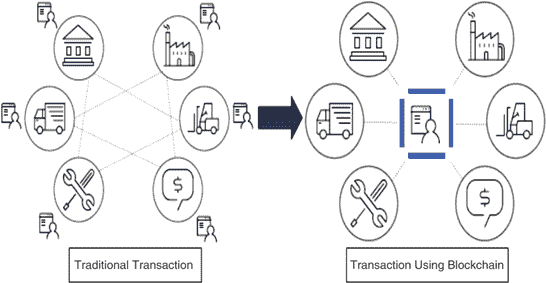

FIGURE 15.1 Standard versus blockchain-based transactional models.

\[Original (created by authors)\]

区块链的三大主要优势是透明度、认证能力和审计能力。区块链技术的演进可以分为两个阶段。第一阶段跨越 1991 年至 2013 年。在此期间，2008 年雷曼兄弟的破产对美国产生了重大影响，估计损失达数万亿美元。这一事件引发了一系列事件，导致许多国家陷入经济衰退或萧条。2008 年，比特币作为区块链技术的首个应用被引入。导致危机的一个促成因素是集中式支付和货币系统，该系统依赖清算所作为买卖双方之间的中介，承担违约风险。另一方面，比特币是一种创新技术，允许银行直接结算账户，而无需集中式实体。它在全球范围内运行，被认为是第一个去中心化货币系统，利用加密工作量证明、数字签名和点对点网络来维护分布式交易账本。自比特币出现以来，众多应用程序已被开发，所有这些应用都旨在利用区块链技术的原理和能力。因此，区块链的历史充满了与技术演进一同出现的各种应用。区块链的第二阶段，被称为“合约”（Contracts），涵盖 2013 年至 2015 年之间的年份。以太坊（Ethereum）由 Vitalik Buterin 开发，在此期间作为一个新的公共区块链推出，其功能比比特币更加增强。这一发展标志着区块链演进时间线上的一个关键时刻，因为以太坊允许在区块链上记录其他资产，例如合约。2015 年，以太坊区块链的推出标志着加密货币发展的一个重要里程碑。凭借其创新功能，以太坊不仅充当数字货币，还转变为创建去中心化应用程序的强大平台。这种功能的扩展使智能合约的使用成为可能，从而促进了各种任务的执行。因此，以太坊成为区块链技术最突出的应用之一 \[11\]。

## 15.3 区块链在医疗保健和人力资源管理（HRM）中的应用

区块链在医疗保健中的重要性在于其能够增强数据安全性和完整性。它通过探索应用程序来改善医疗保健组织之间患者健康信息的互操作性，提供了有前景的解决方案。重点在于在过程中保持数据隐私和安全性 \[12\]。

*   > **Electronic Medical Records (EMRs)**：区块链技术有可能改变电子病历（EMRs）的管理和连接方式。虽然 EMRs 和 EHRs 有时被互换使用，但其范围不同，EMRs 专注于单个诊所的病史和治疗历史，而 EHRs 则提供患者整体健康状况的更全面图景。传统的纸质医疗记录效率低下、容易出错，并且难以长期追踪患者的健康状况。通过信息技术出现的电子健康记录（EHRs）解决了这些问题。EHRs 允许医疗机构改善治疗质量、疾病管理和预防性护理。EHRs 的数字化特征允许改进决策支持，并鼓励医疗保健从业者之间更大程度的协作。因此，EHRs 正在迅速因其在增强医疗保健领域患者护理方面的关键作用而得到认可 \[13\]。

*   > **Supply Chain Management (SCM)**：医疗保健领域的供应链管理（SCM）由于订购环境分散以及被破坏的供应链和患者安全问题等固有风险而面临问题。假药、剂量错误和包装错误都会导致这些问题。区块链技术作为一种重要的监控工具出现，为药品和医疗用品的流动提供了透明且可追溯的记录。区块链上记录的每笔交易都允许快速验证药品来源、卖家和分销商。分布式账本使验证供应商凭据变得更加容易，使医疗保健从业者更好地了解供应链，并确保合法药品送达患者。区块链有可能在医疗保健 SCM 中建立可信的供应商网络、改进需求预测、确保数据来源、避免欺诈并提高整体交易效率 \[14\].


> Pharmaceutical: Pharmaceutical businesses endure a lengthy and complex process, from medical development to regulatory approval, which makes the sector vulnerable to drug recalls and counterfeiting. Blockchain technology can improve security and privacy throughout the pharmaceutical industry. A distributed ledger enables tamper-proof documentation of trial events, while private blockchains may enforce patent conformity via smart contracts, providing integrity, traceability, and transparency. A considerable number of pharmaceutical businesses are investigating or using blockchain, demonstrating its potential. Sylim et al. constructed a pharmacosurveillance blockchain system that illustrates the potential of using blockchain principles to improve medication traceability, with a focus on tackling the worldwide crisis of counterfeit pharmaceuticals in several Asian nations \[15\].

> Internet of Medical Things (IoMT): IoMT systems are crucial for advancing health and medical information systems by enabling real-time data gathering, processing, and sharing among healthcare devices. In the IoMT paradigm, patients serve as the primary data source, with IoMT devices generating significant volumes of data either through close attachment or remote monitoring. This data is then stored on blocks or on the cloud, and artificial intelligence (AI) assists blockchain in creating intelligent virtual agents, enhancing security for sensitive medical information. Healthcare providers, as end users, seek authorized access to this data to ensure safe and secure care delivery \[16\].

## 15.4 How blockchain technology is affecting the recruitment process

In order to mitigate the recruitment obstacles in the healthcare industry, the players can integrate blockchain to solve the problem. The following section will discuss the significance of blockchain technology in the recruitment process.

> Streamlining the Hiring Process: Blockchain technology can revolutionize HRM by improving recruiting, performance management, and training processes’ transparency, security, and efficiency \[17\]. A study on the use of blockchain technology in recruitment found that blockchain-based recruitment systems enhance the recruitment processes by offering opportunities such as increasing the speed and efficiency of the hiring process.

> Enhancing Data Security: Blockchain’s DLT provides a secure and transparent platform for storing and sharing candidate information, ensuring data integrity and protecting sensitive data from unauthorized access or alteration. This is particularly important in industries such as health care, where patient data must be protected by strict privacy regulations.

> Improving Transparency: Blockchain technology can provide a clear and verifiable record of candidate information, reducing the risk of fraud and boosting recruiter confidence in the authenticity of candidate data. This transparency can help recruiters make more informed decisions and select the best candidates for a particular role.

> Automating Verification Processes: Blockchain technology can be used to automate the verification of candidate information, such as academic qualifications, work history, and professional references. This can save time and resources for recruiters, allowing them to focus on other aspects of their job.

## 15.5 The recruitment practices in healthcare industries

Healthcare recruitment encompasses the entire process of finding, attracting, evaluating, employing, and integrating healthcare professionals into the workforce. This includes doctors, nurses, healthcare administrators, pharmacists, technicians, therapists, and other essential healthcare workers. It plays a vital role in ensuring the provision of high-quality patient care and the smooth functioning of healthcare facilities. In recent times, healthcare recruitment has become increasingly competitive and unpredictable, especially in the wake of the COVID-19 pandemic. Apart from the financial implications of replacing employees, high turnover rates can significantly impact patient care. Maintaining a low turnover rate not only improves the quality of care provided to patients but also contributes to the overall competence and effectiveness of the healthcare workforce. It is crucial to prioritize hiring and retaining skilled professionals to ensure the continued success of the healthcare industry.

> Leverage AI for Talent Preselection: The healthcare industry, in particular, is incorporating AI into its recruitment practices to expedite the time it takes to fill positions and address staff retention concerns. By swiftly scanning résumés, AI can identify key phrases, qualifications, and other relevant information. Consequently, an AI recruitment tool can promptly identify qualified candidates from a large pool of applicants. Moreover, AI technology can contribute to reducing bias in the sourcing process, thereby enhancing the candidate selection process. This enables organizations to engage with individuals who may not have passed traditional prescreening methods, ultimately fostering a more diverse talent pool. By replacing manual processes with an automated system that consistently applies the same screening rules to all candidates, organizations can cultivate a stronger brand image and make better hiring decisions \[17\].

> Incorporate Behavioral Health Assessments into Regular Practice: The American Medical Association has provided a definition for behavioral health care, which encompasses the prevention, diagnosis, and treatment of various mental health and substance use disorders, as well as addressing life stressors, crises, and stress-related physical symptoms. Considering the impact that these behavioral health concerns have on the management of chronic diseases, it is important to recognize the evidence supporting the integration of behavioral health care. It has been suggested that past behavior is a reliable indicator of future performance. By conducting behavioral health assessments, organizations can inquire about candidates’ past responses to specific situations, ensuring that they are well suited for the organization. These assessments provide insights into the traits, temperament, and behavioral competencies necessary for the position and for working effectively in healthcare settings \[18\].

> Embrace the Concept of Diversity and Inclusion: In order to cultivate a team that encompasses a range of perspectives, it is crucial to implement an all-encompassing recruitment procedure. This entails thoroughly examining job descriptions, screening questions, and interview questions to identify any biases that may discourage diverse candidates from applying or being chosen for positions. It may be beneficial to establish a committee dedicated to diversity and inclusion to oversee the hiring process and ensure that it remains fair and inclusive. By recruiting healthcare professionals from diverse backgrounds, you not only expand your pool of talent but also encourage innovation and creativity through a multitude of viewpoints \[19\]. Additionally, this approach allows you to target diverse patient markets. Embracing diversity in your hiring practices also fosters collaboration among team members. By actively seeking out candidates with diverse backgrounds, you demonstrate that your brand is inclusive, which can contribute to staff retention and the referral of new hires.


> 维护品牌可见度：招聘和维护强大的公司形象在很大程度上受到品牌影响，尤其是在有限的人力资源竞争激烈的市场中 \[20》。尽管大流行病限制了传统的面对面渠道，如招聘会，但仍有许多数字和印刷选项可供使用，以便给潜在雇员留下深刻印象。目前，虚拟人才招聘已成为标准做法。因此，确立自己作为该领域领导者至关重要。重要的是，利用数字品牌技术，如广告、赞助虚拟会议以及利用社交媒体平台，将确保您的组织在活跃在线的经验丰富的医疗保健专业人员和潜在招募人员心中始终处于领先地位。此外，医疗保健组织应优先展示其独特的卖点，并突出其为员工提供的福利。这可以包括提供有竞争力的薪水和全面的福利计划，强调专业成长机会，并推广积极的工作环境。分享现有员工的成功故事和推荐也可以显著提升组织的声誉并吸引顶尖人才。

## 15.6 区块链技术作为医疗保健行业招聘工具的实施

在医疗保健招聘中，区块链技术通过为医院和医疗专业人员提供安全且透明的解决方案，颠覆了传统流程。想象一个系统，医生的执照、认证和培训被永久存储在防篡改的数字账本上。这使医院能够即时验证资格，简化招聘流程，同时通过确保凭证的真实性来保证患者安全。但好处不仅限于初始验证。同一安全系统可以通过创建其资格的便携式记录，消除旅行医生和临时医生的重复检查。这不仅简化了医疗专业人员的流程，还允许他们通过基于区块链构建的安全人才网络与更广泛的医疗保健机构建立联系。通过在申请过程中（从验证到沟通）培养信任和透明度，区块链有可能彻底改变医疗保健机构寻找和招募顶尖人才的方式，最终带来一个更高效、更有效的医疗保健系统。

### 15.6.1 潜在医疗保健员工的入职

在初始阶段，希望加入公司的个人需要通过将其简历（CV）提交到公司的区块链来完成注册流程 \[21》。为此，潜在员工被引导填写注册表格，并在公司的区块链网站上输入其数据和简历。一旦提交，系统将自动为潜在员工生成一个代码。区块链技术将通过比较代码来验证所提供数据的准确性。如果检测到任何不一致，区块链将立即将数据视为无效。因此，员工确保其输入的信息与其实际身份一致至关重要。这一过程显著降低了数据被篡改的风险，并提高了数据验证的效率。此外，一旦数据提交，潜在员工无法修改它，除非雇主和医疗保健行业达成共识。

### 15.6.2 为行政职位筛选潜在医疗保健员工

根据 2018 年 HireRight 就业筛选基准报告，发现 84%的申请人在其简历中提供了虚假信息。为了解决这个问题，实施基于区块链的凭证验证系统可以极大地有利于招聘流程 \[22》。这些系统可以有效减少背景调查所花费的时间，最大限度地减少欺诈，并增强招聘生态系统中的信任。通过利用区块链技术，进入系统的潜在员工的信息和文件可以在医疗保健行业和负责颁发证书或文件的相应机构之间进行验证。此验证过程可以自动发生，无需医疗保健行业向证书颁发机构请求验证。例如，区块链可以用于验证潜在员工的大学数据、工作经历、教育经历和自我身份。

### 15.6.3 更快的决策

区块链技术简化并加快了筛选和招聘程序中的决策过程。通过利用先进技术，它消除了从机构、公司和政府检索数据以验证潜在员工信息真实性的第三方参与的需要 \[23》。雇佣合同详情，包括电子签名、工资单信息、安全访问代码、绩效报告，甚至心理测量/行为评估，都可以安全地存储在区块链上。这些数据的准确性通过区块链机构、公司和政府自动验证。使用区块链技术搜索数据所需的时间约为七秒，使即时雇佣和合同签发成为可能，工资单编号会立即分配。

### 15.6.4 确保医疗保健员工被安置在合适的职位和领域

根据[ResumeBuilder.com](http://ResumeBuilder.com)进行的一项调查，发现美国 72%的个人在其简历中提供了虚假信息。这一发现可能会让组织感到惊讶。然而，通过有效实施区块链技术，招聘团队现在有能力即时访问关于潜在员工的准确和全面的信息，包括他们的工作经历 \[21》。通过区块链技术获得的数据的可靠性可以作为将员工安置在合适职位的宝贵参考。例如，如果潜在员工 A 是一所声誉良好的大学的毕业生，GPA 为 3.90，并且在医疗保健相关课程中表现出色，他们可以被考虑担任医疗保健行业的专业职位。医疗保健行业可以对通过区块链系统获得的数据充满信心，这也可以帮助决策，并确保员工被安置在与其专业知识相匹配的角色中。

## 15.7 机遇与挑战


# 区块链技术在医疗招聘中的应用

区块链技术有望通过为医院和医疗专业人员提供安全、高效且可信的系统，彻底改变医疗招聘。想象一下，医生的执照、认证和培训记录永久存储在防篡改的数字账本上的未来。这将使医院能够即时验证资格，大大加快招聘流程，同时通过凭据的无可辩驳的证明来保障患者安全。但好处远不止于简化初始验证。区块链可以为巡回医生和临时医生创建便携式记录，消除在每个新设施进行重复检查的需求。这不仅简化了医疗专业人员的流程，还允许他们通过基于区块链构建的安全人才网络，与更广泛的医疗机构建立联系。然而，要实现广泛采用，还需要解决一些障碍。可扩展性是一个关键问题，因为技术需要适应处理医疗机构产生的海量数据。此外，跨不同区块链平台进行安全且一致的数据交换的行业标准对于无缝集成至关重要。尽管存在这些挑战，区块链为医疗招聘带来了充满希望的未来，从验证到沟通的整个过程中培养信任和透明度，最终带来更高效、更有效的医疗系统。

### 15.7.1 机遇

区块链有望通过提供丰富的机遇来彻底改变医疗招聘。想象一下，由于医生的凭据安全地存储在防篡改的账本上，因此可以即时验证。这不仅加快了招聘速度，还保障了患者安全。好处远不止于初步检查，因为区块链可以为巡回医疗专业人员创建便携式记录，消除重复验证，并通过安全的人才网络将他们与更广泛的机构联系起来。此外，通过确保申请过程中的透明度和安全性，区块链有潜力显著改善医疗专业人员的候选人体验。

> 区块链工作的未来：随着区块链技术在各行业的普及，具备区块链技能的专业人才需求不断增加。早期采用者已成功将区块链应用于业务，促使更多组织寻求该领域的人才。区块链的采用和应用被视为颠覆性创新，进一步推动了对熟练专业人员的需求。LinkedIn Learning 将区块链列为 2020 年最受欢迎的硬技能之一，凸显了劳动力市场中人才短缺与企业不断增长的需求之间的差距 \[27\]。学者们建议，该领域的工作机会包括区块链开发人员、解决方案架构师、项目经理、用户体验（UX）设计师和质量专家 \[23\]。

> 构建区块链团队：要构建一个成功的区块链团队，需要具备多样化的技能，涵盖编程、密码学、法律专业知识和商业头脑。鉴于区块链项目需要综合性解决方案，跨学科团队内的有效协作至关重要。此外，具备行业知识对于满足特定需求和挑战，确保开发出相关且有效的区块链解决方案至关重要 \[24\]。

> 识别合适的人才：识别区块链机遇的合适人才，涉及寻找具备技术熟练度的个人，包括扎实的计算机科学、密码学以及 Solidity 等相关编程语言背景。此外，具备强大分析和解决问题能力的候选人非常宝贵，因为区块链经常面临复杂挑战。至关重要的是，适应性和持续学习的意愿是必不可少的特质，鉴于区块链技术动态且快速发展的性质 \[25\]。

> 提升技能与持续学习：区块链在增强企业培训中心方面发挥着关键作用，通过提供来自利益相关者的员工能力更新且安全的信息。通过在区块链上部署能力，可加强可追溯性信息，确保安全性。所提议的培训材料需求区块链-IoT 应用强调轻量化和雾化特性，以增强系统适应性。此外，区块链促进培训质量评估的自动建模，包括内容、培训师和满意度反馈。这使得对培训内容质量的监控更加可靠，反映出工作场所员工活动的实际效果 \[26\]。

### 15.7.2 挑战

区块链技术面临着若干需要解决的挑战，以实现其广泛采用。这些挑战包括缺乏意识和理解、技术专业知识和技能差距、人才池有限以及监管不确定性。

> 缺乏意识和理解：采用区块链技术的主要环境挑战是各行业（尤其是银行业以外）缺乏意识和理解。低意识还延伸到对如何实施区块链的普遍误解。区块链不断发展且复杂的性质，加上其复杂的网络结构，导致了这种缺乏理解。广泛的知识缺乏阻碍了对区块链技术多样化应用的探索。许多人错误地将区块链仅与比特币联系起来，而不了解其更广泛的存在和潜在用途 \[27\]。

> 技术专业知识和技能差距：区块链技术需要专业的技术专业知识，行业中存在显著的技能差距，使得组织难以找到具备必要知识和经验的专业人员。采用区块链技术的挑战在于从业者缺乏知识、技能和能力。区块链提供的许多解决方案都是新的且技术要求高，对熟练员工的需求很高。然而，区块链的复杂性使得企业难以找到能够理解其潜力及其对商业机会影响的合格人员。人力资源管理专家强调，学习区块链是一个困难的过程。因此，一些企业由于缺乏内部能力而选择不采用区块链，而另一些企业则认识到需要培训以融入这项新兴技术。参与者建议，教育是克服区块链领域知识、技能和能力短缺的关键因素 \[27\]。


> 人才储备有限：精通区块链技术的专业人才稀缺。人才储备有限可能导致企业之间为争夺熟练人才而加剧竞争，使招聘和团队建设变得具有挑战性。在他们的研究 \[28\] 中，欧盟（EU）认识到区块链在推动数字化转型、促进社会和商业利益以及推动可持续增长方面发挥着关键作用。然而，区块链开发的竞争力受到熟练专业人员短缺的阻碍。对区块链技能的日益增长的需求尚未得到充分满足，带来了人才短缺、全球竞争以及教育与行业需求缺乏对接等挑战 \[29\]。

> 监管不确定性：区块链技术面临监管不确定性，这给区块链网络运营商和参与者带来了挑战。许多国家和地区的监管机构正在采取观望态度，倾向于在推进更多法规之前先探索和理解区块链的影响。缺乏监管确定性以及不断变化的法律和监管立场给区块链网络参与者带来了挑战，他们有必要不断评估自己在区块链网络中的参与情况。根据 \[29\]，影响基于新技术的企业（NTBFs）采用区块链核心应用——加密货币——的关键因素之一是监管不确定性。企业可能会因担心潜在的法律问题（例如数字资产的分类、税收以及遵守反洗钱（AML）和了解你的客户（KYC）法规）而犹豫是否参与区块链网络，尤其是涉及加密货币的网络。根据制度理论，NTBFs 预计会推迟技术采用，直到监管不确定性降低。相比之下，基于资源的观点表明，NTBFs 可能会在监管不确定性期间采用技术，以在未受监管的领域获得竞争优势 \[30, 31\]。

## 15.8 结论

在当今竞争激烈的商业环境中，企业采用先进技术并改造现有商业模式以取得成功至关重要。在这些技术中，数字化进步已成为最重要的突破，提供了有价值的解决方案。人力资源管理（HRM）领域，特别是招聘，正因人工智能、机器学习、聊天机器人、大数据和区块链等数字技术趋势的广泛采用而经历重大变化和进步。本研究代表了首次共同讨论机会、挑战和基于区块链的招聘实践的努力。因此，它被认为在提高研究人员和医疗保健从业者对区块链在招聘中应用的认识和理解方面做出了重大贡献。此外，本研究的范围仅限于医疗保健行业的招聘实践。人力资源管理领域有待开发的研究途径有很多。鉴于此，可以开展新的调查，探索区块链技术在培训与发展、职业规划、绩效考核和薪酬管理等领域的潜在应用。

## 参考文献

1. Abu-Elezz, I., Hassan, A., Nazeemudeen, A., Househ, M., & Abd-Alrazaq, A. (2020). 区块链技术在医疗保健中的益处与威胁：范围综述. International Journal of Medical Informatics, 142, 104246.

2. Agbo, C. C., Mahmoud, Q. H., & Eklund, J. M. (2019). 医疗保健中的区块链技术：系统综述. Healthcare, 7(2), 56. [`doi.org/10.3390/healthcare7020056`](https://doi.org/10.3390/healthcare7020056)

3. AMA (2022). 什么是行为健康？可用链接 [`www.ama-assn.org/delivering-care/public-health/what-behavioral-health?trk=article-ssr-frontend-pulse\_little-text-block`](https://www.ama-assn.org/delivering-care/public-health/what-behavioral-health?trk=article-ssr-frontend-pulse_little-text-block). 访问日期 2024 年 1 月 8 日

4. Ateniese, G., Magri, B., Venturi, D., & Andrade, E. (2017). 可编辑区块链——或者——在比特币及其同类中重写历史. 在第 2 届 IEEE 欧洲安全与隐私研讨会——EuroS&P 上.

5. Attaran, M. (2020). 医疗保健中的区块链技术：挑战与机遇. International Journal of Healthcare Management, 1–14. [`doi.org/10.1080/20479700.2020.1843887`](https://doi.org/10.1080/20479700.2020.1843887)

6. Avdoshin, S., & Pesotskaya, E. (2019). 医疗保健行业的区块链革命. 在未来技术会议（FTC）2018 论文集中, Springer International Publishing, 1, 626–639.

7. Chen, Z. (2023). 利用区块链技术革新人力资源管理实践：释放工作的颠覆性范式并克服管理挑战. Technology Analysis & Strategic Management, 1–14. [`doi.org/10.1080/09537325.2023.2282083`](https://doi.org/10.1080/09537325.2023.2282083)

8. Chillakuri, B., & Attili, V. S. P. (2021). 区块链在人力资源应对新常态中的作用. International Journal of Organizational Analysis, 30(6), 1359–1378.

9. Chunmian, G. E., Haoyue, S. H. I., Jiang, J., & Xiaoying, X. U. (2021). 调查招聘市场对区块链人才的需求：来自招聘信息主题建模分析的证据. Information & Management, 59(7), 103513. [`doi.org/10.1016/j.im.2021.103513`](https://doi.org/10.1016/j.im.2021.103513).

10. Collomb, A., & Sok, K. (2016). 区块链/分布式账本技术（DLT）对金融部门的影响？Digiworld Economic Journal, 103, 第三季度, 93.

11. Dutta, P., Choi, T. M., Somani, S., & Butala, R. (2020). 供应链运营中的区块链技术：应用、挑战和研究机遇. Transportation Research Part E: Logistics and Transportation Review, 142, 102067. [`doi.org/10.1016/j.tre.2020.102067`](https://doi.org/10.1016/j.tre.2020.102067)

12. Fachrunnisa, O., & Hussain, F. K. (2020). 基于区块链的人力资源管理实践，以缓解劳动力中的技能和能力差距. International Journal of Engineering Business Management, 12, 1–11. [`doi.org/10.1177/1847979020966400`](https://doi.org/10.1177/1847979020966400)

13. Frederiks, A. J., Costa, S., Hulst, B., & Groen, A. J. (2022). 早起的鸟儿有虫吃：监管不确定性在金融科技企业早期采用区块链加密货币中的作用. Journal of Small Business Management, 1–34. [`doi.org/10.1080/00472778.2022.2089355`](https://doi.org/10.1080/00472778.2022.2089355)

14. Godsey, J., Perrott, B., & Hayes, T. (2020). 品牌理论能否帮助重新定位护理的品牌形象？Journal of Nursing Management. [`onlinelibrary.wiley.com/doi/epdf/10.1111/jonm.13003`](https://onlinelibrary.wiley.com/doi/epdf/10.1111/jonm.13003) 在线出版，尚在印刷中。


## 参考文献

15. HireRight, Employment Screening Benchmark Report (2018)

16. Khezr, S., Moniruzzaman, M., Yassine, A., & Benlamri, R. (2019). 医疗保健中的区块链技术：全面综述及未来研究方向. Applied Sciences, 9(9), 1736. https://doi.org/10.3390/app9091736

17. Kişi, N. (2022). 区块链技术在招聘中的应用探索性研究. Sustainability, 14(16), 10098. https://doi.org/10.3390/su141610098

18. Levis, D., Fontana, F., & Ughetto, E. (2021). 区块链技术未来展望. PLoS One, 16(11), e0258995. https://doi.org/10.1371/journal.pone.0258995

19. Mackey, T. K., Kuo, T. T., Gummadi, B., Clauson, K. A., Church, G., Grishin, D., Obbad, K., Barkovich, R., & Palombini, M. (2019). 是否适用？区块链技术在未来医疗保健中的应用挑战与机遇. BMC Medicine, 17(1), 1–17.

20. Newman, L. H. (2022, Jan 22). 本周安全新闻：Crypto.com 终于承认在黑客攻击中损失了 3000 万美元. 转载自 Wired. https://www.wired.com/story/crypto-hack-nso-group-security-news/

21. Peisl, T., & Shah, B. (2019). 区块链技术对招聘的影响及其对员工生命周期的影响. 载于 Systems, Software and Services Process Improvement; Walker, A., O’Connor, R., Messnarz, R., Eds.; Springer: Cham, Switzerland; pp. 695–705.

22. Purohit, B., & Martineau, T. (2016). 印度古吉拉特邦政府医生招聘中的问题与挑战. Human Resources for Health, 14, 1–14. https://doi.org/10.1186/s12960-016-0140-9

23. Radanović, I., & Likić, R. (2018). 区块链技术在医学中的应用机遇. Applied Health Economics and Health Policy, 16(5), 583–590.

24. Resume Builder (2023). 三分之一的美国人在招聘过程中撒谎. 可用链接 https://www.resumebuilder.com/1-in-3-have-lied-in-the-hiring-process/ 访问日期 2024 年 1 月 9 日.

25. Rhemananda, H., Simbolon, D. R., & Fachrunnisa, O. (2021). 区块链技术支持工业 4.0 时代的员工招聘与甄选. 载于 International Conference on Smart Computing and Cyber Security: Strategic Foresight, Security Challenges and Innovation 论文集, Kosong, 韩国, 28–29.

26. Salah, D., Ahmed, M. H., & ElDahshan, K. (2020). 人力资源管理中的区块链应用：机遇与挑战. 载于 Evaluation and Assessment in Software Engineering (EASE’20) 论文集, Trondheim, 挪威, 15–17.

27. Seebacher, S., & Schüritz, R. (2017). 区块链技术作为服务系统的推动者：结构化文献综述. Springer Nature, 279, 12–23.

28. Solomos, D., Tsianos, N., Ghodous, P., & Riel, A. (2021). 欧洲 Chaise 倡议：塑造区块链技能资格与认证的未来. 载于 Systems, Software and Services Process Improvement: 28th European Conference, EuroSPI 2021, Krems, Austria, September 1–3, 2021, Proceedings 28 (pp. 640–650). Springer International Publishing.

29. Treweek, S., Pitkethly, M., Cook, J., Fraser, C., Mitchell, E., Sullivan, F., Jackson, C., Taskila, T. K., & Gardner, H. (2018). 改善随机试验招募的策略. Cochrane Database of Systematic Reviews, MR000013. https://doi.org/10.1002/14651858.MR000013.pub6

30. Valeri, M., & Baggio, R. (2021). 区块链在旅游业中的应用：批判性反思. Information Technology & Tourism, 23(2), 121–132.

31. Vujičić, D., Jagodić, D., & Ranđić, S. (2018). 区块链技术、比特币和以太坊：简要概述. 载于 17th International Symposium Infoteh-Jahorina (INFOTEH), IEEE, 1–6.

## INDEX

### A

*   Artificial Intelligence, 53, 70, 84, 115, 130, 165, 169, 191, 329

### B

*   Blockchain, 1, 2, 10, 18, 20, 25, 50, 100, 120, 130, 150, 172, 200

### C

*   Consent Management, 36, 38, 69, 78, 136, 175, 180, 301

### D

*   Data integrity, 2, 9, 16, 27, 34, 48, 165, 179, 213, 228, 256

*   Decentralized, 6, 11, 27, 38, 48, 57, 76, 88, 112, 152, 180, 242, 248, 285

*   Disease, 9, 31, 78, 107, 169, 185, 206, 229, 331

### E

*   Electronic Medical Records, 20, 106, 243, 246, 328

### H


# Table of Contents

Cover Page

Half-Title Page

Series Page

Title Page

Copyright Page

Contents

Editors

Contributors

## 1 Applications of Blockchain Technology in the Global Healthcare System

1 Applications of Blockchain Technology in the Global Healthcare System

## 2 Blockchain Technology in Health Care

2 Blockchain Technology in Health Care

## 3 Healthcare Monitoring System with Blockchain Technology Tracking Open Donations and Minimizing the Scope of Organ Trafficking

3 Healthcare Monitoring System with Blockchain Technology Tracking Open Donations and Minimizing the Scope of Organ Trafficking

## 4 Transforming Healthcare Services in South Asia: Leveraging Blockchain Technology

4 Transforming Healthcare Services in South Asia: Leveraging Blockchain Technology

## 5 Challenges and Future Directions of Blockchain Technology in Healthcare Settings

5 Challenges and Future Directions of Blockchain Technology in Healthcare Settings

## 6 Blockchain-Enabled Radiology: Transformative Potentials and Implementation Hurdles

6 Blockchain-Enabled Radiology: Transformative Potentials and Implementation Hurdles

## 7 Introduction to Blockchain and Artificial Intelligence in Health Care

7 Introduction to Blockchain and Artificial Intelligence in Health Care

## 8 Patient Empowerment through Secure Data Management

8 Patient Empowerment through Secure Data Management

## 9 Ensuring Data Privacy and Security with Blockchain in Health Care

9 Ensuring Data Privacy and Security with Blockchain in Health Care

## 10 An Advanced Secure Medical File-Sharing System Based on IPFS and Blockchain Technology

10 An Advanced Secure Medical File-Sharing System Based on IPFS and Blockchain Technology

## 11 A Survey on Security Enhancements of Electronic Health Records through Blockchain Technology

11 A Survey on Security Enhancements of Electronic Health Records through Blockchain Technology

## 12 Blockchain for Halal Integrity in Health Care: Enhancing Compliance, Ensuring Benefits

12 Blockchain for Halal Integrity in Health Care: Enhancing Compliance, Ensuring Benefits

## 13 Nonprobabilistic Approach to Solve Multiobjective Optimization Model with Applications in Blockchain Technology

13 Nonprobabilistic Approach to Solve Multiobjective Optimization Model with Applications in Blockchain Technology

## 14 Decentralizing Health: The Future of Blockchain in Health Care

14 Decentralizing Health: The Future of Blockchain in Health Care

## 15 The Adoption of Blockchain Technology for Recruitment Practices in Healthcare Industries: A Systematic Review

15 The Adoption of Blockchain Technology for Recruitment Practices in Healthcare Industries: A Systematic Review

Index

## I

*   Internet of Things, 31, 52, 84, 136, 170, 211, 264, 305

## P

*   Patient Privacy, 9, 28, 42, 64, 72, 104, 123, 147, 164, 171, 304, 313

## S

*   Security, 2, 9, 13, 33, 42, 53, 75, 91, 115, 135, 156, 161, 177, 195, 207, 218, 249

*   Smart contracts, 6, 13, 30, 36, 42, 51, 81, 96, 98, 137, 181, 195, 207, 239, 256

## T

*   Transaction, 1, 5, 38, 57, 76, 88, 102, 123, 177, 182, 190, 228, 248, 284, 314

## Healthcare

*   Healthcare, 2, 11, 51, 76, 83, 101, 125, 145, 170, 195, 204, 225, 235

