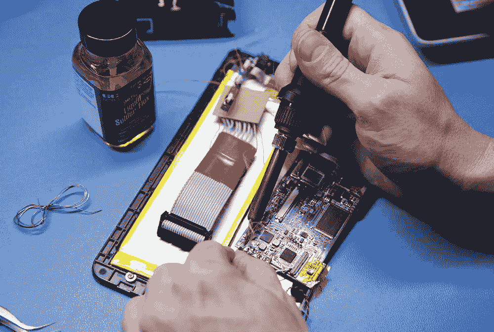
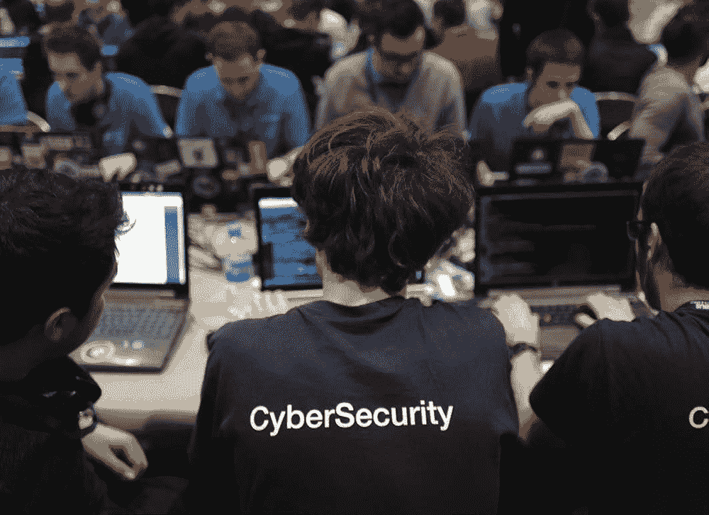
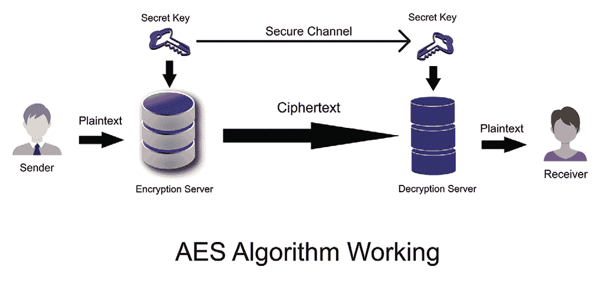

# 高科技安全职业的计算机科学应用指南

## 简介

20 世纪 90 年代，Jeff Williams 成为了一名应用安全工程师，他在大多数人还没听说过这一职业很久之前就担任了这个高科技安全职位。“通用电气找到我的公司说，‘我们喜欢你们的数据中心，但在代码上线前，我们需要对每一行代码进行安全审查，’”他在接受 CSO Online 采访时说道。“销售团队很快就说‘没问题！’其他人都往后退了一步，而我得到了弄清楚如何交付这项工作的任务。”

应用安全是指向软件和 Web 应用程序添加功能或特性，以减少漏洞并阻止威胁的做法。威胁包括网络攻击、网络入侵和数据窃取。为了保护应用程序，应用安全工程师使用防火墙、防病毒程序、加密程序和其他防止未经授权访问的功能。

应用安全是公司整体高科技安全计划的一部分，该计划还包括系统、网络和移动安全。整个安全计划（包括应用安全）的目标是保护组织和软件用户免受黑客攻击和其他恶意入侵。在担任应用安全工程师的职位上，Williams 学会了如何进行渗透测试和安全代码审查、创建应用安全架构、完成威胁建模等。

一名信息技术工程师正在调整公司服务器室中的线路连接。她是负责保护公司计算机系统的专业人员之一。

如今，Williams 是 Contrast Security 的首席技术官兼联合创始人，该公司是一家位于加利福尼亚州帕洛阿尔托的应用安全供应商。他表示，要在这个高科技安全职业中取得成功，人们应具备扎实的计算机科学技能和多种编程风格及语言的经验。“但这还不够，”他在接受 CSO Online 采访时说。“我寻找那些参与开源项目、编写自己的工具、每天都在编码的人——那些对代码充满激情和热情的人。所以，这更多关乎实际经验，而非书本知识。”

技术正在改变日常生活的许多方面，从人们做生意的方式到沟通的方式。越来越多的组织依赖数字系统来生成、处理和存储有价值的信息。保护组织的数字系统和数据免受未经授权的访问和恶意黑客攻击的需求，催生了网络安全领域的新职业。

网络安全是指保护联网系统（包括硬件、软件和数据）免受入侵和网络攻击。随着公司越来越需要保护其数字系统和资产，他们需要具备技术技能与编码知识相结合的安全专业人员。计算机取证、安全工程、安全架构和密码学只是受益于计算机科学和编码技能的网络安全领域的几个例子。对具备网络安全和技术技能的信息技术（IT）专业人员的需求，为对计算机科学和高科技安全感兴趣的人创造了新的机会。“每一次新的黑客攻击或数据泄露背后，都有一家公司在忙着灭火。这对拥有网络安全技能的求职者来说是个好消息。雇主招聘他们的速度永远不够快，”记者 Jeff Kauflin 在为《福布斯》撰写的关于高科技安全职业的文章中写道。

在高科技安全领域，有许多利用计算机科学的不同职业专长可供学生追求。公司雇佣计算机取证专家、安全工程师、密码学家、信息安全分析师、渗透测试员、安全架构师等。机会如此之多，将高科技安全与计算机科学相结合的职业可以适应许多不同的背景和兴趣。

## 第一章

### 保护数字资产和信息

每天，组织都面临着其信息系统和数据受到威胁的局面。复杂的攻击者会搜寻组织系统中的任何弱点，并设法加以利用。一旦得逞，可能只是导致服务的简单中断，也可能引发严重担忧，即敏感数据被篡改并出售。随着越来越多的日常物品连接到互联网，从智能冰箱到健身追踪器，保护数字资产、系统和信息的高科技安全需求比以往任何时候都更加迫切。

### 什么是网络安全？

当人们想保护家中的贵重物品时，会安装物理锁和安防系统以防窃贼进入。需要保护宝贵数字系统和信息的组织则求助于网络安全。网络安全是确保数字信息、网络和系统免遭盗窃、篡改和其他损害的实践。有些损害可能是意外的，例如硬盘故障或自然灾害袭击。然而，越来越多的损害是由恶意实体的蓄意攻击造成的。这包括只是想试试能否闯入系统的个人黑客，以及为牟取经济利益而窃取数据和信息的有组织犯罪集团。

我们正日益成为一个高度互联的社会。智能手机和健身追踪器等联网设备容易受到网络安全攻击。

多年前，网络安全主要与政府机构和国防承包商相关联。如今，所有组织都需要重视网络安全。医疗保健、制造、金融、零售等行业的公司都雇佣网络安全专业人员来保护宝贵的资产和信息。

### 网络安全的类型

#### 应用安全

应用安全涉及检测漏洞并开发工具和程序，以防止黑客利用应用程序中的弱点获取对公司系统的未授权访问。

#### 信息安全

信息安全保护信息和数据免受未授权访问、泄露、篡改、窃取等威胁。

#### 网络安全

网络安全涉及监控组织的内部网络，以识别任何弱点并防止未授权访问。网络安全同时使用硬件和软件技术，例如防火墙、防病毒和反间谍软件，以保持内部网络的安全可靠。

#### 灾难规划

网络安全还涉及为灾难制定计划，无论是自然灾害还是技术灾害。该规划包括评估和分析风险、确定资产优先级以及制定灾难响应计划。有了灾难计划，组织能够更快地从灾难中恢复，并将损失降至最低。

#### 网站安全

网站是组织容易受到攻击的另一个场所。近年来，网站数据泄露的数量有所上升。这些泄露导致客户和公司遭遇身份盗窃和财务损失。一旦泄露事件公开，公司的品牌形象和声誉也会受损。网站安全专注于保护网站免受在线威胁。它使用网站扫描和恶意软件清除、应用安全测试、网站应用防火墙等技术和工具。

*网络安全专业人员在公司服务器室工作，监控一款能检测对公司网络任何未授权访问的软件程序。*

#### 端点安全

移动技术和互联网让人们能够在世界任何地方工作。这种灵活性也带来了一定风险，因为远程工作站和移动设备容易遭受网络攻击。当移动设备连接到组织的网络并相互互联时，它们会为黑客创建新的入口点，以获取对公司系统的访问权限。端点安全通过阻止来自远程入口点的访问尝试，来保护和保障组织网络的安全。

## 常见网络威胁

无论规模、行业或地点如何，没有任何组织能免疫网络攻击。了解一些最常见的威胁，有助于网络安全专业人员更好地设计组织的网络防御体系。组织面临的五大最常见威胁包括：

*   **社会工程恶意软件**：此类攻击诱骗用户将有害软件下载到计算机上；该软件随后可传播至并破坏连接的系统或网络。
*   **网络钓鱼攻击**：密码钓鱼攻击诱骗用户泄露其密码和登录信息，随后这些信息被用于未经许可地访问组织的网络。
*   **未修补的软件**：未修补的软件包含漏洞，允许黑客获得进入组织网络的切入点。
*   **社交媒体威胁**：黑客可利用社交媒体账户收集有关公司及其员工的信息，最终拼凑出足够的信息成功入侵公司网络。
*   **高级持续性威胁**：这些威胁通常利用网络钓鱼攻击或特洛伊木马附件，在打开时投放恶意软件，以获取组织网络的访问权限并窃取知识产权。

## 高科技安全与计算机科学

随着更多信息和系统连接到网络，对有兴趣从事高科技安全工作、同时对计算机科学和编程感兴趣的人才需求日益增长。根据非营利性信息安全倡导组织 ISACA 的数据，全球约有 200 万网络安全专业人员的缺口。在美国，雇主们难以填补网络安全职位，数千个职位空缺，因为公司找不到合格的专业人员。人们需要设计和构建安全系统、尝试攻破系统并识别弱点、监控系统并检测入侵、加密敏感数据等。

对网络安全职业感兴趣的人应具备扎实的计算机科学背景，并了解计算机和软件的工作原理。“应用计算机科学在很大程度上是关于用抽象层解决问题，而安全往往是关于找出这些抽象中的错误假设……然后弄清楚如何最好地修复（或利用）它们，”网络安全专家 Parisa Tabriz 在 freeCodeCamp 的一篇博客文章中说道。

*掌握多种编程语言并能够编码，是想从事网络安全领域工作的专业人员的实用技能。*

从事网络安全工作的人员可从操作系统、网络和计算机体系结构的知识中受益。网络安全主题、隐私增强技术和应用安全方面的知识也很重要。了解一些编程语言——如 `Python`、`C`、`Java`、`JavaScript`、`PHP`、`HTML` 和 `SQL`——非常有价值。

## 追求高科技安全与计算机科学职业

通往网络安全职业的道路不止一条。有些人大学毕业后直接进入该领域，而另一些人则先在其他 IT 职位上积累经验。无论走哪条路，所有网络安全职业都需要良好的通用 IT 经验基础。对该职业领域感兴趣的人需要先了解技术如何工作，然后才能学习如何保护它。许多人选择在四年制大学攻读计算机科学或信息科学学位，学习操作系统、网络、编程语言、数据库等课程。安全主题课程也很有帮助。一些网络安全职业需要高级学位，例如专注于网络安全的 IT 硕士或博士学位。对于某些职位，获得证书是证明一个人具备该职业所需技术技能的好方法。

获得学位后，网络安全专业人员在各种规模、几乎所有行业的公司工作。许多人为咨询公司工作，为一系列客户提供服务。其他人在公司的内部 IT 部门工作。一些网络安全专业人员是自由职业者，以自由职业的方式为客户工作。

除了上课，对高科技安全和计算机科学职业感兴趣的人还可以采取其他措施来深入了解该职业。加入网络安全专业组织可以帮助一个人更多地了解该领域并建立联系。一些公司为学生提供实习机会。实习让学生获得在特定公司或行业工作的经验。阅读报纸和其他商业及技术出版物可以帮助学生了解网络安全领域的最新动态。

对于对安全和计算机科学感兴趣的人来说，网络安全职业可能是一个充满挑战但回报丰厚的选择。“它不完美。永远不会完美。但我认为安全的前沿比 10 年前好多了，我们可以在合理保证的前提下做一些非常令人印象深刻的事情，这让我保持乐观，”Tabriz 在 freeCodeCamp 的一篇博客文章中说道。

## 第二章

### 网络世界的侦探

#### 网络侦探破案记

一位企业主得知一名员工正秘密策划离职。他怀疑该员工正在背地里试图将公司的几位客户带到新的工作单位。企业主如何证实自己的猜测？他求助于网络世界的侦探——计算机取证专家。这些网络安全专业人员会检查员工在公司计算机、系统和网络上的操作，看看能否找到任何确凿证据。如果找到，企业主就可以用这些证据与员工对质。

#### 计算机取证专家出马

计算机取证是法医学的一个分支，即在犯罪调查中使用科学测试或技术。计算机取证专家收集、分析并呈报犯罪调查中的数字证据。他们在计算机系统、硬盘、光盘和其他存储设备上挖掘信息。他们梳理电子文档和文件，如电子邮件和图像。在许多情况下，数字证据极难查找和收集，因为它被隐藏或删除。为了找到这些证据，计算机取证专家使用各种软件程序和其他应用程序，挖掘并提取计算机系统中的潜在或隐藏数据。他们为许多类型的公司和组织提供服务，包括政府机构、会计事务所、律师事务所、银行和软件开发公司。任何拥有计算机系统的组织都可能需要计算机取证专家的服务。

一位计算机取证专家将一根导线焊接到主板上，该主板将连接到计算机以收集用于调查的数字信息。

Alfred Demirjian 是计算机取证公司 TechFusion 的总裁兼首席执行官。在他的三十年计算机取证生涯中，他受雇处理过许多场景。在一个案例中，他发现了员工通过劫持电子邮件账户破坏前雇主的证据。在其他案例中，他收集了员工在工作期间滥用互联网的证据。使用取证软件，Demirjian 可以深入挖掘员工的社交媒体帖子和短信。他可以筛选特定日期范围内的公司电子邮件，以查找员工与客户及其他人互动的证据。如果员工拥有公司配备的智能手机，他甚至可以通过 GPS 追踪员工的行踪。Demirjian 在《CSO》杂志发表的一篇文章中表示：“计算机取证将在揭露人们的恶意行为方面发挥更大作用。随着技术的不断进步，人们将更难隐藏其不法行为，也更容易被追究责任。”

每个使用计算机取证的案件都各不相同。例如，执法部门可能会请计算机取证专家协助调查一名涉嫌国内恐怖主义的人员。专家可能被要求识别并分析所有通信记录、互联网活动以及与过去或计划中的犯罪活动相关的数据。在另一个案例中，当外部黑客访问存有宝贵信息的公司服务器时，可能会请来计算机取证专家。取证专家将确定黑客如何访问服务器、是否访问或窃取了数据，以及是否引入了任何恶意软件或其他针对系统的敌对活动。

### 从事计算机取证工作

从事计算机取证工作的人员将计算机科学背景与取证技能相结合。他们通过收集、分析和呈报所发现的数字数据，协助执法部门和公司。计算机取证专家的主要工作是在计算机系统或其他数字设备上查找和收集可见及隐藏的数字信息。有时，数据收集发生在现场，即嫌疑人的家中或办公室。更常见的情况是，待检查的设备被运送到计算机取证实验室进行检查。设备到达实验室后，计算机取证专家会使用各种技术工具搜索和收集数据。

计算机取证专家分析收集到的数据。他们向执法部门和其他调查人员解释数据是什么、从何处恢复以及在案件中可能意味着什么。取证专家记录他们在数字数据恢复和分析过程中采取的每一步，以便数据可在法庭上使用。有时，数据分析可以发现案件的新线索，并指引取证专家朝新的方向调查。

洛杉矶警察局的 Shannon Geaney 探长在移动实验室中演示计算机取证，该实验室用于协助该部门调查网络犯罪。

收集和分析数据后，计算机取证专家通常会准备一份书面报告，记录他们的发现。该报告包括与调查相关的所有发现数据。在某些情况下，计算机取证专家可能会被要求在会议或法庭上分享他们的报告和发现。“如果你无法在书面报告中清晰地沟通，让特工、警官、律师或陪审团轻松理解，那么世界上最好的检查也是无用的，”数字取证和数据恢复公司 CyTech 的副总裁 John Irvine 在发布于 Balance Careers 网站的采访中说道。

据 Irvine 介绍，数字取证之所以有价值，是因为它提供信息。他在发布于 Balance Careers 的采访中表示：

> 无论该信息是联邦刑事案件的证据，还是内部人员为竞争对手窃取企业知识产权的知情情况，数字取证专业人员都能提供客户原本无法获得的数据。用最简单的术语来说，人们可以将数字取证检查员的工作比作照片冲洗师。例如，如果我手里有一卷未冲洗的胶卷，作为任何证据它几乎毫无用处。然而，如果有人将胶卷冲洗成照片（在我们的案例中是从硬盘恢复数据），这些内容可以提供检察官、人力资源经理或企业安全官所需的一切。

### 美国国家安全局赞助的夏令营

当许多青少年在游泳、远足和烤棉花糖时，在 Marymount 大学举办的美国国家安全局（NSA）赞助的夏令营里，学生们正在学习如何破解加密密码。十六岁的 Ben Winiger 在电脑前向一个旨在帮助测试和破解密码的软件工具输入了一条命令。“现在我们正在尝试暴力破解攻击，”Winiger 在《纽约时报》的一篇文章中说道。

这个 GenCyber 夏令营以及全国其他类似的夏令营，向初中和高中学生传授他们未来从事网络安全职业所需的一些技能。每个夏令营都从 NSA 获得宽松的指导方针，并可自行决定提供哪些主题和练习。据 Marymount 夏令营负责人、IT 教授 Diane Murphy 介绍，她的夏令营教学生如何黑客攻击，以便他们将来能更好地防御可能遇到的网络攻击者。NSA 官员希望像 GenCyber 这样的学生夏令营能帮助培养下一代计算机取证和网络安全专业人员，以填补未来数千个新的网络安全职位空缺。

### 如何成为一名计算机取证专家

#### 计算机取证职业路径

对于计算机取证职业，大多数候选人会在大学或高校获得 IT、计算机科学或相关领域的四年制学位。在这些项目中，学生将学习计算机操作系统、网络、硬件和软件应用。学生还可以选修会计和刑事司法课程，以学习计算机取证职业所需的技能。对计算机取证感兴趣的高中生可以选修计算机科学、编程和会计课程，为这一职业做准备。

虽然少数学校提供计算机取证项目，但许多取证专业人员是在工作中学习高级调查技术和技能的。“计算机取证是一门学徒制学科，”Irvine 在接受 Balance Careers 采访时表示。“只有当你坐在资深检查员身边处理真实案件时，才能真正学会这门手艺。”在初级职位上，计算机取证专业人员可以获得黑客入侵技术、安全测试和计算机系统诊断测试的实践经验。除了扎实的技术技能外，计算机取证专业人员还应具备强大的分析能力、注重细节，并能同时处理多个项目和任务。

主修计算机科学的大学生在讲座中听讲并做笔记，学习不同的计算机操作系统。

#### 认证要求

一些雇主要求计算机取证专业人员持有认证。获得认证表明该专业人员已掌握工作所需的特定技能。对于计算机取证专业人员，国际法庭计算机检查员协会（ISFCE）和国际计算机调查专家协会（IACIS）等专业组织提供认证法庭计算机检查员（CFCE）认证。该认证必须每三年更新一次。

#### 计算机取证的就业前景

计算机取证职业的就业前景预计将非常好。根据劳工统计局（BLS）的数据，信息安全分析师（包括计算机取证专业人员）的就业预计将从 2016 年增长 28% 至 2026 年。这一增长率远高于所有职业的平均增长率（7%）。随着更多犯罪发生在网络上，网络攻击频率增加，将需要计算机取证专业人员为调查人员和法院发现、分析和呈报这些数字数据。此外，还需要计算机取证专业人员帮助各行各业的组织保护其计算机系统免受黑客攻击。

拥有相关经验、计算机科学学位和取证认证的计算机取证专业人员很有可能在计算机取证领域找到一份好工作。

## 第三章：保护计算机网络

每天，更多信息转移到线上，包括财务记录和社会安全号码。因此，组织变得更容易遭受数据泄露，即黑客试图闯入组织的数据库和系统以窃取信息。此类入侵是一个日益严重的问题，给公司造成数百万美元的损失。根据 Ponemon 研究所的《2017 年网络犯罪成本》报告，安全漏洞正在增加。这些漏洞每年给组织造成平均 1170 万美元的损失。近年来最成功的入侵之一发生在 2017 年，当时消费者信用报告机构 Equifax 的 1.47 亿客户记录被盗。被盗记录包括客户姓名、出生日期、社会安全号码、地址和更多个人信息。

黑客会对窃取的信息做几件事。他们可能在黑市上出售，用于实施身份盗窃，或用于直接从受害者那里窃取或以其他方式利用受害者。因此，保护企业、客户和消费者生成的信息已成为跨行业公司的一项巨大任务。

客户将信用卡插入支付机。信息安全分析师设计解决方案以保护客户个人信息安全。

### 信息安全分析师的工作

组织聘用信息安全分析师来保护其信息系统。这些分析师规划安全程序并实施安全系统。他们的目标是保护组织的计算机系统、网络和数据免受网络攻击、数据泄露和其他未经授权的访问或使用。

在典型的一天中，信息安全分析师将监控组织的网络，寻找入侵迹象。迹象包括进入或离开公司网络的异常数据流量模式，或特权用户帐户活动的变化。如果分析师怀疑发生了入侵，他们将进行调查、解决、记录并报告事件。这些分析师还安装防火墙并使用数据加密程序来保护公司数据。他们在组织网络上模拟攻击，以识别需要修复的漏洞。他们研究最新的安全程序和产品，制定组织的长期信息安全计划，并向高级管理层提出安全建议。他们还帮助公司员工学习使用安全产品和程序，以免被黑客想出的各种骗局欺骗从而获取机密信息。

虽然所有计算机科学专业人员都需要了解最新的行业趋势，但对于信息安全分析师来说，这一点尤为关键。安全分析师刚防住一种网络攻击，潜在的黑客就会想出新的计谋和伎俩发起另一种攻击。因此，信息安全分析师需要了解网络犯罪分子发起的最新攻击类型，以及正在开发的用于应对这些攻击的技术和技巧。为此，他们可能会参加会议，与其他专业人士会面，讨论新的攻击和防护策略。

在网络安全会议上，黑客参与测试以识别安全弱点。这项测试将帮助信息安全专业人员开发更好的网络防御。

### 灾难恢复计划

这项工作的一部分涉及为组织的数据和计算机系统创建灾难恢复计划。如果发生自然灾害，组织必须能够尽快恢复并恢复运营。这通常涉及定期复制有价值的数据并将其传输到安全的异地位置。分析师还制定恢复计算机和网络的计划。

根据信息安全专业人员 Andrea Hoy 的说法，她典型的一天可能涉及很多事情。她启动对潜在威胁的响应，分析捕获的数字数据以进行调查，并测试新代码以确保其安全。她还创建部门活动报告，例如每月阻止的网络钓鱼攻击数量。Hoy 还审查公司的网络安全政策和程序，评估新的和现有的网络安全工具，并回答有关新技术实施的问题。她的工作让她忙碌而充实。Hoy 在《美国新闻与世界报道》网站上发表的文章中说：“这每天都提供巨大的挑战。”

### 成为信息安全分析师的步骤

### 信息安全分析师

大多数信息安全分析师至少拥有四年制学院或大学的计算机科学、计算机编程或相关领域的学士学位。一些学校设有专门面向信息安全专业人员的课程。一些雇主要求应聘者拥有信息系统方向的工商管理硕士学位。

许多雇主倾向于有相关工作经验的应聘者，例如在 IT 部门担任网络或系统管理员的经验。寻求聘用数据库安全分析师的组织可能更倾向于曾担任过数据库管理员的应聘者，而寻求聘用系统安全分析师的组织则可能更倾向于曾担任过计算机系统分析师的应聘者。

信息安全分析师在控制中心协作，聆听主管汇报针对公司网络的最新入侵尝试情况。

虽然信息安全分析师没有强制性的认证或执照要求，但一些自愿参加的培训和认证可以提高一个人获得工作或晋升的机会。一些认证是通用的，而另一些则针对特定领域，如渗透测试或系统审计。霍伊在 *U.S. News & World Report* 网站发布的一篇文章中表示：“虽然我不觉得你应该把所有时间都花在积累名头后缀的字母上，但拥有学士学位和一项入门级认证在寻找第一份工作时真的能让你脱颖而出。”

除了技术技能，成功的信息安全分析师还应具备强大的分析、批判性思维和解决问题的能力。他们必须能够识别和分析安全风险与问题，识别并评估可能的解决方案，并找出保护组织系统和网络的最佳途径。他们还必须极其注重细节，以便像侦探一样研究系统，寻找网络攻击或数据泄露的蛛丝马迹。这些泄露可能通过网络流量的变化、用户账户活动、地理登录模式或对同一文件的重复请求数量等迹象表现出来。此类分析师必须极其恪守职业道德，因为工作的某些部分可能涉及入侵系统，以凸显需要加固的薄弱环节。

### 获取经验：网络安全实习

实习工作可以帮助学生获得宝贵的实践经验，并建立信息安全职业生涯所需的核心技能。作为一名实习生，蒂芙尼·史密斯曾在网络安全公司 Foreground Security 工作。每位实习生都会被分配一项任务：史密斯的项目是将一个名为 `Opsview` 的监控工具安装到 Red Hat 服务器上。史密斯花费了大量时间琢磨如何安装该监控工具。“这对我来说极具挑战性，但我通过记录安装每个阶段所采取的步骤，最终解决了问题，”史密斯在 Keirsten Brager.tech 的一篇博客文章中说道。“这段经历为我应对第一份全职网络安全工作中等待我的挑战做好了准备。我的项目在实习结束时被选中并投入了公司的生产环境，我当时欣喜若狂！”

### 信息安全分析师的就业前景

信息安全分析师的就业前景非常广阔。根据 BLS 的《职业展望手册》，2016 年至 2026 年期间，信息安全分析师的就业人数预计将增长 28%。霍伊在 U.S. News & World Report 网站发布的一篇文章中表示：“这个领域的工作到处都是。我们目前面临网络安全专业人员短缺的问题。”

随着越来越多的信息以数字形式存储，网络攻击和数据泄露的数量不断增加，对信息安全分析师的需求也将随之增长。面对日益复杂的网络威胁，各行各业的企业都需要加强防护以确保公司信息安全，这将增加对信息安全分析师的需求。特别是医疗保健行业，随着更多医疗公司使用电子病历，保护这些记录的需求也将增长，因此对信息安全分析师将有强劲的需求。据招聘网站 CareerCast 称：“敏感在线内容的激增，以及云计算日益增长的重要性，正在推动对更多信息安全分析师的需求。”

## 第四章：道德黑客

企业越来越多地面临黑客和网络犯罪分子的攻击，且问题日益严重。公司在最新的高科技安全创新上投入数百万美元以保护其网络。他们还聘请渗透测试人员来测试网络到底有多安全。

作为计算机科学众多职业之一，渗透测试是指测试计算机系统、Web 应用程序或网络以发现安全弱点的实践。渗透测试人员，也称为道德黑客，负责确保客户的计算机网络和系统免受外部入侵者的侵害。为此，渗透测试人员使用现实世界中犯罪黑客的技术，尝试发现客户系统和程序中的弱点。他们对公司的网络、软件和应用程序运行测试。他们尝试访问本不该访问的数据。

尽管公司的服务器机房看似空无一人，但其网络频繁面临黑客试图未经授权访问的攻击。

渗透测试人员必须极具创造力，并时刻思考“攻击”系统的新方法。在工作过程中，他们会详细记录采取的步骤和发现的任何漏洞。虽然每个客户情况不同，但总体目标是一致的：模拟现实世界中犯罪黑客每天发起的攻击，并向客户报告这些模拟的成败。

当他们发现问题或漏洞时，渗透测试人员会通知客户。他们与其他 IT 专业人员合作，找出修复弱点和加强数字安全的最佳方案，以防外部黑客有机会入侵系统、造成破坏并窃取信息。为此，他们可能会重写程序代码，或增加额外的安全技术或程序。执行测试时，他们会将结果和发现记录在报告中供公司管理层参考。

### 渗透测试工作实况

亚历山大·戈尔科维恩科和史蒂文·范德巴恩是网络安全咨询公司 7Safe 的渗透测试顾问。他们大部分时间都在尝试闯入公司的计算机系统。每个客户使用不同的技术，带来独特的挑战。有时戈尔科维恩科和范德巴恩会执行 SQL（结构化查询语言）注入，即将查询语句植入数据库，使黑客能在未经授权的情况下操纵数据库。其他时候，他们会实施网络钓鱼攻击，即黑客通过电话或电子邮件冒充他人，试图诱骗员工泄露安全密钥或密码等信息。无论采用何种方法，渗透测试人员都试图发现客户系统中的任何弱点，以在入侵发生前加以防范。“如果有漏洞，迟早会被发现——如今往往是更早，”戈尔科维恩科在 *Computerworld UK* 的一篇文章中说道。

### 实习生破解密码

### 对渗透测试职业感兴趣的学生可以通过在安全实习中工作获得宝贵的实践经验。

2017 年，Tim Welles 在 Sword & Shield Enterprise Security（一家信息安全咨询公司）担任暑期实习生。Welles 是田纳西大学的学生，主修计算机科学，专注于网络安全。他在一个项目中工作，旨在为办公室内 `hashcat` 的安装设置一个名为 wrapper 的编程功能，`hashcat` 是一款密码破解工具。Welles 在 Sword & Shield 网站的一篇文章中说道：

> 分布式哈希破解项目的 hashcat wrapper 非常适合像我这样的实习生。它给了我一些事情做，我觉得这将为公司增加价值，远远超出我的实习期限，并完成他们需要完成的工作。同时，它让我学到了很多关于密码破解和 Linux 的一般知识，以及一些通用的网络技能。该项目最好的部分是当我完成它时，团队实际上开始在他们的渗透测试服务中使用它。这让我感觉我在为公司产生影响，而不是在做一个不会被充分利用的副项目。

Welles 计划毕业后从事网络安全职业。

对于一位客户，van der Baan 发现了一个系统，他可以在其中操纵数据库并读取底层操作系统的文件。他发现的另一个错误让他得到了系统的代码。当他下载代码时，他发现了一个漏洞，允许他执行任意代码——如果被恶意黑客发现，这将是一个非常危险的弱点。“我们发现什么、在哪里发现、最终结果如何，完全取决于系统，”他在 2016 年 4 月为《Computerworld UK》撰写的文章中说道。通过向客户展示这些漏洞，van der Baan 帮助客户了解需要在哪里加强其网络防御。

恶意黑客有时会冒充他人通过电话获取敏感个人信息，例如用户名和密码。

### 如何成为一名渗透测试员

对于那些好奇心强、擅长为网络安全想出独特且复杂的修复方案的人来说，渗透测试职业可能非常适合。大多数渗透测试员拥有数年的相关经验，以及至少计算机科学、信息安全或相关领域的学士学位。这些专业使学生具备编程、网络和网络安全技能。学生将学习计算机取证、灾难恢复、渗透测试等领域的课程。高中生可以通过选修计算机科学和编程课程为渗透测试职业做准备。

大多数网络安全职业（包括渗透测试）都需要扎实的技术和计算机技能，以便这些专业人员能够入侵计算机系统。一些雇主要求候选人掌握特定的编程语言，如 `C`、`C++`、`Java`、`PHP` 和 `Python`。由于客户运行不同的操作系统，渗透测试员应了解 `Windows`、`UNIX` 和 `Linux` 操作系统。他们还应具有基于 Web 的应用程序、网络服务器和网络工具、安全工具以及安全框架的经验。Contrast Security 的首席技术官兼联合创始人 Jeff Williams 在 2018 年 4 月为《Forbes》撰写的文章中表示：

> **你绝对需要深入了解你正在测试的技术。你不必成为专家级程序员，但你应该懂得足够多的知识，以便使用你想要测试的技术构建简单的应用程序，并理解更复杂应用程序的代码。我建议专注于广泛用于构建人们真正关心的应用程序的技术，如 Java、.NET 和主要的应用程序框架。**

青少年参加计算机研讨会，学习如何编写代码和练习编程技能，这对渗透测试职业很有用。

候选人还应彻底了解安全防御和漏洞。“理解安全防御（如加密、认证、授权、跨站请求伪造（CSRF）令牌、会话 ID、HTTP 头、编码/转义和日志记录）至关重要，”Williams 在《Forbes》文章中说道。他还建议候选人获得查找和利用系统漏洞的实践经验。一些雇主还要求渗透测试员获得道德黑客或其他技术安全认证。

渗透测试员必须了解黑客使用的最新方法和技术，以及新的安全技术。为此，他们可以参加会议，与其他专业人士会面，讨论新的攻击和安全策略。

### 渗透测试员的就业前景

渗透测试员的就业前景非常好。根据 BLS 的《职业展望手册》，信息安全分析师（包括渗透测试员）的就业预计将从 2016 年到 2026 年增长 28%。这一增长率远高于所有职业的平均增长率。

随着网络攻击威胁变得更加频繁和复杂，组织将需要确保其网络防御能胜任应对。“我们需要停止在损害发生后再处理网络攻击。我们需要有远见，首先防止它们发生，”美国众议员 C. A. Dutch Ruppersberger 在 2014 年 12 月为《U.S. News & World Report》撰写的文章中说道。因此，随着公司聘请渗透测试员在安全漏洞发生前发现并修复安全弱点，对渗透测试员的需求将会增长。Williams 在《Forbes》的文章中说道：

> **对熟练渗透测试员的需求将持续上升。如果你是那种通过了解各种不同系统和业务而茁壮成长的人，并且会厌倦多年只钻研单一应用程序，那么渗透测试可能适合你。**

## 第五章

### 开发安全架构

所有组织都需要保护其技术和计算机网络。为此，他们必须制定一个全面的战略，包括安全系统、政策和程序，这些要素能在组织的不同用户、系统、网络和其他技术之间无缝协同工作。安全架构师承担这一挑战，为组织设计、构建和维护高科技计算机系统安全。

### 构建安全的网络系统

安全架构师负责组织内所有网络安全运营的整体战略。着眼于大局，他们设计组织的安全结构，以阻止恶意软件和黑客试图访问组织计算机网络和系统的行为。为此，安全架构师必须彻底了解公司的技术和信息系统。他或她应像黑客一样思考，以理解和预判黑客可能用来访问计算机系统的战术。了解组织使用的系统和技术有助于安全架构师确定谁拥有访问权限，以及可能存在哪些安全漏洞。

为了设计组织的安全系统和整体安全计划，安全架构师必须了解组织使用的所有硬件和软件。

### 安全架构师：角色、要求与职业前景

### 角色与职责

在对组织的系统进行全面评估后，安全架构师利用硬件和软件规划、设计并实施安全系统。他或她研究安全系统和协议，并为网络、路由器、防火墙及其他技术制定需求。通常，安全架构师会将任务委派给团队，以开发计划中安全系统的代码和其他要素。

一旦这些系统和程序到位，架构师就会测试和审计整个系统的弱点。有时，安全架构师会与渗透测试人员合作，对系统的安全性进行完整测试，以确保其防御能够抵御外部攻击。如果发现任何问题，安全架构师会设计并实施安全修复方案来解决它们。当黑客试图访问组织的系统时，安全架构师会设置对策来保护系统，并限制黑客破坏系统或窃取宝贵信息的能力。

除了设计和实施安全系统，安全架构师还制定组织与系统安全相关的政策和程序。他们为员工准备培训，教育他们遵循最佳实践以保障公司系统安全。

安全架构师必须时刻了解最新技术和安全策略，以便评估和改进组织的安全系统，使其免受威胁。因为黑客总是想出新方法渗透系统，安全架构师也必须了解最新的黑客战术，以便设计解决方案来阻止它们。

### 担任安全架构师

作为全球组织的安全负责人，Michael Haag 负责跨多个业务单元的网络安全战略和架构。随着公司收购新业务，Haag 和他的同事致力于为每个业务评估和设计安全计划与程序。Haag 在 Red Canary 网站发布的一篇文章中表示：

> **我们的主要目标是了解我们从新加入组织那里接受的风险。** **我们需要了解该组织在边界上暴露了多少——开放端口、易受攻击的应用程序、Citrix 网关等。识别这些项目很重要，因为它们是威胁行为者的入口点……除此之外，我们还会讨论操作系统和第三方软件的补丁策略。**

据 Haag 称，没有任何系统是坚不可摧的。虽然安全架构师设计系统和程序以防止黑客未经授权访问组织的网络和信息，但大多数组织迟早都会遭遇入侵。安全架构师必须能够检测入侵并从中吸取教训，以便为下一次黑客攻击做好更充分的准备。“预防只能起到一定作用，”Haag 在 Red Canary 文章中说。“它可能导致虚假的安全感……总会有遗漏。我坚信‘预防是理想；检测是必须’。”

### 如何成为安全架构师

成为安全架构师需要教育和经验的结合。大多数从事安全架构师职业的人至少拥有四年制大学或学院的计算机科学、IT、网络安全或相关领域的学士学位。许多安全架构师还拥有网络安全或计算机科学（安全方向）的硕士学位。高中生可以通过选修计算机科学和编程课程为安全架构职业做准备。

安全架构职业需要扎实的技术和计算机技能。安全架构师必须精通多种操作系统——Windows、UNIX 和 Linux。他们精通网络安全与架构、有线与无线安全、企业与安全架构。他们还应了解密码学、分布式系统和软件设计。他们应能识别和建模系统的威胁与风险，并能测试漏洞。

安全架构师 Dawid Balut 建议安全架构师学习编程。“了解软件栈如何工作，并掌握 Java、PHP 等 Web 编程语言及其各自的框架。要打破某物事后再提高其弹性，你应该了解它是如何运作的，”他在 *Forbes* 网站发布的一篇文章中说道。

在许多公司中，安全架构师通常是高级职位。因此，大多数雇主希望聘用拥有三到十年相关 IT 和网络安全实际工作经验的安全架构师。通常，候选人先在网络管理、安全管理和系统管理等入门级职位工作，以培养基本技能和知识。然后他们晋升为安全分析师、安全工程师或安全顾问等中级职位，进一步发展计算机安全技能并获得担任安全架构师所需的实践经验。“我从 IT 的最底层开始我的历程，做过电脑技术员、网络管理员、Web 程序员和系统管理员，”Balut 在 *Forbes* 网站发布的一篇文章中解释道。“我广泛的经验让我了解许多员工面临的问题，使我能为合作的公司和团队做出更好的决策。我相信安全行业将从更多的多样性中获益良多。”

此外，在教育和工作经验之外增加行业认证，可以使专业人士对雇主更具吸引力。认证信息系统安全专家 (CISSP) 认证是最受尊敬的网络安全认证之一，涵盖访问控制、密码学、运营安全等。信息系统安全架构专家认证是另一个备受推崇的认证，专注于安全架构。它将 CISSP 的核心技能与安全架构师技能（如管理和大局分析流程）相结合。其他常见认证包括 CompTIA Security+ 和认证道德黑客。

### 威胁建模

公司网络安全的第一步是确定需要保护什么，以及要防范谁。开始时，网络安全专业人员创建威胁模型。准备威胁模型使网络安全团队能够思考他们担心哪些数据和系统会被黑客攻击。这些都需要受到保护。威胁模型还识别出公司担心谁会实施黑客攻击。例如，一名少女可能想保护电子邮件账户，以免爱管闲事的哥哥窥探阅读她的邮件。为此，她可以决定在电子邮件账户上设置一个不与哥哥共享的密码。但如果她担心其他人阅读她的邮件，可能需要采取其他预防措施。这样，威胁模型取决于威胁和受保护的数据。

## 第六章：安全工程

随着越来越多的组织将宝贵且敏感的信息存储在计算机系统和网络中，保护这些信息从未像现在这样重要。有缺陷的软件和脆弱的系统会使计算机网络易受恶意恶意软件、间谍软件等的攻击。安全工程师获取安全架构师创建的设计，并构建能够应对恶意网络攻击、意外自然灾害或其他灾难性事件的系统。

### 安全架构师的就业前景

安全架构师的就业前景非常好。根据 BLS 数据，包括安全架构师在内的信息安全分析师就业人数预计将从 2016 年到 2026 年增长 28%。

### 安全工程

随着企业越来越理解高科技网络安全的重要性，对熟练安全架构师和其他网络安全专业人员的需求将持续上升。此外，网络安全与教育中心的一项研究预测，在未来五年内，职位空缺将多于合格的专业人员，人才缺口将达 180 万个职位。对于对高科技网络安全感兴趣的人来说，安全架构师的职业生涯可能是完美的选择。

### 设计防护系统

安全工程师是网络安全团队中宝贵的一员。他们为各种公司和组织工作，这些专业人员了解如何设计架构以保护组织。他们与其他安全专业人员合作，以在网络攻击期间将损害降至最低。他们测试和筛选安全软件。他们监控计算机网络和系统，并寻找任何未经授权的入侵或活动。安全工程师通常充当组织抵御潜在安全威胁的**第一道防线**。在这个角色中，他们在威胁出现时识别并遏制威胁，但他们也会在威胁发生*之前*规划和准备威胁响应。

*一名安全工程师坐在工作站前，监控组织的系统是否有任何未经授权的入侵或可疑活动的迹象。*

安全工程师经常构建新系统以帮助保护网络。他们实施和管理安全硬件和软件。他们安装和配置安全软件，如防火墙和数据加密程序。他们安装和处理新的安全产品，如可在未经授权的系统入侵时通知团队的软件。他们开发自动化代码来跟踪和报告安全事件。当组织的硬件和软件发生任何变更时，安全工程师会参与其中，以确保这些变更不会使组织面临新的漏洞。

安全工程师还是监控网络和系统以防入侵的安全团队的一部分。他们花费大量时间寻找任何系统或网络漏洞并测试安全解决方案。为此，他们可能会进行网络扫描或执行渗透测试。当发生入侵时，安全工程师通常领导组织的响应并调查入侵是如何发生的。利用这些信息，他们安装修复程序以加强安全性。

Helen Oswell 是技术咨询公司 6point6 的一名安全工程师。在她的角色中，Oswell 构建安全系统，并确定改进和消除公司 IT 基础设施漏洞的方法。在 Learning People 网站上发布的一次采访中，Oswell 解释道：“在正常的一天里，我致力于工具和设计，并撰写结构文档。我最喜欢这份工作的部分是设计工具并实施它们——例如在云环境中开发漏洞管理工具。”她认为，公司关注其网络防御比以往任何时候都更加重要。虽然在网络安全专业人员身上花钱可能成本高昂，但 Oswell 指出：“真正的成本在于当你所有的数据被黑客攻击、业务无法运转时。”

*安全工程师共同协作，为组织的安全防火墙和数据加密程序安装更新。*

### 如何成为一名安全工程师

大多数安全工程师至少拥有计算机或信息科学、计算机编程、软件工程或系统工程的学士学位。这些专业的学生通常会学习计算机编程、网络和系统设计课程。一些公司更倾向于安全工程师拥有硕士学位，例如信息系统理学硕士或相关领域的学位。想成为安全工程师的高中生可以选修数学、科学和计算机科学课程。

### 合适的认证

获得认证可以证明一个人掌握了安全工程的重要技能。安全工程师最热门的认证包括 `Certified Ethical Hacker`（认证道德黑客）、`Cisco Certified Network Professional Security`（思科认证网络专业安全）和 `Certified Information Systems Security Professional`（认证信息系统安全专家）。这些认证项目的学生将学习黑客软件、网络安全、计算机取证、密码学、程序测试、应用数学和信息系统维护。虽然有许多认证可供选择，但获取每个认证的过程是相似的。学生必须具备一定的经验水平并通过考试。

安全工程师必须具备扎实的技术和计算机技能。他们必须知道如何构建安全网络，包括云系统。他们应该有使用渗透和入侵检测软件、设置防火墙、配置路由器和软件的经验。虽然编码技能不是硬性要求，但当工程师审查代码以查找安全问题时，这些技能很有帮助。Parisa Tabriz 在 freeCodeCamp 的一篇博客文章中说道：

> **我认识的最优秀的安全工程师也都在积极编写代码。这让他们获得了编写软件的第一手经验，包括无意中却不可避免地引入安全漏洞。后者迫使他们对所有开发人员产生真正的共情。毕竟，持续编写安全代码往往比指出不安全代码更难。**

安全工程师应熟悉 `Windows` 和 `Linux` 等操作系统，以及使用 `MySQL`、`Oracle` 和 `SQL Server` 进行数据库安全管理。他们应该能够使用最新的加密技术和网络安全协议，如 `TCP/IP` 和 `HTTPS`。他们还应随时了解最新的黑客技术。

*一名安全工程师在笔记本电脑上审查代码，搜索任何可能允许黑客入侵组织软件和系统的代码漏洞或弱点。*

从事该领域工作的人员需要跟上最新技术和行业发展。为此，他们在整个职业生涯中参加继续教育课程并出席行业会议。

### 安全工程师的就业前景

安全工程师的就业前景非常好。根据 BLS（美国劳工统计局）的数据，信息安全分析师（包括安全工程师）的就业人数预计将从 2016 年到 2026 年增长 28%。虽然对包括安全工程师在内的网络安全专业人员的需求激增，但合格候选人的供给却很低。招聘网站 Indeed 2017 年的研究发现，尽管组织发布了网络安全职位，但没有足够的候选人来填补这些职位。因此，具有相关工作经验的合格候选人将在安全工程工作中拥有优先选择权。

## 第七章：数据加密

2013 年，计算机软件公司 Adobe 宣布其计算机系统遭到黑客攻击。网络攻击者访问了数百万 Adobe 客户 ID、加密密码以及加密的信用卡或借记卡号码。该公司后来报告称，黑客还窃取了其流行的照片编辑软件 Photoshop 的源代码。三千八百万客户受到了此次泄露事件的影响。

### 加密与密码学：保护数据安全

虽然数据泄露和丢失对 Adobe 造成了严重影响，但也有一线好消息。被盗数据的某些部分经过了加密，包括客户密码以及借记卡和信用卡号码。加密数据是一种使用代码或密码隐藏数据的方法。这样，即使未经授权的人员访问了数据，也无法使用或理解它。因为 Adobe 对部分数据进行了加密，被盗信息中只有少部分对黑客有价值。加密是该公司用于保护其系统中存储数据的工具之一。加密和密码学行业专家 Rick Robinson 表示：

> 数据加密软件是可用于保护组织数据并防止未经授权的用户访问和读取数据的工具之一。

**如今的敌人是为了牟利而窃取你数据的数据窃贼。如果他们无法窃取你的数据并从中获利，他们就会另觅他处。加密数据代表了一个他们无法从中获利的不可逾越的挑战。这种利用加密来保护数据、防止犯罪分子利用数据的做法，是将密码学用于商业的一个典型例子。**

### 编制与破解代码

当组织需要加密和保护重要数据时，会求助于密码学家。密码学是一种通过使用代码来保护信息和通信的方法。只有被授权接收信息的人才能读取和处理它。在当今的数字世界中，密码学通常会打乱普通文本（也称为明文），并通过加密过程将其转换为密文。然后，密码学通过称为解密的过程将密文转换回明文。企业、军事组织和政府机构使用加密和密码学来保护数据和网络免受黑客和网络恐怖分子的侵害。被称为密码学家的专业人员开发用于加密宝贵数据的算法、密码和安全系统。这些算法用于保护数据、互联网网页浏览以及电子邮件和信用卡交易等机密通信。

> 此插图展示了如何使用密码学算法对数据进行加密和解密，以便只有授权用户才能访问。

虽然每个密码学工作都各不相同，但密码学家通常负责保护信息不被拦截、复制、修改或删除。他们使用基于数学的加密方法。他们编写新算法来加密银行账户和信用卡信息等信息。密码学家分析密码安全系统和算法中的弱点，并开发统计和数学模型来分析数据。密码学家还研究和测试新的密码学方法和应用。他们搜索组织通信系统（如无线网络、手机和电子邮件）中的漏洞，并确保通信不被非法访问或篡改。除了加密敏感数据外，为军事、政府和执法机构工作的密码学家还可能分析和解码神秘消息和编码系统中的任何隐藏信息。

Christof Paar 自 1995 年以来一直从事应用密码学研究，是马萨诸塞大学阿默斯特分校的兼职教授。根据 Paar 的说法，密码学是网络安全的核心。他在接受 IEEE Cyber Security 采访时表示：“密码学算法是几乎所有安全解决方案的驱动力，是核心。” Paar 一直致力于将密码学应用于联网汽车和车联万物（V2X）通信，即车辆与其他车辆（V2V）或路侧基础设施（V2I）的交互。V2V 通信有助于防止碰撞，而 V2I 通信有助于减少拥堵和污染。确保这些通信安全、不被黑客以任何方式篡改至关重要。Paar 表示：

**密码学支持允许这些应用程序相互信任的认证，这显然是关键，因为它们涉及以高速移动的数吨金属中的人类生命。加密算法也是加密 V2X 通信的绝佳方式。一个例子是确保车辆的实时位置信息未被篡改。如果没有密码学，黑客有可能发送伪造消息，例如触发高速自动刹车从而导致事故。**

### 密码学算法的类型

密码学算法主要分为三大类：

*   **密钥或对称加密**：使用单个密钥进行加密和解密。它主要用于保持数据的私密性和机密性。

*   **公钥或非对称加密**：使用一个密钥进行加密，使用不同的密钥进行解密。它通常用于身份验证。

*   **哈希函数**：一种可在文件或密码等数据上运行的算法，生成一个称为校验和的值。哈希函数可用于验证文件或数据的真实性。如果两个文件生成的校验和相同，则可以假定这两个文件也相同。

### 如何成为一名密码学家

对于喜欢解谜、高等数学和计算机科学的人来说，密码学职业可能很有吸引力。大多数密码学家职位要求候选人拥有数学、计算机科学、计算机工程或相关领域的学士学位。许多职位还要求拥有侧重密码学的数学或计算机科学硕士或博士学位。此外，因为他们处理高度敏感的数据，一些工作要求密码学家拥有高级安全许可。对密码学感兴趣的高中生可以学习数学、统计学、计算机科学和编程课程，为这一职业做准备。

密码学家需要具备扎实的技术、数学和计算机技能。他们应熟悉计算机体系结构、数据结构和算法。他们必须理解线性/矩阵代数和离散数学。密码学专业人员还应熟悉信息论、计算机安全和工程。

在工作中，掌握多种编程语言（如 `C`、`C++`、`Python` 和 `Java`）会很有帮助。同样必不可少的是运用对称和非对称密码学原理的技术技能，如对称加密、哈希函数、密钥交换、数字签名等。计算机安全专家 Gary C. Kessler 在 Bank Info Security 网站的一篇文章中表示：“如今，密码学专业人员需要同时精通数学概念和统计分析，并拥有扎实的技术背景，才能在这一领域建立职业生涯。”

除了技术技能，密码学家还必须具备高度的分析能力和创造力。为了破解复杂的代码，他们必须能够进行分析性思考，并很好地理解数学理论，以便破译编码信息或创建保护数据的加密系统。更重要的是，密码学家必须具有高尚的职业道德和良好的判断力，因为他们被委以处理组织最敏感的数据的重任。

### 密码学家的就业前景

密码学职业的就业前景预计将非常好。根据 BLS 数据，包括密码学专业人员在内的数学家和统计学家的就业人数预计将从 2016 年到 2026 年增长 33%。电子商务的增长以及对密码学家保护在线客户数据的需求，是推动对密码学家需求增长的因素之一。

随着电子商务的持续增长和更多企业转向线上运营，对密码学专业人才的需求将持续强劲。“数据加密与安全是当今一个庞大且不断增长的领域，”Rainer Steinwandt 在 Bank Info Security 网站的一篇文章中表示，他是 *Journal of Mathematical Cryptology* 的副主编兼联合编辑。“每天都有新公司涌现，它们需要对数据进行加密；这通过密码学家利用数学开发的软件和‘密钥’来实现。”拥有相关经验以及数学或计算机科学硕士或博士学位的密码学专业人士，极有可能在密码学领域获得理想的工作。

密码学专业人员将数据加密作为整体网络安全计划的一部分，以保护公司和客户数据免遭未经授权的访问和使用。

## 术语表

**algorithm**  
计算中需遵循的过程或规则集合，通常由计算机执行。

**application**  
在计算机上运行的软件程序。

**architecture**  
决定计算机系统如何运行和组织的一套规则和方法。

**certification**  
证明成就水平的官方文件。

**cryptography**  
破解或编写代码的实践。

**cyberattack**  
黑客试图破坏计算机网络或系统的行为。

**cybersecurity**  
保护互联网连接的计算机系统（包括硬件、软件和数据）的过程。

**database**  
计算机中存储的一组数据。

**data breach**  
私人信息有意或无意地泄露给未经授权的用户。

**e-commerce**  
通过互联网进行的商业交易。

**encrypt**  
将数据转换为代码以防止未经授权的访问。

**firewall**  
计算机系统或网络中旨在阻止未经授权访问的部分。

**forensics**  
用于调查犯罪的科学测试和技术。

**hacker**  
利用计算机获取数据或系统未经授权访问权限的人。

**identity theft**  
故意使用他人身份，通常为谋取经济利益。

**internship**  
学生或实习生在组织中工作（有时无薪）以获取工作经验的项目。

**malicious**  
意图造成伤害的，或具有伤害意图的。

**malware**  
旨在破坏或瘫痪计算机系统或网络的软件。

**network**  
一组相互连接的计算机。

**source code**  
用于指导软件程序运行的计算机语言。

**threat modeling**  
通过像黑客一样思考来识别安全风险的过程。

**vulnerability**  
易受攻击或伤害的特性。

## 更多信息

### Association of Information Technology Professionals (AITP)

1120 Route 73, Suite 200  
Mount Laurel, NJ 08054-5113  
(800) 224-9371  
Website: [`www.aitp.org`](https://www.aitp.org)  
Twitter: @CompTIAAITP  

AITP 通过专业发展、教育和国家政策来推动 IT 专业的发展。它提供网络研讨会、会议、面向专业人士和学生的奖项、带有招聘板的职业中心，以及计算机科学专业人士感兴趣的社交选项。

### Association of Software Professionals (ASP)

ASP Executive Director  
PO Box 1522  
Martinsville, IN 46151  
(765) 349-4740  
Website: [`asp-software.org`](http://asp-software.org)  
Facebook: @AssocSoftwareProfessionals  
Twitter: @Applied_SW  

ASP 是软件开发人员的专业贸易协会，为开发人员提供分享行业信息的社区。

### Canada’s Association of Information Technology Professionals (CIPS)

60 Bristol Road East  
Unit 8, Suite #324  
Mississauga, ON L4Z 3K8  
Canada  
(905) 602-1370  
Website: [`www.cips.ca`](http://www.cips.ca)  
Facebook: @CIPS.ca  
Twitter: @cips  

CIPS 代表加拿大 IT 行业的数千名专业人士，提供社交机会、IT 专业人员认证、大学和学院项目认证，以及 IT 招聘板。该组织还就影响加拿大 IT 行业和专业人士的问题向加拿大政府提供建议。

### CompTIA

3500 Lacey Road, Suite 100  
Downers Grove, IL 60515  
(630) 678-8300  
Website: [`www.comptia.org`](https://www.comptia.org)  
Facebook and Twitter: @CompTIA  

CompTIA 为 IT 专业人士提供多种 IT 认证和教育资源。该组织还在地方、州和联邦政府层面为 IT 行业发声。

### IEEE Computer Society

3 Park Avenue, 17th Floor  
New York, NY 10016  
Website: [`www.ieee.org`](https://www.ieee.org)  
Facebook: @ieeecomputersociety  
Twitter: @ComputerSociety  

# IEEE Computer Society

IEEE Computer Society 是全球最大的专业组织，致力于在全球范围内推动技术和工程发展。它提供许多出版物、会议、技术标准，以及对软件开发感兴趣者有用的专业和教育活动。

## Information Systems Security Association (ISSA)

1964 Gallows Road, Suite 310  
Vienna, VA 22182  
Email: [`www.issai.org/en_us/site-issai/other-information`](http://www.issai.org/en_us/site-issai/other-information)  
Website: [`www.issai.org`](http://www.issai.org)  
Facebook: @ISSAIntl  
Twitter: @ISSAINTL  

ISSA 是一个非营利性的国际信息安全专业人士组织。它为信息安全专业人士提供出版物、教育论坛和社交机会。

## Information Technology Association of Canada

5090 Explorer Drive, Suite 510  
Mississauga, ON L4W 4T9  
Canada  
(905) 602-8345  
Website: [`itac.ca`](http://itac.ca)  
Twitter: @ITAC_Online  

Information Technology Association of Canada 支持加拿大数字经济的发展。它代表各行各业的 IT 专业人士。

## International Web Association (IWA)

556 S. Fair Oaks Avenue, #101-200  
Pasadena, CA 91105  
(626) 449-3709  
Website: [`iwanet.org`](http://iwanet.org)  

IWA 是公认的行业领导者，为 Web 专业人士提供教育和认证标准。该协会支持 106 个国家的 300,000 多名个人会员。

## National Association of Programmers

PO Box 529  
Prairieville, LA 70769  
Email: info@napusa.org  
Website: [`www.napusa.org`](http://www.napusa.org)  

该协会面向程序员、开发人员、顾问以及计算机行业的其他专业人士和学生。它为会员提供信息和资源，包括文章、认证、活动等。

## 延伸阅读

- Abraham, Nikhil. *Coding for Dummies.* Hoboken, NJ: John Wiley & Sons, 2016.
- Abramovitz, Melissa. *Cybersecurity Analyst* (Cutting Edge Careers). San Diego, CA: ReferencePoint Press, 2017.
- Bedell, J. M. *So, You Want to Be a Coder? The Ultimate Guide to a Career in Programming, Video Game Creation, Robotics, and More!* New York, NY: Aladdin, 2016.
- Harmon, Daniel E. *Cyber Attacks, Counterattacks, and Espionage* (Cryptography: Code Making and Code Breaking). New York, NY: Rosen Publishing, 2017.
- Kamberg, Mary-Lane. *Cybersecurity: Protecting Your Identity and Data* (Digital and Information Literacy). New York, NY: Rosen Publishing, 2018.
- Kassnoff, David. *What Degree Do I Need to Pursue a Career in Information Technology & Information Systems?* New York, NY: Rosen Publishing, 2014.
- Lowe, Doug. *Java All-in-One for Dummies.* Hoboken, NJ: John Wiley & Sons, 2014.
- Matthes, Eric. *Python Crash Course: A Hands-On, Project-Based Introduction to Programming.* San Francisco, CA: No Starch Press, 2015.
- Niver, Heather. *Careers for Tech Girls in Computer Science.* New York, NY: Rosen Publishing, 2014.
- Payment, Simone. *Getting to Know Python! Code Power: A Teen Programmer’s Guide.* New York, NY: Rosen Publishing, 2014.

## 参考文献

Porterfield, Jason. *White and Black Hat Hackers* (Cryptography: Code Making and Code Breaking). New York, NY: Rosen Publishing, 2017.

## 书目

- [Accenture.com](http://Accenture.com). “2017 Cost of Cyber Crime.” [`www.accenture.com`](https://www.accenture.com).
- Balut, Dawid. “How to Become a Security Expert with Zero Experience.” *Forbes,* May 2, 2018. [`www.forbes.com`](https://www.forbes.com).
- Bureau of Labor Statistics. “Information Security Analyst.” *Occupational Outlook Handbook.* [`www.bls.gov`](https://www.bls.gov).
- CareerCast. “Best Jobs of 2016: Information Security Analyst.” [`www.careercast.com`](https://www.careercast.com).
- [CyberDegrees.org](http://CyberDegrees.org). “Become a Cryptographer or Cryptanalyst.” [`www.cyberdegrees.org/jobs/cryptographer`](https://www.cyberdegrees.org/jobs/cryptographer).
- Fandos, Nicholas. “NSA Summer Camp: More Hacking than Hiking.” *New York Times,* July 17, 2015. [`www.nytimes.com/2015/07/18/us/nsa-summer-camp-hacking-cyber-defense.html`](https://www.nytimes.com/2015/07/18/us/nsa-summer-camp-hacking-cyber-defense.html).
- Francis, Ryan. “Computer Forensics Follows the Bread Crumbs Left by Perpetrators.” CSO Online, May 8, 2017. [`www.csoonline.com/article/3192348/security/computer-forensics-follows-the-bread-crumbs-left-by-perpetrators.html`](https://www.csoonline.com/article/3192348/security/computer-forensics-follows-the-bread-crumbs-left-by-perpetrators.html).
- Gupta, Upasana. “The Cryptology Profession: Its Evolution, Growth, Skill Set and Career Prospects.” Bank Info Security, May 28, 2009. [`www.bankinfosecurity.com/cryptology-profession-its-evolution-growth-skill-set-career-prospects-a-1500`](http://www.bankinfosecurity.com/cryptology-profession-its-evolution-growth-skill-set-career-prospects-a-1500).
- Haag, Michael. “Security Architect Lessons: What I Learned Managing and Assessing Cyber Risk at a Fortune 200.” Red Canary, April 25, 2018. [`www.redcanary.com/blog/security-architect-lessons-learned-managing-assessing`](http://www.redcanary.com/blog/security-architect-lessons-learned-managing-assessing).
- IEEE Cyber Security. “Christof Paar on Why Cryptography Is Key for Automotive Cybersecurity.” June 28, 2017. [`cybersecurity.ieee.org/blog/2017/06/28/christof-paar-on-why-cryptography-is-key-for-automotive-cybersecurity`](https://cybersecurity.ieee.org/blog/2017/06/28/christof-paar-on-why-cryptography-is-key-for-automotive-cybersecurity).
- Kauflin, Jeff. “The Fast-Growing Job with a Huge Skills Gap: Cyber Security.” *Forbes,* March 16, 2017. [`www.forbes.com`](https://www.forbes.com).
- Keirsten Brager.tech. “#WeCyberToo: Tiffany L. Smith, Security Analyst, Fortune 100 Company.” [`keirstenbrager.tech/tiffanysmith`](https://keirstenbrager.tech/tiffanysmith).
- Korolov, Maria. “What It Takes to Become an Application Security Engineer.” CSO Online, April 5, 2017. [`www.csoonline.com`](https://www.csoonline.com).
- Magee, Tamlin. “What Is Penetration Testing? Meet the Security Pros Breaking Into Your Business for Cash.” *Computerworld UK,* March 9, 2017. [`www.computerworlduk.com/security/what-is-penetration-testing-3637534`](https://www.computerworlduk.com/security/what-is-penetration-testing-3637534).
- Owens, Jeremy. “The Equifax Data Breach in One Chart.” MarketWatch, September 10, 2018. [`www.marketwatch.com/story/the-equifax-data-breach-in-one-chart-2018-09-07`](http://www.marketwatch.com/story/the-equifax-data-breach-in-one-chart-2018-09-07).
- Risen, Tom. “Lawmakers Demand Cybersecurity Reform After Sony Hack.” *U.S. News & World Report,* December 19, 2014. [`www.usnews.com/news/articles/2014/12/19/lawmakers-demand-cybersecurity-reform-after-sony-hack`](https://www.usnews.com/news/articles/2014/12/19/lawmakers-demand-cybersecurity-reform-after-sony-hack).
- Roberts, Jeff John, and Adam Lashinsky, “Hacked: How Business Is Fighting Back Against the Explosion in Cybercrime.” *Fortune,* June 22, 2017. [`fortune.com/2017/06/22/cybersecurity-business-fights-back`](http://fortune.com/2017/06/22/cybersecurity-business-fights-back).
- Robinson, Rick. “38 Million Reasons to Use Cryptography for Business.” Security Intelligence, November 11, 2013. [`securityintelligence.com/reasons-encryption-cryptography-for-business`](https://securityintelligence.com/reasons-encryption-cryptography-for-business).
- Roufa, Timothy. “What It’s like to Work as a Digital Forensic Examiner.” Balance Careers, May 1, 2018. [`www.thebalancecareers.com/what-it-s-like-to-work-as-a-digital-forensic-examiner-974889`](https://www.thebalancecareers.com/what-it-s-like-to-work-as-a-digital-forensic-examiner-974889).
- Stupple, Laura. “A Day in the Life of a Cyber Security Engineer.” Learning People. [`blog.learningpeople.co.uk/a-day-in-the-life-of-a-cyber-security-engineer`](https://blog.learningpeople.co.uk/a-day-in-the-life-of-a-cyber-security-engineer).
- Tabriz, Parisa. “So, You Want to Work in Security?” freeCodeCamp, July 28, 2016. [`medium.freecodecamp.org`](https://medium.freecodecamp.org).
- *U.S. News & World Report.* “Information Security Analyst.” [`money.usnews.com/careers/best-jobs/information-security-analyst/reviews`](https://money.usnews.com/careers/best-jobs/information-security-analyst/reviews).
- Welles, Tim. “Reflections of an Intern: My Cybersecurity Career Path.” Sword & Shield, August 22, 2017. [`www.swordshield.com/2017/08/cybersecurity-career-path`](https://www.swordshield.com/2017/08/cybersecurity-career-path).

Williams, Jeff. “Building a Strong Foundation for a Career in Cybersecurity Penetration Testing.” *Forbes,* April 12, 2018. [`www.forbes.com/sites/forbestechcouncil`](https://www.forbes.com/sites/forbestechcouncil).

## 索引

### A

反间谍软件，10

杀毒程序，4，10

应用安全，解释，4

应用安全测试，11

### C

认证，15，24–25，31，32，42，50–52，57

认证信息系统安全专家（CISSP）认证，51，57

计算机取证专家就业前景，25

所需技能与教育，7，23–25

工作内容，7，17–23

`C++`，40，65

`C` 编程语言，40，65

密码学家就业前景，66–67

所需技能与教育，7，65–66

工作内容，60–65

密码算法，类型，64

网络安全专家所需技能与教育，13–16

工作内容，8–11，13

### D

数据泄露，6，11，26，28，33

Demirjian, Alfred，19

灾难恢复计划，10

### E

加密，4，28，41，55，59，60–67

### F

防火墙，4，10，11，28，46，55，57

### G

GenCyber 夏令营，22

### H

`HTML`，14

### I

信息安全分析师就业前景，33–34

所需技能与教育，7，30–33

工作内容，27–30

信息系统安全架构专家认证，51

国际计算机调查专家协会，25

国际法庭计算机检查员学会，25

实习，16，32，38

### J

`Java`，14，40，41，49，65

`JavaScript`，14

### L

`Linux`，38，40，49，58

### M

恶意软件，11，12，20，44，53

`MySQL`，58

### O

`Oracle`，58

### P

渗透测试员就业前景，42–43

所需技能与教育，7，40–42

工作内容，4，35–40，46

网络钓鱼，12，30，37

`PHP`，14，40，49

`Python`，14，40，65

### R

远程工作站，11，13

### S

安全架构师就业前景，52

所需技能与教育，48–52

工作内容，44–48

安全代码审查，4

安全工程师就业前景，59

所需技能与教育，7，56–59

工作内容，53–56

社会工程学恶意软件，12

社交媒体攻击，12

`SQL`，14

`SQL Server`，58

### T

威胁建模，51

特洛伊木马攻击，12

### U

`UNIX`，49

未修补软件，12

### W

网站扫描，11

Williams, Jeff，4，5，41，43

`Windows`，40，49，58

## 作者简介

Carla Mooney 毕业于宾夕法尼亚大学。在成为作家之前，她曾担任会计师在金融行业工作多年。如今，她为青少年撰写作品，是许多面向青少年和儿童书籍的作者。Mooney 喜欢了解新技术以及它们对不同行业和普通数字用户的影响。

## 图片致谢

封面 Erik Isakson/Tetra Images/Getty Images；封底，第 4–5 页（背景）nadla/E+/Getty Images；第 5 页（插图）CasarsaGuru/E+/Getty Images；第 8、17、26、35、44、53、60 页（背景）Pasko Maksim/[Shutterstock.com](http://Shutterstock.com)，（电路图案）Titima Ongkantong/[Shutterstock.com](http://Shutterstock.com)；第 9 页 sitthiphong/[Shutterstock.com](http://Shutterstock.com)；第 11 页 Erik Isakson/Blend Images/Getty Images；第 14 页 Yurich/[Shutterstock.com](http://Shutterstock.com)；第 18、21、29 页 © AP Images；第 24 页 Monkey Business Images/[Shutterstock.com](http://Shutterstock.com)；第 27 页 tuthelens/[Shutterstock.com](http://Shutterstock.com)；第 31、54 页 Gorodenkoff/[Shutterstock.com](http://Shutterstock.com)；第 36 页 Oleksiy Mark/[Shutterstock.com](http://Shutterstock.com)；第 39 页 PR Image Factory/[Shutterstock.com](http://Shutterstock.com)；第 41 页 Photofusion/UIG/Getty Images；第 45、50 页 Bloomberg/Getty Images；第 47 页 South_agency/E+/Getty Images；第 56 页 nd3000/[Shutterstock.com](http://Shutterstock.com)；第 58 页 REDPIXEL.PL/[Shutterstock.com](http://Shutterstock.com)；第 61 页 antb/[Shutterstock.com](http://Shutterstock.com)；第 62 页 Ujjwal Swami/[Shutterstock.com](http://Shutterstock.com)；第 67 页 [Rawpixel.com](http://Rawpixel.com)/[Shutterstock.com](http://Shutterstock.com)；额外的背景纹理和图形 Verticalarray/[Shutterstock.com](http://Shutterstock.com)（第 1 页），Toria/[Shutterstock.com](http://Shutterstock.com)（第 3 页）。

设计：Michael Moy；版式：Nicole Russo-Duca；图片研究员：Karen Huang

