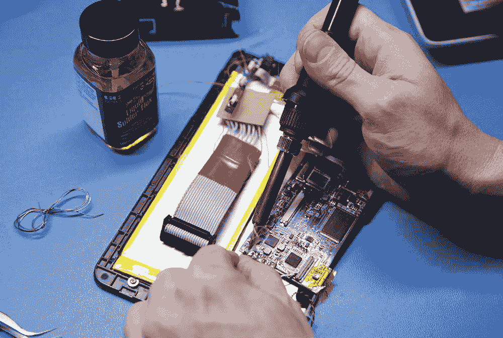
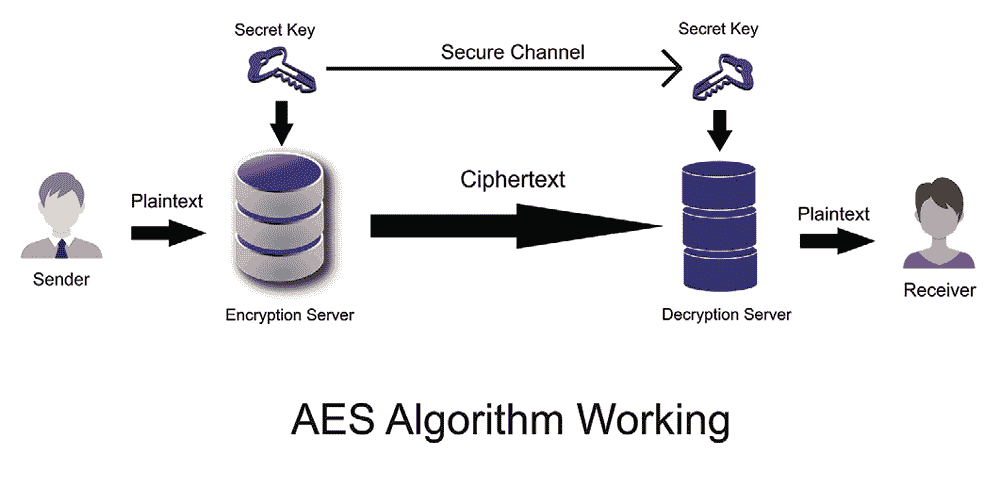

# 高科技安全职业中的计算机科学使用指南

## 引言

在 20 世纪 90 年代，Jeff Williams 成为一名应用安全工程师，在大多数人听说这个职业之前，他就担任了这一高科技安全职位。“通用电气来到我的公司说：‘我们喜欢你们的数据中心，但在这些代码发布到互联网之前，我们需要对每一行代码进行安全审查，’”他在接受`CSO Online`采访时提到。“销售团队很快回答说：‘没问题！’其他人都迅速后退了一步，而我承担了研究如何交付的任务。”

应用安全是保护软件免受威胁的实践。

## 第一章：保护数字资产和信息

在 20 世纪 90 年代，Jeff Williams 成为一名应用安全工程师，在大多数人听说这个职业之前，他就担任了这一高科技安全职位。“通用电气来到我的公司说：‘我们喜欢你们的数据中心，但在这些代码发布到互联网之前，我们需要对每一行代码进行安全审查，’”他在接受`CSO Online`采访时提到。“销售团队很快回答说：‘没问题！’其他人都迅速后退了一步，而我承担了研究如何交付的任务。”

应用安全是保护软件免受威胁的实践。

今天，Williams 是加利福尼亚州帕洛托供应商`Contrast Security`的首席技术官兼联合创始人。

我们日益成为一个高度连接的社会。智能手机和健身追踪器等联网设备容易受到网络安全攻击。

多年前，网络安全主要与政府机构和国防承包商相关。今天，所有组织都需要解决网络安全问题。

### 网络安全的类型

网络安全包含了多种高科技安全类型。应用安全涉及检测漏洞，并开发工具和程序，以防止黑客利用应用程序中的漏洞获取对公司系统的未经授权访问。信息安全保护信息和数据免受未经授权的访问、泄露、操纵、盗取等侵害。网络安全涉及对组织的内部网络进行监控，识别任何漏洞并防止未经授权的访问。网络安全同时使用硬件和软件技术，例如`firewalls`以及防病毒软件和反间谍软件，用以保持内部网络的安全和可靠。

网络安全还涉及对灾难的规划，无论是自然还是技术性的。这种规划涉及评估和分析风险、确定资产优先级以及创建灾难响应计划。有了灾难计划，组织可以更快地从灾难中恢复，并最大限度地减少损失。

网站是组织另一个容易受到攻击的地方。近年来，网站数据泄露事件的数量增加。这些泄露导致了客户和公司的身份盗用和财务损失。当泄露事件被公开时，公司的品牌形象和声誉也会受到损害。网站安全侧重于保护网站免受在线威胁。它使用了如网站扫描和恶意软件清除、应用程序安全测试、网站应用程序防火墙等技术和工具。

网络安全专业人员在公司服务器房工作，监控一个用于检测对公司网络任何未经授权访问的软件程序。

移动技术和互联网允许人们在世界上任何地方工作。这种灵活性也带来了一些风险，因为远程工作站和移动设备容易受到网络攻击。当移动设备连接到组织的网络并相互互连时，它们会为黑客访问公司系统创建新的切入点。终端安全（Endpoint security）通过阻止来自远程入口的访问尝试，来保护和保障组织的网络。

### 常见网络威胁

无论规模、行业或位置如何，没有任何一个组织是免受网络攻击的。了解一些最常见的威胁可以帮助网络安全专业人员更好地设计组织的网络防御。组织面临的五个最常见威胁包括：

*   社会工程学恶意软件：这种攻击欺骗用户在计算机上下载有害软件；随后该软件可以扩散到并破坏连接的系统或网络。
*   钓鱼攻击：密码钓鱼攻击欺骗用户泄露密码和登录信息，这些信息随后被用于在未经许可的情况下访问组织的网络。
*   未打补丁的软件：未打补丁的软件包含漏洞，允许黑客获得进入组织网络的访问点。
*   社交媒体威胁：黑客可以使用社交媒体账户收集有关公司及其员工的信息，最终拼凑出足够的信息以成功黑入公司网络。
*   高级持续性威胁（APT）：这些威胁频繁使用钓鱼攻击或木马附件（打开后会投送恶意软件）来获取组织网络的权限并窃取知识产权。

### 高科技安全与计算机科学

随着越来越多的信息和系统连接到在线，对那些希望在高科技安全领域工作，且对计算机科学和编码感兴趣的人才的需求日益增长。根据非营利信息安全倡导组织`ISACA`的说法，全球缺少约两百万名网络安全专业人员。在美国，雇主正努力填补网络安全职位，仍有数千个职位处于空缺，因为公司找不到合格的专业人员来。这需要人们设计和构建安全系统、尝试破解系统并识别漏洞、监控系统并检测入侵。

“计算机科学的很大程度上关于抽象层，而安全通常是关于发现这些抽象层中的缺陷假设，然后想出最佳修复（或利用）它们的方法，”网络安全专家 Parisa Tabriz 在 freeCodeCamp 的一篇博客中写道。

熟悉几种编程语言并能够编写代码，对于希望在该领域工作的专业人士来说是有用的技能。从事网络安全工作的人可以从`operating systems`、`networking`和`computer architecture`的知识中获益。拥有网络中的安全主题、`privacy enhancing technologies`以及`application security`的知识也很重要。理解一些编程语言——如`Python`、`C`、`Java`、`JavaScript`、`PHP`、`HTML`和`SQL`——非常有价值。

### 追求高科技安全与计算机科学职业

网络安全职业没有单一路径。有些人大学毕业后就进入该领域，而另一些人先在其他 IT 职位获得经验。无论人们采取哪种路径，所有网络安全职业都需要良好的通用 IT 基础。对此职业感兴趣的人在学习如何保护技术之前需要了解技术是如何工作的。许多人选择在四年制大学获得`computer science`或`information science`学位，学习`operating systems`、`networks`、`programming languages`、`databases`等课程。学习安全主题的课程也有益。某些网络安全职业需要高级学位，例如专注于网络安全的`IT` `master’s degree`或`doctorate`。对于某些职位，获得证书是证明个人具备该职业所需技术技能的好方法。

获得学位后，网络安全专业人员在各种规模的公司、几乎所有的行业中工作。许多人在咨询公司工作，为一系列客户提供服务。另一些人在公司内部 IT 部门工作。一些网络安全专业人员自雇，为客户提供自由职业服务。

除了上课，对高科技安全和计算机科学职业感兴趣的人还可以采取其他步骤来深入了解该行业。加入网络安全专业组织可以帮助人们更多地了解领域并建立人脉。一些公司为学生提供实习。实习让学生获得在特定公司或行业工作的经验。阅读报纸和其他商业技术出版物可以帮助学生跟上网络安全的动态。

对于对安全和计算机科学感兴趣的人来说，网络安全职业是一个充满挑战但回报丰厚的选择。

一位企业主得知他的一名员工正秘密计划离开公司。他怀疑这名员工在背地搞动作，并试图将公司的几位客户带到他的新工作处。企业主该如何发现自己的怀疑是否是真的呢？他转向了网络世界的侦探——计算机取证专家。这些网络安全专业人员会检查该员工在公司计算机、系统和网络上的操作，以查看是否能找到任何定罪证据。如果找到了，企业主就可以利用这些证据与该员工进行对质。

### 案件中的网络侦探

计算机取证是法医学的一个分支，指在犯罪调查中使用科学测试方法或技术。计算机取证专家在犯罪调查中收集、分析并展示数字证据。他们揭示有关计算机系统、硬盘、CD 和其他存储设备的信息。他们会仔细查阅电子文档和文件，如电子邮件和图像。在许多情况下，数字证据可能极难发现和收集，因为它们被隐藏或删除了。为了找到这些证据，计算机取证专家使用各种软件程序和其他应用程序来揭示并提取计算机系统中的潜在或隐藏数据。他们与许多类型的公司和组织合作，包括政府机构、会计师、律师事务所、银行和软件开发公司。任何拥有计算机系统的组织都可能需要计算机取证专家的服务。

一名计算机取证专家将一根线焊接到主板上，该主板将连接到计算机，以便为调查收集数字信息。

阿尔弗雷德·德米扬（Alfred Demirjian）是计算机取证公司 TechFusion 的总裁兼首席执行官。在他三十年的计算机取证中，他被聘用于许多场景。在某个案件中，他发现了某员工通过劫持电子邮件账户破坏前雇主的证据。在其他案例中，他收集了员工在工作期间滥用互联网的证据。使用取证软件，Demirjian 可以深入挖掘员工社交媒体帖子和短信。他可以筛选特定日期范围内的公司电子邮件，以找到员工与客户及其他人互动的证据。如果员工拥有公司提供的智能手机，他甚至可以通过 GPS 追踪该员工。“计算机取证将在揭露个人恶意行为方面发挥更大的作用。随着技术的不断进步，它会让人们隐藏违规行为变得更加困难，而让他们承担责任变得更加容易，”Demirjian 在`CSO`杂志发表的一篇文章中说道。

每一个使用计算机取证的案件都是不同的。例如，计算机取证专家可能会被执法部门召唤，协助调查一名涉嫌国内恐怖主义的人员。专家可能被要求识别并分析所有与过去或计划中的犯罪活动相关的通信记录、互联网活动和数据。在另一个案例中，当外部黑客获取了存有价值信息的公司服务器时，计算机取证专家可能会被召唤。取证专家将确定黑客是如何获得服务器访问权限的、是否访问或盗取了数据，以及是否对系统引入了恶意软件或其他敌对活动。

### 在计算机取证领域工作

从事计算机取证工作的人将计算机科学背景与取证技能相结合。他们通过收集、分析和展示他们发现的数字数据来协助执法部门和公司。计算机取证专家的主要工作是发现并收集计算机系统或其他数字设备上的可见和隐藏数字信息。有时，数据收集发生在现场，即嫌疑人的家中或办公室。更常见的是将设备送到取证实验室。一旦设备到达实验室，计算机取证专家使用各种技术工具搜索并收集数据。计算机取证专家分析他们收集的数据。他们会向执法部门和其他调查人员解释数据是什么、从哪里恢复的，以及这些数据在案件中可能意味着什么。

洛杉矶警察局的侦探尚·盖尼（Shannon Geaney）演示计算机取证以帮助部门调查犯罪。

在收集并分析数据后，计算机取证专家通常会准备一份关于发现结果的书面报告。报告包含了与调查相关的所有发现数据。在某些情况下，计算机取证专家可能会被要求在会议或法庭上分享他们的报告和发现。根据欧文（Irvine）的说法，数字取证非常有价值，因为它提供了信息。他在采访中说：

“无论这些信息是联邦刑事案件的证据，还是关于内部人员为竞争对手盗取公司知识产权的认知，数字取证专业人员都提供了客户其他情况下无法获得的数据。简单来说，可以将数字取证员的工作比作冲印师。例如，如果我手里拿着卷未冲洗的胶片，对我来说作为证据几乎毫无用处。然而，如果有人将那卷胶片冲成照片（在我们的案例中是从硬盘中恢复数据），那么这些内容就可以提供检察官、人力资源经理或公司安全官所需的一切信息。”

### 与国家安全局的夏令营

当许多青少年在游泳、徒足和烤棉花糖时，在玛丽山大学（Marymount University）由国家安全局（NSA）举办的夏令营的学生正在学习破解加密密码。在电脑前，十六岁的本·威尼格（Ben Winiger）向一个旨在测试和破解密码的软件工具输入了一条命令。“我们现在正在尝试暴力攻击，”Winiger 说道。

这种 GenCyber 夏令营以及全国范围内类似的夏令营，向中高中生教授他们未来网络安全职业所需的一些技能。国家安全局的官员希望，像 GenCyber 这样的学生夏令营能帮助培养下一代计算机取证和网络安全专业人才，以满足未来成千上万个新网络安全工作岗位的需求。

在计算机取证领域从事职业，大多数候选人拥有来自 IT、计算机科学或相关领域的学院或大学的四年制学位。在这些课程中，学生会学习计算机操作系统、网络、硬件和软件应用程序。学生还可以修读会计和刑事司法课程，以学习他们在计算机取证职业中所需的技能。对计算机取证感兴趣的高中生可以修读计算机科学、编程和会计课程，为从事这一职业做准备。

虽然少数学校提供计算机取证专业课程，但许多取证人员是在工作中学习先进的调查技术和技能。Irvine 在 Balance Careers 上发布的一篇采访中说：“计算机取证是一门学徒制的学科。只有当你真正坐在岗位上，与高级调查员一起处理真实案件时，你才真正学会这门手艺。”在入门职位上，计算机取证专业人士可以获得黑客技术、安全测试和计算机系统诊断测试的实操经验。除了强大的技术能力外，计算机取证专业人士还应该具备强大的分析能力，注重细节，并能够同时处理多个项目和任务。

计算机科学专业的大学生在讲座期间倾听并做笔记，他们在学习不同的计算机操作系统。

一些雇主要求计算机取证专业人士持有认证。获得认证证明该专业人士已掌握了工作所需的特定技能。对于计算机取证专业人士，国际法证计算机检查员协会和国际计算机调查专家协会等专业组织提供了`Certified Forensic Computer Examiner`（认证法证计算机检查员）认证。该认证必须每三年更新一次。

## 计算机取证的就业前景

计算机取证职业的就业前景预计非常好。根据劳工统计局（`BLS`）的数据，信息安全分析师（包括计算机取证专业人士）的就业人数预计从 2016 年到 2026 年将增长 28%。这一增长率远高于所有职业的平均增长率（7%）。随着越来越多的网络犯罪发生以及网络攻击频率的增加，需要计算机取证专业人士为调查人员和法院发现、分析并展示这些数字数据。此外，还需要计算机取证专业人士帮助许多行业的组织保护其计算机系统免受黑客攻击。

拥有相关经验、计算机科学学位和取证认证的计算机取证专业人士可能会在计算机取证领域获得最好的工作机会。

## 第三章：保护计算机网络

每天，都有更多信息传输到网上，包括财务记录和社会安全号。因此，组织变得更容易受到数据泄露的影响，数据泄露是指黑客试图入侵组织的数据库和系统以窃取信息时发生的情况。这种入侵是一个日益严重的问题，并给公司带来数百万美元的损失。根据 Ponemon 学院`2017 Cost of Cyber Crime`报告，安全泄露正在增加。这些泄露事件平均每年给组织带来 1170 万美元的损失。最成功的泄露事件之一发生在 2017 年，当时消费者信誉报告机构`Equifax`被盗取了 1.47 亿条客户记录。被盗的记录包括客户姓名、出生日期、社会安全号、地址以及更多个人信息。

黑客会对他们偷取的信息做几件事。他们可能会在黑市出售这些信息，用它实施身份盗窃，或用它直接从受害者那里偷窃或从中获利。因此，保护企业、客户和消费者产生的信息已成为所有行业公司的一项艰巨任务。

客户将信用卡插入支付机。信息安全分析师设计解决方案以确保客户个人信息安全。

### 作为信息安全分析师

组织聘用信息安全分析师守护和保护其信息系统。这些分析师规划安全程序并实施安全系统。他们的目标是保护组织的计算机系统、网络和数据免受网络攻击、数据泄露以及未经授权的访问或使用。

在典型的一天中，信息安全分析师会监控组织的网络，寻找泄露迹象。迹象包括进入或离开公司的异常数据流量模式，或特权用户账户活动的变化。如果分析师怀疑发生了泄露，他们将对事件进行调查、解决、记录和报告。这些分析师还安装防火墙并使用数据加密程序来保护公司数据。他们对组织的网络模拟攻击，以识别需要修复的漏洞。他们研究最新的安全程序和产品，制定组织的长期信息安全计划，并向高层管理提供安全建议。他们还帮助公司员工学习使用安全产品和程序，以便他们避免被黑客为了获取机密信息而想出的许多骗术欺骗。

尽管所有计算机科学专业人士都需要关注最新的行业趋势，但对于信息安全分析师来说，这一点尤为至关。一旦安全分析师防止了某种类型的网络攻击，潜在的黑客就会想出新的计划和技巧来发动另一种攻击。因此，信息安全分析师需要了解网络犯罪分子发起的最新类型的攻击，以及正在开发哪些对抗的技术和手段。为了做到，他们可能会参加会议，与其他专业人士交流讨论新的攻击和保护策略。

在网络安全会议上，黑客参与测试以识别安全漏洞。这项测试将帮助信息安全专业人士开发更好的网络防御。

这项工作的一部分包括为组织的数据和计算机系统创建灾难恢复计划。如果发生自然灾害，组织必须能够恢复并重新运行。这通常涉及定期备份贵数据并将其传输到安全的现场地点。

根据信息安全专业人士 Andrea Hoy 的说法，她典型的一天可能涉及许多事情。她对潜在威胁启动响应，分析捕获的数字数据，并测试新代码以确保其安全性。她还会创建有关部门活动的报告，例如每月拦截的钓鱼攻击数量。Hoy 还会审查公司的网络安全政策和程序，评估新的旧安全工具。她的工作让她感到充实且有意义。Hoy 在`U.S. News & World Report`网站发布的一篇文章中表示，“它每天都提供巨大的挑战。”

大多数信息安全分析师至少拥有四年制学院或大学的计算机科学、计算机编程或相关领域的学士学位。一些学校为信息安全专业人士开设了特定的课程。一些雇主要求候选人拥有信息系统的工商管理硕士学位。

许多雇主更倾向于拥有相关工作经验的候选人，例如在 IT 部门担任网络或系统管理员。寻求数据库安全分析师的组织可能更倾向于选择曾担任过数据库管理员的候选人，而寻求系统安全分析师的组织则可能倾向于担任过计算机系统分析师的候选人。

信息安全分析师在控制中心协作，听主管汇报有关入侵公司网络最新尝试的进展。

尽管信息安全分析师没有强制性的认证或执照，但一些自愿培训和认证可以增加个人获得工作或晋升的机会。某些认证是通用的，而另一些则指定了渗透测试或系统审计等领域。“我不认为你应该花费所有时间在名字后面积累更多的头衔，但在寻找第一份工作时，拥有学士学位和初级认证确实能让你脱颖而出，”Hoy 在`U.S. News & World Report`网站发布的一篇文章中说道。

除了技术技能，成功的信息安全分析师还应该具备强大的分析、批判性思维和解决问题的能力。他们必须能够识别和分析安全风险与问题，识别并评估可能的解决方案，并找到保护组织系统和网络的最佳方法。他们还必须非常注重细节，以便像侦探一样研究系统，寻找网络攻击或数据泄露的细微迹象。这些泄露可能通过网络流量的变化、用户账户活动、地理登录模式或对同一文件的请求数量的增加来指示。此类分析师必须极具道德操守，因为工作的某些部分可能涉及入侵系统，以突出需要安全加固的环节。

### 积累经验：网络安全实习

实习工作可以帮助学生获得宝贵的实操经验，并为信息安全职业积累必要的技能。作为实习生，Tiffany Smith 在网络安全公司 Foreground Security 工作。每位实习生都被分配一项任务：Smith 的项目是将名为`Opsview`的监控工具安装到 Red Hat 服务器上。Smith 花费了大量时间研究如何安装该监控工具。“这对我来说非常有挑战性，但我通过跟踪我在安装每个阶段所采取的步骤，解决了这个问题，”Smith 在`Keirsten Brager.tech`的博客中写道，“这段经历为我在第一份全职网络安全工作中面临的挑战做好了准备。我的项目在实习结束时被选中并投入公司生产环境，我非常激动！”

## 信息安全分析师的职业前景

信息安全分析师的职业前景非常好。根据 BLS 的《职业展望手册》，信息安全分析师的就业人数预计从 2016 年到 2026 年将增长 28%。“这一领域的工作机会无处不在，”Hoy 在 U.S. News & World Report 网站的文章中说道，“我们目前面临网络安全专业人才短缺。”

随着越来越多的信息数字化以及网络攻击和数据泄露的增加，对信息安全分析师的需求也会增加。面对日益复杂的网络威胁，各行业的公司都需要增加保护措施以确保信息安全。特别是医疗行业，由于医疗公司使用记录，需要增加安全性。根据招聘网站 CareerCast 的说法，“如果有漏洞，迟早会被发现——如今，发现得更快。”

## 第四章 伦理黑客

企业日益受到黑客和网络犯罪犯的攻击，问题正变得越来越糟糕。公司还在聘用渗透测试人员来测试网络的真实安全性。

渗透测试是计算机科学众多职业之一，是通过测试计算机系统、Web 应用程序或网络来发现安全漏洞的实践。渗透测试人员也被称为伦理黑客，负责确保客户的计算机网络和系统得到保护。为了做到这一点，渗透测试人员使用真实的黑客技术寻找客户系统中的漏洞。

尽管公司的服务器机房看起来是空的，但其网络经常面临试图访问服务器的攻击。

渗透测试人员必须极具创造力，并不断思考新方法来“攻击”系统。在工作时，他们会仔细记录所采取的步骤和发现的任何漏洞。虽然每个客户都不同，但目标是一样的：模拟现实黑客发起的攻击，并向客户报告这些模拟的成功或失败。

## 在渗透测试领域工作

Aleksander Gorkowienko 和 Steven van der Baan 是网络安全咨询公司 7Safe 的渗透顾问。他们大部分时间都在尝试破解公司的计算机系统。每个客户使用的技术不同，面临着独特的挑战。有时，Gorkowienko 和 van der Baan 会执行`SQL (Structured Query Language) 注入`，将查询插入数据库，允许黑客在未经授权的情况下对其操纵。其他时候，他们会进行钓鱼攻击，即黑客通过电话或电子邮件冒充他人，试图让员工透露安全密钥或密码等信息。无论使用何种方法，渗透测试人员都试图寻找其客户系统中的任何漏洞，以便在泄露发生之前防止其。

## 作为实习生破解密码

对渗透测试职业感兴趣的学生可以通过参加安全实习来获得宝贵的实战经验。2017 年，Tim Welles 在 Sword & Shield Enterprise Security 担任暑期实习生，这是一家信息安全咨询公司。Welles 是田纳西大学的一名学生，主修计算机科学并专注于网络安全。他在公司办公室负责了一个项目，为一种名为`hashcat`（一种密码破解工具）的安装设置了一个名为`wrapper`（包装器）的编程函数。Welles 在 Sword & Shield 网站的一篇文章中写道：

“用于分布式哈希破解项目的`hashcat`包装器对我我这样的实习生来说是一个完美的选择。它让我做了一些我认为这些工作在我离开公司后很长一段时间仍能为公司创造价值，并完成了他们需要完成的工作。同时，它让我学习了许多关于密码破解和通用的`Linux`知识，以及一些基础网络技能。这个项目最棒的部分是我完成后，团队实际上开始在他们的渗透测试服务中使用它。这让我觉得自己正在为公司产生影响，而不是在做一个可能不会被充分利用的侧边项目。”

Welles 计划在毕业后从事网络安全职业。

对于其中一个客户，van der Baan 发现了一个可以操纵数据库并从底层操作系统文件的系统。他发现的另一个错误提供了系统代码。当他下载它时，发现了一个允许他执行任何想要的代码的漏洞——这种漏洞如果被恶意黑客发现将会非常危险。他在 2016 年 4 月为 *Computerworld UK* 的一篇文章中说：“我们发现了什么、在哪里发现、我们的最终结果是什么，完全取决于系统。”通过向客户展示这些漏洞，van der Baan 能够帮助客户理解哪里需要加强网络防御。

恶意黑客有时会在电话中冒充他人，以获取敏感的个人信息，如用户名和密码。

# 如何成为渗透测试员

对于那些充满好奇心并擅长为网络安全问题提供独特且复杂的解决方案的人来说，渗透测试职业可能是一个非常合适的选择。大多数渗透测试员具有多年相关经验，并至少拥有计算机科学、信息安全或相关领域的学士学位。这些计划为学生准备了编程、网络和网络安全方面的技能。学生将学习计算机取证、灾难恢复、渗透测试等领域的课程。高中生可以通过学习计算机科学和编程课程来为渗透测试职业做准备。

大多数网络安全职业（包括渗透测试）都需要强大的技术和计算机技能，以便这些专业人员能够入侵计算机系统。某些雇主要求候选人掌握特定的编程语言，如`C`、`C++`、`Java`、`PHP`和`Python`。由于客户运行不同的操作系统，渗透测试员应该熟悉`Windows`、`UNIX`和`Linux`操作系统。他们还应该具有 Web 应用程序、网络服务器和网络工具、安全工具以及安全框架的经验。Contrast Security 技术官兼创始人 Jeff Williams 在 2018 年 4 月为 *Forbes* 的一篇文章中表示：

“你绝对需要对正在测试的技术有深入的理解。你不需要成为一名编码专家，但你应该掌握足够的知识，使用你想要测试的技术来构建简单的应用程序，并理解更复杂应用程序的代码。我建议专门研究广泛用于构建人们真正关注的应用的技术，例如`Java`、`.NET`和主要的应用程序框架。”

青少年参加计算机研讨会，在会上学习如何编写代码并练习编程技能，这对于渗透测试职业将非常有帮助。

候选人还应该对安全防御和漏洞有深入的理解。Williams 在 *Forbes* 文章中说：“理解加密、认证、授权、跨站请求伪造 (`CSRF`) 令牌、`session IDs`、`HTTP`头部、编码/转义和日志等安全防御至关重要。”他还建议候选人获得发现和利用漏洞的实践经验。某些雇主要求渗透测试员拥有道德黑客或其他安全认证。

渗透测试员必须了解黑客使用的最新方法和技术。为了做到这一点，他们可以参加会议与其他专家讨论新的攻击。

## 渗透测试员的职业前景

渗透测试员的职业前景非常好。根据 BLS 的《职业展望手册》，信息安全分析师（包括渗透测试员）的就业预计从 2016 年到 2026 年增长 28%。这一增长率远高于所有职业的平均水平。

在对组织的系统进行全面评估后，安全架构师利用硬件和软件规划、设计并实施安全系统。他或她会研究安全系统和协议，并为网络、路由器、防火墙和其他技术制定需求。通常，安全架构师会将任务委托给一个团队，由该团队开发计划中安全系统的代码和其他元素。

一旦这些系统和程序到位，架构师会对整个系统进行弱性测试和审计。有时，安全架构师会与渗透测试人员合作对系统的安全性进行全面测试，以确保其防御能够防止外部攻击。如果发现任何问题，安全架构师将设计并实施安全修复以解决这些问题。当黑客试图访问组织的系统时，安全架构师会建立反措施来保护系统，并限制黑客破坏系统或盗取价值信息的能力。

除了设计和实施安全系统外，安全架构师还会制定与系统安全相关的组织政策和程序。他们会为员工准备培训，让他们了解有关公司系统安全的最佳实践。

安全架构师必须跟上最新技术和安全策略，以便评估和改进组织的安全系统，并使其免受威胁。由于黑客不断想出渗透系统的新方法，安全架构师还必须了解最新的黑客战术，以便设计阻止这些攻击的解决方案。

一名黑客坐在黑暗的房间里，利用互联网入侵公司的网络并盗取客户信用卡信息。

## 担任安全架构师

作为一家全球性组织的安全负责人，迈克尔·哈格（Michael Haag）负责多个业务部门的网络安全战略和架构。随着他的公司收购新业务，哈格和他的同事致力于为每个新业务评估并设计安全计划和程序。哈格在 Red Canary 网站上发布的一篇文章中说：

“我们在这里的主要目标是理解我们从新加入的组织所接受的风险。我们需要了解该组织在边界上的暴露程度——开放端口、有漏洞的应用程序、Citrix 网关等。识别这些项目非常重要，因为它们是威胁攻击者的切入点……此外，我们还会讨论操作系统和第三方软件的补丁策略。”

根据哈格的说法，没有哪个系统是不可攻破的。虽然安全架构师设计系统和程序来防止黑客未经授权访问组织的网络和信息，但大多数组织都会某个时刻遭遇泄露。安全架构师必须能够检测到泄露并从中学习，以便他们能为下一个黑客做好更好的准备。“预防是局限的，”哈格在 Red Canary 的文章中说，“它会导致虚假的安全感……总会有东西被遗漏。我深信‘预防是理想的；检测是必不可少的’。”

## 如何成为安全架构师

成为安全架构师涉及教育和经验的结合。大多数追求安全架构师职业的人必须至少拥有四年制大学或学院的计算机科学、信息技术、网络安全或相关领域的学士学位。许多安全架构师还拥有侧重于安全的网络安全或计算机科学硕士学位。高中生可以通过学习计算机科学和编程课程来为安全架构的职业做准备。

安全架构领域的职业需要强大的技术和计算机技能。安全架构师必须精通多种操作系统——Windows、`UNIX`和`Linux`。他们对网络安全和架构、有线和无线安全以及企业和安全架构了如指。他们还应该理解密码学、分布式系统和软件设计。他们应该能够识别并建模系统的威胁和风险，并能够进行漏洞测试。

安全架构师达维德·巴卢（Dawid Balut）建议安全架构师学习编程。“学习软件栈是如何工作的，并掌握像`Java`、`PHP`及其相应框架等 Web 语言。要破坏某些东西并在之后提高其弹性，你需要理解这一切是如何运作的，”他在 *Forbes* 网站发布的一篇文章中说道。

安全架构师在许多公司通常是一个高级职位。因此，大多数雇主希望聘佣具有三到十年经验的安全架构师。候选人通常首先在网络管理、安全管理和系统管理等初级职位工作以积累技能和知识。然后他们升到安全分析师、安全工程师或安全顾问等中级职位，在这些职位进一步获得作为安全架构师所需的经验。“我的 IT 冒险是从底层开始的，担任技术员、网络管理员、Web 程序员和系统管理员，”巴卢在 *Forbes* 网站上解释道，“我的经验范围让我理解许多员工面临的问题，从而为我工作的公司和团队做出更好的决策。我相信安全行业可以从多样化中受益。”

Dell SecureWorks 恶意软件研究总监乔·斯蒂德（Joe Steward）在大显示器前与安全研究人员交流，他们正在追踪网络黑客和犯罪分子。

此外，在教育和工作经验中增加行业认证可以使专业人士对雇主更有吸引力。注册信息安全专业人员 (`CISSP`) 认证是最受认可的网络安全认证之一，涵盖了访问控制、密码学、安全安全等。信息安全架构专业认证是另一种备受认可的认证，专注于安全架构。它将`CISSP`的核心技能与管理和全局分析流程等安全架构技能相结合。其他常见的认证还包括 CompTIA Security+`和认证伦理黑客。

随着公司日益意识到高科技网络安全的重要性，对熟练的安全架构师和其他网络安全专业人员的需求将继续增长。此外，网络安全与教育中心（Center for Cyber Safety and Education）的一项研究预测，未来五年内，职位需求将超过合格专业人员的数量，人才缺口将达到 180 万个。对于对高科技网络安全感兴趣的人来说，成为安全架构师可能是完美的选择。

# 第六章：安全工程

随着越来越多的组织在计算机系统和网络中存储价值巨大的敏感信息，保护这些信息变得比以往任何时候都重要。软件缺陷和脆弱的系统可能导致计算机网络受到恶意软件、间谍软件等等的威胁。安全工程师根据安全架构师的设计，构建能够处理恶意网络攻击、意外自然灾害或其他灾难性事件的系统。

## 构建防护系统

安全工程师是网络安全团队中价值的一部分。通过在各种公司和组织工作，这些专业人士了解如何设计架构来保护组织。他们与其他安全专业人员合作，以减少网络攻击期间的损失。他们测试和筛选安全软件。他们监控计算机网络和系统，寻找任何未经授权的入侵或活动。安全工程师通常充当组织应对潜在安全威胁的第一道防线。在这个岗位上，他们在威胁出现时识别并遏制威胁，并在威胁发生之前计划并准备威胁响应。

一名安全工程师坐在工作站前，监控组织的系统是否存在任何未经授权的入侵或可疑活动的迹象。

安全工程师经常构建新系统来帮助保护网络。他们实施和管理安全硬件和软件。他们安装并配置如`firewalls`和数据加密程序等安全软件。他们安装和处理新的安全产品，例如通知团队有关未经授权系统入侵的软件。他们开发自动化代码，以跟踪和报告安全事件。当组织的硬件和软件发生任何变化时，安全工程师都会参与其中，以确保变化不会让组织暴露于新的漏洞之中。

安全工程师也是监控网络和系统入侵的安全团队的一部分。他们花费大量时间寻找任何系统或网络漏洞并测试安全解决方案。为了做到这一点，他们可能会进行网络扫描或进行渗透测试。当入侵发生时，安全工程师通常领导组织的响应并调查入侵是如何发生的。根据这些信息，他们安装修补程序以加强安全性。

Helen Oswell 是`6point6`（一家技术咨询公司）的安全工程师。在她的职位中，Oswell 构建安全系统并识别改进和消除公司 IT 基础设施漏洞的方法。在 Learning People 网站发布的一篇采访中，Oswell 解释说：“在正常的一天里，我致力于工具和设计以及结构性论文。我最喜欢的职位部分是设计并实施工具——例如在云环境中开发漏洞管理工具。”她认为，公司关注自己的网络防御比以往任何时候都重要。虽然在网络安全专业人员上投入资金成本很高，但 Oswell 指出，“真正的成本是当你所有数据都被黑客攻击且你的业务无法运行时。”

安全工程师合作为组织的安全防火墙和数据加密程序安装更新。注（注：此处原文意为安全工程师合作安装更新）。

## 如何成为安全工程师

大多数安全工程师至少拥有计算机或信息科学、计算机编程、软件工程或系统工程的学士学位。这些专业的学生通常会学习计算机编程、网络和系统设计课程。有些公司倾向于安全工程师拥有硕士学位，例如信息系统或相关领域的理学硕士。想成为安全工程师的高中生可以学习数学、科学和计算机科学课程。

## 适当的认证

获得认证可以证明某人掌握了安全工程的重要技能。安全工程师最受欢迎的认证包括认证道德黑客（Certified Ethical Hacker）、思科认证网络专业人员安全（Cisco Certified Network Professional Security）和认证信息系统安全专家（Certified Information Systems Security Professional）。这些认证计划的学生学习黑客软件、网络安全、计算机取证、密码学、程序测试、应用数学和信息系统维护。尽管有很多认证，但获得每种认证的过程都是相似的。学生必须具备一定的经验并通过考试。

安全工程师必须具备强大的技术和计算机技能。他们必须知道如何构建安全网络，包括云系统。他们应该具有使用渗透和入侵检测软件、设置`firewalls`以及配置路由器和软件的经验。虽然编码技能不是强制性要求，但在工程师审查代码以寻找安全问题时，这些技能非常有帮助。Parisa Tabriz 在`freeCodeCamp`的一篇博客文中说：

> 我认识的最优秀的安全工程师也在积极编写代码。这让他们拥有了编写软件的第一手经验，包括无意中但不可避免地引入安全漏洞。后者迫使人们对所有开发者产生真正的同理心。毕竟，持续编写安全代码往往比指出不安全代码要难。

安全工程师应该熟悉操作系统如`Windows`和`Linux`以及使用`MySQL`、`Oracle`和`SQL Server`的数据库安全。他们应该能够使用最新的加密技术和网络安全协议，如`TCP/IP`和`HTTPS`。他们还要关注最新的黑客技术。

一名安全工程师在笔记本电脑上审查代码，寻找是否存在任何允许黑客入侵组织软件和系统的漏洞或缺陷。在在该领域工作的人需要跟上最新的技术和行业发展。为了这样做，他们在整个职业生涯中参加进修课程并参加行业会议。

## 安全工程师的职业前景

安全工程师的职业前景非常好。根据`BLS`的数据，信息安全分析师（包括安全工程师）的就业人数预计从 2016 年到 2026 年将增长 28%。虽然包括安全工程师在内的网络安全专业人员需求激增，但合格候选人的供应较低。招聘网站`Indeed`在 2017 年的研究发现，尽管组织有网络安全职位招聘，但没有足够的候选人来填充。因此，具有相关工作经验的合格候选人将在安全工程领域有很多工作可供。

# 第七章：加密数据

2013 年，计算机软件公司`Adobe`宣布其计算机系统遭到黑客攻击。攻击者访问了数百万`Adobe`客户 ID、加密密码以及加密的信用卡或借记卡号。该公司随后报告，黑客还盗取其流行的照片编辑软件`Photoshop`的源代码。3800 万客户受到了此次入侵的影响。

虽然数据泄露和损失对 Adobe 来说非常糟糕，但也有一个微小的好消息。从公司被盗的数据中，部分经过了加密，包括客户密码以及借记卡和信用卡号。加密数据是一种使用代码或密码来隐藏数据的方法。这样，即使未经授权的个人访问，他们也无法使用或理解它。由于 Adobe 对部分数据进行了加密，被盗信息中只有一部分对黑客来说具有价值。加密是该公司用于保护其系统中存储数据的工具之一。加密和密码学领域的行业专家 Rick Robinson 表示：

数据加密软件是可用于保护组织数据并防止未经授权的用户访问和读取的工具之一。

今天的敌人是致力于偷取你的数据以获利的数据窃贼。如果他们无法获取你的数据并从中获利，他们就会寻找其他目标。加密数据代表了他们无法从中获利的逾越挑战。这种利用加密保护你的数据并防止其被犯罪分子使用的做法，是将密码学应用于业务的典范。

## 创建与破解密码

当组织需要加密和保护重要数据时，他们会寻求密码学家。密码学是一种通过使用代码来保护信息和通信的方法。只有授权接收信息的人才能读取和处理它。在当的数字世界中，密码学通常通过加密过程将普通文本（也称为明文）乱序转换为密文。然后，密码学通过解密过程将密文转换回明文。企业、军事组织和政府机构使用加密和密码学来保护数据和网络免受黑客和网络恐怖主义者的侵害。专业的密码学专家开发用于加密价值数据的算法、密码和安全系统。这些算法用于保护数据、互联网网页浏览以及电子邮件和信用卡交易等机密通信。

此图展示了如何使用加密算法对数据进行加密和解密，使其只有授权用户才能访问。

虽然密码学领域的每个工作都不同，但密码学家通常保护信息免受拦截、复制、修改或删除。他们使用基于数学的加密方法。他们编写新算法来加密银行账户和信用卡信息等信息。密码学家分析密码学安全系统和算法中的弱点，并开发统计和数学模型来分析数据。密码学家还研究和测试新的密码学方法和应用。他们寻找组织通信系统（如无线网络、手机和电子邮件）中的漏洞，并确保通信不被非法访问或更改。除了加密敏感数据外，为军事、政府和执法机构工作的密码学家还可能分析和解码加密信息系统和编码系统中的任何隐藏信息。

Christof Paar 自 1995 年以来一直从事应用密码学工作，是马诸诸塞大学阿默斯特分校的兼职教授。根据 Paar 的说法，密码学是网络安全的核心。“加密算法是几乎每个安全解决方案的驱动力和心脏，”他在接受 IEEE Cyber Security 采访时说。Paar 一直致力于将密码学应用于联网汽车和车万一切（`V2X`）通信，即车辆与其他车辆（`V2V`）或路侧基础设施（`V2I`）进行交互。`V2V` 通信有助于防止碰撞，而 `V2I` 通信有助于减少拥堵和污染。确保这些通信是安全且不被任何方式更改的，密码学支持实时位置信息至关重要。例如，密码学支持 `V2X` 通信。

## 加密算法的类型

加密算法主要分为三大类：

- `密钥`（Secret key）或`对称加密`（symmetric encryption）在加密和解密时使用同一个密钥。它主要用于保持数据私密。
- `公钥`（Public key）或`非对称加密`（asymmetric encryption）使用一个密钥加密，使用另一个密钥解密。它通常用于身份验证。
- `哈希函数`（hash function）是一种可以在文件等数据上运行的算法，并能产生一个称为校验和的值。如果两个文件生成的校验和相同，则可以假设这两个文件也是相同的。

## 如何成为一名密码学家

对于喜欢谜题、高等数学和计算机科学的人来说，密码学职业可能具有吸引力。大多数密码学家的职位要求候选人拥有数学、计算机科学、计算机工程或相关领域的学士学位。许多职位还要求数学或计算机科学的硕士或博士学位。此外，由于他们处理的是高度敏感的数据，某些工作要求密码学家拥有高级别的安全许可。对密码学感兴趣的高中学生可以学习数学、统计学、计算机科学和编程课程，为这一职业做准备。

密码学家需要强大的技术、数学和计算机技能。他们应该熟悉计算机体系、数据结构和算法。他们必须理解线性矩阵代数和离散数学。密码学专业人员还应该熟悉信息论、计算机安全和工程学。

在工作中，了解多种编程语言如 `C`、`C++`、`Python` 和 `Java`是有帮助的。此外，使用对称和非对称加密原理的技术技能也关重要，例如对称加密、哈希函数、密钥交换、数字签名等。

## 密码学家的就业前景

密码学职业的就业前景预计非常好。根据劳工局（BLS）的数据，包括密码学专家在内的数学家和统计学家的预计将在 2016 年至 2026 年增长 33%。电子商务的增长以及密码学家保护在线客户数据的需求是驱动密码学家需求的因素之一。

随着电子商务的持续增长和越来越多的业务转向在线，对密码学专业人才的需求将持续强劲。“数据加密和安全是如今一个巨大且不断增长的领域，”数学密码学杂志（`Journal of Mathematical Cryptology`）副总监兼共同编辑 Rainer Steinwandt 在 Bank Info Security 网站的一篇文章中写道。“每天都有新公司出现，它们需要对数据进行加密；他们通过密码学家利用数学开发的软件和‘密钥’来实现这一点。”具有相关经验并拥有数学或计算机科学硕士或博士学位的密码学专业人士可能在密码学领域拥有最好的工作机会。

密码学专业人士将数据加密作为整体网络安全计划的一部分，保护公司和客户数据免受未经的访问和使用。

- **数据库（database）**：存储在计算机中的一组数据。
- **加密（encrypt）**：将数据转换为代码以防止未经授权的。
- **防火墙（firewall）**：计算机系统或网络中旨在阻止未经授权访问的部分。
- **法医（forensics）**：用于调查犯罪的科学测试和技术。
- **黑客（hacker）**：使用计算机获取未经授权的数据或系统访问的人。
- **实习（internship）**：学生或实习生在组织中工作的计划，有时无薪，旨在获得工作经验。
- **威胁建模（threat modeling）**：通过像黑客一样进行思考来识别安全风险的过程。
- **漏洞（vulnerability）**：被攻击或伤害的能力。
- `3 Park Avenue, 17th Floor`
- `New York, NY 10016`
- 网站：[`www.ieee.org`](https://www.ieee.org)
- Twitter：`@ComputerSociety`
- Twitter：`@ISSA`
- `PO Box 529`

# 参考文献

# 索引

## A

反间谍软件，10

杀毒病毒程序，4, 10

应用安全，解释，4

应用安全测试，11

## C

证书，15, 24–25, 31, 32, 42, 50–52, 57

认证信息系统安全专家（CISSP）证书，51, 57

计算机取证专家职业前景，25

所需的技能和教育，7, 23–25

他们做什么，7, 17–23

`C++`，40, 65

`C` 编程语言，40, 65

密码学家职业前景，66–67

所需的技能和教育，7, 65–66

他们做什么，60–65

加密算法，类型，64

网络安全专家所需的技能和教育，13–16

他们做什么，8–11, 13

## D

数据泄露，6, 11, 26, 28, 33

Demirjian, Alfred, 19

灾难计划，10

# 索引 Index

## E

加密，4, 28, 41, 55, 59, 60–67

## F

防火墙，4, 10, 11, 28, 46, 55, 57

## G

GenCyber 夏训练营，22

## H

`HTML`，14

## I

信息安全分析师职业前景，33–34

所需的技能和教育，7, 30–33

他们的工作内容，27–30

信息系统安全专业人员认证（ISSAP），51

国际计算机调查专家协会（IACIS），25

国际取证计算机检查员（ISCCE），25

实习，16, 32, 38

## J

`Java`，14, 40, 41, 49, 65

`JavaScript`，14

`Linux`，38, 40, 49, 58

## M

恶意软件，11, 12, 20, 44, 53

`MySQL`，58

## O

`Oracle`，58

## P

渗透测试员职业前景，42–43

所需的技能和教育，7, 40–42

他们的工作内容，4, 35–40, 46

钓鱼攻击，12, 30, 37

`PHP`，14, 40, 49

`Python`，14, 40, 65

## R

远程工作站，11, 13

## S

安全架构师职业前景，52

所需的技能和教育，48–52

他们的工作内容，44–48

安全代码审查，4

安全工程师职业前景，59

所需的技能和教育，7, 56–59

他们的工作内容，53–56

社交工程，12

社交媒体攻击，12

`SQL`，14

`SQL` 服务器，58

## T

威胁建模，51

木马病毒攻击，12

未修补的软件，12

`Windows`，40, 49, 58

# 关于作者

Carla Mooney 毕业于宾法尼亚大学。在成为作者之前，她曾在金融领域担任多年会计。如今，她为青少年和儿童写作。Mooney 喜欢学习新技术及其对不同行业和普通用户的影响。

# 图片致谢

封面 Erik Isakson/Tetra Images/Getty Images；封底，4–5

（背景）nadla/E+/Getty Images；5

（插图）CasarsaGuru/E+/Getty Images；页码 8, 17, 26, 35, 44, 53, 60

（背景）Pasko Maks/[Shutterstock.com]，（电路纹）Titima Ongkantong/[Shutterstock.com]；9 sitthiphong/[Shutterstock.com]；11

Erik Isakson/Blend Images/Getty Images；14

Yurich/[Shutterstock.com]；页码 18, 21, 29

© AP Images；24

Monkey Business Images/[Shutterstock.com]；27

tuthelens/[Shutterstock.com]；页码 31, 54

Gorodenkoff/[Shutterstock.com]；36

Oleksiy Mark/[Shutterstock.com]；39

PR Image Factory/[Shutterstock.com]；41

Photofusion/UIG/Getty Images；页码 45, 50

Bloomberg/Getty Images；47

South_agency/E+/Getty Images；56

nd3000/[Shutterstock.com]；58

REDPIXEL.PL/[Shutterstock.com]；61

antb/[Shutterstock.com]；62

Ujjwal Swami/[Shutterstock.com]；67
