# 互联网与科技股估值：对投资分析的启示


献给我的妻子 Nadia，没有她的支持本书不会写成，以及我的妹妹 Pat，没有她本书不会被打字

有关 Butterworth-Heinemann 所有金融出版物的信息，请访问我们的网站 www.bh.com/finance


## 前言

### 互联网和科技股的崩盘

这是一个泡沫，而且它确实破裂了。这一点大多数人都同意。历史书将会记载2000年3月10日是席卷股市最动荡的日子之一。在数小时之内，全球股市蒸发了数十亿美元，随着科技泡沫最终破裂。

主要由科技公司组成的美国纳斯达克指数崩盘，被许多人认为是有史以来最大的股市崩盘。纳斯达克股市在截至2000年3月10日的五年里平稳上涨六倍至历史最高点，随后崩盘。这并不是股价首次被“非理性繁荣”的浪潮推至 dizzy 高度然后相应回落。

“股价似乎已达到永久性的高位平台，”著名耶鲁经济学家欧文·费雪在1929年秋季宣称。在这番预言式宣告几周后，道琼斯工业平均指数已下跌超过三分之一。最糟糕的还在后面。1932年7月8日，道琼斯收于41.88点，较1929年峰值下跌近90%。这些年的股市图表更像悬崖而非高原。

费雪教授为何如此判断错误？答案是他迷信了那个十年最诱人的想法，这一论点支撑了20世纪20年代末的大牛市：他相信美国已进入无限繁荣的新时代。

试图理解点.com惨案的投资者不妨回想威廉·C·杜兰特的故事。二十世纪初，杜兰特先生创立了通用汽车公司，该公司是当时一个革命性汽车制造商集团之一，在某些方面相当于那个时代的点.com公司。投资资本大量涌入，通用汽车股票从1914年到1920年间迅猛增长。但当拥挤的汽车行业在20世纪20年代初未能兑现夸大的预期时，汽车股暴跌。通用汽车在六个月内市值损失了三分之二。惊慌失措的杜兰特借钱并疯狂买入股票，徒劳地试图支撑股价。

通用汽车当然最终恢复并再次腾飞——但为时已晚，其创始人失去了全部财产，最后去经营一家保龄球馆。许多其他曾经伟大的汽车公司，如派克、斯图德贝克和哈得孙，比通用汽车境况更差，在随后的几十年里一个接一个地消失。

事实证明，目前的科技股繁荣与崩盘并非新鲜事。它只是自投资开始以来困扰股东的长期投资泡沫史上的最新一例。从十七世纪的荷兰郁金香球茎狂热，到十九世纪的铁路革命，再到1980年代和1990年代个人电脑股和生物技术股的兴衰与复兴，投资者曾疯狂地爱上——然后又疯狂地抛弃——当下最热门的技术。

历史并不表明，最终破裂的股市泡沫的许多碎片会被重新拼凑起来。有些股票会再次腾飞。但复苏通常比投资者希望的要久——通常是数年，而非数月。许多被泡沫卷入的股票将无法存活，而在存活下来的股票中，除了最强韧的之外，其余都不会像以前那样狂热。

本文并不声称就2000年科技股市崩盘是否标志着经济/股市活动新阶段的开始或结束提供任何信息。然而，这一最新繁荣—崩盘现象的整体势头为经济学家、会计师和政府政策制定者等——仅举社会中三个群体——提出了许多引人入胜的与技术相关的概念性问题。这些问题没有明确的答案。在本文中，我试图带领读者穿越这些问题的复杂性进行一次发现之旅。旅途愉快！

## 信息时代与数据的民主化

> 是否可能当前时期存在某种根本性的新事物足以让人自满？是的，可能……但遗憾的是，历史遍布着此类“新时代”的幻象，最终证明都是海市蜃楼。简而言之，历史告诫我们要谨慎。
>
> （艾伦·格林斯潘，1997年2月）

本书关于科技股的估值，其最终价值与互联网和万维网的增长相关联。它当然是在许多所谓的点.com公司股价已崩盘之时写成。然而，仍不争的事实是，许多这些股票的最终价值围绕着无形资产的估值展开，而无形资产按定义并不容易估值。然而，我并不认同“如果你无法估值……就不应购买它们”的投资观点，本书阐述了一种对科技股估值的方法。这是一条漫长的道路，途经经济史、快速的技术变革、投机性股市泡沫及其破裂、会计方法的变化以及投资者的大众心理，仅举部分章节内容。

为了将近期趋势置于历史框架中，首先回顾过去是有用的。

### 历史上的技术变革与股市

每一次重大的通信和交通进步对用户来说都是奇迹，是股市盛大庆祝的原因，并且在大多数情况下显著降低了经济的分配成本。最终，每一项独特的创新都会成熟并被下一项所取代。

17世纪后期，英国的收费公路信托在投资者中非常受欢迎，并提供了显著提高的效率。由于现有道路狭窄且粗糙，驮马被广泛使用。新的收费道路设有结构良好的路面，宽敞到马车可以通行。一匹驮马可驮约250磅，而收费公路可承载由两匹马牵引的约两吨马车载荷，生产率因此提高四倍。

1720年代，多产作家丹尼尔·笛福指出，运费的降低主要使商人受益而非承运人。显然，条件是竞争性的。公众听到了所有吹捧，但将收费视为税收，对利益感到不耐烦。以下的打油诗概括了繁荣的狂欢方面及其后果：

> 如今收费公路大行其道，成为我们国家最沉重的税——因为在美酒、女人与股票投机之后，收费公路终将帮助我们。

运河带来的效率跃升非常突出，因为一匹马可以拖曳载重50吨的驳船。与驮马相比的改善幅度为400倍，或与收费公路相比约为50倍。投机者疯狂追逐新的运河发行。

当然，从股市狂热到运营成功的建设时间以年计，运河提供了第一个远早于商业现实的伟大愿景现象。1792年爆发了新发行狂热，认购只能在运河即将开工的城镇的公司处进行。当年冬天报纸提供了有趣的报道，讲述投机者如何在暴风雪夜里疯狂策马赶往下一个城镇以赶上开业。

尽管它们令人惊叹，运河也有局限性，夏季干旱，冬季结冰。此外，速度受限，因为为乘客和邮件设计的更快的“快船”尾流导致河岸侵蚀。

在木制轨道上滚动的马拉货运马车长期以来显示出优于改进道路上宽达9英寸的钢制轮胎车轮的效率。最初作为通往收费公路然后通往运河的支线开发，所需要的一切只是一台移动蒸汽机来发动另一次通信革命。

自然地，投机者在商业成功之前就已大肆炒作。1825年达到顶峰的泡沫中庆祝的高科技概念是铁路。“现在听不到的只有铁路，”伦敦出版物《季刊》于1825年5月说道。“每日报纸充斥着各个方向新线路的通知；小册子被抛在公众眼前，推荐在整个王国普遍建设铁路。”

1824年和1825年间发行了624家公司的招股说明书，1825年3月，著名商人银行家弗朗西斯·巴林指出“赌博狂热[已]席卷所有阶层并在全国各地蔓延。”那个泡沫在夏季达到顶峰，当第一条商业铁路开始运营时，股市在十月下旬进入严重的投机狂热。铁路在美国直到1890年代才达到最终饱和，正值汽车被开发之时。汽车销量在1920年商品繁荣后的严重衰退中崩溃。它们在1929年股市崩盘前夕的股市狂喜中再次飙升，随后再次崩溃。

所谓的电子世界始于1860年代的电报，使用摩尔斯电码，到1869年海底电缆提供了美国、欧洲和英国之间的即时通信。所有这一切在1873年的泡沫中都被庆祝为高科技。显然，电话从摩尔斯电码转向语音是一项出色但演进性的进步。电话作为通信和交通的显著飞跃的引入效应在1920年代的大金融繁荣中备受庆祝。

使用摩尔斯电码的无线电通信在第一次世界大战期间因军事用途而扩展并移交给了RCA。1920年的商业计划无法想象语音和音乐的网络广播，以及留声机和

到1929年，已出现有声电影。1929年，股市和行业均达到饱和，随后的市场崩盘已被充分记录。

## 互联网的决定性时刻：《分组网络互联协议》

直到1970年代，世界作为一个单一统一整体的想法也不过就是一个想法。随着计算机技术和信息理论的发展，这一想法开始成为现实，而这些最终导致了互联网的诞生。这是一个技术复杂程度极高的过程，并没有一位主导的天才。互联网的优势之一在于它不依赖于单一的见解或技术。但可以公平地说，1974年5月刊的冷门技术期刊 *IEEE Transactions on Communications* 是二十世纪历史上的决定性时刻，很可能也是新千年历史上的决定性时刻。

罗伯特·E·卡恩和文顿·G·瑟夫发表的论文题为‘A Protocol for Packet Network Intercommunication’，标题并不令人期待。它技术性强、术语堆砌、枯燥乏味。其结论是：‘In particular, we have described a simple but powerful and flexible protocol which provides for variation in individual network packet sizes, transmission failures, sequencing, flow control, and the creation and destruction of process-to-process associations.’ 简而言之，他们定义了互联网。网络的关键在于它确实是一个网。它没有中心；相反，它是数百万台计算机之间的连接系统。因此，除非全球电力供应完全中断，否则不可能将其关闭，而且它具有极强的韧性。得益于‘packets’信息总能通过网络找到自己的路由，它可以承受网络大部分甚至绝大部分结构的破坏。

网络的强大之处在于它超出了用户、公司或国家的控制。与其之前的道路、铁路和电话一样，网络为世界带来了前所未有的连通性。但与它们不同的是，它还创造了一个新世界——网络空间。这是一个可以导航的‘place’，与之相关的语言是地理或建筑学的。因此有聊天‘rooms’、网页‘sites’、网络‘locations’，我们被说成‘surf the Net’，仿佛它是一片海洋。

当时并未完全认识到瑟夫和卡恩论文所产生的冲击。然而，作者们很清楚，回顾过去，关于技术及其经济影响的一些预测曾过于乐观。瑟夫和纳瓦斯基在后来的论文中引用了托马斯·爱迪生1910年的预测：‘the nickel–iron battery will put gasoline buggies out of existence in no time’（1984，第229页）。但其他预测同样过于悲观。瑟夫和纳瓦斯基还引用了密歇根储蓄银行总裁1903年的预测：‘the horse is here to stay, but the automobile is only a novelty, a fad’（1984，第228页）。

## 数据的民主化

加州大学伯克利分校的一组研究人员，由彼得·莱曼和哈尔·瓦里安领导，整理了世界目前每年产生的独特信息的估计产量。他们在1999年得出的数字约为2艾字节。 （艾字节大约是十亿的十亿字节，相当于约200亿本商业杂志。）研究作者指出，很快在技术上普通人将能够获取几乎所有记录的信息。

为了计算这些数字，作者首先考察了四种主要存储介质：纸张、胶片、光盘和磁盘和磁带等磁性设备。以胶片为例。据美国商务部称，全世界每年拍摄的照片超过800亿张。联合国教科文组织称每年制作的电影为4250部。还有20亿张X光片。

研究人员将这些数字换算成字节——例如每张照片5兆字节，每部电影4000兆字节，每张X光片8兆字节——然后加总。为此，他们对数字信息压缩以节省空间的程度做出了某些假设。

分析这些数据得出的主要结论是作者所称的‘democratization of data’。是全球的个人创造和存储了大部分数据——每年约740 000太字节（千亿字节）。出版信息仅累计为285太字节。

研究人员还计算了电子邮件、广播和电话等通信产生的资讯量，因为所有这些在不久的将来很可能会被系统地归档。结果同样惊人。仅在美国，每年发送约6100亿封电子邮件，总计超过11太字节。但这与电话产生的海量数据相比微不足道：576 000太字节。

肯尼斯·阿罗在1973年诺贝尔经济学奖获奖感言中称信息为‘an economically interesting category of goods which have not hitherto been afforded much attention’。世界已经跟上了阿罗的评论。信息时代真正来临了。

## 新经济：互联网和科技股在其中处于什么位置？

> 当你看到对新范式的提及时，你应该在任何情况下都躲避……从未有过像覆盖约翰·劳和南海泡沫的那样新颖而美妙的范式……直到灾难来临之日。
>
> （J.K. Galbraith, *The Great Crash*, 1955）

在1990年代，美国经济强劲增长，通胀低，劳动生产率增长回升，导致许多人将这一现象称为‘新经济’。但对于美国经济有何不同以及该术语的含义，几乎没有共识。本章探讨了新经济的含义，为理解互联网和科技股估值所涉及的复杂问题提供了背景。

### 新经济的定义

新经济的定义并不精确，但通常包括以下一个或多个特征。

#### 更高的生产率增长率

更高的生产率增长率在很大程度上与信息技术（IT）的投资有关。这导致了经济学家所称的‘capital deepening’，即资本 per 工人数量随时间增加的过程（资本/劳动比率）。最近的例子是信息技术的投资，反映了计算机价格的下降以及计算机以更少的投入完成旧任务的新方式。微处理器是这些技术发展的核心。人们认为，微处理器操纵、存储和移动大量信息的能力已改变了美国经济的重心，创造了更小、更快、更聪明、更好、更便宜的时代。为了更好地理解这些技术发展的意义，有益于回顾美国历史（参见McTeer, 1999）。

从1895年到1915年，一场伟大的发明浪潮开启了快速技术变革和经济增长的时代。美国人见证了一个奇迹接一个奇迹的到来——汽车、飞机、电话、留声机、收音机、电梯、制冷等等。这些新发明在以农业、零售和小规模生产为主的GDP中几乎没有引起波澜。然而，随着时间的推移，由它们发展起来的产业构成了二十世纪的经济支柱。这一久远时代的进步若没有在美国内战后不久到来的技术——电力——是不可能的。托马斯·爱迪生于1879年发明了电灯泡，只为简单地照亮房间。为了为他的发明建立市场，爱迪生利用电力，建造了世界上第一座发电厂和纽约市的配电网络。随着电力在经济中传播，它重塑了经济范式。没有电力，就没有内燃机的火花，没有电话、收音机、冰箱和空调的动力。电力为工厂提供了随时待命的能源，规模化生产推动了几乎所有东西制造成本的下降。

与电力一样，微处理器本身就是一项重要的发明，它引发了连锁溢出的快速传播。1958年，德州仪器的杰克·基尔比制作了第一块集成电路，一块硅片上的晶体管束。现代电子学的宏大主题由此开始——越来越小，越来越强大。13年后，英特尔的泰德·霍夫开发了硅蚀刻工艺，生产出真正的第一代微处理器。最初的应用集中在计算和快速数据输入。手持计算器于1972年出现，条形码扫描仪于1974年出现，个人电脑于1975年出现。

在接下来的十年左右，美国工业将微处理器应用于其他任务。数字电子革命的产物——全新的产品——涌入市场——包括蜂窝电话、机器人工厂手臂、空中交通管制系统、全球定位卫星、激光手术工具、摄像机、掌上个人

在接下来的十年左右，美国工业将微处理器应用于其他任务。数字电子革命的产物——全新的产品——涌入市场——包括蜂窝电话、机器人工厂手臂、空中交通管制系统、全球定位卫星、激光手术工具、摄像机、掌上个人组织器，仅举几例。

微处理器使现有产品变得更好、更便宜、更高效。从 1980 年代初期开始，“智能”功能帮助精细调节电视机，降低冰箱能耗，控制微波炉烹饪，记忆录像机的节目安排，并为汽车生成诊断报告。

大学是首先将计算机接入网络的机构，但没过多久，每日美国人便开始通过电子邮件连接。互联网在 1990 年代进入时，是供教育工作者和科学家使用的晦涩通信网络。它以大众的图书馆、购物中心和游乐场结束了这个十年。互联网正在产生溢出效应，使现有行业更高效，并催生全新的行业，包括网页设计和互联网服务。

计算机处理能力在三十年内跃升了 7000 倍。20 世纪 70 年代初期需要一周的计算任务现在只需一分钟。英特尔于 1993 年 5 月发布的奔腾芯片，在 16 毫米乘 17 毫米的硅片上集成了 310 万个无缺陷晶体管。它可达到每秒高达 112 百万条指令的计算速度。

数据存储容量和传输速度也随着更强大的微处理器同步激增。单个存储芯片现在可容纳的数据量是 20 世纪 70 年代初期的 25 万倍——相当于一页文本与 1600 本书之间的差异。传输速度提高了近 20 万倍。1970 年，通过互联网从纽约向旧金山发送 32 卷《大英百科全书》需要 97 分钟。今天的主干线路可在 1 秒内传输相当于 8 套完整版的内容。

巨大的功率、容量和速度飞跃带来了信息管理成本的进一步大幅降低。英特尔 1970 年代的老芯片售价为每兆赫 7600 美元。今天的奔腾 III 芯片以每兆赫 17 美分的成本提供其计算能力。存储 1 兆比特信息——相当于一本 320 页的书——的成本从 1975 年的 5257 美元下降到 1999 年的 17 美分。1970 年，跨海岸发送《大英百科全书》需花费 187 美元，主要是由于数据传输速度缓慢和长途电话费昂贵。今天，整个国会图书馆可通过光纤网络仅花费 40 美元即可在全国范围内传输。

随着新技术变得更好、更便宜，美国企业和家庭纷纷采用它。1980 年只有几千户家庭拥有个人电脑。现在美国超过一半的家庭拥有电脑，其中最新的电脑比 1981 年推出的 IBM 首台个人电脑强大 200 倍。美国五分之三的家庭已接入互联网，这种即时通信方式在 1990 年代初期几乎无人知晓。这种技术增长为“旧经济规则已被彻底改变”这一观点提供了支撑。

### 总要素生产率增长的上升

总要素生产率增长是指产出增长中无法用资本或劳动的物理增加来解释的部分。其对经济增长的贡献不易识别和衡量，但仍然是经济增长的重要来源。这种现象源于信息技术在整个经济中的日益利用以及由此产生的溢出效应。总要素生产率增长取决于：

- 技术变革

- 知识的其他进步，例如准时制生产

- 规模经济。

溢出效应发生在他人进行类似投资时，投资回报增加。这里的例子是网络以及随着更多消费者和企业接入互联网，对可接入互联网的计算机的回报。

互联网的影响是加剧了产品市场竞争，并带来了相关的效率。

图 2.1 显示了互联网收益的潜在影响。无线电实现 5000 万用户用了 36 年，电视用了 13 年，个人电脑用了 16 年，而互联网不到 5 年。

### 技术溢出：递增回报与递减成本

即使单个行业面临规模报酬递减，整个经济仍可能因技术溢出使一个行业的收益惠及其他行业而享受递增回报。技术溢出在发明中尤其丰富


然而，这些成就确实改变了我们生活的想法却有其批评者。戈登（1998b），一位领先的新经济怀疑论者，认为计算机与电力、内燃机或生物技术等早期的技术进步相比相形见绌。戈登认为计算机可能并不特别具有生产力，因为它们主要重新分配产出，而不是创造产出。戈登的意思是，计算机可能通过提供更好的工作条件来提高工人的效用，其中包括电脑游戏，或者它们创造了顾客不重视的产出，时髦字体就是一个例子。

## 要素利用的增加

这在非加速通胀失业率概念的下降中体现得最明显，非加速通胀失业率是一个原则，最早由莫迪利亚尼和帕帕德莫斯（1975）定义。许多经济学家（例如，梅耶，1997）认为，存在失业率的某个阈值水平，在该水平上劳动力市场（也许产品市场也是如此）的供给和需求处于平衡。这种平衡产生恒定的通胀率。因此，NAIRU 是可以在不改变通胀率的情况下维持的失业率。如果失业率低于该阈值水平（NAIRU），通胀往往会随着时间的推移逐步上升。20 世纪 90 年代末美国的失业率被广泛认为低于该阈值；因此人们对低通胀率感到困惑。

通胀在强劲 GDP 增长和低失业率面前未能上升的可能解释是 NAIRU 已下降；也就是说，劳动力供给与需求平衡的失业率水平可能比以前更低。美联储主席格林斯潘（1997）等人提出的观点，即技术变革在近年增加了工人的不安全感，使他们不愿要求更高的工资，可以被视为这种解释的一种版本。更大的不安全感可能在任何失业率下减少工资率的上升压力，从而降低工资（和价格）开始上涨的阈值率。产品市场竞争加剧应会降低 NAIRU 水平的理由可能是由于互联网的影响以及世界市场的全球化（下面讨论）。

瓦德瓦尼（2000）已证明，互联网在零售市场中的影响应会降低价格，因为：

- 较低的搜索成本应导致价格下降

- 较低的市场进入成本将限制现有市场参与者可维持的价格溢价，通过增加实际或潜在竞争

- 通过缩短供应链，分销和库存成本将更低。

NAIRU 的估计表明，过去几年低失业率本应产生相当显著的价格加速，但通胀却持续下降。罗伯特·戈登（1997）和斯泰格、斯托克和沃森（1997）等人将这种现象视为 NAIRU 下降的证据。其他人认为，特殊因素，例如员工健康保险向健康维护组织的转移，暂时掩盖了通胀的上升。另一个经常引用的解释是，20 世纪 90 年代末通胀表现令人惊讶地好，涉及美国经济对外国经济状况日益敏感的因素。由于近年海外产能利用率疲软，据认为美国通胀一直温和。据进一步认为，这是由于世界经济的全球化，我们现在转向讨论这一问题。

## 世界经济的全球化

“全球化”在经济方面是指世界各国经济通过贸易和金融流动日益一体化的过程。该术语有时也指劳动力（劳动）和知识（技术）在国际边界间的流动。

日益加剧且前所未有的全球化，部分由技术变革驱动，部分由政府人为消除货物、服务、人员、金融资本、企业和思想国际流动的障碍所推动，已改变了国际和国内竞争环境。

从最基本层面看，全球化并没有什么神秘之处。该术语自 1980 年代以来被广泛使用，反映了技术进步使事情变得更容易和

## 2. 空间：距离已消失。世界是你的客户，也是你的竞争对手

地理位置一直都在决定谁与谁竞争中发挥关键作用。现在你的企业可以即时与全球各地的客户连接。反过来：你也暴露在全球竞争对手之下。机遇——以及威胁——从未如此巨大。（请再次参阅第5章，了解对此想法的更多讨论。）

## 3. 时间：时间正在坍缩。即时互动至关重要，并催生加速变化

在瞬时连接的世界里，即时响应以及能够实时从市场学习并适应市场的能力具有巨大价值。获胜的公司接受持续变化的文化，并愿意不断拆解和重建其产品和流程——即使是最成功的产品和流程也是如此。

## 4. 人们：他们是皇冠上的宝石……而且他们知道这一点

智力无法在账簿上核算，但它是推动新经济的主要因素。比以往任何时候都多，巨大的价值正从聪明的想法中获得——以及它们所创造的获胜技术和商业模式。因此，能够提供这些想法的人变得无价无穷，雇佣和管理他们的方法正在被改变。

## 5. 增长：它由网络加速

互联网可以通过“病毒式营销”、网络增强的口碑传播，极大地推动产品或服务的采用。网络上的沟通如此容易；产品认知像野火一样蔓延。因此，一旦公司达到临界规模，就可能经历递增回报，从而导致爆炸性增长。这一原则意味着在新经济中，先发优势比以往任何时候都更大。

## 6. 价值：它随市场份额呈指数级上升

对于有助于建立平台或标准的产品，网络效应更为明显。它们越普遍，每个单独单元就越必不可少，这与经济规律——价值来自稀缺性——形成了鲜明例外。此外，一些公司会免费赠送产品以建立市场份额，然后再出售相关服务：网络效应在历史上曾在电话和传真机的采用中出现过。今天的不同之处在于每个人都已互联，因此有更多产品和服务从广泛的网络接受度中获得价值，正如我们在本章前面讨论的那样。

## 7. 效率：中间商依然存在。“信息中介”取代中间商

在买家可以直接与卖家交易的网络化经济中，传统分销商和代理商受到严重威胁。但一种新型中间商正在形成。随着信息杂乱的增长，这些信息中介有必要将无用数据转化为可用信息。他们提供聚合服务，或智能客户协助，或强大的基于技术的购买辅助，或有吸引力的基于社区的购买环境。

## 8. 市场：买家正在获得新的权力——卖家获得新的机会

你的客户不再有必要走下街头来比较价格和服务。你的竞争对手可能只隔着一次鼠标点击。智能软件帮助买家找到最佳交易。因此，真正提供独特服务或更低成本的企业将蓬勃发展，受益于新买家的涌入。那些依赖物理壁垒来抵御竞争的企业将失败。

## 9. 交易：这是一对一的游戏

信息比实物商品更容易定制。任何商品或服务的资讯部分正变得越来越重要。

## 10. 冲动：每种产品都无处不在。欲望与购买之间的差距已关闭

世界广域网的货架空间与其他任何地方不同，因为它没有界限。对选择的人为限制被购买你所渴望的精确产品的能力所取代。购买冲动和购买行为本身过去曾被物理和心理障碍的结合所分隔。当你在收音机上听到一首歌时，你既要记住歌曲或艺术家，也要实际去商店购买。在线则不同。发现你想要的产品，只需点击“购买”按钮即可。后果：营销、销售和履约流程正在融合。

## 后记

尽管推广这些想法的杂志此后已停刊，而且我们当然经历了纳斯达克股价崩盘，但这些想法并未消失几乎毫无疑问。它们可能暂时受挫，但会卷土重来。它们在理解与估值技术/互联网股票相关的问题方面发挥关键作用。

但现在让我们转向微观经济图景。正如本章前面所讨论的，新经济思想确实仍然强大。但它们在我们衡量技术变革的方式中反映了多大程度呢？

## 技术变革与美国经济统计

美国经济不断演变。新技术不断改变新旧商品和服务的生产与交付。但商业实践对技术变化的适应同样迅速。对市场份额和盈利能力的争夺迫使企业找到创新方式为其产品和服务增值。

这些创新通常需要计算机硬件和软件。在过去，企业普遍使用大型机时，它们会将硬件和软件作为捆绑包获取。随着个人电脑和小型机的出现，越来越多的企业软件与硬件分开购买。然而，在美国国民收入和产品账户（NIPA）中，企业软件只有在作为新计算机上的已安装软件购买时才被计为投资。单独购买的软件被视为中间投入，不计入资本投资。因此，计算机硬件和软件购买的解绑导致了美国统计学家将相当一部分企业软件支出归类为中间产品的不 intended 后果，从而未直接提高经济活动标准衡量指标 GDP。

鉴于 20 世纪 90 年代中期至后期计算机购买的繁荣，以及计算机软件像其他资本支出一样提供超过一年的服务流的事实，美国经济分析局（BEA）认识到需要解决这一问题，并在 1999 年 10 月 28 日发布的第三季度 GDP 提前报告中进行了处理。随提前报告发布的还有 NIPA 的第 11 次全面修订。BEA 现在将企业购买的计算机软件和“内部”软件生产视为固定投资，以解决上述分类问题。

将企业软件购买添加到非住宅固定投资的新设备和软件（E&S）组成部分中，正式称为生产者耐用设备（PDE），提高了 GDP 水平。例如，1998 年，美国软件投资的名义价值总额为 1234 亿美元，占 E&S 投资的 15.1%，占 GDP 的 1.4%。粗略估算显示，在最近的美国商业扩张期间（1991 年第一季度至 2001 年第一季度），将软件购买重新分类为固定投资使实际 GDP 增长每年提高约 0.1 个百分点。此外，在此期间，软件价格的下降幅度远小于计算机和外围设备价格（1.6% 对比 19.3%），软件价格的纳入导致信息处理设备（计算机、软件和其他设备）价格下降速度放缓。

这些统计修订的影响是，软件购买现在推动了 GDP 增长数据。以前，当公司和政府购买软件时，经济分析局（BEA）将其视为“购买投入”，就像汽车公司购买钢铁或报纸购买新闻纸一样。因此，现在软件已添加到“企业投资”栏中，这意味着 BEA 认识到软件的使用寿命超过一年，直接增加了计算的 GDP 价值。

因此，新经济驱动原则现已最终纳入官方统计。鉴于这一事实，是否存在

从历史的角度来看，我们能从技术进步中学到什么教训？特别是，我们能从约瑟夫·阿洛伊斯·熊彼特（Joseph Alois Schumpeter）的著作以及其更当代的追随者阿尔文·托夫勒（Alvin Toffler）的著作中学到什么？

## 熊彼特：技术变革分析的先驱

出生于奥地利的经济学家约瑟夫·阿洛伊斯·熊彼特（1883–1950）认为，经济周期是一个持续的过程，随着经济发展而从一个阶段转移到另一个阶段。熊彼特将长期经济扩张的原因归于重大技术突破所提供的投资机会。更具体地说，熊彼特区分了‘发明’和‘创新’。他将发明定义为生产新方式的发现。在现代市场经济中，这类发现或多或少是持续发生的，因为人们总是在发现生产的新方式或更好的生产方式。然而，只有当发明真正引入经济活动时，它才具有经济意义。他称之为‘创新’，并且熊彼特认为现代经济的本质决定了创新只会不连续地发生。它们往往成群或成簇出现，而这种投资机会的集群，在大致相同的时间内被利用，就会产生扩张。

一般而言，对熊彼特来说，创新意味着对生产造成严重中断的生产变化。最基本的形式是引入一种新产品和新的生产过程，特别是需要建造新工厂或设备来实施的那种。亨利·福特（Henry Ford）的新型汽车采用流水线生产，是创新型企业家的最清晰历史范例。还有其他类型的创新，涉及原材料的新来源、产品的市场新渠道，或行业中的新组织方法。但无论类型如何，对熊彼特而言，创新的独特特征在于它要求将新思想引入生产过程，而这些都需要投资支出来实现。熊彼特认为，要成功创新，企业家必须具有‘更广阔的视野’，这是他用来指企业家感到舒适地思考的新可能性范围的术语。

因此，重大创新与新企业家的崛起为领导者相关联。这种不频繁的领导层更替只会在对旧方式的不满达到临界水平时发生。这一水平与企业内部因旧领导下进展缓慢或不存在而积累的紧张感相关，以及由此产生的决定企业家命运的人愿意冒险尝试新领导者的意愿。

一个行业或一家公司的创新往往会导致其他公司在熊彼特所称的‘模仿浪潮’中冒险尝试。因此，新技术和发明的引入是成群的——即熊彼特所写的创新集群：‘进步——无论在工业领域还是文化或社会生活的任何其他领域——不仅以突然而猛烈的形式推进，而且也以片面猛烈的方式推进，后者产生的后果不同于协调一致的猛烈推进所产生的后果。在每一个历史时段，都很容易找到这一过程的点火点，并将其与某些行业、某些公司联系起来，扰动由此向整个系统扩散’（Schumpeter, 1939）。

因此，熊彼特发展出一种广义理论来解释现代工业化市场导向经济中的不稳定性。该理论关注的是在特定文化中运作的企业家的逐利活动，他们深受塑造并限制其视角和视野的所有经验的影响。

2000年纳斯达克科技股价崩盘表明，美国经济毫无疑问存在大规模的资源错配，特别是对技术的过度投资。这种创造性破坏将是痛苦的。熊彼特肯定会欢迎新经济波动所带来的动荡和创造性破坏的景象。

## 托夫勒的‘第三波’

在阿尔文·托夫勒1980年的著作《第三次浪潮》中，必须承认该书部分基于熊彼特的早期工作，波浪隐喻被用来象征这样一个事实：在变革汹涌的表面之下，有必要区分那些仅仅是过渡性和表面的变化与那些真正革命性的变化。尽管托夫勒的作品出版已有20多年，其影响仍然存在，值得在此重点介绍。

第一波是从狩猎采集生活向更稳定的农业生活方式的转变。第二波是在十八世纪至二十世纪中叶（主要）在欧洲和北美发生的工业化。

第二波社会在能源来源上严重依赖集中化的化石燃料，在商品生产上依赖工厂生产，在社会稳定上依赖核心家庭，在财富创造上依赖公司，并在为工厂提供劳动力方面依赖大众媒体。大众教育和大众媒体促进了社会凝聚力（以及社会工程）。生产与消费之间存在巨大鸿沟：几乎没有人生产自己消费的物品。整个组织由一群精英——政府、公务员和公司——管理，其任务是将各要素整合为一个整体。特别是，国家是第二波的产物，尤其与第二波经济的规模和范围相匹配。

第二波的力量在表 2.1 中有所说明。

根据托夫勒的说法，第三波的特征几乎与表 2.1 中所示的第二波完全相反。

**表 2.1**  第二波的力量

| 力量 | 后果 |
|---|---|
| 标准化 | 测量的标准化；数以百万计的相同产品 |
| 专业化 | 制造业和专业领域内的专家 |
| 同步化 | 工人团体同时一起工作 |
| 集中化 | 集中化的能源、城市、工厂、学校、医院、精神病院和资本 |
| 最大化 | 对效率和规模的追求 |
| 集中化 | 商业和政治中的新管理方法 |

*来源：Toffler, 1980*

尽管生产中测量的标准化得以保留，但已从生产数以百万计的相同产品转向提供更多选择。例如，英国超市约有半打种类的食用盐；大多数欧洲国家在售的汽车型号约有250种。媒体出现了去大众化，如专业期刊数量激增以及现在可用的电视频道数量增加。而且在第二波中，商品和服务的接受者是被动的，对他们购买的商品几乎没有个人影响，现在的趋势则是将个人口味纳入生产中。

专业化是第二波的一个非常显著的特征。取而代之的是个人或其家庭自行负责自己的食物、服装、教育、健康等，大量专业化由为他们提供这些服务的人建立：专业农民、教师、医生、律师等。

相比之下，在第三波中，个人正在收回其中一些责任。在第三波中，信息技术和知识发挥关键作用。更新托夫勒的说法，人类努力的这一最新浪潮可以被称为‘信息时代或知识时代’，鉴于其对估值科技股的重要性，本文本中始终强调这一主题。

## 互联网经济的宏观经济后果

除了个人赢家和输家之外，互联网可能为整个经济创造真正的效率。为了了解这些效率可能来自何处，请考虑过去20年金融市场创新的驱动力。诺贝尔奖获得者经济学家罗伯特·默顿（Robert Merton）将效率的来源确定在三个方面。

首先是新市场和更大市场的创造，这可能导致价格更低、质量更高，因为企业现在可以与那些曾经太远远离，或者进入那些规模太小而无利可图的市场。第二是降低这些交易的成本。第三点稍微微妙一些，它源于每笔商业交易的各方通常都掌握着有关自己公司的内部信息。这种不对称的信息往往会降低交易各方之间的信任，并增加监督后续履约的成本。如果万维网真的能够促进信息共享，并使企业之间的边界变得不那么清晰，那么它将减少由不信任所驱动的成本。正如本书通篇所强调的那样，我们确实生活在一个信息时代。

## 技术与互联网经济：是什么促成了这一切？

互联网和万维网的故事围绕着一个人展开——蒂姆·伯纳斯-李。万维网有三个标志性特征，我们将在本章后面再次讨论。它们是：

- 统一资源定位符（URL），它构成了万维网的地址；

- 超文本传输协议（HTTP），它允许超文本在网络中传输；

- 超文本标记语言（HTML），它是万维网文档的语言。正是HTML通过将文档的交互式引用直接嵌入页面中，使得文件和页面的轻松链接成为可能。

万维网的所有这三个标志性特征都体现在蒂姆·伯纳斯-李于20世纪80年代末在瑞士欧洲粒子物理实验室（CERN）设计的原型浏览器/编辑器中。当然，这些想法中的许多只是信息技术发展过程中的里程碑。本章主要关注互联网经济的演变。章末的附录提供了关于信息技术里程碑的更广泛历史视角。

## 什么是互联网？

互联网一词是“国际计算机网络”的简称。互联网是将世界各地的计算机连接在一起的基础设施，形成一个由链路和节点组成的网络的网络。国家公路系统就是一个类似的网络的网络。在任何城市中，都有道路（链路）以及环岛和十字路口（节点）构成一个网络。每个城市网络通过高速公路与其他城市网络相连。互联网的网络在传输控制协议/互联网协议（TCP/IP）下运行，这是一种几乎所有计算机都认可的标准协议。

人们经常问互联网是否与万维网相同？答案非常明确：不是！通常，万维网（WWW）或简称为Web的术语与互联网同义使用，但Web应用程序只是通过互联网传输数据的一类应用程序；其他应用程序还包括电子邮件、语音邮件和电子数据交换（EDI）。尽管电子邮件、语音邮件和EDI可以并且确实在Web之外的互联网上运行——实际上也在互联网之外运行——但也许令人困惑的是，它们也可以在Web内使用。

互联网的特别之处在于，自从它向公众开放以来，其普及速度极其迅猛。正如美国商务部（1995年）所评论的那样：“收音机用了38年时间才达到5000万美国听众，电视用了13年时间才达到5000万观众。而互联网自1993年在美国真正起步以来，仅用了5年时间就获得了5000万用户。”思考这段话，值得注意的是受众可能参与的活动在增加：起初他们是听众，然后是听众和观众，现在则是用户。

## 什么是互联网经济？

互联网经济由那些直接依靠与互联网相关的产品和服务获得全部或部分收入的公司组成。这是一个由基础设施和经济活动组成的双层经济（见图3.1）。

基础设施可以进一步分为两个组成部分：

（1）电子商务的物理互联网基础设施（第1层）

- 光纤制造商：康宁、倍耐力

- 网络硬件/软件：思科、朗讯、3Com

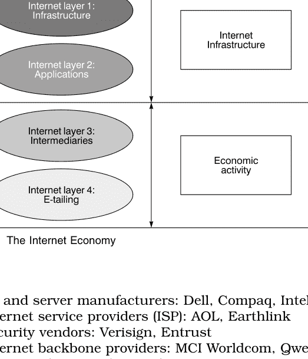

图3.1 互联网经济

- PC和服务器制造商：戴尔、康柏、英特尔

- 互联网服务提供商（ISP）：美国在线（AOL）、Earthlink

- 安全供应商：Verisign、Entrust

- 互联网骨干网提供商：MCI Worldcom、Qwest

（2）互联网应用程序（第2层）

- Web开发软件：Adobe、Vignette

- Web数据库：Oracle、IBM、MS SQL Server

- 搜索引擎软件：Inktomi、Verity

- 互联网商务应用程序：Netscape、Microsoft、Sun、IBM

- 交易处理公司：First Data、ADP

- Web托管和支持服务：Exodus、Globix、Verio

如图3.1所示，经济活动也分为两个组成部分：

（3）互联网中介机构（第3层）


互联网中介机构通过在网上汇集买卖双方并促进他们之间的互动，来提高电子市场的效率。

（a）在线搜索、评估、沟通、协调以及对供应商和产品/服务质量的保证，是互联网经济最重要的方面。

## 电话网络

在计算机网络出现之前，电话系统是唯一的电子大众传播媒介。尽管两者紧密相连，但人与人交谈的方式与计算机对话的方式之间存在重要差异。在电话交谈中，人们往往会连续说话，甚至同时说话。因此，他们之间的电子链路被专门保留，只要他们想说话，就会一直保持畅通。另一方面，计算机对话则是断断续续的。它的通信是一阵一阵的，因此持续保持链路畅通将极其浪费。

传真通信与计算机通信更为接近。信息被捆绑成离散的数据包，线路只需保持畅通到数据包发送完毕即可。一旦消息被接收，连接就会关闭，消息可以在“离线”状态下被处理。

当你拿起电话拨号时，电话系统会为你找到一条通往你想要交谈对象的线路。这种系统的问题在于可扩展性：很难让系统变得更大。每个新用户都必须与每个现有用户相连。这样的系统很难扩展到少数几个用户以上。

解决方案是电路交换。不是每个用户都有一条与其他每个用户相连的线路，而是每个用户都有一条连接到中央交换机的线路。之所以可行，是因为大多数人在大多数时间都不在打电话，而且在任何给定时刻，所有可能的电话对中只有一小部分相互连接。在过去，会有一大群总机接线员来接通电话。现在这一切都是自动完成的，但基本原理是一样的。

电路交换系统使可扩展性问题更容易处理。每个社区都有自己的本地交换机，不同社区通过交换机之间的长途连接相连。随着电缆被能够承载更多流量的光纤所取代，通信效率得到了提高。

电路交换通过在你和通话对象之间建立一条电路来将你们连接起来。这条电路可能由几段电线和几段光纤组成，但只要你需要，它就完全归你所有。即使你一言不发，你也要为它付费，而且只要你在线上，其他任何人都无法使用它。

“纯”互联网公司。这些公司在互联网出现之前并不存在，它们的整个商业模式都围绕互联网构建，所有收入都来自互联网上的交易。

- 实体公司：这些是成功转变商业模式以抓住互联网所提供机会的传统公司。例子包括联邦快递和迪士尼等公司。联邦快递彻底重新设计了其业务流程，使其60%的货运完全通过互联网进行订购、跟踪和管理。

- 互联网技术公司：这些公司制造对互联网运营至关重要的交换机、路由器、调制解调器、软件和其他技术。思科系统公司就是此类公司的一个很好的例子。

总的来说，互联网股票可以是属于上述三类中任何一类的公司的股票。然而，近期互联网股票热潮的主体是那些属于“纯”类别的股票，在整本书中，提到互联网股票通常指的是可以被描述为“纯”互联网公司的公司的股票。当然也有许多例外，即属于其他两类的公司。

## 信息技术的发展

晶体管是现代计算机的基础，于1947年被发明。在随后的50多年里，计算和通信得到了巨大的发展。计算能力的增长——以30年为跨度来衡量——遵循了摩尔定律，该定律以世界领先的计算机芯片制造商英特尔公司的联合创始人戈登·摩尔命名。1965年，摩尔预言计算能力每18个月到2年就会翻一番。这意味着，例如，在1960年至1990年间，单位计算成本下降了99%。现在计算能力的成本比30年前便宜了8000倍。正如微软创始人比尔·盖茨那句名言所说：“如果在汽车技术方面也有类似的进步，今天你大约花2美元就能买到一辆雷克萨斯，它的行驶速度将达到

以声速行驶约600英里，只消耗一顶针的汽油。

计算技术一直是这一融合的主要驱动力之一；另一个驱动力是光纤和无线技术的快速发展，包括卫星和地面技术。计算机技术提供处理能力，并提供沿相应通信“道路”路由信号的手段，而这些道路正日益由光纤和无线构成。光纤电缆由玻璃纤维细丝制成，每根仅有头发丝粗细，所用玻璃极其纯净，70英里厚的玻璃片也会像窗玻璃一样透明。这些细丝以极小的光脉冲承载比特。光纤和卫星信道支持通信革命，因为它们提供了所谓的宽带。带宽指每秒可通过一个信道的比特数（bps）。

光纤领域有一条与摩尔定律类似的定律——目前，带宽每年增至三倍。这就是所谓的吉尔德定律，下文将进一步讨论。此外，还有梅特卡夫定律，由美国网络设备制造商3Com创始人罗伯特·梅特卡夫提出：“网络的价值与网络中节点数的平方成正比”，下文也会讨论。

## 摩尔定律：微芯片的处理能力

数据传输成本和计算成本正在大幅下降。为什么这很重要？

新经济的主要推动因素之一是即时全球通信：能够轻松、廉价地发送和接收数据——从文件到视频和多媒体的一切数据。衡量这方面进展的一个指标是数据传输成本。从20世纪70年代中期到90年代初，通过光纤电缆传输1比特数据每公里的成本下降了三个数量级，使得更多数据能够以更低的价格传输更远的距离。

数据传输技术也在变得越来越强大。例如，朗讯公司最近开发的技术每秒传输3.2太比特——大约相当于9万卷百科全书的容量。

计算成本持续下降。1965年的一次演讲中，时任英特尔董事长（现为荣誉董事长）戈登·摩尔提出了一个著名论断：在价格保持不变的情况下，微芯片的处理能力每18个月翻一番。

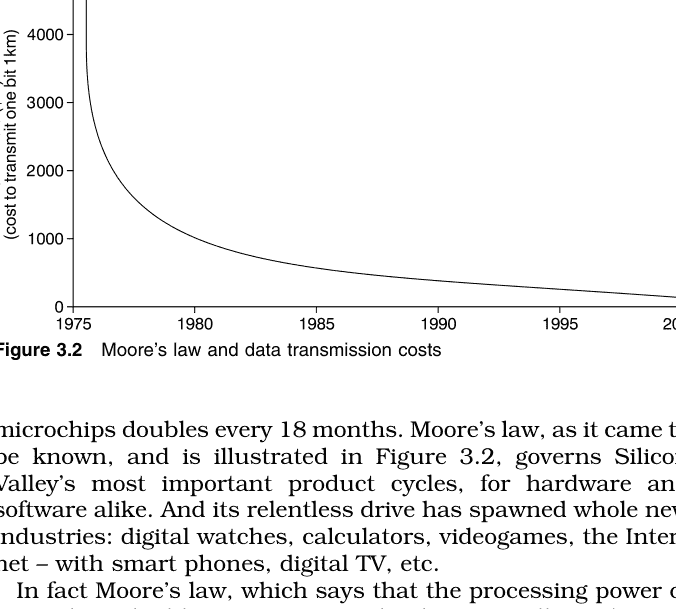

图3.2 摩尔定律与数据传输成本

后来被称为摩尔定律的这条定律，如图3.2所示，支配着硅谷最重要的产品周期，硬件和软件皆然。它那不停歇的驱动力催生了全新行业：数字手表、计算器、电子游戏，还有互联网——以及智能手机、数字电视等。

事实上，摩尔定律——即微芯片处理能力每18个月翻一番——有一个推论：计算成本每年下降近25%。1978年，英特尔公司推出8086芯片，该芯片为后来的x86系列（包括386、486和奔腾芯片）定义了基础架构。它包含29000个晶体管。四年后，286问世，含有134000个晶体管。又过了三年，386拥有275000个晶体管。这一趋势仍在延续：1995年推出的奔腾Pro，其核心中央处理器拥有550万个晶体管。与此同时，所有这些计算能力的成本一直在急剧下降。1978年，英特尔8086的价格为每晶体管1.2美分，每百万条指令每秒（mips）480美元。到1985年，386的成本为每晶体管0.11美分，每mips 50美元。十年后，奔腾Pro的上市价格相当于每晶体管0.02美分，每mips 4美元。

2001年9月，英特尔宣布出售主频为2千兆赫（即每秒20亿个周期）的奔腾4处理器，再次标志着计算机芯片速度在仅一年半内翻了一番（见图3.3）。未来价格无疑将继续下降。

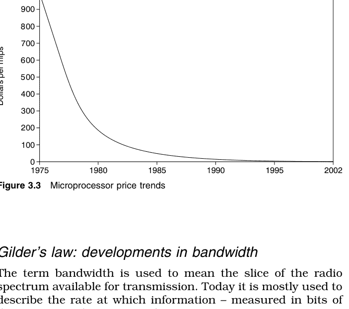

图3.3 微处理器价格趋势

## 吉尔德定律：带宽的发展

带宽一词原指可用于传输的无线电频谱片段。如今，它主要用于描述信息在计算机之间传输的速率——以每秒数据比特数来衡量。

传输大量数据的能力在很大程度上取决于带宽，即数据发送方与接收方之间连接的承载能力，也就是“管道的大小”。更大的带宽允许以更快的速度传输更大量数据，这不仅促进了更有价值、更具吸引力的在线服务的发展，也促进了各种电子数据传输形式的融合，从只需相对较少带宽的电子邮件和基本文本文档，到需要大量承载能力的全动态实时视频应用。

目前，光纤电缆正以供应商挖沟的最快速度铺设，从而不断提高这种承载能力。权威人士乔治·吉尔德提出了摩尔定律的带宽推论：未来四分之一世纪，骨干网容量将每年增至三倍。这是有可能的。企业互联网用户已经在以每秒千兆比特来衡量接入速度——这足以开始实现电视与互联网融合这一万亿美元的梦想。

## 梅特卡夫定律：网络外部性的影响

1973年6月，鲍勃·梅特卡夫在与文顿·瑟夫和罗伯特·卡恩（如前所述，两人于1974年发表了互联网蓝图）合作的同时，阐述了后来被称为梅特卡夫定律的内容。该定律指出：“网络的价值与网络中节点数的平方成正比。”其基本思想是，超过某个临界点后，你从连接计算机和设备中获得的价值将超过成本。

这些好处产生了经济学家所说的网络外部性。传真机和棋盘游戏有着共同的经济特性：每售出一台新的传真机——或者，就游戏而言，每多一个学会规则的新爱好者——都会增加其他所有设备/游戏的价值。如果没有其他传真机可通信，传真机便价值不大；如果没人会玩，棋盘游戏也没什么乐趣。因此，整体提升了其中每个部分的价值。

网络外部性——指一个人决定接入网络对其他仍在考虑接入的人所产生的效应——一直是互联网的火箭燃料：接入的人越多，连接就越有价值。而互联网反过来又将网络外部性带入整个经济，这是我们在第二章考察新经济某些方面时讨论过的概念。知识与互联网连接本身一样受到同类网络外部性的影响；拥有接收信息的设备并不比拥有理解信息的知识更重要。这解释了为什么未来在互联网上似乎发生得如此之快。变化会自我加速。昨天的深奥知识成为今天的基本信息。

因此，梅特卡夫定律——网络的价值随连接设备数量的平方而增加——创造了一种环境，使网络外部性保证了互联网使用增长所带来的好处。

### 附录3.1

### *互联网发展历程中的技术里程碑*

- 1447年，德国印刷商约翰内斯·古腾堡发明了活字印刷术。

- 1452–1519年，佛罗伦萨艺术家兼科学家列奥纳多·达·芬奇在世，他在医学、水力学、气象学和空气动力学方面做出了发现。

- 1530年，波兰天文学家尼古拉·哥白尼在一篇论文中提出地球绕太阳运行的观点。尽管遭到教会反对，该著作为以逻辑和演绎推理为基础的科学思维奠定了基础。

- 1600年，英国医生威廉·吉尔伯特发现了电和磁的性质。

- 1608年，荷兰眼镜制造商汉斯·利伯希发明了望远镜。

- 1564–1642年，意大利物理学家伽利略·伽利莱在世。据说他从比萨斜塔上扔下重物，由此发现了落体定律。1609年，他借鉴利伯希的成果，发明了一台20倍放大率的望远镜。他接受了哥白尼的宇宙理论，因为只有这样才能解释他对潮汐运动的观察。为此，他被以异端罪判处终身监禁，后由罗马天主教会改为软禁。1992年，梵蒂冈承认错误并撤销了判决。

- 1827年，德国物理学家乔治·西蒙·欧姆提出了电阻定律。

- 1825–1840年，英国数学家查尔斯·巴贝奇设计了能够使用存储程序以及存储在穿孔卡片上的存储器的计算设备方案。由于找不到资金，他从未造出这些机器。其中第一台差分机最终于1991年建成，运行完美。

- 1833–1842年，与巴贝奇合作的是艾达，洛夫莱斯伯爵夫人，拜伦勋爵之女。她根据他的设计，发展了……的概念。

| 年份 | 事件 |

|------|-------|

|  | 现代编程。1979年，美国国防部以她的名字命名了一种编程语言‘Ada’。 |

| 1837 | 美国发明家和艺术家塞缪尔·莫尔斯发明了磁电报和莫尔斯电码。 |

| 1847–1931 | 托马斯·阿尔瓦·爱迪生的生平，他发明了1000多项发明，包括电灯泡、发电机、股票行情显示器和留声机。 |

| 1854 | 英国数学家乔治·布尔发展了布尔代数，也称二进制代数，这对计算机系统的发展至关重要。 |

| 1876 | 亚历山大·格雷厄姆·贝尔，他早年曾担任聋哑教师，发明了第一部可用的电话和麦克风。 |

| 1888 | 乔治·伊士曼申请了盒式相机专利，这是第一台使用卷片的相机。售价为25美元。 |

| 1895 | 圭廖莫·马可尼创造了无线电报，当时他发送了几公里的信号。1901年，他将无线电信号从英格兰康沃尔发送到纽芬兰的圣约翰斯；1909年因获物理学诺贝尔奖。 |

| 1898 | 丹麦工程师瓦尔德马·浦森发明了磁带录音机。 |

| 1905 | E = mc²，物理学家阿尔伯特·爱因斯坦得出结论。相对论理论家于1921年获得物理学诺贝尔奖。 |

| 1923 | 首次跨大西洋电话通话连接纽约和英国。 |

| 1925 | 照相电报在贝尔实验室被发明。 |

| 1936 | 英国数学家艾伦·马提森·图灵撰写论文《论可计算数》，设计了可执行任何数学计算的机器的理论计划。他的工作对数字计算机的后期发展很重要。他为人工智能奠定基础，开发了图灵测试以确定计算机是否能够‘学习’或‘思考’。 |

| 1938 | 切斯特·卡尔森发明静电复印。他曾徒劳地向20多家公司兜售该工艺。Haloid Co.于1947年购买了权利并改名为施乐。 |

| 1939 | 斯坦福工程师威廉·休利特和戴维·帕卡德以500美元创办公司，并在加州帕洛阿尔托的车库设立工作室。抛硬币决定谁的名字排在前面。 |

| 1940 | 无线电探测与测距，即雷达，由苏格兰物理学家罗伯特·沃森-瓦特开发。柏林的康拉德·楚泽发明了第一台可编程计算器，名为Z1。 |

| 1941 | 爱荷华州立学院教授约翰·文森特·阿塔纳索夫和研究生克利福德·贝里开发了第一台数字计算机，他们称之为ABC。约翰·W·莫克利和同事J.普雷斯珀·埃克特后来申请了数字计算机设计专利，成立了一家公司，后来成为Sperry-Rand Corp。 |

| 1943 | 哈佛科学家霍华德·艾肯开发了第一台程序控制计算机Mark 1，与楚泽独立开发。它长15.3米，重4.5公吨。美国海军用它计算导弹轨迹。埃克特和莫克利开发了ENIAC，即电子数值积分和计算机。它重27吨，有18000个真空管。美国陆军购买它用于计算轨迹和开发氢弹。 |

| 1947 | 贝尔实验室制造了第一部蜂窝电话。 |

| 1948 | 晶体管在贝尔实验室由威廉·布拉德福德·肖克利、沃尔特·豪泽·布拉滕和约翰·巴丁发明，因此他们获得了1956年诺贝尔物理学奖。 |

| 1950 | 埃克特和莫克利开发了第一台商用计算机UNIVAC-1。这是第一台通用计算机，能够使用数字和文本。 |

| 1952 | 格蕾丝·默里·霍珀是一名在霍华德·艾肯哈佛实验室工作的海军程序员，她设计了第一个编译器，将类似英语的编程代码翻译成机器语言的0和1。1957年她开发了通用商业语言，即Cobol。她还创造了计算机术语：在调查Mark 1真空管问题时，她取出了一只蛾子，据传说惊呼‘这是一个虫子！’。 |

| 1954–58 | 公式翻译，即Fortran，第一种高级编程语言，由约翰·巴克斯等人在IBM开发。 |

| 1956 | 第一台晶体管计算机在麻省理工学院开发。 |

| 1957 | 受激辐射光放大，称为激光，源于美国戈登·高尔的研究。<br>斯普特尼克号，第一颗人造卫星，于10月4日由苏联发射。它推动了美国科学教育的革命。 |

| 1959 | 杰克·基尔比和德州仪器的罗伯特·诺伊斯开发了集成电路。诺伊斯后来创立了英特尔公司。 |

| 1963 | 第一台小型计算机PDP-8在数字设备公司开发。<br>斯坦福的道格拉斯·恩格尔巴特申请了鼠标专利；他还开发了文字处理器。 |

| 1968 | UNIX由贝尔实验室的肯·汤普森和丹尼斯·里奇开发，开创了不受单一计算机品牌束缚的计算语言时代。 |

| 1969 | ARPANET由美国国防部开发的四台计算机网络，形成了现在互联网的基础。 |

| 1971 | 英特尔推出了4004芯片，第一款微处理器。 |

| 1972 | 比尔·盖茨退学哈佛。与保罗·艾伦他创立了Traf-O-Data，制造交通计数系统。该公司后来成为微软公司。<br>雷·汤姆林森修改了他于1971年为ARPANET创建的电子邮件程序，该程序大受欢迎。@符号是从汤姆林森的Model 33电传打字机上的标点符号中挑选出来的，因其‘在’的意思。<br>雅达利发布了‘Pong’，第一款电子游戏。 |

| 1973 | 文顿·瑟夫和鲍勃·卡恩在萨塞克斯大学提出基本互联网思想。 |

| 1974 | Altair，第一台流行的个人计算机，由Micro Instrumentation Telemetry Systems的爱德华·罗伯茨开发并以套件形式出售。 |

| 1975 | IBM推出了其Mercury 5100便携式计算机。机器售价9000美元，重25公斤。 |

| 1976 | 王安公司推出第一台全计算机化文字处理机。售价：30000美元。史蒂夫·乔布斯和史蒂夫·沃兹尼亚克在乔布斯车库创立苹果电脑公司。 |

| 1979 | 丹·布里克林和鲍勃·弗兰克斯顿开发了VisiCalc，第一款电子表格软件。他们后来将权利卖给Lotus Development Corp。CompuServe为计算机爱好者启动了一个公告板服务。 |

| 1980 | IBM向微软请求为其即将推出的PC提供操作系统。盖茨和艾伦没有，于是他们以不到10万美元的价格从蒂莫西·帕特森手中获得Q-DOS的权利，即快速又脏的操作系统。微软去掉Q并将名称改为磁盘操作系统，即DOS。 |

| 1981 | IBM推出IBM PC。第一款图形用户界面Star在施乐帕洛阿尔托研究中心开发。 |

| 1983 | Novell推出了其网络操作系统NetWare。 |

| 1984 | 惠普推出了Laser Jet打印机。美国AT&T的分拆为全球电信市场带来了竞争并最终带来创新。苹果发布Macintosh。公司只做了一个广告，但新闻和谈话节目反复播放。 |

| 1985 | 微软推出Windows。IBM不感兴趣，于是微软独立销售该系统。直到1990年发布3.0版，Windows才变得流行。首个以.com结尾的地址启动。 |

| 1988 | 美国国家科学基金会网络与IBM、MCI和密歇根大学合作开发NSFNET。该系统提升了互联网容量并允许传输图形。 |

| 1989 | 万维网诞生，由英国计算机科学家蒂姆·伯纳斯-李为日内瓦欧洲核子研究组织国际研究人员开发。 |

| 1991 | 第一款仅文本的网页浏览器向公众发布。互联网主干网，整个系统最快的部分，以44 Mbps运行。 |

| 1992 | ‘冲浪网’一词由作家让·阿莫尔·波利创造。<br>WWW软件于1992年发布。 |

| 1993 | 英特尔发布奔腾处理器。<br>第一款网页浏览器Mosaic由伊利诺伊州香槟分校的国家超级计算应用中心发布。 |

| 1994 | 网站在以每年341634%的速度增长。<br>两位亚利桑那州律师劳伦斯·坎特和玛莎·西格尔向6000个新闻组发送广告——这是第一封垃圾邮件。 |

| 1995 | 微软推出Windows 95。<br>Lycos和Altavista启动。 |

| 1997 | IBM超级计算机Deep Blue击败世界国际象棋冠军加里·卡斯帕罗夫。 |

| 1998 | 美国法院禁止购买著名公司域名然后以高价转售的做法。 |

| 1999 | 美国法官的事实认定称微软利用其在PC操作系统上的垄断地位损害消费者和竞争对手。 |

| 2000 | 全球共有2110万个网站。 |

来源：柯里尔百科全书、计算机纪事、微软百科、世界年鉴

## 传统普通股的估值技术


> ... 以前经验法则是，成长股的市盈率不应高于其增长率 ... 最终 12%–15% 的增长无法支撑 50% 的倍数 ... 我不明白在利润没有增长的情况下如何得到 23 倍的市盈率。
>
> — Scott Black, *Barron’s*, 1998 年 6 月 6 日

为了掌握估值互联网和科技股过程的要领，首要的是先了解通常所称的传统股票的估值方法。在分析股票市场时，起点是不把价格与价值混为一谈。价格是你支付的：价值是你得到的。投资者不会也不应该出于情感原因购买金融资产——他们购买是为了盈利。价值本身与这些现金流的水平和预期增长直接相关。投资分析的奠基人本杰明·格雷厄姆在撰写《聪明的投资者》*The Intelligent Investor*（1949）时，简洁地概括了估值困境：‘短期内，股市是一台投票机；长期来看，它是一台称重机。’

虽然日常市场价格在很大程度上受投资者情绪驱动，但从长期来看，它们基于利润、收益和现金流的基本价值。

大多数分析师依赖股票价值的基本构建模块——公司的股息和收益——来做出股票估值决策。股票之所以有价值，是因为股东预期从持有公司获得的潜在现金流，称为股息。股票也有价值，如果将来其他股东可能认为这些未来股息的估值在未来股价中未得到充分反映。通过预测和估值潜在的未来股息和收益，并判断未来是否有人会对其估值不同，从而能够判断股份的投资价值。

未来现金流的不确定性使得根据净现值体系对股票定价变得更加困难。本章我们考察适用于普通股的估值原则。使用证券分析时，股票估值的两个基本方法是：

- (1) 现值法，或收益资本化法；和
- (2) 基本面分析。

### 现值分析：收益资本化法

计算内在价值的经典方法采用现值分析。这种技术通常被称为收益资本化法。现值过程涉及未来现金流的资本化（贴现）。也就是说，股票的内在价值等于投资者预期从该资产获得的未来现金流串的现值。这些现金流可能是周期性的，例如股息，或仅仅是终端价格或赎回价值，或是这些的组合。由于这些现金流发生在未来，必须以适当的利率贴现以确定其现值。这些贴现后现金流的总和就是股票的估计内在价值。这用方程 4.1 说明。

```
Value_{t=0} = Σ_{t=1}^{n} Cash flows / (1 + k)^t      (Eq 4.1)
```

其中

- `Value_{t=0}` = 现在资产的价值（时间段 0）
- `Cash flows` = 持有股票产生的未来现金流
- `k` = 投资者对这种类型投资要求的适当贴现回报率
- `n` = 预期现金流的期间数

要使用该模型推导出内在价值，投资者必须：

1. 估计适当的必要收益率。
2. 估计未来现金流串的金额和时间。
3. 使用这两个组成部分在现值模型中估计股票的价值。然后将其与股票的当前市场价格进行比较。

图 4.1 总结了所使用的现值过程。这强调了估值普通股所涉及的因素。市场中投资者使用的确切现值过程取决于对预期现金流串增长率所做的假设，如本章后面所述。

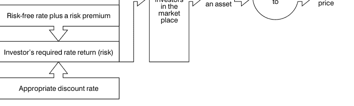

*图 4.1 估值的现值方法*

### 所需收益率

考虑购买普通股的投资者必须评估其风险，并根据其风险，确定*最低预期收益率*以诱使其进行购买的必要水平。这种最低预期回报，或*所需收益率*，是一种机会成本。

所需收益率、资本化率和贴现率在估值分析中是可互换的术语。理论上我们知道这个变量是什么，但在实践中很难确定使用确切的数字。由于这种复杂性，我们通常假设我们知道资本化率，并在此集中于股票估值所涉及的其他问题。

### 预期现金流

进入现值框架的另一个组成部分是预期现金流串。普通股的价值是发行人将收到的所有现金流的现值。然后出现以下问题：

1. 估值股票时使用哪些现金流？
2. 现金流的预期金额是多少？
3. 预期现金流将在何时收到？

股东可能计划在未来某个时间出售其股份，从而产生来自售价的现金流。然而，正如后面所示，即使投资者认为普通股的总现金流是股息和未来可出售股票的价格的组合，这也等同于使用股票上所有股息的流串作为关键估值原则。

那么收益呢？它们重要吗？可以用它们来估值股票吗？这两个问题的答案都是明确的“是”。股息来自收益，因此收益显然很重要。稍后要考虑的第二种股票估值方法——基本面分析——使用收益和市盈率来确定内在价值。因此，收益是基本面分析的重要组成部分：事实上，收益是投资者关注最多的单一变量。

如果所有收益都作为股息支付，它们将被计入股息。如果公司保留收益，它们 presumably 将被再投资，从而提高未来收益，最终提高股息。现值分析不应既计算当前再投资的收益，又再次计算其以后作为股息支付。如果它们被正确定义和分离，这两个变量会产生相同的结果。这意味着可能存在多种现值模型。然而，使用股息进行现值分析始终是正确的，当投资者使用现值方法进行股票估值时，这几乎总是这样做。

由于股息是在正常情况下投资者直接收到的唯一现金流串，因此基于股息的股票估值模型是合适的。现在重要的是考虑这样一个模型，即股息贴现模型，它是理解普通股基本估值的基础。

### 股息贴现模型（DDM）

由于股息是股东从公司直接收到的唯一现金支付，*它们为普通股的估值提供了基础*。将方程 4.1 专门应用于估值普通股，现金流是每个未来期间*预期*支付的股息。使用这种方法的投资者或分析师会仔细研究公司的未来前景并估计可能支付的股息。此外，分析师会根据对股息风险的预期并考虑可用的替代方案，估计适当的必要收益率或贴现率。最后，投资者会将整个估计的未来股息流串按金额和时间正确识别后贴现到现在。

将方程 4.1 改编为普通股，其中现金流为股息，得出方程 4.2。该方程被称为股息贴现模型（DDM），说明今天股票的价值是所有未来股息的贴现值：

\[
\hat{P}_{cs}=\frac{D_1}{(1+k_{cs})}+\frac{D_2}{(1+k_{cs})^2}+\frac{D_3}{(1+k_{cs})^3}+\frac{D_{\infty}}{(1+k_{cs})^{\infty}}
\]

\[
=\sum_{t=1}^{n}\frac{D_t}{(1+k_{cs})^t}\qquad\text{Eq 4.2}
\]

\[
=\textit{dividend discount model}
\]

其中

P̂_cs = 基于模型使用者对未来股息和必要收益率的估计的普通股今天的内在价值或估计价值

D₁, D₂, … = 预期在每个未来期间收到的股息

k_cs = 该股票的必要收益率，即对具有此风险程度的投资适用的贴现率

方程 4.2 存在两个直接问题：

- 1. 方程 4.2 中的最后一项表明投资者正在处理无穷大。他们必须对可能永远支付的股息流进行估值，因为普通股没有到期日。
- 2. 股息流是不确定的：
  - (a) 如果确实支付的话，并没有指定股息的数量。股息必须由公司的董事会定期宣布。
  - (b) 大多数公司的股息预计会随时间增长；因此，投资者通常无法将方程 4.2 简化为永续年金。只有在不预期股息增长时才能进行这种简化。

这些问题如何解决？第一个问题，即方程 4.2 涉及无限数量的期间和股息，将在我们处理第二个问题、指定预期股息流时得到解决。然而，从实际角度来看，这个问题并没有看起来那么棘手。在合理的较高贴现率下，例如 12%、14% 或 16%，40 或 50 年后收到的股息今天几乎一文不值，因此投资者不必担心它们。例如，如果贴现率为 15%，则 50 年后收到的 1 美元的现值是 0.0009 美分。

第二个问题的常规解决方案，即股息金额预计会随时间增长，是对预期股息增长率做出一些假设。也就是说，投资者或分析师估计或模拟未来股息流的预期百分比增长率。为此，他们根据股息的预期增长率将每只待估值股票分为三类。总结：股息贴现模型通过估计股息流中的预期增长率(s)来运作。

所有支付股息或预计在未来某个时间支付股息的股票都可以使用这种方法进行建模。使用 DDM 时必须记住的关键点是，投资者必须通过模拟增长率(s)来考虑从现在到无穷大的所有股息。如下面所示，这一过程的机制是，我们实际上看不到所有这些股息，因为公式简化为简化形式，但尽管如此，使用 DDM 时我们仍在考虑所有未来股息。

使用 DDM 时必须记住，股票当前支付的股息（或最近支付的股息）被指定为 D₀，并且当然是已知的。具体来说，D₀ 表示当前支付的股息，或最近支付的股息。投资者必须估计未来要支付的股息，从 D₁ 开始，即预期在下一期间支付的股息。

股息的三种增长率模型是：

- (1) **零增长率模型**：零增长率的股息流，由等于当前支付股息 D₀ 的固定金额股息构成，从现在起每年支付到无穷大。这通常被称为无增长率或零增长率模型：

  股息流：D₀ D₀ D₀ D₀ + ⋯ + D₀

  时间段：0 1 2 3 + ⋯ + ∞

- (2) **恒定增长率模型**：在该模型下，我们有一个从 D₀ 开始以恒定速率 g 增长的股息流。这通常被称为股息贴现模型的恒定或正常增长版本：

  股息流：D₀ D₀ (1+g)¹ D₀ (1+g)² D₀ (1+g)³ + ⋯ + D₀ (1+g)∞

  时间段：0 1 2 3 + ⋯ + ∞

- (3) **多重增长率模型**：在该模型下，我们有一个以可变速率增长的股息流，例如，前四年为 g₁，此后为 g₂。这被称为股息贴现模型的多重增长版本：

  D₀ D₁ = D₀ (1+g₁) D₂ = D₁ (1+g₁) D₃ = D₂ (1+g₁) D₄ = D₃ (1+g₁)

  0 1 2 3 4

  $D_5 = D_4 (1 + g_2) + \cdots + D_\infty = D_{\infty-1} (1 + g_2)$ 股息流

  5 + $\cdots$ + $\infty$ 时间段

### 零增长率模型

固定金额股息模型简化为永续年金。假设股息金额恒定，方程 4.2 简化为方程 4.3 所示的无增长模型。

$\hat{P}_0 = \frac{D_0}{k_{cs}} =$ 股息贴现模型的零增长版本

of the dividend discount model

Eq 4.3

其中 $D_0$ 是所有未来期间预期的恒定金额股息，$k_{cs}$ 是该特定普通股的机会成本或必要收益率，$\hat{P}_0$ 是当前价格。

零增长率普通股是永续年金，一旦确定 $k_{cs}$ 就很容易估值。

在理解使用 DDM 对普通股进行估值时，极其重要的是要认识到，在所有情况下，投资者都在贴现从现在到无穷大的未来股息流。当使用零增长率情况下涉及的永续年金公式时，这一事实往往被忽视，因为贴现过程不可见。尽管如此，在这种情况下，我们也在考虑从现在到无穷大的所有股息，就像所有其他情况一样。这只是一个数学事实，将恒定金额除以贴现率 $k_{cs}$ 得到的结果等同于单独贴现从现在到无穷大的每笔股息并求和所有现值。

### 恒定增长率模型

DDM 的另外两个版本，即恒定增长模型和多重增长情况，表明为了建立预期股息的现金流，该现金流随后将被贴现，首先有必要将某个初始股息复利到未来。显然，使用增长率越高，未来金额越大。此外，时间段越长，未来金额越大。

估值中一个众所周知的情形是股息预计以恒定速率随时间增长的情况。该恒定或正常增长模型如方程 4.4 所示

\[
\hat{P}_0 = \frac{D_0 (1 + g)}{(1 + k_{cs})} + \frac{D_0 (1 + g)^2}{(1 + k_{cs})^2} + \frac{D_0 (1 + g)^3}{(1 + k_{cs})^3} + \cdots + \frac{D_0 (1 + g)^{\infty}}{(1 + k_{cs})^{\infty}} \quad Eq 4.4
\]

其中 D0 是当前支付的股息并以恒定速率 g 增长，kcs 是适当的贴现率。

方程 4.4 可以简化为以下方程：

\[
\hat{P}_0 = \frac{D_1}{k - g} = 股息贴现模型的恒定增长版本 \quad Eq 4.5
\]

其中 D1 是预期在第 1 年末收到的股息。

每当未来股息的增长率估计为恒定时，就使用方程 4.5。在实际操作中，由于其简单性以及它是对大量公司实际行为的最好描述，在许多情况下也是对整个市场的最好描述，因此它经常被使用。示例 4.1 说明了如何将恒定增长模型应用于估值股票。

#### 示例 4.1

假设 Nadia Corporation 目前每股支付 1 美元股息，投资者预计股息在可预见的未来每年增长 7%。对于这种风险水平，投资者要求的回报率为每年 15%。Nadia Corporation 的估计价格为：

\hat{P}_0 = \frac{D_1}{k - g} = \frac{$1.00 (1.07)}{0.15 - 0.07} = $14.38

请注意，当前股息 (D0) 必须复利一个期间，因为 DDM 的恒定增长版本将分子指定为预期在下一个期间收到的股息，即 (D1)。在估值术语中，D0 表示当前支付的股息，D1 表示预期在下一期间支付的股息。如果已知 D0，则 D1 总是可以确定：D0 = 当前股息 D1 = D0(1 + g) 其中 g 是股息的预期增长率。

#### 表4.1 60年股利的现值（当前股利 = $1，g = 7%，k =15%）

| 期数 | 美元股利 | 现值系数 | 美元股利现值 |
|---|---|---|---|
| 1 | 1.07 | 0.8696 | 0.93 |
| 2 | 1.14 | 0.7561 | 0.87 |
| 3 | 1.23 | 0.6576 | 0.81 |
| 4 | 1.31 | 0.5718 | 0.75 |
| 5 | 1.40 | 0.4972 | 0.70 |
| 6 | 1.50 | 0.4323 | 0.65 |
| 7 | 1.61 | 0.3759 | 0.60 |
| 8 | 1.72 | 0.3269 | 0.56 |
| 9 | 1.84 | 0.2843 | 0.52 |
| 10 | 1.97 | 0.2472 | 0.49 |
| 11 | 2.10 | 0.2149 | 0.45 |
| 12 | 2.25 | 0.1869 | 0.42 |
| 13 | 2.41 | 0.1625 | 0.39 |
| 14 | 2.58 | 0.1413 | 0.36 |
| 15 | 2.76 | 0.1229 | 0.34 |
| 16 | 2.95 | 0.1069 | 0.32 |
| 17 | 3.16 | 0.09385 | 0.29 |
| 18 | 3.38 | 0.0808 | 0.27 |
| 19 | 3.62 | 0.0703 | 0.25 |
| 20 | 3.87 | 0.0611 | 0.24 |
| 21 | 4.14 | 0.0531 | 0.22 |
| 22 | 4.43 | 0.0462 | 0.20 |
| 23 | 4.74 | 0.0402 | 0.19 |
| 24 | 5.07 | 0.0349 | 0.18 |
| 25 | 5.43 | 0.0304 | 0.16 |
| 26 | 5.81 | 0.0264 | 0.15 |
| 27 | 6.21 | 0.0230 | 0.14 |
| 28 | 6.65 | 0.0200 | 0.13 |
| 29 | 7.11 | 0.0174 | 0.12 |
| 30 | 7.61 | 0.0151 | 0.11 |
| 31 | 8.15 | 0.0131 | 0.11 |
| 32 | 8.72 | 0.0114 | 0.10 |
| 33 | 9.33 | 0.0099 | 0.09 |
| 34 | 9.98 | 0.0086 | 0.09 |
| 35 | 10.68 | 0.0075 | 0.08 |
| 36 | 11.42 | 0.0065 | 0.07 |
| 37 | 12.22 | 0.0057 | 0.07 |
| 38 | 13.08 | 0.0049 | 0.06 |
| 39 | 13.99 | 0.0043 | 0.06 |
| 40 | 14.97 | 0.0037 | 0.06 |
| 41 | 16.02 | 0.0032 | 0.05 |
| 42 | 17.14 | 0.0028 | 0.05 |
| 43 | 18.34 | 0.0025 | 0.05 |
| 44 | 19.63 | 0.0021 | 0.04 |
| 45 | 21.00 | 0.0019 | 0.04 |
| 46 | 22.47 | 0.0016 | 0.04 |
| 47 | 24.05 | 0.0014 | 0.03 |
| 48 | 25.73 | 0.0012 | 0.03 |
| 49 | 27.53 | 0.0011 | 0.03 |
| 50 | 29.46 | 0.0009 | 0.03 |
| 51 | 31.52 | 0.0008 | 0.03 |
| 52 | 33.73 | 0.0007 | 0.02 |
| 53 | 36.09 | 0.0006 | 0.02 |
| 54 | 38.61 | 0.0005 | 0.02 |
| 55 | 41.32 | 0.0005 | 0.02 |
| 56 | 44.21 | 0.0004 | 0.02 |
| 57 | 47.30 | 0.0003 | 0.02 |
| 58 | 50.61 | 0.0003 | 0.02 |
| 59 | 54.16 | 0.0003 | 0.01 |
| 60 | 57.95 | 0.0002 | 0.01 |
| 股利合计 | $870.47 |  | $13.20 |

前60年折现股利的总额为13.20美元，而这一估值实际延伸至无限期，尽管仅从方程本身并不能明显看出这一点。虽然式4.6没有求和符号或无穷大符号，但该方程产生的结果与先确定每一未来期间的股利再将其折现到现在所得到的结果是等价的。同样，这一过程的数学表达掩盖了一个事实，即从现在到无限的所有的股利都被考虑在内。

为了充分理解DDM（股利贴现模型）的固定增长率版本，还必须意识到该模型隐含以下假设：任意一期的股票价格预计将与股利以相同的速率g增长。这意味着价格增长率加上股利增长率将等于k，即必要收益率。


## 固定增长率模型

对于Nadia公司，当前估计价格为13.38美元，而在第1期末，使用式4.6分子中的`D₂`可得：

```text
P̂₀ = ($1.07)(1.07) / (0.15 - 0.07)
= $14.3
```

第1期末的估计价格比当前估计价格13.38美元高出7%。

```text
价格变动 = (期末价格 - 期初价格) / 期初价格
= ($14.31 - $13.38) / $13.38 = 7%
```

考察式4.6可以迅速揭示影响普通股价格的因素，前提是我们假设DDM的固定增长率版本为适用的估值方法。该版本的主要启示包括：

- 1. 如果市场降低了某只股票的必要收益率，在其他条件不变的情况下，股价将会上升。

- 2. 如果投资者认为由于公司出现某些有利发展，预期股利增长率将会提高，那么在其他条件不变的情况下，股价也将会上升。

当然，这两种情况的反向情形同样成立——贴现率上升或预期股利增长率下降都会压低股价。

由式4.6计算出的现值或内在价值对投资者在该式中所采用的估计值相当敏感。输入值相对较小的变动就可能使估计价格产生大幅度的百分比变化。例4.2、例4.3和例4.4对此进行了说明。

### 例4.2

对于Nadia公司，假设所使用的贴现率`k`为16%而非15%，其他变量保持不变：

`P = $1(1.07) / (0.16 - 0.07) = $11.89`

在本例中，`k`上升1个百分点导致股价下跌11.14%，从当前价格13.38美元降至11.89美元。

### 例4.3

假设对于Nadia公司，增长率`g`为6%而非7%，其他变量保持不变：

`P = $1(1.06) / (0.15 - 0.06) = $11.77`

在本例中，`g`下降1个百分点导致股价下跌12%，从13.38美元降至11.77美元。

### 例4.4

假设对于Nadia公司，贴现率上升至16%且增长率下降至4%：

`$1(1.04) / (0.16 - 0.04) = $8.67`

在本例中，股价从当前价格13.38美元下跌至8.67美元，变动幅度为35%。

这些巨大的差异解释了为什么随着投资者做出买卖决策，股价会不断波动。即使所有投资者都使用DDM的固定增长率版本来为某只普通股估值，由于以下原因，也会得出许多不同的估值：

- 1. 每位投资者都有自己要求的收益率，这导致`k`的值范围相对较宽。

- 2. 每位投资者对预期股利增长率都有自己的估计。虽然在大多数估值情境中这一范围可能相当狭窄，但在其他条件不变的情况下，`g`的微小差异也可能引起价格的显著差异。

因此，在任何时点，对于某只股票而言，一些投资者愿意买入，而另一些投资者则希望卖出，这取决于他们对股票前景的评估。这有助于使市场保持活跃和流动。

## 多增长率模型

许多公司在若干年内以较快的一个或多个增长率增长，然后放缓至“平均”增长率。科技股显然就是如此。另一些公司则在若干年内不支付股利，通常是在其早期增长阶段。前面讨论的固定增长模型无法处理这些情况；因此，需要一种能够应对这些可能场景的不同模型。DDM的这种变体就是多增长率模型。

多增长是指预期未来股利增长必须使用两个或更多增长率来描述的情形。虽然任意数量的增长率都是可能的，但大多数股票可以用两个或三个增长率来描述。需要记住的是，我们必须假设至少有两条不同的增长路径。这是多增长情形的显著特征。

许多公司都经历过无法永远持续的快速增长。在其生命周期的某些阶段，它们的增长超过了经济中一般公司的增长，但后来增长速度放缓了。过去的例子包括麦当劳、迪士尼、IBM、微软和亚马逊。

为了在此情景下捕捉预期股利增长，有必要对差异增长各期间的股利流进行建模。可以合理假设，在某一时点之后，公司的增长将放缓至整体经济的增长率。此时，公司的增长可以用固定增长模型来描述。因此，剩下的工作是对股利放缓至正常增长率之前的确切股利流进行建模，然后求出所有组成部分的现值。

一个著名的多增长模型是两阶段增长率模型。该模型假设近期内以较快速度增长一段时间（通常为2至10年），随后进入可持续的长期稳定增长率（即如前文所述的固定增长率）。式4.7描述了多增长模型：

```
P̂₀ = Σₜ₌₁ⁿ D₀ (1 + g₁)/(1 + k)ᵗ + Dₙ (1 + g_c)/(k - g_c) × 1/(1 + k)ⁿ   Eq 4.7
```

其中

- `P̂₀` = 股票当前的内在价值或估计价值

- `D₀` = 当前股利

- `g₁` = 股利的超常（或低于正常）增长率

- `g_c` = 股利的固定增长率

- `k` = 必要收益率

- `n` = 超常（或低于正常）增长的期数

- `Dₙ` = 异常增长期结束时的股利

注意，在式4.7中，右侧第一项定义了覆盖`n`期的股利流，该股利流以`g`这一较高（或较低）的增长率增长，并按必要收益率`k`进行折现。该项涵盖超常增长期，之后股利预计将以固定增长率永远增长下去。右侧第二项是前文讨论过的固定增长版本，它取下一期（`n+1`期）的预期股利，除以`k`与`g`之差。但请注意，该计算得到的价值是股票在`n+1`期期初（即`n`期期末）的价值，因此必须乘以相应的折现（现值）系数，将其折现回第0期。从概念上讲，这里展示的估值过程是：

`P̂₀` = 异常增长期`n`内所有股利的折现值，加上覆盖`n+1`期及以后的固定增长模型的折现值。

思考方程 4.7 中的第二项是有用的，它代表 $\hat{P}_n$，即根据恒定增长模型得出的截至第 `n` 期末的股票预期价格。股息贴现模型的恒定增长版本用于求解第 `n` 期末的预期价格，即第 `n + 1` 期的开始。因此，

$$P_n = \frac{D_{n+1}}{k - g_c}$$

因为 $P_n$ 是第 `n` 期末股票的预期价格，所以必须将其折现回现在。将其与第一项中折现股息的价值相加，即可得出股票今天的估计价值（$P_0$）。示例 4.5 说明了多重增长模型。

### 示例 4.5

图 4.2 说明了估值多重增长率公司的概念。在此示例中，当前股息为 \$1，预计以较高比率（$g_1$）每年 12% 的速度增长 5 年，届时新的增长率（$g_c$）预计将恒定为每年 6%。假设要求的回报率为 10%。

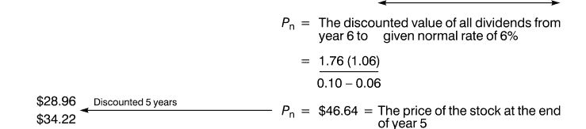

估值过程中的第一步，如图 4.2 所示，是确定超常增长的每一年中的美元股息。这是通过将初始股息 \$1 按 12% 复利计算 5 年来实现的，得出以下预期股息流：

$$

\begin{aligned}

D_0 &= \$1.00\\

D_1 &= \$1.00(1.12) = \$1.12\\

D_2 &= \$1.00(1.12)^2 = \$1.25\\

D_3 &= \$1.00(1.12)^3 = \$1.40\\

D_4 &= \$1.00(1.12)^4 = \$1.57\\

D_5 &= \$1.00(1.12)^5 = \$1.76

\end{aligned}

$$

一旦确定了超增长期间的股息流，就必须使用 10% 的要求的回报率将其折现到现在。因此

$$

\begin{aligned}

\$1.12(0.909) &= \$1.02\\

\$1.25(0.826) &= \$1.03\\

\$1.40(0.751) &= \$1.05\\

\$1.57(0.683) &= \$1.07\\

\$1.76(0.621) &= \$1.09

\end{aligned}

$$

对五项折现股息求和可得出股票仅前五年的价值，为 \$5.26。为了评估第 6 年及以后预期恒定增长的年份，使用恒定增长模型。

$$

\begin{aligned}

P_n &= \frac{D_{n+1}}{k - g_c}\\

&= \frac{D_6}{k - g_c}\\

&= \frac{D_5(1.06)}{k - g_c}\\

&= \frac{\$1.76(1.06)}{0.10 - 0.06}\\

&= \$46.64

\end{aligned}

$$

因此，\$46.64 是第 6 年开始（第 5 年末）的股票预期价格。它必须折现回现在，使用现在

以及短期最好由约翰·梅纳德·凯恩斯在 1936 年写道时描述：

> 其中大多数 [专业投资者和投机者] 实际上主要关心的是，不是做出对一项投资在其整个生命周期内的可能收益率的优越长期预测，而是预测公众在短期内对估值常规基础的变化。他们关心的是，不是买入“长期持有”的投资对一个人来说真正值多少钱，而是市场在群众心理的影响下，三个月或一年后会将其估值为多少。

预测未来投资者情绪的游戏是困难的，并阻止许多人投资股票。但是，你不需要预测市场情绪就能通过投资股票获利。尽管面向短期的投资建议依赖于预测其他投资者的判断，但从长远来看，人们可以度过投资者情绪的波动，并从自己的预测中获利。长期投资确实需要，首先，对股市历史的了解，其次，能够应用一些合适的股票估值模型。

所以我们需要了解一些股市历史，在此背景下，我们必须问是否有其他股票估值模型可用，以便我们将结果与前面讨论的收益资本化方法进行比较。那么历史是否告诉我们美国股市的长期表现？

## 我们对美国股市历史了解多少？

在预测市场未来回报时，与历史标准相比，市盈率（P/E）和股息收益率是判断股市估值的最常引用的标准。

表 4.2 显示了 1871–1994 年期间美国标准普尔 500 指数所代表的股票的股息收益率和收益收益率。可以看出，在此期间的历史平均收益收益率为 8.1%，平均市盈率为 13.6。这意味着投资者平均以其年收益的约 12 至 15 倍的价格购买股票。尽管平均值稳定，但该期间的市盈率显示出相当大的年度变化，从 1894 年的 27 高点到 1950 年的 6 低点。（应注意，市盈率在上个千年的末期和新千年初期已在 30 左右。）

**表 4.2 1871–1994 年股息收益率和收益收益率的历史平均值**

| 期间 | 股息收益率（%） | 市盈率 | 收益收益率（%） | 股息/收益（%） | 实际股息增长率（%） | 实际收益增长率（%） | 实际标普增长率（%） |
|---|---|---|---|---|---|---|---|
| 1871–1994 | 4.9% | 13.6 | 8.1% | 64.0% | 1.2% | 1.5% | 1.8% |
| 1871–1958 | 5.3% | 13.4 | 8.2% | 71.5% | 0.7% | 1.0% | 0.8% |
| 1959–1994 | 3.8% | 14.1 | 7.8% | 51.8% | 2.0% | 2.1% | 3.4% |

来源：Siegel, 1995

用来判断市场未来的另一个标准是股息收益率。股息收益率自 1871 年以来平均为 4.9%，1959 年的最高值为 8.71%，1973 年的最低值为 2.85%。股息收益率显示出远低于收益收益率的波动性，因为管理者追求稳定向股东支付现金的政策。

与收益收益率的长期稳定性形成对比，美国股息收益率在近年显著下降。在 1959 年至 1994 年间，平均股息收益率为 3.8%，此后已降至 2% 以下。股息收益率下降的主要原因不是股票估值更高，而是股息支付率的降低——即公司支付为股息的收益比例。美国个人和企业税收的增加使得公司保留收益而不是以应税股息形式支付给股东变得有利。

## 可用的基本估值技术

投资者可供选择的众多基本股票估值方法。必须说，股票挑选，如其所知，更像是一门艺术而非科学。然而该练习具有科学元素，本节总结了可用的技术。必须强调，每种技术都有局限性，应牢记于心。

下面讨论的基本技术包括：

- 市盈率

- 市盈率增长因子（PEG 比率）

- 股息收益率

- 收益率比率：债券收益率与股息收益率之比

- 托宾 `q` 比率

- 市净率

- 市销率

### 市盈率（P/E）比率

股东收到的现金流主要来自股息，而这些股息又来自收益。因此，关于股票最重要的两个财务统计数据显然是收益和股息。每股收益除以当前股价被称为股票的收益收益率。

许多投资者更喜欢考虑收益收益率的倒数——称为市盈率或 P/E 比率。市盈率，也称为收益倍数，衡量市场为一只股票支付当前（或预期）收益的倍数。市盈率是对股票和整个市场进行估值的最受欢迎的基本变量。

有许多利润衡量方法，但一个特别有用的定义是收益——即归属于普通股东的税后利润和其他变动。公司按每股基础报告收益，分析师可将其转化为收益收益率，以与下面讨论的股息收益率相平行。如上所述，该比率以另一种方式呈现为市盈率。因此 5% 的收益收益率代表市盈率为 20。

因此市盈率表明公司的股价反映了多少年的购买其收益。比率越高，投资者对增长的乐观程度必须越高才能支付市场价格。因此增长型股票，最近由科技股代表，一直处于高市盈率。低市盈率的股票可能代表廉价，但更可能是在困难时期的股票。

### 市盈率的决定因素

什么决定市盈率？市盈率可以从前面讨论的股息贴现模型推导出来。

从方程 4.1 开始，使用恒定增长版本的模型估计股票价格。我们用 $P_0$ 表示来自模型的估计价格。

$$P_0 = \frac{D_1}{k-g}$$

将方程 4.1 两边除以预期收益 $E_1$，得到方程 4.8。

$$\frac{P_0}{E_1} = \frac{D_1/E_1}{k-g} \qquad \text{Eq 4.8}$$

方程 4.8 表明影响估计市盈率的因素是：

1. 股息支付率，`D/E`。

2. 要求的回报率，`k`。

3. 股息的预期增长率，`g`。

那么，在其他条件相同的情况下，以下关系应当成立：

- 1. 派息率越高，市盈率越高。

- 2. 预期增长率`g`越高，市盈率越高。

- 3. 必要回报率`k`越高，市盈率越低。

记住“其他条件相同”这个短语非常重要，因为通常其他条件并不相同，上述关系也就不能单独成立。仔细想来，显而易见的是，如果一家公司只需提高派息率就能提高其估计市盈率，从而提高其市场价格，那么它会非常倾向于这样做。然而，这样的做法很可能降低未来的增长前景，使`g`下降，从而抵消派息率提高带来的影响。同样，试图通过承担特别高风险的投资项目来提高`g`，会导致投资者要求更高的必要回报率`k`。这同样会抵消`g`增加带来的积极影响。

上述因素2和3通常是决定市盈率的最重要因素，因为其中任何一个的微小变化都可能对市盈率产生重大影响。这在示例4.6中得到了说明。

### 示例4.6

假设派息率为60%。通过改变`k`和`g`，从而改变两者之间的差额（公式4.8中的分母），投资者可以评估对市盈率的影响，如下所示：

假设 `k = 0.15` 且 `g = 0.07`      `P/E = D₁/E₁ / (k − g)`

`P/E = 0.60 / (0.15 − 0.07)`

`= 0.60 / 0.08 = 7.5`

现在假设 `k = 0.16` 且 `g = 0.06`      `P/E = 0.60 / 0.10 = 6`

或者假设 $k = 0.14$ 且 $g = 0.08$      `P/E` = $\frac{0.60}{0.06}$ = 10

可以看出，我们假设中的微小变化意味着市盈率的巨大变化！

### 市盈率有哪些局限性？

市盈率存在若干局限性。它们无法告诉你：

- 公司的盈利预期将以何种速度增长；

- 公司的盈利增长预期是加速还是减速；

- 其盈利创造能力与提供相同风险回报关系的其他投资相比如何；

- 各公司盈利之间的确切差异。盈利存在根本性的计量问题，因为它们取决于公司及其审计师的主观判断。在牛市中，会计准则往往会恶化，因为公司会扭曲规则以满足投资者过度乐观的预期；

- 在考虑经济内部大规模结构性变化时如何调整该比率。正如第5章和第6章所讨论的，无形资产的重要性日益上升，这意味着需要引入新的会计方法。这构成了所谓“新经济”影响的一个关键组成部分。

### 预期市盈率

一些分析师根据他们对公司未来盈利的预测来计算预期市盈率。由于分析师之间对未来盈利的预期存在差异，将这种方法应用于整体股票指数并不容易，但它可能对个股和行业板块有用。

### 市盈率增长因子（PEG）

过去几年流行起来的一个概念是市盈率增长因子，即PEG。它是市盈率除以年化盈利增长率。

将市盈率除以估计的盈利增长率，可以衡量公司增长的速度。这被称为预期PEG。例如，两家公司的市盈率可能都是20，但盈利增长率不同。A公司的盈利增长率为20%，而B公司为5%。A公司的PEG比率将为1（20除以20），而B公司的PEG将为4（20除以5）。PEG比率越低，公司的潜在价值越高。在这个例子中，A公司增长非常迅速，可能代表更好的潜力。

PEG显著低于1被认为具有吸引力。因此，市盈率适中为15的股票，需要接近每年20%的增长率才会被视为强烈买入。

PEG只能用于成长股。它不适用于周期性股票或困境反转的情形。在计算盈利的估计可持续增长率时，预期这些增长率能够维持5年以上。例如，一家市盈率为10、增长率为20%的公司，其PEG将为0.5，即估计增长率的一半。如上所述，PEG小于1通常意味着该股票具有良好价值。

使用所有倍数进行估值的一个根本缺点是，它们没有考虑通货膨胀和利率的变化。利率上升通常会导致股价下跌，因为公司未来盈利流的实际净现值被侵蚀。利率下降则产生相反的效果。

### 股息率

表4.3说明，1927年至1995年间，股票的平均回报率显著高于公司债券或美国国库券等其他金融资产。虽然表4.3中A组显示的股票回报令人瞩目，但投资者更关心经通胀调整后的回报。表4.3中的B组显示了经通胀调整后的平均实际回报。

判断股票市场是否被高估的一种方法是考察股息率，即股息与股价的比率。当股息率较低时，股价被认为相对较高，反之亦然。

股票的现金收入是股票估值最基本的基础。股票的股息和现金流很少与盈利完全相同。管理层通常会留存部分盈利，以产生未来运营或扩张所需的资金，有时也用于回购股票。股东获得的当前现金回报被称为*股息率*，其计算公式为每股股息除以当前股价。

**表4.3** 美国金融资产的名义回报率和实际回报率（每年百分比），1927–95

|  | 1927–95 | 1946–95 |
|---|---:|---:|
| **A：名义回报率** |  |  |
| 股票 | 9.54 | 11.23 |
| 公司债券 | 5.39 | 5.46 |
| 政府债券 | 4.85 | 5.04 |
| 国库券 | 3.64 | 4.72 |
| **B：实际回报率** |  |  |
| 股票 | 6.43 | 7.03 |
| 公司债券 | 2.28 | 1.25 |
| 政府债券 | 1.74 | 0.84 |
| 国库券 | 0.52 | 0.52 |

*资料来源：* Cochrane, 1997b


未作为股息支付的盈利称为留存收益。管理层可以将此类留存收益用于两种用途。一种是购买实物资产或金融资产。只要这些资产具有生产能力，收购它们就会增加未来盈利，从而提高股票的未来价格。留存收益的第二种用途是在公开市场上购买公司自身的股票。减少股票数量也会增加未来每股盈利和股息，从而提高股票的未来价格。因此，如果公司购买生产性资产或购买自己的股票，每股盈利和股息将会增加。

表4.4显示，1927年至1995年间，美国平均股息率约为4.4%。

**表4.4** 美国股息率、回报率和股息增长率（每年百分比），1927–95

|  | 1927–95 | 1927–45 | 1946–95 | 1927–71 | 1972–95 |
|---|---:|---:|---:|---:|---:|
| 股息率 | 4.37 | 4.95 | 4.14 | 4.52 | 4.14 |
| 实际回报率 | 6.43 | 4.86 | 7.03 | 6.73 | 6.40 |
| 实际股息增长率 | 1.12 | −1.62 | 2.15 | 0.71 | 2.34 |

*资料来源：* Cochrane, 1997b

除了股息率处于历史低位之外，在将其用作计算投资回报的一种方式时，还需要提出另外两个问题。

首先，股息率有多安全？如果下一次股息支付被削减，那么表面上具有吸引力的收益率（例如1946–1975年间实际7%的回报率）很可能在很大程度上是一种幻觉。通常，市场对下一次或预期年度总股息的预期对股价的影响，比过去一年实际支付的金额更为重要。利润的稳定性以及股息覆盖率（即可用盈利与股息之比）也是这里的重要因素。

其次，股息可能以多快的速度增长？正如我们之前讨论过的，快速增长的股息流显然比静止不变的更有价值，其影响是，成长股即使在股息远低于成熟公司的情况下也值得购买。

专业分析师使用前面讨论过的股息贴现模型来计算不同增长假设的影响。由于复利计算的强大作用，估值对增长率的预测非常敏感，这也解释了为什么公司在业绩令人失望或发布盈利预警时，股价会大幅下跌。

假设千禧年末的低股息率回归其均值。在这种情况下，要么股价下跌，要么股息增加。1998年3月14日，著名价值投资者沃伦·巴菲特告诉股东，他相信只要利率保持低位，且企业继续产生“非凡”的股本回报率，历史高位的股价就是合理的。巴菲特显然相信未来股息将会上升，从而使较低的股息价格比变得合理。不幸的是，历史讲述的是另一个故事。从历史上看，正是股价的调整（而非股息）推动股息率回归均值。如果股息率在未来几年确实回归其长期均值，股票市场的长期前景将发生巨大变化。

不幸的是，股息分析比过去变得更加复杂。税收因素使计算变得模糊。因此，公司比过去更有兴趣寻找替代的、更具税收效率的方式将现金返还给股东。股票回购越来越受欢迎。分析师们现在一致认为，在评估股息流时有必要考虑股票回购。

## 债券收益率/股票收益率比率

投资者始终在股票和债券之间做出选择。从长期来看，这两类资产应实现相似的回报，或者在调整风险和流动性差异后至少实现相似的回报。在英国，历史上政府债券支付的收益通常比股息收益率多出一点超过两倍。在美国，历史平均值更接近三。

分析师使用债券/股票收益率比率作为基准，以判断债券或股票价格是否会回归历史平均水平。表 4.5 说明了其运作方式。

表 4.5 为什么债券收益率驱动股票（股息）收益率（反之亦然）

| 历史平均债券收益率/股票收益率 | 假设当前比率 | 股价 | 股息收益率 | 债券价格 | 债券收益率 |
|---|---|---|---|---|---|
| 3 | <3 | ↑ | ↓ | ↓ | ↑ |
| 3 | >3 | ↓ | ↑ | ↑ | ↓ |

然而，股息收益率必须谨慎解读。如果股息收益率低是由于即将到来的衰退对盈利的影响，那么该比率必须谨慎对待。

## 托宾 `q` 比率

除了将公司的股息或收益与股票价格进行比较之外，将公司证券的价值与其资产价值进行比较也可能很有用。市值与基础企业资产重置成本之比被称为托宾 `q`。它以其创造者、耶鲁大学诺贝尔奖获得者詹姆斯·托宾命名。

托宾 `q` 是一个足够简单的概念。（a）根据市值计算的公司价值与（b）其资产重置成本之比应等于 1。毕竟，比率的分子和分母只是衡量同一事物——公司价值的两种方式。

当公司预期收益高或快速上升时，其在金融市场上的价值超过其资产的价值。相反，当公司前景特别黯淡或不确定时，其价值可能低于其资产价值。

如果 `q` 出于某种原因大于 1，这意味着股市对公司拥有的资产的估值高于获取这些资产的成本。因此就会产生一种套利机会。如果 `q` 大于 1，可以预期公司会增加投资，presumably 直到市场认为公司的价值现在等于其资产成本。在那时 `q` 将再次等于 1。

美国联邦储备局对非金融公司在 1998–2000 年期间的托宾 `q` 估计显示，自 1925 年以来估值最高。根据美联储的计算，其在 0.4 的最低值和 1.8 的最高值之间波动，后者为千禧年末的水平。平均水平为 0.7。

高于 1 的数值，自 1991 年以来首次在 25 年内出现，表明企业通过发行股票来为生产性资本（土地、厂房）的积累融资，比通过在股票市场上购买相应证券来“二手”购买此类资产更为有利。

在 20 世纪 70 年代初和 80 年代初，该值通常小于 1，表明公司相当便宜。如果该比率回归长期平均水平，美国股市将下跌 50%。

Smithers 和 Wright（2000）最近分析了美国股市，得出 `q` 比率远超 2。他们发现，当比率（经过适当调整以考虑会计差异）远高于 1 时，均衡最终确实会恢复——但不是通过公司资产重置价值的激增，而是通过其股价的急剧下跌。正如 Smithers 和 Wright 所指出的，1968–74 年在 `q` 之前的峰值后发生了这种情况。他们指出，2000 年 `q` 的价值现在高于 1929 年或 1986 年的任何一年。

这种类型的比率必须非常谨慎地处理，因为有形和无形资产的估值存在问题。例如，无形资产（知识产权、商标、专利、know-how）往往在 `q` 的分母中被低估，导致比率被高估。这个论点经常被提出以解释 `q` 目前的高水平，理由是无形资产现在比过去重要得多。我们将在第 11 章重返这些观点。

## 市净率（P/BV）

公司资产负债表显示股东资金的账面价值数字，可表示为每股净资产。2001 年美国股票的售价创纪录地达到账面价值的 4.9 倍。账面价值是指公司资产负债表上资产的价值。2001 年约为过去 20 年平均倍数的 2.5 倍。

但有一句老投资格言：“资产的价值仅在于其能赚取的收益”。当公司拥有未开发的资产可出售或用于其他用途时——例如办公楼或对其他公司的股份——资产分析最有用。不灵活的资产如机械或油井可能需要更谨慎地分析。

如上所述，制造业的衰退凸显了当今公司中无形资产的重要性——品牌名称、软件、版税权利以及劳动力的技能。由于在资产负债表中对其进行满意估值如此困难，因此资产价值分析以及随之而来的市净率的使用已下降重要性。

## 市销率（P/SR）

这仅仅是公司股票价值（即其市值）与其销售额之比。这可能看起来是一个令人困惑的指标，因为不同行业的利润率可能差异很大。但在 1996 年出版的有影响力的书籍《华尔街上什么有效》中，美国量化投资者 James O’Shaughnessy 将市销率描述为“价值因素之王”。

O’Shaughnessy 发现，低资本化与销售额比率的股票比任何其他价值比率更能跑赢市场。他强调投资者应谨慎对待市值超过公司销售额两倍以上的股票。

O'Shaughnessy 使用追溯到 1951 年的数据，分析了用于选择普通股的所有基本投资策略，如账面价值、现金流、P/E、ROE、收益率等。O'Shaughnessy 发现，基于年度再平衡投资组合的 50 只 PSR 最低的股票，在 1954 年至 1994 年的 40 年间以年均 15.42% 的速度表现，而他所研究的全部股票年均收益为 12.45%。PSR 最高的股票每年仅赚取 4.15%。此外，将低 PSR 股票（通常 PSR 为 1.0 或更低）与表现 *动量*（12 个月最佳价格表现）的股票相结合，在整个 40 年期间产生了年均 18.14% 的回报。

## 经济增加值（EVA）

一种不同的估值方法颠覆了整个问题，并处于投资分析的前沿。而不是预测所有输入以得出股票应有的价值数字，该方法从股价开始倒推，回答问题：该公司需要实现何种增长才能证明这一价格合理？该方法并不避免做出一些假设，但它是一种进行现实检验的方式。

看看 Amazon.com。在股价崩盘前的 214 美元价格下，市场暗示亚马逊的收入在未来 10 年内将每年增长 59.6%。这是 Warburg Dillon Reed 老牌证券分析师 Charles R. Wolf 得出的结论。

为了得出这一结论，Wolf 使用了一种基于经济增加值（EVA）的估值方法，该概念由管理咨询公司 Stern & Co. 提出。EVA 背后的思想是，从长远来看，重要的不是会计利润——多收一英镑比多付一英镑——而是经济利润。简单地说，公司只有在赚取的收益超过其资本成本时才赚取经济利润，而这在损益表中找不到。EVA 最初设计为管理工具多于投资工具。

EVA 分析的思路是，市场价值，即股价乘以股数，由两个部分组成。其一，当前运营价值（COV）是衡量公司按当前运营方式的价值。第二，未来增长价值（FGV）衡量公司的预期增长。一旦你

## 将波特模型应用于互联网和科技股的估值

近期科技和互联网公司表现及其股价行为提供了一个经典的教科书案例，说明在大多数商学院教授的商业战略如何得以应用。据理论所述，任何新行业在确立自身地位时都会经历几个阶段。首先，许多行业参与者会出现。其次，一批领导者会开始脱颖而出。第三，这些领导者随后会通过收购和整合来巩固其地位，导致强势与弱势参与者之间出现分化，而弱势参与者随后退出。最终，一批更专业、更注重细分市场的公司出现，与领导者共存。

教科书模型表明，可以以与影响旧经济公司及其股票价值的因素相似的方式，应用这一框架来分析新经济公司及其股票价值。必须对企业内部和外部因素进行分析。新经济，旧经济，过程相同。正是这些内部和外部因素将影响这些公司的长期估值，我们现在就转向这一点。请记住，尽管近期波动，来自第 2 章的新经济规则仍必须强加于标准估值流程之上。但需要分析的这些内部/外部因素是什么？内部因素是源自单个公司内部的因素，而外部因素是与整个行业相关的因素。

### 内部分析：公司内部的战略因素

对公司成功至关重要并最终影响其股票估值的内部因素如下所列。

#### 人力资本

- **管理：** 大多数成功的公司拥有强大的管理层或强大的领导者。公司需要拥有能够激励员工使其发挥最佳能力的领导层。投资者在考虑投资一家公司时，将管理层视为非常重要的因素；很少有投资者会投资管理薄弱的公司。
- **激励：** 保持公司活动中所有相关人员的工作积极性非常重要。互联网公司中普遍使用股票期权的做法很常见，员工有机会拥有公司所有权，从而分享未来利润。显然，当股价下跌且期权似乎价值不大时，这就会成为一个问题。
- **知识/技能：** 另一个重要因素是考察公司对知识的获取程度。知识水平高的公司可能比拥有绝妙商业点子但缺乏执行技能的公司更具吸引力。最初吸引具有适当技能的个人至关重要，但随着行业成熟，人们会期望合格人员的供应量上升。

#### 企业文化

公司内部的文化非常重要。该公司是利润导向还是成本导向？员工是否具有正确的态度？如果没有这些属性，公司将不具备成为成功公司的要求。工作环境可能非常重要。工作环境是否具有创造性？组织是否灵活？员工是否觉得自己很重要且他们的意见被重视？毫无疑问，科技公司的企业文化与旧经济公司截然不同。

#### 产品或服务的独特性

另一个需要分析的重要因素是产品或服务的独特性。衡量独特性的一个好方法是估计竞争对手达到公司现在所处位置所需的时间。最有趣的公司拥有受专利保护和/或技术先进或以其他方式难以替代的产品或服务。查看公司的研究与开发（R&D）部门可以很好地了解其提出新独特产品的能力。品牌是投资者可以考察的另一个因素，以了解公司是否拥有或正在建立一个将为公司增加价值的强大品牌。整个 B2B 和 B2C 领域正在提供一种独特但尚未得到证实的商业模式。

### 外部分析：分析行业环境的战略因素

行业分析通常从对影响组织的各种力量的总体审查开始。此类研究的目的是利用此来发展组织在击败竞争对手方面的竞争优势。

这种类型的分析通常使用波特提出的结构进行。他的基本模型如图 5.1 所示。这通常被称为波特五力模型，因为他确定了五种可能作用于组织的基本力量：

- 供应商的议价能力
- 买方的议价能力
- 潜在新进入者的威胁
- 替代品的威胁
- 竞争激烈程度。

此类分析的目的是调查组织需要如何形成其战略，以便在环境中开发机会并保护自己免受竞争和其他威胁。

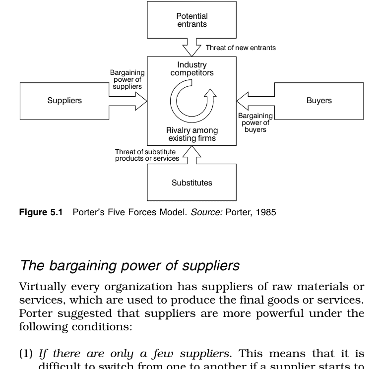

图 5.1 波特五力模型。来源：Porter, 1985

#### 供应商的议价能力

几乎每个组织都有原材料或服务的供应商，用于生产最终产品或服务。波特认为，在以下条件下供应商更具权力：

- （1）如果供应商数量很少。这意味着如果供应商开始施加权力，难以从一个供应商转向另一个供应商。
- （2）如果他们提供的供应品没有替代品。如果供应品因技术原因而重要——也许它们是生产过程中的关键成分，或他们提供的服务对顺利生产至关重要——尤其如此。
- （3）如果供应商的价格构成组织总成本的很大一部分。任何价格上涨都会打击附加值，除非组织能够相应提高自身价格。
- （4）如果供应商有可能承担组织的增值过程。偶尔供应商如果能够前向整合并承担组织所承担的增值过程，就会拥有权力；这可能对组织的生存构成真正威胁。
- 如果价格下降或保持不变，利润率可能减少。

#### 竞争激烈程度

有些市场比其他市场更具竞争性。在竞争激烈的市场中，公司会定期并广泛地监控主要竞争对手公司。例如：

- 立即检查价格变化并迅速匹配任何重大举措
- 详细检查任何竞争对手产品变化并定期尝试自身的新举措
- 关注对新竞争软件系统的投资并定期推动降低自身成本水平
- 试图挖走关键员工。

导致竞争激烈程度高的因素有：

- *当竞争对手规模大致相等且其中一家竞争对手决定在其他竞争对手之上获得份额时*，竞争将显著加剧，利润下降。在拥有主导公司的市场中，竞争可能较少，因为大型公司通常能够迅速阻止其较小竞争对手的任何举动。
- *如果市场增长缓慢且一家公司希望获得主导地位*，那么按定义它必须从竞争对手那里夺取销售——增加竞争。
- *如果行业中储存成品的固定成本很高*，那么公司可能会试图获得市场份额以实现盈亏平衡或更高的盈利水平。
- *如果行业中额外生产能力以大增量出现*，那么公司可能会被诱惑通过降价来填补该产能，至少暂时如此。
- *如果难以区分产品或服务*，那么竞争本质上是基于价格的，很难确保客户忠诚度。
- *当退出行业困难或昂贵时*（也许由于立法或冗员成本或关闭污染工厂的成本），行业中可能存在过剩的生产能力，从而增加竞争。
- *如果进入者已表示决心在该市场中获得战略地位*，此类进入的成本与总体相关时相对不重要

相关公司的成本以及市场存在的长期优势。

## 波特模型、互联网和万维网

任何商业战略的目标都是在公司所在行业内取得竞争优势。波特模型表明，在特定成熟行业中竞争的公司都希望在市场上定位自己，但最重要的是，它们共同的利益在于不让任何其他人进入（以防止竞争加剧）；防止可能取代自身的新产品或服务出现；最后，确保其内部竞争力不会导致供应商或客户谈判力增强。通过控制所有这些因素，公司可在其行业内获得竞争优势。

互联网只是一个提供某些服务基础的物理媒介，但正如下面将看到的，它对应用波特模型具有重大影响。主要服务包括电子邮件、新闻组和万维网。每种服务提供的可能性差异很大，其管理规则也各不相同。

- 电子邮件允许快速、低成本且异步的通信。（通信双方不必同时进行。）就这一点而言，它具有电话（同步）、传真（昂贵）和邮政服务（缓慢）所缺乏的优点。它是个人化的，因此是保密的（前提是没有具备足够技术技能的人试图拦截它）。
- 新闻组是接收特定主题信息的手段，这些主题对该群体感兴趣，也是传播这些信息的方式。其优点在于信息不受限制，且未被主要通信公司审查。
- 最后是万维网。万维网突破了不太友好的互联网的障碍，使其成为用户友好的工具。它将信息网络转变为面向公众的真正信息渠道。公众现在可被视为任何在售产品的潜在买家。

简而言之，互联网创造了一个新的分销渠道。这必然为卖家提供告知潜在客户其产品供应的手段，并使客户能够进行购买（下单和付款）。正是万维网与电子邮件的结合才能为公司提供完整的分销渠道。万维网用于告知客户，电子邮件用于下单。为了简化流程，电子邮件可以直接从万维网生成。

作为分销渠道，万维网可表述如下：

- 这是一个不受任何特定行业公司控制的新渠道。
- 分销成本低。
- 其影响有限（目前如此）。人们做出了预测，但其真正影响尚不明确。
- 它能够实现信息产品的快速分发。
- 更改价格甚至商品化产品的成本非常低，从而实现相对快速的产品轮换。

互联网的强大之处在于，由于互联网的实时性，客户能够即时获得有关信息或产品可用性和交付状态的反馈。其对波特模型的影响将在下面讨论。互联网使用的最大优势之一是它独立于时间、语言和客户/公司地理位置。它有助于打破传统的进入壁垒，改变买方与卖方之间的权力平衡，促进比价购物，分发知识，扩大市场并维持增长。

互联网对企业的关键特征列于表 5.1。

## 波特模型的再审视

互联网的到来在应用波特模型时具有重大影响（见图 5.2）。五种竞争战略必须仔细分析。

- 供应商与买方之间的权力转移：供应商的权力已不再相同。买方可以更轻松地获取可能为同一产品提供更好条件的其他供应商。

### 表 5.1 互联网对企业的关键特征

| 关键特性 | 含义 |
|---|---|
| 可用性 | 在线、24 小时全天和即时访问下，“正常”营业时间限制已不再存在 |
| 无处不在 | 对于大多数公司和客户来说，没有理由不拥有互联网接入——因此可以假设在不久的将来大多数人都会拥有它，正如我们现在假设他们拥有电话和传真一样 |
| 全球性 | 由于访问没有物理边界（但交付不一定如此），我们对“近”和“远”的心理地图将发生根本性变化 |
| 本地性 | 矛盾的是，互联网不仅能够实现全球商业，而且也是强化本地实体存在和本地人际业务关系的完美载体 |


| 数字化 | 真正的业务将越来越多地发生在信息空间，即使是实体产品也是如此。融合正在导致电信和广播等主要行业的动荡，以及对经济学“自然”规律的不同思考，例如规模报酬递增而非递减 |

| 多媒体 | 一种期待已久的技术组合终于进入商业领域，不仅在买卖过程中的信息提供方面获得竞争优势，还结合交互性和网络化为咨询、设计和娱乐提供全新的机会 |

| 交互性 | 交互性是一个挑战，即克服业务关系的虚拟性，同时也是以可承受的价格大幅改善传统客户服务的机会 |

| 一对一 | 基于数据处理和客户画像，可能基于增强的交互性，一对一营销是互联网业务的自然伴侣。它也可能是克服互联网业务关系匿名性的必要条件 |

| 网络效应和网络外部性 | 低成本和关系数量的快速增长使得需要网络中大量参与方的商业模式成为可能，其收益随参与方数量增加而更快增长。也就是说，这些商业模式表现出网络效应和/或网络外部性。例子是虚拟社区和第三方市场等开放市场概念的实现 |

| 整合 | 长期以来一直认为并且在一定程度上已证明，价值链各环节间综合信息价值大于其各部分之和。互联网现在至少提供了价值链功能和信息整合的部分技术。先进的电子商务公司展示了如何利用附加价值 |

*来源:* Timmets, 1999

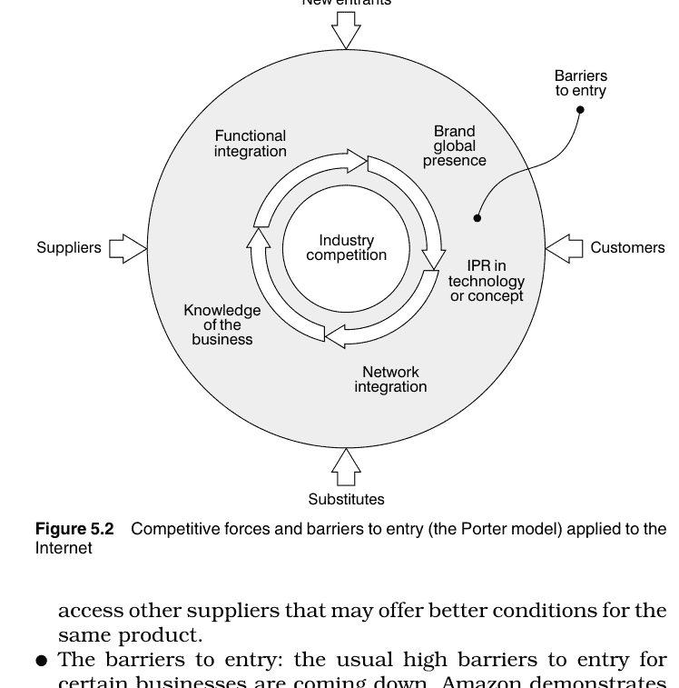

### 图 5.2 波特模型应用于互联网的竞争力量和进入壁垒

- 进入壁垒：某些企业的通常高进入壁垒正在降低。亚马逊完美地证明了进入壁垒正在降低，其虚拟书店提供的选择比绝大多数商店更多。

- 竞争对手和替代供应商：互联网缺乏边界保证了替代供应商和竞争对手大量存在。

互联网电子商务在以下意义上使教科书中完美竞争的理想更接近现实：

- 进入壁垒降低

- 交易成本降低

- 客户获取信息的能力增强

- 边际或以客户为导向的定价成为可能

- 最少的立法和监管以及公共当局的其他干预形式现已成为常态。

行业竞争预计会加剧，因为服务提供商越来越多地实施相同的通用概念。互联网与行业竞争相关的具体特征围绕着供应商权力增强。

## 供应商权力

互联网的供应商是技术和平台提供商（Yahoo、Microsoft 等）。平台提供商的目标是建立并控制主导标准。这种策略例如基于 Microsoft MS-DOS 作为 1980 年代事实上的标准操作系统的成功以及 1990 年代的 Windows，对其的控制使 Microsoft 在应用软件中获得了巨大的杠杆作用。

像 Microsoft 这样的技术提供商的市场主导策略意味着技术用户可以相对廉价地获得基础技术的主要部分。另一方面，这些技术用户无法从基础技术中获得战略优势，因为它通常是可获得的。他们可能处于强势地位以谈判特别优惠的价格，因为技术提供商强烈希望提高市场份额。未来情况可能会改变，如果相对规模较小的公司在特定情况下为高度专业化的先进服务提供关键技术，例如智能服务支持或一对一营销技术。

对现有业务这一威胁的反应是防御性的。特别是大型公司通过应用熟悉的品牌概念来应对它，我们现在将转向这一话题。

## 技术股票与品牌

品牌是技术公司产品战略决策中的一个主要因素。但什么是品牌，为什么对技术公司如此重要？“brand”一词的起源可以追溯到古英语，其中意为燃烧的木块。多年来它演变为指因强烈高温而产生之物，与给罪犯或牛烙印有关。

### 美国营销协会将品牌定义为

一个 **品牌** 是名称、术语、标志、符号或设计，或其组合，旨在识别一个或一组卖家的商品或服务，并将其与竞争对手区分开来。

Interbrand，一家专业的品牌咨询公司，对品牌有更具财务针对性的定义。Interbrand 将品牌视为一种无形资产，可创造可识别的经济收益流。他们对品牌估值的方法基于经济使用原则，这意味着品牌为基础业务增加的价值。品牌价值被定义为品牌预期在未来产生的经济利润的净现值。表 5.2 说明了世界上许多最知名的公司拥有品牌价值，而非资产价值，这在其市值中占有相当大的比例。

从本质上讲，品牌标识卖家或制造商。它可以是名称、商标、标志或其他符号。根据商标法，卖家被授予永久使用品牌名称的独占权利。品牌与其他资产如专利和版权不同，后者有到期日。

品牌本质上是卖家向买家持续交付特定功能、利益和服务的承诺。最好的品牌传达质量保证。但品牌是一个更复杂的象征。它可以传达多达六个层面的含义：

- (1) *属性*: 品牌让人联想到某些属性。Mercedes 让人联想到昂贵、做工精良、工程精良、耐用、高声望的汽车。

- (2) *利益*: 属性必须转化为功能性和情感性利益。属性“耐用”可转化为功能性利益：“我几年内不必再买另一辆车。”属性“昂贵”转化为情感性利益：“这辆车让我感觉重要且受人钦佩。”

- (3) *价值观*: 品牌也说明了生产者的价值观。Mercedes 代表高性能、安全和声望。

- (4) *文化*: 品牌可能代表某种文化。Mercedes 代表德国文化：有条理、高效、高质量。

- (5) *个性*: 品牌可以投射某种个性。Mercedes 可能暗示一个雷厉风行的老板（人物）、一头雄狮（动物）或一座严肃的宫殿（物体）。

- (6) *用户*: 品牌暗示购买或使用该产品的消费者类型。我们期望看到一位 55 岁的顶级高管驾驶 Mercedes，而不是一位 20 岁的秘书。

在数字世界中，消费者掌握控制权。数字发展使网络冲浪者能够仅根据实际价值而非仅仅是品牌联想等无形因素来选择产品。已经存在比较超过 10 000 种产品特性的网站，数字个人助理也会在网上搜索你要求的信息。这一发展实际上正在削弱品牌的影响力。

尽管存在这种长期品牌弱化的趋势，一个小型公司或新公司如果无法花费数百万美元进行昂贵的广告宣传，该如何竞争？特别是技术公司，在非传统营销方法上非常擅长实现品牌认知度。以下是两个例子：

### America Online Inc.

超过一半的美国家庭熟悉 America Online（AOL）。这是因为 AOL 免费赠送其软件。AOL 多年来一直在全国范围内投放软盘，现在是 CD-ROM，提供消费者一个月免费试用。由于很难向新手描述在线服务的益处，AOL 认为最好的方法是让他们试用。然后，一旦消费者开始使用 AOL，公司认为用户友好的程序会吸引他们订阅。此外，AOL 还受益于纯粹的消费者惰性，这阻止了许多人转换并注册其他互联网服务提供商。

### Sun Microsystems Inc.

Sun 几乎完全通过开展公关战，在企业界建立了 Java 这一旗舰软件程序的知名度。它主要将游击式公关瞄准公司的宿敌 Microsoft。例如，在 Microsoft 开发出与 Sun 的“Java Beans”竞争的技术后，Sun 得知 Microsoft 计划何时何地推出它。在 Microsoft 宣布的前一天，Sun 向记者邮寄了咖啡豆袋，附言写着“为什么 Microsoft 这么紧张？”并邀请他们参加 Sun 在 Microsoft 举办开发者大会并发布公告的酒店旁举行的 Java Beans 培训研讨会。Sun 表示这一策略很成功：它吸引了 250 多人，并在记者心中对 Microsoft 技术产生了怀疑的种子。“把它想成一次军事行动”，Sun 品牌营销副总裁 John Loiacono 说。

一些最有价值的品牌拥有微小（或在某些情况下几乎为零）的有形资产基础：Yahoo、Amazon 以及许多基于互联网的公司（见表 5.2）。在许多此类情况下，公司唯一的资产就是其品牌。因此品牌是一种“关系”、一种“声誉”、一套“期望”、一种承诺。即使考虑到股市波动

### 表 5.2 按品牌价值排名的世界最有价值品牌

| 排名 | 品牌 | 品牌价值（$US m） | 母公司市值（$US m） |

|---|---|---|---|

| 1 | Coca-Cola | 83 845 | 142 164 |

| 2 | Microsoft | 56 654 | 271 854 |

| 3 | IBM | 43 781 | 158 384 |

| 4 | General Electric | 33 502 | 327 996 |

| 5 | Ford | 33 197 | 57 387 |

| 6 | Disney | 32 275 | 52 552 |

| 7 | Intel | 30 021 | 144 060 |

| 8 | McDonald's | 26 231 | 40 862 |

| 9 | AT&T | 24 181 | 102 480 |

| 10 | Marlboro | 21 048 | 112 437 |

| 11 | Nokia | 20 694 | 46 926 |

| 12 | Mercedes | 17 781 | 48 326 |

| 13 | Nescafé | 17 595 | 77 490 |

| 14 | Hewlett-Packard | 17 132 | 54 902 |

| 15 | Gillette | 15 894 | 42 951 |

| 16 | Kodak | 14 830 | 24 754 |

| 17 | Ericsson | 14 766 | 45 739 |

| 18 | Sony | 14 231 | 28 933 |

| 19 | Amex | 12 550 | 35 459 |

| 20 | Toyota | 12 310 | 85 911 |

| 21 | Heinz | 11 806 | 18 555 |

| 22 | BMW | 11 281 | 14 662 |

| 23 | Xerox | 11 225 | 27 816 |

| 24 | Honda | 11 101 | 30 050 |

| 25 | Citibank | 9 147 | 42 030 |

许多科技公司的价值仍然远高于传统会计做法所认为合适的水平。

## 公司估值中的财务分析

在分析公司的财务状况时，无论是科技公司还是其他公司，都必须评估公司的定性和定量方面（见表5.3）。

### 定性公司分析

定性分析包括：

- 对业务的单独概览

- 对行业的概览

- 企业在行业中的地位

- 管理层概况

- 对‘事件风险’的分析 – 单一事件可能致命地影响公司的风险。

### 定量公司分析

定量分析包括：

- 损益分析

- 资产负债表分析

- 营运杠杆

- 盈亏平衡分析。

所有寻求在国际资本市场上融资的公司，包括科技公司，通常必须获得其中一家信用评级机构的信用评级。这些机构通过对资产负债表、损益账户和现金流量表的分析来评估偿还任何借款的能力。评级机构标准普尔(Standard & Poor's)采用的标准为分析任何公司的财务实力时应分析哪些财务信息提供了宝贵的指导（见表5.4）。

### 表5.3 定性公司分析

| 项目 | 描述 |

|---|---|

| **业务概览** |  |

| 公司历史 | 公司从何而来、将向何处去？这不仅关乎历史财务表现，还涉及寿命和文化（例如，公司是自然增长还是通过收购增长？）。如果一家公司能够在历史上的经济波动、技术、文化和外部世界的变化中存活下来，这可以公平地表明该公司未来将存活，尽管这并非保证 |

| 结构 | 公司结构是什么？子公司如何控制？资产位于/坐落于何处（即能否汇回）以及现金在何处产生？ |

| 股东 | 谁是主要股东，他们持有公司的利益/目的何在？他们能否提供支持？ |

| **行业分析** |  |

| 政治/经济重要性 | 是否存在政治风险？该行业是否具有国家、政治或经济重要性？必要时是否可能获得政府支持？ |

| 监管风险 | 监管环境是支持性的还是敌对的？这可能改变吗？影响会是什么？ |

| 规模/增长潜力 | 行业前景如何？是增长还是衰退？地平线上是否有任何技术变化，这对科技股来说是一个非常重要的考虑因素？有可能提价吗？是否有任何替代产品？行业是否正在整合？ |

| 竞争 | 行业的竞争结构是什么？行业是垄断、双寡头、寡头还是高度竞争？是否存在定价灵活性？ |

| 进入壁垒 | 进入壁垒是竞争优势，还是会阻碍公司？ |

| 盈利能力 | 行业是否盈利？一家公司可能非常高效且管理良好，但如果行业结构使其无利可图，则可能无法盈利 |

| 周期性 | 行业对经济衰退的抵御能力如何？过去的表现波动性如何，这对科技公司来说再次非常重要？周期性如何传导至利润率和现金流？ |

| 关键成功因素 | 行业是由价格、质量或服务、产品质量、分销能力或其他因素驱动的吗？其成功是否仅依赖于技术发展？客户为什么要购买该公司的产品？ |

| **业务地位** |  |

| 国家/政治风险 | 公司的母国和/或经营地点的经济、政治和监管条件是一个重要的起点，即所谓的‘自上而下’方法 |

| 规模 | 与竞争对手、供应商和买家相比，公司有多大？规模很重要，因为它通常意味着多元化或权力。此外，大型企业即使业绩受损也能在一段时间内生存，这对盈利能力低的科技公司尤其正确 |

| 产品组合/多元化 | 产品是新产品还是经过验证的？产品/服务是增值型还是大宗商品？研发支出占百分比是多少？产品的分布/组合是什么？单一产品公司通常风险更大，尽管这必须与产品范围内的多元化以及买家和供应商的分布相平衡 |

| 供需特征 | 公司是否有合同收入有效地保证最低现金流水平？是否有前瞻性订单簿？它在增长吗？公司相对于供应商和买家的议价能力如何？有替代方案吗？ |

| 劳动关系 | 罢工/中断可能吗？影响会是什么？减少员工人数和削减成本有多容易？ |

| 客户概况 | 客户是谁？他们为什么购买公司的产品/服务？他们的需求弹性如何？他们对价格的敏感度如何？公司是否继续赢得新客户？是否过度依赖某一个特定客户？ |

| 地理多元化 | 地理分布如何？这会缓冲还是加剧需求放缓？地理多元化可以通过将收入分散到不同市场来提供支持，从而使一个地区的周期性被另一个地区的增长所抵消 |

| 生产/技术要求 | 公司是否容易受到技术变化的影响？是否必须投资研发？业务是否资本密集？ |

| 营销和分销渠道 | 营销和分销有多有效和必要？公司必须在这方面花费多少？这是科技公司非常重要的因素 |

| **管理层概况** |  |

| 哲学和经验 | 管理层是谁？他们在公司待了多久，业绩记录如何？与同行相比，公司表现如何？ |

| 行业知识 | 管理层是引领还是跟随其他行业参与者？这会增加还是降低业务风险？ |

| 商业计划 | 是否现实？他们过去是否实现了计划？许多失败的互联网公司都有糟糕的商业计划 |

| 运营战略 | 管理层关注市场份额和销售，还是利润率？他们关注短期利润还是长期稳定？他们是否有远见做出正确的战略选择？ |

| 财务战略 | 这涵盖了会计政策和管理层对风险和债务的态度。是否计划收购还是公司专注于债务削减？ |

| 继任 | 是否由一人主导？是否有继任者？是否有平衡的团队？ |

| **事件风险** |  |

| 管理层变动 | 管理层变动，无论是因业绩不佳和股东压力而导致的董事会政变，还是退休后的自然更替，往往预示着新时代的开始以及战略或方向的改变。管理层变动应仔细监控 |

| 低增长 | 成熟的现金创造型业务可能看起来是一家强大/稳定的公司，但如果行业没有增长，管理层可能被迫改变方向或多元化以提升增长前景并满足股东。这可能导致承担更大的业务和/或财务风险 |

| 股价表现不佳 | 公司的管理层受公司股东雇佣。他们的主要责任是通过提高股息和股价上涨来提高回报，从而为股东利益经营业务。股价表现不佳的长期时期几乎不可避免地会产生后果，因为股东会表达不满。这通常会导致战略改变、管理层变动、更激进的财务结构以提高回报、收购以获得更高增长领域的 exposure，或最终失去独立性 |

| 监管变化 | 监管变化可以作为行业变化的催化剂 |

| 行业整合 | 通常，行业中某个特定的合并或收购将被证明是决定性的，并最终导致整个行业格局的变化。一旦行业开始整合，它就会自我延续。每个剩余公司都觉得有必要寻找合作伙伴以确保关键规模并保持其竞争地位 |

### 表 5.4 标准普尔八项关键财务比率

| S&P 比率 | 定义 | 用途 |

|---|---|---|

| 税前利息覆盖率¹ | 税前收入加上利息费用减去利息费用 | 这显示利润覆盖到期利息的次数。数值越高，利润下降的空间越大，超出公司无法支付利息的范围 |

| EBITDA 利息覆盖率 | (税前收入加上折旧加上利息费用减去资本化利息)/(总利息费用) | 这显示产生的现金覆盖到期利息的次数，并体现产生现金以偿还债务的能力。如上所述，覆盖率越高，在公司无法支付利息之前的安全边际就越高 |

| 运营资金（FFO）占总债务的百分比² | (扣除非经常性项目后的净收入加上折旧加上递延税加上非现金项目)/(总债务) × 100 | 这显示企业在支付利息和税款后但在再投资前产生的现金数量。百分比越高，公司偿还全部债务所需的时间越短。如果一家公司 FFO 为 100%，那么理论上它可以在 1 年内偿还全部债务 |

| 自由现金流占总债务的百分比³ | (扣除非经常性项目后的净收入加上折旧加上递延税加上非现金项目减去资本支出加上营运资本变动的增加)/(总债务) × 100 | 这显示企业产生的自由现金，即在对企业再投资（即营运资本和资本支出）后可用于债务偿还的金额。如上所述，百分比越高，在保持当前投资水平的同时，公司偿还债务所需的时间越短 |

| 永久资本回报率 | (税前收入加上利息费用减去资本化利息)/((总债务加上递延税项加上少数股东权益加上股东权益的两年平均值)) × 100 | 这显示企业对所用资源的回报。如果回报率不够高，股东可能会施压要求改善，从而增加收购或回购股份的风险，并增加收购要约的风险 |

| 销售收入的营业收入百分比 | (折旧前经营收入)/(销售额) × 100 | 这显示公司每笔销售产生的利润。比率越高，随着销售额增长，公司产生的经营利润越多 |

| 总债务占总资本的百分比 | (总债务)/(股东权益加上总债务) × 100 | 这显示企业所用资源中有多少由债务提供。百分比越高，企业债务越多，权益的“缓冲”越低。这很重要，因为虽然利息必须支付，但在需要时公司可以拒绝支付股息 |

| 长期债务占总资本的百分比 | (长期债务)/(股东权益加上长期债务) × 100 | 如上所述，这显示资源中有多少由 LTD 构成，因此企业在短期债务上的依赖程度如何 |

¹ 税前收入指税前利润、非经常性项目和少数股东权益。

² 净收入为税后、股息前。

³ 营运资本不包括现金、现金等价物和短期债务。资本支出为总额。


*来源：* Barclays Capital/Standard & Poors

由于终值基于明确预测期最后一年现金流，因此它成为估值中的关键数字。然而，由于科技公司此时可能尚未成熟，现金流预测的基础——利润率、资本支出等——并不总是合适。

DCF 的另一个主要问题是，由于它很大程度上基于预期值，因此未能认识到管理层在事情不如预期时改变战略以及利用新出现机会的能力所蕴含的价值。这使我们回到了估值科技和互联网股票时更主观的问题，例如商业模式、管理层的灵活性和质量，如第 5 章所述。除了这些 DCF 的问题外，资产估值问题再次凸显。

## 财务会计与无形资产

利润的准确计量是财务会计的基础。利润告诉我们两件事：收入超出成本的金额（衡量公司当前经营的经济价值）以及公司资产的增加额（在向股东进行任何现金分配之前）。正式地说，会计师将利润定义为“收入超过所有费用”。费用是“用于生产当前收入的商品、服务和设施的成本”（Estes, 1981）。

在企业购买生产中未耗用的投入的范围内，这些额外成本是投资，而非费用，并被资本化，即被视为资产。资本资产仅在资本资产在使用过程中价值下降的范围内产生费用，这一过程通常称为折旧或资本消耗。公司收益和公司资产计量的交织取决于对投资和资产的定义方式。为了理解投资定义如何影响利润计量，而这对估值科技股票非常重要，我们需要遵循公司利润会计的细节。

## 根据 GAAP 的世界

在美国，企业账簿由注册会计师根据一套称为“公认会计原则”（GAAP）的规则进行记账。根据 GAAP，“所有受 GAAP 覆盖的研发成本在发生时费用化”，即研发成本被视为企业当前费用的组成部分，这种处理方式降低了报告利润。研发成本中唯一不费用化的部分是购买具有项目之外的“替代未来用途”的耐用有形资产。对研发采取这种处理的理由之一是，如果研发被资本化，企业可能会被诱惑人为操纵利润。例如，通过假装企业的一些普通费用是研发，企业可能会掩盖亏损。另一部分理由是，研发支出比固定资产投资更具投机性（固定资产可能有替代用途，因此可以出售给他人，但研发旨在利用的产品可能不成功，因此没有替代用途）。

## 研发支出的费用化与资本化

鉴于科技企业对研发费用的处理方式，其报告收益具有误导性。在研发产品过于不确定且难以量化的理由下，会计准则通常要求所有研发费用在发生期间费用化。这一要求有若干后果，但其中最深远的一个是，研究创造的资产价值不会在资产负债表上作为企业总资产的一部分显示出来。

许多评论者认为，尽管有研发费用，但未来收益的不确定性应被资本化。为了说明会计原则如何影响市盈率，让我们举一个简单的例子。假设以下两个例子中收入 = $100，经营成本 = $50，研发支出为 $20，公司股价为 $1000。如图 6.1 所示，如果研发费用化，市盈率为 33.3，而如图 6.2 所示，如果资本化，则降至 21.7。

换句话说，通过费用化而非资本化研发，市盈率被高估。因此，市盈率在估值科技公司时存在严重局限性。这在使用市盈率进行投资决策时具有重大影响，如下所述。

损益账户（期末 t）

收入 = $100

经营成本 = $50

研发费用 = $20

收益 = $30

市盈率 = $1000 / $30 = 33.3

| 资产 | 负债 |
|---|---|
| 有形固定资产 $100 | 权益 $100 |
| 无形资产 $0 |  |
| 现金 $30 | 储备 $30 |
| 净资产 $130 |  |

### 图 6.1 研发费用化

损益账户（期末 t）

收入 = $100

经营成本 = $50

研发费用 = $4

收益 = $46

市盈率 = $1000 / $46 = 21.7

| 资产 | 负债 |
|---|---|
| 有形固定资产 $100 | 权益 $100 |
| 无形资产 $16 |  |
| 现金 $30 | 储备 $46 |
| 净资产 $146 |  |

### 图 6.2 研发资本化并按 20% 摊销

在所谓的“新经济”中，研发、技术知识、品牌等占公司价值的份额日益增加。但它们通常在经审计的账目中缺失，而这些账目本应显示公司价值有多大。正是因为这一悖论，历史上这些公司被赋予了高估值。市场正在估值资产，据说这些资产是传统会计原则未能捕捉到的。随着信息在新经济中变得更有价值，而信息是无形资产价值的核心，或许正如有人所说，是时候改变会计安排了。然而，如何对知识型资产进行估值的问题仍然存在。广告是建立品牌的投资是一种资产，还是仅仅是经营的另一项成本？软件开发应被计为投资，还是应被计为费用？

## 无形资产的作用：如果摸不着，它还有什么价值？

韦氏词典将“无形”定义为“代表价值，但没有内在价值或物质存在”的事物。无形资产缺乏内在价值或物质存在，这一事实使其价值难以准确界定，但这类资产往往在企业的价值中扮演重要角色，对科技公司而言尤其如此。那么，如何确定无形资产的价值呢？

每年，成千上万的公司通过股票发行、并购、合资和资产剥离寻求资金。这些都是常见的融资手段，用于筹集运营资本或让项目创始人得以退出。在所有这些情形中，公司估值都是关键环节。估值是买卖双方共同认可的公司资产总价值。

影响公司估值的资产有两类：有形资产和无形资产。

- **有形资产**是现实世界中有形的物理物品，包括现金、房地产、机器、设备、库存等。
- **无形资产**因其隐含的效用或价值而具有价值，包括专有知识、流程和产品、理想的市场细分、客户名单以及其他许多项目。

会计实践往往倾向于强调价值的客观衡量标准，这有其合理原因。这样做时，它们将企业本质上视为有形可交易资产的集合。然而，大多数企业的真正价值在于其无形资产。

企业未来收入和盈利中有多少归功于其市场份额以及自身和产品目前享有的声誉？有多少归功于长期与供应商和分销商建立的合作与知识关系？有多少归功于员工的专业知识和洞察力，尤其是他们开发的综合业务方法来生产产品和服务市场的能力？又有多少归功于企业内部创建的作为经营方式的系统和实践？资产负债表对这些问题以及企业未来盈利所依赖的其他组成部分只字不提。

## 无形资产的类型

许多企业都拥有无形资产，由于无形资产可能对特定企业具有独特性，任何清单都不可能完整无缺。然而，有些无形资产相当常见，在许多企业中都能找到。这些较为常见的无形资产包括：

- **专有名单：** 专有名单可包括客户名单、专利名单甚至邮寄名单，无论名单是由客户还是潜在客户组成。如果名单所代表的关系是持续性的，那么这些名单对企业可能尤其有价值。例如，一家杂志的广告客户名单。该杂志可能75%的广告收入来自名单上的公司。因此，这份名单对杂志未来的盈利能力至关重要。
- **有利合同：** 长期合同可以为企业增值。例如，公司可能拥有一份允许其以高于正常加价率销售产品或服务的合同；或者可能拥有一份允许其以低于市场价的利率购买或租赁物品的合同。
- **专利及专利申请：** 专利的价值取决于专利权利要求的强度（如果专利尚未经受诉讼考验，这可能难以确定），以及专利的经济寿命和法律寿命。
- **版权：** 版权的估值比专利更棘手，因为版权虽然可能具有较长的法律寿命，但其实际价值可能只在短期内存在。对于过时迅速的技术作品尤其如此。版权的价值还取决于作者以往的成功经历。
- **商标和品牌名称：** 如果品牌名称或商标能使公司以高于竞争对手的价格或更大的数量销售产品，那么它就具有价值。
- **订阅和服务合同：** 订阅对报纸、杂志和有线电视公司尤其重要，因为其收入的很大一部分基于订阅。无论是订阅还是服务合同，有效期越长，价值越高。
- **特许经营协议：** 具有长期经营记录和知名品牌的特许经营权比新兴的不太知名的特许经营权更具价值。在特许经营占主导地位的某些行业（如酒店业）尤其如此。
- **软件：** 许多公司开发了适合其业务专有的软件。如果该软件提供了企业如果没有该软件就无法获得的效率和效益，那么它就是一项独立资产。
- **商誉：** 商誉对不同的人有不同的含义，但通常指导致回头客的声誉和地理位置等无形资产。

## 无形资产估值方法

无形资产估值可采用三种基本方法之一：创建成本法、收益或节省资本化法，或现金流量折现法。某些行业中的某些资产确实存在经验法则公式，但这类公式更适合提供估值估计值，以供与其他方法确定的价值进行比较。

## 创建成本法

无形资产估值的创建成本法依赖计算另一家企业今天复制给定资产所需花费的成本。该方法不衡量资产对未来利润的影响，而是仅仅看在特定时间点从头创建该资产的成本。

可采用创建成本法估值的资产包括：

- 内部软件
- 专利
- 商标
- 版权
- 订阅
- 客户名单
- 服务合同

## 收益或节省资本化法

资本化法衡量无形资产将为企业带来的未来收益，确定这些收益何时产生以及持续多长时间。该方法中使用的资本化率应反映被估值无形资产相关的风险。

除了无形资产可能为企业带来的收入外，收益还可能包括企业因拥有该资产而节省的成本，或无需向资产所有者支付特许权使用费而节省的成本，或该资产带来的效率收益。

该技术适用的无形资产包括：

- 商号
- 客户名单
- 商业软件
- 专利
- 商标
- 品牌名称

当这些资产相对较新时，资本化法对所有此类资产都适用。然而，当它们接近经济使用寿命结束时，其他估值方法可能更合适。

## 现金流量折现法

现金流量折现法适用于具有可预测寿命和未来财务收益的资产，包括：

- 合同（当前和未来的年度收益）
- 订阅和服务合同
- 专利特许权使用费

## 科技股估值中的方法论问题

会计问题在股票估值中始终很重要，尤其是在基于损益表数据倍数进行估值的情况下。我们将在第8章和第9章更详细地讨论应用倍数概念的作用。商誉、股票期权、在研研发、联营法与购买法会计等常见会计问题都与互联网和科技股以及其他公司相关。然而，这些问题已得到相当充分的理解。

当今倍数比较的特点之一是使用损益表中更高层级的指标，如现金收益或EBITDA。其目的是通过消除商誉摊销和折旧来缓解会计差异引起的可比性问题，因为这些会计处理方式差异很大，尤其在涉及跨境比较时。事实上，这种消除会计扭曲的愿望有时会导致投资者通过市销率或企业价值/销售额倍数关注收入顶线。然而，这往往对科技股和互联网股票效果不佳，部分原因在于会计问题。

在大多数行业中，收入线被认为相对不受会计扭曲影响。但科技股和互联网股票并非如此，因为收入确认是最有问题的领域之一，而且由于快速增长，这可能导致报告的收入差异巨大。鉴于销售倍数在科技和互联网估值中的重要性，这些会计问题具有重大意义。

附录6.1中列出的互联网和科技股会计问题通常与收入和费用的分类及确认时间有关。关于总额与净额收入、易货交易、销售激励和预付费用的监管指引实施后，通常会导致收入降低（或预付费用情况下收入延迟确认）。

### 附录 6.1

### *互联网和科技股估值中的关键会计问题*

| 问题 | 描述 | 美国 FASB 监管指引 |
|---|---|---|
| **总收入或净收入** | 一些互联网公司作为第三方产品或服务的销售中介，不承担所有权的风险和回报。例如，产品退货或坏账销售的风险由第三方承担。互联网公司中常见的做法是将向客户收取的全部金额确认为收入（毛收入），而不是这些公司最终保留的费用或佣金金额（净收入）。摘自 Cheap Tickets 截至 1999 年 12 月 31 日期间的年度报告：*关于公布的票价，Cheap Tickets 在其损益表中仅记录 Cheap Tickets 在销售此类票价时赚取的佣金。毛预订额代表公布票价销售的零售价值。关于未公布的票价，Cheap Tickets 损益表中报告的收入相当于毛预订额，即此类票价的零售价值。理想情况下，这应仅作为净额列示* | 如果一家公司在交易中充当中介，且不承担所有权的风险和回报，则该公司应报告净收入 |
| **广告以物易物交易** | 互联网公司之间流行的一种交易类型。通常，两家互联网公司交换在对方网站上投放广告的权利。双方公司均确认与该交易相关的收入和成本。如果互惠交易发生在同一季度，则由此交换产生的收入和成本相互抵消，对净收入没有影响。摘自 Sportsline.com 截至 1999 年 12 月 31 日期间的年度报告：*以物易物交易，即公司以其网站上的内容或广告换取广告或其他服务或商品，分别约占 1999 年、1998 年和 1997 年总收入的 17%、19% 和 19%* | 只有当以物易物交易的公允价值能够从该实体向与以物易物交易对手方无关的买方销售类似广告的历史（不超过六个月）中轻易确定时，才应确认收入和费用 |
| **网站开发成本** | 这些包括开发公司网站和服务（如聊天室、搜索引擎和电子邮件）的成本。这对许多互联网公司来说是一项重大成本。摘自 Ebay 截至 1999 年 12 月 31 日期间的年度报告：*公司的在线销售和传统拍卖业务的销售和营销费用主要由*公司销售和营销人员的薪酬、广告、展会和其他促销成本、公司网站创意设计的费用以及共享员工和设施成本组成 | 此类成本的大部分应作为内部使用开发的软件成本处理。SOP 98-1 规定，初步阶段发生的软件成本应费用化，但在满足某些技术标准后，直接成本和利息成本应资本化 |
| **返利、折扣和其他销售激励** | 这些是指互联网公司提供的某些销售激励措施。例如，免费一个月服务、电子商务零售商提供的折扣券，或 ISP 为换取客户同意订阅三年互联网服务而提供的返利。这些成本通常计入营销费用。摘自 Barnesandnoble.com 截至 1999 年 12 月 31 日期间的年度报告：B&N.com 已在截至 1999 年全年的营销费用中计入约 600 万美元的优惠券兑现额，占销售额的 3%。1998 年未兑现任何优惠券。如果 B&N.com 在 1999 年将优惠券兑现作为销售和营销费用的减少处理，毛利率将从 21.0% 下降至 18.6%，而营销和销售费用占销售额的比例将从 55.1% 下降至 53.7%。 | 此类返利和折扣应视为收入的减少 |
| **一次性费用** | 一些互联网公司对在一段时间内提供的服务收取预付费用。例如，拍卖上架费、访问或维护网站的费用，或提供广告的费用。据报道，一些公司立即将这些费用确认为收入。摘自 Ebay 截至 1999 年 12 月 31 日期间的年度报告：*公司已审阅美国证券交易委员会会计准则公告（‘SAB’）第 101 号《财务报表中的收入确认》，并评估其对上架费和精选商品费用收入确认的影响* *尽管公司认为 SAB 101 对历史上市和精选商品费用收入的影响不重大，但 eBay 已在 2000 年第一季度采用了上架费用收入的规定。因此，上架费和精选商品费用收入将在预计的销售上架期内按比例确认* | 预付费用应在提供服务的期间内按比例确认 |

来源：UBS 华宝全球股票研究，*穿越 I 估值丛林*，2000 年 5 月

## 气泡学、股票市场和互联网及科技股价格崩盘*

> （美国联邦储备委员会主席 Alan Greenspan 在美国国会联合经济委员会的证词，1999 年 6 月 17 日）

Alan Greenspan，美国联邦储备委员会主席，在科技股价格崩盘前很久就发表了本章开头的言论。然而，正如本章将看到的那样，股票市场中是否存在“泡沫”这一问题引发了许多复杂问题。格林斯潘的评论，特别是他在 1996 年提出的金融市场遭受“非理性繁荣”的说法，引发了关于股票市场是否容易出现投机泡沫的辩论，如果存在，又如何由金融经济学家来识别它们。

### 互联网和科技股价格崩盘

在格林斯潘的评论之后，可以回顾 2000/2001 年科技股价格崩盘，从中可以吸取哪些教训。凭借事后诸葛亮的智慧，我们可以看到

*本章的内容在 Brian Kettell 所著的《Financial Economics》，由 Financial Times–Prentice Hall 于 2001 年出版的书中有更详细的讨论。

凯恩斯写道，股票市场“是一个音乐椅游戏、Snap 游戏，赢家是那个比其他人提前一小步行动的人”（1936 年）。因此，在凯恩斯看来，股票市场是一个投机者预期“平均意见预期平均意见是什么”而不是关注市场本身的基本因素的环境，包括预期未来股息等。这里的含义是，如果资产市场存在泡沫，价格将与其长期基本价值不同。

只有最近才对泡沫的存在进行了认真的研究。直到最近，经济理论基本上对经济主体如何形成对未来价格的预期没有限制。因此，泡沫的民间传说应运而生。这些包括十七世纪荷兰的郁金香泡沫、十八世纪英国的南海泡沫以及二十世纪二十年代美国的股价上涨。所有这些事件在随后资产价值崩盘后都被标记为泡沫。然而，正如下面所讨论的，理性预期的广泛采用提供了一个便于对泡沫进行实证研究的模型。

但在继续之前，我们首先需要描述“泡沫学家”使用的术语。

## 气泡术语

遵循经济学的技术语言，“泡沫”是与“基本价值”任何偏离，无论向上还是向下。基本价值是一个在理论上比实践中更容易定义的概念。该概念指的是基于企业真实经济价值而非投机的股票应售价格。假设是股票价格最终（无论何时）会回归其基本价值，尽管在任何一个时刻可能有许多外部因素影响它们。

泡沫是在一段较长时间内向上价格运动然后崩溃。延长负面泡沫是崩盘。“噪音”指的是围绕基本价值的小幅价格波动。因此，泡沫是资产价格与其基本市场价值不同的情况。关于理性泡沫，如下所述，投资者可以理性地预期泡沫正在发生，因为资产价格高于其基本价值，但他们仍然继续持有该资产。他们可能会这样做，因为他们相信未来会有人以更高的价格买入该资产。在一个

在理性泡沫中，资产价格因此可能长期偏离其基本价值，因为泡沫的破裂无法预测，因此不存在未被利用的盈利机会。

当一只股票处于理性泡沫中时，资产的收益率高于正常水平，以补偿持有者因资产价格可能突然跌至其基本价值而承受的风险。而对于所谓的理性泡沫，资产持有者愿意接受较低的收益率，因为资产价格可能突然上涨至其基本价值。

## 预期在分析股市泡沫中的作用

关于未来的信念是当今行为的重要决定因素。在关于“泡沫”是否存在的讨论中，不同预期形成观点之间的重大分歧处于核心位置。关于预期的不同观点可以有效地分为三类：外生预期、外推预期和理性预期。

### 外生预期

一些经济学家对于预期如何形成这一关键问题几乎持完全不可知论的态度。在分析经济行为时，他们只是将预期视为外生的或给定的。预期是分析的输入之一。分析可以展示预期变化带来的后果。例如，预期未来利润的增加可能会提高公司的股价。但是，这种外生预期的假设意味着分析不探究预期变化的原因。特别是，它与其他分析部分无关。在预期给定的情况下，不存在从产出上升到未来更高利润预期的自动反馈。


因此，在分析中使用外生预期的经济学家，充其量只能对经济运行方式给出不完整的解释。在最坏的情况下，他们完全忽略了所分析变量与作为分析输入的预期之间一些不可避免的反馈。另一方面，由于对预期进行建模仍然是一个有争议的问题，这种方法的支持者可能会辩称，可以以特设方式探索对预期的各种可能反馈。

### 外推预期

在讨论泡沫是否存在时，使预期内生化（即由分析中其他部分的情况决定）的一种简单方法是，假设投资者通过外推近期利润的表现来预测未来利润，或通过外推过去的通胀来形成对近期通胀的预期。这种方法的支持者认为，它提供了一个简单的经验法则，并且与许多投资者在现实世界中的做法相符。

### 理性预期

假设货币增长率稳步上升，通胀持续加速。外推过去的通胀率会持续低估未来的通胀。许多经济学家认为，人们会持续使用一种反复犯同样错误（比如说，低估未来通胀）的预测规则，这是不可思议的。理性预期假说做出相反的假设：平均而言，投资者对未来的猜测是正确的。他们不会使用系统性给出过低或过高预测的预测系统。预期出现系统性错误的任何倾向都会很快被发现并纠正。

这绝不是说每个人每时每刻都能完全正确地预测一切。我们生活在一个充满风险的世界，不可预见的事情时有发生。2001年9月11日对纽约的袭击就是明证。预期很少能够实现。理性预期理论认为，人们会充分利用当前可获得的信息，不会做出已知不正确的预测。只有真正不可预见的事件才会导致当前的预测出错。有时投资者会低估，有时会高估。但任何系统性高估或低估的倾向都会被注意到，预期形成的基础将得到修正，直到猜测平均而言是正确的。

“泡沫”是否存在取决于人们采用这三种预期模型中的哪一种。采用理性预期假设已大大澄清了价格泡沫的性质。在理性预期下，研究人员可以指定一个泡沫模型，然后对其进行检验。如果预期的市场价格变化率影响当前市场价格，研究人员就有一个可以使用的模型。这并不是说这件事很简单。模型中存在一种不确定性，因为研究人员事实上面对着需要解释的对象——市场均衡价格，以及两个变量——市场价格和预期的市场价格变化率——这两个变量在经济系统内相互关联。

当实际市场价格与其自身预期变化率正相关时（这通常发生在资产市场中），泡沫就可能出现。由于形成理性预期的行为人不会犯系统性的预测错误，价格与其预期变化率之间的正相关关系意味着价格与其实际变化率之间也存在类似的关系。在这种情况下，任意的、自我实现的价格变化预期可能独立于*市场基本面*而驱动实际价格变化。这种情况被称为*价格泡沫*。

市场基本面的明确定义取决于特定模型的结构；事实上，如果没有详细描述市场运作的精确模型，泡沫的概念本身就毫无意义。没有这样的模型，就不可能既定义市场基本面，又将其与是否存在泡沫区分开来。

## 泡沫与有效市场假说（EMH）

有效市场理论将理性预期理论应用于证券定价。有效市场假说有三种形式：弱式、半强式和强式。

- 有效市场假说的**弱式**认为，价格充分反映了历史价格序列中所包含的信息。

因此，投资者无法基于对过去价格模式的分析来制定投资策略，从而获得超额利润。

- 有效市场假说的**半强式**认为，当前股价不仅反映历史价格信息，还反映与公司证券相关的所有公开可用信息。如果市场在这种意义上是有效的，那么分析资产负债表、损益表、股息变动或股票拆分的公告，以及有关公司的任何其他公开信息（我们在第4章讨论的基本面分析技术），都不会产生超额经济利润。

- 有效市场假说的**强式**认为，任何市场参与者所*知晓*的关于公司的所有信息都已完全反映在市场价格中。因此，即使拥有特权内幕信息的人也无法利用它来获得优异的投资结果。市场价格完美地揭示了所有私人信息。

理性预期理论指出，预期不会偏离利用所有可用信息做出的最优预测（对未来的最佳猜测）。理性预期理论之所以有意义，是因为对人们来说，没有对未来的最佳预测代价高昂。该理论有两个重要含义：（a）如果变量的变动方式发生变化，那么对该变量预期的形成方式也会发生变化；（b）预期的预测误差是不可预测的。

有效市场假说的启示是，泡沫不可能存在，因为市场是“有效的”，也就是说，价格反映了关于一项资产的所有可用信息。有效市场假说的信奉者相信股票总是被正确定价，因此倾向于否认过度投机与随后发生的经济危机之间存在联系。然而，有效市场假说所依赖的必要假设必须同时成立。因此，有必要检验这些假设在多大程度上成立。

1987年10月19日的股市崩盘应让我们质疑有效市场理论和理性预期的有效性。有效市场假说的批评者不相信一个理性的市场环境能够产生如此巨大的股价波动。股市崩盘应在多大程度上让我们怀疑理性预期和有效市场理论的正确性？

理性预期理论中没有任何内容排除股票价格单日大幅变动的可能性。股票价格的大幅变动可以

新信息导致的结果，会使对企业未来估值的最优预测发生急剧变化。一些金融经济学家指出，对于为什么对企业未来价值的理性预期在1987年10月19日骤然下降，存在许多可能的解释：国会限制企业收购的动向、贸易逆差表现不佳、国会未能大幅削减预算赤字、对通胀的担忧加剧、美元贬值，以及对银行业财务压力的担忧加剧。另一些金融经济学家则怀疑这些解释是否足以说明股市下跌，因为这些市场基本面因素中没有一项显得足够重要。

1987年黑色星期一股市崩盘给出的一个教训似乎是：除了市场基本面之外，其他因素也可能对股价产生影响。因此，1987年的崩盘使许多金融经济学家相信，有效市场理论的强式版本——即资产价格反映证券真实基本面（内在）价值——是错误的。他们认为，市场心理和市场的制度特性在股价决定中扮演重要角色。然而，这种观点与有效市场理论中理性预期背后的基本推理——市场参与者会消除未被利用的盈利机会——并不矛盾。即使股票市场价格并非总是只反映市场基本面，这也不意味着理性预期不成立。只要股市崩盘是不可预测的，理性预期理论的基本道理就依然成立。

## 理性泡沫

如前所述，凯恩斯（1936）以他的观察而著称：股票价格可能不受对“基本面”客观看法的支配，而是受“一般意见预期一般意见将会如何”的支配。他对预测股价所作的类比，就是试图预测选美比赛的获胜者。客观美不一定是要害；重要的是，一个人认为其他评委对美的看法将如何体现在他们的投票中。

理性泡沫之所以产生，是因为理性预期模型的解具有不确定性；对股票而言，这种不确定性隐含地反映在所谓的股价欧拉方程中。该方程表明，你今天愿意为一只股票支付的价格，取决于你认为未来某一时点能以什么价格卖出。欧拉方程的标准形式决定了一个价格序列，但不能“锁定”一个唯一的价格水平。不过，一般来说，欧拉方程并不排除你今天支付的价格可能包含一个爆炸性泡沫。

虽然人们当然可以试图把股票价格的持续上涨或下跌解释为某种非理性行为，例如“羊群效应”或“市场心理”，但近期的研究强调，这种剧烈波动或“泡沫”可能与理性行为假设相容。即使交易者完全理性，实际股价也可能包含“泡沫成分”，因此股价与其基本面价值之间可能出现背离。

所以，理性泡沫的支持者试图证明：即使参与者同质、理性，市场在信息上是有效的，股票的市场价格也可能偏离其基本面价值，甚至可能大幅偏离。为此，他们必须证明，市场价格可以等于基本面价值加上一个“泡沫项”，而理性参与者仍愿意持有该股票，并且无法获得超常利润。

必须强调，关于投机性泡沫是否存在，很难得出确凿的结论。检验理性泡沫存在严重的经济计量困难。这类检验关键取决于对资产回报率的正确设定。拒绝无泡沫假设，很可能是因为对基本面的基础模型设定有误。

## 历史上一些著名的泡沫

考察历史上一些最著名、最终以投机性崩溃收场的泡沫，很有启发意义。被分析最多的是1636年荷兰的郁金香狂热、1711–1720年英国的南海泡沫，以及1929年华尔街崩盘。近期的实证研究，特别是对郁金香狂热和南海泡沫的研究（Garber, 1989a, b, 1990），对这些事件是否属于泡沫提出了质疑。但描绘一下这些历史图景仍然是有益的。

### 郁金香狂热

欧洲关于郁金香的最早记载出现在1559年。当时，一位奇异植物收藏家、议员休瓦特从君士坦丁堡的一位朋友那里收到一批郁金香球茎，并把它种在德国奥格斯堡的花园里。他的郁金香引起了很大关注；此后几年，这种花在上层阶级中越来越受欢迎，尤其是在德国和荷兰。在荷兰，以高昂价格直接从君士坦丁堡订购球茎成了一种习惯。到1634年，这种习惯已日益普遍；从那时起，荷兰富裕社会认为没有郁金香收藏便是品味低下的表现。

郁金香球茎的价格逐年上涨，最终达到天文数字。根据对郁金香狂热高峰期的一手记载，在一次交易中，一个稀有的“Semper Augustus”品种球茎支付了如下价钱：4600弗罗林、一辆新马车、两匹灰色母马，以及一副完整的笼头和挽具。按今天的币值计算，4600弗罗林相当于150万美元！另一个稀有品种“Viceroy”的单个球茎，则以24车谷物、8头肥猪、4头奶牛、4桶麦芽酒、1000磅黄油和几吨奶酪的价格售出。

1636年初，对郁金香球茎的需求急剧上升，人们开始在荷兰多个城镇的交易所买卖郁金香。郁金香不再只是富裕收藏家购买的对象，投资者和投机者也加入进来。哪怕价格稍有下跌，他们也会买进，以便日后卖出获利。为了方便保证金交易，郁金香期权被引入，所需保证金只有10%–20%。各行各业的普通人都开始变卖资产，投资于这个诱人的市场。

荷兰的郁金香繁荣也引起了国外关注，资金开始涌入市场。这些资金把土地、房产、奢侈品以及郁金香的价格推升至新的纪录高位。财富不断增长，在旧的上层阶级之外又增加了一个日益壮大的暴发户群体。这个新的富裕阶层靠郁金香球茎赚了钱，又把钱再投资于郁金香球茎。据说，乌得勒支有一位酿酒商甚至用自己的酿酒厂换取了三个珍贵的郁金香球茎。

1636年9月和10月，市场心理开始改变，疑虑开始出现。人们怎么能确定三个郁金香球茎值一座酿酒厂的钱呢？开始能听到压抑的嘲笑声。谁说一个郁金香球茎究竟值什么钱呢？恐慌攫住了市场，价格开始直线下跌。

许多暴发户不得不面对这样一个事实：他们所拥有的财富只是没人想要的郁金香球茎，再减去他们无法偿还的经纪人现金贷款。政府试图寻求折中方案，宣布1636年11月之前签订的所有郁金香合约无效，而此后的所有合约将按原值的10%履行。但价格跌破了这10%，破产数量一天天增加。郁金香狂热之后，荷兰陷入萧条，这个国家用了许多年才恢复过来。

加伯（Garber, 1989a, b）指出，关于郁金香狂热的通行说法忽略了讨论球茎的市场基本面价格本应是多少。为了对郁金香球茎价格形成预期，加伯收集了各种高价值郁金香球茎的价格模式数据。他发现，稀有球茎被报道的极高价格及其迅速下跌，反映的是球茎市场的正常定价行为，不能解释为市场非理性的证据。加伯指出，严肃的交易者并不理会这个市场，而且市场参与者反正也几乎没有什么财富。加伯得出结论：当时的郁金香价格可以用市场基本面来解释，郁金香狂热算不上是泡沫。必须强调，他的研究结果一直备受争议。

### 南海泡沫

另一个具有启发意义的泡沫例子，是18世纪初英格兰的投机活动。1711年，牛津伯爵在当时一批商人的资助下创立了南海公司。该公司的全称是“大不列颠商人前往南海及美洲其他地区以促进捕鱼业的总督与公司”。公司承担了近1000万英镑的英国国债，换取6%的保证年金，并垄断了与拉丁美洲的所有贸易。

公司成立后不久，就有谣言称，在南海进行贸易可获得难以置信的利润；据说英国货物在那里可以换取黄金和

来自秘鲁和墨西哥“取之不尽”的银矿的白银。事实上，西班牙殖民政权每年只允许一艘英国船只停靠，并为此收取全部利润的四分之一和营业额的5%。在证券交易所，南海公司的股票交投清淡，价格往往一个月仅波动两三个点。

1717年，国王建议再次将国债“私有化”。该国的两家大型金融机构——英格兰银行和南海公司——各自提交了解决方案。经过激烈的议会辩论，最终决定允许南海公司以每年5%的利率承担进一步的债务。

但在1719年，法国发生了一件对这家英国公司意义重大的事件。一位富裕的绅士约翰·劳在巴黎创立了“Compagnie d’Occident”（西方公司），用于与美洲的密西西比地区进行贸易并开拓殖民地。通过一系列操作，约翰·劳成功在这家公司的股票上掀起一波大规模投机浪潮，股价从8月9日的466法郎升至四个月后的1705法郎。买家既有法国人也有外国人，这促使英国大使请求国王陛下政府采取行动，阻止英国资本大规模流向法国证券交易所的“密西西比泡沫”。密西西比泡沫于1719年12月2日破裂；在随后的崩溃中，投资者为了寻找有利可图的机会，将资金从法国转移到英格兰。

国债的进一步私有化为南海公司的主要股东提供了一个诱人的机会，他们现在提出接管英国政府的全部债务。1720年1月22日，下议院任命了一个委员会来审议该提案。尽管有许多警告，2月2日仍决定向议会提交法案。投资者对该公司进一步资本化的前景感到欣喜，在法国资金流入的支持下，股价在几天内升至176英镑。在法案的进一步宣读过程中，有关可获难以置信利润的新谣言开始流传，股价进一步升至317英镑。

即便在这个价格上，该公司的原始创始人和联合董事们仍能获得在当时标准看来巨大的资本收益，而此时公司几乎没有任何业务。这激起了他们更大的胃口，新的正面谣言被散布开来；4月12日，以每股300英镑的价格新发行了100万英镑的股票。此次发行被超额认购两倍，几天后股票交易价格为340英镑。随后公司宣布将对所有新旧股票支付10%的股息，并再次以每股400英镑的价格邀请认购100万英镑。这次也同样超额认购。公司仍然几乎完全没有任何业务。

许多其他公司也搭上了这辆投机花车，发行自己的股票。然而，1720年6月11日，国王宣布其中一些公司为“公害”，并处以罚款禁止其股票交易。麦凯（1841）描述了一份被禁的104家公司名单。

尽管政府做出了努力，新的泡沫仍然每天出现，投机狂热继续升温。图7.1描绘了南海泡沫的发展过程。1720年5月28日，南海公司的股票以550英镑的价格成交。从这一已经相当惊人的水平，6月份股价升至700英镑以上。在此期间，价格波动极为剧烈，出现大幅周期性变动。仅6月3日一天，午前价格跌至650英镑，午后再次升至

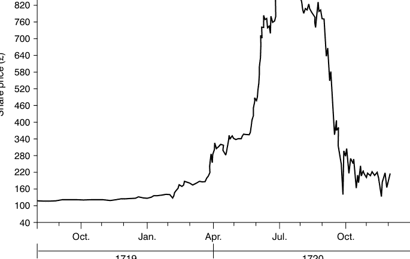

图7.1 南海泡沫，1719–1720年。来源：L. Trede，《金融心理学》。经约翰·威利父子公司许可转载

750英镑。许多大型投资者利用高价获利了结，将利润再投资于从土地、商品到房地产和其他股票等各种资产。然而，其他人则重新买入南海公司的股票，其中之一是物理学家艾萨克·牛顿。在股票早期上涨期间，他卖出了所有南海股票，获利7000英镑。仲夏时节，他又买入了，这笔交易最终让他损失了20000英镑。

6月初，南海股票再度上涨，在短暂的神奇时刻，1720年6月24日，该证券以1050英镑的价格成交。但只有少数人意识到，投资者的时间所剩无几。知情者是公司的原始创始人和董事会主席，他们利用早先的高价抛售了自己的股票。8月初，这一不祥的事实开始向公众泄露，股价开始缓慢而稳定地下跌。

8月31日，南海公司管理层宣布未来12年将支付50%的年股息。这本来会彻底耗尽公司的现金，但这一消息并没有阻止投资者日益加剧的不安。9月1日，股价继续下跌；两天后跌至725英镑时，恐慌爆发。在该月余下的日子里，该证券一路暴跌；当9月24日公司银行被宣告破产时，跌势进一步加速。该月最后一天，该股票可以150英镑的价格买入。仅在三个月内，它就下跌了85%。

该公司最终于1855年解散，其股票转换为债券。在其存在的140年中，该公司从未在南太平洋海域进行过任何具有显著规模的贸易。

### 1929年华尔街股灾

1929年华尔街股灾是历史上最疯狂的投机狂潮之一的结局，但正如最近的科技股崩盘所表明的，它几乎肯定不是最后一次。在截至1924年的若干年里，美国道琼斯工业指数在一个相对狭窄的价格区间内波动，每当达到110点时就会面临强劲的抛售压力。从1921年股市极度低迷到1928年，工业产出每年增长4%，1928年至1929年增长了15%。通胀水平很低，新兴产业到处涌现。

这种日益高涨的乐观情绪，加上容易获得廉价资金，刺激了股票投资者；在1926年暂时逆转之后，几乎每个月股市都会上涨，造就了一批新的富有的投资者。随着股票投资日益流行，投资信托的数量不断增加。从1921年之前的约40家，增加到1927年初的160家，并在同年年底达到300家。从1927年初到1929年秋，投资信托的总资产增长了十倍以上，对这些公司的信心几乎无限。

1929年10月24日，成交量达到1200万股。然而，紧张情绪已经出现，恐慌显而易见。由于局势明显失控，10月25日，胡佛总统发表了如下声明：“国家的基本产业，即商品的生产和分配，正处于稳健和繁荣的基础之上。”

胡佛的声明与船长宣布船只*没有*沉没一样，具有同样的安抚效果。恐慌加剧，随后几天价格继续下跌。这

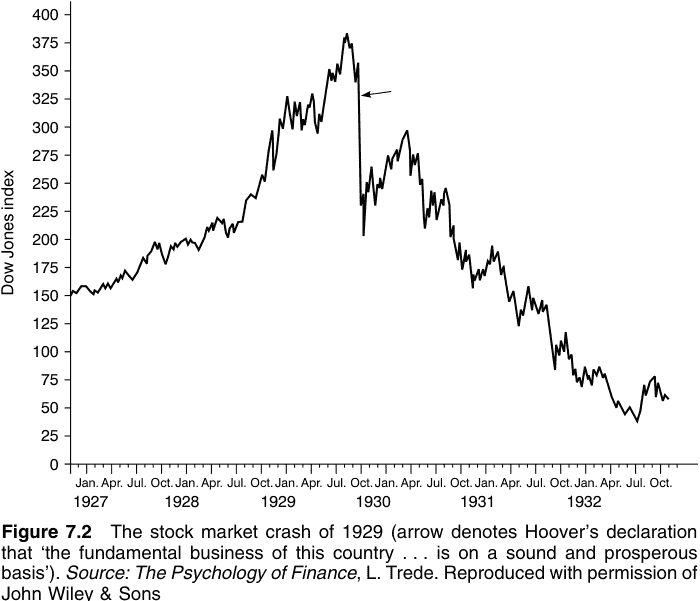

终于在10月29日达到高潮：在一波强制抛售浪潮中，1600万股以任何价格成交。传说交易所的一名信使想到对一批没有买家的股票每股出价1美元——而且他成交了。直到11月13日指数触及224点，价格才开始稳定下来，如图7.2所示。

1930年，价格再次开始下跌，继续跌至1932年7月8日58点的谷底。

## 投机泡沫理论

根据投机泡沫理论，股市投资更多地关乎投机泡沫的膨胀和破裂，而非投资者做出理性的长期预测。在投机泡沫理论下，资产价格之所以能被推高至其内在价值之上，是因为一些市场参与者相信，明天会有其他人愿意出更高的价格购买它。在一段时间内，这种信念自我维持，市场兴旺繁荣；但最终，参与者会对价格还能进一步上涨失去信心，市场便会崩溃。

这一理论也被马尔基尔（2000）称为“空中楼阁”理论，其基础是通过出售空中楼阁而大发横财的兴奋感，其渊源由来已久，上文仅讨论了其中一部分。麦凯（1841）提供了一份令人印象深刻的南海泡沫仿效者名单。例如，有人创立公司是为了设计永动机轮、从铅中提取白银、建造船只打败海盗，这些公司的股票都具有投机泡沫的特征。

然而，这一奖项必须颁给那个不知名的人物，他创办了一家“从事一项极为有利的事业，但没人知道是什么事业”的公司。招股说明书承诺了闻所未闻的回报。上午九点认购开始时，来自各行各业的成群结队的人几乎要挤破门来认购。五小时内，已有约4000英镑现金交了上来。发起人随即关门大吉，从此音讯全无！

## 理性投机泡沫

哈杜维利斯（1988）认为，投机泡沫可能由一个与……无关的外部事件触发。

基本经济状况；一群投资者预期获得巨额资本收益而买入，其他人随之效仿，而没有对诸如未来股息或利率等经济因素给予应有的关注。如果这种行为持续下去，它可能会自我强化，因为连续的买入浪潮推高价格。投机泡沫随后可能非常突然地破裂。被高估的市场很脆弱，一条相对不重要的“坏”消息就可能轻易引发悲观情绪并触发抛售浪潮。


寻找市场高估或投机泡沫的传统方法是在疑似泡沫期间统计异常高回报的数量，并评估这些高回报的总数量可能由偶然产生的可能性（`Blanchard and Watson, 1982`）。异常高回报（或正的“异常”回报）是指高于无风险利率加上通常风险溢价的回报，该溢价是为补偿厌恶风险的股东因其证券回报的不确定性而必需的。在没有投机泡沫的情况下，异常高回报的非常大数量通常只有很小的概率会偶然发生。因此，大量异常高回报构成了与投机泡沫存在一致的证据。

不幸的是，尽管简单，传统检验在检测投机泡沫方面的统计功效很低；股价波动性很大，其波动会产生大额正回报和大额负回报。后者往往掩盖任何存在的泡沫证据。

为了构建更强大的泡沫检验，有必要对泡沫的发展做出更精确的经济描述。可以想象许多不同的市场高估情景，但分析将可能的情景限制为投资者知道市场被高估却没有特别想清算其头寸的欲望并继续像没有泡沫时那样买卖的情景。这是对1987年10月之前时期的现实工作假设。罗伯特·希勒（1987）提供了调查证据，表明在1987年10月之前，71.7%的个人投资者和84.3%的机构投资者认为当时市场被高估。希勒认为崩盘是由他所称的“反馈循环”产生的。第一次价格下跌后，投资者抛售，并非基于基本面，而是因为他们担心正在发生的事情以及市场非理性。下跌直到足够多的人开始产生相反的感受才停止。

解释投资者为何没有退出被高估的市场更困难。可以认为高度流动的期货市场以及相关交易策略（如投资组合保险）使投资者产生了一种错误信念，即他们可以在上涨的市场中享受巨额正回报，同时仍避免在市场大幅下跌时遭受巨额损失。

`Hardouvelis`（1988）概述的另一种解释，不依赖于某种集体非理性。在经济学文献中，这被称为“理性投机泡沫假说”。

## “泡沫溢价”

在理性投机泡沫的情况下，投资者知道泡沫可能破裂，并且一旦崩盘开始就无法退出，但他们仍留在市场中，因为他们相信——出于某种原因——泡沫继续增长的概率很高，从而带来巨额正回报。这些回报预计将高于无风险利率加上没有泡沫时的通常风险溢价，并且足够大以精确补偿泡沫崩盘的概率和一次性的巨额负回报。因此，投资者留在市场中是理性的。当没有泡沫崩盘发生时，预期的额外回报可以称为“泡沫溢价”。理论意味着泡沫溢价不仅为正，而且在泡沫生命周期内也会增加。泡沫溢价的时间趋势源于股价泡沫成分的爆炸性特征。随着时间的推移，股价的泡沫成分相对于基本面成分变得越来越大。这种增长意味着随着时间的推移，泡沫崩盘情况下股价预期的下跌幅度也会越来越大，需要越来越大的泡沫溢价。

## 互联网和科技股价格崩盘是一个可预测的泡沫吗？

历史上关于泡沫可以说以下几点：

- 1. 泡沫以指数加速的增长率增长。增长率在崩盘前最高。
- 2. 泡沫总是比任何人预期的更大、持续更久。
- 3. 崩盘完全出乎意料，正出现在每个人似乎都接受它将永远持续下去的时候。事实上，这正是引发崩盘的原因。没有新的傻瓜来抬高价格，每个人都已经在里面了。
- 4. 泡沫的底部在顶部变窄。起初最好的科技股（郁金香股等）上涨，然后所有科技股都上涨。最后少数精选的科技股飙升，然后所有科技股崩盘。
- 5. 泡沫期间赚取的大多数财富都丧失了。持久的财富是由那些能够避免崩盘并在崩盘后购买廉价实际资产的人创造的，这一过程肯定发生在新世纪的早期。

后见之明是件美妙的事情。原则上，近期互联网和科技股价格崩盘的参与者中，几乎没有人会把手放在胸口上否认他们会再次做同样的事情。事情就是这样继续下去！

## 我们应如何估值互联网和科技股？

### I：关键方法论

互联网和科技股成功估值的关键是应用能够预测 *未来* 现金流的技术，因为 *当前* 利润和现金流可能对预测公司的未来前景帮助不大。

## 科技股估值的关键问题

第6章讨论了一些使这些股票估值复杂化的关键领域。

估值问题围绕以下几点：

- 对于许多科技公司而言，今天赚取的利润和现金流并不是未来现金流创造能力和因此价值的良好预测指标。这使得对其他不太可靠的绩效指标和推测性预测的重视程度更高。
- 这些股票固有的大部分价值在更远的未来。近期现金流很小或为负，最终期望的现金流和价值创造可能需要多年才能实现。
- 科技公司价值的更大比例体现在增长机会中。价值不是这些公司今天正在做什么的函数，而是取决于它们未来可能做什么的函数。
- 第6章讨论的关于无形资产估值的所有问题都使估值练习复杂化。

## 价值驱动因素：科技公司的基本价值在哪里？

任何投资的基本价值是其预期产生的未来现金流——所谓的“价值驱动因素”——以及投资者要求的回报的函数。这两个组成部分各自又是若干不同要素的函数。

科技公司的价值驱动因素在表8.1中突出显示。

成长股的价值对这些价值驱动因素的变化高度敏感。因此，这些股票价格如此波动也就不足为奇了。

## 科技股的估值方法

在本章中，我们阐述了一些在估值互联网和科技股时需要应用的原则和技术。这些想法借鉴了投资银行UBS Warburg提出的 methodology。我们在此集中讨论三种技术：

- 1. **销售收入的当前价格倍数：** 这是对所有缺乏适合作为估值基础的当前利润的公司有用的相对比较。解释必须谨慎进行，特别是要参考预期未来利润率。
- 2. **预测收入或利润的前瞻价格倍数：** 这是一种基于公司成熟时的预期状况推导出目标绝对价值的方法。这种方法也可以用于任何没有当前利润可作为价值基础的公司。Using

### 表 8.1 技术公司的价值驱动因素

| 价值驱动因素 | 特征 |
|---|---|
| 增长 | 技术公司业务增长的速度至关重要。投资者容忍技术公司上市与其能够显示出关键规模之间的时间间隔的时间范围越来越短。投资者关注收入、利润和现金流增长 |
| 增长质量 | 更高质量的增长应带来更高的估值水平。能够实现“价值增值”并持续保持该价值增值的技术公司将随着时间的推移吸引到最高的估值水平 |
| 业务利润率 | 上市技术公司存在多种商业模式。能够提供更高利润率业务的公司，其估值会高于那些收入更大但利润率更低的公司 |
| 客户与营销 | 技术企业客户的可能行为尚不明确。他们会多忠诚？营销支出将在什么水平稳定？品牌名称、首发优势和规模将如何影响客户？这些都是增长和利润率的关键组成部分 |
| 资本密集度 | 在发展的初期阶段，技术公司需要大量现金。这些现金主要用于推广其业务以及开发新应用和服务。产生业务发展所需的现金越多，投资的风险程度就越大 |
| 投资溢价回报 | 技术股在整体估值中计入了持续业务的增长和盈利价值。投资者将大量价值分配给技术公司从其将获得的成功中产生额外增长的能力。持续寻找能够提供高回报的投资机会的能力的价值——该回报以超过资本成本的盈余衡量——即为“溢价”投资回报 |

前瞻定价倍数法迫使投资者关注公司在成熟时的样子。该方法与贴现现金流方法一致，并且实际上也是基于利润倍数。当公司处于更成熟的阶段时，重点应从关注收入转向更关注利润倍数。

- 3. **贴现现金流：** 贴现现金流（DCF）在高增长公司发展的早期阶段应用起来可能很困难，在分析中可能权重较低，正如我们在第 6 章所讨论的。但随着短期预测开始显示现金流，而这些现金流是进行长期预测更可靠的基础时，应给予该方法更多关注。

我们现在将更详细地介绍这三种技术。

## *当前销售收入的定价倍数*

正如本书反复强调的，估值倍数理想情况下应基于利润而非收入，因为利润及其产生的现金流创造价值。对于大多数技术型公司而言，由于缺乏当前利润，投资者被迫寻找其他衡量指标。销售收入是利润的次优选择，尽管显然存在缺点。然而，在其他价值驱动因素相同的情况下，可以预期未来利润率最高的股票将以更高的销售倍数出售。

## ***利润率调整后的销售倍数***

在使用收入倍数比较股票时，至关重要的是只纳入具有相似利润率潜力的股票。基于利润的倍数更具可比性，因为它们不受利润率的直接影响。然而，如果进行“潜在利润率调整”，不同商业模式的收入倍数是可以比较的。竞争对手公司的利润率调整后销售倍数，可根据与目标公司比较的目的进行调整，可使用以下公式计算：

```
Margin-adjusted sales multiple =
Observed sales multiple × Target company’s expected operating margin
Comparator company’s expected operating margin
```

使用此调整会在估值过程中引入进一步的主观性，但它应为比较不同商业模式提供更好的基础。

## *前瞻定价倍数估值*

该技术本质上是将估值倍数的简洁性与贴现现金流的前瞻性要素相结合。

前瞻价格倍数的机制相对简单。

- (1) 选择一个时间范围。
- (2) 估计该期间投资者要求的回报率（资本成本）。
- (3) 然后从企业当前价值中扣除从估值日到该时间范围的现金流的现值。其结果是企业隐含退出价值的现值。
- (4) 最后，将该价值复利化以获得实际隐含退出价值。
- (5) 然后将其与该未来期间的业务活动指标进行比较，以获得前瞻定价倍数。

在应用该估值技术时，应用前瞻价格与销售模型是有用的，在此我们列出投资者需要经历的步骤。

### **第一步：确定成熟期**

该模型基于“成熟”时的假设收入水平和期望的价格与销售倍数。成熟期可以自由选择，但旨在为数年后；例如，五年到十年。成熟并不一定意味着预计股票将停止增长。它只是意味着在增长、利润率和资本回报率方面的特征已达到预计公司可以实现的估计长期价值。

### **第二步：在成熟期预测收入**

当然，预测数年后的收入是困难且推测性的，但它是估值技术股票的关键组成部分。该技术使用两种收入预测方法：

- 分析师的短期预测加上估计的中期增长率至成熟期，以及
- 总市场规模和估计公司市场份额（在成熟期）方法。

### 第三步：估计前瞻价格与销售倍数

确定前瞻价格与销售倍数的关键要素是估计的净利润率。同样，这是一个难以预测的驱动因素，但也是必须形成观点的估值的重要组成部分。利润率必须是税后利润率，并且是对业务长期盈利机会的现实估计。需要考虑的关键因素包括产品和服务的性质、商业模式的质量、进入壁垒、品牌名称等。

### 第四步：应用投资者的要求回报率

对于大多数技术股而言，这可能相对较高，因为这反映了投资者在不确定性最大的期间所需的回报。

## 贴现现金流（DCF）

正如我们在第 6 章所讨论的，标准 DCF 方法存在两个主要问题。

首先，有限的明确预测期无法捕捉全部高增长。许多成长股的定价基于这样一种假设，即溢价增长率可以维持的时间比例如五年的明确预测更长。这意味着终值计算中的增长率必须是对有限时期内持续高增长与真实长期增长的准平均值；换句话说，这是一个几乎不可能估计的数字。

其次，最后一年预测的现金流是衡量终值的基础不佳。在传统的两阶段 DCF 模型中，通常 70–80% 的价值体现在终值计算中，而对于成长股而言，这通常远超 90%。对于技术股来说，价值超过 100% 存在于终值中并不罕见（明确预测期的现金流为负）。

由于终值基于明确预测期最后一年现金流，因此它成为估值中的关键数字。然而，由于技术公司在此时可能尚未达到成熟，因此

该现金流预测的基础——利润率、资本支出等——并不恰当。

瑞银华宝（UBS Warburg）开发了一个三阶段DCF模型，适用于所有股票，但对于增长期长于常规分析师明确预测期的成长股尤其有用。该模型与传统模型之间有两个主要区别：

- 1. 中期增长期，以及
- 2. 基于价值驱动因素的终值（与后文所述目标倍数模型中使用的方法类似）。

下文将对这些进行讨论。

## 中期增长率

成长股的大部分内在价值取决于：

- 能够维持超额增长率的时期；
- 该增长率的水平；以及
- 额外投资方面的成本。

该模型考察当前价格，并计算隐含的中期增长率。然后可将其与该增长持续的可能性进行比较。

## 终值

这可以通过价值驱动因素法计算，根据预测的长期增长、资本成本以及（重要的一点）增量资本回报率等输入，得出目标退出倍数。

## 倍数作为估值技术的应用：支持与反对的意见

倍数（销售收入、预测收入、利润等）并非衡量公司绝对价值的指标。它们对于寻求投资组合方式参与科技股投资的投资者很有用。倍数受到批评，因为它们没有明确考虑股票价值的驱动因素、必要回报率、增长率、资本回报率等。倍数的一个好处是，它在某种程度上与未来现金流、利润以及由此而来的股票价值相关。当然，这种联系是复杂的，但请记住，科技公司的性质使得传统分析在很大程度上不适用。

显然，当前盈利能力与未来现金流相关，但如果没有当前利润呢？人们不得不寻找其他替代指标，例如收入甚至订阅用户。这些指标离现金流越远，在估值中的用处必定越小。为了有效，用于科技证券的估值倍数需要具有前瞻性，并能够有效地将科技公司商业模式中的关键成功因素与价值联系起来。在表8.2中，我们将更详细地考虑其中许多倍数，并评估它们可能的预测能力。

## 网络指标

网络流量指标成为标准的互联网公司绩效基准，商业媒体普遍报道，公司在发布业绩时自愿披露，并经常作为分析师报告中的估值参数被提及。

流量生成绩效的三个关键维度是：吸引新访客（或“眼球”）访问网站；在访客已被吸引到网站进行访问后，将其留驻在网站上；以及促使过去被吸引到网站的浏览者产生重复访问的能力。网络流量绩效的这三个维度通常分别称为“到达率”、“粘性”和“客户忠诚度”。

## 到达率

到达率通常定义为访问网站的独立访问者人数，以（活跃或全部）网络浏览人口的百分比表示。到达率是商业媒体中最常引用的网络指标。作为绩效衡量指标，到达率可反映网站资产的访客基础规模，这也是衡量公司成功吸引网络浏览者访问其网站的程度。

### 表8.2 互联网和科技公司估值统计指标的相对优劣

| 估值统计指标 | 评估 |
|---|---|
| 网页点击量/眼球/页面浏览量 | 当然，“网页点击量”这一指标容易被滥用，并且可能产生严重误导。它不区分随意浏览者和真正客户。一个人可以任意次下载页面。甚至“点击量”一词在统计提供商那里也有多种解释。*对未来现金流的统计预测能力：差* |
| 新闻稿数量 | 新闻稿会引起关注，有时是大量关注，这肯定会对股票每日（甚至每小时）价格产生短期影响。然而，无论多少新闻稿都不会对企业的未来现金流产生任何影响——无论是不是互联网企业。愤世嫉俗者会说，当管理层看到其股价低迷时，便会急忙找到新闻代理人，以激发市场对其股价的热情。如果新闻稿与宣布新业务或改进现有业务相关，且该业务会增加未来预计现金流，那么它确实会增加价值。*对未来现金流的统计预测能力：差* |
| 外部链接数量 | 这是一种值得怀疑的未来绩效衡量指标。若要使其成为增值统计指标，“建好它，人们就会来”的前提必须成立。链接（其他网页上的横幅广告或超级链接，将用户引导至上市互联网公司的网页）在预测未来收入或现金流方面的作用有限。这一业务指标比点击量更易量化，且解释空间较小。与许多估值模型一样，重要的是审视价值驱动因素。在这种情况下，不仅包括外部链接的数量，还包括该指标的有效性（或许可以通过衡量链接与销售额的比率）。*对未来现金流的统计预测能力：差* |
| 销售交易数量 | 一旦客户来到虚拟收银台并支付商品或服务费用，通往未来现金流和盈利能力的路径就变得合理且可预测。这种方法也容易受到上文讨论的关于以订阅用户为价值基础的流失率因素的影响。此外，在全球范围内以及市场内进行公司比较时，必须考虑利润率和现金流状况。*对未来现金流的统计预测能力：中等* |

### 表8.2（续）

| 估值统计指标 | 评估 |
|---|---|
| 销售额或收入 | 销售额必须始终结合预测的长期利润率来解读。然而，投资者还应关注另一个关键因素——收入的会计处理。收入确认有多种方法，而仍在不断演变的监管使这一情况更加复杂。因此，一些投资者对采用激进销售会计政策的管理团队极为怀疑，因此会以相对于市场重大但无法量化的折价来评估该股票。在全球范围内以及市场内进行公司比较时，必须考虑利润率和现金流状况。*对未来现金流的统计预测能力：中等/良好* |
| 订阅用户/“拨号订阅用户”/独立用户 | 直觉上，今天的订阅用户应该会在未来带来现金流和增值。然而，对于互联网公司而言，由于隐含流失率很高（尽管账户通常不会关闭，只是被搁置），今天的订阅用户并不能保证日后仍是订阅用户（因而也不能保证未来的现金流）。要保持订阅用户的活跃，需要投入资源（新服务、营销成本、促销、新功能）来维持其兴趣并增加收入。在将一家互联网公司与另一家以订阅用户为基础的估值进行比较时，必须格外小心，确保比较的是相似的商业模式。将低利润率、现金流可能较差的商业模式（电子零售）公司与高利润率、现金流良好的互联网公司（媒体和门户网站）进行比较，会得出误导性结论。对于用户/客户无需订阅的门户网站，可靠提供的表明独立用户数量（即独立地址点击量）的数据也具有类似有用的属性。*对未来现金流的统计预测能力：中等* |
| 每用户营销成本 | 有些人会认为这是衡量未来现金流的最佳指标——今天花钱吸引明天的客户，他们未来会消费。但这是对未来绩效的一种值得怀疑的衡量，因为要让其成为增值统计指标，“建好它，人们就会来”的前提必须成立。这一业务指标比许多“差”的指标更可量化。 |

### 表8.2 续

| 估值统计 | 评估 |
|---|---|
| 每用户营销成本（续） | 该统计指标在解释上较为封闭且开放性较低。与许多估值模型一样，关键在于观察价值驱动因素。在这种情况下，不仅取决于广告或促销的数量，还取决于营销活动的有效性。衡量营销成本与销售额的比率——将一个互联网公司的营销成本与另一家公司进行比较，观察每订户营销成本——应可为比较提供一定的基准水平 **统计量对未来现金流的预测能力：中等** |
| EBIT：息税前利润 | 在资本密集度不同的情况下，EBIT比EBITDA更具可比性，但会受到折旧、营销成本、研发成本和无形资产摊销（即收购商誉）等会计政策差异的影响 **统计量对未来现金流的预测能力：良好** |
| EBITDA：税息折旧及摊销前利润 | 相比其他利润指标更接近现金流，但并非真正的现金流。该利润指标避免了折旧和营销/研发/开发成本会计政策差异的问题。在资本密集度不同的互联网公司比较中，它不是适合使用的指标。较高的资本密集度会导致较低的EBITDA倍数。预测或当前EBITDA为正的企业更有可能产生未来现金流 **统计量对未来现金流的预测能力：良好** |


| CEO拥有的法拉利 | 确实如此——真的有人提出过这个！这是最向后看的业务衡量指标，几乎没有任何预测能力。情景是这样的：CEO通过公司上市赚了一大笔钱，开始抛售股票期权，却依然过着奢华的生活（听起来像是退出行为！）。尽管如此，再加上一点营销噱头，这种行为有可能在极短期内推高股价表现 **统计量对未来现金流的预测能力：较差** |

## 粘性

网站“粘性”通常是指一旦访问者到达网站，网站留住该浏览者的能力。网站“粘性”是一种令人向往的品质，因为一个“粘性”网站可能能够从广告商那里获得更高的广告费率，广告商认为访问者更有可能在网站上花费足够的时间来阅读、记住和/或以其他方式受到网站上投放广告的影响。

## 客户忠诚度

客户忠诚度通常是指网站吸引以前访问过该网站的浏览者再次访问的能力。这一指标很重要，因为网站重新吸引现有访问者的能力，预计将是其维持流量并/或最终发展到实现盈利所需的临界规模的重要决定因素。

所有网络指标都受制于前面讨论过的局限性。在缺乏利润的情况下，这些指标旨在为潜在的未来现金流提供一些指标，尽管这些指标有限。

## 我们该如何为互联网和科技股估值？

### II：特殊技巧与DCF再探讨

一系列可称之为特殊的科技股估值方法在不同时期都获得了安迪·沃霍尔所说的“十五分钟成名”地位。本章将对此进行描述。随后将讨论贴现现金流方法的修订版。也许，正如后文所示，老DCF方法终究还有生命力。

### 哈蒙的互联网工具箱

在发表于 internetnews.com 网站、题为《互联网估值工具箱内幕》的文章中，资深投资分析师史蒂夫·哈蒙提出了19种不同的估值工具，可帮助评估互联网公司的股票。大多数这些估值方法已被各种投资公司和分析师使用。此类公司包括 T. Rowe Price 和瑞士信贷第一波士顿公司。所有19项指标均见表9.1；标有*的方法是哈蒙及其同事声称自己发明的比率。

下面将深入讨论其中几个最重要的工具。

### 表9.1 史蒂夫·哈蒙的互联网估值指标

| 指标 | 描述 |
|---|---|
| 市值/用户数* | 可比公司和同业的参考，是每单位覆盖人群整体价值的指标 |
| 市值/页面浏览量* | 表明投资者对一次基本页面浏览量的估值 |
| 市值/广告浏览量* | 产生收入的页面浏览量，而不是空白展示的浏览量 |
| 私人市场价值 | 私人交易在并购或竞标情况下的成交价格 |
| 客户获取成本 | 获得一个新订户或买家所需成本；在评估ISP、电子零售商、拍卖商、批发商以及在网上销售的制造商时很有价值 |
| 估值/客户获取成本* | 在比较同业时有用，可依据客户增长效率发现哪些公司可能估值相对折价 |
| 企业价值 | 从市值中减去现金并加上债务，以确定公司的核心价值；在评估潜在收购目标时尤其有用 |
| 收入倍数（或市值/收入） | 评估互联网股票的主要方法，因为大多数公司盈利并非正数。即便盈利为正，市盈率也常常高得离谱 |
| EBITDA现金流倍数 | 成熟媒体公司（如时代华纳、迪士尼或TCI）的估值方式。通常是EBITDA现金流 |
| 每订户收入 | 评估ISP（如PSINet、Earthlink、Mindspring或AOL）的主要方式 |
| 电子买家的终身价值* | 预计将成为未来评估互联网公司的最佳方法，尤其适用于Amazon.com、CDNow、Egghead、ONSALE等电子零售商 |
| 有效交易价值 | 在计入现金和债务或影响报价结果的其他考虑因素后，交易的实际成交价值 |
| 市值/POP* | 用于比较拥有接入点的ISP的比率 |
| 市值或私人市场价值与潜在市场之比 | 有助于确定未来收入、现金流和收益，以判断公司相对其潜力是被低估还是高估 |
| 市值/互联网用户总数* | 公司全球覆盖范围中每位用户的价值 |

### 表9.1 续

| 指标 | 描述 |
|---|---|
| 收入/直接电子营销* | 显示营销活动效率的收益，对Xoom.com等直销商有用 |
| 市值/站长数* | 用于评估免费主页提供商（如GeoCities、theglobe.com或Lycos的Tripod/Anglefire）社区的价值 |
| 收入/站长数* | 衡量社区网站的收益；网站为社区企业创造收入的有效性 |
| 价格/折现收益 | 预测收益并折现回当前价格；对当前亏损的公司尤其有用 |
| 销售额/员工数 | 公司运营的精简程度；是1个工程师配10个灯泡，还是10个工程师配1个灯泡？ |
| 收入/带宽* | 用于确定管理层有效利用带宽产生收入的能力；适用于所有网络公司，尤其是从事销售的公司 |
| 收入/覆盖面* | 与公司在网络上的覆盖百分数相比产生的收入；除以总覆盖百分数 |

*这些比率是史蒂夫·哈蒙及其同事在过去5年将互联网作为投资工具进行分析的过程中发明的。

来源：Harmon，1998. ©1998 Meckler media：www.isdex.com

## 市值/互联网用户总数

该比率的计算方法是将公司市值除以其用户总数。这可以衡量一家公司在全球范围内的覆盖价值。

## 收入倍数（市值/收入）

第二个比率的计算方法是将公司市值除以其总收入。由于大多数公司的盈利为负，这曾是互联网股票估值的主要方法。

## 电子买家的终身价值

这是史蒂夫·哈蒙认为在不久的将来将成为互联网股票估值关键方法的一项指标，尽管他

它没有给出任何关于如何计算出这一数值的思路。这是对一个网站在与访客的整个关系生命周期内，能从一位访客身上赚取多少的估算。

## 市值与行业潜在市场份额

这种方法有助于预测公司未来的收入、现金流和盈利。该指标可以表明一家公司相对于其潜力是被低估还是高估。

## 安格尔的网络股票估值计算器

美国乔治城大学的詹姆斯·J·安格尔教授提供了一种计算互联网公司股价的方法。他的计算基于这样一个假设：某一天，一家互联网公司会‘长大’，成为一家拥有可预测利润和增长的成熟公司，届时便可以用‘传统’定价模型对其进行估值。为了使用该模型，需要对该公司成熟时的状况进行预测，同时也必须估计公司达到成熟所需的时间框架。下面的图9.1显示了计算一家互联网公司（此处为亚马逊公司，Amazon.com）股价所需的变量。下面将给出各个变量的解释以及他计算股价的方法。

## 网络股票估值计算器的变量与方法

### 成功概率

这是一个介于0.0和1.0之间的数字。任何高增长股票都可能出现许多不可预见的问题，任何互联网股票也是如此。因此，合理的估值应考虑存活概率并非十全十美这一事实。

### 公司成熟时的收入（百万美元）

这是投资者认为公司成长为一家拥有可预测盈利和增长的公司后，其总营收可能达到的水平。预测这一数值的一种方法是考察公司所处市场的总规模，并尝试猜测公司最终可能获得的市场份额。

### 利润率

许多初创公司在成立初期出现亏损是可以预料的。真正重要的是公司在成熟后能否持续产生可观的利润。对于你正试图估值的公司，你认为其利润率可能为多少？

### 市盈率

市盈率是衡量公司价值的一个基准。市场基本上会给增长前景良好的公司更高的市盈率倍数。

### 股票数量

需要注意的一点是，日后可能因行使股票期权或转换可转换债券而增发的股票数量。

### 贴现率

由于投资成长股的回报在大多数情况下要在未来若干年才能实现，因此有必要将股票的未来价值贴现，以得出其今日的价值。安格尔指出，10%（0.10）是对股票市场适当贴现率的合理猜测。根据个人投资者的不同预期，可以使用不同的贴现率。

### 距离成熟还需多少年？

这只股票需要多少年才能成长为一家盈利稳定、增长可预测的公司？

## 安格尔的估值模型

安格尔的方法相当简单。首先，他计算公司成熟后的未来每股价值，如下面的第1步所示。

未来股价 = 未来收入 * 利润率 * 未来市盈率

第1步

然后，他通过考虑成功概率、贴现率和距离成熟的年数，将未来价值贴现为今日价值。这可以在第2步中看到。

今日股价 = 成功概率 * 未来股价 / (1 + 贴现率)^(距离成熟的年数)

第2步

图9.1使用该方法对亚马逊进行估值，突显了一个对互联网股票进行估值的假设示例。必须做出某些假设。假设一位投资者认为，亚马逊有75%的概率在五年后每年获得100亿美元的收入，利润率为5%。该投资者还认为，届时其市盈率将为25，股票的预期贴现率将为每年10%。假设流通股总数为1.59亿股，安格尔计算出亚马逊的股价为37美元。然后必须将此估值与市场价格进行比较，以判断其是便宜还是昂贵。

像安格尔的估值技术这样会得出盈利预测的估值方法，其问题在于它们需要对收入增长、利润率和其他重要输入进行估计。对于几乎没有经营历史、商业计划模糊的新互联网初创公司而言，这就成了更大的问题。即使是最合乎逻辑、最深思熟虑的估计，也仍然是大胆的猜测。在使用贴现现金流时尤其如此，因为结果可能对贴现率非常敏感。

| 成功概率（介于0和1之间） | 公司成熟时的收入（百万美元） | 利润率（%） | 市盈率 | 股票数量（百万股） | 贴现率 | 距离成熟年数 |
|---|---|---|---|---|---|---|
| 0.75 | 10 000 | 5 | 25 | 159 | 0.1 | 5 |

图9.1 亚马逊估值的假设示例

## 贴现现金流的反击！

正如第6章所讨论的，贴现现金流在评估网络公司时存在一些局限性。然而，科普兰、凯勒和穆林在他们合著的*《估值：衡量与管理公司价值》*（2000年）一书中，提出了DCF的修订版。他们声称，该技术对网络公司的适用性不亚于对标准的‘旧经济’型公司的适用性。

作者着重阐述了使DCF更适用于互联网公司估值所需的三个变化。它们分别是：从未来的某个固定时点出发，再回溯到当下；其次，使用概率加权情景来明确应对高度不确定性；第三，利用经典分析技术来理解这些公司的基础经济学，以预测其未来业绩。让我们逐一审视这些阶段。

### 第一阶段：从未来出发

在预测高增长公司的业绩时，作者强调，分析不应受制于对当前业绩的关注。DCF估值的通常做法是从当下出发，但相反，人们首先应该思考的是，当行业和公司从当今高度增长、不稳定的状态演变为未来可持续的适度增长状态时，它们可能会是什么样子，然后再回溯推断当前业绩。未来的增长状态应通过渗透率、每客户平均收入和可持续毛利率等指标来界定。与这一未来状态下行业和公司的特征同等重要的是这一状态实际开始的时点。由于互联网相关公司是新近出现的，作者认为更稳定的经济状况可能至少要等到未来10至15年后才会出现。

综合各种假设，可以对收入、利润、资本需求等进行预测。然后将预计的自由现金流贴现回来，得出公司的现值。

### 第二阶段：概率加权

不确定性是估值高增长科技公司时最困难的部分，而使用概率加权情景是应对这一问题的简单直接的方法。使用概率加权情景要求对一整套情景（有些较为乐观，有些则不那么乐观）重复估算未来财务状况的过程。将贴现现金流乘以情景发生的概率，便可得出期望值。然后应对这些情景进行敏感性分析。

### 第三阶段：客户价值分析

估值高增长公司的最后一个难点是将未来情景与当前业绩联系起来。你如何区分一家即将成功的互联网公司和一家即将破产的互联网公司？在这里，经典的微观经济学和战略技能发挥着关键作用，因为为业务建立可靠的情景需要了解真正驱动价值创造的因素。这些原则中有许多都围绕着应用经过适当修改的波特模型，正如我们在第5章讨论的那样。作者指出，对许多互联网公司而言，客户价值分析是一种有用的方法。在应用客户价值分析时，有五个因素很重要：

- (1) 每位客户每年通过购买公司产品产生的平均收入，以及网站广告收入和租用网站空间销售自家产品的零售商所带来的收入。
- (2) 客户总数。
- (3) 每位客户的边际贡献（扣除获客成本之前）。
- (4) 获取一位客户的平均成本。
- (5) 客户流失率（即每年流失的客户比例）。

通过使用这种经过调整的DCF方法，作者指出，即便是看似不合理的业务，也能得出合理的估值。作者在互联网泡沫破裂之前撰文指出，关于未来的不确定性——无论应用何种估值方法都无法消除的生活现实——应该被纳入所有估值方法，尤其是对高风险、技术相关公司而言。

## 结论

如今，诸如网页获得多少“点击量”之类的早期成功指标已被认为无关紧要。因此，分析师们正试图设定新的可量化标准，例如“用户终身价值”，这些标准正变得相当流行。沃伦·巴菲特是一位非常成功的价值投资型投资者，他最近表示，如果他教授一门“投资学”课程，他会出的期末考试题目是“你如何为一家互联网公司估值？”。据称，他声称任何给他答案的人都会不及格。这个可能真实性存疑的故事寓意是：在该行业生命周期的如此早期阶段，对互联网公司进行估值是非常困难的。成功的估值或许能够识别出被低估和高估的互联网股票。然而，它们无法回答最重要的问题：整个行业是否被高估。纳斯达克市场近来的发展表明，这个问题仍未得到解决。

## 衍生品市场、实物期权与互联网及科技股估值

### 什么是衍生品？

衍生品是一种合约，赋予一方在未来某个时点对某项基础资产（源自基础资产的现金价值）的权利主张，并约束交易对手履行相应的义务。合约可能涉及一定金额的货币、证券、实物商品、支付流或市场指数。它可能对双方具有同等约束力，也可能赋予一方行使或不行使期权的选择权。它可能规定资产或债务的互换。它也可能是结合了多种要素的定制衍生品。无论衍生品是否在交易所交易，其市场价格都将部分取决于自合约创立以来基础资产价格的变动。

近年来，全球衍生品交易的快速增长受到多方面因素的推动：资本市场的整体国际化、计算机和电信领域的技术进步，以及大型银行和证券公司为设计和销售产品而日益激烈的竞争。

衍生品合约交易历史悠久。最早有记载的衍生品合约记录可以追溯到古希腊的哲学家米利都的泰勒斯，他在冬天谈成了本质上是橄榄压榨机看涨期权的交易。

**互换**完善了这一简单分类。尽管规模大得多，但利率互换的运作方式就像：出于合理的财务原因，拥有固定利率抵押贷款的甲方和拥有相同规模浮动利率抵押贷款的乙方同意承担彼此的利息支付。甲方将接管浮动利率付款，乙方将接管固定利率付款。在现实中，大型借款人可能会互换利率或货币债务，因为他们对利率走势看法不一，或者因为他们发现从国外市场借款更便宜。一家希望获得长期日元的日本公司可能会发现，先借入美元，再将其互换为日元，成本更低。

方框10.1给出了所交易的主要衍生品合约的正式定义：远期、期货、期权和互换。

### 方框10.1 衍生品定义

**远期合约：** 一种在未来已知日期、以合约订立时确定的价格买入或卖出指定数量的指定商品、货币、证券或金融工具的合约。远期合约由合约双方协商订立，不在有组织的交易所交易。

**期货合约：** 一种在未来已知日期、以合约订立时确定的价格买入或卖出指定数量的指定商品、货币、证券或金融工具的合约。期货合约在有组织的交易所交易，因此是标准化的。这些合约每日盯市，盈亏在每个交易日结束时以现金结算。

**期权合约：** 一种赋予其所有者以约定价格（称为行权价或执行价）买入或卖出特定资产的权利而非义务的合约。赋予所有者买入权利的合约称为看涨期权，赋予所有者卖出权利的合约称为看跌期权。期权既包括在有组织的交易所交易的标准产品，也包括私人双方之间的定制合约。

**互换合约：** 双方之间根据某种预先安排的公式在未来交换现金流的私人合约。最常见的互换类型是“普通型”利率互换，其中第一方同意向第二方支付等于按名义本金和预定固定利率计算的利息的现金流。第二方同意向第一方支付等于按相同名义本金和浮动利率计算的利息的现金流。两笔支付流都以同一种货币计价。另一种常见的互换类型是货币互换。这种合约要求交易对手在开始时交换特定金额的两种不同货币，之后按照反映摊销和利息支付的预先安排公式随时间偿还。

### 什么是期权？

期权是最强大的衍生品合约之一，熟悉期权术语至关重要。

如上所定义，期权是双方之间的合约，赋予买方在规定期限内以约定价格买入或卖出特定数量商品或工具的权利而非义务。期权买方为这一特权向卖方支付权利金，该特权使其能够以固定价格买入或卖出该工具，而无需承担这样做的义务。

举个例子，考虑一个以每盎司400美元购买黄金的期权。假设目前黄金市场价格为395美元。期权买方支付给期权卖方3.50美元权利金。期权买方有权但无义务以400美元购买黄金。如果黄金价格上涨至403.50美元以上，期权买方行使这项权利将是有利可图的。然而，如果市场价格下跌，期权买方没有义务以400美元购买黄金，届时期权买方可以让期权到期而不行权，并以更便宜的市场价格购买黄金。

### 术语介绍

下方列出了期权市场主要术语的概要：

- 期权买方成为**持有者**。期权卖方称为**立权人**。
- **看涨**期权赋予所有者在给定时期内以约定价格买入指定数量商品的权利。
- **看跌**期权赋予所有者在给定时期内以约定价格卖出指定数量商品的权利。
- **权利金**是为期权支付的价格。
- **行权价**或**执行价**是期权可以被行使的价格；换句话说，它是期权合约中约定的价格。
- **到期日**是期权可以行使的最后日期。
- **欧式**期权只能在到期日行使，而**美式**期权可以在到期日当天以及此前的任何日期行使。（请注意，这些术语没有地理上的含义。）

### 交易所交易期权与场外交易期权

期权可以在交易所（即实体场所）交易，也可以在“场外交易”（OTC）市场交易，场外交易通常在两个交易对手之间通过电话进行。

交易所交易期权具有以下特点：

- 固定到期日，通常以三个月为间隔，在3月、6月、9月和12月的第三个星期三。
- 到期期限一般不超过两年。
- 行权价/执行价按固定间隔设定。
- 合约规模固定。
- 合约标准化。这意味着市场往往具有流动性。换言之，买卖价差（买入价与卖出价之间的差额）往往较窄，大额订单通常也能较为容易地成交。
- 鉴于这些期权在受监管的交易所交易，交易受到密切监控。交易所的清算所作为每笔交易的对手方，因此信用风险，即交易违约风险，是标准化且有限的。
- 价格是公开报价的，即交易通过交易所交易大厅内交易员之间的公开喊价进行。

由彭博社和路透社等信息供应商报告，价格和成交量则在金融媒体上报道。

场外期权具有以下特征：

- 行权价、合约规模和到期日均可协商。
- 其期限可比交易所交易的期权更长——一些银行可承做长达10年。
- 持有者对卖方存在直接的信用风险。只要期权费预先支付，卖方对持有者则没有信用风险。
- 期权交易的价格仅为交易对手所知。

## 谁参与衍生品市场？

为了理解如何应用这些套利原理，并最终理解期权价格是如何确定的，我们需要考察市场上不同参与者的行为。在此我们选择黄金市场，但任何其他市场都很容易被选定。


黄金的预期未来价格对任何使用黄金*现货*市场的人都很重要，即即期交割或收取黄金的市场，以及黄金*期货*和*远期*市场，即在某个未来时间段交割的市场。这些使用者包括：

- (A) 投资者
- (B) 多头投机者
- (C) 空头投机者
- (D) 多头套期保值者
- (E) 空头套期保值者
- (F) 套利者

描述这些市场参与者各自的情况，讨论是什么促使他们的市场行为，以及他们的行为如何影响标的商品或证券的现货价格和期货或远期价格，是很有用的。

让我们先来看我们的投资者A。他认为黄金是一个不错的投资——在市场术语中是“黄金迷”。他想买入黄金并长期持有。当A买入黄金时，他会推高黄金的现货价格。当黄金现货价格上涨时，期货或远期价格往往也会上涨。

B，我们的多头黄金投机者，并不是像A那样的长期投资者，但她认为黄金会上涨，并希望建立一个如果她判断正确就能获利的头寸。B可以通过几种不同的方式实现这一点。首先，B可以买入现货黄金。如果黄金在短期内上涨，她可以以更高价格卖出该黄金并获利。

或者，B可以买入黄金的期货或远期合约。B对远期黄金的购买往往会使期货或远期价格上涨；正如对现货黄金的需求往往会推高期货或远期价格，对远期黄金的需求也会推高现货价格。正如我们稍后会看到的，当B买入期货或远期时，她无需支付太多资金。当A买入现货黄金，比如100盎司，每盎司400美元，他必须立即支付40 000美元。

我们的空头投机者C认为黄金价格会下跌。她对黄金的前景非常悲观。像A和B一样，C也有两个选择。她可以卖出黄金现货，或卖出黄金的期货或远期合约。

如果C恰好持有黄金，她可以简单地卖出。或者，如果她能够相对容易地借入黄金并做空，即卖出她并不实际拥有的黄金，她可能会这样做。但如果她无法直接接触到黄金，她可能会发现卖出黄金的期货或远期合约更容易。

像C这样的空头投机者会影响现货黄金的价格。如果空头投机者拥有黄金并希望将其投资转移到其他东西上，对现货价格的影响是显而易见的。如果他们不在现货市场交易，其抛售的直接影响将在远期或期货价格上，使其以更低的价格交易。

D是一年后需要黄金的人。D可能是牙医或珠宝商——现在已经拥有所需全部黄金，但希望确保一年后的黄金价格的人。现在买入黄金并花费大量资金储存和投保并无优势。D可能希望买入黄金的期货或远期合约，这将倾向于推高期货或远期价格。

E是一名黄金生产商，他正忙于从地下挖掘黄金。他现在没有太多黄金，但一年后预计会有大量黄金待售。他希望确保自己的辛苦工作得到回报，并能以好价格出售黄金。他无法卖出现货黄金，因为他没有黄金。然而，他现在可以卖出黄金的期货或远期合约。E可能会影响期货或远期价格，而由于他是卖出方，其行为往往会使期货或远期价格交易得更低。

我们最后的市场参与者，黄金套利者，在某些方面是最重要的。F对黄金的价值没有任何看法，对黄金价格可能的方向也没有看法，但她非常了解黄金价格关系。即使F对黄金价值或价格方向有个人看法，她的看法也不会影响她的财务交易。作为套利者，正是F在市场上的行为将所有其他市场参与者的行为联系在一起。F确保黄金的现货价格和期货或远期价格保持在其适当的关系中。如果价格相对于彼此不合适，她会试图通过在便宜市场买入、在昂贵市场卖出来获利。套利者的行为在确保现货价格和期货价格保持一致方面极为重要。

## 套利者的作用与期货市场的定价

强调套利者在期权讨论中的作用的一个原因是，套利者是决定现货/远期价格关系的重要因素，而找到期权价值的第一步是找到期货或远期价格的价值。

如果黄金今天交易价格为400美元，今天有人会同意在一年后以什么价格买入或卖出它？现货价格与黄金远期价格之间存在一种理性的、确定的关系，这种关系不依赖于意见调查或任何人的黄金价格预测；它只是应用了上述讨论的套利思想。

假设黄金的持有成本——即借款成本、买入黄金并为其融资一年的成本——为10%。假设现货黄金价格为400美元。持有黄金头寸将使我们为期一年付出10%的成本，因为如果我们必须借入400美元来买入黄金，我们就必须支付10%的利息。为了在一年后拥有黄金，现在的成本将超过400美元。事实上，正如公式10.1所示，它将花费我们440美元。

```
Spot price of gold + Cost of carry = Future or forward price of gold

$400 + (10% × $400) = $440
Eq 10.1
```

如果黄金的现值是400美元，一年后黄金的未来价值应为440美元。通过未来价值，我们并不一定指黄金在未来将以什么价格出售；它指的是由于持有黄金一年的成本，未来黄金价格在今天所具有的价值。

现值、现货价值和现金市场指的是同一件事。我们一直在谈论现货黄金，但我们也可以谈论股票、债券或某些其他*标的*商品或金融工具的现货价值、当前市场价值或现金价值，以拓宽期货定价原则。

未来价值是期货或远期的价值。期货和远期之间存在差异，但差异在于它们的交易方式，而不在于它们的估值方式。在这一点上，我们将把期货和远期视为可以互换的。稍后，我们将讨论期货市场和远期市场之间的实际差异。

## 影响期货价格的因素

在任何商品中交易的商人，比如小麦买家（面包制造商），或小麦卖家（小麦农场主），担心小麦价格波动，都渴望使用现金市场对冲来对冲小麦价格风险。期货合约是这种现货市场对冲的衍生产品。小麦卖家不希望在预期销售时未来价格下跌。小麦买家不希望在预期购买时价格上涨。如果达成协议在3个月后交付一定数量和等级的小麦，卖方如何安排事务以便没有价格风险？如果他们保持敞口头寸，即不拥有小麦，就无法知道3个月后小麦的价格。因此可以构建如下现金市场对冲。小麦已经持有或可以在今天的现货价格下购买。取今天已知的现货价格，并加上持有小麦三个月的**持有成本**。这些持有成本将为：

- 仓储
- 保险
- 将货物运至指定地点所涉及的运输成本，以及
- 3个月期间的资金运营成本，即放弃的利息，或为购买商品而使用资金所支付的利息。

这样我们就得到了现货价格与期货价格之间的如下关系：

小麦现货价格 + 持有成本 = 3个月后小麦的约定价格（即期货价格）

这一策略将把双方在3个月后的小麦价格固定下来。无论现货价格在这3个月内如何变化，双方都将按约定价格收取或支付。

## 确定期货价格

期货协议或合约中的价格必须事先商定。问题在于，这个价格必须/应当是多少？

如上所述，这个价格“应当”是当日现货价格加上3个月的持有成本进行调整后的价格。如果你与交易对手方同意这一价格，那么它就成为所谓的入市价格。如果入市价格并非“正确”，则可以进行套利，如下文所示：运用上述现货市场对冲，同时利用被错误定价的期货协议。

如果期货合约的入市价格（记住，这将赋予小麦卖方在3个月后按此约定入市价格出售小麦的权利）高于现货价格加上持有成本，那么就可能获得套利利润。在本例中，期货价格相对于现货价格被认为是“偏高”的，因此根据卖出被高估的商品（期货）并买入被低估的商品（现货商品）的原则，可以得出如下结论：

如果期货（入市）价格 > 现货价格加持有成本

（例如 $10 > $8 + $1.50）

那么现货市场上的套利者将持有多头头寸，即以现货价格购买小麦，并持有3个月。

他们的总支出 = 现货价格 + 持有成本

$9.50 = $8 + $1.50

在期货市场上，他们将做空头头寸，即卖出期货合约。3个月后，他们将把持有3个月的商品按原有的现货支出（$8）加上持有成本（$1.50）所构成的总支出出售，而售价将高于此金额（$10），这是由所持有的期货合约所保证的，因为：

期货合约价格 > 现货价格 + 持有成本

$10 > $8 + $1.50

这种套利过程被称为**现货持有交易**。在本例中，套利者获得了无风险利润。随着此类交易的进行，套利机会将被侵蚀并消失。现货价格方面的需求将推高现货价格，使其加上持有成本后等于期货价格。与此同时，期货空头头寸的需求将增加，从而压低期货价格。在两个市场中，价格都会趋于均衡。如果期货价格等于现货价格加上全部持有成本，那么期货价格就是**全持有价格**。

如果期货价格“偏低”，那么套利者就会买入便宜的资产（期货市场）并卖出昂贵的资产（现货价格）。这种套利同样“应当”会产生一个**全持有期货价格**。

在上述任何一种交易结束时，期货入市价格都应等于现货价格加上持有成本。

因此得出的原则是：现货价格与期货价格之所以不同，是因为持有成本原则。然而，在到期日，现货与期货价格将趋于一致。如果两者不一致，那么在到期前的一小段时间内，就可以通过建立一个期货头寸和一个相反的现货市场头寸进行套利，从价差中获利。一个简单的例子可以说明这一点。

假设期货价格为$10，现货价格为$8。卖出期货合约（有权以$10交割）并以$8在现货市场买入，显然每单位数量可获得$2的利润。如果到期日价格趋同，但期初价格不同，那么即使现货价格保持不变（这极不可能），随着合约临近到期，期货价格也必须逐渐变化。为了说明这一点，我们首先需要定义衍生品市场中所谓的“基差”。

## 什么是基差？

基差是远期或期货价值与现货价值之间的差额。对于许多产品而言，基差被定义为持有标的证券的成本减去持有它的收益。这给出了如下关系：

基差 = 交易成本 – 交易收益

在我们的黄金期货定价示例中，我们只考虑了以10%的利率持有黄金的财务成本，因为持有黄金没有经济或财务上的收益。（持有黄金可能会给你一种安心的感觉，但我们不把这一点计算在内。）对于其他一些产品，持有金融工具既有成本也有收益。

如果我们现在考虑股票期货市场，我们仍然必须考虑持有成本，即购买股票的资金成本，但我们现在还必须考虑持有股票可能带来的收益，即收到现金股息的可能性。并非所有股票都支付股息，但如果支付，股息就是一种收益。

在货币市场中，持有外币的成本是投资者的本国利率。如果以美元为基础的投资者想要欧元，他们必须放弃美元来购买欧元。当他们放弃美元时，要么将其从计息账户中取出，这意味着他们失去了利息收入；要么从银行借入美元并支付国内利息。无论哪种方式，他们都承担了以本币计价的持有成本，这就是美元成本。另一方面，当他们获得欧元后，可以将其投资于欧元账户，并按欧元利率赚取利息。欧元账户的利息是持有欧元的收益。

现在让我们转向债券市场。交易员或投资组合经理常常需要借入资金来持有债券。他们在回购（Repo，即回购协议）市场上借入资金，并将债券作为贷款抵押品。回购利率（Repo rate）即此类贷款收取的利率。另一方面，在持有债券期间，他们有权获得累积的票息利息。对于债券而言，回购利率是持有债券的成本，而票息利息是收益。

在上述每个例子中，基差等于从现货日至远期日持有该工具或商品的成本减去拥有该标的工具或商品的收益。

不同工具的基差如下：

- 对于黄金，基差仅仅是持有黄金的利息成本。
- 对于股票，基差是持有股票的利息成本减去从股票中获得的股息。
- 对于货币，基差是本国货币的利息成本减去外币赚取的利息收益。
- 对于债券，基差是按回购利率借入资金的成本减去票息支付的收益。

## 什么是远期市场合约？

远期合约是双方之间独立于任何有组织的交易市场而达成的协议。除了远期协议的双方之外，不需要任何其他方参与——在双方协议之外没有正式的规则。远期合约是一种独立、定制化的合约。它可以基于任意数量的任何商品。它可以约定在任何时间以任何价格进行结算。举一个极端的例子，它可以约定在52天内以每加仑2美元的价格交付37,000加仑的伏特加。只要双方同意，条款几乎可以是任何内容。

一方同意按合约价格出售伏特加，另一方同意按该价格购买。由于合约可以针对任意数量的任何商品、在任何时间、以任何价格订立，并且每一方都依赖于另一方履行合约义务，因此远期合约不能自由地与其他潜在交易对手交易。远期合约不具有可互换性；也就是说，一份远期合约不能与另一份条款相似的合约互换，而且远期合约的现值也不容易转换为现货市场价值。

每一方都必须能够相信另一方会履行协议中自己一方的义务，因为两个交易对手都面临对方履行合约的能力和意愿风险。远期合约存在信用风险，必须加以控制。这是因为你无法确定交易对手是否会按照约定交割。通常，信用风险由银行控制，银行作为中介，保证其客户的履约。关于远期合约需要记住的一个非常重要的点是

卖方还与清算公司签有协议。最终，如果交易者选择实物交割而不是对冲（即反向平仓）合约，交易所将指定一个在技术上被称为合约“空头”的人进行交割。进行交割的一方未必是最初卖出合约的一方。交易结算后，原交易双方不再因该交易而存在直接关联。无需信贷中介，但必须缴纳保证金，以确保各方履行其义务。

交易所清算公司必须为其成员的信用状况提供担保，因此要求每位成员缴纳保证金。客户向其经纪人缴纳一笔被称为保证金的款项，经纪人再将这笔款项转交清算公司。期货保证金是一种诚信保证金，表明交易者有能力并愿意履行合约义务。表10.1列示了期货合约与远期合约的优缺点。

**表10.1 期货与远期的优缺点**

|  | 期货市场 | 远期市场 |
|---|---|---|
| 违约风险 | + 低 | – 高于期货 |
| 交易成本/佣金 | + 低 | – 高于期货 |
| 标准化 | + 合约流动性高；允许二级市场交易<br>– 对冲效果不完美 | – 无二级市场<br>+ 量身定制的对冲 |
| 利率风险 | – 每日盯市产生的现金流需按未知利率存入 | 不适用 |
| 合约规模与标的货币 | – 合约和标的证券数量有限，使用期货对冲效果较差 | + 量身定制 |
| 到期期限 | – 只有短期到期 | + 比期货的期限略长至长得多 |

## 期权如何定价？

期权定价方法取决于所定价的期权类型。从表10.2可以看出，两种定价模型分别是：用于美式期权的二项式模型（由考克斯、罗斯和鲁宾斯坦设计），以及用于欧式期权的布莱克-舒尔斯期权定价模型。如下文所示，二项式模型也可用于欧式期权定价。

**表10.2 欧式期权与美式期权**

| 期权类型 | 行权日期 | 定价模型 |
|---|---|---|
| 美式期权 | 到期前任何时候 | 考克斯、罗斯和鲁宾斯坦 |
| 欧式期权 | 到期日 | 布莱克-舒尔斯 |

期权定价的关键是构建一个无风险投资组合，使得标的资产价格变化时该组合的价值不变。这种无风险特性通过构建一个复制组合来实现，即组合的收益与期权的收益完全匹配。应用二项式模型就是很好的例子。

### 二项式模型

#### 单期二项式模型——复制组合的作用

为说明二项式模型，有必要考察标的股票价格上涨或下跌对期权价格的影响。我们的第一个例子是基于某股票的欧式看涨期权，假设该股票当前价值为100美元。在本例中，购买该股票的期权一年后到期，执行价格（行权价）为100美元。年无风险利率为5%，因此今天借入1美元意味着一年后需偿还1.05美元。为简化起见，我们假设期权到期时只有两种可能结果：股票价格要么为120美元（上涨状态），要么为80美元（下跌状态）。注意，如果出现上涨状态，看涨期权价值为20美元；如果出现下跌状态，则价值为0美元，如图10.1所示。

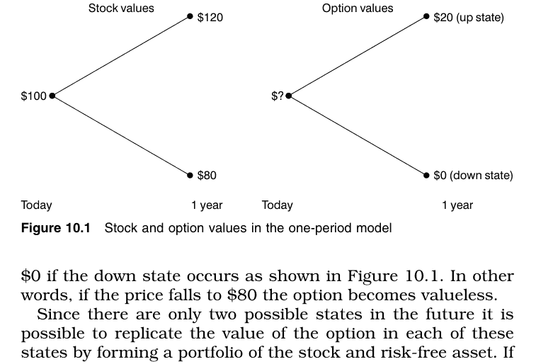

**图10.1 单期模型中的股票价值与期权价值**

换言之，如果价格跌至80美元，该期权将变得一文不值。

由于未来只有两种可能的状态，我们可以通过构建由股票和无风险资产组成的投资组合，复制期权在每一种状态下的价值。假设买入`Δ`股股票（`Δ`为未知数），并以无风险利率借入`M`美元（`M`为未知数），则在上涨状态下，组合中股票部分的价值为`120 × Δ`；在下跌状态下为`80 × Δ`；而在两种状态下均需偿还`1.05 × M`。因此，要使组合的价值与期权在两种可能状态下的价值相匹配（即复制），必须满足：

`$120 × Δ − 1.05 × M = $20` （上涨状态，式10.2）

以及

`$80 × Δ − 1.05 × M = $0` （下跌状态，式10.3）

整理式10.2和式10.3中的公式，可得`Δ`的值：`$40Δ = 20`，因此`Δ = 0.5`。将`Δ = 0.5`代入式10.2，得到`$120 × 0.5 − 1.05M = $20`，因此`$40 = 1.05M`，`M = $38.10`。

上述由两个方程、两个未知数`Δ`和`M`组成的方程组求解结果为`Δ = 0.5`，`M`约为38.10美元。这意味着，需要买入0.5股股票并以无风险利率借入38.10美元，才能使组合在上涨状态和下跌状态下的价值分别为20美元和0美元。等价地，卖出0.5股股票并以无风险利率贷出38.10美元，该组合在上涨和下跌状态下的收益将分别为–20美元和0美元，这将完全抵消期权在这些状态下的收益。这是一个非常有力的发现，因为它使我们能够复制无风险组合，并据此对期权进行定价。

同样值得注意的是，期权当前价值必须等于组合当前价值，即`100 × Δ – M = 100 × 0.5 – M = 11.90`美元。换言之，该股票的看涨期权等价于以无风险利率借款融资的多头股票头寸。

变量`Δ`被称为期权的德尔塔。在前面的例子中，如果`C_u`和`C_d`分别表示看涨期权在上涨和下跌状态下的价值，`S_u`和`S_d`分别表示股票在上涨和下跌状态下的价格，那么可以验证`Δ = (C_u – C_d)/(S_u – S_d)`。期权的德尔塔揭示了期权价值将如何随着股票价格的变动而变动。例如，已知`Δ`、`C_d`以及股票价格在上涨与下跌状态之间的差异，就能知道期权在上涨状态下的价值，也就是说`C_u`也已知。

#### 两期二项式模型

一年后世界只有两种可能状态的模型当然不现实，但构建多期模型可以缓解这一问题。单期模型假设的是，对当前价值100美元、执行价格100美元、一年后到期的股票看涨期权构建一个复制组合。不过，我们现在假设这一年被分成两个6个月期间，股票价值在每个期间要么上涨10%，要么下跌10%。假设半年期无风险利率为2.47%，这相当于年复利利率为5%。股票价值的各种状态如图10.2和图10.3所示。

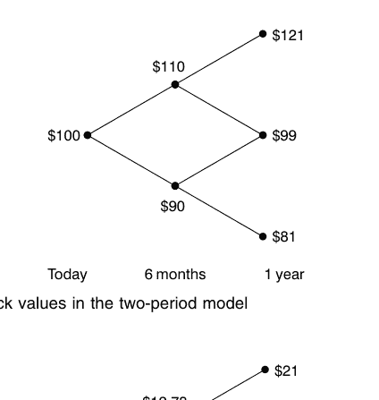

**图10.2 两期模型中的股票价值**

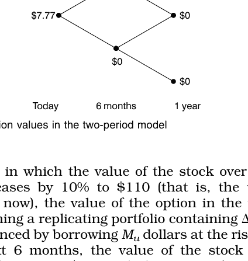

**图10.3 两期模型中的期权价值**

在这种情况下，如何构建由股票和无风险资产组成的组合来复制该期权？计算方法与上述类似，只是需要递归进行：从期权到期前一个期间开始，倒推计算当前头寸。


如果股票价值在头6个月上涨10%至110美元（即从现在起6个月后处于上涨状态），则可通过构建一个复制组合来求得该状态下期权的价值：该组合包含`Δ_u`股股票，并以无风险利率借入`M_u`美元。在接下来的6个月里，股票价值要么再上涨10%至121美元，要么下跌10%至99美元，因此期权到期时的价值要么为21美元，要么为0美元。由于复制组合必须与期权价值匹配，无论股票价格是121美元还是99美元，都必须满足式10.4和式10.5：

`$121 × Δ_u − 1.0247 × M_u = $21` （式10.4）

以及

`$99 × Δ_u − 1.0247 × M_u = $0` （式10.5）

解这些方程得到 `Δ_u = 0.9545` 且 `M_u = 92.22`。因此复制组合的价值为 `110 × Δ_u − M_u = $12.78`。如果相反，6个月后股票价值下跌10%，至$90（下跌状态），则期权到期时的股价将为$99或$81，这始终低于行权价。因此如果6个月后实现下跌状态，则期权一年后一文不值，其在下跌状态下的价值为零。鉴于期权6个月后可能有的两个价值，现在可以推导出需要购买的股票数量以及为复制6个月后上涨和下跌状态下的期权收益所需借入的金额。由于期权在上涨和下跌状态下分别价值$12.78和$0，因此有

`$110 × Δ − 1.0247 × M = $12.78` Eq 10.6

and

`$90 × Δ − 1.0247 × M = $0` Eq 10.7

解方程10.6和10.7得到 `Δ = 0.6389` 且 `M = $56.11`。因此期权今天的价格价值为 `100 × Δ − M = $7.77`。股票期权的价值在图10.2和10.3中以图形方式显示。

该复制组合的一个特点是它始终是自筹资金的。一旦建立起来，未来就不需要进一步的外部现金流入或流出。例如，如果复制组合是通过借入$56.11并购买0.6389股股票建立的，并且6个月后实现上涨状态，则初始组合将被清算。以每股$110出售0.6389股股票可净得$70.28。偿还贷款本息，共计$57.50，剩余$12.78。新的复制组合需要借入$92.22。将该金额与$12.78的收益合并，可得到$105，这恰好足以按每股$110的价格购买所需的0.9545股股票。复制组合始终具有此特性：清算当前组合可净得的资金恰好足以形成下一个组合。因此，组合可以在今天建立，在每个期间结束时重新平衡而无需外部现金注入，并在到期时应与期权的收益相匹配，无论发生何种世界状态。

上述复制组合中，期权在今后一期或两期到期，但同一原则适用于任何数量的期间。在本例中，每个期间只有两种可能状态，因此可以通过交易股票和无风险资产在每个日期和状态下形成自筹资金的复制组合。随着期间数量的增加，各个期间变得更短，因此在到期时存在越来越多的可能世界状态。在极限情况下，存在可能状态和期间的连续统，因此组合必须不断重新平衡。下面讨论的Black–Scholes–Merton模型是具有有限期间的这些模型的极限情况。

## 确定看涨期权的价值

看涨期权是在到期日之前以指定行权价购买标的资产的权利。如前所述，美式期权可在任何时间行使。欧式期权只能在到期日行使。下面讨论中参考了Livingston (1996)，使用以下符号：

- `C` = 看涨期权的市场价值
- `P` = 标的资产的市场价值
- `E` = 行权价（执行价）

如果标的资产价格（`P`）小于行权价（`P<E`），则称该看涨期权为价外期权。如果`P`等于`E`，则称看涨期权为平价期权。如果标的资产价格超过行权价（`P>E`），则称看涨期权为价内期权。

### 到期时看涨期权的价值是多少？

到期时，如果标的资产的市场价值小于或等于行权价，则看涨期权的价值必须为零。如果标的资产的售价等于或低于行权价，理性投资者不会行使看涨期权，因为在公开市场上购买标的证券比行使看涨期权更便宜。例如，在表10.3中，如果债券在公开市场上售价为$90，则行权价为$100的看涨期权在到期时毫无价值。与行使看涨期权并支付$100行权价相比，直接以$90购买债券更为可取。

在表10.3中，如果标的资产价格超过行权价，则看涨期权的价值为标的资产价格减去行权价，即`P − E`。`P − E`的金额称为看涨期权的内在价值。如果看涨期权的售价低于`P − E`，套利者会买入看涨期权、行使它并获得套利利润。到期时，以`$C`购买看涨期权并行使它等同于直接以`$P`购买标的证券。因此，`P = C + E`，或`C = P − E`。

到期时，看涨期权的价值为：

```text
C = 0      if P ≤ E   平价或价外      Eq 10.8
C = P − E   if P > E                               10.9
```

### 表 10.3 到期时看涨期权的价值（`E = $100`）

| `P<E` | `P=E` | `P>E` |
|---|---|---|
| 例如，`P=90` | `P=100` | `P=110` |
| `C=0` | `C=0` | `C=P−E` |
|  |  | 例如 `C=10` |
| 价外 | 平价 | 价内 |

来源：Livingston, 1996

### 看涨期权的利润特征是什么？

看涨期权的可能价值可从利润特征中看出。作为参考，考虑某人购买一种目前以行权价$100出售的债券（其上有期权交易），并持有该债券3个月直至期权到期。忽略票息利息的可能盈亏显示为图10.4中的实线。

考虑以$4购买行权价为$100的看涨期权。投资者持有该看涨期权3个月直至到期。利润特征显示为图10.4中的虚线。绘制利润特征的第一步是计算在到期时标的资产价格的几个水平上头寸的盈亏。这些价格应包括期权的行权价以及行权价两侧的几个点。该程序在表10.4中说明。

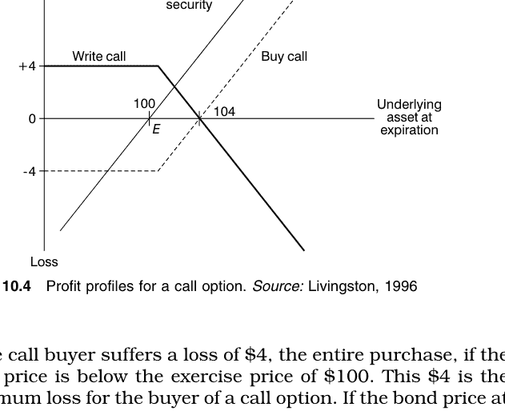

图10.4 看涨期权的利润特征。来源：Livingston, 1996

如果债券价格低于$100的行权价，看涨期权买方将遭受$4的损失，即全部购买价。这$4是看涨期权买方的最大损失。如果到期时债券价格高于行权价，则利润等于`P − E = $4`。如果债券价格低于$104，则产生净亏损；如果债券价格高于$104，则产生净盈利。利润特征表明看涨期权买方预期标的资产价格上涨。

如果债券价格等于或低于行权价，利润特征显示看涨期权买方的最大损失为购买价`C`，因为该看涨期权购买价是债券价格的一小部分，与直接购买债券相比，买入看涨期权的损失在绝对美元数上较小。另一方面，如果债券表现良好，看涨期权买方将获得可观收益。

### 表 10.4 看涨期权买方的盈亏（`E = $100`）

|  | 到期时标的证券价格 |  |  |  |
|---|---|---|---|---|
|  | 98 | 100 | 102 | 104 |
| 买入看涨期权（`C`） | -4 | -4 | -4 | -4 |
| 到期行使看涨期权 |  |  | -100 | -100 |
| 出售行使期权获得的标的债券 |  |  | +102 | +104 |
| 净利润 = `+C −E +P` | -4 | -4 | -2 | 0 |

来源：Livingston, 1996

### 看涨期权价值的决定因素是什么？

看涨期权的价值由以下六个因素决定。

- (1) **标的资产的价格：** 看涨期权的价值与标的证券的价格呈正相关。标的资产价值越高，看涨期权的价值越大。这并不奇怪，因为看涨期权买方购买了以固定价格买入的权利。标的资产上涨越多，看涨期权价值越高，反之亦然。

- (2) **行权价：** 看涨期权的价值与行权价成反比。行权价越低，看涨期权的价值越高。在其他条件相同的情况下，更低的行权价意味着看涨期权更价内。这也不奇怪，因为这是看涨期权持有人行使期权时必须支付的金额。

- (3) **到期时间：** 看涨期权的价值是到期时间的正函数。到期时间越长，看涨期权的价值越大。其原因是看涨期权持有人有更多时间让其期权变为价内。

看涨期权价值的前三个决定因素由表10.5说明。沿着表的任意一行查看；行权价越高，看涨期权的价值越低。沿着任意一列向下查看；到期时间越长，看涨期权的价值也越高。

### 表 10.5 到期期限和行权价格对看涨期权价格的影响

| 到期期限（月） | 行权价格ᵃ |  |  |
|---|---|---|---|
|  | $90 | $100 | $110 |
| 3 | $30 | $16 | $4 |
| 6 | $34 | $19 | $6.50 |
| 9 | $37 | $21.50 | $8.50 |

ᵃ标的资产价格 = $110.

来源: Livingston, 1996

- (4) **标的资产的价格波动性：** 标的资产波动性越大，其价值越高，因为看涨期权买方的收益是不对称的。如果标的资产表现不佳，看涨期权买方会损失全部。如果标的资产表现良好，看涨期权买方会获得非常好的收益。标的资产可能价值的更大离散程度意味着看涨期权在上涨方面的收益更大，但在下跌方面收益相同（损失全部），从而使看涨期权更有价值。显然资产价格既可能下跌也可能上涨，但如果下跌，期权持有者可以选择不行使其期权。

波动性对看涨期权价值的影响由表10.6中的两证券示例说明。假设两种证券在到期时的可能价格如下。每种证券的平均值均为100，但证券2的离散程度更大。

### 表 10.6 波动性的两证券示例

**证券 1**

|  | 状态1 | 状态2 | 状态3 |
|---|---|---|---|
| 到期价格 | 90 | 100 | 110 |
| 概率 | 1/3 | 1/3 | 1/3 |

平均价格 = `(90)(1/3) + (100)(1/3) + (110)(1/3) = 100`

**证券 2**

|  | 状态1 | 状态2 | 状态3 |
|---|---|---|---|
| 到期价格 | 80 | 100 | 120 |
| 概率 | 1/3 | 1/3 | 1/3 |

平均价格 = `(80)(1/3) + (100)(1/3) + (120)(1/3) = 100`

来源: Livingston, 1996

结果的离散程度。证券2的期权由于这种离散程度而更有价值。为了说明这一点，考虑每种证券行权价格为$100的看涨期权的情况。这些期权的收益如表10.7所示。

### 表 10.7 看涨期权的价值

**证券 1 的看涨期权**

|  | 状态1 | 状态2 | 状态3 |
|---|---|---|---|
| 标的物价格 | 90 | 100 | 110 |
| 看涨期权价值 | 0 | 0 | 10 |
| 概率 | 1/3 | 1/3 | 1/3 |

平均价值 = `(0)(1/3) + (0)(1/3) + (10)(1/3) = 3.33`

**证券 2 的看涨期权**

|  | 状态1 | 状态2 | 状态3 |
|---|---|---|---|
| 标的物价格 | 80 | 100 | 120 |
| 看涨期权价值 | 0 | 0 | 20 |
| 概率 | 1/3 | 1/3 | 1/3 |

平均价值 = `(0)(1/3) + (0)(1/3) + (20)(1/3) = 6.67`

来源: Livingston, 1996

表10.6中证券2的看涨期权明显具有更大的价值。如果期权处于价外或平价，两个期权均到期一文不值。如果期权处于价内，第二种期权的收益更高，因此必须更有价值。

- (5) **无风险利率**：利率越高，看涨期权的价值越大。这基于这样一个事实：如果看涨期权买方购买了期权而不是标的资产，那么节省下来的资金就可以以现在更高的利率进行投资。

- (6) **标的资产的股息或利息**：标的资产上的现金支付越高，看涨期权的价值越低。资产的总回报是现金支付（股息或票息利息）加上价格增值。对于给定的总回报率，资产上的现金支付越高，价格上涨带来的回报就越低。由于看涨期权买方只有在标的资产价格上涨时才获利，因此标的资产上的现金支付越高，往往会降低资本收益和看涨期权的价值。

### 表 10.8 影响期权价格的因素

| 变量增加 | 看涨期权价格 | 看跌期权价格 |
|---|---|---|
| 股价 | 增加 | 下降 |
| 到期时间 | 增加 | 增加 |
| 股价波动率 | 增加 | 增加 |
| 无风险利率 | 增加 | 下降 |
| 行权价格 | 下降 | 增加 |
| 股息 | 下降 | 增加 |

根据看跌期权-看涨期权平价，看跌期权的价格可以被证明取决于看涨期权的价格、标的资产的价格以及行权价格的现值。因此，前述的看涨期权价格的六个决定因素也影响看跌期权价格。对于看跌期权有两个主要区别。首先，随着标的证券价格的上涨，看跌期权的价值会下降。也就是说，看跌期权的价值与标的证券价格成反比。其次，更高的行权价格会增加看跌期权的价值。看跌期权价值与行权价格直接相关。

表10.8提供了看涨期权和看跌期权如何响应影响其价格的因素的说明。

## Black–Scholes 模型

前面讨论的二叉树模型假设证券价格变动遵循离散时间平稳二叉随机过程。在极限情况下，随着离散时间段变得无限小，该随机过程变为扩散过程（也称为连续时间随机游走、伊藤过程或几何布朗运动）。Black和Scholes（1973）在其期权定价公式的推导中假设了该过程。与二叉树模型一样，Black和Scholes首先构建一个无风险套期保值组合，持有标的证券多头并做空看涨期权。该组合产生无风险回报率，但组合的内部动态由证券价格的扩散过程驱动。套期保值组合的结构可以被置于与物理学中的热方程相同的形式。

一旦认识到这一点，方程的解就很容易推导出来。

在没有标的资产现金支付且利率确定、连续复利的情况下，Black和Scholes证明了看涨期权的价值是上述前五个因素的显式函数。Black–Scholes模型如方程10.10所示：

```text
C = P N(d₁) - E e^{-rt} N(d₂)
```

10.10

其中：

- `C` = 看涨期权的价格
- `P` = 标的资产的当前价格
- `E` = 行权价格
- `e` = 自然对数的底数
- `r` = 连续复利利率
- `t` = 看涨期权的剩余寿命

`N(d₁)`和`N(d₂)`是从正态分布中获得值`d₁`和`d₂`的累积概率，其中`d₁`和`d₂`如下：

```text
d₁ = [ln(P/E) + (r + 0.5 σ²) t] / [σ √t]
d₂ = d₁ - σ √t
```

其中`σ` = 标的资产连续复利回报率的标准差。

项`e^{-rt}`是从现在起`t`期间收到的`$1`的现值。它是我们所称的`d`的连续复利等价物，即`$1`的现值。

为了更好地理解Black–Scholes模型，考虑`N(d₁)`和`N(d₂)`都等于1的情况。这相当于假设完全确定。然后模型变为方程10.11

```text
C = P - E e^{-rt}
```

Eq 10.11

`N(d₁)`和`N(d₂)`表示来自正态分布的累积概率。图10.5说明了这些累积概率，它们必须是0到1之间的数字。如果它们小于1.0，则期权到期时股票价格水平存在不确定性。

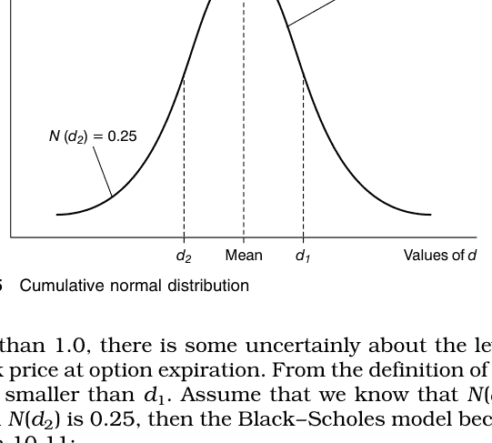

### 图 10.5 累积正态分布

根据`d1`的定义，`d2`必须小于`d1`。假设我们知道`N(d1)`为0.75且`N(d2)`为0.25，则Black–Scholes模型变为方程10.11：

```text
C = (0.75) P - (0.25) E e^{-rt}
```

Eq 10.12

Black–Scholes函数如图所示10.6。

由于Black–Scholes模型要求没有现金支付和利率确定，因此不能应用于债务工具。然而，Black–Scholes模型可以应用于无股息的普通股。该模型可以针对支付股息的普通股进行调整。

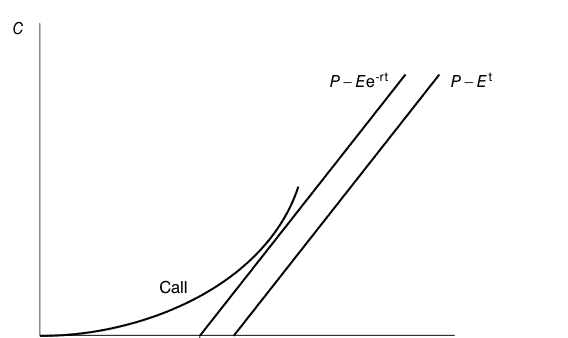

### 图 10.6 Black–Scholes 模型

## 实物期权与互联网和科技股估值

实物期权作为一种股权估值方法最近受到了很多关注。实物期权是管理实物（而非金融）资产或运营的选择，例如加速或推迟资本支出、改变工艺投入或产出、建设或放弃产能或改变生产过程的性质或规模。但为什么我们在投资决策中应用实物期权这一术语，而传统上实物投资决策传统上是使用贴现现金流技术分析的呢？

### 投资项目如何成为期权？

公司投资机会就像看涨期权，因为公司有权但没有义务收购某物，让我们说，一个新业务的经营资产。如果我们能找到一个与投资机会足够相似的看涨期权，期权的价值就会告诉我们关于该机会的价值一些信息。不幸的是，大多数商业机会都是独一无二的，因此找到类似期权的可能性很低。找到类似期权的唯一可靠方法是构建一个。

为此，我们需要建立项目特征与决定普通股票看涨期权价值的五个变量之间的对应关系。通过将商业机会的特征映射到看涨期权的模板上，我们可以获得一个将项目特征与看涨期权结构相结合的模型。假设我们使用的期权是欧式看涨期权，这是所有期权中最简单的，因为它只能在到期日行使。这里合成的期权并不是现实机会的完美替代品，但它仍然具有信息价值。表10.9显示了说明相似性的对应关系。

许多项目涉及花费资金购买或建设生产性资产。花费资金以利用此类商业机会类似于行使期权，for公司最好不要进行该投资。当项目最终决策无法再推迟时——也就是说，当公司的“期权”已到期时——项目的期权价值和净现值相同。此时，要么

`期权价值 = S − X`

或

`期权价值 = 0`

取两者中较大者。但请注意

`净现值 = S − X`

同样如此，因为我们从表10.9知道，`S`对应于项目资产的现值，`X`对应于所需的资本支出。要完全调和两者，我们只需注意到，当净现值为负时，公司不会投资，因此项目价值实际上为零（就像期权价值一样），而不是负值。简而言之，两种方法最终归结为相同的数字和相同的决策。


净现值与期权价值之间的这种共同基础具有重大的实践意义。这意味着为计算传统净现值而建立的公司电子表格对于期权定价高度相关。任何计算净现值的电子表格都已包含计算 `S` 和 `X` 所需的信息，而 `S` 和 `X` 是五个期权定价变量中的两个。因此，希望开始使用期权定价的高管无需放弃其现有的基于贴现现金流的系统。

然而，当投资决策可以推迟时，净现值和期权定价就会出现分歧。推迟的可能性带来了两个额外的价值来源。首先，在其他条件相同的情况下，我们总是更愿意以后支付资产成本而不是现在支付，因为我们可以在推迟的支出上赚取资金的时间价值。其次，在等待期间，世界可能会发生变化。具体来说，我们打算收购的经营资产的价值可能会发生变化。如果其价值上升，我们不会错失机会；我们只需进行投资（行使我们的期权）即可仍然收购它们。如果其价值下降，我们可能会决定不收购它们。这也很好（事实上非常好），因为通过等待，我们避免做出最终会变成糟糕投资的决策。我们保留了参与良好结果的能力，并使自己免受某些不良结果的影响。

由于这两个原因，能够推迟投资决策是有价值的。传统的净现值忽略了与推迟相关的额外价值，因为它假设决策不能推迟。相比之下，期权定价*预设*了推迟的能力，并提供了一种量化推迟价值的方法。因此，要对投资进行估值，我们需要开发新的指标来捕捉这些额外的价值来源。

## 真实期权定价方法

在他们的著作 *《不确定性下的投资》* 中，Dixit 和 Pindyck（1994）用一个简单示例说明了净现值与期权定价方法之间的差异。

假设你正在决定是否在生产小部件的新项目上投资 1600 美元。每个小部件的现金流为 200 美元，但在年底将以相等概率变为 300 美元或 100 美元。此后它将永远保持在新的水平。请注意，预期未来现金流为 200 美元，是风险结果 300 美元和 100 美元的加权平均值。资本成本为 10%。假设一个小部件可以立即出售，此后每年出售一个，则该项目的净现值估算如下：

```
NPV = MAX[-1600 + Σ_{t=0}^{∞} 200/(1.1)^t, 0]
= MAX[(-1600 + 2200), 0]
= 600
```

净现值方法以加权平均资本成本对预期项目现金流进行贴现。决策规则是取贴现预期现金流或零（意味着不做该项目）的最大值。净现值规则是预期值的最大值（今天确定）。它还隐含假设项目应立即进行或根本不进行，因为最大值必须现在决定。这一假设排除了将投资推迟一年直到每个小部件的价格不确定性得以解决的可能性。如果我们考虑有推迟期权的项目，其经济性看起来更好：

```
Option value =
[0.5 × MAX(-1600/1.1 + Σ_{t=1}^{∞} 300/(1.1)^t, 0)]
+ [0.5 × MAX(-1600/1.1 + Σ_{t=1}^{∞} 100/(1.1)^t, 0)]
= 0.5 × MAX((-1600 + 3300)/1.1, 0) + 0.5 × MAX((-1600 + 1100)/1.1, 0)
= 0.5 × (1700/1.1) + 0.5 × 0
= $773
```

有了推迟期权，你可以等待一个期间再投资，然后根据关于每个小部件长期现金流的信息到来决定是否进行。如果现金流仅为每单位 100 美元，你将不行使投资期权，但如果现金流为每单位 300 美元，你将行使。尽管立即投资的净现值为 600 美元，但如果你决定推迟，净现值甚至更高，达到 773 美元。因此你会推迟。

该看涨期权的价值（行权价为 1600 美元，期限一年，方差由每单位 200 美元的现金流差额决定，且基础风险资产在没有灵活性时的价值为 600 美元）是具有灵活性项目价值与其无灵活性价值之间的差额，`$773 – $600 = $173`。还请注意，净现值是今天决定的预期贴现现金流或零的最大值，而期权价值是信息到来时决定的每个未来自然状态下贴现现金流或零的最大值的期望值：

```
NPV = MAX_{t=0}(Expected cash flows / Cost of capital, 0)
Option value = Expected[MAX_{t=1}(Cash flow given info / Cost of capital, 0)]
```

两种方法使用信息的方式截然不同。净现值强制基于对未来信息的今天预期做出决策，而期权估值允许在信息到来时以未来为条件的决策灵活性。期权定价方法捕捉了灵活性的价值，而净现值则没有。所以真实期权方法以数学意义上形式化和捕捉了在估值中以更主观方式已反映的内容。分析师和投资者认识到灵活性——对变化情况和新信息做出反应的能力——与价值相关联。该溢价实质上就是期权价值。

## 真实期权的类型

真实期权有许多类型和分类方法。以下类别旨在捕捉企业中期权价值的关键来源。下面讨论三种真实期权：规模、范围和时机期权。

### 规模（增长）期权

规模或增长期权代表了未来投资机会固有的价值，这些机会扩展了现有业务运营。一旦公司承诺进行新投资，增长期权价值就会消失（尽管这可能被其他期权如放弃或削减运营的期权所取代），而投资机会的价值仅仅是投资现金流的预期现值。

增长期权需要与增长机会区分开来。许多增长机会没有任何期权价值，因为可能存在重大的前期承诺，而学习收益却很少。在这种情况下，增长机会的价值仅仅是预期净现值。增长期权更有价值，因为它们使公司有机会在运营中使用灵活性以从不确定性中受益。

### 范围期权

这些是进入新市场、开发新商业模式并重塑自身的公司可用的期权。尽管增长期权难以识别和估值，范围期权更难。显然，存在固有的价值，即拥有市场现有地位、宝贵客户群等的公司比其他公司更能利用新业务机会。这些机会在通过技术变革快速发展的行业中最为普遍——互联网就是这些条件的明显例证。

除了技术变革的影响外，范围期权对互联网股票特别重要的原因在于其价值更依赖于信息。成熟的互联网公司从客户的在线活动中获取大量数据，而这在有效管理时应降低新业务活动固有的风险。

### 时机期权

灵活性以及公司在获取新信息时能够适当反应的能力，是实现真实期权价值的关键。当公司能够利用信息在最佳时机进入新事业（或退出某项活动）时，就会产生时机期权。

## 真实期权与贴现现金流的联系

必须非常牢记，真实期权估值中的假设和输入包括贴现现金流估值所需的所有内容，外加若干其他内容。真实期权方法在现实世界中应用起来不可避免地比贴现现金流更困难。

在许多情况下，尽管投资机会具有内在（或更准确地说是前瞻）价值，但它们仍然几乎没有或没有期权价值。期权的时间价值为零。有三种主要情况适用。

### （1）投资机会显著“价内”

如果预计投资机会将高度盈利，且其不盈利（以及公司能够削减投资以避免损失）的可能性很小，则期权价值可能无关紧要。这种效应在股票期权市场中很容易看到，其中行权价明显低于股价的看涨期权基本上以其内在价值（其净现值）交易。

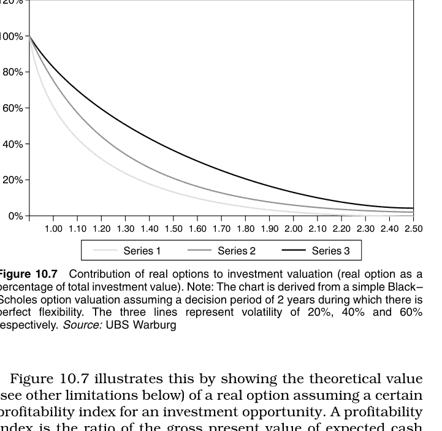

图10.7 实际期权对投资估值的贡献（实际期权占总投资价值的百分比）。注：该图表源自简单的 Black–Scholes 期权估值，假设决策期为2年，在此期间具有完全灵活性。三条线分别代表波动率为20%、40%和60%。来源：UBS Warburg

图10.7通过展示在假设投资机会具有一定盈利指数的情况下实际期权的理论价值（见下文其他限制）来说明这一点。盈利指数是投资机会预期现金流的毛现值与所需投资之比。

另一种呈现这些数据的方式是展示绝对净现值数据，分为投资的预期内在价值和期权的时间价值（见图10.8）。

图10.7和图10.8显示，即使在波动率较高的情况下，如果预计投资会非常盈利（在本分析中为高盈利指数），期权价值对整体投资价值的贡献也仅限于有限范围。然而，在投资决策更为边际的情况下，实际期权可以显著贡献价值。

### （2）对新信息做出反应的灵活性有限

期权具有时间价值，因为投资者有机会根据自身最佳利益修改其行动。在交易的

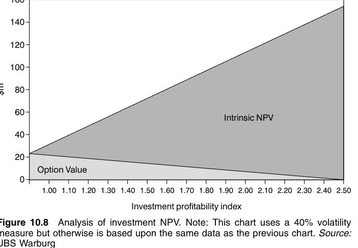

图10.8 投资净现值分析。注：该图表使用40%的波动率指标，但除此之外基于与前一图表相同的数据。来源：UBS Warburg

股权期权中，投资者可以决定是否投资（是否行权）直至最后行权日，此时可以确定地观察行权是否盈利。行动可以始终完美地调整以充分利用所面临的情况。现在想象期权持有者必须在期权首次取得时就承诺行权与否。当然这就根本不是期权了；它只是一个远期合约并且会产生期权溢价。估值将以投资价值的现值为准。期权价值关键取决于调整策略的能力，即根据情况变化适当地在行权与不行权之间转换（在交易型股权期权的情况下，即股价的变动）。

### （3）管理层没有能力做出适当反应

尽管由于公司可获得的机会以及对这些机会做出反应的灵活性，可能存在实际期权价值的潜力，但这一价值的实际实现取决于管理层的行为。只有当管理层能够认识到期权的存在，并且能够有效地利用信息适当地行使期权时，实际期权溢价才是有理的。这就是投资者愿意为拥有“良好管理”的公司支付更高价格的原因。

这如何适用于实际的公司投资机会？对于未来业务机会而言，要具有期权价值（即超过内在价值的价值——预期净现值），公司必须有机会以最佳效果调整其战略。

## 2000年科技股崩盘给投资者带来的教训是什么？

新经济的概念，或有时被称为“新经济范式”，包含了一些不同的脉络，有些是真实的，有些半真半假，有些则完全错误。所有这些思想都在我们第二章讨论的20世纪90年代下半年的美国经济中汇聚在一起。为了区分可能仍然为真和我们现在已知为假的内容，这一思想丛必须被梳理清楚。

经分析，出现了四个狭隘的观念；商业周期已死；资本市场现在以前所未有的方式运作；我们正生活在一个独特的技术进步时代；最后，信息技术从根本上改变了经济运作方式。

商业周期无疑是活跃的。这不应该让任何人感到惊讶。然而，认为商业周期已死的观点基于对美国经济的几个正确假设：劳动力市场变得更具竞争力；全球竞争降低了工会和大企业的定价权；对库存的需求减少；以及货币政策比在通胀的1960和1970年代更可信地以价格稳定为导向。

然而，这一分析忽略的是，周期可以在具有可信货币锚的灵活经济中发生，并且经常发生。所需的一切只是一场由扩张信贷和强劲股市推动的大规模投资扩张。的确，对商业周期因此可持续的信念越坚定，最终就越会使所有科技股的估值回归现实。

具体而言，股市分析师在科技股狂热中持续忽视了三个经济原则。

第一点很简单，就是供需法则。在任何竞争性经济中，新资本都会流向任何享有高利润和高增长的行业。这种流动将持续下去，直到资本的风险调整后回报率下降到经济的正常或平均水平。超常利润只能在非竞争性市场中长期维持，在这些市场中个别公司享有很大程度的垄断权力。但经验表明，科技行业中很少有垄断。

硅谷现在正在认识到的第二个经济原则，而投资者忽视它将自食其果，那就是边际收益递减法则。技术可能继续以前所未有的速度进步——例如，微处理器的速度仍在每18个月翻一番——但每一次技术飞跃在经济上的价值可能都不如前一次。一旦计算机处理器达到一定性能，进一步增加其速度或存储容量对用户来说不会提供多少经济价值。宽带互联网连接和第三代移动电话服务也可能证明是如此。这些无疑会改善服务，但消费者是否愿意为他们已认为令人满意的服务的这些改进支付高额溢价？

许多投资者认为互联网不仅废除了边际收益递减法则，而且实际上逆转了它。互联网本应受到一种新的“网络效应”的支配，该效应断言网络的每一个新增内容、每一个新订阅者和每项新服务都会比前一个产生更多利润。这在一定程度上显然是正确的，因为互联网像任何其他企业一样，需要达到一定的临界规模才能开始享受大规模营销和大规模生产的经济效益。但一旦互联网越过成为真正的全球大众网络的临界点，新增订阅者变得更贫穷、更价格敏感、商业价值更低。简而言之，边际收益递减法则重新生效。

投资者开始重新发现的第三条经济法则是货币的时间价值。未来的利润远不如今天手中的现金值钱。科技投资者习惯谈论互联网世界中技术和商业变化的惊人速度。然而，他们对科技股的估值方式假设收入和利润将不间断地增长20年甚至更久！

## 近期错误必须避免

如上所述，毫无疑问，计算机革命已渗透到经济的几乎每个部分，大大提高了潜在效率。在美国，劳动生产率可能每年提高2.5%，相比最近几十年的1.5%。

有充分理由相信这种改善是可以持续的。计算机芯片复杂性每18个月翻一番的趋势将继续一段时间。通信成本将进一步下降。正如电动机发展后所发生的那样，人类智慧将找到新的方式来完善和应用这些技术。

但投资者和银行家必须避免近年来的两个大错误。首先，他们不能期望高技术自动转化为高需求。手机的标准化投资表明需要额外因素：技术要针对真实的人类需求进行定制——而这些需求 notoriously 难以预测。

其次，投资者绝不能幻想高技术会提高整体利润水平。它不会。效率提升的优势将被竞争侵蚀。而在高科技投资中冲向终点的竞赛将使许多竞争对手在泥潭中挣扎。

## 熊彼特与创造性破坏

所有试图理解技术进步对经济增长影响的尝试都向约瑟夫·熊彼特致敬，这位在第二章讨论过的奥地利经济学家，最为人熟知的是他关于与50-60年工业周期相关的“创造性破坏”的观点。可以说是二十世纪最激进的经济学家，熊彼特是第一个挑战古典经济学的经济学家，古典经济学寻求（并且仍然寻求）在稳定环境中优化现有资源——将任何干扰视为与瘟疫、政治和天气同等的外部力量。熊彼特向这个思想沙龙引入了喧闹的企业家和

这种难以驾驭的行为。在熊彼特看来，正常的健康经济并非处于均衡状态，而是不断被技术创新‘扰乱’的经济。

但市场会忘记这些简单的经济学法则吗？明智的做法是记住美联储主席艾伦·格林斯潘在2000年初所说的话：

> 历史告诉我们，信心的急剧逆转往往突然发生，且大多几乎没有预兆……对遥远未来价值的索取权会被折现至无足轻重。耐人寻味的是，这种行为方式贯穿了人类交往，世世代代几乎没有什么明显差异。无论是荷兰的郁金香球茎还是俄罗斯的股票，市场价格模式都大致相同。

## 参考文献

安吉尔，J.A.，网址 www.msb.edu/faculty。乔治城大学，网络股票估值计算器。

阿斯瓦斯，D.（1996）《投资估值：确定资产价值的工具与技术》。约翰威利父子出版社。

伯纳斯-李，T.（1999）《编织万维网》。哈珀柯林斯出版社。

伯恩斯坦，P.L.（1998）‘网络是否在推动新经济？’，《哈佛商业评论》，11–12月，第159–66页。

布莱克，F. 和 斯科尔斯，M.S.（1972）‘期权合约估值与市场效率检验’，《金融杂志》，27: 399–417。

布莱克，F. 和 斯科尔斯，M.S.（1973）‘期权定价与公司负债’，《政治经济学杂志》，81: 637–54。

布兰查德，奥利维尔（1990）‘货币为何影响产出？’。载于本杰明·弗里德曼和弗兰克·哈恩（编），《货币经济学手册》。爱思唯尔出版社，第780–835页。

布兰查德，奥利维尔（1993）‘股权溢价的变动’，《布鲁金斯经济活动论文》，2: 75–138。

布兰查德，奥利维尔，J. 和 沃森，M.W.（1982）‘泡沫、理性预期与金融市场’。载于P.瓦赫特尔（编），《经济与金融体系中的危机》。列克星敦图书出版社。

布林德，艾伦（1997）‘是否存在我们都应该相信的实用宏观经济学核心？’，《美国经济评论》，87: 240–3。

布林德，A.（2000）‘互联网与新经济’。进步政策研究所，1月，www.ppionline.org

《商业2.0》（2000）《10项必要的网络商业原则》。2000年6月。

瑟夫，V. 和 纳瓦斯基，J.《互联网及相关网络简史》gopher://gopher.isoc.org:70/00/internet/history

科克伦，J.（1997a）‘市场走向何方？不确定的事实与新理论’，《经济展望》，芝加哥联邦储备银行，21 (6): 3–37。

科克伦，J.（1997b）‘金融中的新事实’，《经济展望》，芝加哥联邦储备银行，21 (6): 36–58。

科普兰，T.，科勒，T. 和 穆林，J.（2000）《估值：衡量和管理公司价值》，第3版。约翰威利父子出版社。

科伊尔，D.（1998）《失重世界：数字经济的管理战略》。麻省理工学院出版社。

卡斯伯森，K.（1998）《定量金融经济学：股票、债券与外汇》。约翰威利父子出版社。

迪克西特，A.K. 和 平迪克，R.S.（1994）《不确定性条件下的投资》。普林斯顿大学出版社。

埃斯蒂斯，拉尔夫（1981）《会计词典》。麻省理工学院出版社，第81、105页。

弗勒德，罗伯特·P. 和 加伯，P.M.（编）（1994）《投机泡沫、投机性攻击与政策转换》。麻省理工学院出版社。

加尔布雷思，J.K.（1955）《1929年大崩盘》。霍顿·米夫林出版社。

加伯，彼得·M.（1989a）‘郁金香狂热’，《政治经济学杂志》，97 (31): 535–60。

加伯，P.M.（1989b）‘是谁让郁金香狂热？’，《组合管理杂志》，16 (1): 53–60。

加伯，P.M.（1990）‘著名的早期泡沫’，《经济展望杂志》，4 (2)。

加伯，P.M.（2000）《著名的早期泡沫：早期狂热的根本原因》。麻省理工学院出版社。

戈登，R.J.（1997）‘时变NAIRU及其对经济政策的影响’，《经济展望杂志》，11 (1): 11–32。

戈登，R.J.（1998a）‘金发姑娘经济的基础：供给冲击与时变NAIRU’，《布鲁金斯经济活动论文》，第2期，第297–346页。

戈登，R.J.（1998b）‘信息与技术时代的货币政策：计算机与索洛悖论’，手稿。

戈登，R.J.（1999）‘“新经济”是否已使生产率放缓成为过时问题？’，工作论文，西北大学。

格雷厄姆，B.（1949）《聪明的投资者》。哈珀兄弟出版社（1985年版，哈珀柯林斯出版社）。

格雷厄姆，B. 和 多德，D.（1934）*证券分析*。麦格劳-希尔出版社。

格林斯潘，A.（1997）‘货币政策证词及向国会提交的报告’。美国众议院银行与金融服务国内和国际货币政策小组委员会，1997年7月22日。

格林斯潘，A.（1998）‘问题：是否存在新经济？’，在加州大学伯克利分校的演讲，1998年9月4日。

格林斯潘，A.（2000）‘不断变化的技能需求’，在美国劳工部全国技能峰会上的演讲，华盛顿特区，2000年4月11日。http://www.federalreserve.gov/boarddocs/speeches/2000/20000411.htm


格林斯潘，A.（2000）‘零售支付系统’，在全国自动清算所协会年会上的演讲，加利福尼亚州洛杉矶（视频会议），2000年4月10日。http://www.federalreserve.gov/boarddocs/speeches/2000/20000410.htm

格林斯潘，A.（2000）‘技术创新及其经济影响’，在全国技术论坛上的演讲，密苏里州圣路易斯（视频会议），2000年4月7日。http://www.bog.frb.fed.us/boarddocs/speeches/2000/20000407.htm

格林斯潘，A.（2000）‘技术创新与经济’，在白宫新经济会议上的演讲，华盛顿特区，2000年4月5日。http://www.bog.frb.fed.us/boarddocs/speeches/2000/20000405.htm

格林斯潘，A.（2000）‘我们股票市场的演进’，在美国参议院银行、住房和城市事务委员会上的证词，2000年4月13日。http://www.federalreserve.gov/boarddocs/testimony/2000/20000413.htm

哈杜维利斯，G.A.（1988）‘股票市场投机泡沫的证据：日本、美国和英国’，纽约联邦储备银行研究论文第8810号。

哈蒙，史蒂夫（1998）‘家居装修网络风格：互联网估值工具内幕’，《晨报》，互联网股票报告，1998年7月14日。www.internetstockreport.com/column/article/0,1785,57651,00.html

赫岑伯格，S.A.，阿利西，J.A. 和 威尔，H.（1999）*后工业美国的新经济规则：就业与机会*。康奈尔出版社。

琼斯，C.P.（1999）*投资、分析与管理*。约翰威利父子出版社。

商业与经济协会，加拿大多伦多，2000年4月12日。http://www.federalreserve.gov/boarddocs/speeches/2000/20000412.htm

莫迪利亚尼，F. 和 帕帕德莫斯，L.（1975）‘来年货币政策目标’，《布鲁金斯经济活动论文》，1，第141–63页。

尼尔森，T.（1998）《竞争性品牌塑造》。约翰威利父子出版社。

中村，L.（1999）‘无形资产：是什么给新经济注入了“新”？’费城联邦储备银行《商业评论》，7/8月。

奥肖内西，詹姆斯·P.（1996）《在华尔街行之有效的方法》。麦格劳-希尔出版社。

珀金斯，M. 和 珀金斯，A.（1999）《互联网泡沫：高估科技股世界的内部，以及你需要知道什么来避免即将到来的洗盘》。哈珀商业出版社。

菲利普斯，A.W.（1958）‘1861–1957年英国失业率与货币工资率变动之间的关系’，《经济学》，11月，第283–99页。

波特，M.E.（1985）《竞争优势：创造和保持卓越绩效》。自由出版社。

波特，M.E.（1998）《竞争战略：分析行业和竞争者的技巧》。自由出版社。

席勒，R.J.（1986）《关于9月11日至12日股票市场下跌的调查证据》。耶鲁大学。

席勒，R.J.（1987）《关于1987年10月股市崩盘中投资者行为的调查证据》。耶鲁大学。

席勒，R.J.（2000）《非理性繁荣》。普林斯顿大学出版社。

席勒，R.J.（2000）‘衡量泡沫预期与投资者信心’，《心理学与市场杂志》，1 (1): 49–60。

席勒，R. 和 西格尔，J.（1987）‘吉布森悖论与铁路利率的历史变动’，《政治经济学杂志》，89 (5)。

熊彼特，J.（1927）‘商业周期的解释’，《经济学》，7 (21): 295。

熊彼特，J.（1934）《经济发展理论》。哈佛大学出版社。

熊彼特，J.（1939）《商业周期》。麦格劳-希尔出版社。

熊彼特，J.（1951）‘经济史中的创造性反应’。载于理查德·克莱门斯（编），《熊彼特经济主题论文集》。肯尼卡特出版社。

- Schwartz, E.S. 和 Moon, Mark（2000）*互联网股票的理性定价*。投资管理与研究协会。

- Sichel, Daniel E.（1997）*计算机革命*。布鲁金斯学会。

- Siegel, J.（1995）*长期持有的股票：长期增长市场选择指南*。欧文专业出版社。

- Solow, R.（1956）《经济增长理论的一个贡献》，《经济学季刊》，70：65–94。

- Smithers, A. 和 Wright, S.（2000）*评估华尔街：在动荡市场中保护财富*。麦格劳-希尔。

- Sperling, J.G.（1962）*南海公司*。贝克图书馆。

- Staiger, D., Stock, J.H. 和 Watson, M.W.（1997）《NAIRU、失业与货币政策》，《经济展望杂志》，11(1): 33–50。

- Stock, J.H.（1998）《变化经济中的货币政策：指标、规则及向无形产出的转变》，哈佛大学，10月。

- Timmers, P.（1999）*电子商务*。约翰·威利。

- Toffler, A.（1980）*第三次浪潮*。莫罗。

- UBS Warburg 全球股票研究（2000年5月）《驾驭I-估值丛林》。

- Wadhwani, S.（2000）《“新经济”中的货币挑战》，《英格兰银行季度公报》，40（4）：411–22。

- Williams, J.R.（1999）*米勒GAAP指南*。哈考特·布雷斯。

- www.valuengine.com

- www.investorwords.com

- www.adventas.com

- www.morganstanley.com

- www.babson.edu

- www.fortressdesign.com

- www.jpmorgan.com

- www.wdr.com

- www.yahoo.com/finance

- www.siliconinvestor.com

- www.dallasfed.com

- www.FRB.com

- www.Nasdaq.com

- www.yardeni.com

- www.dowjones.com

- www.wsj.com

- www.csfb.com

- www.tprice.com

- www.investorguide.com

- www.internationalreport.com

- www.worth.com

- www.yahoo.com

- www.amazon.com

- www.amcity.com

- www.netconductor.com

- www.zdnet.com

## 泡沫/泡沫学

- 价格泡沫，114

- 理性泡沫，111, 116–17

- 投机性泡沫，117, 124–6

- 南海泡沫，119–22

- 术语，111–12

- 郁金香狂热，118–19

- 华尔街崩盘（1929），122–4

- 美国经济分析局（BEA）与计算机软件，19

- 业务概览，用于财务分析，91

- 业务地位，用于财务分析，91–2

- 买方议价能力，79, 83–5

- 看涨期权，153

  - 与债券价格，171–2

  - 标的资产的股息/利息，174–5

  - 执行价格，172

  - 内在价值，170

  - 与管理层应对能力，186–7

  - 标的资产价格，172

  - 标的资产价格波动性，172–3

  - 盈利曲线，170–2

  - 无风险利率，174

  - 到期时间，172

  - 到期时价值，169–70

  - 价值确定，169–75

  - 另见期权；实物期权

- 运河，作为技术进步，2

- 资本深化，7–8

- 股票评估的资本要求，80

- 资本与有形资产，97–9, 100

  - 另见无形资产

- 现货持有交易，159

- 现金流，预期现金流，45–6

- 现货市场，157

- 电路交换电话系统，28–9

- COBOL，38

- 公司估值/分析，90–4

  - 业务概览，91

  - 业务地位，91–2

  - 事件风险，93

  - 行业分析，91

  - 管理层概况，92–3

  - 定性公司分析，90, 91–3

  - 定量公司分析，90

  - 标准普尔财务比率，94

  - 另见贴现现金流；经济增加值（EVA）估值；基本面分析；内部分析；互联网/科技股估值；现值分析

- 竞争对抗考虑，81–2

- 计算机软件：

  - 作为无形资产，102

  - 与美国经济分析局（BEA），19

  - 与美国国民收入和产品账户（NIPA），17–18

- 计算机，处理能力增长率，9–10

- 计算成本，32–4

- 固定增长率模型，48, 49–50

- 科普兰、科勒和穆林的DCF技术，146–8

  - 客户价值分析，147–8

  - 从未来开始，146

  - 概率加权，147

- 版权，作为无形资产，101

- 持有成本，期货市场，157–8, 160

- 崩盘，股市，见“泡沫/泡沫学”

- 创造性破坏，熊彼特论，191–2

- 货币，其“基础”，161

- 当前运营价值（COV），73–4

- 客户忠诚度（网络基准），139

- 丹尼尔·笛福，关于运费，2

- 数据民主化，5–6

- 衍生品，149–51

  - 衍生品合约交易，149–50

  - 远期合约，152, 161–3

  - 期货合约，150, 152

  - 黄金套利者，156–63

  - 与投资者，156

  - 黄金多头套期保值者，155

  - 与黄金多头投机者，155

  - 黄金空头套期保值者，155–6

  - 黄金空头投机者，155

  - 互换合约，151, 152

  - 定期交易，150

  - 另见期权

- 扩散过程，布莱克-斯科尔斯期权定价模型，175

- 收益递减规律，190

- 股票贴现率，59–60

- 用于互联网/科技股评估的贴现现金流（DCF），96–7, 103, 131, 133–4

  - 科普兰、科勒和穆林技术，146–8

  - 与实物期权，184–7

- 折扣，互联网/科技股，107

- 股息保障倍数，69

- 股息贴现模型（DDM），46–59

  - 固定增长率模型，48, 49–50

  - 股息预期增长率，47–8

  - 股息流，47

  - 多阶段增长率模型，48–9, 55–9

    - 示例，57–9

    - Nadia公司示例，50–5

  - 零增长率模型，48, 49

  - 另见股票估值的基本面分析

- 股息收益率，62, 63, 67–9

- 域名系统（DNS），30

- 电子邮件，与互联网，82

- 息税前利润（EBIT），138

- 息税折旧摊销前利润（EBITDA），138

- 经济增加值（EVA）估值，73–4

- 规模经济，79

- 有效市场假说（EMH）：

  - 与泡沫，114–16

  - 与理性预期理论，115–16

  - 弱式、半强式和强式形式，114–15

- 阿尔伯特·爱因斯坦，37

- 事件风险，用于财务分析，93

- 交易所清算公司，163

- 交易所交易期权，153–4

- 外生预期，与泡沫，112–13

- 外部分析，见波特模型/外部分析应用

- 外推预期，与泡沫，113

- 光纤电缆，34

- 财务分析，见公司估值/分析

- FORTRAN，39

- 远期合约/市场，152, 161–3

  - 与期货市场，163

- 特许经营协议，作为无形资产，102

- 全额持有期货价格，159

- 全额持有价格，159

- 股票估值的基本面分析，59–73

  - 债券收益率/股票收益率比率，70

  - 股息收益率，62, 63, 67–9

  - 市净率（P/BV），72

  - 市销率（P/SR），72–3

  - 市盈率（P/E），61, 63–6

  - 市盈率增长因子（PEG），66–7

  - 与专业投资者和投机者，61

  - 股票回购，69

  - 托宾q比率，70–2

  - 另见股息贴现模型（DDM）

- 未来增长价值（FGV），73

- 期货合约，150, 152

  - 与交易所清算公司，163

  - 与基于屏幕的交易，162

- 互联网：

  - 与新闻组，82

  - 概要描述，24–5

  - 与分组交换，29

  - 与波特模型，82–3, 83–6

  - 传输控制协议/网际协议，见TCP/IP

  - *另见*万维网（WWW）

- 互联网经济/经济结构：

  - 第1层（电子商务的物理基础设施），25–6

  - 第2层（应用程序），26

  - 第3层（中介机构），26–7

  - 第4层（在线交易），27

  - 宏观经济后果，22–3

- 互联网/科技股：

  - 实体公司，31

  - 互联网科技公司，31

  - 价格崩盘（2000/2001），109–10, 127

  - 纯互联网公司，30–1

  - *另见*科技股

- 互联网/科技股估值方法/技术：

  - 广告易货交易，106

  - 安格尔的净股估值计算器，143–5

  - 当前定价的销售收入倍数法，129, 131–2

  - 贴现现金流（DCF）技术，131, 133–4

  - 折扣，107

  - 远期定价倍数估值，129–31, 132–3

  - 毛收入或净收入，105

  - 哈蒙的互联网工具箱，140–3

  - 关键问题，105–8, 128–9

  - 方法论问题，103–4

  - 倍数作为一种技术，134–5

  - 一次性费用，108

  - 其存在的问题，96–108

  - 返利，107

  - 价值驱动因素，129, 130

  - 网站开发成本，106–7

  - *另见*公司估值/分析；无形资产；网络指标绩效基准

- 互联网/科技股估值统计：

  - 息税折旧摊销前利润（EBITDA），138

  - 息税前利润（EBIT），138

  - 外部链接数量，136

  - CEO拥有的法拉利，138

  - 每个用户的营销成本，137–8

  - 新闻稿数量，136

  - 销售交易数量，136

  - 销售额/收入，137

  - 订阅用户/拨号订阅用户/独立用户，137

  - 网页点击量/访问量/页面浏览量，136

- 内在价值：

  - 看涨期权，170

  - 股票，43, 44

- 创造性：

  - 从1895年到1915年，8

  - 与微处理器，8–9

- 投资投机，60–1

- 衍生品投资者，156

- 约翰·梅纳德·凯恩斯：

  - 论泡沫，110–11

  - 论专业投资者，61

- 知识/信息时代，托夫勒论，22

- 收益递减规律，与技术进步，190

- 供需法则，190

- 货币时间价值法则，190–1

- 列奥纳多·达·芬奇，36

- 电子买家的终身价值，哈蒙的互联网工具箱，142–3

- 财务分析的管理层概况，91–2

- 古列尔莫·马可尼，37

- 市值与行业潜在市场份额之比，哈蒙的互联网工具箱，143

- 市值/互联网用户总数，哈蒙的互联网工具箱，142

内存芯片，9

默顿，罗伯特，与互联网经济，22–3

梅特卡夫定律，网络外部性，35

微芯片，与摩尔定律，31，32–4

### 微处理器：

- 应用激增，9–10

- 与创造性，8–9

微软Windows，40

最低预期收益率，45

密西西比泡沫，120

莫卡佩特里斯，保罗，与域名系统，30

摩尔定律，微芯片处理能力，31，32–4

摩尔斯，塞缪尔，37

多阶段增长率模型，48–9，55–9

纳迪亚公司，作为股利贴现模型（DDM）的例子，50–5

NAIRU（非加速通货膨胀失业率），12–13

纳斯达克科技股价格，2000年崩盘，20

美国国民收入和产出账户（NIPA），与计算机软件，17–18

净现值（NPV），与实物期权，179–81，184–5

网络外部性，梅特卡夫定律，35

### 新经济，7–23

- 定义，7–14

- 与世界经济的全球化，13–14

- 与要素利用率的提高，12–13

- 创造性，1895至1915，8

- 2000年科技崩盘的教训，188–92

- 与避免错误，191

- 与生产率增长，7–12

- 另见 技术变革；科技股

新闻组，与互联网，82

非加速通货膨胀失业率（NAIRU），12–13

欧姆，乔治·西蒙，36

一次性费用，互联网/科技股，108

### 期权：

- 二项式模型，164–9

- 布莱克-斯科尔斯模型，175–7

- 欧式和美式期权，153

- 交易所交易期权，153–4

- 到期日，153

- 与期货（时间交易），150

- 持有者，153

- 与净现值（NPV），179–81

- 单期二项式模型，164–6

- 期权合约，152

期权定价理论，150

- 场外交易（OTC）期权，154

- 权利金，153

- 看跌期权，153

- 执行价格/行权价格，153

- 术语，151–4

- 两期二项式模型，166–9

- 卖方，153

- 另见 看涨期权；实物期权

奥肖内西，詹姆斯，关于市销率（P/SR），72–3

场外交易（OTC）期权，154

分组交换/网络，29

分组网络互连协议，4–5

专利，作为无形资产，101

个人计算机，家庭使用，10

### 波特模型/外部环境分析

- 应用，77–86

- 分销渠道的获取，80

- 买方议价能力，79，83–5

- 资本需求，80

- 竞争对抗考量，81–2

- 与规模无关的成本劣势，80

- 规模经济，79

- 互联网因素，82–3，84，85–6

- 新进入者威胁，79–80

- 产品差异化，79–80

- 替代品威胁，80–1

- 供应商议价能力，78，83–5，86

- 转换成本，80

- 万维网因素，82–3

现值，157

### 现值分析，43–59

- 现金流折现，43

- 预期现金流，45–6

- 股票内在价值，43，44

- 最低预期收益率，45

- 必要收益率，45

新闻稿统计，136

市净率（P/BV），72

市销率（P/SR），72–3


### 市盈率（P/E），61，63–6
- 决定因素，64–5
- 示例，65–6
- 局限性，66
- 预期市盈率，66

市盈率/盈利增长因子（PEG），66–7

产品差异化，79–80

生产率高速增长，7–12

利润，与无形资产，97–8

专有列表，作为有形资产，101

分组网络互连协议，4–5

定性公司分析，90，91–3

定量公司分析，90

### 研发（研究与开发）成本：
- 费用化与资本化，98–9
- 与公认会计准则（GAAP），98

雷达，39

无线电通信，作为技术进步，3

铁路，作为技术进步，3

### 收益率：
- 最低预期，45
- 必要收益率，45

### 理性泡沫，111，116–17
- 理性投机泡沫，117，124–6

### 理性预期，113–14
- 理论，115–16

触达（网络基准），135

### 实物期权，178–87
- 与现金流折现（DCF），184–7
- 与投资项目，178–9
- 与净现值（NPV），179–81，184–5
- 定价方法，181–3
- 无风险收益率，179
- 规模（增长）期权，183
- 范围期权，183–4
- 到期时间，179
- 时机选择期权，184
- 另见 看涨期权；期权

回扣，互联网/科技股，107

复制组合，二项式期权定价模型，168

回购（回购协议）市场/利率，160

必要收益率，45

收入市场（市值/收入），哈蒙的互联网工具箱，142

无风险对冲组合，布莱克-斯科尔斯期权定价模型，175

规模（增长）实物期权，183

扫描隧道显微镜，IBM的引入，11

### 熊彼特，约瑟夫·阿洛伊斯：
- 与技术变革分析，19–20
- 与创造性破坏，191–2
- 关于模仿浪潮，20

范围实物期权，183–4

屏幕交易，162

服务合同，作为无形资产，101

肖克利，威廉·布拉德福德，38

硅蚀刻工艺，英特尔的引入，11

软件，参见 计算机软件

南海泡沫，119–22

投机泡沫理论，124–6

衍生品投机者，多头和空头，155

技术溢出，10–12

即期价值，157，158

标准普尔财务比率，94

粘性（网络基准），139

股票，“基础”，161

股票回购，69

### 股票市场：
- 历史方面，2–4
- 与技术变革，2–4

股市崩盘，*参见* 泡沫/泡沫学

股票估值，*参见* 公司估值/分析；现金流折现；经济增加值（EVA）估值；基本面分析；内部分析；互联网/科技股估值；现值分析

订阅，作为无形资产，101

替代品威胁，80–1

太阳微系统公司，品牌塑造，88–9

供应商议价能力，78，83–5，86

供求规律，190

互换合约，151，152

有形资产和资本资产，97–9，100

*另见* 无形资产

TCP/IP（传输控制协议/网际协议），25，29–30

### 技术变革：
- 熊彼特分析，19–20
- 与股票市场，2–4
- 与美国经济统计，17–19

技术溢出，10–12

### 科技股：
- 定制可能性，16
- 效率与“信息中介”，16
- 增长考量，15
- 冲动购买机会，16–17
- 市场考量，16
- 物质，价值递减，14
- 智力人才至关重要，15
- 商业经营的十大基本原则，14–17
- 时间正在压缩，15
- 价值考量，15–16
- 全球皆客户，15
- 另见 互联网/科技股

电话网络，28–9

电话/电报，作为技术进步，3

德州仪器，与集成电路，11

“第三次浪潮”，托夫勒论，20–2

货币时间价值，190–1

时机选择实物期权，184

托宾q比率，70–2

### 托夫勒，阿尔文：
- 第一次浪潮，21
- 关于信息/知识时代，22
- 第二次浪潮，21
- “第三次浪潮”理论，20–2

收费公路，作为技术进步，2

商标，作为无形资产，101

传输控制协议/网际协议（TCP/IP），25，29–30

郁金香狂热泡沫，118–19

收费公路信托，2

统一资源定位符（URL），30

美国经济统计，与技术变革，17–19

公司估值，*参见* 公司估值/分析

股票估值，*参见* 公司估值/分析；现金流折现；经济增加值（EVA）估值；基本面分析；内部分析；互联网/科技股估值；现值分析

价值驱动因素，科技公司，129，130

华尔街崩盘（1929年），122–4

浪潮理论，熊彼特和托夫勒，20–2

网页访问统计，136

### 网络指标绩效基准，135–9
- 客户忠诚度，139
- 触达，135
- 粘性，139

网站开发成本，互联网/科技股，106–7

### 万维网（WWW），25，27–30
- 域名系统（DNS），30
- 超文本标记语言（HTML），30
- 超文本传输协议（HTTP），30
- 介绍，40–1
- 与波特模型，82–3
- 与电话网络，28–9
- 统一资源定位符（URL），30

零增长率模型，48，49
