# 向量化：机器学习算法高效实现的实用指南


皮斯卡特威，新泽西州 08854
## IEEE 出版社编辑委员会
- 詹姆斯·邓肯
- 喜迪普·米特拉
- 迪奥米迪斯·斯皮内利斯
## 向量化
## 机器学习算法高效实现的实用指南
爱德华·东波·崔
DotDash Meredith 数据科学总监


## 献给我的学生们


## 关于作者

崔东波 (Edward Dongbo Cui) 是数据科学和机器学习工程领域的领导者，拥有美国凯斯西储大学的神经科学博士学位。Edward 曾在 DotDash Meredith 担任数据科学总监，为在线数字出版物构建大规模搜索和推荐系统。在 NBC 环球，他担任数据科学总监，为新的 Peacock 流媒体平台构建了首个推荐系统。此前，他是尼尔森全球媒体的首席数据科学家。他是 ML 工程、研究和 MLOps 领域的专家，致力于推动以数据为中心的决策并增强产品创新。

## 前言

多年来，我在实现机器学习算法方面积累了宝贵经验，本书是我分享这些见解的努力。机器学习是一个广泛的领域，涵盖包括但不限于计算机视觉、语音处理、自然语言处理和推荐系统在内的多个领域。虽然这些主题的多样性巨大，但存在将它们联系在一起的底层数学和计算原理。

### 书籍结构

本书分为 11 章，每章专门探讨科学计算和机器学习领域的一个关键主题：

- 第 1 章深入探讨向量化的威力，并将其置于并行计算的背景下。
- 第 2 章通过讨论基本张量操作奠定基础。
- 第 3 章详细介绍了张量索引的技巧，阐明了如何访问单个或子集张量元素。
- 第 4 章深入探讨张量乘法中的向量化以及常见的线性代数例程，它们构成了许多机器学习算法的基础。
- 第 5 章阐明了掩码和填充的关键概念，在处理非均匀大小的数据时会用到它们。
- 第 6 章涉及字符串处理技术，这对自然语言处理（NLP）任务非常有价值。
- 第 7 章介绍了稀疏矩阵的领域，讨论其数据结构和核心操作。
- 第 8 章深入探讨一种独特的稀疏张量——不规则或锯齿状张量——以及处理它们的细微差别。
- 第 9 章分解了 groupby-apply-aggregate 的数据处理模式，这对数据摘要至关重要。
- 第 10 章通过一系列案例研究探讨了排序、重排、采样和批处理的主题。
- 第 11 章以对 Transformer++ 架构（又名 LLaMA，Meta 的基础大语言模型架构）的回顾作为本书的结尾，将前面章节讨论的原则融合在一起。

**读者：** 虽然我为那些刚开始机器学习算法实现之旅的人量身定制了本书，但它不仅仅是为初学者准备的。具备机器学习和深度学习的基本理解当然是有优势的，但引入的每个概念都附有足够的背景知识，以便所有读者都能理解。

## 先决条件

- **熟悉 Python 编程语言：** 读者可以通过在线资源学习 Python，或通过《Think Python》等经典书籍学习。
- **本科线性代数：** 对此，我强烈推荐 Gilbert Strang 在 MIT 的线性代数课程，或他的书籍《线性代数导论》。
- **数据科学和机器学习的基础知识：** 本书的目标不是介绍机器学习，而是指导读者解决机器学习（通常是深度学习）中遇到的实际问题。数据科学和机器学习的基础知识可以通过之前的更基础的课程，或通过亲手实践机器学习项目获得的实践知识来获得。Andrew Ng 的 CS229 机器学习等课程可以作为基础。

## 特色

- 每章都包含大量案例研究，以确保概念根植于实际场景。这些案例还配有详细的代码实现及逐行解释。大多数实现将仅使用本章内所学的知识。当然，随着读者边学边进，可能会利用更高级的概念提出更好的实现。
- 本书涵盖了使用 NumPy、Tensorflow 和 PyTorch（以及某些操作中的 Pandas）的向量化技术。在介绍操作时，我将包含列出这三个库中等效操作的表格，希望熟悉其中一个库的读者也能学习将另一个库中实现的算法和模型进行转换。大多数案例研究代码示例将在其中一个库中实现（通常是 NumPy），但鼓励读者通过参考等效操作，使用替代库实现相同的功能。


- 所有代码示例均可在 github.com/sapphire008/vectorization-book-supplement 获取。请注意，某些代码示例使用随机输入进行模拟，因此重新运行笔记本未必能得到书中提供的相同结果。

- 为了进一步澄清许多向量化操作，已融入说明性图表以直观展示其背后的逻辑，这些图表通常附有详细说明，无论是放在正文中还是在图注中。

- 本书讨论的原则应与 Python、NumPy、TensorFlow 或 PyTorch 的特定版本无关。默认情况下，我的代码示例使用 python==3.10.6、numpy==1.23.4、pandas==2.1.1、scikit-learn==1.3.0、scipy==1.11.1、tensorflow==2.13.0、keras==2.13.1 和 torch==2.1.0 进行了测试。不过，当所使用的版本不是默认版本，或者在相关或需要强调版本时，我会在代码示例旁注明库版本。

## 局限性：

- 请注意，代码块（带阴影背景）内的回车符号“↲”用于指示换行，以适应长行的格式。

- 为解决某些问题而实现的代码示例和案例研究不一定总是最优解，尽管在撰写本书时，我诚实地尽了最大努力提出这些解决方案。有时，我也特意决定以非最高效的方式实现某些内容，以说明章节中介绍的概念的实际应用。由于本书每章内容相互衔接，我明确选择不使用后续章节才会介绍的功能。尽管如此，这展示了向量化和一般编程的魅力：在实践中，解决特定问题并非只有一种方案。尽管如此，我鼓励读者寻找更高效的方法来解决案例研究问题。另一方面，如果读者在某个实现中发现了错误，欢迎随时在 github.com/sapphire008/vectorization-book-supplement 提交 issue。

- 在比较向量化库时，尽管本书包含的信息是我目前所知的最准确情况，但我可能对某些库特有的功能一无所知。我有时会声称某个库未实现另一个库在撰写时已实现的功能，但如果读者发现另一个库确实实现了该功能，我愿意接受纠正，并将尽最大努力在未来版本的书中更新这些信息。

我希望在读完本书后，读者能够精通实现可扩展机器学习算法的基础和高级向量化技术，并准备好迎接现实世界的挑战。

2023 年 11 月 29 日
纽约

Edward DongBo Cui（崔东博）
数据科学总监
DotDash Meredith，纽约

## 致谢

我向 Ryan Beauchemin 和 Kendall Meyer 表达我最深切的感谢，感谢他们宝贵的审阅和贡献，这些贡献大大提升了本书的质量。我也感谢 Ilmir Moussikaev 对我潜力的信任，并为我提供在 Peacock 流媒体平台创造非凡作品的机会。这段特定经历是我职业生涯的基石，引领我获得撰写本书所需的知识。我也要向我的学生们表达衷心的感谢。教导和指导他们掌握机器学习与数据科学的各种技术，为我撰写本书提供了所需的见解和素材。特别感谢 Chris Haroun，他的灵感与指导激励我踏上这段写作之旅。最后，我要感谢我的妻子，感谢她在整个过程中始终如一的支持。

# 1 向量化简介

## 1.1 什么是向量化

**向量化**是一种并行计算范式，在单个数据处理单元（CPU 或 GPU）上对一组数字执行算术运算 [Intel, 2022]。现代 CPU 根据指令类型，可以执行 4 到 16 次单精度（float32）并行计算 [Intel, 2022]（参见图 1.1）。

这里，SSE（流式 SIMD（单指令多数据）扩展）拥有 128 位寄存器；每个寄存器用于存储 32 位数据以进行计算。这相当于执行四次单精度（float32）运算或两次双精度（float64）运算。另一方面，Intel 的 AVX512（高级矢量扩展 512）拥有 512 位寄存器，因此可以同时处理 512 位数据。这相当于执行 16 次单精度运算或 8 次双精度运算。

“向量化”一词还指将一次只能处理一个数据点的算法转换为同时计算一组数据的操作 [Kharchenko, 2018]。一个经典示例是点积运算，

\(\sum_{i}^{n} a_i b_i = \mathbf{a} \cdot \mathbf{b}\)

其中 \(\mathbf{a} := [a_1, a_2, a_3, \dots, a_n]\)，且 \(\mathbf{b} := [b_1, b_2, b_3, \dots, b_n]\)。

方程右侧的点积运算是左侧求和过程的向量化形式。它不是一次对数组的一个元素进行操作，而是对集合或数组 \(\mathbf{a}\) 和 \(\mathbf{b}\) 进行操作。

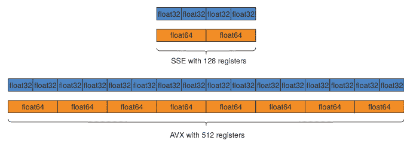

图 1.1 CPU 向量计算。

> **注**
> 
> “向量化”这一术语的另一个定义与大型语言模型的最近进展有关：使用向量或一组值来表示一个词。在文献中，这通常被称为 **嵌入式**，起源于自然语言处理中的 word2vec 模型。在第 6 章和第 7 章中，我们将介绍将字符串或分类特征表示为数值的想法，即整数索引、稀疏 one-hot 编码向量和稠密嵌入向量。

### 1.1.1 向量化运作的简单示例

假设我们要对从均匀分布中抽取的 100 万个随机数求点积。使用 Python 的 `for` 循环，我们通常会按以下方式实现此算法：

```
import random
def sqrt_of_n_random_numbers(n=1_000_000) :
    result = 0
    for _ in range(n) :
        a = random.uniform(0, 1)
        b = random.uniform(0, 1)
        result += a * b
    return result
```

在我的 M1 MacBook Pro 上运行 Python 3.11.4，上述函数的运行时间如下：

```
294 ms ± 1.39 ms per loop (mean ± std. dev. of 7 runs, 1 loop each)
```

如果使用 numpy 实现该算法并进行向量化

```
import numpy as np

def sqrt_of_n_random_numbers_np(n=1_000_000) :
    a = np.random.rand(n)
    b = np.random.rand(n)
    result = np.dot(a, b)
    return result
```

在相同设置下，向量化实现的运行时间如下。

```
7.9 ms ± 119 μs per loop (mean ± std. dev. of 7 runs, 100 loops each)
```

向量化带来了约 37 倍的加速！

### 1.1.2 Python 依然可能更快！

然而，上述示例并非旨在否定某些原生 Python 操作仍然比 NumPy 的实现更快这一事实，尽管 NumPy 经常用于向量化操作以简化 Python 中的 for 循环。

例如，我们希望按句号“.”分隔一组字符串列表。

```
X = ["foo.bar", "bar.foo", "x.y", "z.k"] * 1000
[x.split(".") for x in X]
```

第 2 行的运行时间为

```
299 μs ± 5.98 μs per loop (mean ± std. dev. of 7 runs, 1,000 loops each)
```

然而，相比之下，如果我们使用 NumPy 的“向量化”分割操作

```
Y = ["foo.bar", "bar.foo", "x.y", "z.k"] * 1000
Y = np.array(Y)
np.core.defchararray.split(Y, ".")
```

第 3 行的运行时间为

```
1.18 ms ± 4.37 µs per loop (mean ± std. dev. of 7 runs, 1,000
loops each)
```

这比原生 Python 慢约 4.0 倍。

### 1.1.3 向量化操作的内存分配

使用向量化操作时，我们需要考虑内存与速度之间的权衡。有时，向量化操作需要为中间步骤的结果分配更多内存。因此，这会影响程序的整体性能，即空间与时间复杂度的权衡。假设我们想要计算数组中元素平方和的函数。这可以作为 for 循环实现，遍历每个元素，求其平方，并累加平方值作为总和。或者，该函数也可以作为向量化操作实现：先对每个元素求平方，将结果存储在数组中，然后对平方向量求和。

```
import numpy as np

def sum_of_square_vectorized(X):
    x = np.asarray(X)
    x_sq = np.square(x) # x ** 2
    res = x_sq.sum()
    return res

def sum_of_square_for_loop(X):
    res = 0
    for x in X:
        res += x * x
    return res
```

让我们使用 memory_profiler 包来检查两个函数中每一行的内存使用情况。我们可以先通过 pip 安装该包：


install memory_profiler==0.61.0 并将其作为插件加载到 Jupyter Notebook 中。

```
!pip install memory_profiler==0.61.0
%load_ext memory_profiler
```

我们还将上述脚本保存为一个文件（我们将其命名为 memory_allocation_example.py），然后按照以下方式在笔记本中测量每个函数的内存追踪：

```
from memory_allocation_example import sum_of_square_vectorized
X = np.linspace(-50, 50, 100_000).tolist()
%mprun -f sum_of_square_vectorized sum_of_square_vectorized(X)
```

这给出了函数调用的以下逐行内存追踪：

| 行号 | 内存占用 | 增量 | 出现次数 | 行内容 |
|---|---|---|---|---|
| 4 | | | | def sum_of_square_vectorized(X) : |
| 5 | 104.3 MiB | 104.3 MiB | 1 | x = np.asarray(X) |
| 6 | 105.1 MiB | 0.8 MiB | 1 | x_sq = np.square(x) # x ** 2 |
| 7 | 105.4 MiB | 0.3 MiB | 1 | res = x_sq.sum() |
| 8 | 105.4 MiB | 0.0 MiB | 1 | return res |

我们也可以使用 %timeit 魔术函数来测量函数的速度：

```
%timeit sum_of_square_vectorized(X)
```

其结果为：

```
3.91 ms ± 64.7 µs per loop (mean ± std. dev. of 7 runs, 100 loops each)
```

同样，我们也来看看 for-loop 实现：

```
from memory_allocation_example import sum_of_square_for_loop
X = np.linspace(-50, 50, 100_000).tolist()
%mprun -f sum_of_square_for_loop sum_of_square_for_loop(X)
```

| 行号 | 内存占用 | 增量 | 出现次数 | 行内容 |
|---|---|---|---|---|
| 11 | 68.2 MiB | 68.2 MiB | 1 | def sum_of_square_for_loop(X) : |
| 12 | 68.2 MiB | 0.0 MiB | 1 | res = 0 |
| 13 | 68.2 MiB | 0.0 MiB | 100001 | for x in X: |
| 14 | 68.2 MiB | 0.0 MiB | 100000 | res += x ** 2 |
| 15 | 68.2 MiB | 0.0 MiB | 1 | return res |

我们还按以下方式测试运行时间：

```
%timeit sum_of_square_for_loop(X)
```

其结果为：

```
5.72 ms ± 39 µs per loop (mean ± std. dev. of 7 runs, 100 loops each)
```

我们可以看到，虽然 for-loop 函数比向量化函数慢，但 for-loop 几乎没有内存增加。相比之下，向量化解决方案的内存使用量增加了约 1M，同时将运行时间缩短了约 30%。如果 X 比当前示例大几个数量级，那么我们可以看到，为了换取速度，将会消耗更多内存。因此，在使用向量化操作时，我们需要仔细考虑速度与内存（即时间与空间）之间的权衡。

## 1.2 案例研究：神经网络的全连接层

向量化是实现各种机器学习模型的关键技能，尤其是深度学习算法。一个简单的神经网络由若干个前馈层组成，如图 1.2 所示。

前馈层（也称为全连接层、线性层、感知层或隐藏层，如图 1.3 所示）具有以下表达式：

$z = \sigma(xw + b)$

请注意，\(y = xw + b\) 是一个线性模型。这里，

- \(x\) 是输入，通常形状为 (`batch_size`, `num_inputs`)
- \(w\) 是权重（又称 kernel）参数矩阵，形状为 (`num_inputs`, `hidden_size`)
- \(b\) 是偏置参数向量，形状为 (1, `hidden_size`)

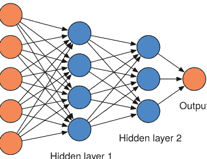

### 图 1.2 多层感知机。

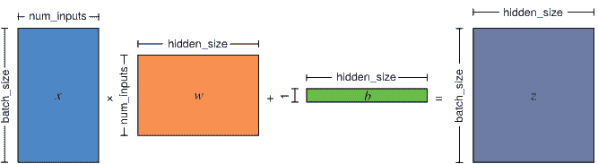

### 图 1.3 前馈层。

- σ 是应用于线性模型运算结果中每个元素的激活函数。它可以是 relu、sigmoid 或 tanh 等。
- z 是输出，形状为 (batch_size, hidden_size)

堆叠多个前馈层即可创建多层感知机模型，如上述示例神经网络所示。

如果我们只想用原生 Python 来实现前馈层，则需要根据 batch_size、num_inputs 和 hidden_size 运行成千上万甚至数百万次的 for-loop 迭代。当涉及到像生成式预训练变换器（GPT）这样的大型语言模型时，该模型有数千亿个参数需要优化，使用 for 循环进行此类计算会变得非常缓慢，以至于使用该模型进行训练或推理变得不可行。但是，如果我们利用 CPU 或 GPU 上的向量化，我们会看到模型性能的显著提升。此外，某些操作（如矩阵乘法）如果通过简单地并行化 for-loop 来原生实现，则根本无法高效执行，因此在实践中必须依赖特殊算法，例如 Strassen 算法 [Strassen, 1969]（或者更近期的，由 AlphaTensor 发现的新算法 [Fawzi et al., 2022]）。将这些算法作为 CPU 或 GPU 上的指令来实现本身也是一项非平凡的任务。因此，机器学习和数据科学的从业者应该利用实现了这些算法的现有库。但是，要高效使用这些库，就需要擅长以向量化的方式思考。

接下来，让我们看看如何使用 numpy 实现上述感知层的示例。

```
import numpy as np

def sigmoid(x):
    """Implement sigmoid activation function."""
    return 1. / (1 + np.exp(-x))

def dense_layer(x, w, b):
    # linear model: (batch_size, hidden_size)
    y = x @ w + b
    # activation
    y = sigmoid(y)
    return y
```

- 第 3-5 行定义了 sigmoid 激活函数，f(x) = \frac{1}{1+e^{-x}}
- 第 10 行实现了线性模型
  - 这里，@ 运算符是被 numpy、tensorflow 和 torch 等典型向量库识别的矩阵乘法运算符。我们将在第 4 章中更详细地讨论矩阵运算。
  - x 和 w 相乘的结果应该是形状为 (batch_size, hidden_size) 的矩阵，但在此实现中，b 的形状为 (1, hidden_size)。如何将向量加到矩阵上？在第 2 章中，我们将探讨称为广播的概念。
- 第 12 行应用我们之前定义的 sigmoid 激活函数来计算该全连接层的最终输出。这是一个逐元素操作，即将 sigmoid 函数应用于矩阵的每个元素。我们将在第 2 章中探讨逐元素操作的概念。

如您所见，向量化可以极大地简化在高维数组上运行的神经网络的表示，这些数组包含大量元素或数据点。

## 1.3 向量化与其他并行计算范式

既然知道向量化是一种并行计算范式，自然会提出这样的问题：向量化与其他并行计算范式（如多线程、多进程或多工作进程分布式计算）相比如何？

### 1.3.1 多线程

与向量化类似，多线程在具有共享内存的单个处理单元上运行。这可以是 CPU 或 GPU 的单个核心。向量化在单条指令下并行处理寄存器中的多个数据输入。相比之下，多线程一次只能处理一条数据流，而不是并行处理数据。它可以在同一程序的不同线程之间切换（有时也可以在不同程序的不同线程之间切换），每个线程代表进程的不同部分。这被称为“并发”。当然，多线程可以与向量化结合使用。事实上，现代 GPU 通过结合向量化、多线程和多进程来提高其处理能力 [NVIDIA, 2012]。

多线程范式在从远程服务器读取数据等任务中非常有优势。例如，一个数据库有 10 个部分。如果我们只有一个线程，那么对于要读取的每个数据部分，我们需要等待一分钟，直到数据下载完成后才能读取下一部分。然后，下载整个数据库总共需要 10 分钟。但是，如果我们有 10 个线程，每个线程都发出读取一个数据部分的请求。由于发出读取数据请求的时间相对于下载数据的时间可以忽略不计，每个线程下载数据需要一分钟。但是，由于下载过程是彼此并行的，下载整个数据库总共只需要一分钟。请参见图 1.4 了解示例。

### 1.3.2 多进程

另一方面，多进程在多个处理单元上运行，例如多核 CPU 或 GPU。处理单元的每个核心可以通过共享内存（即 RAM）访问数据。与向量化和多线程不同，多进程不在进程之间共享相同的数据。因此，为了使用不同指令并行处理相同的数据，多进程需要在核心之间复制数据。与多线程不同，如果进程受 I/O 限制（即数据读取和写入），多进程将不会高效。相反，如果进程受


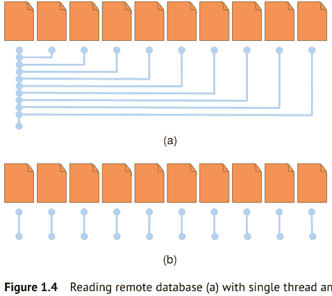

由处理能力（又称 CPU 密集型）决定，并可通过将计算负载分布到处理单元的多个核心上大大加快进程。多处理的典型用途是执行内存中批量数据处理。假设我们要为一组用户计算最小-最大归一化得分：

```python
import pandas as pd
df = pd.DataFrame({
    "id": [
        "A", "A", "A", "A", "B", "B", "B", "B", "B",
        "C", "C", "C", "C", "C", "C", "C", "C", "C"
    ],
    "scores": [
        98, 97, 100, 80, 78, 80, 82, 81, 61, 51, 72,
        70, 82, 80, 75, 62, 67, 53
    ]
})
```

我们可以定义以下用户自定义函数（UDF）来计算每个用户的归一化得分：

```python
def apply_func(pdf):
    """Compute the min-max normalized score"""
    min_val = pdf['scores'].min()
    max_val = pdf['scores'].max() + 1e-6
    pdf['scores'] = (pdf['scores'] - min_val) / (max_val - min_val)
    return pdf
```

基于用户 ID 的每个分组批次将使用 apply_func 进行转换：

```python
df_out = df.groupby(
    by="id", as_index=False
).apply(apply_func)
```

在我的配备 8 核的 MacBook Pro M1 机器上，这大约需要 1.5 ms，并得出表 1.1 中的结果。

我们可以使用多处理来执行相同的转换，其中每个进程将对每个分组批次的数据进行操作。我们首先定义辅助函数 apply_parallel，它将使用 Python 的 joblib 来创建多处理环境。

### 表 1.1 最小-最大归一化得分

| ID | 分数 |
|---|---|
| A | 0.9 |
| A | 0.85 |
| A | 1 |
| A | 0 |
| B | 0.809524 |
| B | 0.904762 |
| B | 1 |
| B | 0.952381 |
| B | 0 |
| C | 0 |
| C | 0.677419 |
| C | 0.612903 |
| C | 1 |
| C | 0.935484 |
| C | 0.774194 |
| C | 0.354839 |
| C | 0.516129 |
| C | 0.0645161 |

```python
from tqdm import tqdm
import multiprocessing
from joblib import Parallel, delayed
import pandas as pd

def apply_parallel(df_grouped, func):
    """
    Apply a function to grouped pandas dataframe using
        multiprocessing.
    Usage:
    def apply_func(pandas_df) :
        ...
    df = apply_parallel (
        df.groupby(
            by=grouped_by_columns,
            as_index=False,
        ),
        apply_func
    """
    ret = Parallel(n_jobs=multiprocessing.cpu_count())(
        delayed(func)(group) for name, group in tqdm(df_grouped)
    ) # enumerate(tqdm(dfGrouped))
    return pd.concat(ret)
```

我们然后使用这个辅助函数来执行批量转换：

```python
df_out_parallel = apply_parallel(
    df.groupby(by="id", as_index=False), apply_func
)
```

这需要 677 ms，比使用原生 pandas DataFrame.apply 函数要慢得多。这是因为设置多处理有开销，因此大部分过程都用于设置多处理环境，而不是执行实际计算。然而，当数据大小和批次数量较大时，我们可以预期，多处理带来的整体速度提升足以抵消额外的开销。现在，我们改为随机生成 100,000 行数据用于转换。

```python
import string
import random
df = pd.DataFrame({
    "id": [
        "".join(
            random.choices(string.ascii_letters, k=3)
        ) for _ in range(100_000)
    ],
    "scores": [
        random.randint(1, 100) for _ in range(100_000)
    ],
})
```

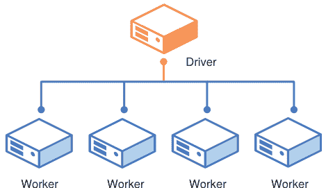

图 1.5 分布式计算中的驱动节点和工作节点。驱动节点（或主节点）发出一系列命令来创建工作节点，并给每个工作节点分配处理部分数据的任务。每个工作节点完成自己的任务后，会将结果发回驱动节点进行汇总。驱动节点等待所有工作节点完成任务后，再将结果返回给用户。

如果使用 `pandas.DataFrame.apply`，转换大约需要 19 秒。如果使用 `apply_parallel`，现在转换需要 16 秒，处理速度提升了约 16%。

### 1.3.3 多工作节点分布式计算

在现代大数据分析中，从业人员通常需要处理大小从几个 GB 到数百 TB 不等的数据（而这通常只是磁盘上的压缩大小；占用内存的数据大小可能更大）。没有一台消费级笔记本电脑或台式机能将数百 GB 到 TB 级的数据全部放入内存，也没有任何单一 CPU 或 GPU 能以足够快的速度处理如此大量的数据，而无需用户等待数小时甚至数天（嗯，至少在我写本书时，还不存在如此强大的处理单元）。数据分析师、数据科学家和机器学习工程师转而依赖云技术，将如此大量的数据托管在分布式文件存储系统中，并使用分布式计算来处理数据。这里的“分布式”仅仅意味着多台机器正在存储、访问和处理数据，而机器之间通过网络进行通信。图 1.5 说明了一个多工作节点分布式计算系统。

在处理大量数据的任务时，“分治法”是关键。其思想是，如果一台计算机处理我们的数据需要 100 小时，那么 100 台计算机可以在大约 1 小时内完成相同的任务。如果我们能将如此大量的数据分成较小的片段，让每个计算节点处理那小片数据，最后从所有并行工作节点汇总结果，那么可以大大减少我们等待数据处理任务完成所需的物理（或挂钟）时间。事实上，这正是 MapReduce [Dean and Ghemawat, 2008] 的核心思想。

一个常用于说明 MapReduce 的“Hello World”示例是统计大量文档中每个单词出现的次数。在本示例中，我们将使用 Apache Beam [Apache Foundation, 2023a] 来说明如何编写单词计数的 MapReduce 算法。我们可以使用 pip install apache-beam 安装 apache-beam（我使用的是 apache-beam==2.49.0。需要注意的是，写作时 Apache Beam 目前不支持 pandas >=2.0.0 [Apache Foundation, 2023b]，因此本示例中我使用的是 pandas==1.5.3）。

```python
import apache_beam as beam
from apache_beam.options.pipeline_options import PipelineOptions

# Setting up running environment
pipeline_args = [
    "--job_name=word_count",
    "--runner=DirectRunner", # local runner
]
pipeline_options = PipelineOptions(pipeline_args)

# Run the beam pipeline
with beam.Pipeline(options=pipeline_options) as p:
    _ = (
        p
        # Creating the example document
        # This can also be read from files
        | "Create texts" >> beam.Create([
            "lorem ipsum dolor sit amet",
            "sit amet dolor lorem",
            "ut enim ad minim veniam",
            "ut enim ad minim lorem",
        ])
        # Splitting the documents into words
        | "Split" >> beam.FlatMap(lambda x: x.split())
        # Convert to a tuple (key, value) = (word, 1)
        | "Pair with 1" >> beam.Map(lambda x: (x, 1))
        # Summing the value by each key/word
        | "Count" >> beam.CombinePerKey(sum)
        # Print the output
        | "Print" >> beam.Map(print)
    )
```

- 第 1-2 行导入 apache-beam 库和 `PipelineOptions` 类以配置运行环境。
- 第 5-9 行设置管道运行环境。Beam 可以根据指定的运行器类型自动判断何时使用多线程、多处理或分布式计算。在这个小示例中，由于我们使用 `DirectRunner` 运行，Beam 假设这是在单台机器上运行，因此会在合适的时候利用多处理。但是，如果我们在 Apache Flink 或 Apache Spark 等分布式环境中运行管道，Beam 将使用多工作节点处理，而每个工作节点如果也有多个内核可用，则还会使用多处理。不过，这个小的技术细节不应妨碍我们理解 MapReduce 在分布式并行环境中的工作原理。
- 第 12 行启动我们指定选项的 Beam 管道上下文。
- 第 14–22 行通过创建一些模拟文档来初始化管道。在这个小示例中，我们假设有四份文档。每份文档包含用空格分隔的单词。
- 第 24 行将文档拆分为单个单词。这里，`FlatMap` 意味着对每个文档应用单词拆分函数，然后将结果展平。因此，它不是返回嵌套列表，而是返回一个扁平列表。
- 第 26 行执行 MapReduce 的经典 Map 步骤，即为扁平列表中的每个单词创建元组 `(word, 1)`。这通常被描述为 `<key, value>` 映射格式，其中单词是键，静态值 `1` 是值。
- 第 28 行执行 MapReduce 的经典 Reduce 步骤，即按每个键汇总上一步骤的元组，将值相加。这相当于 `pandas.DataFrame` 中的 `.groupby (...).sum ()` 操作。
- 第 30 行打印管道的结果。

执行上述管道后，我们得到以下统计每个单词出现次数的输出：

```
('lorem', 3)
('ipsum', 1)
('dolor', 3)
('sit', 2)
('amet', 2)
('ut', 2)
('enim', 2)
('ad', 2)
('minim', 1)
('veniam', 1)
```

如果文档的数量和大小都非常大，我们可以想象，每份文档都将由每个工作节点读取、拆分、映射、汇总，并返回上述汇总结果。然后，驱动节点可以对来自每个工作节点的汇总结果进行进一步合并，以输出最终结果。


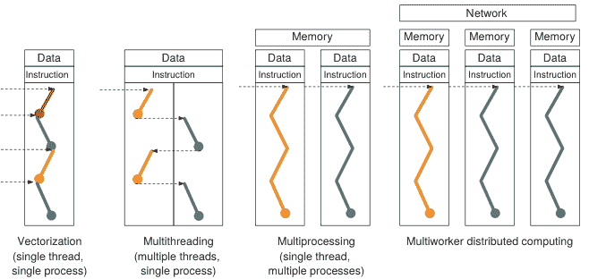

图 1.6 并行计算范式对比。向量化将数据存储在处理单元的单个寄存器中，并使用单条指令同时对寄存器中的多个数据表示进行处理。多线程需要在处理单元的不同线程之间切换，指令并发执行。多进程在机器的不同计算核心或不同处理单元上启动多个进程，数据通过共享内存进行通信。多分布式工作计算使用多台机器来处理一小块数据，数据托管在分布式文件系统中，并通过网络进行通信。

图 1.6 总结并比较了我们迄今讨论的各种并行计算范式。

我希望本节能提供关于不同并行计算范式的足够信息。可以推断，多线程、多进程和多worker范式与程序的确切指令无关，而向量化则使用专用算法操作特定数据。因此，可以合理预期，当将向量化与其他类型的并行计算技术（如多进程和多分布式工作计算）相结合时，在有限资源下我们可以最大化计算效率。

## 参考文献

Apache Foundation. Apache Beam. https://beam.apache.org/, 2023a.

Apache Foundation. Support Pandas==2.x in Apache Beam. #27221. https://github.com/apache/beam/issues/27221, June 2023b.

Jeffrey Dean and Sanjay Ghemawat. MapReduce: Simplified data processing on large clusters. Communications of the ACM, 51(1):107–113, January 2008. ISSN 0001-0782, 1557-7317. doi: 10.1145/1327452.1327492.

Alhussein Fawzi, Matej Balog, Aja Huang, Thomas Hubert, Bernardino Romera-Paredes, Mohammadamin Barekatain, Alexander Novikov, Francisco J. R. Ruiz, Julian Schrittwieser, Grzegorz Swirszcz, David Silver, Demis Hassabis, and Pushmeet Kohli. Discovering faster matrix multiplication algorithms with reinforcement learning. Nature, 610(7930):47–53, October 2022. ISSN 1476-4687. doi: 10.1038/s41586-022-05172-4.

Intel. Get Outstanding Computational Performance without a Specialized Accelerator. Intel Technology Brief, July 2022.

Evguenii Kharchenko. Vectorization: A Key Tool To Improve Performance On Modern CPUs. https://www.intel.com/content/www/us/en/developer/articles/technical/vectorization-a-key-tool-to-improve-performance-on-modern-cpus.html, January 2018.

NVIDIA. NVIDIA's Next Generation CUDA™ Compute Architecture. Technical report, 2012.

Volker Strassen. Gaussian elimination is not optimal. Numerische Mathematik, 13:354–356, 1969.

# 2 基本张量操作

诸如 NumPy [Harris et al., 2020]、Tensorflow [Abadi et al., 2015] 和 PyTorch [Paszke et al., 2019] 等数值库实现了各种类型的向量化操作，以便于科学计算。在本书中，我们定义以下一组术语：如果一个变量被称为

- **标量**，则该变量具有零维，表示一个单一的数值。
- **数组**，或 **向量**，则该变量具有一个维度，表示一组值列表。
- **矩阵**，则该变量具有两个维度，表示一个典型的二维矩阵。
- **张量**，则该变量是 _N_ 维值的通用集合，其中 \(N \in {0, 1, 2, ...}\) 是自然数。更常见的是，我会使用“张量”一词来表示 _N > 2_ 的高维值集合。

在本章中，我们将探讨用于单个张量或一对张量的各种操作。

## 2.1 张量初始化器

张量初始化器提供了快速便捷的方式，在内存中预先分配一些空间以存储稍后要填充的值。它也可用于掩码和索引操作，我们将在后续章节中看到。要初始化一组值，我们通常会使用类似下面的 for 循环示例：

```
# Initialize an array of zeros
value = []
for _ in range(1_000_000):
    value.append(0)
```

这似乎很慢（在我的 M1 MacBook Pro 上）

```
32.3 ms ± 390 µs per loop (mean ± std. dev. of 7 runs, 10 loops each)
```

使用列表推导式

```
[0 for _ in range(1_000_000)]
```

似乎提升了性能

```
17.3 ms ± 586 µs per loop (mean ± std. dev. of 7 runs, 100 loops each)
```

我们也可以使用 Python 的语法糖运算符 * 对列表进行一行操作

```
[0] * 1_000_000
```

这快得多

```
2.69 ms ± 66.6 µs per loop (mean ± std. dev. of 7 runs, 100 loops each)
```

不过，上述方法都无法超越 NumPy 函数 np.zeros 的性能

```
np.zeros(1_000_000)
```

这是最快的

```
537 µs ± 39.8 µs per loop (mean ± std. dev. of 7 runs, 1,000 loops each)
```

通过使用 np.zeros，我们还可以轻松创建多维张量（不仅仅是 1-D 向量），从而帮助我们执行额外的下游向量化操作。

但为什么要预先分配或初始化向量呢？这同样与性能有关。可以说，即时扩展数组比为我们的计算预先分配一部分内存更加昂贵。让我们展示一下

```
import math
def sqrt_iter():
    values = []
    for ii in range(1_000_000):
        values.append(math.sqrt(ii))
    return values
```

> 87.5 ms ± 1.27 ms per loop (mean ± std. dev. of 7 runs, 10 loops each)

或者，我们可以预先分配一个零数组来存储结果

```
import math
def sqrt_iter_preallocate():
    values = [0] * 1_000_000
    for ii in range(1_000_000):
        values[ii] = math.sqrt(ii)
```

> 78.4 ms ± 828 µs per loop (mean ± std. dev. of 7 runs, 10 loops each)

### 轶事

我最初是在 MATLAB 中开始进行向量化编程的。在启动 for 循环之前预先分配向量是 MATLAB 性能方面的经典经验。虽然在上面的小型 Python 示例中，我们只看到了大约 10% 的改进，但在 MATLAB 中，这可以带来 10-50 倍的性能提升！参见 MATLAB 官方文档：https://www.mathworks.com/help/matlab/matlab_prog/preallocating-arrays.html。现实世界软件开发中的轶事也表明，在处理许多其他语言（如 JavaScript [Nenashev, 2024]、R [Sellers, 2024] 和 C++ [Usi, 2023]）中的大型数组时，预分配是一种获得更好性能的有效策略。

表 2.1 Python、NumPy、Tensorflow 和 PyTorch 中的张量初始化器列表。

| 初始化操作 | Python | NumPy | Tensorflow | PyTorch |
|---|---|---|---|---|
| 零 | [0] * n | np.zeros | tf.zeros | torch.zeros |
| 一 | [1] * n | np.ones | tf.ones | torch.ones |
| 空 | [[]] * n | np.empty | tf.experimental.numpy.empty | torch.empty |
| 填充 | [value] * n | np.full | tf.fill, tf.experimental.numpy.full | torch.full |
| 随机均匀 | random.uniform | np.random.rand | tf.random.uniform | torch.rand |
| 随机正态 | random.normal | np.random.randn | tf.random.normal | torch.randn |
| 随机整数 | random.randint | np.random.randint | tf.experimental.numpy.random.randint | torch.randint |
| 范围 | range | np.arange | tf.range | torch.arange |
| 线性空间 | N/A, 使用 range | np.linspace | tf.linspace | torch.linspace |
| 单位矩阵 | N/A | np.eye | tf.eye | torch.eye |
| 对角矩阵 | N/A | np.diag | tf.linalg.diag | torch.diag |

注：
a) 许多这些张量初始化器都有相应的 _like 方法，其中初始化张量的形状可以从另一个提供的张量的形状推断出来。在尝试初始化与现有张量形状相同的张量时，这些方法非常方便。在其他场景中，张量的形状可能在运行时才知道，_like 方法允许用户通过从运行时结果推断其形状来动态初始化张量。
- 零：np.zeros_like, tf.zeros_like, torch.zeros_like
- 一：np.ones_like, tf.ones_like, torch.ones_like
- 空：np.empty_like, tf.experimental.numpy.empty_like, torch.empty_like
- 填充：np.full_like, tf.experimental.numpy.full_like, torch.full_like
- 均匀：torch.rand_like
- 正态：torch.randn_like
- 随机整数：torch.randint_like
b) Tensorflow 实现了一个实验性的 NumPy 模块 tf.experimental.numpy。通常，许多与 Tensorflow 操作等效或替代的 NumPy 操作（例如 Full vs. fill）可以在此模块中找到。此模块不包含所有 NumPy 操作；与 NumPy 相比，某些操作功能有限（很可能是由于 Tensorflow 中需要高效的图追踪 [Abadi et al., 2023a]）。


c) 同样，tf.random.uniform(start, end, shape, dtype=tf.int32) 也可用于在给定范围内绘制整数。

d) PyTorch 也有 torch.range 方法，它是 end inclusive（包含结束值）的。这意味着 torch.range(1, 5) = (1, 2, 3, 4, 5)，而其他所有 range 方法都是 end-exclusive（不包含结束值）的。即 range(1, 5) = (1, 2, 3, 4)。

e) np.eye 的替代方法是 np.identity。np.identity 仅返回主对角线元素为 1 的矩阵。相比之下，np.eye 可以返回非对角线元素为 1 的矩阵。Tensorflow 中的 tf.eye 和 PyTorch 中的 torch.eye 实际上更类似于 np.identity，其中返回的矩阵仅将主对角线元素设置为 1。为说明这一点

```
1 import numpy as np
2 np.eye(2, dtype=int)
3 # array([[1, 0],
4 #        [0, 1]])
5 np.eye(3, k=1, dtype=int)
6 # array([[0, 1, 0],
7 #        [0, 0, 1],
8 #        [0, 0, 0]])
9 np.identity(3)
10 # array([[1., 0., 0.],
11 #        [0., 1., 0.],
12 #        [0., 0., 1.]])
```

Table 2.1 提供了由原生 Python、NumPy、Tensorflow 和 PyTorch 实现的一系列张量初始化器的摘要。这些初始化器的大多数使用方式相似，其中需要 `shape` 和可选的 `dtype`（将在下一节中讨论）参数来构造张量。张量初始化器有四个基本类别：

- 1. **静态值初始化器**：其中初始化张量的所有条目都填充为单个静态值。它们包括“zeros”、“ones”、“empty”和“full”初始化器。
- 2. **随机值初始化器**：其中初始化张量的条目填充了从某些分布中绘制的随机值，例如 random uniform、random normal 或 random int。
- 3. **范围值初始化器**：其中初始化张量的条目有序且在预定义的值范围内。它们包括 range 和 `linspace` 初始化操作。
- 4. **特殊矩阵初始化器**：其中初始化特殊矩阵，例如各种大小的对角矩阵或单位矩阵。

## 2.2 数据类型和强制转换

在许多科学计算和机器学习应用领域，我们需要操作存储在张量中的底层数据。数据的值在机器上可能以不同的方式表示和解释。我不会详细介绍计算机在基本层面上如何表示信息。感兴趣的读者可以阅读一本入门计算机科学书籍或 C [Prinz and Crawford, 2005] 或 Java 编程书籍，以深入了解计算数据类型。虽然 Python 不像 C 或 Java 那样是强类型检查语言，但很好地了解我们用于任务的库（通常与用 C 编写的数值库交互）中的基本数据类型，将有助于我们调用方法和函数，这些方法和函数高效地实现专门针对某些数据类型优化的专用算法。Table 2.2 提供了 Python、NumPy、Tensorflow 和 PyTorch 实现的数据类型列表。

Table 2.2 Python、NumPy [Harris et al., 2023a]、Tensorflow [Abadi et al., 2023b] 和 PyTorch [Paszke et al., 2023b] 中的数据类型列表。

| dtype | Python | NumPy | Tensorflow | PyTorch |
|---|---|---|---|---|
| 布尔值 | bool | np.bool_ | tf.bool | torch.bool |
| 8 位整数 (a,b) | N/A | np.int8 | tf.int8 | torch.int8 |
| 16 位整数 (short) (a) | N/A | np.int16 (np.short) | tf.int16 | torch.int16 (torch.short) |
| 32 位整数 (int) (a,b) | int | np.int32 (np.intc) | tf.int32 | torch.int32 (torch.int) |
| 64 位整数 (long) | N/A | np.int64 (np.int_) | tf.int64 | torch.int64 (torch.long) |
| 8 位无符号整数 (a,b) | N/A | np.uint8 | tf.uint8 | torch.uint8 |
| 16 位无符号整数 (a,b) | N/A | np.uint16 (np.ushort) | tf.uint16 | torch.uint16 |
| 32 位无符号整数 | N/A | np.uint32 (np.uintc) | tf.uint32 | N/A |

Notes:
a) Tensorflow 实现了这些整数数据类型的量化版本，用于模型大小压缩。
- tf.int8: tf.qint8
- tf.int16: tf.qint16
- tf.int32: tf.qint32
- tf.uint8: tf.quint8
- tf.int16: tf.quint16

b) PyTorch 实现了这些整数数据类型的量化版本，用于模型大小压缩。值得注意的是，PyTorch 不像 Tensorflow 那样实现 torch.int8 和 torch.quint16，而是实现了一个额外的量化 4 位整数类型（torch.quint4x2，它是一个 8 位整数）
- torch.int8: torch.qint8
- torch.uint8: torch.quint8
- torch.int16: torch.qint8
- torch.int32: torch.qint32
- torch.quint4x2

Table 2.2（续）

| dtype | Python | NumPy | Tensorflow | PyTorch |
|---|---|---|---|---|
| 64 位无符号整数 | N/A | np.uint64 (np.uint) | tf.uint64 | N/A |
| float16 (半精度) | N/A | np.float16 (np.half) | tf.float16 | torch.float16 |
| float32 (单精度) | N/A | np.float32 (np.single) | tf.float32 | torch.float32 (torch.float) |
| float64 (双精度) | float | np.float64 (np.double) | tf.float64 | torch.float64 (torch.double) |
| complex32 | N/A | N/A | N/A | torch.complex32 (torch.chalf) |
| complex64 | N/A | np.complex64 | tf.complex64 | torch.complex64 (torch.cfloat) |
| complex128 | complex | np.complex128 (np.complex_) | tf.complex128 | torch.complex128 (torch.cdouble) |
| complex256 | N/A | np.complex128 (np.longcomplex) | N/A | N/A |
| 字节 | bytes | np.bytes_ | tf.string (c) | N/A (d) |
| 字符串 | str | np.str_ | tf.string (c) | N/A (d) |

c) Tensorflow 中的字符串将被转换为字节。在将 Tensorflow 转换回 NumPy 数组时，通常执行 x.numpy().astype(str) 以将字节数组转换为字符串数组。

d) 与 NumPy 和 Tensorflow 不同，PyTorch 不支持字符串和字节张量。相反，它依赖于 NumPy 和纯 Python 来处理字符串处理。在第 6 章中，我们将介绍通过索引和嵌入查找将字符串转换为数值表示的主题。

### 2.2.1 在张量初始化期间指定 dtypes 的提示

前一节中列出的大多数张量初始化器都应该接受 dtype 参数，用户可以在构造后指定张量的 dtypes。以 zeros 初始化器为例：

- 对于 NumPy，x = np.zeros(5, dtype=np.float32) 将初始化一个 np.float32 零数组。
- 对于 TensorFlow，x = tf.zeros(5, dtype=tf.float32) 将初始化一个 tf.float32 零数组。
- 对于 PyTorch，x = torch.zeros(5, dtype=torch.float32) 将初始化一个 torch.float32 零数组。
- Tensorflow 和 PyTorch 的 dtypes 均与原生 Python dtypes 兼容。因此，也可以使用原生 Python dtypes 来指定 dtypes，尽管需要注意以确保使用所需的精度。例如，x = tf.zeros(5, dtype=float) 等效于 x = tf.zeros(5, dtype=tf.float32)，这又等效于 x = tf.zeros(5, dtype=np.float32)（是的，在许多情况下，Tensorflow 的 dtypes 也与 NumPy 的 dtypes 兼容），尽管原生 Python 的 float 表示 64 位浮点数。但是，在 PyTorch 中，x = torch.zeros(5, dtype=float) 等效于 x = torch.zeros(5, dtype=torch.float64)（不过，使用 np.float64 会引发错误）。

### 2.2.2 强制转换提示

强制转换意味着将一种数据类型转换为另一种数据类型。

- 在 NumPy 中，在数据类型之间进行强制转换，请使用 `x.ndarray.astype(np.dtype)`。例如，x = np.array([1, 2, 3]).astype(np.float32) 会给出 array([1., 2., 3.], dtype=float32)
- 在 TensorFlow 中，在数据类型之间进行强制转换，请使用 `tf.cast(x, tf.dtype)`
- 在 PyTorch 中，在数据类型之间进行强制转换，请使用 `x.type(torch.dtype)`

## 2.3 数学运算

各种科学计算库（NumPy、MATLAB、Mathematica 等）是专门用于执行数学运算构建的。Table 2.3 显示了可以在 NumPy、Tensorflow 和 PyTorch 中对张量的每个元素使用的一系列典型数学运算列表。请注意，此表并非旨在详尽列出该库的所有内容。


### 表 2.3 Python、NumPy、Tensorflow 和 PyTorch 中常见数学运算列表。

| 数学运算 | Python | NumPy | Tensorflow | PyTorch |
|---|---|---|---|---|
| 加法 | + | + (np.add) | + (tf.add) | + (torch.add) |
| 减法 | - | - (np.subtract) | - (tf.subtract) | - (torch.subtract) |
| 乘法 | * | * (np.multiply) | * (tf.multiply) | * (torch.multiply) |
| 除法 | / | / (np.divide)<sup>a)</sup> | / (tf.divide) | / (torch.divide) |
| 安全除法 | N/A | np.divide<sup>a)</sup> | tf.math.divide_no_nan | N/A<sup>b)</sup> |
| 整除 | // | np.floor_divide | tf.math.floordiv | torch.floor_divide |
| 倒数 | N/A | np.reciprocal | tf.math.reciprocal | torch.reciprocal |
| 安全倒数 | N/A | np.reciprocal<sup>c)</sup> | tf.math.reciprocal_no_nan | N/A<sup>d)</sup> |
| 余数 | % (math.remainder) | % (np.remainder, np.mod) | tf.math.floormod | torch.remainder |
| 幂 | ** (math.pow) | np.power | tf.math.pow | torch.pow |
| 指数 | math.exp | np.exp | tf.exp | torch.exp |
| exp(x) - 1<sup>e)</sup> | math.expm1 | np.expm1 | tf.math.expm1 | torch.expm1 |
| 以 e 为底的对数 | math.log | np.log | tf.math.log | torch.log |
| 以 2 为底的对数 | math.log2 | np.log2 | N/A<sup>f)</sup> | torch.log2 |
| 以 10 为底的对数 | math.log10 | np.log10 | N/A<sup>f)</sup> | torch.log10 |
| log(1 + x)<sup>g)</sup> | math.log1p | np.log1p | tf.math.log1p | torch.log1p |
| log(exp(x_1) + exp(x_2))<sup>h)</sup> | math.logaddexp | np.logaddexp | tf.experimental.numpy.logaddexp | torch.logaddexp |
| log(sum(exp(x)))<sup>i)</sup> | N/A | scipy.special.logsumexp | tf.math.reduce_logsumexp | torch.logsumexp |

注释：
a) NumPy 没有实现安全除法运算，但可以使用 np.divide(a, b, out=np.zeros_like(b), where=b!=0) 来达到与 tf.divide_no_nan 相同的效果。
b) PyTorch 没有实现安全除法运算，但可以使用 torch.nan_to_num 将商中的 NaN 或 inf 填充为零。NumPy 也有类似的函数 np.nan_to_num。
c) 与 np.divide 方法类似，NumPy 没有实现安全倒数运算，但可以使用 np.reciprocal(x, out=np.zeros_like(x), where=x!=0) 来达到相同的效果。
- d) 与 `divide` 方法类似，PyTorch 也没有实现安全倒数运算，但可以使用 `torch.nan_to_num` 将 `NaN`s 或 `inf`s 填充为零。
- e) `expm1(x)` 在计算表达式 \(e^x - 1\) 时比 `exp(x) - 1` 更准确，特别是在 \(x \to 0\) 时。一个著名的例子是计算年化利率，\((1+x)^{t/y} - 1\)，可以表示为 \(\exp(t/y * \log1p(x)) - 1\)，并实现为 `exp(t / y * np.log1p(x)) - 1`（见下面的示例注释）。
- f) Tensorflow 没有实现除 e 以外的其他对数底数，但可以使用例如 `math.log(x) / tf.math.log(base)` 来转换底数。
- g) `log1p(x)` 在计算表达式 \(\log(1 + x)\) 时比 `log(1 + x)` 更准确，特别是在 \(x \to 0\) 时。著名的例子包括计算年化利率，\((1+x)^{t/y} - 1\)，可以表示为 \(\exp(t/y * \log1p(x)) - 1\)，以及反双曲函数的实现。例如，\(\text{arctanh}(x) = \frac{1}{2} \log(\frac{1+x}{1-x})\) 可以实现为 \(0.5 * (\log1p(x) - \log1p(-x))\)。
- h) `logaddexp` 在 x 非常大或非常小时，对于计算表达式 \(\log(\exp(x_1) + \exp(x_2))\) 更加准确。这是 `logsumexp` 的一个特例（见下面的注释）。
- i) `logsumexp` 是上述 `logaddexp` 的更通用实现，可以对多于两个数字进行操作，计算表达式 \(\log(\sum_i \exp(x_i))\)。请注意，求和表达式是最大似然估计中 softmax 损失函数的归一化项 \(p_j = \text{softmax}(x)_j = \frac{\exp(x_j)}{\sum_i \exp(x_i)}\)，然后对数概率的形式为 \(\log(p_j) = x_j - \log(\sum_i \exp(x_i))\)。NumPy 没有该函数的原生实现，但可以在 Scipy 的 `scipy.special.logsumexp` 中找到，使用所谓的 log-sum-exp 技巧 [Wikipedia, 2023]:

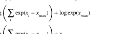

其中 \(x_{\max} = \max(x_0, x_1, \dots, x_p)\)。一个 naive 实现是

```
import numpy as np
def logsumexp(x):
    x_max = np.max(x)
    return np.log(np.exp(x - x_max).sum()) + x_max
```

### 表 2.3（续）

| 数学运算 | Python | NumPy | Tensorflow | PyTorch |
|---|---|---|---|---|
| 平方根 | math.sqrt | np.sqrt | tf.sqrt | torch.sqrt |
| 平方 | N/A | np.square | tf.square | torch.square |
| 绝对值 | abs | np.abs | tf.abs | torch.abs |
| 正弦 | math.sin | np.sin | tf.sin | torch.sin |
| 余弦 | math.cos | np.cos | tf.cos | torch.cos |
| 正切 | math.tan | np.tan | tf.tan | torch.tan |
| 双曲正切 | math.tanh | np.tanh | tf.tanh | torch.tanh |
| 四舍五入 | round | np.round | tf.round | torch.round |
| 向上取整 | math.ceil | np.ceil | tf.ceil | torch.ceil |
| 向下取整 | math.floor | np.floor | tf.floor | torch.floor |
| 复数的实部 | (complex).real | np.real | tf.real | torch.real |
| 复数的虚部 | (complex).imag | np.imag | tf.imag | torch.imag |
| 复数共轭 | (complex).conjugate | np.conj(np.conjugate) | tf.math.conj | torch.conj |

j) 你可能会疑惑，为什么我们甚至需要一个特定的函数来计算一个数的平方，而不只是使用 `x ** 2`。这全部关乎性能。事实证明，计算 `x * x` 比 `pow(x, 2)` 更快。拥有一个专门的平方函数，对于实现类似 `this_is_a_variable_with_super_long_name, e.g. See this issue [Paszke et al., 2023a] in PyTorch's repository.` 的东西很方便。

k) Python 复数可以构造为 `<real> + <imag>j`，例如 `1 + 2j`（注意 `2` 和 `j` 之间没有空格）。这就是为什么我通常在编写 for 循环时不使用 `j` 作为索引，因为它可能与 Python 保留的虚数变量混淆。

> 你可能会注意到，对于 Tensorflow 操作，有些函数在 tf 模块下，有些在 tf.math 模块下。这是因为，虽然所有函数都在 tf.math 模块下实现，但一些常用函数被别名到主 tf 模块下以便于访问。你可以通过打印模块路径来验证这一点。例如，tf.math.abs 和 tf.abs 都引用操作 <function tensorflow.python.ops.math_ops.abs(x, name=None)>。

PyTorch 将许多此类操作实现为其 torch.Tensor 类上的方法。因此，除了使用主模块中的函数外，还可以在数组/张量实例上调用相应的方法。例如，除了使用 torch.abs(x)，我们可以执行 x.abs()。这使得 PyTorch 更加面向对象。

## 2.4 归约操作

归约（或 reduce）操作是将一组值汇总为单个值的数学操作。它“缩减”张量的大小，从高维到低维，或者单个标量。表 2.4 列出了归约操作的示例。

NumPy 和 PyTorch 也将许多这些归约操作实现为其各自的 np.ndarray 和 torch.Tensor 类上的方法。因此，除了使用主模块中的函数外，还可以在数组/张量实例上调用相应的方法。例如，除了使用 np.sum(x) 或 torch.sum(x)，我们可以执行 x.sum()。TensorFlow 更偏向函数式，并没有在其 tf.Tensor 类上实现这些归约操作，可能是因为它需要通过跟踪函数调用来支持计算图的构建。

## 2.5 值比较操作

值比较操作比较张量中存储的值。表 2.5 提供了操作的简短列表。

| 归约操作 | Python | NumPy | Tensorflow | PyTorch |
| :--- | :--- | :--- | :--- | :--- |
| 求和<sup>a)</sup> | sum | np.sum | tf.reduce.sum | torch.sum |
| 均值<sup>b)</sup> | N/A | np.mean | tf.reduce.mean | torch.mean |
| 方差<sup>a)</sup> | N/A | np.var | tf.math.reduce.variance | torch.var |
| 标准差<sup>a)</sup> | N/A | np.std | tf.math.reduce.std | torch.std |
| 中位数<sup>a)</sup> | N/A | np.median | N/A<sup>b)</sup> | torch.median |
| 乘积<sup>a)</sup> | N/A | np.prod | tf.reduce.prod | torch.prod |
| 最大值<sup>a)</sup> | max | np.max | tf.reduce.max | torch.max |
| 最小值<sup>a)</sup> | min | np.min | tf.reduce.min | torch.min |
| 任意真 | any | np.any | tf.reduce.any | torch.any |
| 全真 | all | np.all | tf.reduce.all | torch.all |
| 张量范数 | N/A | np.linalg.norm | tf.norm | torch.linalg.norm |

注释：
a) 如果张量中有任何 NaN（"不是一个数字"）值，那么归约操作将始终返回 NaN。幸运的是，许多归约操作都有相应的版本，可以处理填充为 NaN 的缺失值：
- 1. 求和: np.nansum, tf.experimental.numpy.nansum, torch.nansum
- 2. 均值: np.nanmean, tf.experimental.numpy.nanmean, torch.nanmean
- 3. 方差: np.nanvar
- 4. 标准差: np.nanstd
- 5. 中位数: np.nanmedian, torch.nanmedian
- 6. 乘积: np.nanprod, tf.experimental.numpy.nanprod
- 7. 最大值: np.nanmax
- 8. 最小值: np.nanmin
b) 从技术上讲，也可以使用 Tensorflow 派生库 tensorflow_probability 或 tfp 来获取中位数，即 tfp.stats.percentile(x, 50, interpolation="midpoint")，其中 x 是浮点数数组。

| 操作 | Python | NumPy | Tensorflow | PyTorch |
| :--- | :--- | :--- | :--- | :--- |
| 两个数中的最大值 | max | np.maximum | tf.minimum | torch.maximum |
| 两个数中的最小值 | min | np.minimum | tf.maximum | torch.minimum |
| 裁剪值 | N/A | np.clip | tf.clip_by_value | torch.clip, torch.clamp |

## 2.6 逻辑操作

逻辑操作也称为布尔操作，其中计算 AND、OR、NOT 和 XOR 等操作。表 2.6 列出了这四种主要的布尔操作。


### 表 2.6 Python、NumPy、Tensorflow 和 PyTorch 中逻辑或布尔张量操作列表

| 操作 | Python | NumPy | Tensorflow | PyTorch |
|---|---|---|---|---|
| 逻辑非 | not, ~ | ~a), np.logical_not | tf.logical_not | torch.logical_not |
| 逻辑与 | and, & | &a), np.logical_and | tf.logical_and | torch.logical_and |
| 逻辑或 | or, \| | \|a), np.logical_or | tf.logical_or | torch.logical_or |
| 逻辑异或 | ^ | ^a), np.logical_xor | tf.math.logical_xor | torch.logical_xor |

注释：
- a) 符号 ~、&、| 和 ^ 分别表示按位操作，“非”、“与”、“或”和“异或”。当将这些符号与纯 Python 的布尔变量或 NumPy 的布尔数组一起使用时，其效果与函数操作相同。但是，如果我们将其应用于整数或浮点数，例如 `np.array(1) & np.array(2)` = 0 与 `np.logical_and(1, 2)` = True 不同。

### 表 2.7 Python、NumPy、Tensorflow 和 PyTorch 中相邻元素累积和与离散差分张量操作列表

| 操作 | Python | NumPy | Tensorflow | PyTorch |
|---|---|---|---|---|
| 累积和 a) | 不适用 | np.cumsum | tf.cumsum | torch.cumsum |
| 累积积 b) | 不适用 | np.cumprod | tf.math.cumprod | torch.cumprod |
| 相邻差分 c) | 不适用 | np.diff | tf.experimental.numpy.diff | torch.diff |

注释：
- a) 假设我们从向量 x = [1, 2, 3, 4] 开始。向量的累积和 yk = sum(xi^k, ∀k = 1, 2, ..., n 得到 y = [1, 1 + 2, 1 + 2 + 3, 1 + 2 + 3 + 4] = [1, 3, 6, 10]。
- b) 假设我们有一个向量 x = [1, 2, 3, 4]。那么，向量的累积积 yk = prod(xi^k, ∀k = 1, 2, ..., n 得到 y = [1, 1 x 2, 1 x 2 x 3, 1 x 2 x 3 x 4] = [1, 2, 6, 24]。
- c) 假设我们有一个向量 x = [1, 3, 6, 7]。那么，向量的相邻差分 yk = xk - xk-1, ∀k = 2, 3, ..., n 得到 y = [3 - 1, 6 - 3, 7 - 6] = [2, 3, 1]。这等同于执行 `x[1:] - x[:-1]`。请注意，结果数组 y 的长度比 x 短 1。

## 2.7 有序数组相邻元素操作

相邻元素数组操作在连续元素之间执行计算。累积和差分操作的示例请参见表 2.7。

## 2.8 数组反转

数组反转操作沿某个维度反转数组或张量。表 2.8 提供了数组反转操作列表。

### 表 2.8 Python、NumPy、Tensorflow 和 PyTorch 中数组/张量反转操作列表

| 操作 | Python | NumPy | Tensorflow | PyTorch |
| :--- | :--- | :--- | :--- | :--- |
| 反转 | `list[::-1]` | `np.flip` | `tf.reverse` | `torch.flip` |
| 左右反转 (axis=0) | 不适用 | `np.fliplr` | `tf.experimental.numpy.fliplr` | `torch.fliplr` |
| 上下反转 (axis=1) | 不适用 | `np.flipud` | `tf.experimental.numpy.flipud` | `torch.flipud` |
| 反转填充序列^a | 不适用 | 不适用 | `tf.reverse_sequence` | 不适用 |

注释：
- a) Tensorflow 中的填充序列反转 `tf.reverse_sequence` 与简单的 `tf.reverse` 不同。它只会反转标识为序列一部分的部分，并保持右侧的填充不变。例如，假设我们有一个零填充序列 `s=[1, 2, 3, 4, 0, 0, 0]`。`tf.reverse` 会反转包括填充在内的整个序列，变为 `[0, 0, 0, 4, 3, 2, 1]`，而 `tf.reverse_sequence` 在给定预期序列长度时，可以反转非填充条目处的序列，变为 `[4, 3, 2, 1, 0, 0, 0]`。在撰写本书时，Tensorflow 是唯一实现此填充序列反转方法的库。在第 10 章中，我们将看到如何使用 NumPy 实现此方法。

## 2.9 串联、堆叠与分割

张量可以通过与其他张量组合，或将较大的张量拆分为较小的张量来构建。表 2.9 列出了沿各个维度执行张量组合和拆分操作的函数。

## 2.10 重塑

重塑操作保持张量的底层数据与输入相同，但以不同格式表示张量。在计算图中追踪张量形状的演变，可能是在成功实现深度学习算法之前需要掌握的最重要技能之一。通常，前一操作的输出可能无法直接用于后续操作。例如，前馈层可能输出 9 个元素的数组，但后续操作要求我们对 3 组 3 个元素求平均值。实现此操作的一种方法是将 9 个元素的一维数组重塑为二维 3 × 3 矩阵，

### 表 2.9 Python、NumPy、Tensorflow 和 PyTorch 中相邻元素累积和与离散差分张量操作列表

| 操作 | Python | NumPy | Tensorflow | PyTorch |
|---|---|---|---|---|
| 串联^a) | + (list.__add__) | np.concatenate | tf.concat | torch.cat |
| 堆叠^a) | 不适用 | np.stack | tf.stack | torch.stack |
| 行堆叠^b) | 不适用 | np.vstack, np.row_stack | 不适用 | torch.vstack, torch.row_stack |
| 列堆叠^b) | 不适用 | np.hstack, np.column_stack | 不适用 | torch.hstack, torch.column_stack |
| 深度堆叠^b) | 不适用 | np.dstack | 不适用 | torch.dstack |

注释：
- a) 串联有时与堆叠类似。但是，串联始终沿现有轴合并张量，如果轴不存在会抛出错误。相比之下，堆叠会沿现有轴或新轴合并张量，有时会改变张量的维度。在对一维向量进行操作时，水平堆叠操作 (hstack) 与串联 (concatenate) 相同。图 2.1 说明了一维向量上的串联和堆叠操作。在对更高维度的矩阵或张量进行操作时，堆叠可以类似于串联。例如，vstack 等效于沿第 1 轴串联 (concatenate(..., axis=0))，而 hstack 等效于沿第 2 轴串联 (concatenate(..., axis=1))，dstack 会沿第 3 维堆叠（如果不存在则会创建它）。图 2.2 说明了应用于二维矩阵时的串联和堆叠操作。
- b) row_stack 或 vstack 始终沿第一个维度堆叠张量，等效于 stack(..., axis=0)；column_stack 或 hstack 始终沿第二个维度堆叠张量，等效于 stack(..., axis=1)；dstack 始终沿第三个维度堆叠张量，等效于 stack(..., axis=2)。

### 表 2.9（续）

| 操作 | Python | NumPy | Tensorflow | PyTorch |
|---|---|---|---|---|
| 追加(c) | <list>.append | np.append | tf.experimental.numpy.append | 不适用 |

注释：
- c) 追加操作类似于串联。当 axis=None 时，输入会先被展平，然后再进行串联。

```
# one dimensional vectors
a = np.array([1, 2, 3])
b = np.array([4, 5, 6])
c = np.append(a, b, axis=None)
# results
# array([1, 2, 3, 4, 5, 6])
```

但是，如果指定了 axis（例如 axis=0），则该函数可能表现为串联。

```
# one dimensional vectors
a = np.array([1, 2, 3])
b = np.array([4, 5, 6])
# specifying axis=1 will throw AxisError:
# axis 1 is out of bounds for an array of dimension 1
c = np.append(a, b, axis=0)
# results
# array([1, 2, 3, 4, 5, 6])
```

```
# two dimensional matrices
x = np.array([[1, 2, 3], [4, 5, 6]])
y = np.array([[-1, -2, -3], [-4, -5, -6]])
# concatenate along axis=0
z = np.append(x, y, axis=0)
# results
# array([[ 1, 2, 3],
#        [ 4, 5, 6],
#        [-1, -2, -3],
#        [-4, -5, -6]])
```

```
# concatenate along axis=1
z = np.append(x, y, axis=1)
# results
# array([[ 1, 2, 3, -1, -2, -3],
#        [ 4, 5, 6, -4, -5, -6]])
```


表 2.9（续）

| 操作 | Python | NumPy | Tensorflow | PyTorch |
|---|---|---|---|---|
| 分割 | N/A（使用切片） | np.split, np.array_split | tf.split | torch.split |
| 行分割 | N/A | np.hsplit | N/A | torch.hsplit |
| 列分割 | N/A | np.vsplit | N/A | torch.vsplit |
| 深度分割 | N/A | np.dsplit | N/A | torch.dsplit |

d) 分割是堆叠的逆运算。分割始终会保持结果张量与输入张量具有相同的维度数。图 2.3 说明了分割操作的示例。

e) 当将分割方法的第二个参数（例如 `num_or_size_splits`）指定为整数时，`np.split` 及其后续别名方法 `np.vsplit`、`np.hsplit`、`np.dsplit`，以及相应的 Tensorflow 方法 `tf.split`，会沿某个维度将张量分割为大小相等的片段；因此，如果张量不能被均整除，它们会抛出错误。`np.array_split` 更通用，相当于 `torch.split`，两者都允许将张量分割为大小不等的片段。

f) 这些额外的分割操作也可以通过简单地使用 `split` 来实现（这可能就是为什么 Tensorflow 没有原生实现它们的原因）。

- vsplit 始终沿第一个维度分割张量，相当于 `split (..., axis=0)`，并可用作 `vstack` 的逆运算。
- hsplit 始终沿第二个维度分割张量，相当于 `split (..., axis=1)`，并可用作 `hstack` 的逆运算。
- dsplit 始终沿第三个维度分割张量，相当于 `split (..., axis=2)`，并可用作 `dstack` 的逆运算。

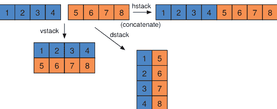

图 2.1 一维向量中的连结与堆叠。

图 2.2 二维矩阵中的连结与堆叠。

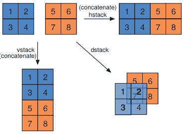

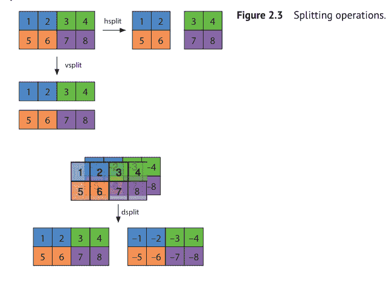

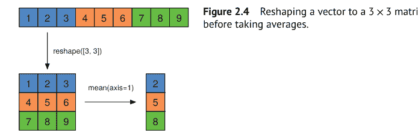

然后按每行取均值（参见图 2.4）。表 2.10 提供了一系列重塑操作列表，旨在使操作的输入和输出相互兼容。表 2.10 提供了一系列常用重塑操作列表。

## 2.11 广播

**广播** 是一对不同维度张量的逐元素运算 [Harris et al., 2023c]。低维张量仿佛被重复多次，以匹配高维张量的大小。举个简单的例子，标量（0 维张量）和向量（1D 张量）可以通过广播相加，如图 2.6 所示。

表 2.10 Python、NumPy、Tensorflow 和 PyTorch 中的张量重塑操作列表。

| 操作 | Python | NumPy | Tensorflow | PyTorch |
|---|---|---|---|---|
| 重塑 | N/A | np.reshape | tf.reshape | torch.reshape, torch.Tensor.view |
| 添加单例维度 | N/A | np.expand_dims | tf.expand_dims | torch.unsqueeze |
| 移除单例维度 | N/A | np.squeeze | tf.squeeze | torch.squeeze |

注释：

- Views：NumPy 重塑中的一个重要概念是“视图”的概念。NumPy 不是用新形状复制数组，而是可以想出一种聪明的方式，通过“视图”将原始数组中的元素映射到新数组 [Harris et al., 2023b]。这通过仅存储一次数据来减少程序的内存痕迹。返回视图而非副本的知名操作包括 np.reshape 和 np.transpose（以及我们将在第 3 章介绍的切片操作）。Tensorflow 没有特别提到视图的概念，但根据其文档 [Abadi et al., 2023c]，tf.reshape 操作也会重用底层数据缓冲区，而不是根据形状复制数据。PyTorch 也有关于视图和副本的类似概念。因此，在合适的情况下，更倾向于使用 Tensor.view(shape) 方法来重塑张量，而不是使用 torch.reshape（在后一种情况下，会返回具有新形状的张量副本，这与 np.reshape 形成对比）。

- Order：另一个重要概念是顺序，它与底层张量数据在内存（RAM）中的表示方式有关。内存中的数据顺序通常有两种约定：行优先（order="C"，如 C 语言）或列优先（order="F"，用于 Fortran）。对于一个 2D 矩阵，行优先表示法会将矩阵行中的相邻元素存储在一起，而列优先表示法会将矩阵列中的相邻元素存储在一起（参见图 2.5）；通常，RAM 在存储数据时没有形状的概念。这对于计算效率很重要。假设我们想将单行中的所有元素相加。沿着寄存器读取连续元素来查找需要合并的值会更快；相比之下，如果需要不断跳过元素并在内存寄存器中读取更多元素，直到收集齐所有需要的元素，那么将这些数字相加就会很慢。更具体地说，在图 2.5 提供的示例中，计算行优先（C）表示的矩阵的行和（即将 [1, 2, 3, 4]、[5, 6]、[7, 8, 9] 相加）比计算列优先（F）表示的矩阵的行和（即将 [1, 4, 7]、[2, 5, 8]、[3, 6, 9] 相加）更快。

b) squeeze 和 expand_dims（又称 unsqueeze）是一对互逆操作。squeeze 移除单例维度（大小为 1 的维度或轴），例如 (3,1,2)--> squeeze -->(3,2)。相比之下，expand_dim unsqueeze 添加一个单例维度，例如 (3,2)--> unsqueeze -->(3,1,2)。请注意，NumPy 和 Tensorflow 将维度称为 axis（复数形式为 axes），而 PyTorch 将维度称为 dim（复数形式为 dims）。使用切片表示法，我们也可以使用 None 或 np.newaxis 扩展维度。例如，将形状为 (3, 2) 的张量转换为形状 (3, 1, 2) 可以通过两种方式实现：

```
import numpy as np
X = np.random.rand(3, 2)
# using expand dims
y1 = np.expand_dims(X, axis=1)
# using None slicing
y2 = X[:, None, :]
# using np.newaxis
y3 = X[:, np.newaxis, :]
```

同样，压缩维度也可以通过切片实现：

```
import numpy as np
X = np.random.rand(3, 1, 2)
# using squeeze
y1 = np.squeeze(X, axis=1)
# using slicing
y2 = X[:, 0, :]
```

我们将在第 3 章详细讨论切片操作。请注意，在 Tensorflow 实现中，切片不如 squeeze 和 expand_dims 操作受欢迎，因为它有时可能不兼容图执行。

表 2.10（续）

| 操作 | Python | NumPy | Tensorflow | PyTorch |
|---|---|---|---|---|
| 确保向量形状 | N/A | np.atleast_1d | tf.experimental.numpy.atleast_1d | torch.atleast_1d |
| 确保矩阵形状 | N/A | np.atleast_2d | tf.experimental.numpy.atleast_2d | torch.atleast_2d |
| 确保 3D 张量形状 | N/A | np.atleast_3d | tf.experimental.numpy.atleast_3d | torch.atleast_3d |
| 转置 | N/A | np.transpose | tf.transpose | torch.transpose |
| 交换轴 | N/A | np.swapaxes | tf.transpose | torch.transpose, torch.swapaxes, torch.swapdims |

c) atleast_nd 函数有助于确保输入具有预期的形状。当我们需要执行广播操作（即低维和高维张量之间的逐元素操作）时，这些操作通常很有帮助，我们将在即将到来的章节中讨论。它们在某种程度上等效于 expand_dims 操作，并常被用作快捷方式。假设我们希望一个标量值至少是三维的。那么，我们可以使用 expand_dims 实现，如下所示：

```
import numpy as np

x = np.array(6)
y = np.expand_dims(x, axis=0) # np.array([[6]])
y = np.expand_dims(y, axis=0) # np.array([[[6]]])
y = np.expand_dims(y, axis=0) # np.array([[[[6]]]])
```

或者简单地：

```
import numpy as np

x = np.array(6)
y = np.atleast_3d(x) # np.array([[[6]]])
```

这些函数的一个良好特性是，我们不需要事先知道需要执行多少次 expand_dims 操作才能达到所需的维度数。因此，在上面的示例中，通过使用 np.atleast_3d，我可以让输入 x = np.array([6]) 而无需修改任何后续代码，以确保 y 的形状始终至少是三维的，这为输入形状提供了很大的灵活性。另一方面，atleast 这个名称表明，当输入 x 具有更高维度时，所有维度都将保持不变：

```
import numpy as np

x = np.array([[[[[6]]]]]) # 5-dimensional
y = np.atleast_3d(x) # still 5-dimensional
```

d) 矩阵转置操作可以看作交换 x 和 y 坐标。例如，形状为 (3,4) 的矩阵的转置是形状为 (4,3) 的矩阵。可以推断，对于更高维度的张量，我们也可以转置或交换轴，以便于不同的后续操作。NumPy 实现了多个函数来更改多维张量的维度顺序。相比之下，Tensorflow 仅实现了一个单一但更通用的转置操作，该操作


## Table 2.10 (Continued)

| 操作 | Python | NumPy | Tensorflow | PyTorch |
|---|---|---|---|---|
| 展平为数组<sup>e)</sup> | N/A | np.ndarray.flatten, np.ravel | tf.experimental.numpy.flatten | torch.flatten |

涵盖了多种用例。这是许多机器学习应用（例如卷积神经网络）中的常见操作。在使用卷积神经网络进行图像分类时，通常将输入图像表示为 (batch_size, height, width, channels)（Tensorflow 约定）或 (batch_size, channels, height, width)。请注意，两种约定都表示一组图像，但张量的维度顺序不同。要从 Tensorflow 约定转换为 PyTorch 约定，我们可以利用转置操作。

```
import numpy as np
image_tf = np.random.rand(8, 32, 15, 3)
image_torch = np.transpose(image_tf, axes=[0, 3, 1, 2])
```

虽然需要两行代码，但我们也可以使用 np.swapaxes

```
image_torch = np.swapaxes(image_tf, 1, 3) # (8, 3, 15, 32)
image_torch = np.swapaxes(image_torch, 2, 3) # (8, 3, 32, 15)
```

注意 PyTorch torch.Tensor 具有 torch.Tensor.t() 方法，用于矩阵转置（<=2 维）。NumPy 的 np.ndarray 具有 np.ndarray.T，用于张量转置，这本质上反转了维度的顺序。这可能对应于转置的典型数学表示法，即 <sup>T</sup>。1D 数组的转置仍然是 1D 数组，因为没有其他维度可以交换。

e) NumPy 的 np.ndarray.flatten 方法始终返回数据的副本。要返回视图（如果可能），请改用 np.ravel。PyTorch 的 torch.flatten 更类似于 np.ravel，如果可能会返回视图。Tensorflow 的 tf.experimental.numpy.flatten 方法也会尽可能返回视图，因为其底层实现使用了 tf.reshape。请注意，在展平数组时，还要注意顺序的概念。

### 图 2.5 重塑中的顺序概念。

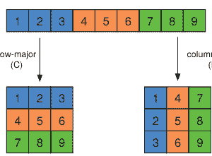


### 图 2.6 标量到向量的广播。

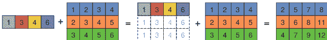

### 图 2.7 向量到矩阵的广播。

请注意，标量与数组之间的数学运算在数学上没有意义，

```
1 + [2 4 6]
```

但是，广播后，等效的数学运算变为

```
[1 1 1] \oplus [2 4 6] = [3 5 7]
```

其中 \oplus 表示按元素相加运算。同样，我将使用

- \ominus 表示按元素相减
- \odot 表示按元素相乘
- \oslash 表示按元素相除

同样，向量也可以广播到矩阵（图 2.7）。向量与矩阵之间的运算在数学上也没有意义，

```
[1 3 4 6] + [1 2 3 4 \n 2 3 4 5 \n 3 4 5 6]
```

等效的广播运算变为

```
[1 3 4 6 \n 1 3 4 6 \n 1 3 4 6] \oplus [1 2 3 4 \n 2 3 4 5 \n 3 4 5 6] = [2 5 7 8 \n 3 6 8 11 \n 4 7 9 12]
```

具有单例维度（.shape [axis]=1）的张量可以广播到具有非单例维度的另一个张量，前提是其余维度也可以广播。例如，形状为 (1,N) 的列向量与大小为 (M,N) 的矩阵之间的广播（图 2.8），

```
[1 \n 3 \n 6] + [1 2 3 4 \n 2 3 4 5 \n 3 4 5 6]
```

具有等效的广播运算

```
[1 1 1 1 \n 3 3 3 3 \n 6 6 6 6] \oplus [1 2 3 4 \n 2 3 4 5 \n 3 4 5 6] = [2 3 4 5 \n 5 6 7 8 \n 9 10 11 12]
```

### 图 2.8 具有单例维度的张量与非单例维度张量之间的广播。

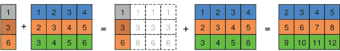

一般来说，标量（ndim=0）始终可以广播到任何更高维度的张量。较低维度的张量（ndims > 0）可以广播到更高维度的张量，只要较低维度张量的某些或所有后置（右对齐）轴的大小要么是单例（即 .shape[axis]=1），要么与更高维度张量在相应后置轴上的大小匹配。为了更具体地定义这一点，假设较低维度的张量 X 具有形状 (a1, a2, a3, ..., an)，ai != 0，\forall i，而较高维度的张量 Y 具有形状 (b1, b2, ..., bm)，bj != 0，\forall j，其中 n <= m，那么要将 X 广播到 Y，我们必然需要满足

```
{
    a_n \in {b_m, 1},
    a_{n-1} \in {b_{m-1}, 1},
    ...
    a_{n-k} \in {b_{m-k}, 1},
    ...
    a_1 \in {b_{m-n+1}, 1}
}
```

广播运算将产生一个形状为 (c1, c2, ..., cm) 的张量 Z，其取 X 或 Y 中较大的大小，且维度数将为 Y.ndim，大于 X.ndim。即，

```
{
    c_m = max(a_n, b_m)
    c_{m-1} = max(a_{n-1}, b_{m-1})
    ...
    c_{n-k} = max(a_{n-k}, b_{m-k})
    ...
    c_{m-n+1} = max(a_1, b_{m-n+1})
    c_{m-n} = b_{m-n}
    c_{m-n-1} = b_{m-n-1}
    ...
    c_{m-n-p} = b_{m-n-p}
    ...
    c_1 = b_1
}
```

例如，

- 标量，例如 5（没有维度，ndim=0），可以广播到形状为 (3, 6, 5, 7) 的张量，从而产生形状为 (3, 6, 5, 7) 的张量。
- 形状 X 为 (5, 7) 的张量可以广播到另一个形状 Y 为 (3, 6, 5, 7) 的张量，因为 X 和 Y 的最后两个维度匹配。生成的张量 Z 形状为 (3, 6, 5, 7)。
- 形状 X 为 (5, 7) 的张量不能广播到另一个形状 Y 为 (7, 6, 2) 的张量，因为 X 和 Y 的最后两个维度不匹配，且 X 的任何轴都不是单例。
- 形状 X 为 (1, 7) 的张量可以广播到另一个形状 Y 为 (3, 6, 5, 7) 的张量，因为两个张量的最后一个维度匹配，且 X 的倒数第二个维度是单例。生成的张量 Z 形状为 (3, 6, 5, 7)。
- 形状 X 为 (6, 1, 7) 的张量可以广播到另一个形状 Y 为 (3, 1, 5, 7) 的张量，因为两个张量的最后一个维度匹配，X 的倒数第二个维度是单例，且 Y 的倒数第三个维度是单例。生成的张量 Z 将具有 (3, 6, 5, 7) 的形状。
- 形状 X 为 (0, 7) 的张量不能广播到另一个形状 Y 为 (3, 6, 5, 7) 的张量，因为 X 的第一个轴是 0，既不是单例，也与 Y 的最后一个维度（即 5）不匹配。
- 以下是关于 0 大小张量的一个奇怪示例。当尝试将形状为 (0, 7)（即空的、0 大小张量）的张量 X 广播到另一个形状为 (1, 7) 的张量时，该操作不会抛出错误。但是，生成的张量 Z 也将是形状为 (0, 7)，即类似于 X 的空张量。这就是为什么我们需要在广播规则中避免对空或 0 大小张量进行操作的原因。

> 请注意，广播的底层机制实际上并不是通过反复复制相同数据多次来重复要广播的元素，因为这不够内存高效。

## 2.12 案例研究

我们将使用按元素运算、重塑和广播的以下案例研究集来解决几个实际问题，作为本章的总结。

### 2.12.1 图像归一化

标量到张量广播的一个示例应用是图像的最小-最大归一化。给定图像 \( I \),

\(\text{Normalize}(I_i) = \frac{I_i - \min(I)}{\max(I) - \min(I)}, \forall i\) (2.1)

其中 \( i \) 是图像像素的索引。我们可以按如下方式实现上述内容：

```
import numpy as np

def normalize_image(image):
    """Normalize image pixel values to be between 0 and 1"""
    # image shape (height, width, channel)
    min_val = np.min(image) # scalar
    max_val = np.max(image) # scalar
    normalized_img = (image - min_val) / (max_val - min_val + 1e-6)
    return normalized_img
```

- 第 6 行和第 7 行计算全局最小值和最大值，它们是标量。
- 第 8 行实现公式 2.1。分母添加一个小 \(\epsilon = 10^{-6}\) 以防止除以零错误。如果最小值和最大值均为零，则图像中所有像素的值都应为零。在这种情况下，归一化图像也将全为零。

如果我们有一批图像，则使用向量广播，其实现方式如下

```
import numpy as np

def normalize_image_batch(images):
    """Normalize image pixel values to be between 0 and 1"""
    # image shape (batch_size, height, width, channel)
    # min / max (batch_size, 1, 1, 1)
    min_val = np.min(images, axis=(1, 2, 3), keepdims=True)
    max_val = np.max(images, axis=(1, 2, 3), keepdims=True)
    normalized_img = (images - min_val) / (max_val - min_val + 1e-6)
    return normalized_img
```


- 第 7 行和第 8 行计算批次中每个图像的最小值和最大值。axis=(1, 2, 3) 指定计算在批次内进行，但在输入中所有其他维度上进行全局归约。keepdims=True 将防止输出在归约维度上被压缩。这将使输出张量的形状为 (batch_size, 1, 1, 1)，从而帮助我们将最小值/最大值广播回输入张量。如果 keepdims=False（默认），则输出张量的形状为 (batch_size,)，这无法广播到形状为 (batch_size, height, width, channel) 的输入张量。

- 第 9 行实现了公式 2.1，但对最小值张量与输入张量应用广播（以及标量到多维张量广播，包含 + 1e-6 项），以在单个表达式中归一化批次图像。

### 2.12.2 Pearson 相关系数

Pearson 相关系数衡量两个变量 $X$ 和 $Y$ 之间的线性关系，定义为

\(r = \frac{\text{COV}(X, Y)}{\sigma(X)\sigma(Y)}\)

\(= \frac{\sum_i(x_i - \bar{x}) \cdot (y_i - \bar{y})}{\sqrt{\sum_i(x_i - \bar{x})^2} \cdot \sqrt{\sum_i(y_i - \bar{y})^2}}\)

\(= \frac{\sum_i \tilde{x}_i \cdot \tilde{y}_i}{\sqrt{\sum_i \tilde{x}_i^2} \cdot \sqrt{\sum_i \tilde{y}_i^2}}\)

\(= \sum_i \left( \frac{\tilde{x}_i}{\sqrt{\sum_p \tilde{x}_p^2}} \cdot \frac{\tilde{y}_i}{\sqrt{\sum_q \tilde{y}_q^2}} \right)\)

其中，\(\tilde{x}_i = x_i - \bar{x}\) 且 \(\tilde{y}_i = y_i - \bar{y}\)

我们使用向量化来实现以下多个变量对之间的 Pearson 相关系数：

```
import numpy as np

def faster_corr(X, Y):
    """
    A faster way to compute Pearson's correlation
    between corresponding rows of two matrices
    """
    # zero means
    X = X - np.mean(X, axis=1, keepdims=True)
    Y = Y - np.mean(Y, axis=1, keepdims=True)
    # L2 normalization
    X = X / np.sqrt(np.sum(X**2, axis=1, keepdims=True))
    Y = Y / np.sqrt(np.sum(Y**2, axis=1, keepdims=True))
    R = np.sum(X*Y, axis=1)

    return R
```

- 第 9 行和第 10 行去除每个变量的均值。我们设置 keepdims=True 以得到形状为 (batch_size, 1) 的向量，以便帮助与原始输入（形状为 (batch_size, num_variables)）进行后续广播减法。请注意，由于我们将每行视为一个变量，因此初始化两个矩阵时应设置 order=C，以便每行在内存中连续存储。

- 第 12 行和第 13 行通过将去除均值后的变量除以其各自的 L2 范数来执行 L2 归一化。我们再次设置 keepdims=True 以得到形状为 (batch_size, 1) 的向量，以便帮助与形状为 (batch_size, num_variables) 的去除均值后的变量进行后续广播除法。此步骤应沿矩阵的每一行输出一组单位长度向量。

- 第 14 行实现 Pearson 相关系数方程的最后一步，它本质上执行每个归一化输入中对应向量对之间的点积。

### 2.12.3 成对差

```
import numpy as np

def pairwise_diff(A, B):
    """
    Calculate the pair-wise difference between
    each element of the two vectors of length N and M,
    respectively, and return a matrix of shape M x N.

    Parameters:
    * A: vector of length M
    * B: vector of length N

    Returns:
    * A matrix of shape M x N where the element at (i, j) is A[i] - B[j]
    """
    A = np.asarray(A).flatten()[:, np.newaxis] # shape (M, 1)
    B = np.asarray(B).flatten()[np.newaxis, :] # shape (1, N)
    return A - B # Resulting shape (M, N)
```

- 第 16 行和第 17 行准备第 18 行中的广播。`np.asarray` 确保输入为 NumPy 数组；这意味着函数也可以接受列表或元组作为输入。`flatten` 确保输入为一维数组。这意味着，如果输入 A 的形状为 (1, M)，我们将先将其转换为形状 (M, )。这样就允许我们使用 `[:, np.newaxis]` 在第二个维度添加一个单例维度，使其形状变为 (M, 1)。同样，当我们确保 B 的形状为 (N, ) 时，我们使用 `[np.newaxis, :]` 沿第一个维度添加一个单例维度，使其形状变为 (1, N)。

- 第 18 行通过广播计算成对差，即形状为 (M, 1) 的张量广播到形状为 (1, N) 的张量，从而得到形状为 (M, N) 的张量。

### 2.12.4 幻方的构造

幻方是大小为 n x n 的方阵，其条目填充了 1 到 n^2 之间的数字，使得每行、每列和主对角线的和相同 [Arroyo, 2018]。我们可以轻松验证，当 n = 2 时，此矩阵无法构造：给定数字 1、2、3、4，如果我们要确保矩阵的每行具有相同的和，那么和需要为 5，我们可以构造它们的两种方式是 (1, 4) 和 (2, 3)。但是，无论我们如何排列，都无法使各列之和为 5（参见图 2.9a,b 中的两个示例）。同样，如果我们要确保矩阵的每列具有相同的和，我们再次对每列使用 (1, 4) 和 (2, 3) 配对。但是，无论我们如何排列，都无法确保各行之和为 5（参见图 2.9c,d 中的两个示例）。

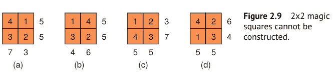

## 图 2.10 洛书，已知最早的三阶幻方。

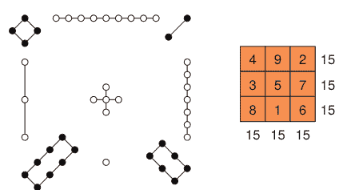

幻方可以分为三类：奇数阶（$n = 2k + 1$）、双偶数阶（$n = 2(2k) = 4k$）和单偶数阶（$n = 2(2k + 1) = 4k + 2$）[Kraitchik, 1942]。这三类幻方使用三种不同的算法构造。幻方的魔术常数是条目的行和或列和，由公式 $\sigma(M) = \frac{n(n^2+1)}{2}$ 给出。对于 $3 \times 3$ 幻方，魔术常数为

$$\sigma(3) = \frac{3 \times (3^2 + 1)}{2} = 15$$

已知最古老的三阶幻方很可能来自《洛书》，这是一本用于占卜的中国古籍，如图 2.10 所示。它还附带一句简洁的口诀：“2 在右肩，4 在左肩，6 在右脚，8 在左脚，3 在左，7 在右，9 为帽，1 为鞋，5 在正中”（我主要是从金庸所著的小说《射雕英雄传》中记起这句话，该小说引用了《洛书》中幻方的这句简洁口诀）。

### 暹罗法构造奇数阶幻方

暹罗法可能是构造奇数阶幻方最著名的方法 [Kraitchik, 1942; De La Loubere, 1693]。构造幻方的规则如下：

- 1. 从矩阵最顶行与中央列交叉的位置开始。用 1 填充该位置。
- 2. 然后我们继续沿右上对角线方向填充矩阵。
  - 1. 如果行不够用了，则回到最底行，在对应的列中填充数值。
  - 2. 如果列不够用了，则回到最左列，在对应的行中填充数值。
  - 3. 如果行和列都不够用了（即从右上角出发时），或后续位置已被占用，则在当前元素正下方（即向下 1 行，保持相同列）填充该位置。

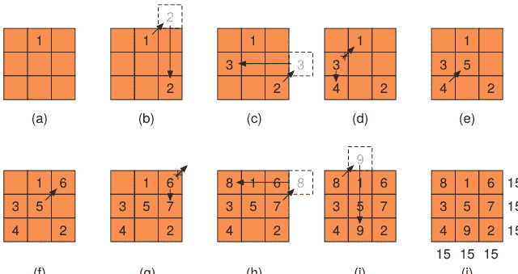

**图 2.11** 使用暹罗法构造三阶幻方的示例。(a) 从顶部中心网格开始并填入 1（规则 1）；(b) 向右上移动 1 个网格。由于此网格位于矩阵行之上，我们使用底行，但仍在第 3 列填充（规则 2.1）；(c) 我们继续沿右上对角线方向移动。由于此网格超出了矩阵列，我们使用最左列，但仍在第 2 行填充（规则 2.2）；(d) 继续沿右上对角线方向移动会碰到已填入 1 的顶部中心网格。因此我们在同一列的下一行用 4 填充该网格（规则 2.3）；(e) 沿右上对角线方向填入 5；(f) 沿右上对角线方向填入 6；(g) 我们无法再沿对角线移动，因为行和列都将不够用。因此我们在当前网格下方同一列用 7 填充该网格（规则 2.3）；(h) 继续沿对角线移动，列再次不够用，所以我们移动到第 1 行的最左列并用 8 填充该网格（规则 2.2）；(i) 继续沿对角线移动，行再次不够用，所以我们在底行第 2 列填入 9（规则 2.1）；(j) 最终完成的三阶幻方。我们可以验证每行、每列、对角线和副对角线之和均为 15。

图 2.11 说明了使用暹罗法填充 \(3 \times 3\) 幻方的示例。请注意，生成的幻方可以看作仅通过交换《洛书》示例中的第 1 行和第 3 行构造的新幻方。

如何使用向量化实现暹罗法？我们需要对构造的幻方的模式进行一些观察。基于该工作 [Arroyo, 2018]，我们可以看到，暹罗幻方由两个正交拉丁方阵 \(L_b\) 和 \(L_u\) 以及一个单位方阵 \(J\)（全 1 方阵）组成，即

\(S = nL_b + L_u + J\) (2.2)

如图 2.12 所示。令 \(b \in \{0, 1, 2, ..., n - 1\}\) 为 \(L_b\) 的元素，\(u \in \{0, 1, 2, ..., n - 1\}\) 为 \(L_u\) 的元素。那么，幻方的索引 \((i, j)\)


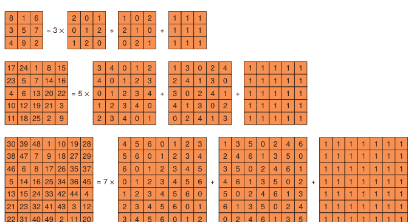

图 2.12 将奇阶暹罗魔方阵分解为两个拉丁方和一个单位方阵之和。

与 $b$ 和 $u$ 有以下关系：

$b = \text{mod} \left( i + j - \frac{n-1}{2} + n, n \right) \quad u = \text{mod} (i + 2j - n + 1, n) \quad (2.3)$

该公式表明我们需要遍历 $i$ 和 $j$ 的所有潜在组合。这可以通过行向量和列向量之间的广播来实现，两者均由 `np.arange` 初始化。根据公式 2.3，我们可以像下面这样实现暹罗方法：

```python
def _odd_order_magic(n: int):
    """Make Siamese odd-order magic squares via Latin
    squares."""
    # Initialize p (i / j), used for
    # broadcasting later -> shape n x 1
    p = np.arange(n)[:, None]
    # make L_b
    L_b = np.mod(p + p.T - (n - 1) // 2, n)
    # make L_u
    L_u = np.mod(p + 2 * p.T - n + 1, n)
    # make the magic square
    S = n * L_b + L_u + np.ones_like(L_b)
    return S
```

- 第 5 行使用 `np.arange` 初始化一个列向量。我们试图使用广播来构建一个网格，以帮助遍历所有 $(i,j)$ 对 $[(0,0), (0,1), (0,2), \dots, (n-1, n-1)]$。

- 第 7 行根据公式 2.3 生成拉丁方 $L_b$。请注意，`(n - 1) // 2` 执行整数除法，因为我们知道输入 n 已经是奇数整数。这将使所有结果保持为整数。否则，NumPy 会将所有内容转换为 `float64`。`np.mod(L_b, n)` 将确保 `b` 的结果值是 0 到 n - 1 之间（包含）的整数。您可能注意到第 10 行的值有时可能为负。例如，给定一个三阶暹罗魔方阵（n = 3），当 i = 0, j = 0 时，相应的 b = -1, u = -2。但是，mod (-1, 3) = 2，mod (-2, 3) = 1。模运算有助于将负值转换为 0 到 2 之间（包含）的值。

- 第 9 行根据公式 2.3 实现生成拉丁方 $L_u$。

- 第 11 行实现奇阶暹罗魔方阵的定义（公式 2.2）。

## 双偶阶魔方阵

Manuel Moschopoulos 在 14 世纪阐述了一种构建双偶阶魔方阵的非常优雅的方法，我将其称为“X”方法：

1. 从 n 到 1 按行填充方阵。
2. 在每个 $4 \times 4$ 块的主对角线上画 X。
3. 对于 X 接触的每个网格，将数字替换为补数 $n^2 + 1 - x_{ij}$。

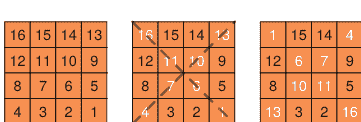

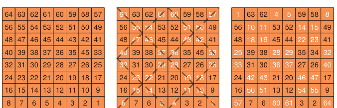

图 2.13 使用 X 方法构建双偶阶魔方阵。

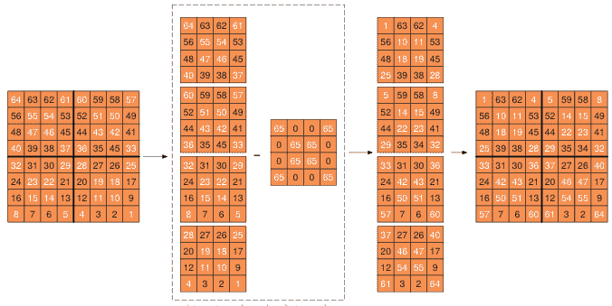

图 2.14 实现 X 方法以构建双偶阶魔方阵的步骤。

图 2.13 展示了使用 X 方法构建的四阶和八阶魔方阵。

请注意，Wolfram Alpha [Weisstein, 2023] 阐述了构建双偶阶魔方阵的 X 方法的一个类似版本，其来源未知。Google 搜索结果似乎表明该方法源于 Philippe de la Hire 于 1705 年对 Manuel Moschopoulos 关于魔方阵著作的拉丁文翻译。这种补数方法只是从 1 到 n 而不是从 n 到 1 填充方阵，从而得到一个补数魔方阵。MATLAB 似乎也实现了这种方法。

我们可以再次使用重塑和广播的思想来实现此算法。图 2.14 逐步说明了该过程。

```python
def __doubly_even_order_magic(n: int):
    """Use X method to construct doubly even magic
    squares."""
    # e.g. n=8, (64,)
    S = np.arange(n**2, 0, -1)
    # Split into 4x4 blocks (2, 4, 2, 4)
    S = S.reshape((n//4, 4, n//4, 4))
    # Create the X mask
    X = np.eye(4, dtype=S.dtype) * (n**2 + 1)
    X = X + np.fliplr(X)
    # (1, 4, 1, 4)
    X = X[None, :, None, :]
    # Subtract under absolute value
    S = np.abs(S - X)
    # Reshape (n, n)
    S = S.reshape((n, n))

    return S
```

1. 第 4 行按降序初始化方阵的值，从 n² 到 1。
2. 第 6 行将矩阵分割为形状为 (4, 4) 的块，针对每一行（axis=0）和每一列（axis=3）。这形成一个大小为 (k, 4, k, 4) 的张量，其中 k = n/4。
3. 第 8 行和第 9 行创建一个 4 × 4 矩阵，其中对角线和反对角线条目填充 n² + 1，形成 X 形状。这用于针对每个 4 × 4 块计算补数值。
4. 第 11 行在 axis=0 和 axis=3 添加维度，使张量形状变为 (1, 4, 1, 4)。这用于下一步中的广播。
5. 第 13 行在绝对值下取差。这将被 "X" 接触的条目替换为补数值。
6. 第 15 行将张量重塑回形状为 (n, n) 的矩阵。

## 单偶阶魔方阵

最后，我们将通过约翰·霍顿·康威 [Erickson, 2009; Weisstein, 2023] 的 "LUX" 方法构建单偶阶魔方阵。通过其在 NumPy 中的实现，我希望本书的读者能够欣赏该库在处理复杂数据操作时的效率和强大功能。"LUX" 指的是填充 2 × 2 网格的顺序，如图 2.15 所示。三种填充顺序变体分别形成 "L"、"U" 和 "X" 的形状。令 n = 2m = 2(2k + 1)，其中 k ≥ 1，则，

1. 从奇阶 m × m 方阵开始，我们可以确定每个代表 2 × 2 块的网格应该填充什么形状：
    - 用 L 形状填充矩阵的 k 行。
    - 用 L 形状填充第 k + 1 行，除了中间一个用 U 形状。
    - 用 U 形状填充第 k + 2 行，除了中间一个用 L 形状。
    - 用 X 形状填充其余行（如果有的话）。
2. 要填充的数字顺序由暹罗方法确定，该方法从顶中心网格作为第一个要填充的块开始。我们可以通过暹罗奇阶魔方阵中的值与要由 "LUX" 填充的 2 × 2 矩阵中的值之间的映射关系 u = 4(v − 1) + i 来推导，其中 v 是对应的暹罗奇阶魔方阵，i 是由三种填充顺序变体之一确定的 2 × 2 块的索引值。

图 2.15 LUX：填充 2 x 2 网格的顺序。

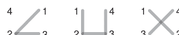

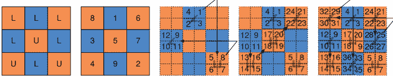

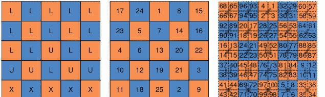

图 2.16 使用 LUX 方法构建六阶和十阶魔方阵的示例。

图 2.16 说明了使用 “LUX” 方法构建四阶和六阶魔方阵的示例。

```python
def __singly_even_order_magic(n: int):
    """Use LUX method to construct singly even magic squares."""
    # Compute size constants
    m = n // 2 # odd
    k = (m - 1) // 2
    # Initialize the 3 filling variants
    L = np.array([([4, 1], [2, 3])])
    U = np.array([([1, 4], [2, 3])])
    X = np.array([([1, 4], [3, 2])])
    # Create k-rows of L-filled blocks
    M_L = np.full((k, m, 2, 2), L)
    # Create a row of L-filled blocks,
    # except the middle column is filled with U
    M_LU = np.concatenate([
        np.full((1, k, 2, 2), L),
        U[None, None, :, :],
        np.full((1, k, 2, 2), L),
    ], axis=1)
    # Create a row of U-filled blocks,
    # except the middle column is filled with L
    M_UL = np.concatenate([
        np.full((1, k, 2, 2), U),
        L[None, None, :, :],
        np.full((1, k, 2, 2), U),
    ], axis=1)
    # Fill the rest the k-1 rows with X
    M_X = np.full((k-1, m, 2, 2), X)
    # Combine all the sub-blocks (m, m, 2, 2)
    M = np.concatenate([
        M_L, M_LU, M_UL, M_X
    ], axis=0)
    # Initialize the Siamese odd order magic square
    S = _odd_order_magic(m)
    # Apply the Siamese mapping formula
    M += 4 * (S[:, :, None, None] - 1)
    # Reshaping back to n x n
    M = np.swapaxes(M, 1, 2).reshape((n, n))
    return M
```

1. 第 4 行和第 5 行计算一些常量，我们将在后续构建矩阵时使用。
2. 第 7-9 行将 L、U、X 顺序初始化为 2 × 2 矩阵块。
3. 第 11 行创建 k 行 L 填充的块。我们可以将其视为 k × m 矩阵块，每个矩阵填充 2 × 2 块，形成形状为 k × m × 2 × 2 的张量。
4. 第 14-18 行创建一行 L 填充的块，但中间条目为 U 填充。我们通过串联 Concat([[ L, ...], [U], [L, ...] ]) 来实现这一点。这形成一个形状为 1 × m × 2 × 2 的张量。
5. 第 21-25 行创建一行 U 填充的块，但中间条目为 L 填充。类似于上述步骤，我们通过串联 Concat([[ U, ...], [L], [U, ...] ]) 来实现这一点。这形成一个形状为 1 × m × 2 × 2 的张量。
6. 第 27 行创建 k - 1 行 X 填充的块。当 n = 6，k = 1 时，k - 1 = 0，这意味着我们下面不添加 X 块。np.full 可以在保持所需张量形状的同时处理零维。这形成一个形状为 (k - 1) × m × 2 × 2 的张量。
7. 第 29-31 行通过沿第一个维度串联将子块张量合并为单个张量。这形成一个形状为 m × m × 2 × 2 的张量。
8. 第 33 行初始化 m × m 奇阶暹罗魔方阵，我们需要它来应用值映射公式。


- 第 35 行应用了我们之前定义的值映射公式，通过将 \( m \times m \) 暹罗幻方矩阵广播到我们在上面第 7 步中得到的 \( m \times m \times 2 \times 2 \) 张量 \( M\)。请注意，我们在 `axis=2` 和 `axis=3` 处扩展了两个额外的维度。

- 第 37 行将张量重新塑形回 \( n \times n \) 矩阵。我们首先交换第二和第三个轴，使 \( m \times m \times 2 \times 2 \) 变为 \( m \times 2 \times m \times 2 \)。然后，我们将其重新塑形为 \( n \times n \)。

最后，我们可以将构建幻方的三种情况放在一个单一函数下：

```
import numpy as np

def magic(n: int):
    """Construct magic squares of order n."""
    n = int(n) # make sure n is integer
    if n < 3: # check value of n
        raise ValueError("n must be > 2.")
    if n % 2 == 1: # odd case
        return _odd_order_magic(n)
    elif n % 4 == 0: # doubly even
        return _doubly_even_order_magic(n)
    else: # assume singly even
        return _singly_even_order_magic(n)
```

## 参考文献

Martin Abadi, Ashish Agarwal, Paul Barham, Eugene Brevdo, Zhifeng Chen, Craig Citro, Greg S. Corrado, Andy Davis, Jeffrey Dean, Matthieu Devin, Sanjay Ghemawat, Ian Goodfellow, Andrew Harp, Geoffrey Irving, Michael Isard, Yangqing Jia, Rafal Jozefowicz, Lukasz Kaiser, Manjunath Kudlur, Josh Levenberg, Dan Mané, Rajat Monga, Sherry Moore, Derek Murray, Chris Olah, Mike Schuster, Jonathon Shlens, Benoit Steiner, Ilya Sutskever, Kunal Talwar, Paul Tucker, Vincent Vanhoucke, Vijay Vasudevan, Fernanda Viegas, Oriol Vinyals, Pete Warden, Martin Wattenberg, Martin Wicke, Yuan Yu, and Xiaoqiang Zheng. TensorFlow：异构分布式系统上的大规模机器学习。2015年11月。

Martin Abadi, Ashish Agarwal, Paul Barham, Eugene Brevdo, Zhifeng Chen, Craig Citro, Greg S. Corrado, Andy Davis, Jeffrey Dean, Matthieu Devin, Sanjay Ghemawat, Ian Goodfellow, Andrew Harp, Geoffrey Irving, Michael Isard, Yangqing Jia, Rafal Jozefowicz, Lukasz Kaiser, Manjunath Kudlur, Josh Levenberg, Dan Mané, Rajat Monga, Sherry Moore, Derek Murray, Chris Olah, Mike Schuster, Jonathon Shlens, Benoit Steiner, Ilya Sutskever, Kunal Talwar, Paul Tucker, Vincent Vanhoucke, Vijay Vasudevan, Fernanda Viegas, Oriol Vinyals, Pete Warden, Martin Wattenberg, Martin Wicke, Yuan Yu, and Xiaoqiang Zheng. 图和 tf.function 简介。https://www.tensorflow.org/guide/intro_to_graphs, 2023a.

Martin Abadi, Ashish Agarwal, Paul Barham, Eugene Brevdo, Zhifeng Chen, Craig Citro, Greg S. Corrado, Andy Davis, Jeffrey Dean, Matthieu Devin, Sanjay Ghemawat, Ian Goodfellow, Andrew Harp, Geoffrey Irving, Michael Isard, Yangqing Jia, Rafal Jozefowicz, Lukasz Kaiser, Manjunath Kudlur, Josh Levenberg, Dan Mané, Rajat Monga, Sherry Moore, Derek Murray, Chris Olah, Mike Schuster, Jonathon Shlens, Benoit Steiner, Ilya Sutskever, Kunal Talwar, Paul Tucker, Vincent Vanhoucke, Vijay Vasudevan, Fernanda Viegas, Oriol Vinyals, Pete Warden, Martin Wattenberg, Martin Wicke, Yuan Yu, and Xiaoqiang Zheng. TensorFlow 数据类型。https://www.tensorflow.org/api_docs/python/tf/dtypes, 2023b.

Martin Abadi, Ashish Agarwal, Paul Barham, Eugene Brevdo, Zhifeng Chen, Craig Citro, Greg S. Corrado, Andy Davis, Jeffrey Dean, Matthieu Devin, Sanjay Ghemawat, Ian Goodfellow, Andrew Harp, Geoffrey Irving, Michael Isard, Yangqing Jia, Rafal Jozefowicz, Lukasz Kaiser, Manjunath Kudlur, Josh Levenberg, Dan Mané, Rajat Monga, Sherry Moore, Derek Murray, Chris Olah, Mike Schuster, Jonathon Shlens, Benoit Steiner, Ilya Sutskever, Kunal Talwar, Paul Tucker, Vincent Vanhoucke, Vijay Vasudevan, Fernanda Viegas, Oriol Vinyals, Pete Warden, Martin Wattenberg, Martin Wicke, Yuan Yu, and Xiaoqiang Zheng. TensorFlow tf.reshape。https://www.tensorflow.org/api_docs/python/tf/reshape, 2023c.

Joshua Arroyo. 暹罗构造幻方的“魔力”证明。Rose-Hulman 本科数学期刊，19(1):3, 2018.

Simon De La Loubere. 暹罗王国新史。F.L. For Tho. Home at the Royal Exchange, Francis Saunders at the New Exchange, and Tho. Bennet at the Half-Moon in St. Pauls Church-yard:London 1693.

Martin Erickson. 幻方。收录于《AHA! 解法》。美国数学协会，2009.

Charles R. Harris, K. Jarrod Millman, Stéfan J. van der Walt, Ralf Gommers, Pauli Virtanen, David Cournapeau, Eric Wieser, Julian Taylor, Sebastian Berg, Nathaniel J. Smith, Robert Kern, Matti Picus, Stephan Hoyer, Marten H. van Kerkwijk, Matthew Brett, Allan Haldane, Jaime Fernández del Río, Mark Wiebe, Pearu Peterson, Pierre Gérard-Marchant, Kevin Sheppard, Tyler Reddy, Warren Weckesser, Hameer Abbasi, Christoph Gohlke, and Travis E. Oliphant. 使用 NumPy 进行数组编程。Nature, 585(7825):357–362, 2020年9月。ISSN 1476-4687. doi: 10.1038/s41586-020-2649-2.

Charles R. Harris, K. Jarrod Millman, Stéfan J. van der Walt, Ralf Gommers, Pauli Virtanen, David Cournapeau, Eric Wieser, Julian Taylor, Sebastian Berg, Nathaniel J. Smith, Robert Kern, Matti Picus, Stephan Hoyer, Marten H. van Kerkwijk, Matthew Brett, Allan Haldane, Jaime Fernández del Río, Mark Wiebe, Pearu Peterson, Pierre Gérard-Marchant, Kevin Sheppard, Tyler Reddy, Warren Weckesser, Hameer Abbasi, Christoph Gohlke, and Travis E. Oliphant. NumPy 数据类型。https://numpy.org/doc/stable/user/basics.types.html, 2023a.

Charles R. Harris, K. Jarrod Millman, Stéfan J. van der Walt, Ralf Gommers, Pauli Virtanen, David Cournapeau, Eric Wieser, Julian Taylor, Sebastian Berg, Nathaniel J. Smith, Robert Kern, Matti Picus, Stephan Hoyer, Marten H. van Kerkwijk, Matthew Brett, Allan Haldane, Jaime Fernández del Río, Mark Wiebe, Pearu Peterson, Pierre Gérard-Marchant, Kevin Sheppard, Tyler Reddy, Warren Weckesser, Hameer Abbasi, Christoph Gohlke, and Travis E. Oliphant. NumPy 副本和视图。https://numpy.org/doc/stable/user/basics.copies.html, 2023b.

Charles R. Harris, K. Jarrod Millman, Stéfan J. van der Walt, Ralf Gommers, Pauli Virtanen, David Cournapeau, Eric Wieser, Julian Taylor, Sebastian Berg, Nathaniel J. Smith, Robert Kern, Matti Picus, Stephan Hoyer, Marten H. van Kerkwijk, Matthew Brett, Allan Haldane, Jaime Fernández del Río, Mark Wiebe, Pearu Peterson, Pierre Gérard-Marchant, Kevin Sheppard, Tyler Reddy, Warren Weckesser, Hameer Abbasi, Christoph Gohlke, and Travis E. Oliphant. NumPy 广播机制。https://numpy.org/doc/stable/user/basics.broadcasting.html, 2023c.

Maurice Kraitchik. 第7章 幻方。收录于《数学娱乐》。W. W. Norton & Company, Inc.：纽约，第148–152页。第2版，1942年。

Alexander Nenashov. 预分配数组以加快 JavaScript 速度，2024年5月。

Adam Paszke, Sam Gross, Francisco Massa, Adam Lerer, James Bradbury, Gregory Chanan, Trevor Killeen, Zeming Lin, Natalia Gimelshein, Luca Antiga, Alban Desmaison, Andreas Köpf, Edward Yang, Zach DeVito, Martin Raison, Alykhan Tejani, Sasank Chilamkurthy, Benoit Steiner, Lu Fang, Junjie Bai, and Soumith Chintala. PyTorch：一种命令式风格的高性能深度学习库，2019年12月。

Adam Paszke, Sam Gross, Francisco Massa, Adam Lerer, James Bradbury, Gregory Chanan, Trevor Killeen, Zeming Lin, Natalia Gimelshein, Luca Antiga, Alban Desmaison, Andreas Köpf, Edward Yang, Zach DeVito, Martin Raison, Alykhan Tejani, Sasank Chilamkurthy, Benoit Steiner, Lu Fang, Junjie Bai, and Soumith Chintala. 缺少平方函数 #2618。https://github.com/pytorch/pytorch/issues/2618, 2023a.

Adam Paszke, Sam Gross, Francisco Massa, Adam Lerer, James Bradbury, Gregory Chanan, Trevor Killeen, Zeming Lin, Natalia Gimelshein, Luca Antiga, Alban Desmaison, Andreas Köpf, Edward Yang, Zach DeVito, Martin Raison, Alykhan Tejani, Sasank Chilamkurthy, Benoit Steiner, Lu Fang, Junjie Bai, and Soumith Chintala. PyTorch 数据类型。https://pytorch.org/docs/stable/tensors.html, 2023b.

Peter Prinz and Tony Crawford. C 语言权威指南——桌面速查参考。O'Reilly，第1版，2005年。

Mark Sellors. R 中的向量预分配——一个简单示例，2024年5月。

Usi. 尽可能使用 std::vector::reserve，2023年5月。

Eric W. Weisstein. 幻方。https://mathworld.wolfram.com/, 2023年9月。

Wikipedia. LogSumExp。https://en.wikipedia.org/wiki/LogSumExp, 2023.


# 3 张量索引

一个**索引**是指向 _N_-维张量排列中值的位置的引用。**索引**是使用此类引用系统在张量中选择或操纵一个元素或一组元素的操作。在本章中，我们将介绍各种索引方式。我们还将通过几个案例研究说明如何使用索引来操纵张量中的元素。

## 3.1 获取索引处的值

### 3.1.1 整数索引

在 Python 中，列表（例如 l）在特定索引处的元素可以通过语法 `l[index]` 访问，其中 `index` 是从 0 开始的整数（即第 1 个索引）。例如，设 `l = [2, 3, 5, 7, 11]` 为整数列表。那么，第三个项目（index=2）可以通过 `l[2]` 检索，返回 5。这里，变量 `index` 也可以是负数，它从列表末尾开始访问元素。例如，`l[-1]` 访问列表中的最后一个元素，`l[-2]` 访问倒数第二个元素。一般来说，给定长度为 N 的列表和一个负整数 `index`，则 `l[index] = l[N+index]`。请参见图 3.1 以获取说明。NumPy（`np.ndarray`）、TensorFlow（`tf.Tensor`）和 PyTorch（`torch.Tensor`）中的 1D 数组也遵循此类索引约定。

对于 2D 矩阵，元素的索引由一对整数（元组）表示，格式为 `(row, column)`。如图 3.2 所示，值 7 位于 3 × 4 矩阵的第二行第四列，可以通过索引 `(1, 3)` 引用。值得指出的是，此约定不同于笛卡尔坐标 `(x, y)`，其中 `x` 是水平位置，`y` 是垂直位置。要在该矩阵中引用相同的值 7，使用笛卡尔坐标系时应改用 `(3, 1)`。（我们也可以将 `(x, y)` 视为 `(column, row)` 约定。）

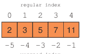

图 3.1 使用正（常规）和等效负（包装）索引的整数索引说明。

我们可以将 2D 矩阵表示为 Python 列表的列表，例如 `X = [[5, 2, 8, 3], [4, 9, 6, 7], [8, 11, 12, 10]]`。如果我们想从矩阵中检索元素 4，则需要使用 `X[1][0]` 语法。如果 `X` 是 NumPy、TensorFlow 或 PyTorch 张量，则应改用 `X[1, 0]` 语法来检索相同的元素。

要引用更高维张量中的元素，可以使用整数列表 `(i_0, i_1, ..., i_d, ..., i_D)`，其中 `i_d` 是张量 `X` 的第 d 个维度/轴。然后可以使用整数列表索引语法检索特定索引处的元素，例如 `X[3, 2, 5, 8]`。请注意，在此情况下使用负整数进行索引也是合法的。

此外，使用整数索引系统，我们还可以引用/选择张量中的多个元素，使用语法 `[[axis_0_index_0, axis_0_index_1, ..., axis_0_index_k], [axis_1_index_0, axis_1_index_1, ..., axis_1_index_k], ..., [axis_d_index_0, axis_d_index_1, ..., axis_d_index_k]]`。请注意，同一轴/维度的索引被分组并在列表中指定；索引的顺序遵循要检索的元素的相应顺序。例如，我们想从我们在图 3.2 中定义的 `X` 中同时选择 `(1, 3)` 和 `(2, 2)` 处的元素，可以执行 `X[[1, 2], (3, 2)]`。请注意，同时对多个元素进行索引仅在 NumPy 和 PyTorch 中允许，而不允许在 TensorFlow 或基础 Python 列表中允许。如果 `X` 是 `tf.Tensor`，则 `X[[1, 2], (3, 2)]` 将抛出以下错误：

```
TypeError: Only integers, slices (`:`), ellipsis (`...`), tf.newaxis (`None`) and scalar tf.int32/tf.int64 tensors are valid indices, got (1, 2)
```

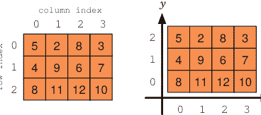

图 3.2 索引矩阵。(a) 行-列索引。这里，“row”指第一个维度，“column”指矩阵的第二个维度。(b) 矩阵的笛卡尔 XY 坐标。

当 `X` 是 1D 向量时，看看 TensorFlow 如何处理（或者也许无法处理）多元素索引也很有趣。例如，如果 `X = np.array([1, 2, 3, 4])` 是 1D 向量，我们想检索第一个和第三个元素，则可以执行 `X[[0, 2]]`，结果为 `[1, 3]`。这在 NumPy 和 PyTorch 中都有效，但在 TensorFlow 中无效。如果 `X` 是 `tf.Tensor`，则 `X[[0, 2]]` 抛出以下错误：

```
InvalidArgumentError: {{function_node __wrapped__StridedSlice_device/job: localhost/replica:0/task:0/device:CPU:0}} Index out of range using input dim 1; input has only 1 dims [Op:StridedSlice] name: strided_slice/
```

因为 TensorFlow 将 `[0, 2]` 视为 2D 矩阵中单个元素的索引，而不是从 1D 向量中选择多个元素。如本章后面将看到的，在 TensorFlow 中，我们可以改用 `tf.gather` 从张量中获取多个元素。

### 3.1.2 扁平索引与多索引

对于矩阵（2D）或更高维张量，通常有两种表示元素索引的约定：**扁平索引**（又称线性索引）和**多索引**。我们在第 3.1.1 节中看到的示例使用了多索引，它指向跨多个维度的元素空间坐标，并将索引表示为整数列表（每个整数对应张量的每个维度）。相比之下，扁平索引从 0 枚举到张量中的元素总数，并将每个索引表示为单个整数。如图 3.3 所示，假设我们有一个 3 × 4 的 2D 矩阵，它有 12 个元素。扁平索引使用 0 到 11 的索引逐个枚举元素。在第 2 章中，我们在介绍重塑操作时简要讨论了“C”序和“F”序约定。因此，根据矩阵使用的排序约定，有两种指定索引的方式：沿行（行主序“C”排序）或沿列（列主序“F”排序）。在“C”排序的情况下，扁平索引 `[0, 1, 2, ⋯, 11]` 对应 `(0, 0), (0, 1), (0, 2), ⋯, (1, 0), (1, 1), ⋯, (2, 3)`，其中第二维沿线的索引先增加；在“F”排序的情况下，扁平索引 `[0, 1, 2, ⋯, 11]` 对应 `(0, 0), (1, 0), (2, 0), ⋯, (0, 1), (1, 1), ⋯ , (2, 3)`，其中第一维沿线的索引先增加。考察两种约定之间差异的另一种方法是查看特定扁平索引处的多索引。例如，扁平索引 6 处的元素对应

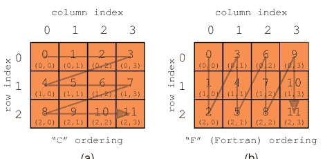

图 3.3 扁平和多（维）索引。内存中排序矩阵元素有两种约定，“C”和“F”排序。(a) 在“C”排序中，矩阵按行主序约定存储。在此约定中，沿扁平索引的值沿矩阵的每一行移动，或当按多索引索引时，从 `(0, 0), (0, 1), ..., (1, 0), (1, 1), ...` 到 `(n, 0), (n, 1), ..., (n, m)`。(b) 在“F”或 Fortran 顺序中，矩阵按列主序约定存储。在此约定中，沿扁平索引的值沿矩阵的每一列移动，或当按多索引索引时，从 `(0, 0), (1, 0), ..., (0, 1), (1, 1), ...` 到 `(0, m), (1, m), ..., (n, m)`。另请参见指示每种情况下扁平索引遍历顺序的箭头线。

在“C”排序中为多索引 `(1, 2)`，但在“F”排序中对应 `(0, 2)`（参见图 3.3）。

一般来说，给定元素排序约定“C”或“F”以及张量的形状时，我们可以在扁平索引和多索引之间转换。NumPy 实现了两个函数来帮助两种索引系统之间的相互转换。`np.ravel_multi_index(multi_index, shape, order)` 将多索引转换为扁平索引。反之，`np.unravel_index(flat_indices, shape, order)` 给定张量形状和顺序，将扁平索引转换为多索引。例如，要从扁平索引转换为多索引，

```
import numpy as np

shape = [2, 3, 3, 2]
flat_index = np.arange(0, np.prod(shape), 3)

r_multi_index = np.unravel_index(
    flat_index, shape, order="C"
)

print(np.stack([flat_index] + list(r_multi_index)).T)
# [[ 0  0  0  0  0]
#  [ 3  0  0  0  1]
#  [ 6  0  1  0  0]
#  [ 9  0  1  1  1]
#  [12  0  2  0  0]
#  [15  0  2  1  1]
#  [18  1  0  0  0]
```


# [21 1 0 1]
# [24 1 1 0 0]
# [27 1 1 1 1]
# [30 1 2 0 0]
# [33 1 2 1 1]

```python
c_multi_index = np.unravel_index(
    flat_index, shape, order="F"
)
print(np.stack([flat_index] + list(c_multi_index)).T)
# [[ 0 0 0 0 0]
#  [ 3 1 1 0 0]
#  [ 6 0 0 1 0]
#  [ 9 1 1 1 0]
#  [12 0 0 2 0]
#  [15 1 1 2 0]
#  [18 0 0 0 1]
#  [21 1 1 0 1]
#  [24 0 0 1 1]
#  [27 1 1 1 1]
#  [30 0 0 2 1]
#  [33 1 1 2 1]]
```

为进一步说明扁平索引与多索引之间的关系，我们可以根据上述示例推导出在这两种索引系统之间转换的模式。设一个张量的形状为 \((n_0, n_1, \dots, n_d, \dots, n_{D-1})\)，因此它有 \(r = \prod_{i=0}^{D-1} n_i\) 个元素，其中 \(D\) 是张量的维度数。然后，要从扁平索引 \([r_0, r_1, \dots, r_j, \dots]\) 转换，我们可以使用公式：

\(i_d^{(j)} = \left\lfloor \frac{r_j}{\eta_d} \right\rfloor \mod n_d\) (3.1)

其中，当使用行序（“C”）排序时 \(n_{d<D-1} = \prod_{i=d+1}^{D-1} n_i, \eta_{D-1} = 1\)，当使用列序（“F”）排序时 \(n_{d>0} = \prod_{i=0}^{d-1} n_i, \eta_0 = 1\)；\([\cdot]\) 是向下取整除法或整数除法运算。我们可以将我们的发现实现如下：

```python
def ind2sub(flat_index, shape, order="C"):
    """Convert flat index to multi-index."""
    if order == "C":  # row-major
        eta = np.cumprod(shape)[1:][::-1]
        eta = np.concatenate([[1], eta])[:-1]
    elif order == "F":  # column-major
        eta = np.cumprod(shape)[:-1]
        eta = np.concatenate([[1], eta])
    else:
        raise(ValueError(f"Unrecognized order: {order}"))
    # (num_indices, 1)
    flat_index = np.asarray(flat_index)[:, None]
    shape = np.asarray(shape)
    # Compute multi-index
    return flat_index // eta % shape
```

- 第 3–10 行根据顺序实现数组 \(\eta\)。请注意，当 `order="C"` 时 `eta` 的最后一个元素为 1，而当 `order="F"` 时其第一个元素为 1。
- 第 13 和 14 行确保 `flat_indices` 和 `shape` 都是数组，以便实现我们在公式 3.1 中的公式。
- 第 17 行实现索引转换公式。

我们可以如下快速将我们的实现与 `np.unravel_index` 进行验证：

```python
import numpy as np
shape = np.array((2, 3, 3, 2))
flat_index = np.arange(np.prod(shape))
# Use numpy unravel_index
r_multi_index = np.vstack(np.unravel_index(flat_index, shape, order="C")).T
c_multi_index = np.vstack(np.unravel_index(flat_index, shape, order="F")).T
# Call our own implementations
r_sub = ind2sub(flat_index, shape, order="C")
c_sub = ind2sub(flat_index, shape, order="F")
assert np.allclose(r_multi_index, r_sub)
assert np.allclose(c_multi_index, c_sub)
```

另一方面，要使用 `np.ravel_multi_index` 将 4D 张量的多索引转换为扁平索引，例如，

```python
import numpy as np
coordinates = [ # point coordinates
    (0, 1, 1, 0),
    (0, 2, 0, 1),
    (1, 0, 1, 0),
    (1, 1, 1, 1),
]
# one array for each dimension
multi_indices = np.array(coordinates).T.tolist()
shape = [2, 3, 3, 2]

# C-order
r_flat_index = np.ravel_multi_index(
    multi_indices, dims=shape, order="C"
)
print(np.concatenate([r_flat_index[:, None], coordinates], axis=1))
# [ [8 0 0 1 0]
# [13 0 2 0 1]
# [20 1 0 1 0]
# [27 1 1 1 1]]

# F-order
c_flat_index = np.ravel_multi_index(
    multi_indices, dims=shape, order="F"
)
print(np.concatenate([c_flat_index[:, None], coordinates], axis=1))
# [ [8 0 0 1 0]
# [22 0 2 0 1]
# [ 7 1 0 1 0]
# [27 1 1 1 1]]
```

我们可以发现如下的转换模式：

$$r_j = \sum_d i_d^{(j)} n_d$$ (3.2)

其中，当使用行序（“C”）排序时 \(n_{d<D-1} = \prod_{i=d+1}^{D-1} n_i, n_{D-1} = 1\)，当使用列序（“F”）排序时 \(n_{d>0} = \prod_{i=0}^{d-1} n_i, n_0 = 1\)；这与公式 3.1 中的先前定义相同。我们可以如下实现我们的发现：

```python
def sub2ind(multi_index, shape, order="C"):
    """Convert multi-index to flat index."""
    if order == "C": # row-major
        eta = np.cumprod(shape[1:][::-1])
        eta = np.concatenate([[1], eta])[::-1]
    elif order == "F": # column-major
        eta = np.cumprod(shape)[:-1]
        eta = np.concatenate(([1], eta))
    else:
        raise(ValueError(f"Unrecognized order: {order}"))
    # (num_indices, d)
    multi_index = np.asarray(multi_index)
    return np.sum(multi_index * eta, axis=1)
```

- 第 3–10 行与 ind2sub 相同，在此我们确定数组 eta。
- 第 13 行确保输入 multi_index 是一个数组。
- 第 15 行实现公式 3.2。

> 函数名 ind2sub 和 sub2ind 源自 MATLAB。

重要的是要理解，我们不能直接在 NumPy、Tensorflow 或 PyTorch 中未展平的多维张量上使用扁平索引。例如，如果 X 是一个 2D 矩阵，那么 X[0] 不会检索第一个元素，而是检索矩阵的整个第一行。这称为 *切片*，我们将在本章第 3.2 节中更仔细地探讨这一点。要根据扁平索引检索第一个元素，我们需要要么展平矩阵，即 `X.flatten()[0]`，要么使用我们将在第 3.4.1 节中讨论的 `np.take`。

使用扁平索引索引元素只需要线性值（从 0 到 N − 1，其中 N 是张量中的元素数量）、张量的形状以及遍历顺序（例如 C 序或 F 序）。相比之下，使用多索引索引需要 D × N 个值，其中 D 是张量的维度。因此，在枚举张量元素时，扁平索引需要的内存更少，而维度信息可以被忽略。正如我们将在本章后面看到的，对多维张量进行诸如 gather 和 scatter 等操作通常是在扁平索引上执行的。但是，多索引可以对元素的分组进行编码。切片和分组归约（例如按行求和）是使用多索引执行的。因此，取决于所需的数据操作类型，可以在算法的某些步骤中使用扁平索引，然后在另一部分切换到使用多索引。在第 7 章中，我们还将看到更多示例，了解稀疏矩阵如何利用扁平索引和多索引来存储稀疏数据，以及如何对这种数据结构执行专门操作。

### 3.1.3 布尔索引

与使用整数从张量中选择元素不同，我们还可以使用形状与输入张量相同的布尔指示器张量来选择所需的元素。这种索引方式有助于我们根据逻辑条件选择元素。让我们再次假设我们有一个 2D 矩阵 X，我们希望从张量中选择所有奇数值。

```python
import numpy as np

X = np.array([
    [5, 2, 8, 3],
    [4, 9, 6, 7],
    [8, 11, 12, 10]
])

# Boolean condition of odd elements
# same shape as X
condition = X % 2 == 1

# Extract the odd elements
X[condition]
# array([5, 3, 9, 7, 11])
```

在第 5 章中，我们将介绍掩码的概念。事实上，基于布尔条件从张量中选择元素也可以被视为布尔掩码操作（即删除未选中的元素）。

另一方面，我们还可以使用 .where 操作来查找布尔条件的索引。考虑上面的同一个 2D 矩阵，我们可以使用以下方法查找矩阵中奇数的索引：

```python
import numpy as np

X = np.array([
    [5, 2, 8, 3],
    [4, 9, 6, 7],
    [8, 11, 12, 10]
])

# indices of odd elements
row_index, col_index = np.where(X % 2 == 1)

# row_index: array([0, 0, 1, 1, 2])
# col_index: array([0, 3, 1, 3, 1])
```

请注意，np.where 函数返回两个输出，分别对应沿每个维度的奇数索引。一般来说，对于 D 维张量，np.where 将返回 D 个索引数组，分别对应


各维度上的真实条件。有关上述示例的说明，请参见图 3.4。

NumPy、TensorFlow（通过 `tf.experimental.numpy`）和 PyTorch 还实现了一个特殊的 where 操作，`nonzero` 及其扁平版本 `flatnonzero`（仅在 NumPy 中）。顾名思义，`nonzero` 返回张量沿各维度上非零元素的索引（以元组形式，等效于 `np.where(X != 0)`）；`flatnonzero` 返回非零索引，仿佛张量已被展平（等效于 `np.where(X.flatten() != 0)`）。由于零通常用于填充缺失数据（例如填充，我们将在第 5 章中看到），这些方便的操作有时可以帮助确定张量中存储的有效数据范围。

## 3.2 切片

在 3.1 节中，我们介绍了使用不同索引系统检索单个元素的方法。但是，有时，我们也希望从数组中选择一个片段或一段区间的值。这称为 **切片**。在 Python 中，我们可以通过选择列表 `l` 之间起始索引和结束索引的元素来“切片”数组，使用语法 `l[start:stop]`。例如，设 `l = [1, 3, 5, 7, 9]`，我们希望从索引 1 选择到索引 4（不包含）的所有元素，使用 `l[1:4]`，它将返回 `[3, 5, 7]`。与 **切片** 类似的概念是 **步进**：不是选择两个索引之间的所有连续元素，而是 **步进** 在两个索引之间持续跳过一定数量的元素来选择元素，语法为 `l[start:stop:step]`。例如，假设我们希望在索引 1 和索引 4（不包含）之间每隔一个元素选择一个元素（即在索引之间选择时跳过 1 个元素，或每隔两个元素选择一个元素。我们可以使用 `l[1:4:2]`，它将返回 `[3, 7]`。Python 中其他常用的切片和步进语法列于表 3.1 中。

在 NumPy、TensorFlow 和 PyTorch 中，切片和步进操作不仅可以应用于 1D 向量，还可以推广到多维张量的每个轴。图 3.5 和 3.6 分别说明了 2D 矩阵和 3D 张量中切片和步进操作的几个示例。

### 表 3.1 1D 数组中切片和步进操作及示例用法列表

| Operations | Syntax | Example |
|---|---|---|
| 两个索引之间的切片 | start:stop | l[1:4] -> [3, 5, 7] |
| 使用负索引的切片（转换为 start+n 和 stop+n） | start:stop | l[-4:-1] -> [3, 5, 7] |
| 从起始索引切片到最后一个元素 | start: | l[2:] -> [5, 7, 9] |
| 从第一个元素切片到停止索引 | :stop | l[:3] -> [1, 3, 5] |
| 步进 | start:stop:step | l[1:4:2] -> [3, 7] |
| 选择所有元素 | : | l[:] -> [1, 3, 5, 7, 9] |
| 选择除最后一个元素外的所有元素 | :-1 | l[:-1] -> [1, 3, 5, 7] |
| 选择除最后 N 个元素外的所有元素 | :-N | l[:-2] -> [1, 3, 5] |
| 反转数组 | ::-1 | l[::-1] -> [9, 7, 5, 3, 1] |
| 从第一个元素步进到停止索引 | :stop:step | l[:4:2] -> [1, 5] |
| 从起始索引步进到最后一个元素 | start::step | l[1::2] -> [3, 7] |
| 从第一个元素步进到最后一个元素 | ::step | l[::2] -> [1, 5, 9] |
| 从最后一个元素步进到第一个元素 | ::-step | l[::-2] -> [9, 5, 1] |

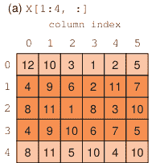

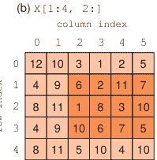

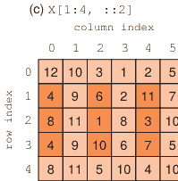

图 3.5 NumPy、TensorFlow 或 PyTorch 张量中 2D 矩阵切片和步进操作示例。(a) 切取行的子集但保持列上所有元素：X[1:4, :]；(b) 切取由行和列子集组成的矩阵块：X[1:4, 2:]；(c) 切取行的子集，并跨矩阵每两列步进：X[1:4, ::2]。

### (a) X[1:3, 1:4, :2]

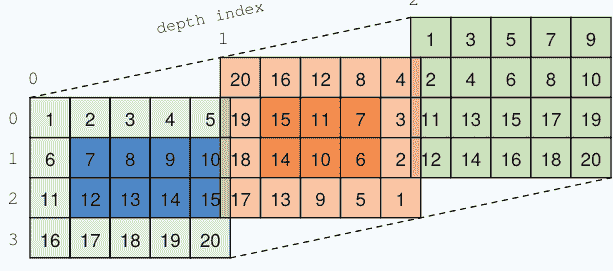

### (b) X[1:3, 1:4, ::2]

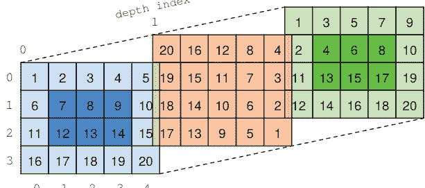

图 3.6 NumPy、TensorFlow 或 PyTorch 张量中 3D 张量切片操作示例。(a) 沿行、列和深度维度切取张量元素的子集：X[1:3, 1:4, :2]；(b) 沿深度维度切取张量的第一层和第三层，并对每一层（2D 矩阵）选择元素的子集：X[1:3, 1:4, ::2]。

除了表 3.1 中列出的语法之外，还有两个额外的方便切片运算符，None（在 NumPy 中等效于 np.newaxis，在 TensorFlow 中等效于 tf.newaxis）和 ...（或等效于 Ellipsis，Python 的内置常量），它们仅可用于 NumPy、TensorFlow 和 PyTorch 张量切片，而不能用于 Python 列表。使用 None 或 np.newaxis 切片维度会在切片轴上添加一个额外的单例维度。

该操作分别等效于 NumPy 中的 np.expand_dims、TensorFlow 中的 tf.expand_dims 或 PyTorch 中的 torch.unsqueeze。例如，

```
import numpy as np
X = np.random.rand(4, 5) # shape (4, 5)
# Add an extra 3rd dimension
# shape (4, 5, 1)
assert np.allclose(
    X[:, :, None].shape,
    np.expand_dims(X, axis=2).shape
)
# Insert an extra dimension in the first dimension
# shape (1, 4, 5)
assert np.allclose(
    X[None, :, :].shape,
    np.expand_dims(X, axis=0).shape
)
# Insert an extra dimension between the original
# 1st and 2nd dimensions: shape (4, 1, 5)
assert np.allclose(
    X[:, np.newaxis, :].shape,
    np.expand_dims(X, axis=1).shape
)
```

...（省略号）运算符，另一方面，允许我们在切片跨多个连续维度的所有元素时简化表达式。例如，设 X 为形状为 [5, 2, 3, 8, 7] 的张量，我们希望沿维度 2–5 选择所有元素，但沿第一个维度选择子集。我们可以使用 X[2:4, :, :, :, :] 或等效地使用 X[2:4, ...]。

```
import numpy as np
X = np.random.rand(5, 2, 3, 8, 7)
# Selecting subset of a batch
assert np.allclose(
    X[2:4, :, :, :, :].shape,
    X[2:4, ...].shape
)
# Selecting the first slice of the last dimension
assert np.allclose(
    X[:, :, :, :, 0].shape,
    X[..., 0].shape
)
# Selecting a subset of the first dimension and
# the last slice from the last dimensions
assert np.allclose(
    X[1:3, :, :, :, -1].shape,
    X[1:3, ..., -1].shape
)
```

使用省略号 (...) 进行切片在实现接受变维张量的函数时很方便。例如，假设我们想要实现一个函数，它始终以以下形式之一提取序列中的项：(batch_size, seq_length)、(batch_size, seq_length, feature_size) 或 (batch_size, seq_length, feature_size, num_instances)。请注意，序列维度始终位于 axis=1，批次维度始终位于 axis=0，那么我们可以执行

```
import numpy as np

def extract_last_event(X):
    return X[:, -1, ...]

# (batch_size, seq_length)
X1 = np.random.rand(16, 50)
assert np.allclose(
    extract_last_event(X1).shape,
    (16, )
)

# (batch_size, seq_length, feature_size)
X2 = np.random.rand(16, 50, 32)
assert np.allclose(
    extract_last_event(X2).shape,
    (16, 32)
)
# (batch_size, seq_length, feature_size, num_instances)
X3 = np.random.rand(16, 50, 32, 8)
assert np.allclose(
    extract_last_event(X3).shape,
    (16, 32, 8)
)
```

使用省略号 ...，该函数可以处理所有三种序列输入变体。请注意，当输入形式为 (batch_size, seq_length) 时，只有两个维度，而在我们的实现中，看起来像是从至少三个维度中提取。事实证明，省略号运算符 ... 将忽略第三个维度的切片，因为该维度不存在。

最后，在指定切片时，只能有一个省略号 ... 运算符。指定多个省略号会抛出错误，例如：

```
X = np.arange(30).reshape(3, 2, 5)
X[..., 0, ...]
```

在 NumPy 中抛出错误：

```
IndexError: an index can only have a single ellipsis ('...')
```

这是因为两个省略号表示的切片维度是不明确的。X[..., 0, ...] 可能表示以下任何一种：

- X[0, :, :]
- X[:, 0, :]
- X[:, :, 0]

程序无法确定哪个是预期的切片操作。

在本书中，我有时会在描述函数用法时将省略号运算符 ... 重载为参数的未指定值，或用于省略列表中值的枚举。但是，这些用法绝不能出现在代码块中（因为所有代码块都应该按原样可运行）。当表示法变得令人困惑时，我会指明省略号的含义。

### 3.2.1 重用切片配置

有时我们可能希望将相同的切片逻辑应用于多于 1 个张量，或者也许我们希望将切片配置作为变量传递给函数。在这些场景中，我们需要构造切片对象。Python 提供了一个内置方法来构建切片，slice，其用法如下

- slice(stop)，等效于 l[:stop] 的切片；
- slice(start, stop)，等效于 l[start:stop] 的切片；
- slice(start, stop, step)，等效于 l[start:stop:step] 的切片。

同样，NumPy 实现了 np.s_，它以相同的方式使用，但使用比 slice 更常用的冒号 : 语法。表 3.2 再次列出了以前在表 3.1 中列出的切片操作示例，但使用 slice 和 np.s_ 来构建切片配置。


表 3.2 使用 Python `slice` 或 NumPy 的 `np.s_` 构建切片和步长配置的示例列表

| 操作 | Python `slice` | NumPy `np.s_` |
| :--- | :--- | :--- |
| 两个索引之间的切片 | `slice(start, stop)` | `np.s_[start:stop]` |
| 使用负索引进行切片（转换为 start+n 和 stop+n） | `slice(start, stop)` | `np.s_[start:stop]` |
| 从起始索引切片到最后一个元素 | `slice(start, None)` | `np.s_[start:]` |
| 从第一个元素切片到停止索引 | `slice(None, stop)` | `np.s_[:stop]` |
| 步进 | `slice(start, stop, step)` | `np.s_[start:stop:step]` |
| 选择所有元素 | `slice(None)` | `np.s_[:]` |
| 选择除了最后一个元素以外的所有元素 | `slice(None, -1)` | `np.s_[:-1]` |
| 选择除了最后 N 个元素以外的所有元素 | `slice(None, -N)` | `np.s_[:-N]` |
| 反转数组 | `slice(None, None, -1)` | `np.s_[::-1]` |
| 从第一个元素到停止索引的步进 | `slice(None, stop, step)` | `np.s_[:stop:step]` |
| 从起始索引到最后一个元素的步进 | `slice(start, None, step)` | `np.s_[start::step]` |
| 从第一个到最后一个元素的步进 | `slice(None, None, step)` | `np.s_[: :step]` |
| 从最后一个到第一个元素的步进 | `slice(None, None, -step)` | `np.s_[::-step]` |

注意 `np.s_` 还支持构建多维的切片配置，语法为 `np.s_[start_0:stop_0:step_0, start_1:stop_1:step_1, ..., start_n:stop_n:step_n]`。这将返回一个 `slice` 对象的元组，例如 `(slice(start_0, stop_0, step_0), slice(start_1, stop_1, step_1), ..., slice(start_n, stop_n, step_n))`。为了澄清，我在此重载了省略号 ... 符号，它在这里有两种含义：

- 我在这里使用省略号 “...” 作为一种记号，表示在构建切片时可能有可变数量的维度。
- 但是，在 `np.s_` 方法中使用省略号运算符 `...` 也是有效的，这表示省略维度上的切片选择该维度内的所有项目。这正是省略号运算符之前的使用方式。当使用 `...` 构建多维切片时，被省略的维度将表示为 Python 的 `Ellipsis` 常量，例如 (`slice(start_0, stop_0, step_0)`, `slice(start_1, stop_1, step_2)`, `Ellipsis`, `slice(start_3, stop_3, step_3)`)。

一旦我们构建了 `slice` 配置对象，就可以像以前一样应用切片逻辑，例如：

```
import numpy as np
X = np.random.rand(5, 8, 6)
Y = np.random.rand(3, 9, 7)
Y
# Build the slice object
s = np.s_[:4, 2:4, 5:]
# Shape may not necessarily be identical
print(X[s].shape) # shape (4, 2, 1)
print(Y[s].shape) # shape (3, 2, 2)
```

您可能会注意到，张量 Y 的第一维大小为 3，但我们切片了四个元素。然而，程序没有抛出错误，而是在第一维返回了三个元素，少于切片要求的四个元素。通常，Python 的张量切片会尽可能多地获取元素；因此，如果我们指定的切片 `stop` 超出张量维度的大小，它将只返回切片中能获取的元素。**在数组长度之外的位置获取单个元素会抛出错误**。为了说明这种行为，下面是另一组示例，

```
x = [1, 2, 3, 4, 5]
# stop beyond the size of the array
print(x[:7]) # [1, 2, 3, 4, 5]
# stop beyond the size of the array, stride 2
print(x[:7:2]) # [1, 3, 5]
# empty, no elements to take
# since the slice is beyond the length of the array
print(x[6:8]) # []
# The following, however, will throw an error
print(x[7]) # IndexError: list index out of range
```

## 3.3 案例研究：获取连续索引

假设我们有一个整数列表 [-1, 1, 2, 3, 4, 7, 9, 10, 11, 12, 13, 15]，我们可以识别出有两组由连续整数组成的块，[1, 2, 3, 4] 和 [9, 10, 11, 12, 13]。我们希望找到这两个整数块的起始和结束索引。当我们想将整数列表转换为类似 "-1, 1~4, 7, 9~13 , 15" 的文本时，这可能很有帮助，这比长整数列表更易读。以下代码实现了我们所需的函数：

```
import numpy as np

def get_consecutive_index(t, N=1, interval=True):
    """
    Given a sorted array of integers, find the start and the end
    of consecutive blocks
    e.g. t = [-1, 1,2,3,4, 7, 9,10,11,12,13, 15],
         return [1,4], [6,10]

    Inputs:
    * t: the sorted array of integers
    * N: filter for at least N consecutive. Default 1
    * interval: if True, we are filtering by N consecutive
                intervals instead of N consecutive numbers
    """
    # Determine if the (next element) = (1 + previous)
    x = np.diff(t) == 1
    # Determine which element is the start or end of the block
    f = np.concatenate(([False], x)) != np.concatenate((x, [False]))
    # Index of the start and end of the block
    f = np.where(f)[0]
    # reshape: the start and end must come in pairs
    f = np.reshape(f, (-1, 2))
    # filter for at least N consecutive
    interval = 1 - int(interval) # 0 if True, 1 if False
    # Determine which interval has more than desired N consecutive
    # numbers
    f = f[(interval + np.diff(f, n=1, axis=1).T[0]) >= N, :]
    return f
```

- 第 17 行使用 np.diff 来判断当前元素是否为前一个元素的连续整数。如果是连续整数，则它与前一个元素的差应为 1，否则将大于 1。例如，给定列表 `[-1, 1, 2, 3, 4, 7, 9, 10, 11, 12, 13, 15]`，连续元素之间的后向差为 `[2, 1, 1, 1, 3, 2, 1, 1, 1, 1, 2]`（注意这比原始输入少 1 个元素）。因此，索引 `[2, 3, 4, 7, 8, 9, 10]` 处的元素是比前一个元素大 1 的元素。

- 第 19 行确定哪个元素是块的开始或结束。给定上一步中的 `x = [False, True, True, True, False, True, True, True, True, True, True, True, False, False]`，我们可以观察到，如果元素是块的开始，则布尔值将从 `False` 变为 `True`（或者如果第一个元素也是块的开始，则 `x` 的第一个元素也应为 `True`）。同样，如果元素是块的结束，则布尔值将从 `True` 变为 `False`（或者如果最后一个元素是块的结束，则最后一个元素也应为 `True`）。通过在 `x` 前面填充一个 `False`，我们将 `x` 向后偏移 1 个索引；通过在 `x` 后面追加一个 `False`，我们将 `x` 向前偏移 1 个索引。然后，当我们比较两个偏移布尔数组的值时，我们正在比较：

```
[(False, False), # -1 (start)
[False, True], # 1
[True, True], # 2
[True, True], # 3
[True, False], # 4
[False, False], # 7
[False, True], # 9
[True, True], # 10
[True, True], # 11
[True, True], # 12
[True, False], # 13
[False, (False)]] # 15 (end)
```

这种结构使我们能够确定连续元素之间是否正在从 `False` 过渡到 `True` 或从 `True` 过渡到 `False`，或者是否没有任何过渡。我们可以观察到，

- 值都为 False，则元素不属于连续块。
- 值都为 True，则元素位于块中间。
- 值为 `[False, True]`，则元素是块的开始。
- 值为 `[True, False]`，则元素是块的结束。

- 第 21 行使用 `np.where` 确定块开始和结束的索引。

第 23 行将 1D 向量重塑为 (num_blocks, 2) 矩阵。这是因为块应该始终有开始和结束。由于输入数组已经排序，给定单个块，块的结束应该始终出现在块的开始之后。

第 25–27 行执行块大小过滤。此操作有两种模式：要么计算元素数量，要么计算间隔数量。间隔数量可通过 end_index - start_index 计算，元素数量可通过 end_index - start_index + 1 计算。我使用标志 interval 在两种情况之间切换：如果 interval=True，则不需要加 1；如果 interval=False，则需要加 1；因此，表达式为 int (~interval)。

## 3.4 获取和聚集

从张量中选择元素和切片也称为 take 或 gather 操作。NumPy、Tensorflow 和 PyTorch 都将这些方法实现为具体函数。表 3.3 汇总了这些库中的 take 和 gather 操作列表。本节将逐一介绍每种操作并研究其用法模式。

表 3.3 NumPy、Tensorflow 和 PyTorch 中的 take 和 gather 操作列表。

| 操作 | NumPy | Tensorflow | PyTorch |
|---|---|---|---|
| 使用平面索引获取元素/切片 | np.take | tf.experimental.numpy.take | torch.take |
| 批量获取 | np.take_along_axis | tf.experimental.numpy.take_along_axis | torch.take_along_dim |
| 聚集 | np.take, np.take_along_axis | tf.gather | torch.gather |
| 使用多索引获取元素 | N/A | tf.gather_nd | N/A |

### 3.4.1 获取

获取操作是一个使用平面整数索引从张量中选择元素的便捷函数。要通过简单示例说明，


```python
import numpy as np
X = np.array([2, 3, 5, 7, 11, 13, 17, 19, 23, 29])
# 1D array slicing
flat_index = [2, 3, 5, 7]
elements = np.take(X, flat_index)
# array([5, 7, 13, 19])
```

这等同于一维向量情况下的 `X[index]`（另见图 3.7）。对于多维张量，`take` 操作会首先将张量展平为一维向量，然后根据扁平索引选择元素。例如，

```python
import numpy as np
X = np.arange(1, 7)
X = np.reshape(X, (2, 3), order="F")
# array([[1, 3, 5],
#        [2, 4, 6]])
# Taking elements using flat indices
flat_index = [1, 3, 4]
elements = np.take(X, flat_index)
# array([3, 2, 4])
```

另见图 3.8 以获得简单示例。请注意，展平顺序始终为 "C" 顺序，而不是遵循输入数组的顺序。例如，我们可以验证

```python
import numpy as np
X = np.arange(20).reshape(4, 5)
flat_index = [1, 2, 3, 4, 5]
assert np.allclose(
    np.take(np.asarray(X, order="C"), flat_index),
    np.take(np.asarray(X, order="F"), flat_index)
)
```

`flat_index` 的形状也决定了输出的形状。如果 `flat_index` 是形状 (3, 2) 的矩阵，则 `take` 的结果也是形状 (3, 2) 的矩阵（另见图 3.9 以获得示例）。例如，

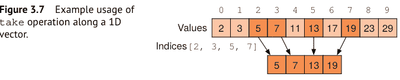

### 图 3.8 二维矩阵上扁平 take 操作的示例用法。

### 图 3.9 向量上多维 take 操作的示例用法。

```python
import numpy as np
X = np.arange(10)
# Flat index with a desired output shape
flat_index = [[4, 5], [3, 6], [1, 8]] # (3, 2)
elements = np.take(X, flat_index)
# array([[4, 5],
#     [3, 6],
#     [1, 8]])
```

`np.take` 和 `tf.experimental.numpy.take` 操作允许一个额外的 `axis` 参数，用于指定沿哪个轴提取项/切片的子集。例如，

```python
import numpy as np
X = np.arange(30).reshape(5, 3, 2)
# Slicing along a single dimension
slice_index = [0, 3]
block = np.take(X, slice_index, axis=0)
# array([[[ 0, 1],
#     [ 2, 3],
#     [ 4, 5]],
#
#    [[18, 19],
#     [20, 21],
#     [22, 23]]])
# This operation is equivalent to slicing using indexing
assert np.allclose(
    block,
    X[slice_index, :, :]
)

# 沿单个维度切片
# 并跨多个维度安排切片
slice_index = [[0, 3], [1, 2]]
block = np.take(X, slice_index, axis=0) # (2, 2, 3, 2)
assert np.allclose(
    block,
    X[slice_index, :, :]
)

PyTorch 的 `torch.take` 没有 `axis` 或 `dim` 参数，因此更常用简单切片。否则，也可以选择使用 `torch.index_select(input, dim, index)`。

## 3.4.2 沿轴取值

`take_along_axis` 根据沿某个轴的整数索引，为批次中的每个项目选择元素。`axis` 指定非批次维度，而所有其他维度可以视为批次维度（从而并行化操作）；指定的 `indices` 是沿 `axis` 指定的维度的索引。举个简单的例子，假设我们有一个批次的一维序列，排列成形状为 `(4, 5)` 的二维矩阵，我们希望逐个重新排列序列的顺序：

```python
import numpy as np
X = np.array([
    [0, 1, 2, 3, 4],
    [1, 2, 3, 4, 5],
    [2, 3, 4, 5, 6],
    [3, 4, 5, 6, 7],
])
# Reordering index
reorder_index = np.array([
    [3, 1, 0, 4, 2],
    [2, 4, 3, 0, 1],
    [3, 0, 4, 1, 2],
    [0, 2, 1, 4, 3],
])
# Apply the reordering index
y = np.take_along_axis(X, reorder_index, axis=1)
# array([[3, 1, 0, 4, 2],
#     [3, 5, 4, 1, 2],
#     [5, 2, 6, 3, 4],
#     [3, 5, 4, 7, 6]])
```

在这里，axis=0 被视为批次维度，axis=1 被视为索引维度。`indices=reorder_index` 中的整数值不超过第 2 维（axis=1）的大小。一般而言，`indices` 和输入 X 必须具有相同的维数（即 `indices.ndim = X.ndim`）；指定的 `indices` 形状需要与输入 X 的形状相同，或为可广播的单例维度。让我们考虑 `take_along_axis` 的更高级用法示例（注意，为了让读者能够手动跟踪重排结果，我在下面的代码中明确列出了精确的矩阵和重排索引，而不是使用随机生成器）：

```python
import numpy as np

X1 = np.array([
    [0, 1, 2, 3, 4],
    [1, 2, 3, 4, 5],
    [2, 3, 4, 5, 6],
    [3, 4, 5, 6, 7],
])

X2 = np.array([
    [ 0, 10, 20, 30, 40],
    [10, 20, 30, 40, 50],
    [20, 30, 40, 50, 60],
    [30, 40, 50, 60, 70],
])

X3 = np.array([
    [-4, -3, -2, -1,  0],
    [-5, -4, -3, -2, -1],
    [-6, -5, -4, -3, -2],
    [-7, -6, -5, -4, -3],
])

# (4, 5, 3)
X = np.dstack([X1, X2, X3])

# Reordering index
reorder_index = np.array([
    [3, 1, 0, 4, 2],
    [2, 4, 3, 0, 1],
    [3, 0, 4, 1, 2],
    [0, 2, 1, 4, 3],
])[..., None] # last dimension broadcastable to X

# Apply the reordering index
y = np.take_along_axis(X, reorder_index, axis=1)

# Examine the results one matrix at a time
print(y[:, :, 0])
# array([[3, 1, 0, 4, 2],
#        [3, 5, 4, 1, 2],
#        [5, 2, 6, 3, 4],
#        [3, 5, 4, 7, 6]])
print(y[:, :, 1])
# array([[30, 10, 0, 40, 20],
#        [30, 50, 40, 10, 20],
#        [50, 20, 60, 30, 40],
#        [30, 50, 40, 70, 60]])
print(y[:, :, 2])
# array([[-1, -3, -4, 0, -2],
#        [-3, -1, -2, -5, -4],
#        [-3, -6, -2, -5, -4],
#        [-7, -5, -6, -3, -4]])
```

在这种情况下，axis=0 和 axis=2 均被视为批次维度。输入 X 也可以在单例维度上广播到索引。例如，

```python
import numpy as np

X = np.array([[0, 1, 2, 3, 4]])[:, :, None] # (1, 5, 1)
reorder_index = np.array([
    [3, 1, 0, 4, 2],
    [2, 4, 3, 0, 1],
    [3, 0, 4, 1, 2],
    [0, 2, 1, 4, 3],
])[..., None] # (4, 5, 1)
# Apply the reordering index
y = np.take_along_axis(X, reorder_index, axis=1)
assert np.allclose(
    y.shape,
    (4, 5, 1)
)

assert np.allclose(
    y,
    np.array([[[3, 1, 0, 4, 2],
               [2, 4, 3, 0, 1],
               [3, 0, 4, 1, 2],
               [0, 2, 1, 4, 3]]])[:, :, None]
)
```

最后，让我们看看没有广播的示例：

```python
import numpy as np

X1 = np.array([
    [0, 1, 2, 3, 4],
    [1, 2, 3, 4, 5],
    [2, 3, 4, 5, 6],
    [3, 4, 5, 6, 7],
])

X2 = np.array([
    [ 0, 10, 20, 30, 40],
    [10, 20, 30, 40, 50],
    [20, 30, 40, 50, 60],
    [30, 40, 50, 60, 70],
])

X3 = np.array([
    [-4, -3, -2, -1,  0],
    [-5, -4, -3, -2, -1],
    [-6, -5, -4, -3, -2],
    [-7, -6, -5, -4, -3],
])

# (4, 5, 3)
X = np.dstack([X1, X2, X3])

# Reordering index
index_1 = np.array([
    [3, 1, 0, 4, 2],
    [2, 4, 3, 0, 1],
    [3, 0, 4, 1, 2],
    [0, 2, 1, 4, 3],
])

index_2 = np.array([
    [1, 0, 2, 3, 4],
    [3, 0, 4, 1, 2],
    [4, 0, 1, 2, 3],
    [0, 1, 2, 3, 4],
])

index_3 = np.array([
    [3, 0, 1, 4, 2],
    [2, 0, 1, 3, 4],
    [2, 1, 4, 3, 0],
    [0, 2, 4, 1, 3],
])

# (4, 5, 3)
reorder_index = np.dstack([index_1, index_2, index_3])

# Apply the reordering index
y = np.take_along_axis(X, reorder_index, axis=1)

# Examine several slices
print(y[0, :, 0])
# array([3, 1, 0, 4, 2])
print(y[1:, :, 2])
# array([-3, -5, -4, -2, -1])
print(y[2:, :, 1])
# array([60, 20, 30, 40, 50])
```

我们可以轻松验证

- `np.take(X[0, :, 0], reorder_index[0, :, 0]) == y[0, :, 0]；`
- `np.take(X[1, :, 2], reorder_index[1, :, 2]) == y[1, :, 2]；`
- `np.take(X[2, :, 1], reorder_index[2, :, 1]) == y[2, :, 1]；`
- `……等等。`

一般而言，

```python
for ii in range(X.shape[0]):
    for jj in range(X.shape[2]):
        assert np.allclose(
            np.take(X[ii, :, jj], reorder_index[ii, :, jj]),
            y[ii, :, jj],
        )
```

因此，`take_along_axis` 是 `take` 操作的向量化版本，它并行化了跨批次（可能分布在多个维度上）从一维向量中选择元素的过程。

### 3.4.3 聚集

`gather` 操作是 `take` 和 `take_along_axis` 操作的另一种实现。TensorFlow 和 PyTorch 对 `gather` 操作的实现方式不同。`tf.gather` 始终沿由 `axis` 指定的某个维度选择元素或切片，`axis` 默认值为 `None`。`axis` 的值取决于另一个参数 `batch_dims`（从 axis 0 开始的批次维度数量；这不是用于指定哪些维度或轴是批次维度），默认值为 `0`。需要满足 `axis >= batch_dims` 且 `batch_dims <= index.ndim`。尽管如此，PyTorch 的 `torch.gather` 另一方面，给定每个索引时只能一次选择单个元素，而不是通过广播选择切片（即，`X` 和 `indices` 不会广播）。因此，`torch.gather` 的结果形状与 `indices` 相同。另外，像 `np.take_along_axis` 一样，`torch.gather` 要求输入 `X` 和 `indices`


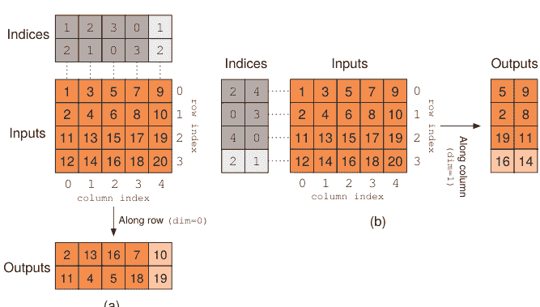

图 3.10 对 2D 矩阵进行 torch.gather 操作的图示示例。(a) 沿行收集 (torch.gather(X, dim=0, index=index))。索引和输入都是二维矩阵。两个矩阵在左上角对齐（即 index (0, 0)）。索引矩阵的列对应于输入的列，而索引矩阵内的值对应于行索引。索引矩阵的列数可以小于（即实体区域）或等于（即实体区域与浅色区域合并）输入的列数。最终输出的形状与索引矩阵相同；(b) 沿列收集 (torch.gather(X, dim=1, index=index))。索引和输入都是二维矩阵，并在左上角对齐。索引矩阵的行对应于输入的行，而索引矩阵内的值对应于列索引。索引矩阵的行数同样可以小于或等于输入的行数。最终输出的形状与索引矩阵相同。

使其维度相同。图 3.10 提供了若干 torch.gather 工作原理的图示示例。我们将在后文更详细地讨论每种操作的使用模式，并附有更多示例。

对于 1D 张量，tf.gather(X, index) 和 torch.gather(X, dim=0, index=index) 等价于 np.take(X, index)。在这种情况下，设置 axis=None 或 axis=0 具有相同的效果。对于 TensorFlow，axis=None 与 batch_dims=0 配对（两者均为默认值）将导致 axis=0，此时元素沿 1D 向量的第一个（也是唯一的）维度取值。PyTorch 要求用户明确设置 dim=0（设置 dim=None 会抛出错误）。对于 NumPy，设置 axis=None 会指示函数将 1D 向量展平，结果即其自身。然后，沿同一向量取值。

```python
import numpy as np
import tensorflow as tf
import torch
X = np.arange(10)
index = [3, 5]
y_np = np.take(X, index)
y_tf = tf.gather(X, index)
y_torch = torch.gather(
    torch.tensor(X), 0, torch.tensor(index)
)
# all returns [3, 5]
```

对于多维张量，tf.gather(X, index) 等价于 np.take(X, index, axis=0)。同样，当 batch_dims=0 为默认值时，axis 被设置为 0（axis=0），因此 tf.gather(X, index) 等价于 tf.gather(X, index, axis=0)。对于 PyTorch 的 torch.gather，若要返回整个切片，必须在批次维度上重复索引（因此在这种情况下，建议直接使用切片）：

```python
import numpy as np
import tensorflow as tf
import torch
X = np.arange(20).reshape(4, 5)
index = np.array([[1, 3]])
y_np = np.take(X, index, axis=1)
y_tf = tf.gather(X, index, axis=1)
y_torch = torch.gather(
    torch.tensor(X),
    0,
    torch.tensor(np.repeat([index], X.shape[1], axis=0).T)
)
# all returns:
# [[ 5, 6, 7, 8, 9],
# [15, 16, 17, 18, 19]]
# In contrast, if we do not repeat the index
y_torch_index = torch.gather(
    torch.tensor(X), 0, torch.tensor(index[:, None]))
# tensor([[ 5],
#   [15]])
```

当向 `axis` 参数指定整数值时，`tf.gather(X, index, axis=...)` 等价于 `np.take(X, index, axis=...)`。`index` 也可以是多维的，并将以与 `np.take` 相同的方式处理：

```python
import numpy as np
import tensorflow as tf
X = np.arange(30).reshape(3, 5, 2)
slice_index = [[0, 3], [1, 1]]
block_np = np.take(X, slice_index, axis=1)
block_tf = tf.gather(X, slice_index, axis=1)
assert np.allclose(
    block_np, block_tf
)
```

`tf.gather` 还可以像 `np.take_along_axis`（以及 `torch.take_along_dims`）一样，通过将 `batch_dims` 指定为大于 0 的值，来对批次中的元素收集进行向量化。区别在于，`tf.gather` 仅允许在初始维度上进行批处理，而 `np.take_along_axis` 允许在任意维度上设置批次维度。例如，

```python
import numpy as np
import tensorflow as tf
import torch
X = np.random.randint(0, 10, size=(4, 3, 5))
reorder_index = np.random.randint(0, 5, size=(4, 3, 5))
y_np = np.take_along_axis(X, reorder_index, axis=2)
y_torch = torch.take_along_dim(
    torch.tensor(X), torch.tensor(reorder_index), axis=2
)
y_tf = tf.gather(X, reorder_index, axis=2, batch_dims=2)
```

关于广播，`tf.gather` 会广播除前导 `batch_dims` 批次维度和 `axis` 维度之外的任何维度（因此，将其余维度视为切片而非单个元素），而 `np.take_along_axis` 则要求我们添加额外的单例维度来指示广播，即：

```python
import numpy as np
import tensorflow as tf
import torch
X = np.random.randint(0, 10, size=(4, 3, 5, 6))
# 3rd dimension as the broadcasting dimension
reorder_index = np.random.randint(0, 5, size=(4, 3, 1, 7))
# Returns a tensor of shape (4, 3, 5, 7)
y_np = np.take_along_axis(
    X, reorder_index, axis=3
)
y_torch = torch.take_along_dim(
    torch.tensor(X),
    torch.tensor(reorder_index),
    axis=3
)
y_tf = tf.gather(
    # taking out the singleton dimension
    X, reorder_index[..., 0, :], axis=3, batch_dims=2
)
```

因此可以基于 [Abadi et al., 2023a] 推导 `tf.gather` 预期输出形状的启发式规则，并实现为

```python
np.concatenate([
    inputs.shape[:axis],
    index.shape[batch_dims:],
    inputs.shape[axis+1:]
]).astype(int)
```

### 3.4.4 N 维收集

NumPy 和 PyTorch 都使用多索引数组来选择多个元素/切片。TensorFlow 实现了一个特殊操作 `tf.gather_nd` 以实现相同目的。`tf.gather_nd` 操作使用多索引从多个索引维度收集元素，而非像 `tf.gather` 操作那样使用扁平索引从单个维度收集。举个简单的例子，

```python
import numpy as np
import tensorflow as tf
import torch
X = np.array([
    [1, 3, 2, 4],
    [6, 8, 7, 9],
])
# 2D indices
index = np.array([
    [0, 1],
    [0, 3],
    [1, 0],
    [1, 2],
])
# gather_nd
y_tf = tf.gather_nd(X, index)
# For numpy and torch, use indexing
y_np = X[index.T[0], index.T[1]]
y_torch = torch.tensor(X)[index.T[0], index.T[1]]
# array([3, 4, 6, 7])
```

请参见图 3.11 了解示意图。`tf.gather_nd` 操作是 TensorFlow 独有的，因为 TensorFlow 仅允许标量和切片用于索引，并且直接使用多索引数组来选择多个元素会抛出错误：

```python
import tensorflow as tf
X = tf.constant([
    [1, 3, 2, 4],
    [6, 8, 7, 9],
])
# 2D indices
index = tf.constant([
    [0, 1],
    [0, 3],
    [1, 0],
    [1, 2],
])
# This throws an error
X[index[:, 0], index[:, 1]]
```

将得到以下错误：

```
TypeError: Only integers, slices (`:`), ellipsis (`...`),
`tf.newaxis` (`None`) and scalar `tf.int32`/`tf.int64` tensors
are valid indices, got `<tf.Tensor: shape=(4,),
dtype=int32, numpy=array([0, 0, 1, 1], dtype=int32)>`
```

### 图 3.11 使用 N 维收集进行多元素多索引的图示

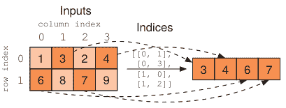

`tf.gather_nd` 支持使用多索引进行切片收集。例如，

```python
import tensorflow as tf
X = tf.random.uniform((4, 5, 6))
# Multi-indexing the first 2 dimensions,
# using last dimension as the slice/block dimension
index = tf.constant([
    [0, 3],
    [1, 2],
    [3, 0],
    [2, 2],
]) # (4, 2)

# Gather 4 slices from the 3D tensor
y = tf.gather_nd(X, index) # (4, 6)
```

使用多索引提取 X 中的 index.shape[1] 个前导维度，其余滞后维度保留为切片维度。如果 index.shape[1] == X.ndim，则通过从输入 X 中提取单个元素来创建 1D 向量。否则，将创建一个 (X.ndim - index.shape[1] + 1) 维张量。

`tf.gather_nd` 还可用于收集排列在多维批次中的切片。

```python
import tensorflow as tf
X = tf.random.uniform((2, 3, 5, 4))
index = tf.experimental.numpy.random.randint(
    0, 4, (2, 3, 4, 2)
)

batch_dims = 2
y = tf.gather_nd(X, index, batch_dims=batch_dims)
```

在此示例中，我们将 index 和 X 的前两个维度视为批次维度。然后，在批次中的每个位置，我们从每个 5 x 4 矩阵中取出 4 个 2D 点。请参见图 3.12 了解示意图。

TensorFlow 关于 tf.gather_nd 的文档 [Abadi et al., 2023b] 提供了更多示例。鼓励读者仔细研究这些示例，以进一步理解该操作。

`tf.gather_nd`（以及 NumPy 和 PyTorch 中类似的操作）在批次中按索引而非整个切片收集元素，对于从高维数据中提取异质感兴趣区域（ROI）非常有用，例如医学影像（如 fMRI 大脑结构）或视频数据（如移动物体），其中 2D 或 3D 图像序列随时间组织。


### Inputs

| | 0 | 1 | 2 | 3 |
|---|---|---|---|---|
| 0 | 1 | 2 | 3 | 4 |
| 1 | 5 | 6 | 7 | 8 |
| 2 | 9 | 10 | 11 | 12 |
| 3 | 13 | 14 | 15 | 16 |
| 4 | 17 | 18 | 19 | 20 |

### Indices

| Block | 0 | 1 | 2 | 3 |
|---|---|---|---|---|
| 1 | 8 | 15 | 20 | 2 |
| 2 | 10 | 8 | 19 | 2 |
| 3 | 5 | 1 | 6 | 2 |
| 4 | 2 | 10 | 13 | 6 |
| 5 | 8 | 15 | 19 | 6 |
| 6 | 7 | 13 | 12 | 2 |

**图 3.12** 带有非零批次维度参数的 tf.gather_nd 说明。在此示意图中，最初的两个批次维度被展开为 2 x 3 网格。

## 3.5 在索引处赋值

NumPy 的 `np.ndarray` 和 PyTorch 的 `torch.Tensor` 是可变的，这意味着对象的值可以被更新。此行为与 Python 的 `list` 类相似。相比之下，Tensorflow 的 `tf.Tensor` 是不可变的 [Abadi et al., 2023c]，这与 Python 的 tuple 或 set 类相似。这可能与 Tensorflow 的原始运行原理有关，即要求一系列操作在执行前必须可编译为计算图（即图模式），而不是即时原地执行（即即时模式，这是自 2.0 版本以来的较新发展）。NumPy 的 `np.ndarray` 和 PyTorch 的 `torch.Tensor` 都可以通过指定要更改的元素的索引和要替换的值来原地修改（即不创建新对象）。例如，

```python
import numpy as np
import tensorflow as tf
import torch

# Python list
X_py = [1, 2, 3, 4]
X_py[3] = 100 # [1, 2, 3, 100]

# NumPy
X_np = np.array([1, 2, 3, 4])
X_np[3] = 100 # array([1, 2, 3, 100])

# PyTorch
X_torch = torch.tensor([1, 2, 3, 4])
X_torch[3] = 100 # tensor([1, 2, 3, 100])

# Tensorflow
X_tf = tf.constant([1, 2, 3, 4])
X_tf[3] = 100 # throws an error
```

最后一行（尝试向 Tensorflow `tf.Tensor` 赋值）会抛出以下错误：

```
TypeError: 'tensorflow.python.framework.ops.EagerTensor' object does not support item assignment
```

为了说明在给定索引处赋值是原地操作，让我们看下面的示例：

```python
import numpy as np
X = np.array([1, 2, 3, 4])
# create a new variable that points to X
Y = X
# modify X
X[3] = 100
# print
print(X) # array([1, 2, 3, 100])
print(Y) # array([1, 2, 3, 100])
```

我们将观察到 X 和 Y 都被修改了，尽管我们只对 X 执行了赋值操作。

除了修改值之外，我们还可以使用 Python 的 `<operator>=` 语法执行原地值累积，如表 3.4 所示：

| 累积操作 | 原地运算符 | 等价表达式 |
|---|---|---|
| 加法 | += | x[index] += y ⟺ x[index] = x[index] + y |
| 减法 | -= | x[index] -= y ⟺ x[index] = x[index] - y |
| 乘法 | *= | x[index] *= y ⟺ x[index] = x[index] * y |
| 除法 | /= | x[index] /= y ⟺ x[index] = x[index] / y |
| 整除 | //= | x[index] //= y ⟺ x[index] = x[index] // y |
| 取模 | %= | x[index] %= y ⟺ x[index] = x[index] % y |
| 幂运算 | **= | x[index] **= y ⟺ x[index] = x[index] ** y |

快速示例：

```python
import numpy as np
X = np.array([1, 2, 3, 4])
X[3] += 5
print(X) # array([1, 2, 3, 9])
```

对于多维数组，我们可以使用多索引来引用元素并为索引处的值赋值。

```python
import numpy as np
X = np.arange(20).reshape(4, 5)
X[3, 2] -= 20 # 17 -> -3
print(X)
# array([[ 0, 1, 2, 3, 4],
#     [ 5,  6,  7,  8,  9],
#    [10, 11, 12, 13, 14],
#    [15, 16, -3, 18, 19]])
```

我们还可以用单个值替换切片的值。

```python
import numpy as np
X = np.arange(20).reshape(4, 5)
# replacing the last column with -99
X[:, -1] = -99
print(X)
# array([[ 0,  1,  2,  3, -99],
#        [ 5,  6,  7,  8, -99],
#        [10, 11, 12, 13, -99],
#        [15, 16, 17, 18, -99]])
```

更一般地，所赋值可以广播到切片的元素：

```python
import numpy as np
X = np.arange(20).reshape(4, 5)
# replacing the last two columns with -88, -99, respectively
X[:, -2:] = np.array([-88, -99])
# array([[ 0,  1,  2, -88, -99],
#        [ 5,  6,  7, -88, -99],
#        [10, 11, 12, -88, -99],
#        [15, 16, 17, -88, -99]])
```

最后，我们还可以选择在我们选择的多个索引处赋予不同的值。

```python
import numpy as np
X = np.arange(20).reshape(4, 5)
# Assign the diagonal entries with different values
rows = np.array([0, 1, 2, 3])
cols = np.array([0, 1, 2, 3])
values = np.array([-1, -2, -3, -4])
X[rows, cols] = values
# array([[ 1,  1,  2,  3,  4],
#        [ 5, -2,  7,  8,  9],
#        [10, 11, -3, 13, 14],
#        [15, 16, 17, -4, 19]])
```

## 3.6 放置与散布

放置与散布操作是 take 与 gather 操作的逆操作：这些操作不是从张量的特定索引中检索元素，而是可以将源张量中的值替换和聚合到目标张量中。放置与散布操作比我们在 3.5 节中讨论的原地值赋值更通用，因为它们可以更高效地以批处理方式操作。此外，放置与散布操作可以被视为一种执行分组和聚合操作的方法，我们将在第 9 章中更彻底地探讨这一点。表 3.5 提供了 NumPy、Tensorflow 和 PyTorch 之间等效的放置与散布操作列表。

### 3.6.1 放置

np.put 操作是 np.take 的逆操作。与 np.take 类似，np.put 使用扁平索引将值从源向量放置到目标张量。np.put 操作是原地操作，它直接修改输入而不返回副本。

```python
import numpy as np
X = np.zeros(10, dtype=int)
indices = np.array([2, 4, 6, 8])
values = np.array([1, 2, 3, 4])
# in-place operation modifies X directly
np.put(X, indices, values)
# array([0, 0, 1, 0, 2, 0, 3, 0, 4, 0])
```

与 np.take 类似，多维目标被视为展平（“C” 顺序）；索引是目标张量的扁平索引（另请参见图 3.13 以了解示例）。

```python
import numpy as np
X = np.zeros((3, 3), dtype=int)
indices = np.array([1, 2, 5, 8])
values = np.array([1, 2, 3, 4])
np.put(X, indices, values)
# array([[0, 1, 2],
#     [0, 0, 3],
#     [0, 0, 4]])
```

多维索引可能无法按预期使用，因为它们被视为扁平索引。目标的形状将被保留。

表 3.5 NumPy、Tensorflow 和 PyTorch 中的放置与散布操作列表。

| 操作 | NumPy | Tensorflow | PyTorch |
| :--- | :--- | :--- | :--- |
| 使用扁平索引放置 | np.put (原地) | N/A | torch.put (原地: torch.Tensor.put_) |
| 沿轴放置 | np.put_along_axis (原地) | N/A | N/A |
| 使用多索引放置到形状 | N/A | tf.scatter_nd | N/A |
| 带替换的散布 | N/A | tf.tensor_scatter_nd_update | torch.index_put (..., accumulate=False) |
| 带加法的散布 | np.add.at | tf.tensor_scatter_nd_add | torch.index_put (..., accumulate=True) |
| 带减法的散布 | np.subtract.at | tf.tensor_scatter_nd_sub | N/A |
| 带最大值的散布 | np.maximum.at | tf.tensor_scatter_nd_max | a)torch.index_reduce (..., reduce="amax"), torch.scatter_reduce (..., reduce="amax") |
| 带最小值的散布 | np.minimum.at | tf.tensor_scatter_nd_min | a)torch.index_reduce (..., reduce="amin"), torch.scatter_reduce (..., reduce="amin") |
| 带平均值的散布 | N/A | N/A | a)torch.index_reduce (..., reduce="mean"), torch.scatter_reduce (..., reduce="mean") |
| 带乘积的散布 | np.multiply.at | N/A | a)torch.index_reduce (..., reduce="prod"), torch.scatter_reduce (..., reduce="prod") |

注意：a) 这些 PyTorch 散布函数的逻辑与 NumPy 和 Tensorflow 的不完全相同。请参阅下文讨论。

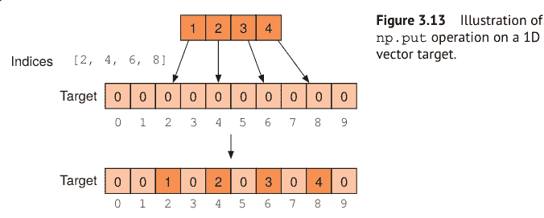

```python
import numpy as np
X = np.zeros((3, 3), dtype=int)
indices = np.array([[1, 2], [5, 8]])
values = np.array([1, 2, 3, 4])
np.put(X, indices, values)
# array([[0, 1, 2],
#     [0, 0, 3],
#     [0, 0, 4]])
```

PyTorch 的 `torch.put` 行为相同，但它会返回修改后的目标张量的副本。PyTorch 在 `torch.Tensor.put_` 下提供了 `put` 方法的原地版本。要原地修改张量，可以执行 `X.put_(indices, values)`。

### 3.6.2 沿轴放置

`np.put_along_axis` 是 `np.take_along_axis` 的逆操作。此函数特有于 NumPy。与 `np.take_along_axis` 类似，`axis` 参数指定哪个维度是非批次维度，其余维度为批次维度。变量“indices”沿轴对项目进行索引，其值不应超过 `indices.shape[axis]`。`indices` 的维数必须与目标相同，即 `indices.ndim == X.ndim`。`values` 还需要可广播到 `indices`。如图 3.14 所示，例如，

```python
import numpy as np
X = np.zeros((3, 4), dtype=int)
indices = np.array([
    [0, 2],
    [1, 3],
    [2, 1]
])
```


# (3, 1) 可广播到 (3, 2)
# 这将沿行复用值
values = np.array([[
    [1],
    [2],
    [3],
]])

np.put_along_axis(X, indices, values, axis=1)
# array([[1, 0, 1, 0],
#     [0, 2, 0, 2],
#     [0, 3, 3, 0]])

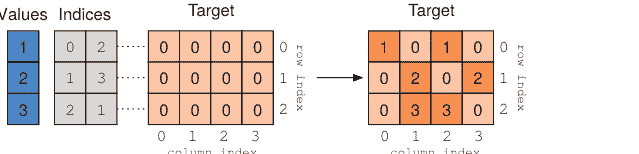

图 3.14 np.put_along_axis 的图示示例。

### 3.6.3 多索引散射替换

由于 Tensorflow 的 tf.Tensor 是不可变对象，我们需要依赖具体函数来在索引处赋值并返回修改后张量的副本。Tensorflow 没有实现使用扁平索引赋值的操作；也就是说，并没有真正的函数是 tf.gather 的逆运算。但 Tensorflow 确实实现了 N 维散射操作 tf.scatter_nd，它是 tf.gather_nd 的相反操作，但存在某些局限性（例如，不支持对批次进行散射）。在下面的后续案例研究中，我们将尝试实现一个沿轴使用扁平索引的批量散射操作的版本。tf.scatter_nd 是 Tensorflow 独有的，因为它假设要修改的目标张量始终填充 0。因此，它不要求指定要在其上替换值的特定张量，而是要求目标张量的形状。例如，

```python
import tensorflow as tf
# [row, col]
indices = tf.constant([
    [0, 2],
    [1, 3],
    [2, 0],
    [3, 1],
    [4, 2],
])
values = tf.constant([1, 3, 5, 7, 9])
shape = (5, 4)
X_tf = tf.scatter_nd(indices, values, shape)
# <tf.Tensor: shape=(5, 4), dtype=int32, numpy=
# array([[0, 0, 0, 0],
# [0, 0, 0, 3],
# [5, 0, 0, 0],
# [0, 7, 0, 0],
# [0, 0, 9, 0]], dtype=int32)>
```

另请参见图 3.15 以获取说明。

或者，我们也可以使用 Tensorflow 中的张量更新操作 tf.tensor_scatter_nd_update，或者 PyTorch 中的 torch.index_put（及其原地版本 torch.Tensor.index_put_）。对于 NumPy（以及 PyTorch），相同效果可通过简单的索引赋值实现，

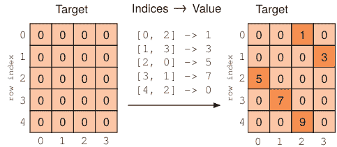

图 3.15 使用多索引对 2D 矩阵散射值的示意图。

```python
import numpy as np
import tensorflow as tf
import torch
# [row, col]
indices = tf.constant([
    [0, 2],
    [1, 3],
    [2, 0],
    [3, 1],
    [4, 2],
])
values = tf.constant([1, 3, 5, 7, 9])
shape = (5, 4)
X_tf = tf.zeros(shape, dtype=values.dtype)
X_tf = tf.tensor_scatter_nd_update(
    X_tf, indices, values
)
# equivalently in NumPy
X_np = np.zeros(shape, dtype=int)
X_np[tuple(indices.numpy().T)] = values
assert np.allclose(X_tf, X_np)
# 2 equivalent operations in PyTorch
# Converting to PyTorch dtypes
indices = indices.to(indices.numpy())
values = torch.tensor(values.numpy(), dtype=int)
# Method 1: Using indexed assignment like NumPy
X_torch = torch.zeros(shape, dtype=int)
X_torch[tuple(indices.T)] = values
assert np.allclose(X_tf, X_torch)
# Method 2: Using torch.index_put
X_torch = torch.zeros(shape, dtype=int)
X_torch = torch.index_put(X_torch, tuple(indices.T), values)
# Method 2 In-place: Using torch.Tensor.index_put_
X_torch = torch.zeros(shape, dtype=int)
# Also returns the modified tensor itself
X_torch.index_put_(tuple(indices.T), values)
```

torch.index_put 有两种模式，分别通过设置参数 accumulate=False（默认）或 accumulate=True。如上例所示，PyTorch 的 torch.index_put(..., accumulate=False) 等同于 Tensorflow 的 tf.tensor_scatter_nd_update。就像 tf.tensor_scatter_nd_update 一样，目标张量在 GPU 上的最终替换值不具有确定性。另一方面，在 PyTorch 中使用 torch.index_put(..., accumulate=True) 与在 Tensorflow 中使用 tf.tensor_scatter_nd_add，或在 NumPy 中使用 np.add.at 相同。tf.scatter_nd(indices, values, shape) 的行为也与 tf.tensor_scatter_nd_add(tf.zeros(shape), indices, values) 相同。在这些等效操作中，重复的索引将被相加在一起。假设最后一个索引被重复并赋予不同的值：

```python
import numpy as np
import tensorflow as tf
import torch
indices = torch.tensor([
    [0, 2],
    [1, 3],
    [2, 0],
    [3, 1],
    [4, 2],
    [4, 2],
])
values = torch.tensor([1, 3, 5, 7, 9, 11])
shape = (5, 4)

# NumPy:
X_np = np.zeros(shape, dtype=int)
X_np[tuple(indices.T)] = values

# Tensorflow:
X_tf = tf.zeros(shape, dtype=tf.int32)
X_tf = tf.tensor_scatter_nd_update(X_tf, indices, values)

# PyTorch:
X_torch = torch.zeros(shape, dtype=int)
X_torch = torch.index_put(
    X_torch, tuple(indices.T), values, accumulate=False
)

assert np.allclose(X_np, X_tf)
assert np.allclose(X_tf, X_torch)

# On CPU, the last value of the duplicated index is used
# array([[ 0, 0, 1, 0],
#  [ 0, 0, 0, 3],
#  [ 5, 0, 0, 0],
#  [ 0, 7, 0, 0],
#  [ 0, 0, 11, 0]])

# Accumulate via summation
# NumPy:
X_np = np.zeros(shape, dtype=int)
np.add.at(X_np, tuple(indices.T), values) # in-place

# Alternatively,
# X_np[tuple(np.array(indices).T)] += np.array(values)

# Tensorflow:
X_tf = tf.zeros(shape, dtype=tf.int32)
X_tf = tf.tensor_scatter_nd_add(X_tf, indices, values)
X_tf_alt = tf.scatter_nd(indices, values, shape)

# PyTorch:
X_torch = torch.zeros(shape, dtype=int)
X_torch = torch.index_put(
    X_torch, tuple(indices.T), values, accumulate=True
)

assert np.allclose(X_np, X_tf)
assert np.allclose(X_tf, X_tf_alt)
assert np.allclose(X_tf, X_torch)

# array([[ 0, 0, 1, 0],
# [ 0, 0, 0, 3],
# [ 5, 0, 0, 0],
# [ 0, 7, 0, 0],
# [ 0, 0, 20, 0]])
```

NumPy、Tensorflow 和 PyTorch 还实现了除简单求和之外的其他散射累积函数，如表 3.5 所示。

```python
import tensorflow as tf
indices = tf.constant([0, 2, 4])
values = tf.constant([1, 3, 5])
shape = (5, )
X = tf.scatter_nd(indices, values, shape)
```

但是，这会抛出以下错误：

```
InvalidArgumentError: {{function_node
__wrapped__ScatterNd_device_/job:localhost/replica:0/task:0
/device:CPU:0}} dimensions [3,1] of input [shape=[5]] must
match dimensions [0,1] of updates[shape=[3]]
__ [Op:ScatterNd]
```

相反，根据 `tf.scatter_nd` [Abadi et al., 2023d] 的文档，我们需要将 `indices` 指定为形状为 `(n, 1)` 的列向量，即：

```python
import tensorflow as tf
indices = tf.constant([0, 2, 4])[:, None]
values = tf.constant([1, 3, 5])
shape = (5, )
X = tf.scatter_nd(indices, values, shape)
# <tf.Tensor: shape=(5,), dtype=int32, numpy=array([1, 0, 3, 0, 5], dtype=int32)>
```

我发现将目标张量也视为列向量，并将我们指定的索引理解为每行（即第一维）的索引，这有助于理解，如图 3.16 所示。通常，维度内的索引排列在一列中，多个维度的索引水平堆叠在一起，从而形成

- [dim_0_index_0, dim_1_index_0, ..., dim_d_index_0,
- dim_0_index_1, dim_1_index_1, ..., dim_d_index_1,
- ...
- dim_0_index_n, dim_1_index_n, ..., dim_d_index_n]

PyTorch 仍然要求 indices 参数是一个元组，其元素数量与维度数量相同，每个元素都是沿维度的一维索引数组：

```python
import torch
indices = torch.tensor([0, 2, 4])
values = torch.tensor([1, 3, 5])
shape = (5, )
X_torch = torch.zeros(shape, dtype=int)
X_torch = torch.index_put(X_torch, (indices, ), values)
# tensor([1, 0, 3, 0, 5])
```

NumPy、Tensorflow 和 PyTorch 的散射操作还允许我们散射多维切片。另请参见图 3.17 以获取说明。

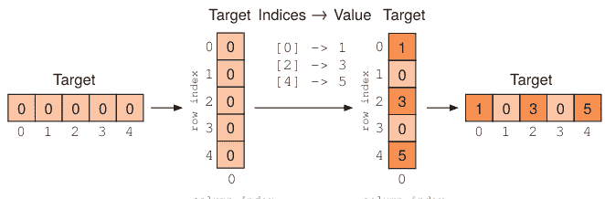

图 3.16 对 1D 目标张量的 tf.scatter_nd 示意图。


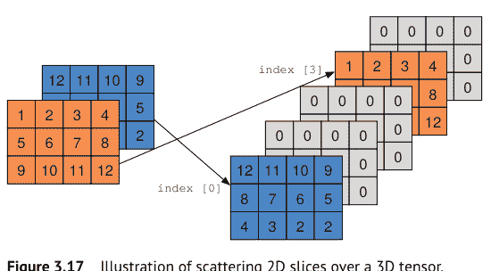

```python
import tensorflow as tf
values = tf.random.uniform((2, 3, 4))
indices = tf.constant([3, 0])[:, None]
X = tf.scatter_nd(indices, values, shape=(5, 3, 4))
```

一般而言，我们可以将最终目标张量的形状分为两部分：前置批次维度和后置切片维度（Tensorflow 的文档也分别将这些称为外部维度和内部维度 [Abadi et al., 2023d]）。在上述示例中，目标张量的形状为 (5, 3, 4)，批次维度为 (5,)，切片维度为 (3, 4)。我们可以观察到：(i) values（用于更新目标张量）的第一个维度（批次维度）的大小与 indices 第一个维度的大小相同；(ii) values 的最后两个维度的大小与目标张量 X 的最后两个维度的大小相同；(iii) indices 最后一个维度的大小指示了切片应具有多少个维度。通过归纳推理，我们可以尝试一个更一般的示例，即我们希望将切片列表重新排列为目标张量中的多维批次，如图 3.18 所示。散射切片的概念也适用于 NumPy 的 np.ufunc.at 和 PyTorch 的 torch.index_put，行为完全相同。

```python
import tensorflow as tf
values = tf.random.uniform((2, 3, 4))
indices = tf.constant([[1, 0], [0, 1]]) # (2, 2)
X = tf.scatter_nd(indices, values, shape=(2, 2, 3, 4))
```

Tensorflow 的 tf.scatter_nd 进一步概括了批次的概念，其中 values 和 indices 的批次维度也可以排列为多个维度，而不仅仅是保持为扁平的切片或索引列表。

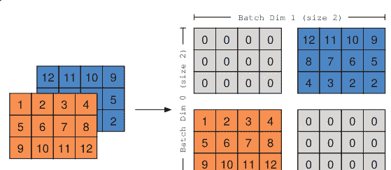

图 3.18 将切片散射到目标张量多个批次维度的示意图。在此示意图中，前两个批次维度被展开为 2 x 2 网格。第一个切片被放置在 2 x 2 网格的位置 (1, 0)（第二行，第一列）；第二个切片被放置在 2 x 2 网格的位置 (0, 1)（第一行，第二列）。

我们只需确保 values 和 indices 的前置批次维度完全匹配。尽管如此，tf.scatter_nd 操作仍将多维排列的切片批次视为扁平切片列表。这种概括仅在输入数据批次已排列为多个维度时为了方便起见而存在。

```python
import tensorflow as tf
values = tf.random.uniform((4, 3, 4))
indices = tf.constant([
    [1, 0],
    [0, 1],
    [0, 0],
    [2, 2],
]) # (4, 2)
shape = (3, 3, 3, 4)
X = tf.scatter_nd(indices, values, shape=shape)
# fold indices and values into a 2 x 2 grid -> (2, 2, 2)
folded_indices = tf.reshape(indices, (2, 2, 2))
folded_values = tf.reshape(values, (2, 2, 3, 4))
X_folded = tf.scatter_nd(indices, values, shape=shape)
# same output results
assert np.allclose(X, X_folded)
```

### 3.6.4 PyTorch 中的其他散射操作

PyTorch 实现了两种用于累加的额外方法，即 torch.scatter_reduce [Paszke et al., 2023c] 和 torch.index_reduce [Paszke et al., 2023b]。撰写本文时，这两种方法均仍处于测试阶段。torch.scatter_reduce 是 torch.scatter 的概括，而 torch.index_reduce 则补充了 torch.index_add，以允许实现包括 prod、mean、max 或 min 在内的其他散射归约方法。该操作的使用模式和逻辑与 tf.tensor_scatter_nd_reduce 或 np.ufunc.at 用于累加的逻辑不完全相同。在本节中，我将尝试解释这两种操作之间的差异。

通过比较文档中 torch.Tensor.scatter_reduce [Paszke et al., 2023c]（即 torch.scatter_reduce 的原位版本）和 torch.gather [Paszke et al., 2023a] 的等效 Python for-loop 等效代码，我们可以推断这两种操作遵循相同的公式。一般而言，indices、values 和目标 X 应具有相同的维度数，即 indices.ndim == values.ndim == X.ndim。还要求 indices 的大小不大于输入 X 或相应轴维度上的散射值的大小，即 indices.shape[dim] <= X.shape[dim] 且 indices.shape[dim] <= values.shape[dim]。这意味着，我们可以指定比输入或散射值大小更短的索引；在散射操作期间，多余的元素将被忽略。让我们构建以下示例，了解如何使用 torch.scatter_reduce，并看看它与 torch.gather 有多么相似（另请参见图 3.19 中的插图）：

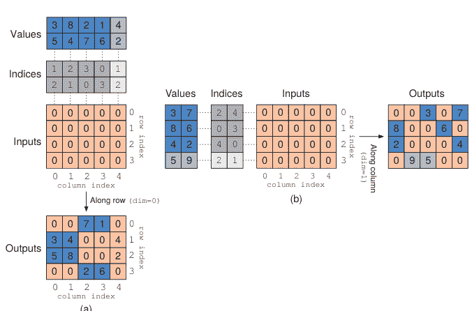

图 3.19 torch.scatter_reduce 在 2D 矩阵上的示例说明。(a) 沿 dim=0 散射；(b) 沿 dim=1 散射。

### 示例 3.1 沿 dim=0 散射。

```python
import torch
values = torch.tensor([
    [3, 8, 2, 1, 4],
    [5, 4, 7, 6, 2],
    # [1, 3, 2, 4, 6], this extra row will be ignored
], dtype=int)
indices = torch.tensor([
    [1, 2, 3, 0, 1],
    [2, 1, 0, 3, 2],
])
# Scatter along dim=0
X = torch.zeros((4, 5), dtype=int)
Y = torch.scatter_reduce(
    input=X, dim=0, index=indices, src=values, reduce="sum"
)
# tensor([[0, 0, 7, 1, 0],
#         [3, 4, 0, 0, 4],
#         [5, 8, 0, 0, 2],
#         [0, 0, 2, 6, 0]])
# Not exactly matching the full columns:
# indices will be left aligned
Y = torch.scatter_reduce(
    input=X,
    dim=0,
    index=indices[:, :-1],
    src=values[:, :-1],
    reduce="sum",
)
# tensor([[0, 0, 7, 1, 0],
#         [3, 4, 0, 0, 0],
#         [5, 8, 0, 0, 0],
#         [0, 0, 2, 6, 0]])
```

### 示例 3.2 沿 dim=1 散射。

```python
import torch
values = torch.tensor([
    [3, 7],
    [8, 6],
    [4, 2],
    [5, 9],
], dtype=int)
indices = torch.tensor([
    [2, 4],
    [0, 3],
    [4, 0],
    [2, 1],
])
# Scatter along dim=1
X = torch.zeros((4, 5), dtype=int)
y = torch.scatter_reduce(
    input=X, dim=1, index=indices, src=values, reduce="sum"
)
# tensor([[0, 0, 3, 0, 7],
# [8, 0, 0, 6, 0],
# [2, 0, 0, 0, 4],
# [0, 9, 5, 0, 0]])
# Not exactly matching the full columns:
# indices will be left aligned
y = torch.scatter_reduce(
    input=X,
    dim=1,
    index=indices[:, :-1],
    src=values[:, :-1],
    reduce="sum",
)
# tensor([[0, 0, 3, 0, 7],
# [8, 0, 0, 6, 0],
# [2, 0, 0, 0, 4],
# [0, 0, 0, 0, 0]])
```

另一方面，torch.index_reduce 类似于我们在 tf.scatter_nd 中见过的切片散射操作。它也可以被视为 torch.take_along_dim 的相反操作，因为它仅沿某个维度散射切片，使用该维度内的 1D 向量索引。我们也可以将其与 NumPy 的 np.put_along_axis 进行比较，尽管它具有额外的累积方法，但由于索引必须是 1D 向量，因此缺乏广播能力。torch.index_reduce 也要求 values 和目标 X 具有相同的维度数。我们可以构建以下示例，该示例使用 torch.index_add（用于求和累积）实现将两个 2D 矩阵散射到 3D 张量中的相同效果，如先前图 3.17 所示：

### (a)

| | 0 | 1 | 2 | 3 | 4 |
|---|---|---|---|---|---|
| 0 | 2 | 5 | 6 | 2 | 8 |
| 1 | 6 | 1 | 7 | 0 | 4 |
| 2 | 9 | 5 | 4 | 5 | 1 |
| 3 | 0 | 6 | 8 | 3 | 7 |

| | 0 | 1 | 2 | 3 | 4 |
|---|---|---|---|---|---|
| 0 | 1 | 3 | 6 | 2 | 4 |
| 1 | 2 | 4 | 8 | 9 | 5 |
| 2 | 6 | 5 | 0 | 1 | 3 |
| 3 | 3 | 7 | 2 | 5 | 1 |

| | 0 | 1 | 2 | 3 | 4 | 5 | 6 | 7 | 8 | 9 |
|---|---|---|---|---|---|---|---|---|---|---|
| 0 | (0) | (1) | (2) | (3) | (4) | (5) | (6) | (7) | (8) | (9) |
| 1 | (10) | (11) | (12) | (13) | (14) | (15) | (16) | (17) | (18) | (19) |
| 2 | (20) | (21) | (22) | (23) | (24) | (25) | (26) | (27) | (28) | (29) |
| 3 | (30) | (31) | (32) | (33) | (34) | (35) | (36) | (37) | (38) | (39) |

### (b)

| | 0 | 1 | 2 | 3 | 4 |
|---|---|---|---|---|---|
| 0 | 2 | 5 | 6 | 2 | 8 |
| 1 | 6 | 1 | 7 | 0 | 4 |
| 2 | 9 | 5 | 4 | 5 | 1 |
| 3 | 0 | 6 | 8 | 3 | 7 |

| | 0 | 1 | 2 | 3 | 4 |
|---|---|---|---|---|---|
| 0 | 1 | 3 | 6 | 2 | 4 |
| 1 | 2 | 4 | 8 | 9 | 5 |
| 2 | 6 | 5 | 0 | 1 | 3 |
| 3 | 3 | 7 | 2 | 5 | 1 |

| | 0 | 1 | 2 | 3 | 4 | 5 | 6 | 7 | 8 | 9 |
|---|---|---|---|---|---|---|---|---|---|---|
| 0 | (0) | 2 | (2) | (3) | (4) | (5) | (6) | (7) | (8) | (9) |
| 1 | (10) | (11) | (12) | (13) | (14) | (15) | (16) | (17) | (18) | (19) |
| 2 | (20) | (21) | (22) | (23) | (24) | (25) | (26) | (27) | (28) | (29) |
| 3 | (30) | (31) | (32) | (33) | (34) | (35) | (36) | (37) | (38) | (39) |

### (c)

| | 0 | 1 | 2 | 3 | 4 |
|---|---|---|---|---|---|
| 0 | 2 | 5 | 6 | 2 | 8 |
| 1 | 6 | 1 | 7 | 0 | 4 |
| 2 | 9 | 5 | 4 | 5 | 1 |
| 3 | 0 | 6 | 8 | 3 | 7 |

| | 0 | 1 | 2 | 3 | 4 |
|---|---|---|---|---|---|
| 0 | 1 | 3 | 6 | 2 | 4 |
| 1 | 2 | 4 | 8 | 9 | 5 |
| 2 | 6 | 5 | 0 | 1 | 3 |
| 3 | 3 | 7 | 2 | 5 | 1 |

| | 0 | 1 | 2 | 3 | 4 | 5 | 6 | 7 | 8 | 9 |
|---|---|---|---|---|---|---|---|---|---|---|
| 0 | (0) | 2 | (2) | 5 | (4) | (5) | (6) | (7) | (8) | (9) |
| 1 | (10) | (11) | (12) | (13) | (14) | (15) | (16) | (17) | (18) | (19) |
| 2 | (20) | (21) | (22) | (23) | (24) | (25) | (26) | (27) | (28) | (29) |
| 3 | (30) | (31) | (32) | (33) | (34) | (35) | (36) | (37) | (38) | (39) |

### (d)

| | 0 | 1 | 2 | 3 | 4 |
|---|---|---|---|---|---|
| 0 | 2 | 5 | 6 | 2 | 8 |
| 1 | 6 | 1 | 7 | 0 | 4 |
| 2 | 9 | 5 | 4 | 5 | 1 |
| 3 | 0 | 6 | 8 | 3 | 7 |

| | 0 | 1 | 2 | 3 | 4 |
|---|---|---|---|---|---|
| 0 | 1 | 3 | 6 | 2 | 4 |
| 1 | 2 | 4 | 8 | 9 | 5 |
| 2 | 6 | 5 | 0 | 1 | 3 |
| 3 | 3 | 7 | 2 | 5 | 1 |

| | 0 | 1 | 2 | 3 | 4 | 5 | 6 | 7 | 8 | 9 |
|---|---|---|---|---|---|---|---|---|---|---|
| 0 | (0) | 2 | 2 | 5 | 8 | (5) | 6 | (7) | (8) | (9) |
| 1 | (10) | (11) | 6 | (13) | 1 | 4 | (16) | (17) | (18) | (19) |
| 2 | (20) | (21) | (22) | (23) | (24) | (25) | (26) | (27) | (28) | (29) |
| 3 | (30) | (31) | (32) | (33) | (34) | (35) | (36) | (37) | (38) | (39) |

### (e)

| | 0 | 1 | 2 | 3 | 4 |
|---|---|---|---|---|---|
| 0 | 2 | 5 | 6 | 2 | 8 |
| 1 | 6 | 1 | 7 | 0 | 4 |
| 2 | 9 | 5 | 4 | 5 | 1 |
| 3 | 0 | 6 | 8 | 3 | 7 |

| | 0 | 1 | 2 | 3 | 4 |
|---|---|---|---|---|---|
| 0 | 1 | 3 | 6 | 2 | 4 |
| 1 | 2 | 4 | 8 | 9 | 5 |
| 2 | 6 | 5 | 0 | 1 | 3 |
| 3 | 3 | 7 | 2 | 5 | 1 |

| | 0 | 1 | 2 | 3 | 4 | 5 | 6 | 7 | 8 | 9 |
|---|---|---|---|---|---|---|---|---|---|---|
| 0 | (0) | 2 | 2 | 5 | 8 | (5) | 6 | (7) | (8) | (9) |
| 1 | (10) | (11) | 6 | (13) | 1 | 4 | (16) | (17) | 7 | 0 |
| 2 | 4 | 5 | (22) | 1 | (24) | 5 | 9 | (27) | (28) | (29) |
| 3 | (30) | 7 | 8 | 0 | (34) | 3 | (36) | 6 | (38) | (39) |


```
import torch
values = torch.rand((2, 3, 4), dtype=float)
indices = torch.tensor([[3, 0]])
X = torch.zeros((5, 3, 4), dtype=float)
X = torch.index_add(X, 0, indices, values)
```

## 3.7 案例研究：批量散布数值

正如我们在 3.6 节中所见，PyTorch 实现了散布操作 `torch.scatter` 的一个版本，它是其聚合操作 `torch.gather` 的逆操作。Tensorflow 未实现 `tf.scatter`，该操作允许通过扁平索引进行散布的批量应用。然而，正如我们将在第 9 章的一个案例研究中看到，批量散布常常用于实现分组聚合逻辑。

假设我们有以下数据（另见图 3.20a），

```
import tensorflow as tf
index = tf.constant([
    [1, 3, 6, 2, 4],
    [2, 4, 8, 9, 5],
    [6, 5, 0, 1, 3],
    [3, 7, 2, 5, 4],
], dtype=tf.int64)
inputs = tf.constant([
    [2, 5, 6, 2, 8],
    [6, 1, 7, 0, 4],
    [9, 5, 4, 5, 1],
    [0, 6, 8, 3, 7],
])
```

图 3.20 使用扁平索引逐步说明批量散布过程。我们假设行是批量维度。矩阵的第一列是数值，而第二列矩阵存储对应位置的扁平索引。第三列矩阵是目标，其中括号内的数字是扁平索引。假设仅带括号索引的 tile 被填充为 0 值。(a)。初始设置；(b)。来自第一个数值的结果（row=0, col=0）；(c)。来自第二个数值的结果（row=0, col=3）；(d)。来自第二行第一个数值的结果（row=1, col=2）；(e)。所有步骤完成后的完整结果。

我们希望根据 `index` 指定的索引批量，将输入散布到新的目标矩阵中。在 PyTorch 中，这可以轻松完成，使用

```
import torch
output = torch.scatter(
    torch.zeros((4, 10), dtype=int),
    1,
    torch.tensor(index.numpy(), dtype=int),
    torch.tensor(inputs.numpy(), dtype=int),
)
# tensor([[0, 2, 2, 5, 8, 0, 6, 0, 0, 0],
#         [0, 0, 6, 0, 1, 4, 0, 0, 7, 0],
#         [4, 5, 0, 1, 0, 5, 9, 0, 0, 0],
#         [0, 0, 8, 0, 7, 3, 0, 6, 0, 0]])

```

然而，我们可以使用 Tensorflow 的 `tf.scatter_nd` 方法来实现相同的效果。更具体地说，请逐步考虑，

- 对于 `index[0, 0] = 1`，我们在相应索引处有一个值 `input[0, 0] = 2`。我们希望将此值放入新张量的位置，使得 `X[0, 1] = 2`（图 3.20b）。鉴于目标张量形状为 `(4, 10)`，多索引 `[0, 1]` 可以转换为扁平索引 1。因此，这等同于为扁平向量赋值 `X_flat[1] = 2`，然后将扁平向量重塑回 2D 矩阵。

- 对于后续图示，图 3.20c–e，我们只是遍历 `index` 的元素，从 `input` 中提取相应的值，并将其散布到 `X` 的相应位置。

请注意，最终输出矩阵包含许多零元素。包含许多零元素的矩阵称为稀疏矩阵，我们将在第 7 章中更详细地介绍。

基于上述逻辑，我们可以实现专门处理 2D 矩阵情况的以下代码。感兴趣的读者可以进一步将此实现推广到更高维张量，或者也许寻找其他方法来实现相同目标。

```
import tensorflow as tf

def scatter_batch_2d(index, inputs):
    # Determines the length of each row for the output
    row_length = tf.cast(tf.reduce_max(index), tf.int32) + 1
    row_length = tf.maximum(tf.shape(inputs)[1], row_length)
    # start and end index of each row
    # row 0: inc[0]:inc[1], row 1: inc[1]:inc[2], ...
    inc = row_length * tf.range(tf.shape(inputs)[0]+1)
    # Compute flat indices for each element
    indices = tf.cast(index, index.dtype) + tf.reshape(inc[:-1], (-1, 1))
    # Flatten to column vector
    indices = tf.reshape(indices, (-1, 1))
    # Flatten updates
    updates = tf.reshape(inputs, (-1,))
    shape = (inc[-1], )
    out = tf.scatter_nd(indices, updates, shape)
    # reshape: (batch_size, row_length)
    out = tf.reshape(out, (tf.shape(index)[0], -1))
    return out
```

- 第 5 行和第 6 行计算输出中每行的长度。这由 `index` 中的最大索引值和 `inputs` 的列数中的较大者决定。本质上，我们希望返回一个具有足够容纳所有索引的列数的输出；我们还希望返回的列数不少于输入的列数。请注意，这是为第 9 章的一个案例研究做准备。或者，我们可以指定参数 `output_shape` 以让用户控制输出的大小。

- 第 9 行计算每行的起始和结束索引作为 1D 向量。在上述示例中，我们将有 `inc = [0, 10, 20, 30, 40]`，其中 `0:10` 是第一行的切片，`10:20` 是第二行的切片，依此类推。

- 第 11 行按行索引的起始位置对特定行的扁平索引进行偏移。例如，如果索引 4 出现在原始索引矩阵的第二行，那么相应的扁平索引将是 `4 + inc[1] = 4 + 10 = 14`。

- 第 13 行将带偏移的索引作为列向量展平。

- 第 15 行到第 17 行根据索引，将值的 1D 数组散布到目标 1D 数组中。

- 第 19 行将 1D 张量重塑回所需的 2D 矩阵，形状为 `(batch_size, row_length)`。

# 参考文献

Martín Abadi, Ashish Agarwal, Paul Barham, Eugene Brevdo, Zhifeng Chen, Craig Citro, Greg S. Corrado, Andy Davis, Jeffrey Dean, Matthieu Devin, Sanjay Ghemawat, Ian Goodfellow, Andrew Harp, Geoffrey Irving, Michael Isard, Yangqing Jia, Rafal Jozefowicz, Lukasz Kaiser, Manjunath Kudlur, Josh Levenberg, Dan Mane, Rajat Monga, Sherry Moore, Derek Murray, Chris Olah, Mike Schuster, Jonathon Shlens, Benoit Steiner, Ilya Sutskever, Kunal Talwar, Paul Tucker, Vincent Vanhoucke, Vijay Vasudevan, Fernanda Viegas, Oriol Vinyals, Pete Warden, Martin Wattenberg, Martin Wicke, Yuan Yu, and Xiaoqiang Zheng. Tf.gather. https://www.tensorflow.org/api_docs/python/tf/gather, 2023a.

Martin Abadi, Ashish Agarwal, Paul Barham, Eugene Brevdo, Zhifeng Chen, Craig Citro, Greg S. Corrado, Andy Davis, Jeffrey Dean, Matthieu Devin, Sanjay Ghemawat, Ian Goodfellow, Andrew Harp, Geoffrey Irving, Michael Isard, Yangqing Jia, Rafal Jozefowicz, Lukasz Kaiser, Manjunath Kudlur, Josh Levenberg, Dan Mane, Rajat Monga, Sherry Moore, Derek Murray, Chris Olah, Mike Schuster, Jonathon Shlens, Benoit Steiner, Ilya Sutskever, Kunal Talwar, Paul Tucker, Vincent Vanhoucke, Vijay Vasudevan, Fernanda Viegas, Oriol Vinyals, Pete Warden, Martin Wattenberg, Martin Wicke, Yuan Yu, and Xiaoqiang Zheng. Tf.gathernd. https://www.tensorflow.org/api_docs/python/tf/gather_nd, 2023b.

Martin Abadi, Ashish Agarwal, Paul Barham, Eugene Brevdo, Zhifeng Chen, Craig Citro, Greg S. Corrado, Andy Davis, Jeffrey Dean, Matthieu Devin, Sanjay Ghemawat, Ian Goodfellow, Andrew Harp, Geoffrey Irving, Michael Isard, Yangqing Jia, Rafal Jozefowicz, Lukasz Kaiser, Manjunath Kudlur, Josh Levenberg, Dan Mane, Rajat Monga, Sherry Moore, Derek Murray, Chris Olah, Mike Schuster, Jonathon Shlens, Benoit Steiner, Ilya Sutskever, Kunal Talwar, Paul Tucker, Vincent Vanhoucke, Vijay Vasudevan, Fernanda Viegas, Oriol Vinyals, Pete Warden, Martin Wattenberg, Martin Wicke, Yuan Yu, and Xiaoqiang Zheng. 张量简介. https://www.tensorflow.org/guide/tensor, 2023c.

Martin Abadi, Ashish Agarwal, Paul Barham, Eugene Brevdo, Zhifeng Chen, Craig Citro, Greg S. Corrado, Andy Davis, Jeffrey Dean, Matthieu Devin, Sanjay Ghemawat, Ian Goodfellow, Andrew Harp, Geoffrey Irving, Michael Isard, Yangqing Jia, Rafal Jozefowicz, Lukasz Kaiser, Manjunath Kudlur, Josh Levenberg, Dan Mane, Rajat Monga, Sherry Moore, Derek Murray, Chris Olah, Mike Schuster, Jonathon Shlens, Benoit Steiner, Ilya Sutskever, Kunal Talwar, Paul Tucker, Vincent Vanhoucke, Vijay Vasudevan, Fernanda Viegas, Oriol Vinyals, Pete Warden, Martin Wattenberg, Martin Wicke, Yuan Yu, and Xiaoqiang Zheng. Tf.scatternd. https://www.tensorflow.org/api_docs/python/tf/scatter_nd, 2023d.

Adam Paszke, Sam Gross, Francisco Massa, Adam Lerer, James Bradbury, Gregory Chanan, Trevor Killeen, Zeming Lin, Natalia Gimelshein, Luca Antiga, Alban Desmaison, Andreas Köpf, Edward Yang, Zach DeVito, Martin Raison, Alykhan Tejani, Sasank Chilamkurthy, Benoit Steiner, Lu Fang, Junjie Bai, and Soumith


Chintala. torch.Tensor.index_reduce. https://pytorch.org/docs/stable/generated/torch.Tensor.index_reduce.html#torch-tensor-index-reduce, 2023b.

Adam Paszke, Sam Gross, Francisco Massa, Adam Lerer, James Bradbury, Gregory Chanan, Trevor Killeen, Zeming Lin, Natalia Gimelshein, Luca Antiga, Alban Desmaison, Andreas Köpf, Edward Yang, Zach DeVito, Martin Raison, Alykhan Tejani, Sasank Chilamkurthy, Benoit Steiner, Lu Fang, Junjie Bai, and Soumith Chintala. torch.Tensor.scatter_reduce. https://pytorch.org/docs/stable/generated/torch.Tensor.scatter_reduce.html#torch.Tensor.scatter_reduce, 2023c.

# 4 线性代数

在第 2 章中，我们介绍了张量或一对张量上的逐元素操作。具体来说，当对两个张量进行逐元素相乘时，我们执行的是称为 Hadamard 积（Hadamard Product）的数学运算，其数学表达式为 \( X \cdot Y \)。在本章中，我们将首先探讨与矩阵和张量乘法相关的操作，这些操作在数学上表示为 \( X \cdot Y \) 或简单地写作 \( XY \)。然后我们将探讨几种其他常见的线性代数例程，例如求矩阵逆和特征值分解。在向量、矩阵和高维张量之间进行乘法运算、求矩阵逆以及计算特征值分解，都是实现机器学习模型时的常见任务，这些任务通常使用数学术语来描述。

## 4.1 张量乘法

让我们先从张量乘法操作的概述开始讨论。表 4.1 总结了 NumPy、Tensorflow 和 PyTorch 库中实现的常用张量乘法操作。
然后我们将把接下来的两个部分专门用于讨论 `matmul`（第 4.2 节）和 `tensordot`（第 4.3 节）操作。

## 4.2 matmul 操作

`np.matmul` 操作执行应用于多维批次的通用矩阵乘法。

- 当输入张量为形状为 \( (n, k) \) 和 \( (k, m) \) 的 2D 矩阵时，则为常规矩阵乘法，结果为形状为 \( (n, m) \) 的矩阵。

表 4.1 NumPy、Tensorflow 和 PyTorch 中张量乘法操作示例。

| 操作 | NumPy | Tensorflow | PyTorch |
|---|---|---|---|
| 点积<sup>a)</sup> | np.dot | tf.experimental.numpy.dot | torch.dot |
| 复共轭点积<sup>b)</sup> | np.vdot | tf.experimental.numpy.vdot | torch.vdot |
| 内积<sup>c)</sup> | np.inner | tf.experimental.numpy.inner | torch.inner |
| 外积（叉积）<sup>d)</sup> | np.outer | tf.experimental.numpy.outer | torch.outer |
| 矩阵乘法 | np.matmul | tf.matmul | torch.matmul |
| 张量点积 | np.tensordot | tf.tensordot | torch.tensordot |

注释：

a) NumPy 的 `np.dot` 可支持 1D 向量之间、2D 矩阵之间（等同于 `np.matmul`）或 N-D 张量之间的点积。相比之下，`torch.dot` 仅支持 1D 向量。Tensorflow 在 `tf.experimental.numpy` 模块下实现了等效操作。

b) `np.vdot` 操作在求点积前会对第一个输入应用复共轭，而 `np.dot` 不执行复共轭。从数学上讲，对于两个复向量 $a, b$，$\text{dot}(a, b) = (x_a + i y_a) \cdot (x_b + i y_b)$，其中 $i$ 为虚数单位。相比之下，$\text{vdot}(a, b) = \bar{a} \cdot b = (\bar{x}_a + i \bar{y}_a) \cdot (x_b + i y_b) = (x_a - i y_a) \cdot (x_b + i y_b)$，其中上划线 (...) 表示复共轭。请注意，两个复向量之间的这种点积定义（即 `vdot()`）与 MATLAB 的实现一致，可能也与许多工程应用（如离散傅里叶变换）一致。然而，两个复向量之间点积的数学惯例使用 $(a, b) = \sum_i a_i \bar{b}_i$，其中第二个参数被复共轭。因此，在使用此函数将数学转换为代码时需特别注意，因为这两种惯例产生的结果互为复共轭。在多维张量上使用时，`np.vdot` 会在执行操作前将张量展平为 1D 向量。类似于 `torch.dot`，`torch.vdot` 仅支持用于复共轭点积的 1D 向量。Tensorflow 在 `tf.experimental.numpy` 模块下实现了等效操作。

c) `np.inner` 作用于一对 1D 向量，或至少将张量的最后一个维度视为 1D 向量。曾经有一个函数 `numpy.core.umath_tests.inner1d`，它沿一对矩阵的行执行批量内积，但已在较新版本的 NumPy 中弃用。相反，可以使用 `np.sum(a * b, axis=1)`，或 `einsum` 操作（我们将在第 4.4 节介绍）`np.einsum('ij, ij->i', a, b)`，以实现相同效果。请注意，此 einsum 操作与 `np.inner` $(a, b)$ 不同，因为 `np.inner` 会产生矩阵乘法 $a \cdot b^T$ 而非批量操作。我们可以使用以下示例来验证这一区别：

```
1  a = np.random.rand(5, 8)
2  b = np.random.rand(5, 8)
3  z1 = np.sum(a * b, axis=1) # shape (5, 8)
4  z2 = np.inner(a, b) # shape (5, 5)
5  np.allclose(
6      z2,
7      np.matmul(a, b.T)
8  )
```

d) `np.outer` 会在执行叉积前将任何多于一个维度的张量展平为向量。`torch.outer` 仅支持 1D 向量输入，在接收到多维输入时会抛出错误。Tensorflow 在 `tf.experimental.numpy` 模块下实现了 `outer` 操作。

- 当输入为多于 2 个维度的张量时，则使用最后两个维度作为乘法维度，而其他维度被视为批次维度，且必须相同或可相互广播。例如，如果我们有形状为 (a, b, n, k) 和 (1, 1, k, m) 的张量，则输出张量的维度为 (a, b, n, m)。

- 如果第一个输入是 1D 向量，则将其视为在向量长度维度之前添加单例维度的行向量，形状为 (1, ..., 1, n)，并遵循广播规则。但是，乘法后，会移除额外添加的维度。例如，长度为 (k,) 的向量与形状为 (a, b, n, k) 的张量相乘，则结果张量的形状为 (a, b, n)。

- 如果第二个输入是 1D 向量，则将其视为在向量长度维度之后添加单例维度的列向量，形状为 (m, 1, ..., 1)。但是，乘法后，会移除额外添加的维度。例如，形状为 (k, a, b, n) 的张量与长度为 (k,) 的向量相乘，则结果张量的形状为 (a, b, n)。

- 如果两个输入都是 1D 向量，则等同于点积。

与 NumPy 和 PyTorch 不同，tf.matmul 要求两个输入至少具有两个维度，因此如果任何输入是向量，它将抛出错误。此外，Tensorflow 的 tf.matmul 实现允许在执行矩阵乘法步骤之前，对两个输入进行转置（is_transpose）和共轭（is_adjoint，即转置和复共轭）预处理。假设我们想要相乘两个形状为 (5, 3) 和 (5, 3) 的矩阵。

```
import tensorflow as tf
a = tf.complex(
    tf.random.uniform((5, 3)),
    tf.random.uniform((5, 3))
)
b = tf.complex(
    tf.random.uniform((5, 3)),
    tf.random.uniform((5, 3))
)
# This will throw an error because of shape mismatch
tf.matmul(a, b)
# This will pass, with shape (5, 5)
tf.matmul(a, b, transpose_b=True)
# This will pass, with shape (3, 3)
tf.matmul(a, b, adjoint_a=True)
```

此外，tf.tensordot 也可用于矩阵乘法，例如，给定两个矩阵输入，可使用 tf.tensordot(a, b, 1)。


### 4.2.1 @ 运算符

@ 运算符是在 Python 3.5 中引入的（PEP 465 [Van Rossum and Drake, 2014]）。它可以帮助自然地表达张量乘法，从而提高实现某些数学运算的代码的可读性。它还可以帮助将类似 np.matmul(np.matmul(np.matmul(a, b), c), d) 的调用简化为 a @ b @ c @ d。该运算符与 * 运算符形成对比，* 运算符表示逐元素乘法。其使用规则与各个库中的 matmul 操作相同。Python 将根据张量表示的对象类型，假设调用哪个库的 matmul 操作。一个有趣的问题是：当存在混合变量时，哪个库的 matmul 操作会优先执行。我们可以通过一些实验来找出答案，如以下代码示例所示：

```python
import numpy as np
import tensorflow as tf
import torch

a = np.random.rand(7, 4, 3, 5)
b = np.random.rand(5)
c = np.random.rand(1, 1, 5, 3)
# this is working as expected, returns numpy.ndarray
a @ b
# This throws an error,
# Torch and NumPy is not compatible with @ operator
a @ torch.tensor(b)
# This will throw an error,
# since Tensorflow's matmul is called
a @ tf.constant(b)
# This will pass, returns a tf.Tensor
a @ tf.constant(c)
# This will pass, returns a tf.Tensor
# It does not matter if the first or
# second argument of matmul is tf.Tensor
tf.constant(a) @ c
# This will pass, returns a tf.Tensor
tf.constant(a) @ torch.tensor(c)
```

结论如下：

- PyTorch 要求输入在执行操作前必须都是 torch.Tensor，因此我们不能混合使用 NumPy 的 np.ndarray 和 Torch 张量。
- NumPy 和 Tensorflow 的张量可以混合使用（至少在急切模式下）。但 Tensorflow 的方法优先级更高，返回的结果会被转换为 tf.Tensor。广播机制在 NumPy 和 Tensorflow 之间也适用。
- Torch 和 Tensorflow 的张量也可以混合使用。在广播方面，其行为与将 Torch 张量视为 NumPy 张量相同。Tensorflow 的方法优先级更高，结果为 tf.Tensor。

## 4.3 tensordot 操作

tensordot（又称张量收缩）操作是上述所有矩阵乘法操作的推广。它沿特定轴执行点积（或者等价地说，先进行逐元素乘法，再进行求和归约操作）。它不仅接受两个相乘的输入，还接受第三个参数 axes，用于指定如果 axes 为整数，则要对多少个轴进行操作；如果为一对列表参数，则指定沿哪些特定轴对乘法结果进行求和。我们在第 4.2 节中介绍的几种数学运算可以使用 tensordot 表示：

- 向量之间的点积，$a \cdot b$，使用 tensordot(a, b, 1)：

```python
a = np.random.rand(5)
b = np.random.rand(5)
np.allclose(
    np.dot(a, b),
    np.tensordot(a, b, 1)
)
```

请注意，复共轭点积 vdot 可以通过 tensordot 使用 np.tensordot(a, b.conj(), 1) 实现。

- 向量之间的叉积（外积），$a \times b$，使用 tensordot(a, b, 0)：

```python
a = np.random.rand(5)
b = np.random.rand(3)
np.allclose(
    np.outer(a, b),
    np.tensordot(a, b, 0)
)
```

- 2D 矩阵乘法 ab：

```python
a = np.random.rand(5, 3)
b = np.random.rand(3, 5)
np.allclose(
    np.matmul(a, b),
    np.tensordot(a, b, 1)
)
```

tensordot 的典型用法是实现双重矩阵/张量收缩（通常表示为 a : b = Tr(a · b^T)），给定两个矩阵输入，使用 tf.tensordot(a, b, 2)：

```python
a = np.random.rand(5, 3)
b = np.random.rand(5, 3)
np.allclose(
    np.tensordot(a, b, 2),
    np.trace(a @ b.T)
)
```

tensordot 可用于更通用的张量乘法，尤其是当 axes 参数作为一对索引列表提供时。请注意 len(axes[0]) == len(axes[1])。维度列表中的值也可以是负数。例如，我们想要计算三个矩阵堆栈与另一个形状为 (4, 2) 的两个矩阵堆栈之间的矩阵收缩，

```python
a = np.random.rand(2, 4, 2)
b = np.random.rand(3, 4, 2)
# this results a tensor of shape (2, 3)
np.tensordot(a, b, axes=([1, 2], [1, 2]))
```

上述示例在图 4.1 中进行了说明。

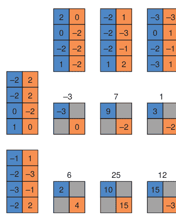

**Figure 4.1** 形状为 (2, 4, 2) 和 (3, 4, 2) 的张量之间示例 tensordot 操作的说明。请注意，第一个列向量组合之间的点积结果是 2 x 2 矩阵左上角的瓦片，而第二个列向量组合之间的点积结果是 2 x 2 矩阵右下角的瓦片。2 x 2 矩阵对角线沿线的值之和是形状为 (2, 3) 的最终矩阵的值。

### 4.3.1 tensordot 操作的启发式

从上述示例可以注意到，当 `axes` 参数发生变化时，`tensordot` 操作的输出张量形状也会随之变化。`axes` 参数的不同整数值似乎决定了不同的张量乘法行为。但我们可以通过归纳推理推导出一条通用经验法则。

当 `axes=0` 时，给定两个向量输入 `(m, )` 和 `(n, )`，我们已经看到结果张量的形状为 `(m, n)`，仿佛进行了外积。一般来说，当给定两个形状为 `(m, n, ...)` 的张量 `a` 和形状为 `(p, q, ...)` 的张量 `b` 时，`axes=0` 的 tensordot 形状为 `(m, n, ..., p, q, ...)`。这仿佛张量 `a` 的每个单独元素都与张量 `b` 的每个单独元素相乘，形成最终张量，而无需进行求和以减少任何维度。图 4.2 说明了这一推广。以下代码片段演示了此启发式的一个示例：

```python
a = np.random.rand(2, 3, 4, 5)
b = np.random.rand(6, 7, 8)
np.allclose(
    np.tensordot(a, b, 0).shape,
    [2, 3, 4, 5, 6, 7, 8]
)
```

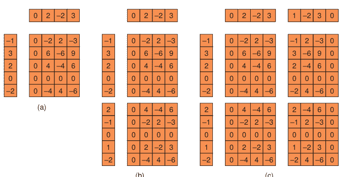

**Figure 4.2** 当 `axes=0` 时 `tensordot` 操作的说明。（a）对于形状为 `(5, )` 和 `(4, )` 的一对一维向量，两个向量之间每个元素的组合形成外积，形状为 `(5, 4)`。（b）在第一个输入中添加一个行维度，问题变成了形状为 `(2, 5)` 的矩阵与形状为 `(4, )` 的向量之间的 tensordot 操作。因此，结果张量的形状为 `(2, 5, 4)`（请注意，单例维度会被压缩掉）。（c）在第二个输入中添加一个额外的列维度，形成了形状为 `(2, 5)` 的矩阵与形状为 `(4, 2)` 的矩阵之间的 tensordot 问题。然后，结果张量的形状为 `(2, 5, 4, 2)`。

当 axes=1 时，我们已经看到当两个输入都是一维向量时，会返回两个张量的点积（一个标量）。一般来说，给定形状为 (m, n, ..., i) 的张量 a 和形状为 (i, ..., p, q, ...) 的张量 b，两个张量与 axes=1 的张量点积的形状为 (m, n, ..., p, q, ...)，其中 a 的最后一个维度和 b 的第一个维度被一起归约。这仿佛我们在两个向量批次的组合之间执行一系列点积。图 4.3 说明了此推广的示例。以下代码片段演示了此启发式的一个示例：

```python
a = np.random.rand(2, 3, 4, 5)
b = np.random.rand(5, 6, 7)
np.allclose(
    np.tensordot(a, b, 1).shape,
    [2, 3, 4, 6, 7]
)
```

当 axes=2 时，两个输入张量必须至少有两个维度。我们已经看到，给定两个矩阵时可以执行双重张量收缩操作。一般来说，给定形状为 (m, n, ..., i, j) 的张量 a 和形状为 (i, j, ..., p, q, ...) 的张量 b，a 和 b 与 axes=2 之间的张量点积形状为 (m, n, ..., p, q, ...)，其中 a 的最后两个维度和 b 的前两个维度被收缩。图 4.4 说明了此推广的示例。以下代码片段演示了此启发式的一个示例：

```python
a = np.random.rand(2, 3, 4, 5)
b = np.random.rand(4, 5, 6, 7)
np.allclose(
    np.tensordot(a, b, 2).shape,
    [2, 3, 6, 7]
)
```

在探讨了 axes=0、axes=1 和 axes=2 的上述启发式后，我们可以推导出当 axes 为整数参数时的更通用规则：给定第一个输入张量 a 形状为 (m, n, ..., s1, s2, ..., sk)，如果我们想要执行 axes=k 的张量点积，则需要使第二个输入张量 b 形状为 (s1, s2, ..., sk, ..., p, q, ...)。来自张量 a 的每个形状为 (s1, s2, ..., sk) 的张量子块与来自 b 的相同形状的张量子块逐元素相乘，然后求和形成一个单个标量。结果张量将具有形状 (m, n, ..., p, q, ...)，其中第一个输入 a 的最后 k 个维度和第二个输入 b 的前 k 个维度被收缩（即归约或求和）。


#### Axes = 1

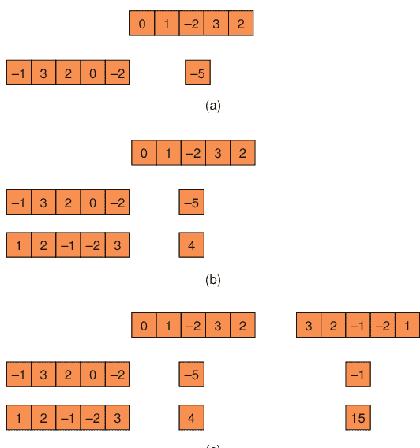

图 4.3 轴（axes）= 1 时 tensordot 操作示意图。(a) 对于一对各自形状为 (5,) 的 1D 向量，沿 axes=1 的张量点积等同于简单的向量内积，结果为一个标量；(b) 在 a 的第一维上添加另一个向量，操作变为 a 中（形状 (2, 5)）每个向量与 b（形状 (5,)）之间的点积。这应产生形状为 (2,1) 的结果向量。但是，由于隐式单例维度被压缩，结果向量的形状为 (2,)。(c) 在第二个输入 b 上添加一个额外的列维度，这将导致对 a（形状 (2,5)）中每个向量与 b（形状 (5, 2)）之间执行成对点积的操作。结果张量的形状为 (2, 2)，等同于矩阵乘法 ab。

axes 参数也可以指定为用于收缩的维度列表对。事实上，在某些特定情况下，axes 的整数值参数可以有对应的列表版本。例如：

- np.tensordot(a, b, 0) 等同于 np.tensordot(a, b, [[]], [[]])，其中 a 和 b 可以是任意张量。

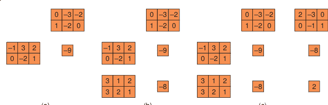

**图 4.4** 轴（axes）= 2 时 tensordot 操作示意图。(a) 对于一对各自形状为 (2, 3) 的 2D 矩阵，沿 axes=2 的张量点积等同于张量双重收缩 a : b = Tr(ab^T)，结果为一个标量；(b) 在添加一个前导维度后，使第一个张量 a 具有形状 (2, 2, 3)，张量点积变为针对 a 中每个矩阵与矩阵 b 的 1 个矩阵收缩操作；(c) 在添加一个后置维度后，使第二个张量 b 具有形状 (2, 3, 2)，张量点积变为针对 a 和 b 之间矩阵每种组合的矩阵收缩操作集合。a 中的矩阵沿轴 1 和 2 提取，使轴=0 成为批次维度。b 中的矩阵沿轴 0 和 1 提取，使轴=2 成为批次维度。结果 tensordot 积的形状为 (2, 2)。

- np.tensordot(a, b, 1) 等同于当 a 为矩阵且 b 至少为 1D 向量（也可以是更高维度）时的 np.tensordot(a, b, [[1], [0]])，或者当 a 和 b 都是向量时的 np.tensordot(a, b, [[0], [0]])。更一般地，axes=[[-1], [-1]] 将覆盖两种情况。

- np.tensordot(a, b, 2) 等同于当 a 和 b 都是 2D 矩阵时的 np.tensordot(a, b, [[0, 1], [0, 1]])，或者更一般地，对于维度数大于或等于 2 的任意张量的 np.tensordot(a, b, [[-2, -1], [0, 1]])。

我们可以在此处推导出一个通用规则：设第一个输入张量 a 具有形状 (m, n, ..., s_i, ...)，第二个输入张量 b 具有形状 (p, q, ..., s_{p_i}, ..., r_j, ...)，并且 s_i == r_j，其中 i, j ∈ 1, 2, ..., k，k 是要收缩的维度数。然后我们将 axes 参数指定为 axes=[[..., i, ...], [..., j, ...]] 以指示可收缩维度。然后，对应可收缩维度上的元素将逐元素相乘并求和以获得单个标量。该操作在所有未收缩维度的组合上重复（即向量化），结果张量具有形状 (m, n, ..., p, q, ...)。

## 4.4 Einsum

爱因斯坦求和约定（Einstein Summation，或 einsum）是各种形式的向量、矩阵和张量求和与乘法的推广。假设我们想要在两个张量 X 和 Y 之间执行矩阵乘法，矩阵的每个元素应在数学上表示为

\([XY]_{ij} = \vec{X}_i \cdot \vec{Y}_j = \sum_k X_{i,k} \cdot Y_{k,j}\)

并使用 for 循环，我们将如下计算乘积，例如：

```
import numpy as np

X = np.random.rand(5, 3)
Y = np.random.rand(3, 7)
Z = np.zeros((5, 7)) # expected shape
for ii in range(5):
    for jj in range(7):
        Z[ii, jj] = X[ii, :].dot(Y[:, jj])
```

> **注意**
>
> 我找到的关于爱因斯坦求和约定历史的各种来源都指向阿尔伯特·爱因斯坦关于广义相对论的原始手稿，“Die Grundlage der allgemeinen Relativitätstheorie”，或英文为“The Foundation of the General Theory of Relativity” [Einstein, 1996]。但是，根据第 4.5 节中描述的内容，爱因斯坦将这些记法归功于“Ricci 和 Levi-Civita”（即 Gregorio Ricci-Curbastro 和 Tullio Levi-Civita）。

在 einsum 记法中，矩阵乘法操作将仅跟踪 ik 和 kj 这两个索引。然后，矩阵乘法表示为 ik,kj->ij。请注意，重复索引 k 在乘法后沿其维度被合并或求和。

有两种表达 einsum 等式的模式。上述示例称为“显式模式”，在该模式下，等式字符串带有右箭头 "->" 以指示结果张量索引的顺序。如果箭头右侧没有索引，则假设返回常量。

相比之下，在“隐式”模式下，等式字符串没有指定结果索引的右箭头 ->，结果根据以下假设计算：

- 索引按字母顺序排序。如果等式中的索引未按字母顺序指定，则返回张量将按字母顺序排序索引。例如，"ji"（其等效显式模式为 "ji->ij"）等同于 X^T。

- 重复索引将被求和。例如，"ij, j"（其等效显式模式为 "ij, j->i"）等同于 \(\sum_j X_{ij} . Y_j = z_i\)，以及 NumPy 操作 `np.sum(X * Y, axis=1)`。

请注意，某些操作只能在显式模式中表达。参见表 4.2 中的各种示例。

在第 4.5 节和第 4.6 节中，我们将探讨使用张量乘法实现数学公式和算法的多个示例。

表 4.2 einsum 等式示例及等效 NumPy 操作。

| 操作 | 等式字符串（显式） | 等式字符串（隐式） | 等效 NumPy 操作 |
|---|---|---|---|
| 内积^a) | "i, i->" | "i, i" | np.inner |
| 外积^b) | "i, j->ij" | "i, j" | np.outer |

注释：
a) 两个向量的点积。

```
1 a = np.random.rand(8)
2 b = np.random.rand(8)
3 np.allclose(
4     np.inner(a, b),
5     np.einsum("i,i", a, b)
6 )
```

b) 两个向量的外积。

```
1 a = np.random.rand(8)
2 b = np.random.rand(8)
3 np.allclose(
4     np.outer(a, b),
5     np.einsum("i,j", a, b)
6 )
```

表 4.2（续）

| 操作 | 等式字符串（显式） | 等式字符串（隐式） | 等效 NumPy 操作 |
| :--- | :--- | :--- | :--- |
| 提取对角线^c) | "ii->i" | NA | np.diagonal, np.diag |
| 迹 c) | "ii->" | "ii" | np.trace |
| 转置 d) | "ij->ji" | "ji" | np.transpose |
| 交换轴 d) | "ijk->kji" | "kji" | np.swapaxes |

c) 对角线提取与迹。尽管这两个表达式相似，但迹操作应将对角线之和作为标量返回，而对角线提取应将对角线条目作为向量返回。

```
X = np.random.rand(8, 8)
np.allclose(
    np.trace(X),
    np.einsum("ii->", X)
)
np.allclose(
    np.diag(X),
    np.einsum("ii->i", X)
)
```

d) 转置和交换轴。这两个在 einsum 中是相似的操作。隐式模式利用了返回张量的轴将按字母顺序排序的假设。

```
# 矩阵转置
X = np.random.rand(4, 5)
np.allclose(
    np.transpose(X),
    np.einsum("ij->ji", X)
)
np.allclose(
    np.transpose(X),
    np.einsum("ji", X)
)
# 交换轴
Y = np.random.rand(4, 5, 6)
np.allclose(
    np.swapaxes(Y, 0, 2),
    np.einsum("ijk->kji", Y)
)
np.allclose(
    np.swapaxes(Y, 0, 2),
    np.einsum("kji", Y)
)
```

表 4.2（续）

| 操作 | 等式字符串（显式） | 等式字符串（隐式） | 等效 NumPy 操作 |
|---|---|---|---|
| 沿行求和^e) | "ij->j" | NA | np.sum(..., axis=0) |
| 沿列求和^e) | "ij->i" | NA | np.sum(..., axis=1) |
| 求和全部^f) | "ij->" | NA | np.sum(...) |
| 恒等^f) | "ij->ij" | "ij" | np.array |

e) 沿行和列求和。

```python
X = np.random.rand(3, 4)
# 沿行求和
np.allclose(
    np.sum(X, axis=0),
    np.einsum("ij->j", X)
)
# 沿列求和
np.allclose(
    np.sum(X, axis=1),
    np.einsum("ij->i", X)
)
```

f) 求和全部与恒等（输出与输入相同的操作，不要与数学单位矩阵混淆）。"求和全部"只能使用显式模式表达，而"恒等"既有显式模式 "ij->ij"，也有隐式模式 "ij"。这是因为当箭头右侧没有值时，等式总是被解释为求和至常量；相比之下，当没有右箭头（即在隐式模式下）时，求和仅在索引重复时发生。

```python
X = np.random.rand(4, 5)
# 恒等函数
np.allclose(
    X,
    np.einsum("ij->ij", X)
)
np.allclose(
    X,
    np.einsum("ij", X)
)
# 求和所有元素
np.allclose(
    X.sum(),
    np.einsum("ij->", X)
)
```


| 操作 | 等式字符串（显式） | 等式字符串（隐式） | 等效 NumPy 操作 |
|---|---|---|---|
| Hadamard 积 | "ij,ij->ij" | 不适用 | np.multiply |
| 矩阵乘法 | "...ij,...jk->...ik" | "...ij,...jk" | np.matmul |
| 点积 | "...j,ijk->...ik" | "...j,ijk" | np.dot |
| 张量点积 | 针对具体情况 | 不适用 | np.tensordot |

The Hadamard multiplication example illustrates the case of element-wise multiplication between a pair of 2D matrices. In general, to construct a Hadamard multiplication using einsum, we can use the format of "ijk...,ijk...->ijk...", in which the corresponding dimensions will be multiplied together. It is also convenient to construct the Hadamard multiplication when one of the tensor's dimensions needs to be swapped or transposed. For example, if we want to perform element-wise multiplication between a tensor of shape (2, 5, 3) and another one of shape (2, 3, 5):

```python
X = np.random.rand(2, 5, 3)
Y = np.random.rand(2, 3, 5)
np.allclose(
    X * Y.swapaxes(1, 2),
    np.einsum("ijk,ikj->ijk", X, Y)
)
```

Multidimensional matrix multiplication requires dimensions other than the last two dimensions broadcastable. The ellipses ... represent the broadcasting dimensions. For example,

```python
a = np.random.rand(1, 6, 3)
b = np.random.rand(8, 3, 7)
# shape (8, 6, 7)
np.allclose(
    np.einsum("...ij,...jk", a, b),
    np.matmul(a, b)
)
```

For multidimensional dot products, the last axis of the first input is multiplied and summed together with the second to last axis of the second input. For the first input, we can omit the indices for all the dimensions other than the last dimension, and replace them with ellipsis .... For the second input, we need to specify all the indices. For example

```python
a = np.random.rand(2, 5, 3, 6)
b = np.random.rand(7, 6, 4)
# shape (2, 5, 3, 7, 4)
np.allclose(
    np.einsum("...j,ijk->...ik", a, b),
    np.dot(a, b)
)
```

## 4.5 案例研究：成对 Pearson 互相关

In Chapter 2, we implemented a way to compute Pearson's correlation between corresponding columns of a pair of matrices. However, during exploratory data analysis, we sometimes need to examine the \(n \times n\) cross-correlation matrix between each feature. This would require us to perform a pair-wise Pearson's cross-correlation calculation. Recall the formula of Pearson's cross-correlation is

\(r_{ij} = \sum_k \left( \frac{\tilde{x}_k^{(i)}}{\sqrt{\sum_p (\tilde{x}_p^{(i)})^2}} \cdot \frac{\tilde{y}_k^{(j)}}{\sqrt{\sum_q (\tilde{y}_q^{(j)})^2}} \right)\)

where i, j are indices of the columns of the feature matrices X and Y, respectively; k, p, q are indices of the elements of the vectors. The cross-correlation matrix of shape \((N, M)\) between two inputs X and Y, each of the shape of \((K, N)\) and \((K, M)\) is implemented as the following:

```python
import numpy as np

def faster_cross_corr(X, Y):
    """
    faster way to compute Pearson's correlation
    between each combination of pairs of two matrices
    returns a cross-correlation matrix
    [(x1:y1, x1:y2, x1:y3,..., x1:ym],
    [x2:y1, x2:y2, x2:y3,..., x1:ym],
    [...]
    [xn:y1, xn:y2, xn:y3,..., xn:ym]
    """
    X = X - np.mean(X, axis=0, keepdims=True) # zero mean
    Y = Y - np.mean(Y, axis=0, keepdims=True) # zero mean
    X = X / np.sqrt(np.sum(X**2, axis=0, keepdims=True)) # L2 normalization
    Y = Y / np.sqrt(np.sum(Y**2, axis=0, keepdims=True)) # L2 normalization
    R = X.T.dot(Y)
    return R
```

Notice that the code was almost identical to what we implemented in Chapter 2, except in Line 15. Instead of doing element-wise multiplication and reducing along axis=1, we perform a matrix multiplication using the dot operator.

> **Note**
> I originally implemented this algorithm in MATLAB, so I kept the convention that each column corresponds to a feature. I also often apply this function to my pandas dataframe to compute feature cross-correlations, where each feature is also in a column of `pd.Series` within the data frame. However, it may not be the most efficient in NumPy since its vectors and matrices are stored using the row-major convention. Nonetheless, at least historically and for the majority of use cases, this custom cross-correlation function that I implemented here appears to be more efficient than `pd.DataFrame.corr`. We leave this as a homework exercise to compare the performance of `faster_cross_corr` with `pd.DataFrame.corr` and `np.corrcoef`.

## 4.6 案例研究：豪斯多夫距离

Back in 2012–2013, I was a research scientist doing schizophrenia studies using brain functional magnetic resonance imaging (fMRI) scans. A common problem with fMRI is that the patients undergoing a brain scan may move their heads, thus weakening the functional signal collected during the scan. As an analogy, this is as if someone takes a picture of a bird flying away with a slow-speed shutter (and fMRI’s “shutter speed” is in the magnitude of seconds); the image of the bird would be very blurry. So, in one of our projects, we were trying to find a way to correct the effect of head movement during the scan [Cui et al., 2018]. But, how can we track the head position in a dark environment inside the MRI machine? A smart engineer from our team thought of a simple way: we printed a pair of dark squares on a piece of white paper and fixed these fiducial markers on a pair of swimming goggles. Then, the patient undergoing the scan wore these goggles while an infrared camera took pictures of the fiducial markers. After collecting the data, we initially thought of using simple image processing steps like thresholding and segmentation to find the centroids of the pair of fiducial markers, and the mean position of the two centroids over time would form a time series of head positions relative to the starting position. However, due to lighting and patient head orientations, the image quality of the data collected was not always the best (see Figure 4.5, e.g. where images taken could be skewed and affected by lighting artifacts). Still, if a human being looked at the images, they could pinpoint the mean position of the fiducial marker very well. Nowadays, image segmentation and object tracking problems are mostly solved by deep-learning-based solutions. But, back in 2013, this was a pretty difficult problem to solve at scale. Probably due to my skill level at the time, despite trying many tools in MATLAB’s image processing library and Python’s OpenCV and Scipy, none of them helped us consistently track the positions of the markers (which we verified through visual inspections after processing the images through the algorithm).

Therefore, I was tasked to determine a robust, alternate algorithm that would allow us to automate the process of accurately determining the mean position of the markers. My thought at the time was that we only needed to extract part of the image that would match the template just well enough, so that the lighting artifact or any noise in the image would be filtered out during the template-matching process. The template-matching process also needed to be robust enough so that

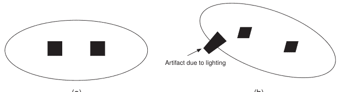

**Figure 4.5** Fiducial markers used to track head positions. (a) The original template of the marker; (b) in reality (drawn as a schematic for illustration purposes), the image taken from the marker on the goggle can be skewed and affected by light artifacts.


它不会受到图像倾斜的影响。要找到正方形对，我会先将图像分割成多个补丁，然后遍历所有补丁对的组合，以计算与模板的某些距离度量。某些组合将介于基准标记中的一个正方形与某些照明伪迹之间，但只有其中一个组合会是与模板完全匹配的正方形对。这一对应该与模板图像具有最小的距离。我找到的核心模板匹配距离度量是豪斯多夫距离 [Dubuisson and Jain, 1994]。

原始豪斯多夫距离由以下公式表示：

max(h(A,B), h(B,A))

其中 h(A,B) = max(d(Ai,B)) = max_i (min_j ||A_i - B_j||)，且 || . || 是欧几里得距离。要通过向量化实现此公式，关键在于计算欧几里得距离项 ||A_i - B_j||，\forall i, j。这将创建一个形状为 (n, m) 的矩阵，其中 n 和 m 分别是图像 A 和 B 中的像素点数量。回顾一下，对于一对 2D 点，欧几里得距离定义为

D_{ij} = ||A_i - B_j||
= \sqrt{(x_i - x_j)^2 + (y_i - y_j)^2}
= \sqrt{x_i^2 + x_j^2 - 2x_ix_j + y_i^2 + y_j^2 - 2y_iy_j}
= \sqrt{(x_i^2 + y_i^2) + (x_j^2 + y_j^2) - 2(x_ix_j + y_iy_j)}
= \sqrt{A_i \cdot A_i^T + B_j \cdot B_j^T - 2A_i \cdot B_j^T}

在平方根下，第一项是行向量 $A_i$ 与其自身的内积；同样，第二项是行向量 $B_i$ 与其自身的内积。或者，这两项可以分别视为矩阵乘积 $AA^T$ 和 $BB^T$ 的对角线元素。第三项是矩阵 A 中每个点与矩阵 B 中每个点之间点积的组合。因此，我们可以按如下方式实现豪斯多夫距离：

```
import numpy as np
def HausdorffDist(A, B):
    """
    Compute the Hausdorff distance between two point clouds.
    Let A and B be subsets of metric space (Z, dZ),
    the Hausdorff distance between A and B, denoted by dH(A,
    B),
    is defined by:
    dH(A, B) = max(h(A, B), h(B, A)),
    where h(A, B) = max(min(d(a, b)))
    and d(a, b) is a L2 norm
    dist_H = hausdorff(A, B)
    A: First point sets (M1 x N, with M1 observations in N
    dimension)
    B: Second point sets (M2 x N, with M2 observations in N
    dimension)
    ** A and B may have different number of rows, but must
    have the same
    number of columns.
    """
    # Find pairwise distance: (A - B)^2 = A^2 + B ^2 - 2AB
    A_sq = np.einsum('ij,ij->i', A, A)[:, None]
    B_sq = np.einsum('ij,ij->i', B, B)
    AB = np.dot(A, B.T)
    D_mat = A_sq + B_sq - 2 * AB
    D_mat = np.sqrt(D_mat)
    # Find DH
    d_AB = np.min(D_mat, axis=0)
    d_BA = np.min(D_mat, axis=1)
    dH = np.maximum(
    np.max(d_AB),
    np.max(d_BA)
    )
    return(dH)
```

- 1. 在第 19 行中，我们可以使用 einsum 表示法 "ij, ij->i" 将 \(A^2\) 项计算为 \(A\) 中每一行与其自身之间的批量点积。请注意，我们希望通过扩展第二维使其成为列向量，使其形状为 \((n, 1)\) 以便于后续广播。
- 2. 在第 20 行中，我们同样计算 \(B^2\)。这是一个行向量，在后续步骤的广播中会被隐式视为形状 \((1, m)\)。
- 3. 第 21 行将第三项实现为 \(A\) 和 \(B\) 行之间组合的逐对点积。这将形成一个形状为 \((n, m)\) 的矩阵。
- 4. 第 22 行通过广播将所有三项组合起来实现逐对距离。这将形成一个形状为 \((n, m)\) 的矩阵。
- 5. 第 23 行对逐对距离矩阵开平方根，得到最终的欧几里得距离矩阵 \(D\)。
- 6. 第 25 行和第 26 行实现 \(d(A, B)\) 和 \(d(B, A)\) 项。请注意，我们通过在矩阵 \(D\) 的不同维度上取最小值来实现非对称函数。
- 7. 第 27-30 行实现最终的豪斯多夫距离公式。

## 4.7 常用线性代数例程

表 4.3 列出了 NumPy、Tensorflow 和 PyTorch 实现的常用线性代数例程。

## 4.8 案例研究：拟合单指数曲线

在我的以往研究中，我经常需要将指数曲线 y = a exp(bx) + c 拟合到我的数据中，或用于预测时间序列趋势。我最初使用了 scipy 的曲线拟合实现 scipy.optimize.curve_fit，但发现当提供的数据点带有噪声时，结果对初始猜测非常敏感。后来，我发现了 Jean Jacquelin [Jacquelin, 2014] 的数学论文“Regressions et Equations Integrales”（英文译为“Regression and Integral Equations”）。我不懂法语，但数学公式的翻译足够好，使我能够一步步跟进。（然而，在撰写本文时，我发现 Joseph R. Fox-Rabinovitz 将 Jean Jacquelin 的论文翻译成了英语；感兴趣的读者可以在 https://scikit-guess.readthedocs.io/en/latest/appendices/references.html#regressions-et-equations-integrales 找到这项工作，以及原文中描述方法的一个实现版本。）在下面的描述中，我将遵循指数曲线 y = a exp(bx) + c 的公式，而不是原文中的 y = a + b exp(cx)。

> > **注意**
>
> 许多人会认为更复杂的机器学习和深度学习算法不过是包装过的曲线拟合。然而，曲线拟合可能是许多人（包括我自己）最初接触机器学习的方式。

假设我们有两个向量 x 和 y，存储数据点的 xy 坐标。我们初始化 S_0 = 0 并迭代构建一个 S 数组，如下

$S_k = S_{k-1} + \frac{1}{2}(y_k + y_{k-1})(x_k - x_{k-1})$ (4.1)

然后，为了求解 b，即指数内的系数，我们构建方程

$\begin{bmatrix} \dot{} \\ b \end{bmatrix} = N^{-1}M = \begin{bmatrix} \sum_k(x_k - x_0)^2 & \sum_k(x_k - x_0)S_k \\ \sum_k(x_k - x_0)S_k & \sum_k S_k^2 \end{bmatrix}^{-1} \begin{bmatrix} \sum_k(y_k - y_0)(x_k - x_0) \\ \sum_k(y_k - y_0)S_k \end{bmatrix}$ (4.2)

## 表 4.3 NumPy、Tensorflow 和 PyTorch 中的线性代数例程列表。

| 操作 | NumPy | Tensorflow | PyTorch |
|---|---|---|---|
| 矩阵逆<sup>a)</sup> | np.linalg.inv | tf.linalg.inv | torch.linalg.inv |
| Moore-Penrose 伪逆<sup>b)</sup> | np.linalg.pinv | tf.linalg.pinv | torch.linalg.pinv |
| 特征值分解<sup>c)</sup> | np.linalg.eig | tf.linalg.eig | torch.linalg.eig |
| 奇异值分解<sup>d)</sup> | np.linalg.svd | tf.linalg.svd | torch.linalg.svd |

注：

- a) 该方法用于求方阵逆（如果矩阵可逆）。数学上，设矩阵为 $X \in \mathbb{R}^{m \times n}$（实值）或 $X \in \mathbb{C}^{m \times n}$（复值）。则方阵 $X^{-1}$ 的逆定义为 $XX^{-1} = X^{-1}X = I$，其中 $I$ 为单位矩阵。该方法可以批量应用，即我们可以令输入张量 X 的形状为 (... , m, m)，`.linalg.inv` 方法将使用由最后两个维度形成的矩阵来求逆，得到的逆张量形状与 X 相同。
- b) Moore-Penrose 伪逆推广到非方阵。数学上，设 $X \in \mathbb{R}^{m \times n}$ 或 $X \in \mathbb{C}^{m \times n}$。则伪逆定义为 $X^+ = (X^T X)^{-1} X^T$，其中 $X^+$ 是 X 的共轭转置（先共轭再转置；对于实矩阵，这将简单地是 $X^T$）。[Barata and Hussein, 2012]。与 `.linalg.inv` 方法类似，`.linalg.pinv` 也可以通过沿输入张量的最后两个维度求解，对矩阵批次进行操作。
- c) 假设我们有一个方阵 $X \in \mathbb{R}^{m \times n}$。如果 $v$ 是单位向量，$\lambda$ 是标量值，且满足方程 $Xv = \lambda v$，则 $v$ 是矩阵 X 的特征向量，$\lambda$ 是矩阵 X 的特征值。`.linalg.eig` 方法返回特征值（无序）和特征向量，其每一列是单位特征向量。原始 X 可以通过 $X = \lambda v v^T` 或 `(eigenvalues * eigenvectors) @ .linalg.inv (eigenvectors) @ .linalg.inv (eigenvectors)` 恢复。与逆方法类似，`.linalg.eig` 也可以通过沿输入张量的最后两个维度求解，对矩阵批次进行操作。
- d) 奇异值分解（SVD）常用于经典机器学习算法，如主成分分析（PCA）。它定义为 $X = U \Sigma V^T`（对于复矩阵，$V^T$ 将变为共轭转置 $V^H$），其中 $U \in \mathbb{R}^{m \times m}$ 是左奇异因子，$\Sigma \in \mathbb{R}^{m \times n}$ 是奇异值矩阵，其对角线值为奇异值，$V \in \mathbb{R}^{n \times n}$ 是右奇异因子矩阵。矩阵 $U$ 和 $V$ 都具有 $UU^T = U^T U = I_m$ 和 $VV^T = V^T V = I_n` 的性质。因此，$XX^T = (U \Sigma V^T)(V \Sigma^T U^T) = U \Sigma (V^T V) \Sigma^T U^T = U \Sigma \Sigma^T U^T`，且 $X^T X = (V \Sigma^T U^T)(U \Sigma V^T) = V \Sigma^T (U^T U) \Sigma V^T = V \Sigma^T \Sigma V^T` (Zhang, 2015)。请注意，这变成了特征值问题。因此，我们可以通过对 $XX^T` 和 $X^T X` 进行特征值分解来求解 $U, V, \Sigma`。`.linalg.svd` 方法返回 $U, s` 和 $V\_hermitian`（分别对应 $U`、$\Sigma` 的对角线元素按降序排列以及 $V^T`）。我们可以通过 U @ (s * np.eye(U.shape[0], Vh.shape[0])) @ V_hermitian 恢复原始矩阵。与所有其他线性代数例程一样，`.linalg.svd` 作用于输入张量的最后两个轴。作为示例：

```
import numpy as np

# Create a cloud of points inside of 3D ellipsoid
n = 2000 # number of points
a, b, c = .10, 6, 1 # axes lengths
# randomly generate
x, y, z = [np.random.uniform(-d, d, n) for d in (a, b, c)]
inside = ((x/a)**2 + (y/b)**2 + (z/c)**2) <= 1.0

# Use SVD to decompose the matrix
X = np.vstack(([x[inside], y[inside], z[inside]])).T
X = X - X.mean(axis=0)
# s returns the standard deviation, sorted descendingly
U, s, Vh = np.linalg.svd(X)

# Recover
X_recovered = U @ (s * np.eye(U.shape[0], Vh.shape[0])) @ Vh
assert np.allclose(X, X_recovered)
```


| 操作 | NumPy | TensorFlow | PyTorch |
|---|---|---|---|
| QR 分解$^{(e)}$ | np.linalg.qr | tf.linalg.qr | torch.linalg.qr |
| 线性最小二乘$^{(f)}$ | np.linalg.lstsq | tf.linalg.lstsq | torch.linalg.lstsq |

- e) QR 分解定义为 \(X = QR\)，其中 \(X \in \mathbb{R}^{m \times n}\)，\(Q \in \mathbb{R}^{m \times n}\) 是一个其列互相标准正交（单位向量，列之间的点积为零）的矩阵，而 \(R \in \mathbb{R}^{n \times n}\) 是一个上三角矩阵。`.linalg.qr` 方法返回 Q 和 R，并可以通过 \(Q @ R\) 恢复原始矩阵。与所有其他线性代数例程一样，`.linalg.qr` 在输入张量的最后两个轴上操作。

- f) `.linalg.lstsq` 求解形式为 \(X\Theta = Y\) 的线性方程最小二乘问题，其中 \(X \in \mathbb{R}^{m \times k}\) 是特征向量（自变量），包含 m 个观测的 k 个特征，\(\Theta \in \mathbb{R}^{k \times n}\) 是线性方程的斜率项，而 \(Y \in \mathbb{R}^{m \times n}\) 是观测结果（因变量），针对 n 个维度。它最小化等式左边和右边之间的平方损失，即 \(||X\Theta - Y||_2^2 = \sum_i \sum^m (x_i \cdot \theta_j - y_j)^2\)。例如，假设我们想要从一组带有随机噪声的数据点中估计线性方程 \(y = 2x + 5\)：

```python
import numpy as np
x = np.random.randn(100)
Y = 2 * x + 5 + np.random.randn(100)
# Two features, one feature for the input data x,
# and another feature as constant, independent of the data.
X = np.vstack([x, np.ones_like(x)]).T
theta, res, rank, s = np.linalg.lstsq(X, Y)
print(theta)
# array([ 2.04210113, 5.07653151])
```

请注意，第一个逆项的反对角线项是相同的。在我们的计算中，左侧列向量的第一个元素（\(\cdot\)）被忽略。在原始论文中，这一项是乘积 \(ac\)。但是，我们将使用另一个公式来计算这两项

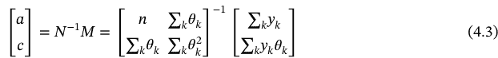

其中 \(\theta_k = \exp(bx_k)\) 且 \(n\) 是数据点的数量。同样，第一个逆项的反对角线项是相同的。以下代码实现了该算法：

```python
import numpy as np
def fit_exp_with_offset(x, y):
    """
    Fitting y = a * exp(b * x) + c
    using a non-iterative method based on
    Regressions et Equations Integrales by Jean Jacquelin
    x and y are vectors of coordinates of the data points.
    They need to be sorted in ascending order,
    e.g. (0, 0), (0, 1), ... (1, 0), .... (3, 4), (3, 5), ...
    """
    # Start algorithm
    S = np.zeros_like(x)
    S[1:] = 0.5 * (y[:-1] + y[1:]) * np.diff(x)
    S = np.cumsum(S)
    # for k in range(1, len(S)):
    #     S[k] = S[k-1] + 1/2 * (y[k] + y[k-1]) * (x[k] -
    #      x[k-1])
    M = np.empty((2, 2))
    N = np.empty((2, 1))
    # Getting b
    M[0, 0] = np.sum((x - x[0])**2)
    M[0, 1] = np.sum((x - x[0]) * S)
    M[1, 0] = M[0, 1]
    M[1, 1] = np.sum(S**2)

    N[0, 0] = np.sum((y - y[0]) * (x - x[0]))
    N[1, 0] = np.sum((y - y[0]) * S)

    B = np.matmul(np.linalg.inv(M), N)
    b = B[1, 0]

    # Getting a and c
    theta = np.exp(b * x)
    M[0, 0] = len(x)
    M[0, 1] = np.sum(theta)
    M[1, 0] = M[0, 1]
    M[1, 1] = np.sum(theta**2)

    N[0, 0] = np.sum(y)
    N[1, 0] = np.sum(y * theta)

    AC = np.matmul(np.linalg.inv(M), N)
    c = AC[0, 0]
    a = AC[1, 0]

    return a, b, c
```

- 第 13–15 行按照公式 4.1 描述的公式构建向量 S，但采用了向量化。这等同于我在第 16 和 17 行下方注释掉的 for 循环方法。
- 第 19 和 20 行初始化两个空矩阵，用于存储查找三个参数所需的中间矩阵。
- 第 23–26 行实现了公式 4.2 中的 M 项。
- 第 28 和 29 行实现了公式 4.2 中的 N 项。
- 第 31 行实现了公式 4.2 中两项的乘法。
- 第 32 行从上述矩阵乘法步骤生成的列向量中提取 b 作为第二个元素。
- 第 35 行计算中间变量 θ。
- 第 36–39 行实现了公式 4.3 中的 M 项。
- 第 41–42 行实现了公式 4.3 中的 N 项。
- 第 44 行实现了公式 4.3 中两项的乘法。
- 第 45 和 46 行从上述矩阵乘法步骤生成的列向量中提取 a 和 c。
- 第 48 行返回三个参数 a、b、c。

让我们测试此实现。假设我们想要在由方程 y = 0.5 exp(−2x) + 3 生成的一组带噪声点上拟合单个指数曲线。以下代码说明了如何使用此函数。曲线拟合的结果如图 4.6 所示。

```python
import matplotlib.pyplot as plt
x = np.random.rand(500) * 10
x = np.sort(x) # sorting x, required by the algorithm
y = 0.5 * np.exp(-2 * x) + 3 + np.random.randn(500) * 0.025
# fit the curve
a, b, c = fit_exp_with_offset(x, y)
# recreate the curve
x_pred = np.linspace(0, 10, 100)
y_pred = a * np.exp(b * x_pred) + c
# plot the data points and the fit
plt.scatter(x, y, label="data")
plt.plot(x_pred, y_pred, color="r", label="fit")
plt.xlabel("x")
plt.ylabel("y")
plt.legend()
```

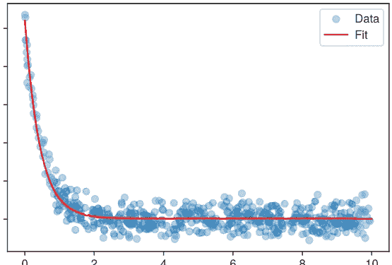

图 4.6 对带噪声数据点拟合单个指数曲线。

## 参考文献

J. C. A. Barata 和 M. S. Hussein. Moore–Penrose 伪逆。理论教程综述。*巴西物理学报*，42(1–2):146–165，2012 年 4 月。ISSN 0103-9733, 1678-4448。doi: 10.1007/s13538-011-0052-z.

Edward D. Cui, Richard J. Maddock, Michael H. Buonocore, Meric Ozturk, 和 Jong H. Yoon. 量化头部运动对磁共振光谱伽马氨基丁酸估计的影响，2018 年 7 月.

M.-P. Dubuisson 和 A. K. Jain. 用于对象匹配的修正豪斯多夫距离。*第 12 届国际模式识别大会论文集*，卷 1，页 566–568，1994 年。doi: 10.1109/ICPR.1994.576361.

Albert Einstein. 广义相对论基础。在 *柏林岁月：著作，1914–1917*, 普林斯顿大学出版社, 卷 6 of *爱因斯坦文集*. 1996 年 7 月.

Jean Jacquelin. *回归与积分方程*. 2014 年 1 月.

Guido Van Rossum 和 Fred L. Drake. PEP 465 – 用于矩阵乘法的专用中缀运算符。https://peps.python.org/pep-0465/, 2014 年 2 月.

Zhihua Zhang. 奇异值分解、应用及其 beyond，2015 年 10 月.

# 5 掩码与填充

迄今为止，我们关于向量化运算的讨论一直假设我们正在处理可以在给定形状下由多维密集张量一致表示的数据。例如，一组图像可以由形状为 `(batch_size, width, height, channel)` 的密集张量表示。包含多个数值列的表格数据可以表示为形状为 `(batch_size, num_columns)` 的矩阵。然而，在各种现实世界机器学习应用中，我们也经常需要处理大小不一的数据。例如，一组音频录音可能具有可变时长。因此，为了使我们的跨数据集运算可向量化，我们需要寻找重新配置数据的方法，以便它可以由一个具有单一一致形状的张量表示。这可以通过将音频录音序列**填充**到相同的预定义长度来实现。另一方面，音频录音可能包含静默时期，我们不希望模型在学习过程中关注这些时期。因此，我们可以使用**掩码**来告诉模型将学习集中在包含我们希望建模的音频的部分上。因此，在处理可变大小数据时，掩码和填充是向量化机器学习建模操作的重要技术。

## 5.1 掩码

**掩码**是一种数据过滤技术，它允许模型关注我们根据启发式确定的数据相关部分，同时允许我们的向量化函数在具有数据一致形状的张量上操作。我们将首先查看向量化库实现的几种特殊类型的掩码。然后，我们将查看执行掩码操作的四种技术。


### 5.1.1 三角形和对角掩码

NumPy、TensorFlow 和 PyTorch 实现了几种特殊的掩码操作。表 5.1 列出了 NumPy、TensorFlow 和 PyTorch 中的三角形和对角掩码及掩码构造操作。

### 5.1.2 使用 where 操作更改元素

除了使用现有的掩码操作来替换值之外，更常见的是，我们需要根据条件来替换/掩码值。例如，给定一个 256 x 256 的灰度图像，我们希望对图像应用阈值，使得高于该阈值的像素值被标记为前景（亮），低于该阈值的像素值被标记为背景（暗），这样处理后的图像就可用于图像分割等后续任务。我们可以通过使用 np.where(condition, x, y) 来实现这一点，其中 condition 是我们的布尔或二元掩码。

```
import numpy as np
import matplotlib.pyplot as plt
import skimage # pip install scikit-image==0.21.0
image = skimage.data.coins()

# image thresholding to remove background
image_thresh = np.where(image > 150, image, 0)

# plot the images
fig, axs = plt.subplots(1, 2)
axs[0].imshow(image, cmap="gray")
axs[0].set_title("Original")
axs[1].imshow(image_thresh, cmap="gray")
axs[1].set_title("Thresholded")
```

该代码生成如图 5.3 所示的图表。NumPy、TensorFlow 和 PyTorch 中实现的 where 操作的 where(condition, x, y) 语法对于此类“阈值”操作很有帮助，其中它会根据条件使用 y 中的值有条件地替换 x 中的值，x、y 和 condition 需要彼此可广播。在掩码的特定情况下，我们通常会将 conditions 中 True 值对应索引处的元素替换为某些掩码值，例如 0。

### 5.1.3 使用乘法应用掩码

第 5.1 节介绍的操作创建的掩码通常是二元张量（0 和 1），元素数据类型为浮点数和

表 5.1 掩码和掩码索引构造操作列表。

| 操作 | NumPy | TensorFlow | PyTorch |
|---|---|---|---|
| 单位矩阵^a) | np.eye | tf.eye | torch.eye |
| 对角矩阵^a) | np.diag | tf.linalg.diag | torch.diag |
| 独热/二元^b) | N/A | tf.one_hot | torch.nn.functional.one_hot |
| 下三角矩阵^c) | np.tril | tf.experimental.numpy.tril | torch.tril |
| 上三角矩阵^c) | np.triu | tf.experimental.numpy.triu | torch.triu |
| 下三角掩码^c) | np.tri | tf.experimental.numpy.tri | N/A |
| 对角带^d) | N/A | tf.linalg.band_part | N/A |

注释：
- a) tf.eye 和 torch.eye 只能沿主对角线返回单位矩阵，而 np.eye 还可以通过将 k 设置为非零值来返回非对角矩阵。tf.linalg.diag 和 torch.diag 可以创建非对角矩阵，其对角线值不必为 1。
- b) 独热编码通常用于对类别特征进行编码。单个类别值会被映射到一个索引（0、1、…、N - 1），然后创建一个由 0 和一个 1 组成的长度为 N 的向量，其中单个 1 的位置位于类别值的索引处。当特征是一组类别特征（即多值类别特征）时，通常会构造一个二元向量，其中向量中包含多个 0 和 1。构造此二元或多热向量有多种方法。一种方法是将特征中的每个类别值转换为一个单一的独热向量，然后将它们归约求和。然而，这在内存效率上不高，因为它在中间步骤中创建了额外的 0 条目。在第 5.1.6 节中，我们将使用第 3 章介绍的 put 操作来创建二元/多热掩码。此外，尽管 NumPy 没有实现独热编码函数，但 Scikit-learn 的 sklearn.preprocessing.OneHotEncoder 更常用于对类别值进行编码。另一方面，还可以使用 np.eye(num_values)[index] 来创建一批独热编码的类别特征，其中 num_values 是类别变量的大小，index 是类别值的索引。
- c) tril 和 triu 均可用于构造下三角和上三角掩码，或对现有矩阵执行掩码操作。有关多个示例的说明，请参见图 5.1.1。除了方阵外，这两个操作也可以处理非方阵；非方阵的主对角线（k=0）仍从矩阵的左上角开始。在处理多维张量时，它将最后两个维度视为用于提取/创建三角矩阵的矩阵维度，而将所有其他前导维度视为批次维度。要在输入矩阵 X 上构造下三角掩码，可以执行 np.tril(np.ones_like(X), k=...)，要在输入矩阵上构造上三角掩码，可以执行 np.triu(np.ones_like(X), k=...)。请注意，tril 和 triu 互补，即 np.tril(X, k=-1) + np.triu(X, k=0) == np.tril(X, k=0) + np.triu(X, k=1) == np.tril(X, k=...) == np.triu(X, k=...) == ... == X。
- d) 此行可创建专用的对角带。在撰写本文时，只有 TensorFlow 实现了此对角带操作。有关其用法的说明，请参见图 5.2。请注意，这并不是一个可以完全替代 triu 和 tril 的操作（尽管某些操作，例如 tril ..., k=0，也可以使用 band_part(..., -1, 0) 来表示），因为结果始终需要包含主对角线条目。尽管 NumPy 未实现此通用操作，但可以通过 SciPy.sparse.dia_matrix（一个更灵活的操作）实现相同的效果，我们将在第 7 章中介绍它。由于此类掩码在数据类型和形状上通常是静态的，在实践中，我们可以在初始化模型时使用 SciPy 创建对角带掩码，并在 PyTorch 模型的训练和推理过程中应用它。

表 5.1（续）

| 操作 | NumPy | TensorFlow | PyTorch |
|---|---|---|---|
| 填充对角线^e) | np.fill_diagonal | tf.linalg.set_diag | torch.Tensor.fill_diagonal_ |
| 主对角线索引^f) | np.diag_indices, np.diag_indices_from | tf.experimental.numpy.diag_indices | N/A |
| 下三角索引^f) | np.tril_indices, np.tril_indices_from | N/A | torch.tril_indices |
| 上三角索引^f) | np.triu_indices, np.triu_indices_from | N/A | torch.triu_indices |

注释：
- e) 此操作填充矩阵的对角线。在 NumPy 中，这是一个原地操作（修改现有对象；不返回任何内容，因此应使用 np.fill_diagonal(a, ...) 而不是 a = np.fill_diagonal(a, ...)。NumPy 实现也仅填充主对角线。相比之下，TensorFlow 实现可以填充非对角条目，并且始终返回填充张量的副本。PyTorch 实现是 torch.Tensor 类本身中的原地方法。因此，此方法需要在现有张量对象上调用。
- f) 给定输入矩阵形状时，这些操作返回 tril、triu 和主对角线条目的多维索引。这些函数的 *_from 变体会复用参考输入矩阵的形状。请参见以下代码示例：

```
1 import numpy as np
2 X = np.arange(25).reshape(5, 5)
3 # Main diagonal diagonals
4 # (array([0, 1, 2, 3, 4]), array([0, 1, 2, 3, 4]))
5 np.diag_indices(5, ndim=2)
6 np.diag_indices_from(X)
7
8 # Higher dimensional diagonals
9 # (array([0, 1, 2]), array([0, 1, 2]), array([0, 1, 2]))
10 np.diag_indices(3, ndim=3)
11
12 # Tril indices
13 # (array([1, 2, 2, 3, 3, 3, 4, 4, 4]),
14 # array([0, 0, 1, 0, 1, 2, 0, 1, 2, 3]))
15 np.tril_indices(5, k=-1)
16 np.tril_indices_from(X, k=-1)
```

图 5.1 tril 和 triu 操作的示例用法。

图 5.2 tf.linalg.band_part 的示例用法。由于此操作始终会将主对角线作为其输出的一部分，因此无法创建通用的 tril 或 triu 矩阵。

整数。与其将数值掩码转换为布尔张量并使用 where 操作进行替换，不如使用按元素乘法来应用掩码，前提是我们希望被掩码的元素值为 0。例如，假设我们有一个对角线为


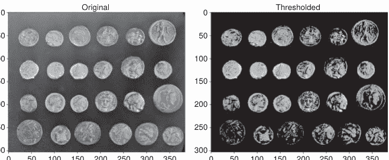

图 5.3 阈值化前后去除背景。

且反对角线元素为 1，其余元素均为 0。我们希望将此掩码应用于形状相同的矩阵：

```python
import numpy as np
X = np.arange(25).reshape(5, 5) + 1
# array([[ 1,  2,  3,  4,  5],
#        [ 6,  7,  8,  9, 10],
#        [11, 12, 13, 14, 15],
#        [16, 17, 18, 19, 20],
#        [21, 22, 23, 24, 25]])
# Create the cross-like mask
mask = np.zeros_like(X)
np.fill_diagonal(mask, 1)
mask = mask[:, ::-1] # now the anti-diagonal is filled
np.fill_diagonal(mask, 1)
# array([[0, 0, 0, 0, 1],
#        [0, 0, 0, 1, 0],
#        [0, 0, 1, 0, 0],
#        [0, 1, 0, 1, 0],
#        [1, 0, 0, 0, 1]])
# Apply the mask with multiplication
# equivalent to np.where(mask > 0, X, 0)
X = X * mask
# array([[ 1,  0,  0,  0,  5],
#        [ 0,  7,  0,  9,  0],
#        [ 0,  0, 13,  0,  0],
#        [ 0, 17,  0, 19,  0],
#        [21,  0,  0,  0, 25]])
```

### 5.1.4 将算术运算用作布尔运算以应用和组合掩码

如第 2 章所介绍，有四种主要的布尔运算：AND、OR、NOT 和 XOR。当掩码张量表示为布尔值时，我们可以利用布尔运算符 &、|、~ 和 ^，或专用操作（如 Tensorflow 的 logical_and、logical_or、logical_not 和 logical_xor）。然而，掩码可以作为数值张量而不是布尔张量创建，因此需要进行类型转换。如果我们的掩码和数据已经是数值 dtype，则仅使用数值运算来组合和应用掩码可能更简单、更易于操作。

为了说明布尔运算如何表示为算术运算，假设我们有两个掩码 mask_a = [1, 0, 0, 1, 0] 和 mask_b = [0, 0, 0, 1, 1]。如果将它们转换为布尔掩码，则 mask_a_bool = [True, False, False, True, False] 且 mask_b_bool = [False, False, False, True, True]。

对 mask_a_bool 进行 NOT 运算得到 B = [False, True, True, False, True]，或者转换为二进制，[0, 1, 1, 0, 1]。请注意，这仅仅是 1 - mask_a。因此，1 - mask 可用于 NOT 运算。

mask_a_bool 和 mask_b_bool 之间的 AND 运算得到 B = [False, False, False, True, False]。当且仅当两个数组在对应索引处的元素都为 True（或数值上为 1）时，AND 运算才会产生 True。我们可以将两个数值掩码相乘，得到 S = [0, 0, 0, 1, 0]。请注意，这与布尔掩码 B 很好地对应，其中 0 对应 False，1 对应 True。

mask_a_bool 和 mask_b_bool 之间的 OR 运算得到 B = [True, False, False, True, True]。当两个数组在对应索引处的任一元素为 True（或数值上对应 1）时，OR 运算会产生 True。我们可以将两个数值掩码相加，得到 S = [1, 0, 0, 2, 1]。这与组合后的布尔掩码很好地对应，其中 0 对应 False，任何大于 0 的值都对应 True。为了保留组合掩码的二进制（仅 0 和 1）特性，我们可以将组合数值掩码的值裁剪为最大值 1，即 np.minimum(S, 1) = [1, 0, 0, 1, 1]。

最后，mask_a_bool 和 mask_b_bool 之间的 XOR 运算得到 B = [True, False, False, False, True]。当且仅当两个元素的值不相同时（True vs. False 或 False vs. True），XOR 运算会产生 True；否则（True vs. True 或 False vs. False）产生 False。使用 AND、OR 和 NOT 运算符，XOR 等价于 a ^ b = (a | b) & ~(a & b)。因此，更困难的方法是使用上述算术版本的 AND、OR 和 NOT 布尔运算来重构 XOR。然而，更简单的方法是使用减法和绝对值，即 np.abs(a - b) = np.abs([1, 0, 0, 0, -1]) = [1, 0, 0, 0, 1]。

以下代码片段实现了布尔运算的算术版本。

```python
import numpy as np

def combine_mask(a, b=None, operation="not"):
    if operation == "not":
        assert b is not None, f"b is required for {operation}"
    if operation == "not": # b is ignored
        return 1 - a
    elif operation == "and":
        return a * b
    elif operation == "or":
        return np.minimum(a + b, 1)
    elif operation == "xor":
        return np.abs(a - b)
    else:
        raise(ValueError(f"Unrecognized operation {operation}."))
```

### 5.1.5 基于掩码选择元素

迄今介绍的掩码方法都会替换张量内部的值，同时保留输入张量的形状和维度。然而，在某些情况下，我们希望丢弃被掩码的元素，从而减小输入的大小。NumPy 的 np.compress（或等效的 Tensorflow 的 tf.boolean_mask 和 PyTorch 的 torch.masked_select）用于此目的。在最简单的情况下，布尔掩码与使用布尔索引选择元素相同。例如，

```python
import numpy as np

X = np.array([5, 3, 2, 6, 9])
mask = np.mod(X, 2) == 0 # even number
assert np.allclose(
    X[mask], # array([2, 6])
    np.compress(mask, X) # array([2, 6])
)
```

对于更高级的示例，假设我们有一个大小为 (N, N) 的二维方阵，希望删除所有对角线元素，使其变为


图 5.4 布尔张量掩码和压缩。

大小为 (N, N-1) 的矩形矩阵。我们可以使用以下 PyTorch 过程实现此操作（另见图 5.4）：

```python
import torch
X = torch.arange(25).reshape(5, 5) + 1
mask = torch.ones_like(X, dtype=bool)
mask.fill_diagonal_(False)
X_masked = torch.masked_select(X, mask).reshape(5, 4)
```

等效操作可以在 Tensorflow 中实现，但不能使用 NumPy 的 `np.compress`，因为 `mask` 必须是 1D 且沿输入张量 X 的某个维度进行操作。

### 5.1.6 案例研究：Top-k 掩码

假设我们有一批数组（例如二维矩阵）。对于每个数组，我们希望仅保留前三个值，而将所有其他条目设为零（见图 5.5a）。我们可以通过创建二进制掩码并将其应用于原始矩阵来实现此操作。二进制掩码应在原始矩阵值位于前三个值中的索引处设为 1，否则设为 0（见图 5.5b）。

以下代码片段使用 NumPy 实现了 top-k 掩码操作。

```python
import numpy as np
def top_k_masking(y, top_k, masked_value=0):
    """Mask the input and retain only top_k values."""
    # Get top k indices
    index = np.argsort(y) [..., -top_k:][..., ::-1]
    # Initialize the zeros mask
    mask = np.zeros_like(y)
    # scatter the indices (in-place)
    np.put_along_axis(mask, index, 1, axis=-1)
    # Adjust values such that the masked elements
    # are replaced with masked_value
    y_masked = y * mask + masked_value * (1 - mask)
    return y_masked
```

- 第 5 行获取 top-k 值的索引
- 第 7 行初始化掩码，该掩码将保留的值指示为 1，将丢弃的值指示为 0。
- 第 9 行进行原位替换，在将保留值的索引处放入 1。
- 第 12 行应用掩码。mask 是二进制的（1 和 0）。逐元素乘法 y * mask 会先将所有被掩码/丢弃的值设为零。然后，masked_value * (1 - mask) 会将被掩码的条目设为 masked_value（即，当需要掩码时，value:= 0 + masked_value = masked_value；否则，value:= value + 0 = value）。


图 5.5 掩码前 K 值。(a) 给定示例数组批次，我们希望保留每个数组中的前三个值，并将数组中的其余元素设为 0。(b) 要创建掩码，我们首先按每个数组对值进行排序并识别前三个值的索引。然后创建一个与原始矩阵形状相同的二进制掩码，并在前三个值的对应索引处将值设为 1。

```python
y = np.array([
    [1, 5, 2, 3, 8, 7],
    [2, 6, 3, 1, 9, 4]
])
```


top_k_masking(y, top_k=3, masked_value=0)
# array([[0, 5, 0, 0, 8, 7],
#          [0, 6, 0, 0, 9, 4]])

## 5.2 填充

填充会向我们的数据张量添加元素，以确保数据以所需形状一致地表示。与掩码类似，添加的数据旨在被模型忽略，而数据在通过我们的向量化操作时。

NumPy [Harris 等人, 2023] 和 Tensorflow [Abadi 等人, 2023] 均实现了三种填充模式，即 `constant`、`reflect` 和 `symmetric`（模式命名或拼写存在差异）；PyTorch 也实现了 `constant` 和 `reflect`（存在局限性），但不支持 `symmetric`；此外还实现了两种额外模式，即 `replicate`（仅重复边框值，等效于 NumPy 的 `edge` 模式）和 `circular`（等效于 NumPy 的 `warp` 模式）。NumPy 还实现了多种其他模式，例如沿每个维度填充 `mean`、`median`、`maximum` 或 `minimum` 值。

在常量填充模式下（NumPy: "constant", Tensorflow: "CONSTANT", PyTorch: "constant"），常量值会在张量沿特定维度的开头或结尾添加。在 NumPy 和 Tensorflow 中，我们可以指定要填充的值的数量，并在张量沿维度的前面或后面进行填充，使用格式 [(start_axis_0, end_axis_0), (start_axis_1, end_axis_1), ..., (start_axis_n, end_axis_n)]。然而，PyTorch 的 torch.nn.functional.pad 具有不同的实现，要求填充按逆序指定并作为扁平化数组，即 [start_axis_n, end_axis_n, ..., start_axis_0, end_axis_0]。例如，给定一个 3 x 4 矩阵，我们希望在行开头添加三个更多的零，并在列结尾添加两个更多的零，则执行以下操作

```python
import numpy as np
import tensorflow as tf
import torch.nn.functional as F
# shape(3, 4)
X = np.array([
    [7, 1, 4, 4],
    [5, 7, 6, 4],
    [7, 3, 1, 2],
])
# padding zeros -> shape (6, 6)
y_np = np.pad(X, [(3, 0), (0, 2)], mode="constant", constant_values=0)
y_tf = tf.pad(X, [(3, 0), (0, 2)], mode="CONSTANT", constant_values=0)
y_torch = F.pad(
    torch.tensor(X), [0, 2, 3, 0], mode="constant", value=0
)
# array([[0, 0, 0, 0, 0, 0],
#        [0, 0, 0, 0, 0, 0],
#        [0, 0, 0, 0, 0, 0],
#        [7, 1, 4, 4, 0, 0],
#        [5, 7, 6, 4, 0, 0],
#        [7, 3, 1, 2, 0, 0]])
```

另请参见图 5.6 以获取示意图。

在 NumPy 中（即 Tensorflow 或 PyTorch 中不允许这样做），constant_values 参数也可以是一对值（所有维度的 (start_value, end_value)）或一组元组值的列表（[(start_value_0, end_value_0), (start_value_1, end_value_1), ...]），如以下示例所示：

```python
import numpy as np
# shape (3, 4)
X = np.array([
    [7, 1, 4, 4],
    [5, 7, 6, 4],
    [7, 3, 1, 2],
])
# padding starts with 0 and ends with -1 for each dimension
y = np.pad(X, [(0, 1), (2, 0)], mode="constant", constant_values=(0, -1))
# array([[ 0,  0,  7,  1,  4,  4],
#        [ 0,  0,  5,  7,  6,  4],
#        [ 0,  0,  7,  3,  1,  2],
#        [ 0,  0, -1, -1, -1, -1]])
# padding row start with 0, row end with -1
# padding column start with -2, column end with -3
y = np.pad(
    X, [(1, 1), (1, 1)], constant_values=[(0, -1), (-2, -3)]
)
# array([[-2,  0,  0,  0,  0, -3],
#        [-2,  7,  7,  9,  5, -3],
#        [-2,  9,  4,  7,  5, -3],
#        [-2,  1,  4,  1,  3, -3],
#        [-2, -1, -1, -1, -1, -3]])
```

我们可以看到，填充的顺序遵循 `constant_values` 元组列表的顺序：它先填充行的开头和结尾，再填充列的开头和结尾。更高维度的张量填充遵循相同的轴顺序。另请参见图 5.7 以获取示意图。


图 5.7 `constant` 填充顺序示意图。

在反射填充模式下（NumPy: `reflect`, Tensorflow `REFLECT`, PyTorch: `reflect`），填充的添加方式仿佛在张量的边框值处放置了一面镜子。也就是说，在填充索引 -1、-2，...（维度开头）处，使用索引 1、2，... 处的值；在填充索引 N、N + 1，...（维度结尾）处，使用 N - 1、N - 2，... 处的值。与 `constant` 模式类似，填充是按张量的轴顺序逐步添加的。`reflect` 填充在执行傅里叶变换之前很有用，例如，在音频信号处理的情况下。另请参见图 5.8 和以下代码片段以获取示意图。


图 5.8 `reflect` 填充示例插图。虚线表示反射轴。

```python
import numpy as np
import tensorflow as tf
import torch.nn.functional as F

X = np.array([
    [7, 1, 4, 4],
    [5, 7, 6, 4],
    [7, 3, 1, 2],
])
y_np = np.pad(X, [(1, 2), (1, 2)], mode="reflect")
y_tf = tf.pad(X, [(1, 2), (1, 2)], mode="REFLECT")
y_torch = F.pad(
    torch.tensor(X[None, :, :], dtype=float),
    [1, 2, 1, 2],
    mode="reflect"
)[0, :, :]

# array([[[7, 5, 7, 6, 4, 6, 7],
#         [1, 7, 1, 4, 4, 1, 7],
#         [7, 5, 7, 6, 4, 6, 7],
#         [3, 7, 3, 1, 2, 1, 3],
#         [7, 5, 7, 6, 4, 6, 7],
#         [1, 7, 1, 4, 4, 1, 7]]])
```

请注意，在 PyTorch 的实现中，我们需要添加一个额外维度。这是因为 PyTorch 的反射填充是专门用于处理二维到五维张量而实现的 [Paszke 等人, 2023]，其中“反射”只能创建：

- 对于 2D 张量，在最后一个维度上；
- 对于 3D 张量，在最后一个或最后两个维度上；
- 对于 4D 张量，在最后两个或最后三个维度上；
- 对于 5D 张量，在最后三个维度上。

此外，在 `torch.nn.functional.pad` 中，仅可以使用浮点值进行反射填充操作。

在对称填充模式下（NumPy: `symmetric`, Tensorflow: `SYMMETRIC`），会添加填充值，使得生成的张量沿每个维度对称。这就像在张量沿每个维度的边缘放置一面镜子；与反射模式不同，边框值也会在镜子中反射。另请参见图 5.9 和以下代码片段以获取示意图。

```python
import numpy as np
import tensorflow as tf
X = np.array([
    [7, 1, 4, 4],
    [5, 7, 6, 4],
    [7, 3, 1, 2],
])
y_np = np.pad(X, [(1, 2), (1, 2)], mode="symmetric")
y_tf = tf.pad(X, [(1, 2), (1, 2)], mode="SYMMETRIC")
# no 'symmetric' mode in the torch.nn.functional.pad
# array([[[7, 7, 1, 4, 4, 4],
#         [7, 7, 1, 4, 4, 4],
#         [5, 5, 7, 6, 4, 6],
#         [7, 7, 3, 1, 2, 2, 1],
#         [7, 7, 3, 1, 2, 2, 1],
#         [5, 5, 7, 6, 4, 4, 6]]>)
```

NumPy 和 PyTorch 分别实现了边缘或复制模式。在此模式下，沿每个维度的边框值会被重复。PyTorch 的复制模式与其反射模式有类似的局限性。另请参见图 5.10 和以下代码片段以获取示意图。


图 5.9 对称填充示例插图。虚线表示对称轴。


图 5.10 边缘或复制填充示例插图。

```python
import numpy as np
import torch

X = np.array([
    [7, 1, 4, 4],
    [5, 7, 6, 4],
    [7, 3, 1, 2],
])

y_np = np.pad(X, [(1, 2), (1, 2)], mode="edge")
y_torch = F.pad(
    torch.tensor(X[None, :, :], dtype=float),
    [1, 2, 1, 2],
    mode="replicate"
)[0, :, :]
# array([[[7, 7, 1, 4, 4, 4, 4],
#         [7, 7, 1, 4, 4, 4, 4],
#         [5, 5, 7, 6, 4, 4, 4],
#         [7, 7, 3, 1, 2, 2, 2],
#         [7, 7, 3, 1, 2, 2, 2],
#         [7, 7, 3, 1, 2, 2, 2]]])
```

NumPy 和 PyTorch 也分别实现了环绕或循环模式。在此模式下，填充中的值是张量沿其维度的环绕。也就是说，对于索引 -1、-2，... 处的填充值，使用张量在 N - 1、N - 2，... 处的值；对于索引 N、N + 1，... 处的填充值，使用张量在 0、1，... 处的值。就撰写本章时的 PyTorch 实现而言（torch==2.0.1），除了与反射模式和复制模式相同的局限性外，循环填充模式一次只支持填充一个维度（即张量的最后一个维度）。因此，我们需要使用多个填充步骤来填充所有维度。另请参见图 5.11 和以下代码片段以获取示意图。


```python
import numpy as np
import torch
X = np.array([
    [7, 1, 4, 4],
    [5, 7, 6, 4],
    [7, 3, 1, 2],
])
y_np = np.pad(X, [(1, 2), (1, 2)], mode="wrap")
# padding rows
y_torch = F.pad(
    torch.tensor(X, dtype=float).t()[None, :, :, :],
    (1, 2),
    mode="circular"
)
# padding columns
y_torch = F.pad(torch.swapaxes(y_torch, 1, 2), [1, 2], mode="circular")
# array([[2, 7, 3, 1, 2, 7, 3],
#        [4, 7, 1, 4, 4, 7, 1],
#        [5, 5, 7, 6, 4, 5, 7],
#        [2, 7, 3, 1, 2, 7, 3],
#        [4, 7, 1, 4, 4, 7, 1],
#        [4, 5, 7, 6, 4, 5, 7]])
```

### 5.2.1 案例研究：卷积神经网络中的填充

理解填充在实现卷积神经网络时非常有用。卷积层中有两种典型的填充模式：`valid` 和 `same`。`valid` 简单来说就是不添加填充，卷积结果的尺寸小于输入。`same` 意味着在卷积维度的高度和宽度上添加一些零填充，使得卷积结果的高度和宽度与输入相同。参见图 5.12，了解两者差异的示例。另请参见下方代码示例，以验证卷积操作中 `same` 与 `valid` 填充的形状。

```python
import tensorflow as tf
X = tf.constant([
    [5, 3, 2, 7],
    [4, 1, 3, 7],
    [1, 4, 4, 1],
    [7, 6, 4, 2],
], dtype=tf.float32)[None, :, :, None]
Filters = tf.constant([
    [0, 2],
    [1, 1]
], dtype=tf.float32)[:, :, None, None]
y_valid = tf.nn.conv2d(
    X,
    Filters,
    1,
    "VALID",
    data_format='NHWC',
    dilations=None,
    name=None
)
assert y_valid.shape[1] == X.shape[1] - 1
assert y_valid.shape[2] == X.shape[2] - 1
y_same = tf.nn.conv2d(
    X,
    Filters,
    1,
    "SAME",
    data_format='NHWC',
    dilations=None,
    name=None
)
assert y_same.shape[1] == X.shape[1]
assert y_same.shape[2] == X.shape[2]
```


图 5.12 卷积操作中 same 与 valid 填充的示例。

### 5.2.2 案例研究：将序列截断或填充到所需长度

假设我们有两个序列批次，X 和 y。X 的形状为 (batch_size, seq_len_1)，y 的形状为 (batch_size, seq_len_2)。我们事先不知道哪个序列更长，但希望 y 的序列长度与 X 相同。以下代码使用填充和切片的思想来对齐 X 和 y 的长度。

```python
import numpy as np
def align_lengths(X, y):
    """Align y to the length (axis=1) of X."""
    # Get the desired length
    X_len = X.shape[1]
    # Compute pad_size.
    # No padding (pad_size=0) if y length is enough
    pad_size = max(X_len - y.shape[1], 0)
    # Pad if not enough
    y = np.pad(y, [(0, 0), (0, pad_size)])
    # Truncate if y is too long
    y = y[:, :X_len]
    return y
```

- 第 5 行获取我们希望 y 具有的所需长度。
- 第 8 行计算所需的填充大小。如果 X 更长，则需要填充 X 与 y 之间的差值；但如果 X 更短，则不应填充（pad_size=0）。
- 第 10 行基于我们计算的 pad_size 进行填充。这将处理 y 比 X 短的情况，但在 y 长度与 X 相同或更长时无效。
- 第 12 行截断 y 中的任何额外元素。如果 y 确实比 X 长，截断后 y 的大小应与 X 相同。如果 y 长度与 X 相同或比 X 短，前一步的填充会先将 y 的长度带到与 X 相同。然后截断到 X 的长度将没有效果。

我们可以快速测试我们的实现：

```python
X1 = np.random.rand(16, 50)
X2 = np.random.rand(16, 30)
y = np.random.rand(16, 37)
y1 = align_lengths(X1, y)
assert np.allclose(X1.shape, y1.shape)
print(y1.shape)
y2 = align_lengths(X2, y)
assert np.allclose(X2.shape, y2.shape)
print(y2.shape)
```

上述算法的一个实际用例是将生成的序列对齐到所需长度。例如，真实语音音频样本包含两个词，持续一秒钟，包含 16,000 个数据点（即 16 kHz 采样率）。然而，由于从这两个词进行 [16, 16, 32] 因子的一系列上采样，生成的样本创建了一个包含 2 x 16 x 16 x 32 = 16,384 个数据点的序列。为了通过计算预测与真实值之间的损失来从音频样本中学习，我们可以使用上述算法对齐两个序列（例如，将生成的序列截断到 16,000 个数据点）。值得注意的是，在许多处理序列数据的机器学习实际应用中，预测序列 y 通常应与模板或输入序列 X 长度相似。如果预测序列明显比预期长或短，则需要了解上采样步骤是否正确实现，或者上采样的超参数是否选择得当。

## 5.3 高级案例研究

在本章剩余部分，让我们探讨机器学习/深度学习模型中掩码和填充的几种更高级用例。

### 5.3.1 缩放点积注意力

论文“Attention Is All You Need”[Vaswani et al., 2017]所介绍的 Transformer 模型，迄今可能是最成功的序列模型类型。它已被广泛用于建模文本、音频和图像等序列数据，用于自然语言理解 [Devlin et al., 2019]、语音识别 [Gulati et al., 2020]、歌唱声合成 [Liu et al., 2021] 和图像识别 [Dosovitskiy et al., 2021] 等任务。Transformer 模型的一个关键组件是缩放点积注意力机制，它教会模型关注序列的哪一部分进行学习。缩放点积注意力定义为

$$A(Q, K, V) = \text{softmax} \left( \frac{QK^T}{\sqrt{d_k}} \right) V$$ (5.1)

其中

- Q、K、V 是查询、键和值序列。
- d_k 是键的“深度”或嵌入维度。
- softmax(·) 是 softmax 激活函数，定义为 σ(xᵢ) = exp(xᵢ) / Σⱼ exp(xⱼ)。

在公式 5.1 中，查询和键首先进行点积 QK^T，然后再按键深度的平方根 √d_k 进行缩放。随后，计算出的注意力分数通过 softmax 函数转换为概率，并通过张量乘法应用于值序列。

此外，这种注意力机制有两种主要形式：

- **自注意力**：key、query 和 value 都是相同的序列输入。注意力权重在序列内部计算，即其自身元素对之间。
- **交叉注意力**：key、query 和 value 不是相同的序列。在这里，key 和 query 序列中的元素需要具有相同的嵌入或所谓的深度维度，而 key 和 value 需要具有相同的序列长度。注意力权重在由 key 和 query 表示的两个不同序列之间计算，并应用于由 value 表示的第三个序列。

自注意力有两种主要形式（参见图 5.13）：

- **双向自注意力**：序列中的单个 token 可以关注不仅在其之前（以及其自身）的 token，还可以关注之后的 token。这种自注意力作为 Transformer 模型编码器层的一部分实现，其中围绕当前 token 的所有上下文都有助于指导模型。
- **因果自注意力**：序列中的单个 token 只能关注在其之前（以及其自身）的 token。这种自注意力作为 Transformer 模型解码器层的一部分实现，其中仅使用历史 token 序列来预测接下来的 token。

图 5.14 展示了双向和因果自注意力的注意力掩码。请注意，因果自注意力掩码形成一个下三角矩阵（包括对角线）。


图 5.13 双向与因果自注意力。


图 5.14 注意力掩码。(a) 双向注意力掩码，允许过去的 token 关注未来的 token 且反之亦然；(b) 因果注意力掩码，仅允许未来的 token 关注过去的 token，但过去的 token 无法关注未来的 token。

以下代码片段使用 TensorFlow 和 Keras 实现了缩放点积注意力（Scaled Dot-Product Attention）。

```python
import tensorflow as tf
from keras.activations import softmax

def scaled_dot_product_attention(
    query, key, value, mask=None, causal=True, dropout=0.0
):
    """
    Use the dense layer output from query, key, value,
    respectively, as input for attention

    Parameters:
    ----------
    * query: (..., l_q, depth_src)
    * key: (..., l_k == l_v, depth_src)
    * value: (..., l_v == l_k, depth_out)
    * mask: Float tensor of 0s and 1s, with
    shape broadcastable to (..., l_q, l_k).
    * causal: bool. Whether or not to apply causal attention masking.
    * dropout: dropout rate.

    - depth_*: depth num_heads = embed_dim, which
    can be different, but are usually the same.
    - l_*: are lengths of input sequences which can be different,
    but are usually the same

    Returns:
    ----------
    * attention: attention score (..., l_q, depth_out)
    * weights: weights of the value when summing the value (..., l_q, l_k)
    """
    # Cosine/dot product similarity
    # Q K.T, (..., l_q, l_k)
    logit_score = tf.matmul(query, key, transpose_b=True)

    # scale by dimension of key
    d_k = tf.cast(tf.shape(key)[-1], tf.float32)
    scaled_logit_score = logit_score / tf.sqrt(d_k)  # (..., l_q, l_k)

    # Masking the region by a large negative number (est. -inf)
    if mask is not None:
        scaled_logit_score += mask * -1e9  # (..., l_q, l_k)

    if causal:
        l_q = tf.shape(query)[-2]
        l_k = tf.shape(key)[-2]
        # creates an upper triangular mask to retain lower triangular
        # matrix
        causal_mask = 1 - tf.linalg.band_part(
            tf.ones((l_q, l_k), tf.float32), -1, 0
        )
        scaled_logit_score += causal_mask * -1e9

    # weights: softmax normalization
    weights = softmax(scaled_logit_score, axis=-1)
    # Add dropout
    weights = tf.nn.dropout(weights, dropout)

    # attention (..., l_q, depth_out)
    attention = tf.matmul(weights, value)

    return attention, weights
```

- 第 13 行和第 14 行：Key 和 value 必须具有相同的长度，即 l_k == l_v。
- 第 33 行实现了 Key 和 Query 之间的点积注意力部分 QK^T。logit_score 的形状为 (batch_size, [num_heads,] l_q, l_k)，其中可选的 num_heads 是多头注意力中的头数。
- 第 36 行从输入 key 中获取 key 的嵌入大小 d_k。
- 第 37 行计算缩放点积 QK^T / sqrt(d_k)。
- 第 40 行和第 41 行：这处理了一种情况，即在点积注意力之上应用额外的二进制掩码。我们通过向被掩码区域添加一个很大的负数来应用掩码。这是因为，在应用 softmax 激活后，很大负数的 logit 分数将变为接近 0。例如，softmax([1, -3, 2, -1e9, 5]) = 1.7142441e-02, 3.1397477e-04, 4.6597987e-02, 0.00000000e+00, 9.3594557e-01]。我们选择在 logit 分数上添加很大的负数，而不是先执行 softmax 再应用二进制掩码，因为我们希望确保应用 softmax 后注意力掩码的权重仍然加和为 1。注意，假设掩码具有或可以广播到形状 (batch_size, [num_heads,] l_q, l_k)。
- 第 42-49 行实现了因果掩码。在这里，我们使用 tf.linalg.band_part 创建一个上三角掩码，以保留矩阵的对角线和下三角部分。注意，此实现可以处理 value 长度不等于 query 长度的情况。掩码的形状为 (l_q, l_k)。
- 在第 49 行，我们再次通过向 logit 分数的被掩码区域添加一个很大的负数来应用掩码。我们在此利用广播规则，因为我们知道 scaled_logit_score 具有形状 (batch_size, [num_heads,], l_q, l_k)，并且对注意力分数的所有批次和所有头应用相同的上三角掩码。
- 第 52 行对注意力掩码批次的最后一个维度应用 softmax，使得 key 和 query 之间的注意力权重加和为 1。
- 第 54 行添加一个 dropout 层。在推理时，我们需要将 dropout 设置为 0 以确保输出是确定性的。
- 第 57 行通过将 weights 和 value 相乘来创建注意力加权序列。这里 weights 具有形状 (batch_size, [num_heads,] l_q, l_k)，value 具有形状 (batch_size, [num_heads,], l_v, depth_out)，并且已知 l_k == l_v。回顾，tf.matmul 作用于张量的最后两个维度。然后，attention 具有形状 (batch_size, [num_heads,], l_q, depth_out)。

### 5.3.2 通过掩码实现可变长度范围

本案例研究创建了一个辅助函数，我们将在第 5.3.3 节中使用它，在那里我们将实现 FastSpeech2 [Ren et al., 2020] 的 Length Regulator 模块。

假设我们有一个长序列，如下所示 [1, 1, 2, 2, 2, 2, 2, 3, 3, 3]，其中每个值索引当前值所属的组。我们可以观察到有 2 个 1，5 个 2，和 4 个 3。我们希望能够给每个数字一个组内索引 [0, 1, 0, 1, 2, 3, 4, 0, 1, 2, 3]，以横向连接 3 个范围数组 [0, 1]、[0, 1, 2, 3, 4] 和 [0, 1, 2, 3]，每个都有不同的长度。TensorFlow 的 RaggedTensor 类


图 5.15 构建不规则范围向量。(a) 通过广播范围数组的行向量和数组长度的列向量来创建布尔掩码。如果范围数组中的值小于长度向量中对应行的值，则将其标记为 True；否则，标记为 False；(b) 掩码堆叠的密集范围数组。在我们的实现中，灰色显示的值将被替换为 -1；(c) 展平矩阵并通过丢弃掩码值来压缩向量。

实现了初始化器 `tf.ragged.range`，它返回一批长度可变的向量。例如，`tf.ragged.range([2, 5, 4])` 返回

```
[
 [0, 1],
 [0, 1, 2, 3, 4],
 [0, 1, 2, 3]
]
```

然后我们可以使用 `tf.ragged.range([2, 5, 4]).flat_values` 展平这个不规则张量，并获得之前想要的组内索引。

但如果我们使用的库中没有这样方便的初始化器怎么办？我们可以使用索引和掩码的思想来构建类似的东西。我们实现的一般策略如下（另参见图 5.15）：

- 我们将首先根据输入构建一个单一的范围数组（即通过 `np.arange` 得到的 [0, 1, 2, ..., n]），直到所需的最大数组长度。
- 然后，我们将掩码掉范围数组中超出所需范围的元素，并用填充值（例如 -1）替换它。掩码可以通过将范围数组的行向量与数组长度的列向量一起广播来构建。
- 最后，为了返回所需的一维向量，我们首先展平矩阵，然后移除任何填充值。

以下是使用 NumPy 的实现：

```python
from typing import List
import numpy as np

def ragged_range(n: List[int], pad=-1, flatten=True):
    """Implement ragged matrix using a dense matrix with paddings."""
    # Find the maximum length
    n = np.array(n)
    max_n = np.max(n)
    # Construct and repeat arrange
    r = np.arange(max_n)[None, :]
    # Masking with broadcasting
    mask = r > n[:, None]
    r = np.where(mask, pad, r)
    # Flatten
    if flatten:
        # Flatten
        r = np.ravel(r)
        # Remove padding values
        r = np.compress(r != pad, r)

    return r
```

- 第 7 行确保列表输入 `n`（指定范围数组所需长度）是一个 `np.ndarray`，稍后将用于广播。
- 第 8 行确定范围数组的最大大小。
- 第 10 行创建初始范围数组，直到最大数组长度。
- 第 12 行创建掩码以保留小于由 `n` 指定的数组大小的值。这是通过广播数组长度的列向量和在第 10 行初始化的范围数组的行向量来完成的。生成的掩码是大小为 `(len(n), max_n)` 的矩阵。注意，我们正在牺牲内存空间以换取随后的向量化机会。在某些最坏情况下，一个范围数组可能比其余范围数组长得多。在这种情况下，大多数元素是填充值，或者矩阵是稀疏的（我们将在第 7 章讨论这个概念）。
- 第 13 行使用 `np.where` 根据 `mask` 替换值。如果 `mask` 值为 `True`，则我们将 `r` 中的值替换为 `pad` 值，例如 `-1`；否则，我们保留 `r` 内部的值。
- 第 15-19 行实现了当我们需要返回扁平数组时的逻辑。否则，我们将简单地返回矩阵，其中每一行都是带有填充的范围数组。
- 第 17 行将二维矩阵展平为一维向量。
- 第 19 行移除填充值。

为了准备第 5.3.3 节的案例研究，我还将上述函数从 NumPy 翻译成了 TensorFlow。请注意，我们需要额外努力来确保在执行每个操作之前数据类型一致。


```python
from typing import List

import tensorflow as tf

def tf_ragged_range(n: tf.Tensor, pad=-1, flatten=True, dtype=tf.int64):
    """Implement ragged matrix using a dense matrix with paddings."""
    # Find the maximum length
    n = tf.cast(n, dtype)
    pad = tf.cast(pad, dtype)
    max_n = tf.reduce_max(n)
    # Construct and repeat arange
    r = tf.expand_dims(tf.range(max_n, dtype=dtype), axis=0)
    # Masking with broadcasting
    mask = r >= tf.expand_dims(n, axis=1)
    r = tf.where(mask, pad, r)
    # Flatten
    if flatten:
        # Flatten
        r = tf.reshape(r, (-1,))
        # Remove padding values
        r = tf.boolean_mask(r, r != pad)

    return r
```

在第 8 章中，我们将更详细地探讨不规则张量（ragged 或 jagged tensors）。

### 5.3.3 FastSpeech2 长度调节器模块

在典型的文本转语音（TTS）应用中，一串字节或字符串会被转换为一系列波形。这是机器学习中的序列到序列问题，即将某种信息模态的序列表示转换为另一个序列，有时会转换为另一种模态。解决 TTS 问题的经典方法采用自回归建模（例如隐马尔可夫模型 [Zen et al., 2007] 和 WaveNet [van den Oord et al., 2016]），其中提示波形和上下文用于生成后续的新语音波形。另一方面，像 FastSpeech/2 [Ren et al., 2019, 2020] 这样的非自回归方法采用序列到序列（seq2seq）学习，仅用一次传递即可将输入文本转换为音频信号。

不同信息模态之间的序列到序列学习方法的一个问题是，输入和输出序列可能以不同的密度和长度表示信息。例如，“I love machine learning” 这句话由 4 个词元组成的数组构成完整文本，但编码语音信号可能需要约 2 秒的 16 kHz 单声道音频，或 32,000 个 float32 数字组成的数组。根据文本中的单词，仅包含四个单词的句子可能对应由几千或几万个 float32 值组成的音频（“I love machine learning” 与 “How to pronounce Supercalifragilisticexpialidocious”）；并且根据说话人不同，同一句话 “I love machine learning” 可能在一秒内说出，也可能被拉长到几十秒（例如，“I looooooooooove machine learniiiiiiiiing”）。这就是所谓的多对多映射问题。

FastSpeech2 提出了长度调节器模块来解决多对多映射问题。在训练期间，文本词元通过嵌入层传递，该层将句子中的单词编码为一系列嵌入向量，形成张量 [batch_size, seq_len, emb_size]，其中 seq_len 可以是可变序列长度，且是批次中最长句子的长度。对应的语音音频信号（1D 向量）通过傅里叶变换转换为 2D mel 频谱图，形成张量 [batch_size, time_length, num_channels]，其中 time_length 可以是可变长度，且是批次中最长音频的长度，按 mel 频谱图时域的时间步数或帧数来衡量。很容易观察到 seq_len != time_length。然而，我们对 TTS 数据有以下观察：

- 1. 每个单词依次发音。
- 2. 每个单词发音需要一定时间，持续时间相互独立。
- 3. 序列中所有单词发音时间的总和应等于最终音频长度。


**图 5.16** 长度调节器模块对四单词句子 “I love machine learning” 的示例效果，假设已知第一个单词 "I" 占用两个帧，第二个单词 "love" 占用四个帧，第三个单词 "machine" 占用五个帧，最后一个单词 "learning" 占用六个帧。句子中的每个词元首先通过嵌入层传递以创建嵌入向量。然后，根据词元在语音（音频）中应占用的帧数，对嵌入向量进行重复。

我们还假设每个词元由一个嵌入向量表示，但可能对应 mel 频谱图中的多个（或至少 1 个）时间步，这一点来自数据集标注过程。基于这些观察和假设，长度调节器模块作为一个适配器，在 mel 频谱图的发音期间对词元嵌入向量进行重复/平铺。示例请参见图 5.16。

对于可变长度文本输入的批次，长度调节器模块将返回形状为 `[batch_size, time_length, num_channels]` 的张量以及一个相应的二进制掩码，用于稍后掩码填充值。我们将利用索引和散射的知识来实现向量化的长度调节器模块。以下代码片段将长度调节器模块实现为 `keras.Layer` 的子类。

```python
import tensorflow as tf
from keras import Input, Model
from keras.layers import Layer

# Import functions that we implemented previously
from .utils import tf_ragged_range

class LengthRegulator(Layer):
    """FastSpeech Length Regulator"""
    def __init__(
        self,
        num_channels=256,
        max_len=-1,
        name="length_regulator",
    ):
        super(LengthRegulator, self).__init__(name=name)
        # embedding size
        self.num_channels = num_channels
        # maximum length of the audio signal
        # if -1, determine the audio signal from inputs dynamically
        self.max_len = max_len

    def call(
        self,
        token_embeddings,
        spect_durations,
        training=False,
    ):
        """
        Layer call method
        * token_embeddings : (batch_size, seq_len, num_channels)
        * spect_durations : (batch_size, seq_len), where the value of
            the durations are expressed as number of audio sample frames
        * training : bool, optional, by default False

        The length of the returned sequence after length regulator is
        the maximum of the sum of the durations across the batch.
        For example, [[2, 8, 0], [3, 1, 4], [2, 0, 0]]. Then the
        durations are [10, 8, 2], and the output sequence length is 10.
        The mask will indicate the valid positions of the output.
        """
        # Preprocess durations
        spect_durations = tf.cast(tf.round(spect_durations), tf.int64)
        durations = tf.math.maximum(spect_durations, 1)
        durations = tf.cast(durations, tf.int64)

        # Save some shapes
        batch_size = tf.shape(token_embeddings)[0]
        seq_len = tf.shape(durations)[1]
        batch_duration = tf.reduce_sum(durations, axis=1)
        max_durations = tf.maximum(tf.reduce_max(batch_duration),
                                   self.max_len)

        # reshaping to (batch_size x seq_len, num_channels)
        hidden_states = tf.reshape(
            token_embeddings, (-1, self.num_channels))
        durations = tf.reshape(durations, (-1,))

        # repeat: (sum(spec_durations), hidden_size)
        hidden_states = tf.repeat(hidden_states, durations, axis=0)

        # scatter the repeated hidden states to the right positions
        row_indices = tf.repeat(
            tf.repeat(tf.range(batch_size, dtype=tf.int64), seq_len),
            durations,
        )
        col_indices = tf_ragged_range(batch_duration)
        indices = tf.stack([row_indices, col_indices], axis=1)
        output = tf.scatter_nd(
            indices,
            hidden_states,
            shape=(batch_size, max_durations, self.num_channels),
        )

        # create output mask
        mask_batch_duration = tf.reduce_sum(spect_durations, axis=1)
        mask_values = tf.ones(
            [tf.reduce_sum(mask_batch_duration), 1],
            dtype=tf.float32,
        )
        mask_row_indices = tf.repeat(
            tf.range(batch_size, dtype=tf.int64), mask_batch_duration
        )
        mask_col_indices = tf_ragged_range(mask_batch_duration)
        mask_indices = tf.stack([mask_row_indices, mask_col_indices], axis=1)
        mask = tf.scatter_nd(
            mask_indices,
            mask_values,
            shape=(batch_size, max_durations, 1),
        )

        # Further truncate any potential padding zeros
        tight_size = tf.cast(
```


```python
tf.reduce_max(tf.reduce_sum(mask, axis=1)), tf.int64
)
output = output[:, :tight_size, :]
mask = mask[:, :tight_size, :]

return output, mask

@property
def model(self):
    text_embeddings = Input((None, self.num_channels), tf.float32)
    spect_durations = Input((None,), dtype=tf.float32)
    model = Model(
        inputs=[text_embeddings, spect_durations],
        outputs=self.call(
            text_embeddings, spect_durations, training=False
        ),
    )
    return model
```

- __init__ **方法**: 初始化层子类
  - num_channels 存储嵌入维度大小，因为在后续的 call 方法中，我们需要重塑嵌入张量。确实也可以从输入中动态确定嵌入维度大小。
  - max_len 存储最大音频序列长度。如果用户指定了大于零的值，则输出将具有该序列长度，而不是从输入中动态确定。
- call 方法实现了 Length Regulator 模块的主要逻辑，给定一批标记序列嵌入，以及每个标记发音的时长（以 mel-频谱图帧数为单位）。
  - token_embedding 的形状为 [batch_size, seq_len, num_channels]，数据类型为 tf.float32。填充标记应对应值为 0 的嵌入向量。
  - spect_durations 的形状为 [batch_size, seq_len]。填充标记的时长为 0。
  - 第 44 行首先将时长四舍五入为整数。这是因为在推理时，FastSpeech2 模型的另一个模块也会预测标记的时长，而该时长不一定是整数。这一行确保在后续操作中，我们处理的是以整数表示的 mel-频谱图帧数。
  - 第 45 行和第 46 行计算每个标记嵌入需要重复多少次。这同样是推理时的考量：我们需要将序列中的任何标记至少重复一次。在推理时，我们会遇到两种时长可能为 0 的场景：
    1. 发音时长被预测为较短，因此在推理时被四舍五入为 0 时长。
    2. 我们正在处理序列末尾的填充。在这种情况下，填充标记的嵌入向量值应全为零。即使我们保留这些零填充，模型也应该能够学会不在其上生成任何音频。在 call 函数末尾，我们将进行额外的清理以移除这些填充。
  - 第 49–52 行存储一些形状，我们将稍后利用这些形状来重塑输入。这还包括预先计算音频的预期时长（max_durations）。
  - 第 54–56 行将一批标记序列嵌入重塑为形状 [batch_size x seq_len, num_channels]。这将 3D 张量转换为嵌入向量堆栈，随后我们将使用 tf.repeat 操作来重复/上采样这些向量。
  - 第 57 行将一批时长重塑为一维数组 [batch_size x seq_len]。这个新数组将指示 hidden_states（第 54–56 行）中的每个嵌入向量部分需要重复多少次。
  - 第 60 行执行平铺/重复操作。我们现在应该拥有一个形状为 [batch_size x time_len, num_channels] 的嵌入向量堆栈。
  - 第 63–73 行实现了散射逻辑，以将重复的嵌入向量堆栈重塑回形状 [batch_size, time_len, num_channels]。由于我们的重复嵌入向量组织为形状 [batch_size x time_len, num_channels]，我们需要重塑第一个维度并将其拆分为两个独立的维度，即 [batch_size, time_len]。由于这是一个 2D 矩阵，此处我们使用术语 row 表示批次维度，col 表示 time_len：
    - row_indices：这是批次维度的索引。它通过两个 tf.repeat 操作步骤构建。我们首先构建批次索引 [0, 1, ..., batch_size]。然后我们将每个批次索引按序列长度重复。这样，我们为每个标记嵌入分配一个批次索引，结果变为 [0, 0, ..., 1, 1, ..., batch_size, batch_size, ...]。最后，由于每个标记嵌入向量被重复 duration 次（第 60 行），我们也按相应次数对每个标记重复批次索引。这应该使我们得到一个数组，其长度与第 60 行获得的 hidden_states 的第二个维度（axis=1）相同。
    - col_indices：这是时间维度的索引，由我们的辅助函数 tf_ragged_range 构建。对于每个批次，我们逐个枚举向量，分配索引 [ 0, 1, 2, 3, ..., batch_0_duration, 0, 1, 2, 3, ..., batch_1_duration, ...]。我们之前计算的 batch_duration 变量告诉我们当前序列应该有多少帧。
  - 第 68-73 行利用我们计算的索引重新创建形状为 [batch_size, time_len, num_channels] 的张量。散射操作会自动保留零填充，以适应可变长度序列的表示。
  - 第 75-89 行实现了相同的散射逻辑，只不过现在作用于形状为 [batch_size, time_len, 1] 的张量。
  - 第 92-94 行移除 spect_durations 指示的预期时长之外的任何多余填充零。
- model 属性：我经常实现此方法以快速单元测试我的层实现。初始化层后，我会执行 print(layer.model.summary()) 来打印层摘要供我检查。如果抛出错误，那么即使我们已验证模型在 eager 模式下可以生成输出，该 Tensorflow/Keras 模型在图模式下也很可能无法训练。以下是 LengthRegulator 层摘要的输出：

模型: "model_8"

| 层 (类型) | 输出形状 | 参数数 | 连接到 |
|---|---|---|---|
| input_24 (InputLayer) | [(None,None)] | 0 | [] |
| tf.math.round_11 (TFOpLambda) | (None, None) | 0 | ['input_24[0][0]'] |
| tf.cast_47 (TFOpLambda) | (None, None) | 0 | ['tf.math.round_11[0][0]'] |
| tf.math.reduce_sum_36 (TFOpLambda) | (None,) | 0 | ['tf.cast_47[0][0]'] |
| tf.math.maximum_22 (TFOpLambda) | (None, None) | 0 | ['tf.cast_47[0][0]'] |
| tf.cast_50 (TFOpLambda) | (None,) | 0 | ['tf.math.reduce_sum_36[0][0]'] |
| tf.cast_48 (TFOpLambda) | (None, None) | 0 | ['tf.math.maximum_22[0][0]'] |
| tf.math.reduce_max_39 (TFOpLambda) | () | 0 | ['tf.cast_50[0][0]'] |
| tf.math.reduce_sum_35 (TFOpLambda) | (None,) | 0 | ['tf.cast_48[0][0]'] |
| tf.range_40 (TFOpLambda) | (None,) | 0 | ['tf.math.reduce_max_39[0][0]'] |
| tf.cast_49 (TFOpLambda) | (None,) | 0 | ['tf.math.reduce_sum_35[0][0]'] |
| tf.expand_dims_38 (TFOpLambda) | (1, None) | 0 | ['tf.range_40[0][0]'] |
| tf.expand_dims_39 (TFOpLambda) | (None, 1) | 0 | ['tf.cast_50[0][0]'] |
| input_23 (InputLayer) | [(None, None, 256)] | 0 | [] |
| tf.math.reduce_max_38 (TFOpLambda) | () | 0 | ['tf.cast_49[0][0]'] |
| tf.math.greater_equal_19 (TFOpLambda) | (None, None) | 0 | ['tf.expand_dims_38[0][0]', 'tf.expand_dims_39[0][0]'] |
| tf.compat.v1.shape_22 (TFOpLambda) | (3,) | 0 | ['input_23[0][0]'] |
| tf.range_38 (TFOpLambda) | (None,) | 0 | ['tf.math.reduce_max_38[0][0]'] |
| tf.where_19 (TFOpLambda) | (None, None) | 0 | ['tf.math.greater_equal_19[0][0]', 'tf.expand_dims_38[0][0]'] |
| tf.__operators__.getitem_38 (SlicingOpLambda) | () | 0 | ['tf.compat.v1.shape_22[0][0]'] |
| tf.expand_dims_36 (TFOpLambda) | (1, None) | 0 | ['tf.range_38[0][0]'] |
| tf.expand_dims_37 (TFOpLambda) | (None, 1) | 0 | ['tf.cast_49[0][0]'] |
| tf.reshape_74 (TFOpLambda) | (None,) | 0 | ['tf.where_19[0][0]'] |
| tf.math.greater_equal_18 (TFOpLambda) | (None, None) | 0 | ['tf.expand_dims_36[0][0]', 'tf.expand_dims_37[0][0]'] |
| tf.range_39 (TFOpLambda) | (None,) | 0 | ['tf.__operators__.getitem_38[0][0]'] |
| tf.__operators__.ne_17 (TFOpLambda) | (None,) | 0 | ['tf.reshape_74[0][0]'] |
| tf.compat.v1.shape_23 (TFOpLambda) | (2,) | 0 | ['tf.cast_48[0][0]'] |
| tf.where_18 (TFOpLambda) | (None, None) | 0 | ['tf.math.greater_equal_18[0][0]', 'tf.expand_dims_36[0][0]'] |
| tf.math.reduce_max_37 (TFOpLambda) | () | 0 | ['tf.math.reduce_sum_35[0][0]'] |
| tf.repeat_44 (TFOpLambda) | (None,) | 0 | ['tf.range_39[0][0]', 'tf.math.reduce_sum_36[0][0]'] |
| tf.compat.v1.boolean_mask_17 (SlicingOpLambda) | (None,) | 0 | ['tf.reshape_74[0][0]', 'tf.__operators__.ne_17[0][0]'] |
| tf.math.reduce_sum_37 (TFOpLambda) | () | 0 | ['tf.math.reduce_sum_36[0][0]'] |
| tf.range_37 (TFOpLambda) | (None,) | 0 | ['tf.__operators__.getitem_38[0][0]'] |
| tf.__operators__.getitem_39 (SlicingOpLambda) | () | 0 | ['tf.compat.v1.shape_23[0][0]'] |
| tf.reshape_72 (TFOpLambda) | (None,) | 0 | ['tf.where_18[0][0]'] |
| tf.math.maximum_23 (TFOpLambda) | () | 0 | ['tf.math.reduce_max_37[0][0]'] |
| tf.stack_17 (TFOpLambda) | (None, 2) | 0 | ['tf.repeat_44[0][0]', 'tf.compat.v1.boolean_mask_17[0][0]'] |
| tf.ones_8 (TFOpLambda) | (None, 1) | 0 | ['tf.math.reduce_sum_37[0][0]'] |
| tf.repeat_42 (TFOpLambda) | (None,) | 0 | ['tf.range_37[0][0]', 'tf.__operators__.getitem_39[0][0]'] |
| tf.reshape_69 (TFOpLambda) | (None,) | 0 | ['tf.cast_48[0][0]'] |


tf.__operators__.__ne__16 (TFOpLambda) (None,) 0 ['tf.reshape_72[0][0]']

tf.scatter_nd_17
(TFOpLambda) (None, None, 1) 0 ['tf.stack_17[0][0]', 'tf.__operators__.__getitem_38[0][0]', 'tf.math.maximum_23[0][0]', 'tf.ones_8[0][0]']

tf.repeat_43
(TFOpLambda) (None,) 0 ['tf.repeat_42[0][0]', 'tf.reshape_69[0][0]']

tf.compat.v1.boolean_mask_16 (SlicingOpLambda) (None,) 0 ['tf.reshape_72[0][0]', 'tf.__operators__.__ne__16[0][0]']

tf.reshape_68
(TFOpLambda) (None, 256) 0 ['input_23[0][0]']

tf.math.reduce_sum_38 (TFOpLambda) (None, 1) 0 ['tf.scatter_nd_17[0][0]']

tf.stack_16
(TFOpLambda) (None, 2) 0 ['tf.repeat_43[0][0]', 'tf.compat.v1.boolean_mask_16[0][0]']

tf.repeat_41
(TFOpLambda) (None, 256) 0 ['tf.reshape_68[0][0]', 'tf.reshape_69[0][0]']

tf.math.reduce_max_40 (TFOpLambda) () 0 ['tf.math.reduce_sum_38[0][0]']

tf.scatter_nd_16
(TFOpLambda) (None, None, 256) 0 ['tf.stack_16[0][0]', 'tf.__operators__.__getitem_38[0][0]', 'tf.math.maximum_23[0][0]', 'tf.repeat_41[0][0]']

tf.cast_51
(TFOpLambda) () 0 ['tf.math.reduce_max_40[0][0]']

tf.__operators__.__getitem_40 (SlicingOpLambda) (None, None, 256) 0 ['tf.scatter_nd_16[0][0]', 'tf.cast_51[0][0]']

tf.__operators__.__getitem_41 (SlicingOpLambda) (None, None, 1) 0 ['tf.scatter_nd_17[0][0]', 'tf.cast_51[0][0]']

============================================================
总参数量：0 (0.00 Byte)
可训练参数量：0 (0.00 Byte)
非可训练参数量：0 (0.00 Byte)
------------------------------------------------------------

我们可以验证刚刚实现的长度调节器模块的效果：

```python
# Initialize the model layer
layer = LengthRegulator(num_channels=256)

# Make up two inputs
# First input has 4 words, and second input has 7 words
spect_durations = tf.constant([
    [2, 4, 5, 6, 0, 0, 0],
    [1, 3, 6, 2, 8, 4, 1],
])

# Faking the token embedding vectors with random values
# Masking out the part that should not correspond to any utterance
input_mask = tf.cast(spect_durations > 0, tf.float32)[:, :, None]
token_embeddings = tf.random.uniform((2, 7, 256)) * input_mask

# Pass the inputs through the layer
output, mask = layer(token_embeddings, spect_durations)

# Check the batch size are kept
assert output.shape[0] == token_embeddings.shape[0]
# Check that the sequence length is the sum of durations from
# spect_durations
assert output.shape[1] == tf.reduce_max(tf.reduce_sum(spect_durations, 1))
# Check number of channels is the same
assert output.shape[2] == token_embeddings.shape[2]

# Checking masking indicates valid indices
assert tf.experimental.numpy.allclose(
    tf.reduce_sum(mask, axis=(1, 2)).numpy(), # float
    tf.reduce_sum(spect_durations, axis=1).numpy() # int
)
```

## 参考文献

Martin Abadi, Ashish Agarwal, Paul Barham, Eugene Brevdo, Zhifeng Chen,
Craig Citro, Greg S. Corrado, Andy Davis, Jeffrey Dean, Matthieu Devin,
Sanjay Ghemawat, Ian Goodfellow, Andrew Harp, Geoffrey Irving, Michael Isard,
Yangqing Jia, Rafal Jozefowicz, Lukasz Kaiser, Manjunath Kudlur, Josh Levenberg,
Dan Mane, Rajat Monga, Sherry Moore, Derek Murray, Chris Olah, Mike Schuster,
Jonathon Shlens, Benoit Steiner, Ilya Sutskever, Kunal Talwar, Paul Tucker,
Vincent Vanhoucke, Vijay Vasudevan, Fernanda Viegas, Oriol Vinyals,
Pete Warden, Martin Wattenberg, Martin Wicke, Yuan Yu, and Xiaoqiang Zheng.
tf.pad。https://www.tensorflow.org/api_docs/python/tf/pad，2023。

Jacob Devlin, Ming-Wei Chang, Kenton Lee, and Kristina Toutanova. BERT：用于语言理解的深度双向 Transformer 预训练，2019 年 5 月。

Alexey Dosovitskiy, Lucas Beyer, Alexander Kolesnikov, Dirk Weissenborn, Xiaohua Zhai, Thomas Unterthiner, Mostafa Dehghani, Matthias Minderer, Georg Heigold, Sylvain Gelly, Jakob Uszkoreit, and Neil Houlsby. 一张图片抵过 16x16 个词：大规模图像识别的 Transformer，2021 年 6 月。

Anmol Gulati, James Qin, Chung-Cheng Chiu, Niki Parmar, Yu Zhang, Jiahui Yu, Wei Han, Shibo Wang, Zhengdong Zhang, Yonghui Wu, and Ruoming Pang. Conformer：用于语音识别的卷积增强 Transformer，2020 年 5 月。

Charles R. Harris, K. Jarrod Millman, Stéfan J. van der Walt, Ralf Gommers, Pauli Virtanen, David Cournapeau, Eric Wieser, Julian Taylor, Sebastian Berg, Nathaniel J. Smith, Robert Kern, Matti Picus, Stephan Hoyer, Marten H. van Kerkwijk, Matthew Brett, Allan Haldane, Jaime Fernández del Rio, Mark Wiebe, Pearu Peterson, Pierre Gérard-Marchant, Kevin Sheppard, Tyler Reddy, Warren Weckesser, Hameer Abbasi, Christoph Gohlke, and Travis E. Oliphant. np.pad。https://numpy.org/doc/stable/reference/generated/numpy.pad.html，2023。

Jinglin Liu, Chengxi Li, Yi Ren, Feiyang Chen, and Zhou Zhao. DiffSinger：通过浅层扩散机制进行歌声合成，2021。

Aaron van den Oord, Sander Dieleman, Heiga Zen, Karen Simonyan, Oriol Vinyals, Alex Graves, Nal Kalchbrenner, Andrew Senior, and Koray Kavukcuoglu. WaveNet：原始音频的生成模型，2016 年 9 月。

Adam Paszke, Sam Gross, Francisco Massa, Adam Lerer, James Bradbury, Gregory Chanan, Trevor Killeen, Zeming Lin, Natalia Gimelshein, Luca Antiga, Alban Desmaison, Andreas Köpf, Edward Yang, Zach DeVito, Martin Raison, Alykhan Tejani, Sasank Chilamkurthy, Benoit Steiner, Lu Fang, Junjie Bai, and Soumith Chintala. torch.nn.functional.pad。https://pytorch.org/docs/stable/generated/torch.nn.functional.pad.html，2023。

Yi Ren, Yangjun Ruan, Xu Tan, Tao Qin, Sheng Zhao, Zhou Zhao, and Tie Yan Liu. FastSpeech：快速、稳健且可控的文本转语音。神经信息处理系统进展 32 (NeurIPS)，2019。ISSN 10495258。

Yi Ren, Chenxu Hu, Xu Tan, Tao Qin, Sheng Zhao, Zhou Zhao, and Tie-Yan Liu. FastSpeech 2：快速高质量端到端文本转语音，第 1–15 页，2020。

Ashish Vaswani, Noam Shazeer, Niki Parmar, Jakob Uszkoreit, Llion Jones, Aidan N. Gomez, Łukasz Kaiser, and Illia Polosukhin. 注意就是你所需。神经信息处理系统进展，2017 年 12 月（NIPS），第 5999–6009 页，2017。ISSN 10495258。

Heiga Zen, Takashi Nose, Junichi Yamagishi, Shinji Sako, Takashi Masuko, Alan W. Black, and Keiichi Tokuda. 基于 HMM 的语音合成系统 (HTS) 2.0 版。2007。

# 6 字符串处理

在迄今的向量化之旅中，我们只涉及数值数据类型（整数、浮点数、复数等）。然而，字符串数据在处理自然语言处理（NLP）问题时也变得越来越常见。在机器学习的其他应用中，我们有时需要处理类别特征，这些特征在原始数据形式中通常以字符串值出现。因此，在本章中，我们将简要地考察对字符串值进行向量化操作。

## 6.1 字符串数据类型

### 6.1.1 NumPy 字符串、字节和对象

NumPy 有三种数据类型可用于在其 `np.ndarray` 中编码字符串值：`'S'` 表示字节字符串（对应 `np.bytes_` dtype），`'U'` 表示 Unicode 字符（`np.str_`），以及 `'O'` 或 `object` 用于一般对象的编码（对应 `np.object_` dtype），包括字符串和字节。我们可以在 NumPy 中构造字符串数组，如下所示：

```python
import numpy as np
value = ["a", "b", "c"]
A_string = np.array(value, dtype=np.str_)
# array(['a', 'b', 'c'], dtype='<U1')

A_bytes = np.array(value, dtype=np.bytes_)
# array([b'a', b'b', b'c'], dtype='|S1')

A_object = np.array(value, dtype=object)
# array(['a', 'b', 'c'], dtype=object)
```

请注意，对于字符串和字节类型数组（分别为 `A_string` 和 `A_bytes`），显示数组的 `dtype` 具有附加信息。以字符串数组 `A_string` 为例，除了 `np.str_` 对应 `U` 表示法（以及 `<` 前缀）之外，dtype 表示法后面的 `1` 指示数组中字符串的最大长度。例如，让我们构造一个具有可变长度字符串的数组：

```python
A_string = np.array(["1", "12", "123", "1234", "12345"])
# array(['1', '12', '123', '1234', '12345'], dtype='<U5')
```

请注意，现在 `dtype` 变为 `<U5`，表示数组中字符串的最大长度为 5。

数组的数据类型可以通过 `np.ndarray` 的 `.astype` 方法进行相互转换。例如，要将对象数组转换为字节数组，可以执行：

```python
A_object = np.array(["a", "b", "c", "d"], dtype=np.object_)
# array(['a', 'b', 'c', 'd'], dtype=object)
A_object.astype(np.bytes_)
# array([b'a', b'b', b'c', b'd'], dtype='|S1')
```

### 6.1.2 Pandas 字符串

Pandas [McKinney, 2010] 可以将字符串作为 `object` 类型，也可以作为其原生字符串数据类型 `pd.StringDtype` [McKinney, 2023b] 来处理。初始化带有字符串数据的 Pandas 列有多种方法。

```python
import pandas as pd
feature = ["a", "b", "c", "d"]
df = pd.DataFrame({
    "feature1": pd.Series(feature, dtype=pd.StringDtype),
    "feature2": pd.Series(feature, dtype="string"),
    "feature3": pd.Series(feature, dtype=str),
    "feature4": pd.Series(feature, dtype="str"),
    "feature4": pd.Series(feature, dtype=object),
    "feature5": pd.Series(feature, dtype="object")
})
```

使用 `df.info()` 检查 DataFrame 信息，得到

<class 'pandas.core.frame.DataFrame'>
RangeIndex: 4 entries, 0 to 3


```
Data columns (total 6 columns):
#   Column   Non-Null Count   Dtype
--  ------   --------------   -----
0   feature1 4 non-null       string
1   feature2 4 non-null       string
2   feature3 4 non-null       object
3   feature4 4 non-null       object
4   feature5 4 non-null       object
5   feature6 4 non-null       object
dtypes: object(4), string(2)
memory usage: 320.0+ bytes
```

需要注意，指定字符串类型列有两种方法，即使用 `pd.StringDtype(feature1)` 或 `"string"` (feature2) 作为 dtype 参数。初始化 object 数据类型列有多种方法，可使用 `str` (feature3)、字符串 `"str"` (feature4)、`object` (feature5) 或字符串 `"object"` (feature6)。有趣的是，`pd.Series` 将 Python 类 `str` 和 `"str"` 都解释为 object。这可能会让人认为 dtype 参数中的任何值都会被解释为 object，但尝试其他内容，例如本书作者的姓名，你会发现情况并非如此。

将 NumPy 字符串数组转换为 Pandas 系列时，默认数据类型为 object，即

```
import numpy as np
import pandas as pd
A_string = np.array(["a", "b", "c", "d"])
# array(['a', 'b', 'c', 'd'], dtype='<U1')
A_Series = pd.Series(A_string)
# 0 a
# 1 b
# 2 c
# 3 d
# dtype: object
```

Pandas 对字符串列和 object 列中的空值处理方式不同。字符串列有一个特殊的占位符 `<NA>` 用于表示缺失值，而 object 列使用 None。

```
import pandas as pd
feature = ["a", "b", "c", None, "d"]
df = pd.DataFrame({
"feature1": pd.Series(feature, dtype="string"),
"feature2": pd.Series(feature, dtype="object")
})
# display the table
# feature1 feature2
# 0 a a
# 1 b b
# 2 c c
# 3 <NA> None
# 4 d d
# Check the two missing values
print(df["feature1"] [3] is None) # False
print(df["feature2"] [3] is None) # True
```

### 6.1.3 Tensorflow 字节

Tensorflow 具有 `tf.string` 数据类型，但存储在 `tf.Tensor` 中的所有数据都将转换为字节。例如，

```
import tensorflow as tf
string_array = ["lorem", "ipsum", "dolor"]
tf_string_array = tf.constant(string_array)
# tf.Tensor([b'lorem' b'ipsum' b'dolor'], shape=(3,),
# dtype=string)
```

`tf.Tensor.numpy` 方法可以将 Tensorflow 的 `tf.Tensor` 转换为 NumPy 数组。对于浮点和整数类型，转换通常可以保留相应精度的 float 和 integer 数据（即 `tf.int64 -> np.int64`、`tf.int32 -> np.int32`、`tf.float32 -> np.float32`、`tf.float64 -> np.float64`）。但将字节字符串转换为 NumPy 数组时，得到的将是 NumPy 中的字节数组，而不是典型的字符串表示（U 或 S）。如果我们需要对文本进行进一步的字符串处理，这有时会不方便，因为有些方法专门针对字符串类型而非字节类型实现。例如，假设我们想使用字典替换值，其中字典的键是用字符串指定的。但是，我们要替换的值是以字节形式指定的。如果不小心，程序可能根本无法实现替换值的目标。

```
import tensorflow as tf
mapping = {"A": "1", "B": "2", "C": "5"}
values = tf.constant([["A", "C", "B"]]) # should result ["1", "5", "2"]
# although the following does not throw the error
replaced_values = [mapping.get(v, "") for v in values.numpy()]
# the replaced results are incorrect
# ["", "", ""]
```

因此，需要额外的类型转换。通常，我们可以使用 `.astype(str)` 方法将字节转换为字符串。示例如下，

```
tf_string_array = tf.constant(["A", "B", "C"], dtype=tf.string)
# <tf.Tensor: shape=(3,), dtype=string, numpy=array([b'A', b'B', b'C'],
# dtype=object)>

# Numpy array of bytes (object dtype)
np_string_array_bytes = tf_string_array.numpy()
# array([b'A', b'B', b'C'], dtype=object)

# Casting to string
np_string_array_str = tf_string_array.numpy().astype(str)
# array(['A', 'B', 'C'], dtype='<U1')
```

这可能看起来不方便，但 Tensorflow 的 `bytes` 数据类型相当灵活。在本章最后一节（第 6.7 节）中，我们将探讨 Tensorflow 如何使用字节字符串表示结构化数据。

### 6.1.4 PyTorch

PyTorch 的 `torch.Tensor` 不处理字符串或字节数据类型，因此它依赖 NumPy 和 Pandas 等外部库，先将字符串数据准备并转换为数值表示，再将其传递给主模型。PyTorch 有一个扩展 `torchtext`，其中包含一系列用于为 NLP 任务准备文本的例程。

## 6.2 字符串操作

表 6.1 提供了一系列字符串张量操作，有助于在机器学习任务中向量化字符串预处理。可以看到，原生 Python 中的典型字符串处理任务在 Pandas 和 Tensorflow 中都有对应的操作实现，从而使用户在处理一批字符串值时无需编写 for 循环。

### 表 6.1 Python、NumPy、Pandas 和 Tensorflow 中的字符串转换操作列表

| 操作 | Python | NumPy | Pandas | Tensorflow |
|---|---|---|---|---|
| 去除空格/换行 | strip | np.char.strip | pd.Series.str.strip | tf.strings.strip |
| 子字符串 | slicing | Use np.char.find, then slicing | pd.Series.str.slice | tf.strings.substr |
| 大写转换 | upper | np.char.upper | pd.Series.str.upper | tf.strings.upper |
| 小写转换 | lower | np.char.lower | pd.Series.str.lower | tf.strings.lower |
| 连接 | join | np.char.join | pd.Series.str.join | tf.strings.join, tf.strings.reduce:join |
| 分割 | split | np.char.split | pd.Series.str.split | tf.strings.split |
| 长度 | len | np.char.str_len | pd.Series.str.len | tf.strings.length |
| 格式化 | format, f-string | np.char.mod | pd.Series.map, pd.Series.apply | tf.strings.format |
| 转换为字符串 | str, format, f-string | np.ndarray.astype(str) | pd.Series.astype(str) | tf.strings.as_string |
| 字符串转数字 | int, float | np.ndarray.astype(<int, float>) | pd.to_numeric, pd.Series.astype(dtype) | tf.string.to_number |
| 替换、包含、子串匹配 | replace, regex in, regex | np.char.replace np.char.count(...) > 0 | pd.Series.str.replace pd.Series.str.contains, pd.Series.str.match, pd.Series.str.fullmatch | tf.strings.regex_replace tf.strings.regex_full_match |

## 6.3 案例研究：从字符串表示中解析日期时间

我们可能熟悉 Python 的 `datetime` 库，它允许我们通过直观的应用程序编程接口（API）轻松处理时间戳。例如，我们希望将本地时间戳转换为协调世界时（UTC）时间戳，如下所示：

```
import datetime
datetime_local = datetime.datetime.strptime(
    "2023-05-07 17:32:25-08:00", '%Y-%m-%d %H:%M:%S%z'
)
datetime_utc = datetime_local.astimezone(datetime.timezone.utc)
# datetime.datetime(2023, 5, 8, 1, 32, 25, tzinfo=datetime.timezone.utc)
```

Pandas 还通过其 `pd.Timestamp` 类 [McKinney, 2023a] 提供了向量化的方式来轻松操作时间戳。然而，在编写本书时，Tensorflow 和 PyTorch 等深度学习库没有内置的时间戳类，因此在尝试对时间序列数据建模时，通常使用字符串来处理时间戳特征。以下函数实现了一种方法，可将格式为 `year-month-date hour:minute:second timezone` 或使用 `datetime.strftime` 表达式 `%Y-%m-%d %H:%M:%S%Z` 的时间戳字符串数组，转换为分别表示年、月、日、小时、分钟、秒、时区的一系列整数。

```
def _parse_timestamps(
    timestamps_array: tf.Tensor, utc: bool = False
):
    """
    Parse timestamp strings, assuming %Y-%m-%d %H:%M:%S%Z.
    For example: 2023-05-07 17:32:25-08:00
    """
    # use substring to extract time components
    year = tf.strings.to_number(
        tf.strings.substr(timestamps_array, 0, 4),
        out_type=tf.int64
    )
    month = tf.strings.to_number(
        tf.strings.substr(timestamps_array, 5, 2),
        out_type=tf.int64
    )


)
day = tf.strings.to_number(
    tf.strings.substr(timestamps_array, 8, 2),
    out_type=tf.int64
)
hour = tf.strings.to_number(
    tf.strings.substr(timestamps_array, 11, 2),
    out_type=tf.int64
)
minute = tf.strings.to_number(
    tf.strings.substr(timestamps_array, 14, 2),
    out_type=tf.int64
)
seconds = tf.strings.to_number(
    tf.strings.substr(timestamps_array, 17, 2),
    out_type=tf.int64
)
zone = tf.strings.to_number(
    tf.strings.substr(timestamps_array, 19, 3)
)
zone = tf.cast(zone, tf.int64)
# retroactively offset year/ month / day based on zone
if not utc:
    return year, month, day, hour, minute, seconds, zone

# offsets [-1, 0, +1] day
day += (hour - zone) // 24
num_days = tf.constant(
    [31, 28, 31, 30, 31, 30, 31, 31, 30, 31, 30, 31],
    dtype=day.dtype
)
is_leap_year = tf.math.logical_and(
    year % 4 == 0, year % 400 != 0
)
# deals with month offsets
month_days = tf.gather(num_days, month - 1)
month_days = tf.where(
    tf.math.logical_and(month == 2, is_leap_year),
    month_days + 1,
    month_days
)
month -= (month_days - day) // month_days
# deals with year offset
year += (month - 1) // 12

# Go back to correct Month
month = (month - 1) % 12 + 1
# Correct day: day > max number of days for the month
day = tf.where(
    day > month_days, day % month_days, day
)
# month_days of the correct month
month_days = tf.gather(num_days, month - 1)
month_days = tf.where(
    tf.math.logical_and(month == 2, is_leap_year),
    month_days + 1,
    month_days
)

# Correct day: case when day = 0
day = tf.where(
    day < 1, month_days, day
)

# Correct hour
hour = (hour - zone) % 24

# make utc zone, which are 0s
zone = tf.zeros_like(seconds)

return year, month, day, hour, minute, seconds, zone

- 第 9-36 行使用子字符串方法从字符串中提取年、月、日、时、分、秒和时区信息的值，并将每个值转换为整数。关于 zone 的注释：撰写本文时，如果要转换的字符串以 + 开头且 out_type=tf.int64，tf.strings.to_number 会抛出错误（已在我的 MacBook Pro 2021 上的 Tensorflow 2.11、2.13 和 2.14 版本中确认）。但是，使用默认的 out_type=tf.float32 没有问题。为了确保可重现性，我使用 tf.cast 将解析的数字从浮点数转换为整数。

- 第 38 和 39 行在我们希望保留时间戳原样而不转换回 UTC 时间戳时（通过设置 utc=True），返回解析后的时间信息。其余代码实现了从本地时区转换为 UTC 时间戳的逻辑。

- 第 42 行：我们首先根据小时和时区偏移日期。(hour - zone) // 24 计算偏移值：
  - 如果 hour - zone >= 24，则需要加一天。在这种情况下，可能会超过月份的最大天数，例如 day = 32。我们将在计算完月份和年份的所有偏移后处理此问题，并稍后返回进行更正。
  - 如果 hour - zone < 0，则需要减一天。在这种情况下，可能会得到 day = 0。同样，我们将在计算完月份和年份的所有偏移后处理此问题，并稍后返回进行更正。
  - 否则，无需偏移日期。

- 第 43–46 行设置 `num_days` 向量，用于编码每个月的天数（对于非闰年，下面有处理闰年的附加逻辑）。

- 第 47–49 行确定时间戳是否发生在闰年。

- 第 51–56 行计算月份应有的天数，即 `month_days`。我们首先使用 `tf.gather` 查找非闰年的预期天数。然后我们使用 `tf.where` 将闰月的天数替换为 29 天，而不是 28 天。

- 第 57 行偏移月份。
  - 如果 `month_days > day`，则无需偏移 `day`。但是，如果 `day = 0`，则需要将月份向后偏移 1 个月。目前，我们可能会遇到偏移后 `month = 0` 的情况。这没问题，因为我们会在先更正 `year` 之后稍后再进行更正。
  - 如果 `month_days <= day`，则需要加一个月。目前，我们可能会遇到偏移后 `month = 13` 的情况。同样，这没问题，因为我们会在先更正 `year` 之后稍后再进行更正。

- 第 59 行偏移年份。
  - 如果 `month > 12`（即 `month = 13`），则需要加一年。
  - 如果 `month < 1`（即 `month = 0`），则需要减一年。
  - 否则，年份不变。

- 第 62 行更正月份
  - 如果 `month = 13`，则需要将其更改为 `month = 1`。
  - 如果 `month = 0`，则需要将其更改为 `month = 12`。

- 第 64–78 行处理日期更正。
  - 第 64–66 行：如果 `day > month_days` 超过了月份的最大天数，则需要从上个月重置并计算超出的天数。
  - 第 68–73 行在处理 `day = 0` 的情况之前计算 `month_days`（即月份的最后一天）。因为我们向后偏移了 `month`，有时会偏移到二月，而二月可能是闰月，我们需要计算对应更正后的 `month`（在这种情况下，减去一个月）的上个月最后一天，以确定需要回退到哪一天。
  - 第 76–78 行在 `day = 0` 时更正 `day`，方法是将日期设置为上个月的最后一天。

- 第 81 行根据时区更正小时。
  - 如果 `hour - zone > 24`，例如 `hour - zone = 25`，则需要将值重置为 `(hour - zone) % 24 = 1`。
  - 如果 `hour - zone < 0`，例如 `hour - zone = -2`，则需要将值重置为 `(hour - zone) % 24 = 22`。

- 第 84 行创建一个填充零的 UTC 时区。这只是为了与我们的返回签名 year, month, day, hour, minute, seconds, zone 保持一致。

- 第 86 行返回输出。

让我们编写几个测试用例，以确保上面的实现确实按预期工作

```
import datetime
import numpy as np
import tensorflow as tf
timestamps_array = tf.constant(
    [
        "2023-05-07 05:32:25-08:00", # utc: same date
        "2023-05-07 17:32:25-08:00", # utc: next day
        "2023-05-07 05:32:25+11:00", # utc: previous day
        "2023-08-31 22:15:37-08:00", # utc: next month
        "2023-06-01 02:23:15+08:00", # utc: previous month
        "2023-12-31 23:32:15-04:00", # utc: next year
        "2023-01-01 02:25:10+04:00", # utc: last year
        "2024-02-28 23:59:11-02:00", # utc: leap year next day (29th)
        "2024-03-01 01:38:17+04:00", # utc: leap year last day (29th)
    ]
)
# parse with our function
year, month, day, hour, minute, seconds, zone = _parse_timestamps(
    timestamps_array, utc=True
)
output_tf = tf.stack(
    [year, month, day, hour, minute, seconds], axis=1
)
# parse each with datetime
output_dt = np.zeros((timestamps_array.shape[0], 6), dtype=int)
for ii, tstamp in enumerate(timestamps_array.numpy().astype(str)):
    datetime_local = datetime.datetime.strptime(
        tstamp, '%Y-%m-%d %H:%M:%S%z'
    )
    datetime_utc = datetime_local.astimezone(datetime.timezone.utc)
    output_dt[ii][0] = datetime_utc.year
    output_dt[ii][1] = datetime_utc.month
    output_dt[ii][2] = datetime_utc.day
    output_dt[ii][3] = datetime_utc.hour
    output_dt[ii][4] = datetime_utc.minute
    output_dt[ii][5] = datetime_utc.second
assert np.allclose(output_dt, output_tf)
```

| :- |
|---|
| **i 注意** |
| 希望将来不再需要此内容。 |

## 6.4 将字符串映射到索引

处理分类特征时，需要将特征的字符串表示转换为数值表示。独热编码和嵌入技术常用于表示字符串特征。要创建这类数值表示，我们首先需要确定分类特征的 **词汇表**（即训练期间遇到的所有有效值），并为每个特征值分配一个序数。我们将此称为分类特征值的 **索引**。与我们在第 3 章中看到的索引概念类似，可以使用词汇表和索引来查找对应的类别。从索引出发，我们可以进一步创建独热编码，或从嵌入表中查找对应的学习向量表示。假设我们想要查找字母表中某些字母的整数值，可以在 Python 中执行以下操作：

```
# create a list to store all the alphabet
alphabet_lookup = [chr(ii+97) for ii in range(26)]
values = ["b", "a", "c", "d", "z"]
# using list.index to look
index = [alphabet_lookup.index(v) for v in values]
# [1, 0, 2, 3, 25]
# Look up letter based on index
retrieved_values = [alphabet_lookup[ii] for ii in index]
# the two values list should be the same
assert values == retrieved_values
```

各种机器学习库都实现了所谓的“查找”方法（例如 tensorflow.lookup、pandas.map），这允许用户在处理一批分类特征时，通过向量化将字符串值映射为整数索引。

### 6.4.1 NumPy np.unique

NumPy 的 np.unique 可以确定给定字符串数组（以及其他数据类型）中的唯一值集合。当指定参数 return_inverse=True 时，该方法还可以返回与唯一值集合的查找索引对应的整数值。例如，

```
import numpy as np
feature = ["a", "b", "c", "b", "a"]
```


```
3 unique, index = np.unique(feature, return_inverse=True)
4 # unique = array(["a", "b", "c"], dtype="<U1")
5 # index = array([0, 1, 2, 1, 0])
```

这里，`unique` 数组将作为分类特征的词汇表，而 `index` 则是相应的索引。可以很容易地验证，使用类别的 `unique` 词汇表和索引，我们可以重建特征。

```
6 # code continues from above
7 recovered_feature = np.take(unique, index)
8 assert np.all(feature == recovered_feature)
```

然而，使用 `np.unique` 的缺点在于，确定的索引可能无法复现：如果原始列表的顺序发生变化，则不再保证相同的字符串值会映射到相同的整数索引值。例如，

```
1 import numpy as np
2
3 feature_a = ["a", "b", "c", "b", "a"]
4 feature_b = ["c", "b", "a", "b", "b"]
5
6 _, index_a = np.unique(feature_a, return_inverse=True)
7 # array([0, 1, 2, 1, 0])
8 _, index_b = np.unique(feature_b, return_inverse=True)
9 # array([2, 1, 0, 1, 1])
```

Pandas 还具有 `pd.factorize` 方法，可以实现类似的效果。

### 6.4.2 Pandas pd.Categorical

与使用 `pd.factorize` 不同，在 Pandas 中对字符串值进行编码的另一种方法是使用 `pd.Categorical` 数据类型来表示特征列。我们可以像下面这样创建带有分类列的 Pandas DataFrame：

```
1 import pandas as pd
2 df = pd.DataFrame({
3 "user_id": pd.Series([1, 2, 3, 4, 5, 6], dtype=int),
4 "age": pd.Series([
5 "18-25", "65+", "26-30", "30-40", "40-50", "50-65"
6 ], dtype="category")
7 })
```

显示表格，

| user_id | age |
|---|---|
| 1 | 18-25 |
| 2 | 65+ |
| 3 | 26-30 |
| 4 | 30-40 |
| 5 | 40-50 |
| 6 | 50-65 |

我们可以使用 `df.info(memory_usage="deep")` 来检查数据类型以及表在内存中的大小：

```
# df.info(memory_usage="deep")
<class 'pandas.core.frame.DataFrame'>
RangeIndex: 6 entries, 0 to 5
Data columns (total 2 columns):
 #   Column      Non-Null Count  Dtype
---  ------      --------------  -----
 0   user_id     6 non-null      int64
 1   age         6 non-null      category

dtypes: category(1), int64(1)
memory usage: 724.0 bytes
```

使用 pd.Categorical 的一个优势是节省 DataFrame 的内存占用。假设我们有一个包含两个分类特征的大得多的表：

```
import pandas as pd
df = pd.DataFrame({
    "user_id": pd.Series(np.arange(6000), dtype=int),
    "age": pd.Series([
    "18-25", "65+", "26-30", "30-40", "40-50", "50-65"
] * 1000, dtype="category"),
"item_id": pd.Series([
    "qbirwk5xss1lhtsbgtoct782jd9asopijt9m4132s5xfrtomiq8cuabc9z2y",
    "cuOlw3xoat1lpge1ikuu2q25bxxkqlaivwskkp631iqbtgsq9mbmbkszyntSmg8",
    "glg7hb0a0tiii3huq7iixx3rdmt36sz0869hw439o7iwtdtxslcglx6whtj1j6",
    "4w58m7a91s4q3968oc8xnlom4p89zh14vt014atllif86bclh4hf7xnaugu3",
    "cbjgeyvraoamkpkrebftrffnpivbnzpiikyjmgsoelabulobgfbmedwsozrv",
    "qbivirv9xs6lhtsgbtoc782jda9opijt9m4l32s5xftfromiq8cuabc9z2y0"
] * 1000, dtype="category")
})
# make a copy of the table, and set the "age" and "item_id" columns to
# string
df_non_category = df.copy()
df_non_category["age"] = df_non_category["age"].astype(str)
df_non_category["item_id"] = df_non_category["item_id"].astype(str)
```

然后我们可以比较上面创建的两个表的内存占用，一个使用 pd.Categorical，另一个不使用它来存储这两个字符串特征：

```
# df.info(memory_usage="deep")
<class 'pandas.core.frame.DataFrame'>
RangeIndex: 6000 entries, 0 to 5999
Data columns (total 3 columns):
 #   Column       Non-Null Count  Dtype
 ---  ------       --------------  -----
  0   user_id     6000 non-null   int64
  1   age         6000 non-null   category
  2   item_id     6000 non-null   category
dtypes: category(2), int64(1)
memory usage: 60.0 KB

# df_non_category.info(memory_usage="deep")
<class 'pandas.core.frame.DataFrame'>
RangeIndex: 6000 entries, 0 to 5999
Data columns (total 3 columns):
 #   Column       Non-Null Count  Dtype
 ---  ------       --------------  -----
  0   user_id     6000 non-null   int64
  1   age         6000 non-null   object
  2   item_id     6000 non-null   object
dtypes: int64(1), object(2)
memory usage: 1.1 MB
```

包含非分类列的表占用 1.1 MB 内存。相比之下，将两列存储为分类变量时仅使用了 60.0 KB 内存，内存占用节省了近 20 倍！

LightGBM 和 XGBoost 等基于树的模型库的更新版本可以直接处理 pd.Categorical 特征，而无需创建进一步的索引查找。在使用机器学习模型时，这是使用 pd.Categorical 的另一优势。

### 6.4.3 Scikit-learn sklearn.preprocessing.LabelEncoder

迄今为止我们讨论的编码方法都无法轻松重用字符串值与索引之间的映射，而在生产环境中对新数据进行推理时，这是一个必要条件。sklearn.preprocessing.LabelEncoder 类允许我们创建并保存映射以供以后使用。

```python
from sklearn.preprocessing import LabelEncoder
vocabulary = [chr(ii+97) for ii in range(26)]
feature_train = ["b", "a", "c", "d", "z"]
# Create the encoder
feature_lookup = LabelEncoder()
feature_lookup.fit(vocabulary)
# Transform during training
index_train = feature_lookup.transform(feature_train)
# array([1, 0, 2, 3, 25])
# New data during inference
feature_test = ["f", "g", "a", "b", "h"]
index_test = feature_lookup.transform(feature_test)
# array([5, 6, 0, 1, 7])
```

请注意，feature_train 和 feature_test 特征中都包含字符串值 a 和 b。相应的 index_train 和 index_test 索引分别均为 0 和 1。这表明 sklearn.preprocessing.LabelEncoder 可以（重新）生成一致的字符串值到索引映射。

### 6.4.4 Tensorflow tf.lookup

Tensorflow 的 tf.lookup 提供了另一套工具，用于将特征的字符串值转换为索引。tf.lookup 具有构建哈希表的方法，因此可用于更通用的用途，而不仅限于字符串到整数的映射。在我看来，tf.lookup 的一个关键特性是能够处理不在词汇表中的新特征值（OOV）。这是迄今为止我们讨论的三个库中所缺少的。在我的日常实践中，我通常保留索引 0 供 OOV 词汇使用，并从索引 1 开始。另一种选择是仍然使用 0 作为第一个索引，并使用索引 len（vocabulary）作为 OOV 索引（我们也可以将 -1 用作等效替代方案）。为了说明用法，假设我们有一个字母表列表，希望将其映射为整数索引：

```python
import tensorflow as tf
# Create a list to store all the alphabet
alphabet_lookup = tf.constant([chr(ii+97) for ii in range(26)])
# Last value in the list is oov
values = tf.constant(["b", "a", "c", "d", "z", "1"])
# Create the lookup hash table
table = tf.lookup.StaticHashTable(
    tf.lookup.KeyValueTensorInitializer(
        keys=alphabet_lookup,
        # index starts from 1
        values=list(range(1, len(alphabet_lookup)+1)),
        key_dtype=tf.string,
        value_dtype=tf.int64,
    ),
    default_value=0, # oov
)
# Map the values
index = table.lookup(values)
# <tf.Tensor: shape=(6,), dtype=int64, numpy=array([ 2, 1, 3, 4, 26, 0])>
```

tf.lookup 还可以通过加载文本文件来创建查找表。

```python
import os
import tempfile
import tensorflow as tf
# Create a list to store all the alphabet and save to a file
alphabet_lookup = [chr(ii+97) for ii in range(26)]
_, file_path = tempfile.mkstemp()
with open(file_path, "w") as fid:
    fid.write("\n".join(alphabet_lookup))
# Last value in the list is oov
values = tf.constant(["z", "a", "c", "q", "h", "3"])
# Create the vocabulary lookup
table = tf.lookup.StaticHashTable(
    tf.lookup.TextFileInitializer(
        filename=file_path,
        # each line of the text file is a feature value
        key_index=tf.lookup.TextFileIndex.WHOLE_LINE,
        # use the line number as the index of the value
```


```value_index=tf.lookup.TextFileIndex.LINE_NUMBER,
key_dtype=tf.string,
value_dtype=tf.int64,
value_index_offset=1, # index starts at 1
),
default_value=0, # oov
)
# Apply the lookup
index = table.lookup(values)
# <tf.Tensor: shape=(6,), dtype=int64, numpy=array([26, 1, 3, 4, 8, 0])>
# Clean up the temp file
os.remove(file_path)
```

使用 Tensorflow 中的 Keras 时，keras.layers.StringLookup 在 tf.lookup 的基础上构建，为在 Keras 模型中加入字符串到整数索引查找表提供了更多方式。它还提供了进一步的后处理功能，可将整数索引转换为常见的标注方案，例如 one-hot 编码或逆文档频率的术语频率（TF-IDF）。

### 6.4.5 TorchText torchtext.vocab

由于 PyTorch 的 torch.Tensor 不处理字符串和字节，该库本身不提供从字符串值到整数索引的转换方式，而是依赖于自定义预处理。TorchText 是当前处于预发布阶段的库（撰写时，最新版本为 0.16），它实现了用于 NLP 任务的文本预处理实用工具。torchtext.vocab.vocab 是根据预定义字典中的查找表将字符串值转换为整数索引的方法，该字典在字符串值与该值出现频率之间建立映射。它根据频率对索引的顺序进行排序，频率最低的作为起始索引。

```
# !pip install torchtext==0.16.0
import torchtext
# A dictionary that maps between vocabulary and frequency of
# occurrence
# This creates a->0, b->1, c->2
vocab = {"a":1, "b": 2, "c":10}
# Special tokens to insert at the beginning of the
# vocabulary
```

```
7 # The mapping now becomes <pad>->0, a->1, b->2, c->3
8 vocab_lookup = torchtext.vocab.vocab(
9     vocab, specials=["<pad>"], special_first=True
10 )
11 # handle oov, anything else, use -1
12 vocab_lookup.set_default_index(-1)
13 # look up values: "d" is oov, "<pad>" is special which maps
14 # to index 0
15 values = ["a", "c", "b", "d", "<pad>"]
16 # Look up a single value
17 index = vocab_lookup["a"] # 1
18 # Look up an array of values
19 indices = vocab_lookup.lookup_indices(values)
20 # [1, 3, 2, -1, 0]
```

torch.vocab 的一个优秀特性是能够迭代构建词汇表，而不是通过汇总数据来预定义词汇表（参见 tensorflow_transform.compute_and_apply_vocabulary，这是一个 Tensorflow 扩展库，允许迭代构建词汇表，但需要掌握 Tensorflow Extended [TFX]）。例如，

```
1 from torchtext.vocab import build_vocab_from_iterator
2
3 def get_feature(feature_batch):
4     for feature in feature_batch:
5         yield feature
6
7 feature_batch = [["a", "b", "c"], ["a", "d", "c"], ["f", "g"]]
8 vocab_lookup = build_vocab_from_iterator(
9     get_feature(feature_batch), specials=["<pad>"]
10 )
11 vocab_lookup.set_default_index(-1) # oov
12
13 # look up values
14 values = ["a", "g", "2", "<pad>"]
15 index = vocab_lookup.lookup_indices(values)
16 # [1, 6, -1, 0]
```

## 6.5 案例研究：分解机

分解机（Factorization Machine，FM）由 Steffen Rendle 于 2010 年提出 [Rendle, 2010]，是一种受监督的机器学习算法，可用于分类、回归和排序任务。它是线性回归与矩阵分解的结合，同时也使用多项式核。因此，FM 是基本矩阵分解的扩展，因为它不仅可以将用户 ID 和物品 ID 作为输入进行建模，还可以对物品属性、用户特征和用户行为上下文等上下文特征进行建模。FM 在电子商务、媒体流和广告行业构建推荐引擎时常被用作强基准模型。FM 的优势在于：

- 1. 它可以建模 d 阶特征交互，其中 d 为多项式阶数，通常设置为 d = 2。
- 2. FM 的快速优化算法可以将多项式计算时间降低为线性复杂度。

让我们先来看看 FM 的数学公式。

### 6.5.1 分解机模型

令 x ∈ R^n 表示样本的 d 维特征向量，y 表示标签数据，可以是实数值（用于回归模型）或类别标签。2 阶分解机的模型为

```
ŷ(x) = w₀ + Σ(wᵢxᵢ) + ΣΣ⟨vᵢ, vⱼ⟩xᵢxⱼ
```

where

- • w₀ ∈ R 是全局均值
- • wᵢ ∈ Rⁿ 是第 i 个特征的权重
- • V ∈ Rⁿˣᵏ 表示特征嵌入
- • vᵢ 表示 V 的第 i 行
- • k 是隐因子的数量
- • ⟨·, ·⟩ 是两个向量之间的点积。因此，⟨vᵢ, vⱼ⟩ 建模特征交互

第三项是特征交互项。请注意，我们建模的是 j > i 的交互。虽然 FM 可以推广到高于 2 阶的阶数，但其数值稳定性不佳。d 阶 FM 的推广为

```
ŷ(x) = w₀ + Σwᵢxᵢ + ΣΣ...Σ(Πxᵢⱼ)(ΠΠv⁽ˡ⁾ᵢⱼ,𝒇)
```

with time complexity O(knᵈ), where

- • l 是交互的索引，范围从 2 到 d
- • f 是隐因子的索引，范围从 1 到 kₗ

### 6.5.2 更高效的优化准则

第三项为模型增加了非线性，但它是优化的难点（O(kn²)，n² 是因为需要计算所有特征对的交互，且隐因子长度为 k）。对第三项进行重排可以将时间复杂度降低至 O(kn)，即线性复杂度。

\(\sum_{i=1}^n \sum_{j=i+1}^n \langle \mathbf{v}_i, \mathbf{v}_j \rangle x_i x_j\)
\(= \frac{1}{2} \sum_{i=1}^n \sum_{j=i+1}^n \langle \mathbf{v}_i, \mathbf{v}_j \rangle x_i x_j - \frac{1}{2} \sum_{i=1}^n \langle \mathbf{v}_i, \mathbf{v}_i \rangle x_i x_i \text{ (upper triangle – diagonal entry)}\)
\(= \frac{1}{2} \left( \sum_{i=1}^n \sum_{j=1}^n \sum_{f=1}^k v_{i,f} v_{j,f} x_i x_j - \sum_{i=1}^n \sum_{f=1}^k v_{i,f} v_{i,f} x_i x_i \right) \text{ (expanding the dot product)}\)
\(= \frac{1}{2} \sum_{f=1}^k \left( \left( \sum_{i=1}^n v_{i,f} x_i \right) \left( \sum_{j=1}^n v_{j,f} x_j \right) - \sum_{i=1}^n v_{i,f}^2 x_i^2 \right) \text{ (factor out the feature summation)}\)
\(= \frac{1}{2} \sum_{f=1}^k \left( \left( \sum_{i=1}^n v_{i,f} x_i \right)^2 - \sum_{i=1}^n v_{i,f}^2 x_i^2 \right)\)

对于稀疏特征，只需计算非零元素，因此总复杂度与非零特征的数量呈线性关系。

最终模型可以写为

\(\hat{y}(x) = w_0 + \sum_{i=1}^n w_i x_i + \frac{1}{2} \sum_{f=1}^k \left( \left( \sum_{i=1}^n v_{i,f} x_i \right)^2 - \sum_{i=1}^n v_{i,f}^2 x_i^2 \right) \quad (6.1)\)

### 6.5.3 Tensorflow 中深度分解机的实现

### 警告

我在 M1 MacBook Pro 2021 上使用以下 Python 包版本来构建 DeepFM 练习。具体而言，较旧版本的 `pandas` 在加载数据时可能会抛出错误，或者可能错误地处理 Unicode 字符。

```
python==3.10.6
numpy==1.24.3
pandas==2.1.1
tensorflow==2.13.0
keras==2.13.1
```

我们使用 Tensorflow 中的 Keras API 实现深度分解机（DeepFM）[Guo et al., 2017] 算法。这是对 FM 算法的简单修改，通过添加深度神经网络组件来帮助预测最终输出。回顾一下，密集前馈神经网络实现以下方程：

$z = \sigma(xw + b)$

where $\sigma$ is some activation function such as the sigmoid function. $x$ typically represents a vector input in batches, while $w$ and $b$ are weight matrices and bias vectors, respectively.

类 `KerasDeepFactorizationMachine` 包含一组方法，用于实现 DeepFM 的数学公式，并通过 Keras 函数式 API 在 `build_model` 方法中返回一个 Keras Model 对象。当然，也可以选择子类化 `keras.Model` 类来实现它，并单独创建另一个构建函数，以便以后利用 `model.fit` 和 `model.evaluate` API。

```
from typing import List

from keras import Model, Input
import keras.backend as K
from keras.layers import (
    Concatenate,
    Flatten,
    Lambda,
    Embedding,
    Reshape,
    Dense,
    Dropout,
    Add,
    Activation,
)

from keras.regularizers import l2

class KerasDeepFactorizationMachine:
    """
    Parameters:
    --------
    * feature_name: name of the features. For the purpose of
    distinguishing between feature names in each keras steps
    * feature_size: a list of size of each features, in the correct
    order. This is the number of unique categories of the feature.
    If the feature is continuous, use 0.
    * num_label: a list of integers, in the correct order of the
    features, that indicates the number of labels applied to a
    multilabel categorical feature.
    - For non-multilabel categorical features, use 1;
    - For continuous features, use 1;
    - Otherwise, specify the maximum number of multi-labels
    * emb_size: embedding size
    * hidden_layer_dim: list of hidden layer dimensions for
    Multilayer perceptron part of the Deep Factorization Machine.
    If None or empty [], DPM becomes FM.
```


```python
* drop_rate: dropout rate of MLP hidden layers
* output_activation: activation function of the output layer.
    Default to 'linear' (no activation) for regression task.
    For binary classification task, use "sigmoid".
* loss: type of loss to use. Default to 'mse'
* metrics: list of validation metrics. Default to ['mse']
* l2_fm: embedding regularization
* l2_dnn: regularization of the MLP layer
* l2_out: regularization of the output layer
"""
def __init__(
    self,
    feature_name: List[str],
    feature_size: List[int],
    num_label: int = None,
    emb_size: int = 64,
    hidden_layer_dim: List[int] = [16, 16],
    drop_rate: float = 0.1,
    output_activation: str = "linear",
    loss: str = "mse",
    metrics: List[str] = ["mse"],
    l2_fm: float = 0.0,
    l2_dnn: float = 0.0,
    l2_out: float = 0.0,
):
    self.feature_name = feature_name
    self.feature_size = feature_size
    self.num_label = num_label or ([1] * len(feature_size))
    self.emb_size = emb_size
    self.hidden_layer_dim = hidden_layer_dim
    self.drop_rate = drop_rate
    self.output_activation = output_activation
    self.loss = loss
    self.metrics = metrics
    self.l2_fm = l2_fm
    self.l2_dnn = l2_dnn
    self.l2_out = l2_out
    # count number of inputs
    self.dim_input = len(self.feature_size)

    # Build the model
    self.model = self.build_model()

def get_embed(
    self,
    x_input,
    x_size,
    k_latent,
    n_label,
    name,
    keepdims=False,
):
    """Get embedding layer depending on type of variable"""
    if x_size > 0: # category
        embed = Embedding(
            x_size,
            k_latent,
            input_length=1,
            mask_zero=n_label > 1,
            name=f"embedding_{name}",
            embeddings_regularizer=l2(self.l2_fm),
        ) (x_input)
        if n_label > 1:
            # Average the multilabel embedding
            embed = Lambda(
                lambda x: K.mean(x, axis=1, keepdims=keepdims),
                name=f"multilabel_pool_{name}",
            ) (embed)
        else: # single label
            if keepdims:
                embed = Reshape(
                    (1, k_latent), name=f"reshape_{name}"
                ) (embed)
            else:
                embed = Flatten(name=f"flat_{name}") (embed)
    else: # continuous variable, x_size=0
        embed = Dense(
            k_latent,
            kernel_regularizer=l2(self.l2_fm),
            name=f"continuous_{name}",
        ) (x_input)
    if keepdims:
        embed = Reshape((1, k_latent), name=f"reshape_{name}") (
            embed
        )
    return embed

def fm_1d(self):
    """Linear (1st order) term of Factorization Machine"""
    # 1D terms
    biases = [
        self.get_embed(x, size, 1, n, name + "_1d")
        for (x, size, n, name) in zip(
            self.input_x,
            self.feature_size,
            self.num_label,
            self.feature_name,
        )
    ]
    # Add all terms
    y_fm_1d = Add(name="fm_1d_output")(biases)
    return y_fm_1d

def fm_2d(self):
    """Interaction (2nd order) term of Factorization Machine"""
    # (None, 1, k) embeddings for each feature
    interactions = [
        self.get_embed(
            x, size, self.emb_size, n, name + "_2d", keepdims=True
        )
        for (x, size, n, name) in zip(
            self.input_x,
            self.feature_size,
            self.num_label,
            self.feature_name,
        )
    ]
    # Concatenate all 2D embed layers => (None, n_features, k)
    embed_2d = Concatenate(axis=1, name="concat_embed_2d")(
        interactions
    )
    # Calculate the interaction term sum(x)^2 - sum(x^2)
    square_of_sum = Lambda(
        lambda x: K.square(K.sum(x, axis=1, keepdims=False)),
        name="square_of_sum",
    )(embed_2d)
    sum_of_square = Lambda(
        lambda x: K.sum(K.square(x), axis=1, keepdims=False),
        name="sum_of_square",
    )(embed_2d)
    second_order_term = Lambda(
        lambda s: 0.5 * K.sum(s[0] - s[1], axis=1),
        name="sq_sum-sum_sq",
    )((square_of_sum, sum_of_square))
    y_fm_2d = Reshape((1,), name="fm_2d_output")(second_order_term)

    return y_fm_2d, embed_2d

def deep_mlp(self):
    """
    Deep Multilayer Perceptron part of the
    Deep Factorization Machine
    """
    # flat embed layers from 3D to 2D tensors
    y_mlp = Flatten(name="flat_embed_2d")(self.embed_2d)
    for i, dim in enumerate(self.hidden_layer_dim):
        if self.drop_rate > 0:
            y_mlp = Dropout(self.drop_rate)(y_mlp)
        y_mlp = Dense(
            dim,
            activation="relu",
            name=f"mlp_hidden_{i+1}",
            kernel_regularizer=l2(self.l2_dnn),
        )(y_mlp)
    # Output of the MLP layer
    y_mlp = Dense(1, activation="relu", name="mlp_output")(y_mlp)

    return y_mlp

def build_model(self):
    # Make 1 input for each feature
    self.input_x = [
        Input(
            shape=(self.num_label[i],),
            name=f"input_{self.feature_name[i]}",
        )
        for i in range(self.dim_input)
    ]
    # Build each part of the model
    self.y_fm_1d = self.fm_1d()
    self.y_fm_2d, self.embed_2d = self.fm_2d()
    # Decide whether or not add the deep MLP part
    if self.hidden_layer_dim:
        self.y_mlp = self.deep_mlp()
        y_hat = Concatenate()(
            [self.y_fm_1d, self.y_fm_2d, self.y_mlp]
        )
    else:
        y_hat = Concatenate()([self.y_fm_1d, self.y_fm_2d])
    y_hat = Dense(
        1, name="deepfm_output", kernel_regularizer=l2(self.l2_out)
    )(y_hat)
    y_hat = Activation(self.output_activation)(y_hat)
    # Make the model
    model = Model(inputs=self.input_x, outputs=[y_hat])
    model.compile(
        optimizer="adam", loss=self.loss, metrics=self.metrics
    )
    return model
```

- __init__ **方法 (第 48–62 行):**
  - 第 63–76 行将模型配置记录为类属性
  - 第 79 行调用模型构建例程 `self.build_model`，该例程利用相关方法构建 FM 和深度前馈层。

- get_embed **方法 (第 81–123 行):** 这是一个辅助方法，用于为分类特征创建嵌入层，或为数值特征创建密集前馈层。它可以通过对各单独元素嵌入的平均值来处理表示为列表的分类特征（多值属性，例如电影的类型）。此方法的参数将帮助该方法决定需要为哪种类型的特征创建嵌入：
  - x_input: 这是用于嵌入查找的特征本身
  - x_size: 这告诉该方法该特征有多少个唯一值。通常，对于分类特征，该特征至少可以取 1 个唯一值。我们使用 x_size=0 来指示该特征为连续特征。
  - k_latent: 这是嵌入的潜在维度大小。对于 FM 模型，各特征之间的潜在维度应始终相同。
  - n_label: 这告诉该方法该特征是列表还是单值特征。我们假设分类特征可以是单值特征或列表特征，但所有连续特征均为单值特征。
  - name: 这为嵌入提供一个名称。用于 Keras 模型摘要以跟踪数据流。
  - keepdims: 如果为 True，则该方法返回 (batch_size, 1, emb_size) 嵌入。这在构建模型时稍后进行连接操作时可能很有用。

- fm_1d (第 125–140 行): 这是实现公式 6.1 线性部分的方法。它遍历特征，使用大小为 1 的嵌入来创建特征的线性项或偏置项。然后，将所有偏置项相加。

- fm_2d (第 142–176 行): 这是实现公式 6.1 二阶部分的方法。它首先遍历特征以创建大小为 K 的嵌入，并使用重新公式化的优化准则来计算特征之间成对二阶交互的总和。

- deep_mlp (第 178–197 行): 此方法实现密集前馈层，以 fm_2d 获得的特征嵌入作为输入。模型首先将特征的嵌入连接起来，并使用它来预测单个得分，该得分稍后将与 fm_1d 和 fm_2d 的得分合并。

- build_model (第 199–231 行): 此方法创建模型。它首先为每个特征创建 Input 层 (第 201–207 行)。然后它调用三个部分 (fm_1d, fm_2d, deep_mlp) 来计算当前批次样本的预测得分 (第 209–210 行)。得分通过 Concatenate 合并为数组，数组被送入另一个前馈层以获得最终得分 (第 212–223 行)。最后，该方法构建 Keras.Model 对象并返回它 (第 226–231 行)。

### 6.5.4 在 MovieLens 1M 数据集上训练 DeepFM

本节中，我们使用 MovieLens [Harper 和 Konstan, 2016] 1M 数据集训练 DeepFM 模型，该数据集可从 https://grouplens.org/datasets/movielens/1m 下载。

首先，让我们为模型准备数据


```python
import numpy as np
import pandas as pd
from IPython.display import display
from keras.preprocessing.text import Tokenizer
from keras.preprocessing.sequence import pad_sequences

def load_ratings():
    COL_NAME = ["uid", "mid", "rating", "timestamp"]
    df = pd.read_csv(
        "./ml-1m/ratings.dat",
        sep="::",
        header=None,
        engine="python",
        names=COL_NAME,
    )
    return df

def load_movies():
    COL_NAME = ["mid", "movie_name", "movie_genre"]
    df = pd.read_csv(
        "./ml-1m/movies.dat",
        sep="::",
        header=None,
        engine="python",
        names=COL_NAME,
        encoding="iso-8859-1", # deal with unicode characters
    )
    return df

def load_users():
    COL_NAME = ["uid", "gender", "age", "occupation", "zipcode"]
    df = pd.read_csv(
        "./ml-1m/users.dat",
        sep="::",
        header=None,
        engine="python",
        names=COL_NAME,
    )
    return df

def text2seq(text, n_genre):
    """using tokenizer to encoded the multi-level categorical feature"""
    tokenizer = Tokenizer(
        lower=True, split="|", filters="", num_words=n_genre
    )
    tokenizer.fit_on_texts(text)
    seq = tokenizer.texts_to_sequences(text)
    seq = pad_sequences(seq, maxlen=3, padding="post")
    return seq
```

```python
n_genre = 15
ratings = load_ratings()
movies = load_movies()
users = load_users()
# Preview the data
print("=========== rating.dat ===========")
print(ratings.head())
print("======= movies.dat =======")
print(movies.head())
display(users.head())
movies["movie_genre"] = text2seq(
    movies.movie_genre.values, n_genre=n_genre
).tolist()
ratings = ratings.join(movies.set_index("mid"), on="mid", how="left")
ratings = ratings.join(users.set_index("uid"), on="uid", how="left")
ratings.to_csv("./ml-1m/combined_data.csv", index=False)
print("============ preprocessed data ============")
```

我们还需要将字符串分类变量转换为索引，以便它们可以在模型中用于嵌入查找。

```python
# Transformation and feature engineering
from sklearn.model_selection import train_test_split
from ast import literal_eval
df = pd.read_csv("./ml-1m/combined_data.csv")
df["gender"] = df["gender"].replace({"F": 0, "M": 1})
df["movie_genre"] = df["movie_genre"].apply(literal_eval)
# Reindex the categorical variables
# Recode uid, mid, age, such that they are starting from 0, and # the max(category) = len(category)-1
df = df.sort_values("uid")
df["uid"] = pd.factorize(df["uid"])[0]
df = df.sort_values("mid")
df["mid"] = pd.factorize(df["mid"])[0]
df = df.sort_values("age")
df["age"] = pd.factorize(df["age"])[0]
# occupation, movie_genre are fine
# Train test split
df_train, df_test = train_test_split(
    df, test_size=0.2, random_state=42, shuffle=True
)
```

```python
for field in ["uid", "mid", "gender", "age", "occupation"]:
    # For each categorical feature, if the value in df_test is not
    # in df_train, then we move the entries contain that new value
    # to training.
    # This will ensure that we won't have out of vocabulary cases
    # to be handled during evaluation. However, in real production,
    # we need to address the so-called "out-of-vocabulary" issue.
    test_set = set(df_test[field].values)
    train_set = set(df_train[field])
    diff_id = list(test_set.difference(train_set))
    index = df_test[field].isin(diff_id)
    df_train = pd.concat([df_train, df_test.loc[index, :]]).reset_index(
        drop=True
    )

    df_test = df_test.loc[index, :]
    # Checking again
    assert set(df_test[field]).issubset(set(df_train[field])), field

df_train.to_pickle("./ml-1m/train.pkl", compression="gzip")
df_test.to_pickle("./ml-1m/test.pkl", compression="gzip")
```

为了从上面创建的 pickle 文件中分批加载数据，我们使用 keras.utils.Sequence 自定义了一个数据加载器。

```python
import numpy as np
from keras.utils import Sequence


class DFMData(Sequence):
    def __init__(self, x_set, y_set, batch_size, shuffle=True):
        self.x, self.y = x_set, y_set
        self.batch_size = batch_size
        self.shuffle = True
        self.index = np.arange(len(self.y))
        self.on_epoch_end()

    def __len__(self):
        return int(np.ceil(len(self.y) / float(self.batch_size)))

    def __getitem__(self, index):
        start_index = index * self.batch_size
        end_index = (index + 1) * self.batch_size
        if end_index > len(self.y):
            end_index = None

        batch_x = [x[start_index:end_index] for x in self.x]
        batch_y = self.y[start_index:end_index]

        return batch_x, batch_y

    def on_epoch_end(self):
        if self.shuffle:
            np.random.shuffle(self.index)
```

```python
self.x = [
    x[self.index] if x.ndim < 2 else x[self.index, :]
    for x in self.x
]

self.y = self.y[self.index]

# Prepare data loader
df_train = pd.read_pickle("./ml-1m/train.pkl", compression="gzip")
df_test = pd.read_pickle("./ml-1m/test.pkl", compression="gzip")

# Make the dataset provider
batch_size = 128
train_dataset = DFMDataset(
    [
        df_train["uid"].values,
        df_train["mid"].values,
        df_train["gender"].values,
        df_train["age"].values,
        df_train["occupation"].values,
        np.vstack(df_train["movie_genre"].values),
    ],
    df_train["rating"].values,
    batch_size=batch_size,
    shuffle=True,
)

test_dataset = DFMDataset(
    [
        df_test["uid"].values,
        df_test["mid"].values,
        df_test["gender"].values,
        df_test["age"].values,
        df_test["occupation"].values,
        np.vstack(df_test["movie_genre"].values),
    ],
    df_test["rating"].values,
    batch_size=batch_size,
    shuffle=True,
)
```

最后，让我们来训练模型。

```python
import json
from keras.callbacks import EarlyStopping

def compute_steps(num_examples, batch_size):
    return num_examples // batch_size + int(
        num_examples % batch_size > 0
    )
```

```python
# Build the model
dfm = KerasDeepFactorizationMachine(
    feature_name=[
        "user",
        "movie",
        "gender",
        "age",
        "occupation",
        "genre",
    ],
    feature_size=[6040, 3706, 2, 7, 21, 15],
    num_label=[1, 1, 1, 1, 1, 3],
    emb_size=25,
    hidden_layer_dim=[64, 64],
)
history = dfm.model.fit(
    x=train_dataset,
    validation_data=test_dataset,
    epochs=30,
    steps_per_epoch=compute_steps(df_train.shape[0], batch_size),
    validation_steps=compute_steps(df_test.shape[0], batch_size),
    callbacks=[EarlyStopping(monitor="val_mse", patience=0, verbose=1)],
)
# Save model, including the weights
dfm.model.save("./ml-1m/keras_dfm_model.h5")
# save history
with open("./ml-1m/keras_dfm_history.json", "w") as f:
    json.dump(history.history, f)
```

我们还可以绘制训练历史记录（如图 6.1 所示）。


图 6.1 深度分解机的训练结果。

```python
import json
from collections import namedtuple
import matplotlib.pyplot as plt

plt.rcParams["font.family"] = "TeX Gyre Heros"
history = namedtuple("history", ["history"])
with open("./ml-1m/keras_dfm_history.json", "r") as fid:
    history.history = json.load(fid)

fig, axs = plt.subplots(1, 2, figsize=(10, 4))
n_epochs = len(history.history["loss"])
epochs_arr = np.arange(1, n_epochs)
ax = axs[0]
ax.plot(epochs_arr, history.history["loss"][1:], label="train")
ax.plot(
    epochs_arr, history.history["val_loss"][1:], ls="--", label="test"
)
ax.legend()
# ax.set_yscale('log')
ax.set_xlabel("epoch")
ax.set_ylabel("Loss")
ax.set_title("Loss")
ax.set_xticks(epochs_arr[::2])
ax = axs[1]
ax.plot(epochs_arr, history.history["mse"][1:], label="train")
ax.plot(
    epochs_arr,
    history.history["val_mse"][1:],
    ls="--",
    label="test",
)
ax.legend()
# ax.set_yscale('log')
ax.set_xlabel("epoch")
ax.set_ylabel("MSE")
ax.set_title("MSE")
_ = ax.set_xticks(epochs_arr[::2])
plt.savefig("dfm-train.svg")
```

## 6.6 正则表达式（Regex）

除了简单的原生 Python 字符串方法以及 NumPy、Pandas 和 Tensorflow 实现的相应向量化方法外，正则表达式提供了一种处理大量文本数据的通用且优雅的方式。

说到我个人使用正则表达式的经验：2014 年我开始攻读博士学位时，在一个遗传学实验室轮转，该实验室的主要研究重点是人类癌症基因组学。

人类基因组约有 30 亿个碱基对，而且由于 DNA 是双螺旋结构，这大约相当于文本文件中存储的 60 亿个字母“A”、“T”、“C”和“G”，使得每个数据文件的大小都达到千兆字节！

试图搜索


像这样在文本文件中查找特定癌症基因的出现情况，不能依赖 Python 的 for 循环（当时我曾天真地尝试过），因为搜索可能需要数年才能完成。至少在当时，解析基因组文本文件的常用方法是使用 Linux 的 awk 命令。但即便如此，解析我需要处理的文件仍然需要数天时间。后来，我最终接触到了 Perl，它以使用正则表达式进行文本处理的能力而闻名。采用 Perl 配合正则表达式，显著缩短了处理时间，从原来的数天缩减到数小时。

让我们在接下来的示例中研究 Python 中使用正则表达式的几种基本模式。但我希望鼓励有兴趣的读者参考 Python 官方关于正则表达式的文档（例如“正则表达式 HOWTO”[Kuchling, 2023]），以了解更多关于此主题的内容。

```
import re

# Example 1: remove punctuation
text = "How is it going? I'm good!"
result = re.sub(r'''[[\.\,?!\ \-\:\;/\\\[\]']''', '', text)
# 'How is it going Im good'

# Example 2: tokenize: spaces and newline
text = """The quick brown fox jumps
over the lazy dog"""
result = re.split(r'\s+', text)
# ['The', 'quick', 'brown', 'fox', 'jumps',
# 'over',
# 'the', 'lazy', 'dog']

# Example 3: find occurrences of the pattern
text = "The human genome has 3 billion base pairs, "
"making the text file storing it as large as "
"12 GB on disk."
result = re.findall(r'\d+', text)
# ['3', '12']
```

- 第 2–5 行，示例 1：在此示例中，我们尝试移除标点符号字符，包括句号 .、问号 ?、感叹号 !、逗号 ,、冒号 :、分号 ;、双引号 " 和撇号 '。我们通过将列表中的字符替换为空字符串来实现这一点（即替换操作，re.sub）。反斜杠字符 \ 被称为转义字符，它会确保正则表达式将反斜杠后的字符视为字符串字符，而不是特殊的模式匹配元字符，例如 .（匹配除换行符 \n 之外的任何字符）、+（匹配至少 1 次出现）、*（匹配任意数量的出现，包括 0 次）和 ?（匹配前面模式字符的 0 或 1 次出现，但不超过 1 次）。或者，也可以使用 Python 内置 string 包中的 string.punctuation 作为标点符号字符列表，即 re.sub(rf'''[{string.punctuation}]''', '', text)。

- 第 7–12 行，示例 2：在此示例中，我们尝试定位所有空白字符（可能会连续出现），并按空白字符拆分。模式 \s 表示我们试图查找空白字符（包括换行符、空格和制表符）。然后，+ 元字符告诉 re.split，句子中可能会有 1 个或多个空白字符连续出现来界定标记，因此我们希望拆分句子，使最终标记列表中移除所有空白字符。此正则表达式模式的替代方案是改用 re.findall(r' ([\w*])\w ', text)。在这里，\w 将匹配字母数字字符。因此，[\w*]\w 将匹配以字母数字字符开头和结尾的字符串，这实际上通过移除任何非字母数字字符（例如空格和换行符），将原始长字符串拆分为较短字符串的列表。

- 第 14–19 行，示例 3：在此示例中，我们尝试从句子中提取某些模式。具体来说，我们想要查找句子中所有数字的出现，即 "3" 和 "12"。\d+ 模式表示我们想要查找的是一个或多个（+）数字（\d）组合在一起。re.findall 将返回所有匹配该模式的出现。

## 6.7 数据序列化和反序列化

本节不涉及如何操作数据中的字符串值，而是如何将整个数据集转换为字符串或字节表示，我们称之为数据“序列化”。在机器学习数据管理的背景下，序列化是将结构化数据转换为字节字符串流的过程，以便可以进一步压缩并被任何下游进程使用。在使用微服务的生产机器学习系统中，数据托管服务与模型推理服务是分离的。因此，需要通过网络将数据从一个服务传输到另一个服务。在云环境中，模型训练需要将数据从云磁盘加载到具有访问昂贵资源（例如 GPU）的虚拟机实例。因此，服务需要能够快速从远程磁盘加载数据，以便训练实例可以充分利用 GPU 进行训练，而不是等待数据下载。另一方面，逆转序列化过程，即将字节字符串转换回结构化数据的过程，称为反序列化。

Tensorflow 使用 Protocol Buffers [Google, 2023]（protobuf）将结构化数据序列化为字节序列。然后，序列化后的字节字符串可以被压缩并存储在 TFRecord 格式中，这是一种基于行的数据存储格式，可通过 tf.data API 支持分布式数据处理、转换、洗牌和批处理。假设我们有包含三个特征的以下数据批次：

```
import os
import tempfile
import tensorflow as tf
inputs = [
    {"student_id": "a-153249", "num_classes_taken": 5, "gpa": 3.97},
    {"student_id": "b-132429", "num_classes_taken": 3, "gpa": 3.51},
    {"student_id": "a-293841", "num_classes_taken": 4, "gpa": 4.00},
    {"student_id": "c-912431", "num_classes_taken": 4, "gpa": 3.91},
    {"student_id": "c-924145", "num_classes_taken": 3, "gpa": 3.20},
]
```

我们认识到 student_id 是字符串特征，num_classes_taken 是整数特征，gpa 是浮点数特征。然后，我们可以将此数据逐行放入 tf.train.Example protobuf 中，

```
# Create the Features protobuf
examples = []
for x in inputs:
    # Create the dictionary
    feature = {
        "student_id": tf.train.Feature(
            bytes_list=tf.train.BytesList(
                value=[bytes(x["student_id"], "utf-8")]
            )
        ),
        "num_classes_taken": tf.train.Feature(
            int64_list=tf.train.Int64List(value=[x["num_classes_taken"]])
        ),
        "gpa": tf.train.Feature(
            float_list=tf.train.FloatList(value=[x["gpa"]])
        )
    }

    # Create the Examples protobuf
    example = tf.train.Example(features=tf.train.Features(feature=feature))
    examples.append(example)

# print the last example
# print(example)

# features {
#   feature {
#     key: "student_id"
#     value {
#       bytes_list {
#         value: "c-924145"
#       }
#     }
#   }
#   feature {
#     key: "num_classes_taken"
#     value {
#       int64_list {
#         value: 3
#       }
#     }
#   }
#   feature {
#     key: "gpa"
#     value {
#       float_list {
#         value: 3.2
#       }
#     }
#   }
# }
```

在此示例中，字节字符串的 protobuf 需要使用单独的 protobuf 定义来编码数据类型，即字符串特征需要先转换为字节，然后由 tf.train.BytesList 编码，整数特征需要由 tf.train.Int64List 编码，浮点数特征需要由 tf.train.FloatList 编码。请注意，分配给每个特征的值是一个只包含单个元素的列表。这是因为这些 protobuf 类型实际上编码的是某一类型的值列表，而不是单个值。假设 {num_classes_taken: [5, 3, 4]}，则可以将此特征编码为 int64_list=tf.train.Int64List(value=[5, 3, 4])。

要将数据的字符串表示写入 TFRecord，我们可以先将 protobuf 字符串序列化为字节，然后写入压缩的 TFRecord。要了解 TFRecord 的确切格式以存储序列化格式的数据，请参阅 Ray Data 库的实现 [Moritz et al., 2023]。

```
# Create a temporary TFRecord file
base_dir = tempfile.TemporaryDirectory()
file_path = os.path.join(base_dir.name, "temp.tfrecord")
options = tf.io.TFRecordOptions(compression_type="GZIP") # gzip compressed
with tf.io.TFRecordWriter(file_path, options=options) as writer:
  for example in examples:
    serialized_example = example.SerializeToString()
    writer.write(serialized_example)
```


# 打印上一个序列化示例
print(serialized_example)

# b'\n\n|\nxla\n\x11num_classes_taken\x12\x05\x1a\x03\n\x01\x03\n\x0f\n\x03gpa\x12\x08\x12\x06\n\x04\x0cdccL\x1a\x1a\n\nstudent_id\x12\x0c\n\n\n\x08c-924145'.
    -> \x12\x10\x08\x12\x06\n\x04\x0cdccL\x1a\x1a\n\nstudent_id\x12\x0c\n\n
    -> \x08c-924145'.

最后，我们可以尝试读取它

```
dataset = tf.data.TFRecordDataset(
    tf.data.TFRecordDataset.list_files(file_path),
    compression_type="GZIP", # make sure to decompress before decoding
)
# print a record
print(next(iter(dataset)))
# tf.Tensor(b'\n\n|\nxla\n\x11num_classes_taken\x12\x05\x1a\x03\n\x01
    -> \x05\n
    -> \x0f\n\x03gpa\x12\x08\x12\x06\n\x04\x0f\x14\xc7\n\x1a\x1a\n\nstudent_id\x12
    -> \x0c\n\n\x08a-153248', shape=(), dtype=string)
```

但这只读取了序列化的字节字符串，而不是原始结构化数据。要从序列化的字节字符串中解析回结构化数据，我们需要执行以下操作：

```
# Define the feature schema
feature_spec = {
    "student_id": tf.io.FixedLenFeature((1, ), dtype=tf.string),
    "num_classes_taken": tf.io.FixedLenFeature((1, ), dtype=tf.int64),
    "gpa": tf.io.FixedLenFeature((1, ), dtype=tf.float32)
}
# Parsing a batch of data back
serialized_data = next(iter(dataset.batch(4)))
parsed_data = tf.io.parse_example(serialized_data, feature_spec)
print(parsed_data)
# {'gpa': <tf.Tensor: shape=(4, 1), dtype=float32, numpy=
#  array([[3.97],
#         [3.51],
#         [4. ],
#         [3.91]], dtype=float32)>, 
# 'num_classes_taken': <tf.Tensor: shape=(4, 1), dtype=int64, numpy=
#  array([[5],
#         [4],
#         [4],
#         [4]])>, 
# 'student_id': <tf.Tensor: shape=(4, 1), dtype=string, numpy=
# array([['b'a-153248',
#     ['b'b-132429'],
#     ['b'a-293841'],
#     ['b'c-912431']]], dtype=object)
```

在第83行和第87行之间，feature_spec变量定义了要解析的数据架构。我们使用tf.io.FixedLenFeature来指示我们正在解析具有已知形状的张量。我们将shape参数（第一个参数）指定为(1, )，以指示要解析的张量形状为(batch_size, 1)。确实，我们可以看到恢复的数据与我们指定的形状相匹配。另一方面，dtype参数指定将解析数据视为何种数据类型。这与我们在解析数据中看到的数据类型相匹配。

## 参考文献

- Google. 协议缓冲区. https://protobuf.dev/, 2023.

- Huifeng Guo, Ruiming Tang, Yunming Ye, Zhenguo Li, and Xiuqiang He. DeepFM: 基于分解机的神经网络用于CTR预测. IJCAI国际人工智能联合会议, pages 1725–1731, 2017. ISSN 10450823. doi: 10.24963/ijcai.2017/239.

- F. Maxwell Harper and Joseph A. Konstan. MovieLens数据集：历史与背景. ACM交互式智能系统交易, 5(4):1–19, January 2016. ISSN 2160-6455, 2160-6463. doi: 10.1145/2827872.

- A. M. Kuchling. 正则表达式HOWTO. https://docs.python.org/3/howto/regex.html, 2023.

- Wes McKinney. 用于Python统计计算的数据结构. In Python in Science Conference, pages 56–61, Austin, Texas, 2010. doi: 10.25080/Majora-92bf1922-00a.

- Wes McKinney. Pandas时间戳. https://pandas.pydata.org/docs/reference/api/pandas.Timestamp.html, 2023a.

- Wes McKinney. Pandas：处理文本数据. https://pandas.pydata.org/docs/user_guide/text.html, 2023b.

- Philipp Moritz, Robert Nishihara, Stephanie Wang, Alexey Tumanov, Richard Liaw, Eric Liang, Melih Elibol, Zongheng Yang, William Paul, Michael I. Jordan, and Ion Stoica. Ray Data写入TFRecord. https://github.com/ray-project/ray/blob/master/python/ray/data/datasource/tfrecords_datasource.py#L141C1-L424, 2023.

- Steffen Rendle. 分解机. Proceedings - IEEE国际数据挖掘会议, ICDM, pages 995–1000, 2010. ISSN 15504786. doi: 10.1109/ICDM.2010.127.

# 7 稀疏矩阵

作为一名为媒体流媒体平台开发推荐系统的数据科学家，我经常处理稀疏数据。在最经典的推荐系统示例中，例如Netflix或MovieLens数据集，我们拥有用户对特定项目的评分数据。例如，一位客户可能会给某部电影打4.5星的评分。然而，鉴于Netflix上有数百万甚至数十亿用户，以及数以万计（在类似Amazon和Alibaba的电子商务语境下则是数百万到数十亿）的标题，每个用户都不可能对每一片内容都进行评分。通常情况下，大多数用户只会对几个项目进行评分，而大多数项目也只有几十到几百个用户对其进行评分。如果我们将其想象为一个矩阵，其中行表示用户ID，列表示项目ID，那么我们将得到一个非常大的矩阵，但只有很小一部分被填充。该矩阵中的大多数条目将是空白（参见图7.1作为示例）。这个大多数值缺失或为空的矩阵被称为**稀疏矩阵**。推荐系统的任务通常是预测这些缺失条目的评分，以便向用户推荐新项目。

我们可以在理论上用0填充这些缺失值，并使用`numpy.ndarray`或`pandas.DataFrame`来表示它。但是，我们在内存或磁盘中存储的每个0很可能都是内存或存储空间的浪费。此外，如果我们用0填充这些缺失值，那么我们将无法区分用户实际上给一本书打0星的情况（尽管大多数评分系统可能不允许这样做，也许还要考虑其他类型的数据，其中值0与缺失值有所区别）。因此，仅存储包含从用户收集的实际数据的矩阵条目更有意义。稀疏矩阵数据结构正是为此目的而设计的。稀疏矩阵可以用多种方式实现，使用不同的索引和数据值存储逻辑。

| | 项目1 | 项目2 | 项目3 | 项目4 | ... | 项目M |
|---|---|---|---|---|---|---|
| 用户1 | 2.5 | ? | 4.0 | ? | ... | ? |
| 用户2 | ? | 4.5 | ? | ? | ... | 2.0 |
| 用户3 | 2.5 | ? | 3.0 | ? | ... | ? |
| ... | ... | ... | ... | ... | ... | ... |
| 用户N | 4.5 | ? | 0.0 | ? | ... | 2.0 |

图7.1 典型推荐系统中的用户-物品评分矩阵示例。

在本章中，我们将首先考察Scipy库中实现的七种稀疏矩阵变体。为了帮助进一步提升我们在实际机器学习实现方面的知识，我们还将简要地看一下Tensorflow和PyTorch等深度学习库实现的稀疏数据结构类。最后，我们将利用本章所学的稀疏数据结构，以交替最小二乘（ALS）方法实现矩阵分解作为案例研究，来结束本章。

## 7.1 Scipy的稀疏矩阵类

scipy [Virtanen et al., 2020] 在其`scipy.sparse` API [Virtanen et al., 2023]下实现了七种不同的稀疏矩阵数据结构。每种稀疏矩阵数据结构都有其优缺点。所有七种类型都可以从稠密数组构造（对于数值数据假设0为空，对于字符串数据假设空字符串“”为空）。所有七种类型可以相互转换。有些适合对矩阵进行切片和算术运算，而其他一些则更适合从其他数据结构构建数据矩阵。在以下各节中，我们将逐一分析它们。

### 7.1.1 坐标稀疏矩阵 (coo_matrix)

`coo_matrix` 是使用大型数组和行/列索引构建新稀疏矩阵的最佳且最快的格式。这可能是存储稀疏矩阵最直观的方式：存储其行/列坐标以及这些对应坐标处的数据。一旦稀疏矩阵构建完成，可以轻松地将其从`coo_matrix`转换为其他稀疏矩阵格式。


图 7.2 coo_matrix 示例。

coo_matrix 格式在构建稀疏矩阵时的一个特点是，它允许重复的 (行, 列) 坐标。在转换为其他稀疏矩阵格式（如 csc_matrix 或 csr_matrix，我们将在下一节介绍）时，重复的 (行, 列) 条目将被相加。这在构建有限元矩阵时尤其有用。若要构建不求和重复条目的稀疏矩阵，可以使用 dok_matrix（将在后面章节中介绍）。

对于图 7.2 中所示的示例矩阵，coo_matrix 可以通过以下方式构建：

```python
from scipy.sparse import coo_matrix
A = coo_matrix([
    [0, 0, 0, 2, 0],
    [1, 0, 0, 0, 0],
    [0, 0, 1, 0, 0],
    [0, 2, 0, 0, 0],
    [0, 0, 2, 1, 2],
])
```

底层数据结构如下：

```
A.data = [2, 1, 1, 2, 2, 1, 2]
A.row = [0, 1, 2, 3, 4, 4, 4]
A.col = [3, 0, 2, 1, 2, 3, 4]
```

### 7.1.2 压缩稀疏列矩阵（csc_matrix）

csc_matrix 适用于按列切片以及快速算术运算（包括加法、减法、乘法、除法、幂运算和矩阵乘法，分别对应 +、-、*、/、** 和 @）。csc_matrix 在向数据中添加新元素时效率不高，也不是构建新稀疏矩阵的最佳选择。

#### 指针


**图 7.3** `csc_matrix` 示例。

`csc_matrix` 存储有关稀疏矩阵的三部分信息：数据本身（数组 `data`）、`rows` 的索引（`indices`）以及相对于 `indices` 的间接寄存器指针（`indptr`）。例如，假设我们有如图 7.3 所示的稀疏 `csc_matrix`。

然后，其 `csc_matrix` 表示构建如下：

```python
from scipy.sparse import csc_matrix
A = csc_matrix([
    [0, 0, 0, 2, 0],
    [0, 1, 0, 0, 0],
    [0, 0, 1, 0, 0],
    [0, 2, 0, 0, 0],
    [0, 0, 2, 1, 2],
])
```

底层属性如下：

```
A.data = [1, 2, 1, 2, 2, 1, 2]
A.indices = [1, 3, 2, 4, 0, 4, 4]
A.indptr = [0, 1, 2, 4, 6, 7]
```

其中

- `data` 只是矩阵的按列展平版本。
- `indices` 是 `data` 中对应元素的行索引，例如 data 中的第一个元素是 1，位于行索引 1（第二行）；data 中的第二个元素是 2，行索引是 3（第四行），以此类推。

`indptr` 是 data 和 indices 的指针，是一个长度为 col + 1 的数组，其元素的最大值为 data 或 indices 的长度。它表示 data 中每个元素所属的列索引范围。一个方便的记忆法则是，indptr[i] - indptr[i-1] 可以告诉我们列 i-1 中有多少个元素。在上面的示例中，我们有

- 第 0 列的 data 和 indices 位于索引 A.indptr[0]=0 到 A.indptr[0+1]=1 之间，即 A.data[0:1]=1 和 A.indices[0:1]=1
- 第 1 列的 data 和 indices 位于索引 A.indptr[1]=1 到 A.indptr[1+1]=2 之间，即 A.data[1:2]=2 和 A.indices[1:2]=3
- 第 2 列的 data 和 indices 位于索引 A.indptr[2]=2 到 A.indptr[2+1]=4 之间，即 A.data[2:4]=[1, 2] 和 A.indices[2:4]=[2, 4]
- 第 3 列的 data 和 indices 位于索引 A.indptr[3]=4 到 A.indptr[3+1]=6 之间，即 A.data[4:6]=[2, 1] 和 A.indices[4:6]=[0, 4]
- 第 4 列的 data 和 indices 位于索引 A.indptr[4]=6 到 A.indptr[4+1]=7 之间，即 A.data[6:7]=2 和 A.indices[6:7]=2

### 7.1.3 压缩稀疏行矩阵（csr_matrix）

csr_matrix 适用于按行切片，且与 csc_matrix 一样，算术运算速度快。csr_matrix 在向数据中添加新元素时也效率不高。

csr 矩阵的数据结构与 csc 矩阵类似，区别在于 indices 指示列的索引。对于相同的示例矩阵（图 7.4），csr 表示构建如下：

```python
from scipy.sparse import csr_matrix

A = csr_matrix([
 [0, 0, 0, 2, 0],
 [1, 0, 0, 0, 0],
 [0, 0, 1, 0, 0],
 [0, 2, 0, 0, 0],
 [0, 0, 2, 1, 2],
])
```

底层属性如下：

```
A.data   = [2, 1, 1, 2, 2, 1, 2]
A.indices = [3, 0, 2, 1, 2, 3, 4]
A.indptr = [0, 1, 2, 3, 4, 7]
```

图 7.4 csr_matrix 示例。


其中

- data 是按行展平的数组
- indices 是列的索引
- indptr 是 data 和 indices 的指针，是行累积长度的数组，其元素的最大值为 data 或 indices 的长度

### 7.1.4 块稀疏行矩阵（bsr_matrix）

bsr_matrix 具有 csr_matrix 的所有优点。此外，当矩阵的某些区域数据为密集时，算术运算甚至可以比 csr_matrix 更高效。矩阵的这种密集区域称为“块”，即任意大小（R, C）的密集矩阵。为了以 bsr 格式高效存储稀疏矩阵，要求块大小全部相同，且能被行数和列数整除，即如果块大小为 (R, C)，矩阵大小为 (M, N)，则要求 M % R = 0 且 N % C = 0。

bsr 稀疏矩阵表示具有以下结构：

- data：一个 K × R × C 矩阵，其中 K 是块的数量，R 和 C 是每个块的维度
- indices：长度为 K 的数组，块的列索引
- indptr：长度为 K + 1 的数组，块数据和索引的指针

对于图 7.5 中所示的示例矩阵，bsr 表示可以如下构建：

```python
from scipy.sparse import bsr_matrix
A = bsr_matrix([
    [0, 0, 0, 0, 3, 3],
    [0, 0, 0, 0, 3, 3],
    [1, 1, 0, 0, 0, 0],
    [1, 1, 0, 0, 0, 0],
    [0, 0, 2, 2, 0, 0],
    [0, 0, 2, 2, 0, 0]
])
```

图 7.5 bsr_matrix 示例。


其数据结构如下：

```
A.data = [
    [
        [3, 3],
        [3, 3],
    ],
    [
        [1, 1],
        [1, 1],
    ],
    [
        [2, 2],
        [2, 2],
    ],
]
A.indices = [2, 0, 1]
A.indptr = [0, 1, 2, 3]
```

### 7.1.5 键字典稀疏矩阵（dok_matrix）

当我们尝试更新/替换稀疏矩阵中的元素时，dok_matrix 是最佳格式。它本质上是格式为 {(行, 列) : data, ...} 的字典。

- keys()：此方法将返回索引数据的 (行, 列) 元组
- values()：此方法将返回存储的数据

对于图 7.6 中所示的矩阵，dok_matrix 可以如下构建：

```python
from scipy.sparse import dok_matrix
A = dok_matrix([
    [0, 0, 0, 2, 0],
    [1, 0, 0, 0, 0],
    [0, 0, 1, 0, 0],
    [0, 2, 0, 0, 0],
    [0, 0, 2, 1, 2],
])
```


图 7.6 dok_matrix 示例。

dok_matrix 的等效 dict 结构如下：

```
{
(1, 0): 1,
(3, 1): 2,
(2, 2): 1,
(4, 2): 2,
(0, 3): 2,
(4, 3): 1,
(4, 4): 2,
}
```

### 7.1.6 基于行的列表列表稀疏矩阵（lil_matrix）

lil_matrix 也是构建稀疏矩阵的不错格式，但前提是矩阵涉及的数据量不宜过大。对于较大规模的数据构建，建议使用 coo_matrix。lil_matrix 存储有关稀疏矩阵的以下两部分信息：

- rows：每行的列索引列表
- data：行元素的列表嵌套列表

对于图 7.7 中所示的示例矩阵，lil 稀疏矩阵可以如下构建：

图 7.7 lil_matrix 示例。


```python
from scipy.sparse import lil_matrix
A = lil_matrix([
    [0, 0, 0, 2, 0],
    [1, 0, 0, 0, 0],
    [0, 0, 1, 0, 0],
    [0, 2, 0, 0, 0],
    [0, 0, 2, 1, 2],
])
```

数据结构如下：

```
A.rows = [ [3], [0], [2], [1], [2,3,4] ]
A.data = [ [2], [1], [1], [2], [2,1,2] ]
```

lil_matrix 提供了非常简单灵活的数据切片接口。使用 lil 格式切片矩阵的一个关键优势是，它允许行和列索引进行广播。

假设我们有一个行索引数组 rows 和列索引数组 cols，要为每个 rows 和 cols 切片出稀疏矩阵的一个子集，可以执行以下操作：

```python
rows = rows[:, np.newaxis] # column vector
cols = cols[np.newaxis, :] # row vector
mat_lil[rows, cols] += np.ones(
    (rows.size, cols.size)
) # add one to these slices
mat_lil[rows, cols] = ... # assigning these subset of slices
```

然而，对于非常大的矩阵，建议使用 coo_matrix 来构建它们。


### 7.1.7 对角存储稀疏矩阵 (dia_matrix)

构建对角矩阵或非对角矩阵时，dia_matrix 是最佳选择。它存储了稀疏矩阵的两项信息。

- offsets：对角偏移量数组。0 表示位于矩阵主对角线；负值表示在主对角线以下；正值表示在主对角线以上。该数组通常按升序排列（例如：主对角线以下、主对角线、主对角线以上）
- data：K × D 矩阵，其中 K 是对角线项的数量，D 是主对角线的大小。请注意，如果对角线位于非主对角线（即不在主对角线上），则
  1. 如果该对角线位于主对角线以下（offset < 0），则末尾将添加零到数组中以匹配主对角线数组的大小。
  2. 如果该对角线位于主对角线以上（offset > 0），则开头将添加零到数组中以匹配主对角线数组的大小。
  3. 这些零值实际上可以是任何其他值，但它们不会成为矩阵的一部分。在 scipy.sparse.dia_matrix 文档示例中，dia_matrix 是使用三个相同长度的向量构建的，放置在对角线 [-1, 0, 1] 上。然而，通过 A.data 访问数据时，初始构建后并未立即填充零，先转换为 coo_matrix 再转回 dia_matrix 并再次使用 A.data 访问数据将显示这些开头和末尾的零。

图 7.8 显示了一个 dia_matrix 示例。

可以使用以下方式构建 dia_matrix

```
from scipy.sparse import dia_matrix
A = dia_matrix([
    [1, 0, 0, 0, 0],
    [0, 1, 0, 0, 0],
    [0, 0, 1, 0, 0],
    [2, 0, 0, 1, 0],
    [0, 2, 0, 0, 1],
])
```

在图 7.8 所示的示例矩阵中，矩阵的两个属性为

```
A.data = [
    [2, 2, 0, 0, 0],
    [1, 1, 1, 1, 1],
]
A.offsets = [-3, 0]
```

图 7.8 dia_matrix 示例。


### 7.1.8 不同稀疏矩阵格式的比较

表 7.1 总结了构建和更新七种稀疏矩阵的方法。除了从稠密矩阵构建（其中 0 被视为空条目）之外，还有更高效的方法：直接针对每种数据结构指定索引和相应的数据值（以及其他所需属性）来构建这些矩阵。例如，构建 coo_matrix 时，可以直接指定稀疏矩阵的 row、col、data 和 shape，即 coo_matrix((data, (rows, cols)), [shape=(M, N)])。此外，对于 dok_matrix、lil_matrix 和 dia_matrix，我还包含了一些用于原地更新矩阵的方法，这些方法在 scipy 的文档中找不到。

除了使用 .to<format> 方法在不同稀疏矩阵格式之间转换之外，我们还可以使用 .asformat() 方法。如果我们希望实现一个函数，在另一种格式中执行某些操作，但在返回结果时仍保留原始格式，这将非常方便。例如，

```
def function_retaining_sparse_format(A):
    # Convert to csr_matrix
    B = A.tocsr() # this makes a copy
    # Do something on B ...
    # Convert back to the original format
    return B.asformat(A.format)
```

表 7.2 比较了每种稀疏矩阵多种操作的性能。通常，csc_matrix、csr_matrix 和

表 7.1 七种稀疏矩阵格式的构建、更新与相互转换。

| 类型 | 从稠密矩阵 | 相互转换 | 空矩阵 | 从数组和行/列索引 | 特定于格式的构建/更新 |
| :--- | :--- | :--- | :--- | :--- | :--- |
| csc | csc_matrix(D) | .tocsc() | csc_matrix((M, N), [dtype]) | csc_matrix((data, (rows, cols)), [dtype]) | 索引 & indptr 构建: csc_matrix((data, indices, indptr), [shape=(M, N)]) |
| csr | csr_matrix(D) | .tocsr() | csr_matrix((M, N), [dtype]) | csr_matrix((data, (rows, cols)), [dtype]) | 索引 & indptr 构建: csr_matrix((data, indices, indptr), [shape=(M, N)]) |
| bsr | bsr_matrix(D, [blocksize = (R, C)]) | .tobsr([blocksize = (R, C)]) | bsr_matrix((M, N), [blocksize=(R, C), dtype]) | bsr_matrix((data, (rows, cols)), [blocksize=(R, C), shape=(M, N)]) | 索引 & indptr 构建: bsr_matrix((data, indices, indptr), [shape=(M, N)]) |
| coo | coo_matrix(D) | .tocoo() | coo_matrix((M, N), [dtype]) | coo_matrix((data, (rows, cols)), [shape=(M, N)]) | 添加新数据: mat_coo.data = np.r_[mat_coo.data, data], mat_coo.row = np.r_[mat_coo.row, rows], mat_coo.col = np.r_[mat_coo.col, cols] |
| dok | dok_matrix(D) | .todok() | dok_matrix((M, N), [dtype]) | N/A | 行 & 列更新: dict.update(mat_dok, zip(zip(rows, cols), data)) |
| lil | lil_matrix(D) | .tolil() | lil_matrix((M, N), [dtype]) | N/A | 行 & 列更新: mat_lil[rows, cols] = data |
| dia | dia_matrix(D) | .todia() | dia_matrix((M, N), [dtype]) | dia_matrix((data, offsets), shape=(M, N)) | mat_dia.setdiag(data, offset) |

| 类型 | 构建 | 添加新元素 | 切片 | 算术操作 |
|---|---|---|---|---|
|csc | 慢 | 非常慢 | 高效的列切片 | 高效 |
|csr | 慢 | 非常慢 | 高效的行切片 | 高效 |
|bsr | 慢 | 非常慢 | 高效的行切片 | 有时比 csr_matrix 更高效 |
|coo | 快 | 高效 | 原生不支持 | 原生不支持 |
|dok | 高效 | 高效 | 原生不支持，单个元素 O(1) 访问 | 慢 |
|lil | 高效，方便 | 高效 | 灵活切片，但列切片慢 | 慢 |
|dia | 高效 | 高效 | 原生不支持 | 高效 |

bsr_matrix 非常适合算术操作，而其他矩阵更适合矩阵构建。

## 7.2 稀疏矩阵广播

有许多情况我们希望对列、行或整个矩阵进行加、减或归一化，而不影响缺失数据。在本节中，我们将考虑几种稀疏矩阵广播的情况。

### 7.2.1 标量广播

与 numpy 不同，直接在稀疏矩阵上执行 mat_csc + 1 添加标量会报错。

> NotImplementedError: 添加非零标量到稀疏矩阵不受支持

幸运的是，矩阵的实际数据作为 numpy.ndarray 存储在 .data 属性中。因此，我们可以直接修改 .data 属性，

```
mat_csc.data += 1
```

### 7.2.2 按行广播

假设我们有一个大小为 M x N 的 csr 稀疏矩阵 mat_csr 和一个长度为 M 的行向量 array_r。我们希望按元素逐行将稀疏矩阵的每一行与行向量相加（或相减、相乘、相除）。回顾第 2 章，在 NumPy 中使用稠密矩阵（mat_dense）时，可以通过广播简单地实现这一点

```
mat_dense + array_r[np.newaxis, :]
```

对于稀疏矩阵，我们同样可以访问 .data 属性。还可以通过 .indices 属性访问每个数据点的列索引（见图 7.9），因此等效的稀疏矩阵按行广播为

```
mat_csr.data += np.take(array_r, mat_csr.indices)
```

对于其他类型的稀疏矩阵，首先使用 tocsr() 转换为 csr_matrix，进行广播计算，然后如果需要，再转换回原始格式。可以这样实现

```
def R_plus_rv(R, rv):
    """Sparse matrix plus a row vector"""
    R = R.tocsr()
    R.data += np.take(rv, R.indices)
    return R
```


图 7.9 按行广播示例。

### 7.2.3 按列广播

同样，对于按列广播，在 NumPy 中使用稠密矩阵，可以通过广播完成

```
mat_dense + array_c[:, np.newaxis]
```

对于稀疏矩阵，假设我们有一个大小为 M x N 的 `csc` 矩阵 `mat_csc` 和一个大小为 N 的向量 `array_c`。如果我们想将向量广播到稀疏矩阵的所有列（另见图 7.10），可以执行

```
mat_csc.data += np.take(array_c, mat_csc.indices)
```

同样，对于其他类型的稀疏矩阵，首先使用 `tocsc()` 转换为 `csc_matrix`，进行广播计算，然后如果需要，再转换回原始格式。可以这样实现

```
def R_plus_cv(R, cv):
    """Sparse matrix plus a column vector"""
    R = R.tocsc()
    R.data += np.take(cv, R.indices)
    return R
```

### 7.2.4 稀疏索引上的乘法

在矩阵分解问题中，我们通常需要在预测之后，通过相乘两个分解的稠密矩阵来计算损失函数。但由于损失


**图 7.10** 按列广播示例。


函数应仅在大型稀疏矩阵数据可用的位置进行计算，只需在行组合的小子集上执行，而非进行全矩阵乘法。

假设我们有两个稠密矩阵 \(U \in \mathbb{R}^{N \times K}\) 和 \(W \in \mathbb{R}^{M \times K}\)，且假设 \(N\) 和 \(M\) 可以非常大，但 \(K\) 非常小。我们有一个用户-物品评分稀疏矩阵 \(R\)，并试图使用乘积
\(\hat{R} = U W^T\)
来预测 \(R\)。由于 \(R\) 是稀疏的，最好使预测的 \(\hat{R}\) 也呈稀疏，以避免不必要的计算。

一个技巧是使用 `coo_matrix` 来确定 \(R\) 的哪些行和列组合需要预测。然后，我们可以从两个稠密矩阵中只切出必要的行（对于 \(U\) 的必要行，它们将是 \(R\) 的行；对于 \(W\) 的必要行，它们将是 \(R\) 的列）。在仅选择必要的行后，我们可以对这些切出的行向量集进行点积。以下代码片段实现了这一想法：

```python
def multiply_U_W(U, W, R):
    """Compute product of U and W.T,
    but only at the position where R is available"""
    iU, iW = R.tocoo().row, R.tocoo().col # np.nonzero(R)
    # values = np.sum(U[iU, :] * W[iW, :], axis=1)
    values = np.einsum('ij,ij->i', U[iU, :], W[iW, :])
    # Recreate the coo matrix, making sure its shape
    # is the same as R
    result = coo_matrix(
        (values, (iU, iW)), shape=R.shape
    ).tocsc()
    return result
```

待本章稍后介绍矩阵分解算法后，这段代码将变得更加清晰。

## 7.3 Tensorflow 的稀疏张量

Tensorflow（截至撰写时）支持两种稀疏矩阵结构，一种是 coo 格式，其构造和操作由 `tf.sparse.SparseTensor` 处理；另一种是 csr 格式，其操作由 `tensorflow.python.ops.linalg.sparse.sparse_csr_matrix_ops` 处理。

### 7.3.1 SparseTensor 类

主要的稀疏张量 API tf.sparse.SparseTensor（或简称 tf.SparseTensor）使用 coo 格式，稀疏张量可构造如下：

```python
import tensorflow as tf
tf.SparseTensor(
    indices=tf.constant([
        [0, 3], [1, 0], [2, 2], [3, 1], [4, 2], [4, 3], [4, 4]
    ], dtype=tf.int64),
    values=tf.constant([2, 1, 1, 2, 2, 1, 2], dtype=tf.int32),
    dense_shape=(5, 5),
)
```

Tensorflow 的 tf.SparseTensor 可支持多于二维的数据，而 Scipy 的 coo_matrix 仅支持二维矩阵。要表示 N 维稀疏张量，我们需要扩展 indices 以表示 N 维坐标，例如

```python
tf.SparseTensor(
    indices=tf.constant([
        [0, 3, 0], [1, 0, 0], [2, 2, 1], [3, 1, 2],
        [4, 2, 3], [4, 3, 4], [4, 4, 5]
    ],
    dtype=tf.int64
    ),
    values=tf.constant([2, 1, 1, 2, 2, 1, 2], dtype=tf.int32),
    dense_shape=(5, 5, 6),
)
```

与 Scipy 的实现类似，tf.SparseTensor 也可以通过从稠密张量转换数据来构造。

```python
tf.sparse.from_dense(
    tf.constant([
        [0, 0, 0, 2, 0],
        [1, 0, 0, 0, 0],
        [0, 0, 1, 0, 0],
        [0, 0, 1, 0, 0],
        [0, 2, 0, 0, 0],
        [0, 0, 2, 1, 2],
    ])
)
```

使用 Tensorflow tf.SparseTensor 时需要注意以下几点：

- 1. SparseTensor 的 indices 必须为 dtype=tf.int64
- 2. 某些操作假设 indices 已按升序排列。例如，[[1, 0], [0, 1], [0, 0], [2, 1]] 需要排序为 [[0, 0], [0, 1], [1, 0], [2, 1]]，以便每个索引维度始终单调递增。如果 indices 尚未排序，请使用 tf.sparse.reorder 对 indices 进行重新排序。
- 3. SparseTensor 的 dense_shape 必须是静态且预先已知的。如果需要动态计算，请使用 tf.sparse.reset_shape 来指定形状。这是为了确保 SparseTensor 能够在 Tensorflow 运行时的图模式下正确构造（例如在使用 TFServing 进行训练或服务期间）。

### 7.3.2 稀疏 CSR 矩阵

另一种稀疏张量类型 CSRSparseMatrix 不太为人所知，是 Tensorflow 原始操作的一部分。它仅支持二维矩阵，但可以在批处理模式下运行（即使用 (batch_size, n_rows, n_cols) 的形状表示一系列矩阵）。它也仅支持浮点数和复数数据类型（即 tf.float32、tf.float64、tf.complex64、tf.complex128）。csr 矩阵操作可通过 from tensorflow.python.ops.linalg.sparse import sparse_csr_matrix_ops 导入。在本节剩余部分，我们将简要演示使用 CSRSparseMatrix 的一些常见稀疏矩阵操作。

假设我们有如前面的稠密张量

```python
import tensorflow as tf
X = tf.constant([
    [0, 0, 0, 2, 0],
    [1, 0, 0, 0, 0],
    [0, 0, 1, 0, 0],
    [0, 0, 1, 0, 0],
    [0, 2, 0, 0, 0],
    [0, 0, 2, 1, 2],
], dtype=tf.float32)
```

要从此稠密张量构造矩阵 [Abadi et al., 2023a]

```python
from tensorflow.python.ops.linalg.sparse import sparse_csr_matrix_ops
csr_sparse = sparse_csr_matrix_ops.CSRSparseMatrix(
    X,
    indices=tf.where(X > 0), # optional
)
```

或通过操作 dense_to_csr_sparse_matrix

```python
# needs the indices of the non-missing values
csr_sparse = sparse_csr_matrix_ops.dense_to_csr_sparse_matrix(
    X, indices=tf.where(X > 0)
)
```

要将 csr 转换为 coo，请使用

```python
# Convert from csr to coo
coo_sparse = sparse_csr_matrix_ops.csr_sparse_matrix_to_sparse_tensor(
    csr_sparse, type=tf.float32,
)
# Casting to Sparse Tensor class instead of intermediate
# representation
coo_sparse = tf.SparseTensor(
    coo_sparse.indices, coo_sparse.values, coo_sparse.dense_shape
)
```

要将 coo 转换回 csr 矩阵，请使用

```python
# Convert from coo to csr
csr_from_coo = sparse_csr_matrix_ops.sparse_tensor_to_csr_sparse_matrix(
    coo_sparse.indices, coo_sparse.values, coo_sparse.dense_shape
)
```

这也可以通过直接从 CSRSparseMatrix 类构造来完成 [Abadi et al., 2023b]，

```python
csr_from_coo = sparse_csr_matrix_ops.CSRSparseMatrix(coo_sparse)
```

tf.SparseTensor 可以使用 tf.sparse.sparse_dense_matmul 在稀疏张量和稠密张量之间进行乘法。与 tf.SparseTensor 类似，CSRSparseMatrix 也具有操作 sparse_matrix_mat_mul [Abadi et al., 2023a] 来用稀疏矩阵乘以稠密向量：

```python
b_mat = tf.constant([[0, 1, 2, 4, 1]], tf.float32)
w = sparse_csr_matrix_ops.sparse_matrix_mat_mul(
    csr_sparse,
    b_mat,
    transpose_b=True,
)
```

我们可以轻松验证结果与稠密操作 X.numpy() @ b_mat.numpy().T 相同

```
array([[ 8.],
 [ 0.],
 [ 2.],
 [ 2.],
 [ 2.],
 [10.]])
```

tf.SparseTensor 无法执行的操作是稀疏到稀疏的矩阵乘法。这可以使用 csr 矩阵完成，使用 sparse_csr_matrix_ops.sparse_matrix_sparse_mat_mul [Abadi et al., 2023c]。例如，让我们计算 XX^T。

```python
res = sparse_csr_matrix_ops.sparse_matrix_sparse_mat_mul(
 a=csr_sparse, b=csr_sparse, type=tf.float32, transpose_b=True,
 )
# converting back to dense
res = sparse_csr_matrix_ops.csr_sparse_matrix_to_dense(
 res, type=tf.float32
 )
```

我们可以轻松验证结果与使用稠密矩阵乘法程序 X.numpy() @ X.numpy().T 相同：

```
array([[4., .0, 0., 0., .0, 2.],
 [0., 1., 0., 0., .0, 0.],
 [0., .0, 1., 1., .0, 2.],
 [0., 0., 1., 1., .0, 2.],
 [0., 0., 0., 0., 4., .0],
 [2., .0, 2., 2., .0, 9.]], dtype=float32)
```

## 7.4 PyTorch 的稀疏矩阵

PyTorch 当前支持 coo、csr、csc、bsr 和 bsc（bsc 到 bsr 如同 csc 到 csr，其中 bsc 使用块索引而不是行）[Paszke et al., 2023]。这些矩阵的构造与 Scipy 的实现类似，它们以 indices/pointers 和 data 作为参数。与 Tensorflow 一样，只有 coo 格式支持多维稀疏张量，而其他四种类型（统称为压缩稀疏张量，参见图 7.11）允许可以按行按列排列的稀疏格式。


图 7.11 广义压缩稀疏张量。


稀疏结构，并添加批次维度以共同表示一系列此类稀疏张量。通常，这些稀疏张量的形状为 (batch_size, 2, m, n, ...)，其中 m、n、... 是分布在两个稀疏维度平面上的张量“块”的密集形状。

指针和索引用于通用地表示两个稀疏索引维度，并且根据所使用的压缩张量规范，它们可以承载不同的含义。

在 Torch 的 coo 矩阵构造中，索引被排列为行向量，而非如 Tensorflow 的 tf.SparseTensor 中那样为列向量。例如，在 Tensorflow 中，我们会构造一个稀疏矩阵

```python
import tensorflow as tf

X = tf.constant([
    [0, 0, 0, 2, 0],
    [1, 0, 0, 0, 0],
    [0, 0, 1, 0, 0],
    [0, 0, 0, 0, 1],
    [0, 2, 0, 0, 0],
    [0, 0, 2, 1, 2],
], dtype=tf.float32)
```

为

```python
tf.SparseTensor(
    indices=tf.constant(
        [[0, 3], [0, 1], [1, 2], [2, 2], [3, 1], [4, 2], [4, 3], [4, 4]],
        tf.int64
    ),
    values=tf.constant([2, 1, 1, 1, 2, 1, 2], tf.float32),
    dense_shape=(6, 5),
)
```

在 Torch 的 coo 矩阵中，则为

```python
import torch
coo_sparse = torch.sparse_coo_tensor(
    # instead of torch.sparse_coo_tensor!
    indices=[
        [0, 0, 1, 2, 3, 4, 4, 4], [3, 1, 2, 2, 1, 2, 3, 4],
    ],
    values=[2, 1, 1, 1, 2, 2, 1, 2],
    size=(6, 5),
    dtype=torch.float32,
)
# tensor(indices=tensor([[0, 0, 1, 2, 3, 4, 4, 4],
#         [3, 1, 2, 2, 1, 2, 3, 4]]),
#        values=tensor([2., 1., 1., 1., 2., 2., 1., 2.]),
#        size=(6, 5), nnz=8, layout=torch.sparse_coo)
```

稠密张量与稀疏张量之间的相互转换与 Scipy 中的类似，可使用诸如 `coo_sparse_tensor.to_dense()` 之类的方法将稀疏张量转换为稠密张量，并使用 `dense_tensor.to_sparse()` 将稠密张量转换为稀疏张量（默认为 coo 格式）。各稀疏张量格式之间的转换类似，使用 `to_sparse_{format}`，甚至可以直接从稠密张量转换。表 7.3 详细比较了 PyTorch 中支持的这五种稀疏矩阵：

表 7.3 PyTorch 稀疏张量比较。

| 类型 | 构造 | 相互转换 | 稀疏维度 |
|---|---|---|---|
| coo | torch.sparse_coo_tensor(indices, values, size, nnz) | .to_sparse_coo() | >= 2 |
| csr | torch.sparse_csr_tensor(crow_indices, col_indices, values) | .to_sparse_csr() | 2 |
| csc | torch.sparse_csc_tensor(col_indices, row_indices, values) | .to_sparse_csc() | 2 |
| bsr | torch.sparse_bsr_tensor(crow_indices, col_indices, values) | .to_sparse_bsr() | 2 |
| bsc | torch.sparse_bsc_tensor(col_indices, row_indices, values) | .to_sparse_bsc() | 2 |

## 7.5 其他 Python 库中的稀疏矩阵

除了 Scipy、Tensorflow 和 PyTorch 中的稀疏矩阵实现之外，其他 Python 库也实现了稀疏数据结构，包括但不限于：

- pandas: 实现为 `SparseArray` 和 `SparseDataFrame` 类型，与 `coo` 类似，并与 `scipy.sparse.coo_matrix` 接口兼容性良好。
  - 使用 `df.sparse.to_coo()` 将 pandas 转换为 `scipy.sparse.coo_matrix`
  - 使用 `pd.Series.sparse.from_coo()` 将 `scipy.sparse.coo_matrix` 转换为 pandas
- pyspark: `pyspark.mllib.linalg.SparseMatrix`，默认 `csc` 格式。但当通过设置参数 `isTransposed=True` 转置矩阵时，该稀疏矩阵可视为 `csr` 格式。
- pyarrow: pyarrow 支持 `coo` (`pyarrow.SparseCOOTensor`)、`csr` (`pyarrow.SparseCSRTensor`)、`csc` (`pyarrow.SparseCSCTensor`) 和 `csf` (`pyarrow.SparseCSFTensor`，即压缩稀疏纤维 [Nisa et al., 2019]) 格式。`pyarrow` 是一个用于大数据操作的高效库，并与 `numpy` 和 `pandas` 紧密集成。

## 7.6 何时（不）使用稀疏矩阵

数据稀疏性是决定是使用稀疏矩阵还是稠密矩阵来表示数据的关键。一般来说，多维稀疏张量的空间复杂度为 O((d + 1)N)，其中 N 是数据的大小，d 是张量的维度数。在二维矩阵的情况下，我们需要存储三倍于数据的信息。我们需要 2N 的空间来存储行索引和列索引，以及另一个大小为 N 的空间来存储数据本身。作为经验法则，当数据稀疏性小于 33%（即矩阵中只有不到三分之一的位置填充了非缺失值）时，使用稀疏矩阵而非稠密张量来表示数据可能更高效。

## 7.7 案例研究：带 ALS 的稀疏矩阵分解

在此案例研究中，我们将实现经典的推荐系统算法矩阵分解。矩阵分解问题通过称为**交替最小二乘法 (ALS)** [Bell and Koren, 2009] 的方法在数值上求解。

### 7.7.1 矩阵分解

设用户-物品评分矩阵 $R$ 的形状为 $N \times M$，其中有 $N$ 个用户和 $M$ 个物品。$R$ 可以由 $\hat{R}$ 近似，$\hat{R}$ 是两个较小的矩阵 $U$ ($N \times K$) 和 $W$ ($M \times K$) 的乘积，即

$R \approx \hat{R} = UW^T$

其中 $U$ 通常称为用户矩阵（编码 $N$ 个用户），而 $W$ 是物品矩阵（编码 $M$ 个物品）。$K$ 是潜在特征的数量，通常在 10 到 50 之间。请注意，我们的数据被排列为行向量，而非数学推导中更常用的列向量。

在预测时，假设我们想要找到第 $i$ 个用户和第 $j$ 个物品的评分，则只需计算

$\hat{r}_{ij} = \vec{u}_i \cdot \vec{w}_j^T$

其中 $\vec{u}_i, \vec{w}_j$ 分别是用户 $i$ 和物品 $j$ 的长度为 $K$ 的向量。

### 解释

假设我们有 $K=5$ 个显式特征，其中

- $K = 1$ 动作/冒险
- $K = 2$ 喜剧
- $K = 3$ 爱情
- $K = 4$ 恐怖
- $K = 5$ 动画

那么，

- $u_{i,1}$ 表示用户 $i$ 喜欢动作/冒险的程度
- $u_{i,2}$ 表示用户 $i$ 喜欢喜剧的程度
- $w_{j,1}$ 表示电影 $j$ 包含动作/冒险的程度
- $w_{j,2}$ 表示电影 $j$ 包含喜剧的程度

然后，点积

$\hat{r}_{ij} = \vec{u}_i \cdot \vec{w}_j^T = \|\vec{u}_i\| \|\vec{w}_j\| \cos \theta \propto \text{Similarity}(i,j)$

表示用户 $i$ 与电影 $j$ 之间的相关程度。

然而，在实践中，特征通常是**潜在**的。

### 7.7.2 带 ALS 的参数更新

此回归问题的损失函数为平方误差和

$J = \sum_{i,j \in \Omega} (r_{ij} - \hat{r}_{ij})^2 = \sum_{i,j \in \Omega} (r_{ij} - \vec{u}_i \vec{w}_j^T)^2$

我们希望最小化 \(J\)。通过将梯度设为零，我们有

\(\frac{\partial J}{\partial u_i} = 2 \sum_{j \in \Psi_i} (r_{ij} - \vec{u}_i \vec{w}_j^T)(-\vec{w}_j) = 0\)

\(\sum_{j \in \Psi_i} r_j(-\vec{w}_j) - \sum_{j \in \Psi_i} (\vec{u}_i \vec{w}_j^T)(-\vec{w}_j) = 0\)

\(\sum_{j \in \Psi_i} (\vec{u}_i \vec{w}_j^T)\vec{w}_j = \sum_{j \in \Psi_i} r_j \vec{w}_j\)

\(\sum_{j \in \Psi_i} \vec{u}_i (\vec{w}_j^T \vec{w}_j) = \sum_{j \in \Psi_i} r_j \vec{w}_j\)

\(\vec{u}_i \left( \sum_{j \in \Psi_i} \vec{w}_j^T \vec{w}_j \right) = \sum_{j \in \Psi_i} r_j \vec{w}_j\)

请注意，\(\vec{w}_j^T \vec{w}_j\) 是外积。另外，请注意最后一步的形式为 \(AX = b\)（如果 \(X\) 是列向量，或 \(XA = b\) 如果 \(X\) 是行向量）。

我们可以对矩阵 \(A = \sum_{j \in \Psi_i} \vec{w}_j^T \vec{w}_j\) 部分求逆来求解 \(\vec{u}_i\)，从而得到

\(\vec{u}_i = \sum_{j \in \Psi_i} r_{ij} \vec{w}_j \left( \sum_{j \in \Psi_i} \vec{w}_j^T \vec{w}_j \right)^{-1}\)

在数值上，我们可以利用 numpy 的 `np.linalg.solve(A, b)` 函数来求解 \(\vec{u}_i\)。

为了求解 \(w_j\)，我们得到类似的结果

\(\vec{w}_j = \sum_{i \in \Omega_j} r_{ij} \vec{u}_i \left( \sum_{i \in \Omega_j} \vec{u}_i^T \vec{u}_i \right)^{-1}\)

我们迭代地应用分离的 $u_i$ 和 $w_j$ 更新来最小化损失函数 $J$。这称为**交替最小二乘法 (ALS)**。我们首先随机初始化 $u_i$ 和 $w_j$，然后根据我们得到的等式进行更新。

### 7.7.3 向矩阵分解添加偏置项

回想一下，在我们的协同过滤中，我们有相似度度量为

\(s(i, j) = \bar{r}_i + \frac{\sum_{l' \in \Omega_j} w_{il'}(r_{il'} - \bar{r}_{l'})}{\sum_{l' \in \Omega_j} \| w_{il'} \|}\)

其中我们有偏置项 \(\bar{r}_i\)。因此，我们修订评分为

\(\hat{r}_{ij} = \vec{u}_i \cdot \vec{w}_j^T + b_t + c_j + \mu\)


where

- \( b_i \) 是用户偏置
- \( c_j \) 是物品偏置
- \( \mu \) 是全局平均评分（数据的平均值，因此在训练期间无需更新）

Then, the updates for \(\vec{u}_i\) and \(\vec{w}_j\) from before now become

$$
\vec{u}_i := \sum_{j \in \Psi_i} (r_{ij} - b_i - c_j - \mu) \vec{w}_j \left( \sum_{j \in \Psi_i} \vec{w}_j^T \vec{w}_j \right)^{-1}
$$

$$
\vec{w}_j := \sum_{i \in \Omega_j} (r_{ij} - b_i - c_j - \mu) \vec{u}_i \left( \sum_{i \in \Omega_j} \vec{u}_i^T \vec{u}_i \right)^{-1}
$$

We also need to update \( b_i \) and \( c_j \). Taking the partial derivative with respect to \( b_i \), we have

$$
\frac{\partial J}{\partial b_i} = 2 \sum_{j \in \Psi_i} (r_{ij} - \vec{u}_i \cdot \vec{w}_j^T - b_i - c_j - \mu)(-1) = 0
$$

$$
\sum_{j \in \Psi_i} (r_{ij} - \vec{u}_i \cdot \vec{w}_j^T - c_j - \mu) = \sum_{j \in \Psi_i} b_i
$$

$$
\frac{1}{|\Psi_i|} \sum_{j \in \Psi_i} (r_{ij} - \vec{u}_i \cdot \vec{w}_j^T - c_j - \mu) = b_i
$$

where \( |\Psi_i| \) is the cardinality of the set, which represents the number of items that user \( i \) rated. It can be seen that the **bias** \( b_i \) **is the average deviation between target and modeling prediction, if the model did not involve the term** \( b_i \).

其中 \( |\Psi_i| \) 是集合的基数，表示用户 \( i \) 评分的物品数量。可以看出，**偏置** \( b_i \) **是目标值与模型预测之间的平均偏差，如果模型未包含项** \( b_i \) **的话**。

Similarly, taking the partial derivative with respect to \( c_j \), we have

$$
\frac{\partial J}{\partial c_j} = 2 \sum_{i \in \Omega_j} (r_{ij} - \vec{u}_i \cdot \vec{w}_j^T - b_i - c_j - \mu)(-1) = 0
$$

$$
\sum_{i \in \Omega_j} (r_{ij} - \vec{u}_i \cdot \vec{w}_j^T - b_i - \mu) = \sum_{i \in \Omega_j} c_j
$$

$$
\frac{1}{|\Omega_j|} \sum_{i \in \Omega_j} (r_{ij} - \vec{u}_i \cdot \vec{w}_j^T - b_i - \mu) = c_j
$$

The update rules for \( b_i \) and \( c_j \) are

$$
b_i := \frac{1}{|\Psi_i|} \sum_{j \in \Psi_i} (r_{ij} - \vec{u}_i \cdot \vec{w}_j^T - c_j - \mu)
$$

$$
c_j := \frac{1}{|\Omega_j|} \sum_{i \in \Omega_j} (r_{ij} - \vec{u}_i \cdot \vec{w}_j^T - b_i - \mu)
$$

## 7.7.4 Adding Regularization Term

Starting with a simple linear regression, we have the model as

$\hat{y} = Aw$

where $w$ is a column weight vector. The L2 regularized loss function is

$J = \sum_{i}^{N} (y_i - \hat{y}_i)^2 + \lambda ||w||_2^2$

where $|| \cdot ||_2$ means the second norm. This is known as Ridge Regression [Wikipedia, 2024], and $w$ has the known solution

$w = (\lambda I + A^T A)^{-1} A^T y$

For matrix factorization, we modify our loss function to be regularized as

$J = \sum_{i,j \in \Omega} (r_{ij} - \hat{r}_{ij})^2 + \lambda (||U||_F^2 + ||W||_F^2 + ||b||_2^2 + ||c||_2^2)$

where $|| \cdot ||_F$ is the Frobenius Norm, which is the L2 norm for a matrix.

Now to solve for the updates for the four parameters, starting with $u_i$ by taking the partial derivative, we have

$$
\frac{\partial J}{\partial u_i} = 2 \sum_{j \in \Psi_i} (r_{ij} - \bar{u}_i \cdot \bar{w}_j^T - b_i - c_j - \mu)(-w_j) + 2\lambda \bar{u}_i = 0
$$

$$
\bar{u}_i \left( \sum_{j \in \Psi_i} \bar{w}_j^T \bar{w}_j + \lambda I \right) = \sum_{j \in \Psi_i} (r_{ij} - b_i - c_j - \mu) \bar{w}_j
$$

$$
\bar{u}_i = \sum_{j \in \Psi_i} (r_{ij} - b_i - c_j - \mu) \bar{w}_j \left( \sum_{j \in \Psi_i} \bar{w}_j^T \bar{w}_j + \lambda I \right)^{-1}
$$

Similarly, for $w_j$, we have

$$
\bar{w}_j = \sum_{i \in \Omega_j} (r_{ij} - b_i - c_j - \mu) \bar{u}_i \left( \sum_{i \in \Omega_j} \bar{u}_i^T \bar{u}_i + \lambda I \right)^{-1}
$$

Taking the partial derivative with respect to $b_i$, we have

$$
\frac{\partial J}{\partial b_i} = 2 \sum_{j \in \Psi_i} (r_{ij} - \bar{u}_i \cdot \bar{w}_j^T - b_i - c_j - \mu)(-1) + 2\lambda b_i = 0
$$

$$
\sum_{j \in \Psi_i} (r_{ij} - \bar{u}_i \cdot \bar{w}_j^T - c_j - \mu) = \sum_{j \in \Psi_i} b_i + \lambda b_i
$$

$$
\frac{1}{|\Psi_i| + \lambda} \sum_{j \in \Psi_i} (r_{ij} - \bar{u}_i \cdot \bar{w}_j^T - c_j - \mu) = b_i
$$

Similarly, we can update \( c_j \) as

$$
c_j = \frac{1}{|\Omega_j| + \lambda} \sum_{i \in \Omega_j} (r_{ij} - \vec{u}_i \cdot \vec{w}_j^T - b_i - \mu)
$$

## 7.7.5 Implementing ALS

Let's first import all the libraries and define some helper functions for sparse matrix operations.

```python
import numpy as np
import scipy.sparse
from scipy.sparse import csc_matrix, coo_matrix, dok_matrix
from scipy.sparse import load_npz, save_npz
from tqdm import tqdm

def multiply_U_W(U, W, R):
    """Compute product of U and W.T,
    but only at the position where R is available"""
    iU, iW = R.tocoo().row, R.tocoo().col # np.nonzero(R)
    # values = np.sum(U[iU, :] * W[iW, :], axis=1)
    values = np.einsum('ij,ij->i', U[iU, :], W[iW, :])
    # Recreate the coo matrix, making sure its shape
    # is the same as R
    result = coo_matrix(
        (values, (iU, iW)), shape=R.shape
    ).tocs()
    return result

def R_plus_cv(R, cv):
    """Sparse matrix plus a column vector"""
    R = R.tocsc()
    R.data += np.take(cv, R.indices)
    return R

def R_plus_rv(R, rv):
    """Sparse matrix plus a row vector"""
    R = R.tocsr()
    R.data += np.take(rv, R.indices)
    return R
```

Let us unwrap the first function multiply_U_W furthermore and explain it using the context of matrix factorization that we discussed in this section. Suppose we have a rating matrix R with shape (N, M), where N is the number of users, and M is the number of items in the catalog. Using the matrix factorization algorithm, we want to factorize R into two smaller matrices U and W, which uses latent features to represent user and item characteristics. See Figure 7.12a for this setup. In particular, we have four users, and three items, with latent dimension size K = 5. Therefore, we have a sparse COO matrix of shape (4, 3), and there are total L = 6 ratings in this sparse matrix. If we multiply U and W together, we will need to perform dot products on all 12 pairs of user and item vectors. Therefore, the goal is to compute the dot product only on the six entries that have ratings. This is a 50% reduction in the number of dot product operations needed.

- Line 10: We first extract the row and column indices of the entries. Both iU and iW have a length L that is identical to the number of entries in R. We can treat iU as the user indices, and iW as the item indices.

- Lines 11 and 12: These lines are two variants of the same implementation. With U[iU, :], we are extracting the vectors from the user matrix U for each of the ratings being made and forming a matrix of (L, K) (see Figure 7.12b). Similarly, W[iW, :] extracts vectors from the matrix W on all the items that are rated by any users. Notice that the order of extraction/slicing is the same as the order of iterating the entries in R row-wise: R[0, 1] = 3, R[0, 2] = 4, ..., R[3, 2] = 2. Then, the corresponding rows of the extracted user and item vectors are multiplied and summed together (i.e. same as the dot product), which results in the prediction of each rating. Another way to look at this is that we use a flat index of R to take entries from either U or W. The resulting matrix is supposedly a 3D tensor of (N,M,K), but we are flattening the first two dimensions, so now their shape becomes (L, K) after skipping the empty entries.

- Lines 15–17: This step can be seen as scattering the predictions back to the position of the original sparse rating matrix. The prediction from the above step is a vector of length L, and its ordering is the same as that of R.data. Therefore, we can create a new sparse COO matrix R̂ with row, col, and shape identical to that of R (see Figure 7.12c).


Figure 7.12 Illustration of matrix multiplication on sparse indices.

These three helper functions were introduced at the beginning of the chapter and will allow us to update our parameters more efficiently on the sparse matrix. To recap,

- multiply_U_W performs a sparse matrix multiplication between the two dense matrices U and W^T, but it will skip entries where R is missing. We therefore can use this function to skip the predictions of the missing values during training.
- R_plus_cv is a broadcasting operation on the sparse matrix R, where we add a constant value to each row of the sparse matrix given a column vector.
- R_plus_rv is a broadcasting operation on the sparse matrix R, where we add a constant value to each column of the sparse matrix given a row vector.

Recall that the final update rules for the four parameters, u_i, w_j, b_i, c_j, are the following:

$$
\bar{u}_i := \sum_{j \in \Psi_i} (r_{ij} - b_i - c_j - \mu)\bar{w}_j \left( \sum_{j \in \Psi_i} \bar{w}_j^T \bar{w}_j + \lambda I \right)^{-1} \qquad (7.1)
$$

$$
\bar{w}_j := \sum_{i \in \Omega_j} (r_{ij} - b_i - c_j - \mu)\bar{u}_i \left( \sum_{i \in \Omega_j} \bar{u}_i^T \bar{u}_i + \lambda I \right)^{-1} \qquad (7.2)
$$

$$
b_i := \frac{1}{|\Psi_i| + \lambda} \sum_{j \in \Psi_i} (r_{ij} - \bar{u}_i \cdot \bar{w}_j^T - c_j - \mu) \qquad (7.3)
$$

$$
c_j := \frac{1}{|\Omega_j| + \lambda} \sum_{i \in \Omega_j} (r_{ij} - \bar{u}_i \cdot \vec{w}_j^T - b_i - \mu) \qquad (7.4)
$$

Let's now implement matrix factorization with ALS in the following:

```python
def compute_prediction(U_W_prod, mu, b, c):
    """Computing predictions use the learned parameters."""
    R_hat = U_W_prod.copy()  # csc
    R_hat.data += mu  # add mu
    R_hat = R_plus_cv(R_hat, b)  # add b, of length N
    R_hat = R_plus_rv(R_hat, c).tocsc()  # add c, of length M
    return R_hat


def compute_regularized_loss(R, R_hat, U, W, b, c, l2_reg, total_card):
    """Compute mean squared loss with regularization."""
    loss = ((R.data - R_hat.data) ** 2).sum() + l2_reg * (
    np.sum(U**2) + np.sum(W**2) + np.sum(b**2) + np.sum(c**2))
    loss = loss / total_card  # mean squared error
    return loss
```


```python
def regularized_matrix_factorization(
    R, R_eval=None, K=25, l2_reg=0.001, maxiter=100
):
    """
    Solving matrix factorization with alternating least square

    Parameters:
    * R : training rating sparse matrix of size N x M
    * R_eval : evaluation rating sparse matrix of size N x M
    * K : number of features to use
    * l2_reg: L2 regularization size
    * maxiter : max number of iterations

    Returns:
    * U : N x K user matrix
    * W : M x K item matrix
    * b : length N vector of user bias
    * c : length M vector of item bias
    * mu: global mean of the user rating matrix
    * J : training loss over epochs
    """
    R = R.tocsc()  # make sure it is csc format
    N, M = R.shape
    # Calculate global mean mu
    mu = R.mean()

    # Initialize the bias terms
    b = np.random.randn(N)
    c = np.random.randn(M)

    # Initialize the user and item matrix
    U = np.random.randn(N, K)
    W = np.random.randn(M, K)
    U_W_prod = multiply_U_W(U, W, R) # sparse (N, M)
    if R_eval is not None:
        R_eval = R_eval.tocsc()
        U_W_prod_eval = multiply_U_W(U, W, R_eval)

    # Counting cardinalities
    card_psi = R.getnnz(axis=1)
    card_omega = R.getnnz(axis=0)
    total_card = R.getnnz()

    # Initialize loss
    J = np.zeros(maxiter)
    J_eval = np.zeros(maxiter)

    # Iterate
    for epoch in tqdm(range(maxiter)):
        # Compute training prediction
        R_hat = compute_prediction(U_W_prod, mu, b, c)

        # Compute regularized loss
        J[epoch] = compute_regularized_loss(
            R, R_hat, U, W, b, c, l2_reg, total_card
        )

        if R_eval is not None:
            # Compute evaluation prediction
            # R_hat_eval = compute_prediction(U_W_prod_eval, mu, b, c)
            # Compute regularized loss
            J_eval[epoch] = compute_regularized_loss(
                R_eval, R_hat_eval, U, W, b, c, l2_reg, total_card
            )

        # Compute updates for U and W
        # r_ij - b_i - c_j - \mu
        R_b_c_mu = R.copy()
        R_b_c_mu.data -= mu
        R_b_c_mu = R_plus_cv(R_b_c_mu, -b)
        R_b_c_mu -= R_plus_rv(R_b_c_mu, -c).tocsc()

        U = np.linalg.solve(
            W.T @ W + l2_reg * np.eye(K) [np.newaxis, :, :],
            R_b_c_mu @ W
        ) # eq1, (N, K) = solve((1, K, K), (N, k))
        W = np.linalg.solve(
            U.T @ U + l2_reg * np.eye(K) [np.newaxis, :, :],
            R_b_c_mu.T @ U
        ) # eq2, (M, K) = solve((1, K, K), (M, K))
        U_W_prod = multiply_U_W(U, W, R)

        # Compute updates for b and c
        # r_ij - u_i w_j
        R_u_mu = R - U_W_prod
        # r_ij - u_i w_j - \mu
        R_u_mu.data -= mu
        # r_ij - u_i w_j - c - \mu
        R_u_c_mu = R_u_mu.copy()
        R_u_c_mu = R_plus_rv(R_u_c_mu, -c).tocsc()
        R_u_c_mu = np.asarray(R_u_c_mu.sum(axis=1)).flatten()
        # r_ij - u_i w_j - b - \mu
        R_u_b_mu = R_u_mu.copy()
        R_u_b_mu = R_plus_cv(R_u_b_mu, -b)
        R_u_b_mu = np.asarray(R_u_b_mu.sum(axis=0)).flatten()

        # Update b and c
        b = 1 / (card_psi + l2_reg) * R_u_c_mu # eq3, (N, )
        c = 1 / (card_omega + l2_reg) * R_u_b_mu # eq4, (M, )

    return U, W, b, c, mu, J, J_eval
```

- 第 1–7 行定义了生成稀疏预测的函数，使用公式 \(\hat{r}_{ij} = \vec{u}_i \cdot \vec{w}_j + b_i + c_j + \mu\)。

- 第 10–17 行定义了一个函数，用于计算使用均方误差（对所有非缺失数据点取平均）的损失 J。

- 第 42–53 行是学习参数的初始化。这里假设 R 是稀疏矩阵。下面我们使用 csc 格式以进行更高效的数学运算。

- 第 54–57 行使用矩阵乘法 \(\vec{u}_i \cdot \vec{w}_j\) 进行第一轮预测（不包括偏置项）。我们对训练数据和评估数据（如果存在）都计算乘积。

- 第 59–61 行正在计算归一化常数 \(|\Psi|\) 和 \(|\Omega|\)，分别用于更新 \(b_i\) 和 \(c_j\)。`.getnnz(axis)` 函数将统计稀疏矩阵 R 中非零（非缺失）值的数量。

- 第 62 行正在计算数据点的数量，用于归一化总损失。

- 第 64–66 行在训练开始前将损失初始化为零。我们希望记录每个 epoch 计算的所有损失，包括训练集和测试集，稍后我们将绘制这些损失。

- 第 69 行，我们开始训练过程。

- 在第 70–83 行中，我们首先调用上面定义的函数来计算训练数据和评估数据的预测和损失。

- 第 85–90 行计算 U 和 W 的更新项，分别是方程 7.1 和方程 7.2 的一部分。

- 第 92–99 行使用 `np.linalg.solve` 求解我们之前提出的 AX = b 线性回归问题。

- 第 100 行更新矩阵乘法项 \(\vec{u}_i \cdot \vec{w}_j\)。

- 第 102–114 行计算更新 b 和 c 的项。请注意，我们使用之前编写的广播函数来执行稀疏到稀疏或稀疏到稠密的向量操作。

- 第 116–118 行分别根据方程 7.3 和方程 7.4 对 b 和 c 进行更新。

- 在第 120 行，经过 maxiter 次迭代训练后，最终返回结果。

## 7.7.6 使用 MovieLens-100k 训练模型

我们可以使用 MovieLens-100k 数据集 [Harper 和 Konstan, 2016] 来测试此实现，该数据集可从 https://grouplens.org/datasets/movielens/100k/ 下载。

```python
# Make data
import numpy as np
import pandas as pd
import scipy.sparse

from scipy.sparse import csc_matrix, load_npz, save_npz
from sklearn.model_selection import train_test_split
# Split train/test set
df = pd.read_csv(
    ".//ml-100k/u.data",
    names=["userId", "movieId", "rating", "timestamp"],
    usecols=["userId", "movieId", "rating"],
    header=None, sep="\t",
)
df_train, df_test = train_test_split(
    df, test_size=0.2, random_state=42
)
# df = None # remove the original dataframe
# Convert to sparse matrix
R_train = csc_matrix(
    (df_train["rating"], (df_train["userId"], df_train["movieId"])),
    shape=(944, 1683),
    dtype=np.float16
)
R_test = csc_matrix(
    (df_test["rating"], (df_test["userId"], df_test["movieId"])),
    shape=(944, 1683),
    dtype=np.float16
)
# Save the data
scipy.sparse.save_npz(
    ".//ml-100k/R_train_top.npz", R_train
)
scipy.sparse.save_npz(
    ".//ml-100k/R_test_top.npz", R_test
)
```

现在让我们训练模型

```python
# train the model
U, W, b, c, mu, J, J_eval = regularized_matrix_factorization(
    R_train, R_test, K=25, l2_reg=0.1, maxiter=30
)
# save results
np.savez(
    './/ml-100k/l2_regularized_matrix_factorization.npz',
    U=U, W=W, b=b, c=c, mu=mu, J=J, J_eval=J_eval,
)
```

我们可以绘制随时间变化的训练损失函数（如图 7.13 所示）。


图 7.13 ALS 训练损失。

```python
import matplotlib.pyplot as plt
plt.plot(J, label="train")
plt.plot(J_eval, label="test")
plt.legend()
plt.gca().set_xlabel('Epoch')
plt.gca().set_ylabel('Mean Squared Error Loss')
```

> **你知道吗？**
> 
> ALS 可用于一种称为 *稀疏矩阵补全* 的一般任务，也是填充图像中缺失像素的技术之一。事实上，只有在将上述训练函数在随机涂黑一些像素的图像上进行测试后，我才确信我的 ALS 实现是正确的。欢迎您亲自尝试。

## 参考文献

Martín Abadi, Ashish Agarwal, Paul Barham, Eugene Brevdo, Zhifeng Chen, Craig Citro, Greg S. Corrado, Andy Davis, Jeffrey Dean, Matthieu Devin, Sanjay Ghemawat, Ian Goodfellow, Andrew Harp, Geoffrey Irving, Michael Isard, Yangqing Jia, Rafal Jozefowicz, Lukasz Kaiser, Manjunath Kudlur, Josh Levenberg, Dan Mane, Rajat Monga, Sherry Moore, Derek Murray, Chris Olah, Mike Schuster, Jonathon Shlens, Benoit Steiner, Ilya Sutskever, Kunal Talwar, Paul Tucker, Vincent Vanhoucke, Vijay Vasudevan, Fernanda Viegas, Oriol Vinyals, Pete Warden, Martin Wattenberg, Martin Wicke, Yuan Yu, 和 Xiaoqiang Zheng. 从密集张量构建 CSRSparseMatrix (csrsparsematrixtest.py). https://github.com/tensorflow/tensorflow/blob/e65d97b3e338666baeae2bce2b2d4e38ab8b78f9/tensorflow/python/kernel_tests/linalg/sparse/csr_sparse_matrix_test.py#L65C2-L65C2, 2023a.

Martín Abadi, Ashish Agarwal, Paul Barham, Eugene Brevdo, Zhifeng Chen, Craig Citro, Greg S. Corrado, Andy Davis, Jeffrey Dean, Matthieu Devin, Sanjay Ghemawat, Ian Goodfellow, Andrew Harp, Geoffrey Irving, Michael Isard, Yangqing Jia, Rafal Jozefowicz, Lukasz Kaiser, Manjunath Kudlur, Josh Levenberg, Dan Mane, Rajat Monga, Sherry Moore, Derek Murray, Chris Olah, Mike Schuster, Jonathon Shlens, Benoit Steiner, Ilya Sutskever, Kunal Talwar, Paul Tucker, Vincent Vanhoucke, Vijay Vasudevan, Fernanda Viegas, Oriol Vinyals, Pete Warden, Martin Wattenberg, Martin Wicke, Yuan Yu, 和 Xiaoqiang Zheng. 从 tf.SparseTensor 构建 CSRSparseMatrix (csrsparsematrixtest.py). https://github.com/tensorflow/tensorflow/blob/e65d97b3e338666baeae2bce2b2d4e38ab8b78f9/tensorflow/python/kernel_tests/linalg/sparse/csr_sparse_matrix_test.py#L46, 2023b.

Martín Abadi, Ashish Agarwal, Paul Barham, Eugene Brevdo, Zhifeng Chen, Craig Citro, Greg S. Corrado, Andy Davis, Jeffrey Dean, Matthieu Devin, Sanjay Ghemawat, Ian Goodfellow, Andrew Harp, Geoffrey Irving, Michael Isard, Yangqing Jia, Rafal Jozefowicz, Lukasz Kaiser, Manjunath Kudlur, Josh Levenberg, Dan Mane, Rajat Monga, Sherry Moore, Derek Murray, Chris Olah, Mike Schuster, Jonathon Shlens, Benoit Steiner, Ilya Sutskever, Kunal Talwar, Paul Tucker, Vincent Vanhoucke, Vijay Vasudevan, Fernanda Viegas, Oriol Vinyals, Pete Warden, Martin Wattenberg, Martin Wicke, Yuan Yu, 和 Xiaoqiang Zheng. CSR 稀疏到稀疏矩阵乘法. https://github.com/tensorflow/tensorflow/blob/e65d97b3e338666baeae2bce2b2d4e38ab8b78f9/tensorflow/python/kernel_tests/linalg/sparse/csr_sparse_matrix_ops_test.py#L804-L812, 2023c.

Robert M. Bell 和 Yehuda Koren. 具有共同推导的邻域插值权重的可扩展协同过滤. 第七届 IEEE 国际数据挖掘会议, 2009 年 2 月.

F. Maxwell Harper 和 Joseph A. Konstan. MovieLens 数据集：历史与背景. ACM 交互式智能系统交易, 5(4):1–19, 2016 年 1 月. ISSN 2160-6455, 2160-6463. doi: 10.1145/2827872.

Israt Nisa, Jiaji Li, Arvind Sukumaran-Rajam, Prasant Singh Rawat, Sriram Krishnamoorthy, 和 P. Sadayappan. 稀疏张量的高效混合模式表示. 在《国际高性能计算会议论文集》中。


计算、网络、存储与分析，第 1–25 页，丹佛，科罗拉多州，2019 年 11 月。ACM。ISBN 978-1-4503-6229-0。doi: 10.1145/3295500.3356216.

Adam Paszke, Sam Gross, Francisco Massa, Adam Lerer, James Bradbury, Gregory Chanan, Trevor Killeen, Zeming Lin, Natalia Gimelshein, Luca Antiga, Alban Desmaison, Andreas Köpf, Edward Yang, Zach DeVito, Martin Raison, Alykhan Tejani, Sasank Chilamkurthy, Benoit Steiner, Lu Fang, Junjie Bai, and Soumith Chintala. [PyTorch 稀疏张量](https://pytorch.org/docs/stable/sparse.html), 2023.

Pauli Virtanen, Ralf Gommers, Travis E. Oliphant, Matt Haberland, Tyler Reddy, David Cournapeau, Evgeni Burovski, Pearu Peterson, Warren Weckesser, Jonathan Bright, Stéfan J. van der Walt, Matthew Brett, Joshua Wilson, K. Jarrod Millman, Nikolay Mayorov, Andrew R. J. Nelson, Eric Jones, Robert Kern, Eric Larson, C. J. Carey, İlhan Polat, Yu Feng, Eric W. Moore, Jake VanderPlas, Denis Laxalde, Josef Perktold, Robert Cimrman, Ian Henriksen, E. A. Quintero, Charles R. Harris, Anne M. Archibald, Antônio H. Ribeiro, Fabian Pedregosa, Paul van Mulbregt, and SciPy 1.0 Contributors. SciPy 1.0: Python 科学计算的基本算法. Nature Methods, 17:261–272, 2020. doi: 10.1038/s41592-019-0686-2.

Pauli Virtanen, Ralf Gommers, Travis E. Oliphant, Matt Haberland, Tyler Reddy, David Cournapeau, Evgeni Burovski, Pearu Peterson, Warren Weckesser, Jonathan Bright, Stéfan J. van der Walt, Matthew Brett, Joshua Wilson, K. Jarrod Millman, Nikolay Mayorov, Andrew R. J. Nelson, Eric Jones, Robert Kern, Eric Larson, C. J. Carey, İlhan Polat, Yu Feng, Eric W. Moore, Jake VanderPlas, Denis Laxalde, Josef Perktold, Robert Cimrman, Ian Henriksen, E. A. Quintero, Charles R. Harris, Anne M. Archibald, Antônio H. Ribeiro, Fabian Pedregosa, Paul van Mulbregt, and SciPy 1.0 Contributors. [稀疏矩阵 (scipy.sparse)](https://docs.scipy.org/doc/scipy/reference/sparse.html), 2023.

维基百科。[岭回归](https://en.wikipedia.org/wiki/Ridge_regression), 2024 年 5 月.

# 8 不规则张量

在各种机器学习应用中，我们有时需要处理一批长度不一的序列。例如，在自然语言处理中，句子、段落或文档可包含可变数量的标记。在音频处理中，样本片段的时长可能各不相同。在推荐系统中，用户的目录交互事件序列大小也可能有所不同。如第 5 章所示，在稠密张量中使用虚拟值进行填充是表示可变长度序列的一种好方法。这些张量仍然具有典型的形状，即某个维度上的每个条目都有完全相同数量的元素。例如，形状为 `(4, 5)` 的矩阵有四行，每行均有五个元素。如果我们消除序列末尾的填充条目，然后检查张量的形状，就无法再肯定地说维度上的每个条目都有相同数量的元素。因此，去除填充条目后的这个张量就变成了所谓的 **不规则张量** 或 **齿状张量**，其非均匀维度为不规则维度，形状通常用 `None` 表示。例如，包含四行数据的不规则矩阵形状为 `(4, None)`。

不规则张量与稀疏张量的区别在于，不规则张量的填充或空条目总是出现在不规则维度沿线的序列末尾，而稀疏张量的空条目可以出现在序列中的任何位置，并且具有具体的形状（而不是使用 `None` 来表示不规则维度）。可以看出，稀疏张量是带有填充/填充值的张量的更通用表示。因此，我们也可以使用稀疏张量来表示不规则张量。图 8.1 展示了表示不规则张量的三种方式。


图 8.1 表示不规则张量的三种方式对比。(a) 带填充的稠密张量。这里，我们使用 0 作为填充值。所有填充值都位于有效值的右侧。稠密张量具有固定形状。(b) 不规则张量，其第二维为形状未知的不规则维度。批次维度具有已知大小。请注意，在行索引 3 处，该行中没有元素。这并不意味着批次大小未知。而是列表中没有值的行被表示为空列表（这可以被视为一种填充）。(c) 使用左对齐稀疏张量表示不规则张量。请注意，所有有效条目在行方向上相互相邻。不规则张量的稀疏表示仍需指定预期不规则维度的大小，这通常是预期的最大序列长度。(d) 这不是不规则张量表示，而是通用稀疏张量，因为值不是左对齐的。

原生 Python 将不规则张量简单表示为可变长度列表的列表，即

```
jagged_array = [[1, 3], [2, 4, 5], [8], []]
```

相比之下，主 NumPy 库没有不规则张量的良好表示；它将列表中的每个列表视为对象，即

```
import numpy as np
jagged_array_np = np.array(
    [[1, 3], [2, 4, 5], [8], []], dtype=object
)
# array([list([1, 3]), list([2, 4, 5]), list([8]), list([])],
#       dtype=object)
```

但是，许多向量化技术可以应用于对象数组。NumPy/Scipy 有一个名为 awkward 的扩展库 [Pivarski et al., 2018] 可以处理不规则数组和张量，但据我所知，该库尚未被广泛采用。

主 TensorFlow 库实现了 tf.ragged 模块和 tf.RaggedTensor 类 [Abadi et al., 2023] 来表示不规则张量，并允许各种向量化操作。如前所述，在本章后面还会再次看到，tf.ragged.range 将是实现 TensorFlow 中各种序列和集合操作的非常有用的函数。

```python
import tensorflow as tf
jagged_array_tf = tf.ragged.constant(
    [[1, 3], [2, 4, 5], [8], []]
)
# <tf.RaggedTensor [[1, 3], [2, 4, 5], [8], []]>
```

PyTorch 实现了 torch.nested 模块和 torch.nested.nested_tensor 类来表示不规则张量。与 TensorFlow 的实现类似，它消除了将可变长度序列表示为带填充的稠密张量的需求，同时允许使用向量化进行高效操作。

```python
import torch
jagged_array_torch = torch.nested.nested_tensor(
    [[1, 3], [2, 4, 5], [8], []]
)
# nested_tensor([
#   tensor([1, 3]),
#   tensor([2, 4, 5]),
#   tensor([8]),
#   tensor([], dtype=torch.int64)
# ])
```

在撰写本章时，torch.nested 模块仍处于测试版（torch==2.1.0）。因此，在调用此模块时，我们将看到以下警告消息：

> UserWarning: PyTorch 的嵌套张量 API 正处于原型阶段，不久将来将会发生更改。
> (在以下位置内部触发：
> /Users/runner/work/pytorch/pytorch/pytorch/aten/src/ATen/
> NestedTensorImpl.cpp:180.)

## 8.1 将稀疏张量左对齐以表示不规则张量

如前所述，除了填充的稠密张量和 tf.RaggedTensor 等特殊数据结构外，不规则张量还可以使用条目左对齐的稀疏张量来表示。例如，在 TensorFlow 中，我们可以将 RaggedTensor 转换为 SparseTensor

```python
import tensorflow
# RaggedTensor
X = tf.ragged.constant([
  [1, 3, 2], [4, 6], [1], [], [9, 3, 5, 8], []
])
# <tf.RaggedTensor [[1, 3, 2], [4, 6], [1], [], [9, 3, 5, 8], []]>
# Convert to SparseTensor
y = X.to_sparse()
# SparseTensor(indices=tf.Tensor(
# [[0 0]
#  [0 1]
#  [0 2]
#  [1 0]
#  [1 1]
#  [2 0]
#  [4 0]
#  [4 1]
#  [4 2]
#  [4 3]], shape=(10, 2), dtype=int64),
# values=tf.Tensor([1 3 2 4 6 1 9 3 5 8],
# shape=(10,), dtype=int32),
# dense_shape=tf.Tensor([6 4], shape=(2,), dtype=int64))
# Display sparse tensor as dense
tf.sparse.to_dense(y)
# <tf.Tensor: shape=(6, 4), dtype=int32, numpy=
# array([[1, 3, 2, 0],
#        [4, 6, 0, 0],
#        [1, 0, 0, 0],
#        [0, 0, 0, 0],
#        [9, 3, 5, 8],
#        [0, 0, 0, 0]], dtype=int32)>
```

我们对创建的稀疏张量有以下几点观察：

- 1. indices: 稀疏张量的第一列是批次维度索引或每个可变长度列表的行索引。请注意，行索引 3 缺失，而最后一行没有行索引，因为原始输入的第 4 行和第 6 行都是空的。在每行中，数组/列索引（即 indices 的第二列）形成 0, 1, 2,

... 连续整数。回顾 tf.SparseTensor 使用坐标格式，对应于 Scipy 实现中的 coo_matrix。

- 2. values：此属性存储原始输入的扁平化值。其顺序与索引沿行维度（axis=0）的顺序对应。也就是说，indices 中的行数告诉我们稀疏矩阵中有多少个有效条目。仅通过查看 values，我们无法判断原始输入的第四行和第六行是空的。换句话说，没有“填充”值来表示第四行或第六行。空行有时在数据预处理中会带来挑战。我们将在第 9 章讨论分段分组聚合操作时更仔细地查看此问题。

- 3. dense_shape：稀疏矩阵的形状指示矩阵中应有六行，但根据 indices，只有四行，因为矩阵的第四行和第六行是空的。因此，在确定矩阵中有多少行时，有必要查看 dense_shape，而不是从 indices[:, 0] 中计算不同值的数量或使用 indices[:, 1] 的最大值。

由于 NumPy/Scipy、Tensorflow 和 PyTorch 库中的稀疏张量类比不规则张量类更为成熟，我通常使用稀疏矩阵来表示一批可变长度的列表，这使我能够直接操作值的索引，同时利用对这种数据结构的操作的现有实现。此外，作为支持 tf.Tensor 和 tf.SparseTensor 的数据科学机器学习操作（MLOps）库 Tensorflow Extended（TFX）的早期采用者之一，我在构建推荐系统时不得不完全掌握 Tensorflow 的 tf.SparseTensor 类以解决各种挑战。在我过去构建的一个模型中，我需要根据值对序列特征进行预处理以过滤掉某些元素。例如，给定以下数据批次，

```
X = [[1, 5], [2, 4, 11], [3, 15, 8], [12, 2, 6, 18, 9], [7, 8, 1]]
```

我想创建一个新的序列集，以过滤掉任何大于 10 的值，即

```
X_filtered = [[1, 5], [2, 4], [3, 8], [2, 6, 9], [7, 8, 1]]
```

Tensorflow 的 tf.sparse.retain 是一个即用型操作，可以根据值帮助过滤数据。因此，我们可以执行

```python
import tensorflow

X = [[1,5], [2,4,11], [3,15,8], [14], [12,2,6,18,9], [7,8,1], [19]]
# Use ragged to sparse to convert to sparse tensor in this example
X = tf.ragged.constant(X).to_sparse()
# Keep values less than or equal to 10
X_filtered = tf.sparse.retain(
 X, X.values <= 10
)
# SparseTensor(indices=tf.Tensor(
# [[0 0]
# [0 1]
# [1 0]
# [1 1]
# [2 0]
# [2 2]
# [4 1]
# [4 2]
# [4 4]
# [5 0]
# [5 1]
# [5 2]], shape=(12, 2), dtype=int64),
# values=tf.Tensor([1 5 2 4 3 8 2 6 9 7 8 1],
# shape=(12,), dtype=int32),
# dense_shape=tf.Tensor([7 5], shape=(2,), dtype=int64))
```

tf.sparse.to_dense(X_filtered)
# <tf.Tensor: shape=(7, 5), dtype=int32, numpy=
# array([[1, 5, 0, 0, 0],
#        [2, 4, 0, 0, 0],
#        [3, 0, 8, 0, 0],
#        [0, 0, 0, 0, 0],
#        [0, 2, 6, 0, 9],
#        [7, 8, 1, 0, 0],
#        [0, 0, 0, 0, 0]], dtype=int32)>

查看 X_filtered 的 indices，在第 2 行（indices[:, 0] == 2）中，数组索引不再是连续整数，而是跳过了索引 1，导致该行上的两个值的索引为 [2, 0] 和 [2, 2]，跳过了 [2, 1]。这对应于我们在密集表示的第三行 [3, 0, 8, ...] 中看到的 0 填充间隙。

幸运的是，Tensorflow Transform（TFX 的支持库）实现了稀疏张量转换函数 tf.t.sparse_tensor_left_align

图 8.2 将稀疏矩阵左对齐以表示不规则张量之前（左）和之后（右）。标记为 x 的条目表示过滤前曾经存在过一个值。


[Baylor et al., 2023] 会移除值之间的间隙，并确保稀疏张量表示一个不规则张量（另请参见图 8.2 的示意图）。

```python
import tensorflow_transform as tft
X_left_aligned = tft.sparse_tensor_left_align(X_filtered)
# SparseTensor(indices=tf.Tensor(
# [[0 0]
# [0 1]
# [1 0]
# [1 1]
# [2 0]
# [2 1]
# [4 0]
# [4 1]
# [4 2]
# [5 0]
# [5 1]
# [5 2]], shape=(12, 2), dtype=int64),
# values=tf.Tensor([1 5 2 4 3 8 2 6 9 7 8 1],
# shape=(12,), dtype=int32),
# dense_shape=tf.Tensor([7 5], shape=(2,), dtype=int64))
```

> 警告
> 
> 在撰写本章时，最新版本的 tfx 与 tensorflow_transform 无法安装在我的 2021 款 M1 MacBook Pro 上。我预计本书的大多数读者在 Apple Silicon 机器上运行上述代码时可能仍然会遇到同样的问题。这可能是整本书中读者无法轻松运行的唯一代码片段。了解这个便捷函数背后的逻辑，使我们能够在其他库和环境中使用该函数实现的算法。

我们可以观察到，X_filtered 和 X_left_aligned 唯一的区别在于 indices 属性的第二列。为了强调，indices[:, 1] 在每行中跳过某些整数值，而 X_filtered 重新创建了 indices[:, 1]，以便使用连续整数枚举行中的数组值。回顾在第 5 章中，如果我们知道数组每行有多少个元素，则可以使用 tf.ragged.range 来创建枚举索引。要确定每行的元素数量，我们可以先使用 SparseTensor.with_values 将原始矩阵的值替换为 1，然后使用 tf.sparse.reduce_sum 在行上求和。以下是左对齐稀疏张量的实现：

```python
import tensorflow as tf

def sparse_left_align(X: tf.SparseTensor):
    # Compute row lengths
    row_lengths = X.with_values(tf.ones_like(X.values()))
    row_lengths = tf.sparse.reduce_sum(row_lengths, axis=1)
    row_lengths = tf.cast(row_lengths, tf.int64)
    # Create the flattened array enumeration index
    array_indices = tf.ragged.range(row_lengths, dtype=tf.int64)
    array_indices = array_indices.flat_values
    # Recreate the SparseTensor
    indices = tf.stack([X.indices[:, 0], array_indices])
    indices = tf.transpose(indices)
    y = tf.SparseTensor(
        indices=indices,
        values=X.values,
        dense_shape=X.dense_shape,
    )
    return y
```

- 第 5–7 行计算每行的长度。计算每行数组长度的替代或更高效的方法是使用 tf.unique_with_counts（即 tft.sparse_tensor_left_align 在原始实现中使用的方法），这将在第 10 章中介绍。

- 第 9 行和第 10 行创建数组的扁平化枚举，使用从 0 开始的连续整数。

- 第 12–18 行重新创建左对齐的稀疏张量。它用新的数组枚举索引替换了 indices 的第二列。

回顾 tf.SparseTensor 对应于 Scipy 的 coo_matrix 格式。在后面的案例研究：批次集合操作中，我们将看到另一个使用 Scipy 的 csr_matrix 左对齐稀疏张量的算法实现。

## 8.2 索引到二进制指示器

Tensorflow 提供了例程 tf.sparse.to_indicator，它可以将不规则索引列表的稀疏表示转换为由 True 和 False 组成的密集二进制指示器。例如，

```python
import tensorflow as tf
X = tf.ragged.constant([
    [1, 3, 2],
    [2],
    [4, 1, 0]
]).to_sparse()
tf.sparse.to_indicator(X, vocab_size=5)
# <tf.Tensor: shape=(3, 5), dtype=bool, numpy=
# array([[False, True, True, True, False],
#        [False, False, True, False, False],
#        [ True, True, False, False, True]])>
```

但是，如果每个不规则行的长度相对于 vocab_size 来说较小，这种密集表示可能非常占用内存。或者，我们可以使用稀疏张量仅指示 True（密集）条目，并使用未填充的稀疏条目来表示 False。以下代码块是使用 Tensorflow 中的稀疏表示将一组不规则索引列表转换为二进制指示器的实现：

```python
import tensorflow as tf
def sparse_to_indicator_tf(
    X: tf.SparseTensor,
    vocab_size: int,
    out_dtype: tf.dtypes.DType = tf.float32
) -> tf.SparseTensor:
    """
```


```python
Convert sparse tensor of indices to vectors of binary indicators

* X: tf.SparseTensor
  Each row of the sparse matrix is the indices of the indicator
  vector
    vocab_size: int
    This determines the size of the sparse indicator vector
* out_dtype: tf.dtypes.DType
    DType of the values of the output tensor
"""
# create indices of the output sparse tensor
indices = tf.stack([X.indices[:, 0], tf.cast(X.values, tf.int64)])
indices = tf.transpose(indices)
# indicator as ones
values = tf.ones_like(X.values)
values = tf.cast(values, out_dtype)
# (batch_size, vocab_size)
dense_shape = (tf.shape(X)[0], vocab_size)

# Make the sparse tensor
y = tf.SparseTensor(
    indices=indices,
    values=values,
    dense_shape=dense_shape
)
y = tf.sparse.reorder(y)

return y
```

- 第 19 行和第 20 行创建稀疏矩阵的索引（行和列），用于指定 True（稠密）值将占据的位置。
- 第 22 行和第 23 行创建用于占据稀疏矩阵中 True/稠密条目的虚拟值 1。在这里，我们可以动态更改输出稀疏矩阵的数据类型，目前默认为 `tf.float32`。
- 第 25 行确定稀疏矩阵的形状。`batch_size` 或行数可以从原始输入矩阵中确定。列数由 `vocab_size` 指定。
- 第 28–32 行创建二进制指示符稀疏矩阵。
- 第 33 行确保新稀疏张量的索引按升序排序，以便可以在后续操作中使用，例如 `tf.sparse.to_dense`。

图 8.3 还说明了创建指示符稀疏表示的过程。使用 NumPy 配合 Scipy `coo_matrix` 也可以实现类似的功能。


图 8.3 将一组变长索引列表转换为稀疏二进制表示堆栈的示例插图。左对齐稀疏张量（左侧）中的值表示包含五个类别的变量的几个索引列表。相同的数据可以由稀疏二进制张量（右侧）表示，其值在这些索引处为 1。

```python
import numpy as np
from scipy.sparse import coo_matrix

def sparse_to_indicator_scipy(X, vocab_size, out_dtype=np.float32):
    """
    Convert sparse tensor of indices to vectors of binary indicators

    * X:
        Each row of the scipy sparse matrix is the indices of the
        indicator vector
    * vocab_size:
        This determines the size of the sparse indicator vector
    * out_dtype:
        DType of the values of the output tensor
    """

    X = coo_matrix(X) # cast to coo_matrix
    # configure the sparse matrix
    row = np.array(X.row)
    col = np.array(X.col, dtype=row.dtype)
    data = np.ones_like(col)
    shape = (X.shape[0], vocab_size)
    # make the sparse matrix
    y = coo_matrix((data, (row, col)), shape=shape, dtype=out_dtype)

    return y
```

## 8.3 案例研究：使用稀疏矩阵计算 Jaccard 相似度

Jaccard 相似度指标在基于分类属性比较两个对象的相似程度时非常有用。例如，我们可以使用 Jaccard 相似度分数来比较两部电影的相似程度。如果两部电影有许多重叠属性（如类型和标签），则电影相似，应具有较高的相似度分数；否则，电影不同，应具有较低的相似度分数。Jaccard 相似度定义为

$$
\text{Sim}_{\text{Jaccard}}(X, Y) = \frac{|X \cap Y|}{|X \cup Y|} = \frac{|X \cap Y|}{|X| + |Y| - |X \cap Y|}
\tag{8.1}
$$

其中 $|\cdot|$ 表示集合的基数。在评估目标检测算法性能的背景下，Jaccard 相似度指标也称为交并比（IOU）指标。在 IOU 中，X 和 Y 是围绕对象绘制的边界框内的像素坐标，无论是由算法预测还是由标签绘制。Jaccard 相似度指标也可用于搜索相似项目。假设我们有一个电影库，每部电影都有元数据（例如标签和类型），我们可以计算每对电影之间的 Jaccard 相似度分数，将结果存储在矩阵中，然后在用户搜索与给定标题相似的内容时查找分数以对内容进行排名。要构建这样的矩阵，我们需要使用第 6 章中关于将字符串值编码为索引表示的知识，以及前一案例研究中关于将索引表示转换为二进制指示符表示的知识。以下代码块在给定项目属性的稀疏二进制表示的情况下，实现了 Jaccard 相似度的成对计算，其中我们假设每个项目是稀疏矩阵的一行，而列沿线的每个值都是内容的一个属性。

```python
import numpy as np

def jaccard_similarities(mat):
    """
    Compute pairwise Jaccard similarities
    between rows of a coo sparse matrix
    """
    nnz = mat.getnnz(axis=1)
    # pair-wise binary intersection |X n Y|
    # sparse matrix multiplication
    sim = mat * mat.T
    sim = sim.astype(float)

    # for rows
    xx = np.repeat(nnz, sim.getnnz(axis=1))
    # for columns
    yy = nnz[sim.indices]

    # |X U Y| = |X| + |Y| - |X n Y|
    sim.data /= xx + yy - sim.data

    return sim
```


**图 8.4** 计算属性稀疏矩阵行之间成对 Jaccard 相似度分数的逻辑示意图。（a）稀疏矩阵行之间的成对二进制交集通过对稀疏矩阵及其转置进行稀疏矩阵乘法来计算。（b）使用 repeat 操作将第一个集合的基数沿行广播。（c）使用 repeat 操作将第二个集合的基数沿列广播。一旦获得所有 3 个矩阵，我们就可以应用 Jaccard 相似度公式来计算最终的成对距离。

- 第 8 行计算每个项目的属性数量。
- 第 11 行和第 12 行使用稀疏矩阵乘法对输入的行进行成对二进制交集计算。请参见图 8.4 了解示意图。
- 第 15 行计算相似度矩阵每个条目对应的第一个集合 |X| 的展平基数，即 sim.data。这与沿列维度（axis=1）广播 nnz 向量然后展平广播后的矩阵相同，不同之处在于我们也会跳过没有交集的条目（sim 矩阵中的空条目）。这是通过为每一行重复 nnz（重复次数等于该行包含的元素数量）来实现的。请参见图 8.4b 了解示意图。
- 第 17 行计算相似度矩阵每个条目对应的第二个集合 |Y| 的基数，即 sim.data。这与沿行维度（axis=0）广播 nnz 向量然后展平广播后的矩阵相同，不同之处在于我们需要跳过没有交集的条目。这是通过获取 sim 中每个数据条目对应的列索引处的 nnz 元素来实现的。请参见图 8.4c 了解示意图。
- 第 20 行在公式 8.1 中实现最终的 Jaccard 相似度公式。sim.data 是交集，而 xx 和 yy 分别是 |X| 和 |Y|。

我们可以使用以下示例来测试我们的实现：

```python
import numpy as np
from scipy.sparse import coo_matrix

mat_dense = np.array([
    [1, 0, 0, 1, 0,],
    [0, 1, 0, 1, 0,],
    [1, 0, 1, 1, 0,],
    [1, 1, 1, 1, 1,],
    [0, 1, 1, 1, 0,],
    [1, 0, 1, 0, 1],
])

mat = coo_matrix(mat_dense)
# Use our implementation
sim = jaccard_similarities(mat)

# Using for loop and Python native set operations
# Convert binary to indices
mat_index = []
for row in mat_dense:
    indices = np.where(row>0)[0].tolist()
    mat_index.append(indices)
n_items = len(mat_index)

# use set operations to compute jaccard similarity
sim_loop = np.zeros((n_items, n_items))
```


for n in range(n_items):
    for m in range(n_items):
        if m >= n: # only compute the pair once
            continue

    x, y = set(mat_index[n]), set(mat_index[m])
    sim_loop[n, m] = len(x.intersection(y)) / len(x.union(y))

assert np.allclose(np.tril(sim.A, -1), sim_loop)

## 8.4 案例研究：批量集合操作

集合操作可以用于高效计算多分类和多标签分类指标。为了说明当前的案例研究，让我们考虑一个典型的分类指标——精确率，其定义为

Precision = \frac{\#TruePositive}{\#TruePositive + \#FalsePositive}

这里的 #TruePositive 是预测正类与真实标签正类之间交集中的元素个数；#FalsePositive 是预测正类与负标签之间交集中的元素个数。对于二分类以及更广泛的多分类任务，每个样例只有一个真实标签类和一个正类预测。相比之下，对于多标签分类任务，每个样例可以有可变数量的标签和预测。对一批样例向量化计算精确率（或类似指标）的一种方法是，将标签和预测表示为 one-hot 编码（用于二分类和多分类）或二进制向量（用于多标签分类）。在下面的代码块中，我们将使用稠密二进制表示，说明如何在多标签分类任务中计算精确率。

```
import numpy as np
predictions = np.array([
    [False, True, True, False, False],
    [True, False, False, False, False],
    [False, False, False, True, True],
    [False, True, True, False, False],
])

labels = np.array([
    [False, True, True, False, False],
    [False, False, True, False, False],
    [False, True, False, True, False],
    [False, True, False, True, False],
])
```

# Compute true positives: prediction and label both need to
be True
tp = np.logical_and(predictions, labels)
tp = np.sum(tp, axis=1) # count
# Compute false positives: prediction is True, label is False
fp = np.logical_and(predictions, ~labels)
fp = np.sum(fp, axis=1) # count
# Compute precision
precision = tp / (tp + fp)
# array([1. , 0. , 0.5, 0.5])

这个简单示例仅包含五个类别。然而，如果类别数量很多（例如 5000），而正类或标签类的数量很少（例如 2 或 3），则稠密表示可能效率不高。或者，我们可以仅将预测和标签表示为正类的索引。使用与上面相同的示例，我们可以将 `predictions` 和 `labels` 表示为

```
predictions = [[1, 2], [0], [3, 4], [1, 2]]
labels = [[1, 2], [2], [0, 3], [1, 3]]
```

可以看出，`predictions` 和 `labels` 是不规则数组。然后，为了计算精确率，我们可以逐个样例进行迭代，并使用 Python 的 `set.intersection` 操作来计算真阳性，使用 `set.difference` 来计算假阳性，即

```
precision = []
for pred, lab in zip(predictions, labels):
    # true positives
    tp = set(pred).intersection(set(lab))
    # false positives
    fp = set(pred).difference(set(lab))
    # precision
    p = len(tp) / (len(tp) + len(fp))
    precision.append(p)
# [1.0, 0.0, 0.5, 0.5]
```

但是，如自第 1 章以来已知，如果要计算的样例更多，这种方法可能会很慢。我们如何向量化此过程并在不使用 for 循环的情况下计算精确率？Tensorflow 实现了 tf.sets 模块用于集合操作，其中它使用稠密 tf.Tensor 或 tf.SparseTensor 来表示集合。我们可以将上述内容向量化为

```
import tensorflow as tf
# Create the left-aligned ragged sparse tensors
predictions = tf.ragged.constant([[1, 2], [0], [3, 4], [1, 2]]).to_sparse()
labels = tf.ragged.constant([[1, 2], [2], [0, 3], [1, 3]]).to_sparse()
# Compute true positives
tp = tf.sets.intersection(predictions, labels)
tp = tf.sets.size(tp) # count each row
# Compute false positives
fp = tf.sets.difference(predictions, labels)
fp = tf.sets.size(fp) # count each row
# Compute precision
precision = tp / (tp + fp)
# <tf.Tensor: shape=(4,), dtype=float64, numpy=array([1. , 0. , 0.5, 0.5])>
```

据笔者所知，在撰写本文时，Tensorflow 是唯一实现批量向量化集合操作的库。虽然 PyTorch 和 Scipy（NumPy）都有稀疏张量表示，但它们并未实现像 Tensorflow 那样的等效向量化集合操作。tf.sets 模块下的操作不仅可以处理数值数据，还可以处理字符串数据，这使得在处理文本评估时使用这些操作非常方便。下面的代码块说明了如何使用 NumPy 和 scipy.sparse 实现批量集合操作。

```
import numpy as np
from scipy.sparse import csr_matrix

def set_operation(x, y, pad=None, operation="intersection",
    returns="count"):
    """
    Batch-wise set operations.

    Inputs:
    * x, y: dense 2D np.ndarrays with/without padding values.
    * pad: padding values. Default to None which is no padding.
    * operation: set operation to perform. Valid values are
    ["intersection" (default), "union", "difference"].
    * returns: type of returned outputs, either "count" (default) which
    counts the cardinality of the resulting set operation for each
    row or "matrix" which returns the sparse matrix output from
    the set operations, all values are left aligned.
    """
    # Input shapes
    n_d, m_x = x.shape
    n_d, m_y = y.shape

    # Use np.unique to convert from data -> indices
    # This can appropriately handle all data types, including strings
    unique, indices = np.unique(np.hstack((x, y)), return_inverse=True)
    n_unique = len(unique)

    # From flattened index -> original shape
    indices = indices.reshape(n_d, -1)
    indices_x = indices[:, :m_x]
    indices_y = indices[:, m_x:]

    # which index from unique is the padding of the ragged representation
    pad_index = np.where(unique == pad)[0]
    if len(pad_index) > 0: # found padding
        pad_index = pad_index[0]
    else:
        pad_index = -1

    # Use csr format to create to create binary indicator matrices
    # e.g. index = [1, 3], n_unique = 5 -> [0, 1, 0, 1, 0]
    def _create_csr_indicator(indices, m):
        # create csr
        indptr = np.repeat([m], n_d).cumsum()
        indices = np.concatenate(([0], indptr))
        indices = indices.ravel() # flattened
        data = np.ones_like(indices, dtype=int)
        data[indices == pad_index] = 0 # filter out pad index
        sparse_matrix = csr_matrix(
            (data, indices, indptr), shape=(n_d, n_unique), dtype=int
        )
        # eliminate padding if any
        sparse_matrix.eliminate_zeros()
        return sparse_matrix

    x_hat = _create_csr_indicator(indices_x, m_x)
    y_hat = _create_csr_indicator(indices_y, m_y)

    # set operations using binary arithmetic operation
    if operation == "intersection":
        res = x_hat.multiply(y_hat)
    elif operation == "union":
        res = x_hat + y_hat
        res.data = np.minimum(res.data, 1)
    elif operation == "difference":
        res = x_hat - y_hat
        res.data = np.maximum(res.data, 0)
    else:
        raise ValueError(f"Unrecognized operation {operation}")

    if returns == "count": # return cardinality of set
        return res.sum(axis=1).A.ravel()
    else: # return the actual sparse matrix
        # keep only entries of 1s
        res.eliminate_zeros()
        # replace the indicator back to actual intersected values
        res.data = np.take(unique, res.indices)
        # left align
        l = np.diff(res.indptr) # array lengths
        flat_indices = np.arange(len(res.data))
        offsets = np.repeat(res.indptr[:-1], l)
        res.indices = flat_indices - offsets

        return res
```

- 第 20 行和第 21 行存储输入的形状，以备后续使用。
- 第 25 行使用 np.unique 创建唯一向量，这是两个输入 x 和 y 共同使用的词汇表集合。回顾在第 6 章的案例研究中，我们使用 np.unique 将字符串值转换为整数值，该向量可以看作是原始值与其整数表示（对应索引 0、1、2、...）之间的映射。另一方面，indices 是一组索引，与 unique 配合使用时可以恢复原始（但已展平）输入，即 unique[indices] = <flattened_inputs>。请注意，使用 np.unique 使我们能够同时处理整数和字符串输入。
- 第 26 行找出来自 x 和 y 的输入值的整体词汇表大小，该大小稍后将由函数 _create_csr_indicator 使用。
- 第 29-31 行首先重新整形来自 x 和 y 的值的展平索引，以便恢复原始水平堆叠矩阵 hstack((x, y)) 的形状。然后，它将水平堆叠矩阵拆分，以恢复各自的反向索引，这些反向索引可以恢复原始输入。
- 第 34-38 行尝试使用 np.where 从唯一词汇表向量中查找填充值的索引。如果无法从唯一词汇表向量中找到填充值，则假设没有填充。pad_index 将被设置为 -1，这样在随后的辅助函数 _create_csr_indicator 中使用时，将跳过填充值过滤步骤。
- 第 42-54 行是主函数下的一个辅助函数，用于创建原始输入索引矩阵的稀疏二进制指示符表示。由于我们假设正在处理稠密输入矩阵的索引，因此可以高效地完成此操作。请注意，它重用了主函数作用域下的几个参数，包括 n_d（批次大小）、n_unique（输入值的词汇表大小）和 pad_index。图 8.5 说明了创建稀疏 csr_matrix 的过程。
- 第 44 行和第 45 行创建 csr_matrix 的 indptr。由于我们正在为稠密矩阵创建 indptr，每一行都有相同数量的


图 8.5 使用稠密矩阵的索引创建 csr_matrix 二进制指示器表示。词汇表中的空字符串 "" 条目是当前示例中的填充值。

针对各项。因此，我们只需在向量中重复列大小，然后使用 cumsum 计算各行的累积长度（即行索引偏移的指针）。最后，我们前置一个 0 以遵循 indptr 的惯例。

- 第 46 行创建每行的列索引。这是通过扁平化预先确定的索引矩阵来实现的，该矩阵存储了每个项目的整数（序数）表示。

- 第 47 行和第 48 行使用一个全为 1 的数组创建虚拟指示器数据数组。在第 48 行中，如果在 unique 中找到了填充值，则填充值的指示器数据将被设置为 0，即在后续集合操作中忽略该值。相比之下，如果 pad_index = -1，则数据中没有任何值会被设置为 0。

- 第 49-51 行创建 csr_matrix。

- 第 53 行消除所有零条目。零条目仅可能来自第 48 行，即在为填充条目将虚拟指示器数据设置为 0 时。

- 第 56 行和第 57 行将上述辅助函数应用于每个输入的索引，并使用 csr_matrix 创建两个输入集的二进制指示器表示。通过将每个原始项目映射到索引，再映射到指示器，我们可以使用布尔运算的等效算术来执行后续的集合操作。

- 第 60-69 行根据用户的选择执行集合操作：
  - "intersection"：这相当于在两个布尔向量的对应元素之间执行“与”操作（即集合 1 中 True/存在 AND 集合 2 中 True/存在）。回顾在第 5 章中，对两个布尔值（True 或 False）执行“与”操作，等同于将两个对应的二进制值（1 或 0）相乘。
  - "union"：这相当于在两个布尔向量的对应元素之间执行“或”操作（即存在于集合 1 或集合 2 中任一集合）。回顾在第 5 章中，对两个布尔值执行“或”操作，等同于将两个对应的二进制值相加，然后将结果值裁剪到 0 和 1 之间。
  - "difference"：这类似于对两个布尔向量执行“异或”操作，但它是方向性的（即存在于集合 1，但不存在于集合 2，反之亦不成立）。回顾在第 5 章中，执行“异或”运算的算术版本时，我们将两个二进制值相减并取绝对值，在这种情况下，我们将 -1（0 - 1 或 False 对比 True）和 +1（1 - 0 或 True 对比 False）的结果都转换为 +1（True）。然而，按定义，set.difference 如果元素在集合 1 中为 True（存在）且在集合 2 中为 False（不存在），则保留该元素，而对应于集合 1 中 False 和集合 2 中 True 的元素则不保留（不同于异或，异或会在两种情况下都保留元素）。因此，在集合差的算术版本中，我们将结果值裁剪为最小 0，而不是取绝对值。

- 第 71 行和第 72 行：执行集合操作后，我们可以选择统计每行的集合基数。这只需将稀疏矩阵每行沿行方向的指示器（一系列 1）相加即可完成。

- 第 73-77 行：在这种情况下，我们不返回计数，而是返回集合操作后的结果稀疏矩阵，所有条目均左对齐。我们首先消除所有零条目，仅保留正指示器。然后，我们用原始值替换指示器值（1s）。在此，res.indices 与 unique 中原始值的索引相同。

- 第 79-82 行：在将指示器替换为输入的原始值后，对稀疏矩阵进行左对齐。由于我们在 csr_matrix 上操作，只需将列索引重新计算并替换为 0, 1, ...，即枚举每行内容的索引。回顾在第 5 章的一个案例研究中，我们使用掩码通过 NumPy 函数实现了 tf.ragged.range 操作的功能。然而，使用 np.repeat 且无需掩码有更好的方法来实现此功能，即本处所实现的方法。有关该算法的演示，请参见图 8.6。
  - 第 79 行首先计算每个数组的长度，即 csr_matrix 的每一行。
  - 第 80 行根据算法计算 flat_indices 数组。
  - 第 81 行创建偏移量，并通过 np.repeat 将偏移值广播到每个块。在此，我们不需要通过计算数组长度的累积和来重新计算偏移量，因为 indptr[:-1] 已经是每一行的偏移量。
  - 第 82 行从 flat_indices 中减去偏移量，得到 ragged_indices（从零开始枚举 csr_matrix 每一行的索引）。


图 8.6 展示了使用 np.repeat 计算扁平化不规则索引的一种替代方法，该索引用作左对齐稀疏 csr_matrix 的索引。给定数组长度 [1, 5, 3, 2]，我们可以从枚举稀疏矩阵有效条目的扁平索引计算出不规则索引。我们可以根据指定的数组长度为扁平索引的块着色。为了帮助发现模式，我们可以先创建预期的扁平化不规则索引。然后，我们可以观察以下内容：对于第一个索引块，flat_indices 和 ragged_indices 之间没有偏移（偏移量为 0）；对于第二个块，flat_indices 和 ragged_indices 之间有偏移量 1；对应于第一个块的长度；对于第三个块，两个索引数组之间的偏移量为 6 = 1 + 5，即前两个块长度之和；最后，对于第四个块，两个索引数组之间的偏移量为 9 = 1 + 5 + 3，即前三个块长度之和。通过归纳，我们可以得出结论：每个块的偏移量计算为 cumsum([0, 1, 5, 3]) = [0, 1, 6, 9]。然后，可以将偏移量从 flat_indices 的每个块（仿佛广播）中减去，以得到 ragged_indices。要广播，我们可以简单地按每个数组长度重复偏移量，即 0 重复一次，1 重复五次，6 重复三次，9 重复两次。

让我们首先使用刚才实现的函数来执行示例精确度指标计算：

```
predictions = np.array([([1, 2], [0, -1], [3, 4], [1, 2])])
labels = np.array([([1, 2], [2, -1], [0, 3], [1, 3])])
tp = set_operation(predictions, labels, -1, operation="intersection")
fp = set_operation(predictions, labels, -1, operation="difference")
precision = tp / (tp + fp)
# array([1. , 0. , 0.5, 0.5])
```

让我们还测量一下我们上面实现的函数与 tf.sets 和 Python for 循环的性能。

```
import numpy as np
import tensorflow as tf

# Use IPython magic function to measure performance
x = np.array([[
    [1, 2, 3, [4, 5], [2, 3, 4, 5, 6], [3, 5, 1, 0, 0]
]] * 1024)
y = np.array([[
    [5, 6, 7, 8, 9], [2, 3, 5, 7, 8], [3, 1, 0, 0, 0]
]] * 1024)

# Our NumPy implementation
%timeit res_np = set_operation(x, y, operation="intersection", pad=0)
# 1.01 ms ± 21.7 µs per loop (mean ± std. dev. of 7 runs, 1,000 loops ~ each)

# Python For Loop
def batch_wise_intersection(x, y, pad=None):
    batch_size = x.shape[0]
    res = [[]] * batch_size
    for ii in range(batch_size):
        # take intersection
        r = set(x[ii, :]).intersection(set(y[ii, :]))
        if pad is not None:
            # remove padding
            r = r.difference(set([pad]))
        res[ii] = len(r)
    return res

res_python = batch_wise_intersection(x, y, pad=0)
%timeit res_python = batch_wise_intersection(x, y, pad=0)
# 4.27 ms ± 30.9 µs per loop (mean ± std. dev. of 7 runs, 100 loops each)

# Use Tensorflow tf.sets.intersection
%timeit res_tf = tf.sets.size(tf.sets.intersection(x, y))
# 1.18 ms ± 20.7 µs per loop (mean ± std. dev. of 7 runs, 1,000 loops ~ each)
```

## 8.5 案例研究：带稀疏输入的自编码器

自编码器是一个浅层神经网络，它学习使用隐式（或隐藏）表示来压缩输入，并从该表示中恢复输入作为输出（图 8.7）。

在数学上，自编码器可以表示为

z = g(f(x))


其中 \( f(\cdot) \) 是编码器函数，它接受输入 \( x \) 并生成隐藏层 \( y \)，而 \( g(\cdot) \) 是解码器函数，它接受隐藏层表示并生成输出 \( z \)。自编码器的隐藏层可以表示为

```
y = \sigma(xW + b)
```

其中

- \( x \) 是输入向量。如果 \( x \) 是一组分类值，那么它是一个二进制向量，例如 \( x = [0, 1, 1, 0, 0] \)。\( x \) 的大小为 \( \text{(batch\_size, vocab\_size)} \)。
- \( W \) 是权重矩阵，大小为 \( \text{(vocab\_size, hidden\_size)} \)。
- \( b \) 是偏置列向量，大小为 \( \text{(vocab\_size, 1)} \)。
- \( \sigma \) 是激活函数，例如 sigmoid 或 ReLU 激活函数。

### 8.5.1 稀疏输入上的嵌入查找

\( xW + b \) 是线性模型，或前馈神经网络激活前的全连接层。线性乘法项 \( xW \) 生成一个 \( \text{[batch\_size, vocab\_size]} \times \text{[vocab\_size, hidden\_size]} = \text{[batch\_size, hidden\_size]} \) 矩阵。例如，令

```
W = 
\begin{bmatrix}
1 & 2 & 3 \\
4 & 5 & 6 \\
7 & 8 & 9 \\
1 & 3 & 5 \\
2 & 4 & 6
\end{bmatrix}

Then

\tilde{y} = xW = [0 \ 1 \ 1 \ 0 \ 0] \begin{bmatrix} 1 & 2 & 3 \\ 4 & 5 & 6 \\ 7 & 8 & 9 \\ 1 & 3 & 5 \\ 2 & 4 & 6 \end{bmatrix}
= [4+7 \ 5+8 \ 5+8 \ 6+9]
= [11 \ 13 \ 15]
```

请注意，这是稀疏（\( x \)）到密集矩阵（\( W \)）的乘法。除了使用 \( x \) 的密集二进制表示外，我们还可以使用稀疏张量来表示二进制指示器。因此，此操作可以通过 Tensorflow 中的 tf.sparse.sparse_dense_matmul 或 PyTorch 中的 torch.sparse.mm 实现，即

```
import tensorflow as tf
x = tf.sparse.from_dense([[0, 1, 1, 0, 0]])
W = tf.constant([
    [1, 2, 3],
    [4, 5, 6],
    [7, 8, 9],
    [1, 3, 5],
    [2, 4, 6],
])
y_tilde = tf.sparse.sparse_dense_matmul(x, W)
# <tf.Tensor: shape=(1, 3), dtype=int32, numpy=array([[11, 13, 15]], dtype=int32)>
```

和在 PyTorch 中，

```
import torch
x = torch.tensor([[0, 1, 1, 0, 0]]).to_sparse()
W = torch.tensor([
    [1, 2, 3],
    [4, 5, 6],
    [7, 8, 9],
    [1, 3, 5],
    [2, 4, 6],
])
y_tilde = torch.sparse.mm(x, W)
# tensor([[11, 13, 15]])
```

如果我们将 W 作为嵌入矩阵 \( W_e \)，并让 \( x \to s \)，其中 \( s \) 是二进制向量 \( x_i = 1 \) 的索引集合，例如 \( x = [0, 1, 1, 0, 0] \to s = [1, 2] \)。那么，嵌入矩阵上的查找操作将返回嵌入向量的每一行垂直堆叠，例如

$E = [W_e] \cdot lookup(s) = \begin{bmatrix} 4 & 5 & 6 \\ 7 & 8 & 9 \end{bmatrix}$

然后，为了得到 \( xW \)，我们只需对结果矩阵的每一行求和，

$\bar{y}_k = \sum_i E_{i,k}$

或

$\bar{y} = [4 + 7 + 5 + 8 + 6 + 9] = [11 \ 13 \ 15]$

嵌入查找通常使用哈希映射实现，其时间复杂度为 \( O(1) \)。使用嵌入查找的一个优点是，我们不再需要计算与 0 项的乘法。当数据非常稀疏（主要包含 0）时，这尤其有帮助。Tensorflow 和 PyTorch 都实现了上述嵌入查找和求和操作的一个版本。在 Tensorflow 中，即

```
import tensorflow as tf

s = tf.ragged.constant([([1, 2], [3, 0, 4])]).to_sparse()
W = tf.constant([
    [1, 2, 3],
    [4, 5, 6],
    [7, 8, 9],
    [1, 3, 5],
    [2, 4, 6],
])
weights = s.values_with_values(tf.ones_like(s.values)) # equal weights
y_tilde = tf.nn.embedding_lookup_sparse(
    W,
    s,
    weights,
    combiner="sum",
)
# <tf.Tensor: shape=(2, 3), dtype=int32, numpy=
# array([[11, 13, 15],
#        [ 4,  9, 14]], dtype=int32)>
```

在 PyTorch 中，即

```
import torch

# 1-based indexing; 0 is used as padding index
s = torch.tensor([[2, 3, 0, 0, 0], [4, 1, 5, 0, 0]])
W = torch.tensor([
    [0, 0, 0], # padding entry
    [1, 2, 3],
    [4, 5, 6],
    [7, 8, 9],
    [1, 3, 5],
    [2, 4, 6],
])
y_tilde = torch.nn.functional.embedding(
    s,
    W,
    padding_idx=0,
).sum(dim=1)
# tensor([[11, 13, 15],
#         [ 4,  9, 14]])
```

请注意，在 Tensorflow 的实现中，我们需要指定 `combiner="sum"` 来沿行对每个嵌入进行求和。相比之下，`torch.nn.functional.embedding` 返回一个 `(batch_size, seq_len, hidden_size)` 张量，其中填充项也是输出的一部分。然后我们需要沿 `dim=1` 求和以合并嵌入。

为了完成带有偏置项的全连接层，我们可以进一步初始化一个长度等于嵌入大小的单个向量 \( b \)。然后，\(\bar{y} = xW + b\) 可表示为

\(\bar{y}_k = b_k + \sum_{i \in s} E_{i,k}\) (8.2)

其中 \( i \) 是每行中项目的索引（一行可能包含可变数量的项目），而 \( k \) 是嵌入向量的索引。

### 8.5.2 带权重的输入

如果输入向量中的每个项目也由权重 \( w \) 加权，那么我们可以按如下方式修改上述全连接层实现

\(y_k = b_k + \sum_{i \in s} w_i \cdot E_{i,k}\) (8.3)

按照上述示例，假设项目 1 和 2 分别由 1.3 和 2.7 加权，那么输入 \( x \) 将修改为

$x = [0 \quad 1.3 \quad 2.7 \quad 0.0 \quad 0.0]$

而不是只包含 0 和 1 的简单二进制向量。在转换为指示符表示法时，我们需要创建两个张量，一个存储项目的索引，另一个存储相应位置的权重，即

$s = [1, 2]$

$v = [1.3, 2.7]$

让我们在 Tensorflow 中实现公式 8.3，

```
import tensorflow as tf
s = tf.ragged.constant([[1, 2], [3, 0, 4]]).to_sparse()
v = tf.ragged.constant([[1.3, 2.7], [2.1, 4.6, 0.8]]).to_sparse()
W = tf.constant([
    [1, 2, 3],
    [4, 5, 6],
    [7, 8, 9],
    [1, 3, 5],
    [2, 4, 6],
], dtype=tf.float32)
y_tilde = tf.nn.embedding_lookup_sparse(
    W,
    s,
    v,
    combiner="sum",
)
# <tf.Tensor: shape=(2, 3), dtype=float32, numpy=
# array([[24.099998, 28.1, 32.100002],
#        [ 8.3, 18.7, 29.099998]], dtype=float32)>
```

和在 PyTorch 中，

```
import torch
# 1-based indexing; 0 is used as padding index
s = torch.tensor([[2, 3, 0, 0, 0], [4, 1, 5, 0, 0]])
# using dense representations with paddings
v = torch.tensor([[[1.3, 2.7, 0.0, 0.0, 0.0], [2.1, 4.6, 0.8, 0.0, 0.0]]])
W = torch.tensor([
    [0, 0, 0], # padding entry
    [1, 2, 3],
    [4, 5, 6],
    [7, 8, 9],
    [1, 3, 5],
    [2, 4, 6],
], dtype=torch.float32)
# look up embeddings
y_tilde = torch.nn.functional.embedding(
    s,
    W,
    padding_idx=0,
)
# apply weights
y_tilde = v * v[:, :, None]
# Combine
y_tilde = y_tilde.sum(dim=1)
# tensor([[24.1000, 28.1000, 32.1000],
#         [ 8.3000, 18.7000, 29.1000]])
```

在实践中，嵌入查找表在某个训练任务中学习得到，也可以从预训练模型重新加载。让我们实现使用 Tensorflow/Keras 和 PyTorch 接受稀疏输入的自编码器模型。Tensorflow/Keras 实现如下

```
import tensorflow as tf
from keras import Model, Input
from keras.layers import Dense, Activation

class Autoencoder(Model):
    """Autoencoder with sparse inputs."""

    def __init__(
        self,
        num_items,
        emb_size,
        hidden_activation="relu",
        output_activation="sigmoid",
    ):
        super(Autoencoder, self).__init__()
        self.num_items = num_items
        self.emb_size = emb_size
        self.hidden_activation = Activation(
            hidden_activation, name="hidden_activation"
        )
        self.output_layer = Dense(num_items, name="output_layer")
        self.output_activation = Activation(
            output_activation, name="output_activation"
        )

    def build(self, input_shape):
        self.embedding = self.add_weight(
            name="embedding",
            shape=(self.num_items, self.emb_size),
            trainable=True,
        )
        self.bias = self.add_weight(
            name="bias",
            shape=(1, self.emb_size),
            trainable=True,
        )

    def call(self, inputs, training=False):
        items = inputs["items"]
        weights = inputs.get("weights", None)
        if weights is None:
            # equal weights
            weights = items.with_value(tf.ones_like(items, tf.float32))
        # Implement the sparse dense layer (batch_size, emb_size)
        embed = tf.nn.embedding_lookup_sparse(
            self.embedding, items, weights, combiner="sum",
            name="hidden_embed"
        )

        # Add bias
        y = embed + self.bias
```


```python
# Hidden layer activation
y = self.hidden_activation(y)

# Decode to produce output
z = self.output_layer(y)
z = self.output_activation(z)

return z

@property
def model(self):
    inputs = {
        "items": Input((None,), sparse=True, dtype=tf.int64),
        "weights": Input(
            (None,), sparse=True, dtype=tf.float32,
        ),
    }
    model = Model(inputs, self.call(inputs))

    return model
```

- **__init__ (第 9–25 行):** 此方法初始化模型类。它保存多个模型配置参数，并初始化激活层和输出密集层。

- **build (第 27–37 行):** 此方法创建两个权重，embedding（即嵌入查找表）和 bias（即添加到密集层的偏置项）。请注意，两个权重均可训练 (trainable=True)。在 Keras 中，使用 build 方法是初始化其他可训练权重的首选方式。

- **call (第 39–61 行):** 此方法实现自编码器模型的主要逻辑。

  - 第 40–44 行检索项索引（项的整数表示）及其对应的权重。如果 weights 无法从 inputs 字典中获取，则假设所有权重均等于 1。

  - 第 47–49 行使用 tf.nn.embedding_lookup_sparse 执行嵌入查找。这将生成隐藏层输出。此处，我们假设从前面步骤检索到的输入为左对齐的稀疏张量。或者，如果我们选择使用带填充的项索引密集表示（由于 0 默认用作填充，这必然需要基于 1 的索引），那么我们也可以使用 keras.layers.Embedding 层并在初始化时设置 mask_zero=True。这也是在 PyTorch 中实现嵌入查找的方式。

  - 第 52 行添加偏置项。

  - 第 55–59 行通过应用激活函数并将隐藏层的结果传递到输出层（输出层将由另一个激活函数激活）来完成自编码器的实现。

- **model 属性 (第 63–73 行):** 此属性用于检查我们的实现是否可以编译为图。我们可以使用 print(model.model.summary()) 打印模型架构，结果如下：

模型："model_5"

| 层 (类型) | 输出形状 | 参数数 | 连接到 |
|---|---|---|---|
| items (InputLayer) | [(None, None)] | 0 | [] |
| weights (InputLayer) | [(None, None)] | 0 | [] |
| tf.compat.v1.nn.embedding_lookup_sparse (TFOpLambda) | (None, 128) | 0 | ['items[0][0]', 'lookup_sparse_5', 'weights[0][0]'] |
| tf.___operators___.add_5 (TFOpLambda) | (None, 128) | 0 | ['tf.compat.v1.nn.embedding_lookup_sparse_5[0][0]'] |
| hidden_activation (Activation) | (None, 128) | 0 | ['tf.___operators___.add_5[0][0]'] |
| output_layer (Dense) | (None, 1000) | 129000 | ['hidden_activation[0][0]'] |
| output_activation (Activation) | (None, 1000) | 0 | ['output_layer[0][0]'] |

总参数量: 129000 (503.91 KB)
可训练参数量: 129000 (503.91 KB)
不可训练参数量: 0 (0.00 Byte)

None

我们可以按如下方式测试我们的实现

```python
inputs = {
   "items": tf.ragged.constant([[1, 2], [3, 0, 4]]).to_sparse(),
   "weights": tf.ragged.constant([[1.3,2.7], [2.1,4.6,0.8]]).to_sparse()
}

model = Autoencoder(num_items=1000, emb_size=128)
z = model(inputs) # use the input to produce output, (2, 1000)
```

PyTorch 实现如下

```python
import torch

class Autoencoder(torch.nn.Module):
    def __init__(self, num_items, emb_size):
        super().__init__()
        self.embed = torch.nn.Embedding(
            num_items, emb_size, padding_idx=0
        )
        self.bias = torch.nn.Parameter(torch.zeros([1, emb_size]))
        self.decoder = torch.nn.Sequential(
            torch.nn.ReLU(),
            torch.nn.Linear(emb_size, num_items),
            torch.nn.Sigmoid()
        )

    def forward(self, items, weights=None):
        if weights is None:
            # equal weights
            weights = torch.ones([items.shape[0], 1], dtype=torch.float32)

        # Implement the sparse dense layer (batch_size, emb_size)
        embed = self.embed(items)
        # Apply weights
        embed *= weights[:, :, None]
        # Sum together embeddings
        embed = embed.sum(dim=1)

        # Add bias
        y = embed + self.bias

        # Hidden layer activation
        z = self.decoder(y)

        return z
```

- **__init__ (第 4–14 行):** 此方法初始化模型类。与 Keras 模型不同，我们使用 torch.nn.Embedding 初始化嵌入查找，它接受带 0 填充的密集张量 (pad_idx=0)。偏置项也在此方法中指定，而不是像 Keras 那样在单独的方法中指定。隐藏层之后的其余层被组合成一个 Sequential 层（Keras 也有此容器层类，因此在 Keras 实现中也可以选择将这些层组合在一起）。

- **forward (第 16–34 行):** 此方法实现自编码器的主要逻辑。与使用稀疏输入不同，此方法假设 items 和 weights 均使用带 0 填充的密集张量来表示左对齐的不规则张量。在第 22–26 行，我们首先将项列表传递给嵌入查找，然后沿前两个维度（批次和序列）应用权重，最后通过求和对序列维度进行汇聚。

同样，我们可以使用一些伪输入来测试我们的实现。请注意，与 Keras 相比，items 使用基于 1 的索引，0 作为填充。items 和 weights 均为相同形状的密集张量。

```python
inputs = {
    "items": torch.tensor([[2, 3, 0], [4, 1, 5]]),
    "weights": torch.tensor([[[1.3, 2.7, 0.0], [2.1, 4.6, 0.8]]]),
}
model = Autoencoder(num_items=1000, emb_size=128)
z = model(**inputs)
```

使用 `print(model)` 打印模型会给出

```
Autoencoder(
    (embed): Embedding(1000, 128, padding_idx=0)
    (decoder): Sequential(
        (0): ReLU()
        (1): Linear(in_features=128, out_features=1000, bias=True)
        (2): Sigmoid()
    )
)
```

## Bibliography

Martin Abadi, Ashish Agarwal, Paul Barham, Eugene Brevdo, Zhifeng Chen, Craig Citro, Greg S. Corrado, Andy Davis, Jeffrey Dean, Matthieu Devin, Sanjay Ghemawat, Ian Goodfellow, Andrew Harp, Geoffrey Irving, Michael Isard, Yangqing Jia, Rafal Jozefowicz, Lukasz Kaiser, Manjunath Kudlur, Josh Levenberg, Dan Mané, Rajat Monga, Sherry Moore, Derek Murray, Chris Olah, Mike Schuster, Jonathon Shlens, Benoit Steiner, Ilya Sutskever, Kunal Talwar, Paul Tucker, Vincent Vanhoucke, Vijay Vasudevan, Fernanda Viegas, Oriol Vinyals, Pete Warden, Martin Wattenberg, Martin Wicke, Yuan Yu, and Xiaoqiang Zheng. TensorFlow RaggedTensor. https://www.tensorflow.org/api_docs/python/tf/RaggedTensor, 2023.

Denis Baylor, Eric Breck, Heng-Tze Cheng, Noah Fiedel, Chuan Yu Foo, Zakaria Haque, Salem Haykal, Mustafa Ispir, Vihan Jain, Levent Koc, Chiu Yuen Koo, Lukasz Lew, Clemens Mewald, Akshay Naresh Modi, Neoklis Polyzotis, Sukriti Ramesh, Sudip Roy, Steven Euijong Whang, Martin Wicke, Jarek Wilkiewicz, Xin Zhang, and Martin Zinkevich. TensorFlow Transform Sparse Left Align. https://////


github.com/tensorflow/transform/blob/a6cca798e550c4eb7ffca90ad76288-e28fbae88/tensorflow_transform/mappers.py#L213-L239, 2023.

Jim Pivarski, Ianna Osborne, Ioana Ifrim, Henry Schreiner, Angus Hollands, Anish Biswas, Pratyush Das, Roy Choudhury Santam, Nicholas Smith, and Manasvi Goyal. Awkward Array, 2018 年 10 月.

# 9 分组、应用和聚合

考虑以下表格数据集（表 9.1）：

表 9.1 示例用户-电影观看时长数据集。

| 用户 | 电影 | 观看小时数 |
|---|---|---|
| 1 | 3 | 0.6 |
| 3 | 2 | 1.3 |
| 2 | 3 | 0.6 |
| 1 | 2 | 0.7 |
| 2 | 1 | 0.1 |
| 3 | 3 | 0.5 |
| 1 | 1 | 0.9 |

我们可以就此数据集中的用户和项目行为提出以下几个问题：

- 1. 每个用户平均有多少观看小时？
- 2. 每个用户平均观看多少部电影？
- 3. 每个用户在每部电影上花费多少小时？

要回答这些问题，我们首先需要将同一用户或项目的特征值分组在一起，然后在组内的特征上计算汇总统计量。例如，对于“每个用户平均有多少观看小时”这一问题，我们需要先确定用户 1 的总观看小时数，然后是用户 2，再是用户 3，等等。在 Pandas 中，这通常通过在 `pandas.DataFrame` 上使用 `.groupby(...) .agg()` 模式来完成。然后，我们可以对所有用户取平均值以得出答案。用于标识组的特征称为分组（groupby）键。用于计算汇总统计量的特征称为分组值。在这个特定示例中，分组键是 user，分组值特征是观看小时特征，我们需要将同一用户内的所有数值相加。

## 9.1 Pandas 分组操作

让我们尝试使用 Pandas 来回答上面提出的三个问题。

```
import pandas as pd

df = pd.DataFrame(
    {
        "user": [1, 3, 2, 1, 2, 3, 1],
        "movie": [3, 2, 3, 2, 1, 3, 1],
        "viewing hours": [0.6, 1.3, 0.6, 0.7, 0.1, 0.5, 0.9],
    }
)

# Question 1: How many viewing hours each user has on average?
# Compute total viewing hours of each user
df_total = df.groupby(by="user", as_index=False).sum()
# user movie viewing hours
# 0 1 6 2.2
# 1 2 4 0.7
# 2 3 5 1.8

# Compute average
df_total["viewing hours"].mean()
# 1.567

# Question 2: How many items does each user watch on average?
# Compute total number of contents each user watch
df_watch = df.groupby(by="user", as_index=False)["movie"].nunique()
# user movie
# 0 1 3
# 1 2 2
# 2 3 2

# Compute average
df_watch["movie"].mean()
# 2.333

# Question 3: How many hours does each user spend on each content?
# Compute total viewing hours for each item
df_user_hrs = df.groupby(by="movie", as_index=False).agg(
    {
        "viewing hours": "sum", # compute total hours
        "user": "nunique", # count unique users
    }
)
# movie viewing hours user
# 0         1.0    2
# 1         2.0    2
# 2         3.0    3
## Compute average hours for each content
df_user_hrs["viewing hours"] / df_user_hrs["user"]
# 0    0.500000
# 1    1.000000
# 2    0.566667
# dtype: float64
```

- 对于问题 1，我们应用通用的 groupby (by="key") .<agg_func> 模式，其中 <agg_func> 可以是 sum、mean、min、max 等。请注意，分组操作后我们得到了一个多余的 movie 列，在后续计算中我们忽略了它。

- 对于问题 2，我们对特定的分组值应用聚合，而不是对除了 user 之外的所有特征应用聚合。分组操作后，我们只得到键 user 和分组值特征 movie，我们对其应用 nunique 聚合来统计唯一电影 ID 集合的大小。

- 对于问题 3，为了计算每个用户的平均观看时长，我们需要在两个分组值上应用两个不同的聚合函数。对于观看小时特征，我们需要将同一电影 ID 内的所有数值相加；对于 user 特征，我们需要统计不同 user ID 的数量。因此，这使用一个字典将特征名称映射到聚合函数来表达。随后，我们使用这两个汇总特征来计算每个内容的每用户平均时长。

上述三个示例说明了 Pandas 的“分组-聚合”模式。另一种利用 groupby 的模式是“分组-应用”模式：它不是将分组值归约为单个汇总统计量，而是对现有值执行转换，保留输入的大小。让我们通过回答以下问题来说明此模式：每个用户在每部电影上花费的时间百分比是多少？我们假设在上述数据中，每个用户只观看每个项目一次。否则，我们需要先使用分组-聚合模式，将每个用户对每个项目的观看小时数相加。

```
# Question 4: what percentage of time does each user spend on each movie
percentage = df.groupby(by="user")["viewing hours"].apply(
lambda x: x / x.sum() * 100,
).droplevel(0)
percentage = percentage.rename("percentage")
df_perc = df.join(percentage, how="left").reset_index(drop=True)
df_perc = df_perc.sort_values(by=["user"]).reset_index(drop=True)
```

| # | 用户 | 电影 | 观看小时数 | 百分比 |
|---|---|---|---|---|
| 0 | 1 | 3 | 0.6 | 27.272727 |
| 1 | 1 | 2 | 0.7 | 31.818182 |
| 2 | 1 | 1 | 0.9 | 40.909091 |
| 3 | 2 | 3 | 0.6 | 85.714286 |
| 4 | 2 | 1 | 0.1 | 14.285714 |
| 5 | 3 | 2 | 1.3 | 72.222222 |
| 6 | 3 | 3 | 0.5 | 27.777778 |

在当前示例中，分组-应用模式生成的 Pandas Series 在分组后按照用户 ID 排序，这与输入 DataFrame 中的原始顺序不同。我们使用 DataFrame.join 将新的百分比特征合并回输入 DataFrame。

请注意，在介绍第 1 章中的向量化和并行计算时，我们也展示了一个使用带自定义 apply 函数的分组-应用模式的示例，该函数可以使用比本示例中简单 lambda 函数更复杂的逻辑。分组-聚合和分组-应用模式在探索性数据分析以理解数据属性，或机器学习特征工程的数据预处理中都很有用。

## 9.2 密集张量的重塑与窗口化

在第 2 章中，我们介绍了归约操作，即在张量的一个或多个维度或轴上应用算术运算。当与重塑操作结合时，归约操作可以视为应用分组-聚合模式。例如，假设我们想要通过对每 10 个元素的块取平均值来对时间序列进行下采样。

```
import numpy as np
import matplotlib.pyplot as plt
# Simulate time series
x = np.linspace(0, 10, 500)
y = np.sin(x) + np.random.rand(len(x))
# Downsample by averaging groups of 10 elements
x_downsample = x[::10]
y_reshaped = y.reshape(-1, 10)
y_downsample = y_reshaped.mean(axis=1)
# Plot out the results
fig, ax = plt.subplots(1, 1, figsize=(8, 4))
ax.plot(x, y, label="original", zorder=0)
ax.plot(x_downsample, y_downsample, label="downsampled", c="r", zorder=1)
17 ax.scatter(x_downsample, y_downsample, c="r", zorder=2)
18 ax.set_xlabel("Time")
19 ax.set_ylabel("Value")
20 ax.legend()
```

这里，在第 10 行，我们将 y 从 (500,) 形状的数组重塑为二维 (50, 10) 矩阵。重塑操作在第二个维度（axis=1）上每隔 10 个元素收集一次，并将每个集合沿第一个维度（axis=0）堆叠。因此，这就好比使用了分组模式。然后，在第 11 行沿 axis=1 应用 mean 归约操作，它在分组值内取平均值。共同地，这个重塑-归约操作组合完成了分组-聚合模式的实现。有关绘图结果，请参见图 9.1。另请参见图 9.2，了解将重塑和归约操作结合以实现分组-聚合模式的概念示意图。请注意，要使用重塑-归约操作，我们需要假设序列的长度可以通过重塑创建的组数整除。否则，我们应该填充序列，以便正确地对其进行分组/重塑。

同样，在第 2 章中，我们也介绍了广播的概念，即将较低维度的张量应用于较高维度的张量以执行算术运算。另一种看待广播的方式是从分组-应用的角度出发。再次使用上面的时间序列示例，现在假设我们想要去除每 10 个数据点块中时间序列的均值。


图 9.1 代码示例中的下采样时间序列。


### 图 9.2 重塑和归约操作的示意图，用于实现 groupby-aggregate。

```python
import numpy as np
import matplotlib.pyplot as plt

# Simulate time series
x = np.linspace(0, 10, 500)
y = np.sin(x) + np.random.random(len(x))

# Downsample by averaging groups of 10 elements
x_downsample = x[::10]
y_reshaped = y.reshape((-1, 10))
y_downsample = y_reshaped.mean(axis=1)
y__mean_removed = y_reshaped - y_downsample[:, None]
y__mean_removed = y__mean_removed.reshape((-1, ))

# Plot out the results
fig, ax = plt.subplots(1, 1, figsize=(8, 4))
ax.plot(x, y, label="original", zorder=0)
ax.plot(x, y__mean_removed, label="mean-removed", zorder=1)
ax.set_xlabel("time")
ax.set_ylabel("Value")
ax.legend()
```

截至第 11 行，我们计算组内均值，与前一个示例中类似。然后，在第 12 行，我们通过沿第二个维度（即包含每个组的维度）将 y_downsample 数组广播到 y_reshaped 来移除均值。第 13 行将分组后的值展平回一维时间序列向量。有关绘图结果，请参见图 9.3。另请参见图 9.4，了解将重塑、归约和广播操作结合以实现 groupby-apply 模式的示意图。

在许多计算机视觉模型中，都可以看到对密集张量输入进行组内操作，包括 只看一次 (YOLO) [Terven 与 Cordova-Esparza, 2023]、视觉变换器(ViT) [Dosovitskiy 等人, 2021] 和 掩码自编码器 (MAE) [He 等人, 2021]。在后续的案例研究中，我们将从头开始实现 ViT，以说明这一思想如何在应用中使用。


### 图 9.3 代码示例中去除均值的时间序列。

### 图 9.4 用于实现 groupby-apply 的广播操作示意图。


比重塑操作更通用的操作是滑动窗口操作：与其将每组值离散地分割成块，不如滑动窗口操作允许值组序列在开始和结束之间相互重叠。有关示意图，请参见图 9.5。

NumPy 通过 np.lib.stride_tricks.sliding_window_view 创建滑动窗口视图，而 PyTorch 实现了等效操作 torch.Tensor.unfold 和 torch.nn.functional.unfold。据我了解，Tensorflow 没有现成的滑动窗口操作，但可以使用 tf.gather 达到相同效果（有关示意图，请参见图 9.6）。


### 图 9.6 使用 Tensorflow 的 tf.gather 实现 `sliding_window_tf` 的逻辑示意图。（a）我们首先需要根据输入的有效索引、步长和窗口大小确定起始索引。请注意，我们删除了最后一个索引，因为它将创建的窗口将超过输入的有效索引。（b）然后，我们根据起始索引偏移量和窗口内索引，通过广播将两个索引相加来收集索引。（c）最后，我们使用 `tf.gather` 根据 (b) 中创建的索引从原始输入中提取元素。

```python
import tensorflow as tf

def sliding_window_tf(X, window_size, stride, axis=0):
    """Sliding window."""
    start_indices = tf.range(0, tf.shape(X)[axis] - window_size + 1, stride)
    start_indices = tf.reshape(start_indices, (-1, 1))
    slicing_indices = tf.range(window_size)
    slicing_indices = start_indices + slicing_indices
    # use tf.gather to extract slices
    windowed = tf.gather(X, slicing_indices, axis=axis)
    # Change axis so that it follows the np conventions
    windowed = tf.experimental.numpy.moveaxis(windowed, axis+1, -1)

    return windowed
```

- 第 5 行创建每个窗口的预期起始索引。有效窗口的起始和结束应在输入的有效索引范围内。因此，仅覆盖有效索引的最后一个有效起始索引将在 len(input) - window_size + 1 处结束。
- 第 6 行将 start_indices 重塑为列向量，以便后续进行广播。
- 第 7 行和第 8 行创建切片索引。在每个切片中，我们将获取 window_size 个值。每个窗口的起始索引由 start_indices 中的值偏移。
- 第 10 行根据窗口切片索引收集值。
- 第 12 行修复轴的顺序，使其与 NumPy 和 PyTorch 的滑动窗口输出顺序等价。

以下代码块说明了如何使用这些操作在 NumPy、PyTorch 和 Tensorflow 中创建滑动窗口值的组。

```python
import numpy as np
import tensorflow as tf
import torch

X = np.arange(1, 12)
# Sliding window of size 3, and stride/step 2
windowed_np = np.lib.stride_tricks.sliding_window_view(
    X, window_shape=(3, ), axis=0
)[:,:2]
windowed_torch = torch.tensor(X).unfold(dimension=0, size=3, step=2)
windowed_tf = sliding_window_tf(X, window_size=3, stride=2, axis=0)
assert np.allclose(windowed_np, windowed_torch.numpy())
assert np.allclose(windowed_np, windowed_tf.numpy())
```

创建滑动窗口的一个示例应用是计算时间序列上的移动平均值。

```python
import numpy as np
import pandas as pd
import matplotlib.pyplot as plt

# Simulate time series
x = np.linspace(0, 10, 500)
y = np.sin(x) + np.random.rand(len(x))

# Create sliding window
x_windowed = np.lib.stride_tricks.sliding_window_view(x, (25, ), 0)[:2]
y_windowed = np.lib.stride_tricks.sliding_window_view(y, (25, ), 0)[:2]

# Compute moving average
x_moving_avg = x_windowed.mean(axis=1)
y_moving_avg = y_windowed.mean(axis=1)

# Equivalently in Pandas
y_moving_avg_pd = pd.Series(y).rolling(window=25, step=2).mean()
y_moving_avg_pd.dropna(inplace=True)

# Plot out the results
fig, ax = plt.subplots(1, 1, figsize=(8, 4))
ax.plot(x, y, label="original", zorder=0)
ax.plot(x_moving_avg, y_moving_avg, label="moving-average", zorder=1, c="r")
ax.set_xlabel("Time")
ax.set_ylabel("Value")
ax.legend()
```

请注意，在第 17 行和第 18 行，我还包含了使用 pandas.Series.rolling(...).mean() 计算移动平均值的示例。


### 图 9.7 代码示例中时间序列的移动平均值。

pandas.Series.rolling 和 pandas.DataFrame.rolling 是 Pandas 对滑动窗口操作的实现。有关绘图结果，请参见图 9.7。

## 9.3 案例研究：视觉变换器 (ViT)

变换器 [Vaswani 等人, 2017] 模型是一种强大的序列表示模型，负责后续在自然语言处理、计算机视觉、音频处理和时间序列预测方面的进步。变换器模型最初围绕自然语言处理的上下文开发，专注于序列到序列神经机器翻译任务。然而，在当前的案例研究中，我们将研究一篇关于如何在计算机视觉任务中应用变换器模型的论文。具体来说，我们将研究使用视觉变换器（或 ViT）[Dosovitskiy 等人, 2021] 来分类图像。图 9.9 说明了 ViT 的工作原理。从概念上讲，变换器模型可以被视为一种骨干架构，用于表示和提取来自离散标记嵌入序列的信息。它接受形状为 (sequence_length, embed_size) 的输入，然后输出相同形状的张量。由于图像数据通常采用 (num_channels, height, width) 的形状，我们需要想出一种策略，将图像输入重塑为嵌入序列。（在此，我使用 PyTorch 对输入图像形状的约定；对于 Tensorflow/Keras 的惯例，通常是 (width, height, num_channels)，但这不应阻止我们在当前研究中使用 PyTorch 将我们的实现推广到 Tensorflow 或其他库。）ViT 通过首先将 2D 图像分割成较小的固定大小补丁，然后沿通道、高度和宽度维度将其展平，将图像转换为序列，从而形成一个序列。


### 图 9.8 变换器架构的正弦位置编码。


patchify

flatten

# Feedforward layer

“分类标记” + 位置编码

# Transformer encoder blocks

提取的“分类标记”

# Feedforward head

输出

图 9.9 ViT 架构概览.

这些 1D 向量首先会被输入到一个线性/密集层中，以降低展平向量的维度，这些向量现在构成了分片的嵌入向量表示。接着，一个辅助的“分类标记”嵌入会被添加到序列的开头，这个嵌入是动态学习的，之后将用于进行类别的最终预测。形状为 `(num_patches + 1, emb_size)` 的张量构成了 Transformer 编码器模型的输入。输入张量将加上一个正弦位置编码矩阵，如原始 Transformer 论文 [Vaswani 等人, 2017] 所述。Transformer 编码器模型输入的正弦位置编码定义为

```
PE(pos, 2i) = sin(pos/10000^(2i/d_model))
PE(pos, 2i + 1) = cos(pos/10000^(2i/d_model))
```

- 其中
  - pos 是序列维度上的位置。
  - i 是嵌入维度的索引。对于嵌入的每个偶数索引，我们应用正弦函数；对于每个奇数索引，我们应用余弦函数。
  - d_model 是标记的嵌入大小。

这将形成一个形状为 `(sequence:length, embed_size)` 的二维矩阵，如图 9.8 所示。然后，经过位置编码的输入会被送入多个 Transformer 编码器块（参见图 9.10）。ViT 使用的是预层归一化（Pre-LayerNormalization）或 Pre-LN Transformer 编码器架构，这种架构如今更为常见，而不是原始 Transformer 论文中的架构，后者如今通常被称为后层归一化（Post-LayerNormalization）或 Post-LN 架构。更详细的讨论请参见 [Xiong 等人, 2020]。最后，我们从输出序列中提取第一个“分类标记”嵌入，并将其送入一个密集层，该层输出每个类别的概率，从而使用该向量进行最终的多类分类预测（图 9.9）。

如在第 9.2 节中所述，我们将使用 ViT 来说明重塑和分组在实际应用中的用法。以下代码块使用 PyTorch 实现了用于图像分类任务的 ViT。

```
import torch
from torch import nn
from torchsummary import summary # !pip install torch-summary==1.4.5

class TransformerEncoderBlock(nn.Module):
    def __init__(self, embed_dim, ffn_size, num_heads=2, dropout=0.1):
        super(TransformerEncoderBlock, self).__init__()
        self.mhattn = nn.MultiheadAttention(
            embed_dim=embed_dim,
            num_heads=num_heads,
            dropout=dropout,
            batch_first=True,
        )
        self.ffn = nn.Sequential(
            nn.Linear(embed_dim, ffn_size),
            nn.GELU(),
            nn.Dropout(dropout),
            nn.Linear(ffn_size, embed_dim),
        )
        self.input_ln = nn.LayerNorm(embed_dim)
        self.ffn_ln = nn.LayerNorm(embed_dim)

    def forward(self, x):
        y = self.input_ln(x)
        Y, _ = self.mhattn(y, Y, y)
        y += x
        z = self.ffn_ln(y)
        z = self.ffn(z)
        z += y
        return z

class VisionTransformer(nn.Module):
    def __init__(
        self,
        image_dim=(1, 28, 28), # channel, height, width
        num_patches=(7, 7), # along each dimension
        num_classes=10,
        embed_dim=8,
        ffn_size=32,
        num_heads=2,
        dropout=0.1,
        num_blocks=2,
    ):
        super(VisionTransformer, self).__init__()
        self.image_dim = image_dim
        self.num_patches = num_patches
        # Compute patch sizes
        err_msg = "Cannot evenly divide into patches"
        assert image_dim[1] % num_patches[0] == 0, err_msg
        assert image_dim[2] % num_patches[1] == 0, err_msg
        px_size = image_dim[1] // num_patches[0]
        py_size = image_dim[2] // num_patches[1]
        self.patch_size = px_size, py_size
        # Linear embedding of each patch
        self.patch_embed = nn.Linear(px_size * py_size, embed_dim)
        # Class token
        self.class_token = nn.Parameter(torch.rand(1, embed_dim))

        # Sinusoidal Positional encoding
        seq_len = num_patches[0] * num_patches[1] + 1
        positions = torch.arange(seq_len)
        timescales = torch.pow(
            1 / seq_len, 2 * torch.arange(embed_dim) // 2 / embed_dim
        )
        angles = positions[:, None] * timescales[None, :]
        pos_encoding = torch.zeros((seq_len, embed_dim))
        pos_encoding[0::2, :] = torch.sin(angles[0::2, :])
        pos_encoding[1::2, :] = torch.cos(angles[1::2, :])
        self.register_buffer("pos_encoding", pos_encoding)

        # Transformer encoder blocks
        self.blocks = nn.ModuleList(
            TransformerEncoderBlock(embed_dim, ffn_size, num_heads,
            dropout)for _ in range(num_blocks)
        )

        # final layer norm
        self.blocks.append(nn.LayerNorm(embed_dim))

        # Prediction head
        self.prediction_head = nn.Linear(embed_dim, num_classes)

    def patchify(self, x: torch.Tensor):
        # (batch_size, channel, patch_x, height, patch_y, width)
        patches = x.view(
            x.shape[0],
            x.shape[1],
            self.num_patches[0],
            self.patch_size[0],
            self.num_patches[1],
            self.patch_size[1],
        )
        # (batch_size, patch_x, patch_y, channel, height, width)
        patches = patches.transpose(3, 4).moveaxis(1, 3)
        # Flatten the patch dims
        # (batch_size, num_patches, channel, height, width)
        patches = patches.flatten(1, 2)
        # Flatten the patch
        # (batch_size, num_patches, num_pixels)
        patches = patches.flatten(2, 4)
        return patches

    def forward(self, x: torch.Tensor):
        # Create patches
        # (batch_size, num_patches, num_pixels)
        patches = self.patchify(x)

        # Pass through linear embedding
        # (batch_size, seq_len, emb_size)
        patches = self.patch_embed(patches)

        # Adding in the class embedding
        patches = torch.cat(
            [
                self.class_token.expand(patches.size(0), 1, -1),
                patches,
            ],
            dim=1,
        )
        # Add positional encoding
        hidden = patches + self.pos_encoding[None, :, :]
        # Pass through transformer encoder layer
        for block in self.blocks:
            hidden = block(hidden)
        # Get the class token embedding only
        output = hidden[:, 0, :]
        # Output
        output = self.prediction_head(output)
        return output
```

- TransformerEncoderBlock：这是使用 Pre-LN 架构实现的 Transformer 编码器块。
  - __init__（第 7–22 行）：初始化编码器块中所有必要的参数和层。
  - forward（第 24–33 行）：使用 Pre-LN 架构实现单个 Transformer 编码器层块。复查代码时，请参见图 9.10 的示意图。

- VisionTransformer：这是 ViT 模型的主模块。
  - __init__（第 37–88 行）：初始化 ViT 模型中的参数和层。
    - 第 50–51 行存储一些稍后将使用的参数。
    - 第 54–59 行根据输入图像大小和所需的分片数量计算分片大小。请注意，图像的宽度和高度需要能被每个维度上所需的分片数量整除。否则，将抛出断言错误。
    - 第 62 行初始化一个前馈层，用于降低分片的维度。
    - 第 65 行为“分类标记”嵌入初始化一个模型参数。该嵌入向量将在输入进入 Transformer 编码器块之前添加到输入序列的开头。

**图 9.10** Transformer 预层归一化架构。在 L 个编码器层块之后，输出将被额外传递到一个归一化层，然后再输出最终的标记序列表示。


- 第 68-77 行根据公式 9.1 实现了正弦编码。请参见图 9.8，了解添加到分片上的位置编码的示意图。self.register_buffer 方法将预计算的正弦位置嵌入作为静态副本保留在类属性中，之后将由 forward 方法引用。
- 第 80-83 行创建一系列 Transformer 编码器块。
- 第 85 行在一系列 Transformer 编码器块之后添加一个最终的层归一化层，如 Pre-LN 架构所设计（参见图 9.10）。
- 第 88 行创建预测头，输出每个类别的 logit 值（即 softmax 激活之前）的概率。
- patchify（第 91-110 行）：此方法将 2D 图像转换为每个分片的展平 1D 向量。
  - 第 93-100 行在高度和宽度维度上重塑图像，创建一个形状为 (batch_size, channel, patch_x, height, patch_y, width) 的张量。


- 第 102 行：这些操作重新排列张量的维度，以便我们可以执行后续的展平操作。
- 第 105 行：这将 patch_x 和 patch_y 维度合并展平，从而得到补丁嵌入的最终 num_patches 或 sequence_length 维度。
- 第 108 行：这将通道、补丁高度和补丁宽度合并展平，从而得到最终的 num_pixels 维度。该维度随后将由后续的前馈层降低维度，以形成补丁嵌入。

- forward（第 112–143 行）：ViT 的主要逻辑在此实现。
- 第 115 行：这在输入上调用 patchify 方法，将输入重塑为补丁向量表示，生成形状为 (batch_size, sequence_length, num_pixels) 的张量，其中 sequence_length 是来自图像的补丁数量。
- 第 119 行：这将上述步骤的输出馈送到前馈层，以降低每个补丁向量的维度，形成形状为 (batch_size, sequence_length, embed_size) 的张量。
- 第 122-128 行：这将“分类标记”嵌入添加到序列中，形成形状为 (batch_size, sequence_length + 1, embed_size) 的张量。
- 第 131 行：将预计算的正弦位置编码添加到图像补丁嵌入中，以准备将其馈送到后续的 Transformer 编码器层块。
- 第 134-135 行：将输入馈送到 Transformer 编码器层，然后馈送到最终的 Layer Normalization 层。
- 第 138 行：从 Transformer 编码器的输出中提取“分类标记”嵌入。这是待预测最终类别的潜在表示。
- 第 141 行：通过输出每个类别的概率 logit 值，从潜在嵌入向量解码出类别。

让我们使用 MNIST 数据集训练模型，对图像中的手写数字进行分类。

```
from tqdm import tqdm
import torch.nn.functional as F
from torch.utils.data import DataLoader
# !pip install torchvision==0.16.0
from torchvision.datasets.mnist import MNIST
from torchvision.transforms import ToTensor
from torchsummary import summary
train_set = MNIST(
root="./mnist", train=True, download=True, transform=ToTensor()
)
eval_set = MNIST(
root="./mnist", train=False, download=True, transform=ToTensor()
)

train_loader = DataLoader(train_set, shuffle=True, batch_size=128)
eval_loader = DataLoader(eval_set, shuffle=False, batch_size=128)
train_data_size = len(train_loader)
eval_data_size = len(eval_loader)

if torch.cuda.is_available(): # NVIDIA GPU
    device = torch.device("cuda")
elif torch.backends.mps.is_available(): # Apple Silicon
    device = torch.device("mps")
else:
    device = torch.device("cpu")

# Training loop
model = VisionTransformer().to(device)
optimizer = torch.optim.Adam(model.parameters(), lr=0.005)
num_epochs = 10

def train_epoch(model, device, train_loader, optimizer):
    model.train()
    loss_train = 0.0
    n_examples = 0
    for X, y in tqdm(train_loader):
        # Ship data to training device
        X, y = X.to(device), y.to(device)
        n_examples += len(y)
        # Forward pass
        optimizer.zero_grad()
        y_pred = model(X)
        loss = F.cross_entropy(y_pred, y, reduction="sum")
        loss_train += loss # accumulating
        loss = loss / len(y) # average
        loss.backward()
        optimizer.step()

    # Gather losses
    avg_loss = loss_train / n_examples

    return avg_loss

def eval_epoch(model, device, eval_loader):
    loss_eval = 0.0
    accuracy = 0.0
    n_examples = 0
    with torch.no_grad():
        for X, y in tqdm(eval_loader):
            X, y = X.to(device), y.to(device)
            n_examples += len(y)
            y_pred = model(X)
            loss = F.cross_entropy(y_pred, y, reduction="sum")
            loss_eval += loss.item()

            # Compute accuracy
            accuracy += (y_pred.argmax(dim=1) == y).sum()

    # Gather losses
    avg_loss = loss_eval / n_examples
    avg_acc = accuracy / n_examples
    return avg_loss, avg_acc

for epoch in range(num_epochs):
    train_loss = train_epoch(model, device, train_loader, optimizer)
    eval_loss, avg_acc = eval_model(model, device, eval_loader)
    print(
        f"Epoch {epoch+1}/{num_epochs}:",
        f"train_loss - {train_loss:.2f}",
        f"eval_loss - {eval_loss:.2f}",
        f"eval_acc - {avg_acc:.2f}",
    )
```

训练结果如下：

```
100%|| 469/469 [00:18<00:00, 25.20it/s]
100%|| 79/79 [00:02<00:00, 37.86it/s]
Epoch 1/10: train_loss - 1.54, eval_loss - 1.05, eval_acc - 0.63
100%|| 469/469 [00:13<00:00, 34.59it/s]
100%|| 79/79 [00:01<00:00, 51.78it/s]
Epoch 2/10: train_loss - 0.88, eval_loss - 0.77, eval_acc - 0.75
100%|| 469/469 [00:13<00:00, 34.10it/s]
100%|| 79/79 [00:01<00:00, 51.54it/s]
Epoch 3/10: train_loss - 0.68, eval_loss - 0.62, eval_acc - 0.80
100%|| 469/469 [00:13<00:00, 34.70it/s]
100%|| 79/79 [00:01<00:00, 51.75it/s]
Epoch 4/10: train_loss - 0.59, eval_loss - 0.54, eval_acc - 0.83
100%|| 469/469 [00:13<00:00, 34.69it/s]
100%|| 79/79 [00:01<00:00, 50.84it/s]
Epoch 5/10: train_loss - 0.54, eval_loss - 0.51, eval_acc - 0.84
100%|| 469/469 [00:13<00:00, 34.52it/s]
100%|| 79/79 [00:01<00:00, 51.75it/s]
Epoch 6/10: train_loss - 0.52, eval_loss - 0.51, eval_acc - 0.84
100%|| 469/469 [00:13<00:00, 34.30it/s]
100%|| 79/79 [00:01<00:00, 51.49it/s]
Epoch 7/10: train_loss - 0.50, eval_loss - 0.48, eval_acc - 0.84
100%|| 469/469 [00:13<00:00, 34.44it/s]
100%|| 79/79 [00:01<00:00, 51.06it/s]
Epoch 8/10: train_loss - 0.48, eval_loss - 0.50, eval_acc - 0.84
100%|| 469/469 [00:13<00:00, 34.11it/s]
100%|| 79/79 [00:01<00:00, 50.31it/s]
Epoch 9/10: train_loss - 0.47, eval_loss - 0.43, eval_acc - 0.86
100%|| 469/469 [00:13<00:00, 33.88it/s]
100%|| 79/79 [00:01<00:00, 50.92it/s]
Epoch 10/10: train_loss - 0.46, eval_loss - 0.43, eval_acc - 0.87
```

## 9.4 值的分桶

假设我们在给定范围内有一个连续变量，并希望将该范围划分为几个更小的索引范围，我们称之为桶（又称 bins），以便可以分配一个整数索引来指示每个值落入哪个桶。这被称为 **分桶** 或 **桶化**。因此，连续变量变为分类变量或有序变量。例如，给定连续特征 \(x = [0, 1, 2, 3, 4, 5, 6, 7, 8]\)，我们希望根据以下范围桶分配整数值：

```
\( x \in \left\{ \begin{aligned} [0, 3) \rightarrow 0 \\ [3, 6) \rightarrow 1 \\ [6, 9) \rightarrow 2 \end{aligned} \right. \)
```

那么，分桶后的值为 indices = [0, 0, 0, 1, 1, 1, 2, 2, 2]。

使用向量化方法对值进行分桶有几种方式。NumPy 的 `np.digitize`、TensorFlow 的 `tf.raw_ops.Bucketize` 和 PyTorch 的 `torch.bucketize` 都可以方便地实现此目的，尽管这些库的默认表述可能不同。给定一组连续值，以及指定为单调递增列表 [_b_<sub>0</sub>, _b_<sub>1</sub>, _b_<sub>2</sub>, _b_<sub>3</sub>, ..., _b_<sub>_N_</sub>] 的桶，其中 \( b_0 < b_1 < b_2 < \cdots < b_N \)，桶的排列方式为 \( (-\infty, b_0), [b_0, b_1), [b_1, b_2) \dots, [b_{N-1}, b_N), [b_N, +\infty) \)（即左闭右开，或者第 _i_ 个桶的 \( b_{i-1} \le x < b_i \)）。总共有 _N_ + 2 个桶，因为这些函数添加了两个特殊桶来处理超出指定范围的值。我们将此表示为“左闭”表述。或者，桶也可以表述为 \( (-\infty, b_0], (b_0, b_1], \dots, (b_{N-1}, b_N], (b_N, +\infty) \)（即左开右闭，或者第 _i_ 个桶的 \( b_{i-1} < x \le b_i \)）。我们将此称为“左开”表述。有趣的是，`np.digitize`（numpy==1.26.1）在使用默认 `right=False` 设置调用时采用“左闭”表述，而设置 `right=True` 会将其切换为使用“左开”表述；TensorFlow 的 `tf.raw_ops.Bucketize` 也只能使用“左闭”表述。有趣的是，`torch.bucketize` 的默认行为与 `np.digitize` 的默认行为相反。`torch.bucketize` 默认使用“左开”表述（当设置 `right=False` 时），而设置 `right=True` 会将其行为切换为“左闭”。


例如，

```python
import numpy as np
import torch
x = np.arange(10)
buckets = [0, 3, 6, 9]

# Left-inclusive [1, 1, 1, 2, 2, 2, 3, 3, 3, 4]
indices_np_false = np.digitize(x, buckets, right=False)
indices_torch_true = torch.bucketize(
    torch.tensor(x), torch.tensor(buckets), right=True
)
assert np.allclose(indices_np_false, indices_torch_true)

# Left-exclusive [0, 1, 1, 1, 2, 2, 2, 3, 3, 3]
indices_np_true = np.digitize(x, buckets, right=True)
indices_torch_false = torch.bucketize(
    torch.tensor(x), torch.tensor(buckets), right=False
)
assert np.allclose(indices_np_true, indices_torch_false)
```

另一种替代操作是由所有三个库实现的 `searchsorted`。以下说明这些操作是等价的：

```python
import numpy as np
import tensorflow as tf
import torch

x = np.arange(10)
buckets = np.array([0, 3, 6, 9])
x_t = torch.tensor(x)
buckets_t = torch.tensor(buckets)

# Left inclusive [1, 1, 1, 2, 2, 2, 3, 3, 3, 4]
res = [
    # using digitize/bucketize
    np.digitize(x, buckets, right=False),
    torch.bucketize(x_t, buckets_t, right=True),
    # using searchsorted
    np.searchsorted(buckets, x, side="right"),
    torch.searchsorted(buckets_t, x_t, side="right"),
    tf.searchsorted(buckets, x, side="right")
]

# Pair-wise comparison
assert all(np.allclose(res[ii], res[ii+1]) for ii in range(len(res)-1))

# Left exclusive [0, 1, 1, 1, 2, 2, 2, 3, 3, 3]
res = [
    # using digitize/bucketize
    np.digitize(x, buckets, right=True),
    torch.bucketize(x_t, buckets_t, right=False),
    # using searchsorted
    np.searchsorted(buckets, x, side="left"),
    torch.searchsorted(buckets_t, x_t, side="left"),
    tf.searchsorted(buckets, x, side="left")
]
# Pair-wise comparison
assert all(np.allclose(res[ii], res[ii+1]) for ii in range(len(res)-1))
```

我们也可以使用掩码从头实现桶化，尽管它可能不如使用 `digitize` 或 `searchsorted` 高效。掩码过程示例请参见图 9.11。

```python
import numpy as np

def bucketize_via_masking(x, buckets, side="left"):
    """Bucketize values based via broadcasting and
    masking."""
    # keep original shape in case we need to deal
    # with multi-dimensional arrays
    shape = x.shape
    x = x.flatten() # flatten
    # convert to a column vector for subsequent broadcasting
    buckets = buckets[:, None]
    if side == "left":
        mask = x > buckets # left-exclusive
    else:
        mask = x >= buckets # left-inclusive
    # Count the indices
    indices = mask.sum(axis=0)

    # reshape back to the shape of inputs
    indices = indices.reshape(shape)

    return indices
```

- 第 7 行：存储原始输入的形状。这是因为我们将在展平的输入上执行广播，但对于映射的桶索引，我们仍希望返回与输入相同的形状。
- 第 8 行：展平输入。
- 第 10 行：将 `buckets` 转换为列向量。
- 第 11-14 行：如果遵循 `searchsorted` 参数 `side`，当 `side="left"` 时，我们将其定义为左开区间，则输入值应严格大于桶值。否则，为了左闭区间，输入值应大于或等于桶值。两种定义下生成的掩码示例请参见图 9.11。

# 图 9.11 左闭和左开掩码结果示例插图。

| | 0 | 1 | 2 | 3 | 4 | 5 | 6 | 7 | 8 | 9 |
|---|---|---|---|---|---|---|---|---|---|---|
| 0 | 1 | 1 | 1 | 1 | 1 | 1 | 1 | 1 | 1 | 1 |
| 3 | 0 | 0 | 0 | 1 | 1 | 1 | 1 | 1 | 1 | 1 |
| 6 | 0 | 0 | 0 | 0 | 0 | 0 | 1 | 1 | 1 | 1 |
| 9 | 0 | 0 | 0 | 0 | 0 | 0 | 0 | 0 | 0 | 1 |

| | 0 | 1 | 2 | 3 | 4 | 5 | 6 | 7 | 8 | 9 |
|---|---|---|---|---|---|---|---|---|---|---|
| 0 | 0 | 1 | 1 | 1 | 1 | 1 | 1 | 1 | 1 | 1 |
| 3 | 0 | 0 | 0 | 0 | 1 | 1 | 1 | 1 | 1 | 1 |
| 6 | 0 | 0 | 0 | 0 | 0 | 0 | 0 | 1 | 1 | 1 |
| 9 | 0 | 0 | 0 | 0 | 0 | 0 | 0 | 0 | 0 | 0 |

- 第 17 行：这里我们统计有多少个指示器满足定义条件。以 x=3 为例（见图 9.11），如果定义为“左闭区间”（side="right"），则 3 >= 0 -> True -> 1，3 >= 3 -> True -> 1，3 >= 6 -> False -> 0，且 3 >= 9 -> False -> 0。值 3 在桶沿的指示器为 [1, 1, 0, 0]。将指示器相加，得到索引值 2，对应桶区间 (3,6]（索引 1 表示 [0, 3]，索引 0 表示 (-inf, 0]）。相比之下，如果定义为“左开区间”（side="left"），则 3 > 0 -> True -> 1，3 > 3 -> False -> 0，3 > 6 -> False -> 0，且 3 > 9 -> False -> 0。此时，值 3 累积的指示器为 [1, 0, 0, 0]。将指示器相加，得到索引值 1，对应桶区间 (0, 3]（回顾索引 0 对应 (-inf, 0]）。

- 第 20 行：将展平且映射后的索引重塑为输入的形状。

存在多种需要值桶化的应用。例如，我们可以将连续特征工程化为分类特征，因为模型可能从将特征作为一个组来学习中获益，而不是学习可能无法代表特征任何重要方面的精细连续值。考虑用户年龄特征，它通常在数据中存储为数值。然而，在预测用户是否会观看成人内容时，使用一个二元特征来指示用户是否为成年人，可能比使用其确切年龄更有益。因此，桶化是一种强大的特征工程技术，可帮助数据科学家和机器学习工程师构建更高效的模型。在另一个示例中，如果要为一组值绘制直方图，可以首先将连续值分配到预定义的桶列表中，然后使用 `np.unique` 统计每个桶的出现次数。我们还可以使用桶化操作将浮点值下采样为低精度整数值，例如，以压缩模型权重的大小。这称为 **量化**，是一种关键技术，通过牺牲因精度降低而导致的输出质量来加速模型推理。Tensorflow [Abadi et al., 2023] 和 PyTorch [Paszke et al., 2023] 都拥有专用操作和量化整数表示（`qint8`、`qint32` 等），以帮助参数量化和模型压缩过程。

## 9.5 分段聚合

虽然 Pandas 是 groupby-aggregate-apply 模式最著名的库，但包括 NumPy 在内的更基础数值库，以及 Tensorflow 和 PyTorch 等面向深度学习的库，也实现了操作以便在数据转换中使用此模式。更具体地说，这些被称为分段操作，通常：

- 变长元素序列沿单个维度排列。
- 一个整数数组标记段的组身份。
- 组内元素通过归约操作（如求和）聚合在一起。

分段求和操作示例请参见图 9.12。表 9.2 列出了 NumPy、Tensorflow 和 PyTorch 中的分段操作。


**图 9.12** 分段求和操作插图，每种颜色表示一个值的段/组。有两种方式表示段：通过序列索引或段 ID。

# **表 9.2 NumPy、Tensorflow 和 PyTorch 中的组级聚合操作列表。**

| 操作 | NumPy | Tensorflow | PyTorch |
|---|---|---|---|
| 组级求和<sup>a)</sup> | np.add.reduceat | tf.math.segment_sum, tf.math.unsorted_segment_sum, tf.sparse.segment_sum | torch.scatter_add, torch.scatter_reduce(..., reduce="sum"), torch.segment_reduce(arr, "sum", offsets) |

注释：
- **起始-结束索引**：这让人联想到 Scipy 中 `csr_matrix` 的 `indptr` 属性，其中一个升序整数索引数组指示沿展平数组的每个段的起始和结束。这也假设同一组的元素彼此相邻。在使用 NumPy 的组级操作 `np.ufunc.reduceat` 时，indices 参数的值是每个段的起始索引数组，指示要聚合的切片（这意味着它不必严格单调递增）。它假设最后一个段从 `indices` 的最后一个元素开始，直到数组的最后一个元素，即 `data[indices[-1]:]`。此处的 `indices` 还相当于 `indptr[:-1]`，它排除了表示段结束的最后一个元素。示例用法：

```python
1
import numpy as np
2
data = np.array([1, 2, 3, 2, 3, 4, 5, 4, 7, 2, 8, 31])
3
indices = np.array([0, 3, 6])
4
res_np = np.add.reduceat(data, indices)
5
# sum(data[0:3]), sum(data[3:6]), sum(data[6:])
6
# array([ 6, 11, 20])
7
8
# non-monotonically increasing indices
9
indices = np.array([0, 3, 2, 6])
10
res_np = np.add.reduceat(data, indices)
11
# sum(data[0:3]), sum(data[3]), sum(data[2:6]), sum(data[6:])
12
# array([ 6, 2, 14, 20])
```

在索引非单调递增的情况下，第二个切片 [3:2] 被解释为 [3]，即仅获取索引 3 处的元素。因此，没有好的方法创建零元素段。另一方面，PyTorch 的 torch.segment_reduce 操作有两个参数用于指示起始和结束索引：– offsets：与 NumPy 不同，此参数的值需要包含最后一个段的结束索引，就像 csr_matrix 的 indptr 属性一样。与 np.ufunc.reduceat 的 indices 参数不同，offsets 属性需要严格单调递增，因为 offsets 用于计算段的长度。请注意，可以指定零长度段，例如。(续下页)


```python
import torch
data = torch.tensor([1, 2, 3, 2, 5, 4, 7, 2, 8, 3], dtype=float)
offsets = torch.tensor([0, 3, 6, 6, 10])
rea_torch = torch.segment_reduce(data, "sum", offsets=offsets)
# tensor([ 6., 11., 0., 20.], dtype=torch.float64)
```

- length：与其指定起始和结束索引，不如指定序列中每个分段的长度。分段的长度需要是非负的。因此，可以创建长度为零的分段，例如。

```python
import torch
data = torch.tensor([1, 2, 3, 2, 5, 4, 7, 2, 8, 3], dtype=float)
lengths = torch.tensor([3, 3, 0, 4])
rea_torch = torch.segment_reduce(data, "sum", lengths=lengths)
# tensor([ 6., 11., 0., 20.], dtype=torch.float64)
```

编写时，PyTorch 的 torch.segment_reduce 操作仅针对 float dtype 数组实现了。

- 分段 ID：Tensorflow 的分段操作以及 PyTorch 的散射操作均采用此策略。与其根据起始和结束索引之间的间隔显式推断分段，不如分段 ID 明确标记分段所属的组。在这里，segment_id 输入被视为组键。这可能有利之处在于，我们可以在聚合前使用不一定将同一组的所有元素排列在一起的操作。Tensorflow 实现了三种分段聚合操作的变体，它们假设第一个轴(axis=0)是要聚合的分段维度。
  - tf.math.segment_sum：此操作仍然假设相同分段的值彼此相邻。它要求分段 ID 已排序。可以跳过整数值以在分段之间创建长度为零的条目，就像最后的分段可以被跳过以在长度大于 0 的分段之间创建 0 个条目；也可以通过指定 num_segments 参数在最后的分段中创建长度为零的条目。负分段 ID 将被忽略。PyTorch 的 scatter_reduce 操作可以被视为与
  - tf.math.unsorted_segment_sum：此操作不假设相同分段的值彼此相邻。也就是说，每个分段的元素可以分布在各处。可以跳过整数值以在长度大于 0 的分段之间创建 0 个条目；也可以通过指定 num_segments 参数在最后的分段中创建长度为零的条目。负分段 ID 将被忽略。PyTorch 的 scatter_reduce 操作可以被视为与
  - tf.sparse.segment_sum：前两个操作要求分段 ID 的数量等于数据输入第一个维度的元素数量。此操作接受一个额外的参数 indices，该参数与 segment_ids 配对，按组从数据输入中提取元素。假设我们有 data = [1, 2, 3, 4, 5] 和分组 ID [0, 0, 1, 1, 1]。如果我们指定 indices = [0, 1, 2, 3, 4]，则这相当于使用 tf.math.segment_sum 或 tf.math.unsorted_segment_sum，得到 [3, 12]，它来自 [data[0]+data[1], data[2]+data[3]+data[4]]，即 [1+2, 3+4+5]。但是，如果我们指定 indices = [0, 1, 2, 3, 0]，则我们将得到 [3, 8]，它来自 [data[0]+data[1], data[2]+data[3]+data[0]]，即 [1+2, 3+4+1]。与 tf.math.segment_sum 类似，负分段 ID 会引发错误。

## 表 9.2（续）

| 操作 | NumPy | Tensorflow | PyTorch |
| :--- | :--- | :--- | :--- |
| 分组均值<sup>b)</sup> | N/A | tf.math.segment_mean, tf.math.unsorted_segment_mean, tf.sparse.segment_mean | torch.scatter_reduce(..., reduce="mean"), torch.segment_reduce(arr, "mean", offsets) |
| 分组乘积<sup>c)</sup> | np.multiply.reduceat | tf.math.segment_prod, tf.math.unsorted_segment_prod | torch.scatter_reduce(..., reduce="prod"), torch.segment_reduce(arr, "prod", offsets) |

b) NumPy 未实现分组均值函数。这很可能是因为均值操作在技术上不是元素归约操作，因为它不仅需要跟踪总和，还需要跟踪每个组内的元素总数。然而，一个简单的变通方法是利用 `np.add.reduceat` 来实现等效函数，即先计算分组总和，然后通过对全 1 指示数组求和来计算组内的元素数量。实现如下：

```python
import numpy as np
def np_mean_reduceat(arr, indices, **kwargs):
    # Compute groupwise sum
    gsum = np.add.reduceat(arr, indices, **kwargs)
    # Compute groupwise count
    indicator = np.ones_like(arr)
    gcount = np.add.reduceat(indicator, indices, **kwargs)
    # Compute mean
    return gsum / gcount
```

c) Tensorflow 未实现分段乘法操作的 tf.sparse 版本。但可以通过对对数值执行分段求和，然后再提升回指数（会牺牲一些数值精度）来绕过此问题，即：

```python
import tensorflow as tf

def tf_sparse_segment_prod(data, indices, segment_id, num_segments=None) :
    # take log values
    data_out = tf.math.log(tf.cast(data, tf.float32))
    # Segment sum of log
    data_out = tf.sparse.segment_sum(
        data_out, indices, segment_id, num_segments
    )
    # Raise back to exponents
    data_out = tf.exp(data_out)
    if data.dtype in (tf.int32, tf.int64):
        data_out = tf.round(data_out)
    data_out = tf.cast(data_out, data.dtype)
    return data_out

data = tf.constant([1, 2, 3, 2, 3, 6, 3, 4])
indices = tf.constant([0, 1, 2, 3, 4, 5, 6, 7])
segment_id = tf.constant([0, 0, 0, 1, 1, 1, 2, 2])
data_out = tf_sparse_segment_prod(data, indices, segment_id)
# <tf.Tensor: shape=(3,), dtype=int32, numpy=array([ 6, 36, 12], dtype=int32)>
```

## 表 9.2（续）

| 操作 | NumPy | Tensorflow | PyTorch |
|---|---|---|---|
| 除以 sqrt(d) 的分组总和 | N/A | tf.math.unsorted_segment_sqrt_n, tf.sparse.segment_sqrt_n | N/A |
| 分组最大值 | np.maximum.reduceat | tf.math.segment_max, tf.math.unsorted_segment_max | torch.scatter_reduce(..., reduce="amax"), torch.segment_reduce(arr, "max*", offsets) |
| 分组最小值 | np.minimum.reduceat | tf.math.segment_min, tf.math.unsorted_segment_min | torch.scatter_reduce(..., reduce="amin"), torch.segment_reduce(arr, "min*", offsets) |

d) segment_sqrt_n 是一种特殊函数，其灵感来自之前的自然语言建模研究，这些研究试图总结句子中词元的嵌入，即将句子表示为词袋（例如预训练前馈神经网络语言模型，或 NNLM [Bengio et al., 2003]，来自 TFHub [Google, 2023]）。这些研究发现，对嵌入的总和取平方根在表示句子方面比平均词元嵌入更有效。与分组均值归约解决方案类似，这也可以使用 NumPy 中的 np.divide.reduceat 或 PyTorch 中的 torch.scatter_add 来实现。我们在下面的代码块中说明了使用 PyTorch 的实现：

```python
import torch

def torch.scatter_reduce_sqrt_n(arr, segment_ids, **kwargs) :
  # Initialize accumulators
  numerator = torch.zeros(segment_ids.max() + 1)
  denom = torch.zeros_like(numerator)
  # Compute groupswise sum
  gsum = numerator.scatter_add_(0, segment_ids, arr)
  # Compute groupwise count
  indicator = torch.ones_like(arr)
  gcount = denom.scatter_add_(0, segment_ids, indicator)
  # Compute the sum / sqrt_n
  return gsum / torch.sqrt(gcount)
```

e) 这些操作计算分段级最小值和最大值。使用未排序分段 ID 的 Tensorflow 操作（即 tf.math.unsorted_segment_max 和 tf.math.unsorted_segment_min）有一个需要注意的地方：如果我们跳过某些整数 ID 的目的是创建零条目，我们会发现这些跳过的条目将分别填充 -∞（例如 3.4028235e+38）或 +∞（例如 +3.4028235e+38），而不是零。因此，使用这些操作时需要小心。


## 9.6 案例研究：EmbeddingBag

PyTorch 有一个方便的神经网络层类 `torch.nn.EmbeddingBag`，
EmbeddingBag 可以汇总来自同一组值的嵌入，例如同一天发生的事件的一系列嵌入。

在第 8 章中，我们研究了一个利用稀疏矩阵乘法思想并使用稀疏张量输入来查找和相加嵌入的案例研究。在本案例研究中，我们将在 TensorFlow 中推广嵌入查找和汇总过程。我们将实现四种汇总模式，"mean"、"max"、"sum" 和 "sqrt_n"，以合并来自同一组（即批量变长分类值中同一行的值）的嵌入。以下代码块使用 TensorFlow 和 Keras 实现了 EmbeddingBag 层。

```
import tensorflow as tf
from keras import Model, Input
from keras.layers import Layer, Embedding

class EmbeddingBag(Layer):
    """
    Keras EmbeddingBag class that summarizes embeddings of a sparse input.

    Inputs:
        * num_items: number of embeddings to create.
        * emb_size: size of embeddings.
        * mode: mode summarization mode,
          one of ["mean", "max", "sum", "sqrt_n"].
        * init_weights: NumPy array of embedding values. To keep using the
          initialized values, set 'trainable=False' to prevent the
          embedding values being updated during training.
        * **kwargs: additional keyword arguments to pass to the Keras
          Embedding layer.
    """
    def __init__(
        self,
        num_items,
        emb_size,
        mode="mean",
        init_weights=None,
        name="embedding_bag",
        **kwargs
    ):
        super(EmbeddingBag, self).__init__(name=name)
        assert mode in ("mean", "max", "sum", "sqrt_n")
        self.mode = mode
        self.emb_size = emb_size
        self.embedding = Embedding(
            num_items, emb_size, **kwargs
        )
```

```
36    # load pretrained weights
37    if init_weights is not None:
38        self.embedding.build([]) # initialize
39        self.embedding.set_weights([init_weights])
40
41    def call(self,
42        x: tf.SparseTensor,
43        weights: tf.SparseTensor = None,
44        training: bool = False
45    ):
46        if weights is None:
47            # equal weights
48            weights = x.with_values(tf.ones_like(x.values, tf.float32))
49
50        # flattened (batch_size x seq_len, emb_size)
51        emb = self.embedding(x.values)
52        emb *= weights.values[:, None]
53
54        # Group-wise aggregation
55        # Assuming x is already left aligned and indices sorted
56        if self.mode == "mean":
57            emb = tf.sparse.segment_mean(
58                emb,
59                indices=tf.range(tf.shape(emb)[0]),
60                segment_ids=x.indices[:, 0],
61                num_segments=tf.shape(x)[0],
62            )
63        elif self.mode == "sum":
64            emb = tf.sparse.segment_sum(
65                emb,
66                indices=tf.range(tf.shape(emb)[0]),
67                segment_ids=x.indices[:, 0],
68                num_segments=tf.shape(x)[0],
69            )
70        elif self.mode == "sqrt_n":
71            emb = tf.sparse.segment_sqrt_n(
72                emb,
73                indices=tf.range(tf.shape(emb)[0]),
74                segment_ids=x.indices[:, 0],
75                num_segments=tf.shape(x)[0],
76            )
77        elif self.mode == "max":
78            emb = tf.math.segment_max(emb, x.indices[:, 0])
79            # Appending the potentially missing rows where the ids are
80            # empty
81        emb = tf.pad(
82            emb, [[0, tf.shape(x)[0] - tf.shape(emb)[0]], (0, 0)]
83        )
84
85        return emb
86
87    @property
88    def model(self):
89        inputs = {
```

```
"x": Input((None,), sparse=True, dtype=tf.int64, name="items"),
"weights": Input(
    (None,), sparse=True, dtype=tf.float32, name="weights"
),
})
model = Model(inputs=inputs, outputs=self.call(**inputs))
return model
```

- __init__（第 20-39 行）：此方法初始化 EmbeddingBag 层类。它利用 Keras 内置的 Embedding 层创建嵌入查找表（第 33-35 行）。此外，我们允许通过指定和加载 Embedding 层的权重，从一组预训练权重创建嵌入值。为了在训练期间继续使用相同的嵌入值而不进行进一步更新，用户在初始化层时可以设置 trainable=True。

- call（第 41-84 行）：此方法接受两个数据输入，x 是分类值整数索引表示的稀疏张量，weights 是每个类别的权重稀疏张量，其形状和元素数量与 x 相同。

  - 第 46-48 行 如果未指定 weights，则默认所有嵌入都具有相同的权重 1。

  - 第 51-52 行 执行嵌入查找并应用类别的权重。

  - 第 56-82 行 使用特定于模式的 groupby 和聚合操作对嵌入向量应用 groupby 和聚合操作。请注意，对于 "mean"、"sum" 和 "sqrt_n"，我们使用 tf.sparse.segment_<mean/sum/sqrt_n> 操作。这是因为当 x 是稀疏输入时，批次中可能存在具有空条目的行，并且我们希望用全零向量来表示具有空条目的序列。通过指定 num_segments=tf.shape(x)[0]，我们保证返回形状为 (batch_size, emb_size) 的稠密张量。如果不指定 num_segments 参数，那么如果空行是批次的最后一行，我们将缺少其表示。对于 "max" 模式，我们使用 tf.math.segment_max，因为 tf.sparse 模块下没有相应的操作。出于同样的原因，在实现 "max" 模式时，我们需要将零向量追加到批次中，以便输出汇总嵌入张量具有预期的形状 (batch_size, emb_size)。为示例说明：

```
import tensorflow as tf
# 6 valid values total
x = tf.ragged.constant([[1, 3], [2], [], [6, 8, 9], []]).to_sparse()
# After embedding lookup, we have a matrix of (7, 8)
emb = tf.random.uniform((len(x.values), 8))
# Summarized correctly: (5, 8)
emb_sum_correct = tf.sparse.segment_sum(
    emb, x.indices[:, 1], x.indices[:, 0], num_segments=tf.shape(x)[0]
)
# Summarized incorrect: (4, 8)
emb_sum_wrong = tf.sparse.segment_sum(
    emb, x.indices[:, 1], x.indices[:, 0]
)
# Summarized wrong using tf.math.segment_max: (4, 8)
emb_max_wrong = tf.math.segment_max(
    emb, x.indices[:, 0]
)
# Need to pad the empty entries occurring at the end
pad_size = tf.shape(x)[0] - tf.shape(emb_max_wrong)[0]
emb_max_correct = tf.pad(emb_max_wrong, [[0, pad_size], (0, 0)])
```

- model 属性（第 86–96 行）：此属性用于检查我们的实现是否可以编译为图。我们可以使用 print(layer.model.summary()) 打印模型架构，这将给出以下内容：

| 层 (类型) | 输出形状 | 参数量 | 连接到 |
|---|---|---|---|
| items (InputLayer) | [(None, None)] | 0 | [] |
| weights (InputLayer) | [(None, None)] | 0 | [] |
| input.values_6 (InstanceProperty) | (None,) | 0 | ['items[0][0]'] |
| input.values_7 (InstanceProperty) | (None,) | 0 | ['weights[0][0]'] |
| embedding_16 (Embedding) | (None, 4) | 4000 | ['input.values_6[0][0]'] |
| tf.__operators__.getitem_12 (SlicingOpLambda) | (None, 1) | 0 | ['input.values_7[0][0]'] |
| input.indices_3 (InstanceProperty) | (None, 2) | 0 | ['items[0][0]'] |
| tf.math.multiply_3 (TFOpLambda) | (None, 4) | 0 | ['embedding_16[0][0]', 'tf.__operators__.getitem_12[0][0]'] |
| tf.__operators__.getitem_13 (SlicingOpLambda) | (None,) | 0 | ['input.indices_3[0][0]'] |
| tf.math.segment_max_3 (TFOpLambda) | (None, 4) | 0 | ['tf.math.multiply_3[0][0]', 'tf.__operators__.getitem_13[0][0]'] |
| max_3 (TFOpLambda) | | | |
| tf.compat.v1.shape_6 (TFOpLambda) | (2,) | 0 | ['items[0][0]'] |
| tf.compat.v1.shape_7 (TFOpLambda) | (2,) | 0 | ['tf.math.segment_max_3[0][0]'] |
| tf.__operators__.getitem_14 (SlicingOpLambda) | () | 0 | ['tf.compat.v1.shape_6[0][0]'] |
| tf.__operators__.getitem_15 (SlicingOpLambda) | () | 0 | ['tf.compat.v1.shape_7[0][0]'] |
| tf.math.subtract_3 (TFOpLambda) | () | 0 | ['tf.__operators__.getitem_14[0][0]', 'tf.__operators__.getitem_15[0][0]'] |
| tf.compat.v1.pad_3 (TFOpLambda) | (None, 4) | 0 | ['tf.math.segment_max_3[0][0]', 'tf.math.subtract_3[0][0]'] |

=============================================
总参数量：4000 (15.62 KB)
可训练参数量：4000 (15.62 KB)
不可训练参数量：0 (0.00 Byte)
=============================================

我们可以按以下方式测试我们的实现：

```
1 layer = self = EmbeddingBag(1000, 4, mode="max")
2 x = tf.ragged.constant([[1, 3], [2], [], [6, 8, 9], []]).to_sparse()
3 emb = layer(x)
4
5 # Slice one by one
6 emb2 = [
7 self.embedding.weights[0].numpy()[[1, 3], :].max(axis=0),
8 self.embedding.weights[0].numpy()[[2], :],
```


```python
tf.zeros((4,), dtype=tf.float32),
self.embedding.weights[0].numpy()[[6, 8, 9], :].max(axis=0),
tf.zeros((4,), dtype=tf.float32),
]
assert np.allclose(emb, emb2)
```

## 9.7 案例研究：受音符时长限制的声乐时长

歌声合成（SVS）是文本转语音（TTS）问题的延伸，其中歌词和音符从文本转换为人工歌唱声音。输入的音符决定了生成人声歌唱的节奏（即速度和时间），并为 SVS 模型提供上下文信息，以使合成的歌唱符合人声作品的音乐性。在我之前完成的一个 SVS 项目中，我的模型在音素级别（即一次一个音节）预测了每个声乐单元的时长。例如，“I saw you smiling at me. Was it real or just my fantasy” 变为 [“I,” “saw,” “you,” “smi,” “ling,” “at,” “me,” “was,” “it,” “real,” “or,” “just,” “my,” “fan,” “ta,” “sy”]（《Eyes on Me》来自《最终幻想 VIII》主题曲，演唱者：王菲；图 9.13），其中每个音节的时长由模型输出预测。然而，由于音乐的本质，歌手的声乐时长和时间需要与乐谱的节奏或有时背景音乐伴奏保持一致。也就是说，如果乐谱所示的节奏要求演唱者在 16 个拍内唱完一句歌词，那么演唱者演唱的所有音节的总时长不能超过或少于 16 个拍（允许一定的表达性灵活性）。因此，需要对音素的预测时长施加时序约束。解决这个问题的一个简单方法是预先确定


图 9.13 我之前 SVS 项目中的“Eyes On Me”乐谱。

| 片段 | I saw | you smiling | at me | Was it real or | just my | fantasy <rest> |
|------|-------|-------------|-------|----------------|---------|----------------|
| 帧数 | 300 | 300 | 525 | 450 | 300 | 525 |

| 片段 | You'd always | be there in the | corner | of this | tiny | little | bar <rest> |
|------|--------------|-----------------|-------|---------|------|--------|------------|
| 帧数 | 300 | 375 | 450 | 150 | 375 | 150 | 525 |

图 9.14 按组示例的音符时长约束。

小节的总音符时长（又称 bar，表示包含固定拍数的音乐片段，例如每小节四拍）。以 Eyes on Me 为例，我们假设每小节有四拍，速度为每分钟 80 拍。这意味着对于上面涵盖总共四小节的句子/歌词，我们需要确保整句歌词在 (4 拍/小节) × (4 小节)/(80 拍/分钟) = 12 秒内唱完。此外，在 TTS 和 SVS 建模任务中，将时间序列的时序单位表示为“帧”更为常见，其中每个帧表示固定的时间长度，例如 5 ms。这是因为将音频信号建模为时频域中的频谱图更为典型，其中每个帧对应用于执行傅里叶变换的时间窗。因此，12 秒对应 2400 帧，或每拍 150 帧。最后，我们可以根据音符时长定义更细粒度的按单词分组的时序约束。在我们的特定示例中，让我们定义以下六个分组（如图 9.14 顶部所示）：

- 1. “I saw,” 对应总共 2 拍或 300 帧。
- 2. “you smiling,” 对应 2 拍或 300 帧。
- 3. “at me,” 对应 3.5 拍或 525 帧。
- 4. “Was it real or,” 对应 3 拍或 450 帧。
- 5. “just my,” 对应 2 拍或 300 帧。
- 6. “fantasy <rest>,” 对应 3.5 拍或 525 帧。

以下代码块实现了一个函数，可根据预测的帧数和分组内的总时长约束，调整每个音节/单词的预测时长：

```python
import tensorflow as tf

def scatter_batch_2d(index, inputs, out=None, mode="add"):
    """Batch-wise scattering over a 2D matrix."""
    # Determines the length of each row for the output
    row_length = tf.cast(tf.reduce_max(index), tf.int32) + 1
    row_length = tf.maximum(tf.shape(inputs)[1], row_length)
    # start and end index of each row
    # row 0: inc[0]:inc[1], row 1: inc[1]:inc[2], ...
    inc = row_length * tf.range(tf.shape(inputs)[0]+1)
    # Compute flat indices for each element
    indices = tf.cast(index, inc.dtype) + tf.reshape(inc[:-1], (-1, 1))
    # Flatten to column vector
    indices = tf.reshape(indices, (-1, 1))
    # Flatten updates
    updates = tf.reshape(inputs, (-1,))
    if out is None: # create from zeros
        shape = (inc[-1], )
        out = tf.scatter_nd(indices, updates, shape)
    else:
        out = tf.reshape(out, (-1, ))
        if mode == "add":
            out = tf.tensor_scatter_nd_add(out, indices, updates)
        elif mode == "sub":
            out = tf.tensor_scatter_nd_sub(out, indices, updates)
        elif mode == "min":
            out = tf.tensor_scatter_nd_min(out, indices, updates)
        elif mode == "max":
            out = tf.tensor_scatter_nd_max(out, indices, updates)
        elif mode == "update":
            out = tf.tensor_scatter_nd_update(out, indices, updates)
    # reshape: (batch_size, row_length)
    out = tf.reshape(out, (tf.shape(index)[0], -1))

    return out

def apply_duration_constraints(dur_pred, dur_true, index, rounding):
    """
    Apply duration constraints for each phoneme.

    Inputs:
    * dur_pred: predicted duration of each phoneme.
    * dur_true: total duration within the grouping.
    * index: index to indicate which group each phoneme belongs to.
    """
    # Sum together total predicted duration within the group
    pred = scatter_batch_2d(index, dur_pred)
    # Broadcast the total values across all phonemes within the group
    pred = tf.gather(pred, index, axis=1, batch_dims=1)
    label = tf.gather(dur_true, index, axis=1, batch_dims=1)
    # Compute ratio: constraints / total
    ratio = tf.math.divide_no_nan(
        tf.cast(label, tf.float32), tf.cast(pred, tf.float32))
    # ratio = label / pred = dur_adj / dur_pred
    # dur_adj = dur_pred * (label / pred)
    dur_adj = ratio * tf.cast(dur_pred, tf.float32)
    # Rounding: will be off by at most 1 frame
    dur_adj = tf.cast(tf.round(dur_adj), dur_true.dtype)
    # Costly! Correct rounding error,
    # if 1 frame fewer, add 1 frame to the smallest duration
    # if 1 frame more, subtract 1 frame from the largest duration
    if rounding == "strict":
        # Compute grouping statistics and broadcast to phoneme level
        min_dur = tf.ones_like(dur_adj) * tf.reduce_max(dur_adj)
        min_dur = scatter_batch_2d(index, dur_adj, out=min_dur, mode="min")
        min_dur = tf.gather(min_dur, index, axis=1, batch_dims=1)
        max_dur = tf.zeros_like(dur_adj)
        max_dur = scatter_batch_2d(index, dur_adj, out=max_dur, mode="max")
        max_dur = tf.gather(max_dur, index, axis=1, batch_dims=1)
        total_adj = scatter_batch_2d(index, dur_adj)
        total_adj = tf.gather(total_adj, index, axis=1, batch_dims=1)
        # Adjust
        adjustment = label - total_adj
        cond_fewer = tf.math.logical_and(
            adjustment > 0, # missing 1 frame
            dur_adj == min_dur # need to adjust on min_dur
        )
        cond_more = tf.math.logical_and(
            adjustment < 0, # extra 1 frame
            dur_adj == max_dur # need to adjust on max_dur
        )
        # combine two conditions
        cond = tf.math.logical_or(cond_fewer, cond_more)
        dur_adj = tf.where(cond, dur_adj + adjustment, dur_adj)
    return dur_adj
```

- 第 3–35 行实现了函数 `scatter_batch_2d`。这是对第 3 章案例研究中我们实现的一个函数的修改。除了使用 `tf.scatter_nd` 进行散射外，我们还使用 `tf.tensor_scatter_nd*` 添加了额外的累积模式，包括 "add"、"sub"、"min"、"max" 和 "update"。

- 第 48 行：这将相同分组内的预测时长累积（求和）在一起。例如，给定分组索引 = [0, 0, 1, 1, 1] 和 dur_pred = [1, 2, 3, 4, 5]，结果为 pred = [1+2, 3+4+5] = [3, 12]。

- 第 50 行：这将分组内的时长总和广播回各个音节。遵循上一步的示例，pred = [3, 12] 现在根据分组索引 = [0, 0, 1, 1, 1] 广播回每个音节，变为 [3, 3, 12, 12, 12]。

- 第 51 行：这也将每个组的总时长约束 dur_true 广播到每个音节。pred 和 label 应具有相同的长度。

- 第 53–58 行：计算比率，然后调整预测时长。由于我们假设组间预测时长与时长


约束转换为每个音节的持续时间，即正如注释中所述，ratio = label / pred = dur_adj / dur_pred，我们可以通过变换 dur_adj = dur_pred * (label / pred) 求解约束调整后的持续时间。请注意，我们使用浮点数据类型进行计算。

- 第 60 行：对调整后的持续时间进行四舍五入，以便它仍然使用整数表示帧数。但是，这会带来舍入误差，即组内总持续时间比约束条件多一帧或少一帧。在实践中，这种舍入误差很少发生；它也导致输出音频时长长或短 5 毫秒，这对人类感知来说几乎不可察觉。因此，我通常不会严格强制执行分组总持续时间约束。

- 第 65–88 行：尽管如此，提出一种策略来纠正上述舍入误差仍然很有趣。我采用的策略是：如果调整后的组内总持续时间比约束条件少一帧，则将缺失的帧重新添加到组中持续时间最短的音节；另一方面，如果它比常量指定的持续时间多一帧，则从组中持续时间最长的音节减去多余的帧。要应用此策略，我们首先需要计算三个分组度量：最大值、最小值和总和。这在计算上可能很昂贵，因此我们需要仔细考虑实用性与严谨性之间的权衡。

- 第 67–69 行计算组内最小持续时间，并将此值广播回音节。

- 第 70–72 行计算组内最大持续时间，并将此值广播回音节。

- 第 73–74 行在调整后重新计算组内总持续时间，并将此值广播回音节。

- 第 77 行计算需要添加或减去的帧数，以便调整后的持续时间可进一步校正以严格满足持续时间约束。

- 第 78–87 行计算一系列布尔条件，以根据我们上面设定的策略确定哪个音节需要校正。

- 第 88 行基于我们上面确定的条件，使用 tf.where 应用最终校正。

让我们应用上面实现的函数来调整预测的持续时间。我们比较设置 rounding="loose"（允许舍入误差）和 rounding="strict"（严格执行持续时间约束）时的结果。

```
phonemes = tf.constant([
    [
        "I", "saw", "you", "smi", "ling", "at", "me",
        "was", "it", "real", "or", "just", "my", "fan", "ta", "sy",
        "<rest>", "", "", ""
    ],
    [
        "You'd", "al", "ways", "be", "there", "in", "the", "cor", "ner",
        "of", "this", "ti", "<rest>", "my", "lit", "tle", "bar",
        "<rest>", "", ""
    ],
])
index = tf.constant([
    [0, 0, 1, 1, 2, 2, 3, 3, 3, 4, 4, 5, 5, 5, 5, 6, 6, 6],
    [0, 0, 0, 1, 1, 1, 1, 2, 2, 3, 3, 4, 4, 4, 5, 5, 6, 6, 7, 7]
])
dur_true = tf.constant([
    [[300, 300, 525, 450, 300, 525, 0, 0, 0, 0],
     [300, 375, 450, 150, 375, 150, 525, 0, 0, 0],
    ])
dur_pred = tf.constant(
    [
        [
        71, 244, 69, 138, 74, 163, 374,
        82, 71, 231, 70, 154, 158, 81, 76, 289,
        79, 0, 0, 0
        ],
        [
        80, 143, 81, 77, 152, 79, 68, 82, 362,
        69, 71, 311, 79, 78, 93, 95, 443,
        73, 0, 0
        ]
    ])
# Adjusted durations
# When setting rounding = "loose" to allow rounding errors of +/- 1 frame
dur_adj = apply_duration_constraints(
    dur_pred, dur_true, index, rounding="loose"
)
# <tf.Tensor: shape=(2, 20), dtype=int32, numpy=
# array([[ 68, 232, 74, 147, 79, 159, 366, 81, 70, 229, 69, 148, 152,
# 81, 76, 289, 79, 0, 0, 0],
# [ 79, 141, 80, 77, 152, 79, 68, 83, 367, 74, 76, 249, 63,
# 63, 74, 76, 451, 74, 0, 0]], dtype=int32)>
dur_adj_group = scatter_batch_2d(index, dur_adj)
# tf.Tensor(
# [[300 300 525 449 300 525 0 0 0 0 0 0 0 0 0 0 0 0 0 0
# 0 0]
# [300 376 450 150 375 150 525 0 0 0 0 0 0 0 0 0 0 0 0 0
# 0 0]], shape=(2, 20), dtype=int32)
# When setting rounding = "strict" to enforce total duration
```

```
# to conform to the label
dur_adj = apply_duration_constraints(
    dur_pred, dur_true, index, rounding="strict"
)
# <tf.Tensor: shape=(2, 20), dtype=int32, numpy=
# array([[ 68, 232, 74, 147, 79, 159, 366, 81, 70, 229, 70, 148, 152,
# 81, 76, 289, 79, 0, 0, 0],
# [ 79, 141, 80, 77, 151, 79, 68, 83, 367, 74, 76, 249, 63,
# 63, 74, 76, 451, 74, 0, 0]], dtype=int32)>
dur_adj_group = scatter_batch_2d(index, dur_adj)
# <tf.Tensor: shape=(2, 20), dtype=int32, numpy=
# array([[[300, 525, 450, 300, 525, 0, 0, 0, 0, 0, 0,
# 0, 0, 0, 0, 0, 0, 0],
# [300, 375, 450, 150, 375, 150, 525, 0, 0, 0, 0, 0, 0, 0,
# 0, 0, 0, 0, 0, 0]], dtype=int32)>
```

当然，如果我们将数据输入安排为 Pandas DataFrame 并使用其 `DataFrame.groupby.apply` 模式，我们也可以解决添加持续时间约束的问题。尽管如此，这个案例研究表明，在需要时，“groupby-apply”模式可以使用 Tensorflow 和 PyTorch 等库从头实现。

## 9.8 案例研究：序列中缺失值的填充

Pandas 为其 `pandas.DataFrame` 和 `pandas.Series` 类实现了一个著名的 `.fillna` 方法，用于填充由 NaN 表示的缺失值。除了使用像 0 这样的常量值填充缺失值外，它还可以基于其前一个或后一个值进行基于序列的填充，分别对应 `ffill` 和 `bfill` 方法。在许多神经网络实现中，我们有时可能需要填充缺失条目，使一组特征都具有完全相同的长度。请考虑带有 `event_type` 和 `event_timestamp` 特征对的以下示例：

```
import tensorflow as tf

event_type = tf.constant(
[
    [
        "view",
        "click",
        "click",
        "add to cart",
        "buy",
],
  ["view", "view", "click", "view", "click"],
])
event_timestamp = tf.constant(
  [
    [
      "2022-03-15 06:23:24",
      "2022-03-15 06:23:38",
      "" ,
      "2022-03-15 06:24:58",
      "" ,
    ],
    ["" , "" , "2022-03-18 06:24:37", "" , "" ],
  ]
)
```

event_timestamp 特征的每个条目都对应 event_type 特征中事件发生的特定时间。请注意，我们在 event_timestamp 特征中缺少多个条目。猜测事件发生时间的一种策略是查找缺失值前或后的最近时间戳。请参见图 9.15，了解我们下面使用 Tensorflow 实现的 ffill 详细策略，以及下面代码的逐行解释。

```
import tensorflow as tf
def ffill(x):
  """Forward filling the values of a 2D matrix row"""
  # Track indices for all values
  r, c = tf.cast(tf.shape(x), dtype=tf.int64)
  flat_indices = tf.range(r * c)
  indices = tf.stack([
    flat_indices // c,
    flat_indices % c
  ], axis=0)
  indices = tf.transpose(indices)

  # Indices of consecutive integers
  empty_indices = tf.where(x == "")
  f = (empty_indices[1:, 1] - empty_indices[:-1, 1]) == 1
  f = tf.concat(([False], f), 0) != tf.concat((f, [False]), 0)
  f = tf.where(f)
  f = tf.reshape(f, (-1, 2))

  # Compute backtracking offset values
  offset_indices = tf.ragged.range(f[:, 0], f[:, 1] + 1).flat_values
  offset_values = tf.ragged.range(f[:, 1] - f[:, 0] + 1).flat_values
  offset_values = -(offset_values+1)
  offsets = -tf.ones_like(empty_indices[:, 0])
  offsets = tf.tensor_scatter_nd_update(
      offsets, offset_indices[:, None], offset_values
  )
  # Replace the empty indices with offsets
  flat_empty_indices = empty_indices[:, 0] * c + empty_indices[:, 1]
  update_indices = tf.stack(
      [flat_empty_indices, tf.ones_like(flat_empty_indices)], axis=0
  )
  update_indices = tf.transpose(update_indices)
  indices_offset = tf.tensor_scatter_nd_add(
      indices, update_indices, offsets
  )
  # Address any remaining -1s. These are empty values starting at
  # the beginning that cannot be filled. So use original indices,
  # which is index 0
  indices_offset = tf.maximum(indices_offset, 0)
  # Finally, use tf.gather_nd to create the ffilled matrix
  y = tf.gather_nd(x, indices_offset) # flat
  y = tf.reshape(y, (r, c))
  return y
```

- 第 6 行确定二维矩阵的行数（`batch_size`）和列数。

- 第 7 行创建矩阵的扁平索引。

- 第 8–12 行创建矩阵中每个值的多索引，形式为 `[[r0, c0], [r1, c1], ...]`。

- 第 15 行查找值缺失/为空的多索引。该函数也可以推广到通过查找诸如 NaN 之类的对应填充值来填充整数和浮点数值。

- 第 16–19 行查找空条目段的起始和结束索引（例如，2, 3, 4, 5 -> [2, 5]）。回想一下，我们在第 3 章的一个案例研究中实现了相同的逻辑。我们将一段空条目聚类/分组在一起，因为当前组内的所有空值都需要由同一个前一个值填充。

- 第 22–24 行计算包含多于 1 个值的空段的回溯偏移值。例如，如果索引 3 和 4 为空，那么我们需要使用索引 2 的值来填充这两个值。这意味着，我们分别需要回溯 -1 和 -2。请参见图 9.15b 以获取示意图。例如，对于多索引 (0, 2) 处第一个出现的空值，我们需要回溯 1 个索引，以表示在填充后的矩阵中，我们需要


图 9.15 ffill 的实现逻辑。(a) 带有缺失值的输入数据示意图；(b) 回溯偏移量逻辑的创建。在当前示例中，有四组空条目。第 1 组和第 2 组只有单个空值条目，而第 3 组和第 4 组有两个空条目。因此，对于第 1 组和第 2 组，偏移量只需回溯 1 个值（回溯 1），而对于第 3 组和第 4 组，组内的每个后续索引需要多回溯 1，即 -1、-2，依此类推。(c) 给定矩阵的所有索引集合，我们在每个空条目处应用回溯逻辑。(d) 使用 gather 重新创建填充了空值的矩阵的迭代示例。请注意，第二行的前两个值无法使用 ffill 方法填充。

使用 (0, 1) 处的非空值。使用相同的逻辑，对于多索引 (1, 1) 处出现的空值，我们需要回溯两个索引以使用 (1, -1) 处的非空值。但是，在 (1, 1) 处的值之前没有出现非空值，因为该行以空值开头，因此我们需要保持此条目为空。因此，我们将索引裁剪以重复使用索引 0 处的值，而索引 0 碰巧是一个空条目。

- 第 26–29 行创建完整的回溯偏移量数组。我们先创建一个全为 -1 的数组。然后，我们替换空段的回溯偏移量值。请参见图 9.15b 了解示意图。

- 第 32–39 行更新矩阵值索引，将任何空值的索引替换为用于替换空值的相应索引。请参见图 9.15c 了解示意图。

- 第 44 行处理任何剩余的 -1。算法试图使用最近的前一个值来填充当前的空值，但如果空值在行的开头，就不存在可以使用的前一个值。因此，这些空条目在 ffill 后仍保持为空。我们将索引矩阵裁剪为最小值 0，将剩余的 -1 替换为 0 索引，这对应于一个空值。

- 第 47–48 行使用 gather 操作从原始矩阵重新采样值。如果原始索引处的原始值不是空值，则保持不变。但是，如果原始索引处的原始值是空条目，则我们从最近的非空值索引处采集。请参见图 9.15d 了解示意图。

bfill 很容易实现，因为我们只需反转序列，然后再次调用 ffill。以下是先 ffill 再 bfill 缺失值后的最终结果。

```
1 event_timestamp = tf.constant( # reproduced from above
2     [
3         [
4             "2022-03-15 06:23:24",
5             "2022-03-15 06:23:38",
6             "",
7             "2022-03-15 06:24:58",
8             "",
9         ],
10        ["", "", "2022-03-18 06:24:37", "", ""],
11    ]
12 )
13
14 # ffill
15 event_timestamp_filled = ffill(event_timestamp)
16 # bfill
17 event_timestamp_filled = ffill(event_timestamp_filled[:, ::-1])
```

```
<tf.Tensor: shape=(2, 5), dtype=string, numpy=
array([[b'2022-03-15 06:24:58', b'2022-03-15 06:24:58',
       b'2022-03-15 06:23:38', b'2022-03-15 06:23:38',
       b'2022-03-15 06:23:24'],
      [b'2022-03-18 06:24:37', b'2022-03-18 06:24:37',
       b'2022-03-18 06:24:37', b'2022-03-18 06:24:37',
       b'2022-03-18 06:24:37']], dtype=object)>
```

## Bibliography

Martín Abadi, Ashish Agarwal, Paul Barham, Eugene Brevdo, Zhifeng Chen, Craig Citro, Greg S. Corrado, Andy Davis, Jeffrey Dean, Matthieu Devin, Sanjay Ghemawat, Ian Goodfellow, Andrew Harp, Geoffrey Irving, Michael Isard, Yangqing Jia, Rafal Jozefowicz, Lukasz Kaiser, Manjunath Kudlur, Josh Levenberg, Dan Mane, Rajat Monga, Sherry Moore, Derek Murray, Chris Olah, Mike Schuster, Jonathon Shlens, Benoit Steiner, Ilya Sutskever, Kunal Talwar, Paul Tucker, Vincent Vanhoucke, Vijay Vasudevan, Fernanda Viegas, Oriol Vinyals, Pete Warden, Martin Wattenberg, Martin Wicke, Yuan Yu, and Xiaoqiang Zheng. TensorFlow 量化。https://www.tensorflow.org/model_optimization/guide/quantization/post_training, 2023.

Yoshua Bengio, Réjean Ducharme, Pascal Vincent, and Christian Jauvin. 一种神经概率语言模型, 2003.

Alexey Dosovitskiy, Lucas Beyer, Alexander Kolesnikov, Dirk Weissenborn, Xiaohua Zhai, Thomas Unterthiner, Mostafa Dehghani, Matthias Minderer, Georg Heigold, Sylvain Gelly, Jakob Uszkoreit, and Neil Houlsby. 一图抵十六字：用于大规模图像识别的 Transformer, 2021 年 6 月.

Google. TFHub NNLM Kaggle 模型。https://www.kaggle.com/models/google/nnlm, 2023.

Kaiming He, Xinlei Chen, Saining Xie, Yanghao Li, Piotr Dollár, and Ross Girshick. 掩码自编码器是可扩展的视觉学习者, 2021 年 12 月.

Adam Paszke, Sam Gross, Francisco Massa, Adam Lerer, James Bradbury, Gregory Chanan, Trevor Killeen, Zeming Lin, Natalia Gimelshein, Luca Antiga, Alban Desmaison, Andreas Köpf, Edward Yang, Zach DeVito, Martin Raison, Alykhan Tejani, Sasank Chilamkurthy, Benoit Steiner, Lu Fang, Junjie Bai, and Soumith Chintala. PyTorch 量化。https://pytorch.org/docs/stable/quantization.html#module-torch.ao.quantization, 2023.

Juan Terven and Diana Cordova-Esparza. YOLO 全面综述：从 YOLOv1 及以后, 2023 年 10 月.

Ashish Vaswani, Noam Shazeer, Niki Parmar, Jakob Uszkoreit, Llion Jones, Aidan N. Gomez, Lukasz Kaiser, and Illia Polosukhin. 注意力就是你所需要的。神经信息处理系统进展，2017-Decem (Nips)，第 5999–6009 页，2017。ISSN 10495258.

Ruibin Xiong, Yunchang Yang, Di He, Kai Zheng, Shuxin Zheng, Chen Xing, Huishuai Zhang, Yanyan Lan, Liwei Wang, and Tie-Yan Liu. 关于 Transformer 架构中的层归一化, 2020 年 6 月.

# 10 排序与重排

无论是处理连续时间序列还是分析其他形式的按顺序表示的离散数据，通常以批处理方式处理序列数据比使用 for 循环逐个序列应用处理逻辑更高效。如果所有序列长度相同，序列数据通常表示为密集张量。然而，并非所有序列长度都相同，因此，序列数据通常表示为带填充的密集张量（其数据条目可由填充掩码确定），或左对齐的不规则或稀疏张量。在本章中，我们将重点介绍几种对批量变长序列数据进行排序和重排的不同方式的案例研究。我们将运用迄今所学的所有向量化知识来实现这些问题的解决方案。

> 通常，TensorFlow 将一批序列数据表示为形状为 `(batch_size, seq_len, <embed_size> ...)` 的张量，而 PyTorch 则将其表示为形状为 `(batch_size, <embed_size> ..., seq_len)` 的张量。这是库之间不同约定的一个小细节。在本章中，我将在示例代码中使用 TensorFlow 约定，但通过正确转置张量，可以相对容易地实现 PyTorch 约定。

## 10.1 排序操作

**排序**是计算机科学中的一项基本操作，它根据某些排序规则重新排列数组中的元素。表 10.1 列出了在 NumPy、TensorFlow 和 PyTorch 中实现的等效排序操作。

### 表 10.1 NumPy、TensorFlow 和 PyTorch 中的排序操作列表。

| 操作 | NumPy | TensorFlow | PyTorch |
| :--- | :--- | :--- | :--- |
| 排序^a) | np.sort | tf.sort | torch.sort |
| 对数组排序的索引^a) | np.argsort | tf.argsort | torch.argsort |
| 字典序排序^b) | np.lexsort | N/A | N/A |
| 唯一值/索引^c) | np.unique | tf.unique, tf.unique_with_counts | torch.unique |
| 最大值^d) | np.max | tf.reduce_max | torch.max |
| 最大值索引^d) | np.argmax | tf.argmax | torch.argmax |
| 最小值^d) | np.min | tf.reduce_min | torch.min |
| 最小值索引^d) | np.argmin | tf.argmin | torch.argmin |
| Top K 最小/最大值^c) | N/A | tf.math.top_k | torch.topk |
| 分区^f) | np.partition | N/A | N/A |
| 对数组分区的索引^f) | np.argpartition | N/A | N/A |
| 已排序数组的插入索引^g) | np.searchsorted | tf.searchsorted | torch.searchsorted |

注释：
a) 默认情况下，`.sort` 操作将数组按升序（从小到大）排序。然而，在 TensorFlow 和 PyTorch 的实现中，用户可以指定参数以降序（从大到小）排序。对于 TensorFlow，这是 `tf.sort(direction="DESCENDING")`，而对于 PyTorch，这是 `torch.sort(descending=True)`。对于 NumPy，我们可以使用 `[:, -1]` 反转排序顺序。`.argsort` 操作返回可用于对原始数组排序的索引。
b) `np.lexsort` 仅限于 NumPy。它根据指定的键对一组数组进行一起排序。在下一个案例研究中，我们将看到如何使用 `np.lexsort` 来对矩阵的行进行排序。
c) `.unique` 操作返回唯一内容集。它还可以返回：
- 可用于将原始张量转换为唯一集的索引。在 NumPy 中，这是设置 `return_index=True`；在 TensorFlow 中，这是使用 `tf.unique` 并使用第二个返回输出。在撰写本章时，PyTorch 似乎未实现此功能。
- 可用于从唯一集恢复原始张量的索引。在 NumPy 和 PyTorch 中，这是设置 `return_inverse=True`。在 TensorFlow 中，这是调用 `tf.unique_with_counts` 并使用第二个返回输出。


- 计算唯一集合中各项出现次数的数量。在 NumPy 和 PyTorch 中，这需要设置 `return_counts=True`。在 TensorFlow 中，这需要调用 `tf.unique_with_counts` 并使用第三个返回输出。在我们实现一个函数来对矩阵行进行排序的案例研究中，我们将使用 `np.unique` 按字典顺序对行进行排序。

- d) 这些操作获取数组中的最大值或最小值（或其索引）。它们分别对应数学符号 max、min、argmax 和 argmin。

- e) top-k 操作返回数组中的前 k 个值及其索引。尽管 NumPy 没有现成的函数来提取前 k 个值，但如我们将在第 10.2 节的一个研究中看到，我们可以使用 `np.argpartition` 来实现 top-k 操作。

- f) `np.partition` 是 NumPy 独有的操作。它基于最终排序数组中的第 k 个值，将数组划分为两部分（但并未实际对整个数组进行排序）。左分区中的值均小于该值，而右分区中的值均大于该值。有关说明，请参见后续案例研究部分中的图 10.1。`np.argpartition` 用于获取划分和重新排序数组所需的索引。

- g) 给定一个已排序的数组，`searchsorted` 操作查找可以插入新值的索引，同时仍保持新数组的排序顺序（即仍然从小到大）。如果该值等于数组中已存在的某个值，则它将根据 `side="left"` 或 `side="right"` 的设置，分别插入到原数字的左侧或右侧。NumPy、Tensorflow 和 PyTorch 中 `searchsorted` 方法的实现可以同时对多个插入值进行向量化搜索。为了说明，

```
import numpy as np

X = np.array([1, 3, 6, 8, 10])
insertion_values = np.array([2, 5, 9, 10, 11])
insertion_indices = np.searchsorted(X, insertion_values)
# array([1, 2, 4, 4, 5])
# Insert the values based on the search sorted indices
y = np.insert(X, insertion_indices, insertion_values)
# array([ 1, 2, 3, 5, 6, 8, 9, 10, 10, 11])
```

## 10.2 案例研究：使用 argsort 和 argpartition 实现 top-k

Tensorflow（tf.math.top_k）和 PyTorch（torch.topk）都实现了一种方法，该方法返回数组中的前 k 个最大元素及其索引。对于 Tensorflow，

```
import tensorflow as tf
X = tf.constant([1, 3, 2, 5, 9, 8, 4])
top_values, top_indices = tf.math.top_k(X, k=3)
# top_values: <tf.Tensor: shape=(3,), dtype=int64, numpy=array([9, 8, 5])>
# top_indices: <tf.Tensor: shape=(3,), dtype=int32, numpy=array([4, 5, 3], dtype=int32)>
```

而对于 PyTorch

```
import torch
X = torch.tensor([1, 3, 2, 5, 9, 8, 4])
top_values, top_indices = torch.topk(X, k=3)
# top_values: tensor([9, 8, 5])
# top_indices: tensor([4, 5, 3])
```

撰写本章时，NumPy 没有现成的函数来检索前 k 个值及其索引。但是，可以通过排序来实现相同的目标。一种朴素的方法是使用 np.argsort 确定前几个值的索引，然后使用 np.take 检索前几个值。

```
import numpy as np
def top_k_argsort(X, k=3):
    """Get top-k values and indices along the last dimension."""
    top_indices = np.argsort(X)[..., -k:][..., ::-1]
    top_values = np.take_along_axis(X, top_indices, axis=-1)
    return top_values, top_indices
X = np.array([1, 3, 2, 5, 9, 8, 4])
top_values, top_indices = top_k_argsort(X)
# top_values: array([9, 8, 5])
# top_indices: array([4, 5, 3])
```

- 第 5 行：np.argsort 首先获取用于排序每个数组的索引。由于它按升序（从小到大）对值进行排序，我们然后使用 [..., -k] 沿输入的最后一个维度切片出前 k 个值的最后 k 个索引。然后，[..., ::-1] 反转前 k 个索引，使其现在从大到小排列。

- 第 6 行：np.take_along_axis 沿最后一个维度将从 top_indices 获得的排序顺序应用于输入。

但是，这将涉及对整个序列进行排序。此方法的时间复杂度为 O(n log n)，其中 n 是序列的大小。相比之下，另一种检索前 k 个值的策略是首先使用 np.argpartition 返回无序的前 k 个值，然后使用 np.argsort 对前 k 个值和索引进行排序。由于 np.argpartition 的运行时间复杂度为 O(n) [Harris et al., 2023]，因此总体时间复杂度为 O(n + k log k)，其中 k << n。

```
import numpy as np

def top_k_argpartition(X, k=3):
    """Get top-k values and indices along the last dimension."""
    # Unsorted top k values and indices
    top_indices = np.argpartition(X, -k, axis=-1)[..., -k:]
    top_values = np.take_along_axis(X, top_indices, axis=-1)

    # Sort based on top_values
    indices = np.argsort(top_values, axis=-1)[..., ::-1]
    top_indices = np.take_along_axis(top_indices, indices, axis=-1)
    top_values = np.take_along_axis(top_values, indices, axis=-1)

    return top_values, top_indices

X = np.array([1, 3, 2, 5, 9, 8, 4])
top_values, top_indices = top_k_argpartition(X)
# top_values: array([9, 8, 5])
# top_indices: array([4, 5, 3])
```

- 第 6 行按第 k 大的值对数组进行分区。np.argpartition 将获取分区后数组的索引。这里，我们使用 -k 来指定第 k 大的值，而不是第 k 小的值。有关 np.partition 工作原理的说明，请参见图 10.1（np.argpartition 获取用于分区的索引，而不是分区结果，类似于 np.argsort 获取排序索引而不是排序结果）。然后，我们只切片出前 k 个最大值的索引，[..., -k:]。


图 10.1. 数组分区效果的示意图。该算法首先确定指定的第 k 大值，我们将其表示为“主元”（类似于快速排序）。然后，它将任何小于主元的值移到主元左侧，将任何大于主元的值移到主元右侧。结果，主元左侧的所有值都小于主元，而主元右侧的所有值都大于主元。然而，在两个分区内部，这些值并不是有序的。

- 第 7 行从原始输入中获取前 k 个值。此时，top_indices 和 top_values 均未排序。

- 第 10-12 行对 top_values 进行排序，并将排序顺序应用于 top_indices。

我们可以模拟一些数据，比较两个函数 top_k_argsort 与 top_k_argpartition 的性能，以及来自 Tensorflow tf.math.top_k 和 PyTorch torch.topk 的实现。结果在图 10.2 中绘制。


图 10.2 在 2021 款 M1 MacBook Pro 上测得的 NumPy、Tensorflow 和 PyTorch 中两个 top-k 函数实现的性能。

```
import numpy as np
import time
import matplotlib.pyplot as plt

batch_size = 32
max_array_length = int(1E6)
lengths = np.concatenate([
    np.geomspace(10, max_array_length, num=100).astype(int)
])

time_taken = {
    "top_k_argsort": [],
    "top_k_argpartition": [],
    "torch_top_k": [],
    "tf_top_k": []
}
for ii, l in enumerate(lengths):
    X = np.random.randint(0, max_array_length+1, size=(batch_size, l))
    # measure top_k_argsort
    tnow = time.time()
    _ = top_k_argsort(X, k=5)
    time_taken["top_k_argsort"].append(time.time() - tnow)
    # measure top_k_argpartition
    tnow = time.time()
    _ = top_k_argpartition(X, k=5)
    time_taken["top_k_argpartition"].append(time.time() - tnow)
    # measure torch
    X_torch = torch.tensor(X)
    tnow = time.time()
    _ = torch.topk(X_torch, k=5)
    time_taken["torch_top_k"].append(time.time() - tnow)
    # measure tf
    tnow = time.time()
    _ = tf.math.top_k(X, k=5)
    time_taken["tf_top_k"].append(time.time() - tnow)

# Plot the results
fig, ax = plt.subplots(1, 1, figsize=(7, 4))
ax.plot(lengths, time_taken["top_k_argsort"], label="np.argsort")
ax.plot(lengths, time_taken["top_k_argpartition"], label="np.argpartition")
ax.plot(lengths, time_taken["torch_top_k"], label="torch.topk")
ax.plot(lengths, time_taken["tf_top_k"], label="tf.math.top_k")
ax.legend()
ax.set_xlabel("Array lengths")
ax.set_ylabel("Time Taken (sec)")
```

## 10.3 案例研究：对矩阵行进行排序

假设我们有一个整数的二维矩阵，我们希望对整数的行进行排序，先按第 1 列排序，然后按第 2 列，然后按第 3 列，以此类推。例如，

```
[
    [3, 2, 1],
    [3, 1, 2],
    [1, 3, 2],
]
```


变为

```
[
    [1, 3, 2],
    [3, 1, 2],
    [3, 2, 1],
]
```

我们可以想象我们正在将 [321, 312, 132] 排序为 [132, 312, 321]。但是，将列合并为单个整数仅适用于整数情况；如果我们要对位数不固定的整数进行排序，则证明更加困难。即便如此，将整行作为单一表示来排序也无法帮助我们推广到浮点数和字符串数据类型。虽然 np.sort 只能沿单个维度排序，但我们可以使用 np.lexsort 根据多列进行排序。下面的代码是使用 NumPy 的 np.lexsort 排序行的实现。

```
import numpy as np

def sort_rows_lex(A, col=None):
    """Return sorted A, and index, such that A_old[index] = A_new"""
    if col is None:
        col = np.s_[::-1] # build a whole slice
    else:
        col = col[::-1]
    # Sort by columns.
    # lexsort by last columns first, and first columns last
    index = np.lexsort(A[:, col].T)
    # Apply the resulting sorting
    A_sorted = A[index, :]
    return A_sorted, index
```

- 第 5–8 行解析 `col` 参数。如果它是 `None`，则我们构建完整的切片 `np.s_[:]` 对象；否则，我们将根据 `col` 提供的索引数组选择列。在此，我们也使用 `[::-1]` 反转了 `col`，因为 `np.lexsort` 会先根据最后一列排序，再根据第一列排序。为了保持函数的直观性，我们在此预处理步骤中反转索引，这样函数用户仍然可以按升序提供要排序的列的顺序（例如，`col=[1, 3, 2]` 告诉函数先排序第 1 列，再排序第 3 列，然后排序第 2 列，忽略第 0 列。）
- 第 11 行执行 lexsort。根据我们要排序的列对输入 `A` 进行切片。然后转置矩阵，因为 `np.lexsort` 按列列表/元组操作。这将返回排序后的索引。
- 第 13 行使用切片语法将排序后的索引应用到原始输入 `A`。


**Figure 10.3** 使用 `np.unique` 对矩阵行进行排序的示例。在此示例中，我们有一个 7 x 3 的矩阵 A，需要对其行进行排序。注意第 0 行和第 4 行是重复的。沿 `axis=0` 进行 `np.unique` 后，行会被去重以生成矩阵，然后按词典序排序（即先按第 0 列排序，再按第 1 列，以此类推），从而生成唯一矩阵 U。我们可以看到，U 的第一行来自 A 的第 0 行；U 的第二行来自 A 的第 2 行；U 的第三行来自 A 的第 3 行，以此类推。因此，A 和 U 之间存在行映射（即在唯一矩阵 U 的相应行上，左侧为 `row_index`，右侧为 `unique index`）。由于我们还指定了 `return_inverse=True`，`np.unique` 会返回一组逆向索引，用于指示可以从 U 的哪些索引恢复原始矩阵 A。这表现在原始矩阵 A 右侧的 `unique index` 上。例如，我们可以使用唯一矩阵 U 的第 0 行作为原始矩阵 A 的第一行；可以使用 U 的第 5 行作为 A 的第二行；可以使用 U 的第 1 行作为 A 的第三行，以此类推。`unique index` 的序数值表示行的词典序。因此，如果我们想根据词典序对原始矩阵 A 进行排序，则应根据逆向索引的序数值对行进行排序。换句话说，我们希望按 `unique index` 的顺序排列行。如 `A_sorted` 矩阵所示，原始矩阵中的行是根据 `unique index` 的序数值排序的。

另一种解决方案是使用 np.unique，它可以检测矩阵的唯一行。还可以通过指定 return_inverse=True 从唯一行集中返回索引以重建原始矩阵。具体实现如下：

```
import numpy as np

def sort_rows_unique(A, col=None):
    """Return sorted A, and index, such that A_old[index] = A_new"""
    if col is None:
        col = np.s_[:] # build a whole slice
    # Sort each row
    _, index = np.unique(A[:, col], axis=0, return_inverse=True)
    # Apply the resulting sorting
    A_sorted = A[np.argsort(index), :]
    return A_sorted, index
```

- 第 5–6 行：如果 col 为 None，则创建完整的切片对象，表示我们要根据所有列进行排序。
- 第 8 行：使用 np.unique 查找可用于通过唯一集重建原始输入的逆向索引（在此示例中作为 _ 返回）。唯一集已按列 0、1、2、... 等进行词典序排序。
- 第 10 行：对逆向索引进行 np.argsort 会创建要应用到原始输入的正确索引，以生成经过词典序排序的唯一集，但不会丢弃重复项。请参见 Figure 10.3 了解此工作原理的示意图。

由于 Tensorflow 和 PyTorch 都缺少 lexsort 方法，因此在该两个库中使用 .unique 方法来实现 sort_rows。为测试我们的实现，假设我们要对以下矩阵进行排序：

```
A = np.array([
    [3, 2, 1],
    [1, 3, 2],
    [2, 1, 3],
    [1, 2, 3],
    [3, 1, 2],
    [2, 3, 1],
])
A_sorted_lex, _ = sort_rows_lex(A)
A_sorted_unique, _ = sort_rows_unique(A)
assert np.allclose(A_sorted_lex, A_sorted_unique)
```

```
# array([[1, 2, 3],   # 123
#        [1, 3, 2],   # 132
#        [2, 1, 3],   # 213
#        [2, 3, 1],   # 231
#        [3, 1, 2],   # 312
#        [3, 2, 1]])) # 321
```

我们还可以将排序应用于字符串数据。

```
B = np.array([
    ["a", "c", "b"],
    ["b", "a", "c"],
    ["c", "b", "a"]
])
B_sorted_lex, _ = sort_rows_lex(B)
B_sorted_unique, _ = sort_rows_unique(B)
assert np.all(B_sorted_lex == B_sorted_unique)
# array([['a', 'c', 'b'],
#        ['b', 'a', 'c'],
#        ['c', 'b', 'a']], dtype='<U1')
```

我们前面实现的 sort_rows 函数的一个示例应用是，对一组我们希望使用 Jean Jacquellin 介绍的方法（第 4 章）拟合单指数曲线的点的 xy 坐标进行排序。在那个具体的案例研究中，我们假设数据点已经按正确顺序排序。但在实际中，我们需要在拟合曲线之前使用 sort_rows 来预处理数据。

## 10.4 案例研究：反转填充序列

当我需要反向处理序列时，Tensorflow 有一个颇为神奇的函数 tf.reverse_sequence。它会按批次反转填充的序列。例如，

```
import tensorflow as tf
sequence = tf.constant([
    [3, 4, 7, 8, 0, 0, 0, 0],
    [2, 3, 5, 0, 0, 0, 0, 0],
    [8, 7, 6, 5, 4, 0, 0, 0],
])
seq_lengths = tf.constant([4, 6, 5])
reversed_sequence = tf.reverse_sequence(
    sequence, seq_lengths, seq_axis=1, batch_axis=0
)
```

```
<tf.Tensor: shape=(3, 8), dtype=int32, numpy=
array([[8, 7, 4, 3, 0, 0, 0, 0],
       [0, 0, 0, 5, 3, 2, 0, 0],
       [4, 5, 6, 7, 8, 0, 0, 0]], dtype=int32)>
```

注意，在示例的第二行中，前面有三个额外的 0。这是因为我将第二个序列的长度指定为六个元素，而不是三个（非零）元素。因此，`tf.reverse_sequence` 函数仅假设要反转的张量为左对齐、右侧不规则（ragged）张量。PyTorch 没有这样的函数，那么我们如何在不使用 for 循环的情况下实现一个呢？

```
import numpy as np

def reverse_sequence(sequence, seq_lengths, seq_axis=1, batch_axis=0):
    """
    Reverse a batch of variable-length sequences given known sequence
    lengths.
    Assuming the sequences are left-aligned with padding on the right.

    * sequence: input sequence tensor. Must be at least 2D.
    * seq_lengths: list of integer sequence lengths. Its values must be
        less than the size of the sequence dimension,
        sequence.shape[seq_axis]
    * seq_axis: axis of the sequence dimension. Default to 1.
    * batch_axis: axis of the batch dimension. Default to 0.
    """
    seq_lengths = np.asarray(seq_lengths)[:, None]
    assert sequence.shape[batch_axis] == len(
    seq_lengths
    ), "length of seq_lengths must be equal to sequence.shape[batch_axis]"

    # creating reversing indices via masking (batch_size, seq_len)
    indices = np.arange(sequence.shape[seq_axis])
    # if within specified sequence length, create the reverse index
    # otherwise, retain the forward index
    indices = np.where(
        indices < seq_lengths, seq_lengths - 1 - indices, indices
    )

    # Add additional singleton dimensions for broadcasting
```


```python
# e.g. (1, ..., batch_size, ..., seq_size, ..., 1, ...)
shape = [1] * sequence.ndim
shape[batch_axis] = indices.shape[0]
shape[seq_axis] = indices.shape[1]
indices = indices.reshape(shape)

# reindexing
reversed_sequence = np.take_along_axis(sequence, indices, seq_axis)
return reversed_sequence
```


图 10.4 反转填充序列的实现逻辑示意图。（a）在指定序列长度内创建反向索引掩码的示意图。（b）重新排序序列的逐步过程示意图。

- 第 14–17 行获取批次中序列的长度。它使用 `assert` 进行检查，以确保批次中的每个序列都指定了一个序列长度。

- 第 20–25 行创建索引反转掩码。我们首先从正向序列索引 [0, 1, 2, ..., seq_len] 开始。然后，使用 np.where 通过广播来替换值：如果正向索引小于指定序列长度，则计算反向序列索引为 seq_lengths - 1 - indices；否则，保留当前正向索引。有关示意图，请参见图 10.4a（底部矩阵标记为“索引掩码”）。

- 第 29–32 行重塑索引掩码，以处理高维情况。批次和序列维度构成了索引掩码矩阵的两个维度。为了处理其余维度，我们依赖广播机制，使用 np.take_along_axis 对高维序列进行切片。

- 第 35 行使用 np.take_along_axis 对序列进行重新排序。有关底层迭代过程的示意图，请参见图 10.4b。

也可以通过将 NumPy 函数替换为相应的 PyTorch 函数来实现 PyTorch 版本。

```python
import torch

def torch_reverse_sequence(
    sequence: torch.Tensor,
    seq_lengths: list,
    seq_axis: int = 1,
    batch_axis: int = 0,
):
    seq_lengths = torch.asarray(seq_lengths, dtype=int)[:, None]
    assert sequence.shape[batch_axis] == len(
        seq_lengths
    ), "length of seq_lengths must be equal to sequence.shape[batch_axis]"

    # creating reversing indices via masking (batch_size, seq_len)
    indices = torch.arange(sequence.shape[seq_axis])
    # if within specified sequence length, create the reverse index
    # otherwise, retain the forward index
    indices = torch.where(
        indices < seq_lengths, seq_lengths - 1 - indices, indices
    )

    # Add additional singleton dimensions for broadcasting
    # e.g. (1, ..., batch_size, ..., seq_size, ..., 1, ...)
    shape = [1] * sequence.ndim
    shape[batch_axis] = indices.shape[0]
    shape[seq_axis] = indices.shape[1]
    indices = indices.reshape(shape)

# reindexing
reversed_sequence = torch.take_along_dim(sequence, indices, seq_axis)
return reversed_sequence
```

我们可以通过针对 Tensorflow 的实现测试几个示例来验证该实现。

```python
import numpy as np
import tensorflow as tf
# Create a 2D example
sequence = np.array([
    [3, 4, 7, 8, 0, 0, 0, 0],
    [2, 3, 5, 0, 0, 0, 0, 0],
    [8, 7, 6, 5, 4, 0, 0, 0],
])
batch_axis = 0
seq_axis = 1
seq_lengths = [4, 6, 5]
reversed_sequence_np = reverse_sequence(
    sequence, seq_lengths, seq_axis=seq_axis, batch_axis=batch_axis
)
reversed_sequence_tf = tf.reverse_sequence(
    sequence, seq_lengths, seq_axis=seq_axis, batch_axis=batch_axis
)
assert np.allclose(reversed_sequence_np, reversed_sequence_tf)
# Create a 3D example. The batch and sequence axes are not defaults.
# batch_axis = 1, seq_axis = 2
sequence = torch.asarray(
    np.array([
        [
            [3, 4, 7, 8, 0, 0, 0, 0],
            [2, 3, 5, 0, 0, 0, 0, 0],
            [8, 7, 6, 5, 4, 0, 0, 0],
        ],
        [
            [2, 4, 6, 8, 0, 0, 0, 0],
            [4, 6, 10, 0, 0, 0, 0, 0],
            [16, 14, 12, 10, 8, 0, 0, 0],
        ],
    ])
)
batch_axis = 1
seq_axis = 2
# Here padding is also not always 0 and valid sequence value is not
# always > 0
seq_lengths = [4, 6, 3]

reversed_sequence_np = reverse_sequence(
    sequence, seq_lengths, seq_axis=seq_axis, batch_axis=batch_axis
)
reversed_sequence_tf = tf.reverse_sequence(
    sequence, seq_lengths, seq_axis=seq_axis, batch_axis=batch_axis
)
assert np.allclose(reversed_sequence_np, reversed_sequence_tf)
```

## 10.5 案例研究：带权重的 Gumbel-Max 采样

在训练多类分类算法时，我们使用 softmax 函数激活最终层，其输出表示为 \(\theta\)，以获取每个类的概率，

\(p_i = \text{softmax}(\theta_i) = \frac{e^{\theta_i}}{\sum_j^N e^{\theta_j}}\)

其中 \(p_i\) 表示类 \(i\) 的概率；\(N\) 是类的数量；\(\theta_i\) 是类 \(i\) 的未激活最终层输出，通常称为该类的 logit 值。通过反演 softmax 函数，我们可以从概率中计算出 logit 值，如下所示

\(\theta_i = \log \left( p_i \sum_j^N e^{\theta_j} \right) = \log(p_i) + \log(C) = \log(p_i) + C\)

其中 \(C\) 表示某些常数，后续可忽略。

在推荐系统和目标检测等某些领域中，问题通常被表述为多类或多标签分类，常见的是负类数量远多于正类。压倒性数量的负类也会降低训练效率。应对此问题的一种方法是通过随机采样选择固定数量的负类。另一方面，正标签的分布可能偏向那些更受欢迎的类。这些因素可能导致类别不平衡以及模型对更通用类别的偏差。为了缓解类别不平衡，一个可行的解决方案是通过采样减少训练数据中的负标签类别数量。采样可以偏向更通用的类别，使它们在适当时更频繁地出现为负标签。反过来，该策略会使尾部类别较少出现为负标签，从而激励模型更有效地学习预测这些不太通用的类别。为了实现这些目标，我们需要实现无放回采样策略；为了通过向量化高效地实现这些目标，我们需要依赖一次性算法而非迭代算法进行采样。因此，本节将讨论 Gumbel-Max 技巧 [Huijben et al., 2022]。

Gumbel 分布的概率密度函数（PDF）和累积分布函数（CDF）如下

\(\text{PDF}_{\text{Gumbel}}(x; \mu, \beta) = \frac{1}{\beta} e^{-\frac{x-\mu}{\beta}} e^{-\frac{x-\mu}{\beta}}\)

\(\text{CDF}_{\text{Gumbel}}(x; \mu, \beta) = e^{-e^{-\frac{x-\mu}{\beta}}}\)

通过设置 \(\mu = 0, \beta = 1\) 得到标准 Gumbel 分布，此时 PDF 和 CDF 变为

\(\text{PDF}_{\text{Gumbel}}(x; 0; 1) = e^{-x-e^{-x}}\)

\(\text{CDF}_{\text{Gumbel}}(x; 0; 1) = e^{-e^{-x}}\)

令 \(G\) 表示从标准 Gumbel 分布中获得的样本。Gumbel-Max 技巧建议，要从未激活 logits 表示为 \(\theta_i\) 的 softmax 分布中采样，我们可以首先使用以下公式获得样本在 \(N\) 个类别中的索引 \(I\)：

\(I = \text{argmax}_{i \in \{1, ..., N\}} (\theta_i + G^{(i)})\) (10.1)

括号内的项通常称为扰动 logits。由于我们可以预先确定采样方式（例如基于流行度或简单的随机均匀分布），因此可以指定每个类别的概率 \(p_i\)。因此，我们可以用 \(p_i\) 重写公式 10.1，

\(I = \text{argmax}_{i \in \{1, ..., N\}} (\theta_i + G^{(i)}) = \text{argmax}_{i \in \{1, ..., N\}} (\log(p_i) + C + G^{(i)})\) (10.2)

其中 \(C\) 是归一化常数。然而，\(C\) 不会影响扰动 logits 项的顺序，因为它只是将所有类别的值同步移动相同的量。因此，我们可以舍弃该项，并得到

\(I = \text{argmax}_{i \in \{1, ..., N\}} (\log(p_i) + G^{(i)})\) (10.3)

为了为每个类别 \(i\) 采样 \(G^{(i)}\)，我们使用逆变换采样技术。首先从均匀分布 \(y \sim U(0, 1)\) 中采样，然后使用逆累积分布函数（ICDF）来计算样本值。标准 Gumbel 分布的 ICDF 为

\(\text{CDF}_{\text{Gumbel}}^{-1}(y) = -\log(-\log y)\) (10.4)


此外，为了同时不放回地采样多个项目，我们可以从所有类别的扰动 logits 列表中获取 top-k 索引，而不是获取扰动 logits 的 argmax。

在以下代码示例中，我们将实现一个函数，用于解决训练多标签分类模型时的负采样问题，其中正标签可能包含多个类别。例如，在目标检测任务中，单张图像可能包含多个对象（例如，桌子上的苹果和杯子），因此标签将为 ["apple", "cup", "table"]。我们希望创建负标签，以便模型可以学习图像不包含某些项目，例如 ["cat", "cereal", "spoon", "fork"]。由于图像可能包含可变数量的对象，我们因此使用不规则稀疏张量来表示标签（回顾第 8 章）。我们还假设标签已从字符串转换为基于 1 的索引（回顾第 6 章）。

```python
import numpy as np
import tensorflow as tf

def gumbel_max_sample_without_replacement(
     true_labels: tf.SparseTensor,
     num_neg_samples: int,
     vocab_size: int,
     vocab_freq: tf.Tensor = None,
     shuffle: bool = True,
 ):
 """
 Use Gumbel-Max trick to select negative samples.
 * true_labels: (batch_size, None)
 * Positive / label class indices, 1-based indexing
 num_neg_samples:
 Number of negative samples to take
 * vocab_size:
 Number of items in the categorical variable
 * vocab_freq:
 The distribution of the classes to take samples from.
 Does not have to be normalized.
 If None, assuming uniform sampling.
 * shuffle:
 Whether or not to shuffle the results so that the
 positive labels are not always at the beginning of
 the resulting sample.
 """
 # Default to uniform sampling if vocab_freq is None
 if vocab_freq is None:
     vocab_freq = tf.ones((vocab_size,), tf.float32)
 # Compute proba for the batch
 true_proba = tf.sparse.to_indicator(
     true_labels, vocab_size + 1
 )
 true_proba = true_proba[:, :1]  # get rid of OOV bucket
 true_proba = tf.cast(true_proba, tf.float32)
 neg_proba = (1.0 - true_proba) * vocab_freq
 # Gumbel-Max trick: perturbed logits
 z = -tf.math.log(
     -tf.math.log(
         tf.random.uniform(tf.shape(neg_proba), 0, 1)
     )
 )
 z += tf.math.log(neg_proba + 1e-8)
 # set true targets as -inf, so it won't be sampled
 z = tf.where(
     tf.greater(true_proba, 0.5), -np.inf, z
 )
 # Take negative samples
 _, neg_samples = tf.math.top_k(
     z, num_neg_samples, sorted=False
 )  # (batch size, num_neg_samples)
 # offset by 1, since we use 1-based indexing
 neg_samples = tf.cast(neg_samples, tf.int64) + 1
 # Concat to make the full sample: positive + negative
 samples = tf.concat([
     tf.sparse.to_dense(true_labels),
     -neg_samples
 ], axis=1)
 # shuffle
 if shuffle:
     # generating random ordered indices
     r = tf.random.uniform(tf.shape(samples))
     r = tf.argsort(r, axis=1)
     # Apply the shuffled indices
     samples = tf.gather(samples, r, axis=1, batch_dims=1)
 # Convert to sparse
 samples = tf.sparse.from_dense(samples)
 # Left align
 row_indices = samples.indices[:, 0]
 row_counts = tf.unique_with_counts(
     row_indices, out_idx=tf.int64
 ).count
 column_indices = tf.ragged.range(row_counts).flat_values
 indices = tf.transpose(tf.stack([row_indices, column_indices]))
 binary_labels = tf.SparseTensor(
     indices=indices,
     values=tf.where(samples.values > 0, 1.0, 0.0),
     dense_shape=samples.dense_shape,
 )
 samples = tf.SparseTensor(
     indices=indices,
     values=tf.abs(samples.values),
     dense_shape=samples.dense_shape,
 )
 return samples, binary_labels
```

- 第 29–30 行：当 `vocab_freq` 为 None 时，我们假设要均匀随机地获取负样本。因此，我们将 `vocab_freq` 初始化为 1s 数组。
- 第 33–35 行将标签从稀疏索引转换为数据的二进制表示，其中标签索引处的值将设置为 `True`，其他所有值设置为 `False`。由于我们使用基于 1 的索引，我们需要 `vocab_size` + 1 个桶。
- 第 36 行移除 OOV（词表外）桶。在训练期间，我们不应期望任何 OOV 项目。
- 第 37 行将布尔数据类型转换为浮点数据类型，因为我们将使用二进制表示来稍后实现 Gumbel-Max 技巧。标签索引处的值将设置为 `1.0`，其他所有值设置为 `0.0`。
- 第 38 行为负类别创建一个采样概率数组。在这里，正类别的采样概率将为 `0.0`，而其他所有内容的概率与 `vocab_freq` 成正比。`neg_proba` 是未归一化的概率。我们不会对 `neg_proba` 进行归一化，因为这对我们的 Gumbel-Max 表述无关紧要，如我们在方程 10.2 和 10.3 的推导中所见。
- 第 41–45 行根据方程 10.4 从标准 Gumbel 分布中获取一组随机样本。
- 第 46 行通过添加 `log(p_i)` 项来完成扰动 logits 表述的实现。在 `tf.math.log` 操作内部，我们添加一个小的平滑因子，以确保我们可以对正标签取对数，当前正标签被设置为零。
- 第 48–50 行将正标签的扰动 logits 设置为 $-\infty$。尽管正标签处的扰动 logits 被设置为一个小值，经过对数变换后成为大幅度的负数，但仍有可能采样到正值，如果一些负样本的未归一化概率小于我们的平滑因子 $10^{-8}$。因此，这些行将确保正标签在实际中永远不会被采样。
- 第 53–55 行根据 Gumbel-Max 表述获取 top-k 个负样本。
- 第 57 行将索引偏移 1，以便负样本的索引与输入正标签的索引对齐。
- 第 59–62 行连接两个张量，一个包含正标签索引（首先转换为密集张量），另一个包含负样本索引（表示为负数）。由于我们使用基于 1 的索引，结果张量 `samples` 的所有有效条目都应为非零值。此外，由于批次中每个示例的正标签长度各不相同，正标签和负样本之间会存在一些“间隙”（将作为 0 进行填充。有关 `samples` 张量的说明，请参见图 10.5a），这些将在稍后修正。


图 10.5 实现负采样的 Gumbel-Max 技巧时 `samples` 张量的演变。(a) 稀疏正标签输入被转换为密集张量（填充 0），并与从 Gumbel-Max 采样技巧中获得的负样本连接。在这里，正样本保持为正索引数字，而负样本表示为负数。这可以视为一个账簿，帮助我们确定哪些条目来自正标签，哪些来自负样本，这对我们稍后创建 `binary_labels` 张量很有帮助。(b) 从密集张量转换为稀疏张量后，`samples` 张量被左对齐以消除填充 0 的“间隙”。同时，负样本的索引值将转换为正数。

- 第 65–70 行实现了独立洗牌每一行的逻辑。这可以视为另一种 Gumbel-Max 技巧实现，其中每个类别的采样概率相互相等。因此，我们只需要从均匀分布中获取样本来对数组中的条目进行排序，跳过对数和双重负对数变换步骤。
- 第 73 行将密集张量（如需要，在洗牌后）转换为稀疏张量。不过，原始连接的密集张量包含零条目，在转换为密集张量时会变成“间隙”。
- 第 76–81 行实现了用于左对齐稀疏张量的索引，如我们在第 8 章中所见。相同的索引可以应用于 `samples` 和 `binary_labels`，因此，我选择重新实现该逻辑，而不是调用现有函数。
- 第 82–86 行创建左对齐的 `binary_labels` 稀疏张量，以指示最终 `samples` 张量中哪些条目是正标签，哪些是负样本。我们根据 `samples` 中条目的符号来确定标签的值（1 或 0）。
- 第 87–91 行创建左对齐的 `samples` 张量，并通过取绝对值将采样的类别索引转换为正值。有关说明，请参见图 10.5。

最后，我们可以通过模拟检查负样本的采样频率来验证实现。

```python
from collections import Counter
import numpy as np

def simulate_gumbel_max(
    batch_size=1024,
    max_num_pos_samples=5,
    num_neg_samples=10,
    vocab_size=100,
    num_iter=100,
    vocab_freq=None,
):
    """Get sampling frequency of each negative class."""
    """Initialize the counter"""
    neg_sample_freq = Counter()
    for _ in range(num_iter):
        true_labels = []
        # Generate positive samples iteratively
        for num_pos in np.random.choice(
            np.arange(1, max_num_pos_samples+1),
            size=batch_size,
            replace=True
        ):
            pos_samples = np.random.choice(
                np.arange(1, vocab_size+1),
                size=num_pos,
                replace=False,
            )
            true_labels.append(pos_samples)
        # Convert to left aligned sparse
        true_labels = tf.ragged.constant(
            true_labels, dtype=tf.int64
        ).to_sparse()
```


```python
# Use Gumbel-Max negative sampling
samples, binary_labels = gumbel_max_sample_without_replacement(
    true_labels,
    num_neg_samples=num_neg_samples,
    vocab_size=vocab_size,
    vocab_freq=vocab_freq,
    shuffle=False,
)

# Extract negative labels only
neg_samples = samples.values.numpy() * (
    1 - binary_labels.values.numpy()
)
neg_samples = neg_samples[neg_samples > 0]
neg_samples = neg_samples.astype(int).tolist()
neg_sample_freq.update(neg_samples)

return neg_sample_freq
```

首先，我们通过从均匀分布中采样来进行模拟。

```python
import matplotlib.pyplot as plt

# Simulate: default from uniform distribution
neg_sample_freq = simulate_gumbel_max()

# Plot
fig, ax = plt.subplots(1, 1, figsize=(7, 4))
ax.bar(list(neg_sample_freq.keys()), list(neg_sample_freq.values()))
ax.set_xlabel("Vocab Index")
ax.set_ylabel("Frequency")
```

图 10.6 说明了模拟采样频率，它接近均匀分布。

我们也可以从类似几何分布的分类分布中采样。请参见图 10.7 以了解结果。

```python
rho = 0.05
vocab_freq = (1 - rho)**(np.arange(100)) * rho * 1E6
neg_sample_freq = simulate_gumbel_max(
    vocab_freq=vocab_freq
)

fig, ax = plt.subplots(1, 1, figsize=(7, 4))
ax.bar(list(neg_sample_freq.keys()), list(neg_sample_freq.values()),
       ax_twin=ax.twinx())
ax_twin.bar(np.arange(1, 100+1), vocab_freq, color="#FF7F0E", alpha=0.7)
ax.set_xlabel("Vocab Index")
ax.set_ylabel("Frequency", colors="#1F77B4")
ax_twin.set_ylabel("Underlying Distribution", color="#FF7F0E")
ax_twin.tick_params(axis='y', colors="#FF7F0E")
```


**图 10.6** 使用均匀采样时模拟的 Gumbel-Max 负采样频率。


**图 10.7** 从几何分布采样时模拟的 Gumbel-Max 负采样频率。顶部：模拟频率；底部：来自 vocab_freq 的底层频率。

## 10.6 案例研究：围绕锚定广告对文章进行排序

假设我们创建了一个向读者推荐新闻文章的网站。为了为网站盈利，我们希望在推荐的新闻文章中插入一些广告。图 10.8 说明了我们希望实现的效果。我们的假想产品经理针对图示效果设定了以下要求：

- 1. 锚定广告可以出现在任何位置。这可能是单独机器学习模型的输出。
- 2. 每个用户的锚定广告数量可能不同。
- 3. 新闻文章需要根据每个项目的优先级分数进行排序。
- 4. 另外，广告也需要根据其自身的优先级分数进行排序，与新闻的评分独立。
- 5. 广告只能出现在预先指定的锚位置，而新闻只能出现在其余的空闲位置。
- 6. 最终输出最多应显示八条包含广告和新闻的内容，即使我们可能获得了更多新闻和广告进行排序。我们还假设总是有足够的内容来组成八个可显示项目。

以下代码块实现了矢量化操作，以相互重新排列新闻和广告。一般策略是根据各自的优先级分数分别对新闻和广告进行排序，然后使用掩码和收集操作将这两部分重新排列到同一矩阵中。


**图 10.8** 围绕锚定广告排列新闻文章的示意图。

```python
import tensorflow as tf

def arrange_ads_among_news(
    news_scores,
    ads_scores,
    ads_positions,
    news_vocab=None,
    ads_vocab=None,
    k=8
):
    """
    Arrange ads within a series of news articles for a batch of users.

    Inputs:
    * news_scores: (batch_size, news_vocab_size) Tensor
      Scores for each news, corresponding to each news in news_vocab
    * ads_scores: (batch_size, ads_vocab_size) Tensor
      Scores for each ad, corresponding to each ad in ads_vocab
    * ads_positions: (batch_size, None) Left Aligned SparseTensor
      List of allowed ads positions for each user
    * news_vocab: (news_vocab_size,) array
      List of vocabulary for news. If None, the function returns
      the indices in the concatenated vocab space
    * ads_vocab: (ads_vocab_size,) array
      List of vocabulary for ads. If None, the function returns
      the indices in the concatenated vocab space
    * k: int
      Number of total contents to keep.
    """
    # Sort the news and ads
    # switch to 1-based indexing
    news_items = tf.argsort(news_scores, direction="DESCENDING") + 1
    # padding at the beginning of each row
    news_items = tf.pad(news_items, [(0, 0), (1, 0)])
    news_items = tf.cast(news_items, tf.int64)
    ads_items = tf.argsort(ads_scores, direction="DESCENDING") + 1
    ads_items = tf.pad(ads_items, [(0, 0), (1, 0)])
    ads_items = tf.cast(ads_items, tf.int64)

    # Compute unanchored positions mask
    anchored_indices = tf.transpose(
        tf.stack([ads_positions.indices[:, 0], ads_positions.values])
    )

    # remove any anchor positions beyond the max number of contents to keep
    anchored_indices = tf.boolean_mask(
        anchored_indices, anchored_indices[:, 1] < k, axis=0
    )

    # Use sparse tensor to indicate the anchored positions
    anchored_mask = tf.sparse.SparseTensor(
        indices = anchored_indices,
        values = tf.ones_like(anchored_indices[:, 0]),
        dense_shape=(tf.shape(news_scores)[0], k)
    )
    anchored_mask = tf.sparse.to_dense(anchored_mask)
    # Create the indices matrix for ads
    anchored_positions = tf.cumsum(anchored_mask, axis=1) * anchored_mask
    # Gather along axis=1
    output_index_ads = tf.gather(
        ads_items, anchored_positions, batch_dims=1, axis=1
    )
    # Create the indices matrix for news
    free_mask = 1 - anchored_mask
    free_positions = tf.cumsum(free_mask, axis=1) * free_mask
    output_index_news = tf.gather(
        news_items, free_positions, batch_dims=1, axis=1
    )
    # Combine the two sets of indices together
    news_vocab_size = tf.cast(tf.shape(news_scores)[1], tf.int64)
    output_index = tf.where(
        free_mask > 0,
        # convert back to 1 based indexing
        output_index_news-1,
        # index of ads in the combined vocab
        news_vocab_size + output_index_ads - 1
    )
    if news_vocab is not None and ads_vocab is not None:
        # Create the string outputs
        vocab = tf.concat([news_vocab, ads_vocab], axis=0)
        output = tf.gather(vocab, output_index)
        return output, free_mask
    else:
        # return the indices in the combined space
        return output_index, free_mask
```

- 第 32-38 行分别对新闻和广告进行排序并获取相应的排序索引（即我们使用项目的整数表示）。我们更改为基于 1 的索引系统，以准备随后的掩码操作。我们还在每行开头用 0 进行了填充，因此随后的 `gather` 操作仍然可以假装它正在使用基于 0 的索引系统进行收集（更多详细信息见下文）。

- 第 41-43 行确定最终输出矩阵中锚位置的多索引。行/列索引对应原始稀疏张量的批量索引；锚位置的列索引对应原始稀疏张量的值。请参见图 10.9 以获取示意图。

- 第 45-47 行使用 `tf.boolean_mask` 移除超出所需最终输出矩阵的任何锚位置。例如，如果输入指定了锚位置 9，但函数被要求只返回前八个位置，那么


图 10.9 将 ads_positions 转换为广告锚 anchored_mask 二进制指示器的示意图。请注意，索引值 9 被移除，因为最终输出最多只返回八个项目。

锚位置 9 从 anchored_indices 中被移除，因此在下一步为锚位置创建掩码时，我们不需要担心超出范围/输出索引锚定的问题。

- 第 49–53 行使用我们在前一步确定的 anchored_indices 创建稀疏指示器矩阵。该矩阵的形状为 (batch_size, k)，对应最终输出矩阵的形状。这基本上就是我们在第 8 章中见过的 tf.sparse.to_indicator 操作的逻辑。请参见图 10.9 以获取示意图。
- 第 54 行将稀疏指示器矩阵转换为稠密二进制矩阵。
- 第 57 行使用 anchored_mask 计算锚定排序位置。该矩阵中的非零值是对应 ads_items 值的索引。为了说明此处实现的数学运算，假设某行的掩码为 [0, 0, 1, 0, 1, 0, 0, 0]，其中 1 表示广告所在的位置。第一个出现的 1 应该对应优先级分数最高的广告，第二个出现的 1 应该对应优先级第二高的广告，以此类推。因此，我们希望在此数组中将排序位置标记为 [0, 0, 1, 0, 2, 0, 0, 0]，其中 0 是填充索引，而 1 和 2 指示应插入这些位置的广告的优先级。此转换通过 cumsum(mask) * mask 实现。更具体地说，我们可以将此数组解释为一种账本：对于前两个元素，账本是 0 填充，因此我们应从排序后的 ads_items 中检索填充项目（即 ads_items[0] = 0，这是一个填充项）。第三个元素是账本 1，意味着我们应该获取优先级最高的广告，即 ads_items[1]。第四个元素再次是填充值。第五个元素 2 表示我们应该检索优先级第二高的广告，即 ads_items[2]。其余元素均为填充。
- 第 59–61 行使用前一步推导出的 anchored_positions 查找广告项目索引。这将产生一个稠密矩阵，广告将被放置在锚位置。请参见图 10.10 以获取示意图。请注意，同样的效果也可以使用 tf.scatter_nd 直接


图 10.10 创建 output_index_ads 矩阵的示例。(a) 创建账本矩阵以跟踪广告项索引 ads_indices 中应收集哪些索引。(b) 使用排序后的 ads_items 和位置账本 anchored_positions 将广告收集到输出中对应位置的分步迭代示例。让我们通过三个示例进行演示。在步骤 1 中，我们从位置 (0, 0) 开始。账本（中间）矩阵指向索引值 0。我们查找批次 0 中索引 0 处的值，从 ads_items 矩阵（左侧）中获取项 0（即填充值），并将此项放入输出 output_index_ads（右侧）。跳到步骤 5，位置 (0, 4)，账本（中间）表明我们应该收集索引 2 处的项，该项在 ads_items 矩阵（左侧）中具有项值 2。然后我们将项 2 放入 output_index_ads 矩阵（右侧）的对应位置。跳到倒数第二步，位置 (2, 6)，账本（中间）表明我们应该收集索引 3 处的项，该项对应 ads_items 矩阵（左侧）中的项值 1。因此，我们将项 1 放入 output_index_ads 矩阵（右侧）的位置 (2, 6)。


图 10.11 将广告和新闻输出索引合并到一个矩阵中。请注意，这两个矩阵互为补充。output_index_ads 中的值按新闻词汇表大小偏移。output_index_news 中的值转换回基于 0 的索引。

放置值，但可能涉及更复杂的索引操作。此特定示例说明在某些场景下，tf.gather 可以替代 tf.scatter_nd。

- 第 64-68 行重复相同的逻辑，但对象是新闻。请注意 output_index_ads 和 output_index_news 互为补充。图 10.11：output_index_ads 中的“空缺”/“空洞”可以由 output_index_news 在对应位置填充，反之亦然。

- 第 71-78 行试图将广告和新闻的两个输出索引矩阵合并为一个矩阵。但是，由于在这两个矩阵中新闻和广告的索引值都从 1 开始，如果我们直接将矩阵合并在一起，可能会在 output_index 矩阵中得到两个索引 1，从而混淆新闻和广告项。因此，我们按新闻的词汇表大小对广告索引进行偏移。我们还在最终的 output_index 矩阵中将索引转换回基于 0 的索引。这样一来，新闻索引值为 [0, 1, ..., <news_vocab_size - 1>]，广告索引值为 [<news_vocab_size>, <news_vocab_size + 1>, ..., <news_vocab_size + ads_vocab_size - 1>]。这就像我们使用合并的词汇表 vocab = concat([news_vocab, ads_vocab]) 进行索引一样。有关该转换的示例，请参见图 10.11。

- 第 80-84 行如果给出了两组的字符串词汇表，则应用 output_index 在合并词汇表中查找项名称。这将在最终输出中返回实际的项名称。

- 第 85-87 行改为返回索引，因为输入中缺少 news_vocab 或 ads_vocab。

我们可以使用以下示例测试我们的实现：

```python
news_scores = tf.constant([
    [0.7, 0.6, 0.5, 0.4, 0.3, 0.2, 0.1],
    [0.1, 0.2, 0.3, 0.4, 0.5, 0.6, 0.7],
    [0.1, 0.4, 0.2, 0.7, 0.6, 0.5, 0.3],
])
ads_scores = tf.constant([
    [0.5, 0.3, 0.1],
    [0.1, 0.4, 0.8],
    [0.2, 0.6, 0.4],
])
ads_positions = tf.ragged.constant([
    [2, 4], [3, 7], [0, 3, 6, 9]
])
dtype=tf.int64).to_sparse()
k = 8 # max number of contents to keep
news_vocab = tf.constant(["a", "b", "c", "d", "e", "f", "g"])
ads_vocab = tf.constant(["x", "y", "z"])
output, mask = arrange_ads_among_news(
    news_scores,
    ads_scores,
    ads_positions,
    news_vocab=news_vocab,
    ads_vocab=ads_vocab,
    k=k,
)
# output:
# <tf.Tensor: shape=(3, 8), dtype=string, numpy=
# array([[b'a', b'b', b'x', b'c', b'y', b'd', b'e', b'f'],
#        [b'g', b'f', b'e', b'z', b'd', b'c', b'b', b'y'],
#        [b'y', b'd', b'e', b'z', b'f', b'b', b'x', b'g']],
#       dtype=object)>
# mask:
# <tf.Tensor: shape=(3, 8), dtype=int64, numpy=
# array([[1, 1, 0, 1, 0, 1, 1, 1],
#        [1, 1, 1, 0, 1, 1, 1, 0],
#        [0, 1, 1, 0, 1, 1, 0, 1]])>
```

## 参考文献

Charles R. Harris, K. Jarrod Millman, Stéfan J. van der Walt, Ralf Gommers, Pauli Virtanen, David Cournapeau, Eric Wieser, Julian Taylor, Sebastian Berg, Nathaniel J. Smith, Robert Kern, Matti Picus, Stephan Hoyer, Marten H. van Kerkwijk, Matthew Brett, Allan Haldane, Jaime Fernández del Río, Mark Wiebe, Pearu Peterson, Pierre Gérard-Marchant, Kevin Sheppard, Tyler Reddy, Warren Weckesser, Hameer Abbasi, Christoph Gohlke, and Travis E. Oliphant.

Np.partition. https://numpy.org/doc/stable/reference/generated/numpy.partition.html, 2023.

Iris A. M. Huijben, Wouter Kool, Max B. Paulus, and Ruud J. G. van Sloun. 关于机器学习中离散随机性的 Gumbel-Max 技巧及其扩展的综述。IEEE 模式分析与机器智能汇刊，45(2):1353–1371，2022 年 3 月。

# 11

# 从零构建语言模型

在本书中，我们举例说明了如何从零构建深度学习模型（例如，第 6 章，案例研究：分解机；第 9 章案例研究：视觉变换器 (ViT)）。所提出的解决方案是该主题多年研究的成果。在本章中，让我们追踪使用变压器架构的语言建模演变，以说明机器学习模型，特别是像 LLaMA (Large Language Model Meta AI) 这样的大语言模型 (LLM) 是如何诞生的。到本章结束时，我希望读者能体会到机器学习研究所投入的大量努力。

## 11.1 基于变压器的语言建模

在变压器架构 [Vaswani et al., 2017] 引入之前，基于深度学习的自然语言建模一直依赖于先前引入的序列表示架构，如循环神经网络 (RNN) 和卷积神经网络 (CNN)。然而，这些架构有一个局限性：在从长文本/文档序列中学习时，它们倾向于只记住最近遇到的标记而忘记先前遇到的标记（例如，段落的开头）。深度学习研究人员使用称为**感受野**大小的指标来评估架构从输入信号中学习的能力，该概念借用自视觉神经科学。如果模型可以记忆并从长序列（在 1D 序列建模中）或大区域（在 2D/3D 计算机视觉问题中）中学习，则据说它具有大感受野。感受野有限会给语言翻译或问答等任务带来问题，在这些任务中，文本输入（即提示）可能非常长（例如，数百个单词）。试想一下，有人问了你一个极长的问题，但你只能记住说的最后几个词。如果你无法回忆起开头问了什么，你怎么能理解问题并因此给出回答呢？注意力机制，特别是我们在第 5 章中讨论的缩放点积自注意力，已被证明可以在原始变压器论文 [Vaswani et al., 2017] 中解决这个问题。通过对输入标记进行成对点积运算，模型在序列建模过程中学习关注要“注意”的内容（这里双关~）。变压器模型是在神经机器翻译的背景下引入的。然而，后来的研究表明，变压器模型在学习长序列数据方面尤其强大。已证明，变压器架构使研究人员不仅在自然语言处理 (NLP) 领域，而且在包括但不限于文本转语音（例如 FastSpeech2 [Ren et al., 2020]）、语音转文本（例如 Whisper [Radford et al., 2022]）、计算机视觉（例如我们在第 9 章中讨论的 ViT [Dosovitskiy et al., 2021] 模型）、药物发现（例如 SMILES [Honda et al., 2019; Grechishnikova, 2021]）和推荐引擎（例如 SASRec [Kang and McAuley, 2018]）等领域构建最先进的模型。

### 11.1.1 变压器架构的编码器和解码器

原始变压器使用编码器-解码器架构，其中编码器压缩输入，然后解码器解压缩隐藏状态以生成特定于翻译任务的输出。值得一提的是，最近的一项研究表明，变压器模型是表示学习的强大数据压缩器 [Yu et al., 2023]，其有趣的口号是“无处不在压缩”。最简单的编码器-解码器架构是自动编码器，我们在第 8 章中介绍过，其中编码器和解码器具有相同的架构（即一个全连接层）。变压器则使用注意力、层归一化和前馈层的组合来压缩和解压缩数据。编码器块和解码器块之间的关键区别在于：

- 编码器使用双向注意力。这意味着过去的标记可以用于预测未来的标记，而未来的标记也可以用于预测过去的标记。

- 解码器使用掩码或因果注意力。过去的标记可以用于预测未来的标记，但反之则不行。在第 5 章中，当我们讨论缩放点积注意力机制时，我们已经说明了这两种注意力机制。

- 针对原始变压器论文，解码器块还通过额外的注意力层接收来自编码器层隐藏状态的输入。因此，编码器层只有一个注意力层，而解码器层有两个注意力层。然而，在更近期的架构中


诸如生成式预训练变换器（GPT）[Radford et al., 2018]，解码器架构特指仅具有一个因果注意力层的变换器块。

通常情况下，后续的基于变换器的模型可能仅针对特定任务使用变换器的编码器或解码器部分。例如，来自 Google 的双向编码器表示变换器（BERT）[Devlin et al., 2019] 是一种仅编码器的预训练语言模型。许多序列表示器也倾向于使用编码器架构，例如 FastSpeech2 和 Whisper，其隐藏状态随后由下游架构解码，这些下游架构未必一定是变换器块，例如卷积层。相比之下，GPT 模型家族使用仅解码器架构，其中采用因果注意力。特定架构的选择与不同模型使用的训练任务紧密相关，我们将在第 11.5 节中讨论。

### 11.1.2 变换器模型的训练

自监督预训练在构建解决 NLP 任务的模型方面是一种有效的技术。研究人员会收集包含数十亿到数万亿个标记的大型文本语料库，以构建“理解”文本的模型，从而能够下游微调以解决特定的 NLP 任务，如文本分类或情感分析，这些任务通常可用的人工标注数据较少。他们通常的做法是使用“克罗兹”任务（即填空）[Devlin et al., 2019]对模型进行预训练，其中句子中的一个单词被遮挡，模型学习预测空白中的单词。据说模型以自监督方式学习，即用于生成输入和标签的数据来自同一句子，无需人工决定输入和标签是什么。确实，文本数据是“自标记”的（由 Yann Lecun 解释）。类似于文本数据，时间序列或与时间相关的事件数据也是自标记的。例如，我们可以使用过去七天的历史数据来预测下一个事件，例如明天是否会下雨。在推理时，我们不知道明天的天气会怎样，因此暂时没有标签。但是，我们只需等到第二天看到天气，标签就会自动生成，无需人工故意决定它是什么。

回到 NLP 语境，使用带有双向注意力的仅编码器变换器架构的 BERT 模型是使用 Cloze 任务进行训练的。BERT 的目标是学习序列表示，以便可用于利用整个句子输入的下游任务。Cloze 任务是模型理解完整句子的辅助任务。相比之下，使用带有因果注意力的仅解码器变换器架构的 GPT 模型是训练来预测下一个标记的。正如其名称所示，GPT 的目标是给定输入提示生成新标记，而非预测句子中的某个标记。因此，GPT 在生成过程中永远不会看到任何未来标记，所以它需要学习预测标记的顺序，而不是表示完整句子。因此，不同的训练目标可以决定模型中的不同架构决策。

## 11.2 Pre-LN 与 Post-LN 变换器

自原始变换器论文发表以来，人们提出了各种架构改进，以进一步增强模型的学习能力和训练稳定性。在本章余下部分，我们将介绍对变换器模型的各种改进，这些改进促成了目前被认为是变换器最强配方的模型，即 Transformer++ [Gu and Dao, 2023] 或 LLaMA [Touvron et al., 2023a]。

关于原始变换器架构的一个显著注意事项是，模型训练可能会变得不稳定，损失可能会发散。为解决此问题，原始变换器论文在模型训练期间使用了学习率调度，具体为

$l_{rate} = d_{model}^{-0.5} \cdot \min(\text{step}^{-0.5}, \text{step} \cdot \text{warm-up\_steps}^{-1.5})$

其中

- step 是训练步数
- $d_{model}$ 是标记的嵌入大小
- warm-up_steps 是用于线性预热期的步数，原始论文将其设置为 4000。

学习率曲线如图 11.1 所示，下面是 NumPy 实现：

```python
import numpy as np
import matplotlib.pyplot as plt

# learning rate schedule
d = 128 # d_model
step = np.arange(160_000)
warmup_steps = 4000
lr = (1/np.sqrt(d)) * np.minimum(1/np.sqrt(step), step * warmup_steps**-1.5)

fig, ax = plt.subplots(1, 1, figsize=(10, 4))
ax.plot(step, lr)
ax.set_xlabel("Step")
ax.set_ylabel("Learning Rate")
```


**图 11.1** 原始变换器论文中的学习率调度。

然而，许多研究人员仍然发现，他们需要为其特定任务仔细调整学习率。变换器模型中使用的诸如归一化和跳跃连接等技术已知可以解决梯度爆炸或消失问题，这对模型训练的稳定性和收敛至关重要，但这些问题仍然存在。因此，Xiong et al., 2020 提出了变换器块内层的一种替代排列 [Xiong et al., 2020]。他们称之为 Pre-LN 架构，以将其与他们称为 Post-LN 的原始架构区分开来。两种架构的对比如图 11.2 所示。两种架构的关键区别在于，原始 Post-LN 架构先执行注意力和前馈操作，然后对其输出进行归一化，而 Pre-LN 架构则从对输入进行层归一化开始。通过这一改变，Xiong et al., 2020 证明，变换器可以更稳定地训练，无需使用带有预热期的学习率调度，从而通过允许更快的收敛显著提高变换器模型的训练效率。我看到许多研究领域在其神经网络架构设计中仍然使用带有学习率调度的 Post-LN。如果训练成功，Post-LN 架构几乎始终优于 Pre-LN 架构，尤其是在文本转语音等某些领域。

让我们实现变换器块的 Pre-LN 和 Post-LN 两种架构。

### Post-LN

### Pre-LN


图 11.2 Pre- 和 Post-层归一化架构对比。Post-LN 架构将层归一化放置在残差块之间（图中由“+”指示），而 Pre-LN 架构将层归一化放置在残差块内部。请注意，Pre-LN 架构在输出处有一个最终层归一化，而 Post-LN 架构没有。Pre-LN 中的这个最终层归一化在实现时很容易被遗漏。

```python
import torch
from torch import nn

class PreLNEncoderBlock(nn.Module):
    def __init__(self, embed_dim, ffn_size, num_heads=2, dropout=0.1):
        super().__init__()
        self.mhattn = nn.MultiheadAttention(
            embed_dim=embed_dim,
            num_heads=num_heads,
            dropout=dropout,
            batch_first=True,
        )
        self.ffn = nn.Sequential(
            nn.Linear(embed_dim, ffn_size),
            nn.GELU(),
            nn.Dropout(dropout),
            nn.Linear(ffn_size, embed_dim),
        )
        self.input_ln = nn.LayerNorm(embed_dim)
        self.ffn_ln = nn.LayerNorm(embed_dim)

    def forward(self, x):
        y = self.input_ln(x)
        y, _ = self.mhattn(y, y, y)
        y += x

        z = self.ffn_ln(y)
        z = self.ffn(z)
        z += y

        return z


class PostLNEncoderBlock(nn.Module):
    def __init__(self, embed_dim, ffn_size, num_heads=2, dropout=0.1):
        super().__init__()
        self.mhattn = nn.MultiheadAttention(
            embed_dim=embed_dim,
            num_heads=num_heads,
            dropout=dropout,
            batch_first=True,
        )
        self.ffn = nn.Sequential(
            nn.Linear(embed_dim, ffn_size),
            nn.GELU(),
            nn.Dropout(dropout),
            nn.Linear(ffn_size, embed_dim),
        )
        self.input_ln = nn.LayerNorm(embed_dim)
        self.ffn_ln = nn.LayerNorm(embed_dim)

    def forward(self, x):
        y, _ = self.mhattn(x, x, x)
        y += x
        y = self.input_ln(y)

        z = self.ffn(y)
        z += y
        z = self.ffn_ln(z)

        return z
```


- **PreLNEncoderBlock (Lines 4–31)**: 这与我们在第 9 章中研究 VisionTransformer 时使用的实现相同。

  - **`__init__` (Lines 5–20)**: 该方法初始化变换器所需的层，包括 `MultiHeadAttention`、表示为 `nn.Sequential` 层的前馈层以及两个层归一化层。

  - **`forward` (Lines 22–31)**: 该方法按以下方式实现 Pre-LN 架构：

    - Line 23: 输入 `x` 首先由输入层归一化层进行归一化。
    - Line 24: 然后将 `x` 的层归一化值传递到多头注意力。
    - Line 25: 此处实现跳跃连接，即将原始输入 `x` 与多头注意力的输出 `y` 相加。
    - Line 27: 然后将上一步的结果传递到另一个归一化层。
    - Line 28: 然后将归一化结果传递到前馈层。
    - Line 29: 此处实现另一个跳跃连接，即将多头注意力的层归一化输出与前馈层的输出 `z` 相加。请注意，在将一系列 Pre-LN 编码器堆叠在一起后，输出需要一个最终的层归一化。

- **PostLNEncoderBlock (Lines 34–61)**: 这实现了原始变换器论文中的 Post-LN 架构。

  - **`__init__` (Lines 35–50)**: 这与 `PreLNEncoderBlock` 相同

  - **`forward` (Lines 52–61)**: 该方法按以下方式实现 Post-LN 架构：

    - Line 53: 输入 `x` 首先传递到多头注意力。
    - Line 54: 此处实现跳跃连接，即将原始输入 `x` 与多头注意力的输出 `y` 相加。
    - Line 55: 对输出 `y` 应用层归一化。在原始变换器论文中，第 54–55 行合称为“Add-and-Norm”。
    - Line 57: 上述归一化的结果传递到前馈层。
    - Line 58: 此处实现另一个跳跃连接，即将归一化后的注意力输出 `y` 与前馈层的结果 `z` 相加。
    - Line 59: 此处再次应用层归一化。

## 11.3 层归一化

归一化可以通过减少梯度爆炸或消失的可能性并提高模型泛化能力，来帮助稳定神经网络训练。此前已经探索了不同的归一化方案，尽管大多数方案都试图标准化网络层的输入或输出，使得值的平均值集中在 0 附近，方差变为 1。

> \(\tilde{x}_i = \frac{x_i - E[x_j]}{\sqrt{\text{Var}[x_j] + \epsilon}} \gamma + \beta\) (11.1)

其中，\(\gamma\) 和 \(\beta\) 是待归一化每个维度的可学习参数；\(\gamma\) 可以视为学习到的标准差，而 \(\beta\) 可以视为学习到的均值。\(\epsilon\) 是防止除以零的平滑值。取决于归一化哪些维度，归一化方案被赋予了不同的名称。具体来说，给定一个形状为 `(batch_size, sequence_length, num_channels)` 的输入张量，

- **批归一化**：在批次间标准化每个特征/通道/嵌入值。因此，\(\gamma\) 和 \(\beta\) 是形状为 `(num_channels, )` 的向量。
- **层归一化**：在批次内标准化。它有两种公式：输入张量要么跨序列和通道维度进行归一化（变体 1，参见图 11.3b），要么在每个序列内仅跨通道维度进行归一化（变体 2，参见图 11.3c）。与为每个通道应用标量值的批归一化不同，层归一化使用逐元素仿射变换（即缩放和平移）。因此，\(\beta\) 和 \(\gamma\) 是与计算归一化所在平面形状相同的张量。


**图 11.3** 归一化方案比较。(a) 批归一化在每个通道/特征维度内跨批次归一化，(b) 层归一化在每个批次内按序列归一化通道，(c) 层归一化的另一种公式是在批次和序列内仅跨通道进行归一化；这是 Keras 中 LayerNormalization 实现的默认行为，也是层归一化的一种常见用法。这也是 RMSNorm 的归一化方案。(d) 组归一化与层归一化类似，但进一步将通道维度分组并在组内进行归一化。(e) 实例归一化在每个批次内按通道实例进行归一化，例如每个序列。

在层归一化的第一种变体中，\(\beta\) 和 \(\gamma\) 是形状为 (`seq_len`, `num_channels`) 的矩阵；在第二种变体中，\(\beta\) 和 \(\gamma\) 是形状为 (`num_channels`, ) 的向量。

- **组归一化**：将通道维度分组，并在组内进行归一化。在此归一化方案中，\(\gamma\) 和 \(\beta\) 是为通道的每个组学习的。
- **实例归一化**：在每个通道/特征内进行归一化。这可以被视为组归一化的一种特例，其中组大小为 1。

图 11.3 说明了各种归一化方案之间的差异（这些方案受到 Facebook AI Research 的 “Group Normalization” 白皮书 [Wu and He, 2018] 中图 2 的启发）。

RMSNorm（即均方根归一化）[Zhang and Sennrich, 2019] 修改了公式 11.1 的表达式；它不再计算均值，而仅旨在归一化输入的方差。RMSNorm 的归一化公式如下：

$$\tilde{x}_i = \frac{x_i}{\sqrt{\frac{1}{n}\sum_j x_j^2 + \epsilon}} \gamma$$ (11.2)

让我们同时实现层归一化和 RMS 归一化以进行比较

```
import torch
from torch import nn

class LayerNorm(nn.Module):
    def __init__(self, nchannels, epsilon=1e-5):
        super().__init__()
        self.epsilon = epsilon
        self.gamma = nn.Parameter(torch.ones(nchannels), requires_grad=True)
        self.beta = nn.Parameter(torch.zeros(nchannels), requires_grad=True)

    def forward(self, x):
        num = x - x.mean(dim=-1, keepdims=True)
        denom = torch.var(x, dim=-1, keepdims=True)
        denom = torch.sqrt(denom + self.epsilon)
        return num / denom * self.gamma + self.beta

class RMSNorm(nn.Module):
    def __init__(self, nchannels, epsilon=1e-5):
        super().__init__()
        self.epsilon = epsilon
        self.gamma = nn.Parameter(torch.ones(nchannels), requires_grad=True)

    def forward(self, x):
        denom = (x ** 2).mean(dim=-1, keepdims=True)
        denom = torch.sqrt(denom + self.epsilon)
        return x / denom * self.gamma
```

- LayerNorm (Lines 5–16):
  - `__init__` (Lines 6–10): 初始化层。在此，我们初始化两个可学习参数 gamma 和 beta，其大小等于通道数量，用于逐元素缩放和平移。
  - `forward` (Lines 12–16): 实现公式 11.1 中描述的标准化表达式。请注意，在当前实现中，我们对最后一个维度进行归一化，即输入的通道/嵌入维度。

- RMSNorm (Lines 19–28):
  - `__init__` (Lines 20–23): 初始化层。与 LayerNorm 不同，我们仅初始化缩放参数 gamma。
  - `forward` (Lines 25–28): 实现公式 11.2 中的均方根归一化表达式。与上述 LayerNorm 实现类似，我们也对输入的通道/嵌入维度进行归一化。

## 11.4 位置编码与嵌入

### 11.4.1 正弦位置编码

在原始变换器论文 [Vaswani et al., 2017] 中，作者使用了添加到每个单词标记输入嵌入向量上的位置编码，以使注意力模型能够区分序列中不同位置的单词。具体来说，给定一系列单词标记，变换器模型查找每个向量的相应嵌入，然后形成一个形状为 (`batch_size`, `seq_len`, `emb_size`) 的张量。然后，对于每个序列位置和嵌入位置，根据公式添加一个编码值：

```
PE_{(p,2i)} = sin (p/(10000^{2i/d_{model}}))
PE_{(p,2i+1)} = cos (p/(10000^{2i/d_{model}}))
(11.3)
```

其中，

- p 是从 0 开始的位置索引，


图 11.4 原始Transformer论文中的正弦位置编码。

- i 是嵌入维度上的索引，i \in (0, 1, 2, ..., d_{model} // 2)，
- d_{model} 是嵌入大小。

这通常被称为正弦位置编码，因为它利用由序列和嵌入维度上的位置参数化的正弦波。以下代码块展示了如何使用 PyTorch 实现原始论文中的正弦位置编码：

```python
import torch

def sinusoidal_positional_encoding_vaswani(emb_size, seq_len):
    position = torch.arange(seq_len)
    timescales = torch.pow(
        1 / 10000,
        2 * (torch.arange(emb_size) // 2) / emb_size,
    )
    angles = position.unsqueeze(1) * timescales.unsqueeze(0)
    out = torch.zeros((seq_len, emb_size))
    # Interleaving sin and cos along embedding dimension
    out[:, 0::2] = torch.sin(angles[:, 0::2])
    out[:, 1::2] = torch.cos(angles[:, 1::2])
    return out
```

- 第 4–9 行实现了方程 11.3 中正弦和余弦函数内部的项。它通过嵌入维度矩阵创建一个序列（例如时间）。
- 第 10 行创建输出占位符，并用零初始化。
- 第 12–13 行分别将偶数位置赋予正弦值，奇数位置赋予余弦值。

我们可以根据嵌入大小 256 和序列长度 500 绘制位置编码，如图 11.4 所示。


图 11.5 正弦位置编码的 Tensor2Tensor 变体。

Google 的 tensor2tensor [Vaswani et al., 2018] 深度学习库 [Vaswani et al., 2023] 在 TransformerXL 架构中引入了正弦位置编码的另一种公式。（这也是 Google 关于 Transformer 教程 [Abadi et al., 2023] 中的实现。）它不再沿深度维度交错正弦和余弦项，而是直接将两部分拼接在一起。以下是这种正弦位置编码变体的实现，编码映射如图 11.5 所示。

```python
import torch

def sinusoidal_positional_encoding_tensor2tensor(emb_size, seq_len):
    position = torch.arange(seq_len)
    timescales = torch.pow(
        1 / 10000,
        2 * (torch.arange(emb_size) // 2) / emb_size,
    )
    angles = position.unsqueeze(1) * timescales.unsqueeze(0)
    out = torch.zeros((seq_len, emb_size))
    # Stacking the two partitions
    out = torch.cat([
        torch.sin(angles[:, 0::2]),
        torch.cos(angles[:, 1::2])
    ], axis=1)
    return out
```

### 11.4.2 作为分类嵌入的位置

正弦位置信息是硬编码的。不过，也可以学习表示位置信息。学习表示位置信息的一种方法是将位置视为分类特征。然后，通过反向传播，网络学会高效地编码位置信息。使用学习分类位置嵌入的著名架构包括 BERT [Devlin et al., May 2019] 和 RoBERTa [Liu et al., 2019]。让我们实现一个简单的层，将位置嵌入添加到输入中。

```python
import torch
from torch import nn

class PositionalEmbedding(nn.Module):
    def __init__(self, seq_len, emb_size):
        super().__init__()
        self.embed = nn.Embedding(seq_len, emb_size)

    def forward(self, x):
        # x: (batch_size, seq_len, emb_size)
        pos = torch.arange(x.shape[1], dtype=torch.int32)
        # embedding lookup (batch_size, seq_len, emb_size)
        pos_emb = self.embed(pos)
        # add
        x = x + pos_emb
        return x
```

- __init__（第 5–7 行）：初始化位置嵌入模块并创建嵌入查找表。
- forward（第 9–17 行）：
  - 第 11 行为当前序列输入创建位置向量。
  - 第 13 行查找相应的嵌入向量。
  - 第 15 行将位置嵌入向量添加到输入中。

### 11.4.3 相对位置编码（RPE）

正弦位置编码有时也被称为绝对位置编码。因此，作为对应物，开发了相对位置编码（RPE），仅用于在注意力机制中编码序列对之间的相对距离。回顾自注意力在原始 Transformer 论文 [Vaswani et al., 2017] 中定义为


其中

- \(d_k\) 是键的嵌入大小。

Q、K 和 V 是查询、键和值向量，通过将输入传入密集投影层获得，例如 Q = W_q X_q，其中 X_q 是查询的嵌入向量。在自注意力场景中，X_q、X_k 和 X_v 相同，因此我们将其表示为 X。

在绝对正弦位置编码的情况下，通常在嵌入输出 X 上添加位置编码，然后使用密集层投影再计算注意力分数。在数学上，我们可以将其表述为 Q = (X + PE)W_q 和 K = (X + PE)W_k。那么，

```
QK^T = (X + PE)W_q \cdot ((X + PE)W_k)^T
```

然而，RPE 将此项表述为 [Luo et al., 2022]

```
QK^T = (XW_q) \cdot (XW_k)^T + B
```

其中 B 是一个方阵。也就是说，RPE 将位置编码信息添加到注意力分数图上，而不是直接添加到输入 token 表示上，在此过程中计算每对 token 之间的相对距离。B 的著名公式包括：

- 原始 RPE 论文 [Shaw et al., 2018]：b_ij = X_i W_q r_{i-j}^T，其中 r_{i-j} 是序列中位置 i 和 j 之间的可学习参数。
- Transformer-XL [Dai et al., 2019]：b_ij = X_i W_q (r_{i-j} \tilde{W}_k)^T + u(X_j W_k)^T + v(r_{i-j} \tilde{W}_k)^T，其中 u、v 和 \tilde{W}_k 是可学习向量，而 r_{i-j} 是正弦位置编码。
- T5（文本到文本传输 Transformer）[Raffel et al., 2020]：b_ij 是一个独立的可学习参数。

图 11.6 说明了 T5 模型的情况。计算键和查询位置之间的成对距离。然后，使用相对距离的嵌入来构建形状为 (q_len, k_len, emb_size) 的位置嵌入张量，然后将其添加到注意力分数 [Wolf et al., 2020; HuggingFace, 2023]。请注意，T5 模型采用一种策略，将大相对距离映射到对数尺度的桶号，因此这些大相对距离可能对应相同的嵌入向量。

### 11.4.4 旋转位置编码（RoPE）

RoFormer 论文 [Su et al., 2020] 引入了旋转位置编码（RoPE），这也是一种相对注意力形式。它不是将位置编码添加到输入中，而是通过旋转序列的嵌入向量的理念

图 11.6 T5 模型中的相对位置嵌入。


由位置参数化的角度旋转。具体来说，给定旋转矩阵 \( R \)，旋转位置编码通过乘法 \( RX \) 融入输入 \( X \) 中。在此，\( R\) 具有如下形式：

```
R_{\Theta, d}^{(p)} = \begin{bmatrix} \cos(p\theta_1) & -\sin(p\theta_1) & 0 & 0 & \dots & 0 & 0 \\ \sin(p\theta_1) & \cos(p\theta_1) & 0 & 0 & \dots & 0 & 0 \\ 0 & 0 & \cos(p\theta_2) & -\sin(p\theta_2) & \dots & 0 & 0 \\ 0 & 0 & \sin(p\theta_2) & \cos(p\theta_2) & \dots & 0 & 0 \\ \vdots & \vdots & \vdots & \vdots & \vdots & \vdots & \vdots \\ 0 & 0 & 0 & 0 & \dots & \cos(p\theta_{d/2}) & -\sin(p\theta_{d/2}) \\ 0 & 0 & 0 & 0 & \dots & \sin(p\theta_{d/2}) & \cos(p\theta_{d/2}) \end{bmatrix}
```

其中，

- \( R_{\Theta, d}^{(p)} \) 是位置 \( p \) 的旋转矩阵的第 \( p \) 个切片。
- 每个切片是一个 \( d \times d \) 矩阵，其中 \( d \) 是嵌入大小（即 \( d_{model} \)）。
- \( \Theta \) 是一个数组，每个元素为 \( \theta_i = 10,000^{-2(i-1)/d} \)，其中 \( i \in [1, 2, 3, \dots, d/2] \)。

请注意，每个块都是形式为

```
\begin{bmatrix} \cos(\theta) & -\sin(\theta) \\ \sin(\theta) & \cos(\theta) \end{bmatrix}
```

这意味着，我们正在沿嵌入向量旋转每对值，旋转角度由 \( p\theta_i \) 计算得出。以下代码块是旋转矩阵 \( R \) 的一个实现：


```python
import torch
def rotary_positional_encoding(emb_size, seq_len):
    pos = torch.arange(seq_len).unsqueeze(1)
    depths = torch.arange(emb_size//2).unsqueeze(0)
    theta = 10000 ** (-2*depths/emb_size)
    p_theta = theta * pos
    # Construct empty R matrix (1, d, d)
    R = torch.zeros(seq_len, emb_size, emb_size)
    # Fill the R matrix
    depths_0 = torch.arange(0, emb_size, 2)
    depths_1 = torch.arange(1, emb_size, 2)
    # Computing rotations
    R[:, depths_0, depths_0] = torch.cos(p_theta)
    R[:, depths_1, depths_1] = R[:, depths_0, depths_0]
    R[:, depths_0, depths_1] = -torch.sin(p_theta)
    R[:, depths_1, depths_0] = -R[:, depths_0, depths_1]
    return R
```

- 第 4–7 行根据公式 11.5 计算 \(p\theta\)。
- 第 9 行初始化旋转矩阵输出的占位符张量。
- 第 11–12 行确定插入正弦和余弦值的位置。具体地，每个块 \(i\) 有四个位置，即 \((i, i)\) 对应 cos，\((i, i+1)\) 对应 \(-\sin\)，\((i+1, i)\) 对应 sin，\((i+1, i+1)\) 对应 cos。
- 第 14–17 行根据位置插入正弦和余弦值。

给定序列长度为 500、嵌入维度为 64 时，我们可以在图 11.7 中可视化旋转矩阵的前九个切片。

虽然我们可以根据基础公式简单地将旋转矩阵与输入序列的嵌入相乘，但矩阵 \(R\) 的稀疏性表明可能存在更高效的编码机制公式化方式。Meta 的开源仓库 LLaMA 实现了一种相当巧妙的旋转位置编码重构 [Facebook Research, 2023]。可以看到，矩阵 \(R\) 是一个块对角矩阵，每个块的大小为 \(2 \times 2\) 旋转矩阵。这意味着在与嵌入序列向量 \(X\) 相乘时，位置 \(p\) 处的每个旋转块以及嵌入位置 \(k\) 和 \(k+1\) 仅与相同位置 \(p\) 及嵌入位置 \(k\) 和 \(k+1\) 沿着的一对值相乘（见图 11.8 以示说明）。我们可以将嵌入位置 \(k\) 和 \(k+1\) 处的一对表示为组 \(i\)，这对应于公式 11.5 中每个 \(\theta\) 的索引 \(i\)。然后，我们可以将每个组 \((p, i)\) 内的乘法写为

> \[ \begin{bmatrix} \cos(p\theta_i) & -\sin(p\theta_i) \\ \sin(p\theta_i) & \cos(p\theta_i) \end{bmatrix} \begin{bmatrix} x_1^{(i)} \\ x_2^{(i)} \end{bmatrix} = \begin{bmatrix} x_1^{(i)} \cos(p\theta_i) - x_2^{(i)} \sin(p\theta_i) \\ x_1^{(i)} \sin(p\theta_i) + x_2^{(i)} \cos(p\theta_i) \end{bmatrix} \quad (11.6) \]


图 11.7 给定嵌入维度为 64 时，前九个序列位置的旋转矩阵。

结果表明，我们可以使用复数重构旋转矩阵为

$$\phi_p^{(i)} = \cos(p\theta_i) + \sin(p\theta_i)j$$ (11.7)

其中，虚数 \(\sqrt{-1}\) 按照工程惯例用字母 \(j\) 表示，而非数学惯例中的 \(i\)。我们也可以将这一对值视为一个复数，即

$$x_p^{(i)} = x_1^{(i)} + x_2^{(i)}j$$ (11.8)

然后，可以证明

$$\begin{aligned} x_p^{(i)}\phi_p^{(i)} &= \left(x_1^{(i)} + x_2^{(i)}j\right) \left(\cos(p\theta_i) + \sin(p\theta_i)j\right) \\ &= \left(x_1^{(i)}\cos(p\theta_i) - x_2^{(i)}\sin(p\theta_i)\right) + \left(x_1^{(i)}\sin(p\theta_i) + x_2^{(i)}\cos(p\theta_i)\right)j \end{aligned}$$ (11.9)


图 11.8 R 和 X 中要相乘的对应值。假设嵌入维度为 12，序列长度为 4。R 张量 (a) 应具有 4 x 12 x 12 的形状，序列输入张量 X (b) 应具有 4 x 12 的形状。由于矩阵 R（块对角矩阵）的稀疏性，唯一有效的乘法发生在 R（左上角 4 格方块块）和 X（第一行前两个格）的对应左上角区域之间。在本例中，R 中的第一个块正在与 X 中的第一对值在对应序列位置处相乘。

注意，这与将公式 11.6 中右侧列向量（乘法结果）表示为复数值相同。

这意味着，如果我们将对角块表示为复数向量，并将每一对嵌入值也转换为复数，那么我们可以简单地对转换后的向量进行逐元素乘积，然后通过将复数结果转换回沿嵌入维度的一对数值来恢复结果。因此，我们可以实现以下两个函数，用于对形状为 (batch_size, seq_len, ..., emb_size) 的输入应用旋转位置编码，其中省略的维度可以是根据注意力机制的具体设置而定的额外 num_heads 维度。

```python
import torch

def create_phi(emb_size, seq_len):
    pos = torch.arange(seq_len).unsqueeze(1)
    depths = torch.arange(emb_size//2).unsqueeze(0)
    theta = 10000**(-2*depths/emb_size)
    # (seq_len, emb_size // 2)
    p_theta = theta * pos
    # cos (p_theta) + sin (p_theta) j
```

```python
10  phi = torch.polar(torch.ones_like(p_theta), p_theta)
11  return phi
12
13 def apply_rotary_position_encoding(phi, x):
14  """
15  Apply rotary positional encoding
16
17  x has (batch_size, seq_len, <num_heads>, emb_size)
18  phi has shape (max_seq_len, emb_size)
19  """
20  # (batch_size, ..., emb_size // 2, 2)
21  x = x.reshape(*x.shape[:-1], -1, 2)
22  # (batch_size, ..., emb_size // 2, 2), complex
23  x = torch.view_as_complex(x)
24  # Slice and reshape phi to match x
25  phi = phi[:x.shape[1], :] # same length as x
26  broadcast_shape = [
27    d if ii == 1 or ii == x.ndim - 1 else 1
28    for ii, d in enumerate(x.shape)
29  ]
30  phi = phi.view(broadcast_shape)
31  # Multiply: (batch_size, ..., emb_size // 2, 2)
32  out = torch.view_as_real(x * phi)
33  # (batch_size, ..., emb_size)
34  out = out.flatten(out.ndim - 2)
35  return out
```

- create_phi（第 3-11 行）：该函数根据公式 11.7 中的公式化创建 (seq_len, emb_size) 的 phi 矩阵。

- apply_rotary_position_encoding（第 13-35 行）：该函数接受形状为 (batch_size, seq_len, <num_heads>, emb_size) 的输入张量（其中 num_heads 维度可能是可选的）和重构后的旋转 phi（(seq_len, emb_size) 矩阵），并应用旋转位置编码。

- 第 21 行：我们首先重塑最后一个维度以创建嵌入的值对，将形状为 (batch_size, seq_len, <num_heads>, emb_size) 的输入张量转换为 (batch_size, seq_len, <num_heads>, emb_size // 2, 2)，其中最后一个维度是一对嵌入值。

- 第 23 行：遵循公式 11.8 的公式化，torch.view_as_complex 操作将最后一个维度沿线的一对值转换为复数表示，结果为形状为 (batch_size, seq_len, <num_heads>, emb_size // 2) 的张量。

- 第 25 行：我们切片 phi 的序列维度，使 phi 和 x 具有相同的序列长度。在实践中，x 可能在不同训练或推理批次中具有可变的序列长度，我们需要为推理预计最大序列长度预先计算矩阵 phi。

- 第 26-29 行：这确定了矩阵 phi 的广播形状。我们希望为批次插入一些单例维度，并可选地插入 num_heads 维度（这可能存在也可能不存在，具体取决于我们如何公式化注意力）。

- 第 30 行应用重塑，以便为广播插入单例维度。

- 第 32 行：我们首先在两个复数矩阵之间执行逐元素乘法（带有额外广播）。然后，我们将复数值结果转换回实数值张量，结果为形状为 (batch_size, seq_len, <num_heads>, emb_size // 2, 2)。

- 第 34 行：这重塑了上述张量的最后两个维度，返回形状为 (batch_size, seq_len, <num_heads>, emb_size) 的结果。

## 11.5 前馈层中的激活函数

回顾在第 9 章中，当我们实现 Vision Transformer 模型时，我们实现了多头注意力层之后的前馈层，如下所示

```python
self.ffn = nn.Sequential(
    nn.Linear(embed_dim, ffn_size),
    nn.GELU(),
    nn.Dropout(dropout),
    nn.Linear(ffn_size, embed_dim),
)
```

这里，nn.GELU() 是应用于前馈层第一个全连接层的激活函数。这是对原始 Transformer 论文的改进，后者使用了简单的整流线性单元（ReLU）激活函数，并且在第二个全连接层之前没有添加丢弃层。因此，后续研究已尝试使用更复杂的激活函数来捕捉前馈层中的非线性。具体地，一系列基于线性单元的激活函数似乎取得了不同程度的成功，包括但不限于指数线性单元（ELU）[Clevert et al., 2016],


高斯误差线性单元（GELU）[Hendrycks and Gimpel, 2016]、Mish [Misra, 2020]、Sigmoid 线性单元（SiLU）[Hendrycks and Gimpel, 2016] 和 Swish [Ramachandran et al., 2017]。其数学表达式如下：

ReLU(x) = max(x, 0)

ELU(x) = \left\{ \begin{array}{ll} \alpha \exp(x) - 1 & \text{if } x \le 0 \\ x & \text{if } x > 0 \end{array} \right.

GELU(x) = x \cdot \frac{1}{2} \left[ 1 + \text{erf}(x/\sqrt{2}) \right]

Mish(x) = x \cdot \tanh(\text{softplus}(x)) = x \cdot \tanh(\log(\exp(x) + 1))

SiLU(x) = x\sigma(x)

Swish_\beta(x) = x\sigma(\beta x)

请注意，Swish_{\beta=1}(x) 等价于 SiLU(x)。

以下代码块实现了这些激活函数。图 11.9 展示了几种激活函数的变体。

```
import math
import torch
import torch.nn.functional as F

def relu(x):
    return torch.clamp(x, 0)

def elu(x, alpha=1.0):
    return torch.where(x > 0, x, alpha * torch.exp(x) - 1)

def gelu(x):
    return x * 0.5 * (1 + torch.erf(x / math.sqrt(2.0)))

def mish(x):
    return x * torch.tanh(F.softplus(x))

def swish(x, beta=1):
    return x * torch.sigmoid(beta * x)
```

其他人尝试完全重新制定线性层，以释放更多的学习能力。具体来说，线性门控单元（GLU）将输入通过两个可学习的全连接层，并用非线性激活函数激活其中一个，然后与另一个线性单元相乘以生成激活输出。GLU 的表达式如下：

GLU(x, W, V, b, c) = \sigma(xW + b) \otimes (xV + c)


### 图 11.9 非线性激活函数对比。

其中 W、V、b 和 c 是全连接层的可学习权重。一个成功的变体是将非线性激活函数 σ 设为 Swish，从而得到所谓的 SwiGLU，即

SwiGLU(x, W, V, b, c, β) = Swish_β(xW + b) ⊗ (xV + c)

然而，在实际中，研究人员发现，舍弃偏置项 b 和 c 并将 β 设为 1（即使用 SiLU）对模型训练更有帮助。因此，带 SwiGLU 的前馈层的最终形式为

FFN_SwiGLU(x, W, V, U) = (SiLU(xW) ⊗ (xV)) U

其中 W、V 和 U 是前馈层的可学习权重。我们可以按如下方式实现上面的新前馈层：

```
import torch
from torch import nn
import torch.nn.functional as F

class FFN(nn.Module):
    """
    Original feedforward layer with GELU activation
    """
    def __init__(self, input_dim, hidden_dim):
        super().__init__()
        self.ffn1 = nn.Linear(input_dim, hidden_dim, bias=False)
        self.ffn2 = nn.Linear(hidden_dim, input_dim, bias=False)

    def forward(self, x):
        x = self.ffn1(x)
        x = F.gelu(x)
        x = self.ffn2(x)
        return x

class FFNSwiGLU(nn.Module):
    """
    SwiGLU feedforward layer.
    * input_dim: input dimension
    * hidden_dim: hidden dimension
    """
    def __init__(self, input_dim, hidden_dim):
        super().__init__()
        self.linear_gate = nn.Linear(input_dim, hidden_dim, bias=False)
        self.swi_gate = nn.Linear(input_dim, hidden_dim, bias=False)
        self.output = nn.Linear(hidden_dim, input_dim, bias=False)

    def forward(self, x):
        linear_term = self.linear_gate(x)
        swi_term = self.swi_gate(x)
        swi_term = F.silu(swi_term)
        return self.output(swi_term * linear_term)
```

## 11.6 案例研究：训练用于下一标记预测的小型 LLaMA 模型

在本案例研究中，我们将使用迄今讨论过的 Transformer 架构改进，实现一个类似 LLaMA [Touvron et al., 2023a] 的模型。这些 Transformer 改进的组合构成了所谓的 Transformer++ 配方 [Gu and Dao, 2023]。尽管本案例研究不会涉及创建具有数十亿参数的全规模 LLM，因为获取包含万亿级标记的高质量文本语料库具有挑战性，且训练此类模型需要大量 GPU 时间，成本高昂，但其目标是提供一种实用且易于上手的学习体验。构建完整的 LLM 还需要一支由研究科学家和机器学习工程师组成的专门团队，以及大量的微调和人工智能（AI）安全对齐工作，以避免生成有害内容。然而，本书的目标是提供在单机或资源有限的 Google Colab 实例上可复现的材料。这种方法确保每位读者都能运行所提议的方案。通过理解 Transformer 模型背后的理论并将其应用于构建小规模语言模型，读者可以体会到创建像 ChatGPT 这样的复杂 AI 模型所需的努力和复杂性。

让我们立即深入代码。根据我们之前的讨论，我们首先实现 Transformer++ 模型的所有支持层：

```
import torch
from torch import nn
import torch.nn.functional as F
import math

class RMSNorm(nn.Module):
    """Root-Mean-Square Layer Normalization."""
    def __init__(self, nchannels, epsilon=1e-5):
        super().__init__()
        self.epsilon = epsilon
        self.gamma = nn.Parameter(torch.ones(nchannels), requires_grad=True)

    def forward(self, x):
        denom = (x ** 2).mean(dim=-1, keepdims=True)
        denom = torch.sqrt(denom + self.epsilon)
        return x / denom * self.gamma


class RotaryPositionalEncoding(nn.Module):
    """Layer to apply rotary positional encoding."""
    def __init__(self, emb_size, seq_len):
        super().__init__()
        phi = self.create_phi(emb_size, seq_len)
        self.phi = nn.Parameter(phi, requires_grad=False)

    @staticmethod
    def create_phi(emb_size, seq_len):
        pos = torch.arange(seq_len).unsqueeze(1)
        depths = torch.arange(emb_size / 2).unsqueeze(0)
        theta = 10000 ** (-2 * depths / emb_size)
        # (seq_len, emb_size // 2)
        p_theta = theta * pos
        # cos(p_theta) + sin(p_theta) j
        phi = torch.polar(torch.ones_like(p_theta), p_theta)
        return phi

    @staticmethod
    def apply_rotary_position_encoding(phi, x):
        """
        Apply rotary positional encoding

        x has (batch_size, seq_len, <num_heads>, emb_size)
        phi has shape (max_seq_len, emb_size)
        """
        # (batch_size, ..., emb_size // 2, 2)
        x = x.reshape(*x.shape[:-1], -1, 2)
        # (batch_size, ..., emb_size // 2), complex
        x = torch.view_as_complex(x)
        # Slice and reshape phi to match x
        phi = phi[:, :x.shape[1], :] # same length as x
        broadcast_shape = [
            d if ii == 1 or ii == x.ndim - 1 else 1
            for ii, d in enumerate(x.shape)
        ]
        phi = phi.view(broadcast_shape)

        # Multiply: (batch_size, ..., emb_size // 2, 2)
        def complex_multiply_to_real(a, b):
            # Element-wise multiplication of 2 complex numbers
            a = torch.view_as_real(a) # (..., 2)
            b = torch.view_as_real(b) # (..., 2)
            out_real = a[..., 0] * b[..., 0] - a[..., 1] * b[..., 1]
            out_img = a[..., 0] * b[..., 1] + a[..., 1] * b[..., 0]
            out = torch.stack([out_real, out_img], axis=-1)
            return out

        # out = torch.view_as_real(x * phi)
        out = complex_multiply_to_real(x, phi) # MPS device workaround!
        # (batch_size, ..., emb_size)
        out = out.flatten(out.ndim - 2)
        return out

    def forward(self, x):
        return self.apply_rotary_position_encoding(self.phi, x)


class FFNSwiGLU(nn.Module):
    """
    SwiGLU feedforward layer.
    * input_dim: input dimension
    * hidden_dim: hidden dimension
    """
    def __init__(self, input_dim, hidden_dim):
        super().__init__()
        self.linear_gate = nn.Linear(input_dim, hidden_dim, bias=False)
        self.swi_gate = nn.Linear(input_dim, hidden_dim, bias=False)
        self.output = nn.Linear(hidden_dim, input_dim, bias=False)

    def forward(self, x):
        linear_term = self.linear_gate(x)
        swi_term = self.swi_gate(x)
        swi_term = F.silu(swi_term)
        return self.output(swi_term * linear_term)


class RoPEMultiHeadedAttention(nn.Module):
    """RoPE supported multi-headed attention."""

    def __init__(self, emb_dim, num_heads, causal=False):
        super().__init__()
        self.emb_dim = emb_dim
        self.num_heads = num_heads
        self.head_dim = emb_dim // num_heads
        self.causal = causal


## Layers

```
self.rope = RotaryPositionalEncoding(self.head_dim, 1024)
self.project_q = nn.Linear(emb_dim, emb_dim, bias=False)
self.project_k = nn.Linear(emb_dim, emb_dim, bias=False)
self.project_v = nn.Linear(emb_dim, emb_dim, bias=False)
self.project_o = nn.Linear(emb_dim, emb_dim, bias=False)

def attention(self, query, key, value, mask=None):
    # Apply rotary embeddings
    query = self.rope(query)
    key = self.rope(key)

    # Compute attention score
    scores = torch.matmul(
        query.permute(0, 2, 1, 3),
        key.permute(0, 2, 3, 1)
    )
    scores = scores / math.sqrt(self.emb_dim)

    # Masking
    if mask is not None:
        # true indicate the entries to keep
        mask = mask.unsqueeze(0).unsqueeze(0)
        scores += (1 - mask) * -1e9

    if self.causal:
        causal_mask = torch.triu(torch.ones(scores.shape[-2:]))
        scores += causal_mask.to(scores.device) * -1e9

    attn = F.softmax(scores, dim=-1)
    output = torch.matmul(attn, value.permute(0, 2, 1, 3))
    output = output.permute(0, 2, 1, 3)

    return output, attn

def forward(self, q, k, v, mask=None):
    # projecting each input
    x_q = self.project_q(q)
    x_k = self.project_k(k)
    x_v = self.project_v(v)

    # (batch_size, seq_len, emb_size)
    b, t, d = q.shape
    shape = (b, t, self.num_heads, self.head_dim)
    # reshaping ->
    # (batch_size, seq_len, num_heads, emb_size // num_heads)
    query = x_q.view(*shape)
    key = x_k.view(*shape)
    value = x_v.view(*shape)

    # Compute attention
    x_attn, attn_weight = self.attention(query, key, value, mask=mask)

    # Reshaping back to (batch_size, seq_len, emb_size)
x_attn = x_attn.reshape(b, t, d)

# Final projection layer
x_attn = self.project_o(x_attn)

return x_attn, attn_weight


class DecoderBlock(nn.Module):
    def __init__(self, emb_dim, ffn_size, num_heads=4, causal=False):
        super().__init__()
        self.mhattn = RoPEMultiHeadedAttention(
            emb_dim=embed_dim,
            num_heads=num_heads,
            causal=causal,
        )
        self.ffn = FFNSwiGLU(embed_dim, ffn_size)
        self.input_ln = RMSNorm(embed_dim)
        self.ffn_ln = RMSNorm(embed_dim)

    def forward(self, x):
        y = self.input_ln(x)
        y, _ = self.mhattn(y, y, y)
        y += x

        z = self.ffn_ln(y)
        z = self.ffn(z)
        z += y

        return z


class TransformerPlusPlus(nn.Module):
    def __init__(self, n_layers):
        super().__init__()
        self.embed = nn.Embedding(vocab_size+1, embed_dim, padding_idx=0)
        self.encoder = nn.ModuleList([
            DecoderBlock(embed_dim, ffn_size, num_heads, causal=True)
            for _ in range(n_layers)
        ])
        self.final_ln = RMSNorm(embed_dim)
        self.output_layer = nn.Linear(embed_dim, vocab_size)

    def forward(self, tokens):
        # (batch_size, seq_len, emb_size)
        x = self.embed(tokens)
        # passing through encoder layers
        for enc in self.encoder:
            x = enc(x)

        # Final layer normalization
        x = self.final_ln(x)

        # output layer
213 logits = self.output_layer(x[:, -1, :])
214 return logits
215
```

-RMSNorm (第 6–16 行)：实现 RMSNorm 层。这只是之前实现的副本，未做任何修改。

-RotaryPositionalEncoding (第 19–74 行)：将之前实现的两个函数 create_phi 和 apply_rotary_position_encoding 作为模块的一部分。

-The __init__ 方法 (第 21–24 行)：调用 create_phi 静态方法来预先计算 phi 矩阵。

-The forward 方法 (第 73–74 行)：调用 apply_rotary_position_encoding 方法。

-apply_rotary_position_encoding 方法的第 58–68 行：这是为在 Apple Silicon 设备（“MPS”）上训练而设的变通方法，因为在这些设备上未实现两个复杂张量之间的乘法。相反，我们根据公式 11.9 实现了一个子程序 complex_multiply_to_real (第 58–65 行) 来替换第 67 行 torch.view_as_real (x * phi)。另请参阅 PyTorch GitHub 问题 #105665 [Paszke et al., 2023]。

-FFNSwiGLU (第 77–93 行)：这是第 11.1.2 节中 SwiGLU 激活前馈层之前实现的副本。

-RoPEMultiHeadedAttention (第 96–164 行)：这是带有 RoPE 以编码位置信息的注意力层。

-__init__ (第 98–106 行)：此方法初始化：

-旋转位置编码层 (第 106 行) 用于在计算注意力分数之前应用位置编码。

-query、key 和 value 的输入投影层 (第 107–109 行)。

-输出投影层 (第 110 行) 用于额外投影。

-attention (第 112–136 行)：此方法实现按公式 11.4 描述的缩放点积注意力逻辑。

-第 114 和 115 行将旋转位置编码添加到 query 和 key 中，两者形状均为 (batch_size, seq_len, num_heads, head_dim)，其中 num_heads * head_dim = emb_size。

-第 118–120 行通过执行 query 和 key 之间的点积来计算注意力分数。这会产生形状为 (batch_size, num_heads, query_seq_len, key_seq_len) 的张量。

-第 122 行通过 $\sqrt{d_{\text{model}}}$ 归一化分数。

-第 125–129 行将预定义掩码应用于注意力分数。这里的诀窍是向分数添加一个很大的负数以供忽略，这样在 softmax 激活后，分数将接近于零。

-第 130 和 131 行将因果掩码应用于注意力分数。它创建一个上三角掩码，用于指示分数的哪部分将被掩码。

-第 134 行使用 softmax 激活分数。

-第 135 行通过将注意力权重与 value 相乘来完成注意力公式。

-第 136 行重新排列索引，使输出形状为 (batch_size, seq_len, num_heads, head_dim)。

-forward (第 140-164 行)：此方法实现多头注意力层的主要逻辑。

-第 142-144 行对 query、key 和 value 执行一系列投影。

-第 147-148 行确定多头注意力输入的形状，即 (batch_size, seq_len, num_heads, head_dim)。

-第 151-153 行将上述形状应用于 query、key 和 value。

-第 156 行调用 attention 方法来计算注意力后的输出 x_attn，以及注意力分数 attn_weight。

-第 159 行：attention 方法的输出仍然具有形状 (batch_size, seq_len, num_heads, head_dim)，因此我们希望将输出重新整形为 batch_size, seq_len, emb_size，方法是将最后两个维度合并在一起。

-第 162 行对输出执行最终线性投影。

-DecoderBlock (第 167–188 行)：这是我们之前实现的 PreLNEncoderBlock 层的改编版本。

-__init__ (第 168–177 行)：DecoderBlock 层替换了以下组件：

-第 170-174 行：不再使用 PyTorch 原始的 nn.MultiHeadAttention 层，而是使用我们自己的 RoPEMultiHeadedAttention 作为注意力机制。请注意，我们通过设置 causal=True 使用因果注意力。在原始 Transformer 论文的术语中，这实际上是使用因果注意力的解码器层。因此，用于文本生成的 GPT 和 LLaMA 模型是仅解码器架构。

-第 175 行：不再使用我们之前使用 nn.Sequential 实现的带有 GELU 激活的两个前馈层，而是使用我们上面实现的 FFN-SwiGLU 前馈层。

-第 176–177 行：不再使用 nn.LayerNorm，而是使用我们上面实现的 RMSNorm。

-forward (第 179–188 行)：这与我们之前在 PreLNEncoderBlock 中的实现相同。

-TransformerPlusPlus (第 191–215 行)：此模块构建我们的最终 Transformer++（又称 LLaMA）模型。

-__init__ (第 193–200 行)：

-第 194 行：根据 `vocab_size` 和 `embed_dim` 初始化标记嵌入。这里，我们假设索引 0 用于填充。

-第 195–198 行：初始化一系列解码器块。

-第 199 行初始化一个最终 RMSNorm 层，该层将在 Transformer 块中调用。

-第 200 行初始化一个最终输出层，该层将隐藏状态投影为每个标记的 logit 值。

-forward (第 202–215 行)：

-第 204 行查找输入中每个标记的嵌入。

-第 206–207 行将标记序列的嵌入表示传递通过 Transformer 块。

-第 210 行通过 RMSNorm 添加最终层归一化。

-第 213 行通过线性投影计算词汇表中每个标记的 logit 值。在这里，我们使用序列的最后一个隐藏状态作为该层的输入，因为我们希望预测下一个标记。

我们可以通过 torchsummary 可视化模型结构。

```
# View model architecture
from torchsummary import summary
model = TransformerPlusPlus(
    n_layers=4, vocab_size=vocab_size, embed_dim=256, ffn_size=512, num_heads=4
)
summary(model)
```

结果如下

| 层 (类型:深度-索引) | 参数数量 |
| :--- | :--- |
| Embedding: 1-1 | 7,813,888 |
| ModuleList: 1-2 | -- |
| DecoderBlock: 2-1 | -- |
| RoPEMultiHeadedAttention: 3-1 | (294,912) |
| FFNSwiGLU: 3-2 | 393,216 |
| RMSNorm: 3-3 | 256 |
| RMSNorm: 3-4 | 256 |
| DecoderBlock: 2-2 | -- |
| RoPEMultiHeadedAttention: 3-5 | (294,912) |
| FFNSwiGLU: 3-6 | 393,216 |
| RMSNorm: 3-7 | 256 |
| RMSNorm: 3-8 | 256 |
| DecoderBlock: 2-3 | -- |
| RoPEMultiHeadedAttention: 3-9 | (294,912) |
| FFNSwiGLU: 3-10 | 393,216 |
| RMSNorm: 3-11 | 256 |
| RMSNorm: 3-12 | 256 |


| 层 | 形状 | 参数 |
|---|---|---|
| DecoderBlock: 2-4 | -- | |
| RoPEMultiHeadedAttention: 3-13 | | 294,912 |
| FFNSwiGLU: 3-14 | | 393,216 |
| RMSNorm: 3-15 | | 256 |
| RMSNorm: 3-16 | | 256 |
| RMSNorm: 1-3 | | 256 |
| Linear: 1-4 | | 7,844,154 |
| 总参数 | | 18,412,858 |
| 可训练参数 | | 17,233,210 |
| 不可训练参数 | | 1,179,648 |

按当前设置，我们的模型只有约 1800 万个参数，比最小的 7B 参数 LLaMA 模型小好几个数量级 [Touvron et al., 2023a]。

让我们使用 WikiText2 [Merity et al., 2016] 训练模型，该数据集可通过 `torchtext.datasets.WikiText2` 访问（数据集副本可在图书补充仓库中找到：https://github.com/sapphire008/vectorization-book-supplement/tree/main/wikitext2，以防 `torchtext` 无法从远程源获取该数据集）。该语料库在训练集中包含约 230 万个词元。尽管其规模比训练全尺寸 LLaMA 所用的 10 亿+ 词元小好几个数量级 [Touvron et al., 2023a]，但对于说明概念的目的来说已足够。我们还将使用 BERTTokenizer 将该文本语料库中每个词元的字符串值映射为整数值。数据准备步骤实现如下：

```python
import numpy as np
# !pip install torchtext==0.16.0 portalocker==2.8.2
# Make sure to restart the python shell after installing portalocker
import torchtext
from torchtext.transforms import BERTTokenizer
from tqdm import tqdm

def sample_sentence(element, max_context_size=64):
    """Take a sentence, and subset the tokens into input and next word."""
    l = len(element)
    start = np.random.randint(0, 1-3)
    end = np.random.randint(start, 1-1)
    if end - start > max_context_size:
        start = end - max_context_size
    sentence = element[start:end]
    sentence = np.array(sentence).astype(int).tolist()
    next_word = element[end]
    next_word = int(next_word)
    return sentence, next_word

def collate_fn(elements):
    """Collect data into padded batches."""
    sentence, next_word = zip(*elements)
    sentence = torch.nested.nested_tensor(
        list(sentence)).to_padded_tensor(padding=-1)
    sentence = sentence.long() + 1
    next_word = torch.tensor(next_word) + 1 # index offset by 1
    return sentence, next_word


VOCAB_FILE="https://huggingface.co/bert-base-uncased/resolve/main/vocab.txt"
vocab_size = 30522
tokenizer = BERTTokenizer(
    vocab_path=VOCAB_FILE, do_lower_case=True, return_tokens=False
)
train_dataset = torchtext.datasets.WikiText2(
    ."wikitext2", split="train")
    ).map(tokenizer).filter(lambda x: len(x) > 5).map(sample_sentence)
eval_dataset = torchtext.datasets.WikiText2(
    ."wikitext2", split="valid")
    ).map(tokenizer).filter(lambda x: len(x) > 5).map(sample_sentence)

train_data = torch.utils.data.DataLoader(
    train_dataset, batch_size=32, collate_fn=collate_fn
)
eval_data = torch.utils.data.DataLoader(
    eval_dataset, batch_size=32, collate_fn=collate_fn
)
```

请注意，要使用 torchtext==0.16.0，需要安装 portalocker ==2.8.1。在继续之前，请确保重启内核。
让我们训练模型。这与我们在第 9 章中为 VisionTransformer 训练实现的流程类似。

```python
if torch.cuda.is_available(): # NVIDIA GPU
    device = torch.device("cuda")
elif torch.backends.mps.is_available(): # Apple Silicon
    device = torch.device("mps")
else:
    device = torch.device("cpu")

# prepare model
model = TransformerPlusPlus(
    n_layers=4,vocab_size=vocab_size,embed_dim=256,ffn_size=512,num_heads=4
    )
model = model.to(device)
optimizer = torch.optim.AdamW(model.parameters(), lr=0.001)
num_epochs = 10

def train_epoch(model, device, train_data, optimizer):
    model.train()
    loss_train = 0.0
    accuracy_train = 0.0
    n_examples = 0

    # iterate over data
    for X, y in tqdm(train_data):
        # Ship to_training device
        X, y = X.to(device), y.to(device)
        n_examples += len(y)
        # Forward pass
        optimizer.zero_grad()
        y_pred = model(X)
        loss = F.cross_entropy(y_pred, y, reduction="sum")
        loss_train += loss # accumulating
        loss = loss / len(y) # average
        loss.backward()
        optimizer.step()

        # Compute accuracy
        accuracy_train += (y_pred.argmax(dim=1) == y).sum()

    # Gather losses
    avg_loss = loss_train / n_examples
    avg_acc = accuracy_train / n_examples

    return avg_loss, avg_acc

def eval_epoch(model, device, eval_data):
    loss_eval = 0.0
    accuracy_eval = 0.0
    n_examples = 0
    with torch.no_grad():
        for X, y in tqdm(eval_data):
            X, y = X.to(device), y.to(device)
            n_examples += len(y)
            y_pred = model(X)
            loss = F.cross_entropy(y_pred, y, reduction="sum")
            loss_eval += loss.item()

        # Compute accuracy
        accuracy_eval += (y_pred.argmax(dim=1) == y).sum()

        # Gather losses
        avg_loss = loss_eval / n_examples
        avg_acc = accuracy_eval / n_examples

        return avg_loss, avg_acc

# train
history = {
    "train_loss": [],
    "train_acc": [],
    "eval_loss": [],
    "eval_acc": [],
}
for epoch in range(num_epochs):
    train_loss, train_acc=train_epoch(model, device, train_data, optimizer)
    eval_loss, eval_acc = eval_epoch(model, device, eval_data)
    print (
        f"Epoch ({epoch+1})/{num_epochs}:",
        f"train_loss - {train_loss:.2f}",
        f"train_acc - {train_acc:.2f}",
        f"eval_loss - {eval_loss:.2f}",
        f"eval_acc - {eval_acc:.2f}",
    )
    history["train_loss"].append(float(train_loss))
    history["eval_loss"].append(float(eval_loss))
    history["train_acc"].append(float(train_acc))
    history["eval_acc"].append(float(eval_acc))
    # saving checkpoint
    if (epoch + 1) % 20 == 0:
        torch.save({
        'epoch': epoch + 1,
        'model_state_dict': model.state_dict(),
        'optimizer_state_dict': optimizer.state_dict(),
        'loss': eval_loss,
        }, f"./checkpoints/tiny_llm_checkpoint_{epoch+1:03d}.pt")
    # Saving metrics
    with open("./training_history.json", "w") as fid:
        json.dump(history, fid)
    # Saving the final model
    torch.save(model.state_dict(), "./final_model_weights.pt")
```

经过 10 个时代，我们在评估准确率上达到了最佳值 0.27。

```
Epoch 1/10: train_loss - 6.96, train_acc - 0.16 eval_loss - 5.85, eval_acc - 0.25
Epoch 2/10: train_loss - 6.46, train_acc - 0.20 eval_loss - 5.83, eval_acc - 0.22
Epoch 3/10: train_loss - 6.27, train_acc - 0.21 eval_loss - 5.65, eval_acc - 0.26
Epoch 4/10: train_loss - 6.23, train_acc - 0.21 eval_loss - 5.67, eval_acc - 0.25
Epoch 5/10: train_loss - 6.18, train_acc - 0.21 eval_loss - 5.73, eval_acc - 0.26
Epoch 6/10: train_loss - 6.14, train_acc - 0.21 eval_loss - 5.67, eval_acc - 0.25
Epoch 7/10: train_loss - 6.13, train_acc - 0.21 eval_loss - 5.73, eval_acc - 0.24
Epoch 8/10: train_loss - 6.03, train_acc - 0.21 eval_loss - 5.40, eval_acc - 0.27
Epoch 9/10: train_loss - 6.10, train_acc - 0.21 eval_loss - 5.56, eval_acc - 0.26
Epoch 10/10: train_loss - 6.00, train_acc - 0.21 eval_loss - 5.54, eval_acc - 0.26
```

不过，如果我们训练更多时代，可以获得更好的结果。图 11.10 绘制了该模型在 300 个时代上的训练和评估损失以及预测准确率。


图 11.10 使用 WikiText2 训练我们的小型 LLaMA 模型。

## 11.7 关于 AI 安全与对齐的一些话

在本章结束前，我想补充一些关于 AI 安全与对齐的思考。LLaMA 和 GPT 等大语言模型的出现，以及 DALL-E 和 Stable Diffusion 等其他生成模型，加剧了学术界和业内人士之间关于 AI 安全的辩论。这些技术虽具有开创性，但也引发了重大担忧。辩论相关话题包括但不限于：

- **人口统计偏差：** 关键问题之一是人口统计偏差，AI 模型可能会基于性别、种族或民族表现出偏见。这通常（并非仅此）是训练数据反映现有社会偏见的结果。例如，如果语言模型在有偏数据上训练，可能会生成刻板印象或歧视性内容，从而引发强化负面刻板印象的担忧。或许最臭名昭著的例子是，2015 年，Google 的照片服务使用 AI 误将一张黑人照片标记为“猩猩” [BBC News, 2015]。

- **内容毒性：** 另一个令人担忧的领域是内容毒性。AI 模型可能会无意中生成有害或冒犯性内容，尤其是在训练期间接触到有毒数据时。这引发了关于 AI 开发者在过滤和审核训练数据方面的责任，以及防止有害内容传播所需机制的问题。2022 年，在 4Chan 互联网论坛上训练出的、生成仇恨言论的 GPT-4Chan 模型（一个基于 GPT-3 并使用来自该论坛有毒评论训练的模型）引发了广泛争议 [Gault, 2022]。

- **真实性与错误信息：** AI 模型生成逼真却可能包含虚假信息的能力，在真实性和错误信息方面构成了挑战。随着这些模型变得更加复杂，区分 AI 生成内容和人类生成内容变得越来越


更加困难，可能导致错误信息的传播。利用先进人工智能技术（如面部和声音交换的 DeepFakes）的诈骗近年也有所上升。骗子可以假装成受害者正处于紧急状态的朋友和家人，并请求财务援助，这使得受害者更难识破骗局 [Butts, 2024]。

- **伦理与社会考量**：伦理问题涵盖广泛的议题，从人工智能被用于欺骗目的的潜在滥用，到人工智能生成艺术和文学作品的伦理影响。社会考量涉及人工智能对社会的更广泛影响，包括其对就业、隐私和社会动态的影响。值得注意的是，用于训练大规模模型的数据来源既不是未经创作者许可就从互联网“抓取”的，模型也不会向创作者提供适当的署名。使用抓取的内容来训练能够再生此类内容的人工智能模型是否构成合理使用，目前仍有争议。更近期地，纽约时报因使用受版权保护的材料来训练大语言模型而起诉了 OpenAI [Grynbaum and Mac, 2023]。

- **风险缓解**：应对这些挑战需要全面的风险缓解策略。这包括开发能够检测和抵消偏见的强健算法，为数据处理和模型训练实施严格的准则，并持续监控人工智能系统中的非预期行为。该领域的主要参与者，包括 Meta [Touvron et al., 2023b]、Google [Chowdhery et al., 2022] 和 OpenAI [OpenAI et al., 2023]，正在大力投资于该主题的研究。他们的努力不仅旨在进一步增强生成式模型的技术能力，还旨在确保模型的下游应用经过仔细评估，以符合人工智能安全标准。

- **政策与监管**：政策和监管在塑造人工智能技术安全发展与部署方面起着至关重要的作用。各国政府和监管机构越来越关注制定框架，以确保人工智能以安全、合乎伦理且对社会有益的方式发展。这包括围绕数据隐私、人工智能透明度和问责制的法规。全球各国政府机构，包括欧盟 [European Parliament, 2023]、美国 [iapp, 2024; Klobuchar, 2024]、中国 [Costigan, 2024] 和日本 [AP, 2024]，正在积极制定关于人工智能安全与监管的新立法和指南。

解决这些问题对于确保新的人工智能技术安全并造福社会至关重要。随着技术不断创新，我们将看到研究人员、行业领袖和政策制定者之间越来越多的合作，以应对人工智能安全与对齐的复杂局面。

## 11.8 结语

恭喜！你已学会如何将各种数学理论转化为代码。你已掌握使用 Python 中许多标准框架实现数据处理方法和机器学习模型的技能。你还学会了如何将代码向量化以提高效率和可扩展性。运用这些技能和知识，你还成功构建了许多实用的机器学习解决方案，解决了计算机视觉、音频处理和推荐系统等方面的问题，甚至制作了属于你自己的 mini-LLM！希望你喜欢这段旅程！

## 参考文献

Martin Abadi, Ashish Agarwal, Paul Barham, Eugene Brevdo, Zhifeng Chen, Craig Citro, Greg S. Corrado, Andy Davis, Jeffrey Dean, Matthieu Devin, Sanjay Ghemawat, Ian Goodfellow, Andrew Harp, Geoffrey Irving, Michael Isard, Yangqing Jia, Rafal Jozefowicz, Lukasz Kaiser, Manjunath Kudlur, Josh Levenberg, Dan Mane, Rajat Monga, Sherry Moore, Derek Murray, Chris Olah, Mike Schuster, Jonathon Shlens, Benoit Steiner, Ilya Sutskever, Kunal Talwar, Paul Tucker, Vincent Vanhoucke, Vijay Vasudevan, Fernanda Viegas, Oriol Vinyals, Pete Warden, Martin Wattenberg, Martin Wicke, Yuan Yu, and Xiaoqiang Zheng. Google 的 Transformer 教程. https://www.tensorflow.org/text/tutorials/transformer, 2023.

AP. 日本首相岸田公布生成式人工智能全球监管框架. https://apnews.com/article/oecd-ai-japan-kishida-artificial-intelligence-023ac08e04db5a2109cf35f88c9b1b02, 2024 年 5 月.

BBC News. Google 为照片应用的种族歧视失误道歉. https://www.bbc.com/news/technology-33347866, 2015 年 7 月.

Dylan Butts. DeepFake 诈骗已使企业损失数百万美元。专家警告情况可能会更糟. https://www.cnbc.com/2024/05/28/deepfake-scams-have-looted-millions-experts-warn-it-could-get-worse.html, 2024 年 5 月.

Aakanksha Chowdhery, Sharan Narang, Jacob Devlin, Maarten Bosma, Gaurav Mishra, Adam Roberts, Paul Barham, Hyung Won Chung, Charles Sutton, Sebastian Gehrmann, Parker Schuh, Kensen Shi, Sasha Tsvyashchenko, Joshua Maynez, Abhishek Rao, Parker Barnes, Yi Tay, Noam Shazeer, Vinodkumar Prabhakaran, Emily Reif, Nan Du, Ben Hutchinson, Reiner Pope, James Bradbury, Jacob Austin, Michael Isard, Guy Gur-Ari, Pengcheng Yin, Toju Duke, Anselm Levskaya, Sanjay Ghemawat, Sunipa Dev, Henryk Michalewski, Xavier Garcia, Vedant Misra, Kevin Robinson, Liam Fedus, Denny Zhou, Daphne Ippolito, David Luan, Hyeontaek Lim, Barret Zoph, Alexander Spiridonov, Ryan Sepassi, David Dohan, Shivani Agrawal, Mark Omerick, Andrew M. Dai, Thanumalayan Sankaranarayana Pillai, Marie Pellat, Aitor Lewkowycz, Erica Moreira, Rewon Child, Oleksandr Polozov, Katherine Lee, Zongwei Zhou, Xuezhi Wang, Brennan Saeta, Mark Diaz, Orhan Firat, Michele Catasta, Jason Wei, Kathy Meier-Hellstern, Douglas Eck, Jeff Dean, Slav Petrov, and Noah Fiedel. PaLM：通过路径扩展语言建模, 2022 年 10 月.

Djork-Arné Clevert, Thomas Unterthiner, and Sepp Hochreiter. 基于指数线性单元（ELUs）的快速且准确的深度网络学习, 2016 年 2 月.

Johanna Costigan. 中国新的人工智能草案法律优先考虑行业发展. https://www.forbes.com/sites/johannacostigan/2024/03/22/chinas-new-draft-ai-law-prioritizes-industry-development/?sh=3ba2ac836095, 2024 年 3 月.

Zihang Dai, Zhilin Yang, Yiming Yang, Jaime Carbonell, Quoc V. Le, and Ruslan Salakhutdinov. Transformer-XL：超越固定长度上下文的注意力语言模型, 2019 年 6 月.

Jacob Devlin, Ming-Wei Chang, Kenton Lee, and Kristina Toutanova. BERT：用于语言理解的深度双向 Transformer 预训练, 2019 年 5 月.

Alexey Dosovitskiy, Lucas Beyer, Alexander Kolesnikov, Dirk Weissenborn, Xiaohua Zhai, Thomas Unterthiner, Mostafa Dehghani, Matthias Minderer, Georg Heigold, Sylvain Gelly, Jakob Uszkoreit, and Neil Houlsby. 一张图片抵得上 16x16 个词：用于大规模图像识别的 Transformer, 2021 年 6 月.

European Parliament. 欧盟人工智能法案：首部人工智能监管法规. https://www.europarl.europa.eu/topics/en/article/20230601STO93804/eu-ai-act-first-regulation-on-artificial-intelligence, 2023 年 12 月.

Facebook Research. LLaMA 对 RoPE 的重新表述. https://github.com/facebookresearch/llama/blob/main/llama/model.py#L1Y1#L80-L161, 2023.

Matthew Gault. 在 4chan 上训练的人工智能变成了“仇恨言论机器”. https://www.vice.com/en/article/k78zwx/ai-trained-on-4chan-becomes-hate-speech-machine, 2022 年 6 月.

Daria Grechishnikova. 将基于 Transformer 的神经网络用于蛋白质特异性从头药物生成视作机器翻译问题. 科学报告, 11(1):321, 2021 年 1 月. ISSN 2045-2322. doi: 10.1038/s41598-020-79682-4.

Michael M. Grynbaum 和 Ryan Mac. 纽约时报就人工智能使用受版权保护的作品起诉 OpenAI 和微软. https://www.nytimes.com/2023/12/27/business/media/new-york-times-open-ai-microsoft-lawsuit.html, 2023 年 12 月.

Albert Gu 和 Tri Dao. Mamba：具有选择性状态空间的线性时间序列建模, 2023 年 12 月.

Dan Hendrycks 和 Kevin Gimpel. 高斯误差线性单元（GELUs）, 2016 年 6 月.

Shion Honda, Shoi Shi, and Hiroki R. Ueda. SMILES Transformer：用于低数据药物发现的预训练分子指纹, 2019 年 11 月.


- HuggingFace. HuggingFace T5 模型. https://huggingface.co/transformers/v3.2.0/_modules/transformers/modeling_t5.html, 2023.

- iapp. 关注加州隐私和 AI 立法提案. https://iapp.org/news/a/checking-in-on-proposed-california-privacy-and-ai-legislation, 2024年3月.

- Wang Cheng Kang and Julian McAuley. 自注意序列推荐. IEEE 国际数据挖掘会议论文集. ICDM, 2018年11月, 页码 197–206, 2018. ISSN 15504786. doi: 10.1109/ICDM.2018.00035.

- Klobuchar. 克洛布彻关于规则委员会通过三项两党 AI 和选举法案的声明. https://www.klobuchar.senate.gov/public/index.cfm/2024/5/klobuchar-statement-on-rules-committee-passage-of-three-bipartisan-ai-and-elections-bills, 2024年5月.

- Yinhan Liu, Myle Ott, Naman Goyal, Jingfei Du, Mandar Joshi, Danqi Chen, Omer Levy, Mike Lewis, Luke Zettlemoyer, and Veselin Stoyanov. RoBERTa: 一种经过稳健优化的 BERT 预训练方法, 2019年7月.

- Shengjie Luo, Shanda Li, Shuxin Zheng, Tie-Yan Liu, Liwei Wang, and Di He. 你的 Transformer 可能没有你想象的那么强大, 2022年10月.

- Stephen Merity, Caiming Xiong, James Bradbury, and Richard Socher. 指针哨兵混合模型, 2016年9月.

- Diganta Misra. Mish: 一种自正则化非单调激活函数, 2020年8月.

- OpenAI, Josh Achiam, Steven Adler, Sandhini Agarwal, Lama Ahmad, Ilge Akkaya, Florencia Leoni Aleman, Diogo Almeida, Janko Altenschmidt, Sam Altman, Shyamal Anadkat, Red Avila, Igor Babuschkin, Suchir Balaji, Valerie Balcom, Paul Baltescu, Haiming Bao, Mo Bavarian, Jeff Belgum, Irwan Bello, Jake Berdine, Gabriel Bernadett-Shapiro, Christopher Berner, Lenny Bogdonoff, Oleg Boiko, Madelaine Boyd, Anna-Luisa Brakman, Greg Brockman, Tim Brooks, Miles Brundage, Kevin Button, Trevor Cai, Rosie Campbell, Andrew Cann, Brittany Carey, Chelsea Carlson, Rory Carmichael, Brooke Chan, Che Chang, Fotis Chantzis, Derek Chen, Sully Chen, Ruby Chen, Jason Chen, Mark Chen, Ben Chess, Chester Cho, Casey Chu, Hyung Won Chung, Dave Cummings, Jeremiah Currier, Yunxing Dai, Cory Decareaux, Thomas Degry, Noah Deutsch, Damien Deville, Arka Dhar, David Dolhan, Steve Dowling, Sheila Dunning, Adrien Ecoffet, Atty Eleti, Tyna Eloundou, David Farhi, Liam Fedus, Niko Felix, Simón Posada Fishman, Juston Forte, Isabella Fulford, Leo Gao, Ellie Georges, Christian Gibson, Vik Goel, Tarun Gogineni, Gabriel Goh, Rapha Gontijo-Lopes, Jonathan Gordon, Morgan Grafstein, Scott Gray, Ryan Greene, Joshua Gross, Shixiang Shane Gu, Yufei Guo, Chris Hallacy, Jesse Han, Jeff Harris, Yuchen He, Mike Heaton, Johannes Heidecke, Chris Hesse, Alan Hickey, Wade Hickey, Peter Hoeschele, Brandon Houghton, Kenny Hsu, Shengli Hu, Xin Hu, Joost Huizinga, Shantanu Jain, Shawn Jain, Joanne Jang, Angela Jiang, Roger Jiang, Haozhun Jin, Denny Jin, Shino Jomoto, Billie Jonn, Heewoo Jun, Tomer Kaftan, Lukasz Kaiser, Ali Kamali, Ingmar Kanitscheider, Nitish Shirish Keskar, Tabarak Khan, Logan Kilpatrick, Jong Wook Kim, Christina Kim, Yongjik Kim, Hendrik Kirchner, Jamie Kiros, Matt Knight, Daniel Kokotajlo, Łukasz Kondraciuk, Andrew Kondrich, Aris Konstantinidis, Kyle Kosic, Gretchen Krueger, Vishal Kuo, Michael Lampe, Ikai Lan, Teddy Lee, Jan Leike, Jade Leung, Daniel Levy, Chak Ming Li, Rachel Lim, Molly Lin, Stephanie Lin, Mateusz Litwin, Theresa Lopez, Ryan Lowe, Patricia Lue, Anna Makanju, Kim Malfacini, Sam Manning, Todor Markov, Yaniv Markovski, Bianca Martin, Katie Mayer, Andrew Mayne, Bob McGrew, Scott Mayer McKinney, Christine McLeavy, Paul McMillan, Jake McNeil, David Medina, Aalok Mehta, Jacob Menick, Luke Metz, Andrey Mishchenko, Pamela Mishkin, Vinnie Monaco, Evan Morikawa, Daniel Mossing, Tong Mu, Mira Murati, Oleg Murk, David Mély, Ashwin Nair, Reiichiro Nakano, Rajeev Nayak, Arvind Neelakantan, Richard Ngo, Hyeonwoo Noh, Long Ouyang, Cullen O'Keefe, Jakub Pachocki, Alex Paino, Joe Palermo, Ashley Pantuliano, Giambattista Parascandolo, Joel Parish, Emy Parparita, Alex Passos, Mikhail Pavlov, Andrew Peng, Adam Perelman, Filipe de Avila Belbute Peres, Michael Petrov, Henrique Pondé de Oliveira Pinto, Michael (Rai)Pokorny, Michelle Pokrass, Vitchyr Pong, Tolly Powell, Alethea Power, Boris Power, Elizabeth Proehl, Raul Puri, Alec Radford, Jack Rae, Aditya Ramesh, Cameron Raymond, Francis Real, Kendra Rimbach, Carl Ross, Bob Rotsted, Henri Roussez, Nick Ryder, Mario Saltarelli, Ted Sanders, Shibani Santurkar, Girish Sastry, Heather Schmidt, David Schnurr, John Schulman, Daniel Selsam, Kyla Sheppard, Toki Sherbakov, Jessica Shieh, Sarah Shoker, Pranav Shyam, Szymon Sidor, Eric Sigler, Maddie Simens, Jordan Sitkin, Katarina Slama, Ian Sohl, Benjamin Sokolowsky, Yang Song, Natalie Staudacher, Felipe Petroski Such, Natalie Summers, Ilya Sutskever, Jie Tang, Nikolas Tezak, Madeleine Thompson, Phil Tillet, Amin Tootoonchian, Elizabeth Tseng, Preston Tuggle, Nick Turley, Jerry Tworek, Juan Felipe Cerón Uribe, Andrea Vallone, Arun Vijayvergiya, Chelsea Voss, Carroll Wainwright, Justin Jay Wang, Alvin Wang, Ben Wang, Jonathan Ward, Jason Wei, C. J. Weinmann, Akila Welihinda, Peter Welinder, Jiayi Weng, Lilian Weng, Matt Wiethoff, Dave Willner, Clemens Winter, Samuel Wolrich, Hannah Wong, Lauren Workman, Sherwin Wu, Jeff Wu, Michael Wu, Kai Xiao, Tao Xu, Sarah Yoo, Kevin Yu, Qiming Yuan, Wojciech Zaremba, Rowan Zellers, Chong Zhang, Marvin Zhang, Shengjia Zhao, Tianhao Zheng, Juntang Zhuang, William Zhuk, and Barret Zoph. GPT-4 技术报告, 2023年12月.

- Adam Paszke, Sam Gross, Francisco Massa, Adam Lerer, James Bradbury, Gregory Chanan, Trevor Killeen, Zemiao Lin, Natalia Gimelshein, Luca Antiga, Alban Desmaison, Andreas Köpf, Edward Yang, Zach DeVito, Martin Raison, Alykhan Tejani, Sasank Chilamkurthy, Benoit Steiner, Lu Fang, Junjie Bai, Soumith Chintala, and PyTorch GitHub Issue #105665. 在 Apple Silicon GPU 上运行 Llama 2 – 缺少 MPS 类型和算子 #105665. https://github.com/pytorch/pytorch/issues/105665, 2023年7月.

- Alec Radford, Karthik Narasimhan, Tim Salimans, and Ilya Sutskever. 通过生成式预训练提高语言理解能力, 2018年6月.

- Alec Radford, Jong Wook Kim, Tao Xu, Greg Brockman, Christine McLeavey, and Ilya Sutskever. 通过大规模弱监督实现强大的语音识别, 2022年12月.

- Colin Raffel, Noam Shazeer, Adam Roberts, Katherine Lee, Sharan Narang, Michael Matena, Yanqi Zhou, Wei Li, and Peter J. Liu. 使用统一的文本到文本 Transformer 探索迁移学习的极限, 2020年9月.

- Prajit Ramachandran, Barret Zoph, and Quoc V. Le. 激活函数搜索, 2017年10月.

- Yi Ren, Chenxu Hu, Xu Tan, Tao Qin, Sheng Zhao, Zhou Zhao, and Tie-Yan Liu. FastSpeech 2: 快速高质量端到端文本转语音. 页码 1–15, 2020.

- Peter Shaw, Jakob Uszkoreit, and Ashish Vaswani. 带相对位置表示的自注意力, 2018年4月.

- Jianlin Su, Yu Lu, Shengfeng Pan, Ahmed Murtadha, Bo Wen, and Yunfeng Liu. RoFormer: 带旋转位置嵌入的增强 Transformer, 2020年9月.

- Hugo Touvron, Thibaut Lavril, Gautier Izacard, Xavier Martinet, Marie-Anne Lachaux, Timothée Lacroix, Baptiste Rozière, Naman Goyal, Eric Hambro, Faisal Azhar, Aurelien Rodriguez, Armand Joulin, Edouard Grave, and Guillaume Lample. LLaMA: 开放且高效的基础语言模型, 2023年2月.

- Hugo Touvron, Louis Martin, Kevin Stone, Peter Albert, Amjad Almahairi, Yasmine Babaei, Nikolay Bashlykov, Soumya Batra, Prajjwal Bhargava, Shruti Bhosale, Dan Bikel, Lukas Blecher, Cristian Canton Ferrer, Moya Chen, Guillaume Cucurull, David Esiobu, Jude Fernandes, Jeremy Fu, Wenyin Fu, Brian Fuller, Cynthia Gao, Vedanuj Goswami, Naman Goyal, Anthony Hartshorn, Saghar Hosseini, Rui Hou, Hakan Inan, Marcin Kardas, Viktor Kerkez, Madian Khabsa, Isabel Kloumann, Artem Korenev, Punit Singh Koura, Marie-Anne Lachaux, Thibaut Lavril, Jenya Lee, Diana Liskovich, Yinghai Lu, Yuning Mao, Xavier Martinet, Todor Mihaylov, Pushkar Mishra, Igor Molybog, Yixin Nie, Andrew Poulton, Jeremy Reizenstein, Rashi Rungta, Kalyan Saladi, Alan Schelten, Ruan Silva, Eric Michael Smith, Ranjan Subramanian, Xiaoqing Ellen Tan, Binh Tang, Ross Taylor, Adina Williams, Jian Xiang Kuan, Puxin Xu, Zheng Yan, Iliyan Zarov, Yuchen Zhang, Angela Fan, Melanie Kambadur, Sharan Narang, Aurelien Rodriguez, Robert Stojnic, Sergey Edunov, and Thomas Scialom. Llama 2: 开放基础和微调对话模型, 2023年7月.

- Ashish Vaswani, Noam Shazeer, Niki Parmar, Jakob Uszkoreit, Llion Jones, Aidan N. Gomez, Lukasz Kaiser, and Illia Polosukhin. 注意力就是你需要的一切. Advances in


神经信息处理系统，2017年12月（NIPS），第5999–6009页，2017年。ISSN 10495258.

Ashish Vaswani, Samy Bengio, Eugene Brevdo, Francois Chollet, Aidan N. Gomez, Stephan Gouws, Llion Jones, Lukasz Kaiser, Nal Kalchbrenner, Niki Parmar, Ryan Sepassi, Noam Shazeer, and Jakob Uszkoreit. 面向神经机翻译的Tensor2Tensor，2018年3月.

Ashish Vaswani, Samy Bengio, Eugene Brevdo, Francois Chollet, Aidan N. Gomez, Stephan Gouws, Llion Jones, Lukasz Kaiser, Nal Kalchbrenner, Niki Parmar, Ryan Sepassi, Noam Shazeer, and Jakob Uszkoreit. Tensor2Tensor正弦位置编码。https://github.com/tensorflow/tensor2tensor/blob/23bd23b9830059fbc349381b70d9429b5c40a139/tensor2tensor/layers/common_attention.py#L387-L433, 2023.

Wolf Thomas, Lysandre Debut, Victor Sanh, Julien Chaumond, Clement Delangue, Anthony Moi, Pierric Cistac et al. “Transformer：自然语言处理的最新技术。” 在《2020年经验性自然语言处理方法会议论文集：系统演示》中。第38–45页。2020年.

Yuxin Wu and Kaiming He. 组归一化，2018年6月.

Ruibin Xiong, Yunchang Yang, Di He, Kai Zheng, Shuxin Zheng, Chen Xing, Huishuai Zhang, Yanyan Lan, Liwei Wang, and Tie-Yan Liu. 关于Transformer架构中的层归一化，2020年6月.

Yaodong Yu, Sam Buchanan, Druv Pai, Tianzhe Chu, Ziyang Wu, Shengbang Tong, Hao Bai, Yuexiang Zhai, Benjamin D. Haeffele, and Yi Ma. 通过稀疏速率缩减的白盒Transformer：压缩就是一切？，2023年11月.

Biao Zhang and Rico Sennrich. 均方根层归一化，2019年10月.

# 索引

### a
- 绝对位置编码 388
- 加和-归一化 382
- AI安全与对齐 410
- 交替最小二乘法（ALS）245
- Apache Beam 14
- 数组 19
- 数组相邻元素操作 33
- 数组反转操作 33
- 自编码器 283

### b
- 批量归一化 383
- 双向注意力 376
- 基于Transformer的双向编码器表示（BERT）377
- 分桶 315
- 块稀疏行矩阵 228
- 布尔索引 69
- 布尔操作 32
- 广播 38
- 分桶化 315

### c
- 笛卡尔坐标 61
- 类型转换 27
- 因果注意力 376
- 填空任务 377
- 列序优先 65
- 压缩稀疏列矩阵 225
- 压缩稀疏行矩阵 227
- 拼接 35
- 卷积神经网络（CNN）161, 375
- 坐标稀疏矩阵 224
- C顺序 65
- 累积分布函数（CDF）359

### d
- DALL-E 410
- 数据反序列化 217
- 数据序列化 217
- 数据类型 24
- 对角存储稀疏矩阵 232
- 键字典稀疏矩阵 229
- 双重张量收缩 124

### e
- 特征值 140
- 特征向量 140
- Einsum，即爱因斯坦求和惯例 129
- 指数线性单元（ELU）激活函数 395
- 嵌入 2
- 编码器–解码器架构 376

### f
- 分解机（FM）201
- 平面索引 63
- Fortran顺序 65

### g
- 聚集操作 87
- 高斯误差线性单元（GELU）激活函数 396
- 生成式预训练Transformer（GPT）377
- 组归一化 384
- 分组-聚合模式 297
- 分组-应用模式 297
- 分组键 296
- 组值 296
- Gumbel-Max技巧 359

### h
- 豪斯多夫距离 137

### i
- 索引 61
- 索引，分类特征 194
- 索引，张量 61
- 实例归一化 384
- 交并比（IOU）272
- 逆累积分布函数（ICDF）359

### j
- 杰卡德相似度 272
- 不规则张量 261

### l
- 隐特征 246
- 层归一化 383
- 长度调节器 171
- 线性门控单元（GLU）396
- 线性索引 63
- Meta AI的大语言模型（LLaMA）375
- 大语言模型（LLMs）375
- 逻辑操作 32
- 洛书 50
- LUX法，用于幻方构造 54

### m
- 幻方 48
- MapReduce 14
- 掩码 145
- 矩阵 19
- 矩阵分解 245
- 矩阵乘法运算符 122
- 最小-最大归一化 45
- Mish激活函数 396
- 缺失值 336
- Moore–Penrose伪逆 140
- MovieLens 209
- 多索引 63
- 多层感知机 7
- 多进程 9
- 多线程 9
- 多工作节点分布式计算 13

### n
- 自然语言处理（NLP）183
- 神经网络 6
- NumPy 19

### o
- 词外词（OOV）198

### p
- 填充 155
- Pandas 184
- 皮尔逊相关性 46
- 扰动logits 359
- 后-LN架构 379
- 前-LN架构 379
- 主成分分析（PCA）140
- Protobuf，协议缓冲区 218
- 写入操作 98
- PyArrow 245
- PySpark 245
- PyTorch 19
- PyTorch稀疏矩阵 242

### q
- QR分解 141

### r
- 不规则张量 261
- 感受野 375
- 推荐引擎 202
- 推荐系统 223
- 规约操作 31
- 正则表达式 215
- 修正线性单元（ReLU）激活函数 395
- 循环神经网络（RNN）375
- 相对位置编码（RPE）388
- 重塑 35
- 岭回归 249
- RoBERTa 388
- 均方根归一化（RMSNorm）384
- 旋转位置编码（RoPE）389
- 基于行的列表的列表稀疏矩阵 230
- 行序优先 65

### s
- 标量 19
- 缩放点积注意力 164
- 分散操作 101
- Scipy 224
- 分段操作 319
- 暹罗法，用于幻方构造 49
- Sigmoid线性单元（SiLU）激活函数 396
- 歌唱声源合成（SVS）330
- 单指数 139
- 奇异值分解（SVD）140
- 正弦位置编码 386
- 切片 70
- Softmax函数 358
- 排序 343
- 稀疏矩阵 223
- 分割 35
- 稳定扩散 410
- 堆叠 35
- 步进 70
- Swish激活函数 396
- Swish门控线性单元（SwiGLU）397

### t
- 取操作 80
- 张量 19
- 张量收缩操作 123
- TensorDot操作 123
- Tensorflow 19
- Tensorflow稀疏张量 240
- 张量初始化器 19
- 张量乘法 119
- Tensor2Tensor 387
- 文本转语音（TTS）171
- 文本到文本传输Transformer（T5）389
- Top-K算法 346
- Transformer 375
- Transformer++ 378
- TransformerXL 387

### v
- 值比较操作 31
- 向量 19
- 向量化 1
- 视觉Transformer（ViT）305
- 词汇表，分类特征 194

### w
- Where算子 146
- WikiText2 406

### x
- X法，用于幻方构造 52

## WILEY最终用户许可协议

访问 www.wiley.com/go/eula 以获取Wiley的电子书EULA.

