# Virtualmin 技巧与技巧：如何使用 PHP-FPM 和 Nginx 反向代理设置 Virtualmin


如何在 Virtualmin 中设置并集成 PHP-FPM 与 Nginx 反向代理

Adrian Ling Kong Heng


## 致谢

我感谢上帝让我能够写出这本书，我的存在也归功于他。

特别感谢我美丽的妻子和两个出色的孩子，感谢他们的支持，并为我提供了写作的时间和空间。

当然，如果没有这两位创建这本书的伟大男人，这本书是不可能可能的——在 2005 年后期创建这本书的 Jamie Cameron 和 Joe Cooper —— 他们至今仍活跃在书中内容的维护和增强工作中。

如今，Webmin/Virtualmin 是全球最流行的基于 Web 的 Unix/Linux 服务器管理工具之一，每年下载量超过 300 万次！

## 奖励

所有的源代码列表都可以在随附网站的“Customers”部分进行下载——[www.ilovevirtualmin.com](http://www.ilovevirtualmin.com/)。下载这些文件的 `Access Code` 位于本书的最后一章。除了书中需要的源码列表和脚本外，我还创建了两个独立的 Shell 脚本，帮助你从命令行快速为 Nginx 反向代理和 PHP-FPM 池创建配置文件。

我的同事建议我应该将这些脚本以每个 5 美元的价格单独出售，但我希望为你提供一个完整的解决方案。在 Virtualmin 中安装、配置、集成和自动化 PHP-FPM 以及 Nginx 所需的**所有内容**都在此书中。没有没有任何遗漏。

- `createvhost.sh` – 用于创建 Nginx 反向代理“虚拟主机 (vhosts)”的 shell 脚本——你只需要提供 `userID`、`domain-name` 和 IP 地址，脚本就会为你创建正确的虚拟主机配置设置。
- `createpool.sh` – 此 shell 脚本将为你的每个现有的虚拟服务器（Virtual Servers）创建独立的“php-fpm”用户池。你只需要提供 `userID`，剩下的将由它处理。

如果你在当前的 Virtualmin 配置中有许多现有网站（虚拟服务器），并且你想将它们迁移到 PHP-FPM 和/或 Nginx 反向代理，你会发现这两个脚本非常有用。

我写这本书的目标（正如我在“实用指南系列”中的所有其他书籍一样）是让你尽可能快地提高生产力！

好了，在我们开始之前最后说明一点——我的律师说应该按照下面的格式进行“正确的框架化表述”（即“免责声明和使用条款协议”）——但如果听我的话，服务条款的“简短精明版”是这样的这样的——


## 引言

这是一份实用的、操作性强的指南，帮助你在 Virtualmin 中设置、配置、集成和自动化 PHP-FPM 以及 Nginx 代理。网上有很多教程显示你可以这样做，但那个过程是手动操作的。我正要向你展示的方法是完全自动化的。

注意：虽然这本书针对的是经验丰富的用户，但我尽可能包含了大量的介绍性文字，以提供每一步操作的快速概述。如果你是一个资深系统管理员，可以直接跳过“介绍”部分直接进入干货内容。

请注意，你需要对 Virtualmin 有一定的熟悉，因为本书没有涵盖各种设置和菜单。例如，如果指令说进入 `Virtualmin > System Settings > Server Template`——假设读者知道这意味着什么以及如何导航到相应页面。

如果你完全不知道这意味着什么，但又想使用 Virtualmin，那么你可能想看看我的另一本书——“Webmin & Virtualmin – Cpanel 的开源替代方案”——这是一本对新手友的书，有大量的截图帮助你快速上手。

## 为什么选择 PHP-FPM？

我不会深入探讨什么是 PHP-FPM 以及它的优缺点——但简单来说，PHP-FPM 为繁忙、高流量的网站提供了更好的稳定性和性能，同时资源占用较低。

由于这些优势，许多网站管理员正在转向 PHP-FPM 实现，而不是标准 Apache 配置中典型的 `mod_php` 或 `FastCGI` 实现。在 Virtualmin 中，默认是在 `fcgid` 模式下运行 PHP——这对提供必要的安全和账户隔离非常有帮助。

然而，这种设置的主要问题是 fcgid 没有 PHP-FPM 高效。在内存有限的服务器上，持续的大流量爆发会迅速耗尽所有可用内存并导致服务器不稳定。

注意：如果你想了解更多关于 PHP-FPM 与与其他 SAPIs 的对比，请访问：[`php-fpm.org/about/`](http://php-fpm.org/about/) 你会发现一个原生 PHP、`PHP-FastCGI` 和 `PHP-FPM` 的对比图。

## 为什么选择 Nginx？


Nginx 是 Web 服务器领域的一颗新星。全球最繁忙的近 40% 网站运行着高度调优的 Nginx，每天服务数千名访问者。它快速、稳定，且使用的资源没有像 Apache 服务器那样那么多。Virtualmin 内置了运行 Nginx Web 服务器而非 Apache 的支持，但与 Apache 相比，Nginx 的支持和功能相当有限。此外，如果你想运行 Nginx Web 服务器，必须禁用 Apache。

我们希望同时运行两者——将 Apache 作为主 Web 服务器，并将 Nginx 作为“反向代理”来处理所有的静态页面和文件。这在 `Virtualmin` 中是不支持的。书中的信息将使你兼得两者的优点：Apache Web 服务器的力量和灵活性，以及运行在同一 Virtualmin 驱动服务器上的作为“反向代理”的 Nginx 服务器的速度敏捷。

# 为什么要写这本书？

互联网上有许多教程教你如何这样做，但遗憾的是，其中许多已经过时且包含错误。此外，这个过程是“手动”的——也就是说每当网站管理员创建一个新的虚拟服务器（托管账户）时，管理员都必须手动编辑多个配置文件——`php-fpm pools`、Apache 的 `/etc/httpd/conf/httpd.conf` 文件等。

我写这本书是因为我是自动化的忠实粉丝。我希望 `Virtualmin` 能实现整个过程自动化——也就是说当我创建一个新的虚拟服务器（托管账户）时，我希望一切都能自动设置——`php-fpm pools` 运行在其自己的 `UserID`（虚拟服务器 ID）下，并将相应的 Apache 指令自动追加到 `/etc/httpd/conf/httpd.conf` 文件中。

这本书的诞生是在互联网上搜索了许多关于相关信息之后——来自各种开发者论坛、技术博客和官方 `Virtualmin` 文档，并将所有这些碎片汇聚成这本逻辑连贯的书。提供的自定义配置文件和自定义 Shell 脚本是许多小时工作后的成果。

# 对读者的假设

预计读者熟悉 `Virtualmin` 界面以及各种菜单和设置。同样预计读者应具备以下技能：

* 能够使用内置的 Unix/Linux 编辑器，如 `vi`、`joe` 或 `nano`。
* 能够从命令行/shell 运行命令。

# 概述

在我们开始之前，请注意第 1 章到第 5 章概述的步骤是为全新的服务器或 VPS 准备的。也就是说，在 `Virtualmin` 中没有配置现有的网站或虚拟服务器。这很重要，因为在创建第一个虚拟服务器（网站）之前，我们需要进行一些准备工作来配置 `Virtualmin`。

**注意：** 如果你有现有的网站（虚拟服务器），你仍然可以跟随操作，但在阅读第 5 章之前，**不要**创建任何新的虚拟服务器。

否则，你的现有网站将“停止工作”，因为它们找不到正确的 Apache 处理程序来处理 php 文件。

**郑警告：** 如果你决定在生产服务器上实施本指南中概述的步骤，你的现有网站完全可能会故障。这是因为每个服务器环境和设置都是不同的。没有完全相同的设置——除非你从零开始同时以完全相同的方式设置了它们。

墨菲定律往往在人们最没意料的时候降临。正因如此，我强烈建议你在开发服务器上尝试（你可以轻松获取一个每月 5 到 10 美元的廉价 VPS 进行测试）。

一旦你确认它在你的环境中可以运行，就可以将其应用到生产服务器上。让我们开始吧！

# 第 1 章：安装软件

如果你刚刚在原生服务器或 VPS 上安装了 `Virtualmin`，在本文写作时你可能运行的是 CentOS 6（2014 年 10 月）。CentOS 7 刚刚发布，`Virtualmin` 对它的支持还没有 CentOS 6 那么成熟或稳定。

CentOS 6.5（以及 6.6）附带以下默认软件：

* `PHP 5.3.3`（此版本的 `PHP` 已达到寿命结束，PHP 团队不再支持它）
* `MySQL 5.1.73`（一个非常老的 MySQL 服务器版本。当前的稳定版本是 `MySQL 5.5`）
* `Apache 2.2.15`

为了本书，我们将 `PHP` 更新到最新的 `5.4`，并从 `EPEL` 将 `MySQL` 升级到当前的 `5.5`。我们还将使用位于 `REMI` 仓库的 `fastcgi`。


EPEL (Enterprise Linux 额外软件包)

`EPEL` 是一个特别小组，负责创建、维护和管理适用于企业 Linux（如 `RHEL`、`CentOS`、`Scientific Linux` 和 `Oracle Enterprise Linux`）的高质量附加软件包。它使用了与 Fedora 许多相同的基础设施，包括构建系统、bugzilla 实例等。

下载并安装 `EPEL` 仓库：

```bash
wget http://dl.fedoraproject.org/pub/epel/i386/epel-release-6.noarch
rpm -ivh epel-release-6.noarch
```

（注意：如果你使用的是不同的 CentOS 版本，例如 64 位而不是 32 位，请访问 `EPEL` 页面并下载适用于你机器的 rpm。）

要查看最新消息/更新或软件版本，请访问：**REMI:**

参考：http://blog.famillecollet.com/pages/Config-en

REMI 仓库是由法国程序员 Remi Collet 维护的 yum 仓库。它通常包含 CentOS 和 Red Hat 仓库中最新版本的软件，且包名与官方仓库相同。

例如，官方 CentOS 仓库使用 `php-cli`（`PHP` 的命令行版本，基于 `PHP 5.3.3`）。如果你从 `REMI` 仓库安装 `php-cli`，它将自动将 `php-cli` 升级到最新的 `PHP 5.4.34`。

由于由于（包与官方仓库使用相同的命名规则），`REMI` 仓库默认是“禁用”的，以免让你在不知情的情况下“升级”系统软件。如果你想从该仓库安装特定的软件，必须显式地“启用”该仓库。Remi 仓库还依赖 `EPEL` 仓库，这就是为什么我们必须先安装 `EPEL` 仓库。

下载并安装 `REMI` 仓库：

```bash
wget http://rpms.famillecollet.com/enterprise/remi-release-6.rpm
rpm -ivh remi-release-6.rpm
```

RPMFORGE: http://repoforge.org/use/


RPMFORGE 是另一个深受许多开源爱好者信赖的流行软件仓库。它现在被称为“RepoForge”，这是一个为 Red Hat Enterprise Linux (RHEL)、CentOS 和 Scientific Linux 维护各种 RPM 软件包的项目。它提供了一组与各种 RHEL 派生发行版兼容的仓库。

## 下载并安装 RepoForge

```bash
### wget http://pkgs.repoforge.org/rpmforge-release/rpmforge-release-0.5.3-1.el6.rf.i686.rpm
```

如果您使用的是不同的 CentOS 发行版，请访问 [`repoforge.org/use`](http://repoforge.org/use) 并为您的服务器选择合适的版本。

**注意**：现在**不要**安装它——因为稍后当我们运行 `yum update` 命令更新已安装的仓库时，默认的“AWStats”软件包将被 RepoForge 仓库中的软件包替换，这将导致 AWStats 报告损坏。我们将稍后解决这个问题。

## 现在是更新软件仓库（EPEL & REMI）的时间

### 更新 EPEL 仓库

下面的命令将更新 EPEL 仓库中的最新软件包：

```bash
# yum update
```

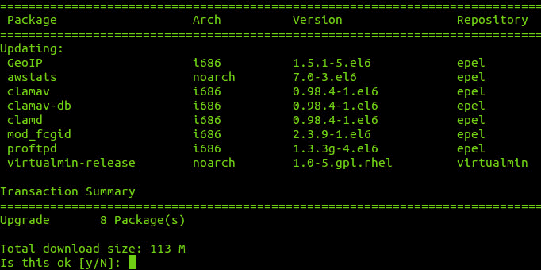 输入“y”并按回车。

### 安装/升级 MySQL 5.5 和 PHP 5.4

下面的命令（带有 `--enablerepo=remi` 标记）将激活 REMI 仓库并告诉 yum 包管理器从 REMI 安装/升级软件：

```bash
# yum --enablerepo=remi upgrade mysql
```

**注意**：上面的命令还将把 PHP 5.3 升级到 PHP 5.4，因为 yum 工具将确保所有相互链接的软件依赖都满足（例如，其中一个 php-mysql 连接到 MySQL 5.1——所以当我们把 MySQL 升级到 5.5 时，yum 工具也将把相应的“php-mysql”软件包升级到 PHP 5.40）。

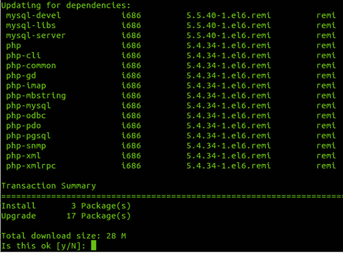 提示时，输入 'y' 并按回车。

**注意**：第 4 列告诉您软件软件包是从哪个软件仓库安装的。一旦软件升级完成，运行此命令来更新 MySQL 中的一些基本表：

```bash
# mysql_upgrade
```

### 安装 PHP-FPM

现在所有系统软件都已更新，让我们从 REMI 仓库安装 PHP-FPM：

```bash
# yum --enablerepo=remi install php-fpm
```

这将创建目录：`/etc/php-fpm.d/`，并带有默认的“www.conf”池文件。我们稍后需要在此目录下创建一个名为“www.bare”的新“池模板”。

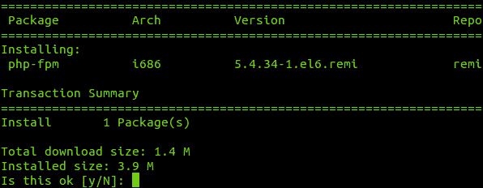

好了，现在我们将安装“RepoForge”仓库，这样我们就可以安装“mod_fastcgi”软件包。Apache 与 PHP-FPM 服务器的通信需要这个“mod_fastcgi”。

```bash
# rpm -ivh rpmforge-release-0.5.3-1.el6.rf.i686.rpm
# yum install mod_fastcgi
```

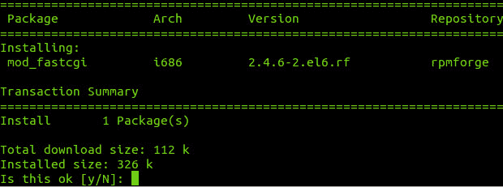

上面的命令将在 `/etc/httpd/conf.d/` 目录下安装一个名为“fastcgi.conf”的文件。使用您喜欢的编辑器编辑该文件，并将文件中的**所有**内容替换为仅这 3 行代码：

（注意：上述 3 行的源代码可以在“fastcgi.conf”文件中找到）


好了，现在所有必要的软件都已更新并安装，让我们现在登录 Virtualmin。

**注意**：如果这是您第一次登录 Virtualmin，它将提示您完成一系列“安装后步骤”，在这些步骤中将微调某些服务器设置（例如，根据您选择的内存设置为您优化 MySQL 的 `/etc/my.cnf` 并为 MySQL 分配根密码）。

一旦完成安装后步骤，进入 Virtualmin 的配置页面。点击 Virtualmin 菜单，并点击：“系统设置 (System Settings) > Virtualmin 配置 (Virtualmin Configurations)”。

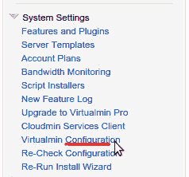 您将看到以下页面。

[此处重复]

从下拉列表中选择“创建服务器和用户时的操作 (Actions upon server and user creation)”。您将看到：

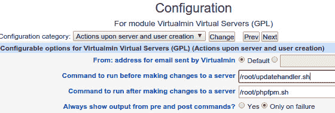

需要注意的两个重要字段是：

* 修改服务器之前运行的命令：`/root/updatehandler.sh` 
* 修改服务器之后运行的命令：`/root/phpfpm.sh`

这是使所有 PHP-FPM 自动化运行的“关键”。基本上，此功能允许您在修改服务器之前（例如在创建虚拟服务器之前）或在服务器创建之后运行自定义脚本。

* `/root/updatehandler.sh` 是一个简单的脚本，用于检查 `/etc/httpd/conf.d/fastcgi.conf` 是否存在；如果存在，则将其重命名为 `/etc/httpd/conf.d/fastcgi.conf.orig`。这防止了 'mod_php' 模块的加载。
* `/root/phpfpm.sh` 是创建 FPM 池的主脚本。它也适用于删除服务器。


[此处存在大量文本重复内容...]


在第 2 章中，我们已经设置了 Virtualmin 运行 2 个自定义脚本——在创建虚拟服务器之前运行 `updatehandler.sh`，在虚拟服务器创建之后运行 `phpfpm.sh`。在本章中，我们将仔细查看这 2 个 shell 脚本，以及其他一些“辅助”脚本。

您可以在此处下载这些脚本：[`ilovevirtualmin.com/books-scripts/php-fpm`](http://ilovevirtualmin.com/books-scripts/php-fpm)


下载 `vserver.tgz` 文件并将其解压到 `/root` 目录。你会看到以下文件和目录：

*   `updatehandler.sh`
*   `phpfpm.sh`
*   `createpool.sh`
*   `www.bare`
*   `fastcgi.conf`
*   `nginx/` ← 这是一个。
    *   `nginx.conf`
    *   `proxy.inc`
    *   `microcache.inc`
    *   `virtualserver.com`
    *   `nginx-proxy`
    *   `createvhost.sh`

让我们来看下这些自定义脚本：


基本上，这个脚本检查 `/etc/httpd/conf.d/php.conf` 是否存在。如果存在，它将其重命名为 `php.conf.orig`，以防止 Apache 加载该模块并作为 `mod_php`  PHP 解释器。这将允许 `mod_fastcgi` 模块运行并与 PHP-FPM 服务器通信。

它还会将 `/etc/httpd/conf/` 和 `/etc/httpd/conf.d/` 中的所有文件备份到 `/root/config-bak/` 以备后。

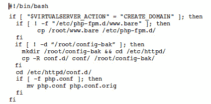


此脚本使用了 Virtualmin 提供的条件语句 `If the $VIRTUALSERVER_ACTION`。这是 Virtualmin 的一个酷功能，允许人们使用 Virtualmin 提供的各种条件语句创建一些非常独特的脚本。以下是代码列表：

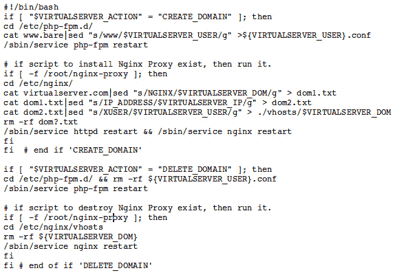

此脚本 (`phpfpm.sh`) 使用 `sed` 命令在 `/etc/php-fpm.d/` 目录下为虚拟服务器 userID（账户所有者）创建一个新的 PHP-FPM 池。

它使用基础池模板文件 (`www.bare`)，并将所有 `www` 出现的地方替换为 `userID`。

你还可以调整 `www.bare` 文件中的设置以适应你的服务器环境。

如果 `$VIRTUALSERVER_ACTION` 测试返回 `DELETE_DOMAIN`（即虚拟服务器已从 Virtualmin 中删除），则此脚本将删除 PHP-FPM 池文件并重启 PHP-FPM 服务以移除该用户的进程。

注意：额外的 `if` 语句，即：

```bash
if [ -f /root/nginx-proxy ]; then
  …创建/删除 Nginx vhosts 的代码…
fi
```

上面的条件语句检查文件 `nginx-proxy`（它是一个空白/空文件）是否存在于 `/root` 文件夹中。默认情况下，它不存在，而是位于 `ngnix` 文件夹中。因此，如果你想让脚本自动创建 Nginx 反向代理 vhost 文件，你需要将 `nginx-proxy` 文件复制到 `/root`（或者你也可以直接执行此命令：`# touch /root/nginx-proxy`）


这是 `/root/phpfpm.sh` 脚本使用的 php-fpm 池模板文件。所有 `www` 出现的地方将被替换为虚拟服务器的 userID。

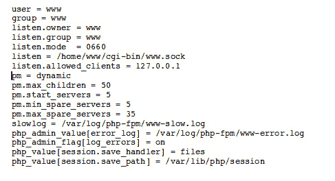 你可以调整变量，例如 `pm.*` 以适应你的服务器环境/资源。


这是一个自定义的（且简单得多）三行代码，告诉 Apache 加载 `mod_fastcgi` 模块并创建一个新的 PHP 处理程序（称为 `php-fpm`）来处理所有 .php 文件。我们将使用此文件来替换 `mod_fastcgi` 模块自带的默认 `fastcgi.conf`。

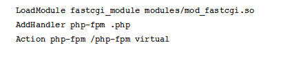

一旦这些自定义脚本就绪，你就可以开始了。像往一样创建虚拟服务器，Virtualmin 将自动设置新的虚拟服务器以在其自己的 userID 下运行 PHP-FPM。

如果你想在自动化虚拟服务器创建方面进行更多花哨的操作，请参考此文档：[`www.virtualmin.com/documentation/developer/prepost`](http://www.virtualmin.com/documentation/developer/prepost)

它包含了一些示例脚本供你开始，以下是实用的变量列表：


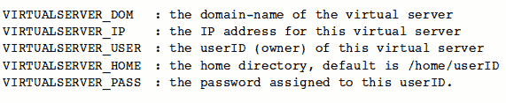

恭喜！你现在拥有了一个完全自动化的 PHP-FPM 驱动的 Virtualmin 服务器。


前面的章节假设是一个全新的 Virtualmin 服务器，其中没有任何现有的虚拟服务器（网站）。这允许我们配置 Virtualmin 丢弃其他 PHP Sapi 并仅使用 PHP-FPM。如果你在 Virtualmin 中有现有的网站（虚拟服务器），我们需要先重新配置现有网站——否则网站将停止工作。

本章将引导你完成必要的步骤。我强烈建议**不要**在生产服务器上执行此操作，因为一个小错误就会导致灾难。

首先，备份现有配置，以便在出现问题时可以恢复它们。

```bash
# cd /etc/httpd/conf/
# mkdir -p /root/config-bak
# cp -R /etc/httpd/conf/ /root/config-bak/
# cp -R /etc/httpd/conf.d/ /root/config-bak/
```

备份好后，让我们继续。

### 步骤 1：重命名 /etc/httpd/conf.d/php.conf

将 `php.conf` 重命名为 `php.conf.orig`。这是为了防止 Apache 加载 `mod_php` 模块。

```bash
# cd /etc/httpd/conf.d/
```

### 步骤 2：创建各个 PHP-FPM 池

确保模板池文件 (`www.bare`) 存在于 `/etc/php-fpm.d/`。如果没有，请从第 4 章的源码列表中创建它，或从下载的自定义脚本包中复制。

```bash
# cd /etc/php-fpm.d/

我们将使用强大的 `sed` 工具来完成大部分工作。语法为：

`sed 's/www/USER/g' www.bare > USER.conf`

其中 `USER` 是服务器账户所有者 ID。

例如，假设我们的虚拟服务器 UserID 为 `pixms`，我们将执行以下命令：

```bash
# sed 's/www/pixms/g' www.bare > pixms.conf
```

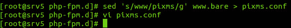

或者，可以使用提供的脚本 `createpool.sh` 自动创建它们。

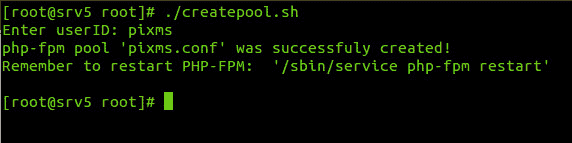

`createpool.sh` 的源码（注意：此脚本需要 `/etc/php-fpm.d` 目录下的模板文件 `www.bare`）

### 步骤 4：最终检查

*   你是否编辑了 `/etc/httpd/httpd.conf` 文件中所有的 `<VirtualHost>` 容器？


> 你是否为每个 `VirtualHost`（虚拟服务器）创建了专用的 `php-fpm` 池文件？

> 检查完所有内容后，你可以启动 PHP-FPM 服务：

```bash
# service php-fpm start
```

> 在重启 Apache 服务器之前，执行此命令以检查 `/etc/httpd/conf/httpd.conf` 文件中是否存在错误：

```bash
# httpd -M
```

如果配置文件（/etc/httpd/conf/httpd.conf`）存在错误，错误将显示在屏幕上，例如如果我漏掉了删除其中一个 `php_admin_` 指令。

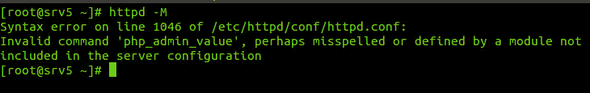

如果没有错误，你可以安全地重启 Apache：

```bash
# service httpd restart
```


这是一个“信息性”章节——旨在为你提供关于 Apache Handlers 和 PHP-FPM 的理论和背景知识。它不是必读内容，但建议阅读，这样你就能更好地理解什么是 Apache Handler 以及什么是 PHP-FPM？

在 90 年代初（还是末？），Web 服务器只能处理和显示 HTML 和图像。它无法访问数据库，也无法执行我们今天看到的任何华丽的“动态”功能。

为了解决这个问题，程序员们提出了“CGI”协议——一种 Web 服务器与用其他编程语言（如 Perl、C/C++）编写的其他“程序”（或应用程序）进行通信的方法。

Apache Web 服务器的开发者随后提出了“Handlers（处理器）”的概念——基本上这是一种模块/方法，它告诉 Apache 在遇到特定类型的文件时，如何与外部程序（例如 Perl 脚本、PHP 脚本等）进行通信。

例如，如果 Web 访问者请求了一个 `*.cgi` 文件，那么相应的处理器将指示 Apache 调用 CGI 脚本/解析器来处理该文件。如果请求的文件是 `*.php` 文件，那么相应的 PHP 处理器将指示 Apache 如何处理该 `*.php` 文件。

简而言之，这就是 Apache “Handler（处理器）”（通俗来说）——它指示 Apache 如何处理/加工不同类型的文件。

对于 PHP 文件，本质上有 3 种不同类型的“Handlers（处理器）”

*   在 Apache 内部加载并运行整个 PHP 引擎（解释器）。这被称为 `mod_php` 或“Apache 2.0 Handler”。这是默认方法。
*   “CGI”处理器——Apache 将调用 `/usr/bin/php-cgi` 脚本来处理 PHP 文件，并将所有的环境变量传递给 `cgi` 程序。`cgi` 程序将处理请求并将结果传回给 Apache。一旦完成，`cgi` 进程会被杀死。
*   “Fast-CGI”处理器——这是 CGI 协议的增强，`fast-cgi` 进程在完成工作后不会被杀死。它可能可以“永远运行”，并且通常作为守护进程与 Apache 并行运行。此外，Apache 与 FastCGI 应用程序之间的通信是通过 IPC（进程间通信，如 Unix socket 或 TCP socket）完成的。

在第一种情况下，即“mod_php”——每个 apache 子进程实例内部都有整个 PHP 堆栈/引擎。这会导致 Apache 进程出现不膨胀，因为并不是所有的 Web 请求都会指向 PHP 脚本，有些 Web 请求只是请求图像、CSS、JavaScript。因此，运行“mod_php”会导致内存使用效率低下——如果一个高流量网站有大量图形，这可能会成为问题。

通常，`mod_suexec` 和 `mod_suPHP` 会与 `mod_php` 一起使用，使 Apache 能够在虚拟服务器相同的 userID 下运行 PHP 脚本，以提供额外的安全账户隔离，即一个虚拟服务器中的脚本无法访问另一个虚拟服务器上的文件。

现代应用程序不再使用 CGI 处理器，因为创建/杀掉 CGI 进程的操作非常消耗 CPU 且效率低下。

FastCGI 处理器是首选。它允许 PHP 脚本在 Apache Web 服务器之外由 PHP 引擎/解析器执行，即每个请求都通过通信套接字（IPC）从 Apache Web 服务器传递给 FastCGI 进程。

FastCGI 的优势在于进程是“持久的”——可以配置多个持久性进程在后台运行，以处理传入的 PHP 请求。这避免了“CGI”方法中创建/终止进程的昂贵且 CPU 密集型操作。

那么，PHP-FPM 是什么时候出现的呢？PHP-FPM 实际上是带有其内置“进程管理器”（PM）的“FastCGI”。

需要注意的是，大多数 FastCGI 应用程序/进程以守护进程（服务器）模式与 Apache 并行运行。这些 FastCGI 应用程序由“PM”（进程管理器）管理。

在 Apache 中，当我们使用 `fastcgid` 模块（Virtualmin 中的默认设置）时，Apache 使用其内置的“PM”来管理 FastCGI 进程。

但当我们使用 `mod_fastcgi` 模块（从 RepoForge 仓库安装）时，Apache 将“进程管理器”的控制权交给 PHP-FPM 引擎，它有自己的“PM”。

PHP-FPM 实际上是带有其内置“进程管理器”（PM）的“FastCGI”。

需要注意的是，大多数 FastCGI 应用程序/进程以守护进程（服务器）模式与 Apache 并行运行。这些 FastCGI 应用程序由“PM”（进程管理器）管理。

在 Apache 中，当我们使用 `fastcgid` 模块（Virtualmin 中的默认设置）时，Apache 使用其内置的“PM”来管理 FastCGI 进程。

但当我们使用 `mod_fastcgi` 模块（从 RepoForge 仓库安装）时，Apache 将“进程管理器”的控制权交给 PHP-FPM 引擎，它有自己的“PM”。

PHP-FPM 实际上是带有其内置“进程管理器”（PM）的“FastCGI”。

需要注意的是，大多数 FastCGI 应用程序/进程以守护进程（服务器）模式与 Apache 并行运行。这些 FastCGI 应用程序由“PM”（进程管理器）管理。

在 Apache 中，当我们使用 `fastcgid` 模块（Virtualmin 中的默认设置）时，Apache 使用其内置的“PM”来管理 FastCGI 进程。

但当我们使用 `mod_fastcgi` 模块（从 RepoForge 仓库安装）时，Apache 将“进程管理器”的控制权交给 PHP-FPM 引擎，它有自己的“PM”。

PHP-FPM 实际上是带有其内置“进程管理器”（PM）的“FastCGI”。

需要注意的是，大多数 FastCGI 应用程序/进程以守护进程（服务器）模式与 Apache 并行运行。这些 FastCGI 应用程序由“PM”（进程管理器）管理。

在 Apache 中，当我们使用 `fastcgid` 模块（Virtualmin 中的默认设置）时，Apache 使用其内置的“PM”来管理 FastCGI 进程。

但当我们使用 `mod_fastcgi` 模块（从 RepoForge 仓库安装）时，Apache 将“进程管理器”的控制权交给 PHP-FPM 引擎，它有自己的“PM”。

PHP-FPM 实际上是带有其内置“进程管理器”（PM）的“FastCGI”。

需要注意的是，大多数 FastCGI 应用程序/进程以守护进程（服务器）模式与 Apache 并行运行。这些 FastCGI 应用程序由“PM”（进程管理器）管理。

在 Apache 中，当我们使用 `fastcgid` 模块（Virtualmin 中的默认设置）时，Apache 使用其内置的“PM”来管理 FastCGI 进程。

但当我们使用 `mod_fastcgi` 模块（从 RepoForge 仓库安装）时，Apache 将“进程管理器”的控制权交给 PHP-FPM 引擎，它有自己的“PM”。

PHP-FPM 实际上是带有其内置“进程管理器”（PM）的“FastCGI”。

需要注意的是，大多数 FastCGI 应用程序/进程以守护进程（服务器）模式与 Apache 并行运行。这些 FastCGI 应用程序由“PM”（进程管理器）管理。

在 Apache 中，当我们使用 `fastcgid` 模块（Virtualmin 中的默认设置）时，Apache 使用其内置的“PM”来管理 FastCGI 进程。

但当我们使用 `mod_fastcgi` 模块（从 RepoForge 仓库安装）时，Apache 将“进程管理器”的控制权交给 PHP-FPM 引擎，它有自己的“PM”。


本章的目标是运行 Nginx 作为主服务器。

在开始之前关于性能的说明。

Nginx 作为反向代理的作用通过分担 Apache 的负载来提升网站性能。我个人没有检测到使用 Nginx 作为反向代理有显著性能——但这可能是因为我的网站没有数千访问者。

运行 PHP-FPM 对大多数人来说足够了，但无论如何准备总是好的

第一步是下载并安装 Nginx 仓库：

访问 [`nginx.org/en/linux_packages.html`](http://nginx.org/en/linux_packages.html)

```bash
# wget http://nginx.org/packages/centos/6/noarch/RPMS/nginx-release-6.el6.ngx.noarch.rpm
# rpm -ivh nginx-release*
# yum install nginx
```


这将在你的服务器上安装最新版本的 Nginx。但请注意，上述默认 Nginx 安装假设它将作为“主 Web 服务器”而不是“反向代理”。

为了将其设置为反向代理，我已准备了必要的配置文件。在第 4 章，提取的自定义脚本包（vserver.tgz）有一个名为 `nginx` 的文件夹，包含：

*   `nginx.conf`
*   `proxy.inc`
*   `microcache.inc`
*   `virtualserver.com`
*   `createvhost.sh`
*   `nginx-proxy`（这是一个空文件）

将所有这些文件复制到 `/etc/nginx/`：

```bash
cd /root/nginx
cp * /etc/nginx/
mkdir -p /etc/nginx/vhosts
```

注意：你需要覆盖现有的 `nginx.conf`。

将 `nginx-proxy`（这是一个空文件）复制到 `/root` 目录。


脚本 `phpfpm.sh` 会检查 `/root` 目录下是否存在该文件 (`nginx-proxy`) ——如果是，那么当你从 Virtualmin 创建新的虚拟服务器时，它将继续创建必要的 Nginx 反向代理配置（虚拟主机）文件。如果没有这个文件 (`nginx-proxy`)，`phpfpm.sh` 脚本将不会创建 nginx vhost 配置文件。

```
# cp nginx-proxy /root/
```

现在让我们登录 Virtualmin 对以下设置进行一些调整：

`Webmin > Servers > Apache Webserver`

点击“Global Configuration”（全局配置）选项卡：

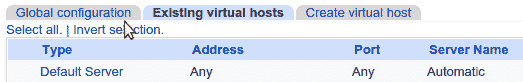

然后点击“Networking and Addresses”（网络与地址）图标

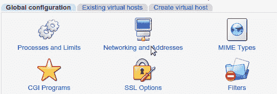

将默认端口“80”更改为“8080”，如下所示：

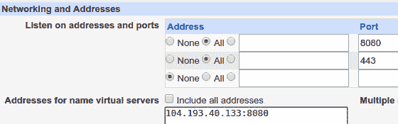

现在，像之前一样，我们需要在 Virtualmin 中创建一个新的服务器模板，以使用“8080”端口而不是 80 端口。

`Virtualmin > System Settings > Server Templates`

你可以克隆现有的模板之一（例如我们之前为创建 PHP-FPM 创建的那个）。

像之前一样，从“Edit template section”（编辑模板部分）下拉列表中选择“Apache website”。

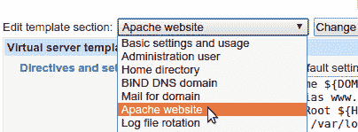向下滚动页面，找到“Port Number for Virtual Hosts”（虚拟主机端口号）并将其更改为“8080”，如下所示：

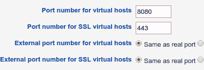


我们需要修改“Default Settings”（默认设置）模板并将端口也更改为 8080！

再次点击 `Virtualmin > System Settings > Server Templates`。

并点击“Default Settings”模板。

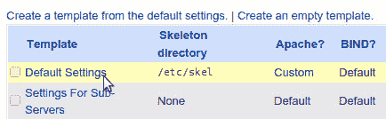

像之前一样，从下拉列表中选择“Apache Website”部分。向下滚动页面到 Port 部分，并将默认端口 80 更改为“8080”


尽管我们在创建由 Nginx-反向代理驱动的站点时不会使用这个“默认模板”，但我们仍然必须这样做，否则默认端口 80 将在 `httpd.conf` 文件中强制执行，导致 Nginx 无法启动。

一旦完成这些操作，我们就准备好创建我们的第一个由 Nginx-反向代理驱动的站点了。

**非常重要的提示：** 如果你有通过 Apache 在端口 80 上运行的现有网站（虚拟服务器），不要重启 Apache 或 Nginx 或创建新的虚拟服务器。如果你这样做，你所有的现有网站将无法加载。

你需要修改/更新 Apache 配置文件 `/etc/httpd/conf/httpd.conf`，并将端口 80 替换为“8080”，例如：

原始：`<VirtualHost X.X.X.X:80>`

更改为：`<VirtualHost X.X.X.X:8080>`

其中 `X.X.X.X` 是你服务器的 IP 地址。

然后，你需要为每个现有网站创建相应的 nginx vhosts 文件。在 `/root/nginx/` 目录下，有一个标准的模板 vhost 文件 - `virtualserver.com`，你可以参考它。

我们将使用提供的脚本 - `createvhost.sh` 来创建所需的 vhosts，即只需要运行脚本，输入 `userID`（此虚拟服务器的账户所有）和域名（例如 pixms.com）。如果你没有在脚本中定义服务器 IP 地址（将 `X.X.X.X` 替换为你的服务器 IP 并取消注释），它会提示你输入服务器 IP 地址

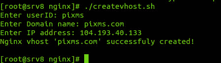

脚本获取默认 vhost 模板 (`virtualserver.com`) 并用你为新的 Nginx vhosts 提供的输入替换相应的标记。

这里是 `createvhost.sh` 的源代码：

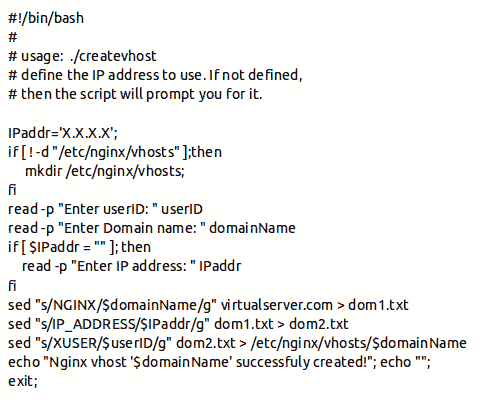

如果你想查看它是如何工作的，也可以手动编辑该文件。以下是文件的片段。你需要为每个 virtualhost 更改以下内容：

`IP_ADDRESS`: 你服务器的实际 IP 地址
`NGINX`: 域名（不带 'www'）。例如：`ilovevirtual.com`
`USER`: 此虚拟服务器的 `userID`（账户所有者）

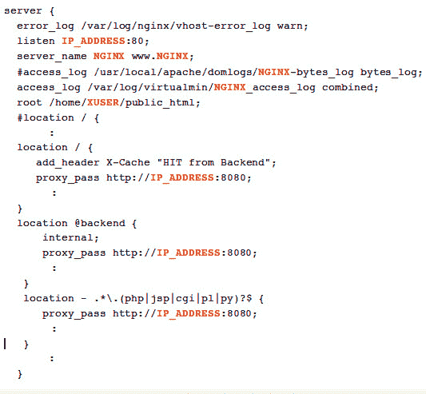


服务器安全是一个巨大的话题，根本无法在一个章节中甚至一书中涵盖所有内容。在本章中，我们将仅涵盖 4 个关键步骤，我相信每个服务器管理员都应该采取这些步骤来“锁定”服务器，无论服务器运行的是 Virtualmin 还是其他控制面板。

这 4 个步骤是：
* 只运行必需的服务，停止所有其他服务
* 保护 `/tmp`
* 安装防火墙
* 安装 LMD (Linux Malware Detect)

#### 仅限基本服务

我们在服务器上运行的每个服务都会监听一个 `port` - 例如，Apache Web 服务器监听 80 端口，SSH 服务器监听 22 端口，邮件服务器监听 25 端口等。

将这些 `ports` 想象成堡垒墙上的“门” —— 墙上的门越多，黑客可以练习的目标就越多。为了最大限地减少这种情况，我们应该关闭任何我们不打算在服务器上使用的服务。例如，如果我们不向用户提供邮件列表服务或 DAV 登录服务，我们就应该关掉它们。

我们可以通过命令行使用 `chkconfig` 命令执行此操作，或从 Webmin 的 Bootup and Shutdown 界面，即 `Webmin > System > Bootup and Shutdown`

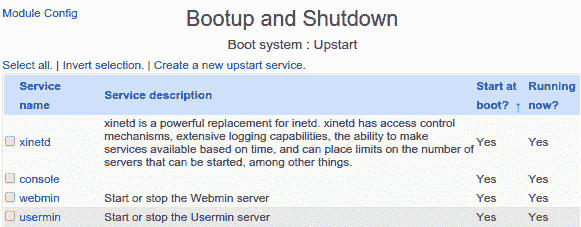

Virtualmin 的默认设置相当合理，但以下服务也可以安全地关闭：
* `xinetd`
* `splash-manager`
* `mailman`（如果你不打算提供邮件服务）


在大多数情况下，新安装/部署的 Linux 服务器中的 `/tmp` 目录是不安全的，即它允许任何人（或脚本）向 `/tmp` 目录上传文件并执行。运行这个简单的测试来确定你的 `/tmp/` 目录是否设置了执行位：

在 `/tmp` 目录下创建一个简单的 'hello world' Shell 脚本：

```bash
#!/bin/bash
echo "hello world"
```

然后，对脚本执行 `chmod +x` 并尝试运行它：

```bash
chmod 755 hello.sh
./hello.sh
```

如果你在屏幕上看到“hello world”，说明我们需要修复。对 `/var/tmp` 目录也重复此操作。为了这样做，我们需要编辑 `fstab` 文件并添加以下两行：


**注意：** 根据操作系统`fstab` 中的条目可能会不同，如果你的服务器是 VPS，托管公司可能会提供不同的 `fstab` 布局。如有疑问，请咨询你的托管提供商。

一旦完成了对 `//fstab` 的编辑，你可以重启服务器或运行以下命令重新挂载分区以生效：

```bash
mount -a
```

注意：上述命令应该使 `/etc/fstab` 中提到的文件系统重新挂载，带有 `noauto` 选项的分区除外，但在某些 VPS 上可能无效。尝试运行 `hello.sh` 文件查看是否可以运行。如果是，最佳选择是重启 VPS。


虽然 Virtualmin 自带了一个界面来帮助管理 `iptables` 规则和链，但它可能非常晦涩且望人生畏，特别是如果你是新手。（Virtualmin 防火墙界面可以在 `Webmin > Networking > Firewall` 找到）

更简单、直观的替代方案是来自 [configserver.com](https://configserver.com/) 的 CSF 防火墙

通过 SSH 登录服务器并从命令行安装防火火墙：

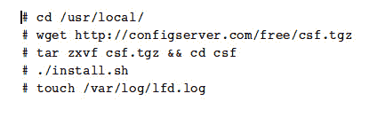

编辑 csf 配置文件，例如 `vi etc/csf/csf.conf`。寻找此行（位于文件顶部）：

`# lfd 在此启用时将不会启动`
`TESTING = "0"` ← 默认是“1”。将其更改为“0”以启用 CSF 防火墙。

然后，寻找此部分：“IPv4 Port Settings”，并将“10000”和“20000”添加到 `TCP_IN` 和 `TCP_OUT` 行中。如下所示（红色下划线）。

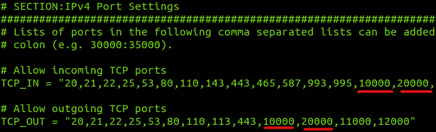

**注意：** 如果你将 Webmin/Virtualmin 端口更改为“11000”，那么你也需要在这里更新端口。

```bash
service csf start
```

现在，让我们为 Webmin 安装 CSF 插件：

将浏览器指向：`Webmin > Webmin Configuration > Webmin Modules`

选择“From local file”（从本地文件安装）并在字段中输入此路径：`/usr/local/csf/csfwebmin.tgz`


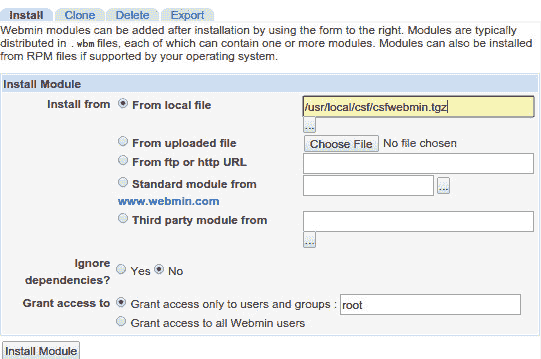

然后，点击“Install Module”（安装模块）按钮。安装完成后，可以通过以下路径访问 CSF 防火墙界面：`Webmin > System > ConfigServer Security and Firewall`

第一次点击链接时，系统会提示你更新符号链接（symlink），即：

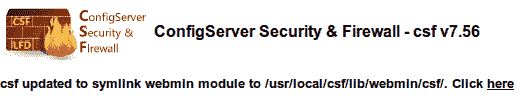点击提供的链接，你将看到 CSF Web 界面。

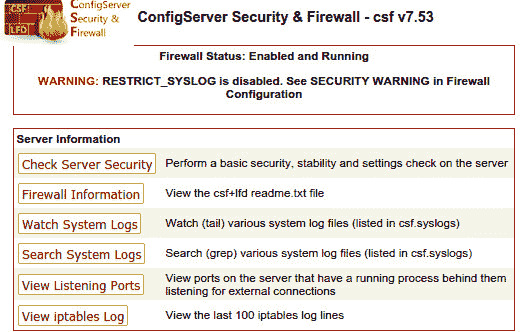

你应该做的的第一件事点击“Check Server Security”（检查服务器安全）按钮。

这将导致 CSF 防火墙对你的服务器设置运行扫描/安全审计。它将为你提供一个关于哪些需要“修复”或更改以加固你的 VPS/服务器安全性的摘要。

然后，按照建议进一步加固你的服务器。

**注意**：你可能会看到 CSF 报错，称“portreserve”和“rpcbind”都处于启用（enabled）状态，尽管你已经执行了以下命令：

```bash
# chkconfig rpcbind off && chkconfig portreserve off
```

而且 `Webmin > Bootup & Shutdown` 菜单显示它们也没有运行。CSF 显示它们为“启用”的原因是因为它们在运行级别（run levels）2, 4, 5 中仍然启用。要在所有运行级别上完全关闭它们，请运行此命令：

```bash
# chkconfig --level 2345 portreserve off
# chkconfig --level 2345 rpcbind off
```

也考虑关闭以下服务：

```bash
# service xinetd stop && chkconfig --level 2345 off
# service saslauthd stop && chkconfig --level 2345 saslauthd off
```


Linux Malware Detect (LMD) 是一种 Linux 恶意软件扫描器。它是针对共享托管环境中面临的威胁设计的，并根据 GNU GPLv2 许可证发布。

（LMD 也广称为“Maldet” - Malware Detect）。

它利用网络边缘入侵检测系统的威胁数据来提取正在用于攻击的恶意软件，并生成用于检测签名。此外，威胁数据还来源于通过 LMD 检查功能的用户提交以及恶意软件社区资源。

LMD 使用的签名是 MD5 文件哈希和 HEX 模式匹配，它们也可以很容易导出到任何数量的检测工具，如 `ClamAV`。

下载并安装最新版本的 LMD：

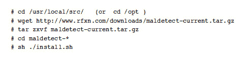

这将“maldet”脚本安装在 `/usr/local/maldetect` 并创建一个可执行的符号链接。安装摘要如下：

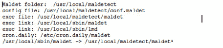

将脚本更新到最新版本：

```bash
# maldet --update-ver
```

更新最新的恶意软件数据库：

```bash
# maldet --update
```

Maldet 配置文件位于：`/usr/local/maldetect/conf.maldet`

编辑此文件并进行以下更改：

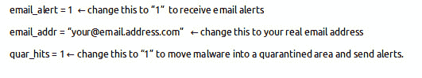

你可以让其余配置保持默认值。示例用法：

扫描目录的语法为：`maldet -a <path_to_directory>`

例如：

```bash
# maldet -a /home/USERID/public_html
```

它将报告已扫描的文件数，以及“命中”（hits）数量（如果发现恶意软件）和清理的恶意软件数量（如果有）。

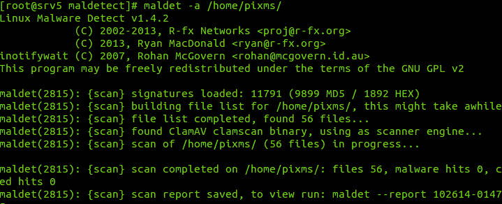

要查看生成的扫描报告，输入：

```bash
# maldet --report <SCAN_ID>
```

恢复被隔离的文件：

```bash
# maldet --restore /usr/local/maldetect/quarantine/<FILENAME>
```

### 创建每日 cron 任务扫描你的文件：

当你第一次安装 LMD 时，安装脚本会在 `/etc/cron.daily/maldet` 创建一个每日 cron 任务。

支持/内置了以下控制面板的文件路径：

* `Cpanel`
* `Plesk (PSA)`
* `Ensim`
* `DirectAdmin`
* `Default Apache DocRoot (/var/www/html)`

Virtualmin 中设置的文件路径与 Cpanel 类似 – 因此你不需要对脚本进行任何更改。

**注意**：你可能已经注意到 `maldet` 使用问号（`?`）而不是常用的星号（`*`）来表示通配符。例如，如果你想扫描 `/home/` 目录下的所有用户账户，将使用：

```bash
# maldet -a /home/?/public_html
```

注意：`?` 表示通配符特性，而不是典型的 `*`


在这本短书中，我们涵盖了大量内容。你在这里看到的各种代码段是许多小时研究、测试和调试的结果。

虽然实现某个目标有许多方法，但我尽力遵循古老的 UNIX 原则“K.I.S.S”（Keep It Super Simple，保持极度简单），并为你提供最简单、最易的方法来实现在 Virtualmin 中设置自动化 PHP-FPM 服务器的目标。

但尽管如此，请记住技术始终在变化，当你阅读到这里时，某些内容可能已经发生了。

为了跟进 Virtualmin 的最新变化和更新 – 请随时访问官方网站 – [`virtualmin.com`](http://virtualmin.com/)。


你可以在这里下载源代码和脚本：[`ilovevirtualmin.com/book-2`](http://ilovevirtualmin.com/book-2) 

你需要输入此“访问代码”：`VMPHP2014` 来访问下载文件。

此页面还将包含所有相关的更新和书中发现勘误。

## 这本书对你有益处吗？

如果你从这本书中受益，请考虑在 Amazon 上留个评论，以帮助其他正在 Virtualmin 中寻找类似类 PHP-FPM 解决方案的人。你可以点击下方的链接直接进入书籍：

[`ilovevirtualmin.com/book-2`](http://ilovevirtualmin.com/book-2)

如果书中有任何不足之处，或者你认为我应该涵盖更多内容，请告诉我，这将帮助我在下一版中改进这本书。


你可以通过以下邮箱联系我：`adrian.gmail.com`

## “实用指南”系列中的其他书籍

1. `Webmin & Virtualmin: Cpanel 的最佳开源替代方案` – 这是一本适合不熟悉 Webmin & Virtualmin 新手的书籍。

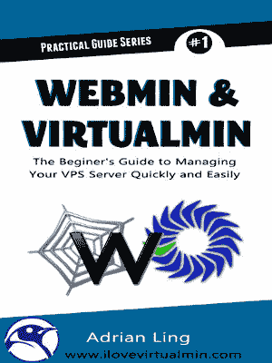

例如，在 Cpanel 中，“addon domain”（附加域名）术在 Virtualmin 中被称为“Sub-server”（子服务器）。这本书将帮助你快速上手。

2. `Apache, PHP-FPM & Nginx: 如何构建安全、快速且强大的 Web 服务器`


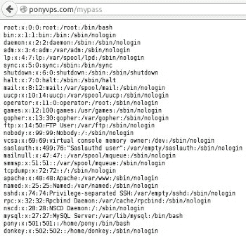

实现这一点的 PHP 代码仅需 3 行！

如果我是一个恶意黑客，我会将用户 'pony' 作为目标，因为他拥有 'shell' 访问权限，而用户 'donkey' 则没有。

本书将向你展示上述操作是如何实现的，以及你作为系统管理员，如何防止这种情况发生在你自己的服务器上。

书中将有一章专门关于性能优化的章节，并包含关于 `PHP-FPM` 池文件中“理想”设置的两个微型案例研究。

你现在就可以预订这本书了：[`ilovevirtualmin.com/go/book3.php`](http://ilovevirtualmin.com/go/book3.php)

