# 网络安全视觉沟通：超越意识到倡导

## 宣言

以**真实的自我**展示自己。你呈现自身规范和价值观的方式会影响他人对网络安全的看法。

**说**受众的语言。了解你的**受众**并与他们**建立联系**。达成定义共识。

**停止欺负**你的同事，不要使用枯燥的宣传活动。与最终用户共同设计政策和产品。与其他网络安全专业人士协作，使用相同的**语言**。

讲故事。做人。以人为本。

**目标定得更高** than 意识。致力于**创新**和**倡导**。

不要为安全而设计，要为**引人入胜**的安全而设计。可视化你的信息。与你的受众一起创建并分享你的涂鸦、草图和原型。

学习、改进并**享受**。

网络安全很酷。你很酷。

向世界展示它！

## 引言

网络安全是商业和政治议程中的首要事项。这是一个令人兴奋的工作领域，为来自不同背景和教育的人提供了许多就业机会。不幸的是，沟通问题正在阻碍该领域的进步。由于普通公众不太真正理解网络安全是什么以及职业生涯能提供什么，因此难以填补众多职位空缺。从事网络安全工作的专业人士发现，外行人对安全风险和控制了解甚少。多年来，安全专业人士尝试了不同的策略来推广他们的工作并提高受众的知识。为此，沟通策略包括向外行人倾泻大量行业术语，或是数小时的强制性电子学习模块，这些模块只会为合规审计师打勾。然而，备受向往的安全意识只是改变行为过程中的第一步。当我们推广安全解决方案时，需要牢记营销理论的经验：让受众意识到它只是营销漏斗中获得受众认可的第一阶段。

### 意识不是目标。

许多专业人士同意，致力于安全意识是一个良好的开端，比完全不做要好。更好的做法是真正改变人们的行为。然而，改变最终用户行为也不是最终目的。不。我们应当将目标定得更高：让人们成为网络安全行为的倡导者，关怀他们的同伴；让他们展示正确的安全举止，并向朋友、家人和同事解释。同伴群体中的示范行为远比企业政策和宣传活动更有效。

### 我们需要一门共同语言。

网络安全专家之间在定义、职责、问题和解决方案上存在分歧。专家之间的沟通摩擦以及专家与非专家受众之间尴尬的沟通，对有价值信息的适当保护构成了复杂因素。网络安全专业人士需要改变他们向公众展示自身及其服务的方式。

## 设计思维是创新和引人入胜的安全产品的基础。

我们需要在如何处理网络安全、与外行人的关系以及与其他专业人士的互动方面发挥创造力和创新。我们需要与使用这些产品的人一起设计更好的安全产品和服务。当安全产品和风险降低的设计过程涉及最终用户的多学科团队时，安全规则的接受度将提高。设计思维通常用于人机界面的开发，但也可以应用于政策、程序、报告和培训的设计等其他事物。

## 拥有可视化沟通技能，我们可以改善协作。

网络安全专业需要焕发活力，以协作推动以人为本的设计方法和人性化的沟通形式。可视化沟通有助于解释复杂主题和解决复杂问题。它有助于吸引受众。它让会议生动起来并引发讨论。当做得正确时，视觉辅助有助于受众记住信息并付诸行动。当战略性地应用时，可视化沟通可以为安全带来以人为本的方法，鼓励员工积极参与安全活动，而不仅仅是遵守政策。

## 网络安全教育需要教授可视化思维。

可视化沟通已证明其在科学教育、健康问题沟通和法律设计方面的有效性。它在网络安全专业人士中也越来越受欢迎。不幸的是，网络安全教育通常不包括沟通理论或设计课程。许多专家认为这不属于他们的职责，最好交给沟通部门，或者他们认为自己缺乏创造力。

## 阅读指南

本书介绍了网络安全可视化沟通的可能性。它概述了一些相关的沟通理论和模型，提供实用技巧，并展示了许多示例。本书可以支持网络安全教育的学生以及正在寻找替代要点演示和文本报告的专业人士。此外，如果这本书成功激励读者开始创建可视内容，它还可能让读者体验到看到新可能性并提升绩效的乐趣。

本书按不同兴趣的读者分成不同部分。无需从头到尾阅读本书；章节按主题组织。如果你对沟通的学术理论感兴趣，你会喜欢第二部分。如果你在寻找如何在网络安全任务中使用可视化内容的灵感和示例，请直接转到第三部分。如果你想立即创建一些东西，请转到第四部分。

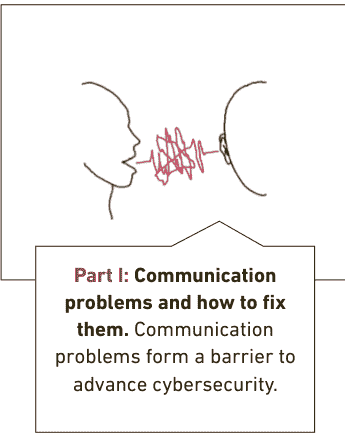

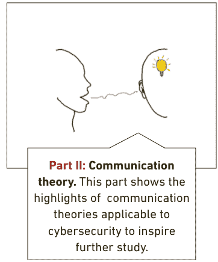

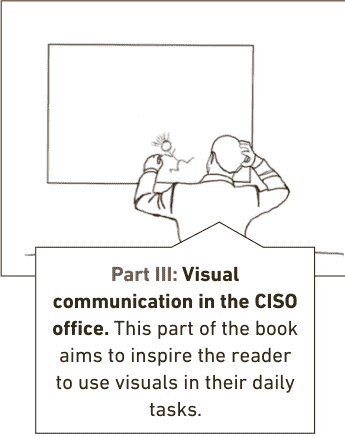

## 第一部分

### 沟通问题及其解决方法

### 网络安全沟通压力

### 我们需要变革

网络安全不仅仅关乎技术人员和黑客。安全意识很好。安全行为良好。倡导至关重要

我们需要与不同学科进行更多合作。别再使用难懂的术语了。用户并非敌人

### 视觉素养与设计思维有所帮助：

- **安全与隐私原生设计**
- 为每个产品、政策或服务注重引人入胜的安全性

- **与非专家沟通**
- 对非专家的共情促进合作

- **协作**
- 视觉材料支持网络安全专家之间以及不同专家群体之间的协作

- **乐趣**
- 散发对网络安全的热情

### 我们已具备所需技能：

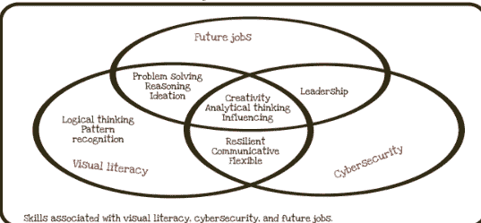

### 我们只需培训

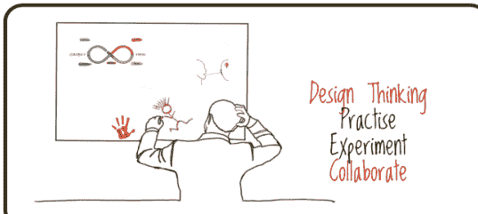

## 1. 形象与刻板印象

若在线搜索“网络安全”，出现的图片中常有戴兜帽的男性盯着电脑屏幕。你能找到的新闻报道和视频主要讲述网络犯罪和网络战争。这导致公众认为网络安全仅关乎黑客攻击、战争和戴兜帽的男性。这种形象不利于与更广泛的公众互动，也不利于吸引更多元化的劳动力。公众形象暗示网络安全主要由男性和技术人员构成，并未代表那些共同应对复杂网络安全挑战的其他学科。这不仅会导致公众对其在线行为风险缺乏兴趣和参与，也会导致全球数以百万计的网络安全职位空缺难以填补。有些预测称，这一数字可能在 2021 年增至 350 万¹。除了公众形象之外，该领域在组织内部的形象也同样糟糕。网络安全部门被视为对业务需求动辄说‘不’的部门，总是在检查和监视同事。网络安全同事被认为爱管闲事，并用他们的清单和要求拖慢项目进度。最后，有时在出版物中用来说服决策者的经典军事隐喻²会“在我们脑海中触发非常具体的画面”，从而导致错误的认知。

> 网络安全保护的远不止是计算机，它所涉及的远不止是计算机科学。

网络安全是一项多学科团队协作工作。它是一个整体生态系统，不仅保护数据的机密性、完整性和可用性，还旨在保护我们的民主价值观乃至人权。心理学、行为学、政治学、立法学和管理学方面的知识与编码、威胁狩猎和加密同样重要。所需技能涵盖从学术到职业技能，涉及数学、计算、法律、工程、社会科学和政治学，以保护我们的经济和社会。摆脱戴兜帽的形象，转向更多元化的刻板印象，将更容易吸引更多元化的劳动力。许多任务可以在工作中学习，具有分析思维、创造力、沟通技巧和复杂问题解决能力等技能的自驱型人员在网络安全领域可以拥有出色的职业生涯。

### 网络安全专业人员需要改变其自我呈现的方式。

公众的刻板印象形象部分受电影和新闻报道影响。网络安全专家可以利用同类媒体，将公众刻板印象引导向更现实的形象。网络安全并非‘可怕、令人困惑和枯燥’。网络安全专家并非为了对新业务倡议说‘不’。要克服关于网络安全的误解，我们需要与受众建立信任，并采用引人入胜的沟通技巧。网络安全是创造新机遇的领域。

图 1 对“网络安全”进行互联网搜索，将显示与此主题类似的图片：一个人穿着兜帽或戴着面具，身旁有一个或多个屏幕，背景昏暗阴郁。

## 2. 意识宣传活动：脱节与偏离

安全意识是组织为了满足 ISO 27001、CobiT、PCI DSS、GDPR、HIPAA 以及更多⁴ 等信息安全相关标准和法规的合规要求。这些标准和法规中的大多数明确要求组织为员工和承包商实施保护宝贵信息的沟通和意识计划。这催生了一个利润丰厚的市场，供应商销售意识培训、海报、教育游戏、宣传活动等等。

牛津词典⁵ 将 awareness 定义为：
- 1. 对某一情况或事实的知识或感知。
  - ‘我们需要提高公众对该问题的认识’
  - ‘人们对风险缺乏认识’
- 2. 对特定情况或发展的关切和了解充分的兴趣。
  - ‘日益增长的环保意识’
  - ‘他的政治意识逐渐形成’

遵循牛津定义，安全意识是知识和意识的同义词。知识与安全行为之间不存在显著关系⁶⁻⁸。尽管如此，许多网络安全专业人员表示，人类是安全领域中最薄弱的环节，应该接受培训以改变其行为。组织策划定期的意识活动，例如电子学习、钓鱼邮件模拟或海报，以遵循标准和法规的要求，并通过提供活动证据来满足合规审计师关于“改善知识和关注”的要求。然而，如果意识计划被视为走过场的任务，它们并不总能导致所需的行为⁸，同样，“通过恐吓、欺骗和欺凌用户来实现安全行为”⁹ 也起不到作用。

> 了解安全风险和解决方案并不总能让人们实际使用这些方案。

当沟通被视为合规或警务任务时，组织内的员工将继续将网络安全视为一种必要之恶。审计师并非网络安全需要满足的唯一受众。我们工作的真正评判者是那些处理宝贵信息的人，例如销售人员、信息技术（IT）人员、经理或人力资源人员。不幸的是，这一受众似乎并不喜欢网络安全专业人员。一项对英国和德国 200 家组织的 IT 安全领导者进行的调查显示，84% 的人对其组织内部的网络安全团队持负面态度¹⁰。三分之一的人甚至觉得自己被视为“危言耸听者”。这种负面态度阻碍了协作和网络安全创新。

要创造一个更安全的工作场所，人们不仅需要知道并关注安全，还必须开始根据这种意识行事。在营销模型中，意识只是导致客户实际采取行动（购买产品）过程中的第一步。与网络安全类似，意识只是真正改变行为过程中的第一步。当我们拥有安全解决方案时，意识只是通过广告和宣传活动来吸引注意力的阶段。在这种情况下，安全意识绝不能成为目标。它只是一段更长旅程中的第一步。

## 安全意识不是最终目标，它只是起点。

我们需要设定更高的目标。现代营销模式不再满足于购买产品的客户。之后的阶段是客户充当品牌拥护者并向朋友推荐产品。当我们将此应用于网络安全时，不应该将同事视为最薄弱的环节。这些人是安全的潜在拥护者。朋友和社会过程对安全行为的影响大于任何其他策略。人们通过诸与同龄人讨论新威胁以及观察他人如何使用安全功能等触发因素而改变¹¹⁻¹⁴。人们需要能够就其使用计算机和共享数据的方式做出明智的选择，互相提供关于如何安全行动的清晰说明，将安全作为其网络活动中的常规，并让他们作为网络安全行为的拥护者关心同事。这始于对网络安全专业人员的信任，并让最终用户参与安全解决方案的设计。

## 工作伙伴宾果

安全是每个人的责任。要保持警惕，并意识到网格中的所有陈述都是安全失职。请留意，看是否有任何同事犯下这些失职之一。

请记住，只有在向涉事人员或其直属经理指出安全失职后，才能在你的工作伙伴宾果卡上盖章。

> **将此卡放在所有人都能看到的地方**

| 办公室内不佩戴通行证 | 离开办公室时未取下通行证 | 电脑未锁定即离开座位 |
| --- | --- | --- |
| 工作手机未锁定即离开座位 | 在公共场所进行机密讨论 | 敏感材料随意放置 |
| 不当处置敏感材料 | 让访客无人陪同地走动 | 未向访客发放正确的访客通行证 |

**集齐全部？告诉你的直属经理并领取奖品！**

© 2015 年王室版权 | CPNI 安全行为宣传活动：做好基础工作

英国国家基础设施保护中心
工作伙伴宾果 15 图片版权：公开政府许可。
这张宾果卡邀请人们留意，看是否有同事在安全行为上出错。这种方法可能不适合所有文化。在使用意识材料之前，务必先使用测试受众进行评估。倾听他们的反馈，并在必要时进行更改，以达到宣传活动的最佳效果。

## 3. 难懂的行话

网络安全是多学科交叉领域，但在很大程度上包含高度技术性的专业知识。这种专业知识的特点是大量使用行话。人们常常忘记，我们的大多数受众说着另一种语言。有些网络安全专家是神秘语言的大师。

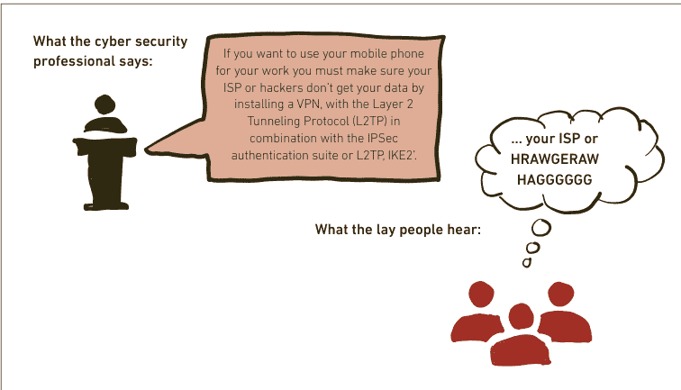

图 2 专业人士所说的，以及外行人听到的。

向新手这样说话的人对网络安全构成威胁。此外，专家们很可能会像上面那样，在技术陈述的正确性上互相持有异议。专家之间沟通中的摩擦，以及专家与其非专业受众之间尴尬的沟通，都是对宝贵信息进行适当保护的一种复杂因素。高度技术性的概念应该用外行人能理解的语言来传达。

最令人苦恼的语言问题之一是，专业人士在术语和定义上无法达成一致。对于非专家受众来说，网络安全是一个复杂而神秘的领域，需要澄清。为了实现这一目的，不同组织使用各种技术网络安全行话的定义和分类法。这导致了多个词典16–19、风格指南20,21，以及仅在欧洲就有至少 17 种不同的事件检测和预防分类法22。如果连网络安全专业人员彼此之间都不使用统一的语言，他们如何能够有效地互相协作，更不用说与群体外的人合作了？

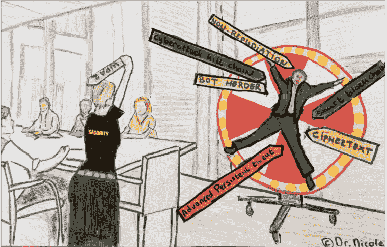

图 3 不要向你的受众抛掷行话和缩写！

> 如果网络安全专业人员无法就术语达成一致，他们又如何能够协作呢？

网络安全专业人员甚至对自己的领域应该叫什么都无法达成一致。是叫信息安全还是网络安全？专家和普通大众都将这两个词混用。当我在聚会上说我从事信息安全工作时，人们往往礼貌地点点头，略显无聊。当我说我从事网络安全工作时，他们却突然装作完全明白我在说什么，并开始讲述黑客攻击和欺诈的故事。作为一个术语，网络安全似乎更能与大众产生联系。根据 Google Trends，如今网络安全作为搜索词比信息安全更受欢迎。关于网络安全定义的众多辩论似乎有一个共同点：网络安全旨在保护的不仅仅是信息。它旨在保护网络活动以及通过 IT 易受损害的其他事物，例如人、汽车、机器或交通信号灯。其他事物也可以是概念性的，例如我们的经济和

广大社会，因为 IT 中断可能导致灾难（关键基础设施丧失）、国际不信任（数字间谍和宣传）或大规模愤怒。网络安全包括 IT 和信息的安全（模拟信息除外）。然而，没有简洁且广泛接受的网络安全定义。此外，安全一词的含义也备受争议²³。这种巴别式的语言混乱引发专家之间的讨论，而这种讨论影响着网络安全职业的形象。没有共同语言，要实现协作和成功并不容易 ²⁴。

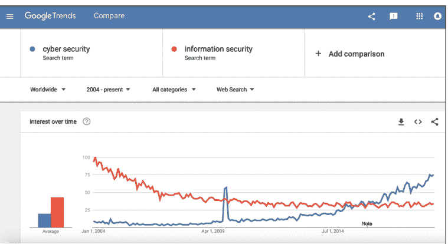

图 4 网络安全与信息安全的搜索兴趣比较。
数据来源：Google Trends (https://www.google.com/trends)。

不同学科专家之间协作的复杂性在我的博士论文²⁵中有更详细的描述。对我们工作领域最广泛的视角可以用多层模型来描述。我们试图管理的许多风险不仅影响 ICT 和企业。人员、ICT 和组织与文化规范及伦理的全球纠缠，要求风险方法比技术或业务风险更广泛。网络安全风险不是一种可以单独识别和控制的“事物”。它部分与危险和烦恼以及规范和价值观的感知相关。形成我们工作领域的不同视角和学科在图 5 中汇聚。图中中心方框说明了对 ICT 的传统关注。它主要是计算机科学、数学和工程的领域。当今，我们可能还希望将运营技术（OT）放入这一层。在这种观点下，安全风险是威胁系统机密性、完整性或可用性的技术风险。这些风险可以通过安装工件和机制以及使用标准和检查表来控制。在中心周围，来自商业社会学、政治和人文学科的日益增长的洞察力补充了技术范围。这些不同的流派增强并启发了该领域。安全思维已从技术控制的概念扩展到社会技术复杂性。这并不意味着一方可以取代另一方：不同的感知互相补充，理解风险需要所有这些观点。风险包括技术风险、业务风险和社会风险的全部。技术风险（例如关键基础设施因技术问题停止工作的风险）可能导致业务风险（当依赖该基础设施的组织无法完成生产时）。反过来，这些风险可能导致社会中人员和群体面临风险。为了说明环境和系统周围边界的消失，技术区域周围的方框使用虚线，外部文本完全没有边框，以象征安全问题的普遍性。

图形外部区域与社会风险相关。通过研究信息社会话语，可以识别并更好地理解这些风险。从研究乌尔里希·贝克、曼努埃尔·卡斯特尔斯、扬·范·戴克或大卫·里昂等信息社会思想家的作品，我们可以了解到，通过社会技术网络中的连接，安全风险的范围是全球且无限的。此外，风险可能是经济的（影响股市）、个人的（身份盗窃、社会不平等、社会关系受损）、政治的（推翻政府或损害国际关系），并且有可能影响基本人权（不受打扰的权利、言论自由）。信息社会理论告诉我们，社会安全风险的感知可能是由国际权力和权力斗争、（缺乏）公共信息政策、大众媒体和文化社会建构的。

我们面临一项艰巨，甚至可能是不可能的任务，即将所有这些学科汇集到一个我们试图用网络安全一词来界定的领域中。然而，由于技术风险可能威胁我们的人权和人身安全，我们必须找到一种跨学科、跨国家合作的方式。

| Scope | Controls | Socio-technical system | Technical system | Technology risk | Business risk | Risk | Theory |
| :--- | :--- | :--- | :--- | :--- | :--- | :--- | :--- |
| 范围 | 控制 | 社会技术系统 | 技术系统 | 技术风险 | 业务风险 | 风险 | 理论 |
| 普遍系统 | 外交 公共政策 监控 教育 | 连接的人数字系统 治理 企业政策 ISMS 标准 培训 | 受控系统 连接的数字系统 工件 机制 检查表 标准 | 机密性 完整性 可用性 计算机科学 数学 工程 | 合规性 质量 法律 伦理 业务连续性 | 社会风险 人权 社会稳定、文化 战争 贫困化贫困 经济中断 | 社会科学 经济学 政治 |

### 图 5 界定网络安全领域。
改编自作者的博士论文25

## 4. 前进之道

上述沟通问题导致网络安全专业人员与其利益相关者之间存在巨大的脱节。网络安全是一个令人兴奋的领域，但很难摆脱错误的声誉。视觉沟通是可用于改善这种脱节的许多工具之一。

有人可能认为视觉沟通仅仅意味着画图。他们可能会说画画是轻浮且不专业的，而且只有“创意人士”才会做这件事。然而，视觉沟通不是关于画图，而是关于应用有意义的视觉工具。这些工具也可以是故事，因为故事有助于听众在脑海中形成画面。其他工具包括使用颜色、字体和文本大小选项来以视觉方式组织信息。它以多种方式帮助我们：

- 它有助于梳理思路。
- 它有助于回忆信息。
- 它增强了对模式的洞察。
- 它有助于看到全局。
- 它支持决策。
- 它传达信息。
- 它产生新想法并带来启发。
- 它使主题变得平易近人。
- 它提供了一种放松的方式来找到焦点。

视觉沟通是构成视觉素养的组成部分之一，且内在于设计思维。

### 4.1 视觉素养

视觉素养是阅读、理解、创建和使用视觉语言的能力，以及规划视觉语言的洞察力。它基于视觉感知、视觉语言、视觉学习、视觉思维和视觉沟通等概念²⁶。它是图书管理员、设计师、计算机专家、教育工作者和生物学家等不同领域研究和讨论的主题。近年来，随着社交媒体和多感官设备的日益普及，视觉沟通在教育和企业中占有一席之地。它是一个跨学科的多维知识和技能领域，涉及批判性观察和思考、可视化、演绎、推理和意义建构等认知功能。不幸的是，它在网络安全教育课程中几乎没有被纳入。这是职业发展中的一个重大缺口，因为其纳入培养了解决问题和协作等技能。网络安全专业人员需要学习如何使用引人入胜的沟通技巧，例如表现出热情并使安全变得相关³。

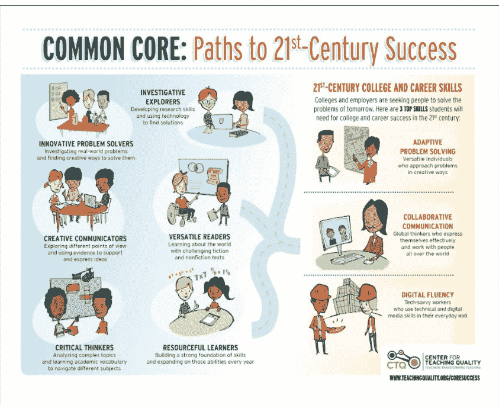

### 教学质量中心

共同核心：21世纪成功之路²⁷ 版权：经教学质量中心许可印刷

这张海报是教师用来解释为什么视觉技能对21世纪的大学和职业成功至关重要的辅助工具。这些论点也适用于网络安全教育和职业成功。

有些人认为这不是他们的工作，或者他们缺乏走这条路的创造性天赋。然而，沟通是每位网络安全专业人员工作的一部分，经过一些培训，每个人都可以绘制视觉辅助工具。关键在于建立尝试某事的信心

新颖，与众不同。视觉沟通在千禧一代28中备受赞赏，尽管即使是数字原住民29也需要培训才能从视觉内容中创造意义。

## 视觉素养需要培训。

小时候，我们大多数人都画过火柴人和方形房子的简单图画。长大后，我们许多人停止了绘制自己的想法，并且觉得很难画画。经过一些练习，应该可以克服不愿尝试的心理，从而发现基于简单绘画技能的视觉沟通的影响。视觉素养技能是可衡量的，并且可以发展和改进30。培训视觉技能会带来丰厚回报。视觉沟通给人们带来以下好处31：

- 1. 能力（一种高级思维形式，能让我们更好地理解、保留和回忆信息）。
- 2. 表现（一种用于更深层次团队参与、解决问题、提高会议效率和共享记忆的工具）。
- 3. 愉悦（一种专注和放松的个人礼物）。

视觉沟通技能从在餐巾纸上涂鸦、在白板上画火柴人，到艺术化的演讲、专业设计的图形以及虚拟现实，不一而足。有些企业非常重视此项技能：Google 聘请了一位官方首席涂鸦师，Microsoft 有一位首席讲故事者，而在 Ford，有一位大师级泥模师，为每一款新车制作黏土模型。这些类型的工作表明，除了众所周知的要点演示文稿之外，还存在另一个维度。

## 图片是得体的商务着装。

《世界经济论坛未来就业报告》32 指出，创造力作为一项技能将增值。顶级技能列表还包括复杂问题解决和批判性思维。视觉沟通是支持这些技能的工具。此外，未来工作的顶级技能、最需要的网络安全技能33 以及归因于视觉素养的技能之间存在重叠。

学习风格通常分为四种类型：视觉型、听觉型、读写型和动觉型。视觉学习风格，常被称为空间学习风格，是一种将信息与图像相关联的学习方式。关于偏好学习风格的研究不断发现，大多数人更喜欢混合学习风格34。这表明，视觉元素是沟通方式中备受认可的补充，不应被忽略。

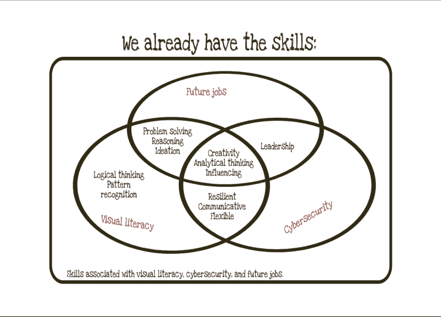

图 6 未来工作技能。

谚语“一图胜千言”常被用来推广视觉思维。这使一些人认为他们需要用图片替换所有内容。这并非必要，而且通常也毫无帮助。我们的大部分信息消费都是基于文本的，我们需要文字来进行沟通。一张图片并不总能替换所有文字，但它可以帮助减少不必要的文字数量，而吸引人的版面可以吸引人们对重要事物的关注。一张图片可以支持和增强文本，使其更有趣。某些图片（例如新闻照片）还可以激发文字，并引发关于某一事件的讨论。其他图片有助于说服受众接受冗长文件（例如法律文件或欺诈调查档案）中记载的某个版本的真相。文本与图像相辅相成。

在数据隐私和安全方面，即使是《通用数据保护条例》（GDPR）也建议使用图标等视觉辅助工具。GDPR 第12条要求提供关于数据处理的易于理解且易于获取的信息。GDPR 第12(7)条甚至建议使用图标，“以便以易于可见、易于理解且清晰易读的方式，对拟进行的处理提供有意义的概述”。

### 4.2 设计思维

设计思维是一种迭代过程，我们通过该过程努力了解为其设计产品或服务的人群。该过程帮助我们与目标用户建立共情。计算机背后的工程学对大部分人类来说难以理解。幸运的是，大多数人不需要知道所有技术细节。然而，他们应该参与新解决方案的设计，并准备好接受现有系统的变更。他们还需要能够向他人复述新指令。经过一些练习，专家都应该能够将复杂话题传达给最终用户，并鼓励他们进一步传播。网络安全中的大多数问题和事件都是由人类行为引起的，并非所有风险都可以通过技术来控制。设计思维是一种从一开始就与多个学科和最终用户协作，来设计安全产品和服务的方法。网络安全教育目前很少教授用户中心设计，尽管有少数举措试图改变这一现状35。工程学研究侧重于系统开发，开发人员学习编码，商科学生学习风险管理。设计思维最有可能引起具有软件工程背景的网络安全专业人员的兴趣：设计思维是几种软件开发方法的基础。然而，设计思维不仅适用于软件或人机界面的开发，还可以应用于企业政策、程序和培训计划的开发。它也适用于沟通过程中视觉辅助工具的设计。设计思维本质上是一个非常直观的过程，由头脑风暴、草图绘制、原型制作、实验和测试等可视化工具和技术支持。它有助于设计可用的安全。

> 设计思维提供了创建视觉沟通和更好安全解决方案的流程。

安全设计（Security by design）是指，安全产品（可能是硬件、软件，以及相关流程）的开发流程旨在从设计过程开始就使系统尽可能安全，并在整个设计周期中持续测试和改进安全控制。设计思维是一个包含五个阶段36 的过程：共情、定义、构思、原型和测试。这些阶段不是按顺序进行的：该过程本质上是迭代的。设计思维假设你可能无法一次就得到最终解决方案，而应该采取更具实验性的方法，尽早验证想法，然后根据用户反馈进行调整。用户处于中心位置：他们有助于将网络安全控制无缝融入其环境，而不是让网络安全专家希望用户只遵循他们强加的技术完美的安全控制。

设计思维者具有几种独特品质，如共情、乐观、整合思维、实验和协作。这些品质支持设计更好解决方案的前进道路。从这个意义上讲，设计师可以被视为问题解决者。网络安全问题往往是棘手问题：它们是含糊不清的问题：

- 今天有效的解决方案在将来可能不再有效。
- 在一个组织中有效的安全控制在另一个组织中可能无效。
- 大多数网络安全解决方案需要大量的人改变他们的思维方式和行为。
- 一些安全问题是其他问题的症状。
- 新威胁通常是新颖且独特的。
- 时间不够。
- 问题从未被最终解决（不存在100%的安全性）。

棘手问题无法被“修复”。方法应着重于如何最好地减轻其直接影响。最后，棘手问题需要采取跨学科方法，并理解不会很快出现结果。解决棘手问题既耗时又是迭代的，需要长期投入³⁷。这就是设计思维作为一种问题解决方法，似乎对网络安全领域很有前景的原因之一。

## 5. 结论

编写一本结合两个模糊、广泛被误解、多学科且多维度的领域的书籍，似乎是一项雄心勃勃的任务。同时，网络安全和视觉素养的共同点在于，它们都需要类似的认知功能，例如批判性思维、可视化、演绎、复杂问题解决和推理。网络安全专业人员很可能具备视觉沟通所需的技能，但缺乏自信地使用它的培训。网络安全存在沟通问题，例如缺乏通用语言和形象晦涩。这阻碍了该领域的进步，并阻碍了从安全意识到安全倡导的道路。

最近，公众对网络安全的态度显然正在变得更加积极。消费者、教育工作者、家长和政治家们提出更多问题，并公开就网络安全和隐私进行辩论。大众媒体和社交媒体促进了网络犯罪故事的传播，并引起了更广泛受众的兴趣。关于数据泄露、身份盗窃或外国政府网络攻击的新闻故事吸引了关注。一种解释是，新闻故事提供了一种学习体验，结果公众变得更加知情。媒体拥有触达不同受众的广泛渠道，以及许多不同渠道来传递新闻故事、观点和背景文章。传播理论家将大众媒体对公众舆论和行为的影响归功于视觉插图的力量。大众媒体传统上使用视觉沟通来阐明、吸引注意力以及解释一系列事件。组织内的网络安全专业人员可以从这些技术中受益，以获得组织内部受众的兴趣。不幸的是，网络安全教育通常不包括沟通理论或视觉设计课程。制作清晰、有条理的视觉沟通需要视觉洞察力。问题是，仍然存在一种过时的偏见，即视觉制作是职业性而非智力性的过程³⁸，同时，仍然存在一种过时的偏见，即网络安全是智力性而非职业性的职业。现实是，两者都需要才能在网络安全领域取得进步。

视觉沟通是一种工具，支持我们从对网络安全的第一印象，到知识和意识，再到倡导的每一步。当战略性地应用时，视觉沟通可以有助于以人为本的安全方法，鼓励员工做出知情的安全决策，承担个人责任，并积极参与安全活动，而不仅仅是遵守政策³⁹。这将带来透明、可访问、视觉清晰、可用、易懂、有用且引人入胜的网络安全产品和服务。最终，这将推动该学科的发展。

## 第二部分

## 通信理论

## COMMUNICATION THEORY

### 网络安全需要通信理论

**左侧框：**
- 了解您的受众
- 了解受众如何学习和被说服
- 选择渠道

**右侧框：**
- 为吸引注意力进行设计
- 更好地与沟通专家联络
- 创建更好的内容

### 了解和理解您的受众

**理论目标**
- 人们如何学习
- 沟通发生的环境
- 人们如何被说服

**关键要点**
- 根据学习目标定制安全教育
- 符合视觉目标...
- 与组织结构相匹配的结构化沟通风格
- 共同文化 / 共同语言
- 利益相关者影响成功
- 员工积极性中的信任：已完成行为 + 消息
- 当设计连贯时，视觉工具效果更好
- 信息应与已有信念相符
- 说服需要信任和抵抗
- 最强的影响是一个人所属的社会群体

### 基本理论与模型

**中央图形：**
- 学习
- 环境
- 说服

**左侧列表：**
- 组织结构（明茨伯格）
- 组织文化（沙因）
- 战略沟通（Choice）
- 利益相关者理论
- 沟通隐私管理理论

**右侧列表（顶部）：**
- 布鲁姆教育目标分类法修订版
- VOIK

**右侧列表（底部）：**
- 市场营销
- 精细可能性模型
- 说服
- 沟通理论
- 框架效应
- 讲故事
- 语义学
- 助推理论
- 计划行为理论

### 为更好的内容和注意力进行设计

**左侧椭圆：**
- 设计选择
- 文化
- 设定目标！
- 品牌
- 感官的
- 情感诉求
- 摄影
- 图片
- 数字
- 语言
- 字体
- 图标集
- 视觉标记

**右侧椭圆：**
- 广告支持的内容
- 助推
- 讲故事
- 交易
- 个人品牌
- 设计策略
- 用户生成内容创造选择
- 修辞学
- 多义性
- 意义，元语言的

### 意识位于这些模型的底部

- **布鲁姆：** 记住，理解，应用，分析，评价，创造
- **吉尔克：** 意识，理解，支持，参与，承诺
- **凯勒：** 意识，诉求，询问，行动，拥护

### 改进的沟通给我们带来比意识好得多的东西：

成功！
信任
创新
拥护

## 6. 简介

本书这一部分简要介绍了传播科学中研究的一些理论和模型，以及它们如何应用于网络安全。对某些读者来说，内容可能有些深奥。它不太直观，并经常引用学术出版物。在某些商业情况下，了解这些关于沟通模型和理论的背景信息很有帮助。沟通理论的基本知识将以多种方式帮助网络安全专业人员：

- 1. 了解他们的受众
- 2. 设计最佳方式来教导他们的受众
- 3. 选择能够触达其受众的沟通渠道
- 4. 规划沟通活动
- 5. 设计并创建更好的内容
- 6. 更好地与沟通专家联络
- 7. 了解为什么仅靠意识是不够的

前一页的概述总结了本书的这一部分。理论和模型分为三个领域：人们如何学习、沟通发生的环境以及人们如何被说服。本部分介绍的理论概述远未完整。还有许多其他模型可以应用于网络安全沟通。不幸的是，将这些模型应用于网络安全环境的研究很少。还有很多需要学习，希望本书这一部分能对那些刚开始研究项目并寻求网络安全沟通理论概述的研究人员有所帮助。

## 7. 人们如何学习

安全意识计划旨在告知和培训员工，使他们能够以安全的方式履行职责。在许多组织中，这些意识计划由安全部门制定，有时与沟通专家合作。这些意识计划通常包括培训计划，因此，网络安全专业人员掌握一些学习理论知识将受益匪浅。

### 7.1 布鲁姆分类法

20世纪50年代，本杰明·布鲁姆与一群学者共同开发了一种教育目标分类，称为布鲁姆教育目标分类法40。2001年，该分类法的关键元素进行了更新，以更好地反映21世纪的教育目标41。该分类法将学习分为三个领域：认知领域（知识）、情感领域（情绪）和动作技能领域（行动）。认知领域包含六个学习目标层级：

表1 布鲁姆学习目标层级。

| 布鲁姆层级（2001年版） | 学习目标 | 相关动词 |
|---|---|---|
| 创造 | 创造新事物 | 设计，预测，重组，构建，推测，开发，撰写，调查 |
| 评价 | 为立场或决策辩护 | 论证，辩护，选择，支持，评价，批评，权衡，估计，分类，评估，检查，鉴定 |
| 分析 | 连接想法或将其分解。 | 组织，关联，检查，调查，比较，区分，实验，质疑，测试，审查 |
| 应用 | 在新情境中使用信息 | 执行，比较，实施，解决，使用，演示，解释，操作，安排，草图 |
| 理解 | 解释想法或基本概念 | 分类，描述，讨论，解释，识别，定位，认出，报告，选择，翻译 |
| 记住 | 回忆事实和基本概念 | 定义，复制，列出，记忆，标记，定位，重复，陈述 |

表2 应用于网络安全的布鲁姆学习目标层级。

| 布鲁姆层级（2001年版） | 专业人员的安全学习示例（改编自⁴⁴） | 最终用户的安全学习示例（改编自⁴³） |
|---|---|---|
| 创造 | 制定安全风险评估和灾难恢复计划 | 撰写新的政策条目，以防止用户将敏感信息放在移动设备上 |
| 评价 | 基于风险评估对威胁和对策进行分类 | 批评这两个密码，并解释在其提供的安全性方面你为何会推荐其中一个而非另一个 |
| 分析 | 识别和分析项目风险，并进行定性和定量分析 | 以下涉及被盗密码的安全事件中，哪些在我们公司更可能发生？ |
| 应用 | 在各种场景中分配适当的物理与逻辑以及集中与分散的访问控制 | 使用适当的应用程序更改财务子系统的密码 |
| 理解 | 在管理网络时解释审计、资产管理、标准和执行 | 为什么密码中应使用非字母数字字符？ |
| 记住 | 陈述用户账户密码要求 | 访问控制的定义是什么？ |

一些研究人员指出，传统的安全意识培训只能达到学习的底层三个层级：记住、理解和应用⁴²。然而，为了确保在现代数字化社会中的网络安全，每个人都需要尽可能高层级的技能来处理其数字活动。

布鲁姆分类法可能有助于根据受众的需求定制教育水平，使用网络安全专业人员不常探索的不同形式的沟通。例如，仅仅教个人什么是密码，属于布鲁姆分类法中的记住，可能还有理解层级。然而，[...] 了解为什么他们的密码[...]也应得到妥善构建和保护，可能高达分类法中的评价层级43(第284页)。这要求人们能够比较密码并解释哪个更强。

布鲁姆分类法在设计面向专业人员的网络安全教育方面也可能很有用。它有助于识别可以将网络安全主题添加到IT课程中的领域。

布鲁姆分类法的其他领域（情感和动作技能）在网络安全环境中被高度忽视。情感领域的技能，例如，针对态度，而动作技能领域则侧重于行为和技能的改变。为了改善在这些领域关于网络安全学习的知识差距，我们或许可以在心理学和沟通理论中找到联系，例如本章余下部分所述的那些。

### 7.2 学习风格

学习风格理论声称个人学习方式不同，并根据人们偏好的学习风格对其进行分类。从20世纪70年代以来，此类模型层出不穷。这些理论备受争议，并因缺乏科学证据证明个人学习风格确实存在而受到批评。然而，许多教师仍支持这些理论。2014年，五个国家（英国、荷兰、土耳其、希腊和中国）90%的受访教师相信，当个人获得针对其偏好学习风格定制的信息时，他们学习得更好45。

其中一种理论将学习分为四种用于获取信息的模式：视觉、听觉、读/写和动觉（VARK）46,47。听觉或听力意味着偏好口头或听到的信息。读/写模式指偏好书面文字。视觉模式包括在地图、图表、图形等中描述信息。它包括设计、图案、形状和其他符号。请记住，并非所有图片都是视觉的。使用屏幕（想想演示文稿幻灯片）并不意味着上面的材料是视觉的。信息可以是文本（要点），仅仅因为它显示在屏幕上并不意味着它是视觉信息。第四种模式，动觉，指偏好通过体验和实践作为学习风格。通过实践或观看自己做某事的视频对具有这种偏好的人最有效。借助问卷，人们可以找出对自己最有效的方法。人们可能在不同情况下在模式之间切换，或偏好两种或多种模式的组合。使用VARK问卷的不同研究人员发现，大多数受访者偏好综合风格。这意味着教学方法应融合四种风格，以提高达到最大效果的机会。

VARK与沟通有着紧密联系48。人际沟通植根于这四种风格。人们提供信息、说服或建立 rela-

与其偏好的风格最契合。人员之间 VARK 剖面的不匹配可能导致冲突和误解。营销人员在电视广告中运用 VARK 原则，以吸引所有感官模态。其他形式，例如用视频解释产品工作原理，更能吸引动觉型学习者。读/写模态对于阅读互联网来源是必需的，因为许多网站都是文本性质的。

网络安全专业人员可以从这一理论中得出结论：在会议、研讨会、营销或团队建设等场景中，结合使用视觉、文本、视频、游戏和体育活动，可能比依赖单一模态更有效。这也与意识培训的设计相关。一项澳大利亚的研究探讨了为何某家银行的员工表现出的信息安全意识水平高于其他行业的一般劳动力⁴⁹。对这一现象成因的研究发现，培训频率与意识水平之间没有相关性。因此，研究人员在员工接受的培训类型及其设计方式中寻求解释。开发该培训方案的团队由行为专家和教育工作者组成。意识到不同的学习风格，他们使用不同的渠道和媒介来传达感兴趣的话题，包括视频、海报和传单，以及信息性电子邮件。此外，所有员工必须在获得 ICT 系统访问权限之前通过一门强制性培训课程。管理层应少关注意识培训的频率，而更多关注培训类型的设计。

### 7.3 安全教育、培训与意识

丹麦研究人员⁵⁰最近研究了关于安全培训和意识计划的学术文献。在信息安全早期，此类计划的重点放在技术上，而自本世纪初以来，人们更加关注人为因素。不幸的是，一项又一项的研究表明，即使考虑了人的因素，许多意识计划仍未能实现预期效果。因此，研究人员评估了 42 篇关于信息安全和人类行为的研究论文，并提炼出影响安全教育、培训和意识计划成功的因素。这些因素可作为设计未来计划的输入。

研究人员将这些因素划分为四个维度：

- 知识：受内容、使用尊重语言以及知识分发经验等因素的影响。

- 态度：受信念、个人规范和知识等因素的影响。

- 意图：受组织控制、感知的威胁严重性、行为合理化、感知和动机等因素的影响。

- 行为：受环境、认知过程以及对环境影响的感知等因素的影响。

这些维度相互关联。例如，知识是意图和态度的重要前身。知识又源于经验、共享和协作。在论文中，研究人员列出了每个维度上比上述概述的更多直接和间接因素。知识、态度和意图的组合会影响人们的行为以及他们是否遵守安全策略的决定。如果组织在开展意识和培训计划时考虑这些因素，就更有可能取得成功。

### 7.4 网络钓鱼模拟的经验教训

模拟网络钓鱼活动作为企业网络安全意识培训的一部分，其受欢迎程度仍在上升。网络钓鱼模拟是指组织向员工发送模拟网络钓鱼电子邮件。其设计目的是在员工点击网络钓鱼电子邮件中包含的链接时提供反馈。打开电子邮件或点击链接等行为会被分析，以评估人们对电子邮件网络钓鱼活动的易感性，并指导进一步的意识培训。这种方法背后的理论是，员工会从错误中吸取教训，下次收到可疑电子邮件时会更加警惕。一些学者称这种做法为霸凌⁹，甚至有工会公开反对金融机构向员工传递误导性信息的做法⁵¹。

对这类活动有效性的研究结果不一。一项针对美国 1,350 名大学生的研究甚至得出了一个意外结果：他们观察到，网络钓鱼知识和意识越强，用户的易感性越高⁵²。另一项⁵³针对近 11,000 名学生和大学工作人员的研究发现，在意识活动的第二轮中，点击网络钓鱼电子邮件的人数有所下降。然而，考虑到这是重复活动的第二轮，并且已发布通告称存在网络钓鱼诈骗，这些数字仍然很高。

泰国的一项最新研究⁵⁴采用混合培训形式来教育网络钓鱼模拟的参与者。培训前，参与者收到了多封模拟网络钓鱼电子邮件。然后，研究人员采用基于视频的培训、基于游戏的培训、基于文本的培训和由讲师主导的课堂培训相结合的方式来教育参与者。培训后，又进行了一轮模拟网络钓鱼电子邮件，点击率显著下降。然而，第二轮是在培训后立即进行的，因此没有长期效果的真正证据。此外，特定培训方法组合的效果没有差异，因此没有哪种培训方法组合优于其他组合。参与者对培训方法有不同意见，因此意识活动设计师应包含多种学习方法，以满足参与者的学习风格偏好。

上述研究所缺乏的是对培训效果在较长时间内进行衡量。多项研究表明，效果会在 28 天⁵⁵ 后消退，但开展了较长时间重复活动的研究仍然不足。医疗保健领域的一项研究⁵⁶测量了近三年来 20 次模拟活动（结合强制性网络钓鱼培训）的效果。他们发现点击率有所下降，但易感员工的数量仍然很高。在 15 轮网络钓鱼活动后，为参与者中的特定群体引入了额外的强制性网络钓鱼培训。该培训未能使该群体在第 16 至 20 轮的点击率显著下降，且其结果与未参加培训的群体没有差异。

在我们能够就通过模拟网络钓鱼和额外培训开展网络钓鱼培训的有效性得出任何结论之前，还需要大量更多的证据。我们才刚刚开始了解教授网络安全概念以及培训的长期有效性，应开展更多关于培训效果的研究。

## 8. 沟通发生的环境

有效的沟通需要了解沟通发生的环境。大多数网络安全专业人员将关注组织内部的沟通。内部沟通是该组织成员之间持续交换和解释信息的过程。这种沟通高度依赖于组织结构和文化。在规划沟通活动之前，了解组织很重要。

组织可以用六个变量⁵⁷来描述：

- 1. 目标：组织存在的原因是什么？
- 2. 策略：组织如何实现其目标
- 3. 结构：任务的划分
- 4. 文化：组织内部存在的不成文规则
- 5. 技术：机器、ICT、程序和任务
- 6. 人员：在组织中工作的人

尽管所有六个变量都影响内部沟通，但以下段落仅限于结构和文化，因为这些主题对于我们设身处地地理解我们想要接触的人高度相关。

### 8.1 组织结构

组织的业务目标和分工影响安全。组织结构既可能成为安全的障碍，也可能成为变革的源泉。例如，安全设计的概念本应是软件开发中的常见做法。然而，组织中的现实几乎与安全软件开发的最佳实践不符。

一项加拿大的研究解释了软件开发团队不遵循安全软件开发最佳实践的原因。大多数组织遵循自己的软件开发方法，而安全开发的最佳实践与团队成员的角色和职责相冲突。许多组织认为为了遵循这些最佳实践而改变其结构是不合理的⁵⁸。在观察到的团队中，只有一个团队将安全视为开发过程设计阶段的一部分。许多其他团队表示，他们没有重新—

负责安全，且不需要保障其应用程序的安全。事实上，一些开发者报告称，他们的公司不期望他们具备任何软件安全知识。该研究还发现，这些组织通常会指定特定的人员或团队全权负责安全。这导致了临时性的流程，并违背了安全是共同责任这一最佳实践。

德国研究人员发现，安全软件开发的另一个组织障碍。他们在软件开发者与安全顾问交流期间及之后对其进行了研究，以了解他们的组织例行程序如何变化，从而整合安全工作¹⁴。他们意识到，咨询在短期内有效，但像采用新工具或新做法这样的可持续变化并未随之而来。研究人员将主要原因归咎于敏捷方法：开发团队优先处理明确的需求，以交付合同中要求的内容。由于安全始终是一种隐性期望，而不是管理层明确陈述的业务目标，因此它没有获得持续关注。研究人员得出结论，将安全整合到组织例行程序中的成功与否取决于特定的组织环境。业务管理层对安全的看法影响项目在组织中如何优先考虑安全。

组织结构是网络安全沟通的重要因素。Mintzberg⁵⁹描述了组织结构的五个主要部分，其中最占主导地位的部分定义了组织的类型。基本的五个部分是：

- 1. 在战略高层，我们找到了高层管理及其支持人员。
- 2. 在组织底层是运营核心，即执行组织任务的工人。
- 3. 在中间，我们找到了中层和基层管理。
- 4. 由工程师、会计师、规划师、ICT和研究人员组成的功能集群称为技术结构。
- 5. 支持人员是提供间接服务的人员，例如维护、法律顾问和餐饮服务。

根据Mintzberg的说法，根据五个部分中哪个部分起主导作用，有七种组织类型。Mintzberg的基本组织配置如下：

- 1. 企业家型组织：它具有扁平结构和庞大的战略高层。
- 2. 机器官僚制：沉重的中层管理和工作流程的标准化。
- 3. 多元化组织：组织分为专注于自身产品的事业部。
- 4. 专业型组织：员工独立，但有许多指南和程序。
- 5. 创新型组织：结构可适应且基于项目。
- 6. 传教士型组织：公司文化基于意识形态。
- 7. 政治型组织：以权力为导向的组织。没有正式结构，且不清楚谁负责什么。

当网络安全团队计划沟通活动时，识别组织的形状以及目标受众的位置很有帮助。例如，在机器型组织中，内部沟通通常是标准化和正式的。这是一个保留大量手册的组织类型。沟通主要以书面和正式的形式进行。即使是自下而上的沟通也是正式的，会议通常会产生规则和程序。在企业家型结构中，沟通方式不同。在这里，它是非正式的、互动的，并且直接在老板和员工之间进行。在专业型组织中，权力在于操作层级，员工参与政策和程序的制定。大多数员工非常独立，几乎不就其任务进行沟通。

在网络安全中，我们有时会看到不符合组织结构的沟通方式。例如，在实施信息安全管理体系（ISO 27001）时会出现这种情况。安全人员往往将沟通正式化，仿佛自己身处机器型组织，即使实际上他们身处创新型或企业家型结构。或者，他们在不咨询独立工作的员工的情况下，将政策和程序强加给专业型组织。大型组织甚至可能在不同事业部之间拥有不同的结构。了解这些结构对于规划网络安全沟通以及调整风格和活动以适应不同目标群体非常有益。

### 8.2 组织文化和政策

组织文化是赋予工作场所意义的动态过程。它通过非正式沟通、企业政治和影响者、非理性决策、情感、情绪和不成文规则来表达。组织文化通过组织的意识形态（价值观、理念和偏好）以及行为方式（行为、仪式、故事、建筑、品牌和标志）形成。它不是静态的情况，而是由人们持续构建的。它可以由管理层⁶⁰进行改变、影响甚至设计。

许多人认为组织文化是组织内部网络安全风险（内部威胁）的主要因素。欧盟网络与信息安全局（ENISA）将网络安全文化定义为：‘人们关于网络安全的知识、信念、看法、态度、假设、规范和价值观，以及它们如何在人们使用信息技术的行为中体现出来’ 61(p40)。过去，研究人员关注加强法规 62 和报告异常行为 60 如何影响安全文化。在这种思维方式下，人们认为通过政策、合规框架、评估和惩罚 63，安全文化会自行发展。这种观点在今天的ISO 27001等最佳实践以及ENISA等组织的建议中仍然可见，尽管有证据表明这种意识形态方法在某些类型的组织中不太可能有效 64，并且制裁会起反作用 65。此外，文化风险在整个组织中会有所不同，并且不太可能建立一个统一的安全文化 66。

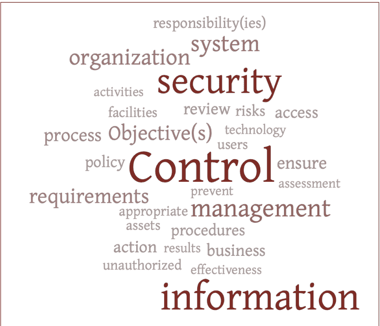

图 7 ISO 27001:2005 文本的词云。较大的单词使用频率最高

组织的文化是成功实施网络安全改进的重要变量。从沟通角度来看，改变文化需要采取以下一种或多种沟通行动 57：

- 1. 关于需要改变的内容的一对一谈话
- 2. 展示新工作方式的成功案例
- 3. 共同调查事件并讨论选项
- 4. 使不成文规则为人所知
- 5. 指出模范行为和榜样
- 6. 奖励期望的行为

这些行动可能有助于说服人们随时间改变。人们通常不希望被迫改变，但如果他们相信其优势，可能愿意尝试。当地团队代表参与企业政策制定和文化设计计划将有助于这些计划的成功。与最终用户共同调查事件有助于理解行为及其后果以及最终用户的行为。此外，这种参与将有助于实现安全文化中最大的变革之一：向共同语言演变。当人们长期合作时，他们倾向于发展一种共享语言，这有助于他们更有效地沟通。当来自不同学科的人一起工作时，需要时间来相互理解。当这样的团队积极共同创造一种语言时，这有助于团队成员感到更具建设性，并给所有参与者提供焦点。语言揭示了个人、群体、组织成功乃至个人职业前景之间的关系 67。要了解组织中的文化和亚文化，重要的是了解人们与同事沟通时使用的语言。在这方面，网络安全专业人员有机会创造一种通用语言，至少为其自身组织，并通过词典和风格指南分享它。最终，这将改善组织内部网络安全专业人员与其同事之间的关系，以及与组织外部利益相关者的关系。

> '只有在达成共同理解之后，才会产生共同承诺。在个人之间建立共同语言的过程中，他们的工作（和个人）关系通常会得到增强 24'。

企业文化及其转化为安全政策的方式影响员工遵守这些政策的承诺程度。政策出现问题的一个建议原因是信息安全政策的风格和措辞。有些政策可能长达一百多页

文档页，并以技术写作风格编写，因此很可能被忽略⁶⁸。一份更简短的政策能比更大的指南向更广泛的受众传达信息安全的必要性。

英国⁶⁴的研究人员对医疗保健组织内的25份信息安全政策进行了批判性话语分析。他们使用一种方法来识别真实性、合法性、真诚度和清晰度。在分析中，他们寻找歧义、混淆或缺乏解释的证据，这最终可能导致政策信息难以被员工清晰、统一地解读。很明显，存在大量歧义，特别是关于政策的目标和预期对象，同时也有大量证据表明使用了行话和不熟悉的语言。此类行话的示例包括“自我监管实践”或“最佳实践”（第86页）。使用晦涩和技术性行话可能会稳定现有的主导管理层级。此外，他们发现许多政策文件带有意识形态底色，即管理层有权告诉组织的其他成员如何行为，实施监控（以检查该行为），并制裁不合规者。例如，他们发现通常会声明，未能遵守政策“可能导致纪律处分或解雇，或导致警方介入”（第85页）。

研究人员建议，政策应在当地制定和创建，并让最大范围的读者和用户参与。还建议政策使用易于理解的语言和术语，并为员工提供一套单独的具体指南。具体问题的示例有助于展示政策的相关性。最后，面向专业受众的技术内容应保存在单独的文件中。这一建议得到了研究人员的支持，他们发现员工往往感到被政策奴役⁶⁹。政策制定过程中没有给员工任何影响内容或提供反馈的机会。这使得员工在面对有时在操作上困难的政策指令时感到无力。

### 8.3 内部沟通

内部沟通是组织内专业人员之间持续的信息交换。员工需要信息来执行任务（任务信息）、了解政策以及了解进展情况（管理信息），并且还需要关于员工问题和社会政策的社会信息。为了防止信息不足或信息过载，信息必须及时、准确、相关、完整且易于获取。如果没有信息的获取途径，员工就无法执行他们的任务。

向员工提供信息的内部沟通可以分为：

- 垂直（在单位内自上而下或自下而上）
- 斜向（员工与另一部门管理层之间）
- 水平（同一层级员工之间）
- 正式或非正式

沟通阶梯⁷⁰（如图2所示）描述了内部沟通的预期目标。对于每个目标，都有不同的沟通渠道可供选择，具体取决于互动程度、语言多样性和信号多样性（情感、社交、口头和非语言），以及预期的行为改变程度。阶梯越高，预期的改变程度越大。意识位于底部，与受众的互动较低，改变意图最少。意识层级使用的沟通渠道是单向的，例如电子邮件或海报。承诺位于阶梯顶部，互动程度高且改变程度高。现代沟通渠道主导阶梯顶部，为创建交换富含内容的信息以及激发员工参与和承诺的社区提供了许多机会。

网络安全的沟通活动通常停留在这个阶梯的底部。当目标是意识时，新闻通讯或手册等单向沟通渠道是常见的做法。要达到阶梯的承诺级别，需要通过合作解决问题和设计方案，与最终用户进行持续的互动。

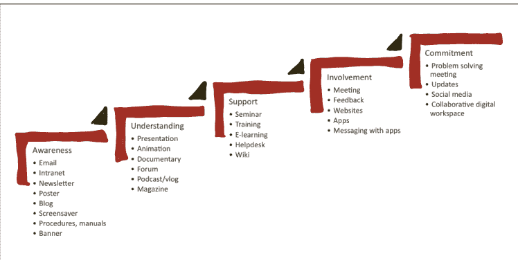

图 8 沟通阶梯（改编自 Quirke 70）

### 8.4 利益相关者理论

虽然“利益相关者”一词存在50多种定义⁷¹，但一般来说，利益相关者被视为能够影响或受项目、计划、投资组合或组织活动的决策、活动或结果影响的个人、群体或组织。利益相关者存在于组织内部和外部。他们对项目、任务或战略的成功或失败至关重要，因此应当进行“管理”。利益相关者理论指出，不能孤立地看待利益相关者，每个利益相关者对企业的成功都至关重要。判断他们的利益是否朝着同一方向发展对成功很重要。如果只关注一群利益相关者，就会遗漏事情；所有利益相关者都是创造成功所必需的⁷²。自20世纪90年代以来，已有许多关于利益相关者管理的书籍和学术论文。它们来自不同的视角，包括法律、市场营销、金融、生态学和工业关系。

利益相关者分析（SA）旨在分析其相对权力和利益、其重要性和影响力，他们可能戴的“帽子”以及他们所属的网络⁷³。为了成功开展参与，有必要了解他们在您的项目或战略结果中的利益。SA的常用工具是一个矩阵，利益相关者群体出现在一个轴上，而标准或属性列表出现在另一个轴上。对于每个重叠区域，都会给出定性描述或定量评级。目的是了解其地位及其对某些预期最终结果（例如项目目标、冲突解决、组织变革等）的可能影响。分析利益相关者的第二种选择是检查其协同程度与对抗程度⁷⁴。协同程度低且对抗程度中等的人是您的对手；协同程度高且对抗程度低的人是您的盲目支持者。

在SA期间设计矩阵或利益相关者地图等可视化辅助工具，有助于了解哪些利益相关者最重要。Bourne⁷⁵建议，在图中应考虑的一些维度包括：

- **态度：** 此人会帮助还是阻碍工作？
- **层级：** 此人在组织结构中的位置与活动管理人员相比如何：更高/更低、内部/外部、同事还是竞争对手？
- **影响力：** 此人的人脉关系网络有多广泛？
- **兴趣：** 此人是有主动兴趣、被动兴趣还是没有兴趣？
- **合法性：** 此人是否拥有一定程度的咨询权？
- **权力：** 此人引发变革的能力是什么？
- **接近程度：** 此人参与工作的程度如何？
- **接受度：** 与此人沟通是否容易？
- **支持程度：** 此人支持还是反对工作？
- **紧迫性：** 此人是否认为工作对自己很重要？

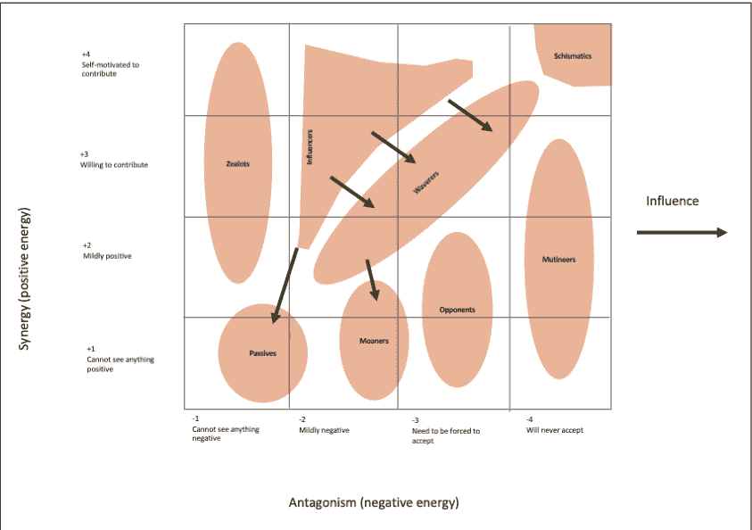

图 9 利益相关者分析

SA之后是沟通和参与计划。利益相关者沟通矩阵（SCM）是计划利益相关者沟通活动的工具。它通常是更大沟通计划的一部分。SCM可能有多种形式，但通常包括利益相关者列表、他们的兴趣/权力、沟通频率、沟通渠道选择、目的和优先级。其目的是在您活动的适当阶段让利益相关者了解情况。

对于网络安全专业人员来说，重要的是要认识到工作场所内外的人和群体会影响网络安全活动的成功。识别他们、分析他们如何影响您的工作、决定如何与他们保持关系，以及在利益相关者沟通计划中确定沟通渠道的类型可能会有所帮助。最后，不同的利益相关者可能根据其视角对网络安全定义和风险有不同的看法。

### 8.5 沟通隐私管理理论

沟通隐私管理理论（CPM）是关于人们如何决定披露和隐瞒私人信息的理论 76。它描述了人们根据个人规则控制其私人信息的过程。个人认为自己拥有私人信息，并有权控制它。他们根据个人隐私规则共享信息。当人们共享信息时，意味着他人被赋予共同所有权地位。因此，个人可能不仅披露自己的信息，还可能披露属于他人的信息。因此，信息需要管理。

管理私人信息的三个主要组成部分是：隐私所有权、隐私控制和隐私湍流。隐私所有权意味着人们相信自己拥有私人信息，并可以选择拒绝或向谁提供其私人信息的访问权限。隐私控制代表提供或拒绝访问私人披露的管理过程。因为原始所有者相信他们拥有该信息，所以他们相信即使在授权共同所有者后，他们也控制对其的访问。当与私人信息的个人边界与公开披露的边界重叠时，就会发生隐私湍流。

CPM 用于框架关于家庭沟通、健康（例如可穿戴设备和个人健康信息共享的研究）、社交媒体（社交网络中个人数据共享）、大数据收集、电子商务以及工作场所（员工监控）的研究。随着个人移动设备在工作场所越来越被允许，CPM 在工作场所变得非常适用。自带设备（Bring Your Own Device）的概念意味着雇主必须为隐私和安全制定规则。公司必须采取措施保障其网络安全。同时，一些员工认为，即使他们在工作场所，公司也不应能够追踪其个人设备甚至公司电脑上的操作 77。

一项针对台湾员工的研究 78 发现，员工在控制型组织文化中感到隐私受限。研究人员建议，组织最好避免过度控制，以改善员工与雇主之间隐私边界的协商。在与员工协商隐私时，对组织侵权的担忧是影响信任的主要因素。他们得出结论，良好的隐私管理能够在工作关系中产生信任，并鼓励员工强烈的承诺和合规动机与意愿。

在移动商务背景下，研究人员发现，对感知控制边界和未经授权访问个人信息的担忧会对消费者使用移动商务产生负面影响。当消费者信任商务合作伙伴时，他们对共享个人信息的担忧较少 79。因此，向个人告知数据处理的范围以及对未来数据使用的明确同意确认，不仅是 GDPR 下的法律要求，而且还可能增强消费者信任，从而改善业务。

## 9. 如何说服他人

说服是一种旨在影响信念、价值观、态度、意图、动机和行为的沟通形式。进行说服需要发送者、媒介和接收者。发送者有一个目标，并打算通过沟通实现该目标。接收者不是偶然或被强迫而被说服的。说服取决于接收者所处的环境、消息的内容和形式，以及发送者的可信度。在网络安全领域，我们投入大量精力试图说服他人。本章讨论的理论为更好地理解说服过程中涉及的过程提供了锚点。

### 9.1 营销

营销是一门起源于市场上商品销售或以物易物的学科，此后已发展成为一门科学，侧重于向客户提供附加值并维护良好关系。营销理论与心理学、社会学、经济学、社会科学、创意艺术以及统计学相关。在影响行为方面，营销理论为网络安全提供了有用的见解。毕竟，组织都在努力说服人们使用安全程序、工具，并以某种方式行事。

最传统的营销模型之一是 AIDA 模型（归因于 E. St Elmo Lewis，约 1898 年）。该模型描述了客户需要经历若干步骤：**关注-兴趣-欲望-行动**。首先需要吸引人们的注意力，例如，大声喊叫：“好吃的苹果”。然后，客户必须产生兴趣：“来自最好的树，非常新鲜”。当客户品尝苹果或看到别人享受它时，兴趣就转变为欲望。最后一步是实际购买行为。此模型此后启发了许多其他营销模型。如今，营销不再止步于购买行为，而是致力于延伸的“客户旅程”，其中包括购后体验。在现代营销模型中，忠诚度和产品拥护已成为营销的最终目标。如今，客户对 f 因素（朋友、家人、Facebook 粉丝和追随者）的信任，超过了对营销传播的信任 80。人们倾向于在社交媒体上向朋友征求建议。客户在营销活动中不再被视为“目标”。客户现在被视为品牌或产品的同伴和朋友。拥护者讲述积极的故事，并向同伴提供建议。他们成为布道者。

Kotler 80 将原始 AIDA 扩展为五个 A，以更好地适应我们现代互联社会。步骤现在是：认知（我知道）、吸引（我喜欢）、询问（我确信）、行动（我购买）和拥护（我推荐）。

AIDA 模型及其新变体帮助我们影响员工行为。将安全意识计划作为符合标准和法规的勾选练习的组织，只需让目标群体接触其信息和培训课程即可，无需做更多。当我们旨在让员工采取行动并再次行动（例如定期更改密码）时，应让员工经历从意识到行动的所有阶段。但是，旨在实现结构性变革和持久行为的组织需要采取额外步骤，以实现员工对安全行为的忠诚和拥护。多项研究发现，观察同伴的安全行为能激励追随者的安全行为 11、13、81。要改变安全行为，我们需要在受众的同伴群体中拥有拥护者。

研究信息安全违规制裁效果的研究者 65 发现，政策强制执行策略效果有限。他们发现，当使用影响策略时，强制执行变得不显著。可以教育员工为自己的行为负责。作者建议应关注员工行为与业务风险之间的联系。另一种策略是使用了解安全问题并帮助倡导合规行为的榜样。然而，相同的研究者还发现，员工的职位越高，此人违反安全规则的可能性就越大。这一结论为未来研究指出了一个有趣的话题，因为大多数最佳实践都指出，安全治理应由高级管理人员推动。

### 9.2 修辞理论、框架和叙事范式/讲故事

古典修辞理论以亚里士多德和柏拉图的思想为主导，侧重于通过政治和法律中的语言和演讲进行说服。在古典理论中，有三种说服方式：

- Ethos：说服听众相信演讲者的可信度。这是通过选择合适的语言、着装以及展示专业知识来实现的
- Pathos：通过诉诸情感来说服听众
- Logos：诉诸逻辑来说服听众

当代修辞理论现在不仅涉及演讲，还涵盖所有发生符号使用的情境，包括个人日记、电视，

互联网，以及网站作为修辞产物。这意味着修辞理论还包括对视觉和非语言元素的研究，例如对艺术和建筑、建筑物、汽车、外观、体育等的研究。视觉修辞可以嵌入表演、肢体语言、图片、物体、物理空间等中。例如，一张医生的照片通常显示医生穿着白大褂，以使图像的可信度更强。

我们可以在关于网络犯罪、网络恐怖主义、黑客行动主义或网络战争的故事中识别出网络安全中的*言语*修辞。数据泄露和恶意软件的增加将这些故事带到了媒体头版。这些故事影响公众对网络安全的看法。记者发现撰写网络安全文章具有挑战性：向编辑推销故事需要公众兴趣，而公众兴趣有时滞后，他们必须说服组织分享关于数据泄露82的信息。

故事是向开发人员和C级高管83解释安全目标的强大工具。通过故事或场景，人们可以更好地可视化信息或风险的重要性。然而，故事必须与组织相关，并得到一些分析82的支持。这一观点早在20世纪80年代就已由叙事范式概念的创始人Walter Fisher认可。他的理论声称，故事比单纯的论证更具说服力。该概念支持这样的观点：沟通和说服只有在听众能理解时才有效。因此，故事必须连贯（结构化且包含可信的角色）且可信（事实事件、推理模式和重要性）。

一些学者认为，网络安全专家讲述的故事被夸大并过度简化84。在网络末日场景中构建故事的可能影响甚至适得其反：使用极端恐惧可能导致宿命感和行动动力下降85,86。框架化是一种在积极或消极语境中呈现信息的技术，以达到对受众的最大影响。例如，当受访者被问及是否支持一群极端分子的言论自由时，大多数人会给出肯定答复。但当被问及以暴力为背景支持同一群体时，大多数人会表示反对。信息框架化要求使信息不那么复杂且易于解释。在网络安全中，这往往是一项挑战。De Bruijn和Janssen86推荐了六种网络安全框架策略：

- 1. 不要夸大网络安全。保持现实。
- 2. 明确反派是谁。
- 3. 通过将英雄置于聚光灯下，为网络安全赋予面孔。
- 4. 展示其对社会的重要性。
- 5. 个性化，以便公众易于识别。
- 6. 与潜流相连接。网络安全与其他问题相互交织。

2018年，荷兰政府发布消息称，外国国家间谍被抓获从事黑客攻击87。在新闻发布会上，政府提供了事件的详细时间线，并附带了相关人员的图片、护照细节、设备以及被指控人员在机场的照片。这是一个不寻常的景象；通常，政府不会分享这些情报行动的细节。该信息的框架化遵循了上述所有六种策略，并向涉及的国家行为体传递了明确的框架信息，即荷兰政府认为这些活动不可接受，并辅以视觉修辞和故事。

网络安全专业人员可以通过运用修辞的关键要点来提高其沟通的说服力。例如，通过讲述一个涉及可信英雄、反派以及诉诸受众情感的故事。通过一个受众可以产生共鸣的清晰信息（‘这可能发生在我身上’）或与人们已知故事相符的信息（‘这就像前几天新闻里的一样’），受众会在脑海中形成情景图景，并可能内化该信息。

一个涉及英雄和诉诸受众情感的故事例子可见于卡巴斯基Lab Benelux88发布的一段视频信息，该信息回应了荷兰政府停止使用卡巴斯基软件的决定。这段视频展示了一位讨人喜欢的英雄，解释了所有出色工作，并展示了在荷兰工作的富有同情心的团队。这段视频使用视觉修辞和讽刺来影响公众对品牌的信任。

### 9.3 阐释可能性模型

阐释可能性模型（ELM）基于这样一个理念：态度改变遵循两条基本心理路径之一。它们被称为说服的两条路径。中心路径说服是逻辑的、有意识的和深思熟虑的路径。在这条路径上，人们会更长时间地思考某条信息，并仔细考虑所给出的信息。该过程适用于网络钓鱼邮件，研究结果与ELM及其他相关理论一致。研究发现，多个变量会影响阐释可能性：

- 1. 参与网络钓鱼检测过程的程度。电子邮件越相关，阐释程度越深。
- 2. 对紧急信号的关注。网络钓鱼者使用紧急信号来传达恐惧或威胁。在这项研究中，个人过度关注紧急信号，常常忽略电子邮件的其他元素，例如其来源以及电子邮件中使用的语法和拼写。对这些元素缺乏关注会增加个人被网络钓鱼的可能性。
- 3. 习惯性媒体使用模式，个人对此类相关电子邮件心不在焉地回应，这占网络钓鱼易感性的一半以上。
- 4. 电子邮件负载。在电子邮件负载较大的情况下，个人回应网络钓鱼电子邮件的可能性远大得多。

主要经验是，根据ELM，如果人们更长时间且反复地参与信息，他们更可能被说服。为了获得更长时间的注意力，信息必须易懂且与个人相关。应避免分心。

### 9.4 认知失调理论

认知失调是指人们同时持有冲突的信念、想法或行为时所感到的不适。例如，当一个人认为锻炼很重要，但很少抽出时间进行体育运动时。这会产生不适感，可能会刺激该人改变行为并去健身房。应对不适的其他方式包括通过改变态度来证明自身行为的合理性（我不必去：健康益处被夸大了，我会受伤），或通过为自己的信念添加更多论据（太贵了，我太忙）。

了解一个人特定的认知失调，就有可能改变该人的行为。这使得它成为广告商、销售人员、活动家和政治家中流行的理论。如果营销人员希望人们购买他们的产品，他们会向消费者灌输信息

迫使他们做出决定。例如，可以想想与健康相关的产品的商业广告。它们声称普通产品不够好；使用其他产品你的症状不会消失，但当你购买他们的产品时，你就能重新享受生活。

关于减少态度与行为之间失调的理论有以下几种：

- 选择性接触。人们倾向于选择符合自己已有信念的信息，并忽略相反的信息。温暖且私人化的环境最适合考虑不同观点。
- 决策后需要安抚。做出重要决定后失调感更大，尤其是当很难改变决定且决策过程耗时较长时。
- 最小正当化。改变态度的最佳方式是提供恰好足够的诱因。如果没有显著的奖励，人们会改变自己的态度来证明其行为的合理性；如果奖励丰厚，人们则会在不改变态度的情况下顺从。

减少最终用户关于网络安全行为失调感的步骤包括：刺激新信念以改变冲突的权重（例如，通过演示第三方访问其计算机有多容易），为其提供新信息（展示密码管理软件等解决方案），或降低信念的重要性（通过技术强制执行某些操作）。

认知失调是网络犯罪分子针对的一种现象。一项针对南非学生的研究发现，学生们对自己在安全方面的态度和技能充满信心，但他们的实际行为却显示不同，表明他们会明知是错的行为 7。例如，他们信任来自使用朋友名字的电子邮件账户发送的邮件内容，尽管他们对自己识别网络钓鱼的技能充满信心。在态度与网络欺凌以及避免网络欺凌的技能感知方面也发现了类似结果。最后，学生们知道复杂密码更安全，但仍然选择简单密码。这些认知失调的例子使学生容易受到网络犯罪的侵害。

另一个例子是隐私悖论。在线用户声称非常关注隐私，但同时却很少采取行动保护个人数据。几项研究试图解释人们用来为自己行为辩解的合理化方式，但结果不一 92–94。

另一个例子是密码疲劳，当用户面临需要记住的海量密码时就会发生这种情况。在一项针对全球约 2,000 名成年人的调查中，91% 的受访者表示重复使用密码存在固有风险，然而 61% 的人仍然继续使用相同或相似的密码，其中超过一半（55%）的人在充分理解风险的情况下仍然这样做。

### 9.5 助推理论

助推理论常用于政治、医疗保健、营销和组织传播，以影响行为。助推是指对决策所处情境的微小改变。正如泰勒和桑斯坦 96 所定义的，助推是选择架构（可供选择的选项集合）的任何方面，它以可预测的方式改变人们的行为，而不禁止任何选项或显著改变其经济激励。改变选择架构使人们更容易做出符合自身利益的决策。一个著名的例子是厕所小便池上画的苍蝇。男性往往瞄准苍蝇，从而减少溅出和清洁成本。瞄准苍蝇不是强制性的，使用厕所的访客也没有特定的经济利益。他们仍然可以选择瞄准其他地方。另一个著名的助推是为对社区更有利的特定选择设置默认加入选项：例如，将器官捐赠或养老金储蓄计划设为默认加入。

助推经常在网络安全领域被用来影响最终用户的行为。安全与隐私方面的助推在伦理、犯罪利用和设计方面面临一些挑战。人们担心助推会影响被助推者的福祉、自主性和尊严 97。助推应该是为了公益而进行，但问题是，谁的公益？关于助推伦理存在持续的争论，尤其是在政府实施时。助推的危险在于人们可能被迫朝着政治或宗教方向发展。大多数人倾向于支持助推，只要它们旨在促进健康、安全和环境保护 98。然而，有时助推是基于谎言和操纵的。网络犯罪分子可以利用助推诱导人们泄露个人信息、安装恶意软件，或点击看起来有吸引力但最终导致身份盗窃或欺诈的内容。另一个批评是，设计选择可能导致人们开始忽视风险。他们可能完全依赖默认设置，不再思考安全问题。

表格列出了网络安全领域的一些助推示例。

| 期望行为 | 刺激更好决策的助推 |
|----------|-------------------|
| 选择强密码 | 消息和密码强度计鼓励用户选择更强的密码或更强的安全问题。 |
| 将默认设置更改为退出 | 设计软件以预先勾选允许用户退出使用其个人数据的框。互联网和移动应用用户几乎不会更改默认的安全和隐私设置。将默认设置更改为“不要向我发送新闻通讯”99 几乎不会导致用户选择相反的、隐私保护程度较低的加入选项。 |
| 保持个人数据私密 | 每天向人们展示智能手机应用程序访问其个人数据的频率，以激励用户更新隐私设置。 |
| 激活隐私设置 | 有些社交媒体网站会显示图标或消息，让用户了解谁可以看到和分享他们的帖子以及如何更改这些设置。 |
| 安装更新 | 通知用户安装更新，除非用户点击某个内容推迟，否则会自动安装更新。 |
| 安全网上购物 | 警告消息提醒消费者在购物开始时安全浏览，以解释如何安全连接、如何找到可信赖的供应商，并在完成后登出 100。 |
| 不活跃时使用屏幕锁定 | 一段时间无活动后自动锁定屏幕。 |
| 使用可靠的 Wi-Fi 网络 | 对可用网络列表进行排序或颜色编码，将最安全的网络放在最上面 101。 |

### 9.6 计划行为理论

计划行为理论（TPB）用于预测一个人在特定时间和地点采取某种行为的意图。该理论指出，要预测人们将要做什么，需要知道他们的意图。意图受态度、规范和感知行为控制 102 的影响。态度是指一个人对某种行为持正面或负面评价的程度。规范是指主观规范和社会规范，例如，个人对某种行为的感知会受到父母、朋友、教师等人的评价的影响。感知行为控制是指个人对自己执行特定行为能力的感知。

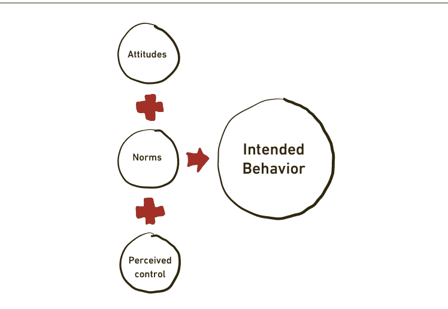

图 11 计划行为理论。

少数研究人员在网络安全领域使用了 TPB。澳大利亚研究人员调查了不同国家用户的在线安全行为，并发现感知行为控制是预期行为的最强预测因素 12。此外，社会规范也是一个强预测因素。这表明，一个人所属社会群体的影响对其是否打算采取安全行为或不采取安全行为有显著影响。这一结果与现代营销理论的观点相符，即客户被视为品牌或产品的拥护者。

## 10. 消息呈现

### 10.1 格式塔原则

格式塔学派兴起于 1912 年左右。一个多世纪后，格式塔心理学继续启发着视觉科学和认知神经科学的研究¹⁰³。然而，大多数人会将格式塔与设计和艺术联系起来。格式塔心理学构成了至今仍在使用的设计规则的基础。它指的是知觉组织：人们在看一个物体时，先看到整体，然后开始看到细节。这个过程称为涌现。当我们看到一个物体时，我们首先寻找其轮廓。然后，我们将此轮廓与已知的形状和实体进行匹配。之后，我们开始识别构成整个物体的部分。

另一个过程称为再认。如果我们找不到与物体相匹配的模式，我们就会搜索记忆，找到看起来像它的东西，并填补空白。有些图片可以有多种解读。我们的头脑会选择一次只看到其中一种。

有几个原则有助于理解人们观察到的内容，从而帮助以一种看起来连贯和完整的方式设计视觉辅助工具。它们被称为组织原则或格式塔定律。

Table 4 格式塔原则概览

| 组织原则 | 效果 | 示例 |
|---|---|---|
| 相似性 | 最相似的元素（颜色、大小、纹理、字体或方向）被感知为比不共享这些特征的元素更相关。 | ![带有红黑点的相似性示例] |
| 闭合性 | 我们倾向于寻找可识别的模式。我们会填补缺失的信息以完成图形。 | ![碎片化形状中闭合性的示例] |
| 亲近性 | 在一起较近的物体被感知为比相隔较远的物体更相关。 | [视觉：两组相隔一定空间的 3×3 点阵] |
| 图形/背景 | 元素被感知为图形（焦点元素）或背景（图形所依赖的背景）。 | [视觉：鲁宾花瓶式图形/红色方框] |
| 平行性 | 彼此平行的元素被视为比彼此不平行的元素更相关。 | [视觉：一组平行的对角线] |
| 对称与秩序 | 人们倾向于将物体感知为围绕其中心形成的对称形状。 | [视觉：括号 <> < > < >] |
| 连续性 | 排列在一条线或曲线上的元素被感知为比不在这条线或曲线上的元素更相关。 | [视觉：排列在曲线上的点] |
| 共同区域/元素连接性 | 如果元素位于同一封闭区域内，则被视为组的一部分。 | [视觉：矩形框内的点] |
| 优美图形/Prägnanz/简洁性 | 人们会将复杂图像感知和解释为尽可能简单的形式。右侧图片更容易被读作三个形状，而不是一个复杂形状。 | [视觉：黑色、红色和灰色的抽象形状] |
| 同步/共同命运 | 朝同一方向移动的元素被感知为比静止或朝不同方向移动的元素更相关。 | [视觉：带方向箭头的红点] |
| 统一连接性 | 在视觉上连接的元素被感知为比无连接的元素更相关。 | [视觉：由虚线连接的形状] |
| 焦点 | 带有兴趣点、强调或差异的元素会吸引并保持观看者的注意力。 | [视觉：带一个红色方块的黑点网格] |

这些原则可用于改善演示文稿的构图，或海报、警告消息、网站或信息图的设计。了解并实施格式塔理论的原则，可以使可视化效果感觉更强、更连贯。

格式塔原则也可应用于数据可视化。面向网络安全的数据可视化通常针对 IT 专家和分析师制作（例如，用于处理日志文件、恶意软件和漏洞的工作），并显示常见的条形图、饼图、环形图、圆图、热图和表格。然而，以非专家最终用户为中心的数据可视化可能从格式塔原则中获益。例如，新西兰的研究人员¹⁰⁴ 设计了一种以用户为中心的可视化，基于亲近性、相似性、Prägnanz 和共同命运原则，面向关注其云中数据生命周期的最终用户。他们的目标是寻找将原始数据（日志）转换为最终用户可以轻松理解并评估安全风险的最终输出的技术。将格式塔知觉理论纳入该技术，提供了一系列可视化，允许最终用户可视化和交互以追踪数据来源。

不法分子也利用格式塔原则制作欺诈文件。例如，伪造文件上企业标志的小改动可能会因人们对该标志的知觉而被忽略。如果看起来很熟悉，细节上的小改动很可能被忽略。当前安全和取证方法分析图像中的模式，格式塔原则被用于改善安全和取证分析中的模式识别¹⁰⁵。示例包括数字水印检测、垃圾邮件识别、破解加密方案、指纹分析或数字取证。

### 10.2 重复与习惯化

习惯化是一种学习形式，即在反复接触刺激后，对刺激的反应会减少。人们会产生习惯化，因此随着时间的推移，对重复的安全警告反应减弱。神经生物学家认为，这并非人们故意所为，而是大脑工作方式的自然结果。习惯化是一种重要的生存机制，因为它使生物体能够将能量留给相关威胁。

对于网络安全，这意味着在首次接触安全警告后，当警告随着时间的推移而重复时，对该警告的注意力会下降。可以通过改进警告消息的设计、随时间频繁更改设计（边框、颜色、大小、符号和文本），以及在用户暂时远离消息后再重新开始，来再次提高注意力。

在一项使用眼动追踪技术的实验中，研究人员将用户对传统警告消息与旨在改变外观的警告消息（多态警告）¹⁰⁶ 的注意力进行了比较。多态消息包含警告科学文献建议的九种图形变体，包括红色、图形符号、信号词、对比度和选项顺序。结果表明，多态警告比静态警告更能抵抗习惯化。使用功能性 MRI 扫描大脑的进一步研究提供了更多证据，表明用户会在几天内对警告产生习惯化，但对多态警告的习惯化较少¹⁰⁷。颜色的使用也会影响吸引力。例如，网站上的安全套接层或密码警告消息在红色中的表现优于黄色¹⁰⁸、¹⁰⁹。因此，每次出现在屏幕上时都应改变设计的警告用户隐私和安全风险的消息，消息设计者应考虑颜色变化。

### 10.3 符号学

符号学是研究符号和符号意义的学科。符号代表不在场的物体。符号可以是一个词、一张图片、一场表演、一个多媒体作品、一座建筑，甚至是一种趋势。声音、时尚和交通信号也可以是符号。符号化是为符号创造意义的过程。符号化与符号的编码、传输和解码方式相关。要让人们理解符号的含义，他们必须能够对其进行编码和解码。一个词、颜色或符号是某物的代码这一决定，是由社会群体（文化）做出的，因为它们同意其含义。例如，一些专业词汇（工作、办公室和体育）、各种俚语、街头艺术或表情符号的使用。只有属于该群体并学习使用其中一种语言种类和风格的人，才知道那里使用的词语或符号的含义。符号学是一种在所有符号用途（语言和视觉）中习得并共享的概念联系。

符号主要有三种类型：（1）图式，与其所代表的对象相似（例如落石路标或象形文字）；（2）指示符，与其所代表的对象相关联（如烟雾是火灾的征兆，指纹与某人相关）；（3）符号，仅通过惯例与其所代表的对象相关（如词语或标志）。对象与符号之间的符号关系更抽象，只能通过学习社会中的文化代码来学习。

与隐私和数据保护相关的符号学理论应用活动日益增多。已有几项倡议通过法律设计¹¹⁰-¹¹³ 使法律更加易于访问、更加可用和更具吸引力。法律设计领域提倡应考虑新的沟通方法，以允许任何个人，即使是外行，也能访问和理解法律信息。在隐私方面，这甚至是法律强制要求的。GDPR 第 12 条要求提供可理解且易于访

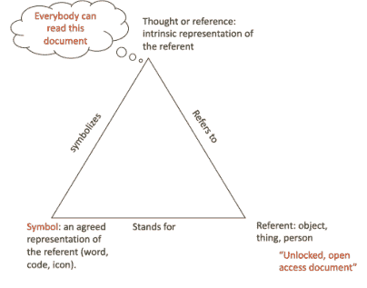

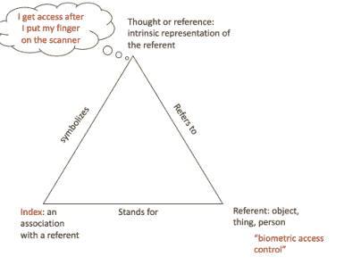

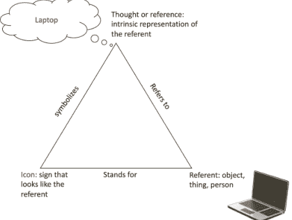

图12 符号三角形概述。三个符号三角形分别解释图标（可识别的图片）、符号（图片的含义需要学习）和索引（与对象或概念的关联，它们彼此不相似）。

ble 信息，关于数据实践。第12(7)条甚至建议使用图标“以便以易于可见、可理解且清晰易读的方式，对拟进行的处理提供有意义的概览”。图标可以代表数据保护概念及其诠释，并充当共享语言。当设计、沟通和信息技术协作时，就有可能生成用户友好的法律界面¹¹⁴。

### 10.4 个人品牌

个人品牌是个人为推广其主要个人特征而采用的一种营销策略。个人品牌在政客、演员、经理、科学家和企业家中很常见。随着社交媒体的发展，每个人都可以成为信息发布者并创建个人品牌。个人品牌在20世纪90年代末期在商业文章的影响下变得流行，例如汤姆·彼得斯（Tom Peters）于1997年发表的《名为“你”的品牌》和彼得·德鲁克（Peter Drucker）于1999年发表的《管理自我》。该话语主要以自助书籍和职业建议的形式出版，并常被学术界批评为一种幻想。有观点指出，个人品牌出售的是希望而非本人：“脱颖而出的希望、获得认可的希望、感到独特并值得关注的希望，最重要的是，寻找意义的希望”¹¹⁵⁹⁶。讨论个人品牌的学术论文主要产生于社会学¹¹⁶和市场营销¹¹⁵等领域。

大多数人已经在潜意识里推销自己，并认为个人品牌是有效的。例如，当求职者接受面试时，他们中大多数人都已内化了个人品牌的概念，并非常关注自己的在线存在与形象¹¹⁶。欧洲和美国各类公司中的销售人员和高管在访谈中表示，他们觉得个人品牌为他们带来了有形的结果（例如销售业绩、客户回电、奖项和旅行）以及无形的回报（客户对你微笑、得到赞美等）¹¹⁷。

越来越多的网络安全专家正在推广他们的个人品牌。这些人被视为网络安全领域的顶级影响者。这不仅对于将网络安全作为招聘的有吸引力领域进行推广，或影响和倡导安全行为很重要，而且还有助于推进个人的职业生涯。网络安全女企业家简·弗兰克兰（Jane Frankland）在其著作¹¹⁸中描述了她如何决定提升自己在网络安全领域的个人品牌，花时间学习如何使用社交媒体，并自此受益。其他影响者因其行为（凯文·米特尼克）、知识和写作（布鲁斯·施奈尔）或发现（丹·卡明斯基）而闻名。他们被视为榜样和影响者。个人品牌有助于赢得受众的信任，因为你作为知识渊博的专家的声誉变得更加可见。通过展示你的知识或与知名组织的关系，你会被视为具有权威性的人³。这将帮助你建立关系并获得可信度。

个人品牌在很大程度上，但并非仅限于，你的在线存在。它需要视觉沟通。例如，用讲故事的方式传达你的信息、网站上引人注目的个人简介、吸引人的LinkedIn标题、演示文稿中的个人风格与设计、专业个人资料照片以及视频消息等。大多数影响者都有视觉吸引力的网站，并在文章、博客和演示文稿中保持一致的视觉风格。他们知道自己在说什么，并坚持自己的规范和价值观。他们始终遵循这些规则，并时刻注意他人对他们的看法。

## 11. 结论

沟通理论指导我们做出更好的沟通设计决策。它提供模型来理解沟通发生的背景，从而让我们更好地了解受众。

它还展示了人们如何学习以及如何接收和考虑安全信息。沟通研究表明，记住和理解信息不一定会导致承诺和拥护。要制定沟通策略，有许多选择，例如使用营销模型、修辞、讲故事、框架或个人品牌。

沟通理论的关键要点如下：

- 1. 将安全教育定制为学习目标的认知水平
- 2. 混合使用视觉、口语、文字和实践操作以达到最大效果
- 3. 调整沟通风格以匹配组织结构
- 4. 共享文化 = 共享语言
- 5. 利益相关方影响成功
- 6. 对雇主的信任激励合规行为
- 7. 信息必须相关且重复
- 8. 当设计连贯时，视觉效果更佳
- 9. 信息应与已有信念相符
- 10. 说服需要信任和保证
- 11. 最强的影响者是一个人所属的社会群体

在本书的下一部分中，你将找到许多支持沟通策略的想法。这些示例中的精选内容将简要讨论其与沟通理论的关系，以帮助你在查看图片时培养思维模式。

## 第三部分

### CISO办公室中的视觉沟通

## 12. 引言

首席信息安全官（CISO）及其团队有1001项任务要完成。视觉沟通可以帮助更有效地工作并吸引利益相关方。本书的这部分为CISO团队可能向不同受众解释的不同概念提出了一些常见的可视化方案。请记住，本节中的示例只是比喻意味上的冰山一角。我们的社区才刚刚开始意识到可视化的力量，本书的这部分只是一段漫长而富有创造力的旅程的开端。法律设计、信息设计和数据科学等其他领域是重要的创新者，网络安全专家应当与他们合作。许多工作已经在诸如IEEE网络安全可视化研讨会（VizSec，自2004年起举办^119）以及自2014年起举办的年度安全图形模型国际研讨会（GraMSec，^120）等活动中汇集在一起。拉斐尔·马蒂（Raffael Marty）在其著作《应用安全可视化》（2008）中表示：

> '一张图片抵得上一千条日志记录'^121（第xiii页）。

在他看来，可视化是基于数据生成图表的过程。在上述示例中，侧重于数据可视化和工具，而不是向非专家传达复杂概念。

其他工作则是从视觉信息中创建安全。例如，通过拍摄移动高速公路、云层或熔岩灯的照片来为密码学创建随机性^122。

在本书中，可视化主要是指以尽可能清晰的方式传达信息，同时考虑目标受众和背景。接下来章节中的示例演示了如何在网络安全的不同背景下使用可视化。我们的眼睛无法看到网络安全风险、威胁或组织结构，但当以可视化形式呈现时，这些概念更容易理解。这些示例展示了不同的风格、技术和信息。有些源自商业来源，其他则来自公共部门和学术出版物。希望，本书的进一步版本和支持网站将使我们的社区能够建立一个示例库，以启发未来的视觉沟通者。

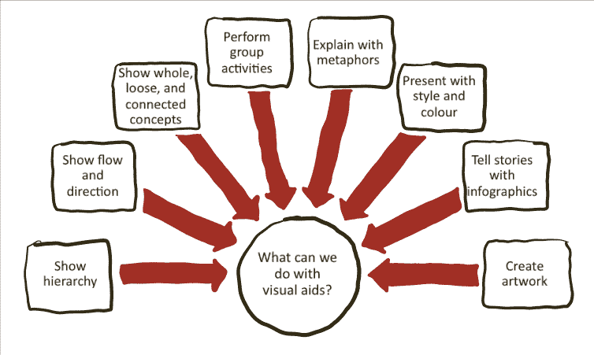

### 图 13 可视化有何帮助？

## 13. 可视化层次结构

层次结构通常以树状图可视化。树可用于显示文本信息以及数值数据。树可视化有帮助的一些场景示例如下：

- 显示分类法
- 显示亲属关系和血缘
- 显示决策选项
- 计算概率
- 显示组织结构

显示树的形式有很多种。基本形状包括水平或垂直树、矩形树图、圆形树图和放射状树。

| | | | |
|---|---|---|---|
| 树图 | 树状图 | 圆形树图 | 旭日图 |

在树状图中可视化数据是呈现数据的最简单形式之一。此类层次结构可视化的许多示例可在学术文献和业务环境中找到。一些示例参考如下：

> **树图**：漏洞类别树图¹²³、木马家族树图¹²⁴（第 12 页）
> **圆形树图**：子网中令牌和服务状态¹²⁵、软件定义网络中的活跃节点¹²⁶
> **故障树/攻击树图**：CORAS 风险分析模型¹²⁷、传感器云框架风险评估¹²⁸、CVSS 攻击图¹²⁹
> **旭日图**：Mitre ATT&CK 框架¹³⁰
> **多方向树**：违规模式¹³¹、攻击反应性¹³⁰

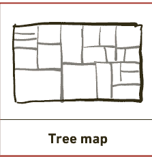

### 信息事件场景开始时行为者及其位置的树图

*Nicole van Deursen*

该树图基于 2006 年至 2010 年间医疗保健组织研究中的数据²⁵。它显示，医疗保健组织内被调查的绝大多数事件（n=2108）始于内部员工（74%），大多发生在组织内部，但有时也发生在家中或患者家中。事件的其他主要起点为业务合作伙伴（2%）、软件/最终用户应用程序（5%），且许多事件（18%）原因未知。

### 行为者开始引发信息事件的位置

- 建筑物
- 业务合作伙伴
- 硬件
- 内部员工
- 患者
- 软件
- 未知
- 家庭成员
- 外部人员

- 在场所内
- 内部员工
- 患者家中
- 未知
- 员工家中
- 其他位置
- 软件
- 未知
- 在场所内
- 未知
- 员工家中
- 其他位置
- 业务合作伙伴
- 其他位置
- 患者

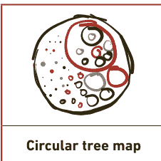

### 医疗保健信息风险的分类法

Nicole van Deursen，使用 Flourish 制作

基于：25

分类法是将具有相似特征的事物命名并组织成群组的系统。分类法通常按层次结构组织，包含不同层级的群组和子群组。本医疗保健信息风险分类法可视化展示了共同描述风险情景的类别（威胁、方法、弱点、事件和损害）及其子类别。

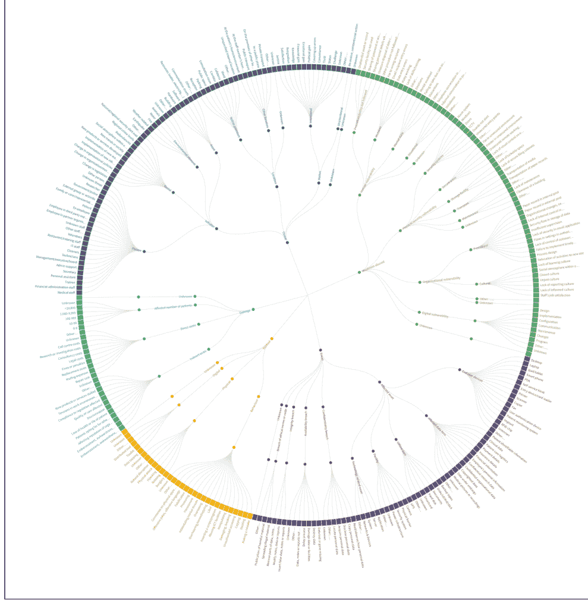

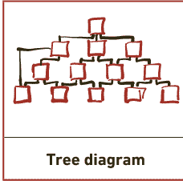

### 软件保证成熟度模型

OWASP
版权：Creative Commons 署名-相同方式共享 4.0 许可证

软件保证成熟度模型 (SAMM) 是一个开放框架，帮助组织制定和实施针对其面临特定风险量身定制的软件安全策略。树状图概述了软件开发的核心业务功能，并将安全实践与每个功能相关联。该模型的构建基块是为每十二项安全实践定义的三个成熟度级别。

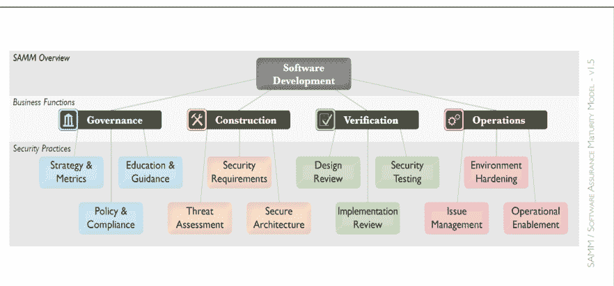

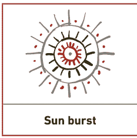

### 让 CISO 忙碌的事是什么？

Nicole van Deursen

旭日图可以作为项目符号列表式工作描述的替代方案。你甚至可以通过颜色和方框大小来指示你设定的优先级或占用大部分时间的任务。

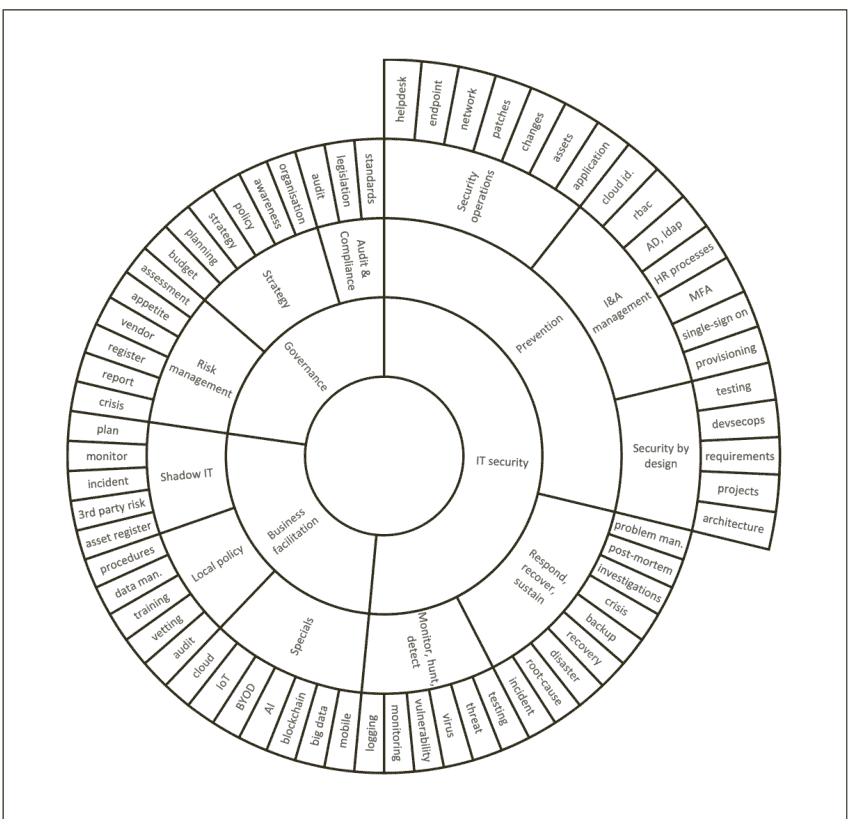

## 14. 可视化流程与方向

网络安全工作通常非常动态。流程和方向图有助于可视化工作流程以及对人员的期望。可视化有助于对一系列事件进行排序，也可以表达对未来的增长愿景。这些图表可以是方向性的、圆形的，或暗示某个过程。它们的共同点是代表某种形式的移动。

| | | |
|---|---|---|
| 流程图 | 蝎尾图 | 路线图 |
| 地铁图 | 比较 | 时间轴 |
| 圆形图 | 梯子图 | 泳道图 |
| 鱼骨图 | Petri 网 | 成熟度模型 |
| （交互式）路径图 | 螺旋图 | 桑基图 |

本章未介绍的插图参考如下：

- **Petri 网：** FTP 攻击的 Petri 网建模结果^134，用于情境感知的物理系统和运营 Petri 网模型^135
- **时间轴：** Zeus 时间轴 (2007-2016)^136
- **桑基图：** 虚拟基础设施^137
- **成熟度模型：** 安全意识^138
- **地铁图：** 勒索软件家族^139

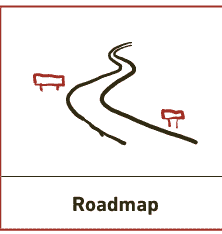

### 欧洲网络安全月路线图

ENISA¹⁴⁰
版权：ENISA：授权复制本网站上发布的材料

欧洲网络安全月 (ECSM) 是一项欧盟宣传活动，每年 10 月举行，旨在提高公民网络安全意识。它总结了未来的愿景：号召所有组织参与年度意识月。在通往未来的道路上，已有许多汽车，每辆代表参与意识月的一个合作伙伴。本书前一章讨论了消息呈现的格式塔原则。你在这张图片中识别出了哪些原则？

### 欧洲网络安全月通往未来的路线图...

### ECSM 的增强内容：

- 继续开发素材库
- 继续鼓励公私合作活动
- 在网站上引入最佳实践板块

### 进一步在欧洲和成员国层面发展稳定的协调模式：

- 提前规划所有步骤并予以传达
- 改善交互性
- 改善内容和参与度

欧盟成员国 + 更多合作伙伴国家

#### 国际合作

- 开发 NIS 活动国际培训工具包
- 探索共同网络研讨会和电子学习解决方案
- 提前规划
- '网络安全需要您的参与' 了解更多信息请访问 www.cybersecuritymonth.eu

enisa.europa.eu

### 三重蝎尾图 5G 网络安全监督模型

Farley Wazir¹⁴¹
版权：经作者许可

蝎尾图分析常用于建模威胁、危险和后果。作者在其硕士论文中调查了与 5G 网络相关的信任和监督模型。

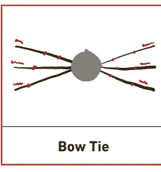

### 监督层

- 数据泄露信息
  - SB GDPR
  - SB DB 信息
  - 电信 (EECC) 安全 SB
  - SB 行业 SB
  - 建筑 SB 例如 NIS SB
  - 数据泄露信息

- 威胁：
  - 预防措施
  - 5G 构建模块中的安全漏洞，例如云计算 (NFV, SDN, MEC)
  - 纠正措施
  - 影响：

- 威胁：5G 构建模块（例如云计算 (NFV, SDN, MEC)、EMF (波束成形)、RED (设备)）等中的安全漏洞
  - 预防措施
  - 5G 供应中的安全漏洞
  - 纠正措施
  - 影响：

- 威胁：5G 供应中的安全漏洞
  - 预防措施
  - 5G 用例中的安全漏洞
  - 纠正措施
  - 影响：

- 技术层
- 社会技术层

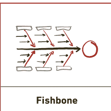

## 阻碍企业将信息作为业务资产进行管理的障碍

Danette McGilvray, James Price, Tom Redman142 版权：经作者许可出版

鱼骨图基于南澳大学Nina Evans博士和James Price143的工作。该图高层次展示了信息资产管理不善的根本原因。

### 最常观察到的根本原因

Danette McGilvray / James Price / Tom Redman
2016年10月

## 缺乏领导力和管理

- 愿景
- 战略
- 指导原则
- 政策
- 管理体系

- 缺乏开展工作的能力
- 未投资于质量，增加成本并使数据使用工作复杂化
- 不适当的文化（例如，直觉重于“事实”，信息不被视为资产）
- 不适当的结构（例如，信息孤岛）
- 对“谁负责什么”感到困惑
- 缺乏主动领导。

## 不适当或无效的工具

- 缺乏GAAP的等效物

## 缺乏意识 • 高管 • 从业者

- 没有高等教育
- 没有在职教育

不知道如何将信息付诸实践

## 未得到妥善管理的信息资产

- 客户体验
- 组织对齐
- 收入
- 竞争优势
- 生产力
- 成本
- 风险连续性
- 发现
- 安全

## 缺乏业务治理

- 缺乏问责制
- 缺乏所有权
- 谁负责什么不清楚
- 缺乏指导行动的度量

## 证明的困难

- 市场不要求他们这样做
- 管理信息资产的成本不被理解
- 数据的价值取决于上下文，难以界定
- 收益难以得出
- 商业案例不能创造紧迫感

## 50年的网络安全分类法

Nicole van Deursen，使用Timegraphics制作。基于：25

此时间轴是25中分类法概述的扩展版本，列出了随时间发表的一系列学术、公共部门和商业分类法。

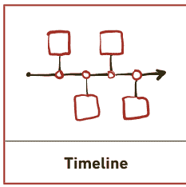

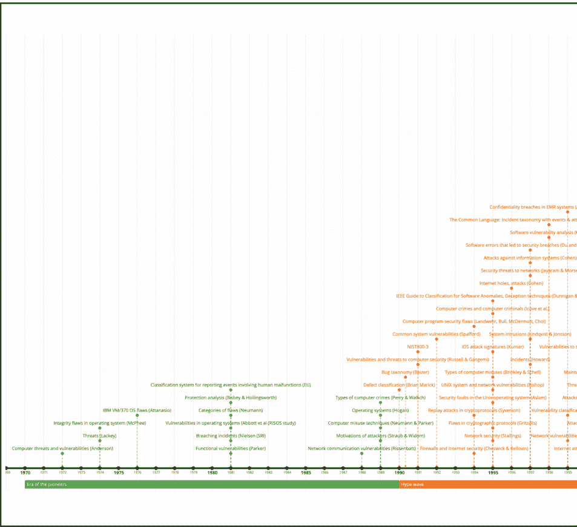

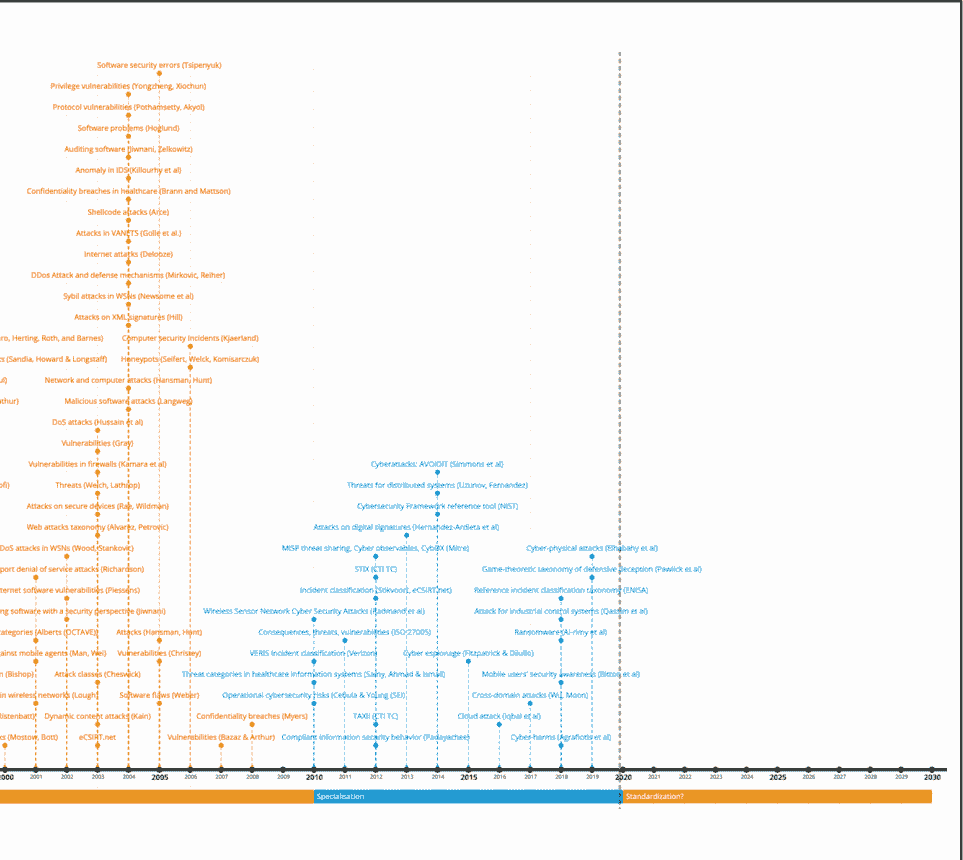

## Bad Rabbit勒索软件感染链

Trend Micro^144
版权所有 © [2017] Trend Micro Incorporated。保留所有权利。

此流程图使用符号、数字、文本和箭头来演示导致勒索软件感染的步骤。格式塔原则中的共同区域原则（属于某组的元素位于同一封闭区域内）通过将相关步骤归组在框中来支持读者。箭头支持理解阅读时的方向和顺序。

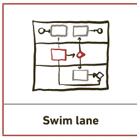

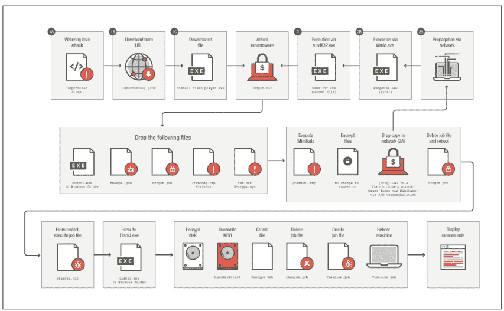

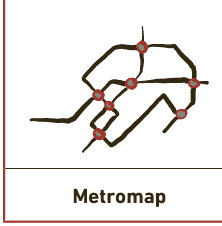

## 敏捷实践地铁图

敏捷联盟^145
经敏捷联盟许可印刷

此地铁图是来自交互式地铁图的屏幕截图，显示了Scrum、精益、极限编程等各个方面。地铁线路上的每个站点都显示与这些方法相关的术语。

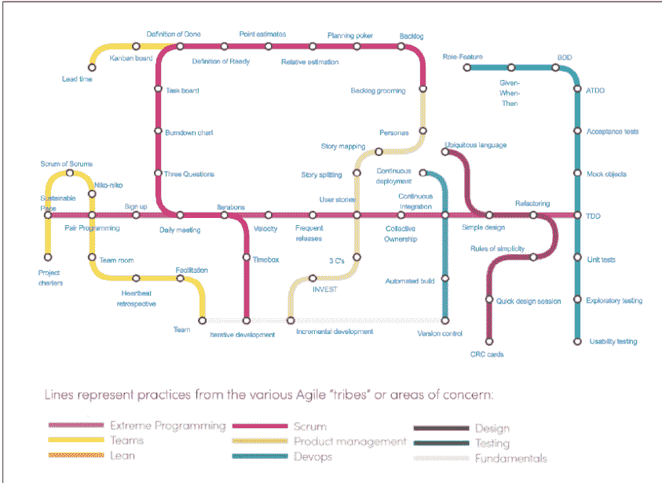

线条代表各种敏捷“部落”或关注领域的实践：

- 极限编程
- Scrum
- 设计
- 团队
- 产品管理
- 测试
- 精益
- DevOps
- 基础

## 医疗保健中的信息风险场景

Nicole van Deursen，使用Flourish制作
基于：25

此图基于从医疗保健组织收集的数据集。它显示了导致2006年至2010年间登记的信息安全事件的变量及其子类别。

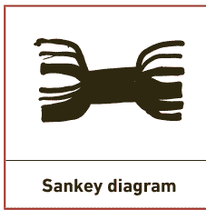

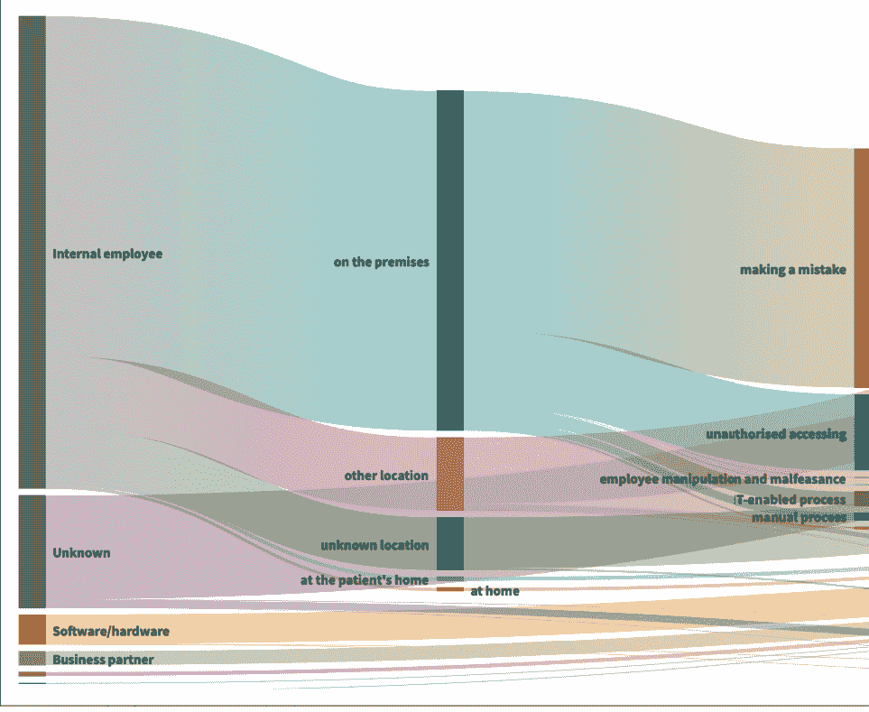

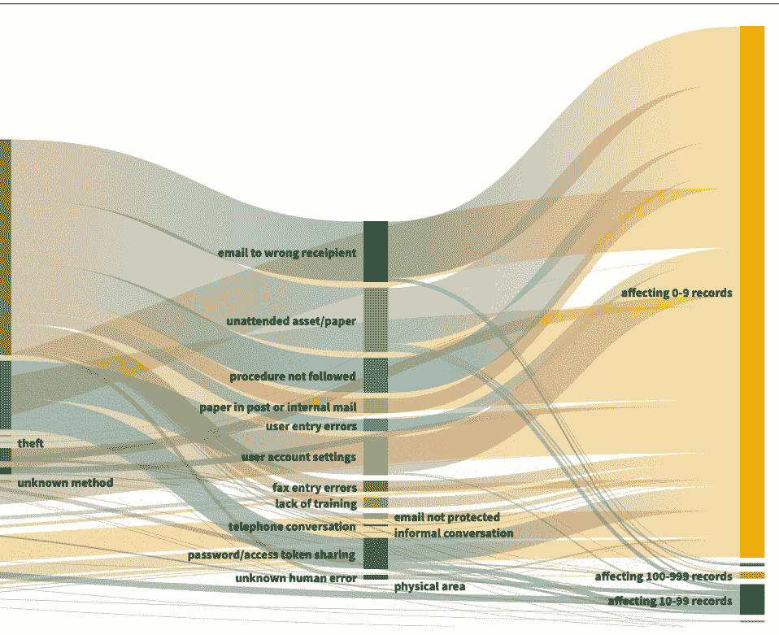

## CyberSeek

网络安全职业路径¹⁴⁶

版权：经CyberSeek项目及其合作伙伴Burning Glass Technologies、CompTIA、网络安全教育国家倡议（NICE）许可。

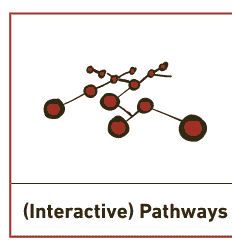

这是一个交互式网络图的示例。它是CyberSeek网站的截图。此交互式职业路径显示了网络安全领域的关键职位、它们之间常见的转型机会，以及与每个角色相关的薪资、凭证和技能集的详细信息。该工具通过使用NICE网络安全劳动力框架来帮助描述每个角色，并列出雇主用于相同角色的常见职位名称，从而支持社区内共同语言的概念。

| 常见的网络安全入职角色 | 核心网络安全角色 | | |
| :--- | :--- | :--- | :--- |
| **入职角色** | **入门级** | **中级** | **高级** |
| 网络 | 网络安全专家/技术人员 | 网络安全分析师 | 网络安全经理/管理员 |
| 软件开发 | 网络犯罪分析师/调查员 | 网络安全顾问 | 网络安全工程师 |
| 系统工程 | 事件分析师/响应人员 | 渗透与漏洞测试人员 | 网络安全架构师 |
| 财务和风险分析 | IT审计师 | | |
| 安全情报 | | | |

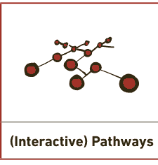

## 2018年全球风险互连图

世界经济论坛，设计由 Moritz Stefaner / Truth & Beauty¹⁴⁷

版权：经世界经济论坛和设计师许可。

这是一个交互式地图的屏幕截图，显示风险如何相互连接。通过点击形状，地图会放大显示这些风险与其他风险的关系。网络攻击以紫色显示（紫色表示技术风险）。它显示了网络攻击如何与许多其他全球风险相连接，例如经济风险（蓝色）和地缘政治风险（橙色）。

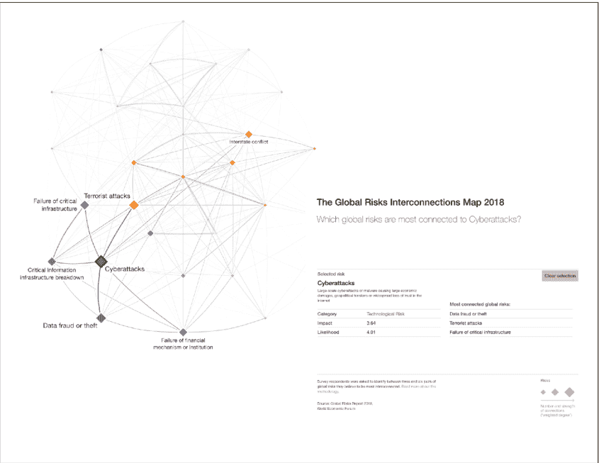

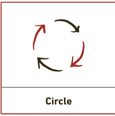

## 10步网络安全

英国国家网络安全中心^148
版权：开放政府许可 v 3.0

此信息图的目的是解释网络安全策略的核心关注点。主导部分是中间的图形，一个持续顺时针移动的循环过程。

## 10步网络安全

定义并传达董事会的信息风险制度是组织整体网络安全策略的核心。英国国家网络安全中心的10个步骤总结如下，以便保护您的业务免受大多数网络攻击。

**网络安全**
保护您的网络免受攻击。防御网络边界，过滤未授权访问和恶意内容。监控和测试安全控制。

**用户教育与意识**
制定涵盖系统可接受和安全使用的用户安全政策。将员工培训作为入职培训的一部分。保持用户对网络风险的意识。

**恶意软件预防**
制定相关政策。在整个组织中建立反恶意软件防御。

**可移动媒体控制**
制定政策以控制对可移动媒体的所有访问。限制媒体类型和用途。在将媒体导入企业系统之前，扫描所有媒体以查找恶意软件。

**安全配置**
应用安全补丁并确保所有系统的安全配置得到维护。创建系统清单并为所有设备定义基准构建。

## 建立您的风险管理制度

评估您组织信息和系统的风险，重点是实现适当且可实现的安全风险水平。嵌入适当的管理制度，得到董事会和高级管理人员的支持。

将网络风险列为董事会的优先事项

制定支持性风险管理政策

确定您的风险偏好

**管理用户权限**
建立有效的管理流程并限制特权账户的数量。管理用户活动。控制对活动日志和审计日志的访问。

**事件管理**
建立事件响应和灾难恢复能力。制定并测试您的事件管理计划。提供专业培训。将刑事事件报告给执法部门。

**监控**
建立监控策略并制定支持性政策。持续监控所有系统和网络。分析日志以查找可能表明攻击的异常活动。

**居家和移动办公**
制定移动办公政策并培训用户遵守该政策。将安全基准构建应用于所有设备。保护传输中和静止数据。

如需更多信息，请访问 www.ncsc.gov.uk @ncsc

## 15. 可视化整体、松散和连接的概念

在某些情况下，你想要解释不涉及层级或移动的相关概念。例如，当事物并列存在或相邻时。在这些情况下，你可以使用圆形和矩形等简单形状。通过使它们变大或变小，你可以表达重要性，形状交叉的地方是重叠，而它们如何连接则表示一种关系。

| 气泡图 | 文氏图 | 同心圆图（洋葱图） |
|---|---|---|
| 雷达图 | 元素周期表 | 地理地图 |
| 矩阵 | 弦图 | 球体 |
| 平行坐标图 | 网络图 | 弧线图 |

更多示例请参阅：

- **气泡图：** 世界上最大的数据泄露和攻击事件¹⁴⁹、网络安全¹⁵⁰
- **文氏图：** 网络安全与信息安全的区别¹⁵¹、汽车网络安全与汽车信息安全差异的文氏图¹⁵²
- **元素周期表：** 构成安全专业人员的要素¹⁵³
- **网络：** 恶意软件分发网络¹⁵⁴
- **平行坐标：** 异常检测¹⁵⁵
- **地理地图：** 热力图¹⁵⁶ 和实时威胁地图¹⁵⁷-¹⁶¹
- **矩阵：** 勒索软件即服务（RaaS）商业模式的 SWOT 分析¹⁶²。

## 数据处理活动与合规义务。

Pietro Calorio¹⁶³

已获作者许可使用图片。

当感兴趣领域或职责范围重叠时，绘制文氏图是支持决策的简单方法。在此示例中，作者绘制了一个 5 集文氏图，以描述数据处理活动与相关任务之间的复杂关系。

### 文氏图

处理活动记录、数据保护官和隐私影响评估： “交叉点”

R = 处理活动记录 D = 数据保护官 P = 数据保护（“隐私”）影响评估

图片来自 http://www.efoa.com/post_5-circle-venn-diagram_197725/

概念：Pietro Calorio CC NC-BY-SA Twitter: @PietroCalorio LinkedIn: linkedin.com/in/pietrocalorio/

## 信息安全领导力模型

Jeffrey Pomerantz, EDUCAUSE¹⁶⁴ 根据 Creative Commons BY-NC-SA 4.0 授权。

来自多所高等教育机构的信息安全官员工作组合作，描述了高等教育中首席信息安全官（CISO）的角色。该插图是带有图层的同心圆图。最内层圆环代表核心角色，下一层圆环代表主要角色，第三层圆环代表离散角色。最外层圆代表涵盖一切的人类角色。优秀领导者不应忘记同情心、人性以及从错误中学习的特质。

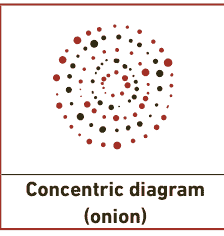

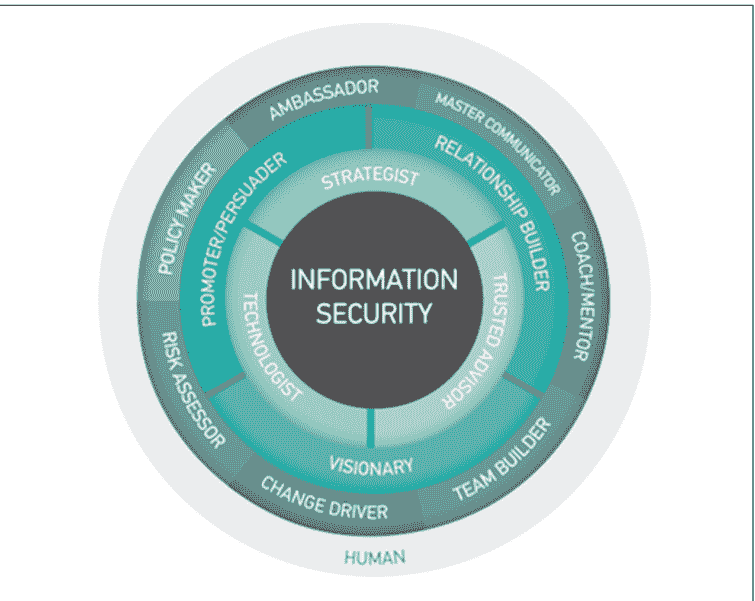

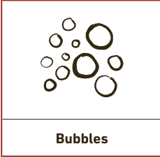

## 信息安全任务

Nicole van Deursen
基于：¹⁶⁵

此图基于对 2018 年春季荷兰 52 个职位空缺的内容分析。仅在 52 个职位空缺中，就统计了 585 个独特任务。该图显示按相似领域分组的任务。

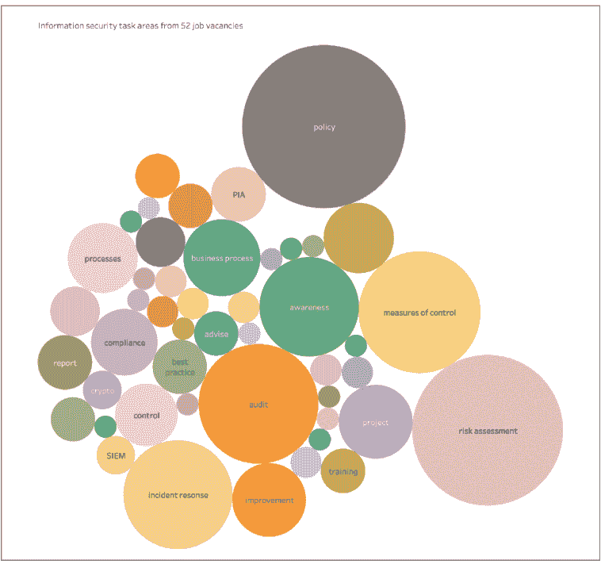

## 可视化攻击图

概念与设计：LUST（Jeroen Barendse 与 Eric Li），用于 TRES PASS 项目。

数据：Verizon 年度数据泄露调查报告（DBIR）2016¹⁶⁶

版权：根据 Creative Commons 许可发布，并经设计师许可使用。

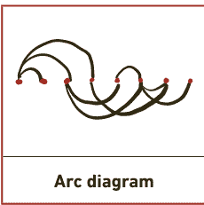

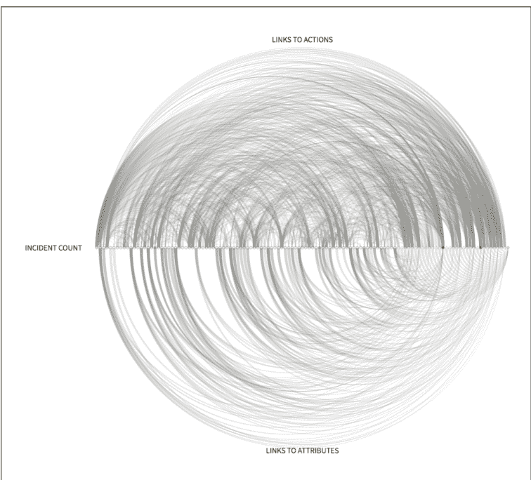

安全研究人员可以使用攻击图来组织特定空间内可能攻击路径的信息。上述图表基于 Verizon 年度数据泄露调查报告（2016）。它们左侧有一个起点和一个终点（目标），以及充当攻击步骤或实体的节点。边是从一个实体到另一个实体的可能路径。这些节点和边带有多个参数，例如概率、成本和事件计数。

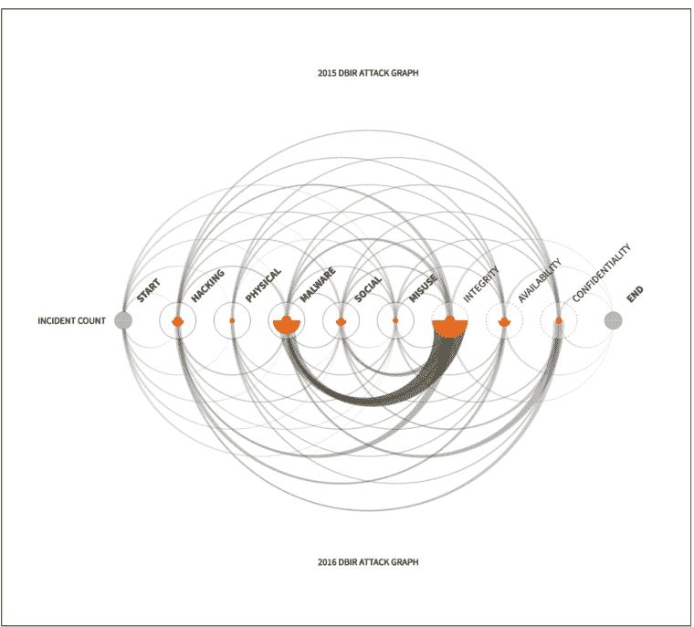

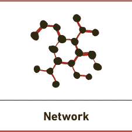

## 2019 年网络安全星象运势

Nicole van Deursen

基于：¹⁶⁷

这张星图总结了来自各种网络安全专家和组织对 2019 年网络安全趋势的预测。

## 2019 年网络安全星象运势

© Nicole Van Der Heijsen

### 预测频率

高

### 隐私

- 缺乏消费者信任
- 公民要求数字法庭
- 执法
- 更多警察和立法
- 更多问责

### 地缘政治

- 强化数字主权
- 国家赞助的间谍活动、破坏和网络犯罪
- 各国制定网络战规则
- 相互不信任导致国家之间的网络攻击
- 您当地的银行通过社交媒体和假新闻受到影响

### 领导力

- 影子 IT、旧系统和糟糕的日常维护
- 云
- IoT
- 网络防御滞后
- BYOD
- 5G
- 网络卫生增长
- 从合规性转向基于风险的方法
- 角色变化
- CISO
- 更多员工被雇佣并留任
- DevOps 拥护者
- 开发者成为大使
- CISO TD
- 更加重要
- 不需要学位
- 需要硕士学位
- 首席
- CISO 在 IT 部门之外拥有所有权
- 更多女性 CISO
- WPA 成为标准
- 汽车隐私与安全
- DataSecOps
- 合作伙伴和供应链的网络安全评级
- 安全意识与培训
- 关注员工意识和培训
- 关注业务连续性

### 攻击目标

- IoT
- 行业
- 保险行业
- 汽车行业
- 医疗保健
- 关键基础设施
- 全球组织
- 目标群体
- 治理
- 公共部门
- 智慧城市
- 贸易/展会活动
- 欧盟
- 个人数据
- 账户攻击
- 智能家居
- 智能玩具
- 智能建筑控制
- 网上银行转账
- WPA
- 云
- 5G

### 攻击方法银河系

- 供应链
- AVL
- 云
- DDoS
- 复杂的间谍软件
- 众所周知的漏洞
- 勒索软件
- 蠕虫
- 移动恶意软件
- 加密挖矿
- Vishing
- 受雇黑客
- 社会工程学
- 黑客行动主义
- 暴力破解 / 密码
- 更容易的目标
- 凭证即服务
- 国家赞助的攻击
- AI/ML

## 安全与保安职业雷达图

_Security Talent，海牙安全保安三角洲 (HSD)_¹⁶⁸ 经海牙安全保安三角洲许可印刷

雷达图展示了安全与保安领域的职业及其相互关系。在技能和知识方面相近的职业，或在实践中经常合作的职业，在雷达图上被放置在彼此附近。这遵循了格式塔理论的邻近原则。颜色代表基于其所针对的安全与保安类型的簇。其他相似之处由雷达图上实例的形状表示。

## 安全与保安职业

按欧洲资格框架（EQF）描述的教育和技能排名

### 你保护什么？

- 城市和国家层面的安全与保安
- 工作条件的安全与保安
- 数据和信息系统的安全与保安
- 业务运营的安全与保安

### 你在哪里工作？

- 公共和私营部门
- 私营部门
- 公共部门安全与保安（例如：军队、警察、消防队）

这些地图展示了世界不同地区和不同年份中“网络安全”和“信息安全”这两个词的 Google 搜索频率。颜色的强度代表搜索频率。红色表示搜索网络安全最多的地区，蓝色表示信息安全。所有地图均使用 Google Trends 制作。数据来源：Google Trends (https://www.google.com/trends)。

| 2015 年搜索 | 地图可视化 |
|---|---|
| 2017 年搜索 | 地图可视化 |
| 2019 年搜索 | 地图可视化 |

## 16. 视觉活动

网络安全专业人员在许多场合都需要团队合作。本节展示了团队在会议中可用于解决问题、产生新想法或设计新流程或系统的一些可视化工作形式示例。可视化协作技术在这样的场合非常有用。针对许多不同情境和不同受众，有无数种技术可供选择。

| 头脑风暴 | 动画/视频 | 桌面游戏 |
| :--- | :--- | :--- |
| 角色扮演 | 图形记录 | 原型设计 |
| 共情地图 | 分镜图 | 类比 |

本章以外插图的参考文献如下：

**分镜图：** 网络响应^169^，移动安全 iOS 应用^170^
**头脑风暴/原型设计：** GDPR 图标^171^
**视频/动画：** 宣传和培训视频^172-175^

### 桌面游戏

### 网络威胁防御者集换卡游戏

圣安东尼奥德克萨斯大学 (UTSA) 基础设施保障与安全中心^176^
图片经圣安东尼奥德克萨斯大学 (UTSA) 基础设施保障与安全中心授权使用

该卡牌游戏旨在课堂上教授网络安全基础知识，包含资产、防御、攻击和事件卡牌。该游戏融合多种学习风格，向儿童介绍基础网络安全概念。

### 确保未来状态

SWIFT Innotribe 于 Sibos 2018
演讲者：Duena Blomstrom, Jane Frankland。
绘制：Evan Wondolowski, Collective Next
经 SWIFT 授权印刷

2018 年悉尼 Sibos 会议上 SWIFT Innotribe 演示的图形记录。

### 两张图片：纸质原型设计：云案例研究

纸质原型设计方法由皇家霍洛威大学与 LUST 为 Trespass 项目^178^ 开发 版权：创意共享许可。

纸质原型设计是指创建数字界面的纸质版本，并邀请参与者群体与纸质原型进行交互，模拟使用数字界面的过程。这强调将纸质原型带到用户群体中，通过连续的层级（组织层、物理层、数字层和社交层）探索他们如何感知风险。

### 乐高模拟

Northwave (https://northwave-security.com) 经 Northwave 授权印刷。

Northwave 使用乐高火车轨道来可视化业务流程。这些流程由员工控制，由 Northwave 的安全运营中心保护，并最终受到恶意方的干扰。公司或业务流程因被黑客攻击而脱轨，是网络安全事件的可视化表现。

## 17. 使用隐喻进行可视化

隐喻是一种通过将某事物与另一事物相关联来描述它的方式。它通常指两者之间的共同特征。这种共同特征可以涉及物理相似性、历史或组成部分。通过隐喻让网络安全概念生动起来，可能性是无穷无尽的。

| 冰山 | 金字塔 | 神庙 |
|---|---|---|
| 山 | 堡垒/塔楼 | 三明治 |
| 齿轮 | 时钟 | 传送带 |
| 漏斗 | 桥梁 | 生态系统 |
| 拼图 | 平衡 | 仪表图 |

本章以外插图的参考文献如下：

- **冰山：** 网络安全威胁¹⁷⁹，内部审计与网络安全¹⁸⁰，网络攻击造成的财务损失¹⁸¹，网络事件成本¹⁸²
- **生态系统：** 网络犯罪¹⁸³
- **漏斗：** 安全日志¹⁸⁴
- **三明治：** 身份和访问管理¹⁸⁵
- **平衡：** 便利性与安全性¹⁸⁶
- **堡垒/塔楼：** 首要网络威胁¹⁸⁷

### 您的高管层为网络未来做好准备了吗？

J. Lowe 和 S. Duffy，电力能源在线

经电力能源在线授权印刷

此图片用于说明能源领域的高管层领导应超越 IT 和运营来提升组织安全态势。神庙是一个隐喻，其中五根柱子和三层基础支撑着代表“信任”的屋顶。如果某根柱子不稳固，屋顶可能会坍塌。

### 全天候网络安全

John McRae，Neuways^189^
图片经授权使用

时钟代表商业博客推荐的 12 个改善组织安全性的步骤。

### 网络安全技能缺口？

Nicole van Deursen，使用 Piktochart 创建

基于 165 份数据

此信息图基于对 2018 年春季荷兰 52 个职位空缺的内容分析。尽管大家都在谈论网络安全专业人员短缺，但此分析结果表明，这可能是企业自身的问题。许多职位描述使用了令人困惑的语言（“你的工作是平衡管理”）；要求不存在的认证（例如：“你已获得 ISO 27001 认证” - 该证书是针对组织而非个人 -）；或者要求不可能的组合（CISSP 证书 - 该证书要求超过 5 年经验 - 结合不到 2 年的工作经验）。近一半的雇主并不真正关心候选人完成的教育水平。他们写道：“你拥有职业学位或大学学位”。这对大学毕业生来说并不十分鼓舞人心……最糟糕的是，对更有经验的专业人士没有需求。67% 的雇主对拥有超过 5 年经验的专业人士不感兴趣。

### 网络安全技能缺口

职位空缺文本助长问题

#### 令人沮丧的要求

**67%** 要求不到 5 年经验（而荷兰工作人口中最大群体年龄超过 35 岁）

#### 不真诚的语言

- 585 项独特任务描述
- 38 个独特职位名称
- 113 项独特人格特质要求
- 78 项独特技术能力
- 24 种不同的认证要求
- 1 个职位空缺中编写的任务数量最多为 46 项
- 中心：52 个职位空缺

- 中等或高等职业教育
- 高等职业教育或大学
- 大学或 CISSP
- CISA
- CEH
- CISSP
- CIPP/e
- CISM
- CRISC

#### 73% 使用令人困惑的语言

- 管辖……的治理
- 我们正在寻找巫师
- 测试审计
- 平衡系统
- 担任经理
- 提交框架
- 向董事会讲述一个故事

**23%** 要求不存在的技能和证书

**48%** 的雇主表示不同教育水平和证书可以互换

52 个信息安全职位空缺的内容分析。Nicole van Deursen。2018 年 5 月

### 数据科学狩猎漏斗

Austin Taylor^190^

版权：经作者授权

数据科学狩猎漏斗的创建旨在说明安全研究人员和数据科学家的工作流程，帮助其减少数据集，并最大限度地提高识别恶意流量的可能性，同时尝试设定预期。

## 18. 以样式和颜色进行可视化

有时你可能无法创建图片，而不得不在冗长的文本文档中继续前进。你可以采用许多方法来让文本更具吸引力。通过使用颜色、不同的字体和字号，可以吸引读者对重要部分的注意。这有助于读者快速浏览文档并立即看到关键词。本书的设计师也使用了排版和颜色选项，使本书更具视觉效果。

同样，表格也能从颜色和样式中获益，例如彩色圆点和标签，或粗体标题。

| | | |
|---|---|---|
| "观点" | 排版 | 词云 |
| 引用 | 排版 | 词云 |
| 指示圆点 | 等长图 | 图标 |
| 指示圆点 | 等长图 | 图标 |
| 颜色 | 阴影 | 图案 |
| 颜色 | 阴影 | 图案 |

References to illustrations other than the ones presented in this chapter are:

> **指示圆点:** 网络安全评级¹⁵⁶
> **图标:** 风险评估¹²⁷, 隐私图标 ¹⁹¹–¹⁹³
> **排版:** 在线威胁概览¹⁹⁴
> **颜色:** 常用 TCP / UDP 端口号¹⁹⁵

## NCSC 术语表

英国国家网络安全中心，英国

版权：开放政府许可证 v 3.0

**网络攻击**

通过网络手段恶意试图损坏、中断或未经授权访问计算机系统、网络或设备。

**云**

共享计算和存储资源作为服务（通常在线）访问，而不是托管在本地物理服务器上。

**自带设备 (BYOD)**

组织允许员工使用个人设备办公的战略或政策。

**僵尸网络**

连接到互联网的受感染设备网络，未经所有者知晓即用于实施协调的网络攻击。

**防病毒软件**

旨在检测、阻止和移除病毒及其他恶意软件的软件。

**终端设备**

用于描述连接到组织网络的现代智能手机、笔记本电脑和平板电脑的统称。

**加密**

一种数学函数，通过使信息在拥有解密密钥的人之外不可读来保护信息。

**数字足迹**

用户在线活动留下的数字信息足迹。

**拒绝服务攻击 (DoS)**

合法用户被拒绝访问计算机服务（或资源），通常是通过向服务发送大量请求导致过载。

**网络安全**

保护设备、服务和网络——以及其中的信息——免受盗窃或损坏。

**网络钓鱼**

向大量人群发送非针对性的群发邮件，索取敏感信息（如银行详细信息）或诱导其访问假冒网站。

**补丁管理**

对固件或软件应用更新，以改进安全性和/或增强功能。

**宏**

一种小型程序，可自动执行应用程序（如 Microsoft Office）中的任务，攻击者可利用该程序获取系统访问权限（或损害系统）。

**物联网 (IoT)**

日常物品（而非计算机和设备）通过 Wi-Fi 连接到互联网的能力，包括水壶、冰箱和电视。

**防火墙**

使用定义好的规则集来约束网络流量，防止未经授权访问网络的硬件或软件。

**特洛伊木马**

伪装成合法软件的一种恶意软件或病毒，用于入侵受害者计算机。

**钓鱼邮件（针对性网络钓鱼）**

一种更具针对性的网络钓鱼形式，电子邮件设计得看起来像来自收件人认识和/或信任的人。

**社会工程学**

操纵人们执行特定操作（例如泄露信息或点击攻击者网站）的行为。

**软件即服务 (SaaS)**

描述一种商业模式，消费者通过互联网访问集中托管的软件应用程序。

**勒索软件**

恶意软件，在受害者付款之前使数据或系统无法使用。

**零日漏洞**

最近被发现的漏洞（或缺陷），黑客可以利用这些漏洞攻击计算机，或利用防病毒公司的漏洞。

**白名单**

授权批准的应用程序在组织内使用，而非试图阻止所有潜在有害应用程序。

**鲸鱼攻击**

针对高管的高度针对性网络钓鱼攻击（伪装成合法电子邮件）。

**水坑攻击**

设立假冒网站（或入侵合法网站）以利用访问用户。

**双因素身份验证 (2FA)**

使用两个不同的组件来验证用户声称的身份。也称为多因素身份验证。

## 风险矩阵

*Nicole van Deursen*

许多组织使用带有颜色代码的此风险矩阵变体，以可视化潜在风险的严重性。该矩阵可用于不同场景，例如风险评估会议或管理报告。

| 可能性 \ 后果 | 1 最小 | 2 轻微 | 3 中等 | 4 重大 | 5 严重 |
|---|---|---|---|---|---|
| 5 几乎必然 | | | | | |
| 4 极可能 | | | | | |
| 3 可能 | | | | | |
| 2 可能性低 | | | | | |
| 1 不太可能 | | | | | |

## ISO 27001 词云

Nicole van Deursen

词云是不同大小表示的单词集合。单词显示得越大、越粗，在给定文本中出现的频率就越高。此词云基于信息安全 ISO 27001 标准的文本。

## 社会工程学及如何赢得信任之战（较大信息图的一部分）。

OneSpan 1%

版权：经 OneSpan 许可印刷

这张插图是关于社会工程学的较大信息图的一部分。该信息图将数据显示为等长图：代表数量的图形，不是通过图形的大小，而是通过相同大小图形的数量来表示。

等长图源自奥托·诺伊拉特（1882–1945）的理论，他是一位维也纳哲学家、经济学家和社会科学家。他发明了这一系统来以图形方式组织统计数据。

## 社会工程学

*名词* ……操纵人们执行操作或泄露机密信息的艺术。

### 攻击类型

**网络钓鱼**

以虚假借口发送的电子邮件，诱骗用户向攻击者提供其登录凭据。

钓鱼者瞄准的账户类型：
- 金融服务：37%
- 社交网络网站：26%
- 其他：17%、7%、13%
- 包括：全球互联网门户、电话和互联网服务提供商

**定向网络钓鱼**

一种有针对性的网络钓鱼电子邮件

最先进的攻击中有 91% 以定向网络钓鱼电子邮件开始

**语音钓鱼 (VISHING)**

冒充权威人士（如 IT 主管）致电目标，以套取凭据或重要信息。

仅 2014 年，英国银行就因语音钓鱼攻击损失了 2100 万英镑。

**短信钓鱼 (SMISHING)**

通过短信而非电子邮件发送的钓鱼消息

全球每天发送 2 亿条短信钓鱼消息

**社交媒体挖掘**

通过社交媒体了解更多关于目标人群的信息，以构建更好的网络钓鱼诱饵

5200 万至 9700 万个 Facebook 账户是虚假或重复账户

**中间人攻击**

攻击者通过利用服务器端漏洞，劫持浏览器与合法 Web 服务器之间的 SSL 连接来冒充公司。

2014 年，仅一次恶意 DNS 攻击就瞄准了 70 多家金融机构的所有客户。

**浏览器中间人攻击**

与中间人攻击原理相同，但仅利用浏览器本身的漏洞。

90% 的企业面临浏览器中间人攻击的威胁。

## 全球网络安全指数 2017

国际电信联盟。

版权：经国际电信联盟许可印刷。

全球网络安全指数（GCI）源自一项调查，该调查衡量会员国对网络安全的承诺，以提高意识。2016 年全年，134 个会员国参与了该调查。2017 年发布的 GCI 展示了世界各国对网络安全的承诺程度。承诺程度从绿色（最高）到红色（最低）进行显示。此示例是使用指示点来可视化信息的一种易于制作且易于理解的示例。

| 国家 | 网络犯罪立法 | 网络安全立法 | 网络安全培训 | 法律措施 | 国家 CERT/CIRT/SIRT | 政府 CERT/CIRT/SIRT | 部门 CERT/CIRT/SIRT | 组织标准 | 专业人员标准 | 儿童在线保护 | 技术措施 | 负责机构 | 网络安全指标 | 组织 | 标准化机构 | 网络安全良好实践 | 研发计划 | 公众宣传活动 | 专业培训课程 | 教育计划 | 激励机制 | 本土产业 | 能力建设 | 双边协议 | 多边协议 | 国际参与 | 公私合作 | 机构间合作 | 合作 | GCI |
|---|---|---|---|---|---|---|---|---|---|---|---|---|---|---|---|---|---|---|---|---|---|---|---|---|---|---|---|---|---|
| 阿尔巴尼亚 | ● | ● | ● | ● | ● | ● | ● | ● | ● | ● | ● | ● | ● | ● | ● | ● | ● | ● | ● | ● | ● | ● | ● | ● | ● | ● | ● | ● | ● |
| 安道尔 | ● | ● | ● | ● | ● | ● | ● | ● | ● | ● | ● | ● | ● | ● | ● | ● | ● | ● | ● | ● | ● | ● | ● | ● | ● | ● | ● | ● | ● |
| 奥地利 | ● | ● | ● | ● | ● | ● | ● | ● | ● | ● | ● | ● | ● | ● | ● | ● | ● | ● | ● | ● | ● | ● | ● | ● | ● | ● | ● | ● | ● |
| 比利时 | ● | ● | ● | ● | ● | ● | ● | ● | ● | ● | ● | ● | ● | ● | ● | ● | ● | ● | ● | ● | ● | ● | ● | ● | ● | ● | ● | ● | ● |
| 波斯尼亚和黑塞哥维那 | ● | ● | ● | ● | ● | ● | ● | ● | ● | ● | ● | ● | ● | ● | ● | ● | ● | ● | ● | ● | ● | ● | ● | ● | ● | ● | ● | ● | ● |
| 保加利亚 | ● | ● | ● | ● | ● | ● | ● | ● | ● | ● | ● | ● | ● | ● | ● | ● | ● | ● | ● | ● | ● | ● | ● | ● | ● | ● | ● | ● | ● |
| 克罗地亚 | ● | ● | ● | ● | ● | ● | ● | ● | ● | ● | ● | ● | ● | ● | ● | ● | ● | ● | ● | ● | ● | ● | ● | ● | ● | ● | ● | ● | ● |
| 塞浦路斯 | ● | ● | ● | ● | ● | ● | ● | ● | ● | ● | ● | ● | ● | ● | ● | ● | ● | ● | ● | ● | ● | ● | ● | ● | ● | ● | ● | ● | ● |
| 捷克 | ● | ● | ● | ● | ● | ● | ● | ● | ● | ● | ● | ● | ● | ● | ● | ● | ● | ● | ● | ● | ● | ● | ● | ● | ● | ● | ● | ● | ● |
| 丹麦 | ● | ● | ● | ● | ● | ● | ● | ● | ● | ● | ● | ● | ● | ● | ● | ● | ● | ● | ● | ● | ● | ● | ● | ● | ● | ● | ● | ● | ● |
| 爱沙尼亚 | ● | ● | ● | ● | ● | ● | ● | ● | ● | ● | ● | ● | ● | ● | ● | ● | ● | ● | ● | ● | ● | ● | ● | ● | ● | ● | ● | ● | ● |
| 芬兰 | ● | ● | ● | ● | ● | ● | ● | ● | ● | ● | ● | ● | ● | ● | ● | ● | ● | ● | ● | ● | ● | ● | ● | ● | ● | ● | ● | ● | ● |
| 法国 | ● | ● | ● | ● | ● | ● | ● | ● | ● | ● | ● | ● | ● | ● | ● | ● | ● | ● | ● | ● | ● | ● | ● | ● | ● | ● | ● | ● | ● |
| 德国 | ● | ● | ● | ● | ● | ● | ● | ● | ● | ● | ● | ● | ● | ● | ● | ● | ● | ● | ● | ● | ● | ● | ● | ● | ● | ● | ● | ● | ● |
| 希腊 | ● | ● | ● | ● | ● | ● | ● | ● | ● | ● | ● | ● | ● | ● | ● | ● | ● | ● | ● | ● | ● | ● | ● | ● | ● | ● | ● | ● | ● |
| 匈牙利 | ● | ● | ● | ● | ● | ● | ● | ● | ● | ● | ● | ● | ● | ● | ● | ● | ● | ● | ● | ● | ● | ● | ● | ● | ● | ● | ● | ● | ● |
| 冰岛 | ● | ● | ● | ● | ● | ● | ● | ● | ● | ● | ● | ● | ● | ● | ● | ● | ● | ● | ● | ● | ● | ● | ● | ● | ● | ● | ● | ● | ● |
| 爱尔兰 | ● | ● | ● | ● | ● | ● | ● | ● | ● | ● | ● | ● | ● | ● | ● | ● | ● | ● | ● | ● | ● | ● | ● | ● | ● | ● | ● | ● | ● |
| 以色列 | ● | ● | ● | ● | ● | ● | ● | ● | ● | ● | ● | ● | ● | ● | ● | ● | ● | ● | ● | ● | ● | ● | ● | ● | ● | ● | ● | ● | ● |
| 意大利 | ● | ● | ● | ● | ● | ● | ● | ● | ● | ● | ● | ● | ● | ● | ● | ● | ● | ● | ● | ● | ● | ● | ● | ● | ● | ● | ● | ● | ● |
| 拉脱维亚 | ● | ● | ● | ● | ● | ● | ● | ● | ● | ● | ● | ● | ● | ● | ● | ● | ● | ● | ● | ● | ● | ● | ● | ● | ● | ● | ● | ● | ● |
| 列支敦士登 | ● | ● | ● | ● | ● | ● | ● | ● | ● | ● | ● | ● | ● | ● | ● | ● | ● | ● | ● | ● | ● | ● | ● | ● | ● | ● | ● | ● | ● |
| 立陶宛 | ● | ● | ● | ● | ● | ● | ● | ● | ● | ● | ● | ● | ● | ● | ● | ● | ● | ● | ● | ● | ● | ● | ● | ● | ● | ● | ● | ● | ● |
| 卢森堡 | ● | ● | ● | ● | ● | ● | ● | ● | ● | ● | ● | ● | ● | ● | ● | ● | ● | ● | ● | ● | ● | ● | ● | ● | ● | ● | ● | ● | ● |
| 马耳他 | ● | ● | ● | ● | ● | ● | ● | ● | ● | ● | ● | ● | ● | ● | ● | ● | ● | ● | ● | ● | ● | ● | ● | ● | ● | ● | ● | ● | ● |
| 摩纳哥 | ● | ● | ● | ● | ● | ● | ● | ● | ● | ● | ● | ● | ● | ● | ● | ● | ● | ● | ● | ● | ● | ● | ● | ● | ● | ● | ● | ● | ● |
| 黑山 | ● | ● | ● | ● | ● | ● | ● | ● | ● | ● | ● | ● | ● | ● | ● | ● | ● | ● | ● | ● | ● | ● | ● | ● | ● | ● | ● | ● | ● |
| 荷兰 | ● | ● | ● | ● | ● | ● | ● | ● | ● | ● | ● | ● | ● | ● | ● | ● | ● | ● | ● | ● | ● | ● | ● | ● | ● | ● | ● | ● | ● |
| 挪威 | ● | ● | ● | ● | ● | ● | ● | ● | ● | ● | ● | ● | ● | ● | ● | ● | ● | ● | ● | ● | ● | ● | ● | ● | ● | ● | ● | ● | ● |
| 波兰 | ● | ● | ● | ● | ● | ● | ● | ● | ● | ● | ● | ● | ● | ● | ● | ● | ● | ● | ● | ● | ● | ● | ● | ● | ● | ● | ● | ● | ● |
| 葡萄牙 | ● | ● | ● | ● | ● | ● | ● | ● | ● | ● | ● | ● | ● | ● | ● | ● | ● | ● | ● | ● | ● | ● | ● | ● | ● | ● | ● | ● | ● |
| 罗马尼亚 | ● | ● | ● | ● | ● | ● | ● | ● | ● | ● | ● | ● | ● | ● | ● | ● | ● | ● | ● | ● | ● | ● | ● | ● | ● | ● | ● | ● | ● |
| 圣马力诺 | ● | ● | ● | ● | ● | ● | ● | ● | ● | ● | ● | ● | ● | ● | ● | ● | ● | ● | ● | ● | ● | ● | ● | ● | ● | ● | ● | ● | ● |
| 塞尔维亚 | ● | ● | ● | ● | ● | ● | ● | ● | ● | ● | ● | ● | ● | ● | ● | ● | ● | ● | ● | ● | ● | ● | ● | ● | ● | ● | ● | ● | ● |
| 斯洛伐克 | ● | ● | ● | ● | ● | ● | ● | ● | ● | ● | ● | ● | ● | ● | ● | ● | ● | ● | ● | ● | ● | ● | ● | ● | ● | ● | ● | ● | ● |
| 斯洛文尼亚 | ● | ● | ● | ● | ● | ● | ● | ● | ● | ● | ● | ● | ● | ● | ● | ● | ● | ● | ● | ● | ● | ● | ● | ● | ● | ● | ● | ● | ● |
| 西班牙 | ● | ● | ● | ● | ● | ● | ● | ● | ● | ● | ● | ● | ● | ● | ● | ● | ● | ● | ● | ● | ● | ● | ● | ● | ● | ● | ● | ● | ● |
| 瑞典 | ● | ● | ● | ● | ● | ● | ● | ● | ● | ● | ● | ● | ● | ● | ● | ● | ● | ● | ● | ● | ● | ● | ● | ● | ● | ● | ● | ● | ● |
| 瑞士 | ● | ● | ● | ● | ● | ● | ● | ● | ● | ● | ● | ● | ● | ● | ● | ● | ● | ● | ● | ● | ● | ● | ● | ● | ● | ● | ● | ● | ● |
| 前南斯拉夫马其顿共和国 | ● | ● | ● | ● | ● | ● | ● | ● | ● | ● | ● | ● | ● | ● | ● | ● | ● | ● | ● | ● | ● | ● | ● | ● | ● | ● | ● | ● | ● |
| 土耳其 | ● | ● | ● | ● | ● | ● | ● | ● | ● | ● | ● | ● | ● | ● | ● | ● | ● | ● | ● | ● | ● | ● | ● | ● | ● | ● | ● | ● | ● |
| 英国 | ● | ● | ● | ● | ● | ● | ● | ● | ● | ● | ● | ● | ● | ● | ● | ● | ● | ● | ● | ● | ● | ● | ● | ● | ● | ● | ● | ● | ● |

## 19. 信息图

信息图既展示定量数据（统计数据），也展示定性数据（知识）。这对信息图的确切定义引发了一些讨论。有人认为，信息图是一种较大的图形设计，它将数据可视化、插图、文本和图像结合在一起，形成一个讲述完整故事的格式 197,198。从这个角度看，信息图是一个带有标题、主体和结论或行动号召的故事。单个数据可视化本身并不是信息图。旁边配有图片的数字或百分比也不是。另有人认为，信息图有多种不同形式，从信息图简历到以文本为主的信息图都有。在这种制作中，‘数据’可以是文本，只要其功能清晰，就算作信息图。

信息图可以是一种有效的信息传达、说服、讲故事或展示分析的手段。只要受众与信息图产生联系，设计是否“正确”就不那么重要了。为此，在受众中测试你的设计，看看他们的反应是否符合你的预期很重要。他们是否理解信息、感受到某种情绪、学到了新东西，或者被驱动去采取行动？从他们的反馈中学习并改进设计。目的是制作有意义的信息图。设计良好的信息图，对许多读者来说，比纯文本文档更易于认知处理。在线发布时，它们易于在社交网络中分享，并有可能病毒式传播。

信息图的目的可以是：

- **指导：** 信息图有助于解释如何做某事或如何使用产品。
- **告知：** 它可以用来展示研究结果或提高对某个话题的认识。
- **说服：** 将信息图用作行动号召，邀请人们加入、购买或改变某事。
- **讲故事：** 信息图可以通过事件或行动的时间线来讲述一个故事；某人经历了什么，他们是如何做到的。
- **分析：** 展示事件的根本原因，推导一系列事件，并说明事件是如何发生的。
- **比较两者：** 在比较两种产品、最佳实践或过去两年的事件时。

多年来，我在 Pinterest 上收集了许多信息图示例。我邀请你加入我，共同完善这个收藏：
https://www.pinterest.co.uk/nicole9319/information-security-infographics/.

## 密码心理学简介

LastPass^199
版权：经 LastPass 授权

此信息图展示了 LastPass 和 Lab42 进行的一项调查结果。关于密码安全态度和行为的调查发现，虽然人们知道安全密码应当是什么样，但他们往往倾向于忽视这些知识，转而使用容易记住的密码，因为害怕忘记的心理强于害怕被攻击的心理。此外，通常定义我们的人格特质似乎对我们不良的密码行为影响甚微，但确实有助于人们为其行为找借口。

## 这就是你的大脑在面对密码时的状态

认知失调理论是否也适用于我们的数字行为？你知道这对你有害，但你还是照做。尽管更多恶意行为继续登上头条，但我们改变了保护数字生活的方式。

> **认知失调**是指个体从事与其态度、信念或价值观相悖的行为而产生的心理冲突。

### 你知道什么

### 你做什么

- **59%** 知道安全密码很重要
- **91%** 理解使用相同密码的风险
- **2/3** 觉得自己的密码管理很薄弱
- **75%** 认为这些威胁很重要，但仍会冒风险
- **72%** 认为自己的密码足够安全，足以保护其在线信息
- **47%** 害怕有人窃取其密码
- **女性比男性更害怕**：55% | 39%

- **41%** 选择容易记住的密码
- **61%** 使用相同的几个密码
- **55%** 甚至不考虑更改自己的密码
- **千禧一代 85%** | **X 世代 82%** | **婴儿潮一代 45%**
- **最强密码**：图标分别显示 69%、43%、31%、20%
- **容易被破解的信息**：47% 宠物姓名……42% 重要日期/数字 26% 宠物 21% 节日 14% 家乡 13% 孩子的姓名

### 你记得什么

## 为什么你的人格类型会导致你被攻击

在在线安全方面，你的人格类型可能不会决定你的行为，但它确实揭示了你如何为自己的不良密码习惯找借口。

### A 型人格

A 型人格的不良密码行为源于想要感觉自己有控制欲的渴望，尽管就密码而言，他们并不认为自己实际上面临风险，因为系统组织良好且采取了主动措施。

- **控制欲** 35% 重新设置密码是因为他们想记住所有密码
- **注重细节** 49% 有自己记住密码的“系统”
- **深思熟虑** 2/3 采取主动措施来帮助保护个人信息安全
- **有动力** 86% 拥有强密码会让你感觉自己在保护自己和家人

### B 型人格

B 型人格通过将其行为与他们认为更危险的行为进行比较来为其不良行为找借口，这使他们成为黑客更大的目标。这使他们能够保持对密码安全随意、漫不经心的态度。

- **漠不关心** 45% 认为自己的账户不够有价值，不值得黑客花时间去攻击
- **漫不经心** 43% 优先选择容易记住的密码，而不是安全的密码
- **灵活** 1/2 觉得仅仅因为害怕密码泄露就需要限制自己的在线活动
- **心事重重** 86% 觉得除了弱密码之外的其他事情可能会危及其在线安全

## 不要只重置你的密码，要重置你的思维

正确管理密码可以是一种快速的行为调整，能够带来长期的好处。

## LastPass...

无论你是什么人格类型，LastPass 都可以帮助你以方便且安全的方式管理密码。LASTPASS.COM

## 20. 网络安全艺术

网络安全日益成为电影、博物馆展览和艺术数据可视化等主题的灵感来源。幸运的是，越来越多的企业与设计师和数据艺术家合作，利用不同的艺术形式和技巧，为意识宣传活动创造替代方案。与受过训练的艺术家合作，能够提供创新且情感引人入胜的方法，引起人们对该领域复杂性和技术对社会影响的关注。艺术有能力表达恐惧、困惑、乐观或热情等情感。通过艺术，观众可以理解并感受到网络安全的局限性和可能性。本章将介绍一些网络安全专家与专业受训艺术家合作的项目。

### 20.1 摄影

本书第一章指出，媒体经常将网络安全专家描绘成穿着连帽衫的神秘人物。在荷兰，名为“黑客握手”的摄影展向公众展示了更真实、更多样化的形象。“黑客握手”是 Tobias Groenland200 的一个项目。他开始调查黑客圈，原本期望他们能证实刻板印象。然而，他发现了一群拥有共同技术热情的多样化个体。展览中的 16 幅肖像讲述了乐于助人的黑客的故事，他们寻找、发现并报告计算机系统中的漏洞，以改善安全性。他们首先将调查结果报告给易受攻击系统的所有者，然后再报告给与该系统相关的黑客社区、政府和企业，这种做法被称为负责任披露（Responsible Disclosure）或协调漏洞披露（Coordinated Vulnerability Disclosure201）。

2014 年至 2018 年间，Tobias Groenland 和作者 Chris van ’t Hof 收集了黑客将其技能用于善举的故事。Chris van ’t Hof 撰写了讲述肖像背后故事的文字，并出版了一本名为《乐于助人的黑客》（Helpful Hackers）202 的书，描绘了荷兰黑客和负责任披露的概念。这项作品背后的信息不仅有助于塑造网络安全专家真实、诚实的公众形象，还可能邀请拥有先进技术技能的年轻人选择将其技能用于善举，而非涉足网络犯罪。

黑客握手摄影展。
摄影师：Tobias Groenland (https://www.tobiasgroenland.nl)。
图片版权 © Tobias Groenland。

在拍摄过程中，摄影师要求被摄者思考编码。在他们的脑海中，他们可能正在扫描漏洞或进行 DDoS 攻击，因此他们可能通过自己的目光向更广泛的观众展示自己的一些方面。

### 20.2 数据艺术

自 2008 年 Raffael Marty 出版《应用安全可视化》一书以来¹²¹，网络安全数据可视化已进一步发展。我们甚至可以看到一种新兴趋势，即网络安全数据转化为艺术。然而，数据艺术与数据可视化不同。数据艺术并不旨在展示确凿证据和解释数据结构，而是创造视觉体验或寻求新的呈现方法²⁰³。数据艺术家获取数据，并从中创作新的构图。

《知识即美》《信息即美》等书籍及其支持网站¹⁴⁹,²⁰⁴,²⁰⁵，或 Manuel Lima 的作品集，其中包括《树之书》²⁰⁶、《圆之书》²⁰⁷和《视觉复杂性》²⁰⁸，为以美丽的方式可视化数据提供了新的灵感，而这些书中的许多示例很难将解释性数据可视化与数据艺术区分开来。

科技企业越来越多地与艺术家合作。趋势科技（Trend Micro）委托全球的数据艺术家将真实的趋势科技数据转化为艺术作品²⁰⁹。它们可以免费下载为屏幕保护程序。

Brendan Dawes 的《随时间检测并阻止的未知威胁》^210。
版权所有 © [2019] 趋势科技公司。保留所有权利。

Stefanie Posavec 的《随时间检测并阻止的终端威胁》^211。
版权所有 © [2019] 趋势科技公司。保留所有权利。

### 20.3 恶意软件展览

计算机病毒已成为我们日常数字生活的一部分，而恶意软件背后的设计和创意与数字文化相关。

在此背景下，编写病毒的活动被视为一种艺术形式和文化实践，正如尤西·帕里卡（Jussi Parikka）所说，它“重塑了我们的安全感和自我感”²¹²。

恶意软件远不止是一个安全问题。它是一种将真实情况变成谎言的方式，也是一种发明意外情境并最终使其转化为创造者优势的手段。

其艺术价值在于恶意软件背后优美复杂性与其可能造成的破坏之间的悖论。

不同恶意软件程序的概览可以在恶意软件博物馆（The Malware Museum）中找到。

恶意软件博物馆是互联网档案馆（Internet Archive）²¹³上的一个恶意软件示例在线收藏。

它展示了20世纪80年代和90年代家用电脑上的一系列恶意软件。

最著名且较近期的恶意软件示例于2019年在荷兰举办的名为“恶意软件：病毒感染的症状”（Malware: symptoms of viral infection）的展览中展出，该展览由巴斯·凡·德·波尔（Bas van de Poel）和玛丽娜·奥特罗·维尔西耶（Marina Otero Verzier）策展²¹⁴。

展览展示了恶意软件的图像，并让观众参与到关于安全、战争和地缘政治的问题中。

由于许多病毒不可见，策展人创建了可视化效果，以匹配病毒创造者或受害者背后的故事。

一个更早展示病毒和恶意软件的展览是《我爱你》（I Love You [rev. engl]），由digitalcraft.org Kulturbüro构思并呈现，由弗兰齐斯卡·诺里（Franziska Nori）策展，并于2002年在法兰克福首次展出。

该展览后来得以扩展，并在不同国家巡展至2006年²¹⁵。

展览分为四个调查领域——政治、文化、技术和历史。

它为参观者提供了以下内容：

- 迫使计算机崩溃
- 通过3D世界实时体验全球病毒爆发
- 查看防止全球网络攻击的安全概念和方法
- 将计算机病毒视为艺术作品见证
- 观看黑客关于其亚文化的影片
- 了解编程语言作为当代诗歌素材
- 比较实验文学与代码诗

### 20.4 沉浸式艺术

沉浸式艺术是一种观众成为艺术品一部分的艺术形式。

观众可以在装置中行走或与其交互。

它们通常是多感官体验，包括声音、气味、触觉和视觉。

沉浸式艺术可以让观众感觉自己是某个巨大甚至无限事物的一部分。

他们似乎置身于时间与空间元素之中。

这种艺术形式适合对互联网无限性以及单个人与无数网络之间连接的感知。

具有技术主题的沉浸式艺术展览通常受大数据、神经网络、人工智能²¹⁶和机器学习的启发。

其中一些甚至使用机器学习算法在图像数据库上，以算法决定的方式以多维度展示这些图像²¹⁷。

OUCHHH工作室的《诗意AI》（Poetic AI）。

照片：作者私人收藏。拍摄于巴黎光之工作室（Atelier des Lumières）（2018年）。

## 第四部分

## 练习册

## 21. 简介

网络安全是一个令人兴奋的工作领域，为来自不同学科的人们提供了许多职业道路。

网络安全领域的专业人士需要解决许多复杂问题，因此他们需要彼此之间以及与其他领域的专业人士协作。

这意味着他们必须能够将技术概念和术语翻译成同事和受众能够理解的语言。

视觉沟通是一种将从多方面推动网络安全领域发展的工具：

- 它改善协作。
- 它有助于解释复杂话题。
- 它使网络安全变得易于理解。
- 它散发热情。
- 它邀请分享故事。
- 它吸引最终用户。

通过改善沟通，网络安全专业人士将能够在多学科团队中设计更好的安全产品和服务。

视觉工具与他人分享很有趣。

当我们分享视觉故事时，我们都成为网络安全的倡导者。

如果我们充满热情，其他人也会跟随。

不幸的是，仅凭热情无法为你提供参加视觉设计课程、聘请视觉协调员或雇佣专业设计师的预算。

你还需要让合适的利益相关者感到热情，以便他们传播这种热情并帮助他人形成适合视觉沟通的思维模式。

本练习册中的第一项活动——绘制利益相关者地图，既是可视化练习，也是一项与利益相关者合作的任务，可以帮助你在组织内获得对视觉沟通的支持。

第二项活动——视觉词典，将帮助你开始在沟通中使用简单的视觉元素，并在组织内建立共同语言。

每项活动的步骤都基于设计思维的概念。

这些步骤不一定按时间顺序：它们可以并行发生，并可以重复迭代。

我们的工作环境是动态的，情况在不断变化，我们需要随时准备学习、倾听并改进我们的视觉工具。

你想要实现什么？你的受众是谁？问题是什么？

### 共情

与受众一起测试你的创作。倾听反馈并加以改进。

### 测试

定义真正能解决问题的目标。

### 定义

### 设计步骤

### 原型

### 构思

创建并展示你的草图式视觉产品。讲述你的故事。

从不同角度生成并创建视觉概念。

## 22. 活动1：利益相关者地图

### 任务

你是一名网络安全专业人士，看到了视觉沟通的优势。

你不擅长画画或解释复杂话题。

你没有自己的预算，而你的经理只关心不花哨地完成工作。

她说视觉元素不符合公司文化。

你认为自己无法充分解释视觉沟通的优势，以说服经理派你参加视觉设计培训课程或聘请视觉协调员。

回顾本书中关于利益相关者、倡导者以及人们更容易在同伴群体推荐时被说服的章节，你决定寻找有能力影响你目标的利益相关者。

即使这些人与你的工作没有正式关系，他们也可能影响你使命的成功。

利益相关者地图将帮助你了解所有对视觉沟通感兴趣的人，以及所有正式和非正式影响你目标的人。

### 步骤1：理解

如果你认识一些也对可视化感兴趣的同事，邀请他们与你合作。

在一起，你可以取得更多成就。

第一个挑战是识别所有相关利益相关者以及他们如何从视觉沟通中受益。

与你的团队一起，你可以思考你所做的所有工作以及你与谁有关联。

创建利益相关者地图就像创建你自己的环境和你认识的人的地图。

你可以提出的一些问题包括：

- 1. 谁给你预算？
- 2. 你的工作来自哪里？
- 3. 你需要与谁合作？
- 4. 谁认为自己参与了（但实际上没有）？
- 5. 谁参与了（但没有采取行动）？
- 6. 你需要向谁解释复杂话题？
- 7. 谁可能拥有你需要的资源？
- 8. 哪些外部团体可以帮助你？
- 9. 谁在视觉沟通方面非常出色？

该列表将让你了解下一步该与谁交谈。

你可以问他们对视觉沟通的看法以及它如何帮助他们的工作。

他们与网络安全团队的沟通是否存在任何问题？

了解他们，以找出他们认为视觉沟通如何能帮助他们（毕竟，你不是想让自己这样做，而是想让其他人这样做，以便他们更好地理解网络安全）。

与那些已经非常擅长可视化的人交谈，即使他们从事完全不同的工作。

问他们如何说服了他们的管理层。

他们体验到了哪些优势？

### 步骤2：定义目标

决定你将如何使用你的利益相关者地图。

你打算用它来向管理层解释你的沟通环境有多复杂吗？

你会把它留给自己，作为影响“困难”利益相关者的地图吗？

它将是一张有数据支持的地图，以证明有多少利益相关者在这个话题上支持你吗？

谁会查看这张地图？

你还可以用它实现哪些其他目标？

一般来说，利益相关者地图绘制有三个基本目标：

- 1. 识别关键利益相关者及其对你目标的利益（正面或负面）
- 2. 评估每个利益相关者的影响力和重要性
- 3. 识别如何最好地吸引他们

## 步骤 3 和 4：想法与原型

由于步骤 3 和 4 密切相关，在此情况下将它们合并是合理的。与您的团队一起，您可以开始组织您的利益相关者列表。有多种可行的选择：

- 正式利益相关者与非正式利益相关者
- 组织内部与组织外部
- 个人与群体
- 可见（在您的团队中）与不可见（例如支持团队等贡献者）
- 您的利益相关者的利益相关者
- 影响者与追随者

结果可能看起来像思维导图、蜘蛛网或网络图，显示谁与谁有关联。例如，假设您认识一位天生的讲故事的人，并且总是在演示中运用这种技巧。您与该人没有工作上的联系，也从未当面见过她。您仍然可以将此人添加到您的地图中，作为您目标的重要倡导者。如果您找出谁认识她以及您与这些人的联系方式，他们可能能够为您引荐。此人可能能够帮助您影响您需要吸引的人员。您可以通过添加表情符号、箭头、边界或颜色来改进图表或思维导图，以表示良好/不良关系、影响力、权力等等。

您可以从下面的模板开始，并在过程中进行更改。也许在按不同群体和关系类型组织利益相关者之后，您会发明自己的地图类型。

下一步是为每个利益相关者规划沟通策略。首先将利益相关者组织在权力网格中可能会有所帮助。该网格有四个象限：

## 关键人物，倡导者（右上角）

这是您应当真正投入精力的地方。这些人有能力支持您的想法，并且对视觉沟通感兴趣。花时间了解这些利益相关者。弄清楚对他们来说什么重要。与他们保持主动和协作的关系。向他们解释您想要实现什么，以及你们大家将如何从中受益。这些人可能有能力向您的管理层证明投资视觉沟通的必要性。把这本书给他们，他们可能会把它传递给下一组（障碍组）中的同行。

## 障碍：保持满意（左上角）

这是第二优先级群体。他们对您的目标有影响，但对结果兴趣较少。与他们保持简洁、直截了当的沟通。咨询他们：他们的意见很重要，他们有能力帮助您取得成功。此外，花时间与影响这些利益相关者的人建立关系也是值得的。

## 倡导者：保持告知（右下角）

这些人不如上述两个群体重要，但他们对视觉沟通感兴趣。这个群体是潜在的倡导者群体。与他们分享信息图表和视频等视觉消息。凭借他们的热情，他们很可能将这些消息转发给同行，同行又会一传十、十传百。总有一天，这些消息可能会传达到您最有权势的利益相关者那里。

## 旁观者：最小努力（左下角）

目前，这些人是您使命中最不重要的利益相关者。在这个话题上，请不要在他们身上浪费太多时间。

绘制权力网格很简单，只需两条线即可。

## 步骤 5：测试与改进

按照前面步骤中计划的方式与利益相关者互动。定期评估您的地图是否仍然正确以及您的方法是否有效。新的利益相关者可能会出现。有些人可能会改变角色并失去权力或兴趣。

不要放弃，最重要的是要以视觉方式呈现！

## 23. 活动 2：视觉词典

### 任务

想象您刚刚完成利益相关者地图，在创建过程中，您遇到了许多热衷于视觉沟通的人。您的经理仍然不以为然。您决定需要一个示例来支持您的观点。您选择的示例是一个视觉词典。定义和可视化您的网络安全缩略语和行话是一个很好的起点主题。网络安全专家使用各种分类法和词典。不同的安全词典对同一行话给出不同的定义。为了在您的组织中支持共享语言，您应该选择其中一个词典并始终如一地使用它。如果您决定创建自己的词典，这是一个很好的练习。如果您将其作为团队建设练习来创建，那就更好了，而且这是一个相对容易上手的主题。创建共享语言对于与网络安全团队以外的受众互动，以及网络安全专家团队内部协作都非常重要。

词典可以配备图标和符号。它们之所以如此强大，是因为它们

- 可在任何地方使用。设计良好的图标有潜力跨越语言障碍进行沟通。
- 穿透喧嚣。在印刷品和在线的所有文字中，图标脱颖而出，帮助读者导航，引导他们访问各种内容。
- 创造记忆点。一些组织使用图标来代表关键信息，例如公司价值观。图标或符号在员工试图回忆信息时充当他们可以抓住的“把手”。
- 邀请互动。网站上的图标能吸引注意力，邀请访客寻找更多信息。

## 步骤 1：理解与共情

召集您的团队。你们使用哪些网络安全术语和缩写？每个人都知道如何解释这些词的含义吗？一起列出网络安全文档和演示文稿中使用的行话。专家们向团队外部人员抛出了哪些词语？

拿着这份列表，去采访安全部门外面的一些人。他们是否听过这些词？他们知道这些词是什么意思吗？这些词对他们的工作相关吗？当他们不知道一个词的含义时，会去哪里查找？他们对网络安全概念有多少了解？您可以将调查结果整理成列表、2×2 矩阵，或者将每个发现写在便签上贴在墙上。

| **进展顺利：** | **有待改进：** |
|---|---|
| 行话易于解释 且被很好地理解 | 行话难以解释 且几乎不被理解 |
| **出了什么问题：** | **奇迹：** |
| 行话易于解释 但被错误理解 | 行话难以解释 但被很好地理解 |

## 步骤 2：定义目标

定义您的视觉词典的目标。它仅用于参考，还是将作为网络安全培训的一部分使用？它仅供内部使用，还是也会发布给第三方？它会在应用程序或在线上展示，以解释隐私和安全设置吗？多个目标可能涉及多种类型的受众，进而可能需要不同的沟通风格和渠道。

## 步骤 3：让您的想法流露出来！

再次邀请您的团队，这次还要邀请潜在受众的代表。确保您准备好房间。必须有足够的空间走动，并能将图片贴在墙上。您需要纸、记号笔、便利贴、胶带、剪刀等等。

一起考虑词典的可能选项。哪种语言风格有效？正式还是非正式？您应该只提供定义，还是受众也喜欢举例？

采用初学者心态。拿起笔和纸开始草图。列出定义并开始画图标。起初可能会很困难：可视化思维就像肌肉：需要热身。如果您能在其他词典的现有定义和图标中找到灵感，暂时复制它们也没关系。此时此刻这并不重要；它们在过程中很可能会发生变化或被舍弃（如果不是：请检查版权并在必要时支付许可费）。您可以在图标库中寻找灵感，例如 ²¹⁸,²¹⁹。

- 以下是一份有助于您开始绘图的有用书籍列表：
- Dan Roam. Show and Tell. Penguin, 2014 ²²⁰
- Sunni Brown. The Doodle Revolution. Penguin, 2014 ²²²
- Willemien Brand. Visual Thinking. BIS Publishers, 2017 ²²¹

正在为安全软件开发开发一个图标库。

照片：作者私人收藏。

## 第 4 步和第 5 步：原型与测试

剪下你团队的涂鸦和图片，开始在纸上将它们与术语定义并排整理。这构成了你视觉库的原型。你可以在组织中不同的人身上测试这本词典。他们的意见是什么？他们理解图标和定义吗？你或许可以重新拜访在第 1 步中遇到的人，询问他们的看法。根据这些反馈，你可以改进你的词典。

当你的团队对结果满意时，就可以数字化了。你可以使用自己偏好的工具重新绘制图标。

发布你的词典让所有人都能找到很重要。并且要保持一致使用：在文档、演示文稿和网页中使用你的图标。使用得越多，收到的反馈就越多。如果它们不清楚、过时或成为讨论话题：回到第 1 步。更改它们。在必要的地方改进。删除不再使用的词汇，添加随着时间的推移而变得重要的新词汇。

使用图标越多，越多人开始识别网络安全信息。你可能会赢得一些新的利益相关者。在与经理的讨论中使用积极的反馈。也许积极的反应最终会说服她，视觉沟通有助于让其他人参与到网络安全中。

## 最后的话

我以呼吁变革开始了这本书。网络安全的形象需要积极的改变：我们需要更多从业人员，需要与其他学科合作，并且应该停止将计算机用户视为敌人。通过向你指出相关的沟通理论和模型，我希望你能找到一些锚点，以了解你的受众在其环境中如何思考和行为。我感激在创作本书过程中遇到的人们，他们不遗余力地帮助我收集图片，我感激不尽。

希望你会觉得书中的例子鼓舞人心，也许你会给我发送更多例子和案例研究，以便收录在未来的作品中。请创建更多视觉素材，分享它们，并享受其中乐趣。网络安全很酷。向世界展示它！

## 参考文献

- Morgan S. 2018-2021年网络安全工作报告. 网络犯罪杂志. https://cybersecurityventures.com/jobs/. 2018年2月23日发表. 2019年2月19日访问.
- Dunn Cavely M, Van der Vlugt RA. 两个城市的故事：错误隐喻如何导致安全性降低. 乔治城国际事务杂志，增刊：网络国际参与 V. 2015;(2015年秋季):21-29.
- Haney JM, Lutters WG. "它很可怕...它很令人困惑...它很枯燥": 网络安全倡导者如何克服对安全的负面看法. 在: 第十四届可用隐私与安全研讨会 (SOUPS 2018). 巴尔的摩, 马里兰州: USENIX 协会; 2018:411–425. https://www.usenix.org/conference/soups2018/presentation/haney-perceptions.
- SANS. 安全意识合规要求. 2017年10月. https://www.sans.org/sites/default/files/2017-12/sans-compliance-requirements.pdf.
- 意识 | 英文中意识的定义 - 牛津词典. 牛津词典 | 英文. https://en.oxforddictionaries.com/definition/awareness. 2019年2月19日访问.
- Kaur J, Mustafa N. 考察知识、态度和行为对信息安全意识的影响: 中小企业案例. 在: 2013年信息系统研究与创新国际会议 (ICRIIS). ; 2013:286-290. doi:10.1109/ICRIIS.2013.6716723
- Chandarman R, Van Niekerk B. 私立高等教育机构学生的网络安全意识. 非洲信息与通信杂志. (20):133-155. doi:https://doi.org/10.23962/10539/23572
- Bada M, Sasse AGBM, Nurse JRC. 网络安全意识宣传活动：为什么它们无法改变行为? 在: 2015年可持续社会网络安全国际会议论文集. 卷 abs/1901.02672. ; 2015.
- Sasse A. 吓唬和欺负人们进行安全是行不通的. Lesk M, MacKie-Mason J, 编. IEEE 安全与隐私. 2015;13(3):80-83.
- Thycotic. 2019年网络安全团队调查报告 | 英国和德国 IT 安全. Thycotic. https://thycotic.com/resources/cyber-security-executives-survey-report-europe/. 2019年3月4日访问.
- Das S, Kim TH-J, Dabbish LA, Hong JI. 社交影响对安全敏感性的影响. 在: 第十届 USENIX 可用隐私与安全会议论文集. SOUPS'14. 伯克利, 加利福尼亚州, 美国: USENIX 协会; 2014:143–157. http://dl.acm.org/citation.cfm?id=3235838.3235851.
- Burns S, Roberts L. 应用计划行为理论预测在线安全行为. 犯罪预防与社区安全. 2013;15:48-64. doi:10.1057/cpcs.2012.13
- Lewis K, Kaufman J, Christakis N. 隐私品味: 在线社交网络中大学生隐私设置分析. 计算机中介传播杂志. 2008;14(1):79-100. doi:10.1111/j.1083-6101.2008.01432.x
- Poller A, Kocksch L, Türpe S, Epp FA, Kinder-Kurlanda K. 安全能成为常规吗? 敏捷软件开发小组组织变革研究. 在: 波特兰, 俄勒冈州, 美国; 2017.
- CPNI. 同事宾果. 工作场所行为宣传活动. https://www.cpni.gov.uk/workplace-behaviours. 2015年发表. 2019年3月8日访问.
- 16. 计算机词汇表, 计算机术语 - 来自 WhatIs.com 的技术定义和速查表 - 技术词典和 IT 百科全书. https://whatis.techtarget.com/. 2019年1月28日访问.
- 17. BSI. 网络安全术语表. https://www.bsigroup.com/en-GB/Cyber-Security/Cyber-security-for-SMEs/Glossary-of-cyber-security-terms/.
- 18. NICCS. 词汇表. https://niccs.us-cert.gov/about-niccs/glossary.
- 19. ENISA. ENISA 网络安全及相关术语概述. 2017. https://www.enisa.europa.eu/publications/enisa-position-papers-and-opinions/enisa-overview-of-cybersecurity-and-related-terminology.
- 20. Hughes B. Bishop Fox 网络安全风格指南. 2019. https://www.bishopfox.com/blog/2018/02/hello-world-introducing-the-bishop-fox-cybersecurity-style-guide/.
- 21. Microsoft 写作风格指南. https://docs.microsoft.com/en-us/style-guide/welcome/. 2018年发表.
- 22. ENISA. 在事件预防和检测中使用分类法的良好实践指南. https://www.enisa.europa.eu/publications/using-taxonomies-in-incident-prevention-detection. 2017年发表. 2019年1月15日访问.
- 23. Craigen D, Diakun-Thibault N, Purse R. 定义网络安全. 技术创新管理评论. 2014;4:13-21. doi:http://doi.org/10.22215/timreview/835
- 24. Thomas J, McDonagh D. 共享语言: 迈向更有效的沟通. 澳大拉西亚医学杂志. 2013;6(1):46-54. doi:10.4066/AMJ.2013.1596
- 25. van Derusen N. HI-Risk: 信息社会中医疗信息安全风险识别与监测的社会技术方法. 2014.
- 26. Avgerinou MD, Pettersson R. 迈向连贯的视觉素养理论. 视觉素养杂志. 2011;30(2):1-19. doi:10.1080/23796529.2011.11674687
- 27. 共同核心: 21世纪成功之路. 教学质量中心. #CTQCollab. https://www.teachingquality.org/coresuccess/. 2014年6月12日发表. 2019年3月8日访问.
- 28. Marabella A. 沟通理论: 信息图开发项目. 2014.
- 29. Kedra J. 什么是视觉素养? 高等教育背景下视觉素养定义的考察. 视觉素养杂志. 2018;37(2):67-84. doi:10.1080/1051144X.2018.1492234
- 30. Avgerinou M. 迈向视觉素养指数. 视觉素养杂志. 2007;27(1).
- 31. Brown S. 涂鸦革命. 纽约: Portfolio/Penguin; 2014.
- 32. 2018年未来就业报告. 世界经济论坛. https://www.weforum.org/reports/the-future-of-jobs-report-2018/. 2019年2月4日访问.
- 33. 海牙安全三角洲. 急需安全专业人员. 招聘广告分析. https://www.thehaguesecuritydelta.com/media/com_hsd/report/193/document/Wanted-Security-Professionals-An-Analysis-of-Job-Advertisements.pdf. 2018年发表. 2019年2月4日访问.
- 34. Kharb P, Samanta PP, Jindal M, Singh V. 一年级医学生的学习风格和首选教学-学习策略. 临床诊断研究杂志. 2013;7(6):1089-1092. doi:10.7860/JCDR/2013/5809.3090
- 35. F. Sharevski, A. Trowbridge, J. Westbrook. 网络安全人员发展的新方法: 安全设计课程. 在: 2018年 IEEE 综合 STEM 教育会议 (ISEC). ; 2018:175-180. doi:10.1109/ISECon.2018.8340471

- 36. Hasso Plattner Institute of Design, d.school Stanford. 设计思维虚拟速成课程。https://dschool.stanford.edu/resources-collections/a-virtual-crash-course-in-design-thinking。2019年1月15日查阅。

- 37. LeBlanc C. 攻克棘手问题：面向普利茅斯州立大学学生的开放教育资源。普利茅斯州立大学；2017年。https://wicked-problem.press.plymouth.edu/front-matter/about/。

- 38. Jacobson J, Turner-Rahman G. 视觉智能：弥合从视觉素养到视觉推理的差距。；2019年。

- 39. Pemberton Levy H. 如何实施以人为中心的安全的经验教训。Gartner。https://www.gartner.com/smarterwithgartner/lessons-in-how-to-implement-people-centric-security/。2015年发表。2019年2月19日查阅。

- 40. Bloom BS, Krathwohl DR. 教育目标分类法：教育目标的分类。纽约，美国；1956年。

- 41. Anderson LW, Krathwohl DR，编. 学习、教学与评估的分类法：对布鲁姆教育目标分类法的修订。波士顿，马萨诸塞州：Allyn & Bacon；2001年。

- 42. Anttila J, Savola R, Kajava J, Lindfors J, Rönng J. 满足信息社会中信息安全意识与学习的需求。载于：第6届年度安全会议论文集。拉斯维加斯；2007年。http://www.isy.vcu.edu/~gdhillion/Old2/seconf/seconf07/PDFs/21.pdf。

- 43. van Niekerk J, von Solms R. 运用布鲁姆分类法开展信息安全教育。载于：第8届信息安全教育世界会议（WISE），Vol AICT-406。本托·冈萨尔维斯，巴西：Springer；2009年：280-287页。https://hal.inria.fr/hal-01463654。

- 44. Harris MA, Patten KP. 运用布鲁姆分类法和韦伯分类法将新兴网络安全主题整合到计算机课程中。信息系统教育杂志。2015年；26(3)：219-234页。

- 45. Howard-Jones PA. 神经科学与教育：神话与信息。自然神经科学评论。2014年；(15)：817-824页。doi:10.1038/nrn3817

- 46. Fleming ND. 我与众不同，并非愚钝。高等教育课堂中的呈现方式（V.A.R.K.）。载于：Zelmer A，编。1995年澳大利亚高等教育与研究发展学会（HERDSA）年会论文集。第18卷。；1995年。http://www.vark-learn.com/wp-content/uploads/2014/08/different_not_dumb.pdf。

- 47. VARK简介 | VARK。http://vark-learn.com/introduction-to-vark/。2019年3月18日查阅。

- 48. Fleming ND. VARK与沟通之间有何联系？https://www.youtube.com/watch?v=fm_1Cj6r9DI。2011年发表。2019年3月18日查阅。

- 49. Pattinson M, Butavicius M, Parsons K, Mccormac A, Calic D. 澳大利亚一家银行的信息安全意识管理：一项比较研究。信息与计算机安全。2017年；25(2)：181-189页。doi:10.1108/ICS-03-2017-0017

- 50. Kirova D, Baumöl U. 影响安全教育、培训和意识计划成功的因素：文献综述。JITTA：信息技术理论与应用杂志。2018年；19(4)：56-82页。

- 51. Staalduine J van. ABN Amro 利用关于圣诞礼包归来的假冒钓鱼邮件“愚弄”员工。de Volkskrant。https://www.volkskrant.nl/gs-b4daf7d0。2017年11月24日发表。2019年11月2日查阅。

- 52. Diaz A, Sherman AT, Joshi A. 学术社区中的网络钓鱼：用户易感性与行为研究。2018年。

- 53. J. G. Mohebzada, A. E. Zarka, A. H. Bhojani, A. Darwish. 大学社区中的网络钓鱼：两项大规模钓鱼实验。载于：2012年信息技术创新国际会议（IIT）。；2012年：249-254页。doi:10.1109/INNOVATIONS.2012.6207742

- 54. Tschakert KF, Ngamsuriyaroj S. 安全意识培训方法的有效性及用户偏好。Heliyon。2019年；5(6)：e02010。doi:10.1016/j.heliyon.2019.e02010。e02010

- 55. D. D. Caputo, S. L. Pfleeger, J. D. Freeman, M. E. Johnson. 开展精准钓鱼：探索嵌入式培训与意识。IEEE 安全与隐私。2014年；12(1)：28-38页。doi:10.1109/MSP.2013.106

- 56. Gordon WJ, Wright A, Glynn RJ, 等. 美国医疗保健系统高风险员工强制性网络钓鱼培训计划评估。美国医学信息学杂志。2019年；26(6)：547-552页。doi:10.1093/jamia/ocz005

- 57. Reijnders E. 内部通信基础教程。第7版。阿森，荷兰：van Gorcum；2010年。

- 58. Assal H, Chiasson S. 软件开发生命周期中的安全。载于：第十四届可用隐私与安全研讨会（SOUPS 2018）。巴尔的摩，马里兰州：USENIX协会；2018年：281-296页。https://www.usenix.org/conference/soups2018/presentation/assal.

- 59. Mintzberg H. 明茨伯格论管理。纽约，美国：自由出版社；1989年。

- 60. Schlienger T, Teufel S. 信息安全文化：信息安全管理中的社会文化维度。载于：Ghonaimy MA, El-Hadidi MT, Aslan HK，编。信息社会中的安全。第86卷。IFIP 信息与通信技术进展。波士顿，马萨诸塞州：Springer；2002年：191-201页。

- 61. 组织中的网络安全文化 — ENISA。https://www.enisa.europa.eu/publications/cyber-security-culture-in-organisations。2019年3月7日查阅。

- 62. Martins A, Elofe J. 信息安全文化。载于：Ghonaimy MA, El-Hadidi MT, Aslan HK，编。信息社会中的安全。第86卷。IFIP 信息与通信技术进展。波士顿，马萨诸塞州：Springer；2002年。

- 63. van Niekerk J, von Solms R. 组织中培育信息安全子文化的整体框架。载于：ISSA 2005 论文集。南非；2005年：1-13页。

- 64. Stahl BC, Doherty NF, Shaw M. 英国医疗保健领域的信息安全政策：一项批判性评估。信息系统杂志。2012年；22(1)：77-94页。

- 65. Guo KH, Yuan Y. 多级制裁对信息安全违规行为的影响：一个中介模型。信息与管理。2012年；49(6)：320-326页。

- 66. Coles-Kemp L, Theoharidou M. 内部威胁与信息安全管理。载于：Probst C, Hunker J, Gollmann D, Bishop M，编。网络安全中的内部威胁。第49卷。信息安全进展。Springer，波士顿，马萨诸塞州；2010年。

- 67. Srivastava SB, Goldberg A. 语言作为了解文化的窗口。加州管理评论。2017年；60(1)：56-69页。doi:10.1177/00081256167731781

- 68. Gold S. 保障国家医疗服务体系安全。计算机欺诈与安全。2010年；(5)：11-14页。

- 69. Renaud K, Goucher W. 医疗服务员工与信息安全政策：一段不安的合作关系？信息管理与计算机安全。2012年；20(4)：296-311页。

- 70. Quirke B. 建立联系：利用内部沟通将战略转化为行动。第2版。伦敦和纽约：Routledge；2017年。

- 71. Friedman AL, Miles S. 利益相关者：理论与实践。牛津大学出版社；2006年。

- 72. Freeman RE. 什么是利益相关者理论？https://www.youtube.com/watch?v=blRUaL-cvPe8&feature=reImfu&nomobile=1。2019年1月8日查阅。

- 73. Ramírez R. 利益相关者分析与冲突管理。载于：培育和平：自然资源管理中的冲突与合作。渥太华，加拿大：国际发展研究中心；1999年。https://idl-bnc-idrc.dspacedirect.com/bitstream/handle/10625/29303/IDL-29303.pdf?sequence=1。2019年1月8日查阅。

- 74. d'Herbemont BC, César B. 管理敏感项目：一种横向方法。纽约：Routledge；1998年。

- 75. Bourne L. 使项目成功：有效的利益相关者和沟通管理。CRC Press；2015年。

- 76. Petronio S. 隐私的边界。披露的辩证法。纽约：SUNY出版社；2002年。

- 77. Miller KW, Voas J, Hurlburt GF. BYOD：安全与隐私考量。IT专业人士。2012年；14(2012年9月/10月)：53-55页。doi:10.1109/MITP.2012.93

- 78. Chang SE, Liu AY, Lin S. 探索员工监控中的隐私与信任。工业管理与数据系统。2015年；115(1)：88-106页。

- 79. Eastin MS, Brinson NH, Doorey A, Wilcox G. 生活在大数据世界中：通过隐私担忧预测移动商务活动。人类行为中的计算机。2016年；58：214-220页。doi:https://doi.org/10.1016/j.chb.2015.12.050

- 80. Kotler P, Kartajaya H, Setiawan I. 市场营销4.0：从传统到数字。霍博肯，新泽西州：John Wiley & Sons；2017年。

- 81. Herath T, Rao HR. 鼓励组织中的信息安全行为：惩罚、压力和感知有效性的作用。决策支持系统。2009年；47(2)：154-165页。

- 82. Johnson ME. 管理信息风险与安全经济学。载于：Johnson ME，编。管理信息风险与安全经济学。波士顿，马萨诸塞州：Springer。

- 83. Scholl F. 通过讲故事实现更好的安全。CSO Online。https://www.csoonline.com/article/3162924/better-security-through-storytelling.html。2017年1月30日发表。2019年3月7日查阅。

- 84. Quigley K, Burns C, Stallard K. “网络导师”：网络安全专家语言的修辞分析及其对安全政策和关键基础设施保护的影响。政府信息季刊。2015年；32(2)：108-117页。doi:10.1016/j.giq.2015.02.001

- 85. S. T. Lawson, S. K. Yeo, Haoran Yu, E. Greene. 网络末日效应：美国网络安全辩论中恐吓诉求的影响。载于：2016年第8届网络冲突国际会议（CyCon）；2016年：65-80页。doi:10.1109/CYCON.2016.7529427

- 86. Bruijn H de, Janssen M. 构建网络安全意识：基于证据的框架策略的必要性。政府信息季刊。2017年；34(1)：1-7页。doi:https://doi.org/10.1016/j.giq.2017.02.007

- 87. Ministerie van Defensie. 新闻发布会：军事情报与安全部干扰海牙的格鲁网络行动。https://www.youtube.com/watch?v=jMBdN1n2uBI&feature=youtu.be。2019年3月18日查阅。

- 88. 卡巴斯基实验室比荷卢。这是一封致荷兰政府的信息。；2018年。https://www.youtube.com/watch?v=rcr83UFaXaM。2019年3月9日查阅。

- 89. Qing T, Ng B-Y, Kankanhalli A. 个人对安全消息的响应：决策视角。载于：全球企业的决策支持。第2卷。信息系统年鉴。；2007年：177-191页。doi:10.1007/978-0-387-48137-1_10

- 90. Puhakainen P, Siponen M. 通过信息系统安全培训提高员工合规性：一项行动研究。MIS季刊。2010年；34(4)：757-778页。doi:10.2307/25750704

- 91. Vishwanath A, Herath T, Chen R, Wang J, Rao HR. 为什么人们会被钓鱼？在整合信息处理模型中检验网络钓鱼易感性的个体差异。决策支持系统。2011年；51(3)：576-586页。doi:10.1016/j.dss.2011.03.002

- 92. Hallam C, Zanella G. 在线自我披露：将隐私悖论解释为关切与回报之间的时间贴现平衡. 人机行为. 2017;68:217–227. doi:https://doi.org/10.1016/j.chb.2016.11.033

- 93. Barth S, de Jong MDT. 隐私悖论：调查表达的隐私关切与实际在线行为之间的差异——系统文献综述. 远程信息与信息学. 2017;34(7):1038–1058. doi:10.1016/j.tele.2017.04.013

- 94. Ghosh I, Singh V. 运用认知失调理论理解隐私行为. 信息科学与技术协会论文集. 2017;54(1):679–681. doi:10.1002/pra2.2017.14505401114

- 95. LastPass. 密码悖论及为何我们的个性会导致被攻击. http://prod.cdata.app.springlr.com/DAM/434/LastPass_ExecutiveSummary_fina-88e8a5a2-00cb-4a09-b363-e01a45f829d6-1389898992.pdf. 2016年发表.

- 96. Thaler RH, Sunstein CR. 助推. 改善关于健康、财富和幸福的决策. 耶鲁大学出版社; 2008.

- 97. Renaud K, Zimmermann V. 信息安全与隐私中助推的伦理准则. 人机交互国际期刊. 2018;120:22–35. doi:10.1016/j.ijhcs.2018.05.011

- 98. Sunstein CR, Reisch LA. 信任助推：迈向助推权利法案. 第1版. 牛津和纽约; 2019.

- 99. Lai Y-L, Hui K-L. 互联网选择加入与退出：调查框架、默认设置和隐私关切的作用. 在：2006年ACM SIGMIS CPR计算机人事研究会议论文集：计算机人事研究四十四年：成就、挑战与未来. 美国加利福尼亚州克莱蒙特: ACM; 2006:253–263.

- 100. van Bavel R, Rodríguez-Priego N. 使用警告消息助推在线安全行为：在线实验结果. 卢森堡: 欧盟; 2016.

- 101. Turland J, Coventry L, Jeske D, Briggs P, van Moorsel A. 助推安全：为安卓手机开发无线网络选择应用. ; 2015. doi:10.1145/2783446.2783588

- 102. Ajzen I. 计划行为理论. 组织行为与人类决策过程. 1991;50(2):179–211. doi:https://doi.org/10.1016/0749-5978(91)90020-T

- 103. Wagemans J, Elder JH, Kubovy M, 等. 视觉感知中格式塔心理学一个世纪：I 知觉组织与图底组织. 心理公报. 2012;138(6):1172–1217. doi:1.1037/a0029333

- 104. J. Garae, R. K. L. Ko, S. Chaisiri. UViSP：基于格式塔原则的以用户为中心的数据来源可视化. 在：2016 IEEE Trustcom/BigDataSE/ISPA. ; 2016:1923–1930. doi:10.1109/TrustCom.2016.0294

- 105. Köppen M. 安全模式的格式塔方面. 在：Sako H, Franke KY, Saitoh S, 编. 计算机取证. 斯普林格柏林海德堡; 2011:1–12.

- 106. Anderson BB, Jenkins JL, Vance A, Kirwan CB, Eargle D. 你的记忆在与你作对：眼动追踪和记忆如何解释对安全警告的习惯化. 决策支持系统. 2016;92:3–13. doi:https://doi.org/10.1016/j.dss.2016.09.010

- 107. Vance A, Jenkins JL, Anderson BB. 屏蔽安全警告：通过fMRI、眼动追踪和实地实验对习惯化的纵向考察. 管理信息系统季刊. 2018;42(2):355–380.

- 108. Kolb N, Bartsch S, Volkamer M, Vogt J. 吸引对不安全密码字段警告的注意——被动安全干预的系统开发. 在：Tryfonas T, Askoxylakis I, 编. 信息安全、隐私与信任的人类因素. 斯普林格国际出版; 2014:172–182.

- 109. Porter Felt A, Ainslie A, Reeder RW, 等. 改进 SSL 警告：理解与遵守. 在：*人机因素与计算系统会议论文集*. 首尔; 2015.

- 110. 斯坦福法学院 & d.school. 法律设计实验室. https://law.stanford.edu/organizations/pages/legal-design-lab/. 2019年1月25日访问.

- 111. 法律极客. https://www.legalgeek.co/LegalDesign/.

- 112. 卢森堡大学. 卢森堡法律信息学. http://www.luxli.lu/legal-design/.

- 113. 法律设计联盟. https://www.legaldesignalliance.org.

- 114. Rossi A, Palmirani M. 从文字到图像：法律可视化. 在：*AICOL VI-X*; 2018:72-85.

- 115. Zarkada A. *个人品牌的概念与构建：一种探索性文献综述方法*.; 2012. doi:10.2139/ssrn.1994522

- 116. Vallas SP, Cummins ER. 大众商业媒体中的个人品牌与身份规范：不稳定时代的企业文化. *组织研究*. 2015;36(3):293-319. doi:10.1177/0170840614563741

- 117. Ranganajan D, Gelb BD, Vandaveer A. 战略性个人品牌——以及其如何带来回报. *商业展望*. 2017;60(5):657-666. doi:https://doi.org/10.1016/j.bushor.2017.05.009

- 118. Frankland J. *不安全*. 重新思考出版社; 2017.

- 119. IEEE 网络安全可视化研讨会. Vizsec. https://vizsec.org/. 2019年3月15日访问.

- 120. 2019年安全图形模型. https://gramsec.uni.lu/. 2019年11月6日访问.

- 121. Marty R. *应用安全可视化*. 艾迪生-卫斯理; 2008.

- 122. Liebow-Feeser J. 随机性 101：生产环境中的 LavaRand. Cloudflare 博客. https://blog.cloudflare.com/randomness-101-lavarand-in-production/. 2017年11月6日发表. 2019年11月24日访问.

- 123. Assal H, Chiasson S, Biddle R. Cesar：源代码漏洞的可视化表示. 在：*2016 IEEE 网络安全可视化研讨会（VizSec）*.; 2016:1-8. doi:10.1109/VIZSEC.2016.7739576

- 124. Comodo 威胁研究实验室. Comodo 威胁研究实验室 2017 年第三季度报告. https://www.comodo.com/ctrlquarterlyreport/q3/Comodo_Q3Report_111417_HR.pdf. 2019年10月5日访问.

- 125. Arendt D, Best D, Burtner R, Paul CL. CDX 2016 中的 CyberPetri：实时网络态势感知. 在：; 2016:1-4. doi:10.1109/VIZSEC.2016.7739584

- 126. Post T, Wischgoll T, Bryant AR, Hamann B, Müller P, Hagen H. 软件定义网络中可视引导的流量跟踪. 在：; 2016:1-4. doi:a

- 127. den Braber F, Brændeland G, Dahl HEI, 等. *基于模型的安全风险分析 CORAS 方法*. 奥斯陆：SINTEF; 2006. https://www.uio.no/studier/emner/matnat/ifi/INF5150/h06/undervisningsmateriale/060930.CORAS-handbook-v1.0.pdf.

- 128. A. Sen, S. Madria. 使用攻击图在传感器云框架中进行风险评估. *IEEE 服务计算期刊*. 2017;10(6):942-955. doi:10.1109/TSC.2016.2544307

- 129. L. Gallon, J. Bascou. CVSS 攻击图. 在：*2011年第七届信号图像技术与基于互联网的系统国际会议*. ; 2011:24-31. doi:se

- 130. Applebaum A. 可视化 ATT&CK. Medium. https://medium.com/mitre-attack/visualizing-attack-f5e1766b42a6. 2019年3月4日发表. 2019年11月2日访问.

- 131. 图可视化用例：网络安全. 剑桥智能. https://cambridge-intelligence.com/use-cases-graph-visualization-cyber-security/. 2017年9月25日发表. 2019年11月2日访问.

- 132. Noel S, Harley E, Tam KH, Limiero M, Share M. 第4章 - CyGraph：面向网络安全的基于图的分析与可视化. 在：Gudivada VN, Raghavan VV, Govindaraju V, Rao CR, 编. 统计手册. 第35卷. 爱思唯尔; 2016:117-167. doi:10.1016/bs.host.2016.07.001

- 133. OWASP SAMM 项目 - OWASP. Owasp.org. https://www.owasp.org/index.php/OWASP_SAMM_Project. 2019年10月30日访问.

- 134. Li Y, Huang G, Wang C, Li Y. 网络安全态势感知分析框架及实现方法比较. 无线通信与网络 EURASIP 期刊. 2019;2019(1):205. doi:10.1186/s13638-019-1506-1

- 135. Albanese M, Cam H, Jajodia S. 用于提高分析人员绩效的自动化网络态势感知工具与模型. 信息安全进展. 2014;61:47-60. doi:10.1007/978-3-319-10374-7_3

- 136. 金融机构：2016年如何保护客户免受高级恶意软件攻击. Wontok SafeCentral; 2016. https://wontok.com/wp-content/uploads/2018/07/Wontok-HowTo-ProtectYourBankCustomersIn2016_v2r4.pdf.

- 137. TRESPASS. 可视化虚拟基础设施. https://visualisation.trespass-project.eu/?p=293. 2016年发表. 2019年3月17日访问.

- 138. Spitzner L. 安全意识成熟度模型/工具包. SANS 安全意识. https://www.sans.org/security-awareness-training/blog/security-awareness-maturity-model-kit. 2018年发表. 2019年3月20日访问.

- 139. F-secure. 勒索软件家族. https://heimdalsecurity.com/blog/wp-content/uploads/ransomware-families-f-secure-1.jpg. 2019年11月3日访问.

- 140. ENISA. 欧洲网络安全月路线图. https://www.enisa.europa.eu/topics/cybersecurity-education/european-cyber-security-month/2013/european-cyber-security-month-roadmap/view. 2019年3月11日访问.

- 141. Wazir F. 荷兰能信任 5G 吗？荷兰 5G 网络安全监管的概念模型. https://www.csacademy.nl/scripties/februari-2019/129-can-nl-trust-5g.

- 142. McGilvray D, Price J, Redman T. 鱼骨图. Dataleaders.com. https://dataleaders.files.wordpress.com/2017/05/fishbone-diagram.png. 2019年3月25日访问.

- 143. Evans N, Price J. 信息资产有效部署的障碍：高管管理视角. 信息、知识与管理跨学科期刊. 2012;7.

- 144. 保护自己免受 Bad Rabbit 勒索软件攻击 - 安全新闻 - 趋势微 PH. https://www.trendmicro.com/vinfo/ph/security/news/cyber-attacks/protecting-yourself-from-bad-rabbit-ransomware. 2019年3月20日访问.

- 145. 敏捷实践地铁图. 敏捷联盟. https://www.agilealliance.org/agile101/subway-map-to-agile-practices/. 2019年10月19日访问.

- 146. 网络安全职业路径. CyberSeek 项目及合作伙伴 Burning Glass Technologies、CompTIA、网络安全教育国家倡议 (NICE). https://www.cyberseek.org/pathway.html. 2019年3月20日访问.

- 147. 世界经济论坛. 2018年全球风险互连图. 报告. http://reports.weforum.org/global-risks-2018/global-risks-landscape-2018/#risks. 2019年3月17日访问.

- 148. NCSC 信息图. 国家网络安全中心. https://www.ncsc.gov.uk/information/infographics-ncsc. 2018年发表. 2019年3月20日访问.

- 149. McCanless D, Evans T, Barton P, Tomasevic S. 世界最大的数据泄露与黑客攻击。Information is Beautiful。https://informationisbeautiful.net/visualizations/worlds-biggest-data-breaches-hacks/. 2019年3月27日访问。

- 150. McKenna S, Staheli D, Fulcher C, Meyer M. BubbleNet：用于可视化模式的网络安全仪表板。Computer Graphics Forum。2016;35(3):281-290. doi:10.1111/cgf.12904

- 151. CISO Platform. 了解网络安全与信息安全之间的区别。https://www.cisoplatform.com/profiles/blogs/understanding-difference-between-cyber-security-information. 2016年7月22日发布。2019年11月2日访问。

- 152. Tokody D, Albini A, Ady L, Rajnaj Z, Pongrácz F. 通过设计智慧城市中的自主智能车辆系统和智能基础设施来实现安全与保障。2018;16:384-396. doi:10.7906/indecs.16.3.11

- 153. 安全元素周期表 | IFSEC Global。IFSEC Global | 安全与火灾新闻和资源。2018年12月。https://www.ifsecglobal.com/security/periodic-table-of-security/. 2019年3月20日访问。

- 154. S. Peryt, J. Andre Morales, W. Casey, A. Volkmann, B. Mishra, Y. Cai. 恶意软件分发网络可视化。收录于：2016年IEEE网络安全可视化研讨会(VizSec)。；2016:1-4. doi:10.1109/VIZSEC.2016.7739585

- 155. Walton S, Maguire E, Chen M. 用于异常检测和可视化的带条件属性的多重查询(QCATs)。收录于：第11届网络安全可视化研讨会论文集。巴黎，法国：ACM；2014:17-24。

- 156. 全球网络安全指数(GCI) 2017。国际电信联盟(ITU)；2017年。https://www.itu.int/dms_pub/itu-d/opb/str/D-STR-GCI.01-2017-R1-PDF-E.pdf。

- 157. Kaspersky。Kaspersky 网络威胁实时地图。MAP | Kaspersky 网络威胁实时地图。https://cybermap.kaspersky.com/. 2019年11月2日访问。

- 158. Check Point。实时网络威胁地图。https://threatmap.checkpoint.com/. 2019年11月2日访问。

- 159. FireEye。网络威胁地图。FireEye。https://www.fireeye.com/cyber-map/threat-map.html. 2019年11月2日访问。

- 160. Akamai。实时Web监控。https://www.akamai.com/us/en/resources/visualizing-akamai/real-time-web-monitor.jsp. 2019年11月2日访问。

- 161. Fortinet 威胁地图。http://threatmap.fortiguard.com/. 2019年11月2日访问。

- 162. Amado R. 勒索软件即服务：商业案例。Digital Shadows。https://www.digitalshadows.com/blog-and-research/ransomware-as-a-service-the-business-case/. 2016年11月22日发布。2019年11月2日访问。

- 163. Calorio P. 处理活动记录、数据保护官和隐私影响评估：“交叉点”。Twitter。https://twitter.com/PietroCalorio/status/967411827259969536. 2019年11月6日访问。

- 164. Bates C, Clark T, Davis T, Fisch N. 高等教育中的技术：信息安全领导力。2016年。https://library.educause.edu/resources/2016/3/technology-in-higher-education-information-security-leadership。

- 165. Deursen N van. 谁是最受追捧的信息安全专家？IB Magazine。2018；(第4期)：12-17。

- 166. Barendse J, Li E. 为DBIR 2016可视化攻击图。TRESPASS项目。https://visualisation.trespass-project.eu/?p=275. 2019年3月25日访问。

- 167. 2019年网络安全展望 | LinkedIn。https://www.linkedin.com/pulse/cyber-security-horoscope-2019-nicole-van-deursen-phd/. 2019年10月31日访问。

- 168. 安全与保障职业雷达。Security Talent。https://securitytalent.nl/news/occupations-radar-for-safety-security. 2018年发布。2019年3月20日访问。

- 169. Frye E. 网络响应的暮光之地。MITRE 网络安全。https://www.mitre.org/capabilities/cybersecurity/overview/cybersecurity-blog/the-twilight-zone-of-cyber-response. 2013年12月10日发布。2019年3月20日访问。

- 170. 移动安全iOS应用。Evan Prowten。http://www.evanprowten.com/mobile-security-ios-app. 2019年3月21日访问。

- 171. 欧盟通用数据保护条例设计研讨会。Legal Design Lab。2017年7月。http://www.legaltechdesign.com/design-workshop-for-eu-general-data-protection-regulation/. 2019年11月3日访问。

- 172. 网络安全攻击 - 钓鱼攻击 - 来自 SANS.Org。https://www.youtube.com/watch?v=5RHeJAEdiEc. 2019年11月3日访问。

- 173. Infosecinstitute。网络安全职业生涯简介。https://www.youtube.com/watch?v=-AkuKKJ8dN0. 2019年11月3日访问。

- 174. Muenchow O. 安全意识视频：7条帮助员工识别和避免风险的建议。https://www.youtube.com/watch?v=i0iLy8racHI. 2019年11月3日访问。

- 175. ISACA。数字取证概述。https://www.youtube.com/watch?v=ZUqzcQc_syE. 2019年11月3日访问。

- 176. CIAS。CIAS 网络威胁防御者。http://cias.utsa.edu/ctd_cards.php. 2019年3月25日访问。

- 177. SWIFT Innotribe于Sibos 2018的反思与图文记录。Collective Next。https://collectivenext.com/blog/swift-innotribe-sibos-2018-financial-services-conference-graphic-recording-facilitation-program-curation. 2018年11月27日发布。2019年10月20日访问。

- 178. TReSPASS。纸质原型：云案例研究。https://visualisation.trespass-project.eu/?p=286. 2019年3月25日访问。

- 179. Microsoft, Frost & Sullivan。网络安全威胁将导致新加坡组织遭受177亿美元经济损失。Microsoft 新加坡新闻中心。https://news.microsoft.com/en-sg/2018/05/18/cybersecurity-threats-to-cost-organisations-in-singapore-us17-7-billion-in-economic-losses/. 2018年5月18日发布。2019年3月12日访问。

- 180. Brand D. 首席审计执行官和内部审计部门的十项网络安全行动事项。Protiviti 提供的 KnowledgeLeader。https://info.knowledgeleader.com/ten-cybersecurity-action-items-for-caes-and-internal-audit-departments-old. 2019年11月2日访问。

- 181. Chan Z. 网络安全与你：冰山效应。HMW 新加坡。2018年7月。https://www.pressreader.com/singapore/hwm-singapore/20180701/281887299056714. 2019年11月2日访问。

- 182. Deloitte 美国。深入探讨联邦网络安全攻击。Deloitte 美国。https://www2.deloitte.com/us/en/pages/public-sector/articles/federal-cybersecurity-risk-management.html. 2019年11月2日访问。

- 183. Maor E. 网络犯罪生态系统：无所不售。Security Intelligence。https://securityintelligence.com/cybercrime-ecosystem-everything-is-for-sale/. 2015年6月15日发布。2019年3月27日访问。

- 184. Aiken 网络安全。安全运营中心。https://www.aiken.com/en/services/security-operation-center/. 2019年11月2日访问。

- 185. Evans B. 如果网络安全是一份大三明治，身份和访问管理就是面包。Direct2Dell。https://blog.dell.com/en-us/if-cyber-security-was-a-dagwood-sandwich-identity-and-access-management-would-be-the-bread/. 2013年9月13日发布。2019年11月2日访问。

- 186. Zachary J. 网络安全心理学笔记。John Zachary。http://johnzachary.com/blog/psychology-of-cybersecurity/. 2016年12月5日发布。2019年11月2日访问。

- 187. 欧洲议会。主要网络威胁。https://www.europarl.europa.eu/news/en/headlines/security/20160701STO34371/cyber-security-new-rules-to-protect-europe-s-infrastructure. 2016年7月5日发布。2019年11月3日访问。

- 188. Lowe J, Duffy S. 安全会议 | 您的高管层为网络未来做好准备了吗？Electric Energy Online。http://electricenergyonline.com/energy/magazine/1028/article/Security-Sessions-Is-Your-C-Suite-Prepared-for-the-Cyber-Future-.htm. 2019年3月20日访问。

- 189. Neuways, McRea J. 是时候改进您的网络安全了 - Neuways 博客。Neuways 博客。Neuways。2019年2月。https://www.neuways.com/neuways-blog/time-to-improve-your-cyber-security/. 2019年3月27日访问。

- 190. Taylor A. 数据科学狩猎漏斗。Austin Taylor。http://www.austintaylor.io/network/traffic/threat/data-science/hunting/funnel/machine/learning/domain/expertise/2017/07/11/data-science-hunting-funnel/. 2019年3月27日访问。

- 191. 隐私图标论坛。https://www.privacyiconsforum.eu/. 2019年11月3日访问。

- 192. Holtz L-E, Zwingenberg H, Hansen M. 隐私策略图标。收录于：Camenisch J, Fischer-Hübner S, Rannenberg K (编). Privacy and Identity Management for Life. Berlin, Heidelberg: Springer Berlin Heidelberg; 2011:279-285. doi:10.1007/978-3-642-20317-6_15

- 193. 隐私图标 - 隐私模式。https://privacypatterns.org/patterns/Privacy-icons. 2019年2月7日访问。

- 194. Zone Alarm。网络威胁入门。https://i.pinimg.com/1200x/65/30/c2/6530c2468d-18c1a9664e5db05d0108e9.jpg. 2019年11月3日访问。

- 195. Stretch J. 常用端口速查表（来自 Cheatography）。常用 TCP / UDP 端口号.... LastStepPin。2019年6月。https://www.laststeppin.com/share/pin-it/25589/2019/. 2019年11月3日访问。

- 196. Gunn J. 社会工程学及如何赢得信任之战 [信息图]。OneSpan。https://www.onespan.com/blog/social-engineering-win-battle-trust-infographic. 2019年3月27日访问。

- 196b. 全球网络安全指数(GCI) 2017。国际电信联盟(ITU)；2017年。可从以下网址获取：https://www.itu.int/dms_pub/itu-d/opb/str/D-STR-GCI.01-2017-R1-PDF-E.pdf。

- 197. Krum R. 酷炫信息图。使用数据可视化和设计进行有效沟通。Indianapolis: John Wiley & Sons; 2014年。

- 198. 这不是信息图（真的不是）。Lakmoes - 知识传播。https://www.studio-lakmoes.nl/blog/dit-zijn-geen-infographics. 2019年3月14日访问。

- 199. VanDam L. 密码心理学简介。The LastPass 博客。https://blog.lastpass.com/2016/09/infographic-introducing-the-psychology-of-passwords.html/. 2016年9月28日发布。2019年3月9日访问。

- 200. Groenland T. 黑客握手 - Tobias Groenland 的肖像。Tobias Groenland。https://www.tobiasgroenland.nl/hackers-handshake/. 2019年11月8日访问。

- 201. 国家网络安全中心。协调漏洞披露指南。; 2018年。https://www.ncsc.nl/documenten/publicaties/2019/mei/01/cvd-leidraad. 2019年11月20日访问。

- 202. van 't Hof C. 乐于助人的黑客。荷兰人如何进行漏洞披露。Tek Tok；2015年。https://cvth.nl/hhe.htm。

- 203. Koponen J, Hildén J. 数据可视化手册。芬兰埃斯普 (Espoo): Aalto University School of Arts, Aalto ARTS books; 2019年。

- 204. McCanless D. 信息之美. 伦敦: Collins; 2009.

- 205. McCanless D. 知识之美. 伦敦: William Collins; 2014.

- 206. Lima M. 树之书：知识分支的可视化. 纽约: Princeton Architectural Press

- 207. Lima, M. 圆之书：知识领域的可视化. 纽约: Princeton Architectural Press; 2016.

- 208. Lima M. 视觉复杂性：信息模式的映射. 纽约: Princeton Architectural Press; 2011.

- 209. Trend Micro. 网络安全艺术. Trend Micro. https://www.trendmicro.com/nl_nl/config/business/campaign/art-of-cybersecurity/iframe-europe.html. 2019年11月10日访问。

- 210. Trend Micro, Dawes B. 时间推移中未知威胁的检测与拦截。; 2019. https://www.trendmicro.com/en_us/business/campaigns/art-of-cybersecurity.html?utm_campaign=DIG2019_Corporate_AW_CR&utm_medium=Social&utm_source=LinkedIn_Organic&utm_content=DesLauriers. 2019年11月11日访问。

- 211. Trend Micro, Posevac S. 终端威胁随时间检测与拦截。 https://www.trendmicro.com/en_us/business/campaigns/art-of-cybersecurity.html?utm_campaign=DIG2019_Corporate_AW_CR&utm_medium=Social&utm_source=LinkedIn_Organic&utm_content=DesLauriers. 2019年11月10日访问。

- 212. Parikka J. 作为运营艺术的恶意软件：关于地缘政治与骗子的“如果/那么”，在Het Nieuwe Instituut于2019年7月4日就“恶意软件：病毒感染症状”（关于计算机病毒历史与演变的展览）开幕之际所做的讲座。展示于：恶意软件：病毒感染症状展览开幕，一场关于计算机病毒历史与演变的展览。; 2019年7月4日; 鹿特丹。https://malware.hetnieuweinstituut.nl/en/malware-operational-art-ifthen-geopolitics-and-tricksters。2019年11月17日访问。

- 213. Hyppönen M, White D. 恶意软件博物馆。archive.org。https://archive.org/details/malwaremuseum&sort=reviewdate。2019年11月13日访问。

- 214. 恶意软件：病毒感染症状，鹿特丹Het Nieuwe Instituut展览。恶意软件：病毒感染症状。https://malware.hetnieuweinstituut.nl/home。2019年11月8日访问。

- 215. I love you [rev.eng]。计算机病毒的美学。http://www.digitalcraft.org/iloveyou/。2019年11月17日访问。

- 216. Ouchhh Studio. 诗意AI。Frame Awards。https://www.frameawards.com/winners/194254-poetic-ai。2019年11月8日访问。

- 217. Anatol R. Refik Anadol - 网页。http://refikanadol.com/。2019年11月8日访问。

- 218. 名词项目。名词项目。https://thenounproject.com。2019年2月7日访问。

- 219. TRESPASS。图标学原则。https://visualisation.trespass-project.eu/?p=521。2019年3月14日访问。

- 220. Roam D. 展示与讲述。Penguin; 2014.

- 221. Brand W. 可视化思维。阿姆斯特丹: BIS Publishers; 2017.

## 图片与致谢

除其他外，所有图片由作者与 Booqlab 于 2020 年制作。

| 页码 | 插图 |
| --- | --- |
| 19 | 英国国家基础设施保护中心，UK Workmate宾果游戏。图片根据公共政府许可使用。 |
| 22 | 使用Google Trends比较网络安全和信息安全的搜索兴趣。数据来源：Google Trends (https://www.google.com/trends)。 |
| 26 | 教学质量中心共同核心：通往21世纪成功之路 |
| 80 | OWASP软件保障成熟度模型 |
| 85 | 欧洲网络安全月路线图 Enisa |
| 87 | Triple Bow Tie 5G网络安全监督模型 Farley Wazir |
| 89 | 减缓/阻碍/阻止公司将其信息作为业务资产进行管理的障碍。Danette McGilvray, James Price, Tom Redman |
| 92 | Bad Rabbit勒索软件感染链 Trend Micro |
| 93 | 敏捷实践地铁图 Agile Alliance |
| 96 | CyberSeek网络安全职业路径 CyberSeek项目及合作伙伴 Burning Glass Technologies, CompTIA, 网络安全教育国家倡议 (NICE)。 |
| 97 | 2018年全球风险互联图 世界经济论坛，设计：Moritz Stefaner / Truth & Beauty |
| 98 | 网络安全十步 National Cyber Security Centre |
| 101 | 数据处理活动及合规义务。Pietro Calorio |
| 102 | 信息安全领导模型 Jeffrey Pomerantz, EDUCAUSE |
| 104 | 攻击图可视化 概念与设计：LUST（Jeroen Barendse 与 Eric Li）为 TREsPASS 项目制作。数据：Verizon 2016年年度数据泄露调查报告 (DBIR) 2016 |
| 109 | 安全与安保职业雷达图。Security Talent, 海牙安全三角 (HSD) |
| 110 | 不同年份、世界不同地区“网络安全”和“信息安全”关键词的Google搜索频率。所有地图均使用Google Trends制作。数据来源：Google Trends (https://www.google.com/trends)。 |
| 112 | 网络威胁防御集换式卡牌游戏 德克萨斯大学圣安东尼奥分校 (UTSA) 基础设施保障与安全中心 |
| 113 | 确保未来状态 SWIFT Innovtribe于Sibos 2018 演讲者：Duena Blomstrom, Jane Frankland。绘制者：Evan Wondolowski, Collective Next |
| 114 | 纸质原型：云案例研究 TREsPASS |
| 115 | 乐高模拟 Northwave (https://northwave-security.com) |
| 118 | 您的C层高管为网络未来做好准备了吗？ J. Lowe 和 S. Duffy, Electric Energy Online |
| 119 | 全天候网络安全 John McRea, Neuways |
| 122 | 数据科学狩猎漏斗 Austin Taylor |
| 125 | NCSC术语表 英国国家网络安全中心 |
| 129 | 社会工程学及如何赢得信任之战（大型信息图的一部分）。OneSpan |
| 130 | 2017年全球网络安全指数。国际电信联盟。 |
| 133 | 密码心理学简介 LastPass |
| 135 | 黑客握手摄影展。摄影师：Tobias Groenland (https://www.tobiasgroenland.nl)。 |
| 136 | Trend Micro：Brendan Dawes制作的“时间推移中未知威胁的检测与拦截”。Trend Micro：Stefanie Posavec制作的“终端威胁随时间检测与拦截”。 |

