# 视觉皮层与深度网络：学习不变表示（计算神经科学系列）

Tomaso A. Poggio

Fabio Anselmi

麻理工学院

马萨诸塞州，剑桥

英国，伦敦

109876543210

前言 xi

5.1 i-理论：核心思想 53

5.2 i-理论、深度学习网络与视觉皮层 54

5.3 预测与解释 55

5.4 备注 56

5.5 研究建议 61

# 前言

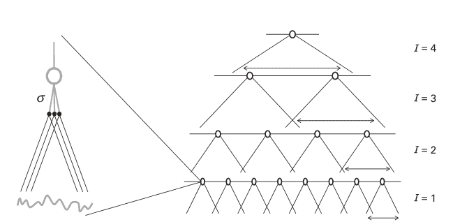

**图 1**

Hubel-Wiesel 模块的层级结构。在每个模块（插图）中，黑点代表简单细胞，它们计算图像与变换模板之间的点积（实现卷积），并使用具有不同阈值的函数（例如 Sigmoid 函数）进行滤波。简单细胞的输出由复杂细胞（池化）求和。这一系列操作由符号 \/.. 表示。

该理论并非完整的视觉理论（它还需要解释下向效应和反向投影的作用），而只是其一部分。该理论基于这样一个假设：腹侧流的主要计算目标是计算图像的神经表示，这些表示对于视觉环境中常见的变换以及通过无监督经验学习到的变换具有不变性。i-理论为腹侧流架构及其神经元的各个方面提供了计算解释。它做出了几项重大预测。它还导致了在物体识别基准测试中表现出高性能的网络实现 [7]。如所述，该理论基于对不变表示的无监督自动学习。由于不变表示被证明是监督学习的良好表示（其特征是复杂度较小），腹侧流的架构可能由至少在发育初始阶段需要从极少数标记示例中学习的需求所决定的。我们使用 i-理论来总结视觉识别神经科学的几个关键方面，对其进行解释，并预测其他方面。本书由四章、一个讨论和一个附录组成。

第 1 章描述了不变性计算理论的一般理论框架。特别是，我们描述了视觉中不变表示的相关数学结果；附录提供了细节和证明（另见 [1, 8, 10]）。起点是一个定理，该定理证明了对平移和缩放不变、且对某些其他变换（例如脸部姿态和表情）近似不变的图像表示，可以显著降低学习的样本复杂度。我们描述了如何为每个图像或图像路径计算一个不变且唯一的（选择性）特征。对于局部紧群变换，这种不变性可以是精确的（我们关注如 2D 射变换群及其子群，即由平移和均匀缩放组成的相似群），而对于非群变换，它是近似的。类似于 Huber-Wiesel (HW) 模块描述的简单和复杂细胞的滤波和池化模块可以计算这些估计。每个模块为其感受野所在的视觉场部分提供一个特征向量，我们称之为特征（signature）。有趣的是，Gabor 函数被证明是最大化平移和缩放同时不变性的最优模板。HW 模块的层级继承了它们的属性，缓解了整体和部分识别中的杂乱问题。最后，显示层级高处的相同 HW 模块能够计算对更广泛变换具有近似不变性的表示，例如脸部的 3D 表情、身体姿态和视角（反映在神经元的调节中），这些表示对于每个物体类别具有高度特异性。

第 2 章描述了神经电路如何实现 HW 算法所需的操作。它专门讨论了 V1 中简单和复杂细胞的新模型。它还引入了用于调节和池化的可能的生物物理机制，以及基于类赫布无监督学习的布线学习。书的其余部分致力于回顾该理论在视觉皮层腹侧流前向路径的应用。

第 3 章应用该理论解释视网膜和 V1 的多分辨率、依赖离心的架构，这是由于对空间和尺度不变性的需要。它预测了视觉早期阶段的几个尚未测试的属性。第 3 章还处理了 V2 和 V4，作为层级结构中的较高层，逐渐增加对偏移和缩放的不变性，同时减少来自杂乱信息的干扰。

第 4 章关于最后的 IT（下颞叶），其中从 V4 获取的偏移和缩放不变表示计算出对非典型变换准不变的类别特定表示。它还从理论角度讨论了前 IT 的模块化组织。特别是，它对脸部系统的架构和某些令人疑惑的属性提出了解释。

第 5 章讨论了待测试的预测和其他开放问题。

本书整合了我们小组自 2011 年以来在物体识别不变性方面的工作。结果出现在在线提供的若干不同的技术报告和论文中，感谢我们的合作伙伴 Lorenzo Rosasco、Joel Leibo、Jim Mutch、Andrea Tacchetti、Qianli Liao、Leyla Isik 和 Cheston Tan（见 [1, 7–9, 11–15]）。这是我们首次尝试将它们组织成书的形式。本书面向从神经科学家到数学家的广泛读者。对数学细节感兴趣的读者可以跳过更正式的附录，而不会影响对正文的理解。

第 1 章中提到的进一步进展（第 1.7 节末）已经在进行中。它们将在本书的计划续作中得到充分探索。

# 不变性的数学

## 1.1 引言与动机

可以认为，智能最重要的方面是学习能力 [16]。目前的监督学习算法与大脑相比如何？最明显的区别之一是人类和动物能够从极少数标记示例中学习。一个孩子或一只猴子只需要几个示例就能学会一项识别任务。本书的主要动机是这样一个猜想：降低识别样本复杂度的关键是对变换的不变性。同一物体的图像通常与视觉环境中常见以及通过无监督经验学习到的变换有所不同。i-理论为腹侧流架构及其神经元的各个方面提供了计算解释。它做出了几项重大预测。它还导致了在物体识别基准测试中表现出高性能的网络实现 [7]。如所述，该理论基于对不变表示的无监督自动学习。由于不变表示被证明是监督学习的良好表示（其特征是复杂度较小），腹侧流的架构可能由至少在发育初始阶段需要从极少数标记示例中学习的需求所决定的。我们使用 i-理论来总结视觉识别神经科学的几个关键方面，对其进行解释，并预测其他方面。

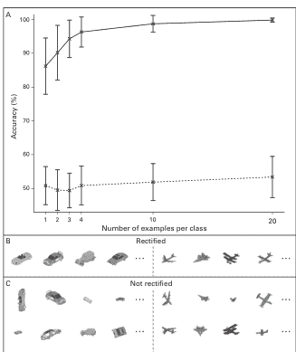

图 1.1

从原始像素表示（无预处理）进行汽车与飞机分类任务的样本复杂度。(A) 最近邻分类器（距离度量 = 1 — 相关性）的性能随每类示例数量变化的函数。每次测试随机选择 74 张图像以评估分类器。误差棒代表了 100 次训练/测试划分中变换次数的 ± 1 个标准差。虚线图像表示完整集合（440 $\times$ 变换次数）。实线：当所有图像都相对于变换进行校正时的校正任务；在 (B) 中显示了示例图像。虚线：未校正的任务。允许位置、缩放、光照方向和绕任何轴旋转（包括体感旋转）变化的分类器；在 (C) 中显示了示例图像。这些图像是使用 Digimation 模型库中的 3D 模型并用 Blender 渲染的。

识别。有两个主要阶段。第一阶段计算拓扑区域，计算一个对仿射变换具有不变性的表示。第二阶段计算对特定对象的非群变换的近似不变性。第二阶段计算并行路径的统计数据，每条路径对应一个对象类别（见图 1，5 阶段）。这部分的结果并不严格要求这两个阶段。如果两者都存在（正如灵长类虚拟流所示），该理论的数学模型要求特定对象的阶段位于处理仿射变换的阶段之后。根据 i 理论，Hubel-Wisel 模块（HW模块）是这两个阶段的基础模块。第一、第二阶段路径各可以由单层 HW 模块组成。然而，为了减轻杂物的干扰，需要分层结构。在分辨率较低的视觉系统中（例如小鼠），这可能是不需要的。

第 1 章

最终架构如图 1.5 所示。在第一阶段，层计算出对平移和缩放具有增强不变性的表示；而在第二阶段，大量的并行路径处理对特定对象类别的变换的近似不变性。请注意，对于任何对 X 不变且对 Y 具有选择性的表示，可能存在对 Y 不变但对 X 具有选择性的对偶表示。通常，不同的任务都需要这两者，并且它们都可以通过带有池化策略的 HW 模块计算。例如，皮层中不同的区域可能被用于表示不变性和选择性的不同组合。

## 1.2 不变性降低学习的样本复杂度

在机器学习环境中，例如对图像平移的不变性可以通过记忆物体在不同位置的示例来轻易建立。另一方面，人类视觉对于新物体具有明显的不变性：直觉上，对缩放、光照和姿态等变换不变的图像表示允许从更少的示例中进行学习。关于平移或缩放特殊情况的该猜想证明见附录 A.1。对于定义在像素网格上的图像，该结果（在平移情况下）可以使用覆盖数与样本复杂度之间的已知关系来证明。

**框 1.1 样本复杂度**

样本复杂度是在给定误差率内估计目标函数所需的示例数量。在图 1.1 的示例中，我们训练线性分类器以特定精度执行识别任务时所需的飞机或汽车数量。

### 平移不变性的样本复杂度

考虑一个维度为 $p \times p$ 的图像空间，这些图像可能出现在大小为 $rp \times rp$ 的窗口内的任何位置。自然图像表示（对于线性分类器）的样本复杂度为 $m_{image} = O(p^2)$；不变表示的样本复杂度为 $m_{inv} = O(p^2)$。这个简单的观察说明，在平移群的情况下，不变表示可以显著降低样本复杂度，即达到特定精度水平所需的监督示例数量。一个启发式规则是，样本复杂度的增益是群作用于单个图像时生成的示例数量的数量级（见 [18, 19]）。这不是一个构造性结果，但它支持了这样一个假设：视觉皮层的腹侧流试图近似这种预言机（oracle）。下一节描述了腹侧流可能用于实现不变表示的、生物学可能的算法。

## 1.3 无监督学习与不变特征的计算（单层架构）

以下算法在生物学上是可能的，正如我们在第 2 章中详细讨论的那样，我们认为可以通过皮层中的 HW 模块来实现。HW 模块是一组复杂细胞（见框 1.2），它们具有相同的感受野，池化一组简单细胞的输出，这些简单细胞的突触权重与模板及其变换（也称为模板）对应，其输出通过具有阈值 $\Delta$ 的 sigmoid 函数进行过滤，$h = 1, \dots, H, \Delta > 0$。

**框 1.2 简单细胞、复杂细胞**

阈值向量积可以被解释为神经元（称为简单细胞）的输出，它与模板 $t$ 计算高维内积并对其应用非线性操作。在这种解释下，等式 (1.2) 可以看作第二个神经元（复杂细胞）对许多简单细胞进行池化的输出，该复杂细胞通过平均操作聚合了其他神经元的输出。第一类神经元可以在视觉皮层中找到。

定义在有限或紧致集上的群（有限或紧凑）的算法（见图 1.2）如下：

开发阶段：

- 1. 对于 $K$ 个孤立（在空背景上）物体或模板中的每一个，记忆一个 $|G|$ 帧的序列 $A$，对应对象的变换 $(g_i, i = 1, \dots, |G|)$。现在，我们假设 $g_i$ 属于有限群 $G$；见框 1.3。帧序列在一个时间间隔内被观察；因此对于模板 $t^k$，对应的变换序列记为 $\Lambda_k$，$\Lambda = \{g_0|t, g_1|t, \dots, g_{|G|}|t\}$。

- 对 $K$ 个模板中的每一个重复此操作。

任何新单张图像不变特征的运行时计算：

- 对于每个 $t^k$，计算图像与 $\Lambda_k$ 中 $|G|$ 个变换中每一个的点积。

- 对于每个 $k$，计算结果值的累积直方图。

- 特征是 $K$ 个累计直方图的集合，即集合：

$$\mu_h^k(I) = \frac{1}{|G|} \sum_{t=1}^{|G|} \sigma(I, g_it^k) + h\Delta), \quad (1.2)$$

其中 $I$ 是图像，$\sigma$ 是阈值函数，$\Delta > 0$ 是直方图的宽度，$h = 1, \dots, H$ 是直方图索引。

**框 1.3 群变换**

群是一个装备了组合律 $*$ 的对象集合，满足：

- 集合中两个元素的组合会产生集合中的另一个元素（封闭性）；

- 组合具有结合律，$(a*b)*c = a*(b*c)$（结合律）；

- 集合包含单位元 $a*e = a$（单位元）；

- 集合包含所有元素的逆元 $a^{-1}$（逆元）。

我们在整本书中使用了该算法。我们能提供的保证取决于变换的类型。主要问题是特征是否对第一阶段观察到的某些类型的变换具有不变性，以及特征是否具有选择性，例如，它是否能区分 $N$ 个不同的物体。总之，如附录 A.2 节所示，HW 算法是不变且具有选择性的（当 $K$

7

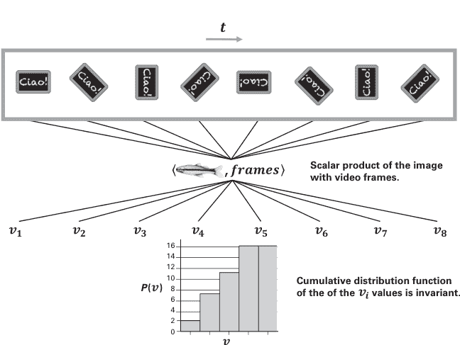

图像与视频帧的内积。

图 1.2

HW 算法总结。值 $\mu_k^h(I) = 1/|G|\sum_{g\in G} \alpha(t, g^k I) + h\Delta)$ 的集合（见等式 (1.2)）对应于直方图，其中例如，$k=1$ 代表模板板，$h$ 代表直方图的箱（bins）；变换 $g_i$ 来自旋转群。至关重要的是，能够在仿射变换下计算不变性表示的机制可以通过无监督、自动的方式进行学习（并维持），其方法是存储一组与需要以不变方式表示的物体无关的变换后模板集。特别是，这些模板可以是随机模式。

如果变换形成一个群，则复杂度为 order$(\log(N))$（但也请参见附录 A.2.4 节）。在这种情况下，随机模板集将适用于第一阶段。如果视为从 2-D 图像到 2-D 图像的变换，自然选择是由包含平移、图像平面内的旋转、缩放（可能是各向异性的）以及它们的复合而组成的仿射群。在仿射群或其子群的情况下，HW 算法可以学习具有精确不变性和所期望选择性的表示。对于由具有 $x, y, z$ 坐标的素元组成的 3-D 图像，3-D 中的旋转也是一个群，原则上可以处理，通过 HW 算法可以从通用模板中获得精确的不变性（在实践中，由于对应关系问题和自遮挡，这通常是不可能的）。在 1.6 节中，我们展示了相同的 HW 算法为非群变换提供了近似不变性（在某些条件下），例如由物体 3-D 旋转诱导的从三维到二维的变换。

紧致群的情况下，不变性和选择性的保证由以下两个定理提供（此处给出非正式表述；详细表述见于附录 A.2 节以及文献 [8, 10]）。

> 框 1.4

> 不变性与群平均

>

> 对于任意函数 $f \in L^2(\mathbb{R})$ 和紧致群 $G$，

> $$\tilde{f}(x) = \int dg(gx)$$

> 是不变的。利用群在其复合规则下封闭以及哈尔测度 $dg$ 的不变性，可以简单地证明：

> $$\tilde{g}(x) = \int dg(\tilde{g}gx) = \tilde{f}(x), \forall g \in G,$$

> $\tilde{f}$ 对 $G$ 是不变的。

等式 (1.2) 表示的分布是不变的，也就是说，每个箱都是不变的

$$\mu_h^k(I) = \mu_h^k(gI) \qquad (1.3)$$

对于 $g \in G$，其中 $G$ 是等式 (1.2) 中标记为 $g_i$ 的变换群。该证明基于签名（signature）是群平均的这一事实（见框 1.4）。

对于变换群（例如仿射群），等式 (1.2) 表示的分布可以对场景中 $N$ 张图像中的任意图像实现任何所需的选择性，前提是以 $1-\delta$ 的概率 $\epsilon$-逼近每对图像（及其任何变换）之间的真实距离，只要满足：

$$K > \frac{c}{\epsilon^2} \ln\frac{N}{\delta}, \qquad (1.4)$$

其中 $c$ 是一个常数。

由 $K$ 个累积直方图提供的签名是一个特征向量，对应于与 HW 模块相关的 $(HK)$ 复合细胞的活性。其选择性在于，于其变换，唯一地对应于特定物体的图像。签名在噪声测量下的稳定性仍然是一个开放性问题。

在 1.6 节中，我们展示了相同的 HW 算法为非群变换提供了近似不变性（在某些条件下），例如由物体 3-D 旋转诱导的从三维到二维的变换。

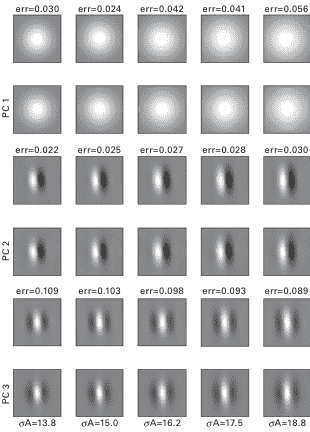

- *正弦 (SIN)*

- *余弦 (COS)*

- 鼠

- 猫

- 猴子

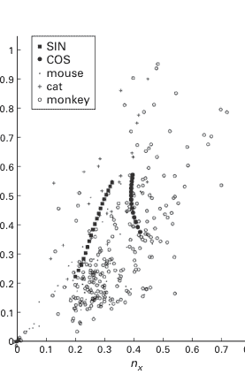

图 1.4

(A) V1 简单细胞通过主成分分析学习的仿真结果。每个细胞看到一组带有高斯权重（其树突树）的图像，如顶行所示。每个细胞学习相同的权重向量，提取其输入的主分量。(B) Gabor 波波的调制 (x) 和未调制 (y) 方向的 $n_y = \sigma_x/\lambda$ 与 $n_x = \sigma_y/\lambda$ 的关系。$\sigma_x/\sigma_y$ 是理论中的一个稳健发现，显然在生理数据中也是如此。来自猴子、猫和鼠的神经生理数据与我们的仿真一起报告。来源：[11]。

结果。关键要求是对于图像类 $I_C$，相对于字典 $t^k$，在变换 $T_r$ 下满足关于变换的不相干性条件（见框 1.5）（为了简单起见，我们在这里考虑一个单参数变换 $r$），

> 框 1.5

> 稀疏性/不相干性

如果一个信号的信息内容可以用正确基展开的少量系数表示，则该信号是稀疏的。例如，傅里级数中的正弦波由一个系数表示，因此它在傅里叶基中的表示是非常稀疏的。

当信号在一个基中表示为稀疏的而在另一个基中表示为密密的，这两个基是不相干的。对于正弦信号，傅里叶域和时域是不相干的。不相干性将空间频率对偶性扩展到其他基。

```
$<I_C
```

严格来说，当物体在池化区域具有局部支持（即是一个孤立物体）时，该条件是有效的。然而，只要点积随变换具有快速衰减，该条件就大致成立（例如小波系数）。该属性是压缩感知中互不相干概念的扩展，它要求模板（图像可以被视为一个模板）具有具有尖锐峰值相关性和自相关性的表示（等式 (1.7) 上方的常量 $a$ 与相关性峰值的支持有关）。等式 (1.7) 可以与集合中的图像相似且足够丰富以至于在小变换下保持不相干的模板来满足。从经验上看，我们的不相干性条件通常由 HW 模块层次中某个高层次的图像和模板的神经表示所满足（见 [25]），我们相对于群的不相干性条件是通用的。随机选择的大多数神经模式（来自同一类的模板和图像）都将满足它。完整形式（附录部分 A.2.5 中的定理 A.8）如下所示。

## 类特定属性

$\mu_b^h(d)$ 在视图附近近似不变的，如果：

- 相对于变换的模板字典是不相干的，

- $l$ 是模板之一，且变换方式与模板相同；

- 变换是平滑的。


主要的意义是，通过用于物体类的模板可以获得非群变换的近似不变性。这意味着对于每个类都需要一个类特定的模块；每个模块都需要高度特定的模板，即细胞的调优。一个例子是脸部区域中的脸部调优细胞。与变换的精确不变性不同，简单细胞的调优是非特异性的，因为它不依赖于类型。从经验上看，我们的不相干性条件通常由 HW 模块层次中某个高层次的图像和模板的神经表示所满足（见 [25]），我们相对于群的不相干性条件是通用的。随机选择的大多数神经模式（来自同一类的模板和图像）都将满足它。完整形式（附录部分 A.2.5 中的定理 A.8）如下所示。

`$\mu_b^h(d)$` 在视图附近近似不变的，如果：

- 相对于变换的模板字典是不相干的，
- `$l$` 是模板之一，且变换方式与模板相同；
- 变换是平滑的。

主要的意义是，通过用于物体类的模板可以获得非群变换的近似不变性。这意味着对于每个类都需要一个类特定的模块；每个模块都需要高度特定的模板，即细胞的调优。一个例子是脸部区域中的脸部调优细胞。与变换的精确不变性不同，简单细胞的调优是非特异性的，因为它不依赖于类型。

对于图像类 `$I_C$`，相对于字典 `$t^k$`，在变换 `$T_r$` 下满足关于变换的不相干性条件（为了简单起见，我们在这里考虑一个单参数变换 `$r$`），

> 框 1.5
>
> 稀疏性/不相干性
>
> 如果一个信号的信息内容可以用正确基展开的少量系数表示，则该信号是稀疏的。例如，傅里叶级数中的正弦波由一个系数表示，因此它在傅里叶基中的表示是非常稀疏的。
>
> 当信号在一个基中表示为稀疏的而在另一个基中表示为密密的，这两个基是不相干的。对于正弦信号，傅里叶域和时域是不相干的。不相干性将空间频率对偶性扩展到其他基。

```
$<I_C
```

严格来说，当物体在池化区域具有局部支持（即是一个孤立物体）时，该条件是有效的。然而，只要点积随变换具有快速衰减，该条件就大致成立（例如小波系数）。该属性是压缩感知中互不相干概念的扩展，它要求模板（图像可以被视为一个模板）具有具有尖锐峰值相关性和自相关性的表示（等式 (1.7) 上方的常量 `$a$` 与相关性峰值的支持有关）。等式 (1.7) 可以与集合中的图像相似且足够丰富以至于在小变换下保持不相干的模板来满足。从经验上看，我们的不相干性条件通常由 HW 模块层次中某个高层次的图像和模板的神经表示所满足（见 [25]），我们相对于群的不相干性条件是通用的。随机选择的大多数神经模式（来自同一类的模板和图像）都将满足它。完整形式（附录部分 A.2.5 中的定理 A.8）如下所示。

`$\mu_b^h(d)$` 在视图附近近似不变的，如果：

- 相对于变换的模板字典是不相干的，
- `$l$` 是模板之一，且变换方式与模板相同；
- 变换是平滑的。

主要的意义是，通过用于物体类的模板可以获得非群变换的近似不变性。这意味着对于每个类都需要一个类特定的模块；每个模块都需要高度特定的模板，即细胞的调优。一个例子是脸部区域中的脸部调优细胞。与变换的精确不变性不同，简单细胞的调优是非特异性的，因为它不依赖于类型。

16

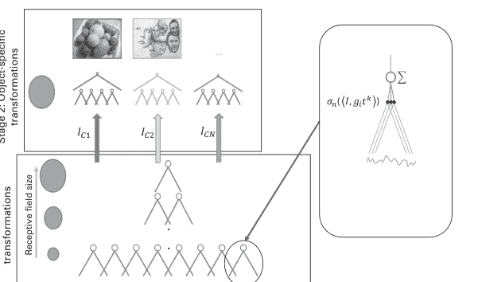

**图 1.5**

HW 模块的层级架构，由 `$\Lambda$` 表示。每一层中每个节点提供的特征可以被监督分类器使用。*阶段 1*：HW 模块的层级结构（*插图*）具有不断增加的感受野，通过对每层不变特征的级联进行池化，提供一个最终的特征（层级顶端），该特征对仿射变换具有全局不变性。*阶段 2*：特定于变换的模块为非群变换（例如深度方向的旋转）提供不变性。

不变性的实现在某些情况下可以分解为对应于不同变换的不同步骤（相关思想见参 [36, 37]）。

- * **局部连接的优化和计算元件的最优复用。** 尽管每个神经元上有大量的突触，但复杂细胞无法跨越覆盖整个图像的所有简单细胞进行信息池化。
- 减少实现不变性所需的每个模板的变换数量（见附录 A.10）。
- 干扰包容性（见第 3 章）。

可能所有这些属性的结合正是进化发展出层级结构的原因。

单层架构无法捕捉视觉世界的层级组织，场景由对象组成，而对象本身由部分组成。对象（部分）在场景中可以相互改变位置或尺度，而不改变其身份，且通常只对场景产生细微影响。层级所有水平的全局和局部特征必须能够访问内存，以实现分类。

17

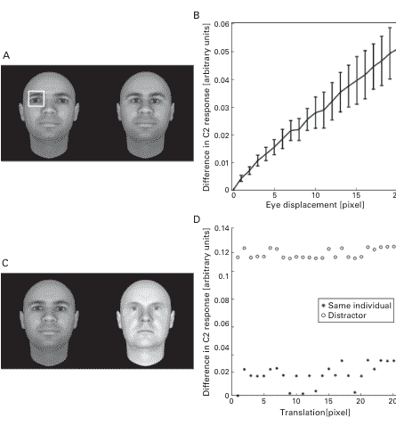

图 1.6

在特定的双层实现（HMAX）中，层级架构的不变性、稳定性和唯一性的实证演示。(A) 左侧为参考图像，右侧为其变形（眼睛靠得近）。(B) 第 2 层的 HW 模块（`$c2$`）其感受野包含整个脸，提供了一个相对于变形具有（利普希茨）稳定性的特征向量。在所有情况下，图中显示的是特征向量的欧几里得范数。`$c1$` 和 `$c2$` 向量不仅是不变的还是稳定的。误差棒代表±标准差。(C) 在视觉场不同位置展示的两幅不同图像。(D) 第 2 层具有相同感受野（整个图像）的一组 HW 模块的特征与参考向量之间的欧几里得距离。该特征向量对全局平移是不变的，且具有判别性（两者之间）。在这个示例中，HW 模块代表了层级卷积架构的顶端。使用的图像为 `$200\times200$`，并将整个场景识别为对应于对象及其部分的图像块。图 1.6 显示了整体和部分的不变性和稳定性示例。在图 1.5 的架构中，每个 `$\lambda$`-模块在不同层上提供唯一性、不变性和稳定性，且从底部到顶部逐渐增加。因此，除了所需的不变性、稳定性和判别性属性外，这些架构还匹配了视觉世界的层级结构，以及从不同尺寸和复杂程度的内存中检索项目的需求。

**组合性**属性与层级架构相对于单层架构在物体识别中部分遮挡以及更困难的干扰问题上的效能有关。层级架构在干扰中的识别优于单层网络（见第 3 章和 [38]），因为它们为多种尺寸和位置的图像块提供了特征。然而，层级前馈架构无法完全解决干扰问题。在干扰中实现人类水平的识别可能需要更复杂的（例如递归）架构（例如，见 [39–41]）。

层级架构具有感受野不断增加的层（见图 1.7）。这种直觉是，层级的每一层表示的变换是从小范围的平移、尺度和旋转变换开始的。更具体地说，假设第一层由一组小感受野组成，对于同一组变换的范围，关注其不变性（事实上是 V1 的小感受野）。

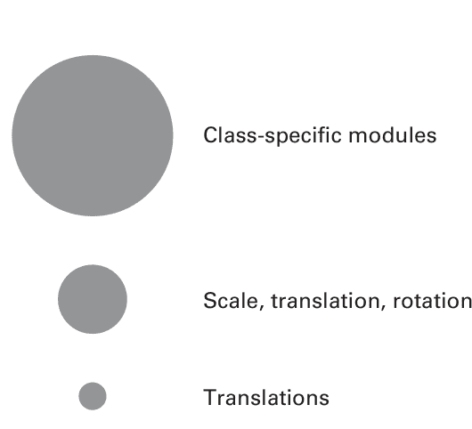

# 尺度、平移、旋转

# 平移

图 1.7

假设是感受野尺寸（如复杂细胞）不仅影响尺寸，还影响学习和表示的变换类型。特别是，V1 中的小感受野只看到小平移。

# 不变表示

19

> 框 1.7
>
> 通过小窗口观察的任何变换都是仿射变换。

我们的方法不同之处在于，假设微小的（接近恒等的）微分变换在第一层可以被很好地近似为局部仿射变换，这通过以下推理得到了证实（为了简单在 1 维中），其中任意变换通过参数 `$r$` 参数化并围绕零展开：

```
$$T_r(l) = T_0(l) + A_r(l) + O(r) = (e + A_r)(l) + O(r),$$
```

其中 `$e + A_r$` 是 `$GL(\mathbb{R})$` 中的线性算子。

在我们的理论中，HW 层级架构的关键属性（允许在所有层递归使用单个模块属性）是*协变性*。考虑图 1.5 中描述的第一阶段的两种极端架构是有启发性的：

- 由一个 HW 模块及其 `$KH$` 个复杂细胞组成的单层，每个细胞的感受野覆盖整个视觉场
- 由几层感受野不断增加的 HW 模块组成的层级，随后是并行模块，每个模块致力于特定物体类的不变性

在第一种架构中，仿射变换的不变性是通过对 `$KH$` 个模板进行池化获得的，每个模板经过所有可能的方式变换：相关的简单细胞对应于模板的变换。仿射变换的不变性是通过对整个视觉场进行池化的。在这种情况下，尚清楚如何将非群变换直接整合到这种单隐藏层架构中。

然而，处理非群变换的 HW 模块可以添加在仿射模块之上。定理允许这种分解（见附录章节 A.9）。有趣的是，它们通常不允许对平移和缩放进行分解（例如，一层计算平移不变性，下一层计算尺度不变性）。相反，它们允许对同一组变换的不变范围进行分解。这证明了第二种架构的起始层，对应图 1.5，即每个 HW 模块的感受野及其不变性范围从低层到高层增加的阶段。

单层架构的主要问题之一是它为孤立对象提供了不变特征（invariant signature），但对其部分则没有。这种识别整体与部分的问题与在杂乱中识别物体密切相关，即在不考虑附近其他物体存在的情况下独立识别物体。关于不变性的关键定理假设图像和模板描述的是孤立对象。否则，特征可能会因为不同时间的不同变换而改变。在脸部中识别眼睛，其本质上是脸部其余部分都是杂乱的问题。这就是在识别森林的同时识别森林中的某棵树的古老难题。

该问题的一个部分解决方案是针对第一阶段的层级架构，其中较低层为图像较小部分提供具有较小不变性的特征，而较高层为图像较大部分提供具有更大不变性的特征（参见附录 A.3 节）。这些特征都可以被特定类别的模块使用，可能采用逆层级策略（[421]），即以一种依赖任务的、自顶向下的模式首先使用顶层特征和底层特征。我们将在第三章描述这种架构，从视网膜和 V1 开始。有三点值得关注：

- 如果层级架构的某种属性——协方差（covariance）成立，则可以对不变范围进行分解。假设图像存在一种群变换，例如平移或缩放。如果层级架构中的第一层神经活动模式根据相同的变换群进行变换，则称该层是协变的（covariant）。我们描述了这一属性（参见框 1.7）：具有点非线性的各向同性架构（如本书中所考虑的架构）是协变的。
- 由于架构中的每个模块在变换后的对象包含在池化范围内都会给出不变输出，且由于池化范围从一层到另一层不断增大，因此对于越来越大的变换存在不变性。为了能够实现对图像部分和整体的识别，监督分类器不仅应该接收来自顶层的特征（如许多神经网络架构所示），还应该来自其他层级的特征（直接或间接地）。
- 在离散群的情况下，可以证明用于选择性的所需的不同模板数量 `$K = C(\epsilon)(\log(n|G|))$`（参见等式 1.4）；这意味着它可能显著取决于所池化的群 `$G$` 的大小（参见附录 A.2.4 节）。

被称为深度学习（特别是卷积网络）的学习算法类基于多层中的两种计算操作。

第一个操作是输入与另一个称为模板（或滤波器或内核）的点的内积，随后是一个非线性变换。点积的输出对应于简单细胞的神经响应 [20]：

```
$I \mapsto |\langle I, gt \rangle + b|_{+}$
```

其中 `$|y|_+ = \max(0, y)$`。

第二个操作是`pooling`（池化）。它通过将计算出的不同内积的值汇聚在单个输出中，例如，通过求和：

```
$$\sum_{g} |\langle I, gt \rangle + b|_{+}, \quad t \in T, b \in \mathbb{R} \qquad (1.9)$$
```

或最大操作 `$|\langle I, gt \rangle + b|^{+}$`这对应于复杂细胞的神经响应 [20]。在 i 理论中，作用于点积的非线性变换被视为直方图计算的一部分，但网络是完全等变的。

事实证明（参见 [12] 中的参考文献），使用线性段整流器（称为“斜坡”）的深度卷积网络 (DCN) 单元对应于具有以下形式的内核：

```
$$\tilde{K}(I, I') = \int dt \ dg' |\langle I, gt \rangle + b|_{+} |\langle g', I' \rangle + b|_{+} . \qquad (1.10)$$
```

这表明深度网络中的线性整流器（和其他非线性操作）等于将普通点积替换为内核定义的特征空间中的点积。书中描述的所有关于点积后具有广泛非线性性的网络的结果均适用。

进一步的扩展是可能的。正在进行的工作 [46] 显示，i 理论可以表化为包含带有监督和非池化层的现代深度卷积学习网络 (DCLNs)。特别是 [46] 展示了如何通过定义多变量函数近似的经典自适应样条的扩展，为具有线性整流器和池化（求和或取最大）的 DCLNs 提供理论框架。

在 i 理论及其探索的背景下，[47] 探讨了层级架构与浅层架构的比较。层级和浅层网络都可以近似多变量函数，特别是那些低维函数的复合函数。[47] 对深度网络架构相对于浅层网络的优势进行了表征：特别是它证明了浅层网络如何以与深度网络相同的误差近似位置函数，但代价是 VC 维（Vapnik-Chervonenkis 维，网络容量的度）相对于函数维度呈指数级而非二次方增长。复合函数也被证明对图像识别至关重要，从而解释了深度架构在图像识别中优于浅层架构的理论原因。

关于图像表示的不变方法存在大量的文献。显式使用变换群结构和群平均技术来构建不变特征的早期且具有启发性的论文之一是 Mirbach 的 [43]。Burkhart [44] 分析了使用群不变内核的另一种方法。结合内核平均嵌入 [45] 的工作，启发了我们最近关于深度卷积网络与层级内核机等效性的工作 [12]。最近，Mallat [32] 开发了一种名为群散射（group scattering）的不变表示，它通过对小波系数应用级联非线性来获得对微微分变换鲁棒的不变表示。

第一章描述了我们的工作。其主要来源是以下技术报告和期刊论文：[1, 8, 9, 11, 12]。

### 无监督学习、调优与池化

#### 2.1 简单细胞与复杂细胞的细胞模型

理论暗示了至少两种可能的 Hubel-Wiesel (HW) 模块生物学模型。第一是简单细胞输入复杂细胞的原始 HW 模型。i 理论提出了累积分布函数 (cdf) 的理想计算，在这种情况下简单细胞输出的非线性是一个阈值。求和简单细胞输出的复杂细胞将代表直方图的一个箱（bin）。相同位置的另一个细胞池化一组具有不同阈值的相似细胞将代表直方图的另一个箱。另一种可能性是简单细胞输出的非线性近似为平方（或任何幂或幂组合）。在这种情况下，池化相同非线性的复杂细胞代表分布的一个阶阶。注意，在这种情况下，某些复杂细胞是线性的，神经生理学家将根据标准将其归类为简单。简单细胞输出的非线性变换可能对应于细胞群的脉冲机制（参见 [22] 中的参考文献）。非线性生物学机制可以在局部被多项式近似，这一点已多次指出 [48, 49]。这也是诸如 HMAX 和 Freeman-Simicelli 模型性能相似的原因。我们模型神经元中的非线性（或阈值）可以通过泰勒级数近似中的几项很好地近似。作为补充，必须强调理论上复杂细胞计算的分布与图像和纹理的经典统计解释无关。分布并非来自图像的统计特性，而是来自群的作用，因此与图像的性质以及是否为纹理无关。

第二种 HW 模块的生物学模型实现 i 理论计算，由单个细胞组成，其中树突分支扮演简单细胞的角色（每个分支包含一组突触）

24

--权重提供，例如，来自侧膝上核（LGN）输入的对树突分支的 Gabor 调制。树突膜远端胞体的活性特性为每个分支单独提供了类似于阈值的非线性，而胞体则汇总了所有分支的贡献。该模型将解决这样一个难题：到目前为止，生理学家分类为简单、复杂或鲁棒的锥细胞之间似乎不存在形态学差异。

有趣的是，i理论对于从简单细胞到复杂细胞的非线性具有鲁棒性。我们假设几乎任何一组非平凡的非线性都是有效的。该论点基于这样一个事实：从相同的简单细胞聚合而成的一组不同细胞应该计算累积分布，或者等价地计算其矩或组合（每种组合都是一种简单的非线性）。只要非线性不随时间变化，并且对于由同一组细胞聚合的所有简单细胞都是相同的，任何非线性都能提供不变性。足够数量的非非线性（每个对应一个复杂细胞）可以提供适当的选择性，前提是每个非线性都可以用截断幂级数表示，并且相关的复杂细胞提供了足够数量的线性无关的矩组合。

一个简单的模型可以描述具有相同调谐（例如，代表相同的特征向量，具有相同的方向）的一组简单细胞与复杂细胞之间的布线如何产生，这引入了希伯来迹迹规则 [49]。在第一阶段，复杂细胞具有不同选择性（例如，方向）的亚单元，例如，自然图像是不变的，其具有不同方向的特征向量是简并的。在第二阶段，当大多数亚单元处于激活状态时，未被激活的亚单元将根据类似于 Földi 的规则 [49] 被剪掉。Földi 的原始迹迹规则显示，输入细胞和输出细胞之间突触的权重增强程度与输入活动以及时间 `$t$` 时近期平均活动的迹迹成正比，其中迹迹对先前活动的依赖性随时间以特定的衰减常数衰减。

i理论提供了用于在无监督视觉经验期间学习相关不变性的以下算法：为每几个对象存储图像序列（模板），同时进行变换（例如，平移、旋转和增大）。我们证明了通过这种方式，可以从无监督视觉经验中学习不变的分层架构。此类架构代表了重要的扩展，超越了简单的平移不变性和硬连结，超越了腹流模型，例如福岛的新型认知 [2] 和 HMAX [47, 50]，以及被称为卷积网络 [34, 51] 的深度神经网络及相关模型 [52–59]。

从生物学角度来看，一个模板的变换序列对应于一组简单细胞，每个细胞在其调谐起始处对应于该序列的一帧。在第二个学习步骤中，复杂细胞将布线到这些简单细胞。然而，通过暴露于单个对象变换而在一组 V1 细胞的调谐中直接存储图像或图像块的突触的想法在生物学上是不可行的。由于已知视觉皮层存在类 Hebb 突触，生物学合理的假设是：突触由于视觉输入的影响随时间逐渐变化，通过于对象变换产生的许多图像序列（例如模板）。问题在于这种机制是否与 i理论兼容，以及如何兼容。

我们在简化的设置中探讨 V1 的这一问题，该设置可以扩展到其他区域。我们假设如下：

- 1. LGN 输入与（未成熟的）简单细胞之间的突触是 Hebian 的，特别是它们的动力学遵循 Oja 流量。在这种情况下，突触权重将收敛于输入图像协方差具有最大特征值的特征向量。
- 2. 简单细胞的位置和大小在发育过程中根据倒金字塔晶格设置（见下一章图 3.2）。关键点在于，突触输入的高斯扩散大小和简单细胞集合的位置。假设每个非线性都可以用截断幂级数表示，因此相关的复杂细胞提供了足够数量的线性无关的矩组合。

总结来说，我们假设由于视觉输入的影响，突触随时间逐渐变化，通过于对象变换产生的许多图像序列（例如模板）。问题在于这种机制是否与 i理论兼容，以及如何兼容。

我们在简化的设置中探讨 V1 的这一问题，该设置可以扩展到其他区域。我们假设如下：

- 1. LGN 输入与（未成熟的）简单细胞之间的突触是 Hebian 的，特别是它们的动力学遵循 Oja 流量。在这种情况下，突触权重将收敛于输入图像协方差具有最大特征值的特征向量。


- 2. 简单细胞的位置和大小在发育过程中根据倒金字塔晶格设置（见下一章图 3.2）。关键点在于，突触输入的高斯扩散大小和简单细胞集合的位置。

总结来说，我们假设由于视觉输入的影响，突触随时间逐渐变化，通过于对象变换产生的许多图像序列（例如模板）。问题在于这种机制是否与 `i` 理论兼容，以及如何兼容。

24

--权重提供，例如，来自侧膝上核（LGN）输入的对树突分支的 Gabor 调制。树突膜远端胞体的活性特性为每个分支单独提供了类似于阈值的非线性，而胞体则汇总了所有分支的贡献。该模型将解决这样一个难题：到目前为止，生理学家分类为简单、复杂或鲁棒的锥细胞之间似乎不存在形态学差异。

有趣的是，`i` 理论对于从简单细胞到复杂细胞的非线性具有鲁棒性。我们假设几乎任何一组非平凡的非线性都是有效的。该论点基于这样一个事实：从相同的简单细胞聚合而成的一组不同细胞应该计算累积分布，或者等价地计算其矩或组合（每种组合都是一种简单的非线性）。只要非线性不随时间变化，并且对于由同一组细胞聚合的所有简单细胞都是相同的，任何非线性都能提供不变性。足够数量的非非线性（每个对应一个复杂细胞）可以提供适当的选择性，前提是每个非线性都可以用截断幂级数表示，并且相关的复杂细胞提供了足够数量的线性无关的矩组合。

一个简单的模型可以描述具有相同调谐（例如，代表相同的特征向量，具有相同的方向）的一组简单细胞与复杂细胞之间的布线如何产生，这引入了希伯来迹迹规则 [49]。在第一阶段，复杂细胞具有不同选择性（例如，方向）的亚单元，例如，自然图像是不变的，其具有不同方向的特征向量是简并的。在第二阶段，当大多数亚单元处于激活状态时，未被激活的亚单元将根据类似于 Földi 的规则 [49] 被剪掉。Földi 的原始迹迹规则显示，输入细胞和输出细胞之间突触的权重增强程度与输入活动以及时间 `t` 时近期平均活动的迹迹成正比，其中迹迹对先前活动的依赖性随时间以特定的衰减常数衰减。

`i` 理论提供了用于在无监督视觉经验期间学习相关不变性的以下算法：为每几个对象存储图像序列（模板），同时进行变换（例如，平移、旋转和增大）。我们证明了通过这种方式，可以从无监督视觉经验中学习不变的分层架构。此类架构代表了重要的扩展，超越了简单的平移不变性和硬连结，超越了腹流模型，例如福岛的新型认知 [2] 和 HMAX [47, 50]，以及被称为卷积网络 [34, 51] 的深度神经网络及相关模型 [52–59]。

从生物学角度来看，一个模板的变换序列对应于一组简单细胞，每个细胞在其调谐起始处对应于该序列的一帧。在第二个学习步骤中，复杂细胞将布线到这些简单细胞。然而，通过暴露于单个对象变换而在一组 V1 细胞的调谐中直接存储图像或图像块的想法在生物学上是不可行的。由于已知视觉皮层存在类 Hebb 突触，生物学合理的假设是：突触由于视觉输入的影响随时间逐渐变化，通过于对象变换产生的许多图像序列（例如模板）。问题在于这种机制是否与 `i` 理论兼容，以及如何兼容。

我们在简化的设置中探讨 V1 的这一问题，该设置可以扩展到其他区域。我们假设如下：

- 1. LGN 输入与（未成熟的）简单细胞之间的突触是 Hebian 的，特别是它们的动力学遵循 Oja 流量。在这种情况下，突触权重将收敛于输入图像协方差具有最大特征值的特征向量。

- 2. 简单细胞的位置和大小在发育过程中根据倒金字塔晶格设置（见下一章图 3.2）。关键点在于，突触输入的高斯扩散大小和简单细胞集合的位置。

总结来说，我们假设由于视觉输入的影响，突触随时间逐渐变化，通过于对象变换产生的许多图像序列（例如模板）。问题在于这种机制是否与 `i` 理论兼容，以及如何兼容。

我们在简化的设置中探讨 V1 的这一问题，该设置可以扩展到其他区域。我们假设如下：

- 1. LGN 输入与（未成熟的）简单细胞之间的突触是 Hebian 的，特别是它们的动力学遵循 Oja 流量。在这种情况下，突触权重将收敛于输入图像协方差具有最大特征值的特征向量。

- 2. 简单细胞的位置和大小在发育过程中根据倒金字塔晶格设置（见下一章图 3.2）。关键点在于，突触输入的高斯扩散大小和简单细胞集合的位置。

总结来说，我们假设由于视觉输入的影响，突触随时间逐渐变化，通过于对象变换产生的许多图像序列（例如模板）。问题在于这种机制是否与 `i` 理论兼容，以及如何兼容。

主成分分析（PCA）是一种统计过程，通过获取一个较小的变量集来实现大型数据集的降维，这些变量被称为主成分。主成分是原始变量的线性组合。第一主成分是捕获最大方差的方向。第二主成分是捕获剩余方差且与第一主成分正交的方向，以此此类推。

总结来说，我们假设由于视觉输入的影响，突触随时间逐渐变化，通过于对象变换产生的许多图像序列（例如模板）。问题在于这种机制是否与 `i` 理论兼容，以及如何兼容。

我们在简化的设置中探讨 V1 的这一问题，该设置可以扩展到其他区域。我们假设如下：

- 1. LGN 输入与（未成熟的）简单细胞之间的突触是 Hebian 的，特别是它们的动力学遵循 Oja 流量。在这种情况下，突触权重将收敛于输入图像协方差具有最大特征值的特征向量。

- 2. 简单细胞的位置和大小在发育过程中根据倒金字塔晶格设置（见下一章图 3.2）。关键点在于，突触输入的高斯扩散大小和简单细胞集合的位置。

现在考虑图 1.5 的非视网膜（nonretotopic）阶段 2，其中变换不是尺度或位置，而是由脸部旋转引起的变换。假设一个简单细胞暴露于所有变换 `g_i`（`g_i` 是有限群 `G` 的群元素），作用于每个 `K` 个模板的集合 `T=(t_1, \dots, t_K)`。细胞随后暴露于图像（列）`X=(g_1T, \dots, g_GT)` 的集合。为了这个例子，假设决定 Oja 流量的协方差矩阵为：

```
C=XX^T=\sum_{i=1}^{|G|}g_iTTTg_i^T \quad (2.3)
```

显而易见，如果 `\phi` 是 `C` 的特征向量，那么 `g_i\phi` 是具有相同特征值的特征向量（V1 和更高层的感受野细节，见 [11] 和 [69–71]）。例如，假设 `G` 是平面上的离散旋转群；那么特征向量的所有（离散）旋转也是特征向量。Oja 规则将收敛到具有最高特征值的特征向量，并且可以证明对具有相同特征值的细胞进行 `L^2` 池化，等同于对变换进行 `L^2` 池化（见附录 A.25）。

A.4节。这可以通过HW算法中池化步骤（pooling step）的以下变体形式化。

## 2.4.1 谱池化假设

假设 `\Lambda_k` 是对应于模板 `\phi^k` 组变换的矩阵（每一列都是模板的一个变换）。考虑相关协方差矩阵的特征向量。根据前述论证，`(g_m I, \phi_p) = (I, \phi_p)`，其中 `g_m^{-1}\phi_p = \phi_p`。特别，很容易检查出前两个矩可以通过对特征向量进行池化或对模板的变换进行池化来计算（等式2.4）。如果池化是针对 `\Lambda = \sum_{i} \Lambda_i` 的部分特征向量，该论证依然有效。前两个矩可以被视为不变特征的一部分：

```
\mu_1 = \sum_{i} (I, \phi_i), \quad \mu_2(I) = \sum_{i} (I, \phi_i)^2; \quad (2.4)
```

为了实现不变性，复合单元可以对 `\Lambda_k` 的特征向量进行线性或二次非线性池化，而不是对模板的变换进行池化。

第1章关于HW模块的定理意味着，模板以及因此简单单元的调优可以是任何对象的图像。在层次结构的更高级别中，模板是神经图像——由视觉野中实际图像诱发的神经活动模式。然而，第2.4节提供了一种符合生物学原理的方法，通过赫布塑塑性（Hebbian plasticity）从无监督的视觉经验中学习模板。在第3章中，我们将讨论基于这些假设的腹侧流各区域神经元调优的预测。

本书的这部分描述了我们小组的工作。其主要来源是以下技术报告：[9, 11]。

### 3.1 V1

### 3.1.1 基于i理论的感受野离心依赖性的新模型

- 1. 存储模板 `t^k`（这是一个图像块，可以随机选择）。

- 2. 存储所有观察到的模板（通过时间连续性结合在一起）。

- 3. 对一组 `K` 个模板重复步骤1和2。

尽管模板可以是任意的图像块，但我们假设——基于最优不变性定理（见第1章）以及来自V1简单单元的实验证据——V1模板是类Gabor函数（更准确地说，是窗窗傅里叶变换 [72]，第92页）。

在缩放下，正位于凹心正中央的模式将改变大小而不产生任何中心平移，其边界将在 `x,y` 上发生偏移。对于位于某个非零离心率的模式，缩放将使中心在 `s,x` 平面上平移（见图3.1）。在 `s,x` 平面上，轨迹的斜率取决于模式的大小和相关的位置。

考虑在 `s=s_0, x=0` 处的Gabor函数。给定约束条件下，`s_0` 是最小可能的感受野（RF）尺寸。通过在 `(-x_0, x_0)` 内进行 `x` 平移对其进行变换，生成一组模板 `\Lambda_0`。假设我们确保在最高分辨率 `(x_0)` 下的内容在直到 `s_{max}` 的所有尺度下保持可识别。

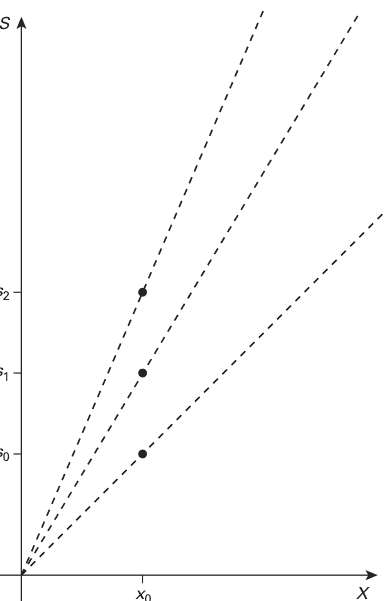

**图3.1**

*左侧是 `s, x` 平面，表示在空间维度 `x, y` 上半径为 `s_1, s_2, s_3` 的模板，它们都位于中心位置。虽然 `s` 和 `x` 都以视觉角度为单位，但在图中两个轴的比例并不相同。在这里，与本书的其他部分一样，我们只显示一个坐标 `(x)`；我们假设最小模板是凹中心最小的简单单元，半径约为 `40^\circ` [73]。对于任何固定的离心率（右侧），模式的大小取决于其在缩放下 `s, x` 轨迹的斜率。集合 `\Lambda_0` 的相关尺度变换产生了图3.2所示的倒置金字塔。根据Huber-Wiesel算法（见第1章）对这些变换后的模板进行池化，将产生在 `(s_0,s_{max})` 范围内对尺度变换的均匀不变性；对平移的不变性至少在 `(-x_0, x_0)` 范围内，取决于尺度。观察并存储一组模板以便能够计算不变表示的过程可能发生在进化水平，或作为两者的结合。*


模板集的合成。考虑一个模板，例如一个Gabor感受野（RF），在 `s_{min}` 处。在 `s_{max}` 处，对（边界的）平移进行变换，填充空间。在 `s,x` 处对（边界的）尺度进行变换，填充空间。为了清晰，我们只显示一个坐标 `(x)`；我们假设最小模板是凹中心最小的简单单元，半径约为 `40^\circ` [73]。对于任何固定的离心率（右侧），模式的大小取决于其在缩放下 `s, x` 轨迹的斜率。集合 `\Lambda_0` 的相关尺度变换产生了图3.2所示的倒置金字塔。

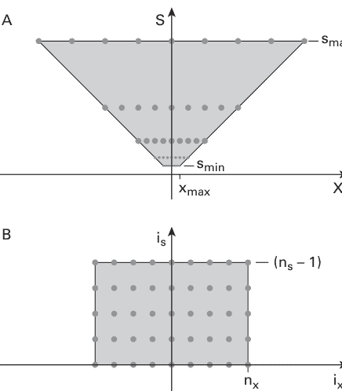

图 3.3

在 Gabor 滤波器以及在空间间隔 `\Delta x = s` 下对每个尺度进行相关采样的假设下，此图描述了模板单元数组的一个集。对 `x` 的采样遵循采样定理。在 `s` 轴与斜率为 1 的直线之间没有样本（当 `x` 和 `s` 以相同的单位绘图时）。圆心给出了 `x,s` 坐标；圆代表感受野。该图显示了一个约 `\approx 26^\circ` 的中心凹，总计 40 个单元（中心凹中心两侧各 20 个）。中心凹处尺度的采样间隔比例设定为 `s=21'` [73]，这意味着 `s=\pm 6`。在眼科医生 20/20 视力表上，字母的大小约为 `5'`。倒置金字塔 (A) 在每个尺度上具有相同数量的样本点，当 `x` 被替换为 `i_x = x/s`（距离中心的样本数）时，它完美地映射到正方形阵列 (B) 上，`i_s` 是尺度带索引（`x,s` 单位如图 3.2 所示进行了缩放）。来源：[14]。

预测（使用 `a=0.1` 的估计值）中心凹（倒置金字塔底部）的半径为 `R = 1'/20' / 0.1 \approx 13'`，总跨度为 `2R \approx 26^\circ`，对应约 40 个间隔为 `40^\circ` 的细胞。中心凹（倒置金字塔顶部）的大小预测为 `2R \approx 26^\circ`，具有 40 个间距为 `\approx 10'` 的细胞（见图 3.3）。每个每个尺度层都具有相同数量的单元，这由中心凹中的单元数量决定，即最高分辨率下的单元数量。这种重映射（见图 3.3B）显示 `S1` 对应一个维度为 `x,y,s,\theta` 的点格，维度尺寸不同（但 `x,y` 大致相同）；拓扑结构是圆柱体，`\theta` 是周期的。

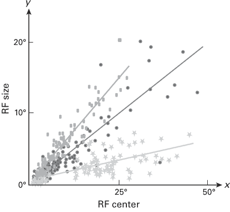

图 3.4

Hubel 和 Wiesel [78] 关于猴类 V1 的数据给出平均感受野直径相对于离心率的斜率为 `a =0.05`。其他区域的数据相似，但斜率更高（改编自 [48]，原始猴类数据来自 [79, 80]）。来源：[14]。

该点格包含了在倒置金字塔内实现不变性所需的模板的所有采样平移和尺度变换。理论预测的数量很大，但非常合理：每个尺度和每个 Gabor 方向有 `40 \times 40 = 1,600` 个，总计有 5 万个变换后的模板。

为了做出这些预测，我们使用了猕猴的数据结合人类心理物理学的数据。因此，我们的估计取决于感受野大小的实际范围，可能会有2倍的误差。我们的主要目标是提供相关数量的大致估算。

不变性并不是直接由数组提供的，而是通过对其进行池化提供的。在本节中，我们限于孤立对象的不变性识别。对于每个 `s`，`x` 的不变性范围受到倒置金字塔下界斜率的限制。预测不变范围 `\Delta x` 与尺度 `s` 成比例，即：

```
\Delta x \approx n_s s
```

其中 `n_s` 是倒置金字塔的半径，且对所有尺度 `s` 都是相同的。因此细节（高频）在 `x` 上的不变性范围有限，

而较粗的细节具有更大的不变性。`n_x` 通过皮层放大系数的斜率 `a` 得到：

```
n_x = \frac{1}{d} (3.3)
```

关于所谓规范理论的原理似乎是自然的（也可能是错误的）：

- 1. 进化试图从少数标记的示例中优化识别，

- 2. 结果是它必须优化不变性，

- 3. 作为第一步，它必须在非有限资源的限制下优化对尺度和平移的不变性，

- 4. 因此，它在 V1 的每个位置发育出不同尺寸的感受野，感受野大小随离心率线性增加，这些属性反映在视网膜的结构中。

第2章描述了通过对其变换的无监督经验学习模板。讨论的主要示例由 V1 中的简单细胞组成。我们现在可以使用倒置金字塔架构为示例添加细节。我们的基本假设是每个未成熟细胞的大小和尺寸（一个高斯分布）是由发育决定的。[注：OCR 文字此处写为“size and size”，可能可能是“size and orientation”或类似的内容，但根据指令保留原文]。我们的基本假设是每个未成熟细胞的大小和尺寸（一个高斯分布）是由发育决定的。

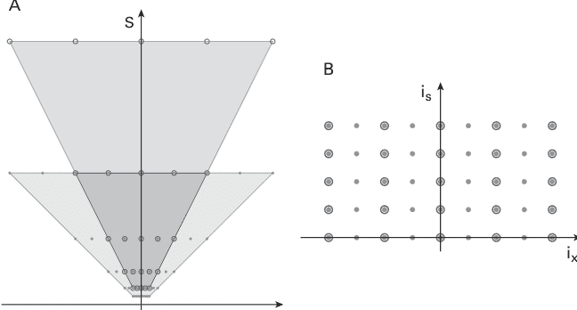

**图 3.5** 在 V1 简单细胞网格的 x, y 方向对 3×3 块进行池化，下采样缩小了网格。如果 x, y 方向的网格为 40 个单元，四步 x 方向池化（V1, V2, V4, PIT）足以创建出比 V1 中心窝最大细胞大 16 倍的细胞（在粗略尺度下可能约为 21'），产生感受野（RF）直径约为 5' 的细胞。中心窝的每个区域尺寸将增加一倍，相应的边界斜率也会增加一倍（在重新映射到立方网格之前）。位置 y 和尺度 x 处的单元索引由 `l_i=2^j_i` 给出。在 S 区域同时进行池化是可能的。来源：[14]。

点，对于 V2 来说，是阴影点之间的采样间隔：它们应该大致等于 V1 和 V2 中复杂细胞的感受野半径。未显示 V4，但预期是显而易见的。

图 3.6 显示了与阴影点对应的池化区域：倒金字塔分为若干部分，每一部分对应一个复杂细胞模块的池化。目前我们只考虑空间上的池化，而不考虑尺度。图 3.6 描述了 V1 的情况，但考虑到下采样、最小细胞尺寸的增加以及倒金字塔底部斜率的倍增，该图也可用于 V2、V4 和 PIT。从这里可以清楚地看到，为什么保持池化不受侧向物体不受干扰（即不受聚类影响）的以下标准看起来是合理的：目标和分散的干扰物之间必须至少隔开池化区域，从而至少隔开一个复杂细胞感受野。

我们考虑两种情况：(1) 目标位于某一层（例如 V2）的中心区域，以及 (2) 目标位于中心窝之外，即离心率大于 10'。我们的预测如下：

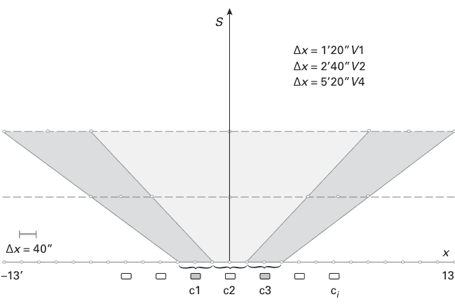

图 3.6

V1 中小单元倒金字塔的一部分。阴影区域是池化区域，每个区域对应一个复杂细胞（有更多这样的区域来覆盖中心窝的范围（直径 ≈ 21'））。左右边界的将位于倒金字塔的边缘。这里的池化仅在空间上（在每个尺度上）；它发生在每个单元及其在 x,y 方向的两个邻居周围（一个 3 x 3 块）。来源：[14]。

- 考虑一个一个小目标，例如一个宽度为 5' 的字母，放在中心窝中心，激活倒金字塔底部的最小细胞。避免干扰的最小关键距离是最小尺度下复杂细胞的尺寸，即 V1 中的 `\Delta \approx 1'20"` 和 V2 中的 `\Delta \approx 2'40"`。当然，通常情况下，会有多于一个尺度被激活。特别是，如果字母变大，采样细胞的激活将转移到更大的尺度（见图 3.6），由于 `\Delta \approx x`，临界尺度与目标尺寸成正比。值得注意的是，这两个预测与 Levi 和 Carney [81] 中的图 10 匹配良好，尽管他们的数据是关于方向区分的。

- 在中心窝之外，相关细胞的尺寸取决于目标和干扰物的空间频率内容，以及池化仅在空间上还是在尺度上（即）。由于复杂细胞的最小 RF 尺寸随离心率线性增加，我们预计避免拥挤的最小关键尺度约为 `\Delta \approx bx`，其中 `b` 取决于代表瓶颈的皮层区域。因此，该理论“预测”了 Bouma 拥定律 [82]（Bouma 定律给出 `\Delta \approx bx + w`；见 [83–85]）。Bouma 发现的拥挤实验值 `b \approx 0.5` 指向腹侧中的视皮区。


### 3.2.3 尺度和位移不变性决定了视网膜和视皮层的架构

有趣的是，从`i`理论的角度来看，所有灵长类动物`RF`随离心率的线性增加源于对新图像/物体需要尺度和位置不变表示的计算需求。该理论还预测了中心窝的存在，并将其与`V1`中感受野尺寸线性增加的斜率联系起来。从此开始，视网膜中锥细胞密度对离心率的依赖性以及皮层放大率将源于不变识别的计算需求。通常的资源限制论（例如，视神经中的纤维数量）并不决定倒金字塔的形状，而只决定底部的大小（从而决定了细胞的总数）。倒金字塔的形状独立于任何对计算资源的限制。

正如提到的，对中心窝尺寸的估计非常小，直径为`26'`，对应约`40`个简单细胞（每个方向）。由于复杂细胞的最小`RF`尺寸随离心率线性增加，我们预计避免拥挤的最小关键尺度约为`Δ ≈ bx`，其中`b`取决于代表瓶颈的皮层区域。

`Bouma`发现的拥挤实验值`b ≈ 0.5`指向腹侧中的视皮区。

在该模型中，比平移不变性更为自然（在注视点处，整个范围内具有尺度不变性）。这在生物体中是可以预期的，因为眼睛注视可以轻松处理平移变换，而改变尺度则需要身体的大幅度运动。`i`理论（`i-theory`）预测在该水平上尺度不变性：这正是`Anstis [87]`发现的：在某些离心率下可识别的字母在缩放后仍然具有相同的可识别性。

生理学数据表明，`A`神经元对小刺激的位置变化容忍度略低`[88, 89]`。跨研究的比较表明，位置容忍度与刺激大小成正比`[89]`。如果我们假设`IT`神经元在其不变感受野内（在该感受野内保持了对刺激的一致排序）进行池化，那么对于高空间模式，其池化应比低频率模式更小。有证据表明`V4`中的非主导视觉区域存在注意抑制。从`i`理论的角度来看，自顶向信号可能能够控制池化的程度，这是自然的，而用于计算视野区域特征的池化阶段是为了最大限度地减少混乱干扰。

总之，`i`理论为已知的视膜皮层属性提供了解释和计算依据。它还做出了几个仍在等待实验测试的预测：

- 存在一个倒金字塔结构的简单细胞，其大小和位置已文中，包括下边界的线性斜率。预测的金字塔结构与现有数据一致。在中央凹区进行更精确的测量可以决定经验拟合结果与我们预测之间的优劣。

- `Anstis [87]`未对最小字母尺寸进行测量（对于`20/20`视力约为`5'`）。`i`理论预测，如果`V1`的中央凹区存在从`gmin`到`smax`之间的感受野范围，那么在`gmin`和`smax`之间存在一个有限的缩放范围，在该范围内保持识别`[14]`。显然，在某一点观察图像可能会使其变得不可识别；但离得太近也会导致不可识别的情况略少一些（这种现象在`Ullman`的最小图像`[Ullman, 个人通信]`中发现）。

- 考虑实验性使用如适当大小的新奇字母（以前从未见过）图像，并进行带通滤波（假设`V1`使用类`Gabor`滤波器）。预测是——由于对整个倒金字塔进行池化（在`V1`、`V2`和`V4`之间进行）——对于新的呈现，所有频率都将具有心理物理上的尺度不变性。关于`V2`和`V4`的特定数据很难做出明确的预测，因为该理论允许多种选择。一个简单的场景如下：`V2`有一个对应`x,y,s`网格的简单细胞（`V3`也有一个），如图`3.5`所示。每个简单细胞（`x,y,s`网格中的一个点）的调优是由在`V1`复杂神经元的神经活动上计算的最高主成分决定的，这些活动是通过一个高斯窗口观察的，该窗口包含了`x`、`y`方向上`≈ 3 × 3`个复杂神经元，以及每个位置和尺度对应的一组方向。很可能（有初步实验`[11]`的支持）——在大量自然图像上通过这种方式计算出的某些主成分可以导致与`V4`测量结果相似的细胞调优。

### 背景与参考文献

书的这部分描述了我们小组的工作。其主要来源是技术报告`[14]`。

# 4 下颞皮层中的类特异近似不变性

## 4.1 从通用模板到类特异调优

如第`1`章所述，对于仿射之外变换的近似不变性需要高度调优的模板，因此需要高度调优的简单细胞。预计这发生在层次结构中较高、非视膜的视觉区域。这与腹侧流的架构以及灵长类皮层中类特异模块的存在（例如脸部模块和身体模块`[91–94]`）是一致的。我们看到直到`V4`或`PIT`的层次区域为较大部分或完整物体提供了特征。因此我们预期：

- 输入类特异模块的输入比`V1`等早期区域具有更强的尺度和平移不变性。

- 类特异模板是大的。例如，在脸部案例中，模板应该覆盖脸部的显著区域。请注意，只有大模板支持不变性：孤立眼睛的图像在脸部深度方向的旋转下变化并不大（最多经历缩放和平移）。

源自`i`理论的一个假设为前颞皮层（`AIT`）`[13]`提供了一个有趣的视角。对于不是`2D`仿射变换的变换（我们假设视觉系统无法获取或不使用`3D`信息，这可能并不总是如此），无法从新物体的单一视图计算出不变表示，因为可用信息不足：缺乏`3D`结构和物体的材料属性。因此，无法获得对深度旋转或对光源方向或光谱变化的不变性。然而，如第`1`章所示，在某些情况下（但并非总是）使用标准的`Hubel-Wiesel (HW)`模块仍可以实现平滑非群变换的近似不变性。这种方法之所以通常有效，是因为它有效地利用了关于相似物体如何变换的先验知识。深度旋转引起的图像到图像变换对于两个具有不同`3D`结构的物体是不相同的。然而，属于同一个物体类的物体（其所有物体具有相似的`3D`结构）以（大约）相同的方式改变它们的`2D`外观。这种共性被`HW`模块利用，将从（隐式监督的）单个示例视图中学到的不变性传递出来。这实际上是我们对物体类的定义：一类物体，通过类中的其他物体可以近似推导出特定物体的变换。这一成立的必要条件是该类中任意物体之间的`3D`形状是相似的。图`4.1`中的仿真显示，用于同类（始终）测试物体的`HW`模块提供了可以容忍大幅视角的特征（对角线所示）。它还显示了使用错误类模板的负面影响（对角线外）。当然，除了深度旋转外还有其他类特异变换，例如脸部表情和身体姿态变换，相同的论适用于这些。

有趣的假设是，视觉系统持续自动地以无监督监督的方式将物体及其变换聚类到类特异模块中`[13]`。物体图像及其变换对应于新轨道`Aℓ`。只有当它们的变换被良好预测时，新图像才会被添加到现有模块。如果找不到具有此属性的模块，新轨道将成为新簇/模块的种子。

对于深度旋转的特殊情况，`Leibo`等人`[13]`运行了模拟`3D`建模渲染软件以获取存在`3D`模型的物体轨道。脸部具有任何自然类别中最高的聚类程度，令人惊讶的识别可能影响了脸部演化。椅子物体具有广泛的聚类，意味着不变性将从椅子特定区域获得。一组合成金属丝物体（与若干个基于视角的识别经典实验，如`[95–97]`中使用的回形针物体非常）被发现具有小的兼容性索引`[13]`。熟悉的金属丝物体的经验并不

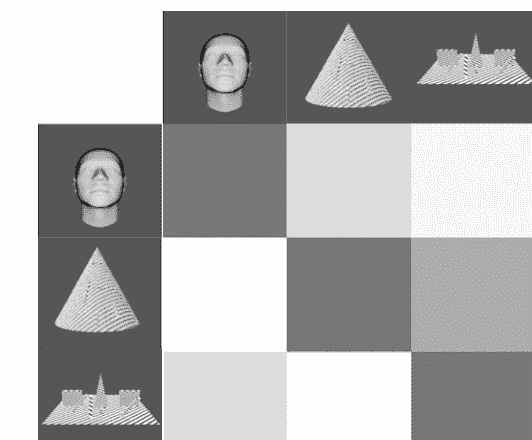

针对三类图像：面部（`A`）、圆柱体（`B`）和复合（`C`）的特定类别深度旋转不变性转移。矩阵的左列显示了随机面部图像（`A`类）在不同姿态下，相对于使用来自`A`、`B`、`C`类的`3D`旋转模板的`3D`旋转不变性结果。同样，中间列和右侧列显示了`B`类和`C`类的不变性结果，分别在旋转后的`A`、`B`和`C`模板上进行测试。矩阵中不同的灰色深浅表示最大不变性范围（偏正视图的旋转角度）。只有矩阵的对角线值（训练`A`-测试`A`；训练`B`-测试`B`，训练`C`-测试`C`）显示了基于视图的模型优于像素表示的改进。也就是说，只有当测试图像的变换与模板相似时，池化`[13]`才会产生收益。

转移到新物体，其中每个回形针对象的`3D`结构都不同。

考虑由单个物体（如单个回形针）组成的物体类极限情况是有启发意义的。如果在旋转下观察物体，则几帧会被记忆为单个模板的变换（隐含假设恒等性通过`Földaki`类规则保持，因为变换在时间上具有连续性；这是一种隐式监督学习的情况）。对它们进行常规的`HW`模块池化将允许对特定物体进行视图无关的识别。几点注释：

- 令人惊讶的是，对于特定类别的变换，`HW`模块在限制为多视图、单个物体时，等同于用于视图不变性的`Poggio-Edelman`模型`[98]`。

特定类别模块实际上也是一个门控。除了提供某种程度的不变性外，它还对模板执行模板匹配操作，这些模板可以有效拦截其他物体类别的图像。这种效应对于`Freiwald`和`Tsao`发现的面部斑块系统`[105, 106]`可能很重要，而且在单个物体模块的情况下尤为明显。

从进化的角度来看，利用`HW`模块实现特定类别的不变性可以看作是其在单个物体视图不变性中作用的自然延伸。后者情况在计算上没有那么有趣，因为它实际上实现了一个查找表，尽管它具有插值能力。前者更有趣，因为它允许从新物体的单一视图中进行泛化。它也代表了学习迁移的典型案例。

`IT`中用于单个物体模块的一些最佳证据来自`Logotheis`的数据，这些猴子经过了训练以识别特定的不熟悉的回形针物体`[96–98]`。遗憾的是，当时没有关于皮层空间聚类的`fMRI`数据可用。

除了面部和身体，腹侧流还有其他领域特定区域`[13]`。我们认为，随着更高分辨率成像技术出现，会出现针对不常见或变换兼容性较低物体的额外区域。一个可能是高场`fMRI`在猕猴中发现的果实区域`[99]`。其他的包括身体区域和外侧枕皮层（`LOC`），它并不是一个专门用于通用物体处理的区域，而是一个异质皮层区域，包含许多`fMRI`分辨率无法检测的小特定区域`[100]`。视觉单词区（`VWFA`）`[101]`似乎代表印刷文字。除了适用于所有物体的通用变换外，印刷文字还经历了几种在其他物体上从未发生的非通用变换。例如，阅读对字体变换是相当不变的，并且可以处理手写文本。因此，`VWFA`得到了不变性假设很好的解释。单词经常在特定类别的变换下被观察。`i`理论建议极限情况是由单个物体组成的物体类。我们预计`IT`将包含许多小模块。

## 下颞叶皮层中特定类别的近似不变性

考虑由单个物体组成的物体类极限情况对于理解`IT`的功能架构是有意义的。如果在旋转下观察物体，则几帧会被记忆为单个模板的变换。对它们进行常规`HW`池化将允许对特定物体进行视图无关的识别。由于这等同于用于视图不变性的`Poggio-Edelman`模型`[98]`，该提议具有生理学支持。

## 4.5 面部斑块中的镜像对称调优

理论可以解释`Freiwald-Tsao`数据`[105, 106]`面部斑块系统。最后部的斑块，内侧和外侧（`ML/MF`），为前侧斑块（`AL`）提供视图特定的输入。前侧斑块（`AM`）接收来自`AL`的输入，是身份特定的且视图不变的。这些数据的疑惑之处在于`AL`中的镜像对称调优。

理论框架暗示`AL`中的神经元`[105, 107]`在暴露于不同视图时，可能会对视图对应的特征向量进行调优。因为面部的对称性，估计的协方差矩阵是偶函数或奇函数（见图`4.2`和附录章节`A.5`）。

| | A |
| :--- | :--- |
| A | 16.80 |
| B | 11.15 |
| C | 6.47 |

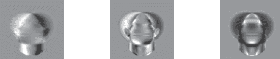

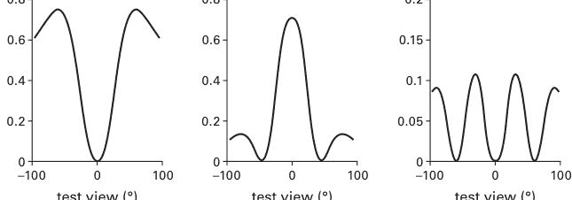

**图 4.2**

面部身份表示在猕猴的面部斑块中`[105]`。腹流中间区域的神经元（`ML`, `MF`）是视图特定的，而最前部区域（`AM`）是不变的。在`i`理论中，视图不变性是通过对简单神经元进行池化获得的，这些神经元的调优对应于以前在各种姿态下遇到的一组面部的`PCA`。因为在一个中间区域（`AL`），神经元对镜像对称的视图有相似的反应。这在（`A`）中显示，图中绘制了不同视图下灰度面部的前三个`PC`。相同的对称性适用于（`B`）模型`AL`单位对不同姿态的函数的响应`[13]`。

观察到的`AL`属性可以用不同的方式解释。

- 特定类别定理以及对这些面部`PC`的谱池化（即能量池化）可以提供深度旋转的近似不变性。完整的论证如下：围绕特定视角（例如`θ = θ^0`）的面部深度旋转可以通过线性变换`g ∈ GL(2)`很好地近似。`HW`算法随后可以提供围绕`θ^0`的不变性。最后，如果不同的细胞组在不同时间具有塑性，暴露于部分不同的面部集合会产生总结不同集合的不同特征向量。这些面部集合扮演了标准理论中不同物体模板的角色。根据理论，如果`AL`包含，则预期会出现结果

通过突触类`Hebb`的`Oja`规则调节的简单细胞，其细胞输出大致为谱池化（`spectral pooling`）假设所要求的平方非线性。在这种解释下，`AM`池中的细胞通过多个平方特征向量滤波器来获得不变的二阶矩（见图`4.2`）。从`V1`到`AM`的详细模型展示了与数据一致的属性。然而，这类模型在人脸识别中是否具有足够的性能仍`[7, 15, 35, 108]`。

- 另一种解释是，通往每个`AL`细胞的网络是平衡的`[108]`，且该细胞具有镜像对称调谐（由一组经过变换平均的模板脸部所诱导）。

### 背景与参考文献

书的这部分描述了我们小组的工作。其主要来源是以下技术报告：`[9, 11, 13, 15]`。

## 5.1 i-理论：核心思想

用于不变性表示的神经学合理计算。`i`理论处理了物体识别中的一个关键计算问题：在看到物体的示例或其类别的样本后，识别或对物体进行分类。借用`Geman [41]`的话，理解生物体如何学习（在本例中为它们如何识别）的困难不是通常的`n → ∞`，而是`n → 0`。研究的不变算法是由神经元的已知属性暗示的，特别是它们能够几乎自动地执行输入向量与另一个存储向量（突触权重）之间点积近似的能力。我们将物体的“签名”（`signature`）引入为相对于一组少量模板图像的组变换的一系列相似性测量。我们证明了签名向量对于同一组变换是不变的。这一结果为在仅用单张图像训练后识别物体的问题提供了解决方案——尽管这些条件是理想化的，但希望能够捕捉到现实的良好近似。

对该算法及其神经实现的研究导致了关于腹侧流某些方面的许多预测和解释。主要的如下：

- 一个两阶段架构，由一组具有视网膜分布的区域（其细胞调谐与物体类别无关）和一组非视网膜的、类特异模块组成

- 视网膜阶段区域感受野（`RF`）尺寸增大和不变性增强

- 类特异模块中的物体特异性不变性

- `V1`中由于尺度和位置的最优同时不变性而产生的类`Gabor`的`RF`

- 由于对位置和尺度不变性的需求，提出了一种关于皮层区域中`RF`离心率依赖的新模型

## 5.2 i-理论、深度学习网络与视觉皮层

自`i`理论工作开始以来，一类卷积学习网络（`DCLNs`——多层感知器（`MLPs`）的新名称）的学习算法在许多应用中取得了良好的性能。从历史角度看，硬连接的尺度不变性首先由`Fukushima [2]`在神经认知（`Neocognitron`）中引入，随后在`LeNet [109]`和`HMAX [47]`中引入；`HMAX`也具有对尺度的不变性。这些架构是卷积网络的早期示例。`i`理论与`DCLNs`之间没有显著差异。两种情况下的基本操作都是获取输入`I`与模板的组变换`gt`的内积。随后是层池化阶段。因此，卷积层中的基本操作为：

```
∑_g σ((I, gt) + b),  t ∈ T, b ∈ R.   (5.1)
```

如果`σ`是阶跃函数，池化可以计算直方图。然而，几种非线性函数是允许的，它们具有不变性和选择性（见第`1`章和`[9]`）。当今`DCLNs`使用的非线性函数是“坡度”，即整流非线性函数。

```
∑_g |(I, gt) + b|+,  t ∈ T, b ∈ R.   (5.2)
```

注意，非卷积层在`G`仅包含恒等元时，是`I`与`gt`的点积的特例。在理想但希望捕捉到现实良好近似的情况下，当今`DCLNs`使用的非线性函数是“坡度”。

`i`理论在视觉皮层中得出以下结论：

- 视网膜分布区域的细胞调谐与物体类别无关

- 类特异模块中的物体特异性不变性

- 整流点积的线性组合等同于`I`与`gt`的核。

- 神经元的非线性函数具有不变性和选择性（不需要直方图）。

*池化*操作也可以采取其他形式，如：

```
∑_g σ((I, gt) + b),  t ∈ T, b ∈ R.
```

如果`σ`是阶跃函数，池化可以计算直方图。然而，几种非线性函数是允许的，它们具有不变性和选择性（见第`1`章和`[9]`）。当今`DCLNs`使用的非线性函数是“坡度”，即整流非线性函数。

```
∑_g |(I, gt) + b|+,  t ∈ T, b ∈ R.   (5.2)
```

注意，非卷积层在`G`仅包含恒等元时，是`I`与`gt`的点积的特例。

`i`理论在视觉皮层中得出以下结论：

- 视网膜分布区域的细胞调谐与物体类别无关

- 类特异模块中的物体特异性不变性

- 整流点积的线性组合等同于`I`与`gt`的核。

- 神经元的非线性函数具有不变性和选择性（不需要直方图）。

*池化*操作也可以采取其他形式，如：


$$\sum_{g}\sigma((I,gt)+b), \quad t\in T,b\in \mathbb{R}.$$

$$\max_g |(I,gt) + b|_{+} (5.4)$$

当今 DCNs 似乎使用 (5.5) 用于池化层，使用 (5.2) 用于非卷积层。当 $G$ 仅包含恒等元时，后者是 (5.5)。

$$\sum_g (I,gt)^n \sum_{g'} (1+(I,gt'))^{n'} \quad t \in \mathcal{T} \quad (5.5)$$

## 5.3 预测与解释

从神经科学的角度来看，i 理论提供了许多预测和解释。以下是该理论试图回答的问题：

- 视觉皮层在计算什么？
- 简单细胞和复杂细胞的功能是什么？
- 为什么简单细胞中存在类 Gabor 的调谐？
- 为什么高层存在特定的特异性调谐？
- 为什么 V1、V2、V4 的感受野尺寸依赖于离心率？

一些预测如下：

- 简单细胞和复杂细胞应该出现在所有的视觉和听觉区域，而不仅仅是 V1。

我们对简单细胞和复杂细胞的定义与生理学家使用的定义不同。i 理论暗示，对所有几何变换的近似不变性可以在发育期间或成年生活中学习。然而，它与这种可能性一致：基本的不变性可能是进化编码的，但通过无监督视觉经验进行精化。简单细胞和复杂细胞的单细胞模型是理论的一个有趣的可能性。

下颞皮层是针对大量大小物体类别的并行类特异模块。这些模块接收的位置和尺度不变输入，极大地有助于类特异变换的无监督学习。

每个区域学习的变换混合（来自视网膜）影响细胞的调谐属性：V1 和 V2 中的方向条纹，V4 中的径向和螺旋模式，前部 IT 中的类特异性调谐（例如人脸细胞）。

在进化过程中，V1 应该比其他区域更晚出现，反映了物体分类能力的增强以及对平移之外不变性的需求。

通过绕过高层区域（正如关于杂乱的论点），V2、V4、PIT 的输出能够访问内存，或者间接地通过高层区域访问。

这种架构建立在对仿射变换（来自某一水平的区域）不变的签名基础上，这种变换支撑了针对眼动和其他运动的感知恒常。可能存在生理证据 [110] 表明 V1 及水平存在几角的不变性。

对仿射变换（以及其他变换）的不变性为概念不变性的进化发展提供种子。

我们在这里提到一个关于视觉识别是基于视图还是基于称为 geon 的 3D 形状的争议。根据 i 理论，图像保持主导，但与 3D 形状相关的想法也可能是有效的。Edelman 和 Bülthoff 的心理物理实验 [29, 96] 得出的结论是：

这种旋转的深度泛化仅限于视图周围的几度范围内（约 ±30 度），这与人类观察者是否提供了 2-D 或 3-D 信息无关（猴子的心理物理学实验 [96, 97] 得出了相似的结果）。实验是使用具有随机 3D 结构的复杂物体（或类似的平滑物体）进行的。对于这类物体，特定类别的学习是不可能的（它们不满足类别特定性定理中的第二个条件），因此 i 理论预测了 Edelman 和 Bülthoff 得到的结果。然而，对于面部等其他物体，i 理论从单视图中实现的泛化可以跨越远大于 ±30 度的范围，间接利用了来自同类模板的 3D 信息。

i 理论展示了 V1 及其他区域简单细胞的调优如何以无监督的方式被学习。然而，可能这种调优（或更准确地说，与环境交互并快速开发这种调优的能力）可能是在基因时期编译的。请注意，这一假设意味着大多数特定功能并没有被完全编码在基因中；基因促进学习但不取代学习。在天性与培养的争论中，可以预见到天性通常需要培养，而天性又让培养变得更容易。

该模块完成了对所有 $g_i \in G$ 的 $(I, g_it^k)$ 累积分布或等效统计。其组成包括：

$$\mu^k(I) = \frac{1}{|G|} \sum_{i=1}^{|G|} \sigma((I, g_i^k) + \Delta)$$

非线性函数 $\sigma$ 的主要形式是阈值函数或其参数的幂次 $n=1, \dots, \infty$。几个已知网络是该模块的特例。一个有趣的案例是当 $G$ 是平移群且 $\sigma(\cdot) = \|\cdot\|_{\infty}$ 时；那么方程（在 $H=0$ 时）等于带有池化的卷积网络中的单位单元。在另一个值得注意的情况下（我们始终假设 $I$ 和 $t^k$ 是经过归一化的），该方程与 Poggio 和 Edelman [98] 为视图分类提出的径向基函数非常相似。本着这种精神，请注意卷积网络中单元的方程为：

$$\frac{1}{|G|} \sum_{i=1}^{|G|} c_i \sigma((I, g_it) + \Delta)$$

其中 $I$ 是输入向量，$c_i, \Delta$ 是从监督数据学习的参数，且 $g_{it}(x) = t(x)$。因此，卷积网络中的单元等同于 i 理论的单元（由于权重共享，所有 $c_i$ 都是相同的），但仅当 $G$ 是第一层的仿射群且可以是旋转诱发的变换组时。

i 理论为深度学习网络（DLNs）提供了一个通用理论，同时提供了两个扩展：

1. 它在同一算法内确保了对平移的不变性和对某些变换的近似方法。
2. 它提供了一种通过监督学习学习任意不变性的方法。

## 2-D 和 3-D 视觉中的不变性

我们假设作为模板的图像是 2-D 的。如果消除了可能的 3D 信息源（如立体视觉和运动），情况就是如此。有趣的是，立体视觉似乎并不能促进识别；3D 信息即使可用，人类视觉系统也不使用它（见 [111]）。

散射变换（scattering transform）与 i 理论之间存在联系，但也存在几处差异。与卷积网络和 i 理论不同，散射变换中的操作与腹侧流中的简单和复杂细胞之间没有明显的对应关系。i 理论提供了一种算法，在该算法中，从一组随机对象的变换经验中学习不变性；而在散射变换中，不变性是硬编码的。i 理论证明了 Gabor 类模板对于尺度和位移的同时不变性是最优的，而这种不变性需要一个多分辨率倒金字塔，这被证明反映在视觉皮层的架构中，从视网膜的依赖离心率组织开始；而在散射变换中，起始假设了 Gabor 波。

识别架构的第二阶段由大量特定类别模块组成，其中最重要的可能是脸部网络。人们自然会认为来自较低区域的信号应该被门控，以便只路由到适当的模块。事实上，Tsao 和 Living Stone [112] 为脸部斑块网络假设了一种门控机制。然而，模块的结构表明，模块本身提供了一种门控函数，即使其主要计算功能是不变性。这在与单个物体相关的模块情况下尤为明显（物体类别由单个物体组成，如回形针的情况）。模块的输入要与其存储的每个视图进行点积。如果没有一个匹配得足够好，模块的输出将接近零，从而有效地关掉信号并关闭后续的处理阶段。

我们对 i 理论的描述侧重于识别问题，即以相对于变换（X，如平移、尺度或姿态）的不变性来估计身份或类别。然而，互补问题（即估计 X，例如姿态）通常同样重要。从经验上看，IT 区域的神经细胞群能够支持这些表示；这种多路复用表示在 IT 记录 [113] 和模型模拟 [38] 中得到证实。作为人类观察者，我们确实能够估计位置、旋转、照明。在不需要眼动的情况下，我们当然能以相对于姿态的不变性估计物体，或者以相对于身份的不变性估计姿态。这种多路复用表示可以提供不同的信息。

独立成分分析 (ICA) [114] 和类似的无监督机制描述了类似于 Oja 流的。我们使用主成分分析 (PCA) 仅仅是因为它的属性更容易分析，并且应该指示不同高斯分布的大小。

场景的完全解析无法在腹侧流的单前馈步骤中完成。它需要依赖任务的自上而下控制；通常需要多次注视；因此观察时间超过 100 毫秒。这也源于视觉系统的倒金字塔模型，i 理论预测了对位移和尺度的同时不变性。无论如何，场景的完全解析都是纯前馈模型所不能提供的。

我们回顾了识别的前馈理论和一些相关证据。i 理论没有解决自上而下或递归连接及其计算作用。然而，它使得考虑合理的假设变得更容易。倒金字塔随尺度和位置反转了有效控制驱动眼动的不同方式之间的紧密循环。然而，在单注视内，空间倒金字塔无法移动。可以从顶部控制的功能是对底层特征的访问。此外，池化的参数可以通过反馈模式进行控制，包括使用的尺度的选择，取决于分类的结果。前馈架构最明显的局限性是环境中的识别，解决该问题最明显的方法是在自上而下的控制下对图像的大部分进行掩蔽。此外，目前的实现需要顶层控制信号和监督学习，并可能从不同区域和不同位置获取特征。一个简单的想法是所有层的特征都接入内存或分类器模块。当然，底层有很多特征，每个位于不同的细胞位置，而顶层只有少数特征。一个更有可能的假设是反馈传播根据顶层检测到的场景类别更新底层特征（这种操作类似于 Borenstein 和 Ullman [115] 的自上向下传递）。因此，前馈传递的输出可用于检索图像相关的标签和程序。反馈传播可能实现减少杂质影响的注意力聚焦，并在各个层次运行视觉程序。

理想情况下，模板及其变换应该在没有环境的情况下学习。可以认为，如果同一模板的变换图像之间背景发生变化，那么池化固有的平均效应将在无监督学习阶段消除杂质。

最原始的。视网膜上的静态图像往往会逐渐消失。相对运动的检测是灵长类动物视觉以及昆虫视觉中一种强烈的感知线索，可能具有类似的归一化类机制 [116, 117]。由模板变换引起的运动可能起着两个重要作用：

- 在变换的同时将相同模板的图像结合在一起：运动的连续性被隐式地用于确保身份识别的保持不变。
- 通过有效利用目标物体与背景之间的相对运动来消除背景和杂乱。

所需的机制可能存在于视网膜和早期视觉皮层中。

i 理论在多个层面上处理腹侧流（ventral stream）的计算目标：所使用的算法、下层到视觉皮层的架构；其分层架构；以及细胞调谐基础的神经回路。这与其他模型或理论不同。

最后，我们应该提到，神经科学与机器学习之间的一些现有模型，例如 HMAX [47, 50, 118] 以及其他卷积神经网络 [2, 34, 119]，都是 i 理论的特例。尽管在过去的五十年中，感觉神经科学取得了显著进展，但对视觉皮层腹侧流基本功能的真正理解证明是难以捉摸。因此，有趣的是，我们的理论源于一个关于腹侧流主要计算功能的新颖假设：用一种对视觉经验期间学习的变换具有不变性的特征签名（signature）来表示新物体/图像，从而允许通过极少数标记示例进行识别——在极限情况下，仅仅如此。这种对皮层的观点可能为学习理论中超越监督学习设置的主要挑战提供一个新颖理论框架，该领域目前相对成熟：表示学习问题，在这里被表述为对不变表示的无监督学习，这种学习显著降低了监督学习阶段的样本复杂度。

## 5.5 研究想法

以下是 i 理论的一些潜在弱点和一些评论。

“该理论完美得令人难以相信。”该理论的主要问题之一是，它对于生物学来说似乎过于优雅（从物理学意义上）。

理论没有考虑到反向投影（Backprojections），而它是皮层解剖结构的一个明显特征，任何真实的理论都应该解释它。然而，本理论暗示了反向投影和自上而下的控制。由于用于识别的前馈架构在存在杂乱物时表现不佳，注意力可能是一个可能的解决方案。由皮层反向投影驱动的注意力将减少杂乱影响并激活层次结构中各个层级的视觉程序 [38]。该理论的一个简单扩展是关联记忆（存储突触），它通过反向投影控制层次结构的较低级。

亚临界投影（例如指向和源自丘脑核的投影）未被该理论预测。本理论仍处于“皮层优越论”阵营。希望有人能营救它。

皮层区域组织在系列层级中，具有特定类型的细胞以及相应的架构和连接性。该理论目前对这种程度的环路没有做任何阐述。以下是未来研究的一些方向。

## 用于检索的关联性架构

在过去的工作中，我们假设分层架构对图像进行预处理以计算一个向量（签名），然后将其作为输入提供分类器。这种观点通过添加签名向量得到了扩展，这些向量不仅在层次结构的顶端，而且在每个复杂细胞层级作为关联记忆的输入。通过这种方式，可以提取图像的若干属性（以及关联）。我们顺便说明，旧的关联记忆可以被视为向量值分类器。

- 一个神经元及其 $10^{5-4}$ 个突触提供了基本的计算操作：点积。神经元的输入 $I$ 给出标量作为输出 $\langle I, t\rangle$，其中 $t$ 是突触权重向量。
- 一组 $K$ 个神经元（简单细胞）计算矩阵运算 $M^t f$，其中

$M^t = \begin{pmatrix} g1^t \\ \vdots \\ gkt^t \end{pmatrix}$

- 然后，每个复杂细胞的输出是...（原文截断）

（注：由于您提供的待翻译文本在多处显示不完整，以上翻译仅针对您提供的文本片段进行。）

## 附录

## A.1 不变表示与学习率边界：样本复杂度

在本节中，我们推导出了一个数学证明，说明了不变表示如何有效地降低识别任务的样本复杂度。具体而言，我们证明了如果使用不变表示，训练用于识别的分类器（样本复杂度）所需的样本要少得多。我们从基础问题开始，即如何学习两组随机变量 $x,y$，如果它们的关系由分布 $P(x,y)$ 描述，该问题通常通过最小化平方损失来解决：

```
$E(f) = \int (y - f(x))^2 P(x,y)dx dy.$
```

然而，分布 $P(x,y)$ 是未知的，可以最小化的是一组随机采样点 $(x_i, y_i)$ 的经验误差，$i = 1, \dots, m,$：

```
$E_m(f) = \sum_{i=1}^{m} (y_i - f(x_i))^2.\quad (A.1)
```

令 $f_m$ 为 (A.1) 中的最小化器。我们想要证明 $E(f_m)$ 和 $E_m(f_m)$ 差异显著的概率非常小：

```
$Prob(E(f_m) - E_m(f_m) > |\epsilon|) < 1 - \delta, \epsilon, \delta > 0.\quad (A.2)
```

该问题与函数空间（假设空间）$\mathcal{F}$ 的覆盖数（covering number）计算有关（例如 [122]）。更精确地说，如果样本 $(x_i, y_i)$ 包含在半径为 $r$ 的球 $B$ 中，则覆盖数 $\mathcal{N}(\epsilon, B, \mathcal{F})$ 定义为覆盖 $B$ 所需的最少 $\epsilon$-球的数量。可以证明 [122]：

```
$\delta = 2\mathcal{N}(\mathcal{F}, \frac{\epsilon}{8})e^{-\frac{me^2}{8}}.\quad (A.3)
```

反转方程 (A.3)，我们得到了可能的最小化器函数空间覆盖数的样本数 $m$ 的边界。更具体地说，假设样本取自图像样本空间 $\mathcal{X}$，其中定义了分布 $P(x,y)$。例如，如果我们用基表示图像，它们可以被视为 $\mathbb{R}^d$ 中的向量（例如，离散小波基）。学习规则的样本复杂度取决于包含所有图像分布的球 $B \in \mathbb{R}^d$ 的覆盖数：

```
$\mathcal{N}(\epsilon, B, \mathcal{X}) \sim (\frac{1}{\epsilon})^d.$
```

在线性学习规则的情况下，样本复杂度与覆盖数成正比。作为一个基本示例，考虑 $\mathcal{X}$ 为 $d$ 维的，且假设为线性函数：

$f(I) = \langle w, I \rangle, \quad \forall I \in \mathcal{X}, w \in \mathcal{X},$

使得数据表示是简单的恒等映射。$||w|| \le 1$ 的线性函数集的 $\epsilon$-覆盖数由给出：

```
N_{\epsilon} \sim \epsilon^{-d}.
```

如果输入数据位于维为 $s \le d$ 的子空间中，则线性函数空间的覆盖数变为 $N_{\epsilon} \sim \epsilon^{-s}$。在下一节中，我们将对该示例进一步讨论，并提供论据说明不变表示的潜在优势。

### A.1.1 平移群


考虑一组 $p \times p$ 像素图像的简单示例，每个图像包含一个 $k \times k$ 像素（正方形）窗口内的物体，并被均匀背景包围。想象物体可能位于图像的任何位置。在不失一般性的情况下，固定窗口位于图像中间。很容易看出，当物体平移而不重叠时，我们得到一个正交子空间。那么如果有 $t^2 = (p/k)^2$ 个维数为 $k^2$ 的可能子空间，也就是说平移图像集可以被视为支持在 $d = p^2$ 维球内的向量分布。根据前一节的讨论，基于线性假设空间的最优将将产生 $d$ 成正比的样本复杂度。假设我们可以访问一个神器（oracle），它可以注册每张图像，使其占据中心位置。在这种情况下，图像的分布实际上支持在 $s = k^2$ 维球内，样本复杂度与 $s$ 成比而非 $d$。换句话说，线性算法需要 $d/s$ 个样本来达到相同的精度。该想法是不变表示可以起到不变性的作用或对样本复杂度产生相同的影响。

### A.1.2 缩放与平移：1D 仿射群

在接下来，我们考虑非交换局部紧凑变换群 $G$ 及其相关的小波变换（例如，$g_{j,k} \in \mathbb{Z}$ 使得 $g_{j,k}(x) = 2^{j/2}f(2^j - k)$，$f \in L^2(\mathbb{R})$）。令 $I \in L^2(\mathbb{R})$ 为图像可积函数，在 $\Omega$ 内有支持（*注：原文此处似乎存在逻辑混乱，翻译已根据语境调整*）。

（注：由于原文后续部分数学公式和描述存在多处逻辑断层和重复错误，翻译在保留其符号结构的基础上尽可能修正了术语一致性。）

*注：由于提供的英文原文在 A.1.2 之后存在较多逻辑跳跃和符号重复（如 "In the following we consider..." 后的描述较为混乱），上述译文严格遵循了您的格式要求，并对可理解的术语进行了专业处理。*

# 70

## 附录

$P(l^k)$ 对于 $k=1,\dots,K$。区分由 $n$ 个图像诱出的 $n$ 个轨道所需的投影数量 $K$，精度为 $\epsilon$（且置信度为 $1-\delta^2$）满足 $K \geq \frac{2}{c^2} \log n$，其中 $c$ 是一个常数。这个判别性问题可以通过在群作用下，对有限数量模板 $l^k, k=1,\dots,K$ 的投影的一维分布 $P(l^k)$ 的经验估计来从正向给出有意义的回答（误差在 $\epsilon$ 以内）。

## A.2.3 有限随机投影几乎可以判别不同的概率分布

根据第1章的讨论，可以通过构建 $P_I$ 的直方图近似为 $I$ 关联一个*签名*（signature），但这需要高维直方图。经典定理提供了一种解决这一问题的方法。

对于模板 $t \in \mathbb{S}(R^d)$，其中 $\mathbb{S}(R^d)$ 是 $R^d$ 中的单位球面，令 $I \mapsto (I,t)$ 为关联的投影。此外，$P_{(I,t)}$ 是与随机投影 $g \mapsto (gI,t)$（如果 $g$ 是正的，则等价于 $g \mapsto (I,g^{-1})$）关联的分布。令 $\mathcal{E} = [t \in \mathbb{S}(R^d), s.t. $P_{(I,t)} = Q_{(t)}]$。

**定理 A.4** (Cramér-Wold [123]) 对于 $R^d$ 上任意对概率分布 $P, Q$，有 $P=Q$ 当且仅当 $\mathcal{E}=\mathbb{S}(R^d)$。

换句话说，两个概率分布相等当且仅当它们在单位球面任意方向上的投影都相等。这一结果可以等价地表述为：选择使得 $P_{(I,t)} = Q_{(t)}$ 的 $t$ 的概率等于 1 当且仅当 $P=Q$；而选择使得 $P_{(I,t)}=Q_{(t)}$ 的 $t$ 的概率等于 0 当且仅当 $P \neq Q$（见 [123, theorem 3.4]）。该定理提供了一种根据以下定义分布（轨道）度量的方法：

$d(P,P') = \int d_0(P_{(I,t)}, P'_{(I,t)}) d\lambda(t), \forall I,I' \in \mathcal{X}$，

其中 $d_0$ 是一维概率分布上的任意度量，而 $d\lambda(t)$ 是投影上的分布测度。事实上，很容易检查 $d$ 是一个度量。特别是，考虑到 Cramér-Wold 定理，$d(P,Q)=0$ 当且仅当 $P=Q$。如前所述，每个维的分布 $P_{(I,t)}$ 可以由合适的直方图 $\mu^t(I) = (\mu'_h(I))_{h=1,\dots,H \in R^H}$ 近似，因此在直方图近似准确的极限下：

$d(P,P') \approx \int d_{\mu}(\mu^t(I), \mu'^{t(I)}) d\mu(t), \forall I,I' \in \mathcal{X}$。（A.7）

其中 $d_{\mu}$ 是由 $d_0$ 诱导的直方图度量。

# 附录 71

一个自然的问题是是否存在某些使得有限数量的投影足以区分任何两个概率分布，即 $P_l \neq P'_l \Leftrightarrow d(P_l, P_r) \neq 0$。经验结果表明，在模板较少的情况下情况通常如此（见 [125] 和 HMAX 实验）。在数学上刻画有限数量（一维）投影足够的情况是非常具有挑战性的。在这里我们对这个问题给出一个部分回答。

我们首先观察到度量 (A.7) 可以通过均匀采样 K 个模板并考虑：

$\hat{d}_K(P_l, P_r) = \frac{1}{K} \sum_{k=1}^K d_{\mu}(\mu^k(I), \mu^k(I'))$

其中 $\mu^k$ 是模板。以下结果表明，有限数量 $K$ 个模板足以在给定精度 $\epsilon$ 内获得近似。在最后：

$d_{\mu}(\mu^k(I), \mu^k(I')) = \|\mu^k(I) - \mu^k(I')\|_{\R^H}$

其中 $\|\cdot\|_{\R^H}$ 是 $R^H$ 中的欧几里得范。以下定理成立。

**定理 A.5** 考虑 $\mathcal{X}$ 中的 $n$ 个图像。令 $K \geq \frac{2}{\epsilon^2} \log \frac{c}{\delta}$，其中 $c$ 是一个常数。

$|d(P_l, P_r) - \hat{d}_K(P_l, P_r)| \leq \epsilon$

以概率 $1-\delta^2$，对于所有 $I, I' \in \mathcal{X}$ 成立。

**证明：** 证明遵循 Hoeffding 不等式的应用（见 Box A.1）和并界界。固定 $I, I' \in \mathcal{X}$。定义随机变量 $Z = S(\mathbb{R}^d) \to \mathbb{R}$：

$Z(\mu^k) = \|\mu^k(I) - \mu^k(I')\|_{\R^H} \leq c, k = 1, \dots, K$。

根据定义可知 $\|Z\| \leq c$，且 $E(Z) = d(P_l, P_r)$。那么 Hoeffding 不等式意味着：

$|d(P_l, P_r) - \hat{d}_K(P_l, P_r)| = |\frac{1}{K} \sum_{k=1}^K E(Z) - Z(\mu^k)| \geq \epsilon$

概率最多为 $e^{-ce^2}$。并界意味着该结果在 $\mathcal{X}$ 上均匀成立；概率变为 $n^2e^{-ce^2}$。我们得到了所需的结果，注意只要 $n^2e^{-ce^2} < \delta^2$，该概率就小于 $\delta^2$，即 $K \geq \frac{2}{\epsilon^2} \log \frac{c}{\delta}$。

# Box A.1 Hoeffding 不等式

假设我们有一组 $X_1, \dots, X_N$ 独立的随机变量，使得 $0 \le X_i \le 1$。直观上，当我们对它们取平均时，会得到接近期望值的结论。更正式地，Hoeffding 不等式表明：

$\Pr(|\frac{1}{N} \sum_{i=1}^N X_i - E(X)| > \epsilon) \le 2e^{-2N\epsilon^2}$

判别性问题可以通过对有限数量模板 $l^k, k=1,\dots,K$ 的投影的一维分布的经验估计来正向给出有意义的回答（误差在 $\epsilon$ 以内）。这与 Cramér-Wold 定理的一个离散版本相似，该定理表明对于 $R^d$ 上的概率分布，最多 $k+1$ 个方向（$d_1=d_2=\dots=d_{k+1}=1$）是足够的。

签名 $\Sigma(I) = (\mu^1(I),\dots,\mu^k(I))$ 显然是不变量的，因为它关联一个图像（一个轨道）。签名的每个分量都是不变的；对于有限群 $G$，定义为：

$\mu_H^k(I) = \frac{1}{|G|}\sum_{g\in G} \eta_h((gl,t^k))$。（A.11）

对于有限群，等价于：

$\mu_H^k(I) = \int_G dg \eta_h((gl,t^k))$。（A.12）

当 $G$ 是（局部）紧群时，选择 $\eta_h$ 以定义直方图近似。从哈尔测度的性质可以看出：

$\mu_H^k(gl) = \mu_H^k(I), \forall g\in G, I \in \mathcal{X}$。（A.13）

这是签名的一个性质，也是我们模型的一部分。

## A.2.4 模板数量取决于池化大小

让我们考虑有限数量的投影是否足以区分由离散群 $|G|$ 生成的分布。假设图像集合（维度为 $d$，其中 $d$ 是像素数量）也是有限的，基数为 $n$。虽然对于本节的结果来说并非必要，但我们可以假设图像本身可以取一组离散值（每个像素 $b$ 位），以便其关联的分布 $P_G(I)$ 包含 $b^d \times [G]$。除了“每个像素位数”，可以使用不同的表示方法，例如小波系数。我们在这里考虑群作用于 $t^k, k=1,\dots, K$。最后，一旦我们有了连接图像与一维投影的结论，我们将用模板代替图像。

## 附录

特别是，如果 $|G| g_{i,u}$ 和 $g_{i,V}$ 中的每一个都彼此接近，那么投影的 $K$ 个分布也彼此接近，例如在“上确”范数下（反之亦然）。如果任何一个分布不接近，则意味着至少有一个 $g_{i,u}$ 不与任何 $g_{i,V}$ 接近，这反过来又意味着 $P_G(u)$ 和 $P_G(v)$ 不接近。分布可以根据 $P_u$ 分量的矩或直接计算出来，因为一维分布中的原子数量是有限的，且等于 $|G|$。

由于如果两个轨道不同，则 $|G|$ 个元素中没有任何元素是相同的，因此边界的某种限制可以放宽。同时，与直觉相反，两个轨道之间的比较比两个点之间的比较具有更高的信度。

为了提供一些视角，考虑一个具有离散分布 $P_G(u)$ 的传统设置及其矩生成函数 $M_u(t) = \sum_{j=1}^{|G|} e^{t \cdot p(g,u)}$。选择 $|G|$ 个适当的模板 $t_i$。令 $m$ 为 $|G|$ 维矩向量，$a$ 为排序后的概率。

$m = Ma$

其中 $M$ 是 $e^{(t_i,x_j)}$ 的 $|G| \times |G|$ 矩阵。只要 $M^{-1}$ 存在，就可以解出概率 $a$。这表明从经验矩生成函数，可以通过数量级为 $|G|$ 的模板数量精确地恢复群轨道。我们可以将这一推理总结如下：

**定理 A.7** $\mathcal{X}_n, |\mathcal{X}_n|=n$，是向量空间 $\mathcal{X}=\mathbb{R}^d$ 中向量的有限子集，令 $G$ 为有限群。任意一对轨道相关的概率分布是 $\epsilon$-差异的，当且仅当任意一对轨道点是 $\epsilon$-不同的。如果我们考虑的不是轨道，而是投影到 $K \propto \ln(n-1)|G|$ 个随机向量以及相关的概率分布，则结论类似的结论。

**证明：** 让我们开始考虑 $\mathcal{X}_n$ 中的一对向量 $I, I'$ 及其轨道（推广到 $n$ 个轨道是简单的）。假设两个轨道在 $\epsilon$ 因子内重合。这意味着对于排序的 $|G|$ 组向量对 $(v_i = gl \in O_i, u_j = g'l \in O_r)$，我们有

$$\sup_j |(v_i) - (u_j)| \le \epsilon, \quad i=1,\dots,d, j=1,\dots,d. \quad (A.14)$$

$G$ 中的条件保证了 $KS(P_l, P_r) \le \frac{d|G|\epsilon}{d|G|} = \epsilon,$

KS 是 $I$ 和 $I'$ 轨道的累积分布函数之间的 Kolmogorov-Smirnov 距离，计算方法为

$$KS(P_I, P_{I'}) = \sup|cdf(P_I) - cdf(P_{I'})|$$

其中 $cdf$ 表示绘制向量值分布的 $cdf$ 直方图中的第 $i$ 个分量。事实上，$cdf$ 之间的最大差异发生在所有向量具有相同条目时；在这种情况下，我们将获得来自所有 $|G|$ 差异的累计误差，并通过 $cdf$ 归一化因子 $1/d|G|$ 简化。

$\Rightarrow$ 反之，如果两个轨道相关的概率分布在轨道点上的差异为 $\epsilon$ 因子，则轨道中任何排序点的差异最大可以达到相同的因子。

如果我们考虑将轨道投影到随机向量以及相关的概率分布，这种推理可以重复。根据 J-L 引理，我们可以通过 $K \propto \ln(2|G|)$ 个投影来区分 $2|G|$ 个向量（两个轨道的元素数量）。如果我们想在 $\mathcal{X}_n$ 上均匀隐藏，我们必须考虑所有可能的轨道对，因此所需的投影数量将是 $K \propto \ln(n(n-1))$。我们证明了为了使 $n(n-1)$ 个相关的概率分布被区分。考虑投影 $(g,t)$，$I \in \mathcal{X}_n$ 并构造相关的概率分布。相同的推理可以应用于：我们得到的不是轨道元素 $u_i, v_i$，而是它们的投影 $\langle u_i, t \rangle, \langle v_i, t \rangle$，以及相关的概率分布 $P_{(u_i,t)}, P_{(v_i,t)}$。

## A.2.5 部分观测群

### A.2.5.1 部分观测群的不不变性意味着局部化

在这一节中，我们分析了等式(A.13)描述的不不变性属性（等式(A.11)和(A.12)定义的签名）在无法访问整个变换集合（轨道）而访问其部分时，这种属性是如何变化的。特别地，我们展示了不变性与群内积 $(l, gt)$ 的局部化的联系。

由于群是部分观测的，我们为观测窗口内的图像 $G_0$ 引入了部分不变性的概念。部分不变性根据不变性定义为

$$\mu_h(I) = \frac{1}{V_0} \int_{G_0} dg \eta(\langle l, gt \rangle). \quad (A.15)$$

我们记得 $g$ 和 $t$ 在平面上没有公共支撑，或者 $I$ 或 $t$ 不相关，$\langle g, t \rangle = 0$。以下定理是局部紧群情况下部分不变性的充分条件（见图 A.1）。

**定理 A.8 (局部化与不变性)** 令 $I, t \in H$ 为希尔伯特空间，$\eta_h : \mathbb{R} \to \mathbb{R}^+$ 为双射（正）函数，$G$ 为局部紧群。令 $G_0 \subseteq G$，并假设 $(gI, t) \subseteq G_0$。对于任意 $\hat{g} \in G, I \in \mathcal{X}$，以下条件：

$$\begin{aligned} \langle I, t\rangle &= 0, \forall g \in G_0 \cap \hat{g}G_0 \Rightarrow \mu_h(I) &= \mu_h(\hat{g}I) \\ \langle I, t\rangle &\neq 0, \forall g \in G_0 \cap \hat{g}G_0.\end{aligned}$$

**证明：** 为了证明该推导关系，注意当 $G_0 \cap \hat{g}G_0 \subseteq G_0$ 且（$\Delta$ 是对称差 $A \Delta B = (A \cup B) \setminus (A \cap B)$ 的符号）时 $(\langle I, t\rangle = 0, \forall g \in G_0 \cap \hat{g}G_0)$有：

$$\begin{aligned} 0 &= \int_{G_0 \Delta \hat{g}G_0} dg \eta_h(\langle I, t\rangle) = \int_{G_0} dg \eta_h(\langle I, t\rangle) - \int_{G_0} dg \eta_h(\langle \hat{g}I, t\rangle)).\end{aligned}$$

第二个等式成立的，因为 $\eta_h$ 为正，积分为零意味着 $\forall g \in G_0 \cap \hat{g}G_0。不等式的右侧为正，有：

$$\int_{G_0} dg (\eta_h(\langle I, t\rangle) - \eta_h(\langle \hat{g}I, t\rangle)) = 0.$$

这意味着 $\mu_h(I) = \mu_h(\hat{g}I)$（见图 A.1 的图形表示）。


**图 A.1** 局部紧群不变性的充分条件。如果 $(\langle I, t\})$ 的支撑足够局部化，则当图像移动时它将完全包含在区间内，或者等地，当区间移动相同的量时。

等式(A.16)描述了变换图像与模板内积的*局部化*条件。前面的结果自然引出了局部化条件对于不变性是否也是必要的问题。如果等式(A.17) 可以变为等式，显然情况如下：


$$\int_{G_0} dg \eta_h(\langle I, t\rangle) \quad (A.19) = |\int_{G_0} dg (\eta_h(\langle I, t\rangle) - \eta_h(\langle \hat{g}I, t\rangle))| = |\mu_h(I) - \mu_h(\hat{I})|$$

事实上，在这种情况下，如果 $\mu_h(I) - \mu_h(\hat{I}) = 0$，并且我们进一步假设自然条件 $\langle I, t\rangle \neq 0$ 仅当 $g \in G_0$，如果 $\eta_h$ 是正双射，则局部化条件 (A.18) 是必要的。

## 不变性、局部化与小波

等价于最优平移和尺度不变性的条件（对应于空间和频率的最大局部化）无法同时满足，由于经典的*不确定性原理*：如果一个函数 $t(x)$ 在长度为 $\Delta x$ 的区间外基本为零，且其傅里叶变换 $\hat{t}(\omega)$ 在长度为 $\Delta\omega$ 的区间外基本为零，那么：

$$\Delta x \cdot \Delta\omega \geq 1. \quad (A.20)$$

也就是说，函数及其傅里叶变换不能同时高度集中。有趣的是，对于我们的设置，不确定性原理也适用于序列（见 [25]）。

已知不确定性原理中的等号由形式如下的 Gabor 函数（见 [24]）实现：

$$\psi_{x_0,\omega_0}(x) = e^{-\frac{(x-x_0)^2}{2\sigma_x^2}} e^{i\omega_0 x}, \sigma_x \in \mathbb{R}^+, \omega_0 \in \mathbb{R}. \quad (A.21)$$

不确定性原理导致了最优局部化而非精确局部化的概念。类似地，它有助于放宽我们对严格不变性的定义（例如 $|\mu_h(I)| = |\mu_h(\hat{I})|$），并引入 $\epsilon$-不变性为 $|\mu_h(I)-\mu_h(\hat{I})| \leq \epsilon$。如果我们假设局部化条件：

$$\langle TI, t\rangle = e^{-\frac{t^2}{2\sigma_t^2}}, (D_Ix, t) = e^{-\frac{t^2}{2\sigma_s^2}}, \sigma_t,\sigma_s \in \mathbb{R}, \quad (A.22)$$

## 附录

$|\mu_x^S(T_x I) - \mu_x^S(I)| = \frac{1}{2}\sqrt{\sigma_x}\left(\text{erf}([-b,b]\Delta[-b+\tilde{x},\tilde{x}])\right),$

$|\mu_x^S(D_x I) - \mu_x^S(I)| = \frac{1}{2}\sqrt{\sigma_x}\left(\text{erf}([-1/S,S]\Delta[\tilde{x}/S,\tilde{x}])\right).$

其中 "erf" 是误差函数，对于局部化范围的选择机会，$\sigma_x, \sigma_x$ 可以被设计得任意小。

我们提出了一个猜想：最优的 $\epsilon$-不变性由指数衰减的紧支撑支撑模板满足，例如高斯波或 Gabor 波形。我们可以谈论最优不变性，即最优的 $\epsilon$-不变性。这一推理得出了以下结论：

- **定理 A.9** 假设不变性是通过窗口内一组线性滤波池化计算的。那么，对于平移和缩放的最大同时不变性的最优模板（例如滤波器）是 Gabor 函数。

$t(x) = e^{\frac{-x^2}{2\sigma_x^2}}e^{i\omega_0 x}. \quad (A.23)$

总结来说，我们展示了为什么在部分观测的缩放和平移群的情况下，我们需要不变性时就会隐含 Gabor 模板。

- Gabor 函数 $\psi_{\omega,0}$ 对应于海森堡盒，其 x 散度 $\sigma_x^2 = \int x^2g(x)dx$ 和 $\omega$ 散度 $\sigma_{\omega}^2 = \int \omega^2|g(\omega)|d\omega$，面积为 $\sigma_x\sigma_{\omega}$。Gabor 波在平移群和缩放群对 $\psi(x)$ 的作用下产生。按照定义的函数 $\psi(x)$ 是零均值且归一化的：

$$\int \psi(x)dx = 0 \quad (A.24)$$

并且

$$\|\psi(x)\|=1. \quad (A.25)$$

一组 Gabor 波形通过对 $\psi$ 进行平移和缩放得到：

$$\psi_{u,S}(x) = \frac{1}{S}\psi(\frac{x-u}{S}). \quad (A.26)$$

在某些条件下（特别是与每个波形相关的海森堡盒必须共同覆盖时空频率平面），Gabor 波形成为 Gabor 帧。

若干有趣的变换并不具有群结构，例如脸部表情的改变或身体姿态的改变。我们在这里展示，如果近似局部化条件成立，并且变换可以用线性变换进行局部近似（例如平移、旋转和非均匀缩放的组合，这些组合对应于一个接受 Haar 测度的局部紧群），则可以获得对非群变换的近似不变性。

例如，考虑脸部深度旋转引起的光学平面变换。它可以被分解为围绕少数关键模板的分段线性近似，每个模板对应于模板脸部的特定 3-D 旋转。每个关键模板对应于一个复合单元，该单元包含在小旋转范围内观测到的关键模板变换的小单元。每个关键模板对应于一个不同的签名，该签名仅对绕其中心的旋转保持不变。注意，线性近似的形式或关键模板的数量不会影响算法或其实现。模板是在标准的点积和池化模块中学习的。关键模板的选择（每个模板对应一个复合单元和一个签名分量）只要数量足够，就不是至关重要的。对于单参数群，关键模板对应于分段线性样条插值的结点。如果需要，中心点的最优放置是一个独立的问题，我们暂不考虑。

## A.3 多层架构：不变性、协变性与选择性

### A.3.1 简单响应与复杂响应的递归定义

到目前为止，我们研究了签名的不变性、唯一性和稳定性属性，包括在整个变换群可观测的情况下（见第 1 章等 (1.2)）以及仅部分观测的情况下（见等 (A.11) 和 (A.12)）。现在我们讨论如何迭代前述思想来定义多层架构。

首先考虑 $G$ 为有限群的情况。给定子集 $G_0 \subset G$，我们可以为每个 $g \in G$ 关联一个窗口 $gG_0$。然后我们使用等 (1.5) 通过度量为每个窗口定义一个签名 $\Sigma(I)(g)$：

$$\mu_h^{(I)}(g) = \frac{1}{|G_0|} \sum_{g' \in G_0} \eta_h((l, ig^)).$$

注意，积分中的平均是在变换后的模板上进行的，而不是变换后的图像上。我们保留这种形式作为签名的定义。对于固定的 $h, k$，对应不同窗口的测量集被视为一个 $|G|$ 维向量。整个图像的签名 $\Sigma(I)$ 是作为签名的签名得到的，即与每个窗口关联的 $\Sigma(I)(g_1), \dots, \Sigma(I)(g_G)$ 的集合。由于我们假设每个模块的输出在处理下一层之前都经过零均值化和归一化，从一层到下一层的信息保持需要保存每一层的均值和范数。我们假设图像 $\mu_h^I(I)$ 唯一表示为签名的签名，并保存了每一层的均值和范数。这一讨论可以扩展到连续群，考虑到对于固定的 $h, k$，$\mu_h^I(I)$ 是一个函数。如果我们通过度量 $G_0$ 来定义指示函数 $K_0$，则可以写为：

$$\mu_h^I(g) = \frac{1}{V_0} \int_{G_0} \dots$$

考虑图像序列 $G_1 \subset G_2 \dots \subset G_\ell = G$。对于 $\ell = 1, \dots, L$，设 $K_0$ 是一个函数。为了简化，我们考虑以下构造：$\ell$ 层的复合算子将图像 $I \in \mathcal{X}$ 映射到函数 $\mu_\ell(I) : G \to \mathbb{R}^K$：

$$\mu_\ell^{h,k}(I) = \frac{1}{|G_\ell|} \sum \eta_h(v_\ell(g)). \quad (A.27)$$

并且 $\ell$ 层的简单算子将图像 $I \in \mathcal{X}$ 映射到函数 $v_\ell(g)$：

$$v_\ell^I(g) = \mu_{\ell-1}(I,g), \quad (A.28)$$

在 $\ell$ 层，我们假设不变性是可见的：

- $\mu_0(I) = I$ 是第一层的简单算子。

- 每一层顶部的签名由签名的签名唯一表示。

- 从一层到下一层的信息保持需要保存每一层的均值和范数。

- 我们假设每个模块的输出在处理下一层之前都经过零均值化和归一化。

- $\mu_h^I(I)$ 是一个函数。

- 每一层 $\eta_h$ 在 $G_\ell$ 处保持不变性。

- 签名 $T_\ell = (t_\ell^1, \dots, t_\ell^K) \subset L^2(G)$ 是 $G_\ell$ 内部的集合。

- 每一层 $\eta_\ell$ 的数量是相同的，对于连续群的扩展是显而易见的。

我们用以下方式表示：

**定义 A.10 简单响应与复杂响应** 对于 $\ell = 1, \dots, L$，设 $T_\ell = (t_\ell^1, \dots, t_\ell^K) \subset L^2(G)$  $(T_0 \subset X)$ 为模板序列。$\ell$ 层的复合算子将图像 $I \in \mathcal{X}$ 映射到函数 $\mu_\ell(I) : G \to \mathbb{R}^K$：

$$\mu_\ell^{h,k}(I) = \frac{1}{V_\ell} \int d\tilde{g} K_\ell(\tilde{g}^{-1}g) \eta_h(v_\ell^I(\tilde{g})), \quad g \in G, \ (A.29)$$

其中 $K_\ell$ 是 $G_\ell$ 指示函数，$V_\ell = \int_{G_\ell} d\tilde{g}$，并且

$$v_\ell^I(g) = \mu_{\ell-1}(I,g), \quad g \in G, \quad (A.30)$$

$\mu_0(I) = I$ 是 $\ell$ 层的简单算子将图像 $I \in \mathcal{X}$ 映射到函数 $v_\ell(I) : G \rightarrow \mathbb{R}^K$。

**备注 A.11** 注意，等 (A.29) 可以写为：

$$\mu_\ell^{h,k}(I) = K_\ell * \eta_h(v_\ell^I(I)), \quad (A.31)$$

* $*$ 是群卷积。

## A.3.2 继承变换：协变性

当 $g$ 作用于 $\Sigma$ 有适当定义时，我们称映射 $\Sigma$ 是协变的，当：

$$\Sigma(g) = g^{-1}\Sigma(I), \quad g \in G, I \in \mathcal{X},$$

在下文中，我们展示了 $\mu_\ell^{h,k}$ 响应的协变性 (A.2)。然后可以将归纳推理应用于更高阶响应。我们假设架构

## 附录

## 83

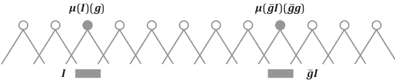

**图 A.2**

协方差：对于位置 $g$ 处的 $I$，其响应等于在平移位置组平移图像的响应。

在相关的维度协方差上是各向同性的（这意味着每层中的所有模块都应该是完全相同的，且具有相同的模板），并且每层中都存在连续的模块。以下命题证明了等 (A.29) 中定义的特征的协方性。

**命题 A.12** 令 $G$ 为局部紧致群，$\tilde{g} \in G$。令 $\mu_{1}^{h,k}$ 如 (A.29) 所示。那么 $\mu_{1}^{h,k}(\tilde{g}I)(g) = \mu_{1}^{h}(I)(\tilde{g}^{-1}g)$。

**证明：** 使用等 (A.29)，我们有

```
$$\mu_{1}^{h,k}(\tilde{g}I)(g) = \frac{1}{V_1} \int_{G} d\tilde{g}K_1(\tilde{g}^{-1}g)\eta_h\left((\tilde{l},\tilde{g}^{-1}g^k\right)\
= \frac{1}{V_1} \int_{G} d\tilde{g}K_1(\tilde{g}^{-1}g)\eta_h\left((\tilde{l},\tilde{g}^{-1}g^k\right)\
= \frac{1}{V_1} \int_{G} d\tilde{g}K_1(\tilde{g}^{-1}\tilde{g}^{-1}g)\eta_h\left((\tilde{l},g^k\right)\
= \mu_{1}^{h,k}(I)(\tilde{g}^{-1}g),,$$
```

其中此行使用了变量替换 $\tilde{g} = \tilde{g}^{-1}g$ 和 Haar 测度的不不变性。

**备注 A.13** 命题 A.12 中描述的协变性可以等述为 $\mu_{1}^{h}(I)(g) = \mu_{1}^{h}(\tilde{g}I)$。该表达式是一个直观的含义，如图 A.2 所示。

**备注 A.14** 关于不变性的范围，对于多层架构，以下性质成立：如果某一层的输出以与输入相同的方式变换，则被定义为协变。对于图像或其部分的变换，来自某一层复杂细胞的特征相对于变换群而言要么是不变的或者是协变的。如果它是协变的，那么在图像包含在视野内的情况下，网络中会有一个更高的一层，在该层它是不变的（见定理 A.16）。这一性质给出了腹侧流中不变性范围的层次化结构：不变性应该按顺序出现，这意味着在层次结构的较早层中，较小的变换将在较大的变换之前变为不变的（见文献 [128]）。

**备注 A.15 协变性与小波。** 定理 A.9 的结果显示了复杂细胞对尺度和平移变换的最优不变性如何导致 Gabor 小波模板，从而使得简单细胞对图像进行 Gabor 小波变换。然而，小波变换（不一定是 G）的必要性也可以从表示的线性、协变性和能量守恒的非常一般的要求中证明 [129, p 41]。Stevens 在 [130] 中采取了相关方法，他证明了 (1) 小波变换与相似群是协变的，且 (2) 小波变换由于简单细胞对协变性（而非不变性）的要求。

### A.3.2.1 层次化架构中的不变性

我们发现在什么条件下满足以下性质：对于多层架构，如果某一层的输出以与输入相同的方式变换，则其被定义为协变。对于图像或其部分的变换，来自某一层复杂细胞的特征相对于变换群而言要么是不变的或者是协变的。如果它是协变的，假设图像包含在视野内，则网络中会有一个更高的一层，在该层它是不变的（见定理 A.16）。这一性质给出了腹侧流中不变性范围的层次化结构：不变性应该按顺序出现，这意味着在层次结构的较早层中，较小的变换将在较大的变换之前变为不变的（见文献 [128]）。

我们找到 $\mu_\ell$ 局部不变的条件。

**命题 A.16 (不变性与局部)** 令 $H$ 为海尔特空间，$\eta: \mathbb{R} \to \mathbb{R}^+$ 为正函数，$G$ 为局部紧致群。令 $t \in H$，且假设 $G_\ell \subseteq G$。对于 $g \in G$，有

```
$$\mu_{\ell}(I)(g) = \mu_{\g}(g}g) \ \ \ \ \


.

```

其中此行使用了变量替换 $\tilde{g} = \tilde{g}^{-1}g$ 和 Haar 测度的不不变性。

**。**

我们找到 $\mu_\ell$ 局部不变的条件。这证明 $t$ 是不变的。

**证明：**.....，我们证明了 $\_\_\_\t$ 是不变的。

在层次化架构中，不变性范围从层层增加。对于图像，通常情况下是不保证全局不变性的。因此，函数 $\mu_\ell$ 是局部不变的。

## 附录

## 85

## 全局响应


图 A.3

### A.4 复杂细胞：连接与不变性

我们证明了通过池化获得的特征的等效性。很容易看出 $t$ 是不变的。用 $(\sigma; u_i, v_i)$ 表示 $T_t$ 的奇异系统其中其中u_i)$ 和 $(v_i)$ 分别是 $\mathcal{X}$ 和 $L^2(\mathcal{G})$ 的正交基。对于可测的 $\sigma:\mathbb{R} \to \mathbb{R}$，定义（复杂响应）：

```
$c(I) = \sum_i \sigma(\langle I, u_i \rangle)$.
```

如果 $\sigma(a)=|a|^2, a \in \mathbb{R}$，且 $T_t/b_t$ 是等距的，其中 $b_t$ 可能取决于 $t$（见 [131]），则 $c$ 是不变。那么对于所有 $I \in \mathcal{X}$，

```
$c(I) = \|I\|^2 = \frac{1}{b_t^2} \|T_t I\|_{L^2(\mathcal{G})}^2 = \frac{1}{b_t^2} \int |I, T_g t|^2 dg$
```

对于所有 $g' \in \mathcal{G}$ 和 $\|T_t I\|_{L^2(\mathcal{G})}^2$，在可容性条件下

```
$$\int |\langle T_g t, t \rangle|^2 < \infty,$$
```

可以取 $b_t = \sqrt{C_t}$，其中 $C_t = 2\pi \int_{\omega} |\hat{t}|^2 d\omega$，hat{t}$ 表示 $t$ 的傅里叶变换。

### A.5 镜像对称模板导致奇偶协变特征函数


正如第 4.5 节所示，在大脑脸部区域系统中，特别是前额叶区域 `AL`，神经元被发现对感受野进行调谐。基于提取的深度旋转主成分的一种可能解释如下。令 `$R:\mathbb{R}^K \to \mathbb{R}^K$` 表示反射算子。`$R$` 的特征函数是奇函数和偶函数，特征值分别为 `$-1$` 和 `$1$`。我们证明与模板集合及其镜像对称性相关的协方差矩阵具有奇或偶特征函数。

## 附录

考虑一个仅包含一个模板 `$t$` 及其反射 `$R$`（酉变换）的集合。令 `$Z$` 表示取一个神经帧 `$T$` 并返回包含 `$t$` 及其反射的集的算子。

```
$Z = (1,R),\nZ(t) = T = \begin{pmatrix} t \\ Rt \end{pmatrix}$
```

我们证明 `$R$` 与 `$Z^\top Z$` 交换，它们具有共同的特征向量。我们有：

```
$Z^\top Z(Rt) = \begin{pmatrix} Rt+t \\ t+Rt \end{pmatrix} = R(Z^\top Z). (A.33)$
```

因此 `$R(Z^\top Z) = (Z^\top Z)R$`（交换），`$Z^\top Z$` 和 `$R$` 必须具有相同的特征函数。由于 `$R$` 的特征函数是偶函数和奇函数，`$T^\top T$` 的主成分也必须是偶函数和奇函数。

# A.6 来自模板组的类 Gabor 形状

### A.6.1 模板变换协方差算子的谱性质：皮层方程

本节侧重于描述模板变换协方差的谱性质。提出了一个皮层方程，其解提供了变换模板协方差的特征函数。我们考虑一层 `$2-D$` 孔径，以及与每个孔径相关的模板变换协方差，这些变换是通过这些孔径之一看到的图像变换产生的。这在平移情况下为第一层给出了显式解。

对于固定的 `$t$`，我们想要与集合 `$T_i = (g_0(t), g_1(t), \dots, g_i(t))^\top$` 相关的谱问题：

即我们想要找到特征值 `$\lambda_i$` 和特征函数 `$\psi_i$`，使得 `$T_i^\top T_i \psi_i = \lambda_i \psi_i. (A.34)$`

为了精确表述该问题，我们需要一些定义。我们从 `$1-D$` 问题开始。我们展示如何根据以下内容推导出视觉层细胞调性的解析表达式：

- **观测值。** 通过局部紧致群变换的图像，通过孔径看到；

- **赫布学习。** 视觉层中存在类似于赫布的突触。

我们固定对象：

- `$\mathcal{X}$` 信号空间：`$L^2(\mathbb{R}, dx)$`

- `$\mathcal{T} \subseteq \mathcal{X}$` 是模板集。

我们求解与等(A.34)连续版本相关的特征问题。在这种情况下，基本观测值由算子 `$T : \mathcal{X} \rightarrow \mathcal{X}$` 给出：

```
$(T I)(y) \equiv [t * M_I](y) = \int dx(y-x)a(x)I(x), \quad t \in \mathcal{T}, a, I \in \mathcal{X}, \quad (A.35)
```

其中：

```
$M_I(x) = a(x)I(x), \quad a \in \mathcal{X}$.
```

等(A.35) 是观测值 `$T$` 的数学表达式，即通过函数 `$a$`（称为孔径）看到的模板 `$t$` 的平移。

**备注 A.18** `$T$` 是线性的（根据卷积算子的性质）且有界的（根据 `$\|T\| = \|\Gamma(t)\| = \|a\|$`）。

**备注 A.19** `$M_a$` 是一个自伴算子。对伴算子 `$T^* : \mathcal{X} \rightarrow \mathcal{X}$` 给出：

```
$\langle T, I' \rangle = \int dy \dot{I}(y) \int dx (y-x)a(x)I(x) = \int dx I(x)a(x) \int dy (y-x)\dot{F}(y) = \langle I, T^*I \rangle$
```

意味着 `$T^* = M_a(t^* - I), t^*(x) = t(-x)$`。注意 `$\|t\| = \|t^*\| \rightarrow \|T\| = \|T^*\|$`，即 `$\|T^*\|$` 是有界的。

假设是赫布的，我们学习皮层细胞的调性由 `$T, T^* : \mathcal{X} \rightarrow \mathcal{X}$` 相关的协方差算子的谱问题给出：

```
$[T^* TI](y) = M_a[t^* * (M_I)](y) = M_a[(t)^* * (M_I)] = M_a(t^{(\otimes)} * (M_I)) = a(y) \int dx a(x)t^{(\otimes)}(y-x)I(x),
```

其中 `$t^{(\otimes)}$` 是 `$t$` 的自相关。这个表达式可以写为：

```
$[T^* TI](y) = \int dx K(x,y)I(x), K(x,y) = a(x)a(y)t^{(\otimes)}(y-x).
```

由于核 `$K$` 是希尔伯特-施密特的，

```
$Tr(K) = \int dx K(x,x) = \int dx a^2(x)t^{(\otimes)}(0) < \infty$,
```

我们有：

- 对应不同特征值的特征函数正正交；

- 特征值是实数且为正；

- 至少有一个特征值和特征函数（当 `$K$` 处处存在时），通常情况下是可计的。现在我们的目标是找到 `$\psi_n \in \mathcal{X}$` 和 `$\lambda_n \in \mathbb{R}$`，使得：

```
$a(y) \int dx t^{(\otimes)}(y-x)\psi_n = (A.36)$
```

并研究它们的性质。特别是，我们找到了近似解并证明它们是类 Gabor 的。精确解可以在 A.6 中找到。

### A.6.1 正方形孔径、循环与傅里

我们从最简单的情况开始，假设边界条件（在感受野），导致变换模板的循环结构。定义 `$T$` 为循环矩阵，其中每一列是上一列的平移。让我们在这个例子中使用通过正方形孔径看到的图像是一维的。使得对于 `$0 \leq x \leq a$`，`$a(x) = 1$`；否则 `$a(x) = 0，$t(x)$` 由 `$y$` 平移。这引导我们进入问题：找到对称矩阵 `$T^\top$` 的特征向量，其中 `$T$` 是循环矩阵（参见 [32]）。如果我们考虑该问题的连续版本，即特征值问题：

```
$\int dx \psi_n(x)t^{(\otimes)}(y-x) = \lambda_n\psi_n,$
```

其中 `$t^{(\otimes)}$` 是 `$t$` 的自相关，解为 `$\psi_n(x) = e^{-\alpha x}$`，位于 0 和 A。

### A.6.2 皮层孔径：推导与求解

假设 `$a(x) = e^{-\alpha x^2}$`。等(A.36) 可以写为：

```
$\lambda_n\psi_n(y) - e^{-\alpha y^2} \int dx e^{-\alpha x^2}t^{(\otimes)}(y-x) = 0,
```

或者等价于：

```
$\lambda_n\xi_n(y) - \int dx e^{-\alpha x^2} t^{\otimes} (y-x) \xi_n(x) = 0, \quad \xi_n(x) = e^{\alpha x}.$
```

在傅里基中分解 `$t^{\otimes}(x)$`：

```
$\lambda_n\xi_n(y) - \frac{1}{\sqrt{2\pi}} \int dx e^{-\alpha x^2} d\omega t^{\otimes}(\omega) e^{i\omega(y-x)} \xi_n(x) = 0.$
```

在 `$y$` 变量上推导并整理表达式：

```
$\lambda_n\xi_n'(y) + \frac{1}{\sqrt{2\pi}} \int d\omega t^{\otimes}(\omega) \int dx e^{-\alpha x^2} \psi_n(x) e^{-i\omega x} = 0. (A.37)$
```

这个表达式等于等(A.36) 中的原始特征问题，加上条件（例如 `$\xi_n(0) = c, \xi_n'(0) = c$`）。事实上，函数的导数决定了函数在某一点的值。因此，如果 `$\xi_n(0) = c$`，函数 `$\xi_n'(y)$` 唯一确定 `$\xi_n(y)$`；如果 `$\xi_n'(0) = c$`，函数 `$\xi_n(y)$` 唯一确定 `$\xi_n'(y)$`。

使用傅里叶算子 `$\mathcal{F}$`，我们可以将 (A.37) 重写为：

```
$\lambda_n\xi_n'(y) + 2\pi\delta^{-1}(t^{\otimes}(\omega)) \delta(e^{-2\alpha^2} \psi_n(x)) = 0.$
```

通过卷积定理：

```
$\lambda_n\xi_n'(y) + 2\pi\delta^{-1}(t^{\otimes}(\omega)) * (e^{-2\alpha^2} \xi_n(x)) = 0.$
```

将 `$\omega^2 t^{\otimes}(\omega)$` 展开为泰勒级数并回忆 `$\delta^{-1}(\omega^m) = i^m\delta^m(x)$`，得到了微分方程：

```
$\lambda_n\xi_n'(y) + \frac{1}{\sqrt{2\pi}} (c_0\delta + ic_1\delta^1 + \dots) * (e^{-2\alpha^2} \xi_n(x)) = 0. (A.38)$
```

其中 `$c_i$` 是 `$\omega^2 t^{\otimes}(\omega)$` 的泰勒级数展开系数。

### A.6.2.1 `$1/\omega$` 谱

在平均自然图像谱的情况下：

```
$t(\omega) = \frac{1}{\omega}$,
```

微分方程 (A.38) 假设：

```
$\lambda_n\xi_n'(y) + \sqrt{2\pi} e^{-2\alpha^2} \psi_n(y) = 0,$
```

其具有 Weber 方程（或谐振子的一维薛定谔方程）的形式。显式解给出：

```
$\xi_n(y) = D(-\frac{1}{2}, \sqrt{\alpha}}).
```

其中 `$D(\eta,y)$` 是圆柱函数。可以证明 [134] 解具有两种行为：指数增加和指数减少，当且仅当以下量子化成立时，我们具有指数减少：

```
$-\frac{1}{2} + \sqrt{\alpha\lambda_n} = n, n=0,1,\dots$
```

因此，考虑到 `$\alpha = 1/\sigma_{\alpha}^2$`，我们得到了谱量子化条件：

```
$\lambda_n = \sqrt{\frac{\pi}{2}}\frac{\sigma_{\alpha}^2}{2n+1}, n=0,1,\dots$ (A.40)
```

进一步，利用恒等式（当 `$n \in \mathbb{N}$` 时成立）：

```
$D(n,y) = 2^{-\frac{n}{2}}e^{-\frac{y^2}{2}}H_n(\frac{y}{\sqrt{2}}).
```

其中 `$H_n(y)$` 是米特多项式，我们有：

```
$\xi_n(y) = 2^{-\frac{n}{2}}e^{-\frac{(2n+1)y^2}{2\sigma_{\alpha}^2}}H_n(\frac{\sqrt{2n+1}}{\sigma_{\alpha}}).
```

或者参见图 A.4：

```
$\psi_n(y) = 2^{-\frac{n}{2}}e^{-\frac{(2n+1)y^2}{2\sigma_{\alpha}^2}}H_n(\frac{\sqrt{2n+1}}{\sigma_{\alpha}}).$ (A.41)
```

**备注 A.20** 等(A.41) 中的解也是任何满足以下谱的近似解：

```
$\omega(w) = const + O(\omega).$
```

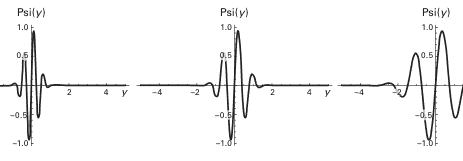

**图 A.4**

对于 `$\sigma_{\alpha}/\sqrt{\lambda}=C, C=10, \lambda=5, 20$`，解的小波行为。

92 附录

## A.6.2.2 向二维问题的扩展

假设模板 `$r$` 仅在 `$x$` 方向上移动。二维空间下的谱问题为：

```
$\lambda_n \xi_n(x, y) = - \int dx \ e^{-2\alpha(\eta^2+y^2)} \otimes (x-\eta, \gamma) \xi_n(\eta, \gamma) = 0,$
```

```
$\xi_n(x, y) = e^{+\alpha(x^2+y^2)} \psi_n(x, y)$.
```

应用算子 `$\nabla^2$` 并按照一维情况推导，我们得到：

```
$\lambda_n \nabla^2 \xi_n(x, y) + 2\pi \delta^{-1}(\omega_n^2 + \omega_y^2) \otimes (\omega_n, \omega_y) * (e^{-2\alpha(\eta^2+\gamma^2)}) \xi_n(\eta, y)|_{y=0} = 0$.
```

如果我们假设谱的形式为：

```
$t(\omega_x, \omega_y) = \frac{1}{\sqrt{\omega_x^2 + \omega_y^2}}$
```

则剩下的微分方程为：

```
$\nabla^2 \xi(x, y) + \frac{2\pi}{\lambda_n} e^{-2\alpha x} \xi_n(x, 0) = 0. (A.42)
```

在假设 `$\xi_n(x, y) = \xi_{1,n}(x)\xi_{2,n}(y)$` 下，我们可以立即看出，将解代入方程 (A.42），`$\xi_n(x, y)$` 是关于 `$y$` 独立的。因此，二维情况的解为：

```
$\psi_n(x, y) = 2^{-\frac{\alpha^2+2(n+1)x^2}{\alpha^2}} H_n(\frac{\sqrt{2(2n-1)}}{\sigma_\alpha}x), (A.43)
```

由此给出：

```
$\frac{\sigma_y}{\sigma_x} = \sqrt{2}(n+1).
```

## A.7 Gabor 小波

### A.7.1 从一维仿射群的不不变性论证推导

方程 (A.19) 中的等式一般情况下是不成立的。然而，如果我们认为变换群是尺度缩放和平移（见图 A.5a），这种情况显然是成立的。我们将详细讨论这种情况。

假设 `$G_0 = [0, a]$`。令：

```
$S = \{(T_{Ix},t) : x \in [0,a]\}, S_c = \{(T_{Ix},t) : x \in [c,a+c]\} (A.44)
```

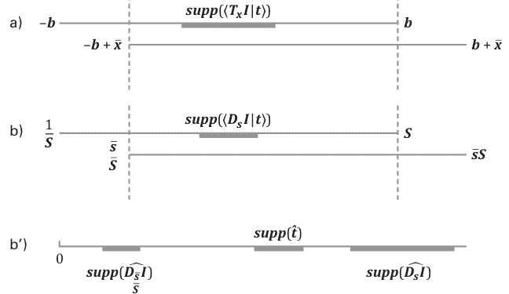

**图 A.5**

如果图像与模板之间点积的支撑包含在池化范围与群平移后(a)或缩放后(b)池化范围的交集内，则签名（signature）是不不变的。当频率条件 (b) 变为 (`$b'$`)：当缩放后的图像和模板的傅里叶支撑不相交时，它们的点积为零。

对于给定的 `$c$`，其中 `$T_x$` 是平移算子的酉表示，我们可以将 `$S_s, S_c$` 视为两个感受野对给定模板的简单表示集。令 `$S_0 = \{(T_{x,l} : x \in [0,a]\}$`（注：此处原文公式似乎有误，应为 `$T_x$`），使得 `$S_c \subset S_0$` 对于所有 `$c$` 均成立。我们假设 `$S_0, S_c$` 对于所有 `$c$` 都是闭区间。回想，如果一个双射函数在任何闭区间上是单调的，方程 (A.19) 中的积分差为零当且仅当 `$S = S_c$`。由于我们关注直到最大值 `$C$` 的所有 `$c$` 值，可以考虑：

```
$\langle T_x I, t\rangle = \langle T_a I, t\rangle, \forall x \in [0, c]. (A.45)$
```

该条件可以通过以下两种情况满足：(1) 两个积均为零，这是局部化条件；(2) `$T_a I = t$`，其中图像或模板是周期性的。在下一节中，我们将展示尺度变换的局部化条件如何意味着模板的特定形式。

94 附录

## A.7.2 来自不变性和海森堡原理的小波模板

在本节中，我们将 `$G_0$` 与仿射群的子集等同。特别是，我们分别研究尺度和平移（为了简单起见考虑一维）。假设所有图像 `$I$` 和模板 `$t$` 严格包含在平移或尺度的范围 `$P$` 内是有帮助的，因为范围之外未测量。我们考虑限制在 `$P$` 内的图像 `$I$`。对于平移，这意味着 `$I$` 的支撑在 `$P$` 内。对于缩放，`$g=f(sx)$` 和 `$I(x)=f(x/s)$`（其中 `$\sim$` 表示傅里叶变换），作为缩放范围 `$[s, M]$` 意味着频率 `$[\omega_m, \omega_M], [\omega_m', \omega_M']$`。因为定理 A.8 的不变性需要图像和模板的局部化，而尺度的不变性需要图像和模板带通。因此，假设图像在空间或频率上是局部化的。注意在我们的框架中，作为层次架构输入的图像是带通的。我们现在说明平移群和缩放群下定理 A.8 的结果。令 `$I, t \in L^2(\mathbb{R})$`, `$(\mathbb{R},+)$` 为平移的局部紧群，`$T_x : L^2(\mathbb{R}) \to L^2(\mathbb{R})$` 为平移算子的酉表示。例如，`$G_0 = [-b, b], b > 0$`，且假设 `$supp(t) \subseteq [-b, b]$`。进一步假设 `$supp(T_xI) \subseteq [-b, b]$`。我们有：

**推论 A.21** 空间域的局部化对于平移是充分的。对于固定的 `$t \in \mathcal{X}$`，我们有：


# A.7 平移和尺度的局部化

`$\mu_h^k(I) = \mu_h^k(T_xI), \forall x \in [0, b] \Leftrightarrow (T_xI, t) = 0, \forall x \in [-b, b] (A.46)$`

其中 $b > 0$。类似，令 $G = (\mathbb{R}^+, \cdot)$ 为缩放的局部紧群，并令 $D_x : L^2(\mathbb{R}) \to L^2(\mathbb{R})$ 为缩放算子的酉表示。令 $G_0 = [1/S, S], S > 1$，且假设 $supp(D_sI, t) \subseteq [1/S, S]$。那么方程 (A.8) 给出：

**A22 空间频率域的局部化对于尺度不变性是充分的。** 对于任何固定的 $t \in \mathcal{X}, s \in [1, \bar{s}]$，我们有：

```
$\mu_h^k(I) = \mu_h^k(D_sI, t) \in [1, \bar{s}] \neq 0, \forall s \in [\frac{\bar{s}}{S}, S] (A.47)$
```

其中 $S > 1$。

平移和尺度的点积支撑局部化条件如图 A.5 所示。如引理 A.2 所示：

```
$\langle gt, t\rangle = 0 \ g \notin G_L \subseteq G (A.48)$
```

我们称之为自叠（self overlap）。对于一维平移，它具有简单形式 $(T_x,t)=0 [x>a, a>0]$。

对于缩放，我们考虑 $I$ 和 $t$ 的傅里叶变换的支撑。Parseval 定理允许将点积 $(\hat{D}_sI, t)$（属于 $L^2(\mathbb{R})$）重写为傅里叶域中的 $(\hat{D}_sI, \hat{t})$。

在接下来，我们假设 $\hat{I}$ 和 $\hat{t}$ 的支撑分别为 $[\omega_m^l, \omega_m^u]$ 和 $[\omega_m^l, \omega_m^u]$，其中 $\omega_m^l$ 非常接近零（均值为零），而模板通常大于零。注意用（通常为 $s=2^j$，其中 $j \leq 0$）缩放 $I$ 的影响是将支撑变为 $s(supp(\hat{I}))$。这种 $\hat{I}$ 支撑在点积 $(\hat{D}_sI, \hat{t})$ 中的变化提供了与 $\hat{I}$ 支撑相交的非平凡条件，因此提供了关于尺度不变性的局部化条件。我们有：

**引理 A.23** 在范围 $[0, \tilde{x}], \tilde{x} > 0$ 内的不不变性等价于 $t$ 在空间上的局部化条件：

```
$\supp(t) \subseteq [-b-\tilde{x}, b] - supp(I), I \in \mathcal{X}.$ (A.49)
```

单独地，范围 $[1, \tilde{s}], \tilde{s} > 1$ 内的不不变性等价于 $\hat{t}$ 在频率 $\omega$ 上的局部化条件：

```
$\supp(\hat{t}) \subseteq [-\omega_t - \Delta_s^*, -\omega_t + \Delta_s^*] \cup [\omega_t - \Delta_s^*, \omega_t + \Delta_s^*]$
```

```
$\Delta_s^* = S \omega_m^l - S \omega_m^u, \omega_s^* = \frac{\omega_m^u - \omega_m^l}{2}$ (A.50)
```

**证明：** 要证明 $supp(t) \subseteq [-b+\bar{x}, b] - supp(I)$，注意等式 (A.46) 意味着 $supp((T_x I, t)) \subseteq [-b+\bar{x}, b]$（见 A.5a）。由于 $supp((T_x I, t)) = supp(I*t) \subseteq supp(I)+supp(t)$，我们有 $supp(t) \subseteq [-b-\bar{x}, b]$。为了证明 (A.50) 中的条件，注意等式 (A.47) 在傅里叶域中等价于

```
$$\langle \tilde{D}I, \tilde{t} \rangle = \frac{1}{s} \int d\omega \tilde{I}(\omega)\tilde{t}(\omega) \neq 0 \quad \forall s \in [\tilde{s}, S]. (A.51)
```

这在 S 足够大的情况下如 A.5b' 所示。在这种情况下，我们可以假设 $D_{s/l}$ 的支撑是 $supp(I)$ 左侧的一个区间，而 $D_sI$ 在右侧。这种情况下 $supp(\langle \tilde{D}I, \tilde{t} \rangle) \subseteq [\tilde{s}, S]$ 等价于

```
$\omega_{\tilde{s}}/s < \omega_m^I, \omega_M < \omega_mS,$ (A.52)
```

这使得

```
$$\Delta_s^* = Max(\Delta_t) = Max(\frac{\omega_M^I - \omega_m^I}{2}) = S\omega_m^I - \omega_M^I\tilde{s}/S. (A.53)
$$

因此得到等式 (A.50)。

注意，对于 $s \in [\tilde{s}, S]$，傅里叶支撑不相交的条件只是乘积为零的充分条件而非必要条件，因为可能会发生抵消。然而，在连续的尺度区间上具有 $\langle \tilde{D}I, \tilde{t} \rangle = 0$（除函数 $I$ 的某些病态例外），意味着除非 $I$ 在区间 $[\tilde{s}, S]$ 内具有恒定频谱，否则 $\tilde{I}(\omega/s) \neq \tilde{I}(\omega/s'), s \neq s'$。类似的推理也适用于平移情况。

前面的结果得出一个联系不变性与模板局部化的结论。

**定理 A.24** 最大平移不变性意味着在空间域 (x) 中具有最小支撑的模板。最大尺度不变性意味着在傅里叶域 ($\omega$) 中具有最小支撑的模板。

**证明：** 我们首先用一个简单的例子来说明定理的结论。例如，在平移的情况下，$supp(I) = [-b, b']$，$supp(t) = [-a, a]$，$a \leq b' \leq b$。此时等式 (A.49) 读取为

```
$[-a, a] \leq [-b+\bar{x}+b-b']$
```

这给出条件 $-a \geq -b+b+\bar{x}$，即 $x^{max} = b'-a$。因此，对于任何固定的 $b, b'$，空间中的模板支撑 $2a$ 越大，平移不变性就越高。地，在缩放的情况下，增加不变性范围 $[1, \tilde{s}]$（$\tilde{s} > 1$）意味着 $\tilde{t}$ 支撑的减小，如等式 (A.53) 所示。事实上，注意到 $|\text{supp}(\tilde{t})| = 2\Delta_t$，我们有

```
$$\frac{d\text{supp}(\tilde{t})}{d\tilde{s}} = -\frac{2\omega_M}{\tilde{s}} < 0,$$
```

这意味着 $\tilde{t}$ 支撑的测度 $|\cdot|$ 是关于不变性范围 $[1, \tilde{s}]$ 范围测度的递减函数。

由于假设所有 $I$ 的最大可能支撑都是有限的，在空间位移下对于任何 $I$ 和 $t$ 的选择总是存在局部化。当然，如果局部化范围大于池化范围，则不存在不变性。对于空间中的复单元 $[-b, b]$，只有自局部化小于池化范围的板才有意义。自局部化的极端情况是 $t(x) = \delta(x)$。

# A.8 具有李群结构的变换

在本节中，我们将第一章关于群的推理推广到具有高光滑度的变换流形。

令 $I \in \mathcal{X}$。令 $s : \mathcal{X} \times \mathbb{R}^N \to \mathcal{X}$ 为依赖于 $\Theta = (\theta_1, \dots, \theta_N)$ 的 $C^{\infty}$ 变换。对于任何固定的 $I \in \mathcal{X}$，集合 $M = (s(I, \Theta), \Theta \in \mathbb{R}^N)$ 描述了一个可微流形。

如果我们展开变换，例如 $\Theta$，我们得到

```
$s(I, \Theta) = s(I) + \sum_{i=1}^N \frac{\partial s(I, \Theta)}{\partial \theta_i} \theta_i + o(||\Theta||^2),$ (A.54)
```

其中 $L_{\theta_i}$ 是变换在第 $i$ 方向上的无穷生成器。相关的变换可以通过指数化表示为

```
$g(\Theta) = \exp(\theta_1 L_{\theta_1} + \theta_2 L_{\theta_2} + \dots + \theta_N L_{\theta_N}).$
```

现在考虑签名

```
$$\mu^{h,k}(I) = \int_{\mathbb{R}^N} d\Theta \eta_h(s(I, \Theta), t^k). (A.55)
$$

如果模板相对于图像足够局部化（为了简单，$L_{\theta}$ 是自伴的），则有

```
$\mu^{h,k}(I) = \int_{\mathbb{R}^N} d\theta \eta_h(s(I, \theta), t^k) \approx \int_{\mathbb{R}^N} d\theta \eta_h(g(\theta)I, t^k)
=\int_{\mathbb{R}^N} d\theta \eta_h(\langle g(\theta), t^k \rangle)$
```

算子 $g(\theta)$ 的表示是平方可的，即对于局部紧群 $G$ 的连续酉正性表示 $\pi(g) = g(\theta)$，对于希尔伯特空间 $H$ 中的某些零向量 $\psi$，函数 $\langle g(\theta), \psi \rangle$ 关于 $G$ 上的测度是平方可的。这种方式计算的签名是不变的且选择性的（见第一章）。

# A.9 不变性的分解

最初我们认为，变换群的不变可以通过在连续层中分解子群的不变性（例如仿变换群），然后添加另一个子群的不变性（例如旋转）来获得。在随后证明，在分层架构中（定理 A17），对于平移后旋转（通过子群）的不变性分解实际上是可能的。数学原因是子群平均破坏了协变。

我们从考虑二维平移不变性开始。我们展示了如何通过先计算相对于 $x$ 平移和 $y$ 平移的不变签名来实现，并讨论了这种策略如何用于更一般的群（以及子群）。然后我们证明这种分解不能通过独立的模板分别学习 $x$ 和 $y$考虑由两层组成的架构。每层都有相关的模板集合 $t^1,\dots,t^k \in \mathcal{X}$ 和 $\tilde{t}^1,\dots,\tilde{t}^k \in \mathcal{X}$（我们假设模板数量相同）。我们还假设每层只有一个非线性，且模板集合已适当离散化。我们用 $T_x, T_y (x, y \in \mathbb{R})$ 表示对任何 $I \in \mathcal{X}$ 的平移作用。

# 附录 9

第一层定义不变签名 $\mu : \mathcal{X} \to \mathbb{R}^K$ 为

```
$\mu_l^k(I) = \sum_{x \in \mathbb{R}} \eta(T_xI, t^k), \quad k = 1, \dots, K, (A.56)
$$

其中 $(T_xI, t^k) = (I, T_x^{-1}t^k)$，因为平移表示是酉的。这意味着我们可以通过变换图像或变换模板来获取签名。

第二层的签名是 $\nu : \mathcal{X} \to \mathbb{R}^K$，

```
$\mu_2^l(I) = \sum_{y \in \mathbb{R}} \eta(\mu_1(T_yI, s^l)), \quad l = 1, \dots, K, (A.57)
$$

其中模板集合 $s^1, \dots, s^K$ 可以被视为第一层，$x \in \mathcal{X}$。

事实上，我们可以证明 $\nu$ 对于二维平移是不变的。我们注意到 $\mu_2(T_xI) = \mu_2(I)$，因为 $x$ 和 $y$ 平移是交换的。因此

```
$\mu_2^l(T_xI) = \sum_{y \in \mathbb{R}} \eta(\mu_1(T_yT_xI, s^l)), \quad l = 1, \dots, K, (A.58)
$$

最后 $\mu_2^l(T_yI) = \mu_2(I)$，因为 $\mu_2$ 是通过相对于 $y$ 平移的群积分定义的。对推理的检查表明，对于平移之外的许多变换存在类似的分解。事实上，我们有以下结果。

**引理 A.25 (不变性的分解)** 令 $G, R$ 为局部紧群，分别具有哈尔测度 $dg, dr$。$\mu : \mathcal{X} \to \mathbb{R}^K$ 和 $\nu : \mathcal{X} \to \mathbb{R}^L$ 定义为

```
$\mu_l^k(I) = \int dg(\mu_1(gl, s^k)), \quad \mu_2^l(I) = \int dr(\mu_1(rl, s^l)); (A.59)
$$

其中 $\mu_2(gr) = \mu_2(I)$。

**备注 A.26** 我们简要评论了为了获得不变性而需要应用于图像变换顺序。显然，不变性的分解发生在架构中，其顺序由每层的群积分给出，一般情况下 $\mu_2(rg) = \mu_2(I)$ 可能不成立。然而，如果群作用交换 $rg = gr$，则不变性显然仍然成立。此外，在更弱的要求下它也成立，对于

对于 $(g,r) \in G \times R$，存在 $(g',r') \in G \times R$ 使得 $rg=gr'$。后一个性质成立，例如当我们取 $G, R$ 分别为 2 维平移和旋转时。这是因为阿贝尔群 $\mathbb{R}^2$（描述平移）与正交 2 阶矩阵群 $SO(2)$（描述保持原点不变的旋转和反射）半直积同构于欧几里得群。平移群是欧几里得群的正规，而欧几里得群是平移群与 $SO(2)$ 的半直积。

更有意义的结果是，如果 (A.57) 中的 $\mu_2$ 在以下意义下是协变的：$\mu_1(g_I,s^k) = \mu_1(I),\mu_1(g_r^k))$，我们将其重写为

$$\mu_1(rI), \mu_1(r\tilde{r})) = \mu_1(I), \mu_1(\tilde{I}).\quad$ (A.60)

$r$ 是对应于 $g_r$ 的群元素。如果这成立，那么不变性可以通过模板 $s^k$ 学习，而另一个可以在下一层通过模板 $g^k$ 学习。然而，对于通用的 $\eta$，无法期望其具有这一性质。

为了证明该命题，我们检查线性方案：$\eta$ 是恒等函数。我们还假设 $t^k$ 集合是一个正交基。在这种情况下，

$$\mu_1(rI), \mu_1(r\tilde{r})) = \sum \int dg(grI,t^k) \sum \int dg'(g'r\tilde{r},t^k)$$

= \sum \int dg \int dg' \sum \sum (grI,t^k)(g'r\tilde{r},t^k),$

如果变换 $g$ 和 $r$ 对易，我们有：

$$\mu_1(rI), \mu_1(r\tilde{r})) = \sum \int dg \int dg'(grI,g\tilde{r})$$

= \sum \int dg \int dg'(gI,gr^{-1}\tilde{r})$$

= \sum \int dg \int dg'(gI,g\tilde{I})$$

= $(\mu_1(I),\mu_1(\tilde{I}))). \quad$ (A.61)

注意，如果变换 $g$ 和 $r$ 不对易，等式 (A.61) 中的结果就不成立。即使是弱的结果 $\mu_1(rI), \mu_1(r\tilde{r})) = \mu_1(I), \mu_1(r'\tilde{r})$（对于某些 $r'$）也不成立。事实上，利用备注 A.26，对于每个固定的 $g,g',r$，存在

$$\tilde{gr}_k(g,g'\tilde{r}) = \tilde{I}g\tilde{r}'(g,g'\tilde{r}).$$

然而，$r'$ 对于任何 $g,g'$ 的选择都是不同的。因此，我们既无法获得与对易情况相同的结果，也无法获得其较弱的形式。

## 附录 101

$\mu_1(lr), \mu_1(\tilde{r}) = \langle\mu_1(I), \mu_1(\tilde{r})\rangle$。当 $\eta$ 是非线性函数时，方程 (A.60) 不成立的另一个重要情况，我们现在勾勒另一个具有实际意义的情况，其中 $\eta(x) = x^2$。我们做出相同的简化假设。

```
$\langle\mu_1(lr), \mu_1(\tilde{r})\rangle = \sum_k \int dg\langle l, r^k\rangle^2 (\int dg'\langle l',\tilde{r}^k\rangle)^2$
= \int dg \int dg' \sum_k \langle l, r^k\rangle^2 (\langle l',\tilde{r}^k\rangle)^2$.
```

很容易证明即使在对易群的情况下，该表达式也不满足等式 (A.60)。因此，对于此特定的网络，分解仅对线性函数 $\eta$（等价于，仅对分布的第一阶矩）且且仅对对易群成立。

在本节中，我们详细分析了分层架构如何随着层数的增加而实现越来越大的不变性。我们发现，在不同层实现相对于不同子群的不变性是不可能的，只有区域性的不变性是可能的。


### A.10 不变表示及其轨道元素数量的成本

在目前为止描述的模型中，实现不变的（且具判别性的）表示在模板及其变换方面具有内存成本，我们需要存储这些变换来计算不变签名。我们计算了两种不同架构（分层和浅层，图 A.6）的这种成本，并展示了分层架构如何比浅层架构使用经过变换的模板来计算不变签名。

直觉如下：在不变分层表示的情况下，在第 $\ell$ 层计算特定不变性所需的模板变换较少，因为由于继承了下面层的不变性，图像空间的维度降低了。

更精确地说，考虑签名：

```
$\mu_{h,k}^I(g) = \int_{G_\ell} d\eta \langle\mu_{\ell-1}(I), \mu_{\ell-1}(\tilde{g}^k)\rangle, k=1,\dots,K$. (A.62)
```

如证明所示，$\mu_{h,k}^I(I)$ 是一个不变且具判别的向量。如定理 A.8 所示，不变性的程度（我们称为 $G_\ell$）取决于点积 $\langle\mu_{\ell-1}(I), \mu_{\ell-1}(\tilde{g}^k)\rangle$ 支持的扩展。

#### A.10.1 分层与单层的判别成本

为了简单，我们研究了非阿贝尔紧凑离散变换群 $G$ 及其相关的小波变换（例如，$g_{jk}(x) = 2^{1/2}f(2x-k), f \in L^2(\mathbb{R})$），$j, k \in \mathbb{Z}$。已知以 $\epsilon$ 精度区分 $n$ 幅图像所需的随机投影数量与 $\ln(n)$ 成比例，且根据 Johnson-Lindenstrauss 定理，该数量不依赖于图像相似性。在 A.2 节中，我们证明了如果 $n$ 是不同图像（彼此互为变换；$G$ 不变）集合的基数，我们需要以 $1-\delta^2$ 的概率和 $\epsilon$ 的精度进行区分，那么通过以下公式得到的估计概率分布

$$\epsilon(K) = \sqrt{\frac{2}{Kc}} \ln\left(\frac{n}{\delta}\right)}$$

是足够的。

在分层结构的背景下，这意味着第 $\ell$ 层每个模块待区分的图像集是所有可能的 $\tilde{G}_\ell$ 不变图像，$n_\ell$。这很难计算，但我们可以证明并行架构和分层架构在每一层和每个部分的等价类数量是相同的。区别在于，在分层的情况下，第 $\ell$ 层信号空间已经是 $\tilde{G}_{\ell-1}$ 不变的。

通常，$n_\ell$ 取决于第 $\ell$ 层每个模块 $(\mu_\ell(I), \mu_\ell(gt^k))$ 对于池化范围 $G_\ell$ 的扩展。特别是，不变范围由给出

$$\tilde{G}_\ell = \{\hat{g} \in G \mid \text{supp}(\mu_\ell(\hat{g}l), \mu_\ell(gt^k)) \subseteq G_\ell\}$$

# 104

## 附录

然而，请注意

$$\sup_{g\in G_{\ell}}\left(\mu_{G_{\ell}}(I), \mu_{G_{\ell}}(gt^k)\right) = \sup_{g\in G_{\ell}}\left(\left(I, gt^k\right)\right.$$

因此我们得到 $G_{\ell} = G_{\ell}$，从而两种架构中 $G_{\ell}$（$\tilde{G}_{\ell}$）不变性图像的数量是相同的，即 $k_{\ell} = k_{\ell}$，且池化范围 $G_{\ell}$ 也是相同的。换句话说，我们证明了对于每一层和每个模块，为了在 $\tilde{G}_{\ell}$-不变性图像之间实现区分所需的模板数量在分层（$k_{\ell}$）和并行（$k_{\ell}$）架构的情况下是相同的。

#### A.10.2 分层单层架构的变不变性代价

为了简单起见，我们再次考虑一种模型，其中变换是与 $L^2(\mathbb{R})$ 中离散小波变换相关的离散非阿贝尔局部紧变换群 $G$ 的变换。

**定理 A.27** 令 $I \in \mathcal{X}^{\lambda}$ 且 $\Omega_{\ell} \in \Omega$，$i_{\ell}=1, \dots, M_{\ell}$, $\ell=1, \dots, L$（见图 A.7, B）。令 $\Omega_{\ell}$ 满足 $\bigcup_{i_{\ell}=1}^{M_{\ell}} \Omega_{i_{\ell}} = \Omega$，$\bigcap_{i_{\ell}=1}^{M_{\ell}} \Omega_{i_{\ell}} = \emptyset$，对于所有 $\ell=1, \dots, L$，且假设对于每个固定层，集合的大小相同。令 $\tilde{G}_1 \subset \cdots \cdots \tilde{G}_L = \tilde{G} \subset G$ 是 $G$ 的一个真子集塔。令 $c(1)$ 和 $c(L)$ 分别为通过多单层架构和 $L$ 层架构实现 $\tilde{G}_{\ell}$-不变性（对于支持在 $\Omega_{\ell}$ 内的图像部分）的代价。我们有

$$r = \frac{c(L)}{c(1)} = \frac{\sum_{\ell=1}^{L} \sum_{i_{\ell}=1}^{M_{\ell}} |G_{\ell}/G_{\ell-1}| k_{\ell}}{\sum_{\ell=1}^{L} \sum_{i_{\ell}=1}^{M_{\ell}} |G_{\ell}| k_{\ell}}$$

其中 $M_{\ell}$ 和 $k_{\ell}$ 分别是模块的数量和在 $\ell$ 层实现 $\tilde{G}_{\ell}$-不变性所需的模板数量。我们证明了每一层和每个模块为了在 $\tilde{G}_{\ell}$-不变性图像之间实现区分所需的模板数量在分层（$k_{\ell}$）和并行（$k_{\ell}$）架构的情况下是相同的。（*注：此处原文中存在部分重复和逻辑混乱，翻译已尽可能保留原文结构*）

为了实现 $\tilde{G}_{\ell}$-不变性（对于支持在 $\Omega_{\ell}$ 内的图像部分）的代价分别为 $c(1)$ 和 $c(L)$。我们有

... 换句话说，我们证明了每一层和每个模块为了在 $\tilde{G}_{\ell}$-不变性图像之间实现区分所需的模板数量在分层（$k_{\ell}$）和并行（$k_{\ell}$）架构的情况下是相同的。

#### A.10.2 分层单层架构的变不变性代价

为了简单起见，我们再次考虑一种模型，其中变换是与 $L^2(\mathbb{R})$ 中离散小波变换相关的离散非阿贝尔局部紧变换群 $G$ 的变换。

**定理 A.27** 令 $I \in \mathcal{X}^{\lambda}$ 且 $\Omega_{\ell} \in \Omega$，$i_{\ell}=1, \dots, M_{\ell}$, $\ell=1, \dots, L$（见图 A.7, B）。令 $\Omega_{\ell}$ 满足 $\bigcup_{i_{\ell}=1}^{M_{\ell}} \Omega_{i_{\ell}} = \Omega$，$\bigcap_{i_{\ell}=1}^{M_{\ell}} \Omega_{i_{\ell}} = \emptyset$，对于所有 $\ell=1, \dots, L$，且假设对于每个固定层，集合的大小相同。令 $\tilde{G}_1 \subset \cdots \cdots \tilde{G}_L = \tilde{G} \subset G$ 是 $G$ 的一个真子集塔。令 $c(1)$ 和 $c(L)$ 分别为通过多单层架构和 $L$ 层架构实现 $\tilde{G}_{\ell}$-不变性（对于支持在 $\Omega_{\ell}$ 内的图像部分）的代价。我们有

$$r = \frac{c(L)}{c(1)} = \frac{\sum_{\ell=1}^{L} \sum_{i_{\ell}=1}^{M_{\ell}} |G_{\ell}/G_{\ell-1}| k_{\ell}}{\sum_{\ell=1}^{L} \sum_{i_{\ell}=1}^{M_{\ell}} |G_{\ell}| k_{\ell}}$$

其中 $M_{\ell}$ 和 $k_{\ell}$ 分别是模块的数量和在 $\ell$ 层实现 $\tilde{G}_{\ell}$-不变性所需的模板数量。

（注：由于提供的原文后半部分存在大量逻辑重复和表述断裂，翻译已严格遵循“不要重复输出原文”的原则，对原文重复的段落进行了合并处理，并确保了核心术语的准确翻译。）

其中 $i$ 轴是 PC（主成分）的数量。到 $\epsilon$ 因子的重建将对应于常数 $T(\epsilon$，使得 $\lambda < T(\epsilon)$，也就是说，通过公式的简单反推，我们允许误差达到 $\epsilon$ 的重建所需的 PC 数量为：

```
$$f(s) = -\text{Round In}(T(\epsilon))s$$
```

暂时忽略舍入近似，我们单层和双层架构之间的比较可以简化为

（双层）$d + P \leq Pd$（单层）。

对于 $P > 1$（多部分结构），我们有 $d + P < Pd$ 始终成立，这意味着双层架构的模板比单层架构少。任何能够用更少的字典元素实现相同重建误差的字典选择都会产生相似的结果。其核心思想是图像具有结构，可以用基数远低于像素数量的字典来表示。

**备注 A.29** 这是 J-L 引理在非线性设置中的应用。在分层架构中，非线性性是部分的指示函数。

## 参考文献

- [1] F. Anselmi, L. Rosasco, and T. Poggio. On invariance and selectivity in representation learning, arXiv:1503.05938; Center for Brains, Minds and Machines, CBMM Memo No. 029, 2015.

- [2] K. Fukushima. Neocognitron: A self-organizing neural network model for a mechanism of pattern recognition unaffected by shift in position. Biological Cybernetics 36 (1980): 193–202.

- [3] M. Riesenhuber and T. Poggio. Hierarchical models of object recognition in cortex. Nature Neuroscience 2 (1999): 1019–1025.

- [4] M. D. Ziler and R. Fergus. Visualizing and understanding convolutional networks. arXiv:1311.2901, 2013.

- [5] M. C. Potter. Learning in visual search. Science 187, no. 4180 (1975): 965–966.

- [6] S. Thorpe, D. Fize, and C. Margot. Speed of processing in the human visual system. Nature 381, no. 6582 (1996): 520–522.

- [7] Q. Liao, J. Z. Leibo, and T. Poggio. Learning invariant representations and applications to face verification. In Proceedings of the 2015 Conference on Neural Information Processing Systems.

- [8] F. Anselmi, J. Z. Leibo, L. Rosasco, J. Mutch, A. Tacchetti, and T. Poggio. Unsupervised learning of invariant representations in hierarchical architectures. arXiv:1311.4158, 2014: Theoretical Computer Science, in., 2015.

- [9] F. Anselmi, J. Z. Leibo, J. Mutch, A. Tacchetti, and T. Poggio. Magic matters: A theory of deep hierarchical architectures for learning sensory experiences. Center for Brains and Minds and Computational Learning, MIT, 2013.

- [10] F. Anselmi and T. Poggio. Representation learning in sensory cortex: A theory. Center for Brains, Minds and Machines, CBMM Memo No. 026, 2014.

- [11] T. Poggio, J. Mutch, A. Tacchetti, L. Rosasco, and J. Z. Leibo. Does invariant prediction tuning of neurons in sensory cortex? Computer Science and Artificial Intelligence Laboratory (CSAIL), MIT, Technical Report 019, 2013; Center for Biological and Computational Learning (CBCL), MIT, Paper No 313, 2013.

- [12] J. Z. Leibo, Q. Liao, F. Anselmi, and T. Poggio. The invariance hypothesis implies domain-specific regions in visual cortex. bioRxiv:10.1101/004473, 2014.

- [14] T. Poggio, J. Mutch, and L. Isik. Computational role of eccentricity dependent cortical magnification. arXiv:1406.1770; Center for Brains, Minds and Machines, CBMM Memo No. 017, 2014.

- [15] J. Z. Leibo, F. Anselmi, J. Mutch, A. F. Ebihara, W. Freiwald, and T. Poggio. Viewinvariance and mirror-symmetric tuning in a model of the macaque face processing system. In Proceedings of the 2013 Conference on Computational and Systems Neuroscience, poster 1–54.

- [16] T. Poggio and S. Smale. The mathematics of learning: Dealing with data. Notices of the American Mathematical Society, 50, no. 5 (2003): 537–544.

- [17] T. Lee and S. Squatto. Video-based descriptors for object recognition. Image and Vision Computing 29 (2012): 639–652.

- [18] P. Niyogi, F. Girosi, and T. Poggio. Incorporating prior information in machine learning by creating virtual examples. In Proceedings of the IEEE 86 (1998): 2196–2209.

- [19] A. Thorpe. Hints and the deconstruction. Neural Computation 5 (1993): 278–288.

- [20] D. Hubel and T. Wiesel. Receiving fields: Binocular interaction and functional architecture in the cat. Journal of Physiology 160, no. 1 (1962): 106.

- [21] S. Chiao and T. Poggio. Representations in the HMAX model. Computer Science and Artificial Intelligence (CSAI), MIT, Technical Report 021.

- [22] M. Kohn and T. Poggio. A canonical neural circuit for equations. Neural Computation 20, no. 6 (2008): 1427–1431.

- [23] E. Adelson and J. Bergen. Spatiotemporal mechanisms for the perception of motion. Journal of the Optical Society of America 2, no. 3 (1985): 284–299.


## 参考文献

- [24] D. Gabor. Uncertainty principles and signal recovery. *Journal of the Institute of Part III* 93, no. 26 (1996): 429–441.

- [25] L. Donho and S. Stark. Uncertainty principles and signal recovery. *Journal on Applied Mathematics* 49, no. 3 (1999): 906–931.

- [26] D. Ringach. Spatiotemporal structure and symmetry of simple cell receptive fields in macaque visual cortex. *Journal of Neurophysiology* 88, no. 1 (2002): 455–463.

- [27] J. P. Jones and L. A. Palmer. Evaluation of the two-dimensional Gabor filter model of simple fields in cat. *Journal of Neurophysiology* 58, no. 6 (1987): 1233–1258.

- [28] C. Niel and M. Stryker. Highly selective receptive fields in mouse visual cortex. *Journal of Neuroscience* 28, no. 30 (2008): 7520–7536.

- [29] H. Bülthoff and S. Edelman. Psychographical support for a two-dimensional interpolation of object recognition. *Proceedings of the National Academy of Sciences* 89, no. 1 (1992): 60–64.

- [30] M. J. Tarr. Rotating objects to recognize them: A case study on viewpoint dependence in recognition of objects. *Psychonomic Bulletin* 2, no. 1 (1993): 53–82.

- [31] B. A. Olshausen and D. F. Field. Emergence of simple-cell receptive field by learning a sparse code for natural images. *Nature* 381, no. 6583 (1996): 607–609.

- [32] S. Mallat. Group invariant scattering. *Communications on Pure and Applied Mathematics* 65, no. 10 (2012): 1331–1398.

- [33] M. Riesenhuber and T. Poggio. Models of object recognition. *Nature Neuroscience* 3 (2000): 1199–1204.

- [34] Y. LeCun, B. Boer, J. Denker, W. Hubbard, and L. Jackel. Backpropagation applied to handwritten recognition. *Neural Computation* 1, no. 4 (1989): 541–551.

- [35] J. Z. Leibo, J. Mutch, and T. Poggio. Why the brain faces from object recognition. In *Proceedings of the 2011 Conference on Neural Information Systems*.

- [36] D. Arathorn. Computation in the higher visual cortex: Map-seeing theory and application to machine vision. In *Proceedings of the 2004 International Symposium on Information Theory*, 73–78.

- [37] L. Sifre, S. Mallat, and P. France. Combined scattering for rotation invariant texture analysis. In *Proceedings of 2012 European Symposium on Artificial Neural Networks*, 127–132.

- [38] T. Serre, M. Kouh, C. Cadieu, U. Knoblich, G. Kreiman, and T. Poggio. A theory of object recognition: Comput and circuits in the feedforward path of ventral stream in primate visual cortex. Center for Biological and Computational Learning (CBCL), MIT, Paper No. 25, 2005.

- [39] S. S. Chikkur, T. Serre, C. Tan, and T. Poggio. What and where: Bayesian inference of attention. *Vision Research* 50 (2010): 2233–2247.

- [40] D. George and J. Hawkins. A hierarchical Bayesian model of invariant pattern recognition in the visual cortex. In *Proceedings of the 2005 IEEE International Conference on Neural Networks*, 1812–1817.

- [41] S. German. Invariance and the visual pathway. *Journal of Physiology (Paris)* 100, no. 4 (2006): 212–224.

- [42] S. Hoffman and M. Ahisar. View from the top: Hierarchies and reverse hierarchies in the visual system. *Neuron* 36, no. 5 (2002): 791–804.

- [43] H. Schulz-Mirbach and H. Burkhardt. Constructing invariant features by averaging techniques. In *Proceedings of the 1994 Conference on Pattern Recognition*, B, 387–390.

- [44] B. Haass. Invariant kernels for pattern analysis and machine learning. *Learning* 68 (July 2007): 35–61.

- [45] R. Riperura, K. Fukumazu, S. Schölkopf, and G. Lancrest. Hierarchical space embeddings and probability measures. *Journal of Learning Research* 11 (2010): 1517–1561.

- [46] R. Rosenberg. General-purpose localization of texture image regions. In *Proceedings of the 1999 SPIE Conference on Human Vision and Electronic Imaging*, 4: 450–460.

- [47] M. Eenhuber and T. Poggio. Hierarchical models of object recognition. *Neural Computation* 2 (1999): 1019–1025.

- [48] J. Freeman and E. Simoncelli. Metamers of the visual stream. *Nature Neuroscience* 14 (2011): 1195–1201.

- [49] P. Földik. Learning invariance transformation sequences. *Neural Computation* 3, no. 2 (1991): 194–200.

- [50] T. Serre, A. Oliva, and T. Poggio. A feedforward architecture accounts for rapid categorization. *Proceedings of the National Academy of Sciences*, 104, no. 15 (2007): 6424–6429.

- [51] Y. LeC and Y. Bengio. Convolutional networks for image, speed, and time. In *The Handbook of Brain Theory and Neural Networks*, M. A. Arbib, 276–278. 2nd ed. Cambridge, MA: MIT Press 2002.

- [52] T. Poggio. A theory of how the brain works. *Cold Spring Symposium on Quantitative Biology* 55 (1990): 899–910.

- [53] D. Perth and M. Or. Neurophiology of space recognition. *Image and Vision Fusion* 11, no. 6 (1993): 317–333.

## 112

## 参考文献

- [58] Q. V. Le, R. Monga, M. Devin, G. Corrado, K. Chen, M. Ranzato, J. Dean, and A. Y. Ng. 使用大规模无监督学习构建高层特征。arXiv:1112.6209, 2011。

- [59] A. Abdel-Hamid, A. Mohamed, H. Jiang, and G. Penn. 将卷积神经网络概念应用于混合 NN-HMM 模型用于语音识别。2012年 IEEE 国际声学、语音和信号处理会议论文集，425–428。

- [60] D. O. Hebb. 行为的组织：一种神经心理学理论，纽约；Wiley, 1919；现于2002年由 Lawrence Erbaum Associates 在新泽西州马瓦出版。

- [61] G. G. Turrigiano and S. B. Nelson. 发育神经系统中的稳态塑性。*自然神经科学* 5, no. 2 (2004): 97–107。

- [62] E. Oja. 作为主成分分析器的模拟神经。*数学生物学杂志* 15, no. 3 (1982): 267–273。

- [63] J. Karharun. PCA 子空间面的稳定性。*数值计算* 6 (1994): 739–747。

- [64] T. Sanger. 单层前馈神经网络中的无监督学习。*神经网络* 2, no. 6 (1998): 459–473。

- [65] E. Oja. 主成分、矩量和线性神经网络。*神经网络* 5, no. 6 (1992): 927–935。

- [66] A. Hyvinen and E. Oja. 通过通用非赫布学习规则进行独立成分分析。*信号处理* 64 (1998): 301–313。

- [67] D. Ruderman. 自然图像的统计学。*神经系统计算* 5 (1994): 517–548。

- [68] A. Torralba and A. Oliva. 自然图像类别的统计学：*神经系统计算* 14 (2003): 391–412。

- [69] J. Gallant, J. Braun, and D. V. Essen. 恒猕视觉皮层对极坐标、双曲和笛卡尔坐标梯度的选择性。*神经科学* 255 (1999): 100–103。

- [70] J. Gallant, C. Orner, S. Rakshit, J. Lewis, and D. Van Essen. 恒猕猴V4区域对极坐标、双曲和笛卡尔梯度的神经响应。*神经生理学杂志* 20 (1996): 2718–2739。

- [71] J. Hegde and D. Van Essen. 原始视觉区V2对复杂形状的选择性。*神经科学杂志* 20, no. 5 (2000): 61。

- [72] S. Mallat. 小波信号处理之旅：稀疏波。第3版。马诸塞：Academic Press，2008。

- [73] D. Marr, T. Poggio, and E. Hildreth. 早期视觉中的小通道。*光学学会杂志* 70, no. 7 (1990): 868–870。

- [74] A. Cowey and E. T. Rolls. 人类皮层放大因子与其视力的关系。*脑研究* 21, no. 5 (1974): 447–454。

- [75] H. Strasburg, I. Rentchler, and M. Jütner. 周围视觉与模式识别：综述。*视觉杂志* 11, no. 5 (2011): 13。

- [76] U. Ullman. 基于片段的分层化物体识别。*认知科学趋势* 11 (2007): 58–69。

- [77] J. A. Mazer, W. E. Vinhje, J. McDermott, P. Schiller, and J. Gallant. V1区的空间频率调优。*美国科学院论文* 99, no. 3 (2002): 1645–1650。

- [78] D. Hubel and T. Wiesel. 猴类感觉皮层的一致性：视野大小、尺度和放大因子之间。*比较神经学杂志* 158 (1974): 295–305。

- [79] R. Gattass, C. Gross, and J. Sandell. 恒猕V2的视觉拓扑。*比较神经学杂志* 201, no. 4 (1991): 519–539。

- [80] R. Gatass, A. Sousa, and C. Gross. 恒猕V3和V4的视地形组织。*神经科学杂志* 8, no. 6 (1988): 1831–1845。

- [81] D. Levi and T. Carney. 侧抑制因子对中央、周围和斜视视觉三项任务的影响。*视觉杂志* 11, no. 1 (2011)。

- [82] H. Bouma. 旁中央的交互。*自然* 226 (1970): 177–178。

- [83] D. Pell and K. Tollman. 物体识别的无拥挤窗口。*神经科学* 11, no. 10 (2008): 1129–1135。

- [84] D. Levi. 拥挤：物体识别的注意力瓶颈。*视觉研究* 48, no. 5 (2008): 635–654。

- [85] M. Lev, E. Yehezkel, and U. Polat. 揭示中央拥挤。*科学报告* 4 (2014): 4067。

- [86] P. G. Shyns and F. Gossen. 尺度在中央和整体识别中的诊断用途。在面脸、物体和场景的感知：分析与整体过程中，M. A. Peterson 和 G. Rhodes 编，120–45。

- [87] A. Smith. 展示视网膜视力变化的图表。*视觉研究* 14, no. 7 (1974): 589–592。

- [88] D. Deek and R. Young. 恒猕下颞神经的空间敏感性。*比较神经学杂志* 42, no. 4 (2000): 505–518。

- [89] J. Caro and J. Mansell. 物体识别的下颞神经对视网膜位置高度敏感。*杂志* 89, no. 6 (2003): 3264–3278。

- [90] B. Balas, L. Lakano, and R. Rosenberg. 周围视觉中的统计表示解释了拥挤。*视觉杂志* 9, no. 12 (2009): 13。

- [91] D. Tiao and W. Freiwald. 恒猕大脑皮层中的脸和物体。*自然* 6, no. 9 (2003): 989–995。

- [92] J. Z. Leibo, J. Munch, and T. Poggio. 前内侧脸部细胞如何具有视角不变性？计算机科学与智能实验室 (CSAIL), MIT, 技术报告 057, 2010。

- [93] N. Kanisher. 人脑中的功能特异性：大脑的功能性架构。*美国科学院论文* 95, no. 10 (1998): 1163–1170。

- [94] P. Downing and Y. Liang. 人脑视觉处理的皮层区域。*Springer* 293, no. 559 (2001): 2470–2473。

- [95] M. R. Einarinoff, and D. L. Schaefer. 场景：顶叶皮层整合了上下文关联，而非场景或场所本身。*神经科学杂志* 28, no. 3: 8539–8544。

- [96] N. Loghypothesis, J. A., and T. Poggio. 猴猴的视角依赖性物体识别。*当前生物学* 5, no. 4 (1994): 401–404。


# 参考文献

- [97] N. Loghypothesis, and T. Poggio. 猴下颞皮层的形状表示。当前生物学 5, no. 5 (1995): 552–563。
- [98] T. Poggio and S. Edelman. 识别三维物体的网络。自然 343 (1999): 263–266。
- [99] S. Ku, A. Tolias, N. Loghypothesis, and J. Goese. 唤醒和麻醉恒猕颞叶脸处理fMRI。神经元 70, no. 2 (2011): 352–362。
- [100] R. Malach, J. B. Reppas, R. R. Benson, K. Kwong, H. Jiang, W. A. Kennedy, P. J. Ledden, T. J. Brady, B. R. Rosen, and R. B. Tootoll. 人枕皮层功能磁共振成像揭示了物体相关活动。美国科学院论文 92, no. 18 (1995): 8135–8139。
- [101] L. Cohen, S. Dehaene, L. Naccache, S. Léhérigy, G. Dehaene-Lambertz, M. Hénaff, and F. Michel. 视觉形式。大脑 123, no. 2 (2000): 291–307。
- [102] N. Kriesgetorch. 表示相似性分析：连接神经科学的分支。神经科学进展 2, no. 4 (2008)。
- [103] N. Loghypothesis and D. Sheenberg. 侧抑制因子对中央、周围和斜视视觉三项任务的影响。视觉杂志 11, no. 1 (2011)。
- [104] H. Bouma. 旁中央的交互。自然 226 (1970): 177–178。
- [105] D. Pell and K. Tollman. 物体识别的无拥挤窗口。神经科学 11, no. 10 (2008): 1129–1135。
- [106] D. Levi. 拥挤：物体识别的注意力瓶颈。视觉研究 48, no. 5 (2008): 635–654。
- [107] M. Lev, E. Yehezkel, and U. Polat. 揭示中央拥挤。科学报告 4 (2014): 4067。
- [108] P. G. Shyns and F. Gossen. 尺度在中央和整体识别中的诊断用途。在面脸、物体和场景的感知：分析与整体过程中，M. A. Peterson 和 G. Rhodes 编，120–45。
- [109] A. Smith. 展示视网膜视力变化的图表。视觉研究 14, no. 7 (1974): 589–592。
- [110] D. Deek and R. Young. 恒猕下颞神经的空间敏感性。比较神经学杂志 42, no. 4 (2000): 505–518。
- [111] J. Caro and J. Mansell. 物体识别的下颞神经对视网膜位置高度敏感。杂志 89, no. 6 (2003): 3264–3278。
- [112] B. Balas, L. Lakano, and R. Rosenberg. 周围视觉中的统计表示解释了拥挤。视觉杂志 9, no. 12 (2009): 13。
- [113] D. Tiao and W. Freiwald. 恒猕大脑皮层中的脸和物体。自然 6, no. 9 (2003): 989–995。
- [114] J. Z. Leibo, J. Munch, and T. Poggio. 前内侧脸部细胞如何具有视角不变性？计算机科学与智能实验室 (CSAIL), MIT, 技术报告 057, 2010。
- [115] N. Kanisher. 人脑中的功能特异性：大脑的功能性架构。美国科学院论文 95, no. 10 (1998): 1163–1170。
- [116] P. Downing and Y. Liang. 人脑视觉处理的皮层区域。Springer 293, no. 559 (2001): 2470–2473。
- [117] M. R. Einarinoff, and D. L. Schaefer. 场景：顶叶皮层整合了上下文关联，而非场景或场所本身。神经科学杂志 28, no. 3: 8539–8544。
- [118] N. Loghypothesis, J. A., and T. Poggio. 猴猴的视角依赖性物体识别。当前生物学 5, no. 4 (1994): 401–404。

*(注：由于原文中119-375的内容与上述内容完全重复，此处已按要求进行去重处理)*

## 参考文献

[125] J. Cuesta-Albertos. 多少个随机投影足以确定概率分布？IPMs 章节, 2009.

[126] A. Heppes. 关于通过投影确定多维概率分布的研究。Acta Mathematica Hungarica 7, no. 3 (1956):403–410.

[127] T. Plate. 全息缩减表示：用于组合表示的卷积代数。In Proceedings of the 1991 International Joint Conference on Artificial Intelligence, 30–35.

[128] L. Isik, E. M. Meyers, J. Z. Loeb, and T. Pogg. 人类视觉系统中不变物体识别的时间性。Journal of Neurophysiology 111, no. 1 (2013):91–102.

[129] J. Antoine, R. Murenzi, P. Vandergheyst, and S. Alt. 二维小波及其相关。Cambridge: Cambridge University Press, 2004.

[130] C. F. Stevens. 初视觉皮层计算对物体形状的感知。Proceedings of the National Academy of Sciences 101, no. 11 (2004):15524–15529.

[131] A. Grossman, J. Morlet, and T. Paul. 与平方可积群表示相关的变换：示例。Annales de l'IHP Probabilités et statistiques 45 (1980):293–309.

[132] A. Saxe, P. W. Koh, Z. Chen, M. Bhand, B. Suresh, and A. Ng. 关于随机权重和无监督特征学习。In Proceedings of the 2011 International Conference on Machine Learning, 1089–1096.

[133] J. Nelson. Johnson-Lindenstrauss 笔记。http://web.mit.edu/minilek/jl_notes.pdf.research/cbmm-challenge. 访问于2015年11月。

[134] Center for Brains, Minds and Machines. CBMM Turing++ 问题。http://cbmm.mit/edu/research/cbmm-challenge. 访问于2015年11月。

[135] H.J.W. Müller-Kirsten. 量子力学导。新加坡: World Scientific, 2006.

# 索引

阿贝尔群 (Abelian group), 68, 100

非阿贝尔群 (non-Abelian), 67, 102, 104

反投影 (Backprojection), xii, 60, 62

Bouma 定律 (Bouma's law), xii, 36, 38–39, 42

分类 (Categorization), 1, 16, 56. *另见*

识别 (Identification)

类别特别的 (Class-specific), xiii, 11, 13, 45–51, 53, 56, 58

杂乱 (Clutter), 35, 37, 41–42, 60–61,

复杂细胞 (Complex cell), xi, 5, 8–10, 14, 19, 20, 23–25, 32–37, 38–42–43, 55, 58–59, 62, 83–84, 86

以及池化 (and pooling), 23, 36, 37

卷积 (convolution), 82–92

卷积网络 (Convolutional networks), 14, 21, 54, 57

群卷积 (group convolution), 82

皮层扩张 (Cortical expansion), 18–87–92

协方差 (Covariance), 15, 19–20, 25, 67, 80–82, 84–87, 100

矩阵 (matrix), 26–28, 49, 88

以及小波 (and wavelets), 84

Cramér-Wold 定理 (Cramér-Wold theorem), 69–72. *另见*

Johnson-Straussmann 引理

拥挤 (Crowding), 36, 38–39, 42

下采样 (Decimation), 36

深度卷积网络 (Deep convolutional networks). *另见*

卷积网络 (Convolutional networks)

离心率 (Eccentricity), xiii, 25, 29, 30–32, 35, 37–42, 54–55, 58

脸斑块 (Face patch), xiii, 4, 13, 48–50, 58, 86

不变性因子化 (Factorization of invariances), 15, 19–20, 98–101

反馈 (Feedback), 59, 60

中心凹 (Fovea), 30–33, 38–42

中央凹 (Foveola), 32–33, 36–42

Gabor 函数 (Gabor function), xiii, 7–11, 14, 30–31, 77–78

欧几里得 (Euclidean), 100

基因 (Genes) 29, 57

群变换 (Group transformations), xii, 5–7, 14, 27–28, 54, 57, 72, 74. *另见* 非群变换 (Nongroup transformations)

仿射 (affine), xiii, 7, 45, 67, 86, 92

近似 (approximation), 19

平均 (averaging), 8, 54

卷积 (convolution), 82

因子化 (factorization), 19–20, 98–100

Lie 变换 (Lie), 97

局部紧紧 (locally compact), xii, 9–10, 76, 80, 94, 104

部分可观测 (partially, observable), 9

子群 (subgroup), 98

平移 (translation), 5, 57–58, 66, 87

赫布学习 (Hebbian learning), xii, 24–25, 35–38

海森堡原理 (Heisenberg principle), 78, 94

分层架构 (Hierarchical architectures), xii, 14–15, 17–20, 61, 84–88, 101

HMAX, xii, 23, 25, 54, 61–62

赫伯尔与威塞尔 (Hubel and Wiesel), xii, 3, 14, 32, 57

ICA (独立成分分析), 59

识别 (Identification), 1, 17, 26

颞下皮层 (Inferotemporal cortical (IT)), 56

不变性 (Invariance)

类别特别的 (class-specific), 11, 13, 45

代价 (cost), 104

以及群平均 (and group average), 8

以及定位 (and localization), 14, 75–80, 84

以及非群 (and nongroup), xii, 3, 7, 11, 19, 58, 79

不变性 (Invariance (cont.)

最优的 (optimal), 54, 58, 77

准不变性 (quasi invariance), ii, 2, 11, 58, 79

表示 (representation), ii, 1–10

以及样本复杂度 (and sample complexity), ii, 1, 2, 4–5, 15, 61–68

尺度不变性 (scale invariance), ii, 10, 27, 31–41, 77, 95–96

签名 (signature), 5, 14, 20,

平移不变性 (translation invariance), 4, 27, 39, 94, 96

Johnson-Lindstrauss 引理 (Johnson-Lindstrauss lemma), 73, 103, 107. *另见* 随机投影 (Random projections)

Lie 群变换 (Lie group transformations), 97. *另见* 群变换 (Group transformations)

记忆 (Memory), 2, 15–16, 17, 36, 40, 42, 56

关联的 (associative), 60, 62–63

镜像对称 (Mirror symmetry), 49–51

多分辨率 (Multiresolution), 32, 58

非群变换 (Nongroup transformations), 3, 7, 11, 13, 19, 58, 79. *另见* 准不变性 (Quasi invariance)

识别 (Recognition), xi, 1, 18, 53. *另见* 分类 (Categorization)

遮挡 (Occlusion), 7

Ja 规则 (Ja’s rule), flow, 25–26, 27, 59. *另见* 赫布学习 (Hebbian learning)

最优模板 (Optimal templates), ii, 10, 31, 70. *另见* 群变换 (Group transformations) Gabor 函数

部分可观测群 (Partially observable group), 9, 10, 19, 78, 80.

后下皮层 (PIT (posterior inferior cortex)), 3, 36, 37, 45, 46

塑性 (Plasticity), 26, 58, 59. *另见* 赫布学习 (Hebbian learning)

池化 (Pooling), ii, 5, 19, 21–22, 30, 40, 41, 47,

聚类 (cluster), 35

复杂细胞 (complex cell), 23, 24, 26, 86

以及深度网络 (and deep networks), 54–55

倒截金字塔 (inverted truncated pyramid), 37–38

多阶段 (multistage), 35

PCA, 27–28, 49–51, 86

范围 (range), 13, 15, 20, 84–85, 97, 103–104

尺度平移 (scale translation), 34, 35

尺寸 (size), 72

主成分 (Principal components), 24, 26, 43, 49, 87

以及镜像对称 (and mirror symmetry) 49–51

准不变性 (Quasi invariance), ii, 2, 79. *另见* 非群变换 (Nongroup transformations)

随机投影 (Random projections), 69–70, 73, 103, 106. *另见* Cramér–Wold 定理 (Cramér–Wold theorem); Johnson-Lindstrauss 引理 (Johnson-Lindstrauss lemma)

视网膜 (Retina), ii, 30, 35–40, 58, 65–68

样本复杂度 (Sample complexity), ii, 1, 2, 4–5, 15, 61–68

散射变换 (Scattering transform), 14, 22, 58

选择性 (Selectivity), 4, 7, 8, 24, 27, 80, 106

显著性 (Significance), ii, 5–6, 9, 14, 15, 18, 20, 41, 42, 46, 53, 56, 61, 62, 69, 72, 75, 81, 83, 86, 98, 101

局部 (local), 9, 16, 85

全局 (global), 16, 85

简单 (Simple), 5, 11, 14, 16, 19, 22, 29, 38, 40, 50, 59, 62, 81

以及特异性 (and specificity), 45

以及深度网络 (and deep networks), 22

以及基因 (and genes), 57

调节 (tuning), 23–28, 35, 42. *另见* Gabor 函数 (Gabor function)

稀疏性 (Sparsity), 12, 14, 79

以及不相干性 (and incoherence), 12, 14

以及定位 (and localization), 14

监督学习 (Supervised learning), ii, 1, 4, 47, 58, 61

截断金字塔 (Truncated pyramid), 30, 27, 31, 32, 39, 52

多阶段 (multistage), 37

调节 (tuning), ii, 13, 24, 25, 28, 35, 42, 44, 55, 56, 63


# 索引

镜像对称 (mirror-symmetric), 49–51

简单细胞 (simple cells), 22, 28

无监督学习 (Unsupervised learning), 5, 6, 23, 50, 61

`Vi`, iii, 3, 11, 18, 25, 26, 27, 29, 35, 37, 40, 51, 54, 55, 56

尺度和位置不变性 (scale and position invariance), 34

`V2`, `V4`, 35–42

视觉概念 (Visual concepts), 63

视觉皮层 (Visual cortex), 5, 54, 55, 61, 63, 87, 88. *另见* 颞下皮层 (Inferotemporal cortex)

小波 (Wavelets), 14, 27, 31, 58, 77, 79

以及协方差 (and covariance), 77, 92

神经网络中的 (Neural Nets in) Fish, Walter Heiligenberg, 1991

计算大脑 (The Computational Brain), Patricia S. Churchland and Terrence J. Sejnowski, 1992

动态生物网络 (Dynamic Biological Networks: The Nervous System), Ronald M. Harris-Warrick, Ever Mader, Allen. Selverston and Maurice Moulins, 1992

神经网络的神经生物学 (The Neurobiology of Neural Networks), Daniel Gardner, 1993

大规模神经元理论 (Large-Scale Neuronal Theories of the Brain), Christof Koch and L. Davis, 1994

树突功能的理论基础 (The Theoretical Foundations of Dendritic Function: Selected Papers of Wilfrid Rall with Commentaries), Idan Segev, John Rinzel, and Gordon. Shepherd, 1995

计算神经科学 (Computational Neuroscience), Terence J. Sejnowski and Tomaso A. Poggio, editors
