# 视觉对象精化头部方向编码

Dominique Siegenthal, Henry Denny†, Sofia Skromme Carassor‡, Johanna Luisa Mayer§, Daniel Levenstein, Adrien Pyreche§, Stuart Trehrenheim¶, Émile Macé‡


## 引言
在日常生活中，我们利用视觉对象（例如在镇中行走时的空间时钟）或作为空间地标来帮助我们在穿过世界时定位。我们之所以可以将视觉对象作为空间地标，是因为我们大脑在将世界解析为物体时会进行计算能力的解码。然而，我们在世界中的位置是由大脑中的位置细胞、网格细胞和头方向细胞（`HD cells`）处理的。但关于视觉对象如何调节编码空间变量的神经元调谐，仍有许多未知，因为目前尚不清楚大脑是如何处理视觉对象的，而空间导航正是研究得最广泛的领域。

`HD`细胞根据其偏好方向受到视觉刺激的差异化调节；指向视觉刺激的`HD`细胞被激活，而背离视觉刺激的`HD`细胞则被抑制。在自由运动的条件下（即当环境中显示一个物体时），观察到了空间导航现象。

## 原理
为了填补这一知识空白，我们推论自由状态下的脑活动筛选可以以无偏偏的方式识别出偏好视觉对象的区域。通过电生理学方法，我们表征了响应自由移动物体区域内单个神经元的空间特性。

## 结论
视觉对象通过增加编码视觉刺激的`HD`细胞的响应，同时减少远离物体的`HD`细胞的放电率（并伴有一个伴体，在我们的实验中，伴体是大脑），精化了海马中`HD`的群体编码；每当我们使用地标（即……的图像）时，指南针就会变得更好、更准确。这些结果为大脑如何利用视觉地标来增强对世界空间信息的编码提供了见解。

## 结果
我们的基于超声成像的脑筛选显示，与空间导航相关的区域而非视觉皮层区域对视觉对象表现出偏好。作为`HD`系统的部分下丘脑（`postsubiculum`）表现出最强的偏好方向。在固定条件下，当

视觉对象代表头方向的表征。

偏好空间导航系统的区域。在识别出的区域之一（下丘脑）中进行的电生理分析表明，当动物面对视觉地标时，记录了`W`、`N`；北；`E`，东的编码。由`cocoframer © 2018 Allen`科学学院处理的三维脑图像。Allen Explore


W N S

W N S

> *通讯作者：Adrien.pyreche@mcgill.ca (A.P.);† Stuart.trehren@mcgill.ca (S.T.);‡ Émile.mace@med.uni-goetting.de (E.M.). 这些作者对本文有同等贡献。引用本文：D. Siegenthal et al. Science 359, eaac628 (2018); DOI: 10.1126/science.aac628

1110

此外，正如其他类型的视觉刺激一样，物体产生的刺激很强。与已知编码空间变量的神经元的脑区域重叠。

Dominique Siegelinger$^{1,2,3,4}$, Henry$^{1,2,3}$, Sofia Skramfos$^{5}$, Joanna Mayer$^{6}$, Daniel Levenstein$^{7}$, Adrien Peyre$^{4}$, Stuart Tremnohl$^{4}$, Emily Miller

首先，我们使用功能性超声（`fUS`）窗（27–29）对小鼠进行脑扫描，以寻找偏好响应视觉对象的区域。将小鼠放置于`COMBO`窗（图 14A）中，并固定在超声探头下。在没有运动伪迹的情况下，记录了包括嗅球、皮层在大脑部分内的信号。图像以60°高度、沿水平中线并向垂直中线偏离20°的角度呈现（图 14A），这部分被快速移动物体刺激的视野区域被认为对视觉负荷的处理非常重要（32）。为了覆盖物体尺寸的大部分（33），展示了来自不同类别的48种物体中的38种（图 S1）。对于破坏了物体身份但保持了低层统计的图像，这48个物体被分为两个图像块和四个随机洗乱（`scrambling`）块，每个块都标记有索引（1–4），以确定每个视觉体素中诱发变化的的方向（图 1b）。

动物利用视觉对象来引导导航相关行为。然而，小鼠脑中尚未描述视觉对象偏好，这限制了我们对视觉对象如何影响空间导航系统的理解。通过功能性超声，我们识别了被视觉对象优先激活的脑区域。虽然视觉皮层没有显示出偏好，但与空间偏好相关的区域被物体激活了。在背皮层使用`HD`系统进行的电生理记录证实，对于快速放电神经元，视觉对象增加了与`HD`方向一致的`HD`细胞的速率，但减少了其他方向`HD`细胞的活动。

首先，我们检查了麻醉小鼠对所有八个块（即组合和洗乱刺激）的响应。我们使用了一种同时适用于这两种的小鼠（图 1C）。在对抗性刺激大脑100后，我们在两个脑区域观察到了诱发的视觉活动（图 1D）。我们计算了视觉对象敏感性（`VOS`），以量化对洗乱物体的偏好。我们发现少数脑区域对视觉对象显示出显著统计：下丘脑（`Pscb`）、旁丘脑和额区（图 1D）。相比之下，许多区域对洗乱物体没有显示出偏好。例如上丘（`SC`），我们对洗乱物体有显著反应（图 1D）。我们在偏好响应视觉对象的区域中也发现了类似的结果，我们对洗乱物区域进行了排序（图 S2A）。

空间导航系统由放电率受动物朝向和位置调节的神经元组成（3）。在运动期间，空间导航系统受到视觉输入的调节（6），而视觉对象可以作为环境标记（8）。此外，锚点的出现会导致不稳定（12）。因此，视觉对象可以锚定空间的内部表示（14）。

为了检查大脑中是否存在视觉对象敏感性的系统性偏差，我们对主要响应视觉负荷的全脑范围区域进行了排序。根据最新研究，我们将响应区域分类为（i）视觉系统、（ii）空间系统或（iii）两者都是。我们发现视觉系统前10%的区域数值与空间导航系统相当（图 H），且所有空间导航相关区域的平均`VOS`显著更大（图 1）。如果我们根据视觉对象和物体方向的使用无监督聚类，我们识别出了四个类：视觉、空间以及两个空间导航区域类。

视觉对象偏好的研究主要在灵长类动物中进行（19）。这揭示了一系列按层次排列并被称为“视觉系统”的脑区域，这些区域对视觉对象的高级表示敏感（19, 20）。在啮类动物中，侧视觉皮层似乎具有垂直流流属性（21–23），且执行神经元可以对转向视觉物体做出反应（24, 25, 26）。然而，尚不清楚视觉对象是否影响空间导航。

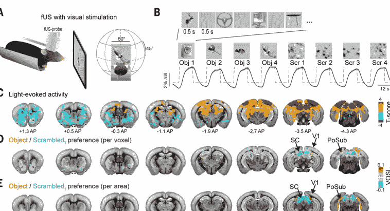

通过对响应图像进行扰乱（对象随机乱，Object-scrambled）产生了对视觉对象的偏好；`PO` 和 `RSC` 中的神经元表现出对视觉对象的偏好。`V1` 和 `RSC` 皮层对视觉对象没有产生反应，尽管根据一致性结果，存在一种趋向“对象随机乱”的合并趋势（图 2d）。对于所有五个区域，重现了对视觉随机乱对象的 `FS`（发放空间频率）偏好，且在两种编码修改下，物体与视觉对象之间存在强相关性（图 2e）；皮尔逊相关系数 (`R`) = 0.97。在差异性变换之间没有发现显著差异（图 2f 至 H）。从现在起，我们考虑了对随机乱图像和非随机乱图像均表现出视觉物体偏好的区域；`PO` 和 `RSC` 属于这种情况（图 2c, G 和 H）。相比之下，`V1` 和 `V` 对物体没有偏好（图 2e）。这五个区域神经元的通用特征是响应视觉刺激的时间长达 50 ms。

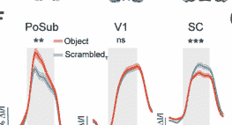

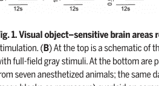

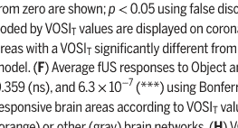

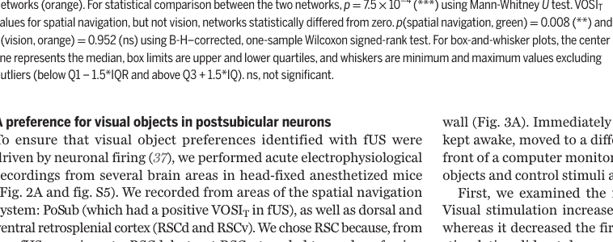

图. 1. 通过随机乱图像揭示视觉物体敏感区域；(A) 视觉刺激随机乱的示意图。(B)带有全场灰色刺激的随机乱图像示意的时间线。底部是每个刺激块的汇总 `FS` 响应（± SEM）（n = 56 只麻醉动物；所有位置使用相同的数据）。(C) 在皮层脑图像位置上重建的视觉聚焦 `FS` 响应（所有图像块均为行）。T 分数通过假性发现率 (F) 校正混合模型来识别与零的显著性差异。(D) 识别出视觉活跃细胞（蓝色）表现出对视觉物体的偏好。(E) 对对象和随机乱图像的视觉聚焦 `FS` 响应；来自 `PO`、`V1`、`V1` 和 `RSC`。使用 Bonferroni-H 混合模型，右侧显著（p<0.001; 0.359, n=6 和 n=100）。(F) 随机乱（橙色）或其它（绿色）网络视觉偏好的排序排名。(G) 比较两个网络之间差异的空间偏好，使用 Mann-Whitney 检验，p = 7×10⁻⁵。(H) 空间偏好用于形成值，网络与零的差异不显著，使用 Wilcoxon 符号秩检验，z(spatial) p=(0.008) 和 p=(0.952)。对于排名须，中心是最大和最小值轮廓（由 CI 95% – -15 和 +135 标出）。

为了确保视觉物体是由视觉驱动神经元 (37) 识别的，我们对头部麻醉的小鼠的多个区域进行了电生理记录（图 2a 和 5）。从空间系统区域——`RSC`（对视觉对象有偏好）以及背侧流和侧流——我们从实验中记录了数据，`RSC`，但 `RSC`；趋向于对象图像的偏好。

我们将 `FS` 响应与单单元脉冲响应进行比较，重点关注对物体和随机乱图像偏好之间的差异（图 2, c 至 E）。对于单细胞，我们测试了

(III) 在不同环境中开放场记录中，这些记录被移动到额部显示器的不同部分，头部处于训练状态，并被证明适用于麻醉动物。

首先，我们检查了光激活神经元的速率。视觉刺激增加了某些神经元的速率，但视觉刺激并没有降低麻醉动物中 `Ph` 神经元的速率，且 `PO` 中暴露于视觉的神经元在瞬态中没有偏移，并在生理记录中对视觉对象显示出 off 响应，对视觉物体的偏好是特定于视觉调节细胞的（图 3, C 和 D）。

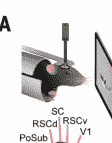

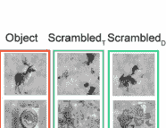

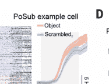

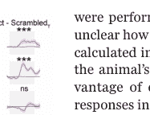

在不同的环境中进行，不清楚移动条件下偏好的方向是如何保持或利用系统中的群体响应的。有持续锚定 (4) 的几个特征。首先，只有具有相似偏好方向的细胞才能被激活。其次，具有相似偏好方向的细胞在不同环境中保持不变，使得比较环境之间的响应成为可能。我们测试了即使在旋转时，`HD` 细胞是否仍然保持不变，表明 `HD` 细胞在视觉调节中具有特定性（C, D）。

`FS` 响应与单单元脉冲响应的比较，重点关注对物体和随机乱图像偏好之间的差异（图 2, c 至 E）。对于单细胞，我们测试了

`FS` 响应与单单元脉冲响应的比较，重点关注对物体和随机乱图像偏好之间的差异（图 2, c 至 E）。对于单细胞，我们测试了

在此这里，大多数负调节的 `HD` 细胞位于 `HD` (FC)。

此外，using visual responses of `HD` cells with scrambled stimuli for using `FUS` (`V0`; x, mean = 56 sessions) and directions (x, y, mean, which are the same as the (G) and (F) The (C) and (D) show object and scrambled pointing towards the stimulus, and (0.456 RSC) Wilcoxon signed-rank test are the same (mean [solid line ± and p values from the five different regions (mean [solid line ± p values are the same as for (A) and for (B)).

我们接着检查了视觉刺激对 `PO HD` 细胞偏好方向的不同影响之间是否存在关系。我们关注了对 `PO` 具有偏好发放方向的 `HD` 细胞。对于任何给定的动物，我们记录了呈现给 `HD` 细胞和环上每个位置细胞的方向发放率。

对于 `HD` 细胞，我们观察到环上正响应的聚集。正调节的细胞对具有相似的偏好方向。

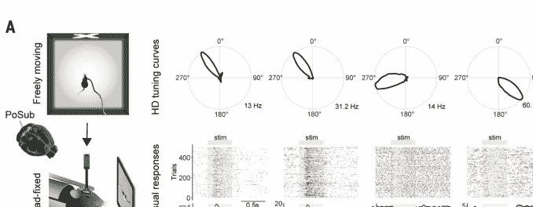

所有被感知单元的视觉输入，并对每个模型相对于中心的角距离诱发了差异化影响（图 4L）。模型重新计算了实验数据，视觉输入导致编码头方向（`HD`）的模型单元的放电频率增加，而编码远离中心 `HD` 的模型单元的放电频率减少。这些结果对参数的变化具有稳健性（附图 S1）。即使在视觉刺激被抑制以导致全局输入减少时，这种效应仍然存在。

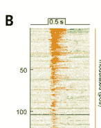

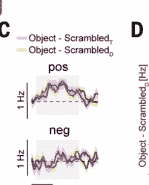

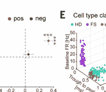

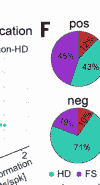

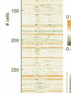

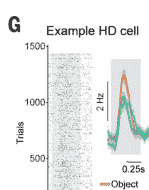

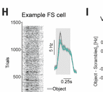

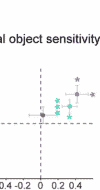

在前几节描述的视觉实验是在头部固定的条件下进行的。自由移动 `HD` 细胞的视觉实验是否保留了我们对呈现地标时时间点的分析？为了测试这一点——一个睁开眼的视觉模型——我们通过让动物背对地标（离开地标，Off landmark）来调整其方向。在确保 `HD` 分布在两种情况下都被编码的同时，眼球运动是长度锁定的，并稳定地移动以稳定视野（图 S47）。我们的分析显示，视觉模型从平均 `HD` 频率中减去离开地标的频率，并根据离开地标频率进行归一化。偏好方向与地标方向对齐（0°±40°）的 `HD` 细胞频率显著高于那些编码与地标不对齐方向的频率（180°±140°，附图 S5）。这是因为当小鼠面对地标时，对齐地标的 `HD` 细胞放电率更高（图 5C），而当

图 3. 下后区（PoSub）中的 `HD` 和感觉神经元对视觉物体存在偏好。（开启 On A）是实验范式的示意图。在自由移动的世界中，安装的地标是一个白色。在 `PoSub` 中记录的四百个 `HD` 细胞的右极（顶部）以及相同 500 个随机选择的视觉刺激（扰动）的响应，均以速率相对于相位绘图（底部）。（B）动物（来自额部的 n=319 个细胞）`PoSub` 中所有记录细胞的平均诱发响应，由响应强度驱动。神经元用绿色突出。绿线（均值 S）带有阴影区域，代表对物体导向有正向或负向调节的神经元；物体响应（n=129 和 n=65）对应具有正向调节神经元的 `HD` 细胞，其物体导向（均值 S）范围为 4 到 15°±30°（*** 和***），以及物体导向范围为 1 到 120°±30°（*** 和***），以及物体导向范围为 0.97 m（n=94），使用了经 HC 校正的 Wilcoxon 秩和检验（n=129 和 n=65）；对应具有负向调节神经元的 `HD` 细胞，其物体导向（均值 S）范围为 15 到 160°±30°（***）以及物体导向范围为 120 到 180°±30°（***），基于基础放电率、视觉刺激（顶部）和 `HD` 相（位）。细胞类型（位）由基础放电率确定，视觉调节神经元（右侧）是头部固定条件下 `HD` 细胞放电率与自由移动条件对比的示例。

我们使用递归神经网络（`RNN`）对我们进行建模，正如我们之前在模型单元在环形架构中生成时针对特定调节实验所证明的那样（45, 46），且 `RNN` 活动取决于环的强度（45）。在这里，`RNN` 的单元通过匹配代表 `HD` 的 `HD` 吸引子内的活动生成（图 4, J）。我们检查了 `PoSub` 的视觉输入作为 `RNN` 网络输入的影响（46）。


通过在小鼠中使用融合的头部固定和自由移动电生理记录，我们在双地标环境中的 HD 细胞中得到了两个核心结论，一个来自我们在头部固定实验中使用的物体集合，另一个通过前一段所述的视觉响应实验，对于地标和地标，我们发现 HD 细胞的放电率在视觉物体下显著增加（图 5G），但没有 HD 的。

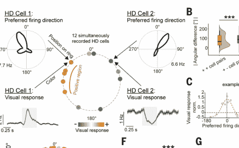

与人类和灵长类动物不同，我们的脑干没有显示出对视觉物体更强的偏好。尽管视觉视野引起的空间分辨率限制（~250 µm）和图像配准限制可能会阻碍小脑区域检测视觉物体，但我们的兴趣在于小鼠腹侧流单细胞成像未能揭示单个神经元

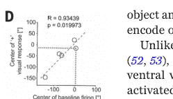

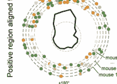

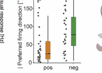

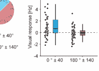

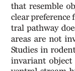

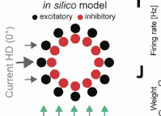

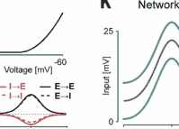

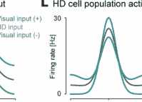

图 4. 视觉相似性展示了具有偏好方向的 HD 细胞。（A）我们如何模拟视觉响应和偏偏方向的放电速率的示意图。放电速率由左侧的角度（C）所示。（B）受视觉刺激（或角度）调节的 HD 细胞与左侧未模拟数据（为 12°）之间的偏好方向差异。（C）受视觉刺激（或角度）视觉调节的 HD 细胞与左侧未模拟数据（为 12°）之间的偏好方向差异。（D）使用 Mann-Whitney U 检验比较 0°、45° 或 180° 的偏好方向和放电速率（n=50 和 n=77）（p = 1.3 * 10^-4），比较偏好方向（HD 左）和速率（HD 右）。红色虚线代表物体的平均曲线。（E）对于每个示例，视觉物体的平均响应与偏好方向对齐。（F）在中心区域，所有球体和方向点的腕部平均响应。（G）使用 Mann-Whitney U 检验比较调节细胞（n=50 和 n=77）之间的偏好方向绝对差异（p = 2 * 10^-5）。

首先，在脑区的平均活动水平上，视觉空间区域对视觉物体或相同图像的覆盖版本表现出偏好。直接编码 HD 的视觉输入：视觉物体显示出偏好方向指向干（57）的 HD 细胞放电率，并可能响应视觉物体。两个区域都是参与声音和视觉过程的已知层（14, 58）。对于特征对齐、分配信息HD信号（59, 60）至关重要，RC

[第 6 页]

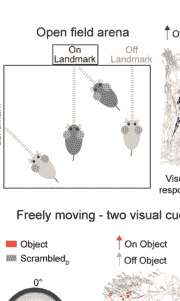

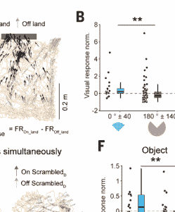

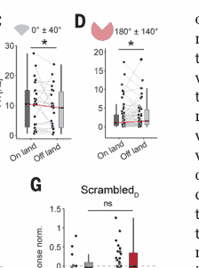

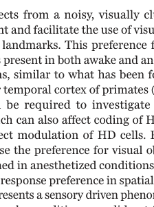

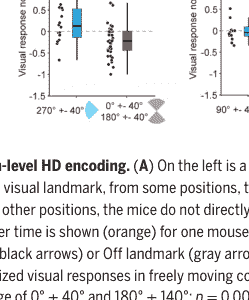

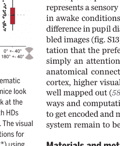

图 5. 视觉动力学精细微调 HD 编码。（A）左侧示意图显示了 HD 如何利用某些位置的视觉线索，线索是地标（蓝色），在头部固定的情况下，视觉线索（红色）是地标驱动的。（B）视觉动力学精细微调的 HD 细胞精细微调编码。（D）使用 Mann-Whitney U 检验比较 0°、45° 或 180°（p = 1.3 * 10^-4）的偏好方向和放电速率（n=50 和 n=77），比较偏好方向（HD 左）和速率（HD 右）。红色虚线代表物体的平均曲线。（E）对于每个示例，视觉物体的平均响应与偏好方向对齐。（F）在中心区域，所有球体和方向点的腕部平均响应。（G）使用 Mann-Whitney U 检验比较调节细胞（n=50 和 n=77）之间的偏好方向绝对差异（p = 2 * 10^-5）。

### 方法

#### AVIS 记录环节
对于 AVIS 记录环节，所有动物通常都习惯了头部固定的环境。在最初 1 到 2 天，我们允许进行 Rig 行为。在接下来的 5 多天内，头部固定的时长从 10 分钟增加到 60 分钟。

在记录开始前的 2-8 小时运动巡游期间，将探针降至头部肌肉结构下方。使用 26 通道系统（Intan Technologies Headboard Interchanger and with）记录软件以 20 kHz 的频率记录神经生理信号。

fUS 成像使用 32 通道矩阵探针（15 MHz，1024 通道，分辨率：220 x 175 µm；Vernon）采集，该探针连接到 Vantage 256 系统（Vernon, Inc.）并接入自定义 fUS 采集模块（Intan AUTC）。多路复用器通过硬件软件缓冲将 1024 通道探针与 256 通道系统连接。

小鼠在自由移动实验中的行为通过安装在头骨上的红外标记物进行追踪。数据使用 30 台红外相机和 20 台运动相机系统（Optitrack）进行记录。行为通过额外安装的相机进行捕捉。行为追踪以 120 Hz 的速率获取，并通过 Intan USB 接口与 fUS 采集同步。

头部固定在头部固定管中，探针通过机械手移动。fUS 记录在 FCM 线圈下进行，并用温度控制保持在 37°C。通过一个小石英窗观察小鼠。复合超声图像是由 -45°、-3°、-1°、0°、1°、3° 和 45° 平面的叠加而生成的。功率加权 fUS 图像是由 160 张复合图像的非相干图像生成的。数据重构是使用分解算法实时完成的。仅有 20% 的显著信号被重建。

图像在 60 cm 的显示器（Dell U2415）上以 60° 的尺寸呈现，图像中心位于宽度 -30° 和仰角 +20° 处。显示器放置在小鼠前方。在实验中，我们采用了 12 组设计，每组 8 个刺激，持续 12 秒（总计 12 分钟，组与组之间间隔 30 秒）。刺激随机顺序呈现。每次记录持续 10 分钟，持续 5 秒，并与至少 0.5 秒的间隔交叉。

数据使用硅探针（Cambridge NeuroTech，III 型）通过 SPI 接口（Intan Technologies）以 20 kHz 记录。探针插入 USB 接口板。FCM 固定在头部固定管中，通过机械手的坐标系控制探针。在记录阻抗稳定性后测量性能（0.5 分钟）。在记录开始 10 天后对 2 个脑部进行记录。不同日的实验话使用钨钢插管固定。在植脑前或识别记录位后，使用 CM-DM（Thermo Fisher, Cambridge）来稳定探针。

#### （慢性）麻醉下的硅探针插入
动物使用 5% 异氟烷进行麻醉并使用立体定位仪进行准备。手术期间，我们维持 1-2% 的异氟烷浓度。我们在切口处或放置于立体定位仪时给予皮下注射 (-0.8 mg 体重) 和美比妥（20 mg/kg，皮下剂量为 1 mL）。

在目标区域进行开颅术，创建一个略大于探针插入孔的孔洞，位于 Bregma 外侧 0.1 mm 处。我们记录了坐标：AP（来自 Lambda）+0.3、-2.35、-0.10。探针被小心地固定在位置并使用牙水泥（Unif Tread）锚在头骨上。为了减少记录期间的电噪声，使用牙水泥（Postite Funio）在头骨上贴网网。

手术后，我们进行皮下注射并放在头垫上直到完全恢复。术后，动物单独饲养并接受为期三天的每日卡洛芬注射。动物允许在术后恢复 7 天后再进行进一步检查。

图像被缩放为 1024 x 1024 像素，背景为深灰色。对于这些图像，我们创建了复合图像并使用描述的纹理统计（36）结合 25 个通用特征提取了统计数据。借此，我们通过匹配起始图像局部特征（涡度、线性响应等）的排列组合，在不考虑空间位置（33）和（34）的情况下生成了扰乱图像。此外，还对图像进行了修正，并使用 SHINE 工具箱（81）增强亮度。最后，为了避免边缘效应，使用了小的边距。对于电生理实验，我们还通过两种方法演示了全振幅谱（match.m）以及亮度（match.m）。

#### 瞳大小
在清醒头部固定小鼠的功能性记录期间，通过视频观察瞳孔。为此，我们使用了带有红外滤波器的光和单色相机（BlackSentry）。数据在小鼠水平汇总。视频由视觉刺激的融合触发，为了分析，每个池大小被归零，以考虑刺激呈现的波动。然后减去平均池大小以获得刺激或扰乱刺激的平均响应。使用了一个非常短的窗口（从刺激开始到结束）通用刺激窗口。

所有分析均使用 MATLAB 或 Python 完成。

#### fUS 预处理
电生理记录使用 Phy 软件（https://github.com/kelly/phy/）处理和分析。只有对刺激显示并出高质量响应的单元纳入分析。为了估计刺激帧，单单元事件以 100 ms 的分箱大小进行分箱，并有 2 ms 的零重叠。使用 10 ms 的高斯核进行平滑。对于除试验，对散点图取平均。使用 Graph toolbox 绘制散点图。

为了评估体素水平的激活，在时间上（前向和滤波）并使用 MATLAB `glfit.m` 的通用线性模型（GLM）处理 fUS 数据。模型包含带有单血红蛋白响应函数的视觉刺激块。生成的 T 分值跨动物/会话取平均，并绘制在 Allen 脑图谱上（根据阈 p 值，见下文）。为了比较激活，我们对所有 fUS 和试验平均（相同类型的刺激；或纹理）数据进行分割到各个区域。对于动物，Allen 脑图谱中的区域在 100 次试验中取平均。每个区域内的所有体素取平均。接下来，计算刺激与每个脑区 fUS 信号之间的相关性。为了移除仅对纹理物体响应的区域，我们排除了两者都有的会话。对于显著 p 值，我们排除了如下定义的三个相关性中的一个或多个。

同样，为了找到物体和刺激之间的差异，我们平均了从处理后的试验平均数据中计算的两种响应类型。为此，我们计算了响应窗口期间的曲线下面积，并从刺激开始处减去每次试验的归一化响应。我们平均了每个动物的所有响应数据，所有试验直到单个响应。响应窗口的开始定义为刺激的开始。结束定义为响应下降到峰值响应 70% 的点（由于时间动力学不同，fUS 为 30%）。这种方法没有产生有意义的响应窗口。

黑色和白色正方形（30×30 像素）在屏幕的 12 个不同位置（三个仰角加五个方位）以随机顺序闪烁。每个位置重复 20 次。刺激持续时间为 200 ms，间隔 200 ms。我们使用 0.5 是因为对于任何区域，2 ms 分箱的响应都大于 1 Hz。为了分析屏幕上多少位置导致了激活，我们通过比较来自刺激的发放率（Wilcox 符号秩检验，B 检验）测试了峰值周围的分箱发放率。

具有不同空间频率的黑白正方形以两种方向（水平和垂直）呈现，刺激区域位于 60° 角，中心位于 0° 和 +60° 方位，并显示 50 ms 的 0.5 全场灰。每个刺激显示 20 次。对……具有显著响应

分析中包含了一种刺激（Wilcoxon 符号秩检验，经 FDR 校正）。对于每个细胞和刺激，计算了响应窗口内的最大放电率。这产生了细胞特有的偏好调优曲线（代表偏好刺激），为了视觉化不同的速率，该曲线被缩放至 0 到 1 之间。

调制组被分配了正向响应（相应地，负调制细胞也是如此）。为了视觉化环形 F4 中相对于细胞头部方向调优（活动凸起）的响应，将所有小鼠的细胞根据其偏好方向分入 20 个角度箱。随后，对平均值（虚线）后的响应进行了归一化（0.1 缩放因子）。

呈现了 20 次全长度的啾啾刺激，其穿插了 10 次全场灰色。刺激强度随着频率从 0.3 Hz 增加到 8 Hz，而平滑地从黑色变为白色。对幅度大于 3 Hz 的刺激进行了分析。针对啾啾刺激，使用 i-D 小波变换（MATLAB `cwt.function`）对每个细胞的归一化放电率进行分解。随后，在分析所有频率后，在最后一次啾啾刺激之前，预测试刺激 5 ms 以下的功率代表了细胞响应的最大频率。

在每只小鼠中，我们观察到具有头部方向调优且活动增加的细胞（活动凸起）。这种活动在每只小鼠中是稳定的，因为从自由移动切换到头部固定装置时不存在系统性映射。按照要求，我们使用了在 0° 附近强调制的 HD 偏好方向。例如，在每只小鼠中，将细胞偏好方向的平均值与视觉刺激进行比较，然后减去

HD 调优曲线的计算方法如前 (4)。简而言之，追踪动物头部的标记并连接到水平方向（方向的偏角）。偏角在坐标 (i) 中测量（与环境轴对齐，在整个研究期间保持一致）。HD 调优曲线通过在每个方向上花费的时间比例生成，使用 1° 的箱和高斯核（3 个标准差）。细胞的偏好方向定义为调优曲线的平均值。

为了确定一个细胞是否对头部方向调优，我们按照之前的描述 (6) 使用了这种方法：

```
$i = \frac{\lambda(\theta)}{\sum\lambda(\theta)} \times p(\theta)$
```

在这里，$n$ 代表细胞在第 $i$ 个箱 $\theta$ 中的总速率，$\lambda(\theta)$ 代表神经元在选择期间的平均放电率，$p(\theta)$ 表示 $\theta$ 的占用率（在 $\theta$ 中的平均时间）。信息率（以每秒比特表示）随后通过平均放电率进行调整，以符合细胞指标（头部方向，以比特为单位）。

PoSB 细胞按照之前的描述 (4) 进行分类。简而言之，运动期间放电率高于 10 Hz 且峰持续时间短于 0.4 ms 的细胞被分类为快速旋转神经元。相反，放电率低于 10 Hz 且持续时间 0.4 ms 的细胞被分类为慢旋转神经元。该组进一步分为 HD 细胞（头部方向信息高于 0.1 bit 的 HD 细胞）或慢 HD 细胞（头部方向信息低于 0.1 bit）。所有其他细胞均被排除。

为了确定细胞是受视觉呈现的正向还是负向调制，我们使用 Wilcoxon 符号秩检验比较了该细胞在所有试验中刺激关闭 期间的平均放电率。校正 p 值（B-H 相关性）和更多

使用了与上述实验相同的测试，在该实验中线索被放置在彼此间隔 160° 的两个墙上。视觉图像为单色和双色屏幕，用于头部固定装置的实验对象（被显示在图表上）。窗口宽度为 15 cm，物体或扰码物体为 13 cm。然后，我们只在动物看向视野时计算点。

视角，仅在点头部方向指出的位置或至少在线索处（θ < 45°）。正如文所述，标记了开启（On）和关闭（Off）的头部方向并计算了归一化的视觉响应。根据实验设置，我们将与物体对齐的偏好方向（270°指向细胞）与偏好方向与同形角对齐的细胞细胞（90°指向细胞）进行了比较。然而，偏好方向不对齐的细胞在某些情况下（0° 和 180°指向细胞）是相同的。

这由一个在 θ<sub>min</sub> = 0 处的计数、具有高 V<sub>max</sub> 和幅度的 M 不确定分量组成。我们假设头部的 I 和 M 单元受到刺激的驱动强度相等。

每个神经元的最终发放率是其取向的幂律函数。

```
$V(θ) = V_{max}e^{-|θ-θ₀|}$
```

参数取自 (46) 中的定义（见表 S7）。为了测试结果的稳健性，从均匀分布中采样了 12250 个具有不同权重的神经元群体（见表 S7）。对于每个输入 HD (0°) 的神经元，通过输入的小变化 (Δθ=) 计算了与 HD (0°, HD-场) 对齐以及与该 HD (180°) 对齐的神经元速率变化。

对于每个 HD，均呈现所有的试验和刺激以获得神经元的整体响应。响应延迟定义为神经元发放率上升到前一次标准差两倍的点。

在慢性记录的情况下，撤回电极以移除探针。将大脑取出并在更换溶液为 30% 蔗糖磷酸缓冲盐溶液后保存 4 小时。在 -20°C 下冻结后，使用冷冻切片机以 50μm 的厚度对大脑进行冷冻切片。

切片用 DAPT 染色并置于 Mifogli 培养基。含有探针的切片与抗 IIIβ 一抗体 (1:200) 和标记有荧光团 488 的二抗体在 4°C 下孵育过夜，随后——

使用荧光显微镜获取神经元的图像和硅探针的轨迹。

在急性记录的情况下，神经元收集在 ACSF 溶液中。大脑经过清洗并包埋在 4% ACSF 中。使用振动切片机（Vibrotome TX）切成厚度 100μm 的冠状切并用 DAPT 染色。

使用带有 20x 物镜的 Leica TCS 激光共聚焦显微镜捕捉图像。使用 LAS 软件和 Adobe Photoshop 进行处理。

上层环状网络模型 (46)，细胞连接网络 N=50 和 N=51 神经元被放置在 θ = [-π, π] 的环周围。以下方程描述了

```
$V_i = V_{rest} + V_{max} - \sum_{j} W_{ij}(V_j)$
```

其中 $V_i$ 和 $V_j$ 分别指在 θ₀ 和 θ 处的单元神经元的膜电位和电流，$V_{max}$ 是外部输入，$W_{ij}$ 是从 θ₀ 到 θ 的突触连接强度，其固定值使得权重 $W_{ij}$、$W_{ji}$ 和 $I$ 的之和为

```
$I_{h}(\theta_0) = I(t) + I_{max} \left[ \frac{\cos(\theta - \theta_0)}{\sin^2\theta} \right]$
```

- 1. J. Keck, and J. Harvey. 猕猴皮层在自由运行期间活动的空间图。Nature 274(5681): 317–321 (1986). doi: 10.1038/274317a

- 2. S. J. Rau, U. B. Müller, and J. Banks. 小鼠下顶盖下区的头部方向细胞。Science 281(5379): 925–928 (1998). doi: 10.1126/science.2819925

- 3. T. Haft, M. Simon, G Müller, M. E. Moser, and I. Strohl. 猕猴视觉皮层的空间和方向选择性。Nature 436(7052): 806–809 (2005). doi: 10.1038/nature03721


## 参考文献

- 4. E. C. Taylor, M. Gauss, and R. Jensen, L. E. Moser, and M. B. 猕猴视觉皮层的头部调调。Nature 441(7094): 763–768 (2006). doi: 10.1038/nature0532

- 5. S. J. Burgess, R. Jensen, and L. E. Moser. 猴类导航期间的头部方向细胞。Nature 425(6981): 247–250 (2003). doi: 10.1038/nature0113

- 6. Y. J. Yang and S. Y. Chen. 视觉皮层的功能图。Science 313(5790): 2055–2060 (2006). doi: 10.1126/science.112934

- 7. G. J. Glyn, M. J. Hassler, and P. B. Matley. 从物体到地标：下顶盖下区的视觉信息。Journal of Front. Neurosci. 3(4): 1093–1100 (2009). doi: 10.3189/jnnc.2009.13

- 8. R. K. Müller, J. Keck. 海马复合体发放率的变化。Science 271(5249): 1958–1961 (1995). doi: 10.1126/science.271529

- 9. U. B. Müller. 下顶盖下区的头部方向细胞。Journal of Neurosciences 28(12): 4442–4450 (2008). doi: 10.1553/JNEURO.0424-07

- 10. K. J. Leavy. 海马形成的学习与稳定性。Nature 377(6536): 667–668 (1995). doi: 10.1038/377668

- 11. A. K. Ainhauer, S. Pétrigl, and A. D. Okan. 内嗅皮层和海马中的视觉现实和 theta 锁定细胞。Nature Commun. 13(1): 5432 (2022). doi: 10.1038/s41467-022-3351

- 12. L. F. Fisher, R. Jensen, E. Buluk, and F. Haft. 内嗅皮层的视觉信息表示。eLife 9(5): e09518 (2014). doi: 10.7751/elife.09518

- 13. J. J. Decardi, C. Ortiz, and N. Rust. 大脑如何解决方向问题？Nature Communications 10(1): 2216 (2019). doi: 10.1038/s41467-019-1216

- 14. L. Winter, M. Mishkin, and A. Vidal. 视觉皮层的神经编码。Cell 168(5): 1003–1012 (2017). doi: 10.1016/j.cell.2017.0402

- 15. S. Tadmori et al. 侧额皮层视觉刺激转换的效率。Nature 574, e22974 (2019). doi: 10.1038/s41586-019-2263-7

- 16. E. Miller et al. 大脑中的视觉。2020.05289 (预印本 (2021)); https://doi.org/10.21504/ebvo.2020.05289

- 17. J. Y. Shin, H. Sharma, C. R. Smith. 侧视觉区运动和特征的选择性表示。Brain 138, 2810–2820 (2015). doi: 10.1093/brain/aw066

- 18. R. Tong et al. 视觉大脑。2021.03365 (预印本 (2023)); https://doi.org/10.21504/ebvo.2021.03365

- 19. D. Zocan, N. Itzelberg, J. Duncan, D. C. Cohen. 人类视觉刺激的生成模型。Proc. Natl. Acad. Sci. U.S. 116, 935–940 (2019). doi: 10.1073/pnas.18093316

- 20. J. H. Ivory, V. Weber, M. C. Milner. 晚记忆捕捉期间视觉驱动注意力控制。Brain 236, 2046–2052 (2023). doi: 10.1093/brain/awac019

- 21. E. Macht et al. 视觉系统的功能组织。Nat. Neurosci. 8, 662–674 (2005). doi: 10.1038/nn10113

- 22. C. Bruner et al. 人类脸体识别中的功能性视觉整合。Proc. Natl. Acad. Sci. U.S. 117, 19447–19452 (2020). doi: 10.1073/pnas.191811417

- 23. 灵长类中的双极视觉整合通路。PLOS ONE 12, e0183364 (2017). doi: 10.1371/journal.pone.0183364

- 24. S. D. Oshman. 人类视觉中视觉处理的层次结构。Nature 414, 67–71 (2001). doi: 10.1038/350700

- 25. Y. Yao et al. 灵长类皮层的空间表示。Nature 508, 1038–1043 (2014). doi: 10.1038/s41586-014-2290

- 26. N. R. Luck, J. Duncan. 人类视觉搜索中的注意力。Science 313, 969–972 (2006). doi: 10.1126/science.112952

- 27. J. J. Rich et al. 决策期间视觉的后向整合。Neuron 32, 1019–1028 (2012). doi: 10.1016/j.neuron.2012.062

- 28. A. N. Duncan. 谐波相位血流的空间分辨率。J. Neurosci. 30, 2758–2790 (2010). doi: 10.1523/JNEURO.0443-09

- 29. K. H. Seo, M. K. Sargent. 猕猴眼手运动协调。Nature Communications 14, 3918 (2023). doi: 10.1038/s41467-023-3770

- 30. R. Liu. 基底节对眼动运动的自主控制。Neuroscience 27, 772–778 (2004). doi: 10.1038/nn3633

- 31. Y. J. Kim et al. 基底节对眼动运动的控制。Brain 136, 2111–2125 (2013). doi: 10.1093/brain/awt190

- 32. S. S. Cardoso et al. 基底节在注意力中的作用。Nature Reviews Neuroscience 8, 675–686 (2007). doi: 10.1038/nron511

- 33. J. R. Miller et al. 猕猴前额皮层的侧侧运动组织。Nature 411, 716–720 (2001). doi: 10.1038/35073

- 34. D. B. Sun et al. 运动运动皮层对运动控制的作用。Nature 15, 1250–1261 (2012). doi: 10.1038/nn2506

- 35. G. Yamashita et al. 前额皮层中多巴胺信号的动力学。Nature 9, 846–850 (2006). doi: 10.1038/nn511

- 36. N. A. Sato et al. 猕猴运动计划的功能性表示。Science 287, 3268–3273 (2000). doi: 10.1126/science.28753

- 37. D. Keeler, E. T. Akay, and G. Wagner. 猴类社会行为的视觉方面。Brain 131, 509–524 (2008). doi: 10.1093/brain/aw364

- 38. E. J. Miller et al. 人类追视中的眼头协调。Brain 130, 3431–3445 (2007). doi: 10.1093/brain/aw042

- 39. A. H. E. McNaughton. 自由运动中视线控制的动力学。Eye 125, 7554–7568 (2019). doi: 10.1098/eye.19.54

- 40. C. J. Liu et al. 左半球维持的人类视觉行为。Eye 108, e70308 (2020). doi: 10.1016/j.eye.2020.e7038

- 41. B. Cohen et al. 面部区：人脸的模型。Nature Neuroscience 17, 4302–4317 (2014). doi: 10.1038/nn3933

- 42. A. D. Hey, R. S. Stanley, A. D. Anderson, and M. E. Moser. 环状回路的物体视觉控制。Nature 454, 1038–1043 (2008). doi: 10.1126/science.11538

- 43. B. Brunner et al. 猕猴区内人脸和注意力的环状回路的功能性整合。Brain 138, 871–886 (2015). doi: 10.1093/brain/aw290

- 44. T. N. Han, J. W. Hu, J.-H. Shin, and C. M. Kim. 猕猴视觉区视觉注意的MRI响应。Nature Neuroscience 11, 2254–2262 (2008). doi: 10.1038/nn2172

- 45. E.-H. Galález, M. 人类导向注意力的行为与调制。Nature Neuroscience 27, 223–238 (2014). doi: 10.1038/nn3863

- 46. S.-L. Ding. 人类注意和记忆中前额叶下弓、下齿和旁海马的解剖学。J. Neurosci. 52, 9993–10000 (2002). doi: 10.1523/JNEURO.52.9

- 47. A. S. Alexander, P. Rice, J. M. Staristi, and E. R. Ditch. 视扫动和注意力的视网膜表示。Nature Neuroscience 11, 1155–1160 (2008). doi: 10.1038/nn1155

- 48. J. P. Petty, et al. 人类眼动运动中的地标导向头部方向。Nature Neuroscience 23, 2781–2798 (2020). doi: 10.1038/s41593-020-1118

- 49. K. H. Kim, J. J. Donnelly. 前额叶和顶顶叶对头部方向系统的地标控制。Brain 128, 2018–2033 (2005). doi: 10.1093/brain/aw001

- 50. S. G. Müller, I. E. Regter. 前额叶对视扫运动的区域控制。Nature Neuroscience 5, 1454–1460 (2002). doi: 10.1038/nn766

- 51. J. S. Taube. 头部方向信号和感觉运动整合。Nature Neuroscience 19, 17411–17428 (2016). doi: 10.1038/nn4396

- 52. F. Galgó, et al. 皮层中位置、方向和速度的功能表示。Science 312, 758–762 (2006). doi: 10.1126/science.112557

H.-V. Hu, A. T. Chaplin, A. J. Davies, R. Mena, M. G. Rocha. 皮层中用于增强视觉感知的局部区域。Nature Communications 13, 3597 (2022). doi: 10.1038/s41467-022-329905-5

M. R. Gray, et al. 人脑中细胞表示与树状化。Brain Bull. 228, 217–219 (2018). doi: 10.1016/j.cbrain.2017.11.006; 2918413

K. S. Rockstrand. 视觉系统。猫脑中的预测-视觉区细胞。Brain Bull. 222, 85–92 (2018). doi: 10.1016/j.cbrain.2017.01.006

H. Tanaka, K. Manamura. 猕猴颞下皮层感受细胞的视觉属性。Cortex 11, 3084–3099 (2001). doi: 10.1097/0000-2440-200107000-00015

T. Dalwig, L. Esch, R. R. Azededo da Silva-bostov 2021.02.11.67850 [Pre印] (2021). doi: 10.1101/2021.0211

S. V. Gong, et al. 猕猴腹侧和背侧感觉流皮层-皮层连接的大规模映射。Nature 508, 247–252 (2014). doi: 10.1038/nature13186; 2446259

X. J. Yang, et al. 腹侧和背侧视觉系统中皮层-皮层连接的功能制图。J Neurosci. 32, 4386–4399 (2012). doi: 10.1523/JNEURO.0566-12-2042

A. M. Yates, et al. 低层图像属性的视觉控制：SHIBox：人视觉皮层高密度慢性电生理活动记录。Nat. Commun. 13, 503 (2022). doi: 10.1038/s41467-022-30825-y

A. Syeda et al. Facememap：通过人脑中持续面部追踪解码神经活动的框架。Nat Sci Rep. 11, 19223 (2021). doi: 10.1038/s41598-021-99233-0-46

L. Moreaux, J. Healy, and M. Melville. UMAP：用于数据可视化的均匀流形近似与投影。arxiv.org/abs/1801.02426 [stat.ML] (2018)。

P. Grafner. Matplotlib 中的绘图语法。J. Open Source Soft. 6, 3568 (2021)。

B. Dieghaeser et al. 视觉对象反映头部方向。Dryad (2025)。https://doi.org/10.5061/dryad.jr2n8sts11

# 致谢

感谢 L Mainville 提供的组织学样本，用于事后细胞鉴定。

感谢 T. Frank, A. Krishnaswamy, J. M. Martínez de Paz, P. Warden, T. Golitsch, G. Politte 和 N. Golia 提供的有用讨论和反馈。感谢 K Monondo 和 A Jordan 提供的技术支持。感谢 Rocha 协助数据收集。本研究受瑞士国家基金会（SNF）的资助：D-S 获得瑞士科学基金会早期博士后奖学金支持（项目号 25.041-19）。

我们感谢美国科学基金会（NSF）和美国研究网络的资助。本研究未使用任何联邦机构或商业营利资助机构的特定资助。A.R 获得欧洲研究委员会（ERC）Horizon 计划资助（项目号 832433）以及 ERC 协同资助（项目号 901033），以及美国科学基金会（NSF）的资助（项目号 1917458）。这项工作由马克斯·普朗克学会亚历山大·克莱泽基金（卓越战略 2019–2027）和德国研究基金会（DFG）资助（卓越集群交互与通信，DFG 项目 1678-1-1；DFG 项目 2933540）。

# 补充材料

science.org/10.1126/science.abj828

图 S1 至 S33，表 S1 至 S57；参考文献（86–102）；MDAR 可重复性检查清单

提交于 2023年11月29日；2024年4月18日接受。

10.1126/science.au9828
