# 漏洞管理（第二版）


献我的妻子 Katharina，感谢她的支持、坦诚、观点和奉献。


## 结记

### 11.5.1 节省时间

# 前言
漏洞管理（`VM`）已经存在数千年了。城市、部落、国家和公司都应用过其原则。任何机构在运营和工程上的成功都取决于识别和修复攻击者可能试图利用的漏洞的能力。曾经的小型社区变成了城堡。城市拥有了防御工事和先进的预警系统。所有此类措施都是一个群体意识到自己的脆弱性并以不同的方式进行处理的结果。今天，我们在软件系统、基础设施和企业策略中识别漏洞。这些漏洞通过各种且往往是创新的手段得到解决。

本书是为安全从业人员、安全或网络工程师、安全官或寻求理解漏洞管理及其在组织中作用的首席信息官（CIO）编写的指南。涵盖了漏洞管理的重点领域，以服务不同的读者。关于技术的章节可以为高管提供相关工作的高级视角，只要高管不尝试深入细节即可。其他关于流程和策略的章节虽然对高管很有帮助，但将为工程师或安全经理提供关于 `VM` 技术和流程在企业成功中作用的视角。

我建议任何对漏洞管理主题真正感兴趣的读者，完整阅读与其兴趣领域最相关的章节，并至少粗略阅读所有其他章节。如果对流程的各个方面没有长远的眼光，仅仅参与任何过程是不够的。经常，员工会担心自己在流程中的角色似乎毫无意义。希望本书的建议阅读方法能在某种程度上缓解这些顾虑。

# 致谢
致全球所有尽职的安全专业人士，对你们来说，成功意味着让组织免于麻烦。希望本书能够扩展你们对风险的观点，或帮助增强安全专业人士的实力。

# 关于作者
Park Foreman 是在 IBM Cloud Brokerage Services 的安全与合规架构师，在该职位上他设计安全控制措施以支持客户向云服务迁移的旅程。他是漏洞管理、事件管理和网络安全策略的公认专家。Park 拥有信息安全与保证硕士学位，并持有 `CISSP-ISSAP` 等认证。他最初在大学期间通过研究操作系统内核安全设计开始了他的信息安全工作，随后在贝尔实验室从事应用安全工作，并在银行和电信行业从事网络安全工作。

除了本书的第一版和第二版外，Park 還在 ISSA Journal 上发表过文章，并在安全会议上进行过演讲。在 IBM，Park 继续跨业务部门工作，开发新的技术和方法来保障云服务和应用程序。

# 第一章
# 引言
漏洞管理（`VM`）是一种识别、分类、修复和缓解漏洞的周期性实践。这是一个广泛的定义，对企业或政府实体具有影响，我们将在书中对此讨论。它不是一门新学科，也不是一种新技术。这项重要功能一直是军事和私营部门加强防御以及识别系统、流程和策略弱点的正常部分。

## 1.1 风险管理的角色
风险管理寻求识别可能损失的条件或事件，然后寻找处理该风险的方法。处理风险采取以下形式：

*   接受风险：即什么都不做，让其发生。这也被称为风险保留。
*   缓解风险：即防止其发生。
*   降低风险：即通过对事件投保等措施来减少后果。

在 `VM` 中，我们关注由于系统、流程和策略中的缺陷导致的风险。图 1.1 显示了 `VM` 与风险管理计划的关系。其目的是发现并处理由组织控制或影响的漏洞所产生的风险。风险管理中与其他事件概率分析和连续性管理相关的方面并不直接关注漏洞。

```
图 1.1 漏洞管理在风险管理框架中的作用。
```


漏洞管理（VM）通常关注于技术软件和系统配置漏洞。同时也存在与企业战略、经济和环境相关的漏洞，这些漏洞无法通过自动化进行检测。它们需要风险管理者的关注。这些漏洞存在于业务流程、策略和供应链等领域。业务的任何行动或计划都可能因为设计缺陷或缺乏适应性而被利用。识别并应对这些挑战是风险经理更深层的角色。在本书中，我们将主要讨论第一类漏洞；然而，对后者也会给予一些关注。

## 1.2 漏洞管理的起源

漏洞管理已经存在很长时间，但直到最近很少有人关注它。军队长期以来一直通过仪式和实践理解并完善了漏洞管理。从组织的防御和部署策略到单个士兵和武器，对防御的检查等同于审计。防御的递归训练、装备和重新调整是补救或加固的一种形式。但这些活动并非在对敌方一无所知的情况下进行的。

军事史学者可以轻易识别出一个对手是如何利用漏洞或战略性错误击败另一个对手的。这些胜利者通常被誉为天才，而失败者则被视为无能。例如坎尼战役，汉尼拔中中线崩溃包围了罗马人，以便他从侧面进攻，从而击败了他们。汉尼拔因这一经典战术被认为是天才。然而，人们也可能将其视为战斗中罗马执政官之一瓦罗（`Varro`）的缺陷策略。瓦罗认为罗马军队可以穿过汉尼拔前线中路，并将整条敌方战线驱向他们背后的河流。他没有考虑到的是维持统一战线的至关重要的纪律，而这无疑是一个漏洞。

然而，在商业世界，我们倾向于将未能对风险做好准备视为无能的例子。当一家公司通常被认为是强大、富富有并能够投入资源应对风险时，情况尤为如此。

作为一门 IT 学科，漏洞管理一直不成熟，用户对其应用也十分天真：不成熟是因为强大的、企业级的技术现在才开始可用；天真是因为人们尚未充分意识到对具有良好定义流程的完整集成解决方案的需要。尽管军事纪律在企业环境中可能并不必要，但纪律的缺乏会导致一个未被发现或未被补救的关键漏洞，该漏洞最终可能导致灾难性的损失。

## 1.3 介绍安全行业及其缺陷

并不意外的是，企业和政府都依赖新产品来为其网络“外挂”安全功能。安全行业一直侧重于销售需要升级和维护的产品和服务。如果出现了看似出现的安全问题，供应商就会开发出解决方案。当用户开始滥用网络端口以访问远程网络中的其他主机服务时，行业为我们提供了防火墙。当病毒成为一个问题时，行业为我们提供了反病毒软件和服务。当发现像像 `Sasser` 这样的蠕虫时，防病毒供应商在网络中加入了更多的防病毒功能。当内部应用程序成为更多目标时，便提供了应用防火墙。

遗憾的是，这些解决方案似乎很少有能解决核心问题。大多数安全问题源于在代码、补丁、配置或设计方面缺乏安全的方法。这在军事上等同于对部队缺乏训练。我的意图并不是贬低这些技术的使用。标准和认证很重要，但它们往往会分散我们对最核心问题的注意力：脆弱的软件、架构和策略。对于经过良好编写、测试、正确配置并结合稳健实践审慎部署的软件，没有长期的替代方案。

## 1.4 来自政府和工业的挑战

IT 部门面临来自世界政府的许多其他挑战。不同司法管辖区之间法律程度的差异了一个法律和运营挑战的雷区。跨国公司面临的挑战尤为。在某些国家，监管机构和工会会对入侵检测产生怀疑，理由是这可能是侵犯隐私。在另一些国家，收集特定用户的互联网浏览活动是强制性的，并且必须提供给当局。诸如美国《萨班斯-奥克斯利法案》（`SOX`）这样模糊而又严苛的法规，导致了大量价值低但成本高昂的安全控制。这使得在全球管理包中对网络进行主动防御成为一个更大的挑战，因为安全经理现在必须区分合规活动和那些带来真正安全的活动。

在这些基础上，还有安全控制的行业标准以及相关的认证和审计。字母表不断增长：`SAS 70`、`SOX § 404`、`ISO 17799`、`ISO 27001`、`PCI`、`FIPS`、`HIPAA`、`GLB`、`IEEE P1074`、`EAL`。

## 1.5 漏洞的来源

软件公司也是全球各地软件买家面临的真实挑战。他们的编码规范有很大的改进空间，基本设计也是如此。有些公司想要销售更多产品，因此在不保护之前构建的内容的情况下继续引入更多功能。开发了使用该协议的新电子通信协议或新应用程序。但他们从一开始就没有对该协议进行安全加固。供应商商在通知用户和发布补丁方面做得相当糟糕。问题在于动机，因为他们认为补丁是一项成本大于收益的投入，因为没有人为额外的开发工作付费。

## 1.6 缺陷型漏洞管理的示例


当我们执行漏洞管理（VM）功能时，通常是不心不专的。某公司曾尝试在整个企业中部署 VM 代理，作为支付卡行业（PCI）合规的手段。审计师告诉他们应该这样做，于是他们就做了，完全没有考虑其收益或影响。结果，唯一实质性的要求就是部署了这项技术。没有人考虑过之后会发生什么。诸如“我们在哪些主机上安装代理？”以及“我们需要优先修复哪些漏洞？”等显而易见的问题被忽视了。我称之为“**选择框安全策略**”。公司授权给某人，对方提供一份需要修复的清单，然后公司就照此合规。

这种安全方法的另一个明显问题是，一个可以帮助解决许多漏洞根源的工具将没有任何官方所有者。相反，在我的示例中，代理和服务器被安装了，但没有人去维护它们。无论你如何努力，维护工作不会自动发生。必须有人阅读报告、修复或重新安装组件或代理，并确保报告服务器保持健康。还必须有人监控整个系统，以确保其实现目标。这等同于部署了一支没有领袖的部队。他们的协作将非常糟糕且毫无效率。

### 1.7 为什么 VM 至关重要

对于一家公司来说，资源是非常有限的。它们在风险上的投入是有限的，因此早期的风险分析无疑非常重要。然而，我认为，不执行 VM 功能几乎没有借口。在尚未实施 VM 的情况下，将有限的资金花在入侵检测或安全事件管理上似乎很难证明合理。尽管 VM 涉及更复杂的流程和系统，但当需要防御的关键漏洞减少时，公司的风险概况可能会大不相同。

在本书中，你发现的远不止是对技术的描述以及关于如何启动它的几个技巧。你将从技术和流程两个角度深入理解 VM 的工作原理。两者缺一不可。技术工具是流程的促进者。你将在其上花费大量时间来理解这一点。对你公司环境独特性的经验将让你意识到，只有那些对拥有强大、安全基础设施非常认真的人才是必要的。其他任何事情都是浪费金时间。

你还将理解漏洞及其控制的战略意义。除了对单个主机或网络设备的关注，漏洞还可以存在于其他层面，只能通过调整技术战略来解决。这是组织和行业层面的风险管理，它超越了任何技术。

# 第 2 章 漏洞体验

## 2.1 引言

漏洞管理（VM）是一个完美契合诸如信息技术基础库（ITIL）框架以及国际标准 `ISO 17799` 和 `ISO 27001` 等所有其他管理学科的学科。这些学科通常是为了处理业务活动直接导致的某些现象的持续性。以 `ITIL` 框架为例，事件管理是一组由人员和技术支持的过程，用于处理 IT 基础设施的故障。这些故障不是基础设施及其底层服务的正常运行的一部分。

同样，VM 涉及管理由于 IT 组件的设计、开发、配置或质量控制不当而导致的漏洞。令人惊讶的是，IT 行业对管理这些漏洞的需求似乎相当意外。从软件开发开始，众所周知，当程序员未能充分考虑程序如何被使用时，编程中的缺陷或 Bug 就会发生；换句话说，漏洞源于考虑到可能的输入和输出，未能充分考虑产品在整个系统中的用例，并且未能识别哪些会超出可接受的操作参数。

## 2.2 漏洞产生过程

对于初学者来说，漏洞管理的所有细节有很多内容需要掌握。但如果你还记得计算机科学 101，那么就有输入、输出和处理。每个程序都有这些。一个电子邮件程序接受输入——某人发送的消息。然后程序对其进行处理，将其拆解为人类理解的部分。最后，程序有输出：向用户显示电子邮件，并带有所有相关的格式。

这似乎非常简单，但我们应该考虑现在是如何开发这些程序的：

1. `概念与提议`：业务或政府机构有一个需求的功能。
2. `需求收集`：开发者分析需求并与业务进行澄清。
3. `设计`：根据需求开发设计。
4. `编码`：程序员编写代码并进行测试。
5. `测试`：如果我们是一个彻底的开发机构，质量保证团队会确保代码符合需求。
6. `部署`：业务将软件安装到生产系统中并向世界宣布。或者，软件被缩封装并运往各地商店。

如果这听起来很熟悉，那应该是这样的；这就是系统开发生命周期（`SDLC`）。在路径上的每一步，都存在导致用户最终遗恨的问题。那么，让我们完成这个故事：

7. `识别`：黑客、研究人员或最终用户发现了输入、输出或与其他系统功能交互处理中的缺陷。这也可以被认为是隐藏功能或新功能。
8. `利用`：此人随后尝试看这种缺陷可以如何被操纵以超出软件的原始需求。
9. `攻破`：开发并部署额外的软件来重现这些情况并使新功能自动化。

这听起来也应该很熟悉。这是我们生活了多年的世界。三个因素使得第 7 到 9 项比以往任何时候都常见且问题严重：复杂性、通信和互操作性。

### 2.2.1 复杂性


运行这些程序的环境和系统极其复杂。任何应用程序底层都存在着层又层的软件组件。即使是最基本的计算机软件组件也复杂得令人荒谬，拥有无数模块来执行关键功能，并与更复杂、更多样的硬件选项进行交互。例如，考虑所有计算机科学学生在入门时学到的传统的“Hello World”程序。该任务仅仅是编写一个输出文本字符串的程序。在图形环境中，这种类型的程序可能会变得非常大。首先，有一个必须运行的解释器来加载程序、读取指令并执行任务。此外，程序必须通过库与环境建立接口。这是一段代码，它获取简单的编程指令并将其应用于操作系统。在这种情况下，该库可能是一个通用的输入/输出（I/O）库，用于在屏幕上创建一个窗口并将文本映射其中。为了支持这个库，操作系统还需要加载几个额外的函数，以便与支持显卡和显示器的驱动程序进行通信。这创建了一个非常复杂的连接链，这些连接在安全世界中都是潜在的攻击向量。

为了演示这种复杂性如何通过系统的另一个组件被快速利用，让我们创建一个假设的程序。这个程序的工作很简单：它本应该从文件接收输入并显示在屏幕上。当用户在电子邮件中收到文件时，他会将附件保存到本地文件系统并运行我们创建的程序。选择该文件作为输入，程序完全执行了它应该做的事。问题就发生在这里，指责也由此开始。

文件包含一系列不可打印的字节，这些字节无法被程序使用的通用 I/O 库处理。它导致该库跳转到一个内存地址，该地址是文件的一个残留部分。该文件的剩余内容留在了库运行的内存空间中。文件的该部分是一个恶意程序，它获取了计算机的控制权，但表现得就像库成功完成了任务一样。

在这个例子中，我们写的程序执行了它应该做的事。但我们的代码没有考虑到底层组件的复杂性。当你决定应该由谁来修复这个问题时，争论就开始了。你是否应该在处理之前对输入数据进行验证以确保显示正常？库的作者是否应该这样做？这个争论虽然有趣，但超出了本章的范围。然而在某些情况下，在评估内部和供应商提供的软件时，你必须考虑这一点。

### 2.2.2 通信

互联网协议（`IP`）是一种基础协议，它使我们的程序能够越距离运行。它允许更复杂的软件以模块化工作，在层次结构中的不同级别处理信息。这些层级通常由充满基于 IP 消息的网络连接所隔开。

但 `IP` 最初是为美国国防部设计的，旨在万核攻击发生时提供韧性通信；其理念是，如果网络中的某一个位置被毁，流量可以绕过它继续运行。这一功能的构建是基于军事将拥有一个封闭通信系统的假设。对于军事和世界来说，遗憾的是，`IP` 已被用于开放网络，几乎任何人都可以访问。这是一个技术被误用的典型案例。它的使用范围远远超过了最初的用例。

一个系统与另一个系统通信并随之操纵网络中对端的输入和内部过程的能力，消除了滥用的物理障碍。远程访问是提高效率的关键元素。但就像我们为改善工作环境所做的一切一样，这是一把双刃剑。由于网络是复杂的，且为了让它们变得简单而引入了工具，问题变得更加复杂。

域名系统（`DNS`）就是一个很好的例子。曾几何时，要记住那些组件遍布全球的应用所需的成千上万甚至百万个 IP 地址变得太困难。因此，有人发明了 `DNS`，让我们能够享受易于记忆名称的便利。这个系统从未为了安全而设计，仅仅是为了效率。从那时，它被黑客广泛滥用。即使 `DNS` 服务器的底层软件也面临着不断的攻击。这种趋势可能会不受制地持续下去。

### 2.2.3 交互性

如今所有的硬件和软件组件制造商都在努力实现这种黄金能力。如果他们不这样做，市场就会变小。想象一个不使用通用的服务器消息块（`SMB`）文件共享协议的操作系统，或者一个只能与特定文字处理器一起工作的打印机。这将是不可接受的。随着技术在企业和政府运营中达到某种普及程度，计算机行业很早就意识到了这个问题。例如，考虑扩展位制码交换码（`EBCDIC`）和美国信息交换标准代码（`ASCII`）。这两种数据编码方案的创建都是为了使系统和程序之间的信息交换保持一致，并使此类信息的处理具有最小的变化是可重复的。

我并不是说这些编码方法在任何方面都有内在的脆弱性。但正是系统所有组件的兼容性使其变得更加脆弱。处理 `ASCII` 字符的特定程序可能存在缺陷。如果同样的 `ASCII` 处理被用于多个程序，那么漏洞的影响就会更加糟糕。一个部分被用来利用另一部分。一个程序中的缓冲区溢出可能会让某人获得整个系统的权限。如果一个在计算机系统中被各种程序广泛使用的标准组件被发现存在漏洞，那么所有使用该组件的程序都可能存在漏洞。

这种交互性如何导致我们面临严重且广泛的漏洞，一个更具体的例子是微软 Windows 图形设备接口（`GDI+`）缓冲区溢出。`GDI+` 应用程序接口（`API`）为编程人员提供了一组用于显示和打印信息的库。在这种情况下，处理联合图像专家（`JPEG`）图像的组件未能以安全的方式解析输入。当 `JPEG` 图像格式不当时时，程序崩溃并允许图像的剩余部分留在计算机内存中并可能作为程序执行。这显然是一个问题。

但由于 `GDI+` 产品是一个 `API`，问题变得更加复杂。这意味着世界各地的许多程序员可以使用 `API` 版本来执行功能。这些程序的安装程序在某些情况下想要确保有正确的 `API` 版本可用。因此它们安装了自己的副本。因此，某些计算机系统最终可能会带有多个存在漏洞的 API 版本。

## 2.3 创建漏洞：一个示例

现在，让我们结合所有之前提到的项目来演练一个场景，以理解糟糕的事情是如何发生在意图良好的程序上的。本节开头提到的电子邮件程序就是一个很好的例子。稍后我们将走过 `SDLC` 的所有步骤，并发现可能出现的问题。


### 1. 概念与提案
XYZ 公司决定，如果他们使用一种特殊的程序相互发送电子邮件，并且该程序比市场上任何其他程序都能更好地展示和管理电子邮件，那么世界将会变得更好。它将使用一种特别定制的格式，在消息中嵌入独特的功能。*可能会出什么错？* 一个相对简单的系统中引入了复杂性。类似于 `GDI+ API` 示例，增加复杂性会增加故障的机会。如果新功能对产品的成功至关重要，那么从项目开始就必须强调系统独特部分的安全性。至少，关键组件的可靠性和安全性应该成为概念方案中的一个特性。

### 2. 需求收集
所有功能的详细需求都来自创建概念的人员。人们对于将包含的所有强大功能以及它们如何增强业务模式充满了巨大的热情。这有一天将带来伟大的成就。*可能会出什么错？* 需求中一个都不包含安全性或可靠性特性。这些功能应该是任何应用程序需求的一部分。需求收集过程中产生的每一个想法都会产生某种程度的范围蔓延，从而导致根本性的设计缺陷。除了尽量减少成本和工期的增长外，在需求阶段控制范围可以最大限度地减少产生漏洞的机会。

### 3. 设计
应用程序的细节（包括数据库、文件系统和操作系统兼容性）都在纸面上进行了设计。*可能会出什么错？* 设计和需求一样，只考虑功能。所有的重点都放在让应用程序运行上。应该投入工作让应用程序在任何可以验证输入和输出的处理之前，创建限制性的数据流区域，以确保它们保持在应用程序的功能参数范围内。应该为进程间通信建立数据验证和授权点。一个进程应该能够验证来自另一个进程的数据是有效的，并确认源进程是合法的且在授权下运行的。在这个阶段应该开始一些威胁建模。通过识别处于高风险利用风险的区域，团队可以将精力集中在确保最脆弱的组件得到特别加固上。

### 4. 代码
设计完成后，开始编写程序。*可能会出什么错？* 在漏洞领域，这是系统开发中最著名的部分。程序员们未能就编码最佳实践达成共识，以避免缓冲区溢出或其他此类漏洞问题。应该使用安全编码最佳实践，例如动态大小调整数据结构中的边界检查和输入验证。

### 5. 测试
测试以狂热的速度进行。漏洞被发现并迅速修复。测试人员不断验证所有不包含安全组件的需求是否已正确实现。*可能会出什么错？* 应用程序测试面临的时间压力最大。经理们希望产品投入生产，对延迟几乎没有容忍度。测试人员只关注功能，并且经常跳过回归测试。这就是开发者为了通过这个阶段而故意破坏东西的时候。应该在之前提到的威胁模型的指导下，对产品进行某种渗透测试。

### 6. 部署
最后，产品准备就绪。它被包装并运往全球毫无防备的客户。随附附了说明如何安装和使用该程序的文档。*可能会出什么错？* 文档没有包含任何关于软件运行的系统进行最合适、最安全配置的信息。它没有说明网络接口不应对支持服务器以外的任何 IP 地址开放某些端口。开发团队应该制定一些计划来应对发现的漏洞。此时，一个更大的渗透测试小组将开始对应用程序进行工作。

### 7. 识别
一个对应用程序感兴趣的用户好奇，如果发送一封设计异常的邮件，该邮件符合电子邮件软件特定模块的处理需求，会发生什么？但是，用户构建的消息结构大于该模块标准数据结构的要求。程序崩溃，导致操作系统在内存中留下了消息碎片。

### 8. 利用
用户现在好奇是否可以在之前提到的消息中嵌入一个程序，使其留在内存中运行。它起作用了。一个“hello world”程序运行了。

### 9. 攻破
一个非常兴奋的用户开发了一个改进版本的消息，通过程序创建副本并发送给他人；通过内置在电子邮件软件中变得更易访问的地址录。新产品的电子邮件蠕虫诞生了！

（指导：尽早经常移除可能被利用的漏洞。从长期来看，这减轻了 IT 和安全的负担，并降低了检测和预防的成本。）

## 2.4 实施 VM 计划的理由
那么，为什么要实施 VM 计划？有很多很好的理由，要么是技术性的，要么是商业上的。选择最适合你情况的方案。

### 2.4.1 过暴露的网络
在 IT 安全的背景下，企业有两个目标：任务目标和强制性目标。任务目标直接与产生收入或利润相关。强制性目标是出于审慎或法规必须实现的目标。保险是强制性目标的示例。公司购买责任保险以减少损失风险。许多组织优先考虑任务目标，而不是强制性目标。网络安全是另一个强制性业务目标的示例。在这种情况下，基于网络的防御不足以阻止设计的攻击。自然，某些公司可能会选择进行风险分析，并随后决定在网络安全上花费多少。有时，网络的规模和复杂性使得成本效益防御变得实际。在其他情况下，公司简单地接受风险。

如果你的公司拥有强大的网络防御，那么可能重点都放在检测和预防攻击上。然而，在网络或边界进行拦截是不够的。防御很难完全可靠且无懈可击，并且能够应对所有向量的潜在攻击。任何安全专业人员都知道，内部威胁与外部威胁一样大。大多数防御并没有针对内部威胁。目前，在拥有 50000 个节点的网络每个端口上放置入侵防护、防病毒软件、内容过滤、流量分析和应用程序行为分析在财务上是不可行的。即使以财务可行的方式实现，还需要额外的冗余防御层，因为某些基于网络的防御存在会被利用的漏洞，甚至可能被用来攻击组织。


解决这些缺点的唯一方法是采用基础的深度防御策略，以消除单点故障。大多数网络安全策略依赖于边界和/或附加式防御，这些防御一旦失败，就会导致易受主机完全暴露在受攻击风险之中。这是最糟糕的过度暴露。如果不增加额外的防御层，只有安全的假象而没有真正的安全，其中一层必须是通过消除漏洞来对主机进行防攻击的加固。

### 2.4.2 安全系统配置缺乏标准

大公司通常会为连接到网络的系统开发一个或多个标准配置。这包括桌面和服务器操作系统、网络设备，甚至打印机配置的标准。这些标准通常内置了安全实践措施。当缺乏这些标准时，存在的漏洞可能比没有标准时更多。仅仅是存在标准这一事实，就表明人们对设备状态投入了程度的关注和思考。

然而，即使有了标准，配置也可能过时。一旦确立了标准，很难更改并让所有主机都合规。即使实施了补丁管理系统，这些配置也无法通过补丁得到完全解决。在大多数情况下，补丁管理系统无法发现所有需要修复的问题。它 VM（漏洞管理）的替代品。

标准化的负面影响是漏洞的无处不在。如果一个标准配置在全球部署并存在漏洞，那么该漏洞无处不在。如果不能及时检测和修复，可能会导致严重的安全问题。

### 2.4.3 巨大财务损失的风险

当数据泄露风险较高时，管理层的关注自然会转向风险发生后的影响；即，随着政府监管的加强和激进的侵权法体系，财务损失的可能大大增加。这些损失可能源于诉讼和/或民事处罚。想象一下，由于未能修复关键的已发布漏洞而导致丢失客户的机密数据。我能看到侵权律师们正虎视眈眈！

`California Civil Code § 1798.84` 规定，对于与加州居民有业务往来的公司，如果未能在规定时间内通知安全泄露受害者，将面临巨额罚款。此类披露造成的损害可能是巨大的，民事罚款也是如此。这项立法只是日益增长的趋势中的一个例子：无论公司地理位置如何，只要与当地居民有业务往来，就要对数据泄露的公司进行惩罚。

### 2.4.4 收入损失

更直接的损失，如收入或潜在收入的损失，是任何业务关注的重点。当失去客户时，企业不仅遭受了收入损失，还遭受了声誉损害。从这种损失中恢复比任何其他类型的损失都要困难十倍。必须重新赢得客户信任，其程度要足以克服过去的负面影响。这对于未来的客户也是如此。在高度媒体报道的安全事件的逆风下，赢得新客户通常要困难且昂贵得多。

奇怪的是，消费者似乎比企业客户更容易被安抚。由于某种原因，消费者忘记或忽略特定公司安全泄露的频率往往比业务客户更高。然而，消费者逐渐会对任何最终导致此类问题的公司进行交易变得更加警惕，这最终导致了更昂贵的政府监管。企业在管理漏洞方面做得更加严谨，对所有人都是一种帮助。

### 2.4.5 生产率损失

当系统被破坏时，它们通常会在一段时间内无法使用。如果这些是关键系统，员工无法工作将导致巨大的生产率损失。与员工坐等等更难以衡量的情况是：员工可以继续工作，但完成任务需要更长的时间。这种变通环境有时很难启动，一旦受影响的系统恢复服务，同样很难停止。

通常情况下，在系统恢复服务之前，必须进行许多耗时的活动。必须分析系统失败的原因、进行重建、打补丁、考虑额外的安全性，并严密监控二次攻击。此外，负责清理残局的 IT 员工被从其他活动中抽调，而这些活动本可以更专注于增加收入、降低成本和提高其他领域的生产力。后一点进一步延伸到未能及时满足市场需求的机会成本。

## 2.5 VM 计划失败

在继续之前，有必要澄清在与人首次讨论 VM 时经常出现的一个点。VM（漏洞管理）不是渗透测试。它只是渗透测试测试的一个组件，用于发现可被利用的漏洞，这些漏洞结合起来将导致对内部计算机系统的渗透。例如，可以使用漏洞扫描器来发现电子邮件服务器中的缺陷，允许攻击者获得立足点，并从那里可以安全地访问组织内部另一个更关键的目标。渗透是指利用漏洞以获得对其他系统的访问权限，并可能利用相关的漏洞以实现更深层次的非法访问。

VM 是一门学科。它需要一致性、奉献和不断的重新评估。虽然已有技术可以使过程变得高效，但无法逃避这样一个事实：系统必须打补丁并调整配置以满足复杂且变化的业务需求。当一家公司开始 VM 计划但准备不足时，失败迫在眉睫。仅仅购买技术、开启它并期望其他事情自其运转是不够的。

### 2.5.1 案例研究 #1：获得组织的支持

Acme 公司在全球范围内的八个办公室拥有 15,000 台工作站和 130 台服务器。管理结构并不复杂，从 CEO 开始最多涉及三层。制造设施位于中国，北美也有几个关键的零部件制造设施。该公司增长适中，主要增加的是制造和销售人员。工程部门是一个总部位于北美的紧密群体。


# IT 运营与结构

IT 运营具有高度分布的特征，由当地办公室经理聘用的当地 IT 经理进行本地管理。尽管当地办公室经理向全球运营总监汇报，但本地 IT 经理与全球 IT 运营之间没有直接联系。全球 IT 预算适中但足够使用，且通常不包括培训，因为员工非常有能力自主学习大多数技术和流程。本地 IT 预算由当地办公室经理根据本地 IT 经理的建议设定。全球 IT 负责网络基础设施的总体责任，包括广域网（`WAN`）和局域网（`LAN`）的配置。每个本地办公室的 PC 和服务器由本地 IT 组管理，但必须遵守全球标准。这种结构使得全球 IT 处于为当地办公室提供网络和安全服务的地位，同时让本地 IT 能够对当地业务需求做出快速响应，这些需求主要由销售和计费功能组成。

# Acme 发生的事件

去年，一名 IT 员工因为没有收到奖金（尽管他的同事都得到了）而感到愤怒，决定报复。他知道公司大部分机器都没有打补丁。由于他的电脑连接在同一个网络上，他认为可以修改 `Sasser` 蠕虫的负载来攻击特定的主机。他针对了他不喜欢且拿了奖金的员工的工作站。

遗憾对 Acme 公司的是，蠕虫持续运行并导致几个系统瘫痪。事实上，蠕虫跳到了几台关键服务器。随后，法医调查揭示了攻击源。这些机器花费了数周时间才打上补丁并恢复服务。公司在生产力和收入损失方面的成本是巨大的。该员工被解雇了。

# 安全倡议

Acme 建立了一套全面的网络监控系统。他们还购买并实施了补丁管理系统。一名 IT 员工在担任电子邮件管理员日常工作之外，自愿管理该系统。

首先，让我们看看 Acme 在图 2.1 中的组织架构图。这看起来像是一个不寻结构，但多年来一直运行良好。随着新兴技术的出现以及通过互联网与业务伙伴加强联系，技术战略总监和独立的 IT 运营总监等角色变得合理。安全最近成为关注焦点，因此建立了一个小型组织来解决这个问题。安全与风险经理 Ward 曾管理商业投资的风险，他是一个技术爱好者。他认为这是一种横向职业移动，并在总部设置了入侵防护系统（`IPS`），每天深耕于技术之中。

Harold 是一位长期受信任的员工，被要求领导一个 `VM` 项目以避免再次发生以前那样的问题。他向 Ward 汇报。Harold 彻底研究了市场上所有可能的 `VM` 工具，与桌面和服务器管理员进行了交流，并选择了一个工具。设备被部署在所有八个地点扫描漏洞。扫描于 5 月 3 日开始。以下是从那天开始发生的事件日志。

### 2.5.1.1 事件

- **5 月 3 日**：Harold 对旧金办公室进行了初步漏洞扫描。主机数量似乎比他想象的要多。那里只有 300 名员工。扫描器报告有 4,094 台主机。向供应商拨打了技术支持电话，供应商检查了配置并运行了一些诊断和对几台主机的测试扫描。供应商没有发现任何问题，建议 Harold 检查网络配置。也许路由将扫描发送到了另一个办公室。

- **5 月 4 日**：Harold 怀疑旧金山的扫描器出了问题，但他处于无法与支持团队争论的位置。也许扫描器有错误的默认路由。但配置与其他设备是一致。这个问题在产品评估期间并没有出现。

  Harold 收到全球消息经理的通知，在他确信不会干扰业务之前，不得扫描任何一个电子邮件服务器。他有一个需要维护的服务水平协议（`SLA`）。Harold 对此感到不悦，因为几台关键服务器是消息服务器。其中一些服务器暴露在互联网上，面临更高的威胁水平。他将情况升级给他的老板，老板告诉他不能争辩，因为他是该职位的新手，仍在努力在其他技术经理中建立信誉。

  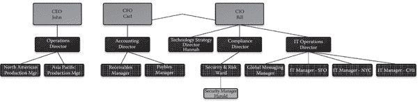

  图 2.1 ACME 组织架构图。

- **5 月 7 日**：所有其他办公室的扫描看起来正常。这些地点的 IT 经理收到了漏洞初步报告。

- **5 月 12 日**：第一周扫描结束后，主机总数略高，但可以解释。Harold 正在与所有经理进行跟进电话。

- **5 月 15 日**：旧金山继续出现扫描问题，仍然显示 4,094 台主机。芝加哥现在显示相同数量的主机。对扫描结果的长期审查显示，扫描的每个 IP 地址都发现了主机。

- **5 月 16 日**：总体而言，主机平均漏洞评分大幅下降。这似乎是个好消息，但最高分保持不变。事实上，某些主机的状况变糟了。Harold 给纽约的 IT 经理发了邮件查询修复状态。

- **5 月 20 日**：进一步的研究显示扫描器在每个地点都发现了更多主机，这就是导致平均分下降的原因。公司每个地点都有 4,094 台主机。扫描器超过了其许可的主机容量。此外，纽约 IT 经理没有回复他的邮件，所以 Harold 给他打了电话。经理解释说正在进行一项重大部署，涉及对部分纽约网络进行细微的设计变更。他说等部署稳定后他会查看。

- **5 月 31 日**：通过与技术支持合作，Harold 发现网络中的某些东西对每个 IP 地址都有响应，而实际上并没有主机。解决此问题的办法是手动输入所有活动主机地址。由于许多 IP 地址是动态分配的，这种方案是不可行的。Harold 必须找出是什么对设备发现探测有响应。

- **6 月 5 日**：报告的漏洞均未被修复。Harold 咨询了他的经理 Ward，Ward 建议与本地 IT 经理召开电话会议。他最早可以在下周安排一次一小时的会议。

- **6 月 12 日**：电话会议只有要求人员中的五位参加。IT 经理表示他们没有资源投入修复，但在工作量允许的情况下，将尝试每周处理最高优先级的主机。在会议上对 Ward 说，一位 IT 经理告诉他，应该一次只部署一种新技术，而不是并行部署，以便他们在下一次部署之前评估整体影响。经理们还抱怨没有被通知要部署系统，并担心扫描影响了他们的网络性能。Ward 同意只在晚上进行扫描。亚太生产经理也参加了会议，抱怨扫描可能导致他的的一台关键服务器故障。由于亚洲的白天是美国的晚上，在 Harold 证明扫描不会影响系统之前，他不希望进行扫描。


*   **6 月 16 日：** 两个地点最糟糕的主机已经修复。IT 部门的其他人员在周末清理了由于用户插入感染的 USB 闪盘而引入的新感染。即使在大多数桌面电脑关闭时进行扫描，许多网络仍显示有 4,094 个主机。

*   **6 月 23 日：** 哈罗德（Harold）正忙于追踪扫描问题并跟进修复活动。他发现内置于防火墙软件的新 `IPS` 导致扫描结果在每个 IP 地址上都显示有一个主机。在一次实验中，他关闭了预防功能并进行了扫描。结果运行完美。沃德（Ward）听到他最近部署的 `IPS` 在一个地点被关闭了，口头上责备他没有先与自己商量就这样做。他告诉哈罗德将其重新开启，并将扫描范围改为仅关注他可以获取静态 IP 且系统所有者批准的服务器。哈罗德成功地向亚太生产经理证明了扫描对他的服务器是无害的。经理允许进行扫描，并同意在一周内修复关键漏洞。

*   **6 月 25 日：** 漏洞系统出的报告并不令人鼓舞。对于那些并非 `IPS system` 创建的虚幻主机，得分的改进微乎其微。显示漏洞变化的趋势线向上扬，但没有发现新的漏洞。哈罗德对此感到困惑，并联系产品支持热线报告可能存在 Bug。他们解释说这是正常行为。

*   **6 月 30 日：** 新的漏洞扫描系统在全公司范围内正在扫描约 25 台活动主机。每台主机的成本约为 400 美元，远超他预期的规模效应。约 17 台主机正在接受修复。

*   **7 月 18 日：** 感到沮丧的哈罗德辞职了，去寻找一家“更重视安全”的组织工作。

那么，哈罗德和 Acme 公司发生了什么事呢？Acme 公司需要更多人手吗？这不太可能。哈罗德选错产品了吗？可能没有。他开始时是一个乐观主义者，打算彻底完成工作，但问题很快出现，导致修复工作寥寥，却增加了大量负担。随着内部支持的削弱，系统的有效性和哈罗德的信誉遭到了质疑。

*   **9 月 5 日：** *致命一击*。在公司的一个偏远地区，一名被解雇的 IT 员工决定华丽地离场。由于基于错误的标准了解关键服务器系统的状态，他编写了一个 `Perl script`，利用常用的管理员密码破坏了数十个系统。全球的 IT 经理们都感到羞愧和沮丧。他们想起曾有人执行 `VM` 函数。但太晚了。

### 2.5.1.2 分析

那么，成功运行一个 `VM program` 需要什么呢？这个例子从一开始就充满了错误。让我们看看上一个例子中哪里出了问题：

*   **流程失败：** 有两个问题与流程有关。首先，缺乏高层管理支持的正式且完整的项目计划。哈罗德首先尝试做的是研究技术产品。其次，哈罗德未能关注流程。`VM` 是一个过程**，而不是一种技术解决方案。

*   **准备：** 技术的行为确实是一个大问题。有几件事进展并不顺利。`IPS` 在同一时间被部署，但哈罗德似乎并因此。此外，系统出的报告没有被很好理解。发送给 IT 经理的报告显然被忽视了。哈罗德可能认为他们要么根本不在乎，要么是看不懂报告。

*   **包容：** IT 经理显然没有被纳入许多规划活动中，对项目的投入很少。如果你查看组织架构图（`Figure 2.1`），你可以看到 IT 经理向 IT 运营监汇报，在达到首席信息官（`CIO`）级别之前，他们并不向哈罗德所在的同一个组织负责。他们对自己的网络产生防御心理可以理解。面对他们一无所知的新技术时，他们的反应是保护自己的领地，免受他们无法控制或参与的侵入性工具的影响。

*   **所有权：** 那么哈罗德和沃德与 IT 经理召开的电话会议呢？低出席率反映了他们的兴趣水平。从哈罗德的角度来看，可能确实是这样。但对于在部署新技术（在此例中为 `IPS`）期间进行网络设计重大变更的人来说，自然反应是专注于他们负责的项目，并规避那些产生更多工作的内容。`IPS` 是防火墙软件的一部分，因此被认为是对既有技术的配置更改。此外，漏洞扫描器生成的报告要求管理员做更多工作。忽视报告会推迟责任，并让风险留存在计算环境中。

以下是哈罗德可能采取的不同做法并获得更好的结果：

*   **所有权：** 为整个计划获得高层管理的直接支持。确保管理层理解修复和监控所需的承诺。如果你不从这一重要步骤开始，预期就无法建立，对运营所需的影响也不明确。哈罗德没有强有力的支持来引起本地 IT 经理的注意。由于 IT 经理从未参与技术的规划、设计和选择，他们没有机会在环境中测试和验证该技术。此外，当修复工作没有落实时，哈罗德无处可以升级。此外，高层经理可以促进与计划关键参与者的沟通。理想情况下，负责传达 `VM initiative` 重要性的高层经理应该是全球 `CIO`、`CSO` 或 `CISO`。

与高层管理承诺相关，要强调成功的修复是一项关键的工作绩效指标。在前一个例子中，哈罗德没有引起本地 IT 经理的兴趣。他们很少修复任何东西，因为在他们看来，哈罗德是在抱怨他们的系统有多糟糕，这创造了更多他们却得不到认可的工作。这根本没有激励。哈罗德从未被接受为关键 IT 挑战解决方案的主要供应商。相反，如果 IT 经理被告知他们根据修复性能进行衡量，那么他们更有可能配合。事实上，他们很可能会采取主动。为了在大棒上增加一根激励胡萝卜，一场针对最低平均分的竞争可能会推动流程追求卓越。平均分最低或可能改进最大的经理将获得一笔额外的奖金预算。

*   **准备：** 测试！测试！测试！任何连接到网络且具有广泛影响和可能的侵入性功能的系统，都应该对环境中涉及的所有组件进行完全测试。最终，应该开发出一份可扫描系统的标准列表。应该详细记录对系统的不利影响列表，并识别出不进行扫描的候选对象。


### 流程

在任何实施之前，必须仔细考虑变更管理。事实上，在哈罗德（Harold）的公司里，一个内置 `IPS` 的新防火墙系统处于实施阶段。当扫描开始时，旧金山已经部署了一个新的防火墙。该防火墙对该位置分配范围内的每个 IP 地址响应了发现扫描。（关于这种现象将在本书稍后部分详细介绍。）随着哈罗德继续扫描，防火墙也不断被部署。最终，每个网络都给了他虚假的结果。如果他参与了变更管理过程，他就会知道正在部署防火墙，并可以提前测试其效果。哈罗德还可以将扫描行为的变化与防火墙安装的顺序相关起来。

### 2.5.2 案例研究 #2：技术集成挑战

Abacus 公司是一家全球性的电子算盘制造商和分销商，采用 `LCD` 技术和一种特殊的手势界面，使得计算速度比传统计算器快得多。从各个衡量标准来看，Abacus 像一家快速增长但规模较小的电子公司，拥有几项关键专利。

Abacus 在内布拉斯加州和阿拉巴马州设有制造设施。总部位于德国的业务伙伴 `Syllog`（大多数奇异设备从那里购买）负责分销。`Syllog` 是多种独特电子设备的分销商，主要面向亚洲客户以及美国和英国的利基零售商。大多数设备由三家制造商提供，`Syllog` 与这些制造商在业务和基础设施上保持着紧密关系。`Syllog` 约 40% 的基础设施由 Abacus 共同资助，并直接为 Abacus 服务。

在 Abacus，IT 基础设施非常成熟，拥有基于基于 `ITIL` 的变更管理和事件管理工具。所有业务伙伴都被要求达到或超过 Abacus 的政策和标准。他们实施了包含 `ITIL` 框架中几个核心模块的“服务台”模型。该服务台是接收、管理事件以及升级变更请求的中心点。由于 Abacus 是一家订单量不可预测的制造企业，所有生产都是按准时制（just-in-time）进行的。也就是说，他们在收到订单之前不会设计和制造产品。此外，他们致力于在收到订单后的 10 个日历内交付产品。因此，对停机的容忍度很低。

Abacus 销售相关的 IT 运营通过特定市场的应用程序进行本地化管理。每个市场不断变化的语言、文化和独特的业务关系需要同样多变化的硬件、软件和应用程序。通用的操作系统和底层实用软件由全球运营部门提供并管理。然而，应用程序和非通用软件则由本地处理。为了维持这种安排，全球运营组与本地运营组之间建立了特定的服务水平。

自然而然，管理层已决定下一步是在全公司实施全面的 `VM` 计划。所有站点之间都有强有的连接性，包括已同意参与的业务伙伴。Abacus 在桌面上主要使用 `Microsoft` 软件，在服务器上使用 `Linux®`，某些办公室使用若干版本的 `Solaris™`。

除了清理漏洞外，Abacus 还希望在扩展企业尽可能多的部分验证合规性和补丁状态。他们拥有成熟的内部流程，但只有少数系统支持资源。支持工程师和技术人员的比例约为 300:1。自动化是 Abacus 的关键因素。例如，有约 20 个运行的标准系统维护和数据采集 Shell 脚本。

### 2.5.2.1 事件

- **11 月 2 日**：在高级管理层的全力支持下，卡尔（Carl）组建了一个代表 IT 总监关键办公室的小团队。批准了 `$350,000` 的预算。
- **11 月 23 日**：团队按时且预算内选定了两个似乎与所有系统配合得良好的工具。运行代理的系统为他们提供了服务器漏洞信息，他们的想法是自动化补丁将有助于工作负载。总成本：`$330,000`。
- **11 月 30 日**：采购完成，软件已在服务器安装，硬件设备在办公室部署。在业务伙伴管理层的同意下，某些可能受到扫描的地点也安装了设备。
- **12 月 6 日**：由于假期期间许多关键员工将休假，所有非关键变更控制项目的冻结已生效。这将持续 30 天。并非所有的网络扫描器都已安装。
- **1 月 15 日**：大家都结束假期回来了，卡尔制定了一份沟通计划，让所有关键经理了解最新进展。他为关键办公室的六位 IT 总监创建了初始用户名、密码和权限。
- **2 月 2 日**：初始扫描已完成，IT 总监会自动收到结果。他们对报告的质量、内容和准确性非常满意。卡尔已将系统交给了生产系统支持组。一些 IT 经理抱怨说他们必须进入两个独立的系统才能查看他们所有的主机。
- **2 月 10 日**：内布拉斯加州的 IT 总监要求为其桌面支持组的所有 9 名成员提供系统访问权限。系统管理员提供了一份需要在表单中填写的信息列表。表单的填写、返回、数据输入以及密码验证/重置对于两个 `VM` 系统大约需要两天才能完成。


* **2 月 12 日：** 业务伙伴 Syllog 抱怨获取到的扫描结果异常。看来 Syllog 网络上的桌面名称不正确，而是显示了 Abacus 服务器农场上的主机。与总部的 IT 经理核实后发现，Syllog 管理实际上获取了来自两个网络的扫描结果。原因在于他们使用了相同的 IP 地址。漏洞扫描器向服务器报告的情况是正确的，但与 `ips` 存在重叠。

* **2 月 14 日：** 另一个办公室的 IT 经理为整个桌面支持团队（共 6 人）请求了类似的访问。他们必须拥有权限来执行修复工作。随着用户的增加，必须为这两个联合运行和独立运行的系统开发出详细的操作程序。

* **2 月 18 日：** 开发出一种技术解决方案，依赖于计算机名称而非 IP 地址来识别报告中的主机。所有的网络定义和权限都必须更新以反映这一变化。此外，启动了一项计划，将两个漏洞系统集成到单一的报告体系中。这项工作由一位具有丰富 `Perl` 编程经验的单一系统工程师完成。

* **2 月 23 日：** 其他地点的其余 IT 总监（共 6 个地点）也请求允许其支持人员访问 VM 系统。其中两个总监希望将他们的系统责任分配在两个不同的支持小组之间：服务器和桌面。这是因为修复工作需要专门的技能。这导致系统共增加了 32 个用户。

* **2 月 25 日：** 在一名人员工作了三天后，网络定义和权限的更改完成了。现在有 47 名用户使用这些系统。一些服务器经理抱怨，已安装的补丁没有经过彻底测试，需要更仔细地安排时间，以防影响生产运营。

* **3 月 1 日：** VM 团队接到通知，内布拉斯加的一名用户在两周前辞职了。根据离职流程，该用户的权限已被撤销。目前尚未找到替代用户。因此，只有内布拉斯加的 IT 总监可以运行这些报告。

* **3 月 4 日：** 初始报告显示，漏洞报告时间与最终修复时间之间存在延迟。在经过约一天的沟通后，VM 管理员确定延迟是由在报告中发现漏洞到将其输入事件和变更管理系统之间的时间差造成的。最初定义的流程运行良好，但执行修复需要长达三周。Carl 与合规总监和信息安全总监会面，讨论新系统的当前性能以及修复缓慢的问题。合规总监指出，修复关键漏洞的最大允许时间为七个日历日。根据系统中的报告，这需要两到三周。

* **3 月 5 日：** 基于微软的系统配置了使用 `Active Directory®` 凭进行深度扫描。实际上，这些凭据允许扫描器登录系统以检查关键补丁和配置项。管理报告已从两个系统合并为单一报告，通过 Web 界面按需运行。系统工程师开始编写详细的修复报告。然而，两个系统中的许多数据元素并不直接匹配。一个使用通用漏洞披露（`CVE`）代码来识别漏洞，另一个则使用 `Bugtraq`。

* **3 月 10 日：** 基于微软的系统配置了使用 `Active Directory®` 凭进行深度扫描。实际上，这些凭据允许扫描器登录系统以检查关键补丁和配置项。管理报告已从两个系统合并为单一报告，通过 Web 界面按需运行。系统工程师开始编写详细的修复报告。然而，两个系统中的许多数据元素并不直接匹配。一个使用通用漏洞披露（`CVE`）代码来识别漏洞，另一个则使用 `Bugtraq`。

* **3 月 11 日：** 基于微软的系统配置了使用 `Active Directory®` 凭进行深度扫描。`UNIX®` 的系统尚未扫描。每个系统都必须手动设置。

* **3 月 12 日：** 在仔细考虑并与老板讨论后，Carl 决定最佳方案是请一名专门开发人员将补丁、变更和事件管理系统与新的 VM 系统对接。然而，编写 `Perl` 的系统工程师没有时间处理该系统。

* **3 月 20 日：** 与开发人员和支持团队进行初步评估后，估计费用总计 152,000。主要原因有三个：首先，系统被设计为发现漏洞时仅生成简单网络管理协议（`SNMP`）陷阱。没有任何变更或事件管理系统兼容该协议。必须在 VM 系统或内部系统中编写自定义接口。其次，从事件管理到变更管理的工作流仅在手动输入事件时才允许自动生成变更。必须开发一个自动化接口，将条目放入两个系统，并使用事件管理数据库中的信息将其连接起来。此外，漏洞的流程与其他事件不同，因为在关闭变更之前必须进行验证扫描。最后，VM 系统使用 `CVE` 和 `Bugtraq` 编号来识别需要应用的补丁。补丁管理系统使用一套专有代码，对于所需的补丁描述更具体。必须开发额外的数据来正确匹配这些代码，并识别它们不符之处。

* **3 月 23 日：** 系统完全功能状态的总估计成本现在达到 482,000（初始的 330K + 152K）。高层预感到这可能会变成一个无底洞，并将总支出限制在最初请求的范围内（350,000）。对于剩余的资金（20,000），开发人员可以发送所需的 `XML` 格式消息到事件管理系统，以节省一些数据输入时间。此后，Carl 的预算耗尽了。

* **结语：** 在剩余的一年里，VM 系统用户感到满意，但又对修复涉及的不完整流程感到困惑。在修复和关闭事件方面投入了大量的持续努力。用户仍然需要创建变更请求、手动运行验证扫描，然后关闭变更。Carl 继续认为高层管理是“小小节上，大失”。一些人纳想，公司为什么不直接采用单一系统来避免所有的混乱。


起初，进展似乎相当顺利。这显然是一个非常成熟的 IT 运营，具有强大的流程管理和支持系统。项目管理显得非常有结构化。高层对该计划提供了良好的支持，并制定并达成了预算。项目经理 Carl 邀请了所有相关方参与，以实现共同所有权。最后这一因素使得系统在短板变得显现后，仍能继续运行。

## Abacus 公司的流程

首先，让我们来解决流程问题，以便清晰地了解 Abacus 的运作方式。尽管他们非常有纪律且高效，但 IT 部门似乎受到了该流程的束缚。

在 `ITIL` 框架定义中，“事件”是指破坏了约定服务水平和底层业务活动的某些事件。针对漏洞和修复时间范围设定了服务水平，新发现的漏洞如果没有及时纠正，可能会导致无法满足 `SLAs`。当 Abacus 的新的 `VM` 系统发现漏洞时，就必须在事件管理系统中生成一个事件，以跟踪解决情况。由于 Abacus 采用精益化的 IT 运营模式，服务台功能由不同的 IT 人员执行，取决于要处理的事件类型。因此，服务台是一个非常动态的实体，并在基于软件的路由支持下对接相关方。请参见图 2.2 以遵循此流程。

*   根据受影响的网络和主机类型，由相应的人对漏洞信息进行评估。如果漏洞是关键的，将创建一个事件以跟踪漏洞直到解决。非关键漏洞则被放入非紧急变更的计划内变更流程中。
*   当解决方案涉及复杂的更改，且确定实施该更改可能会影响其他功能时，则会在变更管理系统中启动变更并生成变更工单。这允许受影响方参与变更流程，并对潜在影响进行适当通知。它还会通知经理有关目标技术配置元件的变更情况。
*   一旦应用了补丁或更新了配置以修复漏洞，变更工单将根据条件关闭。关闭工单时有一个前提是：下一次漏洞扫描中不得再次出现相同的漏洞。
*   再次运行漏洞扫描，可以作为常规计划的一部分，也可以根据请求手动执行。根据请求进行的扫描通常更快，且仅针对受更改影响的系统。
*   变更工单关闭后，事件工单将关闭。这发生在变更系统和事件管理系统之间，但仅当事件管理系统自动生成变更工单时才会发生。

对于外行来说，这似乎是一个繁琐的流程，但 Abacus 的员工非常有纪律且训练良好。该流程在提供关键生产系统（通常是无中断且可预测的服务）方面表现出色。因此，在这种情况下，流程似乎管理良好。然而，在系统集成过程中存在几处缺陷。

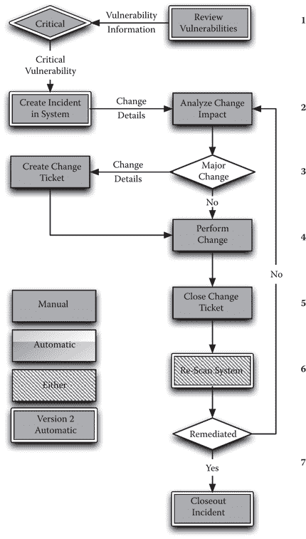

图 2.2 Abacus 公司漏洞服务台流程。

## 系统集成问题

一个明显的问题是事件管理系统与变更管理系统之间的持续相互作用。对于每个关键漏洞，服务台角色的 IT 人员必须创建一个事件以便跟踪。然后，如果确定需要重大更改，则必须创建一个变更工单，以通知可能受更改影响的其他人员。

一个可以被此流程良好管理的漏洞示例是：发现一个 `Microsoft SQL server` 系统在常用的用户 ID 上有弱密码。该密码弱点性将是一个漏洞。如果该数据库服务器被大量人员访问，甚至可能从公司外部访问，这可能是一个非常严重的攻击向量。为了修复这个问题，必须更改密码，但这样做可能会破坏几个依赖该密码的应用程序。因此，创建了一个变更工单并通知了应用所有者。一旦应用所有者协调了影响系统的更改，即可完成变更。

一旦应用所有者协调了影响系统的更改，变更即可完成。变更工单关闭后，事件工单也将关闭。这发生在变更系统和事件管理系统之间，但只有当事件管理系统自动生成变更工单时才会发生。在 Abacus，在事件关闭之前，必须对对系统进行扫描，以验证修复结果。漏洞扫描的一项改进是应用到目标的限制或参数。例如，特定的主机或网络可能有限制，仅允许在晚上进行扫描。如果漏洞不再存在，则事件被关闭。

## 自动化机会

因此，我们现在有了四项可以自动化的手动任务。请遵循图 2.2。图中通过阴影框指示哪些步骤是手动的，哪些是自动化的。图中的数字对应于以下内容：

1.  漏洞经理查看报告识别关键漏洞。这项活动非常适合专家进行评估。自动化系统内置了这种评估，并能够根据该信息采取行动。
2.  2, 3. 如果发现关键漏洞，经理打开事件工单并将其分配给系统负责人。
3.  4, 5. 修复后，关闭变更工单并对相关主机进行重新扫描。
4.  6, 7. 审查报告以确定漏洞是否存在。这本质上是步骤 1 的重复，再次可以轻松自动化。

创建事件工单是一个可以由机器执行的简单跟踪和接口活动。在步骤 3 中，重新扫描活动可以通过变更系统与 `VM` 系统的接口来实现，从而通知更改已完成，并启动后续扫描。或者，取决于所使用的流程，该操作可能会手动执行。如果流程要求等待下一次计划扫描，则不需要步骤 4。如果流程要求手动扫描，则可能需要重新扫描。


3. 事件经理进入事件管理系统，将该事件标记为“必要变更”，该变更通过两个系统之间的现有接口在变更管理系统中实例化。

4. 变更由一名工程师（可能是事件经理）按照计划执行。

5. 执行该工作的工程师通过事件管理系统的用户界面关闭变更活动。虽然没有办法对此操作进行自动化，但它并不费费多少精力。事实上，某些变更管理系统具有能够监听电子邮件回复以更新状态的能力。这种更新会自动触发通知到事件管理系统，从而初步关闭事件。

6. 随后，事件管理系统使用事件 ID 向漏洞管理（VM）系统发送确认消息。在通过 `incident ID` 建立索引后，将在单台主机上启动另一次扫描，检查特定的漏洞以及任何其他漏洞。

7. 如果在随访扫描中未发现漏洞，则将向事件管理系统发送确认信息以关闭事件。如果漏洞仍然存在，则事件确认被拒绝，并向事件经理发送另一个通知。重复步骤 3 到 6。

该实施过程中面临的另一个问题是选择了两个从未被设计为协同工作的的产品。虽然市场上的某些产品可以同时执行基于代理和基于网络的漏洞评估，但上述场景是常见的。这种情况通常发生在两个看似理想的产品缺乏关键兼容性，导致无法在漏洞管理（VM）领域中“一击即中”。

结果是，用户最初被迫与两个不同的系统一起。起初，基于代理的系统只扫描服务器，而基于主机的系统只扫描桌面设备。这种逻辑划分符合公司本地与全球范围内责任分离的管理模型。但是，当使用基于代理的系统去扫描那些网络扫描器在财务上不可行的桌面电脑时，职责划分和系统可用性就崩溃了。

一位精通系统的系统工程师做出了热情的尝试，试图挽救这项工作。然而，最容易取得的成果是管理报告。由于不需要系统交互，数据收集和归一化变得简单。但跨系统的数据结构和标准值仍然存在问题。这些都是任何其他应用程序中都会遇到的相同问题。稍后，我们将看到行业在避免这些问题方面取得了哪些巨大进展。

除了围绕识别、修复和统一报告的自动化之外，集成其他系统也可以带来巨大的优势。

2 月 10 日，请求向系统添加 9 个用户 ID。此时，系统管理员可能正希望这项任务能简单些。收集数据并将其输入系统已经耗费大量大量。由于 `Abacus` 是微软的产品，为什么不将用户识别和认证与 `Active Directory` 集成呢？或者使用几乎无处不在的远程拨号用户服务 (`RADIUS`) 协议。这种系统集成对于今天大多数采用某种标准认证机制的企业来说是至关重要的。我们还可以看到，在 2 月 13 日、14 日和 25 日也向系统添加了其他几个用户。最终有近 50 个用户需要设置。当一个用户离开公司时，Carl 的团队两周后才发现可以移除该用户的权限。更有可能的情况是分配给 Active Directory 组的用户已经被删除或禁用了。

目录结构如何与 VM 系统对齐的示例见图 2.3。VM 系统中存在对象和操作。一个组或用户可以是成员，也可以是角色，而角色包含了对象和操作的各种组合。例如，拥有 `administrator` 角色的个人将负责维护系统的所有区域。因此，他将获得所有对象和所有操作的访问。然而，上述工程师将仅拥有特定办公室的报告权限。因此，该组的许可操作将是 `Report`，许可对象将是本地办公室的那些 `Networks`。

每个组或用户都可以分配一个或多个角色和网络，以赋予其所需的功能，如图 2.4](#02chap_02.xhtml#fig2_4）所示。这种安排的力量在于，当用户更换到另一个组时，用户将承担该组的角色，而不是原组的角色。例如，如果一名工程师从加利州的 IT 部门调到内布拉斯加州的桌面组，该工程师将仅能够访问其新位的漏洞信息。同样，漏洞经理将只能对与其组相关的网络进行扫描。


图 2.3 漏洞系统角色与目录结构的对齐。


图 2.4 目录结构与 VM 系统角色。这种这种集成现在看起来显而易见，但在开始，这种数量的用户对 Carl 或团队其他成员来说可能是不可想象的。这让我们回想起早些关于漏洞是如何产生的讨论。这种场景类似于原始系统设计者未能考虑到系统可能被使用的所有方式。这是一个带有太多假设的需求收集活动。Carl 的设计和选型团队应该精确确定谁将使用该系统、有多少用户，以及这些用户可能发生哪些类型的活动。会有离职、新入职、分析师查看报告，可能还有其他人更改扫描参数或计划。

尾注 

1. *来源:* MITRE Corporation, CVE-2004-0200. GDI = 图形设备接口。


章程并非一份包含大量细节的长篇文档，而是由几句精心设计的句子组成，反映了公司的伦理、目标和优先级，这些内容应当在 `VM` 函数中得到体现。例如，如果公司高度关注计算服务的可用性（因为它是主要的收入来源），那么就应该包含一条关于不干预生产计算机运行的声明。如果公司更关注机密信息的丢失，那么关于识别和修复机密威胁的声明将放在首位。在后者的例子中，这将倾向于对可能导致数据被窃的漏洞赋予更高的优先级。例如，弱密码和间谍软件的解决将排在域名系统（`DNS`）配置中的拒绝服务漏洞之前。这并不是说 `DNS` 配置缺陷不重要；它只是没有客户数据或知识产权潜在被盗风险那么重要。

在制定策略、程序和组织结构的过程中，会发现新信息，为整体计划设计提供反馈。这种反馈循环可能会影响组织结构或策略。图 3.1 展示了开发周期内计划各阶段之间的关系：

*   **概念与建议**：此阶段定义了要为业务提供的业务价值、`VM` 的通用概念，以及在高级层面上如何实现这些结果。这项活动主要是计划经理的责任。
*   **章程开发**：此阶段是章程的构建。这些是计划的指导原则和目标。本章将对此进行讨论。章程由计划经理和/或执行赞助人编写。

    图 3.1 开发周期期间计划阶段。
*   **策略**：这些是支持底层业务目标的策略，包括可能存在的任何伦理准则。
*   **组织结构**：一个组织或多个组织的组合将以松耦合的方式结合，以支持 `VM` 计划。
*   **程序**：这些是日常支持 `VM` 计划必须遵循的详细程序。

一个胜任的计划经理能够控制每个组件的质量，并协调反馈流以保持整体计划处于正轨。请注意，计划章程不太可能根据其他阶段的反馈而改变。只有在发现做出关键决策时缺乏清晰度时，才会对章程进行澄清修改。如果公司业务模式发生变化，或者通过收购导致伦理标准发生变化，也可能进行修改。

从我们的插图中我们可以看到一个清晰的开发层次结构。但没有任何一个阶段会绝对结束，因为这些阶段处于持续维护中。主要组件可以是完成的，尽管部分内容可能需要细微但重要的调整。正是这种动态机制使得计划取得了成功。阶段的灵活性通过后期阶段的反馈得到了改善。反馈如何改变 `VM` 计划中特定阶段活动的一个例子是：发现一个复杂且困难的变更管理程序无法容纳某特定策略。该策略可以进行修改，以便仍实现 `VM` 计划章程的目的，但允许使用一种完全不同的、与现有变更管理程序更兼容的程序。

## 3.2 VM 计划与技术开发](#contents.xhtml#tl_sec3_2)

计划中还有一个重大的技术开发组件。这一开发过程也可以指导前述的阶段。因此，如果我们在图中添加技术开发过程（如图 3.2
    图 3.2 漏洞管理与并行开发过程。

经常被忽视的跨学科向上反馈是非常重要的。例如，`VM` 计划的开发可能会导致策略中的冲突显现。这种冲突的证据可以反馈到早期的策略开发阶段。例如，在 `VM` 计划开发期间，可能会发现某些漏洞在正在扫描的系统中根本不存在。因此，要求对所有系统进行 `UNIX` Shell 漏洞扫描的策略将不适用于依赖 Microsoft 应用的业务部分。该策略必须使用“在适当的情况下”等词进行修改。

来自技术开发计划的反馈将指导并行的组织计划。例如，`VM` 系统技术中某项功能的发现可能会以积极的方式影响入侵防御能力。因此，对入侵防御策略、技术和相关程序的增强可能是必要的。在早期的规划阶段执行此功能将自然地将 `VM` 整合到组织的其他部分，并识别出哪里需要技术规划以与入侵防御系统（`IPS`）集成。然而，并非所有好主意出现在开发之前。技术项目经理的工作是与团队合作确定此类发现是否值得额外的开发努力。

在图 3.2 中，你可以看到计划的技术开发轨道如何与整体计划工作。尝试向所有方向移动并考虑一个阶段指导另一个阶段的情况。

## 3.3 谁参与？](#contents.xhtml#tl_sec3_3)

我已经讨论过高层支持对于自上而下推动 `VM` 计划有多么重要。但还有其他不应被忽视的参与者。这些角色的清晰定义可以防止大量的内斗，简化流程开发，促进技术部署，并鼓励个人和小组参与 `VM` 工作。


VM（漏洞管理）计划参与者分为两类。一类是**贡献角色**，负责帮助计划启动和运行。这些参与者不直接参与漏洞评估，但没有他们的帮助，流程无法进行。另一类是**运营角色**。这些参与者是技术日常运行的直接执行者。他们执行扫描、评估漏洞，并确保优先级被正确提升。他们还确保 VM 技术在动态环境中继续保持最佳运行。

参与 VM 过程的一些关键小组包括资产所有者、人力资源部门、IT、漏洞管理器、变更管理和合规管理。这些角色中的每一个都直接参与其中，或至少受到其影响。

### 运营角色

在 VM 的持续运行中，其他角色也具有直接和间接参与，并对计划的有效性贡献巨大。这些角色在硬件和软件采购的流程开发早期就被定义。技术的选择将影响人们的工作方式、他们与其他小组的参与程度以及相互依赖的性质。如果自动化流程履行了关键活动，那么对该角色的需求可能会减少。例如，在开始阶段可能计划由一个管理员角色负责获取发现的漏洞并将修复请求分配给相应的系统所有者。然而，随后可能会确定所选技术可以自动化此过程；因此，该角色被缩减为监控。

#### 漏洞管理器

该角色负责确保技术的正确配置和运行，并根据需要创建监控报告。这绝非简单的管理员角色。该人员必须能够解释系统生成的技术报告，并解释漏洞产生和修复方法。需要具备操作系统、网络和安全实践的知识。此个人将与系统管理员和网络经理互动，以确保识别和修复流程符合目标。

#### 事件经理

当漏洞需要关注时，必须由专人负责修复。这通常是目标所有者或管理员。此个人应该对目标的配置和运行有洞察，并能够评估对该系统进行更改的影响。此人被称为事件经理，将与漏洞管理器合作完成所需的修复任务。事件经理的责任是跟进分配的任务，直到它们完成。在某些情况下，此角色与变更经理的角色合一。例如，规模较小的组织可能由一个人负责所有工程师和管理员的工作，负责协调变更并分配修复工作。

#### 变更经理

在更复杂的修复场景中，多个系统或业务功能可能会受到复杂变更的影响，变更经理将担任项目经理来监督变更的整个范围。该经理将通知受影响的方，协调活动，执行测试或确保完成适当的测试，并与漏洞管理器合作验证合规性。

#### 合规经理

该角色主要是 VM 系统的接收者和最终用户，同时也是主要的受益者之一。在正常的合规职能中，合规经理的任务是确保公司使用的系统符合政策和标准。该经理通常是 VM 系统报告的接收者或使用者。更重要的是，在动态环境中，合规经理将审查趋势报告，以确定是否存在持续或重复的活动导致系统不合规。这允许合规经理发现组织中可能存在缺陷的流程，这些缺陷会导致反复的政策偏差。

在使用服务水平协议（`SLAs`）建立服务水平的环境中，VM 计划经理可能会为合规经理创建一个 `SLA`，以确保按要求的频率进行审计并在每个目标上运行适当的检查。这些指标简单且易于从漏洞扫描结果得出。

### 贡献角色

在 VM 过程中最常见的贡献角色的小组是资产所有者、人力资源、IT 和安全部门。最后一个小组——安全部门，可能会让你感到意外，因为人们可能预期它是一个直接的运营角色而非贡献角色。虽然安全部门可能是系统的主要操作者，但我们从更高、更抽象的层面将其作为提供需求的客户进行讨论。

#### 资产所有者

资产所有者是那些最终买单并获得最大利益的人。他们控制着资金链，因此对要做的工作有很大的话语权。在许多组织中，资产所有者是业务部门。这通过费用回收机制或直接购买实现。这在管理层的中、高层尤为明显。

典型的 IT 工作人员将他们管理的系统视为自己的是自然的。这种所有权感并非基于现实，而是源于情感依恋。在大型组织中制定评估资产安全态势的计划时，通过经理进行最终将获得更好的合作。与资产保持情感上的分离，将在做出关于资产安全态势的关键决策时增强客观性。资产所有者的两个非常重要的贡献是资产分类和估值功能，这些功能不能也不应该由系统管理员执行。当我们以后讨论 VM 计划的规划和执行时，会有更多此类主题的内容。

#### 安全

安全部门通常是直接处理 VM 的小组。然而，重点关注服务管理的组织（如信息技术基础库 `ITIL` 服务管理框架所描述的）可能将其视为现有框架的子集。无论何种情况，安全职能与 IT 之间都应该存在紧密合作的关系。伙伴关系将使 VM 的实施变得更容易，你可能会获得更好的内部支持。

由于安全是 VM 系统的最终目标，安全部门作为 VM 计划的关键参与者、可能的完全所有者和操作者是自然的。然而，根据业务类型，合规等其他小组可能会承担这一角色。例如，严重依赖支付卡行业（`PCI`）标准合性的性的可能希望由合规组织拥有该流程，同时作为客户和关键组成部分与安全部门紧密合作。

#### HR


人力资源部门是最容易忽视的群体之一。漏洞管理（VM）系统经常会发现关键的合规问题，这些问题可能会变成员工实施的安全事件证据。人力资源部门是报告过程中不可或缺的一部分，也是安全策略中的“约束手段”。根本而言，人力资源部门的作用是帮助管理员工行为给公司带来的风险。任何开发的报告流程，如果需要执行补丁和配置管理之外的操作，都应该考虑与人力资源部门的关系。

人力资源部门还参与绩效管理计划的创建和维护。通过仔细规划，可以将漏洞修复绩效与员工绩效目标挂钩。为了实现这一点，可能需要让人力部门明确了解 `VM` 程序和支持系统是如何运作的。然后，人力部门可以与 `VM` 程序经理协作，确定他们在管理员工时可能出现的任何潜在冲突中扮演什么角色。

### 3.3.2.4 IT
信息技术显然涉及技术和流程。如果你作为一个独立的安全或合规小组工作，我建议与 IT 经理合作以实现技术部署。高级 IT 经理对于系统的获取和修复也有帮助。很大情况下，你将不得不从经理那里获得指导，然后提出一个流程。IT 工作非常擅长图表展示，并且似乎现有的设计。

## 3.4 策略与信息流
任何合规或安全倡议都必须获得策略的支持。这并不是在讨论策略的优劣或其创建过程，而是其定义。我们将专门关注完成从业务意图到有效修复的文档所需的策略类型。

### 3.4.1 现有策略
现有的安全策略应该对未经授权软件的存在和可接受的使用有足够的覆盖范围。VM 系统可能会发现多处违规行为。如果这些策略规定了检测违规行为的方法，则可能需要对这些策略进行修订。与之前关于 `VM` 程序和组织的章节类似，根据适应经验，你必须有一个支持性流程来应对新发现。此外，VM 系统本身可能被视为违反了策略。如果员工被解雇，在某些管辖区，可能会导致严重的法律责任。

### 3.4.2 新策略
VM 合规策略有时对于执行修复活动是必要的。根据你的组织情况，一项指导 IT 经理将修复列为优先级的策略将非常有帮助。该策略应包含以下内容：

- **漏洞优先级排序**：发现的漏洞将进行优先级排序。在许多情况下，发现的漏洞多于在合理时间内可能修复的数量。你必须指定哪些先处理。你甚至可能需要一个策略声明，规定管理员在什么情况下应该放下手头所有工作。
- **资产估值**：每个系统都是公司的资产。它必须被赋予一个价值，用于优先级排序过程。我们将在 `6` 中详细讨论这一点。
- **时间限制**：根据漏洞的严重性和类型，必须设定修复时间限制。这实际上是组织的一种服务水平协议（`SLA`）。你必须根据若干标准考虑对组织的风险或威胁。然而，那些标准将留给支持性标准。

#### 3.4.2.1 使用策略
另一个策略类型涉及 VM 系统本身的使用。该策略将突出关键的操作限制。在必要的限制类型中，包括以下内容：

- **免扫描系统类型**：这可能包括已知会被扫描产生不利影响的其他安全设备或关键网络设备。
- **扫描审批的操作要求**：必须获得系统所有者和或管理员的同意。
- **SLA 参数**：此要求规定了针对特定网络或目标组的任何扫描规范必须包含哪些参数。这可能包括时间段、带宽限制、操作影响评估和扫描终止响应时间。这些参数对于维护与系统所有者的良好关系至关重要。如果扫描干扰了系统及其运行环境，系统所有者不太可能授予持续扫描的许可。

#### 3.4.2.2 所有权与责任
一旦某个系统被证明是管理企业关键部分的强大工具，诸如“谁负责扫描计划？”以及“谁决定扫描什么以及何时扫描？”等问题就会出现。考虑到这种被视为侵入性的活动所带来的不安全感，这些问题是合理的。最好的做法是通过提前决定所有问题来避免对这些问题的争议。预先警告：模糊性是流程的敌人。

建立明确所有权的第一步是将其纳入策略中。流程中关键功能的角色应在标题中明确指定。至少，这些角色必须包括以下内容：

- **扫描参数定义**：必须定义并仔细控制用于扫描的业务和技术参数。尽管其他人可能参与扫描过程，但参数的粗率更改可能会瘫痪主机或整个网络。
- **扫描调度**：扫描计划包含了大量的考量。这些考虑不应轻率。计划的变更对业务运营的影响可能与参数变更一样大。
- **报告分发**：漏洞报告是机密数据。在错误的人手中，这些报告可能会造成巨大的损害。对于黑客或有动机且心不满的员工来说，漏洞报告是通往麻烦的路线。
- **本地主机修复**：当主机无法通过企业主机管理工具进行补丁或修复时，必须由本地管理员或组织适当的其他个人进行修复。
- **全局修复**：与本地主机活动相反，全局工具也通过网络修复主机。一个或多个组织负责此类修复。例如，桌面团队可能负责通用主机补丁，而安全小组可能需要保持防病毒软件和加密程序的更新。所有此类组织都应提前确定，并使其成为 `VM` 流程开发的积极参与者和贡献者。


最终，补救进展必须由某人进行监控，以维持良好的治理。在少于 10,000 台主机的组织中，由负责扫描的人员兼此通常就足够。然而，在较大的组织中，由合规小组来执行这一功能会更为理想。此外，`Compliance` 将定期监控系统的配置和运行情况。

图 3.3 显示了合规组织如何利用当前的操作文档、流程文档和扫描结果来验证合规性。这三项数据之间存在着重要的关系。操作文档告诉合规小组 `VM` 组开展了哪些活动。合规部门应验证 `VM` 活动是根据策略进行的。


图 3.3 合规数据流。

流程文档以清晰无歧义的细节定义了执行 `VM` 功能的步骤。合规功能将根据这些文档来验证操作活动和支持输出文档。流程文档本身也应该根据策略进行检查，以确保符合性。在某些情况下，这一步在合规监控功能中并非必要，因为合规性可能是 `VM` 流程创建的一部分。在这种情况下，偶尔需要进行外部审计。

最后，扫描结果数据详细记录在漏洞扫描报告中。这些报告应该反映每个负责补救的 IT 组所实现的合规水平。稍后我们将详细讨论这些报告的内容及其在成熟、成功的 `VM` 程序中的相关性。

### 3.4.3.1 系统审计](#contents.xhtml#tl_sec3_4_3_1)

`VM` 治理的另一个关键步骤是审计。在安全机制进行年度审计期间，让外部第三方审查系统的配置和运行是有益的。任何审计的元素应包括以下内容：

*   **流程**：审计人员应验证在扫描、补救和验证过程中没有关键缺陷。审计人员应提供改进建议。
*   **范围**：在了解现有网络分段结构和应用的基础上，审计人员必须验证已扫描了完整且适当的目标集。根据计划章程和策略，目标列表可能包括供应商或业务合作伙伴。除了现有目标外，重要的是要意识到组织、系统和网络是动态的。环境的变化将改变扫描目标的范围。扫描器的流程和配置应足以适应这种不断变化的环境。
*   **操作人员培训**：负责系统技术细节的人员必须精通其运行。他们不仅必须理解操作，还必须理解漏洞的工作原理、与之相关的威胁，以及公司在面临这些威胁时所面临风险。具备操作系统、网络、协议以及各种相关应用程序的知识是非常理想的。
*   **策略对齐**：`VM` 操作是否符合当前策略？正如我们之前讨论的，`VM` 流程源于策略，而策略源于计划章程或业务目标。随着时间的推移，策略可能会发生偏移，不再满足程序要求。这并非由于疏忽，而是个人在适应不断变化的环境时，缺乏对计划章程整体影响的视角的一种自然倾向。

随着网络和系统状况逐渐变化以响应不断变化的业务环境，业务需求将不再反映在策略中。例如，业务通常可能通过个人销售联系销售其产品。因此，业务需求将不再反映在策略中。

### 3.5 总结](#contents.xhtml#tl_sec3_5)

随着网络和系统状况逐渐变化以响应不断变化的业务环境，业务需求将不再反映在策略中。例如，业务通常可能通过个人销售联系销售其产品。因此，业务需求将不再反映在策略中。

# 第 4 章](#contents.xhtml#tl_chapter4)

## 技术](#contents.xhtml#tl_chapter4)

### 4.1 引言](#contents.xhtml#tl_sec4_1)

漏洞评估技术有多种形式，旨在满足不同的部署策略。这些策略策略在很大程度上是业务运营模式限制的结果。设施分布和基础设施组织等因素对技术选择有重大影响。成本和效率也是任何决策中始终存在的因素。选择标准将在下一章讨论。在本章中，我们将讨论各种技术以及每种技术的独特特征和问题。

读者提示：本章假设读者熟悉网络协议，如 `TCP/IP`、虚拟专用网络 (`VPNs`) 和开放系统互连模型 (`OSI`)。

有五种常见的、行业认可的漏洞管理 (`VM`) 技术方法：

*   主动扫描
*   被动评估
*   代理 (Agents)
*   混合
*   推理

这些方法存在细微的差异，以为不同的业务结构提供灵活性。在讨论这些架构之前，我们应该回顾一些基本术语。这些术语中的一些已经在书中中使用，因为它们的含义似乎显而易见。但我在这里会描述得更精确、更完整：

*   漏洞：软件或硬件中的缺陷，允许超出其设计意图使用产品，并对软件、系统或数据产生不利影响。这是一个带有色彩的陈述，但准确。如果你回顾我们在第 2 章关于系统开发生命周期的讨论，你会发现设计作为早期阶段之一可能是漏洞的重要来源。设计决策中的微小错误可能导致生产中的重大失败。在许多情况下，应用程序的设计反映了对应用程序可能用途的幼稚看法。


## 定义

- **暴露 (Exposure)**：关于系统信息的泄露，这些信息可用于协助攻击者利用一个或多个漏洞。应用程序的版本号就是可能揭示潜在漏洞的数据示例。对漏洞或潜在漏洞的认知可以被视为一种暴露。这些信息通常对于用户群体来说并不是必要的，因为它们并不是系统所有者刻意设计的功能。
- **目标 (Target)**：位于扫描设备范围内并被指定用于漏洞评估的主机、应用程序、虚拟主机或主机组。在执行扫描时，扫描器通过其互联网协议 (IP) 地址、IP 组或名称指向一个目标。目标仅仅是扫描的主体。它可以被手动指定也可以被自动发现。
- **发现 (Discovery)**：扫描过程的一个阶段，用于发现连接到指定范围内网络分段的目标。
- **扫描配置 (Scan configuration)**：用于创建计划扫描事件的参数集。这可能包括 IP 地址范围、端口、日期时间、带宽限制、凭据或要执行的特殊检查。
- **漏洞检查 (Vulnerability check)**：顾如其名；对目标进行检查的一组特定项目，可能会揭示漏洞的存在。
- **合规性检查 (Compliance check)**：与漏洞检查类似，它不一定发现漏洞，而是发现未能遵守既定的公司策略。例如，如果要求密码至少为 10 个字符，则合规性检查将生成一个事件，记录不符合要求（在此例中为少于 10 个字符）的实例。
- **安全态势 (Security posture)**：基于影响该状态的因素，主机、网络或组织最终形成的安全状态。
- **攻击向量 (Attack vector)**：类似于漏洞，攻击向量是别法分子用于破坏系统的基本策略。这包括对一个或多个漏洞或设计缺陷的利用。
- **常见漏洞与披露 (CVE)**：由 MITRE 组织（[cve.mitre.org](http://cve.mitre.org)）提供的针对公开已知的漏洞的通用名称列表。这是一个广泛使用的漏洞列表，在分析和修复漏洞时作为参考。它不是唯一的可用来源，也不应被认为是完整的。但是，它为漏洞的识别引入了某种程度的标准化。
- **扫描器 (Scanner)**：以软件或硬件形式呈现的漏洞扫描器，用于执行供应商和用户指定的检查。扫描配置有时用于指定由哪个扫描器执行检查。
- **审计 (Audit)**：对一个或多个目标进行扫描以确定其存在的漏洞。
- **漏洞评估 (Vulnerability assessment)**：审计的同义词；通常称为评估。

预计你已经对网络和流行的操作系统有了良好的了解。此外，在我们此后的大部分讨论中，我们将假设目标环境主要使用 `IPv4`。尽管 `IPv6` 是一项新兴标准，但其使用范围尚未足够广泛到足以进行长篇讨论。此外，目前市面上没有任何虚拟机工具似乎都支持 `IPv6` 主机发现或扫描。

## 4.2 通用架构

在这里，我们将深入讨论三种类型架构的组件及其相互作用：独立硬件、代理（agent）和被动网络分析。我们不会讨论软件架构，因为它与独立硬件非常相似。主要区别在于供应商不再提供和维护硬件。

### 4.2.1 硬件：设备模型 (The Appliance Model)

硬件设备模型顾如其名：具有内置软件、用于执行所需的漏洞扫描的硬件。这些设备通常部署在网络各处并向中央服务器报告结果。扫描设备通常是完整但简单的计算机系统。典型设计具有操作系统 (OS)、支持软件模块以及开发者编写的用于执行扫描和通信结果的专用代码。某些供应商使用开源工具，另一些则会使用商业操作系统和组件。

基于硬件系统的一个主要优势是供应商对主机的配置有深入了解。供应商负责该配置的维护和稳定性。

在部署时，硬件方法的缺点是需要被运送到现场并由可能不具备资质的人员安装。然而，大多数情况下，部署并不复杂。如果本地技术人员可以配置主机，他们就可以配置漏洞扫描器。如果你对本地人员的能力不确定，可能建议预配置设备并提供简单的安装说明。

在大多数设计中，每个扫描器都会向中央服务器报告。收集的漏洞和合规性信息将传回服务器进行分析和报告。设备还将通过网络接收指令。这些指令可以通过轮询、按需连接或反向轮询交付。这些策略的影响虽小但很重要，取决于你的网络安全架构。

轮询是对与中央服务器相关的扫描器进行查询的过程。扫描器通常通过传输控制协议 (`TCP`) 端口连接，并使用特殊的身份验证方法对整个对话加密。被轮询的设备可能只是那些准备好或正在执行任务设备。服务器检查状态以查看是否有可用数据或单元是否准备好接受任务。这种方法可能很繁琐，但优点是只需要从服务器发起连接。在某些情况下，并不是所有的扫描器都会被轮询，除非有计划的任务会导致在该时间之前不知道扫描器的状态。大多数进行轮询的供应商会轮询所有扫描器。图 4.1 展示了简单的轮询方法。

反向轮询是扫描器定期联系服务器的过程。如果有为扫描器安排的任务，任务会被提供。同样适用于强身份验证和加密方法。扫描器将在扫描期间或结束后向中央服务器发送结果，取决于软件设计者的选择。这种方法的额外优势是，即使与服务器的连接丢失，扫描器也可以完成本地任务。扫描结果可以简单的缓存直到重新建立连接。

反向轮询在部署于安全区域时也有优势，因为在这些区域为了限制可能的外部连接，不希望对扫描器进行入站通信。如果扫描器部署在组织边界之外，这也是一个缺点，因为必须在安全基础设施中建立允许来自扫描器的连接。

### 4.2.2 用户提供的硬件和虚拟化


这与设备机方法类似；区别在于你提供自己的硬件来支持漏洞工具。这在诸如 `Nessus` 等开源产品中显然非常常见。大多数供应商倾向于不提供纯软件的解决方案，因为在硬件差异巨大的大型用户群中，这些解决方案难以获得支持。一个控制良好的硬件平台将提供更一致的性能和更可预测的行为，使供应商能够为产品挤出所有必要的性能并满足客户期望。当稍后我们讨论漏洞扫描工具的操作细节时，这一点将变得更加明显。

供应商更易接受的解决方案是其产品的虚拟机版本。由于虚拟机是由底层的 `hypervisor` 抽象并控制的，因此其硬件环境更具预测性且易于管理。可以为产品提供的内存量、`CPU`、网络连接和其他硬件元素制定精确的规格。此外，`OS` 版本和配置也由供应商控制，这消除了配置错误并提供了更具预测性、可支持的行为。

虚拟机方法的一些主要优点包括：在虚拟环境中易部署、节省电力、无需向远程设施支付运输费用以及更高效地利用现有硬件。

## 4.3 代理 (Agents)

代理技术自 20 世纪 90 代使用原始技术诞生以来已经取得了巨大进步。多年来，“代理”对于系统工程师来说是一个坏词，因为他们因缺乏稳定性以及对系统可靠性的影响而受到指责。一旦操作系统改进了内存和进程处理能力，代理就发展为能够增强系统和人员的功能，而无需其直接参与。代理与工具（utility）之间的关键区别在于，代理可以接受一组指令或参数，然后持续且自主地追求结果。代理不仅仅是一个工具，它是一个助手。与系统设计者所构想的相比，漏洞代理的能力相对简单。

### 4.3.1 代理架构

代理通常在系统后台执行一个或多个服务，并具有足够执行其目的的系统权限。除非被要求执行重大任务，否则这些服务通常消耗极少的 `CPU` 资源。通常，在任何给定时间内至少有两个服务与其他活动服务一起运行，具体取决于产品的架构。漏洞扫描代理与目标的审计是密不可分的，而设备机可以用于多种审计方法。

如 `Figure 4.2` 所示，一个服务在网络上监听来自控制服务器的配置和评估指令。该同一服务或额外服务可能用于将评估结果传回服务器。第二个服务是执行本地主机（在某些情况下为网络上的相邻主机）实际漏洞评估的服务。

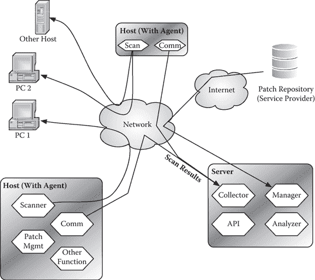

图 4.2 代理架构。

代理的基本类型包括：

*   **自主性 (Autonomous)**：它们不需要另一个系统或个人的持续输入和操作。
*   **自适应 (Adaptive)**：它们根据某些指定规则对环境变化做出响应。根据复杂程度，某些代理比其他代理更具自适应性。
*   **分布式 (Distributed)**：代理不受限于单个系统，甚至是单个网络。
*   **自更新 (Self-updating)**：一些人认为这一点并不是代理特有的。对于 `VM` 来说，这是一个重要点。

代理是驻留在主机并执行审计的程序。本地主机漏洞的检测有时通过在单一定义过程中对目标上的所有配置项进行审计来实现。另一种方法是持续监控当前机器的配置。当发生更改时，中间的漏洞软件会评估更改是否存在漏洞，并立即向管理服务器报告该更改。这种能力如今与日益增长的终端安全市场中交织在一起。配置更改的检测以及应用安全策略的附加能力，模糊了终端保护、配置合规性和漏洞审计之间的关系。这将最终导致更紧密、响应更快的安全。

### 4.3.2 优点与缺点

这种代理方法的一个显著优点是其分布式特性带来的扩展性。由于部署的代理数量仅限于兼容主机的数量和许可成本，理论上可以对每台机器进行审计，而除了配置代理和报告结果外，不会产生任何网络活动。虽然审计不是通过网络进行的，但代理与服务器之间的通信并不总是极。取决于主机和漏洞的复杂性可能会产生大量的报告流量。尽管如此，扫描并不是在网络链路上进行的。

一些显而易见的优点是，不需要担心部署额外的硬件，也不担心是否有足够的带宽和扫描器资源。

然而，代理受到一些基本问题的困扰：

*   它们可能与目标上运行的其他应用程序发生冲突。这是今天运行在复杂计算机系统上的所有软件的共同问题。测试是唯一的解决方案。
*   它们在本地安全策略中可能没有足够的权限来审计每个配置项。


* 它们可能会发生错误导致终止，且失败通知可能在一段时间内不会到达管理服务器，在此期间可能会错过审计窗口。
* 对于正在使用的操作系统和版本，可能没有可用的代理。几乎所有人都会为 Microsoft Windows® 制作代理，但支持 Linux®、FreeBSD® 或 Solaris™ 的代理要少得多。
* 如收银机和其他销售设备等嵌入式系统结构紧凑，没有为代理留出空间。然而，支付卡行业（`PCI`）安全标准要求对这些系统进行文件完整性监控。
* 考虑到代理的大小、空间和性能的限制，它不太可能涵盖成千上万可能的漏洞。
* 在虚拟机上，可能会同时运行许多代理，这会对底层硬件和宿主机 `OS` 的性能产生不利影响。
* 代理本身可能会因为漏洞而成为攻击者的目标。由于代理通常在网络上监听来自服务器的指令，因此存在可被利用的漏洞。

漏洞审计 `agent` 相比其他方法有许多优势：

* 它能看到所有漏洞，其中某些漏洞除非经过身份验证，否则无法通过网络获取。
* 即使在系统未连接网络的情况下，代理也可以运行。
* 它不会主动与系统上安装的软件交互以寻找漏洞，从而最大限度地减少干扰操作的可能性。
* 由于它不通过网络运行，因此不会引起网络入侵防御系统（`IPS`）的注意，也不会产生大量的网络流量。事实上，总流量负载可能远低于典型的 Web 浏览活动。
* 作为本地运行的软件，它可以将功能扩展到更主动的端点安全功能。

### 4.3.3 检测方法

代理对 `host` 的内部运作具有更深入的视图。它们被放置在可以感知系统一旦发生的任何变化的位置。虽然实现上并不总是采用这种方法，但这样做使其更接近与端点安全代理共享功能。

系统对文件 `checksums`、`registry entries` 内容和 `configuration files` 进行漏洞分析。由于 `host` 的类型对 `agent` 来说是知的，因此特定的必要漏洞检查集是预知的。由于 `agent` 通常作为 `system process` 运行，它可以访问所有文件，甚至是必要的 `memory space`，以便在变化发生的瞬间做出准确评估。只需从中央 `server` 向 `agent` 发送更新即可继续准确检测。`Network scanning methods` 可能需要更多时间来检测变化，因为它们通常不会持续扫描单个 `host`。

某些 `agents` 还具有对网络中其他目标执行某些 `network-based active scanning checks` 的能力。大多数 `configuration plans` 只允许对同一物理网络上的相邻系统进行扫描。

## 4.4 被动网络分析

被动网络分析涉及在 `network switch` 上安装一个设备来监听流量副本并对其进行漏洞分析。这在功能设计上类似于入侵检测系统（`IDS`）或嗅探器（`sniffer`）。将具有 `network port` 的硬件连接到带有待检查流量的 `network switch`。`network switch` 上的 `command` 将大部分交换流量的副本发送到物理端口，`analyzer` 可以在那里读取。或者，可以使用 `network tap` 检查单个物理网络连接中的流量。该连接可能携带来自多个网络的大量合并流量。

### 表 4.1 主动与被动扫描器对比

| 网络流量类型 | 主动扫描器 | 被动分析器 |
| :--- | :--- | :--- |
| `ARP` | 来自单个 `VLANs` | 来自多个 `VLANs`，包括远程的 |
| 目标的 `TCP.IP` | 来自主动扫描的目标 | 来自多个目标，任何在监控的 `VLANs` 上的通信 |
| `VLAN tags` | 来自已连接的 `VLANs` | 来自多个 `VLANs` |
| 观察到的协议 | 仅限扫描指定的协议 | `host` 使用的所有协议 |
| 发现的应用 | 扫描器已知可以发现的应用，包括非网络应用 | 任何使用网络连接的应用 |

注：`ARP` = 地址解析协议。`VLAN` = 虚拟局域网。`TCP.IP` = 传输控制协议/网际协议。

`analyzer` 寻找可以发现漏洞的多个方面。`IP addresses`、`network`、`application protocols` 和通用通信模式都会检查是否存在异常或可被利用的特征。表 4.1

端口镜像（被 Cisco 称为 `SPAN`）是现代交换机中非常常用的技术。图 4.3 解释了 `SPAN` 的工作原理。这是一种基础的 `SPAN` 配置，将一对局域网（`VLANs`）的内容复制到交换机上的物理端口。


同样，也可能将此 `RSPAN` VLAN 连接包含在广域网 (WAN) 配置中，其中远程交换机距离为 100 英里。这是一种不典型的配置，并存在一些带宽风险。这引出了我们被动式漏洞扫描的一个主要缺点：你无法无法使用 `SPAN` 技术以高效益的方法针对远程位置进行漏洞评估。被动漏洞分析器是非常昂贵的。对于具有 20 到 30 个目标以 100 Mbps 甚至 1,000 Mbps 速度相互通信的远程位置，监控非常困难且昂贵，因为需要提供足够的硬件来分析大量的流量。由于不太可能为了监控目的安装 1 Gbps 的 WAN 链路，而且购买设备进行本地安装也是不实际的，因此使用被动设备并不总是最优的。

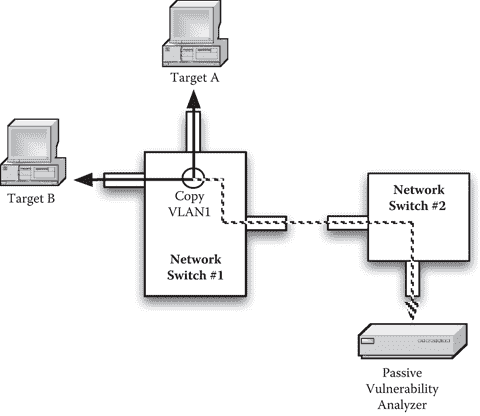

图 4.4 一种 `RSPAN` 实现，其中目标 A 和 B 在远程交换机 (#1) 上被监控。

`SPAN` 和 `RSPAN` 可能会出现问题，这些必须由合格的网络管理员进行评估。监控端口（即连接分析器的端口）可能会发生过度订阅。也就是说，进入该端口的流量超过了该端口的承受能力。大部分流量被存储在与被监控网络共享的缓冲区中。如果该缓冲区满，所有参与 `SPAN` 操作的端口的流量都会变慢。如果分析器连接到 100-Mbps 端口，并监控另外四个利用率超过 40 Mbps 的其他物理网络端口，这一点显而易见。总监控量为 160 Mbps。这意味着交换机必须保存额外的 60 Mbps 流量，直到能够将其传递到被动分析器的端口为止。为了避免这种情况，必须对每个目标/监控端口的峰值流量进行仔细的分析和评估。如果存在现有的 `IDS/IPS` 实现，可以共享这些 `SPAN` 端口以节省费用。

`SPAN` 的替代方法是 `tap`（分路器），它顾名其实义：在网络连接中物理安装，允许被动分析器查看流量。在以太网的情况下，`tap` 可以是电性的；在光纤的情况下，则是光学的。`Ethernet` `tap` 稍微复杂一些，因为它需要为该单元供电。某些 `tap` 甚至内置了电池，以便在电源故障时保持 `tap` 运行。光 `tap` 通常不需要任何电力，而是使用一种称为分束器器的棱镜。

`tap` 的缺点是难以管理双工。由于今天大多数网络都设计为同时发送和接收数据，分析器也必须能够做到这一点。在 100-Mbps 以太网示例中，连接到分析器的单个电缆只能监听发送或接收流量。在两个目标之间可能同时传输和接收，因此总吞吐量为 200 Mbps，这超过了单端口分析器连接的能力。这个问题通过 `tap` 将会话拆分为连接到分析器的独立电缆来解决。然后分析器在内部将这两个会话侧结合以便进行准确分析。

### 4.4.1 优点与缺点

被动分析方法具有若干优点：

-   分析器不与网络交互。
-   几乎不需要进行测试。
-   发现过程持续进行。
-   可以发现隐藏主机。
-   由于路由和其他信息可见，它可能还能绘制拓扑结构。
-   设备未放置在网络中。

这种技术也有一些有趣的缺点：

-   设备通常必须安装在携带流量的交换机上。
-   将交换流量复制到物理设备的机制可能会给交换机带来额外负载。
-   对漏洞的可视性有限。

总体而言，被动分析可能看不到更多的系统漏洞，但它们 24 小时运行，并提供无法获得的网络拓扑信息。如果主机环境的变化具有网络足迹，则可以使用被动分析方法进行检测。

使用被动分析检测漏洞完全取决于能够解析和解释开放系统互连 (OSI) 模型所有层的通信内容。

### 4.4.3 物理层

被动技术通常不会检查物理网络层的任何漏洞。物理连接终止于部署软件的硬件平台上的网络适配器。硅通常提供的有关物理连接状态的信息很少。

### 4.4.4 数据链路层

只有当漏洞扫描器以非监听模式连接到网络时，才会测试此层。这意味着扫描器将能够与网络的此层交互，并在动态环境中获取 IP 地址。检测能力通常限于连接到设备的交换机。可以收集有关连接到交换机的其他主机的信息、交换机的基本配置项（如速度和双工），以及交换机如何响应冲突传感和检测协议的变化（例如电气电子工程师协会 `IEEE 802.3` 规范中的载波感多路访问冲突检测 `CSMA/CD`）。通常，被动漏洞分析器会寻找偏离 `IEEE` 标准的情况。

### 4.4.5 网络层


网络层具有巨大的变数。IP 地址、标志、路由信息和选项参数可以独特地组合，以识别主机和漏洞。其中某些组合将在稍后的第 4.5 节中进行探讨，因此我们在此不进行详述。目前只需说明，在任何连接到网络的漏洞评估技术中，都可以从网络层获取大量信息。

### 4.4.6 第 4 到 7 层

剩余的层可以提供有关被检目标的大量信息。被动分析器将分解这些层，并搜索系统交互中的行为模式，以及单个数据包的具体内容。这是一个复杂的过程，具有许多分析方法，在设计上更类似于一个入侵检测系统（IDS）。

## 4.5 主动扫描技术

主动扫描涉及使用可以在网络上生成数据包的软件来主动接触目标，以检测其存在和漏洞。这是一种更复杂但高度可扩展的方法，也是目前最流行的方法。扫描器连接到网络的方式与其他任何主机相同。扫描器相对于目标的位置对于获得最佳结果至关重要。我们稍后会详细讨论这一点。

主动扫描本质上是模拟黑客的行为来发现目标，但有一个关键区别：黑客使用设计用于隐藏其活动的工具和技术，而合规的主动扫描工具则不会。扫描器还可以执行某些漏洞利用来确定易感性。执行这些漏洞利用的程度取决于扫描配置中选择的选项。大多数产品在管理员未在扫描配置中进行特定选择的情况下，避免使用可能对目标产生不利影响的漏洞利用。此外，应该理解的是，大多数商业工具的设计目的是检测漏洞而非利用漏洞。虽然它们可以作为渗透测试的一部分，但还有其他更合适的工具来完成此类任务。

### 4.5.1 优点与缺点

主动扫描的一些主要优势：

*   高度可扩展性，因为扫描是从安全架构师选择的中心位置或分布式位置进行的，且不需要在目标上安装软件。
*   该技术可以提供黑客视角的网络和目标，因此漏洞管理器可以对其在生产环境中的风险有一个真实的了解。
*   具有支持任何网络设备的潜力，也就是说，不受限于与代理兼容的平台。
*   无论平台支持如何，都可以提供增量信息（例如：开放端口、识别出的协议/应用程序、横幅），即使漏洞管理（VM）系统之前未见过该设备。

缺点是：

*   如果目标未连接到网络，它将不会被扫描。代理可以在漏洞发生时检测到，并在主机下次连接到网络时报告结果。
*   存在对网络基础设施产生影响的可能性，因为所有扫描都是这样进行的。然而，一些基础规划可以防止此类不利影响。
*   在较慢的网络连接上扫描速度较慢。这在链路较弱的小办公室中很常见。今天，我们在南美、非洲和亚洲部分地区经常看到这种现象。

### 4.5.2 检测方法

漏洞评估过程分为三个阶段：发现、侦察和白盒测试。发现过程涉及根据扫描配置指定，识别所有连接到特定网络或 IP 范围的主机。侦察是一个对主机进行类型、版本和被动检测漏洞概分析的过程。这是通过对协议的创造性使用和对应用程序行为的分析来实现。一旦识别出主机，白盒测试将使用特权访问收集更多信息。

#### 4.5.2.1 发现

顾如其名，发现阶段非常积极在使用网络上的关键协议来检测目标的存在。并非所有协议都是可靠的，有时需要这样做这样做。

#### 4.5.2.1.1 ICMP

通常，互联网控制消息协议（ICMP）回显请求被用于识别主机。这并非完美的解决方案，因为在某些情况下，安全设备会干扰或阻止 ICMP。如果主机对回显有响应，则会将其加入侦察列表。

#### 4.5.2.1.2 操控 TCP

某些扫描器不会考虑 ICMP，因此有时会发送 TCP 同步（SYN）数据包。这取决于供应商以及如何配置它。向主机发送 SYN 数据包后，预期收到 SYN-ACK（同步确认）回复。如果此回复未按时到达，扫描器将认为端口未响应且主机不存在，除非主机在其他端口上有响应。这些端口的发现并不一定是串行过程。扫描器可能会同时在许多端口和许多主机上“喷洒”SYN 数据包。这节省了时间并更有效地利用了带宽。性能问题将在稍后讨论。

**表 4.2 常见扫描端口**

| *端口* | *协议* |
| --- | --- |
| 20 | FTP |
| --- | --- |
| 21 | FTP |
| --- | --- |
| 22 | SSH |
| --- | --- |
| 23 | Telnet |
| --- | --- |
| 80 | HTTP |
| --- | --- |
| 443 | HTTPS |
| --- | --- |
| 137 | NetBIOS 名称服务 |
| 138 | NetBIOS 数据报文服务 |
| 139 | NetBIOS 会话服务 |

*注*：FTP = 文件传输协议；SSH = 安全 Shell；HTTP = 超文本传输协议；HTTPS = 超文本传输协议/标准端口；NetBIOS = 网络基本输入输出系统

TCP 发现方法的潜在副作用可能会产生打开或半打开的接字。这会对系统产生不利影响，取决于监听的应用程序以及操作系统协议栈的完整性。

半打开接字发生在扫描器未使用 ACK 数据包完成连接建立时。其影响范围从内存消耗到生产系统的拒绝服务（DoS）。通常情况下，这不是问题，因为每个 TCP 端口只尝试一次活动连接。然而，配置不当的扫描可能会改变这一点。通过防火墙扫描时也存在类似的现象。许多防火墙会作为连接到主机的代理。当同时扫描数百或数千个主机时，这会对防火墙产生负载。当路由器对于其运行环境配置不足时，某些路由器也会受到影响。


如果连接通过 `ACK` 数据包完成握手，则主机和/或防火墙上的连接表中将维护一个条目。结果是导致资源的进一步消耗，直到连接超时或重置。因此，测试扫描器的行为并确定是否会向主机发送 `TCP reset`，以及这种行为可能如何在大规模上影响你的网络，是至关重要的。如果可能通过防火墙进行大量扫描，请测试这种场景。在防火墙上，连接的建立和销毁是两个对处理器需求最密集的任务，并可能会降低性能。然而，这并非绝对。在扫描配置中进行适当调度、带宽整形和连接限制可以帮助防止这些问题。

图 4.5 展示了一个防火墙可能受到多个并发扫描显著影响的场景。如你所见的，每秒的连接总数可能会迅速增加。扫描比普通网络流量密集得多，因为它被集中在很短的时间内。

相反，由于厂商添加了所有额外的安全功能，防火墙可能会干扰发现扫描。例如，某些防火墙厂商添加了入侵防御能力以及 `SYN proxy`。这些功能可能会向漏洞扫描器提供错误信息，使得似乎在不存在主机的地方存在主机。这是因为许多扫描器将关闭端口的“响应”视为主机存的指示。否则，为什么会有响应呢？

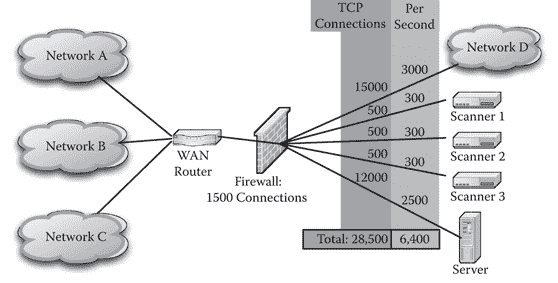

图 4.5 一个防火墙可能受到多个并发扫描显著影响的场景。

这些安全功能也可以起到反向作用，模糊主机及其开放的端口。希望防火墙厂商具有根据源 IP 地址对流量进行异常处理的内置能力。在异常列表中配置扫描器的正确 IP 地址，扫描应该能够无错误地进行。

然而，并非所有防火墙都是平等的。出于此原因，我们将花一点时间讨论防火墙中的数据包处理，因为它与 `VM` 相关。图 4.6 显示了防火墙处理流量的基本结构。注意这种堆叠式架构。其动目的是在投入更多处理周期之前，对流量进行针对最基础缺陷的筛选。例如，如果 `TCP flags` 是无效组合，则流量应该被丢弃。这种处理大部分可以在硅片中完成，避免进一步增加防火墙 CPU 的负担。另一方面，如果流量需要通过某些规则处理，则需要更多的 CPU 周期。

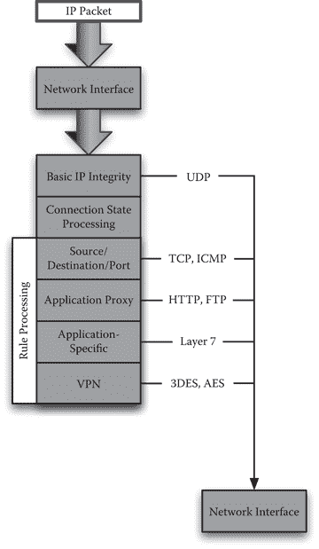

图 4.6 防火墙处理流量的基本结构。

数据包处理的下一步是保存和监控连接状态。如果从漏洞扫描器收到 `SYN` 数据包，将将其与连接表中的条目进行比较。如果连接已经存在，则这可能是一个重复包，数据包被丢弃。如果连接不存在，则在表中创建一个条目。当收到 `SYN-ACK` 数据包时，将进行相同的比较以跟踪该连接的状态。所有相关数据包也是如此。如果收到 `RST` 数据包，则从表中删除该连接。如果每秒有数千个连接并且正在发生其他防火墙活动，这个过程可能会消耗大量的 CPU 资源。这种连接表数据结构的限制以及处理数据包的相关编程代码是受发现扫描影响最关键的部分。如果状态表的数据结构太小，那么 `SYN/SYN-ACK` 发现过程将迅速填满此表。如果在测试中出现这种限制，你必须确保在发现期间限制打开连接的数量。

另一方面，如果用于与此表进行比较的处理代码效率低下，会对防火墙的吞吐量产生巨大影响。在这种情况下，维持连接速率的限制至关重要。

大多数防火墙按顺序处理规则。从队列中取一个数据包与规则进行比较。一旦规则匹配流量，检查过程就会停止。然后数据包被转发到网络接口，并从队列中提取下一个数据包。

避免对防火墙产生巨大影响另一种方法是移动扫描器的位置。这很大程度上取决于你的网络设计。仔细放置扫描器是首要考虑因素，对于扫描有效性至关重要。这个主题将在本章后面进行详细讨论。

#### 4.5.2.1.3 性能问题

我们已经详细讨论了识别端口和处理 `TCP connections` 的过程。在扫描过程中，必须考虑所有这些因素；然而，扫描器不能等待太久。在某个时刻，事务尝试将“超时”。这种现象被称为发现容度。不同的厂商具有不同程度的发现容度。容度的多少与发现的准确性大致成正比，而识别成功的概率迅速降低。幸运的是，我们从经验知道，超过一定时间等待回复是没有意义的。确定这一点是任何指纹识别活动中的真正技巧。目标是完整且准确，但存在收益递减规律。两个关键计时器影响发现过程的速度：连接建立计时器和重传计时器。

对于许多 `TCP implementations`，连接建立计时器（`TCP_KEEPINIT` 参数）会等待 75 秒获得响应。如果 200 个主机中没有一个响应，对单个端口进行简单扫描将需要四个小时才能完成。这必须被调整为等待短得的时间。一种有效的方法是取 `ICMP echo reply` 交换的最大往返时间 (`RTT`) 并增加两秒。这为应用程序响应提供了充足的时间，并且比默认的 75 秒短得多。

对于 `TCP connections`，当需要与目标交换额外的包时，发现过程也可以改变重传计时器。在正常通信中，计时器从 1.5 秒的值开始。如果没有收到响应，则该值翻倍为 3 秒。如果还没有 `SYN-ACK`，计时器再次翻倍，我们等待 6 秒。重复此过程直到达到 64 秒的限制。该过程被称为指数退避 (`EB`)。在理论上，这应该与最终收到响应的指数概率相对应。然而，对于漏洞扫描中的主机发现目的，这通常是不实际的。典型的操作系统可能会花费几分钟等待连接超时。

一种更实际的方法是按较小的值顺序增加重传计时器，其总时间应为高于目标 IP 范围平均值的若干倍数。例如，假设我们正在对网络 A (`192.168.10.0/24`) 进行发现，重传的上限为 30 秒。如果前 16 个主机平均需要 10 秒响应，且众数为 5 秒，我们可能会从 5 秒开始我们的重传计时器，并每次增加 5 秒，直到达到 20 秒的上限（2 × 平均值）。这是一种更合理的方法，将避免一个单个连接可能达到几分钟的常见 IP 栈值。记住，我们的目标是发现开放端口和存活主机，而不是向另一个主机可靠地传输数据。


还有另一个可以操纵的项目，它并不完全是计时器，但可以显著加速发现过程：

为了实现所有计时器，`TCP` 只需要定期调用两个函数：(1) 快速计时器每 `200 ms` 调用一次，(2) 慢速计时器每 `500 ms` 调用一次。`TCP` 使用这两个周期性的“滴答”（ticks）来调度和检查描述的所有计时器……以及测量往返时间。

基本上，操作系统内核必须每 `200 ms` 检查一次是否收到了确认。在现代网络和操作系统中，这是一个非常长的时间。

通过缩短这个周期，发现过程可以识别出其发送的探测 `SYN` 包已在更短时间内收到确认，并进入下一个探测。如果从 `SYN` 到 `SYN-ACK` 的 `RTT` 为 `10 ms`，那么在正常情况下，发现过程可以等待最多 `190 ms` 后进行下一步操作。将这个数字乘以数百个主机和几十个端口，浪费的时间将是巨大的。

修改 `TCP` 定时器的注意事项是，某些应用程序响应本身很慢。这种方法在探测开放端口时效果最好，但并不一定适用于应用程序。在扫描性能优化方面有很大的创意空间。本节仅说明了设计者在尝试优化扫描过程并最小化对网络的影响时可能面临的某些挑战。

### 4.5.2.2 黑盒测试

一旦确定了主机的存在并将其记录在扫描器的内存中，就会执行一系列测试或“检查”来发现漏洞。检查的类型取决于主机的类型和扫描器的配置。通常会进行两种类型的检查。

首先是基于网络或表层的检查，这涉及探测和分析——除了与扫描器和目标之间相同网络上的任何其他节点提供的服务之外，对机器上受限或无法访问的服务。这也称为未身份验证检查。另一种检查是身份验证的内部检查或白盒测试。当赋予扫描器特殊信息和凭据以访问主机的细节时（这些细节通常保留给信任实体），就会进行这种检查。

表面检查和内部检查之间的区别显然很大，不仅体现在获取信息的方式，还体现在信息的价值和质量上。显然，登录主机并查看其配置可以获得更详细的数据。尽管这些信息告诉了我们关于主机的很多信息，但它通常不能代表对未知主机进行侦察的攻击者的视角。尽管从分析角度来看很有价值，但某些攻击是从外部人的视角通过探测主机来发生的；因此，以相同方式获得的信息通常更有价值。总结来说，从主机外部发现并可利用的漏洞，比相同漏洞只能通过凭据或内部检查发现并利用的漏洞具有更大的暴露风险。

有一种普遍观点，认为身份验证检查比远程检查更准确，但事实往往并非如此。`Windows registry`（Windows 注册表）常用于身份验证检查，但结果往往是错误的。重要的是要考虑到并非所有身份验证检查都是平等的，远程检查是验证身份验证信息的一种良好方法。

黑盒测试过程涉及网络上一些简单的测试，并可能对 `IP` 及其他协议进行创造性使用。通常，简单的测试是无害且高效的。对 `IP` 协议更奇特的操纵可能会在运行未准备好处理许多变体的应用程序扫描主机上引起问题。这本身就是一种漏洞。主机的 `IP stack` 通常能够处理几乎任何类型的流量，但上层应用程序有时却不能。另一个需要大量测试的领域，以避免对生产系统产生不利影响。大多数供应商都能提供已知的负面应用程序交互列表。

以下是一些常见的侦察方法列表：

*   向主机发送畸形包，以识别响应中是否存在漏洞。这与发现过程类似，有时为了效率会将其合并到同一阶段。发送到目标的信息可以是 `OSI Model` 中第 3 层到第 7 层任意一层或多个层级的组合。
*   向已知应用程序发送正常包以获取揭示漏洞信息的结果。这在 `HTTP` 协议中非常常见，用于获取有关 `Web server`、`application server` 或后端数据库的信息。
*   向目标发送有效信息以收集有效的报头响应。

#### 4.5.2.2.1 使用 TCP/IP 进行指纹识别

一种简单的指纹识别方法是使用 `ICMP`。`ICMP` 包用于监控接口状态。共有九种消息类型：四种用于查询，五种用于报告错误。每种类型由一个数字定义：`PING` 是一个非常流行的程序，发送 `type 8`（回显请求），而 `type 0` 是回显应。除了 `ICMP` 之外，还有一种代码用于报告更多关于错误的信息。通过将这些代码操纵为无效值，可以捕捉目标的响应或无响应状态。这本身就能告诉有关操作系统的一些信息。某些系统不查看回显请求上的代码字段，其他系统则会查看并返回错误。

#### 表 4.3 ICMP 类型

| ICMP Code | Type |
| :--- | :--- |
| 0 | Echo reply |
| 1–2 | Unassigned |
| 3 | Destination unreachable |
| | *Code*: *Meaning* |
| 0 | Net unreachable |
| 1 | Host unreachable |
| 2 | Protocol unreachable |
| 3 | Port unreachable |
| 4 | Fragmentation needed and don't fragment was set |
| 5 | Source route failed |
| 6 | Destination network unknown |
| 7 | Destination host unknown |
| 8 | Source host isolated |
| 9 | Communication with destination network is administratively prohibited |
| 10 | Communication with destination host is administratively prohibited |
| 11 | Destination network unreachable for type of service |
| 12 | Destination host unreachable for type of service |
| 13 | Communication administratively prohibited |
| 14 | Host precedence violation |
| 15 | Precedence cutoff in effect |
| 4 | Source quench |
| 5 | Redirect |
| 6 | Alternate host address |
| 7 | Unassigned |
| 8 | Echo |
| 9 | Router advertisement |
| 10 | Router selection |
| 11 | Time exceeded |
| | *Code*: *Meaning* |
| 0 | Time to live exceeded in transit |
| 16 | Fragment reassembly time exceeded |
| 12 | Parameter Problem |
| | *Code*: *Meaning* |
| 0 | Pointer indicates the error |
| 1 | Missing a required option |
| 2 | Bad length |
| 13 | Timestamp |
| 14 | Timestamp reply |
| 15 | Information request |


| 类型 | 说明 |
| :--- | :--- |
| 16 | 信息回复 |
| 17 | 地址掩码请求 |
| 18 | 地址掩码回复 |
| 19–29 | 预留 |
| 30 | 路由追踪 (Traceroute) |
| 31 | 数据报转换错误 |
| 32 | 移动主机定向 |
| 33 | IPv6 Where-Are-You |
| 34 | IPv6 I-Am-Here |
| 35 | 移动注册请求 |
| 36 | 移动注册回复 |
| 39 | 跳过 (SKIP) |
| 40–254 | 不适用 |

## IP 指纹识别 (IP Fingerprinting)

另一种侦察方法被称为`IP 指纹识别`。这种概念是一种优雅的形式，通过向目标的协议栈中操纵输入并测量结果来实现。为了简要回顾，让我们查看表 4.4 中的 `TCP` 头部结构。

`TCP` 最实用的操作优势在于，它通过确认每个数据包的接收来保证交付。那组标志——`SYN`、`ACK` 和 `RST`——告诉接收者所传输内容的目的。我们的漏洞扫描器正在向目标发送 `SYN` 数据包。但数据包中其余内容的行为可以揭示关于目标的信息。`序列号`（Sequence number）就是一个很好的例子。为了防止主机上的 `TCP` 监听器产生混淆，每个数据包都包含一个`序列号`。自从该协议创建以来，人们发现很容易“回绕”序列号，因为它们的大小有限（`32 位`）。为了解决回绕以及可能导致旧数据包的重复序列号被误认为是新数据包序列号的潜在问题，`RFC 1323` 引入了`时间戳选项`（time-stamp option）。这是一个可选字段，并并不是所有的操作系统的 `TCP/IP` 实现都会设置该值。当扫描器看到在从未使用过`时间戳选项`的情况下发送了此类值时，操作系统的范围就被大大缩小了。

另一个需要测量的现象是`时间戳`（time stamp）的递增。通过首先确定扫描器与目标之间的 `RTT`，你就知道 `TCP` 分段之间应该经过多长时间。远程 `OS` 会在每个分段上按特定值递增`时间戳`。目标递增该值的方式可以揭示 `OS` 的类型。

例如，我们知道 `OS XYZ` 每运行 `500 ms`，`时间戳`就会增加 1。目标与扫描器之间的平均 `RTT` 为 `100 ms`，每个方向为 `50 ms`，如图 4.7 所示。我们接收到第一个`时间戳`（`TS1`）为 `100` 的分段。我们确认该分段并开始计时。第二个`时间戳`为 `102`（`TS2`）的分段到达，我们停止时钟。分段 1 和分段 2 之间经过的时间为 `1100 ms`。我们知道分段的传输时间为 `100 ms`。因此，时钟值 `1100` 减去 `RTT` `100`，得到主机在分段之间经过了 `1000 ms`。`TS2` 和 `TS1` 之间的差是二。这意味着在 `1000 ms` 内，`时间戳值`增加了两个，即每每次`时间戳递增`对应 `500 ms`。通过查看随时间变化的`时间戳值`表，我们知道目标每 `500 ms` 增加一次`时间戳`，这就是 `OS XYZ`。这种技术与其他指纹识别方法相结合，最终将缩小 `OS` 的范围。这一选择对于确定漏洞扫描的后续步骤至关重要。

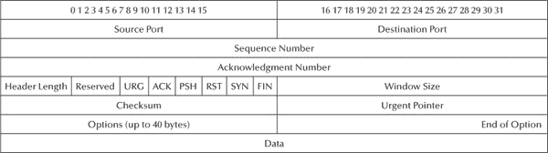

**表 4.4 TCP 分段**

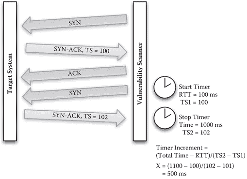

图 4.7 目标与扫描器之间的平均往返时间 (`RTT`) 为 `100 ms`，每个方向为 `50 ms`。

无效的标志组合是另一种方法。正常的组合 `SYN`、`SYN-ACK` 和 `ACK` 是预期的。但各种主机 `OS` 对诸如 `FIN+URG+PSH` 这样的组合反应很奇怪，这种组合在正常握手中是未曾过的。它被称为 `Xmas` 扫描或`圣诞树扫描` (Christmas scan)，因为它像圣诞树一样点亮了 `TCP` 标志。另一种可能识别 `OS` 的组合是 `SYN+FIN`。除了主机发现外，这类扫描还可以在不建立 `TCP` 连接或半开连接的情况下确定主机上的端口是否开放。这是因为遵循 `RFC` 的 `IP 栈`在端口开放时会用 `RST` 数据包进行响应。如果端口关闭，主机将不会有响应。

这些标志的使用也可以变得更加复杂。如果已经通过无害的 `TCP-SYN` 扫描确认端口是开放的，则可以使用 `FIN-ACK` 组合对同一端口进行探测。事实证明，实现`伯克利标准发行版`（`BSD`）`IP 栈`的系统不会根据 `RFC` 响应 `RST` 数据包。这为目标可能的系统类型提供了更多证据。

通过结合这些以及许多其他类型的探测，可以对系统类型做出合理的猜测。`Network Mapper`（`Nmap`；[www.nmap.org](http://www.nmap.org)）的创建者已经很好了这项工作。他们继续发现扫描和映射网络目标的新方法，并将这些技术构建到他们的开源工具中。对这进行一些阅读和实验会非常有意义。

然而，`OS 指纹识别`和`IP 栈指纹识别`的主题可能是复杂的、不可靠且令人困惑的。某些 `OS` 可能共享栈代码，但是不同的操作系统版本。虚拟机技术可能会进一步模糊问题，因为底层的虚拟机程序 OS 可能会响应网络流量并将连接代理到实际主机。防火墙和虚拟机可以执行网络地址翻译 (`NAT`)，这将掩盖 OS 的真实性质。

## 4.5.2.2 应用指纹识别：Banner (Banners)

扫描中的一项重要活动是确定哪些应用程序在网络上显示自己。与`OS 识别`和`IP 栈指纹识别`类似，漏洞扫描器可以尝试连接已知或未知端口上的各种应用程序，这一过程被称为指纹识别 (featureprinting)。最为人知的指纹识别方法之一是检查 banner。

系统上的某些应用程序会在您尝试连接时产生 banner。此 banner 内容可以为确定 `OS` 版本和主机上运行的软件提供价值信息。这种类型的指纹识别通常可以使用所有操作系统平台上的一个简单程序进行：`Netcat`。

让我们以 Web 服务器为例。图 4.8 显示了一个典型的 `Netcat` 会话。使用 `Netcat` 时，您可以指定要连接的 `TCP` 端口。因此，在命令行中，我们输入 `nc 10.1.1.10 80`。这将运行 `Telnet` 程序并与监听端口 80 的服务器建立连接。

从这里开始，我们能够向远程服务器发出命令。由于这是端口 80，它可能是一个 Web 服务器；因此我们发出命令：`HEAD/HTTP/1.0` (图 4.8a)。服务器返回了一些详细的头部信息，告诉我们 Web 服务器软件类型和 `OS`。在这种情况下，它是运行在 `UNIX` 系统上的 `Apache`。这消除了任何 Windows 版本的可能性，并使得搜索漏洞变得更加容易。


出于安全考虑，服务器管理员应该隐藏这些标头信息，特别是“Server”部分中的信息。但这无法阻止一个优秀的漏洞扫描器。扫描器还可能通过发送无效请求来检查 Web 服务器的类型。通过在 `HEAD` 命令中使用无效的类型类型，我们可以看到来自不同 Web 服务器厂商的各种响应。请注意，Apache Web 服务器会返回“400 Bad Request”信息（图 4.8）。连接也会被关闭；然而，在 IIS 7.0 上，连接并未关闭，但收到了相同的“400 Bad Request”信息。但你也会注意到，提供的服务器信息比有效请求中发现的更多。在 IIS 的早期的版本中，你可以通过其返回“200 OK”消息的反应将其区分开。类似的方法也用于捕获并分析有效及无效的响应。在某些情况下，这些会被报告为漏洞或仅仅是信息泄露。³

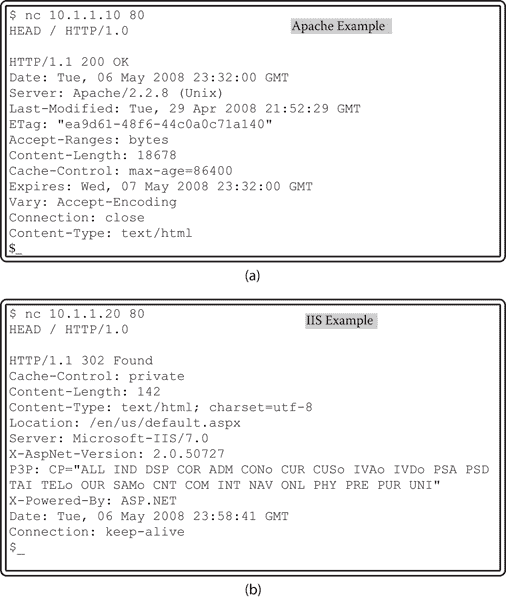

图 4.8 一个典型的 Netcat 会话。

### 4.5.2.2.3 其他指纹识别方法

其他类型的指纹识别是通过如简单网络管理协议（SNMP）等协议进行的，SNMP 是一种用于监控和管理网络设备的协议框架。这种能力通常被扩展到防火墙、IPS 甚至普通主机。为了参与简单的状态报告功能并对网络上的所有设备进行集中管理，SNMP 已经实现在几乎所有设备上。


图 4.9 网络管理软件使用 SNMP 协议向设备发送查询。

网络管理软件使用 SNMP 向设备发送查询。这些消息的结构如 图 4.9 所示：

*   `Version` 指定了所使用的协议版本。这是必要的，以便让目标主机知道如何处理消息。
*   `Community` 本质上是一个用于验证请求发送者身份的密码。在接下来的示例中，我们将操纵此值来搜索基础漏洞并确定设备类型。
*   `Request ID` 是一个类似于 TCP 中序列号的数字。相同的数字也会出现在请求的回复中，以便请求者知道该回复适用于哪个请求。它仅仅是一个引用索引。
*   `Error status` 和 `error index` 在本文讨论中并不相关。这些值由目标主机在产生错误消息报告给网络管理服务器时使用。这些消息通过端口 161 和 162 使用 UDP 发送。虽然 UDP 的可靠性较低，但它效率很高，且很少被安全专业人员注意到，因为使用该协议的网络设备之间存在很大，很难观察到不当行为。由于不像 TCP 那样有状态，该协议更容易被滥用。另一方面，UDP 数据包很容易被伪造，并且通常会通过网络安全设备，因为网络工程师为了收集关键网络统计数据正在简化自己的工作。

指纹识别过程的一部分是识别运行了 SNMP 的设备。这可以通过使用默认社区字符串“public”发送“GetRequest”消息来完成。这等于在传统主机上将密码设置为“password”。某些扫描器还具有循环遍历各种设备上使用的默认社区字符串的能力。它们有时还能够尝试用户指定的其他社区字符串。你可以将这种方法视为对 SNMP 配置的暴力破解攻击。

使用名为管理信息库（MIB）的层次结构来请求目标主机的信息。可以请求各种类型的信息，其中某些是厂商特有的。许多安装默认启用了 SNMP，因此接受请求并暴露信息。更常见的社区字符串有“public”、“private”和“secret”。还有许多特定厂商常用且保持不变的已知字符串。

与 SNMP 社区字符串的方法类似，Telnet 和 SSH 协议也可以进行指纹识别。有时，在登录之前，会向交互用户显示服务器名称或操作系统类型。扫描器会解析呈现的字符串以寻找诸如“Windows”或“UNIX”等关键词。查看此类信息不需要登录。然而，对于 SSH，如果能够建立连接，那么我们就可以确定该服务正在运行，稍后尝试发现相关的漏洞。

还存在其他几种用于主机指纹识别的技术。Nmap 是一个常见的获取的极佳工具，可以用来说明这些方法中的一些。你可以在 [www.insecure.org](http://www.insecure.org) 找到它。这个命令行工具能够通过对 ICMP 和 TCP 协议的各种滥用和使用来扫描 IP 地址范围。其中采用的一些方法在之前已经讨论过。应该记住，商业漏洞扫描工具会尽力不干扰其他设备。扫描仍然被安全设备检测到。目标从未是隐蔽，而是为了健康。

指纹识别过程可以识别出扫描器，因为输出可用于确定检查的类型以及整体目标漏洞评估的准确性。这里提供了指纹识别的基础知识，以便你掌握这项任务的复杂性。知道正确的操作系统版本可以帮助识别需要检查哪些常用应用程序。或者，首先发现某些应用程序也可以主机主机更加准确。协调这些活动的艺术对于准确性来说是细微但重要的。

### 4.5.2.3 白盒测试](#contents.xhtml#tl_sec4_5_2_3)

白盒测试是一种通过提供系统配置的经过验证、特权的或“开放”的访问以便观察通常不可见的细节来发现漏洞的方法。这种测试存在于基于代理的技术和主动扫描中。

#### 4.5.2.3.1 凭据

主动扫描技术中执行此类测试，需要特定的凭据来授权扫描过程对目标进行访问。凭据类型随目标类型而异。常用的访问方法有 SSH、Windows 管理规范 (WMI)、Telnet、SNMP、服务器消息块 (SMB) 和远程注册表。Windows 机器通常需要远程注册表或 WMI 访问，而 *nix 机器将使用 SSH。

一种常见的认证通道是通过 SNMP。这是一种在网络设备和打印机上非常常用的协议。它也较少出现在通用主机（如桌面和服务器）上。该协议方案由管理站和多个代理组成，每个代理运行在管理设备上。SNMP 通常有三种版本：SNMPv1 (RFC 1157)、v2 和 v3。版本 1 和 2 使用社区字符串作为执行命令或收集信息的单一密码。它没有用户 ID，无法确定识别是谁执行了什么命令。此外，社区字符串是明文传输的，通常被认为是不安全的。


`SNMP` 的简单性之处在于它使用了 `UDP`。对于那些不熟悉该协议的人来说，它允许在网络上进行无连接的或无保证的数据包传输。这种简单性也是 `SNMP` 的一个缺点，进一步导致该协议在黑盒测试中被滥用。尽管如此，通常仍然使用 `SNMP` 只读社区字符串和命令来从目标中收集漏洞信息。

`SNMPv3` 经过增强，提供了许多许多安全性。它包含了安全元素，可以加密消息内容、验证请求用户的身份，并验证消息源以防止伪装或篡改。实际上，它提供了一个用户 ID 和密码（密钥）。该密钥用于加密消息并具有很强的抗篡改能力。

`Telnet`、`SNMPv3`、`SMB`、`WMI` 和 `Remote Registry` 将应用用户 ID 和密码。`SSH` 可以采用用户 ID 和密码或证书。希望没有任何目标需要明文凭据和 `Telnet` 访问。这种方法确实出现在许多足够老而缺乏其他方法的产品中。它经常出现在不间断电源（UPS）和旧版网络设备的控制界面上。较新的设备提供了 `SSH` 作为远为优的替代方案。

在商业虚拟机系统中，这些凭据通常以加密形式存储，直到被使用。真正的挑战不是凭据的应用，因为这已经非常成熟。对这些凭据到目标设备进行管理和部署才是最受关注的问题。这将在选择技术的章节——第 5 章。每个执行检查的进程都会搜索“标识符（Identifier）”列，以匹配进程名称、协议和结果。该匹配将揭示漏洞是否存在、任何需要执行的额外检查、描述和类别。通过将其他数据库表与配置参数和主机细节相结合，扫描能够为结果分配值。

#### 4.5.2.3.2 扫描

当对目标检查各种漏洞时，该行为通常被称为扫描。将扫描想象成一个执行检查的过程。扫描在对同一目标执行下一次检查之前，需要大量的数据收集、组织和分析。这种复杂性要求采用层次化的方法收集、存储和处理结果。不能简单地为每种主机类型保留一组检查然后在目标上运行。这可能导致处理、带宽的浪费，更糟糕的是——损坏目标。就像医生一样，作为ฝ่าย，我们在道德上有义务尽力做到“不伤害”。如果你访问的一位医生从不询问你的症状或对各种情况的反应，而是仅仅看到你是人类就进行了一系列测试（其中某些测试可能是侵入性的且与你的病情无关），那是不可接受的。

一种更合理的方法是为目标建立配置文件，然后寻找与该配置一致的漏洞。例如，如果操作系统上安装了 Microsoft Office，那么就没有必要探测与 `WordPerfect®` 相关的漏洞。除了面临影响机器和消耗网络带宽的风险，这还浪费了可以完成其他主机扫描的宝贵时间。特定的扫描器具有精心安排的工作负载是很寻常的，这样所有需要的扫描都能及时完成，以满足典型的报告计划。

在对主机进行扫描期间执行的另一个子过程是密切类似于软件或配置清单的配置文件。该清单一旦完成，将与针对已知漏洞要执行的可能检查列表进行匹配。此类功能的数据结构类似于表 4.5。每个执行检查的进程都会搜索“标识符（Identifier）”列，以匹配进程名称、协议和结果。该匹配将揭示漏洞是否存在、任何需要执行的额外检查、描述和类别。通过将其他数据库表与配置参数和主机细节相结合，扫描能够为结果分配值。

### 表 4.5 漏洞数据库结构

| `Identifier` | `VPointer` | `CPointer` | `Category` | `Description` |
| :--- | :--- | :--- | :--- | :--- |
| `HKLM/Software/Mozilla/CurrentVersion/20.0.0.14` | `9574839` | `9037593` | `OS` | Mozilla 2.0 |
| `HKLM/Software/Office/MSWord/CurrentVersion/5` | `7752955` | `879` | `Productivity` | MS Word 5.0 |
| `SSH: Netoper 14` | `773845` | `948346` | `Utility` | Secure Copy (SCP) |
| `TELNET: IOS 11` | `99175` | `86849` | `Network` | Cisco IOS |
| `BGP: TCP179 ACK` | `3980` | `8756` | `Protocol` | Unfiltered BGP Peer |
| `TCP50: AXFR` | `122` | `7112343` | `DNS` | Unauthorized zone transfer permitted |

*Note*: `AXFR` = Asynchronous Transfer Full Range; `BGP` = Border Gateway Protocol; `DNS` = Domain Name System; `SCP` = Security Certified Program.


例如，参考表 4.5，如果 `Telnet` 端口在发现过程中生成的回复包含“Cisco IOS 11*”，则会将此内容与表中的“Identifier（标识符）”进行比较，以找到 `CPointer` 86849。该 `CPPointer` 指导扫描器加载并执行与该索引相关的检查。另一方面，如果在发现或扫描阶段在表中发现了“BGP: TCP 179 ACK”，则在无需对目标进行进一步询问的情况下，将其自动识别为漏洞。尽管如此，仍然有一个 `CPPointer` 指示扫描器必须执行额外的检查，因为扫描结果同时揭示了这是一个运行边界网关协议（`BGP`）的路由器，并且存在一个漏洞。因此，在记录现有漏洞的同时，必须进行路由器检查。

图 4.10 显示了其两个组成部分的基础扫描过程。图片的左侧显示了整体扫描过程。在此过程中，会读取发现结果并与漏洞表进行比较。当发现匹配项时，会通过创建并将列表添加到目标漏洞对象中来记录该匹配项。一旦收集了特定目标的所有漏洞，就会实例化右侧的过程。我用“实例化”一词是因为可以同时运行多个此类过程。然后，左侧的过程将重复。

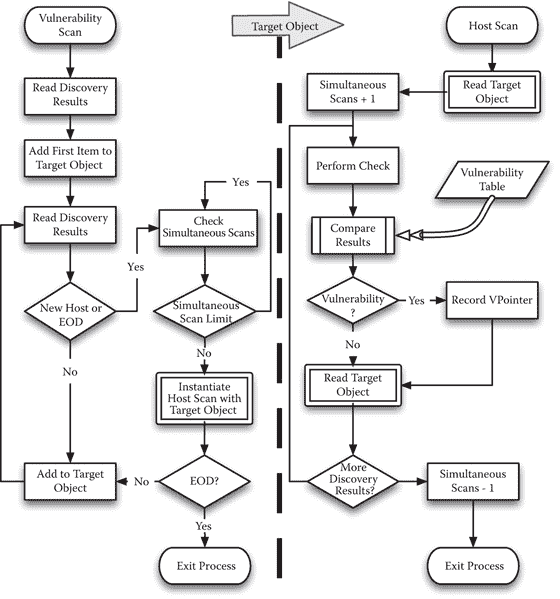

图 4.10 两个组成部分的基础扫描过程。

该目标扫描过程将持续进行，直到进程耗尽待扫描的主机或达到最大并发目标扫描数。当达到最大目标扫描数时，进程将等待直到有空间运行另一个实例。当到达目标数据结束（`EOD`）时，进程终止。随后，开始后续的数据收集和报告活动。这些未来的活动将等待所有目标扫描进程完成（计数归零）后才报告所有结果。

过程的右侧非常简单。读取待检查漏洞列表中的每个项 `CPPointer`，并执行相应的检查。一旦完成所有检查，进程就会退出。请注意，此进程的成功退出会将并发扫描计数减 1，为左侧进程实例化另一个实例留出空间。由于之前提到的原因，利用处理器的多任务能力至关重要。将此过程串行化只会导致扫描缓慢。

正如我之前建议的，最终将为发现的漏洞分配一个值。然而，该值可以通过许多方式计算，并取决于特定扫描软件作者的策略。在良好的安全实践和编码实践中，不应在扫描期间执行此活动。所有资源都应致力于执行准确且及时的扫描，没有任何额外的负担。这与我们关于良好编码实践的讨论有关。在扫描期间计算漏洞的值没有处。但它在稍后的报告阶段具有价值。此外，通过在扫描阶段引入值分配算法，程序员可能会无意中向代码中引入可以被利用的漏洞或缺陷。这只是在如此关键阶段可以排除的额外复杂性之一。

### 4.5.2.3.3 性能很重要

在扫描期间，扫描器的目标是尽可能获取大量数据。然而，扫描的行为对漏洞管理器来说同样重要。理想情况下，我们希望在分配的时间内尽可能多扫描。但是，我们也希望避免对生产环境的影响。首先，让我们看看潜在的负面影响。在大多数情况下，扫描通过四种方式对生产产生不利影响：

*   通过消耗带宽，防止其他应用程序满足服务水平。
*   通过在已经忙碌的目标上消耗 CPU 资源。
*   通过破坏目标应用程序或操作系统，导致目标需要修复。
*   通过破坏促进扫描但并非目标本身的组件。

带宽是由网络活动消耗的。带宽不仅是一个因素，并发连接数也会影响中间设备。由于 `TCP` 使用得非常频繁，会与每个目标建立连接。在某些情况下，仅会尝试连接，从而留下半开连接。跟踪连接状态的设备（如防火墙、`IPSs` 以及可能的路由器）可能会受到这些连接的影响。并发连接的总数以及建立这些连接的速率可能会产生影响。对这两者进行限制将有助于维护与网络人员的良好关系。

在扫描器中实施这些限制的最有效位置是 `IP` 协议栈和接口驱动程序。带宽限制最好在接口驱动程序处执行，而连接限制最好应用在维护出站连接表的数据包创建阶段。必须为适应扫描器的关键命令和控制功能而留出例外情况。因此，扫描器管理系统的位置应免于此类限制。

当在扫描器所连接的本地网段之外进行扫描时，带宽消耗对网络的影响最大。特别是，`WAN` 链路可能会受到显著影响。使用今天最具成本效益的技术，大多数扫描器在典型扫描中产生的带宽不会超过 `10 Mbps`。然而，当 `T1` 是从远程办公室回到扫描器所在的公司 `WAN` 的唯一连接时，小型扫描就能饱和链路。在大多数公司中，通常需要在桌面和笔记本电脑开启并连接网络的工作时间内进行此类扫描。因此，对业务运营的影响是巨大的。

为了给定的目标网络确定适当的带宽，我建议采取以下策略：

1.  在计划扫描的业务周期内，通过两个月的时间确定 `WAN` 链路的峰值利用率。或者，计划在业务周期内带宽消耗相对较低但目标仍可扫描的时间运行扫描。

2.  与当地业务经理和网络运营经理达成协议，确定允许您使用的带宽量。在达成此协议时要设定预期。


### 3. 对目标网络中的五个或多个典型目标主机进行测试扫描，以评估所需的带宽。必须扩大这一数量范围以获得更准确的数值。需要注意的是：当测试扫描能够更接近最大连接数限制时，该估算的准确性会随之提高。有时，限制连接数会减少最大带宽消耗，而在另一些情况下则不会。这完全取决于每个目标的配置。鉴于扫描的高度动态性，测试工作量应与环境的复杂性、变异性以及 `WAN` 链路对业务运营的关键性程度相相称。这既是艺术，也是科学。

### 4. 务必将扫描活动定位为一项关键的安全功能，该功能将最终为站点的 IT 和网络管理员提供报告和分析。他们对这些报告的需求程度应该与你一样迫切。在拥有关键主机的站点中，购买少量的额外带宽专门用于执行扫描可能是值得的。

另一方面，并发连接的管理相当简单。如前所述，此参数可能会影响带宽。首要目标不是让目标或中间的网络及安全基础设施过载。即使在低带宽下，小数据包和半开连接也会产生大量的并发连接。由于 `firewall` 为每个连接维护状态表，它必须为每个连接执行一些额外的 `CPU` 工作。通常位于公共网站前端的大型商业防火墙通常有足够的资源来处理海量连接。然而，情况并非如此。`Firewalls` 是运行许多并发进程的复杂设备。此外，它们大多数是单线程应用程序，这限制了其性能的可扩展性。正如 `DoS` 攻击通过利用某些功能对众名的受限的 `CPU` 资源的依赖来对路由器实施攻击一样，扫描器也可以对 `firewall` 执行同样的操作。大多数此类场景可以通过以下指南来解决：

*   针对各种目标，测试负载下对 `firewall` 的影响。不同的目标会产生不同的连接率。紧密监控 `firewall` 的 `CPU` 反应。这种反应不是线性的。在某些情况下，可能会导致数据包转发延迟。在另一些情况下，建立和销毁连接耗时更长。制造商的性能规范并不适用于漏洞扫描器产生的流量。
*   针对 `firewall` 应用了额外分布式 `DoS` 和入侵防御能力的目标进行扫描测试。由于 `firewalls` 通常在 `OSI` 第 3 层及以上与环境交互以提供这些服务，`firewall` 可能会将扫描解释为威胁。扫描可能会被拦截或结果变得模糊。这是因为 `firewall` 特性可以作为特定应用程序的代理。`TCP` 连接尝试将被 `firewall` 终止，并且只有在握手完成并获得清理后的上层 `OSI` 层结果后，才会由 `firewall` 重新建立到目标的连接。任何由扫描器未完全完成的 `SYN-SYN/ACK-ACK` 探测都可能看起来像一个并不并不的活动主机。解决此问题的办法是配置 `firewall`，允许扫描器的源流量绕过所有的 `firewall` 检查过滤器。
*   `Routers` 也会受到影响。某些 `routers` 使用其有限的处理器能力来处理无效的 `TCP` 标志位组合。这是漏洞扫描器用于识别 `OS` 或应用程序指纹的常用探测或发现技术。它也是一种对 `router` 实施 `DoS` 攻击的方法。尽管扫描器不太可能产生足量的畸形流量以对网络设备产生重大影响，但你应该留意这种可能性。
*   模拟 `WAN` 上的典型延迟。这是漏洞扫描器用于评估对网络影响的常用技术。这将有助于提高扫描性能。


## 攻击向量

- SQL 注入：这种非常流行的攻击向量用于操纵后端数据库编程的数据库查询语言，以泄露信息，甚至修改数据库内容。该过程通过在不带括号的输入字段中输入部分 SQL 字符串（`‘or 1=1—`）启动，这将扩展底层的 SQL 语句，以检测是否存在未过滤的字段，以及是否在使用 SQL 语言且可以访问。这之所以有效，是因为第一个单引号（`’）结束了 SQL 代码预期的当前输入字符串，然后添加了“or 1=1”的逻辑。剩余部分告诉 SQL 服务器忽略 SQL 语句的后续内容。这是对 SQL 查询的无害修改，用于判断是否可能进行 SQL 注入。漏洞扫描器将执行更深层次的渗透行为，以揭示有关处理此类输入时的缺陷的更多细节，包括关于数据库配置可以发现哪些信息。

- 跨站脚本 (XSS)：这种输入字段操纵的扩展用于向  注入 JavaScript，该脚本将出现在其他用户的浏览器中，并对系统的其他用户执行操作。这些操作包括但不限于将用户输入重定向到另一个网站、捕获用户数据以及呈现虚信息。脚本信息可以与 SQL 注入攻击结合，在目标系统的数据库中存储恶意脚本代码。当 Web 应用程序为用户检索这些信息时，脚本将被加载到该用户的 Web 浏览器并执行，以实现攻击者的目的。

## 应用程序检查

因此，许多虚拟机（VM）系统都提供了应用程序检查功能，以检测网站代码中是否存在这些漏洞。还有其他产品可以分析实际编程代码，但它们无法替代模拟黑客行为——即从外部攻击应用程序的过程。从本质上说，这些检查是暴力破解的，但通常是非破坏性的。应用程序检查针对网站的每个字段、每个超链接和每个可能的 URL 进行。以下是可以针对应用程序执行的更多类型的检查：

- 边界检查：这是对应用程序接受的数值范围进行测试。它被应用于发现的每个字段，并应用低于允许值范围、高于以及范围之内的值，以及超出预期数据类型的平凡值。例如，一个 8 位的 ASCII 数字字段可能输入了 16 位的 Unicode 数据。这也被称为压力测试。

- 分支测试：此程序用于检查应用程序中可以采取的所有链接和可能路径。其目标是尽可能达到 100% 的分支覆盖，这意味着每条可能的程序路径都得到了执行。这部分是一个发现过程，部分是一个漏洞识别过程。该领域的某些漏洞是由于代码分支过于晦涩而很少被访问导致的。由于由于，可能某些代码因为从未被测试过而存在漏洞。

- 暴力破解：这种类型的检查通常用于用户 ID 和密码字段。它与边界检查的区别在于，对于可输入的内容有一个很大的实际范围限制。例如，一个长度为 8 个字母和数字的密码字段有 $8^{36}$ 种可能的组合。

- 缓冲区溢出：此类检查旨在挑战目标软件的规模放因子；即那些范围影响分配内存空间的输入。可以测试两种类型的规模放因子：缓冲区定义和缓冲区使用。例如，如果一个程序设计为接受特定大小的输入并将其存储在内存缓冲区中，较大的输入可能会导致缓冲区溢出。这是一个缓冲区使用规模因子的例子，当输入的参数直接或间接决定了分配的缓冲区空间时，就会发生。如果参数导致创建的缓冲区小于输入大小，那么缓冲区可能会在相应的输入上发生溢出。

- 代码注入：在许多脚本语言中，可以接受从一个进程传递到另一个进程的代码作为参数。程序员使用这种技术来高效地复用代码或从一个程序向另一个程序传递高级参数。程序中的某些错误允许通过接受终止指令来无意中引入代码。这类似于代码注入攻击。

- 会话劫持：HTTP 是一个无状态协议。这意味着它接收网络事务，但不知道该事务属于特定的用户会话。为了跟踪此会话，实现了一个名为会话 cookie 文件。可以执行各种检查来判断会话 cookie 是否可以被操纵为另一个用户，从而获取该用户的数据。然而，所有这些测试在自动运行时通常是单独使用的。这是漏洞测试与渗透测试之间的关键区别。人员使用这些漏洞扫描工具进行基础侦察测试，然后结合结果形成更具揭示性的攻击。例如，SQL 注入攻击可以用于插入恶意代码以获取另一个会话 cookie。然后，无论会话 cookie 是否加密，都可以用于获取该用户的信息或更改其密码以获得其权限。

### 4.5.2.4.1 附加功能

VM 行业不断演进。技术能够展示的价值越大，产品就越具竞争力。VM 工具在主动扫描角色中已存在于每个主机上，独特地能够收集漏洞之外的信息。被动扫描器作为网络嗅探器、性能监控器或通用网络映射器存在。当审核过程在主机内部查看时，为什么不检查其他事项呢？可以枚举配置项以验证对标准的合规性。这是提供配置管理功能支持的绝佳机会，且不需要额外精力。

既然该技术正在检查对标准的合规性，为什么不根据国防信息系统局（DISA）通过国防部信息保证认证与认可流程（DIACAP）以及美国标准与技术研究院（NIST）提供的既定标准和建议进行检查呢？PCI 是一种常见的安全标准。互联网安全中心（CIS）提供了一用于加固系统的标准、枚举配置项。CIS 的卓越之处在于这些标准是通过广泛共识开发的。它们是开发自定义策略的极佳资源。

总结来说，已经处于主动扫描角色并存在于几乎每个主机的 VM 提供了附加功能。被动扫描器被定位为网络嗅探、性能监控或通用网络映射。这些附加功能的关键是驱动供应商提供它们，我们将在第 5 章选择技术时讨论这一话题。


另一种方法是按组织或网络分配评估资源。例如，在公共 DMZ（非军事化区）上使用被动漏洞扫描器可能是有益的，以便对主机的安全态势进行 24 小时的覆盖。这些最新的评估信息可以自动传输到安全事件/入侵管理（SEIM）系统。这提供了一个巨大的优势，因为当发生利用这些漏洞的新事件时，可以迅速考虑新发布的漏洞。主动漏洞扫描器可以对后端系统和工作站进行更深层次的分析，而在这些系统中，快速响应可能并不关键。

在 DMZ 中部署代理并在内部网络中使用主动扫描器的结合是一个极佳的选择。代理被部署在 DMZ 主机上，因此无需主动扫描网络安全系统，否则将需要更复杂的配置。此外，应该对 DMZ 进行定期审计或渗透测试，代理可以作为主动扫描提供的定期监控的替代品。

## 4.7 推断扫描 (Inference Scanning)

最后一种很少专门用于漏洞识别的扫描方法是推断扫描。这种方法涉及对已为其他目的获取的数据分析以检测漏洞是否存在。例如，配置管理系统可能已经收集了组织内目标的详细配置数据。推断扫描过程将使用非侵入性方法，包括从资产数据库读取配置细节并对其进行漏洞分析。这方面的简单例子是离散的配置项，如 `SNMP` 团体字符串或漏洞应用程序版本。

由于推断扫描基于在收集配置数据的正常过程中提供的事实信息，因此识别出的漏洞可靠性非常高。此外，由于漏洞检测过程不是通过主动探测网络上的主机执行的，因此对目标没有影响。当严格单独使用时，推断扫描并不总是可靠的或完整的，因为它不涉及通过其他手段进行验证。然而，它可以用来增强上述的扫描过程，或作为配置管理产品的额外功能。此外，在架构上可以使用推断技术使漏洞扫描更高效。例如，主动漏洞扫描器可能会收集所有可能的漏洞信息并记录下来供分析；然后，使用推断引擎分析这些数据以发现主机漏洞。在后续阶段，某些漏洞将被标记为通过其他手段进行验证，然后被认定为漏洞。总体来说，推断扫描是一种价值贵的工具，但仅凭它不足以提供最完整、可靠的结果。

## 4.8 常见漏洞披露 (CVE)

一旦收集了漏洞信息，就必须对其进行分类和评估。评估和分类的方法因供应商而异。这是许多产品尝试脱颖出的关键领域之一。当识别出漏洞时，通常根据所需的利用类型或授予的访问级别来分配类别。为了讨论起见，我们将避免任何特定于供应商的方法，并使用 MITRE 的 CVE 方法论。根据 MITRE 网站（`https://cve.mitre.org/about/index.xhtml`）：

`CVE` 是一个信息安全漏洞和披露的列表，旨在为公开问题提供通用名称。`CVE` 的目标是通过这种通用枚举，使得在不同的漏洞能力（工具、存储库和服务）之间共享数据变得更容易。

### 4.8.1 结构

MITRE 是一个非营利组织，多年来对漏洞管理（VM）做出了巨大的贡献。他们能够提供一个开放、标准的漏洞知识共享平台。当有人发现新漏洞时，他们经常（但并非总是）向 MITRE 报告这一发现及其细节，MITRE 会迅速发布这些信息。遗憾的是，标准在产品中仍然难以采用。关于这一点，`第 5 章`选择技术时会有更多介绍。

每个 `CVE` 都被分配了一个标识符。实际上，这个标识符允许来自不同供应商的各种工具使用相同的语言交流。`CVE` 为所有供应商提供相同的描述以及指向额外信息源的相同引用。例如，“CVE-2001-0010：BIND 8 中事务签名 (TSIG) 代码的缓冲区溢出允许远程攻击者获得 root 权限。”这是所有人的共同理解。

每个 `CVE` 都被分配了一个标识符。实际上，这个标识符允许来自不同供应商的各种工具使用相同的语言。`CVE` 为所有供应商提供相同的描述以及指向额外信息源的相同引用。例如，“CVE-2001-0010...”这不会混淆。

`CVE` 中的引用最终将引导漏洞管理器进入由 NIST 运行的国家漏洞数据库（NVD）。如图 4.11 所示，上述提到的 `CVE-2001-0010` ：

*   **概述**：这是漏洞的摘要。
*   **影响**：该部分对漏洞被利用的影响进行评分。关于这一点，我们在讨论通用漏洞评分系统 (`CVSS`) 时会介绍。
*   **相关公告、解决方案和工具的引用**：这些通常是获取有关漏洞详细信息、检测方法和修复方法的互联网引用。在此示例中，提供了来自各种供应商的补丁。
*   **漏洞软件和版本**：已知存在此漏洞的版本列表。进一步有助于检测过程。
*   **技术细节**：这是关于漏洞精确性质的信息；例如软件在被利用时的反应以及为什么这不好。再次，此项目通常包含研究人员发布发现信息的网站链接。

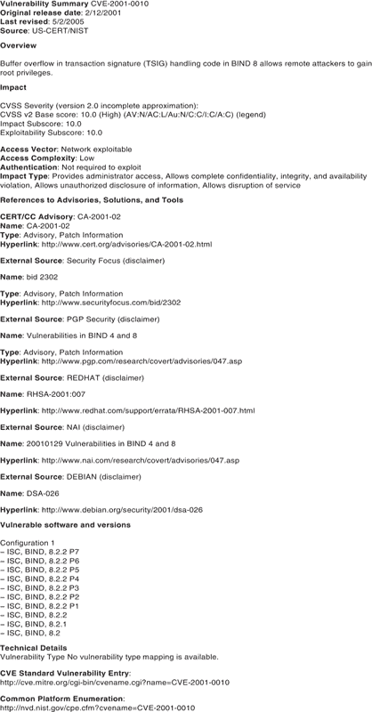

图 4.11 CVE-2001-0010。

注意 `CVE` 是标识符而非实际的技术细节。`CVE` 的主要目的是为漏洞识别提供跨平台标准。为了支持这种识别机制的质量，每个漏洞都要经过审查流程。首先，授予候选状态。这种状态意味着信息已经发布，但尚未授予 `CVE` 状态。`CVE` 编辑委员会会讨论候选者的优点，并对该漏洞是否应该获得完整的 `CVE` 条目状态进行投票。


为了继续对 CVE 的讨论，CVE 项目具有两种状态之一：候选（candidate）或条目（entry）。在授予条目状态之前，编辑委员会必须对建议的漏洞进行审核。在此之前，该漏洞处于候选状态。当你查看详情时，CVE 列表会显示此状态。在阅读 CVE 时，请检查此状态并查看引用，以对所提供信息的可靠性和准确性形成自己的判断。

### 4.8.2 CVE 的局限性

CVE 具有明确的局限性，绝不是与虚拟机（VM）相关的所有标准问题的答案。如前所述，CVE 并没有所有现有漏洞的完整列表。某些供应商能够识别出 CVE 似乎没有记录的漏洞。此外，它并不一定包含漏洞系统执行技术供应商希望执行的所有功能所需的元数据。自然，它不应该包含，因为它的目的是提供对所有人都有用的公公约数信息。

CVE 并不总是保持更新。许多漏洞在“CAN”或候选状态下持续多年。人们在想，当这些漏洞被证实是准确的时，它们是否会得到更新。可能其中某些是配置的最佳实践问题，但不一定被视为漏洞。相反，CVE 并不包含所有的产品最佳实践配置漏洞，因为对于全球使用的数千万产品来说，这些漏洞太多，无法进行审查和包含。

### 4.9 漏洞测试数据标准

通常，特定 VM 扫描器或分析器供应商使用的漏洞信息存储在设计用于与软件无缝协作的数据库中。由于标准通常落后行业几年到几年，这些数据库各不相同。漏洞数据和识别方法在不同产品之间差异巨大——也就是说，没有标准。

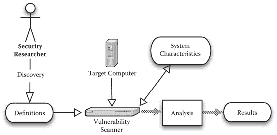

图 4.12 OVAL 过程。

然而，MITRE 推动了针对此类数据结构创建标准的想法。它被称为开放漏洞与评估语言，或 OVAL®。正如其名所示，它是一种使用可扩展标记语言 (XML) 结构化的语言，用于记录具有特定漏洞的机器（目标）状态细节。它采用状态机方法来识别漏洞，这是一种指示易状态状态和非漏洞状态的高度结构化方法。因此，让我们检查图 4.12 中的 OVAL 过程以理解其优势。

我们从一个在产品 X 中发现新漏洞的安全研究人员开始。研究人员对漏洞以及如何在易受目标中识别它有第一手知识，并将漏洞的细节编码到 OVAL 标准格式的 XML 文档中。该文档通过提供构成易受机器的特定项目状态信息，准确地描述了如何在目标上识别该漏洞。这种漏洞识别方法被称为“测试”。

#### 4.9.1 定义架构

在更高层次上，OVAL 由三类称为架构（schemas）的文档组成。定义架构用于编码计算机系统不同部分的状态，这些状态必须存在，系统才会受到特定漏洞的影响。（注：原文此处存在大量重复的句子，翻译时已去重并保留核心含义）。


在本示例中，有几个需要了解的基础组件：定义、测试、对象和状态。这些是漏洞检查各个部分的高级容器。定义如之前所述，分为四种类：`vulnerability`、`patch`、`inventory` 和 `compliance`。此示例在第 2 行通过 `class` 指明它是一个清单定义。第 3 行是一个元数据标签。这开始了一个描述性部分，漏洞评估软件可以使用该部分来服务最终用户，这些用户可能不需要确切知道此测试中发生了什么。标题和描述并不是这里最重要的项。注意在元数据中，第 5 行有一个引用源。这指的是通用平台枚举（`CPE`）名称。这个 `CPE` 名称稍后会进行解释，但目前只需说明这是一个系统枚举的规范即可。

此示例的最终目标是确定目标系统是否安装了 Windows XP。所比较的测试、对象和状态将评估出一个真或假答案。

第 8 行的 `criteria` 标签显示 `operator` 的值为 `AND`。这是对应用于漏洞检查中的逻辑的根本性拆解。如果 `X` 且 `Y`，则结果为真。换句话说，所有测试的结果将应用逻辑 `AND` 操作。随后，第 9 行和第 10 行是应用运算符的两个准则类型语句。

每个 `criterion` 或 `criteriontype` 都有注释和一个 `test_ref` 引用。该引用指向要执行的测试的细节。如果准则需要取反，则在特定的准则语句中添加另一个项。这是准则中的 `negate = 'true'` 语句。如果准则类型中省略了此项，则值被假设为 `false` 或未取反。

关于此示例中准则的另一个需要了解的项目是：第一个准则表明应该执行引用 `oval:org.mitre.oval:tst:99` 的测试。这是一种反 DNS 风格的表示法，显示该测试来自 [oval.mitre.org](http://oval.mitre.org) 编号为 99。所有这些引用都以单词 `oval` 开头，随后是 `org.mitre.oval`。由于它是测试，后面跟着字母 `tst`。最后，包含一个冒号和一个至少位数字的整数。这些组合在一起形成了一个唯一标识符。它被称为 `testIDpattern`。

### 4.9.4.2 Tests

在定义的准则中指定了所有测试后，开始了一个新章节，由 `<tests>` 标签指示。在该部分，第一个且最常见的元素是第 15 行的 `family_test`。注意紧随该元素之后的是 `id="oval:org.mitre.oval:tst:99."`。这是之前的准则引用所指向的项目。后面是要比较的对象和状态。如果比较结果为真，则将其用于之前的定义中，以评估结果是否符合定义的目标。`family_test` 元素中还有 `check_existence=` 和 `check=`。它们分别被设置为值 `at_least` 和 `.`。


评估漏洞时一个非常重要的部分是了解其对组织的影响或风险。许多供应商都有自己的评估方法。但必须存在一种让所有软件制造商和漏洞研究人员都能认同的严重性分级标准。通用漏洞评分系统（`CVSS`）的开发旨在提供一个用于评估漏洞影响及其基本特征的标准框架。尽管其内容和方法论并非全貌，但它们通过事件响应与安全小组论坛（`FIRST`）预先完成了技术工作，有助于评估风险。`FIRST` 是一个由供应商、研究人员和其他志愿者非营利组织，致力于增强安全事件响应实践。

`CVSS` 提供了相关的漏洞指标，用户可以查看这些指标并判断是否需要采取进一步行动来应对风险。这些指标被分为三组：基础（base）、临时（temporal）和环境（environmental）。每一组都会计算出一个得分。每个组都有组合的指标用于计算该组的得分。图 4.13 显示了指标组、指标和公式之间的关系。你可以定期参考此图来跟进讨论。为了清晰起见，虚线标出的项目是子方程或子组，它们仅提供中间值或指标的逻辑分组。

### 基础指标

基础指标是常量的。它们是根本性的，不随时间改变。基础组的指标包括访问向量（`AV`）、访问复杂度（`AC`）、认证（`AU`）、机密性影响（`C`）、完整性影响（`I`）和可用性影响（`A`）。正如任何注册信息系统安全专家（`CISSP®`）所知，机密性、完整性和可用性（`CIA`）形成了安全三角形，因此它们包含在此并不意外。

基础指标中的每一个值取决于严重程度或影响。例如，`AV` 表示攻击者必须具有何种访问权限才能利用漏洞。如果漏洞要求攻击者必须物理在场并接触键盘（即本地访问），则该指标的值为 `0.395`。如果漏洞可以通过网络利用（即远程访问），则该指标的值为 `1.0`。此过程适用于该漏洞的所有指标。`CIA` 指标合称为影响指标，并在计算中组合以确定总影响，然后将其应用于基础评分的公式中。公式是执行所有计算以产生该组总分的地方。

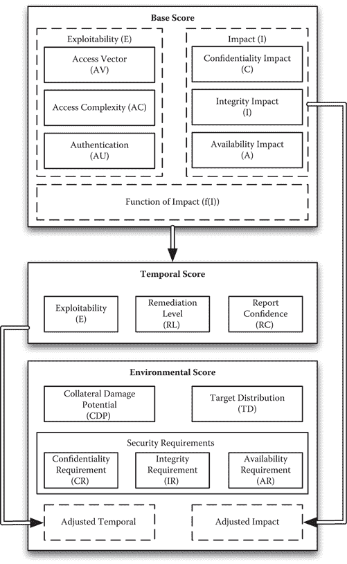

图 4.13 通用漏洞评分系统（`CVSS`）中的指标关系。

指标特定值的原因涉及到对利用产生的相对影响的理解，以及该指标在组评分计算中的重要性。影响越大，值越高。但并非所有指标都是同等的。`AV` 对漏洞整体严重性的可能比利用复杂度更重要。低复杂度（`0.35`）与高复杂度（`0.71`）之间的差异是 `0.36`。但要求本地访问（`0.395`）与网络访问（`1.0`）之间的差异是 `0.605`。`AV`、`AC` 和 `AU` 是三个共同决定漏洞整体可利用性（`E`）的基础指标。利用性的公式为 `E = 20 × AV × AC × AU`。这看起来可能很麻烦，但指标的公式和值已经为你计算好了，节省了大量时间。

### 临时指标

临时指标是可选的，其值会随时间变化。基础指标被用作“临时”计算的输入，产生一个可能更准确地反映 0 到 10 范围内风险的得分。例如，漏洞可能处于概念证明阶段，威胁较小，因此被赋予 `0.9` 的值。随着时间的推移，自动化脚本可能会广泛可用，使得利用变得简单到连“脚本小子”都能完成。此时，该指标的值则变为 `1.0`。临时公式使用一个分类函数，通过乘以之前提到的指标来调整基础方程中的影响计算。表 4.6 详细说明了 `CVSS` 指标及其值。注意，每个值还有表中未显示的数值评分。随着稍后描述的公式的完善，这些数值评分可能会发生变化。

### 环境指标

环境指标组是另一个非常有用的可选组。该组中的指标设计用于在其他指标组之外，但作为它们的补充。如果不使用该组，它对其他指标的权重没有影响。它是留供你——`CVSS` 用户根据需要使用的。然而，它具有结构化的指南，以确保解释的统一。环境指标组包括附带损害潜力（`CDP`）、目标分布（`TD`）以及安全需求：机密性（`CR`）、完整性（`IR`）和可用性（`AR`）。它还考虑了来自基础指标的调整影响评分和调整临时评分。

`CDP` 是一种经典的风险管理型指标，衡量如果漏洞被利用可能会产生多少财务损失或伤亡损害潜力。在风险管理术语中，它是单次预期（`SLE`）。对于那些没有经过正式培训的安全专业人士来说，风险管理中的 `SLE` 是指发生一次损失时预期的成本。虽然它是损害潜力的衡量，但 `CDP` 是一个从 0 到 0.5 的尺度，并不等同于金额。

表 4.6 CVSS 指标

| 指标类型 | CVSS 指标 | 描述 | 值 |
| :--- | :--- | :--- | :--- |
| 基础 | AccessVector | local access | 0.395 |
| | | network accessible | 1.0 |
| | AccessComplexity | low | 0.35 |
| | | high | 0.71 |
| | Authentication | multiple instances of authentication | 0.45 |
| | | single instance of authentication | 0.56 |
| | | no instance of authentication | 0.704 |
| | ConfImpact | none | 0.0 |
| | | partial | 0.275 |
| | | complete | 0.660 |
| | InteImpact | none | 0.0 |
| | | partial | 0.275 |
| | | complete | 0.660 |
| | AvailImpact | none | 0.0 |
| | | partial | 0.275 |
| | | complete | 0.660 |
| 临时 | Exploitability | unproven | 0.85 |
| | | proof-of-concept | 0.9 |
| | | functional | 0.95 |
| | | high | 1.00 |
| | RemediationLevel | official-fix | 0.87 |
| | | temporary-fix | 0.90 |
| | | work-around | 0.95 |
| | | unavailable | 1.00 |
| | ReportConfidence | unconfirmed | 0.90 |
| | | uncorroborated | 0.95 |
| | | confirmed | 1.00 |
| 环境 | CollateralDamagePotential | none | 0 |
| | | low | 0.1 |
| | | low–medium | 0.3 |
| | | medium–high | 0.4 |
| | | high | 0.5 |
| | TargetDistribution | none | 0 |
| | | low | 0.25 |
| | | medium | 0.75 |
| | | high | 1.0 |
| | ConfReq | low | 0.5 |
| | | medium | 1.0 |
| | | high | 1.51 |
| | IntegReq | low | 0.5 |
| | | medium | 1.0 |
| | | high | 1.51 |
| | AvailReq | low | 0.5 |
| | | medium | 1.0 |
| | | high | 1.51 |


| | | 未定义 | 1.0 |

`TD` 是衡量组织中易受影响程度的百分比。这可以帮助你评估你环境中威胁的范围。如果 50% 的目标主机存在特定漏洞，则该指标被认为具有中等值。在方程中计算 `TD` 时，`high = 1.0`、`medium = 0.75`、`low = 0.25`、`none = 0.0`，有趣的是，`not defined = 1.0`。这很有意思，因为如果你不知道 `TD`，那么假设它应该是“高（high）”，这允许允许对损害潜力进行保守估计。我建议，如果你根据漏洞评估的结果，已经了你组织中存在漏洞的主机的精确分布，那么请以精确的小数形式使用该百分比。这种方法在 `CVSS` 指南之外，但它比高/中/低的方法更精确。

环境安全需求指标是独特的。这些指标为 `CIA` 的基础指标创建权重。例如，如果你的特定环境非常重视数据的机密性，那么该值就会增加。如果该值为中等，则 `C` 的权重是中性的。安全需求用于重新加权基础分中的影响（`I`）指标计算。这根据你的组织的要求修改基础指标组评分。然而，如果基础组中的影响指标为 0（即不是影响因素），则生成的修改后影响分将不受影响。这是因为修改后影响指标的方程包含了安全需求与基础组影响值的相乘：

$$
Adjusted\\ Impact = \left( {10.41 \times \left( \begin{array}{l} {1 - \quad\\\text{min10}}} \\\\ {(1 - Conf\\, Impact \times Conf\\, Req) \\times} \\\\ {(1 - Integ\\, Impact \times Integ\\, Req) \\times} \\\\ {(1 - Avail\\, Impact \times Avail\\, Req) \\times} \\\\ \\end{array} \right)} \right)$$
$$

其中 `AdjustedImpact = min(10,10.41* (1−(1−ConfImpact\* ConfReq)\* (1−IntegImpact\* IntegReq)\* (1−AvailImpact\* AvailReq)))`。

对于每个指标组，都设计了一个方程来根据一组数学规则计算评分。这些方程的原理根据指标类型的不同而异。这些方程的优点经过了广泛的分析和辩论，在这里讨论的意义不大。`CVSS` 在 [`www.first.org/cvss/v2/guide`](https://www.first.org) 中有更详细的解释。

如果你想计算自己的 `CVSS` 评分，可以尝试使用一些基于 Web 的在线计算器。一个受欢迎的计算器可以在 [`nvd.nist.gov/cvss.cfm?calculator&adv&version=2`](http://nvd.nist.gov) 找到。你可以输入任何你喜欢的数值并获得一组 `CVSS` 评分。要理解特定指标对总分的影响，尝试只更改一个然后重新计算。你将开始感觉到什么样的分很好，什么样的真的很糟糕。我还建议你省略环境组件，这样你就可以熟悉在 `NVD` 中发现的 `CVSS` 评分，我们将在第 4.11 节](#04chap_04.xhtml#sec4_11) 中讨论它们。

### 4.10.1 CVSS 命名](#contents.xhtml#tl_sec4_10_1)

`CVSS` 使用了一种缩写语言，以便传达漏洞指标的细节。前段落中提供的字母配合使用。为了方便传递漏洞指标的细节，`CVSS` 使用了一种缩写语言。前段落中提供的字母配合使用。为了方便传递漏洞指标的细节，`CVSS` 使用了一种缩写语言。前段落中提供的字母配合使用。例如，使用冒号（:）来分隔：

`10.0 (AV:N/AC:L/PR:N/UI:N)`。使用斜杠（/）来分隔。`AV` 值为“N”。下一个指标 `AC` 值为“L”。注意，使用斜杠（/）分隔的指标，机密性、完整性、可用性均为“C”。`10.0 (AV:N/AC:L/PR:N/UI:N/I:H/A:H)`。斜杠（/）分隔的指标，机密性、完整性、可用性均为“C”。`，使用斜杠（/）分隔的指标，机密性、完整性、可用性均为“C”。`10.0 (AV:N/AC:L/PR:N/UI:N/I:H/A:H)`。注意，使用斜杠（/）分隔的指标，机密性、完整性、可用性均为“C”。对于，使用斜杠（/）分隔的指标，机密性、完整性、可用性均为“C”。`10.0 (AV:N/AC:L/PR:N/UI:N/I:H/A:H)`。注意，使用斜杠（/）分隔的指标，机密性、完整性、可用性均为“C”。对于，使用斜杠（/）分隔的指标，机密性、完整性、可用性均为“C”。`10.0 (AV:N/AC:L/PR:N/UI:N/I:H/A:H)`。注意，`CCE` 标识符用于关联系统配置与工具提供的相关信息。正如前面描述的，`CPE` 标识符通常包含：由 `MITRE Corporation` 提供的 `CCE` 列表。`CCE` 标识符用于关联系统配置与工具提供的相关信息。正如前面描述的，`CPE` 标识符通常包含：由 `MITRE Corporation` 提供的 `CCE` 列表。`CCE` 标识符用于关联系统配置与工具提供的相关信息。正如前面描述的，`CPE` 标识符通常包含：由 `MITRE Corporation` 提供的 `CCE` 列表。`CCE` 标识符用于关联系统配置与工具提供的相关信息。`CVE` 标识符通常包含：`NVD` 实际上是使用安全内容自动化协议 (`SCAP`) 的 `NVD`。

### 4.11 NVD](#contents.xhtml#tl_sec4_11)

国家漏洞数据库（National Vulnerability Database）是由 `NIST` 运营的在线数据库。可以在 [`nvd.nist.gov`](https://nvd.nist.gov) 找到。`NVD` 使用安全内容自动化协议 (`SCAP`)。该协议是一组支持 `VM`、合规性管理和其他安全功能的标准。我们已经讨论了其中的一些标准，包括 `OVAL`、`CVE` 和 `CVSS`。还有三个我们讨论过的项目：`CCE` 和 `CPE`，它们涉及目标枚举；以及可扩展检查清单描述格式 (`XCCDF`)，它提供了目标检查清单和报告标准。

`CCE` 指的是通用配置枚举（Common Configuration Enumeration）标识符。这些标识符用于将系统配置的检查与相关文档关联起来。

#### 4.11.1 CPE](#contents.xhtml#tl_sec4_11_1)

通用平台枚举（Common Platform Enumeration）标识符为技术系统和组件提供了一种标准的命名方案。在实际 `VM` 中，`CPE` 标识符用于指示哪些系统或组件受漏洞影响。当发布新漏洞时，第一个问题是“哪些系统受影响？”。`CPE` 旨在清晰地记录平台，以便通过自动化和人工方法确定漏洞的适用性。一个特定的计算机系统可以分配一个 `CPE` 名称，代表了该平台已安装内容的完整枚举。这包括硬件、操作系统和应用程序。它不包括详细的配置选项，例如开关状态或安全策略。


CPE 名称的编码逻辑结构上与上一节描述的相同：硬件、操作系统和应用程序。编码格式遵循统一资源标识符（URI）格式，尽管它尚未获得互联网分配局（IANA，即互联网分配数字管理机构）的正式认可。这种格式为了方便起见并利用已有的命名规范，非常适用于命名互联网上的资源。以下是 CPE 名称的基本结构：

```
cpe:/ {part} : {vendor} : {product} : {version} : {update} : {edition} : {language}
```

因此，该格式包含七个部分：

*   **Part（部分）**：该部分定义为硬件“h”、操作系统“o”或应用程序“a”。MITRE 的人员也为部分留下了空间，例如驱动程序“d”。
*   **Vendor（厂商）**：这通常指定为厂商名称。例如 [Mozilla.Org](http://Mozilla.Org) 会具有厂商名称 `Mozilla`。严格来说，这是厂商的最高级别。如果存在多个机构，则使用整个域名名称。
*   **Product（产品）**：CPE 使用厂商提供的产品缩写。计算机用户通常使用“IE”来表示 Internet Explorer。
*   **Version（版本）**：这是产品的版本号。例如，“5.0。”
*   **Update（更新）**：这些是厂商可能应用于特定版本的更新。根据厂商发布更新的方式，该字段的使用变得随机。某些厂商倾向于使用版本号。
*   **Edition（发行版）**：字段字段用于区分产品的不同版本。例如，Windows Vista 有几个版本，如家庭版（Home）、高级家庭版（Home Premium）、商业版（Business）。
*   **Language（语言）**：直观地说，这是 CPE 名称中使用的语言，便于根据安装的语言包识别系统。

### 4.11.1.2 CPE 名称示例

显然，`cpe:/a:adobe:flash_player:1.1` 代表 Adobe Reader 版本 8.1。但规范并不特定于某个操作系统，使用该名称适用于任何操作系统的 Adobe Reader 实例。我们将名称修改为仅适用于 Windows XP，可以使用以下名称：`cpe:/a:adobe:flash_player:9.0.20.0::windows_xp`。如果需要为特定的操作系统命名漏洞（例如 Windows XP 的所有版本），则使用以下名称：`cpe:/o:windows_xp`。然而，如果想更具体（例如 Windows XP SP1），我们将使用 `cpe:/o:microsoft:windows_xp::sp1:professional`。

硬件以类似的方式识别：`cpe:/h:cisco:ip_phone_7960` 代表 Cisco iPhone® 7960。注意，产品内置的是型号号而不是版本。这是因为 Cisco 选择用不同的型号号表示产品版本。识别硬件时，不仅可以识别计算机系统，还可以识别特定的主板，如 Intel D845WN（`cpe:/h:intel:d845wn_motherboard`）。

### 4.11.2 XCCDF

之前讨论了使用 OVAL 标准化漏洞测试方法的需要。此外，我们讨论了漏洞扫描器中的数据结构可能的样子。同样，可扩展配置清单描述格式（XCCDF）是一组基于 XML 的文档，规定了验证各种类型系统的安全合规性的清单。XCCDF 还规定了合规报告和评分的标准格式。这简化了各种安全系统的互操作性。它不是 OVAL 的替代品，而是一种实际上可以扩展 OVAL 并增强其与专有技术互操作性的支持技术。

XCCDF 在定义合规检查、合规机器状态和结果报告方面有一个主要用途。该语言允许定义安全基准，并反映在详细的配置设置中。检查可以被开发并 NIST NIST 清单计划审核。如果通过，这些检查将适用于世界上任何在其产品中支持 XCCDF 的用户。这种情况很少。XCCDF 主要用于美国政府安全，以支持 NIST 800-53 和 FIPS 199。其巨大的优势是创建了一种标准机制，用于跨多个厂商和安全系统验证并报告清单和规则的安全合规性。XCCDF 支持将漏洞管理作为配置管理组成部分的理念。

起初，你可能会认为在定义检查和评分时任何此类语言都具有限制性。然而，XCCDF 的设计是可定制且灵活的，以便为各种系统获得一致的结果。例如一个选项是“可选性”。特定的 XCCDF 文档将包含一组描述目标合规状态的规则。这些规则可以根据正在调查的目标选择性地开启或关闭（选择）。同样，可以替换参数以适应灵活的规则。例如，虚拟专用网络（VPN）配置的加密密钥大小对于系统可能是 256 位，而对于携带敏感信息的系统可能是 4096 位。

XCCDF 有四种对象：

*   **Benchmark（基准）**：是其他所有内容的父容器。它与 OVAL 中的定义相似。
*   **Item（项目）**：类似于 OVAL 中的对象或测试。它包含描述和标识符。项目有三种类型或类：`group`（组，包含其他项目）、`rule`（规则，包含检查、权重和修复信息）以及 `value`（值，提供上述替换能力）。
*   **Profile（配置文件）**：提供项目对象的引用。它包含了系统特定配置所需的许多值。这极大有助于对值进行资产分类。
*   **Test result（测试结果）**：持有执行测试的结果。该对象中最重要的是 `rule-result` 和 `target-facts` 元素。此对象包含了执行的实际结果，在报告和修复过程中非常有信息。target-facts 信息可以是关于目标测试的实际结果。

XCCDF 的一个有趣属性是它可以在规则中引用 OVAL 的内容。规则的子名为 `check` 的元素允许文档作者引用获取检查的系统。例如，`<cdf:check system = "http://www.mitre.org/XMLSchema/oval">` 随后是源系统内检查的具体引用：`<cdf:check-content-ref href="ovaldefs.xml" name="OVAL99"/>`。这只是对 OVAL 规则的引用，而不是规则本身。执行检查的软件必须正确解释并执行这些引用。除非是 SCAP 合规，否则任何系统都不要求使用 OVAL（下将讨论）。

总的来说，XCCDF 是跨厂商和组织标准化配置合规检查的一个极佳主意。然而，它的使用主要限于美国国防部。如果你为政府工作或是供应商，可以在 Neal Ziring 和 Stephen D. Quinn 编写的《可扩展配置清单描述格式 (XCCDF) 版本 1.1.3（草案）》文档中找到更多详细信息。


## 4.12 SCAP

安全内容自动化协议（`SCAP`，读作“ess-cap”）是上述标准的综合套件，包含了 `CVE`、`CVSS`、`CPE`、`XCCDF` 和 `OVAL`。NIST 维护 `SCAP` 内容，定义了所有这些协议如何以自动化方式协同工作。它还包含了 `NVD` 中所有这些标准的内容。

SCAP 还有一个产品验证计划，旨在帮助评估产品与各种开放标准的兼容性。NIST 提供了验证区域的详细描述，此处对其进行了缩写，以便您对可能的验证领域有一个大致了解：

*   联邦桌面核心配置 (FDCC) 扫描器：一种能够对目标系统进行审计和评估，以确定其是否符合 `FDCC` 要求的产品。这些要求是美国政府管理和预算局 (OMB) 备录 `M-07-18` 的结果。该备录规定，信息技术提供者应确保应用程序在运行 `FDCC` 的系统上功能完全并按预期正确运行。
*   身份验证后配置扫描器：一种能够利用目标系统的登录权限，对目标系统进行审计和评估，以确定其是否符合定义的配置要求的产品。
*   身份验证后漏洞和补丁扫描器：一种能够利用目标系统的登录权限，扫描目标系统以定位并识别已知软件漏洞，并评估软件补丁状态以确定其是否符合定义的补丁策略的产品。
*   未身份验证漏洞扫描器：一种能够通过网络评估目标系统来确定已知软件漏洞存在的产品。
*   入侵检测和防御系统：监控系统或网络是否存在未经授权或恶意活动的产品。`IPS` 主动保护目标系统或网络免受此类活动的影响。
*   补丁修复：根据定义的补丁策略在目标系统上安装补丁的能力。
*   错误配置修复：能够更改目标系统的配置以使其符合一组定义的配置建议的能力。
*   资产管理：主动发现、审计和评估资产特征的能力，包括已安装和授权的产品；在世界、网络或企业中的位置；所有权；以及关于工作站、服务器和路由器等 IT 资产的其它相关信息。
*   资产数据库：被动存储和报告资产特征的能力，包括已安装和授权的产品；在世界、网络或企业中的位置；所有权；以及关于工作站、服务器和路由器等 IT 资产的其它相关信息。
*   漏洞数据库：包含安全相关软件漏洞问题目录的产品，在适用处标记为 `CVEs`。这些数据通过搜索功能或数据馈提供给用户，并包含软件漏洞的描述、附加信息的引用（例如指向补丁或漏洞公告的链接）以及影响评分。
*   错误配置数据库：包含安全相关配置问题目录的产品，在适用处标记为 `CVEs`。
*   恶意软件工具：识别并报告目标系统是否存在病毒、特洛伊木马、间谍软件或其他恶意软件的能力。

当一个产品经过评估和验证时，是针对上述一个或多个领域进行的。产品的验证状态发布在 NIST 的公共网站上。通过验证并不保证了产品的质量或可靠性，只能说明它符合 `SCAP` 计划设定的标准。

## 4.13 Nessus

如果不讨论 Nessus，漏洞扫描（VM）技术的讨论就是不。有些公司选择使用 Nessus 的开源版本来降低成本并对漏洞扫描获得更大的控制。关于 Nessus 的书籍有很多，因此我们不进行详述。如果您打算在组织中使用开源版本，建议购买这些书籍中的一本。Tenable Network Security 可以提供额外付费的支持和更新。以下是该产品的层级概述。

### 4.13.1 优缺点

Nessus 是适用于不愿花钱购买其他专有产品的流行的开源扫描器。与其他许多产品相比，Nessus 具有显著优势，但也存在一些缺点。

| 项目 | 优点 | 缺点 |
| --- | --- | --- |
| 单服务器执行扫描并将结果捕获到数据库。 | 高性能数据采集，对网络报告的影响最小。 | 强制要求集中化服务器架构，所有扫描都从单台服务器进行。 |
| 开源产品 | 成本低。具有技术知识的终端用户可以自定义。 | 不付额外费用就没有支持。安装和操作该产品需要更多的知识。 |
| 用户可以编译二进制文件。 | 在多个平台（操作系统/CPU）上运行。 | 需要对目标系统和开源软件的高深知识。 |
| 建议使用优化版本的 Nessus 扫描 Windows XP SP2 平台以避免误报。 | 可扩展性问题：如果您的组织具有混合架构（例如 Linux 和 Windows），则可能需要两个版本，或者您使用 Windows 版本会更好。 |
| 专业数据馈提供即时更新。 | 接收最新漏洞的即时更新显然是好事。 | 您必须为此付费，但成本可能与其他产品相同或更便宜。 |
| 家庭版数据馈提供免费的漏洞更新。 | 这是开始评估该工具的好方法。 | 这不用于商业用途。 |
| 插件 | Nessus 的这些元素允许进行扩展和自定义，通常超出了其他产品能提供的范围。 | 复杂性的增加需要大量的知识和经验来进行部署。 |
| `NASL` | 此工具允许用户编写并运行特定的漏洞检查。这些检查在大多数产品无法提供的地方提供了很大的控制力。 | 需要对 `NASL` 及其如何在命令行中使用它有了解。 |

## 4.13.2 扫描模式

Nessus 提供了三种类型的检查或扫描模式：

*   发现：此过程使用基础发现协议（如 ICMP 回显请求/响应和 TCP 扫描）来识别网络上的活动主机。现在的某些产品没有简单执行快速发现的能力，而是要求进行完整审计。这种能力在商业产品中定义网络范围时是一项非常有用的工具。或者，可以使用命令行产品 `Nmap` 获取类似的功能。
*   操作系统指纹识别：通过本书书中已经描述的几种方法进行。通过发送简单的畸形数据包到合法的 SNMP 查询，分别收集非自愿和自愿信息。取决于目标系统，这些（以及其他方法）并不总是有效。其他开发商可能开发了获取此类信息的其他方法。
*   完整扫描：这种类型的扫描执行发现和操作系统指纹识别，并添加了大量的漏洞检查，包括破解密码攻击。它受到本章之前讨论过的所有局限性和疑虑的影响。


关于 Nessus 的另一个值得提的特性是提供 Web 应用程序检查。这种功能在许多厂商那里并不是“开箱即用”的。很多情况下，必须为该功能额外付费。而 Nessus 毫无保留地提供了这一功能。虽然这需要进行一些配置以适应目标，但绝对是值得的。用户有能力测试跨站脚本 (`XSS`)、SQL 注入和通用网关接口 (`CGI`) 漏洞。

Nessus 是一款强大的产品，与大多数其他产品相比，它具有更高的控制水平。然而，它缺乏许多商业产品的可扩展性，因为它采用的是非常集中的扫描方法。所有扫描都从中心位置进行，而不是通过许多物理分布的扫描器配合一个数据收集点来实现。尽管如此，它可能适用于许多业务/IT 架构，并且价格定位非常有竞争力。

### 4.13.3 使用 Nessus

本节假设用户已经安装了 Nessus 客户端和服务器。书中不再提供有关这些主题的说明，因为这些在其他书籍以及 Nessus 文档中已有详细介绍。Nessus 的用户界面有两个区域：`Scan`（扫描）和 `Report`（报告）。每个的功能都是显而易见的。图 4.14 显示了扫描目标窗口。它允许用户输入主机 IP 地址、DNS 名称、IP 地址范围、子网规格或包含主机/IP 地址列表的输入文件。每个目标规格都会被保存，以便将来重复扫描。

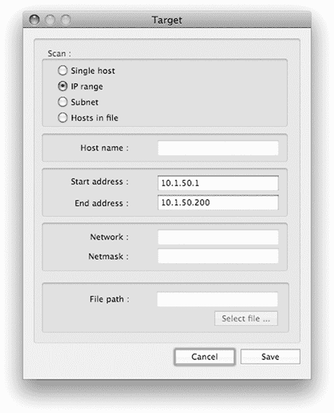

图 4.14 Nessus 目标选择面板。

接下来，用户可以通过创建扫描策略来定义扫描参数。如图 4.15 所示，该策略包含：

*   关于扫描的基本选项（攻击性、数据包捕、端口扫描类型、日志等）。
*   如果执行白盒测试所需的凭据。
*   插件选择，以采用最新且相关的检查。Nessus 的插件库非常丰富。高效扫描的关键在于仅选择目标网络所需的插件。

    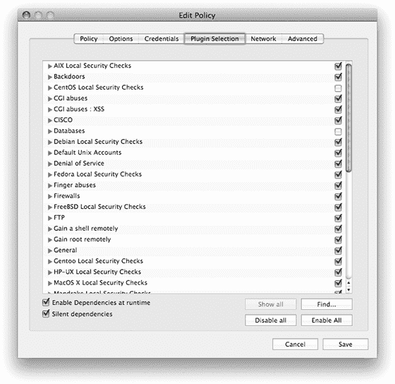

    Figure 4.15 Nessus 扫描策略插件选择。

*   网络拥塞控制设置（并发连接、超时、目标脱离规则）。
*   各种协议和检查的高级参数设置。

一旦选择了所有参数，即可执行扫描。完成后，报告将以分级、可导航的格式提供。该报告还可以导出为 HTML。如图 4.16 所示，报告易于阅读。报告中的此示例条显示了用于获取信息的端口和协议—— Nessus 的安全套接层 (`SSL`) (`tcp/1241`)。然后，报告显示使用了 `Supported SSL Cipher Suites` 插件来发现漏洞。在这种情况下，实际上并不是漏洞，而是一种枚举。之后，报告项的其余部分是不言自明的。Nessus 的一个非常好的特性是它显示了……的程度。


在大大型机构中，基本的职责划分对于满足合规和审计要求至关重要。首要考虑的是避免漏洞检查参数被那些在不显露漏洞方面有利益冲突的群体或个人所修改。除了隐藏漏洞外，这种行为与老牌会计问题相似：一个业务部门通过更改会计规则，使一个季度的报告结果比上一个季度更理想。在安全领域，这会导致整体安全性的下降，因为漏洞审计参数可以全局应用，从而威胁到组织的大部分区域。

### 运营职责

责任分担可能不仅包含合规性考量，还包含简单的运营卓越性考虑。在向业务交付 IT 服务的过程中，各个小组都承担着责任，但又依赖于其他小组。`VM` 在 IT 服务交付中的角色也是如此。例如，网络组或云服务提供商可能签了受漏洞扫描影响的服务水平协议（SLA）。相反，漏洞扫描本身可能是服务水平协议的一部分。这些服务水平取决于客户需求而变化，并可能包含许多复杂元素。内部服务提供商（可能是网络组或服务器平台组）需要对漏洞评估的进行时间，以及在该过程中消耗了多少提供的服务资源进行某种控制。网络团队可能关注在活动扫描期间，特定广域网（`WAN`）链路消耗了多少带宽。

然而，服务器团队可能关注在不同模式下运行代理程序（agent）所需的系统资源。可能在对主机进行活动评估期间，代理程序消耗了过多的 `CPU`，或与某个关键业务应用程序发生冲突。因此，可能需要对审计过程进行有限的控制，而对质量要素的控制应限制在安全和/或合规部门。

### 虚拟化环境

虚拟化环境会放大代理程序的影响，因为多个虚拟机操作系统（`OS`）实例需要运行多个漏洞评估代理程序。此外，由于运行虚拟化程序的宿 `OS` 可能也运行着代理程序，对多个 `OS` 同时产生的影响风险也增加了。无论由哪个小组管理评估的资源调度，鉴于某些活动所需的测试和管理，在已经有愿意承担所有权的专业人士存在的情况下，单一安全小组可能不想承担这项责任。

### 总结与需求识别

总而言之，这里的信息是，IT 组织中的每个小组都要对其提供的服务负责。新 IT 功能的引入会影响其他小组的运营。受影响小组代表的参与将对于识别 `VM` 产品的影响和需求至关重要。促进这些需求识别的一个良好工具是流程依赖图`图 5.1` 显示了一个示例，其中 `VM` 服务是焦点。然而，此图可以扩展，以识别可能为其他服务创建的依赖，这些服务的需求可能会发生变化。

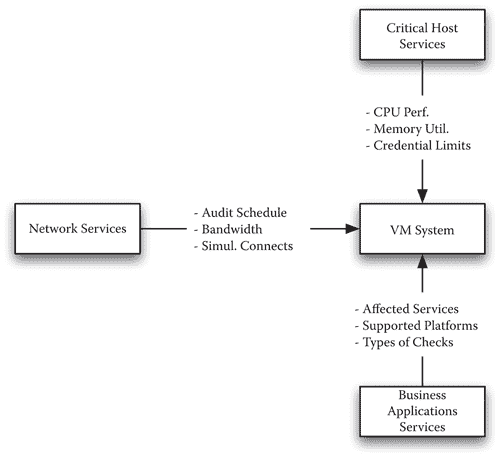

图 5.1 识别 `VM` 系统需求。

从图中，我们能够快速识别 `VM` 系统的需求，这些需求不仅能实现识别漏洞的目标，还能增强影响系统的服务水平。在此图中，“网络服务”提供了影响现有服务水平的需求：

*   业务工作时间期间的审计调度
*   每个站点或其他分组（如源网络）的带宽消耗需求
*   并发网络连接，以最小化对路由器和防火墙的影响

然而，业务应用程序的需求不仅影响性能，而且是增强服务水平协议（`SLAs`）的常见结果。应用程序组的 `SLA` 可能规定对每个新发布版本进行跨站脚本（`XSS`）和结构化查询语言（`SQL`）注入测试。`VM` 系统随后通过运营水平协议（`OLA`）实现了增强。

#### 5.1.2 调度

在上一节中，我们讨论了审计调度可能是一项需求。与之前的讨论相关，扫描器或代理程序的时间和可用资源在不同供应商之间存在很大差异。例如，设置活动扫描的时间和星期几是非常标准的。但贵公司的业务周期可能要求在每周的同一天同一时间进行评估。然而，如果由于任何技术原因错过了该计划，评估将在下一个可用日的同一时间进行。这在金融环境中并不罕见。其他需要考虑的调度需求还有：

1. **每天的时间、星期几**：一种非常常见的调度方法，选择每周的某一天或一天的时间非常典型。通常来说，此设置应针对特定时区进行调整。
    * **每月（第一、最后、特定某天）**：这种调度在业务运营中有用，因为目标必须在工作日进行评估，但无法可靠地确定具体日期。相反，将指定星期几或几。因此，参数可以是月的第一个工作日、最后一个工作日，甚至是最后一个星期一。某些业务周期要求评估仅每月或每周在某一天进行。
2. **仅在本地工作时间期间/之后**：台式电脑的评估通常需要在电脑开启的工作时间期间进行。随着公司趋向于削减能耗，拥有这种水平的控制变得越来越重要。
3. **在时间/日期窗口内开始/暂停/恢复**：当评估所需的时间超过特定时间窗口内的可用时间时，非常有用。例如，如果必须在工作时间内进行扫描，但需要超过 12 小时才能完成，则评估应在晚上暂停并在下一个工作日恢复。该过程将持续到评估完成。如果评估计划与下一次评估重叠，则下一次评估应推迟一个周期。


# 4. 评估调度

对于所有评估调度，日期和时间参数都应根据本地时区进行调整。实现方法有多种；但结果应该是：如果一项评估计划在纽约时间周一上午 10 点开始，那么应用于旧金山的相同参数将是太平洋时间上午 10 点或东部时间下午 1 点。这对于大型的全球分部环境变得更加至关重要。我曾见过某些系统采用协调世界时（`UTC`）进行所有调度，以适应本地调度能力的不足。假设网络处于同一时区，一种非常好的方法是为目标网络或主机指定时区。然后，所应用的调度可以包含一个参数，指示是否应该尊重目标时区。

如果整个网络网段不在同一时区，那么在 VM 系统按时区对网络定义进行逻辑划分是明智的。这将允许系统为网络网段的每个部分按最佳计划进行扫描。如果这不可行，则可能将扫描窗口限制在所有主机都可用的共同时间范围内。

### 5.1.3 标准

每个供应商都有不同的漏洞检测方法。在 VM 产品的早期，这种专有方法是区分不同产品的主要手段。准确且快速的能力是至关重要的。然而，这导致产品供应商之间信息共享严重匮乏，威胁了客户整体安全性的有效性和一致性。由于漏洞评估的结果可能因供应商不同而异，人们如何确定应该使用哪些结果来采取补救措施？如果一个供应商通过查看注册表键检测到漏洞，而另一个供应商因为使用文件检测而漏掉该漏洞，由于没有采用任何单一、可靠的最佳实践检测方法，安全管理员如何能依赖任何一个产品呢？如果使用多个 VM 系统，将存在差异，这会产生解决差异的额外工作。因此这也是一个有效的解决方案。

相反，当组织使用的软件分发方法没有产生标准本地安装的系统共同特征时，也会出现类似的结果。在某些情况下，Microsoft Windows 平台上的应用程序安装时可能会缺少某些注册表键。当漏洞扫描器查找这些注册表键未找到时，漏洞状态可能会被误读。

一个更全球的问题是缺乏标准的漏洞标识符。例如，如果 VM 系统使用专有的漏洞标识符，而补丁管理系统使用 `Bugtraq ID` 编号，两者该如何协调？在某些情况下，对于 VM 供应商发现的特定漏洞，并没有可用的标识符，因此只有专有索引。需要某种标准的遵守，以最大限度地提高整个 VM 过程的有效性，并确保全球范围内的一致识别。

目前有可行的解决方案。如果供应商和 MITRE 公司都能达成一致，对他们发现的漏洞可以进行集中识别和描述，那么补丁管理系统就可以依靠这些标识符。

或者，某些供应商已经集成了补丁管理等功能，使得漏洞识别和相应补救的兼容性不再是问题。然而，这限制了对产品和功能的选择。VM 系统的购买者在两项功能上都必须依赖供应商。截至本文写作，没有供应商能为所有操作系统和所有漏洞提供全面的补丁支持，未来也不太可能这样做。

### 5.1.4 报告

正如你将在随后的章节中看到的，报告是 VM 的重要部分，也是管理任何可衡量过程的一部分。在完成对任何供应商的评估之前，参与 VM 的关键人员应该对如何开展识别和修复漏洞的过程达成清晰共识。然后，针对经理、工程师、管理员、审计师和风险经理需要了解哪些信息来完成其职责的流程并充分利用系统价值，提出关键问题。这将定义所需报告的类型。考虑向利益相关者分发报告样本，以确保它们是可以接受的。


## 报告考量

* **格式**：大多数报告的可定制程度不高。列的顺序、排序和过滤选项以及页眉页脚内容可能不适用于您的组织。后项要求可能会成为重大问题。如果漏洞报告的页脚没有公司要求的文档分类声明，或者页眉中没有公司标志或部门名称，那么审计人员在检查文档处理合规性时可能会产生疑虑。此外，报告的实用性随排序和过滤能力的不同而大异。如果扫描结果报告只能按互联网协议（IP）地址排序，而不能按严重程度排序，那么优先级排序过程可能无法有效进行。

* **定制**：当无法使用内置报告时，需要对数据库和架构（schema）提供某些访问权限，以便生成核心产品中不具备的报告。这也可以通过报告编写器插件提供。任何此类插件都必须根据需求进行同样的审核。此外，必须考虑使用额外产品或咨询服务将增加系统的整体成本。

* **类型**：报告最常见且关键的领域是修复、安全态和流程监控。您需要的报告类型自然取决于您的流程如何运作。修复报告应该专门便于您的流程进行修复的方法。这听起来是理所当然的，但事实并非。例如，一家公司可能在每个城市或办公室网络中由不同的小组来修复漏洞。因此，报告应该按位置提供。

或者，您的组织可能按设备类型进行修复。例如，服务器管理员可能都属于一个全球服务器组。这些服务器的漏洞将由中央小组进行评估、优先级排序和工作分配。即使系统对这些服务器的审计是作为整个网络审计而进行的，这种情况也可能是事实。

* **触发器**：某些报告需要在满足特定条件时生成。这些报告通常通过电子邮件发送或复制到特定位置以供调取。触发事件可以是漏洞评分或特定目标达到某个水平，或者是关键主机具有特定严重程度的漏洞。这些报告将自动通过电子邮件发送给指定人员，这些人员必须是报告系统的授权用户。

* **角色**：任何报告都应该是可配置的，允许特定角色查看或修改。这些角色应定义为：系统管理员、网络所有者、网络组所有者或系统（目标）所有者。指定哪些角色或角色组合允许访问或修改报告有两个目的：(1) 职责分离——这确保报告不会为了获得有利结果而受到操纵，并且不会与未能修复系统的责任方可能被衡量的任何性能惩罚相矛盾。(2) 数据机密性——每份报告对黑客来说都是一个潜在的信息金矿，这些信息无疑可以用于评估目标和攻击向量。

实现角色的最灵活方法是允许 VM 系统管理员创建角色并将用户和用户组分配给这些角色。有关角色定义的更多信息将在后文介绍。

* **控制**：报告应按网络、IP 范围、系统类型、扫描器、应用程序或网络所有者进行过滤。你会很快发现，一旦经理和工程师知道了良好数据的可用性，他们就会要求更多。由于对本地网络结构有深入了解，网络经理可能会要求特定的子网报告和 IP 范围，即使审计过程是在所有发现的 IP 地址上进行的。本质上，对漏洞的审计是网络所有者所请求报告的超集。

应用程序所有者可能会要求显示支持其应用程序的系统漏洞状态的报告。这可能包括路由器、防火墙、数据库服务器、应用程序服务器和 Web 服务器的组合。这对于萨班斯-奥克斯利（SOX）合规或有限的支付卡行业（PCI）审计可能尤为重要。PCI 风险非常有限的大型组织需要评估与支付处理直接或间接相关的任何系统的漏洞。能够随时识别和审计这些系统，而不会让无关系统的漏洞数据污染报告，可以在审计中节省资金和成本。同样的原则也适用于非 PCI 系统。公众公司应根据美国证券交易委员会（SEC）2007 年关于该主题的指南仔细考虑 SOX 的真实需求。供应商很难直接就 SOX 合规提供可靠的建议和理由，但它对财务系统非常有帮助。

## 5.1.5 高级报告

除了目前讨论的与定制相关的报告之外，还有一些供应商尚未充分演示的高级报告功能。我们在书的后续章节中讨论这些，因为对于尚未完善流程的组织来说，可能立即需要这些功能。然而，如果您认为您的组织有支持流程改进的需求，请考虑以下基本需求：

* 产品应允许根据访问原始结果进行自定义报告。
* 审计摘要表应在开放的数据库结构中可用。
* 插件功能应允许对漏洞数据进行统计分析。
* 除了数据分析外，信息还应与网络拓扑信息相结合，以按攻击向量评估风险。

这些功能更为复杂，对人员配备和流程有更高的要求。它们直接用于风险管理功能以及安全事件管理。市场上已经有产品可以从主要的 VM 供应商处提取信息，并与防火墙、入侵防御系统（IPS）和网络设备产品相结合以映射和识别威胁。

评估候选供应商与这些高级产品的兼容性，为未来的增强留出路径。截至本书时，此类先进的风险管理产品较少且昂贵，但为技术风险经理提供了强大的功能。

## 5.2 自动化

尽可能地自动化 VM 流程将极大有助于被组织接受。

### 5.2.1 工单生成


创建变更单或事件单是自动化的关键领域。系统应能够与工单系统对接，确保所有必需字段都得到提供或合成，并向工单接收者提供最相关的信息。列出你的工单系统所需的项目列表，并验证所有项目是否在工单界面中可用，或易于创建。例如，某些工单系统需要创建工单人员的用户 ID。如果工单系统的用户可以接受，可以创建一个 `vuln-system` 用户或等效用户来接收来自系统的输入。或者，来自 VM 系统的接口可以提供目标所有者名称或网络所有者名称作为用户 ID。正是这些小细节，如果没有详细说明，将迅速导致你的计划偏离轨道。

完成 VM 流程是对修复工作的支持。一旦工单被接受且修复完成，就应该对工单进行临时关闭。此事件随后应自动通知 VM 系统修复已完成，并进行验证。跟进扫描可以立即执行，也可以在下一次计划时间执行。如果目标不存在漏洞，则工单可以自动完成关闭，或者 VM 系统可以向工单系统发送消息以关闭工单。如果漏洞没有得到适当修复，则根据内部流程要求重新打开工单或生成新工单。

如果你正在考虑集成，让工单系统所有者参与产品选择过程是一个重要因素。应该准确评估集成所需的工作量，因为取决于系统接口的灵活性易用性，集成可能会非常昂贵。此外，你永远无法期望在没有系统所有者支持的情况下完成。

## 5.2.2 流程集成

任何 VM 系统在与现有 IT 流程集成时都应该具有某些灵活性。尽管由于某些流程在获取硬件或软件之前可能不存在于组织中，但 VM 流程的基本理念是不可避免的。漏洞被检测、分析和修复。尽管每一步可能并不详尽或文档完备，但它们仍然可能存在，并应在必要范围内记录，以验证系统能力符合需求。在许多情况下，将流程重新设计为更标准的格式可能更容易。通过补丁管理进行修复是一个受流程和技术集成影响重大的领域，这需要更大的灵活性。

### 5.2.2.1 流程与系统的灵活性

某些 VM 系统是围绕特定的、相对僵化的流程构建的。在销售周期，供应商通常在初期就推销这种流程，以证明产品在交付一致结果方面的卓越性。除非这些产品的购买者非常灵活、高效并适应不断的关键且根深蒂固的流程，否则工具将始终产生糟糕的结果。

这可能成为工具有效性的局限，而不是你组织漏洞状态的增强。围绕工具构建的僵化流程有助于产品开发人员，因为它简化了设计和编码，同时也简化了终端用户的工具。但如果工具可以根据它们的需求进行塑造，组织将获得更多。技术所需的灵活性类型包括：

*   提供适合你环境和文化格式的报告：某些公司反感登录系统并选择参数来接收报告。这通常是因为用户太忙了，无法将流程和系统变更纳入日常工作。将重要数据呈现在他们面前的一种绝佳方法是将其自动发送给正确的经理。电子邮件是每个人都在常用的交付机制。
*   或者，某些 IT 经理拥有他们在日常工作中使用的网络门户。关于他们网络的一些关键信息在他们的个性化主页上将很有用。例如，一个 `top-10 hosts` 报告显示网络中得分最低的主机将帮助他们快速评估并分配修复任务。对于更高级的管理人员，`top-10 networks` 或 `vulnerability trend` 报告将有助于通过 10 秒的审查快速显示问题可能存在于何处。
*   允许个人 IT 经理在标准的、约计划之外对其负责区域设置并执行审计。在活动扫描中，这被称为按需扫描。这是一种价值贵的修复验证工具，可以减少修复中的错误。工程师有时会修复错误的漏洞，或者误解并错误地修复。另一个常见错误是在安装某些补丁后未能重启。由系统所有者或 IT 经理驱动的验证过程可以提高修复结果的质量。

## 5.2.2.2 补丁管理支持

已经讨论过补丁和变更管理接口。如果你的组织中存在相关流程，那么应该满足一些基本数据需求。但 VM 系统还应提供足够灵活的接口以响应流程。例如，内部流程可能不会对漏洞进行验证审计，而是等到下一次审计。尽管变更过程可能已经完成并在此通知了 VM 系统，但验证扫描应该具有灵活性，作为下一次定期计划审计的一部分执行。任何其他操作都可能表明工具的工作流过于僵化。

定制通常需要专业服务。要注意这一挑战，并深入研究你流程适配的实现要求。如果产品供应商告知你，只有使用专业服务才能或最可靠地进行定制，那么部署成本可能具有欺骗性的低。购买时应包含特定的流程集成需求交付。

## 5.3 架构

VM 系统的架构是其在公司物理结构中运行的重要部分。它也可能是影响成本最大的因素。地理、办公室规模、网络设备、安全架构、WAN 带宽和政府法规等考虑因素将极大影响你对供应商、产品类型和成本的决策。


这仅仅是一个成本估算，将受到之前提到的架构因素的显著影响。在主动扫描系统中，必须购买物理扫描器并将其安装在网络中的良好位置。在一种极端情况下，如果你的环境有 100 个办公室，且唯一的良好扫描点仅位于每个办公室内（即没有强力的 WAN 链路），那么你最终将购买多达 100 台设备。根据产品的不同，这些设备可能会非常昂贵。有时会有较廉的解决方案，包括该产品的虚拟机版本或使用主机代理（host agents），且不按实例收费。然而，对于自备硬件的买方来说，仍会有一些硬件成本。但如果虚拟机中有可用的 CPU 周期，这种方式可能更具成本效益。

### 5.3.1 被动架构

观察网络流量的被动扫描器可能受到这种限制的更大，因为每个被检查网络交换机上的流量必须复制到设备上。对于大型但复杂的中心办公室，被动扫描器是一个切实行的解决方案，因为那里的连接通常非常快，能够承受 `RSPAN` 函数（远程交换端口分析器，之前在技术章节中讨论过）可能带来的负载。对于拥有多个具有充足 WAN 带宽的大办公室的组织，主动扫描器是一个很好的解决方案。由于世界偏远地区的带宽变得越来越廉价且丰富，对审计进行仔细的规划和调度可以使扫描更具成本效益，从而减少扫描器的数量，并降低运输和关税成本。

尽可能地集中 `VM` 功能可以节省大量开支。

### 5.3.2 基于代理的架构

使用代理时，必须在每个被评估的主机上安装软件，某些能够对相邻系统进行网络审计的代理除外。在某些情况下，供应商对服务器代理的收费会比桌面代理高。两者之间在功能上没有足以支持这种定价模式的显著差异，这更多是销售量和成本回收的问题。一些 `VM` 架构策略将仅将代理部署在服务器上，以最大限度地减少对网络连接的影响，假设代理本身不会影响其他软件。供应商通常能意识到这一点，因此价格也理所当然地更高。

当使用虚拟机时，代理的使用可能会变得更加复杂。代理可以安装在多个客 `OS` 上，但它们被部署在单台物理服务器上。对硬件的影响会倍增。人们应该寻求供应商的指导，了解代理对虚拟机的 `CPU` 和内存资源以及底层主机 `OS` 和硬件的影响到底有多大。供应商也可能按每个 `OS` 收费，而不是按每个 `CPU` 核心收费。

由于代理必须在每个受评估的主机上部署和维护，该解决方案较少受到网络限制的影响，更多是在每个主机上运行软件的问题。这可能会使安装和部署变得复杂，但几乎消除了运输成本。拥有大型移动销售团队或云基础设施的组织将从基于代理的系统中受益匪浅，因为 WAN 连接速度不可预测，且在本地办公室出现的频率较低。

当支持基础设施不受直接控制时，代理成为云服务不可或缺的组件。在许多情况下，云服务提供于于客户执行主动的网络漏洞扫描。这些扫描可能会给虚拟网络基础设施带来沉重负载，因为可能有多个租户使用同一台主机。维护任何特定的服务水平都会变得非常困难。

供应商也可能按每个 `OS` 收费，而不是按每个 `CPU` 核心收费。

### 5.3.3 主动架构

我们已经讨论了主动扫描的基本架构以及关于带宽消耗的考虑。虽然对于拥有数百或数千台服务器的组织来说，这似乎是微不足道的，但通常维护 `VM` 系统的人员非常有限，并且需要专门培训。他们依赖于其他地点和部门的资源，而他们对这些资源通常并不熟悉。许多设备具有命令行、串口和网络要求。尽管许多管理责任可以集中并自动化，但设备或环境中不可避免地会出现故障，需要在现场进行纠正。


确定所需的设备数量并包含一个增长因子。规模方面的管理则更为困难。确定网络数量、网络连接的强度以及目标数量。根据这些信息，可以估算出扫描的总负载。`Scan Load = Bandwidth/Target + 10% Overhead + 15% Growth`。然后，估计使用候选供应商的产品扫描某组目标所需的时间。在特定条件下进行扫描测试，可以获得每个主机的平均扫描时间。建议进行广泛测试，因为每个环境都是独特的，并且对供应商的各种方法的响应也各不相同。

例如，某公司在不同的物理位置有几个网络，如图图 5.2 所示。该表显示了已配置、已用和可用的带宽量。为了准确估计审计网络所需的时间，需要在这些站点进行两项测试，以确定扫描一个主机的平均时间。通过简单的数学计算，可以大致估算出收集结果并将其传输到报告服务器的额外开销需要多少时间。需要使用最大的实际目标样本量进行两次测试。关键是要确保两个样本之间的差异足够大，以便有意义地计算出差异，从而指示扫描目标所需的时间。确定所需扫描器数量的总流程如下：

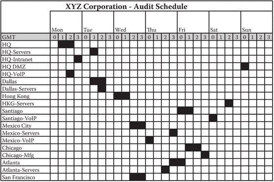

图 5.2 审计计划 GMT 图表。

* 审查网络并选择站点、WAN 连接类型、带宽和主机类型的代表性样本。WAN 连接类型和带宽将影响扫描活动的响应时间，并且在大规模上影响总时间。诸如帧中继（Frame Relay）等连接的响应时间将比专用专线长。带宽也会产生影响，但仅限于某种程度。扫描活动在设备硬件和协议连接限制方面存在极限。
* 在代表性网络中选择一个大小为 `S1` 的目标样本。该样本大小应至少是主机总数的 10%，但不少于 10 个。还应该选取第二个样本大小 `S2`，其应比第一个样本至少大 50%，且不少于 20。这将确保样本量足以在结果中显示有意义的差异。

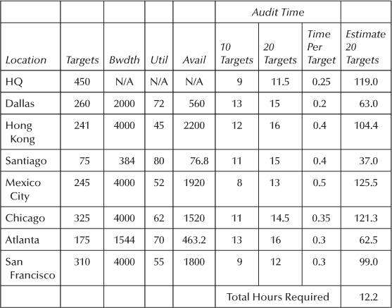

**表 5.1 扫描时间估算表**

* 采集测量数据以完成表 5.1。在表中，通过从扫描第二个样本的时间 `T2` 中减去扫描第一个样本的时间 `T1` 并除以主机数量的差，计算扫描每个目标所需的时间 `ST`。这是在没有收集、格式化和传输结果开销的情况下，扫描单个主机所需的总时间 `TT`。
* 计算之前提到的扫描开销 `OH` 所的时间。较大样本的开销是审计 `S2` 所需的时间减去扫描所有 `S2` 目标的时间。`S2 - (S2-hosts * ST)`。关键在于，扫描目标的时间与完成所有审计活动的时间之间存在显著差异。
* 通过将网络中的主机数乘以 `TT` 并加上开销，来推断并估计扫描整个网络的时间：`X = TT * OH`。表 5.1 表中的最后一列显示了这个数字。这些数字的总和显示了如果由一个扫描器从一个位置一个接一个审计所有网络所需的小时数。尽管这种情况在如此广泛的地理分布下几乎不会发生，但它确实为所需的设备时间提供了一个“体感”。
* 决定多久需要对组织内的每个目标进行一次审计。这将指示你分配给单个扫描器扫描目标的时间，并最终确定所需的扫描器总数。典型的网络应该至少每周执行一次审计，以确保新发现或报告的漏洞被记录在报告中，并且修复活动正在及时进行。
* 创建一个建议的审计计划。由于许多目标在扫描期间必须处于使用状态，必须根据上一步的信息创建一个计划。有了计划，你就可以确定单个扫描器在一天或一周内可以审计多少目标。请注意，在制定此计划时，必须考虑当地时间、办公习俗和目标可用性。图 5.2 显示了一个示例计划。查看每个审计时间段将将显示在给定时间内必须进行多少次审计。此示例每天有 4 个时段，每个时段在格林尼治标准时间（GMT）钟上持续 6 小时。
* 咨询供应商，关于一个设备可以同时执行多少次审计，以及这对扫描性能产生多大影响。例如，单独对网络 A 进行扫描可能需要 45 分钟。但当与另一个规格相同的网络同时进行扫描时，平均扫描时间可能会增加 30%，假设中间的其他网络设备没有引入更多延迟。
* 估计所需的设备数量。再次参考图 5.2，你可以通过计算推荐的并发审计数量并除以推荐数量来评估需要多少个扫描器。在某些情况下，可以通过重新安排审计计划来减少扫描器的数量。注意：始终为错误和增长留出空间。


需求还应该强调安全设计的重要性。最不理想的情况是为了提高安全性而意向向环境中引入了更大的威胁。引入到环境中的任何硬件或软件都应该经过安全性审查。当然，没有任何供应商有兴趣提供一个漏洞系统，但任何收购都要求进行尽职调查。如果 VM（漏洞管理）计划经理至少不通过背景调查来验证这些系统的状态，那么她将是失职的。

此外，漏洞扫描结果可能会存储在设备或其他外部存储设备上。我建议检查任何设备的安全设计。如果设备上具有本地存储（如硬盘），请确定扫描结果是以何种以及如何存储在单元上的。找出数据存储多久以及如何删除。当设备被退回或在运输过程中丢失时，这是否会通过向黑客暴露“脏衣服”（敏感信息）而对组织构成威胁？该设备应适用于与其他任何系统相同的数据留存、备份和安全存储策略及标准，仅为了适应产品限制而允许极微的偏差。

### 5.3.5 系统集成

许多组织在购买和安装技术时，并不考虑其在整个 IT 基础设施其他部分的活跃作用，这并不罕见。最终结果通常是一个功能极度受限的系统，需要付出巨大的精力与其他系统集成，或者通过重大的流程变更来补偿。

VM 系统有许多方式可以提供数据，以最大化对安全和运营的利益。要考虑的系统包括变更管理和事件管理。这些系统常见于中大型组织，这些组织正试图以成熟且一致的方式从 IT 服务中提取更高的性能。

通过将云端代理和组织自有数据中心中的活动扫描器全部整合在同一个管理平台上，收集有关运行环境中漏洞的更完整视图是非常务实的。通过随后将其集成到其他工具中（例如用于威胁映射、安全信息和事件管理（`SEIM`）以及安全治理监控的工具），可以制定出一套非常强大、主动的技术风险管理计划。

### 5.3.5.1 变更管理

变更管理是修复过程的关键组成部分。正如之前提到的，当发现漏洞时，可以将细节自动发送到变更管理系统以启动变更流程。

VM 系统与变更管理接口的能力绝如供应商倾向于暗示的那样简单。几乎总是需要一些自定义开发。此类开发通常用于数据类型、格式和通信方法的转换。供应商的产品可能会针对新发现的漏洞提供简单网络管理协议（`SNMP`）陷阱，但变更系统可能需要 `XML` 或使用电子邮件监听进程。不可避免地有人在这两种完全不同的技术之间编写接口。无论接口方法如何，交换的通用数据元素有：

* 寄送到变更系统的漏洞详细信息
* 发送到变更系统的漏洞事件标识符
* 修复完成后发送到漏洞系统的变更状态更新
* 如果漏洞仍然存在，则重新打开或重新创建变更

一种共享和聚合安全信息的方法是使用如 `Grafeas` 等开源技术。这是一种开源规范，用于应用程序编程接口（`API`），以共享或传输有关环境安全状态的各种技术的元数据。它在收集有关漏洞、容器、操作系统、软件包和代码的元数据时特别有用。一些云服务提供商拥有云安全公告服务，可以使用 `Grafeas` 规范摄取漏洞信息。

某供应商使用 `Grafeas` 的 `APIs` 允许客户将漏洞扫描数据和其他发现结果引入 `findings API`，该 API 可以捕发生情况、供应商名称、资源名称、发现类型、严重性、网络连接、修复步骤、确定性和背景。然后将这些信息与服务提供商拥有的其他元数据相结合，产生关于环境安全态势的有意义且稳健的报告。这有助于具有多云或混合云环境以及多种安全工具的公司朝着完全集成的安全态势的单一蓝图努力。它还具有减少实现此类集成所需的自定义代码和报告数量的优势。

### 5.3.5.2 事件管理

与对接变更管理类似，事件管理可能是你组织中运营支持系统组合的一部分。接口问题类似的，并且会随流程而异。在某些情况下，组织倾向于在变更系统中处理变更，但将事件留给一组非常特定的情况。

另一方面，生成一个事件来跟踪漏洞和修复过程，然后在进行该变更时，使用变更管理系统仅跟踪对系统、资源和流程的影响，这并不罕见。

无论哪种情况，如前所述，变更的完成将触发事件的关闭或立即向 VM 系统通知完成。VM 系统将重新评估目标以确定是否成功合规。

### 5.3.5.3 入侵防御

某些供应商尝试将其产品与入侵防御系统（IPS）集成，结果发现 IPS 供应商梦想着与 VM 供应商竞争。这导致了供应商的几次失败尝试，而这些尝试本可以为客户带来巨大利益。如果你足够幸运拥有与所选供应商漏洞数据兼容的 IPS，那么请务必仔细考虑其益处，因为其中存在许多障碍。

标准或格式的兼容性是一个巨大的障碍。尽管我们在书中详细讨论了标准，但在 IPS 世界中，或者说在漏洞领域，很少有供应商完全支持它们。目前，这两个行业在互操作性方面相隔太远，只有要求严苛的客户群体才能影响变化。然而，基本思想是，如果在目标系统上发现了新漏洞，则会通知相应的上游 IPS 激活签名，从而保护资产直到其被妥修复。

这种类型的集成有两个主要益处。首先，漏洞在完成完全修复之前会得到保护，这降低了环境的整体动态漏洞水平。其次，IPS 优化了其性能，因为在标准策略实施之上激活了必要的规则。当一个非常昂贵的 IPS 在繁忙的 DMZ（非军事化区）段负载过重，且硬件升级无法提供足够的成本效益时，这一点尤为重要。

### 5.3.5.4 安全事件和事件管理 (SEIM)


SEIM 集成通常更容易实现。SEIM 厂商将与众多数据源的兼容性视为一个重要的卖点。数据收集是他们的强项，他们很可能可以在极少修改的情况下接受来自 VM 系统的数据。

如果你的组织已经有了 SEIM，那么不接受这一重要的数据馈将是不负责的。在无法进行 IPS 集成的情况下，SEIM 至少可以使用这些数据来确定事件的严重程度并进行相应的升级。如果你的供应商无法支持某一家主要的 VM 产品厂商，那么他们很可能选择了错误的供应商。

## 5.4 应用程序接口 (API)

尽管自定义开发经常被忽视或被视为事后考虑的复选框，但它是规范需求的一个重要领域。很多时候，实施 VM 计划的人在很晚才发现，需要大量的定制才能最大限度地发挥安全系统的潜力。这通常发生在周围存在许多自定义的变更管理系统时，内部流程已根深蒂固在这些系统之上。由于不太可能购买新的变更管理系统，因此从 VM 系统中高效提取信息并启动变更和/或事件过程至关重要。

从高层次来说，如前所述，当与变更或事件管理系统对接时，接口需要管理以下条目：

* 从 VM 系统中提取漏洞数据。
* 在内部系统中启动变更或事件，同时保留由 VM 系统提供的引用。
* 对事件进行临时关闭并更新 VM 系统。这可以可选地启动一个验证评估。
* 来自 VM 系统的事件将根据验证结果触发事件的关闭或重新启动。

根据你企业中的流程和系统，上述步骤可能会导致接口代码中所需的数据结构和处理方式有所不同。在购买之前，充分了解候选漏洞系统的接口能力至关重要。一旦了解这一点，就要评估每个候选系统会有哪些编码要求。这将有助于突出任何可能严重限制整体效的潜在缺陷。例如，计划中的内部 VM 流程可能要求将有关修复措施的详细建议从 VM 系统传输到变更管理系统。如果在工单生成过程中没有提供这一关键数据元素，可能会导致在实现 IT 安全服务目标方面出现关键缺口。

## 5.5 评分方法

仔细检查 VM 系统上所采用的评分方法至关重要。与安全运营相关的评分系统的基本要求可能包括：

* **考虑资产价值**。你组织中价值更高的资产其处理优先级显然应该高于价值很低的资产。在评分方法或告警能力中的某处，应该以数值或类别的形式考虑资产价值。如果无法从现有的资产管理系统中获取，资产估值过程可能会非常耗时。
* **严重性可以从得分逻辑上或直观地确定**。如果数字看起来是任意的或相对于零的，那么很难判断 300 分是严重的、中等的还是信息性的。在某一点，无论是通过系统的经验还是通过对得分得出方法的了解，它都应该让你能够确定严重程度的类别。
* **对可用漏洞的当前知识应包含在严重性的调整中**。如果向公众发布了新的易于脚本化的漏洞，供应商必须修订其评分方法。得分应该是动态的，以跟上动态的威胁环境。
* **应包含一个基于标准的初级或次级评分，如 `CVSS`**，以便与公共数据库进行比较。这可以防止对可能源自专利方案的评分含义产生任何困惑。
* **可选地，评分应该具有基数组件**。这意味着得分将根据评估来源源而异。如果漏洞可以通过公共互联网网络检测到，那么它的得分应该高于从本地网段检测到的漏洞。

为漏洞确定适当评分部分是数学问题，部分是需求问题。这与风险计算并不相似：

`Risk = p(x) × ε × ρ`

其中 `p(x)` 是发生概率，`ε` 是单次事件的预期损失，`ρ` 是每年的发生率。漏洞评分计算示例可能基于以下变量：

| 攻破严重程度 (α) | 系统远程控制 = 100 远程访问系统 = 75 远程侦察 = 50 本地控制系统 = 50 本地访问 = 40 本地侦察 = 30 |
| : --- | --- |
| 攻击易性 (β) | 简单（脚本化） = 1 中等 = 0.75 困难 = 0.5 |
| 野外是否存在漏洞利用代码 (χ) | 存在 = 1 仅有概念验证 = 0.5 无 = 0.25 |

因此，计算公式是一个简单的乘法公式：

`Score = α × β × χ`

这种创建评分的简单方法将得分限制在 3.75 到 100 之间的值。也就是说，如果“本地侦察”（30）是严重程度，“困难”（0.5）是攻击易性，“无”（0.25）是漏洞利用代码的可用状态，那么最终得分为

`Score = 30 × 0.5 × 0.25 = 3.75`

如果攻破的严重程度变为系统远程控制（非常糟糕），且所有其他因素保持不变，那么得分将上升到 12.5。通过这种简单方法的延伸，最可能的得分是 100，此时 `β` 和 `χ` 因子等于 1，且结果为系统远程控制。

许多评分方法比这更复杂，并且会考虑额外的因素，例如漏洞存在的持续时间。此外，其他评分方法并不局限于 0 到 100 的简单量程，而是没有上限的。当考虑漏洞年龄等无界数字时，这自然会发生。此外，这里给出的简单示例因为使用了简单的乘法而限制非常有限，但其他方法倾向于在真正糟糕和对比低风险之间做出明确区分。平方和阶乘等运算符可以将得分推得很高，以实现更大的风险区分。无论采用哪种方法，请确保它可以转换为适用于输入到任何正在使用的风险评估方法的格式。

## 5.6 访问控制

访问控制是任何应用程序的基本功能。根据基础设施标准，坚持使用外部身份验证是有价值的。角色和访问权限可能需要在 VM 系统中定义，但应该支持外部身份验证。

### 5.6.1 活动目录 (Active Directory)


Active Directory (AD) 是 Windows 系统中最常用的验证机制之一。后续版本支持轻量级目录访问协议 (`LDAP`) 和基于安全套接层 (`SSL`) 的 LDAP 进行目录加载。`Kerberos` 和 `NTLM`（微软的 NT 域管理器）是常见的身份验证选项。由于 AD 功能在企业环境中非常普遍，且有标准与其他系统进行接口，因此这是一个很好的选择。然而，任何 `LDAP` 目录服务都可以工作。AD 集成有两种常用方法。

一种方法是定期同步目录信息，查找新增和删除操作。目录条目的副本存储在 VM 数据库中，以便快速引用访问权限。这是最常见且兼容性最好的方法，它将使用 `LDAP`。通常，必须创建特殊凭据来登录目录系统并检索用户的基本信息。使用 `LDAP` 还为系统提供了迁移到其他目录服务平台的选项。

随后，当用户尝试登录 VM 系统时，用户提供的凭据将通过 `NTLM` 或 `Kerberos` 发送到验证系统。一旦凭据被接受，VM 系统将应用存储在 VM 数据库中该用户的权限。

第二方法是使用 Windows Net Server 2003™ 自带的应用程序模式 Active Directory (`AD/AM`) 功能与 AD 进行原生集成。这使得 VM 能够拥有具有架构扩展和内置属性的独立目录服务实例，但仍然参与 AD 域的安全结构。自然地，支持此功能的服务必须运行在基于微软技术的服务器上。这为承诺微软目录的组织提供了一个紧密集成的目录产品。这种方法的一个显著优势是可以使用 AD 组在 VM 系统中授予权限，而不是创建一套内部角色或用户组。缺点是，你可能会绑定到微软 AD 平台上。

### 5.6.2 RADIUS 和 TACACS+

在更以网络为中心的环境中，`RADIUS`（远程访问拨号用户服务）是一个非常常见的协议选项。它是一种通常用于拨号系统的旧方法系统。然而，该协议对于网络设备来说同样很有用。但是，如果使用 `RADIUS` 和 `TACACS+`（终端访问控制器访问控制服务+），必须在 VM 系统中输入用户 ID，因为没有提供目录服务。该用户 ID 必须与验证服务器预期的完全匹配。`RADIUS` 和 `TACACS+` 之间最重要的区别是分别使用用户数据报协议 (`UDP`) 和传输控制协议 (`TCP`)。由于协议中存在握手过程，`TCP` 具有安全优势，可以在不伪造的情况下与验证源通信。

某些网络身份验证产品甚至支持 `RADIUS`、`LDAP`、`Kerberos`、`TACACS+` 以及其他方法。这些身份验证产品能够有效地“粘合”各种权威和协议，允许采用多种方法。

取决于实现方式，从一种验证方法更改到另一种可能会很困难。为了避免以后出现复杂情况，请从开始选择一种方法并坚持下去。

### 5.6.3 授权

授权功能应该满足你为操作规划的各种角色。这是必须在开始 RFP 过程之前定义需求的关键原因之一。其中的一项需求是定义谁将执行什么功能以及需要哪些能力。基于角色的访问控制是在选择过程中必须经过审查的机制。需要考虑的能力包括：

*   网络隔离——某些用户仅允许对某些网络执行操作。例如，孟买的本地 IT 人员不应检查芝加的任何漏洞报告。扫描参数不应被 VM 管理员以外的任何人修改。
*   操作——接近角色定义，这些是需要执行的特定活动，例如：
    *   定义网络或管理 IP 范围。
    *   运行报告：许多人可能都能执行此功能。能够生成报告是基础。

    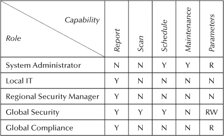

    **表 5.2 权限矩阵**

    *   执行扫描：少数人能够执行扫描。活动扫描功能可能对操作产生破坏性，因此应由那些有资格评估对网络的影响以及当前审计结果需求的人员负责。
    *   维护整个系统的健康和可用的审计参数：除非进行了大量的测试，否则不应经常篡改审计参数。添加 `TCP` 端口或额外的检查可能会影响整个扫描计划。应只有少数人能够更改这些参数。这些人可能兼任安全和合规角色。

记录授权需求的一种好方法是使用权限矩阵。该矩阵应在顶部显示角色，在侧边显示能力。示例请参见表 5.2。

在可以执行特定功能的地方，指示 `Y` 或 `N`。如果指定了访问类型，则分别用 `R` 和/或 `W` 表示“读取”和“写入”。

### 5.7 部署方法

部署系统有许多方法，运行环境的需求可能会影响所选的方案。在某些方面，这与本章之前过的架构有关。但还有其他关于你将如何部署系统的考虑因素。在本节中，我们将讨论影响部署的主要问题。部署方法的目标是在最短的时间内以最少的投资实现最大的效率。实现这一点的基本部署策略是：

1.  建立对目标系统具有最大访问权的立足点。
2.  小规模测试流程并进行完善。
3.  通过增加目标扩展部署，直到立足点部署了 75%。
4.  与第 3 步同时，在所有层级创建并完善管理报告。
5.  在其他位置采取后续步骤。

这里对活动物理扫描器、活动虚拟扫描器、被动分析器和代理的每一步进行审查。

#### 5.7.1 活动扫描器部署——物理

实施物理扫描器部署策略的第一步是选择一个中心位置，未来所有扫描器都向其报告。在可能存在多个中心报告服务器的情况下，选择本地网络中主机数量最多的位置，最好是到其它主要地点无无网络访问权限的地方。验证是否有足够的带宽支持使用之前讨论方法构建的计划。然后遵循迭代过程：

*   在安装报告服务器的本地网络或另一个不那么关键的网络上执行测试扫描和修复报告。一个 24 位的无类域间路由 (`CIDR`) 块就足够。
*   审查报告结果以及对环境的任何意外影响。
*   调整系统和扫描参数以补偿。确保一旦部署进行，你所做的任何调整都可以扩展到数百甚至数千个网络。


*   尽可能在本地办公室添加尽可能相似的网络范围，一次添加一个。
*   重复之前的步骤以验证报告及其对环境的影响。根据情况进行调整。

在等待本地区域的此类活动完成几个周期时，计划并协调在扫描策略范围内通过 WAN 扫描到其他办公室的下一阶段扫描。这些办公室不会接收设备，但有能力通过其 WAN 连接进行扫描且不会影响业务运营。再次，重复评估和精炼过程，并相应更新扫描标准文档。

随着扫描扩展到本地办公室之外，开始生成并精炼管理报告。在此阶段，管理层将对新系统的结果感到非常好奇。务确保报告是可对账的，并且对其内容的问题可以得到解答。如果收购前的测试执行得当，这应该是很容易完成的，可能只需要供应商提供少量的帮助。拥有一位在将这些报告给更广泛的读者之前进行预览的执行赞助人，有助于更早地识别差异和问题。

此时，初始扫描区域的 75% 应该已经部署，且流程开始形成固定的、可重复的形态。下一个部署区域应通过选择另一个与其他目标办公室有良好连接的大型办公室来计划。然后，重复前面步骤中讨论的逐步扩展过程。

### 5.7.2 虚拟扫描器

使用虚拟机技术创建的活动扫描器通常遵循与物理机相同的策略，仅略有不同。在许多位置，`VMs` 的部署速度快得多，且对 WAN 链路的依赖较少。选择不部署 `VM` 的位置是那些没有足够的硬件、人员和许可软件来支持它的地点。另一方面，每个 `VM` 实例都需要许可、维护和支持，因此其数量应保持在最低水平。

获取运行虚拟机所需的硬件要求的的清晰定义也至关重要。大多数供应商已将通常运行在固态设备上的软件移植到 `VM` 中。当运行虚拟机软件的宿主机操作系统将扫描器与硬件分离时，这样做可能会产生不可预测的性能结果。对于硬件产品的虚拟版本，有必要进行一轮完全独立的测试。

有时，同时使用物理设备和虚拟设备比仅使用其中一个更具实际意义。这在将产品从一个地方运到另一个地方不现实的情况下尤为如此。此外，对于仅在工作期间用于审计桌面电脑或仅在晚上审计服务器的设备来说，机架空间和功耗可能是问题。对节能日益的关注使得虚拟设备的前景对高级管理层具有吸引力。

### 5.7.3 被动分析器部署

被动分析器通常是硬件设备，正如我们在技术章节中节描述的那样。它们对安装环境有独特的要求，并可能限制位置的选择。活动扫描器作为连接到网络交换机的主机运行，而被动设备取决于其实现方式，是完全不可见的。目标安装网络必须能够将所需信息复制到扫描器的网络端口。并非所有交换机都具有这种镜像或交换端口分析（`SPAN`）功能，因此应作为选择选址的需求的一部分进行评估。

如果使用网络分接器（tap）而不是端口镜像功能，则设备看到的流量可能有限。这是因为并不是所有设备都会与其自身网段之外的设备交换数据。在交换机上使用端口镜像时，来自特定网段所有成员的数据包都可以复制到分析器。但网络分接器用于单根网络电缆，以观察任何通过的内容。然而，同一网络上两个设备之间的对话将保持未被观察状态。

通过一些创新的网络配置，可以在范围内解决这个问题。镜像解决方案在可检查流量的完整性方面受到限制，因为所有源流量的聚合带宽不能超过连接到漏洞分析器的链路带宽。例如，如果一个 `DMZ` 有 20 台主机，每个主机平均消耗 `50 Mbps`，那么连接到分析器的链路至少需要是 `1 Gbps`，最好更高。此外，分析器的设备和软件必须具有足够的容量来完全消耗流量。如果不是，结果将是错误并可能遗漏信息。如果该设备兼任入侵检测系统，那么性能要求将严格得多。

适合作为被动流量分析器的理想位置是那些主要与自身网络之外的方进行通信的地点。互联网 `DMZs` 和内部服务器集群是良好的候选对象。任何可以找到网络网关或带有端口镜像的高级网络交换机的地方都有帮助。此外，该位置通常无法为大量设备执行端口镜像。因此，目标网络最好不要使用这种技术来实现入侵检测系统。

### 5.7.4 代理部署

`Agents` 是在减少网络影响的情况下进行漏洞测试非常有效的方法。它们持续感知系统状态，并通常可以对周围设备进行计划审计。根据供应商的能力，常用的策略包括：

*   在始终运行的工作站或服务器上安装 `agents`，以便用最少的 `agents` 进行扫描。这里的缺点是，如果你依赖某个工作站，那么你就取决于该工作站用户何时以及是否关闭它。在某些位置，可以通过安装在服务器上缓解这一点。
*   在网络中的所有设备上安装 `agents`，以避免审计产生过量的网络流量。它的缺点是更新每个代理的漏洞信息会产生更多流量。但如果每周更新一次，此类信息通常很小。
*   在每个办公室的域控制器上安装 `agents`，因为它们始终运行。然而，这可能会影响域控制器的性能或可靠性。选择性部署 `agents` 的优势是它们可以从网络角度提供漏洞视图。也就是说，可以通过网络和安全基础设施组件对漏洞进行评估，以更好地了解实际风险。无论选择何种代理部署方法，请注意，由于兼容性和管理问题，`agents` 在行业内开始逐渐失去青。计划可能很复杂，且对基础设施的影响比其他方法更难以预测。

## 5.8 总结


一如既往，我们可以看到流程和规划对于虚拟机（VM）技术的选择至关重要。通过开发并约定选择过程中遵循的流程，关键参与者将产生所有感。对最完整且符合预期的实施进行规划同样重要。很多时候，公司会从评估产品和查看供应商评估开始，而不考虑与环境最相关的具体用例。风险管理和安全需求应该是首要考虑的问题，同时要保持与支持性基础设施和用户组的兼容性和接受接受。指导选择过程中活动的基本原则是：

1.  包容所有受系统影响的群体。
2.  共同视觉化其工作方式。
3.  通过深入研究第 2 点的细节来获取需求。
4.  开发评估方法。
5.  对结果保持透明。

规划的核心是识别一个漏洞检测结果最有效的产品，并使其运行以满足已知的安全需求，这种情况并不罕见。然而，考虑到潜在的部署复杂性以及组织可能围绕此类系统建立的依赖关系，从运营流程和技术两个角度考虑未来的用例是关重要的。对系统的未来应用和实施持有过于简化的观点只会导致不满。

### 流程

## 6.1 引言

流程是任何成功安全计划的关键组件。它被集成到组织中以支持策略，延伸支持计划章程。流程引导技术的使用，但不是技术的奴隶。这种区别很重要，因为很多时候，流程的设计纯粹是为了操作技术，而不是产生支持组织目标的结果。结果是在流程实施后对流程进行一系列临时修改。

流程开发不需要是一个漫长而冗长的过程。有了基本的流程框架，90% 的工作可以快速完成。在本章中，我们将讨论漏洞管理（VM）流程的步骤，以及每个步骤如何与组织的其他部分交互。

如前所述，`VM` 是一个流程而非技术。在创建流程和对其进行精炼以实现最佳性能方面追求卓越，将为识别和修复最大的威胁建立信心。流程的开发始于确定与组织兼容的元素。必须回答一个问题：组织中哪些属性和活动必须纳入流程中，以产生最小的影响并最大程度地实现 VM 计划的结果？你可以选择两种方式来构建流程，取决于组织当前的实践标准。你可以选择采用以信息技术基础设施基础库（ITIL）为中心的方法，或者采用不遵循任何发布框架的独特定制方法。这种方法在很大程度上取决于你当前流程的成熟度以及你是否采用了以 `ITIL` 为中心的方法论。许多大型组织选择遵循 `ITIL` 服务管理流程模型，以保持高水平的关注业务需求的可衡量结果。除了 `ITIL` 之外，在自定义的内部开发框架之外，真的没有多少实际选择。

必须进行组织兼容性评估的流程元素是待集成的活动、输入和输出。这些元素每一个都应以特定的方式实施，以便在实现 `VM` 函数最佳性能的同时，控制对现有相关流程在成本和性能上的影响。

## 6.2 VM 流程

这些步骤与典型的“生命周期”框架中看到的内容紧密对齐，从高层定义开始，并向深度扩展以完成任务。在此过程中，会创建与其他流程的接口。我们在本书中假设的典型 `VM` 流程如图 `6.1` 的右侧所示。它包含了本节列出的步骤。

### 6.2.1 准备

在开始之前，需要对审计目标有一定的了解。为了使审计有效，必须定义通用的互联网协议（`IP`）范围和任何身份验证机制。

* **审计范围**：确定每次扫描的主机的大致数量、根据目标技术确定的扫描类型以及审计时长。
* **通用规则**：识别目标并确定优先审计哪些网络。考虑按虚拟局域网（`VLAN`）、`IP` 范围或目标类型进行划分。此外，回顾扫描系统的已知负面影响列表，以避免问题。
* **识别修复人员**：约定由谁负责修复以及对谁负责。
* **制定扫描计划**：与网络和系统管理员约定每天每周的时间。这一决定在很大程度上取决于主机类型和业务模式。在白天进行活动审计可能会生产产生潜在影响，但对于桌面系统可能是必要的，因为它们通常是开启的。
* **环境调查**：审查环境中的主机类型，并确定是否需要特殊例外。例如，某些设备不允许经过验证的漏洞扫描。这些系统应被识别并可能排除在审计之外。

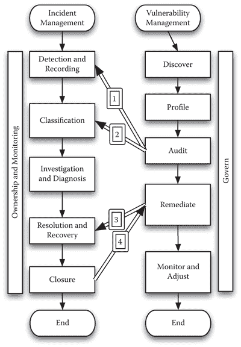

图 6.1 事件管理/VM 流程交互。

* **名称和资产价值**：每个网络和/或主机可能有一个名称和分配的资产价值。在活动扫描中，通常会分配凭据以登录目标并进行更彻底的审计。
* **基础架构**：必须提前确定审计系统组件的位置和数量。架构这一主题在书的相关章节中会有讨论。

### 6.2.2 发现

环境中所有目标的识别是通过技术和手动流程相结合完成的。自动化有助于统计现有资产，但资产所有者必须识别每个目标的业务功能和相对价值。

### 6.2.3 描述

了解环境的复杂程度以及基本的安全态势。你应该知道所有的特种区（`DMZ`）在哪里，以及每个目标面前有什么安全措施。这将有助于进一步规划漏洞扫描和修复步骤。在 `VM` 流程的这一阶段执行两项活动：评估和上下文化。

#### 6.2.3.1 评估


在后期阶段，理解目标或资产的相对价值非常重要。根据环境的成熟程度和实际安全流程需求，你可能选择用财务术语（$）或简单的数字排名对资产进行估值。财务评估应该考虑在一段时间内无法使用目标给业务带来的成本以及恢复成本。数值估值则简单地取决于所执行的功能对业务的相对重要。例如，1 到 10 的量级可能足够了。最终，资产估值将帮助在资源有限的情况下确定哪些目标优先进行修复。资产估值还可能帮助决定检查目标漏洞的频率和顺序。

### 6.2.3.2 语境化

定义漏洞的语境对于避免将资源集中在环境中不相关的漏洞上至关重要。如果发现某个目标易受到攻击 X 的影响，但该攻击极不可能发生，或者目标周围的控制措施使得攻击极不现实，那么可能将资源花在其他漏洞上更好。此外，该漏洞完全可能是允许应用程序正常运行所必需的配置项。以下列表提供了可能有助于漏洞语境的项目示例：

*   现有的安全控制：如前所述，漏洞周围的安全控制措施可能足以缓解风险，使该漏洞的意义不大。
*   应用程序需求：某些应用程序需要可能被视为漏洞的配置。一个非常常见的例子是允许任何人在未经身份验证的情况下从目录读取。虽然这看起来像是一个漏洞，但通过审查可访问数据的分类可以理解这一点。
*   变更管理操作：某些漏洞可能已经安排通过其他变更活动进行修复。例如，如果一个易感系统要升级到新版本或完全替换，那么该漏洞可能会作为结果得到修复。这里最考虑的因素是时间与威胁之间的权衡。如果六个月后才能执行变更活动，且漏洞的严重性很高，那么延迟修复是不明智的。

### 6.2.4 审计

这是检测漏洞的持续扫描过程。该过程还将为前两个步骤提供信息，以完善通常是动态动态的环境。审计是频繁进行的，并且为了达到最高效率，需要获得目标的访问权限。

### 6.2.5 修复

这是你修复审计阶段发现问题的地方。这些活动有时需要仔细的计划和测试，以避免干扰业务活动，但许多时候，解决方案简单只需要自动应用制造商提供的补丁。虽然打补丁被认为是一种解决方案，但事实往往并非如此。可能是机器配置的问题，或者可能是默认密码需要更改。此类更改通常会影响依赖目标特定配置的其他系统。

### 6.2.6 监控与调整

通过审查审计结果，可以识别问题并更改参数，以防止潜在的服务中断并增加准确性。网络、目标配置和组织都是动态的。今天有效的方法明天可能不再有效。因此，必须对结果和性能进行某种监控，以确保运行良好。网络管理员添加 VLAN 并重新映射主机的 IP 地址并不罕见，这种变化安全和审计小组并没有察觉。这类更改应该迅速识别并处理，否则 VM 系统的准确性和覆盖范围将会下降。

下降发生的另一个例子是所用协议和服务的类型。今天，组织的很大一部分可能使用典型的 Web 控制协议（`TCP`）端口 `80` 和 `443`。虽然这些端口确实被监控，但新的应用程序架构可能会导致额外的端口，例如结构化查询语言（`SQL`）服务器或更冷门的 Web 服务端口。随着这些变化的发生，VM 操作员必须适应，并确保在设置审计参数时充分考虑风险。活动扫描特别容易受到此类变化的影响。

### 6.2.7 治理

中长期趋势分析对于衡量 VM 程序的整体性能至关重要。如果至少完成了前五个阶段，你就已经完成了一个优秀计划的 70%。然而，治理将带来更一致的结果和更高的可靠性。没有这一步，程序将面临萎缩和退化的风险。就像人们定期对机动车进行维护以保持其良好状态一样，经理也必须维护 VM 流程。

我们讨论的整个过程在不断重复，但其间隔与业务周期相融合。最常见的是，审计和修复阶段的重复频率应达到基础设施能够承受且不导致任何服务下降的。这种频率不应低于每周一次，如果可能，每天一次。此的原因是发现连接到网络的新目标，并应用软件行业持续发布的新漏洞检查。

以下是在治理（governance）阶段可以执行的一些有用活动列表：

*   定期审查报告：发现漏洞的摘要报告以及与上一个周期报告的比较，可以对安全态势的变化提供参考。
*   评估表现最差者：漏洞最严重的网络“前 10 名”列表是向需要激励的 IT 管理人员施力的绝工具。
*   识别表现最佳者：这些表现最佳者正在做正确的事。找出他们的做法，并在案例研究中传给所有 IT 小组。处于光灯下对所有相关人员都有益处。
*   监控趋势：当整个组织或特定网络的漏洞数量或评分趋势似乎上升时，在网络进入前 10 名之前可能需要进行升级。关于趋势的一点警告：必须确保趋势的原因是性能不佳，而不是新发现漏洞的影响。`Chapter 7` 关于报告和分析的章节将详细介绍这一主题。

### 6.3 基准

在任何持续的 VM 过程中，将评估结果根据组织基于风险的需求进行完善将优化整体流程。基准是一个已知的、接受的安全配置。基准反映了目前特定平台和用途组合被认为是良好的配置和补丁状态。一个很好的例子是面向普通用户的标准桌面计算平台。该平台是运行在特定硬件范围内的一系列软件组件。它配置为满足计算环境定义的安全需求。以下属性定义了基准配置：


-   **用户组 (User group)**：定义了系统的本地和远程用户。对于桌面计算机，该定义将包括使用文字处理和电子邮件等生产力软件的本地普通用户。对于远程用户，该定义可能指的是使用远程访问应用程序和各种管理工具的桌面管理员或帮助台人员。
-   **用例 (Use case)**：用户组的扩展，用例精确定义了平台将如何被使用。例如，一个通用的 Web 服务器基准，其用例可能是执行面向公众的 Web 服务器软件，并使用 Java™ 服务器应用程序连接后端数据源。用例将指定包含或不包含在应用功能中的区域。这可能包括财务应用程序、基础设施控制系统或建筑安全系统。
-   **环境 (Environment)**：每个计算平台都运行在特定的环境中，该环境对所支持应用的风险潜力有很大影响。通用 Web 服务器运行在公共 DMZ 中，其风险水平与在内部数据库层中持有关键客户数据的服务器不同。工业控制系统可能连接到严苛物理环境中的制造网络。
-   **受支持的硬件 (Supported hardware)**：对于每台计算机，特定范围的硬件组件都需要支持性软件和驱动程序。正如我们之前讨论过的，这些支持软件组件具有需要管理的漏洞。如果硬件平台超出预期范围，那么管理这些漏洞可能会变得更加复杂。这并不是说我们应该避免差异；但如果工作可以通过已建立的安全配置完成，那么就没有必要在没有业务理由的情况下，引入更多奇特的硬件来增加风险。

由于存在上述所有这些属性和可能的组合，风险、影响和缓解成本各不相同。通过提前定义这些属性，并将基准的数量减少到满足组织 95% 需求的程度，识别和修复漏洞的过程就可以变得非常易于管理。以下是基准方法的主要优势列表：

-   你将避免被迫做出遗憾的决定，即接受更高的风险，仅仅因为某个应用程序没有运行在基准平台上。
-   基准最大限度地减少了分析和补丁的变异。如果修复方案在组织大部分范围内是相同的，那么对受支持应用程序和硬件的影响就可以更容易地评估。
-   当本地 IT 人员联系系统工程师了解必须做什么时，对解决方案的支持也得到了简化。
-   整体风险分析被简化，并允许安全经理快速、可靠地更新指标。

基准应根据风险环境，按照合理的计划进行更新。支持人员应该能够在新的基准通过测试并获得引入环境的资格时，识别并更新旧的基准安装。

## 6.4 ITIL-ITSM 流程

来自 `http://www.itlibrary.org`：

信息技术基础库（`ITIL`）定义了信息技术组织的结构和技能要求，以及一套标准的操作管理程序和实践，使组织能够管理 IT 运营和相关的基础设施。操作程序和实践是独立提供的，并适用于 IT 基础设施内部的所有方面。

在本节中，我们将探讨名为 `IT 服务管理`（`ITSM`）的 `ITIL` 流程，仅限于与 VM（漏洞管理）活动相关的。关于 `ITSM` 服务管理方面的更完整讨论将至少消耗一整卷的内容，并且超出了本书的范范围。如果你对该主题的更多内容感兴趣，我建议你找到现有的许多书籍中的一本。这里讨论的概念将基于 `ITIL` 第 2 版，因为目前似乎它是最广泛接受的版本。尽管 `ITIL` 框架正在演进到第 3 版，但在这里引入它只会引起困惑。服务支持和服务交付是与 VM 相关的两个广泛领域。

### 6.4.1 服务支持

`ITSM` 的这一领域在安全方面最活跃，因为 VM 的主要目标是为现有的 IT 服务提供方面的支持。服务支持由以下活动组成：

-   事件管理 (incident management)，
-   问题管理 (problem management)，
-   配置管理 (configuration management)，
-   变更管理 (change management)，以及
-   发布管理 (release management)。

正如早期的案例研究所述，`事件管理`和`变更管理`经常用于最基础的操作。但对这些每个过程进行更完整的讨论是必要的。

`事件管理`旨在尽可能恢复正常运行。通常，这意味着回到服务水平协议（`SLA`）中指定的服务水平。对于不熟悉 `SLA` 概念的人来说，想法是在业务经理和 IT 组之间起一份基于业务需求的协议。该协议包含了必须满足特定目标和指标。执行某些测量是为了确保协议条款的履行。向业务部门定期报告，以便业务经理可以看到服务水平已得到满足。这是为业务提供一致服务的一种负责的方法，并为 IT 团队提供持续衡量的运营目标。`SLA` 最重要的战略优势是 IT 运营目标与业务目标直接挂钩，确保了紧密耦合的价值链。

VM 服务提供类似的服务水平。尽管许多组织选择不为 VM 创建 `SLAs`，但将整个学科定位为具有可衡量结果的业务服务无疑是有益的。可衡量结果的价值将在第 3 章关于 VM 程序的业务案例和章程描述中讨论。

现在，让我们考虑作为服务的 VM 的基本指标：

-   高风险业务部门列表，
-   每月和每季度修复的漏洞百分比，
-   每季度审计估计目标的百分比，
-   每月和每季度修复的严重漏洞百分比，以及
-   严重漏洞修复的平均时间。

以下是这些指标的一些基本特征：

-   **可衡量性 (Measurable)**：如果你要向业务部门报告指标，这一点至关重要。
-   **相关性 (Relevant)**：它们是 IT 安全组织绩效的真实指标。
-   **现实性 (Realistic)**：大多数漏洞系统都能提供这些指标，估计目标数量需要从其他系统获取。

在许多组织中，当单个漏洞的严重性达到一定水平时，会作为事件进行管理。如果你倾向于将 `SLA` 驱动到粒度级别而非整体安全态势级别，这并不是一个坏方法。漏洞审计功能作为 `SLA` 合规性的监控。`SLA` 的责任由负责修复和正确配置目标的小组承担。


在花费大量时间使漏洞数量和严重程度达到可预测的水平后，你可能会选择向 IT 的其他部门提供运营水平协议（OLA），并据此扩展到业务部门，或者作为持续性 IT 风险评估的一部分直接提供给业务部门。当偏离 `SLAs` 时，将创建一个事件以跟踪解决。因此，在这种情况下，该事件是一个高级别的事件，显示未能遵守 `SLA`。

如果事件指示了服务水平的异常，那么安全态势的立场就是对 IT 服务进行主动加固。如果事件被用于指示存在需要修复的漏洞，那么安全态势则是将漏洞视为需要扑灭的小火灾并做出反应。这看起来像是一个细微的区别，但重要的教训是，避免将 IT 组织几乎无法控制的新漏洞计数，计算为未能满足 `SLA` 的失败。

如果你的 `SLA` 侧重于在规定时间内通过特定手段修复特定严重程度的漏洞，那么对于每个发现的符合约定标准的漏洞，都需要产生一个“事件”。

## 6.4.2 服务台 (Service Desk)

服务台是负责管理事件的单一接触点。正如接下来的讨论中所示，事件的创建、管理以及相关通信是服务台的主要目的。它像一个中央通信枢纽，与解决问题所需的所有关键方维持关系。

## 6.4.3 事件管理 (Incident Management)

如果 `SLA` 规定给定目标上的漏洞严重程度不会超过某个水平（例如通过数值评分指示），那么只有当漏洞导致系统超出该值时，才需要创建事件。

这种方法的益处是，每一个违背 `SLA` 的漏洞都会被提升到正式认可的状态。然而，跟踪和修复如此多的事件工作量可能巨大，而对于目标的安全态势而言，这可能是微不足道的。相反，这种方法可能会产生较少需要管理的事件，这些事件对安全态势可能没那么重要，但可能允许一个或多个相关漏洞在无人察觉的情况下暴露系统。

事件管理完美契合漏洞管理（VM）过程，因为它处理的是原本会被分类为问题的直接解决方案。通过自动化手段检测的大多数漏洞都可以被视为事件，因为原因和解决方案是易于识别的。`Figure 6.1`（左侧）显示了与 VM 过程并行的基础事件管理过程。两个过程之间的每条连接线都准确显示了在何处存在通信或过程交互：

*   漏洞审计是产生事件的检测和报告机制。
*   审计数据的一部分还包含分类过程的关键输入。这通常是漏洞的定义和严重程度。
*   事件报告中提供了额外的修复细节，通常是来自受影响系统供应商的建议。
*   当事件最终被修复时，系统的关闭或修复状态将通信到 VM 过程，以验证监控过程的成功。这一步可以自动化。

### 6.4.3.1 问题管理 (Problem Management)

将 VM 过程与 ITIL/ITSM 对齐的巨大优势之一是，如果事件反复发生并足够导致服务中断，它们就可以变成问题。这通常发生在可能导致服务中断的配置错误中。`SQL Server` 数据库中的空白系统管理员（SA）密码就是一个很好的例子。这显然是一个高严重程度的漏洞，如果由于流程或标准的某些错误在全球范围内分布，则可能被声明为一个问题。问题管理关注在问题原因未知时产生最大风险的事件。

在这个示例中，可能有几台服务器在没有遵循标准的情况下实施了，或者可能是恶意活动的结果。原因和解决方案是未知的。然而，该问题是漏洞扫描器生成的事件的结果。解决办法可能是根据标准设置 `SA` 密码。如果原因是 IT 管理人员的错误，那么这个问题就是一个“已知错误”。如果原因是恶意活动，那么这个问题就是一起严重的安全事件。

在大多数情况下，VM 系统和过程在确定确定根本原因时执行了问题管理的功能。因此，输出通常不是一个问题，而是一个事件。

### 6.4.3.2 配置管理 (Configuration Management)

VM 系统极大地帮助了配置管理，因为它们能够向配置数据库（`CMDB`）提供大量的配置数据。对于不熟悉的人来说，`CMDB` 是包含 IT 基础设施中所有资产配置细节的数据库。这些细节被称为配置项（`CIs`）。该数据库在整个变更、发布和事件管理过程中被用于验证变更和事件的影响。

`CMDB` 也受到之前讨论的问题管理功能的影响。在之前空白 `SA` 密码的示例中，如果问题被证明是一个已知的非恶意原因，它会被归类为“已知错误”。发现的漏洞结果将这样记录在 `CMDB` 中。更具体地说，`SA` 密码 `CI` 被标记具有此已知错误。在将来，通过遵循 `CMDB` 中说明的 `CIs` 标准，可以尽量减少此类错误变更。

总结 VM 在配置管理过程中的影响：它最小化了可能存在漏洞的 `CI` 上已知错误的再次发生。

### 6.4.3.3 变更管理 (Change Management)

与配置和问题管理类似，变更管理允许对环境进行更改，目标是减少对 IT 服务的负面影响。在 VM 的情况下，这意味着在执行变更时漏洞的实例化。变更管理还提供了通过遵循标准化流程修复漏洞的过程，该流程提供了优先排序、监控和完成情况的报告。

变更管理过程的关键益处是，它促进了修复过程的大部分。变更管理的 ITSM 过程的一部分是为执行变更开发业务案例。这可能是出现偏离的地方，取决于组织的文化和业务优先事项。漏洞修复业务理由的大部分输入来自于漏洞如果被成功利用后可能产生的影响。

## 6.4.4 服务交付 (Service Delivery)


服务交付的主要任务是领先于业务需求，以保持服务运行达到或高于服务水平。确保服务水平、容量和可用性机制已到位并正确运行，可以确保 IT 服务在业务发生变化时仍与业务保持顺畅且无缝的运行。

### 6.4.4.1 服务水平管理 (#contents.xhtml#tl_sec6_4_4_1)

服务水平管理对于虚拟机（`VM`）服务与对于任何其他 IT 服务一样适用。由于 `VM` 的目标是识别并修复漏洞以及降低风险，因此可能创建的 `SLAs` 需要一定的服务水平管理。当 `VM` 程序在 `ITSM` 框架下运行时，将识别出 `SLAs` 以及运营水平协议（`OLAs`）和底层合同（`UCs`）。

简单来说，`OLAs` 是 `VM` 程序与组织内其他服务达成的协议，用于支持面向业务 `SLAs`。`UCs` 是 `VM` 程序与供应商之间签订的合同，用于提供支持服务。例如，网络组可能分配了特定的带宽用于对目标进行主动扫描，或者分配了一个专用的交换端口，通过复制特定 `VLANs` 上的流量进行被动分析。这些将在他们提供的 `SLA` 中详细说明。

此外，`VM` 系统的供应商将有一份合同，作为 `VM` 程序提供的 `SLA` 的基础，即每周提供更新的漏洞检查，并在漏洞发布后七天内包含最新的微软漏洞。`VM` 商提供此类具有严格限制的 `SLA` 并不常见，因为没有办法确定解决某个随机报告且严重程度未知的特定漏洞需要多少时间和精力的。因此，更务实的做法是提供一份 `SLA`，承诺在报告后 30 天内解决假性误报，或在 24 小时内接受服务台台的故障工单。

### 6.4.4.2 容量管理 (#contents.xhtml#tl_sec6_4_4_2)

在管理 `VM` 系统的容量时，需要对进行漏洞分析的 `IP` 地址数量以及执行该分析所需的时间进行持续监控。这在主动扫描与被动分析中尤为如此。在主动扫描中，容量有许多限制因素，如带宽、工作时间和网络响应时间。这些因素在很大程度上可以通过 `OLAs` 进行管理；然而，随着企业的增长，偶尔需要更多的审计资源以继续按既定的服务水平提供交付。

例如，可能需要更多的主动扫描器来针对近期可能开设的新网点。`VM` 团队的任务是识别并响应这些业务变化，并维持同样的安全水平。当 `VM` 服务经理未能识别出与其签 `SLA` 的业务部门正在开辟新办公室时，这一点在 `SLA` 中很容易被遗漏。

容量管理在被动评估方面的一个示例是：在达到特定数据速率时以一致的准确率捕获漏洞的能力。该速率可能是每秒兆比特（Mbps）或每秒连接数（CPS）。无论何种情况，生效的漏洞检查应适用于约定范围内的任何流量大小。此外，在高流量水平下，仅对一组关键漏洞进行检查可能是理想的。交付这些 `SLAs` 的将取决于流量分析仪的能力以及网络实施的任何限制。

### 6.4.4.3 可用性管理 (#contents.xhtml#tl_sec6_4_4_3)

尽管可用性管理是应用于安全领域的 `ITSM` 一门学科，但理解哪些因素影响可用性更为重要。检测可能导致拒绝服务的漏洞是很有意义的。然而，`IAVA` 过程的优势在于它始于一个已知已完全打好补丁且配置良好的系统。这种状态在私有部门中等同于“基线配置”。

### 6.4.4.5 其他领域 (#contents.xhtml#tl_sec6_4_5)

以下领域由于相关性较而不进行讨论：

*   发布管理
*   财务管理
*   业务连续性管理

### 6.5 IAVA 过程 (#contents.xhtml#tl_sec6_5)

独立于 `ITSM` 并作为私有部门 `VM` 程序的替代，美国国防部（`DoD`）采用了信息安全漏洞（`IAVA`）过程。正如监察长办公室的《DoD 报告 2001-013》所示：

政策指令指示信息局开发并维护一个系统，以确保系统管理员接收并遵守 `IAVA`。`IAVA` 是一种基础流程，软件缺陷会导致三种通知之一：

*   信息安全漏洞警报（`IAVA`）
*   信息安全漏洞公告（`IAVB`）
*   技术公告（`TA`）

漏洞的严重程度或影响将决定通知类型。这种方法与供应商以及 SANS 学院风暴中心等安全组织提供的“威胁级别”通知相似。

IAVA 过程包含以下基本步骤：

1. 建立符合 `IAVA` 系统。
2. 评估合规性。
3. 如果系统合规，返回步骤 1。
4. 如果系统不合规，修复。
5. 返回步骤 1。

当发现目标存在相关漏洞时，该系统被认为不符合 `IAVA` 标准。

### 6.5.1 管理 IAVA 过程 (#contents.xhtml#tl_sec6_5_1)

信息系统局（`DISA`）负责维护 `IAVA` 过程。该过程的主要工具是每个 `DoD` 系统注册的 `IAVA` 数据库。该数据库中的信息使 `DISA` 能够跟踪这些系统的合规情况并生成报告。


当安全研究人员发现新漏洞时，这被称为一个 IAVA（交互式漏洞警报）要求。该要求将与此数据库的内容进行比对，以确定任何注册系统的合规状态。如果发现某个系统不合规，将根据流程定义向系统管理员发送通知。随后，由系统管理员负责使目标系统达到合规。

但是，发布 IAVA 警报、公告或技术建议并非那么简单，而且并不完全是自动化的。计算机应急响应团队（`CERT`）必须确定以下内容：

- 受影响的操作系统类型，
- 受影响的应用程序的漏洞情况，
- 系统的访问难易程度，
- 所造成的威胁类型，
- 基础设施是否会受到影响，以及
- 漏洞是否已被利用。

如果认为有必要，`CERT` 将发布上述描述的通信方式之一。如果发布了警报，目标系统的管理员必须在指定时间内确认收收。这等同于私营部门的 `SLA`。

国防部（DoD）实体在收到 IAVA 消息后必须报告以下情况：

- 注册系统数量，
- 合规系统数量，
- 拥有豁免（Waivers）的系统数量。

豁免表面上用于在应用程序可以被破解时允许不修复。简单的计数将揭示由于缺乏修复而未被缓解的风险量。

尽管这一流程对国防部是合理的，但在商业环境中并不被接受。也许未来，此类政府标准的输出可以被适当应用并调整到行业中。IAVA 流程广泛采用的最大障碍可能是漏洞管理（VM）产品供应商之间缺乏标准化，以及缺乏对系统漏洞状态实施此类僵化积极控制的激励。如果每个供应商和安全研究人员都使用 `OVAL®`（开放漏洞与评估语言）等标准对漏洞检查进行编码，并且在常见漏洞与披露（`CVE`）和 `OVAL` 库中审核和接受漏洞的过程更加高效，那么标准流程的采用可能会随之而来。

至于 IAVA 的有效性，它远非完美。问题可能发生在几个方面：

- 通知内容的质量可能很差，增加修复的难度。这在修订消息和寻求更详细信息时，进一步加剧了补丁活动的延迟。
- VM 和配置管理工具供应商之间缺乏标准的采用（前文已讨论），使得人员的识别工作更加困难。每个工具可能使用不同的方法来识别缺陷，其中某些比其他更可靠。像 `OVAL` 这样的努力对于建立漏洞检查标准非常有价值，这不仅可以增强国防部的流程，也能增强大型公司的流程。
- 认为有其他优先事项的人员可以很容易滥用“豁免”的存在，并利用这种机制来实现这些优先事项。在某些情况下，只需额外的工作即可消除对豁免的需求。但根本没有资源来这样做。
- 豁免本身可能是一个漏洞。为外国政府工作的希望通过利用漏洞针对某些系统的聪明攻击者可以篡改 IAVA 数据库应用程序，在某些情况下为这些系统发布豁免。这些系统可能永远得不到修复。
- 通知过程也可能存在漏洞。在上述相同的情况下，IAVA 消息系统在链中有多个层级链接，可能提供攻击向量，以篡改消息内容或将消息路由远离漏洞系统。合规性消息也可能被篡改，无论是在源点还是传输过程中。

人们最终必须问一个问题：如果 IAVA 如此出色，为什么我们不断听到使用常用漏洞对政府系统进行攻破的消息？这并不是为了指责流程本身，而是可能指责执行过程。缺乏的关键项是将是将策略合规性纳入 IAVA 流程中。使用自动化工具检查技术策略和标准合规性，其难度并不比检查漏洞更大。这最终将我们带回对标准的讨论，因为许多分散的 VM 系统可能对它们执行的检查不使用相同的方法或语言。这使得集中的积极控制变得效力低得多，并且更容易受到操纵。

## 6.6 数据分类

虽然策略是实施漏洞管理（VM）计划迈向成功的非常重要的一步，但拥有坚实的安全运营基础同样重要。许多公司未能对数据进行妥善分类，但这样做将使 VM 计划更加成功。理解数据的不同敏感级别和相关的威胁级别将使安全经理能够更有效地监控和管理风险。

### 6.6.1 案例研究：Big Tyre 公司

Big Tyre 公司（被称为 Big T）是一家全球性的重型卡车和建筑轮胎制造商及分销商，在 12 个国家设有办事处。总部的所有计算设施都有冗余，每个国家总部都有自己的资源计划（`ERP`）和会计系统。制造系统由位于芝加哥的独立 IT 小组管理，每个国家都有本地管理和维护小组。其他销售和营销系统因地而异，由于逐步收购其他轮胎制造商，通常每个国家内部有几个系统。没有任何销售系统曾被整合过，因为它们在当时的优先级低且工作量大。

在规划 VM 系统时，扫描漏洞似乎很简单。所有的政策和流程都已就位。高级管理层支持这项工作，部门经理也渴望展示他们追求卓越的意愿。在最初发现主机时，许多 `ERP` 系统缺少基础补丁，由于优先级考虑，迅速解决了这些问题。由于其复杂性以及与其他内部系统的集成，该过程进展缓慢。许多 IT 资源被困在结果证明是长期项目（六个月到一年）的任务中。

在此期间，在不被充分熟悉的系统中发现了其他几个漏洞。内部安全审计师的随机调查发现，一种新型轮胎的敏感设计数据存储在中国的一个自制营销系统中。这显然对于在轮胎上市时开发销售模板是必须的。然而，该系统漏洞百出，且缺少补丁。这些缺失补丁的存在几个月来已为人所知，但由于认为它是非关键系统，因此没有采取行动。

安全总监担心该系统在存储此类信息时太脆弱了，随后法医分析师进行了进一步调查。在经过一周的探测后，确定该主机已被攻破至少一年。


敏感数据在主机上留了三个月，目前尚不确定这些数据的副本是否已不恰当泄露给外部。显然，一个公司外部的主机曾通过一个特殊编写的超文本传输协议（HTTP）获取来自中国的请求。该 Web 服务器代码添加了一个特殊脚本，用于查找这种特殊格式的请求，并提供目录信息和文件下载。

### 6.6.1.1 分析

此时，首席信息官（CIO）应该已经下令对所有被公司认为敏感的数据进行审查。随后，应启动一个新项目，以识别分类数据，并在所有主机上找到这些数据的任何实例。将使用处理每类信息的恰当标准来使主机符合合 at。由于漏洞扫描过程已经开始，必须根据所处理的数据和业务流程的分类，对每个主机的关键性进行重新评估。

当前的修复项目将继续进行，但正在修复的主机以及近期计划修复的主机将首先进行分类，以便在必要时调整优先级。由于主机具有价值且其处理的数据经过了分类，这些分类信息将添加到 `VM` 系统中，以加权漏洞评分，并帮助重新关注修复优先级。

这些活动显然比任何人都想做的要多。但由于它们是在 `VM` 系统部署之后进行的，其工作量将比提前进行资产评估时的工作量要大。

### 6.6.2 数据分类过程

数据分类是确定任何特定目标所需的适当安全控制的关键部分。在漏洞评估过程中，数据分类对于确定优先级具有至关重要的作用。它可以用于帮助确定资产价值并进行风险评估。资产价值对于优先考虑修复活动至关重要。我们不会详述数据分类，除非是为了强调它是 `VM` 过程中不可或缺的贡献。许多文章和书籍更深入地探讨了这一主题。为了激发你对该问题的思考，我列出了以下数据分类的基本步骤：

1. 评估业务需求/影响：任务关键应用、可用性要求、停机敏感性（从 1 到 10 排序）、数据损坏的影响、数据保留期、监管限制和民事罚。
2. 开发分类级别：确定级别数量（保持有限以简化），并为文化中可接受的级别分配适当名称（公开、仅内部使用、受限、机密、私密等）。
3. 开发变更管理流程，以随着时间和使用情况不断调整数据的分类。分类信息是动态的。随着其被更广泛的使用以及业务重点发生变化，数据的重要性可能会发生变化。当这种变化发生时（通常在业务战略的关键时刻），必须有一套识别相关数据并重新分类的流程。
4. 识别受分类级别影响的资产：某些资产存储或处理多一种分类的数据。如果一个资产处理多个类别的数据，则适用其处理的最高级别。

### 6.7 风险评估

`VM` 系统将极大地有助于对组织进行持续的风险评估。然而，必须执行一些初步步骤以获取有关资产和业务的信息。风险评估将对威胁环境提供深刻理解，这将有助于优先考虑修复工作和整体 `VM` 部署计划。漏洞评估和风险评估是两个相互织的活动，两者结合执行时效果都更有效。尽管风险管理有许多方法，例如业务关键型威胁评估和漏洞评估 (`OCTAVE`)、中央计算与电电信机构 (`CCTA`)、`CCTA` 风险分析与管理方法 (`CRAMM`）以及安全官员管理与分析项目 (`SOMAP`），但基本目标是相同的。没有必要详细说明这些方法，但对风险评估进行基本审查将使漏洞评估的角色更加清晰。

在将漏洞评分与风险管理过程相结合时，最终结果是以数值形式表示的安全态，该数值可以被赋予描述性状态（稍后将详细介绍）。以下是得出该值的流程：

1. 获取特定目标的漏洞评分。
2. 汇总目标上资产的价值以获得总价值。
3. 评估外部源、内部源与目标之间的安全控制。
4. 计算威胁分析和资产风险。

### 6.7.1 信息收集

风险评估涉及收集资产、威胁、漏洞和控制的信息，以确定组织的总风险状态。这种状态理然是流动的，因为组织及其运行环境很少是静态的。`VM` 协助为风险评估过程提供关键信息。

风险分析必须包含对运行环境的详细理解。理解组织结构、业务部门、显示内部和外部连接点的网络设计以及资产清单将使风险的识别和测量更加有效。

从技术角度来看，信息收集的关键部分可以来自现有的资产清单和配置数据库。如果没有此类数据库，漏洞系统可能有助于收集此类信息。然而，仍然需要识别每个发现的资产的业务功能或需求。来自 `VM` 系统的信息是“原始”的，因为它可能告诉你有关主机配置的所有信息，但不会告诉它如何满足业务需求以及运行着哪些关键应用程序。

在识别资产时，不要忘记包括外包运营和相关的信息资产。当公司人员不直接操作和监控这些资产时，它们往往会被忽视。每个目标上资产价值之和等于目标的总价值。该值不是目标的清算价值，而是暴露价值——即处于风险中的价值。特定资产可能在组织的多个位置面临风险。

由配置适当的软件支持的 `VM` 过程可以提供执行风险评估所需的许多关键数据。不仅可以像之前的那样提供基础资产数据，还可以提供安全状态。这种安全状态三个三个部分：

* 资产价值：将资产价值输入 `VM` 系统以支持风险评估。价值可以通过多种方法确定。此类方法将在本章稍后描述。
* 资产安全配置：大多数 `VM` 系统能够检查安全 `CI` 的状态。这些项目可以更精确地检查其对策略或标准的遵守情况。这有时通过附加工具自动完成。
* 漏洞状态：根据 `VM` 产品供应商规定的规则计算资产的整体漏洞状态。


对策略、程序和标准的全面理解将更清晰地勾勒出风险环境。策略可能无法反映组织不断变化的需求，相反，运营也可能没有遵守策略或标准。在风险评估过程中，有必要量化潜在威胁与目标之间采用的安全控制措施价值，如表 6.1 所示。威胁来自两个来源：内部和外部。因此，需要计算两个安全态势值：外部威胁安全态势（`SPe`）和内部威胁安全态势（`SPi`）。使用以下步骤确定访问控制措施的值：

1. 在目标与内部、外部威胁之间建立一个策略和标准要求的安全控制措施清单。

2. 对于已实施的每项控制，赋值为 1；否则赋值 0。

   **表 6.1 目标控制评估列表**

   | *控制措施* | *内部 (CI)* | *外部 (CE)* |
   | --- | --- | --- |
   | 账户强密码 | 1 | 1 |
   | --- | --- | --- |
   | 数据的本地访问控制 | 1 | 1 |
   | 加密存储 | 0 | 0 |
   | 防火墙 | 0 | 1 |
   | 网络入侵防御系统 | 0 | 1 |
   | 总计 | 2 | 4 |

3. 分别计算内部和外部威胁源之间控制措施的值，并将该值置于分母，分子置于 1。

4. 对于每个 `SPi` 和 `SPe`，将第 3 步中的值乘以漏洞系统中的漏洞评分。

5. 将第 4 步中的值乘以目标的资产价值，以获得总风险敞口。

此过程留下了以下方程：

```
\begin{array}{l} {SPe = \frac{1}{\sum\limits\_{e = 1}^{n}C(e)} \times V} \\ {SPi = \frac{1}{\sum\limits\_{i = 1}^{n}C(i)} \times V} \\ \end{array}
```

其中 `C` 是控制 1 到 `n` 存在的值（1 或 0），`V` 是来自 VM 系统的漏洞评分。

此过程假设内部和外部威胁具有相等价值。尽管行业统计数据不断变化，但事实是，目标与内部威胁之间的控制措施通常少于外部威胁。

*示例：*组织中的一台服务器处理工资数据。由于工资单数据被认为具有高机密性价值（100 分中的 85 分），因此需要若干安全控制措施。（稍后将有一个关于计算资产价值方法的示例。）在例例中，我们假设安全策略和标准规定了表 6.1 中安全控制措施的存在。对于这些每项控制措施，我们用 1 表示存在，用 0 表示缺失。

来自 VM 系统的数据显示在 0 到 100 的分度上漏洞分为 75。因此，安全态势为：

```
\begin{array}{l} {SPe = \frac{1}{4} \times 75 = 18.75} \\ {SPi = \frac{1}{2} \times 75 = 37.5} \\ \end{array}
```

其中 `C` 是控制 1 到 `n` 存在的值（1 或 0），`V` 是来自 VM 系统的漏洞评分。

（注：后续重复的段落内容翻译逻辑与上述一致）


这是你使用 VM 系统时工作的一部分。通过一个适用于每个资产的漏洞列表，风险分析师或漏洞管理器必须确定哪些漏洞确实需要立即修复，而哪些应该推迟或忽略。通过将之前收集的大部分信息纳入目标的风险评分中，报告可以清晰地反映优先事项。许多 VM 系统都包含插入值或指标的能力，这些值会被纳入计算和报告中。

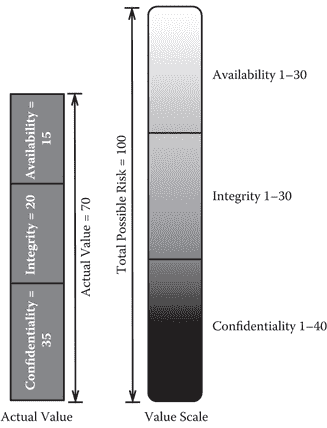

图 6.3 估值缩放方法。

在之前计算目标安全态的早期示例中，可以通过修复更严重的漏洞来改进结果，使内部和外部安全态都达到可接受的水平。这通常比应用额外的安全控制更具成本效益的解决方案。

### 6.7.6 控制有效性评估

此步骤审查内部安全控制，以确定其在满足业务风险需求方面的有效性。评估技术和程序元素应对当前威胁环境的能力，该环境源于威胁概况。但在此阶段，仅针对当前威胁的有效性是不够的。

VM 的有效性来自于适应不断变化的威胁环境的能力。还必须评估最新漏洞更新的能力。这包括以下三个关键属性：

*   **及时性**：更新必须频繁，并且在漏洞发现或公布后尽快提供。
*   **准确性**：没有什么比误报更浪费时间了；在意识到漏洞并不之前，必须经过许多步骤。对于那些存在于某些目标而不存在于其他目标的漏洞尤为如此。
*   **自动化**：新漏洞检查的接收和部署应该是自动化的，以尽量减少干预和延迟。

### 6.8 总结

从本章应该清楚，流程是 VM 的骨架，而技术是肌肉。没有彼此，两者都没有太大用处。任何流程的成功取决于其实现定义目标的能力。通过将 VM 流程与组织设计和功能对齐，可以在对现有运营干扰最小的情况下实现这些目标。

我们看到，对于任何组织，都有通往合适流程的路径。私营企业很大程度上取决于适应现有流程的自定义流程。这些流程有很多共同点，通常是本章所指流程的版本。对于成熟的、以 ITSM 为中心的操作，VM 流程可以很好地与服务管理定义并存并交织在一起。军有自己的语言，但尽管如此，他们通过漏洞的“积极控制”概念实现了相同的结果。

最终，任何 VM 流程的成功取决于透明的实施和广泛的接受。透明度将解决对流程目标和方法的担忧，从而减少将 VM 视为对任何人绩效形象威胁的感知。包容性将为所有关键参与者提供机会，通过成为流程的所有者并对其成功拥有利益，来优化结果。

# 第 7 章执行、报告与分析

## 7.1 引言

现在应该显而易见的是，如果没有准确且可操作的信息，就无法管理漏洞管理（VM）流程和技术。到本章结束，你应该能够决定你的组织需要什么种报告。你还应该能够指定报告的内容和格式，以使你的流程更高效。在上一章中，我们讨论了流程。这些流程必须以可操作的信息作为输入进行支持和监控。当负责 VM 的经理需要确定 IT 基础设施中最重要的修复的区域时，信息必须随时可用。必须执行技术修复任务的工程师需要确切知道要修复什么以及如何做。简单说明 `system X` 存在关键漏洞是不够的。同样，经理不能仅仅因为正在扫描系统并打开工单，就假设整个流程正在运行正常。

### 本章将介绍 VM 流程中的关键阶段，并讨论了所需的信息。最感兴趣的阶段是发现、评估、概况、修复和治理。我们省略了审计阶段，因为这是一个技术自动化步骤。并不是这个阶段不重要，而是机器不需要报告。另一方面，审计步骤的有效性很大程度上取决于对我们将讨论的报告所采取的。

## 7.2 发现报告

发现过程通常是手动和自动任务的结合。基本目标是理解：

*   环境中有多少目标？
*   有多少种类型的目标（操作系统）？
*   目标上的配置项有哪些？
*   目标位于哪里？
*   每个目标对组织的价值是多少？

这些问题后的基本思想是理解 (1) 哪些系统和组件构成了 IT 环境以及 (2) 这些系统可能暴露在什么程度。第一个考虑因素很重要，但仅限于与其他因素相关的背景下。了解任何东西的数量可以让你对管理 VM 程序所需的规模和精力有一个大致的概念。知道有 2000 台主机很有趣，但还没有知道有 1000 台 `Windows®` 主机、800 台 `Linux^®` 主机以及 200 台网络交换机和路由器有用。

为了让这些信息更有用，我们添加了每个目标的配置。知道网络上有 400 台 `Windows®` 主机是有帮助的，但知道在这 400 台 Windows 机器中，有 300 台安装了 `QuickTime®` 则更好。如果不显而易见的话，这更有用的理由是因为你知道 `QuickTime` 漏洞将必须被补丁，而且它们可能不是标准企业桌面磁盘镜像的一部分。`QuickTime` 不同版本的数量也可能有助于确定是否有将所有系统升级到相同的较后版本，以便于识别和修补，并减少整体风险。

配置细节和安装的软件被称为配置项（CI）。这些项目可以告诉你关于安全状态的大量信息。你的组织可能已经在配置管理数据库 (`CMDB`) 中拥有这些信息。这些术语通常用于配置管理领域。VM 与配置管理紧密相关，因为它寻求建立系统中 `CI` 的状态。配置管理处理的是监控和评估 `CI` 变化对系统影响的问题。当然，其主要目的是保持目标所提供的服务的一致性能水平。


另一个重要的考虑因素是目标系统的位置。这项信息的意义不容低。目标位置的复杂性比大多数人想象的要复杂。考虑一个公开的事实：国防部（DoD）丢失了包含个人身份信息（PII）的笔记本电脑。在 2008 年的一份报告中，[¹国防部监察长表示：“尽管隐私办公室认为没有必要公开通知，但如果笔记本电脑仍处于失踪状态，仍然存在未经授权披露 PII 的风险。”从这一表述来看，在资产去向仍不明的情况下，假设风险低到可以避免通知，这似乎是荒谬的。该报告进一步指出：“对 50 份显示笔记本电脑等电子设备所有权的 DSS（安全服务）财产记录进行审查后，50 份记录中仅 23 份是准确的。DSS 的内部控制并不充分。”如果你无法找到资产，仅仅知道漏洞是毫无用的。此外，资产丢失本身就是一种漏洞。

位置有四种类型：

1. **物理位置（Physical location）**：这种位置非常自而易见。它规定了资产所在的地址、建筑、楼层、房间以及机架/架子。当必须更换某个固件或硬件时，这通常非常重要。修复漏洞可能需要更换硬件，这似乎是不可思议的，但这种情况确实会发生。常见原因是硬件过时，且支持的软件驱动程序已达到生命周期结束，供应商不再提供更新。漏洞研究人员在之后仍会对此类产品进行测试。漏洞被发现的概率通常取决于该设备的普及程度。

2. **受益者位置（Beneficiary location）**：该位置相对于业务所有者或客户。他们是从系统提供的服务中获得直接利益的群体。他们通常是系统存在的理由，并推及到任何组织中所有的 IT 部门。在评估损失或变更的影响时，这是一个重要的考虑因素。如果你的公司经营的业务中，关键供应商使用系统接收用于关键产品的部件或服务的订单，那么损失的影响可能非常高。相反，一个向随机查询者提供静态目录内容的系统如果发生中断，其影响将微乎其微。然而，后者的情况很少见。

   受益者通常是虚拟机管理（VM）服务的关键利益方。在漏洞被利用之前，受益者通常会忽略它们。那时，未能能在事件发生前进行修复将只有惩罚。另一方面，这个群体对纠正问题的停机时间几乎没有耐心。在政治层面上，这是一个需要密切合作、并让其获知风险和当前问题的群体。

3. **财务位置（Financial location）**：财务位置与受益者类似。这些人是为系统的安装和维护支付费用的人。他们的利益在于满足受益者的需求。财务位置的利益相关方从系统中获得间接利益。该位置由会计代码定义。支持该会计代码的人员必须被告知漏洞的潜在影响，并可以协助说服受益者变更是必要的。

   根据业务结构，财务位置和受益者可能是同同一个。这将体现在相关资产成本和反映的会计代码中，并反映了将 IT 资源分配到受益者组织的 IT 战略。例如，负责支付托管数据系统的组织（财务位置）可能也是从使用这些数据获取收入的同一组织（受益者）。情况并非总是如此。

4. **架构位置（Architectural location）**：架构位置对于风险评估至关重要。这指的是资产在可访问性方面的地位。DMZ（非军事化区）是架构位置的一个良好示例。DMZ 是位于两个安全网关之间的网络段。了解资产或目标所在的位置有助于确定真实的威胁水平。如果目标位于两个配置恰当的防火墙和相应的入侵防御系统（IPS）设备之间，被攻破的概率可能很低。如果一个漏洞服务在安全设备未允许的传输控制协议（TCP）端口上做出响应，那么风险可能再次很低。另一方面，如果一个简单的防火墙或路由器位于互联网和目标之间，而目标在超文传输协议（HTTP）存在存在漏洞，那么风险可能会很高。尽可能了解关于架构位置的细节至关重要。许多配置都可能导致严重的威胁。

清单过程的输出是一份设备和配置列表，这些列表可以验证或填充 `CMDB`。了解存在哪些资产及其配置有助于员工理解和管理复杂环境。变更管理、配置管理和事件管理流程从中受益匪浅，允许管理员、工程师和经理更快速、更准确地评估事件对正常运行的影响。

图 7.1 显示了一个可能的设备清单。该报告至少显示了资产名称、安装的软件和版本号以及硬件组件。此清单从两个方面帮助工程师和规划者：首先，它帮助规划者评估环境的复杂性，以及可能维护和替换功能所需的精力；其次，它通过识别潜在的兼容性和配置问题，帮助工程师用类似的组件复制功能。

取决于用于发现资产的技术，这些信息的准确性可能会很大差异。通过自动化手段识别资产对于任何技术来说都是一项极具挑战性的任务。不仅产品版本和品牌种类繁多，识别的相似性和方法也是一个严峻的挑战。代理在这方面的表现通常优于无代理发现技术。

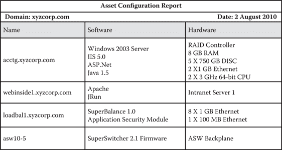

图 7.1 资产配置报告。

### 7.3 评估报告 [#contents.xhtml#tl_sec7_3)

清单也被用于许多风险管理活动，并需要评估。清单在某处将包含资产价值，该价值是在评估过程中收集的。评估期间需要收集两种价值。第一种是设备及所有内部硬件和软件组件的直接更换成本。这包括购买相同或性能相似组件的成本，以及组装、安装和测试替换品的精力成本。显而易见的目的是确定目标发生灾难时的更换成本。


第二个要捕捉的价值是从使用资产中获得的收益。这正是受益者位置至关的地方。了解受益者是谁以及其位于组织内部还是外部，将使评估者的注意力转移到该受益者所获得的价值上。最终，如果资产丢失或其提供的服务中断，遭受损失的是运营该资产的公司。外部实体损失了其表面上支付费用所拥有的资产的收益。一个很好的例子是网站上的广告商。这些广告商向运营方付费以投放广告。当网站被毁或运营受到中断时，这些广告商就会失去这项收益。

直接从资产中获得的设备运营者或所有者构成了财务位置，该位置由代表财务会计单位的代码定义。在纸面上或现实中，该单位通过为该设备提供直接资金或与其相关的风险而承担着风险。如果设备购买了保险，保险公司将根据保险合同的条款遭受直接损失。

该价值与各种风险指标相结合，以评估这些资产的风险，并帮助所有由位置指定的参与方了解风险对他们业务的影响。了解资产的物理位置有助于评估，因为风险水平可能会随着该位置的属性而变化。为了做到这一点，公司中的每个位置都应该分配一个类别，以代表某些事件的风险。例如，放置在海底油气探测平台上的计算机和相关配置项（CI）被认为处于高风险环境，完全损失的概率很高。

在日常管理相同资产时，对每个资产的位置、所有者和价值有基本的理解将使工程师能够优先考虑修复和维护工作。它也可以作为事件严重程度评估的输入。图 7.2 显示了这样一份报告。图中显示了名称、确切物理位置、财务价值以及对业务的运营关键性。这些因素可以快速用于确定操作优先级。例如，`[acctg.xyzcorp.com](http://acctg.xyzcorp.com)` 是该位置中折旧价值最高的资产。针对喷淋系统故障的风险，这台服务器可能是第一个采取措施防止水损坏的设备。

另一方面，位于中西部办公大楼 10 楼的计算机遇到完全损失的概率较低。对物理环境风险的评估提供了一个风险评级，可能是高/中/低并附带数值。风险评估过程中需要的是一份报告，详细列出发现的资产清单、其价值以及物理风险水平。在确定了物理位置后，我们可以评估该位置面临灾难、攻击或随机意外的风险。这些因素可以组合成一份非常有效的评估报告，对于设施所有者和运营者在采取适当缓解措施时非常有用。

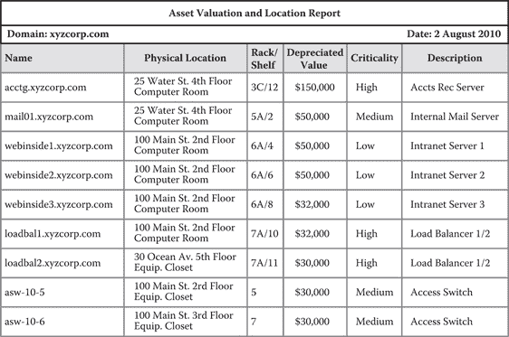

图 7.2 资产估值与位置报告。

图 7.3 显示了汇总层面的物理暴露报告示例。一眼看去，这份报告可以帮助资产经理快速查看风险敞口以及需要密切监控的顶级资产。了解所有者将有助于对资产的风险进行沟通。此报告用于促进谈判，以尽可能降低风险。按关键性分布的图表将显示环境中关键资产的相对权重。理想情况下，关键资产的数量应保持在最低，同时损失的影响也应降至最低。这是一种困难的优化类型，但这张图表将帮助风险经理找到合适的平衡点。

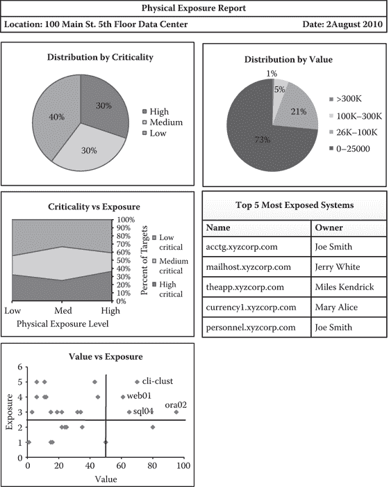

图 7.3 汇总层面的物理暴露报告示例。

按价值分布也有助于评估物理损失对更换成本的影响。在风险管理中，最小化资产成本始终是有益的，也符合商业逻辑。组织中高价资产越少越好。

图 7.3 显示了资产的风险敞口，有助于评估物理损失对业务价值的影响。这种视角非常重要，因为它虽然没有量化，但传达了资产对业务的整体影响。


如果业务经理已经确定业务的首要任务是维持在线来源的当前收入流，相对于在线销售努力，那么预计会有很大比例的主机和网络设备专注于这一结果。另一方面，如果更自动化的后台运营是减少对高人员配置依赖的优先事项，那么更大比例的主机将位于内部以提高运营效率。这些只是在概要分析阶段可以收集的两个粗略指标。可以创建更详细的指标，以便更精确地监控业务目标背景下的环境状态。请记住，VM 程序中的流程旨在与程序章程中所述的业务目标保持一致。

图 7.4 显示了一份 IT 资产对齐报告。这对于高级 IT 管理人员评估对特定业务部门的支出水平或资产投入非常有用。通常，依靠年度预算和支出报告来确定其是否与业务优先事项对齐被认为是常见的商业做法。然而，在多年投入后，检查业务中实际存在的内容以理解基础设施的当前状况是否符合优先事项会更为有效。该报告包含两种基本类型的信息：数量分配（即给定资产组或网络中的主机数量）和价值分配（即网络或组中分配的价值总和）。这些值以百分比和绝对数值表示。在示例中，数量和成本占比最大的资产被分配给制造和工程。这些位置非常适合典型的技术产品驱动型业务模型。然而，销售和营销模型将更好地关注于将 IT 资产和服务交付给订单履行和销售。

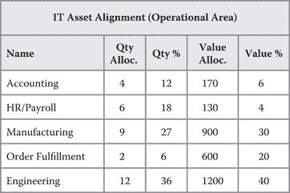

图 7.4 IT 资产对齐报告示例。

图 7.5 显示了资产价值/漏洞对齐及偏差报告示例，该报告结合了概要分析和审计数据。此报告有两个用途。首先，它向 IT 管理人员显示了主机从一个网络到另一个网络的分布及其平均值。资产经理可以从该报告中快速识别出在少数主机上放置了过高价值。在查看网络拥有大量主机（即数百个）的列表时，如果提供了相似的功能，预计主机的价值通常不会发生巨大变化。为了使这项任务更简单，还提供了一张图表。

图 7.5 中的图表显示了主机平均价值与平均漏洞数量之间的偏差。在理想世界中，无论主机数量多少，所有网络的平均漏洞数量都应该是相同的，从而反映出影响平均评分的所有因素的统一，例如复杂性、配置、流程、软件安装和技术选择。如果所有位置、功能和流程都是一致的，资产的平均值应该几乎完全相同。该图表最有用的地方是显示网络中主机平均值与其他相比何时差异巨大。此外，当优先级排序和修复过程对齐时，平均漏洞数量应与主机估值反比变化。也就是说，当主机价值较高时，应首先修复这些目标上的漏洞，如“Mumbai”上方的数字 2 所示。然而，当优先级排序和修复过程对齐时，平均漏洞数量应与主机估值反比变化。

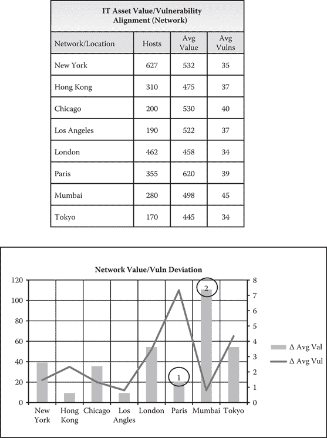

图 7.5 资产价值/漏洞对齐及偏差报告示例。

### 审计报告
7.5 审计报告

审计过程具有高度的操作性。审计自动执行并按需执行。然而，在审计期间需要两种通用报告：当前状态报告和计划报告。

### 7.5.1 主动扫描审计报告
7.5.1 主动扫描审计报告

通过主动扫描，这些报告指的是独立设备或代理。（等待，修正文本流向）然而，在审计期间需要两种通用报告：当前状态报告和计划报告。这些报告指的是独立设备或代理。

#### 7.5.1.1 审计状态报告
7.5.1.1 审计状态报告

通过主动扫描，图 7.6 所示的当前状态报告显示了几个正在接受审计的网络。每个网络都分配了特定的配置，该配置定义了扫描参数。作为良好的做法，配置名称指示了对规划的关键参数。`IP` 范围虽然没有那么重要，但可以为操作员提供更具体的验证，说明哪个网络正在被审计。状态回答了与当前操作相关的三个重要问题：

*   哪些审计正在运行并接近完成？
*   哪些审计最近已完成？
*   哪些审计将在近期启动？（在本例中，时间范围为 ± 24 小时。）

示例报告是某个时间点的快照。部分信息是历史性的，但尚未老到无法无法快速评估其对环境的影响。在分析可能因技术原因而失败的审计结果时，较旧的历史信息是有用的。

#### 7.5.1.2 审计计划报告
7.5.1.2 审计计划报告

此报告有助于跟踪主动扫描资源的使用。当组织中的网络广泛分布、访问性各异、带宽受限且扫描器较少时，通过报告扫描资源的当前分配可以促进规划。图 7.6 显示了一份示例报告，包含两个关键列，将极大帮助在可用资源上安排扫描：`last scan duration` 和 `hosts`。这些列可以帮助设定预期。由于扫描需要在业务受影响最小且目标最可用（在线）的时间窗口内进行，了解扫描需要多长时间以及计划有助于分配资源并发现限制。


例如，报告中阴影显示的三个网络（图 7.6 中的卡拉奇、大阪和上海）花费异常长的时间才能完成。这可能是由于执行扫描的地点带宽限制或目标网络的限制。请注意，同一台设备在重叠的时间段执行了这两个扫描。根据这些信息，我们知道可能需要重新安排其中一个网络的扫描时间。

### 7.5.2 被动扫描审计报告

在被动漏洞评估中，通过分析网络流量进行评估，对环境的影响微乎其微。这导致了不同的需求，这些需求在漏洞管理和资产清单方面更为相关，而不是监控对业务运行的影响。图 7.7 是一份各种被动漏洞分析器状态的实时报告示例。在这里发现的指标非常不同，这只是指标的可能组合之一。为了讨论起见，让我们假设每个物理位置的每个网络上都有设备。这些设备根据所监控的网络命名。图中显示了三种网络以及根据运行环境的变化性可能看到的指标。

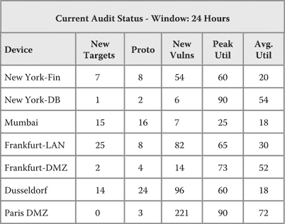

图 7.7 各种被动漏洞分析器状态的实时报告报告示例。

该报告在指定的时间窗口内运行，包含以下列：执行分析的网络/设备名称、上一个时间段发现的新目标、在此时间段内观察到的网络协议、发现的新漏洞，以及分析器的峰值和平均利用率。

“New York-Fin”是一个金融网络，平均利用率较低，且具有周期性峰值，取决于月份和年份。由于主机的添加和移除频率中等，新目标的数量相对较低。同样，“Frankfurt-DMZ”是一个公共 DMZ，允许许多用户访问所提供的资源。当站点极其繁忙时，分析器的峰值利用率很高（90%）。由于它面向公众，平均利用率也保持在较高水平。然而，这种环境并不经常改变，新目标的数量仍然很低。图中的变化应该很容易与变更管理流程相协调。稍后利用率的趋势报告将有助于判断现有容量是否满足变化的业务技术环境的需求。

“Frankfurt-LAN”设备显示了大量新发现的主机。这在允许许多用户通行并通过无线连接到网络的物理公共环境中非常常见。这些可能是全球公司中的访客或出差员工。在某些业务中，趋势是允许任何人使用合格设备连接到任何网络。这为安全带来了新挑战，通过此类报告注意到新发现的主机数量异常大，就可以这种影响之一。每天监控新发现的主机数量将让分析师或系统操作员对工作环境的技术行为产生“感觉”。

最后，图 7.7 中的“Paris-DMZ”项目没有显示新主机，这并不稀奇。但是，存在许多新漏洞。这种结果通常是因为[原文中缺失文本]。

### 7.5.3 审计趋势分析

#### 7.5.3.1 漏洞趋势报告

在被动漏洞评估中，通过分析网络流量进行评估，对环境的影响微乎其微。这导致了不同的需求，这些需求在漏洞管理和资产清单方面更为相关，而不是监控对业务运行的影响。图 7.7 是一份各种被动漏洞分析器状态的实时报告示例。在这里发现的指标非常不同，这只是指标的可能组合之一。为了讨论起见，让我们假设每个物理位置的每个网络上都有设备。这些设备根据所监控的网络命名。图中显示了三种网络以及根据运行环境的变化性可能看到的指标。

#### 7.5.3.2 网络风险趋势报告

在被动漏洞评估中，通过分析网络流量进行评估，对环境的影响微乎其微。这导致了不同的需求，这些需求在漏洞管理和资产清单方面更为相关，而不是监控对业务运行的影响。图 7.7 是一份各种被动漏洞分析器状态的实时报告示例。在这里发现的指标非常不同，这只是指标的可能组合之一。为了讨论起见，让我们假设每个物理位置的每个网络上都有设备。这些设备根据所监控的网络命名。图中显示了三种网络以及根据运行环境的变化性可能看到的指标。


本报告生成的最重要的因素是用于绘制数据数据的公式。输入此报告的样本表基于特定范围进行风险计算。暴露度的范围从 `1` 到 `5`，其中 `1` 代表对威胁的暴露程度最低，`5` 代表程度最高。资产价值范围从 `1` 到 `100`，其中 `100` 代表对组织最有价值的资产，如果发生损坏、丢失、被盗或以其他方式失效，将造成最大的损失。网络的漏洞评分范围从 `0` 到 `100`，其中 `100` 表示易于利用，且拥有对所有目标的远程权限访问。风险的计算方式如下：

```
$$Risk = vscore \times \frac{ex}{5} \times \frac{av}{100}$$
```

其中 `vscore` 是漏洞评分，`ex` 是暴露度，`av` 是资产价值。

基本思想是漏洞乘以总暴露度的某部分比例以及相对资产价值。在本例中，暴露度是按 `1` 到 `5` 的范围进行衡量的。这需要将其还原为 `0` 到 `1` 之间的比例，以便最终结果不会超过 `100`。同样，资产价值 (`av`) 被表示为比例 `av`/100`，这再次为我们提供了一个 `0` 到 `1` 之间的比例。

图 7.9 中的示例趋势报告显示了公司工程部门的风险。风险量随着时间的明显上升，而每月的风险在波动。月与月之间的波动事实告诉我们，存在活跃的修复过程，但由于某些原因，风险没有得到完全解决。重要的是，我们可以从线性风险趋势线看出风险正在增加，而在某些图表中，这一点本是不清晰的。工程部门显然需要一些关注，以发现风险增加 true。

通过查看图 7.9 中的详细数据可以发现资产价值在增加，但更有趣的是漏洞评分的增加。该分从 1 月的 `75` 开始，在接下来的 `18` 个月中增加到次年 6 月的 `92`。这些数据说明另一个问题是，漏洞评分在前 `八` 个月内处于相当可控的状态。然后，分数从 9 月开始增加，并在下降方面进展甚微。此外，从 7 月开始，由于资产价值的增加，风险评分也在增加。这表明可能引入了新的、更贵的资产，这些资产也带来了更高的漏洞评分，可能是由于复杂性的增加。在许多情况下，这种模式是由于工程或安全人员对网络资产准备不足导致的。应该对修复工作和影响主机的特定漏洞进行检查。

## 7.6 主动扫描：调度与资源

当使用代理程序或硬件设备配合主动扫描器时，调度和资源管理过程至关重要。当对网络段进行主动扫描时，如之前所述，这会对网络、目标、各种基础设施组件，并可能扩展到业务运营产生影响。为了妥善管理这些因素，系统操作人员和程序必须能够随时获取某些信息。


### 审核参数](#contents.xhtml#tl_sec7_6)

使用代理程序或硬件设备配合主动扫描器时，调度和资源管理过程至关重要。当对网络段进行主动扫描时，如之前所述，这会对网络、目标、各种基础设施组件，并可能扩展到业务运营产生影响。为了妥善管理这些因素，系统操作人员和程序必须能够随时获取某些信息。

基本思想是漏洞乘以总暴露度的某部分比例以及相对资产价值。在本例中，暴露度是按 `1` 到 `5` 的范围进行衡量的。这需要将其还原为 `0` 到 `1` 之间的比例，以便最终结果不会超过 `100`。同样，资产价值 (`av`) 被表示为比例 `av`/100，这再次为我们提供了一个 `0` 到 `1` 之间的比例。

### 带 width](#contents.xhtml#tl_sec7_6)

使用代理程序或硬件设备配合主动扫描器时，调度和资源管理过程至关重要。当对网络段进行主动扫描时，如之前所述，这会对网络、目标、各种基础设施组件，并可能扩展到业务运营产生影响。为了妥善管理这些因素，系统操作人员和程序必须能够随时获取某些信息。

### 协议](#contents.xhtml#tl_sec7_6)

使用代理程序或硬件设备配合主动扫描器时，调度和资源管理过程至关重要。当对网络段进行主动扫描时，如之前所述，这会对网络、目标、各种基础设施组件产生影响。

### 端口](#contents.xhtml#tl_sec7_6)

使用代理程序或硬件设备配合主动扫描器时，调度和资源管理过程至关重要。当对网络段进行主动扫描时，如之前所述，这会对网络、目标、各种基础设施组件产生影响。


| 协议 | 端口 | 描述 |
| :--- | :--- | :--- |
| DNS | 53 | 通常配合 TCP 用于区域传输，但不用于标准查询。在配合 UDP 时，此端口通常用于字段域名解析请求。 |
| HTTP | 80 | Web 服务器上最常见的协议，此端口接收对 Web 页面的入站请求。 |
| POP3 | 110 | 此端口接收从通常存储在监听服务器上的邮箱收集邮件的请求。它被称为邮件存储与转发协议，电子邮件在递送到客户端后将从服务器上删除。它通常是服务器向客户端提供的带有基本身份验证的未加密内容。 |
| RPC | 135 | 此服务允许其他计算机联系并在本地机器上执行程序。处理此端口上的请求时存在许多漏洞。 |
| IMAP | 143 | 这允许用户在任何支持该协议的主机上统一查看和操作电子邮件，而不仅仅是收集和删除邮件。电子邮件在查看后仍储存在在服务器上。 |
| SNMP | 161 (UDP) | 此端口用于管理启用 SNMP 的设备，这些设备可以是连接到网络的任何设备。 |
| HTTPS | 443 | 与 HTTP 类似，此端口监听使用 SSL 证书的加密 Web 页面的请求。 |
| SMB | 445 | 此协议用于文件共享，最常用于基于微软的系统。它在 UNIX® 和 Linux 系统中也以 `SAMBA` 的名称存在。 |
| IMAP over SSL | 993 | 与 IMAP 功能相同，但增加了加密的益处。 |
| ASP.net 会话状态 | 42424 | 微软的 ASP.net® 平台使用此端口与 Web 服务器通信会话状态信息，以便 Web 应用程序能够跟踪事务状态，而无需在客户端计算机上维护 cookie。 |

### 7.6.1.4 漏洞集

所要执行的漏洞检查选择也会产生影响。虽然检查所有可能的漏洞是理所当然的，但在某些情况下，有理由避免特定类的漏洞。某些活动 VM（漏洞管理）系统对应用程序有专门的检查。这些应用程序可能会受到检查的不利影响。例如，目标上的安全策略可能设置为在登录尝试五次后禁用账户。然而，漏洞扫描程序通过暴力破解手段测试 `SNMP` 团体字符串和密码的强度。如果对业务应用程序用于访问远程系统的服务账户执行这些检查，那么被锁定的账户会导致应用程序失败。

众**某些类型的主机扫描会导致支持这些主机的网络设备故障。这有时与交换机或路由器参与监控扫描器与目标之间连接状态的方式有关。网络设备的准确反应是预测的，但通常由供应商已知并记录。

### 7.6.1.5 身份验证

在之前关于独立漏洞扫描的主题中也讨论过，对目标进行身份验证扫描可以揭示更多关于漏洞的信息。然而，有时拥有目标的“黑客视角”可能是很有价值的。由于入侵者通常无法获得凭据，执行激进扫描可以提供有用信息。

在应用身份验证时，尽量使用尽可能少的凭据。可以使用 `Active Directory` 等目录服务来识别并分发专门适用于任务的仅此凭据。这是一个治理实践的问题。

### 7.6.2 调度

当扫描活动的强度可能会影响性能时，活动扫描资源的规划可能是关重要的。正如之前在第 5 章中讨论的，活动扫描可能会影响主机性能和网络性能，并可能导致拒绝服务。

理想情况下是在桌面电脑和笔记本电脑开启并连接到网络时进行扫描，这意味着在工作时间内。服务器通常每天运行 24 小时，因此只有低利用期间是合适的。

放置和使用扫描器有三种常用策略。首先，扫描器可以集中位置并作为机场来审计所有目标区域。其次，可以将额外的扫描器放置在单位带宽内主机数量最多的站点，以尽量减少对网络流量的干扰。最后，可以使用上述两种方法的结合来获得最佳结果。

## 7.7 审计趋势和性能报告

趋势和性能报告是安全经理、技术经理或漏洞经理监控流程、系统和人员性能的重要信息工具。这些信息将提供持续的性能监控，使用户能够此识别并解决缺陷。在本节中，我们将讨论两类报告：(1) 显示漏洞流程趋势的基本报告，(2) 帮助识别干扰组织行为来源的高级报告。

### 7.7.1 基础报告

这些报告定义了 VM 流程或更具体说是修复过程。如果你已经读到这本书的这里，你应该已经完成了这些工作。


确定流程每个步骤的输入和输出。如图 7.10 所示，每个阶段都有输入和输出。并非所有这些都直接源于漏洞管理流程。相反，来自安全人员开发和交付的其它流程也提供了输入。作为输入，“发现漏洞”具有组织内发现的漏洞总数。输出是每个目标发现的漏洞集。后者的信息被输入到下一阶段，“优先级排序”。

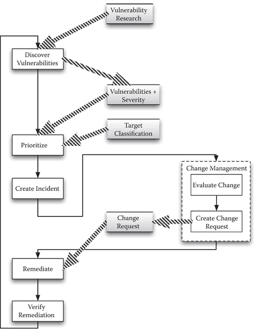

此外，下一阶段的输入是每个目标的分类（潜在影响）以及漏洞的严重程度。“优先级排序”的输出是按优先级排序的修复漏洞列表。设置优先级可以是手动流程或自动化流程。手动控制的流程具有可供管理员调整的优先级列表。

该流程的输出表现为变更单或事件工单，取决于组织的运营支持。在我们的示例中，创建工单并分配给相应的所有者。在漏洞管理流程之外，其他活动也影响了修复的执行。

最后，作为输入，修复流程对于变更管理系统具有影响流程性能的重要变量。当修复完成时，应该对漏洞进行某些验证。验证结果是流程的输出，即“清理”系统。

确定可以影响流程性能的重要变量。虽然在自定义流程和组织需求中可能存在差异，但有一些基本的衡量标准需要考虑。它们应该根据不同的运营周期进行评估。对于大多数业务来说，这些周期通常是每周、每月或每季度。这些指标还应该从一个业务区域到另一个区域进行分组。例如，如果您的组织在每个业务单元都有独立的 IT 小组，那么按业务单元查看指标对于使流程更加统一高效是非常很有意义的。流程性能可能会由于不同的管理风格和文化而产生巨大差异。

这些信息最终用于构建性能趋势分析所需的报告。以下是管理典型的漏洞管理流程时常用的报告列表：

*   **按运营区域划分配置漏洞**：运营区域是技术或安全组织功能的一部分——例如消息系统、Web 服务器管理或桌面管理。这些区域中的每一个都具有显著影响漏洞数量和严重程度的能力，应关注它们对组织整体风险的影响。例如，网络交换机可能显示由于 SNMP 服务配置不当导致的漏洞。这可能表明在遵循标准或标准修订方面存在问题。

*   **跨运营区域按严重程度划分漏洞**：了解每个业务运营区域各种严重程度水平的漏洞数量，有助于识别优先级排序问题。

*   **按严重程度和/或类型划分发现与修复的配置漏洞**：修复或避免漏洞的顺序对于从修复和配置过程中获得最大的影响至关重要。例如，发现的弱密码（一种配置项）数量与修复数量的对比可以告诉我们如何预先处理这种特别隐蔽的漏洞——即在配置阶段还是修复的后期。该指标可以适用于特定的漏洞，也可以适用于广泛的类别或严重程度。此指标将帮助识别流程阶段何时未能解决广泛优先级的需求。

*   **按目标分类修复的配置漏洞**：与上一个指标类似，根据业务关键性了解每个类型主机的漏洞会将注意力集中在关键主机的漏洞活动优先级排序上。执行配置和修复流程时，应正确引导资源分配的优先级。不同的 IT 小组参与管理关键主机是非常常见的——例如服务器与桌面等不关键目标。这种类型的衡量将有助于识别优先级排序能力的缺陷，通常位于特定的技术管理小组内部。

    扩展此指标，报告可以按资产价值乘以漏洞评分进行排序。虽然并不完美，但它可以帮助根据业务价值而非仅仅根据数据分类来确定修复工作的优先级。这可能是必要的，因为资产价值并不总是遵循数据分类，这是由于资产分类没有统一应用（资产价值也是如此）。即使数据分类应该遵循资产价值，资产所有者可能对此有不同的看法，因为整个组织对价值的感知是不一致的。

*   **按修复类型划分漏洞**：此指标提供了有关补丁或配置修正作为漏洞修复方法的信息。数字可以进一步细分到运营小组，以识别哪里需要资源。例如，消息系统可能会遇到可修复漏洞的大幅增加，因此需要更好的补丁管理或审查补丁流程以给予更多关注。

*   **新漏洞**：所有漏洞指标都必须在整体漏洞环境的背景来看。可能在软件包软件中发现了更多新漏洞；因此，修复量将会增加。在这种背景下必须考虑其他指标，以避免错误地判断是组织内部流程缺陷导致了指标的变化。如果特定区域的漏洞数量与发现总数以相同的速率增长，那么内部流程缺陷是根源的可能性较小。


## 每个应用程序的漏洞数量

每个应用程序的漏洞数量：这是一段时间内每个应用程序拥有的漏洞最高数量。它有助于理解环境的复杂性，并识别出可能比其他程序更脆弱或需要更多修复的应用程序。这些信息可用于识别运行应用程序的真实成本，并可能触发对供应商产品在组织内可行性的重新评估。例如，如果一个名为 `XYZ` 的封装应用程序费用非常昂贵，并且在六个月到一年的时间范围内发现了大量漏洞，这可能表明其安全质量较差。识别出该应用程序可以进行评估，以确定修复成本是否变得过高。也许应该选择备选供应商，或者向现有供应商寻求某些补偿/减免。

## 7.7.2 高级报告：控制图

到为止，所有的审计报告提供的都是短时间范围内的信息，用于管理日常运营。然而，趋势报告更具参考价值，并对战略性安全规划提供极大帮助。例如，了解四个月甚至跨年跨度内发现的新新主机数量，可以揭示业务周期中重要但未传达的变化。趋势还可以通过识别流程中的缺陷，帮助管理整个漏洞管理（VM）计划。

每个流程都有其运行范围。通过衡量流程的某些输出并对其进行统计描述，我们可以确定该流程的正态分布或运行范围。这被称为流程能力。超出该范围的任何情况都可以表明流程出现故障或存在改进机会。在 VM 中，我们可能会衡量随时间推移发现或修复的漏洞数量。目标数量或分类没有变化的情况下，这些数字的显著变化可能是配置管理或 VM 流程的红警信号。

### 控制图

监控流程中统计方差的最常用工具之一是控制图。例如，在制造过程中，该图表将显示某个部件随时间推移的缺陷数量。对于 VM 应用而言，我们将查看关键主机漏洞数量随时间的变化。图中两条线显示了漏洞发现的“控制限”。这些被称为上限控制限（`UCL`）和下控制限（`LCL`）。超出这些限制的任何情况都表明未处于“统计控制”状态。这意味着我们的结果或性能中存在意外之外的变异源。这被称为**特殊原因变异**。更常见的是，当上下控制限内存在变异模式时，被称为**常见原因变异**。这代表了任何过程中固有的变异水平。通常发生的情况是人们查看短期图表，看到一个波动，做出反应，并试图解决一个实际上并不是问题、而是流程正常变异部分的问题。只有当它超出控制限时（即出现特殊原因时），它才应该被处理。

在 VM 的语境下，常见原因变异可能表现为每月周三关键漏洞的激增。这可能是因为供应商按计划报告了新漏洞，并将其包含在 VM 系统的检查中。相反，超过上限控制限的显著激增可能表明流程缺陷引入了过多的漏洞。但我们如何能找到这些变异并确定根本原因呢？以下是必要的步骤步骤：

1. **收集所需的 Basic 数据。** 需要的三个基本信息类型是：漏洞计数和单位时间内的平均数量、目标或组的平均分，以及通过或未通过特定要求的目标计数。
2. **构建控制图。** 一旦确定你想分析哪种类型的数据，就可以构建图表以识别特殊原因。经过一些研究，这些变异原因将出现在构建得当的图表中。在许多情况下，原因从图表中一而易见；但在其他情况下，你必须通过访谈和研究流程步骤来发现它。构建控制图需要几个基本步骤。
3. **选择要分析的组和子组。** 如果你想分析跨业务部门的漏洞评分低于某些水平的关键主机数量，那么组是关键主机，子组是业务部门，数据元素是未通过标准的计数。如果你想分析特定网络随时间推移的每个主机平均分，那么组是所有主机，子组是网络，数据元素是主机平均分。
4. **确定每个月整个网络的平均分。** 非常简单：计算过去 12 个月网络评分的平均值。得到的单个值被称为 `X-Bar`，它在图表上形成一条直线，被称为中心线。这使用户能够一眼看出月与月之间评分的变异情况。
5. **确定 UCL 和 LCL。** 控制限告诉我们数据的统计上限和下限可接受边界是什么。如果某个数据点达到或超过了这一控制限，我们应该关注为什么会发生这种情况并进行调查。确定 `UCL` 和 `LCL` 比计算平均值稍微复杂一点。它需要以下步骤：
    * **步骤 1：** 确定上个月到下个月的评分差异（月增量）：`Score(Jan) - Score(Feb)`，`Score(Feb) - Score(Mar)` 等。对于 12 个月的期间，这将产生 11 个数字，因为没有数字可以减去最后一个月份的数值。为了保持得到的月增量值为正，请使用差异的绝对值。
    * **步骤 2：** 对上一步的 11 个评分取平均值。该值被称为 `R-Bar`。

      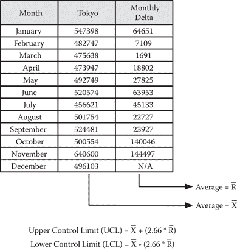

      图 7.11 一张显示东京每月漏洞评分的表格。
    * **步骤 3：** `LCL = X-Bar - 2.66 * R-Bar`。
    * **步骤 4：** `UCL = X-Bar + 2.66 * R-Bar`。

考虑图 7.11 中的示例，它显示了东京每月的漏洞评分。这些评分的平均值就是 `X-Bar` 值。最后一列是每月之间评分差异的绝对值。这些值的平均值是 `R-Bar` 值。最后，这些值被用于 `LCL` 和 `UCL` 方程以生成我们的边界。

根据这些数据创建了图表，如图 7.12 所示。漏洞分析师可以从该图表中识别出一个重要的发现。最明显的是 `X-Bar` 值在 11 月上升到接近 `UCL`。这表明发生了某些超出过去表现预期的事情。管理良好的流程通常不会产生这种水平的变异。需要进行调查来确定原因。调查结果对于避免此类整体风险的增加具有指导意义。一些可能的原因可能是以下之一：

*   未能修复之前发现的严重漏洞：当在大量系统中发现严重漏洞时，这是一个常见现象。对风险评分的影响很大。对负责修复的 IT 经理进行进一步访谈将有助于确定原因。

      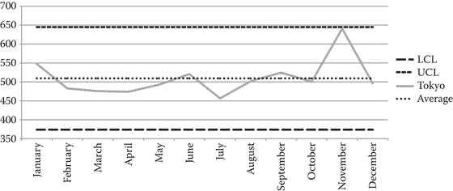

      图 7.12 图表：东京每月漏洞评分。


*   **厂商发布了数量异常之高的严重漏洞**：在某些情况下，软件制造商发现的漏洞列表被汇总并一次性发布。许多风险经理认为这种方法是有害的，因为它揭示了大量漏洞，而在公开漏洞利用程序出现之前，没有留下足够的时间进行修复。通过检查其他报告，查看全范围内每台主机的漏洞数量是否增加，可以快速识别出这一原因。
*   **厂商发布了一批新的检查项，其中一些可能相关且严重**：这是另一个导致异常评分的常见原因。解决此问题的方法包括暂缓新发布直到能够评估其影响为止，或者简单地向风险经理告知预期结果。
*   **针对环境特有系统发布了漏洞**：某个特定的网络或组织（在本例中为东京）可能会发布几个新的严重漏洞，这些漏洞可能与日语字符集或使用的特殊类型软件有关，而这些软件在公司的其他部分并未发现。然而，有必要确定问题是限于某个区域还是全公司。

除了漏洞评分波动超出控制限的情况外，其他模式可能表明流程存在问题：

*   连续七个点位于平均漏洞评分的一侧；
*   连续七个点显示得分逐渐增加；
*   超过 90% 的绘制点位于控制限区域的中间三分，或者在该区域的点少于 40%；以及
*   随机模式。

### 7.7.3 引入“漏洞群”：控制性能报告

漏洞并不总是显而易见且分散的。迄为止大多数漏洞管理（VM）实践以及本书中的实践都集中在两个核心管理主题上：(1) 前线（识别和修复）和 (2) 管理层（优化和管理流程）。然而，我提出还有另一层需要识别和修复的漏洞，目前还没有对其正式的方法论。

这一概念被称为“漏洞群”（vulnerability swarms）。常见的情况是看到许多中低级漏洞，由于严重程度或资产价值较低，这些漏洞没有被优先考虑。这些漏洞通常不会得到修复，因为组织正忙于处理严重程度更高的项目。缺失的是对这些漏洞集体威胁的评估，特别是当它们属于相同的类别、技术或特定的软件产品时。易感技术的无处不在使得原本可能无害的因素变得非常危险。

例如，安全标准可能规定所有文件共享都需要经过验证的访问。然而，一份专门的“群分析”漏洞报告显示，名为“访问控制”的类别具有高漏洞评分。通过深入该领域，安全经理发现了许多文件共享允许所有人进行写入访问的实例。

在知道安全意识培训未能提高任何合规水平后，可以考虑一种技术替代方案。在这个示例中，`Active Directory` 中的组策略对象（`GPO`）可能会阻止进一步创建此类开放共享。对于可能发生的关键漏洞问题，这是一个无成本的。

人们可能会想，为什么不通过更细粒度的报告（如之前讨论的漏洞报告）检测到此类漏洞。简单的原因是，这些报告的提供方式便于修复最严重的漏洞。然而，像具有较低严重程度漏洞的普通桌面等低价值资产就不会被优先考虑的。某些应用程序的配置要求在许多地方可能会被忽略。当病毒利用糟糕的配置实践进行传播时，大量此类漏洞可能会使组织瘫痪。因此，检测由多个低程度漏洞累积成高程度漏洞的“群”的一种极佳方法，是通过按控制类型聚合结果，并进一步根据特定漏洞的共同性进行分析。

控制性能报告允许安全经理评估内部控制的有效性。在部署安全控制时，必须按照特定标准进行配置。此外，任何安装的软件组件都要求配置某些安全控制。控制性能报告分解了缺失的合规项类别，这些合规项类别包括：

*   身份验证与访问控制，
*   存储与备份，
*   恶意软件管理，以及
*   不可否认性。

通过为这些区域的每个网络或组织分配价值或漏洞评分，安全经理可以确定当前控制的使用有效性。对于之前的示例，让我们查看身份访问控制类别。该报告将显示整个类别的漏洞评分。但是，此评分不应仅仅是类别中每个漏洞的总和。这可能会产生误导性结果，因为漏洞可能与类别无关。

为了简单起见，我们将常见漏洞（`CVE`）编号作为漏洞的标识符。某些漏洞可以跨技术或硬件平台，但 `CVE` 通常考虑了这一点。

允许写入的文件共享是一种糟糕的做法，也是需要关注的漏洞。由于某些应用程序可能需要这种功能，与可能更严重的问题相比，它没有被赋予严重的程度。这种漏洞可能存在于运行 `Windows` 和 `UNIX` 操作系统的多个系统中。通常，这些漏洞不会得到修复。为了引起对这种广泛漏洞的关注，我们将此类漏洞的数量相加并将其表示为使用底层技术（`SMB` 协议）的所有系统的百分比。

因此，如果我们有 100 台系统使用 `SMB`，其中 30 台系统存在漏洞，那么该漏洞的“群评分”将为 30。但这并没有充分说明问题的规模，因为对组织的整体影响可能并不清楚。如果有 1000 台系统，受影响系统的百分比将低得多，因此假设的严重程度也会低得多。使用这种简单的计算方法，理论上只有 1000 台主机中的 30 台是有漏洞的。但是，漏洞可能远大于受影响系统的百分比，因为受影响的系统可能比其余 970 台系统更有价值。

我们需要更准确的影响表示。为此，我们必须考虑受影响资产或系统的价值占所有系统总价值的百分比。因为受影响系统的价值可能大于（或小于）未受影响系统的价值。可以使用以下公式：

```
S = 1 + \frac{\sum Vx}{\sum Vt} \times \alpha
```

其中 `Vx` 是漏洞系统的价值；`Vt` 是网络、组织单元或其他部门所有系统的价值；$\alpha$ 是单个漏洞的评分。


该方程计算了受影响资产占所有受比较的相关主机总价值的百分比。该值随后被用作特定漏洞实例评分的倍数。例如，如果一个漏洞的低分为 10 分，而受影响主机占总价值的百分比为 52%，则结果为 `1 + 0.52 × 10 = 15.2`。

这个数字在常见漏洞报告中仍然太低，不足以引起注意。然而，这类类型的漏洞最好留到单独的报告或漏洞摘要的独立章节中。此报告可能类似于 XYZ 公司的图 7.13。

在这份报告中，有五种在单独评估时重要性相对较低的漏洞。然而尽管如此，它们仍然是可以被利用的。如果大量出现，其影响可能会大得多。弱密码的 SNMP 团体字符串就是一个很好的例子。它可以被用于侦察。然而，取决于打印机制造商以及其在网络中的位置，在打印机中拥有这样的字符串是非常常见的且相对安全的。因此，当存在如此多的漏洞时，很容易忽视它们。有时，由于它们在打印机上数量非常多，会被完全忽略。结果是，相同的漏洞在服务器上未被注意到。本报告将采用服务器的较高值，并批量提升这些漏洞的严重性。

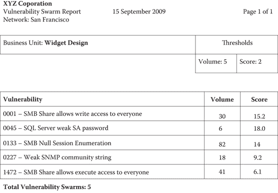

图 7.13 一份常见的漏洞报告。

## 7.8 合规报告 

漏洞审计监控的另一个重要项目是策略合规性。这目前是虚拟机管理（VM）的一项新兴新增内容，有助于组织不仅满足安全目标，还能监控对策略和标准的合规情况。

通常，合规报告需要针对目标系统上的配置项（CIs）的策略规范。对这些配置项进行检查并对合规进行统计。生成的报告具有三个主要目的：

*   指示每个主机、网络或组织单元的合规水平。
*   识别必须修正的配置项。
*   历史性地显示系统和组织的合规性能。

### 7.8.1 系统合规报告 

此报告识别不符合特定策略的系统，以便于使系统恢复合规状态，即修复。此报告与详细的漏洞报告相似，只是不需要那么详尽的细节。以下是该报告的核心要素列表：

*   整体策略报告名称、日期和网络；
*   主机名和 IP 地址；
*   不合规的策略和标准条目数量；以及
*   系统的所有者或管理员。

此报告将允许合规经理或安全经理快速识别出最不合规的系统和网络，以集中修复精力。示例可以在图 7.14 中找到。

需要另一份更详细的报告，或者将其与此合并，以显示每个系统的详细状态。此报告将进一步使每个系统的管理员将修复精力集中在特定的配置项上。例如，如果主机上需要防病毒软件，但开启了具有写入访问权限的文件共享。

```
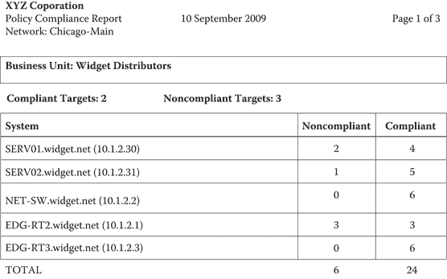
```

图 7.14 一份合规报告示例。

## 7.8.2 执行摘要 

执行摘要评估合规程度，并告诉 IT 经理哪些小组最成功，哪些小组最差。例如，IT 经理可能会设定目标，在年底前使 95% 的系统合规。这些标准的模板至少包含以下内容：

```
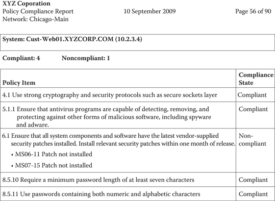
```

图 7.15 合规报告示例。

*   不合规主机的数量和比例；
*   合规主机的数量和比例；
*   每个主机的平均合规条目；以及
*   每个网络或组织单元的状态。

## 7.9 总结 

从本章可以明显看出，易于获取和组织的信息对于管理漏洞计划至关重要。许多人忽视了这一点。收集了这么多信息却以极简的方式进行数据挖掘是没有意义的。信息的价值远超技术，将这些收益带给企业是经理的责任。如果你回顾本章的内容，你会发现生成的更多报告可以支持卓越和效率。最终，这将带来更优、更快的修复，从而实现更好的安全。不仅在单个目标中，而且在大量或集群中识别漏洞的能力，可以改变优先级并为业务节省真实的资金。进行一个修复微小漏洞的全局配置更改并不十分有趣。但在相同的目标上清理虫害并修复相同的漏洞则更无趣。

## 第 8 章规划

## 8.1 引言

到为止，我讨论了漏洞管理（VM）的各个方面及其与整个 VM 过程的相关性。我还描述了 VM 在组织风险管理和安全态维护中更广泛的角色。实施 VM 的许多单独阶段已经描述，例如策略、流程和需求的开发。但现在需要的是项目计划、清单和策略来让计划启动。

本章将为你提供清单、计划、策略和建议，帮助你在大型全球化公司中开发完整的 VM 计划。需要进行选择和定制以匹配特定的计划需求，这些可能包括以下组件：

*   VM 计划章程；
*   业务案例；
*   需求文档；
*   安全架构建议书；
*   项目计划。


* 方案建议书，
* 实施计划，
* 运维流程文档，
* 资产估值指南，以及
* 漏洞及修复策略。

这些每一个文件都为后续文件提供依据。过程并不是线性的，而是一系列随着时间推移而迭代减少的反馈循环。当你编写项目章程时，它将为业务案例奠定基调。对业务案例的研究可能会提供修改你章程的发现结果。随着需求的的开发，你可能会发现最初业务案例中未阐述的额外益处，这些益处会增加项目范围，但对组织是至关重要的。然后，你可能决定调整业务案例，并将其提交给管理层以获得额外资金。

在任何项目中，我们从一开始就必须承认，你不会从一开始就开始并运行一个完美的项目计划。每个项目都是一个学习过程，尽管我在这里为你提供了框架建议，但仍需要更完整的文档和项目管理。本章并不是关于如何管理项目的。相反，我们将讨论 VM（漏洞管理）项目的关键特征。

## 8.2 章程开发

VM 计划章程是一份非常重要的文档，它设定了该计划的目标、目标以及业务逻辑。前者是显而易见的，但后者是最重要的。为了计划的成功，高层管理必须理解并接受存在真实的业务价值。

### 8.2.1 引言：业务价值

业务价值必须在章程的引言中提前阐述。它回答了一个关键问题：“我为什么要在这个项目上花钱？”这种价值可以通过许多方式呈现；例如：

* 提供通常可能出现问题以及为什么必须修复的实实示例。可以是一个漏洞的短列表，这些漏洞在其他公司已被利用并造成了可量化的损害。同样，证明这一点很重要：漏洞的潜在损害对业务带来了成本，包括停机时间和额外的人工，这些已经超出了 VM 计划所需的成本。这个主题在菲利普·B· Crosby 的著作 `Quality Is Free: The Art of Making Quality Certain.` 中有更深入的探讨。

* 在业务语境中保持示例和描述。任何可以解释的内容都可以阐述为对以下方面的威胁：
    * 业务模式的生存；
    * 收入流或增长率的持续性；以及
    * 利润，因为利润是扣除事件后清理成本后的净值。
     * VM 可以通过将可能困难且耗时的任务变得常规化，从而提高运营效率。

* 尽可能量化益处。实施某项计划产生成本是常见现象，但如果高层管理人员看不到财务收益，他们接受任何建议的概率会小得多。通过将计划的财务目标纳入章程，显示了对公司重要事项的关注。

### 8.2.2 目标与目的

章程的另一部分是对计划目标（Goals）和目的（Objectives）的描述。这些应该是两个独立的章节。请记住，目标是从系列行动中预期的广泛结果或益处。目的是你希望实现的特定项目，且通常是可量化的。

这里有一个目标陈述的示例：“准确识别并报告漏洞及其修复状态。”这告诉我们我们想要实现什么，但并不是真正可量化。可以使用一个或多个动作甚至多个目的来实现这一目标。

这里有一个更具体的目的陈述示例：“修复连接到 `XYZ` 网络的非关键目标上至少 75% 的严重漏洞。”这一陈述非常清晰且具有完全的限定条件。它是衡量项目达成情况的标准。

### 8.2.3 范围

文档的范围部分将从以下方面阐述项目的程度：

* 所需资源，
* 受影响的网络和主机，
* 物理上（安装的硬件）和逻辑上（扫描或监控）影响的位置，
* 创建和修改的流程，
* 修改的系统（通常是为了适应修复活动），
* 的产品类型，
* 需要的服务类型（例如，系统集成）。

### 8.2.4 假设

这一部分在编写时需要非常仔细。这通常是一个表格或一组短句，反映了你所做的假设。如果你对某些特定元素不确定，这些陈述中的许多可能是高层级的。如果你知道将购买什么样的系统以及谁来运营，就需要列出这些细节。另一方面，你可能还不知道这些（正如范围部分所示），唯一可以做的假设是有人将全职或兼职负责系统。以下是一些其他可能的假设：

| 通用 | 具体 |
| --- | --- |
| 一名全职管理员负责系统的运行和监控。 | 目前的一位伦敦高级安全经理将兼职负责系统。 |
| 漏洞扫描将按定期进行，以满足在 30 天内识别并修复漏洞的目标。 | 每周进行漏洞扫描，并将严重漏洞立即分配给修复方。 |
| 为了跟踪修复活动，需要对变更系统进行额外的少量开发。 | 需要两名开发人员花费约 100 小时对 `XYZ` 系统进行修改。 |

注意，当高层经理审查时，通用陈述引起的问题较少。然而，更具体的陈述能更好地明确你的预期，并显示纳入预算的内容。哪些陈述是通用的、哪些是具体的很大程度上取决于管理态度和文化。

## 8.3 业务案例

业务案例（如果你的组织有需要）应该关注于风险管理实践，而不是量化概率。如果你建议漏洞被利用的概率，读者会很快质疑这个数字，而且这是合理的。这是一个注定会失败的论点。原因是你可能没有针对你的业务模式、组织或行业的可靠数据来可靠地预测此类事件。变量过于复杂，无法不受反驳。在构建业务案例时，请使用这些提示：

* 关注影响：损失的影响在安全领域有充分的记录。这很难计算，但比概率要容易得多。这些信息的伟大来源是计算机安全出版物、FBI 以及计算机安全协会的计算机犯罪与安全调查。高层管理人员很难反驳显示许多公司每次安全事件平均损失为 `* dollars` 是错误的或不适用的。

* 无形风险：公司的声誉是一项非常宝贵的资产。它具有商誉价值，以及由营销和销售组织多年来精心建立的营销价值。公司在行业和客户中的形象很难修复，但很容易摧毁。让业务案例获得好评的一些提示：


- 审核业务案例的人员中应有人具有销售和营销经验，这样他们就能理解面临风险的价值。
- 审核人员的职位应当足够高，能够影响决策过程和预算。
- 包含其他因漏洞被利用而遭受损失的公司案例（例如：`Petco`、`T.J. Maxx`）。
- 明确一点：即使没有发生恶意利用，系统和数据的丢失或损坏也是糟糕的。仅仅是事件的公开就已经足够严重了。
- 在某些州，客户数据泄露的惩罚性赔偿可能非常巨大。如果这与你的业务相关，请重点强调这一点。

## 8.4 需求文档

任何做过正式 IT 项目的人都知道需求文档的必要性。该文档将组织中的目标、流程和系统与解决方案的功能能力对齐。这些需求可能超出系统规范，并包括必须开发或更改的相关流程。以下是需求文档的一些关键组成部分的列表：

-   **功能性需求**：详细说明所有软件和硬件组件应该的功能。这些需求可能包括以下内容：
    - 漏洞检测的类型
    - 可调参数
    - 漏洞报告元素
    - 报告类型（管理、执行层、风险摘要、修复等）
    - 系统接口（变更和事件管理系统、工单系统）
    - 网络和组定义
    - 主动扫描的身份验证能力
    - 外部数据库需求
    - 备份和恢复能力
    - 审计调度功能
    - 以及安全和隐私（加密和高可用性特性）。

-   **流程需求**：
    - 必须执行的步骤
    - 谁应该能够执行每个步骤
    - 每个步骤的输入和输出
    - 以及每个步骤必须交互的现有流程。

-   **插图和图表**：
    - 报告原型，用于显示包含哪些元素；关键元素的分组和排序。不要限制得太死；坚持核心元素即可。
    - 基础流程图：尽管在不同产品之间这相当一致，但仍要绘制流程图，包含现有的内部流程，以验证工具和程序的集成能力。

-   **通用设计**：此图将显示组件预期或允许放置的方式以及在何处。这将防止创建和采用不符合策略的系统。

许多需求将来自技术选择过程的细节。在生成需求之前，请参见关于选择技术的`第 5 章`。

## 8.5 安全架构提案

尽管我们已经讨论了技术和 VM 架构，但在安全架构提案中必须包含一些关键组件，以获得各个关键小组的兴趣和认可。任何提案中最重要的要包含的小组是网络运营、网络工程、安全、合规、系统管理和系统工程。这些小组都将以不同的方式受到安全架构的影响。

安全架构提案在整个项目计划中的时机应该是对可用技术进行调查之后，并在创建计划请求的供应商短名单之后。通过与每个供应商进行基础问答，你应该已经发现了以下内容：
    - 漏洞系统类型（主动、被动、代理或其组合）
    - 网络需求
    - 主机扫描需求（如适用）
    - 主机兼容性（支持的操作系统 `OSs`）
    - 负面交互（主机或网络）
    - 主动扫描系统的身份验证需求、代理安装、特殊网络设置
    - 以及部署方法（特别是对于代理：它们是如何安装、分发和配置的？）。

在充分了解你将部署的系统类型后，了解你的基础架构需求同样重要。这些需求将有助于做出关于 VM 系统如何与现有组件集许多决策。稍后，一旦其他小组对提议的架构进行审查，将会发现额外的需求。例如，在仔细审查后，系统小组可能确定部署代理的最佳方式是通过补丁管理系统，而不是使用 `Windows Server® Update Services (WSUS)`。如果是这样，就会创建一个供应商必须满足的新需求。

总结一下，以下是架构提案的基本流程：
1. 识别安全、基础网络和合规性需求。
2. 审核并选择供应商短名单。
3. 创建包含所有必要图表的架构提案。（技术人员通常更偏于图表。）
4. 与所有关键技术和业务小组进行评审。
5. 收集针对新需求的反馈。
6. 完善架构，直到所有相关小组批准。

## 8.6 RFP（征求书）

作为技术选择过程的一部分，必须创建产品需求。这些需求应在征求书（RFP）中以高层的形式描述。至少应预先决定系统类型（主动、被动、代理或其组合）。RFP 应包含以下章节：
    - 目标
    - 运行环境
    - 现有系统和流程
    - 位置和规模
    - 网络类型和带宽
    - 用户组和角色（描述每个小组的作用和所需数据；特定的用例对于让供应商理解其功能对每个角色的适用性关重要）：
        - 高级经理——流程性能
        - 安全工程师——漏洞分析
        - 系统工程师——修复
        - 风险经理——按位置、网络划分的整体风险
        - 投标流程和规则
        - 通信（主要联系人及联系方式）。

## 8.7 实施计划

一旦选定了产品并定义了流程，就需要一份实施计划来确保按时、按规格交付。该计划很重要，因为许多漏洞评估技术在网络中具有相对侵入性。例如，如果使用主动扫描设备，必须考虑之前讨论的技术因素。如果选择了代理，则有必要对各种基线桌面镜像进行测试。以下是实施计划的一些重要元素的列表：

-   **现场准备清单**：实施该技术所需的所有基础需求列表，其中某些可以通过测试发现。该列表包括以下项目：
    - 机架空间（所需的机架单元）
    - 电源（120 V/240V，50Hz/60Hz，连接器类型）
    - 网络连接（带宽、物理连接类型、地址）
    - 安全（防火墙或访问控制列表设置、入侵防御系统 `IPS` 异常、目标主机安全设置）
    - 网络设备（指定不适用于引入主动扫描设备的网络设备模型；这可能是制造商指定的报告不良反应的任何固件或硬件）。


* 现场人员的最少技能集；以及
* 每个站点的实施和升级升级的唯一联系人。
* 实施计划：对于每个站点，应将以下信息记录在计划中：
    * 拟定的实施日期；
    * 预计安装时间；
    * 唯一联系人、电话和电子邮件地址；
    * 需要的特定命名资源；以及
    * 首次审计的目标日期。
* 安装程序：详细的程序并配有图片，准确显示安装设备时需要执行的动作。永远不要对安装人员的知识或技能做出假设，因为这些水平可能因地而异。这些程序应包括在安装过程中的适当时间点需要向业务部门和 VM 系统管理员传达的内容。
* 项目实施演示：这对于向受影响地点的参与者解释计划细节是必要的。演示至关重要，因为大多数直接或间接实施和使用该技术的人可能对此了解甚少。演示应解释技术的工作原理、对工作流的影响、对每个参与角色的预期，以及特定站点的时间表。它还应该解决有关收集的数据安全性和员工隐私的潜在问题。可能受影响的群体包括：
    * 网络工程师，
    * 本地和全球帮助热线，
    * 系统所有者管理员，
    * 其他系统支持人员，
    * IT 安全人员，以及
    * 本地 IT 经理。

## 8.8 运营流程文档

一旦定义了 VM 活动的流程，必须以可以在两个层面上被理解的方式进行记录。流程经理需要理解每一步以及它如何与其所属小组对接的其他流程相关。这意味着 VM 流程文档需要显示升级路径、流程输入和输出。

该文档的第二格式类似于操作运行手册（run book）。它以检查清单的形式解释该角色在遇到的各种用例中可以遵循的每一步。如果现有程序已在使用，则新程序应使用相同的格式，或者应更新现有程序以包含新步骤。

一个定义新网络用例的程序示例如下：

* 漏洞系统新网络程序
    * 用例：新网络
    * 描述：组织内实施了一个新网络，以适应新的用户分段。
    * 需要的数据：网协议 (IP) 地址范围或无类域间路由 (CIDR) 块、网络上目标的风险水平、约定的审计窗口（频率、开始时间及持续时间）、允许的带宽消耗、排除的目标 IP
    * 动作：
        * 在 VM 系统中定义网络规范。
        * 定义排除的 IP 地址。
        * 定义审计参数（计划、带宽）。
        * 为防火墙和入侵防御系统 (IPS) 排除项创建安全变更请求。
        * 在之前的变更完成后，运行测试审计。
        * 评估测试审计结果并根据需要调整参数。
        * 向安全人员和目标所有者沟通任何审计参数的变化。
    * 激活定期审计程序。
* 程序结束

并非所有程序都如此简单，某些程序需要对现有程序进行修改。以下是可能导致这些的因素：
* 流程之间所需的通信。
* 员工增加的责任。
* 向系统中引入新数据。
* 新系统与现有系统的不兼容。

## 8.9 资产估值指南

任何负责评估和分配风险的人都应该使用标准，以确保评估的一致性。某些组织选择使用电子表格，包含一系列需要狭义回答的问题，例如是/否，或 1 到 5 级。在追求简单化的的情况下，为任何处理客户信息、财务数据或知识产权的内容分配高等级，并对其他内容分配低等级可能足够了。以下是资产估值可能包含的一些问题示例：
* 资产是否传输、存储或处理个人身份信息 (PII)？
* 如果资产无法运行或发生违反服务水平协议 (SLA) 的停机，对企业的成本是低、中还是高？
* 如果资产存储或处理的数据被损坏，对业务的损害是低、中还是高？（注：以下金额取决于组织规模和风险承受能力。）
    * 低：小于 $10,000
    * 中：$10,001 到 $100,000
    * 高：$100,001 及以上

方法取决于安全控制如何实施。例如，某些公司将对所有系统实施相同的严格安全控制，并为关键系统增加一个额外的控制。这种方法在大型组织中并不总是可行，因为安全成本可能非常高，且实施周期很长。

## 8.10 VM 政策

在开发和部署任何系统或流程之前，必须仔细考虑政策的制定。该政策应基于当前业务运营环境的相对资产价值和风险分析。例如，分配给修复的努力和优先级将取决于资产的业务价值。政策应在较高层次解决这一及其他关键问题。随后将遵循标准以提供更具体的细节。以下是 VM 政策中包含的一些项目列表：
* 要求对所有资产进行分类或估值。应对对一般分类水平进行宽泛的陈述。分类机制留给支持性标准。
* 分配负责资产分类的个人角色。这些角色可能被称为 `asset owner`（资产所有者）或 `primary stakeholder`（主要利益相关者），或者可能是 `system manager`（系统管理员）。
* 强制执行修复流程。必须建立一个优先排序和预算修复工作的清晰流程，其责任将由上述资产所有者或等等人员承担。


-   定义一个主要资源，用于解决有关修复或分类活动的纠纷和问题。这很可能是一个高级别的风险经理或安全经理，他们对相关业务需求、策略和系统有深入了解。

将有关修复时间和审计频率的问题预留到标准中考虑。这些项目的动态性可能太强，不宜在高级别分配此类细节。为了指导此类标准的制定，有必要有一个通用的意图声明，即根据所呈现的风险识别并修复漏洞。

## 8.11 部署策略

VM（漏洞管理）系统的部署复杂性中等，大部分时候是一项后勤工作。然而，某些组织面临的挑战各不相同。

## 8.11.1 基本策略

推广 VM 系统（以及任何全球系统）的基本方法是从小的、可控的范围开始，随着时间的推扩大半径。随着部署和支持人员信心及知识的增长，可以容纳更大的用户群体。初期过于复杂的站点往往会导致部署难以不堪并令人产生畏情绪，而通过“模板化”网络则可以快速成效。关于策略的一些建议：

-   从小处开始。也许在本地办公室部署给几百用户就能产生时收益。
-   先在每个网络上进行测试，然后全规模部署。如果没有某种程度的测试，无法预测对网络设备和主机的影响。没有两个站点是完全相同的，但有时它们可以足够相似，从而最大限地减少所需的测试。
-   根据每个部署周期中覆盖的目标和未解决问题的数量来监控进度。如果在稍后的部署中出现更多或相同的问题，那么在进一步推进之前，准备好解决这些问题是关重要的。
-   分配特定的资源来处理服务器和 DMZ（非军事化区）部署。这些系统通常更关键，应该提供适当的测试和监控资源，以避免服务中断。
-   大型组织应避免线性部署，因为这可能导致采用速度非常缓慢。通过仔细的规划并让高层 IT 管理层强制在特定日期之前采用，可以将这种影响降至最低。

## 8.11.2 基于风险的策略

一种稍微困难但可能更容易被接受的方法是基于风险的策略。其想法非常简单：选取组织中最关键的网络，首先在这些地方建立 VM 流程。主机数量将有限的，审计范围的增长率将迅速下降。以下是使用该策略进行初始推广的典型候选人列表：

-   面向公共 DMZ 通常很重要，因为它们是组织品牌的电子脸面。在初期确保漏洞减少到最低，可以对品牌声誉产生有益影响。
-   任务关键系统在任何公司中都是容易理解和识别的。任何没有它会导致公司无法产生收入、收回账款、支付员工工资和进行核心运营的系统都是任务关键系统。降低这些系统的风险是任何 VM 部署中的早期胜利。
-   后端数据库系统通常持有许多其他上游系统所需的所有数据。由于它们集中了价值，将它们的漏洞减少到最低显然是首要任务。
-   与任务关键系统类似，通信系统是业务运营的心脏和动动脉。应付账款系统可以承受一两天的不可用，但如果你无法发送电子邮件、拨电话或发送即时消息，运营就会很快停滞。这对于任何拥有多个地理位置的公司来说尤其如此。这通常意味着任何非小微企业。

在开始时，最好在最大、最关键的数据中心进行设备和 VM 初始安装。工程人员、系统管理员和支持服务与许多关键系统位于所在地。这使得部署、监控和对任何问题的响应更加高效。大多数问题也可能更快速地识别。未来在其他数据中心和办公室的部署将更加顺利，惊喜也更少。

在服务器集上部署活动网络扫描时，从一个提供冗余的单个服务器开始，然后评估结果。一个很好的起点是 Active Directory® 环境中的域控制器。通过最初对单个域控制器进行审计并评估结果，可以识别任何不利影响。然后，部署可以扩展到更大的域控制器组。一旦获得了足够的信心，你就有动力部署到其他基础设施系统。

当几周后基础设施团队站在你这边时，移动到其他关键业务系统将变得更容易。利益相关者更有可能接受他们信任的基础伙伴的建议，而不是一个没有记录的新系统的安全或审计小组。

最后，我们到了重要但不重要的系统。台式电脑和笔记本电脑对于 VM 来说就像个人客户之于电信公司。单个工作站及其用户的维护需求较高，但风险较低。工作站审计所需的工程量与关键服务器相同，但直接风险较小。这并不是建议台式电脑不进行审计。留一个带有关键漏洞的计算机将用于跳跃到其他更关键的系统。


*示例：*初始部署可能会使用在 Active Directory 系统上创建的凭据，这些凭据随后同步到全球所有的域控制器。然而，在开始推广后，你发现过去两年内被收购的其他公司维护着自身的目录和服务和相关的验证系统。这些管理员从未是项目计划的一部分。使问题复杂化的是，被收购的公司和主实体实体在几个办公室共用相同的物理基础设施。项目经理现在必须为这些独立实体重新经历大部分相同的部署规划过程。可能会确定，被收购公司的系统应在报告中与主公司分开考虑，以便由不同的管理员进行补救工作。由于项目经理和 VM 开发团队没有考虑到这种可能性，可能需要重新评估 VM 系统和所有相关流程，以针对这些挑战制定解决方案。

## 8.12 部署指标与进度报告

由于项目资助者希望知道他们付了什么，因此必须对部署的成功和进度进行监控和沟通。这适用于任何项目，当然适用于任何操作。它从定义成功标准开始。这些标准应该回溯项目章程：

*   定期审计的系统百分比：创建这一指标依赖于能够提供组织内系统的总数或估的系统数量。
*   每个网络未审计目标的预估百分比：这一指标的获取更具技术性且更复杂。它可以是未执行完整/身份验证审计的目标百分比，或者是网络中已审计系统数量除以已知的目标总数。这一指标将帮助风险经理确定他未知的风险有多少。这等于统计学中的误差。它有助于确定组织整体风险评估的可靠性。该指标还有助于衡量项目的整体进度，正如项目目标所述，预计会有一定数量的审计覆盖。
*   达到章程系统数量的预计时间：这是基于网络管理员和漏洞管理器同意的估算进行的项目管理活动。
*   初始部署以来每周新审计的系统数量：每周从漏洞系统获取的一项简单测量值，用于显示进度趋势。该指标将帮助识别项目进度是否停滞。
*   每周遇到的问题列表及解决方案：这是另一项重要的项目管理活动，旨在增强状态沟通并促进解决。
*   定期审计且已开始补救活动的系统百分比：此数字是变更管理系统条目数除以漏洞系统创建的事件数。
*   参与 VM 相关补救活动的所有系统百分比：与上一个指标类似，此数字显示与 VM 相关的变更条目数除以组织中的总预计系统数。

## 8.13 总结

规划的好处是不言置疑的。规划 VM 项目的重要方面是遵循贵组织接受的相同结构化流程。由于这项活动是风险管理和基础设施项目的结合，因此使用本章讨论的工具提供可靠的沟通至关重要。开发业务案例和需求的早期步骤不仅传达了每个阶段的目标，还具有促进成功所需的各种参与方包容性的更广泛益处。包容性消除了障碍；审计系统和流程具有消除障碍的效果。


在许多情况下，战略性失误会导致相互指责的局面，灾难的发生迫使人们对风险管理流程本身的缺陷应用战略性脆弱性管理（VM）。例如，2001 年对炭疽菌孢子的获取之所以成为可能，是因为安全工作的战略重点仅在于情报数据泄露给敌人的风险。它没有考虑到正在处理一种可能被用于致命意图的危险材料。在我看来，这种失败是由于在识别潜在犯罪者时未能将动机因素的评估纳入考虑导致的。可以说，这属于威胁评估的范畴，而脆弱性评估是其中的一部分。

为了进一步阐明战略脆弱性的定义，让我们从军事角度来看：“国家权力关键工具极易受到另一个国家有能力施加的行动的影响，导致严重削弱或不利改变的敏感性。战略性脆弱性可能涉及政治、地理、经济、信息、科学、社会学或军事因素。¹” 现在，我们可以修改这一定义，以更直接地论及私营部门。我们可以将“国家权力”替换为“业务”，将“另一个国家”替换为“竞争对手、反对者或社会参与者”。这样该定义就有了更具相关性的形状：“业务关键工具极易受到竞争对手、反对者或社会参与者有能力施加的行动的影响，导致严重削弱或不利改变的敏感性。战略脆弱性可能涉及政治、地理、经济、信息、科学或社会学因素。”

识别脆弱性的非常有效的方法是检查威胁来源和目标，如表 9.1 所示。

从列表中可以区分的是，目标可以根据一般的攻击领域分类：

*   **策略**——这些目标如果被成功攻击，将导致组织执行其任务的能力下降。适应能力和应急预案可以显著减轻此类攻击。

**表 9.1 脆弱性类型**

| *来源* | *目标* |
| --- | --- |
| 外部威胁 | |
| 自然灾害 | |
| 恐怖主义攻击 | |
| 黑客活动主义者 | 人员 |
| | 员工 |
| | 客户 |
| | 恐怖分子 |
| 供应链 | |
| | 供应商 |
| | 原材料供应商 |
| | 制造商 |
| | **策略** 财务 |
| | 现金流 |
| | 股价 |
| | 专有信息 |
| **维持性资源** | 基础设施和信息 |
| | 计算机系统 |
| | 网络 |
| | 供应商 |
| **领导层** | 公共关系 |
| | 好感 |
| | 声誉 |
| | 股价 | |

*   **维持性资源**——如果受到攻击，组织持续运营的能力将受到重大影响。在某些情况下，可以通过灾难恢复程序和技术来缓解。在另一些情况下，预防是唯一的解决方案。
*   **领导层**——此类攻击会损害领导在执行其愿景时的信力和有效性。某些缓解措施包括公关倡议和适应策略。

用于解决战略脆弱性的三个关键主题是：

1.  不断重新评估运营环境，检查涉及上述目标和来源的脆弱性。例如，如果一家在线木材贸易业务决定专门经营一种仅于生态敏感区域的木材，他们可能会引起具有强大计算机网络技能的环保活动人士的愤怒。如果动机足够，他们将寻求将基础设施作为业务的最薄弱点进行攻击。乔治·S·帕顿将军很好地总结了这一点：“赢得战斗你击败的不是武器——你击败的是人的灵魂，敌人的灵魂。在你能够伤害他的能力范围内，决定什么对敌人伤害最大，然后就去做。²” 正正是业务竞争对手自然思考的方式，这也是脆弱性经理必须思考的方式。脆弱性管理者的优势是对企业及其运营有深入了解；因此可以制定防御。
2.  管理各种内部和外部策略的影响因素。通常业务策略的制定没有考虑到产生该策略的脆弱性。必须考虑替代方法来最小化外部威胁。本章将讨论组织外部的环境、如何分析它们以及如何减轻它们。
3.  内部脆弱性也必须受到控制，这对任何组织来说都是挑战。常见的内部因素包括员工欺诈、流程缺陷和工业间谍。这些因素通常针对组织的产品或服务，并威胁其生存。

在接下来的章节中，我们将讨论战略脆弱性产生、识别和缓解的示例。阅读这些示例时，请考虑 VM 如何作为所有业务活动的普遍参与者，以及整体风险管理团队不可或缺的一部分。

本章描述了指导业务和技术策略 VM。我们还将讨论在风险缓解角色中 VM 如何发现现有策略中的脆弱性。

### 9.2 环境 (#contents.xhtml#tl_sec9_2)

IT 环境的条件是 VM 流程结构的关键因素。因此，让我们花一点时间澄清 IT 环境的含义，以及环境特征如何影响流程脆弱性。

IT 环境包含两个部分：内部区域和外部区域。内部区域包括业务的所有相关技术运营。内部区域需要考虑的项目有：

*   人员技能和流动率
*   计算机系统和相关配置
*   新业务流程和相关系统变更
*   业务收购率、目标规模和业务模式
*   应用程序类型和关键漏洞发现率
*   特定技术平台的普及程度

这些元素与 IT 操作最近，并且在某种程度上可以通过直接行动控制或管理。例如，如果 IT 某项关键技能流动率很高，那么就可以对这种流动率进行分析并减少。如果某个标准的系统配置存在问题，可以计划在全球范围内纠正该配置。


这些因素的特征在于，它们极难控制，甚至可能无法控制。在适当的情况下，可能会产生细微影响，但通常情况下，改变这些因素的成本效益很低。最后两项直接影响公司的风险状况，并可能使特定漏洞的修复变得更加重要。在特定背景下，外部因素如供应商的可靠性、行业舆论和公众客户接触度可能会共同作用，使得特定目标的漏洞比其他业务更为显著。例如，一家拥有庞大互联网业务的烟草制造商对 `Web server` 软件漏洞的关注程度，将高于一家仅有企业客户的会计师。

行业监管对 IT 运营的影响是众所知的。诸如 `Sarbanes–Oxley` 这样的立法给安全和合规人员造成了沉重的负担，并提出了极其昂昂的审计和评估要求。尽管整个行业都试图影响此类立法，但业务与政府之间复杂的关系总会产生一种官僚体系，该体系对行业实施监管时很少考虑其影响。行业与政府谈判的平衡点是一个政治问题，因此避免了对所制定政策的具体性、承诺和问责制。战略漏洞管理者能希望实现的最佳结果，就是尽可能并尽可能地应用效率，以应对即将到来的监管影响。

当标准的制定被用于审计结果以继续产品许可时，它与监管非常相似。`PCI` 就是一个很好的例子。当这些标准发生变化时，对技术架构的影响可能是巨大的，成本也是如此。对这些标准的深层理解将有助于识别可能影响组织的未来变化领域。这样，就可以对这些潜在变化进行规划，并留出适应的灵活性。

## 9.3 管理外部因素

在考虑外部因素时，“适应性”的概念是一个反复出现的主题。这是因为缓解这些外部因素比接受并为其做好准备要困难得多，而后者对风险经理来说通常更难以接受。信息技术领域已存在许多年的两个强大组织概念可以为许多反应场景提供帮助：

*   **模块化 (Modularization)**：IT 组件和流程可以封装成具有特定输入和输出的功能模块。这允许它们在移动、操作和修改时，对整个组织的影响降到更低水平。
*   **耦合 (Coupling)**：这一编程概念适用于流程、系统和组织设计的许多领域。当流程的耦合越紧密时，它们越依赖于其他流程的功能，而不是简单的输入和输出。松耦合支持模块化，因为一个松耦合的流程不需要担心输入是如何创建的，只需要确保在需要时它存在即可。

通过模块化和松耦合，运营在变化的威胁环境中可以更具灵活性和适应性。当新的竞争性业务模式出现时，组织可以准备迅速改变路线以应对竞争竞争。在面对变化的战略挑战时提供适应性的组织策略优秀案例是`京瓷集团 (Kyocera Corporation)`。其创始人`井冈幸夫 (Kazuo Inamori)` 创造了一种在保持卓越的同时适应变化的文化。其所采用的结构被称为“阿米巴管理系统”。

当产生新产品开发等业务需求时，就会形成一个阿米巴来创建产品，然后解散。这些资源（人力、设备、财务或其他）随后会被选择用于现有的或新形成的阿米巴。通过这种方式，资源在不再需要时可以被有效地重复利用或消除。这是一种高度适应且低风险的结构方法。如果某个特定的业务功能面临战略威胁，它可以适应，因为它规模很小。如果它无法适应，就可以以对整个组织而言相对较低将其将其，因为它与公司其他领域的系统性关联很小。这在保持公司低风险的同时，加强了对不利事件的响应。

另一个属性是设计对公共基础设施和服务的依赖降至最低。这些基本能力可以从中央组织所需的任何形式提供，但仅在规模效应可以产生重大影响的地方提供。一个阿米巴没有必要与另一个建立广泛联系。不需要无处的网络和系统设计，因此可以将漏洞集群的风险降到最低。工资和福利等常见的共享服务很少，且不太可能是攻击目标。

阿米巴可以在多个级别管理风险。在不确定时减少对特定策略的投入将提供另一个可能的收益。例如，如果 20 世纪 70 年代年代的一家公司致力于制作 `Betamax®`（Betamax 是 `Sony Corporation` 和或其附属公司的注册商标）而当时 `VHS` 是一个战略威胁，那么为每种技术投入一个阿米巴将有助于减少对高科技竞争中典型漏洞的暴露——在这种情况下，是录制时间。当 `VHS` 成为首选格式时，Betamax 阿米巴可以解散，资源转移到支持更成功的技术上。专业知识方面确实存在重叠。

`Sony` 并没有针对技术行业的竞争压力采取适应性策略，而是通过致力于单一路径并进行大量押注创造了一个漏洞。他们进一步尝试，试图通过控制一个难以对付的外部因素（消费者）来减轻这种风险。一种更高效、更有适应性的方法会更成功。

## 9.4 控制内部漏洞


在 20 世纪 80 年代，一家名为 Quantum Link 的小公司提供了通过基础公告板系统（BBS）共享在线信息的能力。它调整了策略以满足各种新兴计算平台的通信需求。在线游戏是初期的巨大吸引力，但后来演变为提供易于使用的创新通信工具。从 2001 年开始，随着互联网向普通大众开放，全球通信的障碍降低，订阅用户数量开始下降。许多现有和潜在客户意识到，AOL 的封闭社区提供的是一种价格相对较高但价值较低的服务。

作为一种生存策略，AOL 与时报华纳（Time Warner）合并，后者可以提供独家内容。回来看，这种反应似乎是正确的。鉴于技术变革的威胁，业务模式必须发生巨大变化。但这种变化并没有那么迅速，也可能无法预见。早在 1996 年，这项技术的承诺就应该引起战略脆弱性管理者的注意。尽早采用新技术可以减轻变化带来的影响。这正是市场领导者与衰落者的区别。开发并随后抛弃各种可能业务模式的成本，往往低于在没有领先替代方案的情况下眼睁睁看着核心业务衰落的成本。

从这个例子中，对战略脆弱性的定义应该变得更加清晰。战略脆弱性是指在深度或广度上具有广泛影响，并且需要类似的调整来修复或缓解的漏洞。漏洞管理不仅仅是审计内部业务技术和寻找漏洞。外部环境和竞争市场对业务策略本身的脆弱性也构成了战略威胁。

## 9.4.2 业务流程

流程很容易受到客户和员工的操纵。这是欺诈和合规操纵系统的常见途径。当一个对小型业务功能无关紧要的过程被利用时，会有损失——但损失不至于威胁到整个企业的生存。影响的大小决定了该脆弱性是否具有战略性。例如，如果一家公司经营彩票业务，有人发现了每次都能选出中奖号码的模式，那么这个小缺陷就会变成巨大的战略脆弱性，导致巨大的损失。

## 9.4.3 复杂性

安全领袖布鲁斯·施奈尔（Bruce Schneier）的一个流行观点是：复杂性是安全的敌人。尽管他当时指的是加密算法，但这对安全策略来说同样适用。复杂性会掩盖漏洞，并在制定运营策略时往往不会被识别。

### 9.4.3.1 漏洞场景

供应链的复杂性是小细节如何产生深远影响的良好例子。如果许多不相关的组织参与了关键组件开发的各个阶段，那么即使是对最小供应商的操纵，也可能对行业或单家公司产生广泛的后果。例如，LCD 电视制造商 A 公司可能会从 B 公司购买 LCD 显示器并整合到其产品中。LCD 显示器制造商使用 C 公司提供的液态中的液体。C 公司从 D 公司购买关键原材料铟。D 公司位于加拿大，生产了世界上大部分这种关键元素的供应。如果加拿大的供应中断，那么价格将在整个供应链中迅速上涨。然而，A 公司可能没有监控这种情况，也没有采取战略步骤来尽力减少对单一来源或单一产品的依赖。

### 9.4.3.2 缓解策略

供应链通常是一系列漫长且复杂的伙伴，他们共同工作但关系松散，以满足客户的需求。近年来，由于 Web 技术驱动的去中间化努力，供应链变得更短了。然而，这种供应商关系的演变产生了负面影响，使业务与带有更多供应商运营信息的上游供应商关系隔离开来。

例如，知道你的供应商仅依赖单一来源的关键原材料，可能会让漏洞管理者认为，应该寻找依赖替代原材料源的额外应急供应商。这等同于在存在薄弱环节的供应链中创建冗余。在我们的 LCD 制造商示例中，建议寻找一个 LCD 面板的替代供应商，其铟源与主要供应商不同。

这种场景说明了一个内部脆弱性，因为其根本原因是内部战略决策，这种决策可以通过评估和缓解来控制，而不是通过计划响应来控制。

## 9.4.4 响应场景

某些内部战略脆弱性无法主动修复，但考虑到潜在的回报，接受风险的前景是不可接受的。在这种情况下，理解针对脆弱性的威胁行为至关重要。一个呈现在恶意攻击者面前的战略脆弱性极具诱惑，以至于他会对预期结果和战术细节形成“隧道视野”。这种单一的关注将使脆弱目标有时间用应急策略做出响应。

例如，一家公司可能开发出多种向客户交付货物和提供的方法。如果业务模型中的漏洞是交付方法，当主要交付方法受到攻击时，可以制定替代策略。以下是此类场景可能呈现的一个示例。

### 9.4.4.1 漏洞场景

Spam Free 公司开发了一种专用于为大公司过滤垃圾邮件的专利方法。使用即服务（SaaS）模型，他们的客户将电子邮件消息路由到他们的网关进行处理，然后转发到客户的邮件服务器。这种安排对客户非常有效，不需要额外的硬件或软件。垃圾邮件过滤系统的程序对于一个或两个客户来说很小且高效，但在处理许多客户的邮件流量时，需要专用服务器。垃圾邮件过滤软件从处理许多客户邮件的经验中学习，从而提高了整体可靠性。

这种方法几乎没有什么新颖的，仅仅是 Spam Free 使用了种特别高效的过滤算法，并汇总了许多客户的垃圾邮件经验。

### 9.4.4.2 缓解策略

意识到其他公司只需通过克服微小障碍即可进入这一市场，Spam Free 创建了另一种垃圾邮件过滤模型。这种模型要求客户在他们的电子邮件网关上安装垃圾邮件过滤模块。软件会定期与中央服务器通信，以贡献启发式数据并接收更新。电子邮件移动得更快，因为不需要路由通过 Spam Free 的网关，而是直接发送给客户。缺点是必须在客户现场安装软件。


在运营了 6 个月业务并拥有超过 125 名客户后，一个竞争对手以更低的价格带着相似的服务进入市场。`Spam Free`发现他们现在必须在价格上进行正面竞争，这正在侵蚀收入。作为差异化手段，`Spam Free` 开始提供一种价格较低的新服务作为选项，同时极力宣传该策略对客户的益处。更多客户喜欢这个选项，并选择了它而不是竞争对手的产品。

一项缓解计划已转变为一种竞争优势。在出现竞争威胁之前，该计划并未被部署，因为其支持成本更高，利润率也更低。在开发新业务策略期间，会出现许多替代方案，其中许多方案出于盈利考虑而未被使用。然而，随着时间的推移，只需投入少量资源即可进行完善，以应对不断变化的竞争环境。

### 9.4.5 漏洞方法论与变更

业务技术资产的部署应该是为了最大效益，或者至少应该如此。尽管服务器、网络甚至整个业务功能的位置看起来是最优的，但随着时间的推移，它们可能会产生漏洞，最终导致更大的风险。`图 9.2` 展示了随着漏洞随时间推移未被观察，威胁水平是如何增加的。由于漏洞存在时间很长，潜在威胁出现的风险也更大。这是由于目标资产相对于业务功能的价值发生变化，以及利用能力的成熟，导致威胁格局发生变化而引起的。

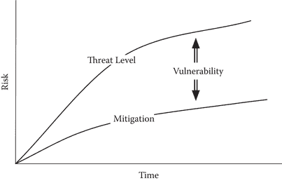

图 9.2 威胁水平与缓解措施的关系。

例如，某个产品的特定供应链可能会随着时间的推移而变化，变得对关键资源的依赖程度增加。或者，新技术的出现可能会使得企业所依赖的现有技术在竞争激的市场中变得不那么有效，正如我们在 `AOL` 示例中看到的那样。更令人震惊的是`图 9.2`图表的第二行，它显示了修复重点与这种威胁环境的变化并不一致。这里存在一个差距，它代表了漏洞的增强。最常见的原因是未能制定一种能够随时间重新评估资产价值的 `VM` 策略。

问题在于缺乏满足威胁的缓解资源。正如之前对 `AOL` 演示所示的，产生额外的探索性业务来寻找解决方案可能比实际发生的威胁更便宜。在这种情况下，可以很容易地将“互联网”替换为“威胁水平”，将“探索性业务模型”替换为“缓解措施”。

后者的另一个真实世界例子可能是 `Microsoft` 对开源软件的反应。`Microsoft` 的 CEO 过去曾很明确地表示开源 `Linux` 操作系统是一个威胁。最有效的防御可能是制定易于实施和操作的成本效益管理工具。

还有一些环境变化的案例，当公司未能迅速适应时，这些变化对公司是非常具有破坏性的。一个很好的例子是 `IPX` 协议的使用，它在 20 世纪 80 年代和 90 年代初非常流行。由于 `Novell` 对该协议的使用保持着严密的控制，客户开始寻求更具竞争力的资源。在快速演进的技术环境中，`IPX` 缺乏根基导致了人们采用开放标准替代方案——传输控制协议/网协议（`TCP/IP`）。

`Novell` 有两个选择：通过使用 `TCP/IP` 来适应，同时引导客户离开 `IPX`；要么在市场中挣扎以稳固地位以防御威胁。`Novell` 的适应速度缓慢，而 `Microsoft` 能够非常迅速将 `TCP/IP` 集成到日益无处不在的操作系统（`OS`）中。

此外，网络计算机的市场增长速度远快于 `Novell` 的响应速度。对 `IPX` 的遗留支持负担以及将产品线迁移到 `TCP` 的挑战证明对 `Novell` 来说是难以承受的。尽管他们现在是一家增长且成功的公司，但在市场上的地位已要小得多了。

公平地对 `Novell` 的管理层来说，当底层技术的漏洞与支持它的平台的无处不在性混淆时，通常很难识别出漏洞。这一点在今天是显而易见的，因为 `Microsoft` 已经成为世界上大多数计算机中的主要力量。

漏洞的增加通常是由于未能向发现和缓解分配足够的资源导致的。要做到这一点，必须对整个风险链条有一个愿景，并对面临风险的内容及其价值保持持续关注。正如我们从示例中看到的，面临风险的内容以及相关的威胁链是不断变化的。任何确定风险的模型都应该支持某种概率函数，或者假设假设最坏情况。在实现适当水平的战略漏洞控制时，需要记住的一些关键点包括：

*   保持对业务最大价值事物的理解。
*   建立一个协作小组来负责漏洞管理。这可能包括法务、事件管理、人力资源、IT、运营等部门的代表。
*   保持解决方案的投资和预算与潜在影响保持一致。
*   从利益相关者的角度持续评估漏洞。

### 9.4.6 复杂度

在复杂的环境中发现漏洞更为困难，因为它们会和坏人一起隐藏在细节中。通过降低这种复杂度，识别和修复漏洞的任务会变得更容易，但这样一来，在不创建关键路径的情况下，安全实施将更具挑战性。例如，一个具有两层安全性的简单网络架构在监控漏洞和实施安全方面无疑将是简单的。

在简单的网络设计中，可能会有两个基本的安全级别：`Internet DMZ`（非军事化区）和内部网络。无疑，在边缘、核心和单个主机上使用安全组件来保护这些内容是一件简单的事。这种架构显然易于管理，但在具有复杂业务需求的复杂世界中是不现实的。

如果是如此，极其复杂的架构在管理和构思攻击时会更加困难。漏洞的来源变得更难以识别和修复。这在关键事件发生期间尤为如此。取决于技术环境，有一些解决这一问题的有效方法。

#### 9.4.6.1 中心化与区域化

根据本地业务模型进行适应和演变的全球多样化网络需要某种程度的整合，以实现规模经济以及集中的管理与监控。拥有数百个销售办事处、独特销售应用的公司（某些可以通过 `Internet` 访问，另一些仅供内部用户使用）是整合的理想人选。

这种情况和其他场景具有统一业务或应用程序访问模型的特征。访问类型在本质上是相同的，只是每个应用程序的功能针对特定用户组的需求。然而，由于它们分布在全球范围内，检查漏洞和监控事件变得更加困难。


一种更显著的策略是将应用服务器整合在单一位置或区域。这将能够对目标进行更具一致性的管理、监控和漏洞评估。这还可能通过集中化采购获得规模效应，并更有效地利用网络资源。最重要的安全益处是，许多可能未被本地 IT 人员察觉或修复的漏洞，现在可以由一个规模较小但经过良好培训的团队进行更紧密的处理。这种方法还允许组织从基于网络流量分析的漏洞评估中获得更多益处。

### 9.4.6.2 标准化

当出于政治或技术原因，区域化或集中化方法并不理想时，标准化和审计是一种替代方案。尽管采用何种策略，这些活动都是必不可少的，但以去中心化的方式进行这些活动要显得重要得多。

标准必须以多种语言创建并支持各种环境。标准化最具挑战性的方面是让所有 IT 地点运行在良好的基准之上。必须标准化的关键项目包括：

* 漏洞评估的方法和频率
* 修复流程——即工单记录、验证和关闭
* 支持修复的变更管理流程
* 活跃扫描参数
* 基于主机评分的虚拟机（VM）服务水平

定期审计对于验证对标准和策略的遵循情况是必要的。审计可以通过检查自动化报告来进行。除非怀疑存在混淆行为，否则很少需要访问远程站点。

### 9.5 缓解原则

尽管这听起来纯粹是网络和系统架构师的职责范围，但架构面临的威胁很少被充分考虑。这是因为架构师更关注运营的成功，而非防御。最佳实践引导架构师完成任务，但安全架构师具有攻击者那种更务实、甚至是愤世嫉俗的眼光。

当网络架构师看到一种高效的流量路由方法时，攻击者看到的是一个可以通过污染路由和地址解析协议（`ARP`）表来破坏的新目标。为了明智地使用设备，网络架构师会将服务器配置为多宿主，一端连接到内部备份网络，另一端连接到 DMZ（虚拟化区域）。攻击者看到的是一个可以通过防火墙进入并可被备份协议利用的漏洞集。

架构中的漏洞并不总是如此显而易见。虽然每个组件的位置和功能已经描述得很清楚，但工程师可能会考虑其他用例，以便对架构进行调整，以保持应对变化的业务需求的灵活性。这最终可能会损害设计的原始安全意图。以下原则将有助于确保技术架构的安全：

1. **通往每个计划目的地的受控路径**——这一原则意味着任何设计中构建的过度灵活性都会为漏洞留下空间。设计应仅允许执行所需功能的特定路径。然而，对路径的定义并不那么僵化。其意图并不是建议例如网络路由不能使用路由协议进行更改和更新，但确实要求这些路由被限制在特定的接受范围内。这引出了我们的下一个原则。

2. **对技术系统中所有活动进行积极控制**——同样，这并不是为了消除灵活性，而是为了将这些活动限制在特定的操作参数范围内。正如防火墙被用于网络中的各个战略点以限制使用的源、目的和协议一样，计算机系统的每个组件也应应用类似的约束。这一原则应应用于网络存储系统应用程序字段验证级别的访问控制。

3. **冗余不等于重复**——在系统中创建冗余时，并不一定意味着需要重复的系统。如果一个系统的漏洞可以被利用，那么重复的系统只会使风险增加一倍。许多产品被制造商制造并建议实施完全相同的副本，并在它们之间进行某些仲裁。这是一个仅构想了单一用例的良好例子。
通常，制造商已决定重复是通过冗余来实现高可用性。然而，设计者没有考虑更稳健的安全目标。虽然以两种不同的方式编写应用程序并期望获得一致的性能是不现实的，但考虑实现多个达到相同目的的配置是现实的。尽管在许多情况下这不是一个易于管理的解决方案，但它可以减少对特定产品或特定版本漏洞的暴露风险。

4. **对所有关键企业活动构建的响应速度**——战略性漏洞的一个重要属性是，时间会放大利用的影响。快速响应事件的能力可以部分解决这种现象。应急计划和灾难恢复（`DR`）程序是实现这一点的合适工具。然而，这些计划必须不断修订，以应对威胁格局的变化，并对其有效性进行测试。

5. **漏洞不可避免地会被发现**——识别漏洞需要持续的警惕。如果它们没有被资产所有者发现，那么可能会被攻击者发现。资产所有者拥有不受限制访问评估和了解资产价值的关键优势。唯一可能匹配这种优势的攻击者类型是内部人员。

6. **漏洞并不总是死板的**——人可能成为漏洞的重要来源。任何安全策略都必须对人员漏洞进行修复。这意味着实施一个持续且不断进的安全意识计划。为什么许多组织乐于投入大量资金来识别和修复技术漏洞，而对员工执行同样的事情却认为成本效益更高呢？

7. **流程驱动业务而非技术**——尽管本书主要关注漏洞管理的技术方面，但本章应该非常清楚地指出，漏洞不仅存在于技术中。流程定义了业务目标的实现。漏洞也存在于那里。忽略它们等同于不为公开的 Web 服务器打补丁。

### 9.6 了解敌人

任何军事策略家都会告诉你，了解敌人的将指导你的防御。在漏洞管理的背景下，防御仅仅是另一个受攻击的资产，而这些防御通常缺乏活性，无法匹配更灵活的敌人。推论是，每个资产都是需要加固和调整的防御，使其无法被利用。想象一下，一支军队自己的炮位被占领并反过来使用，将造成多大的破坏。这就是攻击者正在寻找的：对看似强大的敌人获得易得的优势。

以下是一些指导你了解敌人以及如何影响你的漏洞优先级和修复方法的重要原则。

#### 9.6.1 弱点与强度


不要因为敌人人数少就假设他们很弱。现代技术改变了这一观念，因为互联网上较弱的资产已被敌人夺取并反用来对你。更糟糕的是，技术设计上存在缺陷，使得曾经的单发手枪变成了分布式的大炮群。人们只需要具备分布式拒绝服务攻击的经验就可以验证这一观点。以下是一些实用的策略：

*   将系统架构划分为不同的保护区域。这对于为关键漏洞的修复提供更充足的时间非常有效，因为在没有经过广泛测试的情况下，修复工作可能会中断服务。在做出优先级决策时，应该充分了解每个区域的能力。

*   任何具有极少黑客能力的人都可以实施拒绝服务攻击。位于此类攻击者所在区域内的任何目标都应该快速修复任何拒绝服务（`DoS`）漏洞。这类攻击会随着时间的推移而变化，今天有效的阻止策略在明天可能会失效。域名系统攻击就是一个很好的例子。维护权威服务器使防御者处于保护支持组织全球可见性的最有价值资产之一的位置。针对 `DNS` 和面向 Web 的服务器以及网络设备的拒绝服务攻击很常见。

*   安全区域越接近互联网，修复任何漏洞就越至关重要。考虑将该区域内任何漏洞的威胁水平与其他区域相比增加倍。资产本身可能没有那么价值，但对公司声誉和公众形象的损害可能是难以修复的。

*   在处理关键数据的目标上保持较小的攻击面。数据库服务器是一个很好的例子。它们包含了对组织至关重要的信息，因此应该保留在自己的防御区域内。该区域应将流量限制在所需的最低限度。在零日攻击的解决方案出现之前，额外的安全设备可以确保系统和数据的安全。

*   使用相互支持的防御。与建立区域类似，特定区域的安全特性可以有助于其他区域的整体安全。类似的收益还来自于对所有区域的事件进行集中关联，并能够快速识别攻击向量。相互支持的防御之所以有效，是因为攻击通常必须穿越多个区域才能到达最终目标，从而受到每个区域安全措施的约束。在漏洞方面，这有两个好处：首先，它增强了停止尚未检测到或修复的漏洞的攻击的能力；其次，漏洞数据可以通过告知关联服务目标处的威胁水平来参与防御。

## 9.6.2 现实世界事件

现在和过去的现实事件尽管看似无关，但为漏洞策略师提供了宝贵的教训。动机通常是相同的——只是方法可能不同。恐怖主义、正义感、荣耀、报仇、保护他人的幻想或拯救世界是常见的主题，这些主题误导了他人背叛、邪恶以及伤害他人的合理化。几个世纪以来一直是如此。一些需要注意的关键点：

*   企业最敏感的区域通常是员工压力最大的区域。由于某些员工必须访问关键系统，经理可以通过管理压力来解决流程中的漏洞。与内部授权用户利用漏洞的潜在影响相比，这通常是一项小成本。

*   识别并消除实施恶行为的动机。如果你的组织拥有诸如信用卡号等可以在街上直接变现的信息资产，那么组织应该确保这些资产受到保护。（注：输入文本在此处中断/重复）。

## 9.6.3 目标与目的

现在和过去的现实事件尽管看似无关，但为漏洞策略师提供了宝贵的教训。动机通常是相同的——只是方法可能不同。恐怖主义、正义感、荣耀、报仇、保护他人的幻想或拯救世界是常见的主题，这些主题误导了他人背叛、邪恶以及伤害他人的合理化。几个世纪以来一直是如此。一些需要注意的关键点：（注：输入文本在此处中断/重复）。


*   寻找竞争对手可能发现你的销售流程中的流程或方法存在某种缺陷或劣势的方法。这在 IT 行业尤为有用，技术的细微差别可以被用来对竞争对手产生负面影响。你可以根据对资产的成功攻击可能为竞争对手的公关活动带来多少利益，优先考虑你的修复工作。任何被技术销售人员接触过的人都能理解这一点。当销售人员询问“你们还在考虑其他哪些产品？”时，攻击策略就会变得显而易见。

## 9.6.4 时间放大影响

漏洞利用最被忽视的影响之一是时间的影响。例如，对底层信息安全进行长期的、高曝光的攻击，将对公司甚至整个行业的声誉造成损害。零售业和支付卡行业就是很好的例子。当一家大型零售商受到一次攻击时，损害是暂时的，但需要时间来消散。当相同或类似的零售商再次受到攻击时，由于公众心理中的关联混淆，原始目标零售商和相似企业都会受到损害。人们在与一家客户数据已泄露甚至可能泄露的公司做生意时，会三思而行。随着时间的推移，零售商和整个行业的信誉将受到不可修复的破坏。

更广泛的影响体现在支付卡行业。由于信用卡号和消费者信息是该行业的关键资产，因此保护这些信息是首要任务。虽然这些资产并不直接受信用卡公司的控制，但涉及此类资产的数据泄露次数，会随着时间的推移逐渐减少业务增长潜力。你认为有多少人对他们拥有的信用卡数量或在购物时使用这些信用卡感到担忧？

支付卡行业的反应是 PCI 标准。虽然其初衷是提高安全性，但遗憾的是，行业将注意力转向了对标准的遵守，而不是更好的安全性。但行业已尽其所能。

那么，如何处理随时间产生危害的潜在漏洞呢？方法如下：

*   有计划快速、安静地清理潜在的负面报道。如果你的公司由于直接未能保护好资产或间接未能监督外部因素而存在过错，请迅速承认并提交行动计划。一个此类流程的模板将会有帮助。
*   确保数据在不再具有用后过期。有些公司在客户信息超出用途后很长时间内仍保留，这构成了一种漏洞。这种无休止的保留要么是因为从未制定过如何处理信息的计划，要么是因为没有人考虑到，保留的责任远大于在尚未预见的业务模型中进行潜在用途的收益。
*   通过安全协会与行业内的公司协调安全工作。一个行业中的所有公司在保持安全方面都有共同利益。共享安全实践并加强整个行业的信誉，并会巩固整个行业的信誉，而不是泄露任何商业秘密。

## 9.6.5 政治环境强化攻击

立法者通过对数据内容本身或对保护失败的公司进行妖魔化，在无意中放大了数据窃取攻击。这是一个双输的局面，使得信息变得更有价值。这种现象为“大型石油公司”的攻击者提供了另一个机会，向公众发现并公开有关利润或供应的信息。对于数据窃取的受害者石油公司，公众很少会给予同情，而更多的愤怒将指向数据的内容。


本章将深入探讨与云计算资源相关的漏洞管理。本章目的是通过解决云端世界中识别和管理漏洞的问题，来补充之前章节的课程。漏洞管理的基本原则并没有因为云服务而改变，改变的是这些原则的应用方式。

到目前为止，我从技术和流程的角度描述了漏洞管理。对于那些拥有或控制基础设施和软件的人来说，这些维度仍然保持一致且相关。然而，在云计算世界中，所有权和控制权可能会变得更加复杂。所有权的很容易建立，因为销售合同规定了所购物品的所有权和范围控制。你可能购买软件，但无法控制底层的代码组件。这对于漏洞管理来说是一个至关重要的点，因为软件可能需要由卖家控制并发布的补丁。在整本书中，我一直都在讨论这一问题，但主要关注受限物理环境中的漏洞。有了云之后，客户变成了各种资源的租用者。这一点的相关性以及如何管理漏洞将在后文中变得明确。首先，理解使用云的原因至关重要，这将帮助读者理解为什么必须以不同的方式管理漏洞。

如今的 IT 服务消费者一直寻求减少资本支出，并降低资产利用率不足带来的潜在浪费和负担。换句话说，他们希望根据需求获取资源，并快速适应企业的变化。传统的内部 IT 模型要求人们维持对过剩 IT 容量的控制，以备不可预测的工作负载之。这些 IT 系统需要维护，并随着时间的推移而过时。因此，当组织需要一种当前的低利用率安装不支持的新技术时，就会产生潜在的浪费。

另一种，敏捷的技术环境具有巨大的优势，它可以在几天、几小时甚至几分钟内响应业务需求，而不是几周或几个月。这些能力可以产生竞争和成本优势。

为了实现这些收益，云服务提供商现在以更低的成本和更快的交付速度为大量客户管理计算资源。当 IT 经理需要部署一个需要计算和存储的新财务应用时，只需一张公司信用卡和 10 分钟在线，基础设施就会准备就绪。在其他情况下，软件本身将立即在生产就绪环境中可用，只需订阅并上传任何数据和配置信息。注意，对操作环境的控制要少得多。

在最大化资源利用率和降低成本的努力中，抽象层是一个重要因素。这导致了诸如 `OpenStack` 等软件工具的发展，用于管理和监控卖给客户的服务，而不是销售硬件和软件。灵活性和速度极大地改变了 IT 设计、构建和维护的进程。必然地，管理漏洞的能力对于更广泛的群体来说变得更加重要且更具挑战性。

在考虑虚拟世界中的漏洞时，之前提到的“抽象”可能成为风险环境中的一个普遍因素。抽象技术可以降低风险并保持低成本，也可能因为它们不再可见而掩盖风险。考虑那些曾经被认为不可移动的基石的虚拟化技术：`Host Computer`（主机计算机）已变成虚拟机。数据中心中的物理交换和路由现在是虚拟网络。传统的 `VPNs`（虚拟专用网络）无处不在地集成到前者中。即使是广域网（`WAN`）交换和路由也已演变为软件定义网络。

在计算领域，大多数 IT 专业人员已经习惯了虚拟机，人们并不一定知道特定的系统、应用程序或网络组件正在使用哪些物理 CPU、内存或磁盘。虚拟化通过特定任务的容器化进一步多样化，而不是将即使一个虚拟机也提交给单一功能。容器的多个实例可以存在于多个云位置，负载均衡器在这些容器之间分配或均衡应用程序请求。无论何种情况，结果都会返回给请求的应用程序组件。理解这些容器的状态听起来就像试图确定飞行的鸟群中哪些是雄性哪些是雌性。

当虚拟机、容器和软件定义网络（本地和广域）跨越不同且不断变化的地理区域在多个数据中心结合时，界限会变得更加模糊。为了进一步理解识别、优先排序和修复漏洞的挑战，甚至应用程序本身都不清晰。许多应用程序共享分布在众多系统微服务，并通过不断变化的适应网络进行通信。对这种混乱虚拟世界的可见性似乎是不可能的。

因此，人们无法控制大多数使用的资源，甚至无法考虑扫描和补丁。某些东西可以修复，而另一些不能。在这个世界中成功管理漏洞有两个关键活动。首先，明确定义哪些是你的责任，哪些属于云服务提供商。然后，对两者实施适当的控制。*不要忘记你正在管理更广泛的风险，而不只是软件漏洞。*

那么，什么是特定的云漏洞？当人们意识到“云”只是在传统的内部 IT 环境中可能发现各种类型的基础、软件和服务时，它很快变得不再神秘。但，确实存在差异。为了让云服务能够扩展许多租户，必须有编排软件、共享设备、虚拟化网络以及一些使其独特且具有竞争力的特殊软件。正是这些后期组件成为了云漏洞的本质。要超越传统 IT 环境中简单的扫描和修复视角，要寻找云云定义的独特漏洞。根据 `NIST SP800-145`¹，云的特征有广泛的定义。以下是带说明的短列表：

| NIST 定义 | 详细说明 |
| --- | --- |
| 按需自自助服务 | 通过网页或内部专用软件订单。 |
| 广域网络访问 | 互联网和或内部虚拟网络。 |
| 资源池 | 与其他服务买家共享硬件、软件和网络平台。 |
| 快速弹性 | 根据需要添加或删除任何资源或技术。 |
| 可衡量服务 | 按年、月、日、小时甚至分钟付费。 |


在之前的章节中，我描述了识别、评估、确定优先级和修复漏洞的过程。如果人们意识到，在剖析虚拟世界的某个点上仍然存在硬件、软件和人员，那么这个通用过程并没有改变。改变的只是参与者、他们的角色和方法。可能存在一个操作系统补丁管理角色，但它并不在你的组织中。负责保护应用程序的防火墙工程师可能雇于外部服务提供商。物理设施由遍世界各地的几个其他方进行保护和监控，这些方在不同的司法管辖区受不同标准和法规的管辖。修复漏洞的技术会有所不同。

这个模型并不新鲜。几千年来，世界一直依赖于复杂的供应链和大量的材料及服务提供商，这些提供商通过多层第三方结合，最终产生由另一方销售的终端产品。读者可以通过观看简单的网络搜索即可找到的时长 6.5 分钟的视频“一支铅笔”[²]](#10chap_10.xhtml#fn10_2)中的经济学课程来刷新视角。然而，云在高层面上运作的某些特定方面仍需阐释（参见图 10.1）。

注意，有许多方协同工作，但只有一方直接对安全负责，即“应用程序（软件）服务提供商”。物理数据中心服务器和网络均由另一方管理。然而，应用程序提供商与该链条顶端客户之间的合同只能让一方直接对安全负责。网络、物理安全、审计等则隔了两个层级。这种治理和控制的缺失使得有必要将这条供应链分解为更小的部分，以检查识别漏洞或让其他方负责的某些选项，尽管是间接的。

通常遵循开放系统互连（OSI）模型，云服务在以下一个或多个层次提供：物理层、数据链路、网络层、传输层、会话层、表示层和应用层。然而，它们并不一定被封装在一个完整的包中。存在无数关系和直接或间接提供这些层的中间方。它们所有的都可能引入漏洞，且其中一个或多个对检测和修复负责责任。

自然地，由于可见性有限，这种局面导致对云服务产生了一些担忧。虽然管理风险很重要，但抓住云在竞争优势中发现的机会同样重要，在云中可以更快、更具成本效益地获得生产性成果。事实上，规模效应是巨大的。企业可以更快地适应客户和监管需求的变化，因为供应链中还有其他专家在工作。

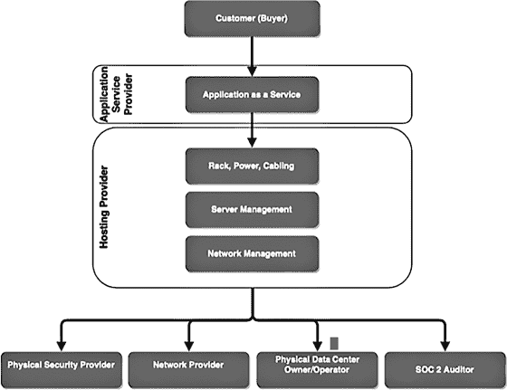

图 10.1 服务提供商树。

此外，云服务的买方只需要花费完成当前任务所需的费用。在传统的“自力更生”（DIY）模型中，为了应对某个项目，会有大量昂贵的资源规划和构建工作。这有时会导致 IT 管理者过度购买，以准备快速响应未计划的业务需求。云模型在众多客户中预见了这一点，并减少了预算或计划中的“冗余”。

云服务在某些方面也是大卫与歌利亚之间的公平竞争者。无论规模大小，各方都能获得同相同的、具有成本效益的服务。在非常大的规模下，可能通过谈判获得一些边缘优势，但云的核心保持不变：为大小不一的方提供具有成本效益的服务。云服务可以分为：

*   基础设施即服务 (IaaS)
*   平台即服务 (PaaS)
*   软件即服务 (SaaS)

这些每项都有其自身的风险和挑战。在接下来的几节中，我们将检查这些各种服务模型并识别一些管理风险的方法。

## 10.2 风险管理方法论](#contents.xhtml#tl_sec10_2)

目前为止，我关注的是风险管理中处理扫描、排序和修复的狭窄领域。在云之前，操作系统、配置和程序是由组织执行的。在云世界中，这些许多现在是部分或完全不可见的。云的早期采用者通常认为监控都已完成，觉得这少了一个需要担心的问题。对于任何组织来说这都是战术错误。可见性的缺乏增加了风险。

规划内部和云服务风险管理计划的一种有效方法，是创建一个提供商安全控制类型的矩阵，并根据风险水平确定适当的验证方法如果要观察一致性和平衡决策，你组织的内部活动也不应例外，也应该被考虑。

从针对特定提供者的控制类型和风险类别的矩阵开始。图 10.2 显示了一种可能的矩阵。

简单的想法是确定从云服务中所需的安全控制类型，并可以使用你自己的管理安全控制进行验证。这些控制可能因地而异。诸如 `SOC 2` 报告之类的工具（创建服务组织控制有效性的证据）可以从任何选择使用外部审计的供应商处获得。该报告为支持服务的机密性和完整性提供了一些保证。但少数战术并不是全面风险管理计划的万灵药。

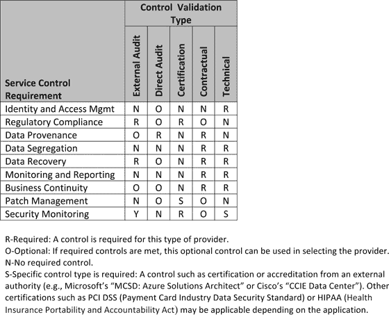


# 图 10.2 控制类型需求矩阵。

由于此服务堆栈中的层级多样化，管理风险有多种方法。如果涉及的应用处理机密数据，那么建立一个用于管理对任何存储或传输这些数据的系统的安全访问矩阵是明智的。在这种情况下，可以在签约之前，通过对安全控制措施进行审计或审查来识别漏洞。识别出的风险可以通过等补救活动来解决，例如：

*   对静态数据和传输中数据进行加密
*   要求服务提供者履行合同义务，以防止、检测和报告漏洞或事件
*   买方拥有合同权利来执行以下一项或多项：
    *   审计由合同服务提供者提供或管辖的安全程序
    *   每季度或每年接收一次安全控制报告
    *   确认提供者及其员工的安全或技术认证

注意，应定期进行后续检查以确保持续符合规定的风险控制。人们可能将此视为同于更新漏洞扫描检查并执行另一次扫描的行政管理措施。

但这些是合同和技术控制。此外还可以选择行政控制的选择，例如合同、直接审计或对年度认证的验证。回到我们在图 10.2 中的表格，如果我们预计提供者将应用程序提供身份和访问管理服务，我们可以使用技术控制，如 `logging` 或 `LDAP`（轻级目录访问协议）集成来评估我们对该服务元素的一些整体控制。相反，如果存在补丁管理服务的需求，可以应用与所服务相关的特定控制，例如软件或补丁管理实践的认证。使用行政控制，让供应商提供每季度补丁活动报告或计划内补丁的通知，也可能是一件简单的事。

欧洲网络和信息安全局（ENISA）于 2009 年发布了一篇名为《信息安全的利益、风险与建议》的论文。该论文为云服务中发现的安全漏洞提供了一个极佳的列表。通常，该列表对于云和本地技术服务同样适用。该报告严重依赖 `Gartner` 的报告、云安全联盟的报告以及几位贡献者的意见。总体假设是云服务提供者具有共同的、可观察的漏洞。注意，这些观察会随着如今巨大的云服务市场发生变化和差异。因此，报告的表述很明确，它提供了一些广泛建议：“该场景并非旨在对任何单一云客户或提供者都是完全真实的，但场景中的所有元素都可能在不久的将来出现在许多组织中。³”

一个非常重要的发现是治理缺失的潜在且可能是隐蔽的风险。OSI 模型中每一层可见性和控制的都会影响治理和监督。因此，理解与这种缺失相关的漏洞并制定适当的管理计划至关重要。正如读者在随后的章节中看到的，有一些常见的缓解控制措施旨在解决“不可见”带来的风险，前提是能够充分保证一个安全的计算环境。

## 10.2.2 数据中心](#contents.xhtml#tl_sec10_2_2)

物理数据中心是服务层级中最低层级，在服务体系中面临主要的资本和运营挑战。数据中心提供者通常拥有物理设施、多个电路入口点（通常称为 `DMARCs` 或分界点）、视频监控、负责护送访客的柜台人员、每个客户的笼、备份电源系统，有时还有共享区域的机架。

在评估数据中心提供者的风险时，根据提供者的服务和灵活性，有多种工具可用。识别合适的服务提供者的一种方法是决定任何提供者可能存在哪些重大物理风险，以及缓解这些风险的最具效益的方法。例如，如果公司应用程序中的数据受保护持卡人数据标准的约束，那么在与服务提供者签约之前，必须确定是否能满足 `PCI` 合规要求。数据中心是否能提供访问日志、视频录像以及任何其他 `PCI` 要求？

如果答案是否定的，你要么需要寻找另一个提供者，要么创建一个控制（或缓解控制）以保持合规。例如，可以在数据中心的租用笼内放置监控摄像头并维护访问日志。或者，对传输中和存储的数据进行强加密可能更切实际。对于审计师来说，论证持卡人数据存在物理风险将变得越来越困难。

如果这些选项都不可用，另一种方法可能是谈判合同协议以合理的成本提供所需的服务，或者通过独立审计和认证（例如 `SOC 2`）证明提供者是安全的。自然，还需要定期对数据中心进行审计以获取当前的认证。通常，许多数据中心提供者并不希望这样做，因为这带来了额外的运营费用，但这样做可能成为一种竞争优势。在签约时获取这些信息的机会是最大的，因为存在达成交易的压力。

对于物理设施，通常通过合同、认证或缓解控制来管理风险。为了尽职调查，有时需要访问数据中心进行漏洞评估。在这样做之前，建议准备一份要验证的物品清单并进行预约；否则，访问将消耗大量时间且效率低下。虽然图 10.3 中所示的检查对于传统数据中心很常见，但仅仅因为作为服务提供并不意味着不需要对其进行验证。

## 10.2.3 基础设施——裸机](#contents.xhtml#tl_sec10_2_3)

在数据中心内部，一个或多个其他提供者可能提供裸机服务。这些通常是不同尺寸的架式服务器，并带有网络交换和可用路由。这种 IT 服务方法消除了对大量资本支出和折旧计划等税务事务的需求。对于裸机，风险分析师面临的不仅是物理数据中心的安全控制，还有实现安装和维护的系统和过程。经常被忘记的是固件更新相关的风险，这些可能会会对操作系统和虚拟机产生影响。已知政府机构会篡改许多系统中安装的固件。此外，通常会有员工在职，为安装和维护系统组件提供“远程手”协助。

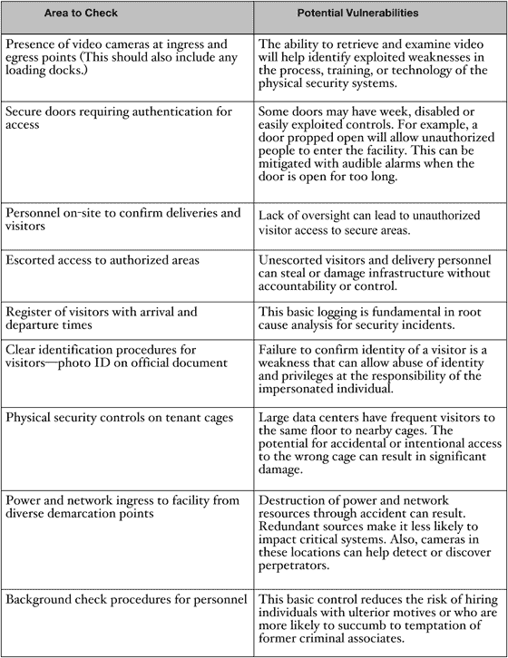

图 10.3 物理安全漏洞控制。


在使用基础设施即服务（IaaS）时，操作系统的补丁仍然非常重要，并且通常是购买者的责任。某些 IaaS 供应商提供低级计算资源，例如裸金属服务器以及带有远程控制台访问权限的网络。然后使用编排软件来自动部署所选的操作系统。

在其他情况下，客户提供操作系统的副本或通过供应商购买，并使用上述的远程手操服务（remote hands service）进行安装，或使用由 `OpenStack` 等编排工具支持的自定义软件。一旦安装完成，操作系统的扫描和补补就是客户的责任。

与我们的方法论一致，对于提供的基础设施服务的实施和维护，存在安全问题。其中的有限列表应包括：

1. 物理设施的认证——在上一节中提到。
2. 提供远程手操服务人员的背景检查。
3. 服务供应商的认证及其通过认证的服务范围。由于存在网络组件，这些组件是如何管理和保护的？
4. 应当确认提供给客户的任何软件的许可情况。如果这不可行，则合同控制变得更加重要，以便分配责任。
5. 一个验证过程，以确保安装的软件版本和提供的补丁是当前的，或者达到了计划应用程序所需的预期水平。
6. 针对固件补丁的服务水平协议应作为任何合同的补充条款，并对违约行为设定惩罚措施。

如前所述，基础设施有许多维度，人们无法确定这些维度是如何构建的。例如，对于裸金属服务器，众所周知它有到“机架顶”或“行末端”交换机的物理连接。至少，这些连接承载了 OSI 模型中的物理层和数据链路层。在服务供应商拥有许多裸金属服务器并电子化地设置一台供你使用的场景下，服务器可能是通过包含多个裸金属服务器的机箱中的刀片提供的。机架顶交换机很可能集成在刀片箱中。

此时，云消费者将不得不依赖服务供应商的实践和标准。当时的假设是，到同一数据中心、机架或机箱内其他客户服务器的连接是保持隔离的。

在这一层，并不总是需要简单信任服务供应商。可以在服务器连接的链路状态下执行简单的技术检查。服务器上的 MAC 地址列表和与本地建立连接相关的日志可用于检测配置不当。此外，如果担心隐私，由于在共享物理基础设施中可能从接口复制流量，因此可以使用加密作为一种缓解控制。在裸金属设置中，还有与虚拟化相关的额外选项。事实上，从云服务供应商租赁的裸金属服务器可能会有额外的虚拟化层，以便促进全球基础设施的分隔扩展性。例如，两个位于同一虚拟局域网（`VLAN`）上的裸金属服务器完全可能位于两个不同的数据中心。这将在下一节中变得更加明显。

## 10.2.4 基础设施—虚拟化

其他类型的基础设施服务包括虚拟化和迁移，它们允许使用如 `OpenStack` 等编排工具结合自定义软件，在各种类型的虚拟化程序上部署操作系统。会出现类似的问题，只是现在供应商引入了更多软件组件。这些组件对于虚拟化服务的消费者来说通常是不可见的，除非它们以供应商提供的自定义软件的形式呈现。通常提供的某些配置服务包括：

* 自服务按需计算（裸金属和虚拟化程序）
* 裸金属（配置 BIOS 和安装操作系统）
* 网络（创建 `VLANs`、虚拟专用网络 [`VPNs]`、虚拟交换）
* 存储（构建卷、安装数据库、加密服务）

正如后文所示，虚拟化层通常被用于聚合二层或数据链路层，以减少布线以及防止连接达到一定数量时耗尽的重复 `VLAN` ID。例如，单个物理数据中心内的两个不同租户可能有相同的 MAC 地址，如果属于同一个 `VLAN`，就会导致冲突。此外，每个不同租户可能使用相同的 `VLAN` 。为了允许大规模的扩展和分布，供应商能够将这些 `VLAN` 中的每一个形成通过三层（网络层）传输的虚拟化 `VLAN`。结果是，来自多个租户的单个机箱流量在同一电缆上传输并聚合，但对其他人透明。风险的缓解控制保持不变。在这些连接栈的高层，加密可以确保连接的机密性和完整性。

一旦提供了虚拟化，所有底层基础设施就绪绪，资源消费者对安装了操作系统的虚拟机负责。这必然会导致虚拟网络元素的配置，包括虚拟路由和交换以及可选的虚拟防火墙。客户拥有相当控制权，而无需担心虚拟化程序和底层裸金属。

然而，服务供应商提供带有高容量组件的服务是自然的，以添加网络防火墙、`VPNs` 和存储等其他服务。这些附加功能免去了客户承担琐碎管理任务和昂贵许可的责任，相反，这些可以分摊给许多租户。

在提供此类资源的情况下，安全分析师应考虑如何验证每个组件的安全合规性属性。如果管理界面可供租户检查或配置，则可以快速验证防火墙或 `VPN`。在其他情况下，寻找订购流程来定义服务的特征。例如，可以选择存储，并应清楚地指示已使用加密，并指定加密强度以及允许的密钥大小、类型，以及密钥如何为客户传递和/或存储。

## 10.2.5 基础设施（有限平台）—容器

开源软件无处不在且被快速采用，特别是在容器领域。今天获得的许多服务是通过容器及其支持的微服务架构提供的。“容器化”支持非常短的软件交付周期，这与 DevOps 中的持续集成/持续交付（`CICD`）模型模型是一致的。在快速变化的业务世界中，新功能和增强可以非常快速部署，这具有巨大的优势。

在生产容器环境中扫描和修补应用代码并不实际。容器以 `Docker` 镜像的形式从仓库部署。部署通常使用 `Kubernetes`（一种开源容器管理系统）进行编排。由于每个部署的镜像都是执行某功能的代码组件集，因此完全了解容器内部的内容以及在部署之前应解决的任何漏洞是非常重要的。


一旦进入生产环境，跟踪容器的上一个安全状态非常有帮助。为了做到这一点，可以考虑利用标签（labels）。这些标签结构为 `name:value` 键值对，可以快速识别特定 pod 版本的属性。假设读者对 Kubernetes 架构有一定了解，标签的一个示例可能是：`version=1.1.`。使用标签有许多策略。例如，如果保留了发布版本的历史库，将很容易确定 `version:1.1` 不是当前版本，而 `1.3` 是最新版本。通过配合这些版本之间漏洞补丁的记录以及对其他 pod 的依赖关系，DevOps 团队可以确定该模块的风险。另一种有效方法是记录最后一次扫描的 ID（例如，`scanID:0123456`）。通过将其与您扫描软件中的最新扫描 ID 进行比较，可以轻松识别出差异。

目前有商用工具可以管理代码发布并对容器环境中的镜像进行漏洞评估。使用此类工具甚至可以进行更以容器为中心的扫描。补丁管理可能涉及对构建容器环境的系统或虚拟机进行整体替换。这已成为一种常见做法，因为部署的镜像被视为稳定的、经过测试的发布版本，并不总是进行原地修补。尽管容器世界的操作原理如此，但流程和策略对于成功的补丁和漏洞管理仍然至关重要。

本节讨论了作为有限平台的容器服务。之所以这样考虑，是因为该服务提供了有助于构建整个生态系统的技术选择。管理和监控容器的工具有时会与防火墙以及软件开发或部署工具等附加功能一起。

## 10.2.6 平台即服务 (PaaS)

平台即服务（`PaaS`）是一类组合服务，提供完整的开发、部署和运行解决方案。它包含了所有的底层基础设施，尽管细节对客户来说并不总是透明。当客户希望对底层 `IaaS` 组件有非常具体的要求时，价格可能会增加。但客户通常寻求的是解决方案的简单性，即不涉及许可维护、互操作性问题解决以及底层资本成本。`PaaS` 非常适合那些无法负担大量专门专业知识，或未准备好对特定技术做出长期承诺的 IT 部门。

另一方面，开发平台提供了额外的服务，这些服务需要密切关注，并且要理解软件开发生命周期中存在无法轻易识别的底层风险。服务栈将引发更多关于每个服务如何提供安全性的问题：

*   代码模块和开发工具是否经过了补丁修复？频率是多少？
*   是否存在与补丁相关的服务水平协议（`SLAs`）？
*   构建和测试工具是否包含某些测试代码弱点的手段？
*   解决方案是否包含跟踪开发进度和代码提交的工具？
*   测试环境是否准确反映了生产环境的状态？
*   是否有足够的工具帮助满足行业特定的安全要求（例如，静态数据加密和事务日志）？
*   在要求的司法管辖区是否有可用的数据中心？
*   除了生产和测试环境外，是否可以为开发建立安全的替代通道连接？

在这种模型中，管理漏洞是一项共同责任。在某些情况下，服务提供商负责平台、网络和主机，而买方负责应用程序和数据。扫描生产容器的处处是可以提供当前的运行状态。某些生产容器的攻击面较小，可以在不需要立即修复漏洞的情况下持续运行。另一方面，存储库可能会过时，或者代码可能会因为需要新库而发生变化。后者的库可能包含在生产发布前需要进行检查的漏洞。

这些可能性使得制定一个与开发-部署周期相一致的一致扫描和修复流程变得非常重要。[图 10.4] 显示了适用于虚拟机上托管的容器环境的持续扫描、补丁和交付周期示例。`VM` 和容器都经过了漏洞扫描和回归测试。

随着应用程序的每次发布，必须从左到右遵循此过程：

1.  更新或构建：


1. 容器中的代码
2. 虚拟机的实例

## 2. 扫描虚拟机中的漏洞
3. 重复将容器提交到仓库，直到自动扫描结果干净。
4. 一旦步骤 2 和 3 成功，请对应用程序进行回归测试。许多开发团队似乎非常匆忙，跳过了这一重要步骤。
5. 在完成步骤 4 后，在发送到生产环境（步骤 6）之前，应保留上述“稳定”版本的 `VM` 副本。

### 10.2.6.1 其他 PaaS 风险关注

应用程序的开发和交付并不是 PaaS 解决方案唯一的功能。通常可以通过菜单提供重要的服务，这些服务可以添加到任何解决方案中：存储、网络、数据库、网络和主机安全、域名系统 (`DNS`) 服务、负载均衡以及组织可能认为有用的任何其他组件。其简单的想法是让客户对某项功能感兴趣，并以此作为向他们销售额外插件的手段，将他们锁定在供应商处。

这并不是一种糟糕的状况，在某些情况下，对于不断成长甚至扩张的企业来说是必不可少的。然而，这些选择涉及战略性的漏洞。人们可能会考虑任何可能呈现不可预见攻击面的系统性组件。例如，如果由单一供应商负责所有使用的组件，那么在整个解决方案栈中，某些特定的代码库或架构属性可能存在未知的弱点。

减轻这种风险的一种方法是选择内置了多样性的供应商、架构或解决方案集。

有些服务提供商提供低价格，并将大多数服务作为自研解决方案。这将要求供应商必须具有强大的开发和风险管理实践。事实上，自研解决方案可能提供最适合服务消费者的功能和特性。此外，价格具有吸引力，且风险较低。

其他提供者拥有精选的集成工具集合，帮助其平台客户管理风险。例如，一旦租赁了计算资源，就有用于网络安全、漏洞扫描、容器管理、安全存储、`x.509` 证书管理、日志收集与监控以及防火墙和入侵防御的附加控制。这些服务可以快速帮助管理漏洞和合规性要求。特别是 `IPS` 服务作为虚拟补丁机制运行，可以在一段时间内缓解解决方案中的漏洞，在此期间你可以扫描并修复这些漏洞。

至于报告要求的合规性，有专门的服务提供帮助。欧洲通用数据保护条例 (`GDPR`) 通过加密数据库服务得到满足，而某些 `PCI` 要求通过防火墙、证书服务和安全监控解决方案得到满足。

所有这些服务都应该随着时间的推移进行监控，并根据质量与你需求的关联进行重新评估。服务消费者以自动驾驶模式运行，并在不再需要的服务上花费资金，这并不罕见。此外，安全需求和服务能力也在不断变化。这些需要定期重新对齐，以避免增加风险的隐性漏洞。

### 10.2.7 软件即服务 (SaaS)

从服务消费者（客户）的角度来看，`SaaS` 是提供应用程序服务的一种非常简单的方法平台没有任何元素暴露给客户。与供应商签订的典型协议是，他们将提供这些服务并进行妥善管理。虽然这对于中型制造商的库存管理系统可能足够，但对于银行和商业金融等高度监管的行业来说显然不够。考虑到整个客户群体和潜在的购买规模，有几个问题需要考虑：

* 供应商是否对其与安全相关的行为或不作为负责？
* 是否有针对性能和可用性的服务水平协议 (SLA)?
* 应用程序更新的频率是多少（发布周期）？
* 开发人员是否接受过安全编码实践的培训？
* 应用程序日志能否以持续流的形式提供？
* 是否遵循任何可供审计的安全标准？
* 应用程序是否能与身份管理解决方案集成？
* 你会收到审计报告的副本吗？
* 审计频率是多少？
* 审计发现的任何是否会根据发布的计划进行修复？
* 如果发生安全泄露，供应商多快会通知你？
* 将提供多少关于破解根源和范围的信息？
* 对于供应商未能补丁、检测、报告、遏制或修复是否有金钱上的后果？

对于花费大量资金购买定制 `SaaS` 产品的 `SaaS` 客户，有时可以协商获得更高的透明度和对运行环境的控制权。虽然供应商不太可能允许客户对解决方案进行自行扫描和补补，但要求建立特定的扫描和修复服务水平协议是切实际的。也可以预期某些安全控制的实现。这些是为买方的运营和监管需求身定制的解决方案的典型特征。一个简单的例子是通过企业目录将身份验证集成到应用程序中。

* 软件开发
* 发布计划（迭代周期）
* 数据库引擎
* 操作系统
* 编程语言
* 主机监控
* 网络韧性与性能
* 防火墙、IPS 和 Web 防火墙
* 虚拟化工具
* 漏洞扫描器（基础设施和应用程序）


此外，如今的 DevOps 运营模型允许对环境进行频繁且快速的更改，服务损失极小。每隔 2 或 3 周部署一次功能、增强和修复程序并不罕见。这本身是一把双刃剑。其中一些快速发布可能会引入新的漏洞，这些漏洞最终会在下一个 `CICD` 周期中被修复。

## 10.2.8 模糊界限——SDWAN

软件定义网络是另一种云技术，它模糊了传统网络与虚拟网络之间的界限。这项创新允许客户实现自己的 WAN（广域网），并并在无需购买专用电路或 `MPLS`（多协议标签交换）等昂贵服务的情况下集成其 LAN（局域网）。相反，客户通过软件定义其 WAN 的行为和特性。网络传输采用传统的 Internet 接入，通过 `VPN` 服务中的多种选项保护站点之间的连接。关于性能、内容缓存、路由和流量优先级的决策可以由客户进行配置。

另一个被模糊的界限是基础设施与软件之间（`IaaS` 和 `SaaS`）。虽然在特定位置的网络边缘通常会安装一个硬件，但也有软件在发挥作用。这些软件由 `SDWAN`（软件定义广域网）制造商生产并维护，有时由服务提供商（例如电信公司）安装或打补丁。因此，漏洞管理决策必须像在使用 `SaaS` 提供商时一样做出。

配置和性能调优选项使用一个或多个带有专用软件的服务器进行管理。这些软件可以由具有专业知识和技术资源的运营商托管和管理，也可以由具有足够规模和资源的组织直接管理。这项技术的逻辑扩展是进一步将路由（控制平面）和应用程序（数据平面）集成到虚拟或云软件基础设施中。因此，现在我们通常用于应用程序和数据的基础设施也可以支持网络路由和性能管理。

然而，与软件服务（SaaS）类似，该解决方案使用软件和相关配置项来管理流量流。在许多情况下，关于软件解决方案的相同问题也适用于 `SDWAN`。软件必须安全地构建，且实施和管理应得到适当治理。假设有一个外部服务提供商负责你的 `SDWAN` 实施的管理，`图 10.5` 显示了一些需要提问的关键安全问题。

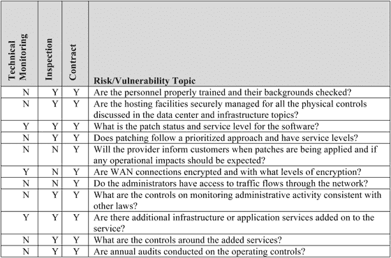

图 10.5 `SDWAN` 安全问题。

## 10.3 云中的扫描与修复

到目前为止，讨论集中在建立云的心态以及其中的漏洞或更广泛的风险。现在，如果我们把云视为一种替代基础设施和平台的方法，而不是对应用程序或环境的完全控制，那么漏洞扫描的需求仍然至关重要。我们部分提到了在 `dev-ops` 环境中检查漏洞的想法。这需要进一步的阐明。

在当前的技术环境中，与漏洞扫描最相关的有两种场景：运行在托管物理基础设施上的虚拟机（`VMs`），以及运行在 `VMs` 或服务提供商容器集群（例如 `Docker™`）中的容器。

### 10.3.1 扫描虚拟机

当 `VM` 托管在公有云中时，你对硬件或虚拟程序几乎没有控制权。网络对你来说是不可见的，而且底层软件的补丁状态并不透明。然而，如果你将托管的 `VM` 视为你的领域，那么它就必须经过保护、更新、监控和治理。漏洞扫描是其中的关键组成部分，可以通过两种方式之一实现：网络扫描和主机代理扫描。

#### 10.3.1.1 虚拟机的网络扫描

通过网络扫描 `VM` 时，考虑扫描器相对于目标 `VM` 的实际位置非常重要。由于网络组件可能是物理网络和虚拟网络的组合，网络扫描会对网络组件造成沉重负担。然而，如果你将托管的 `VM` 视为你的领域，那么它必须经过保护、更新、监控和治理。漏洞扫描是其中的关键组成部分，可以通过两种方式之一实现：网络扫描和主机代理扫描。 (注：此处原文存在重复段落，翻译已根据逻辑去重并确保通顺)

### 10.3.1.2 扫描容器


如上一节所述，容器化为新功能提供了快速的交付和短交付周期。然而，在涉及到风险时，速度是一把双刃剑。虽然在修复漏洞时这是一项优势，但补丁窗口也随之缩短。必须利用这种情况，将代码漏洞的修复优先级与新功能开发置于同等地位。存在一种非对称部署功能及其相关漏洞补丁的倾向。当新功能使用了一个尚未报告存在漏洞的服务时，就会发生这种情况。随后在部署新功能后不久，在在该功能依赖的一个或多个系统组件（例如操作系统库，或数据库、加密或监控基础设施的附加库）中发现了一个关键漏洞。

虽然这种情况有时是可以避免的，但漏洞的报告、补丁的可用以及软件部署可能会导致一种情况：在进行足够的回归测试之前，可能至少要经过 3 周，甚至可能是 6 到 9 周。因此，在 Scrum 方法论中，产品所有者（product owner）必须负责将漏洞纳入待办列表（backlog）并优先级排序。在此之前，漏洞分析师或风险经理尽早沟通漏洞的严重程度和潜在影响是非常重要的。

另一个关注点是通过网络扫描发现的漏洞。容器空间通常实现在虚拟机（VM）中，这些虚拟机被视为几乎不可变，以便运维团队了解环境运行状态。不要被“不可变”一词所误骗。关闭远程 shell 或完全移除命令 shell 并不能真正让主机变得不可变。还有其他攻击系统的方法。

此外，传统的扫描对于生产容器环境来说是不行的，因为运行环境通常有许多具有私有内部 IP 地址的容器。容器平台通常提供防火墙规则，使用多种准则控制容器之间的访问。通过分配权限，允许某些容器仅使用特定协议与其他容器通信。通过物理网络层检查虚拟机的漏洞状态，并尝试访问特定主机的内部子网，的效果并不理想。从外部扫描器进行网络扫描编排可能会变得非常复杂。极有可能，容器集群的内部 IP 地址没有发布外部路由，以确保它们无法被访问。

漏洞必须在构建阶段（生产前）被检测出来，此时会准备好替代的虚拟机或系统配置。目标是建立一个持续集成和交付流程，该流程应包括代码漏洞的检测与修复，以及提交到受信任容器注册表之前的测试。图 10.4 展示了此类流程的示例。

幸运的是，市场上已经有了扫描生产容器环境的解决方案，可能需要额外的投资。任何大规模运行容器的组织都应该考虑在主机上安装扫描代理的优势。此外，容器管理环境中还内置了一些扫描器，它们可以分析已安装组件的二进制文件并报告任何重大漏洞。供应商最初看到了为客户带来的自然货币收益，但并没有完全共享相同的风险管理愿景。这并非试图欺骗，而是市场的自然演变。

因此，这些服务的消费者采取措施来缓解快速演进的技术生态系统中固有的风险是非常重要的。当两个服务提供商必须为服务竞标时，消费者是王，满足最多安全要求的那个将获得优势。管理服务提供商风险的一些非常有用的工具是：合同协议、缓解措施的实施、供应商风险评估计划，以及在多样化市场中的竞争性招标。

对于开发团队来说，一个非常有价值的卖点是：通过能够按需报告所有漏洞的扫描代理，可以更好地描述生产环境的已知状态。

同样有用的是在新的镜像推送到存储库时自动执行扫描的能力。这种方法与 CICD（持续改进、持续部署）运行结合得非常好，节省了时间并缩短了更改与漏洞发现之间的时间间隔。稍后的“平台即服务”章节中将会有更多关于容器扫描过程的讨论。

## 10.4 云风险管理策略](#contents.xhtml#tl_sec10_4)

由于云服务根据定义是由外部组织交付的，因此对漏洞的控制和识别能力通常是有限的。由于许多原因，服务提供商在开发解决方案时并不总是考虑到这些因素。首先，提供商看到了为客户带来的自然货币收益，但并没有完全共享相同的风险管理愿景。这并非试图欺骗，而是市场的自然演变。

因此，这些服务的消费者采取措施来缓解快速演进的技术生态系统中固有的风险是非常重要的。当两个服务提供商必须为服务竞标时，消费者是王，满足最多安全要求的那个将获得优势。管理服务提供商风险的一些非常有用的工具是：合同协议、缓解措施的实施、供应商风险评估计划以及多样化市场中的竞争性招标。

### 10.4.1 服务多样性](#contents.xhtml#tl_sec10_4_1)

在可行的情况下，考虑在选择服务提供商时建立多样性。一个简单的例子是当有多个不需要直接通信的应用时，这些应用可以合理地分布在不同的提供商或同一提供商的数据中心。存在多个可用服务提供商的事实可以作为降低服务成本并策略性获取所需安全控制的手段。

另一个场景是对每个应用程序识别哪些控制是必需的，哪些是可选的，以及额外的成本是多少。利用这些信息，人们可以在性能、能力、风险和成本之间选择最佳平衡的服务提供商。由于广域可以在 OSI（开放系统互连）模型的高层进行虚拟化，因此不必受限于单一提供商。

### 10.4.2 合同协议](#contents.xhtml#tl_sec10_4_2)

合同是风险管理者的友好法律工具，因为它们概述了涉及服务提供商的安全治理通用框架或范围。一些安全经理认为合同是一个复杂且艰巨的过程，涉及律师、会议和多次文档修订。风险经理有责任将风险偏好与合同对齐，并学习缓解措施的艺术。有了这些信息后，与组织的律师合作，确保您的风险顾虑在合同中得到解决。然而，在签约之前，应建立并遵循供应商风险评估计划以识别适当的控制。

### 10.4.3 供应商风险评估计划](#contents.xhtml#tl_sec10_4_3)

供应商风险评估是任何组织的常见做法。对于 IT 迁移或云端的持续运行，没有例外。方法必须演进，但通用做法是相同的：

*   定义业务目标和解决方案
*   在适用时建立威胁模型
*   分析技术环境
*   确定风险
*   构建治理需求
*   建立控制措施和指标


某些 IT 组织对云缺乏信任，认为只有他们才能真正管理风险并为组织提供保障。这种方法极其昂贵，而且在尝试灵活满足快速变化的业务需求时，并不一定有效。云端风险管理的一种方法是确定组织面临的真实风险，并对数据、功能和实际暴露情况建立理解。仅仅应用程序迁移到云模型并不意味着风险就会增加。不安全感仅仅源于对“控制权丧失”的错觉。为了解决这个问题，请考虑以下指南：

1. **获取信息**——收集关于满足业务需求的解决方案的详细信息。安全细节*就是*业务需求。整个应用程序的虚拟化（“抬移迁移”方法）可以提供便捷的保障，但并不总是最佳解决方案。也许它是通往容器化的跳石，而容器化可以提高韧性和性能。

2. **建立外部评估计划**——审计、证明、渗透测试和扫描在云漏洞管理中都有其用武之地。了解这些手段中哪些组合对于识别定义良好的风险是真正必要的。简单地要求没有目的的控制通常是浪费时间和资源。

3. **构建云监控平台**，并使用匹配当前和未来需求的控制措施。如果组织习惯于管理 CPU、内存、补丁状态、安全事件和事故，它也应该能够通过增加控制措施来继续这样做。例如，与其从云端收集简单的 `syslog` 事件（许多云解决方案不再产生 `syslog`），不如使用如 `Prometheus` 等工具。这是一种极其通用且高效的监控手段，使用时间序列名称/值对。与尝试解析 `syslog` 事件相比，它更高效地为数据收集提供了一致性和多功能性。

## 10.4.4 补偿控制

如果合同流程不是正确的途径，且你无法控制风险环境，你将不得不寻找补偿控制。考虑以下最坏情况：

* 供应商系统中的某个漏洞未修复补丁。
*   整个应用程序（SaaS）存在一个运营漏洞，且该漏洞可能会持续几个月。
*   其中一个或多个漏洞被确定为严重的，是组织无法接受的。

在这些情况的某些组合下，有必要寻找补偿控制。扫描、补丁、合同以及将数据迁移到另一个提供商都是不可行的。你可以采取其他行动，例如：

* **实施技术控制以**：
    *   通过 `encryption` 将关键数据从应用程序隐藏。
    * 通过强制用户通过你的安全/内容检查基础设施来限制对云服务的访问。
    * 使用可以支持你特定 Web 应用程序的外部风险监控服务。
* **实施一个或多个管理控制**（在许多情况下你本就这样做）：
    * 要求用户更频繁地重新确认对应用程序的访问权限。
    * 每月或季度进行数据质量、访问和使用审查。
    * 限制应用程序中允许的用户角色（降低威胁级别）。

## 10.5 云安全评估

行业工作组建立了一些工具，以帮助安全评估的自动化和一致性。互联网安全中心（CIS）基准用于根据与 `CIS` 以及众多安全专业人员协作建立的最佳实践来评估云 IaaS 服务的配置（见图 10.6）。某些云服务提供商通过漏洞扫描解决方案支持自动化，使用应用程序编程接口 (`APIs`) 访问配置数据。这些信息可用于评估服务对基准的合规性。它并没有提供云服务漏洞状态的完整视图。人们只是获得了基准中发现的最佳实践配置共识保证。

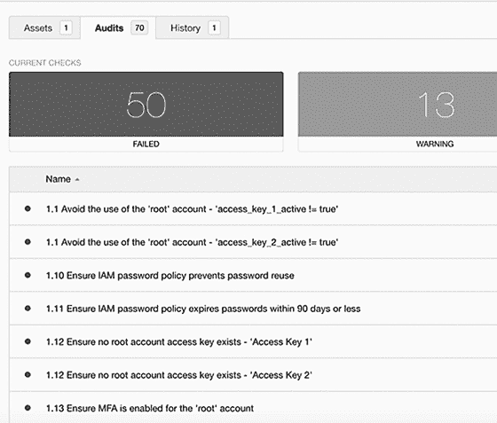

图 10.6 云提供商安全合规检查。

另一个实用工具可能是云信任协议 (CTP) ⁴。该协议要求透明化以支持“数字信任”。简单的想法是针对云服务提供的安全状态提供某种程度的透明度。提供商并不一定会提供漏洞扫描结果，也不会提供任何配置项。相反，云服务的 `CTP` 消费者获得有关服务合规性和安全状态的高级信息。一个经常引用的例子是服务的运行时间，它由承诺状态与观测状态组成的 `SLA` 合规格式进行传递。例如，10 天内的运行时间至少为 99.8%，提供商承诺为 99.7%；因此消费者知道存在合规性。为了让该协议正常运行，服务提供有义务建立服务和资产类别。这些类别用于映射服务或资产的特定属性，以便准确传达合规性。

总来说，`CTP` 是云服务消费者透明度的重大改进。然而，由于云服务中存在这么多层次（如本章前面所述），大型服务提供商不太可能为所有组件提供准确且一致的信息。另一方面，如果服务提供商能找到使其变得可靠的方法，`CTP` 提供了获取合规性和风险信息的一致方法。自然，在多云提供商环境中，一个提供商的指标可能与另一个提供商不同。例如，提供商 A 可能提供服务器的可用性信息，但不提供网络信息的。另一个提供商可能提供网络可用性，但不提供服务器的。

## 10.6 结论

在所有云服务情况下，在使用云服务之前、期间和之后收集信息是消费者的责任。这转化为签约、运营和终止服务。安全和保障工具及技术以各种且不一致的形式存在。小型消费者将通过“用脚投票”来坚持最低能力。他们将选择声誉最好、价格最可接受的提供商。云的大型消费者能够进行更多谈判，并且在许多情况下将自己的安全构建到解决方案中。这就是云的伟大之处。某一层层的漏洞可以通过消费者拥有更多控制权的另一层的强度来缓解。

### 注释

1. [https:/​/www.nist.gov/publications](https://www.nist.gov)

2. Competitive Enterprise Institute, [https:/​/cei.org/i-pencil](https://cei.org)

3. 欧盟网络和信息安全局 (ENISA), 2009

4. 云安全联盟, 2018 [https:/​/cloudsecurityalliance.org/working-groups/cloudtrust-protocol/#\_overview](https://cloudsecurityalliance.org/working-groups/cloudtrust-protocol/#_overview)


漏洞管理（VM）的过程似乎非常复杂，但当观察技术细节时，这种想法是有误导性的。漏洞、配置错误以及补丁的紧迫性在短期内没有任何结束的可能性极小。在漏洞管理行业形成的早期，“扫描、修复、验证、重复”的过程被视为主动安全。其核心理念是在敌人发现之前识别并清理这些漏洞。多年来，这种方法一直被视为常识。

由于许多厂商都提供解决方案，竞争的焦点变成了比比谁能识别并包含更多的漏洞检查项。

与入侵检测系统（IDS）一样，误报问题也成了一个难题。主流漏洞管理厂商的销售材料向我们展示了，在那些细微的字体条款中，要决定哪种产品最合适实际上非常困难。企业用户必须继续进行测试，并根据需求进行比较。然后，所选产品的优劣将完全取决于需求本身。显而易见的是，准确性和全面性并不是漏洞管理系统最重要的衡量标准。

行业的下一步是增强漏洞扫描器，或者通过用户可定义的漏洞参数来扩展其功能。诸如 `开放漏洞与评估语言 (OVAL)` 和 `通用漏洞评分系统 (CVSS)` 等协议为实现这一目标提供了框架。但在为了保持竞争力和区分产品的斗争中，开发者们坚持了旧的执行方式，并保持其系统相对封闭。越来越多的厂商提供了 `XML` 接口，以接受像 `OVAL` 等演进中的行业检查标准。一个明显的技术原因是，像 `OVAL` 这样的标准有助于与并非由同一供应商直接提供的产品进行集成。随着用于编码所有类型漏洞检查的标准的建立，可能会出现独立的订阅制服务，独立于使用它们的硬件和软件来提供检查。

当然，扫描器需要不断更新漏洞检查，这使得年度维护费用变得必要。而对于一个多年增长前景有限的业务来说，经常性收入至关重要。考虑到后这一点，云端和本地部署都可能提供更多的功能和集成。

因此，下一步的挑战是让产品更对企业友好。人们至少可以期望在以下方面实现集成：

*   回归在主机上提供扫描代理，这些代理无需中央命令和控制系统的启动即可工作
*   支持扫描仓库和执行环境中的容器镜像
*   集成目录服务以验证系统用户身份
*   可选的远程访问拨号用户服务 (`RADIUS`) 身份验证
*   对开放数据库支持结构化查询语言 (`SQL`) 和 `NOSQL (Non-SQL Database)`，而非设备模型模式
*   与其他网络和安全设备进行安全数据交换
*   支持更现代的安全数据结构，允许服务提供商与服务消费者共享详细漏洞数据或进行聚合数据

那么，行业未来将向何处发展？关于这种未来有两种高层观点。第一种观点是跨学科的集成或协作。这在某种程度上已经通过流程实现了。当漏洞管理收集的数据经常被输入到其他领域时（如配置数据库和安全事件与影响管理器 (`SEIM`)），这种需求是显而易见的。但这无疑仍然可以改进，以提供更多的上下文和业务相关性。未来的另一种观点是让技术更紧密对齐。许多技术可以从漏洞管理数据中获得巨大的收益，反之亦然。

我认为我们还将看到服务提供商向服务消费者共享漏洞数据的现象。这在要求技术服务整个供应链具有高度安全性的受高度监管行业中将变得更加重要。由于按需付费的服务模式泛处可见，客户将坚持某种程度的合规性和安全可见性。

## 11.2 跨学科机会

漏洞管理行业正努力寻找利基市场。人们购买漏洞管理系统，并不是为了最终让它演变成一个全方位的安全管理平台。这种策略对于客户来说是难以接受的。其他考虑的解决方案是扩展到合规监控、风险评估和配置管理等其他相关功能。这些领域在技术上是有意义的，但从流程的角度来看更具挑战性。合规管理是有意义的，因为该功能与漏洞管理非常接近。然而，需要创建更完整、可定制的合规检查，而且这些检查必须足够广泛，以匹配目前正在编写的许多常用合规框架。

合规管理的技术必须被简化，因为合规官通常不是技术人员。必须在用户界面中提供某些定义策略的简易方法，而无需了解目标系统中待测试的相关特性和功能。其他漏洞扫描器配置项，如调度、带宽、目标系统资源以及漏洞检查更新，也应该应该被简化，以消除非 IT 人员的操作挑战。

风险管理显然是行业已经投入大量精力解决的功能，但仍有很长的路要走。正如本书详细描述的，漏洞管理是风险管理功能的关键贡献者，但更高层次的风险管理功能被留给了其他厂商或在很大程度上被忽视了。风险管理产品的问题在于，许多公司不会将该功能正式化，这使得分配所有权变得困难。在其他情况下，风险管理是以相当抽象的方式进行的，因为分析师无法获得准确、详细的数据。似乎漏洞管理系统可以提供这些细节。

风险/漏洞管理产品的成功障碍是双向的。风险管理厂商没有资源或专业知识来收集必要的数据，无法与他们的人竞争。漏洞管理厂商没有动力进入一个规模和收入有限的市场。因此，解决方案是拼凑和定制的。

配置管理是另一个漏洞管理可以做出重大贡献的领域。配置管理数据库 (`CMDB`) 的初始数据收集可以由扫描系统完成。此外，某些漏洞管理非常非常监控多个配置项的变更，这类似于合规监控功能。这里的主要障碍是跨学科的专业知识。对漏洞和修复的理解与信息技术基础设施库 (`ITIL`) 开发和管理 `CMDB` 的学科思维模式是完全不同的。

## 11.3 跨技术机会


还有其他更具技术性的方法为企业创造价值。在安全领域，一个巨大的机会是利用漏洞数据来告知入侵防御系统（`IPSs`）。对高速网络流量进行攻击检测是 `IPS` 面临的一个主要资源挑战。由于这些设备被要求检查数百或数千种可能攻击的流量，并决定是否拦截这些流量，因此性能至关重要。虽然这项技术自旧 `IDS` 时代有了巨大的改进，但延迟和吞吐量仍然是一个令人关注的问题，特别是在购买更大规格设备的成本方面。`IPS` 必须按照协议在多个层上拆分数据包，或重组碎片以分析内容是否存在攻击。这是一项非常消耗资源的任务，特别是要在不给网络引入延迟的情况下完成。

此外，为了简化实施，对更高带宽容量的需求给 IPS 厂商带来了压力。企业希望通过实施单一技术来检测本地网络上的所有攻击。这通常涉及在接入交换或核心交换机上放置设备，并将大部分流量推过 `IPS`。为了增强这种设计的性能，厂商们已尝试创建设备集群、添加负载均衡器，并尽可能为单个单元提升硬件性能。

在拥有了这些强大的动力之后，成本和复杂性再次上升。因此，安全分析师开始筛选风险评估数据，以确定哪些攻击特征需要监控，哪些不需要。为什么要去监控那些根本不存在漏洞的攻击呢？如果你的所有 Web 服务器都对某些特定攻击不敏感，那么从 `IPS` 中移除这些不必要的工作负荷，通常会降低通过该流量的流量延迟。将相关的漏洞数据发送到 `IPS` 似乎是一件相对简单的事情。

但仍存在一些障碍。我们之前关于标准化的讨论就是其中一个障碍。解决方案已在常见漏洞与披露（`CVE`）、`OVAL` 以及其他标准中实现。如果 `IPS` 签名和漏洞检查可以引用同一个标识符，就可以进行定期的更新。另一个逻辑上的挑战是确保只传输与相关网络段的漏洞数据。可能会有数百兆的漏洞数据，但可能只有几 KB 适用于 `IPS` 功能。需要开发出某种标准方法来通信漏洞适用的 IPS 地址范围或主机类型。这很可能是两种技术之间的双向握手。

### 11.3.1 代理 (Agents)

在虚拟机（VM）行业中，代理的使用曾因安装和维护困难而市场关注度较低。然而，情况已经发生了。许多厂商已经完善了代理，使其非常可靠，甚至通过仅在扫描期间存在的瞬态代理（ephemeral agent）来增强扫描。

一种参与端点安全过程的新兴代理成为降低风险的另一个机会。当执行网络访问控制（`NAC`）预入处理时，控制器可以提供一个与请求访问的系统兼容的小型临时代理。这被称为“按需代理（on-demand agent）”。它在 `NAC` 过程中被加载并执行，用以验证请求连接的系统的合规性和安全状态。

这个概念很简单，但 `NAC` 架构策略更为复杂且多样。如果将范围限制在漏洞管理，以下解释应该足够了：

1. 主机连接到接入交换机，交换机首先仅允许在隔离虚拟局域网（`VLAN`）上进行通信。
2. `NAC` 架构策略使用按需代理对隔离 `VLAN` 进行合规性扫描。
3. 控制器根据策略验证主机的安全状态。
4. 如果主机不合规，代理将通知用户需要修正的内容。
5. 如果主机合规，则授予其访问生产 `VLAN` 的权限。

### 11.3.2 补丁管理 (Patch Management)

补丁管理是 VM 技术集成的完美机会。两者之间是理想的匹配，因为封装软件中大部分漏洞都得到了修复。这甚至可以应用于自定义的内部软件。

当考虑到识别漏洞后的流程复杂性时——创建变更工单、手动执行更改并关闭工单——跳过补丁管理的自动化似乎是不切实际的。

当然，并不是所有补丁都可以自动应用。必须考虑对生产系统的影响。因此，补丁能力应由管理员根据某些规则进行限制。无论是按系统、应用程序类型还是两者，管理员都应该能够指定哪些是可以自动化的。例如，Web 浏览器应用补丁的风险较低。Java 服务器风险较高，因为如果功能发生变化，可能会导致应用程序崩溃。

总来说，这种技术集成提供了增加价值和节省大量时间的机会。

### 11.3.3 渗透测试 (Application Penetration Testing)

漏洞扫描通常是渗透测试的前奏。枚举能力允许对应用程序进行更有针对性的利用。攻击更多地针对应用程序，而不是底层基础设施软件。例如，一旦枚举过程发现 Web 服务器在传输控制协议（`TCP`）端口 `80` 上有响应，对 Web 服务器软件漏洞的检查虽然有趣，但当你可以直接获取数据时，价值就不那么大了。

渗透测试的下一步是尝试各种应用程序缺陷攻击，例如跨站脚本（`CSS`, `XSS`）和 SQL 注入。熟悉常见应用程序编码错误及其产生漏洞的人员将能够迅速编写脚本来识别并利用这些漏洞。

其他易于利用的漏洞包括：

- 格式化字符串（Format String）：当用户输入未经过过滤时，这种技术可以向 Web 表单的输入字段填充字符序列，导致某些编程语言执行其他功能，从而泄露分类信息。
- 用户名枚举（User Name Enumeration）：这种暴力破解技术很容易被自动化工具评估。通过输入各种用户名并检查错误响应的变化，攻击者可以确定哪些用户名是有效的。有了这些信息，攻击者就可以开始尝试密码。
- `SSL/TLS` 缺陷或协议协商缺陷。


这些漏洞很容易被修复，但在每次使用时都必须进行测试。因此，测试过程是非常耗耗时的，这使得漏洞扫描器成为此类自动化任务的完美工具。

## 11.4 流程缺陷

漏洞管理流程的标准化还有很长一段路要走，才能提供足够的持续性，从而将工具和人员转变为更常规化的状态。当然，每家公司必须有独特的步骤来适应其他交叉的内部流程。然而，漏洞管理流程的结果的可预测性要低得多，且预期结果尚未很好建立。那些经常没有被提出的大问题是：

1. 该流程能让我的组织安全性提高多少程度？
2. 我应该期望关键系统上的漏洞多快被修复？
3. 每个漏洞的平均修复成本应该是多少？
4. 我如何知道该流程是否根据最佳实践执行了所有应该做的工作？
5. 我们公司的漏洞管理表现与行业内其他公司相比如何？

这些都是棘手的问题。许多其他技术领域非常清楚哪些指标是有意义的，相关组织收集信息来支持顶级性能基准。成为“顶级”需要什么？这个术语到底是什么意思？为此，我们通常使用 `CIS Benchmarks`。根据互联网安全中心（Center for Internet Security），这指的是“针对各种技术组的 140 多个配置指南，以保护系统免受当今演变的网络威胁。”

熟练运营一个满足利益相关者、经理和业务伙伴最重要需求的积极结果流程，也是一个很好的定义。它完美契合性能管理主题。在《哈佛商业评论》的一篇文章中，Robert S. Kaplan 和 David P. Norton 介绍了平衡计分卡。

平衡计分卡的简单想法是将组织的当前行动（流程）与长期战略挂钩。这通过尝试将识别和修复漏洞的流程与组织的战略和目标挂钩，来帮助我们的漏洞管理。在不同的情况下，需要不同的策略。风险管理职应与其他高级管理人员在高层合作，以确定针对安全关注点和目标的适当策略。这些就可以反映在平衡计分表中。

考虑上述五个问题中的第一个。VM（漏洞管理）程序如何为高级经理回答这个问题？这是一个广泛的问题，可以有很多答案。这些答案通过策略图呈现。我们从一个按主题划分组织战略目标的地图开始`Table 11.1` 是一个示例地图。

这张地图显示了财务、客户、内部和学习四个主要主题。例如，在“客户”主题中，战略目标是最小化对客户个人数据的风险。这显然将对客户和公司形象产生巨大影响。在漏洞管理中用于解决此问题的衡量是监控关键漏洞修复的速度。代表成功实现的目标值是平均在一周内修复。实现这一目标的举措是处理此类漏洞的优先级排序流程。

尽管许多产品供应商提供指标，但行业范围内还没有明确的定义，来告诉我们优秀的组织将提供指标 `X`、`Y` 和 `Z`，并确定性地回答上述五个问题。在某些情况下，组织可能需要其他自定义指标来回答与其业务模型更具体的问题。例如，一家处理医疗记录的公司可能希望对处理患者数据的系统与处理支付信息的系统的安全状态有特定的指标。简单来说，完全不同的内部组织可能有不同的计分卡要求。在某个时刻，拥有像 `SANS`（系统管理、审计、网络与安全）或美国标准与技术研究所（`NIST`）这样的安全领导的组织将开发一些基准或参考，帮助评估整个 VM 程序的性能。目前，这些基准必须开发以符合每个独特情况的要求。

### 表 11.1 示例策略图

| 主题 | 目标 | 衡量标准 | 目标值 | 举措 |
| --- | --- | --- | --- | --- |
| 财务 | 盈利 | 降低 IT 的财务风险 | 每年关键漏洞减少 25% | 优化检测，自动化修复 |
| 客户 | 最小化个人数据风险 | 关键漏洞的快速修复 | 平均一周内修复 | 关键漏洞的优先处理 |
| 内部 | 最小化员工窃窃风险 | 限制授权员工访问敏感数据 | 95%策略合规率 | 权限提升漏洞的检测与修复 |
| 学习 | 员工对安全的强支持 | 全面的安全意识培训 | 完成 98%的安全意识培训 | 计算机培训 |

VM 流程失败的地方在于没有先定义系统的预期结果。随后，理解如何衡量流程步骤在实现这些结果方面的有效性，将有助于开发数据收集和报告的适当机制。

## 11.5 变化的运行环境

漏洞管理发生的技术环境正在发生快速变化。节能、分布式计算、远程办公和服务器整合的趋势给系统设计人员和产品定价模型带来了许多挑战。它也使漏洞的识别变得更加复杂。

### 11.5.1 节省时间

对于大型网络，活动扫描是一个耗时的过程。简单的 `ICMP ECHO REQUEST` 不被视为发现主机的手段。因此，使用了其他方法，例如在各种常用端口使用传输控制协议同步（`TCP-SYN`）数据包。这些和其他方法可能在成百上千个 IP 地址上运行，却没有发现单个主机。这通常是由于懒惰的网络地址方案。

在云世界中，对网络进行活动扫描可能同样困难。在某些情况下，目标主机位于防火墙之后，防火墙极大地限制了网络扫描器收集有用信息的能力。某些漏洞无法通过模拟攻击安全地检测。此时，代理（Agents）成为了安全团队的朋友。


# 11.5.2 电源保护

如`第 7 章`所提到的，在非业务时间段进行漏洞审计时，许多系统可能因为已关闭或处于节能模式而无法访问。如果通过广域网（`WAN`）链路进行活动审计，那么即使启用了局域网唤醒包（`WOL`）功能，这些主机也太可能被唤醒。这是因为 `WOL` 只能通过在本地网段内向特定的 `MAC address` 发送特殊数据包来激活。远程 `TCP-IP` 连接无法携带此类信息。这为我们留下了四种选择：

1. 安装一个本地扫描器，可以配置为在对目标进行审计前 30 秒发送此类数据包。
2. 在目标主机上运行漏洞管理代理程序，这些程序可以按计划唤醒主机并执行审计。
3. 在白天进行审计，使用低速、低带宽的扫描，消耗资源极少。这可能需要服务器几天到一周的时间才能完成。
4. 协调 IT 资源，使所有目标机器在特定时间窗口内保持开启状态。这种方式消耗能量最多，但显然比让所有主机一直开启要好。

更有效的解决方案是在每个扫描目标上安装漏洞扫描代理。当系统可用时，它将执行本地扫描，几乎不对网络产生任何影响。一旦建立网络连接，代理会将发现的结果报告到中央控制台进行分析。当系统是移动的、难以从外部访问或其可用性不可预测时，代理可以提供极大的灵活性并缩短风险持续时间。

另一种方法是供应商开始为其产品制作虚拟机版本。当系统可用时，它将执行本地扫描，几乎不对网络产生任何影响。一旦建立网络连接，代理会将发现的结果报告到中央控制台进行分析。当系统是移动的、难以从外部访问或其可用性不可预测时，代理可以提供极大的灵活性并缩短风险持续时间。


在这样的标准下，漏洞的严重程度应该根据利用漏洞所需的访问类型以及整体影响进行说明。该标准与 `CVSS` 类似，不同之处在于不会将特定漏洞包含在信息中。相反，评分方法将通过访问类型来总结漏洞级别。结果将类似于以下示例：

| 访问方法 | 拒绝服务 (DoS) | 控制 | 数据访问 | 信息泄露 |
| :--- | :--- | :--- | :--- | :--- |
| 远程 | 5 | 3 | 4 | 2 |
| 本地 | 3 | 3 | 1 | 3 |

该示例的第一行向我们展示了远程访问的漏洞会产生高风险的拒绝服务风险、中等系统控制风险、中高风险的数据访问风险以及中低的信息泄露风险。第二行显示了与本地访问的漏洞相关的相同类别的风险。

## 11.6 报告

整个行业未能帮助那些具有成熟漏洞管理实践的公司优化其现有流程，并更快速地识别广泛的趋势和威胁。这无疑不是因为缺乏信息。正如本书之前描述的，实现这一目标需要几份报告。然而，大多数报告都无法从供应商那里以自动方式获得。显然，向没有漏洞管理能力的公司销售新设备需要一些基础的报告。

此外，销售高级报告能力的收入似乎并不足够。这些增强仅对长期留住客户有用。我将此视为一个与他人脱颖而出的机会。提供发现和基础报告之外，在交付流程、部署和项目管理方面存在巨大的专业服务机会。

## 11.7 服务水平协议 (SLA)

随着 IT 服务管理的广泛采用，供应商仍然缺乏向客户提供实用的基础合同。这可能是由于缺乏需求。然而，由于某些漏洞的严重性以及对更快速响应的需求，供应商应该尝试通过承诺在开发和发布新漏洞检测程序方面达到服务水平来进行更积极的竞争。这些服务水平至少应要求在披露后 24 小时内报告供应商已开始针对得分超过特定 `CVSS` 分数的的新漏洞进行工作。还应在披露后一周内报告开发工作状态，以指示检测程序是否将在未来七天内或更晚发布。

这种方法的价值在于，风险经理可以确定他们是否需要采取手动操作来识别并修复关键主机上的漏洞，或者应该等待自动化系统使用适当的检测程序进行审计。这是一个行业尚未解决的巨大风险黑洞。

供应商应该考虑的另一个更简单的基础合同条款是支持热线电话的初始响应时间指标（即问题管理）。这是一项需要某些关注的基础能力。如果一个检测漏洞的关键系统在从问题恢复时无法具有某种程度的可靠性，那么关键风险识别工具将变得大用无处。

## 11.8 结论

漏洞管理正在进入其成熟期。虽然最初的重点是识别和修复漏洞，但流程的卓越已成为下一个重大挑战。这种卓越性可以在基础的漏洞管理中实现，并扩展到与其他风险管理和 IT 管理的集成中。为了实现这一目标，供应商、标准机构和客户必须努力识别漏洞管理的局限性以及扩展的机会。像任何其他学科一样，漏洞管理必须整合到其他流程并支持其他流程。

供应商在解决 IT 管理者的技术关注点方面做得很好。漏洞工具市场尚未接近饱和，但在已安装的环境中，流程已经成熟。在许多方面，漏洞管理对业务底线的贡献以及对政府需求的潜力尚未实现，因为没有哪个供应商带头，也没有哪个客户坚持过。产品的灵活性远远不足以满足未来的需求。这需要远见，以及对将技术和流程充分成功集成的承诺。书中的教训是一个起点，但风险经理面临的真正创新挑战仍然存在。


- 性能问题，68–70, 85–88
- 扫描过程，82–85
- 调度与资源，195–201
- Web 应用测试，88–91
- 白盒测试，80–88
- 自适应代理，55
- 地址解析协议 (ARP)，246
- 高级报告，129–130, 205–209, 294
- 代理，53–54, 286–287
- 优点与缺点，56–57
- 架构，54, 54–56
- 基于 VM 的系统架构，133–134
- 部署，150–151
- 检测方法，57

# 对齐 (Alignment)

- 资产，187, 187–188, 189
- 策略，46–47
- 美国信息交换标准代码 (ASCII)，10
- 美国在线服务 (AOL)，240, 244
- Amoeba 管理系统，239
- 反病毒解决方案，3–4
- AOL。*参见* 美国在线服务 (AOL)
- Apache Web 服务器，77
- API。*参见* 应用程序接口 (API)
- 设备模型，硬件，51–53
- 应用程序指纹识别，77–80
- 应用程序接口 (API)，10–11, 142–143, 280
- 架构位置，182
- 架构，*另见* 技术漏洞管理
- 主动扫描，134–139
- 代理，54, 54–56
- 基于代理的，133–134
- 应用程序编程接口 (API)，142–143
- 变更管理，140–141
- 设备数量，135–139
- 硬件设备，51–53
- 事件管理，141
- 侵入防护，141–142
- 位置，182
- 位置选择，139
- 网络访问控制，286
- 被动，133
- 平台安全，139
- 准备，154–155
- 缓解原则，246–248
- 安全建议，222–223
- 安全事件/事件管理，142
- 系统集成，139–142
- VM 系统，132–142
- ARP。*参见* 地址解析协议 (ARP)
- ASCII。*参见* 美国信息交换代码 (ASCII)

# 评估 (Assessment)

- 云云安全，280–281
- 控制有效性，177–178
- 风险，171–178
- 安全控制，173, 173–175
- 供应商风险，279–280
- 漏洞，51, 176–177
- 资产所有者，227

# 资产 (Assets)

- 对齐，187, 187–188, 189
- 配置报告，182, 183
- 数据库，113
- 暴露，185–186
- 管理，113
- 所有者，41, 185–186
- 报告，190–195
- 价值，43, 155, 173, 176, 183–186, 226–227
- 假设，219, 220
- 攻击者及其目标，250–251
- 真实世界事件，252–253
- 影响，249–250
- 弱性与强度，248
- 攻击向量，50
- 审计，46–47, 51
- 身份验证的，*另见* 扫描
- 代理，55, 56
- 身份验证，200
- 带宽，197
- 参数，197–200
- 端口，197–199
- 过程，185
- 协议，197
- 计划报告，190–191
- 调度，44, 124–125
- 范围，154
- 状态报告，190
- 趋势分析，193–195
- 趋势与性能报告，201–212
- 身份验证配置扫描器，112
- 身份验证漏洞与补丁扫描器，112
- 身份验证机制，145–147, 200
- 授权能力，146–147


自动化，24, 130–132, 178

自主代理程序，55

AV。请参见 [访问向量 (AV)]](#ind01.xhtml#ie11)

可用性管理，166

# B

带宽，85–88, 197

横幅广告，77–80

基线，158–160

基础报告，201–205

BBS。请参见 [公告板系统 (BBS)]](#ind01.xhtml#ie170)

基准，XCCDF，111

受益者位置，181

伯克利标准分布 (BSD)，76

贝达盒，239

BGP。请参见 [边界网关协议 (BGP)]](#ind01.xhtml#ie161)

BIG T。请参见 大轮胎公司

大轮胎公司，169–171

黑盒测试，70–71

边界网关协议 (BGP)，83

边界检查，108

分支测试，90

广域网络访问，257

暴力破解检查，90

BSD。请参见 [伯克利标准分布 (BSD)]](#ind01.xhtml#ie153)

缓冲区溢出检查，90

Bugtraq，27, 126

公告板系统 (BBS)，240

业务用例，220–221

复杂度，241–242

模型，240

过程，241

需求，175–176

价值，218–219

业务应用组，124

容量管理，165–166

带有冲突检测的载波监听 (CSMA/CD)，63

案例研究数据分类，169–171

让漏洞管理获得组织支持，16–23

技术集成挑战，23–34

CCE。请参见 [通用枚举 (CCE)]](#ind01.xhtml#ie233)

CCTA。请参见 [中央计算与电信局 (CCTA)]](#ind01.xhtml#ie193)

CCTA 风险分析与方法 (RAMM)，172

CDP。请参见 [附带损害 (CDP)]](#ind01.xhtml#ie232)

互联网安全中心 (CIS)，91, 280

中央计算与电信局 (CCTA)，172

中心化与区域化，245–246

CERT。请参见 [计算机应急响应小组 (CERT)]](#ind01.xhtml#ie254)

认证信息系统专家 (CISSP)，102

CGI。请参见 [通用网关接口 (CGI)]](#ind01.xhtml#ie234)

变更管理，140–141, 164, 171

漏洞方法论，243–245

变更经理，40, 203

变更单，28, 30

变更运行环境，290–294

章程开发，218–220

检查，漏洞与合规，50

首席信息官 (CIO)，170

CICD。请参见 [持续集成/持续交付 (CICD)]](#ind01.xhtml#ie268)

CIDR。请参见 [无类域间路由 (CIDR)]](#ind01.xhtml#ie221)

CIO。请参见 [首席信息官 (CIO)]](#ind01.xhtml#ie208)

CIS。请参见 [互联网安全中心 (CIS)]](#ind01.xhtml#ie192)

思科，58

CISSP。请参见 [认证信息系统专家 (CISSP)]](#ind01.xhtml#ie197)

数据分类，169–171

无类域间路由 (CIDR)，225

云计算维度与挑战，258–274

风险管理策略，278–280

扫描与修复，275–278

安全评估，280–281

漏洞管理，255–257

云协议 (CTP)，281

代码应用，12

注入，90

附带损害潜力 (CDP)，104

通用枚举 (CCE)，108–109

通用网关接口 (CGI)，115

通用平台 (CPE)，108–109

通用漏洞 (CVE)，26, 50, 126, 168, 210, 286

通用漏洞评分 (CVSS)，93, 102, 122, 143, 283

通信，软件，8–10

社区，79

补偿性控制，280


- 配置管理数据库 (CMDB), 163–164, 180, 182, 285
- 扫描, 50
- 漏洞, 203
- 保护，电力, 291–292
- 容器, 257
- 基础设施, 267–268
- 扫描, 276–278
- 漏洞的上下文化, 156–157
- 持续集成/持续交付 (CICD), 267
- 合同, 278–279, *另另* 基础合同 (UC)
- 贡献角色，VM 计划, 41–42
- 控制控制图, 205–209
- 控制有效性评估, 177–178
- VM 系统的成本, 24, 27, 132–133
- 耦合, 238
- CPE. *参见* 通用平台枚举 (CPE)
- CRAMM. *参见* CCTA 风险分析与管理方法 (CRAMM)
- 漏洞的产生, 7–11
- 凭证测试, 80–82
- Crosby, Philip B., 218
- 漏洞管理中的跨学科机会, 284–285
- 跨站脚本 (XSS), 89, 288
- 漏洞管理中的跨技术机会, 285–288
- CSMA/CD. *参见* 带有冲突检测的载波监听道访问 (CSMA/CD)
- CTP. *参见* 云信任协议 (CTP)
- CVE. *参见* 通用漏洞与暴露 (CVE)
- CVE 方法论
    - 局限性, 95
    - 结构, 93–95
    - CVSS. *参见* 通用漏洞评分系统 (CVSS)

### D 数据库
- 资产数据库, 113
- 配置管理, 163–164
- DHCP, 291
- 配置错误, 113
- 漏洞, 113
- 数据中心, 262–263
- 数据分类, 169–171
- 数据链路, 62–63
- 美国国防信息系统局 (DISA), 91, 167
- 军事化区 (DMZ), 91, 245
- 拒绝服务 (DoS), 249
- 美国国防部, 180
- 美国国防信息系统局 (DISA), 91, 167
- IAVA, 166–169
- 信息保证与认证流程 (DIACAP), 91
- 部署, 12, 51
- 方法, 147–149
- 指标与进度报告, 231
- 调度, 230
- 策略, 228–230
- 设计应用, 12
- 检测方法
    - 主动扫描技术, 64–91
    - 代理, 57
    - 被动网络分析, 62
- 开发，VM 计划
    - 层级结构, 36–37
    - 技术, 37–39
- 设备数量, 135–139
- DevOps, 267, 269
- DHCP 数据库, 291
- DIACAP. *参见* 信息保证与认证流程 (DIACAP)
- 目录结构与漏洞系统角色, 33, 34
- DISA. *参见* 美国国防信息系统局 (DISA)
- 发现, 50
    - 过程, 50, 83, 115, 155
    - 报告, 180–182
- 分布式代理, 55
- 分布式计算, 292–294
- 分布式拒绝服务, 248, *另另* 拒绝服务
- 职责划分, 122–124
- DMZ. *参见* 军事化区
- DNS. *参见* 域名系统
- DNS 配置, 36
- 文档, 46
    - 过程, 45, 46
- 域名系统, 10
- DoS. *参见* 拒绝服务
- EB. *参见* 指数退避
- EBCDIC. *参见* 扩展二进制编码
- 电子邮件程序, 17, 19
- 修复活动, 20
- 编码, 10
- 加密, 14
- 目标数据结束 (EOD), 84
- 工程师.*参见* 防火墙工程师
- ENISA. *参见* 欧洲网络与信息安全
- 企业资源计划 (ERP), 170
- 枚举. *参见特定的枚举](ind01.xhtml#ie370)
- 环境变化的运行, 290–294
- IT , 237–238
- 政治, 252–253


暴露，50, 185–186

扩展二进制编码进制交换码 (EBCDIC), 10

可扩展配置检查列表描述格式 (XCCDF), 110–112

外部因素，236, 238–239

## F

失败，程序，16

分析，21–23, 27–34

让漏洞管理组织支持，16–23

FDCC。*参见* 联邦桌面核心配置 (FDCC)

联邦桌面核心配置 (FDCC), 112

文件传输协议 (FTP), 198, 198–199

FIN-ACK，76

财务位置，181–182

财务损失风险，14–15

指纹识别

应用程序，77–80

横幅标识，77–80

SNMP 协议，78–80

TCP/IP，71–80

防火墙工程师，258

防火墙，66, 66–68, 67, 86–87

FIRST。*参见* 事件响应与团队论坛 (FIRST)

缺陷的漏洞管理，5

灵活性，流程和系统，131–132

流、策略和信息，43–47

格式化字符串，288

事件响应与团队论坛 (FIRST)，102

帧中继，136

框架，IT 基础设施，7

FTP。*参见* 文件传输协议 (FTP)

## G

GDI+.*参见* 图形设备接口 (GDI+)

GDI+ API，11

GDPR。*参见* 欧盟数据保护条例 (GDPR)

全局扫描，24, 25

全局修复，45

GMT。*参见* 格林治时间 (GMT)

攻击目标和目标，250–251

规划，219

治理，45–47, 158，*参见* 合规性

漏洞管理的政府挑战，4

GPO。*参见* 组策略 (GPO)

图形设备接口 (GDI+)，10–11

格林治时间 (GMT)，138

网格计算，293

组策略 (GPO)，209

## H

硬件，*参见* IT 基础设施

设备模型，51–53

互操作性，10–11

用户提供的，53

*哈佛商业评论*，289

隐藏主机，61

会话劫持，90

HTTP。*参见* 超文本传输协议 (HTTP)

人力资源，42

混合漏洞管理方法，91–92

超文本传输协议 (HTTP)，170, 182, 198, 198

## I

IaaS。*参见* 基础设施服务 (IaaS)

IAVA。*参见* 信息漏洞警报 (IAVA)

ICMP。*参见* 网际消息协议 (ICMP)

识别，12

IDS。*参见* 入侵检测系统 (IDS)

不可变的，277

实施计划，224–225

稻见冈夫，239

事件管理，141, 162–164

经理，31, 40, 284

工单，28, 30

漏洞管理行业，4

推理扫描，92

集合，172, 173

策略流，43–47

信息认证，91

信息漏洞警报 (IAVA)，166–169

管理，167

步骤，167

信息技术库 (IT)，7, 23, 28, 42, 53, 153, 285

可用性，166

容量管理，165

变更管理，164

事件管理，160–162

IT 服务管理，160

服务台，162

服务等级管理，165

服务支持，160–162

裸机，263–266

容器，267–268

虚拟化，266–267


IP 协议 (IP), 9, 225, 244

互操作性, 10–11

入侵检测系统 (IDS), 57, 150, 283

入侵防御系统 (IPS), 17, 39, 57, 141–142, 182, 224

IP. *参见* IP 协议 (IP)

IPS. *参见* 入侵防御系统 (IPS)

IPX 协议, 244

ISO 17799, 7

ISO 27001, 7

XCCDF, 111

ITIL. *参见* 信息技术基础库 (ITIL)

IT 基础设施, *另请参见* 硬件; 软件

通信, 9–10

复杂度, 8–9

互操作性, 10–11

技术集成挑战, 23–34

漏洞产生过程, 7–11

IT 管理员, 16, 19, 25, 42, 132, 188, 256, 259

IT 服务管理 (ITSM), 160

可用性管理, 166

容量管理, 165–166

变更管理, 164

配置管理, 163–164

事件管理, 162–164

问题管理, 163

服务台, 162

服务级别管理, 165

服务支持, 160–162

ITSM. *参见* IT 服务管理 (ITSM)

JavaScript, 88

联合小组 (JPEG), 11

JPEG. *参见* 联合小组 (JPEG)

JPEG 图像, 11

Kaplan, Robert S., 289

Kerberos, 145

Kubernetes, 269

京瓷公司 (Kyocera Corporation), 238–239

LAN. *参见* 局域网 (LAN)

LAN 配置, 16

LCL. *参见* 下限 (LCL)

LDAP. *参见* 轻量级目录协议 (LDAP)

立法, 4

轻量级目录协议 (LDAP), 145, 146, 262

Linux, 23, 24

局域网 (LAN), 16, *另请参见* 广域网 (WAN)

本地主机修复, 45

位置架构, 182

选择, 139

类型, 181–182

损失

重大财务, 14–15

生产力, 15

营收, 15

下限 (LCL), 205–207

M

恶意软件工具, 113

管理信息库 (MIB), 79

管理员变更, 40, 203

合规性, 40–41, 212

事件, 31, 40, 284

IT, 16, 19, 25, 42, 132, 188, 256, 259

漏洞, 30, 40, 64, 82, 85, 93, 176, 201, 231, 236, 241

标记语言 (XML), 96, 283

最大往返时间 (RTT), 69–70, 74

测量服务, 257

指标, 102–108

MIB. *参见* 管理信息库 (MIB)

微软 Windows, 210

2003 服务器, 96, 145

GDI+, 10–11

Windows 接口 (WMI), 291

服务器服务 (WSUS), 223

SQL 服务器, 30

XP, 98–99, 180

军事历史, 3

镜像端口, 58–59

误配置数据库, 113

误配置修复, 113

缓解, 241–243

威胁级别, 246–248


授权能力, 146–147

集中化与区域化, 245–246

层, 62–63

编排, 277

过度暴露的, 13–14

风险趋势报告, 194–195

新策略, 43–45

新产品开发. *参见* 产品开发

NIST. *参见* 美国标准与技术研究院 (NIST)

NIST SP800-145, 257

NMAP 协议, 80

术命名法, CVSS, 108

Norton, David P., 289

Novell, 244

NT Lan Manager (NTLM), 145

NTLM. *参见* NT Lan Manager (NTLM)

NVD. *参见* 国家漏洞数据库 (NVD)

O

OCTAVE. *参见* 操作关键威胁评估与漏洞评价 (OCTAVE)

OLA. *参见* 运营级别协议 (OLA)

按需自服务服务, 257

开源 PHP 语言, 88

OpenStack, 256

开放系统互连 (OSI), 49, 62, 258

开放漏洞与评估语言 (OVAL), 108, 110, 111, 126–127, 283–284

定义架构, 96–97, 99–100

IAVA 和, 168

基础要素, 97–102

对象, 100

结果架构, 97

状态, 100–102

系统特性, 97

测试, 100

XCCDF 和, 110–112

操作系统 (OS), 51, 244

运营级别协议 (OLA), 124, 162, 165

操作关键威胁评估与漏洞评价 (OCTAVE), 172

运营角色, VM 程序, 39–41

运营文档, 46

运营流程文档, 225–226

甲骨文, 198

编排, 277

漏洞管理的起源, 2–3

OS. *参见* 操作系统 (OS)

OSI. *参见* 开放系统互连 (OSI)

OS 类型, 74–77

外包运营, 172

OVAL. *参见* 开放漏洞与评估语言 (OVAL)

过度暴露的网络, 13–14

所有权, 21–22

资产所有者和, 41

策略, 44

PaaS. *参见* 平台即服务 (PaaS)

并行进程, 37–39, 38

参数,审计, 197–200

VM 程序参与者, 39–42

被动式分析器部署, 149–150

被动式架构, 133

被动式网络分析与劣势, 61–62

审计报告, 191–193

组件, 57–61

检测方法, 62

物理层, 62

补丁, 23, 27, 28, 257

补丁管理, 132, 287

补丁修复, 113

支付卡行业 (PCI), 2, 56, 91, 122, 213, 237, 238, 251, 263, 276

PCI. *参见* 支付卡行业 (PCI)

渗透测试, 288

性能报告

高级, 205–209

基础, 201–205

控制, 209–212

个人身份信息 (PII), 180, 226

物理位置, 181

物理网络层, 62

PII. *参见* 个人身份信息 (PII)

漏洞管理规划

资产估值指南, 226–227

章程开发, 218–220

部署, 228–230

实施计划, 224–235

运营流程文档, 225–226

策略和, 227

需求建议书 (RFP) 和, 223–224

需求文档中的, 221–222

安全架构提案, 222–223

平台即服务 (PaaS), 259, 268–272

策略和信息流, 43–47

规划, 227

政治环境, 252–253


- `审计`, 46, 185
- `业务`, 241
- `缺陷`, 288–290
- `文档`, 45–46
- `实施`, 22–23
- `安装`, 224
- `集成`, 131–132
- `风险评估`, 171–178
- `系统灵活性`, 131–132
- `漏洞管理`, 153–158
- `基线中的`, 158–160
- `数据分类`, 169–171
- `发现中的`, 50, 83, 115
- `评估中的`, 156
- `治理中的`, 45–47, 158
- `IAVA`, 166–169
- `ITIL-ITSM`, 160–166
- `监控与调整中的`, 157
- `准备`, 154–155
- `修复`, 157
- `服务热台`, 162
- `产品开发`, 239
- `生产力损失`, 15
- `简介`, `CCDF`, 111
- `报告`, 187–188
- `建议`, 223–224
- `安全架构`, 222–223
- `协议，审计`, 197
- `质量免费：成功的艺术`, 218
- `量子链接`, 240
- `QuickTime`, 180
- `RADIUS`. 远程拨接入服务
- `快速弹性`, 257
- `VM 程序的原理`, 13–15
- `现实世界事件`, 249–250
- `冗余`, 247
- `区域化与中心化`, 245–246
- `法规，行业`, 237
- `修复活动`, 20–25
- `基础报告与`, 201–205
- `数据分类与`, 170–171
- `全局`, 45
- `本地主机`, 45
- `经理`, 154
- `误配置`, 113
- `补丁`, 113
- `策略`, 44
- `过程`, 157
- `扫描与`, 275–278
- `工单生成`, 130–131
- `按漏洞类型`, 204
- `远程拨接入用户服务 (RADIUS)`, 32, 146, 284
- `远程交换端口分析 (RSPAN)`, 59–60, 60

### 报告
- `主动扫描审计`, 190–191
- `高级的`, 129–130, 205–209, 294
- `资产配置`, 182, 183
- `资产对齐`, 187,188
- `审计 s`, 190–195
- `合规性`, 212–214
- `控制`, 129
- `控制性能`, 209–212
- `自定义`, 128
- `部署进度`, 231
- `发现`, 180–182
- `分发`, 44
- `评估`, 183–187
- `格式`, 127–128
- `网络风险趋势`, 194–195
- `目标`, 127
- `被动扫描审计`, 191–193
- `简介`, 187–188
- `技术需求`, 127–129
- `角色`, 128
- `调度`, 127
- `趋势与性能`, 201–212
- `触发器`, 128
- `类型`, 128
- `漏洞趋势`, 193, 193–194
- `需求建议书 (RFP)`, 223–224
- `请求 ID`, 79

### 要求
- `业务`, 175–176
- `文档`, 221–222
- `收集`, 11
- `操作性`, 44
- `评分系统`, 143
- `资源轮询`, 257
- `响应场景`, 242–243
- `责任划分`, 122–124
- `收入损失`, 15
- `反向轮询`, 52–53

### 风险评估
- `资产价值`, 176
- `业务需求`, 175–176
- `无形`, 221
- `安全控制与`, 173, 175
- `供应商`, 279–280
- `漏洞评估`, 176–177
- `基于风险的部署策略`, 228–230

### 风险管理
- `风险管理`, 1–2, 2, 14–15
- `在云计算中`, 260–262
- `信息收集中的`, 172–173
- `风险经理`, 2
- `风险趋势报告`, 194–195
- `VM 程序中的角色`, 39–42


RTT. *参见* 最大往返时间 (RTT)

SaaS. *参见* 软件即服务 (SaaS)

《萨班斯-奥克斯利法案》(SOX Act), 5, 122, 213, 238

Sasser, 3, 17

沙特阿拉伯王室, 252

扫描器，漏洞， 50, 112–113

物理部署, 148–149

轮询, *52*, 52–53

虚拟部署, 149

扫描, 257, *另见* 审计； 技术

主动, 63–91, 134–139, 148–149, 190–191, 195–201

代理, 53–54

审计, 46–47, 51

带宽问题， 85–88

配置, 50

容器, 276–278

确定设备数量用于, 135–139

发现阶段, 50, 83

防火墙与, *66*, 66–68, *67*, 86–87

推理, 92

初始, 17, 19

Nessus, 113–119

参数, 44

被动网络分析, 57–61, 191–193

渗透测试与, 288

过程, 82–85

修复与, 275–278

报告分发, 44

SCAP, 112–113

调度, 44, 124–125, 154

免的系统类型, 44

虚拟机, 275–276

漏洞严重等级, 102–108

SCAP. *参见* 安全内容自动化协议 (SCAP)

场景响应, 242–243

漏洞, 241, 242

调度, 44, 124–125, 154

主动扫描, 195–201

部署, 230

实施, 224

报告, 190–191

Schneier, Bruce, 241

范围, 46, 154, 219

评分方法, 143–145

SDLC. *参见* 系统开发周期 (SDLC)

SDWAN. *参见* 软件定义网络 (SDWAN)

安全套接 (SSL), 117–119

架构建议, 222–223

复杂度, 241–242

控制评估, 173, 173–175

部门, 41–42

行业, 3–4

平台, 139

态态, 50

评分方法, 143–145

安全内容自动化协议 (SCAP), 108, 112–113

安全事件/入侵管理 (SEIM), 91, 142, 284

安全官员管理与分析项目 (SOMAP), 172

SEIM. *参见* 安全事件/入侵管理 (SEIM)

选择，位置, 139

自更新代理, 55

服务器农, 25

服务器消息块 (SMB), 80, 198, 199, 210

服务交付, 164–166

服务台过程，漏洞, 28, 29, 30, 162

服务多样性, 278

服务等级协议, 122, 124, 226

容量, 164–166

入侵管理, 162–164

支持, 160–162

服务等级管理, 165

会话劫持, 90

集合，漏洞, 200

严重性漏洞, 102–108

简单网络协议 (SNMP), 26, 78, 200, 212

单损失预期 (SLE), 104–107

站点准备检查清单, 224

SLE. *参见* 单损失预期 (SLE)

SMB. *参见* 服务器消息块 (SMB)

SNMP. *参见* 简单网络协议 (SNMP)

SNMP 协议, 78–80

软件, 53

代理, 53–54

软件即服务 (SaaS), 272–273

软件公司, 4–5

软件定义网络, 257, 273–274

软件定义广域网 (SDWAN), 274, **274**](#10chap_10.xhtml#page_274)

SOMAP. *参见* 安全官员管理与分析项目 (SOMAP)

索尼公司, 239


Spam Free Corporation, 242–243

SPAN. *参见* 交换端口分析 (SPAN)

SQL. *参见* 结构化查询语言 (SQL)

SQL 注入, 89, 288

SQL 语言, 88–91

SQL server, 30

SSL. *参见* 安全套层 (SSL)

SSL/TLS, 288

安全系统的标准配置, 14

标准化与战略性漏洞, 246

# 标准

通用平台枚举 (CPE), 108–109

评分方法, 143–145

安全内容自动化协议 (SCAP), 108

严重性分, 102–108

战略性漏洞与, 238

技术获取, 125–127

测试数据, 102–108

XCCDF 与, 110–112

# 战略性漏洞

业务模式与, 240

业务流程与, 241

中心化与区域化, 245–246

复杂性, 241–242, 245–246

对...的重新评估, 236

随时间演变的利用, 251–252

外部因素与, 236, 238–239

攻击者的目标与目的以及 250–251

时间对...的影响, 251–252

内部因素与, 236, 239–246

方法论与变化, 243–245

缓解策略, 241–243, 246–248

运行环境与, 237–238

概述, 233–236

政治环境与, 252–253

真实世界事件, 249–250

响应场景, 242–243

标准化与, 246

理解, 248–253

漏洞场景与, 241, 242

攻击者的弱点与强度, 248–249

结构化查询语言 (SQL), 88, 124, 157, 284

VM 程序, 35–37

支持的 SSL 密码件, 117

群, 漏洞, 209–212

交换端口分析 (SPAN), 58–61, 59

部署, 150

Sybase, 198

系统 log, 23, 25

SYN 数据包, 65–68, 76

系统管理器, 227

系统审计, 46–47

合规报告, 212–213, 214

集成, 139–142

系统开发周期 (SDLC), 8

TACACS+. *参见* 终端访问控制服务+ (TACACS)

目标, 50

拒绝服务 (DoS) 与, 249

分布, 104, 107

报告, 193, 194

扫描过程, 82–85

TCP. *参见* 传输控制协议 (TCP)

TCP/IP 指纹识别, 71–80

性能问题, 68–70

战略性漏洞与, 244

SYN 数据包操控, 65–68

TCP 同步 (SYN), 65, 291

TCP/UDP 端口, 198–199

技术, *参见* 获取, 架构

访问控制, 145–147

高级报告, 129–130

代理, 53–54, 150–151, 286–287

审计, 124–125

自动化, 130–132

改变运行环境, 290–294

部署, 147–149

分布式与, 292–294

划分职责, 122–124

通用架构, 51

通用需求, 121–130

混合方法与, 91–92

集成挑战, 23–34

被动架构, 133

补丁管理, 132, 287

节约电力与, 291–292

流程与系统灵活性, 131–132

流程集成, 131–132

报告, 127–129

调度, 124–125

评分方法, 143–145

安全, 139

标准, 125–127

系统集成, 139–142


# 术语，49–51

票据生成，130–131

节省时间，291

终端访问控制器访问控制服务增强型 (TACACS+), 146

术语，49–51

测试，*参见* 开放漏洞与评估语言 (OVAL); 扫描

## 应用，12

应用渗透测试，288

黑盒，70–71

凭据，80–82

数据标准，102–108

Web 应用，88–91

白盒，80–88

测试结果，XCCDF，111

威胁等级，243, 244

票据生成，130–131

## 时间

攻击影响持续，251–252

限制，43–44

节省，291

及时性，177

时光华纳 (Time Warner)，240

工具，恶意软件，133

操作员培训，46

传输控制签名 (TSIG)，93

传输控制协议 (TCP)，52, 146, 157, 182, 244, 275, 288

趋势分析，审计，193, 193–194

TSIG. *参见* 传输签名 (TSIG)

UC. *参见* 基础合同 (UC)

UCL. *参见* 上控制限 (UCL)

UDP. *参见* 用户数据报协议 (UDP)

未经身份扫描器，113

基础合同 (UC)，165, *也参见* 合同

统一资源标识符 (URI)，109

Unix，26, 38, 80, 210

上控制限 (UCL)，205–207

URI. *参见* 统一资源标识符 (URI)

使用策略，44

用用例，159

用户数据报协议 (UDP)，146

用户组，159

用户枚举，288

用户提供的硬件，53

V 资产评估，43, 155, 173, 176, 183–186

指南，226–227

供应商风险评估，279–280

虚拟化，53, 256

基础设施，266–267

虚拟局域网 (VLAN)，58

虚拟机，扫描，275–276

虚拟私网 (VPN)，49, 256, 292

虚拟扫描器部署，149

VLAN. *参见* 虚拟局域网 (VLAN)

VM. *参见* 虚拟机管理 (VM)

VPN. *参见* 虚拟私网 (VPN)

## 漏洞

评估，51, 176–177

资产对齐，187, 187–188, 189

检查，50

云服务，258–274

常见的，50

妥协，13

配置，203

上下文化，156–157

在电子邮件程序中创建，11–13

创建过程，7–11

跨学科机会，284–285

CVE 方法论，93–95

数据库，113

定义的，49–50

利用，13

失败，21–23

财务的，14–15

识别，12

初始扫描，17, 19

内部的，236, 239–246

云端管理，255–257

指标，102–108

过度暴露的网络，13–14

优先级排序，43

生产力，15

修复活动，20, 25–32

收入，15

场景，241, 242

安全系统配置，14

服务台流程，28, 29, 30, 162

集，200

严重性分，102–108

来源，4–5

群，209–212

趋势报告，193, 193–194

类型，235

## 漏洞管理 (VM), *参见* 规划，漏洞管理 过程，漏洞管理

方法，49

属性，177–178

自动化，130–132

来自政府和工业的挑战，4

云服务中的，258–274

在...中上下文，156–157

在...中的贡献角色，41–42

成本，24, 27, 132–133


- 跨学科机会，284–285
- 跨技术机会，285–288
- `CVE` 方法论，93–95
- 定义，1
- 发现，50, 83, 115, 155
- 有缺陷的，5
- 获得组织支持，16–23
- 治理，45–47, 158
- 混合方法，91–92
- 实施，23, 24, 31
- 重要性，5–6
- 事件工单，28, 30
- 云端管理，255–257
- 运营角色，39–41
- 起源，2–3
- 所有权与成功率，21–22
- 并行开发流程与，37–39, 38
- 策略与信息流，43–47
- 准备与成功率，21, 22
- 计划与技术开发，37–39
- 计划原理，13–15
- 计划结构，35–37
- 在风险管理中的角色，1–2
- 安全行业与，3–4
- 服务台台，28, 29, 30
- 与结构对的系统角色，33, 34
- 测试数据标准，102–108
- 谁参与，39–42
- 漏洞管理器，30, 40, 64, 82, 85, 93, 176, 201, 231, 236, 241
- 漏洞测试标准，102–108
- 远程唤醒网络 (WOL)，291
- `WAN`。参见 广域网 (WAN)
- `WAN` 配置，16
- `WAN` 链接，86, 122, 148, 291
- Web 应用程序测试，88–91
- 白盒测试，80–88
- 广域网 (WAN)，16, 256，另见 局域网 (LAN)
- Windows 管理规范 (WMI)，80
- `WMI`。参见 Windows 管理规范 (WMI)
- `WOL`。参见 远程唤醒网络 (WOL)
- WordPerfect，82
- 蠕虫，13, 17
- `XCCDF`。参见 可扩展检查清单描述格式 (XCCDF)
- `XML`。参见 标记语言 (XML)
- `XML` 文档，101
- `XSS`。参见 跨站脚本 (XSS)

