# 武器系统：年度评估与网络安全

## 前言
DOD 通过被称为国防采购系统的管理流程为其战斗人员采购新武器。第 1 章包含美国政府问责办公室（GAO）对国防部（DOD）价值 1.66 万亿美元的 86 项主要武器系统采购项目组合的第 16 次年度评估。它审查了自 2016 年以来组合的变化，包括 DOD 实施采购改革的进展。

国防部（DOD）面临着保护其武器系统免受日益复杂的网络威胁的不断增加的挑战。第 2 章讨论了（1）导致 DOD 武器系统网络安全现状的因素，（2）正在开发的武器中的漏洞，以及（3）DOD 为开发更具网络弹性的武器系统而采取的措施。

第 1 章 - 自 2010 年以来启动的项目——当时实施了全面的采购改革——在成本估算方面比早期项目保持得更好，但大多数项目仍在继续推进，而缺乏实现良好采购成果所必需的关键知识。历史上，这已转化为进度延误、成本增长和其他困扰 DOD 项目多年的低效率。

本章提供了以下观察：
- 1) DOD 2017 年组合中 86 项向国会提供年度采购报告的项目的成本和进度绩效；
- 2) 在 57 项未进入批量生产或具有新能力的单个武器项目中实施采购改革的情况；以及
- 3) 这 57 项项目在采购流程的关键节点上获得的知识。

DOD 2017 年组合在成本和规模上均有所增长；自 2010 年以来启动的项目表现出更好的成本绩效

GAO 还对两组项目做出了具体观察：那些在 2010 年及之后启动的项目以及在 2010 年之前启动的项目。

第 2 章 - DOD 计划花费约 1.66 万亿美元开发其当前的主要武器系统组合。潜在对手已开发出针对 DOD 系统的先进网络间谍和网络攻击能力。网络安全——保护信息和信息系统的过程——可以降低攻击者能够访问我们系统的可能性并限制其造成的损害。GAO 被要求审查 DOD 武器系统网络安全的现状。本章讨论了（1）导致 DOD 武器系统网络安全现状的因素，（2）正在开发的武器中的漏洞，以及（3）DOD 为开发更具网络弹性的武器系统而采取的措施。为完成这项工作，GAO 分析了武器系统网络安全测试报告、政策和指导。GAO 采访了负责武器系统网络安全的主要国防组织官员以及来自九个主要国防采购项目办公室的非可推广样本的项目官员。

| 缩写 | 定义 |
|---|---|
|  | 预警与生存能力系统 |
| F-35 | F-35 Lightning II 联合攻击战斗机 |
| IFPC Inc 2-1 Block 1 | 间接火力防护能力增量 2——拦截 Block 1 |
| KC-46A | KC-46 加油机现代化项目 |
| MDAP | 主要国防采购项目 |
| MRL | 制造成熟度等级 |
| NA | 不适用 |
| NGJ Inc 1 | 下一代干扰机增量 1 |
| SAR | 选定采购报告 |
| T-AO 205 | 约翰·刘易斯级舰队补给油船 |
| TBD | 待确定 |
| TRL | 技术成熟度等级 |
| WSARA | 武器系统采购改革法案 |

## GAO 重点
自 2010 年以来启动的项目——当时实施了全面的采购改革——在成本估算方面比早期项目保持得更好，但大多数项目仍在继续推进，而缺乏实现良好采购成果所必需的关键知识。历史上，这已转化为进度延误、成本增长和其他困扰 DOD 项目多年的低效率。

本章提供了以下观察：
- 1. DOD 2017 年组合中 86 项向国会提供年度采购报告的项目的成本和进度绩效；
- 2. 在 57 项未进入批量生产或具有新能力的单个武器项目中实施采购改革的情况；以及
- 3. 这 57 项项目在采购流程的关键节点上获得的知识。

DOD 2017 年组合在成本和规模上均有所增长；自 2010 年以来启动的项目表现出更好的成本绩效

GAO 还对两组项目做出了具体观察：那些在 2010 年及之后启动的项目以及在 2010 年之前启动的项目。

## 提交国会委员会的报告
本特别报告是美国政府问责办公室（GAO）对国防部（DOD）价值 1.66 万亿美元的 86 项主要武器系统采购项目组合的第 16 次年度评估，审查了自 2016 年以来组合的变化，包括 DOD 实施采购改革的进展。基于问卷数据，本章还提供了对 57 项单个武器项目的成本、进度和绩效的快速概览。

自 DOD 八年前开始实施采购改革以来，新的国防武器系统项目在保持预算估算方面做得比其前辈更好。然而，大多数项目仍在继续推进，而缺乏实现良好采购成果所必需的关键知识。如图所示，DOD 的主要采购项目经历三个阶段——技术开发、系统开发和生产——与展示知识的三个关键点相对应。

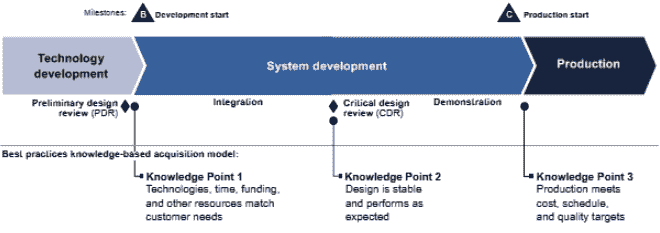
来源：GAO 对 DOD 提供的數據、DOD 指令 5000.02 和最佳实践的分析。| GAO-18-360SP.
国防部（DOD）采购流程。

## DOD 2017 年组合在成本和规模上均有所增长：自 2010 年以来启动的项目表现出更好的成本绩效
DOD 2017 年的主要武器项目组合在成本和规模上均有所增长。GAO 的分析显示，自 2010 年以来启动的项目在 2016 年至 2017 年间的成本绩效优于组合的其余部分——估计减少 56 亿美元，而增加 603 亿美元。尚难判断这种绩效是否会持续并遏制未来的成本增长。未来的成本结果取决于这些项目进入生产后的表现，而成本增长在此时最为普遍。（见图。）

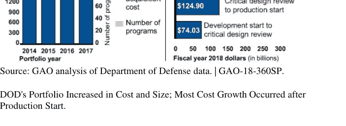
来源：GAO 对国防部数据的分析。| GAO-18-360SP.
DOD 组合在成本和规模上均有所增加；大部分成本增长发生在生产启动后。

## 实施促进合同竞争的采购策略的项目报告称总采购成本估算下降
实施促进竞争的采购策略（包括合同的竞争性授予）的项目报告称，与其他项目相比，其总采购成本估算有所下降。2010 年，DOD 实施了改革，其中一些旨在增加竞争以提高可负担性和效率。

| 与三个关键知识点（KP）相关的实践 | GAO先前评估的已完成KP的37个项目 | GAO在2018年评估的最近完成KP的8个项目 |
|---|---|---|
| 展示所有关键技术已在相关环境中接近最终形态、装配和功能 | ◐ | ● |
| 展示所有关键技术在实际环境中达到形态、装配和功能要求 | ○ | ● |
| 在系统开发启动前完成初步设计评审 | ◐ | ○ |
| 将至少90%的设计图纸发布到制造环节 | ○ | ● |
| 测试系统级集成原型 | ○ | ○ |
| 展示关键制造过程处于统计受控状态 | ○ | ○ |
| 在试验生产线上展示关键过程 | ◐ | ● |
| 在预定环境中测试生产代表性原型 | ○ | ◐ |

完成各项最佳实践的项目 ● 75% - 100%；◐ 50% - 74%；○ 0% - 49%。

## 国防部项目仍未完全落实基于知识的关键采办实践。

随后，GAO观察到，各个项目已采取措施实施促进竞争性采办战略。在今年的评估中，授予开发、测试或生产合同的项目中，61%是通过竞争性方式授予的。与之前的评估一样，国防部项目仍未完全落实基于知识的采办实践。GAO观察到，45个当前项目中的大多数已进入系统开发阶段，通过关键设计评审，并进入生产阶段，但尚未完成与这三个关键点相关的关键知识实践。（见表。）此外，GAO审查的12个未来项目中，几乎所有项目都尚未纳入国防部；来自项目主承包商的分包报告在电子分包报告系统（eSRS）中被接受。⁷这一分析的结果见附录一。

本章中的观察结果基于三类项目：

- 我们评估了国防部2017年项目组合中的86个重大国防采办项目（MDAP）的成本与进度绩效。⁸我们获取了国防部2016年12月《选择性采办报告》（SAR）中的成本、进度和数量数据——这些数据详细列出了初始成本、进度和绩效基线及过去一年的变化——以及国防部项目数据存储库“国防采办管理信息检索系统”（DAMIR）中的数据。我们通过比较录入武器系统数据库的SAR数据与DAMIR数据，自行评估了数据可靠性，并确定这些数据对于我们的报告目的而言足够可靠。

- 我们还评估了45个目前处于开发启动至生产早期阶段之间的MDAP。我们编制了一份问卷，以获取这些项目在技术成熟度、设计稳定性和生产就绪性方面遵循基于知识采办实践的程度。问卷要求项目提供有关系统工程、设计图纸、制造规划与执行以及具体采办改革实施情况的信息。此外，问卷还要求项目提供关于进度安排、关键技术水平、重大

⁷ 政府使用电子分包报告系统中的单项分包报告作为监督小企业参与情况的一种方法，因为该报告包含小企业分包目标。

⁸ 重大国防采办项目（MDAP）是指由国防部认定为重大国防采办的项目，或其所有增量按2014财年不变美元计算，预计最终研发、测试与评估总支出超过4.8亿美元，或采购总支出超过27.9亿美元的项目。国防部保留了一份被指定为未来重大国防采办项目的清单。这些项目尚未被正式指定为MDAP；但国防部计划让这些项目进入系统开发，或绕过开发直接开始生产，届时国防部很可能会将其指定为MDAP。在本报告中，我们将这些项目称为未来或计划中的重大国防采办项目。

本章中，我们将这三个阶段更简单地称为技术开发、系统开发和量产。项目通常要完成一系列里程碑评审和其他关键决策点，这些决策点授权进入新的采办阶段。

我们的系列工作表明，在产品开发过程中做出重大承诺之前获得高水平知识可带来积极的采办成果。^10我们发现，为降低风险，项目在进入下一个采办阶段之前，应在三个关键节点展示关键水平的知识：开发启动、系统级关键设计评审和生产启动。图1将国防部指令5000.02中描述的采办里程碑（该指令为采办项目的管理制定了政策）与这三个关键决策点进行了对应。

与这三个节点相关的知识会随着时间的推移而积累。我们先前关于基于知识方法的工作表明，项目早期知识不足会产生连锁反应，贯穿设计和生产阶段，使决策者在决定是否以及如何进入需要更多预算资源的后续采办阶段时缺乏知识支持。在基于知识的方法下，展示技术成熟度是进入系统开发阶段的前提，该阶段的重点应放在设计和集成上。同样，稳定成熟的设计也是进入生产阶段的前提，该阶段的重点应放在高效制造上。附录三提供了每个知识节点关键实践的更多细节。

^10 美国政府问责局（GAO），*最佳实践：国防部可通过标准化制造风险管理方式取得更佳成果*，GAO-10-439（华盛顿特区：2010年4月22日）；*最佳实践：关键点上的高水平知识使商业造船区别于海军造船*，GAO-09-322（华盛顿特区：2009年5月13日）；*国防采办：基于知识的资助方法可改善重大武器系统项目成果*，GAO-08-619（华盛顿特区：2008年7月2日）；*最佳实践：尽早获取设计与制造知识可改善采办成果*，GAO-02-701（华盛顿特区：2002年7月15日）；*最佳实践：更好地匹配需求与资源将带来更佳的武器系统成果*，GAO-01-288（华盛顿特区：2001年3月8日）；以及*最佳实践：更好地管理技术开发可改善武器系统成果*，GAO/NSIAD-99-162（华盛顿特区：1999年7月30日）。

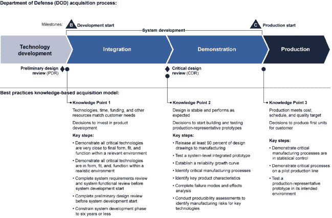

资料来源：GAO对国防部提供数据、国防部指令5000.02及最佳实践的分析。| GAO-18-360SP。

图1. 国防采办周期与GAO识别的知识节点。

我们的工作产生了多项建议，国防部总体上或部分同意，并在实施方面取得了进展。例如，我们先前的工作建议国防部确保项目在启动开发之前进行初步设计评审，而国防部的政策现在已体现了这一点。此外，我们的工作影响了国防部和国会内部为解决国防采办系统挑战所做的努力——主要是开发和制造执行国防部各项任务与行动所需系统的时间更长、成本更高。值得注意的是，《2009年武器系统采办改革法案》（WSARA）旨在改进国防部采办重大武器系统的方式，并纳入了我们的许多相关建议。[^11] WSARA修订了项目在获准启动系统开发前应完成的认证。目前，项目需要做出某些决定并

[^11]：《公法》第111-23号。

认证他们在进入系统开发之前已满足以下要求（其中包括）。[^12]

- 该项目已在成本、进度和性能目标之间进行了适当的权衡；
- 该项目已通过初步设计评审和正式的初步设计评审后评估，证明其很可能完成预期任务；并且
- 国防部研究与工程部副部长已独立核实关键技术已成熟并在相关环境中得到验证。[^13]

2010 年，DOD 启动了其自身的采购改革举措，如其“更好采购力量”备忘录所述。[^14] 这些改革包括要求项目开展可负担性和“应有成本”分析，以鼓励项目经理寻找成本节约。[^15]

[^12] 该要求经修订后以 10 U.S.C. § 2366b 的形式编纂。自 2009 年底实施 WSARA 以来，国会已修订或废除了其部分原始要求。例如，《2016 财年国防授权法》废除了项目在开始系统开发前进行竞争性原型制作的要求。Pub. L. No. 114-92, § 822(b)。现在，项目采购战略通常应在最大可行范围内并与经济使用可用财政资源一致的情况下，在系统开发开始前包括使用竞争性原型。10 U.S.C. § 2431b(c)。

[^13] 在相关环境中演示为技术成熟度等级（TRL）6。在作战环境中演示为 TRL 7，这是 GAO 知识型采购实践工作确定的开始产品开发项目低风险的成熟度水平。有关 TRL 的详细描述，请参阅附录 VI。此外，主要防务采购项目通常在里程碑决策机构证明该项目中的技术已在相关环境中得到验证之前，不得获得开发启动批准。10 U.S.C. § 2366b(a)(2)。在某些情况下，此要求可被豁免。Id. § 2366b(d)。

[^14] DOD 的“更好采购力量”备忘录是一项旨在加强 DOD 采购实践、提高行业生产力并为作战人员提供可负担的军事能力的举措。据 DOD 称，它涵盖了一套基本采购原则，通过可负担性、成本控制、消除无生产力的流程和官僚主义以及促进竞争来实现更大效率。

[^15] 可负担性分析通过在大量资源投入之前根据对未来需求的合理预测，审视当今能力需求选择和投资决策的影响，从而促进负责任和可持续的投资决策。“应有成本”分析为整个采购生命周期内所有成本的管理以及与行业就合同成本和激励措施进行的谈判提供信息。“应有成本”...

我们的工作表明，DOD 通过其第 5000.02 号指令，已纳入 WSARA 和其他举措，以解决健全的管理实践，例如现实的成本估算、原型使用和系统工程。

## 关于 DOD 2017 年主要防务采购项目投资组合成本和进度绩效的十项观察

我们对 DOD 2017 年 MDAP 投资组合的分析显示，自 2010 年以来启动的项目表现优于投资组合的其余部分，并在 2016 年至 2017 年间实现了 56 亿美元的成本下降。然而，这些节约不足以避免去年整个投资组合 547 亿美元的总体成本增加，其中大部分是由于数量增加所致。目前还为时过早，无法判断这些节约是否能在未来几年遏制这种增长水平。随着更多 2010 年后开始的项目进入生产，我们可能会对这一前景获得更多可见性。

## DOD 2017 年投资组合在项目数量和成本方面均有所增长

- 1. 2017 年投资组合由 86 个项目组成，采购成本将超过 1.66 万亿美元。¹⁶
- 2017 年有三个项目退出投资组合，因为它们完成了计划采购或被取消，并新增了 11 个新项目，这导致投资组合中的项目数量达到 2011 年以来最多。图 2 显示了 2016 年至 2017 年间退出的和进入的项目。

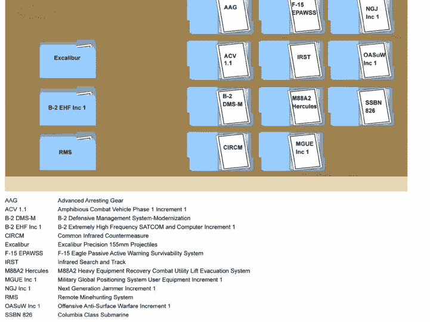

| 缩写 | 描述 |
|---|---|
| AAG | 先进拦阻装置 |
| ACV 1.1 | 两栖作战车辆第1阶段增量1 |
| B-2 DMS-M | B-2 防御管理系统现代化 |
| B-2 EHF Inc 1 | B-2 极高频卫星通信和计算机增量1 |
| CIRCM | 通用红外对抗措施 |
| Excalibur | 埃克斯卡利伯精确155毫米炮弹 |
| F-15 EPAWSS | F-15 鹰式被动主动告警生存系统 |
| IRST | 红外搜索与跟踪 |
| M88A2 Hercules | M88A2 重型装备回收战斗通用升降撤离系统 |
| MGUE Inc 1 | 军用全球定位系统用户设备增量1 |
| NGJ Inc 1 | 下一代干扰机增量1 |
| RMS | 远程扫雷系统 |
| OASuW Inc 1 | 进攻性反水面作战增量1 |
| SSBN 826 | 哥伦比亚级潜艇 |

来源：GAO 对国防部数据的分析。| GAO-18-360SP.

图 2. 2016 年至 2017 年间 DOD 主要防务采购项目投资组合的增减。

- DOD 净增加八个项目是 2017 年投资组合总成本变化 1640 亿美元的促成因素之一，并在 2010 年至 2017 年间 4 年年度成本下降后一年小幅增加的情况下，标志着连续第二年增长。

图 3 显示了今年投资组合的项目数量和总成本与往年的比较。

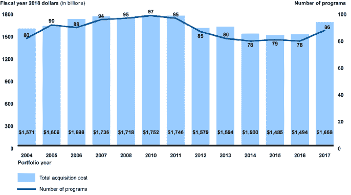

来源：GAO 对国防部数据的分析。| GAO-18-360SP.

注：DOD 在 2009 年未发布选定采购报告 (SAR)，这使我们无法获得将 2009 年纳入本分析所需的成本基线信息。

### 图 3. 自 2016 年以来 DOD 投资组合成本和规模有所增加，但仍在历史范围内。

- 对于下面详细说明的其他分析，我们将 11 个进入 2017 年投资组合的项目的首次完整估算添加到 2016 年投资组合中。我们还从 2016 年至 2017 年退出投资组合的三个项目中减去了相关资金。我们采取这些步骤是为了在衡量成本和进度差异之前使两个投资组合具有可比性。
- 在这种方法下，过去一年中，这些项目的 DOD 成本估算增加了 547 亿美元，或 3.4%，其中约 477 亿美元归因于数量增加。
- 这意味着 70 亿美元的成本增加很可能由完成若干项目的开发和采购所需的时间和工作量增加所导致。

- 与去年相比，2017 年投资组合的开发成本增加了 88 亿美元，采购成本增加了 454 亿美元。[^17]

> 海军的 MQ-4C Triton 无人机系统和 P-8A Poseidon 多任务海上飞机以及空军的下一代作战控制系统这三个项目占开发成本总增加额的 35 亿美元，或近 40%。海军的 SSN 774 Virginia 级潜艇一个项目由于采购数量增加，占采购成本增长总额的 380 亿美元，或近 84%。
> 
> 来源：GAO 对国防部 (DOD) 数据的分析。| GAO-18-360SP.

- 此外，2017 年投资组合提供能力的平均时间在过去一年中增加了略多于一个月——与我们审查的前两个投资组合中出现的延迟相比有所改善。

表 1 详细说明了当前投资组合的资金变化和提供初始能力的平均周期时间。

附录 IV 概述了过去一年、5 年以及自首次完整估算以来各项目的成本绩效。附录 V 提供过去 5 年以及自项目首次完整估算以来投资组合层面的成本和进度变化信息。

- 43 个项目，或 2017 年投资组合的一半，发生了总计 748 亿美元的成本增长（其中 477 亿美元是由于数量增加），而另外 43 个项目经历了总计 201 亿美元的成本下降。
- 大多数项目的成本变化在 0 到 5% 之间，无论是下降还是增加。

[^17] 此外，2017 年投资组合还包括总计 5 亿美元的军事建设和采购运营维护成本。

### 表1. 国防部估计其2017年项目组合比2016年项目组合成本更高、交付时间更长

**2018财年美元，单位：十亿美元**

|  | 2016年项目组合估计值a | 2017年项目组合估计值 | 2016年至2017年的净变化 | 2016年至2017年的百分比变化 |
|---|---:|---:|---:|---:|
| 研发成本估算总额 | 305.2 | 313.9 | 8.8 | 2.9 |
| 采购成本估算总额 | 1,284.6 | 1,330.0 | 45.4 | 3.5 |
| 采办成本估算总额b | 1,603.1 | 1,657.8 | 54.7 | 3.4 |
| 交付初始能力的平均周期时间（月） | 121.7 | 123.0 | 1.3 | 1.1 |

资料来源：GAO 对国防部（DOD）数据的分析。 | GAO-18-360SP。

a对于2016年项目组合，我们纳入了进入2017年项目组合的11个项目的首次完整估计，金额为1323亿美元，并扣除了2016年至2017年间退出项目组合的3个项目的232亿美元。这些调整使得两个项目组合在成本和进度差异的度量上具有可比性。

b除研发和采购成本外，采办成本总额还包括与采办相关的运行与维护费用，以及特定系统的军事建设费用。

我们确定了三个成本变化超过25%的项目，其中两个主要由数量变化驱动：

- 海军的SSN 774弗吉尼亚级潜艇，因数量增加而导致成本增长40.6%；
- 空军的下一代作战控制系统，在数量未增加的情况下成本增长了25.4%；
- 空军的F-15“鹰”式无源/有源告警与生存能力系统，因数量减少而将计划成本降低了39.3%。

资料来源：GAO 对国防部（DOD）数据的分析。 | GAO-18-360SP。

图4显示了各项目从2016年到2017年的采办总成本变化，按百分比变化区间分布，且不考虑数量变化的影响。

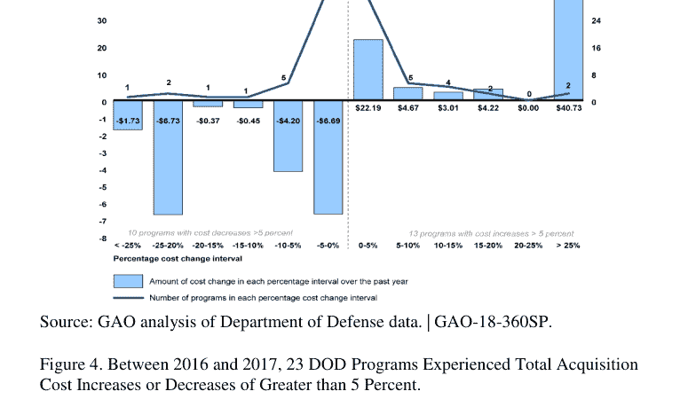

资料来源：GAO 对国防部（DOD）数据的分析。 | GAO-18-360SP。

### 图4. 2016年至2017年间，国防部有23个项目的采办总成本增减幅度超过5%。

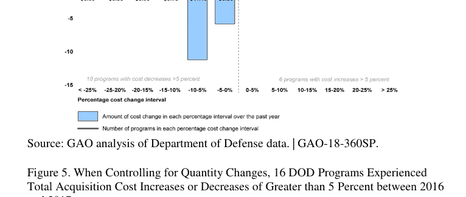

资料来源：GAO 对国防部（DOD）数据的分析。 | GAO-18-360SP。

### 图5. 在控制数量变化后，2016年至2017年间国防部有16个项目的采办总成本增减幅度超过5%。

图5显示了各项目从2016年到2017年的采办总成本变化（非因数量变化引起），并按百分比变化区间分布。

## 国防部2017年项目组合的购买力有所增强

### 表2. 组成国防部2017年项目组合的各项目自2016年以来购买力增加了23亿美元

**2018财年美元，单位：百万美元**

| 项目 | 项目数量 | 自2016年以来的实际采购成本变化 | GAO计算的归因于数量变化的成本变化 | GAO计算的非归因于数量变化的成本变化 |
|---|---:|---:|---:|---:|
| 购买力增强 | 51 | 25,243.10 | 45,497.35 | -20,254.25 |
| 采购成本下降且数量无变化 | 31 | -6,295.70 | 0.00 | -6,295.70 |
| 数量增加但成本增幅低于预期 | 14 | 39,933.88 | 52,531.44 | -12,597.56 |
| 数量减少但成本降幅高于预期 | 6 | -8,395.08 | -7,034.09 | -1,360.99 |
| 购买力下降 | 29 | 20,182.98 | 2,191.24 | 17,991.74 |
| 采购成本上升且数量无变化 | 21 | 5,716.15 | 0.00 | 5,716.15 |
| 数量增加且成本增幅高于预期 | 5 | 14,428.03 | 3,386.03 | 11,042.00 |
| 数量减少但成本降幅低于预期 | 3 | 38.80 | -1,194.79 | 1,233.59 |
| 购买力无变化 | 6 | 0.00 | 0.00 | 0.00 |
| 项目组合总计 | 86 | 45,426.08 | 47,688.59 | -2,262.51 |

资料来源：GAO 对国防部（DOD）数据的分析。 | GAO-18-360SP。

注：我们通过将实际采购成本变化与我们计算的归因于数量增加或减少的成本变化进行比较，来计算购买力。为此，我们将数量变化乘以项目的采办采购单位成本。

2. 自去年的评估以来，国防部2017年项目组合中的项目总共实现了23亿美元的购买力提升——这意味着国防部在同等资金水平下能够购买更多的商品或服务。然而，这一提升显著低于2016年项目组合所实现的107亿美元购买力提升。

购买力是指在给定资金水平下可以购买的商品或服务数量。要确定购买力的变化，必须将数量变化的影响与影响成本的其他因素分离开来。

- 项目成本可能因数量增加而上升。虽然这确实代表成本增加，但并不一定表明存在采办问题或购买力丧失。或者，项目成本可能因数量减少而下降，但仍可能出现购买力的提升或下降。

表2详细列出了2017年项目组合所反映的购买力变化。负数表示成本降低且购买力提升。正数表示相反的情况。

## 未来资金需求有所增加

3. 完成2017年项目组合计划开展的研发和采购活动所需的未来资金总额为6933亿美元——比去年的项目组合增加了近1080亿美元。

虽然今年未来资金需求的增长在一定程度上可由新增的11个项目来解释，但这也标志着我们过去3年所报告的研发和采购未来资金需求均下降的趋势发生了逆转。

- 未来资金详细说明了在当前财年之后，所有项目为完成研发和采购全部计划数量所需的投资额。

- 在2017年项目组合的未来资金需求中，384亿美元用于研发，6549亿美元用于采购。

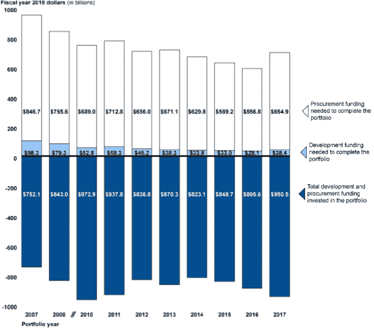

资料来源：GAO 对国防部（DOD）数据的分析。 | GAO-18-360SP。

注：国防部未在2009年发布选定采办报告（SAR），这使我们无法获得将2009年纳入本分析所需的成本基线信息。

图6. 国防部2017年项目组合显示资金需求和沉没成本的变化，表明项目在采办进程中走得更远。

- 未来研发所需的384亿美元比去年评估增加了103亿美元，而且除了新增项目这一因素外，还可能表明现有项目增加了风险更高的额外需求、采用了更复杂的采办方法，或依赖于成熟度较低的技术。尽管如此，2017年项目组合的研发和采购未来资金需求比2007年项目组合十年前估计所需的金额减少了2517亿美元。

- 值得注意的是，2007年项目组合的沉没成本低于其未来资金需求。当前项目组合的这一比例已发生逆转。2017年项目组合的沉没成本现在与2011年（采办改革实施后不久）的水平大致相同。

- 此外，当前项目组合所需的未来研发资金比2007年项目组合的所需金额少了60%（384亿美元对983亿美元）。这一下降表明，平均而言，当前项目组合中的项目在采办进程中的进展可能比2007年项目组合在相同时点的项目更深。

图6进一步比较了2007年至2017年各年度当前项目组合与往年度项目组合之间的成本差异。

### 4. 达到1年和5年成本增长指标的国防部项目减少了，但当前超过一半的项目自初始估算以来的成本增长低于15%。

2008年12月，GAO、国防部以及行政管理和预算局就一套衡量国防部项目成本随时间增长的指标达成一致，我们自2011年以来一直在报告这些指标。尽管国防部不再支持使用这些指标，我们仍然认为现行指标具有价值。

- 这些指标衡量三个规定时间段内的成本表现：前一年、前5年，以及自首次完整估算建立以来的表现。如果项目超出这些指标，则意味着其成本增长高于正常水平；如果高比例的项目超出这些指标，则表明项目组合成本增长过度。对于国防部2017年项目组合，我们观察到：

- 过去一年成本增长低于 2%：66% 的项目达到这一指标，较去年组合中的 72% 下降。这延续了自 2012 年以来持续下降的总体趋势。
- 过去 5 年成本增长低于 10%：72% 的项目达到这一指标，较去年组合中的 78% 下降。这与 2012 年相比有显著改善。
- 自首次完整估算以来成本增长低于 15%：52% 的项目达到这一指标，这较追溯至 2012 年的所有以往组合有所改善。
- 这些结果表明，某些项目的短期成本增长正在增加，而长期成本增长正在放缓。
- 图 7 说明了 2017 年组合在上述三个指标方面的表现，以及该表现与 2012 年以来其他组合的比较情况。

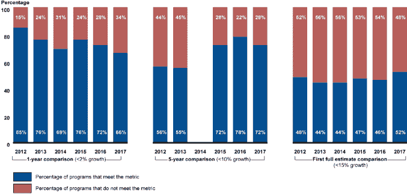

来源：GAO 对国防部数据的分析。| GAO-18-360SP.

注：DOD 在 2009 年未发布选定采购报告，这使我们无法获得评估 2014 年组合 5 年表现所需的成本基线信息。

### 图 7. DOD 2017 年组合在 1 年和 5 年成本增长指标方面的表现有所下降，但在满足自首次完整估算以来的成本增长指标方面显示出改善。

附录 IV 提供了对本分析有所参考的各个项目历史成本表现的额外详细信息。

5. 2017 年组合自原始估算以来已产生约 5370 亿美元的成本增长。然而，其中 4640 亿美元的增长发生在 5 年或更早之前。2017 年组合在项目开始生产后实现了 51% 的成本增长，即 2720 亿美元。

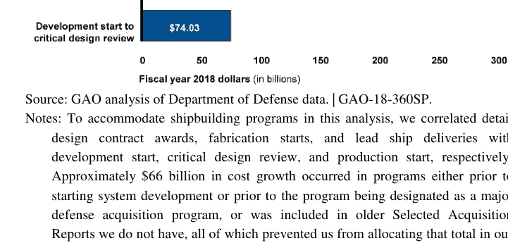

来源：GAO 对国防部数据的分析。| GAO-18-360SP.

注：为适应本分析中的造船项目，我们将详细设计合同授予、制造启动和首舰交付分别与开发启动、关键设计评审和生产启动相对应。大约 660 亿美元的成本增长发生在项目启动系统开发之前或项目被指定为主要国防采购项目之前，或包含在我们没有的较旧选定采购报告中，所有这些都妨碍了我们在分析中分配该总额。

### 图 8. DOD 2017 年组合中的项目在生产启动后产生了大部分成本增长。

DOD 2017 年组合中反映的总采购成本增长的约 86% 发生在 2012 年之前。

- 我们观察到，2017 年组合的成本在项目采购周期内持续增长，且大部分成本增长发生在项目开始生产之后。
- 我们之前的工作表明，生产期间发生的成本增加可能表明项目在获得与技术成熟度、设计稳定性和生产准备相关的重要知识之前就进入了生产。在其他情况下，生产成本增长可归因于增加数量或改善能力的决策，通常是在 DOD 制定并批准项目首次完整估算多年之后。
- 我们的分析发现，DOD 2017 年组合中的 86 个项目中有 62 个处于生产阶段。

图 8 显示了 2017 年组合在各个采购阶段的成本增长情况。

## 自 2010 年以来启动的项目目前表现出比老项目更好的成本表现

6. DOD 自 2010 年以来启动了 25 个项目，当时政府实施了重大的采购改革。这 25 个项目占当前组合中 86 个项目的 29%，但仅占组合总采购成本的约 15%。

当前组合可分为两个子组合——DOD 自 2010 年以来启动的 25 个项目和 2010 年之前启动的 61 个项目。自 2010 年以来启动的 25 个项目遵循了纳入 WSARA 改革和“Better Buying Power”倡议的更新程序。

- 2010 年后子组合的总采购成本较低，部分原因可能是这些项目所采用的采购战略。例如，采用风险较低、复杂度较低的系统开发方法——如现有能力的增量更新或基于可负担性的能力权衡——的采购战略可以产生更好的成本结果。

图 9 说明了当前组合的总采购成本如何在 2010 年之前和之后开始的项目之间分配，并与 DOD 最大的采购项目——于 2001 年进入开发的 3550 亿美元 F-35 Lightning II 联合攻击战斗机进行了比较。

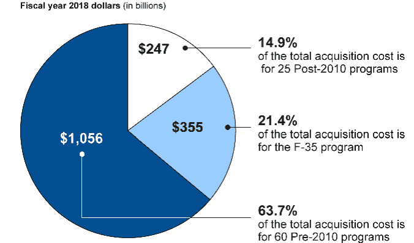

来源：GAO 对国防部数据的分析。| GAO-18-360SP.

### 图 9. 2017 年组合估计总采购成本的 85% 以上用于 DOD 于 2010 年前启动的 61 个项目。

7. 我们对 2017 年组合的分析显示，2010 年之前和之后开始的项目在成本表现上存在差异。我们发现 DOD 当年开始实施的采购改革是成本变化的驱动因素。

2015 年 12 月至 2016 年 12 月期间：

- 总体而言，自 2010 年以来启动的项目的子组合将其估计总采购成本减少了 56 亿美元。
- 2010 年前启动的项目的子组合估计总采购成本累计增加 603 亿美元。
- 与此同时，2010 年前启动的项目的子组合交付能力的平均时间增加了不到 1 个月，而自 2010 年以来启动的项目的子组合增加了 2.6 个月。这种差异可能归因于

### 表 4. DOD 估计其 2017 年于 2010 年前启动的项目子组合的成本将高于 2016 年，且交付时间略有延长

财政年度 2018 年美元，单位：十亿美元

|  | 2016 年子组合估计值a | 2017 年子组合估计值 | 2016 年至 2017 年净变化 | 2016 年至 2017 年百分比变化 |
| --- | ---: | ---: | ---: | ---: |
| 总估计研发成本 | 252.0 | 259.8 | 7.9 | 3.1 |
| 总估计采购成本 | 1,088.8 | 1,140.6 | 51.8 | 4.8 |
| 总估计采购成本b | 1,350.7 | 1,411.0 | 60.3 | 4.5 |
| 交付初始能力平均周期时间（月） | 133.9 | 134.8 | 0.9 | 0.7 |

来源：GAO 对国防部（DOD）数据的分析。| GAO-18-360SP.

a 对于 2016 年子组合，我们纳入了进入 2017 年子组合的 2 个于 2010 年前启动的项目的 54 亿美元首次完整估算，并减去 2016 年至 2017 年间退出子组合的三个项目的 232 亿美元。这些调整使子组合在成本和进度差异测量方面具有可比性。

b 除研发和采购成本外，总采购成本还包括采购相关运营和维护成本以及系统特定军事建设成本。

在 2017 财年，我们将 WSARA 实施后 5 年期间武器系统开发项目的成本增长与该法案实施前 10 年期间进行了比较——估计开发成本增长率减少了约 75%，即 360 亿美元。虽然不能确定该法案的实施是成本增长减少的唯一原因，但我们发现它是主要驱动因素。18

8. 在 2016 年至 2017 年间，类似比例的 DOD 项目（2010 年前和之后启动）经历了 5% 或更少的成本变化。然而，这些 1 年成本变化在平均水平上在 2010 年后启动的项目中较小。

两个子组合（2010 年前和 2010 年后）中的少数项目推动了 2017 年组合内大部分的总体成本变化。

这些项目包括：

- 2010 年后项目：空军下一代作战控制系统、F-15 鹰型被动/主动告警生存系统和 KC-46A 加油机现代化项目。
- 2010 年前项目：海军濒海战斗舰和 SSN 774 Virginia 级潜艇以及全 DOD 的 F-35 Lightning II 联合攻击战斗机项目。

来源：GAO 对国防部（DOD）数据的分析。| GAO-18-360SP.

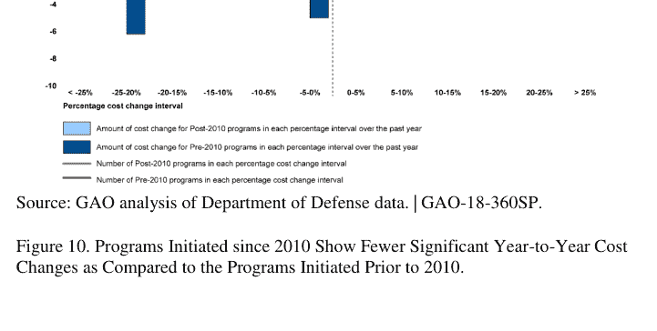

来源：GAO 对国防部数据的分析。| GAO-18-360SP.

### 图 10. 与 2010 年前启动的项目相比，自 2010 年以来启动的项目显示出更少的显著年度成本变化。

图10详细说明了过去一年内两个子投资组合中总采购成本变化在各百分比区间内的分布情况。

- 在控制数量变化的情况下，自2010年以来启动的项目成本减少了42亿美元，而较早的项目则产生了112亿美元的成本增加。这再次表明，在较短的时间内，自2010年以来启动的项目比较早的项目更有效地管理了成本增长。

图11也详细说明了过去一年内两个子投资组合中总采购成本变化的分布情况，但控制了数量变化。

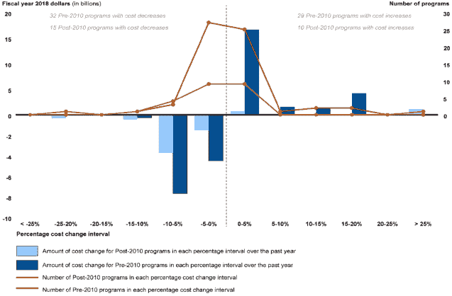

来源：GAO 对国防部数据的分析。| GAO-18-360SP。

**图11.在控制数量变化的情况下，自2010年以来启动的项目总体成本下降，而2010年之前启动的项目总体成本上升。**

- 两个子投资组合之间购买力表现的差异可能表明，采购改革可能正在以新项目成本效率的形式产生回报。

表5详细说明了上述子投资组合中反映的购买力变化。负数表示成本下降和购买力增加。正数表示相反情况。

10. 自2010年以来启动的项目的当前成本估算已从其原始估算中下降。这些项目在关键设计评审和生产启动后均经历了成本下降。

国防部自2010年以来启动的项目当前子投资组合实现了成本和进度结果，与项目原始估算累积衡量相比，表现优于其他国防部项目。

- 这25个项目实现了2.1%或53亿美元的成本下降，与其原始估算相比，交付能力平均延迟9个月。
- 相比之下，国防部其他61个项目（全部于2010年之前启动）自这些项目制定原始估算以来，经历了62.4%或5,421亿美元的成本增长，以及平均总计35个月的进度延迟。
- 自2010年以来启动的项目中有40%（25个中的10个）处于生产阶段，而2010年之前启动的项目中有85%（61个中的52个）处于生产阶段。
- 2010年之前启动的项目经历的累积成本增长发生在采购过程的所有阶段，尽管大部分发生在生产启动之后。

相反，我们观察到自2010年以来启动的项目在较短的时间内，在关键设计评审和生产启动后降低了计划成本，在关键设计评审前仅有少量成本增长（2.68亿美元）。重要的是要认识到，随着时间的推移，这一成本趋势可能会逆转，因为许多2010年后的项目仍处于生产早期阶段或尚未开始生产。

图12提供了有关2010年之前和2010年以来启动的项目子投资组合的这些成本变化的具体信息。

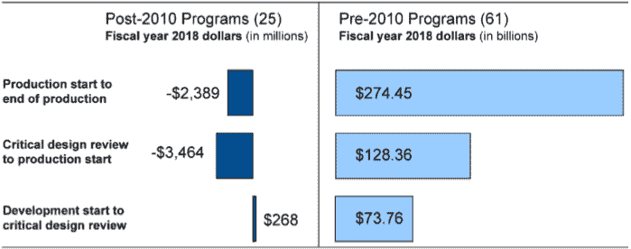

来源：GAO 对国防部（DOD）数据的分析。| GAO-18-360SP。

注：为适应本分析中的造船项目，我们将详细设计合同授予、制造启动和首舰交付分别与开发启动、关键设计评审和生产启动相关联。大约660亿美元的成本增长发生在项目启动系统开发之前或项目被指定为主要国防采购项目之前，或包含在我们没有的较旧的选定采购报告中，所有这些都妨碍了我们在分析中分配该总额。

**图12.国防部2017年投资组合中自2010年以来启动的项目在关键设计评审前产生了其成本增长，而2010年之前启动的项目在生产后产生了大部分成本增长。**

## 对国防部实施关键采购改革举措的四项观察

我们观察到，那些始终实施采购改革举措的武器采购项目——例如可负担性约束、“应付成本”分析以及在项目生命周期内促进竞争的采购策略——往往获得购买力，并在平均而言报告较少的成本增长，而不实施这些举措的项目则不然。今年，我们对57个选定项目的分析显示，项目已持续实施促进竞争的措施。然而，今年评估中授予开发、测试或生产合同的项目中，只有61%以竞争方式授予。报告称通过竞争性授予合同实施促进竞争的采购策略的当前项目，在考虑数量变化后，平均而言报告的项目总体估算采购成本增长低于其他项目。虽然我们的分析仅限于本次评估，但这些项目的信息显示，估算总采购成本增长的减少与项目使用促进竞争的采购策略之间可能存在相关性。我们今年还观察到，可负担性约束和“应付成本”分析的有效性有所下降的迹象，尽管这些举措在很大程度上尚未得到充分检验。因此，尚为时过早断定我们今年观察到的变化是否会长期持续。

### 大多数项目计划在采购过程中促进竞争，这可以改善最终获得购买力收益的前景

1. 我们评估的57个当前和未来项目中，55个报告称他们打算在采购过程中促进竞争，而2个未来项目报告称他们目前在开发启动前或后均无竞争计划。

项目办公室报告称他们使用的促进竞争的措施，除其他外包括以下内容：

- 使用“模块化开放架构”，重点是设计高度内聚、松散耦合且可分离的模块，用于系统，可分别竞争并从独立供应商处采购；
- 获取承包商的“技术数据包”，可能为政府提供生产和支持系统所需的图纸和规范；
- 竞争性原型；
- 制造双来源；和
- 未来升级的竞争。
- 正如我们先前发现的那样，竞争是实现政府投资最佳回报的关键工具。¹⁹ 国防部持相同观点，并报告称竞争是采购改革的核心原则，也是激励承包商提供最佳价值的唯一最佳方式。
- 没有当前竞争计划的两个未来项目——空军的B-2极高频卫星通信和UH-1N通用直升机替换项目——随着它们在采购过程中推进以及采购策略不断演变，可能改变其促进竞争的计划。

**表6.国防部2017年投资组合中57个选定项目促进竞争的计划**

|  | 未来12个项目 | 当前45个项目 | 合计 |
|---|---|---|---|
| 计划促进竞争的项目数量 | 10 | 45 | 55 |
| 在整个采购生命周期内 | 3 | 28 | 31 |
| 仅在系统开发启动前 | 2 | 5 | 7 |
| 仅在系统开发启动后 | 5 | 12 | 17 |
| 不计划促进竞争的项目数量 | 2 | 0 | 2 |

来源：GAO 对国防部（DOD）数据的分析 | GAO-18-360SP。

计划促进竞争的55个项目的总数较去年的评估有所增加，当时只有41个项目表示此类计划。表6概述了当前和未来项目计划促进竞争的程度和时间。

2. 授予开发、测试或生产合同的项目中，61%报告称实施了包括竞争性授予合同在内的促进竞争的采购策略。总体而言，在考虑数量变化后，竞争性授予合同的当前项目自去年以来以及与初始成本估算相比，所产生的估算总采购成本增长低于其他项目。

国防部指令5000.02通常要求项目制定采购策略，说明项目管理将如何从项目启动到维持期间创造和维持竞争环境。²⁰

- 57个当前和未来项目中有46个报告称使用竞争性或非竞争性程序授予产品开发、测试、初始生产或生产的合同。其他11个项目尚未授予此类活动的任何合同，因为它们主要尚未启动系统开发。²¹
- 在这46个项目中，28个报告称竞争性授予开发、测试或生产的合同，而18个项目报告称非竞争性授予合同。
- 在控制数量变化后，我们的分析显示，报告称实施采购

采用包括授予竞争性合同在内的促进竞争策略的项目，自2016年以来其估计的总采购成本平均下降了6700万美元。相反，授予非竞争性合同的当前项目，其估计的总采购成本自2016年以来平均增加了5000万美元。

- 我们的分析在将当前项目与其原始成本估算进行比较时显示出类似趋势。具体而言，在控制数量变化后，采用包括授予竞争性合同在内的促进竞争采购策略的当前项目，其总采购成本平均下降了10.1亿美元。另一方面，报告称其合同以非竞争方式授予的当前项目，其总采购成本平均增加了35.6亿美元。
- 估计总采购成本上述减少情况的一个显著例外是全军范围的F-35闪电II联合攻击机项目，该项目授予了竞争性开发合同，但在开发期间出现了显著的项目成本增长。我们已将F-35项目从本次分析中排除。22

### 具有可负担性约束和“应付成本”分析的项目在成本控制方面取得进展，但约束的有效性仍未得到检验

3. 我们评估的57个当前和未来项目中，34个报告称其在可负担性约束下运作，另外23个没有。其中34个设有可负担性约束的项目中，除一个外，其余均报告称正按计划保持在已确定的成本约束之下。

国防部指令5000.02要求国防部各部门在采购流程早期为主要防务采购项目制定全生命周期可负担性目标，并在开始系统开发前设定可负担性上限。这些目标和上限也称为约束，应以采购单价和保障成本来表述。

可负担性约束旨在确保能力需求的优先排序和成本权衡尽可能早地发生并贯穿项目的整个生命周期，以及防止不可负担的项目进入或留在采购流程中。国防部政策规定，当已批准的可负担性约束无法满足时，项目的技术要求、进度和所需数量必须由国防部重新审视。根据该政策，如果项目仍无法满足其约束，且国防部无法通过获得在其他地方降低约束的批准来提高项目的可负担性约束，则项目应被取消。

- 未建立可负担性约束的23个项目包括：
  - 尚未开始系统开发的，
  - 在可负担性约束要求之前已进入生产的，
  - 目前在立法规定的成本上限下运作的，或
  - 是非标准项目或仅开发项目且无计划采购阶段的项目。
- 在报告已建立可负担性约束的34个项目中，33个目前在已确定的约束范围内执行。
- 唯一未报告其绩效符合可负担性约束的项目是空军的下一代作战控制系统。
- 可负担性约束的有效性尚未得到广泛检验，使用可负担性约束并不能阻止项目发生成本增长。事实上，在排除全军范围的F-35闪电II联合攻击机项目后，我们观察到其他33个具有可负担性约束的项目从其初始估算的平均成本增长（16.6亿美元）略高于未建立可负担性约束的项目累计发生的成本（15.2亿美元）。

4. 我们评估的57个当前和未来项目中，42个报告称其进行了“应付成本”分析。这些项目连同另外两个尚未获得批准的“应付成本”目标的项目，报告称预计节省510亿美元，其中332亿美元迄今已实现。

根据国防部指令5000.02，每个主要防务采购项目应在项目开始系统开发前进行“应付成本”分析，作为控制和降低项目成本的管理工具。

- 其目的是审查项目控制下的每一项成本，降低合同的谈判价格，并在项目执行中获得其他效率，以使成本低于为项目预算的金额。任何实现的节约随后可重新分配给项目内部或用于其他优先事项。
- 在45个当前项目中，40个报告称已完成“应付成本”分析。其余5个项目中，三个报告称正在建立“应付成本”目标的过程中，一个报告称其在采购项目基线中使用“将付成本”目标代替，另一个项目报告称正在重组且尚未建立新的“应付成本”目标。
- 在12个未来项目中，只有2个报告称已完成“应付成本”分析。其余10个项目应在开始系统开发前完成其分析，这与国防部政策一致。
- 与我们2017年3月的评估相比，我们在本年度评估中观察到预计节约显著减少——510亿美元对比1115亿美元。

项目可以采取多种不同的行动导致“应付成本”节约。图13显示了项目采取的主要行动。

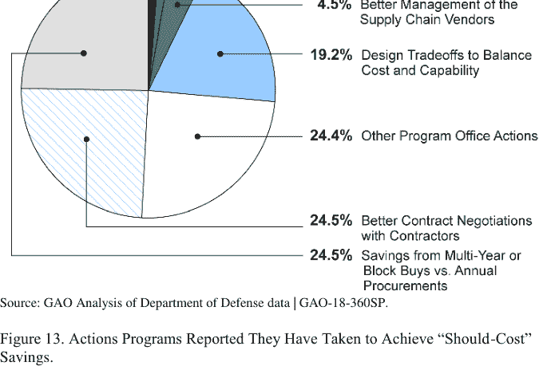

来源: GAO Analysis of Department of Defense data | GAO-18-360SP.

图13. 项目报告为实现“应付成本”节约所采取的行动。

## 我们对项目在关键节点所获得知识的评估的八项观察及对测试和软件开发的相关影响

我们对57个选定项目的分析显示，国防部项目继续未能充分实施基于知识的采购实践。我们观察到若干当前和未来项目已进行或计划进行系统开发、通过关键设计评审并进入生产，而未满足关键的采购实践，从而增加了其成本、进度和绩效不良结果的风险。同时，基于我们自2003年以来的先前工作进行的探索性统计分析，我们观察到实施了其中一个或多个三个特定基于知识的采购实践的MDAP，其成本和进度增长低于未实施的项目。²³ 该分析提供了遵循基于知识的采购方法重要性的额外见解，但这种模式仍然是例外而非常态。我们观察到项目经常接受知识不足，即使这在短期内损害绩效，也是为了按照其进度表生产或交付其能力。除我们在三个知识点的不足外，我们还观察到在项目进度表中接受知识不足的情况，涉及（1）开发测试和生产，（2）软件开发，以及（3）初始作战测试和评估。

²³ 我们的探索性统计分析检查了八项关键基于知识的采购实践，我们自2003年以来每年对个别项目进行评估，以及选定项目的成本和进度变化。我们发现八项关键实践中的三项与项目的成本和进度变化存在统计学上的显著关系。有关更多信息，请参阅附录II。

### 大多数项目在系统开发启动前并未充分展示成熟技术并完成系统工程评审

1. 在我们的评估期间开始系统开发的唯一项目满足了适用于开发启动的五项基于知识的采购实践中的全部除一项外。此外，先前已开始系统开发的44个项目中的大多数并未满足所有基于知识的采购实践。

基于知识的采购实践要求（1）关键技术的充分演示，（2）关键系统工程评审的完成，以及（3）将系统开发限制在6年或更少。24

- 海军的T-AO 205约翰·刘易斯级舰队补给油船项目是一个造船项目，对于该项目，我们将详细设计合同授予作为系统开发中应满足基于知识的采购实践的节点。我们观察到T-AO 205项目在2016年授予详细设计合同前已使其所有关键技术完全成熟。然而，该项目在此次授予前未完成初步设计评审——这种做法与基于知识的采购实践不一致。25

表7显示了国防部在海军T-AO 205项目以及我们评估的其他44个于2017年前进入系统开发的当前项目中，针对知识点1（即系统开发启动）实施基于知识的采办实践的程度。

### 表7. 系统开发项目基于知识实践的实施情况

| 系统开发启动时的基于知识实践 | T-AO 205 | ● | ○ | -- | N/A | 2016至2017年趋势 |
|---|---:|---:|---:|---:|---:|---|
| 在相关环境中演示所有关键技术已非常接近最终形态、装配和功能。（TRL 6） | ● | 23 | 11 | 4 | 6 | ↔ |
| 在现实环境中演示所有关键技术的形态、装配和功能。（TRL 7） | ● | 2 | 31 | 4 | 7 | ↔ |
| 在系统开发启动前完成系统功能审查和系统需求审查 | ● | 17 | 14 | 0 | 13 | ↔ |
| 在系统开发启动前完成初步设计审查 | ○ | 21 | 20 | 0 | 3 | ↔ |
| 将系统开发阶段限制在6年或以内 | N/A | 19 | 14 | 1 | 10 | ↓ |

- ● 实践已实施
- ○ 实践未实施
- -- 按项目反馈无数据
- N/A 按项目反馈实践不适用
- ↑ 改善趋势（与2016年相比，项目比例增加超过5%）
- ↓ 下降趋势（与2016年相比，项目比例减少超过5%）
- ↔ 变化不大（与2016年相比，项目比例变化小于5%）
- T-AO 205 = 约翰·刘易斯级舰队补给油船
- TRL = 技术成熟度等级

资料来源：GAO对DOD数据的分析 | GAO-18-360SP

注：八项关键基于知识的采办实践中有三项与系统开发启动相对应。我们已在表格中用粗体标出这三项关键实践。为在本分析中兼顾造船项目，我们将详细设计合同授予和首舰建造启动分别与开发启动和关键设计审查相对应。当项目在对我们问卷的反馈中指出了使实践完成不切实际的事件或情况时，我们评估认为该基于知识的采办实践不适用。例如，当项目没有任何关键技术时，我们评估认为两项技术演示实践不适用。

### 表8. 未来项目在开发启动时基于知识实践的预计实施情况

|  | 开发启动 | 预计在现实环境中演示所有关键技术 | 预计完成所有系统工程审查 | 计划将系统开发限制在6年或以内 |
|---|---|---|---|---|
| 高级飞行员训练 | 2018年春/夏季 | N/A | ○ | ● |
| 两栖舰替换 | 待定 | N/A | -- | N/A |
| B-2极高频卫星通信 | 待定 | N/A | -- | -- |
| 陆基战略威慑 | 9/3/2020 | ○ | ● | -- |
| 改进型涡轮发动机项目 | 待定 | ○ | ● | -- |
| 联合监视目标攻击雷达系统更新 | 3/31/2018 | ○ | ● | ● |
| 远程精确火力 | 1/15/2021 | N/A | ● | ● |
| MQ-25无人机系统 | 7/30/2018 | N/A | ○ | ● |
| 海军护卫舰 | 9/25/2020 | N/A | ○ | N/A |
| UH-1N通用直升机替换 | N/A | N/A | ○ | ○ |
| VC-25B总统专机替换 | 6/29/2018 | N/A | ○ | ○ |
| 天气系统后续微波 | 3/25/2019 | ● | ○ | ○ |

- ● 计划实施的实践；○ 计划不实施的实践
- -- 无数据；N/A 不适用

资料来源：GAO对DOD数据的分析 | GAO-18-360SP。

注：为在本分析中兼顾造船项目，我们将详细设计合同授予与开发启动相对应。当项目在对我们问卷的反馈中指出了使实践完成不切实际的事件或情况时，我们评估认为该基于知识的采办实践不适用。例如，当项目没有任何关键技术时，我们评估认为技术演示实践不适用。

2. 在计划于未来几年启动系统开发的12个未来项目中，只有一个项目计划全面实施所有适用的基于知识的采办实践。

项目在开始系统开发前应展示的基于知识的采办实践包括：(1) 在现实环境中演示所有关键技术，(2) 完成所有系统工程审查，(3) 在开始系统开发前将开发限制在6年以内。

- 只有陆军的远程精确火力项目计划在开始开发前全面实施所有适用的基于知识的采办实践。
- 在计划于未来几年进入系统开发的12个未来项目中，只有空军的天气系统后续微波项目预计在开始开发前在现实环境中演示其所有关键技术。迄今为止，已确定关键技术的其他三个未来项目都没有预计会这样做。

表8显示了我们评估的12个计划在未来几年开始开发的项目在基于知识采办实践方面的预计实施情况。

### 大多数项目在开展关键设计审查前未充分展示系统设计稳定性

3. 在我们评估期间举行关键设计审查的四个项目中，没有项目满足全部八项相关的基于知识的采办实践。此外，之前举行过关键设计审查的35个项目中，大多数也没有满足所有采办实践。

我们此前研究发现，项目在开展关键设计审查前应展示的八项基于知识的采办实践包括：(1) 在现实环境中演示所有关键技术，(2) 将至少90%的设计图纸发布到制造环节，(3) 测试系统级集成原型，(4) 建立可靠性增长曲线，(5) 识别关键产品特性，(6) 识别关键制造工艺，(7) 完成可生产性评估，以识别关键技术的制造风险，以及 (8) 完成失效模式与影响分析（在开始硬件制造前为识别失效点以提高可靠性而进行的分析）。

- 四个项目——空军的战斗救援直升机和F-15“鹰”被动主动警告生存力系统、陆军的间瞄火力防护能力增量2-拦截模块1、海军的新一代干扰机增量1——均未测试早期集成的系统级原型。
- 一个项目，F-15“鹰”被动主动警告生存力系统，未能确保其至少90%的设计图纸可发布，这与最佳实践不一致。
- 在确定关键技术的三个项目（战斗救援直升机、F-15“鹰”被动主动警告生存力系统和新一代干扰机增量1）中，没有一个确保其关键技术处于现实环境中的形态、装配和功能。将技术不成熟带入设计和演示阶段的项目，在这些技术完全成熟之前，无法确定性地将其设计验证为稳定。

表9显示了当前DOD项目在知识点2（关键设计审查，或对造船项目而言，首舰建造启动）方面实施基于知识采办最佳实践的程度。

### 表9. 选定项目在关键设计审查时基于知识实践的实施情况

| 关键设计审查时的基于知识实践 | CRH | F-15 EPAWSS | IFPC Inc 2-I Blk 1 | NGJ Inc 1 | ● | ○ | -- | N/A | 2016至2017年趋势 |
|---|---|---|---|---|---|---|---|---|---|
| 在现实环境中演示所有关键技术的形态、装配和功能 | ○ | ○ | N/A | ○ | 9 | 17 | 5 | 4 | ↔ |
| 将至少90%的设计图纸发布到制造环节 | ● | ○ | ● | ● | 10 | 17 | 7 | 1 | ↓ |
| 测试系统级集成原型 | ○ |  | ○ | ○ | 6 | 21 | 0 | 8 | ↔ |
| 建立可靠性增长曲线 | ● | ● |  | ● | 23 | 6 | 1 | 5 | ↔ |
| 识别关键产品特性 | ● | ● | ● | ● | 31 | 0 | 1 | 3 | ↔ |
| 识别关键制造工艺 | ● | ● | ● | ● | 28 | 1 | 1 | 5 | ↔ |
| 开展可生产性评估，以识别关键技术的制造风险 | ● | ● | ● | ● | 27 | 2 | 1 | 5 | ↔ |
| 完成失效模式与影响分析 | ● | ● | ● | ● | 29 | 1 | 1 | 4 | ↔ |

- ● 实践已实施；○ 实践未实施；-- 无数据；N/A 实践不适用；↑ 改善趋势（与2016年相比，项目比例增加超过5%）；↓ 下降趋势（与2016年相比，项目比例减少超过5%）；↔ 变化不大（与2016年相比，项目比例变化小于5%）
- CRH = 战斗救援直升机
- F-15 EPAWSS = F-15“鹰”被动主动警告生存力系统
- IFPC Inc 2-I Blk 1 = 间瞄火力防护能力增量2-拦截模块1
- NGJ Inc 1 = 新一代干扰机增量1

资料来源：GAO对DOD数据的分析 | GAO-18-360SP；

注：八项关键基于知识的采办实践中有两项与关键设计审查相对应。我们已在表格中用粗体标出这两项关键实践。为在本分析中兼顾造船项目，我们将详细设计合同授予和首舰建造启动分别与开发启动和关键设计审查相对应。当项目在对我们问卷的反馈中指出了使实践完成不切实际的事件或情况时，我们评估认为该基于知识的采办实践不适用。例如，当项目没有任何关键技术时，我们评估认为技术演示实践不适用。

该图表突出了上述最近完成关键设计评审的四个项目以及之前已进行关键设计评审的 35 个项目。

### 生产开始前没有任何项目完全证明制造过程处于统计控制状态

4. 在我们评估期间举行生产决策的三个项目中，仅有一个满足所有适用的基于知识的采购实践。此外，之前开始生产的 18 个非造船项目中，没有一个满足所有采购实践。

我们之前的工作发现项目在开始生产前应证明的五项基于知识的采购实践是（1）在现实环境中证明所有关键技术，（2）向制造释放至少 90% 的图纸，（3）证明关键制造过程处于统计控制状态，（4）在试点生产线上证明关键过程，以及（5）在预期环境中测试生产代表性原型。上述列出的第三项基于知识的采购实践是确保所有关键制造过程在生产开始时处于统计控制状态——即它们是可重复的、可持续的，并且能够始终如一地生产出符合质量公差和标准的零件。

- 海军的 MQ-8 Fire Scout 项目证明了所有适用的基于知识的采购实践。根据该项目回复称其没有关键技术，并且使用除制造成熟度等级或统计衡量指标之外的指标来跟踪制造成熟度，我们将该项目评估为对这两项实践不适用。我们还根据其回复，将海军的防空导弹防御雷达项目评估为在试点生产线上证明关键过程不适用。

### 表 10. 生产决策时所选项目的知识型实践实施情况

| 生产决策时的知识型实践 | AMDR | CH-53K | MQ-8 Fire Scout | ● | ○ | -- | N/A | 2016 年至 2017 年的趋势 |
|---|---|---|---|---|---|---|---|---|
| 在现实环境中以形式、适配和功能证明所有关键技术 | ○ | ● | N/A | 12 | 4 | 2 | 0 | ↔ |
| 至少向制造释放 90% 的设计图纸 | ● | ● | ● | 8 | 5 | 2 | 3 | ↔ |
| 证明制造成熟度等级至少为 9 或关键过程处于统计控制状态 | ○ | ○ | N/A | 0 | 15 | 0 | 3 | ↓ |
| 在试点生产线上证明关键过程 | N/A | ● | ● | 9 | 5 | 0 | 4 | ↔ |
| 在预期环境中测试生产代表性原型 | ○ | ● | ● | 6 | 9 | 0 | 3 | ↔ |

● 已实施实践
○ 未实施实践
-- 数据不可用
N/A 实践不适用
↑ 改善趋势（与 2016 年相比，项目比例增加超过 5%）
↓ 下降趋势（与 2016 年相比，项目比例减少超过 5%）
↔ 可忽略变化（与 2016 年相比，项目比例变化小于 5%）
CH-53K = 重型运输替换直升机（CH-53K） AMDR = 防空导弹防御雷达（AMDR） 来源：GAO 对 DOD 数据的分析 | GAO-18-360SP

注释：八项关键基于知识的采购实践中有三项与生产决策相对应。我们已在表中用粗体字标识了这三项关键实践。当项目提交的问卷回复中确定了使完成该实践不切实际的事件或情况时，我们将基于知识的采购实践评估为不适用。例如，当项目没有任何关键技术时，我们将技术演示实践评估为不适用。

- 三个项目中的两个项目——海军的 CH-53K 重型运输替换直升机和防空导弹防御雷达——在开始生产前未证明其关键制造过程处于统计控制状态。
- 三个项目中的两个项目——海军的 CH-53K 重型运输替换直升机和 MQ-8 Fire Scout——在试点生产线上证明了关键过程。这些项目还在其预期环境中测试了生产代表性原型。

表 10 显示了 DOD 对知识点 3，即生产开始，对上述最近举行生产评审的三个项目以及我们评估的在 2017 年前进入生产的另外 18 个非造船项目实施基于知识的采购实践的程度。由于建造船舶使用的生产工艺存在差异，我们不对造船项目进行此知识点的评估。

### 探索性分析表明某些基于知识的采购实践与更好的采购成果相对应

5. 我们发现，平均而言，完成以下三项行动中的部分或全部行动的 MDAP 的成本增加低于其他项目：

- 在开始开发之前证明所有关键技术在相关环境中非常接近最终形式、适配和功能；²⁶

26 GAO 的最佳实践工作表明，技术成熟度等级（TRL）7——对应于在现实环境中以形式、适配和功能证明所有关键技术——是构成开始开发低风险的技术成熟度水平。然而，DOD 的政策允许在较低的技术成熟度水平——TRL 6，即在相关环境中证明技术——开始开发。DOD 的政策基于一项一般禁止主要
- 在开始开发之前举行初步设计评审；以及
- 在关键设计评审时至少释放了 90% 的设计图纸。

此外，我们发现，在开始开发之前举行初步设计评审的 MDAP 的进度增长小于其他项目。

我们分析了 15 个已完成系统开发、举行关键设计评审并开始生产（即完成知识点 1 至 3）的项目。其中 2 个项目我们已在 2003 年的首次年度评估中纳入，是我们在它们完成每个知识点时对其基于知识的采购实践实施情况进行评估的项目。

- 我们的分析显示，平均而言，在达到每个知识点时完成上述三项基于知识的采购实践中的一项或多项的项目，其成本增加低于未完成这些基于知识的采购实践的项目。^27^ 这些差异在成本增加方面平均低约 56 至 63 个百分点，具有统计学意义。
- 此外，在开始开发之前举行初步设计评审的项目比未举行的项目进度增长少 47%。

- 这些结果支持我们的工作，并提供了初步验证，即遵循这些特定基于知识的实践的 MDAP 可能比不遵循的项目具有更低的成本增加和更少的进度增长。
- 由于我们的分析推断受到小样本量和数据集中 15 个 MDAP 独特特征的限制，我们计划在未来的年度评估中更新此分析。随着我们之前在开发开始和关键设计评审时评估的更多项目进入生产，这一更大的样本可能能够更精确地分析完成或未完成特定基于知识的实践的 MDAP 之间的差异。

我们之前的工作表明，在项目达到其知识点时完成所有基于知识的实践，是支撑健全商业案例的基础，使项目能够更好地实现其成本和进度目标。

### 项目经常在知识不完整的情况下进入生产，这导致成本和进度增长

6. 我们审查的 45 个当前项目中，23 个报告的进度表包括开发测试与生产之间的重叠或并发。我们观察到，与另外 8 个项目相比，这种并发伴随着更高的不可归因于数量变化的采购成本增长。

我们观察到，在过去一年中，具有并发进度的 23 个项目的成本增长平均为 5.13 亿美元，不可归因于数量变化，而报告非并发进度的 8 个项目每个平均为 1.54 亿美元。

- 我们还观察到，自首次完整估算以来，不可归因于数量变化的总采购成本增长平均为 $6.05 billion

- 将软件开发活动推迟到生产后阶段完成的项目——例如在初始作战能力或初始作战试验与评估之后——存在向战士交付无法满足最低性能要求的系统的风险。

图14显示了我们在评估的45个当前项目中，在开发或生产过程中完成或计划完成软件开发的时间。

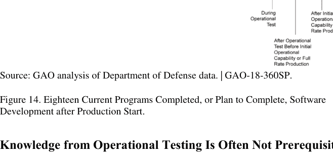

来源: GAO对国防部数据的分析。 | GAO-18-360SP.

图14. 十八个当前项目在生产启动后完成或计划完成软件开发。

### 作战测试的知识往往不是国防部宣布武器系统具备作战能力的先决条件

8. 我们评估的45个当前项目中超过三分之一已声明或打算在有限的初始作战试验与评估基础上，或在少数情况下在没有初始作战试验与评估的情况下宣布初始作战能力。

初始作战能力是指单位或组织已配备并受训，并被确定能够使用新部署系统执行作战任务时。

- 初始作战试验与评估是单独的一项活动，旨在在项目做出全面生产决策前，在逼真的作战条件下评估系统的效能和适用性。
- 因此，项目可以在完整、部分或无初始作战试验与评估的基础上宣布初始作战能力。
- 我们观察到5个项目在初始作战试验与评估开始前就已宣布或计划宣布初始作战能力。另有11个项目在测试完成前就已宣布或计划宣布此能力。
  - 在完成初始作战试验与评估前宣布初始能力的项目存在向战士部署在作战效能或适用性上不满足其将被要求执行的任务的系统的风险。
- 这些总数与去年的评估相比有显著变化，我们认为部分原因是我们对项目作战测试计划的可见性提高，从而改善了我们的分析。

图15详细说明了我们在45个选定的当前国防部项目中，初始作战能力与初始作战试验与评估之间关系的分析。

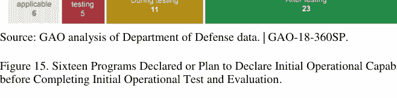

来源: GAO对国防部数据的分析。 | GAO-18-360SP.

图15. 十六个项目已宣布或计划在完成初始作战试验与评估前宣布初始作战能力。

## 单个项目的评估

本节包含按牵头部门——陆军、海军和海军陆战队、空军以及国防部范围——分组的单个武器项目的评估，并在每个分组开始时包含牵头部门分隔页。每个评估都提供了项目在产品开发中遵循基于知识的采购方法程度的数据。每个牵头部门分隔页汇总了采购阶段、当前估计资金需求、成本和进度增长以及产品知识获取情况的信息。总共，我们提供了57个项目的信息。

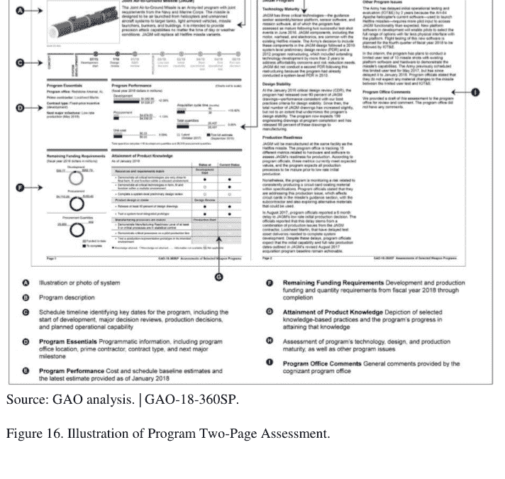

- A 系统插图或照片
- B 项目描述
- C 标识项目关键日期的进度时间线，包括开发开始、主要决策评审、生产决策和计划作战能力
- D 项目要点 项目信息，包括项目办公室位置、主要承包商、合同类型和下一个主要里程碑
- E 项目绩效 成本和进度基线估计以及截至2018年1月提供的最新估计
- F 剩余资金需求 自2018财年至完成的发展和生产资金及数量需求
- G 产品知识获取情况 对所选基于知识的实践及其在获取该知识方面的进展的描述
- H 对项目技术成熟度以及其他项目问题的评估
- I 项目办公室意见 由主管项目办公室提供的一般性意见

来源: GAO分析。 | GAO-18-360SP.

图16. 项目两页评估示例。

对于42个项目，我们制作了两页评估，讨论所获得的技术、设计和制造知识以及其他项目问题。每个两页评估都包含从项目首次完整估计到当前估计的总采购成本比较。首次完整估计通常是在开发开始时建立的成本估计；然而，对于少数没有此类估计的项目，我们使用了生产开始时的估计。对于造船项目，如果有规划估计可用，我们使用了其规划估计。对于最初作为非主要国防采购项目的项目，我们使用了可用的首次完整估计。在这42个两页评估中，大多数处于开发或早期生产阶段。参见图16，了解每个两页评估的布局示例。

此外，我们对15个项目的当前状态制作了一页评估，其中包括12个未来主要国防采购项目和3个已进入生产后期但作为现有项目的一部分正在开发新能力增量的主要国防采购项目。参见图17，了解每个一页评估的布局示例。

对于我们的两页评估，我们使用记分卡来描述所获得知识的程度。这些记分卡显示了在采购过程的特定时间点应实施的关键基于知识的采购实践。项目在每个关键点获得的知识越多，武器系统在其估计成本和进度内交付的可能性就越大。知识赤字意味着项目在缺乏对其技术、设计或制造过程的充分知识的情况下推进，并面临可能导致成本增加和进度延误的未解决风险。

对于每个项目，我们用实心圆圈标识已实施的基于知识的实践。我们用空心圆圈标识尚未实施的基于知识的实践。如果项目没有提供足够的信息供我们做出判断，我们用虚线表示。 不适用于该项目的基于知识的实践为灰色显示。

## 改进涡轮发动机项目（ITEP）

陆军的改进涡轮发动机项目（ITEP）正在为黑鹰和阿帕奇直升机机队开发替代发动机。新发动机设计用于提高功率、性能和燃油效率；增强可靠性；增加使用寿命，并降低维护负担。陆军计划于2026财年开始部署这些发动机。

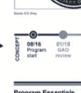

### 项目要点

- 项目办公室：阿拉巴马州红石兵工厂
- 主要承包商：先进涡轮发动机公司和通用电气公司
- 合同类型：固定价格激励（固定目标）（技术成熟和风险降低）
- 成本加激励费（开发；计划中）
- 下一个主要里程碑：开发启动（2018年12月）

### 当前状态

ITEP于2016年8月进入技术成熟和风险降低阶段，陆军向通用电气和先进涡轮发动机公司授予了两份固定价格激励（固定目标）合同。每个承包商将在2018年2月和3月分别举行初步设计评审，以为发动机建立分配基线，定义所有ITEP子系统及其协同工作方式。

2017年11月，陆军采购、后勤和技术助理部长代理批准了ITEP开发合同提案的征集。陆军打算向正在开发初步设计的两个承包商之一授予系统开发的成本加激励费合同。目前，项目进度计划为采购周期约为11年。

项目的三个关键技术——先进进气粒子分离器、压气机/先进空气动力学和混合轴承——在2014年10月的初步技术成熟度评估中被确定为接近成熟。根据国防部政策，陆军计划在项目2018年12月开发启动前，于2019年6月完成技术成熟度评估。

自2015年以来，黑鹰和阿帕奇直升机的制造商西科斯基飞机公司和波音公司一直在进行分析，以支持将ITEP硬件、电气系统和软件集成到直升机机身中。这些工作旨在识别集成风险并促进缓解策略的开发，将与ITEP的初步设计评审并行进行。

### 估计项目成本

估计项目成本（2019财年美元，单位：百万美元）

| 类别 | 金额 |
|---|---|
| 开发 | $1,953.42 |
| 采购 | $5,497.04 |

### 计划数量

计划数量

| 类别 | 数量 |
|---|---|
| 开发 | 89 |
| 采购 | 5,925 |

### 项目办公室意见

我们向项目办公室提供了该评估的草案供审阅和评论。项目办公室没有评论。

- A 系统插图或照片
- B 项目描述
- C 标识项目关键日期的进度时间线，包括开发开始、主要决策评审、生产决策和计划作战能力
- D 项目要点 项目信息，包括项目办公室位置、主要承包商、合同类型和下一个主要里程碑
- E 当前状态 项目的最新状态
- F 估计项目成本 当前估计的资金需求和数量需求
- G 项目办公室意见 由主管项目办公室提供的一般性意见

来源: GAO分析。 | GAO-18-360SP.

如果某项基于知识的实践在采办周期中应实施的节点尚未到达，或者该实践与特定项目无关，则其可能不适用于该项目。对于尚未进入系统开发的项目，我们展示了前三种实践所获得知识的预测。对于已进入系统开发但尚未进行关键设计审查的项目，我们评估了这三种实践实际获得的知识。对于已进行关键设计审查但尚未进入生产的项目，我们评估了前五种实践所获得的知识。对于已进入生产的项目，我们评估了所有八种实践所获得的知识。

**生产中的项目**

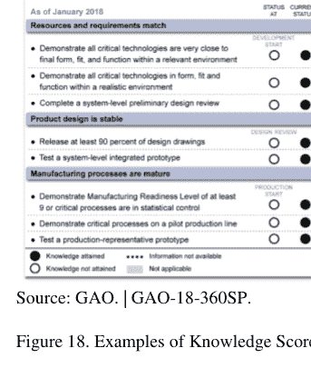

**造船项目**

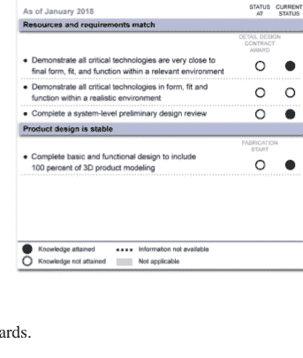

来源：GAO. | GAO-18-360SP.

**图18：知识记分卡示例。**

对于造船项目，我们评估了采办周期中的不同关键点以及适用的基于知识的实践，这些评估基于我们之前的工作。30 对于尚未授予详细设计合同的造船项目，我们展示了前三种实践所获得知识的预测。对于已授予该合同但尚未开始建造的造船项目，我们评估了这三种实践实际获得的知识。对于已开始建造的造船项目，我们评估了前四种实践所获得的知识。我们没有评估与造船项目知识点3对应的其余四种实践，因为我们之前的工作发现这些实践不适用于这些项目。有关我们用于评估这些不同类型项目的知识记分卡示例，请参见图18。

## 陆军项目评估

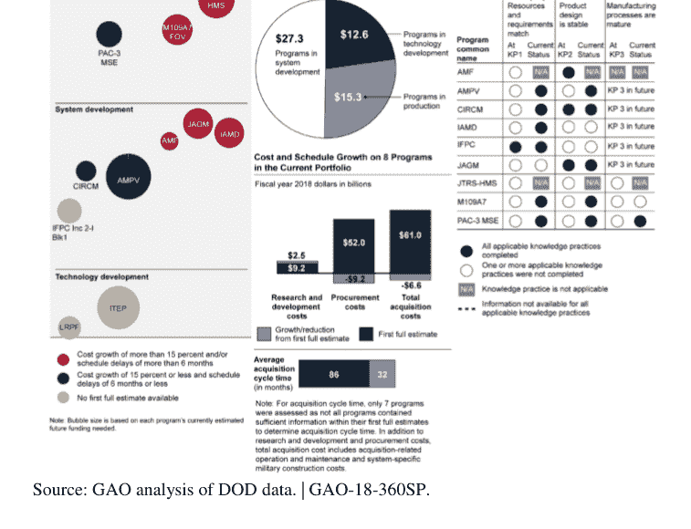

来源：GAO对DOD数据的分析。 | GAO-18-360SP.

我们完成了对陆军24个当前和未来重大国防采办项目中11个项目的单独评估。在这11个项目中，9个处于系统开发或早期生产阶段，另外2个是DOD预计在未來几年内进入系统开发的未来项目。我们发现，陆军目前估计需要550亿美元来完成这11个项目的采办。我们还将这些项目首次完整的成本与进度估算与其当前估算进行了比较，发现：

- 净成本削减总额为66亿美元，其中大部分发生在5年多以前，且
- 项目进度延迟平均约32个月。

在这11个项目中，只有3个——AMPV、CIRCM和PAC-3 MSE——完成了与我们评估的适用基于知识的最佳实践相关的所有活动，尽管在这些知识点达到时这些活动并未完全完成。

**陆军项目评估**

| 项目 | 页码 |
|---|---|
| **2页评估** | |
| 机载与海上/固定站（AMF） | |
| 装甲多用途车辆（AMPV） | |
| 通用红外对抗措施（CIRCM） | |
| 手持、单兵背负及小型适配型无线电（HMS） | |
| 一体化防空反导（IAMD） | |
| 间接火力防护能力增量2-拦截Block 1（IFPC Inc 2-I Block 1） | |
| 联合空对地导弹（JAGM） | |
| M109A7车族（M109A7 FOV） | |
| 爱国者先进能力-3导弹段增强（PAC-3 MSE） | |
| **1页评估** | |
| 改进型涡轮发动机项目（ITEP） | |
| 远程精确火力（LRPF） | |

### 机载与海上/固定站（AMF）

来源：美国陆军

陆军的AMF项目计划采购非研发性的软件定义无线电——名为“小型机载组网无线电”（SANR）——以及相关设备，用于集成到陆军旋翼机和无人机系统中。这些双通道无线电将在陆军平台与地面部队之间提供同时的语音和数据通信。

**项目基本信息**

- 项目办公室：马里兰州阿伯丁试验场
- 主承包商：待定
- 合同类型：待定
- 下一个主要里程碑：低速初始生产（2023年1月至3月）

**项目绩效**

（图表未按比例绘制）

（2018财年百万美元）

| | 最新（2016年12月） | 首次完整估算（2008年10月） | 百分比变化 |
|---|---|---|---|
| 开发 | $1,726.40 | $2,151.98 | -19.78% |
| 采购 | $1,594.65 | $8,869.65 | -78.79% |
| 单位成本 | $0.24 | $0.33 | -28.88% |
| 采办周期（月） | 196 | 80 | +145.00% |
| 总数量 | 14,028 | 27,102 | -48.24% |

DOD报告AMF数量时使用计划采购的总通道数，而非无线电数量。两个通道（数量）相当于一台SANR无线电。

**剩余资金需求**

（2018财年百万美元）

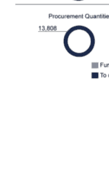

**产品知识获取情况**

截至2018年1月

**资源与需求匹配**

| 实践 | 开发启动时状态 | 当前状态 |
|---|---|---|
| • 在相关环境中演示所有关键技术非常接近最终形态、配合和功能 | ○ | NA |
| • 在现实环境中演示所有关键技术的形态、配合和功能 | ○ | NA |
| • 完成系统级初步设计评审 | ○ | NA |

**产品设计稳定**

| 实践 | 设计评审时状态 | 当前状态 |
|---|---|---|
| • 发布至少90%的设计图纸 | ● | NA |
| • 测试系统级集成原型 | ● | NA |

**制造工艺成熟**

| 实践 | 生产启动时状态 | 当前状态 |
|---|---|---|
| • 演示制造就绪水平至少达到9级，或关键工艺处于统计控制状态 | NA | NA |
| • 在试验生产线上演示关键工艺 | NA | NA |
| • 在预期环境中测试生产代表性原型 | NA | NA |

● 已获得知识，○ 未获得知识，... 信息不可用，NA 不适用

### 技术成熟度、设计稳定性和生产就绪度

AMF项目办公室计划从一位尚未确定的承包商那里采购技术成熟、可投产的SANR无线电。这一非研发性采办策略由陆军于2012年采用，并不适用于我们用于衡量技术成熟度、设计稳定性和生产就绪度的标准指标。与我们在2017年评估中呈现的内容相比，我们已更新了产品知识获取表以反映这一变化。

AMF项目的采办策略起源于2012年。当时，作为联合战术无线电系统（JTRS）项目整体重组的一部分，DOD指示AMF项目将无线电作为改进型非研发项目采购。DOD进一步指示AMF项目在切实可行的最大程度上利用自2008年以来在原始JTRS项目中的投资。此次重组将该项目的性质从支持陆军、空军和海军平台的研发工作转变为仅支持陆军航空兵的非研发工作。

项目办公室的无线电采购目前处于生产合同授予前的招标前阶段。该办公室预计将在2018财年第四季度向潜在承包商征集建议书，并于2020财年第三季度授予合同。计划共采购7,014台双通道SANR无线电——其中110台用于测试目的；262台用于低速初始生产；6,642台用于全速生产。

项目办公室认为，其修订后的采办策略为其评估技术成熟度、设计稳定性和生产就绪度提供了机会。该办公室表示，这些机会包括计划要求承包商在合同授予前确定关键技术要素，用承包商的测试结果证实其声明，并提交详细说明承包商是否准备好生产满足陆军要求和进度要求的无线电的制造计划。此外，该项目

办公室预计在合同授予后采用其他方法，以确保所选承包商的无线电满足陆军需求，例如在低速率初始生产决策前的测试中重新评估技术成熟度、使用合同条款控制设计变更，以及证明生产过程的测试。

### Other Program Issues

自我们2017年的评估以来，陆军已将AMF初始能力推迟了超过3年。这一延迟加上之前的延迟，使该项目的进度延长至开发启动到初始能力之间超过18.5年——对于现在名义上是非开发性采购而言。根据项目官员的说法，陆军领导层尚未批准该项目关于SANR生产、测试和部署的计划。项目预计正在进行的陆军网络审查，该审查旨在调整和现代化陆军通信项目，将对当前的AMF采购计划产生影响。目前，项目官员表示，AMF当前的进度估算将突破该项目2014年批准的全面生产速率和初始作战能力的基线，因此，在网络审查和相关的备选方案分析完成后，陆军将需要批准新的项目基线。

陆军的网络分析也可能以其他方式影响AMF项目的进度。根据项目官员的说法，该分析可能会建议用另一种波形替换目前计划的SANR语音和数据波形。官员们表示，如果陆军采用波形变更，项目将需要额外的时间来调整项目内容和进度。

### Program Office Comments

我们向项目办公室提供了此评估的草案以供审阅和评论。项目办公室没有提出任何评论。

## Armored Multi-Purpose Vehicle (AMPV)

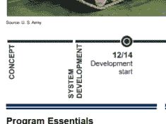

陆军的装甲多用途车辆（AMPV）是旅级及以下M113系列车辆的替代品。AMPV将在五个任务角色中取代M113：通用型、医疗后送、医疗处理、迫击炮载具和任务指挥。陆军确定开发AMPV是必要的，原因是M113在机动性、生存能力和兵力防护方面存在缺陷，以及空间、重量、功率和冷却方面的限制，这些限制妨碍了未来技术的整合。

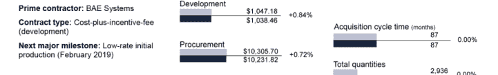

### Program Essentials

- 项目办公室：Warren, MI
- 主承包商：BAE Systems
- 合同类型：成本加激励费（开发）
- 下一主要里程碑：低速率初始生产（2019年2月）

### Program Performance

（2018财年美元，单位：百万美元）
（图表未按比例绘制）

| 指标 | 最新（2017年10月） | 首次完整估算（2015年5月） | 变化 |
|---|---|---|---|
| 开发 | $1,047.18 | $1,038.46 | +0.84% |
| 采购 | $10,305.70 | $10,231.82 | +0.72% |
| 单位成本 | $3.87 | $3.84 | +0.73% |
| 获取周期时间（月） | 87 | 87 | 0.00% |
| 总数量 | 2,936 | 2,936 | 0.00% |

总数量包括39个开发数量和2,897个采购数量。

### Remaining Funding Requirements

（2018财年美元，单位：百万美元）

| 项目 | 已资助至目前 | 待完成 |
|---|---|---|
| 开发 | $488.24 | $558.94 |
| 采购 | $10,305.70 |  |
| 采购数量 |  | 2,897 |

### Attainment of Product Knowledge

截至2018年1月

| 资源与需求匹配 | 开发启动时状态 | 当前状态 |
|---|---|---|
| 证明所有关键技术在相关环境中非常接近最终的形式、适配性和功能 | ● | ● |
| 在现实环境中证明所有关键技术在形式、适配性和功能方面 | ● | ● |
| 完成系统级初步设计评审 | ○ | ● |
| 产品设计稳定 | 设计评审 |  |
| 发布至少90%的设计图纸 | ○ | ● |
| 测试系统级集成原型 | ○ | ● |
| 制造工艺成熟 | 生产启动 |  |
| 证明制造成熟度等级至少为9或关键工艺处于统计控制中 | NA | NA |
| 在试点生产线上演示关键工艺 | NA | NA |
| 在预期环境中测试生产代表性原型 | NA | NA |

● 知识已获得，○ 知识未获得，... 信息不可用，NA 不适用

### AMPV Program

### Technology Maturity and Design Stability

AMPV项目于2014年12月进入系统开发，其关键技术被独立审查团队认为完全成熟。根据项目官员的说法，虽然AMPV设计采用了新的车体设计，但大多数子系统源自现有车辆设计。

该项目于2016年6月举行了关键设计评审，当时超过90%的设计图纸已发布到制造部门，但当时尚未展示系统级原型。然而，在CDR之后，图纸总数意外增长了近19%，因为承包商低估了满足项目要求所需的设计图纸的数量和复杂性，从而削弱了项目认为已取得的设计稳定性。我们已更新产品知识获取情况表，以反映与之前评估相比设计稳定性的这一变化。我们目前评估AMPV设计为稳定，因为项目报告称其已将所有计划图纸发布到制造部门。

由于项目挑战，该项目在生产启动前完成计划后勤演示的计划有所波动。这一演示——旨在证明车辆设计能够满足可维护性要求，并在开始低速率初始生产前保持稳定——最初被推迟，因为承包商在很大程度上由于工程图纸发布延迟，导致AMPV技术数据包交付晚了超过一年。该项目在生产启动后完全完成此演示方面存在风险。然而，根据项目官员的说法，承包商新的、最近完成的计划预计在生产启动前完成后勤演示。

### Production Readiness

承包商BAE Systems于2016年12月交付了首个原型。虽然该车辆按时交付，但随后的原型交付因零件短缺问题和工程图纸变更等原因延迟了长达3个月。由于原型交付延迟，项目取消了初始承包商特定性能和可靠性测试。当前测试计划在发现和纠正任何车辆缺陷方面几乎没有余地。

根据项目官员的说法，该项目计划在2019年2月开始低速率初始生产前，在试点生产线上演示其关键制造工艺。项目官员指出，承包商应在2017日历年结束前交付所有原型，这将为项目在生产启动前提供超过一年的时间来完善制造活动。根据项目官员的说法，这将包括根据原型建造问题重新设计制造布局。然而，在一系列项目评估报告中，国防合同管理署（DCMA）对承包商收集和评估制造过程控制数据的能力提出了重大担忧。具体而言，在项目经理提供的2017年11月整体项目状态评估中，DCMA报告称承包商没有足够的生产控制措施来充分评估生产过程。

### Other Program Issues

由于持续面临满足后勤、性能和生产要求方面的挑战，该项目开发合同成本增长超过目标成本的20%。然而，项目官员指出，政府对AMPV开发的官方成本立场——基于成本评估和项目评估办公室编制的独立成本估算——没有变化，因为它包括足够的余量来应对迄今为止的成本增长。

AMPV在关键通信和网络能力方面仍依赖于其他项目——例如陆军的手持式、背负式和小型化无线电。然而，这些项目也经历了自己的采购挑战，导致其

AMPV项目的可用性。该项目在其生产车辆设计配置中包含了一个传统无线电平台，据项目官员称，该平台将能够轻松容纳这些其他项目提供的未来网络能力。

### 项目办公室评论

我们已将此评估的草稿提供给项目办公室进行审查和评论。项目办公室提供了技术性评论，我们已在适当的地方纳入其中。项目官员还指出，该项目仍在其成本、进度和性能基线之内。他们表示，成本重新基线化过程已经完成，并且有足够的资源完成剩余工作。他们还表示，根据图纸发布、原型交付和初步可靠性测试结果，他们认为车辆设计是稳定的。据项目办公室称，原型交付平均延迟了6至8周，但项目表示，通过将承包商测试合并到政府测试计划中的压缩测试计划，已最大程度地减少了延误。此外，该项目表示，车辆可靠性、可用性和可维护性测试已超过了每天计划的里程数，这进一步减少了损失的时间。该项目还报告说，承包商正在更新其生产过程，以最大限度地减少变异性和风险。

## 通用红外对抗措施（CIRCM）

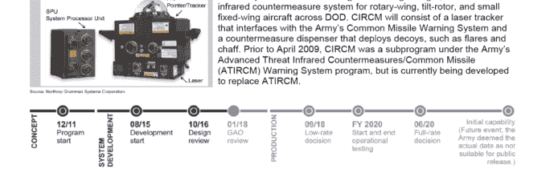

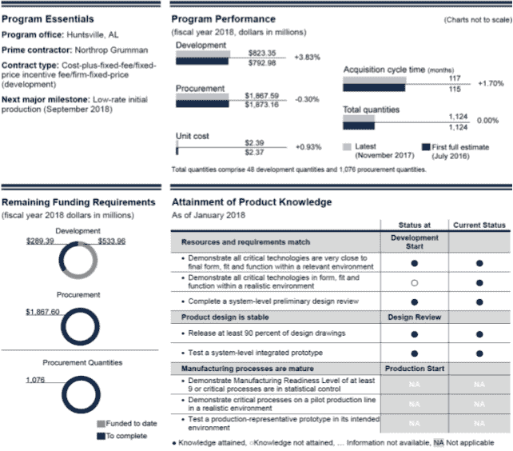

### CIRCM项目

### 技术成熟度与设计稳定性

CIRCM项目办公室报告称，该系统的六项关键技术已完全成熟，几乎所有预期的图纸（接近100%）都已完成。在我们2017年的评估中，我们报告CIRCM有九项关键技术正在接近成熟。然而，其中三项技术是承包商BAE系统公司设计所特有的，该承包商不会继续进入工程与制造开发阶段。对于其余六项关键技术，该项目通过将系统集成到陆军飞机上并完成初步测试，提高了它们的成熟度，这表明这些技术在现实环境中能够正常运作。

在2016年10月的关键设计评审中，CIRCM项目已发布了计划设计图纸的97%，这构成了稳定的设计。然而，CIRCM尚未满足其可靠性要求，可能需要对设计进行更改。2017年4月，国防部监察长发现，CIRCM的需求文件和测试计划并未要求在项目全速率生产决策之前演示最低可靠性要求。具体来说，监察长发现，经批准的需求文件和测试计划显示，CIRCM计划在仅证明其平均作战任务故障间隔时间要求（214小时）的70%（150小时）后，便进入全速率生产。监察长随后建议陆军在系统进入生产之前重新审视并改进其CIRCM需求和测试计划。负责监督CIRCM的情报、电子战和传感器项目执行官（PEO IEW&S）同意监察长的建议。

### 生产就绪

该项目正在生产就绪评审中确定关键制造工艺。这些评审计划于2018年4月完成。原型件和生产代表性产品已经制造出来。全速率生产将使用与生产代表性产品相同的设备、工位、工艺和人员，以便在CIRCM进入生产之前在试生产线上演示制造能力。项目官员表示，根据系统集成到陆军飞机的测试结果以及承包商飞行测试活动的完成情况，CIRCM现已准备好进入生产阶段。2017年，陆军在红石兵工厂进行了测试，以演示CIRCM在飞机上的生产配置，以及在飞机特有的运动、振动和电磁环境中的性能。这些测试提供了CIRCM在各种环境中获取、跟踪、指向和发射激光能量的能力信息。

尽管陆军声称该项目已准备好进入生产，但由于系统开发过程中遇到的进度延迟，其原定的CIRCM生产决策已从2018年3月推迟到2018年9月。这些延迟是由于关键CIRCM组件（包括系统处理器单元、激光器以及指示器/跟踪器）交付延迟以及可靠性测试失败所致。

### 项目办公室评论

我们已将此评估的草稿提供给项目办公室进行审查和评论。项目办公室提供了技术性评论，我们已在适当的地方纳入其中。据项目官员称，主承包商及其分包商的表现不佳、下级制造和质量问题，以及高于预期的可靠性失败，导致低速初始生产决策延迟了6个月，该决策现在定于2018年9月进行。项目表示，针对上述不足，PEO IEW&S成立了一个委员会来监督CIRCM可靠性的改进。项目还表示，在2018财年第一季度成功进行了测试，以演示迄今为止的可靠性改进。官员们进一步表示，该委员会制定了一项全面的纠正行动计划，项目已将该计划中的硬件交付延迟问题作为其中一部分加以解决。据项目官员称，他们已重新调整CIRCM硬件交付时间，以应对6个月的延迟，并支持即将进行的可靠性演示和飞行测试活动。

## 手持式、背负式和小型化无线电（HMS）

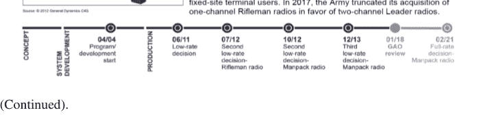

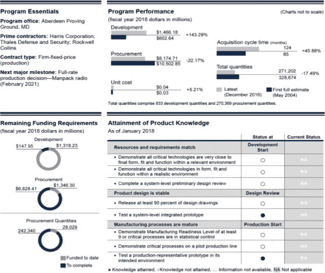

### HMS项目

### 技术成熟度与设计稳定性

HMS项目现在计划将Leader和Manpack无线电作为非研发项目采购，这使得该项目无法使用或跟踪任何关键技术。

在HMS项目2004年开发启动时，该项目没有评估其关键技术的成熟度——这种方法与最佳实践不一致。到2011年开始生产时，该项目也未能使其关键技术完全成熟。相反，该项目在2015年5月才完成了各项关键技术的开发。这种与最佳实践的背离，很可能是导致自首次完整估算以来开发成本增加近150%的原因。

在2008年的关键设计评审中，该项目完成了不到计划设计图纸的一半，这不符合设计稳定性的最佳实践标准。最重要的是，该项目在2004年至2011年间持续的技术不成熟（包括关键设计评审时的情况），导致无线电设计未能完全适应关键技术成熟后的最终形态、配合和功能。当HMS无线电进入测试时，这些设计缺陷变得明显。

具体而言，在2014财年，Manpack无线电的开发测试揭示了系统可靠性的缺陷。同年进行的初始作战测试与评估指出了适用性不足，特别是与Manpack单元过重有关。同样，2014财年对Rifleman无线电的作战测试发现了与过热和电池快速耗尽相关的适用性问题。项目官员表示，承包商重新设计了这两种无线电系统以解决这些问题，但陆军尚未完成测试以验证这些纠正措施。Rifleman无线电的后续测试和采购已被推迟。此外，项目测试计划目前未反映陆军从单信道Rifleman无线电向双信道Leader无线电的过渡，而后者很可能需要自己的作战测试。

### 生产就绪

HMS项目尚未评估Leader无线电的生产就绪性，而Manpack无线电在进入低速初始生产近7年后，其生产就绪性仍未得到评估。据HMS项目官员称，该项目在2011年5月评估了Rifleman无线电系统的生产就绪性，但陆军将需要对Leader无线电进行新的评估。项目官员还表示，HMS项目将把Manpack无线电的生产就绪性评估作为其2021年2月单独的全速率生产决策的一部分。

## 其他项目问题

目前，由于国防部尚未授权在作战环境中使用MUOS波形，因此一些Manpack无线电将依赖的MUOS波形在很大程度上无法供作战人员使用。虽然该项目并未将MUOS视为关键技术，但如果没有这种波形，受影响的Manpack无线电只能通过传统通信能力进行通信，这限制了无线电网络的容量。

陆军已完成一项网络审查，将评估HMS以及其他陆军通信项目，以评估流程、减少系统漏洞、重新定义能力差距并改进所需设备。据HMS项目官员称，此次审查增加了项目进度和采办策略的不确定性。因此，尽管Leader合同授予现计划于2018年6月进行，但陆军尚未更新HMS采办项目基线以反映这些新计划。

## 项目办公室评论

我们将本评估的草案提供给项目办公室进行审查和评论。项目办公室提供了技术评论，我们已在适当之处予以采纳。项目官员表示，陆军的网络审查结论认为，Leader无线电和Manpack无线电对网络的未来都至关重要。据该项目称，Leader无线电测试计划目前正在制定中。至于Manpack无线电，官员们指出，它利用MUOS和其他先进网络波形提供两个同时进行的安全话音和数据通信信道，因此可根据需要支持传统通信以及新波形技术。官员们还表示，Manpack无线电将帮助陆军实现其改善通信安全的目标，并满足陆军车辆对通信的需求。项目官员进一步表示，已对每个Manpack无线电制造商进行制造就绪性评估，每个供应商都已展示了低速生产的能力，并且已具备开始全速生产的能力。

## 一体化防空反导（IAMD）

一体化防空反导（IAMD）
陆军正在开发一体化防空反导（IAMD）项目，旨在通过一体化火力控制网络将传感器、武器和通用作战指挥系统联网，以支持应对空中和导弹威胁的作战行动。IAMD作战指挥系统将提供一种能力，通过一个接口模块控制和管理IAMD传感器和武器（如“哨兵”雷达和“爱国者”发射装置及雷达），该接口模块提供作战管理数据并支持网络化作战。
来源：诺斯罗普·格鲁曼公司

概念 02/06 技术开发启动 | 系统开发 12/09 开发启动 05/12 设计评审 01/18 GAO评审 | 生产 09/20 低速生产决策 06/21 开始作战试验 02/22 结束作战试验 04/22 初始作战能力 08/22 全速生产决策

## 项目基本信息

项目办公室：阿拉巴马州红石兵工厂
主承包商：诺斯罗普·格鲁曼空间与任务系统公司和雷神公司
合同类型：成本加激励酬金/成本加固定酬金（开发）
下一个主要里程碑：低速初始生产（2020年9月）

## 项目绩效

（2018财年，百万美元）（图表未按比例）
开发 $3,278.38 $1,764.92 +85.75%
采购 $3,692.75 $1,798.83 -2.79%
单件成本 $14.98 $18.80 -21.88%
采办周期（月） 146 80 +82.50%
总数量 479 296 +61.82%
最新（2017年11月） 首次完整估算（2009年12月）
总数量包括26个开发数量和454个采购数量

## 剩余资金需求

（2018财年，百万美元）
开发 $1,005.49 $2,272.89
采购 $3,671.68 $21.07
采购数量 454
迄今已拨付资金 完成所需资金

## 产品知识获取情况

截至2018年1月
| | 开发启动时的状态 | 当前状态 |
|---|---|---|
| 资源与需求匹配 | | |
| 在相关环境中演示所有关键技术已非常接近最终形态、适配性和功能 | ● | ● |
| 在现实环境中演示所有关键技术的形态、适配性和功能 | ○ | |
| 完成系统级初步设计评审 | ● | |
| 产品设计稳定 | 设计评审 | |
| 发布至少90%的设计图纸 | ○ | ○ |
| 测试系统级集成原型 | ○ | ● |
| 制造工艺成熟 | 生产启动 | |
| 证明制造就绪等级至少达到9级，或关键工艺处于统计控制状态 | NA | NA |
| 在试生产线上演示关键工艺 | NA | NA |
| 在预期环境中测试生产代表性原型 | NA | NA |
● 已获得知识，○ 未获得知识，... 信息不可用，NA 不适用

## IAMD项目

## 技术成熟度与设计稳定性

IAMD项目已证明其所有关键技术——一体化作战指挥、一体化防御设计、一体化火力控制网络和分布式航迹管理——均已完全成熟。在设计评审近6年后，该项目不再拥有稳定的设计，这一点反映在我们对产品知识获取情况的更新中。虽然该项目此前已完成超过90%的设计图纸，但项目进行了大量设计更改，新增了近千张图纸。这些更改包括增加功能和对新组件等的调整，以防止零件过时。

在2016年6月的有限测试之后，陆军试验与评估司令部报告称，软件缺陷使IAMD系统“不适用、不可生存且不可靠”。2017年2月，国防部作战试验与评估办公室进一步发现该系统的软件“既不成熟也不稳定”。这种糟糕的表现主要是由于IAMD作战指挥系统（IBCS）软件的不稳定造成的，该软件在有限用户测试中得到了使用。自有限用户测试完成以来，该项目已更新了IBCS软件，特别侧重于修复测试期间观察到的问题，如提高软件的稳定性和可靠性。这些更新始于2016年，并在2017年10月之前执行了一系列测试活动以验证修复效果。早期结果表明，2016年有限用户测试期间遇到的软件问题已得到纠正，但官员们指出测试仍在继续。

该项目已实施多项变更以降低风险。项目报告称，其中一项变更包括要求承包商在验收前使用战术网络和武器/传感器接口对IBCS软件进行测试。官员们指出，他们认为这是降低项目剩余技术风险的关键一步。

## 生产就绪性

在2016年6月有限测试表现不佳后，陆军将IAMD低速生产决策——原计划于2016年8月进行——推迟到2020年9月，以便为开发测试留出更多时间。该项目还计划结合该决策更新其采办项目基线（APB）。此外，据项目官员称，该项目计划进行一次正式的制造就绪性评估，为该项目的低速生产决策做准备，届时他们预计所有供应商都将为低速初始生产做好准备。陆军现在计划在2022财年宣布初始作战能力，比原计划晚了近4年。

## 其他项目问题

该项目经历了超出其APB授权限额的开发成本增长。此次成本超支是由于陆军决定在2018财年申请增加项目资金，并调整项目进度安排，为剩余开发工作分配更多时间，以及在2016年6月有限测试事件后实施纠正措施所致。具体而言，陆军的2018财年预算请求反映了对“高级电子防护增强”的新需求，陆军认为这将开发和评估针对IAMD新出现的威胁和高级电子攻击脆弱性的解决方案。该项目计划开发和评估IAMD作战指挥系统的指挥控制及射频数据和话音网络防护功能，以应对当前和假设的高级电子攻击系统和技术。此外，他们计划在实况和模拟的高级电子攻击环境中演示和评估电子防护及新兴威胁解决方案。同样，该项目计划与联合军种及其他机构（如导弹防御局）协调电子防护和高级威胁解决方案。

## 项目办公室评论

我们将本评估的草案提供给项目办公室进行审查和评论。项目办公室在评论中表示，IAMD设计是稳定的。据项目官员称，原始设计已在有限用户测试中得到验证，并拥有完整的技术数据包。该项目还表示，原始IAMD设计后来应用户要求进行了更改，新设计的数据包已经完成，但有四项工程更改需要...

整合。此外，项目办公室表示，任何项目都难免出现过时问题，但在诸如IAMD这类大量采用商用现成组件的项目中尤为普遍。项目指出，IAMD已制定零部件过时管理计划，以经济有效的方式主动应对过时问题，这有助于避免对项目成本和进度产生不利影响。

## 间接火力防护能力增量2-拦截Block 1（IFPC Inc 2-I Block 1）

### IFPC Inc 2-I Block 1 项目

### 技术成熟度与设计稳定性

虽然项目在进入系统开发前未识别出任何关键技术，但官员们对构成Block 1的四个子系统——哨兵雷达、AIM-9X拦截弹、综合防空反导（IAMD）作战指挥系统（IBCS）以及多任务发射器——集成方面的难度表示担忧。具体而言，这些系统可能对Block 1系统开发构成集成挑战，因为其能力将被以新的方式用于应对不同的威胁。

陆军IAMD项目将生产IBCS，该系统的当前设计目标是控制“爱国者”导弹发射器和雷达系统。然而，IAMD项目最近在开发测试中发现了重大的IBCS缺陷，IFPC Inc 2-I Block 1项目官员报告称，这些缺陷导致他们在Block 1系统开发中不得不依赖非网络集成版本的IBCS。据项目官员称，Block 1系统将在2021财年Block 1初始能力之前集成更新版本的IBCS。

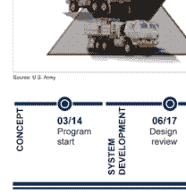

陆军的IFPC Inc 2-I是增强和扩展首个IFPC增量射程的后续工作，该增量提供了对抗火箭弹、火炮和迫击炮威胁的短程能力。IFPC Inc 2-I由四个独立子系统组成：现有传感器、拦截弹、火控系统，以及陆军正在开发的新型多任务发射器。IFPC Inc 2-I包括三个Block。Block 1增加了对抗巡航导弹和无人机的能力。我们评估了Inc 2-I Block 1。

| 概念 | 系统开发 | 生产 |
|---|---|---|
| 03/14 项目启动 | 06/17 设计评审；01/18 GAO评审；01-03/18 开发启动；08/19 开始作战评估；09/19 结束作战评估 | 03/20 低速生产决策；05/21 初始能力；08/21 全速生产 |

### 项目要点

- **项目办公室：** 阿拉巴马州亨茨维尔
- **主承包商：** 不适用（美国陆军航空与导弹研究、发展与工程中心和莱特肯尼陆军仓库负责开发与生产）
- **合同类型（计划）：** 军种内支持协议
- **下一个主要里程碑：** 开始作战试验（2019年8月）

### 项目绩效

（2018财年百万美元）（图表未按比例）

| | 最新（2017年10月） | 首次完整估算（不适用） |
|---|---|---|
| 研发 | $860.66 | 不适用 |
| 采购 | $2,774.06 | 不适用 |
| 单位成本 | $9.88 | 不适用 |
| 采办周期（月） | 40 | 不适用 |
| 总数量 | 369 | 不适用 |

由于IFPC Inc 2-I Block 1没有采办项目基线，我们没有比较项目绩效的依据。总数量包括13个研发数量和356个采购数量。

### 剩余资金需求

（2018财年百万美元）

| | 迄今已拨款 | 待完成 |
|---|---|---|
| 研发 | $415.01 | $445.65 |
| 采购 | $2,774.06 | |
| 采购数量 | 356 | |

### 产品知识获取情况

| | 开发启动时状态 | 当前状态 |
|---|---|---|
| **资源与需求匹配** | | |
| • 在相关环境中演示所有关键技术已接近最终形态、适配性和功能 | 不适用 | 不适用 |
| • 在现实环境中演示所有关键技术的形态、适配性和功能 | 不适用 | 不适用 |
| • 完成系统级初步设计评审 | ● | ● |
| **产品设计稳定** | 设计评审 | |
| • 发布至少90%的设计图纸 | 不适用 | 不适用 |
| • 测试系统级集成样机 | ○ | ○ |
| **制造工艺成熟** | 生产启动 | |
| • 证明制造就绪等级至少达到9级，或关键工艺处于统计受控状态 | 不适用 | 不适用 |
| • 在试生产线上演示关键工艺 | 不适用 | 不适用 |
| • 测试生产代表性样机 | 不适用 | 不适用 |

*知识已获得，○知识未获得，–信息不可用，NA 不适用

尽管IAMD和IFPC项目都预计这一更新版本的IBCS将及时用于IFPC Inc 2-I Block 1的初始作战能力，但IBCS的任何进一步延迟都可能导致IFPC Inc 2-I Block 1系统在未具备其设计的综合火控完整网络化能力的情况下部署。具体而言，官员表示，IFPC Inc 2-I Block 1项目将无法利用陆军的IAMD网络，这将使IFPC Inc 2-I Block 1系统从旅级资产转变为规模小得多的排级资产。此外，项目官员还指出了与该项目指定拦截弹AIM-9X导弹相关的持续系统集成挑战。这些挑战部分源于IFPC系统使拦截弹在发射后锁定目标的能力。

### 生产就绪情况

陆军正在两个设施开发和生产Block 1项目的多任务发射器：航空与导弹研究、发展与工程中心（AMRDEC）和莱特肯尼陆军仓库（LEAD）。据项目官员称，AMRDEC和LEAD共同负责开发、制造和组装项目将用于开发测试的多任务发射器单元，而LEAD将组装低速初始生产单元。尽管项目官员表示生产仍按计划进行，但陆军在制造前三个测试样机时发现了几个硬件缺陷。项目官员表示，由于工程图纸细节不足，连接多任务发射器的液压软管、电缆和连接器存在制造错误。由于这些硬件缺陷以及软件开发工作的重组，项目官员表示，截至2017年12月，他们未能实现前三次硬件/软件集成事件中的所有性能目标；计划共进行六次硬件/软件集成事件。

项目官员表示，他们相信LEAD有能力并具备每年组装多达60个多任务发射器单元的产能。项目官员表示，他们继续致力于利用陆军设施进行多任务发射器的开发和生产，并已确定在生产过渡到LEAD时，可从陆军和非陆军来源获取发射器相关材料。

### 其他项目问题

Block 1项目在获得陆军负责采办、后勤和技术的助理部长正式批准进入系统开发之前，正在完成开发工作。2016年11月，陆军举行了Block 1项目评审，以授权进入系统开发。这次评审暴露出几个项目层面问题，进一步推迟了该项目正式进入系统开发的时间。这些问题包括陆军高级领导层对项目是否在Block 1时间表中预留了足够时间，以在生产开始前纠正测试期间可能出现的任何缺陷的担忧。为缓解这一担忧，项目官员表示，项目在Block 1的有限用户测试和低速初始生产决策评审（里程碑C）之间增加了5个月。这一新时间表将Block 1的初始作战日期从2020财年推迟到2021财年。此外，据项目官员称，陆军采办领导层变动也推迟了Block 1正式进入系统开发。项目官员表示，他们尚未获得正式批准进入系统开发，但许多与系统开发相关的风险降低活动已通过使用陆军设施进行开发和生产而继续进行。

### 项目办公室意见

我们已将此评估草案提供给项目办公室进行审查和评论。项目办公室提供了技术意见，我们已在适当之处纳入。

## 联合空地导弹（JAGM）

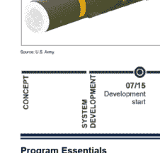

联合空地导弹是由陆军主导的项目，海军和海军陆战队也有联合需求。该导弹设计为从直升机和无人机系统空中发射，用于打击坦克、轻型装甲车辆、导弹发射器、掩体和建筑物。其旨在无论白天还是天气条件如何都能提供精确打击能力。JAGM 将取代所有 Hellfire 导弹型号。

来源：美国陆军

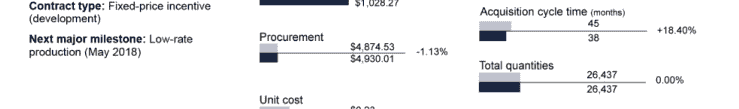

### 项目要点

- 项目办公室：红石兵工厂，阿拉巴马州
- 主承包商：Lockheed Martin
- 合同类型：固定价格激励（研发）
- 下一主要里程碑：低速率生产（2018年5月）

### 项目绩效

（2018财年美元，单位：百万美元）

（图表未按比例绘制）

|  | 最新（2017年10月） | 首次完整估算（2015年9月） | 变化 |
|---|---|---|---|
| 研发 | $1,052.96 | $1,028.27 | +2.39% |
| 采购 | $4,874.53 | $4,930.01 | -1.13% |
| 单位成本 | $0.23 | $0.23 | 0.58% |
| 采购周期时间（月） | 45 | 38 | +18.40% |
| 总数量 | 26,437 | 26,437 | 0.00% |

总数量包括118枚研发数量和26,319枚采购数量。

### 剩余资金需求

（2018财年美元，单位：百万美元）

|  | 迄今已拨款 | 待完成 |
|---|---:|---:|
| 研发 | $56.77 | $92.79 |
| 采购 | $4,710.28 | $150.49 |
| 采购数量 | 25,850 | 469 |

### 产品知识获取情况

截至2018年1月

| 资源与需求匹配 | 研发启动时状态 | 当前状态 |
|---|---|---|
| 证明所有关键技术在相关环境中非常接近最终的形式、适配性和功能 |  | ● |
| 在逼真环境中证明所有关键技术在形式、适配性和功能方面 | ○ | ● |
| 完成系统级初步设计评审 | ○ | ○ |
| 产品设计稳定 | 设计评审 |  |
| 发布至少90%的设计图纸 | ● | ● |
| 测试系统级集成原型 | ● | ● |
| 制造工艺成熟 | 生产启动 |  |
| 证明制造成熟度等级至少为9或关键工艺处于统计控制状态 | NA | NA |
| 在试点生产线上演示关键工艺 | NA | NA |
| 在预期环境中测试生产代表性原型 | NA | NA |

● 知识已获取，○ 知识未获取，... 信息不可用，NA 不适用

### 技术成熟度

JAGM 有三种关键技术——制导寻的器组件/传感器平台、传感器软件和任务软件，项目在2016年6月两次成功试射事件后评估这些技术均已成熟。JAGM 组件，包括发动机、战斗部和电子设备，与现有的 Hellfire 导弹通用。陆军将这些组件纳入 JAGM 设计的决定是在2010年系统级初步设计评审（PDR）和2012年项目重组之后做出的，重组包括将技术开发延长超过2年，以解决可负担性问题和风险降低需求。重组后，JAGM 未进行第二次 PDR，因为项目已在2010年进行了系统级 PDR。

### 设计稳定性

在2016年1月的关键设计评审（CDR）时，项目已发布超过90%的 JAGM 图纸——该绩效符合我们设计稳定性最佳实践标准。此后，JAGM 图纸总数略有增加，但程度不足以削弱项目的设计稳定性。项目现在预计在项目完成时有199份工程图纸，已向制造发布了这些图纸的96%。

### 生产准备情况

JAGM 将在与 Hellfire 导弹相同的设施中制造。项目办公室正在跟踪15项不同的硬件和软件相关指标，以评估 JAGM 的生产准备情况。据项目官员称，这些指标目前达到预期值，项目预计在低速率初始生产前所有生产工艺均已成熟。

尽管如此，项目正在监控与在规格范围内持续生产电路板涂层材料相关的风险。项目官员表示，他们正与分包商一起解决影响导弹制导部分电路板的生产问题，并也在探索可使用的替代材料。

### 其他项目问题

由于 AH-64 Apache 直升机当前用于发射 Hellfire 导弹的软件——需要飞行员投入更多操作才能访问 JAGM 功能，陆军将初始作战测试与评估（IOT&E）推迟了2年。正在开发的新平台软件将使飞行员能够以远少于与平台物理交互的方式选择全范围选项。该新软件的飞行测试计划于2018财年第四季度进行，随后进行 IOT&E。

在此期间，项目计划使用现有平台软件和硬件进行10枚导弹射击的有限用户测试，以展示导弹能力。陆军此前将该有限用户测试安排在2017年5月，但已推迟至2018年1月。项目官员表示，他们不期望在有限用户测试和 IOT&E 之间对导弹进行任何实质性更改。

### 项目办公室评论

我们向项目办公室提供了该评估的草案供审阅和评论。项目办公室没有评论。

## M109A7 车辆家族（M109A7 FOV）

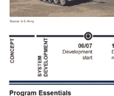

美国陆军的 M109A7 FOV 系统由两辆单独的车辆组成：自行榴弹炮（SPH）和提供作战支援的履带式弹药运输车。SPH 是一种装有155毫米火炮的履带式铝装甲车辆。预计 M109A7 FOV 通过采用全新设计的船体；改装的 M2 布雷德利步兵战车动力传动系统、悬挂系统和履带；以及现代化电气系统，能够在现有榴弹炮机队基础上提供更好的可持续性。

概念 系统开发 06/07 研发启动 12/08 设计评审 生产 10/13 低速率决策 10/16 开始作战测试 01/18 GAO审查 03/18 开始和结束作战测试 07/18 全速率决策 09/18 初始能力

### 项目要点

- 项目办公室：沃伦，密歇根州
- 主承包商：BAE Systems Land & Armament L.P.
- 合同类型：固定价格激励（采购）
- 下一主要里程碑：2018年7月全速率决策

### 项目绩效

（2018财年美元，单位：百万美元）

（图表未按比例绘制）

|  | 最新（2016年12月） | 首次完整估算（2011年12月） | 变化 |
|---|---|---|---|
| 研发 | $1,159.26 | $1,115.21 | +3.95% |
| 采购 | $9,335.35 | $6,284.23 | +0.81% |
| 采购周期时间（月） | 133 | 118 | +12.71% |
| 总数量 | 570 | 582 | -2.06% |
| 单位成本 | $13.15 | $12.71 | +3.42% |

总数量包括2辆研发数量和568辆采购数量。

### 剩余资金需求

（2018财年美元，单位：百万美元）

### 产品知识获取情况

截至2018年1月

| 资源与需求匹配 | 研发启动时状态 | 当前状态 |
|---|---|---|
| 证明所有关键技术在相关环境中非常接近最终的形式、适配性和功能 | ... | ● |
| 在逼真环境中证明所有关键技术在形式、适配性和功能方面 | ... | ● |
| 完成系统级初步设计评审 | ○ | ● |
| 产品设计稳定 | 设计评审 |  |
| 发布至少90%的设计图纸 | ... | ● |
| 测试系统级集成原型 | ○ | ● |
| 制造工艺成熟 | 生产启动 |  |
| 证明制造成熟度等级至少为9或关键工艺处于统计控制状态 | ○ | ○ |
| 在试点生产线上演示关键工艺 | ○ | ○ |
| 在预期环境中测试生产代表性原型 | ○ | ● |

● 知识已获取，○ 知识未获取，... 信息不可用，N/A 不适用

## M109A7 FOV 项目
### 技术成熟度与设计稳定性
M109A7 FOV 项目目前拥有成熟的关键技术和稳定的设计。该项目的两个关键技术——动力包集成和发电机总成的陶瓷轴承——在开发启动时尚未成熟，但在项目于2013年10月进入低速率初始生产时被评估为完全成熟。承包商已向制造部门发布了 M109A7 FOV 的所有预期图纸，并展示了系统级集成原型。然而，变速箱油冷却器设计中的差异可能是近期发动机部件故障的原因。根据项目办公室的说法，这些故障导致了临时设计变更，以提高变速箱油冷却器的结构强度。在进一步测试后，承包商计划开发最终设计变更，该变更将在全速率生产期间引入。

### 生产准备情况
迄今为止，在生产开始超过5年后，该项目尚未证明其制造工艺处于统计控制状态。该项目于2013年10月开始低速率初始生产，美国陆军于2015年3月接收了首辆车。为了评估生产准备情况和随时间的效率提升，项目会比较预期和实际制造工时的总额。我们最佳实践工作表明，如果项目的关键制造工艺在生产开始前未得到证明且未受控，则存在成本增加和进度延误的风险。

### 其他项目问题
项目当前的日程安排以完成初始作战测试与评估（IOT&E）为前提，且几乎不会发现新的技术缺陷。项目于2016年10月开始 IOT&E，但由于旧式火炮部件故障和可靠性问题，主要在完成不到三分之一计划任务后暂停了测试。根据项目官员的说法，这些故障要等到后续开发工作完成才会得到解决。项目的主要技术风险是，由于使用这些旧式部件，可能无法达到可靠性要求。由于项目无法完成计划的 IOT&E，已安排第二次 IOT&E 事件于2018年3月开始并完成——延迟约16个月。为准备此次测试，项目对车辆进行了多项更改，包括升级膛室部件、系统软件以及手册和培训，同时进行小幅硬件更改以提高可靠性。美国陆军将在 IOT&E 期间评估这些更改的有效性。如果这些更改被证明有效，项目预计不会超过其成本阈值。然而，先前确定的项目日期，如初始能力，已被突破。如果剩余测试发现新的缺陷并需要额外的设计更改和改装，项目可能会出现成本增长和进一步的进度延误。

### 项目办公室评论
我们已向项目办公室提供此评估的草案供审阅和评论。项目办公室提供了技术性评论，我们已在适当情况下予以采纳。

## 爱国者先进能力-3导弹段增强型（PAC-3 MSE）
### PAC-3 MSE 项目
### 技术成熟度、设计稳定性和生产准备情况
PAC-3 MSE 项目目前拥有成熟的关键技术、稳定的设计以及处于统计控制状态的生产工艺。

尽管 PAC-3 MSE 的部件与早期 PAC-3 变体有90%的通用性，但仍需开发四项独特技术：双脉冲固体火箭发动机；热电池；点火安全装置；以及防止意外发射或爆炸的不敏感弹药。这些技术在项目开发启动时均未成熟——这种做法与最佳实践不一致。

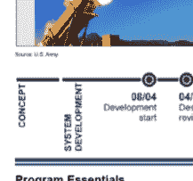

### 爱国者先进能力-3导弹段增强型（PAC-3 MSE）
美国陆军的 PAC-3 MSE 是一种旨在拦截战术弹道导弹和其他空中威胁的地空导弹。MSE 是集成到 PATRIOT 系统中的 PAC-3 导弹的最新版本，PATRIOT 系统包括雷达、发射装置和指挥控制系统。PAC-3 MSE 在早期 PAC-3 变体的基础上进行了改进，并提供了一种对复杂威胁具有更广范围和更高精度的更致命拦截弹。

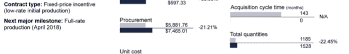

### 项目要点
- 项目办公室：雷德斯通兵工厂，阿拉巴马州
- 主承包商：洛克希德·马丁
- 合同类型：固定价格激励（低速率初始生产）
- 下一个主要里程碑：全速率生产（2018年4月）

### 项目绩效
（2018财年美元，单位：百万美元）（图表未按比例绘制）
开发 $990.97 +65.90% $597.33
采购 $5,881.76 -21.21% $7,465.01
单位成本 $5.81 +10.07% $5.28
采购周期时间（月）143 0 N/A
总数量 1185 1528 -22.45%
最新（2017年10月）首次完整估算（2004年8月）
由于项目的首次完整估算未确定初始作战能力日期，因此无法计算采购周期时间的变动。

### 剩余资金需求
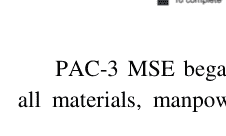

### 产品知识获取情况
| 资源与需求匹配 | 开发启动时状态 | 当前状态 |
|---|---|---|
| 证明所有关键技术在相关环境中非常接近最终的形式、适配性和功能 | ○ | ● |
| 在现实环境中证明所有关键技术在形式、适配性和功能方面 | ○ |  |
| 完成系统级初步设计评审 | ○ | ● |
| 产品设计稳定 | 设计评审 |  |
| 发布至少90%的设计图纸 | ○ | ● |
| 测试系统级集成原型 | ○ | ● |
| 制造工艺成熟 | 生产启动 |  |
| 证明制造成熟度等级至少为9或关键工艺处于统计控制状态 | ○ | ● |
| 在试点生产线上证明关键工艺 | ● | ● |
| 在预期环境中测试生产代表性原型 | ● | ● |
| ● 知识已获取，○ 知识未获取，... 信息不可用，N/A 不适用 | | |

PAC-3 MSE 于2014年3月开始生产，证明所有材料、人力、工具和设施已在试点生产线上得到验证，并可满足低速率生产计划，如国防部指导所建议。然而，这一验证在生产开始后超过2年才进行，这与采购最佳实践不一致。根据最佳实践，项目应在生产开始前证明制造工艺处于统计控制状态——即可重复、可持续并始终生产符合质量标准的零件。

2016年11月，项目评估了其全速率生产的准备情况，并得出结论称，在解决已识别风险（如与固体火箭发动机均匀生产相关的问题）后，承包商将具备充分准备。项目官员表示，这些风险已取得进展，到2018年初，所有 PAC-3 MSE 承包商将拥有成熟的工艺，以支持每月全速率生产20枚 PAC-3 MSE 导弹。

### 其他项目问题
PAC-3 MSE 项目于2016年7月实现初始作战能力——比计划提前约5个月——通过为一个 PATRIOT 营配备48枚导弹。项目官员将这一里程碑的提前完成归因于主承包商比预期更快的导弹交付以及与 PATRIOT 营现有训练的协同效应。

2017年11月，项目在延迟2个月后完成了作战测试。延迟发生是因为2017年6月飞行测试期间目标出现故障，需要重新安排测试。因此，项目将 PAC-3 MSE 全速率生产决策推迟至2018年4月。项目采购基线计划规定，全速率生产决策应在2018年6月底前作出。

项目官员表示，项目实现成本目标的能力取决于其能否为美国和外国采购稳定数量的 PAC-3 MSE 及相关变型导弹。对于2018至2022财年，陆军和项目办公室预计将节省约4,930万美元（按2015财年美元计算），假设国防部

每年接收约100枚导弹的外军销售订单。官员称，美国或外国对PAC-3 MSE或其早期型号的采购数量减少将导致该项目无法达到目标生产率和价格。

PAC-3 MSE项目在生产合同行动的确定化方面继续遇到延迟。项目官员表示，他们使用了未确定化合同行动——即在最终就合同条款、规格和价格达成一致之前授权承包商开始工作并产生费用的行动——来授予2014至2017财年的年度生产合同，因为就确定性合同进行的谈判将妨碍生产效率并导致部署PAC-3 MSE导弹的延迟。我们之前曾报道，未确定化合同行动的确定化延迟使项目面临成本增长风险，部分原因是如果在合同确定化之前要求发生变化，政府可能会产生不必要的成本。该项目用了2年时间确定2014财年合同的价格和条款。官员报告称，接下来3个财年的价格和条款的确定化现已完成或接近完成。官员还报告称，他们于2017年12月完成了2018财年生产的定价谈判，从而避免了对2018财年数量使用未确定化合同行动。

## Program Office Comments

我们向项目办公室提供了本评估的草案供审阅和评论。项目办公室提供了技术性评论，我们在适当情况下已将其纳入。

在对本评估草案发表评论时，项目官员指出该项目进行了两次生产就绪评估。据项目称，其中第一次评估于2013年8月完成，时间在低速率初始生产决定之前，第二次评估于2017年1月完成，时间在系统验证评审之前。官员进一步表示，该项目已努力开发和测试关键技术并减轻所有相关风险。

## Improved Turbine Engine Program (ITEP)

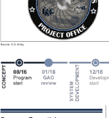

陆军的改进涡轮发动机项目（ITEP）正在为黑鹰和阿帕奇直升机机队开发替代发动机。新发动机旨在提高功率、性能和燃油效率；增强可靠性；延长使用寿命；并降低维护负担。陆军计划于2026财年开始部署这些发动机。

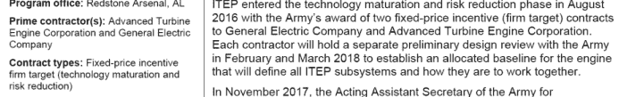

### Program Essentials

- **项目办公室：** 红石兵工厂，阿拉巴马州
- **主要承包商：** 先进涡轮发动机公司和通用电气公司
- **合同类型：** 固定价格激励固定目标（技术成熟与风险降低）
- **成本加激励费**（开发；计划中）
- **下一主要里程碑：** 开发启动（2018年12月）

### Current Status

ITEP于2016年8月进入技术成熟与风险降低阶段，当时陆军向通用电气公司和先进涡轮发动机公司授予了两份固定价格激励（固定目标）合同。每家承包商将在2018年2月和3月分别与陆军举行初步设计评审，以确定发动机的分配基线，该基线将定义所有ITEP子系统及其协同工作方式。

2017年11月，陆军采办、后勤和技术助理部长代理批准了ITEP开发合同提案的征求。陆军打算向正在开发初步设计的两家承包商之一授予系统开发的成本加激励费合同。目前，项目计划的采办周期约为11年。

项目的三个关键技术——先进进气颗粒分离器、压气机/先进空气动力学和混合轴承——在2014年10月的初步技术成熟度评估中被确定为接近成熟。按照国防部政策，陆军计划在2018年12月项目开发启动前，于2018年6月完成技术成熟度评估。

自2015年以来，黑鹰和阿帕奇直升机的制造商西科斯基飞机公司和波音公司一直在开展分析，以支持将ITEP硬件、电气系统和软件集成到直升机机体中。这些旨在识别集成风险并促进缓解策略开发的工作将与ITEP的初步设计评审并行进行。

### Estimated Program Cost

（2018财年美元，单位：百万美元）

### Planned Quantities

### Program Office Comments

我们向项目办公室提供了本评估的草案供审阅和评论。项目办公室没有提出任何评论。

## Long Range Precision Fires (LRPF)

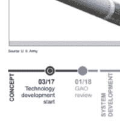

陆军远程精确打击（LRPF）将成为一个弹道导弹家族的一部分，该家族旨在攻击计划射程至少为300公里的区域目标和点目标。每个LRPF发射舱导弹容器计划容纳一至四枚导弹。LRPF将与现有的M142和M270火箭发射系统兼容。LRPF旨在取代陆军战术导弹系统（ATACMS）并遵守对非敏感弹药的法定要求和国防部关于集束弹药的政策。

概念 03/17 技术开发启动 01/18 GAO评审 系统开发 01/21 开发启动 10/22 设计评审 生产 03/25 低速率决定 07/26 开始作战测试 12/26 结束作战测试 02/27 初始能力

### Program Essentials

- 项目办公室：红石兵工厂，阿拉巴马州
- 主要承包商：先进技术国际公司、洛克希德·马丁公司和雷神公司
- 合同类型：各种成本补偿类型（技术成熟与风险降低）
- 下一主要里程碑：开发启动（2021年1月）

### Current Status

LRPF于2017年3月进入技术开发，系统开发预计于2021年启动。陆军仍在完善该系统的计划性能要求，项目官员表示预计这些要求将在2018年年中获得批准。

根据项目官员的说法，他们仍在评估两个要求——LRPF射程和杀伤力。项目官员表示，在2017财年，陆军提议将计划射程要求从300公里提高到400公里，并考虑将每个发射容器计划的导弹最小数量从一枚增加到两枚，计划的最大数量保持为四枚不变。随后LRPF承包商进行了权衡研究，发现使用每发射容器两枚导弹即可满足所需的射程和杀伤力。

根据其技术成熟与风险降低合同，陆军计划在计划的“优选”——即为系统开发选定单一承包商——之前，对LRPF系统进行竞争性原型开发。据项目办公室称，其已向洛克希德·马丁和雷神各自订购了四种原型。陆军计划于2018年11月进行初步设计评审。评审后，两家承包商将在2019年7月至12月期间各自进行三次飞行测试。陆军计划利用这些测试结果和初步设计评审结果来指导其系统开发的来源选择。

### Estimated Program Cost
（2018财年美元，单位：百万美元）

### Program Office Comments

我们向项目办公室提供了本评估的草案供审阅和评论。项目办公室提供了技术性评论，我们在适当情况下已将其纳入。办公室表示项目正在实现其成本和进度目标，并已与LRPF承包商完成了系统工程评审。此外，办公室表示陆军正在考虑加快项目进度，但指出这可能会影响LRPF预算估算。

### Planned Quantities

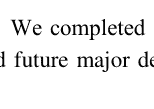

## NAVY AND MARINE CORPS PROGRAM ASSESSMENTS

我们对海军44个当前和未来主要国防采办项目中的24个进行了单独评估。在这24个项目中，21

处于系统开发或早期生产阶段，而另外3项是未来项目，五角大楼预计在未来几年内将其纳入系统开发。我们发现海军目前估计完成这24个项目的采购需要2520亿美元。我们还将这些项目的首次完整成本和进度估算与其当前估算进行了比较，发现：

- 净成本增长总额为1358亿美元，其中大部分发生在5年多以前，且
- 项目进度延迟平均约为32个月。

### 所评估的24个项目的采购阶段和规模

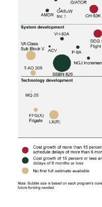

### 所评估的24个项目的当前估计采购成本

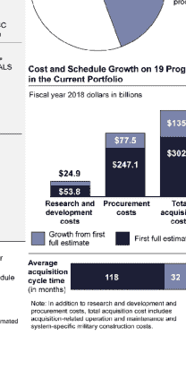

### 系统开发启动后项目的知识获取情况汇总

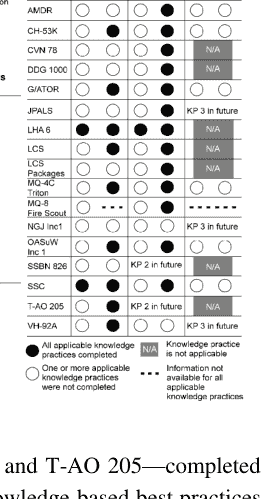

24个项目中的3个——LHA 6、LCS 和 T-AO 205——完成了我们评估的适用知识型最佳实践相关的所有活动，尽管只有 LHA 6 在达到知识节点时才完全完成了这些活动。

## 两栖战斗车辆（ACV）

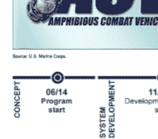

两栖战斗车辆（ACV）

海军陆战队的 ACV 是被取消的远征战斗车辆（EFV）的继任项目。ACV 旨在将海军陆战队员从舰船运送到岸上，并为其提供改善的机动性和高水平的防护。ACV 采购方法要求三个开发增量（1.1、1.2 和 2.0），并利用 EFV 项目下完成的工作。我们评估了 ACV 增量 1.1

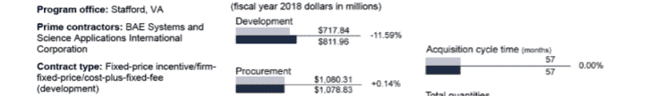

### 项目要点

- 项目办公室：弗吉尼亚州斯塔福德
- 主承包商：BAE Systems and Science Applications International Corporation
- 合同类型：固定价格激励/固定总价/成本加固定费用（开发）
- 下一主要里程碑：低速率初始生产（2018年6月）

### 项目绩效

（2018财年美元，单位：百万美元）
（图表未按比例绘制）

|  | 最新（2016年12月） | 首次完整估算（2015年5月） | 变化 |
| 开发 | $717.84 | $811.96 | -11.59% |
| 采购 | $1,080.31 | $1,078.83 | +0.14% |
| 单位成本 | $7.66 | $9.09 | -5.25% |
| 采购周期时间（月） | 57 | 57 | 0.00% |
| 总数量 | 240 | 240 | 0.00% |

总数量包括36个开发数量和204个采购数量。

### 剩余资金需求

（2018财年美元，单位：百万美元）

|  | 迄今已资助 | 待完成 |
| 开发 | $257.61 | $460.23 |
| 采购 | $1,080.31 |  |

采购数量 204

### 产品知识获取情况

截至2018年1月

|  | 状态于 | 当前状态 |
| 资源与需求匹配 | 开发启动 |  |
| 证明所有关键技术在相关环境中非常接近最终的形式、适配性和功能 | ● | ● |
| 在逼真的环境中证明所有关键技术在形式、适配性和功能方面 | ○ | ○ |
| 完成系统级初步设计评审 | ○ | ● |
| 产品设计稳定 | 设计评审 |  |
| 发布至少90%的设计图纸 | ● | ● |
| 测试系统级集成原型 | ○ | ○ |
| 制造工艺成熟 | 生产启动 |  |
| 证明制造成熟度等级至少为9或关键工艺处于统计控制状态 | NA | NA |
| 在试点生产线上证明关键工艺 | NA | NA |
| 在预期环境中测试生产代表性原型 | NA | NA |

● 知识已获得，○ 知识未获得，... 信息不可用，NA 不适用

### ACV 1.1 项目

### 技术成熟度

ACV 的两项关键技术——驾驶员视野增强（DVE）系统和远程武器站（RWS）——以成熟技术进入开发。DVE 系统运行在 ACV 所取代的突击两栖车辆的 legacy 系统上。RWS 基于也用于另一平台的系统，并已通过水适用性成功测试。根据国防部测试官员的说法，ACV 承包商已将这两种政府提供的技术集成到 ACV 原型中，作为开发测试的一部分。

### 设计稳定性

海军陆战队为 ACV 1.1 的开发阶段向竞争供应商授予了两份单独合同。根据这些合同，供应商需各自设计并生产16辆 ACV 原型车辆用于测试和评估。承包商于2017年11月前交付了全部32辆原型车。

ACV 1.1 项目在2016年7月的系统级关键设计评审时已完成至少90%的预期图纸。截至2017年10月，项目办公室报告称其现已完成100%的预期设计图纸，表明设计已稳定。

国防部于2017年3月开始对原型进行开发测试。第一轮开发测试以纠正措施期结束，以便纳入测试过程中发现的任何潜在设计变更。原型将在开发阶段结束并进入生产期间经历三轮开发测试和纠正措施期。旨在支持诸如兵力保护和系统生存能力等能力的实弹测试于2017年6月开始。海军陆战队已安排于2018年1月至3月进行作战评估，以就包括满足 ACV 能力要求和进入低速率初始生产的准备情况在内的多个方面为项目提供信息。

### 生产准备情况

该项目将在2018年做出两个关键决定：第一是为生产合同选择单一供应商，第二是确定项目是否准备好开始低速率初始生产。进入低速率生产的决定定于2018年6月。

海军陆战队于2017年11月启动生产准备审查，以确定承包商的生产成熟度是否足以在生产决策后开始低速率生产。2017年12月，项目向两家参与承包商发出 solicitations，以获取其低速率和全速率生产的提案，每个提案均反映了截至2017年11月的测试性能和设计修改的最新信息。竞争承包商根据项目官员的说法，曾在其开发合同的原始提案中提交了生产车辆的定价，在生产合同的提案中可根据开发过程中实现的 design changes 和其他变更调整 ACV 的价格。提案于2018年1月提交给项目办公室。海军陆战队计划在选择最终生产承包商时考虑原型性能测试结果和拟议价格。

### 其他项目问题

该项目已采用一些最佳实践以最大限度降低采购风险，例如使用成熟技术和促进竞争。然而，海军陆战队采用了激进的时间表，力求在2020财年前获得初始作战能力（IOC）。该项目计划在生产阶段进行超过一年的开发测试，从而增加了并发开发测试和生产可能导致昂贵返工和进度延误的风险。并发风险在2016年增加，当时开发测试的开始日期被推迟，测试活动被推迟2至12个月，这是由于在提出投标抗议后向承包商发出停工令所致。例如，该项目不得不将若干项计划中的开发测试推迟三个月，而高温测试则推迟一年。海军陆战队将生产决策推迟了4个月，但仍保持2020年8月的 IOC 日期。

### 项目办公室评论

我们向项目办公室提供了本评估的草案供其审阅和评论。项目办公室提供了技术性评论，我们在适当情况下已将其纳入。项目办公室还表示，尽管其保持激进的时间表，但迄今已达到其进度基准，并有望在2018年6月做出低速率初始生产决定。据项目称，所有关键要求均已通过开发测试证明是可实现的，而正在进行的 ACV 1.1 作战评估迄今未发现任何重大问题。

项目表示我们报告的并发风险较低，不太可能导致昂贵的返工。它还表示已通过在极端温度下进行开发测试来降低并发风险。据项目称，这些开发测试的初步结果表明不需要进行重大重新设计工作。

## 空中和导弹防御雷达（AMDR）

### AMDR 项目

### 技术成熟度

该项目评估 AMDR 的四项关键技术为成熟。虽然该项目已继续进一步证明 AN/SPY-6(V)1 系统的性能和能力，如我们在生产知识获取部分所示，我们认为该项目

只有在其真实的海上环境中进行测试，才能证明关键技术的完全成熟。

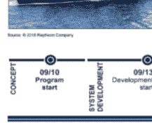

## 防空反导雷达（AMDR）

海军的AMDR是一个支持水面作战和综合防空反导的下一代雷达项目。AMDR正在研发一种名为AN/SPY-6(V)1的雷达，预计将提高远程探测灵敏度，以增强针对先进威胁的弹道导弹防御能力。该项目还在研发一套雷达套件控制器，该控制器将与升级后的宙斯盾作战系统接口，为DDG 51 Flight III驱逐舰提供综合防空反导能力。

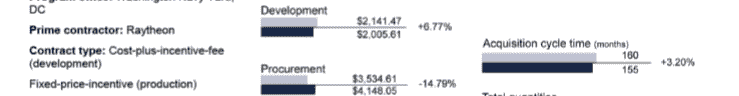

### 项目要点

- 项目办公室：华盛顿海军工厂，华盛顿特区
- 主要承包商：雷神公司
- 合同类型：成本加激励费用（研发）
- 固定价格激励（生产）
- 下一个重要里程碑：首部生产型雷达交付（2019年12月）

### 项目绩效

（2018财年，单位：百万美元）
（图表未按比例绘制）

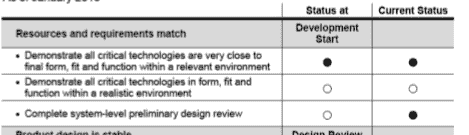

### 剩余资金需求

（2018财年，单位：百万美元）

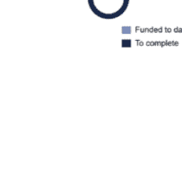

### 产品知识掌握程度

截至2018年1月

| 资源与需求匹配 | 开发启动时状态 | 当前状态 |
|---|---|---|
| 在相关环境中展示所有关键技术已非常接近最终形态、适配性和功能 | ○ | ● |
| 在现实环境中展示所有关键技术的形态、适配性和功能 | ○ | ○ |
| 完成系统级初步设计评审 | ○ | ● |
| 产品设计稳定 | 设计评审 | |
| 发布至少90%的设计图纸 | ○ | ● |
| 测试系统级集成原型 | ● | ● |
| 制造工艺成熟 | 生产启动 | |
| 展示制造就绪等级至少达到9级，或关键工艺处于统计受控状态 | ○ | ○ |
| 在试生产线上展示关键工艺 | NA | NA |
| 在预期环境中测试生产代表型原型 | ○ | ○ |

* 已获得知识，○ 未获得知识，... 信息不可获取，NA 不适用

作为雷达研发的一部分，承包商建造了一个全尺寸的单面雷达阵面，海军已将其广泛用于研发测试。这个生产代表型阵面正在海军的太平洋导弹靶场进行实弹弹道导弹防御以及防空和反水面作战测试，测试将持续到2018年年中。2019年4月，海军计划在岸基试验场将阵面与计划用于DDG 51 Flight III的宙斯盾作战系统初始版本集成——该系统整合舰载传感器和武器系统以应对威胁——以支持进一步测试。然而，海军要到2022年左右的某个时候，在两者都安装到首舰上之后，才会对完整的集成雷达和宙斯盾作战系统进行测试。

2017年春季，AMDR在进入生产前完成了支持AN/SPY-6(V)1核心能力的软件开发。剩余的软件开发工作包括软件更新——到2020年为止——这些更新旨在增强雷达防御能力，并将雷达与作战系统集成。

### 设计稳定性与生产准备就绪

2017年5月，AMDR开始对三套AN/SPY-6(V)1雷达进行低速初始生产——比计划提前了4个月——核心系统硬件和软件已完成，设计稳定，生产能力符合国防部指南，但尚未达到行业最佳实践。项目官员表示，由于在研发过程中更深入地了解了拥有成本、生产和材料成本，AMDR的采购成本比最初的独立成本估算整体有所降低。

AMDR项目办公室计划在作战测试完成前采购雷达总数的三分之二以上。海军有意安排AMDR在宙斯盾升级软件开发（作战测试的先决条件）开始之前启动生产，以便有时间使关键雷达技术成熟并稳定设计，从而降低在雷达知识不足的情况下开始作战系统开发的风险。然而，AMDR在宙斯盾作战系统集成、陆上和海上测试以及生产方面的时间表相互并行，这意味着海军将需要在多部雷达的生产已开始或完成后，处理尚未发现的雷达与宙斯盾升级集成方面的缺陷。解决这些缺陷所需的任何改装都可能增加成本。

### 其他项目问题

AMDR在未经批准的《测试与评估总计划》的情况下进入生产阶段。国防部作战测试与评估主任（DOT&E）多年来一直表示担忧，认为海军提出的测试方法如果不在其中加入一艘配备AN/SPY-6(V)1和宙斯盾系统的无人自卫测试舰，就无法提供真实的作战条件。2016年，国防部副部长指示海军在其预算规划中为此类测试舰纳入资金。然而，2017年12月，项目官员表示海军不打算为这艘测试舰申请资金。相反，海军期望通过分段测试方法完成DDG 51 Flight III、AN/SPY-6(V)1和宙斯盾升级的初始作战测试与评估，该方法包括陆基测试、在有人驾驶的Flight III舰艇上进行测试，以及模型和仿真。DOT&E在2017年底向我们重申，对于初始作战测试与评估，要充分展示Flight III所需的自我防御能力，唯一的方法是在无人测试舰上测试AN/SPY-6(V)1和宙斯盾系统。

### 项目办公室评论

我们向项目办公室提供了本评估的草稿，供其审阅和评论。项目办公室提出了技术意见，我们在适当之处予以采纳。项目办公室还表示，AMDR正按计划、在预算范围内执行，并将按计划交付给DDG 51 Flight III项目。它还表示，当前的研发测试阶段始于2016年8月的太平洋导弹靶场，包括实弹测试，以展示水面作战和综合防空反导能力。据项目办公室称，2017年5月完成的作战系统集成测试活动为雷达和作战系统双方带来了经验教训，这些经验教训将有助于改进接口。项目办公室还表示，建模表明其有能力支持Flight III的宙斯盾作战需求。

此外，项目办公室重申其立场，即通过在第一艘Flight III舰艇上进行陆基和海基测试，并结合对以往测试数据的模拟，无需使用配备AN/SPY-6(V)1和宙斯盾系统的无人测试舰，即可展示Flight III所需的自我防御能力。

## CH-53K 重型运输替换直升机（CH-53K）

### CH-53K 项目

### 技术成熟度、设计稳定性与生产准备就绪

CH-53K项目于2017年3月进入生产阶段，当时关键技术已经成熟、设计稳定，但生产工艺尚未得到验证。八个月后，由于该项目尚未使生产工艺进入统计受控状态，生产中的不确定性依然存在。

项目办公室已确定了两项关键技术——主旋翼桨叶和主减速器。据项目官员称，这两项关键技术在过去一年内已经成熟。该项目于2015年10月开始对这两项技术进行飞行测试。主减速器的持续问题迫使该项目将系统级演示测试的计划完成时间推迟了4个月——现在计划于2019年5月完成。我们此前发现，主减速器后模块组件中的部件需要进行多次重新设计。项目官员报告称，自最近一次重新设计以来，该项目已成功测试了主减速器。

在关键设计评审时，该项目评估了一个后来被证明是不稳定的设计。在我们2017年的评估中，我们报告称，由于该项目不再跟踪设计图纸信息，这种不稳定性的程度未知。然而，在我们当前的评估中，项目提供了新的信息，表明承包商已经

released 89 percent of current drawings to manufacturing by the critical design review—a level that falls just short of meeting best practices criteria for design stability. This information also indicated that the contractor had completed nearly 99 percent of CH-53K drawings as of October 2017—a level that reflects design stability.

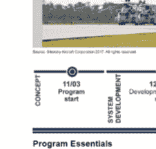

## CH-53K Heavy Lift Replacement Helicopter (CH-53K)
## CH-53K 重型运输直升机替换项目（CH-53K）

The Marine Corps' CH-53K heavy-lift helicopter is intended to transport armored vehicles, equipment, and personnel to support operations deep inland from a sea-based center of operations. The CH-53K is expected to replace the legacy CH-53E helicopter and provide increased range and payload, survivability and force protection, reliability and maintainability, and coordination with other assets, while reducing total ownership costs.
海军陆战队的 CH-53K 重型运输直升机旨在从海上作战中心向内陆纵深运送装甲车辆、装备和人员以支援作战。预计 CH-53K 将取代现役的 CH-53E 直升机，并提供更大的航程和载荷、更高的生存能力和兵力防护、可靠性和可维护性，以及与其他资产的协同能力，同时降低总体拥有成本。

CONCEPT 11/03 Program start  
概念 11/03 项目启动  
SYSTEM DEVELOPMENT 12/05 Development start  
系统开发 12/05 开发启动  
07/10 Design review  
07/10 设计评审  
09/16 Start operational test  
09/16 开始作战测试  
03/17 Low-rate decision  
03/17 低速率生产决策  
01/18 GAO review  
01/18 GAO 审查  
12/19 End operational test  
12/19 结束作战测试  
12/19 Initial capability  
12/19 初始能力  
09/20 Full-rate production decision
09/20 全速率生产决策

## Program Essentials
## 项目要点

- Program office: Patuxent River, MD
- 项目办公室：帕图森河，MD
- Prime contractor: Sikorsky Aircraft
- 主承包商：西科斯基飞机公司
- Contract types: Cost-plus-incentive-fee (development)
- 合同类型：成本加激励费（开发）
- Firm-fixed-price/cost-plus-fixed-fee (engine development)
- 固定总价/成本加固定费（发动机开发）
- Fixed-price-incentive/cost-plus-fixed-fee/firm-fixed-price (low-rate initial production)
- 固定价格激励/成本加固定费/固定总价（低速率初始生产）
- Next major milestone: Complete operational testing (December 2019)
- 下一主要里程碑：完成作战测试（2019 年 12 月）

## Program Performance
## 项目绩效

(fiscal year 2018 dollars in millions)
（2018 财年，单位：百万美元）

| | Latest (October 2017) | First full estimate (December 2005) | Change |
| | 最新（2017 年 10 月） | 首次完整估算（2005 年 12 月） | 变化 |
|---|---|---|---|
| Development | $7,362.00 | $4,844.71 | +51.96% |
| 开发 | $7,362.00 | $4,844.71 | +51.96% |
| Procurement | $20,943.19 | $13,473.83 | +55.44% |
| 采购 | $20,943.19 | $13,473.83 | +55.44% |
| Unit cost | $141.59 | $117.43 | +20.58% |
| 单位成本 | $141.59 | $117.43 | +20.58% |
| Acquisition cycle time (months) | 109 | 119 | +42.00% |
| 采购周期时间（月） | 109 | 119 | +42.00% |
| Total quantities | 200 | 156 | +28.21% |
| 总数量 | 200 | 156 | +28.21% |

Total quantities comprise 6 development quantities and 194 procurement quantities.  
总数量包括 6 架开发数量和 194 架采购数量。  
(Charts not to scale)
（图表未按比例绘制）

## Remaining Funding Requirements
## 剩余资金需求

(fiscal year 2018 dollars in millions)
（2018 财年，单位：百万美元）

| | Funded to date | To complete |
| | 迄今已资助 | 待完成 |
|---|---|---|
| Development | $1,124.95 | $6,237.05 |
| 开发 | $1,124.95 | $6,237.05 |
| Procurement | $20,401.47 | $541.72 |
| 采购 | $20,401.47 | $541.72 |
| Procurement Quantities | 192 | 2 |
| 采购数量 | 192 | 2 |

## Attainment of Product Knowledge
## 产品知识获取情况

As of January 2018
截至 2018 年 1 月

| | Status at Development Start | Current Status |
| | 开发启动时状态 | 当前状态 |
|---|---|---|
| Resources and requirements match | Development Start | |
| 资源与需求匹配 | 开发启动 | |
| Demonstrate all critical technologies are very close to final form, fit and function within a relevant environment | ○ | ● |
| 证明所有关键技术在相关环境中非常接近最终的形式、适配性和功能 | ○ | ● |
| Demonstrate all critical technologies in form, fit and function within a realistic environment | ○ | ● |
| 在逼真的环境中证明所有关键技术在形式、适配性和功能方面 | ○ | ● |
| Complete a system-level preliminary design review | ○ | ● |
| 完成系统级初步设计评审 | ○ | ● |
| Product design is stable | Design Review | |
| 产品设计稳定 | 设计评审 | |
| Release at least 90 percent of design drawings | ○ | ● |
| 发布至少 90% 的设计图纸 | ○ | ● |
| Test a system-level integrated prototype | ○ | ● |
| 测试系统级集成原型 | ○ | ● |
| Manufacturing processes are mature | Production Start | |
| 制造工艺成熟 | 生产启动 | |
| Demonstrate Manufacturing Readiness Level of at least 8 or critical processes are in statistical control | ○ | ○ |
| 证明制造成熟度等级至少为 8 或关键工艺处于统计控制状态 | ○ | ○ |
| Demonstrate critical processes on a pilot production line | ● | ● |
| 在试点生产线上证明关键工艺 | ● | ● |
| Test a production-representative prototype in its intended environment | ● | ● |
| 在预期环境中测试生产代表性原型 | ● | ● |

- ● Knowledge attained, ○ Knowledge not attained, ... Information not available, NA Not applicable
- ● 知识已获取，○ 知识未获取，... 信息不可用，NA 不适用

In August 2017, the program modified the contract that included long lead items to procure two low-rate initial production aircraft. Prior to the production contract award, manufacturing processes were demonstrated on a pilot production line. In addition, the program completed an operational assessment in September 2016, the results of which the Office of the Director of Operational Test and Evaluation (DOT&E) evaluated and determined supported the program’s entry into production. The assessment identified the CH-53K engines as a risk area in the program, noting that they may overheat in certain conditions. DOT&E recommended that the program modify aspects of the engine design to fix this issue.
2017 年 8 月，该项目修改了包含长交期物料的合同以采购两架低速率初始生产飞机。在生产合同授予之前，制造工艺已在试点生产线上得到验证。此外，该项目于 2016 年 9 月完成了作战评估，其结果由作战试验与评估办公室主任办公室（DOT&E）评估并确定支持该项目进入生产。评估将 CH-53K 发动机确定为项目中的风险领域，指出它们在某些条件下可能会过热。DOT&E 建议该项目修改发动机设计的某些方面以解决此问题。

## Other Program Issues
## 其他项目问题

The CH-53K contractor plans to move its final assembly line from its current location in West Palm Beach, Florida, to Sikorsky’s headquarters in Stratford, Connecticut. The move will require a number of equipment and configuration changes to Sikorsky’s Stratford facility, which will take time to complete and pose risk to the CH-53K production schedule. The contractor plans to produce the first four system demonstration test helicopters in Florida before transitioning production to Connecticut in summer 2018 for the fifth, and final, demonstration helicopter. Program officials stated that they expect delivery of the first three helicopters in the second quarter of fiscal year 2018, but that production of the fourth helicopter has been delayed to December 2018 due to a parts shortage.
CH-53K 承包商计划将其最终装配线从佛罗里达州西棕榈滩的当前位置搬迁至西科斯基位于康涅狄格州斯特拉特福的总部。该搬迁需要对西科斯基斯特拉特福设施进行多项设备和配置更改，这需要时间完成并对 CH-53K 生产计划构成风险。承包商计划在佛罗里达生产前四架系统演示试验直升机，然后于 2018 年夏季将生产转移到康涅狄格州生产第五架也是最后一架演示直升机。项目官员表示，他们预计在 2018 财年第二季度交付前三架直升机，但由于零件短缺，第四架直升机的生产已推迟至 2018 年 12 月。

Program officials also stated that they face challenges related to cybersecurity requirements applicable to the CH-53K system. They stated the challenges include lengthy contractual lead times to field solutions that address continuously evolving cyber threats. They added that this has resulted in prolonged operational risk. At the same time, the program office is planning to award a contract for Sikorsky to identify cybersecurity risks that may exist within the CH-53K system. Once that work is completed, the program office anticipates awarding another contract in order to mitigate any risks discovered. The program office plans to have a related risk mitigation plan completed by the start of initial operational and test evaluation in July 2019.
项目官员还表示，他们面临与 CH-53K 系统适用的网络安全要求相关的挑战。他们表示，这些挑战包括部署解决不断演变的网络威胁的解决方案所需的漫长合同交期。他们补充说，这导致了长期的作战风险。与此同时，项目办公室计划授予西科斯基一份合同，以识别 CH-53K 系统中可能存在的网络安全风险。完成该工作后，项目办公室预计将授予另一份合同以减轻发现的任何风险。项目办公室计划在 2019 年 7 月初始作战和试验评估开始时完成相关的风险缓解计划。

## Program Office Comments
## 项目办公室意见

We provided a draft of this assessment to the program office for review and comment. Technical comments were incorporated where appropriate. The program office concurred with the contents of this assessment.
我们已向项目办公室提供此评估的草案供其审阅和评论。技术性评论已在适当情况下纳入。项目办公室同意该评估的内容。

## CVN 78 Gerald R. Ford Class Nuclear Aircraft Carrier (CVN 78 Class)
## CVN 78 杰拉尔德·R·福特级核动力航空母舰（CVN 78 级）

The Navy developed the Ford-class nuclear-powered aircraft carrier to introduce new propulsion, aircraft launch and recovery, and survivability capabilities to the carrier fleet. The Ford-class, also known as the CVN 78 class, is the successor to the Nimitz-class aircraft carrier, and its new technologies are intended to create operational efficiencies while enabling a 25 percent increase in operational aircraft flights as compared to legacy carriers. The Navy also expects the new technologies to enable Ford-class carriers to operate with reduced manpower.
海军开发了福特级核动力航空母舰，以为航母舰队引入新的推进、飞机起降和生存能力。该福特级，也称为 CVN 78 级，是尼米兹级航空母舰的继任者，其新技术旨在在提高作战效率的同时，与现役航母相比实现作战飞机飞行次数增加 25%。海军还预计新技术将使福特级航母能够以减少的人力运作。

### Program Essentials
### 项目要点

- Program office: Washington, DC
- 项目办公室：华盛顿特区
- Prime contractor: Huntington Ingalls Industries
- 主承包商：亨廷顿英戈尔斯工业公司
- Contract types: Cost-plus-incentive-fee/cost-plus-award-fee/cost-plus-fixed-price (CVN 78 detail design and construction)
- 合同类型：成本加激励费/成本加奖励费/成本加固定价（CVN 78 详细设计和建造）
- Cost-plus-fixed-fee/cost-plus-incentive-fee (CVN 79 construction preparation)
- 成本加固定费/成本加激励费（CVN 79 建造准备）
- Cost-plus-fixed-fee/fixed-price incentive (CVN 79 detail design and construction)
- 成本加固定费/固定价格激励（CVN 79 详细设计和建造）
- Next major milestone: Initial capability (April 2019)
- 下一主要里程碑：初始能力（2019 年 4 月）

### Program Performance
### 项目绩效

(fiscal year 2018, dollars in millions)
（2018 财年，单位：百万美元）

| | Latest (December 2016) | First full estimate (April 2004) | Change |
| | 最新（2016 年 12 月） | 首次完整估算（2004 年 4 月） | 变化 |
|---|---|---|---|
| Development | $5,675.40 | $5,314.45 | +6.79% |
| 开发 | $5,675.40 | $5,314.45 | +6.79% |
| Procurement | $23,912.42 | $24,045.39 | -0.66% |
| 采购 | $23,912.42 | $24,045.39 | -0.66% |
| Unit cost | $13,220.52 | $13,119.95 | +0.77% |
| 单位成本 | $13,220.52 | $13,119.95 | +0.77% |
| Acquisition cycle time (months) | 180 | 137 | +31.39% |
| 采购周期时间（月） | 180 | 137 | +31.39% |
| Total quantities | 3 | 3 | 0.00% |
| 总数量 | 3 | 3 | 0.00% |

Total procurement decreases are the result of lower estimated costs for the third ship (CVN 80), which still is not validated by an independent cost estimate.
采购总额下降的原因是第三艘舰（CVN 80）的估算成本降低，而该估算尚未得到独立成本估算的验证。

### Attainment of Product Knowledge
### 产品知识获取情况

As of January 2018
截至 2018 年 1 月

| | Status at Development Start | Current Status |
| | 开发启动时状态 | 当前状态 |
|---|---|---|
| Resources and requirements match | | |
| 资源与需求匹配 | | |
| Demonstrate all critical technologies are very close to final form, fit and function within a relevant environment | ○ | ● |
| 证明所有关键技术在相关环境中非常接近最终的形式、适配性和功能 | ○ | ● |
| Demonstrate all critical technologies in form, fit and function within a realistic environment | ○ | ○ |
| 在逼真的环境中证明所有关键技术在形式、适配性和功能方面 | ○ | ○ |
| Complete a system-level preliminary design review | ○ | ○ |
| 完成系统级初步设计评审 | ○ | ○ |
| Product design is stable | Fabrication Start | |
| 产品设计稳定 | 制造启动 | |
| Complete basic and functional design to include 100 percent of 3D product modeling | ○ | ● |
| 完成基础和功能设计，包括 100% 的三维产品建模 | ○ | ● |

- ● Knowledge attained, ○ Knowledge not attained, ... Information not available, NA Not applicable
- ● 知识已获取，○ 知识未获取，... 信息不可用，NA 不适用

## CVN 78 级项目

### 技术、设计与生产成熟度

2017年5月，海军接收了福特级首舰（CVN 78）的交付，尽管该航母依赖不成熟的技术，且难以展示成熟系统的可靠性。CVN 78在建造时即存在技术不成熟和设计不完整的问题，导致成本增加和进度拖延。该舰比海军计划晚了20个月交付，仍有建造相关工程未完成，并存在超过40项可能影响舰艇作战或安全的严重缺陷。截至2018年1月，海军报告该项目的13项关键技术中有11项已成熟。目前仍在进行多项关键系统的舰载测试，包括先进武器升降机、电磁飞机弹射系统（EMALS）、先进拦阻装置（AAG）和双频雷达（DBR）。升降机、AAG和DBR在达到海军评估舰艇性能所用的可靠性目标方面仍存在困难。如果这些系统无法证明其可靠性，CVN 78可能无法展示其快速弹射起飞和回收飞机的能力——这是新型航母的关键要求。海军报告称EMALS现已达到可靠性目标；然而，作战试验与评估局局长提出了担忧，因为海军降低了EMALS的可靠性目标。这一较低的目标也将使该舰无法满足项目规定的飞机弹射起飞和回收要求。

直到海军使CVN 78级的关键技术完全成熟，这些技术的形式及其在舰上的集成方式仍可能发生变化。此类变化是技术开发的典型结果，可能导致CVN 78级舰艇需要额外的设计修改。尽管如此，第二艘舰CVN 79仍在继续建造，目前已完成34%，海军很快将审查第三艘舰CVN 80的提案。CVN 79采用CVN 78的设计并作了一些修改——海军认为这些修改已完成——最显著的是用企业空中监视雷达（EASR）替换DBR，该雷达仍在开发中，并于2017年8月完成了关键设计评审。海军未将此新系统列为福特级的关键技术，因为它源自已有的防空反导雷达。海军计划为CVN 79和CVN 80采购两台EASR单元，并在CVN 79的第二阶段交付期间安装该舰的EASR单元。海军预计将于2018年初收到并审查CVN 80的船厂提案。船厂已经在根据海军报告其于2016年5月授予的预采购合同为第三艘舰采购材料。

### 其他项目问题

2007年，国会为CVN 78设定了105亿美元的采办成本上限，但首舰的采办成本此后增加了23%，达到目前的129亿美元上限。《2016财年国防授权法》（NDAA）将后续舰艇（包括CVN 79）的成本上限降至114亿美元，尽管该舰的成本也可能增加。在先前的一份报告中，我们发现海军为CVN 79编列的预算资金可能不足以完成舰船建造。此前，海军对CVN 79在其成本上限内交付表示信心，这假设了前所未有的建造效率——即CVN 79的生产工时将比CVN 78低18%以上。然而，近期的建造绩效报告显示，船厂并未实现这一目标。如果船厂无法实现预期的效率提升，CVN 79将面临超出其当前114亿美元成本上限的风险。《2018财年国防授权法》将CVN 79之后舰艇的成本上限提高至126亿美元。

《2018财年国防授权法》还为国防部长提供了另一种方式，以豁免《2016财年国防授权法》对CVN 79资金的限制，该方式不要求认证CVN 78已完成整船冲击试验。海军最初计划将这项试验推迟到CVN 78首次部署之后。在先前的一份报告中，我们对海军推迟该试验的计划提出了担忧，因为此类试验可以在舰艇投入实战环境之前识别出潜在的关键任务失效。2015年，负责采办的国防部副部长下令海军在首次部署前进行该试验。

### 项目办公室评论

我们将本评估草案提供给项目办公室进行审查和评论。项目办公室提供了技术意见，我们已在适当之处纳入。此外，项目办公室表示，CVN 78在完成试验后于2017年5月下旬交付，尽管存在缺陷。据项目办公室称，这些缺陷的纠正进度超前。据该项目称，截至2018年1月，该舰在海上表现良好，在DBR的支持下，使用EMALS和AAG完成了数百次飞机弹射起飞和回收。这些活动有助于满足这些系统所需的可靠性指标。

项目办公室还表示，CVN 79的建造成本绩效仍低于实现从CVN 78降低生产工时计划所需的水平，但正在改善。该项目预计，随着继续消除某些建造材料短缺的残余影响（这些短缺导致了早前的成本绩效问题），船厂绩效将保持稳定。据项目办公室称，海军计划于2024年9月在其成本上限内按时交付一艘完整且可部署的舰艇，并按照维持11艘航母力量结构的时间表完成。

## DDG 1000 朱姆沃尔特级驱逐舰（DDG 1000）

### DDG 1000 项目

### 技术成熟度与设计稳定性

DDG 1000的多项关键技术仍在接近成熟，尽管项目报告称其已发布100%的基本和功能设计工作，项目办公室认为设计是稳定的。随着项目继续将每项技术成熟为最终形式、配合与功能，项目可能需要对基本和功能设计进行修改，以适应必要的变更，这可能损害项目的设计稳定性。

DDG 1000驱逐舰是一种多任务水面舰艇，最初设计用于在近海区域和对陆攻击中提供先进能力，以支援岸上部队。DDG 1000级舰艇具有隐身设计、综合电力系统和全舰计算环境。海军采用了分阶段采办策略，将舰体、机械和电气（HM&E）系统的交付与接收同作战系统的激活与测试分开。海军于2016年5月接收了首舰HM&E系统的交付，作战系统激活与测试正在进行中。

### 项目时间表

| 阶段 | 里程碑 |
|---|---|
| 概念 | 01/98 — 项目启动 |
| 开发 | 08/06 — 开发启动 |
| 生产 | 02/09 — 首舰开工建造 |
| 生产 | 05/16 — 首舰交付 |
| 生产 | 01/18 — 认证与鉴定（C&A）审查 |
| 生产 | 11/19 — 初始作战试验与评估 |
| 生产 | 08/20 — 初始作战能力 |

### 项目基本信息

- **项目办公室：** 华盛顿特区
- **主承包商：** 通用动力巴斯钢铁造船厂；BAE系统公司；亨廷顿英格尔斯工业公司；雷声公司
- **合同类型：** 固定价格激励/固定总价/成本加固定酬金（舰船建造）；固定价格激励/成本加固定酬金（先进舰炮系统设备）；成本加固定酬金/成本加奖励酬金（任务系统设备）
- **下一个重要里程碑：** 初始作战试验与评估（2019年11月）

### 项目绩效

*2018财年，百万美元*

| 指标 | 开发 | 采办 | 单位成本 |
|---|---:|---:|---:|
| 当前估算 | $11,364.73 | $13,128.09 | $8,164.27 |
| 原始估算 | $2,520.48 | $35,985.06 | $1,203.30 |
| 变化 | +350.90% | −63.52% | +578.49% |

| 指标 | 当前 | 原始 | 变化 |
|---|---:|---:|---:|
| 采办周期（月） | 276 | 128 | +115.63% |
| 总数量 | 3 | 32 | −90.63% |

### 剩余资金需求

*2018财年，百万美元*

| 类别 | 迄今已拨款 | 尚需完成 |
|---|---:|---:|
| 开发 | $268.66 | $11,096.07 |
| 采办 | $546.01 | $12,582.08 |
| 采办数量 | 3 | — |

### 产品知识获取情况

*截至2018年1月*

| 资源与需求匹配 | 开发启动时状态 | 当前状态 |
|---|---|---|
| 在相关环境中演示所有关键技术已非常接近最终形式、配合与功能 | ○ 未获得知识 | ● 已获得知识 |
| 在现实环境中演示所有关键技术在形式、配合与功能方面的情况 | ○ 未获得知识 | ○ 未获得知识 |
| 完成系统级初步设计评审 | ● 已获得知识 | ● 已获得知识 |
| 产品设计稳定 | 开工建造时 | — |
| 完成基本和功能设计，包括100%的3D产品建模 | ○ 未获得知识 | ● 已获得知识 |

● 已获得知识；○ 未获得知识；— 信息不可用；NA 不适用

需求。因此，海军决定在近期不再追求替代弹药，无论是有制导还是无制导——这实际上使火炮系统在可预见的未来对作战行动毫无用处。

该级舰软件开发完成计划日期已推迟至2018年9月，较去年推迟9个月，原因是作战系统激活试验启动延迟。这些试验将标志着DDG 1000的整体舰船计算环境，包括软件，首次与系统代表性硬件集成。

DDG 1000的设计在2009年首舰建造启动时并不稳定——这种做法与最佳实践不一致——尽管当时海军及其造船商报告称并非如此。技术的持续开发和舰上测试导致了设计变更，进而造成了重大的进度延迟和成本增加。

## 生产准备情况

该级全部三艘舰的HM&E系统已交付或接近完成。首舰HM&E的交付比计划晚了18个月，部分原因是完成首舰电力系统相关电气工作存在挑战，该电力系统是一项关键技术，可同时为DDG 1000的推进和作战系统提供能量。

首舰HM&E于2016年5月交付时，海军发现了超过320项可能影响舰艇运行或安全的严重缺陷。项目官员指出，首舰将不会完成最终合同试验，错失了在完成剩余两艘舰建造前识别和缓解技术及设计缺陷的机会。截至2017年10月，该级剩余的两艘舰分别完成了97%和67%，HM&E交付预计分别在2018年3月和2020年3月。

## 其他项目问题

海军作战部长（CNO）最近批准了DDG 1000主要重点从陆地攻击改为进攻性水面打击的变更。

在决定取消远程陆地攻击弹药采购后，海军制定了七项行动方案，其中包括概述新的任务和舰艇相关修改等。在完成这些工作后，海军在2018年1月的决策备忘录中更改了舰艇任务，并要求项目办公室研究拆除火炮系统并用额外发射单元替换的成本和进度影响，同时提供重启DDG 1000生产超出当前三艘舰的需求摘要。DDG 1000的当前基线尚未反映CNO决定带来的变更。对基线的任何变更都可能进一步延迟项目进度。过去一年以来，作战系统激活启动延迟和新能力集成导致首舰初始作战能力日期额外推迟1年。尽管任务发生变化，DDG 1000仍要到2021年才能准备部署——比海军接受HM&E系统交付晚5年。

## 项目办公室评论

我们向项目办公室提供了本评估的草案供审阅和评论。项目办公室提供了技术评论，我们在适当情况下进行了采纳。项目办公室表示，作为朱姆沃尔特级首舰，DDG 1000经历了首舰常见的技术和生产性挑战。它还表示，首舰的经验教训已应用于后续舰艇，这一点可从DDG 1001和DDG 1002生产工时减少中看出。DDG 1001于2018年2月完成验收试验，据项目称，与首舰相比缺陷大幅减少。项目预计DDG 1001将于2018年3月初步验收，随后在舰上圣迭戈母港于今年晚些时候进行作战系统激活。此外，项目表示DDG 1002建造已完成74%。项目称，2017年11月，在审查任务需求后，海军领导层将朱姆沃尔特级的主要任务重新聚焦于对水面和
近岸目标实施致命的进攻性火力。项目表示，海军2019财年预算请求支持这一变更。

## 地面/空中任务定向雷达（G/ATOR）

## 地面/空中任务定向雷达（G/ATOR）

海军陆战队的地面/空中任务定向雷达（G/ATOR）是一种三维、短至中程、多用途雷达，旨在探测、识别和跟踪来袭巡航导弹、火箭和炮弹等威胁。它将取代五种 legacy 雷达。G/ATOR 分批采购，后续批次侧重于软件升级。我们评估了具有防空和监视作用的Block 1，并对用于确定敌方火力位置和来袭火力着弹点的Block 2 进行了观察。

来源：美国海军陆战队。

## 项目要点

- 项目办公室：Quantico, VA
- 主承包商：Northrop Grumman
- 合同类型：固定价格激励/成本加固定费用/固定价格（低速率初始生产）
- 下一主要里程碑：Block 1 初始能力（2018年2月）

## 项目绩效

（2018财年美元，单位：百万美元） （图表未按比例绘制）
开发 $1,094.89 $391.73 +179.50%
采购 $1,821.39 $1,230.07 +48.07%
单位成本 $64.81 $25.34 +79.82%
采购周期时间（月） 155 66 +134.85%
总数量 45 64 -28.70%
最新（2016年12月） 首次完整估算（2005年8月）

## 剩余资金需求

（2018财年美元，单位：百万美元）
开发 $124.01 $970.88
采购 $1,274.50 $546.79
采购数量 33 12
已拨款至目前 待完成

## 产品知识获取情况

截至2018年1月

| 资源与需求匹配 | 开发启动时的状态 | 当前状态 |
|---|---|---|
| 证明所有关键技术在相关环境中非常接近最终的形式、适配性和功能 | ... | ● |
| 在现实环境中证明所有关键技术在形式、适配性和功能方面 | ... | ● |
| 完成系统级初步设计评审 | ○ | ● |
| 产品设计稳定 | 设计评审 | |
| 发布至少90%的设计图纸 | ○ | ● |
| 测试系统级集成原型 | ○ | ● |
| 制造工艺成熟 | 生产启动 | |
| 证明制造成熟度等级至少为9或关键工艺处于统计控制状态 | ○ | ○ |
| 在试点生产线上证明关键工艺 | ● | ● |
| 在预期环境中测试生产代表性原型 | ● | ● |
知识已获得，○ 知识未获得，... 信息不可用，N/A 不适用

## G/ATOR 项目

## 技术成熟度与设计稳定性

项目办公室指出，系统正按计划展示其所有关键性能要求；然而，可靠性——尽管有所改善——仍然令人担忧。2017年10月，G/ATOR项目办公室报告称其全部六项关键技术均已成熟，设计稳定，已发布100%的设计图纸。我们无法评估开发启动时的系统技术成熟度，因为必要信息不可用。项目在设计评审时未达到设计稳定性最佳实践标准。在开发测试期间，G/ATOR硬件被证明可靠，但软件问题影响了整体系统的可靠性。项目办公室此前报告称已进行软件更新以解决质量和可靠性问题，并指出性能随后有所改善。2017年，项目办公室进行了G/ATOR Block 1和Block 2开发测试，并完成了Block 1的操作评估，以支持计划于2018年1月进行的早期部署决策。据项目办公室称，这些测试的初步结果表明G/ATOR正按计划展示其关键性能要求。

## 生产准备情况

G/ATOR项目已进入低速率初始生产阶段，但尚未证明其生产工艺处于统计控制状态。在项目2014年3月的生产决策时，承包商已将G/ATOR生产工艺证明到国防部推荐水平，但尚未将其纳入统计控制，这与最佳实践不一致。该状态未改变。据项目官员称，他们反而跟踪多种其他生产指标，包括与劳动效率、成本和质量相关的指标，并报告称项目在这些领域达到了目标。他们报告称，海军陆战队按计划于2017年接收了五部生产雷达，第六部雷达于2018年1月交付。

自2016年生产的雷达起，该项目将G/ATOR的“发射/接收模块”——处理雷达进出信号的关键部件——升级为一种新型但成熟的氮化镓（GaN）半导体技术。GaN半导体以与它们所取代的旧砷化镓（GaAs）半导体相同的方式安装在G/ATOR系统内部。项目官员还预计，GaN技术通过减少所需模块数量，可实现更好的性能、更高的可靠性以及更低的成本。项目办公室已从2022财年至2024财年预算4500万美元，用于翻新首批六部GaAs雷达并将其升级为GaN技术。

## 其他项目问题
2016年，G/ATOR项目办公室修订了其作战测试策略。最初，项目办公室计划使用较旧的GaAs配置进行初始作战测试，但国防部作战测试与评估主管对测试这种旧配置表示担忧，因为计划中的G/ATOR采购大部分将采用更新的GaN模块。项目办公室于2016年8月授予了一份合同，采购多达九部GaN雷达。该项目计划在2018年接收其中九部GaN雷达中的三部，以支持初始作战测试与评估，并在2019年全速率生产决策之前完成。

## 项目办公室评论
我们已向项目办公室提供此评估的草案供其审阅和评论。项目办公室表示，G/ATOR项目在2010年重新基线时设定的成本、进度和性能承诺方面仍在持续兑现。其表示，六个低速率初始生产系统已交付，还有九个系统正在合同中。根据项目办公室的说法，G/ATOR在2017年的开发测试中证明了所有Block 1关键性能要求，并具备满足所有Block 2性能要求的能力。项目办公室还表示，在积极的作战评估之后，海军陆战队部署了首批两套G/ATOR Block 1系统以支持初始作战能力。在项目看来，生产流程受控，技术成熟度适合生产，且项目仍按计划进行。其还表示，Block 2作战评估正在按计划进行，以支持2018年的早期部署决策，并且2018年将交付三套系统以支持初始作战测试与评估以及2019年的全速率生产决策。根据项目办公室的说法，G/ATOR的作战可用性已超过系统要求，且早期的软件质量挑战已得到解决。

## 联合精密进近与着舰系统（JPALS）

## JPALS项目

## 技术成熟度与设计稳定性
两个JPALS关键技术均接近成熟，且项目已发布100%的设计图纸，这与稳定的设计相对应。然而，随着项目通过测试不断使其关键技术成熟——并且每项技术演进为最终的形式、适配性和功能——项目可能需要修改其设计图纸以适应这些变化，这可能会损害JPALS的设计稳定性。

JPALS于2008年7月以两项接近成熟的技术进入系统开发。项目于2010年12月举行了关键设计评审（CDR），但设计后来被证明不稳定。项目继续进行开发并接受了八个原型的交付。随着JPALS于2013年临近生产决策，其他军种和民用机构决定继续使用其现有的着舰系统，而不是投入资源投资JPALS。鉴于这些决定以及类似的财政担忧，海军对其精密进近与着舰能力进行了审查。结果，海军将JPALS项目从七个增量重组为一个，旨在支持F-35 Lightning II、MQ-25无人机系统以及潜在的其他未来舰载机。重组还加快了项目飞机自动着舰能力的发展。与重组相关的变化增加了项目所需的开发资金并减少了系统数量，导致单位成本增长，并在2014年3月严重突破了法定单位成本阈值。

## 联合精密进近与着舰系统（JPALS）
JPALS是一个旨在开发基于全球定位系统（GPS）的飞机着舰系统的项目，该系统将使F-35 Lightning II和MQ-25无人机系统等飞机能够从航空母舰和两栖攻击舰上运行。JPALS旨在提供可靠的海上精密进近与着舰能力，在恶劣天气条件下有效。JPALS功能主要基于软件，尽管它还将配备现成硬件，如天线和机架。

## 项目要点
- 项目办公室：Lexington Park, MD
- 主承包商：Raytheon
- 合同类型：成本加激励费（开发）
- 下一主要里程碑：低速率初始生产（2019年3月）

## 项目绩效
（2018财年美元，单位：百万美元）（图表未按比例绘制）
开发 $1,479.08 vs $876.40 +68.77%
采购 $409.82 vs $235.93 +73.70%
采购周期时间（月）147 vs 75 +96.00%
总数量 33 vs 37 -10.81%
单位成本 $57.47 vs $30.27 +89.86%
最新（2017年10月） 首次完整估算（2008年7月）
总数量包括10个开发数量和23个采购数量。

## 剩余资金需求

## 产品知识获取情况
| 类别 | 项目 | 开发启动时的状态 | 当前状态 |
|---|---|---|---|
| 资源与需求匹配 | 证明所有关键技术在相关环境中非常接近最终形式、适配性和功能 | ● | ● |
| 资源与需求匹配 | 在逼真的环境中证明所有关键技术在形式、适配性和功能上 | ○ | ○ |
| 资源与需求匹配 | 完成系统级初步设计评审 | ○ | ● |
| 产品设计稳定 | 发布至少90%的设计图纸 | ○ | ● |
| 产品设计稳定 | 测试系统级集成原型 | ○ | ● |
| 制造工艺成熟 | 证明制造成熟度等级至少为9或关键工艺处于统计控制中 | N/A | N/A |
| 制造工艺成熟 | 证明关键工艺已在试点生产线上 | N/A | N/A |
| 制造工艺成熟 | 在预期环境中测试生产代表性原型 | N/A | N/A |
| *已获得的知识，○ 未获得的知识，... 信息不可用，N/A 不适用 | | | |

因此，项目修订了其进度和里程碑，包括安排于2016年3月进行新的系统级初步设计评审（PDR）、于2016年6月进行新的开发启动，以及于2017年5月进行新的CDR。由于项目重复了这三个事件，我们的产品知识获取情况表评估了项目在其原始开发启动和原始CDR事件时的知识，这些构成了项目原始商业案例的基础。这种方法与我们之前评估JPALS和其他重复关键项目事件的项目的方法一致。

项目官员报告称在新的PDR时已发布所有JPALS预期设计图纸，但随后将图纸总数增加了约4%，以提供更多清晰度。2016年6月，海军领导批准重组的JPALS项目进入工程与制造开发阶段。项目办公室报告称，其于2016年9月授予了一份合同，用于升级八个原始原型，并采购两个额外的原型用于开发测试。新原型和升级后的原型均旨在具有生产代表性，项目办公室计划在2018财年利用它们提供早期作战能力，以支持F-35 Lightning II初始能力。这些原型还将使项目能够在逼真的环境中展示JPALS关键技术。

对于2017财年，项目官员报告称海军已在两艘尼米兹级航空母舰和三艘两栖攻击舰上安装JPALS原型，以支持F-35 Lightning II开发测试、JPALS集成测试风险降低以及着舰系统认证。此次测试包括共71次F-35 Lightning II飞机进近。

## 生产准备情况
2017年5月的CDR包括对JPALS制造计划的评估，未发现任何关键制造工艺用于

system. 在计划的 2019 年 3 月低速率初始生产决定之前，该项目计划在 2018 年 3 月前完成软件开发和测试就绪评审。该项目还预计在 2018 年 3 月收到用于开发测试购买的两个新原型中的第一个。

## 其他项目问题

因为 JPALS 基于 GPS，因此需要符合国防部 GPS 系统的任何更新，例如集成“M Code”——一种新的军用 GPS 信号，旨在进一步提高抗干扰能力并为军用用户提供安全的 GPS 信号访问。JPALS 项目办公室告诉我们，它已签订合同进行权衡研究，以确定未来的 M 代码集成和实施选项，以及潜在的成本和进度问题。

## 项目办公室评论

我们已向项目办公室提供此评估的草案供审阅和评论。项目办公室提供了技术性评论，我们已酌情纳入。官员指出，JPALS 安装在核动力航空母舰和两栖攻击舰上，可为 F-35 Lightning II、MQ-25 以及未来基于舰载的飞机在几乎任何天气条件下提供海上精密进近着陆能力。JPALS 为低可探测和无人驾驶飞机提供对准、导航和监视能力，并支持在核动力航空母舰上自动着陆。项目办公室表示，JPALS 测试就绪评审支持计划于 2018 财年进行的综合开发和作战测试活动。此外，项目办公室表示，JPALS 将于 2019 财年第二季度开始生产并进行永久性舰上安装。根据该项目，JPALS 已于 2018 年 3 月在 USS Wasp (LHD 1) 号上获得作战舰队使用的认证。

## 近岸战斗舰 (LCS)

## 近岸战斗舰 (LCS)

海军的 LCS 设计用于执行水雷反制、反潜战和水面作战任务。它由舰体本身（称为 seaframe）和其部署的任务包组成。海军采购了两种设计——Freedom 型，钢制单体船（由洛克希德·马丁建造的 LCS 1 和奇数号舰艇），以及 Independence 型，铝制三体船（由 Austal 建造的 LCS 2 和偶数号舰艇）——并已授予 29 艘舰艇的合同，计划在 2018 财年再建造至少三艘。

## 项目要点

- **项目办公室：** Washington Navy Yard, DC
- **主要承包商：** Austal USA (Independence variant); Lockheed Martin (Freedom variant)
- **合同类型：** Fixed-price incentive (detail design and construction)
- **下一个主要里程碑：** N/A

## 项目绩效

(2018 财年美元，单位：百万美元)
（图表未按比例绘制）

| 指标 | 最新（2016 年 12 月） | 首次完整估算（2004 年 5 月） | 变化 |
|---|---|---|---|
| 开发 | $3,488.46 | $981.34 | +255.48% |
| 采购 | $17,065.01 | $521.77 | +3,170.60% |
| 单位成本 | $650.44 | $375.77 | +73.09% |
| 采购周期时间（月） | 119 | 41 | +190.24% |
| 总数量 | 32 | 4 | +700.00% |

总数量包括 2 艘开发数量和 30 艘采购数量。

## 剩余资金需求

(2018 财年美元，单位：百万美元)

| | 已资助至目前 | 待完成 |
|---|---|---|
| 开发 | $90.57 | $3,397.90 |
| 采购 | $2,963.06 | $14,101.94 |
| 采购数量 | 3 | 27 |

## 产品知识获取情况

截至 2018 年 1 月

| 资源与需求匹配 | 详细设计合同授予时的状态 | 当前状态 |
|---|---|---|
| 证明所有关键技术在相关环境中非常接近最终的形式、适配性和功能 | ○ | ● |
| 证明所有关键技术在现实环境中的形式、适配性和功能 | ○ | ● |
| 完成系统级初步设计评审 | ○ | ● |
| 产品设计稳定 | Fabrication Start | |
| 完成基础和功能设计，包括 100% 的 3D 产品建模 | ○ | ● |
| 知识已获取，○ 知识未获取，... 信息不可用，NA 不适用 | | |

## LCS 项目

### 技术成熟度和设计稳定性

在生产 13 年后，LCS 舰体项目办公室报告称，所有 18 项关键技术——两种设计的全部技术数量——均已成熟，包括 Independence 型的铝制船体结构以及发射、处理和回收系统。在我们 2017 年的评估中，该项目仅将其中 18 项关键技术中的 16 项评估为成熟。海军表示，铝制船体结构在 LCS 2 和 LCS 4 部署后以及 2016 年在 LCS 6 上进行的完整抗冲击舰试验完成后达到成熟。然而，作战试验与评估局（DOT&E）主任指出，海军以降低的严重程度水平进行了试验，并且一些设备被移除或修改以减少对舰艇的损坏。用于发射和回收水上舰艇的双臂伸缩起重机的新设计首次安装在 LCS 6 上，此前仅限于与无人水上舰艇一起操作。海军表示，该起重机已于 2017 年 3 月通过资格认证。海军和 DOT&E 尚未完成对 2016 年进行的 LCS 5 和 LCS 6 抗冲击试验数据的分析，也未完成 3 年多前导致两种设计均受损的恶劣水域试验数据的分析。DOT&E 官员表示，他们最初预计抗冲击试验结果将在 2017 年 2 月左右得出，但截至 2017 年 12 月尚未收到结果。自 2015 年 12 月以来，海军已将两种型号上的一系列工程问题归因于船员培训、舰体设计和建造质量的不足。尽管一些船体仍继续出现与推进相关的故障，但海军报告称，最近交付的舰体建造质量更好，在试验中的表现也优于之前的舰艇。海军在没有影响任务或安全的缺陷的情况下接收了 LCS 9 和 LCS 12 的交付，官员表示 LCS 11 没有出现 LCS 9 所遭受的相同推进设备故障，但出现了其他缺陷，造船厂正在纠正。

## 生产准备情况

迄今为止，海军已接收 11 艘 LCS 的交付，另外 15 艘处于不同建造阶段。2015 年，海军为 LCS 造船厂提供了进度宽限；然而，即使在修订交付日期后，造船厂仍继续延迟交付 LCS 舰体。项目官员告诉我们，造船厂不会按计划在 2017 财年交付四艘 LCS。海军于 2017 年 9 月接收了 LCS 9 和 LCS 12 的交付，两者均比计划晚约 18 个月。原计划于 2017 年交付的 LCS 11 和 LCS 14 于 2017 年 12 月开始验收试验，交付已推迟至 2018 年 2 月左右。海军仍预计在 2018 年接收另外四艘舰体——LCS 13、LCS 15、LCS 16 和 LCS 18——平均而言，这些舰体将比原计划晚 15 个月交付。

## 其他项目问题

2016 年 12 月，DOT&E 报告称，LCS 执行其预期任务的能力取决于舰体及其安装的任务包的有效性，而这些有效性尚未得到证明。此外，2017 年 9 月 LCS 舰体项目办公室的风险评估指出，如果 LCS 项目无法交付作战就绪的 LCS，延迟可能会影响舰队的时间表和行动。过去两年，海军报告称项目成本节约在减少。虽然项目官员表示，部分下降归因于先前计算节约方式的改变，但他们也指出，海军在持续决议下运作导致近期资金不稳定，这增加了完成造船的成本并抵消了部分预测的节约。此外，该项目还确定了进度和成本风险，如果 LCS 造船厂因 2019 财年后业务基础的不确定性而无法维持其劳动力，则可能出现这些风险。根据项目办公室的说法，这部分可能是由于采购

新护卫舰设计的战略，不再基于先前计划的改良型LCS。

## 项目办公室评论
我们向项目办公室提供了本评估的草案供其审阅和评论。项目办公室提出了技术性意见，我们已在适当处采纳。项目办公室表示，目前舰队中有12艘LCS，另有17艘已签订合同。项目办公室还表示，2018年，LCS造船商已交付或计划交付6艘舰船，而项目办公室计划将另外6艘移交舰队运营。据项目办公室称，LCS设计稳定，满足所有经过验证和批准的要求，并已在两家造船厂全面批量生产。项目还指出，已交付的舰船在开发启动时批准的预算估算范围内。此外，项目办公室表示，每艘舰船都持续展现出比前艘更优的性能，且项目已稳定生产周期。项目办公室称，LCS造船商交付了两艘舰船LCS 9和14，这两艘舰船在测试期间未出现任务或安全降级缺陷，并且是各型别迄今表现最佳的。据项目办公室称，已完成两个舰型的所需测试，并继续将经验教训纳入LCS。

## 濒海战斗舰-任务模块（LCS Packages）
## LCS任务包项目
## 反水雷（MCM）
海军在关键技术成熟之前设计、生产并接收了7个MCM任务包，且未证明这些任务包满足MCM的阈值性能要求。在这些决策之后，海军近年来不得不为MCM任务包内的众多改装和配置变更（包括系统移除）提供资金。

## 濒海战斗舰-任务模块（LCS Packages）
濒海战斗舰（LCS）任务包——从LCS船体框架上发射和回收的武器、直升机、小艇和传感器——将为LCS船体框架提供反水雷（MCM）、水面作战（SUW）和反潜作战（ASW）能力。海军计划逐步交付这些能力，并为某些增量设定了低于基线要求的临时要求。我们依据阈值要求评估了这些任务包的进展，阈值要求定义了当前对每个任务包预期的基础能力。

## 项目概要
**项目办公室：** 华盛顿海军工厂，DC
**主承包商：** Northrop Grumman
**合同类型：** 固定总价和固定价格激励（生产）
**下一个主要里程碑：** 水面作战任务包初始能力，配备舰对舰导弹（2018财年第二季度）

## 项目绩效
（百万美元，2018财年）

开发 $2,720.31 不适用 $0
采购 $4,538.36 $3,605.97 +25.9%
单位成本 $113.92 不适用 $0

采办周期时间（月） 不适用 不适用 不适用
总数量 64 64 0.00%
最新（2016年12月） 首次完整估算（2007年8月）

总数量包括5个开发数量和59个采购数量。

（图表未按比例）

## 剩余资金需求
（百万美元，2018财年）

开发 $445.88 $2,274.43
采购 $3,732.95 $805.41

采购数量 45 14
迄今已投入资金 待完成

## 产品知识获取情况
截至2018年1月

| 资源和需求匹配 | 开发启动时状态 | 当前状态 |
|---|---|---|
| 展示所有关键技术在相关环境中非常接近最终形态、适配性和功能 | ○ | ○ |
| 展示所有关键技术在真实环境中的形态、适配性和功能 | ○ | ○ |
| 完成系统级初步设计评审 | ○ | ● |
| 产品设计稳定 | 设计评审 |  |
| 发布至少90%的设计图纸 | … | ● |
| 测试系统级集成原型 | ○ | ● |
| 制造流程成熟 | 生产启动 |  |
| 展示制造就绪度等级至少9或关键过程处于统计受控状态 | NA | NA |
| 在试产线上展示关键过程 | NA | NA |
| 在预期环境中测试生产代表性原型 | NA | NA |

● 知识已获取，○ 知识未获取，… 信息不可用，NA 不适用

对于当前三个MCM系统——近水面探测、机载水雷中和与近海水雷侦察（CMR）——海军已宣布初始作战能力（IOC）。对于CMR，2017年7月的这一声明仅以有限的海岸基测试为支撑。CMR的舰基测试定于2018年2月进行。海军计划在2019财年对另外两个系统——远程猎雷和无人扫雷——宣布IOC，而最后一个系统掩埋雷猎雷的IOC计划在2020财年。随后，在LCS的独立型上进行作战测试后，海军计划在2021财年宣布整个MCM套件的IOC。

根据一个独立审查团队的调查结果，海军正在用一艘40英尺的无人艇——称为无人水面艇（USV）——替换远程猎雷系统上的载具。官员表示，USV将更易于发射和回收，但可能对波浪运动敏感，从而可能增加发现水雷的难度。官员称，USV的开发对于在2021财年前实现IOC至关重要。之后，海军计划实施多项升级和改进工作，以实现所有阈值要求。

## 水面作战（SUW）
海军在关键系统的成熟度得到验证之前就设计并生产了SUW任务包系统，导致SUW任务包出现配置变更和延误。每个SUW任务包目前由两门30毫米炮、一架武装直升机和两艘刚性船体充气艇组成。海军迄今已接收6个SUW任务包，并在2018财年计划接收两艘艇的交付，但没有火炮交付。海军已在两种LCS型别上对当前SUW任务包进行了作战测试，发现其满足临时性能要求，目前正在部署。为了满足全部阈值要求，海军已为海上环境改装了一种舰对舰导弹（陆军的长弓地狱火），目前正在进行测试。海军计划在2018财年第二季度宣布在LCS自由型上改装导弹的IOC，然后计划在2020财年在LCS独立型上测试该导弹。海军还在作为LCS船体框架计划的一部分，寻求一种超视距导弹。

## 反潜作战（ASW）
海军在确定计划中的系统无法提供足够能力后，重新配置了ASW任务包。ASW任务包现在由护航任务模块和轻型拖曳鱼雷防御模块组成。据海军称，ASW系统已成熟，因为它们已被美国海军和外国海军部署和操作。项目官员表示，他们已经解决了任务包面临的超重问题。海军目前计划在2019财年末满足阈值要求并实现ASW任务包的IOC。

## 其他项目问题
海军要到2021年才能具备满足所有三种任务包类型阈值要求的能力，届时它计划已接收至少25艘舰船。此外，随着海军从采购LCS向护卫舰过渡，其舰队中小型水面战斗舰艇部分的构成计划仍在变化之中。海军尚不清楚将采购多少艘LCS或护卫舰，也不知道新护卫舰计划将在多大程度上（如果有的话）从LCS任务包中采购任何系统。尽管存在这种不确定性，海军仍计划采购64个任务包，与当前LCS任务包在编计划一致。

## 项目办公室评论
我们向项目办公室提供了本评估的草案供其审阅和评论。项目办公室提出了技术性意见，我们已在适当处采纳。项目办公室还报告说，随着任务包系统的成熟，它将向舰队交付这些系统。它表示，SUW任务包已于2015财年实现IOC，其模块可应对小型艇蜂群威胁，并提供登临、检查、搜索和扣押能力。据项目办公室称，这些模块已在两种LCS型别上多次部署，而SUW的剩余最低要求

该套件将在2018年增加地对地导弹后得到满足。此外，项目办公室表示，2017年3月，它为ASW套件授予了开发合同。项目办公室预计ASW能力将在2019年交付，性能超过最低要求。项目办公室还表示，它正随着成熟将MCM套件系统交付给舰队，且该套件本身的部分已于2016年实现初始作战能力。项目表示MCM USV继续按计划成熟，并将在2020年支持MCM套件的操作测试。

## LHA 6 美国级两栖攻击舰 (LHA 6)
### LHA 6 项目
### 技术成熟度、设计稳定性和生产准备度

LHA 6 项目不依赖任何关键技术，这反映在我们与2017年评估相比对产品知识获取的更新中。在首舰制造启动后，项目为该级的前两艘舰艇（LHA 6 和 LHA 7）实现了稳定的设计。对于第三艘舰 LHA 8，项目目前正在对基础和功能设计进行重大变更，以容纳用于两栖登陆艇的坞舱。该舰还将包括一种新型雷达，项目官员将其确定为开发风险。

LHA 7 于2017年5月下水，或转移到水上，比计划提前了3个月。下水时，舰艇完工率为72%。截至2017年11月，舰艇完工率约为82%。项目官员表示，造船商亨廷顿·英格尔斯通过实施经验教训并重新聘用 LHA 6 建造期间的员工，与首舰 LHA 6 相比在 LHA 7 上的表现有所改善。造船商还增加了其在水边的存在，以进行建造监督和质量保证。尽管采取了这些措施，海军在 LHA 7 上仍面临近期与生产和测试相关的挑战。例如，海军监督官员报告称造船商在对齐舰艇推进系统和按计划完成系统规范测试方面遇到挑战。他们补充说，由此产生的延误现在对舰艇2018年12月的交付日期构成风险。

## LHA 6 美国级两栖攻击舰 (LHA 6)

海军的 LHA 6 级将取代 LHA 1 塔拉瓦级两栖攻击舰。这些舰艇具有增强的航空能力，并设计用于将海军陆战队资产投送到敌对海岸。LHA 6 设计基于已服役的 LHD 8，目前包括三艘舰艇。海军于2014年4月接收了首舰 LHA 6，并于2017年7月首次部署。第二艘舰 LHA 7 正在建造中，而第三艘舰 LHA 8 已签约，但正在进行设计修改，以在今年晚些时候开始制造前完成。

### 项目要点

- 项目办公室：华盛顿特区
- 主承包商：亨廷顿英格尔斯工业
- 合同类型：固定价格激励（详细设计和建造）
- 下一主要里程碑：LHA 8 制造启动（2018年10月）

### 项目绩效

（2018财年，金额单位为百万美元）（图表未按比例绘制）
开发 $517.98 $244.44 +111.91%
采购 $9,841.89 $3,274.03 +200.61%
单位成本 $3,454.15 $3,518.46 -1.83%
采购周期时间（月） 176 146 +20.50%
总数量 3 1 +200.00%
最新（2016年12月） 首次完整估算（2006年1月）

### 剩余资金需求

### 产品知识获取情况

| | 详细设计合同授予时的状态 | 当前状态 |
|---|---|---|
| 资源与需求匹配 | | |
| • 证明所有关键技术在相关环境中非常接近最终的形式、适配性和功能 | NA | NA |
| • 证明所有关键技术在现实环境中的形式、适配性和功能 | NA | NA |
| • 完成系统级初步设计评审 | ● | ● |
| 产品设计稳定 | 制造启动 | |
| • 完成基础和功能设计，包括100%的三维产品建模 | ● | ● |
| • 知识已获得，... 知识未获得，... 信息不可用，NA 不适用 | | |

截至2018年1月
我们对设计稳定性的评估仅反映首舰 LHA 6。海军已对第三艘舰 LHA 8 引入了重大设计变更，尚未最终确定。

海军于2017年6月行使了 LHA 8 详细设计和建造的选项。LHA 8 的设计变更将比 LHA 7 更显著，因为海军正在整合一个坞舱以容纳两艘两栖登陆艇。项目官员表示将为整艘舰创建三维模型，而与 LHA 6 和 LHA 7 基础和功能设计所使用的二维图纸不同。根据项目官员的说法，截至2017年10月，LHA 8 的详细设计已完成32%，他们预计到2018年10月制造启动时将完成90%。项目设计指标表明 LHA 8 详细设计活动进展超前。

LHA 8 还将依赖一个名为企业空中监视雷达的新子系统，提供舰艇自卫和态势感知能力。海军官员报告称该雷达于2017年8月成功通过了关键设计评审，并在整合到 LHA 8 时将达到成熟。然而，项目已将该雷达确定为开发期间的最高风险。LHA 8 计划于2024年1月交付。

### 其他项目问题

LHA 6 于2017年7月首次部署，海军测试官员于2017年8月宣布操作测试完成。在此次测试中，海军展示了着陆、维护和起飞所有所需飞机的能力，并将超过350名海军陆战队员及其装备从舰上运送到岸上。然而，2017年10月，国防部作战测试与评估局局长（DOT&E）表示担忧，认为 LHA 6 作战系统可能无法对所有威胁有效，并指出某些作战系统测试预计要到2018年12月才完成。DOT&E 需要这些数据来评估整体作战效能。此外，海军尚未进行多日两栖作战，以充分评估 LHA 6 支持所有所需两栖作战活动的能力。最后，海军计划要到2020财年才对舰艇支持20架联合攻击战斗机编队的作战能力进行评估，这是舰艇的一项要求。

### 项目办公室评论

我们已向项目办公室提供此评估的草案供审阅和评论。在其回复中，项目官员报告称 LHA 6 已完成初始作战测试，重点是舰艇支持两栖作战行动和执行自卫（包括网络安全）的能力。此次测试还评估了舰艇的机动性和支持特性。尽管项目官员表示初始作战测试部分依赖建模（仿真），但他们表示还采用了进度和成本效益兼顾的方法对 LHA 6 进行实地测试。具体而言，项目在舰队演习期间进行实地测试，以了解舰艇在真实作战场景中的性能。项目官员报告称，这些测试表明 LHA 6 既适合又有效用于两栖作战，并展示了舰艇在合理时间内将海军陆战队员运送上岸的能力。项目官员还表示，由于飞机最早也要到那时才可用，他们无法在2020财年之前评估舰艇支持20架 F-35B 联合攻击战斗机编队的能力。

## MQ-4C Triton 无人机系统 (MQ-4C Triton)
### MQ-4C Triton 项目
### 技术成熟度、设计稳定性和生产准备度

MQ-4C Triton 项目最近停止使用其碳氢化合物传感器——其基线配置中唯一的关键技术——在确定该技术已过时且对飞机任务或安全运行不关键后。尽管项目在2016年9月进入低速率生产前已成熟该技术并稳定了 MQ-4C 系统设计，但其获取该知识的时间表与最佳实践不一致。根据最佳实践标准，技术成熟度和设计稳定性应

分别发生在开发启动和关键设计审查之前，而该项目这两项均未实现。

## MQ-4C Triton 无人机系统（MQ-4C Triton）

### 项目要点

- 项目办公室：马里兰州帕图森特河
- 主承包商：诺斯罗普·格鲁曼公司
- 合同类型：
  - 成本分摊（开发）
  - 固定价格激励（初始生产）
  - 固定总价（初始备件）
- 下一个主要里程碑：早期作战能力（2018年3月）

### 项目绩效

（2018财年，百万美元）
（图表未按比例绘制）

| | 最新（2016年12月） | 首次完整估算（2009年2月） | 变化 |
|---|---|---|---|
| 开发 | $5,453.54 | $3,475.93 | +56.89% |
| 采购 | $9,722.46 | $10,315.35 | -5.75% |
| 采办周期（月） | 154 | 92 | +67.40% |
| 总数量 | 70 | 70 | 0.00% |
| 单机成本 | $221.57 | $203.06 | +9.11% |

总数量包括4架开发型和66架采购型。

### 剩余资金需求

（2018财年，百万美元）

### 产品知识掌握情况

截至2018年1月

| | 开发启动时状态 | 当前状态 |
|---|---|---|
| 资源与需求匹配 | | |
| • 在相关环境中证明所有关键技术非常接近最终形态、配合度和功能 | ● |  |
| • 在现实环境中证明所有关键技术的形态、配合度和功能 | ○ | NA |
| • 完成系统级初步设计审查 | ○ | ● |
| 产品设计稳定 | 设计审查 |  |
| • 发布至少90%的设计图纸 | ○ | ● |
| • 测试系统级集成原型 | ○ | ● |
| 制造流程成熟 | 生产启动 |  |
| • 证明制造就绪等级至少达到9级，或关键流程处于统计受控状态 | ○ | ○ |
| • 在试生产线上证明关键流程 | ● | ● |
| • 在预期环境中测试生产代表性原型 | ○ | ● |

● 知识已实现，○ 知识未实现，... 信息不可用，NA 不适用

此外，Triton 的生产在承包商将其机翼制造流程置于受控状态之前就已开始，并且截至2017年11月，尽管有所改进，承包商仍未完全控制这些流程。未能实现流程控制可能导致质量低下、大量返工和浪费，以及无法达到成本和进度目标。

2013年5月，在初始原型机开发期间，国防合同管理局（DCMA）发现了影响 Triton 机翼的质量缺陷。因此，项目官员表示，其办公室于2014年8月组织了一个月度审查委员会，以查明持续存在的机翼缺陷的原因，并缩短纠正这些缺陷的周转时间。截至2017年11月，项目官员报告称，这些努力已使生产过程中出现的机翼缺陷数量减少了82%。

尽管如此，Triton 基线软件在开发和集成方面遇到的意外挑战，促使海军调整了其采办策略，为未来能力的开发和集成分配了额外时间。随后，全速率生产的启动时间被推迟了3年多，从2018年9月推迟到2021年5月。该项目还计划将低速生产期间的飞机采购数量从10架增加到15架，从而增加了在海军于2020年开始对 Triton 进行作战测试并展示其能力后，更多飞机需要设计变更的风险。

该系统的基线软件配置预计将于2018年3月实现早期作战能力。与此同时，该项目正在开发新的 Triton 能力，这些能力将通过两个未来的升级包实施。第一次升级计划于2020年开始集成到生产中，将支持增强的情报能力。第二次升级将包括电子防御升级和飞机避碰雷达系统。此次升级计划集成到第19架生产机的生产线上，该机预计于2024财年交付。

### 其他项目问题

项目官员表示，两架飞机已于2017年11月和12月交付给加利福尼亚州穆古角的 Triton 中队，以支持2018年3月的早期作战能力。这两架飞机将配备情报、监视和侦察能力，但海军已将其他能力推迟到未来的软件版本中，原因是项目成本和进度增长。项目官员补充说，Triton 机组人员和维护人员的培训正在进行中。

### 项目办公室评论

我们已将本评估草案提供给项目办公室进行审查和评论。项目办公室提供了技术评论，我们已在适当之处纳入。项目办公室还表示，MQ-4C Triton 项目在早期作战飞行和地面测试中持续展现成功。此外，它表示该项目的第三个低速生产批次合同最近已授予，未来能力开发工作仍在继续，改装规划也在进行中。项目官员还确认，已交付两架飞机以支持即将到来的作战测试阶段和基线配置的早期作战能力。

## MQ-8 火力侦察兵

### MQ-8 火力侦察兵项目

### 技术成熟度与设计稳定性

MQ-8C 型依赖成熟技术，设计稳定。据项目官员称，MQ-8C 与先前开发的 MQ-8B 有90%的技术共享。两种型号之间的主要区别是两项结构修改，以适应 MQ-8C 更大的机身和燃油系统。

海军的 MQ-8 火力侦察兵无人机旨在提供实时图像和数据，以支持情报、监视和侦察任务。MQ-8 系统由一架或多架带传感器的飞行器、一个控制站以及用于辅助垂直发射和回收的舰载设备组成。该飞行器可在濒海战斗舰等舰船以及地面起降。MQ-8 旨在用于各种作战，包括水面战、反潜战和水雷战，并包含 B 和 C 两个型号。我们评估了最新型号 MQ-8C。

概念 系统开发 01/00 基线项目启动 11/05 基线设计审查 生产 04/12 MQ-8C 快速部署启动和生产决策 01/13 MQ-8C 设计审查 01/18 GAO 审查 04/18 开始作战测试 12/18 MQ-8C 初始能力 12/19 结束作战测试

### 项目要点

- 项目办公室：马里兰州帕图森特河
- 主承包商：诺斯罗普·格鲁曼公司
- 合同类型：固定价格激励（生产）
- 下一个主要里程碑：初始能力（2019年4月）

### 项目绩效

（2018财年，百万美元）
（图表未按比例绘制）

| | 最新（2017年10月） | 首次完整估算（2006年12月） | 变化 |
|---|---|---|---|
| 开发 | $1,443.63 | $661.65 | +118.19% |
| 采购 | $1,516.26 | $1,861.58 | -18.55% |
| 采办周期（月） | 231 | 104 | +122.10% |
| 总数量 | 64 | 177 | -63.80% |
| 单机成本 | $46.25 | $16.35 | +182.90% |

项目成本和数量包括所有 MQ-8 型号。总数量包括9架开发型和55架采购型。

### 剩余资金需求

（2018财年，百万美元）

| | 迄今已拨款 | 尚需完成 |
|---|---|---|
| 开发 | $225.02 | $1,218.61 |
| 采购 | $263.27 | $1,252.99 |
| 采购数量 | | 55 |

### 产品知识掌握情况

| | 开发启动时状态 | 当前状态 |
|---|---|---|
| 资源与需求匹配 | | |
| • 在相关环境中证明所有关键技术非常接近最终形态、配合度和功能 | ... | ... |
| • 在现实环境中证明所有关键技术的形态、配合度和功能 | ... | ... |
| • 完成系统级初步设计审查 | ○ | ● |
| 产品设计稳定 | 设计审查 |  |
| • 发布至少90%的设计图纸 | ○ | ● |
| • 测试系统级集成原型 | ○ | ● |
| 制造流程成熟 | 生产启动 |  |
| • 证明制造就绪等级至少达到9级，或关键流程处于统计受控状态 | ... | ... |
| • 在试生产线上证明关键流程 | ● | ● |
| • 在预期环境中测试生产代表性原型 | ● | ● |

截至2018年1月

● 知识已实现。○ 知识未实现。... 信息不可用。NA 不适用

尽管 MQ-8C 是与 B 型分开开发的，但它没有单独的开发启动决策审查，因为项目重组时海军未要求进行该审查。相反，2012年4月，海军根据其快速部署能力采办流程启动了 MQ-8C 的采办，这使该项目得以绕过

许多标准采购实践旨在降低风险，以实现更快的采购周期时间。尽管流程已简化，海军从项目启动到计划的初始作战能力仍将耗时 7 年。在 2012 年 4 月启动后，海军于 2013 年 1 月完成了 MQ-8C 关键设计评审，随后于 2013 年 10 月进行了该机的首次飞行。项目将继续进行开发测试，并计划于 2018 年 4 月转入初始作战测试与评估。

## 生产准备情况

MQ-8C 已进入生产，但项目尚未证明其关键制造工艺处于统计控制状态——这种做法与最佳实践不一致。项目不收集统计过程控制数据，也不使用制造成熟度等级评估工艺能力。相反，项目办公室从主承包商收集生产状态指标，例如制造缺陷的发现。项目官员指出，MQ-8C 采用政府采购的商用机身，并作为政府提供的设备直接提供给主承包商进行改装为 MQ-8C。

海军在 2012 年 4 月启动 MQ-8C 生产前已接收了 30 架 MQ-8B 飞机。截至 2017 年 9 月，海军已接收 19 架 MQ-8C 飞机，并对另外 11 架 MQ-8C 飞机签订了合同。在 2017 财年，国会拨款 $41.2 million 用于超出海军 30 架飞机需求的额外四架 MQ-8C。根据项目情况，资金仅足以采购三架飞机，这些飞机于 2017 年 12 月签订合同。

海军还计划以低速率初始生产单元的形式获取其所有 MQ-8C 飞机。根据 DOD 采购政策，如果项目的低速率初始生产数量超过总生产数量的 10%，项目必须在提交国会的报告中提供这些数量的理由。尽管项目已于 2018 年 6 月完成了全速率生产决策的文件要求。作为技术意见的一部分，项目官员指出了项目拟在未来 Selected Acquisition Report 中反映的成本和数量变化。

## 下一代干扰机中频段 (NGJ Mid-Band)

下一代干扰机中频段 (NGJ Mid-Band)
海军的下一代干扰机 (NGJ) 是一种外挂干扰吊舱系统，将安装在 EA-18G Growler 飞机上。预计它将取代 ALQ-99 战术干扰系统，并提供增强的空中电子攻击能力，以干扰对手对电磁频谱的使用，例如雷达探测。海军计划在 2021 年部署该系统，该系统覆盖中频段无线电频率（以前称为 NGJ Increment 1）。海军正在规划低频段和高频段系统的独立项目。

来源：Raytheon Corp

## 项目要点

- 项目办公室：Patuxent River, MD
- 主承包商：Raytheon
- 合同类型：成本加激励费（开发）
- 下一主要里程碑：低速率初始生产（2019 年 9 月）

## 项目绩效

(2018 财年美元，单位为百万美元) (图表未按比例绘制)

## 剩余资金需求

(2018 财年美元，单位为百万美元)

## 产品知识获取情况

截至 2016 年 1 月

| | 开发启动时状态 | 当前状态 |
| 资源与需求匹配 | | |
| • 在相关环境中证明所有关键技术非常接近最终的形式、适配性和功能 | ● | ● |
| • 在逼真环境中证明所有关键技术在形式、适配性和功能上 | ○ | ○ |
| • 完成系统级初步设计评审 | ○ | ● |
| 产品设计稳定 | 设计评审 | |
| • 发布至少 90% 的设计图纸 | ● | ● |
| • 测试系统级集成原型 | ○ | ○ |
| 制造工艺成熟 | 生产启动 | |
| • 证明制造成熟度等级至少为 9 或关键工艺处于统计控制状态 | NA | NA |
| • 在试点生产线上证明关键工艺 | NA | NA |
| • 在预期环境中测试生产代表性原型 | NA | NA |
| • ● 知识已获得，○ 知识未获得，... 信息不可用，NA 不适用 | | |

## NGJ 中频段项目

## 技术成熟度与设计稳定性

NGJ 中频段项目有七项关键技术，均接近成熟且设计稳定。然而，随着技术继续成熟，直至系统于 2019 年 9 月开始生产并可能超出该时间，设计稳定性可能会受到破坏。

该项目于 2016 年 4 月进入系统开发，其关键技术接近成熟。这些技术包括两个独立的阵列——每个阵列具有不同的发射/接收模块、环行器和孔径——以及一个电力生成系统。项目计划依靠安排在 2019 年进行的子系统集成测试来完全成熟其关键技术。

NGJ 项目于 2017 年 4 月完成了关键设计评审，截至 2017 年 8 月，承包商已发布 100% 的设计图纸。这种当前的设计稳定性基于对关键技术最终形式、适配性和功能以及这些技术在逼真环境中的表现的假设，而这些假设在 NGJ 关键技术继续成熟的过程中可能无法实现。此外，项目官员表示，用于进行吊舱结构分析的方法（支持关键设计评审）已被证明不完整且有缺陷。项目办公室计划再次进行该分析并在 2018 年 5 月前实施任何必要的设计更改。项目办公室也尚未测试干扰吊舱的系统级集成原型，而 GAO 认为的最佳实践建议在关键设计评审前完成该项工作。项目现在计划于 2019 年 5 月在 EA-18G 上完成该原型测试，大约在 2019 年 9 月开始生产前 4 个月。

## 生产准备情况

项目目前计划在 2019 年 9 月开始生产前证明其关键制造工艺，与最佳实践一致。同时，项目不计划在生产开始后 9 个月和 1 年分别测试生产代表性原型或完成系统级
开发测试。尽管 DOD 政策允许初始生产与开发测试之间存在一定程度的并行性，但我们之前发现，在证明系统按预期工作之前开始生产，会增加需要对已生产系统进行重大设计更改和昂贵修改的风险。

项目官员不认为这种并行性会对其在当前成本和进度估计范围内完成 NGJ 中频段项目的能力构成风险。根据项目官员的说法，项目广泛使用承包商和政府系统集成实验室，以及使用测试舱来评估吊舱性能，将在项目计划开始生产前显著降低风险。官员还表示，这些实验室中的测试也有助于解决主要软件开发风险之一：吊舱软件与 EA-18G 飞机的并行开发。项目官员还计划进行任务代表性飞行测试，以进行作战评估，为海军的 NGJ 中频段生产决策提供信息。

## 其他项目问题

2015 年 9 月，国防部采购、技术和后勤部副部长批准 NGJ 作为“Skunk Works”试点中的首个项目，该试点旨在消除非增值流程，以便按时并在预算内交付能力。NGJ 官员表示，Skunk Works 指定对项目有益，因为他们能够简化报告要求，将文件审批权限下放至较低层级，并直接与高级领导沟通。

## 项目办公室评论

我们向项目办公室提供了本评估的草案供审阅和评论。项目办公室提供了技术意见，我们已在适当情况下纳入其中。根据项目办公室的说法，它已完成了包含关键技术的关键系统和子系统的重大原型制作，这种方法官员

该部门表示，这已将风险降低至系统开发可接受的水平。项目办公室表示，关键设计审查揭示了吊舱结构设计的缺陷。据该项目称，所有其他子组件、软件和关键技术均未受到影响。此外，项目办公室表示，正在评估结构重新设计对进度的影响，并制定策略以减轻此次重新设计的影响，以便在2021年前为舰队提供作战能力。

## 进攻性反水面战增量1（OASuW Inc 1）

### OASuW Inc 1 项目

### 技术成熟度与设计稳定性

OASuW Inc 1 项目拥有成熟的技术和稳定的设计。该项目在2016年12月生产决策之前，已使其六项关键技术完全成熟。据项目官员称，关键技术最初通过建模与仿真以及在不涉及导弹发射的飞机上进行的飞行测试相结合的方式得以成熟。2017年8月，项目办公室在首次导弹发射的系统级飞行测试中进一步展示了这些技术和设计。此外，该项目的所有设计图纸均已完成，据项目官员称，海军已对Inc 1所有子系统进行了鉴定，这意味着这些子系统已经过测试，以确保其能够满足要求。

### 生产就绪性

OASuW Inc 1 的制造工艺正在接近成熟，主要挑战与军种和承包商如何管理共享生产线有关。该项目利用了空军联合空对地防区外导弹-增程型（JASSM-ER）项目的机身和生产设施，据该项目报告，这降低了生产风险。该项目的首要任务是生产导弹以支持B-1海上作战需求的早期作战能力，且该进度属于高度优先事项。该项目指出，一个由政府与工业界组成的联合团队负责管理技术和项目风险，包括与并行开发、测试和生产相关的风险。该项目还表示，通过由海军高级采办当局主持的月度会议提供监督。该项目表示，海军已评估硬件设计和制造就绪性为成熟，足以支持首批作战单元的生产。此外，该项目预计空军的早期作战能力将在2018财年第四季度前部署。该项目还表示，在次年于海军飞机上部署早期作战能力的进度将提前于计划。

## SSBN 826 哥伦比亚级弹道导弹潜艇（SSBN 826）

### SSBN 826 项目

### 技术成熟度

哥伦比亚级项目的技术就绪评估（TRA）仅确定了两项关键技术。然而，海军并未遵循我们确定的关键技术评估最佳实践，因此我们认为该技术就绪评估低估了项目中的关键技术数量。该技术就绪评估将舰上的二氧化碳清除系统和舰尾的一个主要技术特征——舰尾区域系统——确定为关键技术。自技术就绪评估以来，二氧化碳清除系统已经成熟，不再需要积极的风险缓解措施。然而，舰尾区域系统仍需持续开发。另有四项技术符合我们确定关键技术标准：综合电力系统、核反应堆、推进器/协调舰尾以及通用导弹发射舱。海军并未为这些系统指定技术就绪等级，因为它们未被技术就绪评估确定为关键技术，但我们评估认为它们需要额外的开发和测试以完全成熟。例如，海军仍在努力完善核反应堆装置和推进器/协调舰尾的设计。此外，海军尚未对综合电力系统和推进器/协调舰尾的最终原型进行测试；这些技术的测试计划在2018至2020财年之间进行。海军官员表示，他们已为这些技术制定了积极的风险缓解计划。

SSBN 826 哥伦比亚级弹道导弹潜艇（SSBN 826）

海军的哥伦比亚级（SSBN 826）计划取代当前舰队中将于2027年开始退役的俄亥俄级弹道导弹潜艇。该项目旨在提供一种海基战略核威慑力量，并将服役至2080年。海军计划要求首舰于2031财年进行首次巡逻。

### 项目要点

- **项目办公室：** 华盛顿海军工厂，华盛顿特区
- **主承包商：** 通用动力电船公司
- **合同类型：** 成本加激励酬金与成本加固定酬金相结合（开发阶段）
- **下一个重要里程碑：** 设计审查（2020年4月）

### 项目绩效

（2018财年，百万美元）
（图表未按比例绘制）

| 指标 | 最新（2017年10月） | 首次全面估算（2017年1月） | 变化 |
|---|---|---|---|
| 开发 | 12,907.59美元 | 12,900.96美元 | +0.05% |
| 采购 | 88,211.44美元 | 89,174.32美元 | -1.08% |
| 单位成本 | 9,439.79美元 | 8,518.79美元 | -0.93% |
| 采办周期（月） | 237 | 232 | +2.20% |
| 总数量 | 12 | 12 | 0.00% |

### 剩余资金需求

（2018财年，百万美元）

| | 迄今已拨款 | 待完成 |
|---|---|---|
| 开发 | 4,624.75美元 | 8,262.84美元 |
| 采购 | 87,465.33美元 | 746.11美元 |
| 采购数量 | 12 | |

### 产品知识获取情况

截至2018年1月

| | 详细设计合同授予时的状态 | 当前状态 |
|---|---|---|
| **资源与需求匹配** | | |
| 在相关环境中证明所有关键技术已非常接近最终形态、配合和功能 | ○ | ○ |
| 在现实环境中证明所有关键技术的形态、配合和功能 | ○ | ○ |
| 完成系统级初步设计审查 | ● | ● |
| **产品设计稳定** | 制造启动 | |
| 完成基本和功能设计，包括100%的3D产品建模 | 不适用 | 不适用 |

● 已获取知识，○ 未获取知识，... 信息不可用，不适用 不适用

### 设计稳定性

哥伦比亚级项目在首艘同级潜艇开工建造之前，优先考虑设计稳定性。该项目计划在首艇开工前完成100%的设计布置（包括3D产品建模）和83%的设计披露。然而，即使该项目能够完成83%的设计披露，一旦建造开始，设计仍可能不成熟，因为一些关键技术尚未完全成熟，详细设计工作仍在使用代表关键系统的概念性或占位数据。例如，海军已进入该舰的详细设计阶段，但设计的重要组成部分（如核反应堆装置和综合电力系统）的数据尚不完整。我们此前曾报告称，技术开发与设计的并行会增加设计返工的风险，并可能导致负面的成本和进度影响。

### 生产就绪性

海军计划于2021财年开始首舰建造，并预计在84个月内建成首舰。这一时间框架明显短于海军近期任何一艘首制潜艇（包括冷战时期高产量潜艇生产期间的潜艇）所达到的建造速度。此外，海军预计哥伦比亚级的建造速度将与弗吉尼亚级首制潜艇的计划建造速度相当——而后者的尺寸和预估建造工时不到哥伦比亚级的一半。为了努力实现其紧迫的交付进度，海军计划在计划于2021财年批准首舰之前，提前开始建造首舰的某些区域。海军打算最早于2019年（比计划中的2021财年舰艇批准提前2年）开始建造该潜艇的部分结构。这包括在计划批准财年前尽早（最早提前6个月）开始建造舰尾、舰艏以及任务指挥与控制模块，官员表示，这是因为这些组件对确保按时交付至关重要，其延误会产生破坏性影响。加速建造可能会进一步加剧

由于仍在设计中的某些部件位于海军考虑早期建造的区域，因此存在设计不稳定性问题。

## 其他项目问题
在 2017 年 12 月的报告中，我们确定哥伦比亚级项目很可能超过海军 1280 亿美元（当年美元）总采购成本的估算。具体而言，海军为该项目拨款的置信水平低于专家建议的水平，这一决定可能没有充分考虑由于技术开发与设计之间持续并发而带来的项目风险。

## 项目办公室意见
我们向项目办公室提供了本评估的草案以供审阅和评论。项目办公室提供了技术性评论，我们在适当情况下已将其纳入。项目官员表示，哥伦比亚级项目的 TRA 符合国防部、海军和法定要求。项目官员还表示，哥伦比亚级项目能够以可承受的价格按时提供所需的战力，以满足国家战略威慑需求。他们表示，哥伦比亚级项目计划在首舰建造开始时完成 83% 的设计产品以降低成本。

## 两栖登陆艇（SSC）船对岸连接器
### SSC 项目
### 技术成熟度与设计稳定性
SSC 的一项关键技术已成熟。虽然 SSC 在 2014 年的设计评审时设计不稳定，但此后已实现稳定。项目为解决齿轮箱过早磨损问题开发了齿轮箱设计变更，这是与该问题相关的第二次设计变更。齿轮箱已通过工厂验收和首件测试，且修订后的设计已纳入除试验和训练艇外的所有艇只。发动机近期测试显示润滑油泄漏及其控制系统存在问题，项目官员表示这些问题已通过设计和软件变更得到解决。

## 两栖登陆艇（SSC）船对岸连接器

海军的 SSC 是一种气垫登陆艇，旨在将人员、武器系统、装备和货物从两栖舰艇运送到岸上。SSC 是登陆气垫艇的替代品，后者已接近使用寿命末期。SSC 设计用于部署于具有坞舱的海军两栖舰艇，例如 LPD 17 级，并将支持突击和非突击作战。

来源：美国海军

## 项目要点
- 项目办公室：华盛顿特区
- 主承包商：Textron Inc.
- 合同类型：固定价格激励（开发）
- 下一主要里程碑：完成作战测试（2019 年 7 月）

## 项目绩效
（2018 财年美元，单位：百万美元）
（图表未按比例绘制）

## 剩余资金需求
（2018 财年美元，单位：百万美元）

## 产品知识获取情况
截至 2018 年 1 月

| | 状态节点 | 当前状态 |
|---|---|---|
| 资源与需求匹配 | 开发启动 | |
| • 证明所有关键技术在相关环境中非常接近最终的形式、适配性和功能 | ● | ● |
| • 在逼真的环境中证明所有关键技术在形式、适配性和功能方面 | ● | ● |
| • 完成系统级初步设计评审 | ● | ● |
| 产品设计稳定 | 设计评审 | |
| • 发布至少 90% 的设计图纸 | ○ | ● |
| • 测试系统级集成原型 | ○ | ● |
| 制造工艺成熟 | 生产启动 | |
| • 证明制造成熟度等级至少为 9 或关键工艺处于统计控制状态 | ○ | ○ |
| • 在试点生产线上演示关键工艺 | ● | ● |
| • 在预期环境中测试生产代表性原型 | ○ | ○ |
| ● 知识已获得，○ 知识未获得，... 信息不可用，N/A 不适用 | | |

2015 年 5 月，海军作战试验机构报告称，SSC 装载坡道的陡峭角度可能对某些车辆造成操作危险。项目官员表示，他们已使用木梁开发了解决方案，可在必要时铺设在坡道上以降低角度。虽然项目官员表示海军对这种方法感到满意，但要测试该艇的其他作战方面仍需等待首艘艇的测试，该测试计划从 2018 财年第二季度持续到 2019 财年第三季度。

## 生产准备情况
该项目于 2015 年 5 月进入低速率生产，此前已证明所有材料、人力、工具和设施均已就绪并可用，以满足低速率生产计划的要求，正如国防部指导所推荐。然而，根据最佳实践，项目在生产开始前还应采取额外步骤证明制造工艺处于统计控制状态，而该项目尚未做到。具体而言，关键工艺应具有可重复性、可持续性，并能持续生产符合质量标准的零件。

该项目在生产计划方面遇到延误。共有九艘 SSC 艇已签约，其中六艘已在建造中。该项目预计将于 2018 年 4 月接收首艘试验和训练艇，比我们上次审查时的计划延迟 7 个月；此前也曾出现延误。该项目还预计第二艘艇的交付也会出现类似的推迟。据项目称，测试中发现的发动机问题所需的工作是延误原因之一。另一个延误来源是螺旋桨叶片的供应，每艘艇需要 12 片。制造商的设施在 2015 年因火灾被毁，而替代设施的生产良率不可靠。首批两艘艇的叶片现已交付；项目官员还表示，制造商于 2017 年 12 月开始建设新设施，他们乐观地认为良率将继续提高。

当试验艇交付时，该项目将有首次机会证明 SSC 设计符合要求且无需返工的机会。该艇的测试将在承包商生产另外八艘 SSC 艇的同时进行。我们之前的工作发现，并行测试和生产会增加发现可能需要对已生产单元进行昂贵设计变更和修改的缺陷的风险。

## 其他项目问题
该项目目前正在与 Textron 谈判下一份生产合同的条款。官员还表示，2018 年最终将获得资金的艇只数量仍不确定，但可能超过两艘。官员表示，这种不确定性使得谈判更加困难，部分原因是该项目认为 SSC 的最低可持续年经济订货量为每年五艘。该项目的计划曾呼吁引入第二来源以引入竞争，但官员表示，目前预计每年少于 10 艘艇的数量使此举不可行，因为需要每年五艘的经济订货量。项目官员正在寻求激励 Textron 在分包商层面追求更多竞争的方法，并还表示，如果未来财年的数量增加，第二来源仍然是一种可能性。

## 项目办公室意见
我们向项目办公室提供了本评估的草案以供审阅和评论。项目办公室提供了技术性评论，我们在适当情况下已将其纳入。项目表示，关于技术成熟度和设计稳定性，坡道角度风险已通过 2017 年 5 月使用现有登陆艇上的 SSC 模拟几何进行的多次成功测试得到降低。它表示最近试验和训练艇交付延误基于首舰测试挑战，项目不期望这些挑战会影响后续艇只。据项目称，螺旋桨叶片生产已改善以满足当前数量需求，项目预计生产率将进一步提高。它还表示制造工艺继续稳定并反映

从一艘舰到另一艘舰的持续改进，当前返工率从101号舰的20%下降到106号舰的1%。该项目指出，舰船交付仍按计划进行，以支持2020年8月的初始能力。该项目表示，2017年4月，它发布了下一份生产合同的招标书。该项目计划更新招标书中的数量，这些数量将根据2018财年的拨款资金来确定。

## 约翰·刘易斯级舰队补给油船（T-AO 205）

## T-AO 205项目

### 技术成熟度

海军在开始详细设计之前就使刘易斯级的关键技术成熟，这是造船业的一项最佳实践。2014年，海军确定了刘易斯级设计的三项关键技术。这三项技术都与一种新的海上补给系统有关，用于向其他舰船转运货物。项目进行技术就绪评估时，这些技术的陆基和海上原型测试结果显示，它们已经完全成熟，海军因此确定无需进一步的技术开发。我们此前曾报告，在开始详细设计之前使技术完全成熟，是降低成本增长和进度延误风险的重要一步。2017年，海军选择放弃这三项技术中的一项，即重型e-STREAM货物输送系统，该系统的设计目的是运送标准e-STREAM系统无法承受的过重载荷。海军官员告诉我们，他们最初需要这种重型系统来运送F-35闪电II的电源模块，但海军此后决定使用飞机运送这些模块，从而消除这一需求。因此，刘易斯级舰船现在将能够使用标准系统运送其所有固体货物。

到首舰开工建造时，三维设计区域已完成。这种设计完成度与GAO确定的造船最佳实践一致，即在开工建造前完成100%的三维模型。2016年6月，海军将一份详细设计与建造（DD&C）合同授予通用动力NASSCO公司。据项目官员称，截至2017年9月，详细设计工作已完成26%，迄今取得的进展将支持计划于2018年9月开工建造。刘易斯级采用现代双壳结构，以防止环境要求干扰舰船停靠挂靠港的能力，这种设计是商用油船的标准设计，并已应用于最后三艘凯撒级油船——T-AO 205的前身。

海军官员表示，自2016年6月DD&C合同授予以来，刘易斯级的网络安全要求已经发生变化，但他们预计这些修订不会对舰船硬件或分配的基线造成任何改变。海军已要求承包商提交建议书，并计划在2018年3月进行关键设计评审（CDR）之前修改合同以满足这些新要求。在CDR上，该项目计划评估舰船设计的稳定性，并重新验证其是否足以满足刘易斯级的性能要求。在CDR之前，该项目已经识别并关闭了若干设计风险，包括舰船发电机的潜在过载。然而，还有其他几个风险领域仍然存在，涉及舰船螺旋桨引起的空蚀以及舰船推进系统的集成，海军和NASSCO正在努力缓解这些风险。

### 其他项目问题

作为其战斗后勤部队的未来组成部分，刘易斯级舰船将具备在作战环境中行动的能力。项目官员表示，当前设计提供了足够的空间、重量和动力，能够安装各种系统来应对反舰导弹和鱼雷的威胁。然而，海军2018财年的预算请求仅为前两艘刘易斯级舰船申请了鱼雷防御系统的资金。项目官员报告说，他们预计刘易斯级将主要依靠其他舰船进行防御。

2016年，众议院军事委员会要求海军研究将刘易斯级项目改为每年资助建造两艘舰船的影响。2017年6月，海军完成了所要求的研究，但在国会没有作出任何指示性改变的情况下，海军继续计划每年资助一艘舰船。

2016年6月，海军授予了一份它称之为“批量购买”的合同，用于建造前六艘舰船。该合同主要采用固定价格激励合同条款，包括前六艘舰船设计和建造工作的目标价格，总计略高于30亿美元。该合同的授予比2017年5月的初步设计评审早了近一年，据项目官员称，这是因为将商用舰船设计改用于海军用途并验证初步设计，需要只有通过该项目的详细设计阶段才能获得的信息。2017年9月，海军研究、发展和采办助理部长授权该项目进入生产和部署阶段。

### 项目办公室意见

我们将本评估的草案提供给项目办公室进行审查和评论。项目办公室提供了技术性意见，我们已在适当之处予以采纳。据项目办公室称，2019财年的总统预算建议该项目增加3艘舰船，即在2019、2021和2023财年每年额外增加一艘。这一计划将使采购的舰船总数增加到20艘。项目办公室表示，初步设计评审之后的设计变更已经消除了螺旋桨带来的空蚀风险。他们还澄清说，该项目的基线仍然包括为所有舰船配备鱼雷防御系统。

## VH-92A总统直升机替换项目（VH-92A）

来源：©西科斯基飞机公司，洛克希德·马丁公司旗下企业

海军的VH-92A项目为美国总统以及白宫军事办公室指定的其他人员提供安全、可靠、及时的运输直升机。它将取代目前海军陆战队的VH-3D和VH-60N机队。作为VH-71项目的后继项目——该项目因成本增长、进度延误和性能不足而被海军取消——VH-92A预计将提供改进的性能、生存力和通信能力，同时增加乘客容量。

- 概念 2010年3月 装备发展决策
- 系统开发 2014年4月 开发启动
- 2016年7月 设计评审
- 2018年1月 GAO评审
- 生产 2019年3月 低速率初始生产决策
- 2019年12月 开始作战试验
- 2020年3月 结束作战试验
- 2020年7月 初始能力
- 2021年5月 全速率生产决策

### 项目概要

- 项目办公室：马里兰州帕图森特河
- 主承包商：西科斯基飞机公司，洛克希德·马丁公司旗下企业
- 合同类型：固定价格激励合同（开发）
- 固定总价合同（生产；计划）
- 下一个重大里程碑：低速率初始生产（2019年3月）

### 项目绩效（2018财年美元，单位：百万）

（图表未按比例绘制）

| 指标 | 最新（2016年12月） | 首次完整估算（2014年4月） | 变化 |
|---|---|---|---|
| 开发 | $2,696.27 | $2,768.62 | -2.61 |
| 采购 | $2,163.07 | $2,170.51 | -0.34% |
| 单位成本 | $211.28 | $214.74 | -1.62% |
| 采办周期（月） | 75 | 76 | -1.30 |
| 总数量 | 23 | 23 | 0.00% |

总数量包括6架开发用机和17架采购用机。

### 剩余资金需求（2018财年美元，单位：百万）

### 截至2018年1月的产品知识掌握程度

| 资源与需求匹配 | 开发启动时的状态 | 当前状态 |
|---|---|---|
| 在相关环境中演示所有关键技术已非常接近最终的形态、配合和功能 | NA | N/A |
| 在逼真环境中演示所有关键技术的形态、配合和功能 | NA | N/A |
| 完成系统级初步设计评审 | ○ | ● |
| 产品设计稳定 | 设计评审 | |
| 发布至少90%的设计图纸 | ○ | ● |
| 测试系统级集成原型 | ○ | ○ |
| 制造工艺成熟 | 生产启动 | |
| 演示制造就绪等级至少达到9级，或关键工艺处于统计受控状态 | NA | NA |
| 在试生产线上演示关键工艺 | NA | NA |
| 测试生产代表性原型 | NA | NA |
| ● 已掌握知识，○ 未掌握知识，... 无相关信息，N/A 不适用 | | |

## VH-92A 项目

### 技术成熟度

该项目不包含不成熟的关键技术，原因是其使用了一架现有直升机及其部件。然而，该项目采用的是政府设计的任务通信系统（MCS），该系统是唯一未以相同配置在其它飞机上使用的技术，而这正是VH-92A所要求的。虽然软件开发按计划进行，但MCS尚未经过政府飞行测试。迄今为止，VH-92A承包商已在开发型飞机上安装了更新版本的MCS，用于初始承包商主导的测试。该项目预计将在2018年12月计划的作战评估之后发布软件更新，以解决早期测试中发现的缺陷。

### 设计稳定性

自2016年7月关键设计评审以来，VH-92A项目的预计设计图纸数量增加了2.4%。这一增加是由于承包商纳入了宽带视距通信和编队灯光，这些属于现有要求。此外，由于对选定设备的线束进行了重新设计，以加入防止电子射频损伤的滤波器，因此还需要额外的图纸。

工程发展型样机已完成首飞，目前正在进行承包商主导的测试。此外，在开发合同下建造的四架计划生产代表型飞机中，有三架正在进行改装，为集成VH-92A专用子系统做准备。与此同时，该项目正在寻求与S-92A推进系统相关的技术改进，该系统尚未满足VH-92A的发动机启动要求。据项目官员称，他们预计承包商将在2018年10月之前完成满足这一性能要求的解决方案所需的工程分析。项目官员指出，如果未能按上述时间表完成，他们不打算推迟生产，并将继续研究解决方案以支持2019年12月开始作战测试。

项目办公室还在监测飞机在满足着陆区适用性“草坪/着陆区表面无损伤”阈值方面可能存在的不足。目前，发动机和辅助动力装置的综合排气可能会以足够高的温度冲击草坪/着陆区表面，从而造成损伤。

尽管如此，早期的设计挑战减少了在生产决策之前完成政府测试的可用时间。项目办公室将其紧张的集成测试时间表描述为其正在跟踪的风险因素。为降低这一风险，政府飞行员正在参与承包商主导的测试，并主动与承包商就这些测试活动期间收集的数据进行讨论。

### 生产就绪

该项目预计将在做出生产决策之前完成对生产代表型飞机能力的作战评估。此外，该项目计划在生产开始之前在试生产线上演示关键制造工艺，以确保满足质量要求。此外，该项目计划通过美国联邦航空管理局适航认证过程中的审计和检查来确定生产就绪状态，该过程用于确定飞机是否安全运行。据项目官员称，通过依赖适航过程中内置的程序，他们不再需要单独进行自己的生产就绪评审，相关节省的资金将重新投入该项目。

### 其他项目问题

先前的挑战，包括开发阶段需要大量设计和结构分析及部件修改的种种发现，以及部件短缺，已经对该项目产生了影响。例如，第一架开发型样机的某些VH-92A专用子系统部件尚未交付。因此，承包商现在计划在这架已飞行的飞机上比原计划更晚安装这些部件，以避免测试进度延误。对于后续飞机，承包商已将采购钣金（VH-92A直升机专用）和机加工部件确定为其正在管理的风险领域。

尽管存在这些挑战，项目办公室表示他们仍有望实现各里程碑。然而，根据2017年11月国防部长办公室（OSD）对该项目的评估，生产决策比目标日期晚了4个月（原因是此前的生产延误、训练系统开发滞后以及增加了作战评估后分析和评分任务）。鉴于这一评估，该项目的生产决策里程碑将只剩下两个月的进度灵活余量。

### 项目办公室评论

我们将本评估报告草稿提供给项目办公室进行审查和评论。项目办公室提供了技术评论，我们已在适当之处予以采纳。

## DDG 51 阿利·伯克级驱逐舰，Flight III（DDG 51 Flight III）

### 项目要点

| 领域 | 内容 |
| --- | --- |
| 项目办公室 | 华盛顿特区 |
| 主承包商 | 亨廷顿英格尔斯工业公司和巴斯钢铁公司 |
| 合同类型 | 固定价格激励（建造） |
| 下一个重要里程碑 | 首艘Flight III舰（DDG 125）开工建造（2018年5月） |

### 预计项目成本

（2018财年美元，单位：百万）

233.7746亿美元

### 计划数量

14

此处未反映的最新成本与数量估算可在2019财年总统预算中查阅。

### 当前状态

海军继续开展Flight III详细设计活动，其中包括对舰船船体、机械和电气系统进行大量更改，以集成SPY-6雷达并恢复舰船内部的重量和稳性安全裕度。两家Flight III造船厂均在2017年12月前完成了区域设计活动——对舰船内部各区域进行三维建模——早于首舰开工建造。Flight III的全部四项关键技术均已成熟并正在进行测试。为帮助降低技术风险，海军计划在将除SPY-6雷达之外的所有关键技术集成到Flight III之前，先在其它舰级上部署这些技术。

Flight III的测试与评估主计划草案正在国防部内部审查中。作战测试与评估主任（DOT&E）和海军正在审议Flight III初始作战测试与评估是否将包括使用一艘配备宙斯盾作战系统和SPY-6雷达的自卫测试舰。海军目前不计划为这艘改装的自卫测试舰提供资金，声称有其他方法可以验证性能。然而，DOT&E报告称，如果没有它，将无法全面确定Flight III的防御能力。

2017年6月和9月，海军修改了现有的Flight IIA多年期采购合同——此类合同允许海军通过一次合同行动采购多年份的舰船——将前两艘Flight III舰的建造纳入其中，并加入了Flight III配置升级。亨廷顿英格尔斯公司计划于2018年5月开始建造DDG 125；巴斯钢铁公司将于2019年4月开始建造DDG 126。对于后续的Flight III舰，国会已授权海军签订最多15艘额外舰船的多年期采购合同。

### 项目办公室评论

我们将本评估报告草稿提供给项目办公室进行审查和评论。项目办公室提供了技术评论，我们已在适当之处予以采纳。海军官员指出，DDG 51项目自1985年启动以来已成功交付65艘舰船，迄今已授标77艘舰船。他们表示，Flight III的设计工作稳定并按计划推进，计划在Flight III建造之前完成。

## 导弹护卫舰（FFG(X)）

海军的新型导弹护卫舰项目旨在研制并交付一种小型水面作战舰艇，与濒海战斗舰（LCS）相比具有更强的杀伤力和生存能力。海军期望FFG(X)成为一种灵活的多任务舰艇，能够提供区域防空，最大化反水面和反潜作战能力，并具备在敌对环境中提供保护和保障通信的能力。

## 项目要点

- 项目办公室：华盛顿海军工厂，华盛顿特区
- 主承包商：待定
- 合同类型：待定
- 下一个重要里程碑：初步设计审查（2019年6月）

## 预计项目成本

（仅至2022财年；单位：百万美元，按2018财年币值计算）

## 计划数量

## 当前状态

2017年5月，海军放弃了其基于对濒海战斗舰（LCS）设计进行少量修改而生成新型护卫舰的计划，现计划通过一场不局限于LCS衍生型号的全面公开竞争，选定一种新型护卫舰设计和造船厂。该项目旨在利用原护卫舰项目拟议的能力，并在此基础上扩展，以打造一艘更具杀伤力和生存能力的舰艇。

在2018财年，FFG(X)项目计划专注于系统规范的制定与批准、采办项目文件需求、测试策略制定以及作战管理系统集成。该项目于2017年11月发布了概念设计提案征询书，并计划于2018年授予多份合同，以期通过完善业界设计来满足FFG(X)能力需求，从而降低风险。

根据法规和基于知识的实践，海军已将初步设计审查安排在2020年2月开发启动决定之前。为支持开发启动决定，项目预计将完成独立成本估算、可承受性和应计成本分析，以及独立技术风险评估。尽管由于前任国防部长指示将LCS和护卫舰的总数上限设定为40艘，计划中的护卫舰数量仍不确定，但该项目计划于2020年9月授予一份海军所称的“批量采购”合同，用于FFG(X)的详细设计和建造。海军计划将这份批量采购合同授予单一造船厂，以期获得更优惠的价格；但按计划，这将要求海军在单一合同中承诺超过一个财年的采购量。如果海军在2019年期间就计划的2020财年批量采购请求国会授权，那么海军将缺乏关键信息（如独立成本估算）来支持其请求。

## 项目办公室意见

我们将本评估的草稿提供给项目办公室进行审查和评论。项目方表示，概念设计使海军能够在详细设计和建造授标之前，对多种设计进行成熟化，并更好地了解各设计选项的成本和能力驱动因素，同时为最终规范提供信息，从而实现最佳价值解决方案。

## 两栖舰替换项目（LX(R)）

海军的LX(R)项目计划建造一级新型舰船，以替换现役两栖舰。这些两栖舰用于将海军陆战队及其装备运送到遥远的作战区域，并支持岸上远征作战。LX(R)将采用比退役舰艇更大的船体，并因其存储空间以及人员和物资转运能力，还将用于非作战行动。从2020财年开始，海军计划采购13艘舰艇，首艘LX(R)计划于2026年交付。

| 阶段 | 日期 | 事项 |
|---|---|---|
| 概念 | 2013年3月 | 物资研制决策 |
|  | 2018年1月 | 政府问责署（GAO）审查 |
| 系统研制 | 2020年3月 | 详细设计与建造合同授标 |
|  | 2021年6月 | 设计审查 |
| 生产 | 2022年3月 | 开工建造 |
|  | 2026年6月 | 首舰交付 |

### 项目要点

- 项目办公室：华盛顿海军工厂，华盛顿特区
- 主承包商：亨廷顿英格尔斯工业公司和通用动力国家钢铁与造船公司（NASSCO）
- 合同类型：成本加固定酬金合同（早期设计）；固定价格激励型合同（计划：详细设计与建造）
- 下一个重要里程碑：详细设计与建造合同授标（2020年3月）

### 预计项目成本

（单位：百万美元，按2018财年币值计算）

### 计划数量

### 当前状态

据LX(R)项目官员称，在计划于2018年6月发布首舰详细设计与建造提案征询之前，海军已对该项目进行了可承受性审查。海军计划以圣安东尼奥级（LPD 17）两栖舰的现有设计为基础，通过修改来降低成本。然而，任何设计变更仍必须满足已完成验证的LX(R)性能要求。LX(R)项目官员进一步表示，该级舰不会引入任何新的关键技术，以进一步降低项目成本。

海军已为LX(R)启动了有限竞争方式，不过该项目的总体采办战略仍在制定中。据报道，海军将LX(R)早期设计工作与下一代“美国”级两栖攻击舰（LHA 8）和“约翰·刘易斯”级舰队补给油船（T-AO 205）的采办活动合并，以更好地维持海军造船工业基础。2016年，海军授予亨廷顿英格尔斯公司和通用动力NASSCO公司LX(R)早期设计活动合同。这些合同将LX(R)合同设计工时的75%分配给亨廷顿英格尔斯，其余分配给NASSCO。同样在2016年，国会拨款2.5亿美元的先期采购资金——比计划提前了三年——这原本会加快首舰建造，但2017年国会又取消了其中的2.36亿美元。2017财年《国防授权法》授权海军使用造船与改装资金签订LX(R)或LPD-29的设计与建造合同。此外，海军仍在审议LX(R)将进入采办周期的哪个阶段。虽然这是一个新项目，但项目官员建议LX(R)在全面生产阶段进入——这与典型的新造船采办大相径庭——但海军领导层尚未批准这种方式。

### 项目办公室意见

我们将本评估的草稿提供给项目办公室进行审查和评论。项目办公室提供了技术性评论，我们已在适当之处纳入。

## MQ-25无人飞机系统（MQ-25“黄貂鱼”）

海军的MQ-25将是一种从航空母舰上弹射起飞的无人飞机系统（UAS）。建成后，它主要为航母舰载机联队提供空中加油能力，并提供次要的情报、监视和侦察（ISR）能力。该系统由飞行器段、控制站段和航母改装段组成。它是原“无人舰载机载监视与打击”（UCLASS）项目重组的结果。

| 项目要点 | |
| --- | --- |
| **项目办公室：** | 马里兰州帕图森特河 |
| **主承包商：** | 待定 |
| **合同类型：** | 固定价格激励合同 |
| **下一个重要里程碑：** | 开发启动（2018年8月） |

### 当前状态

海军计划在2018财年第四季度授予MQ-25开发合同。海军尚未确定MQ-25的任何关键技术，但已要求潜在承包商在其提案中说明他们计划使用的任何关键技术以及这些技术的成熟度。海军不打算在启动MQ-25开发之前进行系统级初步设计审查。相反，海军计划依赖此前在UCLASS项目下开展的审查所获得的知识，以及四家竞争UCLASS开发合同的公司进行的风险降低研究和分析。

MQ-25项目源自国防部（DOD）2016年2月对其机载ISR组合的审查。基于这一审查，DOD指示海军对UCLASS项目进行重组，以创建“舰载空中加油系统”，该系统随后被DOD命名为MQ-25。与UCLASS项目聚焦情报、监视和侦察能力相比，MQ-25项目的主要要求是航母适用性和空中加油。2016年9月至10月期间，海军向先前竞争UCLASS开发合同的四家公司授予了四份合同，总价值2.5亿美元。这些合同要求每家公司评估潜在的MQ-25性能要求以及涉及集成和甲板作业等方面的技术风险。

2017年7月，联合需求监督委员会批准了吸收承包商工作成果的MQ-25需求文件。据海军官员称，该文件反映的MQ-25空中加油能力远远超过目前F/A-18E/F“超级大黄蜂”飞机提供的加油能力。此外，海军官员预计MQ-25将减少F/A-18E/F飞机执行加油任务的需求，从而增加它们执行打击战斗机任务的可用性，并延长其使用寿命。

### 项目办公室意见

项目办公室提供了技术性评论，我们已在适当之处纳入。

## P-8A增量3（P-8A Inc 3）

海军的P-8A增量3旨在为P-8A飞机提供四组改进的增强能力。前两组包括通信、雷达和武器升级，这些将纳入现有的P-8A架构。后两组将建立新的开放系统架构，改进作战系统处理和显示保密信息的能力，并增强P-8A的搜索、探测和瞄准能力。我们将增量3与P-8A基线项目分开评估，后者我们在之前的报告中已审查过。

## 项目要点

- 项目办公室：帕图森特河，MD
- 主承包商：各不相同
- 合同类型：各不相同（开发）
- 下一个主要里程碑：第3阶段设计评审（2019年7月至9月）

## 预计第3阶段成本
（2018财年美元，单位：百万美元）

## 计划采购数量

注：所有飞机，包括之前交付的飞机，都将加装第3阶段能力。

## 当前状态

2016年3月，国防部负责采购、技术和后勤的副部长批准了修订后的P-8A采购战略，该战略使第3阶段成为基准计划的一部分。第3阶段能力将作为一系列工程变更建议或设计变更进行开发和交付。这些工作的目标是提供改进的能力并实施开放式架构，该架构将引入竞争，增加政府在未来升级开发中的作用，并最终降低成本。第3阶段初始作战能力计划于2024财年实现，并且这些能力将在2034年之前纳入所有P-8A飞机。项目官员表示，该项目在2017财年获得的开发资金比申请的少7000万美元，这导致最后一批能力的计划引入推迟了一年。

第3阶段最重大的发展之一是P-8A作战系统的升级，这是工程变更建议6的一部分。这套能力将需要集成新的硬件和软件，包括对飞机的硬件更改。据项目官员称，这些能力都基于成熟技术。作战系统升级包括基于应用的开放系统架构，这将使项目能够竞争未来能力的开发和集成。项目使用完全开放竞争的方式，为架构升级原型设计授予了两份合同。项目将选择每种设计中的最佳部分并担任作战系统的牵头集成商。项目计划在2022财年完成作战系统向飞机的开发和集成。第3阶段的最后一次升级取决于作战系统硬件更新。

## 项目办公室意见

我们向项目办公室提供了本评估的草案供审阅和评论。项目办公室提供了技术性评论，我们在适当情况下进行了采纳。项目办公室还指出，第一批第3阶段升级已交付，下一批正在测试中。它还表示，2017和2018财年的开发资金削减导致项目重组以及剩余升级部署的额外延迟，包括反潜战改进。

## SSN 774 弗吉尼亚级潜艇 Block V（SSN 774 Block V）

## SSN 774 弗吉尼亚级潜艇 Block V（SSN 774 Block V）

SSN 774 弗吉尼亚级潜艇是一种核动力攻击潜艇，具有多任务能力，并为特种作战部队以及指挥、控制、通信和情报能力提供增强功能。海军通过新区块对该级进行了重大升级。最近的区块Block V将包括增强的水下声学改进（称为声学优势）以及通过插入新的中部舱段将打击能力从12枚提高到40枚战斧巡航导弹。

### 项目要点

**项目办公室：** 华盛顿特区

**主承包商（计划）：** 通用动力电气船厂

**合同类型（计划）：** 固定价格激励（开发和建造）

**下一个主要里程碑：** Block V合同授予（2019财年初期）

### 预计项目成本
*（2018财年美元，单位：百万美元）*

### 计划数量

**注：** 成本估算包括截至2022年的通胀，该通胀特定于Block V。海军尚未确定2022财年以后所需的资金。海军为Block V有效载荷模块分配了4.96亿美元的先前开发资金，此处未反映。数量包括所有计划的Block V潜艇，跨度为2019–2023财年。

### 当前状态

2019年初，海军计划授予一项数十亿美元的多年度采购合同，用于建造10艘Block V潜艇。根据海军的计划，所有Block V舰艇都将包括声学优势改进，而新的中部舱段（称为弗吉尼亚有效载荷模块）将从第二艘Block V潜艇开始添加。据项目官员称，Block V潜艇的设计与Block IV潜艇相比将不同约20%。在这重新设计的20%中，项目办公室认为70%构成重大更改。项目办公室在首舰开工建设前完成了基本和功能设计，这与GAO确定的最佳实践一致。然而，该项目目前在新有效载荷模块的设计工作上进度落后。虽然项目办公室已确定从这些设计延迟中恢复的计划，但成功将取决于海军和造船厂是否有能力在进行新哥伦比亚级弹道导弹潜艇新设计工作的同时，足够配备剩余的Block V设计工作量。同样，建造将要求船厂管理来自两个项目的需求，因为哥伦比亚级计划于2021财年开始建造。

根据海军对计划多年度采购的证明材料，Block V潜艇的单位成本比Block IV潜艇的单位成本在2018年不变价下总计高出约4800万美元。Block V工作属于SSN 774主要国防采购项目，该项目于2015年被国防部长办公室降级为在海军而非国防部长办公室级别的项目监督。SSN 774在Block V引入前已完成其所需的里程碑评审，但根据项目官员的说法，该项目继续进行定期的海军级别监督评审。海军也不计划在授予数十亿美元合同之前为Block V开发独立成本估算，但已制定项目成本评估并与国防部长办公室举行成本相关会议。

### 项目办公室意见

在对本评估草案发表评论时，项目办公室提供了技术性评论，我们在适当情况下进行了采纳。

## 空军评估

我们对空军40个当前和未来主要国防采购项目中的20个完成了单独评估。在这20个项目中，14个处于系统开发或早期生产阶段，而6个是未来项目，预计国防部将在未来几年进入系统开发。我们发现空军目前估计需要1550亿美元来完成这20个项目的采购。我们还将这些项目的首次完整成本和进度估算与其当前估算进行了比较，发现：

- 净成本增长总额为326亿美元，其中几乎全部发生在过去5年内，可归因于进化型 Expendable 发射车辆（EELV）项目，以及
- 项目进度延迟平均约为13个月。

只有20个项目中的两个——EELV和Space Fence 第1阶段——完成了我们评估的适用知识型最佳实践相关的所有活动，尽管这些活动在达到知识点时尚未完全完成。

## 19个评估项目的获取阶段和规模

## 19个评估项目的当前预计采购成本

## 系统开发启动后项目的知识获取情况汇总

## 当前组合中13个项目的成本和进度增长

注：一个系统未提供足够信息以纳入我们的分析。气泡大小基于每个项目目前估计的未来资金需求。

来源：GAO对DOD数据的分析。| GAO-18-305SP

注：对于采购周期时间，仅评估了9个项目，因为并非所有项目在其首次完整估算中都包含足够的信息来确定采购周期时间。除了研发和采购成本外，总采购成本还包括与采购相关的运营维护和系统特定军事建筑成本。

## 三维远征远程雷达 (3DELRR)

来源：美国空军。

美国空军的3DELRR正在开发为远程地面传感器，用于探测、识别、跟踪和报告空中目标，包括高机动性和低可探测目标。该系统旨在提供实时数据并支持各种天气和地形下的各类作战。它将取代美国空军的AN/TPS-75雷达系统，该系统已达到计划使用寿命的末期，且维护成本日益增加。

概念 05/09 项目启动 05/13 初步设计评审 系统开发 09/14 开发启动 07/17 后续初步设计评审 01/18 GAO审查 01/18 设计评审 生产 12/21 低速率决策 03/22 开始作战测试 12/22 结束作战测试 12/23 初始能力

### 项目要点

- 项目办公室：汉斯康空军基地，马萨诸塞州
- 主承包商：雷神
- 合同类型：固定价格激励/固定总价（开发）
- 下一主要里程碑：低速率初始生产决策（待定）

### 项目绩效
（2018财年，百万美元）
（图表未按比例绘制）

开发 $455.22 N/A $0.00
采购 $747.25 N/A $0.00
单位成本 $48.10 N/A $0.00
获取周期时间（月） 175 N/A 0
总数量 35 N/A 0
最新（2017年10月） 首次完整估算（N/A）
总数量包括3个开发数量和32个采购数量。截至2018年1月，空军尚未批准3DELRR的采购项目基线，该基线将确定首次完整估算。

### 剩余资金需求
（2018财年百万美元）

### 产品知识获取
截至2018年1月

| | 开发启动时的状态 | 当前状态 |
|---|---|---|
| 资源与需求匹配 | | |
| • 证明所有关键技术在相关环境中非常接近最终形式、适配性和功能 | ● | |
| • 证明所有关键技术在逼真环境中的形式、适配性和功能 | ○ | ○ |
| • 完成系统级初步设计评审 | ● | ● |
| 产品设计稳定 | 设计评审 | |
| • 发布至少50%的设计图纸 | NA | NA |
| • 测试系统级集成原型 | NA | NA |
| 制造工艺成熟 | 生产启动 | |
| • 证明制造成熟度等级至少为8级或关键工艺处于统计控制状态 | NA | NA |
| • 在试点生产线上证明关键工艺 | NA | NA |
| • 在预期环境中测试生产代表性原型 | NA | NA |
| • ● 知识已获得，○ 知识未获得，... 信息不可用，NA 不适用 | | |

## 3DELRR 项目

### 技术成熟度

3DELRR项目于2014年10月进入系统开发，其六项关键技术接近成熟，且其成熟度保持不变。项目进入系统开发后不久，空军暂停了授予雷神的开发合同的执行，因为洛克希德·马丁和诺斯罗普·格鲁曼提出了投标抗议。2015年1月，GAO在空军同意采取纠正措施解决所提出问题后驳回了抗议。法律诉讼在联邦法院和GAO面前继续进行，该项目最终重新进入来源选择阶段，并在2017年5月向雷神授予了5,270万美元的开发和生产合同。项目官员表示，关键技术将在开发测试中证明其在最终形式和预期条件下能够正常工作，开发测试计划于2020年4月开始。

### 设计稳定性

2018年1月，3DELRR项目举行了关键设计评审。在我们审查时，项目正在最终确定评审结果，这妨碍了我们对设计稳定性的评估。项目办公室和承包商将关键设计评审从2017年10月推迟到2018年1月，部分原因是技术准备不足，该准备不足是在2017年7月国防部系统级评审中评估的。

2017年7月，国防部系统工程办公室作为项目后续初步设计评审的一部分，对3DELRR项目进行了系统级技术评审，以评估承包商自2013年5月初步设计评审以来的设计变更。初步设计评审后，空军在3DELRR系统的可负担性和性能之间进行了权衡，导致技术要求修订。例如，空军降低了关键故障之间的平均所需时间，减少了雷达需要勘测的高度，并增加了雷达扫描区域所需的时间。承包商还修订了其提出的3DELRR设计以降低成本并提高可生产性。然而，国防部发现，承包商修订后的设计，其中包括减少的发射/接收和仅接收模块数量，可能无法满足项目与某些目标的探测范围和运行可用性相关的关键性能参数。国防部建议项目办公室和承包商继续完善拟议设计以最大限度降低技术风险。作为回应，3DELRR项目官员将关键设计评审推迟到2018年1月。

国防部系统工程办公室还指出了承包商软件开发工作的风险。虽然在2014年至2017年间由于法院和GAO的法律行动而合同执行未进行，但承包商利用自身资源继续进行雷达软件开发工作。在2017年7月的后续初步设计评审期间，承包商表示不计划为该项目进行额外的软件开发。据承包商称，其已作为独立研究与开发工作的一部分进行了此项软件开发。承包商进一步表示，根据合同条款，任何进一步的软件工作都将与集成和测试中发现的缺陷纠正有关。然而，国防部确定该工作的范围可能被低估，因为项目办公室没有明确的软件集成和测试指标。国防部进一步指出，如果项目在设计和集成期间未实现预测的软件重用和商用现成产品利用率，则软件开发可能需要额外时间，从而延迟项目进度。

### 其他项目问题

尽管项目于2014年10月进入系统开发，但初始系统开发合同的授予是法律诉讼的主题，后续系统开发和生产合同下的工作直到两年半后才开始。项目官员解释说，他们在收到承包商的综合主计划后，无法准备采购项目基线，该计划于2017年11月收到，以及2017年7月后续初步设计评审报告的结果。

### 项目办公室意见

我们向项目办公室提供了该评估的草案以供审阅和评论。项目办公室提供了技术评论，我们在适当情况下进行了采纳。项目官员表示，他们预计将在2018财年第二季度完成采购项目基线。

## B-2 防御管理系统现代化
(B-2 DMS-M)

（续）。

产品知识获取
截至2018年1月

开发启动时的状态 | 当前状态
资源与需求匹配
- 证明所有关键技术在相关环境中非常接近最终形式、适配性和功能 | ● | ●
- 证明所有关键技术在逼真环境中的形式、适配性和功能 | ○ | ○
- 完成系统级初步设计评审 | ● | ○
产品设计稳定
设计评审
- 发布至少90%的设计图纸 | NA | NA
- 测试系统级集成原型 | NA | NA
制造工艺成熟
生产启动
- 证明制造成熟度等级至少为9级或关键工艺处于统计控制状态 | NA | NA
- 在试点生产线上证明关键工艺 | NA | NA
- 在预期环境中测试生产代表性原型 | NA | NA
● 知识已获得，○ 知识未获得，... 信息不可用，NA 不适用

## B-2 DMS-M 项目

### 技术成熟度

该项目于2016年3月进入系统开发，四项关键技术接近成熟。此后，诺斯罗普·格鲁曼提出了替代系统，空军接受了该系统，该系统提供额外功能并已在另一项目上进行测试。替代系统具有相同的四项关键技术。由于主要子系统来自现有系统，项目办公室评估四项关键技术中有三项已成熟。一项关键技术，即波段2（以前指定为波段1）孔径，仍接近成熟。

### 设计稳定性

空军决定追求替代系统导致了一些延迟。例如，尽管项目在进入系统开发前举行了初步设计评审，但项目计划于2018年2月完成第二次初步设计评审（PDR），关键设计评审现定于2018年8月进行。基于需要新的PDR，我们已更新知识表以反映这一变化，与我们在2017年评估中提出的内容相比。截至2018年1月中旬，承包商已完成853份项目总图纸中的444份（52%）。符合采购最佳实践，

该项目计划在关键设计评审前发布100%的设计图纸。然而，该项目在关键设计评审之前不会测试系统级集成原型，这可能会在系统级集成测试进行时带来设计变更风险。

软件开发是实现所需B-2 DMS-M能力的关键因素，但也带来额外的集成风险。该项目要求软件模块7.1功能通过认证，以支持研发飞行测试。据项目官员称，承包商的软件版本PD 7.1开发进度落后于计划。其开发团队未能实现软件开发所需的人员增加或效率提升。如果无法在2019年6月前完成软件版本PD 7.1全部功能的认证，可能会推迟飞行测试，并很可能推迟原定于2020年6月做出的低速率生产决策。与其他B-2项目类似，B-2 DMS-M项目计划依靠单架飞行试验机来支持整个为期3年的研发与作战测试项目，这加剧了其本已紧凑的进度安排所带来的风险。项目办公室正在与承包商合作以缓解进度风险，例如增加软件开发人员数量并延长现有员工的加班时间。

## 其他项目问题

项目办公室报告称，2017年5月，为采用替代系统方案并缓解部分进度风险，项目办公室与承包商同意采取一项未最终确定的合同行动，将开发合同类型从成本型变更为固定价格型工作。项目办公室表示，该未最终确定的合同行动包含一个7.41亿美元的最高限额，直至合同范围和成本最终确定（原计划于2017年7月完成）。接收完整提案方面的问题推迟了最终确定。项目办公室报告称，7.41亿美元最高限额中约有30%已经承付。截至本章撰写时，空军尚未最终确定修订后的军种成本测算，以反映替代方案和合同类型的变更，但相关工作正在进行中。

初步结果确实表明，受飞行试验进度风险和生产成本影响，项目总成本显著增加。

其他项目风险因素包括：(1) 为新增能力而增加的飞行测试可能加剧进度风险；(2) 可靠性和可维护性影响未知；(3) 子系统性能尚未完全掌握；(4) 供应商能否及时交付测试所需部件；以及 (5) 在固定价格和技术环境下能否维持成本与进度。

## 项目办公室评论

我们向项目办公室提供了本评估报告草案以供审查和评论。项目办公室提供了技术性意见，我们已在适当之处予以采纳。项目办公室还表示，替代系统的开发在现有空军预算内无法实施，但空军目前正在进行该项目的成本与能力权衡分析。该项目的军种成本测算将取决于权衡分析的结果。据项目办公室称，截至目前承包商尚未达到及时完成软件所需的效率，这使得原定于2019年6月完成PD 7.1模块认证的计划面临风险。然而，项目办公室表示，承包商正在采取行动以维持进度，项目方正在密切监控这些行动。此外，项目方表示已采用5次发布的软件开发方法，以在关键设计评审前解决系统级集成问题。预计其中3次发布将在评审前完成。

## 战斗救援直升机（CRH）

空军的战斗救援直升机（CRH）项目用112架新型飞机、训练系统和支援来替换老化的HH-60G“铺路鹰”救援直升机机队，以增强人员救援能力。CRH采用作战UH-60M直升机的衍生型。对现有设计的计划修改包括新的任务计算机和软件、更高容量的电气系统、更大容量的主油箱、用于保护机组人员的装甲、枪架系统和态势感知增强。

### 项目要点

- 项目办公室：俄亥俄州赖特-帕特森空军基地
- 主承包商：西科斯基飞机公司
- 合同类型：固定价格激励/固定总价（开发）
- 下一个主要里程碑：低速率初始生产（2019年7月）

### 项目绩效

| （2018财年，百万美元） | 最新（2016年12月） | 首次完整估算（2014年6月） | 变化 |
| --- | --- | --- | --- |
| 研发 | $1,966.39 | $2,080.95 | -4.06% |
| 采购 | $6,726.55 | $6,489.32 | 3.66% |
| 采办周期（月） | 82 | 75 | +9.33% |
| 总数量 | 112 | 112 | 0.00% |
| 单位成本 | $78.10 | $76.75 | 1.76% |

总数量包括8架研发用机和103架采购用机。

### 剩余资金需求

| （2018财年，百万美元） | 迄今已拨款 | 尚需完成 |
| --- | --- | --- |
| 研发 | $1,071.07 | $925.32 |
| 采购 | $6,726.55 | |
| 采购数量 | 103 | |

### 产品知识掌握情况

| 截至2018年1月 | 开发启动时状态 | 当前状态 |
| --- | --- | --- |
| 资源和需求匹配 | | |
| 在相关环境中演示所有关键技术非常接近最终形式、适配和功能 | O | ● |
| 在现实环境中演示所有关键技术的形态、适配和功能 | O | O |
| 完成系统级初步设计评审 | O | ● |
| 产品设计稳定（设计评审） | | |
| 发布至少90%的设计图纸 | ● | ● |
| 测试系统级集成原型 | O | O |
| 制造工艺成熟（生产启动） | | |
| 证明制造就绪等级至少达到9级，或关键工艺处于统计受控状态 | NA | NA |
| 在试生产线上演示关键工艺 | NA | NA |
| 在预期环境中测试生产代表性原型 | NA | NA |

知识已获取，知识未获取，... 信息不可用，NA 不适用

### 技术成熟度与设计稳定性

CRH唯一一项关键技术——雷达告警接收机——正接近成熟，项目方报告称已发布99%的计划设计图纸，这构成了稳定的设计。然而，随着项目继续推进该接收机的成熟——该技术逐步演变为最终的形态、适配和功能——项目方可能需要修订设计图纸以适应必要的变化。

CRH于2014年开始系统开发，当时未报告任何关键技术。项目方原本计划在设计中使用成熟技术，并获得了技术成熟度要求的豁免。然而，2016年空军将雷达告警接收机认定为关键技术，并评估其尚不成熟。项目方现预计，到2018年4月进行综合实验室测试时，该接收机将完全成熟。

CRH设计约74%基于已实战部署的UH-60M直升机。由于这些相似性，CRH项目尚未测试系统级集成原型来验证其设计，尽管最佳实践准则要求此类原型应在项目关键设计评审时进行测试。相反，CRH项目官员报告称，他们于2017年2月开始使用部分CRH系统进行实验室原型测试。然而，这些测试无法完全验证某些CRH子系统和软件，这些子系统和软件仍给项目带来技术风险。

2017年5月，CRH项目完成了系统级关键设计评审，当时94%的预期图纸已发布至制造阶段。自评审以来，项目方已将这些发布比例提高到预期CRH图纸的99%。项目方继续跟踪与雷达告警接收机集成、直升机重量和枪架系统相关的若干技术风险，这些风险可能影响设计稳定性。

### 生产就绪

2019年7月，CRH项目办公室已安排就何时启动生产做出决策。在该决策之前，项目办公室预计将演示其关键制造工艺的统计受控状态，并测试生产代表性原型——这些行动符合最佳实践。尽管项目官员无法估算CRH的性能能力中有多少由软件实现，但项目的整体软件开发工作要到2020年才能完成。项目官员强调，2019年第一季度之后进行的任何软件工作将主要是解决飞行测试中发现的异常。他们进一步表示，该策略将降低生产启动后发生变更的可能性，这

我们之前发现这可能对飞行试验进度造成高成本和干扰。

### 其他项目问题

项目官员预计将满足CRH平均单位成本的可负担性要求，但预计由于训练设施需求增加，军事建设的基线成本估算将超出1000万美元。此外，项目官员表示该金额将因国防部价格指南费率变化而进一步波动。CRH项目在2019财年申请了采购资金以生产首批10架量产型直升机。然而，项目监督此项工作和当前承包商活动的能力目前受损，因为项目官员表示他们无法填补约30%的项目办公室工程岗位。据项目官员称，这一短缺源于合格申请者不足，且包括与通信、导航和软件相关的工程岗位。

### 项目办公室意见

我们已将本评估的草案提供给项目办公室审阅和评论。项目办公室提供了技术性意见，我们在适当情况下已予以纳入。项目官员还指出，他们已生成新的成本估算，已反映在已批准的采购项目基线中。

## 可进化 Expendable 发射车辆（EELV）

### EELV 项目

### 技术成熟度、设计稳定性和生产就绪度

除一型外，ULA 的15种发射车辆变型——基于有效载荷整流罩尺寸和所用助推固体火箭助推器数量——以及SpaceX的Falcon 9的两种变型均已至少飞行一次，证明了技术成熟度。对于设计稳定性和生产就绪度，项目使用航空航天公司“3/7可靠性规则”评估发射车辆。一旦某变型成功发射三次，其设计可被视为稳定成熟。同样，如果某变型成功发射七次，其设计和生产流程均可被视为稳定成熟。

### 可进化 Expendable 发射车辆（EELV）

EELV项目为国防部、国家安全机构和其他政府任务提供太空发射支持。目前，联合发射联盟（ULA）和太空探索技术公司（SpaceX）是经认证的发射服务提供商的唯一提供者。ULA使用两大家族的发射车辆Atlas V和Delta IV为EELV提供发射服务。SpaceX使用其Falcon 9提供发射服务。我们评估了ULA和SpaceX的车辆。

来源：联合发射联盟和SpaceX

### 项目要点

- 项目办公室：El Segundo, CA
- 主要承包商：United Launch Alliance 和 Space Exploration Technologies
- 合同类型：成本加激励费/成本加固定费/固定总价（发射采购，United Launch Alliance）
- 固定总价（发射采购，Space Exploration Technologies）
- 下一主要里程碑：不适用

### 项目绩效

2018财年美元，单位为百万美元（图表未按比例绘制）

| | 最新（2016年12月） | 首次完整估算（1998年10月） | 变化 |
|---|---|---|---|
| 开发 | $4,532.34 | $1,969.81 | +130.09% |
| 采购 | $53,357.56 | $17,254.29 | +209.24% |
| 单位成本 | $242.54 | $106.21 | +222.51% |
| 采购周期时间（月） | 114 | 0 | N/A |
| 总数量 | 189 | 181 | -6.63% |

总数量包括1个开发数量和168个采购数量。

### 剩余资金需求

2018财年美元，单位为百万美元

| | 已拨资金 | 待完成 |
|---|---|---|
| 开发 | $1,088.52 | $3,443.69 |
| 采购 | $25,979.65 | $27,378.91 |
| 采购数量 | 82 | 86 |

### 产品知识的获取

| | 开发启动时状态 | 当前状态 |
|---|---|---|
| 资源与需求匹配 | | |
| 证明所有关键技术在相关环境中非常接近最终的形式、适配性和功能 | ... | ● |
| 在现实环境中证明所有关键技术在形式、适配性和功能方面 | ... | ● |
| 完成系统级初步设计评审 | ● | ● |
| 产品设计稳定 | 设计评审 | |
| 发布至少90%的设计图纸 | ... | ... |
| 测试系统级集成原型 | ... | ... |
| 制造工艺成熟 | 生产启动 | |
| 证明制造成熟度等级至少为9或关键工艺处于统计控制状态 | ... | ... |
| 在试点生产线上证明关键工艺 | ... | ... |
| 在预期环境中测试生产代表性原型 | ... | ... |

截至2018年1月
● 知识已获得，○ 知识未获得，... 信息不可用，N/A 不适用

ULA的十二种变型已实现设计稳定性，四种已同时达到设计稳定性和生产就绪度。一些变型使用频率较低，可能永远无法达到设计稳定性或生产就绪度。据项目办公室称，Falcon 9 v1.1已同时实现设计稳定性和生产就绪度，但未满足空军国家安全太空可靠性或性能要求。一种新变型——Falcon 9 Upgrade，SpaceX有意在今后用于EELV发射服务竞争——于2015年12月首次飞行，并于2016年1月获得EELV发射认证。SpaceX于2018年2月进行了其新变型——Falcon Heavy的首次演示飞行。新车辆或对原始设计引入更改的变型在通过多次成功飞行得到证明之前可能带来更高的成本和进度风险。

### 其他项目问题

项目正在追求一种采购方法，以确保国防部进入太空并维持多个发射提供商。其中一型ULA当前发射车辆Atlas V使用RD-180发动机推进，该发动机设计和制造于俄罗斯。经修订的2015财年《国防授权法》（NDAA）禁止，除特定例外外，为EELV项目下的国家安全太空发射活动采购财产或服务而授予或续签合同，如果该合同使用在俄罗斯联邦设计或制造的火箭发动机开展此类活动。

此外，FY18 NDAA中的一项规定限制使用FY18 NDAA授权的资金或以其他方式为FY18提供的资金用于研究、开发、试验和评估，以开展EELV项目，限制范围为以下开发：用于替代非盟国太空发射发动机的国产火箭推进系统；将国产推进系统与现有或计划中的发射车辆集成；以及使现有或计划中的主要用于国家安全太空任务的商业可用发射车辆或基础设施能够满足法定进入太空保障要求所需的能力。

空军表示，为避免国家安全太空发射任务的发射能力出现缺口，空军于2016年初利用国防部的“其他交易”权限授予了火箭推进系统开发协议。据项目办公室称，受约方正按计划推进推进系统于2019年完成鉴定并准备生产，以支持项目对进入太空保障的要求。

此外，2017年10月，EELV项目办公室发布了发射服务协议征求建议书，并计划于2018年夏季前授予至少三项其他交易协议，以开发能够满足国家安全要求的发射车辆原型。空军正在征求对发射系统进行公私共享投资的建议。据项目称，2019年计划向两家发射提供商授予合同，合计约25次发射，时间从2022年至2026年。

实施支持多家提供商的战略可能具有挑战性，因为项目表示预计2022年至2026年国家安全发射需求将从每年约八次下降至每年五次，提供商将更依赖于开展民用政府和商业发射，而这些发射历来难以预测。然而，空军最近发布了征求信息请求，以从潜在发射提供商收集详细数据，了解他们需要多少次发射才能实现其商业案例。

由于部件淘汰问题以及商业系统满足这些任务的国家安全太空可靠性与性能要求的挑战，空军可能在支持其最重卫星的额外发射方面面临挑战。空军打算采购三枚Delta IV Heavy发射车辆以支持近期国家安全发射需求。然而，虽然ULA拥有足够的发射车辆组件来支持这些任务，但如果需要额外任务且其他新发射车辆不可用，则

计划或预计，部分新的 Delta IV Heavy 组件必须重新设计和制造，以替代供应商不再提供的组件。此类组件的使用可能涉及大量的测试、认证和额外成本。

### 项目办公室评论

项目办公室提供了技术性评论，我们在适当的地方进行了采纳。

## F-15 鹰式被动主动告警生存系统（F-15 EPAWSS）

### F-15 EPAWSS 项目

### 技术成熟度

EPAWSS 于 2016 年 11 月进入系统开发，其四个关键技术在高保真实验室环境中使用现有硬件进行演示后接近完全成熟。空军计划于 2018 年 4 月首次对包含这四项技术的新的 EPAWSS 硬件进行实验室测试以证明其功能。然而，空军不计划在 2018 年 11 月 F-15 飞行测试开始之前，将 EPAWSS 关键技术完全成熟到最终形式、适配和功能并在真实环境中进行演示。这种方法如果技术未能按预期成熟，则会带来飞行测试延误的风险，并且与最佳实践不一致。

### 设计稳定性

EPAWSS 项目于 2017 年 2 月完成了系统级关键设计评审（CDR），已累计发布 87% 的 EPAWSS 图纸供制造使用。该总数略低于 CDR 建议的 90%，以证明设计稳定。具体而言，在 CDR 时，项目已发布 99% 的 EPAWSS 硬件图纸，但仅发布了 83% 的所需 F-15 机体图纸。项目现在报告已累计发布 99% 的图纸，这构成了一个稳定的设计。然而，随着项目继续使其关键技术完全成熟，稳定性可能面临风险。

此外，项目在 CDR 之前未完成全系统原型的集成实验室测试，而最佳实践建议进行此项测试。该测试现计划于 2018 年 4 月进行。EPAWSS 测试飞机改装于 2017 年 12 月开始，未能受益于此原型测试，但项目官员声称返工风险是可以避免的，因为实际的 EPAWSS 硬件要到 2018 年 7 月才会安装，并且他们预计 EPAWSS 的任何更改都将在子组件级别进行，不会影响机体安装。

项目目前将 EPAWSS 在真实射频信号环境中的性能以及所需测试资源的可获得性确定为主要开发风险。为减轻这些风险，项目计划在飞行测试开始前完成一系列高保真实验室测试，以证明 EPAWSS 接近完全性能。项目还一直在解决测试资源能力差距并寻找其他测试效率。项目还密切跟踪 EPAWSS 软件开发，因为它重复使用了来自三个不同承包商的大量代码，这些代码必须与 EPAWSS 硬件集成。

### F-15 鹰式被动主动告警生存系统（F-15 EPAWSS）

空军的 F-15 EPAWSS 是一项现代化计划，旨在升级 F-15 飞机上使用的电子战（EW）系统。EPAWSS 利用其他军用飞机上当前使用的硬件和软件，力求提高 F-15 识别和中和先进空中和地面威胁系统的能力。采用增量采购方法，EPAWSS 增量 1 将取代 F-15 的旧式 EW 系统，而拟议的增量 2 将提供新的拖曳诱饵和相关反制措施。我们评估了增量 1。

| 阶段 | 里程碑 |
|---|---|
| CONCEPT | 08/15 项目启动 |
| SYSTEM DEVELOPMENT | 11/16 开发启动；02/17 设计评审；01/18 GAO 评审 |
| PRODUCTION | 08/19 低速率决策；09/20 开始作战测试；09/21 结束作战测试；01/22 全速率决策；08/22 初始能力 |

### 项目要点

- **项目办公室：**赖特-帕特森空军基地，俄亥俄州
- **主承包商：**波音
- **合同类型：**成本加激励费/成本加固定费（技术成熟和风险降低）；成本加激励费/成本加固定费/固定总价（开发）
- **下一个主要里程碑：**低速率初始生产（2019年8月）

### 项目绩效

（2018财年，单位：百万美元）（图表未按比例绘制）

| 指标 | 最新（2016年12月） | 首次完整估算（2016年11月） | 变化 |
|---|---|---|---|
| 开发 | $589.42 | $910.08 | -2.27% |
| 采购 | $1,790.88 | $3,504.31 | -48.89% |
| 单位成本 | $12.13 | $10.89 | +13.47% |
| 采购周期时间（月） | 84 | 83 | +1.20% |
| 总数量 | 221 | 413 | -46.49% |

最新总数量包括 4 个开发数量和 217 个采购数量。采购数量中包含的四架飞机将作为开发资助的试验样机进行检查，然后在测试完成后转换为生产配置。

### 剩余资金需求

（2018财年，单位：百万美元）

| | 已资助 | 待完成 |
|---|---|---|
| 开发 | $404.32 | $485.10 |
| 采购 | $1,790.80 | |
| 采购数量 | 217 | |

### 产品知识达成情况

| | 开发启动时状态 | 当前状态 |
|---|---|---|
| **资源与需求匹配** | | |
| 在相关环境中证明所有关键技术非常接近最终形式、适配和功能 | ● | ● |
| 在真实环境中证明所有关键技术在形式、适配和功能上 | ○ | ○ |
| 完成系统级初步设计评审 | ● | ● |
| **产品设计稳定** | 设计评审 | |
| 发布至少90%的设计图纸 | ○ | ● |
| 测试系统级集成原型 | ○ | ○ |
| **制造工艺成熟** | 生产启动 | |
| 证明制造成熟度等级至少为9或关键工艺处于统计控制状态 | NA | NA |
| 在试点生产线上证明关键工艺 | NA | NA |
| 在预期环境中测试生产代表性原型 | NA | NA |
| *● 知识已达成，○ 知识未达成，... 信息不可用，NA 不适用* |

### 生产准备情况

空军已安排于 2019 年 8 月进行 EPAWSS 生产启动决策，项目目前预计在该里程碑之前在试点生产线上展示制造工艺并测试全配置的生产代表性原型。然而，部分 EPAWSS 软件开发和飞行测试将在生产启动后进行，这带来了在测试后期发现性能问题时进行设计更改的风险。空军还单独管理着多个必须在 EPAWSS 测试完成并开始部署前准备就绪的 F-15 飞机改装工作。

### 其他项目问题

空军最初为 F-15C 和 F-15E 均资助了 EPAWSS 增量 1 开发，但现在计划仅为 F-15E 采购 EPAWSS，导致飞机数量减少 192 架，单位成本增加在法定报告阈值之下，且不会影响项目的可负担性上限。如果采购资金可用，空军可以决定将 F-15C 数量重新纳入项目，因为该飞机的增量 1 开发仍在继续。空军不计划在 2021 财年之前资助 EPAWSS 增量 2 开发，并且尚未完成与该增量相关的许多项目管理和设计决策。

### 项目办公室评论

我们向项目办公室提供了本评估的草案供审阅和评论。项目办公室提供了技术性评论，我们在适当的地方进行了采纳。项目办公室表示，目前的 F-15C/E 电子战套件在功能上已过时。它还指出，当今新兴的威胁环境正在推动 EPAWSS 项目执行激进的时间表以应对该环境。据项目称，它已利用其他开发系统的设计来降低风险。它还表示，在关键设计评审之前成功完成了实验室中的关键技术原型测试。项目预计，计划于 2018 年夏季、首次飞行前进行的测试将证明整个系统在作战代表性环境中探测和识别威胁的能力。此外，项目报告称，飞机改装正在按计划进行，以支持 2018 年 11 月的飞行测试就绪评审。

## F-22 增量 3.2B 现代化（F-22 Inc 3.2B Mod）

### *F-22 Inc 3.2B Mod 项目*

### 技术成熟度与设计稳定性

该项目的唯一确定的关键技术，即地理定位算法，已成熟，因为它已在真实环境中通过飞行鉴定。在其 2015 年 10 月的关键设计评审（CDR）中，

项目已发布所有计划的系统级图纸。CDR（关键设计评审）是多次增量式CDR的集中成果，其中2015年10月的评审聚焦于软件，因为该项目已完成其硬件评审。然而，在CDR之后，为便于该系统在两种不同配置的F-22飞机上安装，图纸总数增加了70%以上。新图纸还融入了生产效率方面的改进。

## F-22增量3.2B现代化（F-22 Inc 3.2B Mod）

美国空军的F-22“猛禽”是一种具备隐身能力的空对空及空对地战斗机/攻击机。空军于2003年启动了F-22现代化改进项目，以增加增强型空对地、信息战、侦察和其他能力，并提高飞机的可靠性和可维护性。空军最初将现代化项目的第四个增量——增量3.2B——作为F-22基线项目的一部分进行管理，但现在将该工作作为一个独立的主要国防采办项目进行管理。

### 项目基本信息

- 项目办公室：俄亥俄州赖特-帕特森空军基地
- 主承包商：洛克希德·马丁
- 合同类型：成本加激励酬金/成本加固定酬金（研制）
  成本加固定酬金/固定总价（生产）
- 下一个重要里程碑：全速生产（2018年7月）

### 项目绩效

（2018财年美元，百万）（图表未按比例绘制）
研制 $1,222.05 $1,293.29 -5.51%
采购 $310.90 $364.68 -14.75%
单位成本 $10.09 $10.91 -7.54%
采办周期（月） 87 87 0.00%
总数量 152 152 0.00%
最新（2017年10月） 首次完整估算（2013年6月）

### 剩余资金需求

（2018财年美元，百万）
研制 $17.36 $1,204.69
采购 $157.66 $153.24
生产数量 72 71
已提供资金 待完成资金

### 产品知识掌握情况

截至2018年1月

| | 状态 | 当前状态 |
|---|---|---|
| 资源与需求匹配 | 研制开始 | |
| 在相关环境中演示所有关键技术已非常接近最终形式、配合与功能 | ... | ● |
| 在实际环境中演示所有关键技术的形式、配合与功能 | ... | ○ |
| 完成系统级初步设计评审 | ... | ● |
| 产品设计稳定 | 设计评审 | |
| 发布至少90%的设计图纸 | ○ | ● |
| 测试系统级综合原型 | ○ | ● |
| 制造工艺成熟 | 生产启动 | |
| 展示制造就绪等级至少达到9级，或关键工艺处于统计受控状态 | ○ | ○ |
| 在试生产线上演示关键工艺 | ○ | ○ |
| 在预期环境中测试生产代表性原型 | ○ | ● |
| ● 已掌握知识，○ 未掌握知识，... 信息不可用，NA 不适用

### 生产就绪

空军负责（采办与后勤）的首席副助理部长于2016年8月批准增量3.2B投入生产，比计划晚了2个月，但比项目研制开始时设定的门槛日期早了1个月。该生产决定是在项目实施了生产就绪计划并完成项目硬件组件合格性测试之后作出的。项目办公室于2016年4月进行了生产就绪评估，发现95%的关键制造工艺符合国防部关于进入生产的指南。然而，承包商未能在生产开始前证明制造工艺处于统计受控状态，这与最佳实践不符。

增量3.2B项目官员已在F-22现代化项目的一家供应商处识别出一些生产风险。洛克希德·马丁公司的一家供应商生产惯性导航系统单元，这是F-22“猛禽”的关键部件，而另一个独立项目正在将这些单元整合到与增量3.2B相关的系统中。在整合过程中，这些惯性导航系统单元的校准失败率有所上升，项目官员担心承包商无法按时生产出足够数量的单元以支持第三批增量3.2B生产批次的安装。为缓解这一担忧，项目正在与主承包商一起采购一项校准服务。

### 其他项目问题

据项目官员称，一项与导航相关的能力在2017年未达到其要求的性能。该能力与地理位置算法技术是分开且不同的。2017年2月，空军修订了相关的性能要求，目前该能力满足修订后的要求。项目官员表示，与过去的系统相比，该能力提供了显著改进的性能。

### 项目办公室评论

我们将本评估报告的草稿提供给项目办公室进行审查和评论。项目办公室提供了技术评论，我们已在适当之处予以采纳。项目办公室告诉我们，在低速生产决定之后，203份设计图纸中有134份已更新，通过加入飞机尾号来区分两种类型的F-22飞机配置：Block 30和Block 35，从而可用于飞机安装。项目指出，更新初始设计图纸以包含尾号并未损害项目的设计稳定性。项目办公室表示，截至2017年8月，所有203份原始设计图纸已发布，并正在相应发布134份更新的安装图纸，以支持2019年5月的安装计划。

关于证明制造工艺处于统计受控状态，项目官员指出，项目尚未完成对首批生产单元的检查，随着项目接近2018年7月的全速生产决定，制造就绪度将继续成熟。

## 先进超视距终端系列指挥所终端（FAB-T CPT）

### FAB-T CPT项目

### 技术成熟度与设计稳定性

FAB-T CPT由五种终端配置组成，其中一些配置具有不同的关键技术。两个改装套件终端将现有天线适配到地面固定平台和空中平台上，功能齐全，但最终将改装新天线。其他三种配置使用新天线，分别用于地面固定、地面可运输和空中平台。根据项目办公室的说法，目前正在生产的三种配置——两个改装套件终端和采用新天线的地面固定终端——现在已经成熟。

在开发最后两种配置——采用新天线的地面可运输终端和采用新天线的空中终端——方面持续存在延误。该项目此前计划在2016年7月第二批次采购决定之前使所有新天线终端完全成熟，但据官员称，地面可运输终端将于2018年3月成熟，而空中终端现在可能要到2018年底才能做好生产准备。

## 先进超视距终端系列指挥所终端（FAB-T CPT）

空军的FAB-T项目计划为空中和地面用户提供一系列卫星通信终端，以取代许多传统通信终端。2015年7月，国防部将FAB-T项目分为两个子项目：我们审查的指挥所终端（CPT）和部队单元终端（FET）。CPT预计将通过地面指挥所以及E-6和E-4飞机，为核力量和常规力量提供军事卫星网络上的语音和数据通信。FET预计将在B-2、B-52和RC-135飞机上提供能力。

来源：美国空军。

- 概念
- 系统研制
- 09/02 研制开始
- 09/12 新研制合同授予
- 06/13 设计评审
- 生产
- 09/15 低速生产决定
- 01/18 SAO审查
- TBD 开始作战试验
- TBD 完成作战试验
- TBD 全速生产决定
- TBD 初始能力

### 项目基本信息

- 项目办公室：马萨诸塞州贝德福德
- 主承包商：雷神
- 合同类型：固定价格激励（固定目标）（研制）
- 固定总价（低速初始生产）
- 下一个重要里程碑：全速生产（待定）

### 项目绩效（2018财年美元，百万）

研制 $1,216.69 $730.44 +66.57%
采购 $868.77 $981.71 -31.88%
单位成本 $17.30 $16.02 -4.02%
采办周期（月） 207 129 +60.47%
总数量 109 95 +14.70%
最新（2016年12月） 首次完整估算（2002年9月）
总数量包括25个研制数量和84个采购数量。

### 剩余资金需求（2018财年美元，百万）

### 产品知识掌握情况

截至2018年1月

| | 状态 | 当前状态 |
|---|---|---|
| 资源与需求匹配 | 研制开始 | |
| 在相关环境中演示所有关键技术已非常接近最终形式、配合与功能 | ... | ● |
| 在实际环境中演示所有关键技术的形式、配合与功能 | ... | ○ |
| 完成系统级初步设计评审 | ... | ● |
| 产品设计稳定 | 设计评审 | |
| 发布至少90%的设计图纸 | ○ | ● |
| 测试系统级综合原型 | ○ | ● |
| 制造工艺成熟 | 生产启动 | |
| 展示制造就绪等级至少达到9级，或关键工艺处于统计受控状态 | ○ | ○ |
| 在试生产线上演示关键工艺 | ● | ● |
| 在预期环境中测试生产代表性原型 | ○ | ● |
| *已掌握知识，○ 未掌握知识，... 信息不可用，N/A 不适用

## 生产就绪

2015 年 9 月，FAB-T 获得了开始生产的口头批准，随后于 2015 年 10 月做出了正式的采购决定。当时，FAB-T 未达到开始生产的最佳实践标准，但根据项目官员的说法，它符合国防部的标准。截至目前，该项目已订购共计 42 个终端：2015 年 9 月订购了 10 个改装套件终端，2016 年 7 月订购了 12 个改装套件终端，2017 年 6 月订购了 5 个改装套件终端和 15 个新型天线地面固定终端。截至 2018 年 1 月，该项目已交付 9 个终端，并安装了 4 个以开始测试。

该项目曾预计在 2019 年 12 月前宣布 FAB-T 初始作战能力。然而，在 2017 年 4 月，该项目报告称其采购项目基线计划在完成作战测试、全面生产、初始作战能力和完全作战能力方面出现偏差。该项目尚未为这些里程碑设定新的日期。该项目将初始作战测试和全面生产延迟归因于开发和生产鉴定测试以及部署的延迟。此外，该项目将初始和完全作战能力的延迟归因于 E-4 和 E-6 平台用于 FAB-T 安装的可用性有限。

2015 年 10 月，国防部负责采购、技术和后勤的副部长授权 FAB-T 项目在低速率生产期间购买超过其总单位 60% 的数量。通常，如果低速率生产数量将超过总数量的 10%，项目必须提供理由，这种情况会导致项目对尚未被证明在作战上有效或合适的系统做出大量资金承诺。FAB-T 官员表示，由于需要各种配置和平台，较高的单位数量是证明初始作战能力所必需的。官员表示，他们计划在全面采购决定之前请求许可采购额外的终端，以利用批量折扣带来的成本控制机会。在大多数终端已获批准的情况下，官员指出，初始作战测试不会显著影响全面生产决策。

## 其他项目问题

尽管 FAB-T 于 2002 年进入系统开发，但空军于 2012 年选择了新的开发承包商。目前，只有 CPT 子项目处于开发和生产中。2016 年 7 月，空军向国防部长提交了实现 FET 要求的战略。2017 年 12 月，该项目完成了成本和能力分析，并正在制定采购战略以准备物资开发决策。在 FET 子项目执行之前，FAB-T 无法实现其计划中的能力，这些能力基于轰炸机与情报、监视和侦察飞机以及 CPT 之间的互动。

FAB-T 设计通过先进极高频（AEHF）卫星网络进行通信，其中三颗卫星已发射。视延迟持续时间而定，第一颗发射的 AEHF 卫星在 FAB-T 可用时可能接近其预计 14 年使用寿命的末期。预计全部六颗 AEHF 卫星将在 FAB-T 投入运行前进入轨道。两个项目之间缺乏同步导致昂贵的卫星能力未得到充分利用。

## 项目办公室评论

我们向项目办公室提供了此评估的草案供其审阅和评论。项目办公室提供了技术性评论，我们在适当情况下已将其纳入其中。根据项目官员的说法，FAB-T 已完成地面可运输天线配置的开发，并正在寻求采购批准，预计将在 2018 年底前完成机载天线开发。该项目在 2017 年底开始的预防性后勤维护周期期间，为首个 E-6 平台交付了一套 CPT 以供集成。根据项目官员的说法，他们于 2018 年 1 月提交了修订后的基线，其中包含新的关键里程碑，这些里程碑已获得功能能力委员会批准，并正按计划进行联合需求监督委员会的批准。项目官员表示，他们于 2018 年 1 月向空军全球打击司令部发送了 FET 成本能力分析报告，并且 2019 财年预算请求中的初步资金将使项目能够制定 FET 采购战略以准备物资开发决策。

## 全球定位系统 III (GPS III)

有争议且具有挑战性的环境。在该合同授予之前，2016 年 5 月，空军报告称其向波音、洛克希德·马丁和诺斯罗普·格鲁曼授予了三份生产准备可行性合同，每份合同均为 500 万美元的固定总价合同。空军表示，这些合同将为承包商在生产竞争中的准备情况提供见解，并展示导航有效载荷能力。在授予 2019 年后续生产合同七年后，空军计划接收首颗后续卫星的交付。

### 其他项目问题

首颗 GPS III 卫星的计划发射时间已从 2018 年 3 月推迟至 2018 年底，这是由于空军在 2017 年春季决定改用 SpaceX 猎鹰 9 号火箭而不是联合发射联盟 Delta IV 火箭发射该卫星。根据空军官员的说法，发射日期的变更是必要的，因为猎鹰 9 号火箭发射该卫星在 2018 年 5 月之前无法准备就绪。SpaceX 正在进行的验证和认证工作，以确保猎鹰 9 号能够发射 GPS III 卫星，将预计发射日期推迟至 2018 年 5 月之后。

由于 OCX——下一代 GPS 作业控制系统，将实现 GPS III 的全部功能范围——出现大量延迟，GPS III 项目预计在与 OCX Block 1 进行的卫星作战测试确认卫星现代化信号能力之前，已交付至少首批九颗卫星并授予了额外卫星的合同。这种排序造成了成本、进度和性能风险，因为如果在测试中发现问题，它限制了空军的纠正选项。

### 项目办公室评论

我们向项目办公室提供了此评估的草案供其审阅和评论。项目办公室提供了技术性评论，我们在适当情况下已将其纳入其中。项目办公室还表示

## KC-46 加油机现代化项目 (KC-46A)

空军的 KC-46A 项目计划将一架为商业用途设计的飞机改装为空中加油机，用于与空军、海军、海军陆战队和盟军飞机进行作战。该项目是计划中的三个阶段中的第一个，旨在更换约三分之一的空军老化的空中加油机机队，主要由 KC-135 组成。空军设计 KC-46A 以改善 KC-135 的加油能力、效率以及货物和航空医疗后送能力，并集成防御系统。

### 项目要点

- **项目办公室：** Wright Patterson Air Force Base, OH
- **主承包商：** Boeing
- **合同类型：** Fixed-price-incentive (development); Firm-fixed-price (production)
- **下一个主要里程碑：** 开始作战测试（2018 年 9 月）

### 项目绩效

| 类别 | 最新（2017 年 10 月） | 首次完整估算（2011 年 2 月） | 变化 |
| --- | --- | --- | --- |
| 开发（2018 财年美元，单位百万） | $6,143.70 | $7,581.28 | -18.96% |
| 采购 | $32,140.28 | $36,813.70 | -12.69% |
| 单位成本 | $229.01 | $270.88 | -15.46% |
| 采购周期时间（月） | 96 | 78 | +23.10% |
| 总数量 | 179 | 179 | 0.00% |

图表未按比例绘制
总数量包括 4 架开发数量和 175 架采购数量。

### 剩余资金需求

### 产品知识获取情况

截至 2018 年 1 月

| 项目 | 开发启动时的状态 | 当前状态 |
| --- | --- | --- |
| 资源与需求匹配 | | |
| • 证明所有关键技术在相关环境中非常接近最终的形式、适配性和功能 | ● | ● |
| • 在逼真的环境中证明所有关键技术在形式、适配性和功能方面 | ○ | ● |
| • 完成系统级初步设计评审 | ○ | ● |
| 产品设计稳定 - 设计评审 | | |
| • 发布至少 90% 的设计图纸 | ... | NA |
| • 测试系统级集成原型 | ○ | ● |
| 制造工艺成熟 - 生产启动 | | |
| • 证明制造成熟度等级至少为 5 或关键工艺处于统计控制状态 | ○ | ○ |
| • 在试点生产线上演示关键工艺 | ● | ● |
| • 在预期环境中测试生产代表性原型 | ● | ● |

● 已获取知识，○ 未获取知识，... 信息不可用，NA 不适用

在最近的测试中，波音发现了一个导致设计变更的关键问题。它与 KC-46A 伸缩臂在超出加油受油口撞击受油机时可能造成的损坏有关。特别令人担忧的是，这些撞击会影响低可探测性飞机的涂层，可能使隐身受油机

对雷达可见。据项目官员称，波音正在开发一种远程视觉系统软件修复程序，以帮助避免与受油机的意外接触。波音尚未测试该修复程序。据波音官员称，截至2018年1月，波音仍需完成计划中的KC-46A开发测试点的24%。在该测试完成之前，波音可能会发现其他可能需要设计变更的技术问题。

## 生产就绪

波音已制造了4架开发飞机和2架低速率初始生产飞机用于测试。目前还在生产另外30架低速率初始生产飞机。据项目官员称，由于早先的布线和其他设计问题，波音正在以非正常顺序完成一些生产工作。波音预计在2018年初解决这些效率低下的问题。项目官员表示，他们将继续监测和评估生产就绪情况，直至2020年5月做出全速率生产决定。该项目打算在低速率初始生产阶段购买其总飞机数量的近36%。通常，如果低速率初始生产数量超过总数量的10%，项目必须提供理由。国防部负责采办、技术与后勤的副部长批准了KC-46A项目的这一采办战略，以避免生产线中断。

## 其他项目问题

波音仍然面临进度挑战，影响其向空军交付首批18架飞机的时间。官员们报告说，2017年1月，波音和项目办公室修改了进度计划，以解决波音在开发KC-46A过程中遇到的先前延误，包括布线问题、燃油部件重新设计和燃油污染事件。空军和波音克服了这些挑战，但在处理这些问题的过程中损失了时间。据项目办公室称，根据修订后的进度计划，波音本应在2018年2月前交付首批18架配备加油杆和中心线锥套系统的飞机，随后在2018年10月交付机翼空中加油吊舱组件，这比原定的2017年8月晚了14个月。波音最近宣布，在满足修订后的进度计划方面遇到了一些额外挫折，现在计划在2018年9月前交付首批18架飞机。预计机翼空中加油吊舱组件仍将在2018年10月前交付。项目官员与波音协商了补偿措施，以弥补与交付延误相关的军用加油机能力损失，例如为KC-46A飞行员和维护人员获得无需政府承担费用的额外培训，以及对机组培训系统的支持。项目官员预计，包括这些补偿措施在内的合同修改将于2018年初敲定。

由于波音需要确保测试飞机具备最新的布线和软件升级，并且机翼空中加油吊舱的设计最终确定并进行测试，因此存在进一步延误的风险。此外，波音尚未达到其计划的飞行测试进度，波音正在修订测试计划，以考虑完成KC-46交付前所需的受油机认证所需额外时间。

## 项目办公室评论

我们将本评估的草稿提供给项目办公室进行审查和评论。项目办公室提供了技术评论，我们已在适当之处予以采纳。

## 军用全球定位系统（GPS）用户设备（MGUE）增量1

### MGUE增量1项目

### 技术成熟度

MGUE增量1项目于2017年1月进入系统开发阶段。项目办公室已将其军用码捕获引擎、军用码密码学和选择可用性反欺骗模块功能技术评估为完全成熟。其余两项关键技术——反欺骗和反篡改——仍接近成熟。虽然该项目此前认为反篡改技术已经成熟，但三家承包商中只有一家达到了成熟度，项目重新评估认为，当所有承包商都获得反篡改认证时，该技术将完全成熟。技术成熟度等级基于2014年的一项技术就绪评估，国防部负责作战测试与评估的主任认为该评估夸大了成熟度，因为除其他外，测试并未包括最终的硬件或软件配置。自那以后，该项目在硬件和软件开发测试中进行了额外的产品演示，尽管接收卡仍不具备完整的软件配置。承包商已交付了增量式反欺骗能力，该项目预计将在2018财年评估反欺骗和反篡改技术。

### 设计稳定性

我们此前建议该项目进行一次关键设计评估，即关键设计评审（CDR），以表明MGUE设计在领先平台测试之前是否稳定。然而，国防部于2017年1月正式从采办项目中取消了这项评审。据项目官员称，设计是稳定的，任何设计问题现在将在测试中发现。

2017年，承包商交付了用于实验室测试的最终硬件测试卡。空军已授予一家承包商接收卡的“通用核心”组件安全认证——这是各平台和军种采购并集成接收卡的关键一步。据项目文件称，另外两家承包商的接收卡安全认证仍需数月时间。项目办公室报告称，所交付的接收卡均未包含所有必需的软件，在某些情况下，需要退回承包商进行最终配置。此外，一些军种已经指出了MGUE将提供的能力与军种需求之间的差距，例如某些散热和供电能力。空军还必须解决接收卡与现有武器系统兼容并通信的新要求。

来源：美国空军。

## 军用全球定位系统（GPS）用户设备（MGUE）增量1

空军的MGUE项目计划开发与军用下一代GPS信号“军用码”兼容的GPS接收机。现代化接收卡将为美军提供增强的定位、导航和授时能力，并提高对威胁（如对手的干扰行为）的抵抗能力。本文评估的增量1利用现代化用户设备项目的技术，为航空、海上和地面平台开发接收机测试卡。增量2将开发更小的接收卡，计划于2018年开始。

## 项目要点

- 项目办公室：加利福尼亚州埃尔塞贡多
- 主承包商：L-3技术公司、雷神公司、罗克韦尔·柯林斯公司
- 合同类型：成本加激励酬金/固定价格（开发）；L-3技术公司和雷神公司
- 成本加固定酬金/成本加激励酬金/固定价格（开发）；罗克韦尔·柯林斯公司
- 下一个主要里程碑：开始作战测试（2019年10月）

## 项目绩效

（2018财年，单位：百万美元）
（图表未按比例绘制）

| 类别 | 最新（2017年10月） | 首次完整估算（2017年1月） | 变化 |
|---|---|---|---|
| 开发 | $1,178.80 | $1,535.80 | -23.25% |
| 采购 | $0.00 | $0.00 | 不适用 |
| 单位成本 | $0.00 | $0.00 | 不适用 |
| 采办周期时间（月） | 0 | 0 | 不适用 |
| 总数量 | 0 | 0 | 不适用 |

## 剩余资金需求

（2018财年，单位：百万美元）

## 产品知识获取

截至2018年1月

| 资源和需求匹配 | 开发启动时状态 | 当前状态 |
|---|---|---|
| 在相关环境中演示所有关键技术非常接近最终形态、配合和功能 | ● | ● |
| 在现实环境中演示所有关键技术达到形态、配合和功能 | ○ | ○ |
| 完成系统级初步设计评审 | ● | ● |
| 产品设计稳定 | 设计评审 |  |
| 发布至少90%的设计图纸 | 不适用 | 不适用 |
| 测试系统级集成原型 | 不适用 | 不适用 |
| 制造流程成熟 | 生产启动 |  |
| 证明制造就绪等级至少达到9级，或关键流程处于统计受控状态 | 不适用 | 不适用 |
| 在试点生产线上演示关键流程 | 不适用 | 不适用 |
| 在预期环境中测试生产代表性原型 | 不适用 | 不适用 |

● 已获取知识，○ 未获取知识，... 信息不可用，NA 不适用

软件以确保设计稳定且易于理解。项目还表示，空军于2017年在B-2平台上使用原型MGUE卡成功进行了早期开发测试。此外，它还表示陆军进行了实地测试，以评估MGUE增量1技术在精确制导弹药方面的成熟度。根据项目办公室的说法，它已积极应对MGUE的新要求，以确保接收卡与现有武器系统兼容并能够通信。项目表示，与老式武器相关的能力已添加到MGUE基线要求中。它指出，需求社区随后澄清了新型GPS消息类型的要求，这将需要对MGUE增量1项目和其他GPS部分进行更改，项目正在评估中。项目官员还提到了他们为2019财年总统预算编制的成本和数量更新。

## 下一代作战控制系统 (OCX)
### *OCX 项目*
### 技术成熟度和设计稳定性
OCX项目此前评估了14项关键技术为成熟。对于本次评估期间，项目报告称只有五项关键技术接近成熟。项目不跟踪我们用于本次评估以衡量设计稳定性的指标，例如可发布设计图纸的数量，因为OCX主要是软件开发工作。

OCX于2012年11月进入系统开发。从早期开始，项目就面临着显著的成本和进度增长，这在2013年导致空军暂停项目的开发。空军发现OCX成本和进度增长源于众多根本原因，包括承包商与空军之间对项目关键性能要求理解不足。承包商发现，这种理解不足对于系统的网络安全要求尤其重要，这导致了软件开发困难。

## 下一代作战控制系统 (OCX)
空军的OCX项目主要是软件开发工作，旨在取代现有的全球定位系统（GPS）地面控制系统。旨在确保向军事和民用用户可靠、安全地提供位置和时间信息，OCX软件将以区块形式交付，每个区块在可用时提供升级。我们评估了前三个区块：Block 0用于新卫星的发射和初步、有限测试；Block 1用于卫星控制和基本军事信号；Block 2用于现代化军事和额外的导航信号。

### 项目要点
- 项目办公室：El Segundo, CA
- 主承包商：Raytheon
- 合同类型：成本加激励费（开发）
- 下一主要里程碑：重新进入系统开发（2018年4月至6月）

### 项目绩效
（2018财年美元，单位：百万美元）

### 剩余资金需求
（2018财年美元，单位：百万美元）

### 产品知识达成情况
截至2018年1月

| 资源与需求匹配 | 开发启动时的状态 | 当前状态 |
|---|---|---|
| 证明所有关键技术在相关环境中非常接近最终的形式、适配性和功能 |  | ● |
| 在现实环境中证明所有关键技术在形式、适配性和功能方面 | ○ | ○ |
| 完成系统级初步设计评审 | ● | ● |
| 产品设计稳定 | 设计评审 |  |
| 发布至少90%的设计图纸 | NA | NA |
| 测试系统级集成原型 | NA | NA |
| 制造工艺成熟 | 生产启动 |  |
| 证明制造就绪水平至少为9级或关键工艺处于统计控制状态 | NA | NA |
| 在试点生产线上证明关键工艺 | NA | NA |
| 在预期环境中测试生产代表性原型 | NA | NA |
| 知识已获得，○ 知识未获得，... 信息不可用，NA 不适用 |  |  |

2015年10月——在对项目进行独立评估、成本和进度更新以及部门审查之后——空军重新确定了项目的成本和进度估算，并重启了OCX软件开发活动。尽管如此，此次重启发生在项目尚未完全解决导致2013年暂停的根本原因之前，这随后导致了新的中断。2015年12月，空军重新确定基线后2个月，国防部负责采购、技术和后勤的副部长指示将Block 1的进度延长24个月，将OCX软件交付推迟到2020年12月，这一时间被认为过于激进。

2016年6月，在进一步的成本增长和部门审查之后，空军部长通知国会项目存在关键的法定单位成本突破。DOD还作为重新认证项目并恢复开发的要求进行了第二次根本原因分析。该分析发现：（1）外部因素导致项目进度不切实际，（2）全面实施信息保证要求的成本被低估，（3）承包商和政府均表现不佳。2016年10月，空军随后重组项目以（1）重复进入系统开发相关的项目评审，项目办公室于2017年6月举行，（2）重新估算项目的成本，以及（3）为Block 1工作增加6个月，并在2021年6月同时交付Block 1和2。2017年9月，承包商交付了OCX Block 0，这是来自Block 1的子集软件，提供了发射和测试GPS III卫星所需的 capabilities。空军于2017年10月接收，并在Block 1交付时最终接受它。

截至2018年1月，DOD尚未完成OCX的独立成本估算，这阻碍了对2017年6月提出的新的项目进度和成本的批准。

### 其他项目问题
当前项目进度假设（1）软件编码生产率水平高于项目历史上所证明的水平，以及（2）在新的软件开发方法下，在开发过程早期发现和修复软件缺陷的能力，而项目尚未完全实施该方法。项目预计要到2018财年末才会证明其预期的生产率提升以及缺陷的更早发现和纠正。此外，项目在2015年12月之后的一年内几乎将其承包商员工人数翻倍，以满足规定的24个月项目延期。支持项目的承包商员工现在每月近1,000人。承包商之前的预测显示员工总数将在2017年中期下降，但这些减少尚未实现。据空军项目经理称，员工水平与空军成本预测一致。然而，增加的员工数量导致项目成本持续增长，因为项目的大部分支出用于支付编码和纠正软件的人员。

### 项目办公室评论
我们向项目办公室提供了该评估的草案供审阅和评论。项目办公室提供了技术评论，我们在适当的地方进行了采纳。项目办公室表示，空军于2017年10月26日接受了Block 0，在验证Raytheon满足100%的3,306项合同要求后。据项目称，Raytheon继续积极支持计划于2018年发射的首颗GPS III卫星的发射路径。此外，项目办公室表示，空军在重新认证后重新确定基线活动的一部分重组了剩余Block 1和2合同进度。它表示，新合同反映了承包商2021年6月的接受日期，空军已评估实现该日期的风险为7个月。据项目办公室称，它已对项目的进度和成本进行了全面审查，计划于2018年4月完成。项目官员表示，这项全面审查将为完成独立成本估算提供信息，而独立成本估算将进而支持完成系统开发评审并批准采购项目基线。

## 小直径炸弹增量 II（SDB II）

**小直径炸弹增量 II（SDB II）**

空军的小直径炸弹增量 II（SDB II）是与海军共同关注的项目，旨在提供在恶劣天气下从远距离对移动目标实施攻击的能力。它将雷达、红外和半主动激光传感器结合在三模寻的器中，以获取、跟踪和攻击目标。它使用空中和地面数据链更新目标位置，以及全球定位系统和惯性导航系统以确保精度。SDB II 将与空军和海军飞机集成，包括 F-15E、F/A-18E/F 和 F-35 飞机等。

### 项目要点

**项目办公室：** Eglin Air Force Base, FL  
**主承包商：** Raytheon  
**合同类型：** 固定价格激励（开发）；固定价格激励（低速率初始生产）  
**下一主要里程碑：** 开始作战测试（2018年4月至6月）

### 项目绩效
*(2018财年美元，单位：百万美元)*

| 类别 | 最新 | 首次完整估算 | 变化 |
|---|---|---:|---:|---:|
| 开发 | $1,879.36 | $1,819.75 | +3.28% |
| 采购 | $2,510.93 | $3,382.54 | -25.77% |
| 单位成本 | $0.26 | $0.30 | -15.61% |
| 获取周期时间（月） | 102 | 72 | +41.7% |
| 总数量 | 17,163 | 17,163 | 0.00% |

图表未按比例绘制。最新：2017年10月。首次完整估算：2010年10月。总数量包括163件开发数量和17,000件采购数量。

### 剩余资金需求
*(2018财年美元，单位：百万美元)*

| 类别 | 已资助至目前 | 待完成 |
|---|---:|---:|
| 开发 | $445.88 | $1,433.48 |
| 采购 | $2,318.21 | $192.72 |
| 采购数量 | 16,294 | 706 |

图例：灰色 = 已资助至目前；深色 = 待完成。

### 产品知识达成情况
*截至2018年1月*

| 知识标准 | 状态于 | 当前状态 |
|---|---|---|
| **资源与需求匹配** | **开发启动** | |
| 证明所有关键技术在相关环境中非常接近最终的形式、适配性和功能 | ● | ● |
| 在现实环境中证明所有关键技术在形式、适配性和功能方面 | ○ | ● |
| 完成系统级初步设计评审 | ● | ● |
| **产品设计稳定** | **设计评审** | |
| 发布至少90%的设计图纸 | … | ● |
| 测试系统级集成原型 | ○ | ● |
| **制造工艺成熟** | **生产启动** | |
| 证明制造成熟度等级至少为9或关键工艺处于统计控制状态 | ○ | ○ |
| 在试点生产线上演示关键工艺 | ● | ● |
| 在预期环境中测试生产代表性原型 | ● | ● |

● 知识已达成；○ 知识未达成；… 信息不可用；NA 不适用。

## SDB II 项目

### 技术成熟度与设计稳定性

SDB II 的四个关键技术——制导与控制、多模式寻的器、网络就绪数据链和有效载荷——已成熟。这些技术直到2015年5月才成熟，几乎在开发启动后5年。该项目报告称，SDB II 在2011年1月设计评审时具有稳定的设计。生产启动后，鉴定和飞行测试失败揭示了 SDB II 设计中的缺陷，需要进行硬件和软件更改。即便如此，该项目报告称目前已发布100%的设计图纸。由于上述更改，并且根据官员的说法，承包商不跟踪已发布设计图纸的修订，因此无法得知关键设计评审时报告的设计稳定性是否已被破坏。我们已根据这一缺乏可见性，对2017年报告的产品知识达成情况表进行了更新。

自2016年10月以来，该项目已开展政府信心测试（GCT）阶段，旨在以正常攻击模式进行28次飞行射击。该项目根据国防部长的指示增加了这些测试，以针对更多现实世界场景进行测试。迄今为止，该项目已进行了24次射击测试。四次测试未达到其目标。具体来说，其中一次未击中移动目标，两次未击中固定目标，一次未在远距离击中固定轮式目标。第五次测试未命中目标但在目标附近引爆，官员表示被视为成功。他们表示这些失败很大程度上是由于软件缺陷造成的，大多数涉及飞机向武器传递不准确或不完整信息的问题。这些失败和测试场安排问题导致飞行测试延迟5个月。该项目已发布新的软件更新以解决这些失败，并计划进行进一步更新。

持续的软件返工和飞行测试失败调查进一步延迟了 GCT 飞行测试，以至于该项目现在面临进度违约的风险。GCT 完成后，该项目计划在1年期间内进行55次作战测试射击。为帮助缓解可能的进度违约，项目官员表示他们可能会将一些开发飞行测试计入55次总射击作战测试，以减少所需的总体测试次数。

### 生产准备情况

在之前的评估中，我们报告称 SDB II 制造工艺已成熟。然而，根据项目办公室为我们2018年评估提供的最新信息，我们确定该项目尚未达到这一成熟度。

该项目报告称，承包商于2017年3月开始首批144件（第1批）的低速率初始生产，因需返工，部分交付日期延迟2个月，从2017年8月底推迟到2017年10月底。官员报告称，其于2016年9月授予第二份生产合同（第2批）用于额外250件，2017年1月授予第三份合同（第3批）用于额外312件，2018年2月授予第四份合同（第4批）用于570件。官员报告称，截至2018年2月，已按合同计划交付了65件第2批武器。

空军是前三批生产的唯一客户。项目办公室表示，海军不打算在第4批之前采购任何 SDB II 数量，并且海军可能受到持续决议下资金限制的影响。在2013财年，海军修订了平台集成战略，因为它计划在将 SDB II 与 F-35 飞机集成之前，先从 F/A-18E/F 飞机部署 SDB II。官员表示，该武器与 F/A-18E/F 的集成计划于2020财年进行，与 F-35 的集成计划于2022年9月进行。

### 其他项目问题

2017年，承包商报告称覆盖前三批生产的合同出现成本增长。项目官员表示他们预计这种增长将发生在前五批生产中，并表示这是由于承包商在系统开发初期过于激进的成本提案以及影响初始生产批次的必要返工所致。官员表示，政府对成本增长的责任受生产合同条款的限制，并且承包商正在探索降低生产成本的机会。官员还补充说，使用固定价格激励合同降低了政府的成本风险，因为承包商通常必须承担超过价格上限的成本。

### 项目办公室评论

我们已向项目办公室提供了此评估的草案供审阅和评论。项目办公室提供了技术性评论，我们在适当的地方进行了采纳。该项目表示，开发测试即将完成；进入初始作战测试计划于2018财年第三季度进行；模拟目标测试，即 captive carry 测试，计划持续到前五批生产部署。它还表示，承包商在低速率初始生产期间已制造了超过370件武器，并且该项目预计在第4批生产期间展示制造过程控制。该项目还表示已与澳大利亚达成协议，提供 SDB II 测试和训练资产及支持。

## 空间栅栏地面雷达系统增量 1
(Space Fence Inc 1)

## *Space Fence Inc 1*

### 技术成熟度与设计稳定性

2015年2月，空军完成了技术成熟度评估，显示该项目的全部七项关键技术均已完全成熟。该项目通过将技术集成到原型雷达阵列中并在作战环境中演示该阵列，实现了技术成熟。Space Fence 的关键技术提供了从雷达阵列发射和接收雷达信号的能力。

## 空间围栏地面雷达系统增量1
(空间围栏增量1)

美国空军的空间围栏增量1项目正在开发一种大型地面雷达，用于探测和跟踪低地球轨道和中等地球轨道中的物体，并将这些信息提供给空间监视网络。空间围栏旨在使用高无线电频率来探测和跟踪比以前系统更多、更小的物体。空军于2014年6月授予了首个雷达站的开发和生产合同。该合同包含一项选择权，如果行使，该选择权将使空军能够在单独的项目下获取第二个站点。

概念 03/09 项目启动 | 系统开发/生产 05/14 开发启动 | 06/15 设计评审 | 01/18 GAO 评审 | 01/19 开始作战测试 | 03/19 结束作战测试 | 05/19 初始能力

### 项目要点

- 项目办公室：汉斯康空军基地，马萨诸塞州
- 主承包商：洛克希德·马丁
- 合同类型：固定价格激励（开发和生产）
- 下一主要里程碑：开始作战测试（2019年1月）

### 项目绩效

（图表未按比例绘制）
（2018财年，单位百万美元）
开发 $1,575.69 $1,664.72 -5.35%
采购 $0 $0 N/A
单位成本 $1,575.69 $1,664.72 -5.35%
获取周期时间（月） 121 124 -2.42
总数量 1 1 N/A
最新（2017年10月） 首次完整估算（2014年6月）

### 剩余资金需求
（2018财年美元，单位百万美元）

### 产品知识获取情况
截至2018年1月

| | 开发启动时状态 | 当前状态 |
|---|---|---|
| 资源与需求匹配 | | |
| • 证明所有关键技术在相关环境中非常接近最终的形式、适配性和功能 | ● | ● |
| • 在现实环境中证明所有关键技术在形式、适配性和功能方面 | ○ | ● |
| • 完成系统级初步设计评审 | ● | ● |
| 产品设计稳定 设计评审 | | |
| • 发布至少90%的设计图纸 | ● | ● |
| • 测试系统级集成原型 | ○ | ● |
| 制造工艺成熟 生产启动 | | |
| • 证明制造成熟度等级至少为8级或关键工艺处于统计控制状态 | NA | NA |
| • 在试点生产线上证明关键工艺 | NA | NA |
| • 在预期环境中测试生产代表性原型 | NA | NA |
| ● 知识已获得，○ 知识未获得，... 信息不可用，NA 不适用 | | |

2016年初，项目办公室开始测试一种新原型，该原型使用生产代表性硬件并运行为作战雷达设计的相同软件。据项目官员称，该原型已帮助非正式测试了将安装在作战雷达上的约90%的系统，并且它已证明空间围栏设计迄今能够满足项目70%的性能要求。

### 生产准备情况

据项目官员称，雷达组件的生产已完成约99%。剩余的1%生产用于雷达电源柜中的一个组件。

该项目在容纳雷达的设施建设以及雷达的发电厂建设方面继续面临延误。这些延误，项目归因于困难的现场条件以及承包商和分包商表现不佳，现在总计4个月。延误导致项目办公室将初始作战能力从2019年1月推迟到2019年5月。此次推迟意味着项目办公室可用的进度余量已大幅减少，任何进一步的延误都可能危及项目按计划实现作战日期的能力。

### 其他项目问题

空军预计空间围栏增量1将满足其初始作战能力的<|message|>要求；然而，它仅计划在第二个站点投入运营时才宣布完全具备能力。空军已将第二个站点的开发和生产，即增量2项目，作为合同选择权纳入其中。项目官员表示，空军尚未正式决定是否资助增量2。无论如何，项目官员表示，与增量2相关的任何合同行动都将在增量1于2019年5月实现初始作战能力之后才发生。到那时，据项目官员称，选择权的合同定价条款可能已到期，项目可能需要与承包商重新谈判增量2的价格。

此外，驻范登堡空军基地的联合空间作战中心（JSpOC）正在其JSpOC任务系统（JMS）下获取新的数据处理能力，部分旨在实现对空间围栏预期增加的数据量的处理。然而，JMS项目办公室此前已出现进度延误，并在过去一年中再次出现延误。空军已将JMS软件开发测试的计划完成时间从2018年2月推迟到2018年8月。据空间围栏项目办公室称，该软件是空间围栏2018年10月开发测试所需的。虽然JMS进度目前支持空间围栏测试计划，但空间围栏项目官员表示，JMS软件的进一步延误可能要求他们使用替代软件程序来模拟JMS能力，而不是实际软件来完成开发测试。任何未来的JMS延误也可能促使空间围栏项目采用这种方法来完成空间围栏作战测试。然而，这种方法需要对模型进行认可，而空军尚未为此活动编制预算或计划。

### 项目办公室意见

我们向项目办公室提供了该评估的草案供其审阅和评论。项目办公室提供了技术性评论，我们在适当情况下已纳入其中。空间围栏项目官员还表示，该项目继续更接近于提供改进的空间态势感知能力。项目指出，传感器站建设接近完成，并且计划中的发电厂附属设施即将上线，极大地增强了美国陆军嘉手纳环礁驻军现有的发电厂。项目官员表示，雷达阵列元件的全面安装和检查仍在继续，并且雷达阵列的一部分将在2018年中期安装到位，以便传感器站进行首次跟踪。项目官员还表示，他们继续定期评估空间围栏与联合空间作战中心任务系统的集成，以全面测试接口，为2018年下半年进行端到端测试奠定基础。据项目办公室称，空军官员也在与澳大利亚官员讨论，以支持对拟议的增量2站点的勘测，尽管空军尚未正式承诺增量2项目。

## 高级飞行员训练（APT）

凭借其APT项目，空军通过开发和部署更新、更先进的教练机以及相关的地面训练系统，正在取代其老旧的T-38C教练机队和相关地面设备。APT项目响应空军的高级战斗飞行员训练需求，旨在弥补T-38C无法完全解决的训练差距。

### 项目要点

- 项目办公室：赖特-帕特森空军基地，俄亥俄州
- 主承包商：待定
- 合同类型（计划）：不定交付不定数量并附交付订单。
- 固定价格激励（开发）
- 固定价格激励和固定总价（生产）
- 下一主要里程碑：开发启动（2018年夏季前）

### 预计项目成本

（成本数据反映2016-2022财年；2018财年美元，单位百万美元）

### 计划数量

### 当前状态

2009年10月，空军确定了其飞机训练能力中的12个差距。2010年5月，国防部采购、技术和后勤部副部长批准了空军为缩小该差距而进行替代方案分析的计划。2011年6月，替代方案分析建议用现有训练飞机T-38C进行替换，因为改装项目既不具有成本效益，也无法解决所有已确定的能力差距。

作为回应，APT项目计划竞争并授予单一来源一份不定交付/不定数量合同，用于系统开发、生产约351架教练机地面训练系统以及初始保障。空军于2016年12月就此来源选择征求提案，计划于2017年12月授予合同。2017年10月，空军推迟了合同授予，以便来源选择团队有时间确保提案得到适当评估。空军官员现在计划于2018年夏季前授予合同，并表示修订后的合同授予日期不会影响项目未来里程碑事件的进度。

APT项目的采购方法基于采用成熟技术以便及时部署APT系统。根据空军官员的说法，所有潜在供应商都将提供远超原型阶段的系统，并将包括与所提供飞机密切匹配的飞机的飞行测试数据。因此，项目不计划在开发启动后进行初步设计评审，项目办公室将请求法定豁免。

### 项目办公室意见

我们向项目办公室提供了该评估的草案供其审阅和评论。项目办公室提供了技术性评论，我们在适当情况下已纳入其中。

## B-2 极高频卫星通信 (B-2 EHF SATCOM)

## B-2 极高频卫星通信 (B-2 EHF SATCOM)

空军的 B-2 EHF SATCOM 是为现代化升级 B-2 轰炸机而进行的多个努力之一。B-2 EHF SATCOM 将用新系统取代老旧系统，以在常规和核任务期间为 B-2 提供可靠、双向、安全且具有生存能力的通信能力。该工作包括技术成熟化，进而推动无线电、天线及相关组件的开发、采购和安装。

### 项目要点

- 项目办公室：赖特-帕特森空军基地，俄亥俄州
- 主承包商：待定
- 合同类型：待定
- 下一主要里程碑：开发启动（2018年10月至12月）

### 估计项目成本（2018财年美元，单位：百万美元）

### 计划数量

### 当前状态

2017年，空军将 B-2 EHF SATCOM 项目搁置——在我们审查时该状态仍在继续。根据项目官员的说法，这一搁置源于分析预测该项目投资回报率不佳。因此，该项目报告称其不计划为2019财年申请资金。2016至2018财年为该工作预算的资金总额为1.7044亿美元。

空军最初计划分三个增量开发 B-2 EHF SATCOM 系统。该项目于2007年开始增量1开发，并于2016年以5.404亿美元的成本完成。该增量升级了 B-2 的计算和信息系统，以便安装 EHF SATCOM 系统并允许进行其他未来升级。2013年12月，空军终止了另外两个增量——这两个增量本可使 B-2 与国防部的信息技术基础设施互联——原因是资金不确定以及相关项目延迟，该相关项目本应为 B-2 提供通信终端。

2016年10月，空军启动计划将此前取消的增量合并到新的 B-2 EHF SATCOM 项目下。当时，空军估计该新项目总成本为11.8亿美元，并计划在2017财年第四季度开始技术开发。

### 项目办公室意见

我们向项目办公室提供了本评估的草案供审阅和评论。该项目表示，空军有意提供一个确保在现代战场环境中安全指挥和控制通信的系统。它还表示该系统旨在取代现有的卫星通信系统。根据该项目，空军的“轰炸机矢量”路线图为轰炸机部队建立了未来规划指导。根据项目官员的说法，空军制定了在 B-21 轰炸机开始服役时退役 B-2A 轰炸机的计划，同时仍保持对核和常规任务所需的力量结构。官员们进一步表示，基于该过渡的时间安排，继续推进 EHF SATCOM 并不可取，因为 B-2 退役将在 EHF SATCOM 系统部署后不到十年开始。

## 地基战略威慑 (GBSD)

## 地基战略威慑 (GBSD)

空军的 GBSD 正在取代老化的民兵III，即核三位一体中的陆基组成部分，提供战略威慑。GBSD 将包括新的导弹系统、武器系统指挥和控制以及地面系统，以及恢复和现代化民兵III发射井。GBSD 旨在在民兵III的基础上提高性能和经济性，并更能适应不断变化的技术和新的威胁环境，从预计在2029财年出现的首个完全集成武器系统到2075年。

### 项目要点

- 项目办公室：希尔空军基地，犹他州
- 主承包商：诺斯罗普·格鲁曼和波音
- 合同类型：成本加固定费用（技术成熟和风险降低）
- 下一主要里程碑：开发启动（2020年9月）

### 当前状态

空军于2016年8月开始 GBSD 的技术开发。项目办公室随后于2017年8月授予了两份技术成熟和风险降低合同，期限均为36个月。为确保 GBSD 于2029年交付，空军的采购战略依赖于使用低风险、成熟技术。因此，项目在技术开发阶段的重点是风险降低，对技术成熟的关注有限。承包商计划展示一套子系统原型，并在2020年中期向政府交付一套完整的集成武器系统的初步设计。项目办公室计划在2021财年进入系统开发前进行初步设计评审的做法符合采购最佳实践和法定要求。

GBSD 采购成本的不确定性导致成本评估和项目评估办公室（CAPE）的官员在里程碑 A 向国防部决策者提供了两份独立成本估算，其估算值比空军对其采购预算的初始估算高出34%至139%。政府官员引用的估算挑战包括：

- 自1960年代或1980年代以来类似系统历史成本数据的缺口，
- 用于预测未来60年成本的劳动力费率差异，
- 武器系统关键方面的定义不足，特别是地面系统，以及
- 成本时间安排和开发持续时间预测的差异。

国防部最终选择 CAPE 的较低估算作为其官方初始成本立场。2018年，项目办公室预计将获得更新的估算——这些估算将由承包商的设计选择进一步提供信息，尽管许多相同的数据限制仍然适用。

### 项目办公室意见

我们向项目办公室提供了本评估的草案供审阅和评论。项目办公室提供了技术性评论，我们在适当情况下已纳入其中。

### 估计项目成本
（2018财年美元，单位：百万美元）

### 计划导弹数量

## VC-25B 总统飞机更新 (PAR)

## VC-25B 总统飞机更新 (PAR)

空军的 PAR 项目计划用一架新的改装商用飞机取代现有的 VC-25A 总统专机，以运输美国总统。PAR 飞机将是一架四引擎宽体商用衍生飞机，经过独特改装，为总统、工作人员和客人提供与在白宫可获得的同等安全和通信能力的安全可靠的空中交通。

概念 08/12 项目启动 | 系统开发 09/16 开发启动 01/18 GAO 审查 10/19 设计评审 | 生产 11/23 开始作战测试 02/24 结束作战测试 06/24 初始能力

### 项目要点

- **项目办公室：** 赖特-帕特森空军基地，俄亥俄州
- **主承包商：** 波音
- **合同类型：** 固定总价（商用飞机）
- 成本加奖励费（初步设计）
- **下一主要里程碑：** 修改基础合同以启动系统开发（2018年8月）

### 估计项目成本
（2018财年美元，单位：百万美元）

开发 $47.84
采购 $3,659.77

### 计划数量

开发 2
采购 0

注：PAR 项目尚未基线化；估计成本反映了2018财年预算中的信息。

### 当前状态

2016年9月，国防部采购、技术和后勤部部长（USD AT&L）批准 PAR 项目进入系统开发。随后，空军征求系统开发提案，并于2017年8月以固定总价条款购买了两架波音747-8飞机。

USD AT&L 免除了该项目的若干要求，以评估经济性、评估技术成熟度并完成初步设计评审，这些要求本应在进入系统开发前完成。USD AT&L 认定，若无此类豁免，新飞机的采购和旧飞机的替换将被显著延迟，国防部将无法满足关键的国家安全目标。此后，该项目在未经批准的采购项目基线的情况下运行，目前这阻止我们在两页评估格式中分析成本和进度绩效。

空军计划于2018年8月修改与波音的合同，以正式启动 PAR 开发活动。在此期间，波音正在完成 PAR 的初步设计活动，项目继续进行2012年首次启动的风险降低活动。此外，由空军和波音官员组成的工作组正在评估经济性和进度问题，以便在项目建立采购项目基线并授予计划的合同修改之前进行评估。

该项目计划从2019年开始分阶段改装和测试两架飞机，使用研发资金。到2024财年，空军计划接收能够完全支持总统任务的飞机。

### 项目办公室意见

我们向项目办公室提供了本评估的草案供审阅和评论。项目办公室提供了技术性评论，我们在适当情况下已纳入其中。

## 实用直升机（UH-1N）替换

来源：美国空军。

## 实用直升机（UH-1N）替换

UH-1N 替换项目旨在替换空军的 63 架直升机机队，该机队最初制造于 1960 年代。UH-1N 直升机的主要任务是保卫洲际弹道导弹基地和车队，并在国家首都地区运送高级政府官员。然而，项目办公室报告称，现有机队不符合国防部核武器安全指导方针，无法满足所有任务要求。项目计划采购 84 架直升机、一个集成实验室、一个训练系统、支持和测试设备以及相关软件。

### 项目要点

- 项目办公室：赖特-帕特森空军基地，俄亥俄州
- 主承包商：待定
- 合同类型（计划）：固定总价
- 下一主要里程碑：合同授予（2018年6月）

### 当前状态

空军于2016财年设立了 UH-1N 替换项目。项目的采购策略预期进行竞争性、全面开放的最佳价值权衡来源选择，项目报告称计划于2018年6月授予合同。

空军于2015年6月完成了备选方案分析，并在2015年8月作为市场调研的一部分向行业发布了初步信息征询。当时，空军计划以初始生产决策启动项目。然而，根据对信息征询的回复，空军确定承包商现有的直升机在未经修改的情况下无法满足项目要求。因此，空军改变了其方法，并在2017年4月选择在采购生命周期更早阶段启动项目。根据项目文件，这种修订方法将通过让承包商有机会在其现有的适航认证直升机上添加现有组件来帮助他们满足所有项目要求。项目现在计划在2020财年末做出初始生产决策。

项目办公室确定了网络安全和人力风险。项目办公室在选择使用现有直升机时决定接受网络安全风险。官员表示，项目可能会采购不符合当前网络安全标准的直升机。此外，项目办公室告知我们存在重大的人力风险。具体而言，其在招聘具有所需工程、航电和国防系统专业知识的政府人员方面遇到困难。

### 估计项目成本

（2018财年美元，单位百万）

### 计划数量

### 项目办公室意见

我们向项目办公室提供了本评估的草案供审阅和评论。项目办公室提供了技术性评论，我们在适当情况下已纳入其中。根据项目办公室的说法，其采购现有直升机的策略限制了其增加额外网络安全要求的能力。因此，项目办公室表示将评估并积极管理网络风险。项目办公室还表示正在努力招聘更多合格人员。

## 联合国防部范围项目评估

我们对五项“联合”或国防部范围内的当前和未来主要国防采购项目中的两项进行了单独评估——F-35 Lightning II 和联合轻型战术车辆（JLTV）项目。我们发现，国防部目前估计完成这两个项目的采购需要近2390亿美元的资金。我们还将这两个项目的首次完整成本和进度估算与其当前估算进行了比较，发现：

- 净成本增长超过1150亿美元，所有增长均发生在5年多以前，可归因于F-35 Lightning II项目，相当于初始估算的44%增幅，且
- 项目进度延误平均约为41个月。

虽然这两个项目在达到知识点时均未完全满足所有适用的基于知识的最佳实践，但F-35 Lightning II项目最终完成了我们评估的最佳实践相关的所有活动。

## F-35 Lightning II（F-35）

## F-35 Lightning II（F-35）

国防部正在为美国空军、海军陆战队和海军、八个国际合作伙伴以及三个外军销售客户开发和部署一种第五代攻击战斗机家族，整合隐身技术与先进传感器和计算机网络能力。该家族由三种飞机型号组成。空军的F-35A型号将补充其F-22A机队，预计将取代F-16和A-10的对地攻击能力。海军陆战队的F-35B型号将取代其F/A-18和AV-8B飞机。海军的F-35C型号将补充其F/A-18E/F飞机。

- CONCEPT 11/06 项目启动
- SYSTEM DEVELOPMENT 10/01 开发启动
- 02/06 and 06/07 设计评审
- PRODUCTION 06/07 生产决策
- 03/12 里程碑重新认证
- 07/15 USMC 初始能力
- 08/16 USAF 初始能力
- 01/18 GAO 审查
- 08/18 USN 初始作战能力
- 10/18 开始作战测试

### 项目要点

- 项目办公室：弗吉尼亚州阿灵顿
- 主承包商：洛克希德·马丁和普拉特·惠特尼
- 合同类型：固定价格激励/成本加激励费（飞机低速率初始生产）
- 固定价格激励/成本加激励费（发动机低速率初始生产）
- 下一主要里程碑：F-35C 初始能力（2018年8月）

### 项目绩效（2018财年美元，单位百万）（图表未按比例绘制）

开发 $65,459.89 $43,124.17 +51.79%
采购 $285,406.37 $191,321.76 +49.18%
单位成本 $143.84 $82.50 +74.35%
获取周期时间（月） 237 175 +35.40%
总数量 2,470 2,866 -13.88%
最新（2016年12月） 首次完整估算（2001年10月）
总数量包括14架开发数量和2,456架采购数量。

### 剩余资金需求（2018财年美元，单位百万）

开发 $714.25 $54,745.64
采购 $216,489.22 $68,917.15
采购数量 2,097 359
已拨资金 待完成

### 截至2018年1月产品知识达成情况

| 类别 | 开发启动时状态 | 当前状态 |
|---|---|---|
| 资源与需求匹配 | 开发启动 | |
| 证明所有关键技术在相关环境中非常接近最终的形式、适配性和功能 | O | ● |
| 在逼真环境中证明所有关键技术在形式、适配性和功能方面 | O | ● |
| 完成系统级初步设计评审 | O | ● |
| 产品设计稳定 | 设计评审 | |
| 发布至少90%的设计图纸 | O | ● |
| 测试系统级集成原型 | O | ● |
| 制造工艺成熟 | 生产启动 | |
| 证明制造成熟度等级至少为9或关键工艺处于统计控制状态 | O | ● |
| 在试点生产线上证明关键工艺 | O | ● |
| 在预期环境中测试生产代表性原型 | O | ● |
| 图例：● 知识已获得，○ 知识未获得，… 信息不可用，NA 不适用

## F-35 项目

### 技术成熟度和设计稳定性

F-35 项目的所有关键技术均已成熟，三种飞机型号的设计均稳定。然而，2013年，项目推迟了一项关键技术：预测与健康管理系统，该系统是自主后勤信息系统（ALIS）的一部分。项目办公室在为所有型号交付 ALIS 能力方面仍面临挑战。项目还继续解决其他非关键技术的缺陷，例如下一代头盔，其会在目镜上产生“光晕”效应，使夜间在航母上着陆变得困难，并继续分析 F-35C 飞行员在从航母弹射起飞时目前经历的过度振动的潜在解决方案。更近期的发现是，F-35 发动机的主燃油节流阀可能导致推力过大，导致飞机突然移动且不停止，直到发动机关闭。根据项目办公室的说法，他们正在实施硬件和软件更改以解决该问题。

尽管飞机设计在2006年和2007年的关键设计评审时并不稳定，但项目办公室此后已发布了所有基线工程图纸。官员们继续识别和解决技术风险，其中一些风险特定于 F-35 的单个型号。例如，承包商报告称他们正在实施设计更改，以解决海军陆战队飞机 F-35B 轮胎的缺陷。此外，飞行员最近报告在飞行 F-35A 时出现缺氧症状。因此，测试官员于2017年6月在某空军基地停飞了该飞机。尽管项目对这些案例进行了审查，但仍无法确定该问题的根本原因。在开发测试完成之前，项目面临为解决这些问题而进行额外设计更改的风险，以及在2019年之前作战测试中可能发现的其他问题。

计划的后续现代化阶段。然而，该现代化阶段的技术范围和时间表尚未最终确定。2018年1月，项目办公室向国会提供了开发项目与现代化之间过渡的计划；然而，这些计划正在审查中，尚未获批。

## 项目办公室评论

我们向项目办公室提供了本评估的草案供其审阅和评论。项目办公室提供了技术性评论，我们在适当情况下已将其纳入。项目办公室表示，将继续解决缺陷并将任何更改纳入生产中以及已交付的飞机。项目办公室还表示，其正按计划在2018年底开始作战测试，并已开始对将用于这些测试的飞机进行必要的改装。此外，其表示根据与海军的协议，F-35C的初始作战能力（IOC）不会晚于2019年2月。根据项目说法，尽管国防部已批准了F-35现代化的一些需求，但项目仍在继续探索如何构建任何未来现代化项目的替代方法。

## 联合轻型战术车辆（JLTV）

## JLTV项目

## 技术成熟度与设计稳定性

JLTV的两种关键技术——底盘防爆装甲和侧装甲套件——已完全成熟，项目办公室将其归因于国防部部长办公室内部的一个独立审查团队。这些技术在开发启动时仅接近成熟，但项目在竞争性系统开发阶段后来在作战环境中完全展示了这两种技术。

## 联合轻型战术车辆（JLTV）

陆军和海军陆战队的JLTV是一系列车辆，旨在取代高机动多用途轮式车辆（HMMWV）在某些任务中的使用。预计JLTV将为乘员提供对抗当前和未来战场威胁的防护能力、比加装装甲的HMMWV更大的载荷能力和更好的汽车性能。其设计可通过空运或海运运输。计划推出双座和四座变型，具有多种任务配置。

来源：美国陆军

## 项目要点

- **项目办公室：** 密歇根州哈里森镇
- **主承包商：** Oshkosh Defense, LLC
- **合同类型：** 固定总价（生产）
- **下一个主要里程碑：** 初始作战测试和评估开始（2018年2月）

## 项目绩效

（2018财年美元，单位：百万美元）
（图表未按比例绘制）
开发 $978.04 $1,053.19 -7.14%
采购 $20,391.66 $23,836.33 -14.46%
单位成本 $0.38 $0.46 -16.91%
采购周期时间（月）144 125 +15.20%
总数量 56,454 54,730 +3.15%
最新（2016年12月）首次完整估算（2012年10月）
总数量包括114辆开发用车辆和56,340辆采购用车辆。

## 剩余资金需求

（2018财年美元，单位：百万美元）

## 产品知识获取情况

截至2018年1月

| | 状态时 | 当前状态 |
|---|---|---|
| 资源与需求匹配 | 开发启动 | |
| • 证明所有关键技术在相关环境中非常接近最终的形式、适配性和功能 | ● | ● |
| • 在逼真环境中证明所有关键技术在形式、适配性和功能方面 | ○ | ● |
| • 完成系统级初步设计评审 | ● | ● |
| 产品设计稳定 | 设计评审 | |
| • 发布至少90%的设计图纸 | ● | ● |
| • 测试系统级集成原型 | ○ | ● |
| 制造工艺成熟 | 生产启动 | |
| • 证明制造成熟度等级至少为9或关键工艺处于统计控制状态 | ○ | ○ |
| • 在试点生产线上证明关键工艺 | ● | ● |
| • 在预期环境中测试生产代表性原型 | ● | ● |
| ● 知识已获取，○ 知识未获取，... 信息不可用，NA 不适用 | | |

在系统开发期间，JLTV项目办公室评审了三家竞争对手的原型车设计。根据项目官员说法，这些评审的详细程度与关键设计评审相似，并发现三家竞争承包商已完成超过90%的设计图纸，与最佳实践标准一致。

## 生产准备情况

生产开始已超过2年，JLTV项目尚未使用统计过程控制数据证明生产准备就绪。进入生产前，JLTV项目办公室评估了所有三家竞争承包商的制造成熟度水平。这些评估检查了制造工艺准备情况、质量管理体系和生产计划活动。最终，项目办公室发现所有三家竞争承包商都展示了经过验证的制造工艺和程序，但得出了这一结论而未评估统计质量控制指标——这种做法与最佳实践不一致。

项目官员表示，即使迄今已生产超过700辆车辆，承包商仍无法提供统计过程控制数据，因为承包商历来依赖基于检验的质量程序来制造车辆。项目办公室也无法报告承包商确定的关键制造工艺数量，因为根据项目官员说法，该信息属于专有信息。项目官员此前曾告诉我们，承包商将在低速率生产期间开始收集生产过程能力指数数据，并且政府正在与承包商的制造人员合作以确定关键制造工艺。一位项目官员表示，随着项目从低速率生产转向全速率生产，承包商正在逐案评估工艺，以确定实施统计指标在经济上是否值得，还是继续使用100%检验。

自生产开始以来，项目已发现导致生产工艺工程变更的车辆故障。根据国防合同管理署项目评估报告， resulting 返工和返修活动导致多辆车辆的政府验收延迟。33辆车辆因供应商在副车架上使用了错误材料而需要返工。测试中发现的变速箱故障导致23辆车辆需要返工。根据国防合同管理署官员说法，这些及其他工程变更必须纳入整体制造工艺和已制造的JLTV中。

## 其他项目问题

项目官员报告称，2016年3月，JLTV项目办公室行使合同选项，从Oshkosh购买JLTV技术数据包。项目官员报告称，该购买为政府提供了对该设计的政府用途权利。在行使合同选项并收到部分技术材料后，项目官员发现工程图纸不足以促进2021财年及以后采购车辆的公开竞争。为此，项目办公室正在与承包商合作改进技术数据包的质量。

## 项目办公室评论

我们向项目办公室提供了本评估的草案供其审阅和评论。项目办公室提供了技术性评论，我们在适当情况下已将其纳入。根据项目官员说法，JLTV项目仍按计划进行2019财年全速率生产决策。项目表示JLTV已证明低速率生产准备就绪，并具备开始全速率生产的能力。项目表示，为支持全速率生产，其正在进行额外的生产准备分析。项目指出，JLTV与美国陆军的中型和重型战术轮式车辆在同一生产线上制造，并且一项返工计划确保在首辆车辆部署前将测试中发现的设计变更纳入其中。

项目表示，其将拥有完整的技术数据包以支持2021财年竞争，并且在此期间，存在审查流程来识别必须纠正的当前JLTV缺陷

在低速率生产车辆验收之前。根据该计划，已建立验证流程，以核实技术数据与生产零件和制造工艺是否一致。

## 机构评论

我们已向国防部提供本章草案征求意见。在其评论中，收录于附录 VII，国防部总体上同意我们的观察结果。国防部还向我们提供了技术性意见，我们已酌情纳入。

在其评论中，国防部表示，我们的报告显示，自 2010 年启动的采购改革举措已取得可衡量的改进。具体而言，国防部表示，我们的观察结果令人鼓舞，即其在扩大总体采购组合规模和成本的同时，也改善了近期项目的成本绩效。国防部进一步指出，其仍致力于减少向作战人员交付武器系统的成本和时间。

国防部还确定了旨在保持对对手技术优势的增加投资计划。此外，国防部表示，将国防部负责采购、技术和后勤事务的副部长办公室拆分为国防部负责采购和 sustainment 的副部长办公室以及国防部负责研究和工程的副部长办公室，代表了国防部开发和采购武器系统方式的重大转变。

Shelby S. Oakley
承包与国家安全采购主任

## 委员会名单

- 尊敬的约翰·麦凯恩  
  主席
- 尊敬的杰克·里德  
  排名成员  
  军事委员会  
  美国参议院
- 尊敬的理查德·谢尔比  
  主席
- 尊敬的理查德·J·杜宾  
  排名成员  
  拨款委员会国防小组委员会  
  美国参议院
- 尊敬的麦克·索恩伯里  
  主席
- 尊敬的亚当·史密斯  
  排名成员  
  军事委员会  
  众议院
- 尊敬的凯·格兰杰  
  主席女士
- 尊敬的彼得·维斯克洛斯基  
  排名成员  
  拨款委员会国防小组委员会  
  众议院

## 附录 I：电子分包报告中主要国防采购项目的个人分包报告

### 表 11. 电子分包报告系统（eSRS）中主要国防采购项目的个人分包报告

| 项目名称 | 2016年12月《选定采购报告》中列出的合同数量 | 具有已接受的个人分包报告的合同（截至2017年7月） |
| --- | ---: | ---: |
| Advanced Arresting Gear (AAG) | 4 | 3 |
| Amphibious Combat Vehicle Phase 1 Increment 1 (ACV 1.1) | 2 | 2 |
| Advanced Extremely High Frequency (AEHF) Satellite | 2 | 2 |
| AGM-88E Advanced Anti-Radiation Guided Missile (AGM-88E AARGM) | 3 | 3 |
| AH-64E Apache New Build (AH-64E New Build) | 2 | 2 |
| AH-64E Apache Remanufacture (AH-64E Remanufacture) | 6 | 5 |
| AIM-9X Block II Sidewinder (AIM-9X Blk II) | 5 | 4 |
| Air and Missile Defense Radar (AMDR) | 1 | 1 |
| Airborne and Maritime/Fixed Station (AMF) | 0 | 0 |
| Armored Multi-Purpose Vehicle (AMPV) | 1 | 1 |
| AIM-120 Advanced Medium Range Air-to-Air Missile (AMRAAM) | 4 | 2 |
| Airborne Warning and Control System Block 40/45 Upgrade (AWACS Blk 40/45 Upgrade) | 1 | 1 |
| B-2 Defensive Management System Modernization (B-2 DMS-M) | 1 | 1 |
| B61 Mod 12 Life Extension Program Tailkit Assembly (B61 Mod 12 LEP TKA) | 2 | 1 |
| C-130J Hercules Transport Aircraft (C-130J) | 4 | 4 |
| C-5 Reliability Enhancement and Re-engining Program (C-5 RERP) | 1 | 1 |
| Cooperative Engagement Capability (CEC) | 5 | 1 |
| CH-47F Improved Cargo Helicopter (CH-47F) | 1 | 1 |
| CH-53K Heavy Lift Replacement Helicopter (CH-53K) | 2 | 1 |
| Chemical Demilitarization-Assembled Chemical Weapons Alternatives (Chem Demil-ACWA) | 2 | 2 |
| Common Infrared Countermeasure (CIRCM) | 1 | 1 |
| Combat Rescue Helicopter (CRH) | 1 | 1 |
| Gerald R. Ford Class Nuclear Aircraft Carrier (CVN 78) | 6 | 4 |
| DDG 1000 Zumwalt Class Destroyer (DDG 1000) | 2 | 2 |
| DDG 51 Arleigh Burke Class Guided Missile Destroyer (DDG 51) | 5 | 5 |
| E-2D Advanced Hawkeye Aircraft (E-2D AHE) | 5 | 5 |
| EA-18G Growler Aircraft (EA-18G) | 6 | 6 |
| Evolved Expendable Launch Vehicle (EELV) | 8 | 2 |
| Enhanced Polar System (EPS) | 1 | 1 |
| F-15 Eagle Passive Active Warning Survivability System (F-15 EPAWSS) | 1 | 0 |
| F-22 Increment 3.2B Modernization (F-22 Inc 3.2B Mod) | 1 | 1 |
| F-35 Lightning II Program (F-35) | 6 | 5 |
| Family of Advanced Beyond Line-of-Sight Terminals (FAB-T) | 2 | 1 |
| Ground/Air Task Oriented Radar (G/ATOR) | 3 | 3 |
| Global Broadcast Service (GBS) | 1 | 1 |
| Guided Multiple Launch Rocket System/Guided Multiple Launch Rocket Sys Alt Warhead (GMLRS/GMLRS AW) | 5 | 5 |
| Global Positioning System III (GPS III) | 2 | 2 |
| H-1 Upgrades (4BW/4BN) (H-1 Upgrades) | 6 | 3 |
| HC/MC-130 Recapitalization Aircraft (HC/MC-130 Recap) | 1 | 1 |
| Integrated Air and Missile Defense (IAMD) | 0 | 0 |
| Intercontinental Ballistic Missile Fuze Modernization (ICBM Fuze Mod) | 1 | 0 |
| Integrated Defensive Electronic Countermeasures (IDECM) Block 4 | 2 | 1 |
| Infrared Search and Track (IRST) | 2 | 1 |
| Joint Air-to-Ground Missile (JAGM) | 1 | 0 |
| Joint Air-to-Surface Standoff Missile (JASSM) | 3 | 2 |
| Joint Direct Attack Munition (JDAM) | 2 | 1 |
| Joint Light Tactical Vehicle (JLTV) | 1 | 1 |
| Joint Precision Approach and Landing System Increment 1A (JPALS Inc 1A) | 1 | 0 |
| Joint Tactical Radio System Handheld, Manpack, and Small Form Fit Radios (JTRS HMS) | 7 | 5 |
| KC-130J Transport Aircraft (KC-130J) | 4 | 3 |
| KC-46 Tanker Modernization Program (KC-46A) | 4 | 3 |
| Littoral Combat Ship (LCS) | 2 | 2 |
| Littoral Combat Ship - Mission Modules (LCS Packages) | 3 | 1 |
| LHA 6 America Class Amphibious Assault Ship (LHA 6) | 2 | 2 |
| LPD 17 San Antonio Class Amphibious Transport Dock (LPD 17) | 1 | 1 |
| M88A2 Heavy Equipment Recovery Combat Utility Lift Evacuation System (M88A2 HERCULES) | 1 | 1 |
| Military Global Positioning System (GPS) User Equipment Increment 1 (MGUE Inc 1) | 3 | 2 |
| MH-60R Multi-Mission Helicopter (MH-60R) | 3 | 2 |
| Multifunctional Information Distribution System (MIDS) | 4 | 4 |
| MQ-1C Gray Eagle Unmanned Aircraft System (MQ-1C Gray Eagle) | 3 | 3 |
| MQ-4C Triton Unmanned Aircraft System (MQ-4C Triton) | 2 | 2 |
| MQ-8 Fire Scout | 1 | 0 |
| MQ-9 Reaper Unmanned Aircraft System (MQ-9 Reaper) | 3 | 1 |
| Mobile User Objective System (MUOS) | 0 | 0 |
| Next Generation Jammer Increment 1 (NGJ Inc 1) | 2 | 1 |
| Navy Multiband Terminal (NMT) | 2 | 2 |
| OASuW Inc 1 (LRASM) | 2 | 2 |
| Next Generation Operational Control System (GPS OCX) | 1 | 1 |
| P-8A Poseidon Multi-Mission Maritime Aircraft (P-8A) | 3 | 2 |
| Patriot Advanced Capability-3 Missile Segment Enhancement (PAC-3 MSE) | 3 | 2 |
| M109A7 Family of Vehicles (M109A7 FOV) | 2 | 2 |
| Space Based Infrared System High (SBIRS High) | 1 | 1 |
| Small Diameter Bomb Increment II (SDB II) | 3 | 2 |
| Standard Missile-6 (SM-6) | 2 | 2 |
| Space Fence Ground-Based Radar System Increment 1 | 1 | 1 |
| SSBN 826 Columbia Class Submarine (SSBN 826) | 1 | 1 |
| Ship to Shore Connector Amphibious Craft (SSC) | 1 | 1 |
| SSN 774 Virginia Class Submarine (SSN 774) | 2 | 2 |
| Tactical Tomahawk RGM-109E/UGM 109E Missile (TACTOM) | 2 | 1 |
| Trident II (D-5) Sea-Launched Ballistic Missile UGM 133A (Trident II Missile) | 10 | 6 |
| UH-60M Black Hawk Helicopter (UH-60M Black Hawk) | 1 | 1 |
| V-22 Osprey Joint Services Advanced Vertical Lift Aircraft (V-22) | 4 | 3 |
| VH-92A Presidential Helicopter Replacement Program | 1 | 1 |
| Wideband Global SATCOM (WGS) | 1 | 1 |
| Warfighter Information Network-Tactical Increment 2 (WIN-T Inc 2) | 1 | 1 |
| Warfighter Information Network-Tactical Increment 3 (WIN-T Inc 3) | 1 | 0 |
| **合计** | **215** | **161** |

来源：GAO 对国防部（DOD）和 eSRS 数据的分析。GAO-18-360SP.

表 11 显示了我们在评估中审查的项目中，主要承包商的数量，其中个人分包报告在电子分包报告系统（eSRS）中于 2017 年被报告为已接受。我们审查了这些信息，涉及纳入我们评估的 86 个主要国防采购项目，这些项目在其 2016 年 12 月《选定采购报告》（SAR）提交中报告了主要合同信息。该

政府使用 eSRS 中的个人分包报告作为监测小企业参与度的一种方法，因为该工具包含承包商在小企业分包目标方面的绩效信息。prime contractor 在 eSRS 中没有被接受的分包报告的原因有很多。例如，一些承包商在系统中可能有待处理或被拒绝的报告，因为所有报告在被接受前都会被审查。并非所有主要国防采购项目的总承包商都需要提交个人分包报告。相反，一些承包商在企业层面而不是项目层面报告小企业参与情况，而这些数据并未包含在个人分包报告中。此外，尽管总承包商可能需要提交报告，但对于我们审查的期间，它可能尚未提交。

## 附录 II：目标、范围和方法

本章包括对（1）国防部（DOD）2017年86个主要武器计划组合的成本和进度绩效、（2）57个当前和未来计划中关键采购改革举措的实施情况，以及（3）57个当前和未来计划在采购流程关键决策点所获得的知识的观察。

### 投资组合成本和进度绩效分析

为了形成我们对 DOD 2017 年当前主要国防采购计划组合成本和进度的 10 项观察，我们从 Selected Acquisition Reports（SAR）和 Defense Acquisition Management Information Retrieval 系统，即 DAMIR 中的其他信息中获取并分析了成本、数量和进度数据。我们将这些数据输入数据库并核实数据输入是否正确。我们将所有成本信息转换为 2018 财年美元。

对于我们的第二项观察，为了确定项目在过去一年中购买力是增加还是减少，我们使用了项目采购单位数量、采购成本变化和平均采购单位成本的数据。

我们将成本变化“due” to 数量变化计算为过去一年数量的变化乘以项目一年前的平均采购单位成本。我们将成本变化“not due” to 数量变化计算为当前采购数量乘以平均单位成本的变化。实际上，数量的变化通常会影响单位成本——正如本附录所述——因此更准确的描述是“Cost change due to change in quantity assuming no change in average procurement unit cost”和“Cost change due to change in average procurement unit cost”。如果数量变化影响单位成本，则这些变化将出现在成本变化“not due” to 数量变化中。我们首先计算了可归因于数量变化的采购成本增长。为此，我们将数量的任何变化乘以项目一年前的平均采购单位成本。所得金额被视为仅由于采购单位数量变化而产生的变化，在数量增加时可能高估了预期变化幅度。此外，当数量减少时，它也可能低估预期变化，因为它没有考虑数量变化对采购的其他影响，例如生产中学习效应的获得或丧失，这可能导致单位成本随时间变化，或材料经济订购量的使用或缺失。然而，这些变化被计入成本变化不由于数量的部分。

对于第三项观察，我们从 DAMIR 中汇总了自 2007 年以来每个组合的总计划投资的资金流数据，以确定任何趋势。我们确定了研究与开发、采购和总采购成本的年度总额。为了区分自 2007 年以来已投入的资金和完成每个组合项目所需的剩余资金，我们使用了从 DAMIR 获取的 2006 年（2007 年组合）至 2016 年（2017 年组合）每年十二月 SAR 提交的资金流数据。我们将已投入资金定义为在年度 SAR 提交的财年（这包括 2016 年 12 月提交的 2017 财年）及之前已提供给项目的全部资金，而剩余资金则是将在年度 SAR 提交后的财年（2016 年 12 月提交的 2018 财年及以后）提供的全部金额。

对于我们的第四项观察，我们根据国防部、管理和预算办公室以及 GAO 讨论的高风险标准评估了项目绩效。我们根据 SAR 数据计算了过去一年总采购成本增幅低于 2%、过去五年增幅低于 10% 以及较基线估计增幅低于 15% 的项目数量。我们计算了 2012 年至 2017 年期间满足这些高风险标准中每个标准的项目百分比，以确定任何变化。对于 SAR 中列出多个子项目的项目，我们计算了子项目的净效应以得出总体项目结果。

对于我们的第五项观察，我们根据所有之前的 SAR 估计确定了当前组合中国防采购项目的总采购相关成本增长。为此，我们收集了项目年度 SAR 的数据。此外，我们根据项目的知识点分析了项目在三个区间内的成本增长：开发启动至关键设计评审、关键设计评审至生产启动，以及生产决策之后。然后我们计算了整个组合在这些区间内的总成本增长。

对于我们的第六项观察，我们确定了哪些项目是在 2009 年 12 月 4 日之后启动的，该日期是国防部实施 Weapon Systems Acquisition Reform Act of 2009（WSARA）选定要求的日期，以及组合总采购成本中有多大比例分配给这些项目、组合其余部分以及 F-35 项目。

对于我们的第七项观察，我们确定了哪些项目是在 2009 年 12 月 4 日之后启动的，该日期是国防部实施 WSARA 选定要求的日期。然后我们将这些项目在过去一年的成本和进度变化作为一个整体进行审查，并将其与 2017 年组合其余部分中在 2009 年 12 月 4 日之后启动的项目组进行比较。

对于第八项观察，我们确定了开发、采购和其他采购资金（军事建设和采购运营与维护）以及过去一年这些资金的变化。我们确定了按成本和百分比计算总采购成本增幅最大的具体项目。此外，我们使用相同的识别因素分别评估了 25 个 post-WSARA 项目——2010 年或之后启动的项目——和 61 个 pre-WSARA 项目——2010 年之前启动的项目——在成本和进度变化方面的情况。我们根据项目在过去一年中总采购成本的百分比变化，将这些项目分为百分比成本变化类别，既包括由于数量变化导致的成本变化，也包括不由于数量变化导致的成本变化。然后我们汇总了每个类别中的项目数量——2010 年之前和 2010 年及以后组——以及每个类别中项目的总成本变化。

对于我们的第九项观察，我们进行了购买力分析，重复了上述第二项观察中详细说明的相同步骤，但将分析分为 2010 年之后的项目组和 2010 年之前的项目组。我们这样做是为了比较两个项目组之间的购买力差异。

对于我们的第十项观察，我们采用了上述第五项观察中详细说明的知识点之间总采购相关成本增长分析，并将分析分为 2010 年以来启动的项目子组和 2010 年之前启动的项目子组。我们这样做是为了比较两个项目组在知识点区间之间的采购成本增长差异。

### 采购举措分析

为了形成关于 DOD 如何实施采购改革的观察，我们审查了 DOD Instruction 5000.02，Weapon Systems

2009 年《采购改革法》（WSARA），以及 2014 年 9 月 19 日国防部采购、技术和后勤部副部长发布的《更佳采购权 3.0 中期发布》以及之前的相关备忘录。我们分析了评估中收到的来自 45 个当前和 12 个未来主要国防采购项目的问卷数据，以确定采购改革的实施程度。基于问卷回复，我们确定了哪些项目已设立可负担性约束、是否满足这些约束，并针对当前项目，比较了有这些约束的项目与没有这些约束的项目的平均总成本增长。我们统计了开展“应付成本”分析的项目、已识别的节约金额、迄今的节约额以及未来预期节约额。我们还确定了这些项目实现节约最常用的做法。我们还分析了项目是否计划在开发前后以及整个采购生命周期中进行竞争。此外，对于全部 57 个项目，我们确定了以竞争方式授予开发、测试或生产合同的项目以及授予非竞争性合同的项目，并确定了各组项目平均因数量变化以外的原因所经历的成本变化。

### 使用基于知识的标准对所选 DOD 项目进行分析以及对这些项目开发测试和生产计划中并发性的分析

为收集当前和未来主要国防采购项目的数据——包括成本和进度估算、技术成熟度以及采购改革的计划实施情况——我们分发了两份电子问卷——一份针对 45 个当前项目，另一份针对 12 个未来项目的问卷略有不同。两份问卷均为网络版，以便受访者在线回复并提交答案。我们于 2017 年 10 月至 2018 年 1 月收到了我们评估的所有项目的回复。为了确保通过数据收集工具和问卷收集的数据的可靠性，我们采取了多项措施以减少测量误差和无应答误差。

这些措施包括在分发前对未来主要国防采购项目问卷进行三次预测试，以及对当前主要国防采购项目问卷进行三次预测试，以确保问题清晰、无偏且解释一致。我们的预测试涵盖了军队的每个分支，以更好地确保问卷能被各分支内的官员理解。我们确定 SARs 和 DAMIR 中的数据对于本章目的而言是足够可靠的。

我们对项目遵循基于知识的采购方法情况的分析聚焦于 45 个主要国防采购项目，这些项目大多处于开发阶段或生产初期。为了评估关键决策点所获得的知识——系统开发启动或造船项目详细设计合同授予、关键设计评审或造船项目首舰制造启动，以及生产启动——我们从项目办公室收集了他们在每个阶段的知识数据。

我们还提供了先前完成这些工作的项目在关键决策点上获得的知识量的信息。我们还包含了 12 个未来项目在开始开发前预期获得的知识的观察。我们并未对项目办公室提供的数据进行核实，但对数据进行了审查并执行了各种检查，以确定其对我们的目的而言是可靠的。在发现不一致之处时，我们相应地澄清了数据。此外，我们确定了 2017 年项目组合以及 2016 年项目组合中先前满足每项基于知识的采购实践的项目百分比，并确定了逐年趋势是改善的（百分比变化增加超过 5 个百分点）、下降的（百分比变化减少超过 5 个百分点）还是可忽略的（百分比变化在 0 至 5 个百分点之间）。

对于已通过关键决策点并随后进行重组的项目，我们将继续根据该里程碑或决策点时的原始成本和进度估算对其进行评估，例如开发启动。如果项目重复关键决策点或里程碑，例如里程碑 B，我们不会对已达到的里程碑重新评估项目。我们将保留对项目在原始里程碑上获得的知识的原始评估。然而，如果未来里程碑尚未达到，我们将更改该里程碑日期，并在该时间点评估项目对其最佳实践的实施情况。

我们进行了一项探索性统计分析，考察了我们确定的基于知识的采购实践与所选项目的成本和进度变化。我们将分析重点放在 15 个非造船主要国防采购项目（MDAP）上，这些项目在本次评估前已完成采购流程中的三个知识点，即完成开发、举行关键设计评审并启动生产。我们的统计分析比较了在达到知识点 1 至 3 时已实施八项关键基于知识的采购实践的项目与在每个知识点未完成最佳实践的项目的平均成本和进度变化。为了确保每个组平均值的最低可靠性估计，我们将分析限制在至少有三个项目参与该实践且至少有三个项目未参与该实践的基于知识的采购实践上。尽管我们试图评估在现实环境中展示技术在形态、适配和功能方面的统计显著性，但我们观察到样本中只有一项项目在开发启动前展示了这一技术成熟度。该项目不足以确定这一最佳实践是否与较低的成本和进度增长相对应。我们在 95% 置信水平下评估了组间观察到的差异的统计显著性。31 在如此小的 MDAP 样本下，我们的估计相当不精确且不符合正态性假设。此外，我们观察到三种基于知识的采购实践可能导致更高的成本和进度结果，但未在 95% 置信水平上达到统计显著性。

为评估项目的开发测试和生产并发性，我们确定了纳入评估的项目中具有生产启动日期的项目。我们使用这些项目的问卷回复来确定开发测试的开始和结束日期，将这些日期与每个项目的生产决策时间进行比较，并确定开发测试在生产启动后进行的并发性月份数（如有）。我们随后将存在并发性的项目分为一组，将未发现任何并发性的项目分为另一组，并确定每组因数量变化以外原因导致的平均成本变化金额。

为考察项目的软件开发工作，我们确定了项目报告的软件和硬件集成日期，并将这些日期与每个项目的生产启动日期进行比较，以评估每个项目的软件开发与生产并发程度。

为考察项目在完成作战测试时宣布初始作战能力的时间，我们确定了项目的初始作战能力以及作战测试的开始和结束日期。我们确定初始作战能力日期是在其测试日期之前、期间还是之后。基于我们的判定，我们汇总并分析了各类别中项目的百分比。对于某些项目，其一或两个日期均不可用。

纳入我们评估的57个当前和未来项目处于采购周期的各个阶段，并非所有项目都提供了在每个节点获得的知识信息。如果相关数据不可用，则项目在关键决策点不会被纳入我们的评估。我们在每个关键点获得的知识分析包括我们先前已确定为支撑基于知识的采购方法的因素，包括举行早期系统工程评审、在设计评审前测试集成原型、使用可靠性增长曲线、为制造做计划，以及在做出生产决策前测试生产代表性原型。有关我们如何收集这些数据的额外信息可在本附录的产品知识评估部分找到。另请参阅附录III，其中列出了与基于知识的采购方法相关的实践。

## 武器项目单独评估

本章介绍了57个当前和未来武器项目的单独评估。列出这些评估的表格可在附录VIII中找到。在我们总共57项评估中，42项以两页格式呈现，讨论所获得的技术、设计和制造知识以及其他项目问题。这些两页评估涉及当前的主要国防采购项目，其中大多数处于开发或早期生产阶段。其余15项评估以一页格式描述其当前状态。这些一页评估包括（1）12个未来主要国防采购项目和（2）三项已进入生产后期但计划引入新能力增量的主要国防采购项目——具体为海军的DDG 51阿利·伯克级驱逐舰III批次；P-8A“海神”多任务海上巡逻机增量3；以及SSN 774弗吉尼亚级潜艇V批次。

为便于呈现，我们按牵头部门——陆军、海军和海军陆战队、空军以及国防部全范围——对单独评估进行分组，并在每个分组开始处插入牵头部门分隔页。这四页分隔页汇总了在单页和双页评估中提供的采购阶段、当前估计资金需求、成本和进度增长以及所获产品知识等信息。我们在分隔页中报告成本和进度增长的方式与报告其他地方的报告和描述方式一致。分隔页中“完成所需资金”的估计基于2018财年及以后提供的全部金额。对于某些未来主要国防采购项目，所需资金的估计仅代表截至2022财年提供的金额，并非完成采购所需的全部金额。

过去几年，国防部修订了规范武器系统采购的政策，并更改了主要采购事件所使用的术语。为了使国防部的采购术语在我们的单独项目评估中更加一致，我们对关键项目事件的术语进行了标准化。对于我们评估中的大多数单独项目，“development start”指的是采购项目的启动以及工程与制造开发或系统开发的开始。这通常与国防部的里程碑B一致。我们评估中的少数项目有单独的“program start”日期，该日期开始系统开发前的项目定义和风险降低活动阶段。此“program start”日期通常与国防部先前的里程碑I术语或国防部当前的里程碑A一致，后者表示技术成熟和风险降低的开始。“production decision”通常指的是进入生产和部署阶段的决定，通常采用低速率初始生产。“initial capability”指的是初始作战能力——有时称为first unit equipped或required asset availability。对于造船项目，关键项目事件相对于采购里程碑的时间安排因项目而异。我们关于造船最佳实践的工作已确定详细设计合同授予和首舰建造开始是采购过程中大致相当于其他项目development start和design review的节点。

我们从项目办公室对问卷的回复和项目办公室文件获得单独评估中“Program Essentials”部分所呈现的信息。因此，国防部是承包商身份和合同类型信息的来源。我们未审查每个系统的单独合同。

对于我们以两页格式评估的每个项目，我们在项目的首次完整估算时以及在有数据的情况下从最新SAR或项目办公室反映2017年数据的估算中提供成本、进度和数量数据。首次完整估算通常是在里程碑B——development start时确定的成本估算；然而，对于少数没有此类估算的项目，我们改用里程碑C——production start时的估算。对于造船项目，如果有规划估算，我们使用了其规划估算。对于没有首次完整估算的系统，我们仅提供成本和数量的最新可用估算。对于以单页格式评估的其他项目，我们提供项目办公室的成本和数量最新可用估算。

对于我们评估的每个项目，所有成本信息均以2018财年美元表示。我们使用国防部审计长《2018财年国家国防预算估计》（table 5-9）中的换算系数将成本信息换算为2018财年美元。我们仅列出了项目的采购成本主要构成部分——research and development和procurement。然而，总项目成本还包括军事建设和采购相关运行维护成本。由于四舍五入和这些额外成本，在某些情况下，总成本可能与research and development和procurement成本的精确总和不匹配。项目单位成本通过将总项目成本除以计划总数量计算得出。这些成本通常被称为program acquisition unit costs。在某些情况下，数据不适用，我们使用“not applicable (NA)”术语进行标注。所列数量指总数量，包括采购和开发数量。

每个项目的进度评估基于acquisition cycle time，即从program start到实现initial operational capability或等效部署日期之间的月数。在某些情况下数据尚未可用，我们使用“to be determined (TBD)”或“NA”术语进行标注。

“Remaining Funding Requirements”中提供的信息为2018财年至完成期间，并参考SAR中的信息或项目办公室的数据。所列数量仅指采购数量。特别是卫星项目，其大部分作战单元以开发数量形式生产，这些数量不包含在数量数字中。

这些比较的目的是提供项目历史的总体或整体情况。这些评估代表联邦政府对项目的行动总和，而不仅仅是项目经理和承包商的行动。国防部对变化进行了大量详细分析，试图将特定变化与触发事件或原因联系起来。我们的分析不试图做出此类详细区分。

在本年度评估中，我们还审查了项目的总承包商或承包商的单独分包报告是否被Electronic Subcontracting Reporting System (eSRS)接受。我们使用其2016年12月Selected Acquisition Reports中报告的合同信息，对纳入我们评估的主要国防采购项目中的86项进行了此信息的审查。有关我们审查的项目清单，请参阅附录IV。

### 单独两页评估中的产品知识数据

在我们过去研究武器采购问题和产品开发的基于知识的采购实践时，我们发现领先的商业公司追求以知识为锚的采购方法，即在采购过程的关键点上展示高水平的产品知识。基于这项工作，我们已确定采购周期中的三个关键知识点——

系统开发启动、关键设计评审和生产启动——在这些节点，项目需要展示关键程度的知识才能继续推进。为了在这些关键节点评估每个项目的产品开发知识，我们审查了项目提交的问卷；然而，并非每个项目都对问卷中的每一项都作了回答。我们还审查了相关的项目文件，并在必要时与项目官员讨论了问卷中呈现的信息。

为了汇编我们的产品知识表，我们评估了项目在实施基于知识的采办实践准则方面的当前状态，以及项目在采办周期中达到三个关键知识节点——系统开发启动、关键设计评审和生产启动——时满足这些准则的进展。对于已经通过一个关键决策点并随后进行了重组的项目，我们继续按照该里程碑或决策点（如开发启动）的原始成本和进度估算对其进行评估。如果项目正在重复一个关键决策点或里程碑（如里程碑B），我们不会在已经达到的里程碑处重新评估该项目。我们保留了对该项目在原始里程碑所获得知识的原始评估。但是，在项目尚未达到受影响里程碑的情况下，我们更改了未来的里程碑日期。在这些情况下，我们根据当时的时间点评估了项目对基于知识的采办实践准则的实施情况。为了评估项目进入系统开发的准备状态，我们通过问卷收集了关于关键技术和早期设计评审的数据。为了评估技术成熟度，我们要求项目官员使用一种称为技术就绪等级（TRL）的工具，供我们分析。技术就绪等级最初由美国国家航空航天局开发，陆军和空军的科学与技术研究组织使用它们来确定技术何时准备好从科学与技术管理人员移交给产品开发人员。技术就绪等级按1至9的等级衡量，从技术可行性的纸上研究开始，到技术完全集成到成品中结束。技术就绪等级定义参见附录VI。我们基于知识的采办实践工作表明，TRL 7——在真实环境中演示技术的外形、配合和功能——是构成启动产品开发项目低风险的技术成熟度水平。32 对于造船项目，我们建议在详细设计合同授予时达到这一成熟度水平。33 在我们的评估中，达到TRL 7的技术，即在真实环境中演示过的原型，被称为成熟或完全成熟。达到TRL 6的技术，即原型非常接近最终外形、配合和功能并在相关环境中进行了演示，被称为接近或即将成熟。达到TRL 6的卫星技术，由于在真实环境——太空——中展示成熟度的难度，被评为完全成熟。此外，我们要求项目官员提供系统级初步设计评审的日期，并将其与系统开发启动日期进行了比较。

32 政府问责局，《最佳实践：更好地管理技术开发可以改善武器系统成果》，GAO/NSIAD-99-162（华盛顿特区：1999年7月30日）；政府问责局，《最佳实践：更好地匹配需求与资源将带来更好的武器系统成果》，GAO-01-288（华盛顿特区：2001年3月8日）。

33 政府问责局，《最佳实践：关键点上的高水平知识使商业造船区别于海军造船》，GAO-09-322（华盛顿特区：2009年5月13日）。

在大多数情况下，我们没有验证项目办公室对关键技术的选择，也未验证其对所展示成熟度水平的确定。在存在引发疑问的信息的情况下，我们试图澄清技术就绪等级。如果进行详细审查，我们可能会也可能不会调整所评估的关键技术、其展示的就绪等级，或两者兼而有之。多年之后，并不总是能够重建武器系统在关键决策点时的技术成熟度。在可行的情况下，我们将项目办公室提供的技术评估与国防部研究和工程助理部长办公室官员的评估进行了比较。

为了评估设计稳定性，我们要求项目官员提供设计评审时、生产决策时以及在我们当前评估时已完成或预计完成的设计图纸百分比，并填写在数据收集工具中。在大多数情况下，我们没有验证或核实项目办公室提供的工程图纸百分比。在存在引发疑问的信息的情况下，我们澄清了已完成图纸的百分比。已完成图纸定义为已发布或被认为可以发布给制造部门的图纸数量，这些图纸可被视为“按此制造”图纸。对于造船项目，我们要求项目官员提供首舰建造开始前以及我们当前评估时已完成的三维产品模型百分比。为了更深入地了解设计稳定性，我们还要求项目官员提供他们计划首次将所有关键子系统和部件集成到系统级集成原型并进行测试的日期。我们将此日期与设计评审日期进行了比较。我们没有评估造船项目是否已完成集成原型。

为了评估生产成熟度，我们要求项目官员提供其过程能力和控制的制造就绪等级（MRL），或识别关键制造工艺的数量，并在可用的情况下量化这些工艺所达到的统计控制程度，作为我们问卷的一部分。在大多数情况下，我们没有验证或核实项目办公室提供的信息。在存在引发疑问的信息的情况下，我们澄清了关键制造工艺的数量和统计过程控制的百分比。我们使用了一个称为过程能力指数的标准，这是一种过程绩效衡量指标，用于量化过程运行与其规格界限的接近程度。该指数可转化为预期产品缺陷率，我们发现它是一项最佳实践。我们还使用了项目办公室提供的关于其过程能力和控制制造就绪等级的数据，这是国防部推荐的制造就绪评估过程所跟踪的一个子项，以确定生产成熟度。如果项目报告该子项达到MRL 9——意味着制造过程稳定、得到充分控制且具备能力——我们则评估其制造过程为成熟。为了进一步了解生产成熟度，我们询问项目官员，项目是否计划在小批量生产开始之前在试生产线上演示关键制造工艺。我们还询问项目计划在什么日期开始在其预期环境中对完全配置的、具有生产代表性的原型进行系统级开发测试。我们将此日期与生产启动日期进行了比较。我们没有评估造船项目的生产成熟度。

虽然知识点提供了潜在风险的指标，但它们本身并不能涵盖项目在开发过程中遇到的所有风险要素，例如资金不稳定。

我们依据公认的政府审计准则，于2017年5月至2018年4月进行了本次绩效审计。这些准则要求我们计划和实施审计，以获取充分、适当的证据，为基于审计目标得出的调查结果和结论提供合理依据。我们认为，所获取的证据为基于审计目标得出的调查结果和结论提供了合理依据。

## 附录III：基于知识的采办实践

我们先前关于最佳产品开发实践的研究发现，成功的项目会采取措施收集知识，以确认其技术成熟、设计稳定、生产过程受控。成功的产品开发者会确保在开发的关键节点实现高水平的知识。我们将这些节点称为知识点。

表12总结了这些知识点及相关实践。

### 表 12. 基于知识的采购最佳实践

| 最佳实践 |
|---|
| **知识要点 1：** 技术、时间、资金和其他资源与客户需求相匹配。决定投资产品开发。 |
| 将技术展示到高成熟度水平——技术成熟度等级 7——以确保技术在现实环境中具备适用性、外形、功能并正常工作* |
| 确保产品增量的需求由系统级初步设计评审提供信息，使用系统工程流程（如初步设计的原型制作） |
| 基于系统级初步设计获得的知识，使用系统工程工具（如初步设计的原型制作）为产品建立成本和进度估算 |
| 将增量开发的开发阶段限制在 5 至 6 年或更短 |
| 确保开发阶段完全获得资金（在里程碑预期前进行规划） |
| 使项目经理任期与完成开发阶段保持一致 |
| 合同策略将系统集成和系统演示活动分开 |
| 进行独立成本估算 |
| 进行独立项目评估 |
| 对开发启动进行重大里程碑决策评审 |
| **知识要点 2：** 设计稳定且按预期运行。决定开始构建和测试生产代表性原型。 |
| 完成系统关键设计评审 |
| 完成 90% 的工程设计图纸包 |
| 完成子系统和系统设计评审 |
| 通过系统级集成原型证明设计满足要求 |
| 完成失效模式和影响分析 |
| 确定关键系统特性 |
| 确定关键制造工艺 |
| 基于组件和子系统已证明的可靠性率建立可靠性目标和增长计划 |
| 进行独立成本估算 |
| 进行独立项目评估 |
| 进入系统演示的重大里程碑决策评审 |
| **知识要点 3：** 生产满足成本、进度和质量目标。决定为客户生产首批单元。 |
| 在试点生产线上展示制造工艺 |
| 构建并测试生产代表性原型以展示产品在预期环境中的性能 |
| 测试生产代表性原型以实现可靠性目标 |
| 收集统计过程控制数据 |
| 证明关键工艺具有能力且处于统计控制状态 |
| 进行独立成本估算 |
| 进行独立项目评估 |
| 开始生产的重大里程碑决策评审 |

来源：GAO | GAO-18-360SP。*国防部政策允许在技术成熟度水平相当于 TRL 6 的情况下启动开发——在相关环境中展示项目技术。因此我们也根据该指标评估了项目。

## 附录 IV：国防部项目 2016 年 12 月与首次完整估算的总采购成本比较

表 13 列出了国防部（DOD）2017 年主要武器项目组合中每个项目的 2016 年 12 月和首次完整总采购成本估算（以 2018 财年美元计）。对于每个项目，我们展示了总采购成本相对于首次完整估算的百分比变化，以及过去一年和 5 年的变化。

### 表 13. 国防部 2017 年主要防务采购项目组合的 2016 年 12 月成本估算和首次完整估算

**2018 财年美元，单位为百万美元**

| 项目名称 | 2016 年 12 月估计总采购成本 | 总采购成本首次完整估算 | 相对于首次完整估算的总采购成本百分比变化 | 自 2015 年 12 月以来总采购成本百分比变化 | 自 2011 年 12 月以来总采购成本百分比变化 |
|---|---|---|---|---|---|
| Advanced Arresting Gear (AAG) | 2,090.64 | 2,070.50 | 1.0 | 1.0 | 1.0 |
| Advanced Extremely High Frequency (AEHF) Satellite | 15,276.77 | 7,048.33 | 116.7 | -0.5 | -1.1 |
| AGM-88E Advanced Anti-Radiation Guided Missile (AGM-88E AARGM) | 2,784.14 | 1,771.05 | 57.2 | -0.1 | 27.9 |
| AH-64E Apache New Build (AH-64E New Build) | 1,942.38 | 2,621.89 | -25.9 | -15.9 | -10.3 |
| AH-64E Apache Remanufacture (AH-64E Remanufacture) | 14,093.65 | 8,012.96 | 75.9 | -2.0 | 21.0 |
| AIM-9X Block II Sidewinder (AIM-9X Blk II) | 3,452.03 | 4,420.39 | -21.9 | -11.4 | -19.5 |
| Air and Missile Defense Radar (AMDR) | 5,707.89 | 6,184.71 | -7.7 | 3.1 | -7.7 |
| Airborne and Maritime/Fixed Station (AMF) | 3,321.05 | 9,021.63 | -63.2 | -1.8 | -23.3 |
| Armored Multi-Purpose Vehicle (AMPV) | 11,352.88 | 11,270.28 | 0.7 | 0.5 | 0.7 |
| AIM-120 Advanced Medium Range Air-to-Air Missile (AMRAAM) | 25,176.44 | 12,094.04 | 108.2 | 0.0 | -1.5 |
| Airborne Warning and Control System Block 40/45 Upgrade (AWACS Blk 40/45 Upgrade) | 2,968.37 | 3,088.98 | -3.9 | 2.1 | -3.9 |
| Amphibious Combat Vehicle (ACV) | 1,838.95 | 1,940.83 | -5.2 | -5.2 | -5.2 |
| B-2 Defensive Management System Modernization (B-2 DMS-M) | 2,634.72 | 2,654.14 | -0.7 | -0.7 | -0.7 |
| B61 Mod 12 Life Extension Program Tailkit Assembly (B61 Mod 12 LEP TKA) | 1,247.24 | 1,446.43 | -13.8 | -4.6 | -13.8 |
| C-130J Hercules Transport Aircraft (C-130J) | 17,496.05 | 1,050.01 | 1,566.3 | -0.9 | -0.9 |
| C-5 Reliability Enhancement and Re-engining Program (C-5 RERP) | 7,658.26 | 12,065.28 | -36.5 | -1.7 | -6.0 |
| CH-47F Improved Cargo Helicopter (CH-47F) | 16,191.50 | 3,562.39 | 354.5 | -1.3 | 3.0 |
| CH-53K Heavy Lift Replacement Helicopter (CH-53K) | 28,318.75 | 18,318.54 | 54.6 | 5.8 | 13.7 |
| Chemical Demilitarization-Assembled Chemical Weapons Alternatives (Chem Demil-ACWA) | 13,547.63 | 2,923.24 | 363.4 | 18.3 | 21.8 |
| Columbia Class Ballistic Missile Submarine (SSBN 826) | 101,277.54 | 102,225.52 | -0.9 | -0.9 | -0.9 |
| Combat Rescue Helicopter (CRH) | 8,746.84 | 8,595.45 | 1.8 | 0.5 | 1.8 |
| Common Infrared Countermeasure (CIRCM) | 2,690.94 | 2,666.14 | 0.9 | 0.9 | 0.9 |
| Cooperative Engagement Capability (CEC) | 6,455.94 | 3,256.49 | 98.2 | 2.1 | 10.1 |
| DDG 1000 Zumwalt Class Destroyer (DDG 1000) | 24,492.81 | 38,505.53 | -36.4 | 1.5 | 6.1 |
| DDG 51 Arleigh Burke Class Guided Missile Destroyer (DDG 51) | 128,236.10 | 16,803.68 | 663.1 | 2.5 | 15.6 |
| E-2D Advanced Hawkeye Aircraft (E-2D AHE) | 22,466.61 | 16,321.76 | 37.6 | 0.4 | 4.8 |
| EA-18G Growler Aircraft (EA-18G) | 16,779.94 | 9,930.79 | 69.0 | -1.8 | 35.4 |
| Evolved Expendable Launch Vehicle (EELV) | 57,889.90 | 19,224.09 | 201.1 | -4.8 | 53.6 |
| Enhanced Polar System (EPS) | 1,462.66 | 1,475.73 | -0.9 | -0.3 | -0.9 |
| HC/MC-130 Recapitalization Aircraft (HC/MC-130 Recap) | 14,419.29 | 9,254.32 | 55.8 | -1.4 | 2.3 |
| Handheld, Manpack, and Small Form Fit Radios (HMS) | 9,640.89 | 11,105.50 | -13.2 | -1.2 | 4.7 |
| Infrared Search and Track (IRST) | 2,213.84 | 2,226.28 | -0.6 | -0.6 | -0.6 |
| Integrated Air and Missile Defense (IAMD) | 7,144 | 5,563.75 | 28.4 | 7.7 | 12.1 |
| Intercontinental Ballistic Missile Fuze Modernization (ICBM Fuze Mod) | 1,926.48 | 1,927.97 | -0.1 | -1.0 | -0.1 |
| Integrated Defensive Electronic Countermeasures (IDECM) Blocks 2/3/4 | 3,073.14 | 2,408.84 | 27.6 | -0.6 | 16.4 |
| Joint Air-to-Ground Missile (JAGM) | 5,951.13 | 5,958.28 | -0.1 | -0.3 | -0.1 |
| Joint Air-to-Surface Standoff Missile Extended Range (JASSM-ER) | 4,361.40 | 2,494.60 | 74.8 | 3.7 | 20.8 |
| Joint Direct Attack Munition (JDAM) | 11,330.94 | 3,782.65 | 199.6 | 11.1 | 48.8 |
| Joint Light Tactical Vehicle (JLTV) | 21,369.69 | 24,931.82 | -14.3 | 2.4 | -14.3 |
| Joint Precision Approach and Landing System (JPALS) | 1,896.58 | 1,120.00 | 69.3 | -5.4 | 73.8 |
| KC-130J Transport Aircraft (KC-130J) | 9,826.34 | 10,494.26 | -6.4 | -0.4 | -7.2 |
| KC-46 Tanker Modernization Program (KC-46A) | 41,171.84 | 48,488.25 | -15.1 | -7.5 | -14.5 |

### 表13. （续）

| 2018财年（百万美元） | | | | | |
|---|---|---|---|---|---|
| **项目名称** | **2016年12月预计总采办成本** | **首次完整估算总采办成本** | **较首次完整估算的总采办成本变化百分比** | **自2015年12月以来总采办成本变化百分比** | **自2011年12月以来总采办成本变化百分比** |
| 三叉戟II（D-5）海射弹道导弹UGM 133A（三叉戟II导弹） | 59,636.42 | 52,233.71 | 14.2 | -0.1 | 1.6 |
| UH-60M黑鹰直升机（UH-60M黑鹰） | 28,012.86 | 14,351.28 | 95.2 | 3.7 | -2.8 |
| V-22鱼鹰联合服务先进垂直起降飞机（V-22） | 65,076.53 | 44,371.15 | 46.7 | 0.4 | 3.3 |
| VH-92A总统直升机替换项目 | 4,859.34 | 4,939.13 | -1.6 | -1.1 | -1.6 |
| 宽带全球卫星通信（WGS） | 4,177.63 | 1,320.83 | 216.3 | -4.1 | -5.6 |
| 战术信息网络-增量2（WIN-T Inc 2） | 11,203.43 | 4,102.63 | 173.1 | 2.8 | 66.9 |
| 战术信息网络-增量3（WIN-T Inc 3） | 2,077.79 | 18,109.63 | -88.5 | -0.1 | -84.9 |

资料来源：GAO对DOD数据的分析。| GAO-18-360SP。

注：我们获取此表数据来自DOD的选定采办报告。

## 附录五：86个项目中超过5年和自首次完整估算以来的成本与进度变化

## 附录五：DOD 2017年投资组合中86个项目的超过5年和自首次完整估算以来的成本与进度变化

表14显示了2017年投资组合在研究、开发、采办和总采办成本方面的总体变化，以及在交付作战能力方面的平均延迟，涵盖过去5年和自项目首次完整估算以来的情况。

### 表14. DOD 2017年投资组合项目的成本与进度变化

| 2018财年美元 | | |
|---|---|---|
| | **5年比较（2011年12月至2016年12月）** | **自首次完整估算（基线至2016年12月）** |
| 研究与发展总成本变化 | 198亿美元 6.7% | 1031亿美元 48.9% |
| 采办总成本变化 | 527亿美元 4.1% | 4308亿美元 47.9% |
| 其他采办总成本变化ᵃ | -9亿美元 -6.1% | 29亿美元 26% |
| 总采办成本变化 | 730亿美元 4.6% | 5368亿美元 47.9% |
| 交付初始能力的平均延迟 | 10.9个月 13.7% | 27.4个月 37.7% |

资料来源：GAO对DOD数据的分析 | GAO-18-360SP。

注：我们获取表数据来自DOD的选定采办报告。由于四舍五入，某些数字可能不完全合计。

ᵃ其他总采办成本包括采办相关的运行与维护以及特定系统的军事建设成本。

## 第二章

## 武器系统网络安全：DOD刚刚开始应对漏洞规模

*美国政府问责局*

## 缩略语

| 缩略语 | 含义 |
|---|---|
| DOD | 国防部 |
| DOT&E | 作战试验与评估主任 |
| DSB | 国防科学委员会 |
| IT | 信息技术 |
| NSA | 国家安全局 |
| NIST | 国家标准与技术研究院 |
| RMF | 风险管理框架 |

*这是美国政府问责局向美国参议院军事委员会提交的报告（出版物编号GAO-19-128，2018年10月）的编辑、重新格式化并增补版本。

## 为什么GAO进行这项研究

DOD计划花费约1.66万亿美元来开发其当前的主要武器系统组合。潜在对手已发展出针对DOD系统的先进网络间谍和网络攻击能力。网络安全——保护信息和信息系统的过程——可以降低攻击者访问我们系统的可能性，并在攻击成功时限制损害。

GAO被要求审查DOD武器系统网络安全的现状。本章涉及：（1）导致DOD武器系统网络安全现状的因素，（2）正在开发中的武器的漏洞，以及（3）DOD为开发更具网络韧性的武器系统正在采取的步骤。

为完成这项工作，GAO分析了武器系统网络安全测试报告、政策和指南。GAO采访了负责武器系统网络安全的关键国防组织官员，以及来自九个主要国防采办项目办公室的非通用样本的项目官员。

## GAO的建议

GAO目前不提出任何建议。GAO将继续评估这一问题。

## GAO的发现

国防部（DOD）在保护其武器系统免受日益复杂的网络威胁方面面临越来越多的挑战。这种状况归因于武器系统的计算机化特性、DOD在优先考虑武器系统网络安全方面起步较晚，以及DOD对如何开发更安全的武器系统的理解尚不成熟。

美国国防部武器系统比以往任何时候都更依赖软件且联网程度更高（见图）。

自动化和互联互通是美国国防部现代军事能力的根本使能因素。然而，它们使武器系统更容易受到网络攻击。尽管美国政府问责局（GAO）等机构数十年来一直警告网络风险，但直到最近，美国国防部才未将武器系统网络安全作为优先事项。目前，美国国防部仍在确定如何最好地解决武器系统网络安全问题。

来源：GAO 对国防部信息的分析。 | GAO-19-128

嵌入式软件和信息技术系统在武器系统中无处不在（因保密原因以虚构武器系统表示）。

在作战测试中，美国国防部在正在开发的系统中常规发现关键任务的网络漏洞，但 GAO 会见的项目官员认为其系统是安全的，并将一些测试结果视为不切实际。使用相对简单的工具和技术，测试人员能够控制系统并在很大程度上未被发现，部分原因是基本问题，例如密码管理不善和未加密的通信。此外，美国国防部所知漏洞可能仅占总漏洞的一小部分，这源于测试限制。例如，并非所有项目都经过测试，且测试并未反映威胁的全部范围。

美国国防部最近采取了多项措施来改善武器系统网络安全，包括发布和修订政策和指导，以更好地纳入网络安全考虑。美国国防部在国会指示下，还开始了更好地了解和解决网络漏洞的举措。然而，美国国防部面临可能限制这些措施有效性的障碍，例如网络安全劳动力挑战以及共享漏洞信息和经验教训的困难。为应对这些挑战并改善武器系统网络安全状况，至关重要的是美国国防部保持其在开发和实施关键举措方面的势头。GAO 计划继续评估美国国防部武器系统网络安全工作的关键方面。

2018年10月9日

尊敬的詹姆斯·M·因霍夫 主席

尊敬的杰克·里德
排名成员
美国参议院军事委员会

美国国防部（DOD）计划花费约1.66万亿美元开发其当前的武器系统组合。¹ 这些武器对于维持我国军事优势和威慑至关重要。它们在需要时能够发挥作用很重要，但网络攻击有可能阻止它们发挥作用。网络攻击可以针对任何依赖软件的武器子系统，可能导致无法完成军事任务甚至人员伤亡。软件使能且可能易受损害的功能示例包括打开和关闭系统、瞄准导弹、维持飞行员氧气水平以及飞行飞机。攻击者可能操纵这些系统中的数据，阻止组件或系统运行，或使其以不理想的方式运行。

¹ 我们使用“武器系统”和“采购项目”来指代主要国防采购项目。这些包括飞机、舰船、作战车辆、无线电和卫星等广泛的系统。它们是预计需要用于研究、开发、测试和评估的总支出超过4.8亿美元，或用于采购超过27.9亿美元的项目（按2014财年不变美元计算），适用于所有增量，或由美国国防部为监督目的指定为此类项目。更多信息，请参阅 GAO，《武器系统年度评估：知识差距对维持近期积极趋势构成风险》，GAO-18-360SP（华盛顿特区：2018年4月25日）。

一些先进威胁行为者意识到了这一点，并拥有资金充足的部门，专注于为可能破坏美国能力做好定位。例如，据国家安全局（NSA）称，先进威胁正针对国家安全系统。据美国国土安全部的美国计算机应急准备队和行业报告称，先进威胁可能进行复杂的长期网络攻击行动。这些报告显示，威胁可能采用网络侦察，例如探测系统，以及网络间谍活动，例如网络盗窃，以获取目标系统的详细知识，从而设计和部署更具破坏性的攻击。

此外，2017年，国家情报总监作证称，一些对手仍未因进行侦察、间谍、影响甚至网络空间攻击而受到威慑。²

² Coats，《美国情报界全球威胁评估》，2017年5月11日向参议院情报特别委员会提交的证词。

网络安全是通过预防、检测和响应攻击来保护信息和信息系统的过程。其旨在降低攻击者能够访问美国国防部系统的可能性并限制其造成的损害。³ 自1997年以来，我们将联邦信息安全——网络安全的另一术语——指定为政府范围内的高风险领域。⁴ 我们还就与网络安全相关的广泛主题报告并提出了数百项建议，例如联邦政府各机构的信息安全计划、个人身份信息隐私、关键基础设施和联邦设施网络安全。⁵ 我们发现，联邦政府需要在其他方面改进其检测、响应和减轻网络事件的能力，并扩大其网络劳动力规划和培训工作。

³ 定义改编自国家标准与技术研究所，《改进关键基础设施网络安全框架》，第1.1版（2018年4月16日）。

⁴ GAO，《高风险系列：信息管理与技术》，GAO/HR-97-9（华盛顿特区：1997年2月）；以及《高风险系列：需要紧急行动应对国家面临的网络安全挑战》，GAO-18-622（华盛顿特区：2018年9月6日）。

⁵ 例如参见：GAO，《联邦信息安全：机构需要纠正弱点并全面实施安全计划》，GAO-15-714（华盛顿特区：2015年9月29日）；《信息安全：国税局需要进一步改善对财务和纳税人数据的控制》，GAO-16-398（华盛顿特区：2016年3月28日）；《关键基础设施保护：评估网络安全框架采用情况的必要额外行动》，GAO-18-211（华盛顿特区：2018年2月15日）；联邦设施。

您要求我们对美国国防部为改善其开发的武器系统的网络安全所做的努力进行一系列审查。本章讨论（1）导致美国国防部武器系统网络安全现状的因素，（2）正在开发的武器中的漏洞，以及（3）美国国防部为开发更具网络韧性的武器系统所采取的步骤。我们主要关注正在开发的武器系统。

为了确定导致美国国防部武器系统网络安全现状的因素，我们审查了从1991年至今由国家研究委员会、国防科学委员会（DSB）、GAO和其他组织发布的关于软件、信息技术（IT）、网络和武器系统的报告，以及美国国防部的关键政策和指导。为了确定正在开发的武器系统的漏洞，我们审查了2012年至2017年间测试的选定武器系统的网络安全评估报告。⁶ 为了确定美国国防部为开发更具网络韧性的武器系统所采取的步骤，我们分析了美国国防部自2014年以来更新的信息保证/网络安全、采购、需求和测试政策和指导，当时美国国防部开始更集中地努力解决武器系统网络安全问题。

为了指导每个目标，我们采访了国防部部长办公室官员，包括作战试验与评估主任办公室；国防部开发试验与评估副助理部长办公室；首席信息官办公室包括国防信息系统局；参谋长联席会议主席办公室；国防部副部长（采办与保障）办公室和国防部副部长办公室

国防部（研究与工程）副部长办公室⁷。我们采访了所有军事测试组织、国家安全局和国防部项目办公室的官员。为了选择项目办公室，我们采用了有目的的抽样方法，抽取了9个主要国防采办项目，这些项目代表了各军种、多个领域，并且与其他武器系统有广泛连接⁸。我们还采访了其他具有网络安全专业知识的组织。有关我们范围和方法论的更多信息，请参见附录I。

为了以非机密格式呈现信息，我们不披露武器系统漏洞的细节、我们采访了哪些项目办公室，或者我们审查了哪些网络安全评估。我们从网络安全评估中引用的示例是每个武器系统独有的，并不适用于所有武器系统。此外，网络安全评估结果截至特定日期，因此在系统开发期间发现的漏洞在系统部署时可能已不存在。另外，我们使用虚构描述来说明某些概念。在某些情况下，我们故意模糊处理并省略了一些示例细节，以避免识别具体武器系统。我们还在侧边栏中展示了公开已知的攻击示例，以说明糟糕的网络安全如何使网络攻击成为可能。国防部对本报告进行了安全审查，并批准公开发布。我们将向国会提供关于我们调查结果的机密简报。

这是我们第一份专门针对武器系统采办背景下网络安全的报告。因此，我们没有深入研究武器系统背景下的相关问题，例如承包商设施的安全、所谓的“物联网”设备、微电子、合同管理和工业控制系统⁹。此外，我们在本章中不提出建议，但计划在未来继续评估国防部武器系统网络安全工作的关键方面。

我们根据公认的政府审计准则，于2017年7月至2018年10月进行了本次绩效审计。这些准则要求我们规划并执行审计，以获取充分、适当的证据，为基于审计目标的调查结果和结论提供合理依据。我们认为，所获得的证据为基于审计目标的调查结果和结论提供了合理依据。

⁷ 为响应《2017财年国防授权法案》第901条（公法第114-328号），国防部正在重组负责采办、技术与后勤的国防部副部长办公室。自2018年2月1日起，该办公室重组为两个独立办公室：国防部副部长（研究与工程）现在就关键投资向部长提供建议，以基于对这些技术相关风险的分析严谨性和理解来保持技术优势；国防部副部长（采办与维持）则就所有与采办和维持相关的事宜向部长提供建议，并根据需要参与对个别项目的监督。

⁸ 有目的的抽样也称为非通用性或判断性抽样。这些样本可用于提供背景复杂性和说明性示例等目的。

## 背景

### 武器系统在许多方面具有独特性，但面临共同的网络漏洞

不同类型的系统之间的网络安全问题可能存在很大差异，因此武器系统的网络安全挑战可能与某些IT系统的挑战大不相同。尽管系统之间存在差异，但网络安全可以用通用术语来描述，例如国家研究委员会使用的以下关键术语¹⁰。

- 网络漏洞是系统中的弱点，可能被利用来获取访问权限或以其他方式影响系统的机密性、完整性和可用性¹。
- 网络安全威胁是指任何可以利用漏洞有意或无意地损害系统的事物。
- 网络安全风险是威胁（意图和能力）、漏洞（固有或引入的）以及后果（可修复或致命的）的函数。

**关键概念**

安全控制是保护系统及其信息的机密性、完整性和可用性的保障措施或对策。

例如，防火墙是一种常见的控制措施，用于根据一组规则允许或阻止流量。由于无法为每种场景定义规则，攻击者会寻找规则未覆盖的系统访问方式。例如，防火墙可能会阻止来自特定国家的流量，但攻击者可能伪装成来自未被阻止的国家。他们可能使用工具绕过防火墙，例如在电子邮件中嵌入恶意软件，等待用户打开并无意中安装该代码。

来源：GAO对国家安全局和国家标准与技术研究院信息的分析。| GAO-19-128

虽然某些武器系统纯粹是IT系统，但大多数武器系统——例如飞机、导弹和舰船——是国家标准与技术研究院（NIST）有时也称之为“网络物理系统”的。NIST将这些系统定义为“物理和计算组件相互作用的共同工程设计网络”¹²。这些网络系统可以影响物理世界，因此网络攻击的后果可能比攻击其他类型系统的后果更严重。例如，对武器系统的攻击可能产生物理后果，甚至可能导致生命损失。

尽管如此，武器系统与其他类型的自动化信息系统共享许多相同的网络漏洞。武器系统是大型、复杂、系统之系统，具有各种形状和尺寸，功能各异¹³。尽管在形式、功能和复杂性上存在明显差异，但武器系统和其他类型的系统在一些重要（即使不明显）的方面是相似的。例如，国防部报告指出，许多武器系统依赖商业和开源软件，因此会带有随之而来的任何网络漏洞。武器系统还依赖防火墙和其他常见的安全控制措施来防止网络攻击。如果系统配置不当，武器系统的安全控制措施也可能被利用或绕过。最后，武器系统由人操作——这对任何系统来说都是网络安全漏洞的一个重要来源¹⁴。

⁹ GAO已发布与其中一些主题相关的报告，但并非专门针对武器系统网络安全。例如，参见GAO，《物联网：需要加强评估和指导以应对国防部中的安全风险》，GAO-17-668（华盛顿特区：2017年7月27日）；《可信国防微电子：未来获取和能力不确定》，GAO-16-185T（华盛顿特区：2015年10月28日）；《国防基础设施：需要改进国防部报告和网络安全实施以增强公用事业韧性规划》，GAO-15-749（华盛顿特区：2015年7月23日）。

¹⁰ 来自机密报告的非机密术语和定义。国家科学院国家研究委员会，《美国海军网络防御能力评估》（华盛顿特区：国家科学院出版社；2014年）。

### 网络攻击剖析

讨论网络安全的一种常见方式是通过防御（或攻击）系统所需的活动。系统开发人员和操作员采取措施保护系统免受网络攻击，而攻击者则试图击败这些保护措施，如图1所示。网络攻击序列也称为网络杀伤链或网络攻击生命周期。有多种理解网络攻击的模型，每种模型都有自己的术语和步骤序列。下面的攻击序列更简单，但总体上与现有的网络安全模型一致¹⁵。我们

¹³ 参见GAO，《武器系统年度评估：知识差距对维持近期积极趋势构成风险》，GAO-18-360SP（华盛顿特区：2018年4月25日）。

¹⁴ GAO，《信息安全：各机构需要改进对选定的高影响系统的控制》，GAO-16-501（华盛顿特区：2016年5月18日）。

¹⁵ 有关攻击序列的其他示例，请参见国家情报总监办公室的网络威胁框架、洛克希德·马丁公司的网络杀伤链以及Mandiant咨询公司的网络攻击生命周期。

基于我们审阅的网络安全测试报告中包含的步骤，确定了以下防御序列。¹⁶

图1. 网络攻击与网络防御中的关键活动。

## 攻击序列：发现 → 实施 → 利用

网络攻击者会想方设法绕过安全控制，以获取对系统的完全或部分控制。攻击者通常从尽可能多地了解系统开始——可能通过网络侦察——来识别系统中的漏洞。攻击者对系统了解得越多，在设计攻击时拥有的选择就越多。攻击者可能会发现一个系统所有者先前未知的漏洞。或者，攻击者可能会寻找未应用已知安全更新（也称为“补丁”）的系统组件。商业组件的开发人员通常

16 美国国家标准与技术研究院（NIST）的《改善关键基础设施网络安全框架》确定了五项网络安全功能：“识别”、“保护”、“检测”、“响应”和“恢复”。“识别”功能被定义为发展必要的组织理解，以管理网络安全风险。我们没有将“识别”功能纳入我们的防御序列，因为它是一项组织级功能，而其他功能侧重于预防或响应网络安全事件，如图1所示。

### 表1. 对手威胁层级的主要特征

| 威胁类型 | 描述 |
|---|---|
| 新兴 | 几乎没有有组织的网络能力，除了公开可用的开源信息外，对网络的底层系统或行业一无所知。 |
| 有限 | 能够使用公开可用的工具识别——并瞄准以进行间谍活动或攻击——运行常见操作系统的易于访问的未加密网络。具备一定的有限战略规划能力。 |
| 中等 | 能够使用定制恶意软件进行广泛的情报收集行动，访问更孤立的网络，并在某些情况下对国防关键基础设施网络产生有限影响。 |
| 高级 | 可能进行复杂的长期网络攻击行动，结合多种情报来源以获得对高价值网络的访问。可能开发目标系统的详细技术和系统知识，以部署更具破坏性的网络攻击。 |

## 国防部武器系统需求与采办流程

武器系统在国防采办体系内进行开发、采办和部署，该体系是一个由法规和规章构成的系统。在国防部的控制下，陆军、空军、海军和海军陆战队依法拥有“组织、训练和装备”其部队的权力。¹⁹ 它们关于开发什么以及如何最佳开发的决策，分别依据国防部的需求流程和采办流程下的文件和审议结果。在采办生命周期早期，需求流程确定需要哪些能力，并评估最能满足这些需求的备选方案。²⁰ 采办流程是一个门禁审查流程，依据既定的审查标准（如项目成本、进度、绩效，以及武器系统是否准备好进入采办流程的下一阶段）对项目进行评估。²¹ 许多军种机构参与这些流程。关键的企业级组织包括联合参谋部和国防部长办公室下属组织，例如负责采办与维持的国防部副部长办公室、负责研究与工程的国防部副部长办公室，以及作战试验与评估主任（DOT&E）。

¹⁹ 10 U.S.C. §§ 3013, 5013, 8013, 5042.
²⁰ Department of Defense, Manual for the Operation of the Joint Capabilities Integration and Development System (Feb. 12, 2015).
²¹ See, for example, DOD Instruction 5000.02, Operation of the Defense Acquisition System (Jan. 7, 2015)(incorp. change 3, eff. Aug. 10, 2017).

## 负责武器系统网络安全的组织

正如许多国防部组织负责武器系统采办一样，许多组织在采办过程中也承担着与网络安全相关的职责。²² 例如，项目办公室负责为正在开发的系统规划和实施网络安全措施。授权官员负责监督项目对安全控制的遵守情况，并依据系统具有可接受的网络风险水平来授权系统投入运行。在关键决策点，负责研究与工程的国防部副部长办公室负责为国防部长提供建议，并提供涉及多种主题（包括系统的网络安全态势）的独立技术风险评估。军事测试组织对武器系统进行网络安全评估。DOT&E 监督这些测试，并资助一些构成特定网络安全挑战的武器系统组件的网络安全研究。

传统上与网络安全相关的组织，如国家安全局（NSA）和网络司令部，支持武器系统网络安全的某些方面。然而，它们不负责审查大多数武器系统的设计以识别潜在漏洞，尽管NSA官员表示，如果采办项目提出要求，他们会提供建议。有关这些角色和职责的更多信息包含在附录III中。

²² 有关负责国防部武器系统采办的组织的更多信息，请参阅GAO的以下报告：*Acquisition Reform: DOD Should Streamline Its Decision-Making Process for Weapon Systems to Reduce Inefficiencies*, GAO-15-192 (Washington, D.C.: Feb. 24, 2015); 以及 *Weapon System Acquisitions: Opportunities Exist to Improve the Department of Defense’s Portfolio Management*, GAO-15-466 (Washington, D.C.: Aug. 27, 2015).

## 示例：对软件的依赖日益增加

在2015年的吉普切诺基网络攻击中，研究人员远程实际控制了一辆吉普车，包括关闭发动机和控制刹车。2016年，我们报告称，电子系统控制着多种乘用车功能，车辆包含多种接口，使其容易受到网络攻击。

研究人员研究了一辆吉普车以了解其系统，包括其软件代码的特征及其“CAN总线”，该总线连接到控制核心车辆功能的单元。他们远程访问了一个连接互联网的组件，并将其作为访问车辆CAN总线的初始入口，从而能够控制吉普车的许多功能。

来源：GAO-16-350 和行业报告。| GAO-19-128。

## 多重因素使武器系统网络安全日益困难，但国防部才刚刚开始应对这一挑战

多重因素导致了国防部武器系统网络安全的现状，包括：国防部武器的日益计算机化和网络化、国防部过去未能优先考虑武器系统网络安全，以及国防部对如何最好地开发更网络安全的武器系统的初步理解。具体而言，国防部武器系统比以往任何时候都更加依赖软件和信息技术，且网络化程度更高。这改变了武器能力，是美国现代军事能力的基本推动力。然而，这种变化是有代价的。现在更多的武器组件可能受到网络能力的攻击。此外，网络可以作为攻击其他系统的途径。我们和其他人几十年来一直警告这些风险。然而，直到最近，国防部都没有优先考虑

部分基于一些手动任务可以自动化、操作舰船所需人员更少的假设，削减了舰船船员规模。²³

图2. 嵌入式软件和信息技术系统在武器系统中普遍存在（出于保密原因，用虚构武器系统表示）。

然而，对软件和信息技术的日益依赖是以代价换来的。它极大地扩展了武器的攻击面。²⁴ 根据DOT&E的说法，任何信息交换都是对手的潜在访问点。即使是出于安全原因不直接连接互联网的“物理隔离”系统，也可能通过其他方式被访问，例如

²³ GAO, Navy Force Structure: Actions Needed to Ensure Proper Size and Composition of Ship Crews, GAO-17-413 (Washington, D.C.: May 18, 2017); Defense Acquisitions: Cost to Deliver Zumwalt-Class Destroyers Likely to Exceed Budget, GAO-08-804 (Washington, D.C.: Jul. 31, 2008); Defense Acquisitions: Improved Management Practices Could Help Minimize Cost Growth in Navy Shipbuilding Programs, GAO-05-183, (Washington, D.C.: Feb. 28, 2005).
²⁴ 美国政府问责署（GAO）此前也审查过依赖软件控制安全关键功能和其他功能如何使车辆更容易遭受网络攻击。参见GAO的 *Vehicle Cybersecurity: DOT and Industry Have Efforts Under Way, but DOT Needs to Define Its Role in Responding to a Real-world Attack*, GAO-16-350 (Washington, D.C.: Mar. 24, 2016).

USB 设备和光盘。武器系统具有多种接口，其中一些并不明显，可能被用作对手访问系统的途径，如图 3 所示。

来源：GAO 对国防部信息的分析。| GAO-19-128

图 3. 武器包含众多可被用作访问系统途径的接口（为保密原因以虚构武器系统表示）。

DOD 系统比以往任何时候都更加互联，这可能引入漏洞并使系统更难以防御。据 DSB 称，国防部几乎每个可设想的组件都已联网。25 武器系统连接到 DOD 庞大的网络集合——称为 DOD 信息网络——有时还会连接到外部网络，例如国防承包商的网络。技术系统、后勤、人员和其他业务相关系统有时会连接到与武器系统相同的网络。此外，一些武器系统可能并不直接连接到网络，而是连接到其他系统，例如可能直接连接到公共互联网的电气系统，如图 4 所示。

25 国防部，国防科学委员会，特别工作组报告：《弹性军事系统与先进网络威胁》，（华盛顿特区：2013 年 1 月）。

## 示例：网络分段的重要性

在 2013 年 Target 网络攻击中，黑客部分由于系统设计问题获得了 4100 万客户的全名、联系信息、信用卡详细信息和其他敏感数据。攻击者最初通过一家制冷、供暖和空调分包商访问了 Target 的网络。Target 的支付系统并未直接连接到互联网。然而，据报道，由于支付系统与非支付系统在同一网络上，攻击者能够通过该途径访问它。

来源：GAO 对 Target 声明和行业报告的分析。| GAO-19-128.

图 4. 武器系统连接到可能连接许多其他系统的网络（为保密原因的概念性描述）。

这些连接有助于促进信息交换，在许多方面使武器系统及其操作人员受益——例如武器指挥控制、通信和战场态势感知。如果攻击者能够访问其中一个系统，他们可能通过连接网络到达其他任何系统。我们会见的许多官员表示，将武器系统与防护较弱的系统放在同一网络上会使这些武器系统面临风险。此外，网络本身也存在漏洞。DOT&E 发现一些网络在网络对抗环境中不可生存，而 DSB 于 2013 年报告称“对手已进入我们的网络”。[^26]

进一步复杂化的是，武器系统依赖于外部系统，例如定位和导航系统以及指挥控制系统，以执行其任务——而其任务可能因对这些其他系统的攻击而受到损害。对武器所依赖的其中一个系统发动成功攻击可能限制武器的有效性，阻止其完成任务，甚至造成人身伤害和生命损失。

## 尽管发出警告，网络安全仍未成为武器系统采购的重点

我们和其他组织至少自 1990 年代初以来就已识别出与软件和网络依赖度增加相关的风险，如表 2 所示。

然而，国防部直到最近才开始优先考虑武器系统网络安全。相反，多年来，国防部将网络安全工作重点放在保护网络和传统 IT 系统（如会计系统）上，而非武器。我们采访的专家以及项目办公室、国防部长办公室和一些军事测试组织的官员解释说，直到大约 2014 年，武器系统采购流程中普遍缺乏对网络安全的重视。

[^26]: Survivable 指系统能够在适用威胁环境下保持其关键能力。网络对抗环境是指一个或多个对手试图通过拒绝、降低、破坏或摧毁我们的网络能力，或通过改变其使用、产品或我们对这些能力的信心来改变任务结果。Defense Science Board, *Resilient Military Systems*.

### 表 2. 与软件和网络依赖度增加相关的风险警告示例

| 年份 | 详情 |
|------|---------|
| 1991 | 国家研究委员会报告称“随着计算机系统变得更普遍、更复杂、嵌入物理过程并相互连接，社会更容易受到糟糕的系统设计、使系统瘫痪的事故以及对计算机系统的攻击的影响。如果没有更负责任的设计和使用，系统中断将会增加，对社会造成有害后果。” |
| 1996 | GAO 报告称攻击者已控制了整个国防系统，其中许多系统支持关键功能，例如武器系统，且灾难性损害的潜力很大。我们解释说，互联网连接使装备较少、武器较少的敌人能够以小成本获得竞争优势。 |
| 1997 | GAO 报告称，尽管互联系统的更大使用在改善商业和政府运营方面带来了显著益处，但此类系统更容易受到匿名入侵者的攻击，他们可能操纵数据以实施欺诈、获取敏感信息或严重破坏运营。 |
| 2004 | GAO 报告称，虽然国防部（DOD）预计基于互联网协议构建网络将提供更可行的实现互操作性并实现更动态灵活的信息共享途径，但它也使 DOD 暴露于所有互联网用户面临的相同漏洞，并增加了技术知识有限的潜在攻击者造成大量损害的机会。 |
| 2007 | 国防科学委员会（DSB）报告称，国防部对任务关键功能越来越依赖于高度互联、全球采购、质量、可靠性和可信度差异巨大的信息技术……这种日益增长的依赖性是弱点的一个来源，其被软件程序不断增长的规模、复杂性和互联性所加剧。 |
| 2013 | DSB 警告称，在当今超连接和自动化的世界中，任何具有电子处理、存储或软件的设备都是潜在的攻击点，每个系统都是潜在的受害者——包括我们自己的武器系统。 |

来源：国家研究委员会、GAO 和 DSB。| GAO-19-128.

其他人也报告了类似的发现。例如，DSB 于 2013 年报告称，尽管 DOD 已非常谨慎地确保其武器系统硬件的使用和操作安全，但它并未对支持和操作这些武器以及武器系统内部嵌入的关键 IT 能力的相关 IT 系统投入同等程度的资源和关注。27 国家研究委员会于 2014 年报告称，采购流程中需要对网络安全给予更广泛、更系统的关注，并且海军处于“爬行”阶段的“爬行-行走-奔跑”之旅。28 同样，海军于 2015 年报告称，采购流程中缺乏对网络安全的关注，且平台 IT 系统并未以网络安全作为关键组成部分进行工程设计。29

过去，网络安全的考虑并非武器系统开发所管辖的关键流程的重点。它也不是关键的采购和需求政策的重点，也不是为决策提供信息的关键文件的重点。例如，直到几年前，国防部的主要需求政策并未要求项目将网络生存能力纳入其关键性能参数。30 关键性能参数是开发武器系统时必须满足的最重要的系统能力，称为“需求”。它们在采购项目早期就确定，并推动系统设计决策。它们还用作衡量项目绩效的基准，并在采购决策和其他监督流程中进行审查。由于未要求网络安全关键性能参数，联合参谋部官员和一些项目官员表示，许多当前武器系统在开始时没有高层网络安全需求，这反过来限制了武器系统设计、开发和监督期间对网络安全的重视。31 此外，联合参谋部官员表示，历史上网络安全从未是备选方案分析的因素。该分析是重要的早期

27 Defense Science Board, Resilient Military Systems.

28 来自机密报告的非密声明。国家科学院国家研究委员会，海军网络防御能力。

29 来自机密海军报告的非密声明。

30 参见国防部，《联合能力整合与发展系统运行手册》，（2012 年 1 月 19 日）和 2015 年更新。本报告第 3 章讨论了 2015 年对该手册的更改以纳入网络安全考虑。

31 联合参谋部在需求流程方面承担企业级责任，包括识别、评估、验证和优先排序能力需求。

是获取新武器系统的步骤，并为可能开发的潜在系统的相对效能、成本和风险的决策提供依据。[32] 由于在这些分析中未考虑网络安全，关于开发哪种系统的决策是在未考虑某一拟议系统是否可能比其他系统在网络角度上更易受攻击的情况下做出的。

项目缺乏网络安全要求也可能导致将网络安全纳入武器系统测试方面出现挑战。具体而言，DOT&E 和各军种测试机构表示，在 2014 年左右之前，项目办公室试图避免接受网络安全评估，因为它们没有网络安全要求，因此认为不应被评估。此外，测试官员表示，DOD 内部许多人并不认为网络安全适用于武器系统。因此，与近年相比，当时进行的网络安全评估较少。

由于未将网络安全纳入要求和采购流程的关键方面，DOD 错失了让网络安全在关键采购决策中发挥更重要作用的机会。我们会见的众多官员表示，未能更早解决武器系统网络安全问题将对部门产生长期影响。由于对武器系统网络安全关注不足，DOD 很可能拥有整整一代系统，这些系统在设计和建造时并未充分考虑网络安全。在开发周期后期或系统部署后才补加网络安全，比从一开始就将其设计进去更困难、成本更高。不仅这些系统及其任务的安全性面临风险，老旧系统还可能使新系统陷入危险。具体而言，如果 DOD 能够使其新系统更安全，但将其连接到老旧系统，则会使新系统面临风险。此外，即使它们未连接，如果新系统依赖老旧系统来帮助完成其任务，则这些任务仍可能面临风险。

## 美国国防部仍在学习如何应对武器系统网络安全

美国国防部仍在确定如何最好地应对武器系统网络安全，因为武器系统具有不同且特别具有挑战性的网络安全需求。虽然武器系统与传统 IT 系统之间存在相似之处，但美国国防部已承认，可能不适合将与传统 IT 系统相同的网络安全方法应用于武器系统。RAND 报告以及我们会见的几位项目官员表示，美国国防部的<|message|> 安全控制是针对 IT 系统而非武器系统制定的。[33] 美国国防部的政策和指导方针承认可能需要量身定制，但尚未具体说明安全控制方法应如何不同。

> **关键概念**
>
> **工业控制系统** 是一个总称，涵盖多种控制系统，包括监控与数据采集系统、分布式控制系统和可编程逻辑控制器。工业控制系统用于监控或控制其他系统和流程，可能用于自动化诸如打开和关闭阀门等任务。
>
> 来源：GAO 对 NIST 信息的分析。| GAO-19-128.

美国国防部仍在确定如何尽可能地使具有特定网络漏洞的武器系统组件更安全。例如，许多武器系统使用工业控制系统来监控和控制设备，与计算机一样，它们包含软件。许多武器系统使用此类系统来执行关键功能。例如，一艘船可能会使用工业控制系统来控制发动机和消防系统。据 NIST 称，工业控制系统最初是为在可信环境中使用而设计的，因此许多系统未纳入安全控制。[34] 政府和行业报告称，对这些系统的攻击正在增加。然而，美国国防部官员表示，项目办公室可能不知道哪些工业控制系统嵌入在其武器中，也不知道使用它们的安全影响。过去几年，美国国防部已开始资助工作，以提高其对如何最好地保护这些系统的理解。此外，国防部部长办公室官员告知我们，根据 2017 财年《国防授权法》第 1650 节，他们正在努力更好地了解工业控制系统对任务影响的依赖性，包括可能容易受到网络攻击并对任务完成产生重大影响的其他关键基础设施节点。[35]

> **关键概念**
>
> **漏洞链式利用** 是指攻击者利用多个漏洞——单独来看可能是低风险或中等风险——来对系统发动更严重的攻击。
>
> 来源：NIST。| GAO-19-128.

若干武器系统特有的因素使得量身定制网络安全方法很重要，但也使网络安全变得困难。因为武器系统可能非常庞大、复杂，是具有许多相互依赖性的系统之系统，更新系统的某一组件可能会影响其他组件。导致电子邮件系统出现问题的补丁或软件增强是不便的，而影响飞机或导弹系统则可能是灾难性的。我们会见的一个项目官员表示，他们应该在补丁发布后 21 天内应用补丁，但由于系统复杂性，全面测试补丁可能需要数月时间。即使补丁经过测试，应用补丁也可能需要额外时间。此外，武器系统通常分散或部署在世界各地。一些部署的系统可能只有在返回特定地点时才会被修补或接收软件增强。虽然推迟或放弃武器系统补丁有正当理由，但这意味着一些武器系统可能在较长时间内以已知漏洞运行。

雪上加霜的是，一些项目办公室可能尚未充分了解其系统设计（包括系统连接性）的网络安全影响。这种情况使得系统难以得到保护。我们会见的一些测试组织专家和官员表示，项目通常并未理解信息进出其系统的多种方式，尽管这可能正在改善。我们会见的几位项目官员认为武器系统比其他类型的系统更安全，并指出它们通常没有直接连接到互联网。事实上，武器系统比表面上看起来具有更多潜在攻击途径，例如无线电通信接收器和雷达接收器。[36] 此外，国家研究委员会在 2014 年报告称，各个战争领域并不完全掌握其自身领域内的风险，更不用说可通过其他领域引入的风险了。[37] 例如，如果一个空间系统连接到一个陆地系统——即使是间接的——攻击者可能能够从一个系统移动到另一个系统，或通过攻击另一个系统来限制一个系统的运行。

## 测试显示大多数正在开发的武器系统存在重大漏洞，且美国国防部可能并不清楚问题的全部程度

我们发现，从 2012 年到 2017 年，美国国防部测试人员在几乎所有正在开发的武器系统中常规发现关键任务网络漏洞。使用相对简单的工具和技术，测试人员能够控制这些系统并在很大程度上未被发现地运行。在某些情况下，系统操作员无法有效应对黑客攻击。此外，由于多种原因，测试在范围和复杂性上有限，美国国防部并不清楚其武器系统漏洞的全部规模。

### 武器系统网络安全评估发现了关键任务漏洞

2012 年至 2017 年间接受作战测试的几乎所有主要采购项目都存在对手可能利用的关键任务网络漏洞。DOT&E 的 2017 年度报告指出，测试在采购项目中持续发现关键任务漏洞，这与 DSB 于 2013 年关于 DOD IT 系统和网络的类似发现相呼应。我们审查的网络安全测试报告显示，测试团队能够在短时间内使用相对简单的工具和技术获得未经授权的访问并完全或部分控制这些武器系统。[38] 我们看到了网络安全测试通常检查的四个安全目标中的每一个目标的广泛弱点示例：保护、检测、响应和恢复。

## 保护
### 测试团队轻松夺取控制权
测试团队能够击败旨在防止对手未经授权访问系统的武器系统网络安全控制措施。在一例中，两人测试团队仅用一小时就获得了对武器系统的初始访问权限，一天内就完全控制了他们正在测试的系统。有些项目表现优于其他项目。例如，一项评估发现，武器系统能够有效防止远程用户的未经授权访问，但无法防止内部人员和近侧人员的访问。一旦获得初始访问权限，测试团队通常能够在系统中横向移动，提升其权限直至完全或部分控制系统。在一例中，测试团队控制了操作员的终端。他们可以实时看到操作员屏幕上的内容并操纵系统。他们能够干扰系统并观察操作员的反应。另一测试团队报告称，他们使弹出消息出现在用户终端上，指示用户插入两枚硬币以继续操作。多个测试团队报告称他们能够复制、更改或删除系统数据，其中一支团队下载了100 GB数据，约合142张光盘。

### 关键概念
- **内部人员**是指被授权使用系统（例如拥有用户名和密码）并可物理访问系统全部或部分的用户。
- **近侧人员**是指未被授权使用系统但可物理访问系统全部或部分的用户。例如，参观海军舰艇的游客即为近侧人员。
- **远程用户**是指未被授权使用系统且无物理访问权限的用户。

来源：DOD. | GAO-19-128.

### 测试团队仅需基础工具
测试报告显示，测试团队使用从初级到中等程度的工具和技术来干扰或访问并控制武器系统。例如，在某些情况下，仅仅扫描系统就会导致系统部分部件关闭。一次测试在测试团队扫描系统后因安全问题被迫停止。这是一种基础技术，大多数攻击者都会使用，且几乎不需要知识或专业技能。在我们审阅的测试报告中，密码管理不善是一个常见问题。一份测试报告指出，测试团队在九秒内猜出了管理员密码。39 多个武器系统使用了商业或开源软件，但在安装软件时未更改默认密码，这使得测试团队能够在互联网上查找密码并获得该软件的管理员权限。多个测试团队报告称他们使用免费的公开信息或从互联网下载的软件来规避或击败武器系统的安全控制措施。

### 示例：密码管理不善
2016年对Dyn的网络攻击使该公司（作为引导互联网流量的关键中介）瘫痪，导致Twitter、Netflix和CNN等网站无法访问，并在某些地区导致互联网中断。该攻击使用恶意软件在互联网上搜索未受保护的设备，例如使用出厂默认用户名和密码的设备，然后利用这些设备向在线目标发送垃圾流量，直至其无法正常运行。

来源：国会和行业报告。 | GAO-19-128.

### 安全控制措施不足
我们审阅的测试报告明确表明，仅拥有网络安全控制措施并不意味着系统是安全的。控制措施的实施方式会显著影响网络安全。例如，我们审阅的一份测试报告指出，系统已实施基于角色的访问控制，但内部系统通信未加密。由于系统内部通信未加密，普通用户可以读取管理员的用户名和密码，并使用这些凭据获得对系统的更大访问权限以及影响系统保密性、完整性或可用性的能力。

### 项目未解决部分先前已识别的漏洞
项目办公室已知测试团队利用的某些武器系统漏洞，因为这些漏洞已在之前的网络安全评估中被识别。例如，一份测试报告指出，先前评估中发现的20个网络漏洞中只有1个得到修复。测试团队利用相同的漏洞获得了对系统的控制权。被问及为何未解决漏洞时，项目官员表示他们已识别出解决方案，但由于某种原因未实施。他们将其归咎于承包商错误。另一份测试报告指出，测试团队利用了先前评估中已识别的10个漏洞。

## 检测
我们审阅的测试报告显示，在某些评估中测试团队的活动完全未被检测到，包括一例测试团队在数周内未被发现的情况下进行操作的案例。一份测试报告指出，即使测试团队故意制造“噪音”且未试图隐藏其活动，其活动仍未被发现。在其他情况下，入侵检测系统正确地将测试团队活动识别为可疑，但用户并不知晓检测结果。^40 一支测试团队通过重启系统模拟了拒绝服务攻击，确保系统在短时间内无法执行其任务。^41 操作员报告称他们并未怀疑网络攻击，因为不明原因的崩溃对该系统而言是正常的。另一份测试报告指出，入侵检测系统正确识别了测试团队活动，但并未提高用户对测试团队活动的意识，因为它一直处于“红色”状态。警告过于频繁，导致操作员对其产生脱敏。

### 示例：检测不佳
在2014年**人事管理办公室（OPM）**网络攻击中，攻击者窃取了420万政府雇员的人事档案、2100万个人的安全许可背景信息以及其中560万个人的指纹数据。攻击者使用承包商的OPM凭据登录OPM系统，安装了恶意软件，并在网络中创建了后门。这些攻击者在OPM网络中潜伏至少14个月。后来在OPM设备上发现了超过2,000件恶意软件。

来源：GAO-17-614 and H. Comm. on Oversight & Gov’t Reform Majority Staff. | GAO-19-128.

检测网络活动的常见方法是审查系统活动日志以查找异常情况。^42 多份测试报告显示，测试团队活动记录在系统日志中，但操作员并未审查它们。一份测试报告指出，该系统没有审查日志的书面程序。

^40 入侵检测系统是旨在识别并可能缓解异常系统活动的软件。例如，它们可能会查找更改系统设置或系统内外异常文件传输的尝试。入侵检测系统可能会自动响应或通知用户可疑活动。

^41 拒绝服务攻击通过耗尽资源来阻止或损害网络、系统或应用程序的授权使用。

^42 操作系统和应用程序通常会跟踪系统活动并将其存储在日志文件中。例如，系统可能会记录访问系统失败的尝试。然后系统管理员可以搜索日志以查找可疑活动。例如，反复的登录失败尝试可能表明有人正在探测系统并尝试猜测用户的密码。

## 响应/恢复
多份测试报告显示，操作员未能有效应对测试团队活动。在多次测试中，操作员未作出响应，因为正如上文所述，他们根本不知道测试团队的活动。然而，在某些情况下，即使操作员识别出或被通知测试团队已发动攻击，他们仍无法有效响应。43 一份测试报告指出，操作员识别出测试团队的入侵尝试并采取措施阻止其访问系统。然而，测试团队能够轻松规避操作员采取的措施。在另一案例中，测试团队能够入侵武器系统，操作员需要外部协助才能恢复系统。

## DOD 对武器系统网络安全缺乏充分了解
由于已进行的测试存在局限性，DOD无法完全了解其武器系统的网络漏洞程度。网络安全评估并不能识别所测试系统的所有漏洞。部分原因是网络安全评估无法反映武器系统在运行中可能面临的全部威胁范围。测试团队报告称他们描绘了逼真的威胁和环境。然而，测试的性质对测试人员施加了限制，而这些限制不适用于潜在对手。例如，DOD官员表示，大多数网络安全评估在几天到几周内完成。一份测试报告指出，由于外部因素，网络安全评估被提前终止，因此测试团队只有41小时的工作时间

43 测试团队试图评估操作员/系统的保护、检测、响应和恢复网络攻击的能力。当测试团队活动未被检测到时，测试团队会通知操作员以评估其响应情况。

系统。相比之下，我们访谈的国防部官员表示，蓄意的对手可能花费数月或数年时间针对我们的系统进行攻击。

此外，由于测试团队与系统接触的时间有限，他们会寻找获取访问权限最简单或最有效的方式，据我们会见的国防部官员和我们审阅的测试报告所述。他们并不能识别对手可能利用的所有漏洞。DOT&E 指出，长期测试通常比短期测试识别出更多网络漏洞。我们访谈的国防部官员表示，近年来该部门增加了开展长期评估的数量。武器系统网络安全评估在所描绘的攻击类型方面也可能受到限制，因此某些网络评估中目前并未涵盖整个漏洞类别。我们审阅的测试报告倾向于描绘初级到中等威胁，并且通常并未针对工业控制系统和非互联网启用设备等特殊组件，而这些正是我们的对手可能针对的目标。同样，假冒零件对武器系统构成网络安全风险，但不在我们审阅的网络安全测试范围内。^44

系统特定的限制也可能影响测试结果。来自某个军种测试机构的官员指出，在至少一例情况下，他们无法全面评估系统的网络安全，因为系统的部分网络和数据是专有的。该系统使用了承包商的企业网络，而测试团队不被允许攻击这些网络。在多次测试中，武器系统与外部系统的连接要么受到限制，要么必须进行模拟。我们审阅的一份测试报告指出，由于安全问题，测试团队不被允许使用 classified 网络攻击武器系统。另一项测试在实验室环境中进行，因此测试团队必须模拟外部通信。虽然限制网络安全评估的持续时间和范围有实际原因，但这些限制意味着国防部可能无法完全了解武器系统网络漏洞的程度，如图 5 所示。

^44 GAO 之前曾审查过国防部使用假冒零件的情况。参见 GAO，《假冒零件：国防部需要改善报告和监督以降低供应链风险》，GAO-16-236（华盛顿特区：2016年2月16日）；以及《国防供应商基地：国防部应在制定其计划以减轻假冒零件风险时利用正在进行的举措》，GAO-10-389（华盛顿特区：2010年3月29日）。

图 5. 国防部所知晓的漏洞可能仅代表实际漏洞的少量部分，这是由于网络安全测试的局限性所致。

## 项目办公室可能对自身项目的安全性产生虚假的信心

我们会见的许多项目官员表示其系统是安全的，包括一些尚未进行网络安全评估的项目。一些系统尚未接受测试，要么是因为它们在采购流程中尚未达到足够进展，要么是因为它们在国防部强调渗透测试之前就已部署，要么是出于担心网络安全测试会干扰运营的考虑。未经过测试的系统并不一定比已评估的系统更安全或更不安全。国防部不知道这些系统在多大程度上存在网络漏洞。

项目官员以其所应用的安全控制为依据，认为其系统是安全的。例如，我们会见的一家国防部机构的官员对系统的网络安全表示信心，但无法提供测试结果来支持其观点。相反，他们列出了一份已实施的安全控制清单。然而，安全控制必须得到正确设计和实施才能有效。正如我们前面所述，测试团队经常发现并击败了实施不善的安全控制。我们访谈的官员表示，控制措施是必要的，但不足够，渗透测试结果——而非合规文件——是系统安全性的更好指标。

对于已进行网络安全评估的项目，我们会见的一些项目官员因对评估的现实性存疑而质疑结果的有效性。例如，某个项目的官员指出，测试人员获得的系统信息和访问权限比对手拥有的更多。另一项目的官员指出，测试人员要求提供有关系统设计的详细信息。这些官员表示，如果网络评估依赖项目办公室为测试团队识别问题区域，则评估是不现实的。然而，我们会见的测试组织和 NSA 官员驳斥了这些观察，指出对手不受施加于测试团队的限制类型的影响，例如时间限制和资金限制——而这些信息和访问权限是授予测试人员以更接近地模拟中等到高级威胁。

## 国防部已开始采取措施改善武器系统网络安全

在过去几年中，国防部已采取了多项重大措施来改善武器系统网络安全。国防部发布并更新了大量政策和指导，以改善部门对网络弹性系统的开发。这些改进包括例如规定网络安全政策适用于武器系统，并要求在武器系统整个采购生命周期中更加关注网络安全。国防部和国会还开始了有前景的举措来帮助

| 年份 | 关键变化a |
|---|---|
|  | • 国防部发布《国防部网络安全测试与评估指南》，该指南提供网络安全测试与评估信息，以支持 RMF 和整个采购生命周期的网络安全。  • 国防部发布《国防部项目经理将网络安全风险管理框架整合到系统采购生命周期中的指南》。其中包括其他内容，指南中包含部分内容，逐步说明如何将 RMF 应用于武器系统以及如何将网络安全纳入采购流程的示例。 |
| 2017 | • 国防部更新了管辖采购流程的关键指令《国防部指令 5000.02，防务采购系统运作》。其新的网络安全附件规定网络安全是所有项目的必要条件，必须在整个生命周期的所有采购项目方面得到充分考虑和实施。该指令提供了应如何做到这一点的细节，重点是项目经理的角色。  • 国防部发布《网络生存能力认可实施指南》，以帮助赞助方阐述网络生存能力要求。官员应根据系统的任务、网络依赖性、威胁能力以及系统被破坏对任务的影响，为其项目分配风险类别。项目应根据其类别定制控制措施。该类别应为分析备选方案等关键文件中的能力决策提供信息。 |

来源：GAO 对国防部信息的分析。 | GAO-19-128.

a其中一些文件随后已被更新。由于我们关注的是与网络安全相关的国防部主要政策和指导变化，因此此处未包含这些更新。

最后，管辖需求和采购流程的关键政策现在涉及网络安全。这些变化有可能使武器系统采购中的网络安全得到更多关注。网络安全不再被视为与采购流程截然分开，而是应整合到关键的采购活动中，例如需求开发、技术成熟和测试。各种政策中要求的做法示例包括以下内容：

- **要求。** 识别网络安全要求以及信息如何流入、流出并通过系统。这有助于识别系统的攻击面并为系统的

设计和网络安全控制。网络安全应成为需求权衡空间的一部分。47

- 技术成熟度。重点在系统开发之前，部分通过早期原型设计降低网络安全风险。在原型设计期间应应用和评估网络安全控制，以评估网络风险并为需求的筛选和调整提供信息。48
- 开发测试。在武器系统开发过程中测试其网络安全，包括更大子系统的集成以及最终整个系统。在开发测试期间在代表性运行环境中执行网络安全评估。
- 作战测试。对武器系统进行作战网络安全测试，包括与被测系统交换信息的其他系统（系统综合体，包括网络环境）、终端用户、管理员和网络防御人员。反映代表性的网络威胁。49

这些对政策和指导的广泛变更采用了与政府范围内已普遍实施的类似的风险为本框架，似乎是提高部门对武器系统网络安全重视程度的正确一步。然而，这些措施对国防部而言也相对较新，因此尚无法评估它们是否带来了武器系统网络安全的改善。例如，对需求流程的变更主要适用于新项目，因此经过新流程的系统进行作战测试并投入使用可能还需要数年时间。

47 国防部，《联合能力整合与发展系统运行手册》，2015年；以及《网络生存能力背书实施指南》（2017年）。
48 国防部，《国防部项目经理网络安全指南》（2015年9月）。
48 国防部，《国防部项目经理网络安全指南》（2015年9月）。
49 国防部长办公室，《采购项目网络安全作战测试与评估程序》（2014年8月1日）。2018年4月3日更新。

## 国防部已采取部分由国会指导的举措，以帮助了解和应对武器系统的网络漏洞

2016财年《国防授权法》第1647节要求国防部长在2019年底前评估每个国防部武器系统的网络漏洞，并制定减轻由此产生风险的策略。50 作为对这一指示以及《国防部网络战略》的回应，该战略也要求国防部评估当前和未来武器系统的网络安全并启动改进措施，国防部正在采取措施提高对其武器系统漏洞的理解，确定如何减轻这些漏洞带来的风险，并为更安全的系统未来开发提供信息。国防部副部长（采办与保障）办公室正与军事试验组织合作领导这一倡议。国防部正在汇编现有的漏洞信息并开展一些新测试，以提供有关单个系统网络安全态势的信息，主要集中在已部署系统上。这些评估很重要，部分原因是其中一些系统在部署前未进行网络安全测试，且国防部没有永久性流程来定期评估已部署系统的网络安全。此外，随着系统软件过时，漏洞和风险在部署后也可能发生变化。

作为这一倡议的一部分，针对两个任务领域，国防部副部长（采办与保障）办公室一直在努力将网络安全纳入大规模军事演习，以更综合地审视漏洞在系统间的影響。目标是了解某些系统的漏洞可能如何影响国防部实现其任务的能力，并确定如果某些能力被禁用或降级，完成任务还有哪些其他选择。这项工作也很重要，但原因不同。国防部的开发和作战测试主要集中于单个系统的漏洞，而非更广泛的任务领域。然而，正如前文所述，攻击者不一定局限于一个系统，可能会从一个系统转移到其他系统。此外，国防部此前没有流程来检查对一个系统的网络攻击如何影响整个任务。

综合来看，系统特定和任务导向的活动可以帮助国防部更全面地了解其网络安全态势——其网络安全的整体强度。负责这些评估的官员计划利用所学内容来帮助指导未来武器系统的采办。具体而言，他们计划与国防部试验组织、首席信息官办公室、国防部副部长（研究与工程）办公室以及国防部副部长（采办与保障）办公室的其他部门分享经验教训。

同样，各军种已设立专注于武器系统网络安全的办公室以改善其网络安全态势，这些办公室在表4中简要描述。

尽管所有这些活动有望随着时间的推移帮助国防部改善其网络安全态势，但它们对国防部而言也相对较新。它们需要持续的动力才能在采办项目的生命周期内实现变革，因此目前还为时过早判断它们是否能在长期内取得成功。根据多位机构官员的说法以及我们对2014年以来政策和指导变更的分析，国防部领导层在过去几年中对网络安全问题的认识有所提高，并推动了许多这些网络安全活动。然而，我们之前的工作发现，持续的领导层支持是保持国防部倡议动力的关键。51 我们还报告称存在风险，即

## 国防部在改善武器系统网络安全方面面临系统性障碍

### 网络安全人力挑战

国防部面临的障碍将挑战其开发更具网络韧性的武器系统的能力，并使国防部最近的政策变更和新举措更难以发挥最大效用。

国防部在招聘和留住网络安全人员方面遇到困难，特别是具有武器系统网络安全专业知识的人员。我们之前的工作表明，保持网络安全队伍是政府范围内的挑战，且该问题多年来一直是政府的高度优先事项。^53^ 我们会见的大多数项目和试验组织的项目官员表示，由于合格人员短缺和私营部门竞争等原因，他们在招聘和留住具备合适专业知识的人员方面存在困难。试验官员表示，一旦其工作人员在国防部积累了经验，他们往往会流向私营部门，在那里可以获得更高的薪水。根据2014年兰德公司的研究，能够检测高级威胁的存在或发现软件和系统中的隐藏漏洞的高端能力人员，年薪可超过20万美元至25万美元，远高于国防部的薪酬标准。^54^

即使网络安全职位得到填补，也不一定具备合适的专业知识。一些项目办公室的官员表示，通用网络安全专业知识与武器系统专业知识并不相同。

^53^ GAO，《网络安全人力资本：倡议需要更好的规划和协调》，GAO-12-8（华盛顿特区：2011年11月29日）；《联邦劳动力：OPM和各机构需要加强识别和弥补任务关键技能差距的努力》GAO-15-223（华盛顿特区：2015年1月30日）；《网络安全：加强美国能力的必要行动》，GAO-17-440T（华盛顿特区：2017年2月14日）；以及《网络安全：联邦努力正在进行中，可能解决人力挑战》，GAO-17-533T（华盛顿特区：2017年4月4日）。

^54^ 兰德公司，《黑客需求：网络安全劳动力市场考察》，（2014年）。我们未研究可能有助于解决这些招聘和留任问题的各种联邦劳动力灵活性。

网络安全专业知识。例如，官员表示，专业的 IT 认证与系统安全工程专业知识并不相同，而后者对于设计具有网络弹性系统至关重要。根据多位项目官员的说法，武器系统网络安全是一个专业领域。网络安全专业领域专家需要具备以下知识：（1）DOD 的采购流程；（2）特定武器系统（如雷达或飞机）的技术知识，以及（3）网络安全知识。然而，由于其高度专业化的性质，很难招聘并维持具备所需知识的人才队伍。如果没有这种专业知识，项目将难以有效实施网络安全政策和指导。例如，RMF 允许项目确定应适用哪些最合适的控制措施，但做出此类决策需要一支有知识的人才队伍。

根据多位 DOD 官员的说法，DOD 已开展多项工作以招聘和培养其网络安全人才队伍的技能。例如，各军种正通过实习以及与中学和大学建立合作伙伴关系来招聘网络安全分析师。此外，各军种正在开发并提供课程，以提升现有采购人才队伍的专业水平。DOD 正在确定如何共享与武器系统网络安全相关的专业知识。与此相关的具体工作包括每季度召开一次会议并邀请行业专家介绍前沿技术的网络开发测试跨军种工作组，以及“capture the flag”竞赛，后者现在也将提供给其他军种。此外，海军系统司令部员工参加定期的区域网络竞赛，以磨练在课堂环境中获得的知识，并利用培训资金攻读更高学位和网络证书项目。

## 信息共享障碍

我们采访的许多办公室的官员以及国家研究委员会、DSB 和 RAND 都对信息共享障碍表示担忧。在保护信息使其不被潜在对手获取与共享信息以使 DOD 拥有知情的人才队伍之间找到正确的平衡是困难的。例如，保密等级很重要，因为它保护有关漏洞的信息，在某些情况下还保护情报方法。获取有关漏洞的信息会使潜在对手更容易攻击 DOD 系统。同样，将机密信息的分发限制在有知情需要的人也是很重要的，因为它降低了内部和外部威胁获取该信息的可能性。尽管 DOD 官员解释说没有全 DOD 范围的网络安全分类指导，但空军指导和 DOD 官员指出，已部署系统的漏洞通常至少被归类为绝密或绝密/敏感 compartmented 信息，且威胁的细节受到更严格的限制。55 武器系统网络漏洞和威胁的这种高级别分类有助于保护敏感信息，但它使 DOD 难以与 DOD 各地的网络安全人员共享有关武器系统网络安全的各方面信息。例如，一些专家告诉我们，如果设计人员不知道这些设计导致了其他系统的漏洞，那么有缺陷的设计仍可能出现在新系统中。更一般地说，由于各项目之间没有共享漏洞和威胁信息，项目无法了解其全部风险敞口，DOD 可能对武器系统组合中的漏洞缺乏更深入的了解。我们联系的大多数组织的官员，包括 NSA，都承认在 DOD 各层级之间共享信息存在挑战。这些挑战的示例列于表 5 中。

55 DOD 使用分类来保护国家安全信息。“TOP SECRET”是一种高于 SECRET 的分类级别，适用于未经授权披露后合理预期会造成对国家安全造成特别严重损害的信息；敏感 compartmented 信息是关于或来自情报来源、方法或分析流程的信息的特殊分类类别。

### 表 5. 网络漏洞和威胁信息共享方面的挑战

| 挑战 | 示例 |
|---|---|
| 对互联系统的了解有限 | 某个拥有高度互联武器系统的项目官员表示，其系统的安全性仅与其最薄弱的环节一样安全，但由于保密原因，他们没有其所连接系统的漏洞信息。 |
| 获取攻击细节存在问题 | 如果武器系统遭受网络攻击，DOD 项目官员将不会因该信息的分类类型而从情报界获得该攻击的具体细节。 |
| 无法在项目间利用信息 | 负责评估武器系统网络漏洞并制定缓解风险策略的国防部部长办公室官员不被允许与其它项目分享他们了解到的具体漏洞信息。 |
| 缺乏信息的运营人员 | 一些系统操作人员，包括防御人员，没有访问威胁或漏洞信息的许可。 |
| 部署期间无法获取机密信息 | 一些海军舰艇没有接收或存储高度机密信息的设施。 |

来源：国防部官员。 | GAO-19-128.

尽管信息共享的限制可能导致效率低下和其他挑战，但迄今为止 DOD 选择优先保护信息——也许是因为如果不这样做，后果将非常严重。正如我们之前提到的，潜在对手收集武器系统信息的原因之一是，他们对武器系统的了解越深入，尤其是其可能存在的漏洞了解越多，就越有多种选择来攻击它。多年来关于对国防承包商的网络间谍攻击的报告表明，对保护敏感信息的担忧是有道理的。56

## 机构意见

我们已向 DOD 提供本章草案供审阅和评论。DOD 提供了技术性意见，我们已在适当情况下予以采纳。

Cristina T. Chaplain

主任，合同与国家安全采购

## 附录 I：范围和方法

为确定导致国防部（DOD）武器系统网络安全现状的因素，我们查阅了国家研究委员会、国防科学委员会、GAO、DOD 运营测试与评估主任、DOD 联合参谋部和 RAND Corporation 自 1991 年至今发表的关于软件、信息技术、网络和武器系统的报告。为了为我们的网络讨论提供信息，我们还审查了所选系统体系的概念性作战方案。为确定 DOD 在武器系统采购中对网络安全的关注程度，我们分析了选定的信息保证、采购、需求和测试政策及指导。为实现这些及其他所有目标，我们对以下组织进行了访谈或获得了书面回复：

- 国防部部长办公室组织：运营测试与评估主任办公室；国防部开发测试与评估副助理部长办公室；首席信息官办公室包括国防信息系统局；参谋长联席会议主席办公室；国防部副部长（采办与保障）办公室；以及国防部副部长（研究与工程）办公室。
- 军种测试组织：空军作战测试与评估中心、陆军作战测试与评估司令部、海军作战测试与评估部队司令以及海军陆战队作战测试与评估活动。
- 选定的项目办公室反映了九个主要国防采购项目办公室的有目的样本。我们确定了各种项目办公室，以代表每个军种、多个领域以及与其它武器系统广泛连接的项目。出于敏感原因，我们不列出这些办公室的名称。
- 承担网络安全责任的其他关键 DOD 组织：国家安全局、国防信息系统局和美国网络司令部。
- 报告中称为“专家”的选定网络安全专业组织：卡内基梅隆大学软件工程研究所、MITRE 公司、RAND Corporation、太平洋西北国家实验室、桑迪亚国家实验室和文艺复兴战略顾问。我们根据其研究或在武器系统网络安全相关主题上为 DOD 提供咨询的角色选择了这些组织。

为确定正在开发的武器系统的漏洞，我们审查了 2012 年至 2017 年间对选定武器系统进行的网络评估报告。我们从每个军种中至少选择了一个项目，以及不同类型的武器系统（例如，飞机与舰船与通信系统）。为了进一步深入了解评估结果并理解其局限性，我们采访了国防部部长办公室和军事测试服务组织的官员。

我们与项目办公室讨论了单个项目的网络安全、控制措施的实施以及评估结果。我们还采访了来自多个具有网络安全专业知识的组织的官员，以讨论武器系统漏洞和测试限制。特定武器系统的漏洞属于机密，因此我们未识别这些测试报告所涵盖的项目。我们引用的示例对每个武器系统都是独特的，并不适用于所有武器系统。此外，网络安全评估结果截至特定日期，因此在系统开发期间发现的漏洞在系统部署时可能已不再存在。

为确定国防部（DOD）为开发更具网络韧性的武器系统所采取的措施，我们分析了自2014年以来已更新以更好地解决武器系统网络安全问题的关键 DOD 信息保证/网络安全、采购、需求和测试政策及指导。我们选择2014年是因为 DOD 当时开始修订多项政策。这些包括 DOD 的风险管理框架、国防部指令 8500.01《网络安全》；国防部指令 5000.2《国防采购系统运作》；DOD 项目经理指南《将网络安全风险管理框架整合到系统采购生命周期中》；联合能力整合与开发系统手册；网络生存能力背书实施指南；以及 DOD 网络安全测试与评估指南。为识别 DOD 在开发网络韧性系统和实施更新后的网络安全政策和指导方面面临的障碍，我们采访了国防部办公厅、军种测试组织、选定的项目办公室、其他 DOD 组织、专家和操作人员。

我们采取了额外的预防措施以避免泄露敏感信息。我们使用概念性描述说明了一些概念。在某些情况下，我们故意保持模糊，并在示例中省略细节以避免识别特定的武器系统。我们还在侧边栏中提供了公开已知攻击的示例，以说明糟糕的网络安全如何使网络攻击成为可能。国防部对报告进行了安全审查并批准其公开发布。

## APPENDIX II: EXAMPLES OF TYPES OF CYBER ATTACKS

### Table 6. Examples of Types of Cyber Attacks

| Type of attack | Description |
|---|---|
| Denial of service | An attack that prevents or impairs the authorized use of networks, systems, or applications by flooding the system with data and exhausting resources. |
| Distributed denial of service | A variant of the denial of service attack that uses numerous hosts to perform the attack. |
| Malware | Also known as malicious software, malware refers to a program that is inserted into a system, usually covertly, with the intent of compromising the confidentiality, integrity, or availability of the victim’s data, applications, or operating system or otherwise annoying or disrupting the victim. Examples of malware include logic bombs, Trojan horses, ransomware, viruses, and worms. |
| Man-in-the-middle | A form of active eavesdropping attack in which the attacker intercepts to read or modify data communications to masquerade as one or more of the entities involved. |
| Pass-the-hash | The attacker captures an encrypted version of a username and password in order to authenticate to a server or service. The attacker does not have to decrypt the username and password (i.e., they do not actually know what they are), yet can still use them to log in to a system. |
| Social engineering | An attempt to trick someone into revealing confidential information (e.g., a password) that can be used to attack systems or networks. Examples include: phishing—when the attacker masquerades as a legitimate business or reputable person via an e-mail or website to obtain certain information; spear-phishing—when phishing attacks are closely tailored to the audience; and whaling—phishing that targets high ranking members of organizations. |
| Spoofing | False signal is broadcasted with the intent to mislead the victim receiver, such as a Global Positioning System or email user. |
| Structured query language injection | An attack that involves the alteration of a database query, usually in a web-based application, which can be used to read, edit, or delete information in a database. |
| Supply chain | An adversary inserts vulnerabilities in hardware or software in order to manipulate those systems at the developer, assembly, or designer’s location. Can be activated at a later point in time without direct access by the attacker. |
| War driving | The method of driving through cities and neighborhoods with a wireless-equipped computer—sometimes with a powerful antenna—searching for wireless networks potentially to exploit. |
| Zero day exploit | An exploit that takes advantage of a security vulnerability previously unknown to the general public. In many cases, the exploit code is written by the same person who discovered the vulnerability. By writing an exploit for the previously unknown vulnerability, the attacker creates a potent threat since the compressed timeframe between public discoveries of both makes it difficult to defend against. |

Source: GAO analysis of data from the National Institute of Standards and Technology, the National Security Agency, United States Computer Emergency Readiness Team, and industry reports. | GAO-19-128.

## APPENDIX III: ROLES AND RESPONSIBILITIES FOR CYBERSECURITY IN THE DEPARTMENT OF DEFENSE

### Cybersecurity Roles and Responsibilities

The Department of Defense (DOD) is responsible for defending the U.S. homeland and interests from attack, including those that occur in cyberspace and has developed capabilities for cyber operations. In order to achieve this objective, the department must be able to defend its own networks, systems, and information from cyber attack. To establish a cybersecurity program to protect and defend DOD information and information technology, DOD has assigned some of its components and senior officials with a variety of cybersecurity responsibilities, some of which are described below.

### Table 7. Selected Roles and Responsibilities for Cybersecurity in the Department of Defense

| DOD Senior Officials and Components | Key Cybersecurity Roles and Responsibilities |
|---|---|
| Authorizing official | Senior official or executive with the authority to formally assume responsibility for operating an information system at an acceptable level of risk to organizational operations (including mission, functions, image, or reputation), organizational assets, individuals, other organizations, and the nation. |
| Defense Information Systems Agency | Provides, operates, and assures command and control, information sharing capabilities, and a globally accessible enterprise information infrastructure for DOD and other partners. |
| Deputy Assistant Secretary of Defense, Developmental Test and Evaluation | Focused on improving developmental test and evaluation planning and execution, building the professional workforce, and providing data-driven support to the DOD Components to improve acquisition outcomes. |
| Director, Operational Test and Evaluation | Issues policy and procedures, oversees operational test planning, and independently evaluates and reports on test results. |
| DOD Chief Information Officer | Principal staff assistant and senior advisor to the Secretary of Defense for information technology, information resources management, and efficiencies. Oversees management of DOD cyberspace information technology and cybersecurity workforce. Responsible for policy, oversight, and guidance for the architecture and programs related to DOD’s networking and cyber defense. |
| DOD component heads | Responsible for ensuring DOD systems under their authority comply with the Risk Management Framework. |
| Milestone decision authority | Designated individual with overall responsibility for a program. Has authority to approve entry of an acquisition program into the next phase of the acquisition process and is to be accountable for cost, schedule, and performance reporting to higher authorities. |
| National Security Agency | Provides support to DOD components for assessing threats to, and vulnerabilities of, information technologies, and provides cybersecurity products and services to support of DOD components. |
| Under Secretary of Defense for Acquisitions, Technology, and Logisticsᵃ | Oversees all DOD cyber-capability acquisitions. Oversees DOD cybersecurity research and engineering investments, including research at the National Security Agency. Ensures information assurance training of the DOD acquisition workforce. |
| U.S. Cyber Command | Provides mission assurance for the operation and defense of the DOD information environment, defends the nation against strategic threats to U.S. interests and infrastructure, and supports the achievement of joint force commander objectives. |

Source: DOD policies and guidance. | GAO-19-128.

ᵃIn response to Section 901 of the National Defense Authorization Act for Fiscal Year 2017 (Pub. L. No. 114-328), DOD is restructuring the office of the Under Secretary of Defense, Acquisition, Technology and Logistics. Effective February 1, 2018, that office was reorganized into two separate offices: the Under Secretary of Defense (Research and Engineering) now advises the Secretary on key investments to retain technical superiority based on the analytical rigor and understanding of risk associated with these technologies; and the Under Secretary of Defense (Acquisition and Sustainment) advises the Secretary on all matters regarding acquisition and sustenance and is involved in the oversight of individual programs as required. We describe the Under Secretary of Defense for Acquisition, Technology and Logistics’ role here because cybersecurity roles of the new offices have not yet been fully documented in policy.

## 索引

### A

- 访问，viii, 85, 118, 175, 176, 262, 265, 269, 272, 273, 274, 276, 277, 278, 280, 288, 289, 290, 291, 292, 294, 296, 306, 307, 311
- 会计，35, 37, 281
- 采办阶段，8, 11, 26, 57, 239
- 采办，239, 267, 275, 277, 299, 308, 314
- 空军，17, 18, 30, 36, 40, 46, 47, 54, 57, 64, 139, 142, 162, 165, 168, 169, 170, 172, 175, 176, 177, 179, 182, 186, 188, 189, 192, 194, 197, 199, 200, 203, 204, 206, 207, 217, 218, 238, 242, 274, 285, 303, 306, 309
- 攻击者，264, 271, 272, 273, 277, 287, 311, 312
- 职权，13, 43, 52, 138, 142, 176, 274, 313, 314
- 意识，128, 190, 280, 292

### B

- 背景信息，292
- 预算资源，11
- 官僚机构，13

### C

- 二氧化碳，142
- 证书，305
- 认证，107, 117, 135, 155, 169, 170, 177, 190, 194
- 挑战，vii, 12, 67, 68, 79, 81, 104, 110, 111, 115, 126, 131, 139, 148, 155, 176, 192, 217, 218, 262, 264, 268, 275, 284, 306, 307
- 分类，306, 307
- 课堂环境，305
- 商业的，54, 79, 134, 150, 152, 166, 176, 241, 270, 271, 290
- 通信系统，309
- 竞争，4, 13, 34, 35, 36, 37, 38, 97, 148, 189, 222, 234, 304, 305
- 复杂性，67, 270, 282, 287
- 并发，53, 54, 97, 98, 100, 138, 141, 144, 145, 237
- 调节，280
- 保密性，269, 272, 291, 311
- 配置，69, 71, 104, 114, 122, 124, 129, 131, 132, 154, 186, 194, 139, 141, 148, 154, 166, 190, 202, 217, 218, 219, 222
- 国会，8, 12, 13, 107, 134, 135, 152, 199, 219, 264, 267, 286, 296, 301
- 连通性，263, 282, 287
- 建设，17, 18, 28, 29, 61, 106, 107, 108, 110, 111, 120, 121, 126, 128, 144, 145, 147, 150, 152, 173, 206, 207, 230, 233, 240, 255
- 成本节省，13, 121
- 凭据，291, 292
- 关键基础设施，265, 274, 286
- 网络攻击，263, 264, 265, 267, 269, 270, 271, 272, 274, 276, 278, 280, 286, 290, 292, 293, 298, 302, 307, 310, 311, 312, 313
- 网络间谍活动，265, 307
- 网络弹性武器系统，vii, viii, 262, 266, 304, 310
- 网络安全，v, viii, 104, 129, 151, 198, 261, 262, 263, 265, 266, 267, 268, 269, 270, 271, 273, 275, 276, 278, 281, 283, 284, 285, 286, 287, 288, 289, 290, 291, 293, 294, 295, 296, 297, 298, 299, 300, 301, 302, 303, 304, 305, 306, 308, 309, 310, 312, 313, 314
- 网络威胁，vii, 104, 262, 298, 300
- 网络空间，265, 312, 313, 314

### D

- 数据收集，235
- 数据通信，75, 311
- 数据处理，206
- 数据集，53
- 数据库，9, 229, 311
- 国防采办系统，vii, 10, 274, 299, 310
- 缺陷，68, 74, 77, 79, 81, 82, 87, 101, 106, 108, 110, 111, 120, 122, 131, 135
- 拒绝服务攻击，292, 311
- 国土安全部，265, 272
- 检测，166, 291, 292
- 检测系统，291, 292
- 国防部系统，viii, 262, 265, 279, 306, 314
- 草案，65, 69, 72, 75, 78, 82, 85, 88, 91, 98, 101, 105, 108, 111, 114, 118, 122, 125, 129, 132, 135, 138, 141, 145, 148, 152, 156, 167, 170, 173, 180, 183, 186, 189, 193, 196, 200, 204, 207, 219, 222, 223, 308

### E

- 电磁，71, 106
- 电子系统，276
- 工程，9, 10, 14, 43, 45, 46, 67, 68, 78, 81, 84, 117, 120, 154, 165, 166, 173, 217, 221, 222, 238, 239, 244, 246, 303, 305, 311, 314
- 环境，5, 6, 7, 13, 37, 43, 44, 45, 46, 47, 48, 49, 50, 51, 70, 75, 99, 107, 110, 117, 124, 137, 141, 151, 177, 179, 180, 204, 219, 236, 243, 245, 246, 256, 257, 258, 277, 281, 294, 298, 300, 314
- 设备，71, 75, 104, 120, 128, 134, 154, 196, 282, 285
- 间谍活动，viii, 262, 265, 274, 307
- 专业知识，267, 290, 304, 305, 309, 310

### F

- 制造，25, 34, 44, 47, 48, 110, 126, 128, 235, 239, 244
- 联邦法院，165
- 联邦政府，241, 265
- 联邦劳动力，304
- 财政资源，13
- 财政年度，9, 14, 22, 29, 64, 72, 74, 78, 79, 82, 85, 90, 91, 97, 104, 107, 112, 114, 117, 118, 121, 124, 125, 128, 129, 131, 134, 140, 142, 143, 144, 147, 148, 149, 152, 167, 173, 180, 187, 194, 197, 200, 203, 204, 222, 229, 232, 239, 240, 241, 247, 264
- 灵活性，156, 196
- 飞行，71, 72, 90, 102, 132, 134, 138, 139, 154, 169, 170, 172, 175, 177, 179, 180, 193, 202, 218, 256, 257, 258
- 资金，16, 17, 21, 22, 23, 28, 57, 78, 101, 107, 116, 121, 134, 149, 152, 173, 180, 185, 187, 203, 215, 231, 233, 239, 245, 246, 275, 286, 296
- 资金，101, 107, 175, 196, 305

### G

- 地理定位，180, 182
- 几何，148
- 增长，vii, 2, 4, 6, 8, 14, 17, 18, 23, 24, 25, 26, 29, 31, 33, 34, 35, 37, 38, 40, 42, 47, 48, 52, 53, 54, 57, 68, 78, 88, 91, 94, 106, 116, 132, 135, 149, 163, 197, 199, 200, 203, 215, 231, 232, 233, 234, 236, 238, 239, 246
- 指南，viii, 84, 85, 90, 141, 147, 182, 202, 262, 263, 266, 285, 296, 297, 299, 300, 302, 305, 306, 308, 310, 314

### I

- 改进，72, 102, 122, 131, 141, 154, 218, 223, 296, 298, 301
- 工业，13, 100, 142, 265, 274, 276, 280, 286, 290, 305, 312
- 惯性导航系统，182
- 信息交换，280
- 信息共享，282, 297, 306, 307, 313
- 信息系统，viii, 262, 265, 266, 270, 297, 309, 313
- 信息技术，266, 269, 282, 303, 308, 312, 313, 314
- 集成，11, 71, 79, 81, 87, 100, 101, 118, 131, 135, 137, 138, 151, 154, 166, 169, 170, 172, 175, 179, 186, 203, 207, 237, 246, 256, 257, 300, 303
- 完整性，269, 272, 291, 311
- 情报，131, 132, 186, 274, 303, 306, 307
- 投资，7, 64, 223, 267, 314
- 问题，58, 68, 77, 82, 85, 87, 90, 98, 108, 113, 118, 120, 125, 135, 145, 146, 147, 165, 176, 179, 189, 190, 192, 202, 217, 218, 238, 241, 263, 267, 268, 280, 298, 299, 302, 304

### L

- 实验室研究，256
- 实验室测试，194
- 领导，65, 82, 111, 117, 138, 302
- 生命周期，6, 13, 36, 39, 234, 296, 298, 299
- 寿命，186

### M

- 恶意软件，274, 290, 292, 311
- 人力，89, 147
- 制造，2, 5, 9, 10, 11, 36, 47, 48, 49, 50, 51, 58, 64, 67, 68, 71, 72, 75, 78, 81, 84, 87, 90, 103, 104, 117, 131, 134, 137, 139, 142, 147, 148, 155, 172, 177, 179, 182, 183, 203, 204, 221, 223, 238, 239, 244, 246
- 海军陆战队，57, 93, 96, 97, 113, 114, 217, 218, 238, 274, 309
- 测量，18, 28, 29, 235
- 军事，13, 17, 18, 28, 29, 91, 115, 118, 173, 188, 193, 194, 196, 230, 233, 235, 240, 255, 263, 264, 267, 274, 276, 281, 297, 301, 302, 309, 310
- 军事演习，301
- 任务，13, 43, 71, 79, 81, 84, 107, 111, 120, 121, 122, 124, 125, 129, 138, 144, 154, 218, 258, 263, 269, 281, 282, 286, 288, 292, 298, 299, 301, 302, 303, 313, 314
- 改装，97, 106, 111, 138, 141, 148, 154, 155, 179, 180, 190, 219
- 模块，35, 114, 125, 137, 149, 166, 190

### N

- 国家航空航天局，242, 258
- 国防授权法案，8, 13, 107, 175, 196, 267, 286, 301, 314
- 国家研究委员会，266, 268, 282, 283, 287, 305, 308
- 国家安全，135, 176, 265, 306
- 国家安全局（NSA），261, 265, 267, 269, 273, 275, 296, 306, 309, 312, 314
- 网络，68, 75, 266, 281, 308, 314

### O

- 管理与预算办公室，23, 232
- 操作系统，274, 311
- 作战，7, 12, 17, 28, 29, 55, 109, 121, 122, 129, 233, 258, 265, 274, 275, 282, 287, 295, 308, 312, 313
- 机会，64, 185, 204
- 监督，7, 126, 142, 264, 267, 283, 314

### P

- 密码，263, 289, 290, 291, 292, 311
- 绩效测量，244

### Q

- 质量保证，126
- 质量控制，218, 221, 230
- 质量标准，90, 147
- 调查问卷，3, 9, 10, 37, 44, 45, 48, 50, 234, 235, 237, 240, 242, 244

### R

- 雷达，79, 100, 101, 106, 113, 114, 126, 128, 131, 165, 166, 170, 172, 192, 204, 205, 206, 207, 218, 287, 305
- 无线电，69, 74, 75, 78, 154, 179, 287
- 建议，7, 12, 262, 265, 268
- 改革，vii, viii, 2, 3, 4, 7, 8, 9, 10, 13, 23, 26, 27, 33, 233, 234

### R

- 可靠性，9, 47, 48, 68, 69, 71, 72, 74, 77, 87, 106, 108, 113, 114, 170, 174, 175, 176, 230, 235, 238, 246, 282
- 需求，13, 21, 22, 39, 44, 55, 64, 67, 68, 71, 78, 88, 91, 97, 98, 102, 104, 110, 111, 113, 114, 122, 124, 125, 128, 135, 138, 139, 145, 148, 151, 154, 155, 165, 172, 173, 175, 176, 186, 188, 195, 197, 199, 200, 206, 219, 232, 246, 266, 274, 283, 284, 298, 299, 300, 303, 308, 310
- 资源，13, 69, 115, 166, 179, 246, 282, 292, 311, 314
- 响应，8, 44, 50, 72, 129, 141, 166, 222, 235, 267, 286, 293, 301, 314
- 风险，6, 10, 11, 22, 26, 42, 52, 54, 55, 56, 67, 69, 77, 82, 84, 88, 91, 97, 98, 100, 104, 107, 117, 121, 126, 127, 128, 131, 134, 138, 139, 141, 142, 144, 145, 148, 149, 151, 155, 156, 169, 170, 172, 177, 178, 179, 189, 193, 196, 200, 202, 204, 217, 232, 239, 245, 265, 267, 269, 271, 275, 281, 284, 286, 298, 299, 300, 302, 303, 306, 313, 314
- 风险评估，52, 121, 275
- 风险因素，170

### S

- 进度延误，vii, 2, 33, 54, 58, 62, 72, 82, 87, 88, 94, 97, 110, 156, 163, 207, 215
- 范围，10, 166, 169, 218, 219, 267, 288, 294
- 国防部长，13, 101, 107, 135, 138, 185, 186, 192, 199, 202, 219, 223, 234, 243, 266, 267, 275, 281, 286, 300, 301, 302, 307, 308, 309, 310, 313, 314
- 安全，75, 194, 265, 267, 270, 271, 272, 275, 278, 284, 285, 286, 288, 290, 292, 294, 295, 298, 305, 306, 310, 312
- 服务机构，309
- 服务，21, 78, 115, 139, 175, 194, 196, 269, 274, 297, 302, 305, 314
- 信号，114, 118, 188, 196, 204
- 软件，42, 54, 55, 77, 81, 84, 85, 88, 100, 110, 113, 115, 118, 131, 132, 138, 139, 146, 154, 166, 169, 170, 172, 173, 179, 181, 190, 192, 193, 194, 197, 198, 199, 202, 205, 207, 217, 218, 237, 256, 257, 258, 263, 264, 266, 269, 270, 276, 277, 278, 281, 282, 285, 286, 290, 292, 301, 304, 308, 311
- 软件代码，276
- 空间环境，190
- 专门知识，6, 42, 53
- 规范，36, 84, 91, 190, 258
- 稳定性，9, 26, 64, 67, 74, 77, 84, 103, 108, 113, 115, 129, 137, 144, 145, 148, 151, 165, 172, 174, 175, 177, 183, 190, 197, 202, 244
- 状态，vii, viii, 135, 173, 192, 262, 264, 266, 270, 276, 286, 297, 308
- 战略规划，274
- 结构修改，132
- 结构，108, 120, 139, 144, 219
- 同步，186

### T

- 目标，viii, 68, 81, 90, 91, 106, 152, 202, 204, 262, 264, 265, 274, 294
- 团队，288, 289, 290, 291, 293, 294, 296
- 技术评论，69, 72, 75, 82, 88, 91, 98, 101, 108, 111, 118, 122, 125, 132, 135, 138, 141, 145, 148, 152, 156, 167, 170, 173, 177, 180, 183, 186, 189, 193, 196, 200, 204, 207, 219, 222, 223, 308
- 技术，78, 194, 263, 288, 290, 305
- 测试，42, 47, 49, 56, 65, 68, 70, 71, 72, 74, 77, 79, 81, 82, 85, 87, 90, 96, 97, 98, 100, 101, 102, 106, 110, 113, 114, 115, 117, 118, 122, 124, 126, 128, 129, 132, 134, 135, 137, 138, 141, 142, 143, 145, 147, 148, 149, 154, 155, 169, 170, 172, 177, 179, 182, 185, 188, 189, 190, 191, 192, 194, 196, 204, 205, 207, 217, 218, 219, 222, 237, 238, 245, 246, 257, 263, 266, 284, 287, 289, 295, 298, 299, 300, 301, 308, 310
- 威胁，vii, 78, 79, 100, 104, 125, 128, 141, 151, 180, 262, 263, 265, 273, 293, 294, 296, 298, 299, 300, 304, 306, 314
- 三维模型，128, 151
- 训练，88, 90, 120, 132, 146, 147, 148, 156, 193, 204, 266, 305, 314

### U

- 单位成本，20, 39, 116, 135, 173, 180, 199, 231, 240

### V

- 车辆，75, 96, 97, 147, 174, 175, 176, 220, 221, 222, 223, 264, 276, 278
- 脆弱性，269, 270, 271, 272, 297, 301, 306, 307, 312

### W

- 作战人员，vii, 7, 10, 56, 75, 223
- 武器项目，viii, 2, 3, 4, 8, 36, 57, 229, 238, 247
- 武器系统，v, vii, viii, 1, 2, 3, 7, 12, 29, 100, 195, 196, 197, 223, 232, 233, 261, 262, 263, 264, 266, 267, 268, 269, 270, 274, 275, 276, 277, 278, 279, 280, 281, 282, 283, 284, 285, 286, 287, 288, 289, 290, 293, 294, 296, 297, 298, 299, 300, 301, 302, 303, 304, 305, 306, 307, 308, 309, 310
- 武器系统采办项目，vii, 3
- 武器系统网络安全，vii, viii, 262
- 武器，vii, viii, 10, 106, 197, 203, 204, 262, 264, 266, 267, 276, 278, 280, 281, 282, 286, 298, 301, 309
- 无线网络，312
- 劳动力，264, 266, 303, 304, 305, 306, 313, 314

## 相关Nova出版物

### 常规武器系统：国会背景与问题

编者：Stewart Keller

丛书：国会政策、实践与程序

书籍简介：本书汇编了美国国会研究服务部（CRS）关于常规武器系统的报告。第一份报告聚焦于集束弹药——一种通过空中投放或地面发射的武器，释放出大量较小的子弹药，旨在杀伤敌方人员或摧毁车辆——的国会背景与问题。

精装书ISBN：978-1-53615-414-6

零售价：$230

### 武器系统：国会背景与问题

编者：Bonnie Hampton

丛书：政府程序与运作

书籍简介：本书收录了CRS关于常规快速全球打击和远程弹道导弹的背景与问题报告，以及美国陆军武器相关定向能（DE）项目、海军激光器、电磁轨道炮和超高速弹丸（国会面临的问题在于是否批准、否决或修改海军针对以下潜在新武器的资金请求和拟议采办战略）的报告。

精装书ISBN：978-1-53614-051-4

零售价：$160

