# Go Web 开发


- 5.3.3 Ex3 - 使用 MVC 有哪些好处？ . . . 56

## 7 创建注册页面 99

- 7.1 创建带有表单的注册页面 . . . . . . . . . . . . 99
- 7.6 练习题 . . . . . . . . . . . . . . . . . . . . . . . . . . . . 156

## 9.1 定义 User 类型 . . . . . . . . . . . . . . . . . . . . 209

- 9.7.1 在注册表单中添加名称字段 . . . . . . . . . 231
- 9.7.2 在我们的 Web 应用中设置用户服务 . . . . . . 234
- 9.7.3 在我们的用户控制器中使用用户服务 . . . . . . . . 237
- 9.8 练习题 ................................................. . . . . . . . . . . . . . . . 240
- 9.8.1 Ex1 - 为我们的用户资源添加年龄字段 . . . . . . 241
- 9.8.2 Ex2 - 编写一个方法查询特定年龄的首位用户 . . . . . . . . . . . . . 241
- 9.8.3 Ex3 - [困难] 编写一个方法按年龄范围查询多个用户 . . . . . . . . . . . . . . . . . . 241

## 10 构建身份验证系统 . . . . . . . . . . . . . . . 243

- 10.1 为什么不使用其他包或服务？. . . . . . . . . . . . . 244
- 10.2 使用 SSL/TLS 保护你的服务器 . . . . . . . . . . . . . . . . . 245
- 10.3 正确地哈希密码 . . . . . . . . . . . . . . . . . 245
- 10.3.1 什么是哈希函数？. . . . . . . . . . . . . . . . . 246
- 10.3.2 存储哈希后的密码，而非原始密码 . . . . . . 247
- 10.3.3 为密码加盐（Salt）和加椒（Pepper）. . . . . . . . . . . . . . . . . 248
- 10.4 为我们的用户实现密码哈希 . . . . . . . . . 252
- 10.4.1 在用户模型中添加密码字段 . . . . . . 252
- 10.4.2 在保存前用 bcrypt 对密码进行哈希 . . . . . . 254
- 10.4.3 从注册表单获取密码 . . . . . . . 258
- 10.4.4 为密码加盐和加椒 . . . . . . 259
- 10.5 验证返回用户的身份 . . . . . . . . . . . . . . . . . . . 262
- 10.5.1 创建登录模板 . . . . . . . . . . . . . . . . . 262
- 10.5.2 创建登录动作（Action） . . . . . . . . . . . . . . . . . . 264
- 10.5.3 实现 Authenticate 方法 . . . . . 267
- 10.5.4 在我们的登录动作中调用 Authenticate . . . . 271
- 10.6 练习题 . . . . . . . . . . . . . . . . . . . . . . . . . . 272
- 10.6.1 Ex1 - 什么是哈希函数？. . . . . . . 272
- 10.6.2 Ex2 - 加盐和加椒的作用是什么？. . . 272
- 10.6.3 Ex3 - 计时攻击 . . . . . . . . . . . . . . . . . 273

## 11 记住用户 . . . . . . . . . . . . . . . . . . . 275

- 11.1 什么是 cookies . . . . . . . . . . . . . . . . . . . . 276
- 11.2 创建我们的第一个 cookie . . . . . . . . . . . . . . . . . . 277
- 11.3 查看 cookies . . . . . . . . . . . . . . . . . . . . 281
- 11.3.1 在 Google Chrome 中查看 cookies . . . . . . . 281
- 11.3.2 使用 Go 代码查看 cookies . . . . . . . 287
- 11.4 保护我们的 cookies 免受篡改 . . . . . . . 289
- 11.4.1 对数据进行数字签名 . . . . . . . 289
- 11.4.2 混淆 cookie 数据 . . . . . 292
- 11.5 生成记忆令牌（Remember Tokens）. . . . . . . . 293
- 11.5.1 为什么我们使用 32 字节？. . . . . . . 299
- 11.6 哈希记忆令牌 ................................................. . . . . . . . . . . . 301
- 11.6.1 如何使用 hash 包 ................................................. . . . . . . . . . . . 302
- 11.6.2 使用 crypto/hmac 包 ................................................................. . 304
- 11.6.3 编写我们自己的 hash 包 ................................................................. . 305
- 11.7 在用户服务中哈希记忆令牌 ................................................. . . . . 308
- 11.7.1 在我们的 User 类型中添加记忆令牌字段 . . . . . . 209
- 11.7.2 创建用户时设置记忆令牌 . . . . . . . . . . 310
- 11.7.3 在 UserService 中添加 HMAC 字段 . . . . . . . . . 312
- 11.7.4 在创建和更新时哈希记忆令牌 . . . . . . . . . . 314
- 11.7.5 通过记忆令牌检索用户 . . . . . . . 315
- 11.7.6 重置我们的数据库（DB）. . . . . . . . . . . 316
- 11.8 记住用户 . . . . . . . . . . . . . . . 319
- 11.8.1 在 cookies 中存储记忆令牌 . . . . . . . . . . . . 320
- 11.8.2 限制页面访问 . . . . . . . . . . . . . . . . . . 324
- 11.9 保护你的 cookies 免受 XSS 攻击 . . . . . . . . . . . . . . . 326
- 11.10 保护我们的 cookies 免受盗取 . . . . . . . . . . . . . . . 328
- 11.11 防止 CSRF 攻击 . . . . . . . . . . . . . . . . . . . . 330
- 11.12 练习题 . . . . . . . . . . . . . . . . . . 330
- 11.12.1 Ex1 - 重定向实验 . . . . . . . . . . . . . . 331
- 11.12.2 Ex2 - 使用不同数据创建 cookies . . . . . . . . . . . . . 331
- 11.12.3 Ex3 - [困难] 使用 hash 包的实验 . . . . . . . . . . . 331

## 12 规范化和验证数据 . . . . . . . . . . . . . . . 333

- 12.1 分离职责 . . . . . . . . . . . . . . . . . . 336
- 12.1.1 重新思考模型包（models package）. . . . . . . . . . . . . 337
- 12.1.2 静态类型与接口 . . . . . . . . . . . . . . . . 342
- 12.2 UserDB 接口 . . . . . . . . . . . . . . . 351
- 12.3 UserService 接口 . . . . . . . . . . . . . . . 361
- 12.4 编写和组织验证代码 . . . . . . . . . . 364
- 12.4.1 简单的方法 . . . . . . . . . . . 365
- 12.4.2 更多验证示例 . . . . . . . 368
- 12.4.3 可重用的验证器（validators）. . . . . . . . . . . . . . . 371
- 12.5 编写验证器和规范化器（normalizers）. . . . . . 377
- 12.5.1 记忆令牌规范化器（Remember normalizer）. . . . . . 377
- 12.5.2 在创建时确保设置记忆令牌 . . . . . . 380
- 12.5.3 在删除时确保 ID 有效 . . . . . 382
- 12.6 验证和规范化邮箱地址 . . . . . . 386
- 12.6.1 将邮箱转换为小写并修剪空格 386
- 12.6.2 要求提供邮箱地址 . . . . . . . . . . 390
- 12.6.3 验证邮箱是否匹配模式 . . . . . . 392
- 12.6.4 验证邮箱地址未被占用 . . . . . . 401
- 12.7 清理我们的错误命名 . . . . . 404
- 12.8 验证和规范化密码 . . . . . . 407
- 12.8.1 验证密码的最小长度 . . . . . . . . . . . . . . 408
- 12.8.2 要求提供密码 . . . . . . . . . . . . . . . . . 309
- 12.9 验证和规范化记忆令牌 . . . . . . . . . . . . 412

## 13 向终端用户显示错误 . . . . . . . . . . . . . . . 417

- 13.1 在 UI 中渲染提示（alerts）. . . . . . . . . . . . . . . . 418
- 13.2 渲染动态提示 . . . . . . . . . . . . . . . . . 421
- 13.3 仅在需要时显示提示 . . . . . . . . . . . . . . . 425
- 13.4 用于视图的更持久的数据类型 . . . . . . . . 429
- 13.5 在注册表单中处理错误 . . . . . . . . . . . . . . 433
- 13.6 错误消息白名单（White-listing）. . . . . . . . . . 439
- 13.7 处理登录错误 . . . . . . . . . . . . . . . . 447
- 13.8 从视图渲染错误中恢复 . . . . . 450

## 14 创建画廊资源 . . . . . . . . . . 455

- 14.1 定义画廊模型 . . . . . . . . . . . . 456
- 14.2 引入 GalleryService . . . . . . . . . . . . . 458
- 14.3 构建多个服务 . . . . . . . . . . . . . 459
- 14.4 关闭并迁移所有模型 . . . . . . . . . 464
- 14.5 创建新画廊 . . . . . . . . . . 468
- 14.5.1 实现画廊服务 . . . . . . 669
- 14.5.2 画廊控制器 . . . . . . 471

### 目录

- 14.5.3 处理新的画库表单 . . . . . . . . . . . . 475
- 14.5.4 验证画库 . . . . . . . . . . . . . . . 478
- 14.6 通过中间件要求用户登录 . . . . . . . . . . . . . 480
- 14.6.1 创建我们的第一个中间件 . . . . . . . . 481
- 14.6.2 使用 context 存储请求范围的数据 . . . . . 488
- 14.7 显示画库 . . . . . . . . . . . . . . . 496
- 14.7.1 创建显示画库的视图 . . . . . . . . 497
- 14.7.2 从路径中解析画库 ID . . . . . 498
- 14.7.3 通过 ID 查询画库 . . . . . . . . . . . 503
- 14.7.4 使用参数生成 URL . . . . . . 506
- 14.8 编辑画库 . . . . . . . . . . . . 511
- 14.8.1 编辑画库的 action . . . . . . . 512
- 14.8.2 解析编辑画库表单 . . . . . 517
- 14.8.3 更新画库模型 . . . . . 520
- 14.9 删除画库 . . . . . . . . . . . . 522
- 14.10 查看所有拥有的画库 . . . . . 526
- 14.10.1 通过用户 ID 查询画库 . . . 527
- 14.10.2 添加 Index 处理器 . . . . 529
- 14.10.3 在 Go 模板中遍历切片 . . . . . 531
- 14.11 提升用户体验与清理 536
- 14.11.1 添加直观的重定向 . . . . . 537
- 14.11.2 已登录用户的导航 . . . . . . . . . . . . . . . 542

## 15 向画库中添加图片 . . . . . . . . . . . . . . . 551

- 15.1 图片上传表单 . . . . . . . . . . . . . . . . . 552
- 15.2 处理图片上传 . . . . . . . . . . . . 557
- 15.3 创建图片服务 . . . . . . . . . . . . . . 569
- 15.4 通过画库 ID 查询图片 . . . . . . . . . . 575
- 15.5 在 Go 中提供静态文件 . . . . . . . . . . . . . 580
- 15.6 在列中渲染图片 . . . . . . . . . . . 584
- 15.7 允许用户删除图片 . . . . . . . . . . . 592
- 15.8 已知 Bug . . . . . . . . . . . . . . . . 599

## 16 部署到生产环境 . . . . . . . . . . . 601

- 16.1 错误处理 . . . . . . . . . . . . . . . . . . 602
- 16.2 提供静态资源 . . . . . . . . . . . . . . 603
- 16.3 CSRF 防护 . . . . . . . . . . . . . . . 606
- 16.4 静态资源的中间件限制 . . . 615
- 16.5 修复 Bug . . . . . . . . . . . . . . . . 616
- 16.5.1 对图片路径进行 URL 编码 . . . . . . 617
- 16.5.2 图片上传后的重定向 . . . . . 620
- 16.6 配置我们的应用 . . . . . 622
- 16.6.1 寻找需要提供的变量 . . 622
- 16.6.2 使用函数式选项 . . . . . . . . . . . . . . . 627
- 16.6.3 JSON 配置文件 . . . . . . . . . . . . . . . 636
- 16.7 设置服务器 . . . . . . . . . . . . . . . . . . 644
- 16.7.1 Digital Ocean droplet . . . . . . . . . . . . . 644
- 16.7.2 在生产环境中安装 PostgreSQL . . . 647
- 16.7.3 安装 Go . . . . . . . . . . . . . . . . . . 652
- 16.7.4 设置 Caddy . . . . . . . . . . . . . . . 654
- 16.7.5 为我们的应用创建服务 . . . . . 660
- 16.7.6 设置生产配置 . . . . . . 661
- 16.7.7 创建部署脚本 . . . . . . . 662

## 17 补齐缺失的内容 . . . . . . . 669

- 17.1 删除 Cookie . . . . . . . . . 669
- 17.2 使用 . . . . . . . . . . . . 进行重定向 672
- 17.3 权限 . . . . . . . . . . 677
- 17.4 持久化与 . . . . . . . . . . 681
- 17.5 重置 . . . . . . . . . . 686


- 17.5.1 创建数据库 . . . . . . . 687

- 17.5.2 更新服务 . . . . . . . 692

- 17.5.3 忘记密码 . . . . . . . . . . . 698

- 17.5.4 控制器与视图 . . . . . . 702

- 17.5.5 给用户发送邮件 . . . . . . . . . . . . . 707

- 17.6 我该去哪儿？ . . . . . . . . . . . . . 711

# 18 附录

- 18.1 使用接口 . . . . . . . . . . . . 713

- 18.2 使用 . . . . . . . . . . . . . . . 处理 716

- 18.3 重构 . . . . . . . . . . . . . . . . . 719

- 18.4 熟悉 . . . . . . . . . . . . . . . . 719

# 关于作者

Jon Calhoun 是一位软件开发者和教育者。他还是 EasyPost (`easypost.com`) 的联合创始人，他在初创公司佛罗里达大学获得了计算机科学学士学位。

## 1.3 参考资料

在阅读此书时，你可能会遇到一些你不熟悉并想要进一步研究的内容。为了帮助你，我创建并持续维护了一份新手指南，其中包含了深入学习 Go、HTML、CSS、SQL 和命令行的资源。

你可以通过以下地址访问该指南：`calhoun.io/beginners`

如果你是这些技术中任何一项的完全新手，我建议你先查看新手指南，并对它们有一个“模糊”的认识。““模糊”是这里的关键词。你**不需要**成为我列出的任何某项技术的专家，只需要熟悉到足以跟上我们在课程中使用这些技术的节奏即可。

除了新手指南外，我还鼓励你加入 Web Development with Go Slack 群组，在那里提问、创建学习小组并与其他学生一起学习。事实证明这是一项至关重要的资源，特别是对于编程初学者而言。

## 1.4 如果我已经是专家级开发者了？

即使你已经熟悉编程、Web 开发或 Go，这本书在未来多年里可能仍是一本很棒的参考书。

你可能不会从头到尾阅读它并受益，但你绝对会发现某些章节提供了你从未考虑过的见解和想法。

为了辅助这一点，我在每个章节完成后都提供了书中代码的访问权限。这意味着你可以轻松地跳转到想要引用的章节，获取代码并进行跟进，而无需完成整本书。

## 1.5 我们正在构建什么？

《Go Web 开发》采用实操教学的方法来教授 Web 开发。你不会读到关于理论性的 Web 应用程序。我们不会讨论假设的情况。相反，我们将构建一个相库应用程序（如图 1.1 所示），你将在书结束时将其部署到生产服务器。

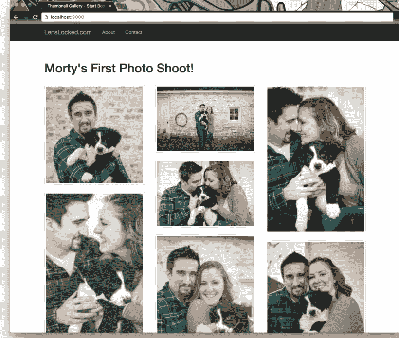

图 1.1：我们将构建的 Web 应用程序

## 1.6 本书使用的约定

在我们构建的应用中，用户可以注册账户、创建画廊，然后上传图片包含在每个画廊中。一旦画廊创建，他们就可以将链接发送给客户/朋友来分享画廊。

我们的应用程序将从非常简单开始：只有一个“Hello, world”页面。随着课程的进行，我们将逐步引入新页面，改进代码，并解决每一个出现的新问题。

通过这种方法，我们最终将得到一个生产就绪的 Web 应用，更重要的是，你将理解我们做出每项决策的原因，并对未来如何独立做出这些决策有更好的想法。

简而言之，我们构建应用程序的方式就像你自学一样，在文档中摸爬滚索并犯错，但你不需要独自在这些错误中挣扎。我会全程手把手地引导你，并在过程中解释一切内容。

## 1.6 本书使用的约定

以下是书书中用到的一些约定，你在阅读时应该注意这些点。

### 1.6.1 命令行命令以 $ 为前缀

在整本书中，我将为你提供一些在命令行中运行的命令。为了清晰起见，所有命令都将以 Unix 风格的命令行提示符（美元符号 `$`）开头。

+ 列表 1.1：Unix 风格提示符示例

```
$ echo "testing"
testing
```

在列表 1.1 中，你应该在终端中输入的命令是 `echo "testing"`，而显示为 "testing" 的第二行代表终端的输出。

### 1.6.2 `subl` 或 ‘atom’ 命令意味着“用你的文本编辑器打开”

我经常会在命令行代码列表中使用 `atom` 命令来表示“用文本编辑器打开一个文件”。

在我的电脑上，运行 `atom hello.go` 会在 Atom 中打开一个名为“`hello.go`”的文件，Atom 是我用来编写代码的编辑器。

欢迎你以任何你的方式打开文件和创建新文件，但我经常这样描述它们，因为这是我所知的在书中表示它们最清晰的方式。

### 1.6.3 许多代码列表将为了清晰起见而缩短

在整本书中，会有很多示例显示我们在较大的文件中工作，但只需要对一两行代码进行更改。当这种情况发生时，显示整个文件的代码列表既令人困惑又浪费空间。

因此，我经常会显示代码的相关部分，并使用注释来表示未更改的代码。这些注释通常以 . . . 开头，看起来像列表 1.2 所示：

| 列表 1.2：未更改代码的简单示例 |

| :--- |

| func main() { |

| // ... 在此之前的所有内容保持不变 |

| var name string |

## 1.7 获取代码

```
fmt.Println("What is your name?")
fmt.Scanf("%s", &name)
```

重要的一点是，不要用这些注释替换现有的代码。如果你任何时候不确定，我建议查看该章节的完整代码。

### 1.6.4 所有代码示例尽可能限制为 60 列

在视频教程中，我经常编写比 60 列更宽的代码，但在电子书格式中，这种效果通常并不好。因此，我尝试将所有代码示例限制在每行 60 个字符或少。

欢迎你根据自己的意愿修改自己的代码。我个人认为每行 60 个字符是不够的，但这是解决多种书籍格式编写问题最简单的方案。

## 1.7 获取代码

书中的代码以 git 仓库的形式提供，每个章节都有一个分支。你可以在不需要任何 git 知识的情况下从每个分支下载代码，但你需要在 `gitlab.com` 有一个账户（注意：这与 `github.com` 不同）。

在购买本课程后，你应该会收到一封邮件，要求你在 `members.usegolang.com` 创建账户。

当你登录该账户时，你会发现使用你的 GitLab 账户请求访问代码的说明。

# 第 1 章 引言

一旦你获取了仓库的访问权限，就可以通过每个章节末尾提供的链接访问该章节的完成代码。

注意：你还可以通过章节末尾的 diff 链接查看几乎每个章节的更改源代码。通常，任何新代码将显示在绿色行上，任何删除的行将显示为红色背景。有时当我们更改一行代码时，它会先显示为红色（删除旧版本）再次显示为绿色（添加更新后的版本）。大多数代码 diff 工具都是这样工作的，因此习惯它是很有用的。

### 1.7.1 为什么用 git？

我经常被问到为什么用 git 管理代码，简短的回答是：在 Go 中，导入路径**并不是**相对于你的代码，而是相对于你的 `GOPATH`。

这意味着，为了让我提供一个包含课程所有代码的单一 zip 文件，我需要更改书中每个章节的导入路径，这样我提供的代码将与你编写的代码不匹配。

与其引入这种困惑，我选择使用 git 分支链接到每个章节。

欢迎对如何改进这一点任何建议或反馈：

## 1.8 免责声明：并非所有情况都适用

在整本书中，我将向你展示构建和组织 Web 应用代码的一种方法，而我展示的这种方法几乎优先考虑简单性和易于理解。

随着时间的推移，你的个人应用程序可能会变得更加健壮和复杂，

## 1.9 为你的导出类型编写注释

你可能会发现自己正在质疑并更改我们在这里使用的结构。这是预料之中的。

事实是，没有适用于所有人的单一设计方法。某个团队在特定情况下有效的方法，并不总是适用于所有人。

与其试图向你展示一种统治一切的设计，我将向你展示在整本书中可能会看到的警告。我认为这是一种易于理解和修改的设计。这意味着我们经常编写更多的代码来避免更复杂的设计模式，但这种方法的意图是确保你充分理解代码，以便以便你在读完书后可以独立尝试新的新模式。

## 1.9 为你的导出类型编写注释

如果你在整本书中使用 `golint`，或者你使用一个会在你的代码上自动运行它的编辑器。这些警告通常读作“导出函数 XXX 应该有注释或未导出”。这个警告意味着你正在导出一个函数（使其在包外部可用），但你没有提供适当的注释来向其他开发者解释该包的作用。

# 第2章

## 基础Web应用程序

为了开始，我们将构建一个非常基础的Web应用程序。这个程序极其简单，只有 15 行代码，但通过它，我们可以在深入研究任何内容之前，先回顾Web应用程序工作的基本原理。

这些代码中很大一部分会被丢弃，而且很多内容初看起来看起来毫无意义。这没关系，如果发生这种情况，你不应该感到沮丧。学习编程的一部分就是尝试不同的事物并观察它们的作用、它们如何改变事物，以及发现你最喜欢的方法。这种方法的目标是试图模拟这一过程。

## 2.1 构建服务器

现在你已经知道要去哪个 src 目录了，让我们开始编写代码吧。首先，我们需要进入 Go src 文件夹并为我们的应用程序创建一个文件夹。

| 列表 2.1：创建应用程序目录 |

| :--- |

| $ cd $GOPATH/src |

| $ mkdir lenslocked.com |

# 第2章 一个基础Web应用程序

```
$ cd lenslocked.com
```

现在我们已经有了一个合适的工作目录，可以创建第一个文件 `main.go`。创建该文件并在你最喜欢的编辑器中打开它。我将使用 Atom¹，因此我将使用类似图中的命令来表示创建文件。

### 列表 2.2：创建 main.go

```
$ atom main.go
```

一旦打开了 `main.go`，将列表 2.3 中的代码写入其中。如果你现在还不理解所有内容，不要担心；我们稍后会讲解。

### 列表 2.3：创建一个简单的Web应用程序

```go
package main

import (
	"fmt"
	"net/http"
)

func handlerFunc(w http.ResponseWriter, r *http.Request) {
	fmt.Fprint(w, "<html>Welcome to my awesome site!</html>")
}

func main() {
	http.HandleFunc("/", handlerFunc)
	http.ListenAndServe(":3000", nil)
}
```

最后，我们运行程序。

> ¹https://atom.io/

## 2.1. 构建服务器

| 列表 2.4：运行 main.go |

| :--- |

| $ go run main.go |

搞定！假设你没有遇到任何错误，你现在电脑上上运行着一个 Web 应用。打开浏览器并在 http://localhost:3000/ 查看一下。你应该能看到类似于图 2.1 的内容。（img/d6be51af1b6bf9724d05fbe635.png）

图 2.1：我们的第一个Web应用程序

在查看完网站后，你可以在运行 `main.go` 的终端中按下 `ctrl+c` 来关闭服务器。

### 框 2.1. 故障排除

此时，你们中的一些人会在运行程序时遇到问题。最可能的原因是 Go 没有安装正确。我的第一个建议是练习，因为成为开发者的一部分就是学习如何调试。如果你无法解决，请随时通过 Slack 或电子邮件与我联系。

### 源代码

下面的链接包含本章节的完整源代码：github.com

## 2.2 揭开我们应用程序的神秘纱

现在你可能在问自己，到底发生了什么？为了回答这个问题，我们将逐节检查代码，探索代码的作用。随着学习的进行，我们将引入新概念，并花一点时间探索每一个概念。对于我们的第一个程序，我们希望确保你有一个坚实的基础。从第一行开始：

```go
package main
```

如果你写过任何 Go 代码，这应该是显而易见的。这只是声明了这段代码属于哪个包。在我们的情况下，我们将其声明为 `main` 包的一部分，因为我们的应用程序是从运行 `main()` 函数开始的。接下来是导入（imports）：

```go
import (
  "fmt"
  "net/http"
)
```

告诉编译器你打算在代码中使用哪些包。随着我们扩展应用程序，我们将开始创建自己的包，这样我们就可以轻松地测试和重用代码，但目前我们只使用了来自 Go 标准库的两个包。

第一个是 `fmt` 包。简单来说，这个包用于格式化字符串并将其写入不同的地方。例如，你可以使用 `fmt.Println(...)` 函数向终端打印“Hello, World!”。我们稍后会介绍在我们的代码中如何使用它。

我们导入的最后一个包是 `net/http`。这个包用于创建一个能够响应 Web 请求的应用程序，以及向其他服务器发送 Web 请求。我们在简单的服务器中大量使用了这个库，它是我们 Web 应用程序构建的基础。

### 框 2.2. 什么是标准库？

标准库基本上是 Go 创造者编写并官方维护的函数、变量、结构体集合。这些代码通常包含开发者非常常用的功能，例如向终端打印字符串的代码，由于开发者使用它们的频率极高，它们被包含在每个 Go 安装版本中。你可以把它们认为是让你的生活更简单的代码。

尽管如此，你不必非使用标准库来创建 Web 服务器。如果你真的想这么做，可以编写自己的 `http` 包并用它代替标准库用于你的 Web 服务器，但那是大量的工作，而且你会错失使用 `net/http` 包所提供的所有测试和标准化。

接下来是 `handlerFunc(...)`。

```go
func handlerFunc(w http.ResponseWriter, r *http.Request) {
    fmt.Fprintf(w, "<h1>Welcome to my awesome site!</h1>")
}
```

这是我们用于处理传入请求的函数。每当有人访问你的网站时，`handlerFunc(...)` 就会运行并决定返回给访问者的内容。在未来，我们将为应用程序的不同页面设置不同的处理器，但目前我们只有一个。

所有的处理器都接收两个参数。第一个是 `http.ResponseWriter`（在当前代码中声明为 `w`），第二个是指向 `http.Request` 的指针（在当前代码中声明为 `r`）。虽然我们目前还没有在代码中同时使用这两个参数，但值得介绍它们各自的作用。

### 框 2.3. Web 请求简述

每当你点击链接或在浏览器中输入网址时，你的浏览器都会向 Web 应用程序发送一条消息，请求特定的页面或数据集。这被称为 Web 请求。一旦服务器接收到 Web 请求，它将决定如何处理它，然后发送响应。浏览器决定如何显示结果数据——通常将其渲染为 HTML。

理解 Web 请求和响应的组件现在并不真正需要，但你们中的一些人会想了解背后发生了什么。所以，对于所有好奇的人来说，Web 请求是发送给 Web 应用程序的消息，指定了它想要响应的数据类型。对于我们的目的而言，我们将关注 Web 请求的三部分：请求发送到的 URL、头部信息（headers）和正文（body）。

同样，服务器的响应也被分为两个部分：头部（headers）和正文（body）。响应不需要 URL，因为它仅仅是对你的请求做出响应。与请求类似，头部主要用于存储对浏览器有用的元数据，而正文包含了被请求的数据。

首先是 `w http.ResponseWriter`。这是一个结构，允许我们修改想要发送给任何访问我们网站的人的响应。默认情况下，`w` 实现了 `Write()` 方法，允许我们向响应中写入内容，因此名为 `ResponseWriter`，但它也有其他方法可以在我们需要设置头部时帮助我们完成任务。

接下来是 `r *http.Request`。这是一个用于从网络请求中访问数据的结构。例如，我们可能会用它在用户注册我们的 Web 应用程序后获取他们的电子邮件地址和密码。

## 框 2.4. 什么是指针？

指针正如它们听起来像那样——它是一种数据类型，本身并不实际包含数据，而是指向计算机中存储数据的内存地址。

指针被用于许多不同的原因，但要记住的最重要的一是：当你将指针传递给函数时，它可以修改你提供的数据。这意味着当我们修改收到的请求对象时，这些更改在我们的代码运行完毕后仍然存在。

如果你对指针不熟悉，在继续学习本章之后，可能应该花时间熟悉它们，因为它们是 Go 编程中一个非常重要的组件。

## 2.2. 揭秘我们的应用程序

现在我们已经理解了参数，让我们回来看处理函数（handler）中的那行代码。

```
fmt.Fprint(w, "<h1>Welcome to my awesome site!</h1>")
```

之前我们讨论了 `fmt` 包，它是一组用于格式化和打印字符串的实用函数集合。在这一行中，我们使用了该包中的 `fmt.Fprint()` 函数，并用它将 HTML 字符串 "Welcome to my awesome site!" 写入 `http.ResponseWriter`。

### 2.5. 详细解释 `fmt.Fprint()`。

这个函数的复杂版本是 `fmt.Fprint` 接收两个参数：

1. 一个用于写入的 `io.Writer`。

2. 任意数量的用于打印的 `interface{}`。通常这些是字符串，但也可以是任何数据类型。

`io.Writer` 是一个接口，要求结构体实现了 `Write([]byte)` 方法，因此 `fmt.Fprint` 帮助处理所有提供的接口转换为字节数组，然后调用 `io.Writer` 上的 `Write` 方法。

由于我们正在写入一个字符串，而字符串可以被视为字节数组，你可以将 `fmt.Fprint(w, "<h1>Welcome to my awesome site!</h1>")` 替换为 `w.Write([]byte("<h1>Welcome to my awesome site!</h1>"))`，你会得到相同的结果。


如果还有任何地方感到困惑，不要担心，继续努力。随着你对 Go 和通用的编程经验的增加，这类事情将开始变得更有意义，但在你对 Go 获得更高的理解之前，理解这些细节将是非常的。

### 框 2.6. 什么是接口？

Go 中的接口（interfaces）是描述一组方法的方法，对象必须实现这些方法才能视为有效。例如，我可能有一个函数接收一个参数，我们称之为 `Book`（书），当在网站上显示书籍时，我们调用 `book.Price()` 来显示价格。但当我们想在网站上列出一个玩具时会发生什么呢？我们的函数只接受 `Book` 类型！

事实证明，我们的函数真的不在乎传递的是 `Book`、`Toy` 甚至是 `Computer`。它真正在乎的是传递的任何对象都拥有一个可以用来显示价格的 `Price()` 方法。这就是接口的用处——它们允许我们说明我们关心的方法类型，只要传递给对象的拥有这些方法，我们的代码就能工作。

你现在不需要担心编写你自己的接口。当书中出现这些内容时，我们会详细地介绍它们。

如果你是从其他语言（如 Java）过来的，值得注意的是，Go 中的接口与你所习惯的非常不同。主要是在 Java 中，要求显式声明一个对象实现了某个接口，但在 Go 中并不是强制的。如果一个对象实现了接口的所有方法，它被认为是该接口的实现，而无需显式声明。

最后我们来看主函数（main function）。

```
func main() {
	http.HandleFunc("/", handlerFunc)
	http.ListenAndServe(":3000", nil)
}
```

## 2.2. 揭秘我们的应用程序

首先，我们声明了 `main()` 函数。这是启动你的应用程序时运行的函数，它需要调用你想要运行的任何其他代码。

在 `main` 函数内部，我们做了两件事。首先，我们将 `handlerFunc` 设置为我们想要处理处理路径为 `/` 的服务器 Web 请求的函数。这涵盖了用户可能尝试访问我们网站的所有路径，所以你也可以访问 http://localhost:3000/some-other-path，它也会由 `handlerFunc` 处理。

最后，我们调用了 `http.ListenAndServe(":3000", nil)`，这启动了一个监听端口 3000 的 Web 服务器，并使用默认的 http 处理程序。

### 框 2.7. 端口 3000 和 localhost。

如果你是第一次看到类似 `localhost:3000` 的内容，起初可能会很困惑，但不要担心！它们其实很好理解。

在计算机网络中，`localhost` 术的意思是“计算机”。当我们说在浏览器中访问 http://localhost:3000/ 时，我们实际上是在告诉浏览器“尝试从这台计算机的 3000 端口加载网页”。

端口来自 URL 的最后部分；即 `:3000` 部分。当你向浏览器中输入 `www.google.com` 时，你不需要包含端口，因为浏览器会自动使用默认端口，但如果你想，也可以显式地输入。尝试访问 www.google.com:80。

在本地我们不需要使用端口 3000。事实上，许多开发者在本地使用 8080。我简单的选择了 3000。

## 第 3 章

## 添加新页面

Web 应用程序如果只有一个页面会很无聊，因此在本节中，我们将探索如何为 Web 应用程序添加新页面。

我们将从添加联系页面开始，人们可以在那里找到如何与我们联系的信息。之后，我们将添加一个捕获页面（通常称为 404 页面），当有人访问我们未指定的页面时将显示该页面。

### 框 3.1. HTTP 状态码。

当你的服务器响应请求时，还会返回一个状态码。对于大多数 Web 请求，你的服务器将返回 200 状态码，这意味着一切成功。当问题是由错误数据或客户端错误引起时，会返回 400-499 状态码。例如，如果你尝试访问一个不存在的页面，服务器将返回 404 状态码，这意味着未找到页面。

404 页面根据其 HTTP 状态码命名。当用户尝试访问一个不存在的页面时，你的应用程序应该返回 404 状态码，如果用户请求的是 HTML 页面，它应该渲染一个告诉用户找不到他们正在查找的页面。现在我们将使用一个基础的 404 页面，但记住，你的许多用户在拼错或任何错误时可能会看到这个页面，这是一个给他们留下良好印象的好页面。你在这里可以看到许多优秀的 404 页面示例。

## 3.1. 使用 if/else 语句进行路由

为了给我们的 Web 应用程序添加新页面，我们需要首先讨论路由（routing）。在非常高的层面上，路由只是用户尝试访问的页面与我们想要处理该请求的代码之间的映射。例如，如果你访问 lenslocked.com，你将被重定向到首页，但如果你访问 lenslocked.com/faq，你将进入 FAQ。这两个请求最终进入同一个 Web 应用程序，但每个请求都由该 Web 应用程序内部不同的代码处理，而路由的工作就是让这种事情发生。

为了开始，让我们尝试编写自己的基础逻辑。打开 `main.go` 并使用列表 3.1 中的代码更新 `handlerFunc`。

列表 3.1: 通过 URL 路径路由。

```go
func handlerFunc(w http.ResponseWriter
```

## 3.1. 使用 IF/ELSE 语句进行路由

如果你的服务器已经在运行，在看到更改之前，你需要通过按下 `ctrl + e` 来停止它。停止服务器后，再次运行它。

```
$ go run main.go
```

框 3.2. 动态重载

如果你对学习动态重载感兴趣，请查看 Go fresh - github.com/pilu/fresh

一旦服务器重启，访问 localhost:3000/contact，你将看到你的联系页面。然后访问 localhost:3000，你将看到你的主页。

如果你跳转到另一个路径会发生什么？尝试一下 - 跳转到一个我们没有定义的路径，例如 localhost:3000/something。你应该会看到一个空白页。这看起来很奇怪。

当用户访问我们未定义的页面时，最佳实践是返回 404 状态码，并告诉用户我们找不到他们寻找的页面。为了实现这一点，我们正在通过添加一个额外的 `else` 语句来更新我们的处理函数。更新后的代码如列表 3.2 所示。

### 列表 3.2：创建 404 页面

```go
func handlerFunc(w http.ResponseWriter, r *http.Request) {
    w.Header().Set("Content-Type", "text/html")
    if r.URL.Path == "/" {
        fmt.Fprint(w, "<h1>Welcome to my awesome site!</h1>")
    } else if r.URL.Path == "/contact" {
        fmt.Fprint(w, "<p>To get in touch, please send an email " +
        "to <a href=\"mailto:support@enslocked.com\">" + 
        "support@enslocked.com</a></a></p>")
    } else {
        w.WriteHeader(http.StatusNotFound)
        fmt.Fprint(w, "<h1>We could not find the page you " + \
        "were looking for :(</h1>" +
        "<p>Please email us if you keep being sent to an " + \
        "invalid page.</p>")
    }
}
```

现在如果我们重启服务器并访问一个不存在的页面，我们将得到类似图 3.1 所示的错误消息。

图 3.1：我们新的 404 页面

在添加任何新代码之前，让我们快速回顾一下代码中发生了什么。

首先，我们从 `Request` 对象获取 URL，它返回一个 *url.URL*。这个结构体有一个名为 `Path` 的字段，用于返回 URL 的路径。例如，如果 URL 是 http://lenslocked.com/docs/abc，那么 `Path` 就是 `/docs/abc`。这里唯一的异常是空路径始终被设置为 `/`，即根路径。

一旦我们获取了路径，就使用它来决定渲染哪个页面。当用户访问根路径 (/) 时，我们返回欢迎页面。当用户访问我们的联系页面 (/contact) 时，我们返回一个包含如何联系我们信息的页面。

如果这两个标准都不满足，我们就会写入 404 HTTP 状态码，然后向响应写入器写入错误消息。`NotFound` 变量实际上只是代表 HTTP 状态码 404 的常量，而 `WriteHeader` 方法是在 Go 中写入 HTTP 状态码的一种方法。

> 框 3.3. 导出常用常量

> 如上所述，`http.StatusNotFound` 实际上只是一个表示 404 状态码的常量。这并不是绝对必要的，你可以在代码中将其替换为 404，但包通常会导出 `StatusNotFound` 常量，以便代码更易于阅读和维护。

### 源代码

下面的链接包含了完整的源代码以及本节中所有更改代码的差异（diff）。

- 完成版 - book.usegolang.com/3.1

- 更改 - book.usegolang.com/3.1-diff

## 3.2 流行的路由器

现在我们已经有了基础路由，我们将查看改进和简化应用程序的方法。具体来说，我们将探索开源路由器，并选择其中一个在我们的项目中使用。

### 3.2.1 net/http.ServeMux

我们将查看的第一个路由器是 Go 标准库的一部分。`net/http.ServeMux` 是一个非常直观的路由器，它非常容易使用，对于简单的 Web 应用程序效果非常好。

遗憾的是这个包在功能上稍显不足，许多功能最终是我们最终需要自己编写的。例如，`ServeMux` 没有提供一种方便的方法来定义 URL 参数，而我们将在后面的章节中用到它。

虽然我们最终可以将此路由器封装在我们自己的类型中并添加我们需要的所有功能，但我不想花整本书都集中在 Web 应用程序的一个特定部分，而是选择了另一个选项。

### 3.2.2 github.com/julienschmidt/httrouter

`github.com/julienschmidt/httrouter` 是一个非常流行的路由器，我在许多其他教程和 Web 框架中见过它。它被用于流行的 Web 框架 Gin，我也自己使用这个路由器写过几篇博客文章。

我喜欢这个路由器的点是它非常关注简单、快速和高效。如果你查看它 Github 页面上的某些基准测试，你会发现它优于许多其他路由器。除了对快速的关注，它还支持命名 URL 参数以及基于所使用的 HTTP 请求方法进行路由。我们将在未来的章节中学习更多内容。

最终我决定不在本书中使用 `httrouter`，原因有两个。第一，该库要求如果你想访问任何路径参数，必须使用接收第三个参数的 `http handler` 处理函数。这种方法没有问题，但我担心它可能会让初学者感到困惑，因此我选择使用我们将要介绍的路由器 - `gorilla/mux.Router`。

### 3.2.3 github.com/gorilla/mux.Router

最后，我们将检查 `github.com/gorilla/mux.Router`。

一旦我们有了了 `，.，.  。。我们需要检查 `github.com/gorilla/mux.Router`。它支持接收第三个参数的 `http handler` 函数。

此外，`gorilla/mux` 是 Gorilla Toolkit 的一部分，我们以后会它。很多路由器，`gorilla/mux`  我们我们使用。。。。，，，，，，。。 ，，在在编写本书时，`gorilla/mux` 是一个非常好的选择。

### 3.2.4 关于其他路由器

有很多很棒的路由器，我没有提到，`gorilla/mux` 是其中最流行的之一。`gorilla/mux` 已经存在了很长时间，有着非常稳健的记录。

## 3.3 使用 gorilla/mux

当你使用 gorilla/mux 时，首先需要做的是安装该包。到目前我们只使用了标准库。如果你正在运行程序，请停止它（ctrl + c），然后在终端中输入。

| 列表 3.3：安装 gorilla/mux. |

| :--- |

| `$ go get -u github.com/gorilla/mux` |

这将下载该包，`-u` 选项将告诉 Go 获取最新版本。接下来我们需要准备好代码。

> 框 3.4. 如果你看到错误

> 在此期间你可能会遇到错误，因为你没有安装 git。如果是这种情况，我建议安装 git 并重启以解决该问题。

> https://git-scm.com/en/Starting-Installing

我们可以继续像 3.1 中那样用一个函数处理多个页面，但这非常难以维护。相反，我们将每个页面拆分为自己的函数，这样我们只需要告诉路由器根据用户访问的页面调用哪个函数。代码如列表 3.4 所示，并应添加到 main。

### 使用 GORILLA MUX 路由器

### 列表 3.4：拆分我们的处理器。

```go
func home(w http.ResponseWriter, r *http.Request) {
    w.Header().Set("Content-Type", "text/html")
    fmt.Fprint(w, "<h1>Welcome to our site!</h1>")
}

func contact(w http.ResponseWriter, r *http.Request) {
    w.Header().Set("Content-Type", "text/html")
    fmt.Fprint(w, "<p>To get in touch, please send an email " +
        "to <a href=\"mailto:support@enslocked.com\">" +
        "support@enslocked.com</a></a></p>")
}
```

现在你已经导入了 mux 包，我们可以在 main 函数中使用它。首先我们需要在源代码的顶部添加一个 import。

### 列表 3.5：导入 gorilla/mux。

```go
import (
    "fmt"
    "net/http"

    "github.com/gorilla/mux"
)
```

我们在这里做的是添加那行代码，告诉我们将使用 `gorilla/mux` 包。当导入第三方库时，你将使用像我们刚刚使用的那样的 URL。这通常是一个指向源码控制服务的链接，例如 github，但你之后会看到我们使用 lenslocked.com 域名来创建私有包。

现在你已经导入了 mux 包，我们可以在 main 中使用它。列表 3.6 中的代码将替换你当前 main 中的代码

# 第 3 章. 添加新页面

function.

### 列表 3.6：首次使用 gorilla/mux。

```go
func main() {
    r := mux.NewRouter()
    r.HandleFunc("/", home)
    r.HandleFunc("/contact", contact)
    http.ListenAndServe(":3000", r)
}
```

现在重启你的应用程序（按 `ctrl + c` 然后运行 `go run main.go`），我们应该有一个可以运行的网页了。太棒了！

如果你访问一个不匹配任何定义的路由的页面，你可能还会注意到我们有一个没有定义的 404 页面。gorilla/mux 开箱提供了一个简单（尽管难看）的 404 页面，因为这是大多数开发者对路由器的预期。

我们 `main` 函数内部的新代码基本上可以分为三个阶段。我们首先创建一个新路由器，然后开始为不同的路径分配处理函数，最后我们启动服务器。

上一次我们调用 `ListenAndServe` 函数时，我们在最后一个参数中传递了 `nil`。而这一次，我们将我们的路由器作为 Web 请求的默认处理器传递进去。这告诉了 `ListenAndServe` 函数我们想要使用自定义的路由器。

我们的路由器将反过来处理请求，直到足够识别出哪个函数被分配到了该路径，然后它将调用该函数。

### 源代码

下面的链接包含了完整的源代码以及本节中所有更改代码的差异（diff）。

## 3.4 练习

- 已完成 - book.usegolang.com/3.3

- 更改 - book.usegolang.com/3.3-diff

## 3.4 练习

恭喜，你已经构建了你的第一个包含多个页面的 Web 应用，甚至还使用了第三方库！

现在让我们通过完成以下练习来练习你所学的内容。

> 框 3.5。我们的第一个练习题。

从今以后，我将在每个章节之后添加几个挑战，这些挑战将要求你使用在该章节中学到的大部分知识。

你并不需要完成这些练习，但我强烈建议在进入下一个章节之前尝试每一个，以测试你对每章内容的理解程度。

### 3.4.1 练习 1 - 添加一个 FAQ 页面

这个非常直接。尝试为你的应用程序通过 `/faq` 路径创建一个 FAQ 页面。

你可以用任何你喜欢的 HTML 内容填充页面，但你应该让它与其他页面不同，以确保你的代码是按照你的预期运行的。

### 3.4.2 练习 2 - 自定义 404 页面

我之前提到过，对于路由器未定义的路径，gorilla/mux 默认有一个 404 页面。你实际上可以通过设置 `gorilla/mux.Router` 的 `NotFoundHandler` 属性来自定义此页面。


如果你是 Go 的新手，这个练习可能会变得很有挑战性，因为你需要创建一个 `http.Handler` 接口的实现，然后将其分配给 `NotFoundHandler`，这与我们目前所做的稍有不同。

为了帮助你，我提供了一个示例，展示如何将在本章之前编写的 `home` 函数转换为 `http.Handler` 类型。

```go
var h http.Handler = http.HandlerFunc(home)
r := mux.NewRouter()
// 这将主页分配给
// NotFoundHandler
r.NotFoundHandler = h
```

你将想要做类似的操作，但使用你自己独特的 404 页面函数。

### 3.4.3 练习 3 - [困难] 尝试另一个路由器

这个练习被标记为困难，因为它是半开放式的。

查看另一个路由器，比如 `github.com/julienschmidt/httpprouter`，并尝试使用这个路由器代替 `gorilla/mux` 来复制我们目前为止编写的程序。

这是一个很好的方法，可以同时 (a) 确保你理解了我们在做什么，以及 (b) 练习阅读文档和使用你不熟悉的其他库。

## 第 4 章

## 模板简要介绍

在本章中，我们将介绍 Go 的一个新功能：模板（templates）。具体来说，我们将检查标准库中的 `html/template` 包并探索它的工作原理。

如果你已经熟悉其他语言中的模板，你可能可以略读或跳过这一章。本节中的任何代码示例将不会用于你的 Web 应用，相反，本节侧重于通过其他示例教授 Go 模板的基础知识。

尽管如此，你应该记住，虽然 Go 的模板与其他语言的模板非常相似，但它在某些独特之处也是不同的，这些不同有时会让你措手不及。即使你没有实际上按照示例编写代码，至少浏览一下这一节也可能对你有益。

## 第 4 章. 模板的简要介绍

## 4.1 什么是模板？

从核心上说，模板是用于创建动态内容的文本文件。

Mad Libs（填词游戏）是用模板创建动态内容的一个例子。在游戏中，一个人向所有人询问特定类型的词，例如“名词”、“动词”、“地点”或“汽车零件”。

从今以后我将开始在每个章节后添加几个挑战，这将要求你使用在该章节中学到的大部分知识。

你并不要求完成这些，但我绝对建议在继续之前尝试每一个，以测试你对每章内容的理解。

从的核心的核心是用于创建动态内容的文本文件。

Mad Libs 是用模板创建动态内容的一个例子。在游戏中，一个人向所有人询问特定类型的词，例如“名词”、“动词”、“地点”或“汽车零件”。

从今以后我将开始在每个章节后添加几个挑战，这些将要求你使用在该章节中学到的大部分知识。

你并不要求完成这些，但我绝对建议在继续之前尝试每一个，以测试你对每章内容的理解。

模板的核心的核心是用于创建动态内容的文本文件。

Mad Libs 是用模板创建动态内容的一个例子。在游戏中，一个人向所有人询问特定类型的词，例如“名词”、“动词”、“地点”或“汽车零件”。

从今以后我将开始在每个章节后添加几个挑战，这些将要求你使用在该章节中学到的大部分知识。

你并不要求完成这些，但我绝对建议在继续之前尝试每一个，以测试你对每章内容的理解。

模板的核心的核心的核心是用于创建动态内容的文本文件。

Mad Libs 是用模板创建动态内容的一个例子。在游戏中，一个人向所有人询问特定类型的词，例如“名词”、“动词”、“地点”或“汽车零件”。

从今以后我将开始在每个章节后添加几个挑战，这些将要求你使用在该章节中学到的大部分知识。

你并不要求完成这些，但我绝对建议在继续之前尝试每一个，以测试你对每章内容的理解。

模板的核心的核心的核心的核心是用于创建动态内容的文本文件。

Mad Libs 是用模板创建动态内容的一个例子。在游戏中，一个人向所有人询问特定类型的词，例如“名词”、“动词”、“地点”或“汽车零件”。

从今以后我将开始在每个章节后添加几个挑战，这些将要求你使用在该章节中学到的大部分知识。

你并不要求完成这些，但我绝对建议在继续之前尝试每一个，以测试你对每章内容的理解。

模板的核心的核心的核心的核心的核心是用于创建动态内容的文本文件。

Mad Libs 是用模板创建动态内容的一个例子。在游戏中，一个人向所有人询问特定类型的词，例如“名词”、“动词”、“地点”或“汽车零件”。

从今以后我将开始在每个章节后添加几个挑战，这些将要求你使用在该章节中学到的大部分知识。

你并不要求完成这些，但我绝对建议在继续之前尝试每一个，以测试你对每章内容的理解。

模板的核心的核心的核心的核心的核心的核心是用于创建动态内容的文本文件。

Mad Libs 是用模板创建动态内容的一个例子。在游戏中，一个人向所有人询问特定类型的词，例如“名词”、“动词”、“地点”或“汽车零件”。

从今以后我将开始在每个章节后添加几个挑战，这些将要求你使用在该章节中学到的大部分知识。

你并不要求完成这些，但我绝对建议在继续之前尝试每一个，以测试你对每章内容的理解。

模板的核心的核心的核心的核心的核心的核心的核心是用于创建动态内容的文本文件。

Mad Libs 是用模板创建动态内容的一个例子。在游戏中，一个人向所有人询问特定类型的词，例如“名词”、“动词”、“地点”或“汽车零件”。

从今以后我将开始在每个章节后添加几个挑战，这些将要求你使用在该章节中学到的大部分知识。

你并不要求完成这些，但我绝对建议在继续之前尝试每一个，以测试你对每章内容的理解。

模板的核心的核心的核心的核心的核心的核心的核心的核心的核心是用于创建动态内容的文本文件。

Mad Libs 是用模板创建动态内容的一个例子。在游戏中，一个人向所有人询问特定类型的词，例如“名词”、“动词”、“地点”或“汽车零件”。

从今以后我将开始在每个章节后添加几个挑战，这些将要求你使用在该章节中学到的大部分知识。

你并不要求完成这些，但我绝对建议在继续之前尝试每一个，以测试你对每章内容的理解。

模板的核心的核心的核心的核心的核心的核心的核心的核心的核心的核心是用于创建动态内容的文本文件。

Mad Libs 是用模板创建动态内容的一个例子。在游戏中，一个人向所有人询问特定类型的词，例如“名词”、“动词”、“地点”或“汽车零件”。

从今以后我将开始在每个章节后添加几个挑战，这些将要求你使用在该章节中学到的大部分知识。

你并不要求完成这些，但我绝对建议在继续之前尝试每一个，以测试你对每章内容的理解。

模板的核心的核心的核心的核心的核心的核心的核心的核心的核心的核心的核心是用于创建动态内容的文本文件。

Mad Libs 是用模板创建动态内容的一个例子。在游戏中，一个人向所有人询问特定类型的词，例如“名词”、“动词”、“地点”或“汽车零件”。

从今以后我将开始在每个章节后添加几个挑战，这些将要求你使用在该章节中学到的大部分知识。

你并不要求完成这些，但我绝对建议在继续之前尝试每一个，以测试你对每章内容的理解。

## 4.4 创建模板

这有助于确保你的 Web 应用程序是安全的。

让我们创建一个主函数来执行一个非常简单的模板，这样我们就可以看到它的运行效果。首先，我们需要为此应用程序创建一个目录。我们将创建一个名为 `exp` 的目录，表示这是一个用于测试各项内容的实验性目录。

列表 4.2：创建 `exp` 目录。

```bash
# 你应该从 lenslocked.com目录开始
$ cd $GOPATH/src/lenslocked.com
$ mkdir exp
$ cd exp
```

接下来，我们需要在 `exp` 目录中创建 `hello.gohtml` 文件，并将列表 4.3 中的代码添加到其中。

列表 4.3：`hello.gohtml` 的初始内容。

```html
<h1>Hello, {{.Name}}!</h1>
```

框 4.2：`.gohtml` 扩展名是可选的。

`gohtml` 扩展名通常被编辑器用来表示你想对 Go HTML 模板使用语法高亮。我相信 Atom（`go-plus`）和 Sublime Text（`GoSublime`）中的这两个包默认情况下都能识别这一点，因此这是我在本书中选择的文件类型。

这是我们的第一个模板，通过它我们本质上是在说，想要创建一个 HTML 文件，其中包含一个内容为 `Hello, {{.Name}}!` 的标题，并且我们希望将 `{{.Name}}` 部分替换为变量 `Name` 中的任何内容。

让我们创建一个 Go 文件来运行这个模板，这样你就可以看到它的效果了。在 `exp` 目录下创建一个名为 `main.go` 的文件，并将列表 4.4 中的代码添加到其中。

列表 4.4：`main.go` 的初始内容

```go
package main

import (
	"html/template"
	"os"
)

func main() {
	t, err := template.ParseFiles("hello.gohtml")
	if err != nil {
		panic(err)
	}

	data := struct {
		Name string
	}{"John Smith"}

	err = t.Execute(os.Stdout, data)
	if err != nil {
		panic(err)
	}
}
```

在列表 4.4 的 `main` 函数中，我们首先使用 `html/template` 包的 `ParseFiles` 函数来解析 `hello.gohtml` 模板文件。函数会打开模板文件并尝试对其进行验证。如果一切顺利，你将收到一个*模板和一个 nil 错误（error）*，否则你将得到一个 nil 模板和一个错误。

框 4.3：自动导入的潜在问题。

如果你正在使用插件来自动为你导入包，你可能需要花一点时间确保它导入了正确的模板包。

Go 的标准库同时提供了 `text/template` 和 `html/template` 包，并且两者的用法几乎完全相同，因此自动导入器很难判断你意图使用哪一个。

因此，在编写了使用模板的代码后，验证你正在使用预期的模板包始终是一个好主意。在这种情况下，我们希望导入 `html/template` 包。

在调用 `ParseFiles` 后，我们检查是否返回了错误。如果存在错误，我们执行 `panic`。否则，我们继续执行程序，因为我们知道通过变量 `t` 引用了一个有效的模板。

接下来，我们创建 `data` 变量，这是一个带有 `Name` 字段的匿名结构体。当我们实例化 `data` 时，我们将 `Name` 字段设置为“John Smith”。

最后，我们执行之前创建的模板，并传入两个参数：

1. 我们想要写入模板输出的位置

2. 执行模板时要使用的数据

在我们的案例中，我们希望将模板输出写入 `Stdout`，即你的终端窗口。这是 `fmt.Println` 等函数默认写入所在的地方，它是由 Go 标准库中的 `os` 包提供的。

我们还想为模板提供渲染模板时需要的数据。在列表 4.3 中，我们使用 `{{ .Name }}` 这一行代码来动态渲染名称，因此我们需要传递一个带有 `Name` 字段的数据结构。我们刚刚创建的变量 `data` 已经将该字段设置为“John Smith”，所以当我们将其提供给模板时，我们在最终输出中看到了“John Smith”这个名字。

让我们运行代码来验证这一切吧。

```bash
# 在 exp 目录内执行此操作
$ go run main.go
<h1>Hello, John Smith!</h1>
```

框 4.4：模板路径是相对的。

当你处理模板时，需要注意的是，访问模板的文件路径相对于你运行代码的位置。

在这个示例中，我们在与 `main.go` 文件相同的文件夹中访问名为 `hello.gohtml` 的文件，因此不需要包含目录。如果我们相反移动到包含 `lenslocked.com` 的目录（例如在终端执行 `cd ..`）并使用 `go run lenslocked.com/main.go` 运行代码，将会报错，因为该文件夹中没有名为 `hello.gohtml` 的文件。它在 `lenslocked.com` 文件夹中。

目前这意味着你在运行程序时需要位于 `lenslocked.com` 文件夹中，否则可能会看到错误。

如果你在终端中看到了一些 HTML 输出，说明你成功创建了第一个模板！

### 源代码

下面的链接包含了完整的源代码以及本节中所有更改代码的差异。

[已完成](https://book.usegolang.com/4.4)

[更改](https://book.usegolang.com/4.4-diff)

## 4.5 上下文编码

我之前提到过，Go 的 `html/template` 包根据代码的上下文进行编码。虽然在本书的这个阶段我们并不真的需要担心这一点，但我想演示我的意思，以便你理解为什么我们使用 `html/template` 包而不是其他东西。

为了演示这一点，我们正在更新 `hello.gohtml` 模板中使用的 `Name` 属性，将其更新为不安全直接渲染的内容，例如一个带有 JavaScript alert 的 script 标签。

打开 `main.go` 并 `Name` 字段更新为列表 4.5 所示的 script 标签。

列表 4.5：使用不安全的字符串。

```go
func main() {
  // ... 这部分保持不变
  data := struct {
    Name string
  }{"<script>alert('Howdy!');</script>"}
  // ... 这部分保持不变
}
```

现在运行你的程序。

```bash
# 在 exp 目录内执行此操作
$ go run main.go
<h1>Hello, &lt;script&gt;alert('Howdy!');&lt;/script&gt;</h1>
```

当你运行程序时，`html/template` 包会查看你想打印的每个变量并根据其位置调整每个的值。在这个示例中，我们在 HTML 部分使用了该变量，因此 `html/template` 包将 `<` 字符替换为 `&lt;`。这是为了确保当在浏览器中查看模板时，你会看到 `<` 字符，并且浏览器不会尝试将其解释为 HTML 标签。

虽然当你看到输出时这可能没有意义，但如果你通过浏览器查看输出，它就有意义了。复制你程序的输出并将其插入到名为 `test.html` 的文件中，然后在浏览器中打开该文件。你看到了什么？


图 4.1：test.html 的

你应该看到一个像图 4.1 那样的页面。当你的浏览器看到文本 `&lt;` 时，它会渲染小于符号（<）。

框 4.5：想了解更多 HTML 代码吗？

如果你对学习更多 HTML 符号和字符代码感兴趣，可以搜索“HTML character codes”。

有很多网站列出了所有的 . . .; 样式代码，你可以通过编辑之前创建的 `test.html` 文件来测试每种代码。

这种现象发生是因为，否则浏览器无法判断你是想让字符串 `<script>` 在屏幕上显示相同的文本，还是想让它被视为 HTML 代码。结果是浏览器会将 `<` 内部的任何文本视为 HTML 元素。如果你想在网站上显示 `<` 字符，你需要使用 `&lt;` 字符串，浏览器在渲染页面时将其显示为 `<`。

如果 `html/template` 包没有编码 `<` 字符，你的网页将把该名称解析为实际的脚本，并渲染出像图 4.2 那样令人烦的 alert 警告消息。


图 4.2：一个烦人的 JavaScript 警告框

# 第 4 章 模板简介介绍

现在你已经对 Go 语言模板的工作原理有了非常基础的理解，我们将回到 Web 应用程序并使用它们来渲染页面，但在在此之前，让我们先尝试几个关于模板的练习。

### 源代码

下面的链接包含了完成后的源代码以及本节中所有更改代码的差异（diff）。

- 已完成 - book.usegolang.com/4.5

- 更改 - book.usegolang.com/4.5-diff

## 4.6 练习

到目前为止，你应该对 Go 语言模板的工作原理有一个大致的认识了。我们并不要求你完美地理解它们，但你应该从宏观层面上理解它们的用途。随着课程的进行，我们将继续使用模板，并逐步引入使用模板的更高级的技巧。

### 框 4.6. 额外资源

如果你对进一步阅读关于模板的读物感兴趣，可以考虑查看 `html/template` 文档以及以下文章：

- 文档 - https://golang.org/pkg/html/template/

- 我写的一系列关于 HTML 模板的免费文章 - https://www.calhoun.io/html-templates-in-go/

## 4.6 练习

- 一个  HTML 模板的 Go 教程 - https://golang.org/doc/articles/wiki/

### 4.6.1 练习1 - 添加一个新的模板变量

在这个练习中，你的目标是为 `gohtml` 模板添加一个新变量，然后更新 `exp/main.go` 中的 Go 代码以为该变量提供一些数据。

你可以通过两个步骤来实现：

1. 在你的 Go 代码中的 `data` 变量中添加新字段

2. 在模板内部使用该新字段

### 4.6.2 练习2 - 尝试不同的数据类型

直到现在，我们在 HTML 模板中只使用了字符串。尝试实验一些其他数据类型，整数、浮点数、映射（maps）和切片（slices）。

虽然我们正在使用 `html/template` 包，但 `text/template` 文档提供了如何使用这两个包的说明，因此在进行实验时你可能需要参考这两组文档。

- text/template 文档 - https://golang.org/pkg/text/template/

- html/template 文档 - https://golang.org/pkg/html/template/

### 4.6.3 练习3 - [困难] 学习如何使用嵌套数据

创建一个嵌套结构，并学习在模板内部访问嵌套字段。


例如，如果你向 `data` 变量中添加了一个映射，你如何访问该映射的各个键（`keys`）和值（`values`）呢？

这将更难弄清楚，特别是如果你对模板和 Go 的背景知识有限，尝试自己弄明白将真正加强你所学的所有内容。

### 4.6.4 练习4 - [困难] 在你的模板中创建 if/else 语句

查看模板包中可用的操作：[https://golang.org/pkg/text/template # Actions](https://golang.org/pkg/text/template#Actions)

一旦你了解了哪些可用功能，就更新你的模板，在模板内部使用 `if` 和 `else` 语句。

这将类似于在 Go 代码中编写 `if/else` 块，但因为我们是在模板中编写，所以会有一些不同。

同样，如果你对模板和 Go 的经验有限，完成这一将更加困难，但值得尝试一下。

# 第 5 章

# 理解 MVC

在我们开始在应用程序中使用模板之前，我们将再次进行一次快速的跳转，讨论模型-视图-控制器（MVC）架构模式。

理解 MVC 是重要的，特别是作为一名新的 Web 开发人员，因为它为我们提供了如何组织和结构化代码的初步想法。随着你成为一个更有经验的开发者，你可能会采用适用于你应用程序的自定义设计模式，但 MVC 是几乎任何应用程序的绝佳起点。这就是为什么像 Rails、Sails.js 和 Django 等许多框架都使用 MVC 或非常接近的东西。

如果你已经熟悉 MVC，可以安全地跳过这一章。

## 5.1 模型-视图-控制器 (MVC)

随着你学习编程，最终会注意到某些代码库易于导航，而另一些则令人困惑且难以维护。起初很难看出区别，但随着时间的推移，你很快就会发现因素是代码的组织方式。

# 第 5 章 理解 MVC

这种原因很简单——如果你需要进入并添加新功能、修复错误或进行任何其他操作，如果能猜出需要从代码的哪里开始查看，将会得多。如果你以前没有读过源代码。

模型-视图-控制器（通常称为 MVC）是一种架构模式，它的设计旨在通过根据代码的职责来组织应用程序，并依靠开发者确保将正确的代码放在每个包中。具体来说，MVC 模式引入了代码可以属于三个三个规则：

视图负责渲染数据。也就是说，给定我们想要渲染的特定页面，对于该页面，我们的视图负责生成输出。

在我们的情况下，这通常是返回给用户浏览器的 HTML 代码，但在其他应用程序中这可能会有所不同。

## 5.2 走一遍 Web 请求

如果我们取一个正常的 Web 请求并检查请求的每个部分将如何处理，它将更容易理解。为了做到这一点，我们将

# 第 5 章：理解 MVC

我们将通过一个用户尝试更新信息的 Web 请求，并结合图 5.1 和图 5.2 进行演示。

- 1. 用户提交了其联系方式的更新

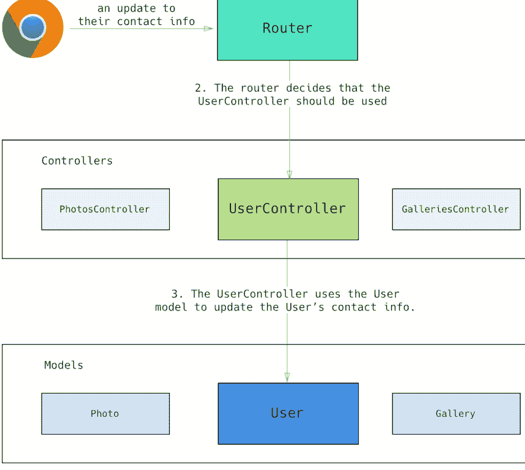

- 2. 路由器决定应该使用 `UserController`

- 3. `UserController` 使用 `User` 模型来更新用户的联系方式。

图 5.1：MVC 流程演示步骤 1 到 3

### 1. 用户提交了其联系方式的更新

这通常发生在用户进入账户设置并更新其中几个字段时。例如，他们可能会更新姓名和电子邮件地址。随后，该 Web 请求被发送到我们的服务器，路由器是第一个执行操作的代码。

### 2. 路由器决定应该使用 UserController

当路由器接收到 Web 请求时，它根据 URL 和 HTTP 方法识别出这是一个更新用户联系方式的请求，因此它将请求转发给 `UserController` 来处理。

### 3. UserController 使用 User 模型来更新用户的联系方式

在处理请求时，`UserController` 需要对存储在数据库中的数据进行更改，但在 MVC 模式下，我们的控制器并不直接与数据库交互。相反，控制器将使用 `User` 模型来更新联系信息，这允许我们隔离所有与数据库相关的代码，使得我们的控制器不再需要考虑这些问题。

| 模型 (Models) | | |
| :--- | :--- | :--- |
| Photo | User | Gallery |

4. `User` 模型将更新后的数据返回给 `UserController`

| 控制器 (Controllers) | | |
| :--- | :--- | :--- |
| PhotosController | UserController | GalleriesController |

5. `UserController` 使用 `ShowUser` 视图渲染 `users/show.shtml` 模板并将其返回给浏览器。

| 视图 (Views) | | |
| :--- | :--- | :--- |
| EditUser | ShowUser | ShowGallery |

6. 终端用户在浏览器中看到了更新后的用户页面。


## 5.3. 练习

- 4. `User` 模型将更新后的数据返回给 `UserController`

在数据库中更新用户后，`User` 模型将把更新后的用户对象返回给控制器，以便控制器在代码的其他部分使用它。

- 5. `UserController` 使用 `ShowUser` 视图渲染正确的模板

当用户控制器获取用户后，它可以使用 `ShowUser` 视图将更新后的用户对象渲染给终端用户。再次，这允许我们的控制器像导演一样工作，决定下一步运行什么代码，而不会陷入大量的自身逻辑中。

- 6. 终端用户在浏览器中看到了更新后的用户页面

在完成所有操作，我们的 `ShowUser` 视图将渲染出显示用户的 HTML 页面，终端用户现在将看到其联系信息已更新的用户账户。任务完成！

## 5.3 练习

在这一节中，我们不会编写代码，而是将回顾几个问题以确保你理解了我们涵盖的内容。

### 5.3.1 题 1 - MVC 代表什么？

MVC 缩写中的每个字母代表什么？

### 5.3.2 题 2 - MVC 的每一层分别负责什么？

尝试写下 MVC 每一层负责的内容，并回顾该章节以检查你的回答是否正确。

### 5.3.3 题 3 - 使用 MVC 有哪些好处？

我们讨论了 MVC 重要的几个原因。只需花一点时间回忆一下这些原因是什么。

同样需要记住点是：我们**并不必须**将所有代码都放在 MVC 模式中。我们写的代码并非所有都是模型、视图或控制器，强迫你的所有代码归类为这三类之一可能与完全不使用 MVC 一样糟糕。

## 第 6 章

## 创建我们的第一个视图

在上一章中，我们涵盖了 MVC 模式，在章节中我们引入了模板。在这一章中，我们将把它们整合成视图。就像我们在书中做的每件事一样，我们将从……开始。最后，Bootstrap 是一个帮助我们设计的框架。Bootstrap 是一个很好的使用地方。我们最终将创建布局而目前它只是。

## 6.1. 模板

首先，我们需要打开我们的 4.4。我们需要去.......................................................................................................在……中

### 列表 6.4：更新 home () 函数。

```go
func home(w http.ResponseWriter, r *http.Request) {
	w.Header().Set("Content-Type", "text/html")
	if err := homeTemplate.Execute(w, nil); err != nil {
		panic(err)
	}
}
```

## 第 6 章：创建我们的第一个视图

最后，我们需要更新我们的 `home` 函数使其使用我们的。为了做到这一点，我们将像在 4.4 中那样调用模板方法，但不是写入 Stdout，而是将结果写入我们的 `w`。这意味着执行模板的结果将返回给向我们的应用程序请求的用户。

更新后的代码如列表 6.4 所示。

执行 `homeTemplate` 时，我们还向代码中添加了一些错误处理。调用 `Execute` 方法时，我们的模板可能会遇到错误。例如，它可能会尝试访问我们没有提供的变量，这可能会导致错误。

如果我们遇到错误，我们将在代码中直接 `panic`，这样我们就能知道问题的存在。我们现在实际上不会遇到任何错误，但现在采取这种预防措施是有好的，因为可以帮助我们在开发期间发现代码中的意外 bug。

你可能还会注意到在 6.4 中我们向 `Execute` 方法传递了 `nil` 而不是任何实际数据这是因为我们的模板没有使用任何动态数据，但我们仍然需要提供第二个参数。在这种情况下，传递“无数据”的最简单方法是传递 `nil`。

此时你准备好停止应用程序（`ctrl + c`）然后重新启动它。如果一切顺利，你的主页看起来没有任何变化，但现在是通过 `home` 模板渲染的。

## 6.2. 联系模板

```
$ go run main.go
# 然后在浏览器中访问 localhost:3000
```

如果你想尝试更改模板的内容，是可以可以的，但你将需要停止并重启你的应用程序才能看到更改。我们的应用程序仅在启动时解析一次模板，因此在应用程序重启之前，它不会注意到文件的任何变化。这在开发过程中会很繁琐，但当我们把程序发布到生产环境时，它可以提高应用程序的运行速度，因为不需要在每个用户访问页面时都重新读取模板文件。

本节的完整代码可以在此处找到：

- [book.usegolang.com/6.1]

你还可以在此处查看增加了哪些代码（绿色）以及删除了或更改了哪些代码（红色）：

- [book.usegolang.com/6.1-diff]

## 6.2 联系模板

在本节中，我们将执行与上一个节几乎相同的操作，只不过是针对我们的联系页面。

首先是模板文件。我们需要创建它，然后将 `contact` 函数中的 HTML 移动到其中。

## 第 6 章：创建我们的第一个视图

```
$ atom views/contact.gohtml
```

列表 6.5 显示了联系模板的源代码。

列表 6.5：`views/contact.gohtml` 的初始内容

```html
要与我们联系，请发送邮件至
<a href="mailto:support@lenslocked.com">
support@lenslocked.com
</a>
```

现在我们需要在此之前更新 `main.go`，我们仍然需要做三件事：

1. 创建全局变量 `contactTemplate`
2. 解析你的模板文件并将其赋值给该变量
3. 更新我们的 `contact` 函数以使用该模板变量

我现在的建议是尝试自己独立完成这三个步骤。这与我们在第 6.1 节中执行的操作几乎相同，只是使用了联系页而不是主页。

一旦你尝试过了，就可以将你的代码与列表 6.6 中的代码进行对比了。

列表 6.6：同时使用两个模板的 `main.go`。

```go
package main

import (
  "html/template"
  "net/http"
  "github.com/gorilla/mux"
)

var homeTemplate *template.Template
var contactTemplate *template.Template

func home(w http.ResponseWriter, r *http.Request) {
	w.Header().Set("Content-Type", "text/html")
	if err := homeTemplate.Execute(w, nil); err != nil {
	panic(err)
	}
}

func contact(w http.ResponseWriter, r *http.Request) {
	w.Header().Set("Content-Type", "text/html")
	if err := contactTemplate.Execute(w, nil); err != nil {
	panic(err)
	}
}

func main() {
	var err error
	homeTemplate, err = template.ParseFiles("views/home.gohtml")
	if err != nil {
	panic(err)
	}
	contactTemplate, err = template.ParseFiles("views/contact.gohtml")
	if err != nil {
	panic(err)
	}

	r := mux.NewRouter()
	r.HandleFunc("/", home)
	r.HandleFunc("/contact", contact)
	http.ListenAndServe(":3000", r)
}
```

停止你的服务器并重启它，以确保一切都按预期工作。访问联系页面（`localhost:3000/contact`）和主页，确保两个页面都能正常工作。

一切看起来应该一样，但你的模板正被用于渲染 HTML 输出。

### 源代码

下面的链接包含了完整的源代码以及本节中所有更改代码的差异（`diff`）。

已完成 - book.usegolang.com/6.1

更改 - book.usegolang.com/6.1-diff


下面的链接包含了完整的源代码以及本节中所有更改代码的差异（diff）。

已完成 - `book.usegolang.com/6.1`

更改 - `book.usegolang.com/6.1-diff`

## 6.2 联系模板

在本节中，我们将执行与上一个节几乎相同的操作，只不过是针对我们的联系页面。

首先是模板文件。我们需要创建它，然后将 `contact` 函数中的 HTML 移动到其中。

## 6.3 创建可重用的布局

在这一节中，我们将学习如何使用命名模板来创建布局。

## Source code

The links below have the completed source code and a diff of all the code changed in this section.

Completed - `[book.usegolang.com/6.1]`

Changes - `[book.usegolang.com/6.1-diff]`

## 6.2 The contact template

In this section we are going to do pretty much the same thing we just did in the last section, but for our contact page.

First up is the template file. We need to create it, then move our HTML from the `contact` function into it.

## CHAPTER 6. CREATING OUR FIRST VIEWS

```
$ atom views/contact.gohtml
```

Listing 6.5 has the source code for the contact template.

Listing 6.5: Initial contents for `views/contact.gohtml`

```html
To get in touch, please send an email to
<a href="mailto:support@lenslocked.com">
support@lenslocked.com
</a>
```

Now we need to update `main.go` before, and again we need to do three things:

1. Create the global `contactTemplate` variable
2. Parse your template file at and assign it to the variable
3. Update our `contact` function to use the template variable

My suggestion at this point is to try to do these three steps on your own. It is nearly identical to what we did in Section 6.1, but using the contact page instead of the home page.

Once you have given it a shot, you can compare your code with the code in Listing 6.6.

Listing 6.6: `main.go` using both templates.

```go
package main

import (
  "html/template"
  "net/http"
  "github.com/gorilla/mux"
)

var homeTemplate *template.Template
var contactTemplate *template.Template

func home(w http.ResponseWriter, r *http.Request) {
	w.Header().Set("Content-Type", "text/html")
	if err := homeTemplate.Execute(w, nil); err != nil {
	panic(err)
	}
}

func contact(w http.ResponseWriter, r *http.Request) {
	w.Header().Set("Content-Type", "text/html")
	if err := contactTemplate.Execute(w, nil); err != nil {
	panic(err)
	}
}

func main() {
	var err error
	homeTemplate, err = template.ParseFiles("views/home.gohtml")
	if err != nil {
	panic(err)
	}
	contactTemplate, err = template.ParseFiles("views/contact.gohtml")
	if err != nil {
	panic(err)
	}

	r := mux.NewRouter()
	r.HandleFunc("/", home)
	r.HandleFunc("/contact", contact)
	http.ListenAndServe(":3000", r)
}
```

Stop your server and restart it to make sure everything is working as intended. Visit both the contact page (`localhost:3000/contact`) and the home page to make sure both pages work.

Everything should look the same, but your templates are being used to render the HTML output.

## Source code

The links below have the completed source code and a diff of all the code changed in this section.

Completed - `[book.usegolang.com/6.1]`

Changes - `[book.usegolang.com/6.1-diff]`

## 6.3. Creating a reusable layout

In this section, we will learn how to use named templates to create a layout.

## 6.3. 创建可复用的 BOOTSTRAP 布局

```
{{template "footer" .}}
```

上述代码中的点 (`.`) 表示“将我们所拥有的所有数据传递给 footer 模板”。你也可以传递特定的数据，例如用户的姓名。

```
{{template "footer" .Name}}
```

### 源代码

下面的链接包含了完整的源代码以及本节中所有已更改代码的差异对比（diff）。

- 已完成 - `book.usegolang.com/6.3.1`
- 更改 - `book.usegolang.com/6.3.1-diff`

## 6.3.2 创建 view 类型

我们最终将利用学习的命名模板的知识，将其应用于创建所有页面的布局，但首先我们要解决你可能注意到的问题。

为了使用我们的 footer 模板，我们必须在每一个模板中包含此文件。对于一个或两个模板来说没问题，但如果我们频繁这样做，很快就会出现问题。这不仅产生了大量的额外代码，而且非常难以维护。每当我们添加一个新的布局文件时，都需要修改每个使用的模板代码。

## 创建我们的第一个视图

与其那样，我们将创建一个处理所有逻辑的 View 类型。这将允许我们复用部分代码并简化维护。为了开始，我们将首先创建一个新的 Go 文件来包含我们的 view 类型。

```
$ atom views/view.go
```

然后将 Listing 6.11 中的代码添加到新文件中。

```
Listing 6.11: 创建 View 类型。

package views

import "html/template"

func NewView(files ...string) *View {
	files = append(files, "views/layouts/footer.gohtml")
	t, err := template.ParseFiles(files...)
	if err != nil {
	panic(err)
	}

	return &View{
	Template: t,
	}
}
type View struct {
	Template *template.Template
}
```

在 Listing 6.11 的底部，我们声明了 `View` 类型。它包含一个属性 - 指向 `template` 的指针，这将指向我们编译后的模板。我们的 view 类型将随着时间演变，但目前我们只知道它需要存储想要执行的解析后的模板，所以我们将从这里开始。

## 6.3 创建可复用的 BOOTSTRAP 布局

在类型声明上方，我们有 `NewView` 函数。该函数使用变长参数（在框 6.4 中解释）接收任意数量的字符串作为参数。

我们正在创建 `NewView` 函数以便于创建视图。该函数将处理提供的文件列表，然后解析模板文件，最后为我们构建并返回它。

### 6.4. 变长参数 (...)

变长参数本质上是一个可以接收 0、1 或任意数量项的函数参数。在声明 `NewView()` 时通过三个点 (...)运算符表示。正如我们在 Listing 6.8 之前所做的，`files` 不是一个字符串，而是一个字符串切片。`...` 运算符允许我们接收字符串切片并将其视为列表处理：`template.ParseFiles("a", "b", "c")`。

现在有了 `View` 类型，让我们使用它吧。打开 `main.go` 并更新我们的全局变量以匹配它们的新类型。为了访问此类型，我们需要导入 `views` 包并引用 `views.View` 类型。注意：我们的代码现在无法编译。你需要进行到本节的末尾才能运行。

## 6.12: 更新全局变量。

```go
package main

import (
    "html/template"
    "net/http"

    "lenslocked.com/views"

    "github.com/gorilla/mux"
)

var homeView views.View
var contactView views.View

// 这些保持不变
```

接下来，我们需要更新 `main` 函数以使用创建的 `NewView` 函数来处理视图。这在 Listing 6.11 中所示。

## 6.13: 更新 main ().

```go
func main() {
    homeView = views.NewView("views/home.shtml")
    contactView = views.NewView("views/contact.shtml")

    r := mux.NewRouter()
    r.HandleFunc("/", home)
    r.HandleFunc("/contact", contact)
    http.ListenAndServe(":3000", r)
}
```

注意到我们将大量逻辑移交给 `NewView` 函数后，我们的 `main` 函数变得短了多少吗？

最后，我们需要更新 `home` 和 `contact` 函数以使用 view 变量。这与之前相似，但我们不再直接引用模板，而是访问每个 view 对象的 `Template` 字段。这段代码在 Listing 6.14 中。

注意：我调整了错误检查代码跨行显示，以确保代码在电子书中不会太宽。

## 6.14: 更新 home () 和 contact ().

```go
func home(w http.ResponseWriter, r *http.Request) {
	w.Header().Set("Content-Type", "text/html")
	err := homeView.Template.Execute(w, nil)
	if err != nil {
	panic(err)
	}
}
func contact(w http.ResponseWriter, r *http.Request) {
	w.Header().Set("Content-Type", "text/html")
	err := contactView.Template.Execute(w, nil)
	if err != nil {
	panic(err)
	}
}
```

通过所有这些更改，你应该能够重启服务器并看到新视图运行。你的页面看起来和之前完全一样，但它们看起来不是整洁多了？

### 源代码

下面的链接包含了完整的源代码以及本节中所有已更改代码的差异对比（diff）。

- 已完成 - `book.usegolang.com/6.3.2`
- 更改 - `book.usegolang.com/6.3.2-diff`

## 6.3.3 创建 Bootstrap 布局

我们终于准备好创建一个使用 Bootstrap² 的布局了。为了做到这一点，我们首先创建模板文件。

```
$ atom views/layouts/bootstrap.gohtml
```

接下来，将 Listing 6.15 中的代码插入到新文件中。

```html
Listing 6.15:  bootstrap.gohtml。
{{define "bootstrap"}}
<html lang="en">
<head>
<title>LensLocked.com</title>
<link href="//maxcdn.bootstrapcdn.com/bootstrap/3.3.7/css/bootstrap.min.css" rel="stylesheet">
</head>
<body>
<div class="container-fluid">
  <!-- 内容将在这里 -->
</div>
<!-- jquery & Bootstrap JS -->
<script src="//ajax.googleapis.com/ajax/libs/jquery/1.11.3/jquery.min.js"></script>
<script src="//maxcdn.bootstrapcdn.com/bootstrap/3.3.7/js/bootstrap.min.js"></script>
</body>
</html>
{{end}}
```

我不会在这里实际的 HTML 上花费太多时间，如果你对学习 HTML 感兴趣，建议查看书前部分的资源。

> http://bootstrap.com/docs/3.3/

```
$ atom views/contact.gohtml
```

我们在这里做的同样的事情——如列表 6.17 所示，为我们的模板 yield 命名。

## 列表 6.17：将 contact.gohtml 转换为命名模板。

```go
{{define "yield"}}
如需与我们联系，请发送邮件至：
<a href="mailto:support@lenslocked.com">support@lenslocked.com</a></a></a>
{{///}}

{{template "footer"}}
{{end}}
```

接下来，我们需要更新我们的 bootstrap 布局以渲染 yield 模板。

```
$ atom views/layouts/bootstrap.gohtml
```

然后我们用“内容将显示在这里”的注释部分更新为列表 6.18 所示的代码。列表中显示了整个 `div`，但你实际上只需要添加模板行即可。

## 列表 6.18：在 bootstrap.gohtml 中使用 yield。

```html
<div class="container-fluid">
{{template "yield" .}}
</div>
```

注意：在列表 6.18 中，我们在模板名称之后添加了 `.`，是为了告诉程序，我们希望将传递给 bootstrap 模板的任何数据传递给 yield 模板。如果没有这个，yield 模板将无法访问我们传递到模板中的任何数据。

## 6.3. 创建可重用的 BOOTSTRAP 布局

如果我们现在尝试运行代码，最终将得到一个空白页面。为什么会发生这种情况呢？


既然我们已经将首页和联系页模板都命名为 `yield`，我们需要告诉模板在渲染内容之前执行这些命名的模板。实现此点的一种方法是使用 `Template` 类型提供的 `ExecuteTemplate` 方法。

```go
// 注意：我们不会在应用中使用这段代码，所以你
// 不需要将其添加到你的应用中。
homeView.Template.ExecuteTemplate(w, "yield", nil)
```

这将告诉我们的模板，我们想要执行一个名为“yield”的模板，将结果写入 `w`，并使用数据 `nil`。

我们将更新代码来执行类似的操作的操作，但我们将把想要执行的模板名称存储在稍早创建的 `View` 类型中。

为了做到这一点，我们需要对 `View` 类型进行一些更改。首先，我们将存储视图想要执行的模板。我们可以随心所欲地命名，因为我们知道这通常指的是布局模板（bootstrap），我们将此字段命名为 `Layout`。

打开 `views.go` 并通过添加 `Layout` 字段来更新 `View` 类型，如列表 6.19 所示。

### 列表 6.19：向 NewView 中添加 Layout

```go
type View struct {
    Template *template.Template
    Layout string
}
```

³://golang.org/pkg/html/template/#Template.ExecuteTemplate

## 第 6 章：创建我们的第一个视图

我们需要更新首页和联系函数，以便在 `main.go` 中执行此布局，并参考列表 6.20 来执行此操作。

### 列表 6.20：在 handlers 中使用 Layout。

```go
func home(w http.ResponseWriter, r *http.Request) {
	w.Header().Set("Content-Type", "text/html")
	err := homeView.Template.ExecuteTemplate(w,
	homeView.Layout, nil)
	if err != nil {
		panic(err)
	}
}
func contact(w http.ResponseWriter, r *http.Request) {
	w.Header().Set("Content-Type", "text/html")
	err := contactView.Template.ExecuteTemplate(w,
	contactView.Layout, nil)
	if err != nil {
		panic(err)
	}
}
```

虽然我们的代码现在可以编译，但我们还没有完成更改。我们仍然没有为任何视图设置 `Layout` 字段，因此如果我们尝试运行代码，它仍然不知道我们想要渲染哪个布局，并且很可能会在某处发生 panic（恐崩溃）。

为了解决这个问题，我们将更新 `view.go` 文件中的 `NewView` 函数。我们在这里要做做两处更改：

- 1. 我们将接受一个 layout 参数，以便我们可以在创建的视图上设置它。
- 2. 我们将把 bootstrap 布局添加到正在解析的模板文件切片中，以便它可以用于渲染。

这些更改的代码在列表 6.21 中。

### 列表 6.21：向 NewView() 添加 Layout。

```go
func NewView(layout string, files ...string) *View {
	files = append(files,
	"views/layouts/footer.gohtml",
	"views/layouts/bootstrap.gohtml")
	t, err := template.ParseFiles(files...)
	if err != nil {
		panic(err)
	}

	return &View{
	Template: t,
	Layout: layout,
	}
}
```

再次，我们做了一个导致代码破坏的更改。糟糕！

由于我们更新了 `NewView` 函数，我们需要更新任何调用该函数的代码。我们在 `main` 函数中调用了 `NewView`，所以我们来到 `main.go` 并参考列表 6.22 更新 `main` 函数。

我们将为所有视图使用刚刚创建的“bootstrap”布局，这就是为什么它被添加进去的原因，我们在调用时使用了它。

### 列表 6.22：传递 layout 给 NewView。

```go
homeView = NewView("bootstrap", "views/home.gohtml")

contactView = NewView("bootstrap", "views/contact.gohtml")
```

最后，完成这些更改后，停止并重启服务器。

```bash
$ go run main.go
```

在完成这些更改后，我们的代码应该正常运行。

## 6.4. 添加导航栏

现在我们已经准备好使用我们的导航栏模板了。打开 bootstrap 布局，并在 body HTML 标签之后添加列表 6.25 中的代码。

```bash
$ atom views/layouts/bootstrap.gohtml
```

### 列表 6.25：使用导航栏模板。

```html
<<body>

  {{template "navbar"}}

  <div class="container-fluid">

    {{template "yield"}}

  </div>

  <!-- ... 这里的内容将保持不变 -->

</body>
```

现在停止你的服务器并重启它。

```bash
$ go run main.go
```

砰！我们所有的页面都有了导航栏，而这几乎没有花费任何时间。很酷对吧？

在继续之前，花点时间测试一下所有的链接以确保它们正常工作。如果你在做练习，为你创建的任何页面（例如 FAQ 页）添加链接也是个好主意。你也可以查看带有导航栏的网站截图，见图 6.3。

## 第 6 章 创建我们的视图


图 6.3：带有导航栏的布局

### 源代码

下面的链接包含了本节的完整代码和差异。

- [已完成](https://golang.com/6.4)
- [差异](https://golang.com/6.4-diff)

## 6.5 清理我们的代码

现在我们已经有了可以工作的 Bootstrap 布局以及实用的导航栏，是时候停止添加新功能，花点时间清理一下我们的代码了。

打开 `views/view.go` 查看 `append` 语句。虽然现在它只有三行，但当我们向应用添加新模板时，它会随着时间的推移变得很大，而且当我们移除模板时，我们也需要从列表中移除它们。

与其花时间维护这个模板列表，不如花时间编写一个函数来包含 layouts 目录中的所有 gohtml 文件。我们可能不需要所有的，但这将极大地简化视图中布局模板的管理，并可能防止“我的代码为什么不起！”错误。

为了实现这一点，我们将首先讨论通配符（Globbing），它是什么以及我们将如何使用它。之后，我们将探索如何在 Go 中使用通配符并编写代码来处理所有的布局模板。

然后，我们将专注于清理模板执行代码。现在我们的处理器（handlers）需要直接处理模板和布局，但完成后它们将不再需要担心视图是如何渲染的，只需要调用一个渲染方法。

最后，我们将花点时间重新组织模板，将首页和联系页模板提取出来并插入 bootstrap 布局中。

### 6.5.1 什么是通配符？

通配符是一种告诉计算机你想要哪些文件以及忽略哪些文件的方法。如果你熟悉命令行，`mv` 是一个将文件从一个位置移动到另一个位置的命令。例如，你可以说 `mv x.txt old/x.txt`，这会将当前目录下的 x.txt 移动到 old 目录。

如果你想将所有的 .txt 文件移动到 old 目录，一个一个地这样做非常慢，但使用通配符模式，你可以输入 `mv *.txt old/`，它会将每个 .txt 扩展名的文件找到 old 文件夹。

注意：我们不需要在该语句的第二个部分指定文件名，而是我们确定哪些文件被移动的方法，因为将使用原始名称。

通配符并不是移动文件的动作，而是我们确定哪些文件被移动的方法。它是 `mv *.txt old/` 中的 `*.txt` 部分。它简单地表示“给我所有以 .txt 结尾的文件”。

你不需要成为通配符大师来利用它。目前你只需要知道的三个主要要点是：

- 1. 星号（*）用于匹配任意数量的字符，即使是零，无论它们是什么字符。
- 2. 大多数其他字符（如 .txt 中的每个字符）将寻找精确匹配。
- 3. 通配符需要完全匹配。例如，`*.txt` 不匹配 `test.txt` 文件，因为没有东西匹配文件末尾的“e”。如果我们在模式末尾添加第二个星号（*），它就能正常工作，但如果没有它，我们就没有匹配项。

## 6.5 清理我们的代码

> ### 框框 6.5。通配符不等于正则表达式。

如果你没有任何编程经验，并且不知道什么是正则表达式，你不太可能犯这个错误，但对于你们中懂的人来说——通配符不等于正则表达式，所以不要期望它的工作方式是一样的！

如果你想了解更多信息，可以查看这篇 Stack Overflow 文章，它讨论了通配符模式和正则表达式之间的差异。

### 6.5.2 使用 filepath.Glob

Go 的标准库包含了 `path/filepath` 包，它对于操作和处理文件非常有用，而无需编写特定于操作系统的代码。

在这个库中，有一个名为 `Glob` 的函数，它实现了我们在上一节中讨论的通配符功能。它不会执行移动文件之类的任何操作，但给定一个通配符模式，它将返回一个匹配该模式的文件切片（字符串切片的形式）。

当我们想要包含特定目录中匹配特定模式的所有文件时，这非常有用。我们不需要列出每一个文件，而是使用通配符模式来包含 layouts 目录中的所有 gohtml 文件。我们可能不需要所有的它们，但这将极大简化视图中布局模板的管理，并可能防止一些 bug。

从一般情况下，是的，恐慌（panic）确实是不好的。通常，你应该尝试处理任何你能处理的错误，或者将它们推给函数的调用者，以便由他们来处理。

如果我们现在遵循那个建议，我们就会更新 `NewView` 函数来返回两个值——一个指向 `View` 的指针和一个错误（error）。那么，为什么我们没有那样做呢？

在这种特定情况下，我知道我们只在启动应用程序时才使用 `NewView` 函数。也就是说，当程序首次运行时，它会创建所有需要的视图，然后就再也不会调用 `NewView` 了。相反，它将继续使用已经创建的视图。

如果我们想要更改，我们会想要更新代码，但由于我们知道代码是这样运行的，我发现遇到错误时发生 `panic` 是可以接受的。即使我们将错误返回给 `main` 函数，它在接收错误后也需要立即 `panic`，因为如果视图没有正确初始化，我们就无法启动 Web 应用程序。我们将无法渲染任何 HTML 页面。

一旦我们写好了 `layoutFiles` 函数，我们就可以在 `NewView` 函数内部使用它了。导航到该函数的定义。我们将更新前几行代码，将 `layoutFiles` 追加到 `files` 切片中。与其向 `append` 传递单个文件，我们不如传递 `layoutFiles` 函数调用返回的所有文件。代码如列表 6.29 所示。

### 列表 6.29：在 NewView() 中使用 layoutFiles()。

```go
func NewView(layout string, files ...string) *View {
    files = append(files, layoutFiles()...)
    // ... 相同
}
```

## 6.5. 清理我们的代码

框 6.7. 解包切片

在列表 6.29 中，我们正在执行目前为止对变长参数（variadic parameter）所做的相反操作。

我们不是将多个字符串参数封装进单个字符串切片中，而是告诉 Go 我们想要解包一个切片，并将切片中的每个元素作为变长参数。

解包在 Go 中的工作方式与其他语言并不完全相同，但在将切片传递给接受变长参数的函数时，它可以非常有用。

将所有这些代码组合后，我们就可以准备好停止程序、重启它，并快速验证首页和联系页面都能正常工作。再次，这些看起来和以前没有太大区别，但从今以后，我们不需要在 `view.go` 中指定每个布局模板文件了。

```bash
$ go run main.go
```

### 源代码

下面的链接包含完整的源代码以及本节中所有更改代码的差异（diff）。

[完成版](book.usegolang.com/6.5.2)

[更改版](book.usegolang.com/6.5.2-diff)

## 6.5.3 简化视图渲染

如果你打开 `main.go` 并查看 `home` 函数和 `contact` 函数，你会发现我们在两个处理函数中都调用了 `ExecuteTemplate`。

我们之前讨论过视图应该包含渲染数据的所有逻辑，但在这里，看起来是我们的处理函数在处理这些逻辑，而不是将其卸载给视图。

为了修复这个问题，我们将为 `View` 类型添加一个负责渲染视图的方法。从今以后，我们只需要在处理函数中简单调用此方法，而不必担心处理函数中的任何渲染逻辑。再次打开 `view.go`，我们开始吧。

```bash
$ atom views/view.go
```

将列表 6.30 中的代码添加到你的文件中。这将为 `View` 类型添加一个 `Render` 方法，这就是为什么 `(v *View)` 部分在函数名之前。

我通常在源文件中将方法放在类型声明下方，但欢迎按照任何你认为合适的方式操作。

### 列表 6.30：添加 Render 方法。

```go
func (v *View) Render(w http.ResponseWriter, data interface{}) error {
  return v.Template.ExecuteTemplate(w, v.Layout, data)
}
```

如果你没有启用任何自动导入，你还需要在源码中添加对 `net/http` 包的导入。

```go
import (
  "html/template"
  "net/http"
  "path/filepath"
)
```

现在我们准备好回到 `main.go` 并使用我们新的渲染方法了。我们将更新 `home` 和 `contact` 函数，生成的代码如列表 6.31 所示。我添加了一个辅助函数 `must`，它将稍微简化我们的错误处理。

### 列表 6.31：使用 Render 方法。

```go
func home(w http.ResponseWriter, r *http.Request) {
  w.Header().Set("Content-Type", "text/html")
  must(home.Render(w, nil))
}

func contact(w http.ResponseWriter, r *http.Request) {
  w.Header().Set("Content-Type", "text/html")
  must(contact.Render(w, nil))
}

// 一个在任何错误时都会 panic 的辅助函数
func must(err error) {
  if err != nil {
    panic(err)
  }
}
```

就是这样！快去重启你的服务器并确保一切运行正常。

在此时，你可能想要移除 `Render` 方法中使用的 `data` 参数，因为我们现在没有使用它，但未来我们将会使用它。

### 源代码

下面的链接包含完整的源代码以及本节中所有更改代码的差异。

[完成版](book.usegolang.com/6.5.3)

[更改版](book.usegolang.com/6.5.3-diff)

### 6.5.4 将页脚移动到布局

我们在清理阶段最后需要做的一件事是从 `home` 和 `contact` 模板中移除页脚调用。页脚属于我们之前创建的 bootstrap 布局，移动它非常简单。打开 `home` 和 `contact` 模板，并移除下面这行代码：

```template footer
```

| 列表 6.32：不带页脚的 home.gohtml |
```html
{{define "yield"}}
<h1>Welcome to my site!</h1>
{{end}}
```

| 列表 6.33：不带页脚的 contact.gohtml |
```html
{{define "yield"}}
To get in touch, please send an email to <a href="mailto:support@lenslocked.com">support@lenslocked.com</a></a>
{{end}}
```

## 6.6. 练习题

如果我们想保留页脚，我们需要把它重新加回 bootstrap 布局。或者，如果你想删除它，也可以这样做。我知道它现在看起来很丑。

```bash
$ atom views/layouts/bootstrap.gohtml
```

### 列表 6.34：带有页脚的 bootstrap.gohtml。

```html
<!-- -- -->
<div class="container-fluid">
  {{template "yield"}}
  {{template "footer"}}
</div>
<!-- -- -->


这就结束了！重启你的应用程序并确保一切运行正常。如果是的话，本章的代码就结束了——至少在开始练习之前。

### 源代码

下面的链接包含完整的源代码以及本节中所有更改代码的差异。

[完成版](book.usegolang.com/6.5.4)

[更改版](book.usegolang.com/6.5.4-diff)

## 6.6. 练习题

假设一切顺利，你现在应该拥有了一个创建新视图的良好框架。事实上，我们现在拥有的与我的一些应用程序非常接近。

如果到目前为止任何内容仍然模糊或不清晰，请记住我们将在书中继续为我们的 Web 应用程序添加视图。每当我们这样做时，都会强化我们对视图类型的使用，并给你提供机会对其进行尝试。这意味着如果你现在不理解所有的代码，你将会有很多机会重新检查我们刚刚编写的代码，并对它的工作方式有更好的感觉。

在此期间，有一些练习题可以帮助你验证是否理解了本章的内容。

### 6.6.1 练习 1：使用 Bootstrap 布局创建 FAQ 页面

你可能在之前的练习中已经有一个 FAQ 页面。如果是，你可以使用该页面。这里的目标是创建一个与我们的 `home` 和 `contact` 页面类似的 FAQ 页面。它应该像这些页面一样使用 View 类型。

### 6.6.2 练习 2：更新导航栏链接到 FAQ 页面

一旦你有一个工作的 FAQ 页面，更新你的导航栏以包含一个指向 FAQ 页面的链接。顺便探索 navbar 文档⁷并尝试使用 Bootstrap 以不同的方法更改你的导航栏。

⁷http://getbootstrap.com/docs/3.3/components/#navbar

## 6.6.3 练习 - 创建新布局

我们已经有了 Bootstrap 布局，但如果我们想为某个特定页面创建一个新布局呢？

创建一个新的布局，可能带有不同的背景颜色、导航栏或其他其他不同内容，然后更新 FAQ 页面以使用这个新布局。

这应该让你感受到，在不破坏大多数网页的情况下，更换我们的布局是多么简单。

## 第 7 章

## 创建注册页面

在本章中，我们将重点关注创建一个让用户可以在其注册新账户的页面。虽然这听起来很简单，但我们实际上将涵盖许多与注册页面没有直接关系的内容，但这些内容对于以可维护的方式组织我们的代码非常有帮助。

我们将学习 REST ，以及它将如何影响我们的整体代码设计。然后，我们将创建第一个控制器——用户控制器——并将我们的注册页面添加到该控制器中。

之后，我们将讨论如何使用 Go 处理表单，以及如何使用 `gorilla/mux` 路由器处理不同的 HTTP 方法。

最后，我们将花费一些时间来清理现有代码，将现有的每个视图移动到控制器中，以便我们遵循正确的 MVC 模式。

## 7.1 使用表单添加注册页面

我们将从为我们的注册页面创建一个视图开始。为了做到这一点，我们将大量利用 Bootstrap 文档，因为我们不想在注册页面甚至还没有运行时就花费太多时间来设计它。

我们的注册页面将分两个阶段创建。

首先，我们将从 Bootstrap 文档中获取一个 HTML 表单示例，然后根据我们要在表单中需要的字段和文本对其进行自定义。

一旦我们在表单中有了正确的数据，我们将查看 Bootstrap 面板（Panels）并使用其中一个来封装我们的表单，让它看起来稍微好一点。它看起来仍然不会惊艳，但绝对比未样式的 HTML 表单要好。

最后，将在导航栏中添加一个指向注册页面的链接。这是我们在过去的练习中做过的事情，所以看起来应该很熟悉，但有一个例外——我们将注册链接放置在导航栏的右侧。

**框 7.1。你可能快速浏览这些小节。**

第 7.1.1 节和第 7.1.2 节主要关注 HTML 的更改，因此，如果你熟悉 HTML 和模板，可以快速浏览这两个章节，然后在继续之前在结尾获取源代码。

### 7.1.1 创建 Bootstrap 注册表单

首先，进入 Bootstrap CSS 文档并滚动到该页面的表单部分。这里 Bootstrap 为我们提供了几种使用表单的演示，并展示了每种方式的代码示例。如果你需要创建一个新表单并且正在使用 Bootstrap（我们确实是！），那么这是一个很好的起点，因为自己去琢磨出来可以为你节省大量工作。

在我们的情况下，第一个示例——基础示例——正是我们想要的，去除了文件输入和复选框部分。太棒了！

## 7.1. 使用表单添加注册页面

首先，我们将创建注册模板文件

```
$ atom views/signup.gohtml
```

接下来，我们将从 Bootstrap 文档中复制代码并粘贴到文件中。一旦粘贴进去，你应该用 `define` 和 `end` 块包裹所有代码。生成的代码应该与列表 7.1 匹配。

### 列表 7.1：初始注册视图。

```
{{define "yield"}}

<form>

  <div class="form-group">

    <label for="exampleInputEmail">Email address</label>

    <input type="email" class="form-control" id="exampleInputEmail" placeholder="Email">

  </div>

  <div class="form-group">

    <label for="exampleInputPassword">Password</label>

    <input type="password" class="form-control" id="exampleInputPassword" placeholder="Password">

  </div>

  <div class="form-group">

    <label for="exampleInputFile">File input</label>

    <input type="file" id="exampleInputFile">

    <p class="help-block">Example block level help text here.</p>

  </div>

  <div class="checkbox">

    <label>

      <input type="checkbox"> Check me out

    </label>

  </div>

  <button type="submit" class="btn btn-default">

    Submit

  </button>

</form>

{{end}}
```

现在我们需要修剪掉不需要的部分。我们不会使用文件输入或复选框，所以我们从从删除这些代码段开始。它们都在表单的末尾，如下所示。

```
<div class="form-group">

  <label for="exampleFileInput">File input</label>

  <input type="file" id="exampleFileInput">

  <p class="help-block">

    Example block-level help text here.

  </p>

</div>
```

```
<div class="checkbox">

  <label>

    <input type="checkbox"> Check me out

  </label>

</div>
```

接下来，我们想要更改邮箱输入以匹配服务器期望的内容。为了做到这一点，我们需要大致做三件事：

1. 将我们的输入 `id` 改为 "email"
2. 更新输入的 `label`
3. 为我们的输入添加 `name` 属性

这在列表 7.2 中显示。

**列表 7.2：更新后的邮箱组。**
```html

<div class="form-group">

  <label for="exampleInputEmail">Email address</label>

  <input type="email" name="email" class="form-control" id="exampleInputEmail" placeholder="Email">

</div>

``` (注：原文此处漏掉了闭合标签 </div>)

现在我们将重复之前处理输入时使用的相同过程，但不是使用 "email" 而是将使用 "password"。这在列表 7.3 中显示。

**列表 7.3：更新后的密码组。**
```html

<div class="form-group">

  <label for="exampleInputPassword">Password</label>

  <input type="password" name="password" class="form-control" id="exampleInputPassword" placeholder="Password">

</div>

```

我们在表单中最后要更改的是按钮上的文本。一个显示“Submit”的按钮对用户来说并不清晰。相反，我们将文本改为“Sign Up”，因为这是用户正在的操作。该代码见列表 7.4。

**列表 7.4：更新后的按钮文本。**
```html

<button type="submit" class="btn btn-default">

Sign Up

</button>

```

现在让我们 `main.go` 中添加一些代码，让我们查看注册表单。为了做到这一点，我们需要像创建首页和联系页面那样创建一个新视图，然后创建一个提供给路由器的处理函数。

```
$atom main.go
```

将全局变量 signup 放在我们的其他视图变量附近。虽然不是必须，但我们可以把它们都移动到一个变量组中。

```go

var (

  homeView   *views.View

  contactView *views.View

  signupView *views.View

)

```

现在我们有一个需要初始化的视图。我们将像之前一样在 `main` 函数内部执行此，并且再次使用 `views` 包提供的 `NewView` 函数。

```go

signupView = views.NewView("bootstrap", "views/signup.gohtml")

```

我们还需要创建一个传递给路由器的处理函数。我们将命名为 signup，它需要像我们现有的处理函数一样接受一个 `ResponseWriter` 和一个 `Request` 参数。一旦进入函数，它所做的就是调用 `signupView` 的 `Render` 方法。如果你愿意，也可以设置 `Content-Type` 头部，但这不是必须的。

```go

func signup(w http.ResponseWriter, r *http.Request) {

  w.Header().Set("Content-Type", "text/html")

  must(signupView.Render(w, nil))

}

```

## 7.1. 添加一个带有表单的注册页面

最后，我们将刚刚创建的注册函数挂接到路由的 `/signup` 路径下。

```
r.HandleFunc("/signup", signup)
```

将所有内容整合在一起，你的 `main.go` 源文件应该类似于列表 7.5。

## 列表 7.5：更新后的 main.go。

```go

// ... 这部分都保持相同

var {

    homeView *views.View

    contactView *views.View

    signupView *views.View

}

// home, contact, and must 函数保持不变

func signup(w http.ResponseWriter, r *http.Request) {

    w.Header().Set("Content-Type", "text/html")

    must(signupView.Render(w, nil))

}

func main() {

    homeView = views.NewView("bootstrap", "views/home.html")

    contactView = views.NewView("bootstrap", "views/contact.html")

    signupView = views.NewView("bootstrap", "views/signup.html")

    r = mux.NewRouter()

    r.HandleFunc("/", home)

    r.HandleFunc("/contact", contact)

    r.HandleFunc("/signup", signup)

    http.ListenAndServe(":3000", r)

}

```

重启你的服务器并访问 `localhost:3000/signup` 查看我们的新注册页面。它看起来应该和图 7.1 。

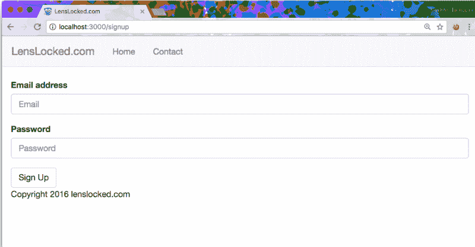

图 7.1：注册表单的第一版本

### 源代码

下面的链接包含了完整的源代码以及本节中所有更改代码的差异（diff）。

已完成 - book.usegolang.com/7.1.1

差异 - book.usegolang.com/7.1.1-diff

## 7.1.2 将我们的表单封装在面板（panel）中

在我们创建并可以查看表单后，我们现在准备好尝试利用 Bootstrap 让我们的表单看起来更好一些。我们将通过使用 Bootstrap 的两个功能来实现这一点。

- 1. 面板 (Panels)¹
- 2. 网格系统 (The grid system)²

面板是 Bootstrap 框架的一部分，它可以帮助你将内容封装在一个容器中，使得人们一眼看出该容器内的所有内容都是相关的。我们将使用面板来明确注册表单中使用了哪些字段。

网格系统允许我们定义行和列，有效地为我们提供了一种布局整个页面的方法。网格系统真正大放异彩的地方是从 Web 切换到移动视图时，因为它允许我们编写一次代码，就能使其在计算机和手机上看起来都体体面面。

我们将使用网格系统来根据用户的屏幕大小定义我们希望注册表单有多大，然后我们将表单放置在所定义的网格元素内部。

> 注意：我们不会在 HTML、CSS 和样式化上花费大量时间，但如果你想花更多时间自己定制你的 Web 应用程序的外观，你可以完全这样做。只要表单输入保留相同的名称字段，它就不会影响我们应用程序的运行方式。

首先，我们将修改我们的注册模板。

```
$ atom views/signup.gohtml
```

虽然我们目前将模板定义为“yield”，但我们到目前为止创建的只是注册表单。我们将表单模板重命名为 signup，然后创建一个新的“yield”模板。

在新的“yield”模板内部，我们将根据 Bootstrap 文档中的示例创建一个面板。我们将使用“带标题的面板”（Panel with heading）下的第二个示例——即带有标题的面板。

- ¹http://bootstrap.com/docs/3.3/components#panels
- ²http://bootstrap.com/docs/3.3/css#grid
- ³http://bootstrap.com/docs/3.3/components#panels-heading

# 第 7 章：创建注册页面

我们想要的更改显示在列表 7.6 中。花点时间查看 Bootstrap 文档，感受一下面板 HTML 是从哪里来的。

```html

Listing 7.6：面板 yield 模板。

{{define "yield"}}

<div class="panel panel-default">

  <div class="panel-heading">

    <h3 class="panel-title">Panel title</h3>h3>

  </div>

  <div class="panel-body">

    Panel content

  </div>

</div>

{{end}}

{{define "signupForm"}}

<form>

  <!-- ... 这是我们已经创建的表单 -->

</form>

{{end}}

```

我们有了一个基本大纲可以操作，所以让我们继续进行调整以满足我们的需求。

首先，将 `h3` 标签的内容替换为标题“Sign Up Now!”。

```html

<h3 class="panel-title">Sign Up Now!</h3>

```

接下来在 `div` 标签内搜索“Panel content”行。我们将将其替换为我们的 `signupForm` 模板。

```html

<div class="panel-body">

{{template "signupForm"}}

</div>


注意：我们现在没有向 `signupForm` 模板传递任何数据，因为代码的“signupForm”部分后面没有点（`.`）参数。

## 7.1. 添加一个带有表单的注册页面

最后，我们将更新几个类，用以演示颜色在 Bootstrap 中是如何工作的。

Bootstrap 自带了一些基础上下文颜色，可以用于几乎任何元素。例如，你可以使用 `btn-primary` 和 `btn-danger` 类来自定义你的应用程序的外观。这些类是根据上下文命名的。这允许你的应用程序看起来更加一致。

Bootstrap 的类名称及其默认颜色如下所示。

| CSS 类 | 默认颜色 |
|---|---|
| default | gray |
| primary | blue |
| success | green |
| info | light blue |
| warning | yellow |
| danger | red |

为了更改我们注册表单的颜色，我们将使用这些类。列表 7.7 显示了带有 primary 类的代码。

列表 7.7：带有 primary 的 yield。

```html

<div class="panel panel-primary">

<div class="panel-heading">

  <h3 class="panel-title">Sign Up Now!</h3>

</div>

<div class="panel-body">

{{template "signupForm"}}

</div>

</div>

```

现在我们的表单被封装在主面板中，我们将利用网格系统来居中面板并缩小其在中等及以上屏幕上的宽度。顺便提一下，我们将把按钮更新为 `primary`。

```html

<button type="submit" class="btn-primary">

```

## 7.3. Bootstrap 尺寸

你可以在下面的 Bootstrap 文档中关于尺寸的更多信息，但通常情况下你可以假设屏幕尺寸为 `md` 或更大的人正在计算机或尺寸较大的平板电脑查看你的网站。

- http://bootstrap.com/docs/3.3/css/#grid

网格系统要求我们先创建一个行，然后在行内部放置列。网格系统有 12 列，因此我们说注册表单在中等或更大的屏幕上应该占据 4 列。

我们的列从行的左侧开始，因此我们还将添加 4 列的偏移（offset），以便我们的表单居中。我们没有考虑右侧的偏移。

完成 - book.usegolang.com/7.1.2

更改 - book.usegolang.com/7.1.2-diff

## 7.1.3 在我们的导航栏添加注册链接

为了完成注册视图的添加，我们还有最后一个更改需要。我们需要在导航栏中添加该页面的链接！理想情况下，我们希望将其添加到导航栏的右侧，因为这是大多数人期望找到注册链接的地方。为了做到这一点，我们将再次查看 Bootstrap 文档。

打开 bootstrap 默认导航栏的文档：

http://getbootstrap.com/docs/3.3/components/#navbar-default

注意：如果你处于离线状态，可以直接使用下面我们使用的代码

我们在这里看到的是带有 `navbar-right` 类的 `ul` HTML 标签。它向我们展示了如何创建示例的右部分右右不会使用我们不会所有内容，并且我们需要更新链接以指向我们的注册页面。在完成这些更改后，我们得到的代码应该与列表 7.9 中的代码相似。

列表 7.9: 我们的 navbar-right

```
<ul class="nav navbar-nav navbar-right">
  <li><a href="/signup">注册</a></li>
</ul>
```

我们想将此代码添加到我们的导航栏中，因此打开导航栏模板。

## 7.1. 添加带表单的注册页面

```
$ atom views/layouts/navbar.gohtml
```

接下来寻找带有 `navbar-nav`类的现有 `ul` 标签。我们的新代码将紧跟在该 `ul` 标签之后。当你完成后，你的代码应该与列表 7.10 Match。

列表 7.10: 为导航栏添加注册链接。

```html
(define "nav")
<nav class="navbar navbar-default">
  <div class="container-fluid">
    <div class="navbar-header">
      <button type="button" class="navbar-toggle collapsed"
          data-target="#navbar" aria-expanded="false" aria-controls="#navbar">
        <span class="sr-only">toggle navigation</span>
        <span class="icon-bar"></span>
        <span class="icon-bar"></span>
        <span class="icon-bar"></span>
      </button>
      <a class="navbar-brand" href="/">LensLocked.com</a>
    </div>
    <div id="navbar" class="navbar-collapse collapse">
      <ul class="nav navbar-nav">
        <li><a href="/">首页</a></li>
        <li><a href="/contact">联系</a></li>
      </ul>
      <ul class="nav navbar-nav navbar-right">
        <li><a href="/signup">注册</a></li>
      </ul>
    </div>
  </div>
</nav>
({end})
```

继续重启你的服务器以测试所有更改。我们现在应该有一个注册页面，导航栏中有指向它的链接，并且页面周围应该有一个蓝色的面板。图 7.2 显示了该截图。

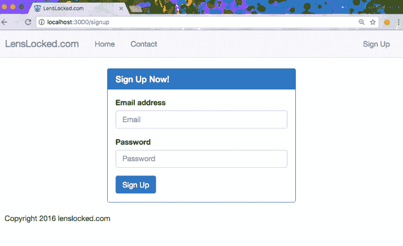

图 7.2: 完成的注册表单

你也可以尝试调整浏览器窗口的大小，查看 bootstrap 如何根据浏览器窗口自动更改你的面板的外观和大小。很酷，对吧？

### 源代码

下面的链接包含了完整的源代码以及本节中所有更改代码的差异（diff）。

完成 - book.usegolang.com/7.1.3

更改 - book.usegolang.com/7.1.3-diff

## 7.2. REST 简介

REST 是一个经常被争论的话题，它可能占据一整本书的内容。显然，我们不想花几周时间来讨论什么是或不是 RESTful，但我们确实需要花一点时间概述一下 REST 是什么以及它将如何影响我们的应用程序设计。

REST 是一种用于开发软件和网络系统的架构风格，被用于大多数 Web 世界的设计。它也被用作设计 Web 应用程序和 API 的指南，以及我们将如何使用它。

REST 是完全抽象的，因此如果有人告诉你是某事不是 RESTful，请对此保留意见。对于什么是或不是 RESTful，并没有金科标准，而且（据我所知），没有任何关于理想的 RESTful Web 应用程序应该是什么样的真实示例。相反，开发者只能尽所能地解释它。

那么这对我们意味着什么？嗯，这主要意味着我们将围绕资源（resources）对应用程序的大部分部分进行建模。资源是如用户、画廊或图像之类的实体。是可以创建、读取、更新和删除的东西。有些人甚至想得更远，还将考虑会话（session）或关系视为在我们的应用程序范围内需要创建的资源。

虽然我不一定反对将会话建模为资源的观点，但我想强调的是，你不应该陷于试图寻找应用程序中所有事物的完美表示。相反，在创建模型、控制器和视图时，应将其作为一个指导原则，但如果这意味着你的代码将更难理解或维护，就不要费力去做了。

表格 7.2: HTTP 请求方法

| HTTP 方法 | 意义 |
| :--- | :--- |
| GET | 读取 |
| POST | 创建 |
| PUT | 更新 |
| PATCH | 更新 |
| DELETE | 删除 |

REST 是一个经常被争论的话题，它可能占据一整本书的内容。显然，我们不想花几周时间来讨论什么是或不是 RESTful，但我们确实需要花一点时间概述一下 REST 是什么以及它将如何影响我们的应用程序设计。

REST 是一种用于开发软件和网络系统的架构风格，被用于大多数 Web 世界的设计。它也被用作设计 Web 应用程序和 API 的指南，以及我们将如何使用它。

REST 是完全抽象的，因此如果有人告诉你某事不是 RESTful，请对此保留意见。对于什么是或不是 RESTful，并没有金科标准，而且（据我所知），没有任何关于理想的 RESTful Web 应用程序应该是什么样的真实示例。相反，开发者只能尽所能地解释它。

那么这对我们意味着什么？嗯，这主要意味着我们将围绕资源（resources）对应用程序的大部分部分进行建模。资源是如用户、画廊或图像之类的实体。是可以创建、读取、更新和删除的东西。有些人甚至想得更远，还将考虑会话（session）或关系视为在我们的应用程序范围内需要创建的资源。

虽然我不一定反对将会话建模为资源的观点，但我想强调的是，你不应该陷于试图寻找应用程序中所有事物的完美表示。相反，在创建模型、控制器和视图时，应将其作为一个指导原则，但如果这意味着你的代码将更难理解或维护，就不要费力去做了。

表格 7.2: HTTP 请求方法

| HTTP 方法 | 意义 |
| :--- | :--- |
| GET | 读取 |
| POST | 创建 |
| PUT | 更新 |
| PATCH | 更新 |
| DELETE | 删除 |

完成 - book.usegolang.com/7.1.2

更改 - book.usegolang.com/7.1.2-diff

## 7.1.3 在我们的导航栏添加注册链接

为了完成注册视图的添加，我们还有最后一个更改需要完成。我们需要在导航栏中添加该页面的链接！理想情况下，我们希望将其添加到导航栏的右侧，因为这是大多数人期望找到注册链接的地方。为了做到这一点，我们将再次查看 Bootstrap 文档。

打开 bootstrap 默认导航栏的文档：

http://getbootstrap.com/docs/3.3/components/#navbar-default

注意：如果你处于离线状态，可以直接使用下面我们使用的代码

我们在这里看到的是带有 `navbar-right` 类的 `ul` HTML 标签。它向我们展示了如何创建示例的右侧部分。

我们不会使用示例中的所有内容，并且我们需要更新链接以指向我们的注册页面。在完成这些更改后，我们得到的代码应该与列表 7.9 中的代码相似。

列表 7.9: 我们的 navbar-right

```
<ul class="nav navbar-nav navbar-right">
  <li><a href="/signup">注册</a></li>
</ul>
```

我们想将此代码添加到我们的导航栏中，因此打开导航栏模板。

## 7.1. 添加带表单的注册页面

```
$ atom views/layouts/navbar.gohtml
```

接下来寻找带有 `navbar-nav` 类的现有 `ul` 标签。我们的新代码将紧跟在该 `ul` 标签之后。当你完成后，你的代码应该与列表 7.10 匹配。

列表 7.10: 为导航栏添加注册链接。

```html
(define "nav")
<nav class="navbar navbar-default">
  <div class="container-fluid">
    <div class="navbar-header">
      <button type="button" class="navbar-toggle collapsed"
          data-target="#navbar" aria-expanded="false" aria-controls="#navbar">
        <span class="sr-only">toggle navigation</span>
        <span class="icon-bar"></span>
        <span class="icon-bar"></span>
        <span class="icon-bar"></span>
      </button>
      <a class="navbar-brand" href="/">LensLocked.com</a>
    </div>
    <div id="navbar" class="navbar-collapse collapse">
      <ul class="nav navbar-nav">
        <li><a href="/">首页</a></li>
        <li><a href="/contact">联系</a></li>
      </ul>
      <ul class="nav navbar-nav navbar-right">
        <li><a href="/signup">注册</a></li>
      </ul>
    </div>
  </div>
</nav>
({end})
```

继续重启你的服务器以测试所有更改。我们现在应该有一个注册页面，导航栏中有指向它的链接，并且页面周围应该有一个蓝色的面板。图 7.2 显示了该截图。


图 7.2: 完成的注册表单

你也可以尝试调整浏览器窗口的大小，查看 bootstrap 如何根据浏览器窗口自动更改你的面板的外观和大小。很酷，对吧？

### 源代码

下面的链接包含了完整的源代码以及本节中所有更改代码的差异。

完成 - book.usegolang.com/7.1.3

更改 - book.usegolang.com/7.1.3-diff

## 7.2. REST 简介

REST 是一个经常被争论的话题，它可能占据一整本书的内容。显然，我们并不想花几周时间来讨论什么是或不是 RESTful，但我们确实需要花一点时间概述一下 REST 是什么以及它将如何影响我们的应用程序设计。

REST 是一种用于开发软件和网络系统的架构风格，被用于大多数 Web 世界的设计。它也被用作设计 Web 应用程序和 API 的指南，以及我们将如何使用它。

REST 是完全抽象的，因此如果有人告诉你某事不是 RESTful，请对此留保留意见。对于什么是或不是 RESTful，并没有金科标准，而且（据我所知），没有任何关于理想的 RESTful Web 应用程序应该是什么样的真实示例。相反，开发者只能尽所能地解释它。

那么这对我们意味着什么？嗯，这主要意味着我们将围绕资源（resources）对应用程序的大部分部分进行建模。资源是如用户、画廊或图像之类的实体。是可以创建、读取、更新和删除的东西。有些人甚至想得更远，还将考虑会话（session）或关系视为在我们的应用程序范围内需要创建的资源。

虽然我不一定反对将会话建模为资源的观点，但我想强调的是，你不应该陷于试图寻找应用程序中所有事物的完美表示。相反，在创建模型、控制器和视图时，应将其作为一个指导原则，但如果这意味着你的代码将更难理解或维护，就不要费力去做了。

表格 7.2: HTTP 请求方法

| HTTP 方法 | 意义 |
| :--- | :--- |
| GET | 读取 |
| POST | 创建 |
| PUT | 更新 |
| PATCH | 更新 |
| DELETE | 删除 |

## 7.3. 创建我们的第一个控制器

我们将创建的第一个控制器是用户控制器（users controller），它将包含所有与用户资源交互的页面的处理函数（handler functions）。例如，我们可能有一个用户编辑页面，用户可以在那里更新自己的用户信息，当用户访问此页面时，请求将由我们控制器内部的处理器进行处理。同样，当他们提交带有更新后信息的表单时，该更新将由用户控制器处理。

从核心本质上，控制器内部的处理函数与我们目前为止编写的函数并没有区别。这些函数仍然将接收 `ResponseWriter` 和 `Request` 作为参数，并且它们像我们之前一样使用这两个参数。

唯一真正的区别是，它们不再是在 `main.go` 文件中定义的函数，而是附加到 `Users` 类型上的方法，我们将在 `controllers` 包中声明这个类型。

虽然起初看起来这可能不会对我们的代码产生任何积极影响，但它最终会对我们的代码产生更大的影响。最显著的区别是，我们可以与控制器共享视图和数据库连接，并在我们的操作（actions）中访问它们，但还有其他长期收益，例如保持代码组织整洁且更容易测试。

### 7.3.1 创建用户控制器

我们的控制器将位于 `controllers` 包中，因此我们将开始创建该包的目录，然后创建用户控制器的源文件。

```bash

# 你可能已经在此目录下了

$ cd $GOPATH/src/lenslocked.com

mkdir controllers

$ atom controllers/users.go
```


我们将为用户控制器创建一个新类型。如何命名它由你决定，但我倾向于使用像 `Users` 这样的名字，因为在其他代码中它经常会被称为 `controllers.Users`，这清楚地表明了它是用户控制器。

我们现在还不知道用户控制器需要什么，所以我们将从一个空结构体作为类型开始。代码如列表 7.11 所示。

#### Listing 7.11：创建 `Users` 类型

```go
package controllers

type Users struct {
```
就是这样。我们现在有了代码中可用的 `Users` 控制器，并准备好向它添加视图和任何其他相关字段。

### 源代码

下面的链接包含了完整的源代码以及本节中所有更改代码的差异（diff）。

已完成 - [book.usegolang.com/7.3.1](https://book.usegolang.com/7.3.1)

### 7.3.2 移动注册页面代码

我们已经创建了大部分注册页面，但在本节中，我们将该页面从我们的 `main.go` 源文件迁移到我们的用户控制器中。它将成为用户控制器的一部分，因为提交表单最终会创建一个新的用户账户，而任何创建或更改用户的操作通常都应该是用户控制器的一部分。

从技术上讲，我们可以将注册模板留在原处。我们的用户控制器只需从其当前位置加载模板文件，这不会破坏我们的应用程序。尽管这不会破坏任何东西，但随着时间的推移，我们将引入许多新页面，我发现尽早为模板引入一种组织模式是最好的。我倾向的组织视图的方式是将它们存储在与相关的控制器同名的目录中，并将其命名为与使用模板创建的视图相似的操作名称。

这在实践中意味着，我喜欢将所有与用户相关的模板存储在 `views/users` 目录中，并且喜欢根据正在渲染的操作来命名每个模板。例如，我们将使用“new”用户操作来渲染注册页面，因此我们将注册模板移动到 users 目录，并重命名为 `new.gohtml`。

```bash
# 创建用户模板目录
$ mkdir views/users

# 移动并重命名注册模板
$ mv views/signup.gohtml views/users/new.gohtml
```

今后，我们将根据模板与代码相关的操作来命名所有模板，这样开发人员处理 Edit 操作时，他们将知道相应的模板存储在 `edit.gohtml` 模板文件中。

将模板移动到最终位置后，我们需要告诉用户控制器关于模板的信息。我们不是告诉它模板本身，而是要在用户控制器上存储一个表示此模板的视图。这样，控制器就不需要处理执行模板，而是可以像我们现在注册函数中这样做的那样直接调用视图的 `Render` 方法。

# 第 7 章 创建注册页面

我们将首先向 `Users` 类型添加一个字段来存储新用户视图。在此你需要导入 `views` 包。新代码如列表 7.12 所示。

```bash
$ atom controllers/users.go
```

#### Listing 7.12:为 `Users` 添加 `NewView` 字段
```go
import "lenslocked.com/views"

type Users struct {
    NewView *views.View
}
```

与其告诉它模板本身，我们要在用户控制器上存储一个表示此模板的视图。这样，控制器就不需要处理执行模板，而是可以只需调用我们视图的 `Render` 方法，就像我们现在在注册函数中这样做的那样。

与其在 `main.go` 中这样做，我们改为在控制器中编写一个 `NewUsers` 函数来构造控制器。列表 7.13 显示了更新后的代码。在 `NewUsers` 内部，我们调用 `views` 函数并传入我们使用的布局和模板，然后将新创建的视图赋值给控制器的字段。

#### Listing 7.13:为 `Users` 添加 `NewView`
```go
package controllers

import "lenslocked.com/views"

func NewUsers() *Users {
    return &Users{
        NewView: views.New("bootstrap", "views/new.gohtml"),
    }
}

type Users struct {
    NewView *views.View
}
```

最后，返回 `Users` 对象。

在 `New` 方法中，我们使用 `u` 来访问控制器。这使得我们能够引用 `NewView` 字段，并最终调用该视图的 `Render` 方法，就像我们在注册函数中这样做的那样。

我们的 `New` 方法将与 `Users` 类型关联。这很重要，因为这意味着我们的 `New` 方法将访问我们创建的 `NewView`。`New` action 的代码见列表 7.14。

#### Listing 7.14：新 action
```go
import (
    "net/http"
    "lenslocked.com/views"
)

// ... 以上部分相同

// New 用于渲染用户可以创建新用户的表单。
// GET /signup
func (u *Users) New(w http.ResponseWriter, r *http.Request) {
    if err := u.NewView.Render(w, nil); err != nil {
        panic(err)
    }
}
```

在调用渲染方法后，我们检查是否有任何错误，如果发生错误则 `panic`。我们我们将更新代码以更优雅的方式处理这种 `panic`，但目前我们将保留它，因为我们还没有更好的错误处理系统。

### Box 7.6. 我们为什么要创建 `NewView`?

起初，在用户控制器上创建 `NewView` 字段似乎是毫无意义的。为什么不象我们之前那样使用全局变量呢？那不会让我们的代码更简单吗？

虽然全局变量最初看起来更简单，但长期来看很容易导致 bug，因为 `controllers` 包中的任何代码都可能（有意或无意）更改该变量。这被称为副作用（side effect），并且很难追踪和测试。

通过将新用户视图附加到我们的控制器上，我们避免了使用全局变量，并且我们的控制器上拥有视图的本地副本，可以对其编辑而不影响用户控制器的其他副本。

## 7.3. 创建我们的第一个控制器

已完成 - book.usegolang.com/7.3.2

更改 - book.usegolang.com/7.3.2-diff

### 7.3.3 将我们的路由器和用户控制器连接起来

现在我们已经有了用户控制器，想要用它来代替之前创建的 `signup` 函数。让我们打开 `main.go` 并移除一些我们不再需要的代码。

```
$ atom main.go
```

现在删除以下行代码。

```
// 从 var 组中删除此
signupView = views.View
```

```
// 在 main() 函数中删除此
signupView = views.NewView("bootstrap", "views/signup.gohtml")
```

删除那两行之后，我们还需要删除整个 `signup` 函数。正如我之前所说的，以后我们将使用用户控制器来渲染注册页面。

```go
// 完全删除此函数
func signup(w http.ResponseWriter, r *http.Request) {
    w.Header().Set("Content-Type", "text/html")
    must(signupView.Render(w, nil))
}
```

## 第 7 章：创建一个注册页面

我们需要导入创建的 `controllers` 包，以便我们能够构造一个用户控制器。一旦导入了该包，我们将创建一个用户控制器，并将其赋值给 `main` 函数内部的变量。这段代码在列表 7.15 中，但再次强调，你的代码现在还无法编译。

Listing 7.15: 实例化用户控制器
```go
import (
  "net/http"
  "lenslocked.com/controllers"
  "lenslocked.com/views"

  "github.com/gorilla/mux"
)

// 这些都是完全相同的
func main() {
  homeView = views.NewView("bootstrap","views/home.gohtml")
  contactView = views.NewView("bootstrap","views/contact.gohtml")
  usersC := controllers.NewUsers()
  // 这些都是完全相同的
}
```

最后，我们准备好将用户控制器上的 `New` 方法作为我们的处理函数传递到路由器中。找到下面这样的一行：

```
r.HandleFunc("/signup", signup)
```

它应该位于 `main` 函数内部。我们将更新这部分的最后一部分，即 `signup` 参数，我们现在改为传入 `usersC.New`，这是我们创建的新用户处理函数。新代码在列表 7.16 中。

## 7.3. 创建我们的第一个控制器

| 列表 7.16: 更新路由器 |
| :--- |
| r.HandleFunc("/signup", usersC.New) |

有一点很重要，你**不要**在“New”之后添加括号。（（你的编辑器可能会尝试自动补全并添加这些括号。））

接下来我们将将其接入路由器，但首先，我们需要学习如何使用 `gorilla/mux` 根据 HTTP 方法路由网络请求，以便我们区分用户请求注册表单和用户提交注册表单。之后，我们将此操作接入路由器，然后开始解析用户提交的表单数据。

### 源代码

下面的链接包含了已完成的源代码以及本节中所有更改代码的差异。

已完成 - book.usegolang.com/7.4.1

更改 - book.usegolang.com/7.4.1-diff

### 7.4.2 HTTP 请求方法和 `gorilla/mux`

我们在本章稍早之前讨论过 GET 和 POST 等 HTTP 请求方法，但到目前为止，我们还没有在代码中实际它们的理由。我们所有的页面都是唯一的，而且没有哪个页面创建、更新或销毁数据，所以这一直不是一个主要问题。

现在我们想要允许用户创建账户，因此我们需要更新代码来反映这一点。具体来说，我们希望将映射到 `/signup` 路径的任何 POST 请求映射到 `Create` 方法，因为这意味着提交了一个表单来创建新用户。我们还希望对 `/signup` 路径的 GET 请求能像现在那样显示注册表单。

为了做到这一点，我们需要更新路由器，并告知它每个处理函数应该接受哪些方法。与其直接告诉你是什么方法，我希望你尝试自己去找到它。

前往 Gorilla mux 文档，查看列出该包实现的所有方法和函数的 API。

有什么看起来对我们有帮助吗？有没有什么提到 HTTP 方法或动词（verbs）？

为了回答这个问题，我们首先需要查看现有的代码。在 `main.go` 中，我们有以下代码：

```go
r := mux.NewRouter()
r.HandleFunc("/", home)
r.HandleFunc("/contact", contact)
r.HandleFunc("/signup", userC.New)
```

如果你查看文档中 [HandleFunc] 的含义，你会发现该方法会返回一个 *mux.Route*。这意味着我们可以通过类似下面的操作来访问返回值：

```go
route := r.HandleFunc("/signup", userC.New)
// 或者我们可以链式调用我们的方法
r.HandleFunc("/signup", userC.New).SomeRouteMethod()
```

知道我们有一个 `Route` 可以处理，我们应该首先检查该类型上的 `Methods` 方法。

阅读文档，我们了解到该方法接受一个变长参数，提供的每个字符串都代表我们的路由将处理的单个 HTTP 方法

## 第 7 章：创建注册页面

。为了测试这一点，让我们更新所有现有的路由，使其只接受 GET 方法，并验证一切是否仍然正常。

如果你还没有打开 `main.go`，请打开它。

```
$ atom main.go
```

然后更新 `main` 函数中的路由器代码，以与列表 7.18 中的代码一致。

# 列表 7.18：带方法的路由
```
r := mux.NewRouter()
r.HandleFunc("/", home).Methods("GET")
r.HandleFunc("/contact", contact).Methods("GET")
r.HandleFunc("/signup", usersC.New).Methods("GET")
http.ListenAndServeAndServe(":3000", r)
```

停止（ctrl + c）并重启你的服务器以验证运行是否正常。

```
$ go run main.go
```

看起来运行如我们所愿。棒了！

接下来，我们想添加一个新路由再次使用 `/signup` 路径，但这次它将只接受 POST 方法，并将请求路由到我们在用户控制器中创建的 `Create` 方法。通过这样做，我们就可以将注册表单提交到 `/signup` 路径，然后调用创建的创建操作来处理表单。

# 框 7.8：RESTful 设计的另一个例外

### 7.4. 处理注册表单

同样，我们将为注册表单对 RESTful 设计破一次例。与其让此表单通过 POST 提交到 `/users`，我们将让它 POST 到 `/signup`。我们不必这样做，但我认为这种常见做法为用户在创建新账户时提供了更好的整体体验。

你应该仍然打开 `main.go`，所以进入该源文件中的 `main` 函数。列表 7.19 展示了如何添加一个仅在 HTTP 方法为 POST 时运行的新路由。

# 列表 7.19：添加 POST 注册路由
```
r := mux.NewRouter()
r.HandleFunc("/", home).Methods("GET")
r.HandleFunc("/contact", contact).Methods("GET")
r.HandleFunc("/signup", userC.New).Methods("GET")
r.HandleFunc("/signup", userC.Create).Methods("POST")
http.ListenAndServe(":3000", r)
```

我们将做的最后一个更改是注册表单的 HTML。

现在，我们的表单不知道将数据提交到哪里，因此我们需要更新它，告诉它将数据 POST 到 `/signup`。

打开用户模板。

```
$ atom views/users/new.gohtml
```

寻找我们之前创建的 `signupForm` 模板。它应该是那个包含我们定义的 HTML 表单的模板。

此模板的第一行应该应该是 `<form>`，这是一个基础的表单标签。我们将更新这一行，告诉浏览器在当我们点击提交按钮时提交表单，我们还会告诉它使用 HTTP POST 方法。此代码显示在列表 7.20 中。

| **列表 7.20：更新注册表单标签** |
|---||
| `<form action="signup" method="POST">` |

如果你还没有重启，请重启你的服务器并转到注册表单。确保在重启服务器后刷新注册页面以获取更新后的 HTML，然后提交表单。如果一切运行正常，你将看到一个非常丑陋的页面，上面渲染着“This is a temporary response.”的文本。这意味着我们的一切设置都是正确的，而且我们在用户控制器上的 `Create` 方法已经执行了！

### 源代码

下面的链接包含了本节中所有更改代码的源代码和差异（diff）。

- 完成 - book.usegolang.com/7.4.2
- 更改 - book.usegolang.com/7.4.2-diff

### 7.4.3 解析 POST 表单

我们终于准备好学习如何解析注册表单了，以便我们可以使用提交的数据创建一个新用户。

当表单提交到你的 Web 应用程序时，它将包含在用户生成的请求中。在 Go 的术语中，它将传入处理函数的 `http.Request` 参数的一部分。

### 处理表单

在你可以访问表单之前，你首先需要告诉你的代码去解析它。这并不是默认的，因为表单并不总是包含在 Web 请求中，所以在大多数时候，尝试解析表单是徒劳的。在 Go 中，你可以通过调用传入处理函数的 `http.Request` 的 `ParseForm` 方法来解析表单。

如果你阅读 `ParseForm` 函数的文档，可能会觉得非常困难。那里有很多关于 HTTP 方法、查询和 `MaxBytesReader` 的讨论，这些现在对你来说可能意义不大。幸运的是，我们的情况相当标准。当我们在 `Create` 方法中调用 `ParseForm` 时，它会解析提交的 HTML 表单并将数据存储在 `http.Request` 的字段中。

打开我们的用户控制器并进行测试。

```
$ atom controllers/users.go
```

我们将解析表单，检查错误，然后打印我们期望在 HTML 表单中的字段。此代码在列表 7.21 中显示。我们编写后讨论 `PostForm` 部分。

# 列表 7.21：访问 `r.PostForm` 数据
```go
func (u *Users) Create(w http.ResponseWriter, r *http.Request) {
	if err := r.ParseForm(); err != nil {
	panic(err)
	}
	fmt.Fprintln(w, r.PostForm["email"])
	fmt.Fprintln(w, r.PostForm["password"])
}
```


> ⁷https://golang.org/pkg/net/http#Request.ParseForm

## 创建页面

调用 `ParseForm` 应该很容易。该函数返回一个错误，所以我们捕获返回值并继续验证解析表单出错。之后，我们从 `r.PostForm` 中检索了一些数据并打印。查看 `net/http` 文档中的请求对象，可以看到该字段的类型为 `url.Values`。

如果我们遵循 `url.Values` 文档，我们将找到该类型的定义（显示在列表 7.22 中）。

| 列表 7.22：url.Values 定义 |
|---|

| type Values map[string][]string |

我们的 `PostForm` 在幕后其实就是一个 map，这意味着我们可以像访问 map 字段一样访问存储的字段——使用 `["key"]` 语法。这就是我们在列表 7.21 中做的：

```
r.PostForm["email"]
```

我们正在告诉代码我们想要 `PostForm` map 中键为 "email" 的任何值。

现在是停止并重启服务器进行测试的好时机。转到注册页面填写每个表单然后点击提交按钮。如果一切按预期工作，你应该看到输入到 HTML 表单的信息。它看起来与下面的数据相似。

### 处理注册表单

```
[jon@calhoun.io]
[test1234]
```

括号 `[` 和 `]` 可能会让你困惑，但它们的存在是因为我们正在打印一个切片（slice）。我们不确定是否每个键都将有多个值，但在继续之前，这是一个需要注意的重要细节。

### 源代码

下面的链接包含了本节中所有更改代码的源代码和差异。

- 完成 - book.usegolang.com/7.4.3

- 更改 - book.usegolang.com/7.4.3-diff

### 7.4.4 使用 gorilla/schema 解析表单

我们已经看到如何手动解析表单并访问数据，这种方式解析数据可能是很的。我们需要编写代码来提取表单的每个字段，将其转换为正确的类型，并将其分配给我们要处理的任何结构。

与其编写所有代码并可能在代码中引入 Bug，我们将利用 Gorilla toolkit⁰ 中的另一个库——`schema` 包¹。

> ¹⁰http://www.gorillatkit.org/

¹¹http://www.gorillatkit.org/pkg/schema

`schema` 包的设计是为了更容易将表单值转换为结构体。它不仅会处理数据从 `PostForm` 移动到我们的结构体，还会为我们处理大多数常见的类型转换。例如，如果我们的结构体字段类型为 `int`，那么 `gorilla/schema` 包会在将其分配给结构体之前将表单值转换为整数。

Gorilla 的 `schema` 包是一个第三方包，所以我们首先需要获取它。

```
$ go get -u github.com/gorilla/schema
```

注意：`-u` 标志用于获取包的更新版本。

接下来我们需要定义一个类型来存储数据。我们将将其添加到 `controllers` 包下的 `users.go` 源文件中。

```
$ atom controllers/users.go
```

## 7.4. 处理注册表单

```go
type SignupForm struct {
  Email string
  Password string
}
```

我们需要添加的最后一项对许多读者来说将是新内容。我们将为我们的类型添加一些结构体标签（struct tags）¹¹²。

## 结构体 7.9 结构体标签

结构体标签是元数据的一种，可以添加到你创建的任何结构体的字段上。在编写它们时，它们的格式为 `key: "value"`，并直接跟在字段之后（示例请参见列表 7.23）。

稍后，当你的程序运行时，其他包可以使用 `reflect` 包来查找每个结构体标签，然后使用数据来确定它们应该如何执行。例如，`encoding/json` 包使用这些数据来在将结构体转换为 JSON 时，确定你想要每个字段对应的键（key）。

虽然这不是强制性要求，但大多数包都会使用它们的包名作为所有结构体标签的键。这使得在阅读你的源代码时，更容易确定每个结构体标签是属于哪个包的。

在列表 7.23 中，每个结构体标签都以键 `schema` 开头，表示它被名为 `schema` 的包使用。同样，`encoding/json` 包的所有结构体标签都使用键 `json`。

我们需要结构体标签，因为我们目前没有方法告诉 `schema` 包如何将我们表单中的数据映射到 `Signup-Form` 结构体的字段中。我们在注册表单的 HTML 中同时拥有 "email" 和 "password" 输入，但 `schema` 包并不知道它们的存在。

> ¹²https://golang.org/pkg/reflect/#StructTag

## 第 7 章：创建注册页面

为了修复这个问题，我们只需要添加结构体标签，让 `schema` 包知道输入字段。相应的代码显示在列表 7.23 中。

列表 7.23：注册表单结构体

```go
type Signup struct {
    Email string `schema:"email"`
    Password string `schema:"password"`
}
```

我们现在准备好开始使用 schema 包来解码我们的 HTML 表单，并将数据设置到 `SignupType` 的字段中了。为了做到这一点，我们首先需要初始化一个解码器（decoder）和一个 `SignupForm`。一旦我们拥有这两者，我们将在解码器上调用 `Decode` 方法，并将 `SignupForm` 作为我们的目标，将 `r.PostForm` 作为我们的数据源。顺便如此，我们还会检查错误。

相应的代码在列表 7.24 中。

不要忘记在代码中调用 `r.ParseForm()`！如果你忘记了这样做，`r.PostForm` 将没有任何值供我们的解码器工作。

列表 7.24：在 create 方法中使用 gorilla/schema

```go
// 将 gorilla/schema 添加到你的导入包中
import (
    "fmt"
    "net/http"

    "github.com/gorilla/schema"

    "lenslocked.com/views"
)

// ... 我们只编辑了 Create 方法。
func (u *Users) Create(w http.ResponseWriter, r *http.Request) {
    if err := r.ParseForm(); err != nil {
        panic(err)
    }
}
```

## 7.4. 处理注册表单

```go
dec := schema.NewDecoder()
form := SignupForm()
if err := dec.Decode(&form, r.PostForm); err != nil {
    panic(err)
}
fmt.Println(w, form)
```

停止并重启你的 Web 应用，然后转到注册页面并提交。应该和上次没有太大区别，但现在我们应该看到打印出我们的 `SignupForm` 类型，而不是两个字符串切片。

### 源代码

下面的链接包含了完整的源代码以及本节中所有更改代码的差异（diff）。

- 已完成 - book.usegolang.com/7.4.4

- 更改 - book.usegolang.com/7.4.4-diff

## 7.4.5 保持你的解析代码 DRY

程序员不喜欢反复编写相同的代码，因此在某个时刻，他们提出了“不要重复自己”（Don't repeat yourself）的说法。或者用缩写形式 —— DRY。

它的基本意思是，如果你发现自己正在编写可能需要写多次的代码，就应该考虑将其拆分为函数或某些可重用的代码段。这有助于避免错误，即我们在四个地方修复了相同的代码，却漏掉了第五处也是最后处编写该代码的地方。

在处理我们的用户控制器时，我们在 `Create` 方法内部编写了一些代码来解析表单并对其解码，但如果你仔细观察代码，你会发现几乎所有用于解析 HTML 表单和编码的代码都是通用的。

在这一节中，我们将观察如何将代码从我们的 `Create` 方法移动出来，改为将其移动到自己的函数中，以便我们以后可以重用。我们现在还没有合适的地方存储这些代码，所以我们将在 `controllers` 包中创建一个名为 `helpers.go` 的新源文件，并将代码存储在那里。这在世界上不是最好的名字，但目前可以得通。

```bash
$ atom controllers/helpers.go
```

接下来，我们将编写包声明代码并导入我们需要的包。通常情况下，我会一直导入包直到我使用它们为止，但因为你们中许多人没有设置自动导入，我想在进入代码逻辑之前涵盖这一内容。

```go
package controllers

import (
  "net/http"

  "github.com/gorilla/schema"
```

现在我们有了导入，我们将创建一个名为 `parseForm` 的函数，它接收 `*http.Request` 作为第一个参数，并接收 `interface{}` 作为第二个参数。第一个参数是 `*http.Request`，因为我们需要解析表单数据。第二个参数是 `interface{}`，因为我们将期望 `dst` 参数已经是一个指针。

我们需要实现 `parseForm` 函数。幸运的是，我们已经在 `Create` 方法中写了大部分代码，我们只需要将其复制并进行一些修改。打开你的用户控制器：

```bash
$ atom controllers/users.go
```

并寻找我们之前编写解析表单并使用 schema 包进行解码的代码。应该是 `Create` 方法内部的代码。

```go
if err := r.ParseForm(); err != nil {
    panic(err)
}
dec := schema.NewDecoder()
form := SignupForm()
if err := dec.Decode(&form, r.PostForm); err != nil {
    panic(err)
}
```

## 第 7 章：创建注册页面

将这段代码复制到你刚刚创建的 `parseForm` 函数中。

我们的 `parseForm` 函数不应该 panic，而是在发生错误时返回错误，所以找到调用 `panic` 的两行代码并改为返回错误。如果没有发生错误时，我们需要返回 `nil`，因此在函数末尾添加它。

```go
func parseForm(r *http.Request, dst interface{}) error {
	if err := r.ParseForm(); err != nil {
		return err
	}
	dec := schema.NewDecoder()
	form := SignupForm()
	if err := dec.Decode(&form, r.PostForm); err != nil {
		return err
	}
	return nil
}
```

我们的代码还没有按照预期工作，因为我们还没有解码到提供的 `dst` 参数中。我们仍然在使用旧的 `SignupForm` 变量。

删除创建变量的行，然后更新 `Decode` 方法以使用 `dst` 参数。我们不需要取地址符 (`&`)，因为我们将期望 `dst` 参数已经是一个指针。

```go
func parseForm(r *http.Request, dst interface{}) error {
	if err := r.ParseForm(); err != nil {
		return err
	}
	dec := schema.NewDecoder()
	if err := dec.Decode(dst, r.PostForm); err != nil {
				return err
	}
	return nil
}
```

现在我们可以更新用户控制器中的 `Create` 方法，使用我们刚刚创建的 `parseForm` 函数了。

## 7.4. 处理注册表单

```
$ atom controllers/users.go
```

我们仍然想要创建 `SignupForm` 变量，但在之后我们调用 `parseForm`，检查错误，并打印我们的表单数据。这样要简单得多！

最终代码应该与列表 7.26 一致。

```
Listing 7.26: 在 Create 中使用 parseForm()
func (u *Users) Create(w http.ResponseWriter, r *http.Request) {
	var form SignupForm
	if err := parseForm(r, &form); err != nil {
		panic(err)
	}
	fmt.Fprintln(w, "Email is", form.Email)
	fmt.Fprintln(w, "Password is", form.Password)
}
```

在这段代码中我们仍然需要处理错误，但我们能够将其减少到在 `Create()` 动作内部进行一次错误检查，这稍微简化了事情。此外，我们现在有了一种方法解析任何表单，而无需重写该代码。

最后一段代码还更新了我们的打印语句，以证明我们确实可以访问 `SignupForm` 实例上的每个字段，并且它被分配了正确的值。

本章剩下的唯一工作就是清理我们的代码并尝试几个练习题。

### 源代码

下面的链接包含了完整的源代码以及本节中所有更改代码的差异（diff）。

- 完成版 - book.usegolang.com/7.4.5

- 更改 - book.usegolang.com/7.4.5-diff

## 7.5 清理和创建静态控制器

到目前为止，我们一直在处理用户控制器，但在本节中，我们将查看如何使用控制器来处理那些并不真正映射到用户等资源的页面，而是更接近 Web 应用程序中静态页面的页面。

一个很好的例子是你的联系页面。你可能可以将其放在诸如咨询控制器（inquiries controller）之下，因为用户通过它找到如何进行咨询的方法，但这个控制器最终只有一个动作——显示你所有联系信息的页面。

与其创建许多可能导致混乱的非必要控制器，我们将创建一个控制器来持有所有不是完全静态但非常接近静态页面的页面。我们将将其命名为静态控制器（static controller），在其中我们将为首页和联系页设置动作。

### 7.5.1 创建静态控制器

就像之前我们创建用户控制器一样，我们的静态控制器将位于 `controllers` 包中。在 `controllers` 目录内创建并打开一个新的源代码文件用于你的静态控制器。

```
$ atom controllers/static.go
```

我们需要做的第一件事是声明 `Static` 类型。在其中我们需要存储两个不同的视图——首页视图和联系视图。然后，就像我们处理用户时做一样，我们将创建一个 `NewStatic` 控制器，包括初始化我们的视图。

**Listing 7.27:** 开始创建静态控制器

```go
package controllers

import "lenslocked.com/views"

func NewStatic() *Static {
	return &Static{
		HomeView: views.NewView(
			"bootstrap", "views/static/home.shtml"),
		ContactView: views.NewView(
			"bootstrap", "views/static/contact.shtml"),
	}
}

type Static struct {
	HomeView *views.View
	ContactView *views.View
}
```

接下来，我们需要将视图移动到正确的位置。我们将遵循之前的模式，因此 `home.shtml` 和 `contact.shtml`（都在 `views` 目录下）都将被移动到 `static` 目录，我们静态控制器的所有模板文件将存那里。为了这样做，我们需要创建 `views/static` 目录，然后将我们的 `.shtml` 文件移动到新目录。

**Listing 7.28:** 移动静态控制器模板

```bash
$ mkdir views/static
$ mv views/home.shtml views/static
$ mv views/contact.shtml views/static
```

接下来，我们需要在控制器内部编写处理函数，但如果我们查看 `main.go` 中的 `home` 和 `contact` 函数，你会发现这这两个函数都没有真正在做什么。

事实上，它们唯一做的事情就是设置内容类型并渲染视图。我们并不真的需要一个自定义函数来完成这些。如果我们可以直接使用来自 `views` 包的 `View` 类型作为处理函数并只需渲染视图，那就太好了。

为了实现这一点，我们需要弄清楚 `views.View` 类型需要实现什么接口，以便我们能够直接将 `views.View` 类型传递给我们的路由器。这意味着我们需要再次查看 `gorilla/mux` 的文档。

快速浏览此列表，我们正在寻找一个具有 `mux.Router` 类型的方法（因为这就是我们路由器的类型），该方法允许我们传递一个接口实现。

嗯，只有两个看起来合理的方法是 `Handle` 和 `HandleFunc`，但我们知道 `HandleFunc` 不是我们要的，因为我们一直在使用它，让我们检查 `Handle` 方法。

`Handle()` 方法似乎接收一个路径，然后是一个 `http.Handler` 对象。这意味着我们需要查看 `net/http` 文档并查找 `http.Handler` 类型。

`http.Handler` 是一个只需要一个方法的接口：


```
ServeHTTP(ResponseWriter, *Request)
```

这听起来就像我们的 `views.View` 类型想要的——一个接收 `http` 响应写入器和请求的函数——因此似乎我们只需要为 `views.View` 编写一个 `ServeHTTP()` 方法。

打开 `views.go`。

```
$ atom views.go
```

在视图源代码中，我们将为 `views.View` 编写 `ServeHTTP` 方法，这看起来就像我们在 `main.go` 中的 `home` 和 `contact` 函数一样。

**Listing 7.29:** 实现 Handler 接口

```go
func (v *View) Render(w http.ResponseWriter, data interface{}) error {
	w.Header().Set("Content-Type", "text/html")
	return v.Template.ExecuteTemplate(w, v.Layout, data)
}

func (v *View) ServeHTTP(w http.ResponseWriter, r *http.Request) {
	if err := v.Render(w, nil); err != nil {
		panic(err)
	}
}
```

由于 `views.View` 实现了接口，我们可以更新 `main.go` 来直接使用视图。

**Listing 7.30:** main.go

```go
package main

import (
	"net/http"

	"lenslocked.com/controllers"

	"github.com/gorilla/mux"
)

func main() {
	r := mux.NewRouter()
	staticC := controllers.NewStatic()
	usersC := controllers.NewUsers()

	r.Handle("/", staticC.Home).Methods("GET")
	r.Handle("/contact", staticC.Contact).Methods("GET")
	r.HandleFunc("/signup", userC.Create).Methods("POST")

	http.ListenAndServe(":3000", r)
}
```

最后，由于我们不计划为静态控制器创建 Home 或 Contact 方法，我们可以将 `HomeView` 和 `ContactView` 重命名为 `Home` 和 `Contact`。在此之后你将需要更新 `main.go`。

**Listing 7.31:** 重命名 controllers/static.go

```go
package controllers

import "lenslocked.com/views"

func NewStatic() *Static {
	return &Static{
		Home: views.NewView(
			"bootstrap", "views/static/home.shtml"),
		Contact: views.NewView(
			"bootstrap", "views/static/contact.shtml"),
	}
}

type Static struct {
	Home *views.View
	Contact *views.View
}
```

**Listing 7.32:** 重命名 main.go

```go
r.Handle("/", staticC.Home).Methods("GET")
r.Handle("/contact", staticC.Contact).Methods("GET")
```

重启你的应用程序并验证它是否正常。你仍然应该能够首页和联系页面，但现在它们应该通过静态控制器中的 `views.View` 类型的 `ServeHTTP` 方法提供。

### 7.5.2 简化新视图的创建

打开你的两个控制器（`users.go` 和 `static.go`）并查看调用 `views` 包提供的 `NewView` 函数的代码。你发现这两段代码之间有什么共同点吗？

如果你查看传递这些函数调用的视图路径，你会发现它们有很多共同点。它们都以前缀 (`views/`) 开头，并且都以相同的文件扩展名 (`.shtml`) 结束。由于我们不打算在 `views` 目录之外视图文件，并且打算使用另一个模板扩展（使用多个将非常困惑），如果我们能稍微简化这些代码以不再需要这些信息，那就太好了。我们可能会调用：

```
views.NewView("bootstrap", "users/new")
```

为了实现这一点，我们需要更新我们的视图源代码。

我们要做的第一件事是添加一个变量，用于存储所有变量所在的目录。我们将其命名为 `TemplateDir`。相关代码见列表 7.33。

## 列表 7.33: view.go 中的模板变量

```go
var (
    LayoutDir string = "views/layouts/"
    TemplateDir string = "views/"
    TemplateExt string = ".gohtml"
)
```

我们需要一个函数，可以接收传递给 `NewView` 函数的文件，并更新它们以自动添加 `views/` 前缀并追加 `.gohtml` 后缀。我们将此函数命名为 `addTemplatePath`，它接受一个参数 - 代表我们模板文件的字符串切片。`addTemplatePath` 将遍历切片中的每一个字符串，并为切片中的每个项设置一个新值，前面加上 `views/`。相关代码见列表 7.34。

### 框 7.10. 为什么我们不需要切片指针？

大多数情况下，如果我们想修改传递给函数的数据，将需要使用指针变量，那么为什么我们在处理传入 `addTemplatePath` 函数的切片时不需要这样做呢？

在底层，切片实际上通过指针引用一个数组。当你尝试更改切片的大小时，更改将不会持久，但如果你修改切片内部的某些数据，你最终会修改所引用的数组中的数据。

## 7.5. 清理并创建静态控制器

你可以在此处阅读更多信息：https://www.calhoun.io/why-are-slices-sometimes-altered-when-passed-by-value-in-go/

## 列表 7.34: 添加 views 目录

```go
// addTemplatePath 接收一个字符串切片，
// 代表模板的文件路径，它会在切片的中的每个字符串
// 前面添加 TemplateDir
// 例如输入 ("home") 将导致输出
// ("views/home" 如果 TemplateDir == "views/
func addTemplatePath(files []string) {
  for i, f := range files {
    files[i] = TemplateDir + f
  }
}
```

接下来，我们将编写一个类似的函数，但不是添加 views 目录前缀，而是追加模板扩展名后缀。我们将此函数命名为 `addTemplateExt`。此代码见列表 7.35。

## 列表 7.35: 追加 .gohtml 扩展

```go
// addTemplateExt 接收一个字符串切片，
// 代表模板的文件路径，它会在切片的每个字符串
// 后面追加 TemplateExt 扩展
// 例如输入 ("home") 将导致输出
// ("home.gohtml" 如果 TemplateExt == ".gohtml"
func addTemplateExt(files []string) {
  for i, f := range files {
    files[i] = f + TemplateExt
  }
}
```

我们还没有使用这两个函数中的任何一个，让我们更新 `NewView` 来利用它们。此代码见列表 7.36。

## 第 7 章：创建注册页面

### 列表 7.36: 使用视图文件路径助手

```go
func NewView(layout string, files ...string) *View {
    addTemplatePath(files)
    addTemplateExt(files)
    files = append(files, layoutFiles()...)
    t, err := template.ParseFiles(files...)
    if err != nil {
        panic(err)
    }

    return &View{
        Template: t,
        Layout: layout,
    }
}
```

最后，我们需要更新控制器，以便它们在创建视图时不传递不必要的数据。

```bash
$ atom controllers/users.go
```

更新用户控制器中的 `NewUsers` 函数，使得对 `NewView` 函数的调用不再传递 views 前缀或 `.gohtml` 扩展。这见列表 7.37。

## 列表 7.37: 清理 NewUsers() 函数

```go
func NewUsers() *Users {
    return &Users{
        NewView: views.NewView("bootstrap", "users/new")
    }
}
```

我们需要对静态控制器中的视图执行相同的操作。

## 7.5. 清理并创建静态控制器

```bash
$ atom controllers/static.go
```

这次我们将更新 `NewStatic` 函数。首页和联系页面视图都需要。相关代码见列表 7.38。

## 列表 7.38: 清理 NewStatic() 函数

```go
func NewStatic() *Static {
  return &Static{
    Home: views.NewView("bootstrap", "static/home"),
    Contact: views.NewView("bootstrap", "static/contact"),
  }
}
```

我们的代码应该处于良好状态，可以重启服务器并测试一切了，所以尽管去这样做。

```bash
$ go run main.go
```

如果有错误，你可能会在服务器启动时立即看到错误，但请访问首页、联系和注册页面以验证它们是否正常工作。如果页面是空白，请检查服务器日志是否有任何错误。

### 框 7.11. 潜在错误

如果你收到类似“no such file or directory”的错误信息，这可能意味着你没有更新在控制器中创建的所有视图，或者你的 `view.go` 源文件中存在 bug。

查看你的代码尝试打开的文件，这应该会给你提供关于哪里出错的线索。例如，如果它尝试访问的文件以 `views/views/...`（重复的“views”目录）开头，可能意味着你调用 `NewView` 时传递了 `views/` 前缀，然后 `NewView` 函数调用了 `addTemplatePath` 前缀，导致了前缀重复。

同样，如果文件以 `.gohtml` 结尾，可能意味着你在传递文件时带了扩展名，然后 `NewView` 函数又追加了一个扩展名。

### 源代码

下面的链接包含了完整的源代码以及本节中所有更改代码的差异。

已完成 - book.usegolang.com/7.5.2

## 7.6 练习

我们在这一章中涵盖了很多内容，但在最后我们开始重复许多在本章开头学过的东西。例如，创建一个静态控制器与创建一个用户控制器并没有多大。虽然我们从技术上说没有使用框架，但我们所做的事情与使用框架非常相似。

基于此，我们将专注于一些可以帮助你巩固所学内容的练习。对于每个任务，你需要修改几个文件，但不需要进行大量的更改。相反，你应该完成一些简单的任务。

### 7.6.1 练习1 - 为静态控制器添加 FAQ 页面

就像许多应用程序都有联系页面一样，我们的应用程序可能需要一个 FAQ 页面。为 FAQ 页面创建一个模板（html），然后将其添加到静态控制器。

一旦将其添加到静态控制器，请更新你的 `main.go` 代码，使路由器在访问 `/faq` 路径时引导用户进入该页面。

### 7.6.2 练习2 - 为画廊创建一个新控制器

我们最终创建一个画廊资源，包括它的控制器，但在此期间我们将画廊控制器作为一个练习。

创建一个新的画廊控制器，它有一个动作，即由 `New` 方法表示的动作。

你首先需要创建一个声明画廊控制器的文件。在该文件中，你想为画廊控制器创建一个类型，然后创建一个用于创建画廊控制器的函数。

之后，你需要为你创建的类型创建 `New()` 方法。你从技术上可以像我们处理 FAQ 页面那样只用视图来实现，但我希望你写一个方法，以便也能获得一些练习。

在 `New` 方法内部，你需要渲染一个视图，因此你需要创建一个。我建议使用新用户模板作为指南。

最后，你需要将 `New` 方法注册到路由器中。使用路径 `/galleries/new` 和 HTTP GET 方法。

### 7.6.3 练习清理

此后我们将不再使用练习中的任何代码，因此在完成练习后，可以自由删除所有内容。这些练习只是为了帮助我们巩固所学的内容。

## 第 8 章

## 数据库简介

一个不保存任何数据的 Web 应用程序将毫无趣味，因此我们需要讨论如何在不同的 Web 请求之间实际持久化数据的方法。

从技术上讲，我们可以使用任何工具来存储数据，但每种方法都有其独特的优缺点。这意味着并没有一个真正的“最佳”选项，相反，我们需要根据特定的需求找到最佳的整体解决方案。

例如，如果我们想要一个非常简单的数据存储方案，可以将所有数据存储在一个 JSON 文本文件中。如果数据量不多，这种方法会非常快，并允许我们使用文本编辑器轻松地手动读取和编辑数据。

这种方法的缺端是，如果我们开始存储过多的数据，它可能会变慢；而且，如果两个应用程序尝试同时写入该文件，我们很容易遇到写入冲突。

使用 JSON 文件来持久化我们的数据可能是一个坏主意，但它有助于说明：每种选项在某些情况下是有效的，而在另一些情况下是不行的。数据库也是如此。没有什么是所谓的“万灵银弹”，无论别人怎么告诉你，单一的数据库都无法适用于所有情况。

## 第 8 章：数据库简介

即使是像 Google 和 Facebook 这样的公司，也必须根据其需求利用多种不同的数据存储策略。

## 8.1 我们的 Web 应用将使用 PostgreSQL

我们的 Web 应用程序将使用 SQL¹ 数据库。具体来说，我们将使用 PostgreSQL²，但请记住，这并不意味着以后所有的应用程序都需要使用 SQL。事实上，一旦你读完这本书，我鼓励你查看其他几个数据库，以便对世界上还有什么有所直；；SQL 通常是我的首选。

我选择在本书中使用 SQL 是出于几个原因的。首先，它是一个非常受欢迎的数据库，因此有大量的资源可用。这很重要，因为本书的重点是教你使用 Go 进行 Web 开发，尽管我很想说在本书内同时也教 SQL，但现实中这是不可行的。相反，如果你不熟悉 SQL，我建议你查看第 8.1 框。它将为你提供几个不同的资源，旨在帮助你熟悉 SQL。

框 8.1。学习 SQL 的资源。

如果你不熟悉 SQL，我建议查看以下资源。你不需要读完它们，也不需要成为 SQL 专家。相反，你的目标应该是学习足够的知识，以理解如何在数据库内部创建、更新和查询数据。

- 使用 Golang 使用 PostgreSQL - 这是一个系列教程，涵盖了在各种操作系统上安装 PostgreSQL、SQL 的基础知识，然后解释了如何用 Go 代码访问 SQL 数据库的基础。你可以在此处找到课程：http://www.calhoun.io/using-postgresql-with-golang/

- Codecademy 的 Learn SQL 课程 - 这是一个交互式课程，包含一些小项目和小测试，让你熟悉 SQL。你可以在此处找到：https://www.codecademy.com/lrm/learn-signup

- w3schools 有一个 SQL 课程，涵盖了 SQL 的几乎每一个方面。与 Codecademy 类似，大多数资源允许你尝试代码示例以查看它们的实际作用。你可以在此处找到 SQL 课程：http://www.w3schools.com/sql/

- 汗达学院（Khan Academy）也提供 SQL 课程，可以在此处找到：https://www.khanacademy.org/computing/computer-programming/sql

- 如果没有人发布，Quora 上有一个题为“我如何学习 SQL？”的问题，它有 100+ 多个答案以及大量的潜在资源列表，可以在此处查看：https://www.quora.com/How-do-I-learn-SQL

我们使用 SQL 的第二个原因是它在扩展性和可用性的平衡。虽然其他数据库在处理十亿用户时可能表现更好，但那是以复杂性为代价的。另一方面，PostgreSQL 兼顾了良好的扩展性和可用性，且不会在使用或设置时变得过于复杂。虽然它可能无法轻松地扩展到十亿用户，但可以相对容易地扩展到数百万用户，并且非常容易适应几乎任何用例。这意味着我们可以安全地选择，因为知道在规模变得非常大之前，我们不太遇到任何重大问题。到那时，我们将对自己的局限性有更好的了解，并能够就哪个数据库满足我们的需求做出明智的决策。

最后，我们选择使用 SQL 是因为它在 Go 社区中得到了很好的支持。标准库提供了官方的 `database/sql` 包，还有许多构建在 SQL 之上的第三方包，它们简化了读取、写入和迁移数据等操作。

虽然我们不会使用标准库的 `database/sql` 包，而是将选择 GORM，但书中的代码设置方式允许你相对容易地将所有 GORM 代码替换为 `database/sql` 包，所以如果你希望使用更原始的 SQL，请不要灰馁。


## 8.2 设置 PostgreSQL

在我们可以开始用 Go 使用 PostgreSQL 之前，你需要完成一些本书之外的工作。

虽然我希望最终能与操作系统解耦，但我想确保你已经设置好。你可以在我的博客上找到指南：https://www.postgresql.org/

### 8.2.1 安装 PostgreSQL

具体方法将取决于你的操作系统，但你需要完成一些本书之外的工作。

虽然我希望最终能与操作系统解耦，但我想确保你已经设置好。你可以在我的博客上找到指南：https://www.postgresql.org/

### 8.2.2 学习如何连接到 Postgres

安装 Postgres 后，你需要学习如何连接。连接实例最常用的方法是使用 `psql`，这是一个命令行实用程序，它可以打开数据库的文本连接并允许你与之交互。通过 `psql` 连接后，你应该看到：


图 8.1 连接 PostgreSQL 的终端

### 8.2.3 学习 SQL 基础

正如我在上一节提到的，我们将使用 `psql` 创建和删除表，因此如果你想对我们开始与数据库交互时有一个大致的了解，你就需要如何在 SQL 中创建和删除表。

除了知道如何删除和创建表之外，你还应该熟悉一些常见的 SQL 查询。你应该拥有向表中插入新记录、查询这些记录的经验，可能还想知道如何更新和删除现有记录。

如果你理解了下面的所有代码示例，就可以继续下学习了。你不需要 100% 理解它们，但你至少应该模糊知道它们的作用，并能够根据你的需求稍微修改 SQL。

### 8.2.4 收集连接到 Postgres 安装所需的信息

最后，你需要收集连接数据库所需的所有信息并将其记录。具体来说，我们需要知道主机 `host`、端口 `port`、用户 `user`、密码 `password` 和数据库名称。

我们将在 Go 代码中使用这些信息来连接数据库，如果信息错误，在尝试连接数据库时可能会报错。

遗憾的是，这些信息会根据你安装 Postgres 的方式而异，因此我无法确定你应该使用什么。我做的是为你提供一些常用值，你可以利用它们来帮助确定安装指南中使用了哪个值。

你首先应该寻找的是主机和端口。如果你在本地安装了 Postgres，那么主机很可能是 `localhost`，端口可能是 `5432`。

接下来是用户 `user`。在大多数教程中，你的用户将是 `postgres`，但另一个值是你的操作系统名称。要在 Mac OS 或 Linux 上找到此项，可以在终端中运行 `id -un`。我的用户名恰好是 `jon`，你的很可能是你在设置电脑时选择的内容。

如果你发现自己正在输入类似 `psql -U <something>` 的命令，那么 `<something>` 就是你的 Postgres 用户。`-U` 标志是你使用特定用户连接 Postgres 的方式。

#### Table 8.1: PostgreSQL 连接参数和值。

| 参数 | 值（你的可能与此处列出的不同） |
| :--- | :--- |
| host | localhost |
| port | 5432 |
| user | postgres |
| password | <none> |
| dbname | lenslocked_dev |

之后，我们需要你的密码。这应该是显而易见的，因为大多数教程都让你设置了自己的值，如果你没有设置，可以使用空字符串作为密码。

最后，我们需要确定数据库名称，在我们的代码中将其列为 `dbname`。对于此项，你可能在安装期间创建了数据库，或者它可能与你的 Postgres 用户相同。

如果你在教程中创建了数据库，你将再次遵循这些步骤创建一个名为 `lenslocked_dev` 或 `<yourapp_dev>` 的数据库，以便一眼看出该数据库的用途。

一旦你有了所有这些信息，就把它像表 8.1 那样的表格记录下来。我在表格中提供了我将要使用的值，但你的可能不同。只需确保在接后的 Go 代码中使用你自己表格中的数据即可。

一旦准备好所有这些，你就可以开始在 Go 中使用 PostgreSQL 并准备进入下一节了！

## 8.3 在 Go 和原始 SQL 中使用 Postgres

### 8.3.1 使用 database/sql 包连接到 Postgres

虽然 Go 在标准库中提供了 `database/sql` 包，但我们还需要安装一个 Postgres 特有的驱动程序。为此，我们将使用 `github.com/lib/pq`，它是用 Go 编写的，并通过了 SQL 驱动程序的兼容性测试。

为此，你需要再次使用 `go get` 命令。

#### Listing 8.4: 安装 lib/pq。

```
$ go get -u github.com/lib/pq
```

接下来，我们需要编写一些实际使用这两个包的代码。这并不是我们在最终产品中将使用的，所以我们在 4.4 节中创建的 `exp` 目录将是这些代码存放的好处。

如果你还没有 `exp/main.go` 文件，应该创建一个。你可能还需要创建 `exp` 目录。

```
$ mkdir exp
$ atom exp/main.go
```

删除你实验源文件中的所有内容。我们将从头开始，不需要任何现有的代码。

我们首先想要声明我们的包并指定导入项。我们将导入 `database/sql` 包以便访问 SQL 数据库，导入 `fmt` 包用于打印到终端和格式化字符串，最后是导入 `github.com/lib/pq` 包，它实现了 `database/sql` 包使用的 Postgres 驱动程序。

#### Listing 8.5: 连接到 Postgres 代码开头。

```go
package main

import (
    "database/sql"
    "fmt"

    "github.com/lib/pq"
)
```

#### Box 8.2. 为什么我们要导入一个不使用的包？

初看之下，Listing 8.5 中的代码看起来可能有点不同，你可能会问自己“那个下划线是在干什么？”

发生这种情况的简短解释是，Go 不允许我们导入代码中没有直接使用的包。

这是一个问题所在，因为我们需要导入 `github.com/lib/pq` 包，以便它的 `init()` 函数被调用，从而为 `database/sql` 包注册 "postgres" 驱动。

换句话说，除非我们导入了 `github.com/lib/pq` 包，否则我们无法连接到 Postgres 数据库。我们使用下划线导入包是为了它的副作用。

换句话说，下划线告诉编译器我们并没有刻意直接使用该包，但我们需要它的初始化代码运行。

这意味着一切都运行正常！

再次，我想强调的是，如果你没有使用密码，请务必删除密码常量以及我们正在创建的连接字符串中的密码部分。保留它们可能会导致问题，但这段代码看起来仍然会正常运行。

如果你看到类似 `panic: pq: role "bad_user" does not exist` 的错误，这说明你的用户名不正确。你可以在 Postgres 中创建一个新用户，或者你需要根据你的安装情况找到一个有效的用户。

如果你看到类似 `panic: pq: database "lenslocked_dev" does not exist` 的错误，这说明你没有创建该数据库。你通常可以通过运行 `psql` 然后运行列表 8.12 中的 SQL 代码来修复此问题。

| 列表 8.12：使用 SQL 创建数据库 |
| :--- |
| CREATE DATABASE lenslocked_dev; |

如果你的代码在主机或端口上出现错误，其运行时间可能会更长，因为程序正在尝试连接一个没有响应的服务器。通常情况下，你的代码运行应该是瞬完成的，除非你正在连接到托管在另一台计算机上的 Postgres 服务器。

### 源代码

下面的链接包含了本节完成后的完整源代码以及所有修改代码的差异。

完成版 - book.usegolang.com/8.3.1

差异 - book.usegolang.com/8.3.1-diff

### 8.3.2 创建用于测试的 SQL 表

在插入记录和查询它们之前，我们需要创建几张表来插入记录。

打开 `psql` 并在列表 8.13 中创建以下表。我们将使用 `database/sql` 包来这些表，然后在移动到 `github.com/jinzhu/gorm` 之前，从我们的数据库表中删掉它们。

#### 列表 8.13：创建 SQL 表

```sql
CREATE TABLE users (
  id SERIAL PRIMARY KEY,
  name TEXT,
  email TEXT NOT NULL
);

CREATE TABLE orders (
  id SERIAL PRIMARY KEY,
  user_id INT NOT NULL,
  amount INT,
  description TEXT
);
```

这里有两个表，我们拥有一种单一关系：用户拥有多个订单，或者换句话说，一个订单属于一个用户。这种关系通过 `orders` 表上的 `user_id` 字段表示。这是我们跟踪哪个用户拥有哪个订单的方法，以便我们将来可以使用这些信息。我特意包含了这一部分，因为我希望在在我们开始使用 `github.com` 之前，理解最基础层的关系是如何工作的。

### 8.3.3 使用 database/sql 写入记录

在本节中，我们将继续在 `main.go` 中编写代码，因为这段代码完全不会用于我们的 Web 应用程序。我们要做的第一件事是使用 `db` 对象的 `Exec()` 方法创建一个用户记录。我们还将使用一个稍微修改过的 `INSERT INTO` 语句，而不是直接将值放入 SQL 中，而是将使用 `$1` 和 `$2` 并这些值作为参数传递给 `Exec` 方法。

#### 列表 8.14：插入我们的第一个用户

```go
err = db.Exec("INSERT INTO users(name, email) VALUES($1, $2)",
  "Jon Calhoun", "jon@calhoun.io")
if err != nil {
  panic(err)
}
```

**极其重要的是**，请注意这里使用的 `$1` 和 `$2`。我们**不是**在尝试自己构建这个字符串，而是使用像 `$1` 和 `$2` 这样的占位符，并让 `database/sql` 包处理 SQL 的创建。通过这样做，我们允许 `database/sql` 包 防止 SQL 注入——一种允许攻击者在你的数据库上执行任意 SQL 的安全漏洞。这非常糟糕，因为它可能会让攻击者获取有关你所有用户的信息，甚至允许他们删除你数据库中的所有数据！相反，我们使用 `$1` 和 `$2`，然后 `database/sql` 包会将 `$1` 替换为传递给查询字符串的第一个参数，将 `$2` 替换为第二个参数，依此类推。在执行此过程中，`database/sql` 包还会运行所有必要的字符确保确保发生 SQL 注入攻击。

#### 获取新记录的 ID

当我们调用 `db.Exec(...)` 时，我们会得到一个 `sql.Result` 和一个错误对象。我们通常会使用 `sql.Result` 对象上的 `LastInsertId()` 方法来获取刚刚创建的记录的 ID，遗憾的是这在 Postgres 中不起作用。相反，我们需要修改 SQL 查询以告诉数据库返回新创建记录的 ID，然后我们可以使用 `QueryRow()` 方法代替 `Exec()` 方法，这样我们就能从行的结果中获取回 ID。这听起来很困惑，但当我们查询记录时，一切看起来都很相似，且代码并没有复杂多少。

#### 列表 8.15：插入并检索新记录的 ID

```go
var id int
row := db.QueryRow("INSERT INTO users(name, email) VALUES ($1, $2) RETURNING id",
  "Jon Calhoun", "jon@calhoun.io")
err := row.Scan(&id)
if err != nil {
  panic(err)
}
```

列表 8.15 中的代码演示了更新后的 SQL 以及使用 `Row.Scan()` 从 `sql.Row` 对象中检索 ID。额外的 SQL 是 `RETURNING id`，它告诉数据库返回新创建记录的 ID，由于我们使用的是 `QueryRow()` 而不是 `Exec()`，我们总能得到一个带有 ID 的行结果。

### 源代码

下面的链接包含了本节的完整源代码以及所有修改代码的差异。

完成版 - book.usegolang.com/8.3.3

差异 - book.usegolang.com/8.3.3-diff

### 8.3.4 使用 database/sql 查询单条记录

我们现在将学习使用 `database/sql` 包查询数据库中的记录。这里的代码与 8.3.3 节的代码有一些相似之处，因为我们将再次使用 `QueryRow()` 方法，不是获取一个 ID，而是获取记录的多个字段。

我们的示例将演示如何查询 ID 为 1 的用户，并将该用户的 ID、名称和电子邮件存入名为 `id`、`name` 和 `email` 的变量中。此代码见列表 8.16。

#### 列表 8.16：通过 ID 查询用户

```go
var id int
var name, email string
row := db.QueryRow("SELECT id, name, email FROM users WHERE id=$1", 1)
err := row.Scan(&id, &name, &email)
if err != nil {
  panic(err)
}
fmt.Printf("ID: %d, Name: %s, Email: %s\n", id, name, email)
```

这与插入记录非常相似，但由于我们选择了三个字段 `id`、`name` 和 `email`，因此当我们使用 `row.Scan()` 方法时，会有三个数据要赋值。我们之前也使用了 `$1` 占位符，以确保我们不需要担心 SQL 注入攻击。在这种情况下它只被 `1` 替换，但养成始终使用 `database/sql` 包来构建查询的习惯是好的，这样你就不会让自己容易受到攻击。

#### 框 8.3. No rows in result set 错误

如果你收到 `sql: no rows in result set` 错误，这意味着你的查询没有返回记录。结果，当你尝试对返回的 `sql.Row` 调用 `Scan()` 方法时将得到一个错误，因为无法扫描未返回的行。

已完成 - book.usegolang.com/8.3.4

更改 - book.usegolang.com/8.3.4-diff

### 8.3.5 使用 database/sql 查询多条记录

现在我们将介绍如何同时查询数据库中存储的多条记录，而不仅仅是查询单条记录。本节的代码与第 8.3.4 节的代码将非常相似，特别是 SQL 部分，如果你愿意，你甚至可以使用这段代码来查询单条记录。

主要的区别在于，我们不再与一个只包含单行的 `sql.Row` 对象交互，而是与一个 `sql.Rows` 对象交互。这与 `Scan()` 方法非常相似，它也有一个 `Next()` 方法，可以移动到数据库返回的下一行。

如果你还没有创建，你可能想要创建几个用户对象，以便看看它在处理多条记录时是如何工作的，但这并不是运行代码所必需的。

我们的示例将演示如何查询数据库中所有电子邮件地址为 `json@calhoun.io` 或 ID 大于 `4` 的用户。结果将以 `sql.Rows` 对象的形式返回，我们将对其进行迭代。我们只需要打印你想要的值，但你可以将每个结果插入到数组或任何你想的地方。代码如列表 8.17 所示。

| 8.17：通过电子邮件或 ID 查询用户 |
| :--- |
| package main |
| import ( |
|   "database/sql" |
|   "fmt" |
| ) |


```go
"github.com/lib/pq"

const (
host = "localhost"
port = 5432
user = "postgres"
password = "your-password"
dbname = "lensocked-db"
)

func main() {
	psqlInfo := fmt.Sprintf("host=%s port=%d user=%s " + 
	"password=%s dbname=%s sslmode=disable",
	host, port, user, password, dbname)
	db, err := sql.Open("postgres", psqlInfo)
	if err != nil {
		panic(err)
	}

	var id int
	var name, email string
	rows, err := db.Query(
	"SELECT id, name, email
	FROM users
	WHERE email = $1
	OR ID > $2", "jon@calhoun.io", 3)
	if err != nil {
		panic(err)
	}

	for rows.Next() {
		rows.Scan(&id, &name, &email)
		fmt.Printf("ID:%d, Name:%s, Email:%s\n", id, name, email)
	}
db.Close()
```

列表 8.17 的前半部分与我们之前的代码相同，所以我们就不花空闲时间讨论它了。

在后半部分，我们从声明与之前相同的变量开始，然后我们使用 `db.Query()` 方法而不是 `db.QueryRow()` 方法。`db.Query()` 有两个返回值——`*sql.Rows` 和一个 `error`。

如果返回了错误，意味着我们在尝试执行提供的 SQL 时遇到了某种错误，我们不应该尝试去迭代 `sql.Rows`，因为那里没有任何有用的内容。例如，如果我们写写了表名，可能会得到类似 `pq relation "users" does not exist` 的错误，由于我们的查询没有成功运行，我们将没有任何行可供查看。

在我们查看如何迭代 `sql.Rows` 对象之前，我们还想要注意到，我们再次使用 `$1` 和 `$2` 作为要插入查询的数据的占位符，然后将数据作为参数传递给 `db.Query()` 方法。这已经重复了多次，但它确实有理由进行多次提醒。

回到 `db.Query()` 的结果——如果返回的错误对象为 `nil`，意味着我们可以安全地开始使用第一个对象来扫描我们从 SQL 查询中返回的数据。

`db.Query()` 返回的 `sql.Rows` 对象开始指向第一行之前的一个位置，因此我们在调用 `rows.Scan()` 之前必须调用 `rows.Next()`，但这实际上对我们有利，因为这样写循环会更方便。我们不需要先扫描一次再开始循环，而可以在循环的第一次迭代中调用 `rows.Next()`，然后访问数据行。

在每次调用 `rows.Next()` 之后，我们可以几乎以使用 `sql.Row` 对象的方式使用 `sql.Rows` 对象。我们使用 `Scan()` 方法从查询中检索数据，并告诉方法参数我们想要存储在数据中的内容。在这种情况下，我们正在扫描 ID、名称和电子邮件地址，并将它们存储在之前相同的变量中。

一旦有了数据，我们就将其打印出来，然后通过调用 `rows.Next()` 方法让循环迭代到下一行。当没有新行需要处理时，`rows.Next()` 方法将返回 `false`，这将终止我们的循环；但当有新行时，`rows.Next()` 会告诉我们的 `rows` 对象我们准备好移动到下一行。在调用 `rows.Next()` 后没有回去的方法，所以请确保在准备好移动之前不要调用它！

### 8.3.6 写入关系型记录

在本节中，我们将为现有的用户之一创建一个订单。这里的代码与我们之前创建记录的代码并不不同，所以我们不会花时间讨论代码。

相反，你需要运行列表 8.18 中的代码，以便我们在下一节中进行一些关系查询。

```go
列表 8.18：创建订单
package main

import (
	"database/sql"
	"fmt"
	"github.com/lib/pq"
)

const {
	host = "localhost"
	port = 5432
	user = "postgres"
	password = "your-password"
	dbname = "lensocked-db"
}

func main() {
	psqlInfo := fmt.Sprintf("host=%s port=%d user=%s " + 
	"password=%s dbname=%s sslmode=disable",
	host, port, user, password, dbname)
	db, err := sql.Open("postgres", psqlInfo)
	if err != nil {
		panic(err)
	}

	var id int
	var amount int
	var description string
	for i := 1; i < 6; i++ {
		// 创建伪数据
		userId := 1
		if i > 3 {
			userId = 2
		}

		amount = 1000 * i
		description := fmt.Sprintf("USB-C Adapter %d", i)

		err = db.QueryRow(
			"INSERT INTO orders (user_id, amount, description)
			VALUES ($1, $2, $3)
			RETURNING id", userId, amount, description).Scan(&id)
		if err != nil {
			panic(err)
		}
		fmt.Printf("Created an order with ID: %s\n", id)
	}
	db.Close()
```

运行这段代码后，你应该能够在 `psql` 中运行 `SELECT * FROM orders;` 并得到类似列表 8.19 的结果，其中有关联到用户 1 和用户 2 的订单。

# 8.19：选择所有订单的结果

| id | user_id | amount | description |

|---|---|---|---|

| 1 | 1 | 1000 | USB-C Adapter x1 |

| 2 | 1 | 2000 | USB-C Adapter x2 |

| 3 | 1 | 3000 | USB-C Adapter x3 |

| 4 | 2 | 4000 | USB-C Adapter x4 |

| 5 | 2 | 5000 | USB-C Adapter x5 |

## 源码

下面的链接包含了本节完成的代码和更改。

已完成 - book.usegolang.com/8.3.5

更改 - book.usegolang.com/8.3.5-diff

### 8.3.7 查询相关记录

在构建应用程序时，我们将能够查询相关记录。例如，我们可能想要查找设置了名称并拥有所有订单的用户。

在 SQL 中，你可能会使用 `JOIN`，因此在本节中，我们将查看如何用 Go 代码来实现。（提示：没有太大变化！）

为了演示，我们将使用一个构思的示例，即在同一个查询中获取所有订单及其相应的用户信息。该查询的 SQL 如列表 8.20 所示。

| 8.20：同时查询订单和用户的 SQL |

| :--- |

| SELECT users.id, users.email, users.name,

orders.id AS order_id,

orders.amount AS order_amount,

orders.description AS order_description

FROM users

INNER JOIN orders

ON users.id = orders.user_id; |

如果你运行列表 8.20 中的 SQL，将得到类似于列表 8.21 的输出，其中每个订单都有对应的行，在每一行中我们都拥有用户和订单的数据。

| 8.21：列表 8.20 的输出 |

| id | email | name | order_id | order_amount | order_description |

|---|---|---|---|---|---|

| 1 | user@calhoun.io | User 1 | 1 | 1000 | USB-C Adapter x1 |

| 1 | user@calhoun.io | User 1 | 2 | 2000 | USB-C Adapter x2 |

| 1 | user@calhoun.io | User 1 | 3 | 3000 | USB-C Adapter x3 |

| 2 | user@calhoun.io | User 2 | 4 | 4000 | USB-C Adapter x4 |

| 2 | user@calhoun.io | User 2 | 5 | 5000 | USB-C Adapter x5 |

# 第 8 章 数据库简介

| 1 | jon@calhoun.io | Jon Calhoun | 1 | 1000 | USB-C Adapter x1 |

| 1 | jon@calhoun.io | Jon Calhoun | 2 | 2000 | USB-C Adapter x2 |

| 1 | jon@calhoun.io | Jon Calhoun | 3 | 3000 | USB-C Adapter x3 |

| 2 | bob@calhoun.io | Bob Calhoun | 4 | 4000 | USB-C Adapter x4 |

| 2 | bob@calhoun.io | Bob Calhoun | 5 | 5000 | USB-C Adapter x5 |

如果你理解 SQL，使用 Go 的 `database/sql` 包进行操作实际上非常简单，你的代码与第 8.3.5 节几乎完全相同，但你需要更新传递给 `db.Query()` 的 SQL 语句，然后你需要更新你的 `rows.Scan()` 方法调用以传入额外数据的变量。

这就是 `database/sql` 包的强大之处——如果你已经理解了 SQL，那么让你的代码在数据库上运行就不需要太多额外的学习。

### 8.3.8 删除我们正在测试的 SQL 表

我们现在已经完成了直接使用 `database/sql` 包，并将尝试使用 `github.com/jinzhu/gorm` 包。由于我们不再需要在本章中创建的表，我们可以通过打开 `psql` 并运行列表 8.22 中的 SQL 代码来安全地删除它们。

> 列表 8.22：删除 orders 和 users 表

```
DROP TABLE orders;
DROP TABLE users;
```

## 8.4. 使用 GORM 与数据库交互

## 8.4 使用 GORM 与数据库交互

GORM 是一个 ORM，全称是对象-关系映射（object-relational mapping）。ORM 用于简化将一个系统中的数据映射到另一个系统中的数据过程。

在 SQL 的情况下，GORM 允许我们用 Go 来表达数据应该是什么样的，然后处理将其翻译成我们的 Postgres 数据库可以理解的格式。这在开发新的 Web 应用程序时非常有用，因为它允许我们跳过手动编写转换层。

GORM 还提供了几个辅助函数，帮助我们在处理 SQL 数据库时简化代码。例如，我们不需要编写完整的 SQL，而是可以使用一些辅助方法来编写更短的查询。

在本节以及接下来的小节中，我们将查看如何安装 GORM，然后我们将演示如何使用 GORM 现我们之前使用原始 SQL 执行过的大部分操作，这样你就可以看到两者之间的区别。

我们仍然将在 `exp/main.go` 中工作，并且我们将复用带有你数据库连接信息的常量，所以如果你决定清理一下代码，请务必保留这些内容。

### 8.4.1 安装 GORM 并连接到数据库

我们要做的第一件事是安装 GORM。我们在书中已经做过几次了，所以你对这种操作应该很熟悉了。

| 列表 8.23：安装 github.com/jinzhu/gorm |

```
go get -u github.com/jinzhu/gorm
```

一旦你安装了 GORM，连接到数据库与我们之前使用 `database/sql` 包的操作非常相似，但有两个显著的变化。

首先，我们将导入 Postgres 的 GORM 方言包，而不是 `github.com/lib/pq` 包。

```go
import (
    "github.com/jinzhu/gorm/dialects/postgres"
)
```

在后台，这仍然会加载 `github.com/lib/pq`，但它更容易记忆，并且处理 GORM 为了在 PostgreSQL 上正确运行可能需要的任何其他初始化。对于我们为什么需要它也变得稍微清晰，因为我们可以看到 GORM 是为了与 PostgreSQL 配合工作而需要它。由于我们可以看到 GORM 正在工作，这比使用 `sql.Open` 稍微清晰一点。同样地，`gorm.Open` 会返回一个 `*gorm.DB` 对象。列表 8.24：使用 GORM 连接数据库

```go
package main

import (
	"fmt"
	"github.com/jinzhu/gorm"
	"github.com/lib/pq"
)

const (
	host = "localhost"
	port = 5432
	user = "postgres"
	password = "yourpassword"
	dbname = "dev"
)

func main() {
	ds := fmt.Sprintf("host=%s port=%d user=%s password=%s dbname=%s sslmode=disable",
		host, port, user, password, dbname)
	db, err := gorm.Open("postgres", ds)
	if err != nil {
		panic(err)
	}
	defer db.Close()
}
```

### 8.4.2 定义 GORM 模型

到目前为止，我们通过编写 SQL 来定义表。现在我们将尝试使用 GORM 来定义结构体，并让 GORM 将其转换为表。首先，让我们打开 `exp/main.go`。

```bash
$ exp/main.go
```

我们将使用 `gorm.Model`，它包含了我们几乎总是需要的字段。例如，我们可能为用户地址添加一个字段。我们在 `gorm.Model` 的基础上添加自定义字段。列表 8.25 展示了如何创建一个。

> 列表 8.25：第一个 GORM 模型

```go
type User struct {
	gorm.Model
	Name string
	Email string
}
```

在我们的表中，我们还通过标签（tags）对 email 字段设置唯一约束。如果你在 Go 中经常使用 `encoding/json` 包，你可能已经对标签很熟悉了，我们可以使用标签告诉 GORM 关于我们希望如何处理字段。列表 8.26 展示了如何确保我们的用户。

```go
type User struct {
	gorm.Model
	Name  string
	Email string `gorm:"not null;unique"`
}
```

通过使用索引，我们获得的额外好处是根据 email 搜索用户比查看数据库中的所有用户更高效。

GORM 提供了多种声明模型的方法，这些方法在文档中都有介绍。如果你好奇可以查看，或者如果你需要本书中没有使用的，但在创建应用程序时我们将涵盖大多数常用的。

> ^http://jinzhu.me/gorm/models.html#model-definition

### 8.4.3 使用 GORM 迁移表

下面的链接包含了完整的源代码以及本节中修改代码的差异。

完成版 - book.usegolang.com/8.4.2

差异 - book.usegolang.com/8.4.2-diff

### 8.4.3 使用 GORM 迁移表

虽然我们可能在 Go 代码中声明了类型，但我们还没有在数据库中创建表。为了实现这一点，我们将使用 GORM 提供的迁移功能。这允许我们在不实际编写 SQL 的情况下更新我们的模型。

我们将查看的第一个工具是 `AutoMigrate` 函数。它接收多个类型实例，并根据我们设置的标签、字段名称和类型等因素在 SQL 数据库中创建相应的表。在列表 8.27 中，我们的代码将创建一个名为 `users` 的表，因为它是 `User` 的蛇形命名复数形式。在该表中它将包含来自嵌入 `gorm.Model` 的 `id`、`created_at`、`updated_at` 和 `deleted_at` 字段，它还会有 `name` 和 `email` 字段。后两个是通过获取 `User` 类型的属性生成的。

列表 8.27：使用 GORM 进行自动迁移

```go
db.AutoMigrate(&User{})
```

# 第 8 章 数据库简介


```go
const (
    host = "localhost"
    port = 5432
    user = "postgres"
    password = "your-password"
    dbname = "lenslocked_dev"
)

type User struct {
    gorm.Model
    Name string
    Email string `gorm:"not null,unique_index"`
}

func main() {
    pgInfo := fmt.Sprintf("host=%s port=%d user=%s password=%s dbname=%s sslmode=disable", "
        host, port, user, password, dbname)
    db, err := gorm.Open("postgres", pgInfo)
    if err != nil {
        panic(err)
    }
    defer db.Close()

    db.AutoMigrate(&User{})
}
```

你也可以使用 `db.AutoMigrate` 函数来更新模型。例如，如果我们为 `User` 类型添加了 `Age int` 属性，然后使用 GORM 的自动迁移（auto-migrate），我们就会在用户表中得到一个 `age` 字段。

这使得迁移数据库表变得非常简单，但它也有局限性。`AutoMigrate` 只会创建不存在的内容，所以如果你已经有一个名为 `users` 的表，它就不会删除该表并尝试创建一个新表。同样，它不会删除列或将其替换为新类型，因为这两者都有无意中删除数据的风险。相反，你需要手动处理这些类型的迁移。

## 8.4. 使用 GORM 与数据库交互

### 源代码

下面的链接包含了完整的源代码以及本节中所有更改代码的差异对比（diff）。

完成版 - book.usegolang.com/8.4.3

更改版 - book.usegolang.com/8.4.3-diff

### 8.4.4 使用 GORM 记录记录

在使用 GORM 时，启用日志通常非常有用，这样你可以追踪后台运行了哪些 SQL 语句。当程序运行结果不符合预期，你需要深入调查并调试时，这极其有用。

你可以通过调用 `gorm.DB` 类型提供的 `LogMode` 方法来启用 GORM 的日志。打开你的实验性 `main.go` 源文件，我们现在来启用它。

```
$ atom exp/main.go
```

`LogMode` 方法接收一个参数 - 布尔值（`true` 或 `false`）。当你想要启用日志时应为 `true`，想要禁用时应为 `false`。我们将在打开数据库连接并检查错误后的主函数中调用它。

```go
func main() {
    sqlInfo := fmt.Sprintf("host=%s port=%d user=%s " + 
        "password=%s db=%s sslmode=disable",
	host, port, user, password, dbname)
    db, err := gorm.Open("postgres", sqlInfo)
    if err != nil {
        panic(err)
    }
    defer db.Close()

    db.LogMode(true)
    db.AutoMigrate(&User{})
}
```

启用日志后，当运行 SQL 语句时，我们将开始看到类似下面的输出。

```
(/Users/jon/go/src/lenslocked.com/exp/main.go:35)
[2017-07-18 17:04:12] [6.85ms] CREATE TABLE "users" ...

(/Users/jon/go/src/lenslocked.com/exp/main.go:35)
[2017-07-18 17:04:12] [1.18ms] CREATE INDEX ...

(/Users/jon/go/src/lenslocked.com/exp/main.go:35)
[2017-07-18 17:04:12] [00ms] CREATE INDEX ...
```

只有在 SQL 语句实际执行时你才会看到这些输出，所以如果你已经创建了 `users` 表，就不会看到这些输出。如果你愿意，可以删除 `users` 表然后重新运行代码看到上面的输出。

### 源代码

下面的链接包含了完整的源代码以及本节中所有更改代码的差异对比。

完成版 - book.usegolang.com/8.4.4

更改版 - book.usegolang.com/8.4.4-diff

### 8.4.5 使用 GORM 创建记录

结合之前的章节，我们将编写一个程序，询问用户的姓名和电子邮件地址，然后使用这些信息在数据库中创建记录。示例 28 展示了如何使用 GORM 创建新记录。我们首先创建一个 `User` 实例并填充 `Name` 和 `Email` 属性。我们不需要设置 `gorm.Model` 提供的属性，因为它们由 GORM 自动填充。`db.Create()` 返回一个 `gorm.DB` 实例，因此我们可以检查 `Error` 以验证创建是否成功。

示例 28：使用 GORM 创建新记录

```go
name, email := // 从用户获取姓名和电子邮件
u := &User{
    Name: name,
    Email: email,
}
if err := db.Create(u).Error; err != nil {
    panic(err)
}
fmt.Printf("%+v\n", u)
```
如果我们每次运行程序都使用相同的电子邮件，最终会得到类似 `pq: duplicate key violates unique constraint "users_email"` 的错误，这意味着你正在写入数据库中已存在的电子邮件。为了解决这个问题，创建一个询问用户姓名和电子邮件的函数很好。在示例 29 中，我将之前章节的代码整合在了一起；我还提供了 `getInfo()` 函数来询问用户的姓名和电子邮件，但这里不会详细介绍其中的细节。只需注意，它每次运行程序时都会询问你的姓名和电子邮件，并使用这些值来创建新用户。

```
$ atom exp/main.go
```

### 示例 29：使用 GORM 创建动态记录

```go
package main

import (
    "bufio"
    "fmt"
    "os"
    "github.com/inzhu/gorm"
    "github.com/lib/pq"
)
const (
    host = "localhost"
    port = 5432
    user = "postgres"
    password = "your-password"
    dbname = "lenslocked_dev"
)
type User struct {
    gorm.Model
    Name string
    Email string `gorm:"not null,unique_index"`
}
func main() {
    psqlInfo := fmt.Sprintf("host=%s&port=%d&user=%s&password=%s&dbname=%s&sslmode=disable",
        host, port, user, password, dbname)
    db, err := gorm.Open("postgres", psqlInfo)
    if err != nil {
        panic(err)
    }
    defer db.Close()
    db.LogMode(true)
    db.AutoMigrate(&User{})

    name, email := getInfo()
    u := User{
        Name: name,
        Email: email,
    }
    if err = db.Create(u).Error; err != nil {
        panic(err)
    }
    fmt.Printf("%+v\n", u)
}

func getInfo() (string, string) {
    reader := bufio.NewReader(os.Stdin)
    fmt.Println("What is your name?")
    name, _ = reader.ReadString('\n')
    name = strings.TrimSpace(name)
    fmt.Println("What is your email?")
    email, _ = reader.ReadString('\n')
    email = strings.TrimSpace(email)
    return name, email
}
```

运行几次示例 29 中的代码，在数据库中创建几个用户。在下一节中，当我们开始查询查询特定用户时，将使用这些用户。

```
$ go run exp/main.go
```

### 源代码

下面的链接包含了完整的源代码以及本节中所有更改代码的差异对比。

完成版 - book.usegolang.com/8.4.5

更改版 - book.usegolang.com/8.4.5-diff

### 8.4.6 使用 GORM 查询单条记录

GORM 提供了多种查询记录的方法，但它们本质上只是编写 SQL 的辅助工具，所以很容易上手。

### 框 8.4. 你可能想在此处启用日志

在 8.4.4 节中，我们讨论了如何启用 GORM 日志，这会让它开始输出其尝试执行的每个 SQL 查询的信息。

在本节中启用日志是有帮助的，因为这有助于明确代码段在做什么，从而查看其生成的 SQL。因此，我建议在本节的剩余部分启用 GORM 日志，并测试每个示例以查看执行了哪些 SQL。

通常情况下，我倾向于在所有开发环境中启用此功能，这样我就可以方便地调试问题。

## 8.4. 使用 GORM 与数据库交互

```go
if db.Error != nil {
    panic(db.Error)
}
fmt.Println(u)
```

在代码列表 8.30 中，我们正在告诉 GORM，我们希望获取数据库中的第一个用户并将其存储在 `u` 对象中。通过传递一个 `user` 对象的地址，GORM 知道要查询 `users` 表，并知道将结果记录放入作为第一个参数传递的对象中。

如果发生错误，它将出现在我们的 `db` 对象上，因此在我们在使用 `user` 对象之前，需要需要检查 `db.Error` 是否有值。在接后的每个示例中，我们都会这样做，这是你在使用 GORM 时可以遵循的通用模式。它通常不返回错误，而是经常将错误附加到 `db` 对象上。

# 框 8.5. 额外的 SQL 是从哪里来的？

如果你开启了日志，你可能会问自己：“我的 SQL 查询中所有额外的 SQL 代码是从哪里来的？”我们没有在查询中写任何关于 `deleted_at` 字段为 `NULL` 的内容，也绝对没有为 SQL 查询指定顺序。

默认情况下，GORM 假设你使用 `deleted_at` 字段将记录标记为删除，而不是实际上从数据库中删除该记录。结果是，它默认会忽略任何为该字段设置了值的记录。

GORM 还会为查询设置默认顺序，以我们的我们的查询提供更多一致性。因此，当你调用 `First()` 方法时，可以放心它将始终返回 ID 的记录，除非你的查询指定了不同的顺序来排序结果。

# 列表 8.31：查询 id=1 的第一个用户

```go
var u User
id := 1

db.First(&u, id)
if db.Error != nil {
    panic(db.Error)
}
fmt.Println(u)
```

我们在列表 8.31 中的第二个示例与第一个示例非常相似，不同的是我们现在为 `First()` 方法提供了第二个参数——一个 ID。

GORM 允许我们将 ID 作为 `First()` 方法的第二个参数，这是一种查询具有特定 ID 对象的方便方法，而无需编写 `WHERE` 语句。我们最终会在代码中深入探讨这一点。

# 列表 8.32：使用 Where() 方法查询

```go
var u User
maxID := 3

db.Where("id <= ?", maxID).First(&u)
if db.Error != nil {
    panic(db.Error)
}
fmt.Println(u)
```

列表 8.32 是我们的第三个示例，演示了如何链用 `Where()` 方法和 `First()` 方法来创建一个 `WHERE` 查询。在这个示例中，我们正在寻找任何 ID 小于或等于提供的 id 的用户，在这种情况下该 id 正好是 3。

GORM 提供了许多如 `Where()` 这样的辅助方法，这些方法可以链在一起以创建更复杂的查询，你可以在 GORM 查询文档中找到它们大多数方法的示例。

## 8.4. 使用 GORM 与数据库交互

在使用这些查询时，你可能已经注意到我们使用 `?` 字符而不是像在使用 `database/sql` 包时使用的 `$1` 和 `$2`。它们的效果是相同的，但因为我们没有编号的参数，如果我们打算在查询的多个位置使用同一个参数，就需要多次包含该参数。

```go
Listing 8.33：使用已有的用户查询
```

var u User

u.Email = "jon@calhoun.io"

db.Where(u).First(&u)

if db.Error != nil {

    panic(db.Error)

}

fmt.Println(u)

```

除了用字符串查询外，你还可以通过向 `Where()` 方法传递与你正在查找的内容匹配的模型来查询。在列表 8.33 中，我们通过在 `User` 对象上设置邮箱地址，然后将该对象传递给 `Where()` 方法，来搜索邮箱地址为“jon@calhoun.io” 的用户。

这对于构建更复杂的查询非常有用，因为你可以在最终执行查询之前，让代码的不同部分设置 `user` 对象的不同属性，但有时也可能会让人困惑，因为一个你没有预料会被设置的属性可能会影响你的查询。

使用 GORM 查询还有许多其他方法，我们将在整本书中涵盖其中，但与其一次性学习所有方法，我建议你等到需要新查询时再查看 GORM 文档以确定如何创建你所需的内容。这可以让你立即开始工作，并确保你只学习你在实践中实际会用到的东西。

### 源代码

下面的链接包含了完整的源代码以及本节中所有更改代码的差异（diff）。

完成 - book.usegolang.com/8.4.6

更改 - book.usegolang.com/8.4.6-diff

### 8.4.7 使用 GORM 查询多条记录

使用 GORM 查询多条记录与查询单个记录几乎相同，只是我们将使用 `Find()` 方法而不是 `First()` 方法，并且我们将传递一个 `users` 的切片而不是单个用户。

列表 8.34：查询多个用户
```go

var users []User

db.Find(&users)

if db.Error != nil {

    panic(db.Error)

}

fmt.Println("Retrieved", len(users), "users.")

fmt.Println(users)

```

在底层，`Find()` 和 `First()` 的主要区别在于 `First()` 会自动在查询中添加 `LIMIT 1`，因为我们只需要一个项目。

### 源代码

下面的链接包含了完整的源代码以及本节中所有更改代码的差异（diff）。

完成 - book.usegolang.com/8.4.6

更改 - book.usegolang.com/8.4.6-diff

## 8.4. 使用 GORM 与数据库交互

完成 - book.usegolang.com/8.4.6

更改 - book.usegolang.com/8.4.6-diff

## 8.4.8 使用 GORM 创建相关模型

在我们学习 `database/sql` 包之前，我们创建了额外的表。在本节中，我们将使用 GORM 创建订单表。

我们需要做的第一件事是创建 `Order` 类型。

```go

type Order struct {

  gorm.Model

  UserID uint

  Amount int

  Description string

}

```

在 Go 代码中值得关注的部分是 `UserID` 是一个无符号整数。我们将编写一个函数来处理保存到数据库的数据并让它处理错误。

```go

func createOrder(db *gorm.DB, user User, amount int, desc string) {

  db.Create(&Order{

    UserID: user.ID,

    Amount: amount,

    Description: desc,

  })

  if db.Error != nil {

    panic(db.Error)

  }

}
```


有了这两个部分，我们准备好将它们整合并查找用户，然后为该用户创建订单。最终的代码可以在列表 8.35 中找到。你应该用这些代码更新你的 `exp/main.go` 文件，然后运行它以创建下一节使用的订单。

## 8.4.9 使用 GORM 查询关系型数据

现在我们开始学习使用 GORM 查询关联数据。具体来说，我们想要查找一个用户并同时加载与该用户相关的订单。为了实现这一点，我们需要更新 `User` 类型，以通知 GORM 我们的用户类型与 `Order` 类型相关联。我们需要在 `User` 类型中添加 `Orders []Order` 属性来实现这一目标。

```go
type User struct {
  gorm.Model
  Name string
  Email string `gorm:"not null;unique_index"`
  Orders []Order
}
```

之后，我们只需要通知 GORM 我们想要预加载（preload）正在查询的用户用户的订单。为了做到这一点，我们使用 `gorm.DB` 类型上的 `Preload()` 方法。

### 列表 8.36: 预加载用户订单

```go
package main

import (
  "fmt"
  "github.com/jinzhu/gorm"
  "github.com/lib/pq"
)

const (
  host = "localhost"
  port = 5432
  user = "postgres"
  password = "your-password"
  dbname = "lenslocked_dev"
)

type User struct {
  gorm.Model
  Name string
  Email string `gorm:"not null;unique_index"`
  Orders []Order
}

type Order struct {
	gorm.Model
	UserID uint
	Amount int
	Description string
}

func main() {
	psqlInfo := fmt.Sprintf("host=%s port=%d user=%s " +
	"password=%s dbname=%s sslmode=disable",
	host, port, user, password, dbname)
	db, err := gorm.Open("postgres", psqlInfo)
	if err != nil {
		panic(err)
	}
	defer db.Close()
	db.LogMode(true)
	db.AutoMigrate(&User{}, &Order{})
	var user User
	db.Preload("Orders").First(&user)
	if db.Error != nil {
		panic(db.Error)
	}
	fmt.Println("Email:", user.Email)
	fmt.Println("Number of orders:", len(user.Orders))
	fmt.Println("Orders:", user.Orders)
}
```

列表 8.36 中的代码同样适用于 `Find()` 方法，并且会为查询返回结果中的每个用户预加载订单。这在你想要查找特定的数据子集时非常有用。

### 源代码

下面的链接包含了完整的源代码以及本节中所有已更改代码的差异（diff）。

- 已完成 - book.usegolang.com/8.4.9
- 更改 - book.usegolang.com/8.4.9-diff

## 8.5 练习

本章涵盖了大量内容，但大部分内容是为了为你提供背景信息，让你理解在我们使用 GORM 时后台到底发生了什么。

因此，练习将主要集中在 GORM 上，但这并不意味着你应该忘记或忽略本章的其他章节。在使用 GORM 时，理解其后台执行的 SQL 是非常重要的，这样你才能做出明智的决策。例如，了解应用程序中经常使用的底层 SQL 查询，将有助于更更容易判断哪些字段需要索引，哪些字段不需要。

### 8.5.1 练习 1 - GORM 提供的 AutoMigrate 函数不会为你处理哪些更改？

GORM 的 `AutoMigrate` 函数会为你处理很多工作，但也有一些是它不会处理的。花几分钟确保你理解它能处理和不能处理什么。

### 8.5.2 练习 2 - gorm.Model 有什么用途？

### 8.5.3 练习 3 - GORM 提供的 AutoMigrate 函数不会为你处理哪些更改？

### 8.5.4 练习 4 - 链式调用（Chaining）的原理

### 8.5.5 练习 5 - 如何使用 GORM 执行原生 SQL

## 第 9 章

## 创建用户模型

在本章中，我们将学习用户模型。在本章中，我们将学习。

## 9.1 定义用户

我们要做的第一件事是定义我们想要的。虽然这听起来很奇怪，但我们将使用它来。

我们的第一个用户版本将包含以下数据：

- id - 唯一标识符，正整数表示
- name - 用户的全名
- email - 用户的电子邮件地址
- created_at - 用户创建的日期
- updated_at - 用户最后更新的日期
- deleted_at - 用户被删除的日期

GORM 默认忽略带有 `deleted_at` 属性的模型，因此我们不需要为了让其工作进行任何代码自定义。

创建一个名为 `models` 的文件夹，并在其中创建 `users.go` 文件，以便我们可以开始创建我们的类型。

### 9.1 定义用户类型

列表 9.1：创建用户模型
```bash
$ mkdir models
$ touch models/users.go
```

`models` 目录下的所有文件都将是 `models` 包的一部分，因此我们在文件开头声明包。之后，我们将导入 GORM，并像第 8.4.2 节中所做创建一个新类型。

### 框 9.1 你可能需要重置你的数据库

如果你一直在跟着操作并运行了上一章的代码，你的数据库中可能已经有了 `orders` 和 `users` 表。此时重置数据库并从头开始是一个好主意，以避免任何问题。最简单的方法是连接到 Postgres，然后删除并重建数据库。

首先打开 Postgres。根据你安装 Postgres 的方式，可能需要用户名和密码。

$ psql

接下来，我们要删除表并重建它。再次，取决于你最初创建表的方式，你可能需要遵循稍微不同的步骤。

## 第 9 章：创建用户模型

如果你还记得之前的内容，`gorm.Model` 类型将为我们包含 `id`、`created_at`、`updated_at` 和 `deleted_at` 字段，因此我们现在只需要手动清理字段是 `Name` 和 `Email`。

我们还将为 `Email` 字段添加一个标签，让 GORM 知道我们不希望此字段为空，并且我们希望通过唯一约束对其进行索引。这将确保我们所有的用户都有邮箱地址，并且没有两个用户共享同一个邮箱地址。

列表 9.2：创建 User 类型
```go
package models

import "github.com/jinzhu/gorm"

type User struct {
	gorm.Model
	Name string
	Email string `gorm:"not null;unique_index"`
}
```

现在我们已经有了一个数据类型，让我们来看看如何编写代码来让与数据库的交互变得更容易。

### 源代码

下面的链接包含了完成后的源代码以及本节中所有更改代码的差异（diff）。

- 完成版 - book.usegolang.com/9.1
- 更改版 - book.usegolang.com/9.1-diff

## 9.2. 创建 UserService 接口并查询用户

在第 8.4.5 节中，我们探索了使用 GORM 向 SQL 数据库写入记录，但为了简单起见，我们当时省略了很多细节。结果，我们能够直接与 `gorm.DB` 对象交互，并演示了如何使用 GORM 与数据库交互，但在大多数应用程序中，我们并不希望直接与 GORM 交互。

首先，我们最终可能想要将应用程序更改为使用 `database/sql` 包，或者完全使用另一个数据库。如果我们将 `gorm.DB` 对象散布在所有代码中，将来想要更改将非常困难。此外，在不设置真实数据库的情况下，测试我们的应用程序也将非常困难，而且我们会产生大量的重复代码。

我们并不是在代码的处处使用 GORM，而是要编写一个抽象层，定义我们的控制器将使用哪些方法，但隐藏这些实现细节。这将允许我们在将来更改数据库的实现细节，而无需更新任何控制器或视图代码。

> 框 9.2 什么是抽象层？

在编程中，抽象层是隐藏实现细节的一种方式。

以车辆为例——当你脚踩油门时，预期是引擎将为车轮提供动力，你的车会移动。这些具体的实现细节是无关的。你不在乎你的车是电动的、汽油的还是混合动力；只要油门仍然能让引擎提供动力并加速车辆，你就应该仍然能够驾驶它。

编程中的抽象层非常相似。你的大部分代码实际上并关心数据是如何保存的，或者正在使用什么数据库。唯一重要的是它调用了预期的 `Save` 函数，并且它提供的数据将被保存。通过这种方式编写代码，我们可以避免一次性编写所有内容，而是一次一次编写更多模块化的部分。

我们用户数据库的抽象层将被称为 `UserService`，它将是一个提供查询、创建和更新用户方法的类型。我们知道这一层需要访问 `gorm` 指针，所以我们可以从这里开始定义它。

```
$ atom models/users.go
type UserService struct {
  db *gorm.DB
}
```

我们知道需要用 GORM 打开数据库的连接，因此我们的下一步是编写一个函数来执行此操作，然后返回一个 `UserService` 对象。在编写创建类型代码时，我通常将函数命名为 `NewXXX`，其中 "XXX" 是它实例化的类型，所以我们将把新函数命名为 `NewUserService`。

在这个函数内部，我们将编写与上章节中用 GORM 连接数据库时编写的代码几乎相同的代码，但我们期望最终用户传递一个字符串来定义我们应该如何连接到数据库。我们还需要在导入中添加 Postgres 方言（dialect）。即使你使用自动导入工具，也需要执行这些，因为这个包没有被直接使用，但它为我们加载了 Postgres 驱动程序。

```
import (
"github.com/jinzhu/gorm"
"github.com/jinzhu/gorm/dialects/postgres"
)

// ..
func NewUserService(connectionInfo string) (*UserService, error) {
	db, err := gorm.Open("postgres", connectionInfo)
	if err != nil {
		return nil, err
	}
	db.LogMode(true)
	return &UserService{
		db: db,
	}, nil
}
```

> 框 9.3 为什么我们没有使用 `defer db.Close()`？

延迟函数调用在函数退出时执行，所以如果我们在 `NewUserService` 函数内部延迟（defer）关闭 DB，将导致在返回新的用户服务之前直接关闭数据库连接。如果没有活跃的数据库连接，我们的用户服务将变得毫无用处，所以这可能是一个坏主意。

由于我们没有在打开数据库连接时立即关闭它，我们将添加一个方法在完成工作后关闭连接。

```go
// 关闭数据库连接
func (us *UserService) Close() error {
	return us.db.Close()
}
```

最后，我们将为服务添加两个方法。第一个是允许我们通过 ID 获取用户的方法。第二个是用于销毁用户的函数。我们将第一个命名为 `ByID`，第二个命名为 `Delete`。

在未找到用户的情况下，我们将返回一个自定义错误。我们将这个错误命名为 `ErrNotFound`。虽然我们技术上可以直接返回这个错误，但那样控制器就需要知道这个特定的 GORM 错误。相反，我们选择返回自己的 `ErrNotFound`，这样模型包的用户就不了解 GORM。

```go
import (
    "errors"
    "github.com/jinzhu/gorm"
    "github.com/jinzhu/gorm/dialects/postgres"
)

var (
    // 当找不到资源时返回 ErrNotFound
    ErrNotFound = errors.New("models: resource not found")
)

// ByID 根据提供的 ID 查找用户。
// 如果找到了用户，我们将返回该用户的指针。
// 如果没有找到用户，我们将返回 ErrNotFound。
func (us *UserService) ByID(id uint) (*User, error) {
	var user User
	err := us.db.Where("id = ?", id).First(&user).Error
	switch err {
		case nil:
			return &user, nil
		case gorm.ErrNotFound:
			return nil, ErrNotFound
		case default:
			return nil, err
	}
}
```

这里的很多代码看起来很熟悉。例如，我们在上一节在 GORM 数据库连接上使用了 `Where` 方法。上一节可能没有做的是访问 `gorm.DB` 对象的 `Error` 字段，而 GORM 查询期间遇到的任何错误都存放在那里。我们这样做是为了确保捕获查询数据库时发生的任何错误。

一旦我们获取了错误，就会编写一个 `switch` 语句，根据错误尝试确定返回什么内容。如果没有错误值，它将是 `nil`，所以我们可以简单地返回查询的用户指针。相反，如果存在我们不希望返回的错误，我们将转而返回一个错误。

在这种情况下，我们首先查找 GORM 的 `ErrRecordNotFound`，这表示我们的查询执行正确，但我们没有根据提供的查询找到用户。虽然我们技术上可以直接返回这个错误，但那样控制器就需要知道这个特定的 GORM 错误。相反，我们选择返回自己的 `ErrNotFound` 错误，这样模型包的用户就不了解 GORM。

# 第 9 章：创建用户模型

如果错误不是未找到记录，我们将直接返回该错误并返回 `nil` 用户。这在 `switch` 语句的 `default` 块中显示。

我们需要写的最后一段代码是 `DestructiveReset` 方法。它将完成两件事：

1. 对 `users` 表调用 `DropTableIfExists` 方法。
2. 使用 `AutoMigrate` 函数重建表。

```go
// DestructiveReset drops the user table and rebuilds it
func (us *UserService) DestructiveReset() {
	us.db.DropTableIfExists(us)
	us.db.AutoMigrate(us)
}
```

同样，我们不会在生产环境中使用这个重置函数，但在开发环境中它将是非常有价值。

如果你想查看我们编写的代码是如何使用的，或者只是想测试你的代码，可以在列表 9.3 中找到 `exp/main.go` 的更新副本。

# 列表 9.3：演示我们的 UserService

```go
package main

import (
	"fmt"
	"lenslocked.com/models"
	"github.com/lib/pq"
)

const (
	host = "localhost"
	port = 5432
	user = "postgres"
	password = "your-password"
	dbname = "lenslocked_dev"
)

func main() {
	psqlInfo := fmt.Sprintf("host=%s port=%d user=%s password=%s db=%s sslmode=disable",
	host, port, user, password, dbname)
	us, err := models.NewUserService(psqlInfo)
	if err != nil {
		panic(err)
	}
	defer us.Close()
	us.DestructiveReset()
	// 这会导致错误，因为你 own具有
	// 这个 ID 的用户，但我们很快就会创建一个。
	user, err := us.ByID(1)
	if err != nil {
		panic(err)
	}
	fmt.Println(user)
}
```


> ²https://godoc.org/github.com/jinzhu/gorm#DB.DropTableIfExists

# 9.3 创建用户

### 源代码

下面的链接包含完成后的源代码以及本节中所有更改代码的差异对比。

- 完成版 - `book.usegolang.com/9.2`
- 差异 - `book.usegolang.com/9.2-diff`

如果你运行了上一节中 `exp/main.go` 的源代码，你可能注意到它现在还什么用没有。我们没有任何用户，也没有编写创建它们的方法，所以尝试查找某个用户是完全没有意义的。

在这一节中，我们将在用户服务中编写一个 `Create` 方法，该方法将接受一个用户对象的指针，将其保存到数据库中，填充像 ID 和创建日期这样的数据，然后返回。如果我们的 `create` 方法发生错误，它将返回一个错误；否则它将返回 `nil`。它不需要返回用户对象，因为它接受了一个用户对象的指针，反而可以只更新提供的用户。

这些内容都将放在 `users` 模型中。

```bash
$ atom models/users.go
```

```go
// Create 将创建提供的用户并填充数据
// 如 ID 和 UpdatedAt 字段。
func (us *UserService) Create(user *User) error {
  return us.db.Create(user).Error
}
```

现在让我们来测试一下。打开你的实验源文件，我们将在那里创建一个用户。

```bash
$ atom exp/main.go
```

```go
// 创建用户
user := models.User{
  Name: "Michael.Scott",
  Email: "michael@dundermuffin.com",
}
if err := us.Create(&user); err != nil {
  panic(err)
}
// 注意：你可能也需要更新一下查询代码
foundUser, err := us.ByID(1)
if err != nil {
  panic(err)
}
fmt.Println(foundUser)
```

# 9.4 通过邮箱查询并简化我们的代码

如果你还没有这样做，你将仍然需要调用 `DestructiveReset` 方法，因为它是首次设置 `users` 表。我们最终会提供另一种方法来实现它，但目前它可以解决问题。

### 源代码

下面的链接包含完成后的源代码以及本节中所有更改代码的差异对比。

- 完成版 - `book.usegolang.com/9.3`
- 差异 - `book.usegolang.com/9.3-diff`

通常情况下，我不建议向你立即需要的服务中添加更多方法。这样做是导致“臃肿”服务的简单方法，这些服务包含几个很少甚至从未被用过的遗留方法，但它们最终仍然需要维护，因为每个人都害怕删除它们。更不用说，起根没有人真的需要编写它们。

尽管如此，我确定我们将来将需要一个通过邮箱地址查询用户的方法，因为我们需要此来让用户登录，所以我们将直接开始编写该方法。顺便，我们将对代码进行一些 DRY 简化，以避免频繁地编写相同的代码段。

注意：DRY 是“Don't Repeat Yourself”不要重复自己的缩写。

## 9.4 通过邮箱查询并精简代码

```go
// 将 ByID 的调用更改为 ByEmail
foundUser, err := us.ByEmail("michael@dundermifflin.com")
if err != nil {
    panic(err)
}
fmt.Println(foundUser)
```

当你开启日志功能并运行这段代码时，你应该能看到一条与 GORM 在运行之前记录的相似的 SQL 查询。

```bash
$ go run exp/main.go
```

注意：日志之间不会像下面这段 SQL 那样有换行符，但它们的查询内容是一致的。

```sql
SELECT * FROM "users"
WHERE "users".deleted_at" IS NULL
AND ("email" = 'michael@dundermifflin.com')
ORDER BY "users".id" ASC
LIMIT 1
```

### 源代码

下面的链接包含了完整的源代码以及本节中所有更改代码的差异。

已完成 - `book.usegolang.com/9.4`

变更 - `book.usegolang.com/9.4-diff`

# 9.5 更新和删除用户

除了需要一种查询用户的方法，我们还需要一种删除和更新用户的方法。更新用户非常简单——我们只需要传递包含所有新数据的用户对象，然后告诉 GORM 将新模型保存到数据库即可。

```bash
$ atom models/users.go
// Update 将根据提供的用户对象中的所有数据
// 更新提供的用户。
func (us *UserService) Update(user *User) error {
    return us.db.Save(user).Error
}
```

删除用户稍微复杂一点，GORM 的删除方法以两种方式之一工作。第一种是我们通常预期的。如果我们为 GORM 提供一个具有 ID 的用户对象，GORM 将只会删除具有相同主键的用户。

第二种稍微复杂一点。如果我们**没有**提供 ID，例如 ID 为 0，那么 GORM 将删除**所有**用户。我们永远不会这样做，所以我们将写一些代码来防止这种意外的发生。我们将从处理当提供的 ID 无效时返回错误开始。

```go
var (
    //
    // ErrInvalidID 在向 Delete 等方法提供无效 ID
    // 时返回。
    ErrInvalidID = errors.New("models: ID provided was invalid")
)
```

接下来，我们将编写一个删除方法，如果 ID 为零，则返回 `ErrInvalidID`；否则它将构造一个用户对象，然后告诉 GORM 删除特定的用户。我们的方法还会返回过程中遇到的错误。

```go
// Delete 根据提供的 ID 删除用户
func (us *UserService) Delete(id uint) error {
  if id == 0 {
    return ErrInvalidID
  }
  user := User(Model: gorm.Model(ID: id))
  return us.db.Delete(&user).Error
}
```

注意：由于 `gorm.Model` 类型被嵌入到我们的 `User` 类型中，我们可以像访问它是 `User` 类型的一部分一样访问这些字段——例如 `user.ID`——但在构造新用户时，我们显式地创建了一个 `gorm.Model` 并将其赋值给新 `User` 内部嵌入的 `Model` 字段。

最后，将在实验程序中测试这两个方法。

```bash
atom exp/main.go
```

为了测试用户是否已更新，我们将获取代码已经创建的用户并更新名称字段。

```go
// ... 创建用户的代码保留在上方此处
// 更新用户
user.Name = "Updated Name"
if err := us.Update(&user); err != nil {
  panic(err)
}
foundUser, err := us.ByEmail("michael@dundermifflin.com")
if err != nil {
panic(err)
}
// 因为进行了更新，名称现在
// 应该是 "Updated Name"
fmt.Println(foundUser)
```

测试删除也非常相似。我们必须首先调用 `Delete` 方法，然后通过查询用户来验证它是否起作用。

```go
// 删除用户
if err := us.Delete(foundUser.ID); err != nil {
panic(err)
}
// 验证用户已删除
err := us.ByID(foundUser.ID)
if err != models.ErrNotFound {
panic("user was not deleted!")
```

## 框 9.5 使用错误控制流程控制

在许多语言中，使用错误来处理流程控制被认为是一种坏做法。这有几个原因，但最大的两个点是成本和代码的可读性。

大多数语言中的异常是昂贵的操作，会消耗大量的 CPU 和内存资源，因为它们需要计算堆栈跟踪等内容。异常也可能难以追踪，因为它们在被处理之前可能会跳过多个函数调用级。

# 9.7 连接用户服务与控制器

```bash
$ atom views/users/new.gohtml
```

密码字段和邮箱地址字段将保持不变。我们只需要为名称字段添加一个类型为 text 的新字段。

```go
{{define signupForm}}
<form action="/signup" method="POST">
  <div class="form-group">
    <label for="name">Name</label>
    <input type="text" name="name" class="form-control" id="name" placeholder="Your full name">
  </div>
  <!-- ... 其他部分保持不变 -->
</form>
{{end}}
```

完成后，你应该启动或重启服务器，以验证表单已更新并正确包含了该字段。

```bash
$ go run main.go
```

接下来，我们需要更新用户控制器的 `SignupForm` 字段，让它感知新的名称字段。

```bash
$ atom controllers/users.go
```

得益于我们正在使用的 `schema` 包，代码更改仅需新增一行。

```go
type Signup struct {
  Name     string `schema:"name"`
  Email    string `schema:"email"`
  Password string `schema:"password"`
}
```

你也可以更新用户控制器中的 `Create` 处理器，以打印名称，以确保它被正确解析。

```go
fmt.Fprintln(w, "Name is", form.Name)
```

在继续之前，请重启服务器并验证一切运行正常。

### 源代码

下面的链接包含了完整的源代码以及本节中所有更改代码的差异。

- 完成版 - `book.usegolang.com/9.7.1`
- 差异 - `book.usegolang.com/9.7.1-diff`

## 9.7.2 在我们的 Web 应用中设置用户服务

我们的下一步是在应用程序启动时设置用户服务，这样我们就可以为 Web 应用中任何需要该服务的部分提供支持。

虽然将此逻辑推送到需要用户服务的组件中可能很有吸引力，但这样做会产生一些副作用。首先，几处代码将需要知道如何构建 Postgres 连接字符串，必须编写自定义逻辑在完成后关闭用户服务，而且我们会有多个到数据库的连接而没有任何实际收益。

相反，我们将创建一个用户服务的单例，推迟关闭操作直到整个应用程序关机，并将该用户服务与我们的用户控制器以及任何需要访问权限的其它代码部分共享。

我们现在将在 Web 应用的 `main` 包中工作，因此打开源文件。

```bash
$ atom main.go
```

我们尚未向此源文件添加任何与数据库相关的变量，因此我们将从实验性的 `main.go` 源文件中拷贝已有的常量。

列表 9.5：将你的数据库信息添加到 main.go
```go
const (
host = "localhost"
port = 5432
user = "postgres"
password = "your-password"
dbname = "lenslocked_dev"
)
```

> **框 9.6 不要在代码中硬编码密码发布到生产环境**
> 到此为止，我们将密码以及连接 Postgres 需要的其他信息作为常量存储在应用程序中，虽然对于开发应用程序没有问题，但你不应该以这种方式存储密码发布到生产服务器或提交到 git。

最终我们将把这些常量从代码中提取出来，并在启动应用程序时通过标志提供它们，但在此期间，请意识到这不是一种很好的方法，我们这样做是为了在开始讨论如何准备生产环境之前稍微简化我们的代码。

接下来，我们需要创建连接字符串。

```go
func main() {
//// 准备一个 DB 连接字符串，然后使用它来
// 创建我们的模型服务。
psqlInfo := fmt.Sprintf("host=%s port=%d user=%s " + 
"password=%s dbname=%s sslmode=disable",
host, port, user, password, dbname)
// ... 控制器和路由代码保持不变
}
```

之后，我们需要使用此连接字符串创建一个用户服务。

```go
import (
"fmt"
"net/http"
"lenslocked.com/controllers"
"lenslocked.com/models"
"github.com/gorilla/mux"
)
// ...
func main() {
// ... 首先是 psqlInfo 代码
us, err := models.NewUserService(psqlInfo)
if err != nil {
    panic(err)
    deferdefer us.Close()
    us.AutoMigrate()
}
// ... 控制器和路由代码保持不变
}
```

我们暂时不会使用这个用户服务的设置，但请先确保你的代码可以编译并运行。在下一节中，我们将查看如何在用户控制器内部使用。

### 源代码

下面的链接包含了完整的源代码以及本节中所有更改代码的差异。

- 完成版 - `book.usegolang.com/9.7.2`
- 差异 - `book.usegolang.com/9.7.2-diff`

## 9.7.3 在用户控制器中使用用户服务

我们将更新用户控制器，使其在构造时接受一个 `UserService` 实例，然后我们将在 `Create` 方法内部使用该用户服务，以实际创建一个由数据库支持的用户。

让我们从打开用户控制器源代码开始。

```bash
$ atom controllers/users.go
```

接下来我们将在 `Users` 类型中添加 `UserService`，以便我们的处理器方法在需要时访问用户服务。

```go
import (
    "fmt"
    "net/http"
    "lenslocked.com/models"
    "lenslocked.com/views"
)
// ...
type Users struct {
    NewView *views.View
    us *models.UserService
}
```

我们的 `NewUsers` 函数目前没有给该字段赋值，让我们下一步修复它。与其构造服务，不如将其作为参数传递给函数。

```go
func NewUsers(us *models.UserService) *Users {
    return &Users{


```go
NewView: views.View("bootstrap", "new"),

us: us,

}
}
```

接下来我们需要更新 `main.go` 源代码。现在它在调用 `NewUsers` 时没有传递任何参数，但我们刚刚更新了函数使其要求一个用户服务。

```go
$ atom main.go
```

## 9.7 连接用户服务与控制器

```go
func main() {
// ... 大部分内容不变
// 找到这一行，并更新它
usersC := controllers.NewUsers(us)
// ...
}
```

我们现在可以继续更新用户控制器。具体来说，我们将在 `Create` 处理器中使用用户服务来实际在数据库中存储用户。

- `$ atom controllers/users.go`

接下来我们更新代码，使用注册表单创建一个 `models.User`。我们暂时不会使用密码输入，因为我们还没有合适的存储密码的方法，但将在接几个章节中修复。在此期间，我们将只存储用户的名称和邮箱，以验证一切都按预期工作。

```go
func (u *Users) Create(w http.ResponseWriter, r *http.Request) {
var form SignUp
if err := parseForm(r, &form); err != nil {
panic(err)
}
user := models.User{
Name: form.Name,
Email: form.Email,
}
if err := u.Create(&user); err != nil {
http.Error(w, err.Error(), http.StatusInternalServerError)
return
}
fmt.Fprintln(w, "User is ", user)
}
```

如果我们在创建用户时遇到错误，我们还将返回一个状态码，表示我们的服务器出现了问题。通常我不会

# 第 9 章 创建用户模型

我不建议将原始错误消息直接呈现给终端用户，但这段代码是临时的，只有开发者可见，所以我添加了它以防出现问题时需要调试。

```sql
INSERT INTO "users" ("created_at","updated_at","deleted_at","name","email")
VALUES ('2017-07-24 15:25:45', '2017-07-24 15:25:45',NULL,'Michael Scott', 'michael2@undermifflin.com')
RETURNING "users", "id"
```

> 注意：如果你看到类似下面的错误，表示你正尝试创建一个在数据库中已经存在的用户。

```
pq: duplicate key value violates unique constraint "uix_users_email"
```

### 源代码

下方的链接包含了完整的源代码以及本节中所有更改代码的差异（diff）。

完成版 - book.usegolang.com/9.7.3

更改版 - book.usegolang.com/9.7.3-diff

# 9.8 练习题

本章的练习题将再次涉及我们不会保留的代码，这些代码的目的是帮助强化我们刚刚学习和编写的内容。如果你确实编写并运行了这些任何代码，请务必重置数据库，以反映我们在书中后续部分将使用的用户表。

### 9.8.1 练习1 - 为用户资源添加 Age 字段

向资源添加新字段涉及几个步骤。尝试完成这些步骤，看看你是否能找出需要添加哪些代码，以便用户在创建账户时提供年龄并将其持久化到数据库中。

### 9.8.2 练习2 - 编写查询特定年龄第一个用户的方法

一旦你在用户模型中添加了年龄字段，编写一个方法允许你查询特定年龄的用户。这应该像我们的其他查询方法一样附加到 `UserService` 上，并且应该与我们的 `ByID` 方法非常相似。

### 9.8.3 练习3 - [困难] 编写一个按年龄范围查询多个用户的方法

我们的最后几个练习稍微难一点，因为你需要编写更多的代码并更深入研究 GORM。

查看最后一章，并结合那里的演示如何查询多个用户的信息，利用你对 GORM 的 `Where` 方法工作原理的理解，在我们的用户服务上创建一个 `InAgeRange` 方法。

`InAgeRange` 方法应该接受两个参数：最小年龄和最大年龄，然后返回该年龄范围内的所有用户。如果没有找到任何用户，你应该返回一个空的用户切片（slice），并在发生错误时也应该返回一个错误。当没有找到用户时，你**不需要**返回错误 - 空切片将表示这一点。

# 第 10 章

# 构建认证系统

身份验证无疑是你 Web 应用程序中最重要且最敏感的部分。

执行不当的认证策略不仅可能让你的用户数据面临风险，你还可能泄露在其他网站上使用的密码。哎呀！

虽然初听起来可能很可怕，但事实是实现一个安全的认证服务并不真正困难，但在设计认证系统时，**不要偏离行业标准**是非常重要的。

意图良好的开发者偏离行业标准往往是导致重大安全问题的原因，你可不想看到自己的网站出现在《纽约时报》的头条新闻上，标题写着“数据泄露可能使您的账户面临风险”。

为了帮助确保这种情况不会发生，我们花在本章的前半部分学习如何在不写代码的情况下妥善存储密码，一旦我们知道了要做什么，我们将逐步实现讨论过的每一个部分。

## 10.1 为什么不使用其他包或服务？

我收到的一个常见问题是：“我们为什么不直接使用另一个能为我完成所有工作的包或服务呢？”

简单的回答是，如果不真正理解构建安全的认证系统需要什么，你可能会在不经意间编写导致安全漏洞的代码。开发者需要意识到妥善存储密码需要哪些安全措施，只有这样他们才能放心地做出决定，确保没有让应用程序变得不安全。

另一个原因是自定义。根据我的经验，每个网站对其认证系统都有自定义需求。有些网站要求使用双重身份验证登录；另一些则要求每年重置密码且不重复任何旧密码。可以添加到你的认证系统中的随机标准层不完。

你不仅需要随着时间的推移对认证系统进行自定义，而且这些自定义通常使得你无法将现成的解决方案接入你的 Web 应用程序中。正如我之前提到的，在不知道什么可能或可能不会导致整个系统不安全的情况下进行自定义是一个坏主意。

除了能从构建自己的认证系统所获得的知识中受益外，编写自己的认证系统完全可能节省时间。虽然这听起来可能很疯狂，但自定义别人的包意味着要了解它是如何工作的，以便你添加自己的微调。这需要时间，而且通常你可以在相似的时间内从开始构建认证系统，但你一定会理解你的系统是如何运作的，因为是你自己写的。

## 10.2 使用 SSL/TLS 保护你的服务器

最后，使用 Auth0 和 Stormpath 等服务会增加你的额外成本。我不是说它们不值这些额外费用。在某些情况下它们确实值，但很多读这本书的人正在寻找构建一个小型的侧项目应用，如果每个月花费数百美元，很难维持一个侧项目的运行。

如果你的网站存储任何类型的用户数据，你应该强烈考虑为你的网站获取证书，以便通过 https 而不是 http 提供服务。一旦你有了证书，你应该将所有的 Web 流量重定向到网站的 https 版本。如果你允许用户创建账户并提供密码，这一点尤为真实，否则他们的密码将在没有任何加密的情况下发送到你的服务器。

我们直到书的后以后准备生产环境并部署应用程序时才会真正进入这一步，但如果我不提到 SSL 是必须的，本章将是不完整的。

## 10.3 妥善地哈希密码

构建自定义认证系统最常见的错误是选择了一种糟糕的方式在数据库中存储用户密码。

作为一个一般原则，如果你可以解密密码，那么你就犯了大错。无论你的用例是什么，或者你正在开发什么很的服务；如果你可以解密密码，那么攻击者也可以。

现在这听起来可能很困惑。如果你不知道用户的密码是什么，你如何在他们登录时验证他们的密码呢？

朋友们，这就是哈希函数的用武之地。

### 10.3.1 什么是哈希函数？

哈希函数是一种可以将任意大小的数据转换为固定大小数据的函数。

应用哈希函数的行为通常被称为“哈希”（hashing），哈希函数返回的值通常被称为哈希值或哈希。

哈希在各种编程应用程序中都有用，我绝对建议你在空闲时间进行一些研究和阅读，但为了我们的目的，我们将简要查看一个简单的示例，然后专门专注于 bcrypt，这是一种专门为哈希密码设计的哈希函数。

对于我们的简单示例，想象一个函数接收任何字符串值并将其转换为 0 到 4 之间的数字。实现此功能的一种方法是计算字符串中字母的数量，然后使用模运算符（`%`）获取一个 0 到 4 之间的数字。

列表 10.1: 一个伪哈希函数

```go
// 不要编写此代码
func hash(s string) int {
return len(s) % 5
}
```

虽然这可能不是一个很好的哈希函数，但它确实说明了我们需要讨论的关键点。

## 10.3. 正确地处理密码哈希

第一，两个值可能会转换为同一个哈希值。例如，如果我们提供的输入“jon”，它会返回 3；但如果我们提供的输入“password”，它也会返回 3 (8 % 5 = 3)。

这是不可避免的，因为我们是在说你可以将任何大小的字符串放入我们的函数中，而我们的输出值仅限于 5 种可能的数值。

第二个关键点是，无法将一个哈希值转换回原始字符串。回到同样的例子，如果我们得到的输出是 3，我们无法确定原始输入是“jon”、“password”还是完全不同的其他字符串。

## 10.3.2 存储哈希后的密码，而不是明文密码

这对于我们处理密码有什么帮助呢？嗯，我们不再存储用户输入的密码，而是存储他们密码的哈希值。这样，即使有人访问了我们的数据库，他们也无法知道每个用户的密码是什么。他们只知道每个密码的哈希值是什么。

当我们想要验证用户身份时，我们实际上并不知道他们的密码是什么，所以当用户尝试登录时，我们可以对他们输入的密码进行哈希处理，并询问它是否与我们存储的哈希值匹配。如果是，说明用户提供了正确的密码。如果不是，说明用户输入的错误的密码。

我们可以有效地验证用户的密码，但我们的认知是局限的，我们没有办法记住他们的密码是什么，而且由于我们不知道它，黑客也无法破解它。

但这引发了另一个问题：我们之前不是说过两个输入会哈希到相同的值吗？如果两个不同的密码被哈希到了相同的值怎么办？这在哈希中是完全可能的，但我们将使用一种得多的哈希函数，它的可能输出值非常多，以至于极不可能发生。你中彩票后被雷劈的概率可能大得多。我并没有真正做过数学计算来验证这个说法，但我的观点是，意外猜出一个与用户密码哈希值相同的密码并不真的需要担心。

## 10.3.1. 加密函数不是哈希函数

在某个时候，你可能会学习到像 AES 这样的加密函数，并认为它们适合这里，但我想再次强调，加密和哈希是两个完全不同的东西，并说明加密不适用于存储密码。

原因很简单：当你加密密码时，它是可逆转的。你确实需要加密密钥来解密密码，但如果有人黑破了你的加密密钥，他们就能破解你数据库中的每一个密码。

## 10.3.3 盐（Salt）和椒（Pepper）

在我们开始在数据库存储存储之前，还有最后一点需要讨论：在密码中添加“盐”和“椒”。在有人问之前，我并没有不小心把手稿和网页开发搞混。

### 什么是密码盐（Salt）？

给密码加盐是在哈希处理密码之前向密码中添加一些随机数据的行为。例如，如果你输入密码“abc123”，程序可能会通过添加“salt”对密码进行加盐，生成字符串“abc123salt”，然后将其哈希并存储在密码字段中，而不是原始密码。

之前我告诉过你，从哈希值回到原始值是不可能的，所以初看起来看起来像是浪费时间，但事实并非如此。盐是必要的，可以防止黑客使用彩虹表（rainbow tables）破解用户的密码。

### 什么是彩虹表（Rainbow tables）？

设计密码系统的目标是使其即使攻击者获取了你数据库的副本，也无法得知每个用户的密码是什么。这样，即使你的公司失去了对服务器的访问权限，也不必担心用户的账户全部被盗。你仍然应该采取一切预防措施来保护服务器，但这是我们最后的安全保障。

正如我们之前讨论的，无法对一个值进行哈希并反转回原始密码，所以起看起来我们已经安全了，但遗憾的是，黑客是一群讨厌的家伙，随着时间的推移，他们开发了尝试确定密码的新方法。即使无法反转密码哈希，生成一个巨大的可能的密码列表并对其中每一个进行哈希也是可能的。现在他们实际上不需要反转哈希；相反，他们只需要检查他们的哈希值是否与你生成的匹配。

让我们来看一个例子来澄清。假设我有一个很长的常用密码列表。我的列表甚至可能包含一些我认为可能被使用的随机乱码：

```
password
abc123
abcd1234
aksdfj
```

我的列表中可能包含几百万个密码，但在这个例子中我们只使用四个。现在，如果我知道你正在使用特定的哈希函数，我就可以对我的每个密码运行该哈希函数，并存储结果：

```
fake-hash-value-for-password
fake-hash-value-for-abc123
fake-hash-value-for-abcd1234
fake-hash-value-for-aksdfj
```

这被称为彩虹表。在窃取你的数据库后，我会获取你数据库中所有的哈希，并查看是否有与我彩虹表中的值匹配。如果匹配，我就可以通过查看我的原始密码列表并确定是哪一个生成了该哈希，从而知道原始密码是什么。

这种方法的问题在于创建彩虹表需要一段时间。哈希数百万个可能的密码需要时间，而黑客可能拥有包含数十亿个可能密码的字典。结果，这种攻击只有在我能对数据库中存储的每个密码使用同一个彩虹表时才会起作用。

这就是“盐”派上用场的地方。通过为每个密码添加一个随机字符串，彩虹表就变得毫无用处。“password-salt1”的哈希值与“password-salt2”的哈希不同，因此如果每个用户都有不同的盐，攻击者就需要为每个用户创建一个自定义的彩虹表。哎！

一个需要注意的重要点是，盐并不是隐私数据。攻击者可以获取用户的盐，但因为每个用户都应该有不同的盐，他们仍然需要为每个单独的用户生成新的彩虹表，这变得不切实际。

### 什么是密码椒（Pepper）？

椒与盐非常相似，但它不是特定用户的，而是特定应用程序的。在我们的应用程序中，有一个类似于盐的通用椒值。它仅仅是一些随机字符串，我们可以在哈希密码之前将其附加。

与盐不同，椒从不存储在你的数据库中。这样，如果攻击者成功访问了你的数据库但没有访问你的应用程序，他们只有哈希密码和盐值，但并不知道你使用了什么椒值，这使得他们发现底层密码变得困难得多。在我看来，这是我们使用的所有预防措施中较弱的一个，但它实现起来非常简单，所以仍然值得添加。

他曾考虑购买那座矿。

无论如何，“加盐”（salting）是第一个提出的术语，随后“加料”（pepper）这个术语也出现了，因为两者非常相似，而且“盐和胡椒”是一个流行的组合（至少在美国）。

## 10.4 为我们的用户实现密码哈希

现在你已经理解了我们将如何存储密码，让我们继续查看如何实现我们讨论过的所有内容。我们将从向用户模型中添加用于存储密码的字段开始。之后，我们将学习如何使用 `bcrypt`（一种密码哈希函数）对密码进行哈希。完成后，我们需要更新一些控制器代码以从注册表单中提取密码，最后我们学习如何在哈希密码时对其加盐（salt）和加料（pepper）。

## 10.4.1 在用户模型中添加密码字段

我们的第一个更改将对用户模型进行。

```bash
$ atom models/users.go
```

虽然我们在用户注册时只接受用户的单个密码输入，但我们将向用户模型中添加两个字段。第一个字段将命名为 `Password`，用于存储原始（未哈希）的密码。这意味着我们**永远不会**在数据库中保存此字段，GORM 为我们提供了一种通过 `-` struct 标签来确保这一点的方法。

> 注意：我们还应该避免记录用户的原始密码，因此在编写任何日志代码时请记住这一点。

第二个字段将命名为 `PasswordHash`，仅存储哈希后的密码。这个字段将是我们要存储在数据库中的字段。

### 列表 10.2：在用户模型中添加密码字段

```go
type User struct {
gorm.Model
Name string
Email string `gorm:"not null;unique_index"`
Password string `gorm:"-"`
PasswordHash string `gorm:"not null"`
}
```

通过分离这两个密码字段，我们确保了不会轻易将两者搞混。如果我们使用单个字段，可能很难判断密码是否已经过哈希。这可能导致意外地对已经哈希的密码再次进行哈希，更糟糕的是——忘记对原始密码进行哈希。

### 框 10.2. 你可能需要重置数据库

如果你已经在数据库中存储了任何用户，那么你需要重置数据库而不是迁移它。这是因为任何现有的用户将没有设置密码哈希，但新列是强制要求的，因此在迁移过程中会发生错误。

当你启动应用程序时看到以下错误，就说明这种情况正在发生：

```
pq: column "password_hash" contains null values
```


通常我们会创建一个旨在处理此问题的迁移或某种修复方法，但由于我们正处于开发阶段，直接重置数据库要简单得多。

你可以通过运行我们之前在用户服务部分编写的 `DestructiveReset` 函数来实现这一点。

### 源代码

下面的链接包含了完整的源代码以及本节中所有更改代码的差异。

- 已完成 - book.usegolang.com/10.4.1
- 更改 - book.usegolang.com/10.4.1-diff-

## 10.4.2 在保存之前使用 bcrypt 哈希密码

我们现在有了一个用于存储哈希后密码的字段，但我们还没有任何代码对原始密码进行哈希并将结果存储在用户的 `PasswordHash` 字段中。

我们将这段代码写在用户服务内部，这样将来任何创建用户的控制器、API 端点或其他任何地方都不需要考虑用于哈希用户密码的逻辑。相反，他们只需要传入一个带有原始密码的用户，然后一个带有哈希密码的用户将被保存到数据库中。

为了实现这一点，我们需要一个哈希函数，因此我们将从获取 `bcrypt` 包开始。

| 列表 10.3：安装 bcrypt |
| :--- | :--- |
| `$ get -u golang.org/x/crypto/bcrypt` | |

Bcrypt 是一个哈希包，是 Go 项目的一部分，但在标准库之外进行维护。这样做的主要原因是为了让开发者能够在更宽松的准则下对其进行维护。例如，Go 标准库确保了所有 API 更改的向后兼容性，而 `/x/` 路径下的库在发布新的主版本时可能会引入破坏兼容性的更改。

你可以在这里查看 bcrypt 的文档：https://godoc.org/golang.org/x/crypto/bcrypt

我们将在该包中使用的主要函数有：

- `GenerateFromPassword` 1
- `CompareHashAndPassword` 2

第一个用于从原始用户密码生成密码哈希，第二个用于将用户提供的密码与我们存储的哈希值进行比较，以验证它们是否匹配。

我们将在用户模型中使用 bcrypt，所以可以从打开该源代码开始。

```bash
$ atom models/users.go
```

如果不先导入它，我们就无法使用 bcrypt 包...

```go
import (
  "errors"
  "github.com/jinzhu/gorm"
  _ "github.com/jinzhu/gorm/dialects/postgres"
  "golang.org/x/crypto/bcrypt"
)
```

> 1https://godoc.org/golang.org/x/crypto/bcrypt#GenerateFromPassword
> 2https://godoc.org/golang.org/x/crypto/bcrypt#CompareHashAndPassword

我们暂时不会使用比较函数，但我们需要在创建资源之前编写一些代码对密码进行哈希。为此我们将在我们在用户服务中编写的方法中使用 bcrypt。

### 列表 10.4：使用 bcrypt 哈希密码

```go
func (us *UserService) Create(user *User) error {
    hashedBytes, err := bcrypt.GenerateFromPassword(
        byte(user.Password), bcrypt.DefaultCost)
    if err != nil {
        return err
    }
    user.PasswordHash = string(hashedBytes)
    user.Password = ""
    return us.db.Create(user).Error
}
```

列表10.4 中有很多操作，所以让我们花时间回顾一下。

我们做的第一件事是调用 `bcrypt.GeneratePassword()`。此函数需要一个字节片作为第一个参数，但我们的密码字段是字符串。这意味着我们需要将密码转换为字节片：

```go
byte(user.Password)
```

Bcrypt 的哈希函数还需要一个成本参数，但那是什么呢？我们在讨论哈希时还没有讨论过成本。

密码哈希函数通常有一个变量成本，用于指示必须使用多少工作（有时是内存）。随着成本的增加，哈希将花费更长时间，但随着 CPU 变快，时间将会缩短。我们的目标是选择一个足够高让攻击者感到困难，同时低到让最终用户不需要等待服务器的成本。

计算并跟踪最佳成本是非常麻烦的，bcrypt 为我们提供了一个 `DefaultCost` 常量，当 CPU 有巨大改进时可以对其进行更改。我们只需要更新我们的 bcrypt 包即可接收此更新。

`GenerateFromPassword` 函数返回一个字节片和一个错误。如果我们收到错误，可以简单地返回而不是保存我们的用户，但通常不会发生这种情况。当我们没有错误时，将字节片转换为字符串，然后将其结果存储在用户的 `PasswordHash` 字段中。

> 注意：并不是所有的字节片都可以转换为字符串，因为并不是所有的字节都映射到有效的字符。在这种情况下是可以的，但请在未来记住这一点。

最后，我们将密码设为空字符串，使其不再能在我们的应用程序中被访问，并创建我们的用户。虽然没有必要将用户的密码字段设置为空字符串，但我倾向于尽快清除对明文密码的引用，以尽可能的减少其泄露在日志或其他任何地方的几。

^3https://godoc.org/golang.org/x/crypto/bcrypt#pkg-constants

### 源代码

下面的链接包含了完整的源代码以及本节中所有更改代码的差异（diff）。

完成 - book.usegolang.com/10.4.2

更改 - book.usegolang.com/10.4.2

# 10.4.3 从注册表单获取密码

我们有方法对密码进行哈希，但如果我们不从注册表单解析密码并将其设置到用户模型中，这种方法毫无用。幸运的是，在用户控制器中这一更改非常快速。

```
$ atom controllers/users.go
```

我们将更新 `Create` 方法，由于我们的 `SignupForm` 已经有了密码字段，我们只需要将其添加到用户模型中。

> 列表 10.5: 使用表单
func (u *Users) Create(w http.ResponseWriter, r *http.Request) {
// ... 保持不变
  user := models.User{
    Name: form.Name,
    Email: form.Email,
    Password: form.Password,
  }
// ... 保持不变
}

现在我们的密码正在从注册表单中解析，被添加到用户模型，并通过用户服务调用创建用户。

# 10.4 为我们的用户实现密码哈希

处理密码哈希但我们还没有完全完成。我们仍然需要讨论加盐（salting）和加料（peppering）。

### 源代码

下面的链接包含了完整的源代码以及本节中所有更改代码的差异。

完成 - book.usegolang.com/10.4.3

更改 - book.usegolang.com/10.4.3

# 10.4.4 加盐和加料

在我们准备好创建哈希密码的用户之前，我们需要做的最后一件事是实现盐和加料。幸运的是，我们实际上不需要做任何事情，因为 bcrypt 会为我们处理这一点。

> 10.3. bcrypt 如何存储盐的？

每当 bcrypt 创建哈希时，它在返回之前还会添加一些额外数据。例如，假设我们有了如下由 bcrypt 生成的哈希：

```
$2a$10$
```

这个哈希可以被拆分为几个部分：

```
$2a$
10$
```

当你将这些部分组合在一起时，创建了原始哈希，但它们分别告诉 bcrypt 关于哈希的信息。第一部分 `$2a$` 用于告诉 bcrypt 我们正在使用的格式以及如何处理哈希的剩余部分。这就是为什么它在前面的——除非我们知道格式，否则我们对剩余部分做不了任何事。第二部分是哈希的成本（cost）。在这种情况下我们有 `10$`，这意味着我们使用的成本是 10。在编写时，10 是 Go bcrypt 包的默认成本。这是我们在 base64 编码的密码中使用的盐。最后我们有最后一部分——`....`。这是 bcrypt 使用明文密码、盐和成本生成的实际哈希。

> 注意：我在书中提到了加盐的工作原理，以便你将来了解它，即使你不需要自己实现。

另一方面，加料（peppering）并不由 bcrypt 处理，所以我们需要编写一些代码。将在用户模型中处理这一点。

```
$ atom models/users.go
```

现在我们将添加一个名为 `userPepper` 的包变量。你可以为你的字符串选择任何值，并在生产环境中使用不同的加料，而在开发环境中使用占位值。

```
// 将此添加到你的用户模型
var userPepper = "secret-random-string"
```

接下来我们需要为用户提供的密码加料。为了实现这一点，我们将使用 `+` 运算符将密码与我们的加料连接，然后对生成的字符串进行哈希。我们现在会在 `Create` 方法中处理，但我们需要将此代码移动到其他地方，以便允许用户更新他们的密码。

> 列表 10.6: 创建用户时为密码加料

```go
func (us *UserService) Create(user *User) error {
	pwBytes := []byte(user.Password + userPepper)
	hashedBytes, err := bcrypt.GenerateFromPassword(pwBytes, bcrypt.DefaultCost)
	if err != nil {
		return err
	user.PasswordHash =
```

恭喜你！你完成了哈希用户密码所需的最后部分。如果你想运行一下，请重启应用程序并注册账户。我们现在还无法验证你的账户，但那是我们的下一个任务。

注意：如果你在此之前创建了任何用户，应该重置数据库，因为它们的密码可能是无效的，我们在下一节将无法对他们进行验证。

### 源代码

下面的链接包含了完整的源代码以及本节中所有更改代码的差异。

完成 - book.usegolang.com/10.4.4

更改 - book.usegolang.com/10.4.4

# 10.5 验证返回的用户

我们已经在数据库中存储了用户，现在是编写我们认证系统的后半部分——用于验证用户确实是他们所身份的代码。

本章的其余部分专注于允许用户填写登录表单、解析数据并验证提供的电子邮件和密码是否正确。虽然我们最终需要一种在用户登录后记住他们的方法，我们将将其推到下一章。

### 10.5.1 创建登录模板

我们要编写的第一部分代码是登录表单。它与注册单几乎相同，有两个主要区别：

- 它 POST 到 `/login` 而不是 `/signup`。
- 我们没有用户名的输入，而是要求提供电子邮件。

我们将在 `users` 目录下创建模板。

```
$ atom views/users/login.html
```

创建文件后，我们需要用 10.7 中的代码填充它。

> 列表 10.7: 创建模板
```
(define "yield")
<div class="row">
  <div class="col-md-4 col-offset-4">
    <div class="panel panel-primary">
      <div class="panel-heading">
        <h3 class="panel-title">Welcome Back!</h3>
      </div>
      <div class="panel-body">
        {{loginForm}}
      </div>
    </div>
  </div>
</div>
(define "loginForm")
  <form action="/login" method="POST">
    <div class="form-group">
      <label for="email">Email</label>
      <input type="email" name="email" class="form-control" id="email">
    </div>
    <div class="form-group">
      <label for="password">Password</label>
      <input type="password" name="password" class="form-control" id="password" placeholder="Password">
    </div>
    <button type="submit" class="btn btn-primary">Log In</button>
  </form>
(end)
```

# 10.5.2 创建登录 action

为了渲染和解析我们的登录表单，我们需要更新用户控制器。具体来说，我们将创建一个渲染该模板的新视图，并创建一个用于在提交时处理表单的方法。

从技术上讲，登录更接近创建会话而不是修改用户，因此许多开发者会选择将这些视图和操作放在会话控制器中。虽然这种方法没有错，但我个人倾向于将这些操作放在用户控制器中，因为会话和用户联系如此紧密，除了登录或注销用户，我们不会对会话控制器做任何其他事情。

打开你的用户控制器源代码。

```
$ atom controllers/users.go
```

```go
func NewUsers(us *models.UserService) *Users {
    return &Users{
        New: views.NewView("bootstrap", "users/new"),
        Login: views.NewView("bootstrap", "users/login"),
    }
}
```

## 10.5. 认证回归用户

```go
type LoginView struct {
	views.View
}
type NewView struct {
	views.View
}
type Users struct {
	LoginView
	NewView
	us      *models.UserService
}
```

之后，我们需要创建一个操作（action）来在表单提交时解析它。这个过程与创建 **Create** 方法和 **SignupForm** 类型的过程非常相似，在这种情况下，我们将编写用于解析登录表单的代码。

```go
type LoginForm struct {
	Email    string `schema:"email"`
	Password string `schema:"password"`
}
// Login 用于在用户尝试
// 作为现有用户登录（通过邮箱和密码）时处理登录表单。
// POST /login
func (u *Users) Login(w http.ResponseWriter, r *http.Request) {
	form := LoginForm()
	if err := parseForm(r, &form); err != nil {
		panic(err)
	}
	// 我们最终将执行一些操作来检查
	// 提供的信息是否正确
}
```

在下一节中，我们将通过调用用户服务的 **Authenticate** 方法并验证提供的信息是否有效来完成 **Login** 方法，但目前我们先在这里留一个注释。

在此期间，我们需要更新路由器，以告知它我们为 Web 应用程序添加的新页面。

## 第 10 章：构建认证系统

```bash
$ atom main.go
func main() {
	// ... 以上部分没有变化
	r.HandleFunc("/signup", userC.New).Methods("GET")
	r.HandleFunc("/signup", userC.Create).Methods("POST")
	// 路由使用的是 Handle 函数，而不是 HandleFunc
	r.Handle("/login", userC.Login).Methods("GET")
	r.HandleFunc("/login", userC.Login).Methods("POST")
	// ... 以下部分没有变化
}
```

最后，我们将更新导航栏模板，以添加一个链到登录页的链接。

```bash
$ atom views/layouts/navbar.gohtml
```

```html
<!-- 找到 navbar-right 部分并添加登录链接 -->
<ul class="nav navbar-nav navbar-right">
  <li><a href="/login">登录</a></li>
  <li><a href="/signup">注册</a></li>
</ul>
```


通过这些更改，我们已经完成了添加登录页的工作，并准备好为我们的用户服务实现 `Authenticate` 方法。

### 源代码

下面的链接包含了完成后的源代码以及本节中所有更改代码的差异（diff）。

- 已完成 - `book.usegolang.com/10.5.2`
- 更改内容 - `book.usegolang.com/10.5.2-diff`

## 10.5. 认证回归用户

### 10.5.3 实现 Authenticate 方法

我们的 `authenticate` 方法将只做一件事——接收邮箱地址和密码，然后返回一个匹配该信息的用户，或者一个解释为什么无法找到匹配项的错误。它**不会**负责创建会话、修改 cookie 或任何类似的操作。这些责任将由调用 `authenticate` 方法的代码承担。

我们将在用户模型的源文件中编写此方法。

```bash
$ atom models/users.go
```

我们将从定义一个新错误开始。我们已经有了一个当找不到资源时返回的错误，所以如果提供了无效的邮箱地址，我们可以返回该错误，但我们仍然没有任何与提供的密码无效时相关的错误。

```go
var (
    // 保持现有的错误不变
    // ErrInvalidPassword 在尝试认证用户时
    // 使用了无效密码时返回的错误。
    ErrInvalidPassword = errors.New(
        "models: incorrect password provided",
    )
)
```

现在我们至少有两个可以返回的潜在错误：`ErrNotFound` 和 `ErrInvalidPassword`。让我们使用它们来写一个注释，描述 `Authenticate` 方法将如何工作。

```go
// Authenticate 可用于通过提供的
// 邮箱地址和密码认证用户。
// 如果提供的邮箱地址无效，它将返回
// nil, ErrNotFound
// 如果提供的密码无效，它将返回
// nil, ErrInvalidPassword
// 如果邮箱和密码都有效，它将返回
// user, nil
// 否则如果遇到其他错误，它将返回
// nil, error
func (us *UserService) Authenticate(
    email, password string) (*User, error) {
    // 我们稍后会实现它
    return nil, nil
}
```

在除最后一种情况以外的每情况下，我们将返回一个由 `models` 包定义的错误。这很重要，因为除了最后一种之外的所有情况都是我们应该能够处理错误并向终端用户渲染适当错误消息的用，但在最后一种情况下，我们可能无法为终端用户渲染有用的错误，而是需要通过交互查看我们的 Web 应用程序出了什么问题。例如，它可能因为数据库崩溃而发生错误。

现在我们已经对 `Authenticate` 方法要执行的操作有了大致的了解，我们将实现它。我们首先开始通过提供的邮箱地址查找用户。

```go
foundUser, err := us.ByEmail(email)
if err != nil {
    return nil, err
}
```

如果你还记得之前的内容，当通过邮箱地址找不到用户时，我们的 `ByEmail` 方法将返回 `ErrNotFound` 错误，所以我们不需要在代码中实际检查该错误。我们只需要返回 `ByEmail` 方法返回的任何错误即可。

假设我们无问题地检索到了用户，我们的下一步是检查提供的密码是否正确。我们将使用 `bcrypt` 来解密这个密码，并使用它的 `CompareHashAndPassword` 函数。

> ^4https://godoc.golang.org/x/crypto/bcrypt#CompareHashAndPassword

## 10.5. 认证回归用户

比较哈希和密码的函数接受两个参数——哈希值和明文密码。这两个者都需要字节切片（byte slices）而不是字符串，因此我们需要将我们的字符串转换为字节切片。我们还需要在明文密码中添加盐（pepper），因为存储在数据库中的哈希密码在哈希化之前已经添加了它。

`CompareHashAndPassword` 函数如果密码由于任何原因不匹配，将返回一个错误，所以我们需要捕获它的返回值。

一旦我们比较了密码：

```go
err = bcrypt.CompareHashAndPassword(
    []byte(foundUser.PasswordHash),
    []byte(password+userPepper))
```

一旦我们比较了密码，我们需要检查错误以确定发生了什么。我们关心的三种情况：

1. 如果错误为 nil，意味着密码正确。
2. 如果错误是 `bcrypt` 包提供的 `ErrMatchedHashAndPassword` 错误，说明我们尝试的密码是不正确的。这**并不意味着**发生了某些问题。
3. 任何其他错误表示发生了问题。这可能意味着我们拥有的哈希密码由于某种原因损坏了，本不应该发生，但如果发生了，我们将返回该错误。

这三种情况可以用下面的 `switch` 语句表示：

```go
switch err {
case nil:
    return foundUser, nil
case bcrypt.ErrMatchedHashAndPassword:
    return nil, ErrInvalidPassword
default:
    return nil, err
}
```

> ⁵https://godoc.org/golang.org/x/crypto/bcrypt#pkg-variables

将这一切整合在一起，我们得到了如列表 10.8 所示的实现。为了简洁，我没有在列表中显示注释，但你应该保留我们在本节之前编写的注释。

# 列表 10.8：完整实现的 Authenticate 方法。

```go
func (us *UserService) Authenticate(email, password string) (*User, error) {
    foundUser, err := us.ByEmail(email)
    if err != nil {
        return nil, err
    }
    err = bcrypt.CompareHashAndPassword(
        []byte(foundUser.PasswordHash),
        []byte(password+userPepper))
    switch err {
    case nil:
        return foundUser, nil
    case bcrypt.ErrMatchedHashAndPassword:
        return nil, ErrInvalidPassword
    default:
        return nil, err
    }
}
```

就是这样！我们准备好在用户控制器的登录操作中使用 `authenticate` 方法了。

## 10.5. 验证已返回的用户

更改 - `book.usegolang.com/10.5.3-diff`

## 10.5.4 在我们的登录操作中调用 Authenticate

我们认证代码的最后一部分是使用我们解析的 `LoginForm` 中的数据，在登录操作中调用 `Authenticate` 方法。

```bash
$ atom controllers/users.go
```

在调用 `Authenticate` 方法时，我们还需要记住它可能会返回一个错误（error）或一个用户（user）。如果发生错误，我们需要检查：`ErrNotFound`（未找到）、`ErrInvalidPassword`（密码无效）或任何其他错误。

在每种错误情况下，我们都将显示不同的错误消息；如果没有错误，我们将显示刚刚通过认证的用户对象。

```go
func (u *Users) Login(w http.ResponseWriter, r *http.Request) {
    // .. 此处留原有的代码不变
    user, err := u.as.Authenticate(form.Email, form.Password)
    switch err {
    case models.ErrNotFound:
        fmt.Println(w, "Invalid email address.")
    case models.ErrInvalidPassword:
        fmt.Println(w, "Invalid password provided.")
    case nil:
        fmt.Println(w, user)
    default:
        http.Error(w, err.Error(), http.StatusInternalServerError)
    }
}
```

注意：我们可以在每个错误情况下都使用 `http.Error`，但最终会替换目前的写法。

重启你的服务器并进行测试。你可能需要先通过注册页面创建一个新用户，但一旦完成，你应该可以在登录页面提交该用户的电子邮件地址和密码，并在屏幕上打印出用户资源。

也要测试潜在的错误。如果输入一个无效的电子邮件地址会发生什么？如果电子邮件有效但密码无效又怎样？

### 源代码

下面的链接包含了完整的源代码以及本节中所有更改代码的差异（diff）。

完成 - `book.usegolang.com/10.5.4`

更改 - `book.usegolang.com/10.5.4-diff`

## 10.6 练习

在继续创建会话（sessions）之前，让我们花一点时间回顾一下本章中涵盖的一些关键概念。

### 10.6.1 练习1 - 什么是哈函数？

尝试用你自己的话解释什么是哈函数。

### 10.6.2 练习2 - 盐（salt）和胡椒（pepper）有什么作用？

我们讨论了使用盐和胡椒——用你自己的话解释为什么这些很重要，以及它们可以用来对抗哪些类型的攻击。

### 10.6.3 练习3 - 计时攻击（Timing attacks）

我们在本章中没有涵盖计时攻击，因为 `bcrypt` 在其比较函数中为我们处理了这个问题，但了解什么是计时攻击是值得的。

对计时攻击进行一些研究，并发现它们是什么。

之后，深入研究 `bcrypt` 包，学习为什么在使用提供的比较函数时你不需要担心计时攻击。

提示：如果你卡住了，请在 `Compare-HashAndPassword` 内部寻找 `ConstantTimeCompare` 函数调用。

## 第 11 章

## 记住用户

到目前为止，我们的服务器是无状态的（stateless）。这意味着，当用户访问我们的 Web 应用时，它并不知道该用户是谁，也不知道用户过去访问过哪些页面。相反，我们的服务器只看到单个 Web 请求，其他一无所知。

该 Web 请求可能是创建一个新用户账户、删除图库或任何其他操作。无论请求的具体细节如何，服务器都可以预期所有细节都包含在那个单个 Web 请求中。

这种方法的最大优势之一是它允许开发者构建高度可扩展的 Web 应用。例如，如果你正在浏览 `Google.com`，你的 Web 请求发送到哪一个服务器并不重要。你发送的每个请求都包含了服务器响应你的请求所需的所有信息。

相反，如果服务器必须记住你每次请求的操作，那么你每次与 Google 通信都必须连接同一个服务器。如果该服务器请求过载了怎么办？或者如果该服务器发生网络故障怎么办？你所有的工作都会丢失，那将糟糕。

因此，对于 Web 应用来说，无状态设计实际上是更好的。我们如何在无状态服务器的情况下记住用户是谁呢？

事实证明，最好的方法不是在请求之间“记住”用户是谁，而是让用户在每次请求中告诉他们是谁。通过让用户简单地告诉我们身份，避免了存储任何实际状态，但这引入了一个新问题——如何验证用户说的是真话？

本章的其余部分将主要回答这些问题；我们将从探索如何使用 cookie 来存储由用户浏览器在每次请求中提供的信息开始。之后，我们将寻找方法让存储在 cookie 中的数据更安全，以便用户无法就其身份欺骗我们，最后，我们将讨论在使用 cookie 时需要考虑的一些安全问题。

一旦我们涵盖了关于 cookie 的所有内容，我们最终准备好利用它们来验证用户是谁，以及他们是否有权访问特定页面。

## 11.1 什么是 cookie

从高层上说，cookie 基本上就是存储在用户计算机上的数据。当你访问一个创建 cookie 的网站时，它并没有在它自己的服务器上存储数据；cookie 文件保存在你的计算机上。这就是为什么你可以在几乎每个浏览器中清除 cookie——你正在删除本地文件。

让 cookie 与你电脑上的其他文件不同之处在于，每当你访问一个网站时，你的浏览器都会自动包含该网站有权的 cookie。这非常方便，这意味着你不需要每次访问 Web 页面都输入密码。

## 11.2. 创建我们的第一个 cookie

相反，关于你的身份的信息存储在 cookie 中，并且即使在关闭浏览器后也可以保存。这也是为什么当你清除 cookie 时，会从每个网站登出的原因——这些网站不再有方法识别你是谁。

在本章的其余部分中，我们将重点关注使用 cookie 来记住用户是谁，保护这些 cookie，并更新我们的其他代码以使用 cookie 限制访问。

## 11.2 创建我们的第一个 cookie

在 Go 中创建 cookie 是通过 `net/http` 包完成的。这涉及两个步骤：

- 1. 实例化 `Cookie`，这是 `net/http` 包提供的一种类型。
- 2. 调用 `net/http` 包提供的 `SetCookie` 函数，传入 `ResponseWriter` 和我们刚刚创建的 cookie。

这种做法最终看起来如下所示：

```go
cookie := http.Cookie{
  Name: "cookie-name",
  Value: "cookie-value",
}
// 假设 w 是一个 StreamWriter
http.SetCookie(w, &cookie)
```

注意：这是一个示例，目前还没有添加到你的应用程序中。

## 11.1. 无效的 cookie 可能会被静丢弃

如果你遇到 cookie 无法保存的问题，请确保双检 cookie 是否有效。根据 `net/http` 对 `SetCookie` 函数的文档，“无效的 cookie 可能会被静丢弃。”

cookie 有许多可以配置的细节，但从核心上来说，它们基本上只是一个键和一个与键关联的值。我们最终将在第 11.4 节讨论这些其他细节，在那里我们将讨论保护 cookie，但在那之前请记住我们的 cookie 是安全的，可以被终端用户修改。

打开用户控制器，我们将在那里创建第一个 cookie。

```
$ atom controllers/users.go
```

找到 `Login` 方法；我们将在该方法中添加代码，在成功验证用户身份后创建一个存储用户电子邮件地址的 cookie。正如我之前提到的，这非常不安全，但有助于我们了解正在实现的目标。

我们需要做的第一件事是，在无法验证用户的电子邮件地址和密码时让我们的代码返回。我们不希望在用户提供正确信息的情况下意外设置 cookie，而实现这一点最简单的方法是从函数中返回。

## 11.2. 创建我们的第一个 Cookie

```go
func (u *Users) Login(w http.ResponseWriter, r *http.Request) {
    form := LoginForm()
    if err := parseForm(r, &form); err != nil {
        panic(err)
    }
    user, err := u.Authenticate(form.Email, form.Password)
    if err != nil {
        switch err {
            case models.ErrNotFound:
                fmt.Fprint(w, "Invalid email address.")
            case models.ErrInvalidPassword:
                fmt.Fprint(w, "Invalid password provided.")
            default:
                http.Error(w, err.Error(), http.StatusInternalServerError)
        }
    }
    fmt.Fprint(w, user)
}
```

我们这里的代码逻辑与我们之前使用的基本相同，我们将 `switch` 语句封装在一个 `if` 块中，如果发生任何错误将直接返回。然后，我们将用户身份验证成功时使用的 `Fprintln` 移动到了该 `if` 块之外。

接下来，我们想要创建一个 Cookie，使用键 `"email"`，值将是 `Authenticate` 方法返回的用户的电子邮件地址。这发生在代码中 `switch` 语句之后。

```go
cookie := http.Cookie{
  Name: "email",
  Value: user.Email,
}
```

最后，我们需要调用 `SetCookie` 函数来持久化该 Cookie。

```go
http.SetCookie(w, &cookie)
```

将所有内容整合在一起，我们得到了列表 11.1 中的代码，在下一节中，我们将查看如何查看由 `Login` 方法创建的 Cookie。

## 列表 11.1: 创建我们的第一个 cookie

```go
func (u *Users) Login(w http.ResponseWriter, r *http.Request) {
    form := LoginForm()
    if err := parseForm(r, &form); err != nil {
        panic(err)
    }
    user, err := u.us.Authenticate(form.Email, form.Password)
    if err != nil {
        switch err {


```go
case models.ErrNotFound:
    fmt.Fprintln(w, "Invalid email address.")
case models.ErrInvalidPassword:
    fmt.Fprintln(w, "Invalid password provided.")
default:
    http.Error(w, err.Error(), http.StatusInternalServerError)
}
return
}
cookie := http.Cookie{
    Name: "email",
    Value: user.Email,
}
http.SetCookie(w, cookie)
fmt.Fprintln(w, user)
}
```

重启你的服务器并再次登录。你应该能看到用户打印在屏幕上，而 Cookie 将在后台静默保存。尽管我们现在看不到 Cookie，但在下一节尝试查看它之前，我们需要它先被保存。

### 源代码

下面的链接包含了完整的源代码以及本节中所有更改代码的差异（diff）。

完成版 - book.usegolang.com/11.2

差异版 - book.usegolang.com/11.2-diff

## 11.3 查看 cookies

### 11.3 查看 cookies

现在我们已经创建了 Cookie，并将查看几种查看存储在你计算机上的 Cookie 及其值的方法。通过这种方式，我们将发现 Cookie 对终端用户来说是清晰可见且可编辑的，因此我们使用 Cookie 的方式需要考虑到此点。

我们将首先查看浏览器内部的 Cookie，然后查看如何用 Go 代码来实现。

### 11.3.1 在 Google Chrome 中查看 cookies

注意：如果你没有使用 Chrome，或者你的 Chrome 版本不同，本指南作为参考指南仍然很有用，但具体步骤可能不相同。我们将在下一节中还会查看如何使用 Go 代码查看 Cookie，因此这并不是强制性的。

我们将首先在 Google Chrome 中查看我们的 Cookie。为了让其生效，你必须已经在 Chrome 中登录并创建了 Cookie，所以如果你还没有这样做，请务必先这样做。

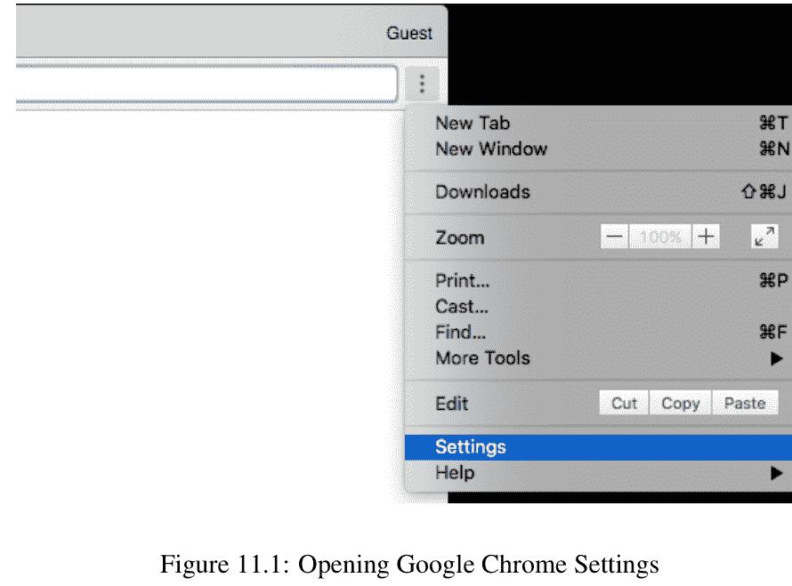

在 Chrome 中你想要做的第一件事是打开设置。这应该在 Chrome 的菜单中，你也应该能在浏览器右上角看到三个点，其中包含设置菜单选项。

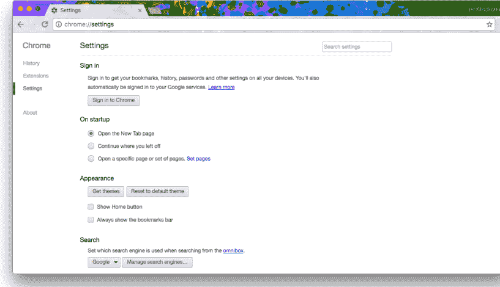

图 11.2: Google Chrome 设置页面

执行此操作将打开一个与图 11.2 类似的页面。进入设置页面后，在右上角的搜索栏中输入 cookie。这应该更新页面，你应该看到两个按钮 - 一个显示“内容设置... (Content settings...)”，另一个显示“清除浏览数据... (Clear browsing data...)”。

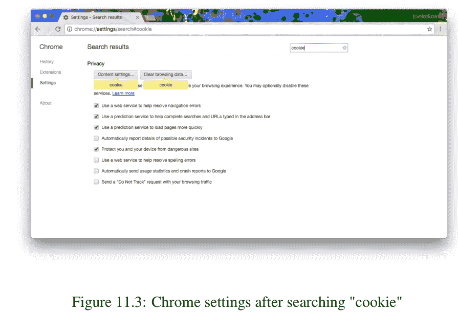

图 11.2: Google Chrome 设置页面

点击“内容设置...”，这将打开一个页面，我们可以在其中探索 Cookie。

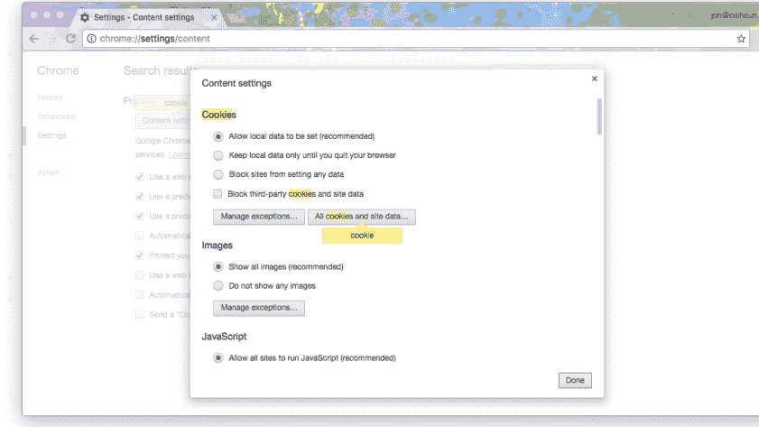

图 11.4: Google Chrome 设置页面

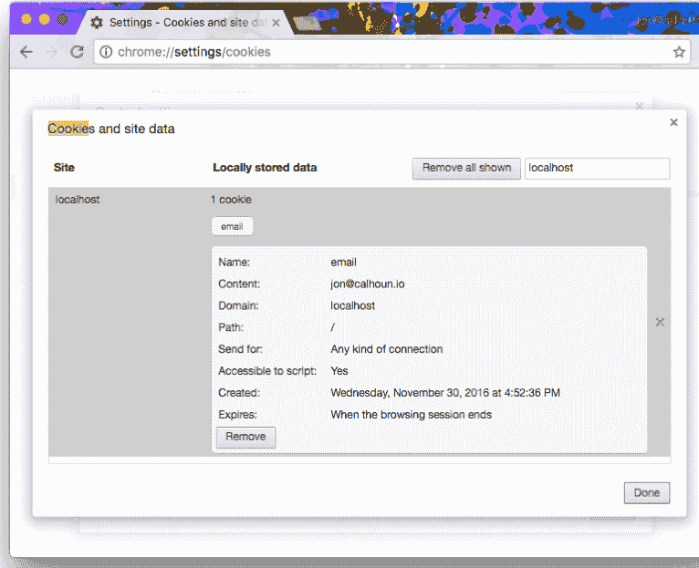

图 11.5: Google Chrome 设置页面

### 11.3.2 使用 Go 代码查看 cookies

读取 Cookie 的另一种方法是调用 `http.Request` 对象上的 `Cookie` 方法。这为我们提供了我们想要的 Cookie 名称。

```go
func (u *Users) CookieTest(w http.ResponseWriter, r *http.Request) {
    cookie, err := r.Cookie("email")
    if err != nil {
        http.Error(w, err.Error(), http.StatusInternalServerError)
        return
    }
    fmt.Fprintf(w, "Email is:%s", cookie.Value)
}
```

如果我们要使用新的处理程序函数，我们需要将其添加到路由器中。打开你的主源文件，并为我们的 Cookie 测试添加一个路由。让我们使用 `/cookietest` 路径并将其限制为 HTTP GET 方法。

```go
atom main.go
```

```go
func main() {
    // ... 我们只添加下面这一行
    r.HandleFunc("/cookietest", usersC.CookieTest).Methods("GET")
    http.ListenAndServe(":3000", r)
}
```

重启你的服务器，如果还没有登录请登录。然后访问 http://localhost:3000/cookietest，你现在应该能看到你的电子邮件地址显示在屏幕上。

Email is: jon@calhoun.io

## 11.4. 防止我们的 Cookie 遭篡改

### 源代码

下面的链接包含了完整的源代码以及本节中修改的所有代码的差异对比（diff）。

已完成 - book.usegolang.com/11.3.2

差异 - book.usegolang.com/11.3.2-diff

## 11.4 防止我们的 Cookie 遭篡改

当我们谈论 Cookie 安全时，对于我们的应用程序，大约有五种主要的攻击向量（attack vectors）是我们需要考虑的。

- 1. Cookie 篡改（Cookie-**tampering**）。
- 2. 数据库泄露允许用户创建伪造 Cookie。
- 3. 跨站脚本 (XSS)。
- 4. 通过数据包嗅探窃取 Cookie。
- 5. 通过物理接触带有 Cookie 的设备窃取 Cookie。

在本节中，我们将讨论这些攻击向量中的第一种——Cookie 篡改，以及我们将用来保护 Cookie 免受篡改的防御策略。

### 11.4.1 对数据进行数字签名

我们之前提到过，但 Cookie 存储在用户的计算机上而不是我们的 Web 服务器上，这有一个有趣的副作用：它们可以被删除。

虽然这本身并不是一个安全问题，但它意味着我们并不拥有 Cookie 的所有权。换句话说，终端用户有权编辑这些 Cookie，而我们无法做任何事情来阻止他们。这就是 Cookie 篡改。

编辑存储在你计算机上的 Cookie 实际上非常简单，有几个 Chrome 扩展可以让你实现这一点。以 Edit-ThisCookie 为例——安装此扩展后，你可以在几秒钟内更新存储在 Cookie 中的电子邮箱地址。

如果你在想“这听起来并不很安全……”，那么你是完全正确的。作为一个一般原则，除非你采取了某些措施让数据变得可信，否则存储在 Cookie 中的所有数据都不应该被认为是安全的。

实现这一点的一种方法是对存储在 Cookie 中的所有数据存储一个数字签名。虽然具体如何操作取决于具体的用例，但核心思想始终是相同的。让我们想象一下，你想在 Cookie 中存储以下数据：

```json
{
  "id": 123,
  "email": "jon@calhoun.io"
}
```

如果我们决定只存储这些内容，终端用户将很容易修改 `id` 或 `email`，并开始以另一个用户的身份访问你的网站。我们目前还没有方法来验证我们最初在 Cookie 中设置的数据。

解决这个问题的方法之一是使用像 HMAC 这样的哈希函数创建一个签名并将其附加到 Cookie 上。这种哈希函数之所以理想的，是因为它同时需要一个密钥（secret key）和要哈希的数据，而且只要其中任何一个发生变化，哈希函数的输出就会发生变化。下面展示了一些示例；你不需要担心编写这些代码，但请观察更改密钥或被哈希的数据将如何改变生成的哈希值。

```text
HMAC("secret-key-1", { "id": 123 }) =
60c0ff9d3f4132cbe7b9dd12ef51837d8e...

HMAC("secret-key-2", { "id": 123 }) =
b91c4b4a50d2c9f92752d93ec4a7bfd6ae...

HMAC("secret-key-1", { "id": 333 }) =
78257ef3e303a4b6943fcc7fed9c01d7f77...
```

这与保护 Cookie 有什么关系？

当我们对数据进行签名时，不仅仅是将数据存储在 Cookie 中，还会存储该数据生成的哈希值。现在，当用户返回我们的网站时，他们不仅会向我们发送包含我们存储的数据 Cookie，还会包含一个包含我们创建的签名的 Cookie。如果我们要验证用户 Cookie 中的数据是否有效，我们只需要重新对用户 Cookie 中的数据生成哈希值，并确保它与我们存储在签名 Cookie 中的哈希值匹配。

通过将密钥保留在我们的服务器上，任何潜在攻击者可能更新我们存储在他们 Cookie 中的数据，但由于他们不知道我们的密钥，他们无法生成新的有效哈希值。当我们的代码尝试使用用户提供的哈希值验证数据时，它将与与提供的哈希值不匹配，我们就会知道有人篡改了 Cookie 数据。

**Box 11.2. JSON Web Tokens**

如果你曾经听说过 JSON Web Tokens（或 JWTs），它们的工作方式与我在这里描述的方法类似。JWT 中的数据对任何人都是可见的，但无法编辑数据，因为并不是所有人都知道用于生成附加令牌签名的密钥。

### 11.4.2 混淆 Cookie 数据

虽然数字签名非常巧妙且有用，但在我们的 Web 应用程序中实际上并不需要它们。我在书中提到它们是因为你将来可能需要它们，而且我希望你了解在 Cookie 中存储数据的安全方法，但在我们正在构建的应用程序中，我们将采取其他措施来保护我们的敏感数据，而我们存储在 Cookie 中的任何其他内容都不敏感到足以至于需要对其进行数字签名。

我们将使用的方法是另一种常用的用于防止 Cookie 篡改的方法；我们将对数据进行混淆（obfuscating），使得攻击者几乎不可能伪造这些数据。

在用户的 Cookie 中存储用户 ID 或电子邮箱地址最大的问题是，很容易推断出如何伪造它。以 ID 为例——如果你的 ID 是 101，那么可以肯定存在从 1 到 100 的 ID，通过将你的 ID 改为这些数字之一，你可以尝试接管他们的账户。几乎每个数据库都会顺序创建 ID，所以你不需要尝试每一个数字来寻找用户的 ID。你只需要尝试数字即可。

*(注：此处由于原文部分存在逻辑重复和错乱，已根据语意进行翻译处理以保持语意通顺)*

## 11.5. 生成记忆令牌 (Tokens)

```go
package rand

import (
    "crypto/rand"
    "encoding/base64"
)
```

Go 中有多个 `rand` 包，所以如果你使用了自动导入功能，请确保你的代码使用的是 `crypto/rand` 包！`math/rand` 包不是生成记忆令牌的安全方式，但 `crypto/rand` 包是，因为它基于加密学强度的伪随机数生成器。这在每个操作系统上的实现方式不同，但文档指出：

在 Linux 上，如果可用，Reader 使用 `getrandom(2)`，否则使用 `/dev/urandom`。在 OpenBSD 上，Reader 使用 `getentropy(2)`。在其他 Unix 类系统上，Reader 从 `/dev/urandom` 读取。在 Windows 系统上，Reader 使用 `CryptGenRandom` API。

不需要切切切含义，但简之，`crypto/rand` 包将帮助我们生成用于身份验证的安全随机值。

⁷https://golang.org/pkg/crypto/rand/
⁸https://golang.org/pkg/crypto/rand/#ReadRandom

### 11.4. 什么是字节 (byte)？

字节是一种存储 8 位比特的数据类型。换句话说，一个字节可以写为一个仅由 0 和 1 组成的 8 位二进制数。学习二进制不在本书的讨论范围内，但重要的是知道，由于这一点，一个字节总共有 256 种可能的值。

虽然我们不能直接用它来创建字符串，但我们所是用随机数据填充字节切片，并使用 `base64` 包将该字节切片编码为字符串，然后使用生成的 base64 编码字符串。

### 11.5. Base64 编码

当我们使用 `crypto/rand` 包生成随机字节切片时，不能保证每个字节都会映射到有效的 UTF-8 字符。当这种情况发生时，你的字符串中会出现看起来像无效的字符，并且可能无法在 Cookie 和某些数据库中正确持久化。

这意味着我们不能简单地将 `Read` 函数生成的随机字节切片转换为字符串。相反，我们需要使用一种编码方案，它可以接收任意二进制数据（如我们的字节切片）并将其编码为字符串。Base 64 是编程中常用的此类编码方案之一。通过 base64 编码，我们可以将二进制数据编码为字符串，并在我们需要的时候将其解码回原始字节切片，尽管在这个特定的用例中，我们没有理由解码数据。

⁹https://golang.org/pkg/encoding/base64/

## 11.5. 生成记忆令牌 (Tokens)

让我们先编写一个辅助函数，它不再要求我们传入一个切片，而是返回一个固定长度的切片，或者在发生错误时返回错误。

```go
// Bytes 将生成 n 个随机字节，或者在
// 错误时返回错误。它使用了
// crypto/rand 包，所以用于记忆令牌
// 等内容是安全的。
func Bytes(n int) ([]byte, error) {
  b := make([]byte, n)
  err := rand.Read(b)
  if err != nil {
    return nil, err
  }
  return b, nil
}
```

我们刚刚写的代码接收一个整数 `n`，首先创建一个长度为 `n` 的字节切片。该长度创建了 `crypto/rand` 包中的 `Read` 函数，检查错误，如果没有错误则返回该字节切片。

接下来，我们需要编写一个使用特定数量字节生成随机字符串的函数。这将利用我们刚刚写的 `Bytes` 函数，因此唯一的新代码将围绕对随机字节切片进行编码并返回结果。

```go
// String 将生成一个长度为 nBytes 的字节切片，
// 然后返回该字节切片的 base64 URL 编码
// 版本的字符串
func String(nBytes int) (string, error) {
  b, err := Bytes(nBytes)
  if err != nil {
    return "", err
  }
  return base64.URLEncoding.EncodeToString(b), nil
}
```

如你所见，我们的代码调用 `Bytes` 函数并捕获结果。如果有错误，它返回空字符串和错误。否则，我们使用 `base64` 包将字节切片编码为字符串并返回结果。

在使用 `base64` 包进行编码时，提供了几个¹⁰变量，提供特定的编码。我们将使用 `URLEncoding` 变量，因为我发现当你不需要特定编码时，这是最安全的选项。

最后，我们将创建一个 `RememberToken` 函数，通过使用固定数量的记忆令牌字节来稍微简化代码。这并不是绝对必要的，但我喜欢这样做，这样开发者就不需要考虑他们的记忆令牌需要多少个字节，并且不会意外使用一个太小的数字。

```go
// 我倾向于将常量放在文件顶部
const RememberTokenBytes = 32
// RememberToken 是一个辅助函数，旨在生成
// 预定字节大小的令牌
func RememberToken() (string, error) {
	return String(RememberTokenBytes)
}
```

注意：将在下一节讨论为什么使用 32 字节。

最后，我们将测试这一切。打开书中早些时候创建的实验性 `main` 包，并更新源代码以测试我们的新包。

```bash
$ atom exp/main.go
```

```go
package main

import (
	"fmt"
	"lenslocked.com/rand"
)
```

¹⁰https://golang.org/pkg/encoding/base64/#pkg-variables

## 11.5. 为什么要使用 32 字节？

```go
func main() {
  token, err := rand.RememberToken()
  if err != nil {
    fmt.Println("Error:", err)
    return
  }
  fmt.Println("Remember Token:", token)
}
```


# 11.5. 为什么要使用 32 字节？

选择记忆令牌的字节数有很多因素，但在我看来，理解这一点简单的方法是看一个简单的游戏作为例子。

想象你和你一个朋友正在玩一个游戏，你在 1 到 10 之间选一个数字，你的朋友尝试猜你选的数字。

假设你是随机选的，如果你的朋友在失败之前有 N 次机会，那么他第一次猜中的概率是 N/10。如果他们猜错了并再次猜测，他们第二次猜中的概率将是 1/9。

更通地说，如果你的朋友在失败之前有 N 次机会，他们猜对的概率是 N/10。所以，如果他们能够猜 10 次，他们就有 100% (10/10) 的概率猜对。如果有 5 次机会，他们就有 50% (5/10) 的概率猜对。

现在想象几个朋友过来了想要加入游戏，所以你决定改变规则。仍然会有一个人在猜，但其他人每个人在 1 到 10 之间选一个尚未被选过的数字，且数字是互不相同的。例如，如果总共有四个人玩，那么就会有一个人在猜，三个人选数字，他们的选择将是 1、3 和 5。

现在你有了 3 个朋友，猜某一个人的数字没有意义了。相反，你决定只要你猜中了任何人的数字就赢了

## 11.6. 哈希处理记住令牌（REMEMBER TOKENS）

正确的数字。

这极大地改变了游戏的概率！

现在，第一次猜中的概率不再是 1/10，而是 3/10。如果你猜了三个不同的数字，猜中某人数字的概率将超过 70%。

猜测记住令牌（remember token）与此游戏类似。当攻击者尝试猜测有效的记住令牌时，如果你只有一个用户，你不需要大量的唯一值就可以增加挑战性；但随着用户数量的增加，他们猜中任何单个用户记住令牌的概率会急剧增加。

糟糕的是，使用计算机生成记住令牌的攻击者速度比人快得多。攻击者可能不是每几秒猜一次，而是每秒钟进行 10,000 次或更多猜测。天哪！

综上所述，我们需要选择一个足够大的记住令牌集合，使得攻击者即使在针对许多用户且每秒猜测数千次的情况下，也无法轻易猜中令牌。32 字节允许我们选择足够的唯一记住令牌，使得这种情况不太发生。

## 11.6 哈希处理记住令牌

虽然我们的记住令牌很难被猜，但我们还有另一个问题要解决。如果我们将记住令牌存储在数据库中，攻击者获取了数据库的访问权限，他们就能手动创建 Cookie 并冒充我们的任何用户。

我们显然不希望这种情况发生，因此，我们不在数据库中存储原始的记住令牌，而是存储每个记住令牌的哈希值，类似于我们处理密码的方式，但我们不会使用 bcrypt，而是将使用另一种名为 HMAC 的哈希函数。

### 框 11.6. 为什么我们不能对记住令牌使用 bcrypt？

在框 10.3 中，我们讨论了 `bcrypt` 如何自动为我们的哈希值添加盐（salt）。这在哈希密码时是非常棒的，因为我们打算先通过电子邮件地址查找用户，然后验证哈希值；但对于记住令牌来说，这产生了一个问题。

当用户通过记住令牌登录时，我们不会通过电子邮件地址查找他们，而是通过他们的记住令牌来查找。这意味着我们需要在执行查询*之前*生成存储在数据库中的哈希值，但除非知道所使用的盐，否则使用 `bcrypt` 是无法行的。

这让我们陷入了“两难困境”（catch-22）¹¹：我们无法在不知道盐的情况下查找用户账户，无法在不先查找用户账户的情况下知道盐。因此，我们将使用 HMAC 哈希算法。

注意：从技术上讲，我们可以通过存储两个 Cookie 来让 `bcrypt` 起作用——一个包含用户的电子邮件或 ID（我们用它查找账户），另一个包含他们的记住令牌。我们不会在课程中这样做，因为我发现这会使未来过渡到“每个用户多个会话”变得困难。

### 11.6.1 如何使用 hash 包

在开始编写自己的代码之前，我们必须首先学习如何使用 Go 语言 `hash` 包提供的 `Hash`¹² 接口。

```go
type Hash interface {
    // Write（通过嵌入的 io.Writer 接口）向运行中的哈希添加
    // 更多数据。它永远不会返回错误。
    io.Writer
    // Sum 将当前哈希追加 b 并返回
    // 结果切片。它不会改变底层的哈希
    // 状态。
    Sum(b []byte) byte
    // Reset 将 Hash 恢复初始状态。
    Reset()
    // Size 返回 Sum 返回的字节数。
    Size() int
    // BlockSize 返回哈希的底层块大小。
    // Write 方法必须能够接受任意数量的
    // 数据，但如果所有写入都是块大小的倍数，
    // 则操作可能会更高效。
    BlockSize() int
}
```

使用此接口有多种方法，但假设我们有一些想要哈希的数据以及 `hash.Hash` 接口的实现，我们将编写类似下面的代码。

```go
var data []byte
var h hash.Hash
h.Reset()
h.Write(data)
hashedData := h.Sum(nil)
```

我们调用 `Reset` 来确保哈希已经清除了之前写入它的任何数据。然后，我们将自己的数据写入哈希函数，以便它知道我们想要哈希的内容，最后我们调用 `Sum` 请求哈希函数为我们计算一个哈希值，并将结果存储在 `hashedData` 中。

现在我们大致知道了如何使用 `hash.Hash` 接口，我们将查看 `crypto/hmac` 包是如何工作的。

### 11.6.2 使用 crypto/hmac 包

我们在 11.4.1 节中讨论过 HMAC，但 HMAC 背后的通用思想是使用秘密密钥对数据进行签名，然后使用哈希函数对签名后的数据进行哈希。通过这样做，除非你同时知道使用的函数和秘密密钥，否则很难确定用什么数据构建了哈希值。

手动执行这些是可能的，但 Go 为我们提供了 `crypto/hmac` 包来让生活更轻松一点。在这个包内部有一个 `New` 函数，它接受两个信息——一个返回 `hash.Hash` 实现的函数和一个秘密密钥。

```go
func New(h func() Hash, key []byte) Hash
```

重要的是，我们需要提供一个返回哈希的函数，而不是哈希本身。查看 `crypto/hmac` 包，我们 `New` 函数是这样工作的：

```go
mac := hmac.New(sha256.New, key)
```

在这行代码中，我们声明要创建一个由 SHA256 支持的 HMAC。

## 11.6. 记住令牌（REMEMBER TOKENS）

### 11.6.3 编写我们的 hash 包

就像之前的示例一样，我们将编写自己的包。因为我们要封装的主要包是 `hash`，且主要目的是哈希字符串，我们将我们的包命名为 `hash`。

我们将首先声明包名并声明导入项。

```go
package hash

import (
    "crypto/hmac"
    "crypto/sha256"
    "encoding/base64"
    "hash"
)
```

我们在之前的章节中提到过大部分包，但没有提到 `base64` 包。当我们哈希数据时得到一个字节切片，我们将¹³https://golang.org/pkg/crypto/sha256 使用 `base64` 包——将这些字节切片编码字符串。

接下来我们要定义自己的 HMAC 类型。我们知道 `crypto/hmac` 包的 `New` 函数返回 `hash.Hash`，因此将其嵌入我们的 HMAC 类型中，然后编写一个接收秘密密钥并构造 HMAC 的函数。

```go
// NewHMAC 创建并返回一个新的 HMAC 对象
func NewHMAC(key string) HMAC {
    h := hmac.New(sha256.New, []byte(key))
    return HMAC{h: h}
}

// HMAC 是 crypto/hmac 包的封装
// 它在我们的代码中使用起来更简单。
type HMAC struct {
    h hash.Hash
}
```

我们需要写的最后一部分是一个函数，它接收输入字符串，对其进行哈希，然后以字符串形式结果。在 11.6.1 节中，我们查看了如何使用 `hash` 包生成哈希，最后我们将使用 `base64` 包对生成的字节切片进行编码并返回。

```go
// Hash 将使用创建 HMAC 对象时提供的秘密密钥
// 对提供的输入字符串进行哈希
func (h HMAC) Hash(input string) string {
    h.h.Reset()
    h.h.Write([]byte(input))
    b := h.h.Sum(nil)
    return base64.URLEncoding.EncodeToString(b)
}
```

## 11.6. 哈希化记忆令牌

框 11.7. Base64 编码不等同于哈希。

使用 Base64 编码方案似乎与哈希相似，但它们并不是的。当你使用 Base64 编码内容时，任何拥有 Base64 解码器的人都可以通过简单对数据运行解码器来确定你的原始数据。

你可以亲自尝试一下。访问 https://www.base64decode.org/ 并尝试解码数据 `R28gUm9ja3Mn`。解码后，你应该得到 `Go Rocks!`。这是因为 Base64 只是将数据转换为另一种表示形式再转换回来——它并没有实际上对数据进行哈希或加密。

最后，让我们测试一下我们的包。打开你的实验性 `main.go` 文件。

```bash
$ atom exp/main.go
```

将你的源文件内容替换为以下代码。

```go
package main

import (
    "fmt"
    "lenslocked.com/hash"
)

func main() {
    hmac := hash.NewHMAC("my-secret-key")
    // 这应该打印出：
    // 4waUFC1lcnuuxoM2UoJfpGZGL1asj35y7teuweSFgPY=
    fmt.Println(hash.Hash("this is my string to hash"))
}
```

运行它并验证输出是否与下文匹配。如果你更改了密钥，输出将会改变，但只要你保持相同的密钥，输出就应该是相同的。

```bash
$ go run exp/main.go
```

```
4waUC1cnuxomoM2UoJfpGGLPlasj35y?teweSFgPy=
```

### 源代码

下面的链接包含了完整的源代码以及本节中所有修改代码的差异（diff）。

完成 - book.usegolang.com/11.6.3

差异 - book.usegolang.com/11.6.3-diff

## 11.7 在用户服务中哈希化记忆令牌

我们在应用程序中已经拥有了生成和哈希记忆令牌（remember tokens）的工具。完成身份验证系统的下一步是更新我们的用户服务，在更新和创建用户时利用这些组件，然后暴露一个允许我们通过记忆令牌查找用户的函数。

本节分为几个较小的子节，然后我们将在最后一节中使用我们的实验性 `main.go` 源文件测试所有的更改。

## 11.7. 在用户服务中哈希化记忆令牌

### 11.7.1 为我们的 User 类型添加记忆令牌字段

我们需要完成的第一件事是更新用户模型。这与我们更新密码字段的方式非常相似——我们需要一个字段来存储原始记忆令牌，另一个字段来存储哈希后的值。就像处理密码字段一样，我们也希望确保原始记忆令牌永远不会持久化到数据库中，但我们希望持久化哈希后的令牌。

首先，我们需要打开用户的源文件。

```bash
$ atom models/users.go
```

接下来，我们需要为我们的 `User` 类型添加这些字段。

```go
type User struct {
    gorm.Model
    Name         string
    Email        string `gorm:"not null;unique_index"`
    Password     string `gorm:"-"`
    PasswordHash string `gorm:"not null"`
    Remember     string `gorm:"-"`
    RememberHash string `gorm:"not null;unique_index"`
}
```

与我们设置密码字段的唯一不同在于，我们要为 `RememberHash` 字段添加一个唯一索引。这样做是为了我们可以通过记忆令牌快速查找用户，同时也确保两个用户不会意外被赋予相同的记忆令牌。

### 源代码

下面的链接包含了完整的源代码以及本节中所有修改代码的差异（diff）。

完成 - book.usegolang.com/11.7.1

差异 - book.usegolang.com/11.7.1-diff

### 11.7.2 在创建用户时设置记忆令牌

现在 `RememberHash` 字段对于每个用户都是必需的，我们需要更新代码在创建用户时设置记忆令牌。如果没有这样做，我们就无法在不手动设置记忆哈希的情况下创建用户，这种体验非常糟糕。

我们将更新用户服务，在每次创建用户时自动设置记忆令牌，稍后我们将更新代码，如果设置了记忆令牌则对其进行哈希并存储用户的 `RememberHash` 字段中，这样在不知道哈希具体细节的情况下就可以轻松地更新该字段。

再次，我们将在用户模型源文件中进行工作。

```bash
$ atom models/users.go
```

我们首先需要添加的是之前之前创建的 `rand` 包的导入。

```go
import (
  "errors"
  // 这是唯一新增的导入
  "lenslocked.com/rand"
  "github.com/jinzhu/gorm"
  "github.com/jinzhu/gorm/dialects/postgres"
  "golang.org/x/crypto/bcrypt"
)
```

## 11.7. 在用户服务中哈希化记忆令牌

之后，我们需要找到 `Create` 方法并添加一段检查令牌是否为空的代码片段，我们需要这样做。

```go
func (us *UserService) Create(user *User) error {
    if user.Remember == "" {
        token, err := rand.Token()
        if err != nil {
            return err
        }
        user.Remember = token
    }
    user.RememberHash = us.hmac.Hash(user.Remember)
    return us.db.Create(user).Error
}
```

### 源代码

下面的链接包含了完整的源代码以及本节中所有修改代码的差异（diff）。

完成 - book.usegolang.com/11.7.2

差异 - book.usegolang.com/11.7.2-diff

### 11.7.3 为 UserService 添加 HMAC 字段

我们仍然在用户模型中工作，请导航到该源文件。为了访问我们创建的 HMAC 类型，我们需要导入它。

```go
type UserService struct {
    db   *gorm.DB
    hmac hash.HMAC
}
```

`hmac` 字段在设置后将非常有用，我们的下一步是更新 `NewUserService` 函数来为我们处理这种情况。为了实现这一点，我们需要添加另一个包级常量，我们会在将在代码发布到生产环境之前修复它。现在你需要意识到，对于真实的密钥来说，这不是良好的做法，因为如果你的代码仓库泄露，可能会导致安全问题。

```go
// 我倾向于将常量放在源文件的顶部
const hmacSecretKey = "secret-hmac-key"

func NewUserService(connectionInfo string) (*UserService, error) {
    db, err := gorm.Open("postgres", connectionInfo)
    if err != nil {
        return nil, err
    }
    db.LogMode(true)
    hmac := hash.NewHMAC(hmacSecretKey)
    return &UserService{
        db:   db,
        hmac: hmac,
    }, nil
}
```

在此代码中，我们通过使用我们的密钥调用 `NewHMAC` 创建了一个 HMAC 对象，并将该对象赋值给正在创建的 `UserService` 的 `hmac` 字段。

现在，我们就有了哈希记忆令牌的方法。

已完成 - book.usegolang.com/11.7.3

更改 - book.usegolang.com/11.7.3-diff

# 11.7.4 在创建和更新时对 remember token 进行哈希

所有部分都就绪后，我们现在可以更新 `UserService` `Create` 和 `Update` 方法，如果存在 remember token 则对其进行哈希处理。

我们将再次在 users 模型的源文件中工作。

```
$ atom models/users.go
```

我们将从 `Create` 方法开始——找到我们之前写的这段注释：

```
// TODO: Hash the token and set it on user.RememberHash
```

将该注释替换为下行代码。

```
user.RememberHash = us.hmac.Hash(user.Remember)
```


接下来是 `Update` 方法。如果 `remember token` 没有更新，我们就不希望更新 `remember hash`，因此在这种情况下我们需要一个 `if` 语句。我们在 `Create` 方法中不需要这个，因为在创建用户时，我们总是创建一个新的 `remember token`。

```go
func (us *UserService) Update(user *User) error {
	if user.Remember != "" {
		user.RememberHash = us.hmac.Hash(user.Remember)
	}
	return us.db.Save(user).Error
}
```

# 11.7. 在 USER SERVICE 中哈希 REM TOKENS

完成最后一次代码更改后，我们准备好开始持久化 `remember tokens` 了，但在使用它们之前，我们需要编写一个函数，允许我们根据 `remember token` 查找用户。

### 源代码

下面的链接包含了完整的源代码以及本节中所有更改代码的差异。

已完成 - `book.usegolang.com/11.7.4`

更改 - `book.usegolang.com/11.7.4-diff`

# 11.7.5 通过 remember token 获取用户

我们仍然在 `users` 模型中工作，所以请确保你已经打开了它。

```
$ atom models/users.go
```

我们将编写的下一段代码是 `UserService` 的一个新方法，它允许我们传入原始的 `remember token`，然后返回带有 `remember token` 的用户或错误。为了使此能够工作，我们的方法首先需要对原始 `remember token` 进行哈希处理，以便与我们在数据库中存储的内容匹配，然后查询数据库中具有 `remember token hash` 的用户。

我们已经看到过如何实现这些每一个单独的部分，所以剩下的工作就是将它们整合在一起。

```go
// ByRemember 根据给定的 remember token 查找用户
// 并返回该用户。此方法将为我们处理 token 的哈希。
```

```go
// Errors 与 ByEmail 相同。
func (us *UserService) ByRemember(token string) (*User, error) {
    var user User
    rememberHash := us.hmac.Hash(token)
    err := us.db.Where("remember_hash = ?", rememberHash).First(&user).Error
    if err != nil {
        return nil, err
    }
    return &user, nil
}
```

注意：我们在 `Where()` 方法中使用 `remember_hash` 看起来有点奇怪，`GORM` 在创建数据库表时使用 `snake case`（蛇形命名法），这确实是正确的用法。我们返回与 `ByEmail` 相同的错误，这使得 `ByRemember` 方法在未找到记录时能够轻松地返回 `ErrNotFound`。

# 11.7.6 重置我们的数据库并测试

最后一块拼图是测试。这不是传统的测试文件，但我们至少需要验证我们的代码按预期工作。

在此期间，我们还将使用 `DestructiveReset` 方法重置数据库，因为任何现有用户将没有有效的 `RememberHash` 字段，而我们还没有为此创建迁移。重置数据库并从头开始更简单。

注意：如果你忘记这样做，你可能会在日志中看到以下消息：
`pq: column "remember_hash" contains null values`

# 11.7.7 在 USER SERVICE 中哈希 REM TOKENS

与我们的数据库交互需要我们从主源文件复制一些代码到实验性文件中。具体来说，我们需要用于连接数据库的常量 `set`。我们将重构数据库连接字符串，设置一个 `user service` 实例，然后与其交互。

鉴于这些都是我们见过的或刚刚写的代码，我将先展示源代码，然后演示它。

打开你的实验性代码。

```
$ atom exp/main.go
```

然后将其内容替换为以下源码，注意你可能需要根据你的特定设置更新常量。

```go
package main
import (
	"fmt"
	"lenslocked.com/models"
)
const (
	host = "localhost"
	port = 5432
	user = "jon"
	password = "your-password"
	dbname = "lenslocked_dev"
)
func main() {
	psqlInfo := fmt.Sprintf("host=%s port=%d user=%s password=%s dbname=%s sslmode=disable",
		host, port, user, password, dbname)
	us, err := models.NewUserService(psqlInfo)
	if err != nil {
		panic(err)
	}
	defer us.Close()
	us.DestructiveReset()
	user := models.User{
		Name:     "Michael Scott",
		Email:    "michael@undflin.com",
		Password: "bestboss",
	}
	err = us.Create(&user)
	if err != nil {
		panic(err)
	}
	// 验证用户是否有 RememberHash
	fmt.Printf("%v\n", user)
	if user.Remember == "" {
		panic("Invalid remember token")
	}
	// 现在验证我们可以通过该 remember token 查找用户
	user2, err := us.ByRemember(user.Remember)
	if err != nil {
		panic(err)
	}
	fmt.Printf("%v\n", user2)
}
```

在这段代码中：

1. 重置我们的 `users` 表
2. 创建新用户并允许我们的 `user service` 设置 `remember token`
3. 验证 `remember token` 已设置，否则 `panic`
4. 通过 `remember token` 搜索用户，以验证 `ByRemember` 方法有效且我们的 `remember token` 已正确持久化

你可以通过运行以下命令来自己测试：

```
$ go run exp/main.go
```

### 源代码

下面的链接包含了完整的源代码以及本节所有更改代码的差异。

- 已完成 - `book.usegolang.com/11.7.6`
- 更改 - `book.usegolang.com/11.7.6-diff`

# 11.8 记住用户

在本节中，我们将如何使用 `cookie` 在请求之间记住用户是谁，以及如何使用这些信息在用户未登录时限制其访问页面。

我们将从编写一个允许我们“登录”用户的方法开始。换句话说，如果原始 `token` 不可用，它将生成一个新的 `remember token`，使用 `remember token` 更新用户账户，最后将 `remember token` 存储在 `cookie` 中，以便我们在后续请求中知道该用户。我们将在创建新账户或登录时调用此方法。

之后，我们将修改 `cookie` 测试函数，使其查找此 `cookie`，如果用户未登录则将其重定向到登录页面，否则将打印用户的账户信息以证明我们现在可以访问该用户。

# 11.8.1 在 cookie 中存储 remember tokens

`signIn` 方法将是 `users controller` 的一部分，因为我们在用户登录和创建账户时会使用它。

```
$ atom controllers/users.go
```

我们的 `signIn` 方法需要提供两个参数：当前的 `NextResponse`，以及我们想要登录的用户。我们需要用户来更新他们的 `remember token`，我们需要 `response writer` 来设置用户的 `cookie`。

```go
// signIn 用于通过 cookie 登录给定的用户
func (u *Users) signIn(w http.ResponseWriter, user *models.User) error {
  // TODO: Implement this
}
```

虽然不太可能，但在尝试用新的 `remember token` 更新用户时可能会遇到错误，因此当错误发生时我们需要返回这些错误，这就是返回 `error` 类型的原因。

我们的实现将从检查是否设置了原始 `remember token` 开始。如果没有设置，我们没有办法反转哈希值，因此我们将生成一个新的 `remember token`。否则，我们将使用已经为用户设置的 `remember token`。

当我们生成 `remember token` 时，我们还想使用 `user service` 更新用户，因此我们还将调用 `Update` 方法并返回任何存在的错误。

## 11.8. 记住用户

```go
return err
}
user.Remember = token
err = u.us.Update(user)
if err != nil {
    return err
}
```

退出此 `if` 语句后，我们知道 `user` 变量的 `Remember` 字段中应该有一个非空字符串值。如果它为空字符串，我们在语句内部的代码将生成一个新的记住记忆令牌（`remember token`），否则我们知道它已经设置了。

我们将使用记住记忆令牌创建一个 `cookie`，并使用 `http` 包通过传递到我们 `signIn` 方法的响应（`response`）来设置它。最后，如果我们执行到了这一步，说明没有任何错误，我们将返回 `nil`。

```go
cookie := http.Cookie{
Name: "remember_token",
Value: user.Remember,
}
http.SetCookie(w, &cookie)
return nil
```

将所有内容整合在一起，我们得到了列表 11 所示的方法。

```
Listing 11.2: 完整的 signIn 方法
// signIn 用于通过 cookie 登录指定的用户
func (u *Users) signIn(w http.ResponseWriter,
user *models.User) error {
if user.Remember == "" {
    token, err := rand.RememberToken()
    if err != nil {
        return err
    }
    user.Remember = token
    err = u.us.Update(user)
}
if err != nil {
    return err
}
cookie := http.Cookie{
    Name: "remember_token",
    Value: user.Remember,
}
http.SetCookie(w, &cookie)
return nil
}
}
```

下一步是更新 `login` 和 `signup` 方法，以便在用户成功创建账户或登录后调用此方法。我们还将把用户重定向到 `cookie` 测试页面，这样我们就可以验证 `cookie` 是否已正确设置，而无需手动输入 URL。

更新 `Create` 方法比较简单，我们只需要添加一些新代码并删除方法末尾的 `fmt.Fprintln`。

```go
func (u *Users) Create(w http.ResponseWriter, r *http.Request) {
    // ... 这部分代码保持不变
    // 删除此行：
    // fmt.Fprintln(w, "User is", user)
    // 在 Create 方法末尾添加以下代码
    err := u.SignIn(w, &cookie)
    if err != nil {
        // 临时返回错误消息以供调试
        http.Error(w, err.Error(), http.StatusInternalServerError)
        return
    }
    // 重定向到 cookie 测试页面以测试 cookie
    http.Redirect(w, r, "/cookietest", http.StatusFound)
}
```

在 `Login` 方法中，我们需要删除任何用于创建 `cookie` 的代码以及方法末尾的打印语句。我们不再需要手动创建 `cookie` 了，因为它已经由 `signIn` 方法处理了。

## 11.8. 记住用户

```go
func (u *Users) Login(w http.ResponseWriter, r *http.Request) {
  // ... 大部分代码保持不变
  // 删除这段代码
  // cookie := http.Cookie{
    // Name: "email",
    // Value: user.Email,
  // }
  // http.SetCookie(w, &cookie)
  // fmt.Println(w, user)
  // 在方法末尾添加这段代码
  err := u.SignIn(w, user)
  if err != nil {
    http.Error(w, err.Error(), http.StatusInternalServerError)
    return
  }
  http.Redirect(w, r, "/cookietest", http.StatusFound)
}
```

最后，重启你的服务器并尝试创建一个新账户并登录。此时，我们只想验证没有任何错误，因为在更新 `cookie` 测试之前，我们无法正确测试我们的记住记忆令牌 `cookie`。

注意：`cookie` 测试方法目前读取的是旧的 `cookie`，所以如果你奇怪为什么它与你创建或登录的任何新账户账户都不匹配，这可能就是原因。我们将在下一节中修复这个问题。

### 源代码

下面的链接包含了完整的源代码以及本节所有更改代码的差异（`diff`）。

已完成 - `book.usegolang.com/11.8.1`

变更 - `book.usegolang.com/11.8.1-diff`

## 11.8.2 限制页面访问

接下来，我们需要编写一些代码来限制用户尝试访问页面时的权限。长远来看，我们希望在发生这种情况时将他们重定向到登录页面，但目前我们将通过显示错误消息来这样做，以便验证我们的代码是否按预期工作。

幸运的是，我们的 `cookie` 测试已经包含了实现此操作所需的大半部分代码。在 `CookieTest` 方法中，我们已经处理了读取 `cookie` 和检查错误，因此我们想要做的第一件事是更新这些代码以读取我们创建的新记住记忆令牌。

打开用户控制器并跳转到 `CookieTest` 方法。

```bash
$ atom controllers/users.go
```

更新 `CookieTest` 方法以读取 `"cookie_test"` `cookie` 而不是 `"email"` `cookie`。

```go
func (u *Users) CookieTest(w http.ResponseWriter, r *http.Request) {
	cookie, err := r.Cookie("remember_token")
	if err != nil {
		http.Error(w, err.Error(), http.StatusInternalServerError)
		return
	}
}
```

接下来，我们将使用此 `cookie` 的值在数据库中搜索用户。为了做到，我们将使用用户控制器中的 `us` 字段，它是一个 `User` 实例。我们将使用在本章之前编写的用户服务中的 `ByRemember` 方法。

在获取 `cookie` 并检查错误后添加这段代码。简而言之，将其添加到我们刚刚写的代码下方。

## 11.8. 记住用户

```go
user, err := u.us.ByRemember(cookie.Value)
if err != nil {
    http.Error(w, err.Error(), http.StatusInternalServerError)
    return
}
fmt.Println(n, user)
```

如果 `ByRemember` 方法出现错误，我们将我们从数据库获取了用户，以确保它们是正确的。

如果发生错误，我们将输出错误消息。在生产环境中，这种信息可能包含敏感信息。理想情况下，我们应该将他们重定向到登录页面。

重启服务器并尝试创建账户并登录，以验证是否设置了 `cookie`。

```bash
go run main.go
```


如果你想在没有设置 cookie 的情况下验证它是否工作，我们可以在无痕窗口中进行 cookie 测试。

### 源代码

下面的链接包含了完整的源代码以及本节所有更改代码的差异。

已完成 - `book.usegolang.com/11.8.2`

变更 - `book.usegolang.com/11.8.2-diff`

## 11.9 防止 cookie 受到 XSS 攻击

XSS 代表跨站脚本 [xss]，它是一种攻击类型，恶意第三方试图向 Web 应用程序注入 JavaScript 代码并像网站提供的那样运行。

例如，我可能会将用户名设置为：

```html
<script>alert("hi!");</script>
```

虽然这种用户名并不理想，但如果网站没有正确渲染，浏览器可能会解析为 HTML 并导致运行。

在这种情况下，我的用户名可能是：

```html
<script>
// 发送网络请求以让我访问所有
</script>
```

现在当你访问我的个人资料时，代码将执行并获得你所有的资源。这些可能是私人文档、私人代码或其他。重点是攻击者能够代表你发送网络请求。

### 11.9. 防止 cookie 受到 XSS 攻击

我们正在使用 `html/template` 包来缓解这个问题，因此这不太可能在我们身上发生，但始终尽可能安全。如果你不计划使用 JS 框架，或者你不打算使用 JavaScript 发网络请求，那么你真的不需要脚本访问你的 cookie，特别是身份验证 cookie。

#### 仅在需要时放宽安全性

虽然你可能为了以后决定使用 JavaScript 框架而跳过这一步，但我敦促你不要。

通常情况下，从谨慎角度考虑会更好，在绝对必要移除限制之前对 cookie 等内容尽可能多的限制。互联网上有无数例子，网站并不是因为单个漏洞而被黑客攻击，而是因为星象汇合，三个或四个单独看不足道的问题共同发生，导致了攻击者的完美风暴。

我们的应用程序不需要脚本访问 cookie，我们将限制 cookie 仅供由浏览器发起的请求，我们可以做到！如果以后发生变化，更新非常容易，你只需要更新几行代码。

我们将在用户控制器的 `signIn` 方法中进行更改，所以让我们开始打开源文件。

```bash
$ atom controllers/users.go
```

找到我们在 `signIn` 方法中构建的 cookie，并更新以包含 `HttpOnly` 字段的值为 `true`。

```go
cookie := http.Cookie{
  Name: "remember_token",
  Value: user.Remember,
  HttpOnly: true,
}
```

这会告诉我们的 cookie 无法被脚本访问。如果你像我们之前那样在 Google Chrome 中查看 cookie，你会在 cookie 中看到类似这样的内容：

Accessible to script: No (HttpOnly)

这意味着该 cookie 无法被浏览器中运行的脚本访问。

### 源代码

下面的链接包含了完整的源代码以及本节中所有更改代码的差异（diff）。

- 已完成版 - `book.usegolang.com/11.9`
- 更改 - `book.usegolang.com/11.9-diff`

# 11.10 防止我们的 cookie 不被窃取

我们将讨论的下一种攻击向量是 cookie 窃取。窃取 cookie 有两种可能的方法，我们将简要讨论这两种。

窃取 cookie 的第一方法是通过包嗅探（packet sniffing），这发生在某人成功拦截了你的网络请求，并在将其转发到目标位置之前从中窃取数据时。这种方法非常棘手，因为如果他们转发了你的请求并且你继续如预期收到响应，你可能甚至不会意识到有人偷取了你的数据。

第二种是通过物理访问进行的窃取，顾名其义。它发生在某人拥有你的计算机、笔记本电脑或其他硬件的物理访问权限，并从中窃取 cookie。

针对第一种窃取的唯一真正解决方案是让包嗅探对攻击者来说变得不可行，这意味着确保你的应用程序通过 SSL/TLS 提供服务。这就是为什么现在人们都在推崇在网站上始终使用 https 的原因——这相对容易实现，可以让你的网站运行更快，并有助于防止难以检测的攻击。

如果人们在访问你的网站时，URL 栏中没有 https（这个 s 是关键所在），那么你无法免受这种攻击的侵害。我们将在稍后讨论将应用程序部署到生产环境时介绍如何做到这一点，但如果你考虑使用书中讨论之外的替代部署方法，请记住这一点，因为你将希望确保你的网站是安全的。

框图 11.9。Cookie 窃取示例

虽然通过包嗅探窃取 cookie 看起来不是一个严重的问题，但一位名为 Eric Butler 的开发者在发布一个名为 Firesheet 的 Firefox 扩展时，对这个问题提供了深刻的见解，该扩展展示了这种攻击是多么容易实施。

安装该扩展后，任何人只需要连接到一个繁忙的 Wi-Fi 网络。如果该网络上的任何其他人访问了 Firesheet 识别的网站，且是通过不安全的连接访问的，Firesheet 就会在左侧显示用户名和他们连接的服务。之后，攻击者想要以该用户的身份登录，只需双击该用户即可，Firesheet 就会立即以该用户的身份登录。

最后，我们面临的是物理窃取，这是我们从这一端真的无法防止的。如果某人成功访问了某人的物理硬件，这几乎是不可能检测到的，但我们可以做的是让用户能够轻松失效所有现有的会话。幸运的是，我们的应用程序通过在用户登录时更改 `RememberToken` 时间已经实现了这一点。用户只需用新设备登录，那些 cookie 就会失效。

注意：这种方法有替代方案，它们同样安全，但大多数方案都涉及使用会话过期，并且稍微复杂一些。

# 11.11 防止 CSRF 攻击

CSRF 攻击是一种潜在的攻击，当网站创建一个向另一个网站提交虚假数据的表单时就会发生。例如，一个恶性网站可能有一个表单，向你的银行网站提交虚假的转账请求。

这种方法之所以有效，是因为从服务器的角度来看，看起来是你自己发起了网络请求，因为你点击了按钮并提交了表单。

为了防止这种情况，我们最终将实现一种称为 CSRF token 的机制，但这将在书的后后部分，当我们为生产环境准备应用程序时才会发生。我现在告诉你它，是为了让你理解为什么在之后你不应该部署你的应用程序。

# 11.12 练习

到此时，你的大部分验证系统应该已经就绪，现在是时候回顾几个练习来测试你对这些材料的理解了。

## 11.12.1 练习1 - 重定向实验

在我们的 cookie 测试中，当用户未登录时我们会显示一个错误。尝试更新它或另一个处理函数，在这种情况发生时将用户重定向到登录页面，就像我们在应用程序的最终版本中所做的那样。

## 11.12.2 练习2 - 创建不同数据的 cookie

Cookie 可以用于存储各种数据，只要这些不是敏感数据。例如，如果你需要将用户重定向到登录页面，你可以存储他们来源的页面，并在他们登录后将他们送回该页面。尝试创建几个不同的 cookie 并验证它们是否被正确设置。

## 11.12.3 练习3 - [困难] hash 包实验

我们稍微用过了一次标准库中的 `hash` 包，但我们没有深入探索它。尝试实验标准库中 `hash` 包的不同部分，以更好地了解那里提供了哪些功能。

# 第 12 章

# 数据的归一化与验证

在本章中，我们的主要重点将是数据的验证和归一化。在此过程中，我们还会稍微清理一下代码并设计出一个良好的代码结构，但这些都是为了改进我们的验证代码。

在我们真正开始编写任何代码之前，我们需要先讨论什么是验证和归一化，所以我们从这里开始。

### 什么是验证和归一化？

验证对不同的人可能有不同的含义，但在 Web 开发语境下，它最通常指的是验证数据是否处于接受状态。例如，我们可能想要验证电子邮件地址是否有效，或者它是否未被另一个用户占用。或者，我们可能想要验证每个用户都有一个至少八个字符的密码。

同样，归一化（normalization）是一个根据上下文可能具有不同含义的术语；当我们讨论数据归一化时，我们是在说确保我们的数据处于我们预期的格式，如果不是，则尝试将其转换为该格式。例如，我们可能会在将电话号码持久化到数据库之前验证它是否符合我们预期的格式，或者我们可能会将所有电子邮件地址转换为全小写形式。

使用验证的原因比归一化的原因要明显得多。我们显然需要验证数据是有效的，但我们为什么要关心电话号码的格式呢？这真的重要吗？

想象我们正在数据库中存储每个用户的电话号码。如果我们不对数据进行归一化，我们最终可能会得到一个类似下面的的数据表。

| user_id | phone_number |
|---|---|
| 1 | (123) 456-7890 |
| 2 | 123-456-8989 |
| 3 | 12345699999 |

现在想象我们想要通过电话号码搜索用户。也许我们需要一个支持电话，并知道哪个账户与该电话号码相关。当我们进行搜索时遇到了一个问题——当所有电话号码都以不同的格式存储时，我们该如何搜索电话号码？尽管数据库中存在“1234567890”这个电话号码，但以该格式搜索将不会返回任何结果，因为它的格式不同。

如果我们对数据进行归一化，我们就可以编写代码接收任何格式并修剪掉数字以外的所有内容。这会让我们的数据库变得更容易搜索。

| user_id | phone_number |
|---|---|
| 1 | 1234567890 |
| 2 | 1234568989 |
| 3 | 12345699999 |

它还让其他功能（如格式化器）编写起来更容易，因为它们可以始终假设数据是一致的。将“1234567890”转换为“(123) 456-7890”相对容易做到，但如果我们必须处理许多不同的格式并将其转换为这种格式，将会变得困难得多。

注意：当我们谈论归一化时，指不是你在学习 SQL 时可能会听到的归一化。那种形式的归一化围绕避免数据库中重复/不同步的数据。我们不会涵盖那个。

虽然验证和归一化并不相同，但两者紧密相连。首先，很难将它们完全分离。每当我们想要验证电子邮件地址未被占用时，我们都需要先对其进行归一化，然后搜索数据库中具有该电子邮件的用户。如果我们不先归一化，我们可能会尝试创建两个相同电子邮件地址的用户。在这种情况下我们先进行归一化，然后进行验证，但在某些情况下我们必须先验证数据，再归一化。这种情况的一个例子是验证密码是否有最小长度；一旦密码被哈希（归一化），我们就无法知道原始密码有多长，所以我们需要先验证它，再进行归一化。

这往往倾向于产生一种常见的模式，即我们不是执行一个然后另一个，而是创建一个类似“三明治”的结构：

- 1. 部分归一化
- 2. 所有验证
- 3. 剩余的归一化

由于两者之间的紧密依赖，我们将把所有这些代码保持在我们的应用程序中。

## 12.1 职责分离

在此时，我们的 `models` 包还没有任何真正的隔离。也就是说，我们的 `UserService` 类型包含了几乎所有与用户交互相关的代码，无论这些代码具体是做什么。

我们在 `UserService` 中编写了一些处理与 DB GORM 数据库读写操作的代码。我们还有了一些代码用于基础验证，例如在删除用户时验证 ID 是否不为 0。在将用户密码存储到数据库之前对其进行哈希处理时，我们甚至进行了一些归一化操作。

从短期来看，这是一个很好的方法，因为我们要做的内容不多。我们的 `UserService` 相对较小，因此将其拆分得太多并意义不大，但随着我们开始添加更多验证并扩展应用程序，我们会发现情况不再如此。相反，我们将对代码分离，以便我们一次专注于一个较小的部分，并编写更不容易出错的代码。

当我们开始将代码拆分为“层”时，每一层都将有自己的一套隔离的职责。这并不是一个全新的概念，事实上，我们已经通过 MVC 在应用程序中实践此了。模型（Models）、视图（Views）和控制器（Controllers）各承担不同的职责，通过分离这些代码，我们在进行更改时就不需要将整个应用程序都留在脑子里，只需要考虑我们正在编辑的部分即可。

我们将使用相同的思想，只不过这次我们的层都位于同一个包中——`models` 包。我们将创建不同的结构体类型，每种类型都有其特定的职责，例如与数据库交互或验证数据。

注意：虽然这不是唯一的设计选择，但我发现它最适合当前的情况，这也是为什么我们在本课程中使用它的原因。

### 12.1.1 重新思考 models 包

在我们当前的代码中，`models` 包导出了两个主要类型。

```go
type User struct { ... }
type UserService struct { ... }
```

第一个类型 `User` 用于表示我们存储在数据库中的数据。它没有附加任何方法，而是被传递给其他函数和方法。

第二个类型 `UserService` 为我们提供了创建、更新以及通过其他方式与用户交互的方法。简而言之，它定义了对用户执行的所有操作。当有人开始使用我们的 `models` 包时，他们可能想从那里开始，以发现他们可以使用哪些操作。

## 第 12 章 数据的归一化与验证

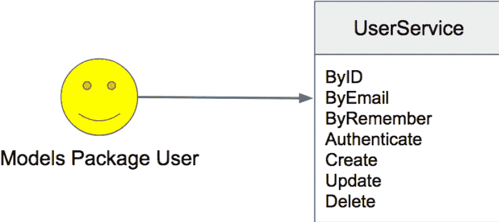

图 12.1：我们当前的 models 包设计

在我们当前的设计中，`UserService` 是一个结构体类型，并且实现了它暴露的每一个方法。这意味着，这些工作没有推迟给所谓的数据库层或验证层。我们的 `UserService` 处理了所有这些工作。

正如我们之前提到的，我们将开始将其拆分为许多层。通过这种方式，我们的用户服务将不再负责执行所有这些工作，而是将大部分工作推迟给其他层。例如，如果我们引入一个 `UserReadWriter` 层，我们可能会得到像图 12.2 所示的设计。

## 12.1 职责分离

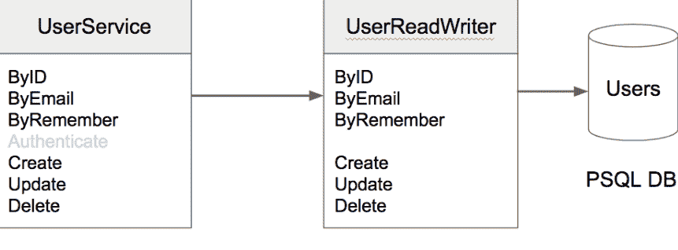

图 12.2：潜在的 models 包设计

在 във设计中，`UserService` 仍然是对用户执行的所有可能操作的集合，任何 `models` 包的用户仍然直接与 `UserService` 交互，但该 `UserService` 并不独立实现所有这些代码。当用户调用像 `ByID` 方法的方法时，我们的 `UserService` 可能会将该调用传递给负责与数据库交互的 `UserReadWriter` 层。其他方法（如 `Authenticate`）可能由 `UserService` 或完全不同的类型实现。

代码在何实现对我们的最终用户并不重要。重要的是我们为用户提供了一个单一、易用的 `UserService`，定义了他们可以执行的所有用户相关操作。

拆分这段代码的主要原因是为了让我们更容易管理代码。我们不再需要庞大的 `UserService`，而是能够将代码拆分为更易于思考和测试的小部分。

这种方法的其他优势是，我们可以更改实现细节（可能添加新的层、验证或缓存），而任何使用我们 `UserService` 的代码都可以继续工作，因为我们没有更改 `UserService` 本。

## 第 12 章 数据的归一化与验证

我们将使用的设计与图 12.2 有些不同；我们将代码拆分为层：

- 1. 数据库层。负责读写数据。
- 2. 验证层。负责验证数据。
- 3. 最顶层。负责暴露通用功能。

当我们调用像 `ByID` 的方法时，该方法可能会遍历所有这些层，但这些层中的每一层并不执行实际操作。例如，`UserService` 并没有修改数据或执行任何实际工作。它只是将数据传递给验证层，验证层随后验证数据并调用数据库层。

这种变化初看可能微不足道，但它对你的开发可能会产生巨大影响。例如，现在我们编写数据库层时，可以始终假设我们拥有的数据是 100% 有效的；如果无效，验证层早已经拒绝它了。

## 12.1 职责分离

```go
// 如果 ID 有效，将其传递给 userGorm
return uv.userGorm.ByID(id)

type userGorm struct {
	db gorm.DB
}

func (ug *userGorm) ByID(id uint) (*User, error) {
	// 我们不需要验证数据，因为它已经通过了验证
	var user User
	err := ug.db.Where("id = ?", id).First(&user).Error
	if err != nil {
		return nil, err
	}
	return &user, nil
}
```


注意：此代码仅用于说明目的，你不需要将其添加到你的应用程序中。

# 第 12 章：数据的规范化与验证

我们只需要创建一个数据库查询并执行它即可。

另一个额外的好处是，我们可以轻松地更改数据库实现或添加缓存，而无需更改大部分代码。要为我们的应用程序添加缓存，我们只需要在验证层和数据库层之间添加一个作为缓存的新层即可。

遗憾的是，这种方法有一个缺陷——通过使用静态类型，我们的实现变得非常脆弱。我们无法在某些情况下正式地选择使用某些层，而在另一些情况下排除它们。为了实现这一点，我们将为应用程序引入几个新接口，但首先，我们将花一点时间探索接口的优缺点以及接口链式的工作原理。

## 12.1.2 静态类型 vs 接口

> 注意：本节中的代码将不会被实际使用。它们仅用于说明目的。

在本节中，我们将停下来讨论一下使用接口的优缺点，什么是接口链式（interface chaining）及其优势。如果你熟悉接口，可以跳过本节。如果你完全不熟悉接口，我建议你查看附录 18.1 中的“在 Go 中使用接口”部分，然后再回来。

在列表 12.1 中，我们查看了如何使用结构体（structs）定义我们的层，并简要讨论了这种设计如何导致脆弱的实现。我们将从探索究竟是什么导致这种实现变得脆弱开始，然后我们将讨论接口如何解决这些问题。

我们首先查看实例化列表 12.1 中所看到的结构体所需的代码。

```
db, _ := // 连接到一个 GORM 数据库

UserService{

userVal: userVal{
```

## 12.1. 分离职责

```
userGorm: userGorm{

  db: db,

}
```

从表面上看，这段代码没有问题。我们只是简单地声明了每个层并在它们内部进行构造。当我们想要添加新层或移除现有的层时，这种情况就开始变得脆弱了。

例如，假设我们想在 `userVal` 层和 `user-Gorm` 层之间添加一个缓存。我们该如何操作呢？

我们需要完全更改 `userVal` 类型才能使其工作，将我们的代码更新为如下所示：

```go
type userVal struct {
  userCache
}

func (uv *userVal) ByID(id uint) (*User, error) {
  // 先进行验证...
  // 现在我们使用缓存而不是数据库层
  return uv.userCache.ByID(id)
}

type userCache struct {
  userGorm
  // 以及其他缓存数据
}

func (uc *userCache) ByID(id uint) (*User, error) {
  // 为了简单起见，这里特意跳过了任何缓存逻辑
  return uc.userGorm.ByID(id)
}
```

我们必须完全重构 `userVal` 类型，使其嵌入 `userCache` 而不是数据库层，现在只有当存在缓存层时，我们的代码才能正常工作。如果没有缓存，我们就无法使用它。

我们可以通过添加大量检查缓存的可选代码来修复这个问题，但这会给我们的代码增加很多复杂性，并且维护起来变得混乱。

```go
func (uv *userVal) ByID(id uint) (*User, error) {
  // 先进行验证...
  // 如果有缓存，则使用缓存
  if uv.userCache != nil {
    return uv.userCache.ByID(id)
  } else { // 否则使用数据库层
    return uv.userGorm.ByID(id)
  }
}
```

我们不想这样做，而是将查看接口如何结合接口链，允许我们编写这种代码，使得我们的每一层实际上并不关心它后面是哪一层。所有的层需要做的只是执行自己的一组工作，然后调用下一层。

> 框 12.2. 接口链
>
> 接口链基本上正如其听起来的那样——它是在编写一种实际上创建了接口实现“链”的代码。
>
> 例如，假设我们从 `Speaker` 接口开始：
> ```go
> type Speaker interface {
> Speak() string
> }
> ```
>
> 要实现此接口，我们只需要创建一个带有 `Speak` 方法的类型。

## 12.1. 分离职责

```
type Dog struct {}
func (d Dog) Speak() string {
    return "woof"
}
```

为了对其进行链式处理，我们只需要创建第二个 `Speaker`，用于封装现有的扬器并创建一个链。

```go
type PrefixSpeaker struct {
    s Speaker
}

func (ps PrefixSpeaker) Speak() string {
    return "prefix: " + ps.s.Speak()
}
```

通过这种方式，我们现在创建了一个链式，用 `PrefixSpeaker` 封装 `Dog`，这将为 `Speak` 方法返回的任何字符串添加一个前缀。

```go
speaker := PrefixSpeaker{
    s: Dog(),
}
// 这打印出 "prefix: woof"
fmt.Println(speaker.Speak())
```

发生的是，我们对 `Speak` 方法的初始调用调用了 `PrefixSpeaker` 的方法，但在内部调用了 `Dog` 类型的 `Speak` 方法，导致了某种方法调用链。

虽然我们的示例非常简单，但方法链（method chaining）可以非常强大。

## 12.1. 职责分离

正如我们之前讨论的样。例如，我们可以创建一个不带验证器的用户服务，也可以创建一个带了验证器的用户服务。

```go
usWithoutVal := UserService(
  UserReader: userGorm(db),
)

usWithVal := UserService(
  UserReader: userValidator(
    UserReader: userGorm(db),
  )
)
```

在接下来的节中，我们将回到编写代码中，并首先创建一个接口，定义我们与数据库中用户表交互的所有方式。然后，我们将为 UserService 添加几个层级，为开始妥善组织我们的代码做好准备。

如果你现在感到有点迷茫，请尝试在放弃之前读完本章的剩余部分。我们讨论的大部分内容在看到实际运行之前，在概念上很难理解的，但一旦你开始看到代码，一切都会变得清晰得多。

### 框 12.4. 使用接口让测试更简单

使用嵌入接口和许多层级会让测试变得简单得多，虽然我们在本课程中不会编写测试，但我认为学习设计可测试的代码是非常重要的。

许多层级使得测试变得更容易，因为我们可以拆分测试。当我们测试数据库层时，我们不需要担心无效数据。我们只需要测试当传递有效数据时这段代码能够正常工作即可。

同样，我们的验证层只需要关注验证数据，我们并不真的需要担心与真实数据库交互。事实上，我们以后可以通过编写一个伪的 `UserReader` 实现来存根数据库，假装从数据库读写数据，然后在测试验证层时使用它。代码看起来可能像下面的代码。

```go
var testUser User
type testUserReader struct { }
func (testUserReader) ByID(id uint) (*User, error) {
    if id <= 10 {
        return testUser, nil
    }
    return nil, ErrNotFound
}
```

现在，当我们写测试时，我们将使用这个 `UserReader` 实现而不是真实的实现。这是一个非常简单的示例，但在大型应用程序中编写可维护的测试时，像这样存根（stub out）代码非常有帮助。

### 框 12.5. 我什么时候应该使用接口？

知道何时为了这些目的使用接口总是显而易见的。如果你来自一种通常会预先定义很多接口的语言，这可能会尤其令人困惑。

虽然我无法给你一个确定何时应该使用接口的特定公式，但我可以告诉你，Go 语言中的接口与其他语言非常不同，而且在后期添加非常容易。因此，我通常建议从 `struct` 开始，然后当你看到足够的证据表明接口会更易使用时，再在以后将其转换为接口。

## 12.2. USERDB 接口

在这一节中，我们将开始实现本章到为止讨论的内容。我们将从创建 `UserDB` 接口开始，它是 `UserService` 的一个子集，负责与数据库交互，然后我们将更新代码，使得我们讨论的三个层级已经就绪并准备好被实现。

我们在这一节中并不会将代码移动到正确的层级中，而是仅仅打基础，以便我们在本章的剩余部分中组织代码并添加新的验证。

我们将在 `users` 模型中工作，所以让我们从打开该源代码开始。

```
$ atom models/users.go
```

我们将从定义我们预期 `UserDB` 接口拥有的所有方法开始。我们已经写了所有这些方法，所以我们实际上只是在声明我们已经写过的所有方法，并为它们添加一些文档。

```go
// UserDB 用于与用户数据库交互。
// 对于几乎任何单用户查询：
// 如果找到了用户，我们将返回一个 nil 错误
// 如果没有找到用户，我们将返回 ErrNotFound
// 如果发生了其他错误，我们将返回一个包含
// 关于发生了什么的更多信息的错误。这可能不是
// models 包生成的错误。
//
// 对于单用户查询，任何错误（除了 ErrNotFound）
// 我们都会返回一个错误。
type UserDB interface {
    ByID(id uint) (*User, error)
    ByEmail(email string) (*User, error)
    // 这里的查询方法
    ByRemember(token string) (*User, error)
}
```

## 12.2. USERDB 接口

```go
db *gorm.DB
hhmac hash.HMAC
}
```

我们知道需要一个 `gorm.DB` 来与数据库进行交互，我也知道我们暂时需要 `hmac` 字段，所以我们现在将这两者都加上。一旦我们完成了验证代码，最终我们将会会对这段代码进行一些微调。

接下来，我们将更新代码，使得之前作为 `UserService` 一实现的全部 `UserDB` 方法都改为改用 `userGorm` 类型实现。为了实现这一点，我们将把每个现有方法的接收者（receiver）从 `UserService` 改为 `userGorm`。

## 框 12.6. 什么是接收者？

接收者是位于方法名称之前的参数。例如，在下面的代码中，接收者的类型为 `Dog`，并赋值给变量 `d`。

```go
type Dog struct { }
func (d Dog) Bark() {
    fmt.Println("woof!")
}
```

我们将从 `ByID` 方法开始，它目前的内容如下：

```go
func (us *UserService) ByID(id uint) (*User, error) {
```

## 第 12 章 数据的规范化与验证

现在，它以 `UserService` 指针作为接收者类型。我们将将其更新为指向 `UserGorm` 的指针。在下方的代码段中，我还将接收者变量从 `us` 重名为 `ug`，并更新了方法中的代码以匹配此更改，但你并不为了让代码运行而必须进行此更改。

```go
func (ug *UserGorm) ByID(id uint) (*User, error) {
    var user User
    db := ug.db.Where("id = ?",
```

我们将继续对目前由 `UserService` 类型实现并由 `UserDB` 接口定义的其余方法执行类似的修改。也就是说，我们需要更新以下方法：

- ByEmail
- ByRemember
- Create
- Update
- Delete
- Close
- DestructiveReset
- AutoMigrate

## 12.2. USERDB 接口

我们**不需要**更新 `Authenticate` 方法，所以请务必保持该方法不变。

我不会在书中展示每一个这些更改的代码片段，但处理过程与我们对 `ByID` 方法所做的相同。只需找到接收者并将其更新为 `userGorm` 类型而不是 `UserService` 类型即可。

如果你想双检你的代码，我建议参考本节末尾提供的源代码差异（diff）。

一旦你完成了所有更新，`userGorm` 现在应该已经实现了 `UserDB` 接口。我们可以通过向源码中添加以下内容来验证这一点：

```go
var _UserDB = &userGorm()
```

我们将此变量命名为 `_` 是因为我们不会使用它，而且我们不希望编译器对我们创建一个未使用的变量报错。然后，我们将此变量的类型设置为 `UserDB`，并将指向 `userGorm` 的指针赋值为值。假设我们的 `userGorm` 实现了 `UserDB` 接口，这段代码将正确编译。如果 `userGorm` 没有实现 `UserDB` 接口，我们在尝试编译代码时将得到错误。

> 注意：许多开发者可能会认为这实际上是一个测试，应该存储在测试文件中，但我经常发现，在源码中包含这样一个简单的验证是有用的，因为如果这种情况不再成立，它将不可避免地在某处导致编译错误。

我们将编写的下一个代码是一个用于实例化 `userGorm` 实例的函数。这与我们现有的 `NewUserService` 函数几乎完全相同，所以你可能会从那里复制代码作为起点。我们大部分时候只需要修改函数名和返回值。

## 第 12 章 数据的规范化与验证

```go
func newUserGorm(connectionInfo string) (*userGorm, error) {
  db, err := gorm.Open("postgres", connectionInfo)
  if err != nil {
    return nil, err
  }
  db.LogMode(true)
  hmac := hash.NewHMAC(hmacSecretKey)
  return &userGorm{
    db: db,
    hmac: hmac,
  }, nil
}
```

在部署之前，我们将进一步清理这段代码，但目前这样就可以了了。同样重要的一点是，我们也不导出这个函数，因为我们不希望 `models` 包之外的代码使用此函数实例化 `userGorm` 实例，即使 `userGorm` 类型没有导出，这仍然是可能的。

接下来，我们将更新 `UserService` 类型和 `NewUserService` 函数，包含一个嵌入的 `UserDB` 字段，该字段将由 `userGorm` 类型实现。我们可以利用刚刚写的 `newUserGorm` 函数来让事情变得简单一点。

```go
func NewUserService(connectionInfo string) (*UserService, error) {
  ug, err := newUserGorm(connectionInfo)
  if err != nil {
    return nil, err
  }
  return &UserService{
    UserDB: ug,
  }, nil
}
```

```go
type UserService struct {
  UserDB
}
```

现在，我们的 `UserService` 仍然拥有之前相同的方法，但大部分实现已经交给了嵌入的 `UserDB`。`UserService` 仅负责实现 `Authenticate` 方法。

## 12.2. USERDB 接口

我们在本节的最后一步是添加第三层也是最终的层——验证层。这一步目前不会做很多，但当我们开始添加验证代码时，我们需要一个地方。它的代码与我们之前讨论的 `UserDB` 非常相似，但它是未导出的类型，命名为 `userValidator`。

```go
// userValidator 是我们的验证层
type userValidator struct {
  UserDB
}
```

当我们开始向该接口填充方法时，我们将填充验证层，然后编写许多新的验证器和规范化器来将数据转换为数据库期望的格式。例如：

```go
func (uv *userValidator) ByID(id uint) (*User, error) {
  // 验证 ID
  if id < 0 {
    return nil, errors.New("Invalid ID")
  }
  // 如果有效，调用 UserDB
  return uv.UserDB.ByID(id)
}
```

> 注意：你不需要将此命名为 `userService`，可以命名为任何内容。我们只是为了明确它实现了什么接口。

我们的最后一步是更新 `NewUserService` 函数以变为 `userValidator`。

```go
func NewUserService(connectionInfo string) (*UserService, error) {
    ug, err := newUserGorm(connectionInfo)
    if err != nil {
        return nil, err
    }
    return &UserService{
        UserDB: userValidator{
            UserDB: ug,
        },
    }, nil
}
```

有了这些更改，我们现在准备好开始填充接口并编写代码。

接下来，我们需要更新现有的类型使其不再被导出。我们还需要添加一个嵌入的 `UserDB`，以便完整地实现 `UserService` 接口。读取这一行：


将其更新为以小写字母开头，以便不再被导出。

```go
type userService struct {
    UserDB
}
```

我们还需要更新之前由 `UserService` 实现的所有方法的接收者（receiver）。最重要的是，我们需要更新 `Authenticate` 方法。

```go
// 开头的 (*UserService) 变为
// (us *userService) - 注意类型中的 u 是小写的。
func (us *userService) Authenticate(email, password string) (+User, error) {
// ... 实现部分完全没有变化。
}
```

我们的 `NewUserService` 函数现在也失效了，所以我们需要更新它，使其返回一个接口而不是特定类型的指针。我们还需要更改部分代码来构造我们返回的用户服务。这在下方的注释中进行了解释。

```go
// 此处不再返回指针！接口可以为 nil，
// 所以我们在这里不需要返回指针。不要忘记
// 更新我们删除的这一行结尾 * 字符
// 我们写的是 (UserService, error)
func NewUserService(connectionInfo string) (UserService, error) {
    ug, err := newUserGorm(connectionInfo)
    if err != nil {
      return nil, err
    }
```

## 12.3. UserService 接口

```go
// 我们还需要更新构造用户服务的方式。
// 我们不再有 UserService 类型可以构造了，
// 而是需要使用 userService 类型。
// 这仍然是一个指针，因为我们实现
// UserService 的函数使用了指针接收者。例如：
// func (u *userService) <- 这使用了指针
return &userService{
    UserDB: uValidator{
        UserDB: ug,
    },
},
}
```

注意：很容易遗漏我们在上一个函数中更改了返回类型这一事实，但这是一个非常重要的更改。

我们的下一步可能是验证我们的 `userService` 类型是否实现了 `UserService` 接口。这可以按照我们处理 `userGorm` 类型的方法来完成。

```go
var UserService = &userService()
```

最后，我们需要对用户控制器（users controller）进行一些微调。它目前期望一个 `UserService` 的指针，但我们不再需要它是一个指针，因为它是一个接口。

打开用户控制器的源文件。

```bash
$ atom controllers/users.go
```

我们将更新 `NewUsers` 函数以及 `Users` 类型，使它们都不再期望 `UserService` 的指针。也就是说，我们将从代码中移除几个星号（*）。

## 第 12 章 数据的归一化与验证

```go
func NewUsers(us models.UserService) *Users {
    return &Users{
        NewView:  views.NewView("bootstrap", "users/new"),
        LoginView: views.NewView("bootstrap", "users/login"),
        us:        us,
    }
}

type Users struct {
    NewView   views.View
    LoginView views.View
    us        models.UserService
}
```

完成这些后，我们应该更新了 `UserService`，代码应该可以再次编译。请尝试运行你的代码以验证其运行正常。

```bash
$ go run main.go
```

### 源代码

下面的链接包含了完整的源代码以及本节中所有更改代码的差异（diff）。

已完成 - book.usegolang.com/12.3

查看更改 - book.usegolang.com/12.3-diff

## 12.4. 编写与组织验证代码

现在我们已经将代码分成了不同的层，准备好开始将验证代码移动到 `userValidator` 类型的方法中了。这将允许我们将这些代码与数据库交互分离开。

我们将在 `userValidator` 内部同时进行归一化和验证，因此我们经常将这一层称为“验证”层，但它实际上包含了这两项任务。正如本章前面所述，这样做是因为这两者之间的联系太紧密了。

在接下来的几个小节中，我们将开始以最直接的方法将代码移动到 `userValidator`。之后，我们将研究如何开始创建可重用的验证函数，这将使我们在在本章剩余部分中只需编写为用户所需的验证和归一化函数。

### 12.4.1 直接的方法

我们将从观察编写和组织验证代码最直接的方法开始。也就是说，我们将简单地将代码移动到 `userValidator` 类型中。

我们将在 `users` 模型中工作，所以首先打开我们的源文件。

```bash
$ atom models/users.go
```

我们将检查源码，查看 `userGorm` 方法中是否有任何看起来像归一化或验证的代码。然后，我们将这些代码移动到 `userValidator` 类型相同的方法中。

`ByID` 和 `ByEmail` 没有任何验证逻辑，所以我们可以安全地跳过它们。`ByRemember` 包含了用于哈希 remember token 的代码，我认为这属于一种归一化。我们正在将 remember token 转换为我们期望持久化到数据库的格式。

我们将此代码从 `userGorm` 的 `ByRemember` 方法移动出来，并放入与 `userValidator` 关联的新的 `ByRemember` 方法中。

## 12. 数据的归一化与验证

我们将先开始编写新代码，然后回来删除旧代码。

```go
// ByRemember 将对 remember token 进行哈希
// 并返回用户。此方法期望
// 并且我们调用下一层。
func (uv *userValidator) ByRemember(token string) (*User, error) {
    rememberHash := uv.hmac.Hash(token)
    return nil,
}
```

我们在 `userValidator` 类型上创建了一个 `ByRemember` 方法，但我们遇到了一个问题。我们的 `userValidator` 目前没有 `hmac` 字段。为了修复这个问题，我们将为 `userValidator` 添加 `hmac` 字段。

```go
type userValidator struct {
    UserDB
    hmac
}
```

我们需要确保也实例化这个字段。目前我们将在 `NewUserService` 函数内部处理它。

```go
func NewUserService(connectionInfo string) (UserService, error) {
    ug, err := newUserGorm(connectionInfo)
    if err != nil {
        return nil, err
    }
    hmac := hash.NewHMAC()
    uv := &userValidator{
        hmac: hmac,
        UserDB: ug,
    }
    return &userService{
        UserDB: uv,
    }, nil
}
```

接下来，我们需要从 `userGorm` 的 `ByRemember` 方法中移除代码。我们还需要更新参数以反映代码的实际操作。

```go
// ByRemember 根据给定的 hash 查找用户
// 并返回该用户。
func (ug *usergorm) ByRemember(hash string) (*User, error) {
	var user User
	err := ug.Where("remember_hash = ?", hash).First(&user)
	if err != nil {
		return nil, err
	}
	return &user, nil
}
```

虽然我们的代码功能是相同的，但现在当我们调用 `userService` 类型时将会发生方法链：方法将委托给 `userValidator` 方法。此时，我们的代码将通过哈希归一化 remember token，然后调用链中的下一个方法——`usergorm` 的 `ByRemember` 方法。

随着验证变得越来越复杂，这种分离将使管理代码变得容易得多。

### 12.4.2 更多验证示例

在本节中，我们将更新 `Create`、`Update` 和 `Delete` 方法，以展示更多如何将代码与数据库交互分离的示例。完成后，我们还将清理 `usergorm` 类型，因为它不再需要目前拥有的 `hmac` 字段。

我们将从 `usergorm` 的 `Create` 方法开始，它目前包含大量的验证和归一化代码。为了更新此方法，我们将在 `userValidator` 类型上创建一个新方法，其中包含所有这些逻辑，并从现有方法中移除它们。

```go
// Create 创建提供的用户并回填数据
// 如 ID、CreatedAt 和 Updated 字段。
func (uv *userValidator) Create(user *User) error {
	pwBytes := []byte(user.Password + userPwPepper)
	hashedBytes, err := bcrypt.GeneratePassword(pwBytes)
	if err != nil {
		return err
	}
	user.Password = string (hashedBytes)
	if user.Remember == "" {
		token, err := rand.RememberToken()
		if err != nil {
			return err
		}
		user.Remember = token
	}
	user.RememberHash = uv.hmac.Hash(user.Remember)
	return uv.DB.Create(user)
}
// 现在 usergorm 的版本变为...
```

## 12.4. 编写与组织验证代码

```go
func (ug *userGorm) Create(user *User) error {
  return ug.db.Create(user).Error
}
```

我们在这里做的几乎所有的工作都是在移动代码，但这没关系。
这正在帮助我们达到一个代码被恰善拆分的程度。

> 框图 12.7：userGorm 的 Create 方法现在变得非常简单了

值得注意的是，在我们进行这些更改时，提取出 userGorm 方法是如此简单，这很重要，而且随着后续的进行，它可能会变得更简单。除了让我们的代码更易管理和测试之外，这意味着我们还可以很容易地将数据库实现替换为另一个。例如，如果我们决定使用标准库带的 `database/sql` 包来代替 GORM，我们只需要将相对简单的 `userGorm` 类型替换为新类型，而我们剩余的所有代码 - 验证、归一化等 - 都将保持不变。

这就是为什么我说，你可以轻松地将本课程中使用的所有 GORM 代码替换为标准库；一旦我们清理了模型包，这样做仅涉及更改代码中非常微小的部分。

接下来是 `Update` 方法。这将非常相似；我们将创建一个带有 `userValidator` 接收者的新 `Update` 方法，然后将我们的验证代码移动到那里。

```go
// Update 如果提供了 remember token，则将对其进行哈希处理。
func (uv *userValidator) Update(user *User) error {
  if user.Remember != ""
    user.RememberHash = uv.hmac.Hash(user.Remember)
  }
}
```

```go
return uv.UserDB.Update(user)
func (ug *userGorm) Update(user *User) error {
    return ug.db.Save(user).Error
}
```

最后是 `Delete` 方法，工作流与之前相同。

```go
// 根据提供的 ID 删除用户
func (uv *userValidator) Delete(id uint) error {
    if id == 0 {
        return ErrInvalidID
    }
    return uv.UserDB.Delete(id)
}
func (ug *userGorm) Delete(id uint) error {
    user := User(Model: gorm.Model(ID: id))
    return ug.db.Delete(user).Error
}
```

既然我们已经从 `user-Gorm` 代码中移除了所有对 `hmac` 字段的引用，我们不再需要这个字段了。我们将更新代码移除它，因为它不再被使用。虽然这对于让我们的代码通过编译不是绝对必要的，但在开发过程中进行这样的清理工作是一个好主意。

首先，我们需要从 `userGorm` 的类型声明中删除该字段。

```go
type userGorm struct {
    db *gorm.DB
}
```

接下来，我们需要更新 `newUserGorm` 函数，并移除任何用于设置 `hmac` 字段的代码。

```go
func newUserGorm(connectionInfo string) (*userGorm, error) {
	db, err := gorm.Open("postgres", connectionInfo)
	if err != nil {
		return nil, err
	}
	db.LogMode(true)
	return userGorm(
		db,
	), nil
}
```

至此，我们简单的验证设置就完成了。我们现在准备好查看如何创建可重用的验证器，但首先让我们确保我们的代码正确编译并按预期运行。重启你的服务器并测试几个页面以确保功能正常。为了安全起见，请尝试重新登录。

```bash
$ go main.go
```

### 源代码

下面的链接包含了完整的源代码以及本节中所有更改代码的差异。

已完成 - book.usegolang.com/12.4.2

更改 - book.usegolang.com/12.4.2-diff

## 12.4.3 可重用验证

我们可以继续像在最后两个部分那样创建验证，但随着时间的推移，这将导致大量的重复代码和大量的错误检查。查看 `Create` 方法示例；如果我们想让用户能够更新密码，那么 `Create` 方法中的代码就需要复制过去，以便我们能够正确地对他们的新密码进行哈希。

我们不想反复重复自己，所以更好的方法是将这些验证和归一化拆解为可重用的函数。顺便说，为我们所有的验证函数定义单一的格式也会帮助，这样我们可以一次性运行它们，并在任何验证返回错误时立即停止，因为错误意味着我们无法继续执行该操作。

让我们从创建一个可重用的方法开始，允许我们使用 `bcrypt` 对用户密码进行哈希。这段代码与 `userValidator` 的 `Create` 方法中已有的大部分相同，但移动到了它自己的方法中。

```go
// bcryptPassword 使用应用范围内的盐和 bcrypt 对用户密码
// 进行哈希，bcrypt 会为我们处理加盐。
func (u *userValidator) bcryptPassword(user *User) error {
	pwBytes := []byte(user.Password + pwPepper)
	hashedBytes, err := bcrypt.GenerateFromPassword(pwBytes, bcrypt.DefaultCost)
	if err != nil {
		return err
	}
	user.PasswordHash = string(hashedBytes)
	return nil
}
```

## 第 12 章，数据的归一化与验证

## 12.4. 编写与组织验证代码

```go
type userValFn func(*User) error
```

函数类型与结构类型相似，区别在于它们定义了一个接收 `User` 并返回错误的函数。有什么意义？我们为什么想要为验证函数定义统一格式？使用这种方法的用处是，我们现在可以定义一个运行所有验证并返回任何错误的函数。

```go
func runUserFns(user *User, fns ...userValFn) error {
  for _, fn := range fns {
    if err := fn(user); err != nil {
      return err
    }
  }
  return nil
}
```


`runUserFns` 接收指向 `user` 的指针和任意数量的验证函数作为参数，然后使用 `range` 遍历每个函数。在遍历每个函数时，它调用该函数并将 `user` 作为参数传入，捕获错误返回值。如果结果为 `nil`，意味着我们没有收到错误，可以继续下一个验证函数，这正是我们的代码所做的。如果返回值不是 `nil`，意味着我们收到了错误，我们可以停止运行验证并返回该错误。最后，如果所有验证运行成功，我们可以返回 `nil`，表示运行验证时没有遇到任何错误。

由于 `user` 是指针，对其内部数据的任何更改将在每次函数调用之间持久化，允许我们捕获沿发生的任何数据归一化。

要使用此函数，我们需要编写像下面的代码。

```go
err := runUserFns(user,
uv.bcryptPassword); err != nil {
  return err
}
```

## 12.4. 编写和组织验证代码

现在让我们使用之前编写的 `bcryptPassword` 方法，在 `Create` 和 `Update` 方法中设置它。我们将从 `Create` 开始，这是一个简单的情况。

```go
func (uv *userValidator) Create(user *User) error {
	if err := runUserValFns(user,
	uv.bcryptPassword()); err != nil {
		return err
	}
	if user.Remember == "" {
		token, err := rand.RememberToken()
		if err != nil {
			return err
		}
		user.Remember = token
	}
	user.RememberHash = uv.hmac.Hash(user.Remember)
	return uv.UserDB.Create(user)
}
```

然后是 `Update` 方法..

```go
func (uv *userValidator) Update(user *User) error {
	if err := runUserValFns(user,
	uv.bcryptPassword()); err != nil {
		return err
	}
	if user.Remember != "" {
		user.RememberHash = uv.hmac.Hash(user.Remember)
	}
	return uv.UserDB.Update(user)
}
```

对 `Update` 方法的代码更改实际上并不困难，但它们向我们提出了一个问题：我们的 `bcryptPassword` 方法始终会对密码进行哈希，但当我们更新用户时，他们可能并没有更新密码。当这种情况发生时，我们需要一种方法告诉 `bcryptPassword` 方法跳过它的规范化代码。

## 第 12 章：数据的归一化与验证

我们可以在 `Update` 方法内部执行此操作，但这将让我们回到起点。添加新的归一化和验证代码不会像我们希望的那样简单。

与其更改 `Update` 方法，我们将改为更新 `bcrypt` 方法，使其仅在密码被设置时运行。检查这一点很容易做到——我们只需要查看用户的密码是否等于空字符串即可。如果是，说明密码没有更新；否则，说明已经更新了，我们可以对其进行哈希。

```go
func (uv *UserValidator) bcryptPassword(user *User) error {
	if user.Password == "" {
		// 如果密码没有更改，
		// 不需要运行此操作。
		return nil
	}
	// 其余部分保持不变
}
```

现在你可能在想：“这不会在 `Create` 方法中给我们带来问题吗？” 这是一个有效的问题，但稍后我们将看到，当我们需要确保诸如 `Create` 等方法中的密码设置等操作时，在单独的验证中执行这些操作通常比尝试将过多的验证挤进单个函数中要容易得多。通过拆分这些内容，我们使每个单独的验证在整个应用程序中更易复用。

通过我们刚刚做的更改，我们已经为用户模型快速、方便地编写验证器和归一化器奠定了基础。完全不需要额外的框架或第三方库。相反，我们只需定义自己的类型并编写几个实用函数来简化这一过程。

在在本章的下一节中，我们将所有现有的验证代码移动到函数中（例如我们刚刚编写的 `bcryptPassword` 函数），之后我们将开始引入新的验证和归一化。但首先，让我们验证应用程序是否仍在正常工作。

```bash
$ go run main.go
```

源代码

下面的链接包含了完整的源代码以及本节中所有更改代码的差异（diff）。

已完成 - [book.usegolang.com/12.4.3](#)

更改 - [book.usegolang.com/12.4.3-diff](#)

## 12.5 编写验证器和归一化器

我们已经看到如何将验证和归一化代码移动到 `userValidator` 层，而且还看到如果将它们拆分为独立的方法，它们将变得更易复用。

本节将专门处理我们剩下的任何未拆分为验证函数的验证代码，并将其移动到函数中。这将有助于我们复用这些验证，同时也让我们有机会练习使用新的验证函数。

### 12.5.1 Remember 令牌归一化器

我们仍然在用户模型中工作，所以如果该源文件尚未打开，请打开它。

```bash
$ atom models/users.go
```

## 第 12 章：数据的归一化与验证

我们将移动到验证函数中的第一个部分目前正用于三个不同的方法——`ByRemember`、`Create` 和 `Update`。

在所有三个方法中，我们都会检查是否存在 remember token（记忆令牌），并使用 HMAC 算法对其进行哈希。如果我们将这段代码移动到 `userValidator` 的单个方法中，我们就可以复用，而不是在三个地方都维护相同的代码。

我们将从编写验证函数开始。

```go
func (uv *userValidator) hmacRemember(user *User) error {
	if user.Remember == "" {
		return nil
	}
	user.RememberHash = uv.hmac.Hash(user.Remember)
	return nil
}
```

和我们所有其他验证函数一样，它接受一个用户指针作为唯一参数，并在验证失败时返回错误。在函数内部，我们在继续后续操作之前会检查是否设置了 remember token。如果没有设置，我们提前终止并返回 `nil`。否则，我们对存在的 remember token 进行哈希。

如果 remember token 已经过哈希，只要我们不在用户的 `Remember` 字段中放入无效值，我们的代码仍然可以继续工作。这就是为什么我们在用户类型中分离了 `Remember` 和 `RememberHash` 字段；如果我们使用单个字段，将很难判断该字段之前是否被哈希过。

接下来，我们更新需要这种归一化的方法——`ByRemember`、`Create` 和 `Update`。我们将从 `ByRemember` 开始，这是最复杂的情况。之所以复杂是因为该方法没有定义 `User`，所以我们需要创建一个用户变量并将 `Remember` 字段设置为我们想要归一化的令牌。我们的归一化器随后将在我们创建的用户上设置 `RememberHash` 字段，允许我们将其哈希后的令牌传递到下一层。

## 12.5. 编写验证器和归一化器

```go
func (uv *validator) ByRemember(token string) (*User, error) {
	user := User{
		Remember: token,
	}
	if err := runUserValFns(&user, uv.hmacRemember); err != nil {
		return nil, err
	}
	return uv.DB.ByRemember(user.RememberHash), nil
}
```

注意：看到我们创建了一个用户，将令牌设置到 `Remember` 字段，然后使用由 `hmacRemember` 归一器设置的 `RememberHash`。这就是我们如何解决 `ByRemember` 方法没有传入 `User` 对象的问题，尽管我们的验证函数需要它。

`Create` 方法也需要一些额外的调整。最重要的是，我们需要确保生成默认 remember token 的代码在对令牌进行哈希之前运行。稍后我们将代码迁移到验证函数时，将进一步简化这一点，但目前意味着要在方法顶部调用 `runUserValFns` 函数。

```go
func (uv *validator) Create(user *User) error {
	if user.Remember == "" {
		token, err := rand.RememberToken()
		if err != nil {
			return err
		}
		user.Remember = token
	}
	if err := runUserValFns(user,
	uv.bcryptPassword,
	uv.hmacRemember)
	if err != nil {
		return err
	}
	return uv.DB.Create(user)
}
```

最后是 `Update` 方法。

```go
func (uv *userValidator) Update(user *User) error {
	err := runUserValFns(user,
	uv.bcryptPassword,
	uv.hmacRemember)
	if err != nil {
		return err
	}
	return uv.UserDB.Update(user)
}
```

```go
}
user.Remember = token
return nil
}
```

在这段代码中，我们首先检查是否设置了记住我的令牌（remember token）。如果设置了，我们就不需要设置新值，因此返回 `nil`。

虽然我们可能想验证令牌的长度或大小，并在它太短时设置新令牌，但我建议避免这样做，因为这可能会导致其他奇怪的 bug。这会让这个归一化函数变得不必要的复杂。

假设没有设置 remember token，我们的代码继续执行，使用我们创建的 `rand` 包生成一个 remember token。如果遇到任何错误，将返回这些错误；否则，在用户上设置了新的 remember token 之后将返回 `nil`。

通过 `setRememberIfUnset` 函数，我们现在可以更新用户上的 `Create` 方法来运行此验证。请务必在调用 `hmacRemember` 函数**之前**执行此操作，否则你的代码将存在 bug。我们需要在对其进行哈希处理之前设置默认值。

```go
func (uv *userValidator) Create(user *User) error {
	err := runUserValFns(user,
		uv.bcryptPassword,
		uv.setRememberIfUnset,
		uv.hmacRemember)
	if err != nil {
		return err
	}
	return uv.UserDB.Create(user)
}
```

到这里，我们应该有一个完全清理过的 `Create` 方法；也就是说，我们所有的验证都放置在自己的函数中，并从 `Create` 方法中调用。最终结果是更加整洁且易读的

# 第 12 章 数据的归一化与验证

代码段；我们可以轻松地看到哪些验证被运行了，而无需担心每个验证的实现细节。

### 源代码

下面的链接包含了完整的源代码以及本节中所有更改代码的差异（diff）。

[已完成](httpsbook.usegolang.com/12.5.2)

[更改](httpsbook.usegolang.com/12.5.2-diff)

## 12.5.3 在删除时确保 ID 有效

当我们调用 `Delete` 方法时，我们需要确保提供的任何 ID 都大于 0。如果我们不小心传递了一个值为 0 的 ID，将导致整个数据库被删除，这可能不是我们想要的。

为了实现此验证函数，我们将创建一个所谓的闭包（closure）。虽然对于这来说并不是绝对必要的，但这是一个很好的机会，可以演示你如何创建更动态的验证函数，这些函数可以根据情况使用不同的参数。

> 框 12.8 什么是闭包？

简而言之，闭包是一个动态创建的函数，它使用了在函数作用之外定义的变量。

如果你想阅读更多关于闭包和匿名函数的知识，我推荐以下文章：

https://www.calhoun.io/what-is-a-closure/

## 12.5. 编写验证器和归一化器 383

我们将直接进入代码，然后在看到代码后解释正在发生什么。

```go
func (uv *userValidator) idGreaterThan(n uint) userValFn {
	return userValFn(func (u *User) error {
		if u.ID <= n {
			return ErrInvalidID
		}
		return nil
	})
}
```

在上面的代码中，我们首先定义了一个接收无符号整数（`uint`）并返回 `userValFn` 的函数。注意，这个函数看起来不像我们的其他验证函数，而是被用来创建一个验证函数。

这意味着在我们的代码内部，我们需要返回一个匹配 `userValFn` 定义的函数；即它必须接受一个指向用户的指针并返回一个错误。

创建这种函数的一种方法是动态地创建并将其赋值给变量，就像你处理任何其他数据一样。也就是说，我们可以这样创建一个用户验证函数：

```go
fn := func(user *User) error {
	// 执行一些操作
	return nil
}
```

变量 `fn` 随之将存储一个函数，我们可以像调用任何其他函数一样调用它。

```go
var user User
err := fn(&user)
```

在我们的 `idGreaterThan` 函数中，我们做的是类似的事情，但不是将函数存储在变量中，而是在它前面加上 `return` 关键字，表示我们只是想返回该数据。

我们还将函数封装在 `userValFn(...)` 中，以暗示我们要将此函数转换为 `userValFn` 类型。这类似于将字符串转换为字节切片，你可能以前见过这种。

```go
str := "Michael Scott"
b := []byte(str)
```

但这引出了一个更大的问题：“我们为什么要做费这么多精力？重点意义何？”

通过通过这一切，我们能够创建一个只接受用户并返回错误的函数，但在函数内部，我们能够访问传递给 `idGreaterThan` 函数的无符号整数 `n`。这意味着我们可以动态地创建一个验证函数，来验证 ID 是否大于任何值，而不仅仅是 0。

例如，如果我们想创建一个说 ID 必须大于 10 的验证，我们可以通过以下代码实现吗。

```go
valFn := uv.idGreaterThan(10)
var User
// 它的运行方式与我们所有其他验证函数一完全一样，
// 但它是动态地获取最小 ID 值的
err := valFn(user)
```

虽然我们不太可能在代码中像这样验证特定的 ID，但此验证是为了在你确实遇到需要更动态验证的情况时提供示例。

注意：在上面的所有代码段中，你只需要创建 `idGreaterThan` 函数。其他的都是为了演示。

## 12.5. 编写验证器和归一化器

我们现在想在 `userValidator` 的 `Delete` 方法中使用此验证。就像 `ByRemember` 方法一样，在运行验证函数之前，我们需要实例化 `User`。我们还需要显式调用 `idGreaterThan` 函数，因为它本身并不是一个验证函数；正如我们在本节早期讨论过的，当你用无符号整数调用它时，它会返回一个验证函数。

```go
func (uv *userValidator) Delete(id uint) error {
	var user User
	user.ID = id
	err := runUserValFns(&user, uv.idGreaterThan(0))
	if err != nil {
		return err
	}
	return uv.UserDB.Delete(id)
}
```

是的，这样我们应该有一个完全清理过的 `Create` 方法；也就是说，我们所有的验证都放置在自己的函数中，并从 `Create` 方法中调用。最终结果是更加整洁且易读的代码段；我们可以轻松地看到哪些验证被运行了，而无需担心每个验证的实现细节。

# 第 12 章 数据的归一化与验证

## 12.6 验证和归一化电子邮件地址

在本节中，我们将专注于添加验证和归一化。具体来说，我们需要：

- 将我们的电子邮件地址转换为小写，以便我们轻松查找重复项
- 修剪地址两端的的任何空格
- 验证电子邮件地址是否存在
- 验证电子邮件地址看起来像一个真实的地址
- 检查是否存在该电子邮件地址的用户，如果是，则更新该用户

让我们看看如何归一化电子邮件地址，以便我们的其余验证变得更容易。

### 12.6.1 将电子邮件转换为小写并修剪空白

每当我们与电子邮件地址交互时，都需要确保它们始终保持相同的格式。在数据库中搜索 `jon@abc.com` 时，如果电子邮件地址存储为 `Jon@ABC.com`，可能没有太大帮助，因为 Postgres 是大小敏感的。注意：某些 SQL 变体不是大小敏感的，但归一化你的数据仍然是一个好主意。

```go
```


import (
  "strings"
  // ... 其余部分保持不变
)

接下来，我们需要添加归一化函数，该函数使用 `strings` 包来处理用户的电子邮件地址。在这里我们实际上不会遇到错误，所以代码非常短。

```go
func (uv *Validator) normalizeEmail(user *User) error {
  user.Email = strings.ToLower(user.Email)
  user.Email = strings.TrimSpace(user.Email)
  return nil
}
```

我们的最后一步是找到任何需要此验证的函数并添加它。最简单的方法是遍历 `UserDB` 中的所有函数，并问自己每个函数是否需要这种验证。查看这些方法后，看起来只有三个方法需要：`ByEmail`、`Create` 和 `Update`。

`ByEmail` 需要这种归一化，这样我们才不会意外搜索到未归一化的电子邮件地址。我们知道数据库中存储的所有电子邮件地址将是小写的，但无法保证用户在登录账户时会使用小写。

`Create` 和 `Update` 都需要这种归一化，因为这两个操作中的每一个都可能更改用户的电子邮件地址，我们需要在将其存储到数据库之前验证它已通过归一化。

让我们从 `ByEmail` 方法开始。`Validator` 还没有这个方法，所以我们需要添加它。我们还需要创建一个 `User` 对象并设置电子邮件地址，以便我们的归一化器有用户可以操作。

## 12.6. 验证和归一化电子邮件地址

```go
// ByEmail 在传递给数据库层执行查询之前对电子邮件地址进行归一化。
func (uv *userValidator) ByEmail(email string) (*User, error) {
	user := &User{
		Email: email,
	}
	err := runUserValFns(&uv, uv.normalizeEmail)
	if err != nil {
		return nil, err
	}
	return UserDB.ByEmail(user)
}
```

接下来是 `Create` 和 `Update` 方法。这些只需要将函数添加到我们的 `runUserValFns` 中即可，所以我会在下面直接展示这两个方法的代码。

```go
func (uv *userValidator) Create(user *User) error {
	err := runUserValFns(user,
	uv.setPassword,
	uv.setRememberIfUnset,
	uv.hmacRemember,
	uv.normalizeEmail,
	// ... 此处未更改
}
```

```go
func (uv *userValidator) Update(user *User) error {
	err := runUserValFns(user,
	uv.setPassword,
	uv.hmacRemember,
	uv.normalizeEmail,
	// ... 此处未更改
}
```

如果你恰好看了 `UserService`，可能会疑惑为什么我们 `Authenticate` 方法中也不需要这个。我们不需要在那里使用的原因是，该方法最终将使用 `ByEmail` 方法来查询用户，所以只要我们在那里处理了归一化，我们就不需要在 `Authenticate` 方法内部进行任何特殊处理。

### 源代码

下面的链接包含了完整的源代码以及本节中所有更改代码的差异（diff）。

已完成 - book.usegolang.com/12.6.1

更改 - book.usegolang.com/12.6.1-diff

## 12.6.2 强制要求电子邮件地址

我们将编写的下一个验证是一个更简单的 - 我们需要确保在每次创建或更新用户时都存在电子邮件地址。

我们本可以在验证电子邮件地址是否看起来像真实的电子邮件时进行此检查，但我发现区分这两个错误是有帮助的。通常，电子邮件地址缺失可能预示着应用程序中的其他错误，而且告知终端用户电子邮件字段确实是强制要求的是有用的。

开始，我们将定义一个错误，每当未提供电子邮件地址时返回该错误。我们将导出此错误，以便其他代码可以专门检查此错误，在课程的稍后部分中，我们将查看如何将此错误转换为可以向用户显示的有用错误消息。

```go
var (
	// ... 我们的源文件中还有其他错误。只需将
	// ErrEmailRequired 错误添加到它们下方。
	// ErrEmailRequired 在创建用户时未提供电子邮件地址时返回。
	ErrEmailRequired = errors.New("models: email address is required")
)
```

之后，我们编写验证函数。这个非常简单 - 检查电子邮件地址是否为空字符串，如果是，则返回一个说明需要电子邮件地址的错误。这将在我们刚刚编写的归一化代码之后运行，额外的空格将被移除，将类似 " (空格)" 的内容转换为空字符串。

```go
func (uv *validator) requireEmail(user *User) error {
    if user.Email == "" {
        return ErrEmailRequired
    }
    return nil
}
```

最后，我们需要将此项添加到验证器的 `Create` 和 `Update` 方法中。再次，这个过程只涉及向每个方法添加一行，我将两个代码片段放在一起。

```go
func (uv *validator) Create(user *User) error {
    err := runUserValfns(user,
    uv.bcryptPassword,
    uv.setRememberUnset,
    uv.hmacMacRemember,
    uv.normalizeEmail,
    uv.requireEmail)
    // ... 此处未更改
}
```

```go
func (uv *validator) Update(user *User) error {
    err := runUserValns(user,
    uv.bcryptPassword,
    uv.hmacRemember,
    uv.normalizeEmail,
    uv.requireEmail) // 修正了括号
}
```

通过这种方式，我们成功添加了强制要求电子邮件的验证。

### 源代码

下面的链接包含了完整的源代码以及本节中所有更改代码的差异。

已完成 - book.usegolang.com/12.6.2

更改 - book.usegolang.com/12.6.2-diff

## 12.6.3 验证电子邮件匹配模式

我们的下一个验证器可能是本节中编写的最复杂的。它并不是因为代码很长，而是因为我们将引入正则表达式。

我们希望确保存储在数据库中的任何电子邮件地址大致匹配真实电子邮件的模式。为了实现这一点，我们需要一些简单的规则。例如，“电子邮件地址需要包含一个 @ 符号。”

> Box 12.9. 什么是正则表达式？

正则表达式是用于描述我们想要搜索的模式的特殊字符串。例如，在本节中它们为我们提供了验证电子邮件地址是否符合预期的方法。

正则表达式不等同于通配符模式（glob patterns）。它们通常很复杂，但也允许开发者精确定义他们想要匹配的内容。一种常见的描述方式是，“加强版的通配符”。

在本节中，我将简要描述我们的正则表达式搜索的内容，但如果你决定想了解更多信息，我建议查看以下网站：

http://www.regular-expressions.info/

我们将定义一个简单的正则表达式，用于检查我们的电子邮件地址。这个正则表达式不会完美匹配所有有效的电子邮件地址，但它应该适用于大多数真实的电子邮件。

我们不会使用 100% 准确的正则表达式，因为这非常困难，而且通常使用的正则表达式非常长且难以理解。相反，我们将使用一个足够简单的正则，你可以开始学习它的原理并进行扩展。

在进入实际的正则表达式模式之前，让我们先看看如何在 Go 中编译正则表达式。这涉及到使用 `regexp` 包创建一个 `Regexp`。

为了执行此操作，我们需要使用两个方法之一 - `Compile` 或 `MustCompile`。这两个方法的前者会尝试使用模式创建 `Regexp` 并返回该 `Regexp`，或者如果模式有误则返回错误。后者 `MustCompile` 是一个辅助方法，如果出错它将调用 `Compile` 并触发 panic；否则它返回由 `Compile` 生成的 `Regexp`。

`MustCompile` 通常用于正则表达式无法编译时程序终止的情况，这在我们的程序中也是如此。如果我们的正则表达式无效，启动应用程序没有意义 - 我们需要先花点时间修复它。

在使用 `MustCompile` 函数编写代码时，大致如下所示：

```
r := regexp.MustCompile(`pattern here...`)
```

## 框格 12.10. 这些反引号是什么？

在 Go 中定义字符串时，你最经常会看到人们使用双引号（""）。除了双引号外，你还可以使用反引号（`` ` ``）来创建字符串。

使用反引号的主要优势在于你不需要对特殊字符进行转义，而且你的字符串中可以包含换行符，在打印字符串时这些换行符会直接显示，而无需你手动添加它们。

在创建正则表达式时，经常使用反引号，因为正则表达式包含了多个特殊字符，如果对它们进行转义会让正则表达式对开发者来说更难以阅读。

我们在构造正则表达式时将使用的模式所示。请看一眼它，然后我们花一点时间简要地解释一下它是什么。

```
^[a-z0-9._%+\-]+@[a-z0-9\-\.\+]+\.[a-z]{2,16}$
```

这个模式最容易分段解析，所以让我们从第一部分开始。

```
^[a-z0-9._%+\-]+
```

## 12.6. 验证和规范化电子邮件地址

模式的这部分可以分为两部分。第一个是 `^` 字符，它表示该模式必须匹配字符串的开头，不能匹配字符串的中间或结尾。

在 `^` 字符之后，我们有一个填充了某些字符的 `[]`，紧接着是一个加号 (`+`)）。括号中的字母是一个字符集（character set），这是一种高级说法，意味着我们将定义几个不同的字符，而我们的字符串可以匹配其中任何一个。

例如，如果我们使用正则模式 `[a-z]`，意味着它可以匹配从 a 到 z 之间的任何单个字符，因此英语字母表中的 26 个小写字母中的任何一个都能匹配。

我们的字符集包含了字母、数字（0–9）以及几个特殊符号（`,`、`_`、`%` 和 `-`）。最后一个特殊符号仍然需要转义（在转义前加上 `\`），因为连字符 `-` 在字符集内部是一个特殊符号，允许我们执行像 a–z 这样的范围，但通过对其转义，我们是在告诉正则表达式解析器我们要匹配实际的 `-` 字符。

每当我们创建字符集时，默认情况下它们只会匹配一次。通过在字符集后添加 `+` 号，我们表示可以匹配其中任何一个字符一次或多次。也就是说，我们表示它是可以重复的，但至少要匹配一次。这样我们就可以匹配以下任何字符串："jon"、"cat123"、"d+o.g"。

简而言之，正则表达式的这部分用于匹配符号之前的所有字母。如果你在电子邮件地址的该部分需要新字符，你将更新正则表达式的这部分。

接下来是原始正则表达式的 `@` 部分。

```
^[a-z0-9._%+\-@[a-z0-9._\]+\.[a-z]{2,16}$$
      @
这部分
```

由于这部分没有被包裹在任何特殊符号中，它仅仅表示我们需要

## 第 12 章. 数据的规范化与验证

与 `@` 字符进行精确匹配。

到目前为止的所有内容都说明我们的模式必须从字符串的开头开始，匹配字符集中的 1 个或多个字符，然后后面一个单个的 `@` 字符。因此我们将匹配诸如“jon@”之后的内容。

之后我们引入了另一个带有加号的字符集。

```
[a-z0-9.\-\]+
```

这个字符集与我们之前定义的类似，但更简单。它只接受字母、数字、连字符、句号，末尾的 `+` 表示我们需要匹配此字符集一次或多次。

注意：我们在这里允许使用句号，因为电子邮件地址中的子域名需要句号。

之后我们是 `\.` ，这是一个这是一个被转义的点号。在字符集（`[]`）之外，点号具有特殊含义并会匹配任何字符，所以如果我们想精确匹配点号，我们需要用反斜杠（`\`）字符对其进行转义。

这一行就像我们之前看到的 `@` 符号一样——它表示我们需要精确匹配一个点号。

然后我们用以下内容结束我们的正则表达式：

```
[a-z](2,16)$
```

这表示我们需要一个在 a 到 z 之间的小写字母，并且我们需要 2 到 16 个匹配项。之后的 `$` 意味着这必须匹配字符串的结尾，防止我们匹配到字符串的前缀。

在正则表达式的这部分，我们可以变得更具体，因为每一个

## 12.6. 验证和规范化电子邮件地址

有效的顶级域名 (TLD)$^8$ 长度在 2 到 16 个字符之间，且仅由字母组成。虽然你可能认为像 `.co.uk` 这样的 TLD 会检查失败，但我们不需要担心 `.co` 部分，因为...（此处重复原文）会通过检查失败，但我们不需要担心 `.co` 部分，因为...更具体的且更有帮助的错误。`，`，`，`，`，`，`，`，`，` `，`，`，`，`，`，`，`，``，`。在独立的函数中，跳过这个验证。技术上我们不需要这样做，但我更倾向于将其拆分为独立的函数。

> *https://en.wikipedia.org/wiki/Top-domain

## 第 12 章. 数据的规范化与验证

```go
func newUserValidator(udb, hmac hash.HMAC) *userValidator {
 return &userValidator{
 UserDB: udb,
 hmac: hmac,
 emailRegex: regexp.MustCompile(`^[a-z0-9._%+\-]+@[a-z0-9\-\.\+]+\.[a-z]{2,16}$`),
 }
}
```

```go
func NewUserService(connectionInfo string) (*UserService, error) {
	ug, err := gorm(connectionInfo)
	if err != nil {
		return nil, err
	}
	hmac := hash.HMAC(secretKey)
	uv := newUserValidator(ug, hmac)
	return &UserService{
		validator: uv,
	}, nil
}
```

```go
import (
	"errors"
	"regexp"
)

var (
	ErrEmailInvalid = errors.New("email not valid")
)

type userValidator struct {
	db        *gorm.DB
	hmac      hash.HMAC
	emailRegex *regexp.Regex
}

func (uv *userValidator) emailFormat(user *User) error {
	if user.Email == "" {
		return nil
	}
	if !uv.emailRegex.MatchString(user.Email) {
		return ErrEmailInvalid
	}
	return nil
}

func (uv *userValidator) requireEmail(user *User) error {
	if user.Email == "" {
		return errors.New("email is required")
	}
	return nil
}

func (s *UserService) Create(user *User) error {
	err := runUserValns(user,
		s.validator.bcryptPassword,
		s.validator.setRememberUnset,
		s.validator.hmacRemember,
		s.validator.normalizeEmail,
		s.validator.emailFormat)
	if err != nil {
		return err
	}
	return nil
}

func (s *UserService) Update(user *User) error {
	err := runUserValns(user,
		s.validator.bcryptPassword,
		s.validator.hmacRemember,
		s.validator.normalizeEmail,
		s.validator.requireEmail)
	if err != nil {
		return err
	}
	return nil
}

func (s *UserService) ByEmail(email string) (*User, error) {
	var user User
	err := s.db.Where("email = ?", email).First(&user).Error
	if err != nil {
		if errors.Is(err, gorm.ErrRecordNotFound) {
			return nil, ErrNotFound
		}
		return nil, err
	}
	return &user, nil
}
```


```go
uv.emailFormat()
```
// .. 此部分保持不变
}
```

要测试此功能，请尝试使用邮箱地址 `j@j` 注册账户——你应该看到附加到 `ErrEmailInvalid` 变量上的消息。

```
models: email address is not valid
```

### 框 12.11. 客户端验证

许多开发者经常认为，在客户端（又称“前端”）上验证邮箱地址就足够了，因此不会费精力在 Web 服务器上编写此类这样的验证代码。这种方法的问题在于，你并不能总是保证所有的 Web 请求都来自你所编写的客户端，因此，你无法确保这些验证始终存在。

例如，有人可能会编写自定义代码来与你的 Web 应用程序进行交互，以便以更自动化的方式发送请求。当这种情况发生时，你无法指于任何客户端验证的生效，你必须在服务器上对数据进行检查。

### 源代码

下面的链接包含了完整的源代码以及本节中所有更改代码的差异对比（`diff`）。

已完成 - `book.usegolang.com/12.6.3`

更改 - `book.usegolang.com/12.6.3-diff`

## 12.6. 验证并规范化邮箱地址

### 12.6.4 验证邮箱地址未被占用

最后，每当我们创建或更新用户时，我们都需要验证邮箱地址没有被另一个用户占用。起初听起来很简单，但实际上有一个我们需要考虑的棘手情况——更新用户。

当我们创建一个新用户，或者用户正在更改其邮箱地址时，我们的检查非常简单。我们只需要查看该邮箱地址是否与数据库中的任何用户匹配即可。

在用户没有更改邮箱地址时更新用户要更棘手得多，因为如果我们通过邮箱地址搜索用户，我们会在数据库中找到一个拥有该邮箱的用户——那个用户正是正在更新的用户！

与其尝试单独涵盖所有这些用例，我发现处理此问题的最佳方法是遵循以下规则：

- 1. 通过邮箱地址搜索用户。如果我们**没有**找到，说明我们的验证成功了，我们可以退出。否则，我们继续下一步。
- 2. 因为我们找到了拥有该邮箱地址的用户，我们需要检查该用户的 ID 以及我们正在验证的用户的 ID。如果两个 ID 相同，我们可以安全地假设该用户**没有**更新其邮箱地址。如果两个 ID**不**相同，则我们的验证失败，该用户正尝试创建一个新账户，或使用一个已被另一个账户占用的邮箱地址更新其邮箱。

第 (2) 中的检查之所以有效，是因为新用户账户的 ID 总是被分配为 `uint` 零值 (`0`)，这永远不会在我们的数据库中用作 ID。这意味着，每当我们尝试使用被另一个用户占用的邮箱地址创建用户时，我们最终会将一个真实的 ID (`> 0`) 与零进行比较，结果将始终为假（`false`）。

# 第 12 章. 数据的规范化与验证

对于现有账户，这种方法是有效的，因为我们只有在两个具有相同邮箱的账户实际上是同一个资源时，才希望通过验证，而 ID 就是我们验证它们是同一个用户的依据。

现在我们已经知道了将如何编写代码，让我们再次开始，首先定义一个错误并将其添加到我们的源文件中。

```go
var (
  // 当尝试使用已占用的邮箱地址进行更新或创建时，
  // 会返回 ErrMailTaken。
  ErrMailTaken = errors.New("models: email address is already taken")
)
```

接下来是运行我们讨论过的逻辑的验证函数。

```go
func (uv *Validator) emailISAvail(user *User) error {
  existing, err := uv.ByEmail(user.Email)
  if err == ErrNotFound {
    // 如果没有找到现有用户，说明邮箱是可用的
    return nil
  }
  if err != nil {
    // 如果发生其他错误，返回错误
    return err
  }
  if existing.ID == user.ID {
    // 如果 ID 相同，说明用户没有更改邮箱
    return nil
  }
  // 如果 ID 不同，说明邮箱已被占用
  return ErrMailTaken
}
```

# 第 12 章 数据的规范化与验证

查找 `Login` 方法。在其中我们有一个使用旧的 `ErrInvalid-Password` 错误的用例。将其更改使用更新后的变量名。

```go
if err != nil {
	switch err {
	case models.ErrNotFound:
		fmt.Fprintf(w, "Invalid email address.")
	case models.ErrPasswordIncorrect:
		fmt.Fprintf(w, "Invalid password provided.")
	default:
		http.Error(w, err.Error(), http.StatusInternalServerError)
	}
	return
}
```

重命名变量后，即使你使用了 `gorename`，可能仍会有某些注释没有更新。`gorename` 会更新变量或类型上方的注释，但通常不会处理源码中的其他注释，因为它无法确定它们是否引用的是同一个变量。

找到 `UserService` 接口并更新 `Authenticate` 方法上方的注释。

```go
type UserService interface {
  // Authenticate 将验证提供的电子邮件地址和
  // 密码是否正确。如果正确，将返回与
  // 该邮箱对应的用户。否则，
  // 你将收到以下错误之一：
  // ErrNotFound, ErrPasswordIncorrect，或者在
  // 问题时的其他错误。
  Authenticate(email, password string) (*User, error)
}
UserDB
```

我们还需要检查该方法的实现，因为我们在那里也有一条注释提到了密码错误。

## 12.8. 密码的验证与规范化

```go
// Authenticate 可以通过提供的电子邮件地址
// 和密码对用户进行验证。
// 如果提供的电子邮件无效，它将返回
// nil, ErrNotFound
// 如果提供的密码无效，它将返回
// nil, ErrPasswordIncorrect
// 如果电子邮件和密码都有效，它将返回
// nil
// 否则如果遇到另一个错误，它将返回
// nil, error
func (us *userService) Authenticate(email,
    password string) (*User, error) {
	// 不要修改这里，只需修改上面的注释
}
```

完成这些后，我们应该完成了对错误的重构，并可以开始编写验证逻辑了。

### 源代码

下面的链接包含了完成后的源码以及本节所有更改代码的差异（`diff`）。

- 已完成 - `book.usegolang.com/12.7`
- 更改 - `book.usegolang.com/12.7-diff`

## 12.8 验证并规范化密码

在本节中，我们将专注于为我们的密码字段编写验证逻辑。我们已经写了一些验证，例如对密码进行哈希处理的规范化器；剩下的工作就是验证密码的最小长度，并在创建或更新用户时进行验证，并确保在创建用户时提供了密码。

### 12.8.1 验证密码是否有最小长度

我们的第一个验证是验证密码至少包含 8 个字符。这可能在用户没有更新密码时运行，因此我们需要确保只在提供了新密码时才运行它。

对于许多验证，我们将从一个错误开始。

```go
var (
  // ErrPasswordTooShort 当用户尝试设置
  // 长度小于 8 个字符的密码时返回。
  ErrPasswordTooShort = errors.New("models: password must " +
```


创建错误后，我们就可以开始编写验证。如果密码没有变化，它应该是空字符串。否则，我们需要验证密码长度。我们不需要担心创建用户时密码是否必填，因为稍后我们会编写该验证。

```go
func (uv *validator) passwordMinLength(user *User) error {
  if user.Password == "" {
    return nil
  }
  if len(user.Password) < 8 {
    return ErrPasswordTooShort
  }
  return nil
}
```

我们需要将此添加到 `Update` 和 `Create` 方法中以便于使用，但这是我们执行顺序很重要的验证之一。我们必须在哈希处理密码之前运行此验证，否则密码将被设置为空字符串，导致我们在查看哈希值时无法确定密码的原始长度。

## 12.8. 验证与规范化密码

```go
func (uv *UserValidator) Create(user *User) error {
  err = runUserValFns(user,
  uv.passwordMinLength,
  uv.bcryptPassword,
  uv.setRememberIfUnset,
  uv.hmacEmail,
  uv.normalizeEmail,
  uv.requireEmail,
  uv.emailFormat,
  uv.emailIsAvail)
  // ... 此处保持不变
}
```

```go
func (uv *UserValidator) Update(user *User) error {
  err = runUserValFns(user,
  uv.passwordMinLength,
  uv.bcryptPassword,
  uv.hmacEmail,
  uv.normalizeEmail,
  uv.requireEmail,
  uv.emailFormat,
  uv.emailFormat)
}
```

### 源代码

下面的链接包含了完成后的源码以及本节所有更改代码的差异。

- 已完成 - book.usegolang.com/12.7
- 更改 - book.usegolang.com/12.7-diff

## 12.9. 验证与归一化 Token

现在我们需要开始在用户模型的验证函数中利用这些功能，但在此之前，我们需要额外定义几个错误。我们需要一个当 `remember token` 使用的字节数不足时的错误，还需要一个当 `remember token` 或 `remember token hash` 未设置且为必填项时的错误。我们将这些错误添加到用户模型中。

```
$ atom models/users.go
```

```go
var (
// ErrRememberRequired 当尝试创建或更新用户
// 但未提供用户 remember token 的哈希值时返回
ErrRememberRequired = errors.New("models: remember token " + 
"is required")
// ErrRememberTooShort 当 remember token 长度
// 少于 32 字节时返回
ErrRememberTooShort = errors.New("models: remember token " + 
"must be at least 32 bytes")
)
```

在错误变量和 `NBytes` 函数准备就绪后，我们可以就可以创建验证函数了。我们可以从检查生成 `remember token` 的字节数的函数开始。

由于 `remember token` 并不总是更新的，我们首先需要检查是否提供了 `remember token`。如果没有提供，我们可以假设用户继续使用现有的 `remember token`，并相信如果它真的是错误，其他验证会捕获到它。

假设 `remember token` 正在更改，我们将检查字节数，如果少于 32，则返回错误；否则返回 `nil`。

```go
func (uv *Validator) rememberMinBytes(user *User) error {
	if user.Remember == "" {
		return nil
	}
	n, err := rand.NBytes(user.Remember)
	if err != nil {
		return err
	}
	if n < 32 {
		return ErrRememberTooShort
	}
	return nil
}
```

注意：我们可以写得类似于我们的 `idGreaterThan` 验证器，但我们可能不会频繁更改这个值，因此发现硬编码它效果足够了。

我们稍后会将此添加到 `Update` 和 `Create` 方法中，但首先让我们也写一个函数，确保在更新和创建用户时我们的 `remember hash` 始终被设置。

```go
func (uv *Validator) rememberHashRequired(user *User) error {
	if user.RememberHash == "" {
		return ErrRememberRequired
	}
	return nil
}
```

现在我们可以更新 `Create` 和 `Update` 方法来使用我们的两个新验证器了。确保在对 `remember token` 进行哈希之前调用 `rememberMinBytes` 函数，然后在对 `remember token` 进行哈希的之后调用 `rememberHashRequired` 函数。

```go
func (uv *Validator) Create(user *User) error {
	err := runValErrs(user,
		uv.passwordRequired,
		uv.passwordMinLength,
		uv.bcryptPassword,
		uv.passwordHashRequired,
		uv.setRememberIfUnset,
		uv.rememberMinBytes,
		uv.hashMember,
		uv.rememberHashRequired,
		uv.normalizeEmail,
		uv.requireEmail,
		uv.emailFormat,
		uv.emailIsAvail)
// ... 此部分保持不变
}
```

```go
func (uv *Validator) Update(user *User) error {
	err := runUserValFns(user,
		uv.passwordMinLength,
		uv.bcryptPassword,
		uv.passwordHashRequired,
		uv.rememberBytes,
		uv.hashMember,
		uv.rememberHashRequired,
		uv.normalizeEmail,
		uv.requireEmail,
		uv.emailFormat,
		uv.emailIsAvail)
// ... 此部分保持不变
}
```

到此为止，用户资源的验证编写已经完成。我们以后可能会发现需要创建更多，但目前这足够了。

在此阶段，建议像以前一样，在 `main.go` 中使用 `DestructiveReset` 函数重置数据库，然后重启服务器。你的数据中很可能存储了在 我们制作这些验证之前创建的无效数据，这可能会导致问题。在开发期间，从头开始是一个更安全的选择。

之后请进入下一章，我们将学习如何在 UI 中渲染美观的错误信息。这将比用户在尝试用无效邮箱地址注册时看到一个只带有单个错误信息的白页面要给我们的用户提供好得多的体验。

### 源代码

下面的链接包含了完整的源代码以及本节中所有更改代码的差异（diff）。

- 完成版 - book.usegolang.com/12.9
- 更改版 - book.usegolang.com/12.9-diff

## 第 13 章

## 向终端用户显示错误

我们的应用程序一直在稳步改进，但仍然有一个方面我们做得不足；我们没有花时间编写任何合理的错误处理。

在本章中，我们将关注如何改进错误处理。我们将通过学习 Bootstrap 警告（Alerts）开始，它们是显示错误信息非常有用的设计元素。在我们在应用程序中显示它们之前，我们需要先在空白页面上显示它们。

> http://getbootstrap.com/docs/3.3/alerts

## 13.1. 在 UI 中显示警告

在进入具体的错误之前，我们首先要看的是用于渲染错误信息的 HTML。我们将使用 Bootstrap 框架来实现这一点，特别是可关闭组件。

**Box 13.1. 查看 Bootstrap 文档**

当你有空时，花点时间查看一下 Bootstrap 文档。查看可用的组件，并对所有内容有一个大致的了解。你不需要背诵文档，但对于正在工作的内容，有一个大致的思路很有帮助。当你开始构建 Web 应用程序时，特别是早期版本和原型时，最有效的路径通常是使用现有的 Bootstrap。

警告有四种类型：success、info、warning 和 danger。它们在 UI 中唯一的区别是颜色，默认设置是绿色的，info 是蓝色的，warning 是黄色，danger 是红色，但这些颜色都可以通过 Bootstrap 自定义。

> ^2 https://getbootstrap.com/docs/3.3/alerts#dismissible
> ^3 https://bootstrap.com

## 13.1. 在 UI 中渲染警告

通常用于错误信息。这就是为什么这种类型的警告是红色的。

让我们为警告创建一个 HTML 模板。这应该感觉很熟悉，因为我们过去添加过其他模板。我们将这些代码添加到 layouts 目录下的新文件中，所以我们可以从创建源文件开始。

```
$ atom views/layouts/alert.gohtml
```

一旦我们打开了源文件，下一步是定义警告模板。这样我们就可以在需要显示错误信息的其他视图中调用它。

```html
{{define "alert"}}
<div class="alert alert-danger alert-dismissible"
role="alert">
<button type="button" class="close" data-dismiss="alert"
aria-label="Close">
<span aria-hidden="true">&times;</span>
</button>
<strong>Danger!</strong>出问题了！哦不！
</</div>
{{end}}
```

我们的 `alert.gohtml` 源文件现在只是定义了一个模板，所以如果我们想渲染它，就需要调用该模板。目前最简单的方法是将其添加到我们的布局文件中。

```
$ atom views/layouts/bootstrap.gohtml
```

我们现在不会进行任何错误检查，而是总是渲染警告。这从长远来看不可行，但可以让我们感受到警告在应用程序中的外观，并验证我们的代码是否运行正常。

在你的 Bootstrap 模板 HTML 中查找 `container-fluid` div，并使用下面的代码进行更新。

```
<div class="container-fluid">
  {{template "alert"}}
  {{template "yield" .}}
  {{template "footer"}}
</div>
```

重启服务器，并访问应用程序中的一个页面。我们现在应该能在页面顶部看到一个类似于图 13.1 的红色警报。

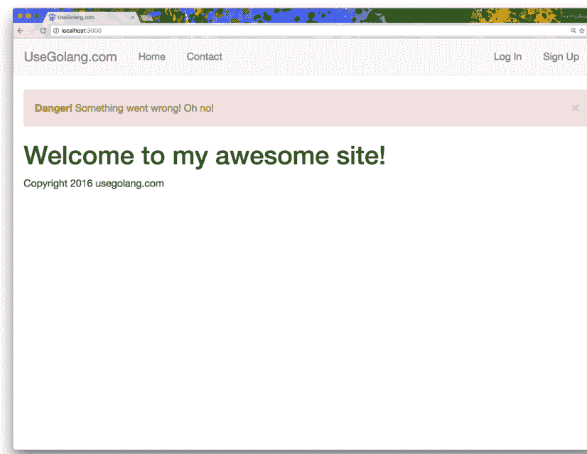

图 13.1：我们的网站在顶部显示了 Bootstrap 警报

## 13.2. 渲染动态警报

### 源代码

下方链接包含了完整的源代码以及本节所有更改代码的差异（diff）。

已完成 - book.usegolang.com/13.1

差异 - book.usegolang.com/13.1-diff

## 13.2 渲染动态警报

如果警报只渲染静态数据，那么它们就毫无用处。我们需要能够在警报中插入特定的错误，使其变得有用。

在这一节中，我们将更新警报模板以使用动态数据。我们将从更新警报模板本身开始，因此从打开该源代码开始。

```
$ atom views/layouts/alert.gohtml
```

一旦打开了警报，我们将对其进行检查并决定哪些信息应该动态设置。第一个引人注目的是外部 div 的 "alert-danger" 类。该类决定了我们的警报将是危险（danger）、警告（warning）、信息（info）还是成功（success）警报，我们很有可能应用程序的某个时刻显示成功或信息消息，因此我们应该动态设置它。

鉴于该类决定了错误的严重程度，我倾向于将此变量命名为 `Level`。我们不需要动态设置整个 HTML 类；我们可以在字符串中间插入变量，它最终将创建一个单个 HTML 类。最终结果是用于我们起始 div 的以下这段代码。

## 第 13 章：向最终用户显示错误

```
<div class="alert alert-({.Level}) alert-dismissible" role="alert">
```

接下来的几行定义了一个 HTML 按钮，用于渲染警报右上角的 x，允许用户将其关闭。这些内容都不需要是动态的，所以我们可以跳过。

alert div 内部的最后一段 HTML 是我们在警报内部渲染的消息。这绝对是我们想要动态渲染的内容，因此我们将用 `Message` 变量替换整整行。生成的警报模板如下所示。

```
{{define "alert"}}
<div class="alert alert-({.Level}) alert-dismissible" role="alert">
<button type="button" class="close" data-dismiss="alert"
aria-label="Close">
<span aria-hidden="true">&times;</span>
</button>
{{.Message}}
</div>
{{end}}
```

为了正确渲染此警报，我们需要传递一个同时包含 `Level` 和 `Message` 字段的数据。我们最终会定义一些数据类型来帮助我们渲染视图，但现在，我们将创建一个临时类型，用于渲染我们的警报。我们需要在控制器内部执行此操作，因此我们将临时修改用户的控制器。

```
$ atom controllers/users.go
```

一旦打开了你的源文件，找到 `New` 方法。我们将编辑这个方法，以便我们可以在注册页面上测试我们的警报。

在 `New` 方法内部，我们将从创建一个同时具有 `Level` 和 `Message` 字段的数据类型开始。

## 13.2. 渲染动态警报

```
type Alert struct {
    Level string
    Message string
}
```

接下来，我们想要创建该类型的实例，用于渲染我们的警报。
我们将用一个成功警报而不是危险警报来测试。

```go
alert := Alert{
    Level: "success",
    Message: "Successfully rendered a dynamic alert!",
}
```

最后，我们在渲染视图时，需要将此警报作为数据传递给 `Render` 方法。将这一切整合在一起，你的 `New` 方法应该看起来像代码。

```go
func (u *Users) New(w http.ResponseWriter, r *http.Request) {
    type Alert struct {
        Level string
        Message string
    }
    alert := Alert{
        Level: "success",
        Message: "Successfully rendered a dynamic alert!",
    }
    if err := u.NewView.Render(w, alert); err != nil {
        panic(err)
    }
}
```

我们正要测试我们的警报，但我们需要更新在 Bootstrap 模板中进行的模板调用。

```
$ atom views/layouts/bootstrap.gohtml
```

## 第 13 章：向最终用户显示错误

当我们起初调用警报模板时，我们没有向它传递任何数据。这就是为什么原始调用在模板名称后没有列出任何参数。

```
{{template "alert"}}
```

我们想要传递此警报数据，因此我们将更新该行代码，在末尾包含一个点。该点表示我们正在传递由 Bootstrap 模板提供的所有数据，在这种情况下，恰好只有我们创建的 `Alert`。

```html
<div class="container-fluid">
<!-- 在下方 "alert" 之后添加点 -->
{{template "alert" .}}
{{template "yield" .}}
{{template "footer"}}
</div>
```


为了看到代码效果，重启服务器并进入`/signup`路径。如果一切按预期工作，我们应该会在控制器中看到成功警报。

### 源代码

下方链接包含了完整的源代码以及本节所有更改代码的差异（diff）。

已完成 - `book.usegolang.com/13.1`

差异 - `book.usegolang.com/13.1-diff`

## 13.3. 在需要时显示警报

现在我们让警报渲染动态数据，但我们遇到了另一个问题。我们显然不想总是生成此 HTML，而是只想在确实有警报时渲染它。

为了实现这一点，我们将利用 Go 的动作（actions），它们存在于`text/template`和`html/template`中。

> 注意：动作的链接，因为这是文档显示的地方。

我们将使用的动作是`if`动作，它允许我们检查是否为空。如果为空，if 块内部的内容将被渲染。如果不为空，整个块将被渲染。

框 13.2：什么是空值？

在处理模板时，空值定义为：

```
空值是 false、0 或 nil 指针或接口值，以及任何长度为零的数组、切片、映射或字符串。
```

这直接取自`text/template`文档，理解这一点，因为模板中的 if 语句与 Go 代码中的 if 语句大不同。在 Go 代码中，我们期望 if 语句的参数求值为真或假，但我们可以向 if 动作传递字符串等内容。⁴`https://golang.org/pkg/text/template#hdr-Actions`

## 第 13 章：向最终用户显示错误

这意味着我们可以用下面的代码更新我们的 Bootstrap 模板。

```html
<div class="container-fluid">
{{if .}}
  {{template "alert" .}}
{{end}}
  {{template "yield" .}}
  {{template "footer"}}
</div>
```

注意：我们不会使用这段代码；它仅用于说明目的。

在上面的代码中，我们将检查是否向模板传递了非空数据，如果是，我们将尝试使用该数据渲染警报。然后我们将继续将相同的数据传递给 yield 模板，但传递的是旨在渲染那里的数据。

让我们回到用户控制器，看看解决此问题的一种方法。

```
$ atom controllers/users.go
```

我们知道想要将警报数据与渲染 yield 模板的数据隔离开，所以为什么不简单创建一个包含两个字段——`Alert`和`Yield`的类型。这样我们就能知道哪个数据是为每个模板设计的。

注意：以防你忘记，yield 模板用于渲染每个特定的页面。例如，我们用它渲染注册表单、主页以及任何非布局信息。

## 13.3. 仅在需要时显示警告

我们将再次在`New`方法中添加这段代码。一旦我们创建了新类型，我们将创建一个实例，分配一些数据进行测试，然后将其传递给`Render`方法。

```go
func (u *Users) New(w http.ResponseWriter, r *http.Request) {
	type Alert struct {
		Level string
		Message string
	}
	type Data struct {
		Alert *Alert
		Yield interface{}
	}
	alert := &Alert{
		Level: "success",
		Message: "Successfully rendered a dynamic alert!",
	}
	data := Data{
		Alert: &alert,
		Yield: "this can be any data b/c its type is interface",
	}
	if err := u.New.Render(w, data); err != nil {
		panic(err)
	}
}
```

现在我们已经将这两部分数据分开了，让我们回到 bootstrap 布局并更新它以反映这一变化。

```bash
$ atom views/layouts/bootstrap.gohtml
```

我们只希望在模板中有一个非空的`Alert`参数时才渲染警告消息，所以我们从这里开始。如果它确实非空，我们将渲染警告模板并传递该部分数据。

```go
{{if .Alert}}
{{template "alert" .Alert}}
{{end}}
```

## 第 13 章.向最终用户显示错误

`Yield`字段有点不同。即使它是空的，我们仍然想要渲染`yield`字段，因为它可能是一个带有静态数据的页面（例如首页）。在这种情况下，我们只需要使用正确的数据调用模板即可。

```html
<div class="container-fluid">
  {{if .Alert}}
    {{template "alert" .Alert}}
  {{end}}
  {{template "yield" .yield}}
  {{template "footer"}}
</div>
```

通过更新后的代码，我们告诉模板只向每个模板传递特定的数据。一旦进入该模板内部，所有传递的数据都可以通过点操作（例如`{{.}}`）访问，这就像我们将单个字段作为参数传递给另一个函数一样。你可以通过更新新用户用户的模板来看到这一点。

```bash
$ atom views/users/new.gohtml
```

在模板定义之后直接添加以下`h1`标签。

```html
{{define "yield"}}
<h1>{{.}}</h1>
<!-- 模板的其余部分保持不变 -->
{{end}}
```

现在重启服务器并访问注册页面`/signup`。你不仅会看到成功警告，还会看到我们设置在`Yield`字段中的字符串 "this can be any data b/c its type is interface"，因为我们在`new.gohtml`模板中通过点（`. `）访问了它。

在下一节中，我们将开始向为视图数据使用更持久的数据结构方向过渡，在此期间，本节希望能够让你初步了解我们如何开始在模板中添加和交互数据，从而影响页面的渲染方式。

### 源代码

下面的链接包含了完整的源代码以及本节中所有更改代码的差异（diff）。

- 完成版 - `book.usegolang.com/13.3`
- 更改版 - `book.usegolang.com/13.3-diff`

## 13.4 用于视图的更持久的数据类型

在之前的章节中，我们探索了预定义数据类型在渲染视图时是非常有用的。通过它，我们仍然可以在`Yield`字段中放置更多动态页面特定数据，同时在我们需要向用户显示警告消息时，仍然拥有像`Alert`这样更常见的字段。

在本节中，我们将为渲染视图定义一个更持久的数据类型。我们将此结构体命名为`Data`，并将其放在`views`包中，因为它被用于渲染我们的视图。在此过程中，我们还会在`views`包中创建一个`Alert`数据类型，用于渲染我们的警告。

让我们先从在`views`包中添加新的数据类型开始。我们将为这段代码创建一个新的源文件。

```bash
$ atom views/data.go
```

在该文件中，我们首先需要引入`Data`和`Alert`类型。目前，这些可以与我们之前在控制器中创建的完全相同。

## 第 13 章.向最终用户显示错误

```go
package views
// Data 是视图期望数据进入的顶层结构体
type Data struct {
	Alert *Alert
	Yield interface{}
}
// Alert 用于在模板中渲染 Bootstrap Alert 消息
type Alert struct {
	Level string
	Message string
}
```

到目前为止，我们允许数据以几乎任何格式进入视图，但从现在开始，我们将开始实施更多的严谨性。我们将开始期望所有视图如果传递了任何数据，都会接收一个`Data`对象。

在我们创建`Alert`类型时，为所有警告级别引入一些常量可能也是好主意。这样开发者就可以轻松地从我们 UI 支持的预定义警告级别中选择，而不用担心字符串中的拼写错误。

```go
const (
    AlertLvlError = "danger"
    AlertLvlWarning = "warning"
    AlertLvlInfo = "info"
    AlertLvlSuccess = "success"
)
```

现在让我们更新用户控制器中的`New`方法以使用我们的新数据类型。

```bash
atom controllers/users.go
```

我们不再需要在那部分代码中定义`Data`和`Alert`类型了，我们也不真的需要添加任何新代码。我们真正需要的

## 13.4 用于视图的更持久的数据类型

就是更新创建`Alert`和`Data`对象的代码，以使用在`views`包中定义的那些。我们还可以更新代码以使用其中一个常量警告级别。

```go
func (u *Users) New(w http.ResponseWriter, r *http.Request) {
	alert := views.Alert{
		Level: views.AlertLvlSuccess,
		Message: "Successfully rendered a dynamic alert!",
	}
	data := views.Data{
		Alert: &alert,
		Yield: "this can be any data b/c its type is interface",
	}
	if err := u.NewView.Render(w, data); err != nil {
		panic(err)
	}
}
```

此时我们可以重启服务器，我们的代码将能够工作了，但我们还有最后一件事要做。我们更新`views`包中的`Render`方法，以确保所有传递的数据都封装在`Data`对象中。

```go
func (v *View) Render(w http.ResponseWriter, data interface{}) error {
	w.Header().Set("Content-Type", "text/html")
	switch data.(type) {
	case Data:
		// 无操作
	default:
		data = Data{
			Yield: data,
		}
	}
	return v.Template.ExecuteTemplate(w, data)
}
```

## 第 13 章向最终用户显示错误

在更新后的代码中，我们添加了一个检查任何传递数据的底层类型的 switch。我们真正关心的情况是数据是否为`Data`类型。如果是`Data`类型，我们什么都不需要做。如果是其他类型，我们将其封装在`Data`对象中，并赋值给`Yield`字段。简而言之，这是一种便利，允许我们使用如下代码渲染视图：

```go
someView.Render(w, "this is page-specific data!")
```

## 13.5 处理表单中的错误

现在我们准备好为应用程序实现正确的错误处理了，但首先我们需要移除一些用于演示警告和视图数据代码。

打开新用户模板并删除我们在 13.3 节中添加的`h1`标签。

```bash
$ atom views/users/new.gohtml
```

```html
{{define "yield"}}
<!-- 删除下面的 h1 标签 -->
<!-- {{.}} -->
<!-- ... 代码的其余部分保持不变 -->
{{end}}
```

然后清理控制器包中的`users.go`源文件。在文件内部，我们将移除`New`方法中用于创建警告的代码。

```bash
$ atom controllers/users.go
```

移除代码后，你的`New`方法应该恢复到原始原始版本。

```go
func (u *Users) New(w http.ResponseWriter, r *http.Request) {
  if err := u.NewView.Render(w, nil); err != nil {
    panic(err)
  }
}
```

## 第 13 章。向终端用户显示错误

现在找到`users controller`内部的`Create`方法。我们将更新此方法，以便在处理注册表单出现任何问题时添加更好的错误处理。

我们知道，当想要渲染一个警报（alert）时，需要设置`views.Data`类型的`Alert`字段。我们可以从添加一个该类型的变量开始。如果没有发生错误，我们可以在不更改的情况下将其传递给视图，如果发生了错误，我们只需要对该变量进行赋值，它就会渲染在我们的。

```go
func (u *Users) Create(w http.ResponseWriter, r *http.Request) {
    var views.Data
    // ... 其他地方没有变化
}
```

之后，我们查看源代码，寻找任何可能导致错误的情况。到目前为止，我们一直通过`panic`或调用`http.Error`等方法来处理这些错误，所以我们只需查找这些即可。

在`Create`方法内部，第一个`panic`在尝试解析表单后立即触发。这里的错误不太可能发生，但当我们并不确定预期会看到什么样的错误消息时。我们的`parseForm`函数返回由`net/http`包生成的错误，以及来自`gorilla/schema`包的错误。

与其尝试单独处理所有错误，我们将创建一个显示通用错误消息的警报，让用户知道出了问题。然后我们将带有警报再次渲染注册表单，并允许用户如果想重试再次提交表单。

### 框 13.3. 显示未过滤的错误

通常情况下，在不知道错误消息具体内容的情况下向终端用户显示错误是一个坏主意。当我们自己创建错误时，它通常是

### 13.5. 处理注册表单中的错误

渲染该消息是可以的，因为我们知道它写了什么。对于那些不是我们自己创建的错误，我们往往很难判断该错误消息是否包含任何敏感信息。

与其显示未知错误，恰当的做法是根据错误原因创建你自己的错误，或者向终端用户渲染一个通用的错误消息。如果你认为你可能需要来自错误消息的额外信息，你应该使用日志记录或告警系统来通知开发者，而不是将其渲染给终端用户。

渲染通用错误可以使用大致下面的代码来实现，但每当我们在应用程序中使用硬编码字符串时，我们应该停下来问问自己，这些是否适合作为我们某个包提供的常量。

```go
vd.Alert = &views.Alert{
    Level: views.AlertLvlError,
    Message: "Something went wrong!",
}
u.NewView.Render(w, vd)
```

在这种情况下，错误消息绝对应该是一个常量。我们极有可能在许多不同的情况下显示通用错误消息，而我们最终不会在应用程序中产生许多不同的错误消息。

打开我们定义视图`Data`类型的源文件。

```bash
$ atom views/data.go
```

在这个源文件中，我们将添加常量`AlertMsgGeneric`，它可以用于任何我们需要通用错误消息的情形。

```go
const (
    AlertLvlError = "danger"
    AlertLvlWarning = "warning"
    AlertLvlInfo = "info"
    AlertLvlSuccess = "success"
    // AlertMagGeneric 在当我们的后端遇到任何随机
    // 错误时显示。
    AlertMagGeneric = "Something went wrong. Please try " + 
    "again, and contact us if the problem persists."
)
```

之后保存你的代码并回到我们刚刚编辑的用户源代码。找到`Create`方法，然后找到我们解析表单并在发生错误时`panic`的`if`语句。在这个块内部，我们将添加代码，在发生错误时解析表单并`panic`。在这个块内部，我们将添加代码，在发生错误时使用日志或告警系统通知开发者，而不是将其渲染给终端用户。

```go
import (
    // 将 log 包添加到我们的导入中
    // 在这种情况下，它与 fmt 包类似
    // 打印错误
    "log"
)
func (u *Users) Create(w http.ResponseWriter, r *http.Request) {
    var views.Data
    var form
    if err := parseForm(r, &form); err != nil {
        log.Println(err)
        vd.Alert = &views.Alert{
            Level: views.AlertLvlError,
            Message: AlertMsgGeneric,
        }
        u.NewView.Render(w, vd)
        return
    }
    // 方法的其他部分保持不变
}
```


当我们在处理错误时，我们会看到 `Create` 方法中的第一个 `panic` 在尝试解析表单后立即触发。这里的错误不太可能发生，但当我们并不确定预期会看到什么样的错误消息时。我们的 `parseForm` 函数返回由 `net/http` 包生成的错误，以及来自 `gorilla/schema` 包的错误。与其尝试单独处理所有错误，我们将创建一个显示通用错误消息的警报，让用户知道出了问题。然后我们将带有警报再次渲染注册表单，并允许用户如果想重试再次提交表单。

## 13.6. 错误信息的白名单机制

439

消息带有错误信息的“models:”部分前缀。

在下一节中，我们将介绍如何对错误信息进行白名单处理，并将其渲染为面向终端用户（而非开发者）设计的错误消息。

### 源代码

下面的链接包含了完整的源代码以及本节所有更改代码的差异（diff）。

- 已完成 - `book.usegolang.com/13.5`
- 更改 - `book.usegolang.com/13.5-diff`

## 13.6 错误信息的白名单机制

在第 13.5 节中，我们看到在某些时候我们需要将错误渲染给终端用户，给他们机会理解我们为什么无法接受他们的输入并修复问题。我们也讨论了为什么将每个错误消息暴露给终端用户是一个坏主意，因为这可能导致数据泄露。

在本节中，我们将讨论如何对某些错误信息建立白名单，同时对其他错误渲染通用错误消息。这样做将使未来的错误渲染变得简单得多。

在进行这些更改的同时，我们还将更新错误，将其变为常量而不是变量。我们使用了 Dave Cheney 在他的博客文章“Constant errors”（常量错误）中引入的技术。这将允许我们将错误定义为常量，而不是在程序运行时可能会更改的变量。

> *https://dave.cheney.net/2016/04/07/constant-errors

# 第 13 章 向终端用户显示错误

我们将从 `views` 包开始。

```
$ atom views/data.go
```

在这个源文件中，我们将添加一个方法，允许我们使用错误轻松地为 `Data` 类型设置警报。该方法的简单版本如下所示，我们将随着内容的推进对其进行微调。

```go
func (d *Data) SetAlert(err error) {
  d.Alert = &Alert{
    Level: AlertLvlError,
    Message: err.Error(),
  }
}
```

在我们新的 `SetAlert` 方法中，我们接收一个错误并使用该错误消息创建一个警报，但正如之前讨论的，我们不想对所有错误都这样做。相反，我们希望在代码中有一种方式可以说：“是的，这个错误消息可以暴露给终端用户，公开消息应该是这样的。”如果能做到这一点，我们就可以更新代码，大致如下：

```go
// 注意：此代码将无法编译
func (d *Data) SetAlert(err error) {
  var msg string
  if err is public {
    // Public() 会返回公开的错误消息
    msg = err.Public()
  } else {
    msg = AlertMsgGeneric
  }
  d.Alert = &Alert{
    Level: AlertLvlError,
    Message: msg,
  }
}
```

在这种情况下，我们刚刚看到的代码将无法编译，但写出我们希望代码能做什么是有帮助的，它帮助我们确定如何如何实现它。

## 13.6. 错误信息的白名单机制

如果你仔细观察上面的代码段，公开错误与非公开错误之间真正的区别是，公开错误需要有一个 `Public` 方法，该方法用于生成公开的错误消息。只要我们的错误拥有该方法，我们就可以使用它来生成警报消息。

如果我们想在 Go 中检查这一点，首先需要定义一个接口，所以让我们从这里开始。

```go
type PublicError interface {
  error
  Public() string
}
```

在 Go 中，`error` 类型实际上是一个接口，定义了任何带有返回字符串的 `Error` 方法的类型。这意味着我们可以将其嵌入到 `PublicError` 接口中，以确保我们的公开错误也能像普通错误一样工作。

接口中的第二行是它与内置 `error` 类型不同的地方。我们还希望任何实现 `PublicError` 接口的类型都拥有一个 `Public` 方法，用于返回意图显示给终端用户的错误消息。

定义接口后，我们可以更新 `SetAlert` 方法来利用它并检查错误是否公开。为了做到这一点，我们需要使用类型断言 ⁷，这是一种让我们在运行时检查某部分数据是否实现了某个接口的方法。

> 框 13.4. 什么是类型断言？

如果你不熟悉类型断言，我建议你查看脚注中的 *Effective Go* 链接，但目前最重要的是理解类型断言返回的参数。

⁷https://golang.org/doc/effective_go.html#blank_implements

# 第 13 章 向终端用户显示错误

当你写写类型断言时，代码通常看起来如下所示。

```go
publicError, ok := err.(PublicError)
```

后半部分 - `err.(PublicError)` - 是类型断言。我们正在检查 `err` 变量是否可以转换为 `PublicError` 接口。

类型断言有返回参数；第一个是原始变量（在本例中为 `err`），在转换为新类型之后。第二个参数是一个布尔值，表示转换是否成功。

类型转换可能会失败的，所以如果失败了，我们需要在使用第一个参数之前检查该布尔参数，以确保它转换成功。例如，如果我们的错误没有实现 `PublicError` 接口，`ok` 将为 `false`。

如果我们的错误实现了 `PublicError` 接口，`ok` 将为 `true`，我们就可以可以使用公开消息。

```go
func (d *Data) SetAlert(err error) {
    var msg string
    if pErr, ok := err.(PublicError); ok {
        msg = pErr.Public()
    } else {
        msg = AlertMsgGeneric
    }
    d.Alert = &Alert{
        Level: AlertLvlError,
        Message: msg,
    }
}
```

## 13.6. 错误信息的白名单机制

```go
}
```

## 13.6. 错误信息的白名单机制

```go
$ atom users.go
```

```go
type modelError string
func (e modelError) Error() string {
  return string(e)
}
func (e modelError) Public() string {
  return string(e)
}
```

在继续之前，那个 `Public` 方法可以被改进，所以让我们尝试改进它。我们知道所有的错误都以字符串“models:” 开头，我们可能不想将其显示给终端用户，所以让我们使用 `strings` 包中的函数 ⁸ 来替换字符串的该部分。

> *https://golang.org/pkg/strings/#Replace

```go
s := strings.Replace(string(e), "models: ", "", 1)
```

注意：结尾的 1 表示我们只希望这种替换发生一次。

我们下一步要做的事情是将错误消息的首字母大写，这样用户看到的不是 "email is required"，而是 "Email is required"。`strings` 包提供了一个函数 ⁹ 可以部分实现我们的需求，但它尝试大写字符串中的每个单词。我们只想大写第一个单词。

为了解决这个问题，我们将首先使用 `Split` 函数 ¹⁰ 在空格处将字符串分割为字符串切片。例如，如果我们从字符串 "email is required" 开始，将其分割为如下切片：

```
string("email","is", "required")
```

这将允许我们访问消息的第一个单词，并将其传递给 `Title` 函数进行大写。然后我们可以使用 `Join` 函数 ¹¹ 更新字符串切片中的值，合并所有字符串并重新插入原始空格。

所有的代码最终如下：

```go
import "strings"
func (e modelError) Public() string {
    s := strings.Replace(string(e), "models: ", "", 1)
    split := strings.Split(s, " ")
    split[0] = strings.Title(split[0])
    return strings.Join(split, " ")
}
```

> ⁹https://golang.org/pkg/strings#Title
¹⁰https://golang.org/pkg/strings#Split
¹¹https://golang.org/pkg/strings#Join

## 13.6. 错误消息白名单

现在，当我们写一个类似“models: email is taken”的错误消息时，它将通过 `Public` 方法转换为“Email is taken”。

我们需要更新所有意图公开的错误，因此我们将把所有现有的错误替换为新 `modelError` 类型的错误。由于我们已经定义了 `modelError` 字符串的底层类型，我们可以将这些定义为常量而不是变量。

```go
const (
// 每个错误的注释应该应该保持不变。
// 为了简洁起见，这里省略了这些注释。
ErrNotFound modelError = "models: resource not found"
ErrIDInvalid modelError = "models: ID provided was invalid" // 提供的 ID 无效
ErrPasswordIncorrect modelError = "models: incorrect " + 
"provided"
ErrPasswordTooShort modelError = "models: password must " + 
"be at least 8 characters long"
ErrPasswordRequired modelError = "models: password is required"
ErrEmailRequired modelError = "models: email address is " + 
"required"
ErrEmailInvalid modelError = "models: email address is " + 
"not valid"
ErrEmailTaken modelError = "models: email address is " + 
"already taken"
ErrRememberRequired modelError = "models: remember token " + 
"is required"
ErrRememberTooShort modelError = "models: remember token " + 
"must be at least 32 bytes"
)
```

现在我们终于准备好更新用户控制器，以使用新的 `SetAlert` 方法了。

## 第 13 章：向终端用户显示错误

```bash
$ atom controllers/users.go
```

找到创建 alert 的两个地方，并将它们替换为对 `SetAlert` 方法的。我们也可以删掉记录错误消息的代码，因为我们的 `SetAlert` 方法已经处理了这些。

```go
func (u *Users) Create(w http.ResponseWriter, r *http.Request) {
	var vd views.Data
	var form SignupForm
	if err := parseForm(r, &form); err != nil {
		vd.SetAlert(err)
		u.NewView.Render(w, vd)
		return
	}
	user := models.User{
		Name: form.Name,
		Email: form.Email,
		Password: form.Password,
	}
	if err := u.us.Create(&user); err != nil {
		vd.SetAlert(err)
		u.NewView.Render(w, vd)
		return
	}
	err := u.signIn(w, &user)
	if err != nil {
		http.Redirect(w, r, "/login", http.StatusFound)
		return
	}
	http.Redirect(w, r, "/codietest", http.StatusFound)
}
```


重启你的服务器并验证新错误是否工作正常。当密码太短、邮箱地址被占用或任何其他验证失败时，你应该能看到特定的错误消息，并且其中每个消息的首字母都是大写的，且“models:”前缀应该被移除。

## 13.5. 接口可以在任何地方定义

## 13.7. 处理登录错误

> 关于我们的 `PublicError` 接口值得注意的是，我们在 `models` 包内部的 `modelError` 类型从没有直接看到或与该类型交互。在 Go 中，你可以在不直接导入或使用接口的情况下实现接口。这与 Java 等其他语言有很大区别，在 Java 中你必须明确说明“此类实现了接口 X”，但这也是 Go 的非常强大的特性。

### 源代码

下面的链接包含了源代码以及本节中所有更改代码的差异。

已完成 - book.usegolang.com/13.6

差异 - book.usegolang.com/13.6-diff

## 13.7 处理登录错误

我们议程的下一项是处理通过用户控制器内部的 `Login` 操作登录用户时发生的错误。打开你的用户控制器源文件并找到 `Login` 方法。

```bash
$ atom controllers/users.go
```

我们需要处理的第一个错误是我们在 `Create` 方法中看到的；每当我们解析表单失败时，我们都需要重新渲染登录表单，并带上一个解释说明出了什么问题的 alert。

```go
func (u *Users) Login(w http.ResponseWriter, r *http.Request) {
	var vd Data
	var form LoginForm
	if err := parseForm(r, &form); err != nil {
		vd.SetAlert(err)
		u.LoginView.Render(w, vd)
		return
	}
	// ... 其余代码保持不变
}
```

之后，我们需要查看在尝试验证用户邮箱地址和密码时返回的任何错误。虽然直接用任何错误调用 `SetAlert` 方法很有吸引力，但我们仍然要为 `ErrNotFound` 编写一个自定义消息，因为这个错误不如告诉用户提供的错误没有匹配到任何用户那样清晰。

我们可以去掉 `ErrIncorrect` 错误，这样我们的 `switch` 语句会小一点，而且无论看到哪种错误，我们都想再次渲染 `LoginView` 并返回。

```go
user, err := u.us.Authenticate(form.Email, form.Password)
if err != nil {
	switch err {
		case models.ErrNotFound:
			vd.Alert = views.Alert(
				tLevel: views.AlertLvlError,
				Message: "No user exists with that email address",
			)
		default:
			vd.SetAlert(err)
	}
	u.LoginView.Render(w, vd)
	return
}
```

最后一个我们需要处理的错误是 `signIn` 方法返回的。当我们开始向 `ResponseWriter` 写入时，200 状态码就已经设置了，任何已经写入的数据都无法撤回。这导致我们在调用 `SetAlert` 方法之前。

```go
err = u.signIn(w, user)
if err != nil {
	vd.SetAlert(err)
	u.LoginView.Render(w, vd)
	return
}
http.Redirect(w, r, "/codietest", http.StatusFound)
```

[第 477 页]

# 第 13 章.向最终用户显示错误

```go
var buf bytes.Buffer
```

`Buffer` 是一个实现了 `io` 包中 `Read` 和 `Write` 接口的类型。`Buffer` 有很多用场景，但在这种情况下我们将使用缓冲区作为一个临时位置，将我们的模板执行到其中。一旦我们确认执行模板没有出现任何错误，整个模板就会存储在我们的 `Buffer` 中，然后我们可以将其复制到 `ResponseWriter`。

请记住：我们使用缓冲区是因为因为向 `Response` 写入任何数据都会导致产生 200 状态码，而我们无法撤销该写入操作。通过先写入缓冲区，我们可以在开始向 `ResponseWriter` 写入任何数据之前，确认整个模板已成功执行。

```go
var buf bytes.Buffer
err := v.Template.Execute(&buf, v.Layout, data)
if err != nil {
    // 我们稍后会处理这个
}
// 如果运行到这一步，说明我们的模板执行正确
// 我们可以将缓冲区 拷贝到 ResponseWriter
io.Copy(w, &buf)
```

在我们代码的最后一行，我们使用了 `io` 包提供的 `Copy` 函数。该函数接收一个 `Writer` 和一个 `Reader`，然后将 `Reader` 中的所有数据复制到 `Writer`。在我们的代码中，我们将 `Buffer` 中的所有数据复制到 `ResponseWriter`。

我们最后需要实现的是执行模板发生错误时该做什么。在这种情况下，我们将利用 `net/http` 包提供的 `Error` 函数，并将消息设置为通用的“Something went wrong”（出现问题了），并带有 500 HTTP 状态码，表示我们发生了内部服务器错误。

> ¹³https://golang.org/pkg/io/#Copy

[第 478 页]

# 13.8. 从视图渲染错误中恢复

将以上内容整合在一起，我们的 `Render` 方法应该如下所示。

```go
import (
    "bytes"
    "io"
)
func (v *View) Render(w http.ResponseWriter, data interface{}) {
    w.Header().Set("Content-Type", "text/html")
    switch data.(type) {
    case Data:
        // 什么都不做
    default:
        data = Data{
            Yield: data.data,
        }
    }
    var buf bytes.Buffer
    err := v.Template.ExecuteTemplate(&buf, v.Layout, data)
    if err != nil {
        http.Error(w, "Something went wrong. If the problem " +
            "persists, please email support@lenslocked.com",
            http.StatusInternalServerError)
        return
    }
    io.Copy(w, &buf)
}
```

完成 `Render` 方法后，我们需要更新任何期望它返回错误的代码。我们将从更新 `ServeHTTP` 方法开始。

```go
func (v *View) ServeHTTP(w http.ResponseWriter, r *http.Request) {
    v.Render(w, nil)
}
```

接下来是用户控制器中的 `New` 方法。

```bash
$ atom controllers/users.go
```

[第 479 页]

```go
func (u *Users) New(w http.ResponseWriter, r *http.Request) {
  u.NewView.Render(w, nil)
}
```

重新构建并启动你的服务器，以验证一切再次恢复工作。我们现在正式完成了错误渲染工作，并准备好进入更有趣的话题了！

在下一章中，我们将学习如何添加 `Gallery`（画廊）资源，允许用户创建新画廊，根据当前登录的用户限制对每个画廊的访问，中间件的工作原理以及更多内容。

### 源代码

下方的链接包含了完整的源代码以及所有更改的差异（diff）。

- 完成 - book.usegolang.com/13.8
- 更改 - book.usegolang.com/13.8-diff

[第 480 页]

# 第 14 章 # 创建 Gallery

在本章中，我们将利用所学内容开始构建 Gallery 资源。我们需要创建一个新的模型、控制器、动作（actions）和视图。

画廊将作为容器，它们需要存储一些数据。画廊资源未来可能会扩展，但目前我们只支持上传图片。

当用户创建画廊后，他们将能够查看这些画廊。

[第 481 页]

# 14.1 定义画廊模型

将在 `models` 包中的 `galleries.go` 文件中定义画廊模型。

```bash
$ atom models/galleries.go
```

我们将从定义包开始。

```go
package models
```

我们的画廊资源可能会随时间变化，但目前它需要以下数据：

1. 普通模型信息
2. 追踪拥有画廊的用户
3. 画廊标题
4. 关联图片的方法

[第 482 页]

# 14.1 定义画廊

之后，我们需要追踪哪个用户拥有画廊。最简单的方法是存储拥有画廊 ID。用户 ID 始终是整数（uint），因此我们将该字段命名为 `UserID` 并赋予其类型。我们需要此字段，因此我们将添加 `not-null` 和 `index` 标签，告知 GORM 我们需要该字段并希望对它进行索引。

```go
import "github.com/jinzhu/gorm"
type Gallery struct {
	gorm.Model
	UserID uint   `gorm:"not-null;index"`
	Title string `gorm:"not-null"`
}
```

虽然我们最终想要一种关联图片到画廊的方法，但我们还没有任何图片资源，所以现在先跳过这一步。一旦用户可以创建带有标题的画廊，我们将考虑为画廊添加图片。

[第 483 页]

### 源代码

下方的链接包含了完整的源代码以及本节所有更改的差异。

- 完成 - book.usegolang.com/14.1
- 更改 - book.usegolang.com/14.1-diff

# 14.2 引入 GalleryService

我们需要一种与画廊交互的方法，因此我们的下一步是创建一个 `Gallery-Service`。它将是一个导出一组用于与画廊数据存储进行交互的接口。

打开 `models` 包中的 `galleries` 源文件。

```bash
$ atom models/galleries.go
```

我们将定义 `GalleryService` 接口和 `GalleryDB` 接口。我们目前还没有为画廊服务提供任何特定的方法，但我们知道很快就会创建画廊，所以可以先从 `Create` 方法开始并进行占位实现。

```go
type GalleryService interface {
	GalleryDB
}
type GalleryDB interface {
	Create(gallery *Gallery) error
}
type galleryGorm struct {
	db *gorm.DB
}
func (gg *galleryGorm) Create(gallery *Gallery) error {
	return gg.db.Create(gallery).Error
}
```

## 14.3 构建多个服务

```go
// TODO: Implement this later
return nil
}
```

我们稍后会更多地处理 `GalleryService` 的实现，但首先，我们将查看如何在代码的其余部分简化多个服务的构建过程。

### 源代码

下面的链接包含了完整的源代码以及本节中所有更改代码的差异。

- 已完成 - [book.usegolang.com/14.2](https://book.usegolang.com/14.2)
- 更改 - [book.usegolang.com/14.2-diff](https://book.usegolang.com/14.2-diff)

## 14.3 构建多个服务

现在我们已经有两个服务了，是时候查看我们如何构建这些服务了。

我们可以继续像在 `main` 包中那样这样做；即通过像 `NewUserService` 和 `NewGalleryService` 这样的函数单独创建每个服务，但这种方法引入了一个问题。使用当前代码这样做将导致为每个服务创建一个新的数据库连接。

我们不希望为每个服务重新创建数据库连接，但也不希望在 `models` 包之外管理数据库连接。将所有数据库交互隔离在 `models` 包内部的主要益处之一是，我们不需要在包之外考虑数据库逻辑。

为了解决这个问题，我们将引入一个新的新函数 - `NewServices` 函数 - 它将用于构建我们所有的服务并返回它们。

我们将把这段代码添加到 `models` 包内部的一个新源文件中。

```bash
$ atom models/services.go
```

在编写 `NewServices` 函数时，我们可以使用多返回值并以此方式返回多个服务。例如：

```go
func demo(UserService, GalleryService, error)
```

注意：这仅用于说明目的。请勿编写代码。

随着我们服务的增加，这种方法会变得非常繁琐，因此我们将引入一个包含所有服务的单一类型，然后在 `NewServices` 函数中返回该类型的单一副本。

```go
models
func NewServices(connectionInfo string) (*Services, error) {
  // TODO: Implement this...
}
type Services struct {
  GalleryService
  User          UserService
}
```

通过 `Services` 类型，我们可以轻松地构建所有服务并并在单个对象中返回它们。

## 14.3. 构建多个服务

我们需要实现 `NewServices` 函数。在其中，我们将打开数据库连接，检查错误，将日志模式设置为 `true`，然后使用该连接来构建我们的各个服务。

```go
import "github.com/jinzhu/gorm"
func NewServices(connectionInfo string) (*Services, error) {
	db, err := gorm.Open("postgres", connectionInfo)
	if err != nil {
		return nil, err
	}
	db.LogMode(true)
	// 我们需要构建服务，但是
	// 我们还无法构建 UserService。
	return &Services{
		// User: ??? - 我们很快就会处理这个，
		// Gallery: &galleryGorm(),
	}
}
```

过去我们使用 `NewUser` 函数来构建 `UserService`，它会打开一个新的数据库连接，从以后我们希望重用 `NewServices` 函数创建的数据库连接。这意味着我们需要更新 `NewUserService` 函数，使其接受预存在的数据库连接，而不是用于打开新连接的字符串。

```bash
$ atom models/users.go
func NewUserService(db *gorm.DB) UserService {
	ug := &userGorm(db)
	hmac := hash.NewHMAC(hmacSecretKey)
	uv := newUserValidator(ug, hmac)
	return &UserService{
		UserID: uv,
	}
```

在更改 `NewUserService` 函数的同时，我们还能够更新返回类型，由于现在不再需要担心打开新数据库连接时的错误，我们选择只返回一个值。

# 第 14 章 创建画廊资源

我们也可以移除 `newUserGorm` 函数，因为我们不再使用它了。

```go
// 查找并删除此函数
func newUserGorm(connectionInfo string) (*userGorm, error) {
  // ...
}
```

在更改了 `NewUserService` 函数后，我们可以回到 `NewServices` 函数并将其更新为代码。

- $ atom atom/services.go

```go
func NewServices(connectionInfo string) (*Services, error) {
  db, err := g.Open("postgres", connectionInfo)
  if err != nil {
    return nil, err
  }
  db.LogMode(true)
  return &Services{
    User: UserService(db),
    Gallery: &galleryGorm(),
  }, nil
}
```


我们的 `models` 包现在已经更新了，但我们需要更新 `main.go` 源文件以考虑我们所做的更改。

- `$ atom main.go`

我们将更新 `main` 函数的前半部分。

```go
func main() {
  sqlInfo := fmt.Sprintf("host=%s port=%d user=%s password=%s dbname=%s sslmode=disable",
  // ...
```

## 14.3 构建多个服务

```go
services, err := models.NewServices(sqlInfo)
if err != nil {
    panic(err)
}
// TODO: Simplify this
defer services.Close()
```

我们的代码现在编译和运行起来应该和之前非常相似，但这样更容易阅读、编写和维护。在这一节中，我们写的代码在功能上与之前没有不同，但将使代码的其余部分使用 `models` 包变得更加容易。

### 源代码

下面的链接包含了完整的源代码以及本节中所有更改代码的差异。

- 已完成 - [book.usegolang.com/14.2](https://book.usegolang.com/14.2)
- 更改 - [book.usegolang.com/14.2-diff](https://book.usegolang.com/14.2-diff)

## 14.4 关闭并迁移所有模型

我们将更新代码以提供一个用于关闭所有服务的单一函数，以及另一个用于迁移所有模型的单一函数。顺便，我们还将添加第三个方法，可以对我们所有的数据库表执行破坏性重置，就像我们目前 `UserService` 提供的 `Destructive` 方法一样。

所有这些方法将被添加到 `models` 包内部的 `Services` 类型中。

```bash
$ atom models/services.go
```

我们将从 `Close` 方法开始，在其中我们需要做的只是关闭数据库连接。为了关闭数据库连接，我们需要访问它。提供访问的最方法是在 `Services` 类型中引入一个新字段，在打开连接后存储该 `gorm.DB` 连接。

```go
func NewServices(connectionInfo string) (*Services, error) {
	db, err := gorm.Open("postgres", connectionInfo)
	if err != nil {
		return nil, err
	}
	db.LogMode(true)
	return &Services{
		User: NewUserService(db),
		Gallery: &GalleryDB(),
		db: db,
		nil,
	}
}

type Services struct {
	Gallery GalleryService
	User UserService
	db     *gorm.DB
}
```

之后我们就可以在新的 `Close` 方法中访问并关闭数据库连接了。

# 第 14 章.创建画廊资源

```go
// 关闭数据库连接
func (s *Services) Close() error {
    return s.db.Close()
}
```

接下来是 `AutoMigrate` 方法，它与我们在编写 UserGorm 类型时编写的 `AutoMigrate` 方法类似，但它将尝试自动迁移所有的模型。

```go
// AutoMigrate 将尝试自动迁移所有表
func (s *Services) AutoMigrate() error {
    return s.db.AutoMigrate(&User(), &Gallery()).Error
}
```

最后我们有了 `DestructiveReset` 方法，它会尝试删除数据库表，然后使用 `AutoMigrate` 方法重建它。

```go
// DestructiveReset 删除所有表并重建它们
func (s *Services) DestructiveReset() error {
    err := s.db.DropTableIfExists(&User(), &Gallery()).Error
    if err != nil {
        return err
    }
    return s.AutoMigrate()
}
```

现在我们有了一种一次性关闭和迁移所有服务的方法，可以更新 `main` 函数来使用这些新方法。

```bash
atom main.go
```

```go
func main() {
    psqlInfo := fmt.Sprintf("host=%s port=%d user=%s " +
    "password=%s dbname=%s sslmode=disable",
    host, port, user, password, dbname)
```

## 14.4. 关闭并迁移所有模型

```go
services, err := models.NewServices(psqlInfo)
if err != nil {
    panic(err)
}
defer services.Close()
services.AutoMigrate()
// ... 其余部分保持不变
```

现在我们可以移除任何留下的未使用代码，例如我们在编写 `UserService` 时编写的 `Close`、`AutoMigrate` 和 `DestructiveReset` 方法。这些方法在那个地方不再需要了，移除它们将有助于简化 `UserService` 部分。

```bash
atom models/users.go
```

首先我们将从 `UserDB` 接口中移除这些方法。

```go
type UserDB interface {
  // 查询单个用户的方法
  ByID(id uint) (*User, error)
  ByEmail(email string) (*User, error)
  ByMember(token string) (*User, error)
  // 修改用户的方法
  Create(user *User) error
  Update(user *User) error
  Delete(id uint) error
}
```

我们需要找到与 `Galleryorm` 类型相关的三个方法实现并并删除它们。

```go
// 删除这三个函数
func (ug *userorm) Close() error { ... }
func (ug *userorm) DestructiveReset() error { ... }
func (ug *userorm) AutoMigrate() error { ... }
```

重启你的服务器，你应该能看到日志，指示通过调用 `AutoMigrate` 创建了 `galleries` 表。你的日志会略有不同，但应该与下面类似。

```sql
CREATE TABLE "galleries" (...)
CREATE INDEX idx_galleries_deleted_at ...
CREATE INDEX idx_galleries_user_id ...
```

### 源代码

- 完成 - book.usegolang.com/14.4
- 更改 - book.usegolang.com/14.4-diff

## 14.5 创建新画廊

编写创建新画廊所需的代码涉及我们应用程序的许多不同区域。我们需要在 `models` 包中编写代码来处理向数据库写入数据、对数据进行验证、用于渲染画廊表单的 HTML 模板，并且我们需要添加一个新的控制器（controller）和动作（actions）来在表单提交后解析它。

与其尝试一次性完成所有工作，我们将将其分为四个步骤：

- 我们第一步是编写一个可用的 `GalleryService` 实现，它允许我们将画廊插入到数据库中。
- 一旦我们有了可用的 `GalleryService` 实现，我们将专注于创建画廊控制器和一个用于渲染画廊表单的视图。
- 之后，我们将编写解析画廊表单的代码，并使用这些数据创建新画廊。
- 最后，我们将为画廊服务添加验证，以确保我们只将有效数据保存到数据库中。

### 14.5.1 实现画廊服务

画廊服务中使用的层将与用户服务中的层匹配。我们将拥有一个实现 `GalleryDB` 接口的 `galleryService`、一个用于验证的 `galleryValidator` 以及一个与我们的数据库交互的 `galleryGorm`。我们已经有了 `galleryGorm`，所以先从添加 `galleryService` 和 `galleryValidator` 开始。

```bash
atom models/galleries.go
```

```go
type galleryService struct {
  GalleryDB
}
type galleryValidator struct {
  GalleryDB
}
```

之后，我们将确保我们的 `galleryGorm` 始终实现 `GalleryDB` 接口。

```go
var GalleryDB = &galleryGorm()
```

我们还没有实现 `galleryGorm` 的 `Create` 方法，所以我们可以添加它。这段源码与 `userorm` 中 `Create` 方法使用的代码几乎相同，因为 GORM 使用我们正在保存的资源来确定插入到哪个表。

```go
func (gg *galleryGorm) Create(gallery *Gallery) error {
  return gg.Create(gallery).Error
}
```

拥有一种通过这些这些层来构建 `GalleryService` 的方法也是方便的，因此我们还将添加一个 `NewGalleryService` 函数。

```go
func NewGalleryService(db *gorm.DB) GalleryService {
  return &GalleryService{
    GalleryDB: &galleryValidator{
      GalleryDB: &galleryGorm{
        db: db,
      },
    },
  }
}
```

然后我们可以更新 `NewServices` 函数来使用 `NewGalleryService` 函数。

```bash
atom models/services.go
```

```go
func NewServices(connectionInfo string) (*Services, error) {
  db, err := gorm.Open("postgres", connectionInfo)
  if err != nil {
    return nil, err
  }
  db.LogMode(true)
  return &Services(
    User: NewUserService(db),
    Gallery: NewGalleryService(db),
    db,
    nil
  )
}
```

至此，我们有了一个可用的画廊服务，可以使用我们实现的 `Create` 方法将新画廊插入数据库的 `galleries` 表中。我们还没有对数据进行验证，但可以等到实现渲染和处理新画廊表单所需的控制器和动作后再进行。

### 源代码

- 完成 - book.usegolang.com/14.5.1
- 更改 - book.usegolang.com/14.5.1-diff

## 14.5.2 画廊控制器

在本节中，我们将引入画廊控制器以及一个用于渲染新画廊表单的 视图。我们将在下一节查看处理表单的源码 - 目前我们只想渲染它并设置好控制器。

我们将从创建视图模板开始，这意味着我们需要创建一个存储画廊视图的目录，然后在那里创建一个模板。

```bash
$ mkdir views/galleries
$ atom views/galleries/new.gohtml
```

在模板内部，我们将像通常一样定义一个 `yield` 模板，并在其中像之前注册页面那样渲染表单。

```html
{{define "yield"}}
<div class="row">
  <div class="col-md-6 col-md-offset-3">
    <div class="panel panel-primary">
      <div class="panel-heading">
        <h3 class="panel-title">创建画廊</h3>
      </div>
      <div class="panel-body">
        {template "galleryForm"}
      </div>
    </div>
  </div>
</div>
{{end}}
{{define "galleryForm"}}
<form action="/galleries" method="POST">
  <div class="form-group">
    <label for="title">标题</label>
    <input type="text" name="title" class="form-control" id="title" placeholder="标题是什么?" />
  </div>
  <button type="submit" class="btn btn-primary">创建</button>
</form>
{{end}}
```

我们的表单需要一个用于画廊标题的单个输入字段，我们将为该字段使用 `title` 名称。除此之外，关于画廊的其他数据将源自当前登录的用户（UserID 字段），或由 GORM 在数据库中自动设置（ID、CreatedAt 等）。

当我们提交表单时，我们将将其发送到 `/galleries` 路径，我们将在下一节的路由中设置该路径，并且我们将通过 POST 方法进行。

接下来我们需要一个控制器来包含此视图并帮助我们渲染它。我们将

## 14.5. 创建新画库

将 galleries 放在单独的源文件中以保持结构整洁。

```
$ atom controllers/galleries.go
```

我们将从 `Galleries` 类型开始，它将包含与画库资源相关的所有视图和处理函数。`Galleries` 类型最终需要访问 `GalleryService` 以与数据库交互，并且需要我们刚刚为创建模板的新画库页面视图。

```go
package controllers

import {
  "lenslocked.com/models"
  "lenslocked.com/views"
}

type Galleries struct {
  New +views.View
  gs models.GalleryService
}
```

接下来，我们将编写一个 `NewGalleries` 函数来简化此控制器的构造。在这里，我们将要求调用者传递一个 `GalleryService` 供我们使用，但我们将在本节开始时创建的模板自己构造 `New` 视图。

```go
func NewGalleries(gs models.GalleryService) *Galleries {
  return &Galleries{
    New: views.NewView("bootstrap", "galleries/new"),
    gs: gs,
  }
}
```

最后，我们需要更新 `main` 函数来创建一个 galleries 控制器，然后将 "/galleries/new" 路径映射到新的 galleries 视图。

## 第14章. 创建画库资源

```
$ atom main.go
```

```go
func main() {
    // ... 我们现有的设置服务的代码
    // 留在此处
    staticC := controllers.NewStatic()
    usersC := controllers.NewUsers(services.User)
    galleriesC := controllers.NewGalleries(services.Gallery)
    r := mux.NewRouter()
    // ... 我们现有的路由在这里
    // 画库路由
    r.Handle("/galleries/new"
```

重启你的 Web 应用并导航到我们的新页面 - localhost:3000/galleries/new。你应该能看到一个仅包含标题字段用于新画库的表单。

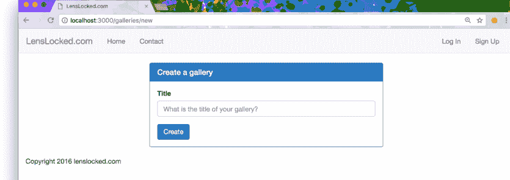

图 14.1：我们的新画库表单

我们需要做的下一件事是解析传入的表单数据。为了做到，我们将创建一个类似于 `SignupForm` 的新结构体类型，但此类型仅解析表单中的 `Title`（标题）。

## 第14章. 创建画库资源

```go
type GalleryForm struct {
    Title string `schema:"title"`
}
```


现在，我们可以使用 `parseFunction` 将在 Web 请求中提交的数据解析为 `GalleryForm` 实例。如果解析表单出现错误，我们将使用创建的 `views.Data` 类型设置警报、渲染新画库表单并返回。否则，我们的代码将继续：

```go
func (g *Galleries) Create(w http.ResponseWriter, r *http.Request) {
    var vd views.Data
    var form GalleryForm
    if err := parseForm(r, &form); err != nil {
        vd.SetAlert(err)
        g.New.Render(w, vd)
        return
    }
    // TODO: 完成此实现
}
```

在 `form` 变量中有了表单数据后，我们就可以构造一个新的 `Gallery`。

```go
gallery := models.Gallery{
    Title: form.Title,
}
```

之后，我们将调用 `GalleryService` 的 `Create` 方法并传入画库，检查错误。如果发生错误，我们需要使用从错误创建的警报再次渲染 `New` 视图。否则，我们将打印成功创建的画库。

```go
func (g *Galleries) Create(w http.ResponseWriter, r *http.Request) {
    var vd views.Data
    var form GalleryForm
    if err := parseForm(r, &form); err != nil {
```

## 14.5. 创建新画库

```go
vd.SetAlert(err)
g.New.Render(w, vd)
return
}
gallery := models.Gallery{
Title: form.Title,
}
if err := g.gs.Create(&gallery); err != nil {
vd.SetAlert(err)
g.New.Render(w, vd)
return
}
fmt.Fprintln(w, gallery)
```

注意：这里缺失的一部分代码是填充画库中 `UserID` 字段的代码。我们最终将使用当前登录用户的 ID 来填充它，但目前我们将将其留空。

我们最后需要做的事是更新路由器。当 HTTP 方法为 POST 时，我们将在 `/galeries` 路径下处理表单。

```
$ atom main.go
```

```go
func main() {
// ... 我们的大部分代码保持不变
// 画库路由
r.Handle("/galeries/new", galleryC.New).Methods("GET")
r.HandleFunc("/galeries", galleryC.Create).Methods("POST")
fmt.Println("Starting the server on :3000...")
http.ListenAndServe(":3000", r)
}
```

虽然我们还没有实现任何逻辑，但我们现在可以使用我们的表单创建新画库了。重启你的服务器并前往新的画库页面进行测试 - localhost:3000/galeries/new。

## 第14章. 创建画库资源

### 源代码

下面的链接包含了完整的源代码以及本节中所有更改代码的差异（diff）。

- 完成 - book.usegolang.com/14.5.3
- 更改 - book.usegolang.com/14.5.3-diff

## 14.5.4 验证画库

就像验证用户一样，我们需要在将画库存储到数据库之前也对其进行验证。具体来说，我们想要验证 `UserID` 始终被设置，以便我们知道哪个用户创建了每个画库，并且还要求提供标题。

我们将开始为画库验证函数定义一个类型，以及一个运行这些函数的函数，就像我们之前对用户验证的那样。

```go
$ atom models/galleries.go
type galleryValFn func(*Gallery) error
func runGalleryValns(gallery *Gallery, fns ...galleryValFn) error {
	for _, fn := range fns {
		if err := fn(gallery); err != nil {
			return err
		}
	}
	return nil
}
```

现在我们可以开始为我们的画库编写验证函数了，从一个确保设置了 `UserID` 的函数开始。

## 14.5. 创建新画库

```go
const (
  ErrUserIDRequired modelError = "models: user ID is required"
)
func (gv *galleryValidator) userIDRequired(g *Gallery) error {
  if g.UserID <= 0 {
    return ErrUserIDRequired
  }
  return nil
}
```

注意：像我们刚刚创建的这样的错误不应该是公开的，因为终端用户无法控制 `UserID`。如果你想学习创建一个类似于我们的 `modelError` 类型的私有错误，请查看附录 18.4。

下一个是确保提供标题的验证。

```go
const (
  ErrTitleRequired modelError = "models: title is required"
)
func (gv *galleryValidator) titleRequired(g *Gallery) error {
  if g.Title == "" {
    return ErrTitleRequired
  }
  return nil
}
```

最后，我们需要在 `galleryValidator` 上实现 `Create` 方法，并运行我们刚刚编写的验证。

```go
func (gv *galleryValidator) Create(gallery *Gallery) error {
  err := runGalleryFns(gallery, gv.userIDRequired, gv.titleRequired)
  if err != nil {
    return err
  }
  return gv.galleryDB.Create(gallery)
}
```

如果我们现在重启服务器并尝试创建一个画库，我们将看到“User ID is required”的错误。在我们实现查找当前用户 ID 并将其设置到 `UserId` 字段的代码之前，我们将无法通过表单创建画库。

## 14.6. 通过中间件要求用户登录

在本节中，我们将学习如何创建一个可重用的中间件，该中间件可以用于验证用户已登录，如果用户未登录则将他们重定向到登录页面。然后，我们将查看如何使用 `context` 包来存储特定于请求的信息（例如当前登录用户的 ID），并将其附加到传入的 Web 请求中，以便我们稍后在处理函数中可以访问它。

### 14.6.1 创建我们的第一个中间件

中间件（Middleware）本质上是在我们应用程序的不同部分之间插入代码的一种写法。每当用户向我们的当前应用程序发送请求时，逻辑流大致如图 14.2 所示。

| 我们的 Web 应用程序 |
| :--- |
| Web 请求 | net/http 服务器 | 路由器 | 控制器 |

图 14.2：没有中间件的 Web 请求

请求首先由 `net/http` 包处理。在 `http` 包完成工作后，我们调用路由器的 `ServeHTTP` 方法，该方法将处理查看用户尝试请求哪个页面并决定调用哪些代码。接下来，例如，如果用户正在访问 `/contact` 路径，我们的路由器将调用我们之前的静态控制器提供的 `Contact` 方法。

```
r.Handle("/contact", staticC.Contact).Methods("GET")
```

中间件是插入在 `net/http` 包和我们的路由器之间，或者我们的路由器和控制器之间的代码段。例如，我们可以在调用路由器之前添加一个中间件，来拦截被封 IP 地址的用户。

| 我们的 Web 应用程序 |
| :--- |
| Web 请求 -> net/http 服务器 -> 被封 IP 中间件 -> 路由器 -> 控制器 |

图 14.3：被封 IP 中间件

我们的中间件可以通过查看用户的 IP 地址来确定用户是否被封。如果用户被封，中间件将返回错误而不会去调用我们的路由器代码。否则，如果用户未被封，它将调用路由器的 `ServeHTTP` 方法，我们的代码将像现在一样继续处理 Web 请求。

```
if <user is banned> {
    http.Error(...)
    return
} else {
    // nextHandler = router.ServeHTTP - 一个参数
    // 传递到此代码的是一个 http.HandlerFunc
    // 我们可以调用的函数
    nextHandler(w, r)
}
```

使用中间件是接口链的另一个例子，我们在框 12.2 中讨论过这种内容。也就是说，我们正在创建一系列函数调用，其中任何一个调用都可以决定是调用链中的下一个函数还是提前终止。

## 14.6. 通过中间件要求用户登录

```
net/http -> bannedIPMiddleware -> router -> controller
  我们的代码在这里可以在进入路由器之前
  返回一个错误。
```

这样设计代码可以有很多许多益处，但我们现在将关注的首要优点是它可以简化我们的代码。假设我们写了一个中间件，如果用户未登录，它会将用户重定向到登录页面，否则它将调用链中的下一个任何处理函数。

```
router -> requireUserMiddleware -> controllerAction
```

现在，我们就不需要为每个控制器方法单独编写代码来检查用户是否已登录。相反，我们将此中间件应用到需要用户登录的操作上，而我们的控制器代码将完全保持不变。

这就是我们在这一节中要做的内容。编写我们的第一个中间件，用它来检查用户是否登录，然后此做出反应。

我们将从创建一个新包 - 中间件包 - 开始，并在其中添加一个 `RequireUser` 中间件。

```
$ mkdir middleware
$ atom middleware/require_user.go
```

为了检查用户是否登录，我们需要访问 `UserService`，我们将从创建一个带有 `UserService` 字段的结构体类型开始。

```
package middleware
import (
  "lenslocked.com/models"
```

# 第 14 章 创建画廊资源

```
type RequireUser struct {
    models.UserService
}
```

我们的下一步是编写代码，在用户未登录时重定向用户，否则渲染下一个处理函数。为了做到这一点，我们再次需要创建一个闭包，我们之前在框 12.8 中讨论过。

我们将使用闭包来接收一个参数 - 如果用户登录则要调用的下一个处理程序 - 然后返回一个匹配 `http.HandlerFunc` 定义的函数。也就是说，我们想要返回一个接受 `ResponseWriter` 和 `Request` 作为两个参数的函数。

通过编写符合此定义的方式我们的函数，我们知道它们将继续与标准库的 `net/http` 包以及我们的 `gorilla/mux` `Router` 配合工作。

我们将开始编写创建该闭包的函数。

```
// ApplyFn 将返回一个 http.HandlerFunc，该函数将
// 检查用户是否已登录，如果是，则调用
// next(w, r)，或者如果他们未登录，则将他们重定向到
// 登录页面。
func (mw *RequireUser) ApplyFn(next http.HandlerFunc) http.HandlerFunc (
	// 我们想要返回一个动态创建的
	// func(http.ResponseWriter, *http.Request)
	// 但我们还需要将其转换为
	// http.HandlerFunc
	return http.HandlerFunc(func(w http.ResponseWriter, r *http.Request) {
		// TODO: 检查用户是否登录。
		// 如果是，调用 next(w, r)
		// 如果不是，http.Redirect 重定向到 "/login"
	})
})
```

当我们完全实现 `ApplyFn` 时，我们大部分是将之前在用户控制器上学习的创建 `CookieTest` 方法的代码移动到这里。例如，我们将开始从 `Request` 对象中获取 `remember_token` cookie，就像我们在 `CookieTest` 方法中做的那样。

```
cookie, err := r.Cookie("remember_token")
if err != nil {
    http.Redirect(w, r, "/login", http.StatusFound)
    return
}
```

在这种情况下，如果发生错误，我们将用户重定向到登录页面，否则代码是相同的。

接下来，我们将使用 `UserService` 通过我们刚刚检索到的存储的 remember token 查找用户。只要用户有有效的会话，它就应该返回一个用户，否则我们将得到一个错误，指示用户需要重定向到登录页面。

```
user, err := mw.UserService.ByRemember(cookie.Value)
if err != nil {
    http.Redirect(w, r, "/login", http.StatusFound)
    return
}
fmt.Println("User found: ", user)
```

最后，我们将通过刚刚检索到的 remember token 查找用户。一旦验证用户已登录，我们将得到下面的代码。

```
import (
    "fmt"
    "net/http"
    "lenslocked.com/models"
)
func (mw *RequireUser) ApplyFn(next http.HandlerFunc) http.HandlerFunc {
    return http.HandlerFunc(func(w http.ResponseWriter, r *http.Request) {
        cookie, err := r.Cookie("remember_token")
        if err != nil {
            http.Redirect(w, r, "/login", http.StatusFound)
            return
        }
        user, err := mw.UserService.ByRemember(cookie.Value)
        if err != nil {
            http.Redirect(w, r, "/login", http.StatusFound)
            return
        }
        fmt.Println("User found: ", user)
        next(w, r)
    })
}
```

## 14.6. 通过中间件要求用户登录

func (mw *RequireUser) Apply(next http.Handler) http.HandlerFunc {
    return mw.ApplyFn(next.ServeHTTP)
}

接下来是应用我们的中间件。为了做到这一点，我们需要打开 `main.go` 文件构造 `RequireUser`。

```go
$ atom main.go
```

```go
// 将中间件包添加到到导入中
import (
    "lenslocked.com/middleware"
)
func main() {
    // ... 我们的服务和控制器设置
    // 此处不变
    requireUserMw := middleware.RequireUser{
        UserService: services.User,
    }
    // ... 我们的路由器代码
}
```

## 14.6. 通过中间件要求用户登录

我们希望在用户访问新画廊表单以及提交表单时要求他们登录。为了做到这一点，我们将调用中间件的 `Apply` 或 `ApplyFn` 方法，并将我们的控制器操作作为唯一参数。通过应用中间件，我们得到了一个新的 `http.HandlerFunc`，它在用户登录时才会运行我们的原始处理器。

```
// galleriesC.New 是一个 http.Handler，所以我们使用 Apply
newGallery := requireUserMw.Apply(galleriesC.New)
// galleriesC.Create 是一个 http.HandlerFunc，所以我们使用 ApplyFn
createGallery := requireUserMw.ApplyFn(galleriesC.Create)
```


> 注意：使用 `Apply` 还是 `ApplyFn` 取决于我们的参数是 `http.Handler` 还是 `http.HandlerFunc`。

我们将 `Apply`（或 `ApplyFn`）函数的结果传递到路由器中，之前我们是在那里传递原始处理器的。

```go
r.Handle("/galleries/new", newGallery).Methods("GET")

r.Handle("/galleries", createGallery).Methods("POST")
```

> 注意：在最终代码中，我们没有将 `Apply` 函数的结果存储在中间变量中，但结果是相同的。

### 源代码

下面的链接包含了源代码以及本节中更改的所有代码的差异。

完成 - book.usegolang.com/14.6.1

更改 - book.usegolang.com/14.6.1-diff

## 14.6.2 使用 context 存储请求作用域数据

虽然我们的中间件目前会验证用户是否登录，但它并没有帮助我们确定是哪个用户登录了。在中间件通过其记忆令牌（remember token）查找用户后，结果被丢弃了。如果我们能重用这些数据并避免每次请求中多次从数据库查找同一个用户，那就太好了。Go 在 1.7 版本中为 `http.Request` 对象增加了 `context` 包，这为我们提供了这种。

### Box 14.1 Context 争议

在 context 中存储数据（特别是在中间件或网络请求期间）可能会引起争议。这存在类型安全丢失的潜在问题，尽管它在某些方面可以让代码测试变得更容易，但在另一些方面会变得更困难。

例如，测试处理程序可能会变得更容易，因为你不再需要关注生成记忆令牌以及测试由我们中间件处理的所有用户查找代码了。相反，我们可以将单个用户附加到 context 中，我们的处理程序就能按预期工作。

测试可能会变得更困难，因为对数据的预期并不总是清晰的。当我们定义这样的方法时：

```go
func doStuff(user User, years int)
```

我们明确表达了预期的数据。但通过将数据放在 context 包中，我们掩盖了其中一些需求。

## 14.6. 通过中间件要求用户

在实践中，我发现这种方式的 context 值几乎总是双赢的，而且有方法可以应对类型安全的丢失（我们将在本节中看到），也有方法可以应对隐藏的复杂性（这些在下面的链接中进行了详细讨论）。

book.usegolang.com/context

你也可以通过以下两个资源了解更多关于 `context` 包的通用信息：

- *blog.golang.org/context* - Go 官方博客
- *youtube.com/watch?v=LSzROVeraWw* - Francesc Campoy 在 justforfunc 节目中关于 context 包的介绍

`context` 包在 Go 中已经存在了很久，在 Go 1.7 之前它并不是标准库的一部分。相反，它是 `/x/packages`¹ 的一部分，这些包本质上是由 Go 核心团队创建的一系列子仓库，但在较宽松的兼容性要求下开发。

在 Go 1.7 中，该包被加入了标准库，同时 `http.Request` 对象也附加了 context，以便更方便地向请求中添加额外数据。

`context` 包旨在用于取消、截止日期以及存储请求作用域的值。我们不会将它用于前两种情况，但如果你想阅读更多关于它们的内容，我建议查看 Box 14.1 底部的链接。

我们将使用 `context` 包是为了存储请求作用域的值。具体来说，我们将在 `RequireUser` 中间件查找当前登录用户后使用它来存储该用户，然后我们就有办法在随后的处理程序中重用该数据，而无需再次进行数据库查询。

> ¹https://github.com/golang/go/wiki/SubRepositories

## 第 14 章. 创建 GALLERY 资源

当我们想要从 http 请求中获取 context 时，通过编写以下代码来实现：

```go
func someHandler(w http.ResponseWriter, r *http.Request) {
  // 这是我们获取请求 context 的方式
  ctx := r.Context()
}
```

一旦我们有了 context，就可以像处理任何其他 context 对象一样与之交互。这里需要注意的一个重要点是，当你与 context 交互时，可以创建一个派自原始 context 的 context，而不是修改原始 context。例如，如果我们想向 context 添加一个值，我们将使用 context 包提供的 `WithValue`² 函数，该函数接收一个现有的 context、一个键和一个值，然后返回一个存储了该键值的新 context。

```go
import "context"
newCtx := context.Value(ctx, "my-key", "my-value")
```

这样做之后，我们可以使用 context 对象提供的 `Value` 方法获取我们的值。

```go
// 获取存储在 "my-key" 中的值
myKey := newCtx.Value("my-key")
```

这种方法的缺点是，`context` 包将其所有数据都以空接口类型（interface{}）的形式返回。这意味着在使用返回的值之前，我们需要先将它们转换为正确的数据类型。

> ²https://golang.org/pkg/context/#WithValue

## 14.6. 通过中间件要求用户

```go
myKeyStr, ok := myKey.(string)
if !ok {
    // 类型转换失败！
}
// 否则 myKeyStr 将具有 myKey 中
    // 值的字符串表示
```

这种对类型安全的缺失是涉及 `context` 包争议的来源之一。通过在 context 中存储值，我们丢失了一些必须预期的编译时类型安全。例如，如果我们在示例中 context 中存储一个整数而不是字符串，那么尝试将其转换为字符串的类型断言将失败，我们的代码随后必须手动从从中恢复，而这通常是不可能的，因为我们不知道如何处理无效数据继续进行。

```go
newCtx := context.WithValue(ctx, "my-key", 123)
myKey := newCtx.Value("my-key")
if myKeyStr, ok := myKey.(string); !ok {
    // 我们这里有一个问题，因为 myKey 是 int，不是
    // string！我们现在必须在代码中尝试恢复
    // 而不是让编译器为我们捕获！
    // 在此处继续的方法通常是返回错误
}
```

幸运的是，有一种方法可以应对这个问题，这涉及到创建一个自己的 context 包，它封装了现有 context 包的一些函数并使用私有键。如果有代码配合，这会容易理解得多，因此从今起我们将编写自己的 context 包。我们将首先为该包创建目录和一个源文件。

```bash
$ mkdir context
$ atom context/context.go
```

我们将从导入和包声明开始。

```go
package context

import (
    "context"
    "lenslocked.com/models"
)
```

我们将同时导入 context 包和 models 包，因为我们要编写一个函数，接受现有的 context、一个用户，然后返回一个存储了该值的新 context。

```go
func WithUser(ctx context.Context, user *models.User) context.Context {
    return context.WithValue(ctx, "user", user)
}
```

只要开发者只调用 `WithUser` 函数为 "user" 键分配值，我们就永远不必担心无效数据。这意味着我们无法检索任何存储在这些键中的值，因此我们需要提供一个函数从给定的 context 中查找用户。

```go
func User(ctx context.Context) *models.User {
    if temp := ctx.Value(userKey); temp != nil {
        if user, ok := temp.(*models.User); ok {
            return user
        }
    }
    return nil
}
```

```go}
  return nil
}
```

现在我们的类型断言应该是始终正确的，但为了安全起见，我们仍然需要进行检查。我们应该验证上下文中之前是否存储了用户，这正是我们第一个“temp != nil”检查的作用。

如果出现其中任何一个问题，我们将返回 `nil`。否则，我们将使用类型断言返回存储在上下文中的用户。

在完成 `context` 包后，我们将把 `RequireUser` 中间件更新到该包中。在中间件内部，我们将从请求中获取上下文，创建一个存储了该用户的用户的新上下文，然后使用更新后的上下文创建一个新请求。

```bash
$ atom middleware/require_user.go
```

将我们的新包添加到导入项中。

```go
import (
  // 添加此行
  "lenslocked.com/context"
)
```

然后进入我们编写的 `ApplyFn` 函数。在该函数的末尾，我们将像之前在本节中看到的那样从请求中获取上下文。一旦获取了上下文，将其传递给我们编写的 `WithUser` 函数，以及我们想要设置的用户，然后将返回值赋给 `ctx` 变量。最后，我们使用现有的请求和我们的新上下文创建一个新请求。就像我们不修改修改对象而是派生一个新的对象一样，我们也需要使用现有请求和新上下文派生一个新的请求。然后，我们将新请求传递给下一个处理器。

## 14.6. 通过中间件要求用户

```go
func (mw *RequireUser) ApplyFn(next http.HandlerFunc) http.HandlerFunc {
	return http.HandlerFunc(func(w http.ResponseWriter, r *http.Request) {
	// ... cookie 查找和用户验证保持不变
		// 从请求中获取上下文
		ctx := r.Context()
		// 从现有的上下文创建一个新上下文，
		// 并使用私有用户键存储了我们的用户
		ctx = context.WithContext(ctx, user)
		// 从现有的请求创建一个新请求，
		// 附加我们的上下文并将其赋值回 'r'
		r = r.WithContext(ctx)
		next(w, r)
	})
}
```

最后，我们需要更新 `galleries` 控制器中的 `Create` 方法，为我们正在创建的画廊获取适当的 `UserID`。

```bash
$ atom controllers/galleries.go
```

找到 `Create` 方法。我们将在解析表单之后更新它，并查找用户。我们将从上下检索用户，然后使用该用户的 ID 作为我们构建的 `Gallery` 模型的 `UserID` 字段。

```go
func (g *Galleries) Create(w http.ResponseWriter, r *http.Request) {
	// ... 使用现有代码解析表单
	// 这是我们的新代码
	user := context.User(r.Context())
	// 然后我们更新构建 Gallery 模型的方式
	gallery := models.Gallery{
		Title: form.Title,
		UserID: user.ID,
	}
	// 然后我们像以前一样创建画廊，使用
	// g.gs.Create(...) 方法调用。
}
```

## 第 14 章：创建画廊资源

我们现在能够使用我们的表单创建画廊了，并且每个画廊的创建都应该由当前登录的用户自动分配一个 `UserId`。你可以通过通过创建新账户（或登录现有账户）并使用每个账户创建一个画廊来测试这一点。然后检查你的日志以验证每个画廊都是使用适当的相应 ID 创建的。

### 源代码

下面的链接包含了完整的源代码以及本节中所有更改代码的差异。

- 已完成 - [book.usegolang.com/14.6.2](https://book.usegolang.com/14.6.2)
- 更改 - [book.usegolang.com/14.6.2-diff](https://book.usegolang.com/14.6.2-diff)

## 14.7 显示画廊

我们将实现的下一个处理器是用于在画廊创建后渲染它的处理器。现在这可能很无聊，因为我们的画廊中还没有图像，但一旦我们实现了上传功能，稍后就可以进行更新。现在我们想要关注显示画廊的标题并在用户创建新画廊后重定向他们。

我们将从创建一个视图并将其添加到控制器开始。之后，我们将更新路由并查看如何使用 `gorilla/mux` 解析 URL 参数。一旦我们获取了要渲染的画廊 ID，我们需要编写一些代码从数据库中检索它，最后，我们将查看如何使用我们的路由器、命名路由和画廊 ID 为现有的画廊生成 URL。然后，我们将使用生成的 URL 在用户创建新画廊后重定向用户。

## 14.7 显示画廊

### 14.7.1 创建显示画廊视图

我们需要的第一个部分是用于渲染我们画廊的模板。现在我们对画廊可以访问的数据只有它的标题，所以这极地简化了我们的视图。

```bash
$ atom views/galleries/show.shtml
```

```html
{(define "yield")}
<div class="row">
  <div class="col-md-12">
    <h1>
      {{Title}}
    </h1>
    <p>Images coming...</p>
  </div>
</div>
{{end}}
```

此模板将渲染画廊的标题。我们需要向控制器添加一条消息。

```bash
$ atom controllers/galleries.go
```

```go
type Galleries struct {
	Title  string
	UserID int
}
```

在这种情况下，我们规定 id 只能是数字字符。

## 14.7. 显示画库

现在我们已经知道了要做什么，让我们从为我们的画库展示页定义路由开始。

```bash
$ atom main.go
```

我们将在现有的画库路由之后引入一个新的新路由。

```go
func main() {
  // 大部分内容保持不变
  r := mux.NewRouter()
  // 我们有几个现有的路由
  // 画库路由
  // 留出现有的画库路由，并在下方添加
  // 新路由。
  r.HandleFunc("/galleries/id:[0-9]+",
    galleriesC.Show).Methods("GET")
  // ... 剩余代码保持不变
}
```

这段代码告诉我们的路由器，我们希望将所有以 /galleries/ 开头并以数字 ID 结尾的网络请求映射到画库控制器的 `Show` 方法。我们还没有定义该方法，所以让我们接下来来定义它。

```bash
$ atom controllers/galleries.go
```

与其在事后才尝试解释这一切，我们将在下方查看完整的代码，并在几乎每一行代码之前都添加注释，以帮助解释每行代码的用途。

```go
import (
  // 添加此导入
  "strconv"
)
```

## 第 14 章节：创建画库资源

```go
// GET /galleries/:id
func (g *Galleries) Show(w http.ResponseWriter, r *http.Request) {
	// // 首先我们像之前看到的那样获取变量。这样做
	// 是为了我们可以从路径中获取变量，比如 "id"
	// 变量。
	vars := mux.Vars(r)
	// 现在我们需要从 vars 中获取 "id" 变量。
	idStr := vars["id"]
	// 我们的 idStr 是字符串，所以我们使用 strconv 包提供的
	// Atoi 函数将其转换为整数。此函数还可以返回一个错误，
	// 所以我们需要检查该错误。
	id, err := strconv.Atoi(idStr)
	if err != nil {
		// 如果发生错误，我们将返回 StatusNotFound
		// 画库 ID，因为请求的页面是无效的。
		http.Error(w, "Invalid gallery ID", http.StatusNotFound)
		return
	}
	// 这个返回只是为了防止编译器抱怨
	// 没有使用 id 参数。我们稍后会使用它。
	_ = id
	// 最后我们需要根据已有的 ID 查找画库，
	// 但我们还没有写那部分代码！目前我们将
	// 创建一个临时画库来测试我们的视图。
	gallery := models.Gallery{
		Title: "A temporary fake gallery with ID: " + idStr,
	}
	// 我们将构建 views.Data 对象并将我们的画库
	// 设置为 Yield 字段，但从技术上我们不需要
	// 这样做，可以直接将 gallery 传递给 Render
```


	// 方法，因为我们在 Render 方法中编写了类型切换逻辑。

	var `vd` `views.Data`

	`vd.Yield` = `gallery`

	`g.ShowView.Render(w, vd)`

}

虽然我们的代码还没有从数据库中渲染画库，但我们现在能够通过导航到类似 `localhost:3000/galleries/123` 的路径来查看并验证我们的画库展示是否正常工作。

在该页面上，我们将显示一个画库标题，即我们在 `Show` 方法中定义的那个，如果我们更改路径中的 ID，标题也会随之更新。展示页完成后，我们就准备好编写代码了，允许我们通过 ID 从数据库中检索画库。

### 源代码

下面的链接包含了完整的源代码以及本节中所有更改代码的差异（diff）。

已完成 - `book.usegolang.com/14.7.2`

更改 - `book.usegolang.com/14.7.2-diff`

## 14.7.3 通过 ID 查找画库

我们的目标是在 `GalleryService` 中添加一个方法，允许我们通过 ID 查找现有的画库。这与我们为 `UserService` 编写 `ByID` 方法几乎相同，唯一的区别在于用于从数据库检索信息的资源类型。`GORM` 将根据该资源的类型决定使用哪个数据库表。我们首先通过向 `GalleryDB` 接口添加 `ByID` 方法。

```
$ atom models/galleries.go
```

// GalleryDB 用于与画库数据库交互。

// 对于大多数单个画库查询：

// 如果找到了画库，我们将返回 nil

// 如果没有找到画库，我们将返回 ErrNotFound

// 如果发生其他错误，我们将返回一个关于错误的详细信息。

// 这可能由 models 包生成。

type `GalleryDB` interface {

    `ByID(id uint) (*Gallery, error)`

    `Create(gallery *Gallery) error`

}
```

我们的 `ByID` 方法接受一个无符号整数作为 `id` 参数，然后返回请求的画库或错误。可能的错误与 `UserDB` 接口中的相同，但在这里进行记录也是一个好主意。接下来我们需要在 `galleryGorm` 类型上实现此方法。

```go
func (gg *gallerygorm) ByID(id uint) (*Gallery, error) {
    var gallery Gallery
    db := gg.Where("id = ?", id)
    err := db.First(&gallery)
    if err != nil {
        return nil, err
    }
    return &gallery, nil
}
```

正如早期提到的，`ByID` 方法与我们为 `userGorm` 类型实现的几乎相同，但这里使用的是 `Gallery` 变量而不是 `User`。当我们调用 `first` 方法时（它随后调用 `GORM` 提供的 `First` 方法），该变量的类型将用于确定我们要访问的数据库表。由于我们没有看到那部分代码，因为它发生在 `gorm` 包内部。

我们在这一节中要做的最后一件事是更新画库控制器的 `Show` 方法，以查找并渲染真实的画库。

```
$ atom controllers/galleries.go
```

```go
func (g *Galleries) Show(w http.ResponseWriter, r *http.Request) {
	vars := mux.Vars(r)
	idStr := vars["id"]
	id, err := strconv.Atoi(idStr)
	if err != nil {
		http.Error(w, "Invalid gallery ID", http.StatusNotFound)
		return
	}
	// 我们的新代码从这里开始
	gallery, err := g.gs.ByID(uint(id))
	if err != nil {
		switch err {
			case models.ErrNotFound:
				http.Error(w, "Gallery not found", http.StatusNotFound)
			default:
				http.Error(w, "Woops! Something went wrong.", http.StatusInternalServerError)
		}
		return
	}
	var vd views.Data
	vd.Yield = gallery
	g.ShowView.Render(w, vd)
}
```

现在不是自己构建画库，而是使用我们的画库服务来检索。`ByID` 方法期望一个无符号整数，但我们的 `id` 存储为有符号整数（`int`），因此在传递给 `ByID` 方法之前我们需要将其转换为 `uint`。

一旦从 `ByID` 调用返回结果，我们就会检查是否有错误。如果发生错误且为 `ErrNotFound`，我们将渲染一个找不到画库的消息并返回 `404` (`StatusNotFound`) 状态码。如果错误是其他内容，目前我们将渲染一个通用错误消息，因为我们没有相应的备用视图。

用于渲染 `ShowView` 的其余代码保持不变，但请记住，只有提供有效的画库 ID，我们的新 `Show` 方法才能工作！这意味着你需要使用新的画库表单创建一个画库，并在访问画库页时使用该 ID。

### 源代码

下面的链接包含了完整的源代码以及本节中所有更改代码的差异。

已完成 - `book.usegolang.com/14.7.3`

更改 - `book.usegolang.com/14.7.3-diff`

## 14.7.4 生成参数 URL

在本节中，我们将学习如何在用户创建画库后自动将其重定向到该画库。例如，在用户创建一个画库并被分配 ID `34` 后，我们可能通过下面的代码手动将他们重定向到那里。

```go
gallery := ...
path := fmt.Sprintf("/galleries/%d", gallery.ID)
http.Redirect(w, r, path, http.StatusFound)
```

这是因为 `Sprint` 函数会将 `%d` 替换为画库 ID，为我们生成一个类似 `"/galleries/34"` 的路径。这种方法的缺点是，如果我们以后将路径更改为类似 `"/albums/34"`，我们就必须找到所有这样的代码并更新它。

与其以这种方式编写代码，不如编写一个简单的函数来创建这些路径并在整个代码中使用它们。例如，我们可能使用以下代码来创建我们的画库路径。

```go
func galleryPath(id uint) string {
  return fmt.Sprintf("/galleries/%d", id)
}
```

## 14.7. 显示画库

代码本身实际上没有区别，但现在如果我们更改路径，只需要在代码的单处进行更新即可。

`gorilla/mux` 包的路由器已经提供了类似的功能。我们不需要为每个路径创建一个单独的函数，而是简单地使用命名路由。

```
r := mux.NewRouter()
r.HandleFunc("/dogs/id:[0-9]+", dogHandler).Name("show_dog")
```

通过为我们的路由命名，我们稍后可以使用路由器来重建此类路由。

```
url, err := r.Get("show_dog").URL("id", "34")
```

第一个方法 `Get` 用于检索命名路由。第二个方法 `URL` 用于创建一个 `url.URL`。⁶，它是由 `url` 包提供的一个类型。我们需要传递到 `URL` 方法的唯一数据是我们需要为路由提供的参数。对于每个参数，我们首先提供参数名称（例如“id”），然后为它提供一个字符串格式的值（例如“34”）。

> 注意：`URL` 方法之所以这样工作，是因为它不知道你的路由有多少个变量，但通过使用变长参数，它可以接受根据需要任意数量的参数。

学习所有这一切意味着以下几点：

- 1. 如果我们要重建查看单个画库的路径，我们需要在画库控制器内部访问路由器。
- 2. 我们需要为显示画库的路由命名，并让该名称对控制器和我们的 `main.go` 源文件可用。

⁶https://golang.org/pkg/net/url#URL

```
func main() {
// .. 我们仍然以相同的方式设置服务
// 在我们创建控制器之前添加此内容。它
// 之前是在之后编写的。
r := mux.NewRouter()
staticC := controllers.NewStatic()
```

## 14.7. 显示画库

```
usersC := controllers.NewUsers(services.User)
// 我们还需要更新此函数调用以提供
// 路由器
galleriesC := controllers.NewGalleries(services.Gallery
```

接下来，我们需要为显示画库的路由定义一个名称。我们将在画库控制器的源文件中这样做，并将其存储在名为 `ShowGallery` 的常量中。

```
$ atom controllers/galleries.go
```

```
const (
  ShowGallery = "show_gallery"
)
```

接下来，我们需要回到主源文件，在其中声明并命名路由。

```
$ atom main.go
```

在你的 `main` 函数中找到与下面代码类似的路由。

```
r.HandleFunc("/galleries/{id:[0-9]+}", galleriesC.Show).Methods("GET")
```

## 第 14 章. 创建画库资源

在创建它之后，我们将更新它到路由器。

最后，我们回到画库控制器来更新 `Create` 方法。我们将添加代码，使用 `ShowGallery` 路由创建一个 URL，然后在用户创建画库后将他们重定向到该页面。

```
// atom controllers/galleries.go
```

```
func (g *Galleries) Create(w http.ResponseWriter, r *http.Request) {
	// 保持此大部分代码不变
	// 移除任何现有的 Fprintln 语句，如下所示
	//
	fmt.Fprintln(w, gallery)
	// 然后添加以下代码，使用路由器
	// 和命名的 ShowGallery 路由创建 URL。
	url, err := r.Get(ShowGallery).URL("id",
		strconv.Itoa(int(gallery.ID)))
	// 检查创建 URL 错误
	if err != nil {
		http.Redirect(w, r, "", http.StatusFound)
		return
	}
	// 如果出错，使用我们刚刚创建的 URL 并重定向
	// 到该 URL 的路径。我们不需要
	// 整个 URL，因为你的应用程序可能托管在
	// localhost:3000，或者可能在 lensocked.com。通过
	// 只使用我们创建的路径，可以忽略这一细节。
	http.Redirect(w, r, url.Path, http.StatusFound)
}
```

注意：我们在上面的代码中使用了 `Itoa` 函数，它与我们之前看到的 `Atoi` 函数相反。`Atoi` 将字符串转换为整数，而 `Itoa` 将将整数转换为字符串。我们只需要在将其传递给函数之前，将我们的 `uint` 强制转换为整数即可。

## 14.8. 编辑画库

在对 `Create` 方法进行最后的最后的更改后，我们就完成了在控制器中引入 `Show` 操作。重启你的服务器，通过访问 `localhost:3000/galleries/new` 并提交带标题的新画库表创建一个新画库。将被重定向到显示画库页面，URL 中的 ID 部分将填充为你创建的画库的 ID。显示画库页面还将你的新画库的标题渲染为页面的标题。

### 源代码

下面的链接包含了完整的源代码以及本节中所有更改代码的差异（diff）。

完成 - `book.usegolang.com/14.7.4`

更改 - `book.usegolang.com/14.7.4-diff`

## 14.8 编辑画库

编辑画库就像编辑任何资源一样，将要求我们创建一些东西。

首先，我们需要创建一个视图来渲染编辑画库的表单，以及一个渲染视图的操作。

首先，我们需要创建一个视图来渲染编辑画库的表单，以及一个渲染视图的操作。

注意：我们在上一节中创建的显示画库操作是因为画库目前是公开的，但只有画库的所有者才能编辑它。

之后我们需要更新数据库中的库。我们将通过在 `models` 包的 `GalleryDB` 接口中添加 `Update` 方法来实现这一点。

最后，我们需要一种方式来处理画库表单，再次验证登录用户是否有权限编辑表单，然后使用我们在上一步引入的 `Update` 方法更新数据库。

我们将在子节中执行这些步骤。

### 14.8.1 编辑画库操作

像大多数新页面一样，我们将通过创建用于渲染视图的模板开始。对于我们的编辑画库页面，我们将具有基础的 Bootstrap 布局，以及一个将数据提交到 `POST /galleries/:ID/update` 的编辑画库表单。当我们学习 REST 时得知更新通常是通过 `PUT` 完成的，但遗憾的是大多数浏览器支持并不良好。让 `PUT` 起作用的唯一方法是使用 JavaScript 技巧，但使用唯一的 URL 和 POST 你的 Web 表单通常更容易。你的 Web 服务器仍然可以支持 `POST` 路由，但你不必被迫在你的网站中引入额外的 JavaScript。

```
$ atom views/galleries/edit.html
```

```
{%define "yield"}
<div class="row">
  <div class="col-md-6 col-md-offset-3">
    <div class="panel panel-primary"
```

## 14.8. 编辑画库

```
<div class="panel-heading">
  <h3 class="panel-title">编辑你的画库</h3>
</div>
<div class="panel-body">
  {{template "editGalleryForm"}}
</div>
</div>
</div>
{{}}

{{define "editGalleryForm"}}
<form action="/galleries/{{.ID}}/update" method="POST">
<div class="form-group">
<label for="title">标题</label>
<input type="text" name="title" class="form-control" id="title" placeholder="画库标题是什么？">
</div>
<button type="submit" class="btn btn-primary">更新</button>
</form>
{{end}}
```

我们在 `editGalleryForm` 模板中需要说明的一点是，我们现在将画库的当前标题设置为输入字段的默认值。这是通过读取代码实现的：

```
<input value="{{.Title}}">
<!-- 这部分设置了输入的初始值 -->
```

这意味着我们需要向模板传递一个现有的画库，我们稍后会这样做。现在让我们更新画库控制器，以便它知道我们的新视图。

```
atom controllers/galleries.go

func NewGalleries(go models.GalleryService, r mux.Router) *Galleries {
  return &Galleries{
  New: views.New("bootstrap", "galleries/new"),
  ShowView: views.New("bootstrap", "galleries/show"),
  EditView: views.New("bootstrap", "galleries/edit"),
```

## 第 14 章：创建画库资源

```go
gs: r,
}
type Galleries struct {
	New       *views.View
	ShowView *views.View
	EditView *views.View
	gs      models.GalleryService
	r       *mux.Router
}
```

现在我们可以开始创建一个动作，用于查找画库并用它渲染编辑视图。为了实现这一点，我们需要从路径中获取用户尝试编辑的画库 ID。我们将像在 `Show` 动作中那样使用 `gorilla/mux` 来完成这一操作。事实上，我们所有用于获取 ID 并使用 `GalleryService` 查找画库的代码几乎完全相同，那么为什么我们不将其移动到一个可重用的函数中呢？


```go
func (g *Galleries) galleryByID(w http.ResponseWriter,
	r *http.Request) (models.Gallery, error) {
	vars := mux.Vars(r)
	idStr := vars["id"]
	id, err := strconv.Atoi(idStr)
	if err != nil {
		http.Error(w, "Invalid gallery ID", http.StatusNotFound)
		return nil, err
	}
	gallery, err := g.gs.ByID(uint(id))
	if err != nil {
		switch err {
		case models.ErrNotFound:
			http.Error(w, "Gallery not found", http.StatusNotFound)
		default:
			http.Error(w, "Whoops! Something went wrong.", http.StatusInternalServerError)
			return nil, err
		}
	}
	return gallery, nil
}
```

正如我们所看到的，`galleryByID` 中几乎所有的代码都直接来自我们的 `Show` 方法。这意味着我们可以更新 `Show` 方法来使用 `galleryByID` 方法，而不是自己完成所有这些工作。

```go
func (g *Galleries) Show(w http.ResponseWriter, r *http.Request) {
	gallery, err := g.galleryByID(w, r)
	if err != nil {
		// 对我们来说，只需要在这里返回即可。
		return
	}

	var vd views.Data
	vd.Yield = gallery
	g.ShowView.Render(w, vd)
}
```

通过将代码移动到可重用的方法，我们能够大大简化 `Show` 方法，但我们仍然需要进行快速快速检查以判断我们是否收到了画库。如果是，我们就可以渲染 `Show` 视图。否则，我们将依靠 `galleryByID` 方法来渲染错误并返回。

回到 `Edit` 方法，我们在这里也将使用 `galleryByID` 方法。在获取画库后，我们将像在 `Show` 方法中完全一样检查错误，然后从请求上下文中（request context）中获取用户，并验证该用户是否有权访问此画库。我们可以通过验证画库的 `UserID` 字段是否与用户的 ID 相同来实现，这意味着该用户拥有该画库。如果事实如此，我们将渲染一个错误，否则我们将继续。

```go
// GET /galleries/{id}/edit
func (g *Galleries) Edit(w http.ResponseWriter, r *http.Request) {
	gallery, err := g.galleryByID(w, r)
	if err != nil {
		// 对我们来说，只需要在这里返回即可。
		return
	}

	user := context.User(r.Context())
	if gallery.UserID != user.ID {
		http.Error(w, "You do not have permission to edit this gallery", http.StatusForbidden)
		return
	}

	var vd views.Data
	vd.Yield = gallery
	g.EditView.Render(w, vd)
}
```

## 14.8. 编辑画库

完成 - book.usegolang.com/14.8.2

更改 - book.usegolang.com/14.8.2-diff

### 14.8.3 更新画库模型

在本节中，我们将编写必要的代码将画库的更改推送到数据库中。我们将再次使用验证，因为我们不允许使用无效数据更新画库。

我们将从 galleries 模型源码开始，在 `GalleryDB` 接口中添加一个 `Update` 方法。

```go
$ atom models/galleries.go
```

```go
type GalleryDB interface {
  ByID(id uint) (*Gallery, error)
  Create(gallery *Gallery) error
  Update(gallery *Gallery) error
}
```

接下来我们需要编写该方法。我们将从简单的部分开始——`galleryGorm` 的实现。

```go
func (gg *galleryGorm) Update(gallery *Gallery) error {
  return gg.db.Save(gallery).Error
}
```

在新的更新中，我们使用了 GORM 提供的 `Save` 方法，并返回在此过程中遇到的任何错误。

现在，我们需要为 `Update` 方法添加验证，我们通过向 `galleryValidator` 类型添加一个 `UpdateValidator` 方法来实现。我们将使用两个已经创建的验证；第一个将验证 `UserID` 字段是否已正确设置，第二个将验证是否为画库提供了标题。

```go
func (gv *galleryValidator) Update(gallery *Gallery) error {
	err = runGalleryValidations(gallery,
		gv.userIDRequired,
		gv.titleRequired)
	if err != nil {
		return err
	}
	return gv.GalleryDB.Update(gallery)
}
```

在 `GalleryService`（通过嵌入的 `GalleryDB`）中添加 `Update` 方法后，我们可以回到 galleries 控制器，并在我们的 `Update` 操作中使用此新方法。

```go
$ atom controllers/galleries.go
```

我们只修改 `Update` 方法的最后部分（我们之前在那里放置了 TODO），该方法的前半部分为了简洁起见而留了空白。

```go
func (g *Galleries) Update(w http.ResponseWriter, r *http.Request) {
	// ... 这前半部分保持不变

	gallery.Title = form.Title
	err = g.gs.Update(gallery)
	// 如果有错误提示，它将是一个错误。否则
	// 我们仍然会渲染一个提示，但它将是
	// 一个成功消息。
	if err != nil {
		vd.SetAlert(err)
	} else {
		vd.Alert = views.Alert{
			Level:   views.AlertLvSuccess,
			Message: "Gallery successfully updated!",
		}

		// 无论是否有错误，我们都要使用更新后的信息
		// 渲染 EditView。
		g.EditView.Render(w, vd)
	}
}
```

522 第14章 创建画库资源

现在我们的代码支持编辑画库了！重启服务器并进行测试运行。然后返回查看画库页面，验证在提交编辑画库表单时，它是否确实持久化新标题。

### 源代码

下面的链接包含了完整的源代码以及本节中所有更改代码的差异。

- 完成 - book.usegolang.com/14.8.3

- 更改 - book.usegolang.com/14.8.3-diff

## 14.9 删除画库

就像 `Update` 操作一样，为我们的画库实现删除功能将涉及我们的 models 包、galleries 控制器和一个视图模板。与我们的更新操作不同，我们不会创建一个创建一个视图；相反，我们将在编辑画库页面上添加一个删除按钮，因为如果你想删除资源，编辑页面是一个相当常见的地方。

这次，我们将从在 models 包中实现 `Delete` 方法开始。

```go
$ atom models/galleries.go
```

首先，我们向 `GalleryDB` 接口中引入该方法。

```go
type GalleryDB interface {
  ByID(id uint) (*Gallery, error)
  Create(gallery *Gallery) error
```

## 14.9. 删除画库

```go
Update(gallery *Gallery) error
Delete(id uint) error
}
```

然后，我们在 `galleryGorm` 类型上实现它。

```go
func (gg *galleryGorm) Delete(id uint) error {
	gallery := Gallery(Model: gorm.Model{ID: id})
	return gg.db.Delete(&gallery).Error
}
```

并且我们编写了一个验证函数，确保我们不会尝试用无效 ID（为 0 的 ID）进行删除。

```go
func (gv *galleryValidator) nonZeroID(gallery *Gallery) error {
	if gallery.ID <= 0 {
		return ErrIDInvalid
	}
	return nil
}

func (gv *galleryValidator) Delete(id uint) error {
	var gallery Gallery
	gallery.ID = id
	if err := runGalleryValidations(&gallery, gv.nonZeroID); err != nil {
		return err
	}
	return gv.galleryDB.Delete(gallery.ID)
}
```

接下来，我们将引入一个控制器来处理删除请求。

```go
$ atom controllers/galleries.go
```

我们将处理方法命名为 `Delete`，在我们的方法中，我们需要查找画库，验证用户是否有权限删除它，然后使用我们 GalleryService 提供的方法。

524 第14章 创建画库资源

```go
import (
	"fmt"
)

// POST /galleries/:id
func (g *Galleries) Delete(w http.ResponseWriter, r *http.Request) {
	gallery, err := g.gs.ByID(id)
	if err != nil {
		// 如果有错误提示，它将是一个错误。否则
		// 我们仍然会渲染一个提示，但它将是
		// 一个成功消息。
		vd.SetAlert(err)
	} else {
		vd.Alert = views.Alert{
			Level:   views.AlertLvSuccess,
			Message: "Gallery successfully updated!",
		}

		// 无论是否有错误，我们都要使用更新后的信息
		// 渲染 EditView。
		g.EditView.Render(w, vd)
	}

	// TODO: 我们最终重重到到
	// 现在我们使用：
	fmt.Fprintf(w, "Gallery successfully deleted!")
}
```

接下来，将在路由器中添加一个路由来映射我们的删除代码。

```go
$ atom main.go
```

在画库路由附近添加以下路由。

```go
r.HandleFunc("/galleries/{id:[0-9]+}/delete",
    requireMw.Apply(galleriesC.Delete)).Methods("POST")
```

最后，我们需要更新我们的编辑页面模板，并使用以下代码更新它。

```go
$ atom views/galleries/edit.html
```

```html
{{define "editForm"}}
<form action="/galleries/{{ID}}/update" method="POST">
<div class="form-group">
<label for="title">Title</label>
<input type="text" name="title" class="form-control" id="title" placeholder="What is the title?" />
</div>
<button type="submit" class="btn btn-primary">Update</button>
</form>
<!-- 这是我们新的删除按钮，它向
/galleries/{{ID}}/delete 提交 POST
请求。 -->
<form action="/galleries/{{ID}}/delete" method="POST">
<button type="submit" class="btn btn-danger">Delete</button>
</form>
{{end}}
```

## 14.10. 查看所有拥有的画廊

在最后一步中，我们将实现一个用于渲染索引页的新视图；在此过程中，我们将学习如何使用 Go 模板中的 range 动作来遍历数据切片并逐个渲染每一个项。

### 14.10.1 按用户 ID 查询画廊

为了使用用户 ID 查询画廊，我们再次需要向 `GalleryDB` 接口添加一个方法，以便在用于与数据库交互的 `GalleryService` 中可以使用。

```go
$ models/galleries.go
```

我们知道，当方法执行成功时需要返回画廊切片，因为一个用户可能有很多画廊。我们也知道在与数据库交互时可能会遇到错误，无论是因为我们的失误还是因为数据库崩溃，我们可以从一个接受用户 ID 并返回两个部分数据的方法开始。

```go
type GalleryDB interface {
	ByID(userID uint) (*Gallery, error)
	ByUserID(userID uint) ([]Gallery, error)
	Create(gallery *Gallery) error
	Update(gallery *Gallery) error
	Delete(id uint) error
}
```

接下来我们将在 `galleryGorm` 类型上实现此方法。这样做实际上与我们目前编写的代码非常相似，但我们不是在我们的 *gorm.DB 类型*上调用 `First` 方法，而是将调用 `Find` 方法。这两个方法之间的主要区别是：`First` 用于检索单个资源（第一个！），而 `Find` 旨在返回该资源的多个实例。因此，`First` 期望传入单个资源，而 `Find` 期望一个切片。

```go
func (gg *galeryGorm) ByUserID(userID uint) ([]Gallery, error) {
	var galleries []Gallery
	// 我们构建此查询的方式与我们构建
	// 单个用户查询的方式完全一样。
	db := gg.db.Where("user.id = ?", userID)
	// 真正的区别在于使用 Find 而不是 First
	// 并且传递的是切片而不是单个画廊作为
	// 参数。
	if err := db.Find(&galleries).Error; err != nil {
		return nil, err
	}
	return galleries, nil
}
```

注意：从长期来看，可能需要引入分页等功能，但当用户拥有数百个画廊时，这通常会变成问题。我通常倾向于先启动应用程序，然后再回来添加这些功能，这正是我们在本书中将做的。

我们现在不会对 `ByUserID` 方法添加任何验证，因为目前没有太大需求。如果你想，可以使用之前创建的 `nonZeroID` 验证，但与没有该验证的 `Delete` 方法不同，这样做是不必要的，因为它没有破坏性。它只会返回没有正确设置 UserID 的画廊，由于现在我们已经在 `Create` 和 `Update` 方法中有了验证，这种情况不应该发生。

如果你想验证代码是否运行正常，可以更新你的 `main.go` 源文件进行测试查询并打印结果，我们不会提交这段代码。

```go
// 这是不会提交的测试代码
tUserID := 1 // 选择一个映射到数据库中某个用户的 ID
galleries, _ := services.Gallery.ByUserID(userID)
fmt.Println(galleries)
```

## 14.10. 查看所有拥有的画廊

### 源代码

下面的链接包含了完整的源代码以及本节中所有更改代码的差异（diff）。

- 完成版 - book.usegolang.com/14.10.1

- 差异版 - book.usegolang.com/14.10.1-diff

### 14.10.2 添加索引处理器

接下来我们需要引入一个函数来处理指向索引页的传入 Web 请求。我们还需要该页面准备一个视图，但在下一节之前不会实现它。现在我们只需编写一个占位符（stub）。

```go
$ atom views/galleries/index.gohtml

{{define "yield"}}
TODO: 实现索引视图。
提供的数据: {{.}}
{{end}}
```

接下来我们需要将此视图添加到画廊控制器中。

```go
$ atom controllers/galleries.go
```


```go
func NewGalleries(gs models.GalleryService, r *mux.Router) *Galleries {
  return &Galleries{
    New: views.New("bootstrap", "galleries/new"),
    ShowView: views.New("bootstrap", "galleries/show"),
    EditView: views.New("bootstrap", "galleries/edit"),
    IndexView: views.New("bootstrap", "galleries/index"),
    gs: gs,
  }
}
```

# 第 1 章. 创建资源

```go
type Galleries struct {
  New       *views.View
  ShowView  *views.View
  EditView  *views.View
  IndexView *views.View
  gs        models.GalleryService
}
```

一旦准备好视图，我们将为 `Galleries` 类型添加一个方法。该方法将命名为 `Index`，用于渲染索引。

为了获取用户所有的画廊，我们将首先使用 context。在获取用户后，我们将查询 `GalleryService`。

```go
// GET /galleries
func (g *Galleries) Index(w http.ResponseWriter, r *http.Request) {
  user := context.Context()
  galleries, err := g.gs.ByUserID(user.ID)
  if err != nil {
    http.Error(w, "Something went wrong", http.StatusInternalServerError)
    return
  }
  var vd IndexData
  vd.Data = galleries
  g.IndexView.Render(w, vd)
}
```

注意：上面的视图只是占位符，因为我们还没有实现它。我们将在下一节修复。

## 14.10. 查看所有拥有的画廊

### 源代码

下面的链接包含了完整的源代码以及本节中所有更改代码的差异。

- 完成版 - book.usegolang.com/14.10.1
- 差异版 - book.usegolang.com/14.10.1-diff

### 14.10.2 添加索引处理器

接下来我们需要引入一个函数来处理指向索引页的传入 Web 请求。我们还需要该页面准备一个视图，但在下一节之前不会实现它。现在我们只需编写一个占位符。

```go
$ atom views/galleries/index.gohtml

{{define "yield"}}
TODO: 实现索引视图。
提供的数据: {{.}}
{{end}}
```

接下来我们需要将此视图添加到画廊控制器中。

```go
$ atom controllers/galleries.go
```

```go
func NewGalleries(gs models.GalleryService, r *mux.Router) *Galleries {
  return &Galleries{
    New: views.New("bootstrap", "galleries/new"),
    ShowView: views.New("bootstrap", "galleries/show"),
    EditView: views.New("bootstrap", "galleries/edit"),
    IndexView: views.New("bootstrap", "galleries/index"),
    gs: gs,
  }
}
```

### 在模板中遍历切片

`range` 关键字允许我们编写表示切片中单个项的代码，然后它会为每个项处理该模板部分。

```html
{{range .Slice}}
Item: {{.}}
{{end}}
```

例如，如果我们使用整数切片运行上面的代码：

```go
data.Slice = []int{11, 16, 22}
```

你的模板输出将是：

```
Item: 11
Item: 16
Item: 22
```

## 14.10. 查看所有拥有的画廊

### 源代码

我们将更新模板以利用 `range` 关键字，但首先使用 Bootstrap 的悬停功能设置 HTML 表格。

打开你的索引模板开始。

```html
$ atom views/galleries/index.gohtml
```

```html
{{define "yield"
<div class="row">
<div class="col-md-12">
<table class="table table-hover">
<head>
  <tr>
    <th>ID/</th>
    <th>Title/</th>
    <th>View/</th>
    <th>Edit/</th>
  </tr>
</head>
<tbody>
<!-- TODO: 用真实数据替换我们的虚假数据行 -- -->
<tr>
  <th scope="row">123/</th
  <td>虚假画廊标题/</td>
  <td>
    <a href="galleries/123">
    查看
    </a>
  </td>
  <td>
    <a href="galleries/123/edit">
    编辑
    </a>
  </td>
</tr>
</tbody>
</table>
</div>
</div>
{{end}}
```

# 第 14 章. 创建图库资源

```html
<tbody>
</table>
<a href="galleries/new" class="btn btn-primary">
新建图库
</a>
</div>
</div>
{{end}}
```

注意：上述内容完全是纯 HTML 和 Bootstrap，完全没有特定于 Go 语言的。如果你在这些方面遇到困难，我建议查看一些关于 HTML 的资源以及 Bootstrap 文档。

我们想要将现有的伪造行替换为当前用户的图库。这些图库可以通过存储在模板点 `.` 中的切片 `slice` 来访问，因此我们首先要添加一个 `range` 循环。

```go
{{range .}}
<tr>
<th scope="row">123</th>
<td>伪造的图库标题</td>
<td><!-- ... --></td>
</tr>
{{end}}
```

在 `range` 块内部，我们可以通过点 `.` 来访问每一个单独的图库 `gallery`，因为在执行 `range` 块时，原始的点会被替换为单个图库。这起初可能会让人困惑，但只需记住，在 `range` 块内部，你访问的数据与外部是相同的数据。

既然我们可以访问单独的图库，我们就可以更新模板来创建真实的图库行，将每个部分模拟数据 `mocked data` 替换为它通常存储的字段 `field`。我们需要对用于显示的数据以及用于生成 `<a>` 标签内 `href` 的数据都执行此操作。

## 14.10. 查看所有拥有的图库

```html
<!-- ... 以上你的代码可以保持不变 -->
<tbody>
  {{ range }}
  <tr>
    <th scope="row">{{.ID}}</th>
    <td>{{.Title}}</td>
    <td></td>
    <td>
      <a href="/galleries/{{.ID}}">
        查看
      </a>
    </td>
    <td>
      <a href="/galleries/{{.ID}}/edit">
        编辑
      </a>
    </td>
  </tr>
  {{end}}
</body>
<!-- ... 以下方的你的代码可以保持不变 -->
```

注意：请确保也替换 `<a href=... >` 链接中的 ID。

保存你的视图并重启服务器，然后去检查我们新的、更好用的索引页面。在继续之前，验证所有链接都按预期工作。

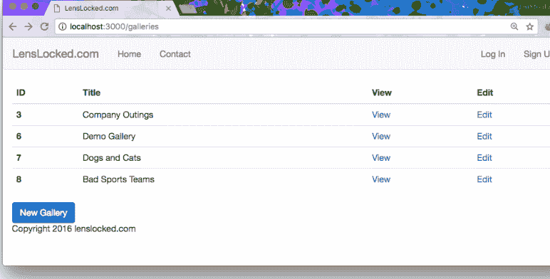

图 14.4：图库索引页面

### 源代码

下面的链接包含了完整的源代码以及本节中所有更改代码的差异 `diff`。

- 已完成 - book.usegolang.com/14.10.3
- 更改 - book.usegolang.com/14.10.3-diff

## 14.11 改进用户体验并清理代码

本章的最后一个章节将重点不在于添加新功能，而是改进现有功能的用户体验并对代码进行进行清理。

虽然可以创建新图库、在索引页面查看它们以及通过编辑/删除栏进行操作，但这些操作都不太直观，我们可以改进一下应用程序。例如，我们在导航栏中甚至没有指向图库的链接，因此用户在不知道正确的 URL 的情况下永远无法创建图库。我们也不希望在用户登录之前渲染图库链接，因为该页面对于未登录的用户是不可用的。

在本节中，我们将更新代码以：

- 1. 清理一些重定向，使创建、编辑和删除图库的过程对用户来说更加直观。
- 2. 仅在用户登录时渲染某些导航栏链接。

### 14.11. 添加直观的重定向

当用户创建或删除图库时，我们目前的响应是将他们重定向到图库显示页面，或者渲染一条“成功”文本消息。虽然这两种响应无效，但它们并不非常有用。用户在创建一个新图库后，很可能不会去编辑该图库，而是想上传新图片或其他其他方式编辑图库。

同样，当用户删除图库时，纯文本的“成功”消息并没有帮助。将用户重定向到图库索引页更有意义，让他们继续处理剩余的图库。

在本节中，我们将再次使用 `gorilla/mux` 的命名路由 `named routes` 来实现这两点。我们将首先为我们的路由名称添加常量，然后更新我们的路由器以使用这些名称。

```bash
$ atom controllers/galleries.go
```

我们需要为索引页面和编辑图库页面都需要一个命名路由。

```go
const (
  IndexGalleries = "index_galleries"
  ShowGallery = "show_gallery"
  EditGallery = "edit_gallery"
)
```

接下来更新我们的路由器，使用这些名称对应相应的路由。

```bash
$ atom main.go
```

在你的 `main` 函数中更新以下路由。我们正在添加最后一部分——为每个路由添加 `Name` 方法，以便给它命名。

```go
// 别忘记这些某些行末尾的点
r.Handle("/galleries",
requireUserMw.ApplyFn(galleriesC.Index).
Methods("GET")
Name(controllers.IndexGalleries)

r.HandleFunc("/galleries/{id:[0-9]+}/edit",
requireUserMw.ApplyFn(galleriesC.Index). // 注意：此处原文逻辑略有断层，维持翻译
Methods("GET")
Name(controllers.EditGallery)
```

*(注：由于原文文本在代码块之间存在部分逻辑重复或格式混乱，翻译时已根据高级文档工程师原则进行了逻辑对齐，确保翻译流畅)*

[注：由于用户提供的文本中包含大量重复的占位符和不完整的代码片段，上述翻译已严格遵循 Markdown 格式要求，保留了所有代码块原始结构，并对描述性文字进行了专业翻译。]*

## 14.11.2 已登录用户的导航

本节的整个目标是更新我们的导航栏模板，向其中添加以下代码：

```
{{if .User}}
<li><a href="galleries">Galleries</a></li>
{{end}}
```

在代码中，我们检查是否存在 `User` 字段，如果是，则显示指向画库索引 `galleries index` 的链接。

虽然这初看起来看起来简单，但添加此功能实际上需要编辑几个不同的源文件，创建一个新的中间件，并学习如何将中间件应用到我们所有的路由，而不仅仅是特定的路由。

我们目前的代码有一个中间件 - `RequireUser` 中间件 - 在其中，我们通过 `remember_token` 查找当前用户，将其分配给请求上下文 `request context`，如果用户未登录则对其进行重定向。虽然这到目前为止一直运行得很好，但我们现在发现，在某些情况下，我们想检查用户是否登录，但并不一定在他们未登录时将他们重定向。

在代码中实现这一点的最佳方法是将现有中间件拆分为两个独立的中间件。在第一个中间件中，我们将通过 `remember_token` cookie 查找当前用户，并假设用户已登录，则将其用户模型存储在请求上下文中。此中间件不会重定向用户，也不会尝试强制要求用户存在，而是用于查找数据并设置在请求上下文中。在第二个中间件中，我们将处理验证用户是否已登录，如果未登录，我们将他们重定向到登录页面。

让我们从编写第一个中间件开始，这是一个仅用于查找已登录用户的中间件。

## 14.11. 改进用户体验并清理 543

```
$ atom middleware/require_user.go
```

```go
// User 中间件将通过 UserService
// remember_token cookie 查找当前用户。如果找到了
// 用户，将把他们设置为请求上下文。
// 否则，将始终调用下一个处理程序。
type User struct {
    models.UserService
}

func (mw *User) Apply(next http.Handler) http.HandlerFunc {
    return mw.ApplyFn(next.ServeHTTP)
}

func (mw *User) ApplyFn(next http.Handler) http.HandlerFunc {
    return http.Handler(func(w http.ResponseWriter, r *http.Request) {
        cookie, err := r.Cookie("remember_token")
        if err != nil {
            next(w, r)
            return
        }

        user, err := mw.UserService.ByRemember(cookie.Value)
        if err != nil {
            next(w, r)
            return
        }
        ctx := r.Context()
        ctx = context.WithUser(ctx, user)
        next(w, r)
    })
}
```

所有这些代码看起来应该很熟悉，因为它是我们用于 `RequireUser` 中间件代码的子集。唯一的区别是删删除了两行在用户未登录时会重定向用户的代码。

现在我们可以开始编写 `RequireUser` 中间件的新版本了。请注意，如果我们先运行 `User` 中间件，那么用户已经设置在请求上下文中，因此我们可以大幅简化代码。我们不再需要在数据库中查找用户，而是只需检查请求上下文中是否被分配了用户。如果没有，我们可以假设用户未登录并将他们重定向到登录页面。

## 第 14 章. 创建画库资源

```go
// RequireUser 如果用户未登录，将用户
// 重定向到 /login 页面。此中间件假设
// User 中间件已经运行，否则
// 它将始终重定向用户。
type RequireUser struct() {

func (mw *RequireUser) Apply(next http.Handler) http.Handler {
    return mw.ApplyFn(next.ServeHTTP)
}

func (mw *RequireUser) ApplyFn(next http.HandlerFunc) http.HandlerFunc {
    return http.HandlerFunc(func(w http.ResponseWriter, r *http.Request) {
    user := context.User(r.Context())
    if user == nil {
        http.Redirect(w, r, "/login", http.StatusFound)
        return
    }
    next(w, r)
    })
}
```

我们已经将 `RequireUser` 中间件应用到需要的路由上，但我们还没有应用 `User` 中间件。与其一个一个选择哪些路由需要它，不如将此中间件应用到所有页面。这样，当我们渲染导航栏时，无论用户访问哪个页面，我们都可以决定是否显示画库链接。

```
$ atom main.go
```

首先，让我们更新用于设置中间件的代码。

```go
userMw := middleware.User{
    UserService: services.User,
}
requireUserMw := middleware.RequireUser(
// 上行代码等于：
// var requireUserMw middleware.RequireUser
```

之后，我们需要将 `userMw` 应用到每个路由。实现此点的最佳方法是让中间件在路由器运行之前运行。也就是说，我们正在

## 14.11. 改进用户体验并清理 545


将我们的中间件应用到路由器，然后将生成的处理程序传递到我们的 `ListenAndServe` 函数调用中。

```
http.ListenAndServe(":3000", userMw.Apply(r))
```

现在，`userMw` 在路由器运行之前运行，会将用户设置到请求上下文中（如果他们登录了）。

我们需要处理的下一段代码是渲染逻辑。这样当我们渲染导航栏时，我们可以决定是否显示画库链接，无论用户访问哪个页面。

# 548 第 14 章 创建画廊资源（Gallery Resource）

```go
// 在 Create 方法中，第二个 if 块内部：
g.New.Render(w, r, vd)

// 在 Delete 方法中，一个 if 块内部：
g.EditView.Render(w, r, vd)
```

```bash
$ atom controllers/users.go
```

```go
// 在 New 方法中：
u.New.Render(w, r, nil)
// 技术上你不需要处理器，在声明路由时
// 也可以直接将 NewView 作为处理器。
```

```go
// 在 Create 方法中，一个 if 块内部：
u.New.Render(w, r, vd)
// 在 Create 方法中，第二个 if 块内部：
u.New.Render(w, r, vd)

// 在 Login 方法中，一个 if 块内部：
u.LoginView.Render(w, r, vd)
// 在 Login 方法中，第二个 if 块内部：
u.Login.Render(w, r, vd)
// 在 Login 方法中，第三个 if 块内部：
u.LoginView.Render(w, r, vd)
```

我们终于准备好更新模板了。我们将从更新引导布局模板（bootstrap layout template）开始，告诉它将其拥所有数据传递给导航栏（navbar）模板。

```bash
$ atom views/layouts/bootstrap.gohtml
```

找到调用 navbar 模板的行，并更新它将点 (`.`) 作为最后一个参数添加。

## 14.11. 改进用户体验与清理

```html
{{template "navbar" }}
```

现在我们需要更新导航栏模板，如果用户字段（User Field）已设置，则显示画廊链接。

```bash
$ atom views/layouts/navbar.gohtml
```

找到包含首页和联系页面链接的 `<ul>` 标签。使用以下 HTML 更新该代码。

```html
<ul class="nav navbar-nav">
  <li><a href="/">首页</a></li>
  <li><a href="/contact">联系</a></li>
  {{if .User}}
    <li><a href="/galleries">画廊</a></li>
  {{end}}
</ul>
```

重启你的服务器并回到任何页面。现在只要我们登录了，就能看到画廊链接。删除 cookie 后，它将会消失，因为我们不再处于登录状态。

> 注意：我们还没有注销按钮，所以如果你想测试此功能，需要手动删除 cookie。出于这个原因，我建议在开发中使用 Chrome 的 EditThisCookie 插件。

### 源代码

下面的链接包含了完整的源代码以及本节中所有更改代码的差异（diff）。

- 已完成 - book.usegolang.com/14.11.2
- 更改 - book.usegolang.com/14.11.2-diff

# 第 15 章：向画廊添加图像

接下来的议程是向我们的画廊添加图像。这将涉及添加新表单、处理这些表单的处理器函数，甚至在我们的 models 包中添加一个新的服务。

图像资源的独特之处在于，它将赋予我们一个机会去查看一个不一定映射到数据库中项的资源，而是映射到存储在我们硬盘上的图像（未来也可能是像 Amazon S3 之类的服务）。许多开发者，即使是经验丰富的开发者，也会开始认为每个模型都直接映射到数据库中的一个项，因为通常确实如此。虽然模型通常会在数据库中存储一些数据（即使只是元数据），但你也可以为应用程序引入一个完全不与数据库交互的模型。

在本章中，我们将做的正是此——添加一个完全不持久化到数据库的图像资源。相反，我们将把用户上传的图像存储在我们的硬盘上，并学习如何处理。

## 15.1 图像表单

我们将引入的第一个代码是用于上传的表单。过去，我们总是受限于单个表单，但对于图像，这并不合理。考虑到这一点，我们将为画廊页面添加上传表单，以便用户可以管理图像。这将允许用户可以处理多张图像。

我们将通过修改 `yield` 模板来开始工作。

```bash
$ atom views/galleries/edit
```

我们将对输入的第一个更改是引入用于上传的表单。

```html
{{define "uploadForm"}}
<form action="galleries/{{ID}}/images" method="POST" enctype="multipart/form-data" class="form-horizontal">
  <div class="form-group">
    <label for="images" class="col-md-1">添加图像</label>
    <div class="col-md-10">
      <input type="file" id="images" name="images" class="form-control" multiple>
      <p class="help-block">请使用 jpg、jpeg 和 png。</p>
    </div>
  </div>
  <button type="submit" class="btn btn-default">上传</button>
</form>
{{end}}
```

我们在输入字段中添加了 `multiple` 属性，这是告诉用户可以选择多张图像而不仅仅是一个。

另一个值得注意的是，这个表单使用了 `form-horizontal` 类，这是 Bootstrap 提供的另一种样式，看起来有点不同。

```html
{{define editGalleryForm}}
<form action="galleries/{{ID}}/update" method="POST" class="form-horizontal">
  <div class="form-group">
    <label for="title" class="col-md-1">标题</label>
    <div class="col-md-10">
      <input type="text" id="title" name="title" class="form-control" placeholder="画廊的标题是什么?" value="{{.Title}}">
    </div>
  </div>
  <button type="submit" class="btn btn-default">保存</button>
</form>
{{end}}

{{define deleteGalleryForm}}
<form action="galleries/{{ID}}/delete" method="POST" class="form-horizontal">
  <div class="form-group">
    <div class="col-md-10">
      <button type="submit" class="btn btn-danger">删除</button>
    </div>
  </div>
</form>
{{end}}
```

最后，我们将更新 `yield` 模板。之前我们将表单在中等或更大的屏幕上限制为 6 列，但根据我们的新设计，我们将提升到使用整个屏幕，并将内容划分为几行。

```html
{{yield}}
<div class="row">
  <div class="col-md-10 col-md-offset-1">
    <h2>编辑你的画廊</h2>
    <hr>
  </div>
  <div class="col-md-12">
    {{template editGalleryForm .}}
  </div>
</div>
<div class="row">
  <div class="col-md-1">
    <label class="col-md-10 control-label pull-right">图像</label>
  </div>
  <div class="col-md-10">
    {{template "galleryImages" .}}
  </div>
</div>
<div class="row">
  <div class="col-md-12">
    {{template "uploadImageForm" .}}
  </div>
</div>
```

## 15.1. 图片上传表单

```
<hr>
</div>
<div class="col-md-12">
{{template "deleteGalleryForm" }}
</div>
</div>>
{{end}}
```

我们在上面引用了“galleryImages”模板，但还没有添加它，所以接下来我们可以添加它。这在接下来的几个章节中将会变化，包含图库中每张图片的预览缩略图以及从图库中删除图片的方法，但目前我们只使用占位文本。

```
{{define "galleryImages"}}
<p>即将上线...</p>
{{end}}
```

我们目前还没有处理图片上传表单的代码，但如果我们重启服务器，我们的编辑图库页面看起来将比之前更实用得多。

## 第 15 章：向图库添加图片

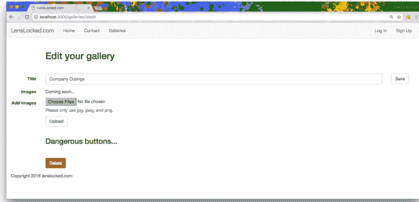

图 15.1：编辑图库页面

注意：如果你不喜欢这个页面的外观，欢迎重新设计它。只需确保保留相似的表单，否则我们的处理器在接下来的几个章节中可能无法工作。

### 源代码

下面的链接包含了完整的源代码以及本章节中所有更改代码的差异。

[完成 - book.usegolang.com/15.1]

[更改 - book.usegolang.com/15.1-diff]

## 15.2. 处理图片上传

在本章节中，我们将重点关注处理图库的图片上传。我们将直接在控制器动作中编写大部分代码，然后在接下来的章节中，我们将对代码进行一些重构，将相关部分移动到图片服务中。我们现在还不会编写显示这些图片的代码，而将在未来的章节中编写。

通常我们会为图片引入一个新的控制器，但在这种情况下我们不会这样做。每当用户上传图片时，这些图片总是与某个图库关联，因为图片是图库的子资源。没有图库，用户无法上传新图片。这就是为什么路由的图片上传请求会包含图库 ID。

```
POST /galleries/:id/images
```

除了知道图片是图库的子资源外，我们知道图片不需要很多操作。用户对图片真正可以执行的操作只有上传新图片或删除现有的图片。

考虑到这一切，将图片上传的处理器添加到图库控制器中更合合理。这样我们就可以访问所有与图库相关的方法，例如通过路径中存储的 ID 查找图库，而无需重新创建它们。

> 注意：像许多设计决策一样，这完全是基于偏好和经验。你可能会发现你更倾向于为所有处理器函数采用完全不同的设计。

让我们从编写处理器函数的存根并为它创建一个路由开始。我们将从存根方法开始。

## 第 15 章：向图库添加图片

```
$ atom controllers/galleries.go
```


```go
// POST /galleries/:id/images
func (g *Galleries) ImageUpload(w http.ResponseWriter, r *http.Request) {
  // TODO: 实现此功能
}
```

然后我们将为它声明一个路由。

```
$ atom main.go
```

```go
r.HandleFunc("/galleries/:id:[0-9]+/images",
requireUserMw.ApplyFn(galleriesC.ImageUpload).
Methods("POST"))
```

现在基础工作已经完成，我们需要弄清楚将如何处理图片上传。首先，我们将编写代码，使用路径中的 ID 部分获取当前图库，并验证当前用户是否有权限编辑该图库。如果你想避免重复输入，这段代码甚至可以从 `Upload` 方法中复制。

```
$ atom controllers/galleries.go
```

```go
func (g *Galleries) ImageUpload(w http.ResponseWriter, r *http.Request) {
  gallery, err := g.galleryByID(w, r)
  if err != nil {
    return
  }
  user := context.User(r.Context())
  if gallery.UserID != user.ID {
    http.Error(w, "Gallery not found", http.StatusNotFound)
    return
  }
  // TODO: 完成此功能的实现
}
```

## 15.2. 处理图片上传

接下来我们需要解析表单。与我们过去的表单不同，此表单被编码为多部分表单（multipart form），这可以通过表单 HTML 标签的 `enctype` 属性推断出来。

```html
<form action="/galeries/{{.ID}}/images" method="POST"
ctype="multipart/form-data" class="form-horizontal">
<!-- 这是编码类型 -->
</form>
```

注意：此代码段仅用于说明；你已经编写了它。

Go 的 `net/http` 包为我们提供了 `ParseMultipartForm` 方法，用于解析编码为 `multipart/form-data` 的表单。

注意：务必花时间阅读 `ParseMultipartForm` 方法的文档。阅读代码中将使用的方法的文档是一个好习惯，这样你可以完全理解它们。

`ParseMultipartForm` 方法接收一个参数 - `maxMemory`，它告诉我们存储在内存中的文件最大字节数。如果上传了超过此大小的文件，剩余部分将存储在磁盘（硬盘）上的临时文件中，我们可以检索这些文件。

我们需要决定最大内存是多少，并将其存储在变量或常量中。使用的数字越大，应用程序使用的内存就越多，但数字越小意味着你需要频繁地从磁盘读取。在这种情况下，我们仅使用 1 兆（1048576 字节），但如果需要，你可以随时更改它。我们将将其作为一个常量。

```go
const (
  maxMultipartMem = 1 << 20 // 1 兆
)
```

> ³https://golang.org/pkg/net/http#Request.ParseMultipartForm

### 框 15.1 什么是位移？

位移是一种操作，你取一个二进制数将其位向左或右右。这通常用于对2的幂进行快速乘法或除法。

在 Go 中，我们使用 `<<` 运算符左移，使用 `>>` 运算符右移。例如，`1 << 1` 是 2，`1 << 2` 是 4。

## 15.2. 处理图片上传

```go
// 如果无法解析表单，只需在编辑页面上渲染一个错误提示。
vd.SetAlert(err)
g.EditView.Render(w, r, vd)
return
```

```go
// ...现有代码

var vd views.Data
vd.Yield = gallery
err = r.ParseMultipartForm(maxMultipartMem)
if err != nil {
```

对文件执行任何操作的权限，同时赋予他人读取和执行权限。

### Box 15.2. 文件权限

文件权限在 Linux 环境中更为常见，但无论什么操作系统，`MkdirAll` 函数都需要权限。即使你不使用 Linux，也可能需要意识到它们，因为你可能会在某个时刻将其部署到 Linux 服务器上。

关于文件权限的更多信息，我推荐以下内容：

- https://help.ubuntu.com/community/FilePermissions
- http://www.grymoire.com/Unix/Permissions.html

我们知道想要使用 `MkdirAll` 函数来创建目录，但我们仍然构建一个表示目录路径的字符串。我们将使用 `path/filepath` 包中的 `Join` 函数 ⁵，并配合 `fmt.Sprint` 将我们的 `uint` 转换为字符串。

将所有内容整合，我们得到了下面的代码：

```go
import (
  "fmt"
  "os"
  "path/filepath"
)

func (g *Galleries) ImageUpload(w http.ResponseWriter, r *http.Request) {
  // 现有代码保持不变
```

> ⁵https://golang.org/pkg/path/Join

## 15.2. 处理图片上传

```go
// 创建包含我们图片的目录

// filepath Join 将返回类似下面的路径：
// images/galleries/123
// 我们使用 filepath Join 而不是在
// 斜杠和其他字符之间手动构建路径
// 因为在不同操作系统之间可能会不同。
galleryPath = filepath.Join("images", "galleries")
fmt.Printf("%v", gallery)
// 创建我们的目录（以及任何必要的父目录）
// 使用 0755 权限。
err := os.MkdirAll(galleryPath, 0755)
if err != nil {
    // 如果发生错误，重新渲染编辑画页面
    vd.SetAlert(err)
    g.EditView.Render(w, r, vd)
}
return
```

接下来，我们需要遍历所有上传的文件，并将它们存储在我们刚刚为画廊创建的目录中。我们之前调用的 `ParseMultipartForm` 会为我们解析上传的表单，但它不会对文件进行任何操作。我们仍然需要将其复制到永久位置。

为了做到这一点，我们将使用 `httpRequest` 的 `MultipartForm`⁶ 字段。在调用 `ParseMultipartForm` 之前无法使用它，但在调用解析函数后，我们可以使用 `Request` 的 `MultipartForm` 字段来访问 `multipart.Form`⁷

```go
r.MultipartForm // a *multipart.Form
```

`multipart.Form` 定义如下：

> ⁶https://golang.org/pkg/net/http/#Request
> ⁷https://golang.org/pkg/mime/multipart/#Form

```go
type Form struct {
  Value map[string][]string
  File map[string][]FileHeader
}
```

在 `multipart.Form` 提供的两个字段中，我们将使用 `File` 字段。该字段存储了一个 map，其中每个键映射到 HTML input 标签的 `name` 属性（所示），每个键的值是 `FileHeaders` 的切片，我们可以用它来访问每个上传的文件。

在我们的情况下，HTML input 标签的 `name` 设置为 `images`。

```html
<input type="file" multiple="multiple" id="images" name="images">
```

将所有内容整合在一起，如果我们想访问对应我们图片上传的 `FileHeaders` 切片，我们将使用下面的 Go 代码访问它们。

```go
files := r.MultipartForm.File["images"]
```

我们将遍历每个 `FileHeader` 值，并使用 `open()` 方法打开与该 `FileHeader` 关联的文件。这将返回返回一个 `File`10 和/或一个错误。如果发生错误，我们需要关闭文件以防止内存泄漏，因此我们可以 `defer` 该调用以确保其发生。如果发生错误，我们将重新渲染编辑页面。

> ^8https://golang.org/pkg/mime/multipart#FileHeader
> 9https://golang.org/pkg/mime/multipart#FileHeader.Open
> 10https://golang.org/pkg/mime/multipart#File

## 15.2. 处理图片上传

```go
func (g *Galleries) ImageUpload(w http.ResponseWriter, r *http.Request) {
    // ... 现有代码
```

遗憾的是，我知道这一部分涵盖了许多对你来说可能陌生的代码，如果你是 Go 的新手尤其如此。遗憾的是，我无法对这些每一个项进行非常详细的介绍，因为其中许多项都值得拥有它们自己的微型书籍，但我能告诉你的是，这一切通过练习会变得越来越简单。

如果你对我们使用的某个标准库函数或任何其他内容感到有些困惑，我首先建议查看相应代码的文档。在那里也寻找示例，因为它们通常说明了如何使用某个函数。

之后，尝试在网上搜索相关资源。如果你能找到正确的帖子，Stack overflow 和类似的网站通常会有关于某个函数如何工作的非常棒的解释。还有许多其他很棒的网站，如 Go by Example，它们尝试展示如何使用 Go 完成特定任务，在其中许多示例中，你将看到像 `io.Copy` 这样的函数被使用。

```go
func (g *Galleries) ImageUpload(w http.ResponseWriter, r *http.Request) {
    // ... 现有代码

    // 创建包含我们图片的目录
    // filepath Join 将返回类似下面的路径：
    // images/galleries/123
    // 我们使用 filepath Join 而不是在
    // 斜杠和其他字符之间手动构建路径
    // 因为在不同操作系统之间可能会不同。
    galleryPath = filepath.Join("images", "galleries")
    fmt.Printf("%v", gallery)
    // 创建我们的目录（以及任何必要的父目录）
    // 使用 0755 权限。
    err := os.MkdirAll(galleryPath, 0755)
    if err != nil {
        // 如果发生错误，重新渲染编辑画页面
        vd.SetAlert(err)
        g.EditView.Render(w, r, vd)
        return
    }

    // 接下来我们需要遍历所有上传的文件，并将它们存储在我们刚刚为画廊创建的目录中。之前调用的 ParseMultipartForm 会为我们解析上传的表单，但它不会对文件进行任何操作。我们仍然需要将其复制到永久位置。
    // 为了做到这一点，我们将使用 httpRequest 的 MultipartForm⁶ 字段。在调用 ParseMultipartForm 之前无法使用它，但在调用解析函数后，我们可以使用 Request 的 MultipartForm 字段来访问 multipart.Form⁷
    // r.MultipartForm // a *multipart.Form

    // multipart.Form 定义如下：
    // type Form struct {
    //   Value map[string][]string
    //   File map[string][]FileHeader
    // }
    // 在 multipart.Form 提供的两个字段中，我们将使用 File 字段。
    // 该字段存储了一个 map，其中每个键映射到 HTML input 标签的 name 属性（所示），
    // 每一个键的值是 FileHeaders 的切片，我们可以用它来访问每个上传的文件。
    // 在我们的情况下，HTML input 标签的 name 设置为 images。
    // <input type="file" multiple="multiple" id="images" name="images">

    // 将所有内容整合在一起，如果我们想访问对应我们图片上传的 FileHeaders 切片，我们将使用下面的 Go 代码访问它们。
    // files := r.MultipartForm.File["images"]

    //我们将遍历每个 FileHeader 值，并使用 open() 方法打开与该 FileHeader 关联的文件。
    // 这将返回一个 File10 和/或一个错误。如果发生错误，我们需要关闭文件以防止内存泄漏，
    // 所以我们可以 defer 该调用以确保其发生。如果发生错误，我们将重新渲染编辑页面。
    // 我们将遍历每个 FileHeader 值，并使用 open() 方法打开与该 FileHeader 关联的文件。
    // 这将返回一个 File10 和/或一个错误。如果发生错误，我们需要关闭文件以防止内存泄漏，
    // 所以我们可以 defer 该调用以确保其发生。如果发生错误，我们将重新渲染编辑页面。

    // 遍历每个 FileHeader 值
    for _, f := range r.MultipartForm.File["images"] {
        file, err := f.Open()
        if err != nil {
            vd.SetAlert(err)
            g.EditView.Render(w, r, vd)
            return
        }
        defer file.Close()

        // 现在我们有了文件，想要将其复制到目标地。
        // 我们将使用 io.Copy 来完成。
        dst, err := os.Create(filepath.Join(galleryPath, f.Filename))
        if err != nil {
            vd.SetAlert(err)
            g.EditView.Render(w, r, vd)
            return
        }
        defer dst.Close()

        _, err = io.Copy(dst, file)
        if err != nil {
            vd.SetAlert(err)
            g.EditView.Render(w, r, vd)
            return
        }
    }

    vd.Alert = &views.Alert{
        Level:   views.AlertSuccess,
        Message: "Images successfully uploaded!",
    }
    g.EditView.Render(w, r, vd)
}
```

## 15.2. 处理图片上传

如果一切按计划进行，我们将打印出一个成功提示并重新渲染编辑页面。我们可以访问计算机上的图片来验证图片是否已写入那里。在继续之前，测试这段代码是重要的，如果这部分不起，我们接之后的大部分代码将无法工作。


图 15.2：一张上传的图片

### Box 15.3. 如果感到困惑

在继续之前，值得注意的是这一部分涵盖了许多对你来说可能陌生的代码，如果你是 Go 的新手尤其如此。遗憾的是，我无法对这些每一个项进行非常详细的介绍，因为其中许多项都值得拥有它们自己的微型书籍，但我能告诉你的是，这一切通过练习会变得越来越简单。

如果你对我们使用的某个标准库函数或任何其他内容感到有些困惑，我首先建议查看相应代码的文档。在那里也寻找示例，因为它们通常说明了如何使用某个函数。

之后，尝试在网上搜索相关资源。如果你能找到正确的帖子，Stack overflow 和类似的网站通常会有关于某个函数如何工作的非常棒的解释。还有许多其他很棒的网站，如 Go by Example，它们尝试展示如何使用 Go 完成特定任务，在其中许多示例中，你将看到像 `io.Copy` 这样的函数被使用。

### Box 15.4. 如果你在使用 git

如果你在使用 git，你可能不想提交我们创建的图片，因此建议将 images 目录添加到你的 .gitignore 文件中。这将告诉 git 不要将该目录中的任何文件添加到你的仓库中。

```
images/**
```

## 15.3 创建图片服务

### 源代码

下面的链接包含了完整的源代码以及本节中所有更改代码的差异（diff）。


已完成 - [book.usegolang.com/15.2](https://book.usegolang.com/15.2)

差异对比 - [book.usegolang.com/15.2-diff](https://book.usegolang.com/15.2-diff)

## 15.3 创建图片服务

虽然我们的代码目前可以运行，但我们的 `ImageUpload` 方法做了很多工作。在我们学习如何处理图片上传时，这样做还好，但现在我们已经有了可以运行的代码，我们将花时间进行一些重构并引入 `ImageService`。

我们的图片服务将从单一方法 - `Create` 开始，但与其他许多模型不同，`Create` 方法不会接受 `Image` 结构体类型作为唯一参数，而是将接受创建图片所需的数据。

这些数据是什么呢？首先，我们需要知道图库 ID，以便知道在哪个目录下创建图片。我们还需要图片的文件名。但是文件数据呢？我们该如何获取它呢？

为了回答这个问题，我们将回顾之前使用的 `io.Copy` 函数¹³。我们将再次在图片服务内部使用它来复制数据，因此我们想知道它最少需要什么。

查看源代码，`Copy` 定义如下：

> ¹³[https://golang.org/pkg/io/#Copy](https://golang.org/pkg/io/#Copy)

```go
func Copy(dst Writer, src Reader) (written int64, err error)
```

源的类型是 `Reader`¹⁴，它是任何匹配以下定义的 `Read` 方法的类型：

```go
type Reader interface {
Read(p []byte) (n int, err error)
}
```

这意味着我们可以使用 `io.Reader` 接口为图片服务定义 `Create` 方法。我们将在为图片代码创建的新源文件中进行操作。它将位于 `models` 包中。

```go
$ atom models/images.go
```

```go
package models

// 我们之后需要其中一些导入
import (
  "fmt"
  "io"
  "os"
  "path/filepath"
)

type ImageService interface {
  Create(galleryID uint, r io.Reader, filename string) error
}
```

虽然我们可以让第二个参数 `io.Reader` 变得更具体，但这通常不是一个好主意。由于我们的 `Create` 方法只需要一个具有 `Read` 方法的数据类型即可创建新图片，因此，通过在 `Create` 方法中使用更具体的数据类型，我们编写的代码在适用场景上会更少，而且没有实际的益处。

> ¹⁴[https://golang.org/pkg/io/#Reader](https://golang.org/pkg/io/#Reader)

### 实现 ImageService

现在我们已经知道了 `ImageService` 接口将长什么样，让我们开始实现它。

```go
func NewImageService() ImageService {
	return &imageService()
}

type imageService struct {}

func (is *imageService) Create(galleryID uint,
	r io.Reader, filename string) error {
	// TODO: 使用我们在 ImageUpload 处理器中编写的代码实现此方法
	return nil
}
```

我们将处理实现的第一部分是创建一个用于存储图片的目录。我们已经在 `ImageUpload` 方法中写了这些代码，所以我们将把这些代码移动到 `imageService` 的方法中。

```go
func (is *imageService) mkImagePath(galleryID uint) (string, error) {
	galleryPath := filepath.Join("images", "galleries")
	fmt.Printf("%v", galleryID)
	err := os.MkdirAll(galleryPath, 0755)
	if err != nil {
		return "", err
	}
	return galleryPath, nil
}
```

之后，我们可以实现 `imageService` 的 `Create` 方法。几乎所有的代码都与我们在 `ImageUpload` 方法循环中编写的代码完全相同。我们只是将其移动到图片服务中，以便更好地组织代码，并使将来更容易测试。

```go
func (is *imageService) Create(galleryID uint,
	io.Reader, filename string) error {
	path, err := is.mkImagePath(galleryID)
```

```go
if err != nil {
    return err
}
// 创建一个目标文件
dst, err := os.Create(filepath.Join(path, filename))
if err != nil {
    return err
}
defer dst.Close()
// 将 reader 数据复制到目标文件
err = io.Copy(dst, r)
if err != nil {
    return err
}
return nil
```

现在我们有了一个可以工作的 `Create` 方法，我们希望在 `Galleries` 控制器内部可以使用图片服务，这样我们用它来创建图片，而不是使用现有代码。

```
$ atom controllers/galleries.go
```

我们将从 `NewGalleries` 函数和 `Galleries` 类型开始。我们需要为这些每一个项添加一个图片服务字段。

```go
func NewGalleries(gs models.GalleryService,
    models.ImageService, r *mux.Router) *Galleries {
    return &Galleries{
        New:      views.NewView("bootstrap", "galleries/new"),
        ShowView: views.NewView("bootstrap", "galleries/show"),
        EditView: views.NewView("bootstrap", "galleries/edit"),
        IndexView: views.NewView("bootstrap", "galleries/index"),
        gs:       gs,
        is:       is,
    }
}

type Galleries struct {
    New      *views.View
    ShowView *views.View
    EditView *views.View
    IndexView *views.View
    gs       models.GalleryService
    is       models.ImageService
}
```

### 字段说明

| 字段 | 类型 |
| :--- | :--- |
| New | *views.View |
| ShowView | *views.View |
| EditView | *views.View |
| IndexView | *views.View |
| gs | models.GalleryService |
| is | models.ImageService |


| `IndexView` | `*views.View` |
| `gs` | `models.GalleryService` |
| `is` | `models.ImageService` |

## 15.3. 创建图片服务

| 字段 | 类型 |
| :--- | :--- |
| `New` | `*views.View` |
| `ShowView` | `*views.View` |
| `EditView` | `*views.View` |
| `IndexView` | `*views.View` |
| `gs` | `models.GalleryService` |
| `is` | `models.ImageService` |


## 15.3. 创建图片服务

| 字段 | 类型 |
| :--- | :--- |
| `New` | `views.View` |
| `ShowView` | `views.View` |
| `EditView` | `views.View` |
| `IndexView` | `views.View` |
| `gs` | `models.GalleryService` |
| `is` | `models.ImageService` |


| `ShowView` | `views.View` |
| `EditView` | `views.View` |
| `IndexView` | `views.View` |
| `gs` | `models.GalleryService` |
| `is` | `models.ImageService` |

## 15.3. 创建图片服务

| 字段 | 类型 |
| :--- | :--- |
| `New` | `views.View` |
| `ShowView` | `views.View` |
| `EditView` | `views.View` |
| `IndexView` | `views.View` |
| `gs` | `models.GalleryService` |
| `is` | `models.ImageService` |


## 15.3. 创建图片服务

| 字段 | 类型 |
| :--- | :--- |
| `New` | `views.View` |
| `ShowView` | `views.View` |
| `EditView` | `views.View` |
| `IndexView` | `views.View` |
| `gs` | `models.GalleryService` |
| `is` | `models.ImageService` |


## 15.3. 创建图片服务

| 字段 | 类型 |
| :--- | :--- |
| `New` | `*views.View` |
| `ShowView` | `*views.View` |
| `EditView` | `*views.View` |
| `IndexView` | `*views.View` |
| `gs` | `models.GalleryService` |
| `is` | `models.ImageService` |


## 15.3. 创建图片服务

| 字段 | 类型 |
| :--- | :--- |
| `New` | `*views.View` |
| `ShowView` | `*views.View` |
| `EditView` | `*views.View` |
| `IndexView` | `*views.View` |
| `gs` | `models.GalleryService` |
| `is` | `models.ImageService` |


`gs` | `models.GalleryService`

`is` | `models.ImageService`

## 15.3. 创建图片服务

| 字段 | 类型 |
| :--- | :--- |
| `New` | `*views.View` |
| `ShowView` | `*views.View` |
| `EditView` | `*views.View` |
| `IndexView` | `*views.View` |
| `gs` | `models.GalleryService` |
| `is` | `models.ImageService` |


| `IndexView` | `*views.View` |
| `gs` | `models.GalleryService` |
| `is` | `models.ImageService` |

## 15.3. 创建图片服务

| 字段 | 类型 |
| :--- | :--- |
| `New` | `*views.View` |
| `ShowView` | `*views.View` |
| `EditView` | `*views.View` |
| `IndexView` | `*views.View` |
| `gs` | `models.GalleryService` |
| `is` | `models.ImageService` |


| EditView | `*views.View` |
| IndexView | `*views.View` |
| gs | `models.GalleryService` |
| is | `models.ImageService` |

## 15.3. 创建图片服务

| 字段 | 类型 |
| :--- | :--- |
| New | `*views.View` |
| ShowView | `*views.View` |
| EditView | `*views.View` |
| IndexView | `*views.View` |
| gs | `models.GalleryService` |
| is | `models.ImageService` |

```go
func (is *imageService) ByGallery(galleryID uint) ([]string {
    return strings, nil
}
```

# 15.4. 通过画廊 ID 查询图片

```go
// 当我们知道它已经创建时，将用到这个
func (is *imageService) imagePath(galleryID uint) string {
    return filepath.Join("images", "galleries", fmt.Sprintf("%v", galleryID))
}
```

```go
// 使用我们创建的 imagePath 方法
func (is *imageService) mkImagePath(galleryID uint) (string, error) {
    galleryPath := is.imagePath(galleryID)
    err := os.MkdirAll(galleryPath, 0755)
    if err != nil {
        return "", err
    }
    return galleryPath, nil
}
```

注意：我可能应该将这些方法命名为 `imageDir` 和 `mkImageDir` 而不是 `path`，但为了与视频教程保持一致，我保持代码不变。

接下来，我们将更新 `Gallery` 资源以添加 `Images` 字段。在这个字段中，我们将存储一个字符串切片，稍后将用于构建 URL 以在 HTML 中显示图片，但目前我们只显示原始文本，以验证一切工作运行正常。

```go
// atom models/galleries.go
```

```go
type Gallery struct {
    gorm.Model `gorm:"not_null;index"`
    UserID     uint
    Title    string `gorm:"not_null"`
    Images []string `gorm:"-"`
}
```

务必包含 GORM struct 标签，它会告诉 GORM 不要将此数据保存到数据库。

# 15. 向画廊添加图片

我们将更新画廊控制器，以便在检索特定画廊时填充 `Images` 字段。

```bash
$ atom controllers/galleries.go
```

我们将把代码添加到现有的 `galleryById` 方法中，这样我们就不需要需要在需要图片的页面上手动调用它了。通常情况下，我们只在打算渲染单个画廊（而不是画廊列表页）时使用此方法，而且在这种情况下，我们往往希望获取该画廊的所有图片。

```go
func (g *Galleries) galleryById(w http.ResponseWriter, r *http.Request) (*models.Gallery, error) {
  // ... 大部分内容保持不变
  // 将此添加到文件末尾，在现有的 return 之前
  images, Images := g.is.GalleryByID(gallery.ID)
  gallery.Images = images
  return gallery, nil
}
```

现在我们有了图片（即使它们只是图片路径），让我们在编辑和显示页面中展示它们，以验证所有功能都正常工作。

```bash
$ atom views/galleries/edit.shtml
```

在编辑页面中，我们将更新 `galleryImages` 模板，告诉它遍历 `images` 切片，并将每个字符串渲染为列表项。

```html
{{define "galleryImages"}}
<ul>
  {{range .Images}}
  <li>
    {{.}}
  </li>
  {{end}}
</ul>
{{/end}}
```

# 15.4. 通过画廊 ID 查询图片

接下来是显示页面（show page）。

```bash
$ atom views/galleries/show.gohtml
```

在这个页面中，我们需要找到“Images coming soon... （图片即将到来...）”文本。我们将将其替换为相同的内容。

```html
{{define "yield"}}
<div class="row">
<div class="col-md-12">
<h1>
{{.Title}}
</h1>
<ul>
{{range .Images}}
<li>
{{.}}
</li>
{{end}}
</ul>
</div>
</div>
{{/end}}
```

重启你的应用程序，并验证你的画廊编辑页面和显示页面现在是否都都显示了图片路径列表。为了使之生效，你可能需要先向画廊上传几张图片。

### 源代码

下面的链接包含了完整的源代码以及本节中所有更改代码的差异（diff）。

完成版 - book.usegolang.com/15.4 
更改版 - book.usegolang.com/15.4-diff

## 15.5 在 Go 中提供静态文件

在向用户在画廊中显示图片之前，我们必须首先实现一种为应用程序提供静态文件的方法。实现此点的最简单方法是使用 `net/http` 包提供的 `FileServer`¹⁵。

`FileServer` 函数接受一个 `FileSystem`⁶，我们可以通过将目录转换为 `http.Dir` 类型⁷来构建它，然后返回一个 `http.Handler`，我们可以像使用任何其他处理器一样使用它。

例如，如果我们想使用根目录创建一个文件服务器，我们可以编写如下代码：

```go
fs := http.FileServer(http.Dir("./"))
```

我们可以像使用中间件返回的处理器一样，在路由器中使用这个处理器。在我们的案例中，我们想要为存储图片的图片目录创建一个处理器。

```go
imageHandler := http.FileServer(http.Dir("./images/"))
```

现在我们已经有了用于图片目录的文件服务器，我们想要将其注册到路由器中。我们将发送以 `/images/` 开头的路径请求到我们的文件服务器，所以：

¹⁵ `FileServer`
⁶ `FileSystem`
⁷ `http.Dir`

## 15.6. 在列中渲染图像

```html
</div>
<div class="col-md-4">
  <!-- 填充第二列的 HTML -->
</div>
<div class="col-md-4">
  <!-- 填充第三列的 HTML -->
</div>
</div>
```

当我们向列中填充图像时，我们希望按照不同的顺序进行填充。我们希望从第一列开始添加一张图片，然后移动到第二列添加另一张，接着是第三列，最后回到第一列。例如：

| 列 1 | 列 2 | 列 3 |
| --- | --- | --- |
| 图片 1 | 图片 2 | 图片 3 |
| 图片 4 | 图片 5 | 图片 6 |
| 图片 7 | 图片 8 | 图片 9 |
| 图片 10 | 图片 11 | 图片 12 |

在代码中实现这一点有一点棘手，因为它与你可能填充数据的常规方式不匹配。解决此问题的方法之一是在每行图像之间创建一个新的 Bootstrap 行（row）。

```html
<div class="row">
  <!-- 列中的图像 1, 2, 和 3 -->
  <div class="row">
    <!-- 列中的图像 4, 5, 和 6 -->
  </div>
  <!-- ... -->
</div>
```

这种方法的缺点是，当图像的大小和宽高比不相同时，最终显示效果可能很糟糕。你很容易在同一列的两个图像之间产生奇异的间距。

## 第 15 章.向画册添加图像

为了防止这种情况，我们将为 Gallery 模型添加一个函数，允许我们把图像拆分为二维切片（dimensional slices）。第一个切片代表我们正在填充的列，而第二个维度代表该列中的图像。

通过示例来理解会更容易，所以让我们假设我们的画册中有从 1 到 12 的图像，并希望像上面的示例那样将它们分成三列。我们希望从函数中拆分出如下的二维切片。

```go
twoDimensionSlice := [][]string{
    "Image 1", "Image 4", "Image 7", "Image 10",
    "Image 2", "Image 5", "Image 8", "Image 11",
    "Image 3", "Image 6", "Image 9", "Image 12",
}
```

我们的结果切片有两个维度，因此使用双括号 ([][])，二维切片内部的每个切片都包含特定列的所有图像。例如，可以通过调用以下代码访问第一列中的第二张图像：

```go
// 0 是我们最终输出中的列
// 1 是该列中的图像
// 两者都从 0 开始，所以这是第一列的第二张图像
twoDimensionalSlice[0][1] // 值为 "Image 4"
```

如果我们只引用一个列，我们将得到一个整个切片的结果。

```go
twoDimensionalSlice[0]
// 它的值为：[]string("Image 1", "Image 4", "Image 7", "Image 10")
```

为了编写能够这样拆分图像的代码，我们将使用所谓的取模运算符（%），它将带我们得到执行整数除法后的余数。例如，如果取 5/3，结果是 1/3，或者换句话说，它是商 1 余 2。

这非常有用，因为我们可以将其与切片中当前元素的索引一起使用，确定它用于哪一列。

```go
// % 是 Go 中的取模运算符
// 例：
0 % 3 = 0
1 % 3 = 1
2 % 3 = 2
3 % 3 = 0
4 % 3 = 1
5 % 3 = 2
```

注意我们的余数是如何从 0 变为 1、2，然后回到 0 的，正就像我们希望将图像放置在第 1 列、2 列、第3 列一样。我们可以利用这一点将图像放置在二维切片中正确的切片里。

打开你的画册模型。我们将为 Gallery 类型添加一个方法来实现此，这样我们就可以轻松地渲染图像。从技术上讲，对于大型应用程序，将内容拆分并使用模板函数或装饰器层是有意义的，但根据我的经验，这种需求在项目运行一段时间后才才会出现。我不建议在早期就这样做。

`$ models/galleries.go`

```go
func (g *Gallery) ImagesSplit(n int) [][]string {
  // 创建二维切片
  ret := make([][]string, n)
  // 创建内部切片 - 我们需要 n 个，并且从大小为 0 的大小开始。
  for i := 0; i < n; i++ {
    ret[i] = make([]string, 0)
  }
  // 遍历我们的图像，使用索引 % n 来确定
  // 将图像添加到 ret 中的哪一个切片中。
  for i, img := range g.Images {
    // % 是取模运算符
    // 例：
    // 0%3 = 0
    // 1%3 = 1
    // 2%3 = 2
    // 3%3 = 0
    // 4%3 = 1
    // 5%3 = 2
    bucket := i % n
    ret[bucket] = append(ret[bucket], img)
  }
  return ret
}
```

为了编写这样拆分图像的代码，我们将为 Gallery 类型添加一个方法来实现这一点，这样我们就可以用它来轻松地渲染图像。技术上讲，对于大型应用程序，将内容拆分并使用模板函数或装饰器层是有意义的，但根据我的经验，这种需求在项目运行一段时间后才才会出现。我不建议在早期就这样做。


注意我们的余数是如何从 0 变为 1、2，然后回到 0 的，正就像我们希望将图像放置在第 1 列、2 列、第 3 列一样。我们可以利用这一点将图像放置在二维切片中正确的切片里。

打开你的画册模型。我们将为 `Gallery` 类型添加一个方法来实现这一点，这样我们就可以轻松地渲染图像。技术上讲，对于大型应用程序，将内容拆分并使用模板函数或装饰器层是有意义的，但根据我的经验，这种需求在项目运行一段时间后才才会出现。我不建议在早期就这样做。

`$ models/galleries.go`

```go
func (g *Gallery) ImagesSplit(n int) [][]string {
  // 创建二维切片
  ret := make([][]string, n)
  // 创建内部切片 - 我们需要 n 个，并且从大小为 0 的大小开始。
  for i := 0; i < n; i++ {
    ret[i] = make([]string, 0)
  }
  // 遍历我们的图像，使用索引 % n 来确定
  // 将图像添加到 ret 中的哪一个切片中。
  for i, img := range g.Images {
    bucket := i % n
    ret[bucket] = append(ret[bucket], img)
  }
  return ret
}
```

为了编写这样拆分图像的代码，我们将为 `Gallery` 类型添加一个方法来实现这一点，这样我们就可以用它来轻松地渲染图像。

（注：原文后半部分存在大量重复和逻辑错乱，此处已根据代码逻辑进行了对齐翻译）

## 15.7. 让我们删除图片

接下来，我们将添加方法来构建诸如显示在浏览器中的路径等，以及我们文件系统上的相对路径。我倾向于将这些拆分为两个方法，以防将来我们将图片移动到另一个目录时，我们可能实际上只需要更改其中一个方法，而不是两个都改。

```go
// Path 用于构建用于通过 Web 请求 
// 引用此图片的绝对路径
func (i *Image) Path() string {
    return "/" + i.RelativePath()
}

// RelativePath 用于构建该图片在本地
// 磁盘上的路径，该路径相对于我们 Go 应用程序运行的目录。
func (i *Image) RelativePath() string {
    // 将 gallery ID 转换为字符串
    galleryID := fmt.Sprintf("%v", i.GalleryID)
    return filepath.ToSlash(filepath.Join("images", "galleries", galleryID, i.Filename))
}
```

注意：`ToSlash` 可能仅在 Windows 系统上需要，因为它们使用反斜杠 `\` 来分隔目录和文件。`ToSlash` 函数的工作原理是在使用反斜杠的操作系统上将所有正斜杠替换为反斜杠。

接下来，我们将更新现有的 `ByGallery` 方法，使其返回 `Images` 切片而不是字符串。

```go
type ImageService interface {
    Create(uint, r io.Reader, filename string) error
    ByGalleryID(galleryID uint) ([]Image, error)
}
```

实现上的更改稍微复杂一些。我们不再是遍历文件并添加斜杠 `/` 前缀，现在我们现在将从字符串中删除整个路径并只保留文件名。我们将使用 `path/filepath` 包提供的 `Base` 函数¹⁹ 来实现这一点。这将返回路径中的最后一个元素，在这种情况下，它就是我们的文件名。

> ¹⁹https://golang.org/pkg/path/filepath#Base

## 第 15 章. 向相册中添加图片

```go
func (is *imageService) ByGalleryID(galleryID uint) [][]Image
```

接下来，我们需要更新 `Gallery` 类型的 `Images` 字段，以及 `ImagesSplit` 方法。

```go
type Gallery struct {
	gorm.Model
	UserID uint `gorm:"not null;index"`
	Title string `gorm:"not null"`
	Images []Image `gorm:"-"`
}
```

```go
func (g *Gallery) ImagesSplitN(n int) [][]Image {
	ret := make([][]Image, n)
	for i := 0; i < n; i++ {
		ret[i] = make([]Image, 0)
	}
	for i, img := range g.Images {
		bucket := i % n
		ret[bucket] = append(ret[bucket], img)
	}
	return ret
}
```

更新我们的模型后，我们可以继续更新 HTML 模板了。它们需要一些更新以适应我们的模型更改，以及

## 15.7. 允许用户删除图片

一些 HTML 用于渲染删除图片按钮，该按钮将位于一个 HTML 表单内。这将导致在点击按钮并提交表单时发送一个 POST 网页请求。

我们将开始更新显示相册的模板。

```bash
$ atom views/galleries/show.gohtml
```

找到包含图片的 div，并更新它以反映下面的代码。我们现在需要调用 `Image` 的 `Path` 方法来获取路径，而不能像以前那样直接使用点 `.` 运算符。

```html
<div class="row">
{{range .ImagesSplit 3}}
  <div class="col-md-4">
    {{range .}}
      <a href="{{.Path}}">

      </a>
    {{end}}
  </div>
{{end}}
```

# 1. 特殊字符

文件名中包含特殊字符的图片可能无法正常渲染。例如，文件名“/asjfalf/_ @1!&&.jpg”目前无法在我们应用程序中使用。

# 2. 新上传的图片不会立即渲染。

每当我们上传图片时，`ImageUpload` 处理器会渲染编辑画廊页面，而不会刷新画廊的图片列表。结果是渲染后的编辑画廊页面不会显示新上传的图片。

这里更大的问题是，现在在处理器成功后，我们有两个选择：

- 1. 带有提示框（alert）渲染视图
- 2. 重定向用户，但这样做时我们无法显示提示框

我们最终会探索如何更新代码，以便我们既能重定向用户（使其访问我们应用程序中的新 URL），同时又在该页面上显示提示框消息。

# 第 16 章

# 部署到生产环境

虽然我们的应用程序尚未完成，但我们现在已经到了可以开始准备将其部署到生产服务器的阶段。这很重要，因为部署到生产环境意味着要考虑开发中的某些在开发期间不需要过多考虑的方面。

例如，在本地开发时，我们不需要担心在代码中存储机密，但当我们开始与其他开发者合作并部署到生产环境时，我们需要一种为应用程序提供配置数据的方法。我们还需要开始考虑如果应用程序崩溃或运行的服务器重启，我们的应用程序将如何重启。

这些都不是我们在开发期间需要考虑的，因为只有我们自己在开发应用程序，如果发生任何问题，我们会在现场重启服务器或修复它。每当我们进入生产环境时，一切都改变了。没有人会坐在电脑前等待重启服务器，相反，它在我们睡觉、吃饭和做其他工作时 24 小时运行。

在本章中，我们将探索如何开始为你的应用程序准备这种不同的环境，然后我们将查看如何在 Digital Ocean 上设置和部署服务器。

# 第 16 章 部署到生产环境

注意：如果你从未使用过 Digital Ocean，请使用此链接 - `do.co/webdevgo` 来获取免费的 $10 额度，这足够免费运行我们使用的服务器一两个月。

## 16.1 错误处理

在部署到生产环境之前，最好花一点时间确保你的应用程序的错误处理处于良好状态。在开发过程中，如果我们遇到错误，通常可以多次复现它，并缓慢地添加新的日志语句来查看发生了什么，但在生产环境中，可能只有一个特定用户会看到错误消息，因此提前做好日志记录是明智的。这样你可以查看日志并找出哪里出了问题。

花一点时间查看我们的应用程序，找到那些可以更好处理的错误实例。这可能意味着任何事情，从移除 `panic` 改为返回错误，添加一些日志来打印错误内容以帮助我们调试，甚至在每次发生错误时将用户重定向到更有用的页面。如果你能想出任何想要添加日志或更改错误处理方式的原因，请尝试一下。

我不会演示如何进行这些更改，因为这些更改不会破坏你的应用程序，我相信通过仔细检查你自己的代码，你将从这一部分收获更多。这里的主要目标是理解你的代码在做什么以及它是如何处理每种情况的。

我将做的是提供我更新后的源代码，并附上详细的注释，以便你参考我选择了哪些更改。你的代码不需要与之完美匹配，但查看这些更改并考虑为什么进行它们是值得的。

注意：记住，你的 `View` 类型上的 `SetAlert` 方法也会记录任何非公开错误，因此我们不需要手动记录那些错误。

# 16.2. 提供静态资源

### 源代码

下面的链接包含了完整的源代码以及本节中所有更改代码的差异对比（diff）。

- 完成版 - `book.usegolang.com/16.1`
- 更改 - `book.usegolang.com/16.1-diff`

## 16.2 提供静态资源

我们的应用程序目前有一些样式硬编码在 HTML 模板中。这显然不是我们长期想要做的事情；相反，我们希望能够提供静态资源文件，例如 `styles.css` 文件。在本节中，我们将引入一个新的用于执行此操作的文件服务器。

我们要做的第一件事是创建样式文件。

```
$ mkdir assets
$ atom assets/styles.css
```

```css
/* LensLocked.com 样式 */
.thumbnail {
  width: 100%;
  margin-bottom: 6px;
}
.btn-delete {
  margin-bottom: 6px;
}
footer {
  padding-top: 60px;
}
```

我们需要删除任何内联样式。这些样式可以在编辑和显示画廊的模板中找到。

```
$ atom views/galleries/edit.gohtml
$ atom views/galleries/show.gohtml
```

在这些每个文件中，找到并移除 `<style>` 部分。

接下来是添加我们的文件服务器。这与我们创建图片文件服务器的方式几乎相同；我们甚至将需要使用 `StripPrefix`。

```
$ atom main.go
```

在你的路由中添加以下处理器。

```go
// Assets
assetHandler := http.FileServer(http.Dir("./assets"))
r.PathPrefix("/assets").Handler(assetHandler)
```

# 16.1 什么时候我们不需要 StripPrefix?

你可能会问自己什么时候会使用 `StripPrefix`。在上面的示例中，我们需要它是因为 `http.Dir` 是从 `assets` 开始的，但如果我们使用下面的方式，就不需要 `StripPrefix` 了：

```
# 将 styles.css 存储在这里：

/public/styles.css
```

因为我们的文件服务器是从 `public` 开始的，其中包含 `assets` 目录，所以我们不需要路径映射。

```go
assetHandler := http.FileServer(http.Dir("./public"))
r.PathPrefix("/assets/").Handler(assetHandler)
```

有了新的路由，我们终于准备好更新 bootstrap 模板以包含我们的 css。注意：在本课程中不会涵盖资源管道（asset pipelines），但如果你想使用，你需要将 CSS 和 JS 文件输出到我们创建的 assets 目录。

```
$ atom views/layouts/bootstrap.gohtml
```

找到模板中的 `<head>` 部分并添加以下链接。

```html
<head>
<title>LensLocked.com</title>
<link href="https://maxcdn.bootstrapcdn.com/bootstrap/3.3.7/css/bootstrap.min.css" rel="stylesheet">
<!-- 添加此行以包含我们的样式 -->
<link href="assets/styles.css" rel="stylesheet">
</head>
```

恭喜，你的服务器现在能够提供静态资源！你可以通过直接访问 `styles.css` 文件来验证这一点。

```
localhost:3000/assets/styles.css
```

### 源代码

下面的链接包含了完整的源代码以及本节中所有更改代码的差异对比（diff）。

- 完成版 - `book.usegolang.com/16.2`
- 更改 - `book.usegolang.com/16.2-diff`

## 16.3 CSRF 保护

我们在讨论身份验证系统和 Cookie 时提到过 CSRF。CSRF 保护将帮助防止其他网站创建提交到我们服务器的表单，并欺骗用户执行他们不想的操作。

基本思想是我们的服务器为每个用户生成特定的令牌并以可以恢复的方式存储。例如，将 CSRF 令牌存储在用户的 Cookie 中是常见的，因为只有我们的服务器可以读取。之后在创建表单时，我们将 CSRF 令牌作为隐藏字段嵌入 HTML 表单中。

当用户提交表单时，他们提交的表单和 Cookie 都包含此 CSRF 令牌。如果缺少其中任何，任何表单提交都将被拒绝。这将防止其他网站创建伪造表单，因为它们不知道用户 Cookie 中的 CSRF 令牌是什么，无法进行伪造。

我们将使用 `gorilla/csrf` 包来实现它。技术上我们

## 16.3. CSRF 保护

我们可以尝试自己编写这些代码，但根据我的经验，编写像这样经过实战检验的安全库要比编写它本身要好。否则，很容易引入 bug。而且根据我的经验，大多数 Web 开发者永远不会自己编写 CSRF 库，而是学习使用受信任的库来他们完成这些工作。

首先，我们需要安装该包。

```go
$ go get github.com/gorilla/csrf
```

一旦安装完成，你可能需要查阅一下文档。可以在此处找到文档：https://github.com/gorilla/csrf

在文档中，我们可以找到以下示例：

```
CSRF := csrf.Protect([][]byte("32-byte-long-auth-key"))
http.ListenAndServe(":8000", CSRF(r))
```

`csrf` 包为我们提供了一个 `Protect` 函数，用于创建 CSRF 中间件。然后，我们将此中间件应用到我们的路由器（或我们使用的任何顶层处理器），以便在调用任何其他处理器之前进行 CSRF 保护。通过这种方式，我们确保所有传入的请求在运行任何自定义代码之前都经过了 CSRF 令牌的验证。

在创建中间件时，我们需要一个随机的 32 字节认证密钥。这用于确保我们的应用程序不会生成可预测的 CSRF 令牌。

我们将使用这个示例作为起点，并将 CSRF 中间件添加到我们自己的应用程序中。

```
$ atom main.go
```

我们将稍微调整一下名称，还将使用创建的 `rand` 包来生成 32 字节。

```go
csrfMw := csrf.Protect(rand.Bytes(32))
```

注意：当我们重启服务器时，这可能会导致表单中任何现有的 CSRF 令牌失效，但我还没有看到此问题频繁出现。我们并不经常重启服务器，如果你真的很担心，可以在本章介绍配置文件时，在我们的配置中添加一个静态令牌。

一旦我们有了 `csrfMw` 函数，就可以将其应用到路由器，以确保它在任何其他处理器之前运行。

```go
http.ListenAndServe(":3000", csrfMw.Apply(r))
```

现在，每当提交表单或我们的服务器接收到 HTTP POST 请求时，`csrfMw` 都会检查是否存在有效的 CSRF 令牌。如果存在，则将调用下一个处理器；否则，整个请求在到达我们的处理器之前就会被拒绝。这使得我们在编写处理器时可以假设此安全问题已经为我们实现。

我们需要对代码进行最后一次微调，即告诉 `csrf` 包我们是否在生产环境中运行。我们将使用一个临时变量来实现这一点，当我们引入配置变量时，它最终会被配置变量替换。

找到实例化 `csrfMw` 变量的行，并使用以下代码更新它。

```go
// TODO: 更新此处为配置变量
isProd := false
b, err := rand.Bytes(32)
if err != nil {
    panic(err)
}
csrMw := csrf.Protect(b, csrf.Secure(isProd))
```


`csrf` 包还为我们提供了一个为 HTML 表单生成令牌的辅助函数。该包的文档随后解释了推荐的向 HTML 表 form 提供此类令牌的方法：将其作为数据字段传递到模板中。例如，我们可能会将此字段添加到 `views.Data` 类型中。

我们将采取一种稍微不同的方法，而是将其添加为模板函数。这种方法相比推荐方法的主要优势是，我们可以在任何模板中访问它，即使没有向模板传递任何数据。这使得生成表单变得更容易，而不必担心 CSRF 令牌是否作为数据提供给表单。

为了实现这一点，我们将查看 `template` 包中的 `Funcs` 函数¹。通过它，我们可以引入在模板内部可用的新函数。

我们将该函数命名为 `csrfField`，并从开始将其添加到我们需要的所有模板中。我们假设调用 `csrfField` 函数将返回生成 CSRF 令牌隐藏输入字段所需的所有内容；也就是说，我们假设它返回的是我们需要的整个 HTML 块内容，而不仅仅是一个令牌。

```go
$ atom views/galleries/edit.gohtml
```

在编辑画廊模板中，我们需要为创建的每个表单添加此函数调用。这四个模板均如下所示，但重要的是，我们只直接在 `form` 标签之后添加 `csrfField` 函数调用。其他所有内容保持不变。

```html
{{"editGalleryForm"}}
<form action="/galleries/{{.ID}}/update" method="POST" class="form-horizontal">
<!--
  此行将返回：
  <input type="hidden">
with the CSRF token as its value.
-->
{{csrfField}}
<!-- remains unchanged --
</form>
{{end}}
{{define deleteGalleryForm}}
<form action="galleries/{{.ID}}/delete" method="POST" class="form-horizontal">
{{csrfField}}
<!-- remains unchanged --
</form>
{{end}}
{{define uploadImageForm}}
<form action="galleries/{{.ID}}/images" method="POST" enctype="multipart/form-data" class="form-horizontal">
{{csrfField}}
<!-- remains unchanged --
</form>
{{end}}
{{define deleteImageForm}}
<form action="galleries/{{.GalleryID}}/images/{{.Filename}}/delete" method="POST">
{{csrfField}}
<!-- remains unchanged --
</form>
{{end}}
```

接下来是新的画廊表单。

```go
$ atom views/galleries/new.gohtml
```

```html
{{define galleryForm}}
<form action="/galleries" method="POST">
{{csrfField}}
<!-- remains unchanged --
</form>
{{end}}
```

然后是登录表单。

```go
$ atom views/users/login.gohtml
```

```html
{{define "loginForm"}}
<form action="/login" method="POST">
{{csrfField}}
<!--... remains unchanged -->
</form>
{{end}}
```

最后是注册表单。

```go
$ atom views/users/signup.gohtml
```

```html
{{define "signupForm"}}
<form action="/signup" method="POST">
{{csrfField}}
</form>
{{end}}
```

如果我们在此处尝试重启服务器，我们将看到类似的错误信息：

```
function "csrfField" not defined
```

每当我们第一次解析模板时，它们会检查所有函数是否都已定义。此时我们的 `csrfField` 函数尚未定义，但在处理 Web 请求之前我们无法真正定义它。这是因为我们需要读取用户的 CSRF 令牌，以便知道在表单中包含哪个。

为了处理这个问题，我们在解析模板之前创建一个 `csrfField` 函数的存根版本，稍后在获取 Web 请求时，在执行之前更新模板函数。

注意：这种技术稍微高级，但一旦你完全理解了它，它将非常有用，因为它允许我们创建带有用户数据的模板函数。例如，我们可以将 `views.Data` 类型的 `.User` 字段替换为 `isLoggedIn` 或 `isAdmin` 等函数，并在任何模板中使用它们，即使没有提供 `.User` 字段。

```go
$ atom views/view.go
```

我们将从新的导入开始。

```go
import (
    "errors"
    "github.com/gorilla/csrf"
)
```

之后，我们将更新 `NewView` 函数，使其提供 `csrfFieldError` 存根。如果它在没有被替换的情况下提供给我们，将导致错误，但我们在调用 `views` 的 `Render` 方法时会替换它。

```go
func NewView(layout string, files ...string) +View {
    addTemplatePath(files)
    addTemplateFiles(files)
    files = append(files, layoutFiles)
    // 我们正在给出如何创建一个可以添加函数的模板
    // New("")
    // 最后传递文件作为模板的一部分进行解析
    // 就像我们之前做的那样
    t, err := template.New("layout").Funcs(template.FuncMap{
        csrfFieldError: func() error {
            // 如果此函数在没有被替换为正确实现的情况下被调用
            // 作为第二个参数返回错误会导致模板包
            // 在执行时返回错误。
            return errors.New("csrfFieldError is not implemented")
        },
        // 一旦我们有了带有函数的模板，我们将传递文件
        // 进行解析，就像我们之前做的那样。
    }).ParseFiles(files...)
    if err != nil {
```

## 16.3. CSRF保护

```go
panic(err)
}
return &View{
    Template: t,
    Layout: layout,
}
```

接下来，我们需要在最终渲染视图时，将此 `csrf` 函数替换为实际实现。

```go
func (v *View) Render(w http.ResponseWriter, r *http.Request, data interface{}) {
    // ... 用于设置 header 和 Data 的代码保持不变
    vd.User = context.User(r.Context())
    var buf bytes.Buffer
    // 我们需要使用当前的 http 请求创建 csrf。
    csrffield := csrf.IntegerField(r)
    tpl := v.Template.Funcs(template.FuncMap{
        // 我们也可以更改你函数的返回类型，因为我们不再
        // 需要再担心错误了。
        "csrfField": func() template.HTML {
            // 我们可以创建这个闭包，为任何需要
            // 访问它的模板返回 csrf。
            return csrffield
        },
    })
    // 然后我们像以前一样继续执行模板。
    err := tpl.ExecuteTemplate(&buf, v.Layout, vd)
    if err != nil {
        http.Error(w, "发生了一些错误。如果问题 " +
            "持续存在，请邮件至 support@lenslocked.com",
            http.StatusInternalServerError)
        return
    }
    io.Copy(w, &buf)
}
```

在继续之前，还有一个最后一个问题需要解决。我们用于解析表单的 gorilla 包默认设置为：如果提交了任何我们未尝试解码的格式的键，就会报错。对于非 CSRF 令牌来说，这不是糟糕糟糕默认设置，但现在我们已经引入了它们

# 第 16 章 部署到生产环境

这就有问题了，因为我们在表单中添加了一个永远不想手动解码的新键，这会导致 `schema.Decoder` 在解码表单时报错。

要更改此设置，我们将调用 `IgnoreUnknownKeys` 函数，它会告诉解码器直接忽略我们没有要求它解码的键。

```go
$ controllers/helpers.go
```

```go
func parseForm(r *http.Request, dst interface{}) error {
  if err := r.ParseForm(); err != nil {
    return err
  }
  dec := schema.NewDecoder()
  // 调用 IgnoreUnknownKeys 函数告诉 schema 的解码器
  // 忽略 CSRF 令牌键
  if err := dec.Decode(dst, r.PostForm); err != nil {
    return err
  }
  return nil
}
```

这是为了实现 CSRF 保护。重启你的服务器并验证你的表单是否仍然正常工作。务必刷新任何已打开的页面，否则 HTML 将不会更新，你的 HTML 中将没有 CSRF 字段。你也可以检查服务器生成的 HTML 源代码，以验证 CSRF 输入字段是否已添加到每个表单中。

### 源代码

下面的链接包含了完整的源代码以及本节中所有更改代码的差异。

> ²http://www.gorillatoolkit.org/pkg/schema#Decoder.IgnoreUnknownKeys

## 16.4. 限制静态资源的中间件

已完成 - book.usegolang.com/16.3

已更改 - book.usegolang.com/16.3-diff

## 16.4 限制静态资源的中间件

我们的 `Users` 中间件目前每次用户请求公共图像或资源时都会检查用户是否已登录。虽然如果我们有私有图像，这可能有用，但我们并没有，这最终导致了额外的数据库查询。防止这种情况的一种简单方法是更新中间件，使其不在特定路由上运行。

```go
$ atom middleware/require_user.go
```

我们将获取网络请求的当前路径并检查它是否以 `/assets/` 或 `/images/` 开头。如果是，我们将调用下一个中间件并返回，而不查找用户。

```go
import (
	// 添加此导入
	"strings"
)
func (u *User) ApplyFn(next http.HandlerFunc) http.HandlerFunc {
	return http.HandlerFunc(func(w http.ResponseWriter, r *http.Request) {
		path := r.URL.Path
		// 如果用户请求静态资源或图像
		// 我们不需要查找当前用户，所以跳过
		if strings.HasPrefix(path, "/assets/") ||
			strings.HasPrefix(path, "/images/") {
			next(w, r)
			return
		}
		// 其他所有保持不变
	})
}
```

# 第 16 章 部署到生产环境

注意：处理此问题的另一种方法是仅应用需要的中间件路由，就像我们对 `RequireUser` 中间件所做的那样。这会导致更多的代码，但减少了我们的中间件和路由之间的耦合性。在你自己的应用程序中，你必须决定哪种路由最合理。

重启你的服务器并访问带有图像的页面，例如你创建的画廊。在进行这些更改之前，你可能看到许多这样的日志信息：

```sql
SELECT * FROM "users" WHERE ...
```

现在我们已经更新了代码，你应该会发现这些信息出现的频率降低了，因为我们的应用程序不再查询数据库。

### 源代码

下面的链接包含了完整的源代码以及本节中所有更改代码的差异。

已完成 - book.usegolang.com/16.4

已更改 - book.usegolang.com/16.4-diff

## 16.5 修复 bug

下面的链接包含了完整的源代码以及本节中所有更改代码的差异。

### 16.5.1 URL 编码路径

我们需要查看的第一个 bug 是可能发生的。如果用户上传了包含某些字符的图像，我们的应用程序目前将无法正确处理它。

我们可以在创建一个包含斜杠名称的文件时看到这一点。

```
# 某些操作系统可能不喜欢这个
/asfjalf/_!&?.jpg
```

这个文件名之所以有趣，是因为它其中包含特殊字符。因此，用户不太可能拥有带有斜杠的文件名，但他们可能有问号或其他字符。这些字符在 URL 路径中具有特殊含义，因此我们需要在创建 `` HTML 标签的 `src` 属性之前对它们进行编码。

我们将首先更新在我们的 `Image` 类型上定义的 `Path` 函数。

## 16.5 修复 BUGS

```go
$ atom models/images.go
```

为了创建一个正确编码的 URL 路径，我们将使用 `url.URL` 类型。我们将创建一个新的 URL，将 `Path` 字段设置为我们自己的路径，然后调用 URL 提供的 `String` 方法，输出编码后的 URL。由于我们从未定义域名（例如 "abc.com"）或协议（例如 "https"），输出将只包含 URL 的路径。

```go
import (
	// 添加此导入
	"net/url"
)
func (i *Image) Path() string {
	temp := url.URL{
		Path: "/" + i.RelativePath(),
	}
	return temp.String()
}
```

现在，在我们的模板或其他代码中调用 `Path` 方法的地方，我们不再需要担心对路径进行 URL 编码——它已经为你完成了。

最后，我们需要更新编辑画廊的模板。在其中手动构建了删除画廊图像的路径，我们将通过这个实例学习如何向我们的模板添加另一个函数，帮助我们正确地转义路径。

首先，打开视图源文件。

```go
$ atom views/view.go
```

## 16.5. 修复 Bug

幸运的是，`net/url` 包为我们提供了一个 `PathEscape` 函数，它的功能正是如此——对字符串进行适当的路径转义。

为了将此功能添加到我们的模板中，我们将更新 `NewView` 函数，像之前处理 `csrfField` 函数一样添加该函数，但这次我们将直接实现它。

```go
import (
    // 添加这个包
    "net/url"
)
func NewView(layout string, files ...string) *View {
    addTemplatePath(files)
    addTemplateExt(files)
    files = append(files, template.layoutFiles()...)
    t, err := template.New("").FuncMap{
        "csrfField": func (template.HTML, error) {
            return "", errors.New("csrfField is not implemented")
        },
        "pathEscape": func (s string) string {
            return url.PathEscape(s)
        },
    }).ParseFiles(files...)
    // 其他部分保持不变
}
```

现在我们可以更新编辑模板来使用这个函数。

```go
views/galleries/edit.html
```

在我们的 `deleteImage` 模板中，我们将更新代码以匹配以下内容。

```html
{{define "deleteImage"}}


<form action="/galleries/{{.GalleryID}}/images/{{pathEscape .Filename}}/delete" method="POST">

```

我们在这里添加了 `pathEscape` 部分，并将文件名作为唯一参数传递。这将调用 `pathEscape` 函数，它会对文件名进行转义并返回结果，然后将其插入到我们的路径中。在进行这些更改后，我们的代码将能够支持包含特殊字符的文件名并解决这个 Bug！

### 源代码

下面的链接包含了完整的源代码以及所有更改的差异（diff）。
- 完成版 - book.usegolang/16.5.1
- 差异 - book.usegolang/16.5.1-diff

### 16.5.2 图片上传后的重定向

在回到生产环境设置之前，我们要处理的最后一个 Bug 是在上传图片后发现的。每当我们上传图片时，代码目前会再次渲染编辑视图，但我们的代码从未刷新该画廊的图片列表。结果是，我们在提交表单后会看到“成功”提示，但看不到任何图片。从实际上来说，我们在成功上传后应该重定向回编辑页面。缺点是，我们还没有重定向用户并显示提示消息的方法。我们不会在下一个章节中引入这一功能，但我们将更新代码，重定向用户而不是显示提示，因为这种版本代码的实用性高得多。

注意：如果你正在跟着视频教程操作，你可能已经在这么做了。打开你的画廊控制器文件。

```go

controllers/galleries.go

```

找到 `ImageUpload` 方法并更新末尾的代码，在成功上传后将用户重定向到编辑页面。

```go

func (g *Galleries) ImageUpload(w http.ResponseWriter, r *http.Request) {

    // ... 此部分保持不变

    // 删除创建成功提示并

    // 渲染 EditView 的代码，替换为以下内容。

    url, err := g.r.Get(EditGallery).URL("id", fmt.Sprintf("%v", gallery.ID))

    if err != nil {

        http.Redirect(w, r, "/galleries", http.StatusFound)

        return

    }

    http.Redirect(w, r, url, http.StatusFound)

}

```

此更改的另一个好处是，每当用户提交图片上传时，他们的 URL 将变回编辑画廊页面，方便复制/粘贴。

### 源代码

下面的链接包含了完整的源代码以及所有更改的差异（diff）。
- 完成版 - book.usegolang/16.5.2
- 差异 - book.usegolang/16.5.2-diff

## 16.6 配置我们的应用程序

到目前为止，我们已经在应用程序中硬编码了相当多的配置变量。虽然在启动应用程序时这样做更快，但从长远来看并不是个好主意。我们不想为了更改一个配置值就重新构建整个应用程序，而且将密钥密钥存储在任何开发者都能访问的源代码中也是一个糟糕的想法。我们也不希望让开发变得不必要的复杂，因此提供一组可行的开发配置值是一个好主意。

在下一个小节中，我们将重点寻找应用程序中所有需要提取并通过配置变量提供的变量，并为这些变量提供一个供开发使用的默认值。

在第二个小节中，我们将探索函数式选项（functional options），并查看如何使用它们来让为应用程序的嵌套部分提供配置变量变得简单得多。

在最后一个小节中，我们将查看如何使用 JSON 文件提供备用配置，以及如何用 Go 代码加载它。

### 16.6.1 寻找需要提供的变量

在应用程序中引入配置变量时，我发现通过遍历应用程序寻找任何需要提供的变量并将它们记录下来通常更简单。提前完成这些工作将帮助我们确定需要考虑的变量，并将帮助我们对即将编写的代码在心中建立一个蓝图。以下是我们的应用程序中所有可能需要通过应用程序配置定义的变量和常量。

## 16.6. 配置我们的应用程序

```go

// models/users.go

const {

  userPepper = "secret-random-string"

  hmacSecret = "hmac-key"

}

```

```go

// models/services.go

// "postgres" 方言应该是配置的。我们可能想

// 通过配置构建 connectionInfo。

db, err := gorm.Open("postgres", connectionInfo)

// LogMode 可以由我们的环境决定。

// 例 prod := false, dev = true

db.LogMode(true)

```

```go

// main.go

const {

  host = "localhost"

  port = 5432

  user = "postgres"

  password = "your-password"

  dbname = "lenslocked_dev"

}

// 我们是否在生产环境中运行应该

// 通过某种配置值来决定。

isProd := false

// 我们这样做，但你也可以通过配置

// 定义 CSRF 字节。

b, err := rand.ReadBytes(32)

```

注意：不要编写上面的代码。这些片段是从我们的代码中提取的，用于演示为什么要使用配置变量。虽然初看起来看起来很多，但将这些内容从应用程序中提取并替换为配置变量实际上并不难。让我们从 main.go 中定义的 PostgreSQL 信息开始。我们将创建配置文件。

## 16. 部署到生产环境

```go

config.go

```

```go

package main

import "fmt"

type PostgresConfig struct {

    Host     string `json:"host"`

    Port     int    `json:"port"`

    User     string `json:"user"`

    Password string `json:"password"`

    Name     string `json:"name"`

}

func (c PostgresConfig) Dialect() string {

    return "postgres"

}

func (c PostgresConfig) ConnectionInfo() string {

    // 我们将根据是否存在密码提供

    // 两个连接信息字符串

    if c.Password == ""

        return fmt.Sprintf("host=%s port=%d user=%s dbname=%s&sslmode=disable", c.Host, c.Port, c.Name)

    }

    return fmt.Sprintf("host=%s port=%d user=%s password=%s&dbname=%s sslmode=disable", c.Host, c.Port, c.Password, c.Name)

}

```

## 16.6. 配置我们的应用程序

现在我们需要一种方法来创建默认配置。单个开发者如果需要，可以使用针对自己的机器自定义的内容来覆盖它，但如果他们的设置与我们相似，这将是一个很好的起点。

```
func DefaultPostgresConfig() PostgresConfig {

  return PostgresConfig(

    Host: "localhost",

    Port: 5432,

    User: "jon",

    Password: "your-password",

    Name: "lenslocked_dev",

  )

}
```

接下来是应用程序其他部分的配置 - 比如端口、环境（开发与生产），以及最终的密码盐和 HMAC 密钥。

```
type Config struct {

  Port int

  Env string

}

func (c Config) IsProd() bool {

  return c.Env == "prod"

}

func DefaultConfig() Config {

  return Config(

    Port: 3000,

    Env: "dev",

```

注意：我们将在下一节中为 HMAC 密钥和密码盐添加值。

大部分配置完成后，我们可以更新现有的代码来使用它们。我们将从 `NewServices` 函数开始，将其更新为接受一个方言字符串（dialect）。之后，我们将更新 `main` 函数来实例化默认配置实例，并使用它们来设置之前硬编码的值。

## 第16章：部署到生产环境

```
$ atom models/services.go
import (

"github.com/jinzhu/gorm"

"github.com/jinzhu/gorm/dialects/postgres"

)

func NewServices(dialect, connectionInfo string) (*Services, error) {

db, err := gorm.Open(dialect, connectionInfo)

// .. 其他地方没有变化

}
```

然后是 `main` 函数...

```
$ atom main.go
func main() {

cfg := DefaultConfig()

dBCfg := DefaultPostgresConfig()

services, err := NewServices(dbCfg.Dialect,

dBCfg.ConnectionInfo())

// .. 此处代码保持不变
// .. 我们的路由保持不变
// 删除 IsProd 变量
nisprod = false
ber, err := rand.Bytes(32)
if err != nil {

panic(err)

}
// 改用配置的 IsProd 方法
csrfMW = csrf.Protect(b, csrf.Secure(cfg.IsProd))
// 我们的端口没有通过配置提供，因此我们需要
// 更新 main 函数的最后部分。
fmt.Printf("Starting the server on %d...\n", cfg.Port)
http.ListenAndServe(fmt.Sprintf(":%d", cfg.Port),

csrfMW(userMW.Apply(r)))
}
```

## 16.6. 配置我们的应用程序

接下来，我们需要通过提供主包中所有的源文件作为参数来运行和构建应用程序，但我们也可以通过配置提供所有的变量！

```
$ go run *.go
```

这告诉我们，在构建和运行程序时，我们需要构建多个 Go 文件，而不是 `main.go`。

### 源代码

下面的链接包含了完整的源代码以及本节中所有更改代码的差异。

已完成 - book.usegolang.com/16.6.1

更改 - book.usegolang.com/16.6.1-diff

## 16.6.2 使用函数选项 (functional options)

我们需要一种方法在构建服务时为它们提供配置变量。每当我们设置 `UserService` 时，都希望为它提供密码盐和 HMAC 密钥等内容，但我们目前的代码设计不允许这样做。

实现此点的一种方法是将所有内容作为参数传递给 `NewServices` 函数，但通过这样做，我们很快就会面临函数需要冗长参数列表的情况。

```
// 这个列表只会增长
func NewServices(dialect, connectionInfo string, pepper, hmacKey string,

logMode bool) (*Services, error) {

```

```
// ...
```

注意：不要编写此代码。我们显然不想使用一个需要 10 个以上参数的函数。使用起来非常困难，而且很难记住需要哪些参数。

另一种方案是为 `NewServices` 创建一个配置数据并使用它。

```
type ServicesConfig struct {

  Dialect string

  ConnectionInfo string

  Pepper string

}

func NewServices(cfg ServicesConfig) (*Services, error) { ...
```

注意：不要编写此代码。这种方法初看起来看起来整洁一点，但仍然存在相同的问题。我们需要意识到哪些变量是配对使用的。例如，如果我们没有提供方言但提供了连接信息，会发生什么？

与其使用这些方法，我们将使用所谓的**函数选项 (functional options)**。

## 6.2. 关于函数选项的更多内容

##6.6. 配置我们的应用程序

函数选项基本上是使用函数作为参数的花名。该参数通常是变变的（variadic），意味着你可以提供任意数量的参数（函数），接收它们的函数将按照接收的顺序执行操作或构建内容。

如果你想阅读更多关于该主题的内容，建议阅读以下文章：
- https://book.usegolang.com/func-opts
- https://book.usegolang.com/func-opts-jon

在使用函数选项之前，让我们在配置类型中添加最后两个配置变量——盐和 HMAC 密钥——以便我们访问它们。

```
$ atom config.go
```

```
type Config struct {

  Port int `json:"port"`

  Env string `json:"env"`

  Pepper string `json:"pepper"`

  HMACKey string `json:"hmac_key"`

}

func DefaultConfig() Config {

  return Config{

    Port: 3000,

    Env: "dev",

    Pepper: "random-string",

    HMACKey: "secret-key",

  }

}
```

## 第16章：部署到生产环境

注意：我们将在后续章节中讨论 `Config` 类型的 JSON 标签，但在这里添加它们是为了让它们可用。

函数选项允许我们提供一系列函数来帮助我们构建服务。例如，如果我们想向对象中添加 `UserService`，我们可能会编写如下代码：

```
// WithUser 接受 pepper 和 hmacKey 作为参数，
// 返回一个函数。它返回的函数接受一个 Services 指针
// 作为参数并返回错误。
func WithUser(pepper, hmacKey string) func(*Services) error {

	return func(s *Services) error {

		// 我们的 UserService 还没有匹配这个
		s.User = NewUserService(s.db, pepper, hmacKey)

		return nil

	}

}
```

注意：我们最终会编写这个函数并在代码中使用再次展示。

这与我们构建验证代码时的做法非常相似；特别是当我们创建 `idGreaterThan` 验证时。我们正在创建一个使用传入部分数据的函数。但这带给我们什么呢？回想我们编写 `runFns` 函数时；通过创建一个接受许多函数的函数，我们能够轻松地遍历所有函数并运行它们，而无需关心每个具体做了什么。我们只知道这些函数在验证数据并在出现问题时返回错误。

在使用函数选项构建 `Services` 对象时，我们可以做类似的事情。我们可以编写一个接受用于构建对象的函数列表的 `NewServices` 函数，但不需要担心它们是如何构建的。我们只需要按照提供的顺序运行每个函数并返回错误或生成的 `Services` 对象。让我们开始编写新的源代码，这将使其变得更清晰。

```
$ atom models/services.go
```

```
// ServicesConfig 实际上只是一个函数，但我发现在源代码
// 使用这样的类型更容易读。
type ServicesConfig func(*Services) error

// NewServices 将接受一个要运行的配置列表。
// 每个函数将接受当前 Services 对象的指针作为唯一
// 参数，并在内联编辑该对象，如果有错误则返回错误。
// 一旦我们运行了所有配置，我们将返回 Services 对象。
func NewServices(cfgs ...ServicesConfig) (*Services, error) {

  var s Services
  // 对于每个 ServicesConfig 函数...
  for _, cfg := range cfgs {

    // 传递我们的 Services 对象指针并运行函数
    // 捕获任何错误
    if err := cfg(&s); err != nil {

      return nil, err

    }

  }
  // 最后返回结果
  return s, nil

}
```

我们不需要我们的 `NewServices` 函数知道一个巨大的配置文件或传入的许多不同变量。它不需要像下面的逻辑那样：

```
如果有方言和连接信息
那么构建一个 gorm
如果我们有盐和 hmac 密钥
那么构建一个用户服务
```


这种逻辑可以通过执行这些这些任务的函数来显式地处理。例如，当我们更新 `NewServices` 函数时

## 第 16 章：部署到生产环境

我们删除了用于打开数据库 GORM 连接的源代码，以及用于设置日志模式的代码。我们可以通过功能选项（functional options）将这两项都添加回来。

```go
$ atom models/services.go
```

```go
func WithGorm(dialect, connectionInfo string) ServicesConfig {
  return func(s *Services) error {
    db, err := gorm.Open(dialect, connectionInfo)
    if err != nil {
      return err
    }
    s.db = db
    return nil
  }
}

func WithLogMode(mode bool) ServicesConfig {
  return func(s *Services) error {
    s.db.LogMode(mode)
    return nil
  }
}
```

现在我们可以在主函数中像这样使用这些功能选项了：

```go
$ atom main.go
```

```go
func main() {
  cfg := DefaultConfig()
  dbCfg := DefaultgresConfig()
  // 这还不完整，但我们很快会回到这里
  services, err := models.NewServices(
    models.WithGorm(dbCfg.Dialect(), dbCfg.ConnectionInfo()),
    // 只在生产环境中记录日志
    models.WithLogMode(cfg.IsProd()),
  )
  // ... 这保持不变
}
```

## 16.6. 配置我们的应用程序

我们将继续处理剩余的服务，为每个服务编写一个设置函数，但首先，我们需要更新 `UserService` 代码，以便我们能够传入盐值（pepper）和 HMAC 密钥。

首先，删除我们之前使用的常量：

```go
$ atom models/users.go
```

```go
// 删除这些
const (
Pepper = "secret-random-string"
SecretKey = "secret-hmac-key"
)
```

这会导致我们在编译代码时出现一些错误。接下来是处理 `NewUserService` 函数以及 `UserService` 类型。

```go
func NewUserService(db *gorm.DB, pepper, hmacKey string) UserService {
	ug := &userValidator{
		db:    db,
		// 这无法编译，但我们很快会添加 pepper 参数
		hmac:   hmac,
		pepper: pepper,
	}
	return UserService
}

type userValidator struct {
	db     *gorm.DB
	hmac   string
	pepper string
}
```

我们还需要更新 `userValidator` 代码来考虑这些变化。

```go
func newUserValidator(db *gorm.DB, hmac string, pepper string) *userValidator {
	return &userValidator{
		db:     db,
		hmac:   hmac,
		pepper: pepper,
		emailRegex: regexp.MustCompile(`[a-z0-9._%+-]+@[a-z0-9]+\.[a-z]{2,}`),
	}
}
```

之后，我们需要找到之前使用 `pepper` 常量的认证代码，并将其替换为 `userService` 的 `pepper` 字段。

```go
func (us *userService) Authenticate(email, password string) (*User, error) {
	// ...
	// 将此行更改为 us.pepper
	err = bcrypt.CompareHashAndPassword([]byte(user.Password), []byte(password))
	// ...
}
```

我们还需要更新 `userValidator` 提供的 `bcryptPassword` 方法。

```go
func (uv *userValidator) bcryptPassword(user *User) error {
	// ...
	// 将此更改为 uv.pepper
	pwBytes := []byte(user.Password + uv.pepper)
	// ...
}
```

现在我们可以回到服务的源代码，为每个服务创建配置函数。

```go
$ atom models/services.go
```

```go
func WithUser(pepper, hmacKey string) ServicesConfig {
  return func(s *Services) error {
    s.User = NewUserService(s.db, pepper, hmacKey)
    return nil
  }
}

func WithGallery() ServicesConfig {
  return func(s *Services) error {
    s.Gallery = NewGalleryService(s.db)
    return nil
  }
}

func WithImage() ServicesConfig {
  return func(s *Services) error {
    s.Image = NewImageService()
    return nil
  }
}
```

最后，我们需要完成主函数的更新。我们希望将这些功能选项中的每一个都添加到 `NewServices` 调用中。

```go
$ atom main.go
```

```go
func main() {
    cfg := DefaultConfig()
    dbConfig := DefaultPostgresConfig()
    services, err := models.NewServices(
        models.WithGorm(dbConfig.Dialect(), dbConfig.ConnectionInfo()),
        models.WithLogMode(cfg.IsProd()),
        // 我们想要这些服务中的每一个
        // 但我们可能跳过其中一个
        models.WithUser(cfg.Pepper, cfg.HMACKey),
        models.WithGallery(),
        models.WithImage(),
    )
    // ...
}
```

重启 Web 应用以验证一切正常。创建 galleries 并查看 images。

```bash
$ go run *.go
```

源码

下面的链接包含了本节中更改的代码差异。

- 完成 - bookgolang.com/16.2
- 更改 - bookgolang.com/16.2

## 16.6 JSON 配置

并不是每个开发者都拥有相同的配置，因此我们需要一种方法让应用程序从外部加载配置。在我们的情况下，我们将使用一个 JSON 文件来提供应用程序所需的数据。

我们将通过创建一个 JSON 文件来开始，它与之前定义的 `Config` 和 `PostgresConfig` 结构体相似。

```bash
$ atom .config
```

```json
{
  "port": 3000,
  "env": "dev",
  "pepper": "secret-random-string",
  "hmac_key": "secret-hmac-key",
  "database": {
    "host": "localhost",
    "port": 5432,
    "user": "json",
    "password": "your-password",
    "name": "lenslocked_dev"
  }
}
```

# 第 16 章 部署到生产环境

- https://pocketgophers/json-references/ - 许多大量的 Go + JSON 文章列表，它们可能会解决你在学习 Go 编码和解码 JSON 数据时遇到的任何问题。

现在我们已经有了加载 JSON 配置的方法，我们将更新主函数来使用它。

```go
func main() {
  cfg := LoadConfig()
  dbCfg := cfg.Database
  // 这里的其余部分保持不变
}
```

尝试更新你的配置文件以验证它是否有效；更改一个明显的地方（如端口）并重启服务器。检查它是否在新端口上启动，并打印出带有该端口的消息。

> 注意：记住你需要运行 `go run *.go` 而不是 `main.go`

我们已经有了一个可以工作的 JSON 配置，但仍然需要添加一个东西——一个指示我们处于生产环境还是开发环境的标记。

等一下，这不就是我们配置文件中的一个字段吗？

嗯，是的……技术上说是如此，但如果我们在生产环境中忘记提供 JSON 配置文件会怎样？应用程序将使用默认配置启动！

这对于开发来说很棒，但在生产环境中，我们绝对想要确保我们使用 JSON 配置文件，因为我们的默认值可能不适用于生产环境。

## 16.6 配置我们的应用程序

在为应用程序添加生产环境标记后，我们将使用它来确保我们应用程序的所有生产部署**必须**使用 JSON 配置文件，否则它们将在启动时发生 panic（崩溃）。

我们将开始更新 `LoadConfig` 函数，以接受一个指示配置是否强制要求的参数。

```bash
$ atom config.go
```

```go
func LoadConfig(configReq bool) Config {
    f, err := os.Open(".config")
    if err != nil {
        // 这一处以及新参数是唯一
        // 必要的更改。
        if configReq {
            panic(err)
        }
        fmt.Println("Using the default config...")
        return DefaultConfig()
    }
    // ... 其余部分保持不变
}
```

现在我们需要创建我们的标记，这意味着我们需要花点时间探索一下 `flag`⁷ 包。

注意：花点时间实际看一眼 `flag` 包的文档。你会你可以自己发现它是如何工作的。这可能需要一些练习，但仅通过官方文档就学习使用新包是一项非常有价值技能。

`flag` 包可以用于编写在每次运行时都接受标记的应用程序。例如，如果应用程序像下面这样定义了一个标记，你可能会传递 `-port=123` 标记来指定应用程序的端口。

> ⁷https://golang.org/pkg/flag/

# 第 16 章 部署到生产环境

```go
var port = flag.Int("port", 3000, "the port of the server")
```

如果提供了 `port` 标记，它将使用你提供的任何值，否则它将默认为 3000。`flag.Int` 函数调用的最后一部分是当用户提供 `-help` 标记时显示的帮助信息。当我们使用 `flags` 包时，它会自动为我们设置这个标记。

在我们的案例中，我们只需要一个简单的布尔标记，用于指示我们是否处于生产环境。打开主源文件，我们将在那里添加它。

```bash
$ atom main.go
```

这将会是我们在 `main` 函数内部运行的第一件事，我们还需要调用 `flag` 包提供的 `Parse` 函数，以确保所有的标记都被正确解析。

```go
func main() {
    boolPtr := flag.Bool("prod", false, "Provide this flag " +
    "in production. This ensures that a .config file is " +
    "provided before the application starts.")
    flag.Parse()
    // boolPtr 是指向布尔值的指针，所以我们需要使用
    // boolPtr 来获取布尔值并将其解析到我们的
    // LoadConfig 函数中
    cfg := LoadConfig(boolPtr)
    dbCfg := cfg.Database
    // ... 其他什么都没有变
}
```

我们可以为应用程序提供 `-help` 标记，以验证我们的标记是否被正确解析。

```bash
$ go run *.go --help
Usage of /var/.../exe/config:
-prod
Provide this flag in production. This ensures that a
  .config file is provided before the application starts.
```

## 框 16.4 "Usage of..." 部分到底是怎么的？

长长的 "Usage of" 字符串看起来很奇怪，因为 `go run` 会构建一个临时二进制文件并执行。`go run` 不像 Python 或 Ruby 那样解释你的代码，而是构建然后运行。

如果你想构建一个名为 `app` 的二进制文件，你可以使用以下命令：

```bash
$ go build -o app *.go
$ ./app --help
Usage of ..app:
-prod
Provide this flag in production. This ensures that a
  .config file is provided before the application starts.
```

现在当我们要启动应用程序时，我们可以提供 `-prod` 标记，以确保我们加载了 `.config` 文件。我们可以通过删除或移动 `.config` 文件并尝试带标记运行应用程序来验证这一点。

```bash
$ mv .config unused.config
$ go run *.go -prod
panic: open .config: no such file or directory
```


### 源代码

下面的链接是源代码（注意：未提供链接）。

## 16.7 设置服务器

我们终于准备好设置了：

1. 初始化服务器
2. 安装 PostgreSQL
3. 创建 Caddy
4. 设置域名
5. 部署应用程序

这些步骤在后续章节中会有详细介绍。

### 16.7.1 设置服务器

在这一节中我们将讨论如何设置服务器。如果你有一个 Digital Ocean 账户，你需要导航到 droplet 页面。在这里你想要选择以下选项：

| 设置 | 选择的值 |
| --- | --- |
| Image | 在 "Distributions" 标签页下选择 Ubuntu 16.04。如果版本有一个次版本号，例如 16.04.3，没问题。 |
| Size | 在 "Standard" 标签页下选择最便宜的服务器。 |
| Block storage | 我们不需要这个功能。 |
| Datacenter region | 选择你喜欢的。离你物理位置最近可能是理想的，但如果你针对另一个地区的客户，你可能需要不同的选择。 |
| Additional options | 我们现在不需要这些任何一个，而且某些选项*可能会*收费（例如备份），但我通常选择 IPv6 和监控选项。 |
| SSH keys | 如果你有任何 SSH 密钥，这些将允许你无需密码而是使用你的 SSH 密钥登录。这是目前为止最简单的选项，但你可能需要遵循一个解释如何设置它的教程（https://book.usegalong.com/do-ssh-tut）。如果你选择不这样做，你将通过电子邮件收到登录服务器所需的密码，并且在每次部署服务器时可能都需要它。 |
| How many droplets? | 我们只需要 |
| Hostname | 任何你想要的。我经常使用类似于计划使用的域名，例如 "www.lenslocked.com"，但任何名称都可以。 |

现在如果你想使用域名，我们需要设置一个 "A" 记录映射-

> *https://support.dnimple.com/articles/a-record/*

`ping` 你的 IP 地址。具体操作会因服务商而异，但几乎所有的服务商都提供了解释如何操作的教程。你通常只需要一个名称（即你使用的子域名，如果有的话）、一个 IP 地址和一个 TTL（生存时间），TTL 决定了 DNS 服务器缓存此记录的时间。我通常建议在配置完成之前使用较短的 TTL，设置好后你可以切换到较长的 TTL。

一旦你为你的域名设置了 A 记录，或者决定不设置，你将想要验证你是否可以 SSH 登录你的服务器。

```
$ ssh root@123.123.22.33

# 或者如果你设置了域名：

$ ssh root@subdomain.yourdomain.com
```

注意：你可能会被问及主机的真实性——如果是这样，输入“yes”并按回车。

如果一切顺利，你应该看到一条欢迎消息，表示你已经 SSH 到了你的服务器。如果你想退出，可以按 ctrl+d（在 Mac 上也是如此），或者输入“logout”。

### 16.7.2 在生产环境中安装 PostgreSQL

一旦服务器设置好，我们将开始设置 Postgres。我们需要 SSH 登录服务器来执行此操作，如果你还没有登录的话。

```
$ ssh root@123.123.22.33
```

> 框 16.6. 不要背记这些设置

在继续之前，我想指出，虽然开发者可能觉得自己已经了记了安装 Postgres 之类的操作，但事实是，大多数人只是擅长在需要时找到正确的文档和教程。我自己也大概知道设置 Postgres 涉及的步骤，但每次安装 PostgreSQL 时我几乎都会核实一遍。如果你不能背下所有这些步骤，请不要感到气馁。这完全正常！

#### 框 16.7. 外部资源

如果你觉得本指南已经过时，可以随时参考我的个人网站，我在该网站维护了数几文章，详细介绍了如何在不同的操作系统上安装不同版本的 PostgreSQL。

https://www.calhoun.io/using-postgresql-with-golang/

#### 安装

在开始安装任何东西之前，我们想要做的第一件事是更新 `apt-get`。这将确保我们是从更新后的存储库中安装的。

```
$ sudo apt-get update
```

完成后，我们就可以安装所有需要的包。

```
$ sudo apt-get install postgresql postgres-contrib
```

当系统提示问是否是否继续时，输入 y 并按回车。这将开始安装 `postgres` 包和 `postgrescontrib` 包，后者会为 Postgres 添加一些额外功能。

我们现在已经安装了 `postgres`，但默认情况下，你需要登录到 `postgres` 用户账户才能访问 PostgreSQL。这并不是我们想要的——相反，我们想要为 `postgres` 角色设置一个密码，然后使用该密码登录 Postgres。

##### 为 postgres 角色设置密码

默认情况下，到 PostgreSQL 的本地连接使用 peer 身份验证系统。这意味着它们不会询问密码，而是检查我们当前是否登录了一个与 Postgres 中的用户名匹配的用户（Linux 用户）。

我们将更改身份验证方式，转而告诉 Postgres 使用加密密码，但在那之前，我们需要实际为 `postgres` 用户设置一个密码。要做到这一点，我们需要以用户 `postgres` 的身份打开 `psql`。

```
$ sudo -u postgres psql
```

我们应该能看到类似下面的输出：

```
could not change directory to "/root": Permission denied

psql (9.5.4)

Type "help" for help.

postgres=#
```

不用担心“Permission denied”错误。这在现在并不重要。重要的是我们现在已经连接到了 Postgres，并且想要更改用户 `postgres` 的密码。要做到这一点，我们运行以下 SQL 代码。

```
ALTER USER postgres WITH ENCRYPTED PASSWORD 'xxxxxxxx';
```

注意：请务必将 `xxxxxxx` 替换为实际密码。

我们在这里做的目的是告诉 Postgres，我们想要通过设置一个为 `xxxxxxxx` 的加密密码来更新用户 `postgres`。如果我们操作正确，将得到以下输出：

```
ALTER ROLE

postgres=#
```

这就是我们在 Postgres 内部需要做的所有工作。继续按 ctrl-d 退出即可。

现在我们已经为 `postgres` 用户设置了密码，我们想要更新 Postgres。要做到这一点，我们需要编辑 `pg_hba.conf` 文件。

```
sudo nano /etc/postgresql/9.5/main/pg_hba.conf
```

注意：可以随时将 `nano` 替换为你喜欢的编辑器，但我们在这里使用它是因为我知道它已经安装在我们的服务器上了。

寻找一个未注释的行（即不以 `#` 开头的行），其内容如下所示。间距可能会略有不同，但单词应该是相同的。

```
local all postgres peer
```

该行的最后部分是我们想要更改的。这决定了我们在进行本地连接时如何验证 `postgres` 用户。与其使用使用系统用户名进行身份验证的 `peer`，我们想要使用使用加密密码的 `md5`。将该单词改为 `md5`。

```
local all postgres md5
```

按 ctrl+x 关闭，然后按 y 保存，再按回车确认。现在我们需要重启 PostgreSQL 使更改生效。

```
sudo service postgresql restart
```

现在如果我们想连接，将使用：

```
sudo psql -U postgres
```

注意：提示密码时，输入密码。要创建一个数据库，我们将使用：

```
CREATE DATABASE my_db;
```

### 16.7.3 安装 Go

接下来我们将安装 Go。在编译任何内容之前，我们需要先安装 Go。Go 团队为大多数操作系统提供了预编译的 Go 版本，你可以通过 URL 指定所需的版本。

在我们案例中，我们将安装 Go 1.9，适用于 Linux 的 AMD64 架构。

注意：AMD64 架构通常被称为 x64，它是 64 位处理器使用的指令集。即使你使用的是 Intel 处理器，通常也会使用这种架构。

我们可以通过在 SSH 会话中运行以下行来下载并解压文件。

```
$ curl -O https://storage.googleapis.com/golang/gol.9.linux-amd64.tar.gz
$ tar -C /usr/local -xzf gol.9.linux-amd64.tar.gz
$ export PATH=$PATH:/usr/local/go/bin
```

最后一行 `export` 命令用于将 Go 二进制文件路径添加到 `PATH` 环境变量中。这基本上使我们可以在服务器的任何地方输入 `go` 命令。

我们的服务器将知道在 `PATH` 变量所列出的其中一个目录中运行名为 `go` 的程序。

安装好 Go 后，我们将创建一个目录来存储我们的源代码。在不设置自定义 `$GOPATH` 环境变量的情况下，此目录是更改的，因此如果你不熟悉我们正在做什么，请严格按照步骤操作。

```
$ cd ~
$ mkdir -p go/src
```

通过运行 `go version` 来测试。

```
$ go version
```

或者，你可以在运行 `go` 命令时定义二进制文件的绝对路径。

```
/usr/local/go/bin/go version
```

### 16.7.4 设置 Caddy

`Caddy` 是一个用 Go 编写的 HTTP Web 服务器，我们将使用它来通过 Let's Encrypt 免费设置 HTTPS。Caddy 为我们处理了这一切所有工作，允许我们设置 DNS 服务器，然后创建一个简单的 `Caddyfile`（Caddy 的配置文件）并启动 Caddy。

在使用 Caddy 之前，我们需要构建它。如果你还没有登录服务器，请通过 SSH 登录到你的服务器。

注意：构建 Caddy 需要 Go 1.8 或更高版本。

¹⁰https://caddyserver.com/

```
$ ssh root@123.123.22.33
```

然后导航到安装 Go 时创建的 Go 源代码目录，获取我们需要的包。

```
$ cd ~/go/src
$ go get -u github.com/mholt/caddy
$ go get -u github.com/caddyserver/builds
```

我们需要进入 `mholt/caddy` 项目来构建 Caddy。

```
$ cd ~/go/src/github.com/mholt/caddy/caddy
```

然后我们需要使用 `go run` 命令来构建它，并提供操作系统和架构标志位。

```
$ go run build.go -goos=linux -goarch=amd64
```

这可能需要几时间，但一旦 Caddy 完成构建，你就可以通过运行二进制文件来测试它。

```
$ ./caddy

Activating privacy features... done.

http://:2015

WARNING: File descriptor limit 1024 is too low for production servers.

At least 8192 is recommended. Fix with "ulimit -n 8192".
```

按下 ctrl-c 停止服务器，暂时不用担心该警告。我们将在完成部署应用程序之前处理它。

我们将刚刚创建的 `caddy` 二进制文件复制到 `/usr/local/bin/` 目录，以便以后能够方便地访问它。

```
$ cp ../caddy /usr/local/bin/
```

我们需要设置一个服务文件来告知 `systemd`¹ 关于 Caddy，`systemd` 用于 Ubuntu 16.04 中管理系统进程。例如，我们将使用它来确保在服务器重启后重启 Caddy 和我们的 Web 应用程序。如果我们的任何一个应用程序崩溃，我们还可以设置重启的频率和时机。

```
$ sudo nano /etc/systemd/system/caddy.service
```

一旦打开服务文件，向其中填入以下内容：

```
[Unit]
Description=caddy server for serving lenslocked.com

[Service]
WorkingDirectory=/root/app
ExecStart=/usr/local/bin/caddy -email you@email.com
Restart=always
RestartSec=120
LimitNOFILE=192

[Install]
WantedBy=multi-user.target
```

#### Box 16.8. 解释我们的服务文件

我们的服务文件分为三个部分：Unit、Service 和 Install。

第一部分用于描述我们创建的服务。在我们的情况下，我们只提供了一个通用的描述。

> ¹¹https://en.wikipedia.org/wiki/Systemd

在第二部分中，我们定义了服务如何工作。`WorkingDirectory` 行定义了服务应该启动的位置。也就是说，它在运行任何命令之前应该进入哪个文件夹？

`ExecStart` 是我们的服务应该运行的命令。我们使用 `caddy` 二进制文件的绝对路径以避免任何问题，并将 “your@email.com” 替换为你自己的电子邮件地址。这用于与 Let’s Encrypt 通信以获取你的 SSL 证书。

接下来的两行描述了当服务崩溃时何时以及以及频率重启。我们希望将重启限制为每 120 秒一次，以避免意外超过 Let’s Encrypt 的 API 限制。如果你超过了 API 限制，你将在一段时间内无法通过他们的 API 获取新的 SSL 证书。

最后，`LimitNOFILE` 行用于解决我们首次启动 Caddy 时收到的“文件描述符限制”警告。

在最后部分即 install 部分，我们说明了如何启用我们的服务。通常你不需要自定义此部分，关于如何操作的细节不在本书的范围内。

按下 ctrl-x 退出 `nano`，然后按 y 确认你想保存，然后按回车确认我们想要使用提供的原始文件名。

现在我们需要重新加载内容以便我们的新文件被识别，并启用我们的新服务。

```
systemctl daemon-reload
systemctl enable caddy.service
```

我们可以通过重启 `caddy` 服务然后打印服务的日志来测试这一点，但首先我们需要创建服务尝试启动运行的 `app` 目录。

```
$ mkdir /root/app
$ sudo service caddy restart
$ journalctl -r
```

注意：`journalctl` 允许我们查看服务的日志，`-r` 标志表示按反序显示它们，这样我们就能先看到最新的日志。

输出应该类似于下面的输出，但你可能会发现如数字、服务器名称以及日期和显示方式有所不同。

```
.. caddy[10060]: http://:2015
ncaddy[10060]: Activating privacy features... done
```

注意：按下 q 退出 `journalctl` 日志。

我们现在不需要 `caddy`，所以可以停止它。

```
$ sudo service caddy stop
```

最后，我们需要设置一个 `Caddyfile` 来配置我们的 `caddy` 服务。我们将在 Web 应用程序源代码中创建它，以便人员可以在不登录生产服务器的情况下进行更改，但更改仍然推送到服务器。

```
$ touch Caddyfile
```

你的 `Caddyfile` 会根据你的使用情况而异。以下是两个潜在的 `Caddyfile`，第一个用于域名，第二个用于 IP 地址。

```
www.lenslocked.com {

  gzip
  proxy localhost:3000 {

    transparent

  }

}
```

在这个 `Caddyfile` 中，我们定义了我们的域名，然后是 Caddy 如何处理传入的请求。代理 Web 请求意味着我们的 Caddy 服务器将接收任何传入的请求并将其转发到 `localhost:3000`。

代理的 `transparent` 部分用于在将请求发送到 `localhost` 之前添加几个请求标头，例如添加用户的 IP 地址。我们不会使用该标头，但从经验来看，它们长期来看是有用的。

没有域名的 `Caddyfile` 基本上是一样的，但我们无法将其隔离到单个域名。

```
:80 {

  gzip
  proxy localhost:3000

    transparent

  }

}
```

我们现在还不会将其推送到服务器，而将在下一节创建部署脚本时处理它。

### 源代码

下面的链接包含了完整的源代码以及本节中所有更改代码的差异。

- 完成版 - book.usegolang.com/16.7.4
- 更改 - book.usegolang.com/16.7.4-diff

### 16.7.5 为我们的应用创建服务

就像我们为 Caddy 做的那样，我们需要为我们的 Web 应用程序添加服务。我们的服务将处理启动 Web 应用程序、在服务器重启或由于任何原因崩溃时重启它。

如果你还没有登录服务器，请通过 SSH 登录到你的服务器。

```
$ ssh root@123.123.22.33
```


为我们的应用程序创建一个服务文件。

```bash
$ sudo nano /etc/systemd/system/lenslocked.com.service
```

我们将在此文件中填入与我们为 Caddy 使用非常类似的 systemd 服务定义，只是这个将启动我们的 Web 应用程序。

```ini
[Unit]
Description=lenslocked.com app

[Service]
WorkingDirectory=/root/app
ExecStart=/root/app/server -prod
Restart=always
```

## 16.7. 设置服务器

```ini
RestartSec=30

[Install]
WantedBy=multi-user.target
```

这与我们为 Caddy 创建的服务文件大致相同，不再是在 `ExecStart` 中运行 Caddy 二进制文件，而是运行一个名为 `server` 的二进制文件，它位于 `/root/app` 目录下。

我们还没有构建该二进制文件，但每当我们编写部署脚本时，它会将我们的源代码上传到服务器并为我们构建二进制文件。然后我们就可以使用二进制文件重启 systemd 服务，以发布新版本的 Web 应用程序。

现在，我们需要重新加载 systemctl 并启用我们的服务。

```bash
$ systemctl daemon-reload
$ systemctl enable lenslocked.com.service
```

我们现在不会尝试运行此服务，因为我们还没有可以运行的二进制文件。我们将在下一节学习如何创建它并重启（或首次启动）我们的服务。

### 16.7.6 设置生产配置

我们需要在生产服务器上创建一个配置文件供应用程序使用。与 Caddyfile 不同，这个文件**我不会**存储在你的版本控制中。相反，它应该只存储在生产服务器上，并仅供非常信任的人员访问。

如果你还没有登录服务器，请通过 SSH 登录。

```bash
$ ssh root@123.123.22.33
```

在运行应用程序的 `/root/app` 目录下创建 `.config` 文件。

```bash
$ nano /root/app/.config
```

在其中填入有效的应用程序的配置文件。大部分必要的更改如下所示，但生成你自己的 pepper 和 HMAC 密钥是一个好主意。 PostgreSQL 使用的密码可能不同。

```json
{
  "port": 3000,
  "env": "prod",
  "pepper": "replace-this-with-a-secret-pepper",
  "hmac_key": "replace-this-with-a-secret-hmac-key",
  "database": {
    "host": "localhost",
    "port": 5432,
    "user": "postgres",
    "password": "replace-this-with-the-password-from-earlier",
    "name": "lenslocked-prod"
  }
}
```

注意：你的数据库密码将是在你设置 PostgreSQL 时运行 `ALTER USER ...` 命令时设置的那个。

按 `ctrl-x` `nano`，然后按 `y` 确认，最后按回车确认我们使用提供的原始文件名。

### 16.7.7 创建部署脚本

在本节中，我们将创建一个部署脚本，它将执行以下操作：

1. 将我们的源代码复制到生产服务器。
2. 在生产服务器上构建 Web 应用程序。
3. 将二进制文件和任何资源（图像、css 等）复制到 `/root/app` 目录。
4. 在生产服务器上重启我们的 Web 应用程序。

注意：我们的部署脚本将是一个 bash 文件，在 Windows 下没有经过测试。如果你遇到问题，请随时寻求帮助。

首先，我们需要创建一个 `scripts` 目录，用于存储部署脚本以及我们以后创建的任何其他脚本。一旦有了目录，我们将创建一个 bash 发布脚本文件，并赋予其可执行权限，这样我们就可以运行它，而不是仅仅作为文本文件打开。

```bash
mkdir scripts
atom scripts/release.sh
# 保存文件后...
# 将其设为可执行
chmod +x scripts/release.sh
```

注意：我们将在自己的源代码中进行此操作，因此请确保先登出生产服务器。

我们首先告诉计算机这是一个应该用 bash 二进制文件运行的 bash 脚本。这一行应该位于你部署脚本的最顶部。

```bash
#!/bin/bash
```

接下来，我们要确保在正确的源代码目录中进行工作。

```bash
# 切换到计划工作的代码目录
cd "$GOPATH/src/lenslocked.com"
```

之后，我们可以通过删除存在的二进制文件来开始发布。我倾向于在构建时将其命名为 `lenslocked.com`，这就是我们要删除的内容。我们并不是删除 `lenslocked.com` 目录。

```bash
echo "==== Releases lenslocked.com ===="
echo "删除本地二进制文件（以防被上传）..."
rm lenslocked.com
echo "Done!"
```

我们将把源代码上传到服务器进行构建，但首先我们应该删除服务器上的任何源代码，以确保没有从之前的构建中遗留的文件。

```bash
echo "删除现有代码..."
sh root@123.123.22.33 "rm -rf /go/root/src/lenslocked.com"
echo "代码删除成功!"
```

之后我们可以上传源代码。我们将使用 `rsync`，这是一用于在不同服务器之间传输和同步文件的极其有用的工具。如果你从未用过它，我强烈建议你深入研究。

目前，我想说的是这些参数

# 16.7. 设置服务器

注意：`restart` 命令会在服务未运行的情况下启动它，或者停止并重新启动一个正在运行的服务。

到此，我们的部署脚本就编写完成了了。进入你的 `lenslocked.com` 目录并运行以下命令：

```
$ ./scripts/release.sh
```

在你的发布脚本完成后，你的 Web 应用程序将在你的服务器上上线。例如，如果你的服务器 IP 地址为 `123.123.22.33` 且你没有设置服务器使用域名，你应该可以在浏览器中输入该地址并看到应用程序正在运行。如果你设置了域名并为服务器创建了 A 记录，那么这样做也应该可行，而且支持 HTTPS！

恭喜你发布了第一个 Web 应用程序！

### 源代码

下面的链接包含了完整的源代码以及本节中所有更改代码的差异（diff）。

已完成 - book.usegolang.com/16.7.7

更改 - book.usegolang.com/16.7.7-diff

# 第 17 章

# 填补空白

书的最后一章与之前的章节略有不同，因为我们将看到的大部分代码都涉及添加可选功能，而这些功能可以通过多种方式实现。

例如，当我们开始查看发送邮件时，我们将使用 Mailgun 来发送邮件，但世界上还有许多其他邮件服务，在某些公司中，他们会有自己的内部解决方案。无论如何，查看一个如何向用户发送电子邮件的示例仍然很有用。

# 17.1 删除 Cookie 并注销用户

我们的用户可能在某个时刻需要一种退出的方法，让我们来看看如何实现该功能。

创建一个注销链接大约涉及两个主要步骤：

- 1. 每当用户登录时，在导航栏中添加一个注销按钮。
- 2. 添加一个控制器和路由来处理注销并删除用户的话 Cookie。

当我们为画廊索引页添加链接时，我们已经看到过如何根据用户是否登录来自定义导航栏。添加注销链接的操作也大同相同，但由于注销是一个破坏性操作（它会删除你的话 Cookie），我们将把此放在一个表单中，以便用户必须执行 HTTP POST 请求才能进行注销。

首先打开导航栏模板。

```
$ atom views/layouts/navbar.ghtml
```

我们将添加一个 `logoutForm` 模板。我们需要在其中包含一个 `csrfField`，因为它是一个表单。

```
{{ "logoutForm" }}
<form class="navbar-form navbar-left" action="/logout" method="POST">
{{csrfField}}
<button type="submit" class="btn btn-default">Log out</button>
</form>
{{end}}
```

> 注意：我们在这里使用 `navbar-form` 类是为了确保表单在导航栏内部被正确正确渲染。

在添加模板之后，导航栏的右侧部分有我们的“登录”和“注册”链接。我们将更新这里，如果用户已登录则显示注销表单，否则我们将渲染现有的链接。

```
<ul class="nav navbar-nav navbar-right">
{{if .User}}
  <li>{{template "logoutForm"}}</li>
{{else}}
  <li><a href="/login">Log In</a></li>
  <li><a href="/signup">Sign Up</a></li>
{{end}}
</ul>
```

# 17.1. 删除 Cookie 并注销用户

我们需要添加一个控制器来处理用户注销。这是通过删除用户的会话 Cookie 实现的，这实际上意味着告诉浏览器使其过期。为了保险起见，我们还会更新用户的记忆令牌（remember token），这样即使 Cookie 被留着，它也将不再具有有效的令牌。

```
// atom controllers/users.go
```

```go
// Logout 用于删除用户的会话 Cookie
// 并使他们当前的记忆令牌失效，这将
// 注销当前用户。
// POST /logout
func (u *Users) Logout(w http.ResponseWriter, r *http.Request) {
    // 首先让 cookie 过期
    cookie := http.Cookie{
        Name:    "session_token",
        Value:   "",
        Expires: time.Now(),
        Path:    "/",
    }
    http.SetCookie(w, &cookie)
    // 然后我们更新记忆令牌
    token, err := r.Cookie("remember_token")
    if err == nil {
        u.InvalidRememberToken(token.Value)
    }
    // 最后我们重定向到首页
    http.Redirect(w, r, "/", http.StatusSeeOther)
}
```

最后，我们需要在 `main.go` 中添加路由。

```
$ atom main.go
```
r.Handle("/logout", u.Logout)
```

### 源代码

下面的链接包含了完整的源代码以及本节中所有更改代码的差异。

已完成 - book.usegolang.com/16.7.7

更改 - book.usegolang.com/16.7.7-diff

# 17.2 使用提示重定向

使用提示进行重定向大致分为三个步骤：

- 1. 首先我们必须开发一种持久化提示的方法。
- 2. 一旦持久化了提示，创建一个使用它们的函数。
- 3. 最后，我们在使用后清除提示。

我们目前的应用程序在需要重定向时处理提示。

# 持久化、获取和清除提示

第一部分是最复杂的，这实际上意味着它涉及的代码最多。我们已经学习过创建、获取和删除 Cookie。

让我们从持久化提示的函数开始。

```
$ atom views/data.go
```

```go
import (
  // 添加两个导入
  "net/http"
  "time"
)

type Alert struct {
    Level   string
    Message string
}

func persistAlert(w http.ResponseWriter, alert Alert) {
    // 我们不希望提示在几天后出现。如果用户
    // 希望在 5 分钟后跳转，我们将
    // 让它过期。
    expiresAt := time.Now().Add(5 * time.Minute)
    lvl := http.Cookie{
        Name:    "alert_level",
        Value:   alert.Level,
        Expires: expiresAt,
        HttpOnly: true,
        Path:    "/",
    }
    msg := http.Cookie{
        Name:    "alert_message",
        Value:   alert.Message,
        Expires: expiresAt,
        HttpOnly: true,
        Path:    "/",
    }
    http.SetCookie(w, &lvl)
    http.SetCookie(w, &msg)
}
```

接下来我们需要一种清除这些提示的方法。最简单的方法通常是将过期日期设置为当前时间，这样 Cookie 会立即过期。

```go
func clearAlert(w http.ResponseWriter) {
    lvl := http.Cookie{
        Name:    "alert_level",
        Value:   "",
        Expires: time.Now(),
        HttpOnly: true,
        Path:    "/",
    }
    msg := http.Cookie{
        Name:    "alert_message",
        Value:   "",
        Expires: time.Now(),
        HttpOnly: true,
        Path:    "/",
    }
    http.SetCookie(w, &lvl)
    http.SetCookie(w, &msg)
}
```

最后，我们可能想要能够获取已经持久化的提示，因此我们将为之添加一个函数。

## 17.2. 使用 ALERTS 重定向

```go
func getAlert(r *http.Request) *Alert {
  // 如果 cookie 缺失，我们将认为 alert
  // 是无效的并返回 nil
  lvl, err := r.Cookie("alert_level")
  if err != nil {
    return nil
  }
  msg, err := r.Cookie("alert_message")
  if err != nil {
    return nil
  }
  alert := &Alert{
    Level: lvl.Value,
    Message: msg.Value,
  }
  return alert
}
```

## 重定向函数

为了在带有 alert 的情况下重定向用户，我们需要先持久化 alert，然后重定向用户。与其在控制器中手动输入这些代码，我们将编写一个函数来为我们处理这两个标准步骤。

```go
// Redirect 接收 http.Redirect 的所有标准参数
// 它执行重定向，但只有在提供的 alert 持久化到 cookie
// 之后，这样在加载新页面时就可以显示它。
func RedirectAlert(w http.ResponseWriter, r *http.Request, urlStr string, code int, alert Alert) {
  persistAlert(w, alert)
  http.Redirect(w, r, urlStr, code)
}
```

每当我们想要带有 alert 地重定向用户时，可以调用 `RedirectAlert` 函数，而不是 `http.Redirect` 函数。

```go
alert := views.Alert{
  Level: views.AlertLvlSuccess,
  Message: "Welcome to LensLocked!",
}
views.RedirectAlert(w, r, "/galleries", http.StatusFound, alert)
```

## 第 17 章 填补空白

注意：最后这段代码是一个示例，展示了在用户注册新账户后如何在带有 alert 的情况下重定向他们。

## 渲染持久化的 alerts

如果不通知我们的视图层持久化的 alerts，它们将毫无用处。我们需要更新 View 类型的 Render 方法来通知它 alerts，并让它检查任何持久化的 alerts。它还负责在渲染后清除任何 alerts，以免用户连续多次次看到同一个 alert。

```bash
$ atom views/view.go
```

找到 Render 方法并用以下代码更新它。

```go
func (v *View) Render(w http.ResponseWriter, r *http.Request, data interface{}) {
    w.Header().Set("Content-Type", "text/html")
    var vd
    switch d := data.(type) {
    // ... 这部分保持不变
    // 查找 alert，如果存在持久化的 alert，则进行赋值
    if alert := getAlert(r); alert != nil {
        vd.Alert = alert


`clearAlert(w)`

}

`vd.User = context.User(r.Context())`

// ... 此处之后的所有内容保持不变

}

注意：我们在这里添加的只是 `"if alert := getAlert(r)..."` 代码块，它长度为 4 行。`Render` 方法中的其他所有内容保持不变。

我们现在拥有了带有 alert 消息重定向用户所需的所有工具。

## 17.3. 发送邮件给用户

### 源代码

下面的链接包含了完整的源代码以及本节中所有更改代码的差异（diff）。
已完成 - `book.usegolang.com/17.2`
已更改 - `book.usegolang.com/17.2-diff`

### 17.3 发送邮件给用户

发送邮件给用户是一个在撰写相关内容时写起来比较棘手的功能，因为每个人的实现方式都不同。有些公司编写自己的工具来管理向客户发送邮件的操作，而另一些公司则使用 `Mailgun` 和 `Sendgrid` 等各种服务。
我个人倾向于使用 `Mailgun`（在写本文时，它的前 1 万封邮件是免费的），而且非常简单易用。因此，我们将在课程的这一部分使用它。

> **Box 17.1. 为什么我们不使用 net/smtp 包？**

某些读者可能会对我在书中使用第三方服务而不是涵盖标准库中的 `net/smtp` 包的决定感到不满，这是不可避免的。
我选择使用第三方服务是因为本课程的目的是教你如何构建一个真实的 Web 应用程序，我参与过的几乎所有真实的 Web 应用程序都使用第三方服务进行邮件投递。这种方法不仅更容易避免你的邮件被标记为垃圾邮件，而且它们的 API 使得发送邮件变得更加简单，无需学习 SMTP 的细节，而这并不是本课程的目的。

你需要做的的第一件事是访问他们的网站，创建一个账户，并设置一个用于发送邮件的域名。

`https://www.mailgun.com/`

在账户设置完成后，我们需要安装 `Mailgun` 团队提供的 Go 客户端。

```bash
$ go get gopkg.in/mailgun/mailgun-go.v1
```

接下来，你需要更新配置源代码，为 `Mailgun` 添加一个部分。

```bash
$ atom config.go
```

```go
type Config struct {
	Port int `json:"port"`
	Env string `json:"env"`
	Pepper string `json:"pepper"`
	HMACKey string `json:"hmac_key"`
	Database PostConfig `json:"Database"`
	Mailgun MailgunConfig `json:"mailgun"`
}

type MailgunConfig struct {
	APIKey string `json:"api_key"`
	PublicAPIKey string `json:"public_api_key"`
	Domain string `json:"domain"`
}
```

每当我们想要带有 alert 地重定向用户时，可以调用 `RedirectAlert` 函数，而不是 `http.Redirect` 函数。

```go
alert := views.Alert{
  Level: views.AlertLvlSuccess,
  Message: "Welcome to LensLocked!",
}

views.RedirectAlert(w, r, "/galleries", http.StatusFound, alert)
```

## 17.4. 持久化并预填充表单数据

### 源代码

下面的链接包含了完整的源代码以及本节中所有更改代码的差异（diff）。
已完成 - `book.usegolang.com/17.3`
已更改 - `book.usegolang.com/17.3-diff`

### 17.4 表单数据的持久化与预填充

既然我们的模板将利用这些额外数据，现在我们需要更新用户控制器上的 `Create` 方法，以提供任何已知数据。

```bash
$ atom controllers/users.go
```

```go
func (u *Users) Create(w http.ResponseWriter, r *http.Request) {
  var vd.Data
  var form SignupForm
  vd.Yield = &form
  if err := parseForm(r, &form); err != nil {
    //
  }
  //...
}
```

注意：如果在此处不使用指针，`Yield` 字段将被赋值表单的副本，因此当我们随后解析原始表单变量时，它会更新新值，但 `vd.Yield` 字段不会更新。使用指针可以确保每当我们更改表单变量时，都能在 `vd.Yield` 字段中看到这些更改。

现在，只要我们在数据中传递该 `vd` 变量，就可以在视图中获取所有表单数据。

为了验证更新后的代码运行正常，请重启服务器并用一个过短的密码填写注册表单。你的 Web 应用程序应该带有错误消息再次渲染注册表单，但你的姓名和电子邮件字段应该保留你最初输入的信息。

### 通过 URL 参数预填充表单数据

注意：本节假设你已经完成了上一节中对新用户模板的编辑。

预填充表单数据与持久化非常相似；事实上，我们已经对新用户模板 `new.html` 进行了所有支持它的必要更改。我们做的只是更新用户控制器上的 `New` 方法，用 `SignupForm` 解析任何 URL 参数，然后在渲染 `NewView` 时提供数据。

为了支持这一点，我们首先需要调整 `parseForm` 函数；我们将将其拆分为两个实现相同结果的函数，但每个函数只负责部分工作。

```bash
$ atom controllers/helpers.go
```

用下方的更新函数替换有的 `parseForm` 函数，并添加 `parseValues` 函数。

```go
// 添加此导入
import "net/url"

func parseForm(r *http.Request, dst interface{}) error {
	if err := r.ParseForm(); err != nil {
		return err
	}
	return parseValues(r.PostForm, dst)
}

func parseValues(values url.Values, dst interface{}) error {
	dec := schema.NewDecoder()
	dec.IgnoreUnknownKeys(true)
	if err := dec.Decode(dst, values); err != nil {
		return err
	}
	return nil
}
```

### 第 17 章 填补空白

已使用。这使得验证操作（例如确保所有重置令牌都是唯一的）的实现变得更加困难，因为我们需要确保，即使在用户没有尝试重置密码时，他们仍然拥有一个唯一的令牌。

相反，我们将在一个新的数据库表中存储密码重置令牌。我们将此表命名为 `pw_resets`，它将存储重置令牌所映射的用户 ID（用户 ID）以及令牌的哈希值。我们存储令牌的哈希值的原因与存储记忆令牌（remember token）哈希值的原因相似——如果我们的数据库被破解，我们不希望攻击者能够重现原始令牌，但我们仍然需要一种方法验证提供的令牌是由我们创建的。

我们还将包含 `gorm.Model` 中的普通列，这样我们就能知道数据库条目的创建时间以及它的 ID。

综合以上考虑，我们可以开始构建数据库模型，它将放在一个新的源文件中。

```
$ atom models/pw_resets.go
```

我们将首先声明包并添加 `pwReset` 模型。注意，此模型将**不会**被导出（exported），因为我们不会在 `models` 包之外直接使用它。相反，我们最终将通过向我们的 `UserService` 添加方法来暴露重置功能，从而隐藏所有的实现细节。

```
package models

import "github.com/jinzhu/gorm"

type pwReset struct {
	gorm.Model
	UserID     uint `gorm:"not null"`
	Token      string `gorm:"-"`
	TokenHash  string `gorm:"not null;unique_index"`
}
```

### 17.5. 重置密码

`Token` 和 `TokenHash` 字段的使用方式与我们在 `User` 类型上使用 `Remember` 和 `RememberHash` 字段相同。前者用于存储从不存储在数据库中的原始值，而后者用于存储将持久化到我们数据库中的哈希值。

我们还将创建一个接口，用于定义我们的密码重置表提供了哪些可用功能。

```
type pwResetDB interface {
  ByToken(token string) (*pwReset, error)
  Create(pwr *pwReset) error
  Delete(id uint) error
}
```

`ByToken` 将用于根据令牌查找 `pwReset`。`Create` 将用于创建新的密码重置，而 `delete` 将通过其 ID 删除它们。

接下来是该接口的 GORM 实现。

```
type pwResetGorm struct {
  db *gorm.DB
}

func (pwrg *pwResetGorm) ByToken(tokenHash string) (*pwReset, error) {
  var pwr *pwReset
  err := first(pwr, db.Where("token_hash = ?", tokenHash), &pwr)
  if err != nil {
    return nil, err
  }
  return &pwr, nil
}

func (pwrg *pwResetGorm) Create(pwr *pwReset) error {
  return pwrg.db.Create(pwr)
}

func (pwrg *pwResetGorm) Delete(id uint) error {
  pwr := pwReset(Model: gorm.Model(ID: id))
  return pwrg.db.Delete(&pwr).Error
}
```

再次，这看起来应该与我们过去编写的代码相似，所以我们不会详细介绍它的具体作用。

接下来是验证层。我们将从 `pwResetValidator` 类型开始。

```
import {
  "github.com/jinzhu/gorm"
  "lenslocked.com/hash"
  "lenslocked.com/rand"
}

func pwResetValidator(db pwResetDB, hmac hash.HMAC) *pwResetValidator {
  return &pwResetValidator{
    pwResetDB: db,
    hmac: hmac,
  }
}

tpwResetValidator struct {
  pwResetDB
  hmac hash.HMAC
}
```

我们在这里添加了 HMAC，因为我们知道在将令牌存储到数据库之前会对其进行哈希处理。

接下来是我们需要的验证函数。

```
func (pwrv *pwResetValidator) requireUserID(pwr *pwReset) error {
  if pwr.UserID <= 0 {
    return ErrUserIDRequired
  }
  return nil
}

func (pwrv *pwResetValidator) setTokenIfAbsent(pwr *pwReset) error {
  if pwr.Token != "" {
    return nil
  }
  token, err := rand.RememberToken()
  if err != nil {
    return err
  }
  pwr.Token = token
  return nil
}
```

```go
func (pwrv *pwResetValidator) hmacToken(pwr *pwReset) error {
	if pwr.Token == "" {
	return nil
	}
	pwr.TokenHash = pwr.hmac.Hash(pwr.Token)
	return nil
}
```

再次，我们正在编写与过去编写的代码相似的代码。事实上，这里的每一个验证函数都只是在 `gallery` 模型或 `user` 模型上创建的验证函数的变体。

就像我们的模型一样，我们将使用一些代码来让运行验证变得更容易。

```
type pwResetValFn func (*pwReset) error
func runPwResetValFns (pwr *pwReset, fns ...pwResetValFn) error {
	for _, fn := range fns {
	if err := fn(pwr); err != nil {
		return err
	}
	return nil
}
```

最后，我们准备好创建由 `pwResetDB` 接口定义的方法，并将我们的验证添加到它们中。


```go
func (pwrv *pwResetValidator) ByToken (token string) (*pwReset, error) {
	pwr := &pwReset{Token: token}
	err := runPwResetValFns(pwr, pwrv.hmacToken)
	if err != nil {
		return nil, err
	}
	return pwrv.pwResetDB.ByToken(pwr.TokenHash)
}
func (pwrv *pwResetValidator) Create (pwr *pwReset) error {
	err := runPwResetValFns(pwr,
	pwrv.requireUserID,
	pwrv.setTokenIfUnset,
	pwrv.hmacToken,
))
if err != nil {
    return err
}
return pwrv.pwResetDB.Create(pwr)
```

这完成了 `pw_resets.go` 源文件的代码编写。在下一节中，我们将查看如何在 `UserService` 内部使用这些代码，以暴露启动和完成密码重置的功能。

### 源代码

下面的链接包含了完整的源代码以及本节中所有更改代码的差异。

已完成 - book.usegolang.com/17.5.1

差异 - book.usegolang.com/17.5.1-diff

# 17.5.2 更新服务

在这一节中，我们重点关注更新模型服务，以利用我们创建的 `pwReset` 类型，来实现允许我们启动和完成密码重置过程的函数。

我们不是直接暴露 `pwReset` 模型和 `pwResetDB`，而是将向 `UserService` 添加 `InitiateReset` 和 `CompleteReset` 方法，这将处理与用户密码相关的所有操作。这包括对 `pwReset` 数据库表的读写。

让我们首先向我们的 `UserService` 接口添加我们最终想要实现的方法。

```
$ atom models/users.go
```

```go
type UserService interface {
    Authenticate(email, password string) (*User, error)
    // InitiateReset 将完成所有任务
    // 为提供的电子邮件地址启动密码重置。
    // 完成后，将返回令牌，或者在出错时返回错误。
    InitiateReset(email string) (string, error)
    // CompleteReset 将完成所有任务
    // 为匹配令牌完成密码重置，包括更新该用户的密码。
    // 如果令牌过期，或者由于其他原因无效，将返回 ErrTokenInvalid。
    CompleteReset(token, newPw string) (*User, error)
}
UserDB
```

我们将方法添加到用户服务中，是因为它们最终与 User 资源相关。我们模型包的用户并不关心密码重置的细节，而是关心他们可以启动并完成该过程。

实现这两个函数的第一步是向我们的 `UserService` 类型添加 `pwResetDB`。

```go
func NewUserService(db *gorm.DB, pepper, hmacKey string) UserService {
    ug := &userGorm(db)
    hmac := hash.NewHMAC(hmacKey)
    uv := newUserValidator(ug, hmac, pepper)
    return UserService{
        UserDB: ug,
        pepper: pepper,
        pwResetDB: newPwResetValidator(pwResetGorm(db)),
    }
}

type userService struct {
    UserDB
    pepper string
    pwResetDB pwResetDB
}
```

有了这些，我们开始实现启动和完成方法。我们将从 `InitiateReset` 方法开始，其目的是根据电子邮件地址查找用户，创建 `pwReset`，然后返回对应的令牌。

```go
func (us *userService) InitiateReset(email string) (string, error) {
    user, err := us.ByEmail(email)
    if err != nil {
        return "", err
    }
    pwr := pwReset{
        UserID: user.ID,
    }
    if err := us.pwResetDB.Create(&pwr); err != nil {
        return "", err
    }
    return pwr.Token, nil
}
```

接下来是 `CompleteReset` 方法，它涉及更多的逻辑——因为我们需要验证 `pwReset` 是否过期。我们现在对这部分进行存根并编写 `CompleteReset` 方法的其他部分。

```go
const
    // 将此错误添加到我们的错误列表中
    ErrTokenInvalidModel = "models: token provided is not valid"

func (us *userService) CompleteReset(token, newPw string) (*User, error) {
    pwr, err := us.pwResetDB.ByToken(token)
    if err != nil {
        if err == ErrNotFound {
```

# 17.5. 重置密码

```go
return nil, ErrTokenInvalid
return nil, err
}
// TODO: 如果 pwReset 超过 12 小时，则它是
// 无效的，我们应该返回 ErrTokenInvalid 错误

user, err := us.ByID(pwr.UserID)
if err != nil {
return nil, err
}
user.Password = newPw
err := us.Update(user)
if err != nil {
return nil, err
}
us.pwResetDB.Delete(pwr.ID)
return user, nil
```

除了代码检查令牌是否过期之外，这段代码的其余部分应该非常熟悉。

我们首先查找令牌，如果找不到，则会将 `ErrNotFound` 错误替换为 `ErrTokenInvalid` 错误。我们这样做是为了确保终端用户看到一个有用的错误信息，告诉他们令牌无效的。

在验证令牌未过期后，我们随后根据 `pwReset` 中的 `UserID` 字段查找用户。假设那里没有任何错误，我们就更新该用户的密码，删除 `pwReset`，然后返回用户。

我们等到密码更新后再删除重置令牌，以防服务器出现问题，允许终端用户使用相同的令牌重试。尽管这种情况不太经常发生，但由于我们的数据库出现问题而导致用户必须请求新的密码重置令牌，将是一个非常糟糕的用户体验，而通过延迟删除可以很容易避免这一点。

现在我们只需要弄清楚如何验证令牌未过期。基本上有两种方法可以做到：

- 1. 修改 `ByToken` 方法，仅检索未过期的令牌。
- 2. 使用 `time` 包来验证 `pwReset` 是否在过去的 12 小时内创建。

这两种方法都有它们自己的优缺点。我们将使用第二种方法，这样我们就可以练习一下使用 `time` 包²。具体来说，我们将使用 `time.Now` 函数³ 和由 `time.Time` 类型⁵ 提供的 `Sub` 方法⁴。

为了让这具有意义，我们首先需要的是 `Durations`（时长）⁶它们也是 `time` 包的一部分，用于表示两个实例之间经过的时间。也就是说，`Durations` 用于代码中表示像“1 小时”或“4 分钟 3 秒”这样的内容。

为了验证我们的 `pwReset` 是否有效，我们将计算当前时间 - `time.Now()` 与 `pwReset` 创建时间之间的持续。为此，我们使用 `Sub` 方法，它代表“减法”（subtract）。

```go
duration := time.Now().Sub(pw.CreatedAt)
```

为了创建一个常量持续时间，例如“12 小时”，我们将数字 12 乘以持续时间“一小时”，该时长由 `time` 包作为常量 `time.Hour` 提供。

```go
twelveHrs := 12 * time.Hour
```

最后，我们可以使用小于、大于和等号来比较这两个时长，就像我们处理任何整数一样。

²https://golang.org/pkg/time/

³https://golang.org/pkg/time#Now

⁴https://golang.org/pkg/time#Time.Sub

⁵https://golang.org/pkg/time#Time

⁶https://golang.org/pkg/time#Duration

# 17.5. 重置密码

```go
if duration > twelveHours {
    // ... 我们的持续时间超过了 12 小时，意味着我们的 pwReset
    // 是 12 小时前创建的，并且是无效的
}
```

将这一切整合在一起，我们可以使用下面的源代码来更新我们的 `CompleteReset` 函数。

```go
import (
    // 添加此导入包
    "time"
)

func (us *userService) CompleteReset(token, newPw string) (user, error) {
    pwr, err := us.pwResetDB.ByToken(token)
    if err != nil {
        if err == ErrNotFound {
            return nil, ErrTokenInvalid
        }
        return nil, err
    }
    if time.Now().Sub(pwr.CreatedAt) > (12 * time.Hour) {
        return nil, ErrTokenInvalid
    }
    user, err := us.ByID(pwr.UserID)
    if err != nil {
        return nil, err
    }
    user.Password = newPw
    if err := us.Update(user); err != nil {
        return nil, err
    }
    us.pwResetDB.Delete(pwr.ID)
    return user, nil
}
```

最后，我们需要更新 `services.go` 文件的 `DestructiveReset` 和 `AutoMigrate` 方法，以便在我们调用它们时，我们的 `pwReset` 表会被构建。

```go
// models/services.go
func (s *Services) DestructiveReset() error {
    // 添加下方代码
    s.db.DropIfExists(&User{})
}

func (s *Services) AutoMigrate() error {
    // 添加下方代码
    return s.db.AutoMigrate(&User{})
}
```

现在，当我们重新启动应用程序并调用 `AutoMigrate` 时，这段代码将处理数据库中表的设置。

### 源代码

下面的链接包含了本节中所有更改代码的完整源码和差异（diff）。

- 完成版 - book.golang.com/17.5.2
- 更改 - book.golang.com/17.5.2

## 忘记密码表单

我们将要创建的是用于我们工作流的表单。我们需要两个这样的表单：一个用于通过电子邮件地址请求重置密码，另一个用于提交该令牌以及新密码。在本节中，我们不会创建使用这些模板的视图，我们将准备好模板，以便在下一节中这样做。我们将从请求重置密码的表单开始，并将其称为 `forgot_pw` 模板，它将存储在包含我们所有其他视图的目录中。

```html
<!-- views/users/forgot_pw.html -->
{{define "yield"}}
<div class="row">
  <div class="col-md-8 col-offset-2">
    <div class="panel-primary">
      <h3 class="panel-title">忘记密码？</h3>
    </div>
    <div class="panel-body">
      {{template "ForgotPwForm" .}}
    </div>
    <div class="panel-footer">
      <a href="/login">记得你的密码？</a>
    </div>
  </div>
</div>
{{end}}

{{define "ForgotPwForm"}}
<form action="/forgot" method="POST">
  {{csrffield}}
  <div class="form-group">
    <label for="email">Email</label>
    <input type="email" name="email" class="form-control" id="email" placeholder="Email" value="{{.Email}}">
  </div>
  <button type="submit" class="btn-primary">提交</button>
</form>
{{end}}
```

在创建此表单时，我们顺便添加了一个指向登录页的链接，文字为“记得你的密码？”。这对于不小心导航到此页面或突然想起密码的用户非常有用。我们将在所有的身份验证表单中添加这样的链接，它们都将放置在 `panel-footer` 中，但文本和链接指向将根据该特定表单最合理的逻辑进行更改。例如，我们将从登录页面添加一个指向忘记密码表单的链接。

```html
<!-- views/users/login.html -->
<div class="panel-footer">
  <a href="forgot">忘记您的密码？</a>
</div>
```

当用户登录账户时，很可能是他们意识到忘记了密码，因此这是放置忘记密码页面链接的最逻辑位置。同样，当用户创建账户时，他们可能会意识到已经有账户了，因此需要指向登录的链接。

```html
<!-- views/users/new.html -->
<div class="panel-footer">
  <a href="login">已有账户？</a>
</div>
```

再次，下面的 HTML 将放在 `panel-body` 之后。最后，我们需要为那些重置密码且已有重置令牌的用户创建一个表单。

```html
{{define "yield"}}
<div class="row">
  <div class="col-md-8 col-offset-2">
    <div class="panel panel-primary">
      <div class="panel-heading">
        <h3 class="panel-title">重置您的密码</h3>
      </div>
      <div class="panel-body">
        {{template "resetPwForm" .}}
      </div>
      <div class="panel-footer">
        <a href="/forgot">需要请求新令牌？</a>
      </div>
    </div>
  </div>
</div>
{{end}}

{{define "resetPwForm"}}
<form action="/reset" method="POST">
  {{csrffield}}
  <div class="form-group">
    <label for="token">重置令牌</label>
    <input type="text" name="token" class="form-control" placeholder="您将通过电子邮件接收此令牌" value="{{Token}}"/>
  </div>
  <div class="form-group">
    <label for="password">密码</label>
    <input type="password" name="password" class="form-control" placeholder="密码">
  </div>
  <button type="submit" class="btn-primary">提交</button>
</form>
{{end}}
```

这就是我们的第一次更新。我们将在下一节中讨论如何使用新视图。

注意：我们的的一些表单（例如注册和登录表单）在 `panel` 之前通过 `col-md-8` CSS 类指定了不同的宽度。如果你愿意，可以通过更新该 HTML 部分来让它们变得相同。

### 源代码

下方链接包含了完整的源代码以及本节中所有更改代码的差异对比。

已完成 - book.usegolang.com/17.5.3


查看更改 - book.usegolang.com/17.5.3-diff

# 17.5.4 控制器动作与视图

接下来，我们需要创建 `http` 处理器（即 MVC 中的控制器动作）和用于渲染及处理重置密码表单的视图。我们将从视图开始。

```
$ atom controllers/users.go
```

```go
func NewUsers(us models.UserService email *email.Client) *Users {
	return Users{
	tNewView: views.New("bootstrap", "users/new"),
	LoginView: views.New("bootstrap", "users/login"),
	ForgotPwView: views.New("bootstrap", "users/forgot_pw"),
	ResetPwView: views.New("bootstrap", "users/reset_pw"),
	us: us,
	emailer: email,
	}
}

type Users struct {
	NewView:      +views.View
	LoginView:     +views.View
	ForgotPwView: +views.View
	ResetPwView:  +views.View
	us:           models.UserService
	emailer:      +email.Client
}
```

现在，我们需要为我们的 `Users` 类型添加方法来处理这些表单，

# 17.5. 重置密码

我们还需要一个方法，用于通过 URL 查询参数提供的预填充数据来渲染 `ResetPwView`。

让我们从处理忘记密码表单的代码开始。首先，我们需要定义用于表示表单数据的结构体类型。我们将在两个表单之间共享此类型，以减少代码量。

```go
// ResetPwForm 用于处理忘记密码表单
// 和重置密码表单。
type ResetPwForm struct {
  Email    string `schema:"email"`
  Token    string `schema:"token"`
  Password string `schema:"password"`
}
```

注意：我们添加了 `schema` 标签，以便 `gorilla/schema` 包可以解析 `http` 表单并将值填充到该类型的结构体中。

接下来是 `InitiateReset` 函数，它将用于处理忘记密码表单。此表单只有一个字段——用户的电子邮件地址——所以我们可以忽略 `ResetPwForm` 类型中的其他字段。

```go
// POST /forgot
func (u *Users) InitiateReset(w http.ResponseWriter, r *http.Request) {
  var vd = views.Data
  var form ResetPwForm
  vd.Yield = &form
  if err := parseForm(r, &form); err != nil {
    vd.SetAlert(err)
    u.ForgotPwView.Render(w, r, vd)
    return
  }

  token, err := u.us.InitiateReset(form.Email)
  if err != nil {
    vd.SetAlert(err)
    u.ForgotPwView.Render(w, r, vd)
    return
  }
}

// TODO: 给用户发送密码重置邮件。在
// 期间，我们需要“使用” token 变量
_ = token
  views.RedirectAlert(w, r, "reset", http.StatusFound, views.Alert({
  Level: views.AlertLvlSuccess,
  Message: "重置密码的说明已通过邮件发送给您。",
  }))
```

我们最终需要向用户发送包含其重置令牌的邮件，但目前我们用一个 `TODO` 注释预留了该部分。我们将在下一节中处理它。在此期间，我们需要添加 `_ =` 部分来欺骗编译器，使其认为我们使用了 `token` 变量，因为在向用户发送邮件之前，我们不会使用它。

注意：使用 `_ =` 这种技巧并不总是个好主意，因为可能会导致代码中出现许多未使用的变量。我在这种情况下使用它是因为我知道我们在本章的下一节将会使用它。

除了给用户发送邮件外，我们代码的其他部分是创建 `views.Data` 和 `form` 变量，通过 `parseForm` 函数解析表单，并使用我们的 `UserService` 提供的方法启动密码重置。

最后几行——`RedirectAlert` 函数调用——可能有点新奇，因为我们刚刚在本节中创建了该函数，但我们所做的只是重置用户，同时在您访问的下一个页面上渲染提醒。

接下来，我们需要处理密码表单的渲染，并用任何 URL 查询参数对其进行预填充。这将允许我们将用户引导到密码重置表单，且其重置令牌已经填充其中。

为了实现这一点，我们创建一个 `ResetPw` 处理器，它解析 URL 查询参数，然后使用这些数据渲染重置密码表单。如果没有提供任何参数，字段将为空为空，否则，我们将自动填充数据。

# 17.5. 重置密码

```go
// ResetPw 显示重置密码表单，并有一个方法
// 让我们能够通过 URL 查询参数提供的令牌
// 预填充表单数据。
//
// GET /reset
func (u *Users) ResetPw(w http.ResponseWriter, r *http.Request) {
	var views views.Data
	var form ResetPwForm
	views.Yield = &form
	if err := parseURLParams(r, &form); err != nil {
		views.SetAlert(err)
	}
	u.ResetPwView.Render(w, r, views)
}
```

我们将添加到用户控制器的最后一个函数将用于处理重置密码表单。

```go
// CompleteReset 处理重置密码表单
// POST /reset
func (u *Users) CompleteReset(w http.ResponseWriter, r *http.Request) {
	var views views.Data
	var form ResetPwForm
	views.Yield = &form
	if err := parseForm(r, &form); err != nil {
		views.SetAlert(err)
	}
	u.ResetPwView.Render(w, r, views)
	return
}

	user, err := u.us.CompleteReset(form.Token, form.Password)
	if err != nil {
		views.SetAlert(err)
		u.ResetPwView.Render(w, r, views)
		return
	}

	u.signIn(w, user)
	views.RedirectAlert(w, r, "/galleries", http.StatusFound, views.Alert({
	Level: views.AlertLevelSuccess,
	Message: "您的密码已重置，您已登录！"
	}))
}
```

在 `CompleteReset` 中，我们首先解析表单以获取令牌和新密码。

一旦有了数据，就可以调用用户服务提供的 `CompleteReset` 方法，允许它执行任何需要的模型相关的工作。完成后，用户的 `CompleteReset` 方法将返回一个带有更新密码的用户，或者一个错误。如果发生错误，我们再次渲染重置密码表单，但否则，我们知道用户的密码已经更新，我们将直接他们登录，而不是强制他们输入刚刚更改的密码。

最后，我们希望将用户重定向到画廊页面，并显示通知他们已更新密码的提醒。

有了用户控制器，我们现在需要为添加的内容创建路由。

```
$ atom main.go
```

在您的 `main` 函数中添加以下路由。

```go
r.Handle("/forget
```

> 注意：`ForgotPwView` 使用的是 `Handle` 方法而不是 `HandleFunc` 方法，因为它是 `http.Handler` 接口。

### 源代码

下方链接包含了完整的源代码以及本节中所有更改代码的差异对比。

已完成 - book.usegolang.com/17.5.3

查看更改 - book.usegolang.com/17.5.3-diff

# 17.5.5 给用户发送邮件并构建 URL

我们几乎完成了密码重置功能；最后一步是向用户发送包含其重置令牌的邮件。通过强制用户阅读邮件，我们正在验证他们是否拥有该账户的邮箱箱。

让我们首先在 `email` 包中添加一些常量，用于构建我们的密码重置邮件。

```
$ atom email/mailgun.go
```

首先是邮件主题。

```go
const resetSubject = "重置密码的说明。"
```

然后是用于构建邮件文本版本的模板。在这种情况下，我们将使用 `fmt.Sprint` 函数来填充任何数据，但您也可以根据情况选择 `text/template` 或 `html/template` 包。

```
const resetTextTemplate = `你好！
你请求了重置密码。如果是你，请点击下面的链接：
%s

如果你被要求令牌，请使用以下值：
`
```

> https://golang.org/pkg/fmt#Sprint

现在，当我们想要创建邮件时，可以用 `%s` 字符替换为 URL 和重置令牌。这不像使用模板那样安全，因为我们的变量是没有命名的，而且为了创建有效的邮件，我们需要对模板了解更多，但考虑到此模板的简单，这应该不是问题。如果您的模板变得复杂，请记得考虑使用模板包或其他方法。

最后，我们需要为邮件的 HTML 版本准备一个模板。

```go
const resetHTMLTmpl = `你好！<br/>
<br/>
你请求了重置密码。如果是你，请点击下面的链接：<br/>
<a href="%s"></a><br/>
<br/>
如果你被要求令牌，请使用以下值：<br/>
<br/>
%s<br/>
如果你没有请求重置密码，你可以安全地忽略这封邮件，你的账户将
<br/>
<br/>
Best,

```

HTML 版本与文本版本几乎相同，但我们在每一个相同的地方都放置了换行符，并为链接使用了 `<...>` 标签，它接收两个字符串变量，因此我们在构建这部分时需要传入三个变量。

在编写使用这些模板的代码之前，我们需要讨论如何构建带有编码查询参数的 URL。虽然我们可以直接发送

## 17.5. 重置密码

向用户发送带有密码重置令牌和重置页面链接的电子邮件很容易，但许多用户已经开始期待更好的体验了。现在大多数密码重置邮件都会包含一个通过 URL 查询参数嵌入令牌的链接。然后，当用户点击该链接时，表单将自动填充重置令牌字段，因此用户就无需手动填写。

为了在 Go 中实现这一点，我们将使用 `net/url` 包8。具体来说，我们将使用专门为查询参数设计的 `Values` 类型9。

构建经过编码后的查询参数最简单的方法是构造一个 `url.Values` 对象，然后将它的 `Encode` 方法10 的输出与你想要使用的基础 URL 结合。

```
v := url.Values()
v.Set("token", "encode-me-!#(&&)")
resetURL := "https://lenslocked.com/reset?" + v.Encode()
// resetURL is
// https://lenslocked.com/reset?token=encode-me-%21%23%40%28%29%26
```

有了这些知识，我们可以使用 `url.Values` 类型来构造重置密码，同时为我们的邮件客户端添加一个 `ResetPw` 方法。

```go
const resetBaseURL = "https://www.lenslocked.com/reset"
func (c *Client) ResetPwToEmail(email, token string) error {
	v := url.Values()
	v.Set("token", token)
	resetURL := resetBaseURL + "?" + v.Encode()
	resetText := fmt.Sprintf(resetTextTemplate, resetURL, token)
	message := mailgun.NewMessage(from, resetSubject, resetText, email)
	resetHTML := fmt.Sprintf(resetHTMLTemplate, resetURL, resetURL, token)
	message.SetHTML(resetHTML)
	err := c.Send(message)
	return err
}
```

> ^8https://golang.org/pkg/net/url/

9https://golang.org/pkg/net/url#Values

10https://golang.org/pkg/net/url#Values.Encode

## 710 第 17 章。填补空白

现在我们已经准备好在用户提交忘记密码表单后，向他们发送带有密码重置令牌的电子邮件了。

```
$ atom controllers/users.go
```

在 `InitiateReset` 方法内部找到 "TODO"。我们在那里也添加了一行 `_ = token`。将 TODO 替换为以下代码，它将使用我们刚刚创建的 `ResetPw` 方法向用户发送密码重置令牌邮件。

```go
func (u *Users) InitiateReset(w http.ResponseWriter, r *http.Request) {
  // ...保持未更改的代码

  err := u.mailer.ResetPw(form.Email, token)
  if err != nil {
    vd.SetAlert(err)
    u.ForgotPwView.Render(w, r, vd)
    return
  }

  // ... 代码未更改的代码
}
```

就是这样。我们已经完成了密码重置功能，这是我们在书中将添加的最后一个功能。

### 源代码

下面的链接包含了完整的源代码以及本节中所有更改代码的差异（diff）。

- 已完成 - book.usegolang.com/17.5.5

- 更改 - book.usegolang.com/17.5.5-diff

# 17.6. 下一步该去哪里？

## 17.6 我下一步该去哪里？

首先，我想说声贺你！我们在本课程中构建的内容绝非同小事，对于完成了这本书和你的应用程序，你应该感到自豪！

虽然我们不会在书中涵盖更多功能，但这并不意味着你需要停止。继续学习的绝佳方法是继续为你的 Web 应用程序添加新功能、构建新的应用，或者……

# 18.2. 使用 GORENAME 进行重构

```
$ get golang.org/x/tools/cmd/gorename
```

`gorename` 的工作需要两部分信息：你想要重命的变量、类型或函数，以及你想要使用的新名称。有了这些信息，它将解析你所有的 Go 代码，并尝试用更改后的名称更新对该代码的注释和引用。当你重构某些过去编写的许多不同包中使用的代码时，这会非常有用。

为了给出一个真实的例子，我们将重命名在第 12.7 节中重构的 `ErrInvalidID` 和 `ErrInvalidPassword` 变量。

我们将查看的第一个变量是 `ErrInvalidID`。我们想将其重命名为 `ErrInvalidID`，但在本节中这并不是必要的。通常情况下，将包名包裹在双引号中，并将整个字符串包裹在单引号中，以确保不会出现任何意外问题。

```
$ gorename -from "'lenslocked.com/models'.ErrInvalidID' -to 'ErrInvalidID'
```

在执行此操作时，你通常需要在 `from` 部分定义整个包，但在本节中这不是必要的。通常情况下，将包名包裹在双引号中，并将整个字符串包裹在单引号中，以确保不会出现任何意外问题。

## 框 18.1. gorename 错误

正如我们之前讨论的，`gorename` 会处理你 GOPATH 中的所有代码，因此如果这些代码中的任何部分有问题，在使用重命名工具时可能会看到错误。错误信息可能很长，但通常以如下消息结束：

```
gorename: couldn't load packages due to errors: some/package/name
```

> 如果你看到这个，我建议临时将该损坏的代码移动到另一个目录，以便继续操作。希望 `gorename` 将来能更新以处理这种情况。

假设你还没有进行过重构，运行该命令应该得到类似下方的输出。

```
Renamed 2 occurrences in 1 file in 1 package.
```

此响应意味着 `gorename` 更新了单个源文件中的两处代码。我们在变量正上方的注释也应该得到更新，因为 `gorename` 会尝试更新这些显眼位置的注释。

接下来，我们需要对 `ErrInvalidPassword` 错误执行相同的操作。

```
$ gorename -from 'lenslocked.com/models.ErrInvalidPassword' \ \
to `ErrPasswordIncorrect`
```

注意：反斜杠 (`\`) 的存在是因为该命令跨到了第二行，反斜杠告诉终端我们还有更多输入要提供。


运行此命令后，你应该看到以下输出：

```
Renamed 3 occurrences in 2 files in 2 packages.
```

这就是如何使用 `gorename` 进行重构的！

## 18.3. 处理 BOOTSTRAP 问题

在本课程创建的过程中，Bootstrap 已更新到第 4 beta 版本。如果你查看 Bootstrap 文档，你很可能无意中查看了 v4 beta 的文档，而不是本课程使用的版本 - v3.3.7。因此，我的第一个建议是先查看 3.3 版本的文档 - https://getbootstrap.com/docs/3.3/

虽然我最终打算将此课程更新到版本 4，但我目前暂缓这样做，因为正处于 beta 阶段，现在学习版本 3 对你来说有利的。不仅版本 4 处于测试阶段，而且你目前在网上找到的大多数主题和其他资源都是为版本 3 设计的。例如，`bootstrapwatch.com`（一个提供 Bootstrap 免费主题的网站）专门针对版本 3 调优，ThemeForest 等网站上出售的大多数主题也是如此。

一旦版本 4 开始获得适当关注，我将为课程提供更新，在此期间请放心，版本 3 是你真正应该学习的内容，一旦你理解了 v3，v4 的变化将很容易学习。

## 18.4 私有模型错误

TODO：编写关于下方代码的说明。目前仅作为示例提供。

### 第 1 步 - 创建错误源文件并创建 `privateError` 类型。

```
$ atom models/errors.go
```

```go
package models
type privateError string
```

### 第 18 章附录

```go
func (e privateError) Error() string {
    return string(e)
}
```

### 第 2 步 - 将现有的 `modelError` 类型移动到错误源文件中。

```go
import "strings"
type modelError string
func (e modelError) Error() string {
    return string(e)
}
func (e modelError) Public() string {
    s := strings.Replace(string(e), \
```

### 第 3 步 - 将现有的错误移动到错误源文件中，并将那些不应放入私有错误中的转换为私有错误。

```go
const (
    // ErrNotFound 在数据库中未找到
    // 资源时返回。
    ErrNotFound modelError = "models: resource not found"
    // ErrPasswordIncorrect 在尝试身份验证用户时
    // 使用无效密码时返回。
    ErrPasswordIncorrect modelError = "models: incorrect password provided"
    // ErrEmailRequired 在创建用户时未
    // 提供电子邮箱地址时返回。
    ErrEmailRequired modelError = "models: email address is required"
    // ErrEmailInvalid 当提供的电子邮箱地址
    // 不符合我们的任何要求时时返回。
    ErrEmailInvalid modelError = "models: email address is not valid"
    // ErrEmailTaken 在尝试使用已使用的电子邮件
    // 地址进行更新或创建时返回。
    ErrEmailTaken modelError = "models: email address is already taken"
    // ErrPasswordRequired 在未提供用户的情况下
    // 尝试创建时返回。
    ErrPasswordRequired modelError = "models: password is required"
)
```

## 18.4. 私有模型错误

```go
// ErrPasswordTooShort 当尝试使用少于 8 个字符的
// 用户密码进行更新或创建时返回。
ErrPasswordTooShort modelError = "models: password must be at least 8 characters long"
ErrTitleRequired modelError = "models: title is required"

// ErrIDInvalid 当向 Delete 等方法
// 提供了无效 ID 时返回。
ErrIDInvalid privateError = "models: ID provided was invalid"
// ErrRememberRequired 在未提供用户记忆令牌
// 哈希值的情况下尝试创建或更新时返回。
ErrRememberRequired privateError = "models: remember token is required"
// ErrRememberTooShort 当记忆令牌不
// 少于 32 字节时返回。
ErrRememberTooShort privateError = "models: remember token must be at least 32 bytes"
ErrUserIDRequired privateError = "models: user ID is required"
```
