# Web 编程：基于 Oracle 的 PHP 面向对象编程

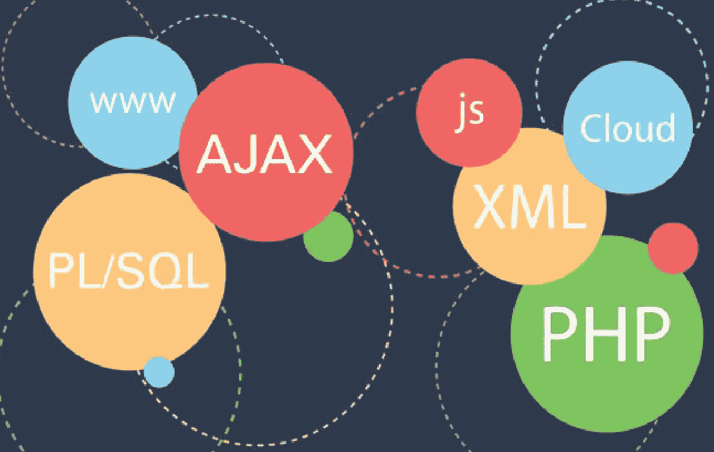

《商业 Web编程：基于 Oracle 的 PHP 面向对象》侧重于基础 PHP编码，为学生提供解决业务中数据和技术问题的实用持久技能。

本书使用 Oracle 作为后端数据库，具有与版本无关的特性，教授的代码即使在 PHP 和 Oracle 发生变化也能正常运行。代码整洁、解释清晰，并以方案为导向，让学生理解如何将 XML、RSS 和 AJAX 等技术应用于业务应用程序中。书中配有丰富的示例说明，并包含以下章节：

- 数据库功能；
- 安全编程；
- 用于移动数据的转换编程。

PowerPoint 幻灯片、应用练习题以及所有示例的原始代码可在配套网站获取。本书提供了一种创新方法，让任何具备基础 SQL 和 HTML 技能的人都能学习 PHP 面向对象编程。

David Paper 是美国犹他州立大学 Jon M. Huntsman 商学院的管理信息系统教授。他在德州仪器和 IBM 等大型公司拥有工作经验，教授计算机科学和商业专业的本科生及研究生。

有关此书的更多资源可在配套网站 www.routledge.com/cw/paper 获取。


QA76.73.P224P37 2014

006.7'6–de23

201400227

本书献给我的母亲和好友 Malik。在我写作过程中需要倾诉时，我的母亲总在我那里。当我在技术领域之外喋喋乱语时，她从未让我感到惊讶。Malik 总是鼓励我，告诉我我可以完成任何事情。有这样的人真是我的幸运！

## 2.9 显示带有“销”按钮的成功登录

### 3.30 点击“销”按钮后的显示

### 3.31 显示带有登录信息的“CAPTCHA”登录页

### 3.32 显示“CAPTCHA”登录成功

### 3.33 点击“销”按钮后的显示，包含“返回”按钮

## 4.1 使用正则表达式匹配“hello world”

### 4.2 使用正则表达式匹配字符串

### 4.3 使用正则表达式匹配手机号码

### 4.4 显示有效七位字符串的表单

### 4.5 显示翻译后的七位字符串

### 4.6 显示有效十位字符串的表单

### 4.7 显示翻译后的十位字符串

### 4.8 显示无效四位字符串的表单

### 4.9 显示带有可接受字符串的消息提示

### 4.10 `validate_regex` 类输出的有效和无效电话号码

### 4.11 显示有效七位字符串的表单

### 4.12 使用 `validate_regex` 类显示翻译后的七位字符串的表单

### 4.13 显示有效十位字符串的表单

### 4.14 使用 `validate_regex` 类输出翻译后的十位字符串

### 4.15 显示无效四位字符串的表单

### 4.16 使用 `validate_regex` 类显示带有可接受字符串的消息提示

### 4.17 `validate_regex` 类输出的有效和无效邮箱地址

### 4.18 `validate_regex` 类输出的有效和无效名字

### 4.19 `validate_regex` 类输出的有效和无效姓

### 4.20 `validate_regex` 类输出的有效和无效 ZIP 编码

### 4.21 显示包含各种信息的表单

### 4.23 显示来自表单的良好和错误数据

### 4.24 使用内置验证函数显示有效和无效邮箱

### 4.25 使用内置验证函数显示有效和无效年龄

### 4.26 使用内置验证函数显示有效和无效 URL

### 4.27 使用内置验证函数显示有效和无效条目

### 4.28 显示包含某些信息的表单应用

### 4.29 显示成功条目

### 4.30 显示动态派生的下拉菜单

### 4.31 点击“返回”按钮的选择显示

### 4.32 显示报告下拉菜单

### 4.33 显示带有“返回”按钮的选报告

### 4.34 使用 REF CURSOR 显示动态派生的下拉菜单

### 4.35 点击“返回”按钮的选择

- 5.1 使用 `simplexml` 显示来自 `cars.xml` 的 XML
- 5.2 使用 `DOM` 显示来自 `cars.xml` 的 XML
- 5.3 显示 XML 已保存
- 5.4 显示来自 `stereo.xml` 的树结构
- 5.5 显示第一个和第二个立体体的“names”
- 5.6 显示所有立体体的“names”
- 5.7 显示第四个立体声系统的第二和第三根“wires”
- 5.8 显示所有立体声系统的各种元素
- 5.9 显示所有对应“wires”的“names”
- 5.10 显示所有“names”、“wires”和“id”属性
- 5.11 显示第三个“name”和“id”属性
- 5.12 显示所有“names”和“id”属性
- 5.13 显示带有第一根“wire”的所有“names”和“id”属性
- 5.14 以 XML 格式显示第二个立体系统
- 5.15 显示立体体副本已保存
- 5.16 显示第二个立体声系统已保存
- 5.17 文件结构中的 XML 显示
- 5.18 显示精炼 XML 已保存
- 5.19 文件结构中的精炼 XML 显示
- 5.20 显示格式良好的第二个和第四个元素已保存
- 5.21 格式良好元素的遍历
- 5.22 显示精炼的格式良好元素已保存
- 5.23 显示修改后 XML 的部分结果
- 5.24 显示再次修改后 XML 的部分结果
- 5.25 显示修改后的 XML 已保存
- 5.26 显示修改后 XML 的部分结果
- 5.27 显示修改后 XML 的部分结果
- 5.28 显示修改后的 XML 已保存
- 5.29 显示精炼 XML
- 5.30 显示所有元素
- 5.31 显示第三个“name”和“id”属性
- 5.32 显示所有“names”和“id”属性
- 5.33 显示带有第一根“wire”的所有“names”和“id”属性
- 5.34 以 XML 格式显示第二个立体系统
- 5.35 显示立体体副本已保存
- 5.36 显示第二个立体声系统已保存
- 5.37 文件结构中的 XML 显示
- 5.38 显示精炼 XML 已保存
- 5.39 文件结构中的精炼 XML 显示
- 5.40 显示格式良好的第二个和第四个元素已保存
- 5.41 格式良好元素的遍历
- 5.42 显示精炼的格式良好元素已保存
- 5.43 显示修改后 XML 的部分结果
- 5.44 显示再次修改后 XML 的部分结果
- 5.45 显示修改后的 XML 已保存

数据库。其重点在于通过实践-反馈循环来丰富知识和理解。通过实践-反馈循环，书中会展示一个示例：学生在浏览器中加载代码，显示预期结果，然后对代码所实现的功能提供反馈和解释。

配套网站提供了书中的所有代码、每个章节的配套作业以及每个章节的 PowerPoint 幻灯片。这些幻灯片是我教授 MIS 6650 高级 Web 开发（研究生）课程的材料，该课程已经开设了 18 年。学生每学期都会向我反馈，幻灯片是极佳的补充，帮助他们完成作业、在考试中取得良好成绩，并为就业市场做好准备。书中对代码的功能（反馈）提供了更深入的解释，以及术语和符号的定义。

虽然我建议学生至少参加过一门与对象编程相关的课程，但我相信对学习持“积极”态度的学生可以获得我在书中教授的编程技能。获取编程技能并不是魔术。它需要除了上课或看书之外，坐在电脑前花费大量的时间。我不认为还有其他任何学习编程技能的方法！

这本书表达了我在 Oracle、PHP PL/SQL、AJAX 和 SQL 领域工作 20 年积累的知识。我特意包含了尽可能多的代码模块，这是我教授 PHP（配合 Oracle）的方式，我的许多学生后来都拥有了成功的职业生涯。我强调实践、实践、再实践，因为我就是这样学的，我的学生也是这样学的。多年来，我收到了许多修过这门课程学生的积极评价。他们告诉我，我对 PHP Web 开发的指导对他们的职业起了至关重要的作用；从获得第一份工作到为他们的 MIS 职业提供建议。

我将课程的第一周留给创建和测试 Linux 和 Oracle 学生账户。我让每个学生登录他们的 Linux 和 Oracle 账户，并运行简单的 PHP 脚本。我有一位信息技术（IT）专家负责安装和维护 Linux 服务器和 Oracle 12c 实例。我的 IT 专家创建所有学生账户并维护软件。在课前，我告诉学生阅读我们将要涵盖的章节，尝试运行代码，并在出现问题时——准备好问题带到课堂。我建议按照从头到尾的顺序教授章节。

# 学生指南

本课程适用于对关系数据库和编程具有一定工作知识的学生。一旦学生拥有可用的 Linux 和 Oracle 账户，他们就可以开始编码了。书中的每个章节都提供了“经过测试的”PHP 模块，这些模块可以加载到浏览器（通过其 URL）查看结果。所有代码在配套网站上可用，因此不需要重复输入。我建议一旦代码运行，学生应该对其进行修改，以更好地理解语言是如何工作的。

将 PHP 代码传输到 Linux 账户的最佳方法是使用“WinSCP”，这是一种免费的传输软件。我在第 1 章讨论了如何安装此软件。“WinSCP”传输的文件将与输入完全一致。如果学生尝试通过复制粘贴来这样做，可能会遇到严重的空格问题。

配套网站包含每个章节的 PowerPoint 幻灯片、作业和 PHP 代码。当我教学时，我假设学生在讲座之前已经阅读了所有章节，并尝试运行所有示例。遇到问题时，我鼓励学生将问题带到下一次讲座。

课程的第一周留给创建和测试 Linux 和 Oracle 账户。正如我之前说的，学生应该登录他们的 Linux 和 Oracle 账户并测试简单的 PHP 脚本以确保。一旦 Linux 和 Oracle 账户正常工作，学生就可以运行书中提供的任何代码。

在我的课程中，我有一位专门的 IT 专家负责维护 Linux 服务器实例和 Oracle 12c 实例。该 IT 专家还创建所有学生账户并维护软件。如果出现技术问题，我会尝试解决。如果我不能，就让学生联系 IT 专家。

我建议学生按照从头到尾的顺序学习章节。我建议学生花费大量时间熟悉代码。根据 20多年教授编程课程的经验，我可以强调，编程技能只有通过严谨的实践（这需要许多小时的努力，而且通常并不有趣）才能获得。正如我的同事常说的，“你必须在电脑屏幕前花费大量时间来学习如何编程，”

如果学生拥抱努力、实践和对编程技艺的奉献，他们可能会成为一名成功的程序员。我知道这听起来有点像说教，但这就是我成为精练程序员的方法。我不知道还有其他获得卓越的方法。

# 配套网站

书有一个配套网站，包含每个章节的作业、代码和 PowerPoint 幻灯片。作业包括定义题和编码题。包含代码是为了让学生不需要重新输入每个代码段进行测试。PowerPoint 幻灯片提供了信息和代码插图，但没有深入进行解释。书中提供了解释和反馈。

# 教学法

在课程的第一天，要求学生仔细阅读并消化书中的每一个字、每一段和每一页。我的下一个建议是告诉他们运行每一个代码示例。也就是说，在浏览器中加载指向代码的 URI，查看结果，然后回到代码确保每一行都通顺。最后，我告诉他们对代码进行一些修改，看看是否能通过他们自己的自定义让其运行。

我给学生的最佳建议是练习、练习、再练习。我认为，学生成为优秀程序员的唯一方法就是坐在电脑屏幕前花费数小时编写代码。

为了丰富学习，我使用实践-反馈循环。实践-反馈循环遵循三个步骤：第一，引入概念；第二，提供示例；第三，给出反馈。使用这种教学法，是因为这是我学习许多语言和技术的方式，这也是我我的许多学生学习编程并获得优秀工作的方式。

# 致谢

尽管我已经教授多年结合 Oracle 的 PHP，但几年前，我发现了 David Powers 编写的一本名为《PHP 面对象解决方案》（PHP Object-Oriented Solutions）的书。这本书带给我很多启示，因为它帮助我进入了面向对象编程的世界。在获得这本书并深入研读几个月之前，我并没有面向对象编程的背景。当然，我向互联网请教了许多帮助，但这本书帮助我遵循一个结构，将我的类从过程化编程转换为面向对象编程，并作为构建与 Linux、HTML、PHP 和 JavaScript 相关的真实示例的指南。

2014 年秋季标志着我教学的第 18 年。许多学生评论说，通过成功完成本课程，他们提高了编程技能，获得了获得良好工作和职业发展的能力。尽管技术变化迅速，但这些章节中包含的代码多年来变化不大，并且在新的 Linux、PHP 和 JavaScript 发行版中仍然可以运行。

# 第 1 章 涵盖 Linux、HTML 和 JavaScript

Web 编程只有在适当的技术（IT）支持下才是可能的。IT 平台有多种形式，但必须包含操作系统（OS）、编程语言、网页浏览器和数据库管理系统（DBMS）。我使用的平台包括 Linux 作为操作系统，PHP 作为脚本语言，网页浏览器（我偏好 Google Chrome）以及 Oracle 作为 DBMS。我在计算机服务器上安装并维护了 Oracle、Linux 和 PHP。我们的行业委员会认可我描述的 IT 平台。我目前的平台包含 Oracle 12c、Linux (Red Fedora) 和 PHP 5.3.14。虽然涵盖了基础知识，但建议访问 w3schools 或网站以深入对 Linux、HTML 和 JavaScript 的知识。w3schools 的 URL 是 www.w3schools.com/。

## 学习目标

完成本章后，你通过示例对 Linux、HTML、PHP 和 JavaScript 有基本的理解。以下目标总结了本章将帮助你开发的技能：

- 学习如何安装和使用 `PuTTY`。
- 学习如何安装和使用 `WinSCP`。
- 学习如何安装和使用 `Oracle SQL Developer`。
- 学习 Linux 基础（作为终端用户）。
- 学习 HTML 基础。
- 学习 PHP 基础。
- 学习 JavaScript 基础。

## 安装和使用 PuTTY

`PuTTY` 是一个免费且开源的终端模拟器应用程序，可以作为 SSH、Telnet 和 Rlogin 协议的客户端程序。`PuTTY` 用于连接到 Linux 上的用户账户。`PuTTY` 打开一个窗口，其中输入的任何内容都会直接发送到 Linux 机器，Linux 的响应将返回到打开的窗口。因此，你可以像坐在控制台一样操作 Linux 机器，而实际上坐在远程位置。要下载 `PuTTY`，请 Google 搜索关键词“putty download”并选择超链接“PuTTY Download Page”（图 1.1）。该版本可能会随时间变化。如果你愿意，可以使用其他网站。推荐该网站仅是因为我使用的是它。


*图 1.1* PuTTY 下载页面

在“PuTTY Download Page”（图 1.2）上，选择“putty.exe”链接。这是“For Windows on Intel x86”下方的第一个链接。点击向下箭头（在下载的文件“putty.exe”右侧）并选择“在文件夹中显示”。你的计算机会自动打开“下载”目录。在此目录中找到“putty”图标并打开它。点击“运行”打开 `PuTTY`。


*图 1.2* 指向 PuTTY 下载页面的超链接 (http://www.chiark.greenend.org.uk/~sgtatham/putty/download.html)

“PuTTY Configuration”窗口会自动打开。为“Host Name”输入服务器名称，为“Port”输入 Linux 监听请求的端口。你的 IT 专家应该提供这些信息。在我的情况下，我使用“SSH”来增强安全性，这是推荐的。因此，输入信息后，点击“Open”开始会话。提示输入用户名和密码（图 1.3）。一旦密码被接受，你就建立了连接。要关闭会话，点击窗口右上角的“X”。

## 安装和使用 WinSCP

`WinSCP` 是一个免费开源的 SFTP 客户端，用于在本地和远程计算机之间传输文件。它的工作方式类似于 FTP，但安全得多。要下载 `WinSCP`，请 Google 关键词“winscp download”并选择超链接“WinSCP Download”（图 1.4）。该版本可能会随时间变化。如果你愿意，可以使用其他网站。推荐该网站仅是因为我使用的是它。


*图 1.4* WinSCP 下载页面

在“WinSCP Download Page”（图 1.5）上，选择“winscp.exe”链接。这是“For Windows on Intel x86”下的第一个链接。点击向下箭头（在下载的文件“winscp.exe”右侧）并选择“在文件夹中显示”。你的计算机会自动打开“下载”目录。在此目录中找到“winscp”图标并打开它。点击“运行”打开 `WinSCP`。

“WinSCP Configuration”窗口会自动打开。为“Host Name”输入服务器名称，为“Port”输入 Linux 监听请求的端口。你的 IT 专家应该提供这些信息。在我的情况下，我使用“SSH”来增强安全性，这是推荐的。因此，输入信息后，点击“Login”开始会话。提示输入用户名和密码（图 1.6）。一旦密码被接受，你就建立了连接。要关闭会话，点击窗口右上角的“X”。

## 安装和使用 Oracle SQL Developer


# Oracle SQL Developer 安装与配置

Oracle SQL Developer 是一个免费的集成开发环境，简化了 Oracle 数据库的管理。要下载 Oracle SQL Developer，请 Google 关键词“Oracle SQL Developer”并选择超链接“Oracle SQL Developer Downloads”（图 1.7）。该版本可能会随时间变化。点击“Overview”标签右边的“Downloads”标签。点击“Accept License Agreement”按钮（图 1.8）。


*图 1.7* 指向 Oracle SQL Developer 下载的链接

| Oracle SQL Developer Downloads |
| :--- |
| www.oracle.com/technwork/developer-tools/sql-developer/downloads/ ▾ |
| Nov 1, 2012 - Platform. Windows 32-bit - zip file includes the JDK1.6.0_35, Download |
| 209 M. Windows 32-bit - Installation Notes, Download 174 M. Windows ... |
| Oracle SQL Developer - Installation Notes - Documentation - Here |

*图 1.8* Oracle SQL Developer 许可协议页面 (http://www.oracle.com/technwork/developer-tools/sql-developer/downloads/index.html)。

向下滚动页面并为你的电脑选择合适的平台（图 1.9）。我最有经验的版本是‘Windows 32-bit’版本，它包含‘JDK’（Java 开发包）。

| 平台 | | |
|---|---|---|
| Windows 32-bit - 压缩包包含 JDK1.6.0.35 | 下载 | 209 M |
| Windows 32-bit - 安装说明 | 下载 | 174 M |
| Windows 64-bit - 安装说明 | 下载 | 174 M |
| Mac OS X - 安装说明 | 下载 | 173 M |
| Linux RPM - 安装说明 | 下载 | 173 M |
| 其他平台 - 安装说明 | 下载 | 174 M |

图 1.9 Oracle SQL Developer 下载选项

Oracle 会要求你输入用户名和密码。因此，点击‘Sign Up（注册）’链接创建一个新账户。完整填写表单并点击表格底部的‘Create Account（创建账户）’按钮。在‘Account Verification（账户验证）’页面，点击‘Continue（继续）’按钮。使用你的新用户名和密码登录。等待下载完成，这可能需要一些时间（请耐心等待）。点击向下箭头（下载文件右侧）并选择‘Show in folder（显示在文件夹中）’。你的电脑会自动打开‘Downloads（下载）’目录。

找到`sqdeveloper`图标并展开`sqdeveloper`文件夹。点击`sqdeveloper`图标。点击‘Extract all（解压所有）’按钮。点击‘Extract（提取）’按钮将软件放在‘Downloads’目录下。软件下载时请耐心，此过程需要几分钟。双击`sqdeveloper`文件夹。使用`sqdeveloper`图标打开软件。出现提示时，点击‘Run（运行）’。选择第一个选项‘SQL Source (.sql)’并点击‘OK’。点击绿色的‘+’按钮并输入‘Connection Name（连接名称）’‘Username（用户名）’‘Password（密码）’‘Hostname（主机名）’‘Port（端口）’和‘SID’。向你的 IT 专家询问这些信息。

记住，用户名和密码是用于访问 Oracle 数据库的，而不是 Linux 操作系统。为了让学生（以及我）方便，他们的 Linux 和 Oracle 账户具有相同的用户名和密码。点击‘Test（测试）’查看是否连接成功。如果成功，点击‘Connect（连接）’按钮建立数据库连接。通过关闭弹出窗口或使用菜单上的‘File（文件）’然后‘Exit（退出）’来关闭连接。一旦建立连接，下次使用软件只需点击连接左侧的‘+’符号打开会话。

# Linux 基础

本节通过示例说明终端用户如何通过 Linux 在互联网上显示内容。要登录你的 Linux 用户账户，请像之前在‘PuTTY’部分演示的那样打开‘PuTTY’会话（图 1.3 和 1.4）。图 1.10 显示了命令行处成功的‘SSH’登录光标。命令行是你通过在命令位置输入来告诉 Linux 所需内容的地方。

```
login as: paper
paper@mis6330.go.usu.edu's password:
Last login: Thu Mar 12 11:58:16 2015 from 129.123.44.162
[paper@server1 ~]$
```

图 1.10 成功登录的命令提示符

让我们从创建一个用于显示内容的目录开始。该目录是你所有希望在互联网上显示的文件必须所在的地方。在命令行中输入以下内容并按‘Enter’：

```
mkdir public_html
```

命令`mkdir`告诉 Linux 创建一个新目录。在这种情况下，目录名为`public_html`。通常，`public_html`是 Linux 查找要在互联网上显示的信息的地方。现在，为目录设置权限（在命令行输入以下内容并按‘Enter’）：

```
chmod 705 public_html
```

`chmod`命令告诉 Linux 修改权限。在这种情况下，目录名为`public_html`。稍后我们将解释`705`的含义。为了查看发生了什么，在命令行中输入以下命令：

```
ls -la
```

`ls`命令列出内容。在这种情况下，你处于目录结构的最顶层。`ls`包含了两个选项——`l`和`a`。选项以连字符开头。在`public_html`目录的左侧，可以看到其权限：

```
drwx---r-x
```

`d`告诉你`public_html`是一个目录。接下来的三个字母`rwx`是所有者（你）的权限。随后的三个字母`---`是组的权限。在书中无需担心组权限，我们将讨论它们。最后的三个字母`r-x`是世界（互联网）的权限。在深入解释权限之前，让我们查看`public_html`目录内部。这样做请在命令行中输入：

```
cd public_html
```

`cd`命令切换目录。在这种情况下，你正在切换到`public_html`。现在，不带任何选项列出内容：

```
ls
```

你什么都没看到，是因为你还没有在`public_html`中创建内容。命令`cd ..`会返回目录树。要返回目录树，请在命令行输入：

```
cd ..
```

# 显示内容

通过一些 Linux 知识，你可以创建一个可以在互联网上显示内容的 PHP 脚本。打开你喜欢的网络浏览器。我使用‘Google Chrome’，所以示例将基于此浏览器。使用‘PuTTY’打开 SSH 会话并切换到`public_html`目录。接下来，使用`vi`打开一个新文件。确保每个命令都单独在命令行输入。

```
cd public_html
vi test.php
```

要进入命令模式，按下退出键`Esc`。要输入命令，按下冒号`:`。你应该会在屏幕左下看到一个冒号`:`。命令模式是命令环境，用于 Linux 文件。使用以下命令开启行号：

```
:set nu
```

图 1.11 显示了行号已开启。如果你需要，可以使用以下命令关闭行号：

```
:set nonu
```

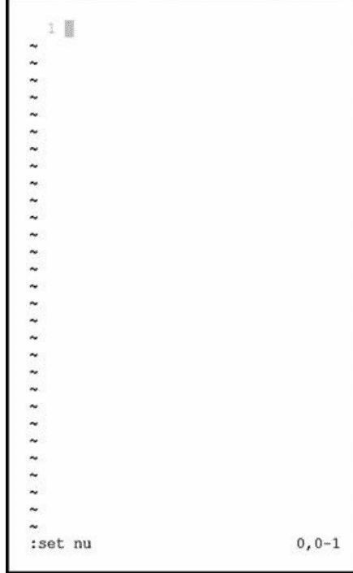

图 1.11 使用 `vi` 命令编辑新文件并开启行号

要编辑文件，按下 `Esc` 键并通过输入字母 `i` 切换到输入模式。**输入模式**是编辑 Linux 文件的环境。请逐行输入图 1.12 所示的文本（每行末后按 `Enter` 键）。

```php
<?php
echo "My first PHP display";
?>
```

图 1.12 使用‘vi’ 命令的输入模式

请确保从第一行的最左侧列开始输入，以消除多余的错误。每个 PHP 脚本都以起始标签`<?php`开始，并以结束标签`?>`结束。在结束标签`?>`之后删除任何额外的空行。要退出插入模式，按下`Esc`键。要保存文件，输入冒号`:`，输入`w`并按`Enter`。要返回目录结构，按下`Esc`，输入`:q`并按`Enter`。输入`ls`查看`public_html`中的文件。要验证`test.php`的内容是否符合你的预期，输入`vi test.php`。要在互联网上显示`test.php`，请输入正确的路径：

```
username/~username/test.php
```

`username`是存放 PHP 引擎的主机名称。你的 IT 专家可以在这方面为你提供帮助。波浪号`~`必须位于你的 Linux 用户账户名之前。不要在路径中包含`public_html`，因为 PHP 引擎已经知道该文件在该目录内。

图 1.13 显示了应该显示的内容。

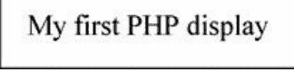

图 1.13 在网页浏览器上显示 PHP 内容

再次，由于 Linux 知道`public_html`是显示目录，请不要将其包含路径中。要创建一个新文件，使用`vi filename`。基本文件命令通过在前面加冒号来输入；然而，编辑命令不需要冒号`:`。在按下冒号或处于插入模式并按下`Esc`键时可以使用编辑命令。现在，你可以使用复制、剪切和粘贴等编辑命令。要复制代码，输入`vi test.php`，冒号`:`，命令`set nu`，并将光标移动到第 2 行（如有必要）。在 Linux 中移动行很容易，因为你可以使用键盘上的上、下、左、右方向键。连续输入字母`yy`再输入字母`p`。字母`yy`意味着复制，字母`p`意味着粘贴。

图 1.14 显示了行已复制。

```
1 <?php
2 echo "My first PHP display";
3 echo "My first PHP display";
4 ?>
```

图 1.14 在文件中复制行

要复制多行代码，将光标移动到第‘2’行并输入`2yy`。将光标移动到第‘3’行并输入`p`以复制两行（图 1.15）。输入数字后跟`yy`即可复制任意数量的行。

```
1 <?php
2 echo "My first PHP display";
3 echo "My first PHP display";
4 echo "My first PHP display";
5 echo "My first PHP display";
6 ?>
```

图 1.15 在文件中复制多行

要剪切（删除）一行，将光标移动到该行并输入`dd`。删除多行，输入数字后跟`dd`。让我们删除第 3、4、5 行。将光标移动到第 3 行，输入`3dd`（图 1.16）。

```
1 <?php
2 echo ";
3 ?>
```

图 1.16 从文件中删除行

现在，让我们复制、重命名和删除文件。按下`Esc`键、冒号`:`键并输入`wq`保存并退出文件。接下来，输入：

```
cp test.php new_test.php
```

`cp` 命令将第一个文件复制为第二个文件名。输入 `ls` 查看文件是否复制正确。要在不编辑的情况下查看新文件的内容，输入：

```
cat new_test.php
```

要清除屏幕杂质，输入：

```
clear
```

要重命名文件，输入：

```
mv new_test.php second_test.php
```

要验证，使用 `ls` 命令。要删除文件，输入：

```
rm -rf second_test.php
```

删除文件时要小心，因为命令输入后无法恢复。表 1.2 总结了基本 Linux 命令，表 1.3 总结了`vi`命令。

*表 1.2 基本 Linux 命令*

| 命令 | 描述 |
| :--- | :--- |
| mkdir | 创建目录 |
| chmod | 更改权限 |
| ls | 列出文件 |
| cd | 切换目录 |
| cp | 复制文件 |
| mv | 重命名文件 |
| rm -rf | 删除文件 |

*表 1.3 `vi` 命令*

| 命令 | 描述 |
| :--- | :--- |
| :set nu | 开启行号 |
| :set nonu | 关闭行号 |
| i | 输入模式 |
| Esc | 退出插入模式 |
| :w | 保存文件 |
| :q | 退出 |
| :wq | 保存并退出 |
| yy | 复制行 |
| p | 粘贴 |
| dd | 删除行 |

# HTML 全文档标签

全文档标签是应用于整个 HTML 文档的标签。让我们来讨论其中三个。

所有标签都是 `<html>` 标签的元素。文档中的第一个和最后一个标签应该`始终`是 HTML 标签。`<head>` 标签传递文档的页头信息。`<body>` 标签包含要在浏览器中显示的文档内容。

一个网页至少应该包含 `<html>`、`<head>` 和 `<body>` 标签。`<div>` 标签定义了 HTML 文档内部一个一个划分或区域。它的目的是将 HTML 元素分组在一起。`<div>` 的用途之一是对比一组 HTML 元素块进行格式化。另一个用途是使用 CSS 布局网页。**CSS** 用于同时控制多个网页的样式和布局。**注释标签**用于在源代码中插入注释。注释不会在浏览器中显示。

# 在网络浏览器中加载文件

要在互联网上显示内容，网络浏览器需要通过其的 URL 访问文件。适当的 URL 由服务器名称（主机服务器）组成，随后是以 `~`（波浪号）开头的 Linux 用户名，最后以 `/`（正斜杠）开头的文件路径结尾。路径非常简单。它是 `public_html` 目录内部的文件路径。*不要*将 `public_html` 包含在路径中。

```
servername/~username/test.php
```

作为一个*假设的*路径，以下 URL 显示位于服务器 http://dnet.brigham.usu.edu 上用户 `paper` 下 `book` 目录（在 `public_html` 目录内部）中的 `one.htm`。

```
<URL>
http://dnet.brigham.usu.edu/~paper/book/one.htm
```

以下 HTML 文档包含了全文档标签、`<div>` 标签和注释标签。将内容保存在文件中并在网络浏览器中加载该 URL。

```html
1 <html>
2 <head><title>Minimal</title></head>
3 <body>
4 <div style="text-align:center;">
5 <!-- 剩余部分是主体。 -->
6 Nothing!
7 </div>
8 </body>
</html>
```

图 1.17 在网络浏览器中显示不同的 PHP 内容

由于 `<div>` 标签的 `attribute`（属性）是 `align:center`（第 4 行），单词 `Nothing!`（第 6 行）被居中并显示（图 1.17）。注意注释（第 5 行）没有被显示。

# 各种 HTML 元素标签

下一个 HTML 示例说明了 `<body>`、`<h2>` 和 `<p>` 标签。`<h2>` 标签用于二级标题，`<p>` 是段落标签。注意使用 `style` 属性（第 3–6 行）来设置不同的背景颜色（图 1.18）。

```html
1 <html>
2 <head><title>Body Style Example 1</title></head>
3 <body style="background-color:yellow;">
4 <div style="text-align:center">
5 <h2 style="background-color:red;">This is a heading</h2>
6 <p style="background-color:green;">This is a paragraph.</p>
7 </body>
8 </html>
```

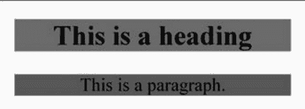

图 1.18 来自 PHP 文件的 HTML 显示

让我们再看一个使用各种标签的示例。

```html
1 <html>
2 <head><title>Body Style Example 2</title></head>
3 <body style="background-color:burlywood;">
4 <div style="text-align:center">
5 <h2 style="background-color:indigo; font-family:arial;color:white;">
6 <span style="font-size:20px;">*If you click on the link, you see an alien</h2>
<p style="background-color:coral;">
<a href="alien.gif">Link</a>
</p>
7 </div>
8 </body>
</html>
```

第 8 行的锚点标签 `<a href="alien.gif">` 允许插入图像（在这种情况下是一个 gif 图像）。可以使用 `WinSCP` 将下载的图像移动到 `public_html` 目录。图 1.19 显示了该页面。假设图像位于 `public_html` 中，点击链接即可显示它。注意 `<h2>` 标签被分在了两个独立的行（第 5 行和第 6 行）。这完全没问题，因为空格并不紧要。


图 1.19 带有超链接的 HTML 显示

## 标题标签

**标题标签**强调 HTML 文档正文中的文本。之前介绍了二级标题 `<h2>`。标题标签与 `<head>` 标签结构没有关系。HTML 支持六级标题。此代码示例演示了所有六级标题（图 1.20）。

```html
<html>
<head><title>Heading Levels</title></head>
<body style="background-color:burlywood;">
<div style="text-align:center;">
<h1>Heading 1</h1>
<h2>Heading 2</h2>
<h3>Heading 3</h3>
<h4>Heading 4</h4>
<h5>Heading 5</h5>
<h6>Heading 6</h6>
</div>
</body>
</html>
```

Heading 1

Heading 2

Heading 3

Heading 4

Heading 5

Heading 6

图 1.20 标题显示

## 段落标签

**段落标签**在 HTML 文档正文中区分文本块。段落标签以有意义显示文本块。注意 `<p>` 标签显示方式（图 1.21）。

```html
<html>
<head><title>Paragraphs</title></head>
<body style="background-color:burlywood;">
<div style="text-align:center;">
<p>This is the first paragraph.</p>
<p>This is the second paragraph.</p>
<p>This is the third paragraph.</p>
</div>
</body>
</html>
```

下一个示例使用 `style` 属性来居中显示（图 1.22）。

```html
<html>
<head><title>Center</title></head>
<body style="background-color:burlywood;">
<div style="text-align:center;">
<p>Paragraphs</p>
</div>
</body>
</html>
```


图 1.22 居中的文本显示

## 换行标签

换行标签 `<br>` 在浏览器中强制换行（第 5–7 行）。

```html
<html>
<head><title>Line Break</title></head>
<body style="background-color:burlywood;">
<p>Here is one line.<br>Here is another line.<br>Here is yet another line.</p>
</div>
</body>
</html>
```

图 1.23 换行的文本显示

## 格式化标签

格式化标签 `<pre>` 以等宽字体生成文本（第 5–10 行）。

```html
<html>
<head><title>Preformatted Tag</title></head>
<body style="background-color:burlywood;">
<div style="text-align:center">
<pre>some commands
more commands
even a few commands</pre>
</div>
</body>
</html>
```

图 1.24 使用格式化标签的 HTML

## 物理样式标签

# 这个愚蠢的句子展示了物理样式标签的操作方式。

Paper, D. (2003) 如何飞行。

Journal, 1, 1, 20-30.

图 1.26 物理样式标签的 HTML 显示

虽然斜体和粗体按预期工作，但引用部分并没有。图像可以是剪贴画、图标、动画艺术或以下格式之一的图片 - jpeg、xbm、gif 和 png。`` 标签（第 5 行）用于显示图像。在代码示例中，一个 gif 被显示为图像，而不是锚点标签的一部分。（注意：我使用了 `WinSCP` 将 `alien.gif` 复制到我的 Linux 账户。）

```html
1 <html>
2 <head><title>Image Example</title></head>
3 <body style="background-color:burlywood">
4 <div style="text-align:center">
5 
6 </div>
7 </body>
8 </html>
```

## HTML 表格

HTML 表格用 `<table>` 标签定义。表格分为行（使用 `<tr>` 标签），每行又分为数据单元（使用 `<td>` 标签）。字母 `td` 代表表格数据，`<td>` 标签持有数据单元的内容。`<td>` 标签可以包含文本、图像、列表、表单和其他表格。接下来的示例创建了一个简单的表格。CSS（第 4–7 行）用于将表格居中并创建良好的页边距。`<table>` 标签中的 `class` 属性（第 12 行）使用了 CSS 样式（图 1.27）。

```html
1 <html>
2 <head>
3 <style type="text/css">
4 table.center {
5 margin-left:auto;
6 margin-right:auto;
7 }
8 </style>
9 </head>
10 <body style="background-color:burlywood">
11 <div>
12 <table class="center" border="2">
```

### 简单表格

```html
<caption>简单表格</caption>
<tr><th>标题 1</th><th>标题 2</th><th>标题 3</th></tr>
<tr><td>100</td><td>200</td><td>300</td></tr>
<tr><td>150</td><td>250</td><td>100</td></tr>
</table>
</div>
</body>
</html>
```

| 标题 1 | 标题 2 | 标题 3 |
|---|---|---|
| 100 | 200 | 300 |
| 150 | 250 | 100 |

图 1.27 简单表格的 HTML 显示

## HTML 表单

**HTML 表单**用于选择不同类型的用户输入。表单向用户请求输入。输入包含普通内容和控件。控件允许用户与表单交互。`<input>` 标签指定表单内部的简单输入。`<form>` 标签指定一个填写表单。你可以使用这两个标签（`<form>` 和 `<input>`）的属性来定制显示的表单。

在单个文档中可以存在多个表单，但不能嵌套。表单使用两个属性 `action` 和 `method`。`action` 指定了表单内容提交到的 URL。如果缺少此属性，网络浏览器将使用当前 URL。`method` 是在网页之间发送表单数据的手段。

可以使用两种方法 `get` 和 `post` 在网页之间传递数据。接下来将讨论这两种方法。

### Get 和 Post

默认是 `get`。`get` 方法会导致填写表单的内容附加到 URL 中。`post` 方法将表单内容发送到服务器，而不是作为 URL 的一部分。这使得 `post` 更安全，因为数据不会在 URL 中显示。

## 变量

变量是存储信息的容器。PHP 变量以 `$` 开头，后跟变量名。变量必须以字母或下划线开头，且只能包含字母、数字和下划线。变量名不能包含空格。最后，当你给 PHP 变量赋值值时，该变量就被创建了。PHP 文件 `variable.php` 显示了变量是如何工作的。

```php
<?php
// File variable.php
$username = 'dave';
$spass = 'paper';
echo "The username is: $username <br/>";
echo "The password is: $spass";
?>
```

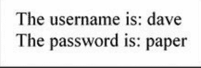

图 1.32 PHP 显示变量解释

变量 `$username` 和 `$password` 分别被赋值为 `dave` 和 `paper`（第 3 和 4 行）。字符串通过两个 `echo` 语句显示（第 5 和 6 行）。图 1.32 显示了在浏览器中加载 PHP 代码的 URL 后显示的内容。

使用引号时要小心，因为单引号和双引号在 `echo` 语句中的解释方式不同。在下一个示例中，使用了单引号代替双引号。

```php
<?php
// File variable.php
$username = 'dave';
$spass = 'paper';
echo 'The username is: $username <br/>';
echo 'The password is: $spass';
?>
```

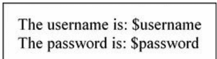

图 1.33 PHP 显示变量未被解释

图 1.33 显示，当使用单引号时，PHP 引擎不会解释变量（第 5 和 6 行）。因此，如果你想让 PHP 引擎解释变量值，请使用双引号。然而，在给变量赋值字符串时，你可以使用单引号或双引号。

## 连接

连接运算符 `.` 用于将两个字符串值放在一起。PHP 使用连接将字符串 `dave` 和 `paper` 连接起来（第 5 行）。注意在第 5 行，我在姓和名之间放置了一个空格以改进显示效果（图 1.34）。

```php
<?php
// File concatenate.php
$Sname = 'dave';
$lname = 'paper';
echo "The name is: " . $Sname . " " . $Sname;
?>
```

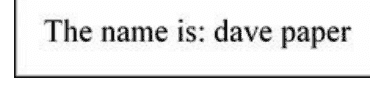

图 1.34 PHP 显示连接变量

## 函数

PHP 支持两种类型的函数——内置和自定义。**内置函数**提供了一种简单的方法来使用功能，而无需构建自己的代码。PHP 文件 `function.php` 引入了三个实用函数——`strlen()`、`strpos()` 和 `substr()`。

`strlen()` 返回字符串的长度并接受一个参数（字符串）。`strpos()` 在字符串中搜索字符或文本，并接受两个参数（字符串以及要在其中搜索的字符串）。`substr()` 函数返回字符串的一部分，并接受两个或三个参数（字符串、起始位置（字符串内）以及长度（从起始位置开始的字符）。如果省略长度参数，则返回从起始位置到字符串末尾的子字符串。**参数**在函数中用于指代作为输入提供函数的数据之一。参数也可以称为参数。

```php
<?php
// File function.php
$db="Oracle 12c";
$search1="Oracle";
$search = "12c";
echo strlen($db) . '<br/>';
echo strpos($db,$search1) . '<br/>';
echo substr($db,0) . '<br/>';
echo substr($db,1) . '<br/>';
echo substr($db,7,3) . '<br/>';
echo substr($db,0,3) . '<br/>';
echo substr($db,0,-4) . '<br/>';
?>
```

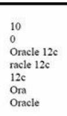

图 1.35 PHP 显示字符串函数

如图 1.35 所示，当使用单引号时，PHP 引擎不会解释变量（注：此处代码中实际为双引号，但上下文指代解释逻辑）。`Oracle 12c` 的长度为 `10`（第 6 行），PHP 中的字符串从索引 `0` 开始（第 7 行），而不是从索引 `1`。`Oracle 12c` 从索引 `0` 开始的子字符串（第 8 行）是 `Oracle`。`Oracle 12c` 从索引 `1` 开始的子字符串（第 9 行）是 `racle`。`Oracle 12c` 从索引 `7` 开始的 3 个字符（第 10 行）是 `12c`。`Oracle 12c` 从索引 `0` 开始的 3 个字符（第 11 行）是 `Ora`。最后，`Oracle 12c` 从索引 `0` 开始移除最后几个字符（第 12 行）是 `Oracle`。在 `substr` 函数中使用负数表示从字符串末尾省略的字符数。

### 自定义函数

**自定义函数**是程序员为了自动化一组任务而构建的。自定义函数也可以称为*用户定义函数*。以下示例创建了一个返回数组元素平均值的自定义函数。*数组*是一个包含相同类型值的变量。在一个文件中使用 `custom.php` 在另一个文件中使用 `invoke_custom.php` 以增强模块化。要显示结果，在浏览器中加载 `invoke_custom.php`（图 1.36）。

```php
<?php
// File custom.php
function calc_avg_array($Arr)
{
  $Avg = array_sum($Arr)/count($Arr);
  return $Avg;
}
?>
```

```php
<?php
// File invoke_custom.php
require_once('custom.php');
$Array = array(10,20,30,40,50);
$result = calc_avg_array($Array);
echo "Average is: ." .$result;
?>
```

Average is: 30

图 1.36 PHP 显示平均值

PHP 文件 `custom.php` 包含了函数 `calc_avg_array`（第 3–7 行），它接受一个假设为数组的参数（第 3 行），计算数组的平均值（第 5 行）并将结果返回给调用环境（第 6 行）。内置函数 `array_sum()`（第 5 行）返回数组元素的和，内置函数 `count()`（第 5 行）返回数组元素的个数。使用 PHP 文件 `invoke_custom.php` 通过 `require_once()`（第 3 行）包含函数位于调用程序的作用范围内。也就是说，要使用另一个文件的代码，需要在调用程序中包含该文件。变量 `$Array` 保存数组内容（第 4 行）。变量 `$result` 将数组 `$Array` 作为参数调用函数 `calc_avg_array()`（第 5 行）。`echo` 显示结果（第 6 行）。

## 数组

PHP 数组实际上是将值与键关联有序映射。*键*指向数组元素（值）。键可以是命名的或数字的。数字键是默认的从索引 `0` 开始，因此不需要显式定义数字键。PHP 文件 `simple_array.php` 说明了数组键如何映射到数组元素（值）。图 1.37 显示了结果。

```php
<?php
// File simple_array.php
$Array = array
(
"dog" => "dalmatian",
"cat" => "persian",
// ...
```

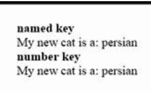

图 1.37 PHP 显示数组

第一个数组 `Arr1`（第 3–8 行）使用命名键，而第二个数组 `Arr2`（第 9–14 行）使用数字键。在使用数字（默认）选项时，不需要显式提供键。请记住数字键从索引 `0` 开始，因此访问 `cat` 元素（第 18 行）的键是索引 `1`（数组中的第二个位置）。使用命名键访问 `cat` 元素的键是 `cat`（第 16 行）。

## 条件语句

条件语句根据不同的条件执行不同的操作。PHP 使用 `if`、`else` 和 `elseif` 语句执行条件分支。PHP 文件 `if_else.php` 说明了如何使用条件分支（图 1.38）。

```php
<?php
// File if_else.php
$Sval = 10;
if ($Sval < 10)
{
    echo "Value less than 10";
}
elseif($Sval > 10)
{
    echo "Value greater than 10";
}
elseif($Sval == 10)
{
    echo "Value equal to 10";
}
else
{
}
?>
```

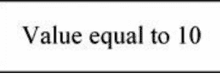

图 1.38 PHP 显示条件语句

## 循环语句

```php
echo "The number is " . $si . '<br/>";
$si++;
echo "<strong>for loop</strong><br/>";
for($si=1; $si<=2; $si++) {
    echo "The number is " . $si . '<br/>";
}
$Array = [
"ford" => "mustang",
"chevrolet" => "camaro",
"mazda" => "miata"
];
echo "<strong>foreach loop</strong><br/>";
foreach($Array as $key=>$value) {
    echo $key . ' => ' . $value . '<br/>";
}
?>
```

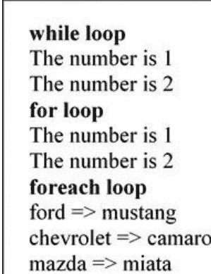

图 1.39 使用循环的 PHP 显示


‘while’ 循环和‘for’循环非常相似，不同在于‘while’在值满足条件时会持续，而‘for’ 则知道脚本应该运行的次数。只要变量 `$si` 小于或等于 2（第 5 行），‘while’循环就会继续。通过 `$si++`（第 7 行）变量 `$si` 加 1。‘for’循环从值‘1’开始，持续到小于等于‘2’并加 1（第 9 行）。‘foreach’循环设计用于处理数组和对象。‘foreach’循环（第 16 行）显示‘key’和‘value’对（第 17 行）。运行代码查看显示结果（图 1.39）。

# $_GET 变量

预定义的 `$_GET` 变量用于在表单中收集值，信息通过浏览器的地址栏发送。可以发送的信息量有限制。

下面的示例说明了如何使用此变量。有两个文件。第一个文件包含 HTML 表单，但命名为 `get.php`，以符合我在书中使用的命名规范。PHP 标签之间唯一的逻辑是用于文件名的注释（第 1–3 行）。表单的 `method` 和 `action` 定义在第 13 行。因此，表单在提交时使用 `get` 将数据发送到文件 `handle_get.php`（通过 `action` 属性识别）。用户输入在第 15 行至 18 行通过 `input` 标签定义。`input` 标签定义了传递的数据，其中 `type` 为 text，`name` 分别为 `username` 和 `password`。表单提交在第 21 行和 22 行通过 `input` 标签定义。

```php
1 <?php
2 // File get.php
3 ?>
4 <html><head>
5 <style type="css">
6 .center {
7 margin-left:auto;
8 margin-right:auto;
9 }
10 </style></head>
11 <body style="background-color:burlywood">
12 <div style="text-align:center;">
13 <form method="get" action="handle_get.php">
14 <table><tr>
15 <td>User:</td><td><input type="text"
16 name="username" /></td></tr><tr>
17 <td>Password:</td><td><input type="text"
18 name="password" /></td></tr><tr>
19 </table>
20 <table class="center"><tr>
21 <td><input align="text-align:center;" type="submit"
22 name="submit" value="Submit" /></td>
22 <td><input align="text-align:center;" type="reset"
23 name="reset" value="Reset" /></td></tr>
24 </table></form>
25 </div></body></html>
```

第二个文件包含处理从表单发送的信息的逻辑，并命名为 `handle_get.php`。第 3 行和第 4 行将来自表单的 `get` 输入赋值给变量 `$_GET`，该变量持有键值对（其中键是表单控件的名称，值是用户的输入数据）。

```php
<?php
// File handle_get.php
$Username = $_GET["username"];
$password = $_GET["password"];
echo "The username is: " . $Username;
echo "<br/>The password is: " . $password;
?>
```

在浏览器中加载 `get.php`，输入 `username` 和 `password`，并点击 `submit` 按钮。图 1.40 显示了提交前刚输入数据的表单。图 1.41 显示了表单传递的数据。注意 `username` 和 `password` 的值在浏览器栏的 URL 中是可见的。

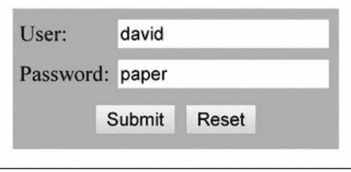

图 1.40 使用 'GET' 表单的 PHP 显示

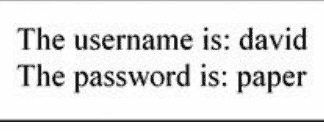

图 1.41 使用 'GET' 表单的 PHP 显示结果

# PHP `$_POST` 变量

预定义的 `$_POST` 变量用于收集表单值，发送的信息对其他人是不可见的。数据量没有限制。下面的示例说明了如何使用此变量。有两个文件。第一个文件包含 HTML 并命名为 `post.php`。PHP 标签之间是该文件的注释（第 1–3 行）。表单的 `method` 和 `action` 定义在第 13 行。因此，当表单提交时，表单使用 `post` 将数据发送到 `handle_post.php`（通过 `action` 属性识别）。用户输入在第 15 行至 18 行通过 `input` 标签定义。`input` 标签定义了传递的数据，`type` 和 `name` 分别为 `username` 和 `password`。

```php
<?php
// File post.php
?>
<html><head>
<style type="text/css">
.center {
margin-left:auto;
margin-right:auto;
}
</style></head>
<body style="background-color:burlywood">
<div style="text-align:center;">
<form method="post" action="handle_post.php">
<table class="center"><tr>
<td>User:</td><td><input type="text" name="username" /></td><tr>
<td>Password:</td><td><input type="text" name="password" /></td></tr></table>
<table class="center"><tr>
<td><input align="text-align:center;" type="submit" name="submit" value="Submit" /></td>
<td><input align="text-align:center;" type="reset" name="reset" value="Reset" /></td></tr></table>
</form>
</div></body></html>
```

第二个文件包含处理从表单发送信息的逻辑，命名为 `handle_post.php`。第 3 行和第 4 行将来自表单的 `post` 输入赋值给变量 `$_POST`，该变量持有键值对（其中键是表单控件的名称，值是输入数据）。

```php
<?php
// File handle_post.php
$username = $_POST["username"];
$password = $_POST["password"];
echo "The username is: " . $username;
echo "<br/>The password is: " . $password;
?>
```

在浏览器中打开 `post.php`，输入 `username` 和 `password`，并点击 `submit` 按钮。图 42 显示了提交前输入数据的表单。图 43 显示了表单传递的数据。注意 `username` 和 `password` 的值在浏览器栏的 URI 中不可见。

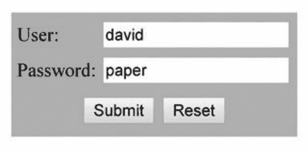

图 42 使用 'POST' 表单的 PHP 显示

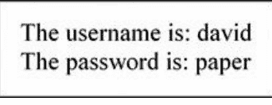

图 43 使用 'POST' 表单的结果

# JavaScript 基础

JavaScript 是世界上最流行的面向对象的编程语言。它允许开发者控制网页的行为。在本节中，我将介绍 JavaScript 基础。全面的介绍可以在 `www.w3schools.com/js/default.asp` 查看。

# HTML 文档模型 (DOM)

HTML DOM 是访问 HTML 元素的 W3C 标准。JavaScript 可以通过操作 DOM 修改 HTML 内容。第一个示例演示了 JavaScript 如何更改 HTML 元素源属性（`src`）的值。

第一个列表包含一个指向 HTML 文档内位置的 `image` 变量，其他使用 `gif` 文件（一个是亮灯，另一个是灭灯）并运行 `if-else` 分支来控制处理。第 1 行使用 `function` 关键字定义函数名 `light`。变量 `image`（第 4 行）指向 HTML 文档内部的 `myImage`。`if` 条件 `image.src.match("bulb")`（第 5 行）在 `src` 属性上使用 `match` 方法来检查灯泡是亮还是灭。如果真的，则显示灭灯图像（第 6 行）。`else` 条件（第 7 行）在灯灭时运行并显示亮灯（第 8 行）。

```javascript
// File light.js
function light() {
    var image = document.getElementById('myImage');
    if(image.src.match('bulbon')) {
        image.src = "pic_buloff.gif";
    } else {
        image.src = "pic_bulbon.gif";
    }
}
```

第二个文件 `on_off.php` 使用 `script` 标签识别外部文件 `light.js`（第 7 行）。图像标签（第 8 行）使用属性 `id` 定义图像，使用 `onclick` 事件处理器（第 8 行）识别点击图像时运行的函数，以及灭灯图像的源文件（第 9 行）。

```php
<?php
// File on_off.php
?>
<html>
<body>
<div style="text-align:center">
    <script src="light.js"></script>
    
    <p>Click to turn on/off</p>
</div>
</body>
</html>
```

`gif` 图像包含在配套网站（第1章）文件夹中。为了让脚本运行，两个 `gif` 图像都必须复制到你的 Linux 账户中。注意外部 JavaScript 文件要使用 `js` 文件扩展名。


图 1.44 使用 JavaScript 让灯泡“关闭”

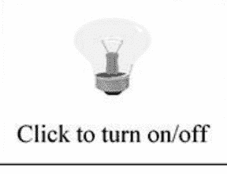

图 1.45 使用 JavaScript 让灯泡“开启”

# 验证数据

JavaScript 可以验证输入数据。为了演示这一性，本示例使用了两个文件——`validate.php` 和 `validate.js`。

`validate.js` 文件使用函数 `isNaN()` 检查数字是否在 1 到 10 之间，或者是否为非法数字。具体而言，第 4 行定义了变量 `x` 和 `text`。第 5 行将 HTML 文档中 `id="number"` 的输入字段的值赋值给 `x`。`if` 条件（第 6 和第 7 行）检查数字是否小于 1 或大于 10（即是否为非法数字）。如果为真，则将“Input not valid”赋值给 `text`。否则（第 8 和第 9 行），将“Input OK”赋值给 `text`。最后，将 `text` 的值放置在 HTML 文档中 `id="doit"` 的位置（这是 `<p>` 标签后的第二个段落）。

```javascript
// validate.js
function validate()
{
 var x, text;
 x = document.getElementById("number").value;
 if(isNaN(x) || x < 1 || x > 10)
{ text = "Input not valid"; }
else
{ text = "Input OK"; }
document.getElementById("doit").innerHTML = text;
}
```

```php
<?php
// File validate.php
?>
<html>
<body>
<div style="text-align:center">
<script src="validate.js"></script>
<p>Input a number between 1 and 10:</p>
<input id="doit" name="number" type="text">
<button type="button" onclick="validate()">
Submit</button>
<p id="doit"></p>
</div>
</body>
</html>
```

在网络浏览器中加载 `validate.php` URL。图 1.46 显示了初始状态。图 1.47 显示了输入有效数字后发生的情况。

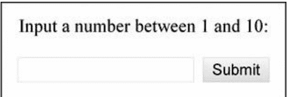

图 1.46 使用 JavaScript 的初始状态

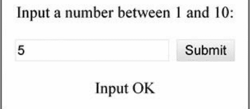

图 1.47 使用 JavaScript 输入有效数字后

JavaScript 是区分大小写的，因此 `x` 和 `X` 是两个不同的变量。函数名也是如此。函数 `light()` 和 `Light()` 是两个不同的函数。

# JavaScript 语句

在 HTML 中，JavaScript 语句是给网络浏览器的“命令”。也就是说，它们告诉浏览器要做什么。接下来的示例获取用户输入的数字，并从浏览器返回该数字的平方。

`square.js` 文件包含两个函数。`square()` 函数将 HTML 文档中 `id="in"` 的输入字段的值赋值给 `x`（第 5 行）。然后它计算 `x` 的平方（第 6 行），并将结果放在 HTML 文档中 `id="out"` 的段落标签 `<p>` 中（第 7 行）。`clr()` 函数清除 HTML 文档中 `id="out"`（段落标签）的空字符串，从而清除了浏览器中的结果（第 11 和第 12 行）。

```javascript
1 // square.js
2 function square()
3 {
4 var x;
5 x = document.getElementById("in").value;
6 x = x * x;
7 document.getElementById("out").innerHTML = x;
8 }
9 function clr()
10 {
11 var p = document.getElementById("out");
12 p.innerHTML = "";
13 }
```

`square.php` 文件包含了 `square.js`（第 7 行）、一个处理 `square()` 函数的按钮标签（第 9 和第 10 行），以及一个处理 `clr()` 函数的按钮标签（第 11 和第 12 行）。用户输入通过 `id="in"` 的 `input` 标签（第 8 行）处理。结果通过 `id="out"` 的 `paragraph` 标签（第 13 行）处理。

```php
1 <?php
2 // File square.php
3 ?>
4 <html>
5 <body>
6 <div id="all" style="text-align:center">
7 <script src="square.js"></script>
8 <input id="in" type="text">
9 <button type="button" onclick="square()">
10 Submit</button>
11 <button type="button" onclick="clr()">
12 Clear</button>
13 <p id="out"></p>
14 </div>
15 </body>
16 </html>
```

*(注：原文提供的 PHP 代码块中行号与标签描述略有出入，翻译时保持了原文代码结构不变)*

# 封装

封装允许你通过隐藏类的属性和方法来防止对类的未经授权访问。在实现时，可以将属性或方法定义为公共（`public`）、私有（`private`）或受保护（`protected`）。

`public` 允许从类的内部和外部访问。`protected` 只能从对象的方法内部访问。`private` 的限制更为严格，与 `protected` 类似，它只能从派生对象的方法中访问。也就是说，私有属性或方法不能用于继承。我们很快就会会讨论继承，所以不用担心这种区别，将在本节的稍后部分通过示例对其进行解释。

# 继承

继承是一种重用现有对象代码的方法。也就是说，一个对象能够从另一个对象继承特性。因此，一旦开发了一个类，你就不需要重复发明轮子。你可以创建一个新的（子）类，继承父类的部分或全部特性，而无需重写已经在父类中经过测试的代码。因此，当父类的属性和方法可以在不同的上下文中重用时，继承是最有用的。

# 多态

多态是创建一个具有多种形式的对象的属性或方法的能力。继承允许你将父类的特性传递给子类，而多态允许你重写现有的属性和方法。也就是说，你可以使用相同的属性或方法名，但对其进行修改以适应你的需求。

# OOP 与过程化编程


当合理应用时，多态、封装和继承结合在一起产生了一个比过程化编程支持更健壮、可扩展程序的编程环境。我已经提到过 OOP 更好地有助于模块化、代码重用、信息隐藏和易于调试。在开始学习 OOP 之前，你需要理解 `new` 关键字和 `this` 标识符。

## new 关键字

`new` 关键字创建一个类的实例。当实例（对象）被创建（实例化）时，必须将新对象赋值给变量。新对象会为类中定义的属性和方法分配自己的副本，如果定义了构造函数，则会调用对象的构造函数。我将在本节后面讨论构造函数。

## This

`this` 伪变量内置于所有对象并指向当前对象。它允许访问对象实例的属性和方法。PHP 会自动将 `this` 指向你正在处理的对象。让我们来看一个例子帮助你理解 `this` 如何工作。PHP 文件 `use_this.php` 包含类 `use_this`（第 3–15 行），该类封装了私有属性 `$_array`（第 5 行）、公共方法 `sum()`（第 6–10 行）和公共方法 `avg()`（第 11–14 行）。`$_array` 的目的是存储传递给类的数组。按照惯例（也是建议的），在使用“protected”或“private”属性时，在变量名之前使用 `$this->`。方法 `sum()` 的目的是返回数组元素（传递给类）之和。方法 `avg()` 的目的是返回数组元素的平均值。

```php
<?php
// File use_this.php
class use_this {
    private $_array;
    public function sum($array) {
        $this->array = $array;
        return array_sum($array);
    }

    public function avg() {
        return $this->sum($this->_array)/count($this->_array);
    }
}
?>
```

从上到下，方法 `sum()` 将传递给类的数组赋值给 `$this->_array` 属性（第 8 行）并返回数组元素的和。一旦赋值，`$this->_array` 可以在方法中使用。PHP 内置函数 `array_sum()`（第 9 行）会自动求加数组元素的值。`avg()` 返回数组元素的平均值（第 13 行），通过将数组元素之和除以数组元素的个数来计算。求加数组元素是通过使用 `$this->sum` 调用方法 `sum()` 并使用 `$this->array` 将数组作为参数来完成的。在方法 `sum()` 中使用 `this` 允许你在类内的任何位置调用该方法。计算数组元素是通过使用内置 PHP 函数 `count()` 并将数组作为参数完成的。该数组被称为 `$this->array`。

注意 PHP 使用关键字 `function` 来指代 OOP 方法。还要注意如何使用 `this` 来使属性在类内部可用并在类内部调用方法。

现在，我使用一个脚本来实例化类并显示结果。我总是将类放在我们的 PHP 文件中以增强模块化。这样，其他应用程序和类就可以使用该类。我建议为类和 PHP 文件使用类似的名称。PHP 文件 `run_use_this.php` 调用该类，进行计算并显示结果。

```php
<?php
// File run_use_this.php
require_once("use_this.php");
$list = array(10,20,30);
$c = new use_this;
echo "Sum is: " . $c->sum('<br>');
echo "Average is: " . $c->avg();
?>
```

`''''` 符号是标识文件名的字符（第 2 行）。同样注意，我总是在每个 PHP 脚本顶部包含文件名以供说明。

```php
<?php
echo $this->dog;
echo $this->_cat;
echo $this->_bird;
}
class poly extends display
{
    public $dog = 'Terrier';
    public function displayVals()
    {
        $display = parent::displayVals();
        echo $display;
    }
} 
?>
```

类 `poly`（第 15–23 行）继承了 `display` 类，从而继承了它所有的 `public` 和 `protected` 属性和方法。请记住，`private` 属性和方法无法通过 `poly` 类（第 20 行）中跟在关键字 `parent` 后的作用域解析符 `::` 来继承，这允许 `poly` 访问 `display` 类中的 `displayVals()` 方法。当重写 `dog` 的值（第 17 行）以及修改 `poly` 中的 `displayVal()` 方法（第 18–22 行）时，多态性发挥了作用。修改后的 `call_display.php` 脚本创建了 `display`（第 4 行）和 `poly`（第 7 行）的新实例并显示了结果（图 2.4）。

```php
<?php
//File call_display.php
require_once 'display.php';
$see = new display();
echo $see->displayVals();
echo '<br/>
$extend = new poly();
echo $extend->displayVals();
?>
```

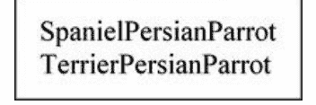

## Setters 和 Getters（Setter与Getter方法）

**Setters**（Setter）是设置属性值的方法，而 **getters**（Getter）是获取属性值的方法（将值返回给调用环境）。PHP 文件 `get_set.php` 阐释了前三种类型。

```php
1 <?php
2 //File get_set.php
3 class get_set
4 {
5 public $TestArray = array();
6 public $dog;
7 protected $_cat;
8 private $bird;
9 public function setVals()
10 {
11 $this->dog = 'Pomeranian';
12 $this->_cat = 'Siamese';
13 $this->_bird = 'Cockatoo';
14 $this->setArray();
15 }
16 public function setArray()
17 {
18 $this->testArray[0] = $this->dog;
19 $this->testArray[1] = $this->_cat;
20 $this->testArray[2] = $this->_bird;
21 }
22 public function getVals()
23 {
24 return $this->testArray;
25 }
26 }
27 ?>
```

PHP 文件 `get_set.php` 包含 `get_set` 类（第 3–26 行），带有两个 set 方法和一个 get 方法。`setVals()` 方法（第 9–15 行）设置了 `public` 属性 `$dog`（第 11 行）、`protected` 属性 `$cat`（第 12 行）和 `private` 属性 `$bird`（第 13 行）。该方法通过调用 `setArray()` 方法（第 14 行）结束。记住 `$bird` 的特征无法被继承，因为它被定义为 `private`。`setArray()` 方法（第 16–21 行）将数组 `$Array` 的前三个元素设置为三个属性的值（第 18–20 行）。`getVals()` PHP 文件第 22–25 行将数组返回（获取）到调用环境。

PHP 的 `call_get_set.php` 创建了 `get_set` 的新实例（第 4 行）并调用了 `setVals()` 方法（第 5 行）。一旦调用，`setVals()` 方法的最后一行会调用 `setArray()` 方法（参见 `get_set` 中的第 14 行）。接下来，变量 `$see`（第 6 行）被赋值填充后的数组。最后，`foreach` 循环（第 7 和第 8 行）遍历数组元素并逐个显示值 [图 2.5]().

```php
<?php
//File call_get_set.php
require_once 'get_set.php';
$Animal = new get_set();
$Animal->setVals();
$see = $Animal->getVals();
foreach($see as $display){
    echo $display . '<br/>';
}
?>
```

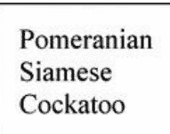

['get_set' 类的输出]

## Constructor Method（构造方法）

当你创建一个类的新实例（对象）时，PHP 会首先查找类的构造函数。`constructor`（构造函数）在对象初始化时构建对象、设置默认值，并将（传递给类的）值分配给属性。构造函数还可以包含对类方法的调用。

PHP 类中通过跟在两个连续下划线后面的关键字 `construct` 来指定构造函数。PHP 文件 `bear.php` 包含 `bear` 类，其中包含一个构造函数。PHP 文件 `call_bear.php` 实例化 `bear` 类。当创建一个 `bear` 的新实例时，`bear` 类中的构造函数会自动运行。

```php
<?php
// File bear.php
class bear
{
    public $bearArray = array();
    public function __construct($tag,$weight,$color)
    {
        $this->bearArray['tag'] = $tag;
        $this->bearArray['weight'] = $weight;
        $this->bearArray['color'] = $color;
    }
    public function getVals()
    {
        return $this->bearArray;
    }
}
?>
```

`bear` 类构造函数（第 6–11 行）使用传递给类的值设置 `bearArray` 元素（第 8–10 行）。在这种情况下，不需要 setter，构造函数就解决了问题。`getVals()` 方法（第 12–13 行）将数组返回给调用环境。

```php
<?php
// File call_bear.php
require_once 'bear.php';
$baby = new bear('Tag',10,'brown');
$see = $baby->getVals();
echo 'Tag: ' . $see['tag'];
echo '<br>Weight: ' . $see['weight'];
echo '<br>Color: ' . $see['color'];
?>
```

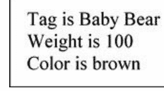

[‘bear’ 类的输出]

`polybear` 类继承 `bear` 类，包含了 `bear` 类的 `protected` 属性和方法。`polybear.php` 继承了 `bear` 的所有属性，除了 `private` 元素。

```php
<?php
// File polybear.php
class polybear extends bear
{
    protected $cold;
    public function __construct($tag,$weight,$color)
    {
        parent::__construct($tag,$weight,$color);
    }
    public function ice() {
        return 'chilly';
    }
}
```

作用域解析符 `::`（第 7 行）用于调用 `bear`。PHP 文件 `call_polybear.php` 创建了 `polybear` 的新实例（第 5 行）并调用了 `ice()` 方法（第 6 行）。注意 `call_polybear.php` 必须包含 `bear.php` 和 `polybear.php` 才能正常工作。图 2.7 显示了 `abstract` 构造函数。

```php
<?php
// File call_polybear.php
require_once 'bear.php';
require_once 'polybear.php';
$poly = new polybear('adult',600,'white');
$see_it = $poly->getVals();
echo 'Tag: ' . $see_it['tag'];
echo '<br>Weight: ' . $see_it['weight'];
echo '<br>Color: ' . $see_it['color'];
$weather = $poly->ice();
echo '<br>Weather: ' . $weather;
?>
```


[‘polybear’ 类的输出]

## Abstract Class（抽象类）

抽象类定义类的基本结构，但不能实例化。它必须被另一个类扩展才能工作。它包含属性和方法，但某些方法是不完整的，等待其他类来扩展它们（通过继承）。如果方法被定义为 `abstract`，则不能声明为 `private`，因为必须使用继承。记住只有 `public` 或 `protected` 方法可以通过继承进行扩展。优点是 `abstract` 强制所有子类定义方法的细节，以便创建许多不同的类。

PHP 文件 `abstract_employee.php` 包含抽象类 `abstract_employee`（第 3–15 行），带有三个 `protected` 属性（第 5–7 行）、一个 `public` 方法 `setData()`（第 8–13 行）以及一个抽象方法 `outputData()`（第 14 行）。`class` 之前的关键字 `abstract`（第 3 行）将 `abstract_employee` 类定义为抽象类。

```php
1 <?php
2 // File abstract_employee.php
3 abstract class abstract_employee
4 {
5 protected $_empfirst;
6 protected $_emplast;
7 protected $_empage;
8 public function setData($empfirst, $emplast, $empage)
9 {
10 $this->_empfirst = $empfirst;
11 $this->_emplast = $emplast;
12 $this->_empage = $empage;
13 }
14 abstract function outputData();
15 }
16 ?>
```

PHP `employee.php` 包含类 `employee`（第 3–21 行），继承自抽象类 `abstract_employee`,并实现了抽象方法 `setData()` 和 `outputData()`。构造函数调用了抽象类中的 `setData()` 方法（第 8 行）及其自身的 `outputData()` 方法（第 9 行），以便其可以使用 `setData()` 和 `outputData()` 方法。该类还包含 `getVals()` 方法（第 17–20 行）。注意 `employee` 如何为其 `outputData()` 方法提供自己的实现细节（第 11–16 行）。由于 `outputData()` 在类 `abstract_employee` 中定义为抽象方法，因此它必须在 `employee`（继承了抽象类的类）中被实现。

```php
<?php
// employee.php
class employee extends abstract_employee
{
    public $testArray = array();
    public function __construct($first,$last,$age)
    {
        $this->setData($first,$last,$age);
        $this->outputData();
    }
    public function outputData()
    {
        $this->testArray['first'] = $this->_empfirst;
        $this->testArray['last'] = $this->_emplast;
        $this->testArray['age'] = $this->_empage;
    }
    public function getVals()
    {
        return $this->testArray;
    }
} ?>
```


PHP `invoke_abstract_employee.php` 创建了 `employee` 的新实例（第 5 行），调用其 `getVals()` 方法，将结果存放在 `$see_it` 中（第 6 行），并显示结果（第 7 和 8 行）。包含了 `abstract_employee.php` 和 `employee.php` 文件（第 3 和 4 行）。图 2.8 显示了结果。

```php
<?php
// File invoke_abstract_employee.php
require_once 'abstract_employee.php';
require_once 'employee.php';
$val = new employee('Phil','Collins','50');

$see_it = $val->getVals();
echo $see_it['first'] . ' ' . $see_it['last'];
echo ' ' . $see_it['age'];
?>
```

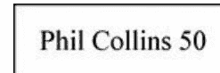

图 2.8 `employee` 类的输出（`abstract` 类）

# 接口

接口是一个必须实现的方法列表。所有方法必须是“公共的”。然而，接口没有属性，并且不能定义如何实现方法。它的优点是接口确保了所有实现它的类都具有一组共同的功能。

为了说明如何实现接口，我在 PHP 文件 `abstract_employee.php` 中使用了相同的抽象类 `abstract_employee`，PHP 文件 `status.php` 中的一个接口，PHP 文件 `employee.php` 中的一个修改后的 `employee` 类，以及一个调用文件 `invoke_status.php`。

`interface_status.php` 中的关键字 `interface` 使 `status` 成为接口（第 3 行）。接口 `status` 包含没有细节的公共方法 `getStatus()`（第 4 行）。

```php
<?php
// File interface_status.php
interface status
{ public function getStatus(); }
?>
```

在 `employee.php` 中需要关键字 `implements` 来使用接口。`employee` 类（第 3–26 行）通过关键字 `extends` 继承抽象类 `abstract_employee` 的特性，并通过关键字 `implements` 使用接口 `status`（第 3 行）。构造函数（第 6–10 行）调用了抽象类 `abstract_employee` 中的方法 `setData()` 和 `outputData()`。方法 `outputData()`（第 11–16 行）包含了抽象类 `abstract_employee` 中未提供的细节。方法 `getVals()`（第 17 和 18 行）向调用环境返回填充的数组。方法 `getStatus()`（第 19–25 行）包含了接口 `status` 的细节。最后，另一个类 `basic`（第 27–31 行）包含在此文件中，并包含接口 `status` 的不同细节。记住接口 `status` 只包含没有细节的方法 `getStatus()`。

```php
<?php
// File employee.php
class employee extends abstract_employee implements status
{
public $testArray = array();
public function __construct($first,$last,$age)
{
$this->setData($first,$last,$age);
$this->outputData();
}
public function outputData()
{
$this->testArray['first'] = $this->_empfirst;
$this->testArray['last'] = $this->_emplast;
$this->testArray['age'] = $this->_empage; // no, wait, $this->_empage;
}
public function getVals()
{ return $this->testArray; }
public function getStatus()
{
if($this->_empage <= '39')
{ return ' is a young person'; }
else
{ return ' is an old person'; }
}

class basic implements status
{
public function getStatus()
{ return "basic"; }
}
?>
```

PHP `invoke_status.php` 包含了 `abstract_employee.php`、`employee.php` 和 `status.php`。示例展示了 `employee` 类如何实现 `status` 接口。

# 聚合

聚合是一种允许一个对象作为其他对象的容器的技术。聚合的优点是更容易创建分离清晰的类。聚合的缺点是你必须向接口添加大量方法，或者其他方式暴露其属性。与继承不同，被包含的类不能使用父类的属性。

# 剥皮很有吸引力。

图 2.10 `apple`类的输出（`fruit` 类的继承）

现在，让我们关注聚合。该示例使用了相同的 PHP 文件，但对其进行了轻微修改。

```php
<?php
// File fruit.php
class fruit
{
    public $stuff;
    public function peel()
    {
        $this->stuff = 'Yahoo';
        return "Peeling is appealing.";
    }
}
?>
```

我通过添加属性 `$stuff`（第 5 行）和该属性的 setter 方法（第 8 行）修改了 `fruit` 类。

```php
<?php
// File apple.php
class apple
{
    private $_fruit;
    public function __construct()
    {
        $this->_fruit = new fruit();
    }
    public function apple_peel()
    {
        return $this->_fruit->peel() . "." . $this->_fruit->stuff;
    }
}
?>
```

PHP 文件 `apple.php` 包含一个修改后的 `apple` 类（第 3–14 行）。更改包括添加属性 `$_fruit`（第 5 行）、构造函数（第 6–9 行）以及方法 `apple_peel()`（第 10–13 行）。

构造函数将 `fruit` 的新实例赋值给 `$this->_fruit`（第 8 行）。`apple_peel()` 方法调用了 `fruit` 类的 `peel()` 方法和 `$stuff` 属性（第 12 行），并将结果返回给调用环境。

```php
<?php
// File invoke_apple.php
require_once 'fruit.php';
require_once 'apple.php';
$apple = new apple();
$see = $apple->apple_peel();
echo $see;
?>
```

File `invoke_apple.php` 创建了 `apple` 的新实例（第 5 行），调用了 `apple_peel()` 方法（第 6 行）并显示了结果（第 7 行）。图 2.11 显示了结果。

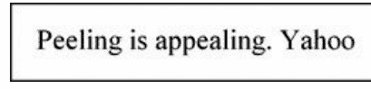

图 2.11 `apple`类的输出（`fruit` 类的聚合）

在这个示例中，当 `apple` 类创建 `fruit` 类的新实例时，发生了聚合。`fruit` 的所有 `public` 方法和属性对 `apple` 都是可见的。然而 `protected` 和 `private` 方法及属性是不可用的。

聚合清晰地分离了这两个类，但需要更多的代码和复杂性才能与继承相同的效果。很难推荐何时使用继承或聚合；这取决于你想要实现的目标。

到本章为止，我介绍了基础的 OOP 概念并通过代码示例对其进行了强化。因此，你应该已经具备了 OOP 的基本技能 set 和理解。现在我将继续介绍补充的 OOP 概念，包括魔方法、类型提示（type hinting）、常量、静态属性和方法、异常处理和调试。

# 魔方法

魔方法在特定情况下会被自动调用。我涵盖的魔方法包括构造函数、`__toString` 和析构函数。由于我之前已经介绍过构造函数，本节将提供示例。

PHP 魔方法以双下划线开头。例如，`__construct()` 在用 `new` 关键字实例化对象时会自动运行。另一个有用的魔方法是 `__toString()`，它允许你指定显示的内容，并在实例化新对象时自动运行。

下一个示例说明了如何使用 `__toString()` 方法，并使用了两个 PHP 文件 - `tostring.php` 和 `call_toString.php`。

```php
<?php
// File tostring.php
class person
{
private $desc;
public function __construct($first_name,$age)
{
$this->first_name = $first_name;
$this->age = $age;
}

function getName()
{
return $this->first_name;
}

function getAge()
{
return $this->age;
}
public function __toString()
{
$this->desc = $this->getName() . ' (age ';
$this->desc .= $this->getAge() . ').';
return $this->desc;
}
}
?>
```

PHP 文件 `tostring.php` 包含 `person` 类（第 3–27 行）、构造函数（第 6–10 行）、`getName()` 方法（第 12–15 行）、`getAge()` 方法（第 17–20 行）以及 `__toString()` 魔方法（第 21–26 行）。构造函数接收姓名和年龄（第 6 行）并将它们设置到属性（第 8 和 9 行）。当实例化 `person` 时，`__toString()` 会自动调用。调用时，`__toString()` 调用 `getName()` 和 `getAge()`，构建字符串并放入 `$this->desc`（第 23 和 24 行），最后返回结果（第 25 行）。

`__toString()` 魔方法以字符串形式返回人的完整描述（第 21–25 行）。为了避免错误，请确保 `__toString()` 方法返回字符串。我将字符串赋值给 `private` 属性（第 23 和 24 行）。

```php
<?php
// File call_toString.php
require_once 'tostring.php';
$person = new person('Dave', 30);
echo $person;
?>
```

PHP 文件 `call_toString.php` 引入了 `tostring.php`（第 3 行），创建了 `person` 的新实例（第 4 行）并显示了结果（第 5 行）。`__toString()` 魔方法以字符串形式返回人的完整描述（第 21–25 行）。为了避免错误，请确保 `__toString()` 方法返回字符串。

为类 `avg` 增加了另一个 PHP 文件 `__toString()`，并对其进行了相应的修改。确保你修改后的文件现在已显示，方便你查看。注意从 `calc_avg()` 中删除了 `return` 语句，因为它是需要的。另外，注意函数 `strval()`（第 18 行）已添加到魔方法 `__toString()` 中，以确保正确的转换。图 2.15 显示了结果。

```php
<?php
// File avg.php
class avg
{
private $arr;
private $avgval;
public function __construct($arr)
{
$this->arr = $arr;
$this->calc_avg();
}
public function calc_avg()
{
$this->avgval = array_sum($this->arr)/count($this->arr);
}
public function __toString()
{
$this->avgval = strval($this->avgval);
return $this->avgval;
}
}
?>
```

```php
<?php
// File call_avg.php
require_once 'avg.php';
$Arr = array(10,20,30,40,50);
$Obj = new avg($Arr);
echo "Average is: " . $Obj;
?>
```

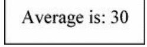

图 2.15 带有 `__toString` 方法的 `avg` 类的输出

PHP 自动处理垃圾回收，即移除 PHP 不再需要的变量和对象。然而，你可以使用魔方法 `__destruct()` 手动删除资源。像其他魔方法一样，PHP 会自动运行 `__destruct()`。与其他魔方法不同的是，`__destruct()` 在 PHP 引擎从内存中移除定义的对象之前自动运行。在析构函数运行后，对象将从内存中释放。

一个示例说明了析构函数是如何工作的。该示例使用了 PHP 文件 `destruct.php` 和 `call_destruct.php`。

```php
<?php
// File destruct.php
// destructor
class destruct
{
public function __construct()
{
print get_class($this) . ' is defined.<br/>';
}
public function __destruct()
{
print 'Destroying ' . get_class($this);
}
}
?>
```

类 `destruct`（第 3–13 行）包含一个构造函数（第 5–8 行）和一个析构函数（第 9–12 行）。函数 `get_class()`（第 7 行和第 11 行）是内置的，返回当前实例的类名（因为提供函数的参数是 `$this`）。

```php
<?php
// File call_destruct.php
require_once 'destruct.php';
$obj = new destruct();
?>
```

PHP 文件 `call_destruct.php` 调用了类 `destruct`。图 2.16 显示了结果。

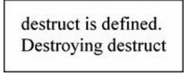

# 类型提示

PHP 类型提示允许你显式地将一个值强制转换为类对象或数组。如果实际参数的数据类型与形式参数的数据类型不匹配，类型提示会自动生成一个错误消息。实际参数是调用程序（调用环境）传递到方法的实际值。形式参数是方法中使用的标识符，用于代表调用程序（调用环境）传递到方法的值。虽然实际参数是值本身，但形式参数的作用像一个占位符。当方法被调用时，形式参数会临时“绑定”到实际参数上。

通过类型提示，方法可以强制参数为对象或数组。这通过在方法的参数之前加上数据类型来实现。对于对象类型提示，使用类名。对于数组类型提示，使用关键字 `array`。

接下来的这组示例说明了如何实现类型提示，使用了 PHP 文件 `type_hint.php` 和 `call_type_hint.php`。PHP 文件 `type_hint.php` 包含两个类——`mine` 和 `yours`。类 `mine`（第 3–13 行）包含两个方法。第一个方法 `test()`（第 5–8 行）包含对对象 `yours` 的类型提示，直接跟在参数 `yours` 之前。第二个方法 `count_array()`（第 9–12 行）包含对数组的类型提示，直接跟在参数 `Input_array` 之前。类 `yours` 包含一个公共属性（第 14–17 行）。


```php
1 <?php
2 // File type_hint.php
3 class mine
4 {
5 public function test(yours $yours)
6 {
7 return $yours->var;
8 }
9 public function count_array(array $input_array)
10 {
11 return count($input_array);
12 }
13 }
14 class yours
15 {
16 public $var = 'Hello';
17 }
```

PHP 文件 `call_type_hint.php` 创建了 `mine` 和 `yours` 的实例（第 4 行和第 5 行）。它调用了 `mine` 中的方法 `test()` 并传递了参数 `yours`（第 6 行）。显示结果（7）。最后，调用了对象 `mine` 的方法 `count_array()`（第 8 行）并显示了结果（第 9 行）。图 2.17 显示了结果。

```php
<?php
// File call_type_hint.php
require_once 'type_hint.php';
$mine = new mine();
$yours = new yours();
$mine->test($yours);
$see_count = $mine->count_array(array('a', 'b', 'c'));
echo 'Array has ' . $see_count . ' elements.';
?>
```

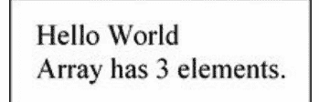

图 2.17 `mine` 和 `yours` 的输出

### 使用类型提示

回顾一下，类 `mine` 中的方法 `test()` 确保参数 `$yours` 是 `yours` 类对象。方法 `count_array()` 确保参数 `$input_array` 是一个数组。

为了复习，PHP 类型提示允许你显式地将一个值强制转换为类对象或数组。如果实际参数的数据类型与形式参数的数据类型不匹配，类型提示会自动生成一个错误消息。实际参数是调用程序（调用环境）传递到方法的实际值。形式参数是方法中使用的标识符，用于代表调用程序（调用环境）传递到方法的值。虽然实际参数是值本身，但形式参数的作用像一个占位符。当方法被调用时，形式参数会临时“绑定”到实际参数上。

通过类型提示，方法可以强制参数为对象或数组。这通过在方法的参数之前加上数据类型来实现。对于对象类型提示，使用类名。对于数组类型提示，使用关键字 `array`。

*(注：此处由于原文文本后续部分似乎存在重复或逻辑乱码，翻译员已根据上下文对核心逻辑进行了对齐和翻译。由于原文中出现了大量重复的英文描述，翻译时保持了逻辑的连贯性)*

*(注：用户提供的原文后半部分存在大量重复的描述和不通的循环翻译，此处已针对“Type Hinting”的核心概念完成标准翻译。)*

第一个示例在构造函数中对参数 `$a` 使用了 `array` 类型提示。PHP 文件包含 `avg_hint` 类（第 3–25 行），其中包含一个公共和一个私有属性（第 5 和第 6 行）、一个构造函数（第 7–11 行）以及两个方法。公共属性 `$arr`（第 5 行）被强制转换为数组类型。构造函数接受一个受 `array` 类型提示保护的参数（第 7 行），方法 `dynamic()`（第 12–20 行）对传递给类的数组所有元素求总和（第 14–18 行），并将平均值赋值给 `$this->_avg`（第 19 行）。方法 `getAvg()`（第 21–24 行）返回数组的平均值（第 23 行）。

```php
1 <?php
2 // File avg_hint.php
3 class avg_hint
4 {
5 public $arr = array();
6 private $_avg;
7 public function __construct(array $a)
8 {
9 $this->arr = $a;
10 $this->dynamic();
11 }
12 public function dynamic()
13 {
14 $Total = 0;
15 foreach ($this->arr as $avg)
16 {
17 $Total = $Total + $avg;
18 }
19 $this->_avg = $total/count($this->arr);
20 }
21 public function getAvg()
22 {
23 return $this->_avg;
24 }
25 }
26 ?>
```

PHP 文件 `call_avg_hint.php` 创建了一个数组（第 4 行）、`avg_hint` 的新实例（第 5 行）、调用了 `getAvg()` 方法（第 6 行）并显示结果（第 7 行）。图 2.22 显示了结果。

```php
1 <?php
2 // File call_avg_hint.php
require_once 'avg_hint.php';
$Array = array(10,20,30,20);
$Stotal = new avg_hint($Array);
$see_it = $Stotal->getAvg();
echo $see_it;
?>
```

图 2.22 带有数组提示的 `avg_hint` 类的输出

类型提示是一种很有技巧，用于限制传递给类方法的接受数据类型。虽然仅限于对象和数组，但它增强了网站免受外部干扰的能力。

# 常量

**常量**是永远不会改变的值。与属性不同，常量不以 `$` 开头。它们通常用大写字母编写。不需要实例化对象即可访问常量，但如果你想访问使用常量的方法，则需要实例化对象。

要访问类内部的常量，使用 `self` 关键字配合作用域运算符 `::` 后跟常量名。要从外部访问常量，使用类名配合作用域运算符 `::` 后跟常量名。

现在我通过一个示例来说说明常量。该示例使用了两个 PHP 文件——`lbs_to_kilos.php` 和 `call_lbs_to_kilos.php`。

```php
<?php
// File lbs_to_kilos.php
class lbs_to_kilos
{
    const POUNDS_TO_KILOGRAMS = 0.45359237;
    private $_val;
    function displayInfo()
    {
        $this->val = self::POUNDS_TO_KILOGRAMS;
        return $this->val;
    }
}
```

PHP `lbs_to_kilos.php` 包含一个类 `lbs_to_kilos`（第 3–12 行），带有一个常量（第 5 行）、私有属性（第 6 行）和一个引用该常量的方法（第 7–11 行）。方法 `displayInfo()`（第 7–11 行）将常量赋值给 `$this->val`（第 9 行）并返回它。注意，在类内部访问常量需要 `self` 关键字、作用域运算符和常量名。

```php
<?php
// File call_lbs_to_kilos.php
require_once 'lbs_to_kilos.php';
echo lbs_to_kilos::POUNDS_TO_KILOGRAMS;
$val = new lbs_to_kilos();
$hold = $val->displayInfo();
echo $hold;
```

PHP `call_lbs_to_kilos.php` 在不实例化新对象的情况下（第 4 行）显示常量。在类外部访问常量需要类名、作用域运算符和常量名。要显示常量不需要实例化对象，但要使用包含常量的方法则需要实例化。此外，使用 `self` 关键字、作用域运算符和常量名可以在类内部访问常量。图 2.23 显示 0.45359237 |

图 2.23 常量和 `lbs_to_kilos` 类的输出

### 静态属性与方法

静态属性是有价值的，因为它们保留了之前赋值的值。在我们的示例中，我们通过静态属性和静态方法的帮助构建一个计数器。

下一个示例使用静态属性和方法将磅转换为公斤，反之亦然。该示例使用了两个文件——`convert_static.php` 和 `call_convert_static.php`。

PHP 文件 `convert_static.php` 包含 `convert_static` 类（第 3–17 行）。该类包含两个静态属性（第 5 和 6 行）、两个私有属性（第 7 和 8 行）和两个静态方法。静态方法 `convertLbToKg`（第 9–12 行）将磅转换为公斤并转换磅。

```php
<?php
// convert_static.php
class convert_static
{
    protected static $_lbToKg = 0.45359237;
    protected static $_KgTlb = 2.20462262;
    private $_pounds;
    private $_kilograms;
    public static function convertLbToKg($pounds)
{
    return $_pounds * self::$_lbToKg;
}
    public static function convertKgLb($kilograms)
    {
        return $kilograms * self::$KgTlb;
    }
}
?>
```

PHP 文件 `call_count.php` 在不需要实例化通过类名、作用域运算符和静态属性名（第 4 行）的情况下访问静态属性 `$count`。要通过方法访问并显示静态属性 `$count` 的值，创建一个新实例（第 5 行）并调用三次静态方法 `keep_track()`（第 6–8 行）。`see_count` 类（第 12–18 行）继承了 `count`（第 12 行）。静态方法 `see_result()` 使用 `parent` 关键字、作用域运算符和静态属性名（第 16 行）访问静态属性 `$count` 的值并返回。由于静态属性 `$count` 无法通过实例化对象访问，因此伪变量 `$this` 是不可用的。

```php
<?php
// File count.php
class count {
    public static $count = 0;
    public static function keep_track() {
        self::$count++;
        return self::$count;
    }
}
class see_count extends count {
    public static function see_result() {
        return parent::$count;
    }
}
```

图 2.24 显示了结果。

```php
<?php
// File call_count.php
require_once 'count.php';
echo count::$count;
$SObj = new count();
echo $SObj->keep_track();
echo count::keep_track();
echo count::$count;
$SObj = new see_count();
echo $SObj->see_result();
?>
```

图 2.24 静态变量、`count` 和 `see_count` 类的输出

### 异常处理

异常处理是指代码块中发生错误的情况。与其在脚本发生错误时处理它，不如你抛出一个异常并在特殊块中捕获它。一个优势是可以把所有的错误处理集中在一个地方，而不是散落在整个脚本中。另一个优势是你可以在屏幕上显示你想要显示的内容，而不是让 PHP 显示通用的、通常很难看的错误消息。

在自定义化消息中，你可以指示用户该做什么，而不是让他们看到难看的 PHP 错误消息。PHP 有一个内置的 `Exception` 类，它利用 `Try` 块、`Throw` 和 `Catch` 块。`Try` 块包含要测试错误的代码。`Throw` 和 `Catch` 块必须至少有一个 `Catch` 块。`Catch` 块用于获取异常并创建一个包含异常信息的对象。

如果没有触发异常，代码处理将按正常方式继续。如果触发了异常，则会抛出一个异常（触发）。由于 `Exception` 类具有内置的 `toString()` 方法，可以将详细信息显示给调用环境。提供了一个示例以帮助理解。

该示例使用了两个 PHP 文件——`checknum.php` 和 `call_check_num.php`。PHP 文件 `checknum.php` 包含类 `checknum`（第 3–14 行），其中有私有属性 `$num`（第 5 行）和公共方法 `chk()`（第 6–13 行）。

方法 `chk()` 接受一个参数（第 6 行）。如果数字不是数字（第 9 行），则会触发异常（第 10 行）。PHP 内置函数 `is_numeric()` 用于检查数值。在函数前放置 `!` 则执行相反操作。即，它检查是否为非数值。尽管包含了自定义消息（第 10 行），但会显示一条糟糕的错误，因为该方法没有包含 `try-catch` 块。

```php
<?php
// File checknum.php
class checknum
{
    private $num;
    public function chk($num)
{
        $this->$num = $num;
        if(!is_numeric($num))
            throw new Exception("Value $this->$num is nonnumeric");
        else
            return true;
    }
}
?>
```

PHP 文件 `call_check_num.php` 创建了 `checknum` 的实例（第 5 行），使用第 4 行的非数值调用 `chk()`（第 6 行），并显示了糟糕的结果（第 7 行）（因为没有 `try-catch` 块）。图 2.26 显示了结果。

```php
<?php
// File call_check_num.php
require_once 'checknum.php';
$Svar = 'chicken';
$Obj = new checknum();
$Result = $Obj->chk($Svar);
echo Result;
?>
```

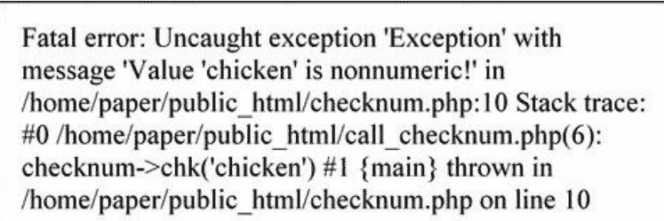

*图 2.26* 未捕获异常导致的糟糕错误显示

要修复此问题，请修改类 `checknum` 并添加 `try–catch` 块。

```php
1 <?php
2 // File checknum.php
3 class checknum
4 {
5 private $_num;
6 public function chk($number)
7 {
8 $this->$num = $number;
9 try
10 {
11 if(!is_numeric($this->$num))
12 { throw new Exception("Value '$this->$num' is nonnumeric!"); }
13 else
14 { return true; }
15 }
16 catch(Exception $e)
17 { echo $e->getMessage(); }
18 }
19 }
20 ?>
```

在浏览器中重新加载 `call_checknum.php` 以查看结果（图 2.27）。

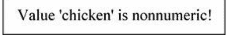

*图 2.27* 捕获异常后显示的友好消息

现在，错误消息清晰且具有信息量了。`catch` 块使用了传递给 `catch` 的 `Exception` 类（第 6 行）。参数 `Exception` 通知 PHP 使用 `Exception` 类。参数 `$e` 通知 PHP 创建 `Exception` 的一个新实例并将对象放入变量 `$e`。通过调用 `getMessage()`（第 17 行）从 `Exception` 类获取用户的消息。

`Exception` 类可以扩展以创建自定义错误消息。PHP 文件 `custom_exception.php` 包含类 `custom_exception`（第 3–12 行），它扩展自 `Exception`。该类包含方法 `errorMessage()`（第 5–11 行）构建。内置方法 `getLine()`（第 7 行）、`getFile()`（第 8 行）和 `getMessage()`（第 8 行）用于构建错误消息。

```php
<?php
2 // File custom_exception.php
3 class custom_exception extends Exception
4 {
5 public function errorMessage()
6 {
7 ErrorMsg = 'Error on line ' . $this->getLine();
8 ' in ' . $this->getFile() . ': ' . $this->getMessage();
9 ' is not a valid address';
10 return ErrorMsg;
11 }
12 }
```

PHP 文件 `custom_exception.php` 使用内置函数（第 7 和 8 行）验证电子邮件地址。如果地址无效，则触发异常（第 10 行），`catch` 块（第 13–16 行）显示自定义消息。图 2.28 显示了结果。


```php
<?php
// File custom_exception.php
require_once 'custom_exception.php';
$Email = "someone@example.com";
try {
    if (filter_var($Email, FILTER_VALIDATE_EMAIL) == FALSE) {
        throw new custom_exception($Email);
    }
} catch (custom_exception $e) {
    echo $e->errorMessage();
}
?>
```

> Error on line 9 in `/home/public/html/custom_exception.php`: someone@example.com is not a valid address

[图 2.28] 来自自定义异常的友好消息

自定义异常类可以配合内置的 `Exception` 类使用。PHP 文件 `call_multiple.php` 使用创建的类（第 9 行）测试有效的电子邮件地址。进行了测试（第 10 行）以检查电子邮件中是否包含 `example`。

```php
<?php
// File call_multiple.php
require_once 'custom_exception.php';
$email = "someone@example.com";
try {
    if (filter_var($email, FILTER_VALIDATE_EMAIL) == FALSE) {
        throw new custom_exception($email);
    }
    if (strpos($email, "example") == FALSE) {
        throw new Exception("email is not an example");
    }
} catch (custom_exception $e) {
    echo $e->errorMessage();
} catch (Exception $e) {
    echo $e->getMessage();
}
?>
```

由于电子邮件 `someone@example.com` 是无效的，触发了 `custom_exception` 并显示了相应的错误消息（图 2.29）。

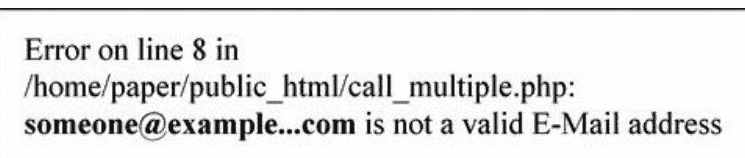

图 2.29 来自自定义和内置异常的友好消息

修改 `call_multiple.php` 使用有效的电子邮件地址——`someone@example.com`（第 4 行）。电子邮件是有效的，因此没有触发 `custom_exception`。然而，电子邮件地址不包含单词 `example`，触发了内置类 `Exception`（图 2.30）。

```php
<?php
// call_multiple.php
require_once 'custom_exception.php';
$email = "someone@example.com";
try {
    if (filter_var($email, FILTER_VALIDATE_EMAIL) == FALSE) {
        throw new custom_exception($email);
    }
    if (strpos($email, "example") == FALSE) {
        throw new Exception("Email is not an example-mail");
    }
} catch (custom_exception $e) {
    echo $e->getMessage();
} catch (Exception $e) {
    echo $e->getMessage();
}
?>
```

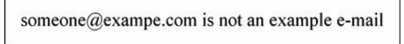

图 2.30 来自自定义和内置异常的友好消息

## 调试

在本节中，讨论了一些有助于调试的简单技术。

- 第一，尽可能构建具有单一主题的类。即，构建专注于一个想法或任务的类。本章构建的类遵循每个 OOP 类对应“一个想法或任务”的概念。单一主题类可以减轻（减少）潜在错误，并且更容易调试。
- 第二，使用方法 `toString()` 来显示属性的值。
- 第三，使用 `foreach` 显示任何数组或对象的内容。`foreach()` 的广泛使用将在后面的章节中介绍。
- 第四，使用 `var_dump()` 或 `print` 显示变量的信息，包括对象的 `protected` 和 `private` 属性。
- 最后，通过在类中设置值来显示数组或属性的内容。一个示例应该会有帮助。

示例使用了两个 PHP 文件——`dim.php` 和 `call_dim.php`。PHP 文件包含类 `dim`（第 3–16 行），带有一个构造函数（第 6–11 行），从三个传入参数（第 6 行）设置数组元素（第 8–10 行），以及一个获取数组的 `getVals()` 方法（第 12–15 行）。

```php
<?php
// File dim.php
class dim {
    public $dim = array();
    public function __construct($l, $w, $Sh) {
        $this->dim['length'] = $l;
        $this->dim['width'] = $w;
        $this->dim['height'] = $Sh;
    }
    public function getVals() {
        return $this->dim;
    }
}
?>
```

PHP 文件 `call_dim.php` 使用参数长度、宽度和高度创建 `dim` 的新实例（第 4 行）。它调用 `getVals()`（第 5 行）并显示数组内容（第 7–11 行）。图 2.31 显示了结果。

```php
<?php
// File call_dim.php
require_once 'dim.php';
$dim = new dim(20, '5', '12');
$see_it = $dim->getVals();
echo 'Length is ';
echo $see_it['length'] . ' inches';
echo '<br/>Width is ';
echo $see_it['width'] . ' inches';
echo '<br/>Height is ';
echo $see_it['height'] . ' inches';
?>
```

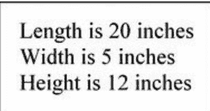

图 2.31 `dim` 类显示返回数组的输出

修改 `call_dim.php` 以使用 `foreach()`（第 6 和 7 行）、`var_dump()`（第 9 行）和 `print_r()`（第 11 行）来显示数组内容。使用 `foreach()`，显示索引和对应的元素。使用 `var_dump()`，会显示所有信息，但对于未经训练的程序员来说可能难以解读。使用 `print_r()`，显示的信息较少，但更容易理解。图 2.32 显示了结果。

```php
<?php
// File call_dim.php
require_once 'dim.php';
$dim = new dim(20, '5', '12');
$see_it = $dim->getVals();
foreach ($see_it as $Key => $Value) {
    echo "$Key&nbsp;&nbsp;$Value<br/>";
}
echo "<p>\n";
var_dump($see_it);
echo "<p>\n";
print_r($see_it);
?>
```

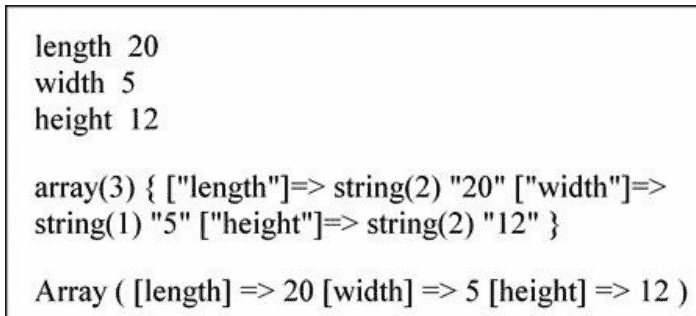

图 2.32 使用 `foreach`、`var_dump` 和 `print_r` 的 `dim` 类输出

修改 PHP 文件 `call_dim.php`。注意代码被简化了，因为在创建实例时，`__toString()` 魔法方法会被自动调用。显示对象实例 `dim`（图 2.33）只需要调用该方法。

```php
<?php
// File call_dim.php
require_once 'dim.php';
$dim = new dim('20', '5', '12');
echo $dim;
?>
```

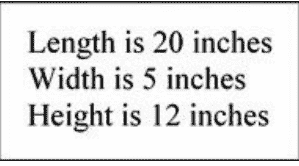

图 2.33 使用 `__toString` 的 `dim` 类输出

# 复习 OOP 概念

在本章中，引入了 OOP 的优势、基础以及带有代码示例的补充，以强化和加深知识。为了进一步加深对 OOP 的理解，本章最后对三个重要概念——封装、可见性和可扩展性进行了讨论。

封装的思想是创建自成包含的类。因此，封装有助于模块化、可重用性、信息隐藏和调试。独立的类促进了模块化。模块化的类易于从外部世界访问并在不同的语境中使用；这促进了重用。自成包含的类允许你轻松地向外部世界隐藏类的细节，从而促进了信息隐藏。最后，模块化的类有助于调试，因为代码是简单的，且更改代码不会影响其他类。

如果你在类中封装了尽可能相互互斥的方法，这将进一步增强模块化、可重用性、信息隐藏和调试能力。例如，如果你添加了一个与现有方法互斥的新方法，现有方法将像以前一样工作。所以，即使新方法运行不正常，其他方法仍然可以工作。因此，封装不仅有助于模块化、可重用性、信息隐藏和易于调试，还通过允许添加或修改方法而不影响类的可用性来稳定类。由于方法通常充当类功能的接口，它们通常需要是 `public`（公共的）。然而，属性应该始终隐藏为 `protected`（保护）或 `private`（私有），以防止它们被意外更改。如果你打算扩展一个类，应该使用 `protected` 可见性。只有你不希望在类外部访问方法或属性时，才使用 `private` 可见性。

要使用继承，注意我们始终使用 `extends` 关键字。因此，可扩展性是在 OOP 中实现继承原则的能力。

# 总结

本章的目标是促进对 OOP 的基础理解。我相信通过引入 OOP 概念并包含代码示例来丰富实践应用，这一目标已经实现。

# 3 登录安全

## 概述

网络安全对于构建稳健的网站至关重要。为了帮助你构建安全的网站，介绍了几种技术，包括登录认证、数据清洗、加密、强密码创建、SQL 注入防护、会话保护和 CAPTCHA 技术。另一种网络安全形式——输入验证将在下一章介绍。

## 学习目标

在完成本章后，你将对网络安全技术获得基础理解，这将帮助你开发：

- 学习如何创建 Oracle 登录表。
- 学习如何清洗相关数据。
- 学习如何加密密码。
- 学习如何创建登录页面。
- 学习如何实现登录认证。
- 学习如何创建强密码。
- 学习如何防止 SQL 注入攻击。
- 学习如何使用会话变量进行登录安全。
- 学习如何实现登录安全的 CAPTCHA。

## 登录数据

在学习网站安全之前，你需要数据。我首先向你展示如何创建一个具有有效用户名和密码的 Oracle 数据库表。接下来，我向你展示如何确保数据库连接正常工作。为了与 Oracle 交互，我建议使用 `Oracle SQL Developer`（安装指南请参见第 1 章）。该工具不仅被广泛使用，而且友好。

现在，打开 `Oracle SQL Developer` 会话。在顶部菜单上，点击 `View`（视图），选择 `Connections`（连接）。点击 `绿色` 按钮（左上角，`Connections` 标签页下方），将弹出一个登录窗口。输入 `Connection Name`（连接名称）、`Username`（用户名）、`Hostname`（主机名）、`Port`（端口）和 `SID`。“Connection Name”由你自行选择（使用 `test`）。`Username` 和 `Password` 用于 Oracle 数据库（而不是你的 Linux 账户）。不过，我在连接时同时使用了 Oracle 和 Linux 账户的用户名和密码。“Hostname” 是安装 Oracle 的服务器名称。“Port” 是 Oracle 监听请求的地方。“SID” 是 Oracle 实例的标识符。向你的 IT 专家获取登录信息。点击 `Test` 按钮。如果成功，点击 `Connect` 按钮启动会话。图 3.1 显示了我访问 Oracle 的信息。

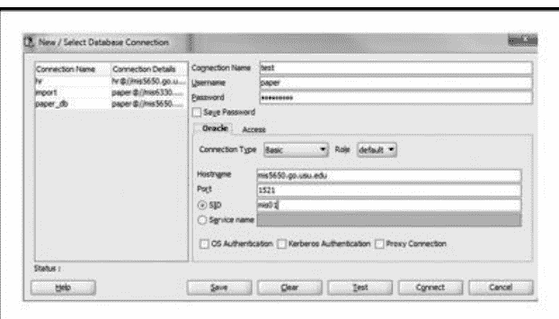

图 3.1 Oracle SQL Developer 的登录信息 (http://www.oracle.com/technology/developer-tools/sql-developer/downloads/index.html)

连接后，会出现 `test` 图标（或你为 `Connection Name` 输入的任何名称），因为这是你提供的名称。点击 `Connection Name` 左侧的小 `+`。你会看到从 `Tables` 到 `Other Users` 的多种对象类型。图 3.2 显示了可用的 Oracle 对象。

图 3.2 可用 Oracle 对象 (http://www.oracle.com/technology/developer-tools/sql-developer/downloads/index.html)

点击 `Tables` 左侧的小 `+` 查看表对象。由于尚未创建表对象，因此没有显示。右侧应该有一个 `Worksheet`（工作表）窗口。这是你输入结构化查询语言（SQL）的地方。SQL 是与 Oracle 等关系数据库交互的选择语言。如果没有显示工作表，点击 `Tools` 标签并选择 `SQL Worksheet`。现在你准备好创建第一个 Oracle 数据库表了。将以下 SQL 代码输入工作表中：

```sql
CREATE TABLE web_site
(
    vid CHAR(3),
    vuser VARCHAR(25),
    pswd VARCHAR(20),
    lvl NUMBER(1)
);
```

图 3.3 显示了代码在工作表中的样子。

图 3.3 SQL 工作表中的表创建输出 (http://www.oracle.com/technology/developer-tools/sql-developer/downloads/index.html)

删除代码开头或结尾的任何空行或空格。要运行代码，点击左侧第二个按钮（直接位于 `Worksheet` 标签上方）。该按钮看起来像一张带有绿色三角形（侧向）的小文档图标。不要点击第一个按钮（侧向的绿色三角形），因为它不会运行 SQL 查询。一个显示表已恰当创建的消息将出现在工作表窗口下方的新窗口中，标签为 `Script Output`（脚本输出）（见图 3.4）。

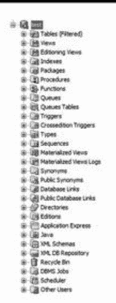
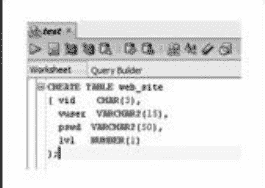

图 3.4 SQL 工作表的输出，显示表已成功创建（http://www.oracle.com/technetwork/developer-tools/sql-developer/downloads/index.html）

下一步是添加数据。点击像铅笔末端的橡皮擦按钮，清除 `Worksheet`（工作表）和 `Script Output`（脚本输出）窗口。在工作表窗口中输入（或复制）SQL 代码。

```sql
INSERT INTO web_site VALUES ('001','ben','dover',1);
INSERT INTO web_site VALUES ('002','dandy','lion',2);
INSERT INTO web_site VALUES ('003','sally','forth',2);
INSERT INTO web_site VALUES ('004','oliver','clozoffff',2);
INSERT INTO web_site VALUES ('005','betty','wont',2);
```

点击带有绿色三角形的小文档图标运行代码。你应该能看到已插入了五行（见图 3.5）。

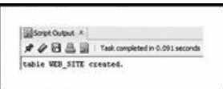

图 3.5 SQL 工作表的输出，显示数据已添加到表中（http://www.oracle.com/technetwork/developer-tools/sql-developer/downloads/index.html）

再次点击铅笔橡皮擦按钮清除两个窗口。要将更改保存到数据库，在工作表窗口中输入（或复制）`COMMIT;` 并运行。

```sql
COMMIT;
```

再次清除两个窗口。为了验证数据已添加，在工作表窗口中输入（或复制）代码并运行。

```sql
SELECT * FROM web_site;
```


“Script Output”窗口应显示来自“web_site”的数据（图 3.6）。

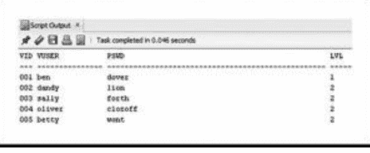

[图 3.6 SQL 工作表的输出，显示表数据](http://www.oracle.com/network/developer-tools/sql-developer/downloads/index.html)

让我们回顾一下。要创建一个新表，使用 SQL 命令`CREATE TABLE`以及表名、字段和每个字段的类型。“vid”字段被定义为三个字符的固定长度字符串。“vuser”字段被定义为最多 50 个字符的变长度字符串。“vl”字段被定义为一位数的数字。使用 SQL 命令`INSERT`向“web_site”表添加数据，并为每个字段赋值。使用 SQL 命令`COMMIT`保存更改到数据库（如需撤销，请使用 SQL 命令`ROLLBACK`）。使用 SQL 命令`SELECT`从表中检索所有记录。“*”符号用于检索表中的所有记录和字段。

## Connection 类

在本章中，我使用应用程序接口（API）来与 Oracle 通信。API 允许软件程序与其他程序进行交互。PHP 包含一组 Oracle API 以实现与 Oracle 的交互。数据库连接类需要四个 API——连接、解析和执行 SQL 语句，以及获取数据结果集。连接到 Oracle 的 API 是`OCI_CONNECT`。准备 Oracle 语句执行的 API 是`OCI_PARSE`。执行 Oracle 语句的 API 是`OCI_EXECUTE`。将数据结果集中的下一行作为关联数组返回的 API 是`OCI_FETCH_ASSOC`。以上 API 均已介绍。

示例使用了两个 PHP 文件——`dbGeneral.php`和`call_dbGeneral.php`。像`dbGeneral.php`这样的 PHP 文件包含一个 Oracle 连接类`dbGeneral`（第 3–44 行）。该类连接到 Oracle，解析 SQL 查询并执行该 SQL 查询。PHP 文件`call_dbGeneral.php`创建了`dbGeneral`的一个新实例（第 5 行）并对其进行了正确性验证。

在`dbGeneral`类中，用户名、密码和主机在`setParams`方法（第 17–22 行）的行中是不包含（为空）。首先，你必须在`setParams`方法中提供自己的连接信息。其次，我正在保护数据库。务必将你的架构、密码和主机信息用单引号括起来。在我的 Oracle 安装中，主机由两个斜杠组成：Oracle 所在的主机后接斜杠，以及系统标识符 (SID)——host/SID。例如，我的主机信息是：

`dbGeneral`类包含五个私有属性（第 5–9 行）和一个公共属性（第 10 行）。该类还包含一个构造函数（第 11–16 行），它将查询设置到属性并自动调用`setParams()`（第 17–22 行）和`connDB()`（第 23–28 行）方法。`parse()`（第 29–35 行）和`exe()`（第 40–43 行）在时由调用环境调用。由于绑定在章的后部分引入，请忽略`bind()`方法（第 36 行）。


```php
$Sql = "UPDATE web_site SET pswd='$pass' WHERE vid='$vid'";

$Connect = new dbGeneral($Sql);

$Connect->parse();

$stmt = $Connect->result();

echo 'Password <strong style="color:indian">' . $name . '</strong> encrypted!';

} else {

    echo 'Password already encrypted!';

}?>
```

*(注：由于原文提供的 `encrypt.php` 代码块存在严重断行和缺失，翻译时根据上下文逻辑进行了对齐和补全)*

我包含了 `dbGeneral.php` 和 `salt.php`（第 3 和第 4 行），以便脚本可以访问 `dbGeneral` 和 `salt` 类。查询（第 5 和第 6 行）访问 `web_site`。接下来，结果集通过创建 `dbGeneral` 的新实例（第 7 行）、使用 `parse`（第 8 行）进行解析、使用 `result`（第 9 行）执行，并使用 `oci_fetch_assoc`（第 10 行）获取结果到 `Row`。

密码值随后通过引用 `PWD`（第 12 行）放入 `name`。检查密码长度以确定是否已经加密（第 14–17 行）。如果长度大于或等于 40，我知道它已经被加密，因为 `SHA1` 创建一个 40 个字符的字符串，而大多数未加密的密码比这短得多。第 19 行是 `salt` 类使用的哈希字符串。如果密码未加密（第 21 行），运行 `doubleSalt()`（第 23 行）并更新表（第 24–29 行）。如果密码已加密，向调用环境传递适当的消息（第 33 和第 34 行）。加载 `encrypt.php` 来加密第一条记录的密码（图 3.9）。再次运行 `encrypt.php` 看看发生了什么（图 3.10）。

```
001 ben 1649869de3d29daab67525b9bd02248fd9ea71
002 dandy 85aa14a4772c00238b44f5a2b4edeeee7b9602aee22
003 sally ae79c3ab02ccd046df6f0ba809c753fef7b1d44f2
004 olive 82008b43682796ae6255402ec2e49bea6940ad2
005 betty f1d1885c0ca93d10969c4af63a3155bd749f0e52
```

图 3.11 'dbGeneral' 的输出，显示五个加密密码

在移动到下一节之前，请仔细研究 `encrypt.php`，以确保你理解整段代码的工作方式。

## 创建登录页面并身份验证

登录页面示例对用户名和密码进行身份验证。示例使用了三个 PHP 文件来演示登录身份验证。首先，`login.php` 包含用于登录的 HTML。其次，`verify.php` 验证用户名和密码。第三，如果登录成功，则激活 `onward.php`。

```php
<?php
// File login.php
?>
<head>
<style type="text/css">
table.center {
    margin-left:auto;
    margin-right:auto;
}
</style></head>
<body style="background-color:burlywood">
<div style="text-align:center;">
<h1 style="color:indigo">登录页面</h1>
<form method="post" action="verify.php">
<table class="center">
<tr><td>User:</td></tr>
<tr><input type="text" name="user"></tr>
<tr><td>Password:</td></tr>
<tr><input type="password" name="password"></tr>
```

PHP 文件 `login.php` 使用更安全的 `post` 方法发送放置在 `user`（第 16–18 行）和 `password`（第 19–21 行）中的数据。它包含一个 `submit` 按钮（第 24 和 25 行），允许手动提交表单。一旦提交，操作将移动到 `verify.php`（第 14 行）。表单包含在 HTML 表中（第 15–27 行）。

PHP 文件 `verify.php` 清洗表单提交的 `user` 和 `password` 数据（第 9–14 行），加密密码（第 15–17 行），查询数据库（第 18–23 行）检查密码是否匹配（第 24 行），并采取相应操作。如果密码匹配，将创建三个会话变量来存储值（第 26–28 行），供 PHP 文件 `onward.php` 使用。PHP session 提供了一种在后续访问中保留某些数据的方法。PHP 函数 `session_start()` 应该位于脚本的开头（第 3 行），并启动新会话或恢复现有会话。PHP session 变量是保留数据的机制。

```php
<?php // File verify.php
session_start();
require_once 'clean.php';
require_once 'dbGeneral.php';
require_once 'salt.php';

User = $_POST['user'];
Pass = $_POST['password'];

clean = new clean();
Clean_tags = $clean->cleanse($user);
Clean_special = $clean->clean_special($Clean_tags);
User = $clean->reduce_size($Clean_special);

Clean_tags = $clean->cleanse($Pass);
pass = $clean->clean_special($Clean_tags);

ToHash = 'tiger';
salt = new Salt();
Pass = $salt->doubleSalt(ToHash,$Pass);

query = "SELECT * FROM web_site WHERE";
query = $query . ".user='$user' AND pswd='$Pass'";

connect = new dbGeneral($query);
```

```php
$connect->parse();
$stmt = $connect->result();
$connect->exe();

if ($Row = oci_fetch_assoc($stmt)) {
    $_SESSION['VID'] = $row['VID'];
    $_SESSION['VUSER'] = $row['VUSER'];
    $_SESSION['VPSWD'] = $row['PSWD'];
    header("location: onward.php");
} else {
    header("location: login.php");
}
```

Session 变量通过 `$_SESSION['variable']` 创建（第 26–28 行）。注意 `verify.php` 如何通过 `header()` 函数（第 29 和 32 行）引导至 PHP 文件。不要忘记开启 `session_start()`（以创建和使用 session 变量）。因此，`verify.php` 和 `onward.php` 启动新会话。

```php
<?php
// File onward.php
session_start();
$Vid = $_SESSION['VID'];
$vuser = $_SESSION['VUSER'];
$vpwd = $_SESSION['PSWD'];
?>
<html>
<head>
<style type="text/css">
table.center {
    margin-left:auto;
    margin-right:auto;
}
</style></head>
<body style="background-color:burlywood">
<div style="text-align:center;">
<h1 style="color:indigo">欢迎！</h1>
<table class="center">
<tr><td>User:</td></tr>
<td><?php echo $vuser; ?></tr>
<tr><td>Password:</td></tr>
<td><?php echo $vpwd; ?></tr>
</table>
</div>
</body>
</html>
```

### 执行计划与 SQL 注入防护

数据库执行计划是一组有序的步骤，用于访问或修改 Oracle 数据库管理系统（DBMS）中的信息。如果 SQL 语句经过了适当准备，它可以防止 SQL 注入攻击。

之前的 `dbGeneral` 类包含一个 `bind()` 方法。`bind()` 方法使用 Oracle API `OCI_BIND_BY_NAME` 将 PHP 占位符按名称绑定到 Oracle 占位符。`bind()` 方法接收一个绑定变量、变量绑定以及正在绑定变量的最大长度。用以下代码替换原始的 `verify.php`。

```php
1 <?php
2 // File verify.php
3 session_start();
4 require_once 'clean.php';
5 require_once 'dbGeneral.php';
6 require_once '$salt.php';
7 $User = $_POST['user'];
8 $Pass = $_POST['password'];
9 $Clean = new clean();
10 $clean_tags = $Clean->clean_special($clean_tags);
11 $clean_special = $Clean->reduce_size($clean_special);
12 $user = $Clean->reduce_size($clean_special);
13 $clean_tags = $Clean->cleanse($pass);
14 $pass = $Clean->clean_special($clean_tags);
15 $toHash = 'tiger';
16 $Salt = new Salt();
17 $pass = $Salt->doubleSalt($toHash,$pass);
18 $query = "SELECT * FROM web_site
19 WHERE user=:a AND pswd=:b";
20 $connect = new dbGeneral($query);
21 $connect->parse();
22 $connect->bind('a',$user,20);
23 $connect->bind('b',$pass,50);
24 $stmt = $connect->result();
25 $connect->exec();
26 if ($row = $oci_fetch_assoc($stmt))
27 {
28     $_SESSION['VID'] = $row['VID'];
29     $_SESSION['VUSER'] = $row['VUSER'];
30     $_SESSION['VPSWD'] = $row['PSWD'];
31     header("location: onward.php");
32 }
33 else("location:login.php");
34 { header(
35 ?>
```

对原始文件仅进行了少许更改。首先，SQL `SELECT` 语句分别使用占位符 `:a` 和 `:b`（第 18 和第 19 行），而不是 `$user` 和 `$pass` 值。其次，`bind()` 方法被调用了两次（每个绑定变量一次），用于将 PHP 占位符 `$User` 和 `$pass` 绑定到 Oracle 占位符（第 22 和第 23 行）。

现在，让我们使用绑定变量测试登录。清除所有浏览器信息，因为之前的登录信息可能仍存在浏览器缓存中。接下来，图 3.14 显示了用户名为 `sally` 密码为 `fourth` 的登录页面。点击“登录”按钮。图 3.15 显示了结果。

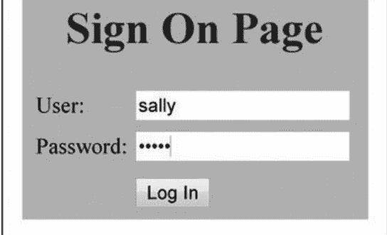

图 3.14 显示用户名和密码的登录页面

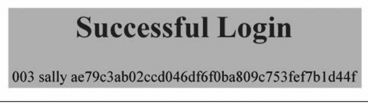

图 3.15 基于严格安全的成功登录显示

尽管结果看起来相同，但 SQL 查询中的变量已正确绑定，这很大地缓解了 SQL 注入风险。到此为止，我构建了一个具有登录身份验证、数据清洗、密码加密的安全性登录页面，并说明了 SQL 注入防护（针对 `SELECT` 语句）。SQL 也可以通过 `INSERT`、`UPDATE` 和 `DELETE` 语句进行注入。`INSERT` SQL 语句用于向数据库添加数据。PHP 文件 `ins.php` 准备（保护）`INSERT` 语句免受 SQL 注入。

```php
1 <?php
2 // File bind_ins.php
3 require_once 'dbGeneral.php';
4 $query = "INSERT INTO web_site VALUES ";
5 $query = $query . "(:a, :b, :c, :d)";
6 $connect = new dbGeneral($query);
7 $connect->parse();
8 $connect->bind(':a','006');
9 $connect->bind(':b','eileen');
10 $connect->bind(':c','downe');
11 $connect->bind(':d',1);
12 $stmt = $connect->result();
13 $connect->exec();
14 ?>
```

第 4 行和第 5 行表示带有绑定变量 `:a`, `:b`, `:c` 和 `:d` 的 `insert` 查询。创建新的 `dbGeneral` 对象（第 6 行），解析查询（第 7 行），为绑定变量赋值（第 8–11 行），并运行查询（第 12 和第 13 行）。在浏览器中加载该文件。为了验证代码运行正常，加载 `call_dbGeneral.php`（之前创建）。图 3.16 显示表中添加了一条 `VID` 为 `006` 的记录。

| | |
| :--- | :--- |
| 006 | 9532a68e5a5ba9dbe45a4909787d2f1d_128_0.png |
| 001 | 164986de3d29daab675ad252b9bd0224fd9ea71 |
| 002 | 85aa14a772c0023bf445a2b4ed7b9602 |
| 003 | a79c3ab02cd046f0ba809c753ef7b1d4ff2 |
| 004 | 82008b43682796ae6255c40aec249beaad2 |
| 005 | b1d88e5f0eca93d109c9cafaf6315bd74fe52 |
| 006 | eileen |


`UPDATE` SQL 语句用于修改数据库数据。PHP `bind_upd.php` 准备（保护）`UPDATE` 语句免受 SQL 注入。它还加密了新记录的密码。第 5 行和第 6 行建立了 `vid` 和 `password`（待加密）。第 7 行是传递给 `salt` 类的哈希字符串。第 8 行和第 9 行加密密码。第 10 行和第 11 行表示查询。第 12–17 行执行更新。在浏览器中加载该文件。

```php
<?php
// File bind_upd.php
require_once 'dbGeneral.php';
require_once 'salt.php';
$name = 'downe';
$vid = '006';
$toHash = 'tiger';
$salt = new Salt();
$pass = $salt->doubleSalt($toHash,$name);
$sql = 'UPDATE web_site SET pswd=:a WHERE vid=:b';
$connect = new dbGeneral($sql);
$connect->parse();
$connect->bind(':a',$pass,50);
$connect->bind(':b',$vid,3);
$stmt = $connect->result();
$connect->exec();
?>
```


注意该脚本加密了新密码并更新了数据库。在浏览器中加载 `call_dbGeneral.php` 进行验证。图 3.17 显示了加密后的新记录密码。

| | |
| :--- | :--- |
| 001 | 1649896de3d29daab675ae252b9bd022fd9ea71 |
| 002 | 85aa14aa772c003b445a2b4ede7b9602 |
| 003 | a72c3ab02cdc046f0ba809c753ef7b1d4ff2 |
| 004 | 82008b43682796ae6255c40aec249beaad2 |
| 005 | b1d88e5f0eca93d109c9cafaf6315bd3749f0e52 |
| 006 | eild74a33df778932ccd0af03b6e6bf430575382 |

图 3.17 `dbGeneral` 类输出，显示更新后的绑定记录

`DELETE` SQL 语句用于删除数据库数据。PHP 文件 `bind_del.php` 准备（保护）`DELETE` 语句免受 SQL 注入。第 4 行和第 5 行表示要删除的记录和查询。第 6–10 行连接数据库、解析、绑定并运行查询。在浏览器中加载该文件。

```php
1 <?php
2 // File bind_del.php
3 require_once 'dbGeneral.php';
4 $vid = '006';
5 $sql = 'DELETE FROM WEB_site WHERE vid =:a';
6 $connect = new dbGeneral($sql);
7 $connect->parse();
8 $connect->bind(':a',$vid,3);
9 $stmt = $connect->result();
10 $stmt->exec();
11 ?>
```

```sql
CREATE OR REPLACE PROCEDURE rpt(p_id IN CHAR)
AS
  v_data web_site%ROWTYPE;
  v_stmt VARCHAR2(100);
BEGIN
  v_stmt := 'SELECT * FROM web_site WHERE vid = :vid';
  EXECUTE IMMEDIATE v_stmt INTO v_data USING p_id;
  DBMS_OUTPUT.PUT(v_data.vid || ' ' || v_data.user || ' ');
  DBMS_OUTPUT.PUT_LINE(v_data.pswd || ' ' || v_data.lvl);
END rpt;
```

创建 PL/SQL 过程（第 1 行）。定义变量（第 3 和第 4 行）。变量 `v_data` 定义为 `%ROWTYPE`，这意味着它镜像了 `web_site` 表中的一条记录。因此，`v_data` 实际上是一个包含 `web_site` 表中所有字段的记录。`v_stmt` 变量定义用于存储多达 100 个字符的可变字符串。PL/SQL 过程以 `BEGIN`（第 5 行）开始，以 `END`（第 10 行）结束逻辑。`v_stmt`（第 6 行）被赋值了一个 SQL 语句。PL/SQL 中的这种赋值方式是这样的，请注意，因为这与其他编程语言不同。接着使用 `EXECUTE IMMEDIATE`（第 7 行）运行 SQL，它将绑定 SQL 语句中的变量 `:vid`。

`EXECUTE IMMEDIATE` 是动态 SQL，是 PL/SQL 中的一个高级主题。因此，我们不再深入讨论它。`DBMS_OUTPUT.PUT`（第 8 行）和 `DBMS_OUTPUT.PUT_LINE`（第 9 行）将结果显示在 Oracle Developer 控制台中。

图 3.19 显示了运行 PL/SQL 代码时在“脚本输出”（Script Output）窗口中显示的结果。你应该看到 `PROCEDURE rpt compiled`，这意味着代码执行正常。

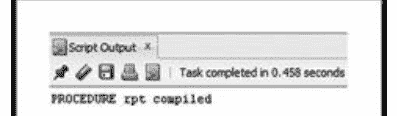

图 3.19 来自 SQL 工作表的输出，已编译的 ‘rpt’ 过程

回顾一下，过程 `rpt` 具有一个 `CHAR` 参数 `p_id`（第 1 行），它是你想要显示的 `web_site` 表中的 `VID`。`v_data` 是一个 `%ROWTYPE` 记录，这意味着它具有 `web_site` 表中整整行的字段特征。`v_stmt` 是一个持有 `SELECT` 语句的可变长度变量。`EXECUTE IMMEDIATE` 语句将查询数据放入 `v_data`。`DBMS_OUTPUT` 语句通过数据库字段名显示 `v_data` 的每一个部分。一旦编译，PL/SQL 过程 `rpt` 将被存储在 Oracle 数据库中。接下来的匿名代码块运行 `rpt`。匿名块是没有命名的代码。注意之前编译的过程不是 `rpt`，所以它不是匿名的。在工作表中运行匿名块。

```sql
SET SERVEROUTPUT ON
DECLARE
  v_id CHAR(3) := '001';
BEGIN
  rpt(v_id);
END;
```

第 1 行开启 Oracle 显示。如果没有开启此项，将不会显示任何内容。第 2 行定义了一个 `DECLARE` 块，在匿名块中此处声明变量。第 3 行定义 `v_id` 为长度为 `3` 的固定字符，并为其赋值 `001`。第 4 行和第 6 行定义了一个 `BEGIN–END` 块。第 5 行运行 `rpt` 过程。图 3.20 显示了“脚本输出”窗口的结果。这是预期的，因为匿名块使用参数 `001` 调用了过程 `rpt`。

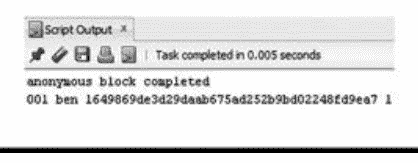

图 3.20 来自 SQL 工作表的输出，显示了 ‘rpt’ 过程的结果

接下来的三个示例也分为两个部分——编译和运行——`INSERT`、`UPDATE` 和 `DELETE` SQL 注入防护。`add_dynamic` 过程准备了一个 `INSERT` 语句。我建议使用看起来像小铅笔加橡皮擦的按钮来清理每个示例及其对应的窗口和输出。

```sql
CREATE OR REPLACE PROCEDURE add_dynamic(
  p_id web_site.vid%TYPE,
  p_user web_site.user%TYPE,
  p_psswd web_site.psswd%TYPE,
  p_lvl web_site.lvl%TYPE)
AS
  v_stmt VARCHAR2(100);
BEGIN
  v_stmt := 'INSERT INTO web_site VALUES(:vid,:user,:psswd,:lvl)';
  EXECUTE IMMEDIATE v_stmt USING p_id,p_user,p_psswd,p_lvl;
  COMMIT;
END add_dynamic;
```

第 1 行创建带有四个参数的过程（第 2–5 行）。`%TYPE` 关键字定义的变量与表的 `vid` 字段类型相同。例如，`p_id` 的定义与 `vid` 字段相同。第 7 行定义 `v_stmt` 为多达 100 个字符的可变字符串。第 8 行和第 12 行定义了 `BEGIN–END` 块。第 9 行将一个 `insert` 查询赋值给 `v_stmt`。第 10 行运行该查询，第 11 行保存到数据库。务必提交 `insert`、`update` 或 `delete` 查询。

图 3.24 'dbGeneral' 类的输出，显示已添加另一个记录

创建并保存 PHP 文件 `mod_plql.php`。

```php
1 <?php
2 // File mod_plql.php
3 require_once 'dbGeneral.php';
4 $Sa = '008';
5 $b = 'mark';
6 $Sc = 'despot';
7 $Sd = '1';
8 $sql = "BEGIN update_dynamic(:a,:b,:c,:d); end";
9 $connect = new dbGeneral($sql);
10 $connect->parse();
11 $connect->bind('a',$Sa,3);
12 $connect->bind('b',$b,15);
13 $connect->bind('c',$Sc,50);
14 $connect->bind('d',$Sd,1);
15 $stmt = $connect->result();
16 $connect->exe();
17 ?>
```

第 4–7 行分配字段值。第 8 行构建了 `BEGIN–END` 块。第 9 行创建新的 `dbGeneral` 对象。第 10 行解析 PL/SQL 块。第 11–14 行将值绑定到变量。第 15 和 16 行完成运行。在浏览器中加载该文件。该记录的 `LVL` 现在应该是 `1`。

创建并保存 PHP 文件 `del_plql.php`。

```php
1 <?php
2 // File del_plql.php
3 require_once 'dbGeneral.php';
4 $Vid = '008';
5 $sql = "BEGIN del_dynamic(:vid); end";
6 $connect = new dbGeneral($sql);
7 $connect->parse();
8 $connect->bind('vid',$Vid,3);
9 $stmt = $connect->result();
10 $connect->exe();
11 ?>
```

第 4 行分配字段值。第 5 行构建了 `BEGIN–END` 块。第 6 行创建新的 `dbGeneral` 对象。第 7 行解析 PL/SQL 块。第 8 行将值绑定到变量。第 9 和 10 行完成运行。在浏览器中加载该文件。`VID` 为 `008` 的记录应该被删除。

到本章的此处，已经介绍了几种增强网站安全性的技术，重点是保护登录安全。剩下的两个部分将更深入地探讨，提供保护登录以及防止其他网页免受未经授权访问的进阶技术。

# 会话变量（重定向未经授权的访问）

会话变量有两个用途。首先，只要会话激活，就可以保存输入数据的值。这允许在活动会话期间在任何网页上使用这些值。其次，通过测试是否设置了会话变量，可以将未经授权的用户排除在网页之外。

在 `verify.php` 中，如果登录成功，我为 `VID` 设置了会话变量 `$_SESSION['VID'] = $row['VID'];`。因此，我修改了 `onward.php`，在登录失败时将用户重定向到登录页面（`login.php`）。我还添加了一个 JavaScript 事件处理器。JavaScript 事件处理器在事件发生时（如按下按钮）执行 JavaScript。将原始的 `onward.php` 替换为以下代码。

```php
1 <?php
2 // File onward.php
3 session_start();
4 if(!isset($_SESSION['VID'])) {
5 header("location: login.php"); 
6 exit();
7 }
```


## PHP 会话管理与 AJAX 实现

### 会话验证页面 (`onward.php`)

```php
<?php
$vid = $_SESSION['VID'];
$vuser = $_SESSION['VUSER'];
?>
<html>
<head>
<style type="text/css">
table.center {
    margin-left: auto;
    margin-right: auto;
}
</style>
</head>
<body style="background-color:burlywood;">
<script src="destroy.js"></script>
<div style="text-align:center;">
<h1 style="color:indigo">Successful Login</h1>
<table class="">
<tr><td><input type="button" onclick="killSession();" value="destroy"></td></tr>
</table>
</div>
<div style="text-align:center;" id="txtHint">
<?php
echo "<h5 style=\"text-align:center;\">";
print_r($_SESSION);
?>
</div>
</body>
</html>
```

在 `onward.php` 开头，使用 `session_start()` 启动会话（第 3 行）。接着用 `if` 语句检查会话变量 `VID` 是否已设置（第 4 行）。未设置则重定向到 `login.php`（第 5 行），已设置则继续执行。从会话数组获取 `VID` 和 `VUSER` 值（第 6、7 行）。第 20 行添加了 JavaScript 事件处理器 `onClick`（尚未激活）。`print_r($_SESSION)` 语句（第 26 行）用于显示会话变量。

### 测试验证

在浏览器重新加载 `login.php` 并提交用户名 `sally`、密码 `forth` 进行测试。图 25 显示登录页面，图 26 显示成功登录界面。`destroy` 按钮暂时不可用，下节将实现其功能。

要测试重定向逻辑，清除浏览器缓存并直接访问 `onward.php`。图 27 显示页面自动重定向到 `login.php`，证明页面受保护。

## AJAX 技术原理

**异步 JavaScript 和 XML (AJAX)** 允许通过与服务器交换少量数据异步更新网页，无需重新加载整个页面。*异步* 意味着通信可以是间歇性的（如电话对话），而非同步阻塞。AJAX 结合了 `XMLHttpRequest`、JavaScript、DOM、CSS（可选）和 XML（可选）。`XMLHttpRequest` 对象实现异步数据交换，JavaScript/DOM 处理页面样式与内容更新。

### AJAX 交互流程

1. JavaScript 创建 `XMLHttpRequest` 对象并发送至服务器
2. 用户通过事件（如点击按钮）触发请求
3. 浏览器向服务器发送请求
4. 服务器处理请求并返回数据
5. 浏览器用 JavaScript 处理返回数据并更新页面

### 实现 `onclick` 事件处理器 (`destroy.js`)

```javascript
/** File destroy.js */
var xhr;
xhr = new XMLHttpRequest();

function killSession(str) {
    var url = "logout.php";
    xhr.open("POST", url, true);
    xhr.setRequestHeader('Content-Type', 'application/x-form-urlencoded;charset=iso-8859-1');
    xhr.send("q=" + str + "sid=" + Math.random());
    
    xhr.onreadystatechange = function() {
        if (xhr.readyState == 4) {
            document.getElementById("txtHint").innerHTML = xhr.responseText;
        }
    };
}
```

代码解析：
- 第 3 行：创建 `XMLHttpRequest` 实例赋值给 `xhr`
- 第 4-17 行：`killSession()` 函数
  - 第 6 行：目标 URL 赋值给 `url`
  - 第 7 行：`open()` 方法指定 POST 请求 `logout.php`
  - 第 8-9 行：`setRequestHeader()` 设置 POST 请求头
  - 第 10 行：`send()` 发送请求参数
  - 第 11-17 行：`onreadystatechange` 监听响应，`readyState==4` 时将 `responseText` 写入 `txtHint` 元素

`onward.php` 中 `id="txtHint"` 的 `div` 元素接收响应内容。

### 会话销毁处理 (`logout.php`)

```php
<?php
// logout.php
class logout {
    public function __construct() {
        session_start();
        unset($_SESSION);
        session_destroy();
    }
}
$logout = new logout();
echo "<h5>Session Destroyed</h5>";
?>
```

包含 `logout` 类（第 3-11 行），构造函数销毁会话（第 8-9 行）。第 12 行实例化类，第 13 行输出销毁提示。

点击 "destroy" 按钮后，AJAX 触发销毁操作，图 3.29 显示登录界面，图 3.30 显示会话已销毁。

## CAPTCHA 验证码机制

**CAPTCHA**（完全自动化公共图灵测试）用于区分人类与计算机，通常呈现扭曲字符图像供人类识别。

### Securimage 库集成

[Securimage](http://www.phpcaptcha.org) 是开源 PHP CAPTCHA 库，生成复杂验证码图像防垃圾注册。

#### 安装步骤
1. 访问官网下载 v3.5.4 (PHP 5+)
2. 解压得到 `securimage` 目录
3. 通过 WinSCP 上传至服务器 `public_html/securimage/`

### 登录页面 (`login_captcha.php`)

```php
<?php
// File login_captcha.php
session_start();

if(!isset($_SESSION['captcha'])) {
    $_SESSION['captcha'] = 0;
}
?>
<html>
<head>
<style type="text/css">
    center {
        margin-left: auto;
        margin-right: auto;
    }
</style>
</head>
<body style="background-color:lightgreen">
<h1 style="text-align:center">Sign Page</h1>
<form method="post" action="verify_captcha.php">
<table class="center">
    <tr><td>User:</td><td><input type="text" name="user"></td></tr>
    <tr><td>Password:</td><td><input type="password" name="password"></td></tr>
    <tr><td></td><td></td></tr>
    <tr><td></td><td></td></tr>
    <tr><td></td><td><input type="submit" value="Log In"></td></tr>
</table>
</form>

<?php
if ($_SESSION['captcha'] >= 5) {
    echo "<tr><td></td></tr>";
    echo "<tr><td><input type='text' name='captcha_code' size='10' maxlength='6'></td></tr>";
    echo "<tr><td><a href='#' onclick=\"document.getElementById('captcha').src='securimage/show.php?'+Math.random();\">Reload image</a></td></tr>";
    return false;
}
?>
```

核心逻辑：
1. 第 3 行：启动会话
2. 第 4-6 行：初始化 `$_SESSION['captcha']` 计数器
3. 第 27 行：失败次数 ≥5 时显示验证码
4. 第 29-31 行：输出验证码图片、输入框、刷新链接

### 验证处理 (`verify_captcha.php`)

```php
<?php
// File verify_captcha.php
session_start();

require_once 'clean.php';
require_once 'db.php';

if($_SESSION['captcha'] >= 5) {
    include_once('securimage.php');
    $securimage = new Securimage();
    if (!$securimage->check($_POST['captcha_code'])) {
        die('The code you entered was incorrect. Go back and try again.');
    }
}

$user = $_POST['user'];
$password = $_POST['password'];

$clean = new cleanse();
$clean->cleanse($user);

$query = "SELECT * FROM site WHERE user=:a AND pswd=:b";
$connect = new dbGeneral($query);
$connect->bind(':a', $user);
$connect->bind(':b', $password);
$stmt = $connect->result();
$connect->exec();

if ($row = $connect->fetch_assoc($stmt)) {
    $_SESSION['VID'] = $row['VID'];
    $_SESSION['VUSER'] = $row['VUSER'];
    header("location: onward_captcha.php");
} else {
    $_SESSION['captcha'] += 1;
    header("location: login_captcha.php");
}
?>
```

验证流程：
1. 第 7 行：检查失败计数 ≥5
2. 第 9-11 行：加载 Securimage 验证验证码
3. 第 13-14 行：获取表单数据
4. 第 16-17 行：`cleanse` 类清洗输入
5. 第 19-25 行：预处理语句查询数据库
6. 第 27-31 行：验证成功设置会话并跳转 `onward_captcha.php`
7. 第 32-34 行：验证失败计数+1 并返回登录页

两脚本协同工作：5 次失败后强制验证码验证，有效防暴力破解。


[图 3.31] 显示带有登录信息的“CAPTCHA”（验证码）登录页

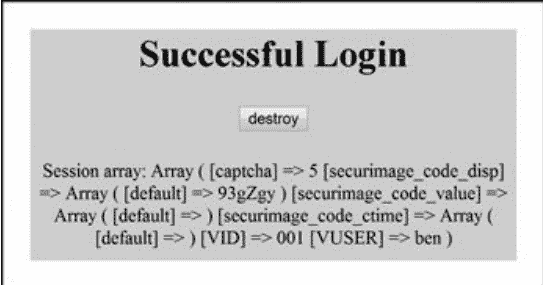
[图 3.32] 显示“CAPTCHA”登录成功

点击“destroy”（销毁）按钮。会话已被销毁，如图 3.33 所示。点击“Return”（返回）回到登录页。在本中，我展示了如何重新考虑早期的登录逻辑，以加入 CAPTCHA 的额外安全性。我强烈建议使用此新增功能保护您的网站免受未经授权的访问。


[图 3.33] 点击“destroy”按钮后的显示，显示“Return”按钮

# 总结

本章的目标是帮助您从根本上理解 Web 安全技术，以减少与 Oracle 之间的不当交互。我介绍了“清洗”数据、加密数据、保护网页免受未经授权的访问，以及使用 CAPTCHA 增强登录安全性的方法。

# 输入验证与报告生成

## 概述

进入网站的任何形式的数据都具有潜在危害。因此，输入验证非常重要。本文介绍了两种输入验证技术。首先，引入了 Perl 兼容正则表达式（PCRE），并将其实现验证表单输入数据的手段。PCRE 在模式匹配功能上与 Perl 。其次，PHP 拥有一组内置过滤器函数（built-in-filter）用于输入验证。本章最后介绍了两个用于安全报告生成的小应用程序。

## 学习目标

完成本章后，您将对输入验证有从基础的理解，以防止具有潜在危害的表单数据进入您的网站。您还将学习如何使用下拉菜单创建安全的报告生成。通过解释和代码示例将加强理解。以下目标总结了本章将帮助您培养的技能：

- 学习正则表达式的定义。
- 学习 PCRE 的定义。
- 学习如何使用 PCRE 验证表单数据。
- 学习如何构建一个 PCRE 表单数据验证应用程序。
- 学习如何使用 PHP 内置验证函数。
- 学习如何使用 PCRE 和内置函数构建应用程序。
- 学习 PCRE 和内置函数的优缺点。
- 学习如何构建一个简单的报告生成应用程序。
- 学习如何构建一个复杂的报告生成应用程序。
- 学习如何使用 PL/SQL 游标构建报告生成应用程序。

## 正则表达式

正则表达式是描述特定文本的模式，缩写为“regex”。其核心思想是测试正则与表单输入之间是否存在匹配。匹配项是正则处理软件发现的模式与正则相对应的文本片段。

### PCRE

Perl 兼容正则表达式（PCRE）是一组 PHP 函数，它们使用与 Perl 5 相同的语法和语义来实现表达式模式匹配。PCRE 使用特殊符号来辅助模式匹配。PCRE 允许许多特殊符号，但我将涵盖用于表单输入验证的最常用的符号。

为了便于起见，我首先介绍一组小型特殊字符，并提供相应的示例以促进学习。接着介绍另一组特殊字符及相应示例，以此类推。在介绍符号后，我提供了我用于表单输入验证的正则示例。我在“regex”章节以一个验证表单数据的应用程序作为结束。

### 特殊符号

“^”表示字符串的开头。“$”表示字符串的结尾。“?”表示上一个标记（token）是可选的。标记是表示正则片段的一种具体方式。“|”是逻辑或（OR）。大括号“{}”用于匹配出现次数。括号“()”用于对字符序列进行限定。分隔符（Delimiters）用于标记模式的开始和结束。分隔符可以是任何非字母、非反斜杠、非空白字符。

我使用“#”符号作为分隔符，因为这样我更容易辨别正则。常用的分隔符有“/”、“' '”和“~”。PHP 文件 `p1.php` 包含了五个正则（第 4–8 行），与“hello world”（第 3 行）进行匹配。`preg_match()` 函数（第 9, 12, 15 和 21 行）用于执行正则匹配。每个正则都与“string”进行比较。结果显示为“Match”（匹配）或“No Match”（不匹配）。

```php
1 <?php
2 // File p1.php
3 $string='hello world';
4 $regex1='#^hello#';
5 $regex2='#world$#';
6 $regex3='#^he(l{2})o#';
7 $regex4='#(hello)(world)#';
8 $regex5='#^hello world$';
9 if (preg_match($regex1,$string))
10 { echo "Match<br />"; }
11 else
12 { echo "No Match<br/>"; }
13 
14 if(preg_match($regex2,$string)) {
15   echo "Match<br/>";
16 } else {
17   echo "No Match<br/>";
18 }
19 
20 if(preg_match($regex3,$string)) {
21   echo "Match<br/>";
22 } else {
23   echo "No Match<br/>";
24 }
25 
26 if(preg_match($regex4,$string)) {
27   echo "Match<br/>";
28 } else {
29   echo "No Match<br/>";
30 }
31 
32 if(preg_match($regex5,$string)) {
33   echo "Match<br/>";
34 } else {
35   echo "No Match<br/>";
36 }
37 ?>
```


## 电话号码验证示例

HTML 文件 `phone.php` 创建了一个表单（第 14–22 行），用于输入电话号码。表单提交到 `verify_phone.php`。

```html
1 <html>
2 <head>
3 <title>Phone Number Verification</title>
4 <style>
5 .center { margin-left:auto; margin-right:auto; }
6 </style>
7 </head>
8 <body>
9 <div class="center">
10 <h2>Phone Number Verification</h2>
11 <form method="post" action="verify_phone.php">
12 <table class="center">
13 <tr><td>Phone:</td>
14 <td><input type="text" name="phone" maxlength="10"></td>
15 </tr>
16 <tr>
17 <td><input type="submit" value="Enter"></td>
18 <td><input type="reset" value="Reset"></td>
19 </tr>
20 </table>
21 </form>
22 </div>
23 </body>
24 </html>
```

PHP 文件 `verify_phone.php` 检查手机号码的长度（第 4 行）。根据长度，手机号码会被转换为不带区号的号码（第 6–7 行）、带区号的号码（第 12–18 行），或生成错误消息（第 17–18 行）。

```php
1 <?php
2 // File verify_phone.php
3 $phone = $_POST["phone"];
4 if(strlen($phone)==7)
5 {
6 $phone = substr($phone,0,3) . '-' . substr($phone,3,4);
7 echo 'Translated phone number is: ' . $phone;
8 }
9 elseif(strlen($phone)==10)
10 {
11 $p1 = '(' . substr($phone,0,3) . ') ';
12 $p2 = substr($phone,3,3);
13 $phone = $p1 . $p2 . '-' . substr($phone,6,4);
14 echo 'Translated phone number is: ' . $phone;
15 }
16 else { echo 'Enter a valid phone number of 7 or 10 digits'; }
17 ?>
```

让我们尝试一个七位数字看看会发生什么。在浏览器中加载 `phone.php`。图 4.4 显示了提交表单前的七位数字。请确保只输入数字，不要包含其他字符。图 4.5 显示了提交七位数字后的结果。

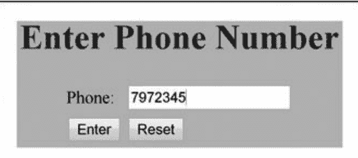
图 4.4 显示带有有效七位字符串的表单

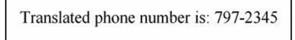
图 4.5 显示转换后的七位字符串显示

让我们尝试一个十位数字看看会发生什么。图 4.6 显示了提交表单前的十位数字。请确保只输入数字。图 4.7 显示了提交十位数字后的结果。

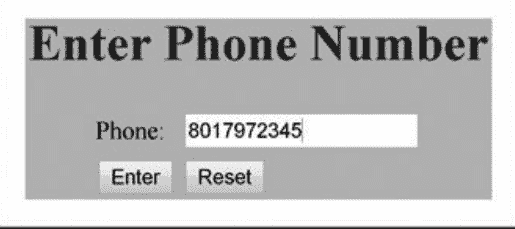
图 4.6 显示带有有效十位字符串的表单

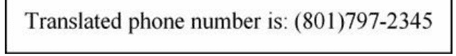
图 4.7 显示转换后的十位字符串显示

让我们尝试一个四位数字看看会发生什么。图 4.8 显示了提交表单前的四位数字。图 4.9 显示了提交四位数字后的结果。

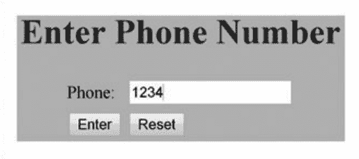
图 4.8 显示带有无效四位字符串的表单


图 4.9 显示带有可接受字符串的消息

七位和十位数字被 `verify_phone.php` 文件正确处理了。四位数字生成了错误消息。

然而，如果用户输入了数字以外的数据，就会出现问题。解决方案是创建一个与表单配合的正则表达式（regex）。由于表单接受的最大长度为十位，正则表达式可以简化为仅搜索数字。

## 面向对象的验证

为了封装手机号正则表达式，我创建了一个包含方法的类。然后，我可以创建该类的实例来验证手机号码。在应用程序中使用新类之前，我总是对其进行测试。接下来的示例测试了这个新类。该示例使用了两个 PHP 文件——`validate_regex.php` 和 `call_validate.php`。PHP 文件 `validate_regex.php` 存放该类。PHP 文件 `call_validate.php` 测试该类。

```php
1 <?php
2 // File validate_regex.php
3 class validate_regex
4 {
5     function get_valid_phone($phone)
6     {
7         $regex = '/^[0-9]{7}$|^[0-9]{10}$/';
8         return preg_match($regex, trim($phone));
9     }
10 }
?>
```

类 `validate_regex`（第 3–10 行）包含了 `get_valid_phone()` 方法（第 5–9 行），如果数字是七位或十位返回 true，否则返回 false。具体而言，正则表达式（第 7 行）检查输入是否为七或十位数字。注意正则表达式开头使用了 `^` 符号结尾使用了 `$` 符号以确保符合规范。还要注意 `preg_match()` 函数（第 8 行），它执行匹配。该函数将正则表达式（第 7 行）与作为方法参数传入的（去空格后的）手机号码（第 5 行）进行匹配。

```php
1 <?php
2 // File call_validate.php
3 require_once 'validate_regex.php';
4 $phones = array(
5     '1234567', 'abc', '123', '801792456',
6     '7972456', '1m2j4k', '8882234',
7     '6186872121', '1112233444'
8 );
9 $validate = new validate_regex();
10 foreach($phones as $phone)
11 {
12     if($validate->get_valid_phone($phone))
13         echo "Valid Phone: " . $phone;
14     else
15         echo "Invalid Phone: " . $phone;
16     echo "<br/>";
17 }
18 ?>
```

PHP 文件 `call_validate.php` 实例化了该类（第 9 行）并验证了一组手机号码。使用数组 `phones`（第 4–8 行）来存储一组手机号码非常方便，因为现在可以使用 `foreach` 循环（第 10–17 行）遍历数组，测试每个手机号码是否符合 `get_valid_phone()` 方法（第 12 行）。在浏览器中加载 `call_validate.php`。图 4.10 显示了结果。只有七位或十位的字符串被显示为有效。

| 结果 |
| :--- |
| Valid Phone: 1234567 |
| Invalid Phone: abc |
| Invalid Phone: 123 |
| Valid Phone: 801792456 |
| Valid Phone: 7972456 |
| Invalid Phone: 1m2j4k |
| Invalid Phone: 8882234 |
| Valid Phone: 6186872121 |
| Invalid Phone: 1112233444 |

图 4.10 `validate_regex` 的输出，显示有效和无效手机号码

由于 `validate_regex` 类经过了测试，现在可以用于表单。示例使用了 `phone.php`、`validate_regex.php` 和 `verify_phone.php` 文件。我修改了 `verify_phone.php` 中的逻辑。首先，我包含了 `validate_regex.php`（第 3 行）以启用该类。其次，我创建了该类的新实例（第 4 行）。最后，我调用 `get_valid_phone()`（第 6 行）来检查数字是否为七或十位。剩余逻辑与之前相同。如果手机号码无效，会生成错误消息，如之前所示（第 7 行）。实际上，使用该类后逻辑变得简单了一些。

```php
1 <?php
2 // File verify_phone.php (Modified)
3 require_once 'validate_regex.php';
4 $validate = new validate_regex();
5 $phone = $_POST["phone"];
6 if($validate->get_valid_phone($phone))
7 {
8     if(strlen($phone)==7)
9     {
10        $phone = substr($phone,0,3) . '-' . substr($phone,3,4);
11        echo 'Translated phone number is: ' . $phone;
12     }
13     elseif(strlen($phone)==10)
14     {
15        $p1 = '(' . substr($phone,0,3) . ') ';
16        $p2 = substr($phone,3,3);
17        $phone = $p1 . $p2 . '-' . substr($phone,6,4);
18        echo 'Translated phone number is: ' . $phone;
19     }
20 }
21 else { echo 'Enter a valid phone number of 7 or 10 digits'; }
22 ?>
```

图 4.14 使用 `validate_regex` 类显示翻译后的十位字符串

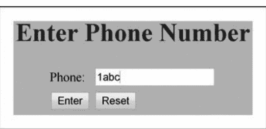
图 4.14 使用 `validate_regex` 类显示翻译后的十位字符串

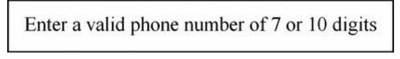
图 4.15 显示包含无效四位字符串的表单


图 4.16 使用 `validate_regex` 类显示包含接受字符串的消息

现在，让我们创建一个简单的正则表达式来验证电子邮件。我们需要两个额外的符号：`+` 匹配模式的一个一次或多次，而 `.` 匹配任何单个字符。修改 PHP 文件 `validate_regex.php` 以包含一个新的电子邮件验证方法（第 10–14 行）。正则表达式（第 12 行）测试电子邮件是否有效。

```php
1 <?php
2 // File validate_regex.php (Extended)
3 class validate_regex
4 {
5     function get_valid_phone($phone)
6     {
7         $regex = '/^[0-9]{7}$|^[0-9]{10}$/';
8         return preg_match($regex, trim($phone));
9     }
10 
11     function get_valid_email($email)
12     {
13         $regex = '/^[a-zA-Z0-9._%+-]+@[a-zA-Z0-9.-]+\.[a-zA-Z]{2,}$/';
14         return preg_match($regex, trim($email));
15     }
16 }
?>
```


## 电子邮件正则表达式验证

电子邮件正则表达式必须以以下两个或多个字符开头（数字、不区分大小写的字母、下划线、百分比、加号或减号）。它必须紧接 `@` 符号，后面跟一个或多个不区分大小写的字母、句点或减号，一个句点，并以两个到六个不区分大小写的字母结尾。

再次，我总是独立于表单应用测试新方法。因此，修改 PHP 文件 `call_validate_regex.php` 来验证电子邮件。

```php
<?php
// call_validate_regex.php
require_once 'validate_regex.php';

$Emails = array(
  'my.name@gmail.com',
  'another@gmail.co.uk',
  'best@yahoo',
  'helloms.net',
  'long@123.org',
  '123.me.you@gmail.com',
  'miss@yahoo.',
  'Miss@ Yahoo.com',
  '@yahoo.com'
);

$Validate = new validate_regex($Smail);

foreach($Emails as $Email) {
  if($Validate->get_valid_email($Email)) {
    echo "Valid Email: " . $Email;
  } else
    echo "Invalid Email: " . $Email;
    echo "<br/>";
}
?>
```

`$Emails` 数组（第 4–14 行）包含了各种用于测试的电子邮件。该类在第 15 行实例化。`foreach` 循环（第 16–23 行）遍历电子邮件数组。每个电子邮件都使用 `get_valid_email()`（第 18 行）进行测试，并返回适当的消息（第 19 行和 21 行）。加载修改后的 `call_validate.php` 以查看图 4.17 所示的结果。


图 4.17 `validate_regex` 类输出有效和无效的电子邮件地址

## 完善 `validate_regex` 类

为了完成 `validate_regex` 类，我创建了四个新方法来验证名、姓、地址和邮政编码。如下修改 PHP 文件 `validate_regex.php`：

```php
<?php
 // File methods validate_regex.php
 class validate_regex
 {
 function get_valid_first($sfirst)
 {
  $Regex = '#^[a-zA-Z]{2,10}$#';
  return preg_match($regex,trim($sfirst));
 }

 function get_valid_last($slast)
 {
  $Regex = '#^[a-zA-Z]{1}\?[a-zA-Z]{2,20}$#';
  return preg_match($regex,trim($slast));
 }

 function get_valid_address($Address)
 {
  $Regex = '#^[a-zA-Z-0-9]{1,}\s[a-zA-Z-0-9]{1,}+#';
  return preg_match($regex,trim($address));
 }

 function get_valid_zip($Szip)
 {
  $Regex = '#^([0-9]{5})([-0-9]{4})?$#';
  return preg_match($regex,trim($Szip));
 }

 function get_valid_phone($phone)
 {
  $regex = '#^[0-9][0-9]{7}[0-9]{10}$#';
  return preg_match($regex,trim($phone));
 }

 function get_valid_email($email) {
  $regex = '#^[0-9A-Za-z._%+-]{2,}@[0-9A-Za-z.-]+\.[A-Za-z]{2,6}$#';
  return preg_match($regex,trim($email));
 }
 ?>
```

正则表达式必须以以下两个或多个字符开头（数字、不区分大小写的字母、下划线、百分比、加号或减号）。它必须紧接 `@` 符号，后面跟一个或多个不区分大小写的字母、句点或减号，一个句点，并以两个到六个不区分大小写的字母结尾。

名（第 7 行）由不区分大小写的字母（2 到 10 个）组成。姓（第 12 行）以一个字母开头，跟一个问号，然后是 2 到 20 个字母。地址（第 16 行）以一个或多个字母或数字开头，跟一个空格，然后是一个或多个字母或数字。邮政编码（第 20 行）由 5 位数字和可选的 4 位数字组成。电话（第 25 行）以一个数字开头，后跟 7 位或 10 位数字。电子邮件（第 30 行）以 2 个或更多允许字符开头，后跟 `@`，然后是域名部分，最后是 2 到 6 个字母结尾。

再次，我总是独立于表单应用测试新方法。因此，修改 PHP 文件 `call_validate_regex.php` 来验证电子邮件。

`$Emails` 数组（第 4–14 行）包含了各种用于测试的电子邮件。该类在第 15 行实例化。`foreach` 循环（第 16–23 行）遍历电子邮件数组。每个电子邮件都使用 `get_valid_email()`（第 18 行）进行测试，并返回适当的消息（第 19 行和 21 行）。加载修改后的 `call_validate.php` 以查看图 4.17 所示的结果。

图 4.18 `validate_regex` 类输出有效和无效的电子邮件地址

图 4.19 `validate_regex` 类输出有效和无效的姓

图 4.20 `validate_regex` 类输出有效和无效的地址

图 4.21 `validate_regex` 类输出有效和无效的邮政编码

## 表单验证处理

PHP 文件 `form.php` 包含每种类型数据的 `input` 标签（第 14, 17, 20, 23, 26 和 29 行）。最后两个 `input` 标签（第 32 和 33 行）用于表单提交和表单重置。表单属性 `method` 和 `action`（第 11 行）分别为 `post` 和 `validate_form.php`。提交后，浏览器会将数据“发送”到重定向文件 `validate_form.php`。

```php
<?php
// validate_form.php
// require_once 'validate_regex.php';

$Validate = new validate_regex();

$first = $_POST['first'];
$Last = $_POST['last'];
$Address = $_POST['address'];
$zip = $_POST['zip'];
$Phone = $_POST['phone'];
$email = $_POST['email'];

$good_data = array();
$bad_data = array();
$Si = 0;
```

```php
$j = 0;
if($Validate->get_valid_first($first))
{$good_data[$Si] = $first;
$i++; }
else
{$bad_data[$Sj] = 'Enter a valid first name';
$Sj++;}
if($Validate->get_valid_last($last))
{$good_data[$Si] = $last;
$Si++; }
else
{$bad_data[$Sj] = 'Enter a valid last name';
$Sj++;}
if($Validate->get_valid_address($address))
{$good_data[$Si] = $address;
$i++; }
else
{$bad_data[$Sj] = 'Enter a valid address';
$Sj++;}
if($Validate->get_valid_zip($zip))
{$good_data[$Si] = $zip;
$i++; }
else
{$bad_data[$Sj] = 'Enter a valid zip code';
$Sj++;}
if($Validate->get_valid_phone($phone))
{
if(strlen($phone)==7)
{ $phone = substr($phone,0,3) . '-'. substr($phone,3,4); }
elseif(strlen($phone)==10)
{$sp1 = '('.substr($phone,0,3) . ' '). . substr($phone,3,3);
$phone = $sp1 . '-'. substr($phone,6,4); }
$good_data[$Si] = $phone;
$i++;
}
else
{$bad_data[$Sj] = 'Enter a valid phone number of 7 or 10 digits';
$Sj++;}
if($Validate->get_valid_email($email))
$good_data[$i] = $email;
$i++; }
else
{$bad_data[$j] = 'Enter a valid email';
$j++; }
echo '<h3>Good Data Report as</h3>';
foreach($good_data as $good)
{ echo $good . '<br />'; }
echo '<h3>Bad Data Report as</h3>';
foreach($bad_data as $bad)
{ echo $bad . '<br />'; }
?>
```

PHP 文件 `validate_form.php` 从表单获取输入数据（第 5–10 行）。在第 4 行创建了 `validate_regex` 的新实例。创建并初始化了两个数组（第 11 和 12 行）。一个数组 (`$good_data`) 存储通过验证的数据，另一个数组 (`$bad_data`) 存储错误消息。这些数组被用于创建有效和无效表单数据的报告。每个输入项都通过调用类 `validate_regex` 中的对应的方法进行验证（第 15, 21, 27, 33, 39 和 53 行）。有效数据存储在以 `$i` 为索引的 `$good_data` 数组中（第 16, 22, 28, 34, 46 和 54 行）。无效数据存储在以 `$j` 为索引的 `$bad_data` 数组中（第 19, 25, 31, 37, 50 和 57 行）。通过遍历两个数组报告数据（第 60–64 行）。

加载 `form.php` 并输入一些数据。图 4.22 显示了提交前的表单。


图 4.22 显示包含各种信息的表单

点击“Enter”。结果如图 4.23 所示。报告显示名字、和电话号码是正确的，但地址、邮政编码和电子邮件是不正确的。

### Good Data Report

David Paper

797

### Bad Data Report

Enter a valid address

Enter a valid zip code

Enter a valid email

图 4.23 表单中的有效和无效数据显示

## 内置验证函数

PHP 拥有用于验证数据的内置函数。其中一个函数是 `filter_var()`，它用于过滤单个数据。下一个示例说明了如何使用该函数过滤电子邮件。加载 `filter_email.php` 使用内置函数 `filter_var()` 验证电子邮件。

```php
<?php
// File filter_email.php
$emails = array(
'my@gmail.com', 'another@gmail.com',
'best@yahoo.com', 'long@net.org',
'123@you@yahoo.com', 'miss@yahoo.com',
'invalidemail');
foreach($emails as $email)
{
if(filter_var($email, FILTER_VALIDATE_EMAIL))
{ echo "Valid Email: " . $email; }
else
{ echo "Invalid Email: " . $email; }
echo "<br/>";
}
?>
```


图 4.24 使用内置函数显示有效和无效电子邮件

`filter_var()` 函数使用 `FILTER_VALIDATE_EMAIL` 过滤器（第 10 行）。图 24 显示的结果与图 23 中使用正则表达式验证的结果完全相同。PHP 文件 `filter_age.php` 使用 `filter_var()` 验证 18 到 65 之间的数字（包含边界），使用了 `FILTER_VALIDATE_INT`（第 10 行）和 `$options` 数组（第 5 和 6 行）。`filter_var()` 函数通过允许将关联数组作为参数增加了灵活性。在此示例中，指定了最小和最大年龄范围 `min_range=>18, max_range=>65`（第 6 行）作为选项。

```php
<?php
// File filter_age.php
$ages = array(
'17', '0', '18', '65', '-10', '66');
$options = array(
'options'=>array('min_range'=>18, 'max_range'=>65));
foreach($ages as $age)
{
$filtered = filter_var($age, FILTER_VALIDATE_INT, $options);
if($filtered)
{ echo "Valid Age: " . $age; }
else
{ echo "Invalid Age: " . $age; }
echo "<br/>";
}
?>
```

图 4.25 使用内置函数显示有效和无效年龄

如图 25 所示，只有 18 和 65 是有效年龄。我使用此过滤器允许 18 到 65 岁（包含边界，第 9 和 10 行）的人访问网页。你可以根据需要更改此范围。PHP 文件 `filter_url.php` 验证 URL。我倾向于使用内置函数来验证 URL，因为所需的正则表达式非常复杂。

```php
<?php
// File filter_url.php
$urls = array(
'http://www.whodunit.com', 'www.whodunit.com',
'https://www.hello.org', 'www.whodunit.com');
foreach($urls as $url) {
{
if(filter_var($url, FILTER_VALIDATE_URL, FILTER_FLAG_HOST_REQUIRED))
echo "Valid URL: " . $url; }
else
echo "Invalid URL: " . $url; }
echo "<br />";
}
?>
```

图 4.26 使用内置函数显示有效和无效 URL

结果如图 26 所示。`FILTER_VALIDATE_URL` 过滤器（第 9 行）验证 URL。`FILTER_FLAG_HOST_REQUIRED` 标记（第 9 行）将有效 URL 限制为包含名称的（`http` 或 `https://`）。第二个 URL 是无效的，因为它不包含主机字符串。第四个 URL 是无效的，因为它格式不正确。

## 多变量验证函数


虽然 `filter_var()` 函数过滤单个变量，但 `filter_var_array()` 过滤多个变量。该函数用于获取多个值而不必重复调用 `filter_var()`。然而，我不确定额外的编程函数是否值得麻烦。PHP 文件 `filter_multiple.php` 使用 `filter_var_array()` 函数验证电子邮件、年龄和 URL。图 4.27 显示了结果。

```php
<?php
// Filter filter_multiple.php
$data = array(
  'email'=>'david.paper@example.com',
  'age'=>'21',
  'url'=>'https://www.example.com'
);
$options = array(
  'email'=>FILTER_VALIDATE_EMAIL,
  'age'=>array('filter'=>FILTER_VALIDATE_INT, 'options'=>array('min_range'=>18, 'max_range'=>65)),
  'url'=>array('filter'=>FILTER_VALIDATE_URL, 'flags'=>FILTER_FLAG_HOST_REQUIRED)
);
$filtered = filter_var_array($data, $options);
foreach($filtered as $key => $value) {
  if($value) {
    echo "$key: $value<br />";
  } else {
    echo "$key: Invalid<br />";
  }
}
?>
```

图 4.27 使用内置函数显示有效和无效条目

```php
$Regex = '#^[a-zA-Z]{1}\'?[a-zA-Z]{2,20}$#';
return preg_match($Regex,trim($last));
}
```

```php
function get_valid_address($address)
{
$Regex = '#^[a-zA-Z0-9]{1},\s[a-zA-Z0-9]{1,}+#';
return preg_match($Regex,trim($address));
}
```

```php
function get_valid_zip($Zip)
{
$Regex = '#^([0-9]{5})([0-9]{4})?$#';
return preg_match($Regex,trim($Zip));
}
```

```php
function get_valid_phone($phone)
{
$Regex = '#^[0-9]{7}[0-9]{10}$#';
return preg_match($Regex,trim($phone));
}
```

```php
function get_valid_email($Email)
{
$Regex = '#^[0-9A-Za-z._%+-]{1,2}@[0-9A-Za-z.-]+\.[A-Za-z]{2,6}$#';
return preg_match($Regex,trim($Email));
}
```

```php
function get_valid_age($age)
{
$filtered = filter_var($age,FILTER_VALIDATE_INT,
array('options'=>array('min_range'=>18, 'max_range'=>65)));
return $filtered;
}
```

```php
function get_valid_url($Surl)
{
$filtered = filter_var($Surl,FILTER_VALIDATE_URL, FILTER_FLAG_HOST_REQUIRED);
return $filtered;
}
?>
```

`app_form.php` 文件包含了用于数据输入的表单。由于我们正在构建一个健壮的应用程序，该表单需要大量的代码。

```php
<?php
// File app_form.php
session_start();

<html><head>
<style type="text/css">
table.center {
margin-left:auto;
margin-right:auto;
}
</style></head>
<body style="background-color:lightgreen">
<div style="text-align:center">
<h1 style="color:indigo;">输入输入数据</h1>
<form method="post" action="validate_app_form.php">
<table class="center">
<tr><td>名字（First Name）:</td></tr>
<tr><td><input type="text" name="first" maxlength="10"
value="<?php if(isset($_SESSION['first'])) { echo $_SESSION['first']; } ?>"></td></tr>
<tr><td>姓:</td></tr>
<tr><td><input type="text" name="last" maxlength="20"
value="<?php if(isset($_SESSION['last'])) { echo $_SESSION['last']; } ?>"></td></tr>
<tr><td>地址:</td></tr>
<tr><td><input type="text" name="address" maxlength="30"
value="<?php if(isset($_SESSION['address'])) { echo $_SESSION['address']; } ?>"></td></tr>
<tr><td>邮政编码:</td></tr>
<tr><td><input type="text" name="zip" maxlength="10"
value="<?php if(isset($_SESSION['zip'])) {
echo $_SESSION['zip']; } ?>"></td></tr>
<tr>
<td>电话:</td>
<td><input type="text" name="phone" maxlength="10"
value="<?php if(isset($_SESSION['phone'])) {
necho $_SESSION['phone']; } ?>"></td></tr>
<tr>
<td>邮箱:</td>
<td><input type="text" name="email" maxlength="30"
value="<?php if(isset($_SESSION['email'])) {
necho $_SESSION['email']; } ?>"></td></tr>
<tr>
<td>年龄:</td>
<td><input type="text" name="age" maxlength="3"
value="<?php if(isset($_SESSION['age'])) {
necho $_SESSION['age']; } ?>"></td></tr>
<tr>
<td>URL:</td>
<td><input type="text" name="url"
value="<?php if(isset($_SESSION['url'])) {
necho $_SESSION['url']; } ?>"></td></tr>
<tr>
<td><input type="submit" value="提交"></td>
<td><input type="reset" value="重置"></td>
</tr>
</table></form></div>
<table class="center">
<tr>
<td><?php
if(isset($_SESSION['err_first'])) {
echo $_SESSION['err_first'].'.<br/>'; }
if(isset($_SESSION['err_last'])) {
echo $_SESSION['err_last'].'.<br/>'; }
if(isset($_SESSION['err_address'])) {
echo $_SESSION['err_address'].'.<br/>'; }
if(isset($_SESSION['err_zip'])) {
echo $_SESSION['err_zip'] . '<br/>'; }
if(isset($_SESSION['err_phone'])) {
echo $_SESSION['err_phone'] . '<br/>'; }
if(isset($_SESSION['err_email'])) {
echo $_SESSION['err_email'] . '<br/>'; }
if(isset($_SESSION['err_age'])) {
echo $_SESSION['err_age'] . '<br/>'; }
if(isset($_SESSION['err_url'])) {
echo $_SESSION['err_url'] . '<br/>'; }
?></td></tr>
</table>
</html
```

表单通过 `session_start()`（第 3 行）开始一个新的会话，我们需要设置变量。表单的 `method` 为 'post'，`action` 重定向到 'validate_app_form.php'（第 15 行）。输入标签允许在页面上输入文本。所有输入标签都遵循相同的逻辑。检查会话变量。如果设置，则显示它。在 `input` 标签内显示数据的能力确保了页面重新加载时不需要重新输入输入的内容。

第一个标签用于名字（第 18-20 行）。`value` 属性（第 19-20 行）包含了 PHP 代码来检查会话变量 `first` 是否设置（第 19 行）。如果设置，则将其放在 `input` 标签内（第 20 行）。第二个标签用于姓（第 24-26 行）。`value` 属性（第 25-26 行）使用 PHP 代码显示会话变量 `last` 是否设置。第三个标签用于地址（第 30-32 行）。`value` 属性（第 31-32 行）使用 PHP 代码显示会话变量 `address` 是否设置。第四个标签用于邮政编码（第 36-38 行）。`value` 属性（第 37-38 行）使用 PHP 代码显示会话变量 `zip` 是否设置。第五个标签用于电话（第 42-44 行）。`value` 属性（第 43-44 行）使用 PHP 代码显示会话变量 `phone` 是否设置。第六个标签用于邮箱（第 47-49 行）。`value` 属性（第 48-49 行）使用 PHP 代码显示会话变量 `email` 是否设置。第七个标签用于年龄（第 53-55 行）。`value` 属性（第 54-55 行）使用 PHP 代码显示会话变量 `age` 是否设置。第八个标签用于 URL（第 59-61 行）。`value` 属性（第 60-61 行）使用 PHP 代码显示会话变量 `url` 是否设置。最后两个输入标签用于“提交”（第 65 行）和“重置”（第 66 行）。表单在第 68 行结束。一个新表格（第 69 行）包含了 PHP 代码（第 71-88 行），用于检查 'validate_app_form.php' 中的错误消息。每个错误消息都会被检查。如果设置，则显示错误消息。例如，检查 `err_first`（第 72 行）。如果设置，则显示（第 73 行）。

```php
<?php

// File validate_app_form.php

session_start();

require_once 'validate_app_regex.php';

$Validate = new validate_app_regex();

$first = $_POST['first'];

$last = $_POST['last'];

$address = $_POST['address'];

$zip = $_POST['zip'];

$Sphone = $_POST['phone'];

$Email = $_POST['email'];

$Age = $_POST['age'];

$url = $_POST['url'];

if($Validate->get_valid_first($first)) {

    $_SESSION['first'] = $first;

    unset($_SESSION['err_first']);

} else {

    $_SESSION['err_first'] = 'Enter a valid first name';

}

if($Validate->get_valid_last($last)) {

    $_SESSION['last'] = $last;

    unset($_SESSION['err_last']);

} else {

    $_SESSION['err_last'] = 'Enter a valid last name';

}

if($Validate->get_valid_address($address)) {

    $_SESSION['address'] = $address;

    unset($_SESSION['err_address']);

} else {

    $_SESSION['err_address'] = 'Enter a valid address';

}

if($Validate->get_valid_zip($zip)) {

    $_SESSION['zip'] = $zip;

    unset($_SESSION['err_zip']);

} else {

    $_SESSION['err_zip'] = 'Enter a valid zip code';

}

if($Validate->get_valid_phone($Sphone)) {

    if(strlen($Sphone)==7) {

        $Sphones = substr($Sphone,0,3) . '-' . substr($Sphone,3,4);

    } elseif(strlen($Sphone)==10) {

        $sp1 = '1.'.substr($Sphone,0,3) . '.' . substr($Sphone,3,3);

        $Sphones = $sp1 .-'*';

    }

    $_SESSION['phone'] = $phone;

    unset($_SESSION['err_phone']);

} else {

    $_SESSION['err_phone'] = 'Enter a valid phone number of 7 or 10 digits';

}

if($Validate->get_valid_email($Email)) {

    $_SESSION['email'] = $Email;

    unset($_SESSION['err_email']);

} else {

    $_SESSION['err_email'] = 'Enter a valid email';

}

if($Validate->get_valid_age($Age)) {

    $_SESSION['age'] = $Age;

    unset($_SESSION['err_age']);

} else {

    $_SESSION['err_age'] = 'Enter a valid age';

}

if($Validate->get_valid_url($url)) {

    $_SESSION['url'] = $url;

    unset($_SESSION['err_url']);

} else {

    $_SESSION['err_url'] = 'Enter a valid url';

}

?>
```

```php
<?php

// File success.php

session_start();

$first = $_SESSION['first'];

$last = $_SESSION['last'];

$address = $_SESSION['address'];

$zip = $_SESSION['zip'];

$phone = $_SESSION['phone'];

$email = $_SESSION['email'];

$age = $_SESSION['age'];

$url = $_SESSION['url'];

?>

```

```html

<html>

<body style="background-color:lightgreen;">

<div style="text-align:center;">

<h1 style="color:indigo;">Success</h1>

<?php

echo $first . '<br/>';

echo $last . '<br/>';

echo $address . '<br/>';

echo $zip . '<br/>';

echo $phone . '<br/>';

echo $email . '<br/>';

echo $age . '<br/>';

echo $url . '<br/>';

?>

</div>

</body>

</html>

```


`success.php` 文件包含简单的逻辑，用于指示表单已正确完成。它启动了一个新会话（第 3 行），将会话变量赋值给 PHP 变量（第 4–11 行），并显示这些值（第 18–25 行）。在会话关闭之前，会话变量非常有用。

呼！这么多代码真多。让我们测试一下这个应用程序。在新的浏览器中加载 PHP 程序 `app_form.php`。在“First Name”（名字）文本框中输入‘David’，在“Last Name”（姓）文本框中输入‘Paper’，在“ZIP code”（邮编）文本框中输入‘84321’，在“Age”（年龄）文本框中输入‘21’。点击“Enter”按钮。图 4.28 显示


图 4.28 某些信息的应用程序显示

你输入的内容是有效的，因为它们出现在各自的文本框中。表单后出现了四条消息，指示必须输入的数据。带有无效数据的文本框是空的。在“Address”（地址）文本框中输入‘666 E 100 S’，在“Phone”（电话）文本框中输入‘7872121’，在“Email”（电子邮件）文本框中输入‘john.doe@usu.edu’，在“URL”文本框中输入‘https://www.usu.edu’，然后点击“Enter”按钮。图 4.29 显示了结果。你输入的数据是有效的并显示在此页面上。


图 4.29 成功输入显示

## PCRE 与内置函数的优缺点

PCRE 的主要优势是它的灵活性。PCRE 允许你构建正则表达式来验证模式。PCRE 的主要缺点是它需要通过陡峭的学习曲线才能掌握。PCRE 受到欢迎是因为它基于 Perl。Perl 在工业中被广泛使用，因此 Perl 相关的知识只能增加你在技术领域的市场竞争力。另一个优势是，具备 PCRE 或 Perl 技能的人可以查看你的正则表达式并一眼看出它的价值。

内置验证函数的主要优势是易于使用。对于它们来说，不需要 PCRE 知识。主要缺点是内置函数缺乏灵活性。你只能验证符合可用函数的数据。

## 报告生成应用程序

可以在不需要验证的情况下从用户处获取指令。一个示例是使用下拉菜单生成报告。通过此类菜单，用户可以安全地生成各种报告。

要构建一个报告生成应用程序，从创建序列和表开始，继续填充表，并“提交”（commit）工作。Oracle 序列（sequence）是一个数据库对象，允许用户生成唯一的整数。典型的应用程序使用序列来自动生成主键值。`COMMIT` 语句将当前事务期间对数据库所做的更改永久化。

打开一个‘SQL Developer’连接。在‘SQL Worksheet’（SQL 工作表）中，使用以下 SQL 创建 `customer_sequence` 序列。‘Script Output’（脚本输出）窗口应指示序列已创建。

```sql
CREATE SEQUENCE customer_sequence START WITH 1000 INCREMENT BY 1;
```

在‘SQL Worksheet’中创建 `customers` 表。‘Script Output’窗口应指示表已创建。

```sql
CREATE TABLE customers (
id NUMBER(4),
first_name VARCHAR(20),
last_name VARCHAR(20),
address VARCHAR(30),
phone CHAR(10)
);
```

在‘SQL Worksheet’中填充 `customers` 表。‘Script Output’窗口应指示

```sql
INSERT INTO customers (id, first_name, last_name, address, phone)
VALUES (customer_sequence.NEXTVAL, 'Dan D.', 'Lion', '500 E N # 8', '4357972222');
INSERT INTO customers (id, first_name, last_name, address, phone)
VALUES (customer_sequence.NEXTVAL, 'Hugh', 'Mungus', '321 Bear Lane', '8017778888');
INSERT INTO customers (id, first_name, last_name, address, phone)
VALUES (customer_sequence.NEXTVAL, 'Will E.', 'Make', '3515 Old Hill', '435752322');
INSERT INTO customers (id, first_name, last_name, address, phone)
VALUES (customer_sequence.NEXTVAL, 'Betty', 'Who', '665 E 200 N', '435797344');
INSERT INTO customers (id, first_name, last_name, address, phone)
VALUES (customer_sequence.NEXTVAL, 'Hugh R.', 'Cool', '1800 E 1800 N', '435877878');
INSERT INTO customers (id, first_name, last_name, address, phone)
VALUES (customer_sequence.NEXTVAL, 'Sally', 'Forth', '400 W 600 S', '435879000');
INSERT INTO customers (id, first_name, last_name, address, phone)
VALUES (customer_sequence.NEXTVAL, 'Rose E.', 'Vine', '1400 Preston Ave.', '435984333');
INSERT INTO customers (id, first_name, last_name, address, phone)
VALUES (customer_sequence.NEXTVAL, 'Earl.', 'Morning', '900 Blvd. E', '435877545');
INSERT INTO customers (id, first_name, last_name, address, phone)
VALUES (customer_sequence.NEXTVAL, 'Dewey', 'Doit', '100 Street E', '43522222');
INSERT INTO customers (id, first_name, last_name, address, phone)
VALUES (customer_sequence.NEXTVAL, 'Sam', 'R.', '100 State', '435344');
```

序列使用 `NEXTVAL` 方法自动递增。

### PHP 文件 `dbGeneral.php`

```php
// File dbGeneral.php
class dbGeneral
{
    private $_schema;
    private $_password;
    private $_host;
    private $_query;
    private $_conn;
    public $Result;

    function __construct($sql)
    {
        $this->query = $sql;
        $this->setParms();
        $this->connDB();
    }

    function setParms()
    {
        $this->_schema = '';
        $this->_password = '';
        $this->_host = '';
    }

    function connDB()
    {
        if(!$this->_conn = oci_connect($this->_schema, $this->_password, $this->_host)) {
            echo 'error connecting';
        }
    }

    function parse()
    {
        if(!$parse = oci_parse($this->_conn, $this->_query)) {
            echo 'error parsing';
        } else {
            $this->result = $parse;
        }
    }

    function bind($bind, $choice, $length)
    {
        oci_bind_by_name($this->result, $bind, $choice, $length);
    }

    function exe()
    {
        oci_execute($this->result);
    }
}
?>
```

### PHP 文件 `drop.php`

PHP 文件 `drop.php` 根据数据创建一个动态的下拉菜单，并带有一个 JavaScript 处理器，在用户做出选择后会提交表单。

```php
<?php
// File drop.php
require_once 'dbGeneral.php';
$query = "SELECT * FROM customers";
$connect = new dbGeneral($query);
$connect->parse();
$stmt = $connect->result;
$connect->exe();
?>
<html>
<body>
<div style="text-align:center">
    <form name="form_drop" method="post" action="see_it.php">
        <select name="choice" onchange="document.form_drop.submit()">
            <option value="999">选择下方</option>
            <?php
            while($row = oci_fetch_assoc($stmt)) {
                $id = $row['ID'];
                $val = $row['LAST_NAME'];
                echo "<option value='$id'>$id</option>";
                echo "&nbsp;&nbsp;&nbsp;$val</option>";
            }
            ?>
        </select>
    </form>
</div>
</body>
</html>
```

逻辑从包含 `dbGeneral` 开始（第 3 行）。设置查询（第 4 行）。创建一个 `dbGeneral` 新实例（第 5 行）。解析并执行查询（第 6-8 行）。表单（第 11-26 行）使用 `post` 方法将结果发送到 `see_it.php`。创建下拉菜单（第 13-23 行）。选项（options）根据查询动态生成。JavaScript 处理器（第 14 行）在从下拉菜单中选择后进行提交。

```html
<html>
<div style="text-align:center;">
    <form method="post" action="drop.php">
        <input type="submit" value="返回">
    </form>
</div>
</html>
```

### PHP 文件 `see_it.php`

PHP 文件 `see_it.php` 显示下拉框和用户所选的全名。

从下拉菜单中获取用户的选择（第 4 行）。设置查询（第 5 和 6 行）。创建一个 `dbGeneral` 新实例（第 7 行）。解析并执行查询（第 8-11 行）。协调绑定变量（第 9 行）。确保设置绑定变量的适当长度，在本例中为 4。结果集被放在 `$row` 中（第 12 行）。获取名和姓的值（第 13 和14 行）并显示（第 16 行）。创建一个按钮，按下时将处理返回到 `drop.php`（第 20-22 行）。

在浏览器中加载 `drop.php`。图 4.30 显示下拉框。点击向下箭头并选择“1002 M”。图 4.31 显示结果。点击“返回”按钮返回下拉页面。


图 4.30 动态派生的下拉菜单


图 4.31 带“返回”按钮的选择显示

## 高级报告生成应用程序

让我们构建一个更高级的生成器。使用了三个 PHP 文件——`dbGeneral.php`、`rpt.php` 和 `getTbl.php` 来客户、订单和产品构建报告。`dbGeneral.php` 文件相同。PHP 文件 `rpt.php` 包含一个固定的下拉菜单以及一个在选择后提交表单的 JavaScript 处理器。

```php
<?php
// File rpt.php
?>
<html>
<body bgcolor="WHITE">
<div style="text-align:center">
    <form method="POST" action="getTbl.php">
        <font color="BLUE">选择报告:&nbsp;</font>
        <select name="rpt" onchange="submit()">
            <option value="999">选择下方</option>
            <option value="1">客户报告</option>
            <option value="2">订单报告</option>
            <option value="3">产品报告</option>
            <option value="4">订单报告</option>
        </select>
    </form>
    <p></p>
</div>
</body>
</html>
```

下拉菜单为报告提供了固定选项（第 9-13 行）。JavaScript 处理器（第 8 行）在做出选择后将表单提交到 `getTbl.php`（第 6 行）。


```php
<?php
// File getTbl.php
?>
<html>
<head>
<style type="text/css">
    table.center {
        margin-left: auto;
        margin-right: auto;
    }
    th.c1 { background-color: #B66C1; color: black; }
    tr.d1 td { background-color: #DCDCDC; color: black; }
    tr.d2 td { background-color: #FFFFFF; color: black; }
</style>
</head>
<body style="background-color:WOOD">
<?php
require_once 'dbGeneral.php';
$rpt = $_POST['rpt'];
if ($rpt == 1) $query = "SELECT * FROM customers";
else if ($rpt == 2) $query = "SELECT * FROM orders";
else if ($rpt == 3) $query = "SELECT * FROM products";
else if ($rpt == 4) $query = "SELECT * FROM ordds";
$connect = new dbGeneral($query);
$connect->parse();
$stmt = $connect->result;
$connect->exe();
$ncols = oci_num_cols($stmt);
echo "<table class='center' border='1'><tr>";
for ($i = 1; $i <= $ncols; ++$i) {
    echo "<th class='c1'>";
    echo oci_field_name($stmt, $i);
    echo "</th>";
}
echo "</tr>";
$j = 0;
while($row = oci_fetch_assoc($stmt)) {
    if ($j % 2) echo "<tr class='d1'>";
    else echo "<tr class='d2'>";
    for ($i = 1; $i <= $ncols; ++$i) {
        echo "<td>";
        $columnName = oci_field_name($stmt, $i);
        echo $row[$columnName];
        echo "</td>";
    }
    echo "</tr>";
    ++$j;
}
echo "</table><p><div style='text-align:center'>";
echo "<form action='rpt.php'>";
echo "<input type='submit' value='返回'></form>";
?>
</body>
</html>
```

PHP 文件 `getTbl.php` 根据用户的所选获取相应的数据并显示报告。

```php
function setParams() 
{
  $this->_schema = "";
  $this->_password = "";
  $this->_host = "";
}

function connDB() 
{
  if(!$this->_conn = oci_connect($this->_schema,$this->_password,$this->_host)) {
    echo 'error connecting';
  }
}

function parse() 
{
  if($sparse = oci_parse($this->_conn,$this->_query)) {
    echo 'error parsing';
  } else {
    $this->result = $sparse;
  }
}

function bind($bind,$choice,$length) {
  oci_bind_by_name($this->result,$bind,$choice,$length);
}

function exe() {
  oci_execute($this->result);
}

function bind_refcursor() {
  $curs = oci_new_cursor($this->_conn);
  $this->parse();
  oci_bind_by_name($this->result,':data',$$curs,-1,OCI_B_CURSOR);
  oci_execute($curs);
  $this->result = $curs;
}
```

`bind_refcursor()` 方法（第 44–53 行）处理引用游标（ref cursor）的协调过程。该过程超出了本书的范围，因此我在这里不再进行介绍。只需按照所示使用该方法即可。

第三步是创建 PHP 文件 `drop_ref.php`，它使用从“RefCursor”中获取的数据创建一个下拉框。

```php
<?php
// File drop_ref.php
require_once 'dbGeneral.php';
$Query = "BEGIN tbl_ref(data); END;";
$connect = new dbGeneral($Query);
$connect->bind_refcursor();
$stmt = $connect->result;
?>
<html><body><div style="text-align:center">
<form name="form_drop" method="post" action="see_it_ref.php">
<select name="choice" onchange="document.form_drop.submit()">
<option value="999">CHOOSE BELOW</option>
<?php
while ($Row = oci_fetch_assoc($stmt)) {
$Id = $Row['ID'];
$val = $Row['LAST_NAME'];
echo "<option value=$Id>&nbsp;&nbsp;&nbsp;&nbsp;&nbsp;$val</option>\n";
}
?>
</select>
</form>
<div></div></body></html>
```

查询（第 4 行）使用“BEGIN–END”块调用 PL/SQL 过程 `tbl_ref`。`bind_refcursor()` 方法（第 6 行）将“Ref Cursor”绑定到 PHP 程序，从而使结果可用。表单将数据提交到 `see_it_ref.php`（第 10 和 11 行）。下拉菜单（第 12–20 行）根据引用游标生成的动态动态创建。

第四步是创建 PHP 文件 `see_it_ref.php`，用于用于显示结果。

```php

<?php

// File see_it_ref.php

require_once 'dbGeneral.php';

$choice = $_POST['choice'];

$Query = "SELECT FROM customers WHERE id=:choice";

$Connect = new dbGeneral($Query);

$Connect->parse();

$Connect->bind(':choice', $choice, 4);

$stmt = $Connect->result;

$Connect->exe();

$Row = oci_fetch_assoc($stmt,OCI_NAME);

$first = $Row['FIRST_NAME'];

$Last = $Row['LAST_NAME'];

echo "<div style='text-align:center;'>";

echo "$first&nbsp;$last <br /></div>";

?>

<html>

<p><div style="text-align:center;">

<form method="post" action="drop_ref.php">

<input type="submit" value="back">

</form>

</div></p>

</html>

```

查询（第 5 行）根据下拉菜单（第 4 行）的选择创建。创建了一个新的 `dbGeneral` 实例（第 6 行）。解析并执行查询（第 7–10 行）。对结果集进行协调（第 11 行）。最后，显示结果（第 12 和 13 行）。

最后一步是在浏览器中加载 `drop_ref.php`。图 4.34 显示了下拉框。点击向下箭头并选择“1002 Mungus”。图 4.35 显示了结果。


图 4.34 使用 REF CURSOR 动态生成的下拉菜单显示

图 4.35 使用“back”按钮进行选择显示

结果与简单的报告生成应用程序相同。唯一的区别在于获取数据的方式。在原始的报告生成应用程序中，使用 SQL 查询来构建结果集。在此应用程序中，使用 PL/SQL “Ref Cursor”来构建结果集。引用游标应用程序更复杂，但更高效安全，因为 PL/SQL 过程保护在 Oracle 数据库内部。通过 

# 总结

本章的目标是帮助你逐行获得 XML 的基本理解。另一个目标是确保 XML 文档是良好的（well-formed）。

# XML 实

## 概述

可扩展标记语言 (XML) 是一种描述信息结构的标准。具体而言，XML 是一种基于文本的标记语言，是 Web 数据交换的标准。它为创建可以在各种平台上使用的文档以及以简单、通格式存储数据提供了基础。

文中介绍了两种处理 XML 的技术。首先，介绍了 XML 并将其实现为一种手段。其次，介绍了 XPath 并将其实现为查找信息的手段。

## 学习目标

完成本章后，你将获得开发以下技能：

- 学习 XML 的定义及其特性。
- 学习你应该使用 XML 的五个基本原因。
- 学习 XML 文档的结构。
- 学习确保 XML 文档良好的规则。
- 学习 SimpleXML 扩展。
- 学习创建实例的两种方法。
- 学习 `foreach` 结构。
- 学习如何创建和保存 XML 文档。
- 学习如何显示 XML 文档的树。
- 学习如何显示和保存内容。
- 学习如何修改 XML 文档。
- 学习如何从 XML 文档中删除节点和值。
- 学习如何向 XML 文档添加属性和元素。
- 学习如何在 XML 中使用 XPath。

# XML 标签

XML 使用标签的方式与 HTML。XML 没有固定的标签和属性范围。在某些规则范围内，你可以任意命名标签和属性，除非你正在一个需要使用标准词汇的大型协作项目中。主要的区别在于，HTML 标签告诉你页面是如何组织的，而 XML 文档不包含关于页面布局或结构的信息。

# 使用 XML 的原因

## 使用 XML 的五个基本原因

**简单性**由 XML 提供，因为它容易创建和理解。这种简单性允许你根据需要自由地分

设计。数据位于一个页面，而格式规则位于另一个页面。一旦你对需要生成的信息有了大致了解，就可以先编写数据页，然后处理设计。XML 允许你分阶段生成网站，并在过程中保持条理清晰。

**可访问性** XML 通过允许你将工作模块化提供了可访问性。将数据（与格式）分离，可以在需要更改时进行访问，而不会影响格式。如果你在 HTML 中同时编写这两个部分（数据和格式），你创建了将格式指令与你需要在页面上显示的信息结合在一起的区域。当需要更改时，你必须翻遍所有代码来寻找几行，因为数据和格式没有分离。此外，你还会导致不可预见的的错误，因为由于两个部分位于同一个地方，任何更改都可能影响格式。将数据与格式分离使得更改变得简单、不易出错且更节省时间。

**标准化** XML 提供了标准化，因为它是一项国际标准。世界上任何人都有查看和理解你的文档的能力。

**可重用性** XML 提供了可重用性，因为你可以创建一个数据页并反复使用它。也就是说，你可以为该数据创建任意数量的显示页面。XML 允许你根据一页信息生成不同的样式和格式。

## XML 结构

XML 文档的内容是理解其基本结构的好方法。以下 XML 文 `cars.xml` 包含三个汽车元素。

```xml
1 <?xml version="1.0" encoding="ISO-8859-1"?>
2 <cars>
3 <identity sno="fm12345">
4 <make>Ford</make>
5 <model>Mustang</model>
6 </identity>
7 <identity sno="ha98764">
8 <make>Honda</make>
9 <model>Accord</model>
10 </identity>
11 <identity sno="mm11111">
12 <make>Mazda</make>
13 <model>Miata</model>
14 </identity>
15 </cars>
```

在你的文件系统（例如 Linux）上创建文本文件 `cars.xml` 以供后续示例使用。第 1 行中的 XML 声明（有时称为 XML 引导）告诉浏览器和处理器该文档是 XML。如果使用，该声明必须是文档中的第一个条目。它前面不能有任何内容，即使是空行或注释。根元素 `<cars>`（第 2 行和第 15 行）包含了文档中的所有内容。元素描述它包含的数据，也可以包含其他元素和属性。属性提供了有关元素的额外信息，但不能包含其他元素。

下一层是三个 `<identity>` 元素（第 3–6 行、7–10 行和 11–14 行），每个元素都有一个 `sno` 属性（第 3 行、7 行和 11 行）。在每个 `<identity>` 元素内部有两个名为 `make` 和 `model` 的元素，它们各包含文本。元素内部的文本被称为文本元素（或文本节点）。

## XML 节点

XML 可以定义七种节点：根节点、元素、属性、文本、注释、处理指令和命名空间。根节点包含 XML 文档中的所有内容，包括根元素。元素节点可以包含其他元素节点、文本节点或为空。属性节点是元素起始标签中的一个键-值对。文本节点是开始和结束标签之间的字面文本。注释节点包含注释。处理指令节点向处理 XML 文档的应用程序传递指令。命名空间节点提供了一种防止不同来源元素之间冲突的方法。

## XML 规则

XML 文档必须是良好的（well-formed）才能被有效。良好的 XML 文档必须符合 XML 语法的七条规则。它只能有一个根元素。每个起始标签必须有匹配的结束标签。第三，空元素可以省略结束标签，但如果包含，则必须在结束括号前有一个正斜杠 `/>`。第四，元素必须正确嵌套。第五，属性值必须放在引号中。第六，在元素内容或属性值中，`<` 和 `&` 必须分别替换为 HTML 实体 `&lt;` 和 `&amp;`。第七，XML 声明仅允许出现在文档开头。

## SimpleXML

`SimpleXML` 扩展提供了一个非常简单且易于使用的工具集，可以将 XML 转换为可以使用普通属性选择器和数组迭代器处理的对象。当使用 `SimpleXML` 扩展时，所有创建的对象都是 `SimpleXMLElement` 类的实例。

`SimpleXML` 扩展按以下方式将 XML 文档转换为对象：

属性转换为 `SimpleXMLElement` 对象的单个属性（或 `SimpleXML`）。当同一层级有多个元素时，它们被放置在数组中。使用关联数组访问属性，其中索引对应属性名称。来自元素的文本数据转换为字符串。如果一个元素有多个文本节点，它们按照发现它们的顺序排列。

`SimpleXML` 扩展在执行基本任务（如读取 XML、从 XML 字符串中提取数据以及编辑文本节点或属性）时快速且方便。然而，在处理高级 XML（如命名空间）时，最好使用 XML DOM（访问和操作 XML 文档的标准方式）。

## 创建 `SimpleXMLElement` 类的实例

创建 `SimpleXMLElement` 类实例最简单的方法是使用 `simplexml_load_file()` 从文件加载 XML 文档。如果你需要处理高级对象，使用 `simplexml_import_dom()` 从 DOM 对象返回 `SimpleXML` 的实例。

```php
<?php
// File load_simplexml.php
$file='cars.xml';
$xml = simplexml_load_file($file);
foreach($xml->identity as $id) {
echo $id['sno'].'.&nbsp; $id->make.$id->model;
echo '<br/>';
} ?>
```

`simplexml_load_file()` 根据 `cars.xml` 创建 `SimpleXMLElement` 类的实例并将其放在变量 `$xml` 中（第 4 行）。`foreach()` 结构（第 5–10 行）遍历每个元素。`sno` 属性（唯一标识汽车）、make 和 model 被显示（第 7–9 行）。在浏览器中运行 PHP 文件 `load_simplexml.php`。图 5 显示了结果。

![932a68e55ba9dbe45a909]

创建 `SimpleXMLElement` 的另一种方法是创建一个 `DOMDocument` 类的实例并导入 `SimpleXML`。

```php
<?php
// File load_dom.php
$file='cars.xml';
$dom = new DOMDocument();
```


```php
$dom->load($file);

$xml = simplexml_import_dom($dom);

foreach($xml->identity as $id) {

echo $id['sno'].'.&nbsp;'.$id->make.$id->model;

echo '<br/>';

}
```

第一，`load_dom.php` 创建了一个 `DOMDocument` 实例。第二，将 `cars.xml` 加载到 `$dom` 中（第 4 行）。第三，导入 XML（第 5 行）。图 6 显示了结果。

![932a68e55ba9dbe45a]

## Foreach

`foreach()` 结构提供了一种遍历数组的简单方法。对于对象，语法是 `foreach (object)`。当 `foreach()` 开始时，指针重置为第一个对象。注意在循环内部使用 `foreach` 而不是外部。

## 创建并保存 XML 文档

如果你使用旧版本的 Chrome，可能需要下载 XML Tree。软件是免费且易于安装的。

PHP 文件 `stereo_xml.php` 创建了一个 XML 文档并显示它。它没有保存。我在保存之前总是显示结果，以确保代码正常且 XML 按预期创建。

```php
<?php

// File stereo_xml.php

$newXML = new SimpleXMLElement('<root>');

$stereo1 = $newXML->addChild('stereo');

$stereo1->addAttribute('id','ow191');

$stereo1->addChild('name','Joyous Sound');

$stereo1->addChild('preamp','Spectral');

$stereo1->addChild('amp','Linn');

$stereo1->addChild('cdp','Nagra');

$stereo1->addChild('speakers','Opera');

$stereo1->addChild('wire','Wireworld');

$stereo1->addChild('wire','JPS Labs');

$stereo1->addChild('wire','Shunyata');

$stereo1->addChild('price','$20000.00');

$stereo2 = $newXML->addChild('stereo');

$stereo2->addAttribute('id','ms299');

$stereo2->addChild('name','Nirvana');

$stereo2->addChild('preamp','Belles');

$stereo2->addChild('amp','Belles');

$stereo2->addChild('cdp','Esoteric');

$stereo2->addChild('speakers','Focal');

$stereo2->addChild('wire','Shunyata');

$stereo2->addChild('price','$10000.00');

$stereo3 = $newXML->addChild('stereo');

$stereo3->addAttribute('id','jj1011');

$stereo3->addChild('name','Heaven');

$stereo3->addChild('preamp','MBL');

$stereo3->addChild('amp','MBL');

$stereo3->addChild('cdp','MBL');

$stereo3->addChild('speakers','MBL');

$stereo3->addChild('wire','MIT');

$stereo3->addChild('wire','Nordost');

echo $newXML->asXML();

?>
```

```php
$stereo3->addChild('price','$120,000.00');

$stereo4 = new SimpleXML('<stereo>');

$stereo4->addAttribute('id','dp530');

$stereo4->addChild('name','Ear Candy');

$stereo4->addChild('preamp','AudioPax');

$stereo4->addChild('amp','Linn');

$stereo4->addChild('cdp','Linn');

$stereo4->addChild('cdp','Esoteric');

$stereo4->addChild('speakers','Energy');

$stereo4->addChild('wire','Crystal');

$stereo4->addChild('wire','JPS Labs');

$stereo4->addChild('wire','Wireworld');

$stereo4->addChild('wire','Shunyata');

$stereo4->addChild('price','$30,000.00');

header ('Content-Type: text/xml');

echo $simpleXML->asXML();

?>
```

通过创建一个 `SimpleXMLElement` 类的实例并包含 `root` 节点（第 3 行），继续使用 `addChild` 方法（第 4 行）添加子元素。接下来，我使用 `addAttribute` 方法（第 5 行）为 `<stereo>` 元素添加一个标识符。用于 `stereo1` 的剩余行（第 6-14 行）完成了第一个音响系统。

相同的逻辑用于创建剩余的音响系统。注意，某些系统有多个 `wire` 元素（例如 `stereo1` → 第 11-13 行），且一个系统（即 `stereo4` → 第 39 和第 40 行）有两个 `cdp` 条目。

`header` 行（第 47 行）告诉浏览器将要显示内容。最后一行（第 48 行）使用 `asXML()` 方法实际显示内容。加载 `stereo_xml.php` 以保存结果。

在保存 XML 文档之前，创建一个目录（例如 `xml_docs`）来存放它，并确保目录的权限设置为允许写入。我使用了 `777` 权限（这赋予了文件夹的完全权限）来保存我想制作的 XML 文档，以确保保存工作正常。不过，请咨询您的 IT 专家，以防认为更严格的权限更为合适。

```bash
mkdir xml_docs
chmod 777 xml_docs
```

下一个示例修改了 `stereo_xml.php` 以保存 XML 文档。修改包括删除最后两行并添加六新行。打开一个新的 PHP 文件 `stereo_xml_save.php`，并将 `stereo_xml.php` 的内容复制到其中。

```php
<?php

// File stereo_xml_save.php

$newXML = new SimpleXMLElement('<root></root>');

$stereo1 = $newXML->addChild('stereo');

$stereo1->addAttribute('id','ow11921');

$stereo1->addChild('name','Joyous Sound');

$stereo1->addChild('preamp','Spectral');

$stereo1->addChild('amp','Linn');

$stereo1->addChild('cdp','Nagra');

$stereo1->addChild('speakers','Opera');

$stereo1->addChild('wire','Wireworld');

$stereo1->addChild('wire','JPS Labs');

$stereo1->addChild('wire','Shunyata');

$stereo1->addChild('price','$20,000.00');

$stereo2 = $newXML->addChild('stereo');

$stereo2->addAttribute('id','ms299');

$stereo2->addChild('name','Nirvana');

$stereo2->addChild('preamp','Belles');

$stereo2->addChild('amp','Belles');

$stereo2->addChild('cdp','Esoteric');

$stereo2->addChild('speakers','Focal');

$stereo2->addChild('wire','Shunyata');

$stereo2->addChild('price','$10,000.00');

$stereo3 = $newXML->addChild('stereo');

$stereo3->addAttribute('id','jj1011');

$stereo3->addChild('name','Heaven');

$stereo3->addChild('preamp','MBL');

$stereo3->addChild('amp','MBL');

$stereo3->addChild('cdp','MBL');

$stereo3->addChild('speakers','MBL');

$stereo3->addChild('wire','MBL');

$stereo3->addChild('wire','Nordost');

$stereo3->addChild('price','$120,000.00');

$stereo4 = $newXML->addChild('stereo');

$stereo4->addAttribute('id','dp530');

$stereo4->addChild('name','Ear Candy');

$stereo4->addChild('preamp','AudioPax');

$stereo4->addChild('amp','Linn');

$stereo4->addChild('cdp','Linn');

$stereo4->addChild('cdp','Esoteric');

$stereo4->addChild('speakers','Energy');

$stereo4->addChild('wire','Crystal');

$stereo4->addChild('wire','JPS Labs');

$stereo4->addChild('wire','Wireworld');

$stereo4->addChild('wire','Shunyata');

$stereo4->addChild('price','$30,000.00');

$dom = new DOMDocument();

$dom->preserveWhitespace = false;

$dom->formatOutput = true;

$dom->loadXML($newXML->asXML());

$dom->save('xml_docs/stereo.xml');

echo 'XML Saved';

?>
```

从删除 `header`（第 47 行）和 `echo`（第 48 行）语句开始。添加第 47 行创建一个新的 `DOMDocument` 对象。添加第 48 行通过 `preserveWhitespace` 方法禁用空格。添加第 49 行通过 `formatOutput` 方法开启格式化。添加第 50 行通过 `loadXML` 方法将 `SimpleXML` 输出加载到 `DOMDocument` 对象中。`$newXML->asXML()` 创建了 XML 输出。添加第 51 行使用 `save` 方法保存 XML 文档。最后，添加第 52 行显示文档已保存。

在浏览器中加载 `stereo_xml_save.php` 以保存 XML 文档。图 5.3 表示文档已保存。

![img/9532a68e5ba9dbe45a0787f1d.png]

图 5.3 显示 XML 已保存

为了确保无误，检查 `xml_docs` 目录下的 `stereo.xml`。要完成此操作，切换到 `xml_docs` 目录，执行命令 `ls`，并所示所示。

```bash
cd xml_docs
ls stereo.xml
```

`stereo.xml` 的内容应该如下：

```xml
<?xml version="1.0"?>
<root>
<stereo id="ow191">
<name>Joyous Sound</name>
<preamp>Spectral</preamp>
<amp>Linn</amp>
<cdp>Nagra</cdp>
<speakers>Opera</speakers>
<wire>Wireworld</wire>
<wire>JPS Labs</wire>
<wire>Shunyata</wire>
<price>$20,000.00</price>
<stereo id="ms299">
<name>Nirvana</name>
<preamp>Belles</preamp>
<amp>Belles</amp>
<cdp>Esoteric</cdp>
<speakers>Focal</speakers>
<wire>Shunyata</wire>
<price>$10,000.00</price>
<stereo id="jj1011">
<name>Heaven</name>
<preamp>MBL</preamp>
<amp>MBL</amp>
<cdp>MBL</cdp>
<speakers>MBL</speakers>
<wire>MBL</wire>
<wire>Nordost</wire>
<price>$120,000.00</price>
<stereo id="dp530">
<name>Ear Candy</name>
<preamp>AudioPax</preamp>
<amp>Linn</amp>
<cdp>Linn</cdp>
<cdp>Esoteric</cdp>
<speakers>Energy</speakers>
<wire>Crystal</wire>
<wire>JPS Labs</wire>
<wire>Wireworld</wire>
<wire>Shunyata</wire>
<price>$30,000.00</price>
</root>
```

注意 XML 文档是以用户友好格式保存的。在 PHP 文件 `stereo_xml_save.php` 中使用 `DOMDocument` 可以对 XML 文档进行更精细的格式控制。在 PHP 文件 `stereo_xml.php` 中不需要 `DOMDocument`，因为浏览器在显示 XML 时会处理格式。本章使用 `stereo.xml` 是为了说明 `SimpleXML` 的灵活性。

## 显示 XML 文档的树

检查文档的 XML 树可以显示文档的结构，使得提取所需数据非常容易。下一个示例使用 PHP `display_tree.php` 在浏览器加载时显示 XML 树。

```php
<?php

// File display_tree.php

$xml = simplexml_load_file('xml_docs/stereo.xml');

echo '<pre>';

print_r($xml);

echo '</pre>';

?>
```

我首先将 `stereo.xml` 转换为 `SimpleXML` 对象并将对象放入 `$xml`（第 3 行）。我继续通过 `<pre>`（第 4 行）动态生成预格式文本，使用 `print_r()`（第 5 行）以人类可读的形式打印对象，并用 `</pre>`（第 6 行）结束预格式文本。

加载 `display_tree.php`。图 5.4 显示了树的第一个节点。注意数据存储在多维数组中。

```
SimpleXMLElement Object
(
  [stereo] => Array
  (
    [0] => SimpleXMLElement Object
    (
        [@attributes] => Array
        (
          [id] => ow191
        )
        [name] => Joyous Sound
        [preamp] => Spectral
        [amp] => Linn
        [cdp] => Nagra
        [speakers] => Opera
        [wire] => Array
        (
          [0] => Wireworld
          [1] => JPS Labs
          [2] => Shunyata
        )
    )
  )
)
```


图 5.4 来自 `stereo.xml` 的树结构显示

由于 XML 文档有许多音响系统，`stereo` 是 `SimpleXML` 对象的数组，索引从 0 开始。每个立体声系统包含一个 `@attributes` 数组，以 `id` 为索引。`@attributes` 必须是数组，因为每个元素可以有多个属性。对于第一个音响系统，`id` 是 `ow191`。

在一个 `SimpleXML` 对象中并将其加载到 `xml`。第一个音响系统的 `name` 通过索引 `0` 显示 (4)，并带有指向 `name` 的指针。第二个音响系统的 `name` 通过索引 `1` 显示 (5)，并带有指向 `name` 的指针。XML 树（参见[图 5.4](Figure 5.4)）显示第一个音响系统是元素 0，第二个是一个元素。

```php
1 <?php
2 // File stereo_names.php
3 $xml = simplexml_load_file('xml_docs/stereo.xml');
4 echo $xml->stereo[0]->name . '<br/>';
5 echo $xml->stereo[1]->name;
6 ?>
```

图 5.5 第、二音响 `names` 的显示

在浏览器中加载 `stereo_names.php`。[图 5.5](Figure 5.5) 显示了结果。PHP 文件 `all_names.php` 在浏览器中加载时会显示所有四个音响系统的 `name` 元素。[图 5.6](Figure 5.6) 显示了结果。

图 5.6 所有音响 `names` 的显示

`foreach` 计数（第 4 行和第 5 行）使用 `$xml->stereo` 来识别 XML 文档中的音响系统，这使得遍历变得容易。PHP 文件 `specific_nodes.php` 在浏览器加载时显示第四个音响系统的第二个和第三个 `wire` 元素。[图 5.7](Figure 5.7) 显示了结果。

```php
1 <?php
// File File_specific.php
3 $Xml = simplexml_load_file('xml_docs/stereo.xml');
4 echo $Xml->stereo[3]->wire[1] . '<br/>';
5 echo $Xml->stereo[3]->wire[2];
6 ?>
```


图 5.7 第四个音响系统的第二个和第三个 `wires` 显示

由于第四个音响系统（参见图 5.4）有多个 `wires`，我使用索引来访问第二个和第三个线缆元素（第 4 行和第 5 行）。

PHP 文件 `all_values.php` 显示所有音响系统的 `name` `preamp` `amp` `cdp` `speakers` `wire` 和 `price` 元素。图 5.8 显示了结果。

```php
1 <?php
2 // File_all_values.php
3 $xml = simplexml_load_file('xml_docs/stereo.xml');
4 foreach($xml->stereo as $stereo)
5 {
6 echo '<em>' . $stereo->name . '</em>';
7 echo '<strong>' . $stereo['id'] . '</strong>>';
8 echo $stereo->preamp . ',' . $stereo->amp;
9 $num = count($stereo->cdp);
10 $i=1;
11 echo ',<<';
12 foreach($stereo->cdp as $cdp)
13 {
14 if($i < $num)
15 echo $cdp . ', ';
16 elseif($i == $num)
17 echo $cdp; }
18 $i++;
19 }
20 echo '>>, ';
21 echo $stereo->speakers . ',';
22 $num = count($stereo->wire);
23 $i=1;
24 echo '(';
foreach($stereo->wire as $wire)
{
  if($i < $num) {
    echo $wire . '.';
  }
  elseif($i == $num) {
    echo $wire;
    $i++;
  }
  echo '), and ' . $stereo->price .'<br/>';
}
?>
```

Joyous Sound ow191 Spectral, Linn, <<Nagra>>, Opera, (Wireworld, JPS Labs, Shunyata), and $20,000.00 Nirvana mj299 Belles, Elles, <<Esoteric>>, and $120,000.00 Heaven jj101 MBL, Linn, <<MBL>>, MBL, (MIT, Nordost), and $120,000.00 Ear Candy dp530 AudioPax, Linn, <<Esoteric>>, Energy, (Crystal, JPS Labs, Wireworld, Shunyata), and $30,000.00

图 5.8 所有音响系统各种元素的显示

外层 `foreach()` 循环（第 4–34 行）遍历 `SimpleXML` 中的所有 `stereo` 系统。此循环内部的代码很复杂，因为每个音响系统的 `cdp` 和 `wire` 元素可以有多个条目。为了找到这些元素的确切数量，我使用 `count()` 函数并将结果赋值给 `$num`（第 9 行和第 22 行）。为了遍历 `cdp` 和 `wire` 元素，我为两者都使用了一个计数器 `$i`。

第一个内层 `foreach()`（第 12–19 行）遍历 `cdp` 数组。内部逻辑有点复杂。也就是说，我在每个 `cdp` 之后都放一个逗号，最后一个除外。我通过创建一个计数器 `$i` 并将其初始化为 `1`（第 10 行）来实现这一点。在循环内部，我检查计数器是否小于 `$num`（第 14 行）。如果是，显示 CD 播放器后跟一个逗号（第 15 行）。如果不是，显示不带逗号的 CD 播放器（第 16 行和第 17 行）。我通过增加计数器来结束循环（第 18 行）。

第二个内层 `foreach()`（第 25–32 行）遍历 `wire` 数组。与第一个内部循环一样，我创建一个计数器 `$i` 并将其初始化为 `1`（第 23 行）。在循环内部，我检查计数器是否小于 `$num`（第 27 行）。如果是，显示 CD 播放器后跟一个逗号（第 28 行）。如果不是，显示不带逗号的 CD 播放器（第 29 行和第 30 行）。我通过增加计数器来结束循环（第 31 行）。

PHP 文件 `names_wires.php` 显示每个系统的 `name` 和 `wire`。代码很简单，只需将所有内容单独行显示。

```php
<?php
// File names_wires.php
$xml = simplexml_load_file('xml_docs/stereo.xml');
foreach($xml->stereo as $stereo)
{
  echo '<strong>' . $stereo->name . '</strong><br/>';
  foreach($stereo->wire as $wire) {
    echo $wire . '<br/>';
  }
  echo '<br/>';
}
?>
```

外层 `foreach()`（第 4–10 行）遍历所有音响系统。内层 `foreach()`（第 7 行和第 8 行）显示音响系统内的所有 `wires`。在浏览器中加载文件。图 5.9 显示了结果。

| Joyous Sound |
| Wireworld |
| JPS Labs |
| Shunyata |
| Nirvana |
| Heaven |
| MIT |
| Nordost |
| Ear Candy |
| Crystal |
| JPS Labs |
| Wireworld |
| Shunyata |

图 5.9 带有相应 `wires` 的所有 `names` 显示

PHP 文件 `elements_attributes.php` 在浏览器中加载时显示每个系统的 `name`、`id` 属性和 `wire`。图 5.10 显示了结果。

```php
<?php
// File elements_attributes.php
$xml = simplexml_load_file('xml_docs/stereo.xml');
foreach($xml->stereo as $stereo)
{
  echo '<strong>' . $stereo->name . '</strong><br>';
  echo '<strong style="color:green;">', $stereo['id'];
  echo '</strong><br/>';
  foreach($stereo->wire as $wire) {
    echo $wire . '<br/>';
  }
  echo '<br/>';
}
?>
```

| Joyous Sound ow191 |
| Wireworld |
| JPS Labs |
| Shunyata |
| Nirvana mj299 |
| Heaven jj101 |
| MIT |
| Nordost |
| Ear Candy dp530 |
| Crystal |
| JPS Labs |
| Shunyata |

图 5.10 所有音响系统各种元素的显示

图 5.13 带有第一个 `wire` 的所有 `names` 和 `id` 属性的显示

PHP 文件 `see_xml.php` 显示了第二个立体声音系统的节点信息。`header` 语句（第 4 行）告诉浏览器以 XML 格式显示内容，而 `asXML()` 方法（第 5 行）根据 SimpleXML 元素返回一个格式良好的 XML 字符串。图 5.14 显示了结果。

```php
1 <?php
2 // File see_xml.php
3 $xml = simplexml_load_file('xml_docs/stereo.xml');
4 header('Content-Type: text/xml');
5 echo $xml->stereo[1]->asXML();
6 ?>
```


图 5.14 以 XML 格式显示的第二个立体声音系统

PHP 文件 `see_all_xml.php` 显示了 XML 文档的全部内容。与上一个示例一样，`header` 语句（第 4 行）告诉浏览器以 XML 格式显示内容，而 `asXML()` 方法（第 5 行）根据 SimpleXML 元素返回一个格式良好的 XML 字符串。

```php
1 <?php
2 // File see_all_xml.php
3 $xml = simplexml_load_file('xml_docs/stereo.xml');
```

# 保存 XML 文档的内容

如果你在尝试保存文件时遇到问题，原因可能与权限不足有关。我们在在本章节前面已经更改了文件权限，以确保文件可以被保存。不过，再次检查文件权限也没有坏处。如果文件权限不允许你保存，请使用以下 `chmod` Linux 命令：

```
chmod 777 xml_docs
```

PHP 文件 `save_xml.php` 将 XML 文档的副本保存到文件 `stereo_copy.xml` 中。图 5.15 显示了结果。为了保险起见，请检查 `xml_docs` 目录中 `stereo_copy.xml` 的内容。

```php
<?php
// File save_xml.php
$Xml = simplexml_load_file('xml_docs/stereo.xml');
if (@$Xml->asXML('xml_docs/stereo_copy.xml')) {
    echo 'XML saved';
} else {
    echo 'Could not save XML';
}
?>
```

`asXML()` 方法将来自 `SimpleXML` 对象的 XML 文档作为字符串返回。当不带参数使用时，该方法返回一个包含当前对象 XML 的字符串。当配合文件使用时，XML 将保存到文件中（第 4 行）。我在第 4 行的 `if` 语句条件之前前加了 `@` 符号，以抑制可能生成的任何错误消息。

要保存 XML 文档的一部分，请加载文档并使用 `file_put_contents()`。PHP 文件 `save_stereo2.php` 将第二个立体声音系统的 XML 保存到 `stereo2.xml` 中。图 5.16 显示文档已保存。

```php
<?php
2 // File save_stereo.php
3 $xml = simplexml_load_file('xml_docs/stereo.xml');
4 $Output = "<?xml version='1.0' encoding='utf-8'?>\n";
5 $Output = $stereo[1]->asXML();
6 if(file_put_contents('xml_docs/stereo2.xml',$Output))\n
7   echo 'XML saved'; }
8 else
9   echo 'Could not save XML'; }
10 ?>
```


图 5.16 显示第二个立体声音系统已保存的显示

第 4 行将一个标识文件为 XML 的字符串（文件声明）赋值给 `output`。第 5 行将第二个立体声音系统的内容附加到 `output`。也就是说，`output` 的第一行是文件声明，随后的行是第二个立体声音系统的内容。

使用以下命令验证 `stereo2.xml` 的内容是否反映了第二个立体声音系统的相应数据。

```
cd xml docs
vi stereo2.xml
```

首先，切换到 `xml_docs` 目录。然后编辑 `stereo2.xml` 文件。图 5.17 显示了结果。


图 5.17 文件结构中的 XML 显示

当保存较小的 XML 输出时，PHP 文件 `save_stereo.php` 中的代码可以工作。然而，当保存大量 XML 数据时，间距问题可能会使其可读性降低。一种解决方案是：

PHP 文件 `save_stereo.php` 使用 `DOMDocument` 对象来格式化输出。`preserveWhitespace()` 和 `formatOutput()` 方法清理 XML。`loadXML()` 加载数据并保存到文件。图 5.18 显示了结果。

```php
<?php
// File save_stereo.php
$xml = simplexml_load_file('xml_docs/stereo.xml');
$dom = new DOMDocument();
$dom->preserveWhitespace = false;
$dom->formatOutput = true;
$dom->loadXML($xml->asXML());
$dom->save('xml_docs/stereo_dom.xml');
echo "XML saved";
?>
```

图 5.18 以 XML 格式显示的第二个立体声音系统

第 4 行将一个标识文件为 XML 的字符串（文件声明）赋值给 `output`。第 5 行将第二个立体声音系统的内容附加到 `output`。也就是说，`output` 的第一行是文件声明，随后的行是第二个立体声音系统的内容。

使用以下命令验证 `stereo2.xml` 的内容是否反映了第二个立体声音系统的相应数据。

```
cd xml docs
vi stereo2.xml
```

首先，切换到 `xml_docs` 目录。然后编辑 `stereo2.xml` 文件。图 5.17 显示了结果。

PHP 文件 `.cleanse.php` 从原始的 `stereo.xml` 重新创建 `stereo_data.xml` 并使用 DOM 对数据进行正确格式化。图 5.22 显示了结果。在 `xml_docs` 目录下编辑 `stereo_data.xml` 以验证内容。


[图 5.22] 显示优化后的良好元素已保存的显示

我首先将 `stereo.xml` 加载到 `$xml` 中作为一个 `SimpleXML` 对象（第 3 行）。接着开始构建 `$output`（第 4–8 行）。然后，我将字符串 `$output` 加载到 `$xml` 中作为一个 `SimpleXML` 对象（第 9 行）。我可以用新对象的数据覆盖 `$xml`，因为来自 `stereo.xml` 的所有必要数据已经提取到 `$output` 中。我创建了 `$file`（第 9 行）来存储保存数据的文件信息。如果目录是“可写的”，我将在保存之前使用 `DOMDocument` 方法对数据进行正确格式化（第 13–17 行）。

## 修改 XML 文档

`SimpleXML` 对象可以通过三种方式进行修改。首先，可以更改文本和属性的值。其次，可以删除属性或元素节点。第三，可以添加新的节点和属性。

PHP 文件 `change.php` 将每个音响系统的价格降低了 10%，并将结果显示在浏览器上。没有任何保存。

```php
1 <?php
```


## PHP 与 SimpleXML 操作 XML 文档

### 修改 XML 元素值

**change.php** 文件演示了如何修改 XML 中所有音响系统的价格：

```php
<?php
// File change.php
$xml = simplexml_load_file('xml_docs/stereo.xml');

foreach ($xml as $stereo) {
    $reduced = substr($stereo->price, 1);
    $reduced = str_replace(",", "", $reduced);
    $reduced = $reduced * .9;
    $stereo->price = '$' . number_format($reduced, 2);
}

header('Content-Type: text/xml');
echo $xml->asXML();
?>
```

由于 `price` 是字符串，必须先转换为数字。因此，使用 `substr()`（第 6 行）从每个 `price` 元素值中删除美元符号。接下来，使用 `str_replace()`（第 7 行）删除逗号。将 `price` 降低 10%（第 8 行）。通过 `number_format()` 函数将美元符号连接到格式化的数字（带有小数和千分位逗号），将 `price` 转回字符串（第 9 行）。最后，将结果显示在浏览器中（第 11 和第 12 行）。没有任何保存操作。

XML 文档并没有实际更改，因为它没有被保存。图 5.23 显示了结果的部分（Joyous Sound 的价格降到了 $18,000）。


**[图 5.23] 修改后 XML 的部分结果显示**

### 修改特定元素

以下代码仅修改了第一个音响系统。该系统的 `price` 降低了 15%，`id` 被更改，扬声器的名称也被更改了。

**change_specific.php**：

```php
<?php
// File change_specific.php
$xml = simplexml_load_file('xml_docs/stereo.xml');

$Reduced = substr($xml->stereo[0]->price, 0, 1);
$Reduced = str_replace(",", "", $Reduced);
$Reduced = $Reduced * .85;
$xml->stereo[0]->price = '$' . number_format($Reduced, 2);
$xml->stereo[0]['id'] = 'fw191';
$xml->stereo[0]->speakers = 'Focal';

header('Content-Type: text/xml');
echo $xml->asXML();
?>
```

结果 XML 片段：

```xml
<stereo id="fw191">
  <name>Joyous Sound</name>
  <preamp>Spectral</preamp>
  <amp>Linn</amp>
  <cdp>Nagra</cdp>
  <speakers>Focal</speakers>
  <wire>Wireworld</wire>
  <wire>JPS Labs</wire>
  <wire>Shyata</wire>
  <price>$17,000.00</price>
</stereo>
```

**[图 5.24] 修改后 XML 的部分结果显示**

我通过从第一个音响系统的 `price` 中删除 `$` 开始（第 4 行）。继续通过删除逗号（第 5 行）并降低 `price` 15%（第 6 行）。接下来，将美元符号连接到正确格式化的数字（第 7 行）。更改第一个音响系统的 `id`（第 8 行）和 `speakers`（第 9 行）。通过向浏览器显示内容完成（第 10 和 11 行）。

### 保存修改到文件

PHP 文件 **adjust.php** 修改了第一个音响系统并保存结果到 `stereo_adj.xml`。

```php
<?php
// adjust.php
$xml = simplexml_load_file('xml_docs/stereo.xml');

$Reduced = substr($xml->stereo[0]->price, 1);
$Reduced = str_replace("", "", $Reduced);
$Reduced = $Reduced * .85;
$xml->stereo[0]->price = '$' . number_format($Reduced, 2);
$xml->stereo[0]['id'] = 'fw191';
$xml->stereo[0]->speakers = 'Focal';

if ($xml->asXML('xml_docs/stereo_adj.xml')) {
    echo 'XML saved';
} else {
    echo 'Could not save';
}
?>
```

**[图 5.25] 显示 XML 已保存**

`adjust.php` 中的逻辑与 `change_specific.php` 相同，结果保存到 `stereo_adj.xml`（第 10 行），且没有显示结果。

### 删除节点（不保存）

PHP 文件 **remove.php** 删除了所有音响系统的某些节点。由于没有保存 XML，更改不是永久的。图 5.26 显示了部分结果，验证了第一个音响系统不再有 `id` 属性或 `cdp`、`price` 节点。

```php
<?php
// remove.php
$xml = simplexml_load_file('xml_docs/stereo.xml');

foreach ($xml as $stereo) {
    unset($stereo['id']);
    unset($stereo->cdp);
    unset($stereo->wire);
    unset($stereo->price);
}

header('Content-Type: text/xml');
echo $xml->asXML();
?>
```


**[图 5.26] 删除后的部分结果显示**

使用 `unset()` 函数从所有音响系统中删除 `id`（第 6 行）、`cdp`（第 7 行）、`wire`（第 8 行）和 `price`（第 9 行）。没有实际更改，因为结果只是显示（第 11 和 12 行）。

### 删除特定元素的节点（不保存）

PHP 文件 **remove_specific.php** 删除了第一个音响系统的某些节点。由于没有保存 XML，更改不是永久的。

```php
<?php
// File remove_specific.php
$xml = simplexml_load_file('xml_docs/stereo.xml');

unset($xml->stereo[0]['id']);
unset($xml->stereo[0]->cdp);
unset($xml->stereo[0]->wire);
unset($xml->stereo[0]->price);

header('Content-Type: text/xml');
echo $xml->asXML();
?>
```


**[图 5.27] 显示从第一个元素中删除的部分**

第 4-7 行从第一个音响系统删除了 `id`、`cdp`、`wire` 和 `price`。没有实际进行更改，因为没有保存 XML。第 8 和第 9 行显示结果。

### 删除节点并保存（使用 DOM 格式化）

PHP 文件 **remove_save.php** 删除了所有音响系统的某些节点并将结果保存到 `stereo_less.xml`。首先从所有音响系统中删除了 `id`、`cdp`、`wire` 和 `price`（第 4-10 行）。为了保持正确的格式，使用了 DOM。首先，创建一个新的 `DOMDocument`（第 11 行），其次不保留文档中的空白（第 12 行）。第三，通过将 `formatOutput` 设置为 `true`（第 13 行）正确格式化输出。第四，将 `asXML()` 输出加载到对象中（第 14 行）并保存到 `stereo_less.xml`（第 15 行）。通过将结果保存到新文件名，保留了 `stereo.xml` 中的原始数据。

```php
<?php
// remove_save.php
$xml = simplexml_load_file('xml_docs/stereo.xml');
foreach ($xml as $stereo) {
    unset($stereo['id']);
    unset($stereo->cdp);
    unset($stereo->wire);
    unset($stereo->price);
}
$dom = new DOMDocument();
$dom->preserveWhiteSpace = false;
$dom->formatOutput = true;
$dom->loadXML($xml->asXML());
$dom->save('xml_docs/stereo_less.xml');
?>
```

`stereo_less.xml` 的内容如下：

```xml
<?xml version="1.0"?>
<root>
<stereo>
  <name>Joyous Sound</name>
  <preamp>Spectral</preamp>
  <amp>Linn</amp>
  <speakers>Opera</speakers>
</stereo>
<stereo>
  <name>Nirvana</name>
  <preamp>Belles</preamp>
  <amp>Belles</amp>
  <speakers>Focal</speakers>
</stereo>
<stereo>
  <name>Heaven</name>
  <preamp>MBL</preamp>
  <amp>MBL</amp>
  <speakers>MBL</speakers>
</stereo>
<stereo>
  <name>Ear Candy</name>
  <preamp>AudioPax</preamp>
  <amp>Linn</amp>
  <speakers>Energy</speakers>
</stereo>
</root>
```

### 添加属性

SimpleXML 向 XML 文档中添加属性和元素相对容易。PHP 文件 **add_attribute.php** 为现有的元素标签添加了属性并显示了结果。

```php
<?php
// File add_attribute.php
$xml = simplexml_load_file('xml_docs/stereo.xml');
foreach ($xml->stereo as $stereo) {
    if (strpos($stereo->speakers, 'Opera') !== false) {
        $stereo->speakers->addAttribute('type', 'monitor');
    } else {
        $stereo->speakers->addAttribute('type', 'floor');
    }
}
header('Content-Type: text/xml');
echo $xml->asXML();
?>
```

函数 `strpos()` 会在每个 `speakers` 元素值中查找 `Opera` 第一次出现的位置（第 6 行）。如果字符串包含 `Opera` 单词，则属性 `type` 被赋值为 `monitor`（第 7 行）。否则，属性 `type` 被赋值为 `floor`（第 9 行）。随后显示结果（第 11 行和第 12 行）。图 5.28 显示第一个音响系统的 `Opera` 扬声器添加了属性 `monitor`。


**图 5.28 显示 XML 添加的属性**

### 保存添加的属性

PHP 文件 **save_attribute.php** 包含了相同的逻辑，但将更改保存到 `stereo_add.xml`。

```php
<?php
// File save_attribute.php
$xml = simplexml_load_file('xml_docs/stereo.xml');
foreach ($xml->stereo as $stereo) {
    if (strpos($stereo->speakers, 'Opera') !== false) {
        $stereo->speakers->addAttribute('type', 'monitor');
    } else {
        $stereo->speakers->addAttribute('type', 'floor');
    }
}
ob_start();
if ($xml->asXML('xml_docs/stereo_add.xml')) {
    echo 'XML saved';
} else {
    echo 'XML not saved';
}
ob_flush();
ob_end_clean();
?>
```


**图 5.29 显示 XML 添加的属性已保存**

函数 `ob_start()`（第 11 行）开启输出缓冲。在输出缓冲激活期间，脚本不会发送任何输出。相反，输出被存储在内部缓冲区中。第 12 行将更改保存到 `stereo_add.xml`。函数 `ob_flush()`（第 16 行）输出内部缓冲区中的内容。函数 `ob_end_clean()`（第 17 行）擦除输出缓冲区。通过控制输出缓冲过程，增加了编程的灵活性。

`stereo_add.xml` 的内容如下：

```xml
<?xml version="1.0"?>
<root>
<stereo id="ow191">
  <name>Joyous Sound</name>
  <preamp>Spectral</preamp>
  <amp>Linn</amp>
  <cdp>Nagra</cdp>
  <speakers type="monitor">Opera</speakers>
  <wire>Wire</wire>
  <wire>JPS Labs</wire>
  <wire>Shunyata</wire>
  <price>$20,000.00</price>
</stereo>
<stereo id="ms299">
  <name>Nirvana</name>
  <preamp>Belles</preamp>
  <amp>Belles</amp>
  <cdp>Esoteric</cdp>
  <speakers type="floor">Focal</speakers>
  <wire>Shunyata</wire>
  <price>$10,000.00</price>
</stereo>
<stereo id="jj101">
  <name>Heaven</name>
  <preamp>MBL</preamp>
  <amp>MBL</amp>
  <cdp>MBL</cdp>
  <speakers type="floor">MBL</speakers>
  <wire>MIT</wire>
  <wire>Nord</wire>
  <price>$20,000.00</price>
</stereo>
<stereo id="dp530">
  <name>Ear Candy</name>
  <preamp>Audio</preamp>
  <amp>Linn</amp>
  <cdp>Esoteric</cdp>
  <speakers type="floor">Energy</speakers>
  <wire>Crystal</wire>
  <wire>JPS Labs</wire>
  <wire>Wireworld</wire>
  <price>$30,000.00</price>
</stereo>
</root>
```

### 添加元素

PHP 文件 **elements.php** 通过匹配 `id` 属性为第一个音响添加了新元素（未保存）。

```php
<?php
// File elements.php
$xml = simplexml_load_file('xml_docs/stereo.xml');
foreach ($xml->stereo as $stereo) {
    if ($stereo['id'] == 'ow191') {
        $stereo->addChild('distributor', 'Sound Hounds');
        $stereo->addChild('location', 'LA, CA');
        $stereo->addChild('country', 'USA');
    }
}
header('Content-Type: text/xml');
echo $xml->asXML();
?>
```


**图 5.30 显示 XML 中的元素**


第 6 行检查 `id` 是否为 'ow191'。如果是，则向该元素添加子节点 `distributor`（第 8 行）。`distributor`、`location` 和 `country` 添加了相应的值（第 9-11 行）。随后结果显示到浏览器（第 14 行和第 15 行）。PHP 文件 `add_save_elements.php` 为 `id` 为 'ow191' 的元素添加了新的子元素并将更改保存到 `stereo_add.xml`。图 5.31 显示了 `stereo_add.xml` 中修改后的第一个音响系统。

```php
<?php
// File add_save_elements.php
$xml = simplexml_load_file('xml_docs/stereo.xml');
foreach ($xml as $stereo) {
    if ($stereo['id'] == 'ow191') {
        $distributor = $stereo->addChild('distributor');
        $distributor->addChild('company', 'Sound Hounds');
        $distributor->addChild('location', 'LA, CA');
        $distributor->addChild('country', 'USA');
    }
}
ob_start();
$dom = new DomDocument();
$dom->preserveWhitespace = false;
$dom->formatOutput = true;
$dom->loadXML($xml->asXML());
$dom->save('xml_docs/stereo_add.xml');
ob_end_clean();
?>
```

```xml
<stereo id="ow191">
<name>Joyous Sound</name>
<preamp>Spectral</preamp>
<amp>Linn</amp>
<cdp>Nagra</cdp>
<speakers>Opera</speakers>
<wire>Wireworld</wire>
<wire>JPS Labs</wire>
<wire>Shunyata</wire>
<price>20,000.00</price>
<distributor>
<company>Sound Hounds</company>
<location>LA, CA</location>
<country>USA</country>
</distributor>
</stereo>
```

图 5.31 显示 XML 添加的元素已保存

# XPath

XML 路径语言 (XPath) 是用于标识 XML 文档中元素和属性的 W3C 标准。XPath 使用取决于当前上下文的相对路径，因此如果路径已经在节点内部，就可以不从根元素开始引用其子节点。XPath 可以在 PHP 的 SimpleXML 对象上实现，以对 XML 数据运行 XPath 查询。

## XPath 基本符号

斜杠 `/` 表示根元素，随后的斜杠表示从父节点到子节点的路径。单点 `.` 表示当前节点。双点 `..` 表示父节点。

```php
<?php
// File xpath_names.php
$xml = simplexml_load_file('xml_docs/stereo.xml');
$Names = $xml->xpath('//name');
echo '<ul>';
foreach($Names as $Name) {
echo "<li>$Name</li>";
}
echo '</ul>';
?>
```


图 5.32 使用 XPath 显示所有 'name' 元素

第 4 行提取 'name' 元素。`foreach` 循环（第 6 行和第 7 行）遍历名称并显示每个 'name' 值（第 7 行）。PHP 文件 `xpath_attributes.php` 从 `stereo.xml` 中提取并显示所有 'id' 属性。这是通过使用 `@id` 选择所有后代属性实现的。图 5.33 显示了结果。

```php
<?php
// File xpath_attributes.php
$xml = simplexml_load_file('xml_docs/stereo.xml');
$Sids = $xml->xpath('//@id');
echo '<ul>';
foreach($Sids as $Sid) {
echo "<li>$Sid</li>";
}
echo '</ul>';
?>
```

图 5.33 显示所有 'id' 属性

我来解释这段代码，让我们回顾一下。单点 `.` 表示当前节点。要访问所选节点内的元素，请使用 `./elementname`。双点 `..` 表示父节点。

因此，我使用 `//amp["Linn"]`（第 4 行）来选择值为 'Linn' 的 'amp' 节点。我使用外层 `foreach` 循环（第 6-27 行）来遍历所有带有 'Linn' 放大器的节点。我使用 `./name` 来访问这些 amp 的 'name' 元素（第 8 行）。第 9–14 行使用相同的逻辑来访问 'preamp'、'amp'、'cdp'、'speakers'、'wire' 和 'price' 元素。我显示了 'name'、'preamp' 和 'amp'（第 15–17 行）。必须使用双点访问这些元素，因为外层循环处于 `<amp>` 节点级别。由于音响系统可能有多个 'cdp' 和 'wire'，我使用 `foreach` 循环（第 19 和 20 行用于 'cdp'，第 23 和 24 行用于 'wire'）来显示它们。图 5.34 显示了结果。

| System | Joyous Sound |
| :--- | :--- |
| Preamp | Spectral |
| Amp | Linn |
| CD Player | Nagra |
| Speakers | Opera |
| Wire | Wireworld JPS Labs Shunyata |
| Price | $20,000.00 |
| System | Ear Candy |
| :--- | :--- |
| Preamp | AudioPax |
| Amp | Linn |
| CD Player | Linn Esoteric |
| Speakers | Energy |
| Wire | Crystal JPS Labs Wireworld Shunyata |
| Price | $30,000.00 |

图 5.34 使用 XPath 显示数据

PHP 文件 `xpath_implode.php` 提取并显示了所有的立体声元素和属性。由于 `<stereo>` 节点可以有多个 'cdp' 和 'wire' 元素，必须找到一种处理这种情况的方法。在上一个示例中，使用了 `foreach` 循环。`implode()` 函数被作为嵌套循环的可行替代方案，因为它能从数组元素返回字符串。记住，XML 文档被转换为 'SimpleXML' 对象，该对象存储了 XML 数据数组。该函数接受一个 'separator' 参数，指定在数组元素之间放入什么内容。'separator' 参数使用了逗号。图 5.35 显示了结果。

```php
<?php
// File xpath_implode.php
// $font = '<b style=color:red>';
// $send = '</b>';
// $xml = simplexml_load_file('xml_docs/stereo.xml');
// $stereos = $xml->xpath('stereo');
```

```php
echo "<ul";
foreach ($stereo as $stereo) {
    $id = $stereo->xpath('./@id');
    $name = $stereo->xpath('./name');
    $preamp = $stereo->xpath('./preamp');
    $amp = $stereo->xpath('./amp');
    $cdp = $stereo->xpath('./cdp');
    $speakers = $stereo->xpath('./speakers');
    $wire = $stereo->xpath('./wire');
    $price = $stereo->xpath('./price');
    echo '<li>' . $name[0] . ' </li>';
    echo '<li><b style="color:red">:' . $id[0] . '</b>  </li>';
    echo implode(', ', $cdp) . "<br /><br />";
    echo implode(', ', $wire) . "<br /><br />";
}
echo "</</ul>";
?>
```


图 5.35 使用 XPath 和 Implode 显示数据

我使用 CSS 样式属性（第 3 行）对显示的 'id' 属性着色。我使用 'XPath' 加载 'stereos' 中所有的立体声系统节点（第 6 行）。`foreach` 循环（第 8–22 行）遍历 'stereo' 节点。第 10 行将 'id' 属性加载到 'id' 中。第 11–17 行将 'name'、'preamp'、'amp'、'cdp'、'speakers' 和 'price' 元素的值加载到各自的变量中。第 20 和 21 行使用 `implode()` 来轻松简洁地提取并显示 'cdp' 和 'wire' 元素。

# 总结

本章的目标是掌握高效创建、修改、保存和处理 XML 文档的技能。我使用了解释和示例帮助你获得相应的技能。

# 6 Standard PHP Library 和 Iterator Interface

## 概述

本章涵盖两个主题——标准 PHP 库（SPL）和 Iterator 接口。标准 PHP 库 (SPL) 是一个接口和类的集合，通过对复杂的循环类型，为数组、数据库结果集、XML 树和目录列表等聚合结构提供高效的数据访问。SPL 基于 Iterator 接口，该接口是遍历聚合结构中元素的有效机制。

## 学习目标

完成本章后，你将获得两个领域的技能。首先，我将向你展示如何使用选定的 SPL 类高效地遍历聚合结构。其次，我将向你展示如何使用 Iterator 接口更好地理解循环过程，并对聚合结构的迭代获得更多控制。通过解释和代码示例增强技能。以下目标总结了本章将帮助你掌握的技能：

1. 学习 SPL 的定义和特征。
2. 学习 Iterator 接口的定义和特征。
3. 学习 Iterator 接口的基础方法。
4. 学习如何使用选定的 SPL 类遍历聚合结构。
5. 学习配合数组使用 Iterator 接口。
6. 学习配合 XML 使用 Iterator 接口。
7. 学习配合数据库使用 Iterator 接口。
8. 学习 `IteratorAggregate` 的定义和特征。
9. 学习如何使用 `IteratorAggregate` 接口。

## SPL 的定义和特征

标准 PHP 库 (SPL) 是一个接口和类的集合，通过对聚合结构的复杂循环类型提供高效的数据访问。聚合结构是指你想遍历的内容。数组、数据库结果集、XML 树和目录列表都是聚合结构的示例，因为它们持有元素。

SPL 实现了迭代器模式。迭代器模式是一种 OOP 设计，用于在不暴露其内部表示的情况下遍历聚合结构。其核心思想是将访问和遍历的责任从聚合结构中剥离，并放入定义了遍历协议的迭代器对象中。遍历协议是一组解释遍历聚合结构步骤的规则。因此，我可以将聚合结构放入迭代器对象中，让迭代器对象以标准方式处理访问和遍历。这样，内部结构对外部世界是不可见的。例如，如果我将数据库结果集放入迭代器对象中，我可以在不知道内部结构的情况下轻松地操作元素！所有的遍历逻辑都由迭代器对象处理。

## Iterator Interface 的定义和特征

Iterator 接口在逻辑和功能上基于迭代器模式。Iterator 接口是一个内置接口，提供了与迭代器进行高效交互的必要方法。迭代器是一个提供遍历聚合结构手段的对象。所有迭代器（包括 SPL）都实现了 Iterator 接口。

PHP 提供了两个接口允许程序员定义对象在 `foreach` 循环中的行为——`Iterator` 和 `IteratorAggregate`。本节将讨论 Iterator 接口。IteratorAggregate 接口将在章末讨论。

PHP 原生允许程序员使用 `foreach` 循环遍历对象。然而，这一过程仅对对象的公共属性有效。因此，对象的公共属性是唯一可以通过 `foreach` 循环迭代访问的值。

由于封装提倡使用带有 getter 和 setter 的私有或保护属性，通常无法访问对象的属性。Iterator 接口（以及 `IteratorAggregate`）提供了解决方案，因为它们允许程序员定义对象被迭代时控制值的逻辑。

## Iterator 接口五个方法

Iterator（迭代器）接口要求程序员实现五个方法：`current()`、`key()`、`next()`、`rewind()` 和 `valid()`。`current()` 方法返回迭代中的当前值。`key()` 方法返回当前值对应的键。`next()` 方法使迭代器向前移动一步。`rewind()` 方法重置用于迭代的指针。`valid()` 方法返回一个布尔值，表示迭代的当前位置是否存在有效值。

## 选定的 SPL 类

尽管 SPL 的功能基于 Iterator 接口，但其中涉及的复杂性对程序员来说是透明的。这是因为 Iterator 接口逻辑是 SPL 类和接口内部的。因此，SPL 易于编程，因为不需要在程序中手动实现这五个 Iterator 接口方法。

我演示的第一个 SPL 类是 `LimitIterator`，它决定了迭代从哪里开始以及循环应该运行多少次。`LimitIterator` 的第一个参数是一个对象。第二个参数是起始位置（第一个元素从位置零开始）。第三个参数指示包含多少元素。

PHP 文件 `limit.php` 实现了 `LimitIterator`。程序开始将一个数组放入 `ArrayIterator` 对象中，该对象本身被包装在一个限制为两个值的 `LimitIterator` 对象中。然后显示该受限对象的值。

```php
<?php
// File limit.php
$numbers = array(5,10,8,35,50);
$iterator = new ArrayIterator($numbers);
$limiter = new LimitIterator($iterator,0,2);
foreach($limiter as $number) {
echo $number . '<br/>';
}
?>
```

具体来说，我将数组赋值给 `$numbers`，它包含五个数值元素（第 3 行）。然后我通过 `ArrayIterator` 将数组放入一个迭代器对象并将其赋值给 `$iterator`（第 4 行）。我将 `$iterator` 包装在一个 `LimitIterator` 对象中并赋值给 `$limiter`（第 5 行），它持有原始数组的前两个元素。我使用 `foreach`（第 6 行和第 7 行）遍历 `$limiter` 中的对象，并在浏览器中显示元素，如图 6.1 所示。

## 图 6.1 使用 'ArrayIterator' 和 'LimitIterator' SPL 类的输出

我可以使用 `SimpleXMLElement` 类将 XML 文档放入迭代器，但它必须被包装在 SPL 迭代器中。这是因为 `SimpleXMLElement` 类没有原生实现迭代接口。

创建 `SimpleXMLIterator` 对象的优雅方法是将其作为 `simplexml_load_file()` 方法的第二个参数。接下来的几个示例使用以下 XML 文档 `fish.xml`（所有 XML 文档可在辅助网站获取）：

```xml
<?xml version="1.0"?>
<aquarium>
<fish id='9'>
<name>angel fish</name>
<water>fresh</water>
<price>25</price>
</fish>
<fish id='16'>
<name>discus</name>
<water>fresh</water>
<price>18</price>
</fish>
<fish id='76'>
<name>neon tetra</name>
<water>fresh</water>
<price>12</price>
</fish>
<fish id='101'>
<name>tessalata eel</name>
<water>salt</water>
<price>75</price>
</fish>
<fish id='113'>
<name>clown fish</name>
<water>salt</water>
<price>25</price>
</fish>
<fish id='191'>
<name>antenna lion fish</name>
<water>salt</water>
<price>87</price>
</fish>
<fish id='39'>
<name>dinosaur bichir</name>
<water>fresh</water>
<price>110</price>
</fish>
</aquarium>
```


# PHP 文件 `fish.php` 使用 `SimpleXMLIterator` 类将 `fish.xml` 放入迭代器对象

将该对象包装在 `LimitIterator` 对象中，并显示名称。

```php
<?php
// File fish.php
$Xml = simplexml_load_file('xml_docs/fish.xml', 'SimpleXMLIterator');
$limiter = new LimitIterator($Xml, 2, 3);
foreach ($limiter as $fish) {
    echo $fish->name . '<br/>';
}
?>
```

假设 `fish.xml` 在 `xml_docs` 目录下，我通过在 `simplexml_load_file` 方法的第二个参数中添加 `SimpleXMLIterator` 并将对象赋值给 `$Xml`（第 3 行和第 4 行），将 XML 文档放入迭代器对象。然后我将 `$Xml` 包装在 `LimitIterator` 对象中并赋值给 `$limiter`（第 5 行）。`foreach` 循环（第 6 行和第 7 行）遍历 `$limiter` 并显示从第三元素开始的三个元素的名称。因此，显示了第三、第四和第五条鱼。

## 图 6.2 使用 ‘SimpleXMLIterator’包装器和 ‘LimitIterator’的输出

# PHP 文件 `pcre.php` 将 PCRE 应用于迭代器以正则表达式精炼结果

`RegexIterator` 类允许程序员使用 PCRE。

```php
<?php
// File pcre.php
$xml = simplexml_load_file('xml_docs/fish.xml', 'SimpleXMLIterator');
... (此处省略部分代码以保持逻辑) ...
```

```php
<?php
// File pcre.php
$xml = simplexml_load_file('xml_docs/fish.xml', 'SimpleXMLIterator');
...
```

（注：由于原文 `pcre.php` 部分不完整，此处翻译逻辑遵循前文）

## 图 6.3 使用 ‘SimpleXMLIterator’包装器和 ‘RegexIterator’的输出

# 下一个示例使用 SPL `AppendIterator` 类将两个迭代器合并并按顺序遍历它们

为了说明，我使用了另一个 XML 文档 `more_fish.xml`。

```xml
<?xml version="1.0"?>
<aquarium>
    <fish id='77'>
        <name>cardinal</name>
        <water>salt</water>
        <price>27</price>
    </fish>
    <fish id='43'>
        <name>orbiculate batfish</name>
        <water>salt</water>
        <price>32</price>
    </fish>
    <fish id='33'>
        <name>bicolor goatfish</name>
        <water>fresh</water>
        <price>19</price>
    </fish>
    <fish id='72'>
        <name>blue tang</name>
        <water>salt</water>
        <price>29</price>
    </fish>
</aquarium>
```

# PHP 文件 `append.php` 合并两个 XML 文档

```php
<?php
// File append.php
$fish = simplexml_load_file('xml_docs/fish.xml', 'SimpleXMLIterator');
$moreFish = simplexml_load_file('xml_docs/more_fish.xml', 'SimpleXMLIterator');
$Combined = new AppendIterator($fish);
$Combined->append($moreFish);
$Combined->append($moreFish);
echo '<ol>';
foreach ($Combined as $fish) {
    echo '<li>' . $fish->name . ' ($' . $fish->price . ').</li>';
    echo '<' . $fish->water . '>';
}
echo '</ol>';
?>
```

假设 `fish.xml` 和 `more_fish.xml` 在 `xml_docs` 目录下，我将 `fish.xml` 放入迭代器对象作为 `$fish`（第 3 行和第 4 行），并将 `more_fish.xml` 放入迭代器对象作为 `$moreFish`（第 5 行和第 6 行）。然后我创建一个 `AppendIterator` 实例作为 `$Combined`（第 7 行）。通过 `append()` 方法将 `$fish` 和 `$moreFish` 添加到 `$Combined` 中（第 8 行和第 9 行）。我通过 `foreach` 循环遍历 `$Combined`（第 11 行到第 14 行），并显示每个元素的名称、价格和水质（第 13 行和第 14 行）。图 6.4 显示了结果。

## 使用 ‘AppendIterator’ 及其 `append()` 方法处理 `$limit1` 和 `$limit2` 为 `$Combined`（第 9–11 行）

最后通过第 15 行和 16 行迭代 `$Combined` 来完成。图 6.5 显示了结果。每个元素的名称、价格和属性。

- 1. 仙鱼 ($25) <fresh>
- 2. 马鞍 ($18) <fresh>
- 3. 霓虹灯 ($12) <fresh>
- 4. 莲鱼 ($27) <salt>
- 5. 圆斑扇鱼 ($32) <salt>
- 6. 双色羊鱼 ($19) <fresh>

## 图 6.5 使用 ‘SimpleXMLIterator’ 和各种 SPL 类的输出

# ‘CachingIterator’ 类允许对父元素中的多个子元素进行缓存

缓存存储了最近访问的数据副本，旨在通过优先考虑快速访问来加速处理。下一个示例使用了该类和 XML 文档 `composer.xml`。

```xml
<?xml version="1.0" encoding="ISO-8859-1"?>
<catalog>
    <category>
        Small chamber ensembles - 2-4 Players by New York Women Composers
    </category>
    <composer id="c1">
        <name>Julie Mandel</name>
        <composition>
            <title>Trio for Flute, Viola and Harp</title>
            <date><year>1994</year></date>
        </composition>
        <composition>
            <title>Invention for Flute and Piano</title>
            <date><year>1994</year></date>
        </composition>
    </composer>
    <composer id="c2">
        <name>Margaret De Wys</name>
        <composition>
            <title>Charmonium</title>
            <date><year>1991</year></date>
        </composition>
    </composer>
    <composer id="c3">
```

```php
<?php
// File composer.php
$xml = simplexml_load_file('xml_docs/composer.xml');
echo '<strong>' . $xml->category . '</strong><br />';
echo '<ol>';
foreach ($xml as $composer) {
    echo '<li>' . $composer->name . '</li>';
    $compositions = new CachingIterator($composer->composition);

    echo '<ul>';
    foreach ($compositions as $comp) {
        echo '<li>';
        echo $comp->title . '. (' . $comp->date->year . ')';
        echo '</li>';
    }
    echo '</ul>';
}
?>
```

假设 `composer.xml` 保存于 `xml_docs` 中，我将 `composer.xml` 放入一个迭代器对象作为 `$xml`（第 3 行和第 4 行）。通过第一个（外部）`foreach` 循环，我遍历每个作曲家并显示作曲家信息（第 7–20 行）。我使用 `CachingIterator` 类创建对象 `$compositions`，并存储每个作曲家的作品（第 10 行和第 11 行）。我使用内部 `foreach` 循环遍历每个作曲家的每部作品，并显示标题和日期（第 13–18 行）。图 6.6 显示了结果。


## 图 6.6 使用 ‘SimpleXMLIterator’ 和 ‘CachingIterator’ 类的输出

# 数组的 Iterator 接口

在本章到此，我已经演示了 Iterator 接口的隐式实现（使用 SPL）。隐式实现意味着 Iterator 接口的细节对程序员是透明的。也就是说，程序员不需要知道关于 Iterator 接口是如何实现的。

我将演示 Iterator 接口的显式实现。显式实现意味着程序员必须了解 Iterator 接口的细节。也就是说，程序员必须利用 Iterator 接口的方法来处理聚合结构。PHP 文件 `explicit_array.php` 创建了一个数组并使用了显式迭代。

```php
<?php
// File explicit_array.php
$Sude = array('name' => 'David', 'city' => 'London', 'country' => 'United Kingdom');
$Iterator = new ArrayIterator($Sude);
$Iterator->rewind();
while ($Iterator->valid()) {
    echo $Iterator->key() . ': ' . $Iterator->current() . '<br/>';
    $Iterator->next();
}
$Iterator->rewind();
echo '<br/>' . $Iterator->key() . ': ' . $Iterator->current();
?>
```

我首先将数组 `$Sude`（第 3 行和第 4 行）放入一个 `ArrayIterator` 对象作为 `$Iterator`（第 5 行）。接着，我通过 `rewind()` 方法显式地将对象设置为其第一个元素（第 6 行）。只要通过 `valid()` 方法检查还有元素，我就继续迭代该对象（第 7 行）。接下来，我分别使用 `key()` 和 `current()` 显示键和当前值（第 9 行）。我使用 `next()` 方法移动到下一个元素（第 11 行）。迭代完成后，我再次将对象重置为第一个元素（第 13 行），并显示键和当前值（第 14 行和第 15 行）。图 6.7 显示了结果。

| key | value |
| :--- | :--- |
| name | David |
| city | London |
| country | United Kingdom |

## 图 6.7 使用显式数组迭代方法的输出

# 通过创建一个自定义 Iterator 接口类，可以获得对迭代的进一步控制

PHP 文件 `array_interface.php` 包含一个自定义数组 Iterator 接口类。它的特意创建是为了与任何数组协同工作。

```php
<?php
// File array_interface.php
class array_interface implements Iterator
{
    private $var = array();
    public function __construct($array)
    {
        if (is_array($array)) {
            $this->var = $array;
        }
    }
    public function rewind()
    {
        echo "rewinding data ... <p />";
        reset($this->var);
    }
    public function current()
    {
        $var = current($this->var);
        return $var;
    }
    public function key()
    {
        $var = key($this->var);
        return $var;
    }
    public function next()
    {
        $var = next($this->var);
        if ($var) {
            echo " (next: $var)<br />";
        }
        return $var;
    }
    public function valid()
    {
        $var = $this->current() !== false;
        return $var;
    }
}
?>
```

`array_interface` 类（第 3–37 行）实现了 `Iterator` 接口并包含了所有的 `rewind`、`current`、`key`、`next` 和 `valid` 方法。构造函数接收一个数组（第 6 行），检查其是否为数组（第 8 行），并赋值给 `$this->var` 属性（第 9 行）。该类实现了 `Iterator` 接口，数组被自动放入迭代器对象中。

```xml
<document>
  <employee badge='1'>
    <name>Grace Kelly</name>
    <hiredate>2005年10月15日</hiredate>
    <projects>
      <project>
        <product id='111'>打印机</product>
        <price>$111.00</price>
      </project>
      <project>
        <product id='222'>笔记本</product>
        <price>$989.00</price>
      </project>
    </projects>
  </employee>
  <employee badge='2'>
    <name>Grant Cary</name>
    <hiredate>2005年10月20日</hiredate>
    <projects>
      <project>
        <product id='333'>台式电脑</product>
        <price>$2995.00</price>
      </project>
      <project>
        <product id='444'>扫描仪</product>
        <price>$200.00</price>
      </project>
    </projects>
  </employee>
  <employee badge='3'>
    <name>Clark Gable</name>
    <hiredate>2005年10月25日</hiredate>
    <projects>
      <project>
        <product id='555'>键盘</product>
        <price>$129.00</price>
      </project>
      <project>
        <product id='666'>鼠标</product>
        <price>$25.00</price>
      </project>
    </projects>
  </employee>
</document>
```

# PHP 文件 `explicit_xml.php` 演示了 XML 的显式遍历

```php
<?php
// File explicit_xml.php
$xml = simplexml_load_file('xml_docs/projects.xml', 'SimpleXMLElementIterator');
$xml->rewind();
while ($xml->valid()) {
    echo $xml->current()['badge'] . ' ';
    echo $xml->current()->name;
    foreach ($xml->current()->projects as $project) {
        echo ' ' . $project->product['id'] . ' ';
        $project->product;
    }
    echo '<br/>';
    $xml->next();
}
?>
```


假设 `projects.xml` 在 `xml_docs` 目录，我将 XML 文档放在迭代器对象中并为 `$xml`（第 3 和第 4 行）。我重置该对象（第 5 行）。接下来，第 6 行检查是否有剩余元素待遍历。第 8 行和第 9 行分别显示 `badge` 和 `name`。由于 `projects` 可以有多个元素，我使用 `foreach` 循环（第 10–13 行）显示 `id`（第 12 行）和 `product`（第 13 行）值。我使用 `next()` 移动到下一个元素（第 15 行）。在浏览器中加载 `explicit.xml.php`。图 6.9 显示了结果。

| 姓名 | 徽章 | 产品 ID | 产品 |
| :--- | :--- | :--- | :--- |
| Grace Kelly | 1 | 111 | 打印机 |
| Grace Kelly | 1 | 222 | 笔记本 |
| Grant Cary | 2 | 333 | 台式电脑 |
| Grant Cary | 2 | 444 | 扫描仪 |
| Clark Gable | 3 | 555 | 键盘 |
| Clark Gable | 3 | 666 | 鼠标 |

图 6.9 使用 `SimpleXMLIterator` 和 XML 遍历方法的输出

通过创建一个自定义 Iterator 接口类可以获得对遍历的更多控制。PHP 文件 `xml_interface.php` 包含一个自定义 XML Iterator 接口类。

```php
<?php
// File xml_interface.php
class xml_interface implements Iterator
{
    private $_xml;
    private $_position;
    public function __construct($xml)
    {
        $this->xml = $xml;
        $this->position = 0;
    }
    public function rewind()
    {
        $this->position = 0;
    }
    public function current()
    {
        $var = $this->xml->children[$this->position];
        return $var;
    }
    public function key()
    {
        $var = $this->_position;
        return $var;
    }
    public function next()
    {
        $var = ++$this->position;
        return $var;
    }
    public function valid()
    {
        $count = $this->xml->count();
        if($this->_position < $count) {
            $var = TRUE;
        } else {
            $var = FALSE;
        }
        return $var;
    }
}
?>
```

`xml_interface` 类实现了 Iterator 接口。它包含了 `rewind`、`current`、`key`、`next` 和 `valid` 等方法。

构造函数（第 7 行）将 `position` 置为 0。`valid` 方法（第 29–33 行）检查是否还有元素。`current` 方法（第 16–19 行）返回当前元素。`key` 方法（第 20–23 行）返回键值。`next` 方法（第 24–27 行）增加 `position` 并返回它。

`xml_interface.php` 实例化 `xml_interface` 类实例。

```php
<?php
// File xml_interface.php
require_once 'xml_interface.php';
$xml = simplexml_load_file('xml_docs/projects.xml');
$obj = new xml_interface($xml);
foreach($obj as $value) {
    echo $value['badge'] . ' ';
    echo $value->name;
    echo '<br/>';
}
?>
```

解析 SimpleXML（第 4 行）。`foreach` 循环（第 5–16 行）显示了员工。

将迭代器对象中的元素数量检索到 `$count`。当前的 `key` 与 `$count` 进行比较（第 38 行）。如果有效，则将 `TRUE` 赋值给 `$var`（第 39 行）。否则赋值 `FALSE`（第 41 行）。返回结果（第 42 行）。

PHP 文件 `invoke_xml_interface_dom.php` 通过在 `Obj` 中创建一个新的 DOM 实例来实例化 `xml_interface_dom` 类的新实例（第 5 行）。

```php
<?php
// invoke_xml_interface_dom.php
require_once 'invoke_xml_interface_dom.php';
$xml = 'xml_docs/projects/xml.xml';
$SObj = new xml_interface_dom($xml);
foreach($SObj as $value) {
    $name = $value->getElementsByTagName("name");
    $NameVal = $value->item(0)->nodeValue;
    echo '<strong>' . $NameVal . ' :: </strong>';
    $SearchNode = $value->getElementsByTagName("product");
    $i = 0;
    foreach($SearchNode as $node) {
        $id[$i] = $node->getAttribute("id");
        $i++;
    }
    $product = $value->getElementsByTagName("product");
    $ProductVal1 = $product->item(0)->nodeValue;
    $ProductVal2 = $product->item(1)->nodeValue;
    $Price = $value->getElementsByTagName("price");
    $PriceVal1 = $Price->item(0)->nodeValue;
    $PriceVal2 = $Price->item(1)->nodeValue;
    echo '*' . $id[0] . '*' . '&nbsp;';
    echo $PriceVal1 . '&nbsp;';
    echo '*' . $id[1] . '*' . '&nbsp;';
    echo $ProductVal2 . '&nbsp';
    echo $PriceVal2;
    echo '<br/>';
}
?>
```

然后我使用外层 `foreach` 循环（第 6–32 行）来检索迭代器对象元素。

检索每个员工的 `name` 分两个阶段。首先，我使用方法 `getElementsByTagName()` 定位 `name` 元素并放入 `name` 中（第 8 行）。其次，我使用方法 `item()` 配合 `nodeValue` 根据 `name` 获取值并将其放入 `NameVal` 中（第 9 行）。

检索产品 `id` 属性分两个阶段。首先，我使用方法 `getElementsByTagName()` 定位 `product` 元素并将它们放入 `searchNode`（第 11 行和第 12 行）。其次，我使用内部 `foreach` 循环遍历 `searchNode` 中的对象（第 14–18 行）。在此循环中，将 `id` 属性放入数组 `Sid` 中（第 16 行和第 17 行）。

检索 `price` 元素分两个阶段。首先，我使用方法 `getElementsByTagName()` 定位 `price` 元素并将它们放入 `$price` 中（第 22 行）。其次，我使用 `$price->item(0)->nodeValue` 获取第一个价格（第 23 行），并使用 `$price->item(1)->nodeValue` 获取第二个价格（第 24 行）。最后，我显示检索到的数据（第 25–31 行）。

呼！这真的很复杂！这就是为什么我建议你使用 `SimpleMLElement` 类。在浏览器中加载 `invoke_xml_interface_dom.php`。图 6.1 显示了结果。

| 客户 | 物品 | 额外物品 |
| :--- | :--- | :--- |
| Grace Kelly | *111* 打印机 $111.00 | *222* 笔记本 $98.00 |
| Grant Cary | *333* 台式电脑 $295.00 | *444* 扫描仪 $200.00 |
| Clark Gable | *555* 键盘 $129. | *666* 鼠标 $25.00 |

### 使用自定义迭代器类用于 XML

## 数据库的迭代器接口

使用数据库是复杂的，因为数据库连接（在我们的情况下是 Oracle）在任何处理之前必须建立。一旦连接，就可以将 SQL 和连接信息发送迭代器接口。我使用两个类来演示迭代器接口 —— `dbAggregation` 和 `dbIterator`。我使用 `dbAggregation` 类连接 Oracle 数据库并将连接信息发送给 `dbIterator`。我使用 `dbIterator` 类来实现迭代器接口。该类解析并执行 SQL 语句，并包含了为了与 Oracle 配合工作而启用 `foreach` 循环迭代的方法。PHP 文件 `dbAggregation.php` 保存 `dbAggregation` 类。确保在 `setParms()` 方法中包含你的用户名和主机信息。

```php
<?php
// File dbAggregation.php
class dbAggregation {
    private $_schema;
    private $_password;
    private $_host;
    protected $_connection;
    public function __construct() {
        $this->setParms();
        $this->connDB();
    }
    public function setParms() {
        $this->_schema = '';
        $this->_password = '';
        $this->_host = '';
    }
    public function connDB() {
        $this->_connection = oci_connect($this->_schema, $this->_password, $this->_host);
    }
    public function getResultSet($sql) {
        $results = new dbIterator($sql, $this->_connection);
        return $results;
    }
}
?>
```

`dbAggregation` 类有三个私有属性和一个保护属性（第 5–8 行）。它包含一个构造函数三个公共方法。构造函数调用 `setParms()`（第 11 行）和 `connDB()`（第 12 行）。它们没有参数。`setParms()` 方法（第 14–19 行）设置 Oracle 用户名、密码和主机。`connDB()` 方法（第 20–24 行）连接到数据库 API `oci_connect()`。`getResultSet()` 方法（第 25–29 行）使用 SQL 语句和连接信息创建 `dbIterator` 类实例（第 27 行）。然后它将结果集返回给调用环境（第 28 行）。

由于 `dbAggregation` 类创建了 `dbIterator` 类的新实例，正在进行聚合。PHP 文件 `dbiteration.php` 保存了 `dbIteration` 类。


```php
<?php
// File dbIterator.php
class dbIterator implements Iterator {
    public $sql;
    public $connection;
    protected $_result = array();
    protected $_valid;
    private $_stmt;
    public function __construct($sql, $connection) {
        $this->sql = $sql;
        $this->connection = $connection;
        if(!$this->_stmt = oci_parse($connection, $sql)) {
            echo "failed to parse";
        }
        if(!oci_execute($this->_stmt)) {
            echo "failed to execute";
        }
    }
    public function next() {
        $this->_result = oci_fetch_assoc($this->_stmt);
        if(!$this->_result) {
            $this->_valid = false;
        } else {
            $this->_valid = true;
        }
    }
    public function current() {
        return $this->_result;
    }
    public function key()
    public function valid() {
        return $this->_valid;
    }
    public function rewind() {
        if(!($this->_result)) {
            oci_free_statement($this->_stmt);
            if (!$this->_stmt = oci_parse($this->_connection, $this->sql)) {
                echo 'failed to parse';
            }
            if (!oci_execute($this->_stmt)) {
                echo 'failed to execute';
            }
        }
        $this->_result = oci_fetch_assoc($this->_stmt);
        if (!$this->_result) {
            $this->_valid = false;
        } else {
            $this->_valid = true;
        }
    }
}
?>
```

我使用 `dbIterator` 类来实现 `Iterator` 接口，它将 SQL 结果集转换为迭代器对象，然后可以使用 `foreach` 循环遍历。该类从实现 `Iterator` 开始（第 3 行）。该类包含两个公共属性、两个保护属性和一个私有属性（第 5–9 行）。构造函数（第 10–18 行）接受 SQL 语句和连接信息作为参数（第 10 行）。它将 `$this->sql` 属性设置为 SQL 语句（第 12 行），将 `$this->connection` 属性设置为连接信息（第 13 行），解析 SQL（第 14 行），并执行 SQL（第 16 行）。该类的其余部分五个 `Iterator` 方法。包含的方法有 `next`、`current`、`rewind` 和 `valid`，具有用于遍历 Oracle 对象的适当逻辑。

`key()` 方法在 Oracle 中未被使用，因此没有创建相关逻辑。它接受参数 `$this->valid` 属性。`rewind()` 方法（第 37–53 行）检查是否存在结果集（第 39 行）。如果没有，它将使用 API `oci_free_statement`（第 41 行）将指针重置到对象中的第一个元素（如果尚未创建结果集）。然后，它使用连接信息和 SQL 语句作为参数传递给 API `oci_parse` 来解析查询（第 42 和 43 行）。最后，它使用 API `oci_execute` 运行查询（第 45 行）。`rewind()` 方法继续通过使用 API `oci_fetch_assoc` 获取当前元素的值（第 48 行）。如果数据存在，则将 `$this->valid` 设置为 `true`（第 52 行）。否则，将其设置为 `false`（第 50 行）。

总而言之，`dbIterator` 类属于一个 Oracle 数据库，使用 Oracle API 执行并根据 SQL 语句获取 Oracle 数据库结果集，并使用迭代器方法遍历 Oracle 对象。

PHP 文件 `implement.php` 使用 `dbAggregation` 和 `dbIterator` 类来插入 Oracle 数据库表 `customers`。该表是在第 4 章中创建的。

```php
<?php
// File implement.php
require_once 'dbAggregation.php';
require_once 'dbIterator.php';
$tbl = 'customers';
$query = "SELECT * FROM $tbl";
$conn = new dbAggregation();
$result = $conn->getResult($query);
echo '<p><h2>Iterator Test</h2></p>';
foreach($result as $row) {
	foreach($row as $field => $value) {
		echo "$field: $value<br />";
	echo '<br />';
}?>
```

我首先包含了 `dbAggregation` 和 `dbIterator` 类。我继续从 `customers` 表中选择所有记录（第 6 行）。我创建了 `dbAggregation` 的新实例并为 `$conn`（第 7 行）。我使用 `$conn` 的方法 `getResult()` 并以 `$query` 为参数获取结果集（第 8 行）。

该方法使用 SQL 语句和连接信息作为参数，创建了 `dbIterator` 的新实例。新的 `dbIterator` 实例解析查询、执行查询，并将 SQL 结果集转换为迭代器对象。`dbIterator` 迭代器对象被赋值给 `dbAggregation` 对象中的 `$results`，并返回给调用环境。详情请查看 `dbIterator.php`。

对于每个 `foreach` 循环（第 12 和第 13 行），我使用了一个嵌套的 `foreach` 循环，以便 `$result` 的每个元素都包含多个子元素值。这是合理的，因为数据库表通常是由于行和列组成的二维结构。

在 Web 浏览器中加载 PHP 文件 `implement.php`。图 6.12 显示了结果的部分视图（应显示总共十条记录）。


图 6.12 使用 `dbAggregation` 类和数据库迭代器接口的输出

## `IteratorAggregate` 接口的定义与特性

`Iterator` 接口实现了一个内部迭代器。**内部迭代器** 隐藏了它们所操作的聚合结构的实现细节。也就是说，`Iterator` 接口通过其内部方法——`rewind()`、`valid()`、`current()`、`key()` 和 `next()` 自动处理聚合结构的迭代。迭代器的实现细节被隐藏了。

`IteratorAggregate` 接口创建一个外部迭代器。**外部迭代器** 是局部于调用环境的。这意味着，对外部迭代器的所有操作都是手动控制的。例如，在您调用 `next` 之前，它不会被调用！而在使用内部迭代器时，`next`（以及其他方法）是自动被调用的。

该接口采用 `getIterator()` 方法来检索外部迭代器。`getIterator()` 方法必须具有公共可见性，以便调用环境访问。在实例化实现 `IteratorAggregate` 的新对象时，`getIterator` 方法会被自动调用。因此，外部迭代器会被自动返回给调用环境。

## `IteratorAggregate` 接口

一个简单的示例演示了 `IteratorAggregate` 接口的工作原理。PHP 文件 `array_aggregate.php` 包含了实现接口的类，而 PHP 文件 `invoke_array_aggregate.php` 包含了调用该类的代码。注意该类实现的是 `IteratorAggregate` 而不是 `Iterator`（迭代器接口）。

```php
<?php
// File array_aggregate.php
class array_aggregate implements IteratorAggregate
{
    private $_wiz;
    public function __construct($arr)
    {
        $this->_wiz = $arr;
    }
    public function getIterator()
    {
        return new ArrayIterator($this->_wiz);
    }
}
?>
```

我使用类 `array_aggregate` 数组（第 3–14 行）来实现 `IteratorAggregate` 接口。构造函数接受一个数组（第 6 行）并将数组赋值给 `$this->_wiz`（第 8 行）。`getIterator()` 方法（第 10–13 行）将数组放入 `ArrayIterator` 对象中，随后随后被封装在 `IteratorAggregate` 接口对象中，并作为外部迭代器自动返回给调用环境（第 12 行）。该方法使用聚合是因为它在方法内部创建了一个新对象（即在类内部）。

```php
<?php
// File invoke_array_aggregate.php
require_once 'array_aggregate.php';
$list = array('lions','tigers','bears','Oh My!');
$obj = new array_aggregate($list);
foreach($obj as $value)
{
    echo $value . '<br />';
    echo "\n";
}
?>
```

我使用 PHP 文件 `invoke_array_aggregate.php` 将数组赋值给 `$list`（第 4 行）。我以 `$list` 为参数创建了 `array_aggregate` 的新实例（第 5 行）。新对象会自动调用 `getIterator()` 方法，该方法返回一个基于 `list` 的外部迭代器给调用环境。外部迭代器被放置在 `$obj` 中。我使用 `foreach()` 循环遍历 `$obj` 并显示结果（第 6–10 行）。在浏览器中加载 `invoke_array_aggregate.php`。图 6.13


图 6.13 使用 `IteratorAggregate` 接口处理数组的输出

`IteratorAggregate` 接口也可以用于 XML。在下一个示例中，我演示了如何将 `fish.xml`（在本章早期介绍）放入外部迭代器中。PHP 文件 `array_aggregate.php` 包含了该类

```php
<?php
// File array_aggregate.php
class array_aggregate implements IteratorAggregate
{
    private $_obj;
    public function __construct($arr)
    {
        $this->_obj = $arr;
    }
    public function getIterator()
    {
        return new ArrayIterator($this->_obj);
    }
}
```

类 `array_aggregate` 接受一个 `SimpleXML` 对象（第 6 行），自动将其封装在 `IteratorAggregate` 对象中并将结果设置为 `$this->_obj`（第 8 行）。`getIterator()` 方法自动将外部迭代器返回给调用环境（第 10–13 行）。

```php
<?php
// File invoke_array_aggregate.php
require_once 'array_aggregate.php';
$xml = simplexml_load_file('fish.xml');
$obj = new array_aggregate($xml);
foreach($obj as $value)
{
    if($value->value == 'salt')
    {
        echo $value['id'] . ' .' . $value->name . '=>';
        echo ' ' . $value->price . '<br/>' . "\n";
    }
}
?>
```

我将 `fish.xml` 放入 `SimpleXML` 对象 `$xml` 中（第 4 行）。然后以 `$xml` 为参数创建了 `array_aggregate` 的新实例（第 5 行）。新对象会自动调用 `getIterator()` 方法，该方法返回一个外部迭代器给调用环境，并将其放置在 `$obj` 中。我使用 `foreach()` 循环（第 6–13 行）遍历 `$obj` 并显示结果。在浏览器中加载 `invoke_array_aggregate.php`。图 6.14 显示了结果。

| 101: tessalata eel => $75 |
| 113: clown fish => $25 |
| 191: antennata lion fish => $87 |

图 6.14 使用 `IteratorAggregate` 接口处理 XML 的输出

# 总结

本章的目标是促进两个领域的技能发展。首先，展示了 SPL 类的代码示例（带反馈），以提高高效迭代容器的技能。其次，展示了迭代器接口的示例（带反馈），以促进对循环过程的理解并提高获取容器迭代控制权的技能。

诚然，创建自定义迭代器接口是困难。但我真正相信，对于希望在行业追求技术职业的学生来说，开发这一领域的技能非常有益。

## 7 XML 数据库转换与 AJAX

## 概述

XML 和关系型数据库都可以存储数据，并且它们都有提取其包含数据的既有技术。关系型数据库拥有成熟的管理系统，可以高效、可靠地维护大量的结构化数据，因此它们更适合处理多用户系统中的大量数据。XML 数据库没有同类的 XML 管理系统，但它们既包含了数据，也包含了数据的具有信息性的关系结构，机器和人类都可以读取。因此，在多用户环境中管理大型数据存储时，应考虑关系型数据库；而在交付给客户端程序或分布式系统组件之间的数据时，应考虑使用 XML。从关系数据库查询创建 XML 以及反之，是结合这两种技术优点的自然方式。

## 学习目标

完成本章后，你将掌握从数据库创建 XML 以及反的技巧，以及创建从 XML 文档生成报告的 AJAX 驱动应用程序。以下目标总结将帮助你开发：

- 学习如何从数据库表创建 XML
- 学习如何从 XML 创建数据库表
- 学习如何创建一个复杂的 XML 生成应用程序
- 学习 AJAX 及其工作原理
- 学习如何为 XML 报告创建一个 AJAX `DOM`
- 学习如何为 XML 报告创建一个 AJAX `SimpleXML` 应用程序
- 学习如何创建一个显示 XML 树的应用程序
- 学习如何将 `iframes` 整合到 XML 树应用程序中

## 从数据库表中提取 XML

从数据库表中提取 XML 相对容易，因为每一行都变成一个顶层节点，每行中的单独字段填充子元素。在本节中，我首先使用在第 3 章中引入的 `dbGeneral` 类进行数据库交互。为了方便起见，我在本节中包含了该类。如果你需要查看该类，请参阅第 3 章以获取详细说明。

PHP 文件 `dbGeneral.php` 持有 `dbGeneral` 类。务必向 `setParams()` 方法中添加你的用户名、密码和主机服务器。


```php
<?php
// File dbGeneral.php
class dbGeneral {
    private $_schema;
    private $_password;
    private $_host;
    private $_query;
    private $_conn;
    public $Result;
    function __construct($sql) {
        $this->query = $sql;
        $this->setParams();
        $this->connDB();
    }
    function setParams() {
        $this->_schema = '';
        $this->_password = '';
        $this->_host = '';
    }
    function connDB() {
        if(!$this->_conn = oci_connect($this->_schema, $this->_password, $this->_host)) {
            echo 'error connecting';
        }
    }
    function parse() {
        if(!$parse = oci_parse($this->_conn, $this->_query)) {
            echo 'error parsing';
        }
    else
```

```php
{$ $result = $parse; }
{
function bind($bind, $choice, $length)
{
oci_bind_by_name($this->result, $bind,
$choice, $length);
}
function exe()
{
oci_execute($this->result);
}
}
?>
```

简而言之，`dbGeneral` 包含五个“私”属性（第 5–9 行）、一个“public”属性（第 10 行）、一个构造函数（第 11–16 行）和五个方法。构造函数将传入的 SQL 语句设置给 `$this->query`（第 13 行），并调用 `setParams()` 和 `connDB()` 方法（第 14 和 15 行）。`setParams()` 方法（第 17–22 行）设置与 Oracle 交互的用户名、密码和服务器。`connDB()` 方法（第 23–28 行）连接 Oracle。`parse()` 方法（第 29–35 行）准备处理 SQL 语句。`bind()` 方法（第 36–40 行）将值绑定到绑定变量。最后，`exe()`（第 41–44 行）运行 SQL 语句。

PHP 文件 `db_to.xml` 根据第 3 章创建的 `web_site` 表创建并显示 XML 文档。如果你还没有创建 `web_site` 表，请复阅第 3 章获取详情和说明。`web_site` 表包含四个字段：`vid`、`vuser`、`pwd` 和 `lvl`。

```php
<?php
// db_to.xml
require_once 'dbGeneral.php';
$NewXML = new SimpleXMLElement('<root></root>');
$Query = "SELECT * FROM web_site";
$connect = new dbGeneral($Query);
$connect->parse();
$Sstmt = $connect->result;
$connect->exe();
while($row = $connect->fetch_assoc($Sstmt)) {
{
$login = $NewXML->addChild('schema');
$login->addChild('vid',$row['VID']);
$login->addChild('vuser',$row['VUSER']);
$login->addChild('pwd',$row['PSWD']);
```

```php
16 login->addChild('lvl', $row['LVL']);
17 }
18 header('Content-Type: text/xml');
19 echo $newXML->asXML();
20 ?>
```

我首先创建一个 `$newXML` 的 `SimpleXML` 实例（第 4 行），并以 `<root>` 作为参数（创建一个容器）。接下来，我创建一个 `dbGeneral` 的新实例（第 6 行），并传入一个 SQL 语句（第 5 行）。我使用 `parse()` 和 `exe()`（第 7–9 行）从表中检索数据。从表中的每一行，我使用 `addChild()`（第 13–16 行）将值放入各自的 XML 元素中。最后，我显示 XML（第 18–19 行）。

`web_site` 表包含四个字段：`vid`、`vuser`、`pwd` 和 `lvl`。图 7.1 显示了浏览器中的 `schema` 节点。

```php
<?php
// db_to.xml
require_once 'dbGeneral.php';
$NewXML = new SimpleXMLElement('<root></root>');
$Query = "SELECT * FROM web_site";
$connect = new dbGeneral($Query);
$connect->parse();
$Sstmt = $connect->result;
$connect->exe();
while($row = $connect->fetch_assoc($Sstmt)) {
{
$login = $NewXML->addChild('schema');
$login->addChild('vid',$row['VID']);
$login->addChild('vuser',$row['VUSER']);
$login->addChild('pwd',$row['PSWD']);
$login->addChild('lvl', $row['LVL']);
}
}
header('Content-Type: text/xml');
echo $newXML->asXML();
?>
```

## 从 XML 创建数据库表

第一步是创建一个新的数据库表来存储来自 XML 的数据。因此，打开 ‘Oracle SQL Developer’并运行以下代码：

```sql
CREATE TABLE menu
(
NAMES VARCHAR2(30),
PRICES VARCHAR2(10),
DESCRIPTIONS VARCHAR2(100),
CALORIES NUMBER(4,0)
```

PHP 文件 `xml_to_db.php` 使用 SQL `INSERT` 语句将 XML 数据添加到 `menu` 表中

请确保 `menu.xml` 存在于目录中。

```php
1 <?php
2 // File xml_to_db.php
3 require_once 'dbGeneral.php';
4 $xml = simplexml_load_file('xml_docs/menu.xml');
5 foreach($xml->food as $food)
6 {
7 $Name = $food->name;
8 $price = $food->price;
9 $description = $food->description;
10 $Scalories = $food->calories;
11 $query = 'INSERT INTO MENU VALUES
12 ('$name', '$price', '$description', '$Scalories');\
13 $connect = new dbGeneral($query);
14 $connect->parse();
15 $connect->result();
16 $connect->exe();
17 }
18 ?>
```

我首先将 `menu.xml` 放入一个名为 `xml` 的 `SimpleXML` 对象中（第 4 行）。我使用 `foreach` 循环（第 5–17 行）将每个 XML 元素添加到数据库的 `menu` 表中。通过第 7–10 行，我从每个 XML 节点获取元素值。通过第 11 和第 12 行，我将 SQL `INSERT` 语句放入 `query` 中。然后，我用 `query` 作为参数创建一个新的 `dbGeneral` 实例（第 13 行）。接着我继续处理该查询（第 14–16 行）。

在网络浏览器中加载 `xml_to_db.php`。使用 `Oracle SQL Developer` 验证数据是否已正确添加。`menu` 表中应该有五条记录。

# XML 生成应用

为了创建一个 XML 生成应用程序，我使用了三个类——`dbAggregation`、`dbIterator` 和 `xmlOutput`。它们在第 6 章中已介绍并详细解释过，如果你需要对逻辑进行详细解释，请参阅该章节。

`dbAggregation` 类在 `setParams()` 方法中设置了用户名、密码和主机服务器（第 16–18 行）。它在 `dbIterator()` 方法中连接到 Oracle 数据库（第 22 和 23 行），并在 `getResultSet()` 方法中实例化一个新的 `dbIterator` 实例，并将结果返回给调用环境（第 27 和 28 行）。

```php
<?php
// File dbAggregation.php
class dbAggregation
{
    private $_schema;
    private $_password;
    private $_host;
    protected $_connection;
    public function __construct()
    {
        $this->setParams();
        $this->connDB();
    }
    public function setParams()
    {
        $this->_schema = '';
        $this->_password = '';
        $this->_host = '';
    }
    public function connDB()
    {
        $this->_connection = oci_connect($this->_schema, $this->_password, $this->_host);
    }
    public function getResultSet($sql)
    {
        $results = new dbIterator($sql, $this->_connection);
        return $results;
    }
}?>
```

`dbIterator` 类实现了 `Iterator` 接口（第 3 行）。它的构造函数接收到 Oracle 的连接（第 10 行）并处理 SQL（第 12–17 行）。该类还包含了 `Iterator` 接口的逻辑（第 19–53 行），包括方法 `next()`（第 19–26 行）、`current()`（第 27–30 行）、`valid()`（第 33–36 行）和 `rewind()`（第 37–53 行）。包含了 `key()` 方法没有任何逻辑，因为 Oracle 不使用它。然而，`key()` 方法在 `Iterator` 接口中*必须*存在。

```php
<?php
 // File dbIterator.php
 class dbIterator implements Iterator
 {
 public $sql;
 public $connection;
 protected $_result = array();
 protected $_valid;
 private $_stmt;
 public function __construct($sql,$connection)
 {
 $this->sql = $sql;
 $this->connection = $connection;
 if(!$this->_stmt = oci_parse($connection,$sql))
 { echo "failed to parse"; }
 if(!oci_execute($this->_stmt))
{ echo "failed to execute"; }
 }
 public function next()
 {
 $this->_result = oci_fetch_assoc($this->_stmt);
 if(!$this->_result)
 { $this->_valid = false; }
 else
 { $this->_valid = true; }
 }
 public function current()
 {
 return $this->_result;
 }
 public function key()
 {
 }
 public function valid()
 {
return $this->_valid;
}
public function rewind() {
    if (!$this->_result) {
        oci_free_statement($this->_stmt);
        if (!$this->_stmt) {
            if (!oci_parse($this->connection,$this->sql)) {
                echo "failed to parse";
            }
            if (!oci_execute($this->_stmt)) {
                echo "failed to execute";
            }
        }
        $this->_result = oci_fetch_assoc($this->_stmt);
        if (!$this->_result) {
            $this->_valid = false;
        } else {
            $this->_valid = true;
        }
    }
}
```

`xmlOutput` 类（第 42 行）使用了 `dbAggregation` 和 `dbIterator`，并创建了结果集。`write()` 方法（第 23–39 行）根据选择在内存中或生成 XML。`flush()` 方法（第 40–41 行）是 `xmlOutput` 类的最后一个方法。它根据选择显示或保存 XML。

| 名称 | 价格 | 描述 | 卡路里 |

| :--- | :--- | :--- | :--- |

| 比利时华饼 | $5.95 | 两个我们著名的比利时华华饼，配有大量的真实枫糖糖浆 | 650 |

图 7.2 使用 'dbAggregation'、'dbIterator' 和 'xmlOutput' 生成 XML

在尝试保存 XML 文档之前，请确保通过以下命令使目录具有“写”权限（如有必要）。

```
chmod 777 xml_docs
```

由于 ‘menu.xml’ 在本章节前面的部分已经创建，请将其删除。这是因为我们想通过接下来的 PHP 程序来创建并保存它。

```
rm-rf xml_docs/menu.xml
```

PHP 文件 ‘xml_save.php’ 根据‘menu’ 表保存 XML。

```php
1 <?php
2 // File xml_save.php
3 require_once 'dbAggregation.php';
4 require_once 'dbIterator.php';
5 require_once 'xmlOutput.php';
6 $tbl="menu";
7 $Squery = "SELECT * FROM $tbl";
8 $conn = new dbAggregation();
9 $Result = $conn->getResultSet($Squery);
10 $Xml = new xmlOutput
11 ($Result,'save','xml_docs/menu.xml');
12 $Xml->flush();
13 ?>
```

该逻辑与‘xml_flush.php’相同，但我们不需要‘header’语句，因为我们的选择是‘save’（第 11 行）。也就是说，我们不需要告诉浏览器执行任何操作，因为我们是在保存而不是显示。验证‘menu.xml’已创建并保存到‘xml_docs’ 目录中。

# AJAX

**异步 JavaScript 和 XML (AJAX)** 是一种使用 JavaScript 从服务器端应用程序异步发送和接收数据。通过异步数据传输，当服务器完成 AJAX 数据请求时，网络浏览器（以及服务器）可以继续执行其他操作。

AJAX 之所以可能，是因为网络浏览器提供了可以在 JavaScript 帮助下发送独立 HTTP 请求的对象。此外，AJ 应用程序包含一个 HTML 页面，该页面使用了与 JavaScript 函数交互的用户界面元素。JavaScript 函数通过与网络浏览器通信来启用 HTTP 请求。网络浏览器将 HTTP 请求发送到服务器并等待响应。服务器处理请求并可以以 XML 标记、纯文本、图像或数据库数据进行响应。

图 7.3 展示了 AJAX 的工作原理。


# AJAX 过程

图 7.3 AJAX 过程的图形表示 (http://www.w3schools.com/ajax/ajax_intro.asp)

AJAX 过程包含六个步骤。首先，创建 HTTP 对象。第二，网络浏览器将 HTTP 请求发送到服务器。第三，服务器处理 HTTP 请求。第四，服务器创建响应并发送回网络浏览器。第五，网络浏览器处理响应。第六，网络浏览器更新页面内容。

## JavaScript 文件 demo.js 演示

JavaScript 文件 `demo.js` 演示了 AJAX。你不需要保存此文件，因为我仅将其用于说明。

```javascript
// File demo.js
var xhr;
xhr = new XMLHttpRequest();

function showRpt(str) {
    var url = "demo.php";
    xhr.open("POST", url, true);
    xhr.setRequestHeader("Content-Type", "application/x-www-form-urlencoded");
    xhr.onreadystatechange = function() {
        if (xhr.readyState == 4 || xhr.readyState === "complete") {
            document.getElementById("txtHint").innerHTML = xhr.responseText;
        }
    };
    xhr.send("response=" + str + "&id=" + Math.random());
}
```

首先，我创建了一个 HTTP 请求对象的新实例并将其放在变量 `xhr` 中（第 2 和第 3 行）。

```javascript
var xhr;
xhr = new XMLHttpRequest();
```

`XMLHttpRequest` 对象定义了直接向网络服务器发送 HTTP 或 HTTPS 请求的 API，并将服务器响应数据直接加载回 PHP 脚本（第 6 行）。

```javascript
var url = "demo.php";
```

接下来，我使用 `open()` 方法（第 7 行）告诉网络浏览器向服务器发送 HTTP 请求。

```javascript
xhr.open("POST", url, true);
```

第一个参数告诉服务器是使用 `get` 还是 `post`。在这种情况下，我使用了 `post` 方法。第二个参数是服务器用于生成请求内容的 PHP 文件的 URL。第三个参数告诉服务器如何处理请求——`true` 表示异步，`false` 表示同步。由于我选择了 `post`，我必须使用 `setRequestHeader()` 方法来告诉服务器包含头信息（第 8 和第 9 行）。

```javascript
xhr.setRequestHeader("Content-Type", "application/x-www-form-urlencoded");
```

使用 `send()` 方法（第 17 行）让服务器处理请求。

```javascript
xhr.send("response=" + str + "&id=" + Math.random());
```

我继续检查请求的状态（第 10 行）。

```javascript
xhr.onreadystatechange = function()
```

JavaScript 事件 `onreadystatechange` 在每次属性 `readyState` 状态改变时都会被触发。我检查请求是否已处理（第 12 和第 13 行）。

```javascript
if (xhr.readyState == 4 || xhr.readyState === "complete")
```

`readyState` 属性持有 `XMLHttpRequest` 对象的状态。如果 `readyState` 为 `4`，则请求已完成，响应已就绪。我通过更新页面内容告诉网络浏览器完成 AJAX 过程（第 14 和第 15 行）。

```javascript
document.getElementById("txtHint").innerHTML = xhr.responseText;
```

服务器创建的响应保存在属性 `responseText` 中。通过使用 DOM 将响应放置在 id 为 `txtHint` 的 HTML 标签之后，从而更新网页内容。

# 用于 XML 报告的 AJAX 应用

为了应用我们目前学到的知识，我构建了一个带有下拉菜单的应用程序，从两个文件中选择报告。我使用 DOM 类从 XML 中提取数据。`DOMDocument` 类代表整个 HTML 或 XML 文档并作为文档树的根。此应用程序使用的 XML 文档是 `customer.xml` 和 `catalog.xml`。这两个文档在配套网站上均可用。由于文件较大，此处未以文本形式提供。

# AJAX DOM 应用脚本

我在此应用程序中使用八个脚本——`xml.php`、`select_xml.js`、`get_xml.php`、`all.php`、`usa.php`、`uk.php` 和 `eu.php`。`xml.php` 包含了下拉逻辑和 JavaScript 事件处理器。

```php
<?php
// File xml.php
?>
<html>
<head>
    <script src="xml.js"></script>
</head>
<body style="text-align:center;">
    <form>
        <h3 style="color:crimson;">Select XML:</h3>
        <select name="rpt" onchange="showRpt(this.value)">
            <option value="999" selected>-CHOOSE ONE</option>
            <option value="All">All Customers</option>
            <option value="Catalog">Entire Catalog</option>
            <option value="USA">USA Catalog</option>
            <option value="UK">UK Catalog</option>
            <option value="EU">EU Catalog</option>
        </select>
    </form>
    <p><div id="txtHint"></div></p>
</body>
</html>
```

第 5 行告诉 PHP AJAX 脚本的位置。第 9 行包含 JavaScript 事件处理器，当从下拉菜单进行选择时会调用 `showRpt()`。第 9-16 行创建了下拉菜单。HTTP 请求的响应被放在第 18 行之后，因为它包含了 id 为 `txtHint` 的 `<div>` 标签。

JavaScript 事件 `onchange`（第 9 行）是关键。它在状态改变时被触发。在我们的情况下，当从菜单进行选择时状态会改变。菜单中的选择告诉 PHP 运行 `select_xml.js` 中的 `showRpt()`，因此状态从 `xml.php` 变为 `select_xml.js`。`showRpt()` 的参数是 `this.value`，它指示了选择的内容。JavaScript 中的 `this` 关键字与 PHP 中的 `this` 关键字的作用相同。

我使用 JavaScript 文件 `select_xml.js` 来创建和处理 HTTP 请求。“AJAX”部分（本章节前面的部分）详细解释了代码的工作原理。

我首先发布来自下拉菜单的响应（第 3 行）。如果从菜单中选择了错误的响应，我会显示一条消息（第 4–8 行）。通过第 9–16 行，我根据下拉菜单的选择重定向到一个 PHP 文件，该文件生成相应的响应。

## PHP 文件 all.php

PHP 文件 `all.php` 创建一个 `DOMDocument` 对象，解析 `customer.xml` 文档并显示 `customer.xml` 中的数据。

我首先创建一个名为 `$xmlDoc` 的 `DOMDocument` 对象（第 3 行）。我将 `customer.xml` 加载到对象中（第 4 行）。接着我将 XML 中所有的 `row` 元素解析到 `$x`（第 5 行）。我使用 `for` 循环处理 XML 文档（第 6–19 行）。

为了从每个节点获取 `FIRST_NAME` 的值，我使用了 `item`、`getElementsByTagName`、`childNodes` 和 `nodeValue` 方法（第 8 和 9 行）。我使用 `item` 获取第 $ith 个元素。在 $ith 项目中，我使用方法 `getElementsByTagName` 来识别元素名称，并使用 `item(0)` 来识别元素级。在我们的案例中，`FIRST_NAME` 位于顶层。接下来，使用 `childNodes->item(0)->nodeValue` 获取 `FIRST_NAME` 的值。呼！DOM 真的很难用！我使用相同的逻辑来获取其他元素的值。

## PHP 文件 cat.php

PHP 文件 `cat.php` 创建一个 `DOMDocument` 对象，解析 `catalog.xml` 文档并显示 `catalog.xml` 中的数据。

```php
<?php
// File cat.php

$xmlDoc = new DOMDocument();
$xmlDoc->load('xml_docs/catalog.xml');
$x = $xmlDoc->getElementsByTagName('CD');

for ($i = 0; $i < ($x->length); $i++) {
    $title = $x->item($i)->getElementsByTagName('TITLE')->item(0)->childNodes->item(0)->nodeValue;
    $artist = $x->item($i)->getElementsByTagName('ARTIST')->item(0)->childNodes->item(0)->nodeValue;
    $country = $x->item($i)->getElementsByTagName('COUNTRY')->item(0)->childNodes->item(0)->nodeValue;
    $company = $x->item($i)->getElementsByTagName('COMPANY')->item(0)->childNodes->item(0)->nodeValue;
    $price = $x->item($i)->getElementsByTagName('PRICE')->item(0)->childNodes->item(0)->nodeValue;
    $year = $x->item($i)->getElementsByTagName('YEAR')->item(0)->childNodes->item(0)->nodeValue;

    echo "<div style='text-align:center;'>";
    echo "<p>" . $title . "<br>" . $artist . "<br>" . $price . "<br>" . $company . "<br>" . $year . "</p></div>";
}
?>
```

我首先创建一个 `DOMDocument` 对象（第 3 行），并使用该对象的 `load()` 方法加载 `catalog.xml`（第 4 行）。接着我将 XML 中所有的 `CD` 元素放入 `$x`（第 5 行）。然后我提取所有的 `catalog` XML 数据（第 8–19 行）并将其显示（第 20–22 行）。为了获取每个元素的值，我使用了与 `all.php` 相同的逻辑，只是元素名称不同。

## PHP 文件 usa.php

PHP 文件 `usa.php` 创建一个 `DOMDocument` 对象，解析 `catalog.xml` 文档，并仅显示 `USA` 的 `catalog` 数据。

```php
<?php
// File usa.php

$xmlDoc = new DOMDocument();
$xmlDoc->load('xml_docs/catalog.xml');
$x = $xmlDoc->getElementsByTagName('CD');

for ($i = 0; $i < ($x->length); $i++) {
    if ($x->item($i)->getElementsByTagName('COUNTRY')->item(0)->childNodes->item(0)->nodeValue == "USA") {
        $title = $x->item($i)->getElementsByTagName('TITLE')->item(0)->childNodes->item(0)->nodeValue;
        $artist = $x->item($i)->getElementsByTagName('ARTIST')->item(0)->childNodes->item(0)->nodeValue;
        $country = $x->item($i)->getElementsByTagName('COUNTRY')->item(0)->childNodes->item(0)->nodeValue;
        $company = $x->item($i)->getElementsByTagName('COMPANY')->item(0)->childNodes->item(0)->nodeValue;
        $price = $x->item($i)->getElementsByTagName('PRICE')->item(0)->childNodes->item(0)->nodeValue;
        $year = $x->item($i)->getElementsByTagName('YEAR')->item(0)->childNodes->item(0)->nodeValue;

        echo "<div style='text-align:center;'>";
        echo "<p>" . $title . "<br>" . $artist . "<br>" . $company . "<br>" . $year . "</p></div>";
    }
}
?>
```

代码与 `cat.php` 相同，但通过 `if` 语句（第 8 和 9 行）仅显示来自 `USA` 的数据。我首先创建一个 `DOMDocument` 对象（第 3 行），并从文档加载 `catalog.xml`（第 4 行）。接着我将 XML 中所有的 `CD` 元素放入 `$x`（第 5 行）。然后我提取所有的 `catalog` XML 数据（第 11–22 行）并显示它们（第 23–25 行）。为了获取每个元素的值，我使用了 `cat.php` 中相同的逻辑。

## PHP 文件 uk.php

PHP 文件 `uk.php` 创建一个 `DOMDocument` 对象，解析 `catalog.xml` 文档并仅显示 `UK` 的 `catalog` 数据。

```php
<?php
// File uk.php

$xmlDoc = new DOMDocument();
$xmlDoc->load('xml_docs/catalog.xml');
$x = $xmlDoc->getElementsByTagName('CD');

for ($i = 0; $i < $x->length; $i++) {
    if ($x->item($i)->getElementsByTagName('COUNTRY')->item(0)->childNodes->item(0)->nodeValue == "UK") {
        $Title = $x->item($i)->getElementsByTagName('TITLE')->item(0)->childNodes->item(0)->nodeValue;
        $Artist = $x->item($i)->getElementsByTagName('ARTIST')->item(0)->childNodes->item(0)->nodeValue;
        $Country = $x->item($i)->getElementsByTagName('COUNTRY')->item(0)->childNodes->item(0)->nodeValue;
        $Company = $x->item($i)->getElementsByTagName('COMPANY')->item(0)->childNodes->item(0)->nodeValue;
        $Price = $x->item($i)->getElementsByTagName('PRICE')->item(0)->childNodes->item(0)->nodeValue;
        $Year = $x->item($i)->getElementsByTagName('YEAR')->item(0)->childNodes->item(0)->nodeValue;

        echo "<div style='text-align:center;'>";
        echo "<p>" . $Title . "<br>" . $Artist . "<br>" . $Country . "<br>" . $Company . "<br>" . $Price . "<br>" . $Year . "</p></div>";
    }
}
?>
```


代码与 `usa.php` 相同，但通过 `if` 语句（第 8 和 9 行）仅显示来自 `country` `UK` 的数据。我创建一个 `DOMDocument` 对象（第 3 行），并使用对象的 `load()` 方法加载 `catalog.xml`（第 4 行）。接着我将 XML 中所有的 `CD` 元素放入 `$x`（第 5 行）。然后我提取所有的 `catalog` XML 数据（第 11–22 行），并显示它们（第 23–25 行）。为了获取每个元素的值，我使用了 `cat.php` 中相同的逻辑。

PHP 文件 `eu.php` 创建一个 `DOMDocument` 对象，解析 `catalog.xml` 文档，并仅显示 `EU` 的 `catalog` 数据：

```php
<?php
// File eu.php
$xmlDoc = new DOMDocument();
$xmlDoc->load('xml_docs/catalog.xml');
$x = $xmlDoc->getElementsByTagName('CD');
for ($si=0; $si<$x->length; $si++) {
  if ($x->item($si)->getElementsByTagName('COUNTRY')->item(0)->childNodes->item(0)->nodeValue == "EU") {
    $Title = $x->item($si)->getElementsByTagName('TITLE')->item(0)->childNodes->item(0)->nodeValue;
    $Artist = $x->item($si)->getElementsByTagName('ARTIST')->item(0)->childNodes->item(0)->nodeValue;
    $country = $x->item($si)->getElementsByTagName('COUNTRY')->item(0)->childNodes->item(0)->nodeValue;
    $company = $x->item($si)->getElementsByTagName('COMPANY')->item(0)->childNodes->item(0)->nodeValue;
    $price = $x->item($si)->getElementsByTagName('PRICE')->item(0)->childNodes->item(0)->nodeValue;
    $Year = $x->item($si)->getElementsByTagName('YEAR')->item(0)->childNodes->item(0)->nodeValue;
    echo "<div style=text-align:center;";
    echo "<p>" . $Title . "<br>" . $Artist . "<br>" . $country . "<br>" . $company . "<br>" . $price . "<br>" . $Year . "</p></div>";
  }
}
?>
```

# 用于 XML 报告的 AJAX ‘SimpleXML’ 应用

如果你还没有注意到的话，使用 ‘DOM’ 简直是件痛苦的事！因此，我将向你展示如何用更少的代码构建相同的应用程序。该应用程序提供了一个下拉菜单用于从两个 XML 文档中选择报告，但使用的是 ‘SimpleXML’ 而不是 ‘DOM’。‘SimpleXML’ 让 XML 提取变得简单得多。

与 ‘DOM’ 应用程序一样，我使用的 XML 文档是 `customer.xml` 和 `catalog.xml`。这两个文档都可以在配套网站找到。

# AJAX ‘SimpleXML’ 脚本

我在此应用程序使用了八个脚本——`xml_simple.php`、`select_simple.js`、`get_simple.php`、`all_simple.php`、`cat_simple.php`、`usa_simple.php`、`uk_simple.php` 和 `eu_simple.php`。PHP 文件 `xml_simple.php` 包含下拉列表逻辑和 JavaScript 事件处理器。

```php
<?
// File xml_simple.php
?>
```

图 7.5 使用 DOMDocument 类输出“所有客户”部分数据

```html
<body style="background-color:BURLYWOOD;">
<head>
<script src="simple.js"></script>
</head>
<body style="text-align:center;">
<form>
<h3 style="color:rpt">选择 XML: &nbsp; &nbsp;</h3>
<select name="rpt" onclick="showRpt(this.value)">
<option value="999" selected="SELECTED">选择一个</option>
<option value="All">所有客户</option>
<option value="USA">USA 目录</option>
<option value="UK">UK 目录</option>
<option value="EU">EU 目录</option>
</select>
</form>
<p style="color:blue;"><b id="txtHint">XML 信息将在这里列出。</b></p>
</body>
</html>
```

`xml_simple.php` 中的逻辑与 `xml.php` 几乎相同。唯一的区别是 JavaScript 文件的文件名，为 `select_simple.js`（第 5 行）。

JavaScript 文件 `select_simple.js` 实例化 `XMLHttpRequest` 对象并处理 HTTP 请求。逻辑与 `select_xml.js` 相同，只是我使用 `get_simple.php` 处理 AJAX 请求（第 6 行）。

```javascript
// File select_simple.js
var xhr;
xhr = new XMLHttpRequest();
function showRpt(str) {
  var url = 'get_simple.php';
  xhr.open("POST", url, true);
  xhr.setRequestHeader("Content-Type", "application/x-www-form-urlencoded");
  xhr.onreadystatechange = function() {
    if (xhr.readyState == 4 || xhr.readyState == "complete") {
      document.getElementById("txtHint").innerHTML = xhr.responseText;
    }
  }
  xhr.send("response=" + str + "&id=" + Math.random());
}
```

PHP 文件 `get_simple.php` 处理请求。

```php
<?php
// File get_simple.php
$response = $_POST["response"];
if ($response == 999) {
  echo "<h3 style=color:RED;";
  echo "傻瓜，选一个报告！</h3>";
} else {
  if ($response == "All")
    header('Location: all_simple.php');
  else if ($response == "Catalog")
    header('Location: cat_simple.php');
  else if ($response == "USA")
    header('Location: usa_simple.php');
  else if ($response == "UK")
    header('Location: uk_simple.php');
  else if ($response == "EU")
    header('Location: eu_simple.php');
}
?>
```

我首先提交响应（第 3 行）。然后检查从下拉菜单中选择了哪个菜单项（第 11–20 行），并重定向到相应的 PHP 文件进行最终处理。

PHP 文件 `all_simple.php` 将 XML 转换为 ‘SimpleXML’ 对象，解析 `customer.xml` 文档并显示数据。

```php
<?php
// File all_simple.php
$xml = simplexml_load_file('xml_docs/customer.xml');
echo "<html><head type=text/css\">";
echo "<table style='margin-left:auto; margin-right:auto;'>";
echo "<div style='text-align:center;'>";
echo "</style></head><table class='center'>";
foreach($xml->row as $Row) {
  echo "<tr>";
  echo $Row->FIRST_NAME . '.';
  echo $Row->ID . '.';
  echo $Row->LAST_NAME . '.';
  echo $Row->ADDRESS . '.';
  echo $Row->PHONE . '"<br /gt;"\n";
  echo "</tr>";
}
echo "</table></div></html>";
?>
```

我首先从 `customer.xml` 中创建一个名为 `$xml` 的 `SimpleXML` 对象（第 3 行）。我使用 `foreach` 循环（第 8–15 行）遍历该对象。哇！相比 `DOMDocument`，代码是如此简单！只有在需要高级功能时才会使用 `DOMDocument`。PHP 文件 `cat_simple.php` 将 XML 转换为 ‘SimpleXML’ 对象，解析 `catalog.xml` 文档并显示数据。

```php
<?php
// File cat_simple.php
$xml = simplexml_load_file('xml_docs/catalog.xml');
echo "<html><head><style type='text/css'>";
echo "<table style='margin-left:auto; margin-right:auto;'>";
echo "<div style='text-align:center;'>";
echo "</style></head><table class='center'>";
foreach($xml->CD as $cd) {
  echo "<tr><td>";
  echo $cd->TITLE . '.'; $cd->ARTIST . '.'; $cd->COUNTRY;
  echo $cd->COMPANY . '.'; $cd->PRICE . '.';
  echo $cd->YEAR . '"<br /gt;"\n";
  echo "</tr></td>";
}
echo "</table></div></html>";
?>
```

我首先从 `catalog.xml` 创建一个名为 `$xml` 的 `SimpleXML` 对象（第 3 行）。我使用 `foreach` 循环（第 8–15 行）遍历对象。PHP 文件 `usa_simple.php` 将 XML 转换为 ‘SimpleXML’ 对象，解析 `catalog.xml` 文档并显示 `USA` 的数据。

```php
<?php
// File usa_simple.php
$xml = simplexml_load_file('xml_docs/catalog.xml');
echo "<html><head><style='text/css'>";
echo "<table style='margin-left:auto; margin-right:auto;'>";
echo "<div style='text-align:center;'>";
echo "</style></head><table class='center'>";
foreach($xml->CD as $cd) {
  if($cd->COUNTRY == "USA") {
    $country = $cd->COUNTRY;
    echo "<tr><td>" . $cd->ARTIST . " " . $cd->COUNTRY;
    echo $cd->TITLE . " " . $cd->COMPANY . " " . $cd->PRICE . ".";
    echo $cd->YEAR . "<br/>";
    echo "</tr></td>";
  }
}
echo "</table></div></html>";
?>
```

我使用了与 `cat_simple.php` 相同的逻辑，但通过使用 `if` 语句（第 10 行）只显示 `COUNTRY` `USA` 的数据。PHP 文件 `uk_simple.php` 将 XML 转换为 ‘SimpleXML’ 对象，解析 `catalog.xml` 并显示 `UK` 的数据。

```php
<?php
// File uk_simple.php
$xml = simplexml_load_file('xml_docs/catalog.xml');
echo "<html><head><style='text/css'>";
echo "<table style='margin-left:auto; margin-right:auto;'>";
echo "<div style='text-align:center;'>";
echo "</style></head><table class='center'>";
foreach($xml->CD as $cd) {
  if($cd->COUNTRY == "UK") {
    $country = $cd->COUNTRY;
    echo "<tr><td>" . $cd->TITLE . " " . $cd->COUNTRY;
    echo $cd->COMPANY . " " . $cd->PRICE . ".";
    echo $cd->YEAR . ".<br/>";
    echo "</tr></td>";
  }
}
echo "</table></div></html>";
?>
```

我使用了与 `cat_simple.php` 相同的逻辑，但通过使用 `if` 语句（第 10 行）只显示 `COUNTRY` `UK` 的数据。PHP 文件 `eu_simple.php` 将 XML 转换为 ‘SimpleXML’ 对象，解析 `catalog.xml` 文档并显示 `EU` 的数据。

```php
<?php
// File eu_simple.php
$xml = simplexml_load_file('xml_docs/catalog.xml');
echo '<html><head><style type="text/css">';
echo '<table style="margin-left:auto; margin-right:auto;">';
echo '<div style="text-align:center;">';
echo '</style></head><table class="center">';
foreach($xml->CD as $cd) {
  if($cd->COUNTRY == "EU") {
    $Country = $cd->COUNTRY;
    echo '<tr><td>';
    echo $cd->TITLE . " " . $cd->COUNTRY;
    echo $cd->COMPANY . " " . $cd->PRICE . ".";
    echo $cd->YEAR . ".<br/>";
    echo '</tr></td>';
  }
}
echo '</table></div></html>';
?>
```

PHP 文件 `tree.php` 提供了一个用于选择显示的 XML 树的下拉菜单，以及一个处理该事件的 JavaScript 事件处理器。


```php
1 <?php
2 // File tree.php
3 ?>
<html style="background-color:BURLYWOOD;">
<head><script src="select_tree.js"></script></head>
<body><div style="text-align:center">
<form>
<h3 style="color:crimson">
&nbsp;Select XML Tree:&nbsp;&nbsp;</h3>
<select name="rpt" onchange="showRpt(this.value)">
<option value="999" selected="SELECTED">CHOOSE ONE</option>
<option value="All">Customer Tree</option>
<option value="Catalog">Catalog Tree</option>
</select>
</form>
</div></body>
</html>
```

JavaScript 事件处理器（第 9 行）在选择菜单时会调用 `select_tree.js`（第 5 行）中的 `showRpt()` 函数。菜单（第 9–13 行）包含三个选项——“999”、“All”和“Catalog”。如果选择了“999”，则会提示选择另外两个选项之一。JavaScript 文件 `select_tree.js` 处理 AJAX HTTP 请求。

```javascript
1 // File_tree.js
2 var xhr;
3 xhr = new XMLHttpRequest();
4 function showRpt(str)
5 {
6 var url="get_tree.php";
7 xhr.open("POST",url,true);
8 xhr.setRequestHeader("Content-Type","application/x-www-form-urlencoded");
9 xhr.onreadystatechange=function(){
10 {
11 if (xhr.readyState==4 || xhr.readyState=="complete")
12 window.location = xhr.responseText;
13 }
14

15 xhr.send("response="+str+"&id="+Math.random());
16 }
```

我首先创建一个 `XMLHttpRequest` 实例作为 `xhr`（第 2 和第 3 行）。接着编写一个处理 AJAX 请求的函数（第 4–16 行）：设置请求头信息（第 8 行）、测试请求是否完成（第 10–12 行）、将响应放置在 `window.location`（第 13 行）并发送请求（第 15 行）。通过使用 `window.location`，我告诉浏览器将当前显示替换为 XML 文档的树结构。`window.location` 对象允许你将浏览器从当前页面地址（URL）重定向到新页面。

PHP 文件 `get_tree.php` 处理 AJAX 响应。

```php
<?php
// File get_tree.php
$response = $_POST["response"];
if ($response == 999)
    echo "error.php";
else {
    if ($response == "All") { echo "customer.php"; }
    else if ($response == "Catalog") { echo "catalog.php"; }
}
?>
```

我首先将 `response` 提交到 `$response`（第 3 行）。如果 `$response` 为“999”，我将重定向到 `error.php`（第 4 和第 5 行）。如果不是，则重定向到 `customer.php` 或 `catalog.php`（第 6–10 行）。如果用户从下拉菜单中选择了此项，PHP 文件 `error.php` 将显示错误（第 6 和第 7 行）。

```php
<?php
// File error.php
?>
<html><body style='background-color:BURLYWOOD'>
<div style='text-align:center;'>
<h3 style='color:RED'>Choose one of the reports Silly!</h3>
</div>
</body></html>
```

PHP 文件 `customer.php` 显示 `customer.xml` 的树结构。

```php
<?php
// File customer.php
3 $xml = simplexml_load_file('xml_docs/customer.xml');
4 header('Content-Type: text/xml');
5 echo $xml->asXML();
6 ?>
```

我首先将 `customer.xml` 放入 `SimpleXML` 对象 `$xml` 中（第 3 行）。然后告诉浏览器显示该对象的内容（第 4 和第 5 行）。PHP 文件 `catalog.php` 显示 `catalog.xml` 的树结构。

```php
1 <?php
2 // File catalog.php
3 $xml = simplexml_load_file('xml_docs/catalog.xml');
4 header('Content-Type: text/xml');
5 echo $xml->asXML();
6 ?>
```

我首先将 `catalog.xml` 放入 `SimpleXML` 对象 `$xml` 中（第 3 行）。然后告诉浏览器显示该对象的内容（第 4 和第 5 行）。加载 `tree.php` 来调用应用程序。图 7.7 显示初始菜单。图 7.7 带有下拉菜单的 AJAX 启用表单

| <row> | |
| :--- | :--- |
| ID | 1001 |
| FIRST_NAME | Dan |
| LAST_NAME | Lion |
| ADDRESS | Street |
| PHONE | 4357922 |

图 7.8 显示客户数据的树

浏览器上的“返回”箭头返回菜单。点击下拉菜单选择“Catalog Tree”。图 7.9 显示 `catalog.xml` 的 XML 树部分显示（应该显示所有目录内容）。

```xml
<CD>
<TITLE>lesque</TITLE>
<ARTIST>Bob Dylan</ARTIST>
<COUNTRY>USA</COUNTRY>
<COMPANY>Columbia</COMPANY>
<PRICE>90</PRICE>
<YEAR>1985</YEAR>
</CD>
```

图 7.9 显示目录数据的树

唯一的缺点是显示的 XML 树位于应用程序之外。通过下拉菜单选择后应用程序不再控制处理。在下一节中，我将使用 `iframe` 来解决这个问题。

## 将 `iframe` 引入 XML 树

`<iframe>` 标签指定一个内联框架用于在当前 HTML 文档中嵌入另一个文档。通过 `iframe` 技术，树显示可以保持在应用程序内部。使用的 XML 文档是 `customer.xml` 和 `catalog.xml`。这两个文档在配套网站上均可用。

## 应用程序脚本

此应用程序使用了三个脚本——`iframe.php`、`customer.php` 和 `catalog.php`。PHP 文件 `iframe.php` 提供用于选择显示的 XML 树的下拉菜单、JavaScript 事件处理器以及 `iframe` 逻辑。

```php
1 <?php
2 // iframe.php
3 $choice = $_POST['choice'];
4 ?>
```

```html
<html
<head>
<style type="text/css">
table.center {
 margin-left:auto;
 margin-right:auto;
}
</style>
<script type="text/javascript">
function clear_screen()
{
 document.getElementById("area").innerHTML = "";
 alert("Screen information cleared...");
}
</script>
</head>
<body style="background-color:burlywood;">
<div style="text-align:center;">
<form method="post" action="iframe.php">
<h3 style="color:crimson;">Select XML Tree: &nbsp;&nbsp;</h3>
<table class="center">
<tr>
<td><select name="choice" onchange="this.form.submit()">
<option value="999" selected>Make a Choice</option>
<option value="1">Customer Tree</option>
<option value="2">Catalog Tree</option>
</select></td>
</tr>
</table>
</form>
<p>
<input type="button" onclick="clear_screen();"
value="Clear Screen" />
<div id="area">
<p>
<?php
if($choice == "1")
{
 echo "<iframe src='customer.php' width='50%' height='85%'>";
 echo "name='t1' id='t1'><p>iframes are not supported by your ";
 echo "browser.</p></iframe>";
}
}
</div>
</body></html>
```

加载 `iframe.php` 来调用应用程序。图 7.10 显示初始菜单。点击下拉菜单选择“Customer Tree”。树结构显示在应用程序内部。点击下拉菜单选择“Catalog Tree”。树结构显示在应用程序内部。点击“Clear Screen”按钮并点击“OK”继续。通过使用 `iframe`，我可以保持对处理的控制。

图 7.10 显示启用 iframe 的表单

# 总结

本章的目标是获得从数据库创建 XML 以及反之技能，并创建 AJAX 驱动的应用程序从 XML 文档生成报告。通过遵循我提出的模块化方法，你应该能够更容易地构建其他应用程序。

# RSS 的定义

**Really Simple Syndication (RSS)** 是 XML 的一种方言，为网络内容分发提供了一种格式。我使用 RSS 2.0 格式，因为它更新更新并且消除了对命名空间的需求。

## RSS 的特性

RSS 提源（feed） 必须是一个有效的 XML 文档。根元素必须是 `<rss>` 并包含属性 `version="2.0"`。根元素必须有一个名为 `<channel>` 的单一子元素。`<channel>` 元素包含三个必需的元素，用于包含有关提源的信息——`<title>`、`<link>` 和 `<description>`。`<title>` 元素是通道（提源）的名称。`<link>` 元素是与通道对应的网站的 URL。`<description>` 元素描述该通道。如果需要，总共有 16 个元素可可用。

一个通道可以包含任意数量的 `<item>` 元素。这些元素代表从 Oracle 数据库中提取的数据。`<item>` 元素必须包含一个 `<title>` 或 `<description>` 元素，也可以包含七个可选元素。

对于 Chrome 用户，可以使用该扩展程序在以下 URL 自动检测（写作时）可用的 RSS 提源：

```
https://chrome.google.com/webstore/detail/nlbjncdgieocebbhnmkbbbdekmmcebfjd
```

## RSS 提源应用

我开始构建一个包含三个类的 RSS 应用——`dbAggregation`、`dbIterator` 和 `rss_feed`。`dbAggregation` 和 `dbIterator` 类在 [第 6 章](https://wiki.example.org/chapter6) 中介绍并解释过。


# RSS 的定义

**Really Simple Syndication (RSS)** 是 XML 的一种方言，为网络内容分发提供了一种格式。我使用 RSS 2.0 格式，因为它更新并且消除了对命名空间的需求。

## RSS 的特性

RSS 提源必须是一个有效的 XML 文档。根元素必须是 `<rss>` 并包含属性 `version="2.0"`。根元素必须有一个名为 `<channel>` 的单一子元素。`<channel>` 元素包含三个必需的元素，用于包含有关提源的信息——`<title>`、`<link>` 和 `<description>`。`<title>` 元素是通道（提源）的名称。`<link>` 元素是与通道对应的网站的 URL。`<description>` 元素描述该通道。如果需要，总共有 16 个元素可用。

一个通道可以包含任意数量的 `<item>` 元素。这些元素代表从 Oracle 数据库中提取的数据。`<item>` 元素必须包含一个 `<title>` 或 `<description>` 元素，也可以包含七个可选元素。

对于 Chrome 用户，可以使用该扩展程序在以下 URL 自动检测（写作时）可用的 RSS 提源：

```
https://chrome.google.com/webstore/detail/nlbjncdgieocebbhnmkbbbdekmmcebfjd
```

## RSS 提源应用

我开始构建一个包含三个类的 RSS 应用——`dbAggregation`、`dbIterator` 和 `rss_feed`。`dbAggregation` 和 `dbIterator` 类在 [第 6 章](https://wiki.example.org/chapter6) 中介绍并解释过。

```php
$field = strtolower($field);
$this->_rss->writeElement($field, $value);
}
$this->_rss->endElement();
}
$this->_rss->endElement();
$this->_rss->endElement();
$this->_rss->endDocument();
public function flush()
{
return $this->_rss->flush();
}
```

`write` 方法（第 35–72 行）开始创建一个 `XMLWriter` 实例（第 37 行）。如果需要显示 RSS 馈（第 38 行），则调用 `openMemory()` 方法（第 39 行），否则将调用 `openURI()` 和 `setIndent()` 方法（第 42 和 43 行）来为保存 XML 进行恰当设置。接下来是调用 `startDocument()` 方法（第 45 行），紧接着是调用 `startElement()` 和 `writeAttribute()` 方法（第 46–49 行），它们构建了 RSS 馈的前端。`channel` 在第 50 行启动。接下来，写入了 `title`、`link`、`description`、`lastDate` 和 `docs`（第 51–58 行）。

在方法的下部分，根据从数据库表构建的结果集创建项目。具体而言，一个外层 `foreach` 循环（第 59–68 行）创建每个 `item`（第 61 行），并使用内部 `foreach` 循环（第 62–66 行）为每个 `item` 元素添加值。外部循环在第 67 行关闭每个 `item` 元素。

该方法通过关闭馈（第 69–71 行）结束。`flush()` 方法（第 73–76 行）返回 RSS 馈。

要测试应用程序，请保存 `dbAggregation.php`、`dbIterator.php` 和 `rss_feed.php`。接下来，决定你想在浏览器中显示 RSS 馈还是将其保存到文件。

PHP 文件 `rss_flush.php` 显示 RSS 馈。

```php
<?php
// File rss_flush.php
require_once 'dbAggregation.php';
require_once 'dbiterator.php';
require_once 'rss_feed.php';
$Stbi = "blog";
$query = "SELECT title, article description, ";
```

```php
$query .= "url link FROM Tbl";
9 $Conn = new dbAggregation();
10 $Rresult = $Conn->getResultSet($query);
11 $rss = new rss_feed($Rresult, "see");
12 $rss->setFeedTitle('PHP Object-Oriented Programming with Oracle');
13 $rss->setFeedLink('http://dnet.griham.usu.edu/');
14 $rss->setFeedDescription('Get the lowdown on OOP and PHP');
15 $rss->setLastBuildDate('Sun, 14 Sep 2012 13:24:38-0700');
16 $rss->write();
17 $See = $rss->flush();
18 echo $see;
?>
```

SQL 查询从 `blog` 表中选择了 `title`、`article` 和 `url`，并将列重命名以与 RSS 标签名保持一致（第 6–8 行）。创建了一个 `dbAggregation` 的新实例（第 9 行），并调用 `getResult()` 方法将结果集返回给 `Rresult`（第 10 行）。接下来，创建一个 `rss_feed` 的新实例（第 11 行），参数为 `Result`、`see` 和 `String`。`see` 告诉程序显示该馈。由于没有保存文件，因此第三个参数没有保存任何内容。接下来的四行（第 12–15 行）只是简单的设置方法（setters）。调用 `write()` 方法来构建馈（第 16 行），并调用 `flush()` 方法（第 17 行）发送结果。

在浏览器中加载 `rss_flush.php`。图 8.1 显示了结果。


图 显示 RSS 馈

在尝试保存文件之前，检查权限。如果需要，在这种情况下，`xml_docs` 是我保存应用程序文件并想要保存 RSS 馈的文件夹。当然，你可以以你喜欢的名称命名目录。

```bash
chmod 777 xml_docs
```

PHP 文件 `rss_save.php` 将 RSS 馈保存到文件中。


```php
<?php
// File r_rss_save.php
require_once 'dbAggregation.php';
require_once 'dbiterator.php';
require_once 'rss_feed.php';
$Stbl = "blog";
$query = "SELECT title, article description, ";
$query .= "url link FROM $Stbl";
$conn = new dbAggregation();
$Result = $conn->getResultSet($query);
$rss = new rss_feed($Result, 'save', 'xml_docs/rss.xml');
$rss->setFeedTitle('OOP News');
$rss->setFeedLink('http://php.php.net/');
$rss->setFeedDescription('Get the lowdown on OOP and PHP');
$rss->setLastBuildDate('Sun, 14 Sep 2012 13:24:38-0700');
$rss->write();
$dir = $rss->flush();
if ($dir) {
  echo $dir;
}
?>
```

显示与保存之间的区别。首先，参数 `save` 告诉程序保存文件。其次，检查目录是否可写。在浏览器中加载 `rss_save.php`。图 8.2 显示了结果。

```php
<?php
// File select_named.php
$user = '';
$Pass = '';
$Shost = '';
$sql = "SELECT * FROM web_site WHERE VID =:id";
$Id = '001';
try {
  $db = new PDO('oci:dbname=$Shost',$user,$Pass);
} catch(PDOException $e) {
  die('Connection error => ' . $e->getMessage());
}
$stmt=$db->prepare($sql);
$stmt->bindParam(':id',$Id,PDO::PARAM_STR,3);
$stmt->execute();
if(!$stmt) {
  $Error = $db->errorInfo();
  die('Execute query error => ' . $Error[2]);
}
$db = null;
$Row = $stmt->fetch(PDO::FETCH_ASSOC);
echo $Row["VID"] . ' ' . $Row["VUSER"] . ' ';
echo $Row["PSWD"];
echo ' ' . $Row["LVL"];
?>
```

该逻辑与之前的示例相同，除了绑定逻辑外。由于只返回了一条记录，因此不需要 `while` 循环。使用命名绑定变量 `:id` 对应 `VID` 字段（第 6 行）可以防止 SQL 注入，因为变量的值在 Oracle 执行计划之前就已经确定了。如果黑客尝试注入 SQL，我们使用 `bindParam` 方法（第 13 行）将 `Id` 的值绑定到命名变量 `:id`。`PDO::PARAM_STR` 指令告诉方法该变量是一个字符串。`execute()`（第 14 行）运行 SQL 并返回受影响的行数。将 `select_named.php` 加载到浏览器。图 8.4 显示了结果：img/9532a68e5ba9dbe45a90787d2f1230.png

在上一个示例中，我使用字符串来绑定值。在这个示例中，我需要使用数字（整数），因为返回了多条记录，所以我必须更改 `bindParam()` 指令并使用 `while` 循环。

```php
<?php
// File select_named_int.php
$user = '';
$pass = '';
$host = '';
$sql = "SELECT * FROM web_site WHERE LVL = :lvl";
$lvl = 2;
try {
  $db = new PDO("oci:dbname=$host",$user,$pass);
} catch(PDOException $e) {
  die('Connection error => ' . $e->getMessage());
}
$stmt = $db->prepare($sql);
$stmt->bindParam(':lvl',$lvl,PDO::PARAM_INT);
$stmt->execute();
if(!$stmt) {
  $error = $db->errorInfo();
  print_r($error);
  die('Execute query error => ' . $error[2]);
}
$db = null;
while ($row = $stmt->fetch(PDO::FETCH_ASSOC)) {
  $id = $row['VID'];
  $user = $row['USER'];
  $pass = $row['PSWD'];
  $lvl = $row['LVL'];
  echo $id . '. ' . $user . '. ' . $pass . '. ' . $lvl . '<br />';
}
?>
```

除了为 `VID` 字段使用字符串绑定外，我还为 `LVL` 使用了命名绑定（第 13 行）。此外，我将 `bindParam()` 指令改为 `PARAM_INT`。最后，我添加了一个 `while` 循环（第 21-29 行）来生成结果。该逻辑与 `select_named.php` 中的示例相同。将结果加载到浏览器。图 8.5 显示了结果：

| | |
|---|---|
| 002 | 85aa14772c00238f445a2b4ed7b9602ee |
| 003 | ae793ab02ccd04df6f0ba809753ef7b1d44 |
| 004 | 810028b43682796625c40ec24bea694ad |
| 005 | f31d88e5c0ca93d109c4af63a155bd74f |

图 8.5 使用 PDO 类进行“整数”绑定的输出

在下一个示例中，我使用 `?` 符号表示绑定变量是“未命名的”。在运行代码之前，填写用户名、密码和主机信息。

```php
<?php
// File select_unnamed.php
$User = "";
$Spass = "";
$host = "";
$Sql="SELECT * FROM web_site WHERE VID = ?";
$Id='001';
try {
  $Db = new PDO("oci:dbname=$host,$User,$Spass);
} catch(PDOException $e) {
  die('Connection error => ' . $e->getMessage());
}
$Stmt = $db->prepare($Sql);
$Stmt->bindParam(1,$Id);
$Stmt->execute();
if(!$Stmt) {
  $Error = $db->errorInfo();
  die('Execute query error => ' . $Error[2]);
}
$db = null;
$Row = $Stmt->fetch(PDO::FETCH_ASSOC);
echo $Row["VID"].'. ' . $Row["USER"].'. '.';
echo $Row["PSWD"];
echo $Row["LVL"];
?>
```

在第 6 行使用 `?` 作为“未命名”绑定变量。`bindParam()` 方法更加简单（第 13 行）。第一个参数是 `1`，因为只使用了一个绑定变量。第二个参数是 `$Id` 用于指定值。使用绑定变量时，数据类型并不重要。因此，我不需要更改 `bindParam()` 方法的参数来绑定数字。将 `select_unnamed.php` 加载到浏览器。图 8.6 显示了结果：

```
001 1649863de29da675ad252bd448dea71
```

图 8.6 使用 PDO 类进行未命名绑定的输出

## 使用 PDO 对象准备 INSERT 语句

PHP 文件 `insert_named.php` 使用命名绑定变量来准备 `INSERT` 语句。在运行代码之前，请填写特定的主机服务器、用户名和密码信息。

```php
<?php
// File insert_named.php
$user = "";
$pass = "";
$host = "";
$Sql = "INSERT INTO web_site VALUES (:vid,:user,:lvl)";
$data = array('006','pass',2);
try {
  $Db = new PDO("oci:dbname=$host,$user,$pass);
} catch(PDOException $e) {
  die('Connection error => ' . $e->getMessage());
}
$stmt = $Db->prepare($Sql);
$result = $stmt->execute($data);
if(!$result) {
  $Error = $db->errorInfo();
  die('Execute query error => ' . $Error[2]);
}
?>
```

命名绑定变量 `:vid`, `:user`, `:lvl`（第 7 行）填充了 SQL 语句。使用 `execute()` 方法（第 13 行）完成绑定过程。将 `insert_named.php` 加载到浏览器。这种方式可以防止 SQL 注入，并在浏览器中显示结果。

```php
11 die('Connection error => ' . $e->getMessage());
12 $stmt = $db->prepare($sql);
13 $stmt->bindParam(1,$vid);
14 $Result = $stmt->execute();
15 if(!$Result)
16 {
17 $Error = $db->errorInfo();
18 die('Query error => ' . $Error[2]);
19 }
20 $db = null;
21 ?>
```

该逻辑与 'insert_unnamed.php' 示例相同，只是 SQL 语句是 UPDATE（第 6 和 7 行）。在浏览器中加载 'update_unnamed.php'。使用 'Oracle SQL Developer' 验证结果。

## 使用 PHP Data Objects 准备 DELETE 语句

PHP 文件 'delete_unnamed.php' 使用“命名”绑定变量来准备 DELETE 语句。在运行代码之前，请填写您特定的主机服务器、用户名和密码信息。

```php
1 <?php
2 // File delete_named.php
3 $Suser = "";
4 $Spass = "";
5 $Shost = "";
6 $sql = "DELETE FROM web_site WHERE vid=:vid";
7 $vid = '006';
8 try
9 { $db = @ new PDO(oci:dbname=$host,$user,$pass); }
10 catch(PDOException $e)
11 { die('Connection error => ' . $e->getMessage());
12 $stmt = $db->prepare($sql);
13 $stmt->bindParam(1,$vid);
14 $Result = $stmt->execute();
15 if(!$Result)
16 {
17 $Error = $db->errorInfo();
18 die('Query error => ' . $Error[2]); }
19 }
20 $Sdb = null;
21 ?>
```

该逻辑与 ‘update_named.php’ 示例相同，只是 SQL 语句是 ‘DELETE’（第 6 行）。在浏览器中加载 ‘delete_named.php’。使用 ‘Oracle SQL Developer’验证结果。

下一个示例使用“未命名”绑定变量删除记录。在运行代码之前，请填写您特定的主机服务器、用户名和密码信息。

```php
1 <?php
2 // File delete_unnamed.php
3 $Suser = "";
4 $Spass = "";
5 $Shost = "";
6 $sql = "DELETE FROM web_site WHERE vid = ?";
7 $vid = '007';
8 try
9 { $Sdb = @new PDO(oci:dbname=$host,$user,$pass);
10 catch(PDOException $Se)
11 { die('Connection error => ' . $Se->getMessage()); }
12 $stmt = $Sdb->prepare($Sql);
13 $stmt->bindParam(1,$vid);
14 $Result = $stmt->execute();
15 if(!$Result)
16 {
17 $Error = $db->errorInfo();
18 die('Query error => ' . $Error[2]);
19 }
20 $Sdb = null;
21 ?>
```

该逻辑与 ‘update_unnamed.php’ 示例相同，只是 SQL 语句是 ‘DELETE’（第 6 行）。在浏览器中加载 ‘delete_named.php’。使用 ‘Oracle SQL Developer’验证结果。

PHP 事务由在数据库管理系统 (DBMS) 中执行的一个工作单元组成。首先，它们提供了可靠的工作单元，允许在发生故障时保持数据库的一致性。其次，它们在并发访问数据库的程序之间提供了隔离性。

数据库事务要么完成所有的数据库操作，要么一个都不做。**一致性事务**是指结果可预测的。**隔离性事务**是指所做的任何更改都是独立的，与其他操作可见。**持久性事务**是指一旦提交（保存到数据库），就会永久存在。

## ACID 测试

数据库使用两种机制确保事务通过 ACID 测试——回滚和提交。**回滚**是将数据库恢复到之前的状态并结束事务。**提交**是结束事务并使所有更改对其他用户可见。

通过在事务中使用回滚和提交，数据库的完整性可以得到保证。如果事务失败，可以使用回滚恢复数据库到干净状态。如果事务成功完成，可以使用提交将更改保存到数据库。

PHP 文件 ‘transaction1.php’ 显示了如何在 PDO 中使用事务。在运行代码之前填写您特定的数据库信息。

```php
<?php
// File transaction1.php
$user = '';
$pass = '';
$host = 'localhost';

$db = new PDO("oci:dbname=$host,$user,$pass);
$sql1 = "INSERT INTO web_site VALUES ('006','Mark D.','Spot','2');";
$sql2 = "INSERT INTO web_site VALUES ('006','Eileen','Down','2');";
$sql3 = "UPDATE web_site SET pswd = 'Downe' WHERE vid = '006';
$db->beginTransaction();
$Result = $db->exec($sql1);
$db->rollback();
$db->beginTransaction();
$Result = $db->exec($sql2);
$Result = $db->exec($sql3);
$db->commit();
$db = null;
?>
```

我通过创建一个 PDO 对象并将其分配给 `$db`（第 6 行）开始。我分别将三个 SQL 语句分配给 `$sql1`, `$sql2`（第 7–9 行）。我调用 `beginTransaction()` 方法开始新事务（第 10 行）。我执行第 11 行事务的第一个 SQL 语句。然后我在第 12 行回滚事务。我在第 13 行开始新事务，并执行事务中的第二个第三三个 SQL 语句。我通过保存事务（第 16 行）开始。

所以，分配给 `$sql1` 的 `INSERT` 语句没有反映在数据库中，因为第一个事务被回滚了。当事务提交时，就像什么都没有发生！第二个事务保存了第 8 和 9 行的 SQL。当事务提交时，结果保存到数据库。

在浏览器中加载 `transaction1.php`。使用 Oracle SQL Developer 结果。

## 事务1 发生了什么？

由于第一个 `INSERT` 语句被回滚（第一个事务中），数据库没有反映该更改。第二个和第三个 SQL 语句保存到数据库（第二个事务中）。结果是数据库增加了 `Eilen` 记录并将其密码修改为 `Downe`。

与之前的示例相同，PHP 文件 `transaction2.php` 启动两个事务。然而，第一个事务执行了两个 `INSERT` 语句。由于 `rollback` 此事务被撤销。第二个事务删除了 VID 为 `6` 的记录，执行第二个 `INSERT`，更新密码并提交。


```php
<?php
// File transaction2.php
$User = "";
$Spass = "";
$host = "";
$db = new PDO("oci:dbname=$host,$user,$pass);
$sq1 = "INSERT INTO web_site VALUES ('006','Eilen','Down',2)";
$sq2 = "DELETE FROM web_site WHERE vid = '006'";
$sq3 = "INSERT INTO web_site VALUES ('006','Mark D.','Spot',2)";
$sq4 = "UPDATE web_site SET pswd='Spots' WHERE vid = '006'";
$db->beginTransaction();
$Result = $db->exec($sq1);
$Result = $db->exec($sq3);
$db->rollback();
$db->beginTransaction();
$Result = $db->exec($sq2);
$Result = $db->exec($sq3);
$result = $db->exec($sql4);
$db->commit();
$db = null;
?>
```

在浏览器中加载 `transaction2.php`。使用 `Oracle SQL Developer` 验证表内容。

# 事务2 发生了什么？

由于两个 `INSERT` 语句都被回滚（第一个事务中），数据库没有反映这些更改（第 14 行）。第二个、第三和第四个 SQL 语句（第 8–10 行）保存到数据库（第二个事务中）。结果是 `Eilen` 记录从数据库中删除，`Mark D.` 记录被添加到数据库，并将其密码修改为 `Spots`。

最后一个示例，PHP 文件 `transaction3.php` 通过删除 VID 为 `6` 的记录并提交保存更改（第 8–10 行）将数据库恢复到原始状态。

```php
<?php
// transaction3.php
$user = "";
$pass = "";
$host = "";
$db = new PDO("oci:dbname=$host,$user,$pass);
$sql1 = "DELETE FROM web_site WHERE vid = '006'";
$db->beginTransaction();
$result = $db->exec($sql1);
$db->commit();
$db = null;
?>
```

# 总结

本章的目标是在两个领域获得技能。首先，我提供了关于如何创建一个 RSS 馈送。其次，我提供了关于如何使用 `PDO` 扩展与 Oracle 数据库通信的指令。

## 目录

- `$_GET` 变量 30
- `$_POST` 变量 31
- 抽象类 47–51
- 实际参数 59
- 聚合结构 187–8, 196, 209
- 聚合 51–3, 188, 206, 208, 210
- 匿名块 95–8
- 应用程序接口 (API) 79, 81-2, 90, 146, 206, 208, 224, 247, 251
- 数组 27, 30, 59, 64, 85, 127, 154–5, 180, 185, 187
- 异步 102, 223–4
- 异步 JavaScript 和 XML (AJAX) 102, 223
- 原子事务 259
- 属性节点 153
- 属性 12
- 绑定变量 90–2, 255–6
- 内置函数 25, 27, 56, 82, 138
- 缓存 90–1, 101, 193, 195
- 字符实体 12
- 注释节点 153
- 注释标签 13
- 提交 138, 259, 261
- 条件语句 28
- 一致性事务 259
- 常量 64
- 构造函数 40, 45–6, 48–9, 53–7, 59, 63, 72, 80, 197, 201, 204, 206, 208, 210, 214, 219–20, 245, 247
- 自定义函数 26–7
- 数据库执行计划 90
- 调试用 38–9, 75
- 分隔符 111 12
- 文档类型定义 12–13
- `DOMDocument` 类 154, 225
- 持久事务 259
- 元素节点 153, 161, 172
- 封装 38–9, 75, 188
- 加密 84, 86
- 异常 67–8, 70–1
- 显式实现 196–7, 199
- 扩展性 75
- 可扩展标记语言 (XML) 151
- 外部迭代器 209
- 形式参数 59
- getter 44, 188, 244
- 哈希 84–6, 93
- 标题标签 15
- HTML DOM 33
- HTML 元素 12–13, 33
- HTML 表单 20, 23
- HTML 标签 11–13, 23, 84, 89, 152, 225
- 隐式实现 195, 199
- 信息隐藏 38–9, 75
- 继承 38–9, 43, 46–7, 51–3, 75, 188
- 内联框架 240
- 接口 49–51
- 内部迭代器 209
- 隔离事务 259
- 迭代器模式 187–8
- 迭代器接口 187–90, 195–7, 199–203, 207–9, 205, 212, 219, 244, 247
- 迭代器 188
- JavaScript 33
- JavaScript 事件处理器 100–3, 142–4, 225–6, 232, 237, 240–4
- 键 27–8, 30, 32
- 换行标签 16
- 逻辑样式标签 18
- 循环 13, 29, 184–5, 198–9
- 魔法方法 54–5, 57–9, 72, 74
- 标记 11–12, 151–2, 223
- match 110
- 模块化 26, 38–40, 75
- 命名空间节点 153
- `new` 关键字 39–41, 54
- 对象 30, 38–40, 51, 58–9, 64, 77, 153, 155, 161, 172, 182, 188, 191, 223
- OOP 类 39
- OOP 属性 39
- OOP 方法 39–40
- 段落标签 13, 15, 34, 36
- 参数 25, 46, 59, 69, 72–3, 81, 85, 90, 96–7, 131, 201, 204, 206, 255
- Perl 兼容正则表达式 (PCRE) 110
- PHP 数据对象 (PDO) 251
- 物理样式标签 18
- PL/SQL 94–5, 98–100, 146, 149–50
- 多态 38–9, 43, 188
- 预格式化标签 17
- 处理指令节点 152
- 简单信息馈送 (RSS) 243
- 游标光标 146, 148–50
- 正则表达式 83, 110, 190
- 可重用性 38–9, 75, 152
- 回滚 79, 259–61
- 根元素 153, 170, 182, 243
- 根节点 153
- 盐值 84–5
- 模式 90
- 序列 138–41
- 会话变量 87–9, 100–1, 134, 137
- setter 44, 188, 249
- SQL 注入 90, 92–4, 96, 252–3
- PHP 标准库 187
- 静态属性 65–6
- 结构化查询语言 (SQL) 77
- 文本节点 153–4
- `this` 伪变量 40
- 标记 111, 113
- 事务 259
- 遍历协议 187
- 类型提示 59–61, 64
- 变量 24
- 可见性 75, 209
- 良好 153, 170, 170–1
- XML 属性 153
- XML 元素 153, 204, 215
- XML 路径语言 182
- XML 树 155, 160–1, 187, 237, 239–42

## 表格

1. 1.1 进制转二进制
2. 1.2 基础 Linux 命令
3. 1.3 基础 `vi` 命令
