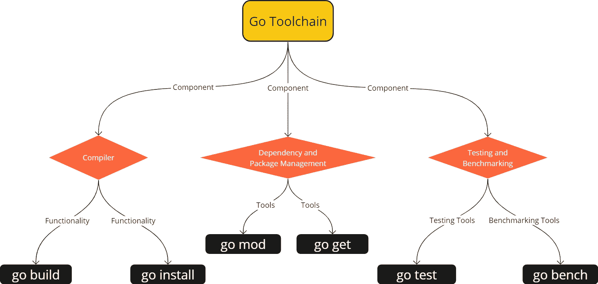
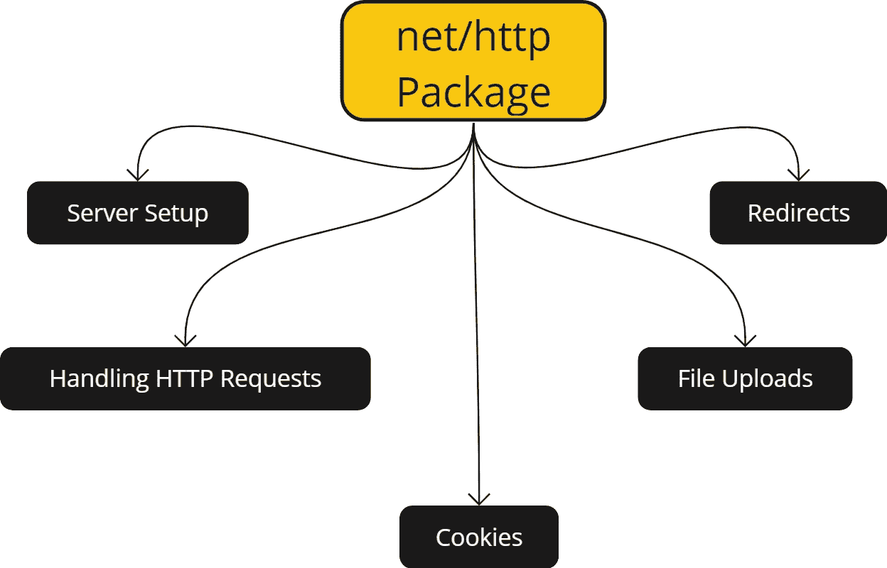
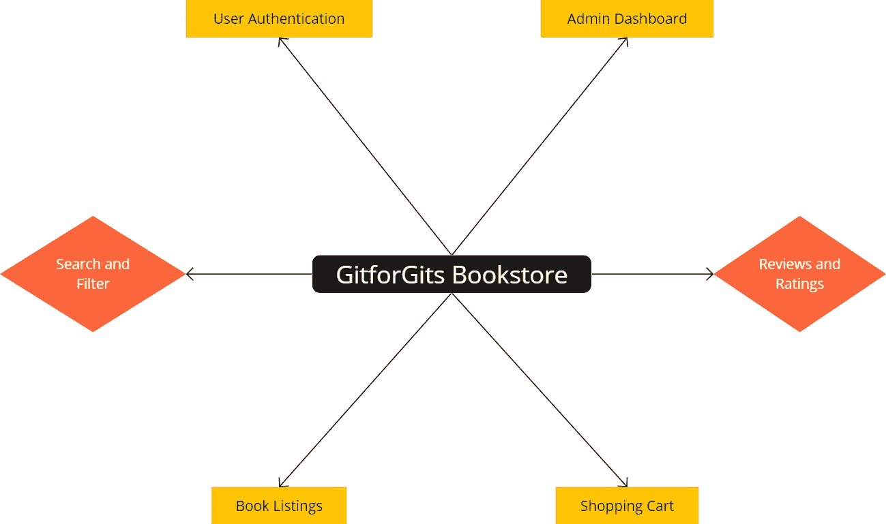
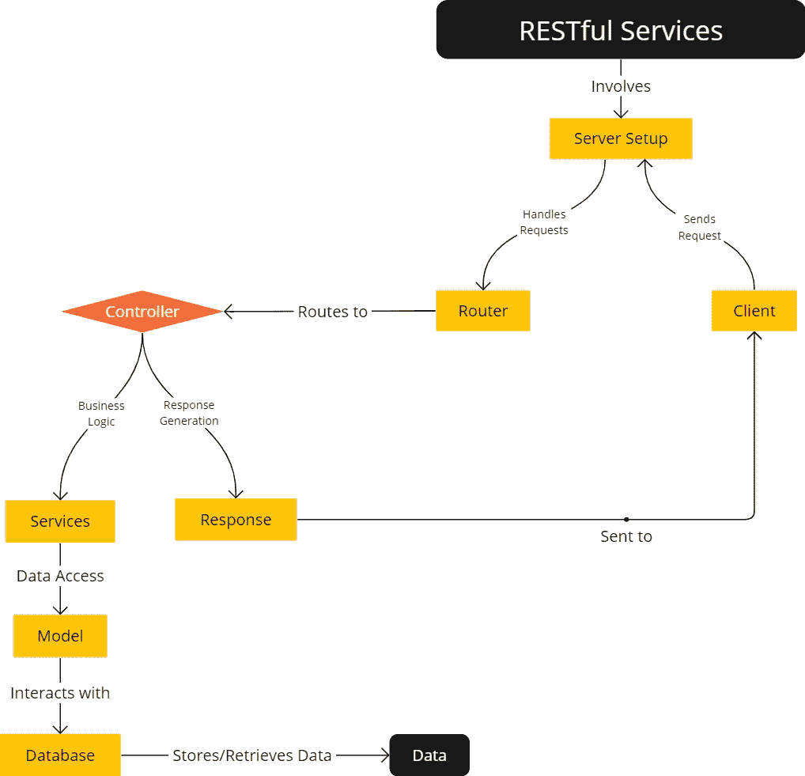
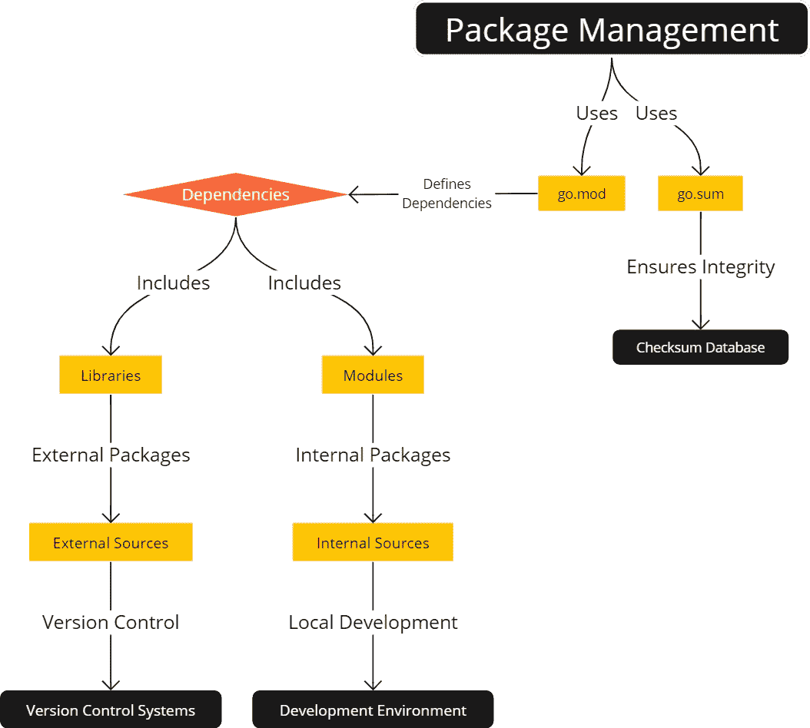
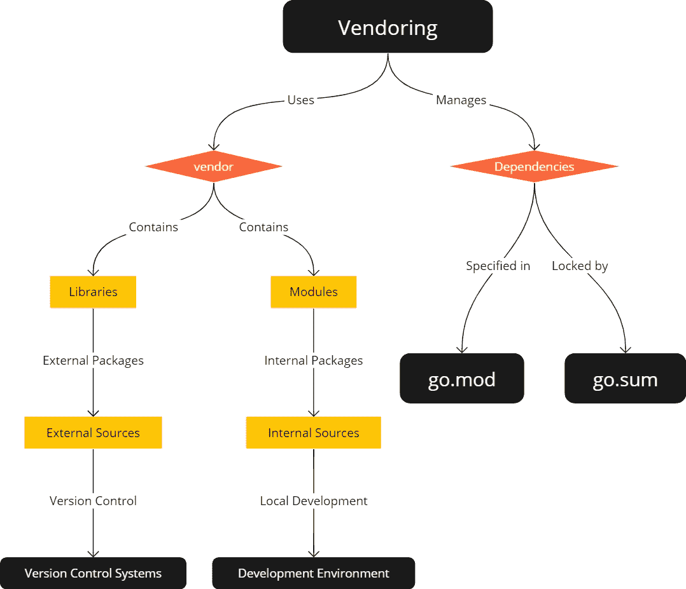
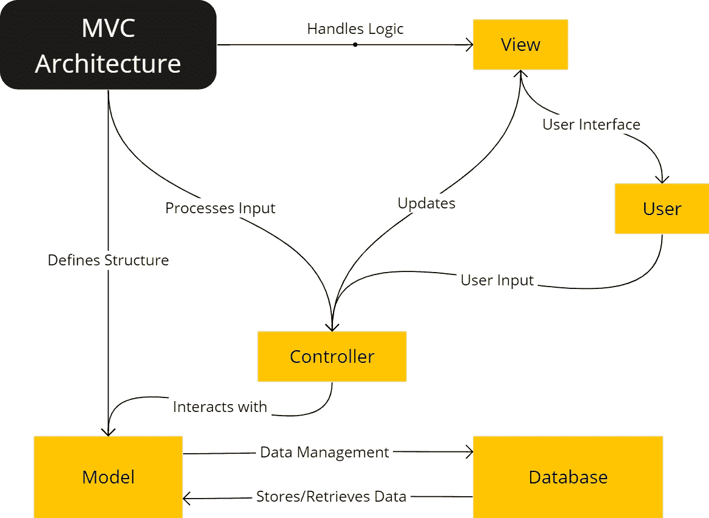
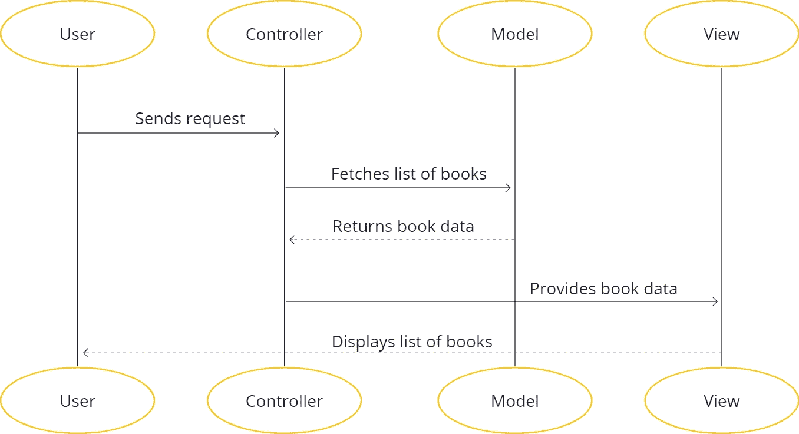

# Go Web 编程：构建和扩展交互式 Web 应用程序


## Preface

"Web Programming with Go" 是软件专业人员和 Web 开发者利用 Go 的潜力创建优秀 Web 应用程序的必备书籍。本书传授的关于 Go 强大库和包的广泛知识对于构建可扩展且高效的 Web 平台至关重要。本书的核心重点是从 Go 的角度深入探索 Web 开发的复杂性。构建任何 Web 应用程序的第一步是回顾基础知识，这将作为其余学习体验的基础。随着你深入探索，你将了解支持 Go 的多样化生态系统。这个生态系统涵盖了广泛的问题，包括路由机制、HTTP 请求和 Go 的并发模型的复杂性，所有这些都旨在提高 Web 效率。本书在整本书中都使用“书店应用程序”作为示例，为你提供每个可能学习点的实际接触点。通过这个迭代示例，你可以跟踪一个简单 Web 应用程序从初创阶段一直到功能齐全、强大的平台的整个开发过程。本书的后续部分专注于性能评估和调试，这在其他 Go 书籍中经常被忽视。本书将带你从 Web 开发的基础知识到 Go 的深度，最终打造一个旨在满足当今数字挑战的强大在线应用程序。无论你是经验丰富的开发者，还是刚开始接触 Go 的爱好者，本书都将是你在 Web 开发浩瀚海洋中的指南针。

在本书中，你将学习如何：

* 掌握 `Go` 高效的语法，并通过更好的性能简化编码。
* 从零开始构建强大的 Web 应用程序，确保可扩展性和响应性。
* 无缝集成 API，增强应用程序功能和用户体验。
* 利用 `Go` 的并发能力，提升应用程序速度和多任务处理能力。
* 使用 `Go` 优化数据存储和检索，确保数据完整性和速度。
* 通过掌握 `Go` 中的错误检测和故障排除，开发具有弹性的应用程序。
* 实现用户会话，增强用户体验和数据安全性。
* 通过 `Go` 全面的测试和调试技术确保应用程序可靠性。
* 利用 `Go` 工具进行实时性能跟踪，确保最佳用户体验。
* 通过 `Go` 的顶级安全实践保护用户数据和交互。

## Prologue

随着新的在线技术似乎凭空出现，当今的开发者必须选择一种能将速度、可靠性和效率融入工作的语言。这就是“Web Programming with Go”发挥作用的地方，它将带你全面探索 `Go` Web 功能的庞大宇宙。`Go`，或通常称为 `Golang`，并非偶然出现。它是科技巨头们有目的地设计的，他们看到了语言领域中的一个空白，并感到有责任用一种当前、简洁且天生具备处理当今多线程在线环境问题的语言来填补它。`Go` 是带着一个理念创建的：简化复杂并强调重要，使开发者能够编排不仅功能完善而且性能出色的程序，从而感到乐趣。“Web Programming with Go”不仅仅是关于函数、循环和库的操作指南；它是现代 Web 编程的宣言。每一章都剥开 `Go` 的层层面纱，确保到最后，你不仅理解了，而且还吸收了它的哲学。在了解如何之前，有必要先理解为什么。为什么 `Go` 偏好组合而非继承，为什么 `Go` 的并发模型是其最伟大的成就，以及为什么 `Go` 可能是你意想不到的需要的语言。

本书的基础优势在于其实践方法论。我们相信通过实践来学习，因此一个实际示例——我们心爱的“书店应用程序”——贯穿本书始终。它，就像你一样，不断演变、成长和扩展。我们的书店软件见证了 `Go` 的强大，随着我们深入探讨从路由机制到 API 集成等主题，每一章都将其从原始模型转变为最先进的应用程序。现代 Web 不仅仅是检索和呈现数据；它关乎与众多服务集成、提供动态用户体验、即时扩展，以及最重要的是，确保性能在压力下不会下降。当你阅读本书时，你会看到 `Go` 挺立着，一座指引你克服这些困难的灯塔。你将学习如何利用 `Go` 的力量，确保你的应用程序不仅有用，而且快速。

本书的另一个值得注意的方面是其对调试和性能评估的深入探讨。调试不仅仅是寻找错误；它关乎理解你的应用程序，识别其痛点并加以解决。`Go` 的庞大工具包使这一曾经困难的操作变得几乎直观，而本书确保你已准备好使用 `Go` 武器库中的每一项工具。

我们希望你在踏上这段旅程时，不仅觉得“Web Programming with Go”具有指导意义，而且具有变革意义。无论你是经验丰富的程序员、爱好者，还是在语言十字路口不知选择哪条路的人，本书都旨在成为你的指南针、向导，有时也是导师。当你翻过这一页，你不仅仅是开始新的一章；你正在踏上我们承诺将是进入 `Go` 世界的激动人心的旅程。祝编程愉快！


## 结语


## GitforGits Prerequisites

面向其他语言的有经验程序员、有兴趣掌握 Web 应用程序开发的 Go 初学者，以及希望使用 Go 更新 Web 开发工具包的专业人士。

## Codes Usage

需要一些有用的代码示例来协助您进行编程和文档编写吗？别再找了！我们的书提供了大量补充材料，包括代码示例和练习。这本书不仅旨在帮助您完成工作，而且我们允许您在程序和文档中使用示例代码。但是，请注意，如果您要复制大量代码，我们要求您联系我们获取许可。但不用担心，从本书中使用几段代码到您的程序中，或引用本书并引用示例代码来回答问题，不需要许可。但是，如果您选择署名，署名通常包括标题、作者、出版社和 ISBN。例如，“Web Programming with Go by Ian Taylor”。如果您不确定您打算使用的代码示例是否属于合理使用或上述许可范围，请随时通过 support@gitforgits.com 联系我们。我们很乐意提供帮助并澄清任何疑虑。

## Chapter 1: Introduction to Web Development in Go

## Introduction to Web Development

2007 年，Google 的 Robert Griesemer、Rob Pike 和 Ken Thompson 提出了 Go 编程语言的构想，该语言也被称为 Golang。他们的目的是解决他们在其他语言中看到的复杂性和缺陷。最初是一个旨在解决对 C++ 和 Java 等流行语言常见批评的探索性项目，特别是在可扩展性和并发性方面，最终导致 Go 1.0 在 2012 年发布。这不仅是该语言历史上的一个里程碑，也是从 Web 开发角度来看的一个里程碑。Go 引入 Web 开发领域，在很多方面都像是一股清新的空气。在由要么需要相当大的学习曲线，要么无法以高效方式处理日益增长的并发处理需求的语言主导的环境中，Go 的简单性和强大功能脱颖而出。由于其固有的并发支持（由 goroutines、channels 和 select 语句提供），游戏规则彻底改变。这些功能的组合，加上 Go 是一种静态类型语言并具有编译语言的效率，使其成为需要快速性能、可扩展性以及同时处理数千个请求能力的 Web 后端的可行选择。

在 Web 开发的宇宙中，微服务的普及进一步加速了 Go 的采用。企业需要一种方法来构建小型、独立的服务，这些服务可以独立开发、部署和扩展。Go 对并发处理的内置支持，加上其极简主义设计和闪电般的执行速度，使其非常适合微服务范式。Web 开发者也被其标准库所吸引，因为它为 Web 服务器、数据库连接和数据处理提供了大量开箱即用的实用程序。这对 Web 开发者来说是另一个主要吸引力。开发人员不必在几十个不同的中间件和外部库中导航，只需使用标准库就能完成大量工作，这将使 Web 项目更加简单并提高整体效率。

多年来，Go 生态系统不断发展壮大，导致引入了大量专门为 Web 开发设计的第三方包和框架。这些第三方工具提供了更专业的功能，填补了空白并满足了利基需求。虽然标准库对许多人来说已经足够，但这些工具提供了更多定制的功能。公认的是，以协作努力和积极参与而闻名的 Go 社区对这一扩张做出了重大贡献。`dep` 和后来的 `Go Modules` 等包管理器简化了依赖管理，这是开发人员必须面对的最重大挑战之一。一些库，例如 Gorilla Mux，增加了复杂的路由功能，而其他库，例如 GORM，为 Go 提供了 ORM 层，简化了数据库操作。

对 Go 广泛采用起到重大贡献的另一个因素是，它与各种其他语言和平台兼容且协同工作良好。由于 Go 服务可以轻松与用其他语言编写的组件交互，企业能够体验到更平稳的过渡。通过利用这种混合方法，组织能够为特定服务尝试 Go，而无需彻底改造其技术栈。

Go 的部署优势是促使其在 Web 开发领域崭露头角的另一个重要因素。用 Go 编写的应用程序被编译成一个包含所有依赖项的单个二进制文件。因此，不再需要外部运行时环境，这简化了部署并减少了因依赖项缺失或不匹配而导致问题的可能性。在 Docker 和 Kubernetes 等容器化和编排工具的现代时代，Go 的单个二进制优势确保了容器大小减小，部署时间加快。

另一方面，Go 在 Web 开发中的接受不仅仅归功于其卓越的技术能力。Go 强调可读性和简单性的基本哲学，引起了许多人的共鸣。由于 Go 的语法非常简洁，代码库更容易维护，错误进入系统的可能性显著降低。代码审查的效率提高了，将新团队成员整合到项目中的过程也变得简单了。Go 的本质在于，它不仅提供了开发强大 Web 应用程序所需的工具，还营造了一个优先考虑清晰度和效率的环境。


## Go 的机遇

Go 作为 Web 开发领域备受青睐的编程语言而兴起，绝非偶然，而是深植于其所具备的架构优势以及现代 Web 的需求之中。Go 成为备受青睐的编程语言，并非简单的幸运巧合。随着全球各地的企业都在为扩展其数字服务而苦恼，使用 Go 的优势正变得愈发明显。

Go 的性能通常与 C 和 C++ 等其他编程语言进行比较。这一点被一致认为是 Go 最受赞誉的优势之一。Go 是一种保证类型安全并减少运行时错误数量的语言。这是因为它作为一种静态类型和编译型语言运行。编译器负责在编译 Go 程序的过程中将代码转换为机器码。然后，该代码由系统的硬件直接执行。直接执行使得高吞吐量和快速启动时间成为可能，这对于需要快速响应的 Web 应用程序来说是一项基本特性。直接执行也使得高吞吐量成为可能。此外，没有虚拟机（如 Java 虚拟机或 C# 中的 CLR）有助于减少开销，从而确保系统资源得到充分利用。这是因为没有虚拟机有助于减少开销。在云部署中，这种效率至关重要，因为云部署的特点是资源利用率与成本消耗之间存在直接相关性。

Web 应用程序中经常涉及许多不同类型的任务。其中包括管理多个用户请求和处理大型数据集。这些任务可以同时完成。Go 提供的原生并发支持带来了显著的好处。这种支持是通过使用 goroutine 实现的。Go 运行时负责管理一种称为 goroutine 的轻量级线程。这种线程的创建成本相对较低。为了防止系统资源耗尽，可以生成成千上万甚至数百万个 goroutine。Go 的另一个特性称为 channel，正是这一特性使得 goroutine 能够相互通信和同步，从而确保数据的准确性。Web 应用程序能够利用这种先进的并发模型，轻松管理大量同时进行的任务。

另一方面，尽管 Go 是一种强大的语言，但其背后的设计理念强调简洁性。Go 是一种由于其简洁明了的语法而不鼓励使用过于复杂结构的编程语言。这种简洁性转化为易于阅读和维护的代码库，这在 Web 开发中尤其有益，因为项目通常需要数年才能完成，并涉及多名不同的开发人员。这一优势不容忽视。Go 致力于保持向后兼容性，这一点体现在它采取措施防止应用程序与语言更新不兼容。对于长期活跃的项目来说，这种可预测性至关重要，因为它让开发人员确信，他们今天的努力不会因未来的变化而过时。

随 Go 提供的标准库对于从事网站创建的人来说，简直是一个宝库。它提供了可用于各种任务的包，例如文件系统管理、创建 Web 服务器、处理 HTTP 请求以及在不同级别执行加密操作。通过利用这个庞大的库，对第三方包的依赖减少了，从而确保了统一性，并最大限度地减少了与外部依赖相关的潜在陷阱。这意味着 Web 开发人员的开发过程将得到简化，因为大量必备工具将易于获取。之所以会这样，是因为事实如此。

使用 Go 的最重要优势之一是它可以编译成单个二进制文件，这一点之前已经提到过。在当今容器化部署日益普遍的时代，这一点尤其正确。由于所有内容都包含在单个二进制文件中，与依赖项管理相关的困难大大减少。因此，这确保了应用程序开发所在的环境与其部署所在的环境相同，从而减少了部署过程中可能出现的问题。此外，Go 的交叉编译功能使开发人员能够轻松为各种平台编译二进制文件，进一步扩展了部署选项和可能性。之所以能够实现这一点，是因为 Go 是一种流行的编程语言。

有许多实例表明，一种语言在现实世界中的应用是展示该语言优势的最有效方式。Go 的使用已经提升了众多知名公司和平台提供的 Web 服务。Docker，这个引发容器化革命的平台，将 Go 作为其主要编程语言。这一决策过程在很大程度上受到 Go 的有效性及其处理依赖项的简单方法的影响。一个主要关注隔离应用程序环境的平台必须具备这些特性，才能真正有效。

Go 还被用于开发 Kubernetes，这是另一个在云编排领域产生重大影响的项目。在此背景下，Go 管理大规模集群环境和处理分布式系统的能力得到了体现。得益于这种编程语言提供的并发模型，流媒体巨头 Twitch 能够通过其由 Go 驱动的聊天服务同时处理数百万条消息。

Go 已集成到 Uber 的微服务生态系统中，使该公司能够成功管理其平台上不断流动的海量数据。这得益于 Go 卓越的性能和可扩展性能力，这些能力已被纳入该生态系统。云存储领域的先驱 Dropbox，将其后端的某些组件从 Python 迁移到 Go，目的是利用 Go 提供的性能优势。正因如此，Dropbox 将这些组件从 Python 迁移到了 Go。

Go 的优势不仅体现在其技术优点上，也体现在其在现实世界中的应用上，在 Web 开发方面显而易见。在 Web 开发方面，Go 的优势显而易见。许多行业巨头通过采用和倡导该语言，引起了人们对 Go 编程语言在塑造 Web 开发未来方面的潜力和能力的关注。


## Go 工具链

Go 的工具链是一组工具的集合，这些工具的开发旨在简化编译、链接、测试和管理 Go 代码的过程。它是 Go 高效且强大的编程语言的源头。该工具链的实现与语言本身同步开发，体现了 Go 对提供集成且全面的开发环境的承诺。Go 的工具链包含在标准发行版中，这确保了其一致性和可靠性。这与大多数语言形成对比，后者在基本开发任务中高度依赖第三方提供的工具。


图 1.1 Go 工具包

## 编译器

Go 工具链中最重要的工具之一是编译器，它负责将 Go 源代码转换为可执行的机器代码。通过 `go build` 命令即可访问编译器，该编译器以速度为设计目标，能够在短时间内生成二进制文件。生成的二进制文件默认是静态的，这意味着它们包含所有依赖项和库。这消除了许多开发者熟悉的典型“依赖地狱”。可以借助 `go install` 命令将二进制文件安装到 `$GOPATH/bin` 目录。由于这种分离，开发者可以在本地构建，而不会增加全局工作区的杂乱程度，从而促进清洁的开发实践。

## 依赖和包管理

当 Go 1.11 发布时，依赖管理经历了重大变革，那一年引入了 Go Modules。包含所有 Go 代码及其依赖项的工作区被称为 `$GOPATH`。在此之前，开发者在使用这个工作区时面临困难。Go Modules 引入了一种更去中心化的方法，使代码可以存储在 `$GOPATH` 目录之外，并引入了版本控制。被称为 `go mod` 的命令集负责管理这些模块，跟踪依赖项，并确保构建可重现。除了管理负责列出所有依赖项的 `go.mod` 文件外，它还协助升级或降级包。它会检索库的适当版本。`go get` 命令使从第三方提供商检索包变得无缝。通过使用此工具，包会从各自的仓库中检索、编译，然后存储在工作区中。这是一个复杂的解决方案，结合了包检索和编译，使开发者能够更轻松地引入外部库，而无需手动干预。

## 测试和基准测试

质量保证是开发过程的重要组成部分，Go 提供的工具链在这方面也不逊色。当你使用 `go test` 命令时，你将能够访问一个框架，该框架允许你编写单元测试、运行测试并获取覆盖率报告。这个集成的测试环境保证了测试不是事后考虑，而是开发周期中必不可少的组成部分。除此之外，还有一个名为 `go bench` 的命令可用于对 Go 代码进行基准测试。通过使用它，开发者可以评估其函数的性能，从而保证代码不仅能够正常工作，而且运行高效。

虽然 Go 的标准工具链非常全面，但开发者有时需要深入挖掘或访问底层工具。`go tool` 命令提供了这种灵活性，可直接访问编译器、链接器和 trace 等工具。对于寻求细粒度控制或希望探索 Go 工具链内部工作原理的开发者来说，这个命令非常宝贵。整个工具链不仅简化了任务，还植入了最佳实践，体现了 Go 简单高效的理念。

## 在 Linux 上设置 Go

## 安装 Go

由于预编译二进制分发版的可用性，在 Linux 上设置 Go 非常简单。在开始安装之前，请确保你拥有合适的 Linux 版本。大多数现代发行版，无论是 Ubuntu、CentOS、Fedora 还是 Debian，都支持 Go。首先，从官方网站下载最新的 Go 压缩包。导航到 [Go 下载](https://golang.org/dl/) 并选择适用于 Linux 的适当版本。下载后，请按照以下步骤操作：

1. 打开终端。导航到包含下载的压缩包的目录，通常是下载文件夹。
2. 使用以下命令将压缩包解压到 `/usr/local`：

   ```bash
   sudo tar -C /usr/local -xzf go$VERSION.$OS-$ARCH.tar.gz
   ```

3. 将 `$VERSION`、`$OS` 和 `$ARCH` 替换为下载文件中的适当值。
4. 通过编辑配置文件或 bashrc 调整系统的 PATH 以包含 Go 的二进制文件：

   ```bash
   echo "export PATH=$PATH:/usr/local/go/bin" >> ~/.profile
   ```

5. 使用 `source ~/.profile` 重新加载配置文件，以确保新的 PATH 设置生效。

## 配置 Go 工作区

`GOPATH` 工作区结构是 Go 过去使用的结构。自引入 Go Modules 以来，不再需要实施严格的工作区结构。尽管如此，组织你的 Go 项目仍然可能有益。

1. 为你的 Go 项目创建一个目录：

   ```bash
   mkdir -p ~/go_projects/{bin,src,pkg}
   ```

2. 将 `GOPATH` 设置为该目录：

   ```bash
   echo "export GOPATH=~/go_projects" >> ~/.profile
   echo "export PATH=$PATH:$GOPATH/bin" >> ~/.profile
   ```

3. 再次使用 `source ~/.profile` 激活这些设置。

## 介绍 Go Modules

Go Modules 是在 Go 1.11 中引入的一种依赖管理系统，它在 `GOPATH` 之外运行。要使用 Go Modules 启动一个新项目：

1. 导航到你的项目目录。
2. 使用以下命令初始化一个新模块：

   ```bash
   go mod init <module-name>
   ```

   此命令会创建一个 `go.mod` 文件，用于跟踪你的项目依赖项。

## 设置工具和库

对于 Web 开发，某些库和工具可以增强 Go 的使用体验。以下是简要设置：

1. Gorilla Mux - 一个多功能的路由器和分发器：

   ```bash
   go get -u github.com/gorilla/mux
   ```

2. GORM - 一个适用于 Go 的 ORM 库：

   ```bash
   go get -u gorm.io/gorm
   ```

3. GoDotEnv - 管理环境变量：

   ```bash
   go get -u github.com/joho/godotenv
   ```

4. Fresh - 一个用于在开发期间自动重新加载 Web 应用程序的工具：


go get `github.com/pilu/fresh` When you use these packages in your code and build your application, they will be automatically added to the `go.mod` file. This is something you should keep in mind when working with Go Modules.

## IDE 和代码编辑器

考虑使用专为 Go 设计的集成开发环境（IDE）或文本编辑器，以提升编码体验的质量。首选选项包括：

1. 安装 Go 扩展后，Visual Studio Code（`VS Code`）提供了全面的 Go 开发体验。该扩展包含代码导航、IntelliSense 和调试等功能。
2. 作为专用的 Go 集成开发环境（`IDE`），JetBrains 的 `GoLand` 提供了强大的编码、测试和调试功能。

要设置 VS Code，请从 [官方网站](https://code.visualstudio.com/Download) 下载 `.deb` 或 `.rpm` 包并安装。启动 VS Code 后，搜索由 Google 开发的 Go 扩展并安装。

安装好 Go、配置好工作区、下载好必要的库并安装好代码编辑器后，你就可以深入使用 Go 进行 Web 开发了。Linux 环境特别适合 Go 开发，因为它既提供了灵活性，又具备强大的功能。这里提到的工具和库只是冰山一角。尽管初始设置可能看起来很繁琐，但这实际上是一次性的努力，为顺利且高效的编码之旅铺平了道路。

## net/http 包

### net/http 概述

Go 的 `net/http` 包是其 Web 开发能力的核心。作为标准库的一部分，该包提供了大量功能，从设置服务器和处理 HTTP 请求的基础知识，到 Cookie、重定向和文件上传等更复杂的方面。`net/http` 的真正魅力在于其简洁性，它抽象了 HTTP 协议的复杂性，同时允许开发者专注于应用程序逻辑。


图 1.2 net/http 包概览

### HTTP 服务器和客户端

`net/http` 既能充当 HTTP 客户端，又能设置 HTTP 服务器，这是该编程语言的核心能力。使用 `ListenAndServe` 函数，开发者可以快速启动服务器。该函数开始监听特定端口上的传入 HTTP 请求。在服务器配置方面，Go 最显著的特点之一是其易用性，这使得快速开发和部署成为可能。

为了便于向 Web 上的其他服务器发出外出请求，该包为开发者提供了 `Get` 和 `Post` 等函数，这些函数在应用程序的客户端可用。Go 致力于提供全面的 Web 开发体验，这一点体现在它将客户端和服务器功能整合到一个包中。

### 处理程序和 HandlerFuncs

理解处理程序是使用 `net/http` 软件的重要组成部分。在 Go 中，处理程序是任何遵循 `http.Handler` 接口的对象。该接口要求一个签名为 `ServeHTTP(http.ResponseWriter, *http.Request)` 的方法。Go 的处理程序必须具有此签名。得益于这种设计，开发者可以创建针对其应用程序特定需求定制的自定义处理程序，这允许极大的灵活性。

`*http.Request` 类负责封装有关传入请求的所有信息，而 `http.ResponseWriter` 类在将响应发送回客户端的过程中起着重要作用。Go 编程语言提供了一个名为 `http.HandlerFunc` 的便捷适配器，它使常规函数能够充当 HTTP 处理程序。这简化了实现处理程序的过程，使体验更加流畅。

### 路由请求

虽然基本服务器创建很简单，但现实世界中的应用程序通常需要复杂的路由机制。尽管 `net/http` 不提供类似某些第三方包的广泛路由器，但它提供了一个名为 `http.ServeMux` 的多路复用器。该多路复用器可以根据 URL 模式将请求路由到特定的处理程序。对于具有动态 URL 模式的复杂应用程序，开发者通常会转向 Gorilla Mux 等第三方路由器。但是，对于更简单的应用程序，`http.ServeMux` 就足够了。

### 数据请求和响应

与传入请求进行深度交互并构建响应构成了 Web 开发的重要部分。`net/http` 包为此提供了全面的工具。例如，`http.Request` 类型包含用于解析查询参数、提取表单数据和读取请求正文的方法。在响应方面，`http.ResponseWriter` 便于设置标头、写入响应数据和配置状态代码。

### 使用 net/http

现在，将重点转向将 `net/http` 集成到开发环境中。由于 `net/http` 是 Go 标准库的一部分，不需要像第三方包那样进行单独的安装过程。一旦在机器上设置好 Go，`net/http` 包即可使用。

要在 Go 应用程序中使用它：

* 在 Go 文件开头添加导入语句：`import "net/http"`。
* 导入后，您可以利用 `net/http` 包中的任何功能。无论是使用 `http.ListenAndServe` 启动服务器，还是使用 `http.Get` 构建 HTTP 客户端请求。
* 深入研究官方 Go 网站上提供的丰富文档，或直接通过 `godoc` 命令访问。这将提供关于 `net/http` 提供的众多功能的见解。

Go 中的 `net/http` 包不仅仅是一个库；相反，它是使用 Go 编程语言开发复杂 Web 应用程序的门户。由于其对简洁性和功能性的强调，它使开发者能够构建和管理 Web 服务器，灵活地处理请求和响应，并创建可以容纳简单和复杂应用程序要求的路由机制。因此，它体现了 Go 使强大的 Web 开发变得可访问和可管理的哲学，这也是 Go 越来越成为 Web 开发的热门选择的原因之一。

## 介绍书店 Web 应用程序

书籍的世界广阔无垠，涵盖了数千年的人类知识和创造力。在这个数字时代，获取书籍已从实体访问转变为在线搜索和购买。我们的项目“书店 Web 应用程序”旨在反映这种数字化转型。该应用程序将作为一个在线平台，用户可以在其中浏览、搜索、评论和购买书籍。虽然它可能看起来只是另一个 Web 应用程序，但从零开始构建它将让您沉浸在大量围绕 Go 编程语言的 Web 开发概念、工具和最佳实践中。

我们的书店应用程序不会仅仅是一个静态网站。它将是交互式的、动态的且以用户为中心。一些核心功能将包括：

* 用户身份验证：用户将注册、登录并维护个人资料，确保个性化体验。
* 书籍列表：一个广泛的目录，显示带有封面图片、描述、作者和定价的书籍。
* 搜索和过滤：一个强大的搜索机制来定位特定书籍，并辅以类型、作者和评分等过滤器。
* 购物车：用户可以将书籍添加到购物车，查看购物车内容，并继续购买。
* 评论和评分：购买后，用户可以留下评论和评分，培育社区驱动的推荐系统。


*   `Admin Dashboard`: 一个用于管理员管理图书列表、跟踪销售并与用户反馈交互的独立界面。

 图 1.3 GitforGits 书店应用程序的功能 构建书店应用程序不仅仅是关于最终产品；重要的是过程。以下是你在构建书店 Web 应用程序过程中将学到的内容：

*   了解 Go 如何构建 Web 应用程序，从组织文件和文件夹到模块化代码以实现可扩展性。

*   与数据库交互以存储和检索数据，使用 Go 的数据库包和第三方 ORM。你将掌握 CRUD 操作、迁移和高级查询。

*   处理用户会话、Cookie，并确保交互过程中的数据持久性。

*   利用 Go 的模板引擎创建基于数据变化的动态网页。

*   处理用户输入、验证，并确保数据完整性。

*   实现中间件以执行日志记录、身份验证和错误处理等任务。了解 HTTP 处理程序在路由请求中的深度。

*   使用 Go 的并发模型高效处理同时的用户请求。

*   为应用程序编写测试，调试问题，并确保代码可靠性。

*   使应用程序上线，了解云托管、容器化，并确保应用程序能够随用户需求进行扩展。

书店应用程序不仅仅是另一个项目；它是数百万人每天交互的真实世界 Web 应用程序的体现。通过构建它，你不仅理解设计决策、工具选择和架构考量背后的“如何”，还理解其“为什么”。书店应用程序的每个功能都经过精心选择，旨在引入新概念或加深对现有概念的理解。你不是在孤立中学习 Go Web 开发；你是在更广泛的 Web 开发环境中理解它。

## Go RESTful 服务

可以通过从 REST 的基本原则和 Go 编程语言的独特能力来审视，从而全面理解 Go 中的 RESTful 服务。REST 是由 Dr. Roy Fielding 提出的一种架构风格，是“Representational State Transfer”的缩写。与标准不同，它是一套用于开发可扩展且易于维护的 Web 服务的指导原则。这些指导原则通常使用 HTTP 实现。

### REST 的关键原则

REST 方法论基于若干基本原则。它强调无状态性，这意味着客户端发送到服务器的每个请求都必须包含服务器处理所需的所有信息，而不依赖于任何已存储的会话状态。这种方法与 Go 的设计一致，Go 偏好简单直接。REST 中使用的客户端-服务器架构鼓励关注点分离。客户端负责用户界面和体验，而服务器负责数据以及后端发生的操作。在管理应用程序的各种组件时，这种分离类似于 Go 采用的模块化方法。可缓存性是另一个原则，它规定 RESTful 响应应明确标记为可缓存或不可缓存。这将提高性能，这也是 Go 由于其编译和高效特性所努力实现的目标。Go 创建可扩展且可维护系统的能力，让人联想到 REST 中使用的分层系统。在这个系统中，客户端与最终服务器或中间件交互，而无需区分它们。统一接口原则通过使交互可预测和标准化来简化架构。这与 Go 简单的语法以及其对接口和方法的方法类似。

### 使用 Go 实现 RESTful 服务

其标准库，特别是 `net/http` 包，极大地促进了 RESTful 服务的开发。开发人员通常使用 `http.HandleFunc()` 方法或第三方路由器来定义端点，并将 GET、POST、PUT 和 DELETE 等 HTTP 方法与这些端点关联。该包使开发人员能够做到这一点。在 REST 中，URI 用于标识资源，Go 强大的 URL 解析功能对此非常有用。  图 1.4 在 Go 中实现 RESTful 服务 发送到 Go 服务器的每个请求都应携带所有必要数据，因为 REST 是一种无状态协议。Go 是需要通信格式灵活性的 RESTful 服务的绝佳选择，因为它能够处理 HTTP 请求和响应，并通过 `encoding/json` 等包支持 JSON 和 XML。此外，RESTful 服务高度依赖 Go 的错误处理，这使开发人员能够提供有用的错误消息和合适的 HTTP 状态码。Go 的显式错误处理与 REST 对清晰传达问题的要求非常契合。

### Go 在 RESTful 开发中的优势

Go 具有许多特性，使其成为开发 RESTful 服务的绝佳选择。对于高流量服务，其作为编译语言的性能至关重要。Go 对并发的原生支持使其能够高效地处理多个同时请求，这是 RESTful 服务中经常出现的场景。标准库的稳健性减少了对外部包的依赖。强类型和对 JSON 的支持是保证 Go 中数据完整性的两个特性。此外，该语言对中间件的支持使日志记录和身份验证等额外功能成为可能。Go 的 RESTful 服务的安全性至关重要。开发人员可以利用 Go 对 HTTPS 的支持、使用 JSON Web 令牌进行身份验证，以及利用包来防止 CSRF 等攻击。Go 对输入的清理和验证的方法对于防范 SQL 注入等威胁绝对必要。随着开发人员构建书店应用程序，他们将利用 Go 提供的功能来创建 RESTful 路由。这将确保书籍不仅被列出，而且根据 Web 服务设计的最有效原则进行交互。


## 构建我的第一个 Web 服务器

开始开发 Web 服务器（尤其是一款最终将发展成为全面 BookStore 应用程序的服务器）所带来的感觉令人兴奋。起初，重点在于建立基础、理解复杂性，并实现那个“Hello, World！”时刻——或者，在我们的例子中，就是“Hello GitforGits BookStore！”

## 初始化项目

每个伟大的应用程序都始于一个结构化的工作区。在深入代码之前，为 BookStore 项目建立一个目录。使用你的终端或命令行：

```
mkdir gitforgits-bookstore
cd gitforgits-bookstore
```

接下来，初始化一个 Go 模块来管理依赖项：

```
go mod init gitforgits-bookstore
```

此命令创建一个 `go.mod` 文件，该文件将在我们添加依赖项时列出并管理所有项目依赖项。

## 构建基本服务器

一旦工作区准备就绪，我们将开始构建一个基本服务器。首先，创建一个新文件并将其命名为 `main.go`。进入项目目录。在这个文件中，将存储服务器的主要逻辑。

在 `main.go` 中，首先导入必要的包：

```go
package main

import (
	"fmt"
	"net/http"
)
```

`net/http` 包提供了构建 HTTP 服务器和客户端的功能，而 `fmt` 将用于格式化我们的输出。

现在，定义 `main` 函数并设置服务器：

```go
func main() {
	http.HandleFunc("/", homeHandler)
	http.ListenAndServe(":8080", nil)
}
```

接下来，采取了两个关键步骤：

1. `http.HandleFunc("/", homeHandler)`：此行将根 URL（“/”）映射到名为 `homeHandler` 的函数，我们将很快定义该函数。
2. `http.ListenAndServe(":8080", nil)`：这指示应用程序在端口 8080 上启动 HTTP 服务器。

接下来，我们将定义 `homeHandler` 函数：

```go
func homeHandler(w http.ResponseWriter, r *http.Request) {
	fmt.Fprintf(w, "Hello GitforGits BookStore!")
}
```

此函数接受两个参数：`http.ResponseWriter` 和 `*http.Request`。`http.ResponseWriter` 是一个接口，允许将响应发送回客户端，而 `*http.Request` 提供有关传入请求的信息。

## 运行服务器

要体验第一个服务器的神奇之处，请在终端中导航到项目目录并运行：

```
go run main.go
```

如果一切按计划进行，服务器将开始在端口 8080 上监听。通过在 Web 浏览器中访问 `http://localhost:8080`，问候语“Hello GitforGits BookStore!”应该会热情地欢迎你。

尽管这个初始服务器看起来可能很简单，但它将作为构建整个 BookStore 应用程序的基础。目录结构已经建立，基于 Go 的服务器的基本流程已经理解，我们已经熟悉了处理程序等基本概念。后续章节和部分将深入探讨，介绍动态内容呈现、复杂路由和数据库连接。这些将建立在已经奠定的基础之上。

## 摘要

在本章中，我们开始了为名为“GitforGits BookStore”的项目构建 Go Web 服务器的基本过程。读者了解了创建专用目录和初始化 Go 模块以实现高效依赖管理的重要性，从建立有组织的工作区开始。这样做是为了确保每个人都在同一页面上。通过迈出这一步，它确保开发环境干净且结构良好，使随着项目的增长，添加依赖项和管理它们的过程更加高效。

通过对代码的检查，本章解释了使用 Go 中的 `net/http` 包建立基本 HTTP 服务器所涉及的基本操作。本章向读者介绍了 `http.HandleFunc` 函数，这是一个重要的工具，用于将特定 URL 与相应的处理程序函数链接起来。通过掌握这些基础知识，你正在为项目后期阶段的更复杂路由和请求处理奠定基础。

此外，还介绍了 `http.ListenAndServe` 函数，它举例说明了如何指示 Go 应用程序在特定端口上启动 HTTP 服务器，准备好处理来自客户端的传入请求。通过演示处理程序函数如何管理传入的 Web 请求并生成适当的响应，本章还强调了处理程序函数及其组织的重要性。`homeHandler` 函数作为如何使用 `http.ResponseWriter` 和 `*http.Request` 参数的示例。这些基本元素使开发人员既能向客户端传输数据，也能检索有关传入请求的信息。

读者能够通过执行 `go run` 命令运行服务器，并在 Web 浏览器上观察问候语“Hello GitforGits BookStore!”，从而看到他们努力的结果。这使得抽象知识转化为具体成果。

在整个本章中，主要重点放在构建基本服务器上；然而，目标是了解使用 Go 进行 Web 开发的基本原理。在项目开发实践中，所介绍的技能和概念将被回顾、详细阐述，并融入到更复杂的功能中。这将确保学习体验既全面又引人入胜。

## 第 2 章：构建 Go Web 应用程序

## 探索 Go 模块

模块代表了 Go 编程语言依赖管理的下一个进化步骤。在引入模块之前，Go 生态系统依赖于 `GOPATH` 工作区，所有源代码及其伴随的依赖项都共存于其中。尽管该结构是功能性的，但在版本控制和项目隔离方面面临困难。

Go 模块首次在 Go 1.11 版本中引入，作为解决这些挑战的方案出现。它们彻底改变了依赖项的处理方式，使其更简单、更直观，并且与 `GOPATH` 分离。

## Go 模块的本质

从本质上讲，Go 模块是存储在带有根目录下 `go.mod` 文件的文件树中的 Go 包集合。这个文件是模块的清单，详细说明了其模块路径（即其导入路径前缀）及其依赖项要求。

模块提供了几个引人注目的优势：

* 模块本质上支持版本控制。开发人员可以指定希望使用的依赖项版本，Go 确保在构建过程中始终一致地使用该确切版本。
* 使用模块，项目是隔离的。单体 `GOPATH` 的时代已经一去不复返。开发人员现在可以处理具有不同依赖项的多个项目而不会发生冲突。
* 随 `go.mod` 文件一起提供的 `go.sum` 文件确保使用的模块正是开发人员所期望的。它包含模块内容的加密校验和，提供了额外的安全性和一致性层。
* 模块可以位于任何地方，而不仅仅是 `GOPATH` 或版本控制系统中。它们可以驻留在本地文件系统、网络服务器上，甚至可以通过代理服务器获取。


## 过渡到模块

在 Go 中引入模块标志着从传统的 GOPATH 工作流程发生重大转变，提供了一种更加简化和直观的依赖管理方法。这种转变对于希望现代化工作流程、简化包管理并提高构建可重复性的开发人员尤其有利。

对于开始新项目的开发人员来说，采用模块非常简单。启动新模块从一个简单的命令开始：`go mod init <module-name>`。此命令在项目目录中创建一个新的 `go.mod` 文件。该文件是模块的关键，因为它跟踪项目的依赖项。`<module-name>` 通常是将发布模块的仓库位置，但对于内部或未发布的模块可以是任何字符串。

过渡到模块不仅限于新项目。现有代码库也可以以最小的摩擦适应这种新系统。当在不包含 `go.mod` 文件且位于 GOPATH 之外的项目中执行 `go build` 或 `go test` 等 Go 工具时，Go 会自动开始迁移过程。这种自动化迁移是一项基石功能，旨在减少传统上与依赖管理相关的复杂性。在此迁移期间，Go 分析现有代码和依赖项，创建 `go.mod` 文件以及 `go.sum` 文件。`go.sum` 文件在确保依赖项的完整性方面起着至关重要的作用，通过存储其预期的加密校验和。

## 使用模块进行依赖管理

应用程序的开发在很大程度上依赖于有效的依赖管理，而 Go 模块（Go Modules）作为内置的依赖管理工具，正是在这方面大放异彩。Go 模块提供了一种简化且直观的方法来管理项目依赖项，这对于应用程序的开发至关重要。Go 项目使用模块添加新依赖项的过程如此简单，这充分体现了 Go 对简单性和效率的承诺。

当开发人员导入项目中尚未包含的包时，构建命令（`go build` 或 `go test`）会导致 Go 自动查找、下载并将该依赖项添加到 `go.mod` 文件中。这发生在执行构建命令时。之后，该文件充当清单，提供项目中使用的每个依赖项的特定版本的信息。这种自动添加有助于减少所需的手动监督量，并保证所有必要的依赖项都明确声明。

在开发人员需要获取特定版本模块的场景中，`go get` 命令变得不可或缺：`go get <module-path>@<version>`。此命令允许对所使用的依赖项版本进行精确控制。例如，如果已知某个特定版本的库与项目配合使用效果最好，则可以明确指定。此命令更新 `go.mod` 文件以反映指定的版本，确保不同开发环境之间的一致性。

## go mod tidy

这个强大的命令会清理 `go.mod` 及其伴随的 `go.sum` 文件，后者为每个依赖项维护一个校验和。它删除项目中不再使用的依赖项的引用，使 `go.mod` 文件真实反映项目的当前状态。

## 了解模块代理

模块代理在 Go 中的主要功能是充当 Go 项目和源仓库之间的中介。这一角色由模块代理执行。如果 Go 项目请求一个模块，代理将从其源（可能是 GitHub 等网站）检索并存储该模块。对同一模块的后续请求将从代理的缓存中提供，这大大减少了检索模块所需的时间。

使用模块代理可以加快模块检索速度，这是使用此类代理的最显著优势之一。由于模块被缓存，因此无需在各种项目或构建中反复下载同一模块，从而减少了构建过程所需的时间。对于 GitforGits Bookstore 等大型项目（可能涉及多个依赖项）来说，这一点尤其有用。

使用模块代理的另一个显著优势是增强了可靠性。Go 项目通常将其依赖项托管在互联网各处的各种源代码控制系统上。为了提供稳定性和连续性，模块代理确保即使原始源被删除或不可用，缓存的版本仍然可访问。

对于在 GitforGits Bookstore 等 Go 项目上工作的开发人员来说，理解和利用模块代理的强大功能是高效且安全的软件开发的关键方面。在现代 Go 开发工作流程中，模块代理是必须使用的基本工具，无论是使用默认的 Go 代理还是建立自定义代理。

## 标准 Go 目录结构

与许多其他编程语言不同，Go 不严格强制特定的目录结构。另一方面，多年来，社区已就许多惯例达成共识，这些惯例提高了代码的可读性，使工具更易于使用，并简化了维护。

在引入模块之前，GOPATH 工作区（存储所有 Go 项目的目录）是 Go 开发人员的主要资源。该工作区有三个主要子目录：`src` 包含源文件；`pkg` 包含包对象；`bin` 包含编译后的二进制文件。之后，各个项目将存储在以其域名命名的目录中，这些目录位于 `src` 目录内。例如：`src/github.com/gitforgits/bookstore`。

使用模块后，GOPATH 工作区变得不那么严格，这是一项重大改进。项目可以位于 GOPATH 之外，目录结构变得更加灵活。尽管如此，仍有一些惯例继续存在：

* `Cmd` 目录：包含应用程序命令。每个应用程序都应位于以其名称命名的目录中，并且每个应用程序目录应有一个主文件。
* `Pkg` 目录：存放项目中多个应用程序使用但不对外公开的库和包。
* `Api` 目录：用于 API 定义和协议文件。
* `Web` 或 `Ui` 目录：包含 Web 资源、模板和前端相关内容。
* `Scripts` 目录：存放用于各种目的（如构建或部署）的脚本。

## 设计目录结构

以组织良好的目录结构开始，是开发 GitforGits Bookstore 等全面应用程序的重要步骤。这种结构不仅有助于更好地管理和理解代码，还符合 Go 的最佳实践，使任何开发人员都能更轻松地浏览项目并为其做出贡献。

## 根目录要点

GitforGits Bookstore 的根目录将托管几个关键文件：

* `README.md`：提供项目文档和概述。
* `LICENSE`：包含许可证信息。
* `go.mod` 和 `go.sum`：便于模块管理，表明 Go 的模块化方法。

## 目录分解

1. `Cmd` 目录：这将存放我们项目中的应用程序。为简单起见，我们假设主应用程序是服务器本身：


## 项目目录结构

## 1. cmd/server
包含启动服务器的主函数，是 Web 应用程序的入口点。

## 2. pkg 目录
用于存放库和包的位置。包含可能不专属于 Web 应用程序的共享逻辑和组件，未来可能用于命令行工具或其他应用程序。

*   `pkg/models`: 必要的数据结构，如 `book.go` 或 `user.go`。
*   `pkg/utils`: 实用函数，如用于身份验证机制的 `auth.go` 或各种辅助函数的 `helpers.go`。

## 3. api 目录
鉴于现代 Web 应用中清晰 API 定义的重要性：

*   `api/definitions`: 潜在的 OpenAPI 或 gRPC 定义，详细说明服务器提供的契约。

## 4. web 目录
所有前端相关内容：

*   `web/static`: 静态资产，包括 CSS、JS、图片，甚至第三方库。
*   `web/templates`: Go HTML 模板，允许动态内容渲染。

## 5. internal 目录
仅供此应用程序使用，不供外部使用的代码：

*   `internal/handlers`: HTTP 处理程序，如用于提供书籍相关请求的 `bookHandler.go` 或用于用户操作的 `userHandler.go`。
*   `internal/middleware`: 必要的中间件函数，用于日志记录、CORS 或身份验证等任务。
*   `internal/config`: 配置相关逻辑，可能是 `config.go`，用于获取和解析配置详细信息。

## 6. scripts 目录
任何有助于开发、部署或其他操作的脚本：

*   `scripts/deploy.sh`: 用于处理部署的潜在脚本。
*   `scripts/test.sh`: 在整个项目中运行测试或 linter。

## 7. database 目录
用于数据库相关文件和脚本：

*   `database/migrations`: SQL 脚本或其他迁移工具，以确保数据库结构一致性。
*   `database/seeds`: 脚本或数据文件，用于将初始数据种子到数据库中。

## 8. docs 目录
用于全面文档，除主 README 之外：

*   `docs/setup.md`: 设置和安装说明。
*   `docs/api.md`: API 端点、请求-响应示例和其他 API 相关文档。

## 创建目录结构

要设置此结构，可以使用简单的终端命令：

```
mkdir gitforgits-bookstore && cd gitforgits-bookstore
mkdir cmd pkg api web internal scripts database docs
mkdir cmd/server pkg/models pkg/utils api/definitions web/static web/templates internal/handlers internal/middleware internal/config database/migrations database/seeds
touch go.mod README.md LICENSE
```

所概述的目录结构既符合 Go 最佳实践，又针对 GitforGits Bookstore Web App 的特定需求进行了定制。目标是确保任何熟悉 Go 或对项目新手的开发人员都能快速理解应用程序的布局，并确切知道在哪里查找特定功能。随着我们在后续章节中深入探讨使用 Go 进行 Web 应用程序开发的复杂性，此结构将成为我们的指南地图，确保每段代码都能找到其逻辑归属。

## 包管理和 Vendoring

无论编程环境如何，都会使用包或库来增强核心语言的功能。这使开发人员能够使用已经编写好的代码。以有条理的方式导入、管理和使用这些外部包的过程，就是所谓的包管理的本质。在 Go 编程语言中，这指的是添加、更新或删除这些外部代码片段的过程，以保证与主应用程序的平滑集成。



Fig 2.1 Package Management in Go

## 为什么包管理很重要？

在现代软件开发中，包管理是一个基本组成部分。它能够确保所有开发人员环境的一致性，隔离项目依赖项，并得益于其功能实现可重复构建。这些功能为软件项目在其整个生命周期中提供可扩展性和可维护性的基本基础。

### 环境间的一致性

包管理器允许项目中的所有开发人员使用完全相同版本的外部库和模块。这种一致性消除了当一些工程师使用更新的包而其他人使用旧版本时可能出现的错误和问题。包管理器在包含的项目上下文中安装依赖项，确保每个人都围绕一组统一的包协调一致。

### 与全局状态隔离

包管理器通过在封装的项目上下文中安装包而不是全局安装，从而实现依赖项隔离。这允许明确定义项目的依赖项，与系统上全局安装的任何包分开。隔离性增强了可移植性，并使项目能够在不同目标环境中统一运行。

### 可重复且可靠的构建

通过在构建过程中使用固定且一致的依赖项版本，包管理器能够实现可靠的可重复构建。自动化构建将集成项目清单文件中定义的完全相同的依赖项。这种可重复性在持续交付管道中提供了巨大的信心。构建工件可以在不同环境中完全相同地重新创建。可重复构建还通过消除对底层包的不确定性，极大地帮助调试。

## Vendoring 的需求

在 Go 编程语言中，将所有外部依赖项复制到项目目录中的过程称为“vendoring”。在引入 Go Modules 之前，实现可重复构建的推荐方法是使用 vendoring。使用 vendoring 时，与项目关联的外部包通常保存在项目目录中名为 `/vendor` 的目录中。`/vendor` 目录中的包在应用程序构建过程中，比全局 GOPATH 目录中的包具有更高的优先级。



Fig 2.2 Vendoring in Go

## Vendoring 的优点

*   您的项目与系统范围的包隔离，确保全局空间中的更新或删除不会影响您的项目。
*   由于所有依赖项都是本地的，您可以在没有互联网访问的情况下构建项目。
*   您的依赖项不会更改，除非您明确决定更新它们，从而实现可重复构建。


## 传统依赖管理与 Go Modules

传统的依赖管理已被 Go 社区中的新方法所取代。Go Modules 提供了一种集成的依赖管理机制，以明确的方式消除了对 vendor 目录的需求。另一方面，Go Modules 提供了一种可选的依赖管理模式，允许通过 `go mod vendor` 命令填充 `/vendor` 目录。这种模式专为那些继续偏好依赖管理并因其提供的优势而使用的人设计。

## 实现包管理

### 初始化 Go Modules
如果尚未完成，则为项目初始化 Go Modules。这将创建 `go.mod` 和 `go.sum` 文件，用于跟踪项目的依赖项。

```
go mod init gitforgits-bookstore
```

### 添加依赖项
在编写代码并导入新包时，Go 会自动将它们添加到 `go.mod` 文件中。如需手动添加：

```
go get <package-name>@<version>
```

这将获取所需的包版本并将其添加到 `go.mod` 文件中。

### 更新和移除
Go 使将包更新到较新版本或移除未使用的包变得容易。如需更新：

```
go get -u <package-name>
```

如需移除未使用的包：

```
go mod tidy
```

### 使用 Go Modules 进行依赖管理
对于那些倾向于依赖管理的人来说，即使已启用 Go Modules，流程也很简单。在完成依赖项管理后，只需运行：

```
go mod vendor
```

这将用项目的依赖项填充 `/vendor` 目录，确保构建使用这些依赖包。

### 维护和审查
定期审查和更新依赖项是明智之举。这不仅能获取可能包含新功能的更新，还能通过修补所用包中的任何漏洞来确保安全性。

自引入模块以来，Go 的依赖管理格局变得更加精简和高效。这一点尤其如此。对于 GitforGits Bookstore Web App，重点始终在于确保一致性、可重复性和隔离性。无论是选择纯 Go Modules 还是将应用与依赖管理集成，情况皆是如此。

## Go 中的模型-视图-控制器 (MVC)

## 理解 MVC
MVC 范式是一种经受住时间考验的架构模式，已成为众多编程语言中 Web 应用程序的基石。其本质在于将应用程序划分为三个相互关联的组件：

1. **Model**：表示数据结构和业务逻辑。本质上，模型是支柱，包含规则、数据以及更新或处理这些数据的逻辑。
2. **View**：专注于表现层。它是最终用户交互的内容——即 UI。视图将模型中的数据显示给用户，并将用户命令发送到控制器。
3. **Controller**：充当模型和视图之间的中介。它从视图获取用户输入，对其进行处理（可能会更新模型），并将输出显示返回给视图。

虽然 Go 并不像 Ruby on Rails 对 Ruby 或 Django 对 Python 那样是严格的 MVC 框架，但其灵活性允许开发人员以 MVC 风格构建 Web 应用程序。Go 标准库（尤其是 `net/http` 包）结合多个第三方包，为实现 MVC 模式提供了全面的工具包。

## MVC 的优势

* **关注点分离**：通过解耦数据处理、用户界面和控制流，MVC 模式确保 GitforGits Bookstore 的每个组件保持独立。这种分离有利于并行开发、单元测试和可扩展性。
* **模块化**：随着 GitforGits Bookstore 的增长，添加功能或进行更改变得不那么令人生畏。例如，如果获取书籍的方式发生变化，修改将局限于模型，而无需更改视图或控制器。
* **可重用性**：组件（尤其是视图和模型）可以在应用程序的不同部分中重用。例如，书籍模型可以在各种上下文中使用——搜索、推荐、用户历史记录——而无需重复。
* **可维护性**：结构良好的 MVC 应用程序简化了维护工作。由于组件之间有清晰的边界，定位问题、更新功能或重构变得更加简单。


图 2.3 Go 中的 MVC 架构

## 将 MVC 应用于 GitforGits Bookstore
我们应用程序的核心——模型——将包括与书籍、用户、订单和评论相关的数据结构。它们位于 `pkg/models` 中，将与数据库交互，确保数据一致性、验证和业务逻辑。例如，`book.go` 文件可能包含书籍结构体、检索书籍、添加新书或修改现有书籍的方法。

视图专注于用户交互，将在 `web/templates` 中实现。使用 Go 的 `template` 包，这些模板将呈现动态内容。`booklist.html` 可能会显示可用书籍，而 `userdashboard.html` 则展示用户的订单历史和推荐。这些模板结合 `web/static` 中的静态资产，构成了 Bookstore 的视觉层。

控制器可能位于 `internal/handlers` 中，处理 HTTP 请求，充当模型和视图之间的桥梁。例如，`bookHandler.go` 可能会处理与书籍相关的用户请求——获取书籍列表、检索特定书籍的详细信息或处理新书评论。这些控制器获取用户输入，与模型交互，并将数据提供给视图以进行呈现。

MVC 的强大之处在于其组件之间的相互作用。对于 GitforGits Bookstore，当用户浏览书籍列表时，流程如下：

* 用户发送请求，由控制器处理。
* 控制器与模型交互，获取书籍列表。
* 模型检索数据并将其发送回控制器。
* 控制器随后将这些数据提供给视图。
* 视图呈现一个显示书籍列表的页面给用户。


图 2.4 应用程序流程

通过划分职责，MVC 为开发提供了逻辑路线图，并确保应用程序保持可扩展、可维护和强大。

## 编程主应用程序对象

## 定义应用程序对象结构
中心枢纽，也称为编排器，是 Web 开发中的主应用程序对象。它负责汇集各种应用程序设置，包括路由、处理程序、中间件和其他组件。这个特定的对象是 GitforGits Bookstore Web App 的支点。其目的是确保当用户与我们的服务交互时，其他一切都能顺利运行。我们的应用程序生命周期由这个对象管理，它还处理传入请求并决定响应应如何构建并发送回给用户。

为了正确地概念化我们应用程序对象的结构，在开始编写代码之前必须这样做。该对象应包含以下内容：

* **Routes**：映射到各种功能的清晰路径，例如查看书籍、创建用户帐户或下订单。
* **Middleware**：在触达主处理程序之前执行的函数或实用程序，例如记录请求或验证用户身份验证。
* **Configuration**：对我们的应用程序至关重要的设置，可能从配置文件或环境变量加载。
* **Database Connections**：与我们的数据存储的活动连接，便于数据获取、更新和删除。


## 构建主应用程序对象

```go
package main

import (
	"database/sql"
	"net/http"

	"github.com/gorilla/mux"
)

type App struct {
	Router *mux.Router
	DB     *sql.DB
	Config map[string]string
}

func (a *App) Initialize(config map[string]string) {
	// 数据库连接逻辑
	connectionString := config["database"]
	var err error
	a.DB, err = sql.Open("mysql", connectionString)
	if err != nil {
		panic(err)
	}
	// 初始化路由器和路由
	a.Router = mux.NewRouter()
	a.initializeRoutes()
}

func (a *App) initializeRoutes() {
	a.Router.HandleFunc("/books", a.getBooks).Methods("GET")
	// ... 更多路由即将添加
}

func (a *App) getBooks(w http.ResponseWriter, r *http.Request) {
	// 获取并返回图书列表的处理程序逻辑
}

func (a *App) Run(addr string) {
	http.ListenAndServe(addr, a.Router)
}

func main() {
	config := map[string]string{
		"database": "user:password@/dbname",
	}
	app := &App{}
	app.Initialize(config)
	app.Run(":8080")
}
```

## 解读脚本

*   **应用程序结构**：我们的 `App` 结构体封装了 `Router`、数据库连接以及配置详细信息。
*   **初始化**：`Initialize` 方法负责基础设置。它连接数据库并设置主路由器。
*   **路由**：利用强大的 `gorilla/mux` 包，我们启动路由。`initializeRoutes` 方法将不同的路由映射到各自的处理程序。
*   **处理程序**：像 `getBooks` 这样的函数是应用程序主逻辑所在之处。例如，这个函数会查询数据库中的图书并将其返回给用户。
*   **运行应用程序**：`Run` 方法启动我们的服务器，监听给定地址并通过定义的路由器提供请求服务。
*   **主函数**：这是我们的应用程序启动的地方。我们定义配置，创建 `App` 的实例，对其进行初始化，最后运行它。

尽管上述设置提供了对主应用程序对象的基本了解，但要创建功能齐全的应用程序，还有更多工作要做。对我们应用程序的额外增强将包括添加中间件函数、错误处理机制以及更丰富的配置（这些配置可以从环境变量或配置文件中获取）。例如，要添加日志记录中间件，就需要修改 `Initialize` 方法并实现新函数来处理接收到的每个请求。

## 配置和环境变量

开发人员可以通过配置文件或环境变量，将设置从应用程序代码中外部化。这可能包括运行时设置，例如端口号、数据库连接详细信息和 API 密钥等。通过外部化此类配置，应用程序可以变得更加灵活，并能适应各种环境，包括生产环境、测试环境和开发环境。

在操作系统级别，环境变量是控制环境的配置子集。它们是可以由系统上当前运行的软件访问的键值对。它们最大的优势在于可以在不修改应用程序代码的情况下进行修改。在处理敏感信息（如数据库密码或 API 密钥）时，这一点尤其有帮助，因为它确保了此类关键数据不会被硬编码到应用程序中。

## 实现配置和环境变量

Go 标准库提供的 `os` 包具备与底层操作系统交互的功能，其中包括检索环境变量的能力。在本地开发过程中，使用 `.env` 文件来模拟生产系统上将设置的环境变量非常方便。这些变量将在操作系统级别设置。有一个名为 `godotenv` 的包，它使开发人员能够从 `.env` 文件将环境变量加载到 Go 应用程序中。

```go
package main

import (
	"os"
	"log"

	"github.com/joho/godotenv"
)

type Configuration struct {
	ServerAddress string
	DbUser        string
	DbPassword    string
	DbHost        string
	DbName        string
}

func loadConfiguration() Configuration {
	// 在本地开发期间加载 .env 文件
	err := godotenv.Load(".env")
	if err != nil {
		log.Println("加载 .env 文件出错，假设使用操作系统级环境变量的生产环境")
	}
	return Configuration{
		ServerAddress: os.Getenv("SERVER_ADDRESS"),
		DbUser:        os.Getenv("DB_USER"),
		DbPassword:    os.Getenv("DB_PASSWORD"),
		DbHost:        os.Getenv("DB_HOST"),
		DbName:        os.Getenv("DB_NAME"),
	}
}

func main() {
	config := loadConfiguration()
	// 在整个应用程序中使用配置
	// ...
}
```

在上面的代码片段中：

*   `Configuration` 结构体代表我们的应用程序配置，来源于环境变量。
*   `loadConfiguration` 函数使用 `godotenv` 从 `.env` 文件加载变量（在本地开发期间），然后使用 `os` 包获取这些变量。
*   最后，在 `main` 函数中，我们加载配置，准备在整个应用程序中使用。

在我实现过程中遇到了几个错误，因此始终建议遵循以下提示：

*   **永远不要提交 `.env`**：虽然 `.env` 文件在本地开发中非常有价值，但绝不应将其提交到 `git` 等版本控制系统中。它可能包含敏感信息。
*   **分层配置**：有时，配置可能具有层次结构——默认值，由环境变量覆盖，或许还会由命令行标志进一步覆盖。请谨慎规划层次结构。
*   **清晰的命名约定**：确保环境变量名称清晰且自解释。例如，`GITFORGITS_DB_USER` 比 `GFG_DB_U` 更清晰。

配置和环境变量确保我们的 GitforGits 图书商店 Web 应用程序能够适应各种环境，并保护敏感数据。随着我们深入构建 Web 应用程序，这一基础将不断证明其在确保无缝、高效且安全的开发和部署过程中的重要作用。

## 依赖注入概述

依赖注入（DI）是软件工程中最重要的设计模式之一，在实现类与其依赖项之间的控制反转（IoC）方面发挥着关键作用。它是解耦架构演进的关键组成部分，该架构的特点是组件的独立性和模块化。DI 是指从外部为组件提供其依赖项的过程，而不是让组件通过其自身的内部过程来构建依赖项。通常，这是通过构造函数、方法或属性设置器来实现的。

DI 最重要的方面之一是其反转控制结构的能力。传统上，组件负责创建和管理其依赖项。而 DI 则转移了这一责任。组件的依赖项从外部“注入”到组件中，通常在组件运行时进行。这种方法不仅使组件的设计更易于理解，还提高了模块化并鼓励关注点分离。

## 依赖注入的优势


## 依赖注入（DI）的优势

## 组件解耦
依赖注入（DI）能够显著降低应用程序各组件之间的紧密耦合，从而实现组件的解耦。组件不再依赖其依赖项的具体实现，而是专门设计为依赖于抽象（即接口）。利用这种抽象，组件变得更加可互换，并能适应环境的变化。

## 测试性增强
DI 可测试性高是这种开发方法最显著的优势之一。通过注入依赖，可以轻松地使用模拟对象或存根替换实际实现。这种隔离使得可以进行更专注的单元测试，将重点放在组件的逻辑上，而不是其依赖项上。

## 灵活性与可维护性
使用 DI 时，组件的配置从组件本身外部化，从而提供了更大的灵活性和可维护性。由于这种分离，对依赖项的配置或实现所做的任何修改都不需要对接收这些修改的组件进行任何更改。因此，应用程序变得更加适应性强，也更容易维护。

## 生命周期管理
管理依赖项生命周期的容器常用于促进分布式基础设施（DI）。这些容器确定何时创建新实例或重用现有实例，以最大限度地利用资源并管理这些资源。自动化的生命周期管理在复杂应用程序中尤其有用，因为手动管理对象生命周期容易出错，并且是一个繁琐的过程。

## 可扩展性与集成
随着应用程序的扩展，DI 使得将新组件或服务纳入软件开发过程变得更加简单。当组件之间不紧密耦合时，增加应用程序的规模或集成第三方提供的服务变得更容易管理。

## 一致性与标准化
DI 鼓励在整个应用程序中管理依赖项的一致且标准化的方法，从而实现更大的一致性和标准化。这种统一性的应用尤其有利于大型团队，因为它为开发人员建立了明确的遵循模式。

## 在 Go 中实现依赖注入

在 Go 中使用 DI 不一定需要复杂的框架。Go 的接口和语言的组合性使 DI 变得简单直接。考虑一个与我们的书店相关的简单示例：

```go
type BookRepository interface {
    GetByID(id int) (*Book, error)
}
type SQLBookRepository struct {
    db *sql.DB
}
func (s *SQLBookRepository) GetByID(id int) (*Book, error) {
    // Implementation using SQL database
}
type BookService struct {
    repo BookRepository
}
func NewBookService(r BookRepository) *BookService {
    return &BookService{repo: r}
}
func main() {
    db := //... initialization of the database
    sqlRepo := &SQLBookRepository{db: db}
    bookService := NewBookService(sqlRepo)
    // Use the bookService
}
```

在上述代码片段中：

* `BookRepository` 是任何与书籍相关的数据源必须实现的接口。
* `SQLBookRepository` 是使用 SQL 数据库的具体实现。
* `BookService` 包含与书籍相关的业务逻辑，其数据源（或存储库）被注入。
* `main` 函数展示了 DI 的实际应用。我们初始化 SQL 存储库并将其注入到 `BookService` 中。

## 健康检查端点

专为 Web 应用程序设计并返回系统状态的 URL 称为健康检查端点。访问这些端点时，它们会提供系统健康状况的快照，指示所有组件和依赖项是否按预期运行。

## 设置健康检查端点

### 基础健康检查
基础健康检查仅指示服务是否正在运行。它不验证所有依赖项（如数据库或外部服务）是否正常运行，但提供了一种快速的方法来确定应用程序实例是否响应。

```go
func (a *App) healthCheckHandler(w http.ResponseWriter, r *http.Request) {
    w.WriteHeader(http.StatusOK)
    w.Write([]byte("OK"))
}
// During route initialization:
a.Router.HandleFunc("/healthcheck", a.healthCheckHandler).Methods("GET")
```

访问 `/healthcheck` 时，服务将响应 200 OK 状态和消息 "OK"。

### 高级健康检查
除了验证服务的状态外，更彻底的健康检查还会验证其依赖项。这可能意味着检查数据库的健康状况，确保与外部服务的连接，甚至确定 GitforGits 书店内部缓存的状态。

```go
func (a *App) detailedHealthCheckHandler(w http.ResponseWriter, r *http.Request) {
    // Check database health
    if err := a.DB.Ping(); err != nil {
        w.WriteHeader(http.StatusInternalServerError)
        w.Write([]byte("Database Unreachable"))
        return
    }
    // Additional checks (external services, cache systems, etc.) can be added here
    w.WriteHeader(http.StatusOK)
    w.Write([]byte("OK"))
}
// During route initialization:
a.Router.HandleFunc("/detailed-healthcheck", a.detailedHealthCheckHandler).Methods("GET")
```

访问或执行详细健康检查将提供一组验证。如果任何检查失败，它将返回一条指示有问题组件的错误消息。虽然健康检查很有价值，但暴露详细的系统信息可能是一个安全问题。明智的做法是保护详细的健康检查端点，确保只有授权人员或系统可以访问它们。

上述端点提供了一种主动机制来检测问题，甚至可能在问题影响用户之前检测到，确保数字书店为其受众提供无缝、不间断的体验。


# 摘要

本章全面探讨了构建具有弹性的 Web 应用程序开发和维护所遵循的基本原则。我们首先了解了配置和环境变量的关键重要性，从而强调了将设置与主应用程序分离的必要性。无论这些配置涉及数据库连接的详细信息还是 API 密钥，它们都能提升应用程序的适应性和安全性。GitforGits Bookstore Web App 能够无缝适应各种环境，因为它不使用硬编码的配置。因此，这使得开发、测试和生产阶段之间的过渡更加顺畅。

我们首先学习了配置，然后转向了更复杂的依赖注入（Dependency Injection，DI）方面，这是一种强调应用程序组件及其之间依赖关系分离的范式。GitforGits Bookstore 可以从依赖注入（DI）中获益匪浅，包括实现模块化、增强可测试性和提高可维护性。通过考察具体示例，我们观察到依赖注入（DI）如何有助于构建一个组织良好、模块化且经过优化的代码库。这使得组件能够保持独立性，同时在更大的应用程序生态系统中促进无缝交互。

在接下来的部分中，本章继续探讨健康检查端点这一重要领域，强调这些端点在监控和维护 Web 服务健康方面的重要性。作为应用程序的守护者，这些端点执行各种检查，从验证服务响应能力的简单检查到验证多个依赖项的全面检查。它们提供关于系统状态的即时且最新的信息，从而在出现异常时能够采取及时行动。对于 GitforGits Bookstore 来说，这些健康检查至关重要。随着平台的发展和支持更多用户，它们确保任何潜在问题都能在最早的机会被快速识别和解决。因此，保持无缝且最佳的用户体验变得更加容易。

## 第 3 章：处理 HTTP 请求和路由

## Web 的支柱

HTTP，即超文本传输协议，是万维网上数据通信的基础。本质上，它建立了在 Web 上传输文件（文本、图像、视频等）的规则。其设计允许客户端（通常是 Web 浏览器）与服务器通信以请求和接收数据。

## HTTP 请求和路由

当用户在浏览器中输入 URL 或点击链接时，会发出一个 HTTP 请求。该请求被指向 Web 服务器，服务器会解释请求并相应地响应。这种解释的核心在于路由。路由决定了应用程序如何响应客户端对特定端点（即 URI（或路径）和特定的 HTTP 请求方法（如 GET、POST 等））的请求。

对于像 GitforGits Bookstore 这样的 Web 应用程序，路由是基础性的。Web 应用程序必须能够区分查看图书列表请求、查看特定图书详情请求、编辑图书请求或删除图书请求。这些操作中的每一个都对应 URI 和 HTTP 方法的唯一组合。我们应用程序中的路由器会分析传入的请求，并根据这种组合将它们路由到相应的处理程序函数。

## HTTP 方法

HTTP 方法，通常被称为“动词”，定义了请求意图执行的操作类型。这些方法提供了一种语义化的方式来描述 HTTP 请求背后的主要操作。以下是简要概述：

*   GET：这是最常见的方法，用于从服务器请求数据。例如，当用户想要查看 GitforGits Bookstore 上图书的详细信息时，会发出一个 GET 请求。它只检索数据而不修改数据。

*   POST：此方法将数据提交到指定资源进行处理。在我们的书店环境中，当用户创建新帐户或为图书添加评论时，会发出 POST 请求。与 GET 不同，它会修改服务器上的数据。

*   PUT：用于更新现有资源，如果资源不存在则创建它。如果用户想要更新其帐户详细信息或更改图书评论，PUT 请求将是理想的选择。它确保幂等性；多次发出相同的请求会产生相同的结果。

*   DELETE：顾名思义，此方法删除指定资源。如果用户想要删除图书评论或从愿望清单中移除图书，应用程序将使用 DELETE 请求。

*   HEAD：类似于 GET，但它只检索响应的标头，而不检索实际数据。当只需要关于资源的元信息时，它很有用。

*   PATCH：用于对资源应用部分修改。如果用户只想更新其电子邮件地址而保持其他帐户详细信息不变，可以使用 PATCH 请求。

*   OPTIONS：此方法描述目标资源的通信选项。它提供关于通信可能性的信息，并是确定 Web 服务器功能的一种方式。

在 GitforGits Bookstore 应用程序中，每个 HTTP 方法都发挥着独特的作用，确保用户能够无缝地与平台交互。从仅仅浏览图书（GET）到将其添加到购物车（POST）或更新用户详细信息（PATCH/PUT），这些方法确保每个操作都能被精确地捕获、处理和响应。

## 导航用户交互

### 请求-响应范式

互联网的基础在于请求和响应的舞蹈。当用户在线执行操作（例如，点击链接查看图书详情）时，他们本质上是在向服务器发送请求。该服务器处理请求并发送回响应，这可能是图书的详细信息，或者如果图书不可用，则是错误消息。这种请求和接收的迭代过程无处不在，为 Web 上的每个交互提供动力。

### 请求阶段

想象一下，用户 Alice 正在浏览 GitforGits Bookstore。她对一本新小说感兴趣，并点击其标题以查看更多信息。点击时：

*   发起：Alice 的浏览器发起一个 HTTP GET 请求。该请求指向托管 GitforGits Bookstore 的服务器，具体请求关于该小说的详细信息。

*   标头组成：除了主请求外，浏览器还发送包含元信息的标头，例如浏览器类型或与 GitforGits 关联的任何 Cookie。

*   路由：当请求到达服务器时，应用程序的路由器接管。它根据 URL 和 GET 方法识别出 Alice 正在请求图书详细信息。

*   处理程序调用：路由之后，请求落入处理程序——一个旨在获取图书详细信息的函数。

### 响应阶段

一旦服务器收到 Alice 的请求：

1. 处理程序逻辑：处理程序函数与数据库通信，获取小说的详细信息。

2. 构建响应：获取详细信息后，服务器构建一个 HTTP 响应。这包括：

    *   状态码：表示请求结果的代码，例如，成功为 200，如果找不到图书则为 404。

    *   标头：元信息，例如正在发送回的内容类型（例如 HTML 或 JSON）。

    *   主体：实际内容，在此情况下为小说的详细信息。


## 3. 发送响应

精心构建的响应将发送回 Alice 的浏览器。

## 4. 浏览器渲染

收到响应后，Alice 的浏览器将对其进行解释。它会读取头部信息以了解内容类型，随后将小说详情在屏幕上呈现给 Alice。

除了获取图书详情之外，请求-响应循环还驱动着 GitforGits 书店中的多种交互：

*   **用户账户创建**：用户可能会填写注册表单并点击“注册”。此操作会发送一条携带用户数据的 POST 请求。服务器处理该请求，创建账户，并返回响应，要么确认账户创建成功，要么说明遇到的问题。
*   **添加到购物车**：当用户将图书添加到购物车时，会发出 POST 或 PUT 请求。服务器更新购物车并返回响应，可能会刷新购物车视图以显示新添加的图书。
*   **评论与评分**：提交图书评论通常是一条 POST 请求，用户的评分和评论会发送到服务器。服务器会更新图书的评论并返回响应，可能会显示新提交的评论。

请求-响应循环可以被视为用户与服务器之间的对话。每一次在 GitforGits 书店上进行的点击和操作都会触发这场对话。这种交互非常和谐，用户表达他们的请求，服务器响应这些请求。

## Handlers 和 HandlerFuncs

在管理传入的 HTTP 请求时，处理程序是 `net/http` 包中必须使用的基本组件。任何满足 `http.Handler` 接口要求的对象都被视为处理程序。该接口要求使用一个方法，即 `ServeHTTP(ResponseWriter, *Request)`。它规定，任何实现此方法的类型都能够充当处理程序，其功能是处理 HTTP 请求并返回响应。

### 理解 HandlerFuncs

虽然为满足 `http.Handler` 接口而定义一个全新的类型对于简单应用或单个路由来说可能显得繁琐，但 Go 提供了一个快捷方式：`http.HandlerFunc` 类型。这本质上是签名为 `func(ResponseWriter, *Request)` 的函数的类型别名。它允许开发者编写独立函数作为处理程序，而无需创建新类型。更强大的是，`http.HandlerFunc` 具有一个 `ServeHTTP` 方法，使其能够满足 `http.Handler` 接口，提供了极大的灵活性。

我们来考虑一个场景，用户想要查看图书列表。此操作需要一个处理程序，从数据库中检索列表并将其显示出来。

```go
func BookListHandler(w http.ResponseWriter, r *http.Request) {
    books := getBooksFromDatabase() // Fetch the books
    renderBooks(w, books)           // Render the books to the user
}
```

要在默认的 Go HTTP 路由器中使用此处理程序，您需要将其注册为：`http.HandleFunc("/books", BookListHandler)`。

如果用户点击特定图书以查看其详情，则需要一个处理此请求的处理程序。

```go
func BookDetailHandler(w http.ResponseWriter, r *http.Request) {
    bookID := r.URL.Query().Get("id") // Get the book ID from the URL query parameters
    book := getBookByID(bookID)       // Fetch the specific book
    renderBookDetail(w, book)         // Render the book's details to the user
}
```

注册此处理程序的过程可类比为：`http.HandleFunc("/book", BookDetailHandler)`。

考虑一个场景，我们想要记录 GitforGits 书店的每个请求：

```go
func LoggingMiddleware(next http.Handler) http.Handler {
    return http.HandlerFunc(func(w http.ResponseWriter, r *http.Request) {
        log.Printf("Request received: %s %s", r.Method, r.URL.Path)
        next.ServeHTTP(w, r) // Pass on to the next handler
    })
}
```

要使用此中间件，您需要包装您的处理程序：`loggedHandler := LoggingMiddleware(BookListHandler)`。

Go 的设计鼓励函数组合，这同样适用于处理程序。您可以将处理程序包装在其他处理程序中，构建一个请求经过的功能栈。例如，除了日志记录之外，您可能还需要身份验证。

## 探索路由

想象一下，一个拥有复杂道路、小巷和高速公路系统的宏伟城市。这些路径引导车辆和行人前往目的地，同样，Web 应用程序中的路由将用户请求引导至预定的目的地。路由是用户请求的 URL（或 URI）与负责处理这些请求的代码之间定义的关系。路由是 Web 应用程序的核心。

### 路由作为连接器

例如，一位正在寻找特定图书并来到 GitforGits 书店网站的用户。他们可能会通过输入 URL 或点击提供的链接开始在数字世界中的旅程。URL 通过路由与服务器上的特定处理程序相连接，路由充当这段旅程中的引导力量。正是因为这种连接，服务器才能准确确定哪部分代码应负责处理请求。如果没有路由，Web 应用程序将缺乏结构和清晰度，从而导致既笨拙又不友好的用户体验。

### 路由模式与动态路由

与 `/books` 或 `/contact` 等静态路由的简单性相比，现代 Web 应用程序的动态特性经常需要实现更复杂的路由模式。例如，URL 可能格式化为 `/book/:id`，以查看 GitforGits 中的特定图书。这是一个动态路由，能够处理多个 URL，例如 `/book/1`、`/book/2` 等等，因为变量 `:id` 在这里充当占位符。每个 ID 都关联到不同的图书，这使得单个路由能够动态检索各种图书的信息。这种方法不仅使代码库更易于理解和管理，还提高了其可扩展性和可维护性。

例如，在 GitforGits 中，如果只有登录用户才被允许添加图书评论，那么附加到 `/add-review` 路由的中间件可以验证用户身份验证。只有在用户经过身份验证的情况下，它才会处理请求；否则，它会将用户重定向到登录页面。这为路由系统增加了额外的功能和安全性层。

### 路由分组与层级路由

随着 Web 应用程序的不断扩展，路由数量可能会显著增加。为了有效管理这种复杂性，路由通常支持层级或分组结构。例如，根据 GitforGits，所有与图书相关的路由可以分组在名为“books”的父路由下，并包含 `books/fiction` 和 `books/history` 等子路由。这种层级路由方法不仅使代码库更易于理解，还使路由管理流程更加高效。它提供了更有条理、更直观的用户体验，使用户更容易在应用程序中导航。

通过安静而有效地引导用户请求的流动，Web 应用程序中的路由可比作幕后工作的不可见劳动力。它们确保每一次交互，无论是浏览、购买、评论还是探索，都能精确准确地处理。


## 路由编程

## 设置路由

当用户浏览 GitforGits 书店时，他们访问的每个 URL 都应对应一个特定的函数或代码片段，以决定应用程序针对该 URL 的行为。

`http.HandleFunc("/books", BookListHandler)`

在上面的代码片段中，当用户访问 `/books` URL 时，会调用 `BookListHandler` 函数，该函数可能会显示书店中可用的书籍列表。

## 动态路由和路由变量

对于书店来说，静态路由是不够的。如果用户想要查看特定书籍的详细信息，URL 很可能会包含书籍的 ID 或标题。这种动态路由可以使用第三方路由器（如 `gorilla/mux`）来构建，它是 Go 开发者的热门选择。

`r := mux.NewRouter()`
`r.HandleFunc("/book/{id:\[0-9\]}", BookDetailHandler)`

使用 `gorilla/mux`，路由模式 `/book/{id:\[0-9\]+}` 捕获数字 ID 并将其传递给 `BookDetailHandler`。在此处理程序中，您可以检索 `id` 以获取并显示相应书籍的详细信息。

随着 GitforGits 书店的发展，对路由进行分类变得至关重要。例如，所有与书籍相关的路由都可以归类在 `/books` 前缀下。

`bookRouter := r.PathPrefix("/books").Subrouter()`
`bookRouter.HandleFunc("/", AllBooksHandler)`
`bookRouter.HandleFunc("/{id:\[0-9\]}", BookDetailHandler)`
`bookRouter.HandleFunc("/{id:\[0-9\]}/reviews", BookReviewHandler)`

这种结构将与书籍相关的功能整齐地划分开来，确保代码保持有序且可扩展。

## 路由中的中间件

中间件函数在主处理程序之前运行，允许对请求进行预处理。GitforGits 中中间件的一个常见用例可能是用户身份验证。

```
func AuthenticationMiddleware(next http.Handler) http.Handler {
    return http.HandlerFunc(func(w http.ResponseWriter, r *http.Request) {
        if !userIsAuthenticated(r) {
            http.Redirect(w, r, "/login", 302)
            return
        }
        next.ServeHTTP(w, r)
    })
}
```

`bookRouter.Use(AuthenticationMiddleware)`

通过上述设置，每个通过 `bookRouter` 的请求都会经过身份验证。如果用户未登录，他们将被重定向到登录页面。

## 错误处理和自定义 404 页面

默认情况下，Web 服务器提供通用错误消息，但这些消息通常不够用户友好，也不够信息丰富，无法有效地引导用户。自定义错误处理，尤其是在 Go 中使用 `gorilla/mux` 等框架时，允许开发人员提供更有意义、以用户为中心的错误响应。这种方法不仅提升了用户体验，还让您的应用程序看起来更专业、更精致。

当用户遇到错误时，默认的服务器响应可能会令人困惑或无帮助。自定义错误处理改变了这种体验。它涉及检测错误，并响应专门设计为对用户有帮助且与其上下文相关的消息或页面。例如，在 GitforGits 书店中，如果用户尝试访问不存在的书籍页面，他们可能会看到一个建议相似书籍或提供搜索栏以查找所需内容的自定义页面，而不是生硬的“404 未找到”消息。

例如，`Gorilla/mux` 简化了设置自定义错误处理程序的过程。它允许开发人员定义发生 HTTP 错误时应采取的操作。例如，可以设置自定义 404 页面来处理对未知路由的请求，如下所示：

```
func NotFoundHandler(w http.ResponseWriter, r *http.Request) {
    w.WriteHeader(http.StatusNotFound)
    w.Write([]byte("Book not found. Visit our catalog to explore other books."))
}
```

`r.NotFoundHandler = http.HandlerFunc(NotFoundHandler)`

每当用户访问无效 URL 或不存在的书籍时，`NotFoundHandler` 都会提供一条友好的消息，引导他们返回。

借助 `gorilla/mux` 等库，Go 的灵活性允许开发人员创建直观、动态且高效的路由。得益于这些建议的路由，用户在浏览书店时的体验将保证顺畅、井然有序且愉快。他们访问的每个 URL、调查的每本书籍、阅读的每条评论，都是由精心编程的路由实现的。这些路由充当沉默的哨兵，引导并增强每一次交互。

## URL 参数

创建动态且交互式的 Web 应用程序得益于 URL 参数，它们是 Web 开发的重要组成部分，并在过程中发挥着关键作用。此外，它们使得数据可以通过 URL 传输，从而根据用户的操作或输入来定制用户体验。

在 Web 应用程序开发中，URL 参数主要有两类：查询参数和路径参数（也称为路由变量）。每一类都有其独特的功能。

### URL 参数类型

1. 查询参数：通常出现在 URL 中的 `?` 之后，这些参数遵循 `key=value` 格式。例如，在 `gitforgits.com/books?genre=fiction` 中，`genre` 是键，`fiction` 是其值。可以使用 `&` 链接多个查询参数。
2. 路径参数（或路由变量）：这些参数嵌入在 URL 路径本身中。例如，在 `gitforgits.com/book/1234` 中，`1234` 是一个表示特定书籍 ID 的路径参数。

对于 GitforGits 书店：

- 查询参数可能会过滤书籍列表：`gitforgits.com/books?author=doe` 可能会仅显示作者“Doe”的书籍。
- 路径参数将标识唯一实体：`gitforgits.com/book/5678` 将详细介绍 ID 为 5678 的书籍。

### 实现动态 URL 参数

利用 `gorilla/mux` 等路由器可以简化动态 URL 参数的实现。

#### 设置路径参数

路径参数允许 URL 灵活且动态。考虑在 GitforGits 书店中查看特定书籍的 URL：

`r := mux.NewRouter()`
`r.HandleFunc("/book/{id:\[0-9\]}", BookDetailHandler)`

在上面的示例中，`{id:\[0-9\]+}` 是一个路径参数，捕获任何数字 ID。在 `BookDetailHandler` 内部，您可以检索此值：

```
func BookDetailHandler(w http.ResponseWriter, r *http.Request) {
    vars := mux.Vars(r)
    bookID := vars["id"]
    // Use bookID to fetch and display the book's details
}
```

#### 利用查询参数

查询参数对于过滤或排序列表至关重要。如果用户想要查看特定类型（例如奇幻）的书籍：

URL: `gitforgits.com/books?genre=fantasy`

要在 Go 中捕获并使用此参数：

```
func BookListHandler(w http.ResponseWriter, r *http.Request) {
    genre := r.URL.Query().Get("genre")
    // Use the genre value to filter and display a list of books
}
```

对于多个查询参数，遍历 `r.URL.Query()` 以处理每个参数。通常，Web 应用程序会结合使用这两种参数类型。在 GitforGits 的上下文中，用户可能希望查看特定日期之后撰写的特定书籍的评论，例如：

URL: `gitforgits.com/book/5678/reviews?after=2023-01-01`

书籍 ID（路径参数）和日期（查询参数）都会影响显示的内容。通过理解和实现动态 URL 参数，开发人员使书店不仅仅是一个静态平台。它变成了一个流畅、响应迅速的实体，随时准备满足每位用户独特的文学之旅。

## 路由分组

### 概述

Web 应用程序中路由分组的概念围绕着组织展开。如果没有针对小说、非小说、奇幻或历史的分类书架，查找一本书将会一团混乱。同样，在 Web 应用程序中，随着端点数量的增加，将相关端点聚集在一起可以确保清晰度、可扩展性和可维护性。

路由分组服务于多种目的：


## 代码组织

通过捆绑相关端点，开发者可以维护结构化且逻辑清晰的代码库。这增强了可读性并简化了维护。

## 中间件应用

某些中间件可能仅对特定路由组相关。通过聚类相关路由，选择性应用中间件变得简单直接。

## 可扩展性

随着应用程序扩展，当路由组织得逻辑清晰时，添加新路由或修改现有路由会更容易管理。

## 一致的 URL 模式

分组路由会产生直观的 URL 模式。对于用户和开发者来说，预测或记住 URL 会变得更加简单。

## 示例程序：结构化端点

利用像 `gorilla/mux` 这样的强大路由器，可以使路由分组变得直观。

## 与图书相关的路由

鉴于图书构成了 GitforGits 书店的核心，让我们尝试创建一个专用的路由组。

`bookRouter := r.PathPrefix("/books").Subrouter()` // 列出所有图书
`bookRouter.HandleFunc("/", AllBooksHandler)` // 按 ID 查看特定图书详情
`bookRouter.HandleFunc("/{id:\[0-9\]+}", BookDetailHandler)` // 获取特定图书的评论
`bookRouter.HandleFunc("/{id:\[0-9\]+}/reviews", BookReviewsHandler)`

这些端点在逻辑上聚类于 `/books` 下，专门处理图书相关操作，提供列表、详情查看和评论访问。

## 用户账户管理

书店应用程序需要用户账户管理，以便进行注册、登录和个人资料访问等操作。

`userRouter := r.PathPrefix("/users").Subrouter()` // 用户注册
`userRouter.HandleFunc("/register", RegisterHandler)` // 用户登录
`userRouter.HandleFunc("/login", LoginHandler)` // 查看用户个人资料
`userRouter.HandleFunc("/profile", ProfileHandler)`

这些路由在 `/users` 下分组，处理与用户相关的功能，确保无缝的用户体验。

## 订单和购物车管理

用户可能希望管理购物车、结算图书或查看过去的订单。

`orderRouter := r.PathPrefix("/orders").Subrouter()` // 查看购物车
`orderRouter.HandleFunc("/cart", CartHandler)` // 结算流程
`orderRouter.HandleFunc("/checkout", CheckoutHandler)` // 查看过去的订单
`orderRouter.HandleFunc("/history", OrderHistoryHandler)`

将这些捆绑在 `/orders` 下，涵盖了所有与购买图书相关的操作，简化了用户的购物旅程。

## 中间件和分组路由

分组路由的一个关键优势是简化中间件的应用。例如，`userRouter` 下的每个端点可能都需要用户身份验证。通过仅将身份验证中间件应用于 `userRouter`，您可以确保每个相关端点都继承此身份验证检查，而无需单独附加中间件。

`userRouter.Use(AuthenticationMiddleware)`

分组路由为 Web 应用程序带来秩序、逻辑和结构。在正在进行的 GitforGits 书店应用程序中，当读者探索书名、作者、类型或其用户个人资料时，分组路由确保他们的旅程保持直观。他们访问的每个 URL，从图书列表到用户设置，都经过结构化，提供连贯的用户体验。

## 使用 Gorilla/Mux 进行 Web 路由导航

在 Go 库的广泛生态系统中，`gorilla/mux` 脱颖而出，成为领先的路由库。以其灵活性、性能和易用性而闻名，它是许多 Go 开发者在构建 Web 应用程序时的事实标准选择。虽然 Go 的标准库提供了基本的路由功能，但 `gorilla/mux` 通过路径参数、高级匹配和中间件支持等功能将其提升到一个新水平，使其成为像 GitforGits 书店这样的复杂 Web 项目的必备库。

## 设置 Gorilla/Mux

### 安装

要将 `gorilla/mux` 集成到您的项目中，您需要先安装它：

`go get -u github.com/gorilla/mux`

执行上述命令将获取 `gorilla/mux` 库并将其添加到您的 Go 项目中。

### 初始化和基本路由

安装后，使用 `gorilla/mux` 初始化新路由器非常简单。

```go
package main

import (
	"net/http"
	"github.com/gorilla/mux"
)

func main() {
	r := mux.NewRouter()
	// Basic route
	r.HandleFunc("/", HomeHandler)
	// Start the server
	http.ListenAndServe(":8080", r)
}
```

在此代码片段中，创建了一个新的 `mux` 路由器，并将基本路由（`/`）与 `HomeHandler` 函数关联。

## 高级路由匹配

`gorilla/mux` 的强大之处在于定义复杂路由时显而易见。

`r.HandleFunc("/book/{id:\[0-9\]+}", BookDetailHandler)` // 带路径参数的路由
`r.HandleFunc("/book/add", AddBookHandler).Methods("POST")` // 限制为特定 HTTP 方法的路由

在这些示例中，第一个路由捕获数字图书 ID，而第二个路由专门用于添加新图书的 POST 请求。

## 中间件集成

基于之前的学习，将中间件与 `gorilla/mux` 集成是直观的。对于 GitforGits，用户相关路由的身份验证中间件可以实现为：

`userRouter := r.PathPrefix("/users").Subrouter()`
`userRouter.Use(AuthenticationMiddleware)`

`userRouter` 下的每个路由现在都将在到达其指定处理程序之前由 `AuthenticationMiddleware` 处理。

## 为最佳性能配置 Gorilla/Mux

对于包括 GitforGits 书店在内的大规模应用程序，微调配置可确保峰值性能。`SkipClean` 选项在设置后，可防止路由器清理 URL。虽然这可以提供性能提升，但需谨慎，因为不干净的 URL 可能导致不可预见的行为。

`r := mux.NewRouter().SkipClean(true)`

尽管书店正在增长，但这个强大的库保证了路由过程将继续保持简化、有序和高效。因为每添加一本书、每注册一个用户、每写一条评论，都将以无缝的方式进行路由，用户将获得无与伦比的浏览体验。


## Go 中的错误处理

无论 Web 应用设计得多么精良或复杂，错误都可能发生。应用如何处理这类意外情况，极大地影响用户对其的看法和交互方式。404（未找到）和 500（内部服务器错误）状态码是 Web 应用中最常见的两种错误类型。404 错误通常发生在用户尝试访问不存在的页面或资源时，可能是由于 URL 输入错误或链接失效所致；而 500 错误则是一种更通用的服务器端错误，表明网站服务器出了问题。如果处理不当，这两种错误都可能导致用户沮丧并丧失对网站的信任。Web 开发者可以通过以用户友好的方式处理这些错误（例如，通过保持网站外观和感觉、提供清晰有用的信息，并提供引导用户返回网站活跃部分的链接的自定义错误页面）来显著改善用户体验。这些自定义错误页面不仅能减轻错误的负面影响，还能提供强化网站品牌的机会，甚至可能在本应令人沮丧的时刻让用户感到愉悦。这种错误处理方法对于保持用户参与度和信任至关重要，确保即使事情出错，用户体验依然积极且顺畅。

## 404 未找到错误

当用户请求服务器无法定位的资源（如网页或 API 端点）时，会发生 404 错误。对于 GitforGits 书店，如果有人尝试访问不存在的书籍，就可能发生这种情况。开箱即用，`gorilla/mux` 提供默认错误响应。但是，为了提供定制化体验，你可以设置自定义 404 处理程序。

```go
func CustomNotFoundHandler(w http.ResponseWriter, r *http.Request) {
    w.WriteHeader(http.StatusNotFound)
    w.Write([]byte("Oh no, the book you're seeking seems to be in another shelf! Please try searching again or explore our vast collection."))
}

r := mux.NewRouter()
r.NotFoundHandler = http.HandlerFunc(CustomNotFoundHandler)
```

在此配置中，访问任何不存在的路由都会调用 `CustomNotFoundHandler`，向用户提供友好的消息，而不是生硬的错误。

## 500 内部服务器错误

500 错误表明服务器出了问题。原因各异，从服务器配置错误到应用程序错误不等，但以清晰的方式处理此错误至关重要。对于 GitforGits，这可以确保当应用程序遇到内部故障时，用户不会被蒙在鼓里。优雅地处理 500 错误涉及捕获 panic（会导致 Go 应用程序崩溃的未处理错误），并以用户友好的消息进行响应。

```go
func InternalServerErrorHandler(w http.ResponseWriter, r *http.Request) {
    if r := recover(); r != nil {
        w.WriteHeader(http.StatusInternalServerError)
        w.Write([]byte("Oops! Our store seems to have encountered an issue. We're on it. Please revisit in a bit."))
    }
}

r := mux.NewRouter()
r.Use(func(h http.Handler) http.Handler {
    return http.HandlerFunc(func(w http.ResponseWriter, r *http.Request) {
        defer InternalServerErrorHandler(w, r)
        h.ServeHTTP(w, r)
    })
})
```

使用中间件，`InternalServerErrorHandler` 在请求处理过程中捕获任何 panic，并提供定制的错误响应。

优秀 Web 应用与卓越 Web 应用的区别往往在于错误处理。对于 GitforGits 书店，以优雅和清晰的方式处理 404 和 500 错误，可以确保用户即使在技术故障中也始终感到被重视。融入书店个性的自定义错误消息能确保用户保持参与度，培养忠诚度。

## 速率限制和请求限流

## 概述

像 GitforGits 书店这样的 Web 应用，必须能够处理每毫秒涌入的大量请求。这时就需要速率限制：这是一种机制，用于限制用户或 IP 在给定时间内可以向服务器发出的请求数量。通过施加这些“速度限制”，速率限制确保公平使用，防止 DDoS 攻击，并为所有用户保持高质量的服务。

请求限流是一种更微妙的技术，常与速率限制混用。虽然速率限制限制请求数量，但限流调节请求发出的速率。可以将 GitforGits 书店的服务器想象成一位图书管理员；如果她一次被多个图书查询淹没，她会不知所措。限流确保她有条不紊地回答每个查询，确保没有问题得不到解答。

对于 GitforGits 书店，这些机制至关重要，原因有以下几点：

* 资源管理：确保服务器资源不会因突发流量激增而不堪重负。
* 安全性：通过限制恶意或过于频繁的请求来遏制潜在威胁。
* 公平使用：确保所有用户都能公平地访问书店的资源。

## GitforGits 书店的速率限制

一个流行的 Go 速率限制中间件是 `golang.org/x/time/rate`。该包提供基于令牌桶的速率限制。

安装必要的包：

```bash
go get golang.org/x/time/rate
```

考虑为每个用户设置每分钟 5 次请求的限制。

```go
package main

import (
    "golang.org/x/time/rate"
    "net/http"
    "time"
)

var limiter = rate.NewLimiter(5, 1)

func RateLimit(next http.Handler) http.Handler {
    return http.HandlerFunc(func(w http.ResponseWriter, r *http.Request) {
        if !limiter.Allow() {
            http.Error(w, "Too many requests", http.StatusTooManyRequests)
            return
        }
        next.ServeHTTP(w, r)
    })
}
```

此中间件可以全局应用，也可以应用于特定路由，确保这些路由遵守指定的速率限制。对于限流，可以创建中间件引入故意延迟，确保请求处理速度稳定。

```go
func RequestThrottle(next http.Handler) http.Handler {
    return http.HandlerFunc(func(w http.ResponseWriter, r *http.Request) {
        time.Sleep(200 * time.Millisecond) // Introduce a 200ms delay for every request
        next.ServeHTTP(w, r)
    })
}
```

这种方法保证服务器永远不会不堪重负，即使在流量高峰期间也是如此。

将这些机制与 `gorilla/mux` 和 GitforGits 书店集成非常简单，如下所示：

```go
r := mux.NewRouter()
r.Use(RateLimit, RequestThrottle)
r.HandleFunc("/books", BookListHandler)
r.HandleFunc("/book/{id:[0-9]+}", BookDetailHandler)
```

添加这些中间件后，所有书店路由都将具有全局速率限制和请求限流。

当数百万读者涌入 GitforGits 书店时，请求限流和速率限制守护着广阔的网络。它们确保在线书店的系统稳定、响应迅速且强大。


## 执行 CRUD 操作

## 创建图书

要将一本新书引入 GitforGits 书店，你需要一个支持创建图书记录的端点。使用 `POST` 方法可确保提交新图书的数据。

```go
func CreateBookHandler(w http.ResponseWriter, r *http.Request) {
    var newBook Book
    decoder := json.NewDecoder(r.Body)
    err := decoder.Decode(&newBook)
    if err != nil {
        http.Error(w, "Invalid book data", http.StatusBadRequest)
        return
    }
    BookstoreDB.Create(&newBook)
    w.WriteHeader(http.StatusCreated)
    json.NewEncoder(w).Encode(newBook)
}
```

集成后，向此端点发布 JSON 图书数据将生成一条新的图书记录。`title`、`author` 和 `genre` 等必要字段可以包含在提交的数据中。

## 读取图书详情

读取操作允许用户获取图书的详细信息。这就像从书架上拿起一本书，查看其封面、简介和作者。

```go
func GetBookHandler(w http.ResponseWriter, r *http.Request) {
    vars := mux.Vars(r)
    bookID := vars["id"]
    var fetchedBook Book
    if err := BookstoreDB.First(&fetchedBook, bookID).Error; err != nil {
        http.Error(w, "Book not found", http.StatusNotFound)
        return
    }
    json.NewEncoder(w).Encode(fetchedBook)
}
```

给定图书 ID，此处理程序将检索并显示相应图书的详细信息。

## 更新图书

图书可能会进行更新，无论是修订版还是更新的元数据。`PUT` 方法满足这些修改需求。

```go
func UpdateBookHandler(w http.ResponseWriter, r *http.Request) {
    vars := mux.Vars(r)
    bookID := vars["id"]
    var updatedBook Book
    if err := BookstoreDB.First(&updatedBook, bookID).Error; err != nil {
        http.Error(w, "Book not found", http.StatusNotFound)
        return
    }
    decoder := json.NewDecoder(r.Body)
    err := decoder.Decode(&updatedBook)
    if err != nil {
        http.Error(w, "Invalid data", http.StatusBadRequest)
        return
    }
    BookstoreDB.Save(&updatedBook)
    w.WriteHeader(http.StatusOK)
    json.NewEncoder(w).Encode(updatedBook)
}
```

通过提交更新的图书数据，指定的图书记录将发生转变，反映修订后的详细信息。

## 删除图书

无论是缺货还是从列表中移除，图书有时需要从商店数据库中删除。

```go
func DeleteBookHandler(w http.ResponseWriter, r *http.Request) {
    vars := mux.Vars(r)
    bookID := vars["id"]
    var bookToDelete Book
    if err := BookstoreDB.First(&bookToDelete, bookID).Error; err != nil {
        http.Error(w, "Book not found", http.StatusNotFound)
        return
    }
    BookstoreDB.Delete(&bookToDelete)
    w.WriteHeader(http.StatusNoContent)
}
```

使用图书 ID 调用此端点可确保相应图书从数据库中删除。

现在这些 CRUD 操作已就位，GitforGits 书店的数字框架变得非常灵活。这些处理程序引导每本书的生命周期，随着读者浏览虚拟过道，从最初上传到可能安装的任何更新，最后到移除。实际上，这些 CRUD 端点是书店的生命线，而不仅仅是几行代码。它们确保商店始终在变化，引导用户旅程，并决定交互方式。

## 摘要

本章详细介绍了构建 Web 应用程序最重要的部分之一：处理 HTTP 请求并有效地对其进行路由。首先，我们概述了 HTTP。接下来，我们了解了请求-响应模型的基本理念，这是万维网的基础。这一基础使得理解 Web 交互的美妙与复杂性变得容易得多，尤其是在像 GitforGits 书店这样的基于 Web 的平台上。

在对这些概念有了基本了解之后，我们继续使用 `net/http` 包来使用处理程序和处理程序函数。作为不同 Web 请求的处理程序，这些实体在基于 Go 的 Web 应用程序中非常重要。在书店应用程序中，应用程序的角色是一位细心的店主，仔细接收客户请求（Web 请求）并返回正确的图书（Web 资源）。路由也是使这些交互成为可能的复杂路径。书店能够通过使用动态 URL 参数快速而轻松地处理各种图书相关查询。

当我们使用 `Gorilla/Mux` 库时，路由能力得到了极大的提升。这个功能强大的库（具有中间件支持和基于正则表达式的路由匹配等功能）使得在 Web 应用程序中添加高级功能成为可能。之后，我们深入学习了速率限制和请求限流，这两个重要工具可确保服务器发挥最佳性能并高效利用资源。这些技术守护着 GitforGits 书店，确保每个人都能平等访问，并保护人们免受潜在威胁。

最后，本章以对 CRUD 操作的解释结束，CRUD 操作是任何数据驱动型应用程序的基本组成部分。我们学习了如何通过实践所学知识来创建、访问、更改和删除图书记录。这使 GitforGits 书店成为一个动态且交互式的平台。这一功能部分让书店重获生机，并帮助其成长和变化，以满足对文学感兴趣的客户的需求。通过使用本章的经验，GitforGits 书店的数字基础设施得到了改进，变得更加灵活，从而为用户带来了出色的体验。

## 第 4 章：模板和渲染内容


## 动态渲染概述

该领域中更微妙的方法之一称为动态渲染，它使机器人能够在服务器上渲染，同时向用户呈现客户端渲染。用户接收到富含 JavaScript 的内容版本，而搜索引擎接收到已预先渲染且为静态的内容版本。利用这种混合方法，可以保证网站不仅用户友好，而且针对搜索引擎进行了优化。

从历史上看，网页经常以静态方式渲染，这意味着内容是预先存在的，并且在服务器响应后无法更改。随后，单页应用程序（SPA）时代随之而来，并伴随 React 和 Vue 等框架。在这种情况下，大部分渲染责任被转移到了客户端，这导致网页变得交互性强，但通常需要更长时间才能绘制出有意义的颜色。使用动态渲染可以实现两全其美，确保用户体验和网站的可发现性都得到优化。

使用动态渲染是 GitforGits 书店迈出的重要一步。书店的数字书架上充满了各种书名、类型和作者简介，变化不断。随着新书的出版和旧书下架，平台的内容也在不断演变。在向用户呈现这种流动的内容景观时，需要敏捷性，而动态渲染在这方面表现出色。

考虑这样一个场景：一位读者正在寻找最近出版的奇幻小说。动态渲染确保有关书籍的信息（包括评论和当前的可用状态）实时显示。同时，预渲染版本确保最近新增的书籍能够及时被索引，从而为更广泛的受众所发现。这对于负责扫描网站的搜索引擎爬虫尤其有利。

对于在线平台来说，在搜索引擎上获得可见性至关重要。虽然单页应用程序（SPA）提供了交互式用户体验，但这些应用程序的客户端渲染有时会阻碍搜索引擎爬虫，导致索引效果不理想。动态渲染通过向这些爬虫提供在服务器端预先渲染的版本，确保书店的庞大藏书在搜索引擎结果中得到准确呈现。

或者，当用户访问 GitforGits 书店时，客户端渲染版本提供了无缝且交互式的浏览体验。这是光谱的另一端。每当用户筛选、搜索或探索书籍时，内容都会动态重塑，以呈现特定于该用户的结果。由于这种动态交互性，用户保证能够找到他们正在寻找的东西，无论是畅销惊悚小说、永恒的爱情故事，还是前沿的科幻中篇小说。

像 GitforGits 书店这样的平台之所以成功，要归功于动态渲染的实施。这既提高了可发现性，又同时为用户提供了无与伦比的体验。这是通过确保平台既针对搜索引擎进行了优化，又以用户为中心来实现的。随着书店的发展和添加更多来自世界各地的文学瑰宝，动态渲染确保它始终是全球书迷的灯塔，随时准备以最佳方式提供下一本好书。尽管书店正在扩张，现在收藏了来自世界各地的文学瑰宝，但动态渲染保证它将继续作为全球书迷的灯塔，随时准备以最高效的方式提供下一本好书。

## 模板深度解析

## 变量交响曲

每个模板引擎都依赖于动态内容插入。这种动态性的核心是变量。在 Go 模板包中，变量允许数据从 Go 代码无缝流向 HTML 渲染。每本书，包括其标题、作者和类型，都可以是模板中的一个变量。在显示书籍页面时，Go 后端可能会将一个 `Book` 结构体发送到模板。在模板中使用 `{{.Title}}`、`{{.Author}}` 或 `{{.Genre}}` 将动态显示书籍的详细信息。这就是变量的魔力：它们充当占位符，模板引擎在渲染期间用实际数据替换它们。

## 循环

通常，网页需要显示项目列表。对于书店，想象一下显示畅销书列表。与其为每本书手动创建一个块，不如让模板中的循环来解决问题。在 Go 模板中，`{{range .Books}}...{{end}}` 构造允许迭代渲染。在此块中，可以访问和显示单本书的详细信息。这种机制非常高效。如果书店有一个推广周，包含十本特色书籍的精选列表，同一个模板无需任何修改即可渲染所有书籍，这要归功于循环的强大功能。

## 条件

有时，内容渲染需要做出决策。如果 GitforGits 书店想要为稀有的收藏版书籍显示特殊徽章怎么办？模板中的条件提供了这种功能。使用 `{{if .IsRare}}...{{else}}...{{end}}` 构造，模板可以做出决策。如果书籍在后端数据中被标记为稀有版本，则条件评估为 true，if 块中的相应块将被渲染。否则，else 块（如果提供）将接管。这种条件渲染确保模板保持简洁高效，根据特定标准显示内容。

让我们来看一个示例，书店的主页需要显示热门书籍列表，但仅当评分高于 4.5 时才显示。这个场景交织了变量、循环和条件。模板首先会使用 range 构造遍历热门书籍列表。在此循环中，if 条件检查每本书的评分。如果评分高于 4.5，模板将使用 `{{.Title}}` 和 `{{.Author}}` 等变量显示该书。

```
{{range .TrendingBooks}}  
    {{if .Rating > 4.5}}  
        <h2>{{.Title}}</h2>  
        <p>By {{.Author}}</p>  
    {{end}} 
{{end}}
```

由于这些构造，GitforGits 书店能够为用户提供广阔且不断变化的文学景观的无缝呈现。这些模板工具能够以多种方式塑造用户体验，包括显示稀有书籍的详细信息、遍历精选推荐列表以及决定显示哪些促销横幅。


## 嵌套模板实战

本质上，可以将嵌套模板视为构建模块，每个模块都能无缝嵌套于另一个之中，形成一个连贯且结构化的整体。对于 GitforGits 书店而言，嵌套模板的实用性在考虑构成网站的各个不同部分时显而易见——例如页眉、页脚、侧边栏、主内容等。这些部分中的每一个都可以是一个独立的模板，而在构建完整页面时，这些模板可以嵌套在主模板中。这种模块化方法确保了更新的便捷性、页面间的一致性以及统一的设计语言。

## 构建框架

我们将首先为书店创建一个基础模板。这个基础模板可以包含嵌套模板的占位符，以确保内容渲染的灵活性。

```
{{define "base"}}
<html>
<head>
    <title>GitforGits Bookstore</title>
</head>
<body>
    {{template "header" .}}
    {{template "content" .}}
    {{template "footer" .}}
</body>
</html>
{{end}}
```

在上面的代码片段中，`"header"`、`"content"` 和 `"footer"` 是可以插入嵌套模板的命名占位符。

## 创建页眉

页眉通常在整个网站中保持一致，可以将其单独制作成一个模板。它可能包含书店的标志、导航链接，或许还有一个搜索栏。

```
{{define "header"}}
<div class="header">
    
    <ul class="navigation">
        <li>Home</li>
        <li>Bestsellers</li>
        <li>Genres</li>
    </ul>
</div>
{{end}}
```

## 制作内容

`"content"` 占位符正是嵌套模板灵活性真正闪耀的地方。根据页面不同——无论是畅销书列表、作者传记还是书评——内容模板都可以动态替换。

```
{{define "booklist"}}
<div class="book-list">
    {{range .Books}}
    <div class="book">
        <h2>{{.Title}}</h2>
        <p>By {{.Author}}</p>
    </div>
    {{end}}
</div>
{{end}}
```

## 封装页脚

页脚与页眉类似，保持相对一致，包含联系方式、服务条款和社交媒体链接等信息。

```
{{define "footer"}}
<div class="footer">
    <p>Contact us at contact@gitforgits.com</p>
    <ul class="social-media">
        <li>Facebook</li>
        <li>Twitter</li>
    </ul>
</div>
{{end}}
```

要构建完整网页，这些嵌套模板可以在基础模板中渲染。使用 Go 的模板执行函数，可以将特定的内容模板（如 `"booklist"`）注入到基础模板中，从而形成一个完整且结构化的网页。

## 设计主页面布局

任何网站的主页面都类似于橱窗。对于 GitforGits 书店来说，它是虚拟入口，邀请用户探索其中丰富的文学宝藏。它不仅应展示多样性，还应让用户一窥特色功能，例如畅销书、新书上架和用户评论。这就是设计与功能相结合的地方，确保引人入胜且流畅的浏览体验。

## 构建基础布局

要开始，请尝试可视化构成主页面结构的组件。想象一个网站布局，包含一个带有导航链接的显著页眉、一个显示书籍的动态内容区域，以及一个包含网站基本信息的页脚。这些组件中的每一个都可以作为单独的模板来制作，从而实现产品的模块化设计和可重用性。

```
{{define "base"}}
<html>
<head>
    <title>GitforGits Bookstore: Home</title>
</head>
<body>
    {{template "header" .}}
    {{template "mainContent" .}}
    {{template "footer" .}}
</body>
</html>
{{end}}
```

## 设计页眉

页眉既要视觉吸引人，又要功能高效。它需要容纳品牌标志、主要导航链接，以及可能用于用户查找特定书名的搜索栏。

```
{{define "header"}}
<div class="header">
    
    <ul class="navigation">
        <li>Home</li>
        <li>Bestsellers</li>
        <li>New Arrivals</li>
        <li>Genres</li>
    </ul>
    <div class="search">
        <input type="text" placeholder="Search for books...">
        <button>Search</button>
    </div>
</div>
{{end}}
```

## 构建动态内容区域

主页面的主要部分就是奇迹发生的地方。书籍可以分为不同的部分，例如“精选”、“畅销书”或“用户推荐”。对于每个类别，可以使用循环遍历书籍列表，动态显示它们。

```
{{define "mainContent"}}
<div class="content">
    <section class="featured">
        <h2>Featured Books</h2>
        {{range .FeaturedBooks}}
        <div class="book">
            
            <h3>{{.Title}}</h3>
            <p>By {{.Author}}</p>
        </div>
        {{end}}
    </section>
    <section class="bestsellers">
        <h2>Bestsellers</h2>
        {{range .BestsellingBooks}}
        <div class="book">
            
            <h3>{{.Title}}</h3>
            <p>By {{.Author}}</p>
        </div>
        {{end}}
    </section>
    <section class="recommendations">
        <h2>User Recommendations</h2>
        {{range .UserRecommended}}
        <div class="book">
            
            <h3>{{.Title}}</h3>
            <p>By {{.Author}}</p>
        </div>
        {{end}}
    </section>
</div>
{{end}}
```

## 勾勒完整页脚

页脚通过提供基本链接、联系信息和社交媒体连接来完成主页面。它确保用户无论身处页面何处，都能访问必要的资源。

```
{{define "footer"}}
<div class="footer">
    <ul>
        <li>About Us</li>
        <li>Contact</li>
        <li>Terms of Service</li>
    </ul>
    <div class="social-icons">
        
        
    </div>
    <p>&copy; 2023 GitforGits Bookstore</p>
</div>
{{end}}
```

这种模块化方法确保每个部分都能得到应有的关注。从页眉的欢迎拥抱，到主内容中多样的文学展示，再到资源丰富的页脚，每个像素都经过精心打磨。


## 处理表单和用户输入

Web 应用程序接收和处理用户输入的能力是其交互性的基础。为了促进这种交互，表单充当了桥梁，使用户能够提交数据。这些数据可用于各种目的，包括注册帐户、提供反馈或下订单。预计表单将在 GitforGits 书店捕获用户偏好、订单和评论的过程中发挥重要作用。

## 奠定基础

Web 表单主要使用 HTML `<form>` 元素创建。在此元素中，各种输入元素，例如文本字段（`<input>`）、复选框、单选按钮和下拉列表，用于捕获数据。当表单提交时，这些字段中输入的数据将发送到服务器。

考虑书店的用户注册表单。此类表单将捕获用户名、电子邮件、密码以及可能的用户偏好等基本详细信息。以下是它可能的样子：

```html
<form action="/register" method="post">
    <label for="username">Username:</label>
    <input type="text" id="username" name="username">
    <label for="email">Email:</label>
    <input type="email" id="email" name="email">
    <label for="password">Password:</label>
    <input type="password" id="password" name="password">
    <input type="submit" value="Register">
</form>
```

## 下拉列表、单选按钮和复选框

除了简单的文本输入外，表单还可以包含允许用户进行选择的元素。假设 GitforGits 书店提供一项功能，让用户设置他们感兴趣的类型偏好。下拉列表、单选按钮和复选框将是合适的选择。

```html
<label for="favGenre">Favorite Genre:</label>
<select id="favGenre" name="favGenre">
    <option value="fiction">Fiction</option>
    <option value="non-fiction">Non-Fiction</option>
    <option value="sci-fi">Science Fiction</option>
</select>
<label>Preferred Authors:</label>
<input type="checkbox" id="author1" name="author1" value="Author One">
<label for="author1">Author One</label>
<input type="checkbox" id="author2" name="author2" value="Author Two">
<label for="author2">Author Two</label>
```

## 验证

确保用户提供有效输入至关重要。HTML5 提供了内置验证功能，例如必填字段和模式匹配。例如，电子邮件输入类型将检查有效的电子邮件格式。添加 `required` 属性将确保字段不为空。

```html
<input type="email" id="email" name="email" required>
```

## 处理表单数据

一旦表单提交，服务器需要处理输入数据。使用 Go，`net/http` 包使这项任务变得简单。`Request` 对象包含表单数据，可以轻松解析和处理。

现在，一旦注册表单提交，服务器可以使用以下方式提取表单数据：

```go
username := r.FormValue("username")
email := r.FormValue("email")
password := r.FormValue("password")
```

向 GitforGits 书店添加表单增强了其交互性和以用户为中心的方法。可以保证，用户始终会感到被倾听，他们的偏好将得到尊重，并且他们的数据将是安全的，这要归功于通过表单发起的对话，并由 Go 的处理能力支持。

## 模板缓存

## 概述

想象一下，你去 GitforGits，发现每翻一页，商店的布局就完全重新排列一次。你觉得恼火，不是吗？现代 Web 应用程序中也会发生类似的现象，因为模板是针对每个用户请求从头开始解析和加载的。这不仅会浪费计算资源，还会导致滞后，从而降低用户体验质量。就本学习而言，模板缓存可比作在实体店中建立稳定的平面布局，它保证了统一性，并方便每位客户快速导航。

模板缓存的简单解释是，它涉及将预解析的模板存储在内存中。这使得它们可以随时用于后续请求，而无需重新解析，而重新解析是一种开销。这种机制显著提高了服务器的响应时间，并保证最终用户能够及时收到内容。

## Go 的模板包

Go 的 `html/template` 包擅长解析和存储模板。通常，在渲染响应时，人们可能会使用 `template.ParseFiles()` 或 `template.ParseGlob()` 即时解析。虽然有效，但如果对每个请求都重复此操作，则计算密集。与其在处理程序函数中解析模板，不如在应用程序启动时执行解析。这样做，会创建一个已解析模板的缓存，将其保存在内存中，并随时可供使用。

```go
var templateCache = template.New("").Delims("{{", "}}")
func LoadTemplates() {
    templates, err := templateCache.ParseGlob("./templates/*.gohtml")
    if err != nil {
        log.Fatal(err)
    }
    templateCache = templates
}
```

在此代码片段中，`LoadTemplates` 函数将已解析的模板填充到全局 `templateCache` 中。通过在应用程序启动时调用此函数，已解析的模板将在整个应用程序生命周期内随时可用。

## 部署缓存的模板

有了缓存，渲染响应就变成了一个精简的过程。假设用户访问 GitforGits 上的图书列表：

```go
func BookListHandler(w http.ResponseWriter, r *http.Request) {
    books := fetchBooks()
    err := templateCache.ExecuteTemplate(w, "booklist.gohtml", books)
    if err != nil {
        http.Error(w, "Internal Server Error", http.StatusInternalServerError)
    }
}
```

在 `BookListHandler` 中，处理程序不是重新解析模板，而是直接调用 `templateCache`，使用预解析的 `"booklist.gohtml"` 模板快速处理请求。

模板缓存的结果是多方面的：

* 通过消除解析开销，响应时间得到显著提升。
* 减少冗余操作可确保高效的 CPU 利用率。
* 使用集中式缓存可防止因在应用程序的各个部分解析模板而可能出现的不一致性。

但是，虽然缓存增强了生产性能，但在开发阶段，它可能会掩盖对模板所做的更改，因为缓存保留了最初解析的版本。开发人员必须刷新缓存才能查看更新。


## 安全 HTML 渲染

## 安全渲染的必要性

安全渲染在 Web 应用程序中至关重要，尤其是在依赖用户交互和内容提交的平台上。对于 GitforGits 书店，用户可能有权提交书籍评论或评论。此功能大大增强了用户参与度和社区建设，但同时也为安全漏洞打开了大门，特别是来自可能在其提交内容中注入有害脚本的恶意用户。因此，安全的 HTML 渲染至关重要，以确保用户提交的内容能够安全显示，而不会损害 Web 应用程序的完整性、安全性或功能性。

## 跨站脚本 (XSS)

在这种情况下最普遍的威胁之一是跨站脚本 (XSS)，攻击者将有害脚本嵌入内容中，然后将其提供给其他用户。这种类型的攻击可能会产生严重后果。例如，在 GitforGits 书店中，如果攻击者提交包含恶意脚本的书籍评论，任何查看此评论的用户都可能无意中执行该脚本。这可能导致各种恶意结果，例如数据窃取、会话劫持或恶意软件传播。风险尤其高，因为有害脚本出现在受信任的上下文中——书店网站——使用户不太可能怀疑有诈骗行为。

## 上下文编码

为了应对此类威胁，采用上下文编码等强有力的措施至关重要。Go 中的 `html/template` 包是专为安全渲染设计的工具的典范示例。它会根据上下文自动转义用户输入，这是防止 XSS 攻击的关键功能。例如，如果用户数据放置在脚本标签中，该包会将其视为数据而非可执行脚本。这种自动转义扩展到各种上下文，包括 HTML 属性、JavaScript、URL 和 CSS。编码中的这种上下文感知确保了用户提交的内容被安全渲染，从而降低了恶意代码执行的风险。

例如，在模板中渲染以下内容：`{{.UserReview}}` 如果 `UserReview` 包含有害脚本，Go 的模板系统会适当地对其进行转义，从而使脚本无害。

在极少数情况下，您可能信任 HTML 的来源，并希望不进行转义地渲染它。Go 的 `html/template` 通过 `template.HTML` 类型提供了一种机制来实现这一点。但是，使用此功能时必须格外谨慎，因为这会使应用程序面临潜在的 XSS 攻击风险。

`trustedHTML := template.HTML(userGeneratedHTML)`

这会告知 Go，HTML 内容应按原样渲染，而不进行自动转义。只有在确定 HTML 安全时，才能使用此功能。

除了 HTML，Web 应用程序通常还要处理其他类型的内容。GitforGits 可能有用于主题的动态 CSS 或用户可自定义的 JavaScript 功能。Go 的模板系统提供了 `template.JS`、`template.URL` 和 `template.CSS` 等类型，以安全地渲染这些内容类型。

例如，要安全地嵌入用户生成的 JavaScript：

`trustedJS := template.JS(userGeneratedJS)`

虽然 Go 提供了强大的安全机制，但手动验证和清理仍然至关重要。在渲染用户生成的内容之前，即使有自动转义，也要验证输入。检查适当的内容长度，确保其符合预期格式，并剥离或中和任何潜在有害内容。

## 模板调试

无论开发人员的专业水平如何，包括模板中存在的错误在内的 Bug 都是不可避免的。保持用户体验尽可能流畅对 GitforGits 书店至关重要，因此确保模板正确渲染是当务之急。快速识别和纠正模板相关异常的能力是开发人员可以通过研究调试技术和理解常见错误场景来掌握的技能。

Go 的 `html/template` 包虽然功能强大，但可能会因各种原因出现错误，例如模板格式错误、数据缺失或模板逻辑不正确。掌握常见原因可以加快调试过程。

## 场景#1：模板格式错误

假设，在您急于展示新书发布时，您起草了一个模板，但错误地引入了语法错误：

```
{{if .IsNewRelease}  
    <p>New Release!</p> {{end}}
```

`.IsNewRelease` 后缺少右括号会导致解析错误。

### 调试方法

* 只要模板解析失败，Go 就会返回错误。解析模板时始终检查错误。
* 错误消息会提供线索。在这种情况下，它可能会提到分隔符不匹配或缺失。
* 扫描模板中任何语法差异，特别是错误突出显示的区域周围。

## 场景#2：数据缺失或不匹配

假设您正在渲染用户评论，但意外引用了不存在的字段：

```
{{.UserRevu}} <!-- 字段名拼写错误 -->
```

### 调试方法

* 与缺失数据相关的错误将在执行模板时的运行时出现，而不是在解析期间。
* 将模板的占位符与其预期表示的数据结构进行交叉引用。
* 确保数据字段名与模板中的引用之间没有拼写错误或不匹配。

## 场景#3：逻辑或条件不正确

假设您正在对某些书籍提供折扣，并且模板中包含展示折扣的逻辑：

```
{{if .Discount > 50}}  
    <p>Major Discount!</p> {{else}}  
    <p>Regular Price</p> {{end}}
```

但是，您忘记了 `Discount` 是表示百分比的字符串，而不是整数。

### 调试方法

* 这种情况可能不会直接抛出错误。相反，它可能导致意外行为，例如对 60% 的折扣显示“常规价格”。
* 彻底审查任何模板逻辑或条件。确保数据类型和条件符合预期。
* 考虑引入单元测试或模板测试。对于 GitforGits 书店，对关键模板逻辑进行测试可确保它们在不同数据条件下按预期渲染。
* 除了手动检查外，工具也不可或缺：
  * Go Playground：对于基本模板，Go 的在线游乐场可用于隔离测试和调试模板。
  * 自定义错误包装器：考虑在 `template.Execute()` 方法周围编写自定义包装器。此包装器可以捕获错误并提供额外上下文，使调试更加简单。


# 摘要

在本章中，我们探讨了使用 Go 模板系统进行 Web 渲染的复杂过程。我们强调了为 GitforGits 书店提供动态内容的重要性。本章深入探讨了动态渲染的概念，并强调了从静态网页向交互式和动态用户体验的过渡。Go 模板使这种转变成为可能，允许开发者创建能够适应用户数据、应用程序状态或其他动态变量的页面。此外，本章深入探讨了 Go 模板语法的复杂性，包括变量、循环和条件等基本元素。这些基本组件为网页注入活力，使其能够实时响应和调整数据。嵌套模板这一强大功能的加入，展示了通过组装各种模板组件高效构建更复杂网页的方法。通过在真实世界环境中以实践方式应用每个概念，使 GitforGits 书店的学习过程更加实用和贴近实际。

本章的第二部分强调了安全性的重要性，特别是学习与用户生成内容相关的潜在缺陷。展示了 Go 安全处理 HTML 的能力，可防范跨站脚本 (XSS) 等常见漏洞。本章倡导一种主动策略，优先采用手动验证和警惕的内容监控，同时辅以自动化防御。本章最后介绍了备受畏惧的调试主题。通过呈现各种场景，读者获得了检测和纠正常见模板错误的策略，确保 GitforGits 平台的平稳运行。

## 第 5 章：与数据库交互

## 持久存储简介

数据是大多数 Web 应用程序的核心。无论是用户配置文件、订单历史记录还是产品目录，数据都驱动着功能和用户体验。然而，为了让数据真正发挥其作用，它需要一个可靠的存储机制，该机制能够保存信息的时间长于单个服务器实例或用户会话的短暂生命周期。持久存储正是为此而生，为支撑应用程序核心功能的数据提供长期、稳定的存储库。

虽然持久存储的主要功能是保护数据，但其影响是多方面的。它允许实现用户个性化、订单跟踪和产品推荐等功能。这意味着要记住用户的阅读偏好、标记他们上次阅读的页面，并根据其阅读历史推荐书籍，以服务于 GitforGits 书店。与网站的每次交互都将是无状态的，没有历史或上下文，这将严重限制用户参与的深度。

在学习持久存储时，数据库不可避免地成为核心。它们不仅存储数据，还提供结构化的方法来查询、检索和操作数据。数据库主要分为两种类型：关系型数据库（如 PostgreSQL 或 MySQL）和 NoSQL 数据库（如 MongoDB）。数据库的选择通常由应用程序的具体需求决定。例如，像 GitforGits 书店这样以库存为中心的应用程序可能会偏好关系型数据库，因为其结构化特性允许对书籍标题、作者、类型和用户评论进行复杂查询。

Web 应用程序使用驱动程序或库与数据库通信，这些驱动程序或库将高级编程逻辑转换为数据库特定的命令。在使用 Go 开发的 GitforGits 中，这可能包括使用 `database/sql` 包以及针对所选数据库的特定驱动程序。Web 应用程序与其数据库之间的关系是微妙的；高效的数据检索和存储机制直接影响应用程序的性能、可扩展性和用户体验。

随着 Web 应用程序数量的增加，数据量也随之增加。随着时间的推移，GitforGits 书店可能会托管数百万本书籍并服务于数千名并发用户。在这样的条件下，传统数据库可能会承受压力，导致响应时间变慢。分布式数据库、缓存机制和数据库分片等现代解决方案应运而生，它们旨在扩展持久存储以满足不断增长的需求，同时不牺牲性能。

持久存储不仅仅是 Web 应用程序的后端问题；它是确保连续性、上下文和个性化的生命线。它记住回访用户，记住他们的偏好，并为他们创建量身定制的体验。它是静态在线书籍目录与动态文学天堂之间的区别，后者会随着读者一起发展、学习和成长。它是幕后默默工作的无名英雄，使现代 Web 体验不仅成为可能，而且变得卓越。


## database/sql 包概述

Go 提供了一个名为 `database/sql` 的内置包，用于处理关系型数据库。它是一个通用接口，这意味着它可以与多种关系型数据库一起使用，例如 PostgreSQL、MySQL 或 SQLite。对于 GitforGits 书店，它可以作为管理书籍库存、用户账户、交易和评论的强大工具。与抽象掉大多数数据库交互的 ORM 不同，`database/sql` 在抽象与控制之间取得了平衡，既提供了简单性，又对数据库操作提供了精细控制。

## 安装驱动程序

`database/sql` 包与每种数据库的特定驱动程序协同工作。驱动程序将通用 SQL 命令解释为正在使用的特定数据库可理解的指令。在深入了解包的功能之前，选择并安装合适的驱动程序至关重要。让我们假设我们为 GitforGits 使用 PostgreSQL：

```
go get -u github.com/lib/pq
```

驱动程序就位后，我们现在可以继续建立连接并与数据库交互。

## 连接数据库

使用 `sql.Open()` 函数，我们可以发起此连接：

```go
import (
	"database/sql"
	_ "github.com/lib/pq"
)

func main() {
	connStr := "user=username dbname=gitforgits_bookstore password=password host=localhost sslmode=disable"
	db, err := sql.Open("postgres", connStr)
	if err != nil {
		log.Fatal(err)
	}
	defer db.Close()
}
```

不要忘记在导入 `pq` 驱动程序时使用下划线 `_`。这确保驱动程序向 `database/sql` 包注册自身，而不会向命名空间添加任何其他冗余内容。

## 构建和执行查询

建立连接后，您可以开始为书店编写 SQL 查询。例如，要检索书籍列表：

```go
rows, err := db.Query("SELECT title, author FROM books")
if err != nil {
	log.Fatal(err)
}
defer rows.Close()
for rows.Next() {
	var title, author string
	if err := rows.Scan(&title, &author); err != nil {
		log.Fatal(err)
	}
	fmt.Printf("Title: %s, Author: %s\n", title, author)
}
```

## 插入、更新和删除

修改数据库涉及使用 `Exec` 方法：

```go
result, err := db.Exec("INSERT INTO books (title, author) VALUES ($1, $2)", "Go Programming", "Jane Doe")
if err != nil {
	log.Fatal(err)
}
```

此方法也可用于更新和删除。对于修改数据库的操作，处理事务完整性通常至关重要。`database/sql` 包提供了 `Begin`、`Commit` 和 `Rollback` 等事务方法，以确保操作具有原子性。

## 管理数据库连接

`database/sql` 包在内部管理一个连接池。但是，您可以设置最大打开连接数或最大空闲连接数等参数：

```go
db.SetMaxOpenConns(10)
db.SetMaxIdleConns(3)
```

通过 `database/sql` 包，GitforGits 书店获得了与其数据编织复杂关系的能力。无论是编目新藏书、回忆用户喜爱的类型，还是处理交易，每次交互都由强大的数据库连接无缝支撑。

## 示例程序：设计健壮数据库

## 数据的本质

GitforGits 书店的核心无疑是其庞大的书籍收藏。然而，仔细观察会发现各种数据实体之间存在复杂的相互关系：用户、他们的阅读习惯、书籍类型、评论等。精心设计的数据库架构确保应用程序不仅存储数据，还捕捉丰富的关系、交互和动态。

## 书籍作为核心实体

我们架构中的中心表将是 `books`。每本书都有独特的属性，并可以与多个类别、评论和交易关联。

```sql
CREATE TABLE books (
	id SERIAL PRIMARY KEY,
	title VARCHAR(255) NOT NULL,
	author VARCHAR(255) NOT NULL,
	isbn VARCHAR(13),
	description TEXT,
	publication_date DATE,
	genre_id INT,
	price DECIMAL(10,2)
);
```

此结构捕捉书籍的基本详细信息。`genre_id` 是一个外键，暗示了另一个用于编目类型的表。

## 按类型分类书籍

多样的类型有助于读者在书店中导航并找到感兴趣的书籍。

```sql
CREATE TABLE genres (
	id SERIAL PRIMARY KEY,
	name VARCHAR(100) UNIQUE NOT NULL
);
```

这个简单的表列出了类型，并通过 `genre_id` 外键链接回书籍。

## 用户

没有顾客的书店是不完整的。`users` 表管理用户数据及其与商店的交互。

```sql
CREATE TABLE users (
	id SERIAL PRIMARY KEY,
	username VARCHAR(255) UNIQUE NOT NULL,
	email VARCHAR(255) UNIQUE NOT NULL,
	password_hash CHAR(64) NOT NULL,
	signup_date DATE DEFAULT CURRENT_DATE
);
```

`password_hash` 列表示用户密码的哈希值，遵循最佳安全实践。

## 书籍评论

用户可以在评论中记录他们对书籍的感受。

```sql
CREATE TABLE reviews (
	id SERIAL PRIMARY KEY,
	user_id INT REFERENCES users(id),
	book_id INT REFERENCES books(id),
	rating INT CHECK (rating >= 1 AND rating <= 5),
	comment TEXT,
	review_date DATE DEFAULT CURRENT_DATE
);
```

此架构捕捉评论、关联的用户和书籍，确保每条意见都在生态系统中找到其应有的位置。

## 交易

当用户购买书籍时，需要跟踪交易。交易将用户与书籍联系起来，表示一次成功的销售。

```sql
CREATE TABLE transactions (
	id SERIAL PRIMARY KEY,
	user_id INT REFERENCES users(id),
	book_id INT REFERENCES books(id),
	purchase_date DATE DEFAULT CURRENT_DATE,
	amount DECIMAL(10,2)
);
```

## 库存管理

为确保书籍有库存，库存表是必不可少的。

```sql
CREATE TABLE inventory (
	book_id INT REFERENCES books(id),
	stock_quantity INT NOT NULL,
	restock_threshold INT,
	last_restock_date DATE
);
```

此架构有助于跟踪库存水平，并在数量低于阈值时触发补货警报。所提议的架构确保每个细节、每笔交易和每条评论都被捕获、处理和呈现，确保书店的运营顺畅、高效且富有洞察力。


## 利用 ORM

直接 SQL 查询能够对数据库操作提供最大程度的控制，但随着应用规模扩大，它们也可能变得繁琐。对象关系映射（ORM）工具弥合了编程语言的面向对象范式与数据库关系特性之间的差距。开发者不再编写 SQL 查询，而是将数据作为对象进行交互。对于 GitforGits 书店来说，使用 ORM 可能意味着直接处理 `Book`、`User` 或 `Review` 对象，使代码更加直观且易于维护。ORM 的全面功能，加上其与 Go 的无缝集成，使其成为 GitforGits 书店的绝佳选择。其功能包括自动迁移、关联、钩子等。通过使用 GORM，你可以抽象掉 SQL 层，从而专注于业务逻辑，而非复杂的 SQL 查询。

使用像 GORM 这样的 ORM 的一个显著优势是快速应用程序开发。通过抽象掉 SQL，开发者可以快速搭建功能。对于 GitforGits 书店来说，这意味着添加书籍、用户注册或处理交易等功能的开发周期更快。这种速度并未牺牲灵活性，因为在需要时 GORM 允许执行原始 SQL 查询。

使用 ORM 时，SQL 错误的空间更小，因为工具会基于定义的模型生成查询。对于 GitforGits，这确保了数据库交互保持一致。无论是检索书籍还是更新用户详细信息，操作都遵循相同的底层模式，确保数据操作的一致性。

对于 GitforGits 书店来说，书籍、用户和评论等实体之间的关系至关重要。ORM 在这方面表现出色。使用 GORM，设置一对多或多对多关系非常简单。例如，将多个评论关联到一本书，或将多个书籍购买关联到一个用户，都变成了直观的任务。

随着 GitforGits 书店的发展，其数据库架构将需要更新。ORM（尤其是 GORM）提供自动迁移。你无需手动编写 `ALTER` 查询，只需更新 Go 模型，ORM 就会相应调整底层数据库结构。

高级 ORM 提供中间件和钩子，允许开发者介入数据操作的生命周期。对于 GitforGits，这可能意味着在保存前验证新用户的数据，或在更新操作前修改书籍详细信息。这些钩子确保数据完整性，并允许在无需手动 SQL 触发器或存储过程的额外复杂性下实现高级功能。

## 加强数据库索引

数据库索引是数据库管理的关键方面，类似于书中的索引。正如书的索引让读者能够快速定位特定信息而无需翻阅每一页，数据库索引通过消除扫描表中每一行的需求，提高了数据检索的速度和效率。这对于像 GitforGits 书店这样的应用程序尤其重要，该应用可能处理大量且不断扩大的数据量。在这种情况下，高效索引意味着当用户搜索书籍时，系统可以从庞大的存储库中快速定位和检索相关信息，而不是费力地逐条检索每个条目。这不仅适用于书籍搜索，还延伸到快速访问用户个人资料、交易记录和其他相关数据。这一点的重要性无论如何强调都不为过，尤其是随着书店在库存和用户基础上的增长。适当的索引确保应用程序保持响应迅速且高效，为用户提供无缝体验，用户期望快速且准确的搜索结果，无论他们是在浏览书籍、查看用户账户还是回顾过去的交易。

理解不同类型的索引（主索引和辅助索引）也至关重要，因为两者在数据库管理和查询优化中都发挥着关键作用。

## 主索引

主索引与数据库表的主键相关联。主键是表中每条记录的唯一标识符，例如 GitforGits 书店数据库中书籍的唯一 ID。定义主键时会自动创建主索引。当使用主键进行查询时，此索引对于快速定位记录至关重要。例如，当用户使用其唯一 ID 搜索书籍时，主索引允许数据库快速定位并检索该特定书籍的数据，而无需扫描整个表。

## 辅助索引

另一方面，辅助索引涉及在主键以外的列上创建索引。这些索引对于加速涉及非主键列的查询特别有用。例如，在 GitforGits 书店中，用户可能希望按作者、类型或出版日期搜索书籍。在这些列上的辅助索引将显著提高这些搜索的速度。与主索引不同，辅助索引不会自动创建，必须根据应用程序的查询模式和要求进行定义。

## 主索引与辅助索引

虽然主键本身带有索引，但辅助索引需要显式定义。在 GitforGits 的上下文中，`books`、`users` 和 `reviews` 等表的 `id` 列具有主索引。但是，在非主键列（例如按标题或 `isbn` 搜索书籍）上进行搜索的场景，需要辅助索引。

```sql
CREATE INDEX idx_books_title ON books(title);
```

此命令在 `title` 列上建立索引，加快以书籍标题为中心的搜索操作。

## 复合索引

查询通常涉及多个列。例如，可能希望检索特定类型且在特定日期之后出版的所有书籍。复合索引（同时对 `genre_id` 和 `publication_date` 列建立索引）可以增强此类查询。

```sql
CREATE INDEX idx_books_genre_date ON books(genre_id, publication_date);
```

对于 GitforGits，预测查询的性质并相应地创建复合索引，可以极大地提高性能。

## 覆盖索引

覆盖索引通过将查询所需的所有列包含在索引本身中，将优化提升到一个新的水平。假设 GitforGits 经常查询书籍标题及其相应的作者。在 `title` 和 `author` 列上建立覆盖索引不仅能加快搜索速度，还能直接从索引中检索所需数据。

```sql
CREATE INDEX idx_books_title_author ON books(title, author);
```

有了此索引，搜索特定标题和作者时可以完全绕过表，直接从索引中获取数据，使检索速度极快。

## 部分索引

并非所有数据都需要索引。例如，如果 GitforGits 经常搜索价格高于某个范围的书籍，可以设置部分索引：

```sql
CREATE INDEX idx_books_high_price ON books(price) WHERE price > 50;
```

此类索引优化了高价书籍的搜索，同时通过不索引低价书籍来节省空间。对于 GitforGits，新书不断添加或价格变化，这种开销可能会影响性能。因此，至关重要的是要取得平衡——对显著提升搜索性能的列进行索引，但要谨慎行事，避免过度索引。


## 管理数据库连接

## 连接池

数据库连接是一种既有限又昂贵的资源。尽管应用程序能够发起多个连接，但每个连接都需要应用程序和数据库服务器的内存和 CPU 资源。如果每个请求都导致建立新连接，GitforGits 书店将面临性能瓶颈。另一方面，连接池成为这种昂贵的打开和关闭方法的最重要替代方案。

“连接池”这一术语指的是一种方法，即维护若干先前建立的连接，以便在未来请求时可供使用。想象一下，你拥有一支出租车车队，所有出租车都已准备就绪并等待着你。不需要每次都叫出租车，因为已经有一辆可用。因此，GitforGits 不需要等待建立连接的时间；每个用户请求都可使用一个即用型连接，这保证了数据库交互的速度快。

## 集成连接池

Go 的 `database/sql` 包内置了对连接池的支持。一旦使用 `sql.Open()` 函数建立了到数据库的连接，Go 将在其下管理一个连接池。

```go
db, err := sql.Open("postgres", "connection_string_here")
if err != nil {
    log.Fatal(err)
}
```

虽然这启动了连接池，但必须对其进行配置以匹配应用程序的需求。

## 调整连接池

GitforGits 应考虑以下主要设置：

*   `MaxOpenConns`: 这定义了到数据库的最大打开连接数。

```go
db.SetMaxOpenConns(100)
```

*   `MaxIdleConns`: 确定池中保留的最大空闲连接数。

```go
db.SetMaxIdleConns(50)
```

*   `ConnMaxLifetime`: 建立连接可以重复使用的最长持续时间。

```go
db.SetConnMaxLifetime(time.Minute * 5)
```

这些设置应根据 GitforGits 书店的流量模式和数据库服务器容量进行调整。定期监控和调整有助于我们或确保连接池始终针对应用程序不断变化的需求保持优化状态。

## 连接健康检查

仅有池是不够的；池中建立的连接必须处于良好状态。在某些情况下，数据库连接可能会过时或完全关闭。为了使 GitforGits 正常运行，必须确保池中所有连接都处于活跃且良好状态。可以通过对数据库执行定期 ping 操作并验证连接来确保池的稳健性。

```go
err = db.Ping()
if err != nil {
    log.Fatal("Failed to connect to the database:", err)
}
```

尽管尽了最大努力，连接偶尔仍可能失败。GitforGits 书店应具有优雅处理这些故障的机制。重试失败的连接、实现指数退避或将流量转移到备份数据库，都是确保服务不中断的策略。

## 高级 SQL 查询

## 连接

在关系型数据库中，连接起着至关重要的作用，因为它们使得可以根据关系键从多个表中检索数据。考虑这样一个场景：GitforGits 书店中的每本书都与一位作者和一种类型相关联。虽然书籍、作者和类型表各自包含各自不同的数据，但连接可以帮助整合这些数据，以产生更全面的输出。

### INNER JOIN

这检索在两个表中都具有匹配值的记录。要列出所有书籍及其作者：

```sql
SELECT books.title, authors.name
FROM books
INNER JOIN authors ON books.author_id = authors.id;
```

### LEFT JOIN

它获取左表的所有记录和右表的匹配记录。要列出所有类型及其关联的书籍：

```sql
SELECT genres.name, books.title
FROM genres
LEFT JOIN books ON genres.id = books.genre_id;
```

## 子查询

嵌套查询，也称为子查询，使得可以在单个查询中执行多个检索步骤。假设 GitforGits 有兴趣确定哪位作者写的书最多，并希望这样做：

```sql
SELECT author_id, COUNT(*) as book_count
FROM books
GROUP BY author_id
HAVING COUNT(*) = (
    SELECT MAX(book_count)
    FROM (SELECT author_id, COUNT(*) as book_count FROM books GROUP BY author_id) as counts
);
```

在上述查询中，内部查询按作者统计书籍数量，外部查询确定书籍最多的作者。

## 聚合

聚合函数的目的是处理多行数据，然后将提取的信息汇编成单个汇总结果，以提供有价值的洞察。通过使用聚合，GitforGits 能够更好地了解客户行为、监控销售趋势，甚至进行库存管理。聚合函数的示例包括确定售出的书籍总数、书籍平均价格，或最受欢迎的作者或类型。GitforGits 团队必须拥有这些汇总结果，以便做出明智决策、制定营销策略或调整库存，以更有效地满足客户需求。

### COUNT

计算行数。要确定书籍总数：

```sql
SELECT COUNT(*) FROM books;
```

### SUM

计算值的总和。如果 GitforGits 想要知道特定书籍的总库存：

```sql
SELECT SUM(stock) FROM inventory WHERE book_id = some_book_id;
```

### AVG

计算值的平均值。要查找书籍平均价格：

```sql
SELECT AVG(price) FROM books;
```

### MAX & MIN

分别识别最高值和最低值。要查找最贵和最便宜的书籍：

```sql
SELECT MAX(price), MIN(price) FROM books;
```

### GROUP BY

将共享属性的行组织成汇总行。如果 GitforGits 希望按作者列出书籍数量：

```sql
SELECT author_id, COUNT(*) FROM books GROUP BY author_id;
```

### HAVING

应用于聚合后的过滤器。要列出写了超过五本书的作者：

```sql
SELECT author_id, COUNT(*)
FROM books
GROUP BY author_id
HAVING COUNT(*) > 5;
```

上述高级 SQL 查询教你如何高效地检索、分析和显示数据库数据。通过学习这些连接、子查询和聚合，你可以创建复杂的数据视图，获得深入的洞察，并轻松满足复杂用户的需求。这是原始数据与可操作洞察之间的坚固桥梁。这座桥可用于多种目的，包括生成销售报告、根据复杂标准推荐书籍，以及向作者提供关于其读者群的分析。


# Summary

本章深入探讨了数据库的世界，重点介绍了支撑 GitforGits 书店功能的 SQL 操作的复杂性。从持久化存储的基本理解开始，我们认识到其在数据保存和应用程序功能中的关键重要性。Go 语言中的 `database/sql` 包被重点强调，因为它提供了与关系型数据库交互的强大接口。在研究高级 SQL 操作时，我们发现了 Join 的有效性，这是一种允许从多个表集成数据的机制。我们学习了不同类型的连接，例如 `INNER JOIN` 和 `LEFT JOIN`，并使用书店中的真实示例演示了它们的实际应用。随后引入了子查询，揭示了它们执行嵌套查询以进行复杂数据检索的能力。通过理解子查询，我们增强了应用程序进行复杂数据分析和生成单个查询无法完成的结果的能力。聚合是数据分析的基础，得到了彻底的研究。我们发现，通过使用 `COUNT`、`SUM`、`AVG`、`MAX`、`MIN`、`GROUP BY` 和 `HAVING` 等函数，可以将未处理的数据转化为重要的观察结果。GitforGits 书店的实际情况表明了这些函数的重要性，无论是在生成销售摘要、管理库存还是提供个性化用户体验方面。本章描述的高级 SQL 技术使 GitforGits 平台能够提供全面、高效且以用户为中心的体验。这些方法确保数据不仅被保存，而且被有效地用于推动运营和增长。

## Chapter 6: Concurrency in Go

## Age of Rapid Applications

在这个数字技术时代，用户的耐心受到了极大的打击。由于高速互联网的普及以及技术一代接一代的进步，即时满足的需求达到了前所未有的高度。根据 Google 进行的一项研究的结果，即使延迟几百毫秒也会导致用户参与度下降。对于 GitforGits 书店等 Web 平台来说，页面加载、查询执行或事务完成的每一秒钟都至关重要。缓慢的应用程序不仅会降低用户体验的乐趣，还会影响消费者对品牌的看法、他们对品牌的信任程度，最终影响其带来的收入。此外，在这个许多选项只需点击鼠标即可获得的时代，速度成为一种竞争优势。

## Concurrency for Parallel Execution

有许多因素会影响应用程序的速度；然而，最重要的方面之一是应用程序如何有效地管理多个任务。传统的应用程序执行方法由顺序任务组成，尽管简单明了，但需要花费大量时间。我们将学习并发，即在重叠的时间段内执行多个任务的概念，不一定是同时进行。这类似于一位厨师在第一道菜炖煮时开始准备另一道菜。尽管厨师一次只做一件事，但任务开始相互重叠。

## Go's Concurrency Paradigm

自诞生以来，Go 就将并发视为基本原则，而不是将其视为事后考虑或附加功能。Go 运行时负责管理称为 goroutine 的轻量级线程，这些线程是 Go 并发模型的核心。与传统的重量级线程相比，goroutine 创建成本低、内存占用小，并且由 Go 运行时高效调度。设想 GitforGits 书店可以容纳数千名客户，而只需要少量的传统线程来处理工作负载。

```go
go func() {
    // concurrent function here
}()
```

只需使用 `go` 关键字，函数即可并发运行，使 GitforGits 书店能够无缝处理多个用户请求或数据库事务。但是，权力越大，责任越大。在这些 goroutine 之间安全地管理数据变得至关重要。Go 提供了 Channel，这是一种在 goroutine 之间安全地通信和共享数据的强大机制。

```go
ch := make(chan int)
go func() {
    ch <- doSomething() // Send data to channel
}()
value := <-ch // Receive data from channel
```

许多编程语言都提供并发机制，但 Go 的方法因其简单性和有效性而独特。Go 不依赖复杂的锁定机制，而是提倡“通过通信共享”的哲学。Goroutine 和 Channel 之间的协同作用使开发并发应用程序变得更少出错、复杂性更低且性能更好。Go 的并发是一项强大的切实优势，包括更快的页面加载、实时数据更新、快速的事务处理，以及能够扩展到数千名用户而无需费力。


## Go 的 Goroutine

## 理解 Goroutine

Go 对线程的处理方式称为 Goroutine，其开销低于传统线程。此外，它们是基本构建块，使得函数能够同时运行。考虑到它们相对轻量，可以生成成千上万甚至数百万个 Goroutine，而不会对系统造成显著负担。这种轻量特性源于 Go 的设计，它不直接将 Goroutine 绑定到线程，而是让 Go 运行时以高效的方式对其进行管理。

Goroutine 有可能成为 GitforGits 书店的变革者，因为它们能够处理多个用户请求、数据库操作，甚至可能包括一些后台任务，例如预测引擎。想象一下，每一次图书搜索、用户登录或购买都能在不让其他用户等待的情况下处理。使用 Goroutine 使得实现这种效率成为可能。

## 示例程序：并发图书搜索

考虑这样一种情况：用户希望同时根据多个类型搜索图书。与其为每个类型顺序查询数据库（这会很耗时），不如利用 Goroutine。

```go
func searchBooksByGenre(genre string, ch chan<- []Book) {
    // Database search logic here
    books := dbSearch(genre)
    ch <- books
}

genres := []string{"Sci-Fi", "Fantasy", "Mystery"}
resultsChannel := make(chan []Book, len(genres))
for _, genre := range genres {
    go searchBooksByGenre(genre, resultsChannel)
}

var allBooks []Book
for i := 0; i < len(genres); i++ {
    books := <-resultsChannel
    allBooks = append(allBooks, books...)
}
```

在上面的示例程序中，每个类型的搜索都会并发进行。一旦所有搜索完成，结果将被汇总。

除了搜索，Goroutine 在数据密集型操作方面也表现出色。假设 GitforGits 书店希望处理用户评论以推导情感（积极、消极、中性）。与其逐条处理评论，不如并发处理多条评论，这样更高效。

```go
func processReview(review Review, ch chan<- Sentiment) {
    sentiment := deriveSentiment(review)
    ch <- sentiment
}

reviews := fetchPendingReviews()
sentimentsChannel := make(chan Sentiment, len(reviews))
for _, review := range reviews {
    go processReview(review, sentimentsChannel)
}

var sentiments []Sentiment
for i := 0; i < len(reviews); i++ {
    sentiment := <-sentimentsChannel
    sentiments = append(sentiments, sentiment)
}
```

虽然 Goroutine 有潜力显著提升性能，但使用时需要谨慎。为每个微不足道的任务自动生成 Goroutine 并不是个好主意。识别并发能带来实际收益的情况至关重要，例如受输入/输出（I/O）限制的操作、数据密集型任务，或 CPU 密集型计算。对于 GitforGits 书店来说，批量处理订单、并行搜索以及生成推荐等后台任务都可能属于此类。

## Goroutine 通道

## 通道的必要性

虽然 Goroutine 赋予了 GitforGits 书店并发操作的能力，但也引发了一个关键问题：这些并发运行的 Goroutine 如何安全地通信？Go 的通道派上用场了——它是 Goroutine 之间传递数据的一种方式。可以将通道视为管道，数据从一端发送，从另一端接收。它们本质上是同步的，这意味着它们旨在安全地处理数据，避免竞态条件等陷阱。

考虑这样一种场景：多个 Goroutine 负责在 GitforGits 书店的环境中更新共享数据库。如果没有像通道这样的机制，你可能会遇到 Goroutine 之间相互冲突或相互覆盖数据的情况。通道提供了一种同步的数据交换方式，有助于确保数据完整性。本质上，它们弥合了差距，将孤立的 Goroutine 转变为一个集成并共享数据的社区。

## 使用通道

创建通道就像定义其类型一样简单。如果我们的书店需要一个通道来传递图书标题（字符串），则为：`bookChannel := make(chan string)`。要发送数据，使用发送语句：`bookChannel <- "Golang in Action"`，要接收数据，则使用：`title := <-bookChannel`。

有时，你希望 Goroutine 只发送或只接收数据以确保安全。Go 通过通道方向支持这一点。考虑我们的书店处理订单。一个“订单处理”Goroutine 可能只发送数据，而一个“账单”Goroutine 可能只接收。

```go
func processOrder(ch chan<- Order) {
    // Logic to process order
    ch <- newOrder
}

func billOrder(ch <-chan Order) {
    order := <-ch
    // Billing logic here
}
```

通过指定通道方向，你设定了明确的边界，确保 Goroutine 遵守其指定的角色。

## 缓冲通道

默认情况下，通道会阻塞——它们会暂停 Goroutine，直到接收方准备就绪（反之亦然）。但是，在我们的书店中，可能存在需要一些缓冲空间的场景。缓冲通道允许你指定容量。例如，`bufferedChannel := make(chan int, 50)` 创建一个用于整数的通道，并为 50 个元素提供缓冲。有了缓冲，即使接收方未准备好，发送 Goroutine 也可以继续，前提是缓冲区未满。

## 关闭通道

有时，你需要表示通道上不会再发送数据，本质上是关闭通信线路。这可以使用 `close` 函数完成。对于我们的书店，在发送所有可用图书标题后，你可能会关闭通道。接收方可以检测到这种关闭，从而停止等待新数据。这在与 `range` 关键字一起使用时特别有用，它会遍历值直到通道关闭。

```go
for title := range bookChannel {
    // Process each title
}
```

## 多路复用通道操作

想象一下，如果我们的书店需要同时监听多个通道——也许一个用于订单，另一个用于反馈。`select` 语句正好可以实现这一点，允许 Goroutine 等待多个通信操作。配合 `default` 子句，它可以在没有通道准备好时防止 Goroutine 阻塞。

```go
select {
case order := <-ordersChannel:
    // Process order
case feedback := <-feedbackChannel:
    // Handle feedback
default:
    // None are ready; perhaps log an idle timestamp
}
```

通过结合 Goroutine 和通道，我们的 GitforGits 书店应用程序不仅仅是并发，而是实现了一种协调的并发操作，数据无缝流动，任务有效同步，系统的完整性保持不受损害。


## 同步入门

## 同步的重要性

Goroutines 之其本质，当多个线程并发运行时，会引入一定程度的复杂性。这种并发性虽然强大，但可能会导致复杂的挑战，特别是在管理共享资源和确保操作以受控方式完成方面。如果没有适当的同步，并发操作可能会相互干扰，导致竞态条件或数据不一致，这会显著降低应用程序的可靠性和完整性。为了缓解此类并发相关问题，Go 提供了强大的同步工具，即 `sync.WaitGroup` 和 `sync.Mutex`。`sync.WaitGroup` 对于需要等待一组 Goroutines 执行完毕的场景至关重要。它允许程序阻塞，直到所有 Goroutines 都完成任务，从而确保协调的工作流。另一方面，`sync.Mutex`（互斥锁）在保护共享资源方面起着至关重要的作用。它确保同一时间只有一个 Goroutine 访问特定的代码段，防止同时访问可能导致数据损坏或意外行为。

## sync.WaitGroup

考虑以下场景：你启动多个 Goroutines 来检索书籍详细信息，但在向用户发送汇总列表之前，必须等待它们全部完成工作。为了同步，引入 `WaitGroup`。`WaitGroup` 作为一个计数器；你为启动的每个 Goroutine 增加一个计数，并在 Goroutine 完成时减去一个。当发生这种情况时，主函数可以等待，直到计数器返回到零。

假设书店想要同时检索两个类别的书籍信息。

```go
var wg sync.WaitGroup
func fetchBooks(category string) {
    defer wg.Done()
    // Fetching logic here
}
categories := []string{"Thriller", "Sci-Fi", "History"}
for _, category := range categories {
    wg.Add(1)
    go fetchBooks(category)
}
wg.Wait() // This will block until all book fetches are complete
```

通过使用 `WaitGroup`，主函数会等待，直到收集到所有书籍详细信息，确保用户获得全面的列表。

## sync.Mutex

随着应用程序的增长，通常会有多个 Goroutines 并发执行，并且经常需要访问和修改共享资源，例如库存数据库。想象一下，多个 Goroutines 同时尝试更新特定书籍的库存数量。如果没有机制来管理这种并发，这些同时的操作可能会重叠，导致数据不一致，例如库存数量不正确，并可能在库存管理和客户体验中造成重大问题。这就是 `sync.Mutex` 成为 Go 程序员工具箱中宝贵工具的地方。作为互斥锁，`sync.Mutex` 确保同一时间只有一个 Goroutine 可以访问或修改共享资源。当 Goroutine 访问由 Mutex 保护的代码段时，它会锁定 Mutex，执行其操作，并在完成后解锁 Mutex。

例如，在 GitforGits Bookstore 中更新书籍库存时，使用 `sync.Mutex` 包装更新逻辑，可确保当一个 Goroutine 正在更新库存数量时，没有其他 Goroutine 可以在操作完成前修改它。这种保护机制对于防止书籍数量被重复递减等场景至关重要，如果两个 Goroutines 试图同时减少库存而不了解另一个 Goroutine 已经在进行类似更改，就可能发生这种情况。

考虑在销售后更新书籍库存的任务。

```go
var mutex sync.Mutex
var inventory = make(map[string]int)
func updateInventory(bookName string, sold int) {
    mutex.Lock() // Locking the critical section
    inventory[bookName] -= sold
    mutex.Unlock() // Releasing the lock
}
```

在 `Mutex` 保护库存更新的情况下，即使多个 Goroutines 执行此函数，每次更新也将是顺序的，从而保持数据完整性。

## 结合 WaitGroup 和 Mutex

在使用书店应用程序的过程中，可能会出现需要等待多个 Goroutines 完成任务，同时确保这些 Goroutines 访问的共享资源受到保护的情况。当 `WaitGroup` 用于编排，`Mutex` 用于资源保护时，有可能实现高效率。

想象一下，如果我们的书店需要处理批量订单，每个订单可能会更新多个书籍库存。

```go
var wg sync.WaitGroup
var mutex sync.Mutex
func processOrder(order Order) {
    defer wg.Done()
    for _, item := range order.Items {
        mutex.Lock() // Ensure only one Goroutine updates the inventory
        inventory[item.BookName] -= item.Quantity
        mutex.Unlock()
    }
}
bulkOrders := fetchBulkOrders()
for _, order := range bulkOrders {
    wg.Add(1)
    go processOrder(order)
}
wg.Wait()
```

这两种工具确保应用程序能够获得并发处理的好处，同时在这样做时，绝不应牺牲数据一致性、用户体验或系统稳定性。


## 并发缓存获取实现

从数据库反复获取热门图书详情会消耗大量资源且速度较慢。缓存将这些频繁的数据检索操作存储在内存中，从而提供更快的访问速度。但是，当引入并发操作时，在没有数据冲突的情况下管理缓存变得至关重要。并发缓存正是为此而生，它在确保快速数据访问的同时，在面对同时访问时保持数据完整性。

并发缓存将是一个用于存储图书详情的映射（map）和一个 `sync.Mutex`，用于确保并发安全。该结构保护我们的缓存免受并发写入的影响，并发写入可能会破坏其完整性。

```go
type ConcurrentCache struct {
	data  map[string]*BookDetails
	mutex sync.Mutex
}
```

当获取图书详情时，它会被存储在缓存中以便将来快速访问。以下是安全地将数据添加到我们缓存中的方法：

```go
func (c *ConcurrentCache) Store(key string, value *BookDetails) {
	c.mutex.Lock() // Locking for concurrent safety
	c.data[key] = value
	c.mutex.Unlock() // Always remember to unlock
}
```

检索数据同样简单。但是，我们不需要为读取操作锁定缓存，因为在并发场景中映射读取是安全的。尽管如此，为了与可能正在发生的任何写入完全隔离，我们可以使用互斥锁。

```go
func (c *ConcurrentCache) Fetch(key string) (*BookDetails, bool) {
	c.mutex.Lock()
	value, exists := c.data[key]
	c.mutex.Unlock()
	return value, exists
}
```

没有驱逐策略的缓存可能会无限增长。在我们的书店中，如果某个项目访问较少或缓存过大，我们应该删除一些条目。可以采用简单的最近最少使用（LRU）策略。这将涉及跟踪访问时间并删除访问最少的项目。但是，为了简洁起见，我们将考虑基于大小的简单驱逐策略。

```go
const MAX_CACHE_SIZE = 1000 // for instance

func (c *ConcurrentCache) CheckEviction() {
	c.mutex.Lock()
	if len(c.data) > MAX_CACHE_SIZE {
		for key := range c.data {
			delete(c.data, key) // Simplified eviction
			break
		}
	}
	c.mutex.Unlock()
}
```

假设用户有兴趣购买一本书。首先，应用程序会检查缓存。如果图书详情存储在缓存中，则会立即返回，无需延迟。如果不是这种情况，应用程序将从数据库检索信息，将其保存在缓存中以供后续请求使用，然后将其发送回用户。由于这种配置，热门图书（即频繁访问的图书）将很快存储在缓存中，从而导致更快的响应时间。


## 并行性与并发性

## 揭秘并行性

在更短时间内完成更多工作是当代计算系统的基本需求。利用现代 CPU 中常见的多核架构，并行性允许同时执行多个任务或进程。多车道高速公路上的每条车道代表一个核心，疾驰在其上的汽车代表并行运行的进程。相比之下，在单车道路上，车辆必须排队等待，无论行驶速度多快，都无法达到多车道高速公路的吞吐量。

与强调同时做许多事情的并行性不同，并发性强调同时管理许多事情。并发性并不总是意味着同时执行。相反，它关注的是单个任务的非阻塞协调。继续用道路类比，并发性就像单车道交通，车辆不断进出，向前行驶并在信号灯处停车，但始终检查以确保没有延误。

考虑两种可能的情况。一种是商店在闪购期间涌入数千名用户。并非所有这些请求都需要一次性处理，但系统应该处理所有请求，以免任何用户等待太久。在这种情况下，并发性表现出色。对每个请求的高效管理保证了无缝的用户体验，每个请求都是一个 `Goroutine`。

第二种情况是，书店决定在查看每位客户最近 100 次购买记录后进行图书推荐。如果按顺序进行，为数千名用户分析这些购买记录将花费大量时间。但如果系统将工作分配给多个 CPU 核心并同时运行，工作将快得多完成。在这里，我们看到了并行性的作用。

## 示例程序：图书推荐功能

为了说明，我们将考虑一个图书推荐函数：

```go
func analyzePurchases(user User) []BookRecommendations {
    // Code to analyze user’s purchases and return recommendations
}
```

使用并发（带 Goroutines）来管理许多用户请求：

```go
users := fetchUsers()
for _, user := range users {
    go analyzePurchases(user) // Goroutines handle multiple users concurrently
}
```

但是，为了实现真正的并行性，可以使用 Go 的测试并行性功能：

```go
import "testing"

func BenchmarkRecommendations(b *testing.B) {
    users := fetchSampleUsersForBenchmarking()
    b.RunParallel(func(pb *testing.PB) {
        for pb.Next() {
            for _, user := range users {
                analyzePurchases(user) // Run in parallel across multiple cores
            }
        }
    })
}
```

虽然并行性和并发性都旨在优化系统性能，但其方法和用例可能有所不同。

## 做与不做

### 了解并发与并行性的区别

首先了解并发和并行性的区别。虽然它们经常被混用，但它们解决的是计算的不同方面。如前所述，并发是关于同时管理多个任务——这不一定意味着事情同时发生。然而，并行性是关于同时做多件事，利用多个 CPU 核心。在 GitforGits 的上下文中，并发将主要帮助高效处理用户请求。虽然并行性可以加速重型计算任务，但书店的主要挑战是处理大量用户交互，因此并发是首选工具。

### 不要忽视数据竞争

并发编程中常见的陷阱是数据竞争，即两个 goroutine 同时访问同一个变量，并且至少有一次访问是写操作。这可能导致不可预测的结果和难以诊断的错误。当应用程序的多个部分（例如不同的 goroutine）尝试读取和写入共享资源时，请确保使用 `sync.Mutex` 等同步机制来防止同时访问。

### 适度使用 Goroutines

Goroutine 轻量且高效，但这并不意味着应该随意创建。每个 goroutine 都会消耗资源。如果 GitforGits 为每个微小任务都启动一个新 goroutine，可能会导致资源耗尽。必须取得平衡。对真正受益于并发执行的任务使用 goroutine，例如处理独立的用户请求或执行非阻塞操作。

### 不要忘记处理 Goroutine Panic

在 Go 中，panic 是运行时错误。如果未处理，goroutine 中的 panic 可能会使整个应用程序崩溃。实现 defer-recover 机制可以帮助捕获和处理 panic，确保即使一个 goroutine 遇到问题，整个应用程序仍然保持稳定。在书店场景中，如果处理用户请求的 goroutine 遇到问题，不应影响其他用户的体验。

### 限制 Goroutine 的数量

虽然 goroutine 轻量，但仍有开销。不加控制地创建成千上万甚至数百万个 goroutine 可能会导致性能问题，甚至使系统崩溃。使用带缓冲的通道或工作池等工具可以帮助控制并发执行的 goroutine 数量。对于 GitforGits，这可能意味着限制同时进行的图书搜索或用户登录数量，确保系统在高负载下仍能保持响应。

### 不要忽视正确的关闭程序

当应用程序需要关闭时（例如为了更新或由于某些问题），应优雅地关闭。这意味着确保所有运行中的 goroutine 都已完成任务。通过实现优雅关闭程序，可以确保没有用户请求被突然终止，从而提供流畅的用户体验。

### 始终测试并发性

在处理并发性时，很容易引入错误。因此，始终要严格测试应用程序的并发部分。使用 Go 内置的测试工具可以帮助模拟不同场景，确保系统按预期运行。对于 GitforGits，这可能涉及模拟大量同时进行的图书购买或用户注册，确保系统能够在不出错的情况下处理负载。

明智地使用并发性可以显著提升 GitforGits 书店的性能。然而，权力越大，责任越大。遵循这些做与不做，可以确保系统既高效又稳健，为用户提供无缝且快速的体验。


# Summary

在本章中，我们重点介绍了如何充分利用并发，具体关注 GitforGits 书店。高效处理大量任务（无论其时机如何）的能力称为并发。这意味着处理各种用户交互，例如浏览书籍和进行购买，并确保无论同时有多少用户在使用，它们都能顺畅运行。了解并发与并行之间的区别至关重要。尽管两者都旨在最大化效率，但两者之间存在差异。并发非常适合处理各种用户请求，因为它擅长同时处理多个任务。这里的重点并非并行，而是利用多核 CPU 架构同时运行大量任务。为了保证用户交互及时且无缝，GitforGits 非常重视并发。关于如何将并发付诸实践，特别是关于使用 goroutines，有很多需要学习的地方。使用 goroutines 时要小心，尽管它们很轻量。过度使用可能导致资源耗尽。当多个进程同时尝试访问同一共享资源时，就会发生数据竞争；为了防止这种情况，使用适当的同步技术（如 `sync.Mutex`）至关重要。当 goroutine 内部发生运行时错误时，必须有像 defer-recovery 这样的错误处理机制来处理它们。即使一个 routine 失败，整个应用程序也不会受到影响。此外，还强调了彻底的并发测试、允许活动 goroutine 完成任务以及执行适当的系统关闭是必不可少的做法。请求管理是 GitforGits 书店的首要任务。为了实现这一点，本章概述了可以与并发结合使用的各种方法和技术。为了保持书店系统的顺畅运行，学习基础知识并深入研究 goroutine、同步、错误处理和测试等更复杂的主题是必要的。

## Chapter 7: Sessions, Authentication, and Authorization

## User Sessions Overview

在 Web 应用程序中，用户体验至关重要，并且经常决定一个平台是否成功。会话概念的应用对于提供流畅且个性化的用户体验至关重要。会话不仅对于确保用户交互保持一致至关重要，而且还代表了用户与应用程序之间临时且交互式的信息交换。对于 GitforGits 书店等 Web 应用程序，会话是确保用户无论是在不同页面之间导航还是在休息后返回，都能获得一致体验的最重要因素。想象一下，一个正在浏览 GitforGits 书店的用户。在浏览、搜索书籍、将商品添加到购物车和阅读评论期间，会话在维持这种交互的连续性方面发挥着重要作用。如果没有会话，每个页面的导航都会导致上下文丢失，使用户的体验变得支离破碎且令人沮丧。会话是弥补这一差距的有效手段。在 GitforGits 的上下文中，会话使得存储基本用户数据成为可能，例如用户购物车的内容、搜索历史记录以及他们可能设置的任何个性化设置或推荐。这有助于确保用户的购物体验顺畅且不间断。会话不仅用于确保连续性，而且在个性化用户体验方面也发挥着重要作用。现代互联网用户在访问在线平台时已经开始期待个性化体验。在书店环境中，可以通过多种方式实现个性化，包括根据之前的购买和浏览记录推荐书籍，以及发送个性化问候。在会话期间，GitforGits 书店能够存储和检索特定于每个客户的数据。这使得每个客户都能拥有既个性化又有趣的购物体验。另一方面，会话的重要性不仅限于用户体验，它们对于安全目的也至关重要。例如，考虑用户身份验证系统。用户在 GitforGits 平台上登录后，每次访问新页面都必须重新输入凭据，这既不切实际也不安全。会话可以通过保留用户的身份验证状态来解决这个问题，使用户在成功登录后能够在其个人资料下无缝导航。由于这种便利性，安全的会话管理至关重要，因为任何安全漏洞都可能导致未经授权的访问或数据泄露等漏洞。对于 GitforGits 来说，随着用户基数的不断增长，管理日益增加的并发会话数量是一项艰巨的挑战。在会话管理方面，系统的可扩展性和效率变得极其重要。为了实现这一点，有必要就会话数据的存储（无论是内存、数据库还是分布式系统）做出战略决策，并制定方法来确保数据访问既快速又无瓶颈。目标是确保会话处理机制的性能和可靠性不会随着用户数量的增加而下降，而是按比例扩展以满足不断增长的需求。对于我们的书店来说，掌握这一方面不仅仅是一种增强，而是一种必需。这是因为它保证了用户无论平台如何增长和扩展，都能拥有安全、个性化且不间断的浏览体验。

## Store Session Data

### Session Storage Options

在存储会话数据时，有多种选项可供选择。一般来说，会话数据可以存储在客户端、服务器端或外部存储系统（如数据库或缓存系统）中。每种方法都有其自身的优点和挑战。

#### Client-Side Session Storage

客户端存储涉及将会话数据保存在用户的设备上，通常在 cookie 中。这种方法很简单，不需要任何服务器端存储资源。但是，它带来了一些挑战：

*   **Limited Storage**: 浏览器限制了可以存储在 cookie 中的数据量。如果 GitforGits 书店需要存储大量会话数据，这种限制可能会带来问题。
*   **Security Concerns**: 客户端存储可能容易受到攻击。因此，在没有适当加密的情况下，绝不应在客户端存储敏感数据。

例如，您可以像这样设置带有会话数据的 cookie：

```
http.SetCookie(w, &http.Cookie{  
    Name:   "session_token",  
    Value:  "some_token_value",  
    Expires: time.Now().Add(72 * time.Hour), 
})
```

#### Server-Side Session Storage

在服务器上存储会话数据提供了更多的灵活性和安全性。客户端通常会获得一个唯一的会话 ID，然后用于从服务器获取会话数据。这种方法具有可扩展性，可以处理更大的数据集。


## 基于内存的存储

可以将会话数据直接存储在应用程序的内存中。但是，它是易失性的；如果应用程序重启，数据将丢失。

## 基于文件的存储

这涉及将会话数据写入服务器上的文件。它比内存存储更持久，但在大量并发会话时可能会变慢。

例如，使用基于文件的存储：

```
// Using gorilla/sessions package
store := sessions.NewFilesystemStore("", []byte("secret-key"))
session, _ := store.Get(r, "session-name")
session.Values["user_id"] = "12345"
session.Save(r, w)
```

## 外部会话存储

较大的 Web 应用程序更倾向于使用外部存储解决方案，以实现可扩展性和可靠性。数据库（如 PostgreSQL 或 MySQL）或缓存系统（如 Redis）是常见的选择。

例如使用 Redis：

```
// Using redistore
store, err := redistore.NewRediStore(10, "tcp", ":6379", "", []byte("secret-key"))
session, _ := store.Get(r, "session-name")
session.Values["user_id"] = "12345"
session.Save(r, w)
```

## 安全性和会话存储

无论选择哪种存储选项，安全性都必须放在首位。始终确保会话数据（尤其是敏感信息）被加密。使用 HTTPS 以防止会话劫持或中间人攻击。

考虑到潜在的规模和对可靠会话管理的需求，使用像 Redis 这样的缓存系统进行快速访问，并辅以数据库进行持久化，既能提供性能又能保证可靠性。根据应用程序的具体要求和规模，最佳解决方案可能会有所不同。

# 安全 Cookie 处理

## 安全 Cookie 概述

Web 应用程序高度依赖 Cookie 进行会话跟踪、状态维护和用户偏好设置存储。与此同时，鉴于数字世界中潜伏的众多网络威胁，Cookie 的安全性已变得至关重要。实施安全 Cookie 处理实践是一项不可妥协的要求，特别是在像 GitforGits 书店这样的应用程序中，这些应用涉及用户数据和可能的交易信息。Cookie 处理不当可能会成为恶意攻击者的入口。两种主要威胁包括：

* 跨站脚本（XSS）：攻击者将恶意脚本注入用户查看的网页中。如果脚本运行并访问 Cookie，它可以将这些数据发送给攻击者。
* 跨站请求伪造（CSRF）：攻击者诱骗受害者执行其无意进行的操作。如果受害者已通过身份验证，攻击者可以使用其会话 Cookie 代表其发出请求。

## 实现 HTTPOnly 属性

安全 Cookie 处理是 Web 应用程序安全的基石，尤其是在处理敏感用户数据时。实现 HTTPOnly 属性是这一方向上的初始但关键步骤。通过设置此属性，Cookie 将无法被浏览器中运行的 JavaScript 访问。这一简单措施可以显著增强应用程序防御跨站脚本（XSS）攻击的能力。即使发生 XSS 漏洞，攻击者也无法利用 Cookie，因为 JavaScript 无法操纵它们。

```
http.SetCookie(w, &http.Cookie{
    Name:   "session_token",
    Value:  "some_token_value",
    HTTPOnly: true,
})
```

## 带 Secure 属性的安全 Cookie

另一个关键方面是在 Cookie 中实现 Secure 属性。此属性确保 Cookie 仅通过安全的加密 HTTPS 连接传输。其重要性在涉及用户身份验证或敏感信息传输的场景中尤其突出。通过强制执行此属性，您可以确保 Cookie 不会意外通过不安全的 HTTP 连接发送，而不安全的 HTTP 连接容易受到窃听或中间人攻击。

```
http.SetCookie(w, &http.Cookie{
    Name:   "session_token",
    Value:  "some_token_value",
    Secure: true,
})
```

## SameSite 属性

SameSite 属性是 Cookie 安全工具箱中的另一件强大工具。它提供了一层针对跨站请求伪造（CSRF）攻击的保护。通过将此属性设置为 Strict，您可以确保 Cookie 仅在请求来自同一站点时发送，从而显著降低 CSRF 攻击的风险，即 Cookie 可能会随第三方站点发起的请求一起发送。

```
http.SetCookie(w, &http.Cookie{
    Name:     "session_token",
    Value:    "some_token_value",
    SameSite: http.SameSiteStrictMode,
})
```

## 加密 Cookie 值

除了这些属性之外，加密存储在 Cookie 中的值可以增加额外的安全层。在不幸发生 Cookie 拦截的情况下，加密确保内容对拦截者来说仍然是个谜。Go 的标准库提供了强大的包，例如 `crypto/aes`，可用于有效的加密和解密。这种加密对于携带敏感信息（如会话令牌或个人标识符）的 Cookie 尤其关键。

此外，为 Cookie 设置过期时间是一项重要做法。通过定义 Cookie 有效期的特定持续时间，您可以最小化风险窗口。无限期存在的 Cookie 会带来更大的安全风险，因为它们提供了长期的利用机会。设置合理的过期时间，例如用户会话的持续时间或预定义的时间限制，可以显著降低这种风险。

```
http.SetCookie(w, &http.Cookie{
    Name:   "session_token",
    Value:  "some_token_value",
    Expires: time.Now().Add(2 * time.Hour),
})
```

## 结论

总之，正如布鲁斯·施奈尔（Bruce Schneier）恰当地所说：“安全不是产品，而是一个过程。”这一格言在 Web 应用程序安全的背景下尤其适用。实施强大的 Cookie 处理机制，例如 `HTTPOnly`、`Secure` 和 `SameSite` 属性，以及加密和审慎的过期设置，构成了这一持续过程的关键部分。作为作者，我强调保持警惕的重要性，在设计决策中优先考虑安全性，并及时了解最新的安全实践和漏洞。不断演变和加强安全措施将确保您的 Web 应用程序免受新兴威胁的侵害，建立坚固的防御体系。


## 实现用户身份验证

每个存储用户特定数据或功能的 Web 应用程序都需要配备身份验证机制。通过使用用户身份验证，GitforGits Bookstore 能够为客户提供个性化的购物体验，以及维护用户配置文件并跟踪之前的购买记录。除了改善用户体验之外，它还通过确保只有授权用户才能访问特定功能或数据来增强我们应用程序的安全性。

## 设置数据库

我们的书店应用程序必须在数据库中存储用户凭据。但是，出于安全考虑，不建议存储明文密码。相反，我们将存储哈希版本。当用户尝试登录时，系统会对输入的密码进行哈希处理，并将其与存储的哈希值进行比较。

```go
type User struct {
    ID       int
    Username string
    Password string // This will store the hashed password
}
```

## 注册新用户

当新用户注册时，其输入的密码应在存储前进行哈希处理。Go 提供了 `bcrypt` 库用于此目的，该库以其安全性强健而闻名。

```go
import "golang.org/x/crypto/bcrypt"

func RegisterUser(username, password string) error {
    hashedPassword, err := bcrypt.GenerateFromPassword([]byte(password), bcrypt.DefaultCost)
    if err != nil {
        return err
    }
    // Store the user with the hashed password in the database.
}
```

## 登录现有用户

在登录期间，用户提供其凭据。系统随后从数据库中检索与输入的用户名关联的哈希密码，对提供的密码进行哈希处理，并比较两者。如果它们匹配，则用户已通过身份验证。

```go
func LoginUser(username, enteredPassword string) bool {
    // Retrieve the hashed password from the database based on the username
    storedHashedPassword := // retrieve from database
    err := bcrypt.CompareHashAndPassword(storedHashedPassword, []byte(enteredPassword))
    if err != nil {
        return false // authentication failed
    }
    return true // authentication successful
}
```

## 管理用户会话

一旦用户通过身份验证，应用程序需要维护该状态，以便用户不必在每次请求时重新进行身份验证。这是通过会话实现的。在成功身份验证后，会生成一个会话令牌并作为 Cookie 发送给用户。然后使用该令牌来验证后续请求中用户的身份。

## 注销用户

注销基本上意味着使用户的会话失效。要完成此操作，会话令牌将从服务器和客户端中删除。

```go
func LogoutUser(sessionToken string) {
    // Remove the session token from server storage
    // Send a response to the client to delete the session cookie
}
```

## 保护和保障用户密码安全

在万维网的早期，应用程序将用户密码以明文格式存储在数据库中并不罕见。这种方法带来了极高的安全风险，类似于将用户账户的大门敞开。在 GitforGits Bookstore 这样的应用程序中，保护用户密码与保护书籍本身同样重要。任何暴露明文密码的泄露都可能带来严重后果，使用户信任和应用程序完整性面临风险。

## 哈希处理

哈希处理在密码安全中起着至关重要的作用。它涉及将密码转换为固定大小的字节序列，通常是一长串数字和字母。这个过程是单向的；虽然你可以从原始密码生成哈希值，但在计算上无法将哈希值还原为原始形式。因此，当用户登录时，应用程序会对输入的密码进行哈希处理，并将此哈希值与数据库中存储的哈希值进行比较。如果它们匹配，则授予用户访问权限。

下面是使用 Go 的 `bcrypt` 包的简单示例：

```go
import "golang.org/x/crypto/bcrypt"

hashedPassword, err := bcrypt.GenerateFromPassword([]byte(plainPassword), bcrypt.DefaultCost)
```

## 加盐

然而，仅靠哈希处理存在漏洞。攻击者可以使用预计算表（彩虹表）来破解哈希值。加盐解决了这个问题。它涉及在哈希处理之前为每个密码添加一个唯一的随机字符序列（盐）。因此，即使是相同的密码也会产生不同的哈希值。

```go
func hashPasswordWithSalt(plainPassword, salt string) (string, error) {
    combinedPassword := salt + plainPassword
    hashedPassword, err := bcrypt.GenerateFromPassword([]byte(combinedPassword), bcrypt.DefaultCost)
    return string(hashedPassword), err
}
```

## 双盐

虽然盐是与哈希值一起存储的，但双盐增加了另一层安全性。它是一个在哈希处理前混合到每个密码中的秘密值，与数据库分开存储，可能离线存储。因此，即使攻击者获得数据库访问权限，没有双盐，他们也无法准确重建哈希值。

实现双盐涉及将其添加到密码加盐过程中：

```go
const pepper = "your-secret-pepper"

func hashPasswordWithSaltAndPepper(plainPassword, salt string) (string, error) {
    combinedPassword := salt + plainPassword + pepper
    hashedPassword, err := bcrypt.GenerateFromPassword([]byte(combinedPassword), bcrypt.DefaultCost)
    return string(hashedPassword), err
}
```

## 迭代

暴力攻击涉及尝试每一种可能的组合，直到找到正确的密码。为了使这些攻击不切实际，我们使用迭代哈希处理。通过对密码进行数千甚至数百万次哈希处理，我们显著减慢了验证过程。这种微小的延迟对用户来说是不可察觉的，但对攻击者来说使得暴力破解不可行。

## 最新算法

加密方法在不断发展。今天被认为是安全的方法明天可能会变得脆弱。及时了解当前的加密标准并准备好迁移到更强大的算法至关重要。像 `bcrypt` 这样的库会自动处理许多复杂性，但开发人员必须保持警惕和主动。

除了这些方法之外，请遵循一般安全准则。使用 HTTPS 确保密码在传输过程中不会被截获。实施安全标头以防止跨站点脚本（XSS）等攻击，这些攻击可能被用来窃取密码。定期审计代码和依赖项中的漏洞。


## 实现和操作 OAuth

实现和操作 OAuth `'Login with Google'` 或 `'Login with Facebook'` 按钮是当代 Web 应用程序中经常出现的按钮示例，GitforGits 书店也不例外。OAuth 是一种标准化协议，允许第三方应用程序访问用户数据，而无需泄露用户密码。这些按钮是 OAuth 的显著特征。将 OAuth 集成到 GitforGits 书店中，将使用户能够快速访问平台，而无需创建新帐户，这将显著改善用户体验。

## 理解 OAuth

OAuth（Open Authorization）是一种基于令牌的身份验证过程。应用程序不共享密码，而是向中央服务器请求令牌，并使用这些令牌来证明身份。此过程涉及将用户重定向到 OAuth 提供商，在那里登录，然后返回携带访问令牌。GitforGits 可以使用此令牌从提供商处获取所需数据，例如用户姓名或电子邮件。

选择 OAuth 提供商至关重要。对于我们的书店，我们可能会考虑 Google、Facebook 或 Twitter 等流行提供商。每个提供商都有自己的一组 API、用户群和注意事项。例如，虽然 Google 拥有庞大的用户群，但 Facebook 可能提供更丰富的人口统计数据。

## 设置 OAuth

要开始集成 OAuth，请将 GitforGits 应用程序注册到所需的提供商。此注册提供了关键凭据，例如客户端 ID 和客户端密钥。

```go
import (
	"golang.org/x/oauth2"
	"golang.org/x/oauth2/google"
)

conf := &oauth2.Config{
	ClientID:     "YOUR_CLIENT_ID",
	ClientSecret: "YOUR_CLIENT_SECRET",
	RedirectURL:  "https://gitforgits.com/oauth/callback",
	Scopes:       []string{"profile", "email"},
	Endpoint:     google.Endpoint,
}
```

此配置使用所选提供商初始化 OAuth，在此示例中为 Google。

## 重定向和回调

设置完成后，将用户引导至 OAuth 提供商的身份验证页面。身份验证后，提供商将用户重定向回 GitforGits 应用程序，具体是提供的 `RedirectURL`，并携带授权码。

```go
http.HandleFunc("/login", func(w http.ResponseWriter, r *http.Request) {
	url := conf.AuthCodeURL("state", oauth2.AccessTypeOffline)
	http.Redirect(w, r, url, http.StatusFound)
})

http.HandleFunc("/oauth/callback", func(w http.ResponseWriter, r *http.Request) {
	code := r.URL.Query().Get("code")
	token, err := conf.Exchange(oauth2.NoContext, code)
	// Handle the token and create or authenticate the user in the bookstore app.
})
```

获取令牌后，使用它来获取用户详细信息。例如，使用 Google 时，您可能会检索用户的 Google 个人资料，提取其姓名、个人资料图片和电子邮件。此外，OAuth 令牌的有效期较短，因此通常会附带刷新令牌。使用此刷新令牌获取新的访问令牌，而无需再次将用户重定向到 OAuth 提供商。另外，始终对 OAuth 事务使用 HTTPS 以确保数据完整性和机密性。

# 摘要

本章深入探讨了会话这一复杂主题，强调了其在保持 GitforGits 书店连续性和定制用户体验方面的重要性。会话对于在多个请求中区分和识别用户至关重要，从而实现定制化的交互。本章不仅奠定了会话的基础，还深入探讨了存储会话数据的复杂性，确保开发人员能够充分准备以安全高效的方式处理用户数据。

我们的旅程随后进入了 Cookie 主题，Cookie 是存储在用户 Web 浏览器上的微小数据片段。我们学习了如何有效管理 Cookie，特别是与会话相关的 Cookie，以确保用户数据的安全性和保护。当我们切换到用户身份验证时，这种理解尤其重要。本章提供了实现安全登录/登出系统的详细手册，确保用户可以安全地访问其帐户，并对 GitforGits 书店的数据保护措施充满信心。主要重点是密码存储方法的实施，特别强调了加密的重要性。这作为防止潜在安全漏洞和未经授权访问的保障。

本章通过引入 OAuth（一种广泛使用的第三方身份验证方法）来推进我们的理解。OAuth 允许用户使用其现有帐户（例如 Google 或 Facebook）进行身份验证并访问应用程序，从而避免创建新的登录凭据。这不仅改善了用户体验，还通过降低与密码管理相关的风险来提高安全性。借助实际示例和代码片段，我们被引导完成了整个 OAuth 周期，从选择提供商到使用令牌检索用户信息。最后，本章对高级概念（例如刷新令牌）进行了深入探讨，以确保 GitforGits 书店在会话不断演变和变化的情况下，仍能保持持续的高效性和用户友好性。

## 第 8 章：前端与后端通信


## 前端-后端概述

Web 应用程序通过提供动态且个性化的用户体验，改变了我们与互联网的交互方式。这种转变取决于这些应用程序前端和后端的无缝集成。

后端，也称为“服务器端”，是应用程序的功能核心。它负责应用程序的业务逻辑、数据存储和关键操作。相比之下，前端或“客户端”是用户直接交互的部分。它包括用户可见的所有元素，如文本、图像、图形和动画，并在塑造整体用户体验方面至关重要。

我们 GitforGits 书店项目的后端处理关键任务，例如验证用户凭据、检索书籍列表和处理购买。它支持直接的数据库交互，验证数据，并执行各种操作的核心逻辑。后端的效率（由 Go 语言的 `net/http` 包等框架实现）确保了快速的数据库交互、安全性，以及随着用户基数增长的可扩展性。如果没有坚实的后端，应用程序可能会遇到数据丢失或用户请求处理延迟等问题。

与此同时，前端为用户可视化这些后端流程。当用户进入 GitforGits 书店时，他们与表单和仪表板等图形元素交互，而不是与底层的数据库查询或服务器端计算交互。这些前端交互由 HTML、CSS 和 JavaScript 等技术控制。设计良好的前端确保在多个设备上实现无缝导航和最佳渲染，这直接影响用户的交互质量和整体体验。

另一方面，Web 应用程序功能的真正精髓在于其前端和后端之间的有效通信。例如，当用户在 GitforGits 上搜索一本书时，前端捕获并转发请求到后端。然后，后端检索必要信息并将其转发回前端，前端将结果显示给用户。API（应用程序编程接口）促进这种交互，构成了使用户享受动态 Web 体验的关键链接。

此外，现代 JavaScript 框架和单页应用程序（SPA，如 React 或 Vue.js）的引入模糊了传统的前端-后端界限。通过通过 API 与后端通信，这些 SPA 可以在客户端执行某些以前由后端处理的操作。这种方法提高了应用程序的响应速度和速度，从而带来更无缝的用户体验。

最后，前端和后端之间的交互在现代 Web 应用程序中至关重要。尽管它们服务于不同的目的，但它们的协作决定了 Web 平台的有效性和吸引力。通过确保这两个领域都设计良好并和谐集成，GitforGits 书店等 Web 应用程序可以提供功能效率和引人注目的用户体验。

# RESTful API 概述

系统之间的互操作性（无论是不同软件应用程序之间，还是同一应用程序的前端和后端组件之间）通常通过应用程序编程接口（API）来实现。在各种 API 架构风格中，RESTful API（或简称 REST）是最广泛接受的实践之一。RESTful API 采用一套约束和原则进行设计，旨在利用标准 HTTP 方法，使其易于理解和使用。

## 背景

表述性状态转移（REST）由 Roy Fielding 于 2000 年提出。本质上，REST 是一种架构风格，它采用标准 HTTP 方法，基于简单性、可扩展性和性能的原则。RESTful API 只是遵循 REST 原则的 API。借用我们 GitforGits 书店 Web 应用程序的类比，考虑获取书籍详细信息的过程。使用 RESTful 服务，这项任务涉及一个简单的 HTTP GET 请求，该请求以 JSON 或 XML 等格式返回书籍详细信息。

## 无状态交互

REST 的一个定义特征是其无状态性。客户端到服务器的每个请求都必须包含理解和处理请求所需的所有信息。换句话说，服务器不应在请求之间保留任何客户端状态。例如，在 GitforGits 书店中，当用户想要结账一本书时，他们向服务器发送请求。服务器处理它，发回相关数据，并在事务后不记得用户的任何状态。这种方法确保每个请求都可以独立处理，增强了可扩展性和可靠性。

## 客户端-服务器架构

REST 建立在将用户界面关注点与数据存储关注点分离的原则之上，使其非常适合 Web 应用程序。在 GitforGits 书店中，前端（客户端）与用户交互，而后端（服务器）管理数据。这种分离允许两边独立发展。客户端只关心渲染数据，而服务器处理请求并管理数据，确保角色的清晰分配。

## 统一接口

为了简化交互并增强可见性，REST 强制要求统一且一致的接口。这一约束规定，与 RESTful API 交互的方法保持一致，无论消耗 API 的应用程序或平台类型如何。例如，无论是移动应用程序还是 Web 浏览器访问 GitforGits 书店，请求书籍详细信息的方法都是相同的。

## 分层系统

RESTful API 设计为分层结构。每一层都有特定的功能，每一层都不能“看到”与其交互的直接层之外的内容。这种模块化设计（例如将数据库层与业务逻辑层分离）促进了可扩展性和可维护性。在 GitforGits 的背景下，它确保随着平台的增长，组件可以独立优化或替换，而不会影响其他组件。

## 状态表示

当客户端通过 RESTful API 与服务器交互时，它通过表示进行通信，通常以 JSON 或 XML 形式。这种表示包含足够的信息，以便客户端在需要时修改或删除服务器上的资源。在 GitforGits 书店场景中，当获取书籍详细信息时，服务器可能会返回该书的 JSON 表示，涵盖标题、作者、价格等。

对于 GitforGits 书店，这些原则确保数据流动高效，接口保持一致，并且整个系统保持强健和可扩展。


## 构建我的第一个 API

在建立前端与后端之间通信的过程中，准备一个用于从我们的 GitforGits 书店应用检索书籍信息的应用程序编程接口（API）端点是一个关键步骤。该过程将被拆解为其组成部分。

## 项目初始化和导入包

首先进行项目初始化并导入必要的包。Go 标准库中的 `net/http` 包将是我们用来设置服务器和端点的主要包。

```go
package main

import (
	"net/http"
	"encoding/json"
)
```

## 定义书籍结构

下一步是定义书籍的数据结构。这将明确书籍包含哪些信息。

```go
type Book struct {
	ID     int    `json:"id"`
	Title  string `json:"title"`
	Author string `json:"author"`
	Price  float64 `json:"price"`
}
```

## 示例数据

为了本示例，我们假设有一个存储在切片中的书籍示例数据。

```go
var books = []Book{
	{ID: 1, Title: "Go Basics", Author: "John Doe", Price: 10.99},
	{ID: 2, Title: "Advanced Go", Author: "Jane Smith", Price: 15.49},
}
```

## 创建端点函数

现在，我们将创建一个名为 `fetchBookDetails` 的函数，用于处理获取特定书籍详细信息的 HTTP 请求。

```go
func fetchBookDetails(w http.ResponseWriter, r *http.Request) {
	// Fetch book ID from the URL parameter
	bookID := r.URL.Query().Get("id")
	for _, book := range books {
		if strconv.Itoa(book.ID) == bookID {
			// Convert the "book" variable to JSON
			json.NewEncoder(w).Encode(book)
			return
		}
	}
	// If book not found, return an error response
	w.WriteHeader(http.StatusNotFound)
	json.NewEncoder(w).Encode("Book not found")
}
```

## 设置服务器

现在获取书籍详细信息的函数已准备就绪，让我们设置服务器以监听请求。

```go
func main() {
	http.HandleFunc("/book", fetchBookDetails)
	http.ListenAndServe(":8080", nil)
}
```

## 测试端点

一切就绪后，运行你的 Go 应用程序。使用类似 Postman 的工具或直接使用浏览器，导航到 `http://localhost:8080/book?id=1` 以获取 ID 为 1 的书籍详细信息。返回的数据应为 JSON 格式。

虽然上述设置可行，但在实际应用中，你会使用额外的包和中间件来更好地处理路由、管理 CORS、日志记录等。此外，你会放弃静态数据切片，转而集成持久化数据库。还要确保你的端点有适当的错误处理。例如，如果用户未提供 'id' 或提供了无效的 'id'，则返回有意义的错误消息。

## JSON 及其重要性

JSON（JavaScript Object Notation 的缩写）是一种广受认可的数据交换格式，以其轻量级和人类可读的特性而闻名。它对人类和机器都易于使用——对前者来说简单易读易写，对后者来说同样易于解析和生成——这使其成为 Web 开发中的首选。JSON 最初源于 JavaScript，但已超越其起源，成为一种与语言无关的格式，在包括 Go 在内的各种编程语言中获得了广泛支持，这在我们围绕 GitforGits 书店应用程序的学习中尤其相关。

JSON 在 Web 开发中的基本作用不可低估。它是服务器与 Web 应用程序之间，以及 Web 应用程序之间数据传输的骨干。这一关键作用源于其简洁而灵活的语法，不仅便于数据交换，还确保数据易于开发人员理解和操作。对于基于 JavaScript 构建或与 JavaScript 密集型前端交互的 Web 应用程序，JSON 与 JavaScript 的固有兼容性非常宝贵。它允许在这些应用程序中无缝解析和操作 JSON 数据，在服务器和客户端之间创建一个流畅高效的桥梁。

## 基本 JSON 结构

JSON 值可以是对象、数组、字符串、数字，或者是 `true`、`false` 或 `null` 等字面量之一。对象用花括号 `{}` 包裹，是无序的键值对集合。数组是有序的值列表，用方括号 `[]` 包裹。JSON 中的字符串必须用双引号括起来。

Go 通过其 `encoding/json` 包为 JSON 编码和解码提供了原生支持。要在 Go 中表示 JSON 数据，通常使用结构体，但也可以使用映射。我们将以 `Book` 结构体为例：

```go
type Book struct {
	ID     int    `json:"id"`
	Title  string `json:"title"`
	Author string `json:"author"`
	Price  float64 `json:"price"`
}
```

在上述内容中，结构体标签（如 `json:"id"`）指示相应的结构体字段应如何编码/解码为/来自 JSON。

## 编码 Go 数据

要将 Go 值转换为 JSON，可以使用 `json.Marshal` 函数。

```go
book := Book{ID: 1, Title: "Go Basics", Author: "John Doe", Price: 10.99}
jsonData, err := json.Marshal(book)
if err != nil {
	log.Fatalf("Error encoding data: %v", err)
}
fmt.Println(string(jsonData))
```

结果将是一个表示书籍数据的 JSON 字符串。

## 解码 JSON

解码同样简单。假设你收到了一个 JSON 字符串，并想将其解析为 Go 结构体。

```go
jsonString := `{"id":1,"title":"Go Basics","author":"John Doe","price":10.99}`
var book Book
err := json.Unmarshal([]byte(jsonString), &book)
if err != nil {
	log.Fatalf("Error decoding JSON: %v", err)
}
fmt.Printf("Book Title: %s\n", book.Title)
```

JSON 的灵活性允许嵌套对象和数组，让你能够表示复杂的层次化数据结构。如果你的 Go 应用程序涉及更复杂的数据，相应的嵌套结构体或适当的数据结构（如用于 JSON 数组的切片）将会发挥作用。


## 程序数据获取

数据获取是指从数据源（例如数据库）中检索特定信息并将其提供给用户的过程。在现代 Web 应用程序中，该过程通常涉及使用 RESTful API。当我们在 Go 和我们的书店应用程序的上下文中学习数据获取时，我们要研究的是如何在应用程序中设置一个端点，该端点将与数据库通信，检索所需的图书数据，然后以特定格式（通常是 JSON）将此数据发送给用户。

## 设置端点

如前几章所学，Go 的 `net/http` 包使得创建 HTTP 服务器和处理请求变得简单。要设置一个获取图书数据的端点，我们首先定义一个路由，该路由映射到一个特定的函数，该函数将包含我们检索数据的逻辑。

`http.HandleFunc("/books", getBooks)`
`http.ListenAndServe(":8080", nil)`

在上面，我们创建了一个 `/books` 路由，当访问该路由时将触发 `getBooks` 函数。

## 与数据库交互

要从数据库中获取数据，通常会使用特定于您的数据库系统的数据库驱动程序。在这个示例中，让我们假设您正在使用 Go 中的 `database/sql` 包的 SQL 数据库。在获取之前，建立连接：

```go
import (
    _ "github.com/go-sql-driver/mysql"
)
db, err := sql.Open("mysql", "user:password@/dbname")
if err != nil {
    log.Fatal(err)
}
defer db.Close()
```

现在，在 `getBooks` 函数中，您可以查询数据库：

```go
func getBooks(w http.ResponseWriter, r *http.Request) {
    rows, err := db.Query("SELECT id, title, author, price FROM books")
    if err != nil {
        http.Error(w, err.Error(), http.StatusInternalServerError)
        return
    }
    defer rows.Close()

    var books []Book
    for rows.Next() {
        var b Book
        if err := rows.Scan(&b.ID, &b.Title, &b.Author, &b.Price); err != nil {
            http.Error(w, err.Error(), http.StatusInternalServerError)
            return
        }
        books = append(books, b)
    }

    jsonData, err := json.Marshal(books)
    if err != nil {
        http.Error(w, err.Error(), http.StatusInternalServerError)
        return
    }
    w.Header().Set("Content-Type", "application/json")
    w.Write(jsonData)
}
```

在上面，该函数首先查询数据库以检索所有图书。然后它将结果的每一行扫描到一个 `Book` 结构体中并将其追加到一个切片中。最后，它将切片编组为 JSON 字符串并将其写入 HTTP 响应。

虽然上面的代码提供了一个简单的示例，但考虑生产就绪应用程序的最佳实践至关重要。这包括使用预处理语句以确保安全性，高效地管理和重用数据库连接，并优雅地处理潜在的数据库错误。考虑到 Go 的并发能力，请考虑如何在进行多个同时数据获取时使用 goroutine 和 channel，特别是如果您需要从各种来源或表中聚合数据。

## Goroutine 和 Channel 用于数据获取

## 为什么数据获取需要并发？

数据检索通常是 Web 应用程序的支柱，特别是那些依赖实时更新并需要处理大量流量的应用程序。在传统的同步系统中，数据请求可能会一个接一个地处理。这种顺序处理可能导致低效，尤其是当某些数据获取耗时较长时。与其等待一个操作完成后再开始下一个操作，不如使用 Go 的并发模型，利用 goroutine 和 channel，可以几乎同时启动多个操作，从而优化响应时间并提升用户体验。

此外，goroutine 是一种并发函数执行，它独立于其他函数运行，可以被视为一个微型执行线程。要启动一个 goroutine，只需在函数调用前使用 `go` 关键字：

`go fetchData("https://api.example.com/data1")`

但是，仅仅启动 goroutine 是不够的。为了有效地从这些并发进程中检索数据，我们需要一种通信手段。Channel 为 goroutine 提供了一种通信和同步的方式。可以将 channel 视为一个管道，goroutine 可以在其中发送或接收值。Channel 确保 goroutine 之间的安全通信，并用于将数据从一个 goroutine 发送到主程序或其他 goroutine。

要创建一个 channel：

`ch := make(chan DataType)`

其中 `DataType` 是 channel 将传输的数据类型。

## 示例程序：并发数据获取

想象一下，您需要从多个 API 并发获取数据。如果没有并发，您会向第一个 API 发送请求，等待数据，然后向第二个 API 发送请求，以此类推。使用 goroutine 和 channel，您可以几乎同时发送多个请求并等待它们全部完成。下面是一个简化的程序：

```go
func fetchData(url string, ch chan<- string) {
    // ... (使用 net/http 或其他包的数据获取逻辑)
    ch <- data // 将获取的数据发送到 channel
}

func main() {
    urls := []string{"https://api1.example.com", "https://api2.example.com"}
    ch := make(chan string, len(urls))
    for _, url := range urls {
        go fetchData(url, ch)
    }
    for range urls {
        data := <-ch
        fmt.Println(data)
    }
}
```

在上面的程序中，`fetchData` 函数检索数据并将其发送到 channel。`main` 函数然后从 channel 读取并打印出获取的数据。

goroutine 和 channel 的结合力量使 Go 特别擅长于受益于并发的任务，例如数据获取，提供以下好处：

* 性能提升：通过并发启动多个获取操作，可以大幅减少检索所有数据所需的总时间。
* 更好的资源利用：系统不必在等待获取完成时处于空闲状态，而是可以启动其他获取操作或处理其他任务。

但是，虽然 goroutine 很轻量，但鲁莽地启动成千上万个 goroutine 可能会使您的系统不堪重负。请始终注意您的应用程序正在创建多少个 goroutine。并发操作可能会彼此独立地失败。实现强大的错误处理至关重要。一种常见的方法是使用一个自定义结构体，该结构体同时保存获取的数据和发生的任何错误：

```go
type Result struct {
    Data string
    Err  error
}
ch := make(chan Result)
```

这种方法允许每个 goroutine 将其获取的数据和任何错误都发送回主例程，在其中可以采取适当的措施。


## 认证 API

## API 安全的重要性

API，尤其是处理敏感或关键数据的 API，处于潜在网络安全威胁的最前沿。像 GitforGits 书店这样的 Web 应用程序也深知这一点，看似无害的操作可能会无意中成为数据泄露或恶意攻击的通道。如果没有严格的安全协议，用户数据泄露、机器人利用或成为网络攻击目标的可能性都非常大。因此，实施强大的安全措施，特别是在 API 交互中，不仅是一种改进，更是一种必要。确保通过 API 交换的数据保持安全、保密，并且仅对经过身份验证的用户或系统可访问至关重要。

## 什么是 API 认证？

API 认证是安全交互的入口，解决了一个基本问题：“试图访问 API 的客户端的身份是否可以得到验证和信任？” 这一过程是 API 安全的基石，充当防止未经授权访问的初始屏障。认证是构建更细致的安全措施（例如授权）的基础。虽然认证验证身份，但授权划定了经过身份验证的实体被允许执行的操作范围。它们共同构成了一种分层防御机制，保护应用程序的数据和功能。

## 使用 API 令牌进行认证

API 认证中一种普遍且有效的策略是使用令牌。这些令牌本质上是加密字符串，每个用户会话都唯一，由服务器在用户成功登录后生成。这个令牌成为后续 API 请求的用户标识符，为每笔交易嵌入一层安全性。每个令牌都经过加密签名，确保其完整性并防止篡改。当用户发起请求时，随附的令牌会经过验证，验证用户的真实性并授予相应的访问权限。这种方法不仅安全，而且高效，因为它消除了重复验证用户凭据的需要。此外，基于令牌的认证与无状态协议无缝对齐，这是现代 Web 应用程序固有的特征，从而增强了可扩展性和性能。

## 生成和验证令牌

在 Go 中生成令牌的一种简单方法是使用 JWT（JSON Web 令牌）。`github.com/dgrijalva/jwt-go` 包可以帮助创建和验证 JWT。

### 生成令牌

在用户登录或注册时，生成一个嵌入用户详细信息的 JWT，然后返回该令牌。

```go
import (
	"github.com/dgrijalva/jwt-go"
)

func GenerateToken(userID string) (string, error) {
	token := jwt.NewWithClaims(jwt.SigningMethodHS256, jwt.MapClaims{
		"userID": userID,
	})
	return token.SignedString([]byte("your_secret_key"))
}
```

可以解码令牌以提取用户的详细信息，其签名确保它未被篡改。

### 验证令牌

对于每个 API 请求，检查提供的令牌。

```go
func ValidateToken(encodedToken string) (string, error) {
	token, err := jwt.Parse(encodedToken, func(token *jwt.Token) (interface{}, error) {
		return []byte("your_secret_key"), nil
	})
	if claims, ok := token.Claims.(jwt.MapClaims); ok && token.Valid {
		userID := claims["userID"].(string)
		return userID, nil
	}
	return "", err
}
```

## 认证中间件

中间件是一个概念，即在到达实际 API 处理程序之前，请求会经过一系列“中间件”。认证中间件可以验证每个传入 API 请求的令牌。

```go
func AuthenticationMiddleware(next http.HandlerFunc) http.HandlerFunc {
	return func(w http.ResponseWriter, r *http.Request) {
		token := r.Header.Get("Authorization")
		_, err := ValidateToken(token)
		if err != nil {
			http.Error(w, "Invalid token", http.StatusUnauthorized)
			return
		}
		next(w, r)
	}
}
```

### 实现中间件

将中间件添加到需要保护的路由。

```go
http.HandleFunc("/protectedEndpoint", AuthenticationMiddleware(HandleProtectedEndpoint))
```

使用令牌是安全的，但存在相关风险。如果令牌泄露，可能会被滥用。必须：

- 使用 `HTTPS`：确保 API 通过 `HTTPS` 运行。这使得攻击者更难以拦截令牌。
- 令牌过期：令牌应具有有限的生命周期。
- 处理泄露：如果怀疑发生泄露，实施机制来使令牌失效。

有时，重复造轮子并不是必要的。`Auth0` 或 `Okta` 等服务提供了可以轻松集成到 Go 应用程序中的强大认证解决方案。它们处理用户注册、登录和令牌生成。

## 集成外部 API

现代 Web 应用程序通常需要可以由专业外部服务更好地服务的功能。与其重复造轮子，不如利用第三方 API 或服务，可以提供高效、可扩展且更新的解决方案。想象一下支付处理、书籍评论，甚至与提供书籍摘要或作者访谈的服务集成的需求。外部 API 在增强应用程序功能和改善用户体验方面发挥着关键作用。

### 选择和通信第三方 API

在考虑外部服务时，评估其可靠性、成本、可扩展性以及与应用程序需求的兼容性至关重要。文档质量、社区支持和提供商的声誉也是关键。对于我们的书店应用程序，如果我们在寻找书籍评论，可能会考虑 `Goodreads` 之类的 API，或者像 `Open Library` 这样的书籍元数据 API。

Go 的标准库提供了与外部 API 通信的强大工具。我们之前探索过的 `net/http` 包可以用于发送请求并处理来自这些 API 的响应。例如，要从外部服务获取书籍评论，我们将使用：

```go
resp, err := http.Get("https://bookreviewsapi.com/book/{bookID}")
```

### 示例程序：集成支付网关

让我们考虑 `Stripe`，它是书店应用程序支付网关的热门选择：

```go
import (
	"github.com/stripe/stripe-go"
	"github.com/stripe/stripe-go/charge"
)

stripe.Key = "YOUR_SECRET_KEY"
ch, err := charge.New(&stripe.ChargeParams{
	Amount:   stripe.Int64(2000),
	Currency: stripe.String(string(stripe.CurrencyUSD)),
	Source:   &stripe.SourceParams{Token: stripe.String("TOKEN_FROM_CHECKOUT")},
})
```

这段代码初始化了 20 美元的收费。处理令牌、客户管理和其他功能将需要更详细的集成。

假设有一个提供书籍摘要的第三方服务。你可以这样获取书籍摘要：

```go
func GetBookSummary(bookID string) (string, error) {
	url := fmt.Sprintf("https://booksummaryapi.com/summary/%s", bookID)
	resp, err := http.Get(url)
	if err != nil {
		return "", err
	}
	defer resp.Body.Close()
	body, _ := ioutil.ReadAll(resp.Body)
	return string(body), nil
}
```

许多外部服务会限制调用频率以防止滥用。这些限制可以是速率限制（每个时间段的调用次数）或配额（允许的总调用次数）。使用 Go 的 `time.Ticker` 或 `golang.org/x/time/rate` 之类的库可以帮助有效管理这些限制。


# Summary

本章重点探讨了 Web 应用程序前端与后端的相互依赖性，强调了两者之间有效沟通的重要性。我们研究了外部服务，以及第三方 API 对增强应用程序功能的重大影响。这些 API 提供专业服务，无需开发新的基础系统。就我们的 Bookstore 应用而言，这涉及到探索诸如引入 Goodreads 书籍评论、Open Library 书籍元数据，甚至 Stripe 等支付处理系统的选项。我们彻底研究了 Go 编程语言的 `net/http` 包，这是与外部 API 通信的强大工具。实际操作包括开发检索书籍详情的端点、无缝集成支付网关以及从外部来源检索书籍摘要。速率限制和配额的重要性是一个关键的经验教训。为了保持平稳运行，使用诸如 Go 的 `time.Ticker` 或 `golang.org/x/time/rate` 库等工具，有效管理外部服务的限制至关重要。我们的主要学习主题是确保 API 交互的安全性。我们强调了不要硬编码 API 密钥，而是依赖环境变量以增加安全性的重要性。最后，本章强调了监控第三方 API 交互的重要性。持续的日志记录，尤其是错误和意外响应的日志记录，为开发人员提供了故障排除和提高性能的有用信息。第三方服务是可变的，包括其 API 结构、定价或服务的潜在变化。定期评估可确保集成的服务保持最新，并始终满足应用程序的规范。

## Chapter 9: Testing and Debugging

## Testing and Debugging Overview

Web 应用程序是企业、教育平台和娱乐渠道的基石，因此其普遍性要求它们必须完美运行，提供无缝的用户体验。但是，开发人员如何确保其应用程序在不断变化的用户需求、变化的基础设施和不可预见的挑战面前保持强大？答案在于严格的测试和娴熟的调试。测试不仅仅是软件开发生命周期中的一个阶段；它是对质量保证的持续承诺。它是捕捉代码质量缺陷、逻辑缺陷或设计疏忽的安全网。没有测试，部署 Web 应用程序就像在没有指南针的情况下航行在危险的水域中。你很可能会遇到挫折，往往是在最不合时宜的时候。自动化测试，例如单元测试、集成测试和端到端测试，是验证不同粒度代码健康状况和应用程序功能的检查点。例如，单元测试确定单个单元或函数的正确性。同时，集成测试确保不同的软件模块在集成时能够和谐运行。如果测试是应用程序质量的主动守护者，那么调试就是被动的对应物。它是在代码库中识别和纠正问题的细致艺术。虽然测试提供了问题可能所在的宏观视图，但调试则深入其中，仔细检查代码行、日志语句和系统交互，以确定问题的确切起源。诸如 Go 内置调试器或更高级的解决方案（如 `Delve`）等工具，为开发人员提供了对变量状态、控制流甚至内存分配的洞察。除了功能正确性之外，Web 应用程序还必须提供最佳的用户体验。在这里，性能测试走上了前台。响应时间、负载处理能力以及系统在压力下的韧性等指标，都可能决定应用程序声誉的成败。通过模拟用户流量，性能测试可以提供有关瓶颈、资源泄漏或低效算法的洞察。总之，测试和调试并非开发过程中的单纯琐事。它们是支撑应用程序完整性的支柱，向利益相关者和用户保证，他们交互的应用程序是可靠、强大且具有韧性的。


## Go Testing 包基础

Go 内置的 testing 包占据着特殊地位，是 Go 测试生态的基石。该包旨在支持 Go 包的自动化测试，提供了简洁而强大的接口，使开发者能够轻松编写单元测试、基准测试和示例。testing 包围绕 `T` 和 `B` 类型构建，分别代表测试用例和基准测试用例。要定义测试函数，必须创建签名为 `(t *testing.T)` 的函数，框架将并行执行这些测试函数，从而支持并发测试。

一个基本的测试可以像下面这样简单：

```go
func TestSum(t *testing.T) {
    result := sum(2, 3)
    if result != 5 {
        t.Errorf("Expected 5 but got %d", result)
    }
}
```

在上述程序中，我们正在测试一个假设的 `sum` 函数，确保它能正确地将两个数字相加。`Errorf` 方法会记录错误，类似于 `Printf`，用于指示测试失败。

## 强大的断言与流程控制

Go 的标准测试包虽然称职，但并不原生包含断言库。断言在测试中至关重要，因为它们验证代码中的特定条件是否为真，如果不是，则会提供有意义的错误消息。认识到这一需求，Go 生态系统提供了大量第三方库来丰富测试体验。`Testify` 或 `GoConvey` 等库是流行的选择，它们提供了更具表现力的语法来编写测试，并提供一系列断言函数，使测试更具可读性和可维护性。

例如，考虑 GitforGits 书店中的一个场景，你需要测试获取书籍详情的 API 端点。使用像 `Testify` 这样的断言库，你可以编写如下测试：

```go
func TestFetchBookDetails(t *testing.T) {
    book, err := FetchBookDetails("123456789")
    assert.Nil(t, err)
    assert.Equal(t, "Go Programming", book.Title)
}
```

在这段代码中，`assert.Nil` 检查 `err` 是否为 nil，确保获取操作期间未发生错误，而 `assert.Equal` 验证获取的书籍标题是否符合预期。

尽管第三方库很有吸引力，但 Go 的内置测试控制本身也很强大。`Errorf`、`Fatalf` 和 `Skipf` 方法提供了对测试执行流程的基本控制。`Errorf` 记录错误但允许测试继续，这对于报告不需要停止测试的非关键问题很有用。例如，如果响应的一部分不正确，但你希望继续检查其他部分：

```go
t.Errorf("Expected book title %s, got %s", expectedTitle, book.Title)
```

相反，`Fatalf` 用于错误足够关键，以至于测试不应继续执行的情况。这可能用于未能满足条件使得后续测试步骤无效或无关的情况：

```go
if err != nil {
    t.Fatalf("Failed to fetch book details: %v", err)
}
```

最后，`Skipf` 允许你跳过某些测试，也许是在特定环境或特定条件下运行时。它确保测试仅在相关时运行，节省时间和资源。

## 性能基准测试

性能在 Web 应用程序中至关重要，在这方面，Go 的测试包同样令人满意。使用 `B` 类型，开发者可以评估其代码的性能：

```go
func BenchmarkSum(b *testing.B) {
    for i := 0; i < b.N; i++ {
        sum(2, 3)
    }
}
```

当你运行此基准测试时，Go 将多次执行 `sum` 函数，确定平均执行时间，这有助于检测潜在的性能瓶颈。

## 测试 Web 应用程序

虽然测试包有助于测试 Go 代码，但在应用于 Web 应用程序时，它变得不可或缺。例如，使用 `net/http/httptest` 包与 `testing` 配合，开发者可以创建模拟 HTTP 请求和响应，模拟与 Web 应用程序的真实交互。这种协同作用确保了 Web 应用程序（如我们的“GitforGits 书店”）中的路由、处理程序和中间件在部署前经过严格验证。

Go 测试中的一种常见模式是使用表驱动测试。这种方法允许开发者以结构化的方式定义多个测试用例，在不编写冗余代码的情况下增强测试覆盖率：

```go
func TestSum(t *testing.T) {
    tests := []struct {
        a, b, expected int
    }{
        {2, 3, 5},
        {-2, 3, 1},
        {0, 0, 0},
    }
    for _, tt := range tests {
        result := sum(tt.a, tt.b)
        if result != tt.expected {
            t.Errorf("For (%d, %d), expected %d, but got %d", tt.a, tt.b, tt.expected, result)
        }
    }
}
```

这种结构对于 Web 应用程序尤其有用，因为必须测试各种输入场景以确保可靠性。


## 启动测试

## 设置环境

确保环境配置正确至关重要。幸运的是，Go 语言原生支持测试，因此无需额外安装。您只需要标准的 Go 工具链。通过运行 `go version` 确保已安装它。如果显示 Go 版本，则表示已准备就绪。如果没有，请参考第 1 章安装 Go 工具包。

## 测试文件结构

在 Go 中，测试文件与被测代码位于同一位置。例如，如果您有一个名为 `book.go` 的 Go 文件，其中包含与书籍相关的功能，则相应的测试文件应命名为 `book_test.go`。这种并置方式有助于更好地组织代码，并使查找相关测试更加容易。

## 获取书籍

假设我们在 `book.go` 中有一个根据 ISBN 获取书籍的函数：

```go
func FetchBookByISBN(isbn string) (*Book, error) {
  	// ... implementation here ...
}
```

我们将在 `book_test.go` 中为该函数编写测试。

```go
package main

import (
  	"testing"
)

func TestFetchBookByISBN(t *testing.T) {
  	book, err := FetchBookByISBN("1234567890")
  	if err != nil {
  		t.Fatalf("Expected no error, but got: %v", err)
  	}
  	if book == nil {
  		t.Fatal("Expected a book, but got nil")
  	}
  	if book.ISBN != "1234567890" {
  		t.Errorf("Expected ISBN to be '1234567890', but got '%s'", book.ISBN)
  	}
}
```

在上述代码中，我们调用该函数并检查几个条件：不应返回错误，应检索到一本书，并且该书的 ISBN 应与我们请求的一致。

## 执行测试

要运行测试，请导航到包含测试文件的目录并执行：`go test`。该命令会编译并运行当前包中的测试。如果所有测试都通过，您将看到一条指示成功的消息。如果任何测试失败，将显示有关失败的详细信息。

## 使用模拟数据优化测试

为了使测试可预测并避免潜在的不稳定性，建议使用模拟数据。在我们的测试中，我们不应从真实数据库获取书籍，而是从模拟数据存储中获取。我们假设有一个模拟函数：

```go
func MockFetchBookByISBN(isbn string) (*Book, error) {
  	return &Book{ISBN: "1234567890", Title: "Go in Action"}, nil
}
```

要在测试中使用此模拟函数，请调整测试函数：

```go
func TestFetchBookByISBN(t *testing.T) {
  	book, err := MockFetchBookByISBN("1234567890")
  	// rest of the test remains unchanged ...
}
```

现在，我们的测试独立于外部数据源，使其更加健壮。

## 增强测试

我们之前提到过表驱动测试，它们在类似的情况下非常有用。您可以测试多个 ISBN 并期望不同的结果，而无需为每个案例编写单独的测试函数。相反，定义一个测试用例表并遍历它们。

```go
func TestFetchBookByISBN(t *testing.T) {
  	tests := []struct {
  		isbn        string
  		expectedISBN string
  	}{
  		{"1234567890", "1234567890"},
  		{"0987654321", "0987654321"},
  		// ... add more test cases as needed ...
  	}
  	for _, tt := range tests {
  		book, err := MockFetchBookByISBN(tt.isbn)
  		if err != nil {
  			t.Fatalf("Expected no error for ISBN '%s', but got: %v", tt.isbn, err)
  		}
  		if book.ISBN != tt.expectedISBN {
  			t.Errorf("For ISBN '%s', expected '%s', but got '%s'", tt.isbn, tt.expectedISBN, book.ISBN)
  		}
  	}
}
```

测试是 Go 开发不可或缺的一部分，它能增强对代码质量的信心。Go 的内置测试工具，结合使用模拟数据和表驱动测试等最佳实践，允许对 Web 应用程序进行全面测试。

## 处理多个测试用例

## 表驱动测试

表驱动测试是 Go 中的一种模式，它可以高效地让您为给定函数或方法运行多个场景，而无需为每个场景编写新的测试函数。这种方法不仅更清晰，还能减少冗余代码，使测试更易于阅读、编写和维护。

假设您正在为一个加两个数字的函数编写测试。您不必为正数、负数和零创建单独的测试函数，而是可以使用表驱动测试。

```go
func TestAdd(t *testing.T) {
  	tests := []struct {
  		name string
  		a, b int
  		want int
  	}{
  		{"add positives", 3, 4, 7},
  		{"add negatives", -3, -4, -7},
  		{"add mixed", -3, 4, 1},
  		{"add zero", 0, 4, 4},
  	}
  	for _, tt := range tests {
  		t.Run(tt.name, func(t *testing.T) {
  			got := Add(tt.a, tt.b)
  			if got != tt.want {
  				t.Errorf("Add(%d, %d) = %d; want %d", tt.a, tt.b, got, tt.want)
  			}
  		})
  	}
}
```

在上述代码中，您定义了一组匿名结构体，每个结构体代表一个测试用例。然后遍历此切片，运行每个测试。使用 `t.Run` 允许每个测试用例独立运行，并提供更清晰的输出，显示哪些测试用例通过或失败。

## 使用辅助函数

辅助函数在减少代码冗余方面非常有用，尤其是在设置测试上下文或测试后清理时。例如，如果测试书店应用程序的各种功能需要初始化模拟数据库，您可以使用辅助函数来处理此操作。

```go
func setupMockDatabase() *MockDB {
  	db := &MockDB{}
  	// ... some setup code ...
  	return db
}

func tearDownMockDatabase(db *MockDB) {
  	// ... cleanup code ...
}
```

在测试中，您可以在运行测试用例之前和之后调用这些函数，确保每个测试都有必要的上下文和清理。

## 并行测试

Go 内置了对并行测试的支持。当测试没有依赖关系且可以同时运行时，将其标记为并行可以加快总的测试执行时间。要并行运行测试，只需在测试开始时调用 `t.Parallel()`。

```go
func TestSomeFeature(t *testing.T) {
  	t.Parallel()
  	// ... rest of the test ...
}
```

使用此功能时需谨慎。共享状态或资源的测试在并行运行时可能会不可预测地失败。始终确保您的测试彼此隔离。

## 子测试

为了构建测试并共享设置/清理代码，Go 的测试包提供了子测试。当多个测试需要共享设置和清理，但代表不同的场景或测试用例时，此功能特别有用。

```go
func TestBookFeatures(t *testing.T) {
  	db := setupMockDatabase()
  	defer tearDownMockDatabase(db)
  	t.Run("test fetch", func(t *testing.T) {
  		// Test fetching a book
  	})
  	t.Run("test update", func(t *testing.T) {
  		// Test updating a book
  	})
}
```

使用子测试，您可以将相关测试分组在父测试下，确保共享设置和清理适当运行。

采用表驱动测试等模式，并利用辅助函数、并行测试和子测试等功能，使测试过程既严谨又高效。因此，在扩展或修改 `"GitforGits Bookstore"` 应用程序时，这些实践能让您有信心，确保应用程序不仅按预期运行，还能保持性能标准。


## 模拟依赖

## 模拟简介

在单元测试中，模拟的概念是一个改变游戏规则的方法。它涉及模拟现实世界对象或系统的行为，例如数据库、外部 API 或第三方服务，这些对象或系统可能不切实际或难以直接纳入单元测试中。模拟的本质在于其能够为测试创建受控环境，将工作单元与外部依赖和交互隔离开来。这种隔离至关重要，因为它确保测试仅关注其旨在评估的功能，而不受外部系统的行为或状态的影响。

## 为什么要模拟依赖？

假设你正在为一个从数据库获取书籍详细信息的函数编写测试。将真实数据库集成到这些测试中不仅会使测试过程复杂化，还会将其转化为更多的集成测试而非单元测试。这是因为测试结果将取决于数据库的状态和行为。模拟在这种情况下是一种强大的工具。通过模拟数据库，你可以独立地专注于测试函数的逻辑，确保测试可靠、更快且更集中。

## 创建模拟数据库

在 Go 中进行模拟的一种实用方法涉及使用接口。例如，如果你的 GitforGits 应用程序与数据库交互，你通常会定义一个 `Database` 接口，概述按 ID 获取书籍等操作。在测试场景中，你可以实现一个遵守此 `Database` 接口的 `MockDatabase`，而不是使用真实数据库。但是，与真实数据库不同，`MockDatabase` 不执行实际的数据库操作。相反，它使用内部存储的数据来模拟这些操作。

```go
type Database interface {
    FetchBookByID(id int) (Book, error)
}
type MockDatabase struct {
    books []Book
}
func (m *MockDatabase) FetchBookByID(id int) (Book, error) {
    for _, book := range m.books {
        if book.ID == id {
            return book, nil
        }
    }
    return Book{}, fmt.Errorf("Book not found")
}
```

在此设置中，`MockDatabase` 对内部书籍切片进行操作，模拟真实数据库的行为。这种方法允许开发人员独立于实时数据库环境测试 `FetchBookByID` 函数的功能。通过返回预定义数据，模拟确保测试的行为是可预测且一致的，这对于准确的测试结果至关重要。

## 在测试中使用模拟

编写测试时，你不应创建真实数据库的实例，而是实例化 `MockDatabase`，预先加载数据，并将其传递给你正在测试的函数或方法。

```go
func TestFetchBookDetails(t *testing.T) {
    mockDB := &MockDatabase{
        books: []Book{
            {ID: 1, Name: "Go Basics", Author: "A. Developer"},
        },
    }
    book, err := FetchBookDetails(mockDB, 1)
    if err != nil || book.Name != "Go Basics" {
        t.Fail()
    }
}
```

同样，对于模拟外部服务或 API，你可以创建表示你对这些服务执行的操作的接口。然后，对于测试，创建返回预定义数据的模拟实现。

假设你有一个从外部 API 获取书籍评论的函数：

```go
type ReviewAPI interface {
    FetchReviewsForBook(bookID int) ([]Review, error)
}
```

模拟可能如下所示：

```go
type MockReviewAPI struct {
    reviews map[int][]Review
}
func (m *MockReviewAPI) FetchReviewsForBook(bookID int) ([]Review, error) {
    return m.reviews[bookID], nil
}
```

模拟为你的测试提供了受控环境。你不必担心外部服务宕机或网络缓慢。每次测试运行都是一致的，使故障更容易诊断。但是，重要的是要记住，虽然模拟模拟了外部行为，但它们可能无法捕捉真实事物的每一个细微差别。除了单元测试之外，仍然需要有集成测试，以确保系统的所有部分能够正确协同工作。

## 跟踪和日志记录

每个应用程序，无论编写得多么好，都可能遇到意外场景或错误状态。对于像 GitforGits 书店这样的复杂 Web 应用程序，了解应用程序行为至关重要。这就是跟踪和日志记录发挥作用的地方。虽然错误会立即反馈问题，但日志提供了应用程序操作的叙述，帮助开发人员了解导致问题的事件。

## 使用 Go 的 log 进行日志记录

Go 的标准库提供了一个简单的日志记录包，`log`。该包提供了可以轻松集成到任何 Go 应用程序中的基本日志记录功能。

```go
import "log"
func fetchBookDetails(bookID int) (Book, error) {
    // ... fetch operation ...
    if err != nil {
        log.Printf("Error fetching book with ID %d: %v", bookID, err)
        return Book{}, err
    }
    return book, nil
}
```

在上述内容中，如果获取操作遇到错误，将创建一个详细说明书籍 ID 和错误消息的日志条目。对于 Web 应用程序，在日志中包含请求特定的详细信息（例如请求 ID、用户 ID 或 IP 地址）是有益的。这些上下文信息有助于缩小问题范围并了解用户特定的异常。你可以使用上下文值来传递这些数据。例如，可以使用中间件为每个传入请求附加一个唯一的请求 ID。然后可以在请求生命周期的后续日志记录中使用此 ID。

## 集成高级日志记录库

虽然 Go 的原生 `log` 包足以满足基本日志记录需求，但生态系统中提供了像 `logrus` 和 `zap` 这样的高级日志记录库。这些库提供结构化日志记录，其中日志被创建为结构化数据（例如 JSON），使其易于解析且信息更丰富。

例如，使用 `logrus`：

```go
import log "github.com/sirupsen/logrus"
func init() {
    log.SetFormatter(&log.JSONFormatter{})
    log.SetLevel(log.InfoLevel)
}
func fetchBookDetails(bookID int) (Book, error) {
    // ... fetch operation ...
    if err != nil {
        log.WithFields(log.Fields{
            "bookID": bookID,
            "error":  err,
        }).Error("Failed to fetch book details")
        return Book{}, err
    }
    return book, nil
}
```

这种方法生成 JSON 格式的日志，可以被现代日志聚合工具或 ELK 堆栈或 Splunk 等平台摄取。

## 错误跟踪

除了日志记录之外，跟踪允许你跟踪请求通过各种微服务或内部函数的路径。可以在 Go 中使用 OpenTracing 等跟踪库来建立跨度，跨度表示工作单元。当发生错误时，你不仅可以记录错误，还可以捕获导致错误的所有操作的跟踪。这种全面的视图使开发人员能够定位系统中的瓶颈、延迟问题或故障。

随着书店应用程序的增长，日志可能会变得非常庞大。Logstash 或 Fluentd 等集中式日志管理解决方案有助于聚合、过滤和分析日志。它们提供仪表板、警报和对应用程序行为的洞察。在集成此类解决方案时，请确保应用程序的日志格式（例如 JSON）与这些工具所期望的格式匹配。可以使用中间件将日志从应用程序转发到这些管理解决方案。


## 应用程序性能分析

性能分析是理解应用程序性能的重要方面。通过分析程序如何利用 CPU 和内存等资源，开发者可以定位性能瓶颈并相应地进行优化。Go 拥有丰富的工具集，为多种类型的性能分析提供原生支持，包括 CPU、内存和块（同步）性能分析。对于 GitforGits 书店应用程序，利用这些工具可以确保其高效运行，为用户提供流畅且响应迅速的体验。

## CPU 性能分析

CPU 性能分析有助于识别消耗大量 CPU 时间的函数。这可以突出显示可能从优化中受益的计算密集型代码部分。

要开始，您需要导入必要的包：

```go
import _ "net/http/pprof"
```

在主函数中或在要分析的部分之前启动 CPU 性能分析：

```go
f, _ := os.Create("cpu.pprof")
defer f.Close()
pprof.StartCPUProfile(f)
defer pprof.StopCPUProfile()
```

运行应用程序后，您将得到一个 `cpu.pprof` 文件，可以使用 `go tool pprof` 命令对其进行分析。这提供了多种命令，例如 `top` 用于查看 CPU 使用率最高的函数。

## 块性能分析

块性能分析有助于理解 goroutine 如何同步，以及它们如何在等待通道操作、网络 IO 或访问共享内存时被阻塞。

使用以下命令启动块性能分析：

```go
runtime.SetBlockProfileRate(1)
```

并在要保存性能分析文件的位置：

```go
f, _ := os.Create("block.pprof")
pprof.Lookup("block").WriteTo(f, 0)
```

可以使用 `go tool pprof` 检查 `block.pprof` 文件，以检测书店应用程序中的潜在同步瓶颈。

## 内存性能分析

内存性能分析可以识别应用程序可能使用比预期更多内存的位置，从而导致垃圾回收增加或潜在的内存泄漏。

要分析内存使用情况：

```go
f, _ := os.Create("memory.pprof")
pprof.WriteHeapProfile(f)
f.Close()
```

生成的 `memory.pprof` 可以使用 `go tool pprof` 进行分析。pprof 工具中的 `top` 命令可以帮助识别负责最多内存分配的函数。

## 错误和故障排除

Web 应用程序由于其庞大且相互关联的特性，容易出现各种错误。这些错误可能源于简单的语法错误、不正确的数据处理、低效的数据库查询，甚至是并发问题。对于开发者来说，了解这些常见问题并制定解决策略，对于维护和优化其 Web 应用程序至关重要，尤其是对于 GitforGits 书店。

## N+1 查询问题

Web 应用程序与数据库交互时常见的性能错误是 N+1 查询问题。例如，当从数据库获取书籍列表及其各自的作者时，低效的实现可能会查询一次数据库以获取书籍列表，然后为每本书查询一次以获取其作者。

### 解决方案

与其进行多次查询，不如使用 JOIN 操作或批量获取，以在更少的查询中检索所有必要数据。

```go
// Inefficient way
for _, book := range books {
    author := db.GetAuthorByID(book.AuthorID)
    book.Author = author
}

// Efficient way
booksWithAuthors := db.GetBooksWithAuthors()
```

## 数据竞争条件

在 Web 应用程序中，尤其是那些利用并发的应用程序，当多个操作同时尝试读取和修改共享数据时，可能会出现数据竞争条件。

### 解决方案

可以在 Go 中使用互斥锁或通道等同步原语，以确保以线程安全的方式访问共享数据。

```go
var mu sync.Mutex

func UpdateBook(book Book) {
    mu.Lock()
    defer mu.Unlock()
    // update book operation
}
```

## 内存泄漏

当应用程序分配内存但未能释放时，就会发生内存泄漏。随着时间的推移，这些泄漏可能会累积，导致性能下降和潜在的应用程序崩溃。

### 解决方案

Go 的垃圾回收器通常处理内存管理。但是，开发者应谨慎处理全局变量、未关闭的通道或残留的 goroutine。`pprof` 等工具可以帮助识别内存泄漏。

```go
// Ensure channels are closed after use
ch := make(chan int)
close(ch)
```

## 身份验证流程中断

身份验证流程中的问题，例如未正确验证用户输入或未安全地处理令牌，可能导致安全漏洞。

### 解决方案

始终使用经过验证的身份验证库，严格验证用户输入，并安全地存储敏感令牌。

```go
// Validate user input
if username == "" || password == "" {
    return errors.New("username or password cannot be empty")
}
```

## 数据处理低效

在没有分页或过滤的情况下处理大量数据会降低应用程序性能。

### 解决方案

为大型数据集实现分页，并确保数据过滤在数据库级别进行，而不是在应用程序中进行。

```go
// Fetching only 10 books at a time
books := db.GetBooks(limit: 10, offset: 0)
```

## 输入验证失败

Web 应用程序中常见的疏忽是不验证或不正确地验证用户输入。这可能导致一系列问题，从意外的应用程序行为到严重的安全漏洞，如 SQL 注入或跨站脚本（XSS）。

### 解决方案

在处理之前，始终严格验证用户输入。避免将原始用户输入直接放入查询中，或在未经过清理的情况下显示它。

```go
// Basic input validation
if len(bookTitle) < 3 {
    return errors.New("book title is too short")
}
```

## 错误处理不当

不正确地处理错误可能会导致应用程序崩溃，或将敏感信息暴露给最终用户。有时，开发者可能会无意中暴露堆栈跟踪，揭示潜在的应用程序漏洞。

### 解决方案

始终捕获并处理错误。不要向用户显示原始错误消息，而是显示一条通用消息，并记录详细错误以供开发者参考。

```go
err := db.SaveBook(book)
if err != nil {
    log.Println("Error saving book:", err)
    return errors.New("failed to save the book")
}
```

## 依赖项更新失败

Web 应用程序通常依赖于外部库或框架。这些依赖项中的错误或漏洞可能会影响应用程序的安全性和性能。

### 解决方案

定期更新应用程序的依赖项。使用可以自动检查过时或易受攻击库的工具。

```go
// Use tools like 'go get -u' to update Go dependencies
```

## 硬编码配置

将数据库凭据、API 密钥或其他敏感数据等配置直接硬编码到应用程序代码中，可能会导致安全风险，尤其是当代码库公开可访问时。

### 解决方案

使用环境变量或未提交到代码仓库的配置文件。Go 的 `os` 包等工具可以轻松获取环境变量。

```go
dbPassword := os.Getenv("DB_PASSWORD")
```

## 不安全的并发处理

鉴于 Go 具有强大的 goroutine 并发功能，很容易陷入对共享资源进行不安全并发访问的陷阱。

### 解决方案

始终确保安全的并发访问，可以使用通道或互斥锁等同步机制。

```go
var countMutex sync.Mutex

func IncrementCount() {
    countMutex.Lock()
    defer countMutex.Unlock()
    count++
}
```

强大的测试制度，加上对常见陷阱的理解，可以大大增强像我们的 GitforGits 书店这样的应用程序的可靠性和安全性。积极主动地识别和修复这些错误，是保持高质量应用程序的关键。


# Summary

本章深入探讨了 Web 应用程序测试与调试的复杂方面，强调了它们在确保软件质量和可靠性方面的关键作用。我们首先认识到测试和调试的重要性。没有这些实践，任何应用程序都容易出现不一致、意外行为和安全漏洞。测试确保我们的代码按预期工作，而调试有助于检测和解决可能漏过测试的任何意外问题。

理解 Go 测试包的复杂性对我们的旅程至关重要。我们学习了它如何为创建和执行测试提供稳定的基础，增强了我们确保 Bookstore 应用程序在各种场景下具有韧性的努力。实践练习指导我们完成编写和运行第一个测试的过程，强调了测试在确保应用程序面对潜在挑战时的健壮性方面的重要性。此外，我们还解决了高效多测试用例的领域，确保对所有函数和方法进行完整覆盖。

另一个关键组件是模拟依赖项的实践。数据库或外部服务等依赖项在 Bookstore 等实际场景中至关重要。尽管如此，在测试阶段，我们更愿意复制这些相互依赖关系，而不是使用实际的依赖项。模拟帮助实现了这一目标，确保我们的测试加速并免受外部影响。此外，我们还彻底研究了高级调试技术，例如错误跟踪、日志记录和应用程序分析。为了达到最佳性能，分析和理解应用程序的 CPU、块和内存使用模式至关重要。

最后，在任何关于调试的章节中，学习经常影响 Web 应用程序的常见错误至关重要。我们调查了广泛的潜在问题，包括输入验证和错误处理中的缺陷，以及与 Go 中并发相关的特定挑战。理解和解决这些常见问题不仅改善了我们 Bookstore 应用程序的功能，还为我们提供了避免未来类似挑战的知识。本章强化了这样一个观点：虽然编码是一项创造性的工作，但彻底测试和调试代码的能力在 Web 应用程序开发中同样重要。

## Thank You

## Epilogue

随着我们在《Web Programming with Go》中共度的时光即将结束，我们正接近网页开发历史中一个激动人心的新篇章的尾声。一个由 Go 引导的、更简洁、更快速、更具韧性的篇章。但是，与任何史诗般的旅程一样，终局只是开始。Go 潜力的广阔海洋在等待着你，有了本书的专业知识，你将能够驾驭它的每一波浪和洋流。我们时代的数字结构在不断运动，寻找能够适应和进步的开发者的探索永无止境。你选择了一个强大的盟友，将 Go 纳入你的工具箱。一个在其他地方混乱时简化，在其他地方失败时扩展，在其他地方消退时持久的朋友。我们的“bookstore app”难道不是见证了这一点吗？它从 humble beginnings 到复杂的演变，反映了 Go 在 Web 开发中的革命性力量。

但是，请记住，技术本质上是一种工具。它的真正潜力不仅可以通过理解其语法或结构来实现，还可以通过想象其潜在的应用来实现。《Web Programming with Go》奠定了基础，但正是在这个基础上，你将构建、创造和塑造未来。Go 之所以非常适合这一点，是因为它的简洁性、并发架构以及对当前计算原则的拥抱。但是，你所创造的艺术性完全属于你自己。

另一个重要的认识是，学习是一个迭代过程。Web 开发领域充斥着不断的发展、演变和革命。围绕 Go 的生态系统将随着其流行度和应用的增长而繁荣。新的库将涌现，范式将转移，最佳实践将出现。责任在于我们，Go 开发者社区，要保持终身学习者，跟上这些发展，最重要的是，为不断增长的 Go 知识库做出贡献。

此外，我们不得不失去对 Go 核心的关注，它超越了其技术能力。它是一种出于必要性、差距或现状低效而产生的语言。它是需求驱动发明的一个例子。当你使用 Go 的力量时，请记住要先成为问题解决者，再成为编码者。识别差距，想象答案，并利用 Go 来连接它们。无论是改进后端流程、集成复杂的 API，还是仅仅开发以前不可思议的用户体验，都让 Go 成为你的画布，让创新成为你的画笔。

回顾起来，尽管我们深入研究了 Go 的库、函数和复杂性，但本书最强大的收获应该是一种态度——一种简单、高效和发明的思维方式。一种不回避挑战，而是以 Go 的力量迎接挑战的思维方式。将这种态度与你独特的见解、想法和经验相结合，将是你前进过程中的游戏规则改变者。

最后，当你读完这本书时，请记住，你获得的不仅仅是对一种编程语言的理解。你拥有一种哲学、一种愿景和一种能力。在线编程的世界广阔且常常充满挑战，但有了 Go 作为你选择的工具，以及《Web Programming with Go》中的信息作为你的指南，前景从未如此光明。与 Go 的冒险才刚刚开始。祝你探索愉快！

## Acknowledgement

我要向 GitforGits 表示由衷的感谢，感谢他们在整本书写作过程中的不懈热情和明智建议。他们的知识和仔细编辑帮助确保这本书对所有阅读水平和理解能力的人都有用。此外，我要感谢参与出版过程的每个人，感谢他们为使本书成为现实所付出的努力。他们的努力，从复制编辑到广告，使项目成为今天的样子。最后，我要向一生中给予我无条件的爱和鼓励的每个人表示感谢。他们的支持对本书的完成至关重要。感谢你对这项事业的帮助以及你对我职业生涯的持续关注。

