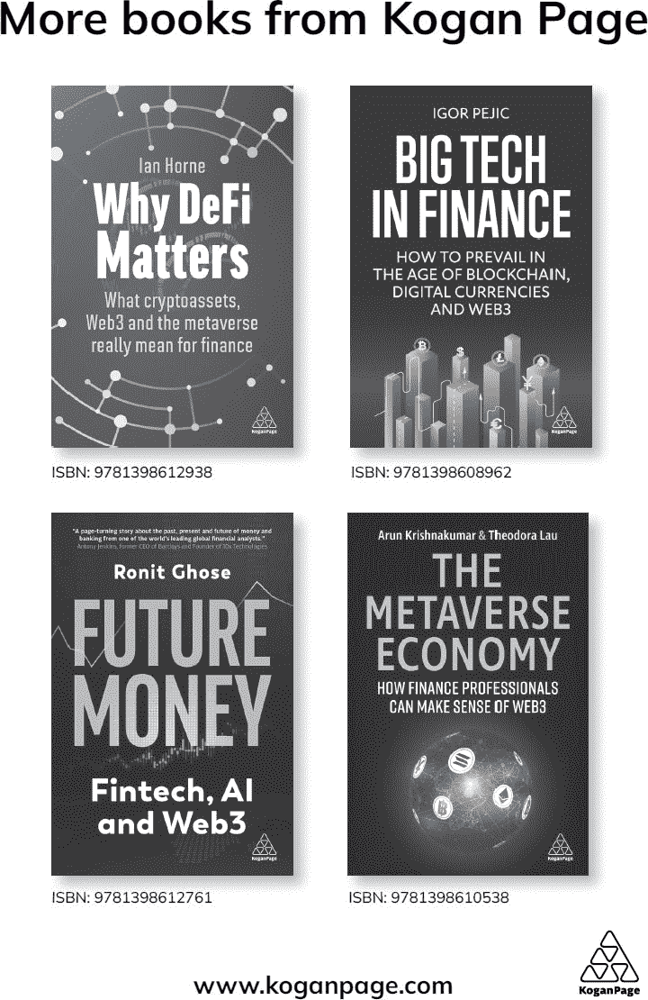

# 金融服务中的 Web3：区块链、数字资产和加密货币如何颠覆传统金融

终于有一本关于区块链如何变革金融服务的书籍了，它既通俗易懂又具有及时性。Rita Martins 对加密货币的演变、技术、用例和术语进行了实用的介绍，使这本书成为那些感知到金融体系变化但不知如何把握这些变化的领导者的必读之。

**Dante Disparte，Circle 首席策略官兼全球政策负责人**

《金融服务中的 Web3》是金融服务业从业人员的必读之。Rita Martins 结合行业专家的见解和真实的应用案例，对区块链在金融领域中的作用提供了一个通俗易懂、全面、完善且平衡的介绍。本书精彩地阐述了 Web3 在塑造金融服务中的地位。

**Sendi Young，支付协会顾问委员会成员，曾任 Ripple 欧洲区总裁及英国董事会董事**

金融业长期以来面临新兴技术的冲击，但如今的创新带来了前所未有的挑战与机遇。Rita Martins 专家地简化了复杂的概念，对于任何想要拥抱去中心化技术并在数字时代取得成功的人来说，这都是一本必读之物。

**Steve Suarez，HorizonX 首席执行官，曾任汇丰全球创新负责人**

Web3 已成为金融领域不可或缺的一部分。Rita Martins 的《金融服务中的 Web3》对未来的机遇和挑战提供了全面的概述。对于任何想要赋能自己改变未来世界的人来说，这本书都能读。

**Laurent Marochini，法兴证券服务创新负责人**

《金融服务中的 Web3》巧妙地剖析了传统金融与 Web3 技术下的 DeFi 创新领域之间不断演变的协同作用。书中将数字身份作为安全且便捷的金融交易的基石，对这两个世界如何不仅共存而且日益交织提供了前瞻视角，呈现了一个更具包容性和韧性的未来愿景。这是一份引导传统金融系统与 DeFi 及 Web3 的变革潜力相结合的路线图，标志着金融创新与合作的新时代。对于新兴领导者和战略思考者来说不可不可。

**Nitin Gaur，道富银行数字资产与技术设计全球负责人**

Rita Martins 利用其在金融服务领域的丰富经验，对区块链技术推动的进展生成了非常通俗易懂且全面的介绍。她对行业关键人物的访谈深入分析了该行业从何处来，将去往何处。

**Keith Bear，剑桥替代性金融中心研究员**

《金融服务中的 Web3》是寻求理解加密货币和区块链变革性格局的金融专业人士的重要指南。富有洞察力的现实案例使关键概念不再神秘，并将讨论推向实际应用，揭示了区块链的真实潜力。

**Jess Houlgrave，WalletConnect 首席执行官**

1. 关于作者

### 6. 尾注

### 9. 尾注

### 8. 尾注

### 7. 尾注

### 7. 尾注

## 致谢
## 索引

Rita Martins 是一位资深战略领导者，在金融服务、金融科技和 `Web3` 领域拥有卓越成就。她担任了多家处于金融与 `DeFi`、`blockchain`、数字资产及加密货币交叉领域的初创企业的顾问委员会成员。

此前，Rita 曾 `HSBC` 全球金融科技合作伙伴负责人，她在孵化和加速颠覆性技术方面发挥了关键作用，在金融科技领域取得了显著进展。她深厚的背景还包括在安永 (`Accenture`) 和 永道 (`Ernst & Young`) 担任战略和数字化转型职务，并在那里领导了多个大型数字化转型项目。

对互联网的早期反应是兴奋与怀疑的交织。许多人并未完全理解它的潜力，将其视为一种主要供学者和研究人员使用的小众工具。另一些人担心它对社会产生的影响，例如始终在线文化的愿景，导致一些人宣布他们永远不会使用它。然而，与最初的信念相反，互联网已经深刻地改变了社会，远超一个小众领域。它释放了前所未有的新业务，从根本上重塑了全球行业。

在互联网的推动下，`Amazon` 等电子商务平台的崛起彻底改变了零售业，让客户能够舒适地在家购物，提供更丰富的产品和更低的价格，迫使实体店要么关门要么转向线上。`Netflix` 和 `Spotify` 等公司彻底了用户消费媒体的方式。`Netflix` 将范式从有线电视和 DVD 租赁转向了流媒体服务，而 `Spotify` 将音乐从 CD 和下载转变为流媒体。`Facebook`、`Twitter` 和 `LinkedIn` 等社交媒体平台改变了人们连接和交流的方式，破坏了传统的媒体、营销和全球通信。

这些故事不仅关乎行业的转型，还关乎适应不断变化的消费者偏好和技术进步的能力。无法适应和利用新技术的传统参与者面临着严峻的财务挑战和潜在的破产。许多人最初忽视了新创新模型或产品的想法，然后试图阻止它们，最后开始采用它们。据报道，`Blockbuster` 的高管曾对 2000 年以 5000 万购买 `Netflix` 的想法嗤之以鼻。现在 `Netflix` 的价值超过 1500 亿美元，而 `Blockbuster` 已不再是运营业务。^(1) 最近，传统的出租车司机起初对 `Uber` 公司不屑一顾，后来在电视上看到他们使用武力阻止 `Uber` 司机移动车辆。目前，`Uber` 正在招揽传统出租车加入平台。

现在，我们正处于由于 `Web3` 带来的全球动荡的新交汇点。互联网的这一新迭代——在 `blockchain` 之上构建新的去中心化服务解决方案——具有颠覆多个行业的潜力。游戏、娱乐、零售、社交媒体、物流和金融服务只是其中的例子。

当我们把目光转向金融领域时，很明显，`blockchain` 被定位为技术变革的下一个前沿。`Web3` 强调去中心化解决方案，承诺重新定义并民主化金融服务，就像 `Spotify` 和 `Netflix` 民主化音乐和娱乐获取一样。事实上，`Web3` 已经在履行其承诺，在金融服务中有许多实际用例。虽然最初一些传统机构抛弃了这种新的技术创新，但现在许多机构正在接受其益处，甚至领先创建了有利于其业务和客户需求的新解决方案。

## Web3 创新：从怀疑到接受

让我们回到 2017 年，当时 `Bitcoin` 主导了新闻，其特点是价格急剧上涨，随后引发了臭名昭著的崩盘。当时，`Web3` 与传统金融服务之间存在一道墙。两个世界的运作都没有得到太多的认可或交集。

传统金融机构对 `Bitcoin` 特别怀疑。`J.P. Morgan` 执行官 `Jamie Dimon` 曾著名的称 `Bitcoin` 为“骗局”，^(2)，而 `BlackRock` 的执行官 `Larry Fink` 则称之为“洗钱指数”。^(3) 当时，许多其他主要领导者也持怀疑态度，加密货币被视为一种充满风险和不确定性的投机资产。

但随着时间的推移和技术的成熟，金融领域内的认知也发生了变化。金融机构和领导者开始探索并考虑底层技术（`blockchain`）在提高交易效率、降低成本和增强安全性方面的潜力。两个世界之间的墙开始崩塌。

金融机构开始通过内部研发、孵化器或加入行业联盟来研究这一领域。2015 年，超过 25 家银行与由 `R3` 初创公司领导的 `blockchain` 联盟合作，以了解如何将 `blockchain` 技术应用于企业用例。合作伙伴名单包括一些大名字，如 `Goldman Sachs` 和 `Santander`，它们都已经在 `blockchain` 领域进行了一些投资；`Goldman Sachs` 投资了 `Circle`，`Santander` 投资了 `Ripple`。^(4)

在几年的内部研究和学习后，企业解决方案开始从传统机构涌现。2019 年，`Fidelity` 宣布推出其 `Bitcoin` 加密托管服务，`J.P. Morgan` 推出了 `JPM Coin`——一种基于 `blockchain` 的银行账户。2021 年到 2023 年充满了大型巨头首创的新倡议和发布，涵盖了托管、支付、代币化和交易所基金（ETFs）申请。目前，`Fidelity`、`J.P. Morgan`、`HSBC`、`Morgan Stanley`、`Citi`、`Barclays` 和 `Goldman Sachs` 等所有主要参与者现在都有数字资产、`blockchain` 技术和数字身份应用的专门团队。

金融科技公司也拥抱了这项新技术。`Revolut` 和 `Robinhood` 分别在 2017 年和 2018 年开始提供加密交易。2022 年，两家公司都与 `Polygon` 区块链协议合作，进一步探索 `Web3` 服务。`PayPal` 在 2021 年开始为商户提供加密结算，并于 2023 年宣布推出其稳定币。^(5)

也许传统世界发生转变最明显的标志是全球央行日益增长的兴趣。2023 年，有 130 个国家正在探索央行数字货币（`CBDCs`）。^(6)

在“新世界”中，`Web3` 原生公司多年来继续构建和创造新的解决方案。一个全新的去中心化金融世界出现了，吸引了许多精通技术的的用户和传统金融机构专业人士的关注。2021 年，`Mary Lader` 离开了她在 `BlackRock` 的董事总经理职位加入了 `Uniswap`，表示她无法错过这一对金融未来至关重要的创新浪机会。^(7) 新兴的 `Web3` 生态系统现在拥有数千家公司，投资者在 2015 年到 2022 年间向其投入了约 940 亿美元。^^(8)

虽然 `Web3` 的历史也充满了诈骗和风险，但目前的观点是 `Web3` 潜力巨大，并能为金融服务的所有参与者带来更多利益。2023 年，`BlackRock` 的执行官 `Larry Fink` 出现在 `CNBC`，表示加密货币相对于其他资产类别具有差异化价值，“但更重要的是，由于它是国际化的，它将超越任何单一货币和货币估值”。^(9) 这与他在 2018 年的言论形成了对比。

在曾在全球最大的银行和咨询公司工作过之后，我一直处于创新与金融服务的交汇点。这种独特的地位让我多年来不断发现新技术的力量，以及它们如何从根本上改变不仅是流程，还有整个业务模式。

我的 `Web3` 之旅从基础设施开始。一项名为 `blockchain` 的突破性技术立即引起了我的关注，因为它在变革金融方面具有巨大的潜力。`Blockchain` 是一种共享数据库，所有实体都可以立即访问交易信息和状态，它可以极大地减少（甚至消除）对对账和报告的需求。这种透明度有望大幅减少传统金融中常见的耗时耗力的人工操作任务需求。

在随后的几年里，我的兴趣引导我在专业领域倡导并推动了该领域的实验，并在个人层面进行了更深入的研究。尽管我略微接触了这一世界的投资领域，但真正激发我兴趣的是 `Web3`。对于大多数人来说，`Web3` 仍然是一个陌生的词，但专家已经用它来描述一种建立在 `blockchain`之上、以开放和去中心化为中心的互联网新愿景。这一愿景将对所有行业产生连锁效应。

在金融服务中实施 `Web3` 意味着有机会创建一个建立在 `blockchain` 之上而非旧系统上的新型金融系统，除了法币外，还有新形式的货币。这种 `Web3` 愿景描述的是革命性的，而不是我之前工作过的许多技术那样的渐进式。

在 `Web3` 中，我们有机会重新思考货币、所有权和金融系统的概念。我们不再是在现有系统中渐进式地添加新功能，或将流程部分自动化。我们正在创造新的业务模式、服务和产品。这可能是金融服务最具变革性的时代之一，我希望在回首时说我曾是的一员。

在与 `Web3` 创始人和初创公司进行了多年的参与、构建和测试后，我相信这一领域存在变革和改进金融服务的真实机会和潜力。虽然最初 `Web3` 和传统金融被构建为两个独立的世界，但我们现在正处于两个世界汇合的转折点。

然而，要创建强大的解决方案，我们需要来自所有背景（包括传统和 `Web3` 原生）以及各种技能（产品、合规、技术）的人才进行协作和工作。

因此，这本书是我邀请你与我一起开启 `Web3` 之旅的邀请函，这是一个正在改变我们思考金融方式的生态系统和愿景。这本书将揭开这些术语的神秘纱，解释新兴的用例及其对金融从业者的深远影响。它还将向你介绍已经在推动变革的先锋公司，深入观察他们的创新以及采用 `blockchain` 技术和 `Web3` 概念的实际意义。读完此书，你不仅将掌握 `Web3` 的基础知识，还将对 `Web3` 为金融服务行业带来的变革潜力获得独特见，使你能够积极参与并塑造这一令人兴奋的新愿景。

你可能可能于于再忽略几年 `Web3`，并专注于你的其他优先事项。但现实是“魔鬼已经破瓶而出”，`Web3` 不会再回头，也不会被停止。它的去中心化、全球化和开源特性允许任何人——从个人创新者到全球各地的大型企业——构建并发布解决方案。因此，即使特定国家试图阻止它或将其视为非法，`Web3` 的国际化和互联性也意味着它的开发和使用可能会在其他地区继续。事实上，全球的许多初创公司正在不断发布新的解决方案。

## 为什么是现在？

当我们站在新范式的边缘时，`Web3` 的重要性不言而喻。2023 年，一家风险投资公司的报告发现，尽管消息面阴云，但 `Web3` 的活跃账户社区不断增长，达到了 1500 万（比去年翻了一倍）。此外，还创建了 700 多个新应用程序，比往年增加了 60%。

过去几年也标志着传统机构和监管机构感知与该技术互动方式的转折。许多传统机构现在正投资 `Web3` 初创公司并采用 `blockchain` 技术。例如，`PayPal` 和 `Société Générale` 最近宣布宣布了各自的稳定币，分别为 `PayPal USD` 和 `EUR Coin`。一些中央银行继续对各自的 `CBDCs` 进行讨论和审查。欧盟通过了《加密资产市场法规》（`MiCA`）。

传统公司中的专家在私下和公开场合均指出，他们已经完成了对该技术的试点和测试。经过多年的实验，他们现在对这些益处很放心，并希望转而专注于推出可的解决方案。因此，问题不是你为什么应该学习 `Web3`，而是你再也负担不起不学习的了。

这是一个前所未有的动荡时代，金融服务领域的每个人都必须意识到这种变化。这本书将为寻求加深对 `Web3` 理解的金融服务组织提供手册。

## 专家见解

在整书中，你将看到来自在 `Web3` 与金融交汇点工作的领导者的见解。这些专家慷慨地花了一些时间与我分享了他们整个旅程中的故事、实验和学习体会。在我设计和编写这本书时，确保我代表了一系列不同的声音和经验对我来说是关键的。我们每个人都有偏见，在这样一个复杂的新技术和概念中，仍有许多内容正在构建和定义中，因此与社区倾听、学习和分享至关重要。我希望你像我一样喜欢他们的见解。

## 籍的结构

我想邀请你根据你现有的知识以及你希望从书中获得什么来阅读这本书。如果你是想要学习这一领域的新手，请从开始，并按照大纲的顺序阅读章节。如果你已经理解某些概念并想弥补知识空白，我建议你跳到对你最有帮助的章节。将它作为你的指南，并根据你的需要随时翻阅章节。

本书将为你提供关于 Web3 及其对金融服务潜在影响的所有所需知识。

*   第一部分将涵盖 Web3 的历史背景、其定义以及对金融服务的颠覆潜力。它回顾了互联网的演变、Web3 愿景中的核心原则，以及它如何成为金融服务领域最大的颠覆力量之一。
*   第二部分将涵盖一些驱动金融服务变革的新兴用例：托管、货币与支付的演变、代币化、借贷以及数字身份。在这一部分，我们将调查现有从业者和挑战者是如何测试并采用 Web3 概念及新兴技术的。
*   第三部分将考虑对生态系统的影响，探讨对传统机构、去中心化金融（DeFi）、投资者和监管机构带来的机遇、挑战和影响。
*   第四部分将作为结尾，回顾实现主流化应用所需的变革，以及未来金融业的图景。

创新和数字化转型在金融服务中并不新鲜。多年来，利益相关者一直不断适应并采用新的技术和解决方案。但直到现在，这种转型大多是渐进的。相比之下，Web3 代表了一种更根本性的转变，具有从核心上颠覆金融服务的潜力。

尽管这项新兴技术及其应用仍存在风险，但全球范围内每分钟都有新的应用程序不断发布。这些技术将从多大程度上影响行业仍有待观察。然而，其采用率正在增长，引发了从业者、监管机构和投资者的日益兴趣。

现在，比以往任何时候都重要的是，领导者团队理解这项新兴技术的核心特征、用例、风险和机遇。我相信，那些现在不开启这段旅程的人将在未来几年内被淘汰。

互联网的发明彻底改变了我们的社会、人与人之间的互动以及生活方式。2023 年，超过 50 亿用户（约全球人口的 64%）使用互联网获取最新新闻、购买杂货或与在国外的家人通话。^(3) 我们现在正处于另一个转折点，互联网的下一次迭代可能会颠出现有的业务模式和假设。这次迭代将对金融服务产生直接影响。

虽然金融服务曾被数字技术和新参与者颠覆，但那种颠覆主要是是现有系统的数字化，以及新界面和用户体验的创造。Web3 的愿景旨在颠覆金融服务的核心，从新的金融轨道、新的货币形式到现实世界资产的新表现形式。

## 不仅仅是加密

我希望你从书中获得的一个关键区别是：Web3 不仅仅是加密货币。在与传统机构的领导者交流时，通常存在一种固有假设，认为 Web3 就是加密货币或 `Bitcoin`。许多人因为他们工作的金融机构有“不触碰加密货币”的规定而退出讨论。尽管 Web3 是建立在 `Bitcoin` 的基础之上的，并在新闻中经常与其同义化，但它已演变成一种超越加密货币的更广泛的愿景，涵盖了区块链、应用程序、用例、治理模型以及利用区块链技术的实体的生态系统。

## 揭秘 Web3

由于其广泛性，Web3 有时显得令人费解或晦涩。我倾向于将 Web3 视为这种由区块链技术驱动的新型在线去中心化生态系统的统术语。

为了理解全貌，我们需要考虑构成这一愿景的不同区块。目前，我们将关注两个关键构建区块：原则和基础构建块。在整本书中，我们将通过真实的用例和示例进一步讨论这些区块，并添加与讨论相关的新概念。现在，我只想让你对基础有所了解。

### Web3 原则

### 去中心化 (DECENTRALIZATION)

在 Web3 中，服务和产品不受中心实体（如银行、政府或公司）控制。相反，Web3 依赖于去中心化的网络和协议。一个著名的例子是 `Bitcoin`，它利用区块链技术创建一个去中心化且透明的交易账本。用户可以进行点对点支付，而不需要银行或支付提供商等中介。

如果这种去中心化的愿景被采用，可能意味着现有公司和机构的去中介化。在这种情况下，如果不再需要中介来提供服务、控制和治理，他们的新角色将是什么？这对他们现有的业务模式意味着什么？

但在实践中，去中心化并不是一个非即即白的选择，需要在从技术、经济和治理的光谱上考虑其采用情况。在示例中，`Bitcoin` 代表了高程度的技术去中心化。区块链技术允许建立去中心化网络，交易由分布式社区（称为 `miners`）进行处理和验证，而不是像银行这样的中央机构。然而，其他考虑因素，例如权力集中在少数人手中（例如 `miners`）以及治理方面（如核心开发人员的影响），可能会为系统引入不同程度的中心化。

在整本书中，我们将讨论不同的组件、用例和协议，并反思不同的去中心化水平。然而，我们应该注意，项目在整个生命周期内也可以在去中心化光谱上不断演变。例如，许多项目从中心化治理开始，由少数位创始人和开发者团队构建项目并做出关键决策，并在此后可能演变为去中心化的治理结构。

### 所有权 (OWNERSHIP)

在 Web3 中，所有权意味着用户控制自己的资产，以及他们在互联网上创建或购买的数据和内容。Web3 引入了一种名为数字资产的新概念（也称为代币），它可以代表货币、艺术、数据、房地产等许多资产的所有权。例如，`NFTs` 在其元数据中包含了所有权证明，详细说明了现有所有权及其历史。这是确保数字经济中 `NFTs` 完整性、真实性和价值的基本方面。

社区在 Web3 中至关重要，协议利用代币作为媒介，确保构建者、运营者和用户拥有他们使用、构建和运营的内容。从本质上说，这些贡献者拥有代表去中心化网络所有权的代币。这种所有权起到激励作用并将社区联系在一起。例如，在 `Bitcoin` 中，作为更新账本和保持其他参与者诚实的回，`miners` 获得了 `BTC` 奖励。其他模型包括为服务获得代币，例如为交易提供流动性。有时，同一个代币还可以参与网络治理，既作为实用型代币又作为治理代币。

### 身份 (IDENTITY)

在 Web3 中，用户对自己的数据拥有完全的控制权和所有权，这些身份以及资金、资产等。通过对身份进行自我管理，个人可以提供、撤销或修改对其数据和数字身份的访问权限。在不共享完整身份资料的情况下即可证明身份的某些方面。想象一下，用户可以证明自己已满 18 岁，而无需披露出生日期；或者银行查询交易数据而无需看到用户的出生地。链上数据（例如交易或交互）和链下数据（例如身份证或驾照）都可以添加到个人的身份中，这为个人提供了更完整的画像并支持了金融包容。例如，缺乏实体身份证明的个人可以使用链上数据开设银行账户或作为贷款的押品。

## Web3 基础基石

### 技术
区块链是 Web3 生态系统的底层技术，它是一种去中心化的分布式账本，将数据存储在多台计算机上。区块链中的区块代表数据，随着新数据被验证并添加到网络，就会创建一个新区块并永久地添加到链中。区块链中的每个节点都拥有账本的实时更新副本，简单来说，它提供了透明度并消除了对对账的需求。

### 协议/合约
智能合约是在区块链上自动且自主地运行的计算机程序。简单来说，它们是包含一组规则和条件的数字合同（类似于“如果-那么”的规则）。例如，智能合约可以被编程为每月 15 号发放款项。由于操作是自主执行的，它们消除了对中介或人力资源的需求，从而显著降低了成本。

### 价值表征
区块链上的数字资产代表了广泛的资产类别，它们既可以作为价值存储手段，也可以作为交换媒介（类似于货币），并在区块链网络上进行记录和管理。数字资产包括加密货币、CBDC（由中央银行发行）、稳定币、NFT 和代币化资产。

我们将在本书的后续部分深入探讨数字资产，并提供许多真实的用例和示例。正如你所看到的，数字资产是一项重大创新，代表了金融的新型数字化，提供了更好的流动性、透明度，降低了交易成本并提升了效率。与任何新创新一样，挑战也存在，例如监管的不确定性和安全疑虑，目前金融世界中的许多利益相关者正在解决并考虑这些问题。

### 用户界面
钱包是用户的入口。用户可以通过钱包访问存储在区块链上的数据和资产。钱包分为非托管型和托管型。在非托管钱包中，用户对数据和资金拥有完全控制权。相比之下，托管钱包由第三方管理和确保安全，第三方对用户的资金和数据拥有控制权，提供了便利，但用户的直接控制权较少。托管将在第 3 章 中详细讨论。

## 金融服务的数字化转型
正如历史所所示，金融服务行业在不断演变，从采用新技术到适应社会变化和客户预期。有远见的的领导者迅速拥抱数字化转型，意识到其对业务模式和策略的深远影响。多年来，大型数字化项目一直在进行，利用了自动化和工作流工具等新技术。由金融科技、数字银行和大型科技公司驱动的新创新主要侧重于提供接入遗留金融系统的新用户界面。然而，现实是，传统的金融服务生态系统仍然深陷于许多遗留技术问题和中介复杂性之中。这正是 Web3 的用场，它代表了一种根本性的转变，旨在解决这些根深蒂固的挑战和低效率问题。

## Web3 对金融服务的影响
互联网从 Web1 到 Web2 的演变使得在线银行和数字银行等新银行模式得以创新和采用。然而，资金和金融轨道仍然与互联网分离，延续了遗留的挑战和复杂性。通过 Web3，我们有机会利用互联网原生轨道（区块链）进行金融服务，并在其上嵌入资金和价值转移。正如 Web3 原生初创公司 Circle 所言，Web3 的目标是“[将资金嵌入]到互联网中”。^(11)

Web3 将通过取代现有的金融轨道，从根本上改变金融服务，实现货币的新形式和现实资产的新表征。

### 新型金融轨道
从历史上看，金融账本是中心化的，银行等机构充当信赖的中介，负责确保金融数据的完整性和控制。尽管在现代化和改进传统银行基础设施方面投入了大量努力和资金，它仍然面临运营成本、风险和效率问题。特别是国际流程，可能非常缓慢且昂贵，往往受到不同地区和参与者之间碎片化系统和流程的阻碍。

Web3 为传统的金融基础设施引入了革命性的替代方案。在 Web3 中，处理、存储、计算、验证和认证金融数据的功能都在区块链（一种去中心化的数字账本）上完成。这种去中心化意味着可能不再需要中心化实体。例如，客户可以向全球的朋友和家人汇款，速度快且交易费用更低。虽然起初客户大多只能发送加密货币，但现在新形式的货币已成为支付组合的一部分。

同样，消费者不再受限于从银行获得贷款的漫长审批流程。相反，他们可以从去中心化金融（DeFi）协议获得贷款。因为智能合约管理着贷款的所有方面（从利息、还款到清算等），因此不需要中介。

### 新的数字货币形式
与互联网的其他迭代版本相比，Web3 引入了思考货币的新方式。虽然货币和我们使用货币的方式随时间推而演变（例如从现金到移动货币），但这种演变始终围绕现有的中心化银行基础设施展开。Web3 将货币未来的讨论推向了一个新的方向。

正如我们之前讨论的，比特币在 2018 年的推出建立了一种货币形式：一种不受银行和政府管辖的、基于区块链的去中心化货币。在过去的几年里，出现了其他去中心化的加密货币，用于投资或在这一新数字世界中卖商品和服务。然而，这些加密货币极端的波动限制了它们的实际应用。这导致了稳定币的出现——一种价值挂钩于另一种资产类别（如法币或黄金）的加密货币。最近，全球范围内的中央银行也开始探索自己的稳定数字货币（CBDC），许多现有机构也发布了新的货币形式，如存款代币。

我们将在本书的第 4 章 中深入探讨新的货币形式。

### 现实资产的表征

Web3 通过连接物理世界与数字世界，正在彻底改变金融格局。它通过实现现实世界资产（或资产份额）及其资金流、所有权、权利和历史的数字化表示来实现。这一创新带来了显著益处，包括缩短结算时间、创造市场流动性以及提高此前非流动性资产的透明度。想象这样一个世界：从房地产到艺术品，任何资产都可以 24/7 在任何地方进行交易，使投资民主化，并为金融服务等领域解锁新的收入来源和业务模式。我们将在本书的第五章中进一步讨论代币化。

网页的下一次迭代（Web3）具有成为金融服务领域最重大变革之一的潜力，能够提高速度、降低成本、简化行业并解锁新的产品和服务。Web3 对去中心化的强调代表了金融包容性的重大机会，可能将金融服务带到此前服务不足的社区。这种颠覆可能导致传统角色和业务模式的去中介化。

## Web3 中的金融服务参与者

随着 Web3 带来的颠覆和新机会，一系列多样化的新型金融服务参与者正在出现，他们拥抱新的创新、概念和模型，并扩展了 Web3 金融服务的公司版图。

### DeFi 的出现

DeFi，或去中心化金融，代表了一个去中心化应用程序生态系统，提供金融产品和服务（包括储蓄、贷款、交易、保险等）。在 DeFi 中，没有中央实体提供金融服务，相反，DeFi 利用区块链和智能合约等 Web3 技术提供金融接入。如果被广泛采用，DeFi 可能会消除传统金融（TradFi），对现有的业务模式和策略产生重大影响。

DeFi 拥抱开放互联网的核心价值，允许任何拥有智能手机和互联网连接的人接入，并赋予用户控制权所有权，这通常被认为是降低门槛、减少成本并赋能服务不足的社区。

虽然 DeFi 的潜力巨大，但正如我们在书中将看到的，这仍然是一个年轻行业，试图在治理、控制和去中心化之间寻找平衡。此外，DeFi 应用的学习曲线陡峭，复杂的用户体验限制了其采用。为了填补这一空白，CeFi 通过为客户提供更简单、更熟悉的入口而兴起。

### CeFi 的兴起

CeFi，或中心化金融，代表了在区块链上提供金融服务的新平台，类似于 DeFi 提供的。然而，与 DeFi 相比，CeFi 平台往往具有较高程度的中心化，并且更密切地遵守监管要求。CeFi 平台通常有中央实体负责决策、运行和治理平台，类似于传统公司。CeFi 是传统模式与新 Web3 概念及技术之间的混合体。

### TradFi 的采用

TradFi 是代表传统金融的术语。现有的主流金融系统参与者，如银行、投资银行和金融科技公司，都被包含在 TradFi 术中。正如之前提到的，TradFi 中的大多数参与者多年来一直采用技术来使提供给客户的服务和产品数字化、简化并改进。这些服务和产品仍然以中心化的方式提供，并且它们必须遵守现有的监管要求，这可能会限制他们可以承担的风险和创新。

传统金融参与者与 Web3 的关系发生了巨大变化，越来越多的公司开始测试和采用来自 Web3 的业务模式和概念。许多领先公司正在与中央银行、监管机构其他机构以及 Web3 原生企业进行实验，以探索这项技术并更好地理解风险和收益。鉴于他们的风险偏好通常高于典型的零售客户，大多数实验和产品侧重于机构投资者以及富裕和高净值（HNW）客户。此外，投资者对将加密货币和数字资产纳入投资组合表现出越来越兴趣。

目前，监管框架仍处于早期，Web3 在金融服务中的广泛采用还需要当地的成熟和全球合作。然而，随着我们继续看到全球范围内更多的监管清晰，我们预计更多传统参与者将加入初创公司和企业，利用新兴的技术和概念。

在整书中，你将看到由所有这些参与者驱动的实验和解决方案。在第二部分中，我们将深入研究每个参与者，并考虑他们每一个面临的机遇和挑战。

## Web3 的批评

在我们进入 Web3 这个新世界之前，了解一些提出的批评和担忧是重要的。虽然 Web3 的精神旨在民主化和赋能社区，但许多人认为它并没有实现其承诺。Web3 是否正在建立更公平、更民主的经济？

许多讨论会迅速变得激烈，双方的支持者使用几种常见的论点来支持自己的立场。行业中的一些领导者说，这些论点之所以升级迅速，是因为涉及到金钱。虽然这可能是原因之一——毕竟，金钱总是会导致争议性的辩论——但我认为这些辩论远不止金钱和技术。Web3 的一个大组成是对现有政治规范和社会信念的质疑。例如，Web3 的支持者设想了一个未来，即去中心化的加密货币将取代或与传统法币竞争，挑战了将中央银行建立为发行和监管货币唯一权威的政治和社会规范。同样，Web3 挑战了公司和政府应该能够广泛访问个人信息的社会信念。Web3 甚至通过引入去中心化治理模型挑战了传统的政治结构和公司层级。如此大的话题引发激烈辩论也并不稀奇。

现在，让我们考虑一些批评。

### 批评 1：Web3 项目并非真正去中心化

正如我们在书中将看到的，事实是，目前 Web3 并不像最初想象的那样完全去中心化。相反，Web3 的不同组件具有不同程度的去中心化。然而，完全去中心化是全球范围内真正想要的吗？

完全去中心化意味着，例如，用户必须运行自己的服务器，或者自己保护资金和资产，而不是使用银行这样的中介，这并不是每个人都想要或能做到的。许多专家认为，我们需要从去中心化的讨论中出来。相反，行业正在为不同的用户提供一系列选择和方案。一些人会想要并采用更去中心化的解决方案，而另一些人将对中介的支持感到满意。

正如我们在第 10 章中将看到的，目前，某些 Web3 项目确实由少数群体控制。这个群体主要由加密原生用户、精通技术的用户以及投资者组成。当代币进行初始分发时，较早参与的人受益最深。这通常包括项目创始人、核心开发团队、提供初始资金的风险投资机构或个人，以及社区的早期成员。这种分发模式会导致财富和影响力集中在少数个人手中，这往往与去中心化的理念相背道而驰。

这种状况凸显了实施某些基础愿景的复杂性。该领域很大程度上仍在试图于初始愿景与实施过程中的复杂性之间找到正确的平衡。例如，去中心化自治组织（DAO）的设计旨在为社区提供完全的所有权的话语权，事实证明这是一项复杂的工程。虽然 DAO 使治理民主化，但在实践中，让大量人员共同决策往往是缓慢且琐的。此外，社区中的许多用户实际上对决策过程感兴趣，甚至不具备参与的能力；这凸显了普遍参与的理想与社区参与度及治理效率现实之间的差距。

好消息是，该行业拥有来自各行各业的众多专家，他们正试图解决这些复杂问题并进一步开发解决方案。由于技术是开源的，任何地方任何人都可以成为解决方案的一部分，推动更快的创新。

### 批评 3：行业充斥着诈骗和坏人，没有任何收益或真实价值；解决方案只是在试图寻找一个可以解决的问题

虽然该行业饱受诈骗和欺诈丑闻的困扰，但这项技术已经在交付真实的价值。

在本书中，我们将看到 Web3 的各种真实世界应用。显著的例子包括在新兴市场中使用加密货币和稳定币，它们既作为价值存储手段又作为交换媒介；在复杂的政治和经济环境中提供救生艇。例如，农民工利用区块链轨道以更快、更廉价的方式向家乡汇款；或者创始人利用去中心化应用程序获取用于建立和扩大业务的资金。

Web3 的颠覆性潜力凸显了对其对社会、治理和金融未来影响进行深思熟虑的必要。当我们探索这一新兴技术在金融服务中的应用时，我们需要对现有的局限性和挑战保持批判和开放的心态。

# 未来展望

虽然 Web3 可以追溯到比特币时代，但它已经演变成由新参与者和解决方案组成的生态系统，这些元素将构成互联网的新阶段。Web3 仍处于早期，但它已经通过运行中的案例和解决方案留下了足印，并进入了许多行业，包括社交媒体、游戏、艺术和创作者经济以及金融服务。与网页的其他阶段相比，Web3 将金融系统和货币嵌入了互联网。对于一个运行了数十年的传统金融基础设施的行业来说，这是一个巨大的变化，在过去，这种转型大多发生在用户界面和体验层面。Web3 有潜力从根本上改变金融服务的运作方式以及我们对金的思考。

Web3 也将为现有者带来利益。贝恩公司（Bain & Company）的研究表明，“通过实现直通处理、减少重复工作和消除人工对账，Web3 可以将提供银服务的运营成本降低 15% 到 25%。”^(12) 除了让现有流程变得更快、更廉价、更简单之外，正如我们在本书中所看到的，Web3 有潜力通过技术进步解锁以前无法实现的新收入流和业务模式。但对于现有者要利用这些利益，他们必须重新思考自己的产品、服务和流程。许多已经已经通过与银行、监管机构和其他 Web3 原生公司进行实验开始这样做。

Web3 还有向金融服务不足的社会开放服务的潜力——这是金融科技社区许多人看重的领域。加密货币和稳定币已被用于价值存储、汇款、作为战争难民的援助以及为在新兴国家创办业务提供资金。

我们离大众采用还得很远，因为技术、声誉和监管风险仍然是传统金融服务行业许多人的心中之忧。在本书中，我们将看看迄今为止的解决方案和实验、不同参与者如何看待这一领域，以及大众采用所需的改进。最终，我相信 Web3 将代表金融服务和产品创建及消费方式的某种转变。

1.  **03** 托管
2.  **04** 货币与支付的演变
3.  **05** 代币化
4.  **06** 贷款与借贷
5.  **07** 数字身份

在比特币的早期，存储数字资产最安全的方法是以自托管的形式，通常通过纸钱包实现，投资者会在纸上写下私钥。然而，像 Stefan 和 James 的真实经历揭示了自托管的固有风险，许多投资者要么丢失了密钥，要么沦为盗窃的受害者。

时光流几几年；中心化交易所出现作为买卖数字资产的便捷方式。这些交易所作为其平台的一部分提供托管服务。然而，日益增的黑客事件和安全泄露引发了人们对所持资产安全的担忧。一个臭名昭著的例子是 2014 年著名的 MT. Gox 交易所黑客攻击。当时，MT. Gox 是全球最大的比特币交易所之一，该事件导致客户被盗走了 85 万比特币（`BTC`），现在价值近 230 亿美元。^(3)

随着数字资产继续吸引越来越多的投资和机构关注，对既提供强有力安全又符合监管要求的托管解决方案的需求激增。对这种需求的反应之一是 2017 年 Anchorage Digital 的成立。在与 Anchorage Digital 联合创始人兼总裁 Diogo Mónica 的对话中，他讲述了 Anchorage Digital 的起源及其旨在扮演的角色：

> 我们在 2017 年决定跳入数字资产行业，是因为有一个基金向我们提出了一个独特的安全问题。他们丢失了一个价值 150 万美元的比特币钱包口令，如果我们能找回丢失的资产，我们将获得 20% 的报酬。这对我们来说是一个巨大的警醒——这是一个非常复杂的机构，但他们对加密托管的方法并不先进。

> 看到安全可靠加密托管领域的重大机遇，Nathan 和我于 2017 年创立了 Anchorage Digital。

由于机构客户日益增长的压力，传统的金融机构（包括资产管理公司和银行）近期将其托管服务扩展到了加密货币领域。鉴于他们在传统金融资产托管领域拥有丰富的经验和市场份额，这些老牌参与者进入加密货币托管领域具有重大意义的。目前，他们提供的服务大多数仍仅限于机构客户和少数几种加密货币。然而，随着监管框架变得更加清晰以及技术的进步，我们可以预计涵盖的加密货币数量和数字资产类型将会增加。

## 托管

简单来说，托管是保护资产并对其进行管理的过程。

这个概念并不新奇。在早期，个人自己保护资产，这是一种自托管的形式。后来，第三方作为托管人承担了这一角色，被聘请来确保资产的安全与。

## 数字资产托管

在加密货币或 Web3 中，托管也意味着安全地存储资产的过程。然而，我们指的不是传统的金融资产，而是数字资产和加密货币。此外，数字资产托管人在技术上并不存储任何资产，因为所有数据和交易都记录在区块链上。相反，他们保护投资者的私钥，私钥是投资者拥有其钱包内资产的证明。

### Web3 钱包

你可能听过加密货币钱包。然而，与可以持有现金、信用卡、忠诚卡和身份卡的普通钱包不同，加密货币钱包在技术上并不持有加密货币或数字资产。相反，加密货币钱包存储购买、出售或与加密货币交互所需的公钥和私钥，而用户的资金和资产则存在于区块链上。

当用户执行交易时，他们并不是从手机发送加密代币到另一个人的手机。相反，投资者的私钥会对交易进行签名并将其广播到区块链网络。然后网络包含该交易，以反映发送方和接收方地址更新后的余额。简而言之，加密货币钱包旨在安全地存储私钥并与区块链网络交互。

深入探讨之前，让我们先了解这些概念。

在传统银行业，根据法律规定，所有的托管人都是金融机构。而在 Web3 中，无论是个人投资者还是机构投资者，都有机会成为自己的托管人。一个简单的类比是，投资者是将他们的钱和贵重物品安全地放在床底下（自托管），还是将它们储放在第三方保护的保险库中（第三方托管）。

### 自托管钱包

在自托管钱包中，投资者持有自己的私钥，并对资产拥有更高的控制权，因为他们是唯一能够访问资产的人。自托管是基于 Web3 去中心化和完全数据所有权的理念创建的，用户对自己的数据和资产拥有完全控制权，不需要中间服务，这通常被称为“做自己的银行”。

然而，自托管钱包也面临挑战。例如，用户体验（UX）相对复杂，需要一些技术知识。在自托管中，投资者负责保护自己的钱包免受黑客攻击或其他漏洞的影响。请注意，安全活动通常由银行内部的大团队执行，且预算高昂，因此对个人来说是一个巨大的要求。

此外，在自托管中，投资者需要负责保持私钥和助记词（seed phrases）的安全，这看起来可能很简单，但在现实中很难实现。有很多像本章开头提到的 Stefan 和 James 类似的故事，即个人丢失或忘记了密钥。这种错误即使是行业专家也会犯的。

### 第三方托管钱包

第三方托管钱包的出现，为那些不想管理自己账户或认为处理技术太令人畏的用户提供了替代方案。第三方托管人（通常）是受监管的、获得许可的，并且通常遵循传统的了解客户（KYC）、反洗钱（AML）和其他检查。他们代表客户持有私钥的托管，并对投资者密钥和资产的安全负责。第三方托管钱包的用户界面也往往更加友好且更易于使用，为 Web2 原生用户进入 Web3 提供了良好的桥梁。

然而，这种类型的托管也有缺点。投资者必须信任托管人会确保其资产安全并以其最大利益行事。如果托管人破产、被黑客或决定冻结投资者的资产，他们可能会面临失去资产控制权的风险。本章开头讨论了此类风险的一个例子，即将比特币托付给 `MT. Gox` 的投资者在黑客期间丢失了资金。过去几年中，其他黑客攻击和崩溃给投资者带来了类似的痛苦。根据 Chainalysis 的数据，2022 年加密货币投资者向黑客损失了近 40 亿美元。6 每当发生大规模黑客攻击时，我们看到资金从第三方托管钱包转向自托管钱包，投资者试图保护自己的资金。

### 没有你的密钥，就没有你的加密货币

第三方托管被极端主义者（maximalists）认为违背了 Web3 去中心化和数据所有权的原始理念。在 Web3 的愿景中，投资者不需要中心化实体来访问资金，并对其资产拥有完全所有权。由于谁控制私钥谁就拥有资产托管权，老手经常使用“没有你的密钥，就没有你的加密货币”这一格言来表达这种观点。

自托管对于这群极端主义者来说是一个如此关键的功能，以至于 Ledger 在 2023 年宣布“Ledger Recover”引发了行业内的巨大争议。

虽然自托管的极端主义观点可能会吸引那些将自主和控制置于一切之上的人，但重要的是并不是每个人都有技术知识或资源来安全地管理他们的数字资产。因此，应该考虑自托管和第三方托管这两种模型，投资者选择最符合其风险承受和使用场景的一种。

通常，投资者和用户会从第三方托管开始，随着他们对这些概念的了解，转向自托管钱包。有时，投资者可能会同时采用两种模型，将大部分财富放在自托管钱包中，并将较小部分用于第三方托管钱包的日常交易。

## 数字资产托管实战

2023 年，CoinMarketCap 列出了 26,230 种加密货币，7 与 2013 年报告的 7 种加密货币相比呈指数增长。8 随着 Web3 世界的不断扩展，新类型的数字资产将不断涌现，增加它们的总价值以及对安全托管的需求。

## 交易所

交易所钱包是数字托管市场的早期进入者之一，首批交易所于 2010 年左右出现，允许投资者买卖比特币。交易所自早期以来取得了了巨大进步，现在在全球范围内更加成熟，并获得了当地管辖区的许可和监管。许多交易所现在提供第三方钱包之外提供自托管钱包，为 Web2 和 Web3 提供了桥梁。

### 加密原生托管人

加密原生托管机构的出现是为了为机构客户提供加密货币的托管服务。这些许多公司的创始人此前曾工作于金融科技或金融服务领域，他们将数字资产的出现视为一种新的资产类别。虽然他们是从托管作为首个用例开始的，但他们迅速扩展到了 Web3 的其他领域。

## 传统托管机构

近年来，传统金融机构和银行已将其托管服务扩展到加密货币领域。这一市场的扩张得益于客户日益增长的压力，以及美国、欧洲和亚洲监管政策的明确。

## 传统托管机构的机会

目前，传统金融服务正处于数字资产旅程的不同阶段，但许多人通过托管或代币化用例开启旅程。鉴于托管是传统公司的生存之本，且机构投资者对数字资产的兴趣日益增加，传统托管机构加入这一领域有着明确的市场机会。

传统托管机构在提供安全可靠的资产托管的同时遵守相关法规方面拥有丰富的经验。他们提供传统资产托管服务已十年，在新法规出台时，他们完全有能力占据领先地位。

机构客户对传统机构提供的解决方案也表现出了兴趣。许多机构投资者希望增加数字资产配置，如果能够获得一个集成的投资组合解决方案，他们将被推动这样做。Celent 和纽约梅隆的一项调查显示，“72% 的机构投资者希望有一个能够满足所有数字资产需求的集成提供商”。^(11)

然而，提供数字资产托管服务或未来想提供此类服务的传统金融托管机构也面临着学习曲线。例如，行业内缺乏标准，每个协议都选择自己的治理模式、共识机制和智能合约语言。托管机构必须理解这项新技术的不同概念和风险。

### 次托管机构

虽然一些传统金融服务公司内部构建托管服务，但另一些则使用次托管提供商来构建其数字资产托管服务。这些次托管机构拥有数字资产的技术和行业知识，而传统金融服务公司则拥有强大的客户群和监管知识。终端客户（投资者）通过与传统资产相同的界面和体验直接与他们的传统金融机构进行交互。

这种“白标”解决方案在银行和金融科技领域被广泛使用。本质上，金融科技解决方案由银行或金融科技公司进行重新品牌和定制。这允许他们无需从头开始构建解决方案，而是利用市场上现有的解决方案向客户提供新产品。从客户的角度来看，他们看到的和接触的是银行或金融科技公司的品牌。

## 数字资产托管的挑战

托管机构在为数字资产提供安全可靠的托管服务方面面临着诸多挑战。需要考虑的一些关键挑战包括安全性、可访问性和监管要求。

### 安全风险

事实上，许多托管机构对网络攻击和泄露并不陌生。作为回应，托管机构多年来优先考虑风险控制和保险方案，以应对与保护数字资产相关的挑战。某些交易所，即 `Binance`（币安），甚至创建了用于保护投资者资产的应急准备金。虽然这并不是行业标准，但我清楚地看到此类计划在未来变得更加突出，类似于传统金融中为应对传统市场金融危机而设立的补偿计划。

### 可访问性与安全的平衡

鉴于数字资产的新特性以及该行业的快速增长，数字资产托管机构在确保客户资产和钱包安全方面面临着独特的挑战。一个普遍的挑战是在易用性和安全性之间找到正确的平衡。不同投资者的画像会更看重其中之一。例如，频繁交易的投资者会优先考虑能够快速访问资产（可用性）。相比之下，计划长期持有资产的投资者可能将安全性置于一切之上。

为了适应投资者的需求，不同的托管机构将使用各种方法来存储私钥，最常见的类别包括热钱包、冷钱包和温钱包。

某些托管机构将结合存储方法和额外功能以使其更加安全。额外的安全技术已经开发出来并被托管机构采用，包括多签名——一种需要多个私钥来签署交易的功能。这种功能提供了进一步的安全性，因为即使一个几个密钥被破解，交易也不会完成，从而保护了投资者。

### 监管合规

数字资产的监管环境仍在演变，托管机构必须跟上变化的法规以确保合规。随着新形式的数字资产纳入其职责范围，托管机构面临着跟上监管机构分类的挑战。对于具有全球业务的托管机构来说，这是一项复杂的任务：它是证券、商品、货币还是其他？

## 风险管理、控制和职责分离

与 `Celsius` 类似，该领域的其他公司随后表现出缺乏控制和职责分离——这些做法在传统金融中是常见的，并被许多人认为是行业增长和演变的需要。

Diogo Mónica 指出，2022 年的事件（交易所欺诈和破产）如何凸显了托管与交易所功能之间分离的必要性：

> 2022 年的市场事件强调了托管与交易所之间的清晰界限是目前加密领域缺失的关键检查与平衡。分离托管和交易所功能是传统金融市场结构中经过时间检验的标准。这就是为什么你永远不会在纽约交易所托管证券。

> 加密货币平台的垂直整合可能会产生潜在的利益冲突并损害市场稳定。行业在 FTX 倒闭时亲历了这一点，当时数十亿美元的数字资产被困在失败的交易所。

> 作为第三方托管机构，`Anchorage Digital` 正在为安全、可靠和受监管的市场结构铺平道路。借鉴传统金融市场结构的策略将是解锁机构加密采用下一阶段的关键。

`SC Ventures` 执行官 `Alex Manson` 也提出了类似的观点。在最近与 Alex 的讨论中，他描述了数字资产领域的历程，以及在他开始这段历程时还没有机构级的基础设施。在机构客户兴趣增加的推动下，Alex 希望进入该行业，但他注意到现有解决方案缺乏真正的分离、治理和客户资产保护措施，而这些是传统机构中交易所、经纪和贷款业务等关联活动的标准措施：

> 当我们最初开始研究数字资产时，我们曾想通过某种资产类别来测试加密货币交易。但如果你交易加密货币，就必须有一个地方存放它们。当我们环顾四周时，只发现了一些初创公司，这些公司可能资金充足，但缺乏治理结构。它们提供的治理方案是银行或机构投资者无法接受的。

> 托管方面的具体问题在于，它与交易所、钱包和支付服务混合在一起。在受监管的环境中，此类活动是分离的，以降低欺诈风险。托管人与交易所是分开的，你在交易所执行交易，而交易所与结算又是分开的。任务和职责的分离至关重要。尽管那些初创公司资金充足且技术良好，但它们的治理和设置尚未达到机构级水平。

> 在那个关头，我们搁置了交易该资产类的想法（从那以后我们又重新拾起了这一想法），并开始关注基础设施。我们从托管开始——这是数字资产的第一步，也是机构采用的必要条件——并从零构建了 `Zodia Custody`。在 `Zodia Custody` 的基础上，我们构建了 `Zodia Markets`，这是一个同样针对机构市场的经纪和交易平台。

# 未来展望

在传统银行业中，客户已经习惯了无缝体验，他们可以使用手机号码向朋友转账，支付杂货费用，购物，并用手机购买简单的咖啡。银行用户习惯于通过登录验证（用户名和密码的组合）或生物识别验证（指纹或面部识别）进行入驻并访问新服务。如果他们丢失或忘记用户名、密码或两者，他们期望金融机构通过电子邮件、客户支持或提交工单帮助他们重新获得访问权限。如果他们丢失了卡或对特定交易有疑问，银行会迅速取消旧卡、发送新卡，并在调查的同时撤销交易。用户产生了一种新期待，即有人能帮助他们访问、恢复资金并提供 24/7 的支持。

鉴于他们对 Web2 银服务的熟悉，新的零售用户倾向于从使用第三方托管钱包开始旅程。这些钱包提供的用户体验更接近 Web2，且许多用户感到来自第三方的保护。如果出了问题，他们有一个电话可以拨打，或有一个地址可以发送邮件。随着他们变得越来越适应，他们最终会转向自托管钱包对资产的更高控制权，这通常是由黑客攻击或破产事件所引发的。

从机构投资者的角度来看，由于法律法规要求和操作复杂性，他们很少利用自托管钱包。为了响应投资者的需求和期望，第三方托管机构多年来已重要力量。根据 Markets and Markets 的数据，2022 年 1 月加密货币托管市场价值约为 2230 亿美元，高于 2019 年 1 月的 320 亿美元。（15）

最近的攻击和丑闻，例如 2022 年 Celsius 事件和 FTX 崩溃，引起了全球政府和监管机构的关注。虽然正在制定和讨论管理数字资产的新法规（例如在美国注册投资顾问必须使用“合格托管人”），但对于数字资产还没有全球性的定义和分类，也没有统一全球的方法。我们将在后续章节进一步讨论监管的影响。

## 货币的演变

最简单的交换方式是物物交换。在古代社会，人们用物品交易其他物品。公元前 700 年左右，吕底亚引入了由金银混合制成的硬币。这使得系统更加高效。

随着社会的演变，对纸币的需求也随之增长。20 世纪 50 年，信用卡引入，改变了消费者信用购买的方式。随着互联网的普及，在线支付出现，亚马逊和百胜乐基在 1994 年开始在线销售披萨。2001 年，`PayPal` 诞生，提供了在线支付和资金转账服务。

在现代经济中，货币包括中央银行发行的货币（钞票和硬币）以及人们在银行的存款。这包括美元、英镑等法币。对于银行来说，中央银行持有的准备金是货币的另一种形式。（5）

后来，技术创新提高了便利性和获取性，货币以数字形式表示。21 世纪 00 年代的特征是非接触式卡和移动支付的出现。

2009 年，`Bitcoin` 的引入颠覆了货币，作为第一个去中心化数字货币出现——这种货币不受政府或银行发行，不运行在中心化的金融系统上，而是运行在`blockchain`（一种去中心化的支付轨道）上。

## Web3 数字货币

### 比特币正如[第 2 章](#07_chapter02.xhtml#ch02_sec_001）所示，`Bitcoin` 开发背后的主要动力之一是实现点对点支付。2010 年，首次用 `Bitcoin` 购买商品，从那时起，其他品牌和商店开始接受这种支付方式。

在首次用 `Bitcoin` 买两个披萨后，更多的个人和企业开始对 `Bitcoin` 感兴趣。然而，`Bitcoin` 的价格经历了剧烈波动，吸引了全球媒体和金融专的关注。

`Bitcoin` 的波动性和价格不确定性限制了许多人将其用于日常交易。

2014 年，首批稳定币由私人公司和非银行机构推出，旨在为寻求价格稳定的用户和企业提供解决方案。这显得尤为相关，因为像 `Bitcoin` 和 `Ethereum` 等流行加密货币深受价格波动的影响，导致它们作为交易媒介的实用性降低，而更适合作为投资或投机形式。稳定币的设计旨在通过挂钩黄金等实物商品、算法或政府发行的法币来维持其价值稳定。

法币支持型稳定币将区块链的去中心化、透明化优势与法币的稳定性相结合。它们是企业和客户用于零售、服务、跨境支付和汇款业务的理想货币。

另一个转折点出现在 2019 年，当时 `Facebook` 发布了 `Libra`（后更名为 `Diem`）。Facebook 最初将 `Libra` 推介为一种主流加密货币，可以像美元一样进行在线或离线消费。它的目的是让数字资金转账比现在更快、更方便，像 `Facebook` 这样的公司能够围绕其提供金融服务。

尽管加密行业取得了许多进展，但它仍被认为处于主流经济之外。然而，`Facebook` 的规模以及对 `Web2` 用户接触，意味着对传统的政府管理金融体系构成了真实威胁。`Facebook` 的公告迅速引发了警报，尽管公司试图缩小范围，但该项目最终因各种挫折和监管压力而关闭。在此背景下，全球央银行增加了对 `CBDCs` 的兴趣。

## 中央银行数字货币

根据 `Atlantic Council Geoeconomics Center` 的 `CBDC tracker`，2023 年有 130 国家正在探索中央银行数字货币（`CBDC`），占全球 GDP 的 98%，而 2020 年仅为 25 国。

简单来说，`CBDCs` 是由政府支持的法币的数字版本。目前正在探索的 `CBDCs`有两种：零售和批发。设计上的关键区别在于央银行向谁发行货币。`零售 CBDCs` 向大众提供，用于所有商品和服务支付，类似于现金但采用数字形式。`批发 CBDC` 则仅发行给金融机构用于交易和结算。

虽然央银行发行 `CDBC` 的动机各异，但 `BIS`的一项调查指出，金融包容性和货币政策是`零售 CBDCs` 的首要考虑因素之一。该调查还指出，`批发 CBDC` 的工作主要由增强跨境支付的愿望驱动。

尽管全球范围内试点和实验数量不断增加，但只有 11 个国家推出了了自己的 `CDBC`。新货币的推出对于央行在进一步推进之前必须考虑的几个挑战，包括隐私、消费者保护和反洗钱标准。

消费者可能对 `CBDCs` 持怀疑，因为他们可能认为这意味着央行的监管。对于考虑推出 `零售 CBDCs` 的央行来说，教育用户其益处并证明其隐私将得到保护至关重要。市场上已有许多新的加密和其他技术，可以在确保个人隐私的同时，仍保持足够的监管以防止欺诈。

## 代币化存款

代币（Tokens）有时被称为银行为维持传统二层体系而做出的回应。它们是金融机构存款的数字表示，被转换为易于传输和访问的区块链代币，通常用于在银行客户之间进行资金转移。

`Bitcoin`、`stablecoins`、`CBDCs` 和 `tokens` 是这一新兴行业中出现的新货币形式示例。每种货币都有其风险和收益，目前很难知道哪种将占主导地位。很大可能，它们将共同并存，就像我们今天拥有有不同形式的货币（央行钞票和商业银行存款）。与今天类似，它们将扮演不同的角色。

## 传统金融（TradFi）支付存在的问题

资金流动（即支付）在过去的几十年里发生了巨大变化。最近，我们看到从物理现金交换向在线和移动支付剧巨大转变。`Statista` 的报告预测，到 2024 年，在线银行用户将达到 25 亿。

虽然支付行业的创新对用户体验产生了积极影响，但基础设施和流程仍面临一些挑战和缺点，阻碍了它们的效率和效果。

### 复杂且碎片化的系统

传统的支付系统复杂且碎片化，需要多个中间机构的参与，导致它们往往昂贵、缓慢且不透明。例如，跨境交易仍然非常复杂，需要来自不同国家的多个中间机构。每个中间机构都有处理时间和需要遵守的合要求，导致结算时间很长。由于缺乏透明度和实时信息，金融机构在支付和信息的对账上花费了数百万美元。

### 国际汇款的高成本

尽管像 `Wise` 等金融科技公司彻底改变了国际汇款，在一定程度上降低了成本，但这些交易对许多消费者来说仍然昂贵。根据 `World Bank` 的数据，2020 年的平均汇款费用为 5.7%。高效且廉价的国际支付传输系统在新兴市场尤为重要，那里的个人经常向家里汇款以帮助支付开支和其他财务需求。

### 银行扣款和转账延迟

银行扣款和转账仍需要几个工作日才能结算；例如，英国企业使用的 `BACS`（银行自动清算系统）向员工转账（例如用于工资）平均仍需要三到六个工作日。在紧急情况下，这种时间表会让员工和企业感到沮丧和困难。请注意，在大多数情况下，这种时间表是流程中的内置功能，以便在资金结算前进行检查。

### 数字支付的成本负担

除了其他费用外，数字支付也昂贵。支付费用和成本会影响企业的利润。例如，接受卡支付的企业必须为每笔交易支付约 1.5%到 3.5%的费用。大小企业都面临着这一挑战，正如 2021 年 `Amazon` 威胁停止接受信用卡所示。

## Web3 替代支付轨道

区块链技术的引入为现有的支付轨道创造了潜在的替代方案。这项技术有望为消费者和企业提供速度、透明度和成本效益，从而重新定义交易。

传统的支付系统依赖中间机构的协作来记录、审核和传输资金流，而区块链允许直接的点对点交易。这种特性减少了对中间机构的需求，从而带来了更低的交易费用、近乎时的结算和更快的端到端流程。此外，与对账和流动性缓冲相关的成本可以显著降低。例如，由于汇率更高的透明度和实时信息，外汇成本可以降低。

鉴于区块链的透明性，所有支付都记录在不可篡改的账上，使得金融机构和监管机构能够进行实时审计。这种实时的交易透明度减少并消除了人工对账流程。

## Web3 支付的应用场景

### 商业
在消费者需求的推动下，过去几年里许多公司和零售商开始接受数字货币作为一种支付形式。`Crypto.com` 在 2021 年底的报告中提到，约 75% 的客户愿意使用加密货币支付商品和服务。。从交通、时尚、电子产品到食品和饮料，跨越多个行业的企业现在都将采用数字货币视为一种竞争优势。根据德勤会计在 2022 年进行的一项调查，近 75% 的零售商计划在未来两年内接受加密货币或稳定币支付。

企业可以选择接受链上支付，也可以与第三方支付提供商合作。比特币货币支付提供商 `BitPay` 在其网站上宣布已与全球 250 多家公司和商店建立了合作伙伴关系。传统的支付服务提供商也开始接受这一创新。2021 年 7 月，`Visa` 宣布将与 50 家加密货币公司合作，允许客户使用数字货币。

### 零售跨境支付：汇款
跨境汇款在全球经济中起着重要作用，特别是在发展中国家。例如，在菲律宾，60% 的人口依赖汇回家中的款项，汇款占该国 GDP 的 10%。然而，传统的汇款通常速度慢、昂贵且效率低下，特别是当涉及多种货币时。许多金融科技公司和 Web3 原生公司已利用区块链提供了更快、更廉价且更高效的跨境汇款方法。

### 批发跨境支付：行内支付
目前的跨境支付流程在国家、货币和系统之间仍然无法实现扩展和无缝对接。与国内支付不同（银行可以使用一个国家支付平台进行相互支付），国际支付之间没有统一的平台。

根据摩根大通（J.P. Morgan）的一项调查，跨国公司将高交易成本（平均交易费为 27 美元）、长时间结算时间（二到三天）以及缺乏透明度视为当前流程的主要问题。

区块链被视为跨境支付的潜在解决方案，为传统银行模式提供了替代方案，即通过央银行数字货币（CBDCs）进行点对点的跨境结算。商业银行、Web3 原生公司和中央银行目前正在合作测试假设并为这种替代模型创建原型。

## 新兴市场
世界上仍有 14 亿人无法获得金融服务，这通常是因为缺乏政府颁发的身份证明；他们中的一些生活在银行基础设施有限的偏远地区，或者无法负担高昂的交易成本。

加密货币的理念围绕着金融包容性。这一新兴行业的核心一直关注为服务欠缺和代表性不足的社区提供支持。由于在目前的形式下开账户不需要任何个人信息，从理论上讲，任何拥有设备和互联网连接的人都可以加入金融系统。点对点结算和汇款也比传统渠道更便宜、更快。

尽管这一切似乎会通向一个更具包容性的金融环境，但在新兴市场采用加密货币的速度可能比预期慢。加密货币的数据使用和采用统计数据很难获得，但研究发现采用率仍然有限。

例如，萨尔瓦瓦于 2021 年将 `Bitcoin` 设为法定货币，要求所有企业接受这种加密货币。为了激励采用，政府发布了一个托管数字钱包，其中含有 30 美元的免费比特币并补贴了交易费用。尽管有这些激励，萨尔瓦瓦所有销售额中只有 4.9% 是通过比特币进行的，且 88% 的企业将比特币收入兑换法币。

*那么，是什么阻碍了需要金融替代方案市场的采用呢？* 这个问题包含两个部分。首先，我们需要考虑不同国家的经济和政治环境。

在当地货币波动较大的国家，加密货币主要作为价值存储的避风港。委内瑞拉、津巴布韦和阿根廷等国曾遭受过货币的快速贬值，损害了居民储蓄和进行日常商业活动的能力。因此，在这些新兴国家，加密货币被用作应对当地货币波动的安全网，居民持有它并仅在需要时才兑换当地货币（在加密货币世界被称为“off-ramp”，即出金）。在考虑这些国家的数据时，我们应该关注作为投资获得或持有的量，而不是流动或支付。

影响新兴市场采用的第二个因素是，该行业仍然处于婴儿阶段，用户体验糟糕且复杂，并且缺乏一些基础组件。虽然人们可能在新兴市场购买加密货币，但出金渠道仍然复杂且往往不可用，例如将资金从加密货币转换为币的能力。此外，并非所有商户都接受加密货币支付。

在与道盛（State Street）数字资产和技术设计全球主管 Nitin Gaur 的讨论中，他解释了新兴市场采用加密货币的技术和经济障碍：

> 货币可以具有三个属性：价值尺度、记账单位和交换媒介。当我们谈论支付时，我们考虑的是交换媒介的属性。

> 在土耳其和阿根廷等存在通胀问题的国家，通胀率分别为 33% 和 75%，除了交换媒介外，人们还需要确保保护了储蓄的价值，即一种持久的价值存储手段。

> 在南非和萨尔瓦瓦存在一种不同的现象，在这些国家，他们需要一种交换媒介。事实上，加密支付已经在发生，但他们没有数据来证明这一点。例如，在萨尔瓦瓦，他们有一个名为“Bitcoin Beach”的项目，在那里任何人都可以使用加密货币支付杂货到电费的任何费用。

> 然而，存在限制进一步采用的技术性障碍。用户体验仍然很糟糕且复杂，用户必须考虑密钥管理。相反，他们想要简单的界面和体验，就像使用手机号码发送资金一样，就像他们在非洲使用 M-Pesa 那样。

> 此外，还有加密经济挑战减缓了该行业变得更具韧性和可扩展性。例如，`Ethereum` 的成本太高，无法进行大规模支付。

> 最后的考虑因素是市场深度。美元之所以成功是因为你可以依靠以美元计量的数万亿次支付。然而，比特币市值为 5 亿，`Ethereum` 为 3000 亿（讨论时），而世界有 80 亿人口。没有足够的量在不通胀这些货币成本结构的情况下满足每个人的需求。从支付的角度来看，这些货币没有足够的市场深度来满足所有需求。

# 未来展望

Web3 的增长不仅在改变我们的支付方式，也在改变货币的传统概念。

当人们想到钱时，脑海中浮现的是纸币（实体）或通过手机支付（数字）。然而，货币包含了公共货币（例如国家发行的现金）和私人货币（例如商业银行提供的存款）的结合。

英格兰银行副行长约翰·康利夫（Jon Cunliffe）在 2021 年名为《我们需要钱吗？》的演讲中指出，大众可能并没有意识到这种区别。但事实是，英国人持有和使用的资金大部分并非公共货币，而是大部分为私人货币。约 95% 的日常支付资金是银行存款，而非现金。^(29)

我们现在正处于一个转折点，新的货币形式和基础设施正在接受测试。事实上，稳定币和央行数字货币（CBDCs）分别是私人和公共形式的货币。传统生态系统的根本变化之一是，这种新形式的私人货币（稳定币）不再由商业银行发行，而是由技术和 Web3 公司发行。这些公司还引入了新的支付轨道和流程，这些服务像互联网一样在全球范围内 24/7 天可用。

因此，人们必须问：这对传统支付的未来和传统生态系统参与者意味着什么？

许多传统参与者（如银行、支付提供商和中央银行）已经接受了这种创新。他们正在加入实验和联盟，以理解如何使用新的基础设施和货币形式。有些机构更进了一步，甚至创造了新形式的私人货币，例如，摩根大通推出了存款代币，Paypal 推出了了自己的稳定币。参与者之间的合作将推动这些新支付轨道和新货币形式采用的关键。不断演变的监管格局也将为该行业提供信誉。

代币化（Tokenization）具有让此前排他性的投资机会（如艺术品和昂贵汽车）民主化的潜力，并增加难以获取且传统上缺乏流动资产（如房地产）的流动性。此外，代币化将允许 24/7 全球交易、即时结算，并降低运营成本、提高效率。

这种革命性的破坏并未被传统金融机构忽视。事实上，许多金融领袖正在测试这一用例并表达了支持。2022 年，贝莱德（BlackRock）的 CEO 认为“下一代市场……将是证券的代币化”，^(1) 波士锡（BCG）的一份报告估计全球非流动性资产的代币化是一个价值达 16 万亿美元的市场机会。^(2) 一年后，花旗银行报告将代币化称为驱动区块链主流化的“杀手级用例”。^(3)

对于某些传统金融机构来说，代币化也被视为进入区块链世界风险较低的方式，因为没有（直接）接触加密货币。通常，此类公司会从在内部环境中对一两个资产进行代币化开始，并将结果提交给董事会。之前的积极结果引发了关于创建“代币化服务”的进一步讨论，作为新解决方案卖给客户，或者作为某一资产类别（通常是基础资产）进行代币化的机会。然而，正如我们在本章中看到的，代币化只是拼图的一部分，只有当所有其他碎片都经过重新构想时，它才能提供指数级的收益。

## 什么是代币化？

### 数字化与所有权

读完这段描述，你可能会认为代币化等同于数字化，而数字化并不是新鲜事。事实上，多年来我们一直在对流程和文档进行数字化。我们只需要看看手机，就能看到每天使用的海量数字信息和文档。

然而，代币化包含了更多的概念，它超越了数字化。在数字化中，记录和流程是以数字形式创建的。但所有权、权利和历史要么留在纸上，要么在单独的平台和格式中数字化。相比之下，在代币化中，所有权、权利和历史都包含同一个数字代币元数据中。简而言之，通过代币化，资产和所有相关信息都在区块链上的代币中数字形式表示。

让我们来看一个例子。假设你在城市里拥有一间不再使用的房子，你决定把它给你即将开始新工作的女儿。

如今，要将房子转给你的女儿，你需要大量的表格来确认你的所有权，例如契据、购买权、税收记录等。即使使用电子表格、数字签名和在线验证，你可能仍需要公证员或律师等几个中间人的支持，整个过程可能需要几天时间。

在代币化中，你只需要转移数字代币，因为房子的权利、所有权历史都包含在数字代币元数据中。这一过程使得向你的孩子进行更安全、无无的传输。此外，由于过程是在区块链上完成且不需要中间人的，传输是（几乎）瞬间。

### 碎片化（Fractionalization）

更令人兴奋的是，代币化还包含了传统不可分割资产的碎片化。碎片化意味着创建同一资产的更小份额，这减少了参与市场所需的金额。通过这种方式，碎片化为更大的投资者群体开放了市场，同时为发行者提供了更多流动性。

回到我们的例子。假设你意识到你需要一些钱。你可以卖房筹钱，但你女儿没有地方住，而且她很快就要上班了。因此，你选择把房子的一部分给她并将另一部分变现，自己保留部分所有权。

通过代币化，房子的所有权很容易被碎片化。通过将房子表示为区块链上的数字代币，你可以将特定份额转给你的女儿，并将剩余资产的部分卖给感兴趣的。这样，你女儿就有地方住了，你得到了所需的资金，仍然保留了房子的部分所有权。随着需求的变化，你可以随时买回这些份额或卖出更多。

碎片化（将单一资产划分为更小的交易单位的过程）并不是新事。例如，Robinhood 允许投资者在传统的去中心化系统中购买碎片股。许多众筹平台（如 Seedrs）也允许投资者对初创公司进行小额投资，以换取小部分股份。Web3 代币化的区别在于，碎片化是在去中心化基础设施上拥有、存储和传输的数字资产上完成的。

### 可编程性（智能合约）

代币资产受智能合约管理，智能合约可以程序为一旦满足预设条件下自动执行操作。简单来说，我们经常说智能合约类似于 `if–then` 规则。如果发生了 `X` 情况，那么智能合约会自动执行 `Y`，无需人工干预。

再次回到我们的例子。假设你想在女儿满 30 岁时将房子的全部所有权转让给她。智能合约将被程序为在女儿满 30 岁时自动将代币转让给她。同样，如果你把房子租了，智能合约可以被程序为如果租客没有按时交租金则终止租赁协议。

这两项操作——在你女儿 30 岁时转移代币，以及在租客未支付租金时终止租赁协议——将在没有人工干预的情况下自动发生，消除对中间机构的需求。

智能合约还可以实现所谓的“原子结算”（atomic settlement）。与其信任每个伙伴各自执行其交易部分，智能合约可以将交易的两个或多个步骤合并为单一的统一“原子化”动作。在金融服务中，这可能是实现交收即付（DVP）和币兑即付（PVP）功能的稳健方法。这种功能降低了结算风险和交易对手信用风险，确保如果卖方不交货，买方就不会付款，反之亦然。

在我们的示例中，想象你没有把房子转给女儿，而是决定保留并将其出租。你女儿有一些储蓄，想用来买一套属于自己的房子。在找到心仪的房子后，她准备进行收购。然而，她并没有预付资金并依赖后期转移所有权，而是使用一个利用区块链技术和智能合约的市场来购买房屋。智能合约将付款和所有权转移两个步骤结合，并在付款时自动转移房屋所有权，从而降低了欺诈风险。

然而需要注意的是，使用智能合约和原子结算也涉及风险，例如，黑客或其他恶意行为可能会利用漏洞或网络安全漏洞转移后无法追回的资金。

如果你孤立地考虑数字化、去中心化、碎片化和可编程等不同组件，你可能看不到任何新颖或创新的东西。现在，变革潜力在于当它们在代币化的机会下被放在一起，并看到它们在整个资产生命周期和价值链中带来的利益。

## 为什么要资产代币化？

1997 年，美国的一项调查显示，净值在 60 万美元到 100 万美元之间的纳税人持有的资产中，有 56% 是缺乏流动性的。(4) 现在，想象一下，你 50% 的资产无法快速或容易地转换为现金。遗憾的是，你不需要想象，因为我们仍然面临着完全相同的问题。2022 年 BCG 的的一份报告指出，我们仍有“很大一部分世界财富”被锁定在非流动性资产中。(5)

这是一个影响所有社区的问题，从靠月薪过日的个人，到需要筹集资金的创始人和**中小企业** `(small and medium-sized enterprises)`，再到光谱另一端的富裕客户，他们很大比例的财富处于难以转化为流动性的资产中。

### 流动性

代币化的核心优势之一是将非流动性资产转变为流动性的概念。代币化提供了非流动性资产变现的机会，例如艺术品、房地产、知识产权、专利等。对于代币持有者来说，这改变是游戏规则的改变者，因为他们可能在短期内需要资金和流动性。

例如，如果你拥有一处价值几百万美元的房产，买卖房屋可能需要很长时间，因为负担得起的人是有限的。正如我们在之前的示例中看到的，通过代币化和碎片化，房屋所有权可以拆分成微小的份额，减少了参与所需的金额。通过降低准入门槛，全球范围内更多的投资者将能够参与房屋的销售，从而提高资产买卖的速度。

同样，代币化将允许初创公司、中小企业 `(small and medium-sized enterprises)` 和慈善机构更好地获得资金。如今，创始人和中小企业有两种主要的融资途径。他们要么从银行贷款，要么从天使投资者或风险投资 (`VC`) 处筹集资金。从银行贷款是一项耗时的活动，银行的尽职调查在给公司做出决定之前可能需要几个月的时间。在等待几个月后，一些公司由于多种原因没有获得贷款。如果公司太小、还没有市场牵引，或者创始人缺乏所需的人脉，从天使投资者和风投处筹集资金也可能具有挑战性。通过代币化，股份可以被分成微小的份额并卖给许多较小的参与者。此外，公司通常还有其他传统的非流动性资产，例如他们的专利、知识产权甚至办公室（房地产），这些资产可以进行代币化并变现，而不是出售股份，为新形式的资金开辟了可能性。

这两个例子都是金融机构可以向现有和新客户提供的新产品，从而产生商业价值。一些 Web3 公司已经抓住了这一机会，并提供了销售此类代币化资产的平台。

### 民主化与金融包容

你可能已经从讨论的示例中注意到，代币化正在向零售投资者开放金融市场，而他们以前由于财务限制而无法参与。2020 年，汇丰的分析发现，“全球 84% 的人口需要储蓄两年才能负担得起前五家公司各一份股份”。(6) 现传统市场限制了个人创造更多财富并进入下一个社会阶层的能力。通过代币化和碎片化，初始准入门槛更小，降低了进入门槛，同时也提供了投资组合多元化的机会。

个人还将有机会对更接近他们内心的事的事投资并从中受益。例如，想象当地社区正在建造一所新学校或教堂。代币化将允许此类项目被拆分为更小、更负担得起的单位。个人将能够购买代表其项目份额的代币。一旦建筑完，收益可以永久分配给代币持有者。例如，学校学费的比例或教堂的捐款可以通过`智能合约`自动分配给代币持有者。

此类模型可以影响金融服务中的传统融资模式，向更加去中心化、易获取和包容的投资形式转变。对包容性和社会责任型投资的关注一直是一个持续趋势，由于投资者需求的增加，许多机构将新的 ESG `(环境、社会和治理)` 基金纳入了投资组合。

### 运营效率

对于金融市场中的现有者，代币化可以解决遗留系统和流程固有的低效率问题。`智能合约`的可编程性使得以前高度人工且易出错的流程实现自动化，降低了运营和服务成本。它还允许 24/7 交易和更快的结算时间（从目前的 `T+2` 结算缩短至实时）。

最近发布的一些数据证实了预期的节省确实是通过代币化实现的。例如，`Vanguard` 正通过 `Grow Inc` 利用 `R3` 的 `Corda` 实现直通处理，每周节省 100 小时的人工；`J.P. Morgan` 的 `Onyx Digital Assets` 预计到 2023 年底将在其万亿美元的预期代币化回购交易中节省 2000 万美元。(7)

除了效率之外，代币化还能提高透明度，减少信息不对称并在投资组合层面节省成本。目前，由于遗留流程和可用技术的限制，不同产品是在不同的栈中创建的。然而，通过代币化，所有类型可以使用同一个平台创建。利率、优惠券、规则和所有代币组件都被添加到智能合约中，并在需要时单独进行更改，而无需更改平台规则。由于只有一个技术栈，可以通过更低的成本和更少的资源来精简流程。

不同的生态系统参与者将使用共享的“黄金源”基础设施，并能够在投资组合层面上查看其资产。

## 新产品与功能

最终，代币化将成为金融产品和功能前所未有新的催化剂。例如，目前由于人工流程和运营成本，传统公司债券的利息或优惠券每六个月支付一次。通过代币化，可以编程智能合约实现每天、每小时甚至按分钟支付现金流。此外，它将实现实时 ESG 跟踪和动态投资组合再配置，根据市场条件和投资者的偏好调整投资。

# 代币化的应用

代币化的机会似乎是无尽的。由于几乎任何资产都可以被代币化，正在进行的无数实验包括艺术、黄金、债券、股权和房地产的代币化。根据《数字资产研究》（Digital Assets Research）的一份报告，房地产和股权是代币化资产的主要形式。该研究识别了 41 个参与代币化的中心化金融实体；26 个拥有自己的代币化市场，30 个支持资产碎片化。虽然这些数字将继续演变，但机构对于探索代币化已经有了明确的兴趣和需求。

传统金融机构领导的实验主要侧重于更保守的工具或与其现有日常业务（BAU）更接近的工具，如债券和私募股权，不太扩展到这些领域之外，至少在目前是这样。另一方面，Web3 原生公司正在冒险新的业务模式和未开发的市场，例如艺术和房地产的代币化。这是一个共同趋势。在采用新技术时，现有者倾向于从探索更保守、熟悉的产品和流程开始。相比之下，新公司将探索新的市场和产品。特别是在代币化领域，市场对于流动性较差资产（如房地产）仍然不发达，而且缺乏法律法规的透明度，这可能会让一些传统的玩家望而却步（至少在目前如此）。

让我们来看几个真实的用例。

### 集体艺术

2018 年，第一件艺术品被代币化并在在线拍卖中出售，这可能会改变行业的动态。

### 房地产

全球其他类似的倡议也随之出现。Binaryx 是一个活跃的市场，投资者在那里拥有碎片化的代币化物业并获得租金收入。例如，厘岛的一处公寓已转换为代币，目前供投资者以低至 50 美元的价格购买。这些公寓通常会被出租，每月租金直接支付给代币持有者，提供了稳定的月收入。

日本第三大银行集团瑞穗信托（Mizuho Trust）于 2022 年宣布了将其房地产资产代币化的计划。该公司加入了日本两个最著名的银行集团——三菱日友集团（MUFG）和三井信托（Mitsui Trust），它们在 2021 年参与了房地产代币化。此类倡议的实现得益于 2020 年关于证券代币使用的法规变化。

### 金融市场

几十年来，债券一直是个人和机构的热门投资选择，被认为是一种安全稳定的投资。在早期，债券交易是通过纸质证书的物理交换完成的，后来被数字化为数据库上的电子条目。然而，如果我们考虑债券从发行到结算的整个生命周期，仍然存在效率低的问题，因为需要发行人、登记机构、托管人等多个中间人。简化端到端流程、缩短交易时间和成本的机会使债券成为代币化的极佳用例，这也是为什么许多传统机构一直在测试债券代币化的原因。

除了债券，传统机构还在测试其他资产的代币化，包括黄金、私募股权等。例如，2023 年，汇丰（HSBC）将其业务从代币化债券扩展到代币化实金，使用了其名为 `Orion` 的区块链平台。

# 什么在阻碍它？

代币化是所有金融专家都认同的用例。他们将其视为行业中的关键用例，具有释放流动性、解决遗留的低效问题以及创建新的创新产品和功能的潜力。

尽管前景良好，代币化的普及仍然相对缓慢。这是为什么呢？

### 流动性与互操作性

到为止，许多传统机构一直专注于测试基础设施和代币的发行。然而，它们缺乏关键的市场特性，例如支持数字发行的二级市场，这对于资产流动性至关重要。虽然在没有二级市场的情况下也可以发生单一交易，但只要有两个愿意交易的双方，除非一级市场和二级市场都有足够大的流动性市场，否则不会产生真正的动力。流动性是大规模采用的要求之一。流动性与互操作性紧密相随，允许资产和事件以无缝的方式跨平台传输。

2023 年，许多新解决方案聚焦于创建旨在解决流动性和互操作性问题的市场。例如，伦敦交易所集团（LSEG）宣布计划推出一个基于区块链的交易所，针对私募市场。LSEG 资本市场部门总监 Murray Roos 在发布期间表示，此举旨在创建一个全球市场平台，允许“所有管辖范围内的参与者能够在完全遵守规则、法律的情况下，可能同时与其他多个管辖区的人进行互动”。

同样，`Digital Asset` 宣布了 `Canton Network` 的创建。拥有 30 家机构组成的初始伙伴小组，`Canton Network` 的旨在成为“第一个为驱动同步市场所需的控制和互操作性而开放区块链网络，使其特别适合金融服务”。早期参与者包括高盛、法国巴黎银行（BNP Paribas）、Paxos 和微软。然而，行业尚未解决互操作性问题。

在与摩根（J.P. Morgan）董事总经理兼 `Onyx Digital Assets` 负责人 Tyrone Lobban 的讨论中，他向我介绍了“守护者项目”（Project Guardian）的最新阶段，这是一个由新加坡金融管理局（MAS）发起的合作项目，以及它是如何探索互操作性的：

> 守护者项目的最新阶段是对我们已做工作的扩展。到为止，通过使用 `Onyx Digital Assets`，我们将美国国债代币化，为银行和经纪交易商客户提供日内回购交易。我们还将货币市场基金份额也代币化，以便买方和卖方公司都能将其作为抵品。现在，随着守护者项目的这一新阶段，目标是简化和优化整个财富管理行业传统基金和替代基金的后端处理。为了这项倡议，我们在初始测试中与 `Apollo`、`WisdomTree` 和 `J.P. Morgan Private Bank` 合作了。

> 我们意识到，我们不会是这一领域的唯一参与者。因此，我们致力于证明我们能够与其他平台实现互操作。如果基金经理要在不同的区块链上发行他们的基金，我们可以通过这种互操作解决方案，为财富管理师提供访问这些资产的途径。

> 互操作不仅对于增强流动性至关重要，对于改善用户体验同样如此。财富管理师并不关心资产是否已被代币化或使用了区块链。相反，他们的首要任务是为客户提供访问最佳资产的优途径，实现最佳回报。如果用户体验糟糕且这些市场流动性不佳，财富管理师将不会采用新的解决方案。

对于 Tyrone Lobban 来说，互操作性不仅仅是一个技术问题：

> 解决互操作性不仅是一个技术挑战，它还涉及建立全球法律和监管框架以及定义行业标准。互联网的真正诞生是在采用 `TCP/IP` 的时候：这是一种允许无缝通信的标准。我不认为我们还没有区块链的 `TCP/IP` 时刻，而这可能需要发生发生才能实现这种连接性。

`Provenance Blockchain Foundation` 的前首席执行官 Morgan McKenney 与我讨论了阻碍代币化采用的其他一些障碍，并强调代币化只是第一步，真正的价值来自于在区块链上构建全位的金融服务“流水线”：

> 在链上原生创建金融资产是相对直接的，但区块链的威力在于当整条流水线都在链上时。一旦你对资产进行了代币化，例如，你就可以更有效地分配该资产的风险。

> `Figure` 是一个非常成功地做到此点的公司示例。`Figure` 每月向真实世界的客户发放价值超过 3 亿美元的房屋净值信贷。这些客户希望利用房产增值的价值，希望送孩子上大学等。

> 在批准贷款后，`Figure` 在区块链上创建了贷款的“数字指纹”，它反映了其关键属性，而不会在区块链上公开敏感的个人信息。随后，可以以私下、链下的方式与银行和信用社等其他机构共享底层贷款信息，以便他们将贷款买入自己的资产负债表。

> 通过将贷款放在区块链上，`Figure` 为买家实现了远更高效的资产分配。买家可以通过不可篡改的代币记录验证和确认贷款细节。这比物理将贷款文件和文档寄给债务购买者要高效得多。

### 产品成熟度对于机构用例来说尚为过早

然而，Morgan 认为区块链技术在面向机构的用户界面方面尚未成熟，阻碍了采用：

> 区块链尚未完全产品化为机构易于使用的工具。还需要更多工作将该技术封装成经过测试的、合规的产品，例如针对银行。

> 例如，`Figure` 已针对抵押贷款、房屋净值信贷、私募市场证券和私募基金将 `Provenance` 产品化。然而，目前还没有其他大量公司拥有跨整个金融服务资产类的产品。

此外，即使有了代币化资产，下游功能尚未在区块链上完全进行重构和开发。Morgan 继续说道：

> 例如，通过将私募股权基金（本质上是非流动性资产，意味着它们无法通过价格发现）放在链上，你可以轻松开放对该资产的访问。

> 供应和需求之间的连接仍需建立。

> 然而，发现过程需要重新构思，各种财富平台需要连接到区块链，以发现那些代币化资产。

> 仅仅将资产放在区块链上并不能完全解决问题，特别是对于地理位置分散或在不同平台上的投资者。

### 监管障碍

Morgan 指出，许多地区监管透明度的缺乏也阻碍了采用：

> 加密货币交易市场的突发挑战使得许多监管机构对整个领域（包括区块链作为一种技术）非常谨慎。这需要大量时间来让监管机构对区块链生态系统的风险缓解感到放心，从而支持广泛的应用。

### 缺乏数字货币

最后，Morgan 认为数字法币的纳入是进一步采用和收益实现的关键部分：

> 大多数金融资产要么产生现金流，要么要求现金流。为了完全自动化与代币化资产相关的现金流，需要来自信誉良好的监管提供者的数字法币。

> 这样你就可以开始真正自动化金融：利息支付、股息、资本分配、催缴、贷款还款等。

### 指数级机会

如果行业能够解决代币化挑战，其用例和影响将是前所未有的。我们能够代币化几乎任何东西的事实最终将为更广泛的个人财富和服务解锁机会。

2022 年，游戏行业拥有超过 30 亿用户。许多游戏现在允许玩家购买独特的虚拟物品，例如头像的新皮肤、武器或其他配件。当这些被代币化并放在区块链上时，这些数字资产可以获得现实世界的价值和可转性。想象一个世界，这种链上资产可以在游戏内外的朋友之间进行出售或交易。青少年的数字钱包包含这些资产，他们的身份是物理和数字代币的混合。随着这些年轻游戏玩家进入学生时代，这些数字资产的用途范围将扩大。

此类机会并没有人们想象中那么遥远。许多奢侈品和大品牌已经开始对其商品进行代币化，以防止欺诈、为用户提供所有权并扩大忠诚度计划。例如，2023 年，耐克为其新款 `RTFKT Dunk Genesis` 运动鞋推出了公开预售。这些鞋子嵌入了近场通信（`NFC`）芯片，称为 `RTFKT World Merging` 芯片。客户可以获得类似于 `NFT` 的数字收藏品，并将实体鞋子与数字令牌连接起来。虽然这些鞋子对普通客户来说仍然昂贵，但它们展示了一个未来：用户对自己的数据和物理资产拥有所有权，并将其用于自己的财务需求。

## 关于现金代币化的说明

在讨论中，现金代币化通常包含在“代币化”之中。通过现金代币化，我指的是`stablecoins`、`CBDCs` 和存款代币。然而，为了简单起见，本章重点关注资产使用场景，而现金代币化已在前一支付章节中讨论过。

现金和货币一直是代币化的核心。为了使代币化能够实现更快的结算，现金需要进行即时结算。但目前，还没有大规模的跨银行解决方案。虽然一些平台使用 `stablecoins` 进行代币化用例，但它们仍然缺乏大规模采用所需的合规清晰度。

# 未来展望

回到 2017 年，第一次代币化发生了。六年后，对某些人来说，代币化的革命性颠覆似乎大部分仍停留在纸面上。批评者认为，代币化的吸引力有限，并将其斥为纯粹的炒作。然而，现实更为复杂。行业内的许多专家仍然相信代币化的潜力，并意识到其实施过程要复杂得多。

例如，跨不同司法管辖区的碎片化法律和监管框架，以及全球范围内缺乏公认的分类法（例如代币的分类），阻碍了规模化的能力，这违背了区块链优势的无国界本质。许多私有和公有链上正在发生实际用例，导致协议之间缺乏互操作性和流动性。建立平台之间的连接和互操作性将产生巨大的收益，允许用户轻松地在跨平台和用例之间传输和移动资产，最终增加流动性和采用率，并驱动网络效应。

由传统机构驱动的实验仍然较小且范围受限。例如，许多机构会孤立地进行一两个实验；另一些将资产代币化，但仍通过线下支付；或者代币化资产但没有纳入现金流和负债。底层的现金流和负债不仅需要数字化，还需要转换为机器可读可执行的形式。`Casper Association` 董事成员 Ralf Kubli 表示，通过附带仍需人类阅读和解释文档的 `PDFs` 将合同转为数字形式“是不够的”。金融合同需要在行业层面进行标准化，类似于创建一种通用语言。

最终，资产的整个生命周期（即端到端过程）需要被精简并移动到链上，代币化的指数级收益才能实现。但这是一项艰巨的任务。因此，在未来几年里，重点将放在提供商业价值的可扩展解决方案上。随着这些解决方案的扩展，流动性将流入市场，创造出更有趣的。

`Compound`、`Aave` 和 `MakerDAO`（在本章稍后部分将详细讨论）是一些最著名的 `DeFi` 贷款平台。每个平台都允许用户将资金锁定在平台中，由智能合约管理其运行方式，无需中心化中介。截至 2024 年 1 月，这三个贷款协议的总锁定价值（`TVL`）超过了 160 亿美元。虽然市场可能仍然很小，但 `DeFi` 借贷领域的参与者已经颠覆了传统的模式和观念。最初主要用于交易，在协议演变的推动下，新的用例已不断涌现。

## 变革传统的借贷

在传统金融中，银行充当贷款人和借款人之间受信任的中介。当个人需要资金时（例如为了买房或将业务扩展到新国家），他们联系银行提交贷款申请。银行评估申请人的信用状况，并在批准后确定贷款条款。相反，寻求资金利息的个人或机构会将资金存入银行。银行从收收借款人的利率与支付给贷款人的利率之间获利。

然而，传统的流程存在一些效率问题。并非所有人都能进入金融市场。服务不足和代表性不足的社区往往难以满足信用检查。即使对于那些拥有渠道的人来说，贷款审批过程可能非常缓慢，需要几周甚至几个月。此外，由于利率处于历史低位，存款者获得的收益很少。

在理解了这些局限性和市场空白后，金融科技公司创建了一种名为点对点（`P2P`）的解决方案，连接借款人和贷款人。这种概念在 00 年代开始流行，为那些难以从传统渠道融资的个人和企业提供贷款。虽然这种新概念使资金获取去中心化，但它仍然需要一个中心化实体来执行信用检查和身份验证，并为此收取费用。

在 `Web3` 中，借贷发生了突破性的变化。银行和金融科技公司作为托管、中央账本和决策引擎的角色正在被真正的去中心化。由于没有中介，新的贷款平台可以为借款人提供更有吸引力的利率，并为贷款人提供丰厚的回。由于许多协议不需要信用检查和背景信息，该过程快得多，且人人可用。

### 去中心化借贷

在 `Web3` 中，需要资金的个人和机构（借款人）可以通过协议贷款，而不是通过实体或虚拟银行。在贷款端（通常称为流动性提供者），个人或机构可以将资金注入流动性池，并获得贡献的利息，类似于储蓄账户。与点对点贷款不同，在 `DeFi` 中，资金被添加到流动性池中，使得一个贷款人可以贷给多个借款人，反之亦然。流动性池是 `DeFi` 行业的创新，在传统金融中没有对应物。

智能合约在借贷协议中起着至关重要的作用。它们作为促进和管理交易的自动化骨干，有效地取代了传统中心化实体的角色。所有条款包括利率、贷款价值比和清算阈值，都由智能合约逻辑预设。

正如我们提到的，`Compound`、`Aave` 和 `MakerDAO` 都是去中心化贷款协议的示例。

### 超质押

在传统银行业中，贷款主要有两种类型。第一类是抵押贷款，借款人提供资产或证券作为抵押品。贷人将其作为一种安全保障，以确保在借款人未能履行义务时，贷人可以没收并出售抵押品以收回损失。这些贷款通常是用于大金额长期贷款，例如购买汽车或房屋。第二类贷款是无抵押或非抵押贷款，借款人不提供抵押品来担保贷款。相反，贷人完全根据借款人的信用状况、财务历史、收入和其他因素提供信贷。这些通常是短期贷款，例如信用卡和个人贷款。

在去中心化借贷和借款中，许多协议不需要身份或相关的信用分即可贷款。相反，去中心化借贷是基于抵押的，即借款人需要提供抵押品作为贷款的安全保障。为了确保平台的稳定性和安全性，早期项目采用了超额抵押作为通用做法。从本质上说，借人必须存超过其贷款价值的加密货币抵押品，确保即使抵押品价值大幅下降，也可以清算抵押品以使贷人获得补偿（即确保偿债能力）。

让我们来看一个例子。假设一个协议对 `USDC`（一种锚定美元的稳定币）的抵押因子设定为 75%。那么提供价值 100 美元的以太坊（`ETH`）作为抵押的用户可以借入价值 75 美元的 `USDC`。

协议定期使用预言机（oracles）来验证所存抵押品的价值。预言机是连接链上（区块链上的数据）和链外环境（真实世界数据）的第三方服务。当智能合约的执行基于链外数据时，预言机至关重要——例如在保险赔付与天气信息相关的场景中，或者当供应链支付需要基于 `IoT`（物联网）传感器数据的交付数据。在借贷协议中，这些链外输入的准确性和可靠性至关重要，因此协议通常会使用多个预言机来减少错误数据的风险。

如果在任何时候，抵押品（在此例中为 `ETH`）的价值低于给定阈值，抵押品将被清算。在去中心化金融中，清算并不是在中心发生的，而是通过智能合约自动以折扣价将借款人的抵押资产出售给清算人，并用所得偿还借款人的债务。

在我们的示例中，如果以太坊的价格从 100 美元跌到 60 美元，抵押品价值不再满足 75% 的抵押因子。在这种情况下，协议将为清算人（通常是其他用户）提供以 0.80 美元而非 1 美元购买全部或部分抵押品的机会。请注意这是一个性示例，每个协议都有自己的机制。

长期以来，超额抵押为借贷协议提供了一个很好的模型，以覆盖其头寸并最大限度地减少加密价格大幅下降的固有风险。这种模型也符合 DeFi 去中心化为无信任（不需要信任的第三方）和开放访问（只要有互联网连接的人就可以参与）的愿景。即使借款人违约，智能合约的自动编程性也能确保贷人获得保险并使用抵押品获得支付。

然而，这一概念效率非常低。借款人投入系统的资金必须比他们借入的更多，导致某些资产闲置。此外，它还歧视了无法达到抵押阈值的借款人，而这些人人往往是受益最多的人；这违背了平等和人人参与的理念。

### 新的抵押品形式：代币化资产

为了提高资本效率并触及未充分服务的社区，一些协议重新评估或扩展了现有的抵押要求。

此前，协议大多接受加密货币作为抵押品，而现在也接受代币化资产作为抵押品。这种新范式减少了手头持有大量加密货币的需求，而且从黄金、房地产到债券和碳信誉，几乎任何东西都可以代币化，这释放了许多机会。`Arf`、`Goldfinch` 和 `Maple Finance` 是该领域一些值得关注的例子。

虽然这种新方法在行业内正受到青睐，但某些流程和要求仍需定义，即执行机制。在借款人使用加密货币作为抵押品且其抵押率低于某一阈值的场景下，智能合约将自动启动清算流程。由于加密抵押品通常锁定在智能合约中，可以很容易地进行拍卖。当借款人使用其代币化房屋作为抵押品时，清算过程可能会变得繁琐。即使智能合约锁定了代币化资产，房屋的物理访问、控制和出售也将是复杂的。为了让这种创新在未来可行，需要利用链外和法律关联的执行机制。

一些旧协议正在调整其加密原生平台，以兼容代币化资产作为抵押品，提供不同要求的资金池。

## 中心化借贷与借款

近年来，出现了一种新型协议。这些协议实施了中心化的检查、尽职调查和信用检查，类似于传统金融机构使用的检查和概念。由于它们考虑了申请人的信用状况，因此不需要超额抵押，而是根据申请人的信用情况定制贷款。它们通常提供无抵押贷款或低抵押贷款，并接受代币化资产作为抵押品。

某些协议拥有多年信用审查经验的团队进行检查，而另一些则使用外部团队。通常，它们不会直接发起贷款，而是作为借款人和贷人之间的信贷基础设施。它们的主要审查来源与去中心化协议类似，即未还贷款利息收入的百分比。

尽管此类风险评估决策可能这些协议的某些方面比之前讨论的更中心化，但事实是，这些协议仍然使用了许多 Web3 技术和概念，例如通过智能合约自动分配利息支付以及使用流动池。从传统机构的角度来看，这些类型的协议更符合它们的需求和监管要求，同时在使用了一些可以提供效率的新概念。

目前，它们主要被新兴市场的企业和加密原生机构（如对冲基金和交易公司）使用，由于它们所处的行业，这些机构很难从银行等传统机构获得贷款。我们将在接下来的章节中查看 `Goldfinch` 和 `Maple Finance` 两个例子。

到目前为止，借贷协议主要被资深交易者和机构投资者（如对冲基金）用于交易。这些投资者拥有足够的抵押品水平，以满足超额抵押的要求。他们还具有更高的风险承受能力，这与加密货币市场的高波动性（尤其是早期）相吻合。

## 闪电贷 (Flash loans)

加密套利交易意味着如果你看到一个代币在不同的交易所以不同的价格交易，你可以在一个地方买入并在另一个地方卖出从而盈利。最近流行的一个用例是闪电贷，它由 `Aave` 开创。闪电贷是 DeFi 领域特有的无抵押贷款。只要用户在同一笔交易中偿还贷款，就可以在没有抵押或信用检查的情况下借资产。它们主要用于利用两个市场对同一资产定价不同时的套利机会。

让我们来看一个例子。投资者发现 `Ether`（注：Ethereum，对吧？我想我们在手稿首次提到比特币和以太坊时引入缩写。`ETH` 是以太坊加密货币）在 A 交易所的价格为 2000 美元，在 B 交易所的价格为 2100 美元。因此，这里存在套利机会。如果投资者从较便宜的交易所（A）买入并在价格更高的交易所（B）卖出，她就能盈利。

她启动了一笔闪电贷并借入了 `10 ETH`。用这 `10 ETH`，她在 B 交易所出售，并通过还款关闭闪电贷。在这种情况下，我们的投资者获得了减去费用后的 1000 美元利润。

所有步骤都在单笔交易中原子化完成。如果任何步骤失败，整个交易将回滚，包括贷款本身。鉴于此类交易风险低、成本低，某些坏分子利用它们来操纵市场或利用漏洞。此类攻击可以在几秒钟内发生，并且涉及多个协议。

## 跨境贷款/投资

接受代币化资产的新协议对于缺乏传统金融市场渠道或国家没有稳定法币的借款人来说特别有利。`IFC`（国际金融公司）估计，发展中国家 43% 的中小企业（`SMEs`）无法从传统渠道融资，未满足的融资需求缺口达 4.1 万亿美元.^(4) 如果考虑到本国货币经常贬值的市场，例如，基于锚定美元的稳定币的贷款，比传统银行的法币贷款提供多多的稳定收益。

## 既有者与去中心化借贷协议

大多数既有者尚未尝试过借贷协议。用户的匿名性和缺乏监管，加之新闻中广为人知的攻击和黑客事件，让许多传统机构望而却步。法国兴银行（Société Générale）是少数在该领域进行实验的传统机构之一，它利用了其专注于数字资产的子公司 `Forge`。

公共区块链上去中心化协议的无许可性质可能是既有者采纳的主要障碍之一。对于受监管机构来说，如果使用去中心化协议，仍然无法满足 `KYC` 和 `AML` 要求，这使他们面临在使用用于非法活动的协议交易风险。为了弥合受监管既有者与去中心化借贷之间的鸿沟， `Web3` 的一些玩家创建了许可环境。这些环境允许受监管实体参与去中心化借贷背后的创新，同时确保只有入驻并经过批准的用户才能参与。`Aave Arc` 是这些著名实验之一。

注：由 Stani 批准。在与 `Aave`（原 `Aave Companies`）创始人兼 CEO Stani Kulechov 的讨论中，他告诉我行业是如何看待 `Aave Arc` 的：

> `Aave Arc` 受了金融机构的欢迎，引领了摩根大通和巴西中央银行利用 `Aave Arc` 合约，并将其用于部署现实世界资产等其他用例。

> `Aave Arc` 是“许可 DeFi”的首次尝试之一，吸引了 70 多个机构用户，推动总锁仓量 (`TVL`) 达到近 1 亿美元。用户中著名的成员包括 `Coinshares`、`Canvas Digital` 和 `GSR`，它们都由 `Fireblocks`（初始白名单维护者）入驻。这些项目的成功为金融机构在 DeFi 中的实验打开了大门，并引发了与大型银行的对话。

关于与既有者的其他机会，Stani Kulechov 看到采用稳定币的意愿，并可能存在流动性池来促进稳定币的供应和借贷：

> 从事跨境支付的企业表现出增加采用稳定币的意愿，这表明促进稳定币供应/借贷的流动性池具有潜力。这种方法还将吸引摩根大通客户之外的用户，以及希望避免额外金融中介的用户。传统金融与 `Aave Companies` 的伙伴关系是行业的一个里程碑，为其他银行在 DeFi 领域和公共区块链上探索机会开创了先例。

## 挑战与漏洞

### 传染事件

借贷协议吸引了许多寻求高收益的投资者。然而，这个领域仍处于起步阶段，充满了复杂性和挑战。2022 年的事件强调了加密行业中的借贷协议大多是自我引用的，导致了传染事件。例如，去中心化借贷中使用的抵押品大部分加密货币（协议原生代币或稳定币），因此当加密货币价格大幅下跌时，会对借贷协议产生压力。此外，借贷协议通过跨平台借贷相互连接。例如，许多对冲基金从借贷协议贷款并投资于加密公司和协议（见上述 `Orthogonal Trading`）。这种内在的互联性意味着风险可以迅速在多个协议之间传播。

### 无抵押贷款的漏洞

同样的事件凸显了在如此波动市场中无抵押贷款的漏洞。

无抵押贷款违约时，债权人没有可以立即收回的资产，因此债权只能从协议获得部分补偿，并必须依靠债务重组或诉讼来追资金。尽管一些人认为无抵押贷款在年轻且波动的数字资产市场中不可行，但另一些人认为仍有空间。我们的用例 `Maple` 将战略转向提供风险更低的替代方案（代币化资产抵押品而非无抵押贷款），并完善其风险管理实践（由于其传统背景，由其自行执行）。

### 自动清算的内在风险

去中心化借贷协议不会面临此类问题，因为它们是高度抵押的。当作为抵押品的加密资产价值跌至某些阈值时，抵押品会自动清算以偿还贷款。即使在之前的加密市场波动期间，去中心化借贷协议也按预期运行，虽然发生了大量清算，但中断极少。2022 年 6 月中旬，在市场最剧烈的下跌期间，最大的去中心化借贷协议清算金额超过了 3 亿美元。当然，自动清算也存在巨大的固有风险。由于智能合约将自动且不可逆地执行，在出现错误的情况下，修复非常困难。此外，还存在引发加密资产价格下螺旋的风险。如果在压力条件下执行，可能会推动抵押品价格进一步下跌并引发传染。

### 链上与链下透明度

业内的一些批评人士认为，202 年在贷款协议领域看到的许多问题是因为中心化公司缺乏透明度。一些中心化借贷公司将链外资产作为抵押品，甚至多次使用同种抵押品。如果资产在链外质押，那么负债规模以及承担了多大的风险是不透明的。根据 Compound 创始人 Robert Leshner 的说法：

> 中心化借贷业务崩溃的首要原因是它们并不是从事广告中的贷款业务。所有这些公司本质上都是作为使用客户资金的自营对冲基金运营的，这种情况之所以发生是因为这些业务是不透明的。没有人拥有任何可见性。^(10)

## 监管

直到最近，这一领域基本上未被监管机构接触。然而，近期的传染事件加剧了监管干预。许多监管机构现在开始定义无疑会影响这一领域的框架。初始框架侧重于中心化协议和稳定币，由于与其他加密货币相比波动性较低，稳定币在该领域被著名地用作抵押品。然而，正如之前讨论的，这一领域具有高度连接性，因此对中心化协议的监管要求很可能也会影响去中心化协议。由于这个生态系统如此新，很难知道某些监管干预措施的可能性、时机和影响。

# 未来展望

在早期，从加密资产中获利的用场景有限，但贷款平台为投资者开启了新机会。链上借贷允许投资者从他们的加密投资组合中产生额外收入。然而，协议的早期功能主要促进加密货币的投机和交易，而非实体经济贷款。由于参与者的匿名性和市场的高波动性，许多协议采用了过度抵押的做法，这虽然解决了偿付能力问题，但限制了它们的规模化能力以及被最需要贷款的人所采用。

这些问题激发了新参与者从不同的角度接触去中心化金融。一些利用传统的信用检查和承销机制提供无抵押贷款或低抵押贷款，使用代币化资产作为抵押品。毫无疑问，这些协议在扩大全球投资者提供金融包容方面取得了进展。然而，无抵押贷款协议仍然是一个相对新且未经测试的概念，批评人士认为其固有风险太高，最终将失败。

展望未来，贷款协议服务实体经济的潜力取决于利用代币化资产作为抵押品并创建链上身份。代币化对于扩展加密之外的借贷人和借款人画像至关重要，以克服其自我指涉的本质，但这需要技术改进和更新的法律框架。

（注：此处原文存在大量重复内容，已根据指令要求去重并完成翻译）

## 监管

直到最近，这一领域基本上未被监管机构接触。然而，近期的传染事件加剧了监管干预。许多监管机构现在开始定义无疑会影响这一领域的框架。初始框架侧重于中心化协议和稳定币，由于与其他加密货币相比波动性较低，稳定币在该领域被著名地用作抵押品。然而，正如之前讨论的，这一领域具有高度连接性，因此对中心化协议的监管要求很可能也会影响去中心化协议。由于这个生态系统如此新，很难知道某些监管干预措施的可能性、时机和影响。

# 未来展望

在早期，从加密资产中获利的用场景有限，但贷款平台为投资者开启了新机会。链上借贷允许投资者从他们的加密投资组合中产生额外收入。然而，协议的早期功能主要促进加密货币的投机和交易，而非实体经济贷款。由于参与者的匿名性和市场的高波动性，许多协议采用了过度抵押的做法，这虽然解决了偿付能力问题，但限制了它们的规模化能力以及被最需要贷款的人所采用。

这些问题激发了新参与者从不同的角度接触去中心化金融。一些利用传统的信用检查和承销机制提供无抵押贷款或低抵押贷款，使用代币化资产作为抵押品。毫无疑问，这些协议在扩大全球投资者提供金融包容方面取得了进展。然而，无抵押贷款协议仍然是一个相对新且未经测试的概念，批评人士认为其固有风险太高，最终将失败。

展望未来，贷款协议服务实体经济的潜力取决于利用代币化资产作为抵押品并创建链上身份。代币化对于扩展加密之外的借贷人和借款人画像至关重要，以克服其自我指涉的本质，但这需要技术改进和更新的法律框架。

## 法律身份

证明身份对于许多中心化国家的人来说是理应当的。法律身份在社会中起着关键作用，能够验证身份是获得服务、福利和机会的。联合国将法律身份定义为“身份的基本特征，例如姓名、生日、性别和出生地，通过注册和授权民事登记机关发放证书获得”。^(1)

然而，根据世界银行的数据，全球约有 8.5 亿人没有法律身份。这限制了他们完全参与社会，使其难以获取 SIM 卡、参加投票、接受医疗服务甚至开设银行账户。^(2) 2020 年，在全球 17 亿未获得银行服务的成年人中，26%的人认为缺乏文件是主要障碍。^(3)

与此同时，拥有身份的人缺乏隐私以及对数据共享的控制权。身份识别方法通常效率低下、中心化存储，且易受到滥用或盗窃。酒店接待台是否经常扫描你的护照并将副本放在未锁或未保护的抽屉里？或者，你是否经常被要求通过电子邮件等不安全渠道分享护照副本？

## 数字身份

随着我们的生活日益向线上迁移，创建数字身份或以数字方式证明身份已成为必要。数字身份代表了定义我们法律身份的属性（如姓名和出生日期），以及个人或组织在网上表达自己的方式。现今仍被广泛使用的首批原始数字身份之一是电子邮件地址。随着互联网的增长，我们看到了由 `Google`、`Apple` 和 `Facebook` 等不同平台提供的各种身份验证和登录解决方案。这些主要的巨头成为了数字身份的守门员和控制者。在这种模型下，用户完全依赖平台，而平台拥有了保护数据、防御黑客和网络攻击的能力，以及在数据共享和出售方面的决策，以及对访问权限和审查的控制。

多年年来，许多证明这种中心化模型局限性的故事浮出水面。从 Facebook 利用用户数据进行定向广告，到像 `Last Pass`（密码管理提供商，其主要目标是安全地保护用户数据）的数据泄露，以及用户被锁在平台之外。在我写这本书时，我看到两个同事被 `LinkedIn` 锁了账号。`LinkedIn` 因为“可疑活动”阻止了他们的访问。他们都必须联系、邮件并致电 `LinkedIn` 的不同团队才能重新获得访问。

现在，你可能会认为如果你在 `LinkedIn` 上丢失了数据，其实并不糟糕。虽然教育和专业数据等个人信息可以由用户轻松重新添加，但粉丝、之前的内容和互动可能会永远丢失。事实是，这并不是一个孤例；无数类似的故事在许多其他具有中心化模型的平台上发生。

## 金融服务中的身份

金融服务中的身份识别至关重要，但流程仍然复杂且昂贵，并因国家和机构而异。身份验证程序仍然是新旧技术的混合。例如，在某些国家，银行仍然需要护照复印件来开设账户。而在另一些国家，金融科技公司和数字银行使用基于视频通话的入驻或生物识别，账户可以在几天内开通。

机构必须确保符合“了解你的客户”（`KYC`）、反洗钱（`AML`以及和其他尽职调查流程——这些流程高度复杂、耗时且昂贵。2022 年，全球金融机构应对金融犯罪的合规总成本为 2741 亿美元。此外，金融机构还承担着持有敏感数据和面临网络攻击的风险。此类攻击不仅成本高昂，还会损害对“信任”至关重要的行业声誉。

### 跨国身份验证

全球机构面临着多次完成相同尽职调查流程的挑战，这导致成本增加和客户体验不佳。然而，由于法规和流程的不同，跨国身份验证是一个非常复杂的问题。

让我们来看一个例子。想象一个拥有 `UK` 银行账户的客户想在同一银行的 `US` 开立账户。当他们联系银行时，客户很困惑，必须再次提供身份证明和其他文件，因为他们已经是 `UK` 的客户了。这给对跨国银业务感兴趣的客户导致了挫败感和糟糕的用户体验。为了简化用户体验，全球性机构必须重新设计现有的流程，并在未来创建一个全球性的入驻流程。有了新的全球流程，客户只需提供一次身份证明，`UK` 和 `US` 的流程即可根据该文件完成。这可以通过银行持有 ID 并在内部、跨国共享信息来实现，也可以通过使用持有 ID 的第三方，让 `UK` 和 `US` 两个团队都通过第三方访问信息。

现在，不同的国家（`UK` 和 `US`）有不同的合规要求，因此同一家银行需要查看不同的数据集以满足不同的要求。银行应该一次性收集所有数据吗？这意味着收集了比最初需要更多的数据。银行应该在内部共享数据吗？目前对于可以跨国共享的数据存在限制。还需要安全地进行，以确保不发生数据泄露。

这个例子展示了在全球层面与局部层面创建身份验证流程的复杂性和考量因素；这种差距正是欧洲委员会旨在通过启动“欧洲数字身份”在欧洲范围内填补的空白。

### 创新解决方案

许多金融服务机构有多个正在进行的项目，旨在改进身份验证流程、评估新技术并简化现有流程。然而，这些项目的实施非常复杂，可能需要数年才能完成。另一种常见方法是银行参加由其他银行、监管机构和金融科技公司组成的联盟，以创建一个行业框架。当问题涉及多个参与者时，此类联盟倡议很常见，行业解决方案将使所有人受益。然而，联盟的问题在于，在一个房间里有许多参与者和决策者可能会导致决策时间过长。

许多金融科技公司一直处于身份创新的前沿，以简化流程并增强隐私。`Trulioo` 和 `Onfido` 等公司因提供实时、多源验证服务以简化身份验证流程而闻名，从而减少了传统此类任务所需的时间复杂性。`Nuggets` 和 `Civic` 等公司近期出现，专注于利用自主身份为个人提供对数据更大的控制权和所有权。甚至科技巨头也加入了其中。例如，`Microsoft` 启动了去中心化身份工具包 `ION`，而 `Amazon Web Services` 提供了身份托管区块链。

## 去中心化身份

去中心化身份对于 `Web3` 解决方案的采用至关重要（特别是监管实体），但也可以用于 `Web2` 解决方案，因为它解决了中心化解决方案的局限性。去中心化身份将模型从大型平台转变为自我主权。个人将能够拥有并控制自己的数据，包括将其共享给谁以及共享多少，转向“按需知道”的原则。

世界经济论坛将去中心化身份定义为“一种允许个人控制向谁以及如何共享其数据，同时允许实体发布凭的数字 ID 形式”。从金融机构的角度来看，去中心化身份将解决中心化身份系统的漏洞（如数据泄露和欺诈），并简化合规管理和运营流程，从而节省大量时间和成本。至关重要的是，去中心化身份还可以促进金融包容和获取。新兴国家的难民和小微企业等服务不足的群体只需要接入互联网和智能设备即可创建存在证明。

### 在实践中它是如何工作的？

在这一新兴概念中，用户能够在 `Web3 Wallet` 中访问并存储他们的社交凭证、数字资产、个人账户和生物识别数据。他们能够接收由凭证提供者（如政府和大学）发布的凭证，并接受或拒绝第三方共享信息的请求。

让我们想象一下这将是如何运作的。一位应届毕业生正在寻找一份新工作，目前正在接受背景调查。作为最后的检查环节，人力资源部门要求她分享大学凭证。她打开手机上的去中心化身份钱包应用，里面有她的大学学位凭证、政府身份证明、信用评分、她的 `NFT`（非同质化代币）以及最近一次金融科技活动的参与证明。她在应用中选择了大学凭证并将其分享给人力资源部门。公司自动看到该凭证是真实的，背景调查很快就完成了。

整个端到端的过程只花费了几分钟，而不是几周。毕业生拥有完全的控制权，并且只分享所需的信息，而不是分享所有的隐私信息。从公司方面来说，可以在几秒钟内验证信息，而无需联系大学。想象一下，如果你能如此快速地完成入职和背景检查，可以节省多少时间和资源。此外，由于公司不再需要存储用户数据，网络攻击的风险被显著降低。

同样的概念也可以应用于抵押贷款和其他贷款的新申请人验证、新账户以及资金转账。更快的验证和认证可以节省时间和成本，并增加流动性。正如我们的示例所示，身份领域仍然需要中心化实体，即凭证的发布和验证，但他们扮演的角色以及执行活动的方式已经发生了。这是在本书所有用例中看到的趋势。Web3 工具将实现更快速、更便宜的流程，虽然现有者的角色可能会发生变化，但通过不同的格式，参与者仍然有运营。

## 数字身份元素

正如我们在示例中看到的，我们的毕业生钱包中身份身份元素，这反映了个人身份的复杂性。让我们思考一下。除了姓名、年龄和电子邮件地址，你的身份还包含什么？你获得的学位、你的工作、会员身份、你认识的人以及你的声誉都是身份的一部分。在去中心化身份中，目前有多种不同的方案来反映身份的每一个组成部分。

让我们来看几个例子。

### 标识符 IDENTIFIERS

标识符代表识别个人的方式。例如，你的手机是手机公司分配给你的一种中心化标识符，因此它跟踪谁拥有什么。

*   `Ethereum Name Service (ENS)` 是 Web3 中一个著名的标识符，是一个构建在以太坊区块链上的域名命名系统，可以将公共地址转换为更易识别的单词，如人的名字或品牌名称。例如，用户可以使用他们的 `ENS` (`yourname.ens`) 向朋友发送付款，而不是使用以太坊地址（一个由字母和数字组成的长字母数字字符串）。这与 Web2 的概念类似，用户可以使用电话号码或姓名向朋友发送付款，而不是银行账户详情。

*   同样，去中心化标识符 (`DIDs`) 是由用户创建并拥有的、加密验证的标识符。它们是唯一的。例如，让我们考虑 Annabella Smith 这个名字。世界上有成千的 Annabella Smith，因此使用像 `DID` 这样的唯一标识符可以确保不会发生身份误认。`DIDs` 是万维网联盟 (`W3C`) 内部的一个公认的标准，这是一个共同工作开发网络标准的国际社区。

### 身份声明 IDENTITY CLAIMS

身份声明代表关于个人或实体的数据点或记录，例如，你上过哪所学校、在何家公司工作过、你拥有哪些资产等。

*   可验证凭证 (`VCs`) 是物理和数字凭证的数字化、加密安全版本。示例包括护照、驾执照、专业经验和员工状态。第三方会对关于个人的声明进行密码加密签名。例如，牛津大学可以颁发一个 `VC`，声称某参加过他们的金融科技课程。

*   灵魂绑定令牌 (`SBT`) 由以太坊创始人 Vitalik Buterin 提出。它们代表关于个人的一个事实或声明，类似于 `VC`，但该声明是公开、永久且不可传输的。一旦 `SBT` 被颁发到钱包，该 `SBT` 将永远绑定到该钱包。它们具有永久性、缺乏隐私且无法恢复（*如果个人失去了对钱包的访问权限会发生什么？）引发了关注并限制了采用。

*   非同质化代币 (`NFTs`) 与 `SBTs` 类似，但可以传输。最初的用例围绕教育认证、特定艺术品的所有权、数字收藏品或参与证明形成（例如，一个声明个人已参加会议的令牌）。

这些组成部分的每个都有其自己的优缺点。考虑探索数字身份的机构应该考虑其用例所需的隐私性、控制力和可扩展性。

## 行动中的去中心化身份

在过去的几年几年里，我们看到了去中心化身份领域的巨大增长，这得益于对身份盗窃、数据泄露、新政府法规以及对新技术的投资的关注。根据最近的研究，全球去中心化身份市场预计到 2030 年达到 1020 亿美元。([8) 从大型科技、银行、金融科技公司到 Web3 原生公司，所有利益相关者都在寻求利用去中心化解决方案。

让我们来看几个例子。

### 金融服务实验

身份和隐私对于金融服务实验至关重要。受监管的传统机构需要执行入职、KYC 和 AML 流程，同时确保客户数据和信息的隐私。公共区块链缺乏隐私且经常被匿名用户使用，这是许多传统机构采纳的障碍。这就是为什么他们经常会在私有区块链或封闭环境中进行实验并创建解决方案（在这些环境中，只有经过批准和审核的参与者才能参加，类似于我们在第 6 章 中讨论过的 `Aave Arc`）。处理这一问题的很好的例子是 `Project Guardian`。它经常被作为书中涉及许多方面（代币化、公共区块链和身份）的创新项目的参考。

### 央行的实验

CBDC 是另一个身份与隐私之间平衡至关重要的领域。许多人对固有的隐私和安全挑战表示担忧，认为政府很容易将其变成监控和监测工具。

### 行业框架和解决方案

意识到对认证和隐私的需求，Web3 的许多参与者已经在共同努力寻找可以在行业层面使用的解决方案和框架。

### Web3 的全局身份

目前，用户没有单一的身份。每当他们与新平台交互时，必须创建一个新钱包，这意味着用户在每条链上都有大量的钱包和地址，限制了 Web3 的可扩展性。NFT 是一家去中心化身份公司，旨在解决这个问题并创建一个全局身份。

这种 Web3 链身份和信誉系统可以用于金融服务的入职和尽职，同时保护用户的隐私。更有趣的是，用户的身份现在由在线和离线的互动以及资产组成，提供了对用户的完整视图，并允许公司提供更定制的服务。

## 金融包惠的促进者

身份是推动 Web3 采用金融包容的关键因素。

去中心化身份具有潜力将我们社会和金融服务中服务不足的群体纳入其中。这不仅利用了如身份证和驾照等传统身份形式，还利用了链上交互和投资等新型身份形式。

正如我们在本章中所看到的，身份已经是业内的优先事项。许多 Web3 参与者正在探索诸如 `ZKPs` 等新技术，与身份提供者合作，并加入联盟以创建行业范围框架。Circle 是关注身份的 Web3 公司的绝佳案例，尽管乍一看，它的核心业务并非对齐身份，而是稳定币和 Web3 服务的发行与治理。除了加入 `TRUST` 联盟外，Circle 还宣布它是 `Verite` 的首席架构师：这是一套在 `Coinbase`、`Block` 等公司的支持下开发的去中心化身份标准。

Circle 首席战略官兼全球政策事务负责人 Dante Disparte 向我解释了为什么身份是公司关注的重点：

> 你知道那句说法吗：如果产品是免费的，那么你就是产品？在金融服务领域，在世界上大多数国家，个人必须满足 `KYC` 要求才能进入正式经济体系。在美国和许多先进经济体中，全球信誉局收集个人的身份识别信息（如社会安全号码或身份证），以交换提供信用评分。这些评分决定了贷款是否会被批准，以及如果批准，在余生的余生中将以何种利率执行。

> 2017 年，`Equifax`（一家美国信誉局）发生了数据泄露，暴露了 1.5 亿个人的个人信息，超过了美国的劳动力人口。这些人现在在余生中都面临着身份盗窃的风险，因为他们的数据与其财务选择相关，而且他们的社会安全号码永远不会改变。

> 因此，如果说加密为加密学、主权身份、存储在微小数据包中的隐私保护信息提供了论据（即即使丢失单个数据包也不会对整个系统造成灾难性影响），那么这就是答案所在。区块链是答案的一部分。

> 美国需要一种国家级的数字身份战略，从架构上避开这种“蜜罐”模式。从单点故障的数据库模型，转变为系统任何一个部分的故障都不会对整个系统造成灾难性影响的模型。事实上，我早期进入区块链世界是从国家安全和网络韧性的角度出发的，我认为这仍然是一项未完成的任务。

> 此外，有数十亿人出生在阴影中，他们没有国家身份证，还有内部流离失所的人和难民，他们永远无法符合进入正式经济的标准。因此，需要开发规模化的方法来确保金融获取和信任。

> 作为一个真实的例子，乌克兰冲突几乎一开始，一个数字钱包就建立起来并接受各种加密资产直接支持乌克兰政府。自成立以来，该钱包已筹集了价值 6000 万美元的加密资产。

> 去化身份是一种架构，它让决策者不再有借口解释为什么阿根廷、撒哈拉以南非洲、伊拉克和阿富汗等复杂地区的人必须长期处于边缘。对于他们为何一直无法获得银行服务，这在技术上是没有任何借口的。然而，技术是容易的部分，治理、联盟和价值链——才是困难的部分。

# 未来展望

身份在所有金融服务交互中都起着重要作用，虽然许多参与者正寻求简化验证和入驻问题，但流程仍然复杂且昂贵。

传统金融服务在解决这一问题方面处于良好位置。在与 `J.P. Morgan` 旗下 `Onyx` 数字身份负责人 George Kassis 的讨论中，我们关注了为什么身份是团队的一个关键领域：

> 如果从技术创新的角度看 `JP Morgan`，我们是全方位投资。无论是通过 `Onyx` 和区块链还是其他类型的新技术，我们总是向前看，以确定我们应该研究和探索哪些新兴技术。现实是，没有人能确定哪些技术能够经受住时间的考验，例如，我们不知道未来将盛行什么样的身份标准。因此，我们专注于不断尝试和测试，以开发有利于客户和公司的解决方案。创新植根于我们的文化之中。

现在，为什么身份对我们很重要？身份涉及一切，涉及每一条业务和职能。从商户服务、欺诈、入驻、供应链、医疗、市场、交易前和交易后，身份往往是所有这些类别中的痛点。我们相信我们有能力解决它，或者至少为如何解决它做出贡献。

受监管机构的身份不仅是一个机会，更是一个必然。传统金融机构只有在能够执行法规要求的传统控制（如 `KYC`、`AML` 等）时，才会进一步参与 Web3。同样，随着更多的法规制定，任何提供金融服务的 Web3 公司都将执行类似的控制和检查。但好消息是，身份解决方案正在被创建和测试，诸如 `ZKPs` 等新创新正在显示价值。通过采用这些解决方案，传统和新的参与者能够简化并加速合规和控制流程，同时减少持有私有数据的风险。

新的身份解决方案还提供了一个从头开始重新想象数字身份的机会。个人的身份是复杂的、情语境的且细微的。然而，在金融领域，个人往往被简化为信用评分、交易日志和中心数据孤岛。通过将身份扩展到链上信息，没有银行账户和代表性不足的社区将能够开始创建数字足迹，以此访问金融服务和其他社会福利。

尽管去中心化 ID 为包容性、有效性、控制和隐私提供了机会，但仍有许多工作要做，利益巨大。一些国家开发了自己的数字身份系统，但这些是分散的国家方案。找到一种适用于每个国家并跨越边界方案是一项巨大的挑战。用户需要感到他们可以表达自己的身份而不会无意中将敏感信息公开在区块链上。在贷款申请时审查个人身份的贷款协议需要确信申请人没有隐藏不利的声誉记录。此外，为了让任何形式的身份被广泛采用，关键使其在中心化和去中心化的世界中都能得到认可，使用户能够无缝访问数字和物理边界的服务。

身份的未来充满前景，但仍有许多挑战需要解决。George Kassis 与我分享了他如何看待身份的未来：

> 我们说 Web2 是信息的流动，而 Web3 是价值的流动（包括我们的个人数据）。在未来，我可能看到这样一个世界：公民持有身份钱包，其中包含了潜水证、大学学位、读过的书、获得的奖项、忠诚积分等。他们身份的一切信息都可以包含在钱包中，他们拥有并控制自己的数据。在线和线下的互动应该是顺畅且直接的。

# 08 传统机构与 Web3 的采用
# 09 DeFi 如何重塑金融
# 10 Web3 投资
# 11 Web3 的监管视角

多年来，银行和传统金融机构一直在悄地测试和探索 Web3 概念和技术。尽管新闻中经常讨论的只有少数银行和用例，但闭门背后进行的工作进展比许多人预期的要领先得多。

但是，Web3 的颠覆将达到到何种程度呢？

* 现有参与者会被新的、创新参与者取代吗？
* 价值链是否会被重构，以至于完全不需要任何中间机构？

虽然预测未来是不可能的，但那些成功的公司将是那些准备好利用这项新技术、已制定战略并清楚自己未来在该领域想要扮演什么角色的公司。贝恩公司认为 Web3 的采用类似于电子交易的出现。根据该咨询公司的说法，电子交易的颠覆“为参与者创造了效率，刺激了交易额的增长，并释放了各种新产品”。早早投资和学习的公司成功了，而其他公司则不得不追赶，甚至失去了市场份额。

正如第二部分的所有用例章节所示，Web3 无疑可以为现有参与者带来效率和利益。从消除对账流程、降低运营风险和交易成本，到通过创新性产品提供新的收入来源。

然而，风险也是巨大的。从 DeFi 参与者推动的潜在去中间化，到如果零售级央行数字货币（CBDCs）被设计为与银行存款和其他货币形式竞争对商业银行业务模式的影响，存在许多潜在风险。（请注意，零售 CBDCs 导致商业银行业务模式崩溃是最最坏的情况，我们并不认为这种情况会发生。）

尽管如此，传统机构完全能够捕捉机会并规避风险。他们拥有与监管机构合作、拥抱创新以及应对金融科技公司和大型科技公司所面临的颠覆的历史。随着新法规的界定和新参与者不断实施 Web3 的组成部分，每家银行和传统机构面临的核心问题不再是不要探索 Web3，而是如何探索以及如何利用带给他们的机会。

## 现有参与者的领先

机构对 Web3 的兴趣和实验始于 2013 年和 2014 年左右。那时，只有少数机构在探索区块链技术。团队规模仍然很小，由少数个人组成，且实验大多在闭门后进行，没有公开讨论或交流。

从 2017 年到 2020 年，实验开始蓬勃发展并扩大。团队规模显著增加，一些团队拆分成为独立的实体或业务部门。这种兴趣的增加可以从该期间提交的加密资产和其他区块链相关专利的数量中看出：2017 年提交了 4,500 项专利，2019 年几乎有 6,000 项，而 2014 年几乎为零。主要的支付处理器（包括万事达卡、维萨和支付宝）、银行（美国银行和第一资本银行）以及各种零售商和科技巨头是该领域专利申请的前列申请者。

2022 年的特点是全球收紧的货币和财政政策，这导致了加密货币行业的抛售、波动和崩溃，包括项目 `Terra` 的崩盘，随之导致的 `Celsius Network` 和 `Voyager Digital` 破产，以及 `FTX` 臭名昭著的后果。这种阴暗的环境，结合经济放缓和衰退风险，导致现有参与者和大型企业再次将实验撤回到闭门之后。

然而，2023 年夏天带来了新风机，现有参与者和新参与者通过新闻中的大量公告对他们的实验加倍投入。例如，支付参与者显著扩大了对稳定币的接受范围，`PayPal` 发布了一项重大公告，推出其由美元支持的自有稳定币以方便支付。许多现有参与者也宣布了新的代币化计划，其中包括 `Citi`（花旗银行）和 `伦敦证券交易所`。`Citi` 推出了用于现金管理和贸易融资的 `Citi Token Services`，而 `伦敦证券交易所` 透露了启动一个针对私募市场的基于区块链的数字资产交易所的计划。新的联盟相继成立，以促进进一步的合作与创新。其中一个联盟是 `Canton`，旨在成为一个为机构组织设计的、支持隐私的互操作区块链网络。它包括法国巴黎莱（BNP Paribas）和高盛（Goldman Sachs）等金融巨头的伙伴关系，以及领先的科技公司和 Web3 公司。

2023 年 6 月，`Bloomberg`（彭博社）估计，由现有参与者和新参与者提交的比特币交易所交易基金（ETF）多达 30 只，其中包括像 `BlackRock`（贝莱德，首席执行官此前对该行业表示过担忧）这样的大名。“那么是什么导致了传统机构突然产生这种兴趣？”你可能会这样想。

事实是，这种兴趣并不是突然产生的。相反，它反映了银行和传统机构多年来的内部实验和探索。

在 `HSBC`（汇丰银行）工作期间与行业内其他人交流时，许多人对我们在这一及其他创新领域进行实验或项目感到惊讶。“你们什么时候宣布此事的？”他们惊讶地问道。现实情况是，通常我们并没有向市场宣布。传统金融机构对与创新和实验相关的沟通非常谨慎。大多数机构在沟通方面仍采取保守态度，因为正面消息和负面消息往往会被媒体机构所夸大，并可能导致声誉损害。因此，团队对公开宣布的内容非常小心，特别是在试点和测试的早期。

经过几年的实验后，2023 年的许多团队对新技术、他们从中获得的收益以及如何降低风险感到更加从容。他们做决策更快，进入下一阶段也更快。创新和投资的也受到新法规出台推动，例如欧盟的《加密资产市场法规》（MiCA），该法案于 2023 年推出，旨在支持市场完整性和金融稳定。监管的透明度一直是现有参与者加入并参与 Web3 的必要要求。

现有参与者领先的一个例子是 `J.P. Morgan`（摩根大通），我们在本开头回顾过它。此外，`Santander`（桑坦德银行）也从 2015 年开始其探索，并通过采用区块链技术不断推动变革。

大多数领先的现有参与者已经在这一领域学习和投资了近 10 年或更久。最初是因为客户的需求、寻求投资加密货币的机构投资者，或者是对技术本身的兴趣。

然而，他们共同的一个关键点是他们创新的思维和愿景。他们并不害怕探索新想法，即使这些想法具有颠覆现有业务模式的潜力。他们通过在许多新技术上进行小额投注，持续投入于创新和研发。他们寻找能够为自己及其投资者带来商业价值的新解决方案。

例如，摩根大通（J.P. Morgan）每年在广泛的新技术领域投资 1200 万美元。摩根大通 Chase 全球技术战略、创新与合作伙伴关系负责人、董事董事总经理 Larry Feinsmith 指出：“因为技术变化如此快，我们不仅在为今天开发技术，还在预测消费者 5 到 10 年的技术需求。”^(16)

## 公有链与私有链：哪一个将胜出？

在讨论机构级采用时，公有链与私有链的问题会反复出现。为什么银行使用私有链？这真的是 Web3 吗？

Web3 的愿景是基于公有链的。`Bitcoin` 和 `Ethereum` 都是公有链，它们的开发核心是去中心化、开放性和透明性。然而，大多数传统机构转而采用了私有链和许可制链。

在深入探讨之前，让我们先理解这些概念。

### 金融服务需求

金融服务公司处理大量的敏感客户数据和交易机密。公有链提供的透明度可能会暴露机密和重要信息，使脆弱客户面临风险。此外，公司可能希望对某些信息与竞争对手保密，例如供应链信息和协商价格。通过从私有或许可制网络开始，机构可以确保只有受信任的参与者（如其他银行或监管机构）才能访问数据，从而保护敏感信息免受公开泄露或潜在的破解。

受监管的金融机构还需要遵守法律和监管要求，例如 `KYC` 和 `AML`。在私有环境中，他们拥有更高的控制权，并且能够更容易执行这些操作。机构可以根据特定需求定义治理模型、访问控制和数据共享协议。在本文写作期间，一些监管机构也表达了他们的偏好，在某些情况下强制使用私有链而非公有链。

然而，值得注意的是，正在出现几种解决方案，旨在公有链中实现隐私和监管要求。

### 混合模型

多年来，人们创建了混合模型，试图同时利用私有链和公有链的优点。

`Aave Arc` 在第 6 章中讨论，它是混合模型的极例。你可能记得，`Aave` 协议是一系列在 `Ethereum`、`Avalanche` 和 `Polygon` 等公有链上自主运行的智能合约。随着对 `DeFi`的需求增长，机构市场的兴趣也随之增加，`Aave Arc` 在 2021 年推出以满足这种兴趣和需求。`Aave` 内部的一个隔离市场，只有“白名单”用户才能参与。白名单用户是指那些通过了了解你的客户 (`KYC`) 或了解你的业务 (`KYB`) 入驻流程的用户。^(17)

这套新的入驻流程允许受监管的合规公司在运行公有链上的 `DeFi` 协议的同时，满足监管要求。

另一个有趣的例子是 `Avalanche` 中引入的“子网”（subnets）。子网是 `Avalanche` 网络的一个独特特征，允许创建为特定用例定制的自定义区块链。2023 年，`Ava Labs` 推出了 `Avalanche Evergreen Subnets`，这是一套机构级区块链部署、工具和定制方案，旨在解决公司对金融服务的特定需求。^(18)

与默认子网相比，`Evergreen Subnets` 具有某些内置功能，为机构级区块链部署提供了现成的产品，例如用户和验证者的权限管理、基于司法管区的地理围栏、自定义 gas 代币选择以及与 `Ethereum Virtual Machine` 的兼容性。^(19) 本质上，`Evergreen Subnets` 在提供公有链开发优势的同时提供了一个受控的环境。

### 哪种区块链将胜出？

关于私有链和公有链的讨论非常有意义。

私有链可以实现流程简化和降低运营成本，许多机构多年一直试图通过云项目以及自动化和工作流工具的实施等转型计划来实现这一点。但私有链缺乏公有链所提供的网络效应和全行业透明度。

私有链的建立和维护成本可能很高，因此我们必须考虑使用私有链的收益是否大于数据库，甚至大于转型项目。

`Midnight` 的产品负责人 Mauricio Magaldi 曾在 `IBM` 和 `11FS` 等多家金融服务机构工作多年，为这些机构实施了大量的转型和区块链项目。基于他的经验，Mauricio 主张从更广泛的范围来考虑这些收益：

> 使用私有/许可制区块链可能会带来益处，特别是在扩展供应链部门的小众用例中。如果某个特定行业或细分领域确实如此，那么这可能是利用区块链所能提供的效率的最快方式，即使它不是在全球范围内，且无法接入全球流动性。

`Provenance Blockchain Foundation` 前首席执行官 Morgan McKenney 认为，考虑到监管要求，银行确实在与私有许可链合作，但他认为这应该是长期的目标最终状态。Morgan 是基于直接经验，他曾成功地与 `Nasdaq`、`阿里巴巴`和`蚂蚁金`实施了两个私有链项目，最近作为 `Provenance Blockchain Foundation` 的首席执行官，为特定的金融用例建立了 `Provenance` 的私有许可区。

> 区块链的实现仍然非常复杂，创建私有许可链复制了我们今天已有的高度许可生态系统，而缺乏公有链提供的优势，包括降低中间环节成本、开放创新和更广泛的参与。

> 然而，对于银行等受监管行业，目前私有许可链是确保监管可行性的必要的。因此，正在开发的解决方案在支持监管要求的同时，保留了未来开放的可能性。

> 例如，`Provenance Blockchain` 是使用 `Cosmos SDK` 构建的。`Cosmos` 生态系统允许构建者为特定用例建立可操作的区块链。因此，`Provenance Blockchain` 专为支持受监管金融服务而构建的。因此，银行创建 `Provenance` 的私有许可区，随后可以转向更加开放。

这个问题似乎将行业一分为两半。在与摩根大通董事总经理兼 `Blockchain & Onyx Digital Assets` 负责人 Tyrone Lobban 的讨论中，我们涵盖了私有链与公有链。虽然摩根大通有自己的私有链（`Quorum`），但它也积极在公有链上进行测试，特别是在`Guardian 项目`的第一阶段（详见第 7 章）。

> 我的观点是，公链是且未来可能仍然是下一代金融基础设施的一个重要方面。这种无边界、几乎无摩擦且持续可用的基础设施理念是一个非常强大的概念。通过 `Project Guardian`，我们希望真正理解其界限，以及我们作为一家受规实体，可以如何利用这些基础设施。

> 如今，银行了解其客户、防止洗钱以及防止与受制裁实体交易的要求永远不会改变。这是受规实体现在和未来运营的方式。因此，我们需要考虑如何在这些限制下进行运营，以及哪些技术可以支持这些需求。

> 如今，这些限制只能在私有许可链中得到满足，我们正通过 `Onyx Digital Assets` 平台来实现这一点。我们可以通过 `Onyx Digital Assets` 平台执行 `KYC`、`AML`、制裁检查等，因为它已经完全集成到我们的银行系统中。

然而，Tyrone Lobban 预见到一个未来，如果公链能够升级以支持监管要求，受规机构就有可能使用它们：

> 我们能使用公链吗？可能吧，如果这些需求能够得到，并且我们以合规且安全的方式进行运营。

> 我相信公链将继续演变。事实上，如果我们回溯早期，这些区块链自 2015 年以来已经发生了变化。那时，主要是 `Bitcoin` 和 `Ethereum`（`Ethereum` 刚刚启动）。`Ethereum` 是一条 `Proof-of-Work` (`PoW`) 链，现在已经演变为 `Proof-of-Stake` (`PoS`) 链。如今，有几条替代的层 1 区块链，其中一些提供了许可区域或子网，你可以在那里拥有隐私，但仍然在公链上运行。

> 所以，我相信这种演变将继续，在公链上运行意味着某些意义将与今天的含义略有不同。

## 如何应对并提取价值

根据 `MIT CISR` 一项调查，只有 13% 的高管认为他们的公司在部署新兴技术方面非常有效。（20）。然而，掌握尖端创新和技术可以成为一种竞争优势，并与增长和盈利能力显著相关。

大多数领导者都面临着平衡 `BAU`（日常业务）活动与探索新兴技术及想法的挑战。尽管从长期来看，某些新兴技术可能会盈利，但现实情况是，许多尝试和试点将导致失败和投资注销。虽然早期采用者和领先公司可能愿意并有能力承担风险，但并非所有公司都想这样做。不同的高管会希望追求不同的方法，根据他们自己的市场和业务模式权衡机会与风险。

一些高管甚至希望采取“观观其变”的方法，将早期实验留给其他公司，仅在有更精确的法规且技术进一步发展、风险得到降低后才加入。虽然谨慎对某些人来说可能是明智的，但这种方法也带来一系列风险。它可能导致关键人才的流失，以及组织经验和基础能力的缺乏。因此，对于不想在此阶段加入实验的领导者，我仍然建议他们关注对关键员工的内部教育。教育可以通过提供“午餐学习会”环节、引入大学的按需课程或提供外部讲师讲座来完成。忽视 `Web3` 风险意味着落后，并在机会出现时没有准备好利用它们。

准备好开始探索 `Web3` 的高管将面临这个问题。

### 愿景与战略

虽然目前传统机构的实验和解决方案集中在技术的各个部分和用例上，但领导者和高管必须后退一步考虑最终状态。

### 运营模型

组织支持程度对于此类计划的成功至关重要。有些机构选择将 `Web3` 实验集中在一个团队中，而另一些则根据用例分散能力。

### 交付模型

与其他创新计划类似，机构将利用构建、购买、合作和投资的结合采用不同的交付模型。

### 遗留互操作性与治理

`Web3` 颠覆性的独特性要求领导者在这一过程中确保适当的治理设置。关键考虑因素之一是新的解决方案和变化如何与现有的遗留系统、遗留风险和合规框架以及流程协同工作。

> 我们实际上在谈论银行、资产管理公司甚至保险公司的自动化和平台迁移。这意味着你可能不再需要成千上万的人口了。

> 如今，银行的交易失败率很高，解决这些问题的唯一方法是通过人工对账。因此，他们有成千上万的人在手动进行对账和修复交易。

> 单一黄金来源（如 `blockchain`）将大幅减少故障和问题。发生的故障将在几分钟内而非几天后可见，从而消除利息成本。

Marcus 相信，这种利益将体现在单个机构以及整个价值链中，包括提高监管机构和审计师的透明度：

> 如果你观察整个价值链和今天金融市场的运作方式，发现所有不同的环节都分散在金融系统的各个部分，无论是基金、抵押品、现金支付、外汇、债券、股票还是私募市场。所有的价值链都由不同的供应商和多个不同的系统所割裂。

> 现在，想象一下能够在单个平台上在几分钟内完成价格发现、价格传导、交易、匹配、结算和清算。在这种终态下，如果发生任何问题，每个人都会在交易后的几分钟内知晓。只要在网络中（即拥有正确节点的权限），每个人都可以查看 `Ledger`。甚至监管机构也可以根据意愿加入网络。

在基础设施方面，Marcus 相信每家银行将拥有自己的一套解决方案，甚至可能拥有其自己的获得许可并受监管的 `stablecoin`，并供内部使用。

整个行业范围内将存在一个 `blockchain` 层，允许跨机构的资产转移和支付，即一个通用的翻译、法律和业务领域以及互操作性。该 `blockchain` 层将允许机构和客户之间的互操作性，并轻松地连接到每个银行轨道上。价值（数字货币）将在稳定币交易所或网络上进行交换。

然而，对于这种全行业性的终态，Marcus 认为行业的心态需要从竞争模式转向协作模式。

### # 对业务模式和角色的影响

Marcus 对终态的愿景清楚地突显了金融如何在去中心化技术的运行下将变得更加精简、自动化和高效。这种新范式将改变现有的角色和业务模式。

“银行和传统机构将承担什么新角色？”你可能会问。这是一个很难回答的问题，因为它取决于情况。例如，在私募市场和一级发行业务中运营的投资银行，其答案将与资产服务和托管银行不同。这种新角色也将取决于 `Web3` 在其他行业中的采用广泛程度。

让我们以数字身份作为一个例子。想象我们正处于多年后的未来；技术已经演进，数字身份已得到采纳。个人的数字身份包括他们的姓名、地址、电影票、职业历史、会员身份、养老金和财务资产。因此，数字身份钱包将用于参与社会，而不仅仅是金融服务。

在这种情况下，让银行提供你的私钥托管是否合合理？可能不合合理。相反，个人可能会使用数字身份管理服务。在这种情况下，托管银行的角色将发生巨大变化。

道富银行（State Street）前数字托管与支付全球部门主管 Swen Werner 简单地解释道：

> 托管不仅仅是确保资产安全，事实上，托管银行的努力和成本基础与资产服务（从收入处理到税务处理等生命周期事件）有关。

> 银行仍然会提供这些服务，但他们并不非直接这样做。例如，银行可以将特定客户的税务状态提供给 `smart contract`，然后由其进行计算。

> 这意味着业务模式的巨大转变。虽然现在一切都发生在围墙之内，但在未来，他们将是服务的协调者。因此，在某种意义上，业务模式将围绕数据和数据标准。

这种业务模式的转变是我从一些专家那里听到的。银行将从管理“金钱”转向管理“数据”。

但这是与他们现在所做的相比的范式转变。我们可以说，银行将变得更像“IT 公司”，因此技能和团队必须更新以反映这种新模型。

这种技能和团队构的改变在金融领域并非新鲜事。在 1999 年，在一个交易仍通过人工在交易大厅或交易池中面对面完成的时代，交易员们高大且嗓门大。在拥挤的房间里，他们的声音必须被听到，身体必须在人群中被看到。

后来，自动化交易系统到临了。人类不再与其他人类直接交易；相反，程序化的计算机将与其他计算机进行交易。通过消除人类，交易变得比以前任何时候都更快、更频繁。因此，所需的技能发生了变化。相反，他们聘佣了能够编写代码并给出可以被编码指令的人员。

同样，最近随着人工智能 (`AI`）和 `ChatGPT` 在银行业的出现，工作角色和技能要求正准备发生变化。这种持续的演进强调了银行业员工内部持续学习和适应能力的重要性。

现在，你可能认为这种终态是不可能的。“技术还没有准备好，而且，如果没有监管，这个行业将不会繁荣，”你可能会思考。现实是，监管将会明确，技术将得到改进。记住，这是一项全球团队和个人正在努力的开源技术。

因此，领导者需要准备好利用 `Web3` 的破坏性潜力及其代表的内容。

### # 重新想象金融

金融机构的起源可以追溯到几个世纪前，始于第一货币的产生以及存储交换资金的需求。多年来，金融系统已经成熟并多样化，多次金融危机导致了监管的加强。

回到现代，金融生态系统已演变成一个复杂的机构网络，它们共同将资本从一个地方转移到另一个地方，或从一个功能转移到另一个功能。中央银行引导货币政策，而传统的金融机构促进资金贷贷。近年来，由金融科技、科技巨头和数字银行推动了一股数字浪潮，新兴尖技术的出现打破了金融生态系统。然而，尽管经历了几个世纪的演进和颠覆，一个共同的线索保持不变：服务和产品的中心化。银行、金融科技公司、保险公司、资产管理公司或中央银行以及中央机构一直是金融服务的内核。

然而，`Web3` 的愿景动摇了范式，并挑战了服务和产品需要中心化实体的观点。`smart contracts` 的发明使得在没有此类实体的情况下提供金融服务。因此，去中心化金融 (`DeFi`) 诞生了。首席执行官、经纪人、托管人和清算公司可以被 `smart contracts` 取代，让任何用户都能参与。

DeFi（去中心化金融）代表了一种新兴的金融应用生态系统，运行在去中心化网络（去中心化应用程序，或 `DApps`）上。交易被透明地记录，通常通过自动执行的智能合约执行。从本质上说，DeFi 不仅利用新兴技术和新概念提供了产品，更进一步颠覆了市场结构，实现了传统金融的去中介化。

尽管益处处不在，但 DeFi 仍然非常复杂，并且需要用户承担大量风险。在传统金融中，如果你遇到问题，可以拨打帮助电话或通过银行 App 发送信息。如果发生金融危机，国家的监管机构会保护一定金额内的个人。然而，在 DeFi 中，个人无人可以拨打电话或寻求支持；请记住，技术提供了服务。目前，DeFi 大程度上缺乏监管，缺乏传统金融中存在的消费者保护。在 DeFi 中，用户信任去中心化网络执行的代码，而不是个人和机构：这是对现有金融范式的剧变。

## DeFi 生态系统的演变

Web3 的起点可以追溯到 2009 年 `Bitcoin` 的发布。然而，DeFi 协议的基础应该追溯到 2015 年 `Ethereum` 的引入。由 Vitalik Buterin 创建的以坊引入了可编程货币的突破性概念，通过智能合约在预设条件满足时自动转移资金。正如第 2 章](#07_chapter02.xhtml#ch02_sec)所讨论的，智能合约是自动执行的合约，这种创新使得更复杂的交易能够以去中心化的方式进行，无需人工输入。

2016 年和 2017 年，早期项目在以坊网络中开始崭露头角。标志项目之一是 `MakerDAO`，一个去中心化的贷款协议，它了自己的稳定币（`DAI`）。`DAI` 是最早锚定美元的稳定币之一，这在当时是一个创新的概念。随后出现了十几个其他 DeFi 应用，从像 `Uniswap` 这样的去中心化交易所到像 `Compound` 这样的贷款平台（贷款平台在第 6 章](#12_chapter06.xhtml#ch06_sec)中被讨论过）。DeFi 平台通过无许可平台提供各种金融服务。

### ICO 热

2017 年和 2018 年，首次代币发行（ICOs）的热度激增。这种众筹形式（即通过出售代币为项目或应用的开发筹资）通常会发布白皮书，描述代币销售、底层区块链以及项目的愿景和商业模式。可用的 ICO 标准（如 `ERC-20`）让即使是非技术创始人能够以最小努力发行代币并收集资金。Schückes 和 Gutman 在他们的文章《为什么初创公司追求首次代币发行 (ICOs)？》中引用道：“发行代币的简单性就像 `Shopify` 变得触手可及”。这种简单性导致了项目的涌入。

随着成千上万的项目开始代币销售，人们发现许多项目缺乏严肃的团队或现实的业务计划，并且依靠不成熟的投资者获利。结果是 ICO 引起了监管关注，特别是来自美国 `SEC` 的(4。然而，ICO 泡沫期间也出现了无可争议的成功案例。例如，`Bancor`、`0x` 和 `Aave` 分别在 2017 年的 ICO 热潮中筹集了 1.53 亿美元、2400 万美元和 1620 万美元(5)(6)(7)。

### DeFi 夏

DeFi 的真正爆发发生在 2020 年，即“DeFi 夏”。根据 `DeFi Pulse`，锁定在 DeFi 中的数字资产价值从 2019 年的不到 10 亿美元增长到 2020 年底的超过 150 亿美元(8)。在去中心化贷款协议 `Compound` 的推动下，许多项目推出了流动性挖掘计划以吸引用户。流动性挖掘计划旨在解决 DeFi 的障碍之一：缺乏流动性。简单来说，向流动性池的用户的用户将获得额外奖励，通常以平台原生代币的形式。通过提供额外奖励，平台鼓励更多用户向池中添加流动性，使其对交易者更具吸引力。流动性挖掘最初由 2019 年的 `Synthetix`（一种合成资产协议）引入，但在 2020 年才流行起来。

此类程序的流行导致了许多新项目的推出和一段巨大的增长时期。用户在忙碌的夏天里在不同的池和平台之间移动资产，寻找最高收益；这通常被称为“收益耕矿”（yield farming）。这种行为早期表明，虽然此类程序非常有效，但从长期来看并没有解决流动性问题。

这一时期以快速创新和对现有理念的适应为特征，这得由于许多项目的开源特性。例如，`SushiSwap` 是作为 `Uniswap` 的分支创建的，并增加了社区功能。作为一个大胆的举措，`SushiSwap` 对 `Uniswap` 的“吸血鬼攻击”成为 DeFi 领域最受讨论的事件之一。

## 攻击、波动与连锁反应

最近，2022 年和 2023 年以攻击、波动和崩盘为特征。

最早的事件之一是 2022 年 `Terra` 生系统的崩溃，当时 `Terra` 的稳定币 `USTC` 失去了其锚定。在 24 小时内，随着用户的逃离，其市值从 4000 多亿美元跌至 5 亿，这种效应类似于银行的“挤兑”(11)。这次崩溃引发了连锁反应，导致 Three Arrows Capital（一家加密货币基金）、`Voyager Digital` 和 `Celsius`（一家中心化贷款公司）宣布破产。

虽然中心化金融（CeFi）看起来与传统金融机构非常相似，但它们并非同一种。传统金融（TradFi）由历史悠的传统机构组成，而 CeFi 则代表专注于 Web3 服务和产品的新公司。

虽然 DeFi 和 CeFi 之间的区别并不总是被人理解，但它们代表了两种非常不同的概念和业务模式。CeFi 当了传统模式与新概念、新技术之间的桥梁。

让我们通过两个交易所的例子：Coinbase 和 Uniswap。

## 交易所

Coinbase 是一个中心化交易所（CEX）平台，用户可以在其中购买、出售和交易加密货币。其用户体验与传统服务非常相似，拥有简洁友好的界面以及客户支持。Coinbase 托管用户的资产，并作为买卖之间的中间人。

相比之下，Uniswap 是一个去中心化交易所（DEX）平台。与 Coinbase 不同，在与 Uniswap 交互之前，用户必须先设置自托管钱包（他们对资产拥有完全控制权的钱包）。在 Uniswap 上，交易不由中央机构监督，而是通过智能合约自主执行。

总之，Coinbase 以中心化控制为代价提供了精简的体验，而 Uniswap 则赋予用户财务自主权，但具有更陡的学习曲线和更高的风险。

让我们扩展这个例子，考虑稳定币发行者。

## 稳定币发行者

Circle 是一个 CeFi 实体，挂钩美元的稳定币 USDC 的 way。Circle 监督 USDC 的发行和赎回，并维持法币储备以支持流通中的每一个 USDC。USDC 储备由领先的美国金融机构（包括贝莱德 BlackRock 和纽约梅隆信银行 BNY Mellon）进行管理和托管。Circle 根据美国州法作为许可的资金汇款者接受监管，类似于 PayPal、Stripe 和 Apple Pay。

另一方面，MakerDAO 是一个 DeFi 协议，也是稳定币 DAI 的发行者，它同样挂钩美元。DAI 通过以太坊区块链上的智能合约系统生成，用户通过超抵押其加密资产来铸造 DAI。这种去中心化的方法消除了对中间人的需求。协议的治理由治理代币——`MKR` 代币持有者处理，他们对各种参数进行投票以确保 DAI 的稳定性。

与 Circle 的中心化储备管理不同，MakerDAO 的运行依赖算法和社区驱动的治理来维持 DAI 对美元的挂钩。Circle 提供了类似于传统金融系统的信任和便利，但它集权了控制权和决策权。相比之下，MakerDAO 促进了一个去中心化和自主的环境，以更复杂的用户体验为代价促进了财务主权。

一些 CeFi 公司虽然从一个用例开始，但通常会根据客户需求扩展到提供跨多个用例的服务。例如，Ripple 最初专注于支付解决方案，此后显著扩展了其产品。2023 年，Ripple 收购了托管公司 Metaco，启动了央银行数字货币（CBDC）平台并扩展了其流动性服务。

Ripple 战略倡议副总裁 Eric van Miltenburg 与我分享了公司的愿景：

> 我们的立场一直是帮助机构实现区块链和加密货币的优势。传统机构进入这一领域可能很困难，因为缺乏专业知识、相关的合作伙伴或技术能力。我们培养了帮助他们完成这段旅程所需的经验、知识和伙伴关系。

> 我们从支付开始，实现了区块链真正的承诺——价值的即时移动。但我们的意图一直是超越此，创建一个整体平台，让传统公司在涉及金融用例时可以访问他们所需的任何加密需求。

Ripple 的策略本质上是成为区块链与传统机构之间的桥梁。更有趣的是，尽管 Ripple 从支付用例开始，但它现在几乎涵盖了本书第二部分中讨论的所有用用例，包括托管、支付和代币化。这是一个说明所有构建模块如何汇聚以及公司如何根据技术和客户需求演变的绝佳例子。

## 去中心化金融 (DeFi)

去中心化金融（DeFi）承诺以开放、去中心化、无许可且自主的方式复制传统的金融服务（储蓄、贷款、交易、保险等）。

在 DeFi 中，没有中央机构或中间实体持有或控制用户资产。相反，参与者通过非自托管钱包直接管理其私钥和资产。

代码的开源性质允许任何人进行检查、Fork（Fork）和创新。作为任何生态系统参与者的民主化创新来源，协议可以混合组合以开启独特的组合机会。同时，不同应用程序上资产和智能合约的循环增加了本已复杂的市场及其应用背后的风险。

在治理方面，许多协议采用去中心化方法，通过治理代币授权社区参与决策过程。社区参与对于确保网络效应至关重要，即网络价值随着参与者数量的增加而增加。

虽然某些概念听起来很有未来，但许多 DeFi 应用已经上线。借贷应用如 `Aave`、`MakerDAO` 和 `Compound`（在[第 6 章](#12_chapter06.xhtml#ch06_sec_001）中讨论）、交易所协议如 `Uniswap`、保险和资产管理解决方案是一些著名的例子。然而，在实践中，该行业仍处于处于阶段，愿景中的每个组件尚未全部。

### 去中心化治理挑战

DeFi 协议往往不是从第一天起完全去中心化的。相反，大多数 DeFi 协议从中心化控制的项目开始，由一少数创始人和核心开发团队组成，通常通过风险投资换代币获取资金。最初，该核心团队持有协议的 `admin key`，并对设计做出最重要的决策，包括费用水平、投票阈值和其他决定性点。随后，协议被部署并根据项目代码中包含的规则独立运行。以后，决策权通过创建治理代币分配给利益相关者社区。

去中心化自治组织（DAO）倾向于使用基本的“一代币，一票”模型运行。这些治理机制对于对协议更改、聘佣开发者甚至更改治理框架做出决策至关重要。例如，协议可能使用其治理过程来确定借款所需的抵押金额、为平台开发分配资金，甚至聘佣人员审计其代码。

需要注意的是，治理决策也可能发生分歧。在这些情况下，可能会出现 Fork（分叉）和网络分裂，这可能导致投资者失去投资和对 DeFi 协议的信心。此外，Fork 可能会带来监管挑战，因为它们可能导致具有不同法律和税收影响的新加密货币。

社区驱动模型旨在赋能个体参与者，创造所有权感和直接参与感。此外，通过让一系列参与者分散治理决策，可以减轻与中心故障相关的风险。不控制协议也具有法律和税收影响。

然而在实践中，在目前的 DeFi 开发阶段，此类治理模型存在若干局限性，包括 Defiant 创始人 Camilla Russo 在内的许多批评者认为，该行业正在玩一场“去中心化剧场”。在为 Coindesk 写的一篇引人深思的文章中，Camilla 反映，目前“大多数协议仍然保留了‘上帝模式’的能力，并可以单方面对协议进行更改”。她描述了 Web3 如何曾承诺“用户将成为互联网的主者，成为他们所交互的应用和使用的金融服务的主者。他们将能够对事务运行方式和决策制定拥有发言权，而这将通过持有协议的原生代币来实现。”^(12) 然而，这一承诺并未实现。

通常情况下，治理代币集中在少数几个持有者（例如早期投资者和开发者）手中，导致了权力的集中而非民主化。最近的一项研究发现，在市值前 10 的权益证明平台中，前 10 名验证者持有了 23% 到 88% 的质押，而前 50 名验证者持有了 47% 到 100% 的质押。^(13)

大多数人还把治理代币视为“持有股票的代理”，投票率据报道很低，这使得仅占治理代币总供应量极小比例的投资者就能显著影响投票结果。

另一个批评是，如果 DeFi 协议在发生攻击和问题时可以被停止，那么它们就不是完全去中心化的。一些创始人或开发者团队倾向于在协议早期保留一个 `admin key`，以便修复缺陷或漏洞、进行升级或暂停/关闭（杀手开关）。

毫无疑问，随着 DeFi 的不断演进，治理模型也会随之演变。MakerDAO 的创始人发起了一项有趣的新实验。为了解决上述讨论的某些问题，MakerDAO 创始人 Rune Christensen 向 MakerDAO 提交了一项提案，将现有的治理拆分为更小的团队。虽然现在所有决策都由同一个 DAO 做出，但该提案旨在将责任和决策分配到各个子 DAO 中。Maker 子 DAO 将是专业化且规模更小的群体，能够快速做出决策。它们将使用自己的治理代币运行，并减少对每个提案进行投票的利益相关者人数。简单来说，与其让所有社区成员通过主 DAO 对所有提案进行投票，不如会有不同的子 DAO，在其中做出不同的提案和决策。虽然每个子 DAO 都将独立运行，但它们仍然需要定期向主 DAO 报告，以确保符合 MakerDAO 更广泛的治理框架。根据 Rune Christensen 的说法，新提案旨在减少 DAO 治理疲劳，这是 DAO 的“核心问题”。^(14) 该提案已获得 MakerDAO 批准并正在实施中。

### 金融包容挑战

DeFi 旨在使金融系统民主化，让任何人、任何地方都能获得此类服务，特别是那些在目前状态下无法或无法获得金融市场服务的服务欠缺社区。目前，绝大多数 DeFi 应用都不会要求任何个人或财务信息（如 `credit score`），因此任何拥有智能手机和互联网连接的人都有资格获得贷款。

然而，考虑到整体复杂性和所需的计算能力，金融包容仍然受到限制。此外，匿名性或伪名性以及缺乏 `due diligence` 导致了洗钱、恐怖主义融资和其他非法使用的风险。尽管交易是可追溯和可验证的，但无法知所有者的身份。一位同事经常用类比来说，如果资金被盗取，没有任何追回途径。

## DeFi 的未来

长期以来，DeFi 一直在金融系统的边缘增长，没有引起金融专业人士的关注。然而，这种情况正在发生，监管机构正在考虑如何监管这一行业。

*但这个行业的未来会如何呢？*

## 监管

该领域有两种观点。一些人认为以现有形式（去中心化且不受监管）的 DeFi 将蓬勃发展或与监管并存。极进主义者认为，监管机构并不理解 DeFi 并会阻碍创新。2021 年从事 `MEV` 的独立研究员 Anish Agnihotri 主张：“这是一个不受见的观点：如果五年后 DAO 需要注册为 LLC，我们就失败了，”，(15)

其他人则认为， DeFi 将发生转型并采用传统模型的某些特征，使其能够被企业和机构广泛采用。例如，2021 年，MakerDAO 讨论了是否应该改变并采用某些特征。简而言之，参与者正在讨论 MakerDAO 是否应该在美国注册为实体并找到纳税的方法。^(16) 这是 MakerDAO 以及 DeFi 中其他 DAO 正在进行的话题。

后一种愿景似乎与许多许多专的观点一致。Provenance Blockchain Foundation 前首席执行官 Morgan McKenney 不认为 DeFi 公司如果不在监管背景下运行，就将无法实现实质性的规模扩张或成为主流。在她看来，监管的清晰度是可持续增长的关键推动因素：

> 纯 DeFi 模型展示了一种完全不同的运行方式。然而，若要让行业进入主流并让公司相对于金融系统变得庞大，DeFi 需要在监管背景下运行，这意味着例如进行 `KYC`、`AML` 和交易筛选。这可以通过与支持这些法规和要求的提供商合作来实现。

> 鉴于市场整体仍处于早期阶段，区块链支持的金融服务的某些在短期内可能会保持中心化，例如像 Coinbase 这样的流动性提供市场提供商。

Circle 首席战略官兼全球政策负责人 Dante Disparte 也持有类似的观点：

> 在这个市场的职业生涯中，我非常幸运能够获得独特的视角，使我能够观察并参与全球范围内与央行、参议员、国会议员和政府的大多数公开和私下对话。显而易见，没有捷径可走。

加密经济如果忽视公共政策和公共机构，就无法实现其声称的使命，即为数十亿人实现金融准入、主权身份和数字产权的民主化。

> 我从 Libra 加入 Circle，是因为我感受到一种未完成的工作和使命感。如果我们作为领导者有机会让摩尔定律的弧线向着人类利益倾斜，那么在遇到困难时，我们就不能放弃；我们实际上应该坚持下去。

> 在任何情况下，这种创新都不可能在缺乏良好监管的边缘释放其数万亿的价值并服务数十亿人。公司必须与公共利益相关者合作。

> 许多稳定币的失败或价值全失，是因为它们忽视了预先存在的规则，例如电子货币规则。这些规则是欧洲、美国或亚洲监管支付类稳定币的非常有代表性的框架。

> 从 2013 年 Circle 成立起，公司就将与监管机构密切合作放在首要位置。在 `USDC` 发布之前，Circle 已经获得了所有必要的许可，这些许可与 `PayPal`、`Stripe` 和 `Apple Pay` 等成熟平台拥有的许可相当。这种方法是 Circle 成功构建可靠、持久且值得赖的 `USDC` 产品的核心。

> 存在一种误解，认为稳定币和加密货币是不监管的、没有规则的，是互联网银行的西部荒野。

> 这并非事实。它们可能没有得到完美或以全球统一的方式进行监管，但毫无疑问，关于资金流动的规则是非常清晰的，即使是互联网上的资金流动。

Circle 拥有四八个州银行监管机构，他们每年都会监管公司并审查业务。作为在他们管辖区内保持良好公民身份的前提，我们接受审查，他们有全权停止我们的活动。

Circle 始终采取监管优先的立场。我们回答全球范围内关于政策协调和监管协调的每一次咨询。

## 去中介化还是采纳？

DeFi 起始于一场旨在消除中间机构的运动。然而，新协议带来的成本效率和创新引起了这些中间机构的兴趣。根据国际货币基金组织（IMF）的一项分析，在新兴和先进市场经济中，DeFi 与传统金融机构（银行和非银行）相比，其边际成本更低.^(17) 这种效率和成本降低归功于通过 `smart contracts` 实现自动化运营，避免了传统金融机构高昂的人力物力成本。

因此，DeFi 并不是为了消除现有机构的中介化，它实际上可以作为传统机构的自动化框架。例如，`Project Mariana` 测试了将 DeFi 的新概念用于银行间外汇市场的可能性。该项目由国际结算银行（`BIS`）牵头，与法国、新加坡和瑞士的中央银行合作，证明了技术上的可行性。

虽然该项目纯粹是实验性的，并不意味着任何参与的央行都有发行 `CBDC` 或支持 DeFi 的打算，但它展示了下一金融市场基础设施如何吸收这些尖端创新。

州街银行（State Street）数字资产和技术设计全球负责人 Nitin Gaur 也认为传统机构将使用新的创新技术和概念：

> 我将 DeFi 世界看作是一个自动化框架。无论 `DDC`（存款信托与结算公司）和经纪商领袖做什么，我们都可以有一个 `smart contract` 来完成这些事情，但必须有人在 `smart contract` 后面来保证服务质量。

> 例如，`broker-dealer networks`（经纪商交易商网络）、`custodians`（托管人）、`DTCC/Clearing house`（结算中心）或存款信托与结算公司目前确保当你点击“买入”时，该买入操作会在后台执行。有许多控制和功能在运行，以确保服务按预期完成。

> 公司将不再承担所有的繁重工作，它们的成本结构将降低，整体业务估值将降低，但它们能够提供新的服务。

> 一切将是交易性的，包括机器之间的交易，这正是我们一直在与 `IoT`（物联网）讨论的内容。交易速度也将提高。遵循 `Web3.0` 这种以创作者为主的经济理念，将导致一个超金融化的框架，因为无法进入银行的资产将以代币化的形式存在，现有的轨道不仅能够处理多样化的资产，还能被扩展以处理交易量的指数级增长。

> 所以，我确实看到了我们利用乐积木（`DeFi`）来真正彻底金融系统的能力，只不过它不是自主的。它将是一个分布式自动化组织，而不是去中心化组织。DeFi 将在我们金融系统的数字化中发挥积极作用。

## DeFi、CeFi 和 TradFi：互联的系统

虽然 DeFi 目前是自给自足的，但 `DeFi`、`CeFi` 和 `TradFi` 之间的界限正在模糊。随着玩家开始整合和相互补充，新的机会和挑战随之产生。

### 对中心化基础设施的依赖

虽然没有广泛宣传，但去中心化生态系统的某些操作依赖于中心化服务。这种依赖性在 2020 年 `Infura` 遭遇停机时被强调，这影响了多个 DeFi 协议.^(19) `Infura` 是 `Consensys` 的组成部分，对于许多 DeFi 服务连接区块链网络至关重要。

在为福布斯写的一篇文章中，`R3` 的首席官 Richard Brown 主张，此类中心化平台提供的便利性和卓越的服务往往优于纯粹去中心化的方法，使其成为 DeFi 生态系统中有价值的一部分.^(20)

### 来自传统渠道的流动性

流动性是任何金融市场的关键方面，决定了其效率和功能。在 DeFi 中，个人通过 `pools`、`yield farming` 和其他计划提供流动性，但很大一部分来自中心化机构。中心化交易所通常充当桥梁，允许流动性从传统市场流向 DeFi 协议。机构投资者和其他传统金融提供者（例如支付提供者）对加密资产日益增长兴趣和采用，导致了许可版 DeFi 的产生，并以合规的方式对参与者进行白名单管理。

### 传统金融融合

随着传统金融机构继续探索 DeFi，两个世界将出现融合。

例如，2021 年，欧洲投资银行（`EIB`）在 `Ethereum` 区块链上发行了 `digital bond`，标志着在传统金融框架内整合区块链技术迈出了重要一步。该数字债券由 `Goldman Sachs`、`Santander` 和 `Société Générale` 领导，展示了区块链在传统金融中的实际机构用例，进一步缩小了传统金融与 DeFi 之间的差距.^(21)

`stablecoins` 在 DeFi 协议中的使用也增强了 DeFi 市场与传统金融之间的联系。虽然 `stablecoin` 使用的增加可以推动 DeFi 的采纳，但它带来了一个巨大的漏洞，特别是当 `stablecoin` 失去锚钩时，会导致去中心化交易所出现严重压力和流动性池的大规模清算。

这种互通性预计将通过在 DeFi 中使用代币化资产作为抵品不断增长，允许传统金融机构通过 DeFi 释放流动性并对现有资产获得杠杆。

传统金融（TradFi）、中心化金融（CeFi）和去中心化金融（DeFi）之间日益增长的联系将提高 DeFi 中用户和市场保护的重要性。

# 未来展望

近年来，宏观和技术趋势的汇聚推动了 DeFi 的指数级增长。最初，DeFi 的产品集中在交易所以及借贷等核心概念上。但多年来，随着新产品的创造、稳定币的采用以及对代币化资产抵品的接受，DeFi 的产品不断演变。

DeFi 已经彻底改变了一些旧范式，例如金融服务中心实体的角色。通过跳过中间机构，DeFi 协议具有加速交易和降低成本的潜力。国际货币基金组织（IMF）的一项研究指出：“DeFi 的边成本远低于发达和新兴市场经济体中的其他银行和非银行，这意味着 DeFi 在贷款方面具有很高的成本效益。”^(22)

然而，黑客攻击和欺诈活动的故事凸显了行业初创阶段相关的固有风险和脆弱性，而监管框架的缺乏加剧了这些问题。

随着 DeFi、CeFi 和 TradFi 机构变得日益关联，采取积极的监管立场对于缓解负面溢出并负责任地利用 DeFi 的创新潜力至关重要。 DeFi 行业的许多专家现在正接受对这种监管清晰性的需求。

“DeFi 构建的原始汤与现实世界中的 DeFi 之间的巨大差异在于，现在你必须面对监管和法律，”`MakerDAO` 创始人 Rune Christensen 在世界经济论坛组织的一场全体会议上说。Christensen 承认，DeFi 进入现实世界融资的进程可能远慢于让这一小众市场细分达到 1000 亿美元估值的进步浪潮。^^(23)

但 DeFi 并不会坐等候外部框架的提供。创建共同原则和最佳实践的集中努力已经在进行。2023 年代币化资产联盟（`TAC`）的成立是 CeFi 和 DeFi 参与者共同努力为行业提供清晰度和透明度的另一个例子。`TAC` 由 `Aave Companies`、`Circle`、`Coinbase`、`Goldfinch` 等公司创立，涵盖了资产代币化的教育、确保合规环境的最佳实践倡导，以及通过构建可扩展的链上基础设施来实现采用。^^(24)

此类倡议展示了该行业的未来，所有参与者将共同努力创建保护用户和市场的框架。

该公司是那些从初就全意拥抱这一新行业的最早且最有力的风险投资公司之一。两位具有技术背景的创始人都看到了与互联网早期的相似之处，并以长期战略和愿景对其进行投资。他们的投资从第一天起就是与众不同的，他们真实地拥抱了 `Web3` 带来的创新。事实上，`a16z` 团队经常参与参与 `DAO` 论坛的讨论，并经常接受代币权利，而不是通过获得资金换取股份/股权的传统模式。

最近，其他成熟的风风险投资公司也开始关注 `Web3`，许多从小规模的临时投资开始，随后才建立特定的基金。例如，`Sequoia Capital` 在 2022 年推出了一项 5 亿至 6 亿美元的加密基金，这是其自 1972 年成立以来首个特定领域的基金。`Sequoia` 自 2015 年起就开始通过股权和代币交易投资加密货币，但直到现在才采取更积极的角色。^^(7)

一种新型的风投公司正在出现，它们由 `Web3` 行业领导袖创立，他们在早期已经获利，现在有可用资金，专门关注 `Web3` 及其无数机会。例如，`Paradigm` 由 `Coinbase` 共同创始人 Fred Ehrsam 和 Matt Huang 创立，专注于早期加密和区块链项目。许多交易所也建立了孵化器和加速器，例如 `Binance Labs`，它孵化早期项目并以一定比例的代币换资金。

## 传统玩家如何押注 Web3

### 买、建、投资还是合作？

数字应用驱动着现代金融机构。IT 和创新团队支持公司与上潮流，并利用行业最新的技术和发展。虽然媒体中常见的“买与建”的讨论可能让一些人认为这是一个二选一的，但现实情况是传统机构通常采用所有方法：买、建、投资和合作。

高管根据许多因素采取不同的策略。一种成熟的策略是建立内部核心功能并对非核心活动进行合作。同样，这并不是一个界限分明的策略。预算、时间和市场成熟度会对决策产生影响。比方说，一家机构决定将其一个核心功能数字化。虽然它可能有人才和预算在内部构建解决方案，但考虑到已经有强大且成熟的解决方案，在内部构建的成本和时间高于购买。在这种情况下，机构可能会决定购买解决方案而不是在内部构建。通过收购，机构还可以获得宝贵的知识产权并吸收新技术和解决方案的知识，而这些在传统公司中往往缺失。例如，2021 年，`Mastercard` 收购了加密情报公司 `CipherTrace` 以“结合两公司的技术、AI 和网络安全能力，区分其卡和实时支付基础设施。”^^(8) 对于其他领域，`Mastercard` 选择了合作。例如，为了在全球范围内扩展加密货币支付卡，`Mastercard` 与多家加密货币公司合作，包括 `Binance`、`Nexo` 和 `Gemini`。

高管应该考虑所有用于创新和利用新技术解决方案的工具。投资初创公司是传统机构经常使用的另一种工具。虽然有些组织可能将其作为创新或 IT 服务的一部分，但另一些机构拥有专门的团队，例如企业风险投资（Corporate VC）或 `CVC` 团队。投资并不是新工具。许多传统机构多年一直通过投资来接触新技术，同时外包风险。

高管可以将投资作为一种战略工具，在降低风险的同时对这一初创行业进行（间接）接触。根据 `Blockdata` 报告，2022 年 5 月，共有 61 家银行在该领域至少投资过一次。^^(9) 由于许多国家仍然缺乏监管清晰度，许多高管选择资助前沿创新者，而不是尝试自己颠覆行业。机构通常投资提供 `Web3` 所需的基础设施、安全核心解决方案（如托管和代币化）的初创公司。例如，`Citi Ventures`、`J.P. Morgan` 和 `Goldman Sachs` 参与了 `Blockdaemon` 的融资轮（`Citi` 投资了该区块链基础设施公司的 C 轮，其他公司参与了 B 轮）。^^(10)

在市场波动性较高的时期，机构可能会减少参与的融资轮次。然而，他们仍会通过缩小范围，投资于提供持续需求活动核心功能的公司，例如网络安全、合规和风险管理。例如，花旗银行（Citi）和 Paypal Ventures 投资了 `TRM Labs` 的 B 轮融资，这是一种帮助金融机构监测、调查和缓解加密货币欺骗及金融犯罪的区块链工具。

# 代币可能如何改变投资

从历史上看，风险投资、加速器、投资银行或私募股权公司等机构门人严格控制着私有市场中资本和想法的获取。零售投资者或创业者在融资或寻找交易机会方面面临着高额门槛。

Web3 创新如代币销售、`ICOs`、初始 DEX Offer（也称为 `IDOs`，一种项目通过 `DEX` 发布代币的众筹方法）以及去中心化众筹平台，使社区和项目能够直接从社区筹资金。创始人不再向一小撮风险投资人或机构进行推销，而是向全球范围内对其愿景的信者网络营销投资机会。同样，如果没有合适的人脉，零售投资者也可以获得此前无法接触的早期项目和资产类的机会。

“代币可以被视为在交易所交易的股票的下演进。在传统市场中，通过 `Robinhood` 和 `eToro` 等平台实现的股票市场准民主化，让零售投资者能够组织成社区，并在市场理性之外推动他们的投资理念，”`DWF` 联合创始人 Andrei Grachev 告诉 `Cointelegraph`。

社区不仅使初始投资民主化，还将对未来如何进行融资以及谁可以参与拥有发言权，从而改变传统的投资动态。

代币代表了过去十年融资领域的一个重大转变，其特点是速度更快、更简单，并且具有更广泛的利益相关者参与和一致。想象一下：与其接收传统的股份（数字或其他），你对公司的投资将由一个代币表示。这些代币在投资时就定义了其转让和出售的预设限制。然而，这种创新也面临着一些挑战。一个主要的担忧是某些国家缺乏（或不确定）监管或法律框架。例如，代币可能不对公司收入拥有任何法律或可执行的权利，或者被归类为具有法律要求的证券。例如，在美国，如果代币授予利润或分红权，它可能被 `SEC` 视为未注册的证券，从而违反披露规则。

## 风险投资人拥有 Web3 吗？

尽管 Web3 有替代的融资方案，但投资的大头仍然由中心化实体完成。2021 年，`Twitter` 联合创始人 Jack Dorsey 在 `X` 上就 Web3 融资引发了一场激烈讨论。“你不拥有 Web3，”他推文道，“拥有的是风险投资人和他们的 `LPs`。它永远无法逃脱他们的激励机制。这根结底只是一个贴着不同标签的中心化实体。”他的观点是，尽管 Web3 的精神基于去中心化和社区，但它仍然主要由中心化实体控制，因为很大一部分资金是由风险投资人提供的，而作为回报，他们获得了代币。

2023 年，当 `a16z` 部署其全部 1500 万个 `UNI` 代币以投票反对部署 `Uniswap v3` 的提案时，这场辩论再次兴起。

这一事件凸显了风险投资机构（VC）面临的复杂挑战：在平衡有限合伙人需求与支持项目长期战略之间寻求突破。代币交易记录在公共公链上，具有固有的透明性，这意味着每一笔销售对所有人可见，包括项目的社区成员。诸如老虎全球资本（Tiger Global）出售大量代币等高关注度事件，可能会损害 VC 在 Web3 社区的声誉。这些行为强化了这样观点：VC 优先考虑自己的短期利润，而非其所投资项目的长期目标和健康。

请注意，这一领域仍在演变中，投资模型存在几种变体。正如所讨论的，许多新的 Web3 公司将使用代币投资模式，这是最具创新的融资形式。更多“保守”的 Web3 公司仍在使用传统的股权融资模式，而另一些公司则采取了双重模式，同时发行代币和股权——通常从传统的股权路线开始，后期增加代币销售或 ICO。

### 社区

在 Web3 中，社区通常是许多项目的核心；它们不仅是参与者，而且往往是项目的共同所有者。它们的影响延伸到代币促进的治理、融资和战略方向中。

以往，VC 会评估业务模式并支持有前景的创始人及其愿景；而现在，VC 需要将社区视为投资的关键指标。一个稳健且活跃的社区可以带来自给自足的生态系统，同时驱动采用和价值创造。

VC 的角色也将发生变化，体现在它们需要融入这种文化，并像其他社区成员一样参与讨论和投票。例如，红杉（Sequoia）公开表示，它希望发挥更积极的作用。最近成立的加密专项基金就是为了支持这一点，并提供更深度参与的灵活性。这意味着红杉现在将开始质押、提供流动性，并参与治理和交易，而不仅仅是投资和持有代币。“我们在以太坊、Solana、主流 DeFi 协议及其他领域的构建者网络敦促我们也这样做，”红杉资本的合伙人 Shaun Maguire 接受 *The Block* 采访。^(20)

## Web3 投资对比 Web2 投资

Web3 的投资格局与 Web2 有显著不同。这种差异不仅是技术上的，还延伸到投资者和创始人的市场动态和战略必然性。

在最近与 Techstars Web3 董事总经理 Pete Townsend（一家种子轮 VC 和加速器）的讨论中，他告诉了我评估创始人的指标。他反思道，鉴于 Web3 现有的市场规模和用户群，他专注于那些能够弥合 Web2 和 Web3 差距以实现增长并成功的创始人：

> 从宏观层面，投资 Web3 更难，因为市场规模较小。虽然加密地址的数量可能暗示基数更大（在 3.5 亿到 4 亿之间），但日活跃用户的现实呈现出另一幅画面：约 1500 万活跃用户（不包括中心化交易所）。如果我们与 Facebook 这样的 Web2 公司相比，他们有 20 亿活跃用户。所以，Web3 是一个小得多的。

> 因此，在投资 Web3 时，我寻找那些意识到他们需要超越限于 Web3 用户的创始人。他们需要能够向 Web3 和 Web2 用户进行推销。这就是为什么在 Techstars Web3 项目中，我们寻找三点。

> 第一，我们寻找那些正在构建去中心化互联网的人，这包括建立在区块链上的广泛基础设施。有时，技术会退居背景，客户对基础设施解决方案是不可知的。在其他情况下，初创公司将为真正的去中心化项目提供基础设施。

> 第二个维度是我们所谓的代币化经济，即有人在现有协议之上构建协议或 dapp。在这种情况下，需要代币来驱动网络上提供服务的供需。简单来说，网络将成为自己的经济体，这就是为什么它被称为代币经济学（tokenomics）。

> 现在，创始人需要意识到他们需要超越 Web3 用户。他们需要能够向 Web3 和 Web2 用户进行推销。这就是为什么在 Techstars Web3 项目中，我们寻找三点。

> 第一，我们寻找那些正在构建去中心化互联网的人，这包括建立在区块链上的广泛基础设施。有时，技术会退居背景，客户对基础设施解决方案是不可知的。在其他情况下，初创公司将为真正的去中心化项目提供基础设施。

> 第二个维度是我们所谓的代币化经济，即有人在现有协议之上构建协议或 dapp。在这种情况下，需要代币来驱动网络上提供服务的供需。简单来说，网络将成为自己的经济体，这就是为什么它被称为代币经济学（tokenomics）。

> 现在，创始人需要意识到他们需要超越 Web3 用户。他们需要能够向 Web3 和 Web2 用户进行推销。这就是为什么在 Techstars Web3 项目中，我们寻找三点。

> 第一，我们寻找那些正在构建去中心化互联网的人，这包括建立在区块链上的广泛基础设施。有时，技术会退居背景，客户对基础设施解决方案是不可知的。在其他情况下，初创公司将为真正的去中心化项目提供基础设施。

> 第二个维度是我们所谓的代币化经济，即有人在现有协议之上构建协议或 dapp。在这种情况下，需要代币来驱动网络上提供服务的供需。简单来说，网络将成为自己的经济体，这就是为什么它被称为代币经济学（tokenomics）。

> 现在，创始人需要意识到他们需要超越 Web3 用户。他们需要能够向 Web3 和 Web2 用户进行推销。这就是为什么在 Techstars Web3 项目中，我们寻找三点。

> 第一，我们寻找那些正在构建去中心化互联网的人，这包括建立在区块链上的广泛基础设施。有时，技术会退居背景，客户对基础设施解决方案是不可知的。在其他情况下，初创公司将为真正的去中心化项目提供基础设施。

> 第二个维度是我们所谓的代币化经济，即有人在现有协议之上构建协议或 dapp。在这种情况下，需要代币来驱动网络上提供服务的供需。简单来说，网络将成为自己的经济体，这就是为什么它被称为代币经济学（tokenomics）。

> 现在，创始人需要意识到他们需要超越 Web3 用户。他们需要能够向 Web3 和 Web2 用户进行推销。这就是为什么在 Techstars Web3 项目中，我们寻找三点。

> 第一，我们寻找那些正在构建去中心化互联网的人，这包括建立在区块链上的广泛基础设施。有时，技术会退居背景，客户对基础设施解决方案是不可知的。在其他情况下，初创公司将为真正的去中心化项目提供基础设施。

> 第二个维度是我们所谓的代币化经济，即有人在现有协议之上构建协议或 dapp。在这种情况下，需要代币来驱动网络上提供服务的供需。简单来说，网络将成为自己的经济体，这就是为什么它被称为代币经济学（tokenomics）。

> 现在，创始人需要意识到他们需要超越 Web3 用户。他们需要能够向 Web3 和 Web2 用户进行推销。这就是为什么在 Techstars Web3 项目中，我们寻找三点。

> 第一，我们寻找那些正在构建去中心化互联网的人，这包括建立在区块链上的广泛基础设施。有时，技术会退居背景，客户对基础设施解决方案是不可知的。在其他情况下，初创公司将为真正的去中心化项目提供基础设施。

> 第二个维度是我们所谓的代币化经济，即有人在现有协议之上构建协议或 dapp。在这种情况下，需要代币来驱动网络上提供服务的供需。简单来说，网络将成为自己的经济体，这就是为什么它被称为代币经济学（tokenomics）。

> 现在，创始人需要意识到他们需要超越 Web3 用户。他们需要能够向 Web3 和 Web2 用户进行推销。这就是为什么在 Techstars Web3 项目中，我们寻找三点。

> 第一，我们寻找那些正在构建去中心化互联网的人，这包括建立在区块链上的广泛基础设施。有时，技术会退居背景，客户对基础设施解决方案是不可知的。在其他情况下，初创公司将为真正的去中心化项目提供基础设施。

> 第二个维度是我们所谓的代币化经济，即有人在现有协议之上构建协议或 dapp。在这种情况下，需要代币来驱动网络上提供服务的供需。简单来说，网络将成为自己的经济体，这就是为什么它被称为代币经济学（tokenomics）。

> 现在，创始人需要意识到他们需要超越 Web3 用户。他们需要能够向 Web3 和 Web2 用户进行推销。这就是为什么在 Techstars Web3 项目中，我们寻找三点。

> 第一，我们寻找那些正在构建去中心化互联网的人，这包括建立在区块链上的广泛基础设施。有时，技术会退居背景，客户对基础设施解决方案是不可知的。在其他情况下，初创公司将为真正的去中心化项目提供基础设施。

> 第二个维度是我们所谓的代币化经济，即有人在现有协议之上构建协议或 dapp。在这种情况下，需要代币来驱动网络上提供服务的供需。简单来说，网络将成为自己的经济体，这就是为什么它被称为代币经济学（tokenomics）。

> 现在，创始人需要意识到他们需要超越 Web3 用户。他们需要能够向 Web3 和 Web2 用户进行推销。这就是为什么在 Techstars Web3 项目中，我们寻找三点。

> 第一，我们寻找那些正在构建去中心化互联网的人，这包括建立在区块链上的广泛基础设施。有时，技术会退居背景，客户对基础设施解决方案是不可知的。在其他情况下，初创公司将为真正的去中心化项目提供基础设施。

> 第二个维度是我们所谓的代币化经济，即有人在现有协议之上构建协议或 dapp。在这种情况下，需要代币来驱动网络上提供服务的供需。简单来说，网络将成为自己的经济体，这就是为什么它被称为代币经济学（tokenomics）。

> 现在，创始人需要意识到他们需要超越 Web3 用户。他们需要能够向 Web3 和 Web2 用户进行推销。这就是为什么在 Techstars Web3 项目中，我们寻找三点。

> 第一，我们寻找那些正在构建去中心化互联网的人，这包括建立在区块链上的广泛基础设施。有时，技术会退居背景，客户对基础设施解决方案是不可知的。在其他情况下，初创公司将为真正的去中心化项目提供基础设施。

> 第二个维度是我们所谓的代币化经济，即有人在现有协议之上构建协议或 dapp。在这种情况下，需要代币来驱动网络上提供服务的供需。简单来说，网络将成为自己的经济体，这就是为什么它被称为代币经济学（tokenomics）。

> 现在，创始人需要意识到他们需要超越 Web3 用户。他们需要能够向 Web3 和 Web2 用户进行推销。这就是为什么在 Techstars Web3 项目中，我们寻找三点。

> 第一，我们寻找那些正在构建去中心化互联网的人，这包括建立在区块链上的广泛基础设施。有时，技术会退居背景，客户对基础设施解决方案是不可知的。在其他情况下，初创公司将为真正的去中心化项目提供基础设施。

> 第二个维度是我们所谓的代币化经济，即有人在现有协议之上构建协议或 dapp。在这种情况下，需要代币来驱动网络上提供服务的供需。简单来说，网络将成为自己的经济体，这就是为什么它被称为代币经济学（tokenomics）。

> 现在，创始人需要意识到他们需要超越 Web3 用户。他们需要能够向 Web3 和 Web2 用户进行推销。这就是为什么在 Techstars Web3 项目中，我们寻找三点。

> 第一，我们寻找那些正在构建去中心化互联网的人，这包括建立在区块链上的广泛基础设施。有时，技术会退居背景，客户对基础设施解决方案是不可知的。在其他情况下，初创公司将为真正的去中心化项目提供基础设施。

> 第二个维度是我们所谓的代币化经济，即有人在现有协议之上构建协议或 dapp。在这种情况下，需要代币来驱动网络上提供服务的供需。简单来说，网络将成为自己的经济体，这就是为什么它被称为代币经济学（tokenomics）。

> 现在，创始人需要意识到他们需要超越 Web3 用户。他们需要能够向 Web3 和 Web2 用户进行推销。这就是为什么在 Techstars Web3 项目中，我们寻找三点。

> 第一，我们寻找那些正在构建去中心化互联网的人，这包括建立在区块链上的广泛基础设施。有时，技术会退居背景，客户对基础设施解决方案是不可知的。在其他情况下，初创公司将为真正的去中心化项目提供基础设施。

> 第二个维度是我们所谓的代币化经济，即有人在现有协议之上构建协议或 dapp。在这种情况下，需要代币来驱动网络上提供服务的供需。简单来说，网络将成为自己的经济体，这就是为什么它被称为代币经济学（tokenomics）。

> 现在，创始人需要意识到他们需要超越 Web3 用户。他们需要能够向 Web3 和 Web2 用户进行推销。这就是为什么在 Techstars Web3 项目中，我们寻找三点。

> 第一，我们寻找那些正在构建去中心化互联网的人，这包括建立在区块链上的广泛基础设施。有时，技术会退居背景，客户对基础设施解决方案是不可知的。在其他情况下，初创公司将为真正的去中心化项目提供基础设施。

> 第二个维度是我们所谓的代币化经济，即有人在现有协议之上构建协议或 dapp。在这种情况下，需要代币来驱动网络上提供服务的供需。简单来说，网络将成为自己的经济体，这就是为什么它被称为代币经济学（tokenomics）。

> 现在，创始人需要意识到他们需要超越 Web3 用户。他们需要能够向 Web3 和 Web2 用户进行推销。这就是为什么在 Techstars Web3 项目中，我们寻找三点。

> 第一，我们寻找那些正在构建去中心化互联网的人，这包括建立在区块链上的广泛基础设施。有时，技术会退居背景，客户对基础设施解决方案是不可知的。在其他情况下，初创公司将为真正的去中心化项目提供基础设施。

> 第二个维度是我们我们所谓的代币化经济，即有人在现有协议之上构建协议或 dapp。在这种情况下，需要代币来驱动网络上提供服务的供需。简单来说，网络将成为自己的经济体，这就是为什么它被称为代币经济学（tokenomics）。

> 现在，创始人需要意识到他们需要超越 Web3 用户。他们需要能够向 Web3 和 Web2 用户进行推销。这就是为什么在 Techstars Web3 项目中，我们寻找三点。

> 第一，我们寻找那些正在构建去中心化互联网的人，这包括建立在区块链上的广泛基础设施。有时，技术会退居背景，客户对基础设施解决方案是不可知的。在其他情况下，初创公司将为真正的去中心化项目提供基础设施。

> 第二个维度是我们我们所谓的代币化经济，即有人在现有协议之上构建协议或 dapp。在这种情况下，需要代币来驱动网络上提供服务的供需。简单来说，网络将成为自己的经济体，这就是为什么它被称为代币经济学（tokenomics）。

> 现在，创始人需要意识到他们需要超越 Web3 用户。他们需要能够向 Web3 和 Web2 用户进行推销。这就是为什么在 Techstars Web3 项目中，我们寻找三点。

> 第一，我们寻找那些正在构建去中心化互联网的人，这包括建立在区块链上的广泛基础设施。有时，技术会退居背景，客户对基础设施解决方案是不可知的。在其他情况下，初创公司将为真正的去中心化项目提供基础设施。

> 第二个维度是我们我们所谓的代币化经济，即有人在现有协议之上构建协议或 dapp。在这种情况下，需要代币来驱动网络上提供服务的供需。简单来说，网络将成为自己的经济体，这就是为什么它被称为代币经济学（tokenomics）。

> 现在，创始人需要意识到他们需要超越 Web3 用户。他们需要能够向 Web3 和 Web2 用户进行推销。这就是为什么在 Techstars Web3 项目中，我们寻找三点。

> 第一，我们寻找那些正在构建去中心化互联网的人，这包括建立在区块链上的广泛基础设施。有时，技术会退居背景，客户对基础设施解决方案是不可知的。在其他情况下，初创公司将为真正的去中心化项目提供基础设施。

> 第二个维度是我们我们所谓的代币化经济，即有人在现有协议之上构建协议或 dapp。在这种情况下，需要代币来驱动网络上提供服务的供需。简单来说，网络将成为自己的经济体，这就是为什么它被称为代币经济学（tokenomics）。

> 现在，创始人需要意识到他们需要超越 Web3 用户。他们需要能够向 Web3 和 Web2 用户进行推销。这就是为什么在 Techstars Web3 项目中，我们寻找三点。

> 第一，我们寻找那些正在构建去中心化互联网的人，这包括建立在区块链上的广泛基础设施。有时，技术会退居背景，客户对基础设施解决方案是不可知的。在其他情况下，初创公司将为真正的去中心化项目提供基础设施。

> 第二个维度是我们我们所谓的代币化经济，即有人在现有协议之上构建协议或 dapp。在这种情况下，需要代币来驱动网络上提供服务的供需。简单来说，网络将成为自己的经济体，这就是为什么它被称为代币经济学（tokenomics）。

> 现在，创始人需要意识到他们需要超越 Web3 用户。他们需要能够向 Web3 和 Web2 用户进行推销。这就是为什么在 Techstars Web3 项目中，我们寻找三点。

> 第一，我们寻找那些正在构建去中心化互联网的人，这包括建立在区块链上的广泛基础设施。有时，技术会退居背景，客户对基础设施解决方案是不可知的。在其他情况下，初创公司将为真正的去中心化项目提供基础设施。

> 第二个维度是我们我们所谓的代币化经济，即有人在现有协议之上构建协议或 dapp。在这种情况下，需要代币来驱动网络上提供服务的供需。简单来说，网络将成为自己的经济体，这就是为什么它被称为代币经济学（tokenomics）。

> 现在，创始人需要意识到他们需要超越 Web3 用户。他们需要能够向 Web3 和 Web2 用户进行推销。这就是为什么在 Techstars Web3 项目中，我们寻找三点。

> 第一，我们寻找那些正在构建去中心化互联网的人，这包括建立在区块链上的广泛基础设施。有时，技术会退居背景，客户对基础设施解决方案是不可知的。在其他情况下，初创公司将为真正的去中心化项目提供基础设施。

> 第二个维度是我们我们所谓的代币化经济，即有人在现有协议之上构建协议或 dapp。在这种情况下，需要代币来驱动网络上提供服务的供需。简单来说，网络将成为自己的经济体，这就是为什么它被称为代币经济学（tokenomics）。

（注：由于翻译过程中发现原文出现了重复的段落，已为您跳进入 Web3 vs Web2 章节）

## Web3 投资对比 Web2 投资

Web3 的投资格局与 Web2 有显著不同。这种差异不仅是技术上的，还延伸到投资者和创始人的市场动态和战略必然性。

在最近与 Techstars Web3 董事总经理 Pete Townsend（一家种子轮 VC 和加速器）的讨论中，他告诉了我评估创始人的指标。他反思道，鉴于 Web3 现有的市场规模和用户群，他专注于那些能够弥合 Web2 和 Web3 差距以实现增长并成功的创始人：

> 从宏观层面，投资 Web3 更难，因为市场规模较小。虽然加密地址的数量可能暗示基数更大（在 3.5 亿到 4 亿之间），但日活跃用户的现实呈现出另一幅画面：约 1500 万活跃用户（不包括中心化交易所）。如果我们与 Facebook 这样的 Web2 公司相比，他们有 20 亿活跃用户。所以，Web3 是一个小得多的。

> 因此，在投资 Web3 时，我寻找那些意识到他们需要超越限于 Web3 用户的创始人。他们需要能够向 Web3 和 Web2 用户进行推销。这就是为什么在 Techstars Web3 项目中，我们寻找三点。

> 第一，我们寻找那些正在构建去中心化互联网的人，这包括建立在区块链上的广泛基础设施。有时，技术会退居背景，客户对基础设施解决方案是不可知的。在其他情况下，初创公司将为真正的去中心化项目提供基础设施。

> 第二个维度是我们所谓的代币化经济，即有人在现有协议之上构建协议或 dapp。在这种情况下，需要代币来驱动网络上提供服务的供需。简单来说，网络将成为自己的经济体，这就是为什么它被称为代币经济学（tokenomics）。

> 现在，创始人需要意识到他们需要超越 Web3 用户。他们需要能够向 Web3 和 Web2 用户进行推销。这就是为什么在 Techstars Web3 项目中，我们寻找三点。

（此处省略原文中重复的段落）

## 市场成熟度

Coinbase 仅是 Web3 故事的一个片段。然而，其成功的 IPO 标志着华尔街情绪从将加密货币视为风风到承认该行业合法性的重大转变。Web3 企业现在被认为与其他大型科技公司并列。自 Coinbase IPO 以来，其他 Web3 公司也表达了效仿。2023 年底，Circle 宣布考虑在 2024 年 IPO。Circle 接受了金融服务公司 BlackRock、Fidelity Management 和 Goldman Sachs 的投资，并在 2022 年 2 月估值 90 亿美元。

在 Web3 的早期阶段，曾出现过代币销售的热潮。许多项目预售代币并承诺将产品推向市场。然而，大多数项目未能交付，代币的价值往往跌至零。随着市场趋于成熟，开发者和投资者承受了过度扩张的代价，现在正以不同的方式设计项目。不再仅仅是发行代币，现代项目寻求通过社区参与来构建并验证产品，除非其有明确的用途。有些项目甚至完全放弃了代币的想法。Techstars 的执行董事 Pete Townsend 亲眼目睹了这种变化：

> 我们在 2021 年牛市高点进行了首次项目筛选。那时，我遇到了一些集了大量资金但没有开发产品的创始人，我一直困惑他们为什么要向我推销代币。你可以称之为自大或天真，但这一切在 2022 年上半年崩塌了。

> 我们接纳的所有创始人都有机会和愿景从代币中获益。我们可以看到代币如何为业务带来价值。然而，当我们 2022 年 7 月完成项目筛选时，代币并没有市场。因此，每个人都必须转型，不仅是他们的产品，还有他们的融资策略。

> 这种变化意味着在 2021 年底和 2022 年初，我们考虑的愿景是构建一个网络，而网络需要代币来运行。但现在我们已经看到了 Web3 的去向，我们回到了“寻找优秀创始人”的初衷。不要误会我，我们在 2021 年确实在寻找优秀的创始人。但我们也寻找那些产品方案可以将代币推向市场的优秀创始人。

> 现在，通过经验的积累，我们正在引导项目远离发行代币，除非运行网络绝对必要。代币可能会给你的项目带来更多痛苦，并产生许多不噪音和干扰，所以如果真的不需要，就将其搁置。

对 Web3 的投资代表了一个不断变化的格局，传统的资金参与者、风投、加速器和金融机构与代币融资和去中心化治理等创新概念交汇。融资市场和模型正在进化，以适应这一新的去中心化生态系统并利用新的投资机会。虽然一些风投投资了以去中心化为核心的创新公司，但大多数金融机构仍然与其业务相关的公司进行保守的投资。

“Sam，你都做了些什么？”Bankless 播客的主持人 Sean Ryan Evans 推特道。这条推文反映了整个行业的情绪。Bankman-Fried 曾是其他创始人、媒体和监管机构眼中非常备受尊敬的人物。由于 FTX 的全球性质和存在，这一失败在行业及全球范围内产生了连锁效应。

Sam Bankman-Fried 实施的欺诈是“传统”欺诈，而非加密欺诈——混用和挪用客户资金。简单来说，他将客户资金从 FTX 转移，用于 Alameda 的交易、风险投资投资、政治捐款和其他个人收益。有人辩论，金融监管本防止这种欺诈，而这与加密货币、区块链或数字资产无关。无论是传统欺诈还是加密欺诈，现实是这一事件给行业增加了更多的怀疑，并引发了对监管的呼声。

## 监管要求

在过去的十年里，加密货币和 Web3 活动的飞速崛起为负责保护消费者和金融系统的监管机构带来了新的复杂挑战。随着该行业从一个小型的数字实验成长为 2022 年价值达 1 万亿美元的全球产业，(3) 监管机构和监督者的兴趣也随之增加。在 Terra-Luna、Celsius 和 FTX 等近期黑客攻击和欺诈事件的推动下，监管这一行业已处于政策议程的最顶端。

数字货币的出现（包括 2009 年《比特币》的发布）部分是对传统银行体系担忧的回应，并带来了一个有趣的问题：如何监管一个设计上就抵抗中心化的运动？

Web3 去中心化理念的极端主义者认为去中心化技术不能也不应该受到监管，而另人则认为监管是必要的且受欢迎的，但不应阻止创新。随着行业的进一步发展，这种辩论将继续。

监管机构通常通过制定标准和执行规则，在保护客户和维护市场诚信方面发挥至关重要的作用。然而，过度监管存在扼杀创新或将活动推向地下的风险，这是风险与回报之间微妙平衡。为止，全球监管机构采取了不同的方法，瑞士和新加坡被视为先驱，在欢迎新公司和产品的同时定义了清晰的规则。而在另一个极端，包括中国在内的国家完全禁止了加密货币。

该行业不仅复杂，而且也是全球性的。位于某个司法管辖区的公司能够为全球客户提供产品和服务。因此，需要国际协调来提供跨越国家的规则和要求，而不是孤立的努力。全球范围内已有针对应对的协调工作在开展。金融稳定委员会（FSB）和国际货币基金组织（IMF）发布了一份联合报告，强调了应对加密资产带来的金融稳定、金融诚信、市场诚信、投资者保护以及审慎和其他风险的建议和标准。(4) 然而，考虑到不同的利益相关者的议程，全球框架的达成和实施需要时间。未来几年将决定监管机构能否在全球范围内保护与创新之间找到正确的平衡。

## 为什么我们需要监管？

在深入研究监管之前，让我们退一步考虑一下金融监管的作用。正如世界经济论坛所述，“金融监管的主要目标是支持金融稳定、透明度、保护消费者和投资者，并为不同的市场参与者提供公平的竞争环境。”(5)

近期发生的如 Terra-Luna 稳定币崩溃和 FTX 欺诈活动，强调了对保护消费者并防止滥用和不当行为政策的紧迫需求。这些故事不仅伤害了现有消费者，还让新消费者望而却步，阻碍了主流化的进程。信任是金融服务领域最常用的词汇之一。为了实现主流化，消费者需要能够信任新公司会考虑他们的最佳利益，并且将得到保护。监管对于保护消费者以及将 Web3 行业塑造为安全的投资和参与场所的信誉声誉至关重要。

Web3 创新也为金融市场带来了额外的复杂性和更广泛的影响。例如，国际货币基金组织（IMF）认为，稳定币的采用可能会取代官方，从而对国家的货币和财政政策产生重大影响。同样，IMF 对萨尔瓦瓦将 `Bitcoin` 作为法定货币的实施表示担忧，称其“反对”实施 `Bitcoin`，但认为其采纳存在“宏观经济、金融和法律问题”。目前要理解将 `Bitcoin` 作为法定货币的真实影响还为时过早，但多个机构正在密切关注萨尔瓦瓦的行为，以了解其对当地和全球的影响。

最后，清晰的要求可以为在该行业构建的公司提供公平的竞争环境。现有的监管不确定性会给公司带来巨大风险，监管的意外变化会导致罚款、额外税收，或者不得不重新思考业务模式运营国家。这种环境使得企业极难规划未来。

## “请不要监管”

为了确保我们对这一主题有一个平衡的观点，考虑一下对立的是有重要的。Web3 的精神倾向于创新、去中心化和金融自由。监管通常被视为这些原则的障碍。Web3 社区的许多人认为不需要监管，认为监管会扼杀创新，并阻碍开发者和企业家构建新产品和服务。

许多人强调，技术的本质提供了一个足够的框架来管理和缓解风险。通常会建立财务和非财务激励机制，以鼓励理想的行为并遏制恶意行为。此类激励可以被视为一种自律的形式，良好的平台和服务将自然地获得更多用户，而坏参与者将随着时间的推移被剔除。这种激励的一个例子是，在某些区块链中，负责检查和验证交易的用户（称为 `validators`）在验证交易时会获得财务奖励，但如果批准恶意行为，可能会失去他们的代币。理论是，如果这些激励设计得当，它们可以有效地监管参与者的行为，而不需要外部执法。

一些理想主义者更进一步，主张“代码即法律”。在他们看来，运行区块链网络的代码应该被视为法律。嵌入在代码中的规则和逻辑治理着系统的运行，并提供了一种信任和共识的新范式，因此传统的法律框架和监管机构被认为是多余的，甚至是阻碍的。`Ethereum Classic` 将智能合约的代码描述为“链上交互结果的终极裁者，而不是来自网络外部的某种强制力量”。

虽然这种完美中立、自我巡逻系统的想法很有吸引力，但高频率的错误和黑客攻击已经对“代码本身就是足够的监管形式”这一观点投了怀疑。如果一个智能合约编写得不好或有漏洞，它可能会导致不当获利，而从技术上又遵循了代码的法律。简而言之，没有重来、救助或退款。更具说明性的是这种信念在 `The DAO Hack` 期间受到了挑战，在 във事件中，行动最终被逆转了，代码不是法律，人才是。

基于激励的方法和自律是一个有趣的观点，它为系统如何组织和治理提供了一个新视角。这种视角超越了技术，重新审视了长期以来对治理和现状的假设。金融服务的传统社会规范是拥有提供法律监督和执行的法律和实体。然而，在这种新型模型中，监管是由挑战规范的技术强制执行的。

虽然这是一个有趣的视角，但正如我们最近的黑客攻击和袭击所示，这种新模型运作并不完美。虽然在这些故事之后坏参与者最终会被剔除，但行业的声誉因此持续损害，许多无辜的投资者损失了大量储蓄。在早期，行业相对封闭，用户了解风险，黑客攻击、风险和欺诈故事并不那么令人担心，但现在不再如此。由于机构采纳、零售兴趣以及传统金融市场之间的整合，该行业正在呈指数级增长。随着风险增加和更多消费者参与，消费者保护正变得至关重要。

## 平衡观点

完全不需要监管的极端观点只有行业中的极少数人持有。Web3 和金融科技领域的大多数利益相关者意识到，虽然过度监管可能会扼杀创新，但完全缺乏监管可能会导致包括欺诈、金融不稳定和失去消费者信任在内的巨大风险。这种理解导致人们对自律和协作方法越来越越来越兴趣。

许多专家正在积极定义并采用新的标准和做法，以确保进一步的透明、安全和伦理行为。最近的一个例子发生在 `FTX` 崩溃之后，社区汇集并将 `Proof of Reserves`（储备金证明）确定为关键标准。`Proof of Reserves` 是验证加密货币交易所或金融机构持有的客户资产与公司代表客户持有的资产数量相符的过程。`Proof of Reserves` 本可以为 `FTX` 的实际资产状况提供透明度，可能防止客户资金的误用和转移。`Proof of Reserves` 现在正在整个行业内自愿采用，包括全球最大的交易所：`Kraken`、`Binance`、`Bitmex`、`Derbit`、`Kucoin` 和 `OKX`。

在 FTX 崩盘后，Coinbase 执行官 Brian Armstrong 为 CNBC 撰写了一篇评论，他在文中强调，巴哈马缺乏监管审查导致了像 FTX 这样的公司可以在不产生任何后果的情况下承担“危险的风险”。在文章中，他呼吁实施“明智”的监管，在保护客户的同时鼓励创新。由于过于“强硬”的监管可能会导致适得其反的结果，驱动公司流向海外地区（如 FTX）。Armstrong 表示：“我们这些关注加密货币未来的人，希望在美国和其他其他地区为中心化交易所和托管机构建立明智的监管。”

## Web3 监管面临的挑战

新颖且快速迭代的技术进步为监管格局增添了多层复杂性。例如，人工智能是新闻中频繁提及的新兴技术之一，监管机构和领导者对如果不考虑监管和规则，可能会产生潜在风险表示了担忧。此类担忧和关注发生在该技术进入公共领域并被许多人使用和构建之后。

人工智能并非孤例。例如，量子计算是另一项在封闭环境中开发和研究的技术，但一旦发布，它可能会颠覆全球行业和国家。监管机构面临的挑战在于如何跟上这些正在改变我们经济、社会和日常的新兴技术。许多机构在试图获取人才并学习应对这些挑战所需的新技能时，面临资源匮乏和多重压力。

Web3 行业及其技术是全球范围内监管机构面临挑战的新兴领域之一。鉴于其快速且不断变化的本质，应用现有的监管框架或及时开发新框架都具有挑战性。新产品和服务的创新性和复杂性要求对技术有深入理解才能进行有效监管。缺乏全球统一术语这一事实使得变得更加复杂。例如，`digital assets`数字资产、`cryptoassets`加密资产或`crypto tokens`加密代币等术语经常被互换使用，其定义和分类取决于分析这些资产的视角（技术、功能或法律）。由于数据碎片化以及存在成千上万个新参与者（如`validators`验证者和协议开发者，他们可能不受典型报告要求的约束），监控市场也变得困难。

此外，由于其去中心化、无国界的匿名性，Web3 带来了一系列独特的挑战。与传统金融不同，Web3 中的某些解决方案没有中心化实体。相反，治理和控制分散在各个参与者之间。习惯了清晰管辖权、可识别实体和利益相关者的监管机构，现在面临着定义责任归属以及他们如何实施标准的挑战。

在去中心化系统中，谁来负责？是否应该期望开发者提供风险管理标准或保护客户利益？

Web3 的无国界性质造成了管辖权的噩梦。协议在全球范围内运行，不受地理限制，为监管机构建立和执行当地法律带来了独特挑战。

一个国家如何对没有中心运营地地的去中心化交易所执行其法律？

许多 DeFi 协议允许匿名或假名。言论自由和提供金融包容性是 Web3 精神的核心。例如，`Aave` 和 `Compound` 等贷款协议允许个人以匿名身份访问金融服务。用户的身份由他们的`wallet’s public key`钱包公钥（一个字母和数字组成的字母数字字符串）代表，而不是姓名或 ID 信息。此类解决方案提供了用户隐私，但可能对开发和实施监管工作构成直接挑战。

美国证券交易委员会（SEC）委员 Hester M Peirce 在美国杜克大学举办的杜克会议演讲中讨论了监管该行业的复杂性。在演讲中，她指出 DeFi 行业主要由代码开发者和个人用户驱动，这使得监控和执行监管变得困难：“从实践和法律角度来看，监管编写代码的人更加困难，包括因为这会侵犯言论自由，并引发公平性问题，因为开源编码者无法对其代码的使用方式行使控制。”

尽管存在所有挑战和考量，一些监管机构已提交了诉状并起诉了去中心化实体，这令行业感到意外。例如，在美国，近期 `CFTC` 对 `Ooki DAO` 提起的诉讼建立了一个新先例，即去中心化协议中的每一个投票参与者和开发者都可能对非法活动负责。虽然这一行动可能会让开发者和 Web3 人士在继续开发和构建之前停顿，但考虑到 `DAOs` 的全球性、去中心化和匿名特征，尚不清楚将如何执行。

主要的挑战是在保护与创新之间找到平衡。过度限制的监管不仅可能减慢技术进步的速度，还会导致公司迁移到监管环境有利的国家。

## 现有框架

全球范围内区块链和 Web3 的监管框架和方法各异，反映了每个地区独特的经济、政治和技术格局。考虑一些主要市场可以了解正在发展的监管格局。

### 瑞士

瑞士长期以来一直因其为加密货币和区块链公司提供良好且清晰的监管环境而闻名。苏黎努力将该地区品牌为“加密谷”，并为数字资产建立了清晰的监管框架。“你可以否认它，也可以面对它。我们一直说必须面对它，因为无论我们如何，”前市长 Dolfi Müller 对加密货币和区块链技术的出现表示。

清晰的监管环境是瑞士继续吸引各种区块链项目和公司的原因。例如，`Ethereum`作为著名的区块链之一，是在苏格的一个小公寓里创建的。“那里就像一个鞋盒。一栋家庭住宅。人们住在那里的垫子上，简直像旅馆一样，”以太坊基金会早期成员 Bernd Lapp 说道。

### 欧盟

欧盟近期在这些方面取得了进展，并经常被视为在多个管辖区建立统一方法的典范。《加密资产市场》（MiCA）条例提供了一种定制的监管结构，适用于欧盟所有 27 个成员国，并在适当的情况下借鉴了现有法规；电子货币就是其中的例子。欧盟还更新了现有法规以涵盖这一新行业。例如，它已将传统金融中已应用的“旅行规则”扩展到加密货币交易，规定超过特定阈值的任何加密交易都必须包含客户个人信息。此外，虚拟资产服务提供商（`VASPs`）必须对交易客户进行制裁筛选，并对对方 `VASP` 进行尽职调查。

### 英国

在英国，监管机构一直在逐步制定框架和规则来管理 Web3 领域，这表明其致力于创建一个结构化且清晰的监管环境。2022 年，英国政府宣布了一项将英国打造为全球“加密货币枢纽”的计划。时任财政大臣的首相里希·苏纳（Rishi Sunak）在声明中表达了他对 Web3 的清晰愿景：

> 我的愿目标是让英国成为全球加密资产技术枢纽，我们今天概述的措施将有助于确保公司在该国进行投资、创新和扩大规模。我们希望看到未来的企业以及它们创造的就业机会出现在英国，通过有效的监管，我们可以为他们提供长期思考和投资所需的信心。这是我们计划的一部分，旨在确保英国金融服务业始终处于技术和创新的前沿。

迄为止，英国采取了“相同风险、相同监管结果”的原则，政府预计 Web3 活动应符合与传统金融服务活动类似的相同的监管标准。

## 美国

在美国，法律和监管格局的特征是联邦法律与州法律之间复杂的相互作用。联邦法适用于全国，由联邦政府制定，而每个州都有自己的一套法律和监管框架。企业需要同时应对这两套法律以确保合规。

### 联邦立场

行业与美国监管机构之间的紧张关系多年来一直在增长，2021 年加里·盖斯勒（Gary Gensler）被任命证券交易委员会主席后大幅加剧。`SEC` 认为几乎所有的加密货币都应该被归类为证券，就像华尔街交易的股票一样，这将强制公司向 `SEC` 注册并遵守严格的披露要求。2022 年，在 `FTX` 崩溃后，新一轮的执法行动被用于维护对区块链和数字资产行业的监管管辖权。

在 2022 财年，`SEC` 一共提起了 760 项执法行动，其中包括针对加密货币行业的大量指控。同年，`SEC` 显著扩大了“加密资产与网络部门”（此前被称为“网络部门”）的规模。这种执法活动在 2023 年上半年持续持续，`SEC` 指控了包括 `Kraken` 在内的多家知名公司，其运营未经注册的证券交易所、经纪商、交易商和清算机构。

美国的“通过执法监管”做法利用法律行动（如诉讼或罚款）来设定先例并引导行业行为。监管机构认为，尽管 Web3 行业基于新技术，但它违反了现有的证券、商品和反洗钱法律。因此，应该让公司承担责任。

虽然执法行动对于解决欺诈和市场操纵问题是必要的，但这种方法增加了额外的不确定性，导致机构受限于现有规则而非新的定制规则，且辩论在法庭中拖延多年。这可能导致更多的混乱和指数级增长的法律费用。`Ripple` 首席执行官布拉德·加林豪斯估计，公司将花费 2 亿美元来应对由 `SEC` 发起的诉讼。

这种不确定性似乎正在抑制美国在 Web3 领域的创新和领先地位。`Coinbase` 估计，美国在全球 Web3 开发中的份额在过去五年从 40%下降到了 29%。此外，几家公司已在美国暂停提供的 Web3 服务。`Revolut` 在 2023 年宣布，美国客户将不再能够购买加密货币。`Revolut` 发言人表示：“由于监管环境的演变以及美国加密市场的不确定性，我们与美国银行合作伙伴共同做出了艰难的决定，暂停通过 Revolut 在美国访问加密货币。”

### 州监管

如所述，与许多在国家层面规定金融监管的国家不同，美国拥有一个独特的体系，即各州在创建和执行自己的法律方面具有高度的自主权。例如，`Circle` 必须向 48 个州的银行监管机构报告，这些机构每年都会对公司进行监管和审查。

在这些不同州法律的马赛中，有一个州作为先驱脱颖而出，并经常被描述为美国最有利于加密的地方：怀俄明州（Wyoming）。

尽管大多数美国州在将区块链和加密货币整合到其金融系统方面采取了谨慎步骤，但怀俄明州已大胆将自己置于这场技术革命的前沿。这种方法反映了更大的战略愿景，即将该州的经济从矿业和农业等传统产业转向多元化，并将其建立为技术创新的枢纽。

# 未来展望

虽然 Web3 理想主义者认为技术的本质提供了足够的管理和缓解风险的框架，但该领域的大多数专家不仅对监管持态度，而且正在与监管机构合作，以确保行业更加清晰透明。

在与 `Anchorage Digital` 创始人兼总裁 Diogo Mónica 的讨论中，他告诉我是如何与监管机构合作的，以及这项工作为什么重要：

> 许多机构需要监管透明度才能参与数字资产类别。这就是为什么我们最初决定从货币监视局（Office of the Comptroller of the Currency）寻求联邦银行执照。作为唯一拥有联邦执照的数字资产银行，`Anchorage Digital` 在建立传统金融与去中心化金融之间的桥梁方面发挥着重要作用。

> 通过提供规则，深思熟虑的监管可以支持机构进一步参与。例如考虑我们从 `OCC` 获得的联邦执照。作为一家联邦银行，`Anchorage Digital` 被要求将所有资产存放在隔离的链上。客户与公司资金的隔离是法律要求，也是我们机构客户群破产保护的基础。

> 行业仍然需要华盛顿立法者提供更清晰的监管透明度。我们关注的关键问题包括市场结构改革、稳定币监管以及资产分类（例如，什么是证券，什么是商品）。在 `Anchorage Digital`，我们很自豪能呼吁华盛顿立法者提供更清晰监管。

近年来，全球范围内监管机构与 Web3 行业之间的此类讨论和合作日益增加。许多新监管机构开始制定加密货币和数字资产法律，例如欧洲的 `MiCA`。然而，即使是最有利于加密货币的国家，也主要监管了行业的一小部分，而大量的加密相关活动仍处于灰色地带（例如 `NFT` 和 `DeFi`）。这种方法反映了这一新兴行业的复杂性。监管机构倾向于首先关注与现有系统类似的领域（如中心化金融），随后对更去中心化和新的模式进行进一步讨论和咨询。对于习惯于监管、监控和与中心化实体合作的监管机构来说，去中心化确实是面临的最大挑战之一。

“这个协议或项目是否真的是去中心化的？”这是许多监管机构首先会考虑的问题之一。对于具有某种形式中心化（如用户管理员权限）的协议和项目，监管机构可能会部署现有的框架。然而，当我们考虑更去中心化的机构和协议时，挑战随之而来。这无疑将是未来年的一个关注领域。

1. [12] Web3 主流采纳所需的行业变化](#20_chapter12.xhtml#ch12_sec_002)
2. [13] Web3 与金融的未来](#21_chapter13.xhtml#ch13_sec_001)

你了解互联网是如何运作的吗？你的手机呢？

2019 年，美国进行了一项调查，以测试人们对互联网的认知，发现美国每三个人中就一人无法解释互联网实际上是如何运行的。关于互联网运作原理，最具创意的解释包括“它就是那样运行的”、“在海洋下”或“通过管道”。^(1)同样，尽管用户花费大量时间看手机，但他们并不知道手机是如何运作的。最近的一份报告发现，美国平均平均查看手机 344 次（即每四分钟一次），每天花费近三小时看手机。^^(2)虽然他们可能不知道其工作原理，但他们知道使用手机支付公交费、提取机票办理登机、给朋友发短信以及在线点餐可以获得的价值。Web3 的主流采纳将是如此；技术将退居背景，而收益、结果和体验将成为焦点。花旗银行表示，当它拥有“超过十亿个甚至没有意识到自己在使用这项技术的用户”时，我们就认为实现了 Web3 的成功采纳。^(3)

这种新技术的采用也将以不同的形式出现。不同的用例和用户将接受更去中心化、更开放的基础设施，而另一些则需要中心化的形式。例如，虽然某些用户可能乐于拥有自托管钱包并承担“成为银行”的风险，但另一些人为了安全更倾向于第三方托管钱包。想象一下，客户将所有的储蓄都分散在加密货币中，也许是为了孩子的教育。对于这样一个重要的储蓄账户，他们可能不想持有钱包密钥。如果他们发生了了不幸的事情，例如致命事故或意外之外的心脏发作，而他们随身带走了钱包密钥，孩子们将无法访问钱包，也就无法获得储蓄。相反，在这种情况下，他们可能希望使用第三方提供的钱包，这样如果他们发生意外，他们知道自己受到了保护。

WalletConnect 首席执行官 Jess Houlgrave 认为选择对于主流采纳至关重要：

> 生态系统中的一些人认为，大规模采纳是指每个人持有加密货币并管理自己的密钥（自托管）。但对我来说，大规模采纳的愿景是让更多内容从终端用户中抽象。Web3 是关于为人们提供选择和管理数据的能力。他们可能决定将数据交给其他人，将部分责任委托出去。这是 Web3 必须提供的选择的一部分。

> 我只希望实施过程不会丢失 Web3 的核心价值，而简单地以更具技术效率的方式重建我们现有的系统。我希望当人们构建那些更好的体验时，他们仍然在该技术中嵌入开放和自我主权的价值。

那么，我们距离主流采纳还有多远？

如果我们将 Web3 与互联网的演变相比较，我们仍然处于拨号阶段。我记得互联网的早期，访问主要是通过拨号连接完成的。拨号连接的声音会一直持续直到连接上，这在拨号上网的时代，这意味着你需要一条专用的电话线，用户体验非常糟糕，网站加载需要很长时间。然后，随着互联网的演变，出现了一个充满法律模糊和可疑活动的领域。这个领域被称为“暗网”。

目前，Web3 的用户体验也是缓慢且复杂的。用户需要使用私钥、公钥和助记词等新概念连接去中心化应用 (DApps)，这对新用户带来了挑战。虽然行业在讨论无缝和信任，但体验并非如此。正如从拨号到宽带需要基础设施建设和用户体验改进一样，走向主流取决于能够促进创新的监管框架。

## 监管

“机构采纳的主要挑战是监管审查和展望，”肯锡指出。(4)

正如第 11 章](#18_chapter11.xhtml#ch11_sec_001)所示，监管格局正在演变，全球各地的监管机构开始发布指南。虽然初步指南是一个进步，但许多领域（包括 DeFi、DEX 和 DAO）尚未被涵盖，导致实体在灰色地带运行。此外，司法管辖区之间仍然缺乏一致的监管，为全球运营的公司增加了复杂性。

最终，监管将为机构参与提供法律依据，同时保护消费者不受不稳定实验的影响。监管与创新之间需要平衡，以确保行业不会因过度监管而扼杀。

Ripple 战略计划副总裁 Eric Miltenburg 认为，监管虽然是必要的，但应该与生态系统协作创建：

> 监管在建立公平竞争、鼓励竞争和保护消费者方面是有帮助的，但它不应该是规定性的到会停止创新。这是许多监管机构目前正在尝试的微妙界限——某些机构比其他更成功。

> 例如，MiCA 是一个巨大的案例。在如此大的范围内拥有如此全面的监管为其他司法管辖区设定了标杆，并为我们提供了随时间演进的基础。我们现在已经有了可以借鉴的法规。当然，执行将是关键。重要的是要与行业合作创建监管，并采用基于原则的方法，而不是过于武断或具有规定性。

## 用户体验

简化 Web3 用户体验 (UX) 将对大规模采纳起到至关重要的作用。

目前，入驻非常复杂，用户通常被要求提前克服许多障碍，例如设置自托管钱包、记住助记词和购买加密货币。这一切在 Web3 的价值明朗之前就已经发生了。

一旦入驻，用户经常会遇到生硬的体验和无尽的术语。简单的交易可能有未知的等待时间和高昂。例如，与传统支付系统使用的固定费用结构不同，在以太坊上处理每笔交易的费用（称为 `gas fees`）在很大程度上取决于任何时候执行交易的参与人数。`ETH` 交易通常需要 15 秒到 5 分钟才能完成。^(5)

在中心化和去中心化世界之间转移价值也被证明是挑战性的。用户可能花费大量的时间和资金在加密货币之间进行转换，每次都要支付高昂的费用。只有当用户能够管理和交换作为其资产组合部分的资产（且该组合由链上和链下资产组成时），他们才会大规模采用 Web3。

这样做安全吗？我的助记词该怎么办？我应该如何操作？这代表了什么？噢太好了，我的钱在哪里？

这听起来熟悉吗？这是一个习惯了流畅 Web2 用户体验的典型用户历程：他们听过“加密”这种东西，并想要探索它。然而，正如你所看到的，这种体验与 Web2 那种流畅且直观的体验大相径庭。

大多数人并不理解所使用的技术和术语，但许多人实际上意识到并对“加密”含义感到好奇。2022 年，超级碗球广告期间播放的一条 `Coinbase` 广告风靡了。有太多的人扫描二维码，导致网站临时崩溃。因此，兴趣是存在的，但与大多数 Web3 应用相关的摩擦和学习曲线限制了新用户的采用。

史蒂夫·克鲁格（Steve Krug）在《不要让我思考》（Don’t Make Me Think）中指出，良好的软件让用户轻松直接地完成任务，而不会感到挫败。如果我们能够在 Web3 中实现这一点，用户采用将大幅增加。

## 改进 UX 的持续努力

意识到陡峭的学习曲线和复杂的界面，许多 Web3 公司最近推出了钱包标准和用户友好的界面。

其他公司通过提供强大的开发者工具和资源，间接地进一步推动了用户体验。通过关注开发者赋能，这些公司正在营造一个环境，以便以更高的效率和有效性构建创新应用程序。

## 为什么用户体验仍然如此糟糕？

你可能奇怪为什么用户体验仍然如此糟糕。毕竟，糟糕的 UX 是 Web3 中一个众为人知的问题。

开源模型和去中心化理念在促进创新和协作的同时，自矛盾地导致了缺乏中心化协调，从而导致了标准和协议的多样化，并增加了创建统一无缝用户体验的难度。此外，Web3 尚处于婴儿期意味着开发主要集中在核心协议功能上。鉴于技术演进的速度迅速，项目在不断演变，新障碍的出现与旧障碍的解决一样快。这种快节奏的发展往往优先考虑后端进步而非前端易用性，导致了技术上良好的界面但不用户友好的体验。

谷歌校友、创始人兼作家格拉姆·库克（Graham Cooke）在他的著作《Web3：常规业务终结》（Web3: The end of business-as-usual）中描述了互联网演变过程中的协议-应用动态，这种动态说明了 Web3 的现状。在分析分析中，他注意到在 Web1 中，80% 的重点是开发协议，只有 20% 关注开发应用程序。Web1 的核心是“铁轨”；创建促进数据连接和计算机互连的协议，随着电子邮件、文件传输、`HTTP` 等的出现。在 Web2 中，发生了协议与应用的反转。Web2 的 80% 是应用，20% 是协议开发。绝大多数资本和人才集中在如何与网络交互。

## 技术与基础设施

在技术和基础设施方面，有三个需要改进的关键领域：可扩展性、互操作性和安全性。

### 可扩展性

在金融服务中，可扩展性意味着处理更多客户的能力。然而，作为 Web3 底层技术的区块链面临着独特的挑战。随着过去几年对 Web3 的兴趣和采用的增加，区块链网络在扩展方面一直面临困难。为了实现金融的主流采用，区块链技术需要能够支持交易量。为了直观对比，`Visa` 表示它每秒可以执行超过 65000 笔交易，而 `Ethereum` 平均每秒处理 12 次，`Bitcoin` 管理约 7 次。

意识到这一挑战，行业内的许多人一直在研究可扩展性解决方案。例如，`Ethereum` 目前正在升级以增强网络的速度和效率。新的 `Layer1`（区块链基础层）如 `Solana` 也已经出现，主要关注提供更高的吞吐量和更低的成本。

此外，一组新的链外解决方案已经出现。`Layer2` 构建在 `Layer1`（如 `Ethereum` 这样的基础层）之上，旨在解决可扩展性和效率问题。简单来说，`Layer2` 意味着本应由主链（`Layer1`）执行的部分工作可以移动到第二层。最终，交易被添加到 `Layer1`，在那里它们在区块链账本和历史中获得安全。然而，在加密领域实现真正高效、安全且稳定的扩展解决方案是困难的。跨 `Layer1` 和 `Layer2` 生态系统进行资产桥可能会创建一个日益混乱和不安全的环境。

### 互操作性

随着每年开发新的区块链网络和应用以满足特定行业和用例的需求，互操作性变得至关重要。目前已经有超过 100 条 Layer-1 区块链以及多个 Layer-2 和 Layer-3 网络。

鉴于生态系统的多样性，区块链能够与其他网络、后台系统和外部数据源进行通信是至关重要的。区块链互操作性是指不同区块链系统交换数据、消息和数字资产的能力。目前，只有当双方都在同一条区块链上时，交易才是简单的。

想象一下，你无法从一个银行顺畅地转账到另一个银行，或者因为亲友使用了不同的运营商而无法向他们发送信息。正如互操作性促进了不同网络之间的顺畅传输和通信，类似的原理也能极大地造福区块链生态系统。

尽管互操作的需求显而易见，但它仍然是一项挑战。每个区块链都使用独特的标准和代码库构建，为无缝互操作制造了障碍。`THORWallet` 的创始人兼首席执行官 Marcel Harmann 在接受 Cointelegraph 采访时解释了这个问题。在采访中，他指出，由于嵌入了智能合约，每个基础层协议（如 `Ethereum`）的设计初衷仅是为了促进自身生态系统内的安全数据交换。向网络外传输资产需要区块链信任另一个区块链的状态有效性。Marcel 继续强调说，每个区块链都采用自己的共识机制：“每条区块链上的共识机制决定了所有已验证交易的规范历史。这产生了极大的文件，这些文件在处理每个区块时必须经过，并且只能通过该区块链特定的原生语言进行查看。”因此，区块链之间的互操作性不仅涉及资产交换，还涉及理解和处理另一个区块链的历史，这是一项复杂且具有挑战性的任务。

在此基础上，安全和隐私也是互操作性面临的主要挑战。在不同区块链网络之间移动数据时，确保数据安全传输并经过适当验证非常困难。这是一项至关重要的任务，不仅是因为隐私考虑，也是为了维护这些交易的整体安全完整性，从而支撑区块链的信誉和可靠性。

意识到这一挑战后，业内许多人正致力于创建多种技术以实现互操作性，许多新项目正在进行中。像 `Polkadot` 和 `Cosmos` 这样的项目被认为是专门为支持网络间通信而构建的跨链互操作协议的关键示例。

除了 `Polkadot` 等项目外，区块链领域还出现了其他重要的互操作解决方案。在金融服务领域取得足进展的一个显著案例是 `Chainlink` 的跨链互操作协议（`CCIP`）。

`Chainlink` 以其连接链上和链外系统的去中心化预言机而在业界闻名，确保了智能合约能够从现实世界获得准确且及时的信息。`Chainlink CCIP` 于 2023 年成功发布，作为 `Chainlink` 生态系统的扩展。从本质上说，`CCIP` 是一种跨链通信层，实现了跨区块链数据和价值的无缝无信任传输。

2023 年，`Chainlink` 与全球金融信息网络 `Swift` 合作进行了一项互操作实验。该项目旨在探索让金融机构使用现有的后端系统与代币化资产交互，并在公有和私有区块链之间进行交易的可能性。该实验的初步结果令人鼓舞，`Swift` 和 `Chainlink` 的 `CCIP` 证明它可以提供访问多个网络的单一节点。虽然仍处于早期阶段，但考虑到它连接了遗留系统与新的区块链生态系统，这项实验非常有意义。

互操作性对于释放 Web3 的全部潜力至关重要。首先，它将允许用户毫无问题地在不同网络之间移动资产，提供更无缝的体验并降低准入门槛。其次，它将使生态系统变得更加互联互通，增加跨网络的流动性，并为创建新的和服务产品提供可能。

## 安全与隐私

在金融等受严格监管的行业中，稳健的安全和隐私保护是不可妥协的。对现有安全和隐私泄露的担忧为 Web3 的采用带来了挑战。

区块链的安全性源于密码学和分布式架构，但在主流采用之前，仍然存在需要解决的漏洞。智能合约编码了复杂的财务逻辑，但漏洞导致了数百万美元资金被盗取。例如，`The DAO` 因为代码库中的漏洞被黑客攻击，导致 7000 万美元的 `ETH` 被盗。多家交易所遭受了泄露，欺诈仍然是一个风险，伴随着各种“地毯抽离”（rug pulls）和庞氏骗局，而往往缺乏 `KYC` 和 `AML` 流程。

用户隐私也是一个问题。交易记录在公共账本，使得任何地方的人都可以查看历史并与特定地址关联。这种隐私的缺失让希望保持财务交易隐私的用户感到忧虑，并使其易受到黑客攻击和诈骗。

为了解决这些担忧，Web3 开发者正在探索使用隐私增强技术，如零知识证明（`ZKPs`）和去中心化身份系统。`ZKPs` 允许在不暴露实际数据的情况下安全共享数据。例如，`ZKP` 可以以加密方式证明 `Ethereum` 用户有足够的资金支付交易，而无需暴露其钱包余额。去中心化身份系统允许个人控制自己的数字身份和相关数据，而不是依赖中心权威来管理和存储个人信息。这两项技术都能让监管能够在保护用户数据的同时识别并处置恶意链上活动。

一些专家正在研究在区块链层面创建隐私的选择，例如 `Midnight` 就是该领域一个有趣的近期进展。

在与 `Midnight` 产品负责人 Mauricio Magaldi 的讨论中，他强调了将公共区块链与数据隐私相结合的好处：

> 想象一下，如果任何企业都可以在没有数据保护或安全风险成本的情况下运营？通过将区块链的公共属性与协议级实现的选择性披露相结合，数据保护对于 Web3 原生应用和企业都是可能的。

Web3 基础设施需要继续进化以变得更加稳健。克服隐私和安全挑战对于 Web3 的广泛采用以及与金融服务的成功整合至关重要。这种进化不仅需要技术的进步，还需要关注确保合规性和风险感知的文化变革。

Mauricio Magaldi 继续说道：

> 公共区块链上不可篡改的数据可以作为许可组合的特性，但也可以被视为漏洞，因为大多数行业都是受监管的，必须遵守数据保护和保密要求，例如欧洲的 `GDPR` 和巴西的银行保密法。将公共链的网络效应与赋予个人和公司管理其数据及元数据可见性的能力相结合，是区块链在监管行业采用的圣杯。

## Web3 会有属于自己的“ChatGPT”时刻吗？

2022 年底，`ChatGPT`（一种基于大语言模型的 AI 聊天机器人）发布，并迅速积累了超过百万的用户。这种大规模采用 Facebook 用了十个月才实现，而 Netflix 则花了三年。

从那时起，科技和金融界一直热议着 Web3 需要一个类似的突破时刻，一个“ChatGPT 时刻”。微软首席执行官萨提亚·纳德拉（Satya Nadella）在 2023 年世界经济论坛上表达了对区块链的支持，表示：“区块链是一项拥有应用的技术，我们今天支持它。分布式数据库是一个好东西，它有它的用途。”然而，他认为该领域尚未展现出全部潜力：“但你需要拥有杀手级应用，能够被广泛采用的用例是什么？区块链的 ChatGPT 时刻在哪里？”

虽然我理解 Web3 需要一个定义性时刻的情绪，但我认为仅仅关注这种叙事会忽略一个关键点。区块链，就像互联网一样，是一项基础性技术，通常在后台无形地驱动着应用程序。它对终端用户的意义不在于技术本身，而在于它所能实现的用例、收益和结果。对于机构级采用，我喜欢将其与云实施进行对比。从这个意义上说，没有人会讨论他们使用哪种云供应商，或者他们正在使用云驱动的产品，除非他们是 IT 团队的成员。

WalletConnect 首席执行官 Jess Houlgrave 认为存在两种不同的用例：加密货币的获取以及作为技术使用的区块链。同样，她并不认为其中任何一个会迎来“ChatGPT 时刻”：

> 加密货币作为一种人们可以存储价值的资产类别，其本身就是面向消费者的。个人持有比特币和加密货币。我的个人观点是，它可能会继续增长，因为它是对当今全球机构失败的对冲。但我认为它不会有一个“ChatGPT”时刻。

> 它的部分，即我们在全球范围内转移稳定币的方式、我们管理身份、溯源和数字所有权的方式，这些都将构建在该项技术之上。它们是深层基础设施，因此大多数消费者不应该也永远不需要知道它。这就像大多数消费者无法解释互联网的 `TCP IP` 协议是如何工作的。他们只是使用互联网以及为他们提供价值的应用程序。加密货币也将是如此，客户获得价值是因为他们有了更好的应用体验，或者因为价格更廉、更安全，或更支持他们的隐私。

> 为了实现 web3 的主流化采用，我们需要将讨论重点从技术本身转向它所交付的切实收益和结果。行业需要构建消费者想要和需要的产品。通过关注现实世界的应用及其影响，我们可以更好地阐明区块链的转型潜力，并促进其更广泛的接受和整合。

# 未来展望

与 Circle 首席战略官兼全球政策负责人 Dante Disparte 谈论我们在 Web3 之旅中处于什么阶段时，他引用了温斯·丘吉尔的话，表示我们正接近“开端的结束”。对于 Dante 来说，该行业的成功采用由两大类因素驱动：

> 其中之一是机构级采用。你可以认为这由成熟机构的兴趣代表，无论是像 `JP Morgan` 这样的大型全球金融机构，还是像 `Blackrock` 这样的大型全球资产经理。这些组织仍在某种观望状态。但那股机构采用的浪潮可能代表着数万亿美元的新投资、资本流动，以及数字资产与实体经济之间的连接。这种采用仍然仍处于早期。

> 下一类是通往十亿用户的竞赛。如果你考虑技术采用图表，其中一个轴是时间，另一个轴是使用该新技术的人口比例。如果我们把加密货币和 Web3 绘制在那个技术栈中，从时间和采用的角度来看，我们仍然处于非常早期。

> 要解锁机构级采用和十亿人对数字资产经济的日常参与，技术必须退居背景。我曾在 2018 年在《福斯》上写过一篇文章（感觉像是一千年前的事），标题为《当我们停止谈论区块链时，我们就能它改变世界》，我的观点今天依然没有。你上一次参加互联网会议并谈论硬件、软件和物理路由器是什么时候？

尽管存在所有技术复杂性和未解决的问题，Web3 的潜力是不言而喻的。许多现有问题已经在由行业进行研究和解决。监管机构正在提供进一步的监管清晰度（尽管在全球范围内是不平等的），公司正在构建新的解决方案来解决技术问题并简化用户体验。

正如我的朋友 Dante Disparte 所说，随着我们从拨号上网到宽带，从宽带到始终在线的金融服务，技术开始退居背景。事实上，许多公司已经在后台使用区块链技术，但并未向其客户推销它。这仅仅是行业走向成熟的标志。

LIFT 挑战计划还评估了其他三个用例的解决方案：与货币兑换相关的支付对付 (`PvP`)、使用物联网 (`IoT`) 进行直接结算，以及以合规方式使用 `DeFi` 协议。这是一个极佳的例子，说明了 Web3 在未来不久的全球范围内如何被使用。银行基础设施不发达的国家可能会跨越式发展，展示金融的未来。这可能与我们在其他技术中看到的相似，例如，一些非洲国家跳过了传统的银行系统，直接进入移动银行时代。

## 宏观格局

2022 年 5 月，欧洲中央银行行长克里斯蒂·拉加德（Christine Lagarde）在一家荷兰电视节目中加密货币“一文不值”。她这种想法并不孤单。全球许多领导人经常宣布“加密货币”已经死掉，Web3 仅仅是一个时尚。但，这些批评者错失的是大局。他们过度关注资产的投机用例，而没有考虑该领域不同的发展和用例。更重要的是，他们只考虑了现有的监管、社会经济环境。

Web3 有三个关键方面驱动着变革并证明了未来的潜力：加密货币的交易与投机、作为价值存储的数字货币，以及改变金融服务结构的基础。

这些数字资产的去中心化特性也意味着它们不受任何单一实体或政府控制，这对于寻求独立于传统金融体系之外的人来说至关重要。

在与 Coinbase 机构版合作伙伴与战略高级顾问 John D’Agostino 的讨论中，他强调了价值存储手段在某些国家是多么关键，并且将成为未来金融的一部分：

> 我们在美国在某种程度上被宠坏了。无论你在任何时候对政府的看法如何，他们都不会倾向于闯入你的家并用武力夺取你的资产。这种情况在世界其他地区会发生。在那些地方，如果你得罪了政府，银行对你毫无用处，法律对你也毫无用。你可以购买钻石或黄金并尝试把它们藏在某个地方，但它们又重又不方便。因此，在这样的情况下，不可更改且可替代的数字资产作为价值存储手段是非常用的。

> 对于任何担心美国和欧洲货币发行引发的通胀压力的人来说，固定供应可能有助于解决那个问题。所以它并不完美，但我见过的最好的东西。

John 指出，创造价值存储手段并不是新鲜事。事实上，亿万富翁多年一直使用葡萄酒、艺术品和运动队来存储价值：

> 斯特拉迪瓦小提琴是另一个迷人的例子。它们的价值在很长范围内持续增长。但多项研究表明，斯特拉迪瓦小提琴并不优于廉价的现代小提琴。但一个规模较小的极富阶人和公司决定它们具有价值，因此它们就成了价值存储手段。运动队（其中许多一直在亏损）是另一个例子。现在，在一个日益数字化的时代，为什么不会存在一种独特的数字价值存储手段呢？

### 基础设施

Web3 最显著但最不眼的方面可能是其基础设施。这涵盖了底层区块链技术、`DApps`、智能合约以及形成 Web3 骨架的其他协议。从新货币到新的代币化资产，这种基础设施不仅启用了一种新的应用程序，还在改变金融服务的结构和生态系统，并改变现有参与者的角色、责任和商业模式。

## 我们还需要银行吗？

鉴于现有参与者面临被颠覆和去中间化的可能性，必须考虑未来可能是什么样子。*在金融的未来，我们还需要银行吗？*

这个刻意带有挑衅性的问题在当今快速发展的格局中不仅仅是修辞。它邀请我们考虑金融领域不断变化的动态以及未来可能是什么样子。

*究竟是什么**会**确实**迫使零售客户**从传统银行巨头转向**DeFi 平台？**什么会让你感到*舒适地将你所有的钱从*现有银行*或*挑战者银行*转移到*DeFi 世界？*

这不仅仅是简单易用的用户体验，更关乎达到一种“安心”。目前，如果出现问题，你可以打电话、发短信或发邮件给银行人员，他们会立即帮助你。如果银行破产，你仍然受到各种金融保护计划的覆盖。现在，让我们想象一个 `DeFi` 同时满足这两个要求的场景。*这足以说服零售客户吗？*

想象这样一个世界：一个外观流畅、智能的机器人伙伴不仅能为你打扫房间，还能为你购物。这是一个清爽的秋日早晨，你正赖在沙发上。你下达了一个指令，机器人嗡嗡着启动了。它的传感器细致地在室内穿行，精准地清洁。

让我猜猜，你想象的是一个巨大的机器人，长着人类一样的眼睛，手臂伸出，手指能够抓取和操作物体，双腿能够在楼梯上下移动，还穿着一件清洁围裙。有趣的是，这是科幻电影中使用的形象，但与我们今天已经进入生活的机器人现实却相去甚远。

扫地机器人是小而圆形的，带有保险杠和传感器在房子中穿行。它们没有眼睛或手。虽然目前还没有实体去购物的机器人，但 `IoT` 在购物便利性方面取得了巨大进展。智能冰箱可以追踪你的食品储备，甚至建议食谱。你可以使用 `Alexa`（一种云语音服务）在 `Amazon` 上购物、管理闹钟并问候访客，这一切只需通过声音即可。新技术的形态和外观往往与人类大脑想象的有所。现实中，它们的形式通常比你预期的要简单得多，没那么科幻。

同样，有了 `Web3`，很难确定未来哪些用例将占据主流以及这项技术将如何被使用，但有一点是可以肯定的：它的形式会比你想象的简单得多。如果我们考虑到这里的 `IoT` 技术，它也正结合 `Web3` 一起使用。

巴西实验展示了当你听到加密货币时，真实的用例和解决方案比你想象的要简单得多。在英国，`Amazon` 已经提供了类似的体验。在线购买的产品可以送到客户家中，也可以送到位于许多地的实体 `Amazon` 储物柜。区别在于支付是自动完成的，如果产品未送达或发生欺诈，客户可能会损失资金。客户通常需要检查退款政策并联系 `Amazon` 寻求帮助。在这种情况下，`Web3` 的使用只是背景上的一个小升级，减少了欺诈并提高了客户的安全性。从银行的角度来看，它还减少了网上银行欺诈，这是一个高昂的因素。

新技术也往往会让用户感到不适和怀疑，经常担心新的诈骗或欺诈。你还记得第一次用信用卡在线支付吗？你可能感到不适，并且不确定做法是否正确或是否可以信任那个网站。然而，在线支付已成为最常见的活动。随着越来越多的新兴技术改变我们现有的范式，央行和传统银行等信任机构支持此类创新，客户对新技术的采用和接受将发生变化。教育对于确保客户能够舒适地采用这些新技术至关重要。

## 为了进展，我们需要解决 PR 问题

虽然颠覆性技术总是需要时间才能被大众接受，但这个行业引发了公众额外的情绪反应，诈骗、黑客攻击、欺诈和坏人分子仍然是主要主角。是的，`Web3` 目前存在一些我们需要修复的问题，以便该行业发挥其全部潜力。但我好奇：为什么 `Web3` 会有如此糟糕的 PR（公关）问题？

在与 `Coinbase Institutional` 合作伙伴与战略高级顾问 `John D’Agostino` 的讨论中，他告诉我，他看到了 `Web3` 与对冲基金之间的相似之处，并且我们需要提升该行业负责任的声音以取得进步：

> 有些担忧是肯定的。有时加密货币领域的人有一种奇特的倾向，即去否认这些事实，但确实存在坏人分子。让数字资产具有创新性的某些特征，毫无疑问对坏人分子也有用，例如：技术是高效的、（大部分是）不可变的且具有同质性。但问题是：坏人分子问题比其他任何地方都糟糕吗？我不认为如此。

> 我相信这个行业存在巨大的 PR 问题，类似于我在对冲基金中看到的情况。典型的“对冲基金男士”在大多数时候并不受欢迎待。奇怪的是，私募股权的形象看起来更好一些。这很奇怪，因为他们往往是那些加杠杆、裁减员工并拆分出售业务的人。所有对冲基金所做的就是交易流动性股票。问题在于，加密货币重复了对冲基金做过的事：它倾向于将最糟糕的人推到事实上的发言人位置。

> 如果没有相应的谨慎，价格波动将损害零售客户对数字资产作为投资工具和职业选择的接受度。我最近在 `MIT` 上上了一门课，并问道：“如果你正在考虑在加密货币领域寻求职业，请举手。”在约 300 名学生中，只有 4 个人举了手。这让我很吃惊，所以我之后和他们聊了谈，他们告诉我他们缺乏兴趣部分是因为近期的 `NFT` 泡沫。很多人买过 `NFTs`，或者有朋友买过，觉得项目——社区——让他们失望了。他们对价值损失相似的迷因股并没有这种感觉。再次——糟糕的 PR。

> 总的来说，我们需要在识别和避开坏人分子方面做得更好——即自我自律。问题将是：该行业会推动自身的进化，还是会被监管机构和社会强制？

虽然媒体倾向于关注加密货币价格的波动和黑客攻击故事，但行业专家正专注于技术的潜力并勇往向前。随着行业的成熟，焦点正从炒作和价格周期转向背景中静静构建的解决方案。

在与 `Ripple` 前欧洲区总裁兼英国董事会 `Sendi Young` 的一次深度讨论中，她反思了自己从传统机构转向 `Web3` 行业的经历以及未来趋势。提到 `FTX` 臭名昭昭的崩溃及其行业的影响，`Sendi` 说：

> 当我 2021 年 6 月加入 `Ripple` 时，我意识到我们正处于炒作周期的顶峰。

> 但，在这些“加密寒冬”期间，当噪音和投机消失时，那些致力于真实世界用例的严肃建设者能够进一步立足。这正是趋势成为永久性的时期，主要是通过传统金融机构的采纳。传统机构正投入这一领域，进行投资，并尝试将试点转化为真正的解决方案。当我与过去 10 年一直在投资这一领域的银行交流时，你可以看到他们正是从远远来看来看问题的。

我也认为热度已经消退了吗？是的。但这一定是一件坏事吗？不。我们会有周期，但这个空间如此广阔，取决于你观察细分领域的哪个部分，你总能找到机会。

根结底，我相信这项技术的前提以及它所带来的。如今，这已经有了更充分的理解和接受，不再真正受到质疑。

领导者现在正在考虑“我们如何让它融入我们的业务模型？”、“我们如何产生收入？”或“我们如何为客户提供服务？”，而不是讨论他们应该加入这项创新。这不再是一个“是否”的问题，而是“何时”以及“如何”的问题。

# 对 Web3 的追求与金融的未来

随着大量的创新和经验涌入这个行业，未来看起来充满前景。在与摩根大通董事总经理、区块链及 Onyx 数字资产部门负责人 Tyrone Lobban 的讨论中，他告诉我对这个行业的未来和潜力感到多么兴奋，`Onyx` 团队正在加倍努力，追求由区块链赋能的创新商业解决方案：

> 我对我们正在做的一切感到非常兴奋。我真心相信我们有这样一个大机会来产生深远的影响。我们刚刚宣布继续参与 `Project Guardian`，其中我们正在通过一种解决方案解决资产和财富管理行业的一个重大问题，该解决方案可以大幅减少大规模管理裁量组合的成本和开销。我们从该公告获得了积极的反馈和兴趣，展示了项目的潜力。它绝对超出了我们自己的预期。

> 作为我们未来工作的一部分，我们将继续对不同的资产进行代币化，并在 `Onyx Digital Assets` 平台上扩展产品的广度。我们正在能源领域进行一些早期工作，考虑如何更好地利用能源，并使用区块链来实现能源目标，例如通过碳信用额的代币化。我们还将继续围绕数字身份的工作。这是一个极其难以解决的问题，但作为一家大型银行，我们拥有独特的优势来身份身份识别解决方案。

> 简而言之，我们认为代币化向新产品领域和数字身份的扩张将帮助我们在重构金融系统的目标上迈出一步。

从 `DeFi` 的角度来看，专家们仍然相信它转型金融、增加透明度、创造效率以及开放金融渠道的潜力。在与 `Avara`（原 `Aave Companies`）创始人兼 CEO Stani Kulechov 的讨论中，他告诉我如何看待 `DeFi` 的未来：

> （许可制的）`DeFi` 具有简化全球支付和结算的潜力，使其更高效，并提高金融机构、企业及其客户的体验体验。我们预计未来会有更多金融机构使用区块链技术。根结底，这有助于改善底线，并通过通过开放对新市场的访问来创造顶线（收入机会）。

> `DeFi` 在新兴市场也发挥着日益重要的作用，在这些市场，增加金融市场和工具的访问以及增加经济赋权至关重要。我们正在看到越来越多的 `DeFi` 用例，例如众筹、保险和预测市场。

> `DeFi` 的最终目标是增加可访问性、提供透明度、加速交易并降低成本。`DeFi` 消除了第三方和遗留的审批系统，赋予用户对其金融资产的控制和托管权，并使他们直接参与对资金如何管理的决策。

# 未来展望

“我们已经做完了 POC [概念验证]，”一位高级银行家在会议上说，“现在我们需要扩大规模了。”在过去的十年里，这项技术已经了传统机构的测试。他们现在有许多证据证明它是有效的并能带来利益，从效率到新的产品和服务。在接下来的几年里，现任者将专注于可扩展性并识别提供商业利益的解决方案。

许多人认为传统机构将采用自己的区块链和解决方案，代币化将成为核心，行业层面将采用互操作的基础设施。从这个意义上说，机构将根据要求和需求选择自己的基础设施，类似于现有的基础设施模型。不同的数字货币，如 `CBDCs`、`stablecoins` 和银行存款将被采用并用于内部需求、行业和跨境活动。例如，存款可能被用于内部活动，而批发 `CDBCs` 则用于跨境活动。

`DeFi` 在这个新世界中扮演什么角色？`DeFi` 创建的一些创新已经在由中心银行和传统机构测试（例如 `AMMs`），这可能意味着此类解决方案甚至协议将由传统参与者利用。随着这两个世界变得更加紧密，会有更多的流动性流向 `DeFi`，并创建出更好的入出口，简化用户体验并提高采纳率。

随着行业的演变，监管必须在国家和全球层面与之适应。为了实现这一未来，身份和隐私将是关重要的。数字身份不仅将提供安全，还将使用户成为自己数据的所有者，这是 `Web3` 的基本原则。

## 对传统机构的影响

现有观点假设中央机构必须调解市场参与。然而，分布式基础设施提供的透明度可能使中间机构变得多余的。随着 `Web3` 的推出，传统机构的角色将改变。

区块链的透明度将创造运营效率，消除目前对账和其他运营活动的需求，并精简组织。新基础设施的透明度和利益将改变机构的角色。

根据机构的风险和监管接受程度，将采用组合区块链。（注意，截至 2024 年 1 月，美国监管机构并不欢迎使用公共区块链，这导致许多机构专注于构建私有区块链。）然而，“旧轨道”不会一夜被取代。新旧轨道将在金融机构的流程、团队和管辖范围内长期并存。

鉴于 `Web3` 的新范式和其他即将出现的技术，团队的技能将需要重新评估。数字技能将取代传统技能，重点是团队能够工作并利用区块链、人工智能和分析软件等新技术。

## DeFi 会带来更大的金融包容性吗？

短答案是我们不知道。

行业认为，为被排除在传统金融系统之外的 17 亿成年人扩大访问范围至关重要。虽然金融科技缩小了差距并克服了与传统实体网点物理距离的挑战，但对于那些没有政府证明的人来说，获取金融服务仍然困难。`DeFi` 鉴于其去中心化和开放的特性，具有克服这一点的潜力。如今，任何人通过互联网连接都可以创建区块链钱包并在区块链上访问金融服务。新兴市场在采用 `crypto` 和 `stablecoins` 作为价值载体方面处于领先地位。个人正在使用 `stablecoins` 和区块链轨道向家汇款（即汇款）。在乌克兰战争爆发后，`stablecoins` 被用于直接向乌克兰难民发送援助。

然而，挑战依然存在。互联网的普及率、数字素养和市场波动可能会限制进一步的采用。用户友好的设计和本地化的教育倡议有助于缩小这些差距。现有的风险（如黑客攻击和欺诈）以及价格波动需要在 `Web3` 准备好接入代表不足和服务不足的消费者之前进行解决。进一步的监管要求可能会降低该行业的开放性，但将提供客户保护，这对于弱势客户至关重要。新的身份识别和在线参与也可以用于将消费者引入金融服务。

这一努力的成功可能会使 `DeFi` 成为实现更大金融赋权的工具，但执行仍然具有挑战性。融合传统机构与 `DeFi` 的混合模型也可能是解决方案——例如，使用 `DeFi` 将投资扩大到偏远地区。需要行业的共同努力才能最大化实现金融包容性。

## 拥抱未来

当我开始学习这个领域时，我对这个行业的复杂性和广度感到惊讶。从一开始初，它看起来似乎包含了一群对世界和社会持有极端观点的倡导者。`Bitcoin` 本身的创建是作为对反对主流金融观点的反击的一部分。`Bitcoin` 的第一个区块甚至包含一条信息：“时代报 2009 年 1 月 3 日 宰长正处于银行第二次救助的边缘”，这指的是一篇关于英国政府在 2007–2008 年金融危机后可能对银行进行再次救助的文章，并凸显了其反体制的特征。([11)

然而，我发现的是来自不同背景、持有不同信念的个体。许多具有传统金融服务背景的人在看到基础设施可能带来的变革性潜力后，跳进了这个领域。而且，某些技术在最初被过度炒作，但并未真正成熟。然而，那些真正实现的技术具有指数级的结果和影响。通过 `Web3`，我们正在讨论重新发明金融并改变轨道和货币的机会。在金融领域，你多久能参与这样一次转型？

尽管在开始时 `Web3` 公司与传统参与者之间存在分歧，但这种差距已开始缩小。许多机构参与者一直在私下进行学习、测试和开发，现在已准备好大规模部署。但我们仍处于起点；大部分 `Web3` 尚待构建。

我非常感谢在整个项目中慷慨分享时间和专业知识的无数人。我希望这本书既是对推动其创作的协作精神的致敬，也能为下一代进入金融服务 `Web3` 变革性格局的专家提供灵感。

特别感谢出现在这些页面上的专家们，感谢他们分享经验、教训以及在审阅草案和提供关键反馈方面做出的无价贡献。

接下来，我想感谢我的朋友 Mike Sotirakos 和 Tzahi Kanza，感谢他们花时间阅读并对指定章节提供反馈。他们的见解对塑造这项工作至关重要。

特别感谢我的伴侣 Ben Ackland，他不仅审阅了章节，还担任众多博客文章的主编辑，为这项雄心勃勃的事业铺平了道路。感谢你持续的支持和建议。

最后，我想感谢我的朋友们，他们多不胜数，特别提到 Sally Yiallouros 和 Ana Correia，她们在整个旅程中给予了坚定支持。我的家人，感谢你们持续的支持，并始终鼓励我追求我想要的任何事情。

注：*斜体*中的页码指的是表格或图表。

*   `0xMaki` 200–01
*   `0xPlasma Labs` 202
*   `0x` 172
*   `a16z` 10–11, 104, 194–96, 202–03, 208
*   `Aave` 105, 107, 109–10, 112–13, 180, 224
*   `Aave Arc` 115–16, 157
*   `Aave Companies` *参见* `Avara`
*   `Aave DAO` 16
*   `Aave protocol` 134
*   `Accidental Theatre` 267
*   `Adams, Hayden` 169
*   `Advanced Research Projects Agency (ARPA)` 15
*   `AI` *参见* `artificial intelligence`
*   `Alameda Research` 175, 215
*   `Alastria` 154
*   `Alexa` 268
*   `Alibaba` 158
*   `Amazon` 5, 62, 69–70, 268, 269
*   `Amazon Web Services` 129
*   `AML` *参见* `anti-money laundering`
*   `AML/CFT processes` 182
*   `AMMs` 186
*   `Anchorage` 40, 48, 231
*   `Andreessen` *参见* `a16z`
*   `Andreessen, Marc` 194–96
*   `angel investors` 87–88
*   `ART tokens` 91, 158
*   `anti-money laundering (AML)` 44, 75, 115, 127, 133, 156, 252
*   `APIs` 47
*   `Apollo` 148
*   `Apple` 126
*   `Apple Pay` 178, 185
*   `Arbitrum` 202
*   `Arf` 109
*   `Argentina` 74, 75–76
*   `Armstrong, Brian` 47, 222–23

* ATM（自动取款机）24
* 澳大利亚（Australia#10_chapter04.xhtml#page-73)
* 自动做市商 (AMM) 169–70
* Ava Labs 157
* Avalanche（雪崩链）110, 157
* Avalanche Evergreen 子网 157
* Avara 190, 273
* Axie Infinity（安乐领地）20
* BACS（银行自动清算系统）69
* Baets, Stephane de 92
* 巴哈马 215, 223
* 贝恩公司（Bain & Company）33, 150
* 贝恩资本创投（Bain Capital Ventures）104
* Bakk 71
* 巴厘 92
* 国际结算银行 (BIS) 73, 186
* 英格兰银行 (BoE) 67, 77, 136
* Bankless（播客）216
* Bankman-Fried, Sam（萨姆·班克曼-弗德）175, 215–16
* 巴莱德银行（Barclays）24–5, 147
* BAU（常规业务）90, 160
* BBA 147
* BBC（英国广播公司）267
* BC Group 197
* BCG 报告 83, 87
* Bean, Tom（汤姆·豆）225
* Bianco, Ivan（伊万·比昂）44
* 安币（Binance）51, 75, 199, 202, 222
    * 用户体验 (UX) 242–46
* 安币交易所（Binance exchange）211
* 安币实验室（Binance Labs）196, 211
* Binaryx 92
* BIS 创新中心 186
* BIS 调查 67
* 比特币加密服务 7
* 比特币应用 152
* 比特币披萨日（Bitcoin Pizza Day）63
* 比币 (BTC) 4, 6, 18–20, 34, 76, 86, 100, 151–52, 202–03, 274–75
    * 托管 41
    * 数字资产托管 42–46
    * 数字货币 62–68
* Bitointalk 63
* BitGo 137
* Bitmex 222
* BitPay 71
* 莱德（BlackRock）6, 7, 8, 83, 148, 152, 209
* Blec, Chris 202–03
* Block 137, 139
* The Block 206
* Blockbuster（环球影业）5
* 区 与 Onyx 数字资产 95, 159
* 区块链研发 147
* 区块链技术人员 49
* 区块链技术 4, 6–10, 18–20, 34, 76, 86, 100, 151–52, 202–03, 274–75
    * 替代性支付 70
    * Andre 194–96
    * 中心化金融 (CeFi) 176–79
    * ChatGPT 254–55
    * 揭秘 Web3 216–24
    * 托管 41
    * 数字资产托管 42
    * 数字货币 62–68
    * 金融服务 28–30
    * 互联系统 188–89
    * 摩根大通 147
    * 机会 98
    * 私有链 155–60
    * 监管框架 226–31
    * 桑德士银行 153
    * 技术与基础设施 246–54
    * 代币化 90–94
    * 代币化，问题 94–98
    * 传统金融支付 70
    * Web3 与金融 272–73
    * Web3 支付 71–73
    * Web3、金融参与者 28–30
    * *另参见* 比特币 (BTC); ‘ChatGPT’; 加密货币 (ies)
* Blockdaemon 199
* Blockdata 报告 199
* BlockFi 117, 175
* 彭博社 152
* BNB 链 202
* BNP 148

- 巴黎巴铁 95, 151–52
- 纽约梅隆银行调查 49
- 英国银行。参见 Bank of England (BoE)
- Brainstrust 原生代 205
- 巴西巴西利亚 268
- 巴西 44, 114, 260, 268–69, 277
- Brown, Richard 189
- BTRST 代币 205
- 商业内幕杂志 153
- 商业领袖 3
- 常规业务。参见 BAU (business as usual)
- Buterin, Vitalik 19, 169, 172, 253
- bZeroX 协议 225–26
- 加利福尼亚 64
- 加拿 152
- 广州 151
- 广州网络 95, 151
- Casper 协会 100
- CBDC 试点 73
- Celent 调查 49
- Celo 区链 202
- Celsius 117, 217
- Celsius 网络 53–54, 56, 151
- 央银行数字货币 (CBDCs) 7, 24, 66–68, 73, 78, 99, 136, 150, 178, 186, 261, 267–68, 274
- 巴西中央银行 260
- 中心化交易所 (CEX) 平台 177
- 中心化金融 (CeFi) 29, 176–79, 190, 91, 265
    - DeFi, CeFi 和 TradFi 互联系统 188–89
    - 中心 64
    - CERN 16
    - CFTC 225
    - Chainalysis 45
    - Chainlink 251
    - 财政大臣 228
    - 赵鹏宾。参见 `CZ` (23_index01.xhtml#ind_23)
    - ChatGPT 165–66, 254
    - 人工智能 (AI)
    - 中国 217
    - Christensen, Rune 182, 190
    - Churchill, Winston 255
    - CipherTrace 199
    - Circle 7, 64–65, 137–39, 178, 184–85, 190, 209, 255
    - 关于用户 239
    - Citi 代币 151
    - Citi 投资 199
    - 花旗集团报告 83
    - Civic 129
    - CNBC 8, 222–23
    - 代码即法 219
    - Coinbase 47, 64–65, 137, 139, 177, 190, 195–96, 208–09, 222
    - 用户体验 (UX) 242–46
    - Coinbase 机构服务 270–71
    - Coindesk 181, 211, 215
    - CoinMarketCap 46
    - Coinlegraph 200, 249
    - 冷钱包 52
    - 哥伦比亚 124
    - 商品期货交易委员会 (CFTC) 225–26
    - 社区 115
    - Compound 105, 107, 120, 173, 180, 224
    - 货币监理办公室 (OCC)
    - 197
    - Consensys 147, 188
    - 联合链 155–56
    - Cooke, Graham 245
    - Corda 89
    - 企业风投 199
    - Cosmos 250
    - 跨链互操作协议 (CCIP) 251
    - 加密资产与网络安全 229
    - 加密托管人 197
    - 加密货币谷 227
    - 加密货币 (ies) 4, 66
    - 替代支付 70
    - Andreessen Horowitz 194–96
    - 中心化金融 (CeFi) 176–79
    - 解密 Web3 21–24
    - 数字资产托管 42–46
    - 数字资产托管，行动 46–49
    - 数字货币 62–68
    - 金融服务，Web3 的影响 26–28
    - 互联系统 188–89
    - 机会 98–99

- `私有区块链` 155–60
- `监管，需求` 218–23
- `桑坦银行` 153–54
- `代币化，行动` 90–94
- `Web3` 18–20
- `Web3 支付，行动` 71–73
- `Web3，金融服务参与者在` 28–30
- *另参见* `比特币 (BTC)` (#23_index01.xhtml#ind_080)
- `CTO` 188
- `cuevas` 75–76
- `Cunliffe, Jon` 77–78
- `Custodia Bank` 230–31
- `托管` 41, 56–57
    - `数字资产托管` 42–46
    - `数字资产托管，行动` 46–49
    - `数字资产托管的挑战` 51–53
    - `风险管理，职责分离` 53–55
    - `传统托管者的机会` 49–51
- `CVC 团队` 199
- `Cyber Unit` *参见* `Crypto Assets` (#23_index01.xhtml#ind_197)
- `CZ (赵鹏)` 202, 215–216, 234
- `D’Agostino, John` 262–270
- `DAI` 104, 112, 114–115, 172, 178
- `DAO 攻击` 220
- `‘暗网’` 240
- `DBS` 148, 161–162
- `去中心化`
    - `金融服务参与者` 28–30
    - `金融服务，数字化转型` 24–26
    - `金融服务，Web3 的影响` 26–28
    - `Web3 批评` 30–33
- `去中心化应用 (DApps)` 19, 241, 244, 263
- `去中心化自治组织 (DAOs)` 20, 32, 105, 110, 180–83, 220
    - `技术与基础设施` 246–54
- `去中心化交易所 (DEX)` 169, 177, 200
- `去中心化金融 (DeFi)` 12, 20, 27, 34, 106, 108, 112, 134, 137, 150, 157, 169, 179–83
    - `去中心化金融 (CeFi)` 176–79
    - `DeFi, CeFi 和 TradFi，互联的系统` 188–89
    - `演变` 172–76
    - `金融服务参与者` 28–30
    - `未来` 183–87
    - `重构金融` 170–72
- `去中心化标识符 (DIDs)` 132
- `DeFi 贷款` 105
- `DeFi 协议` 116
- `DekaBank` 197
- `交即付 (DvP)` 86, 261
- `德勤` 71
- `民主化` 88–89
- `Derebit` 222
- `指定合约市场 (DCM)` 226
- `Diem` 66
- `数字资产` 95, 197
- `数字资产 101 教育系列` 154
- `数字资产与技术设计` 187
- `数字资产研究` 90
- `数字货币小组` 175
- `数字欧元` 67
- `数字身份`
    - `去中心化身份` 129–33
    - `去中心化身份，行动` 133–38
    - `金融包容` 138–40
    - `金融服务中的身份` 126–29
    - `法律身份` 125
    - `必要性` 126
    - *另参见* `人工智能 (AI)` (#23_index01.xhtml#ind_03)
- `数字投资部门` 154
- `数字英镑` 67
- `数字化` 84, 86
- `Dimon, Jamie` 6
- `Disparte, Dante` 65, 139, 184, 85, 255, 56
- `Divibank` 114
- `Dixon, Chris` 196
- `DNA` 197
- `美元化` 76
- *《不要让我思考》* (Krug) 243
- `Dorsey, Jack` 202
- `杜克会议` 224
- `杜克大学` 224
- `DvP` 268
- `DWF` 200
- `Ehrsam, Fred` 47, 196
- `萨尔瓦多` 74, 218

* 超额收益 91–92
* 11FS 158
* 椭圆级 C 148
* Ellison, Caroline 215
* ENS 132
* 以太坊企业联盟 154
* ERC-20 173
* ESG（环境、社会和治理）基金 89–90
* ETH（以太坊原生货币） 19
* ETH（以太坊原生加密货币） 93
* 以太坊 91, 112, 208
* 以太坊 (ETH) 17, 64, 75, 77, 107–08, 110, 155, 157, 169, 172, 175, 202, 220–21
    * 技术与基础设施 246–54
    * 用户体验 (UX) 242–46
* 以太坊区块链 60, 93, 147, 169, 189
* 以太坊经典 (ETC) 220, 221
* 以太坊基金 169
* 以太坊域名服务 (ENS) 132–33
* 以太坊虚拟机 157
* 以太坊白书 19
* `ETHL` 109–10
* eToro 200
* Euler Finance 112–13
* EURible 11
* 欧洲 49, 128, 152, 186, 232
* 欧洲 MD 271–72
* 欧洲中央银行 (ECB) 67, 261
* 欧洲委员会 128
* 欧洲数字身份 128–29
* 欧洲经济 67
* 欧洲投资银行 (EIB) 189
* 欧洲联盟 (EU) 11, 128, 137, 153, 227, 233
* Evans, Sean Ryan 216
* 长青子网 157
* 交易所交易基金 (ETFs) 7, 152
* EY 调查 25
* Facebook 5, 16, 66, 126, 194, 254
* FalconX 205
* Feinsmith, Larry 155
* 富达 7, 49, 137, 152, 161–62
* 富达数字资产 49, 161–62
* 富达管理 209
    * 金融、未来
    * 金融服务、演变 264–65
    * 新技术、感知 267–69
    * 过去、现在与未来 265–67
    * 公关问题 270–72
    * 网页与金融 272–73
    * 网页崩塌 261–63
    * 金融危机 (2008) 25
    * 金融服务的数字化转型 24–26
    * 金融从业者 28–30
    * 网页批评 30–33
    * 网页的影响 26–28
* 金融稳定委员会 (FSB) 217–18
* Fink, Larry 6, 8
* Flanagan, Joe 117
* 闪电贷款 112
* Floersch, Karl 169
* 福布士杂志 189
* 外汇 (FX) 186
* Forge 114
* 14 把小椅子绘画 91
* 碎片化 84–85, 86, 87
* 法 45, 186
* Fraternidade Crypto 44
* FTT 代币 215–16
* FTX 56, 151, 175, 205, 215–18, 222, 223, 228–29, 271
* FTX 崩盘 117–18
* 期货经纪商 (FCM) 226
* FX 186
* Garlinghouse, Brad 229
* Gaur, Nitin 76–77, 187
* GDP 72
* Gemini 137, 175, 199
* Z 世代 25, 264
* Gensler, Gary 228
* Georgieva, Kristalina 267
* GFX Labs 203
* GHO 110

- 金雀雀 (Goldfinch) 109, 111, 113–14, 121, 190
- 金雀雀白皮书 1.0 114
- 高盛银行 (Goldman Sachs) 7, 93, 95, 148, 152, 189, 199, 209
- Gomes, Pedro 244
- 谷歌 (Google) 16, 126
- Grachev, Andrei 200
- Grow Inc 89
- Grubb, Marcus 163–64
- 古驰 (Gucci) 71
- Gutmann, T 173
- Hanyecz, Laszlo 63
- Harmann, Marcel 249
- 全球政策主管 (Head of Global Policy) 65, 184
- Henderson, Blake 172
- 高净值人群 (HNW) 30
- Hill, Vernon 265
- 英国财政部 (HM Treasury) 67
- Holborn 265
- 香港 (Hong Kong) 93
- Horowitz, Ben 194
- Hoskinson, Charles 253
- 热钱包 (Hot wallets) 52
- Houlgrave, Jess 240, 244–45, 255
- Howells, James 39, 40
- 普惠 (HP) 194
- 丰汇 (HSBC) 7, 88, 94, 147, 153, 162
- HTTP 245
- Huang, Matt 196
- 亨谷银行 (Hunting Valley Bank) 115
- 国际机器机器 (IBM) 158
- 国际金融公司 (IFC) 113
- 国际货币基金。基金国际货币基金 (IMF)
- 印度 (India) 114
- 印度尼西亚 (Indonesia) 114
- 首次代币发行 (ICOs) 19–20, 173, 200, 203, 206
- 创新与合作 (Innovation & Partnerships) 155
- Input Output Hong Kong (IOHK) 253
- 银行间信息网络 (IIN) 148
- 国际货币基金 (IMF) 185, 190, 218, 267
- 物联网 (IoT) 108, 261, 268
- ION 129
- 首次公开募募 (IPO) 204, 209
- 摩根 (J.P. Morgan) 6, 7, 73, 78, 89, 95, 134–35, 140, 153, 155, 159, 162, 199, 272
- 与块链技术 147–49
- 摩根大通 (J.P. Morgan Chase) 155
- Jane 124–25
- 日本 (Japan) 92
- Javascript 169
- John 2
- JPM Coin 7, 147–48
- Jump Crypto 202
- Kassis, George 134, 35, 140, 142
- Kistne, Kyle 225
- Kline, Charley 15–16
- 了解你的业务 (KYB) 157
- 了解你的客户 (KYC) 44, 91, 115, 127, 133, 141, 156, 157, 252
- Kraken 银行 (Kraken Bank) 137, 222, 230
- Krug, Steve 243
- Kubli, Ralf 100
- Kucoin 222
- Kulechov, Stani 109–10, 116–17, 273
- Lader, Mary Catherine 7–8
- Lagarde, Christine 261
- 巴登-符腾州银行 (LBBW) 197
- Lapp, Bernd 227
- Last Pass 126
- 晶格网络 (Lattice Network) 172
- Ledger 45–46
- Ledger Nano 45
- “Ledger Recover” 45
- Lemon Cash 75
- 借贷与借款
    - 实践 111–14
    - 中心化 110–11
    - 挑战与漏洞 117–20
    - 去中心化 106–10
    - 传统者与去中心化借贷协议 114–17
    - 传统的 105–06
- Leshner, Robert 104–05, 120
- Libeara 198
- Libra 66
- LIFT 挑战 277
- LIFT 数字真实版 260–61, 268
- LIFT 实验室 260
- Liink 147
- 有限责任公司 (LLCs) 231

*   `liquidity` 22, 24, 28, 82–83, 100, 118, 152, 169–70, 184, 251, 274
    *   去中心化项目，投资 204–06
    *   `DeFi` 173–75
    *   `DeFi`、`CeFi` 和 `TradFi`，互联系统 188–89
    *   以及互操作性 94–96
    *   贷款与借贷，中心化的 110–11
    *   贷款与借贷，去中心化的 106–10
    *   资产代币化 87–90
    *   Web3 替代支付 70
*   ‘LO’ 15
*   Lobban, Tyrone 95–96, 148–49, 159–60, 272
*   伦敦 91, 195, 265
*   伦敦证券交易所 151
*   伦敦证券交易所集团 (LSEG) 94–95
*   Long, Caitlin 230
*   Lush 71
*   LuxDeco 93
*   Lydia 王国 62
*   Maecenas 91
*   Magaldi, Mauricio 158, 253–54
*   Maguire, Shaun 206
*   Maker DAOs 182
*   MakerDAO 105, 107, 112, 114–15, 172, 178, 180–83, 190
*   MakerDAO 协议 104
*   马来西亚 73
*   Manson, Alex 55, 197, 198
*   Maple Finance 109, 111, 17
*   加密资产市场 (MiCA) 1, 153, 227
*   MAS 守护计划 148
*   万事达 75, 199
*   Mauricio 158
*   McCauley, Nathan 48
*   McKenney, Morgan 96, 98, 158, 184
*   麦肯锡 241
*   Metaco 197
*   Metamask 钱包 44
*   元宇宙 198
*   地铁银行 265, 66
*   MEV 183
*   墨西哥 114
*   迈阿密 82
*   MiCA 232
*   密歇根 203
*   微软 95, 129, 254
*   Midnight 253
*   Milei, Javier 76
*   millennials 25, 264
*   最小可行性产品 (MVP) 261
*   MIT 调查 160
*   2izu Trust 92
*   MKR 持有者 178
*   新加坡货币局 (MAS) 95, 134
*   货币与支付
    *   替代支付轨道 70
    *   数字货币 62, 68
    *   演变 61, 62
    *   未来展望 77, 79
    *   新兴市场 74, 77
    *   TradFi 支付 68, 70
    *   Web3 支付 71, 73
*   Mónica, Diogo 40, 48, 54, 55, 231, 32
*   摩根斯坦丹 7
*   Mosaic 194
*   MT. Gox 40, 45
*   MUFG 92
*   Müller, Dolfi 227
*   多方计算 (MPC) 47, 243
*   MVP 268
*   Nadella, Satya 254
*   Nano 模型 46
*   纳斯达公司 158, 209
*   纳斯达股票 208
*   NC 138
*   近场通信 (NFC) 芯片 99
*   Netflix 5, 6, 254
*   网景 194
*   新 Layer 1 247
*   纽约 91
*   Nexo 199
*   `NFT` (非质质化代币) 20, 22, 24, 44, 99, 130, 133
*   `NFT` 市场 19, 20
*   `NFT3` 137, 138
*   尼日利亚 114
*   耐基 99
*   Nivaura 93
*   Nomi, Chef 174–75
*   北方银行 266
*   北爱尔兰 266–67
*   北方 Trust 197
*   Nuggets 129, 136
*   Nuvei 60

- OFH 代币 115
- OKX 222, 244
- One Pay FX 154
- Onfido 129
- 在线经济与生活 197
- Onyx 134, 140, 147
- Onyx Digital Assets 89, 147, 148–49
- Ooki DAO 225–26
- 开放金融协议 172
- Open Horizon 172
- OpenSea 20
- Opsware 194
- Optimism 202
- 牛津大学 132
- Palantir 208
- Pancake Swap 202
- Paradigm 208
- Parfin 260
- Parity Technologie 250
- Paxos 95
- 跨即结算 (PvP) 261
- 跨即结算 (PVP) 86
- PayPal 7, 11, 62, 65–66, 78, 151, 178, 185
- PayPal USD (PYUSD) 11, 65
- Paypal Ventures 199
- 点对点 (P2P) 平台 106, 109–10
- Peirce, Hester M 224
- 个人识别码 (PIN) 42–43
- 比索尔（阿根廷货币） 75
- 费城城 115
- 菲律宾 20, 72
- 必胜肯基 62
- 概念验证 (POCs) 274
- 波卡 (Polkadot) 17, 250–51
- Polychain Capital 104
- Polygon 110, 157, 202
- Polygon 区块链 93
- Polygon 协议 7
- 庞骗骗 252
- Powell, Sidney 117
- 私有区块链 133, 148, 251, 268
- 公共 vs 155–60
- 可编程性 85–86
- Project Dalion 154
- Project Dunbar 73
- Project Guardian 133, 134–35, 159
- Project Mariana 186
- 储备证明 222
- Provenance Foundation 96, 158, 184
- 公共区块链 135, 136, 155, 156–60
- PvP 268
- 二维码 42, 71, 243, 244
- “合格托管” 56–57
- 量子计算 223
- Quorum 147
- R3 188
- R3 启动公司 7
- Realcoin 64
- 回购协议 (Repo) 89
- Revolut 7, 229
- Ripple 7, 72, 178–79, 197, 229, 241, 271
- RippleNet 72
- Robinhood 7, 200
- Roblox 208
- Roos, Murray 94–95
- RTF Genesis 99
- RTF World 99
- Russo, Camilla 181
- RTWA 市场 110
- S&P 93
- 沙盒 (Sandbox) 113–114
- 用户资产安全基金 (SAFU) 51
- Seedrs 85
- 红杉资本 196, 206
- B 轮 199
- Seward, Martel 75
- Shopify 173
- 西门子 93, 169
- 硅谷银行 176
- 新加坡 60, 73, 117, 186, 217
- 新加坡元 134, 186
- 新加坡元政府债券基金 198

-   中小企业 (SMEs) 87, 113
-   Smith, Annabella 132
-   法国兴银行 (Société Générale) 11, 114–15, 189
-   法国兴银行金融部门 (Société Générale-Forge (SG-Forge)) 114–15
-   Solana 155, 247–48
-   Solana 区块链 60
-   Solidity 169
-   Sophie 3
-   灵魂标记 (SBT) 132, 133
-   南非 73
-   东南亚 92
-   苏联 15
-   SPDI 状态 230–31
-   特殊用途存款机构 (SPDI) 230
-   Spotify 5, 6, 208
-   Square 48
-   瑞丽悦度假酒店 92
-   稳定币 24, 275
-   渣打银行 162, 197–98
-   斯坦福信贷 24
-   摩根士丹 (Stanley, Morgan) 230
-   星巴克 71
-   道街银行 76, 165, 187
-   Statista 数据平台 68
-   Stripe 178, 185
-   瑞士信贷 (Suisse, Credit) 230
-   苏纳克，里希 (Sunak, Rishi) 228
-   超级碗 243
-   SushiSwap 174–75, 200–01
-   可持续性 197
-   SVP 战略倡议 178
-   SWIAT 197
-   Swift 讯端网络 251
-   瑞士法郎 186
-   瑞士 39, 154, 186, 217, 227, 233
-   Synthetix 174
-   TCP/IP (传输控制协议/网协议) 16
-   Techstars Web3 206, 209
-   Telegram 172
-   Terra 生态系统 175, 205
-   Terra-Luna 54, 117, 217
-   Terra-Luna 稳定币 218
-   Tether (USDT) 64, 65
-   托马斯，Stefan (Thomas, Stefan) 39, 40
-   汤姆，安东尼 (Thomson, Anthony) 265, 66
-   THORWallet 249
-   三箭资本 (Three Arrows Capital) 117, 175
-   Tiger Global 205, 208
-   代币化 (tokenization)
    -   应用 90
    -   收益 87–90
    -   定义 83–66
    -   问题 94–98
-   代币化资产 (TAC) 190
-   锁仓价值 (TVL) 105
-   汤森森，皮特 (Townsend, Pete) 206, 08, 209
-   传统金融 (TradFi) 29, 68, 70, 177, 190
    -   DeFi、CeFi 和传统金融系统 188–89
-   Tranglo 72
-   每秒交易数 (TPS) 246, 257
-   旅行规则 (Travel Rule) 137
-   TRM Labs 199
-   TRM Labs B 轮 148
-   Trulio 129
-   TRUST (旅行规则通用技术) (Travel Rule Universal Technology) 137, 139
-   信任锚点 (Trust Anchors) 135
-   Tugende 121
-   TVL 110
-   24x 197
-   Twitter (X) 5, 16, 194, 202
-   美国美元 77
-   Uber 公司 5, 6
-   UBS 93
-   UCLA 15
-   英国银行 127
-   英国客户 70
-   英国金融行为监管局 (FCA) 93
-   英国政府 195–96
-   乌克兰 275
-   UNI 170, 202
-   UNI 代币 170, 202
-   Uniswap 7, 169–70, 174, 177, 180, 202
-   Uniswap Labs 170
-   Uniswap v1 169, 170
-   Uniswap v2 170, 202
-   Uniswap v3 175, 202
-   阿联酋酋 (UAE) 197–98
-   联合国 (UN) 125

*   美国 (US) 15, 49, 92, 114, 124, 127, 137, 147, 195, 201, 224–25, 228–31
*   “通用语言” 16
*   宾夕法尼亚大学 113
*   怀俄明大学 230
*   美国国会 215
*   美国国防部 15
*   美国美元 60, 64–65, 75, 107, 151, 172, 178
*   美国注册投资顾问 56–57
*   美国证券交易委员会委员 (US SEC) 173, 224
*   美国调查 87
*   美国国债 231
*   USB 设备 45
*   USDC 60, 107, 110, 114, 169, 176, 178, 185
*   用户体验 (UX) 16, 43, 242–46
*   USTC 175
*   实用型币 154
*   病毒攻击 174–75
*   埃里克·范滕堡 178–79, 241–42
*   先锋 89
*   VC 军 211
*   委内瑞拉 74
*   风险投资 (VC) 87–88, 194, 196, 200
*   风险投资基金 220
*   可验证凭证 (VCs) 132
*   虚拟资产服务提供 (VASPs) 227
*   Visa 60–61, 70, 71
*   乌尔苏拉·冯·德莱 128–29
*   Voyager 117
*   Voyager Digital 151
*   Voyager Digital and Celsius 175
*   华尔街 209, 228
*   《华尔街日报》 195
*   钱包即服务 (WaaS) 47
*   WalletConnect 240, 244–45, 255
*   钱包 24
*   安迪·沃霍尔 91
*   热钱包 52
*   we.trade 154
*   web 2.0 195
*   Web1 16, 24, 26, 245
*   Web2 16, 26, 47, 56, 130, 132, 177, 245–46
    *   Web3 vs Web2, 投资 206–08
    *   Web2 银行 56
    *   Web3 钱包 130
*   Web3, 采用
    *   ChatGPT 254–55
    *   终端状态 163–66
    *   公有链与私有链 155–60
    *   监管 241–42
    *   响应并提取价值 160–62
    *   用户体验 (UX) 16, 242–46
    *   去中心化项目，投资 204, 06
    *   市场成熟度 208, 10
    *   代币与投资 200
    *   传统玩家 197
    *   Web3 vs Web2, 投资 206–08
    *   挑战 26
    *   监管框架 217, 28
    *   参见 31
    *   `比特币`, `加密货币`, `加密货币`
    *   Web3：常态的终结 245
    *   为什么软件正在吞噬世界 195

* Yakovenko, Anatoly 247–48
* Ling Yibo 211
* Young, Sendi 271
* YouTube 16
* 零知识证明 (ZKPs) 136, 138, 141, 252
* 津巴布韦 74
* Zodia Custody 197
* Zodia Markets 197
* Zuckerberg, Mark 152
* 苏黎世 227

### 图片详情

二维码上方文字写着：“正在寻找其他书吗？探索我们由全球金融和银行业行业专家编写的获奖著作。扫描代码即可浏览。”二维码下方文字写着“w w w dot Kogan Page dot com forward slash finance”。

### 图片详情

封面页如下：1. Ian Horne；《为什么 DeFi 至关重要：加密资产、Web3 和元宇宙对金融意味着什么》；ISBN: 9 7 8 1 3 9 8 6 1 2 9 3 8；2. Igor Pejic；《金融领域的大科技：如何在区块链、数字货币和 Web3 时代胜出》；ISBN: 9 7 8 1 3 9 8 6 0 8 9 6 2；3. Ronit Ghose；《未来货币：金融科技、AI 和 Web3》，由全球领先金融分析师之一的关于货币和银行过去、现在和未来的引人入胜的故事；Antony Jenkins，巴莱德银行首席执行官、10x Technologies 创始人；ISBN: 9 7 8 1 3 9 8 6 1 2 7 6 1。4. Arun Krishnakumar 和 Theodora Lau；《元宇宙经济：金融专业人士如何理解 Web3》；ISBN: 9 7 8 1 3 9 8 6 1 0 5 3 8。这四本书的右下角均有 Kogan Page 的标志。

### 出版者说明

我们已尽一切努力确保书中包含的信息在印刷时是准确的，无论原因如何，出版商和作者均对任何错误或遗漏概不承担责任。对于任何人员因本出版物的内容而采取或不采取行动而导致的损失或损害，编辑、出版商或作者均不接受任何责任。

2024 年由 Kogan Page Limited 在英国和美国首次出版。

除 1988 年《版权、设计和专利法》允许的出于研究或私下学习目的、或批评或评论的公平交易外，本出版物仅在获得出版商书面许可的情况下方可以任何形式或通过任何方式复制、存储或传输，或根据版权许可机构（CLA）发行的许可进行复制。有关这些条款之外的复制查询，请发送至以下地址的出版商：

2nd Floor, 45 Gee Street
London
EC1V 3RS
United Kingdom
[`www.koganpage.com](http://www.koganpage.com)`

8 W 38th Street, Suite 902
New York, NY 10018
USA

Kogan Page 书采用可持续森林纸张。

© Rita Martins，2024

根据 1988 年《版权、设计和专利法》，Rita Martins 作为本作品作者的权利已获得确认。

### ISBN

硬装本 978 1 3 9 8 6 1 581 6
平装本 978 1 3 9 8 6 1 571 7
电子书 978 1 3 9 8 6 1 582 3

### 英国图书馆编目数据

可以从英国图书馆获取该书的 CIP 记录。

### 美国国会控制号

2024934066

排版 Integra Software Services, Pondicherry
印刷制作由 CPI Group (UK) Ltd 负责
并装订于 Croydon CR0 4YY

